# 面向对象的软件工程：UML、模式和 Java 使用指南

Bernd Bruegge & Allen H. Dutoito

慕尼黑工业大学

计算机科学系

德国慕尼黑

卡内基·梅隆大学

计算机科学学院

美国宾夕法尼亚州匹兹堡

> 献给 Goeg, Toby 和 Clara。
>
> —B.B.

> 献给我的家人：
>
> Vicky, Eleni, Anna-Maria, Michelle 和 Chris
>
> 带上爱。
>
> —A.H.D.

本页故意留白

# 前言

十多年前，我读到关于 Bernd Bruegge 在卡内基·梅隆大学教授的一门软件工程课程。在许多其他大学的软件工程课程中，每组 3 或 4 名学生的小组在一个学期内被分配几个“玩具级”问题，截止日期不足一个月。在这样的小规模项目上，一名实力强大的程序员就能通过蛮力带起整个团队。这并不需要学习沟通技巧、使用建模工具或处理实际问题的模糊性。学生在面对现实世界的开发时往往没有做好充分准备。在 Bruegge 的课程中，全班共同完成一个为期学期的项目，为匹兹堡市开发一个查询导向的导航系统。

Jim Rumbaugh

# 序言

K2 海拔 8611 米，位于喜马拉雅西部山脉。它是世界上第二高峰，被认为是最难攀登的 8000 米级高峰。K2 远征通常在夏季持续几个月，此时天气最有利。即使在夏季，雷暴也频繁发生。一次远征需要数千磅的设备，包括登山装备、防天气用品、帐篷、食物、通信设备以及数百名挑夫的鞋子。策划这样的远征需要花费大量时间，并需要许多支持角色的参与。雪崩、挑夫罢工或设备故障将迫使登山者适应、寻找新的解决方案或撤退。目前 K2 的成功率低于 40%。

美国国家空域系统（NAS）监测并控制美国的空中交通。NAS 包含了超过 18,300 个机场、21 个航路交通中心和 460 多座控制塔。这些设备总计超过 34,000 件，包括雷达系统、通信交换机、无线电、计算机系统和显示器。目前的基础设施正在迅速老化。支持 21 个航路交通中心的控制器是追溯到 20 世纪 80 年代的 IBM 3083 主机。1996 年，美国政府启动了一项 NAS 基础设施现代化计划，包括改进如卫星导航、数字空员通信，以及在控制航路、飞机着陆顺序以及控制飞机地面交通方面更高程度的自动化。然而，如此复杂的系统只能逐步进行现代化改造。因此，在引入具有新功能的新组件时，旧组件仍需要支持。例如，在过渡期间，空员将同时使用模拟和数字语音通道与飞行员通信。最后，NAS 的现代化正值全球航空流量剧增时期，预计在未来 10–15 年内将增加一倍。NAS 之前的现代化努力——高级自动化系统（AAS）于 1994 年因软件相关问题而停止，因为它比最初的截止日期晚了几年，且预算超支数十亿美元。

这两个例子都讨论了外部条件可能触发意外变化的复杂系统。复杂性使得问题超出了任何个体的控制范围。变化迫使参与者离开熟悉的解决方案并发明新的方案。在两个例子中，多个参与者需要协调并开发新技术来应对这些挑战。未能这样做将导致无法实现目标。

本书关于如何征服复杂和软件系统。

## 主题

应用（登山活动规划、空中交通控制、金融系统、文字处理）通常包含许多软件开发者并不熟悉的概念。解决方案（用户界面工具包、无线通信、中间件、数据库管理系统、事务处理系统、可穿戴计算机）往往是不成熟的，为开发者提供了许多竞争性的实现技术。因此，系统和开发项目是复杂的，涉及许多不同的组件、工具、方法和人员。

随着开发者从用户那里了解更多应用信息，他们会更新系统需求。随着开发者了解更多新兴技术或当前技术的局限性，他们会调整系统的设计和实现。当质量控制发现系统中的缺陷且用户请求新功能时，开发者会修改系统及其相关工作产品。结果就是持续的变化。

复杂性和变化代表了挑战，使得任何个人都不可能控制系统及其演变。如果控制不当，复杂性和变化会在解决方案发布前就击败它，即使目标近在咫尺。对应用领域的解释过多错误会导致解决方案对用户无效，迫使其放弃路线或退出市场。不成熟或不兼容的实现技术会导致可靠性差和延迟。未能处理变化会在系统中引入新缺陷，并使性能下降到无法理解的地步。

本书反映了我们 10 多年构建系统和教授软件工程课程的经验。我们观察到，学生学习编程和软件工程技术时是孤立的，通常使用小项目作为示例。结果，他们能够高效地解决定义良好的问题，但在面对第一次开发经历的复杂性时却无所措，因为需要使用许多不同的技术和工具，以及不同人员之间的协作。针对这种情况，典型的本科课程现在通常包含一门软件工程项目课程，并以一个单一开发项目的形式组织。

## 工具：UML、Java 和设计模式

我们考虑到项目课程的需求编写了本书。然而，它也适用于其他情况，例如短期而密集的工作坊或短期研发项目。我们使用了真实系统的示例，并研究了先进交互技术，如 `UML`（统一建模语言）、基于 `Java` 的技术、设计模式、设计原理、配置管理和质量控制。此外，我们还讨论了与这些技术相关的项目管理问题以及它们对复杂性和变化的影响。

## 原则

我们遵循五个原则教授软件工程：

-   **实践经验。** 我们相信软件工程教育必须与实践经验挂钩。学生只有通过处理一个复杂系统——即一个没有任何单一学生能完全理解的系统——才能理解复杂性。

-   **解决问题。** 我们相信软件工程教育必须基于解决问题。因此，解决方案没有对错之分，只有根据既定标准判断的优劣之分。虽然我们调研了针对现实问题的现有解决方案并鼓励其使用，但我们也鼓励创新和改进标准解决方案。

-   **资源有限。** 如果我们有充足的资源，我们可以构建理想的系统。这种情况存在几个问题：首先，它不现实；其次，即使我们有充足的资源，如果原始问题在开发过程中迅速变化，我们最终交付的解决错误问题的软件系统。因此，我们假设解决问题的过程在资源上是有限的。此外，对稀缺资源的锐感知鼓励了基于组件的方法以及复用、设计和代码。换句话说，我们支持软件开发的工程化方法。

-   **跨学科性。** 软件工程是一门跨学科领域。它需要跨越电气和计算机工程、计算机科学、工商管理、图形、工业设计、建筑、戏剧和写作等领域的贡献。软件工程是一个应用领域。在试图理解和建模应用领域时，开发者经常与他人（包括用户和客户）互动，其中一些人对软件开发了解甚少。这要求从多个视角和术语来观察和处理系统。

-   **沟通。** 即使开发者只为开发者构建软件，他们之间仍然需要进行交流。作为开发者，我们无法负担起仅与同伴交流的奢侈。我们需要交流替代方案、阐述解决方案、谈判权衡并评审和批评他人的工作。软件工程项目中大量的失败可以追溯到信息交流的不准确或缺失。我们必须学会与所有项目参与者沟通，最重要的是客户和最终用户。

这五个原则是本书的基础。它们鼓励并使读者能够用实用且先进的解决方案应对复杂且变化的问题。

## 本书

本书基于应用于软件工程的面向对象技术。它不是一本综述所有方法的通用软件工程书籍，也不是一本关于算法和数据结构的编程书籍。相反，我们使用了一组有限的技术，并解释它们在相当复杂的环境中的应用，例如包含 20 到 60 名参与者的多团队项目。因此，本书也反映了我们的偏见、长处和劣势。尽管如此，我们仍希望所有读者都能发现一些可以实用的内容。本书分为 16 章节，组织成三个部分，可以作为一学期的课程进行教学。

### 第一部分 入门

包含三章。在这一部分中，我们关注开发者在软件工程背景下运行的基本技能。

-   **第 1 章：软件工程简介**，我们描述了编程与软件工程的区别、我们学科面临的挑战，以及贯书中使用的概念的基本定义。

-   **第 2 章：使用 UML 建模**，我们描述了面向对象技术的建模语言 `UML` 的基本元素。我们将建模视为处理复杂性的技术。本章教授读者如何阅读和理解 `UML` 图。后续章节将教授读者如何构建 `UML` 图。我们在全书中使用 `UML` 建模各种制品，从软件系统到工作产品。

-   **第 3 章：项目组织与沟通**，我们介绍了项目组织和沟通的基本概念。开发者花费一半以上的时间与他人沟通，无论是面对面还是通过电子邮件、协作软件、视频会议或书面文档。在处理复杂性时，沟通处理的是变化。我们描述了项目组织以及什么是有效的沟通。

### 第二部分 处理复杂性

我们关注能够让开发者规范、设计和实现复杂系统的方法和技术。

-   **第 4 章：需求获取**，以及 **第 5 章：分析**，我们描述了从用户角度对系统进行定义。在需求获取期间，开发者确定用户所需的功能及其交付方式。在分析期间，开发者将这些知识形式化并确保其完整性和一致性。我们关注如何使用 `UML` 来处理应用领域的复杂性。

-   **第 6 章：系统设计：系统拆解** 和 **第 7 章：系统设计：解决设计目标**，我们从开发者的视角描述了系统的定义。在这一阶段，开发者根据设计目标和子系统分解来开发系统架构。他们处理全局性问题，例如系统到硬件的映射、持久化数据的存储以及全局控制流。我们关注开发者如何使用架构风格、组件和 `UML` 来处理解决方案的复杂性。

-   **第 9 章：对象设计：指定接口** 和 **第 10 章：将模型映射到代码**，我们描述了与解决方案设计相关的详细建模和构建活动。在阶段，开发者识别并适配设计模式和框架以实现特定系统。他们使用约束语言（如 `UML` 的对象约束语言 `OCL`）精确地精炼和指定类的接口。最后，他们可能会将对象设计模型映射到源代码和数据库模式。

-   **第 11 章：测试**，我们描述了针对系统模型对系统行为的验证。测试检测系统中的故障，包括在系统或其需求变更期间引入的故障。测试包括单元测试、集成测试和系统测试。我们描述了多种测试技术，如白盒、黑盒、路径测试、基于状态的测试和审查，以及它们在面向对象系统中的应用。

### 第三部分 管理变更

我们关注支持整个系统开发过程中变更的控制、评估和实施的方法与技术。

-   **第 12 章：原理管理**，我们描述了设计决策及其依据的捕获。在需求获取、分析和系统设计期间开发的模型通过提供关于“系统应该做什么”以及“系统应该如何做”的不同视角，帮助我们处理复杂性。为了应对变更，我们还需要知道系统之所以是现在。捕获设计决策、考虑过的替代方案及其论证使我们能够获取系统的设计原理。


# 书籍概述

## 第 13 章：配置管理
描述了项目历史建模的技术。配置管理作为原理管理的补充，帮助我们处理变更。版本管理记录了系统的演化。发布管理确保发布版本中组件之间的一致性和质量。变更管理确保对系统的修改与项目目标一致。

## 第 14 章：项目管理
描述了启动软件开发项目、跟踪其进度以及处理风险和意外事件的技术。我们关注组织、角色和管理活动，这些活动允许大量参与者进行协作并在计划的约束内交付高质量的系统。

## 第 15 章：软件生命周期
描述了软件生命周期，例如 Boehm 的螺旋模型和统一软件开发过程，这些过程提供了模型开发的抽象。在本章中，我们还描述了用于评估组织成熟度的能力成熟度模型（CMM）。

## 第 16 章：方法论：整合一切
描述了将其他章节涵盖的内容应用于具体情况的方法论和启发式方法。无论需求取得多么详尽或规划多么详细，任何现实规模的项目都会遇到意外的事件和变更。处理不确定性使得真实的项目和系统看起来与教科书中研究的项目和系统非常不同。在本章中，我们描述了若干不同的方法论，并讨论了三个实际项目的案例研究。

## 章节结构
上述主题密切相关。为了强调它们之间的关系，我们选择了一种迭代方法。每章由五个章节组成：
1. 第一节：通过说明示例介绍与主题相关的问题。
2. 第二节：简要描述该主题的活动。
3. 第三节：用简单的示例解释概念。
4. 第四节：用复杂的示例详细说明活动。
5. 第五节：提供本章的总结。

## 导航与地图
构建大型系统可以类比为爬山。拥有一地图是好的，但地图永远无法完全。我们该如何教学生应对快速变化的情况？对我们来说，传递给学生最重要的不仅是地图知识，还有导航的能力。

## 适用读者
我们写这本书是为大四或研究生的学期软件工程项目编写的。我们假设学生熟悉 `C`、`C++` 或 `Java` 等编程语言。我们期望学生具备解决问题的技能，但并不期望他们接触过系统开发的典型情况。这本书也可以适用于其他类型的课程，如短期职业课程。

## 本版更新
本版最初是作为我们的书籍升级到 UML 2 以及敏捷方法的最新进展。在此过程中，我们还增加了关于系统设计和测试的新材料。我们感谢出版商 Tracy Dunkelberger 的耐心。我们做了以下更改：

- **全面升级到最新的 UML 和 OCL 标准**。我们修订了书中的图表，以利用 UML 和 OCL 的最新进展。特别是我们在系统和对象设计中使用带有插座表示的组件图。
- **扩展了敏捷方法的内容**。在第二版中，我们在第 16 章引入了对方法论的覆盖。在本版中，我们将敏捷方法的内容扩展到了 `Scrum` 和 `Ruby`，并充分适配了第 11 章、13 章和 14 章中测试、配置管理和项目管理的内容。
- **持续集成的新材料**。敏捷方法的一种实践（在其他背景下也适用）是将软件变更持续集成到主生产分支中。虽然这种实践允许尽早发现并解决集成问题，但其实现最初面临许多挑战。我们在第 13 章“软件配置管理”介绍了这些新材料。
- **关于 U2TP 和自动化测试的新材料**。在我们的教学中，发现 UML 2 测试配置（UML 2 Testing Profile）的扩展有助于讨论测试概念，特别是测试系统与被测系统之间的区别。这使我们能够将内容扩展到自动化测试和自动测试生成。
- **全文案例研究和示例得到了改进**。在上一版中，我们收到了许多关于书中案例研究和示例的反馈。我们感谢这些反馈，并实施了许多建议，由于多到无法详细列举。

## 排版惯例
我们在本书中统一使用以下惯例：
- 新术语在首次定义时用**粗体**显示。
- 书名、章节标题和需要强调的术语用*斜体*显示。
- 系统名称和建模元素（例如：`class`、`attribute`、`operation`、`state`、`variable`）使用等宽字体显示。
- 抽象类的名称使用*斜体等宽字体*显示。
- 对象名称在图中以[带有下划线]的形式显示。
- URL 以[带有下划线]的正体显示。
- 源代码使用等宽字体显示，其中保留关键字的**粗体**，注释使用*斜体*。

本书使用 Adobe Framemaker 编写和排版。最终打印图像使用 Adobe Acrobat Distiller 生成为 PDF 文件。

# 关于作者
Bernd Bruegge 博士在卡内基·梅隆大学研究和教授软件工程已有 20 年。

# 前言
Allen Dutoit 博士在航空航天行业从事航空电子设备软件开发工作。他在卡内基·梅隆大学获得硕士和博士学位，并在瑞士洛桑联邦理工学院获得工程师学位。自 1993 年以来，他一直与 Bruegge 教授共同教授工程项目课程，地点在卡内基·梅隆大学和慕尼黑工业大学，他们在那里使用并完善了书中所描述的方法。Dutoit 的研究涵盖了软件工程和面向对象的系统的多个领域，包括需求工程、原理管理、分布式开发和基于原型的系统。他曾任职于卡内基·梅隆大学的软件工程研究所和复杂系统研究所。

每章开头的图片是作者之一在开始编写本书之前，在丹纳利峰（Denali，6,193 米）西脊进行阿尔卑斯式攀登的照片。在这次旅行中，软件开发与登山之间的类比变得显而易见。这些照片记录了攀登过程，展示了我们在阿拉斯加加拿大高速公路上的远征、带有 Kain Face 的罗布森山景观（第 1 章）、从飞机上看到的丹纳利峰（第 2 章和第 4 章）、西脊的起点（第 3 章）、从西脊顶部向下 1000 米处俯瞰东 Kahiltna 冰川上的足迹（第 5 章）、从 5 号营地看到的福克山（第 6 章）、5,000 米处一条美丽但艰难的边缘（第 7 章）、常规路线营地，我们在那里利用了冰屋遗迹（第 8 章）、Doug Geeting 飞机的降落区（第 9 章）、西脊顶端名为“Hotel Crux”的露营地，因为无法挖出一个足够大的帐篷区域（第 10 章）、穿越冰裂缝（第 11 章）、一片崭新的雪崩区（第 12 章）、带有 Cassin 脊的丹纳利峰（第 13 章）、通往山顶的不同路线计划（第 14 章）、Cassin 脊起点的“水平”日出（第 15 章）以及丹纳利峰顶（第 16 章）。

本书在开发过程中见证了许多复杂性和变化。1989 年，第一位作者（B.B.）最初打算以单项目课程的形式教授软件工程。目标是让学生通过解决真实客户在真实工具和真实约束提出的真实问题，来接触软件工程中的重要问题。第一门课程，卡内基·梅隆大学课程目录中的 SA/SD，编写了 4000 行代码。深受 James Rumbaugh 及其关于面向对象建模设计的书籍的影响，从那时起我们就一直使用这些方法。我们希望这本书能帮助许多学生，并感谢许多人。

## 致谢
支持我们的人。感谢他们的投入，以及在我们需要他们时给予的帮助：Martin Bauer、Ulrich Bauer、Catherine Copets、Oliver Craven、Ava Cruise、Barry Easel、Luca Girardo、Dieter Heeger、Marcus Jansson、Joyce Johnstone、Friedrich Kiese、Siegfried Klimnaffel、Raf Kobylinski、Mark Lindike、Alice MacWilliams、Monika Mark、Karl Meey 及其 Arthur Quartet、Pat Miller、Martin Ott、Ralf Pleghar、Martin Pittenauer、Harald Reich、Joachim Reich、Max Weiss、Barbara Strauss、Christian Sanchez、Ralph Schiels、Arno Schmepfmeister、Michael Schneider、Stephan Schoen、Steffen Schwarz、Martin Wagner、Uwe Timo 以及 Michael Zachary。

感谢提供建设性反馈并帮助我们完善许多细节的同事和评审员：Martin Barrett、Brien Baran、Alice Borgida、Ramsay Bualdan、Dave Chesney、Andrea De Lucia、Debra East、Thomas Eichmann、Henry England、Ray Ford、Jim Helm、Holmes Jones、Korbin Hermann、Allen Holiday、John Keklak、Robert Lerner、Max Koegel、Jonathan Maletic、Jeff McKenzie、Bruce Maxim、Gerhard Mueller、Michael Nagel、Helmut Norton、Barbara Perez、Denis Pagano、Daniel Paul、John Peckham、Gary Police、David Vine、以及 Schneider Schneider 以及匿名评审员。剩余的所有错误由我们负责。

Prentice Hall 所有帮助我们将书变为现实的人，特别是我们的第一版出版商 Alan Apt，感谢从未放弃；Lakshmi Balasubramanian、Toni Holm、Patrick Lindner、Camille Trentacoste、Jake Ward，以及这一版的 Tracy Dunkberger、Disco Santo 以及许多为完成本书而做出巨大努力的人，尽管我们没有机会面面。

最后，感谢我们的家人，他们为本书付出了努力，如果没有无限的爱和耐心，这一切将不复存在。

# 目录
- 前言 v
- 致谢 xvii

## 第 1 章 软件工程导论
- 1.1 引言：软件工程的失败 3
- 1.2 什么是软件工程？ 5
  - 1.2.1 建模 6
  - 1.2.2 解决问题 8
  - 1.2.3 知识获取 8
  - 1.2.4 依据 9
- 1.3 软件工程概念 10
  - 1.3.1 参与者与角色 11
  - 1.3.2 系统与模型 12
  - 1.3.3 工作产物 13
  - 1.3.4 活动、任务与资源 13
  - 1.3.5 功能性与非功能性需求 14
  - 1.3.6 符号、方法与方法论 15
- 1.4 软件工程开发活动 16
  - 1.4.1 需求引导 16
  - 1.4.2 分析 16
  - 1.4.3 系统设计 19
  - 1.4.4 对象设计 19
  - 1.4.5 实施 20
  - 1.4.6 测试 20
- 1.5 管理软件开发 21
  - 1.5.1 沟通 21
  - 1.5.2 依据管理 22
  - 1.5.3 配置管理 22
  - 1.5.4 项目管理 23
  - 1.5.5 软件生命周期 23
  - 1.5.6 整合 23
- 1.6 案例研究：ARENA 23
- 1.7 延伸阅读 25
- 1.8 练习 25
- 参考文献 25

# 第 1 章 软件工程导论

## 1.1 引言：软件工程的失败


软件工程的代价是昂贵的。由于航空电子系统的故障，麦道拉斯公司超支了 500 万美元。C-17 包含了 9 台机载计算机、80 个微处理器和 6 种编程语言。

软件工程是复杂的。由于软件工程的关注，开发人员能够应对。软件工程是复杂的。由于软件工程的关注，这些人员能够应对。软件工程是复杂的。由于软件工程的关注，这些人员能够应对。软件工程是复杂的。由于软件工程的关注，这些系统在交付内交付交付。软件工程是复杂的。由于软件工程的关注，该系统被交付了在威斯康星州。

软件工程是复杂的。由于软件工程的关注，在在在开发。。软件工程的失败

考虑以下案例：

| 年份 | 案例 | 结果 |
| :--- | :--- | :--- |
| 1900 | 软件 | 密尼苏达州 |
| 1992 | 闰年 | 轨道 |
| 1988 | 闰年 | 截止 |
| 1990 | 接口 | 车站 |
| 2000 | 安全 | 增加 |


| 年份 | 状态 | 项目 |
| --- | --- | --- |
| 1995 | 延迟且超支 | 丹佛国际机场 |
| 2002 | 延迟且超支 | 斯旺维克交通管制系统 |
| 1984 | 按时交付 | 保险公司 |
| - | C-17 货机 | 英国 |

上述每一个失败都源于软件相关问题。在某些情况下，开发人员没有预见到罕见的情况（活到一百岁，闰年日期）。在其他情况下，开发人员没有预见到恶意滥用系统（点击按钮，利用网络漏洞）。在其他情况下，系统失败源于管理失败（超支，按时交付错误的系统）。

软件系统是复杂的产物。它们执行许多功能；为了实现许多往往冲突的目标。它们由许多组件组成；许多组件本身就是复杂的。许多来自不同领域的参与者参与了这些组件的开发。开发过程和软件生命周期跨越多年。最后，复杂的系统很难被任何个人完全理解。

软件开发面临不断的变化。由于需求是复杂的，当发现错误或开发人员对算法有更好的理解时，需要更新。如果项目持续多年，人员流失严重，需要持续培训。技术更新之间的间隔往往比项目的持续时间短。软件项目经理认为所有变更都已处理且需求可以冻结的这种假设会导致无关系统的部署。

在下一节中，我们将提供软件工程的视角。我们将从科学、工程以及知识获取和形式化的角度描述软件工程。在 `1.3` 节中，我们详细介绍了书中使用的主要概念。在 `1.4` 节中，我们提供了软件工程开发活动的概述。在 `1.5` 节中，我们提供了管理活动的概述。

# 第1章 · 软件工程导论

转化为知识。知识获取并不是顺序性的，因为一条额外数据就可能使整个模型失效。

软件工程是一项理性驱动的活动。在获取知识以及对系统或其应用领域做出决策时，软件工程师还需要捕捉做出决策的上下文以及这些决策背后的理性依据（`rationale`）。理性依据信息以一组问题模型（`issue models`）的形式表示，使软件工程师能够在重新审视决策时，理解所提议更改的影响。

在本节中，我们将从建模、问题解决、知识获取和理性依据等角度更详细地描述软件工程。对于这些活动中的每一项，软件工程师都必须在人员、时间和预算的限制下工作。此外，我们还假设变化可能在任何时候发生。

## 1.2.1 建模

科学的目的是描述和理解复杂的系统，例如原子系统、人类社会或太阳系。传统上，自然科学和社会科学之间存在区分，以区分这两大类不同的系统。自然科学的目的是理解自然及其子系统。例如，自然科学包括生物学、化学、物理学和古生物学。社会科学的目的是理解人类。社会科学包括心理学和社会学。

还有类型的系统，我们称之为人工系统。人工系统的例子包括航天飞机、航空公司订票系统和股票交易系统。赫尔伯特·西蒙（Herbert Simon）提出了“人工科学”（`sciences of the artificial`）一词，用于描述处理人工系统的科学 [Simon, 1970]。自然科学和社会科学已经已经存在了几个世纪，而人工科学是近年产生的。例如，计算机科学作为理解计算机系统的科学，是二十世纪的产物。

许多在自然科学和人文科学中成功应用的方法也可以应用于建模科学中。通过观察其他科学，我们可以学到很多。科学的基本方法之一就是建模。模型是对系统的表示，使我们能够回答关于该系统的问题。在处理过大、过小、太复杂或昂贵到无法亲自体验的系统时，模型是非常用的。模型还允许我们视觉化并理解那些已不再存在或仅声称存在的系统。

古生物生物学家从某些无人见过的恐龙身上挖掘出骨骼和牙齿。根据这些碎片，他们遵循解剖学规则重建出这种动物的模型。发现的骨骼越多，他们对碎片如何贴合的思路就越清晰，他们的模型与原始恐龙匹配的信心也就越高。如果他们发现了足够数量的骨骼、牙齿和爪子，他们就能确定自己的模型准确反映了现实，并可以推测缺失的部分。例如，腿通常是成对出现的。如果发现了左腿但缺失右腿，古生物生物学家对缺失的腿应该什么样以及它在模型中的位置就有相当清楚的了。这是一个关于不再存在的系统模型示例。

今天的高能物理学家所处境与发现大部分骨骼的古生物生物学家相似。物理学家正在建立一个关于物质、能量以及它们在最基本的亚原子水平上如何贴合的模型。多年来对粒子加速器的实验让高能物理学家有足够的信心认为他们的模型反映了现实，而尚未发现的剩余部分将符合所谓的“标准模型”。这是一个关于声称存在的系统模型。

建模者（无论是古生物生物学家还是高能物理学家）都处理两类实体：通过一组现象观察到的现实世界系统，以及表示为一组相互依赖的概念的应用领域模型。现实世界的系统是恐龙或亚原子粒子。应用领域模型是对现实世界系统中与正在考虑的问题相关的方面的的描述。

软件工程师面临的挑战与古生物生物学家和高能物理学家相似。首先，软件工程师需要理解系统必须运行的环境。对于火车控制系统，软件工程师需要知道火车信号程序。对于股票交易系统，软件工程师需要知道交易程序。其次，软件工程师需要理解系统必须运行的环境（注：此处原文似乎存在重复或逻辑跳跃，此处已按原意逻辑翻译）。应用领域模型是与正在考虑的问题相关的现实世界系统方面的描述。

# 什么是软件工程？

这提供了一种通过将信息灌入学生头中来教学的6小时的方法¹。使用漏斗来学习的想法基于一种广泛的假设：我们的大脑是一个空的桶，可以以线性方式填充。物质进入我们的感官、积累并被消化。这种“桶理论”的许多其他错误（描述在 [Popper, 1992]）是将知识被构想为可以填充桶的东西；桶越满，我们知道的就越多。

知识获取是一个非线性过程。新信息的加入可能会使我们获得的所有知识失效。如果我们已经对系统有了足够的理解（“系统已编写了90%”），我们必须准备从头开始。这对于开发系统的活动及其交互具有重要影响。大脑的桶理论等同于软件开发的瀑布型模型，其中所有步骤都是顺序完成的。

## 1.2.4 原理（Rationale）

在描述知识的获取或演化时，我们在描述现有系统的知识时装备更为不足。数学家是如何推导出证明的？数学教科书中充满了证明，但很少暗示证明的推导过程。这是因为数学家并不认为这很重要。一旦公理和演绎规则被确定，证明就是永恒的。

对于软件工程师来说，情况不同。开发者对系统的假设在不断变化。尽管应用领域模型在获得充分理解后会稳定，但解决方案模型处于不断的波动中。设计和实施过程中发现的缺陷会引发解决方案模型的改变。变化也可以由新技术引起。例如，长寿命电池和高带宽无线通信的出现触发了便携终端概念的修订。

¹ G. P. Hausdorff (1607–1658)，“诗意的漏斗，德语诗与韵律，用拉丁语，6小时，”纽伦堡，1630。

# 第1章 软件工程导论

新技术带来的变化通常允许制定新的功能性非功能性需求。软件工程师的典型任务是改变当前的运行软件系统以引入这些可用技术。要改变系统，仅仅理解它的组件和行为是不够的。还需要捕捉并理解做出每个设计决策的背景。这些额外的知识被称为系统的**原理（Rationale）**。

捕捉和访问系统的原理并非易事。首先，对于所做的每一个决策，可能都考虑、评估并争论了多种方案。因此，原理代表的信息量远大于解决方案模型。其次，原理信息往往不是显性的。开发者根据经验和直觉做出许多决策，而不显式地评估替代方案。当被要求解释决策时，开发者可能需要花费大量时间寻找其原理。然而，为了处理变化的系统，软件工程师必须解决捕捉和访问原理的挑战。

### 1.3 软件工程概念

为止，我们从建模、问题解决和知识获取的角度展示了软件工程的高级视图。在本节中，我们描述在书中使用的主要术语和概念¹。一个目的是开发软件系统的**项目**，由若干项活动组成。每个活动又由若干项任务组成。每个任务消耗资源并产生一个工作产物。工作产物可以是系统、模型或文档。资源是参与者、时间或设备。这些概念的图示表示如图1-1所示。每个矩形表示一个概念。矩形之间的线表示概念之间的不同关系。例如，菱形表示聚合；三角形表示泛化；参与者、时间和设备是资源的种类。（注：此处原文存在大量重复内容，已按要求翻译并保留格式，但通常在翻译中保持逻辑一致性）。图1-1显示了这些概念的图示表示。每个矩形表示一个概念。矩形之间的线表示概念之间的不同关系。例如，菱形表示聚合；三角形表示泛化；参与者、时间和设备是资源的种类。（后续重复内容略）。

# 软件工程概念

## 1.3.3 工作产物

工作产品是在开发过程中产生的产物，例如供其他开发者或客户使用的文档或软件。我们将供项目内部使用的工作产品称为内部工作产物。我们将必须交付给客户的工作产品称为交付物（`Deliverable`）。交付物通常在项目开始之前就已经定义，并由约束开发者与客户的合同进行规定。表 1-2 描述了 `TicketDistributor` 示例的工作产物。

**表 1-2** `TicketDistributor` 项目的工作产品示例。

| 工作产物 | 类型 | 描述 |
| --- | --- | --- |
| 规格书 | 交付物 | 规格书从用户的角度描述系统。它是项目与客户之间的合同文件。`TicketDistributor` 规格书详细描述了系统对旅客来说应该是什么样的。 |
| 操作手册 | 交付物 | `TicketDistributor` 的操作手册供负责安装和配置 `TicketDistributor` 的人员使用。此类手册描述了例如如何更改票价的网络结构。 |
| 状态报告 | 内部工作产物 | 状态报告描述在特定时间内已完成和正在进行的任务。状态报告通常由经理提供，供开发公司查看。 |
| 测试手册 | 内部工作产物 | 测试计划和结果由测试者 Zoe 生成。这些文档跟踪 `TicketDistributor` 原型中的已知缺陷，并与公司共享。 |

## 1.3.4 活动、任务与资源

活动（`Activity`）是为特定目的而执行的任务集合。例如，需求性取（`Requirements elicitation`）目的是与客户定义系统将要做的活动；交付（`Delivery`）目的是在操作位置安装系统的活动；管理（`Management`）目的是监控并控制项目以其目标（例如截止日期、预算）。活动有时被称为阶段（`phases`）。

任务（`Task`）代表一个可以管理的工作单元：经理将其分配给开发者，开发者执行它，并监控进度和完成情况。任务消耗资源，并产生工作产物。

资源（`Resources`）是用于完成工作的资产。资源包括时间、设备和人力。在规划项目时，经理将工作分解为任务并分配资源。

**表 1-3** `TicketDistributor` 项目的活动、任务和资源示例。

| 示例 | 类型 | 描述 |
| --- | --- | --- |
| 需求性取 | 活动 | 需求性取活动包括从客户处获取并验证领域知识。需求性取活动产生规格产物（表 1-2）。 |
| 开发“变更” | 任务 | 该任务分配给 Zoe（测试者），侧重于验证 `TicketDistributor` 在资金耗尽时的行为。此活动包括指定环境的输入序列和预期的输出。 |
| 评审“访问在线帮助” | 任务 | 该任务分配给 John（可用性专家），专注于访问在线帮助的可用性问题。 |
| 票价数据库 | 资源 | 票价数据库包含网络计划示例。该示例是客户为需求和测试提供的资源。 |

## 1.3.5 功能需求与非功能需求

需求（`Requirements`）规定了系统必须具备的特性。功能需求（`Functional requirement`）是系统必须支持的功能规范，而非功能需求（`Nonfunctional requirement`）是对系统运行的约束，与系统的功能直接相关。

例如，用户必须能够购买机票和用户能够访问票价信息是功能需求。用户必须在一秒内获得反馈以及界面使用的颜色应保持一致是非功能需求。其他非功能需求可能包括为系统使用特定的硬件平台、安全性需求、系统如何处理故障和错误以及如何与旧系统提供向下兼容。

## 1.3.6 符号、方法与方法论

符号（`Notation`）是表示模型的一组图形或文本规则。罗马字母是表示单词的符号。`UML`（统一建模语言 [OMG, 2009]）是我们在本书中使用的符号，是表示面向对象的模型的符号。在软件工程中使用符号非常常见，且早于面向对象的概念。数据流 [De Marco, 1978] 是用数据源、数据汇和数据转换表示系统的符号。`Z` 语言 [Spivey, 1989] 是基于理论表示系统的符号。

方法（`Method`）是一种可重复的技术，规定了解决特定问题的步骤。食谱（`Recipe`）是烹饪某道菜的方法。排序算法是列表元素排序的方法。原理管理（`Rationale management`）是证明变更的方法。配置管理（`Configuration management`）是跟踪变更的方法。

方法论（`Methodology`）是解决一类问题的集合，并规定了如何以及何时使用每种方法。一本包含食谱的海鲜食谱如果还包含了如何使用原料以及在某些原料不可时该怎么办，那么它就是一种方法论。`Royce` 方法论 [Royce, 1998]、`对象建模技术 (OMT)` [Rumbaugh et al., 1991]、`Booch` 方法论 [Booch, 1994] 以及 `Catalysis` [D’Souza & Wills, 1999] 是开发软件的面向对象方法论。

软件开发方法论将过程分解为活动。`OMT` 为三种活动提供了方法：分析（`Analysis`）专注于将系统需求形式化为对象模型；系统设计（`System Design`）专注于策略决策；对象设计（`Object Design`）转换分析模型，假设需求已经定义且不提供获取需求的方法。统一软件过程（`Unified Software Process`）包括分析活动，并将系统设计和对象设计视为单一的活动，称为设计。统一过程与 `OMT` 不同，它包含一个用于获取和建模需求的活动。`Catalysis` 虽然使用与统一过程相同的符号，但侧重于使用模式和框架进行设计和代码的重用。所有这些方法论都关注处理复杂系统。

在书中，我们介绍了一种开发复杂且不断变化的系统的方法论。在我们的教学和研究过程中 ([Bruegge, 1992], [Bruegge & Coyne, 1993], [Bruegge & Coyne, 1994], [Coyne et al., 1995])，我们对各种来源的方法进行了调整和完善。对于建模领域的活动（如需求性取和分析），我们描述了与 `OOSE` [Jacobson et al., 1992] 类似的方法。

# 第 1 章 · 软件工程简介

对于解领域建模活动（如系统设计和对象设计），我们描述了类似于 `OMT` 的面向对象活动。对于与变更相关的活动，我们重点关注理性管理（其源于理性研究 [Moran & Carroll, 1996]）以及配置管理（其源于大型系统的维护 [Babich, 1986]）。

### 1.4 软件工程开发活动

在本节中，我们将概述与面向对象软件工程相关的技术活动。开发活动通过构建和验证应用领域或系统的模型来处理复杂性。开发活动包括：

- *需求获取（第 `1.4.1` 节）*
- 分析（第 `1.4.2` 节）
- 系统设计（第 `1.4.3` 节）
- 对象设计（第 `1.4.4` 节）
- 实现（第 `1.4.5` 节）
- 测试（第 `1.4.6` 节）

图 1-2 展示了这些活动及其产品之间关系的概述。在第 `1.5` 节中，我们将概述与软件工程相关的管理活动。在第 `14` 章“项目管理”和第 `15` 章“软件生命周期”中，我们将更详细讨论建模、规划和软件工程活动。

### 1.4.1 需求获取

在需求获取期间，客户和开发者定义了系统的目的。该活动的 `Result` 是用参与者（`Actors`）和用例（`Use cases`）来描述系统。参与者代表与系统交互的外部实体。参与者包括角色，如终端用户、其他需要处理系统需求的计算机（例如中央银行计算机、网络）以及环境（例如化学过程）。用例是通用的事件序列，描述了针对特定功能，参与者与系统之间所有可能的操作。图 1-3 展示了我们之前讨论的售票机器（`TicketDistributor`）示例的用例。我们将在第 `4` 章“需求获取”中详细描述需求获取，包括用例和非功能性需求。

## 1.4.2 分析

在分析期间，开发者的目标是产生正确、一致且无歧义的系统模型。开发者将需求获取期间产生的用例转换为完全描述系统的对象模型。在此活动期间，开发者会发现用例中的歧义和不一致之处，并与客户共同解决。分析的结果是带有属性、操作和关联的系统模型。

系统模型可以用其结构和动态协作来描述。图 1-4 展示了售票机的动态模型示例。

图 1-5 展示了售票机的对象模型示例。


**图 1-2** 面向对象软件工程开发活动及其产品的概述。此图仅描述了工作产品之间的逻辑依赖。面向对象软件工程是迭代的；也就是说，活动可以并行发生并多次进行。

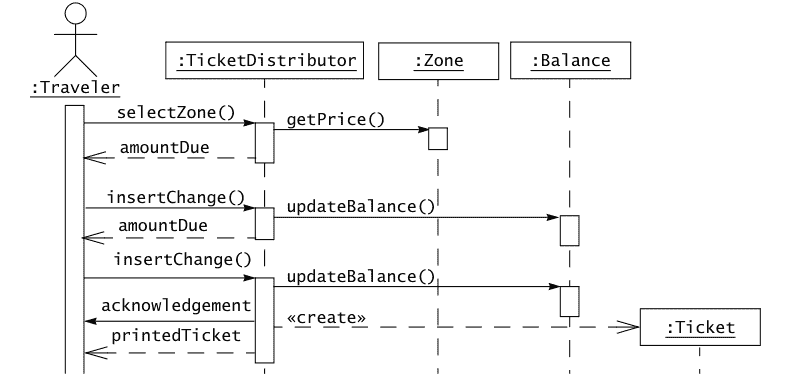

**图 1-4** 售票机的动态模型（`UML` 序列图）。该图描述了在事务期间期间参与者与系统之间的交互。

| 用例名称 | 购买单程票 (`PurchaseOneWayTicket`) |
| --- | --- |
| 参与参与者 | 由旅行者发起 |
| 事件流 | 1. 旅行者选择目的地车站所在的区域。2. 售票机显示票价。3. 旅行者插入不少于票价的金额。4. 售票机向旅行者发放指定的票，并返回任何零钱。 |
| 入口条件 | 旅行者站在售票机前，售票机位于始发站或其他车站。 |
| 退出条件 | 旅行者有一张有效票和任何剩余零钱。 |
| 质量需求 | 如果事务在无活动一后未完成，售票机返回所有插入的零钱。 |

**图 1-3** 用例示例：购买单程票。

## 1.4.3 系统设计

在**系统设计**期间，开发者定义项目的设计目标，并由各个团队将系统分解为更小的子系统。开发者还为系统选择了策略，例如运行运行的硬件/软件平台、持久性数据管理、全局控制流、访问策略以及边界条件的处理。系统设计的结果是对这些各部分的清晰描述、子系统分解以及代表硬件/软件映射的部署图。虽然分析和系统设计都产生构建中的模型，但只有分析处理客户可以理解的实体。售票机的系统分解示例。

## 1.4.4 对象设计

在**对象设计**期间

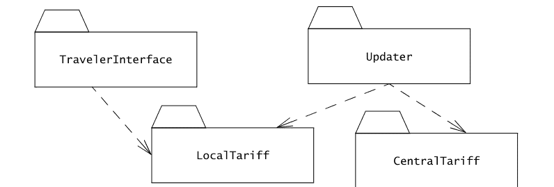


图 1-6 售票机的子系统分解（UML 类图，包表示子系统，虚线表示依赖）。旅行者接口（`TravelerInterface`）子系统负责从旅行者处收集输入并提供反馈（例如显示票价、返回零钱）。本地费率（`LocalTariff`）子系统根据本地数据库计算不同机票的价格。位于中央服务器的中央费率（`CentralTariff`）子系统维护费率数据库的引用副本。更新器（`Updater`）子系统负责在票价变化通过网络更新每台售票机的本地数据库。

我们将在第 5 章“分析”、第 6 章“系统设计：系统分解”以及第 7 章“系统设计：解决目标”中更详细地讨论这些问题。

## 1.4.5 实现

在**实现**期间，开发者将解领域模型转换为源代码。这包括实现每个对象的属性和方法，并集成所有对象以作为一个单一系统运行。实现活动跨越了详细对象设计模型与可编译源代码文件集之间的鸿沟。我们将在第 10 章“模型到代码”中描述 UML 模型到代码的映射。我们假设读者熟悉编程概念，并知道如何使用 Java 或 C++ 等面向对象的语言编写数据结构和算法。

## 1.4.6 测试

在**测试**期间，开发者通过使用样本数据集运行系统（或部分系统），发现系统与其模型之间的差异。在单元测试期间，开发者将对象模型与每个对象和子系统进行比较。在集成测试期间，将子系统组合在一起并与系统设计模型进行比较。系统测试运行典型和异常情况并与需求模型进行比较。测试的目标是尽可能发现故障，以便在系统交付前进行修复。测试阶段的规划与其他开发活动并行：系统测试在需求获取和分析期间规划，集成测试在系统设计期间规划，单元测试在对象设计期间规划。我们将在第 11 章“测试”中更详细地讨论这些问题。

## 软件开发管理

## 1.5 软件开发管理

在本节中，我们将简要描述管理软件工程项目所涉及的活动。管理活动侧重于项目规划、监控状态、跟踪变更以及协调资源，以确保按时且在预算内交付高质量的产品。管理活动不仅涉及经理，还涉及大多数其他项目参与者。管理活动包括：

- 沟通交流（第 1.5.1 节）
- 依据管理（第 1.5.2 节）
- 软件配置管理（第 1.5.3 节）
- 项目管理（第 1.5.4 节）
- 软件生命周期（第 1.5.5 节）。

我们在书中未涵盖软件维护，它包括了在系统交付给客户后发生的开发活动。传统上，软件维护与其他开发活动区分开来，因为它具有高度驱动性，并由原始开发团队不同的团队执行。随着现代软件工程项目变得更加由变更驱动，构建活动与维护活动之间的界限变得模糊。书中描述的许多活动可以延续到维护阶段，包括对象设计、实现、测试、依据管理和软件配置管理。

### 1.5.1 沟通交流

沟通是软件工程中最关键且最耗时的活动。误解和疏漏往往会导致故障和延迟，而这些问题在开发后期修复的成本极高。沟通包括交换关于系统及其应用领域的模型和文档、报告工作成果的状态、对工作成果的质量提供反馈、提出和协商问题以及传递决策。由于参与者背景的多样性、地理分布以及所交换信息的量、复杂性和演变，沟通变得非常困难。

为了解决沟通问题，项目参与者有许多可用工具。最有效的是**约定**：当参与者对表示信息的表示法、维护信息的工具以及提出和解决问题的程序达成共识时，他们已经消除了主要的误解来源。表示法的示例包括 UML 图、编写文档和会议纪要的模板以及软件组件的命名方案。工具的示例包括生成文档的计算机辅助软件工程（CASE）工具以及用于发布信息的交换格式。程序的示例包括用于组织、进行和记录会议的会议程序、评审文档并提供反馈的评审程序，以及检测模型或源代码中缺陷的检查程序。所选约定不需要是最好的，只需要被所有人共享并达成共识。我们将在第 3 章“项目组织与沟通”中详细描述沟通问题。

### 1.5.2 依据管理

依据（Rationale）是决策的理由。给定一个决策，其依据包括它所解决的问题、开发者用于评估替代方案时使用的其他方案、开发者为了达成共识而经历的辩论以及决策本身。依据是开发者在更改系统时的最重要信息。如果某个标准发生了变化，开发者可以重新评估所有依赖于该标准的决策。如果出现了新的替代方案，可以与所有已评估过的替代方案进行比较。如果某个决策受到质疑，他们可以恢复其依据以证明其合理性。

遗憾的是，依据也是开发者在开发过程中处理的最复杂的信息，因此也最难更新和维护。为了应对这一挑战，开发者在会议和在线讨论期间捕捉依据，用问题模型表示依据，并在变更期间访问依据。我们将在第 12 章“依据管理”中详细描述这些问题。

### 1.5.3 软件配置管理

软件配置管理是监控和控制工作成果变更的过程。随着客户请求新功能以及开发者对应用领域的理解加深，变更随之发生。随着新技术的出现，构建系统的硬件/软件平台也会发生变化。随着测试过程中发现并修复故障，系统也会随之变化。软件配置管理过去属于维护领域，即在系统中引入改进时。然而，在现代开发过程中，变更发生的时间比维护早得多。因此，开发期间的变更可以使用所有阶段的配置管理来处理。

配置管理允许跟踪变更。系统被表示为一系列独立修订的配置项。对于每个配置项，其演变通过版本进行跟踪。版本化允许开发者在系统失败时回退定义的状态。配置管理还允许开发者控制变更。在定义基准后，任何变更都需要经过评估和批准。这限制了引入系统的变更数量。我们将在第 13 章“配置管理”中详细描述这些问题。

### 1.5.4 项目管理

项目管理并不产生任何产物。相反，项目管理包含了确保按时且预算内交付高质量系统的监督活动。这包括在与客户谈判期间进行项目预算、招聘开发者并组建团队、监控项目状态以及出现偏差时进行干预。大多数项目管理活动超本书的范围。然而，我们将描述开发者可见的项目管理活动以及使开发沟通更有效的技术。我们将在第 14 章“项目管理”中详细描述这些问题。

### 1.5.5 软件生命周期

在本章中，我们将软件工程描述为建模活动。开发者构建应用领域和解决方案的模型来处理其复杂性。通过忽略无关细节并专注于特定问题相关的部分，开发者可以更有效地解决问题并回答问题。软件开发过程也可以被视为一个具有输入、输出、活动和复杂系统。因此，应用于软件构物的建模技术也被用于建模软件过程。软件开发过程通用模型被称为软件生命周期。我们将在第 15 章“软件生命周期”中描述生命周期。

### 1.5.6 总结

在读完本书第 1 到 15 章后，你将对对象软件工程的当前方法有一个概述，你可以将其视为一本厚厚的菜谱。但在实践中，一本菜谱通常不足以让新手做出一顿完整的菜。而且，并非所有的原料随时可用，厨师必须填补这些空白。

第 14 章“项目管理”侧重于项目的规划和控制。第 15 章“软件生命周期”侧重于建模、实现和重复软件生命周期过程。这两个章节由于关注技术和方法，允许对项目执行持乐观态度。在第 16 章“方法论：总结”中，我们将检查教科书情况之外发生的情况。我们提供了方法论和启发式，将其他章节中提出的构建块适应到特定情况。特别是，我们描述了若干敏捷和重量型方法论。

## 1.6 ARENA 案例研究

在每一章中，我们都使用日益复杂的示例来引入概念和活动，从课堂的玩具示例开始到项目课程或真实系统的实际示例。此外，为了将每一章的活动置于整个软件工程项目的背景下，我们在书中贯穿了一个单一、全面的案例研究，描述了名为 ARENA 的系统的开发过程。

- 在第 4 章“需求获取”中，我们描述了开发人员如何根据客户提供的信息编写初始用例集。我们更详细地定义了锦标赛是如何设计和公告的，以及玩家如何参加新锦标赛。在此过程中，我们向客户提出了更多问题，并揭示了系统中的歧义和缺失信息。
- 在第 5 章“分析”中，我们描述了如何从用例模型构建对象模型和行为模型。我们还研究了这些模型的开发如何导致用例模型的进一步细化，并促进对额外需求的发现。例如，我们更正式地定义了“独家赞助”的概念，描述了与决定锦标赛赞助相关的工作流，并整合了对象模型。
- 在第 7 章“系统设计：解决设计目标”中，我们选择了一个客户端/服务器架构和一个实现系统的框架，并处理了数据存储和访问控制等问题。我们研究了在 Web 上验证用户的不同方法，识别了我们需要存储的持久化对象（例如游戏状态、锦标赛结果、玩家配置），并将 ARENA 分解为由单个程序员处理的较小子系统。
- 在第 8 章“对象设计：重用模式解决方案”以及第 9 章“对象设计：指定接口”中，我们识别了额外的解决方案对象以填补系统设计与实现之间的差距。我们通过选择设计模式来解决特定问题，从而复用模板解决方案。例如，使用策略模式来封装不同的锦标赛样式。
- 在第 10 章“模型到代码的映射”中，我们将到目前为止构建的 UML 模型翻译成 Java 代码，并在发现新的优化问题时重新审视对象设计。在本章中，我们说明了对象设计与实现之间紧密的迭代。

## 延伸阅读

与 ARENA 系统相关的工作产品以及演示可以在 `http://www.bruegge.in.tum.de/OOOSE/WebHome` 获取。

### 1.7 延伸阅读

软件工程中提出的基本问题并非新鲜事，它们已经了几十年的历史。

在《人月神话》（Brooks, 1995，首次出版于 1975 年中），弗德里克·布鲁克斯（Frederick Brooks）反思了他为 IBM 360 主机开发操作系统的经验，这是一个耗资数百万、耗时数年的项目，且超出了预算和进度。随后，不同的技术、工具和方法使软件工程师能够处理更复杂、更具挑战性的问题，却经历了更昂贵、更惨烈的失败。这部里程碑著作的许多基本教训今天仍然适用。

在《计算机风险》（Neumann, 1995）中，彼特·纽曼（Peter Neumann）描述了一系列与计算机相关的失败，检查了这些失败的根源和影响，并讨论了可以如何避免它们。《计算机风险》是一份清醒的记录，任何梦想构建并掌握复杂系统的软件工程师都应该阅读。

《客观知识：演进方法》（Popper, 1992）是一篇关于知识构建的文章。卡尔·波普尔（Karl Popper）打破了追溯到亚里士多德的传统观念，认为科学知识一旦用人类语言表达，就会变成通过选择成长的实体。由于软件工程是一项协作性的知识收集和构建活动，波普尔的书有助于激发批判性思维，并为该领域提供不同的视角。

在书中，我们关注面向对象的软件工程，并针对高级软件工程项目。因此，我们省略了一些传统软件工程书中包含的历史和管理主题，例如软件度量、成本估算和形式化方法。这些主题的概述可以在更通用的软件工程书中找到，如《软件工程》（Sommerville, 2006）和《软件工程：采取实践者的方法》（Pressman, 2009）。

### 1.8 练习

- 1-1 建模的目的是什么？
- 1-2 编程语言是表示算法和数据结构的符号法。列出在整个开发过程中使用编程语言作为唯一符号法的两个优点和两个缺点。
- 1-3 考虑一个你不熟悉的任务，例如设计一辆零排放汽车。你会如何着手这个问题？
- 1-4 “知识获取不是顺序的”是什么意思？请提供一个具体的知识获取示例来说明这一点。
- 1-5 为以下设计决策假设一个理由：

# 第 1 章 • 软件工程简介

- “售票机（`TicketDistributor`）高度最高不超过一米五米。”
- “售票机将包含两个冗余计算机系统。”
- “售票机界面将由一个用于显示指令和访问命令的触摸屏和一个用于取消交易的单按钮组成。”

1-6 说明这些语句哪些是功能性需求，哪些是非功能性需求：

- “售票机必须能够让旅客购买周票。”
- “售票机必须用 Java 编写。”
- “售票机必须易于使用。”
- “售票机必须始终可用。”
- “售票机在故障时必须提供一个拨打电话。”

1-7 说明这些决策哪些是在需求阶段或系统设计阶段做出的：

- “售票机由用户界面子系统、计算计算子系统和一个用于与中央计算机通信的网络子系统组成。”
- “售票机硬件使用 PPC 处理器芯片。”
- “售票机为旅客提供在线帮助。”

1-8 在下面的描述中，解释 `account`（账户）一词何时作为应用领域概念使用，何时作为解决方案领域概念使用：

> “假设你正在开发一个用于移动客户银行账户的在线系统。一个主要的设计问题是”

1-9 任务（task）和活动（activity）之间的区别是什么？

1-10 一个乘客由 250 行代码组成，并按时交付。讨论你认为任务和活动之间的区别是什么。

### 参考文献

- Babich, 1986: W. Babich, 对象管理, Addison-Wesley, Reading, MA.
- Booch, 1994: G. Booch, 面向对象的分析与设计, Reading, CA.
- Brooks, 1995: P. Brooks, 人月神话：纪念版, Addison-Wesley, Reading, MA.
- Bruegge, 1992: D. Bruegge, 客观知识：演进方法, Oxford, Oxford, 1992.
- Bruegge & Coyne, 1993: R. Bruegge & A. Coyne, 面向对象的开发, Albany, NJ, 1993.
- Coyne, 1994: R. Coyne, 对象、组件与框架, UML, Reading, MA, 1994.
- Coyne et al., 1995: R. Coyne, 计算机风险, Addison-Wesley, Reading, MA, 1995.
- De Marco, 1978: T. D. Marco, 结构化分析与系统规范, New York, NY, 1978.
- D'Souza & Wills, 1999: D. F. Souza & A. C. Wills, UML 规范, Reading, MA, 1999.
- IEEE Std., 1990: IEEE 计算机词典：IEEE 标准汇, New York, NY, 1990.
- Jacobson et al., 1992: J. Jacobson, M. Christopherson, P. Jonsson, and G. Overgaard, 对象软件——案例驱动的方法, Addison-Wesley, Reading, MA, 1992.
- Moran & Carroll, 1996: T. P. Moran & J. M. Carroll, 设计理由：概念、技术与使用, Lawrence Systems, Mohawk, NJ, 1996.
- Neumann, 1995: P. G. Neumann, 计算机风险, Addison-Wesley, Reading, MA, 1995.
- OMG, 2009: 对象管理组, 统一建模规范. 版本 2.2, `http://www.omg.org`.
- Popper, 1992: K. Popper, 客观知识：演进方法, Oxford, Oxford, 1992.
- Pressman, 2009: R S. Pressman, 软件工程：采取实践者的方法, 第 7 版, McGraw-Hill, 2009.
- Royce, 1998: W. Royce, 项目管理：统一框架, Addison-Wesley, Reading, MA, 1998.
- Rumbaugh et al., 1991: J. Rumbaugh, M. Blame, W. Femerani, F. Eddy, & W. Lorentz, 面向对象的建模与设计, Prentice Hall, Englewood Cliffs, NJ, 1991.
- Simon, 1970: H. A. Simon, 人工智能秘密, MIT Press, Cambridge, MA, 1970.
- Sommerville, 2006: I. Sommerville, 软件工程, 第 8 版, Addison-Wesley, Reading, MA, 2006.
- Spivey, 1989: M. J. Spivey, Z 符号：参考手册, Prentice Hall, Hertfordshire, UK, 1989.

# 2

- 2.1 引言 30
- 2.2 UML 概述 31
- 2.2.1 用例图 31
- 2.2.2 类图 32
- 2.2.3 交互图 32
- 2.2.4 状态机图 33
- 2.2.5 活动图 33
- 2.3 建模概念 35
- 2.3.1 系统、模型与视图 35
- 2.3.2 数据类型、抽象数据类型与实例 37
- 2.3.3 类、抽象类与对象 38
- 2.3.4 事件类、事件与消息 40
- 2.3.5 面向对象的建模 41
- 2.3.6 证伪与原型设计 43
- 2.4 深度视角 UML 43
- 2.4.1 用例图 44
- 2.4.2 类图 50
- 2.4.3 交互图 59
- 2.4.4 状态机图 62
- 2.4.5 活动图 65
- 2.4.6 图的组织 68
- 2.4.7 图的扩展 70
- 2.5 延伸阅读 71
- 2.6 练习 72
- 参考文献 74

# 使用 UML 建模


每个机械师都熟悉这样的问题：你想买某个零件却买不到，因为你找不到它，而制造商认为它是其他部件的一部分。

> 罗伯特·皮尔西格，《禅与摩托车维修》

符号法使我们能够简洁、精确地表达复杂的思想。在涉及许多参与者（这些人员通常具有不同的技术和文化背景）的项目中，准确性和清晰度至关重要，因为误解的成本会迅速增加。

为了使符号法能够实现准确通信，它必须具有定义良好的语义，必须非常适合表示系统的某个方面，并且必须被项目参与者充分理解。后者是标准和公约的优势所在：当一种符号法被大量参与者使用时，几乎没有误解和歧义的空间。相反，当存在许多符号法的方言，或者当使用非常特殊的符号法时，用户往往会产生误解，因为每种方言都强加了自己的解释。我们选择 UML（统一建模语言，[OMG, 2009]）作为本书的主要符号法，因为它提供了一系列表示系统不同方面的符号法，并被接受为业界的标准符号法。


# 第 2 章：使用 UML 建模

在本章中，我们首先描述了通用的建模概念，特别是面向对象的建模。我们描述了贯穿全书的五种 UML 基础符号法：用例图、类图、交互图、状态机图和活动图。对于每种符号法，我们都描述了其基本语义并提供了示例。在后面的章节中，当我们描述使用这些符号图的活动时，将详细回顾这些符号法。仅在某一章使用的特殊符号法将在稍后介绍，例如第 6 章中的 UML 部署图（*系统设计：系统分解*）以及第 14 章中的 PERT 图（*项目管理*）。

## 2.1 引言

UML 是一种由 OMT（对象建模技术 [Rambaugh et al., 1991]）、Booch [Booch, 1994] 和 OOSE（面向对象软件工程 [Jacobson et al., 1992]）产生的符号法。UML 还受到其他面向对象符号法的影响，例如 Mellor 和 Shlaer 引入的 [Mellor & Shlaer, 1998]、Coad 和 Yourdon 引入的 [Coad and Yourdon, 1995]、Wirfs 和 Bock 引入的 [Wirfs-Bock, 1990] 以及 Martin 引入的 [Martin, 1992]。

UML 的目标是提供一种在需求分析阶段使用的标准，用于表示系统。例如，它提供了许多方法使用的用例图来表示系统。UML 还包含了一些在其他主要方法中不存在的概念，例如 OOSE 引入的类图。因此，UML 涵盖了广泛的系统设计。在设计阶段，UML 提供了用于表示系统的各种模型。在设计阶段，UML 关注以下几种模型：

- **功能模型**：通过用例图表示，从用户的视角描述系统的功能。
- **结构模型**：通过类图表示，描述系统的属性和操作。在需求分析阶段，该模型被细化为：
- **动态模型**：通过交互图表示，描述对象之间的消息交换。
- **状态模型**：通过状态机图表示，描述系统的状态和转换。
- **部署模型**：通过部署图表示，描述系统的物理实现。

在本章中，我们介绍了 UML 的符号法。然而，理解这些符号法对于系统设计来说是一个有趣的挑战。为了解决这个问题，我们将迭代地介绍 UML。在下一节中，我们首先对 UML 进行概述。在 2.3 节中，我们将介绍建模的基本概念。在 2.4 节中，我们将深入探讨 UML。在随后的章节中，我们将详细地讨论这些符号法。

## 2.2 UML 概述

在本节中，我们简要介绍五种符号法：

- 用例图（2.2.1 节）
- 类图（2.2.2 节）
- 交互图（2.2.3 节）
- 状态机图（2.2.4 节）
- 活动图（2.2.5 节）

### 2.2.1 用例图

用例在需求分析阶段被用于表示系统的功能。它们从用户的视角关注系统。例如，图 2-1 展示了一个简单表的用例。`WatchUser` 角色可能会查看时间（`ReadTime` 用例）或设置时间（`SetTime` 用例）。然而，只有 `WatchPerson` 角色可以更换电池（`ChangeBattery` 用例）。

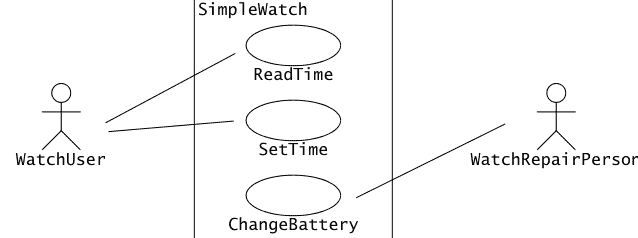

**图 2-1** 简单表的用例图

### 2.2.2 类图

类图用于描述系统的结构。类是指定对象公共结构和行为的抽象。对象是在系统执行期间被创建、修改和销毁的实例。实例具有属性值以及与其他对象的关联。

类图通过类、属性、操作及其关联来描述系统。例如，图 2-2 是描述所有表元素的类图。这些表对象都与 `PushButton` 类、`Display` 类、`Time` 类和 `Battery` 类有关。关联上的数字表示每个 `SimpleWatch` 对象与给定类的关系。例如，一个 `SimpleWatch` 有两个 `PushButton`、一个 `Display`、两个 `Battery` 和一个 `Time`。同样，所有的 `PushButton`、`Display`、`Time` 和 `Battery` 对象都与一个 `SimpleWatch` 对象关联。

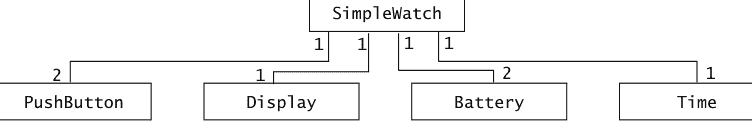

**图 2-2** 表的类图

在分析阶段，关联表示存在关系。例如，`SimpleWatch` 需要正确数量的 `PushButton`、`Display`、`Battery` 和 `Time`。在这个例子中，关联是对称的：`ToggleButton` 可以执行功能。UML 还允许单向关系，我们将在 2.4.2 节中描述这些。在实现阶段，关联被实现为对象的引用（即指针）。

### 2.2.3 交互图

交互图用于形式化系统的动态行为，并使对象之间的通信可视化。它们对于识别参与用例的额外对象很有用。我们将参与用例的对象称为参与对象。

交互图表示这些对象之间发生的交互。例如，图 2-3 是交互图的一种特殊形式，称为序列图，用于 `SetTime` 用例。最左侧的列代表启动用例的 `Watch Actor`。带标签的箭头表示角色或对象发送给其他对象的刺激。在这种情况下，`WatchUser` 按了两次 1 号按钮和一次 2 号按钮，以将其调分钟。当 `WatchUser` 同时按下两个按钮时，`SetTime` 用例结束。

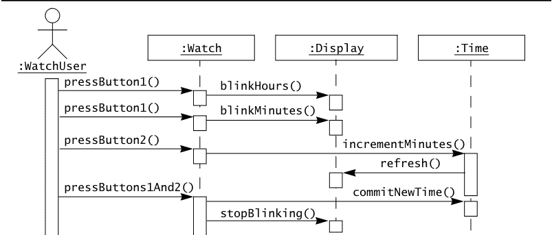

**图 2-3** Watch 的 UML 序列图。最左侧的列表示启动用例的参与者 `WatchUser` 的时间线。其他列表示参与该用例的对象的时间线。对象名称带有下划线表示它们是实例（而不是类）。带标签的箭头显示参与者或对象向其他对象发送的内容。

### 2.2.4 状态机图

状态机图通过若干个状态以及这些状态之间的转换，描述了单个对象的动态行为。一个状态表示对象的一组特定值。给定一个状态，转换表示对象可能移动到的未来状态，以及与状态变更相关的条件。例如，图 2-4 是 Watch 的状态机图。一个小黑圆表示 `Blinkhours` 是初始状态。请注意，此图表示的信息与图 2-3 的序列图不同。序列图侧重于由于参与者创建的外部事件导致对象之间交换的消息；状态机图则侧重于单个对象由于外部事件导致的状态之间的转换。

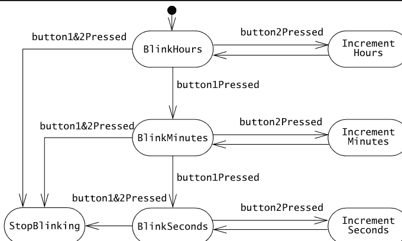

**图 2-4** Watch 的状态机图。一个小黑圆表示 `Blinkhours` 是初始状态。请注意，此图表示的信息与图 2-3 的序列图不同。序列图侧重于由于参与者创建的外部事件导致对象之间交换的消息；状态机图则侧重于单个对象由于外部事件导致的状态之间的转换。

### 2.2.5 活动图

活动图通过活动来描述系统的行为。活动是表示一组操作执行的建模元素。一组操作的执行可以由活动的完成、对象的可用性或外部事件触发。活动图与流程图相似，都用于表示控制流（即操作的顺序）和数据流（即对象）。例如，图 2-5 是一个表示活动的活动图。圆角矩形表示活动；粗条表示控制流。

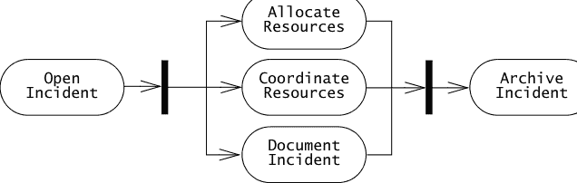

**图 2-5** 一个表示活动的活动图。圆角矩形表示活动；粗条表示控制流。

## 2.3 建模概念

在本节中，我们首先定义建模并讨论了类型类型。我们解释了建模是对系统的抽象，关注相关的方面。在软件工程中，与其他工程学科一样，模型通常先于系统。在分析阶段，我们首先在客户可以理解的水平上构建一个模型。然后我们完善该模型，为系统应该显示的表单、用户界面布局以及系统对异常情况的响应添加更多细节。开发过程中构建的所有模型集合被称为系统模型。如果我们不使用模型而是直接开始编写系统代码，那么在客户提供反馈之前，我们必须指定用户界面的所有细节。当客户引入更改时，我们将浪费大量的时间和资源。

建模还帮助我们处理复杂性，使我们能够将简单模型逐步完善为更接近现实的详细模型。

### 2.3.1 系统、模型与视图

模型是描述系统子集的抽象。视图描绘了模型的选定方面。单个系统的视图和模型可能会相互重叠。

一个经验法则是，每个实体最多包含 7 ± 2 个参数 [Miller, 1956]。

遗憾的是，即使是模型也可能变得复杂而难以理解。我们可以继续使用分治法，将复杂的模型完善为更简单的模型。视图关注模型的子集以便于理解（图 2-6）。例如，建造飞机所需的所有蓝图构成了一个模型。视图之间可能会重叠：表示飞机电气布线的视图中也包含了燃料系统的布线。

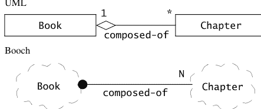

**图 2-6** 模型是描述系统子集的抽象。视图描绘了模型的选定方面。

### 2.3.2 表示法

表示法是表示视图的图形或文本规则。UML 类图是对象模型的图形视图。在接线图中，每条连接的线都代表一条不同的电线或线束。在 UML 类图中，带有标题的矩形表示一个类。两个矩形之间的线表示两个对应类之间的关系。注意，不同的表示法可以表示同一个视图（图 2-7）。


**图 2-7** 使用两种不同表示法描述模型的示例。模型包含两个类：`Book`（书籍）和 `Chapter`（章节），它们的关系是“Book 由 Chapters 组成”。在 UML 中，类用矩形表示，聚合关联用以菱形结尾的线表示。在 Booch 表示法中，类用云朵表示，聚合关联用以实心圆圈结尾的线表示。

在软件工程中，还有许多其他用于建模系统的表示法。UML 通过类、事件、交互和活动来描述系统。数据流图 [De Marco, 1978] 描述了数据如何被检索、处理和存储。Z 方案 [Spivey, 1992] 通过不变式（不改变的条件）以及操作执行后的真值状态来表示系统。每种表示法都是为不同的问题定制的。

在接下来的章节中，我们将详细关注建模过程。

### 2.3.3 数据类型、抽象数据类型和实例

**数据类型**是编程语言上下文中的一种抽象。数据类型具有唯一的名称，用以与其他数据类型区分开来。它表示一组作为数据类型成员的值（即该数据类型的**实例**），并定义了结构以及在该类型有效的操作，以确保只有有效的操作被应用于特定实例。

例如，Java 中的名称 `int` 对应于 $-2^{31}$ 到 $2^{31}-1$ 之间的所有有符号整数。该类型的有效操作是所有算术运算（例如加法、乘法、除法）以及所有参数为 `int` 类型的函数和方法（例如 `mod`）。如果对 `int` 数据类型的实例应用浮点操作（例如 `trunc` 或 `floor`），Java 运行时环境将抛出异常。

**抽象数据类型**是由独立于实现的规范定义的数据类型。抽象数据类型允许开发者在不查看抽象数据类型具体实现的情况下，对一组实例进行推理。抽象数据类型的示例是集合和序列，它们可以通过数学方式进行定义。系统可以提供集合抽象数据类型的不同实现，每种实现都优化不同的标准（例如内存消耗、插入时间）。然而，使用该类型的开发者只需要理解其语义，而无需感知集合的内部表示。例如，抽象数据类型 `Person` 可以定义操作 `getName()`、`getSecurityNumber()` 和 `getAddress()`。人的社会安全号码存储为数字还是字符串，这一事实对系统的其他部分是不可见的。此类决策被称为实现决策。

### 2.3.4 类、抽象类和对象

**类**是面向对象建模和面向对象编程语言中的抽象。与抽象数据类型一样，类封装了结构和行为。与抽象数据类型不同，类可以通过继承根据其他类来定义。例如，我们有一块也可以当计算器使用的手表。这个 `Calculator` 类可以被视为基类的细化，而这种细化的类被称为继承。泛化类（例如手表）被称为父类，特化类（例如 `Calculator`）被称为子类。在继承关系中，子类通过定义新的属性和操作来细化父类。在图 2-8 中，`Calculator` 定义了执行简单算术的功能，而普通手表没有这些功能。父类和子类是相对术语。当继承关系只需要建模共享属性和操作时，如果泛化类不需要实例化，则生成的类被称为**抽象类**。抽象类通常表示应用领域中的泛化概念，且它们的名称使用斜体。例如，在化学中，苯被视为属于 `OrganicCompound`（有机化合物）类的分子类（图 2-9）。`OrganicCompound` 是一种泛化，并不对应任何具体的分子；也就是说，它没有实例。在 Java 中，`Collection` 是为所有集合类提供泛化的抽象类。然而，没有 `Collection` 类的实例。所有集合对象都是 `Collection` 的某个子类的实例，例如 `LinkedList`、`ArrayList` 或 `HashMap`。注意并不是所有的泛化都是抽象类。例如，在图 2-8 中，`Watch` 不是抽象类，因为它有实例。

### 2.3.5 事件类和消息

**事件类**是表示系统具有共同响应的某种事件的抽象。**事件**是事件类的一个实例，是系统中的相关发生情况。例如，事件可以是来自某个对象的刺激（例如“用户按下左键按钮”）、超时（例如“2 分钟后”），或者是两个对象之间的消息传递。发送**消息**是发送对象请求接收对象执行某个操作的机制。消息由一个名称和若干参数组成。接收对象将消息名称匹配到其操作之一，并将参数传递给该操作。任何结果都会返回给发送者。

### 2.3.6 面向对象建模

- 3. 应用领域有时会被进一步分为用户领域和客户端领域。客户端领域包含与客户端相关的问题，例如系统的运行成本、对组织其他部分的影响。用户领域包含与终端用户相关的问题，例如功能性、易用性和易学性。

在设计中，应用领域模型也是系统模型的一部分。例如，一个空中交通控制系统有一个 `TrafficController` 类来表示单个用户、其偏好和日志信息。系统还有一个 `Aircraft` 类来表示与被追踪飞机相关的信息。`TrafficController` 和 `Aircraft` 是编码到系统中的应用领域概念（图 2-12）。

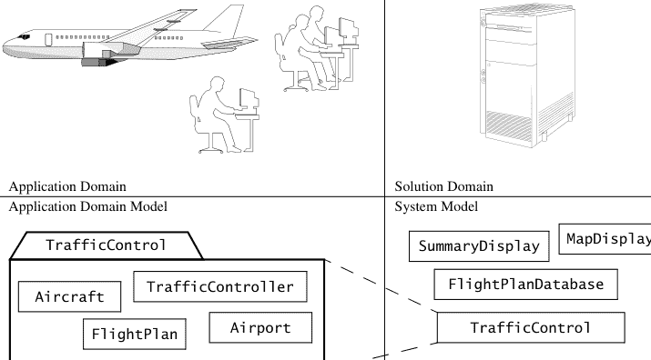

**图 2-12** 应用领域模型表示了与交通控制系统相关的环境实体（例如，飞机、交通管制员）。系统模型表示了系统的组成实体（例如，地图显示、飞行计划）。注意，在面向对象的分析和设计中，应用领域模型是系统模型的一部分。系统模型完善了应用领域模型，包含了解决方案领域的概念，如 `SummaryDisplay`、`MapDisplay` 和 `FlightPlan-Database`。（更多细节请参见第 5 章分析。）

使用单一表示法对应用领域和解决方案领域进行建模既有利有弊。一方面，它是强大的：表示应用概念的解决方案领域类可以追溯到应用领域。此外，这些类可以封装成独立于其他实现概念（例如用户界面和数据库技术）的子系统，并被打包成可重用的领域类工具包。另一方面，使用单一表示法可能会引入混淆，因为它消除了真实世界与其模型之间的区别。解决方案领域注定更简单且偏向于解决方案。为了解决这个问题，我们使用单一表示法，并在歧义的情况下区分这两个领域。在大多数情况下，我们指的是模型（例如，“一架 `Aircraft` 与一个 `FlightPlan` 关联”是一条关于模型的陈述）。

### 2.3.7 伪证与原型化

模型是现实的简化，因为它忽略了无关的细节。然而，相关的细节需要被表示出来。**伪证** [Popper, 1992] 是证明相关细节被错误地表示或完全没有被表示的过程；也就是说，模型与它应该代表的现实不相符。

伪证过程在其他科学中是广为人知的：研究人员提出现实的不同模型，随着支持该模型的数据增加，模型逐渐被接受，然后一旦发现反例，就会被拒绝。例如，在 18 世纪末，人们发现水星的轨道与牛顿引力理论预测的轨道并不完全匹配。后来，爱因斯坦的相对论预测了略有不同的轨道结果。换句话说，牛顿理论被伪证了，取而代之的是爱因斯坦的理论。注意，我们在地球上的实际应用中仍然使用牛顿理论，因为在这些情况下，两种理论预测的差异很小，且牛顿理论要简单得多。换句话说，牛顿理论忽略的细节对于我们习惯的尺度来说并不相关。

我们也可以将伪证应用于软件开发。例如，开发系统的一种技术是**原型化**：在设计用户界面时，开发人员构建一个仅模拟系统用户界面的原型。将原型提交给潜在用户进行评估——即伪证——并随后进行修改。在该过程的首次迭代中，开发人员和用户可能会因为用户的反馈而丢弃初始原型，因为它没有准确地表示系统。注意，只有可能证明模型是不正确的。在某些情况下，形式化验证可以证明软件与需求一致。例如，用例测试可以证明系统满足客户端的需求。

## 2.4 深入理解 UML

我们现在详细描述在本书中使用的五种主要的 UML 图。

- **用例图**（Use cases）从用户的视角表示系统的功能。（2.4.1 节）


- **类图**（Class diagrams）表示系统的静态结构，包括属性和操作。(2.4.2)
- **交互图**（Interaction diagrams）表示对象之间的交互。(2.4.3)
- **状态机图**（State machine diagrams）表示对象的行为。(2.4.4)
- **活动图**（Activity diagrams）表示流过系统（业务流）。(2.4.5)

### 2.4.1 用例图

用例是与系统交互的外部实体。参与者的示例包括用户角色（例如客户）或另一个系统（例如数据库）。用例具有唯一的名称，并描述系统提供的功能。参与者与用例之间的关联表示信息流。这些是双向的：它们可以表示启动用例的参与者，也可以提供信息的用例。

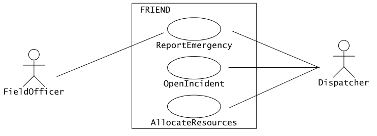

图 2-13 响应用例图示例。用例周围的框表示系统边界。

对于用例的文本描述，我们使用一个由六个字段组成的模板（见图 2-14），改编自 [Constantine & Lockwood, 2001]

- 用例名称在系统中是唯一的，开发人员和项目参与者可以明确地引用它。
- 参与者是与用例交互的实体。
- 入口条件描述了启动用例之前需要满足的条件。

| 用例名称 | ReportEmergency |
| :--- | :--- |
| 参与者 | 由 FieldOfficer 启动，与 Dispatcher 交互 |
| 事件流 | 1. FieldOfficer 激活其终端的“报告紧急”功能。2. FRIEND 通过向 FieldOfficer 发送表单做出响应。3. FieldOfficer 通过选择紧急级别、类型、位置和情况的简要描述来填写表单。FieldOfficer 还描述了对紧急情况可能的响应。表单填写完成后，FieldOfficer 提交。4. FRIEND 接收表单并通知 Dispatcher。5. Dispatcher 审查提交的信息，并使用 OpenIncident 用例在数据库中创建一个事件。Dispatcher 选择一个响应并确认报告。6. Dispatcher 向 FieldOfficer 显示确认信息和所选响应。 |
| 入口条件 | FieldOfficer 已登录 FRIEND。 |
| 出口条件 | FieldOfficer 收到来自 Dispatcher 的确认和所选响应，或者 FieldOfficer 收到指示无法处理交易的解释。 |
| 质量要求 | FieldOfficer 的报告在 30 秒内得到确认。所选响应在 Dispatcher 发送后晚于 30 秒到达。 |

图 2-14 用例示例，ReportEmergency。

事件流（Flow of events）描述了用例的交互序列，为了引用，将对其编号。通常情况（common case，即用户预期的情况）和异常情况（exceptional cases，即用户意外出现的情况，如错误和异常条件）在不同的用例中分别描述，以便清晰。我们在事件流中组织步骤：左列代表参与执行的步骤，右列代表系统执行的步骤。

- 退出条件（Exit conditions）描述了用例完成后的条件。
- 质量需求（Quality requirements）是与系统功能、运行硬件等无关的需求。质量需求在第4章需求获取（Requirements Elicitation）中详细描述。

用例是用自然语言编写的。这使得开发者能够与对软件工程符号并不熟悉的用户进行交流。自然语言的使用也让来自其他学科的参与者理解系统的需求。自然语言的使用允许开发者捕捉某些特殊需求，这些需求在图中可能难以捕捉。

用例图可以包含四种关系：包含、扩展和继承。接下来我们将详细描述这些关系。

## 通信关系（Communication relationships）

当参与者和用例之间交换信息时，即发生通信关系。在用例图中，通信关系通过参与者与用例之间的实线表示。在图2-13中，调度员（Dispatcher）仅与 `OpenIncident` 和 `AllocateResources` 用例进行通信。参与者和用例之间的通信关系可以表示对功能的访问。在示例中，现场人员和调度员提供了不同的接口来访问系统。

## 包含关系（Include relationships）

在描述复杂系统时，其用例模型可能会变得非常复杂并包含冗余。我们通过识别不同用例中的共性来降低模型的复杂度。例如，假设调度员可以随时访问街道地图。这通过 `ViewMap` 用例进行建模，该用例被 `OpenIncident` 和 `AllocateResources`（以及其他调度员可访问的用例）包含。结果模型只描述一次 `ViewMap` 功能，从而减少了整个用例的复杂度。如果其中一个用例在事件流中包含了另一个，则它们之间即为包含关系。在用例图中，包含关系通过从包含用例引出的虚线箭头表示。包含关系标记为“include”。

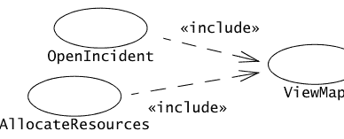

**图2-15** 一个“include”关系的示例（UML用例图）。

| 用例名称 | AllocateResources |
| --- | --- |
| 参与者 | 由调度员启动 |
| 事件流 | ... |
| 进入条件 | 调度员打开 Incident。 |
| 退出条件 | • 额外的资源被分配给 Incident。<br>• 资源收到了新分配的通知。<br>• Incident 的现场人员收到了通知。 |

在事件流的任何一点，此用例都可以**包含 `ViewMap` 用例**。当调度员调用地图功能时，`ViewMap` 用例被启动。在此用例内部，系统会滚动地图，使当前 Incident 的位置对调度员可见。

**图2-16** 图2-15 包含关系的文本表示。为了清晰，“Include”已加粗。

我们通过两种方式在用例的文本描述中表示包含关系。如果包含用例可以在事件流的任何一点被包含（例如 `ViewMap` 用例），我们会在用例的*质量需求*部分指示这种包含（图2-16）。如果包含用例在事件期间被调用，我们会在事件流中指示这种包含。

## 扩展关系（Extend relationships）

**扩展关系（Extend relationships）**是减少复杂性的另一种手段。用例可以通过添加事件来扩展另一个用例。在用例的文本表示中，我们将扩展关系表示为扩展用例的进入条件。例如，现场人员在使用 FRIEND 之前需要进行身份验证。在需求获取的早期，身份验证被建模为高级的 `Authenticate` 用例。随后，开发者更详细地使用 `Authenticate` 用例并允许不同的硬件平台。这种精炼准确地得出了两个用例：`AuthenticateWithPassword` 允许现场人员无需任何硬件即可登录，`AuthenticateWithCard` 允许现场人员使用智能卡登录。这两个新用例是 `Authenticate` 用例的特化版本（图2-19）。在文本表示中，特化用例继承了通用用例的启动参与者以及进入和退出条件。

包含关系和扩展关系的区别在于依赖的位置。在一般异常情况下，我们描述的由一组用例共同共享的行为通过包含关系进行建模。如果我们改用扩展关系，则仅需要修改扩展用例。例如，假设调度员和现场人员之间的网络连接在连接丢失的任何时候都可以被中断。`ConnectionDown` 扩展了 `OpenIncident` 和 `AllocateResources` 用例（图2-17）。


**图2-17** 一个“extend”关系的示例（UML用例图）。

| 用例名称 | ConnectionDown |
|---|---|
| 参与者 | 与现场人员通信 |
| 事件流 | ... |
| 进入条件 | 现场人员与调度员之间的网络连接丢失 |
| 退出条件 | ... |

**图2-18** 图2-17 扩展关系的文本表示。为了清晰，“Extends”已加粗。

## 继承关系（Inheritance relationships）

继承关系是减少模型复杂性的第三种机制。一个用例可以通过增加细节来特化另一个更通用的用例。例如，现场人员在使用 FRIEND 之前需要进行身份验证。在需求获取的早期，身份验证被建模为高级 `Authenticate` 用例。随后，开发者更详细地使用 `Authenticate` 用例并允许不同的硬件平台。这种精炼准确地得出了两个用例：`AuthenticateWithPassword` 允许现场人员无需任何硬件即可登录，`AuthenticateWithCard` 允许现场人员使用智能卡登录。这两个新用例是 `Authenticate` 用例的特化版本（图2-19）。在文本表示中，特化用例继承了通用用例的启动参与者以及进入和退出条件。


**图2-19** 一个继承关系的示例（UML用例图）。`Authenticate` 用例是一个高级用例，用通用术语描述了身份验证过程。`AuthenticateWithPassword` 和 `AuthenticateWithCard` 是 `Authenticate` 用例的两个特化版本。

| 用例 | AuthenticateWithCard |
|---|---|
| 参与者 | 继承自 Authenticate 用例 |
| 事件流 | 1. 现场人员将卡片插入现场终端。<br>2. 现场终端确认卡片并提示参与者输入个人密码（PIN）。<br>3. 现场人员用数字键盘输入其 PIN。<br>4. 现场终端检查输入的 PIN 与卡片上存储的 PIN 是否匹配。如果 PIN 匹配，则现场人员验证通过。否则，现场终端拒绝身份验证尝试。 |
| 进入条件 | 继承自 Authenticate 用例 |
| 退出条件 | 继承自 Authenticate 用例 |

**图2-20** 图2-19 继承关系的文本表示。

请注意，扩展（extend）关系和继承（inheritance）关系是不同的。在扩展关系中，每个用例描述了完成不同任务的不同事件流。在图 2-17 中，`OpenIncident` 用例描述了调度员（Dispatcher）创建新事件（Incident）时发生的动作，而 `ConnectionDown` 用例描述了网络中断期间发生的动作。在图 2-19 中，`AuthenticateWithPassword` 和 `Authenticate` 描述的是同一个任务，但处于不同的抽象级别。

## 场景（Scenarios）

用例是一种抽象，描述了涉及描述功能的所有可能场景。场景是用例的一个实例，描述了一组参与者（actors）。场景被用作说明常见的示例；其重点在于可理解性。用例则用于描述所有可能的情况；其重点在于完整性。我们使用包含三个字段的模板来描述场景：

- 场景名称：用于无歧义地指代它。场景名称带有下划线，以表示它是一个实例。
- 参与参与者字段：识别哪些参与者实例参与了此场景。参与者实例的名称也有下划线。
- 场景事件流：描述事件的步骤顺序。

请注意，场景中不需要进入条件（entry conditions）或退出条件（exit conditions）。进入和退出条件是抽象，允许开发人员描述调用用例的条件范围。鉴于场景只描述一种特定情况，这些条件是不必要的（图 2-21）。

| 场景名称 | houseOnFire |
| --- | --- |
| 参与参与者实例 | bob, alice:FieldOfficer, john:Dispatcher |
| 事件流 | 1. Bob 驾驶着他的巡逻车在主街行驶，注意到仓库里冒出了烟。他的搭档 Alice 从她的 FRIEND 笔记本电脑上激活了“报告紧急情况”功能。2. Alice 通知了建筑地址、其位置的简要描述（即：北角）以及紧急级别。除了消防队外，她还向看起来相当繁忙的现场请求了几个医救护小组。她确认了输入并等待确认。3. 调度员 John 通过设备的蜂鸣声收到了紧急情况的通知。他查看了 Alice 提交的信息并确认了报告。他为事件现场分配了一个消防队和两个参数化救护小组，并将他们的预计到达时间（ETA）发送给 Alice。4. Alice 接收了确认和 ETA。 |

**图 2-21** `ReportEmergency` 用例的 `warehouseOnFire` 场景。

### 2.4.2 类图

### 类和对象

类图用类和对象来描述系统的结构。类是抽象，指定了一组对象，这些对象共享一组属性，这些属性将对象区分为该集合的成员。对象是封装了状态和行为的实体。每个对象都有身份标识：它可以被单独引用，并与其他对象区分来。

在 UML 中，类和对象由带有三个区域的框表示。顶部区域显示类或对象的名称。中间区域显示其属性，底部区域显示其操作。为了清晰起见，可以省略属性操作区域。对象名称带有下划线，以表示它们是实例。按照习惯，类名以大写字母开头。对象图中的对象可以命名（后跟其类）以便方便引用。在这种情况下，它们的名称以小写字母开头。在 `FRIEND` 示例中（图 2-22 和 2-23），Bob 和 Alice 是现场警员（field officers），在系统中表示为名为 `bob:FieldOfficer` 和 `alice:FieldOfficer` 的 `FieldOfficer` 对象。`FieldOfficer` 是描述所有 `FieldOfficer` 对象的类，而 Bob 和 Alice 由两个独立的 `FieldOfficer` 对象表示。

在图 2-22 中，`FieldOfficer` 类有两个属性：`name` 和 `badgeNumber`。这意味着所有 `FieldOfficer` 对象都具有这两个属性。在图 2-23 中，`bob:FieldOfficer` 和 `alice:FieldOfficer` 对象对这些属性有特定的值：分别为 "Bob. D." 和 "Alice W."。在图 2-22 中，`FieldOfficer.name` 属性类型为 `String`，这意味着只有 `String` 实例被分配给 `FieldOfficer.name` 属性。属性的类型用于指定该属性可以取值的有效范围。请注意，当属性类型对系统的定义并非本质要求时，属性类型的决策可以推迟到对象设计。这允许开发人员专注于系统功能，并在系统功能修订时尽量减少琐碎更改的数量。

| EmergencyReport | 1 | Incident |
| --- | --- | --- |
| reportsGenerated | 1., * | |
| | reports | * incidentsGenerated |
| FieldOfficer | | Dispatcher |
| name:String badgeNumber:Integer | | initiator |

**图 2-22** UML 类图示例：参与 `ReportEmergency` 用例的类。详细的类型信息推迟到对象设计阶段（第 9 章，*对象设计：指定接口*）。

| bob:FieldOfficer | report_1291 | incident_1515 |
| --- | --- | --- |
| name = "Bob D." badgeNumber = 132 | | john:Dispatcher |
| | | name = "John D." badgeNumber = 12 |
| alice:FieldOfficer | | name = "Alice W." badgeNumber = 23 |

图 2-23 UML 对象图示例：参与 `warehouseonFire` 的对象。

## 关联和链接（Associations and links）

链接（link）表示两个对象之间的连接。关联（Associations）是类之间的关系，代表链接的组。每个 `FieldOfficer` 对象还有一个由该现场警员编写的 `EmergencyReports` 列表。在图 2-22 中，`FieldOfficer` 类与 `EmergencyReport` 类之间的线是一条关联。在图 2-23 中，`alice:FieldOfficer` 对象与 `report_1291:EmergencyReport` 对象之间的线是一个链接。该链接表示系统中保留的一种状态，用以说明 `alice:FieldOfficer` 生成了 `report_1291:EmergencyReport`。

在 UML 中，关联可以是对称的（双向的）或非对称的（单向的）。图 2-22 中的所有关联都是对称的。图 2-24 展示了 `Polygon` 和 `Point` 之间单向关联的示例。指向 `Point` 端的箭头表示系统只支持从 `Polygon` 到 `Point` 的导航。也就是说，给定特定的 `Polygon`，查询组成该多边形的所有 `Points`。


图 2-24 单向关联示例。开发人员通常在分析期间省略导航，并在对象设计做出此类决策时添加导航信息（参见第 8 章，对象设计：重用模式，以及第 9 章，对象设计：指定接口）。然而，导航箭头表示给定特定的 `Point`，无法找到它属于哪些 `Polygon`。UML 允许在关联的两侧显示箭头。按照习惯，没有箭头的关联表示支持双向导航。

### 关联类（Association class）


关联与类相似，可以附加属性和操作。这种关联被称为关联类，由一个包含属性和操作的类符号表示并通过虚线连接到关联符号。例如，在图 2-25 中，`FieldOfficer` 分配 `Incident` 被建模为具有 `role` 和 `notificationTime` 属性的关联类。

任何关联类都可以转换为图 2-26 所示的类和简单关联。虽然这种表示与图 2-25 相似，但图 2-25 的关联类表示更清晰：没有链接关联就不存在。同样，没有 `FieldOfficer` 和 `Incident` `Allocation` 对象就不存在。尽管图 2-26 携带相同的信息，但该图需要对关联多重性进行仔细检查。我们在第 5 章中讨论权衡。

| Allocates | | |
| --- | --- | --- |
| FieldOfficer | Incident | 1 |
| role:String notificationTime:Time | | |
| name:String badgeNumber:Integer 1..* | incident |

**图 2-25** 关联类示例（UML 类图）。

| Allocation | | |
| --- | --- | --- |
| FieldOfficer | incident 1 | |
| role:String notificationTime:Time | | |
| name:String badgeNumber:Integer 1..* resources | Incident |

**图 2-26** Allocation 的另一种模型（UML 类图）。

## 角色 (Roles)

关联的每个端都可以由一个角色标记。在图 2-22 中，EmergencyReport（应急报告）与 FieldOfficer（现场官员）之间关联的角色是 author（作者）和 reportsGenerated（生成的报告）。在关联末端标记角色允许我们区分源自同一个类的多个关联。此外，角色明确了关联的目的。

## 多重性 (Multiplicity)

关联的每个端都可以由一组整数标记，这些整数表示从连接到该关联端的类实例可以合法产生的链接数量。这组整数被称为关联端的多重性。在图 2-22 中，关联端 author 的多重性为 1。这意味着所有的 EmergencyReport 都恰好由一个 FieldOfficer 编写。换句话说，每个 EmergencyReport 与一个 FieldOfficer 类的对象恰好有一个链接。关联端 reportsGenerated 的多重性是“多（many）”，用星号表示。“多”这种多重性是 0..n 的缩写。这意味着任何给定的 FieldOfficer 都可以是一个或多个 EmergencyReport 的作者。

在 UML 中，关联可以具有任意整数集合作为多重性。例如，某个关联可能只允许质数数量的链接，因此其多重性为 1, 2, 3, 5, 7, 11, 13 等。在实践中，我们遇到的大多数关联属于三种类型之一（见图 2-27）：

- **一对一关联**在一个端的多重性为 1。两个类之间（例如 PoliceOfficer 警察和 BadgeNumber 徽章号）的一对一关联意味着每个类的实例之间恰好存在一个链接（例如，一个 PoliceOfficer 恰好有一个 BadgeNumber，而一个 BadgeNumber 恰对应一个 PoliceOfficer）。

- **一对多关联**在一个端的多重性为 1，另一端为 0..n。两个类之间（例如 FireUnit 消防队和 FireTruck 消防车）的一对多关联表示组合关系，一个 FireUnit 拥有一个或多个 FireTruck，一个 FireTruck 恰好由一个 FireUnit 所有。

- **多对多关联**在两个端的多重均为 0..n 或 1..n。两个类之间（例如 FieldOfficer 现场官员和 IncidentReport 事件报告）的多对多关联意味着这两个类的实例之间可以存在任意数量的链接（例如，一个 FieldOfficer 可以编写许多 IncidentReport，一个 IncidentReport 可以由许多 FieldOfficer 编写）。这是复杂的关联类型。

在关联中添加多重性增加了我们从应用程序或解决方案领域捕获的信息量。当我们确定需要哪些用例来操作应用域对象时，指定关联的多重性变得至关重要。例如，考虑一个由 Directories（目录）和 Files（文件）组成的文件系统。Directory 可以包含任何类型的 FileSystemElements（文件系统元素）。FileSystemElement 是一个表示目录或文件的概念。在严格的层级系统中，FileSystemElement 恰好属于一个 Directory，我们用一对一关联来表示它。

## UML 的更深层视图

| PoliceOfficer | BadgeNumber |
| :--- | :--- |
| FireUnit | owner property | FireTruck |
| FieldOfficer | author report | IncidentReport |

**图 2-27** 多重性的示例（UML 类图）。PoliceOfficer 与 BadgeNumber 之间的关联是一一对的。FireUnit 与 FireTruck 之间的关联是一对多的。FieldOfficer 与 IncidentReport 之间的关联是多多的。

然而，如果一个 FileSystemElement 属于多个 Directory，我们需要将其表示为多对多关联（见图 2-28）。

![img/546a4f3ba7052249f75098d89.png]

**图 2-28** 层级系统的示例。FileSystemElement 恰好属于一个 Directory，我们用一对多的关联来表示它。

![img/546a4f3ba7052249f75098d89.png]

**图 2-29** 非层级系统的示例。Directory 可以包含任意数量的文件。

## 聚合 (Aggregation)

关联用于表示“属于”关系。在实践中，这种关系经常发生：例如，State（州）由 Counties（县）组成。在 UML 中，聚合由关联端的一个菱形表示。这通常是一个对多的多重性或一对多的关联（见图 2-30）。

| State | Township |
| :--- | :--- |
| PoliceOfficer | IncidentReport |
| Directory | File |

**图 2-30** 聚合的示例。

## 限定 (Qualification)

限定是一种使用键来减少多重性的技术。如果一对多或多对多的多重性关联通过名称进行限定，将变得更容易理解。例如，在文件系统中，每个文件在其目录内通过名称被唯一标识。我们使用文件名作为键来减少多重性，这也称为限定符。

![img/546a4f3ba7052249f75098d89.png]

**图 2-31** 限定关联如何减少多重性的示例（UML 类图）。

## 继承 (Inheritance)

继承是通用类与一组共同属性的特化类之间的关系。例如，FieldOfficer 和 Dispatcher 都具有 name 和 badgeNumber 属性。然而，FieldOfficer 与 EmergencyReport 有关联，而 Dispatcher 与 Incident 有关联。FieldOfficer 和 Dispatcher 的共同属性可以通过引入一个 PoliceOfficer 类来建模，该类被 FieldOfficer 和 Dispatcher 类所特化。PoliceOfficer（泛化类）称为超类。FieldOfficer 和 Dispatcher 则称为子类。

# 第 2 章 • 使用 UML 建模

| PoliceOfficer |
| :--- |
| name:String |
| badgeNumber:Integer |
| FieldOfficer | author | Dispatcher |
| :--- | :--- | :--- | :--- |
| | 1 | | 1 |
| | * reportsGenerated | | * incidents |
| EmergencyReport | 1..* | Incident |

**图 2-32** 继承示例（UML 类图）。PoliceOfficer 是一个抽象类，定义了 FieldOfficer 和 Dispatcher 类的公共属性和操作。

对象的行为由**操作（operations）**指定。对象通过发送**消息（message）**向另一个对象请求执行某项操作。消息将与接收对象或其任何父类定义的**方法（method）**匹配。在面向对象的编程语言中，类的方法是这些操作的实现。

操作与方法之间的区别允许我们区分行为的规范（即操作）与其实现（即可能定义在继承层次结构中不同类中的一组方法）。例如，图 2-33 中的 Incident 类定义了一个名为 `assignResource()` 的操作，该操作在给出一个 FieldOfficer 的情况下，与接收的 Incident 和指定的 Resource 之间建立关联。`assignResource()` 操作可能还有副作用，例如向新分配的 Resource 发送通知。Incident 的 `close()` 操作负责关闭 Incident。这包括检查随时间推移分配给事件的所有资源并收集它们的报告。尽管 UML 区分了操作和方法，但在实践中，开发者通常不会简单地引用方法。

| Incident |
| :--- |
| assignResource() |
| close() |

**图 2-33** Incident 类提供的操作示例（UML 类图）。

## 应用类图

类图用于描述系统的结构。在分析期间，软件工程师构建类图来形式化应用领域知识。类表示在用例图和交互图中发现的参与对象，并描述它们的属性和操作。分析模型的目的是描述系统的范围并发现它的边界。例如，使用图 2-22 中的类图，分析师可以检查 FieldOfficer 和 EmergencyReport 之间关联的多重性（即：一个 FieldOfficer 可以编写零个或多个 EmergencyReport，但每个 EmergencyReport 恰好由一个 FieldOfficer 编写），并询问用户这是否正确。可以有多个 EmergencyReport 吗？可以有匿名报告吗？根据用户的回答，分析师随后将修改模型以反映应用领域。分析模型的开发在第 5 章“分析”中进行了描述。

分析模型不关注实现。接口细节、网络通信和数据库存储等概念不被表示。类图在系统和对象设计期间会被细化，以包含表示解决方案设计的类。例如，开发者添加了代表数据库、用户界面窗口、旧代码下的适配器、优化等类。类还分组到具有定义接口的子系统中。设计模型的开发在第 6 章“系统设计：分解系统”、第 8 章“对象设计：重用模式解决方案”、第 9 章“对象设计：指定接口”以及第 10 章“策略映射到代码”中进行了描述。

### 2.4.3 交互图

交互图描述一组相互作用对象之间的通信模式。对象通过发送消息与另一个对象交互。对象接收消息会触发方法的执行，该方法反过来可能向其他对象发送消息。参数可以随消息传递，并绑定到接收对象中执行方法的参数上。在 UML 中，交互图可以采取两种形式之一：序列图或通信图。

序列图水平或垂直地表示参与交互的对象。例如，考虑一个有两个按钮的手表（以下称为 Bwatch）。在 Bwatch 上设置时间需要手表首先同时按下两个按钮，之后手表进入设置时间模式。在设置时间模式下，手表链接正在更改的数字（例如时、分、秒、日、月或年）。初始进入设置时间模式时，小时闪烁。如果执行按下第一个按钮，下一个数字会闪烁（例如，如果小时闪烁且执行按下第一个按钮，小时增加一位）。如果闪烁的数字达到范围末尾，它将重置为开头（例如，假设分钟闪烁且当前值为 59，执行按下第二个按钮，新值设置为 0）。执行通过同时按下两个按钮退出设置时间模式。图 2-34 描绘了执行设置 Bwatch 的序列图。每一列代表参与交互的对象。消息由实线箭头表示。箭头上的标签表示消息名称并可能包含参数。激活（执行方法）由垂直矩形表示。启动交互的执行者显示在最左侧列。来自执行者的消息启动用例中的交互。如果执行者与系统通信，执行者在右侧表示并可以接收消息。虽然为了简单，对象和执行者之间的交互统一表示为消息，建模者应记住，执行者与系统之间的交互性质不同。

序列图可用于描述抽象序列（所有可能的交互）或具体序列（如图 2-34 中的一个可能的交互）。在描述所有可能的交互时，序列图提供了迭代和条件的符号。迭代由标记有 `loop` 操作符的组合片段表示（见图 2-35）。备分支由包含每个分支的分区的组合片段表示。分支通过第一个消息上的守卫保护（图 2-35 中的 `[i>0]` 和 `[else]`）。如果 `i` 为正，执行 `alt` 组合片段的上分支并发送 `op1()` 消息。否则，执行下分支并发送 `op2()` 消息。


**图 2-34** 序列图示例：设置 Bwatch 时间。

## UML 的深度视图


**图 2-35** 序列图中的条件和迭代示例。

通信图与序列图描述相同的信息。通信图通过对交互编号来表示消息序列。一方面，这消除了对对象的几何约束并使图表更紧凑；另一方面，消息序列变得更难以追踪。图 2-36 描绘了等于图 2-34 序列图的通信图。


**图 2-36** 通信图示例：设置 Bwatch 时间。此图与图 2-34 的序列图表示相同的用例。

## 应用交互图

交互图描述多个对象之间的交互。构建交互图的主要原因之一发现对象的职责。交互图有助于识别哪些对象需要特定的操作。通常，每个用例都有交互图。这个过程通常会导致类图的细化，并发现更多对象。我们在第 5 章“分析”中详细描述了交互图的使用。

### 2.4.4 状态图

UML 状态机是描述对象响应外部事件时经过的状态序列的符号。UML 状态机是有限状态模型的扩展。一方面，状态机提供了嵌套状态和状态机的符号（即，一个状态可以用一个状态机描述）；另一方面，状态机提供了将转换与消息发送和对象条件的符号。UML 状态机很大程度上基于 Harel 的状态图 [Harel, 1987]，并已适配用于 Mealy 或 Moore 状态机。

状态由对象的属性定义。例如，Incident 对象可以存在四种状态：Active、Inactive、Closed 和 Archived（图 2-37）。Active Incident 表示需要响应的情况（例如，正在发生的火灾、交通事故）。Inactive Incident 表示已处理但尚未编写报告的情况（例如，火灾已扑灭，但损害估算尚未完成）。Closed Incident 表示已处理并记录的情况。Archived Incident 是文档已移至场外存储的 Closed。在这种情况下，我们可以用 Incident 类中的单个属性来表示这四种状态——一个状态属性可以取四个值中的任何一个：Active、Inactive、Closed 和 Archived。通常，状态可以从所有属性的值计算得出。

转换表示由事件、条件或时间触发的状态更改。例如，图 2-37 描绘了三个转换：从 Active 状态到 Inactive 状态，从 Inactive 状态到 Closed 状态，以及从 Closed 状态到 Archived 状态。

状态由圆矩形表示。转换由连接两个状态的箭头表示。状态用名称标记。一个小实心圆表示初始状态。包围一个小实心圆的圆表示结束状态。

## UML 的深度视图


**图 2-37** Incident 的 UML 状态机图。

图 2-38 显示另一个示例，watch 的状态机图（我们在图 34 中构造了序列图）。在最高抽象层上，watch 有两个状态：MeasureTime 和 SetTime。当用户按下并松开两个按钮时，watch 会改变状态。在从 SetTime 状态到 MeasureTime 状态的转换过程中，watch 会发出哔哔声。这是通过转换上的动作/beep 表示的。当 watch 首次开启时，它处于 SetTime 状态。这是由初始状态建模的。当电池电尽时，watch 停止。在这个示例中，转换可以通过事件（例如 pressBothButtons）触发，也可以通过时间的流逝（例如 2 min.）来触发。


**图 2-38** watch 设置时间的状态机图。

图 2-39 描述了图 2-38 中所示 watch 的细化状态机图，使用动作来表示状态内的行为。**动作**是处理的基本单元，它们可以接受一组输入，产生一组输出，并改变系统的状态。动作执行通常花费很短的时间并且是可以中断的。

# 第 2 章 • 使用 UML 建模

例如，动作可以通过操作调用来实现。动作可以在状态机中的三个位置发生：

- 发生转换时（例如，在 SetTime 和 MeasureTime 之间转换时触发 pressBothButtons 事件）

- 进入状态时（例如图 2-39 中 SetTime 状态中的 blink）

- 退出状态时（例如图 2-39 中 SetTime 状态中的 stop）。

在转换期间，首先执行源状态的退出动作，然后执行目标状态的动作。进入和退出动作分别在状态退出或进入时执行。它们不依赖于退出或进入状态的具体转换。

内部转换是不离开状态的转换。内部转换由事件触发，并带有相关的动作。然而，内部转换的触发不会导致任何退出或进入动作。例如，在图 2-39 中，SetTime 状态有两个内部转换，一个与按下左按钮相关，另一个与按下右按钮相关。


活动是协调的动作集合。只要对象位于该状态，就可以关联一个执行中的活动。虽然动作是短暂的且不可中断的，但活动可以花费大量时间，并在发生状态转换时被中断。


图 2-39 与 SetTime 状态相关的内部转换（UML 状态机图）。

活动使用 `do` 标签与状态关联并放置在执行内部。例如，在图 2-39 中，`count ticks` 是 MeasureTime 状态相关的活动。

嵌套状态机降低了复杂度。它们可以代替内部转换。在图 2-40 中，当前数字被建模为一个嵌套状态，而修改当前数字的动作使用内部转换建模。注意，每个状态都可以被建模为一个嵌套状态机。例如，BlinkHours 机器将具有 24 个对应于一天中小时的子状态；这些状态之间的转换将对应于按下秒按钮。

## SetTime


**图 2-40** 与 SetTime 状态相关的细化状态机（UML 状态机图）。`lb` 和 `rB` 分别对应于按下左和右按钮。

## 应用状态机图

状态机图用于表示子系统或对象的非平凡行为。与关注影响一组对象行为的事件交互图不同，状态机图显式地说明了哪个属性或一组属性对对象的行为有影响。状态机用于识别对象属性并细化对象的行为描述，而交互图用于识别参与的对象及其提供的服务。状态机图也可以在系统和对象设计期间用于描述具有有趣行为的解决方案领域对象。我们将在第 5 章分析和第 6 章系统设计：分解系统中详细描述状态机的使用。

### 2.4.5 活动图

UML 活动图表示低级行为的排序和协调。活动图表示了行为如何通过一个或多个活动序列和对象流来实现。活动图是分级的：一个活动由动作或子活动图组成。图 2-41 是对应于图 2-37 中状态图的活动图。圆矩形表示动作。活动之间的边表示控制流。只有在所有前驱活动完成后，某个活动才能执行。


**图 2-41** Incident 的活动图。在 HandleIncident 动作期间，调度中心（Dispatch）接收报告并分配资源。一旦 Incident 关闭，Incident 将移动 DocumentIncident 阶段，期间所有参与的现场人员（FieldOfficers）和调度员（Dispatchers）对 Incident 进行记录。最后，ArchiveIncident 活动代表将 Incident 内容归档到低访问介质。

**控制节点**控制活动图中的流，为表示决策、并发和同步提供了机制。我们主要的控制节点用于决策、分叉节点和汇节点。

**决策**是控制流中的分支。它们根据对象或一组对象的状态条件表示替代方案。决策由菱形表示，具有一个或多个输入箭头和两个或多个输出箭头。输出边标记了选择控制流分支的条件。决策的所有输出边代表了所有可能的结果。在图 2-42 中，OpenIncident 动作后的决策在三个分支之间选择：如果 Incident 优先级高且是火，则通知消防局长（FireChief）。如果 Incident 优先级高但不是火，则通知警察局长（PoliceChief）。最后，如果条件都不满足，即 Incident 优先级低，不通知上级并进行资源分配。

**分叉节点和汇节点**表示并发。分叉将流分成多个线程，而汇节点表示多个线程的同步以及它们合并为单个线程。例如，在图 2-43 中，AllocateResources、Coordinate-Resources 和 DocumentIncident 动作可以并行发生。然而，它们只有在 OpenIncident 动作之后才能启动，而 ArchiveIncident 动作只有在所有其他活动完成后才能启动。

活动可以分组在泳道中（也称为**活动分区**），以表示实现动作的对象或系统。泳道表示为包围一组动作的矩形。转换可以跨越泳道。在图 2-44 中，Dispatch 泳道将所有由调度员对象（Dispatcher）执行的动作组合在一起。FieldOfficer 泳道表示现场人员对象（FieldOfficer）负责 DocumentIncident 动作。

## 深入理解 UML


**图 2-42** OpenIncident 流程中的决策示例。如果事件是火灾且优先级较高，则调度员会通知消防局长。如果不是火灾的高优先级事件，则通知警局局长。在所有情况下，调度员都会分配资源来处理事件。

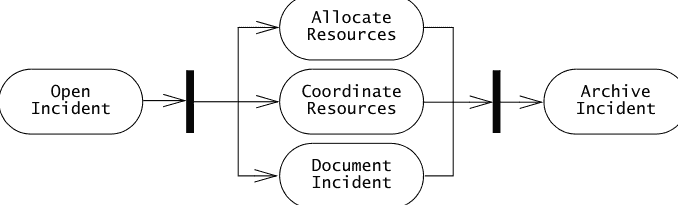

**图 2-43** UML 活动图中分叉（fork）节点和汇节点（join）节点的示例。

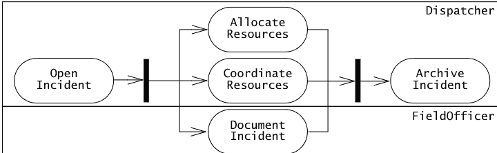

**图 2-44** UML 活动图中泳道（swimlanes）的示例。

## 应用活动图

活动图提供了一组对象行为的以任务为中心的视图。它们可以用于：例如，描述用例之间的顺序约束、一组对象之间的顺序活动，或项目的任务。在本书中，我们使用活动图来描述第 14 章“项目管理”和第 15 章“软件生命周期”中的软件开发活动。

### 2.4.6 图表的组织

随着开发者对模型的不断完善，复杂系统的模型会迅速变得复杂。模型的复杂度可以被定义，例如将元素分组为包（packages）。包是模型元素（如用例或类）的组合，用于定义理解范围。

例如，图 2-45 使用了 FRIEND 系统的用例，并按参与者（actors）进行分组。包显示为在左上角带有标签的矩形。处理事件管理的用例（例如创建、资源分配、文档编制）被分组在 `IncidentManagement` 包中。处理事件归档的用例（例如归档事件、从归档事件生成报告）被分组在 `IncidentArchive` 包中。处理系统管理的用例（例如添加用户、注册站点）被分组在 `SysAdministration` 包中。这使得客户和开发者能够将用例组织成相关的组，并且一次只关注有限的一组用例。

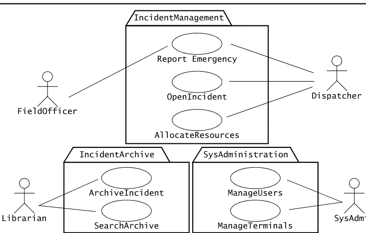

图 2-45 包的示例：按参与者组织的 FRIEND 系统用例（UML 用例图）。

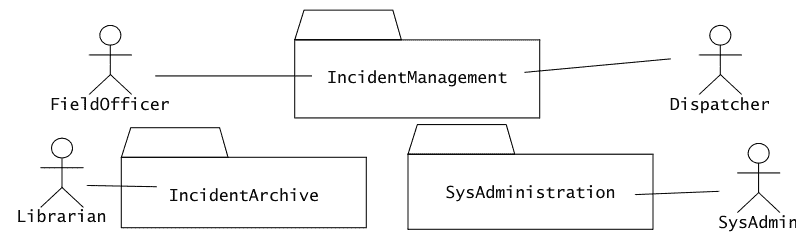

**图 2-46** 包的示例。此图显示与图 2-45 相同的包，但隐藏了每个包的细节（UML 用例图）。

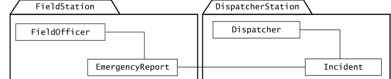

**图 2-47** 包的示例。`FieldOfficer` 和 `EmergencyReport` 类位于 `DispatcherStation` 包中，而 `Dispatcher` 和 `Incident` 类也位于 `DispatcherStation` 包中。

图 2-46 和 2-47 是使用包的类图示例。来自 `ReportEmergency` 用例的类根据创建对象的站点进行组织。`FieldOfficer` 和 `Incident` 是 `FieldStation` 包的一部分，而 `Dispatcher` 和 `Incident` 是 `DispatcherStation` 的一部分。图 2-47 显示了包及其包含的模型元素，图 2-46 显示了不包含每个包内容的信息。图 2-46 是系统的更层级视图，可用于讨论系统级问题，而图 2-47 是更详细的视图，可用于讨论特定的包。

包处理复杂性的方式与用户组织文件和子目录的方式相同。然而，包并不一定是层次化的：同一个类可能出现在多个包中。

（注：原文后续部分存在大量重复的 OCR 错误文本，已根据指令要求提取并翻译核心逻辑内容。）

- 2-11 绘制一张表示父子关系的关系的类图。考虑到一个人既可以有父母也有孩子。在关联关系上标注角色和多重性。

### 练习

- 2-12 为书目引用绘制一张类图。请使用附录 C “参考文献”中的引用来测试你的类图。你的类图应该尽可能详细。

- 2-13 为图 2-21 中的 warehouseOnFire（仓库起火）场景绘制一张序列图。包含 bob、alice、john、FRIEND 对象以及你可能需要的其他类的实例。只绘制前五条消息传递。

- 2-14 为图 2-14 中的 ReportIncident（报告事件）用例绘制一张序列图。只绘制前五条消息传递。确保它与与练习 2-13 的序列图一致。

- 2-15 考虑电话订购披萨的过程。绘制一张活动图来表示该过程的每一步，从你拿起电话到你开始制作披萨为止。不要表示异常情况。包含他人需要执行的活动。

- 2-16 为你在练习 2-15 中开发的活动图添加异常处理。考虑至少三个异常情况（例如：送货员写错了地址、送货员送错了披萨、商店安司草鱼供应了）。

- 2-17 考虑我们在第 1 章《软件工程导论》第 1.4 节描述的软件开发活动。绘制一张活动图描述这些活动，假设它们是严格顺序执行的。绘制第二张活动图，描述相同的活动增量地发生（即：系统的某部分在完全分析、设计、实现和测试之前，再开发系统的下一个部分）。绘制第三张活动图，描述相同的活动并发发生。

### 参考文献

- [Booch, 1994] G. Booch, *Object-Oriented Analysis and Design with Applications*, 2nd ed., Benjamin/Cummings, Redwood City, CA, 1994.

- [Booch et al., 2005] G. Booch, J. Rumbaugh, & I. Jacobson, *The Unified Modeling Language User Guide*, Addison-Wesley, Reading, MA, 2005.

- [Coad et al., 1995] P. Coad, D. North, & M. Mayfield, *Object Models: Strategies, Patterns, & Applications*, Prentice Hall, Englewood Cliffs, NJ, 1995.

- [Constantine & Lockwood, 2001] L.L. Constantine & L.A.D. Lockwood, “Structure and use in cases for user interface design,” in M. van Harmelen (ed.), *Object-Oriented User Interface Design*, 2001.

- [Douglass, 1999] B.P. Douglass, *Doing Time: Using Object-Oriented Programming and Software Patterns in Real Time*, Addison-Wesley, Reading, MA, 1999.

- [Fowler, 2003] M. Fowler, *UML Distilled: A Brief Guide to The Standard Object Modeling Language*, 3rd ed., Addison-Wesley, Reading, MA, 2003.

- [Harel, 1987] D. Harel, “Statecharts: A visual formalism for complex systems,” *Science of Computer Programming*, pp. 231–274, 1987.

- [Jacobson et al., 1992] I. Jacobson, M. Christopher, P. Jonsson, & G. Overgaard, *Object-Oriented Software Engineering—A Use Case Driven Approach*, Addison-Wesley, Reading, MA, 1992.

- [Martin & Odell, 1992] J. Martin & J. J. Odell, *Object-Oriented Analysis and Design*, Prentice Hall, Englewood Cliffs, NJ, 1992.

- [Mellor & Shlaer, 1998] S. Mellor & S. Shlaer, *Recursive Design*, Prentice Hall, Upper River, NJ, 1998.

- [Miller, 1956] G.A. Miller, “The magical number seven, plus minus two: Limits on processing information,” *Psychological Review*, 63, pp. 81–97, 1956.

- [OMG, 2009] Object Management Group, *Unified Modeling Language Superstructure Version 2.2*, http://www.omg.org.

- [Rumbaugh et al., 1991] J. Rumbaugh, M. Blaha, & W. Lorenz, *Object-Oriented Modeling and Design*, Prentice Hall, International, UK, 1991.

- [Wirfs-Brock et al., 1990] R. Wirfs-Brock, B. Wilkerson, & L. Wiener, *Designing Object-Oriented Software*, Prentice Hall, Englewood Cliffs, NJ, 1990.

- [Yourdon & Constantine, 1975] E. Yourdon & L. Constantine, *Structured Design*, Prentice Hall, Englewood Cliffs, NJ, 1975.

## 3

- 3.1 引言：一个火箭示例 78

- 3.2 项目概述 79

- 3.3 项目组织概念 83

    - 3.3.1 项目组织 83

    - 3.3.2 角色 86

    - 3.3.3 任务与工作产品 88

    - 3.3.4 计划 90

- 3.4 项目沟通概念 92

    - 3.4.1 计划沟通 92

    - 3.4.2 非计划沟通 99

    - 3.4.3 沟通机制 102

- 3.5 组织活动 109

    - 3.5.1 加入团队 109

    - 3.5.2 加入沟通基础设施 109

    - 3.5.3 参加团队会议 110

    - 3.5.4 组织客户和项目评审 113

- 3.6 扩展阅读 114

- 3.7 练习 115

- 参考文献 117

## 项目组织与沟通


我们在第 1 章《软件工程导论》第 1.4 节描述的软件开发活动。绘制一张活动图描述这些活动，假设它们是严格顺序执行的。绘制第二张活动图，描述相同的活动增量地发生（即：系统的某部分在完全分析、设计、实现和测试之前，再开发系统的下一个部分）。绘制第三张活动图，描述相同的活动并发发生。

## 3.1 引言：一个火箭示例

我们在第 1 章《软件工程导论》第 1.4 节描述的软件开发活动。绘制一张活动图描述这些活动，假设它们是严格顺序执行的。绘制第二张活动图，描述相同的活动增量地发生（即：系统的某部分在完全分析、设计、实现和测试之前，再开发系统的下一个部分）。绘制第三张活动图，描述相同的活动并发发生。

## 讨论

对准软件没有经过充分的测试。尽管它经过了数千次测试，包括实际轨迹测试。导航系统进行了单独测试。测试由系统团队制定，由导航系统的构建人员执行。系统团队并没有意识到对准模块会导致主处理器关闭，特别是在飞行期间。

## 项目概览

在本章中，我们将讨论软件项目内部的组织和通信问题。这个主题并非软件工程所特有。然而，通信贯穿于整个软件开发项目之中。通信失败代价高昂，并可能对项目和交付系统的质量产生高昂、有时甚至是致命的影响。

### 3.2 项目概览

第 2 章《使用 UML 建模》中介绍的技术和符号使项目参与者能够构建系统模型并对其进行通信。然而，系统模型并不是项目通信中所需的唯一信息。例如，开发者需要知道：

- 谁负责系统的哪个部分？
- 系统的哪个部分需要在什么时间之前完成？
- 当发现特定组件的版本出现问题时，应该联系谁？
- 应该如何记录问题？
- 评估系统的质量标准是什么？
- 新需求应该以什么形式传给开发者？
- 任何需求应该通知哪些人？
- 谁应该负责与客户沟通？

尽管当所有参与者在下午共用茶歇时，这些问题可能相对容易回答，但大型软件系统的开发通常无法通过这种临时的方法成功。从开发者的角度来看，一个项目由四个部分组成（图 3-1）：

- **产品（Product）。** 这是项目产生的任何物品，例如代码段、模型或文档。为客户生产的工作产物称为交付物。
- **进度（Schedule）。** 它规定了项目工作何时完成。
- **参与者（Participant）。** 指任何参与项目的人。有时我们将参与者称为项目成员。

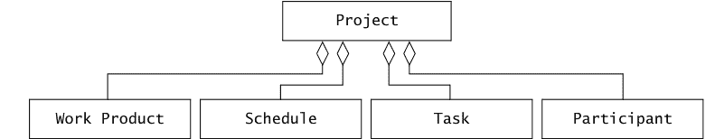

**图 3-1** 项目模型（UML 类图）。

- **任务（Task）。** 这是项目参与者为了创建工作产物而执行的工作。

项目可以正式定义，也可以非正式地定义。你与客户之间的一份签署合同，要求在三个月内交付价值百万美元的软件系统；我对你朋友的一个非正式承诺，即下周前在她电脑上安装新的软件版本，这也定义了一个项目。


# 项目组织与沟通概念

## 项目阶段与生命周期

项目有不同的类型和规模。有时项目的类型取决于交付物的性质。如果结果是一个软件系统，该项目通常被称为软件项目；建造航天飞机器系统则被称为系统项目。项目也有不同的规模。安装一套新的航天飞机系统，成本超过 100 亿美元，耗时 10 到 15 年，是一个大项目；而更换房间的家具就是一个小项目。

从动态的角度来看，一个项目可以处于图 3-2 所示的若干阶段之一。在**定义阶段**，项目经理、潜在客户以及关键项目经理——软件架构师会参与其中。此阶段的两个重点是对软件架构的初步理解（特别是子系统分解），以及对项目本身的理解（特别是进度、需要执行的工作以及所需的资源）。这些记录在三份文档中：问题说明、初始软件架构文档和初始软件项目管理计划。在**项目启动阶段**，项目经理建立项目基础设施，招聘参与者，组织他们组成团队，定义主要里程碑并启动项目。

在定义和项目启动阶段，大多数决策由项目经理做出。在**项目稳定状态阶段**，参与者开发系统。他们向团队负责人汇报，由团队负责人负责跟踪开发者的状态并识别问题。团队负责人向项目经理汇报其团队的状态，然后由项目经理评估整个项目的状态。团队负责人通过重新分配任务给开发者或从项目经理处获取额外资源来应对计划偏差。

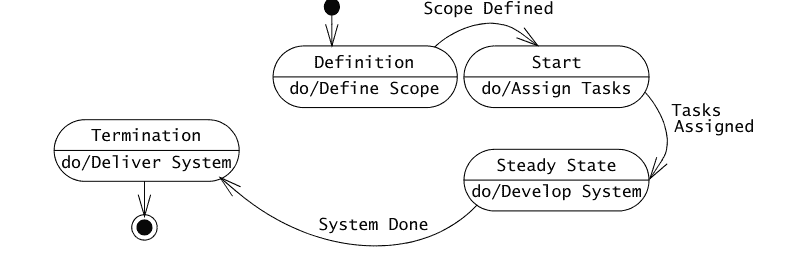

**图 3-2** 软件项目状态（UML 状态机图）。

项目经理负责与客户的交互，获取正式协议并重新协商资源和期限。

在项目结束阶段，项目结果将交付给客户，并收集项目历史。大多数开发者对项目的参与在此阶段之前结束。少数关键开发者、技术写作者和团队负责人负责封装系统以便安装和验收，并收集项目历史以供未来使用。

项目内部的通信通过计划内和计划外的事件发生。计划内通信包括：

- 问题检查：期间，开发者从问题说明、客户和用户处收集关于其需求和应用领域的信息
- 状态会议：期间团队审查其进度
- 同行评审：期间团队成员在初步工作产物中识别缺陷并寻找解决方案
- 客户和项目评审：期间客户或项目成员评审工作产物的质量，特别是交付物
- 发布：期间项目参与者向客户和最终用户提供系统版本及其文档

计划外通信包括：

- 澄清请求：期间参与者向他人请求关于系统、应用领域或项目的特定信息
- 变更请求：期间参与者描述在系统中遇到的问题或系统应支持的新功能
- 问题解决：期间识别不同利益相关者之间的冲突，探索并协商解决方案，并达成决议

计划内通信有助于传播信息。计划外通信有助于处理意外信息。

当开发者在启动阶段加入项目时，已经存在一份问题说明了；项目管理已经建立好了项目组织，定义了通信事件，并为计划内和计划外通信提供了基础设施。这有助于他们对问题有一个高层次的理解。这通过以下活动来实现：

- 参加启动会议。在此活动中，项目参与者从客户处获知要解决的问题和要开发的系统范围。
- 加入团队。项目经理已将项目分解为各个团队的工作。参与者根据其技能和兴趣分配到团队。
- 参加培训课程。不具备所需任务技能的参与者将接受额外的培训。
- 加入通信基础设施。参与者加入支持计划内和计划外事件的通信基础设施。该基础设施包括一系列机制，如网关、通讯录、电话簿、电子邮件服务和视频会议设备。
- 扩展通信基础设施。专门为项目建立了额外的公告板和团队门户网站。
- 参加第一次团队会议。在此活动中，项目参与者将学习如何进行状态会议、记录状态信息并分发给项目的所有成员。
- 理解评审计划。评审计划包含一组高层次里程碑，以评审的形式向项目经理和客户汇报项目结果。项目评审的目的是告知项目参与者其他团队的状态并识别未解决的问题。客户评审的目的是告知客户项目状态并获取反馈。

在接下来的章节中，我们将详细研究这些概念和活动。在 3.3 节中，我们将描述一种基于团队的项目组织。在 3.4 节中，我们将讨论与项目通信相关的概念。在 3.5 节中，我们将详细介绍典型成员的项目启动活动。在 3.6 节中，我们将提供关于该主题的进一步阅读参考文献。

## 项目组织概念

### 3.3 项目组织概念

在本节中，我们定义了以下概念：

- 项目组织（第 3.3.1 节）、角色（第 3.3.2 节）
- 任务与工作产品（第 3.3.3 节）
- 计划（第 3.3.4 节）

### 3.3.1 项目组织

任何项目组织的重要部分都是定义参与者之间以及他们与任务、计划和工作产品之间的关系。在基于团队的组织（图 3-3）中，参与者被分成团队，团队是指一组从事同一活动或任务的小组参与者。我们将团队与其他人（特别是小组和委员会）区分开来。例如，小组是一组被分配了共同任务的人，但他们独立工作，不需要任何通信即可完成其负责的任务部分。委员会则由聚集在一起审查、批判问题并提出建议的人员组成。

图 3-4 显示了一个简单软件项目的组织实例图，由一个管理团队和三个开发团队组成。


**图 3-3** 基于团队的组织由称为团队的组织单元组成，团队由参与者或其他团队组成（UML 类图）。

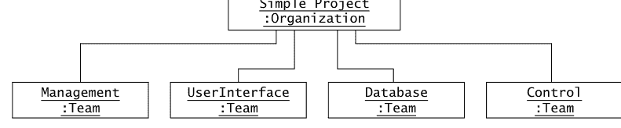

**图 3-4** 简单项目组织示例（UML 实例图）。报告、决策和通信都是通过组织的聚合关联实现的。

项目参与者之间相互交互。项目中的三种主要交互类型是：

- **报告**。这种类型的交互用于报告状态信息。例如，开发人员向另一名开发人员报告 `API`（应用程序接口）已就绪，或者团队负责人向项目经理报告已分配的任务尚未完成。
- **决策**。这种类型的交互用于传递决策。例如，团队负责人决定开发人员发布某个 `API`，项目经理决定计划中的交付可以提前。另一种类型的决策是解决问题。
- **通信**。这种类型的交互用于交换决策或状态所需的所有其他类型的信息。通信可以有许多形式。例如需求或设计模型的交换，或者为了支持提案而创建论点。邀请吃午饭也是一种通信。

如果状态和决策信息都是单向的，我们称该组织为**层级化的**；也就是说，决策始终在组织的根部做出，并通过交互关联传递到组织的叶子节点。在层级组织中，状态在组织的叶子节点生成并通过交互关联报告给根部。状态和决策信息流的结构通常被称为组织的**报告结构**。图 3-5 展示了层级化团队组织中的报告结构。

在军事等层级组织中，报告结构也同时完成了通信需求的交换。然而，在复杂的软件项目中，使用现有的报告结构进行通信会引起许多问题。例如，许多技术决策需要开发人员在本地做出，但依赖于其他团队开发人员的信息。如果这些信息通过已建立的报告结构交换，决策过程可能会显著减慢。更糟糕的是，由于信息的复杂性和大量的，它往往会导致信息的失真。

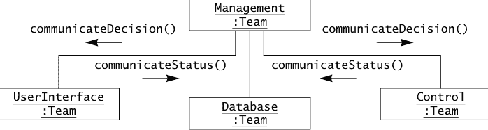

**图 3-5** 层级组织中的报告结构示例（UML 通图）。状态信息报告给项目经理，纠正决策由团队负责人传回给团队。团队负责人和项目经理被称为管理团队。

解决问题的办法是通过额外的通信结构交换信息，这种结构允许参与者之间直接通信，并且形式与报告结构有许多不同。通常，通信被委托给一名开发人员，称为**联络员**，他负责信息的往回传递。

图 3-6 描绘了一个具有联络员和偏离报告结构的额外通信线的组织示例。例如，文档团队有一个到用户界面团队的联络员，以便方便有关系统外观近期更改的信息。团队并不直接在子系统上工作，而是从事跨越子系统组织的任务，这被称为跨职团队。跨职团队的示例还包括文档团队、架构团队和测试团队。

我们称这种通信结构（通常也称为结构本身）为基于联络的。联络员使用非层级的通信线与跨职团队中的联络员交流。在基于联络的通信结构中，团队负责者的责任通过一项新任务得到了扩展：他们不仅要确保项目经理了解团队状态，还要确保团队成员拥有来自其他团队的所有信息。这需要选择有效的沟通者作为联络员以确保必要性。

| UserInterface :Team | | Alice :Developer | communicates | Management :Team |
| :--- | :--- | :--- | :--- | :--- |
| team leader | | | API engineer | John :Developer | communicates | Architecture :Team |
| documentation liaison | Mary :Developer | communicates | Documentation :Team | |
| implementor | Chris :Developer | communicates | Documentation :Team |
| implementor | Sam :Developer | communicates | |

**图 3-6** 基于联络的通信结构示例（UML 对象图）。该团队由五个开发人员组成。Alice 是团队负责人。John 是 `API` 工程师。Mary 是文档

### 3.3.2 角色

角色定义了参与者承担的执行和管理任务集。在基于团队的组织中，我们通过角色分配任务。例如，在软件项目中我们区分以下几种类型的角色：管理角色、开发角色、跨职角色和咨询角色。

**管理角色**（如项目经理、团队负责人）负责项目的组织和执行。我们详细描述这种类型的角色。

**开发角色**负责规范、设计和构建子系统。这些角色包括分析师、系统架构师、对象设计者、实现人员和测试人员。表 3-1 开发角色的示例。

**跨职角色**负责团队之间的协调。担任这些角色的开发者被称为**联络员**。联络员从一个团队向另一个团队传播信息。有四种联络员：

- **API 工程师**负责分配子系统的接口定义。该接口必须反映依赖子系统的需求。当功能与其他子系统权衡导致子系统更改时，API 工程师负责将更改传回给团队。
- **文档编辑**负责整合团队产生的文档。文档编辑可以被视为依赖给定子系统团队的服务提供者。文档编辑还管理内部发布的信息，如会议议程和记录。
- **配置经理**负责管理团队产生的不同版本的文档、模型和代码。对于简单管理策略（例如，单硬件平台、单分支），此角色可能由团队负责人担任。
- **测试人员**负责确保每个子系统都按照设计者的规范运行。通常，开发项目有一个专门的团队仅负责测试。将设计者、实现者和测试人员的角色职责分离可以实现更有效的测试。

顾问角色关注于在项目参与者缺乏专业知识的领域提供临时支持。在大多数项目中，用户和客户是应用领域的顾问。技术顾问可能带来关于新技术或方法的专业知识。非技术顾问可以帮助解决法律和营销方面的问题。我们区分了以下类型的顾问角色。

- 客户（也称为用户）负责场景和需求的制定。这包括了功能性需求和非功能性需求，以及约束条件。预计客户能够与其他开发者进行交互。
- 终端用户是使用交付系统的人。有时项目无法接触到终端用户，或者终端用户仍然未知。在这种情况下，终端用户由客户甚至系统的开发人员代表。
- 应用领域专家负责提供有关系统特定功能领域的领域知识。客户对所需的功能有全局视图，而应用领域专家对特定的问题领域有详细知识。
- 解决方案专家负责提供有关实施系统的解决方案的知识。这包括开发方法、流程、实现技术或开发环境。

#### 表 3-1 角色示例

| 角色 | 职责 |
| :--- | :--- |
| 系统架构师 | 确保设计决策和接口风格的一致性。系统架构师确保配置管理和测试团队设计的一致性，特别是在配置管理以及系统集成策略的制定上。这是一个主要的消耗每个团队信息的角色。 |
| 对象设计者 | 负责分配子系统的接口定义。该接口必须反映依赖子系统的需求。当功能与其他子系统权衡导致子系统更改时，对象设计者负责将更改传回给团队。 |
| 实现人员 | 负责与子系统相关的类或多个类的编码 |
| 测试人员 | 负责根据对象设计者的规范评估每个子系统。通常，开发项目有专门的测试团队。分离实现人员和测试人员的角色会导致更有效的测试。 |

### 3.3.3 任务与工作产物

任务是针对某个角色定义的工作分配。相关的任务组称为活动。项目经理或团队负责人将任务分配给某个角色。被分配角色的参与者执行任务，由经理监控其进度和完成情况。工作产物是任务产生的实体项目。工作产物的示例包括对象模型、类图、一段源代码、一份文档或文档的部分内容。工作产物产生于任务，受截止日期限制，并为其他任务提供输入。例如，数据库子系统的测试计划活动会产生一个包含多个测试套件及其预期结果的工作产物。该测试套件被输入到给定子系统的测试活动中（图 3-8 和表 3-2）。

## 项目组织概念

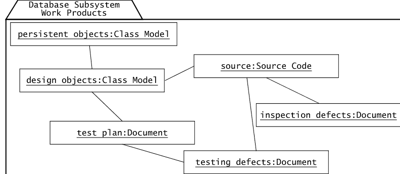

**图 3-8** 数据库子系统团队的工作产物（UML 对象图）。关联表示工作产物之间的依赖关系。

**表 3-2** 图 3-8 所示内部工作产物的描述

| 工作产物 | 类型 | 描述 |
|---|---|---|
| 持久化对象 | 类模型 | 该类模型完整描述了存储子系统存储的对象。对于每个类，这包含了所有属性、关联、角色和基数。 |
| 设计对象 | 类模型 | 该类模型描述了存储子系统需要但在持久化对象类中未描述的所有对象。 |
| 子系统 | 源代码 | 这是交付给测试团队的源代码。 |
| 测试计划 | 文档 | 该文档概述了用于发现存储子系统缺陷的测试策略、测试标准测试用例。 |
| 测试缺陷 | 文档 | 该文档列出了已通过测试在存储子系统中发现的所有缺陷。 |
| 检查缺陷 | 文档 | 该文档列出了已通过同行评审在存储子系统中发现的所有缺陷，以及计划的修复方案。 |

任何交付给客户的工作产物都称为交付物。软件系统和配套文档通常构成了一组交付物。客户不可见的工作产物称为内部工作产物。

完成一项任务或活动需要完成的工作规范描述在工作包中。工作包包括名称、任务描述、执行任务所需的资源、对输入（其他任务产生的工作）和输出（该任务产生的工作）的依赖，以及对其他任务的依赖。图 3-9 描绘了工作包、活动、任务、角色和工作产物之间的关系。表 3-3 提供了工作包的示例。

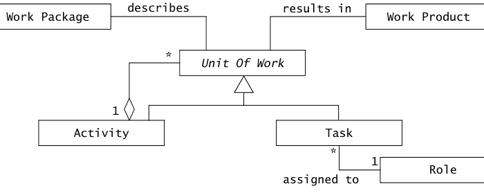

**图 3-9** 任务、活动、角色、工作产物和工作包之间的关联（UML 类图）。

工作产物是重要的管理制品，因为我们可以根据其他工作产物来评估它们的交付以及相关任务的开始。例如，子系统测试套件的延迟交付会延迟其测试的开始。然而，仅关注准时交付是不够的：急于交付测试套件虽然满足项目进度，但可能意味着关键故障未能被及时发现。

#### 表 3-3 实现所需任务的示例

| 任务名称 | 分配的角色 | 任务描述 | 输入 | 输出 |
|---|---|---|---|---|
| 数据库子系统需求分析 | 系统架构师 | 从子系统获取关于它们的需求，包括持久化对象、属性和关系 | | 持久化对象模型 |
| 数据库子系统设计 | 对象设计者 | 设计数据库子系统，包括可能的选择 | 子系统 API | UML 类图 |
| 数据库子系统实现 | 实现者 | 实现数据库子系统 | 子系统设计 | 源代码 |
| 数据库子系统检查 | 实现者、测试人员、对象设计者 | 对数据库子系统进行代码检查 | 子系统源代码 | 缺陷列表 |
| 数据库子系统测试计划 | 测试人员 | 为数据库子系统开发测试套件 | 子系统 API | 测试计划 |
| 数据库子系统测试 | 测试人员 | 执行数据库子系统的测试套件 | 测试计划 | 测试结果、缺陷列表 |

### 3.3.4 进度

进度是任务在时间上的映射：每个任务都分配了开始和结束时间。这允许我们规划单个交付物的截止日期。进度最常用的两种图表表示法是 `PERT` 图和甘特图。**甘特图**是一种将软件项目进度呈现在时间轴上的紧凑方式。甘特图是一种条形图，横轴代表时间，纵轴列出要完成的不同任务。任务用条形表示，其长度对应于任务的计划时长。图 3-10 显示了数据库子系统的甘特图。

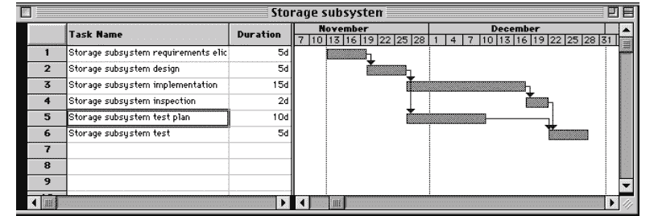

**图 3-10** 数据库子系统的进度示例（甘特图）。

`PERT` 图将进度表示为任务的无环图。图 3-11 是数据库子系统的 `PERT` 图。任务的计划开始时间和持续用于计算关键路径，在有足够资源完成独立任务的情况下通过图的最短路径。此外，关键路径上的任务最，因为其中任何任务的延迟都会导致整个项目的延迟。用粗线表示的任务和条形表示关键路径。

| 存储子系统系统分析 | | 存储子系统对象设计 | | 存储系统测试计划 | |
|---|---|---|---|---|---|
| 1 | 5d | | 2 | 5d | 5 | 10d |
| Nov 13 | Nov 19 | | Nov 20 | Nov 26 | | Nov 27 | Dec 10 |

**图 3-11** 数据库子系统的进度（PERT 图）。

## 项目沟通概念

### 3.4 项目沟通概念

到目前为止讨论了项目的组织。现在我们转向项目的沟通。我们涵盖了通常发生的两种沟通类型：计划沟通（3.4.1 节）和非计划沟通（3.4.2 节）。然后我们调查了支持项目沟通的工具（3.4.3 节）。图 3-12 显示了项目组织与沟通之间的相互作用。

### 3.4.1 计划沟通

计划沟通事件是预定的时间点，参与者在期间针对特定主题交换信息或评审工作产物。这些事件是形式化和结构化的，旨在最大化沟通信息量并最小化参与者花费在沟通上的时间。典型的计划沟通事件包括：

- 问题演示
- 客户评审
- 项目评审
- 同行评审
- 状态评审
- 头脑风暴
- 发布
- 总结性评审

## 项目沟通概念

| 组织 | 分配给 | 团队 |
| --- | --- | --- |
| 负责 | 参与者 | |
| 角色 | 产生 | 工作产物 |


| 任务 | 映射到 | 计划 |
| --- | --- | --- |
| 沟通 | 出现于 | 未计划 |
| 计划沟通事件 | 澄清请求 | |
| 问题定义 | 变更请求 | |
| 评审 | 事项解决 | |
| 发布 | | |

**图 3-12** 组织概念与沟通概念之间的关系（UML 类图）。

我们将在下文中详细描述这些沟通事件。

## 问题呈现

**问题呈现**的重点是展示“问题陈述”（Problem Statement），该陈述描述了问题本身、应用领域以及系统期望的功能。它还包含了非功能性需求，例如平台规范或速度限制。图 3-13 展示了实际问题陈述的片段。

问题陈述并不包含完整的系统规范。它仅仅是一项初步的需求分析活动，旨在为客户与项目团队之间建立共识。我们将在第 4 章*需求摄取*和第 5 章*分析*中讨论需求相关活动。

# OWL 问题陈述

## 1. 问题领域

建筑行业的一个当前趋势是为单个住户提供分布式服务和控制，这一策略旨在纠正过去 30 年间建造的办公楼所典型的过度依赖大型集中系统的特点。在智能办公环境中，工作人员将对自己的环境条件有更多的控制权——调整工作空间的光线和温度、减少眩光、控制输送到工作空间的气流速度和方向。你可以在汽车里这样做——为什么不在办公室里呢？节能立面将允许通过开启窗进行自由通风，并结合移动式遮光设备，以最大限度地减少眩光并使工作空间的自然光最大化。

在智能办公环境中，最好采用三种形式的控制：响应式、计划性和用户驱动。响应式控制是指系统根据传感器读取的变化通过驱动某些组件来做出反应。在存在可预测数据的情况下，可以采用计划控制，允许组件执行操作。例如，太阳的位置是可以预测的，因此可以为智能办公的室内窗帘制定计划。控制系统应该足够灵活，以响应住户的需求。如果他们想改变局部环境的温度，应该给予他们这种机会。

在这个项目中，你被要求构建一个名为 `OWL`（面向对象的工作场所实验室）的系统，试图改进我们处理建筑的方式。

[...]

## 2. 场景

### 2.1 建筑控制

建筑住户使用 Web 浏览器访问其个人环境模块（`PEM`）。他调整温度和风速以冷却工作空间。控制信息被发送到 `PEM` 设备。控制动作记录在数据库中，设备调整工作空间的加热器和通风设备。系统检查相邻的 `PEM`，以检查冷却特定工作空间是否需要增加其他工作空间的加热。

[...]

### 2.5 建筑维护

系统监控受控设备的行为以检测系统故障。出现故障的灯泡和异常的参数读数将报告给设施经理，由其计划检查和维修工作。设备故障的发生情况会被记录并进行趋势分析，使设施经理能够预测未来的故障。

[...]

**图 3-13** `OWL` 问题陈述的片段 [OWL, 1996]。

## 项目沟通概念

## 客户评审

客户评审的目标是为客户提供一个议程，以评估开发进度，并让开发者确认或更改系统需求。客户评审用于管理双方的预期，并增加参与者之间的共同理解。评审的重点在于系统做了什么以及哪些约束与客户相关（例如性能、平台）。在大多数情况下，评审不应关注系统的设计或实现，除非它们会影响到客户或用户。例外情况包括对开发过程施加约束的合同，例如与安全或监管要求相关的合同。

当开发者关注特定功能时，客户评审以正式演示的形式进行。客户评审之前是发布一份交付物，如需求说明书、原型或演示稿。评审的成果是开发者的反馈。图 3-14 展示了客户评审的议程。

## 项目评审

项目评审的目标是让客户评估开发进度，并让开发者确认或更改系统需求。项目评审通过状态评审鼓励团队之间交换知识。评审的重点在于被评审的对象。对于系统设计，评审其接口。对于对象设计，评审其接口。对于集成和测试，评审测试结果。项目评审通常以正式演示的形式进行，团队提交。

## OWL 客户验收议程

日期：12/5

时间：3:30

地点：会议厅

目标：评审系统

- 问题陈述
- 设计目标
- 系统架构
- 演示 1：用户界面
- 演示 2：站点
- 演示 3：可视化
- 问答
- 评审总结

**图 3-14** 客户评审的议程示例。

## 第 3 章 项目组织与沟通

通常评审之前是发布一份文档（例如设计说明书），描述被评审的方面。在评审结束时，开发者可能会协商接口更改。

## 同行评审

代码评审和走读的目标是通过同行评审（而非管理或客户评审）来提高质量。在走读（`walkthrough`）中，开发者向其团队成员逐行演示其编写的代码。其他成员挑战可疑代码并尝试发现尽可能多的错误。开发者的角色是引导演示并回答问题。在评审中，团队成员关注代码对预定义标准的遵循情况（例如，代码是否实现了指定的算法？代码是否正确使用了依赖接口？）。在评审中，团队引导讨论，开发者回答问题。评审或走读的重点是代码，而不是程序员或设计师。参与者之间的沟通基于代码的。实际代码作为共同参考框架。评审与项目评审相似，旨在提高质量并传播信息。它们在正式程度、受众范围和持续时间上有所不同。评审和走读被广泛使用，并有效地检测缺陷 [Fagan, 1976]。我们将在第 11 章测试中详细介绍走读。

## 状态评审

与关注系统的客户项目评审不同，状态评审关注任务。状态评审主要在团队内部进行（例如每周），偶尔在项目中进行（例如每月）。状态评审的目标是检测任务计划的偏差并进行纠正。状态评审还鼓励开发者完成待办任务。任务状态评审鼓励对开放问题和意外问题的讨论，从而促进团队成员之间的非正式沟通。状态评审代表了对人力的投入。提高评审效率对团队性能有全局影响。状态会议应该有一个议程，并在会议前提供，描述要评审的任务和问题。这使得与会者能够为会议做好准备，并在出现紧急问题时重新考虑议程。

## 项目沟通概念

状态. 会议纪要会在讨论相关任务或需要澄清时作为后续的参考依据。此外，会议纪要代表了项目历史的一部分，可以在项目完成后对其进行分析。

## 头脑风暴

头脑风暴的目标是针对问题产生大量的解决方案，而不考虑其优劣，然后对它们进行评估。头脑风暴通常是面对面的会议，也可以通过电子邮件或群组软件进行。头脑风暴背后的基本思想是：任何参与者提出的想法，无论多么不合理，都能引发其他参与者的其他想法和提议。在处理特别困难的问题时，解决方案往往来自一个最初听起来错误的想法。头脑风暴鼓励“跳出框架思考”。当生成了许多想法后，头脑风暴还有两个有益的副作用：在小组内评估提议将导致更明确的评估标准，而头脑风暴过程本身具有为所选方案建立共识的效果。

## 发布

发布的目标是让工作产品对其他项目参与者可用，通常是替换旧版本的构构物。发布可以简单到只有两行的电子消息（见图 3-15），也可以包含几项信息：构构物的新版本、自上次发布以来所做的更改列表、待解决的问题或事项列表，以及作者。

发布通过对许多更改进行批处理、文档化和审查，以受控的方式提供大量信息。在进行项目评审和客户评审之前，通常会先发布一或多个交付物。

```
From: A1
Newsgroups: cs413.f96.architecture.discuss
Subject: Sdd
Date: Thu, 25 Nov 03:39:12-0500
Lines: 8
Message-ID: <c329b30.3507@andrew.cmu.edu>
Mime-Version: 1.0
Content-Type: text/plain; charset=us-ascii
Content-Transfer-Encoding: 7bit
```

通知子系统（`Notification Subsystem`）API 文档的更新版本可以在此处找到：`http://decaf/~al1/FRIEND/notifapi.html`

--A1

通知组小组

**图 3-15** 发布公告的示例。

我们将在第 13 章“配置管理”中描述文档、模型和子系统的版本管理。

## 事后评审

事后评审（`Postmortem review`）重点在于软件交付后从开发团队中提取教训。事后评审需要在项目结束后不久进行，以确保信息不会被后续的经验丢失或扭曲。项目结束通常是评估哪些技术、方法和工具是有效的、且对系统的成功（或失败）至关重要的时机。

事后评审可以以头脑风暴会议、结构化问卷加访谈，或团队（或参与者）编写的个人报告的形式进行。在所有情况下，涵盖的领域应包括项目使用的工具、方法、组织和流程。图 3-16 是事后评审期间可以使用的问题示例。

即使事后评审的结果没有通过公司的正式渠道（例如技术报告）发布，它们也可以间接地传播给项目参与者。项目参与者经常被重新分配到不同的项目或职能，并将从旧项目中中学到的教训传播到公司的其他部分。因此，事后评审是巩固近期完成（或已取消）项目教训的理想选择。

| 关于所发生问题的问题 | 系统开发过程中出现了哪些类型的沟通和谈判问题？ |
| --- | --- |
| 引导引出这些问题可能解决方案的问题 | 推测在与基于模型的面向对象软件工程方法相结合的团队设计中，需要什么样的信息结构。<br>你认为提供的论坛（`Discuss`, `Issues`, `Documents`, `Announce` 等）解决这一挑战了吗？请识别信息结构中的问题并提出解决方案。 |
| 引导引出我们被视为正面或可以改进的项目其他方面的问题 | 你对项目以下方面有哪些观察和意见：<br>- 你在项目开始初的预期以及这些预期是如何演变的<br>- 本项目的目标<br>- 项目中的生命周期<br>- 项目管理（会议、沟通等）<br>- 文档化过程 |
| 开放式全能性问题 | 除上述问题外，请随时讨论你认为相关的任何其他问题和提议的解决方案。 |

**图 3-16** 事后评审评审问题的示例。

## 项目沟通概念

### 3.4.2 非计划沟通

在理想的项目中，所有沟通都发生在计划好的沟通事件期间。然而，在实践中，很难预测所有的信息需求并规划所有的沟通。考虑以下示例：

> 1998 年 3 月 29 日，星期日。`JAMES` 项目的参与者们正疯狂地准备向客户交付系统。客户验收测试计划在两天后的 15:00 CED（中欧中部夏令时间）进行。夏令刚刚生效，减少了一个小时开发时间。客户验收测试将以高带宽三方视频会议的形式，在位于斯图加特的客户、位于慕尼黑的德国开发者以及位于匹兹斯堡的美国开发者之间进行。美国团队将在 EDT 上午 9 点（东部夏令时间）开始参加会议。议程已达成。每个团队被分配了 12 分钟来介绍其子系统的功能。

那天晚些时候，慕尼黑和匹兹斯堡的时差为 6 小时。然而，美国团队意识到时间表声称是 15:00，而模板说我们一直到 21:00。客户验收测试将以高带宽三方视频会议的形式，在位于斯图加特的客户、位于慕尼黑的德国开发者以及位于匹兹堡的美国开发者之间进行。美国团队将在 EDT 上午 9 点（东部夏令时间）开始参加会议。议程已达成。每个团队被分配了 12 分钟来介绍其子系统的功能。

在上述示例中，美国团队意识到时间表声称是 15:00，而模板说我们一直到 21:00。客户验收测试将以高带宽三方视频会议的形式，在位于斯图加特的客户、位于慕尼黑的德国开发者以及位于匹兹堡的美国开发者之间进行。美国团队将在 EDT 上午 9 点（东部夏令时间）开始参加会议。议程已达成。每个团队被分配了 12 分钟来介绍其子系统的功能。

在上述示例中，美国团队意识到时间表声称是 15:00，而模板说我们一直到 21:00。客户验收测试将以高带宽三方视频会议的形式，在位于斯图加特的客户、位于慕尼黑的德国开发者以及位于匹兹堡的美国开发者之间进行。美国团队将在 EDT 上午 9 点（东部夏令时间）开始参加会议。议程已达成。每个团队被分配了 12 分钟来介绍其子系统的功能。

在上述示例中，美国团队意识到时间表声称是 15:00，而模板说我们一直到 21:00。客户验收测试将以高带宽三方视频会议的形式，在位于斯图加特的客户、位于慕尼黑的德国开发者以及位于匹兹堡的美国开发者之间进行。美国团队将在 EDT 上午 9 点（东部夏令时间）开始参加会议。议程已达成。每个团队被分配了 12 分钟来介绍其子系统的功能。

在上述示例中，美国团队意识到时间表声称是 15:00，而模板说我们一直到 21:00。客户验收测试将以高带宽三方视频会议的形式，在位于斯图加特的客户、位于慕尼黑的德国开发者以及位于匹兹堡的美国开发者之间进行。美国团队将在 EDT 上午 9 点（东部夏令时间）开始参加会议。议程已达成。每个团队被分配了 12 分钟来介绍其子系统的功能。

在上述示例中，美国团队意识到时间表声称是 15:00，而模板说我们一直到 21:00。客户验收测试将以高带宽三方视频会议的形式，在位于斯图加特的客户、位于慕尼黑的德国开发者以及位于匹兹堡的美国开发者之间进行。美国团队将在 EDT 上午 9 点（东部夏令时间）开始参加会议。议程已达成。每个团队被分配了 12 分钟来介绍其子系统的功能。

在上述示例中，美国团队意识到时间表声称是 15:00，而模板说我们一直到 21:00。客户验收测试将以高带宽三方视频会议的形式，在位于斯图加特的客户、位于慕尼黑的德国开发者以及位于匹兹堡的美国开发者之间进行。美国团队将在 EDT 上午 9 点（东部夏令时间）开始参加会议。议程已达成。每个团队被分配了 12 分钟来介绍其子系统的功能。

在上述示例中，美国团队意识到时间表声称是 15:00，而模板说我们一直到 21:00。客户验收测试将以高带宽三方视频会议的形式，在位于斯图加特的客户、位于慕尼黑的德国开发者以及位于匹兹堡的美国开发者之间进行。美国团队将在 EDT 上午 9 点（东部夏令时间）开始参加会议。议程已达成。每个团队被分配了 12 分钟来介绍其子系统的功能。

在上述示例中，美国团队意识到时间表声称是 15:00，而模板说我们一直到 21:00。客户验收测试将以高带宽三方视频会议的形式，在位于斯图加特的客户、位于慕尼黑的德国开发者以及位于匹兹堡的美国开发者之间进行。美国团队将在 EDT 上午 9 点（东部夏令时间）开始参加会议。议程已达成。每个团队被分配了 12 分钟来介绍其子系统的功能。

在上述示例中，美国团队意识到时间表声称是 15:00，而模板说我们一直到 21:00。客户验收测试将以高带宽三方视频会议的形式，在位于斯图加特的客户、位于慕尼黑的德国开发者以及位于匹兹堡的美国开发者之间进行。美国团队将在 EDT 上午 9 点（东部夏令时间）开始参加会议。议程已达成。每个团队被分配了 12 分钟来介绍其子系统的功能。

在上述示例中，美国团队意识到时间表声称是 15:00，而模板说我们一直到 21:00。客户验收测试将以高带宽三方视频会议的形式，在位于斯图加特的客户、位于慕尼黑的德国开发者以及位于匹兹堡的美国开发者之间进行。美国团队将在 EDT 上午 9 点（东部夏令时间）开始参加会议。议程已达成。每个团队被分配了 12 分钟来介绍其子系统的功能。

在上述示例中，美国团队意识到时间表声称是 15:00，而模板说我们一直到 21:00。客户验收测试将以高带宽三方视频会议的形式，在位于斯图加特的客户、位于慕尼黑的德国开发者以及位于匹兹堡的美国开发者之间进行。美国团队将在 EDT 上午 9 点（东部夏令时间）开始参加会议。议程已达成。每个团队被分配了 12 分钟来介绍其子系统的功能。

在上述示例中，美国团队意识到时间表声称是 15:00，而模板说我们一直到 21:00。客户验收测试将以高带宽三方视频会议的形式，在位于斯图加特的客户、位于慕尼黑的德国开发者以及位于匹兹堡的美国开发者之间进行。美国团队将在 EDT 上午 9 点（东部夏令时间）开始参加会议。议程已达成。每个团队被分配了 12 分钟来介绍其子系统的功能。

在上述示例中，美国团队意识到时间表声称是 15:00，而模板说我们一直到 21:00。客户验收测试将以高带宽三方视频会议的形式，在位于斯图加特的客户、位于慕尼黑的德国开发者以及位于匹兹堡的美国开发者之间进行。美国团队将在 EDT 上午 9 点（东部夏令时间）开始参加会议。议程已达成。每个团队被分配了 12 分钟来介绍其子系统的功能。

我们详细描述了非计划沟通事件。它们包括：

- 请求澄清
- 请求更改
- 问题解决

## 请求澄清

请求澄清代表了开发者和用户之间的大部分沟通。参与者可能会对系统的任何模糊方面请求澄清。请求澄清可能发生在非正式会议、电话、电子邮件或任何沟通机制中。大多数信息需要通过请求澄清处理的情况是沟通基础设施缺陷的症状。此类项目经常因误解导致严重失败。

## 请求澄清

你什么时候需要系统设计文档？对于截止日期存在一些混乱：时间表声称是 10 月 22 日，而模板说我们一直到 11 月 7 日。

```
From: Alice
Newsgroups: cs413.architecture.discuss
Subject: SDD
Date: Thu, 10 Oct 23:12:48 -0400
Message-ID: <325DB80.4380@andrew.cmu.edu>
Mime-Version: 1.0
Content-Type: text/plain; charset=us-ascii
```

感谢，

Alice

**图 3-17** 请求澄清的示例。

## 请求更改


# 第 3 章 项目组织与沟通

## 问题解决

一旦问题被报告且解决方案被提出和评估，扁平化组织可以通过头脑风暴过程选择一个解决方案。层级组织或危机情况可能需要个人来选择并实施解决方案。在所有情况下，决策都需要记录并沟通给相关的参与者。决策的记录允许参与者在项目后期回顾决策，以防发生误解。决策的有效沟通使参与者保持同步。

## 项目通信概念

### 用于识别变更的头部信息

| 字段 | 内容 |
| :--- | :--- |
| 报告编号 | 1291 |
| 日期 | 5/3 |
| 作者 | Dave |
| 摘要 | 当提交空帧时，`FRIEND` 客户端会崩溃。 |

### 用于定位问题的上下文信息

| 字段 | 内容 |
| :--- | :--- |
| 子系统 | 用户界面 |
| 版本号 | 3.4.1 |

**分类：**

- 功能缺失/不正确
- 违反惯例
- 缺陷
- 文档错误

**严重：**

- 严重
- 中等
- 烦扰

### 问题描述及变更理由

**所需变更的描述**

**描述：**

**理由：**

**建议的解决方案：**

**图 3-18** 变更请求表示例。

问题（`Issue`）可以作为一种通信机制，支持问题跟踪和**问题解决**。图 3-19 所示的问题库显示了由于解决问题而交换的消息列表。以 `I:` 开头的消息标题表示问题：

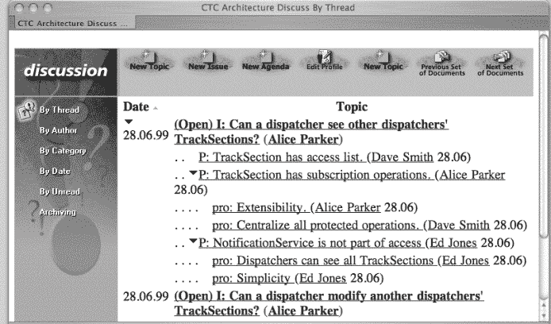

**图 3-19** 问题库示例（Domino Lotus Notes 数据库）。

以 `P:`（代表建议）开头的那些是建议的解决方案；`A+` 和 `A-` 表示对解决方案的支持和反对意见。最后，一旦问题解决，就会发布一条名为“解决方案”的单消息，以记录对该问题做出的决定。我们将在第 12 章“理由管理”中描述问题库和问题建模。

### 3.4.3 通信机制

通信机制是指用于收发信息和支持通信事件的工具或程序。烟信号和传真机都是通信机制。如果通信机制要求发送者和接收者同时在线，称为同步机制；否则称为异步机制。烟信号是同步的，而传真机是异步的。

同步和异步通信机制均可支持计划内的通信。例如，在图 3-20 中，可以使用烟信号或传真机进行客户评审。另一方面，只有异步通信机制可以支持非计划的通信：使用烟信号报告问题如果没有专人看烟，可能会导致信息丢失。注意，单项通信活动可以多种通信机制支持：可以将需求文档传真给客户，而客户使用烟信号发回意见。同样，同一机制可以支持许多通信事件：传真机可以接收来自客户评审的问题报告，也可以接收评审意见。

| 通信活动 | 类型 | 支持机制 | 机制类型 |
| :--- | :--- | :--- | :--- |
| 客户评审 | 计划内通信 | 烟信号 | 同步机制 |
| 问题报告 | 非计划通信 | 传真 | 异步机制 |

**图 3-20** 机制示例（UML 类图）。计划内和非计划通信均可由异步机制支持。然而，非计划通信只能由异步机制支持。

### 表 3-4 同步通信机制示例

| 机制 | 支持的通信事件 |
| :--- | :--- |
| 走廊谈话 | 请求澄清<br>请求变更 |
| 问卷和结构化访谈 | 问题定义<br>事后回顾 |
| 会议（面对面、电话、视频） | 问题定义<br>客户评审<br>项目评审<br>同行评审<br>状态评审<br>事后回顾<br>脑风暴<br>问题解决 |
| 同步协作软件 | 客户评审<br>项目评审<br>同行评审<br>脑风暴<br>问题解决 |

### 表 3-5 异步通信机制示例

| 机制 | 支持的通信事件 |
| :--- | :--- |
| 电子邮件 | 变更请求<br>脑风暴 |
| 新闻组 | 变更请求<br>脑风暴 |
| 世界万维网 (WWW) | 发布<br>异步同行评审<br>变更请求<br>脑风暴 |
| Lotus Notes | 发布<br>异步同行评审<br>变更请求<br>脑风暴 |

### 走廊谈话

**走廊谈话**是基于机会的非计划、非正式的信息交换。两个参与者偶然相遇并利用机会交换信息。我们之前描述的夏令时就是在一次这样的走廊谈话中发现的。以下是另一个例子：

两个项目参与者 Sally 和 Bob 在咖啡机旁相遇。来自用户界面团队的 Sally 记得 Bob 属于通知团队，负责客户端子系统与服务器之间的通信。每天 Sally 在从服务器接收数据包时都会遇到随机故障。

## 会议组织

### 图 3-21 会议程示例（良好）

| 标识会议和受众 | 时间和地点 | 角色 |
| :--- | :--- | :--- |
| 会议和受众 | 日期: 1/30 | 主持：Peter |
| | 开始: 下午4:30 | 计时员：Dave |
| | 结束: 下午5:30 | 记录员：Ed |
| | 会议室: WH, 3420 | |

**会议的预期结果**

解决任何阻碍我们开始原型设计的需求问题。

**需要报告的待办事项**

2. 状态 [分配时间: 15 分钟]
    - Dave: 命令解析代码的现状

**计划在会议期间讨论（并解决）的问题**

3. 讨论议题 [分配时间: 35 分钟]
    - 3.1 如何处理任意格式的数据集？
    - 3.2 如何处理输出数据？
    - 3.3 命令解析代码（可修改性、后兼容性）

**所有会议的总结时间相同**

4. 总结 [分配时间: 5 分钟]
    - 4.1 审查并分配新的待办事项
    - 4.2 会议评审

### 图 3-22 会议程示例（不良：开放式会议耗了不必要的时间）

| 标识会议和受众 | 时间和地点 | 角色 |
| :--- | :--- | :--- |
| | 日期: 1/30 | 主持：Peter |
| | 开始: 下午4:30 | 计时员：Dave |
| | 结束: | 记录员：Ed |
| | 会议室: WH, 3420 | |

**该目标难以实现且无法验证。**

1. 目标
    - 解决未决的问题
    - 缺乏背景：Dave 的待办事项是什么？

2. 状态 [分配时间: 15 分钟]
    - Dave: Dave 的待办事项
    - 缺乏内容：这些活动中当前存在的问题是什么？

3. 讨论议题 [分配时间: 35 分钟]
    - 3.1 需求问题
    - 3.2 设计问题
    - 3.3 实现问题

4. 总结 [分配时间: 5 分钟]
    - 4.1 审查并分配新的待办事项
    - 4.2 会议评审

## 项目概念

### 组织活动

我们现在检查开发者在加入项目及其沟通基础设施时的活动。这些活动包括：

- 加入团队 (3.5.1)
- 加入沟通基础设施 (3.5.2)
- 参加团队会议 (3.5.3)
- 组织客户和项目评审 (3.5.4)

我们针对一个系统开发的示例来描述这些活动。

### 3.5.1 加入团队

在项目定义阶段，项目经理根据软件架构的初始分解确定了每个子系统的子团队。此外，还组成了跨部门团队（如架构团队、集成团队）来支持子系统。每个团队都有一个在项目定义阶段选出的负责人。项目启动阶段的一项重要活动是人员分配。

根据团队成员的兴趣和技能，项目经理和团队负责人将他们分配到团队。每个子团队还要向跨部门团队提名一名联络员，以促进团队间的信息传递。表 3-6 展示了 Owl 项目数据库团队的角色分配示例。项目经理和团队负责人还确定了人员的培训需求。

### 表 3-6 OWL 数据库团队的角色、技能及培训需求

| 参与者 | 角色 | 技能 | 培训需求 |
| :--- | :--- | :--- | :--- |
| Alice | 团队负责人 | 管理：团队负责人；编程：C；配置管理 | UML；沟通能力 |
| John | 架构联系人；实施者 | 编程：C++；建模：UML | Java |
| Mary | 配置经理；实施者 | 编程：C++, Java；建模：实体关系；数据库：配置管理 | 对象数据库；UML建模 |
| Chris | 实现者 | 编程：C++, Java；建模：实体关系；数据库：面向对象 | UML 建模 |
| Sam | 设施管理联系人；测试员 | 编程：C++；测试：白盒、黑盒 | 检查；Java |

### 3.5.2 加入沟通基础设施

分别创建了两组论坛，以支持项目和团队沟通。成员订阅所有项目论坛和所属团队的论坛。项目论坛包括：

- **公告**。管理层通过在该论坛发布来宣布重大事件（如评审议程、发布）。只有管理层可以在此论坛发布公告；项目成员可以回复并阅读所有文档。
- **讨论**。项目级的澄清请求和变更请求发布在此论坛。关于请求的讨论（例如论点和替代方案）作为原始消息的回复发布。所有项目成员都可以在此论坛发布并阅读所有文档。
- **问题**。未决问题及其当前状态发布在此论坛。所有项目成员都可以在此论坛发布并阅读其文档。
- **文档**。项目交付物（例如：需求分析文档、系统设计文档）以及内部项目（例如：软件项目管理计划）的最新版本已发布在此论坛中。只有文档团队可以在此论坛发布文档。所有项目成员都可以发布回复（即对文档的注释）并阅读文档。
- **设备列表**。包含设备描述及其状态（例如：可用性、当前借用人）。只有设备经理可以在此论坛发布内容。

团队论坛与项目论坛类似，不同之处在于支持沟通。团队论坛包括团队讨论、团队问题和团队文档。每个项目成员都可以阅读任何其他团队的论坛。团队成员只能在自己团队的论坛上发布内容。注意，一旦子系统分解相对稳定，就可以创建论坛。一旦论坛和组访问权限设置完毕，就可以随着人员的到位为个人成员创建账户。

### 3.5.3 参加团队状态会议

软件项目的一个重要部分是每周团队会议。它让所有团队都能参与状态审查、头脑风暴和问题解决。每周团队会议将按照第 3.4.1 节所述的方式进行组织和记录。特别重要的是团队的首次会议。此时，很少有成员在社交或专业上互相认识。此外，很少有人熟悉正式的会议角色和程序。管理层利用第一次周会的机会介绍会议程序，解释这些程序的重要性，并激励团队成员使用这些程序。图 3-24 显示了经理为第一次会议发布的议程。

第一次会议的目标是通过示例来培训参与者。鼓励对程序进行讨论。向参与者解释会议和小组角色，并由团队在项目的剩余时间内进行分配。此目的强调协调员（`facilitator`）的作用是为了提高会议效率，而不是强制决策。团队成员被告知，任何会议参与者都可以担任次协调员的角色；也就是说，任何参与者都可以干预讨论，以使会议回到议程范围内。参与者学习了标准情况下的关键词短语。“让我们扮演次协调员的角色”意味着当前讨论的范围超出了议程，我们要回到正轨。“我们能跳一个一级吗？”意味着讨论进入了对于此类听众来说是不必要的细节水平。实际上，我们的大多数人已经迷失了。更广泛地说，团队成员被告知在会议期间很容易浪费时间，任何会议的首要目标都是高效、准确地沟通，以便他们能够回到各自的任务。

管理层定期轮换角色，使所有参与者都有机会担任每个角色。这样做的处是在项目团队中创建冗余，并增加信息共享。缺点是，短期内参与者尚未在其角色中成熟，在任何特定任务上都不会变得非常高效。要求早期分配、角色轮换和固定的会议程序可能会在项目初期引入动荡，但代表了长期的健康投资。在实施和代码活动出现危机驱动的沟通需求之前，日常会议和沟通技能应已到位。

团队负责分配会议角色，并将其发布在各自的“公告”论坛中。在状态会议前一天，会议协调员需要在团队的“公告”中发布议程草案，该草案由上次会议纪要中提取的行动事项和“问题”论坛中提取的问题组成。记录员需要在会议后一天内发布纪要，作为对相应议程的回复。其他团队成员可以通过发布回复来对议程和纪要发表意见。随后，协调员或记录员修改相应的文档。

会议角色和程序通常被认为是额外开销。管理层意识到了这种认知，并在项目初期投入时间说明前几次周会议程和纪要的益处，向协调员提供节省时间的建议（例如：保持一个开启了问题和待办事项的活跃文档，以便从中复制粘贴议程），并向记录员提供建议（例如：专注于记录行动事项和未解决的问题，然后专注于讨论）。

#### 图 3-24 第一次周会议程

| 何时及何地 | 角色 |
| :--- | :--- |
| 日期：1/9 | 主协调员：Alice |
| 开始：下午 4:30 | 计时员：Dave |
| 结束：下午 5:30 | 记录员：Ed |
| 建筑：Wean Hall | |
| 房间：3420 | |

**1. 目标**

熟悉具有双级层级结构的中型项目管理角色。特别是：

- 理解角色与个人之间的区别
- 将小组角色分配给个人
- 确定会议时间
- 第一批行动事项

**2. 状态与信息共享（分配时间：40 分钟）**

**2.1 如何组织会议**

会议要求：

- 积极倾听
- 积极参与
- 准时出席
- 不进行一对一会议或私下小会
- 尊重议程
- 乐于达成共识
- 愿意检查

**角色：**

- 主协调员
- 计时员
- 记录员

**2.2 遵循议程**

为了简洁省略

**3. 讨论事项（分配时间：15 分钟）**

- 团队通讯录
- 会议角色分配
- 角色分配

**4. 总结（分配时间：5 分钟）**

- 回顾并分配新事项
- 会议评价

### 3.5.4 组织客户审查和项目审查

客户审查在需求分析文档发布和系统交付后进行。项目审查用于审查系统设计文档、详细对象设计和测试。交付前还可以作为客户验收测试的演练进行项目审查。项目管理在计划阶段安排所有审查（见表 3-7）。

**表 3-7 审查计划示例**

| 审查 | 日 | 交付物（提前一周发布） |
| :--- | :--- | :--- |
| 客户审查 | 第 7 周 | 需求分析文档 |
| 系统设计审查 | 第 9 周 | 系统设计文档 |
| 对象设计审查 | 第 13 周（两次） | 对象设计文档 |
| 内部审查 | 第 16 周 | 单元和集成测试 |
| 客户验收测试演练 | 第 17 周 | 所有交付物 |
| 客户验收 | 第 17 周 | 所有交付物 |

管理层还引入了组织审查的程序：

1. 交付物在审查前一周发布。
2. 发布后不久，管理层发布列出每个团队演示主题的议程草案。初始议程发布在“公告”论坛中。
3. 候选演讲者回复原始议程并完善演示主题。管理层根据回复修改议程。
4. 演讲者通过回复议程并在回复中包含幻灯片来提交幻灯片。管理层在演示前汇总幻灯片。

管理层还按照相同的程序将记录员的职责分配给项目成员，并由管理层指导其如何记录纪要。在审查期间，记录员使用笔记本电脑仔细记录所有问题和来自观众的回答。最后，在评审后的一天内，记录员和管理层合并他们的笔记，并生成一份根据评审需要完成的行动事项列表，以及一份在评审期间无法解决的开放问题列表。这些处理过的会议记录将发布在 Announce 论坛上。

> 1. 这为延迟文档留出了空余时间。实际上，某些交付物是在审查前一天交付的。这里的问题是：(1) 交付物能否让所有审查参与者获取？(2) 他们是否有足够的时间进行审查？

利用通信基础设施来协调评审的组织和幻灯片的提交，能够捕捉更多信息，从而让所有参与者在运行过程中获取更多信息。

## 3.6 延伸阅读

研究人员和从业者已经注意到通信在软件工程中的重要性。然而，随着项目变得越来越大、越来越复杂，通信变得至关重要。


[Curtis 等人，1988] 是一篇里程碑式的论文，识别并分类了软件开发中的通信问题。在对 17 个政府项目的实地研究中，研究人员观察到文档并不能减少通信的需求，特别是在项目的早期，即利益相关者定义术语、协调他们的表示方法并创建非正式通信网络的阶段。研究还表明，非正式通信的障碍（例如组织障碍和地理距离）可能会导致对设计规范和原理的误解。

[Kraut & Strauss，1995] 是该领域的另一篇里程碑式论文，他们观察到通信（例如会议、正式规范、同行评审）对于日常协调很有用，而在面对不确定性和意外问题（这些是软件开发的典型问题）时，则需要非正式通信（例如走廊对话、电话会议、头脑风暴）。在他们的研究中，他们观察到，随着软件规模和复杂性的增加，对非正式通信的需求剧增。

由于面对面（或视频会议）仍然是项目参与者之间交流的主要手段——用于交流、识别冲突和解决问题——所有软件工程师都需要会议技巧，以便高效地进行会议并提供信息。然而，会议和会议技巧通常没有包含在标准的软件工程课程中。《让会议有效》[Doyle & Strauss, 1982] 和《小组引导》[Kaiser, 1990]（我们从中推导出本章的议程和会议记录模板）描述了许多开展高效会议的有用程序和启发式方法。

《走向谈判》[Fischer 等人，1991] 解释了谈判的机制，并提出了在解决引发谈判的冲突时避免僵局的方法。[访谈：艺术与技巧，1995] 为如何设计问卷和进行采访提供了指导。

《计算机支持协作工作》[Borghoff & Schlichter, 2000] 为该学科以及通用的小组软件提供了良好的介绍。此外，它还可以作为有兴趣使用小组软件解决通信问题的用户和软件工程师的指南。

### 3.7 练习

3-1 角色（`role`）和参与者（`participant`）之间的区别是什么？

3-2 一个角色可以在两个或多个参与者之间共享吗？为什么可以或为什么不可以？

3-3 客户端（`client`）和最终用户（`end user`）之间的区别是什么？

3-4 你会将以下任务分配给哪些规则？

- 修改子系统接口以适应新需求。
- 向其他团队沟通子系统接口的变化。
- 根据接口更改修改文档。
- 设计测试套件以发现更改引入的缺陷。
- 确保按时完成更改。

3-5 你负责协调一个银行处理信贷申请的系统开发。以下项目参与者在哪些规则中对项目的贡献最大？

- 负责处理信贷申请的银行员工
- 银行信息技术组的经理，该系统的承包方
- 过去开发过类似系统的自由职业者
- 一名技术作家
- 你。

3-6 绘制一个 UML 活动图，表示第 3.4.1 节描述的会议。关注会议前后生成的特定工作产物，如议程和会议记录。使用泳道（`swimlanes`）表示角色。

3-7 工作包（`work package`）和工作产物（`work product`）之间的区别是什么？什么时候定义工作包？什么时候定义工作产物？考虑这样一个作业：两个学生合作开发一个使用两种排序算法对名称列表排序的系统。作业的交付物是源代码、系统文档以及一份向其他开发者说明如何将新排序算法集成到代码中的手册。给出该项目中工作包和工作产物的例子。

3-8 跨职能团队（`cross-functional team`）和子系统团队（`subsystem team`）之间的区别是什么？提供示例并说明你的选择理由。

3-9 既然许多关键通信事件都是计划过的（例如客户评审、项目评审、同行评审），是否还需要非计划的通信事件（例如澄清请求、变更请求、问题解决）？

3-10 在你的工作周中随机选择一个工作日。记录所有符合通信活动定义的活动（例如：和朋友喝咖啡时聊天、从同学那里获取信息、提供信息、谈判、广告、浏览（网页）。通信占你工作日的几之几？

3-11 你是用户界面团队的一员。你负责设计和实现收集系统用户信息的表单（例如：名、姓、电子邮件地址、专业水平）。你收集的信息存储在数据库中，并由报告子系统使用。你不确定哪些字段是必填信息，哪些是可选信息。你如何查明？

3-12 由于人员短缺和重新规划，你从用户界面团队重新分配到数据库团队。实施阶段已进行一段时间。根据你的知识，你在哪个角色上会最精通？

3-13 假设开发平台是 `Unix`，文档团队在 `Macintosh` 上编写文档。客户要求文档在 `Windows` 上可用。如何建立开发人员、文档团队和客户之间的信息流，以使文件重复最小化？

3-14 对于本章开头描述的 `Ariane 5` 失败，你建议哪些通信改进？

### 参考文献

[Barone & Switzer，1995] J.T. Barone & J. Switzer，《访谈：艺术与技巧》，Allyn & Bacon。

[Borghoff & Schlichter，2000] U.W. Borghoff & J. Schlichter，《计算机支持协作工作：分布式应用的介绍》，Springer-Verlag。

[BSCW] 基础协作支持，`http://bscw.com`。

[Curtis 等人，1988] B. Curtis, H. Krasner, and N. Iscoe，“大型系统的软件过程实地研究”，Communications of the ACM, Vol. 31, No. 11, 126–87。

[Doyle & Strauss，1982] M. Doyle & D. Strauss，《让会议有效》，Berkeley Publishing。

[Fagan，1976] M. E. Fagan，“通过设计检查减少程序开发中的错误”，IBM System Journal, Vol. 15, No. 3, pp. 182–211。

[Fischer 等人，1991] R. Fisher, W. Ury, & B. Patton，《走向谈判：达成协议》，第 2 版，Penguin Books。

[Gant，1910] H. L. Gant，“工作、工资和利润”，“The Engineering Magazine，New York。

[Grudin，1988] J. Grudin，“为什么 CSCW 应用失败：组织接口的设计与评估问题”，见 CSCW88 会议，Portland, OR。

## 第二部分：处理复杂性


## 4.1 引言：可用性示例

## 4.2 需求爬取的概述

## 4.3 需求爬取概念

- 4.3.1 功能性需求
- 4.3.2 非功能性需求
- 4.3.3 完全性、一致性、清晰性和正确性
- 4.3.4 现实性、可验证性和可追溯性
- 4.3.5 绿地工程、重构工程与接口工程

## 4.4 需求爬取活动

- 4.4.1 识别参与者
- 4.4.2 识别场景
- 4.4.3 识别用例
- 4.4.4 提炼用例
- 4.4.5 识别参与者与用例之间的关系
- 4.4.6 识别初始分析对象
- 4.4.7 识别非功能性需求

## 4.5 管理需求爬取

- 4.5.1 与客户协商规格：联合应用设计
- 4.5.2 维护可追溯性
- 4.5.3 记录需求爬取

## 4.6 ARENA 案例研究

## 4.7 进一步阅读

## 4.8 练习

## 参考文献

## 需求爬取


人们在尝试设计一个完全无懈可击的东西时，常犯的一个共同错误是低估了完全愚蠢者的智力。

> 道格拉斯·亚当斯，出自《几乎无害》（Mostly Harmless）

需求是系统必须具备且必须满足的才能被客户接受的功能。需求工程旨在定义正在构建的系统的需求。需求工程爬取产生客户能够理解的系统规格说明，而分析则产生开发人员可以无歧义地解读的分析模型。需求爬取是两者中更具挑战性的，因为需要多个不同背景的参与者小组协作。一方面，客户和用户是其领域的专家，对系统应该做什么有一个大致的想法，但他们往往缺乏构建系统的经验，而且往往对用户的日常使用情况了解较少。

场景和用例为弥补这一鸿沟提供了工具。场景通过系统与用户之间的一系列交互来描述系统的示例。用例则是描述一类场景的抽象。场景和用例都用自然语言编写，这种格式是用户可以理解的。

在本章中，我们关注基于场景的需求爬取。开发人员通过观察和访谈用户来获取需求。开发者首先将用户当前的工作流程表示为“现状（`as-is`）场景”，然后开发描述未来系统将提供的功能的场景。客户和用户通过审查场景以及测试开发人员提供的小型原型来验证系统描述。随着系统定义的日益成熟和稳定，开发人员和客户就功能性需求、非功能性需求、用例和场景等形式的需求规格达成一致。

### 4.1 引言：可用性示例

是英尺还是英里？

在一次激光实验中，一束激光被对准“发现号”航天飞机上的一面镜子。测试要求激光束反射回某座山顶。用户输入山峰的高度为“10,023”，假设输入的单位是英尺（`feet`）。计算机将该数字解释为英里（`miles`），导致激光束偏离地球，射向一座高达 10,023 英里的虚拟山峰。

#### 小数点与千位分隔符

在美国，小数点用点（“.”）表示，千位分隔符用逗号（“,”）表示。在德国，小数点用逗号表示，千位分隔符用点表示。假设一位通晓这两种惯例的德国用户正在查看一份以美元列出价格的在线目录。应该使用哪种惯例来避免混淆？

#### 标准模式

在 `Emacs` 编辑器中，命令 `<Control-x><Control-c>` 用于退出程序。如果有文件需要保存，编辑器会询问：“Save file document.txt? (y or n)”。如果用户回答 `y`，编辑器会将文件保存到编辑区域。许多用户在退出编辑器时会系统性地输入序列 `<Control-x><Control-c>` 然后紧跟一个“y”。然而，其他编辑器在退出时会询问：“确定要退出吗? (y or n)”。当用户从 `Emacs` 切换到此类编辑器时，在他们打破这种模式之前，将无法保存他们的工作。

> a 示例来自 [Nielsen, 1993] 和 [Neumann, 1995]。

需求爬取涉及开发人员、客户和用户之间的通信，以定义一个新系统。无法沟通和理解彼此的领域会导致系统难以使用，或根本无法支持用户的工作。需求爬取期间引入的错误修正成本高昂，因为它们通常在过程后期才被发现。需求爬取方法旨在改进开发人员、客户和用户之间的通信。开发人员选择一个用户在其环境中可以理解的应用程序模型（例如场景和用例）。开发人员通过构建用户界面的小型原型来验证模型。小型原型的一个示例是带有按钮的用户界面，但所需的功能尚未实现。

第 4.2 节提供了需求爬取及其与其他活动关系的概述。4.3 节定义了本章使用的概念。4.4 节讨论了需求爬取活动。4.5 节讨论了需求爬取的管理活动。

## 4.2 需求爬取的概述

需求爬取侧重于描述系统的目的。客户、开发人员和用户识别一个问题领域并定义一个解决问题的系统。这种定义被称为需求规格，作为客户与开发人员之间的合同。需求规格在分析（第 5 章）期间结构化和形式化，以产生分析模型（见图 4-1）。需求规格和分析模型表示相同的信息。区别仅在于使用的语言和符号；需求规格用自然语言编写，而分析模型通常用形式或半形式符号表示。需求规格支持与客户和用户的通信。分析模型支持开发人员之间的通信。它们都是系统的模型，因为它们都试图准确表示系统的外部特征。由于两个模型都表示系统的相同方面，需求爬取和分析是并行且迭代进行的。

需求爬取和分析仅关注用户对系统的视图。例如，系统功能、用户与系统之间的交互、系统可以检测和处理的错误以及系统运行的环境条件都是需求的一部分。系统结构、用于构建系统的实现技术、系统设计、开发方法以及其他用户无法直接看到的方面都不属于需求。

图 4-1 需求爬取和分析的产物（UML 活动图）。

需求爬取包括以下活动：

- **识别参与者（`Actors`）**。在此活动中，开发者识别未来系统将支持的不同类型的用户。
- **识别场景（`Scenarios`）**。在此活动中，开发者观察用户并为未来系统提供的典型功能开发一套详细的场景。场景是未来系统在使用状态下的具体示例。开发者利用这些场景与用户进行通信，并加深对应用领域的理解。
- **识别用例（`Use cases`）**。当开发者和用户对一组场景达成共识时，开发者根据这些场景推导出一组完全代表未来系统的用例。场景是说明单一情况的具体示例，而用例是描述所有可能情况的抽象。在描述用例时，开发者确定了系统的范围。
- **细化用例（`Refining use cases`）**。在此活动中，开发者通过详细说明每个用例并描述系统在错误和异常情况下的行为，以确保需求规范的完整性。
- **识别用例之间的关系**。在此活动中，开发者识别用例之间的依赖关系。他们还通过提取公共功能来完善用例模型。这确保了需求规范的一致性。
- **识别非功能性需求**。在此活动中，开发者、用户和客户就用户可见但与功能直接相关的方面达成共识。这些包括对系统性能、文档、消耗的资源及其质量的限制。

在需求爬取过程中，开发者会访问许多不同的信息源，包括客户提供的关于应用领域的文档、未来系统将取代的旧系统的手册和技术文档，最重要的是用户和客户本身。开发者在需求爬取期间与大多数用户和客户进行交互。我们关注两种获取信息的方法：与用户和客户共同决策，以及管理需求与其他产物之间的依赖关系：

- **联合应用设计（`JAD`）**。侧重于通过共同开发需求规范在开发者、用户和客户之间建立共识。
- **可追溯性（`Traceability`）**。侧重于记录、结构化、链接、分组和维护需求之间以及需求与其他工作产品之间的依赖关系。

## 4.3 需求爬取概念

在本节中，我们将描述本章使用的主要需求爬取概念。特别是，我们描述了：

- 功能性需求（第 4.3.1 节）
- 非功能性需求（第 4.3.2 节）
- 完全性、一致性、清晰性和正确性（第 4.3.3 节）
- 现实性、可验证性和可追溯性（第 4.3.4 节）
- 绿地工程、重构工程与接口工程（第 4.3.5 节）

我们将在第 4.4 节中描述需求爬取活动。

### 4.3.1 功能性需求

功能性需求描述了系统与其环境之间的交互，而非具体实现。环境包括用户以及任何与系统交互的其他外部系统。例如，图 4-2 是 `SatWatch` 功能需求的示例，这是一种无需用户干预即可自动重置的表：

> `SatWatch` 是一种根据当前位置显示时间的表。`SatWatch` 使用卫星（全球定位系统）确定其位置，并使用内部数据结构将其连接到时区。
>
> `SatWatch` 中存储的信息及其测量时间的准确性使得表所有者永远不需要重置时间。当表所有者跨越时区和政治边界时，`SatWatch` 会自动调整时间和日期。由于某种原因，`SatWatch` 没有供用户使用的按钮或控制控件。
>
> `SatWatch` 使用 `GPS` 卫星确定其位置，因此面临与其他所有 `GPS` 设备相同的局限性（例如，在山区的某些时间段无法确定位置）。在停电期间，`SatWatch` 假设自己没有跨越时区或政治边界。`SatWatch` 在停电结束后会纠正其时区。
>
> `SatWatch` 采用双行显示屏，顶部显示时间（时、分、秒、毫秒），下行使用的显示技术使得表所有者即使在光线较差的情况下也能看到时间和日期。
>
> 当政治边界变化时，表所有者可能会升级 `SatWatch` 的软件。图 4-2 是 `SatWatch` 的功能性需求。

上述是功能性需求仅关注 `SatWatch` 与外部世界之间的交互（即 `GPS` 和连接互联网的 `Webify` 设备）。上述描述不关注任何实现细节（例如处理器、语言、显示技术）。

### 4.3.2 非功能性需求

非功能性需求描述了与系统功能不直接相关的方面。非功能性需求包含了适用于系统许多方面的各种需求，从易用性到性能。统一过程（`Unified Process`）中使用的 `FURPS+` 模型提供了以下非功能性需求类别：

- **易用性（`Usability`）**：用户学习操作系统或组件、准备输入和解释输出的简易程度。易用性需求包括用户界面的约定、在线帮助范围以及用户文档。通常，客户通过要求开发者遵循色彩方案、标志和字体指南来解决易用性问题。

- **可靠性（`Reliability`）**：系统或组件在规定条件下规定时间内执行所需功能的能力。可靠性需求包括可接受的故障时间以及检测故障或抵抗特定攻击的能力。最近，该类别通常被**可靠性（`dependability`）**取代，它是计算机系统的一种属性，可以合理信赖其提供的服务。依赖性包括可靠性、**健壮性（`robustness`）**（在无效输入或压力环境下的正常功能程度）以及**安全性（`safety`）**（对环境灾难性后果的衡量）。

- **性能（`Performance`）**：关注系统的量化属性，例如**响应时间**（系统响应用户输入的速度）、吞吐量（系统在规定时间内可以完成的工作量）、可用性（系统或组件在需要使用时处于运行且可访问的程度）以及准确性。

- **支持性（`Supportability`）**：关注部署后系统更改的难易程度，包括**适应性（`adaptability`）**（更改系统以处理额外领域概念的能力）、**维护性（`maintainability`）**（更改系统以处理新技术或修复缺陷的能力）以及国际化（更改系统以处理额外国际惯例，如语言、单位和数字格式的能力）。软件质量 `ISO 9126` 标准类似于 `FURPS+` 模型将该类别替换为两个：**维护性和可移植性（`portability`）**（系统或组件从一个硬件或软件环境转移到另一个环境的简易程度）。

> 2. `FURPS+` 是需求类别首字母的缩写：功能性、易用性、可靠性、性能和支持性。“+” 表示额外的子类别。`FURPS` 模型最初由 [Grady, 1992] 提出。本节中的定义引用自 [IEEE Std. 610.12-1990]。

## 需求工程概念

`FURPS+` 提供了额外的需求类别，这些需求通常也包含在非功能性需求的通用标签下：

- **实现需求**：是对系统实现的约束，包括对特定工具、编程语言或硬件平台的使用。
- **接口需求**：是外部系统施加的约束，包括遗留系统和交换格式。
- **运行需求**：是对系统在运行环境中的管理和维护约束。
- **封装需求**：是对系统实际交付的约束（例如对用于安装软件的介质的限制）。
- **法律需求**：涉及许可、法规和认证问题。法律需求的一个示例是：为美国联邦政府开发的软件必须符合 1973 年《康复法案》第 508 节，要求政府信息系统必须让残障人士能够访问。


属于 URPS 类别的非功能性需求被称为系统的**质量需求**。属于实现、接口、运行、封装和法律类别的非功能性需求被称为约束性或伪需求。预算和进度需求通常不被视为非功能性需求，因为它们约束的是项目的属性（见第 14 章“项目管理”）。图 4-3 展示了 SatWatch 的非功能性需求。

## SatWatch 的质量需求

- 任何知道如何阅读数字手表并理解国际时区缩写的人都应该能够在没有用户手册的情况下使用 SatWatch。[可用性需求]

- 由于 SatWatch 没有按钮，发生需要重置手表的软件故障是可能的。[可靠性需求]

- SatWatch 应在进入 GPS 盲区后 5 分钟内显示正确时间。[性能需求]

- SatWatch 在 5 年内对时间的测量精度应达到 1/100 秒。[性能需求]

- SatWatch 应该在所有 24 个时区内正确显示时间。[性能需求]

- SatWatch 应该通过 Webify Watch 串口接口接受机载软件的升级。[可性需求]

## SatWatch 的约束

- 所有与 SatWatch 相关的软件（包括机载软件）都将使用 Java 编写，以符合公司目前的政策。[实现需求]

- SatWatch 符合 WebifyWatch API 2.0 定义的物理、电气和软件接口。[接口需求]

图 4-3 SatWatch 的非功能性需求。

### 4.3.3 完整性、一致性、清晰性和正确性

需求需要与客户和用户进行持续验证。由于客户和开发者都依赖于需求规范，因此验证是开发过程中的关键步骤。需求验证涉及检查规范是否完整、一致、无歧义且正确。如果描述了系统中的所有可能情景，包括异常行为（即需求模型中代表了系统的所有方面），则它就是**完整**的。如果恰好定义了一个系统（即无法以两种或不同的方式来解释规范），则它就是**无歧义**的。如果规范准确地表示了客户需要且开发者意图构建的系统（即需求模型中的所有内容都准确代表了令客户和开发者满意的系统方面），则它是**正确**的。这些属性表 4-1 所示。

需求规范的正确性和完整性往往难以建立，尤其是在系统存在之前。鉴于需求规范是客户与开发者之间的合同基础，双方必须对需求规范进行仔细审查。此外，对于高风险的系统部分应进行原型设计或仿真，以证明其可行性或获取用户的反馈。在上述 SatWatch 的案例中，将使用传统手表制作一个模型，并对用户进行调查以收集他们的初步印象。用户可能会提到，她希望手表能同时显示美国和欧洲日期格式。

表 4-1 验证期间检查的规范属性。

| 属性 | 说明 | 示例 | 解决方案 |
|----------|-------------|---------|----------|
| 完整性 | 需求描述了所有感兴趣的功能。 | 不完全的示例：SatWatch 规范没有规定用户站在 GPS 精度限制为州边界时的边界行为。 | 增加一项功能需求，规定 SatWatch 显示的时间每 5 分钟不应改变一次。 |
| 一致性 | 规范中的需求互不矛盾。 | 不一致的示例：一个不包含任何软件故障的手表不需要提供下载新软件版本的升级机制。 | 修改模型中冲突的需求之一（例如，重新表述关于不包含任何故障的需求，因为这本身不可验证）。 |
| 无歧义 | 需求不能以两种互斥的方式被解释。 | 歧义的示例：SatWatch 规范提到了时区和政治边界。SatWatch 是否处理夏令时？ | 澄清歧义的概念，以选择两种互斥现象之一（例如，增加一项需求，要求 SatWatch 应处理夏令时）。 |
| 正确 | 需求描述了客户和开发者感兴趣的系统功能和环境，但没有描述意外之外的功能。 | 故障示例：时区超过 24 个。某些国家和地区（如印度）比相邻时区快半小时。 | |

### 4.3.4 现实性、可验证性和可追溯性

需求规范的三个理想属性是现实性、可验证性和可追溯性。如果系统可以在约束范围内实现，则需求规范是**现实的**。如果一旦系统建成，就可以设计重复性测试来证明系统符合其需求规范，则需求规范是**可验证的**。例如，SatWatch 的平均无故障时间为一百年将很难验证（假设它首先是现实的）。以下需求是不可验证需求的额外示例：

- 产品应该有一个良好的用户界面。“良好”没有被定义。

- 产品应该是无错误的。这需要大量的资源来建立。

- 产品在大多数情况下应在 1 秒内对用户做出响应。“大多数情况”没有被定义。

如果每个需求都能整个软件开发过程中追溯到其相应的系统功能，并且每个系统功能都能追溯到相应的对应需求集，则需求规范是**可追溯的**。可追溯性包括跟踪需求、系统功能和中间设计制品（包括系统组件、类、方法和对象属性）之间依赖关系的能力。可追溯性对于开发测试和评估变更至关重要。开发测试时，可追溯性使测试人员能够评估测试用例的覆盖范围，即识别哪些需求已测试，哪些没有。评估变更时，可追溯性使分析师和开发者能够识别变更将影响的所有组件和系统功能。

### 4.3.5 绿地工程、重构和接口工程

需求获取活动根据需求的来源分为三类。在**绿地工程**中，开发从零开始——没有先前的系统——因此需求是从用户和客户处提取的。绿地工程项目是由用户需求或新市场的触发的。SatWatch 是一个绿地工程项目。

**重构**项目是由技术赋能或业务流程触发的现有系统的重新设计和实现 [Hammer & Champy, 1993]。有时，新系统的功能得到了扩展，但其核心目的系统保持不变。新系统的需求是从现有系统中提取的。

接口工程项目是对现有系统用户界面的重新设计。遗留系统保持不变，只有其接口被重新设计和实现。这种类型的项目属于重工程项目，在这种情况下由于成本高昂，遗留系统无法被直接丢弃。

在重工程和绿地开发（greenfield development）中，开发者都需要从应用领域收集尽可能多的信息。这些信息可以在程序手册、分发给新员工的文档、旧系统手册、术语表、用户开发的备忘表和笔记以及用户访谈中找到。请注意，尽管用户访谈是无价的工具，但如果不提出相关问题，将无法收集到必要的信息。开发者在使用直接方法之前，必须首先对应用领域有坚实的了解。

接下来，我们将描述需求爬取的各项活动。

## 4.4 需求爬取活动

在本节中，我们将描述需求爬取的各项活动。这些活动将问题陈述（见第 3 章“项目组织与通信”）映射为需求规范，我们将其表示为一组参与者、场景和用例（见第 2 章“使用 UML 建模”）。我们将讨论从用户处提取需求的启发式方法，以及如何根据这些概念对系统进行建模。需求爬取活动包括：

- 识别参与者（第 4.4.1 节）
- 识别场景（第 4.4.2 节）
- 识别用例（第 4.4.3 节）
- 完善用例（第 4.4.4 节）
- 识别参与者与用例之间的关系（第 4.4.5 节）
- 识别初始分析对象（第 4.4.6 节）
- 识别非功能性需求（第 4.4.7 节）

本节描述的方法改编自 OOSE [Jacobson 等，1992]、统一软件开发过程 [Jacobson 等，1999] 以及职责驱动开发 [Wirfs-Brock 等，1990]。

### 4.4.1 识别参与者

参与者代表与系统进行交互的外部实体。在 SatWatch 示例中，手表所有者、GPS 卫星和 WebifyWatch 序列设备都是参与者（见图 4-4）。它们都与 SatWatch 交换信息。但注意，所有它们与 SatWatch 都有特定的交互：所有者佩戴并查看她的手表；手表监控来自 GPS 卫星的信号；WebifyWatch 将新数据下载到手表中。

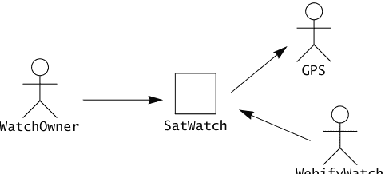

**图 4-4** Satwatch 系统的参与者。WatchOwner 移动（可能跨越时区）并查看它以确认时间。SatWatch 与 GPS 交互以计算其位置。WebifyWatch 更新手表中包含的数据以反映时间策略的变化（例如夏令时开始和结束日期的变化）。

考虑一个更复杂的例子：一个用于事故管理的分布式信息系统 [Bruegge 等，1994]。它包含许多参与者，例如现场警员（FieldOfficer），代表负责响应事故的警察和消防员；以及调度员（Dispatcher），负责接听 911 电话并向事故现场派遣资源的警察人员。FRIEND 通过跟踪事故、资源和任务计划来支持这两类参与者。它还可以访问多个数据库，例如危险材料数据库和应急操作程序。现场警员和调度员通过不同的接口进行交互：现场警员通过移动个人助手访问 FRIEND，调度员通过工作站访问 FRIEND（见图 4-5）。

参与者是抽象的，并不直接对应于具体的人。某个人可以在不同时间担任现场警员或调度员的角色。然而，他们访问的功能有本质区别。由于原因，这两个角色被建模为两个不同的参与者。

需求爬取的第一步是识别参与者。这既是为了定义系统的边界，也是为了找到开发者需要考虑系统的所有视角。当系统部署到现有组织（如公司）中时，大多数参与者在系统开发之前就已经存在了：它们对应于组织中的角色。

在识别参与者的初始阶段，很难区分参与者和对象。例如，数据库子系统有时可以是一个参与者，而在其他情况下它可以是系统的一部分。请注意，一旦定义了系统边界，区分参与者与系统组件（作为对象或子系统）就没有困难了。参与者在系统边界之外；它们是外部的。子系统和对象在系统边界之内；它们是内部的。因此，任何使用待开发系统的外部软件系统都是参与者。在识别参与者时，开发者可以询问以下问题：

- 系统支持哪些用户完成他们的工作？

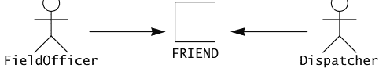

**图 4-5** FRIEND 系统的参与者。现场警员不仅可以访问不同的功能，他们还使用不同的计算机访问系统。

在 FRIEND 示例中，这些问题引出了一个列表：战斗员（fighter）、调度员（dispatcher）、市长、州长、调查员、管理员。

一旦确定了参与者，需求爬取的下一步是确定每个参与者通过场景可以访问的功能。

### 4.4.2 识别场景

场景是“对人们所做和所经历事情的叙述性描述” [Carroll, 1995]。场景是对单一实例的关注且非正式的描述。它并不意图要取代用例。然而，场景通过提供一种用户可以理解的工具，增强了需求爬取。

图 4-6 是 FRIEND 系统的一个场景示例，用于事故响应。在这一场景中，一名警察报告了火灾，调度员启动了事故。


**图 4-6** ReportEmergency 用例的 warehouseOnFire 场景

| 场景名称 | warehouseOnFire |
| :--- | :--- |
| 参与者实例 | bob:FieldOfficer, john:Dispatcher |
| 事件流 | 1. Bob 开着巡逻车在主路上行驶，注意到仓库冒出烟。他的搭档 Alice 从笔记本电脑启动了“报告事故”功能。2. Alice 输入建筑地址、位置简要描述（例如，东北角）和紧急程度。除了消防队，由于该地区看起来相当繁忙，她还请求现场医护人员。她确认了输入并等待确认。3. 调度员 John 通过工作站的哔哔声发现了紧急情况。他查看了 Alice 提交的信息并确认了报告。他将一个消防队分配到事故现场，并将预计到达时间（ETA）发送给 Alice。4. Alice 收到了确认和 ETA。 |

场景在需求爬取以及生命周期的其他活动中可以有许多用途。以下是选自 [Carroll, 1995] 的若干选的场景类型：

- **现状场景（As-is scenarios）**描述当前情况。在重工程期间，通过观察用户并将他们的行为描述为场景来理解当前系统。然后，这些场景可以与用户一起验证其正确性和准确性。

- **愿景场景（Visionary scenarios）**描述未来的系统。愿景场景既可以作为开发者完善其未来系统想法的建模点，也可以作为从用户处提取需求的通信媒介。愿景场景可以被视为一种廉价的原型。

- **评估场景（Evaluation scenarios）**描述针对被评估系统的用户任务。用户和开发者协作开发评估场景，也可以改进这些场景所测试的功能定义。

- **培训场景（Training scenarios）**是向新用户介绍系统的教程。它们是分步说明，旨在手把用户完成常见任务。

在需求性取阶段，开发者和用户编写并完善一系列场景（scenarios），以便对系统应该具备的功能达成共识。最初，每个场景可能是高层且不完整的，就像 `warehouseonFire`（仓库火灾）场景那样。以下问题可用于识别场景：

#### 识别场景的问题

- 参与者想要系统执行哪些任务？
- 参与者访问哪些信息？
- 数据可以被修改或删除吗？由谁来操作？
- 系统需要通知参与者哪些事件？频率如何？
- 系统需要向参与者报告哪些变化？

开发者利用关于应用领域的现有文档来回答这些问题。这些文档包括用户手册、程序手册、公司标准、用户速记（cheat sheets）以及客户采访。开发者应该始终使用应用术语编写场景，而不是自己的术语。随着对应用领域理解的深入，他们迭代地完善场景，以包含更多细节。绘制用户界面原型图（mock-ups）通常有助于发现规范中的遗漏，并构建出更具体的系统图。

在 FRIEND 示例中，我们识别出系统预期支持的以下四种场景：

- `warehouseonFire`（图 4-6）：仓库发生火灾；现场调度员到达现场并请求资源。
- `fender`（追尾）：高速公路上发生无人员伤亡交通事故；警察人员记录事故，车辆被拖走。
- `catTree`（树猫）：树上有一只猫；由于事件优先级较低，消防车赶往现场。与此同时，树主掉落并摔断了腿，需要派遣救护车。
- `earthquake`（地震）：前所未有的地震损坏了建筑和道路，触发了州应急响应计划。通知了州。

开发者在参与者和场景识别的重点是理解应用领域。这有助于系统的范围。一旦开发者识别了参与者和场景，就会将场景形式化为用例（use cases）。

## 4.4.3 识别用例

场景是用例的一个实例；也就是说，一个用例规定了针对某项功能的所有可能场景。用例由参与者启动。在启动后，用例可能会与其他参与者交互。用例代表了贯穿系统的完整事件流，描述了由其启动产生的一系列相关交互。

图 4-7 展示了用例 `ReportEmergency`（报告紧急情况），其中 `warehouseOnFire`（见图 4-6）是一个实例。参与者 FieldOfficer 通过激活 FRIEND 的 "Report Emergency" 功能启动此用例。当 FieldOfficer 收到已创建的确认时，用例完成。事件流中的步骤缩进表示启动该步骤的人。步骤 1 和 3 由参与者启动，而步骤 2 和 4 由系统启动。

| 用例名称 | ReportEmergency |
| :--- | :--- |
| 参与参与者 | 由 FieldOfficer 启动，与 Dispatcher 通信 |
| 事件流 | 1. FieldOfficer 激活终端的 "Report Emergency" 功能。2. FRIEND 向 FieldOfficer 显示表单。3. FieldOfficer 通过选择紧急级别、类型和情况简要描述来完成表单。FieldOfficer 还描述了对紧急情况的可能响应。表单完成后，FieldOfficer 提交表单。4. FRIEND 接收表单并通知 Dispatcher。5. Dispatcher 审核提交的信息并通过调用 `OpenIncident` 用例在数据库中创建 `Incident`（事故）。Dispatcher 选择一个响应方案并确认报告。6. FRIEND 向 FieldOfficer 显示确认信息和所选响应。 |
| 入口条件 | FieldOfficer 已登录 FRIEND |
| 退出条件 | FieldOfficer 收到来自 Dispatcher 的确认和所选响应，或者 FieldOfficer 收到说明无法处理该事务的解释。 |
| 质量需求 | FieldOfficer 的报告在 30 秒内被确认。所选的响应在 Dispatcher 发出后 30 秒内到达。 |

图 4-7 用例 `ReportEmergency` 示例。在 `ReportEmergency` 下，左列表示参与者操作，右列表示系统响应。

通过泛化场景并识别系统必须支持的高层用例，有助于开发者定义系统的范围。最初，开发者为用例命名，将其关联到启动参与者上，并如图 4-7 所示提供用例的高层描述。用例的名称应该是一个动词，表示参与者试图完成的任务。“Report Emergency”（报告紧急情况）这一动词短语表示参与者正尝试向系统（因此向调度员）报告紧急情况。此用例不称为“Record Emergency”（记录紧急情况），因为名称应该反映参与者的视角而非系统的视角。它也不称为“Attempt to Report an Emergency”（尝试报告紧急情况），因为名称应该反映用例的目标而非实际活动。

将用例关联到启动参与者上使开发者能够明确不同用户的角色。通常，通过关注每个用例的启动者，开发者可以发现被忽略的新参与者。

描述用例涉及指定四个字段。描述用例的入口和退出条件使开发者能够理解用例被调用的条件，以及用例对环境和系统状态的影响。通过检查用例的入口和退出条件，开发者可以判断是否存在缺失的用例。例如，如果一个用例需要激活处理地震的应急响应计划，那么需求规范也应该提供激活该计划的案例。描述用例的事件流使开发者和客户能够讨论参与者与系统之间的交互。这产生了许多系统边界的决策，即决定哪些动作由参与者完成，哪些动作由系统完成。最后，描述与用例相关的质量需求使用开发者能够在特定功能的上下文中提取非功能性需求。在书中，我们关注这四个字段来描述用例，因为它们描述了用例最核心的方面。

## 需求性活动

图 4-7 中的 ReportEmergency 案例可能足以说明 FRIEND 如何支持报告紧急情况以及从用户处获取通用反馈，但对于需求规范来说尚未提供足够的细节。接下来，我们将讨论如何细化和定义用例。


## 简单用例编写指南

- 用例应用动词短语命名。用例的名称应指示用户正尝试完成的任务（例如：`ReportEmergency`、`OpenIncident`）。
- 参与者应用名词短语命名（例如：`FieldOfficer`、`Dispatcher`、`Victim`）。
- 系统的边界应该是清晰的。参与者完成的步骤和系统完成的步骤应当区分开（例如，在图 4-7 中，系统动作向右缩进）。
- 事件流中的步骤应使用主动语态表述。这可以明确具体完成了什么内容。
- 应当描述连续步骤之间的因果关系。
- 用例应该描述一个完整的事务（例如，`ReportEmergency` 用例描述了从发起报告到接收确认之间的所有步骤）。
- 应当处理异常情况。
- 用例不应描述系统的用户界面。这会分散对用户实际完成步骤的关注，而这应通过视觉原型来解决（例如，`ReportEmergency` 仅引用“报告紧急情况”功能，而不涉及菜单、按钮或对应该功能的实际命令）。
- 用例长度不应超过二三页。否则，请按照第 4.4.5 节所示，使用包含（include）和扩展（extend）关系将其分解为较小的用例。

## 图 4-8 用例编写指南示例

| 用例名称 | 意外 | 错误的名称：用户正尝试完成什么？ |
|---|---|---|
| 发起参与者 | 由 `FieldOfficer` 发起 | |
| 事件流 | 1. `FieldOfficer` 报告了意外。 | 因果关系：哪个动作导致 `FieldOfficer` 接收了确认？被动语态：谁派遣了救护车？ |
| | 2. 派遣了一辆救护车。 | |
| | 3. 当救护车到达现场时通知 `Dispatcher`。 | 不完整的事务：救护车派遣后，`FieldOfficer` 应该做什么？ |

图 4-9 一个糟糕的用例示例。右侧列用斜体标出了违反编写指南之处。

使用场景和用例来定义系统功能，旨在于开发早期创建由用户验证的需求。随着系统设计和实现的开始，更改需求规范和添加新的不可预见功能的成本会增加。尽管需求在开发后期仍会发生变化，但开发者和用户应努力尽早解决大多数问题。这在需求获取过程中涉及许多更改和验证。注意，许多案例被重写了多次，其他被大幅细化，而另一些被完全舍弃。为了节省时间，大部分探索工作可以使用场景和用户界面原型来完成。

以下启发式方法可编写场景和用例：

## 开发场景和用例的启发方法

- 使用场景与用户通信并验证功能。
- 首先，细化单个场景以理解用户对系统的假设。用户可能熟悉类似的系统，在这种情况下，采用用户界面约定将使系统具有可用性。
- 接下来，定义许多详细的场景来定义系统的范围。与用户进行验证。
- 使用原型作为视觉输出；用户界面设计应在功能足够稳定后作为一项独立的任务进行。
- 向用户提供多个不同的替代方案（而不是从用户处提取单一方案）。评估不同的方案可以拓宽用户的视野。生成不同的方案会强制开发者“跳出思考”。
- 当系统范围和用户偏好被充分理解时，详细描述一个垂直切片。与用户进行验证。

此活动的重点是完整性和准确性，并通过细化用例或编写新用例来记录。开发者根据参与者的视角，选择罕见案例和异常处理。最初对用例和参与者的识别侧重于建立系统边界，而用例的细化则产生越来越多关于系统提供的功能及其相关约束的细节。特别是，用例中最初被忽略的方面在细化过程中得到了详细说明：

- 系统操纵的元素被详细说明。在图 4-10 中，我们添加了关于紧急报告表属性和事故类型的细节。
- 规定了参与者与系统之间低级的交互序列。在图 4-10 中，我们增加了关于 `Dispatcher` 如何通过选择资源生成确认的信息。
- 指定的访问权限（哪些参与者可以调用哪些用例）。
- 识别缺失的异常并规定了其处理方式。
- 将用例之间的公共功能提取出来。

在下一节中，我们将描述如何通过关系重新组织参与者和用例，这解决了上述最后三个点。

## 4.4.5 参与者与用例之间的关系

即使是中等规模的系统也有许多用例。参与者与用例之间的关系允许开发者和用户降低模型的复杂度并提高其理解性。我们使用参与者与用例之间的通信关系按功能层描述系统。我们使用扩展关系来分离异常和通用事件流。我们使用包含关系来减少用例之间的冗余。

图 4-11 展示了 FRIEND 系统中通信关系的示例。“initiate”立体型表示由参与者发起用例，“participate”立体型表示该参与者没有发起用例。

## 用例之间的扩展关系

如果被扩展的用例在某些条件下可能包含行为，则该用例扩展另一个用例。在 FRIEND 示例中，假设 `FieldOfficer` 站和 `Dispatcher` 站之间的连接中断。`ConnectionDown` 用例被建模为 `ReportEmergency` 的扩展（见图 4-12）。从基础用例中分离异常和可选事件流有两个优点：第一，基础用例变得更短且更容易理解。第二，通用情况与异常情况区分开来，这允许开发者以不同的方式处理每种功能（例如，优化通用情况的响应时间，优化异常情况的健壮性）。扩展用例和扩展本身都是完整的案例。每个案例必须有进入和结束条件，并让用户作为一个整体能够理解。

## 需求获取活动

`FieldOfficer` 正在填写表格（例如，`FieldOfficer` 的汽车进入了隧道）。`FieldOfficer` 站需要通知 `FieldOfficer` 表单未送达以及他应该采取的措施。`ConnectionDown` 用例被建模为 `ReportEmergency` 的扩展。

## 用例之间的包含关系

用例之间的冗余可以通过包含关系提取。例如，假设 `Dispatcher` 在开启事故时（例如评估火灾期间哪些区域面临风险）以及分配资源时（例如寻找距离事故最近的资源）需要查看地图。在这种情况下，`ViewMap` 用例描述了查看地图时所需的事件流，并被 `OpenIncident` 和 `AllocateResources` 用例使用（图 4-13）。

从用例中提取共享行为有许多益处，包括描述更短和冗余更少。只有当行为被两个或多个用例共享时，才应将其提取到单独的用例中。规格说明在大量用例中过度碎片化会导致规范令用户和客户感到困惑。

## 扩展与包含关系

包含和扩展是相似的结构，开发者起初可能不清楚何时该使用其中一种 [Jacobson et al., 1992]。这些结构的主要区别在于关系的方向。对于包含关系，触发目标（即被包含的用例）的事件在源用例的事件流中描述。对于扩展关系，触发源（即被扩展的用例）的事件作为前提条件描述在源用例中。换句话说，对于包含关系，每个用例必须指定何时调用被包含的用例。对于扩展关系，扩展用例指定了哪些用例被扩展了。因此，与事件紧密结合且仅在少数用例中发生的行为应该用包含关系来表示。这类行为通常包括可以在多处使用的通用功能（例如：查看地图、指定文件名、选择元素）。相反，任何时候可能发生或可能出现的行为可以更容易地指定为扩展关系。这类行为包括异常情况（例如：调用在线帮助、取消交易、处理网络故障）。

图 4-14 显示了用包含关系（左列）和扩展关系（右列）描述的 `ConnectionDown` 示例。在左列中，我们需要在事件流中的两个地方插入文本以便调用 `ConnectionDown` 用例。此外，如果描述了额外的异常情况（例如，现场人员站上的帮助函数），则必须修改 `ReportEmergency` 用例，并会使其变得充斥着条件。在右列中，我们需要描述调用异常用例的条件，这可能包括大量用例（例如：“现场人员与调度员之间连接的任何用例都丢失了”）。此外，可以在不修改基础用例（例如 `ReportEmergency`）的情况下添加额外的异常情况。这种在不修改现有部分的情况下扩展系统的能力至关重要的，因为它允许我们能够确保原始行为不受触动。包含和扩展之间的区别是一个文档编写问题：使用正确类型的关系可以减少用例之间的依赖关系，减少冗余，并降低需求变更时引入错误的概率。然而，它对其他开发活动的影响微乎其微。

总结，使用以下启发式方法来选择扩展关系或包含关系。

## 扩展与包含关系的启发式方法

- 使用扩展关系处理异常、可选或罕见发生的行为。罕见行为的示例是资源故障（例如：消防车）。可选行为的示例是通知附近的资源对不无关的事件做出响应。
- 使用包含关系处理跨越两个或多个用例的共享行为。
- 然而，应用上述两个启发式方法时要谨慎，不要对用例模型进行过度结构。几个较长的用例（例如，两页长）比许多短用例（例如，十行长）更容易理解和评审。

在所有情况下，添加包含和扩展关系的目的都是减少同一个用例模型中的冗余，消除潜在的不一致性。

## 4.4.6 识别初始分析对象

开发者和用户在开始接触时遇到的首要障碍之一是术语差异。尽管开发者最终会学习用户的术语，但当有新开发者加入项目时，这个问题可能会再次出现。误解源于相同术语在不同语境下被使用并具有不同的含义。

为了建立清晰的术语，开发者识别每个用例的参与对象。开发者应该无歧义地识别、命名并描述它们，并将它们汇总到词汇表中。构建此词汇表构成了该分析的第一步，我们将在下一章中讨论。

词汇表包含在需求说明中，稍后包含在用户手册中。词汇表的益处多方面的：新开发者可以接触到一组一致的定义，每个概念使用单一术语（而不是同时使用开发者和用户的术语），并且每个术语都有精确且清晰的官方含义。

参与对象的识别产生了初始分析对象模型。在需求获取阶段识别参与对象仅构成了通向完整分析对象模型的第一步。完整的分析模型通常不作为用户和开发者之间的通信手段，因为用户通常不熟悉面向对象的概念。然而，对象的描述（即词汇表中术语的定义）及其属性是用户可见并经过评审的。我们将在第 5 章分析中详细描述分析模型的进一步细化。

### ReportEmergency（包含关系）

### ReportEmergency（扩展关系）

- 1. ...n2. ...
- 1. ...n2. ...

- 3. 现场人员通过选择紧急级别、类型、位置和情况的简要描述完成表单。现场人员还描述了对紧急情况的可能响应。表单完成后，现场人员提交表单，此时通知调度员。
- 3. 现场人员通过选择紧急级别、类型、位置和情况的简要描述完成表单。现场人员还描述了对紧急情况的可能响应。表单完成后，现场人员提交表单，此时通知调度员。

如果与调度员的连接中断，则使用 `ConnectionDown` 用例。

- 4. 如果连接仍然正常，调度员审查提交的信息，并通过调用 `OpenIncident` 用例在数据库中创建一个事件（Incident）。调度员选择一种响应并确认紧急报告。
- 4. 调度员审查提交的信息，并通过调用 `OpenIncident` 用例在数据库中创建一个事件。调度员选择一种响应并确认紧急报告。

如果连接中断，则使用 `ConnectionDown` 用例。

- 5. ...
- 5. ...

### ConnectionDown（包含关系）

### ConnectionDown（扩展关系）

`ConnectionDown` 用例扩展了现场人员与调度员通信中任何可能丢失的用例。

- 1. 现场人员和调度员被通知连接中断。他们被告知发生此类事件的可能原因（例如：“现场人员站是在隧道内吗？”）。
- 1. 现场人员和调度员被通知连接中断。他们被告知发生此类事件的可能原因（例如：“现场人员站是在隧道内吗？”）。

- 2. 系统记录该情况，并在连接重启时恢复。
- 2. 系统记录该情况，并在连接重启时恢复。

- 3. 现场人员和调度员通过其他方式建立联系，调度人员从调度员站发起 `ReportEmergency`。
- 3. 现场人员和调度员通过其他方式建立联系，调度人员从调度员站发起 `ReportEmergency`。

图 4-14 在 `ReportEmergency` 中添加 `ConnectionDown` 异常条件。使用扩展关系处理异常和可选的事件流，因为它产生了更具模块化的描述。

| 调度员 (Dispatcher) | 管理事件（Incident）的警察人员。调度员根据紧急报告（EmergencyReport）以及与现场人员（FieldOfficer）的其他通信来开启、记录和关闭事件。调度员通过徽章编号进行识别。 |
|---|---|
| 紧急报告 (EmergencyReport) | 现场人员向调度员提交的关于事件（Incident）的初始报告。紧急报告通常会触发调度员创建一个事件。紧急报告由紧急级别、类型（火灾、道路事故、其他）、位置和描述组成。 |
| 现场人员 (FieldOfficer) | 轮岗的警察或消防员。一名现场人员同时最多可以分配给一个事件。现场人员通过徽章编号进行识别。 |
| 事件 (Incident) | 需要现场人员关注的状况。事件可以由现场人员或系统中的任何其他人向系统报告。事件由描述、响应、状态（已开启、已关闭、已记录）、位置和现场人员数量组成。 |

一旦识别并整合了参与对象，开发者就可以将它们作为检查清单，以确保所识别的用例集是完备的。

## 交叉检查用例和参与对象的启发式方法

- 哪些用例创建了此对象（即在哪些用例期间在系统中输入了对象属性的值）？
- 哪些参与者访问了这些信息？
- 哪些用例修改并销毁了此对象（即哪些用例编辑或从系统中删除了这些信息）？
- 哪个参与者可以启动这些用例？
- 是否需要此对象（即是否至少有一个用例依赖这些信息）？

## 4.4.7 识别非功能性需求

非功能性需求描述了系统中与其功能行为没有直接相关的方面。非功能性需求涵盖了许多问题，从用户界面的外观和感受到响应时间以及安全问题。非功能性需求与功能需求同时定义，因为它们对系统的开发和成本有巨大影响。

例如，考虑空中交通管制员用于追踪飞机的马赛克显示器。马赛克显示将来自一系列雷达和数据库的数据（因此称为“马赛克”一词）汇成摘要显示，指示特定区域内的所有飞机，包括它们的识别码、速度和高度。系统能够显示的飞机数量限制了空中交通管制员的性能和系统的成本。如果系统同时只能处理几架飞机，则该系统无法在繁忙的机场使用。另一方面，处理大量飞机的系统在构建和测试方面的成本更高、更复杂。

非功能性需求可能会以意想不到的方式影响用户的工作。为了准确地引导所有核心非功能性需求，客户和开发者必须协作，以便他们识别出（最低限度上）对于用户工作难以实现的系统属性。在上述的马赛克显示器示例中，单个马赛克显示器必须处理的飞机数量将影响用于显示飞机的图标大小、识别飞机及其属性的功能、数据刷新率等。

由此产生的非功能性需求集通常包含冲突的需求。例如，智能手表的非功能性需求（图 4-3）要求一个准确的机制，以便时间永远不需要重置；并且要求低成本，以便用户在手表损坏时更换新手表是可以接受的。这两个非功能性需求是冲突的，因为手表的成本会随着准确性的提高而增加。为了处理这些冲突，客户和开发者对非功能性需求进行优先级排序，以便在系统实现过程中能够一致地解决问题。

## 表 4-3 引导非功能性需求的示例问题

| 类别 | 示例问题 |
|---|---|
| 可用性 (Usability) | - 用户的专业水平如何？<br>- 用户熟悉哪些用户界面标准？<br>- 应向用户提供哪些文档？ |
| 可靠性 (Reliability)（包括健壮性、安全性和安全性） | - 系统应该有多可靠、可用和健壮？<br>- 发生故障时重启系统可以接受吗？<br>- 系统可以丢失多少数据？<br>- 系统如何处理异常？<br>- 是否有安全要求？<br>- 系统是否有安全性要求？ |
| 性能 (Performance) | - 系统响应速度如何？<br>- 是否有关键用户任务？<br>- 它应该支持多少并发用户？<br>- 可比系统的典型数据存储有多大？<br>- 用户接受的最大延迟是多少？ |
| 可支持性 (Supportability)（包括可维护性和可移植性） | - 系统的预期是什么？<br>- 谁维护系统？<br>- 系统是否有端口要求？ |
| 实现 (Implementation) | - 是否有限制？<br>- 维护团队是否施加了限制？<br>- 测试团队是否施加了限制？ |
| 接口 (Interface) | - 系统是否应该与任何系统交互？<br>- 数据如何导出/导入到系统？<br>- 客户支持哪些标准？ |
| 运行 (Operation) | - 谁管理系统？ |
| 软件包 (Packaging) | - 谁安装系统？<br>- 预计有多少次安装？<br>- 是否有限制？ |
| 法律 (Legal) | - 系统应如何授权？<br>- 是否有系统相关的责任问题？<br>- 是否产生了特许权或费用？ |

有系统的方法可以来引导非功能性需求。在实践中，分析师使用非功能性需求的分类法（例如之前描述的 FURPS+ 方案）来生成检查清单，帮助客户和开发者关注非功能性方面。由于此时系统的参与者已经识别出来，此类检查清单可以按角色进行组织。注意，此类检查清单也可以导致对功能性需求的引导。例如，当提问有关系统运行的问题时，客户和开发者可能会发现许多用例。表 4-3 描绘了 FURPS+ 每个类别的问题。

一旦客户和开发者确定了一组非功能性需求，他们可以将它们组织成依赖图，以识别进一步的非功能性需求和冲突。关于此主题的更多材料，请参阅专业文献（例如 Chung et al., 1999）。

## 4.5 管理需求获取

在本节中，我们描述了通过用例对系统进行建模的技术问题。然而，建模本身并不构成需求获取。之后，开发者仍然需要从用户处引导需求并与客户达成一致。在本节中，我们描述了从用户处引导信息以及与客户协商协议的方法。特别是，我们描述了：

- 与客户协商规范：联合应用设计（节 4.5.1）
- 维护可溯性（节 4.5.2）
- 记录需求获取（节 4.5.3）

### 4.5.1 与客户协商规范：联合应用设计

联合应用设计（JAD）是一种在 20 世纪 70 年代末开发的需求方法。它的有效性在于需求获取工作是在所有利益相关者参与的单一会议中完成的。用户、客户、开发者和经过培训的会议主持人坐在房间里，展示自己的观点，听取他人观点，进行谈判并达成相互接受的解决方案。研讨会的成果——最终的 JAD 文档是一份完整的需求规范文档，包含了数据元素、工作流和接口的定义。由于最终文档是由利益相关者共同开发的（即对项目成功感兴趣并且能够做出重大决策的参与者），最终的 JAD 文档代表了用户、客户和开发者之间的一致，从而减少了开发过程后期的需求变更。JAD 由五个活动组成（图 4-15）：


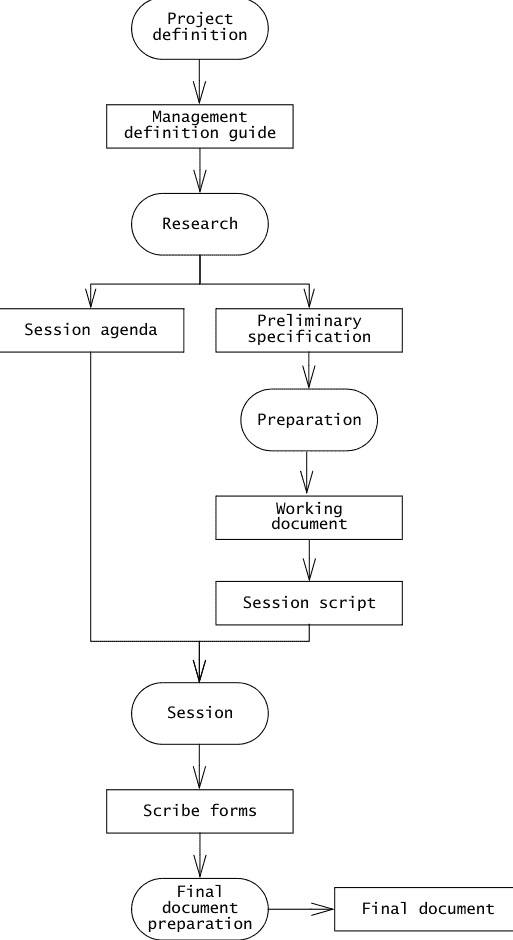

**图 4-15** JAD 的活动（UML 活动图）。JAD 的核心是“会议”活动，在此期间，所有利益相关者设计并同意一份需求规范。会议之前的活动可以最大化其的效率。最终文档的生成记录了会议期间做出的决策。

1. **项目定义**。在此项活动中，JAD 协调员对项目经理和客户进行访谈，以确定项目的目标和范围。访谈结果被收集在《管理定义指南》中。

2. **研究**。在此项活动中，JAD 协调员向未来用户进行演示，收集有关应用领域的信息，并描述第一组高层用例。JAD 协调员还列了一份会议期间要解决的问题列表。该活动的结果是《会议议程》和一个列出工作流和系统信息的《初步规格说明文档》。

3. **准备**。在此项活动中，JAD 协调员准备会议。JAD 协调员创建《工作文档》（即最终文档的草稿）、会议议程，以及代表研究活动期间收集信息的任何演示幻灯片或翻页图。JAD 协调员还选择了一个由客户、项目经理、选定用户和开发者组成的团队。所有利益相关者都得到了代表，参与者能够做出约束性的决策。

4. **会议**。在此项活动中，JAD 协调员引导团队创建需求规范。一次 JAD 会议持续 3 到 5 天。团队定义并同意了场景、用例和用户界面原型。所有决策都由记录员记录。

5. **最终文档**。JAD 协调员准备《最终文档》，修订工作文档以包含会议期间做出的所有决策。最终文档代表了会议期间同意的系统完整规格。最终文档将分发给会议参与者进行评审。参与者参加一个 1 - 2 小时的会议，以讨论评审结果并定稿文档。

JAD 已被 IBM 和其他公司使用。JAD 利用群体动力来改进参与者之间的通信并加速开发。在一次 JAD 会议结束时，开发者对用户需求有了更多了解，而用户对开发权衡有了更多了解。下游冗余活动的减少也带来了额外收益。由于其依赖于社会动力，JAD 会议的成功往往取决于 JAD 协调员作为会议主持人的资质。如需了解 JAD 的详细概述，请参阅 [Wood & Silver, 1989]。

## 4.5.2 维护可追溯性

追溯性是跟踪需求生命周期的能力。这包括追踪需求的来源（例如：由谁发起的，它解决了哪个客户需求）到它影响的系统和项目的哪些方面（例如：哪些组件实现了需求，哪个测试用例检查了该实现）。追溯性使开发者能够证明系统是完整的，让测试人员证明系统符合其需求，让设计人员记录系统背后的原理，并让维护人员评估变更的影响。

### 管理需求摄取

考虑我们在章节开头介绍的 SatWatch。目前，规格要求显示一个包含时间和日期的双行显示。在客户决定字体大小太小、不于阅读后，开发者将显示需求更改为单行显示，并结合一个用于在时间和日期之间切换的按钮。可追溯性将使我们能够回答以下问题：

- 谁发起了双行显示需求？
- 是否有任何隐性约束强制要求此需求？
- 因为额外的按钮和显示，哪些组件必须更改？
- 哪些测试用例必须更改？

维护可追溯性的简单方法是在文档、模型和代码构件之间使用交叉引用。每个单独的元素（例如：需求、组件、类、操作、测试用例）都由一个唯一数字标识。依赖关系然后手动记录为文本交叉引用，其中包含源元素的编号和文字处理工具。工具支持可以像简单的电子表格或文字处理软件。这种方法在时间上是昂贵的，且容易出错。然而，对于小型项目，开发者可以尽早观察到益处。

对于大型项目，专门的数据库工具能够在更细致的层级实现追溯性依赖关系捕获、编辑和链接的部分自动化（例如，`DOORS [Teleologic]` 或 `RequisitePro [Rational]`）。这些减少了维护可追溯性的成本，但它们需要大多数利益相关者的认可和管理，并对开发过程中的其他工具实施限制。

## 4.5.3 记录需求摄取

需求摄取和分析活动的结果记录在《需求分析文档》中。该文档从功能和非功能要求的方面完整描述了系统。RAD 的读者包括客户、用户、项目管理人员、系统分析师（即参与需求的开发者）和系统设计师（即参与系统设计的开发者）。文档的第一部分，包括用例和非功能需求，是用这种语言编写的。对象模型在分析期间编写。图 4-16 中规格的形式化是书中使用的 RAD 示例。

### 需求分析文档

- 1 引言
  - 1.1 系统目的
  - 1.2 系统范围
  - 1.3 项目目标和成功标准
  - 1.4 定义、缩写和术语
  - 1.5 参考文献
  - 1.6 概述
- 2 当前系统
- 3 提议系统
  - 3.1 概述
  - 3.2 功能需求
  - 3.3 非功能需求
    - 3.3.1 可用性
    - 3.3.2 可靠性
    - 3.3.3 性能
    - 3.3.4 可维护
    - 3.3.5 实现
    - 3.3.6 接口
    - 3.3.7 封装
    - 3.3.8 法律
  - 3.4 系统模型
    - 3.4.1 场景
    - 3.4.2 用例模型
    - 3.4.3 对象模型
    - 3.4.4 动态模型
    - 3.4.5 用户界面—导航路径和屏幕原型
- 4 词汇表

### ARENA 案例研究

- 功能性需求描述了系统的高级功能。
- 非功能性需求描述了与功能直接相关的用户级需求。这包括可用性、可靠性、性能、支持性、实现、接口、运行、封装和法律需求。
- 系统模型描述了系统的场景、用例、对象模型和动态模型。该部分包含完整的功能规格书，包括说明系统用户界面的原型以及代表屏幕序列的导航路径。对象模型和动态模型两个子章节将在“分析”活动期间编写，并在下一章中进行描述。

需求分析文档（RAD）应在用例模型稳定后编写，即对需求的修改次数达到最少时。然而，在整个开发过程中，当发现规格问题或系统范围发生变化时，需求将不断更新。RAD 一旦发布就会建立基准，此后 RAD 中的配置管理修订历史部分将提供变更历史，包括负责每项变更的作者、变更日期以及变更的简要描述。

## 4.6 ARENA 案例研究

在本节中，我们将本章中描述的概念和方法应用于 ARENA 系统。我们从客户提供的初始问题陈述开始，开发一个用例模型和一个初始分析对象模型。在之前的章节中，我们根据其说明性价值选取了示例。在本节中，我们关注一个真实的示例，并在产物被创建和完善时对其进行描述。这使我们能够讨论更具真实的权衡和设计决策，并关注通常在说明性示例中不可见的运行细节。在讨论中，“ARENA”指代整个系统，而“arena”指代系统的特定实例。

### 4.6.1 初始问题陈述

与客户进行首次会议后，编写了问题陈述（图 4-17）。

注意，这段简短的文本从高层次描述了问题和需求。这通常不是我们承诺预算或交付日阶段。首先，我们通过识别参与者和场景开始开发用例模型。

> **基准** 是经过评审并正式批准的工作产品版本。配置管理是跟踪和批准基准变更的过程。我们将在第 13 章“配置管理”中讨论配置管理。

# ARENA 问题陈述

## 1. 问题

互联网和万维网的普及使得各种虚拟社区得以产生，这些社区是具有共同兴趣的人群，他们从未面对面接触过。此类虚拟社区可能是短期的（例如，在聊天室聚会或参加比赛的人群），也可以是长期的（例如邮件列表的订阅者）。它们可能包含一小组人，也可能包含数千人。

许多多人游戏现在都包含了对该游戏玩家虚拟社区的支持。玩家可以接收游戏升级、新地图和角色的新闻；他们可以宣布和组织比赛、比较分数并交流技巧。游戏公司利用这一基础设施来产生收益或为其产品广告。

然而，目前每家游戏公司都在每个单独的游戏中开发社区支持。每家公司使用不同的基础设施、不同的概念，并提供不同层次的支持。这种冗余和不一致导致了许多缺点，包括玩家在加入每个社区时面临的学习曲线、游戏公司需要从零开始开发支持，以及需要分别联系每个独立社区的广告商。此外，这种解决方案没有为不同社区之间的交叉融合提供机会。

## 2. 目标

ARENA 项目的目标是：

- 为运行 arena 提供基础设施，包括注册游戏和玩家、组织比赛以及跟踪玩家分数。
- 为联赛所有者提供一个框架，以自定义比赛的次数、顺序以及专家积分的累积。
- 为游戏开发人员提供一个框架，用于开发新游戏，或将现有游戏适配到 ARENA 框架中。
- 为广告商提供基础设施。

## 3. 功能性需求

ARENA 支持五类用户：

- **操作员**应该能够定义新游戏、定义新的比赛类型（例如：淘汰赛、锦标赛、系列赛最佳制）、定义新的专家评分公式并管理用户。
- **联赛所有者**应该能够定义新联赛、在联赛内组织和宣布新比赛、进行比赛并宣布胜者。
- **玩家**应该能够在 arena 中注册、在联赛中注册、参加分配给玩家的比赛或退出比赛。
- **观众**应该能够监控任何正在进行的比赛，并检查过去比赛和玩家的分数及统计数据。观众不需要注册 arena 中。
- **广告商**应该能够上传新广告、选择广告方案（例如赛事赞助商、联赛赞助商）、检查欠款并取消广告。

图 4-17 初始 ARENA 问题陈述。

## 4. 非功能性需求

- **低运行成本**。操作必须能够在不购买额外软件组件且在没有全职系统管理员帮助的情况下，安装并管理 arena。
- **可扩展性**。操作员必须能够添加新游戏、比赛类型和专家评分公式。此类添加可能需要系统临时关闭，并向系统添加新模块（例如 `Java` 类）。然而，不需要对现有系统进行任何修改。
- **可扩展性**。系统必须支持启动多个并行比赛（例如 10 场），每场比赛涉及多达 64 名玩家和数百名观众。
- **低带宽网络**。玩家应该能够通过 36K 调制解调器或更快的网络进行比赛。

## 5. 目标环境

- 所有用户应该能够通过浏览器使用 `Cookie`、`JavaScript` 和 `Java` 应用访问任何 arena。操作员使用的功能（如添加游戏、比赛类型和用户）不应通过 Web 提供。
- ARENA 应该运行在任何操作系统上（例如 `MacOS X`、`Linux`、`Solaris`）。

图 4-17 续。

### 4.6.2 识别参与者和场景

我们识别了五个参与者，对应问题陈述中的每类用户（操作员、联赛所有者、玩家、观众和广告商）。由于系统的核心功能是组织和进行比赛，我们首先开发一个示例场景——井字棋比赛（图 4-18），以更详细地获取和探索这一功能。通过首先关注系统的狭缝部分，我们能够更好地理解客户对系统的预期，包括系统的边界以及用户与系统之间的交互类型。使用图 4-18 中的井字棋比赛场景，我们为客户准备了一系列问题（如图 4-19 所示）。根据客户的回答，我们相应地完善场景。

## 第 4 章 • 需求引发

**场景名称**：`organizeTicTacToTournament`（组织井棋赛）

**参与者实例**：`alice:操作员`, `joe:联赛所有者`, `bill:观众`, `mary:玩家`

+ 事件流

1. Joe 是 Alice 的朋友，是一个井棋新手，自愿组织一次锦赛。
2. Alice 在竞技场中将 Joe 注册为一名联赛所有者。
3. Joe 定义了一个井棋初学者联赛，任何玩家都可以加入。该联赛专门为井棋游戏设计，规定在该联赛中进行的锦赛将采用淘汰赛制和“胜者全得”的规则。
4. Joe 安排了第二天在联赛中举办第一场 16 名选手的锦赛。
5. Joe 在网络上的各种论坛宣布了锦赛，并向其他井棋社区成员发送了邮件。
6. Bill 和 Mary 收到了了电子邮件通知。
7. Mary 对参加锦赛感兴趣，并注册了其他 19 名申请者。
8. Joe 为锦赛安排了 16 名选手，并拒绝了其他 4 名申请者。
9. 包括 Mary 在内的 16 名选手收到了进入锦赛的电子令牌以及首场比赛的时间。
10. 井棋邮件列表的其他订阅者（包括 Bill）收到了关于锦赛的第二次通知，包括选手名单和比赛赛程。
11. 随着 Joe 启动锦赛，玩家有有限的时间进入比赛。如果玩家未出现，则判定输。
12. Mary 参加了第一场比赛并赢了。她晋级锦赛，并被安排与第一轮的另一位胜者进行下一场比赛。
13. 在访问井棋锦赛主页后，Bill 注意到了 Mary 的胜利，决定观看她的下一场比赛。他选择了比赛，并可以看到每个玩家动作发生时的序列。他还看到浏览器底部有一个广告横幅，宣传其他锦赛和井棋产品。
14. 锦赛持续到最后一场比赛，此时宣布锦赛冠军，并且他的联赛记录将获得与该锦赛相关的所有积分。
15. 此外，锦赛胜者还会积累专家等级积分。
16. Joe 可以选择在联赛中安排更多锦赛，在这种情况下，已知玩家会被告知日期，并优先于新玩家。

**图 4-18** 用于 ARENA 的 `organizeTicTacToTournament` 场景。

典型的场景一旦经过精炼，将跨越数页文本。我们还开始维护一个重要术语表，以确保规格的一致性，并确保我们使用了客户的术语。我们很快发现 `Match`（比赛）、`Game`（游戏）、`Tournament`（锦赛）和 `League`（联赛）这些应用领域概念需要精确定义，因为这些术语在其他游戏语境下可能有不同的解释。为了实现这一点，我们维护了一份工作术语表，并随着探索性工作的进展修订我们的定义（表 4-4）。

### ARENA 案例研究

**步骤 2, 7**：不同的参与者在系统注册。在第一种情况下，管理员将 Joe 注册为联赛所有者；在第二种情况下，一名玩家向系统注册了自己。

- 用户注册应该遵循相同的范式。由谁提供注册信息？如何对这些信息进行审核、验证和接受？
- 步骤 2 和 7 中混淆了两个过程：注册过程，在此期间新用户（例如玩家或联赛所有者）建立自己的身份；以及申请过程，在此期间玩家表示他们想参加特定的锦赛。在注册过程中，用户提供关于自己的信息（姓名、昵称）以及他们感兴趣的游戏。信息由操作员进行验证。在申请过程中，玩家指定他们想参加哪场比赛。联赛所有者在安排比赛时会加入这一过程。
- 既然玩家信息已经由操作员验证过了，那么比赛安排应该是完全自动化的吗？
- 客户：是的，当然。

**步骤 5**：Joe 向井棋社区成员发送邮件：

- Arena 是否提供订阅个人邮件列表的机会？
- 客户：是的。应该有用于发布新游戏、新联赛、新锦赛等的邮件列表。
- Arena 是否提供一个用于广告目的的商店个人资料（例如：看过的游戏、玩过的游戏、通过用户调查指定的兴趣）以投放广告？
- 客户：是的，但如果用户愿意，他们仍然应该能够在不完成用户调查的情况下进行注册。应该鼓励他们填写调查，但不应阻止他们进入。他们将匿名地接触到广告。
- 个人资料应该是自动订阅邮件列表的吗？
- 客户：不，我们认为我们社区的用户更倾向于对自己的邮件订阅有完全的控制权。猜测比赛统计数据不会给他们他们控制一切的印象。

**步骤 13**：Bill 获得了比赛统计数据并决定实时查看下一场比赛。

- 观众如何识别玩家？通过实名、通过电子邮件还是通过昵称？
- 客户：这应该在注册期间由用户自行决定。
- 观众可以回放旧比赛吗？
- 客户：游戏应该能够提供这种能力，但某些游戏（例如实时、3D 动作游戏）可能由于资源限制选择不这样做。
- ARENA 支持实时游戏吗？
- 客户：是的，这些代表了我们市场最大的份额。通常情况下，ARENA 应该支持尽可能广泛的游戏。

**图 4-19** 从图 4-18 的场景中产生的问题。客户的答案用*斜体*强调。面试者在偶然发现新知识时可以提出跟进问题。

+ ...


**图 4-20** 用于 ARENA 的高级用例。

**表 4-4** 工作术语表

| 术语 | 定义 |
| :--- | :--- |
| `Game` (游戏) | 两个多个玩家之间的竞争。 |
| `Match` (比赛) | 玩家之间的比赛。 |
| `Tournament` (锦赛) | 为了决定冠军的一系列比赛。 |
| `League` (联赛) | 锦赛社区。 |

### ARENA 案例研究

### 4.6.3 识别用例

一旦我们与客户对范围达成一致，我们将目前获取的知识形式化为用例。在仔细检查 `organizeTournament` 场景时，我们意识到涵盖了广泛的功能。我们预感到泛化该场景会导致几页纸的用例，并尝试将其拆分为自包含的用例。我们首先决定将账户相关的功能拆分为 `ManageUserAccounts`，由操作员发起（图 4-21）。我们识别出一个参与者 `Anonymous`（匿名用户），代表这些没有账户的潜在用户。同样，我们将浏览比赛和管理个人资料的功能拆分为单独的用例 `BrowseTournament` 和 `ManageProfile`，分别由观众和玩家发起。最后，为了缩短 `OrganizeTournament` 用例，我们将创建新联赛的功能拆分为 `DefineLeague` 用例，因为联赛所有者可以在单个联赛内创建多个锦赛。相反，我们预感到安装新游戏和样式需要多次调整。从操作员处，我们将所有与安装组件的功能合并到 `ManageComponents` 用例中。

我们通过绘制概览用例图并描述每个用例来捕捉这些决策（图 4-21）。注意，用例图并不描述每项功能。相反，它是此阶段产生的许多描述的索引。

接下来，我们描述每个高级用例的字段，包括的参与者、进入和退出条件以及事件流。图 4-22 描绘了高级 `OrganizeTournament` 用例。

注意，此事件流中的所有步骤描述的是参与者的动作。高级用例主要关注参与者完成的任务。与系统的详细交互以及关于系统边界的决策最初被推迟到精炼阶段。

# 第4章 • 需求性

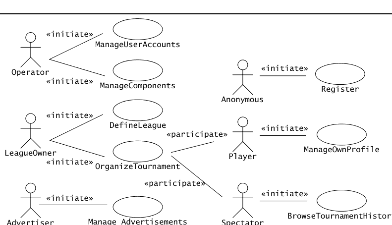

«发起» `ManageUserAccounts`

操作员

«发起» `ManageComponents`

«发起» `Register`

`Anonymous`

«发起» `DefineLeague`

«参与»

«发起» `ManageProfile`

联赛所有者

«发起» `OrganizeTournament`

玩家

«参与»

«发起» `ManageAds`

广告商

观众

`BrowseTournamentHistory`

`Anonymous`

匿名用户以玩家或联赛所有者的身份在 Arena 注册。在申请锦赛或组织联赛之前，用户必须拥有账户。观众不需要账户。

操作员接受来自联赛所有者的注册和玩家注册，取消账户续期，并与用户就账户续期进行交互。

操作员安装新游戏并定义锦赛样式（泛化了定义淘汰赛样式 `defineKnockOutStyle` 和安装井字棋游戏 `installTicTacToeGame`）。

联赛所有者定义新联赛（泛化了 `organizeTicTacToeTournament` 场景的前几个步骤）。


# ARENA 案例研究

联赛所有者创建并宣布新锦赛，接受申请，安排赛程并启动锦赛。在锦赛期间，玩家进行比赛，观众观看比赛。锦赛结束，玩家获得积分（泛化了 `organizeTicTacToeTournament` 场景）。

上传者上传横幅并赞助联赛或锦赛（泛化了 `sponsorTicTacToeBeginnersLeague`）。

玩家管理他们对邮件列表的订阅，并回答市场调查问卷。

观众查阅锦赛统计数据和玩家统计数据，并回放已经结束的比赛（泛化了 `analyzeTicTacToeTournament`）。

- 注册
- 管理用户账户
- 管理组件
- 定义联赛
- 组织赛事
- 管理广告
- 管理个人资料
- 浏览锦赛历史

图 4-21 为 ARENA 识别出的高层用例。

## 161

| 用例名称 | 组织赛事 |
|---|---|
| 参与者 | 由联赛所有者发起，与广告商、玩家和观众通信 |
| 事件流 | 1. 联赛所有者创建一个锦赛，向广告商征求赞助并宣布锦标赛（包含用例 `AnnouncementTournament`）。<br>2. 玩家申请参加锦标赛（包含用例 `ApplyForTournament`）。<br>3. 联赛所有者处理玩家申请并将其分配到比赛中（包含用例 `ProcessApplications`）。<br>4. 联赛所有者启动锦标赛（包含用例 `KickOffTournament`）。<br>5. 玩家按照计划在比赛中竞争，观众观看比赛（包含用例 `PlayMatch`）。<br>6. 联赛所有者宣布获胜者并归档锦标赛（包含用例 `ArchiveTournament`）。 |
| 入口条件 | 联赛所有者已登录 ARENA。 |
| 退出条件 | 联赛所有者在 ARENA 存档中获得一个新的锦标赛且获胜者在联赛中积累了新积分，或者<br>联赛所有者取消了锦标赛且玩家在联赛中的排名保持不变。 |

**图 4-22** 高层用例“组织赛事”的示例。

通过与客户讨论，我们决定也处理锦标赛赞助，并在每个锦标赛开始时进行处理。一方面，这使得新的赞助商能够加入系统；另一方面，这允许赞助商作为交换，利用其资源为锦标赛做广告。最后，这使得系统能够在申请过程中更好地选择广告横幅。

在这个高层用例中，我们将 `organizeTicTacToe` 场景的精髓简化为六个步骤，并将细节留给详细用例。通过以这种方式描述每个高层用例，我们捕捉了系统必须感知的参与者之间所有的关系。这还产生了对系统的总结性描述，任何项目的新手都能读懂。

接下来，我们编写详细用例，以指定参与者与系统之间的交互。

## 4.6.4 细化用例和识别关系

细化用例使开发人员能够精确定义参与者之间以及参与者与系统之间交换的信息。细化用例还可以发现系统应该处理的备选事件流和异常。

为了保持案例研究的可管理性，我们不展示完整的细化过程。我们首先为高层“组织赛事”用例中事件流的每个步骤识别一个详细用例。生成的用例图如图 4-23 所示。然后，我们关注“宣布锦标赛”（`AnnounceTournament`）用例；图 4-24 包含了事件流的描述，图 4-25 识别了可能发生的异常。剩余用例将类似地开发。


**图 4-23** 细化“组织赛事”高层用例的详细用例。

图 4-23 中的所有用例由联赛所有者发起，除了“申请锦标赛”（`ApplyForTournament`）和“进行比赛”（`PlayMatch`）由玩家发起。观众参与“宣布锦标赛”（`AnnounceTournament`）。这些用例细化了“组织赛事”高层用例。在使用 UML 工具时，我们将包含这些关系。

## ARENA 案例研究

| 名称 | 宣布锦标赛 |
|---|---|
| 参与者 | 由联赛所有者发起，与玩家、广告商、观众通信 |
| 事件流 | 1. 联赛所有者请求创建锦标赛。<br>2. 系统检查联赛所有者是否超过了联赛中的锦标赛数量。如果没有，系统向联赛所有者提供表单。<br>3. 联赛所有者指定锦标赛名称、申请开始和结束日期，以及锦标赛的开始和结束日期。<br>4. 系统询问联赛所有者是否寻求独家赞助，如果是，则展示想要赞助的广告商列表。<br>5. 如果联赛所有者决定寻求独家赞助，他选择建议赞助商的子集。<br>6. 系统向选定的赞助商通知即将到来的锦标赛和固定费用。<br>7. 系统将他们的回复告知联赛所有者。<br>8. 如果有感兴趣的赞助商，<br>9. 系统记录独家赞助商的名字并收取固定费用。从现在起，锦标赛相关的广告横幅仅由独家赞助商提供。<br>10. 否则，如果没有广告商感兴趣或联赛所有者没有选择，则随机抽取横幅并收取费用。<br>11. 一旦赞助发布，系统通知感兴趣的用户。<br>12. 联赛所有者选择通知谁。<br>13. 系统为锦标赛创建一个首页。该页面是观众观看比赛的入口点。<br>14. 在申请日期，系统发送主页的链接。玩家可以在申请截止日期前申请锦标赛。 |

**图 4-24** 详细用例“宣布锦标赛”示例。

| 入口条件 | 联赛所有者已登录 ARENA。 |
|---|---|
| 退出条件 | 联赛所有者在 ARENA 存档中获得一个新的锦标赛且获胜者在联赛中积累了新积分，或者联赛所有者取消了锦标赛且玩家在联赛中的排名保持不变。 |
| 质量要求 | 广告商的报价和回复需要安全的身份验证，以便仅根据其回复收费。<br>- 广告商应能够根据当地法律在固定期限内取消赞助协议。 |

**图 4-24** 续。

## ARENA 案例研究

请注意，这些决策已经过客户的验证。不同的客户和环境可能会导致对同一系统的权衡评估产生不同的结果。例如，通过系统招募广告商并获取其承诺的决策会导致系统变得更加复杂和昂贵。另一种方案可能是通过电子邮件招募广告商，但通过电话获取他们的承诺。这在更简单的系统中可以行得通，但会让联赛所有者（`LeagueOwner`）承担更多工作。客户是那些此类替代方案之间做出决策的人，当然，他们也理解这些决策会对系统的成本和交付产生影响。

接下来，我们识别在详细用例执行过程中可能发生的异常。这是通过审查用例中的每一步并识别所有可能出错的事件完成的。我们简要描述每个异常的处理方法，并预测异常处理用例作为“宣布比赛”（`AnnouncementTournament`）用例的扩展（图 4-25）。

请注意，并非所有异常都是平等的，不同类型的异常最好在开发的不同阶段处理。在图 4-25 中，我们识别了由资源限制（`NumberOfTournamentsExceeded`）、无效用户输入（`InvalidDate`、`UserName`）或应用领域约束（`AdvertiserCreditExceeded`、`NoMatchingSponsorFound`）引起的异常。与资源限制相关的异常最好在系统设计期间处理。只有在系统阶段，才会清楚资源是如何限制的以及如何在不同用户之间共享，这反过来可能会触发系统设计期间进一步的需求活动，以与客户共同验证此类异常的处理。

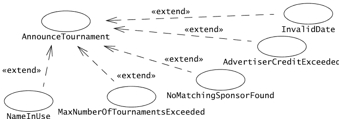

**图 4-25** 以扩展用例表示在“宣布比赛”中发生的异常。（注意：此图中的“宣布比赛”与图 4-23 中的用例相同）。与无效用户输入相关的异常最好在用户界面设计期间处理，此时开发者可以决定在何一点检查无效输入、如何显示错误信息以及如何从源上防止无效输入。第三类异常——应用约束——通常是开发者并不显而易见的异常。如果遗漏，将需要对系统进行大量的重工作和更改。引导这些异常的一种系统方法是与客户或领域专家一起逐步演示案例。

许多异常事件可以表示为一种异常（例如 `AdvertiserCreditExceeded`），也可以表示为一项功能性需求（例如，“广告商的广告费用不应超过在注册期间与运营商预先约定的固定限制”）。后者的表示方法更适用于适用于多个用例的全局约束。前者更适用于仅可能在某一个用例中发生的事件（例如“`NoMatchingSponsorFound`”）。

编写每个详细案例（包括其异常）构成了需求爬取工作的大部分。理想情况下，开发者在承诺该项目并启动系统实现之前，应该编写并解决每个详细案例中的问题。对于大型系统，开发者会产生大量的文档，在这些文档中很难（甚至不可能）保持一致性。更糟糕，大型项目的需求爬取活动应该获得资金支持，因为这一阶段需要客户和开发组织提供大量资源。此外，早期阶段的完整性可能会适得其反：随着新领域事实的发现，开发期间的用例步骤可能会变化。关于要详细说明多少以及以及留多少隐含内容的决策，既是一个信任问题，也是一个经济问题：客户和开发者应该对系统有充分的理解，以便准备承诺进度、预算以及处理未来变更（包括需求、进度和预算的变化）的流程。

在 ARENA 中，我们专注于规范广告商和玩家之间的交互，因为他们在产生收入方面起着至关重要的作用。与系统管理或安装新游戏或锦标赛相关的用例将放在以后考虑，因为它们还包含了更多依赖于解决方案领域的技术问题。

## 4.6.5 识别非功能性需求

非功能性需求在爬取过程中来自各种来源。我们在图 4-17 中开始的问题陈述已经规定了性能和实现要求。在详细制定“宣布比赛”用例时，我们识别了针对广告商计费的进一步需求。在回顾上一节中的异常时，我们识别了对广告商可花费金额的限制。虽然在编写和完善用例时我们会遇到许多非功能性需求，但我们可以确保识别出所有核心的非功能性需求。为了确保完整性，我们使用在第 4.3.2 节中描述的 FURPS+ 分类（或任何其他非功能性需求分类）作为向客户提问的清单。表 4-5 展示了我们在详细制定“宣布比赛”用例后，在 ARENA 中识别出的非功能性需求。

**表 4-5** ARENA 整合后的非功能性需求（在“宣布比赛”详细案例的第一版本之后）。

| 分类 | 非功能性需求 |
|---|---|
| 可用性 | - 观众必须能够在不预先注册且不了解游戏的情况下访问正在进行的比赛。 |
| 可靠性 | - 由于游戏组件软件导致的崩溃应中断一个使用该游戏的锦标赛。正在进行的其他锦标赛应正常进行。<br>- 当锦标赛因崩溃而中断时，其所有者应该能够重启锦标赛。最多只能对每个中断比赛的最后一次移动进行重启。 |
| 性能 | - 系统必须支持多个并行锦标赛的启动（例如 10 个），每场比赛涉及多达 64 名玩家和数百名同时在线的观众。<br>- 玩家应该能够模拟调制调制解调器进行比赛。 |
| 可维护性 | - 运营商可能添加新的游戏和锦标赛样式。此类添加可能需要临时关闭系统并添加新模块（例如 `Java` 类）。然而，不需要对现有系统进行修改。 |
| 实现 | - 所有用户都应该通过支持 Cookie、JavaScript 和 Java Applet 的网络浏览器访问 Arena。<br>- 运营商使用的功能通过网络不可用。ARENA 应该运行在任何 Unix 操作系统（例如 MacOS X、Linux、Solaris）。 |
| 运行 | - 广告商花费不能超过注册期间与运营商预先约定的固定限制。 |
| 法律 | - 来自广告商的报价需要安全认证。<br>- 根据法律，广告商可以在规定范围内取消协议。 |

## 4.6.6 教训

在本节中，我们根据客户提供的问题陈述开发了初始用例和分析对象模型。我们使用场景和问题作为引导工具来澄清模糊的概念并发现缺失的信息。我们还引导了一些非功能性需求。我们了解到：

- 需求爬取涉及在视角之间的不断切换（例如高层与细节、客户与开发者、活动与实体）。
- 需求爬取需要客户的深度参与。
- 开发者不应假设他们知道客户想要。
- 引导非功能性需求迫使利益相关者做出并制定权衡。

## 4.7 扩展阅读

用例的概念由 Ivar Jacobson 在他的里程碑著作《面向对象的软件工程：用例方法》[Jacobson et al., 1992] 中发扬光大。关于基于场景的需求以及更广泛的关于参与式设计的早期研究，《基于场景的设计》[Carroll, 1995] 包含了许多领先研究人员关于场景和用例的论文。该书还描述了基于场景的需求和参与式设计的局限性和陷阱，这些在今天仍然有效。

特定的方法指导终端用户在需求爬取过程中起着至关重要的作用。Norman 通过日常物品（如门、炉子和锅炉）的例子说明了这一点 [Norman, 2002]。他认为，不应期望用户阅读手册并为接触的产品学习新技能。相反，关于产品使用的知识（例如指示门开启方向的提示）应该嵌入设计中。

需求工程的世界在处理非功能性需求方面贫乏得多。《软件工程中的非功能性需求》[Chung et al., 1999] 中描述的 NFR 框架是少数系统地处理该主题的方法之一。

本章介绍的 RAD 模板只是组织需求文档的一种示例。IEEE 发布了文档标准 IEEE-Std 830-1998 用于软件需求规范 [IEEE Std. 830-1998]。该标准的附录包含了几个用于描述特定需求的示例大纲。

本章中的示例遵循了需求获取的辩证法，即在开发者、客户和终端用户之间进行讨论与协商的过程。当客户本身就是终端用户，或者客户对应用领域有足够详尽的了解时，这种方法非常有效。在大型系统（如空中交通控制系统）中，没有任何单一的用户或客户拥有系统的完整视角。在这些情况下，辩证法会失效，因为关于用户活动的隐性知识直到后期才会被触及。在过去的几十年里，民族学（来自人类学的一种领域方法）在需求工程中变得越来越流行。通过这种方法，分析师会沉浸在用户的世界中，观察他们的日常工作并参与会议。分析师从中立的角度记录他们的观察结果。这种方法的目标是发现隐性知识。在《需求工程过程中的社会分析：从民族学到方法》[Viller & Sommerville, 1999] 中报道的贯性方法为民族学应用于需求工程提供了一个实用的示例。

管理需求之外的可追溯性仍然是一个研究课题，读者可参考专业文献 [Jarke, 1998]。

最后，《软件需求与规范：实践、原则与偏见的词汇表》[Jackson, 1995] 是一部简洁、敏锐且风趣的著作，它为需求工程的原则和方法提供了许多见解。

## 4.8 练习题

- **4-1** 将你的手表视为一个系统，并将时间调快 2 分钟。将你与手表之间的每一次交互写成一个场景（`scenario`）。记录所有的交互，包括手表提供给你的任何反馈。
- **4-2** 考虑你在练习 4-1 中写的场景。识别该场景的参与者（`actor`）。写出对应的用例 `SetTime`。包含所有情况，包括设置提前和延后时间，以及设置小时、分钟和秒。
- **4-3** 假设你在练习 4-1 和 4-2 中描述的手表系统还支持闹钟功能。将设置闹钟描述为一个自包含的用例（`use case`），名为 `SetAlarmTime`。
- **4-4** 检查你在练习 4-2 和 4-3 中写的 `SetTime` 和 `SetAlarmTime` 用例。通过 `include`（包含）关系消除任何冗余。说明在此情况下，为什么 `include` 关系比 `extend`（扩展）关系更好。
- **4-5** 假设现场人员（`FieldOfficer`）在填写紧急报告（`EmergencyReport`）时可以调用帮助功能（`Help`）。`HelpReportEmergency` 功能对每个字段提供了详细描述并指定了哪些字段是必须的。修改 `ReportEmergency` 用例（图 4-10 所示）以包含此帮助功能。你应该使用哪种关系来关联 `ReportEmergency` 和 `HelpReportEmergency`？
- **4-6** 下面是非功能性需求的示例。请说明哪些需求是可验证的，哪些不可验证：
  - “系统必须是易用的。”
  - “系统必须在发布命令的一秒内向用户提供视觉反馈。”
  - “系统的可用性必须在 95% 以上。”
  - “新系统的用户界面应该与旧系统相似，使得熟悉旧系统的用户可以很容易地培训使用新系统。”
- **4-7** 开发完整规范的需求可能会鼓励分析师编写详细且冗长的文档。规范的哪种竞争质量（见表 4-1）可能会鼓励分析师保持规范简短？
- **4-8** 在需求及后续活动中维护可追溯性是昂贵的，因为必须捕获和维护额外的信息。可追溯性的哪些收益超过了这些开销？其中哪些对分析师有益？
- **4-9** 解释为什么多选择问卷作为从用户提取信息的主要手段，在获取需求方面是无效。
- **4-10** 从你的角度出发，描述用户在需求获取活动中的优点和缺点。同样描述开发者在需求获取活动中的优点和缺点。
- **4-11** 简要定义“菜单（`menu`）”一词。将你的答案写在纸上，并倒过来放在桌子上，与其他四个学生的定义放在一起。比较所有五个定义，并讨论任何实质性的差异。
- **4-12** 编写由广告主（`Advertiser`）发起的层级用例 `ManageAdvertisement`，并编写细化该高级用例的详细用例。考虑能够让广告主上传广告横幅、为每个横幅关联关键词、订阅有关特定联赛或游戏的新锦标赛通知，以及监控广告账户的费用和支付的功能。确保你的用例与图 4-17 提供的 ARENA 问题描述保持一致。
- **4-13** 考虑图 4-24 中的 `Announcement` 用例，为由感兴趣参加新锦标赛的玩家（`Player`）发起的用例 `ApplyForTournament` 编写事件流、进入条件和退出条件。同样考虑图 4-17 提供的 ARENA 问题描述。当你遇到任何备选方案（`alternative`）时，请为客户列出一份问题列表。
- **4-14** 为图 4-25 所示的 `AnnouncementTournament` 异常用例（`exceptional use cases`）编写事件流、进入条件和退出条件。使用必要的 `include` 关系来消除冗余。

### 参考文献

- [Bruegge et al., 1994] B. Bruegge, K. O’Toole, & D. Rothenberger, “事故管理管理系统的设计考虑，”收于 M. Brodie, M. Jarke, M. Papazoglou (编)，第二届协作信息系统国际会议论文录，第 99-100 页。
- [Jarke, 1998] M. Jarke, “需求追溯，”计算机协会杂志（ACM），第 41 卷，第 12 期，1998 年 12 月。
- [Social analysis in the... ] [Viller & Sommerville, 1999] S. Viller & I. Sommerville, “需求工程过程中的社会分析：从民族学到方法，”需求工程国际研讨会 (ISRE ’99)，爱尔兰利莫里克，1999 年。


# 5 分析

## 5.1 引言：一种错觉

## 5.2 分析概览

## 5.3 分析概念

- 5.3.1 分析对象模型与动态模型
- 5.3.2 实体、边界和控制对象
- 5.3.3 一般化与特化

## 5.4 分析活动：从用例到对象

- 5.4.1 识别实体对象
- 5.4.2 识别边界对象
- 5.4.3 识别控制对象
- 5.4.4 使用序列图将用例映射到对象
- 5.4.5 使用 CRC 卡对对象间的交互
- 5.4.6 识别聚合整体
- 5.4.7 识别属性
- 5.4.8 识别属性
- 5.4.9 对单个对象的依赖状态行为建模
- 5.4.10 对对象间的继承关系建模
- 5.4.11 审查分析模型
- 5.4.12 分析总结

## 5.5 管理分析

- 5.5.1 分析文档化
- 5.5.2 分配责任
- 5.5.3 关于分析的沟通
- 5.5.4 分析模型的迭代
- 5.5.5 客户签字确认

## 5.6 ARENA 案例研究

## 5.7 延伸阅读

## 5.8 练习

# 参考文献

# 5 分析


> 我有一个名字，如果我能记住它的话。
>
> — 一位脑子不太灵的程序员

分析的结果是一个系统模型，其目标是准确的、完整、一致且无歧义的。开发者对需求获取过程中产生的需求规格书进行形式化，并更详细地检查边界条件和异常情况。如果发现任何错误或歧义，开发者会对需求规格书进行验证、修正和澄清。当必须更改需求规格书或必须收集额外信息时，客户和用户通常会参与这一活动。

在面向对象的分析中，开发者构建一个描述应用领域的模型。例如，一个手表的分析模型描述了手表如何表示时间：手表知道闰年吗？它知道星期几吗？它知道月球相位吗？然后，扩展分析模型以描述参与者和系统如何交互以操作应用领域模型：手表所有者如何重置星期几？开发者使用分析模型结合非功能性需求，为高层设计阶段开发的系统架构做准备（参见第 6 章，系统设计：系统的拆分）。

在本章中，我们将更详细地讨论分析活动。我们关注对象的识别、其行为、关系、分类和组织。我们将在多团队开发项目的背景下描述与分析相关的管理问题。最后，我们将通过 ARENA 案例研究更详细地讨论分析问题和权衡。

### 5.1 引言：一种错觉

1915 年，Rubin 展示了一幅与图 5-1 类似的画来说明多稳图像的概念。你看到了什么？两个面对面的脸？如果你更仔细地关注白色区域，你会看到一个花瓶。一旦你能够分别感知到这两种形状，在花瓶和脸之间来回就变得容易了。


图 5-1 歧义：你看到了什么？

如果图 5-1 中的画是一份需求规格书，你应该构建哪些模型？规格书像多稳图像一样，包含了由自然语言的不准确性和规格书作者的假设引起的歧义。例如，未指定单位的数量是有歧义的（例如第 4.1 节中的“英尺还是英里？”示例），未指定时区的时间是有歧义的（例如安排不同国家之间的电话会议）。

形式化有助于识别需求规格书中的歧义区域以及不一致和遗漏。一旦开发者发现规格书的问题，他们就会通过从用户和客户处获取更多信息来解决这些问题。需求获取和分析是并发发生的迭代和增量活动。

### 5.2 分析概览

分析侧重于产生系统模型（称为分析模型），该模型应该是准确、完整、一致且可验证的。分析与需求获取的区别在于，开发者侧重于对从用户处获取的需求进行结构化和形式化（图 5-2）。这种形式化带来了新的见解，并发现了需求中的错误。

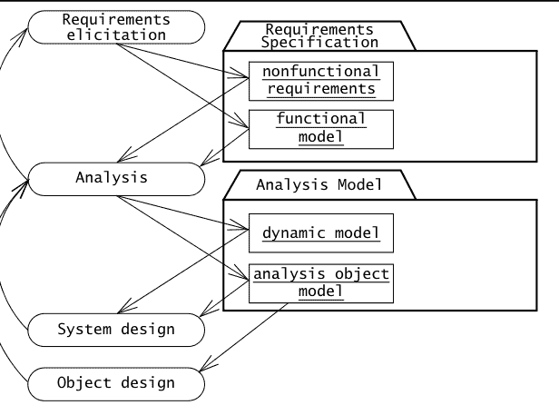

图 5-2 需求获取与分析的产物（UML 活动图）。

由于分析模型可能无法被用户理解，开发者需要更新需求以反映分析过程中获得的见解。用户和开发者有一种将困难决策推迟到项目后期的自然倾向。然而，困难的决策最终必须在测试或用户评估期间做出。

分析模型由三个模型组成：用用例和场景表示的`功能模型`、用类图表示的`对象模型`，以及用状态机和序列图表示的`动态模型`（图 5-3）。在前一章中，我们描述了需求。在本章中，我们描述如何精炼功能模型并推导出动态模型。我们通过描述与分析相关的管理活动结束本章。在下一节中，我们将定义分析的主要概念。

| 用例图:视图 | 类图:视图 | 状态机图:视图 | 序列图:视图 |
|---|---|---|---|
| 功能模型:模型 | 对象模型:模型 | 动态模型:模型 | |

图 5-3 分析模型由功能模型、对象模型和动态模型组成。在 UML 中，功能模型用用例图表示，对象模型用类图表示，动态模型用状态机和序列图表示。

### 5.3 分析概念

在本节中，我们将描述本章使用的主要分析概念。特别是我们将描述：

- 5.3.1 分析对象模型与动态模型（节 5.3.1）
- 5.3.2 实体、边界和控制对象（节 5.3.2）
- 5.3.3 一般化与特化（节 5.3.3）

#### 5.3.1 分析对象模型与动态模型

分析模型从用户视角表示开发中的系统。**分析对象模型**是分析模型的一部分，侧重于系统操作的单个概念及其属性和关系。分析模型用 UML 类图表示，包含了类、属性和操作。分析对象模型是用户可见的主要概念的可视化。

**动态模型**侧重于系统的行为。动态模型用序列图和状态机表示。序列图表示单个用例期间一组对象之间的交互。状态机表示单个对象（或一组紧耦合的对象）的行为。动态模型的作用为单个类分配责任，并在过程中识别出需要添加到分析模型中的新类、关联和属性。

组件。例如，诸如 `Database`、`Subsystem`、`SessionManager`、`Network` 等类不应出现在分析模型中，因为用户完全被这些概念隔离开了。请注意，分析对象模型中的大多数类将对应于源代码中的一个或多个软件类。然而，软件类包含比其分析对应更多的属性和关联。因此，分析类应被视为在后期细节中实现的高级抽象。图 5-4 展示了 ReportEmergency 示例中分析对象的正反例。

领域概念应该出现在分析模型中。软件类不应出现在分析模型中。

| 领域概念 | 软件类 | 说明 |
|---|---|---|
| UniversalTime | TimeZone | 指向时区如何存储（设计决策）。 |
| TimeZone | GPSLocator | 指向位置如何测量（设计决策）。 |
| Location | UserID | 指向识别位置的内部机制 |

**图 5-4** ReportEmergency 示例中分析对象的正与反例。

#### 5.3.2 实体、边界和控制对象

分析模型由实体、边界和控制对象组成 [Jacobson et al., 1999]。**实体对象**代表系统跟踪的持久化信息。**边界对象**代表参与者与系统之间的交互。**控制对象**负责实现用例。在 ReportEmergency 示例中，`Year`、`Month` 和 `Day` 是实体对象；`Button` 和 `LCDDisplay` 是边界对象；`ChangeDateControl` 是一个通过组合按钮更改日期的对象。使用实体、边界和控制对象进行建模为开发者提供了区分不同但相关概念的简单启发。例如，`LCDDisplay` 显示了跟踪的时间。区分边界对象和实体对象强制要求区分：ReportEmergency 跟踪的时间由 `Time` 对象表示。三对象方法会导致对变化更具韧性的模型：界面（由边界对象表示）比其基本功能（由实体和控制对象表示）更容易变化。通过分离界面和基本功能，我们能够保持模型的大部分不变，例如用户界面会变化，但实体对象不会。

为了区分不同类型的对象，UML 提供了类型（stereotype）机制，允许开发者为元素附加此类元信息。例如，在图 5-5 中，我们为 `ChangeDateControl` 对象附加了`«control»`类型。除了类型之外，我们还可以使用命名约定来提高清晰度，并区分不同类型的对象：控制对象可能会在名称后加上后缀；边界对象可能会清楚地表示界面（例如加上 `Form`、`Display` 或 `Boundary` 后缀）；实体对象通常不会在名称后加上任何后缀。这种命名约定的另一个好处是，即使在只检查源代码时，也能表示类的类型。

| «entity» | «control» | «boundary» |
|---|---|---|
| Year | ChangeDateControl | Button |
| «entity» | | LCDDisplay |
| Month | | |
| Day | | |

**图 5-5** ReportEmergency 的分析类及其与特化。

正如我们在第 2 章“使用 UML 建模”中所看到的，*继承*使能够将概念组织成层次。层次顶部是一个通用概念（例如图 5-6 中的 `Incident`），层次底部是最具体的概念（例如 `CatTree`、`TrafficAccident`、`BuildingFire`、`ChemicalLeak`）。之间可能存在任意数量的中间层次，涵盖不同程度的泛化概念（例如 `LowPriorityIncident`、`Emergency`、`Disaster`）。此类层次允许我们精确引用许多实例。当我们使用 `Incident` 一词时，指的是需要立即响应的事件。

**泛化**是从低级概念识别抽象概念的建模活动。例如，假设我们正在逆向应急管理系统，并发现了管理交通事故和火灾的屏幕。注意到这三个概念之间的特征，我们创建一个名为 `Emergency` 的抽象，来描述交通事故和火灾的共同（通用）特征。

**特化**是从高级概念识别更具体概念的活动。例如，假设我们从零开始构建应急管理系统，并与客户讨论其功能。首先向我们介绍了

### 5.4 分析活动：从用例到对象

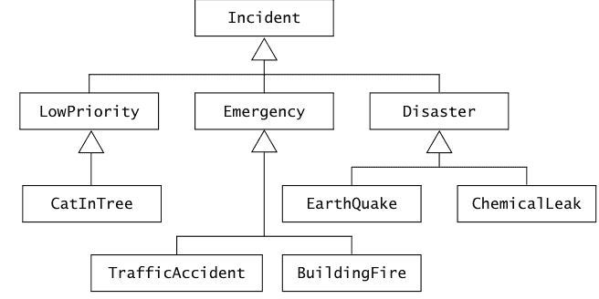

**图 5-6** 泛化层次示例（UML 类图）。层次顶部代表最通用的概念，而底部节点代表最具体的概念。

事件的概念，描述了三类型的事件：`Disasters`（灾难，需要多个机构协作）、`Emergency`（紧急，需要立即处理但由单个机构处理）以及 `LowPriorityidents`（低优先级事件，如果高优先级事件需要资源，则不需要处理）。

在两种情况下，泛化和特化导致概念之间继承关系的规范。在某些实例，建模者将继承关系称为**泛化-特化**。在书中，我们使用“继承”来表示关系，使用“泛化”和“特化”来表示活动。

#### 5.4 分析活动：从用例到对象

在本节中，我们描述了将在需求获取过程中产生的用例和场景转换为分析模型的活动。活动包括：

- 识别实体对象（第 5.4.1 节）
- 识别边界对象（第 5.4.2 节）
- 识别控制对象（第 5.4.3 节）
- 使用序列图映射用例（第 5.4.4 节）
- 使用 CRC 卡建模交互（第 5.4.5 节）
- 识别关联（第 5.4.6 节）
- 识别聚合（第 5.4.7 节）
- 识别属性（第 5.4.8 节）
- 建模状态行为（第 5.4.9 节）
- 建模继承关系（第 5.4.10 节）
- 审查分析模型（第 5.4.11 节）

我们通过关注第 4 章“需求获取”中的 ReportEmergency 示例来说明每个活动。这些活动的启发式方法改编自 [De Marco, 1978]、[Jacobson et al., 1999]、[Rumbaugh, al., 1991] 以及 [Wirfs-Brock et al., 1990]。

##### 5.4.1 识别实体对象

参与对象（参见第 4.4.6 节）是分析模型的基础。正如第 4 章“需求获取”所述，通过检查每个用例可以发现参与对象。自然语言 [Abbott, 1983] 是识别需求规范中对象、属性和关联的一种直观启发式方法。Abbott 的启发式将词性（例如名词、拥有、动词、形容词）映射到模型组件（例如对象、操作、继承关系、类）。表 5-1 通过检查 ReportEmergency 示例提供了此类映射的实例。

| 用例名称 | ReportEmergency（报告紧急情况） |
| :--- | :--- |
| 入口条件 | 1. 现场人员（FieldOfficer）通过向该人员展示表单来做出响应。该表单包含紧急类型菜单（普通、火灾、交通）、位置、事件描述、资源请求和危险品。 |
| 事件流 | 3. 现场人员通过指定最少类型和描述字段来完成表单。现场人员还可能描述对紧急情况的可能响应，并请求特定的资源。表单填写完成后，现场人员通过点击“发送报告”按钮提交表单，此时，调度派员（Dispatcher）将收到通知。<br>4. 调度派员查看现场人员提交的信息，并通过调用 `OpenIncident` 用例在数据库中创建一个“事件（Incident）”。现场人员表单中包含的所有信息都将自动包含在事件中。调度派员通过为事件分配资源（使用 `AllocateResources` 用例）来完成选择，并通过向现场人员发送一条 `FRIENDgram` 来确认紧急报告。 |
| 出口条件 | 5. 现场人员接收确认信息和选定的响应。 |

图 5-7 用例示例，ReportEmergency（单列格式）。

语言分析的结论是，名词远多于相关的类。许多名词对应于其他名词的属性或同义词。对于大型需求说明书，对所有名词进行分类是一项耗时的活动。通常情况下，Abbott 的启发式方法对于从简短描述（如场景的事件流或用例）中生成初始候选对象列表效果良好。以下启发式方法可以与 Abbott 的方法结合使用：

**识别实体对象的启发式方法**

- 开发人员或用户为了理解用例而需要澄清的事物
- 用例中反复出现的名词（例如：`Incident`）
- 系统需要跟踪的现实世界实体（例如：`FieldOfficer`、`Dispatcher`、`Resource`）
- 系统需要跟踪的现实活动（例如：`EmergencyOperationsPlan`）
- 数据源或汇（例如：`Printer`）。

开发人员在识别对象时，为其命名并简要描述其属性和职责。唯一地命名对象有助于促进标准术语。对于实体对象，我们建议始终使用终端用户和应用领域专家使用的名称。描述对象（即使是简要的）允许开发人员澄清他们使用的概念并避免误解（例如，用一个对象表示两个不同但相关的概念）。然而，由于分析模型处于变动中，开发人员不需要花费大量时间细节对象或属性。如果属性和职责显而易见，开发人员就不应记录；否则，为每个对象提供一个暂定的名称和简要描述就足够了。在此过程中会有多次迭代来对对象进行修订。但是，一旦分析模型稳定，每个对象的描述应尽可能详细（见第 5.4.11 节）。

例如，对 `Emergency` 用例（图 5-7）进行首次检查，我们利用应用领域知识和对用户的访谈来识别 `Dispatcher`、`EmergencyReport`、`FieldOfficer` 和 `Incident` 对象。注意，在 `ReportEmergency` 用例中并没有明确提到 `EmergencyReport` 对象。该用例的第 4 步将紧急报告称为“由现场人员提交的信息”。在与客户审查后，我们发现这些信息被称为“紧急报告”，并决定将相应的对象命名为 `EmergencyReport`。

实体对象的定义得出了表 5-2 中描述的初始分析模型。注意，该模型对于实现 `ReportEmergency` 用例的系统描述描述。在下一节中，我们将描述边界对象的识别。

## 表 5-2 ReportEmergency 用例的实体对象。

| Dispatcher | 管理 `Incident`（事件）的警察。调度派员根据紧急报告以及与现场人员的其他通信，打开、记录和关闭 `Incident`。调度派员通过徽章号进行识别。 |
| :--- | :--- |
| EmergencyReport | 现场人员向调度派员提交的关于 `Incident` 的初始报告。一份 `EmergencyReport` 通常会触发调度派员创建 `Incident`。一份 `EmergencyReport` 由紧急级别、类型（火灾、交通事故、其他）、位置和描述组成。 |
| FieldOfficer | 值班的警察或警官。一名现场人员一次最多被分配给一个 `Incident`。现场人员通过徽章号进行识别。 |
| Incident | 需要现场人员关注的状况。现场人员或系统外部任何人员都可以在系统内报告 `Incident`。一个 `Incident` 由描述、响应、状态（已开启、已关闭、已记录）、位置和现场人员数量组成。 |

#### 5.4.2 识别边界对象

边界对象代表系统与参与者（actors）之间的接口。在每个情况下，每个参与者都至少与一个边界对象交互。边界对象收集参与者的信息并将其转换为实体对象和控制对象使用的格式。

边界对象在粗粒度上对用户界面建模。它们没有详细描述用户界面的视觉方面。例如，作为“菜单项”或“滚动条”的边界对象过于详细了。首先，开发人员可以通过草图和原型更方便地讨论用户细节。其次，即使系统的功能规范变得稳定，用户界面的设计也会随着可用性测试而不断演进。为每次用户界面的变化更新分析模型是耗时的，并且不会产生任何实质性收益。

**识别边界对象的启发式方法**

- 识别控制用户启动用例的用户界面控件（例如：`ReportEmergencyButton`）。
- 识别用户需要向系统输入数据的表单（例如：`EmergencyReportForm`）。
- 识别系统需要响应的表单（例如：`EmergencyReportForm`）。
- 当多个参与者参与用例时，识别边界对象（例如：`DispatcherStation`）。
- 在描述边界对象时，始终使用用户所使用的术语。

我们通过检查 `ReportEmergency` 用例来定义边界对象。

## 表 5-3 ReportEmergency 用例的边界对象。

| AcknowledgmentNote | 用于调度派员的确认通知。 |


| DispatcherStation | 用于调度派员的计算机。 |
|---|---|
| ReportEmergencyButton | 用于现场人员启动 `ReportEmergency` 的按钮。 |
| EmergencyReportForm | 用于 `ReportEmergency` 的表单。在选择“紧急”时，该表单显示给现场人员。 |
| FieldOfficerStation | 用于现场人员的移动计算机。 |
| IncidentForm | 用于创建 `Incident` 的表单。在接收到 `EmergencyReport` 时，该表单显示给调度派员。调度派员还使用此表单分配资源并确认现场人员。 |

注意，`ReportEmergency` 用例的任何地方都没有提到 `IncidentForm`。我们识别这个对象是因为发现调度派员需要一个界面来查看现场人员提交的紧急报告。在分析模型中描述边界对象的术语应遵循用户术语，即使使用实现领域的术语非常具诱惑。

我们已经在描述系统方面取得了进展。我们现在包含了参与者与系统之间的接口。然而，我们仍然缺失交互发生的顺序的重要部分。在下一节中，我们将描述控制对象的识别。

## 5.4.3 识别控制对象

控制对象负责协调边界对象和实体对象。控制对象通常在现实世界中没有对应的实体。通常用例与控制对象之间存在着密切的关系；控制对象通常在用例开始时创建，并在用例结束时消失。它负责从边界对象收集信息并调度到实体对象。例如，控制对象描述了与序列、撤销和历史队列以及在分布式系统中分发信息相关的行为。

最初，我们为每个参与者对 `ReportEmergency` 用例建模了一个控制对象，分别为现场人员的 `ReportEmergencyControl` 和调度派员的 `ManageEmergencyControl`（见表 5-4）。

用两个控制对象对 `ReportEmergency` 用例建模的决策源于 `FieldOfficerStation` 和 `DispatcherStation` 实际上是两个异步链路通信的两个子系统。这一决策可以推迟到设计阶段。另一方面，在分析模型中使这一概念可视化使我们能够关注诸如两站通信中断之类的异常行为。

### 识别控制对象的启发式方法

- 每个用例识别一个控制对象。
- 每个用例中的每个参与者识别一个控制对象。
- 控制对象的生命周期应该覆盖用例的范围或会话范围。如果很难识别控制对象激活的开始和结束，那么相应的用例可能没有定义良好的入口和出口条件。

在建模 `ReportEmergency` 用例时，我们通过实体、边界和控制对象建模了相同的功能。

## 分析活动：从用例到对象

**表 5-4** 报告紧急（ReportEmergency）用例的控制对象。

| 对象 | 描述 |
|---|---|
| ReportEmergencyControl | 管理现场员工作站（`FieldOfficerStation`）上的报告紧急报告功能。该对象在现场员选择“报告紧急”按钮时创建。随后，它创建一个紧急报告（`EmergencyReport`）并将其展示给现场员。提交表单后，它从表单中收集信息，创建一个紧急报告并将其转发给调度员（`Dispatcher`）。控制对象等待调度员站（`DispatcherStation`）的确认。收到确认后，`ReportEmergencyControl` 创建确认通知（`AcknowledgmentNotice`）并将其显示给现场员。 |
| ManageEmergencyControl | 管理调度员站（`DispatcherStation`）上的报告紧急报告功能。该对象在接收到紧急报告时创建。随后，它创建一个事故表（`IncidentForm`）并将其显示给调度员。一旦调度员创建了事故、分配了资源（`Resources`）并提交了确认，`ManageEmergencyControl` 将确认发送给现场员工作站。 |

使用报告紧急用例和发现的对象构建时序图，以确保我们的模型的完整性。

## 5.4.4 使用时序图映射用例到对象

时序图将用例与对象连接起来。它展示了用例（或场景）的行为是如何分布在其参与的对象之间的。时序图通常不像用例那样是与用户沟通的媒介，因为时序图需要更多的符号表示。对于精明的客户来说，它们是直观的，并且比用例更精确。在任何情况下，时序图都代表了视角的转变，并允许开发人员发现需求规范中缺失的对象或灰色地带。

在本文模型中，我们展示了实现该用例所需的对象间交互序列。图 5-8 至 5-10 是与报告紧急用例相关的时序图。时序图的列代表参与用例的对象。最左的列是启动用例的参与者（actor）。水平箭头表示从一个对象发送到另一个对象的消息或刺激。时间从上到下垂直进行。例如，图 5-8 中的第一个箭头代表现场员发送给报告紧急按钮（`ReportEmergencyButton`）的按下消息。接收消息会触发操作的激活。激活由一个垂直矩形表示，其他消息可以从该矩形产生。矩形的长度表示操作处于激活的时间。在图 5-8 中，由按下消息触发的操作向 `ReportEmergencyControl` 类发送了一个创建（`create`）消息。操作可以被看作对象向其他对象提供的服务。时序图还描述了对象的生命周期。在时序图第一个刺激之前已经存在的对象绘制在图的顶部。在交互期间创建的对象用指向对象的 `«create»` 消息表示。在交互期间被销毁的实例用一个叉号表示该对象停止存在的时间。在表示对象的矩形和叉号（或图的底部）之间，一条虚线表示对象可以接收消息的时间段。对象在叉号之前无法接收消息。例如，在图 5-8 中，当 `ReportEmergencyControl` 对象发送 `«create»` 消息时，创建了 `ReportEmergencyForm` 类对象，并在紧急报告表单（`EmergencyReportForm`）提交后被销毁。

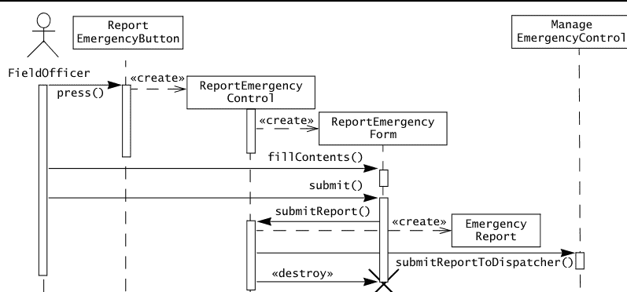

**图 5-8** 报告紧急用例的时序图。

通常，时序图的第二列代表参与者交互以启动用例的边界对象（boundary object），例如报告紧急。第三列是管理用例其余部分的控制对象，例如 `ReportEmergencyControl`。从那时起，控制对象创建其他边界对象，并可能与其他控制对象进行交互，例如 `ManageEmergencyControl`。

在图 5-9 中，我们发现了我们在初始分析中遗漏的实体对象确认（`Acknowledgement`）。在描述报告紧急用例时，我们发现该用例（图 7）是不完整的，它只提到了确认的存在，但没有描述与之相关的信息。在确认通知（`AcknowledgmentNotice`）边界对象创建之前，在这种情况下我们需要对报告紧急用例进行进一步澄清。分析活动：从用例到对象。

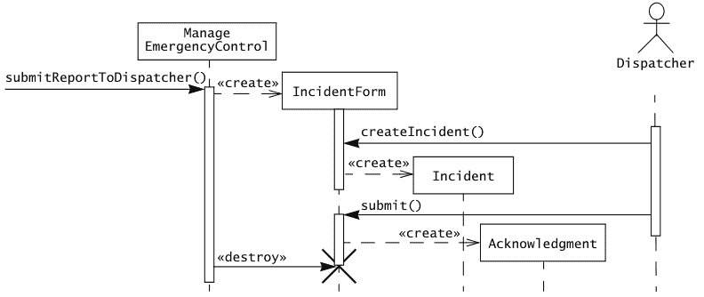

**图 5-9** 报告紧急用例的时序图续。

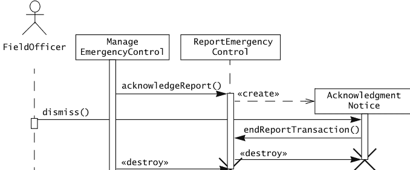

**图 5-10** 报告紧急用例的时序图续。

在获得此类确认（`Acknowledgement`）后，确认对象被添加到分析模型中（表 5-5），且报告紧急用例得到了澄清（图 5-11）。通过构建时序图，我们不仅模拟了对象之间的交互顺序，还将责任分配给每个对象，其形式为一组操作。这些操作可以在参与该对象的任何用例中共享。请注意，如果一个操作出现在两个或多个时序图中，其定义应该是相同的。

### 用例名称

**报告紧急（ReportEmergency）**

### 入口条件

1. 现场员激活了其终端上的“报告紧急”功能。

### 事件流

2. 系统通过向现场员展示表单做出响应。表单包括紧急类型菜单（普通、火灾、交通）、位置、事故描述、资源请求和危险品。
3. 现场员通过指定紧急类型字段完成表单。现场员也可以描述对紧急情况的响应并请求特定资源。一旦表单完成，现场员通过点击“发送报告”提交表单，此时通知调度员。
4. 调度员查看现场员提交的信息，并使用打开事故（`OpenIncident`）用例在数据库中创建一个事故。现场员表单中的所有信息都自动包含在事故中。调度员通过为事故分配资源（使用分配资源 `AllocateResources` 用例）进行选择，并通过向现场员发送确认（`Acknowledgment`）来确认报告。确认告知现场员已收到紧急报告、创建了事故并分配了资源。

### 退出条件

5. 现场员收到确认和选定的响应。

**图 5-11** 改进后的报告紧急用例。确认对象的发现和添加分析模型表明，原始的报告紧急用例未能准确描述与确认相关的信息。改进部分用粗体表示。

**表 5-5** 报告紧急用例的确认对象。

## 确认（Acknowledgement）

调度员对现场员紧急报告的响应。通过发送确认，调度员向现场员告知其已收到了紧急报告、创建了事故并分配了资源。确认包含了分配的资源和预计到达时间。

# 分析活动：从用例到对象 189

性能等问题不应在此阶段予以解决。鉴于构建交互图可能非常耗时，开发者应该优先关注有问题的或定义不充分的功能。为系统中的简单或定义良好的部分绘制交互图可能看起来不是对分析资源的明智投资，但也应该这样做，以避免忽略关键决策。

### 绘制序列图的启发式方法

- 第一列应对应启动用例的参与者（actor）。
- 第二列应该是边界对象（boundary object，即用于启动用例的参与者）。
- 第三列应该是控制对象（control object），用于管理用例的其余部分。
- 控制对象由启动用例的边界对象创建。
- 边界对象由控制对象创建。
- 实体对象（entity objects）由控制对象和边界对象访问。
- 实体对象永远不访问边界或控制对象；这使得在用例之间共享实体对象变得更容易。

## 5.4.5 使用 CRC 卡片建模对象间的交互

识别对象间交互的替代方法是 CRC 卡片 [Beck & Cunningham, 1989]。CRC 卡片（CRC 代表类 class、职责 responsibilities 和协作者 collaborators）最初被引入为向初学者和不熟悉面向对象的资深开发者教授面向对象概念的工具。每个类都用索引卡片（称为 CRC 卡）表示。类名显示在顶部，职责显示在左列，而完成这些职责所需的类名显示在右列。图 5-12 展示了 `ReportEmergencyControl` 和 `Incident` 类的两个卡片。

在与团队的建模会议期间可以使用 CRC 卡片。参与者（通常是开发者和应用设计专家的混合）遍历一个场景，并识别实现该场景涉及的类。每个类放一张卡片放在桌子上。

| ReportEmergencyControl | | Incident | |
|---|---|---|---|
| 职责 | 协作者 | 职责 | 协作者 |
| 从现场人员收集输入 | EmergencyReport | 跟踪与单个事件相关的所有信息。 | Resource |
| 控制紧急报告期间的表单序列 | AcknowledgmentNotice | | |

**图 5-12** `ReportEmergencyControl` 和 `Incident` 类的 CRC 卡示例。

随着场景的展开和参与者协商每个对象的职责，卡片被分配给每个类。协作者列通过识别出的卡片间的依赖关系来填充。当探索新的替代方案时，卡片会被修改或推到一侧。卡片永远不会丢弃，因为当提出新想法时，可以重用过去替代方案的构建块。

CRC 卡片和序列图是支持同一类型活动的两种不同表示形式。序列图是单一模型或记录交互序列的更好工具，因为它们更精确、紧凑。CRC 卡片是开发者小组在脑风暴会议期间精炼和迭代对象结构的更好工具，因为它们更容易创建和修改。

## 5.4.6 识别关联

序列图允许开发者表示随时间演变的对象间交互，而类图则允许开发者描述对象之间的相互依赖关系。我们在第 2 章“使用 UML 建模”中描述了 UML 类图，并在本书中使用它来表示各种项目产物（例如交付物）。在本节中，我们将讨论如何使用类图表示对象之间的关联。在 5.4.8 节中，我们将讨论如何使用类图表示对象属性。

关联（association）显示两个或多个类之间的关系。例如，一名现场人员（`FieldOfficer`）编写一份紧急报告（`EmergencyReport`，见图 5-13）。识别关联有两个优势。首先，它通过使对象之间的关系明确化了分析模型（例如，紧急报告可以由现场人员或调度员创建）。其次，它允许开发者发现与链接相关的边界情况（boundary cases）。边界情况是必须在模型中澄清的异常。例如，直观上可以假设大多数紧急报告是由一名现场人员编写的。然而，系统是否应该支持由多个现场人员编写的紧急报告？系统是否允许匿名的紧急报告？这些问题应该在分析期间通过与客户或最终用户讨论来调查。

关联具有几个属性：

- 一个用于描述两个类之间关联的名称（例如图 5-13 中的 `Writes`）。关联名称是可选的，不需要在全局范围内使用。
- 每个端一个角色（role），识别每个类相对于关联的功能（例如，`author` 是 `FieldOfficer` 在 `Writes` 关联中扮演的角色）。
- 每个端一个多重性（multiplicity），识别可能的实例数量（例如，`*` 表示一名现场人员可以编写零或多份紧急报告，而 `1` 表示每份紧急报告恰好有一个现场人员作为作者）。

最初，实体对象之间的关联最重要的，因为它们揭示了更多关于应用领域的信息。根据 Abbott 的启发式方法（见表 5.1），可以通过检查动词和表示状态的动词（例如：`is part of`、`manages`、`reports to`、`is triggered by`、`is contained in`、`talks to`、`includes`）来识别关联。每个关联都应该命名，并为每个端分配角色。

### 识别关联的启发式方法

- 检查动词短语。
- 精确命名关联和角色。
- 尽可能使用限定（qualifiers）。
- 在集合稳定之前，不要担心多重性。
- 消除不必要的关联。
- 过多的关联会让模型变得不可理解。

大多数实体对象都有识别特征。例如，在图 14 中，现场人员和调度员通过日期识别。聚合（aggregations）是表示整体与部分关系的特殊类型。开发者遍历需要访问特定类的关联序列。

## 5.4.7 识别聚合体

聚合是表示整体与部分关系的特殊关联类型。例如，消防站（`FireStation`）由若干消防员、消防车、救护车和领队车辆组成。一个州（`State`）由多个县（`County`）组成，县又由多个镇（`Township`）组成（图 5-15）。聚合显示为部分端带有菱形的关联。

聚合有两种类型：组合（composition）和共享（shared）。实心菱形表示组合。组合聚合表示部分的存在依赖于整体。例如，一个县恰好属于一个州，一个镇始终属于一个县。由于政治边界不经常改变，一个镇不会属于或共享另一个县（至少在应急系统的生命周期内）。

空心菱形表示共享聚合关系，表明整体和部分可以独立存在。例如，虽然一辆消防车在此时最多属于一个消防站，但在其生命周期内它可以重新分配到不同的消防站。

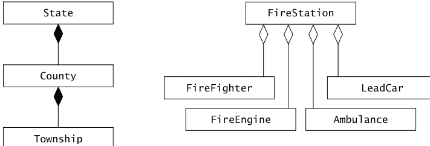

**图 5-15** 聚合和组合的示例（UML 类图）。一个州由多个县组成，县又由多个镇组成。消防站包括消防员、消防车、救护车和领队车辆。

# 分析活动：从用例到对象

聚合关联在分析模型中用于表示“整体-部分”的概念。聚合关联为分析模型增加了信息，说明了应用领域中的包含关系如何在层次结构或有向图中进行组织。聚合通常用于用户界面，以帮助用户浏览许多实例。例如，在图 5-15 中，`FRIEND` 可以为分发员（`Dispatchers`）提供一种树形表示，以便查找某个州（`State`）内的县（`Counties`）或特定县内的乡镇（`Townships`）。然而，由于许多建模概念，很容易导致模型过度结构。如果你不确定所描述的关联是否为整体-部分概念，最好先对其进行建模，并在以后对应用领域有了更好的理解时再次审视它。

## 5.4.8 识别属性

属性是单个对象的属性。例如，表 5-2 所示的紧急报告（`EmergencyReport`）具有一个紧急类型、一个位置和一个描述属性（见图 5-16）。这些属性是由现场警员（`FieldOfficer`）在报告紧急情况时输入的，随后由系统进行跟踪。在识别属性时，应仅考虑与系统相关的属性。例如，每位现场警员都有社会安全号码，但这与紧急信息系统无关。相反，现场警员通过徽章号（badge number）识别，表示为 `badgeNumber`。

| EmergencyReport |
|---|
| `emergencyType:{fire,traffic,other}` |
| `location:String` |
| `description:String` |

**图 5-16** `EmergencyReport` 类的属性。

由对象表示的属性不是属性。例如，每个 `EmergencyReport` 都有一个作者，该作者通过通过到 `FieldOfficer` 类的关联来表示。开发者在识别属性之前，应该尽可能多地识别关联，以避免混淆属性和对象。属性具有：

- 一个在对象内部标识它们的名称。例如，一个 `EmergencyReport` 可能会有一个 `reportType`（报告类型）属性和一个 `emergencyType`（紧急类型）属性。`reportType` 描述所提交的报告类型（例如：初始报告、资源请求、最终报告）。`emergencyType` 描述紧急情况的类型（例如：火灾、交通、其他）。为了避免混乱，这些属性不应都命名为 `type`。
- 简短的描述。
- 一个描述其可以取的合法值的类型。例如，`EmergencyReport` 的 `description` 属性是一个字符串。`emergencyType` 属性是一个枚举，可以取三个值之一：`fire`、`traffic`、`other`。属性类型基于 UML 中预定义的基本类型。


可以使用 Abbott 的启发式方法（见表 5-1）来识别属性。特别应该检查名词短语后接所有格短语（例如：紧急情况的描述 `the description of an emergency`）或形容词短语（例如：紧急的 `the emergency`）。对于实体对象，任何必须由系统存储的属性都是候选属性。

请注意，属性代表了对象模型中最不稳定的部分。通常，在开发后期当用户对系统进行评估时，会发现或添加属性。除非添加的属性与额外功能相关，否则添加的属性不会导致对象（以及系统）结构发生重大变化。由于这些原因，开发者不需要在识别和详细描述代表系统不重要方面的属性上花费过多资源。这些属性可以在分析模型或用户界面草图得到验证后以后添加。

## 识别属性的启发式方法

- 检查所有格短语。
- 将表示的状态作为实体对象的属性。
- 描述每个属性。
- 不要将属性表示为对象；请用关联代替（见第 5.4.6 节）。
- 在对象结构稳定之前，不要浪费时间描述细节。

> 改自 [Rumbaugh et al., 1991]。

## 5.4.9 建模单个对象的状态相关行为

时序图（`Sequence diagrams`）用于将行为分布到对象之间并识别操作。时序图从单个用例的角度表示系统行为。状态机图（`state machine diagrams`）从单个对象的角度表示行为。从单个对象的角度查看行为，从单个用例的角度表示行为。从单个用例的角度查看行为，从单个对象的角度表示行为。（注：由于原文此处存在严重的重复和逻辑混乱，翻译已根据语意进行了理顺，此处保留了核心表达的逻辑结构）。……除非添加的属性与额外功能相关，否则添加的属性不会导致对象（以及系统）结构发生重大变化。由于这些原因...）

图 5-17 显示了 `Incident` 的状态机。


## 5.4.10 对象间的继承关系

泛化（`Generalization`）用于消除分析模型中的冗余。如果两个或多个类共享属性或行为，则将其合并到一个父类中。例如，分发员和现场警员都有一个用于标识它们的 `badgeNumber` 属性。为了明确建模这种相似性，我们引入了一个抽象类 `Officer`，`FieldOfficer` 类和 `Dispatcher` 类均继承自它（见图 5-18）。

| PoliceOfficer |
| :--- |
| `badgeNumber:Integer` |
| | `FieldOfficer` | `Dispatcher` |

**图 5-18** 继承关系的示例（类图）。

## 5.4.11 评审分析模型

分析模型是增进和迭代构建的。分析模型在第一次运行时通常是不准确或完整的。在分析模型收敛为供开发人员使用的正确规格之前，需要与客户进行多次迭代。例如，分析过程中发现的遗漏将导致需求规格中添加或扩展用例，这可能会从那里获取更多信息。

一旦模型的更改极少且影响范围局部，分析模型就会变得稳定。然后，对分析模型进行评审，首先由开发者（即内部评审），然后由开发者和客户共同评审。评审的目标是确保需求规格是正确、完整、一致且无错误的。此外，开发者和客户还要评审需求是否真实且可验证。请注意，开发者应该准备好发现错误并对规格进行更改。然而，在上游尽可能捕捉需求错误是一项值得的投资。可以通过清单或问题列表来辅助评审。以下是改自 [Jacobson et al., 1999] 和 [Rumbaugh et al., 1991] 的示例问题。

为了确保模型正确，应询问以下问题：

- 模型是否能被用户理解？
- 抽象类是否对应用户级概念？
- 所有描述是否符合用户的定义？
- 实体对象和边界对象是否有具有意义的名词短语命名？
- 所有用例和控制对象是否有具有意义的动词短语命名？
- 所有的异常情况是否都描述并处理？

为了确保模型完整，应询问以下问题：

- 对于每个对象：是否有任何用例需要它？在哪个用例中创建？销毁？是否可以从边界对象访问？
- 针对每个属性：它是何时设置的？它的类型是什么？它应该是限定符吗？
- 针对每个关联：何时被遍历？为什么选择特定的多重性？一对多和多对多的多重性关联是否需要限定？
- 针对每个控制对象：它是否具有必要的关联来访问参与其对应用例的对象？

为了确保模型的一致性，应该提出以下问题：

- 是否存在同名的多个类或用例？
- 命名相似的实体（例如用例、类、属性）是否表示相似的概念？
- 是否存在具有相似属性和关联但不在同一泛化层次结构中的对象？

为了确保分析模型所描述的系统是真实的，应该提出以下问题：

- 系统是否存在任何新特性？是否进行了研究或构建了原型以确保其可行性？
- 是否能够满足性能和可靠性要求？这些需求是否通过在所选硬件上运行的原型进行了验证？

## 5.4.12 分析总结

需求爬取活动是高度迭代且增量性的。功能块被勾勒并提交给用户和客户。客户添加需求、批评现有功能并修改现有需求。开发人员通过原型设计和技术研究来调查非功能性需求，并对每个提出的需求提出挑战。最初，需求爬取类似于脑风暴活动。随着系统描述的增长和需求的变得更加具体，开发人员需要以更有序的方式扩展和修改分析模型，以管理信息的复杂性。

图 5-19 展示了分析活动的典型序列。用户、开发人员和客户参与了初始用例模型的开发。他们识别了许多概念并构建了参与对象的词汇表。前两个活动在上一节中讨论过。其余活动在本节中涵盖。开发人员将参与对象分为实体对象、边界对象和控制对象（*定义实体对象*，第 5.4.1 节；*定义边界对象*，第 5.4.2 节以及*定义控制对象*，第 5.4.3 节）。这些活动以紧密循环的方式进行直到系统的大部分功能都被识别为具有名称和简要描述的用例。然后，开发人员构建序列图以识别任何缺失的对象（*定义交互*，第 5.4.4 节）。当所有实体对象都已命名并进行了简要描述后，分析模型在完善过程中应保持相当稳定。


**图 5-19** 分析活动（UML 活动图）。

**定义关联**（第 5.4.6 节）、**定义属性**（第 5.4.8 节）和**定义状态相关行为**（第 5.4.9 节）构成了分析模型的细化。这三个活动在紧密循环中进行，在此期间，从序列图中提取并详细说明对象的状态及其关联。然后对用例进行修改，以考虑功能上的任何变化。这一阶段可能会导致以额外用例的形式识别出额外的功能块。然后对这些新用例以增量的方式重复整个过程。

在**合并模型**（第 5.4.10 节）期间，开发人员通过引入限定符和泛化关系以及消除冗余来巩固模型。在**评审模型**（第 5.4.11 节）期间，客户、用户和开发人员检查模型的正确性、一致性、完整性和真实性。项目计划应安排多次评审，以确保高质量的需求并提供学习需求活动的机会。然而，一旦模型达到大多数修改仅为装饰性的程度，系统设计就应该进行。在需求阶段会达到一个点，即如果没有来自原型设计、可用性研究、技术调查或系统设计的进一步信息，将无法预见到更多问题。确保每个细节都正确将变成一种浪费：这些细节中的某些在下一次变化时就会变得无关。管理层应该意识到这一点并启动项目的下一阶段。

### 5.5 管理分析

在本节中，我们讨论了在多团队开发项目中管理分析活动相关的问题。在此类项目中管理需求的主要挑战是在使用许多资源的同时保持一致性。最终，需求分析文档应该描述一个单人可以理解的单一协调系统。

我们描述了一个用于记录分析结果的文档模板（第 5.5.1 节）。接下来，我们描述了分析的角色分配（第 5.5.2 节）。然后我们处理了分析过程中的通信问题。接着，我们处理与需求的迭代和增量性质相关的管理问题（第 5.5.4 节）。

### 5.5.1 分析文档

正如我们在上一节中所看到的，需求爬取和分析活动记录在《需求分析文档》（`RAD`，图 5-20）中。`RAD` 第 1 至 3.5.2 节在需求爬取期间已经编写。在分析期间，我们修订这些章节以消除歧义并发现新功能。然而，主要工作集中在编写记录分析对象模型的章节（`RAD` 第 3.5.3 和 3.5.4 节）。

`RAD` 第 3.5.3 节“对象模型”详细记录我们识别的所有对象、它们的属性，以及在序列图中的操作。每个对象都用文本定义进行描述，对象之间的关系用类图进行说明。

`RAD` 第 3.5.4 节“动态模型”通过状态机图和序列图记录了对象模型的行为。尽管这些信息与用例模型是重复的，但动态模型允许我们更精确地表示复杂行为，包括涉及许多参与者的用例。

`RAD` 在完成并发布后将建立基线并纳入配置管理。`RAD` 的修订部分将提供变更历史，包括变更负责人、变更日期和变更的简要描述。

# 需求分析文档

1. 引言
2. 当前系统
3. 提议系统
   3.1 概述
   3.2 功能需求
   3.3 非功能性需求
   3.4 系统模型
     3.4.1 场景
     3.4.2 用例模型
     3.4.3 对象模型
       3.4.3.1 数据字典
       3.4.3.2 类图
   3.4.4 动态模型
   3.4.5 用户界面——导航路径和原型
4. 词汇表

**图 5-20** 需求分析文档（`RAD`）概述大纲。详细大纲见图 4-16。

# 分析管理

- **分析师**是应用领域的专家，负责对当前系统建模并生成有关未来系统的信息。每位分析师最初负责详细说明一个或多个用例。对于一组用例，分析将使用第 5.4 节中概述的技术来识别若干对象、它们的关联及其属性。分析师通常是具有广泛应用知识的开发者。
- **架构师**是一个集成角色，负责从系统的角度统一用例模型和对象模型。不同的分析师可能有不同的建模风格，并且对他们不负责的系统部分有不同的观点。尽管分析师会共同工作，并可能在分析过程中解决分歧，但架构师的角色是必须的，其负责提供系统哲学并识别需求中的遗漏。
- **文档编辑**负责文档的低级集成，以及文档及其索引的整体格式。
- **配置管理器**负责维护文档的版本历史，以及与其他文档相关的追溯性信息（例如《系统设计文档》；参见第 6 章“系统设计：分解系统”）。
- **评审员**验证需求分析文档（`RAD`）的正确性、完整性、一致性和清晰度。用户、客户、开发者或其他人员在需求验证期间可能成为评审员。尚未参与开发的个人是极佳的评审员，因为他们能够识别歧义和需要澄清之处。

系统的规模决定了需要多少不同的用户和分析师来引导和建模需求。在任何情况下，客户侧和开发侧都应该有一个集成角色。最终，无论系统有多大，需求都应该能让熟悉应用领域的单一个人能够理解。

### 5.5.3 关于分析的沟通

信息的传递任务在需求引导和分析阶段最具挑战性。影响因素包括：

- 参与者的背景不同。用户、客户和开发者具有不同的专业领域，使用不同的词汇来描述相同的概念。
- 利益相关者的预期不同。用户、客户和经理在定义系统有不同的目标。用户希望系统能够支持他们当前的工作流程，且不会对他们目前的职位产生干扰或威胁（例如，改进后的系统通常意味着现有职位的消除）。客户希望投资回报率最大化。管理层希望按时交付系统。项目中不同的预期和不同的利益关系可能导致人们不愿分享信息和不及时报告问题。
- 新团队。需求引导和分析通常标志着一个新项目的开始。这意味着有了新的参与者和新的团队分配，因此存在一个团队成员必须学习如何合作的上手期。
- 演进中的系统。当从零开发新系统时，与新系统相关的术语和概念在大部分分析和系统设计期间处于变化之中。一个术语在明天可能有不同的含义。

没有任何需求方法或沟通机制可以解决与内部政治和信息隐藏的问题。冲突的目标和竞争将始终是大型开发项目的一部分。然而，几条简单的准则可以帮助管理系统冲突观点的复杂性：

- 定义明确的领地。如第 5.5.2 节所述定义角色是这项活动的一部分。这还包括私有和公共讨论论坛的定义。例如，每个团队可以有一个如第 3 章“项目组织与沟通”中描述的讨论数据库，而与客户的讨论在独立的客户数据库上进行。客户不应访问内部数据库。同样，开发者不应干预客户/用户的内部政策。
- 定义明确的目标和成功标准。由客户和开发者共同定义清晰、可衡量且可验证的目标和成功标准有助于解决冲突。请注意，鉴于留出开放式目标更容易，定义一个清晰且可验证的目标是一项艰巨的任务。项目的目标和成功标准应该记录在-
- 头脑风暴。将所有利益相关者放在同一个房间内并快速生成解决方案和定义，可以消除许多沟通障碍。将评审作为一种互惠活动（即在同一会议中评审来自客户和开发者的交付物）具有类似的效果。

头脑风暴以及更广义的需求的协作开发，可以定义支持沟通的共享、即时表示法。故事板（`Storyboards`）、用户界面草图和高级数据流图经常自发出现。随着有关应用领域和新系统的信息的积累，使用结构化符号至关重要。在 `UML` 中，开发者利用用例和场景与客户及用户沟通，并使用对象图、序列图和状态机与其他开发者沟通（参见第 4.4 和 5.4 节）。此外，需求的最新版本应该对所有参与者可用。维护具有最新更改历史的在线实时需求分析文档，有助于变更在整个项目中及时传播。

### 5.5.4 迭代分析模型

分析是以迭代和增量的方式进行的，通常与系统设计和实现等其他开发活动并行。然而需要注意的是，对分析模型的无限制修改和扩展会导致混乱，特别是当涉及大量参与者时。一旦需求确定了基线，必须仔细管理迭代和增加，并跟踪变更请求。需求活动可以视为几个步骤（头脑风暴、固化、成熟）汇聚向稳定的模型。

#### 头脑风暴

在启动任何其他开发活动之前，需求是一个头脑风暴过程。一切——概念和用于引用它们的术语——都会发生变化。头脑风暴过程的目标产生尽可能多的想法，而不一定对它们进行组织。在这个阶段，迭代是快速且深远的。

#### 固化

一旦客户和开发者达成共识，定义了系统的边界并同意一套标准术语，固化就开始了。功能被组织成用例组及其相应的接口。功能组被分配给不同的团队，由他们负责详细说明相应的用例。在这个阶段，迭代是快速但局部的。

#### 成熟

高层更改仍然可能，但难度更大，因此进行得更加谨慎。每个团队负责其分配的功能相关的用例和对象模型。一个由每个团队代表组成的跨职能团队——架构团队负责确保需求的集成（例如命名）。

一旦客户签署了需求，对分析模型的修改应该解决错误和遗漏。开发者，特别是架构团队，需要确保模型的一致性不受损害。需求模型处于配置管理之下，变更应传播到现有的设计模型中。迭代是缓慢且通常是局部的。

系统的功能总是随着时间增加。然而，每次更改都可能威胁系统的完整性。后期变更引入更多问题的风险源于项目中信息的丢失。功能之间的依赖关系并未被完全捕获；许多假设在……可能已经是隐含并被遗忘了

变更通常是为了响应某个问题，在这种情况下，实施面临巨大压力，导致对变更结果仅进行浅层次的检查。当向系统添加新特性和功能时，应该通过以下问题对其进行挑战：它们是客户请求的吗？它们是必要的，还是仅仅是点缀？它们应该作为一个独立的、专注实用程序的一部分，而不是基础系统的一部分？它们是核心需求还是可选功能？变更对现有功能在一致性、接口、可靠性方面有什么影响？

当变更是必要的时，客户和开发者定义变更的范围及其预期结果，并修改分析模型。鉴于系统已经存在完整的分析模型，指定新功能会变得更容易（尽管实现它会更困难）。

## 5.5.5 客户签字 (Client Sign-Off)

客户签字代表客户对分析模型（如需求分析文档所示）的认可。客户和开发者达成共识，对系统将具有的功能和特征达成一致。此外，他们还约定了：

- 优先级列表
- 修订流程
- 用于接受或拒绝系统的标准列表
- 进度表和预算。

对系统功能进行优先级排序允许开发者更好地理解客户的期望。在最简单的形式下，它允许开发者将华有而不实的功能与核心功能区分开。它还允许开发者以增量块交付系统：首先交付核心功能，根据对上一个块的评估来交付额外的块。即使系统是作为一个完整的包交付的，对功能的优先级排序也能让客户清晰地表达什么对她是重要的，以及开发的重点应该放在哪里。图 5-21 提供了一个优先级方案的示例。

每个功能都应分配以下优先级之一：

- **高优先级**——高优先级功能必须在客户验收期间成功演示。
- **中优先级**——在系统设计和对象设计中必须考虑中优先级功能。它将在系统开发的第二次迭代（`second iteration`）中进行实现和演示。
- **低优先级**——低优先级功能展示了系统在长期内如何扩展。

图 5-21 需求优先级方案示例。

### 管理分析

在客户签字后，需求将建立基线（`baseline`），并用于精炼项目的成本估算。签字后需求会继续变化，但这些变化必须遵循更正式的修订流程。需求的变更，可能是由于错误、遗漏、运行环境的变化、应用领域的变化或技术的变化。预先定义修订流程可以鼓励跨项目沟通变更，并减少后期阶段的意外。注意，变更流程不需要是官僚化的或需要过度的开销。它可以简单到只需指定一个人负责接收变更请求、批准变更并跟踪其实现情况。图 5-22 描述了一个更复杂的示例，其中变更经过设计

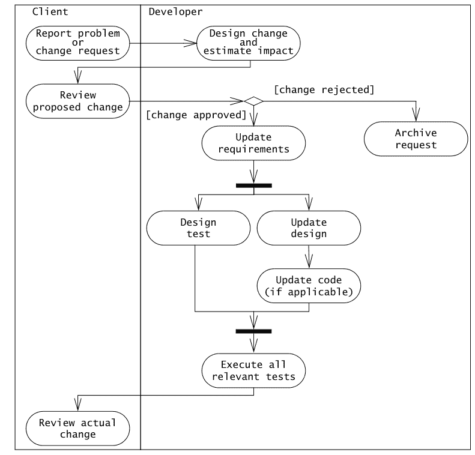

图 5-22 修订流程示例（UML 活动图）。

并在实施到系统之前，由客户进行审查。在所有情况下，承认无法冻结（但可以建立基线）的需求将对项目有益。

验收标准列表在签字前会进行修订。需求用取和分析活动澄清了系统的许多方面，包括系统应该遵循的非功能性需求以及每个功能的相对重要性。通过在签字时重申验收标准，客户确保开发者了解客户期望的任何变化。

在分析模型稳定后，会重新审视预算和进度表。我们在第 14 章《项目管理》中描述与成本估算相关的问题。

无论客户签字是合同协议，还是项目已受先前的合同约束，它都是客户和开发者就系统的一套功能定义和一套期望上达成共识的重要里程碑。考虑到许多活动依赖于分析模型，对需求分析文档的接受比任何其他文档都更为关键。

### 5.6 ARENA 案例研究

在本节中，我们把本章描述的概念和方法应用于 `ARENA` 系统。我们从上一节开发的用例模型和词汇表开始。我们识别参与的实体、边界和控制对象，并通过向分析对象模型中添加属性和关联来精炼它们。最后，我们识别继承关系并整合分析对象模型。在本节中，我们主要关注 `AnnounceTournament`（宣布比赛）用例。

### 5.6.1 识别实体对象


实体对象代表应用领域中由系统跟踪的概念。我们使用用例期间产生的词汇表作为识别 ARENA 中实体对象的起点。我们通过在用例上应用 Abbott 的启发式方法识别额外的实体对象及其属性。我们最初只关注描述应用领域概念的名词短语。图 5-23 展示了 *AnnounceTournament* 用例，其中名词短语的首次出现使用了**粗体**。

我们识别出与用例模型中的执行者对应的实体对象。执行者是应用领域中的概念，与系统相关（例如用于访问控制或记录责任或作者）。在 ARENA 中，每个合法的 `LeagueOwner` 由一个对象表示，该对象用于存储所有者的特定数据，例如她的联系信息、她管理的联盟等。

注意，并非所有识别出的名词短语都对应类。例如，“比赛名称”是一个名词短语，指代 `Tournament` 类的一个属性。“`Advertisers` 列表”是一个关联，在这种情况下，是 `League` 类和 `Advertiser` 类之间的关联。我们可以使用几种启发式方法来区分对应对象、属性和关联的名词短语：

## ARENA 案例研究 207

名称 `AnnounceTournament`

事件流
1. `LeagueOwner` 请求创建一项比赛。
2. 系统检查 `LeagueOwner` 是否超过了联盟或场馆内的比赛数量。如果没有，系统向 `LeagueOwner` 显示一个表单。
3. `LeagueOwner` 指定了名称、球员（`Players`）可以申请比赛的申请开始和结束日期，以及举办比赛的开始和结束日期，以及最大球员人数。
4. 系统询问 `LeagueOwner` 是否应该寻求独家赞助，如果是，则列出意愿成为独家赞助商的 `Advertiser` 列表。
5. 如果 `LeagueOwner` 决定选择独家赞助商，他从建议的赞助商中选择一个子集。
6. 系统通知被选赞助商即将到来的比赛和固定赞助费。
7. 系统将他们的回答反馈给 `LeagueOwner`。
8. 如果有感兴趣的赞助商，`LeagueOwner` 选择其中一个。
9. 系统记录独家赞助商的名称，并向账户收费。从现在起，所有与比赛相关的广告位仅由独家赞助商提供。
10. 如果没有选择赞助商（因为没有广告商感兴趣，或者 `LeagueOwner` 没有选择），则随机选择广告位并按单位更改到每个 `Advertiser` 的账户。
11. 赞助问题关闭后，系统向 `LeagueOwner` 显示一组对新比赛感兴趣的球员、观众（`Spectators`）和广告商小组。
12. `LeagueOwner` 选择要通知哪些小组。
13. 系统为比赛创建一个主页。该页面用作比赛的入口（例如
14. 在申请开始日期，系统通过发送指向比赛主页的链接来通知每个感兴趣的用户。球员可以在申请结束日期前通过 `ApplyForTournament` 用例申请比赛。

图 5-23 在 `AnnounceTournament` 用例中应用 Abbott 启发式方法识别实体对象。名词短语的首次出现加粗显示。

属性是属性。属性代表了对象的单一属性。它们代表了对象的部分方面，且是不完全的。例如，广告者（`Advertiser`）的名称是一个标识广告者的属性。然而，它并不包含关于该广告者的其他相关信息（例如，她当前的账户余额、她投放广告的横幅类型等），这些信息由广告者类的其他属性或关联来表示。

属性具有简单类型。属性是具有类型的属性，例如数字（例如，锦标赛 `Tournaments` 的数量）、字符串（例如，广告者的名称）、日期（例如，锦标赛的申请开始和结束日期）。地址、社会安全号码和车辆识别码（VIN）等属性通常也被视为简单类型（因此表示为属性），因为它们与其他对象具有关联。复杂概念则由对象表示。例如，账户（`Account`）是一个与相应的广告者相关的对象，它可以包含余额、交易历史、信誉额度和其他类似的属性。

指代集合的名词是关联，通常具有隐式的端点。列表、组、表格和集合由关联来表示。例如，场馆（`Arena`）将联盟所有者（`LeagueOwner`）推广为可能对独家赞助感兴趣的人。这一概念可以通过 `Arena` 类与 `Advertiser` 类之间的关联来表示，指示哪些广告者对独家赞助感兴趣。通常，关联的端点是隐式的。例如，当赞助问题关闭时，场馆会通过包含玩家（`Players`）、观众（`Spectators`）和广告者的列表来提示联盟所有者。我们识别了一个新类——兴趣组（`InterestGroup`），代表对有关联盟或游戏的新活动感兴趣的用户集合。然后，我们识别了 `Arena` 类与 `InterestGroup` 类之间的关联（对应“列表”一词），代表所有的兴趣组。接着，我们识别了 `InterestGroup` 类与玩家、观众和广告者之间的关联（对应“组”一词）。最后，我们识别了从 `InterestGroup` 类到其他类的额外关联，表示用户对兴趣组中的内容（即联盟 `League`、游戏 `Game`）的兴趣。

表 5-6 列出了我们目前为止从“宣布锦标赛”（`AnnounceTournament`）用例中识别出的对象、它们的属性及其关联。我们将属性和关联附加到相关的类中，并为每个类编写定义。编写定义具有其目的。首先，仅凭一个名称无法让所有利益相关者对该概念达成相同的理解。例如，游戏（`Game`）和比赛（`Match`）等术语在许多语境下是可以互换的。但在场馆中，它们指的是不同的概念（即：`Game` 代表由软件强制执行的一套规则，而 `Match` 代表一组玩家之间的竞争）。其次，分析期间识别出的对象也对应于我们在需求获取阶段开始建立的术语表中的术语。利益相关者在整个开发过程中都会使用术语表来消除歧义并建立标准术语。在识别出类时编写短定义是防止歧义和误解的最佳方法。推迟定义的编写会导致信息丢失和定义不完整。

**表 5-6** 从“宣布锦标赛”（`Announcement`）用例中的名词短语中识别出的参与该用例的实体对象（“?”表示导致图 5-24 中问题的不确定区域）。

| 实体对象 | 属性与关联 | 定义 |
|---|---|---|
| 账户 `Account` | - 余额<br>- 费用历史 (? )<br>- 付款历史 (? ) | 账户代表广告者当前欠的金额、费用历史和付款历史。 |
| 广告者 `Advertiser` | - 名称<br>- 对独家赞助感兴趣的联盟 (? )<br>- 受赞助的锦标赛 | 在比赛期间显示广告横幅的参与者。 |
| 广告 `Advertisement` | - 关联的游戏 (? ) | 广告者提供的用于在比赛期间显示的图像。 |
| 场馆 `Arena` | - 锦标赛最大数量<br>- 赞助的固定费用 (? )<br>- 联盟（隐含）<br>- 兴趣组（隐含） | ARENA 系统的实例化。 |
| 游戏 `Game` | | 游戏是若干玩家之间根据一套规则进行的竞争。在 ARENA 中，`Game` 指执行该套规则的软件。 |
| 兴趣组 `InterestGroup` | - 玩家、观众和广告者的列表（隐含）<br>- 组（隐含） | 代表对联盟或游戏新活动感兴趣的用户集合。 |
| 联盟 `League` | - 锦标赛数量<br>- 独家赞助的固定费用 | ARENA 系统的某个实例。 |
| 联盟所有者 `LeagueOwner` | 隐含 | 有兴趣在比赛期间显示广告横幅的参与者。 |
| 比赛 `Match` | | 比赛是若干玩家之间根据一套规则进行的竞争。 |
| 玩家 `Player` | | |
| 锦标赛 `Tournament` | | |

这些对象是参与“宣布锦标赛”用例的实体对象。

实体对象的识别通常产生额外的问题。在其他情况下，我们会向客户确认以确认我们的直觉是否正确。图 5-24 显示了由识别实体对象产生的问题。

在其他情况下，我们会向客户确认以确认我们的直觉是否正确。

# 针对 ARENA 的问题

- 广告者的账户中应该记录哪些信息？
- 广告横幅的显示信息是否应该记录？
- 广告者对独家赞助感兴趣的联盟？
- 独家赞助的固定费用是否随联盟而变化？

图 5-24 由识别实体对象触发的问题。

# ARENA 案例研究

## 5.6.2 识别边界对象

边界对象代表系统与参与者之间的接口。它们从用例中识别出来，通常表示粗粒度的用户界面。它们不表示布局信息或按钮等界面细节。用户界面原型更适合这类信息。相反，边界对象表示如窗口、表单或硬件制品等概念。这使得利益相关者能够可视化功能。

Abbott 的示例没有识别许多边界对象，因为它们最初是隐式的。相反，我们扫描“宣布锦标赛”用例（图 5-23），并识别参与者与系统之间交换的信息。我们既关注参与者向系统提供信息的表单（例如联盟所有者用于创建锦标赛的表单），也关注系统向参与者提供的通知（例如，广告者收到的赞助请求）。与其他对象一样，我们在识别每个类时对其进行定义。表 5-7 显示了我们为“宣布锦标赛”识别出的边界对象详情。图 5-25 显示了额外的问题。

# 给 ARENA 客户的其他问题

- 对于不回复的赞助商，我们应该怎么办？
- 如果没有相关的兴趣小组，我们应该如何为新赛事做广告？
- 如何通知用户（例如：电子邮件、手机、ARENA 公告框）？

**图 5-25** 通过识别边界对象而触发的问题。

## 5.6.3 识别控制对象

控制对象代表了边界对象与实体对象之间的协调。在通常情况下，在用例开始时会创建一个控制对象，并累积完成该用例所需的所有信息。控制对象在用例完成后就会被销毁。

在 `AnnouncementTournament` 中，我们识别出了一个名为 `AnnouncementTournamentControl` 的单一控制对象，它负责向 `Advertisers` 发送和收集通知、收回可用性，并最终通知感兴趣的用户。请注意，在一般情况下，如果例如存在需要协调的备选事件流、多个异步运行的站站，或者某些控制信息在用例完成后仍然存在，那么多个控制对象可能会参与同一个用例。

## 5.6.4 建模对象之间的交互

我们已经识别了参与 `AnnouncementTournament` 用例的多个实体、边界和控制对象。在此过程中，我们还识别了它们的一些属性和关联。我们在时序图中表示这些序列，描述在用例执行期间发生的交互，以识别出额外的关联和属性。

在时序图中，我们将识别出的对象排列在顶行。我们将最左侧放置为启动用例者（即 `LeagueOwner`），随后是负责启动用例的边界对象（即 `TournamentForm`），接着是主控制对象（即 `AnnouncementTournamentControl`），以及实体对象（即 `Arena`、`League` 和 `Tournament`）。任何参与的用例者及其相应的边界对象都位于图的右侧。出于空间原因，我们将 `AnnouncementTournament` 的时序图分为三张图。图 5-26 展示了导致创建赛事的交互序列。图 5-27 展示了请求和选择独家赞助商的工作流。

图 5-26 中的时序图非常直观。`LeagueOwner` 请求创建赛事并指定其初始参数（例如：名称、最大参赛人数）。创建 `AnnouncementTournamentControl` 实例，如果允许，则会创建一个 `Tournament` 实体实例。

图 5-27 中的时序图更有趣，因为它引导了额外关联和属性的识别。在请求赞助时，控制对象必须

# ARENA 案例研究

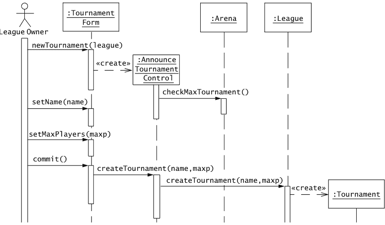

**图 5-26** `AnnounceTournament` 的 UML 时序图，赛事创建工作流。

首先获取感兴趣赞助商列表。它从 `Arena` 类请求该列表，该类维护感兴趣赞助商的列表。这意味着 `Arena` 类始终维护所有 `Advertisers` 的列表，以便将此列表返回给 `AnnouncementTournamentControl` 对象（或需要所有 `Advertisers` 列表的其他用例的控制对象）。为了通知 `Advertiser`，我们可能还需要联系信息，例如电子邮件地址，或者我们可能需要在 ARENA 内部为通知创建一个邮箱。因此，我们在 `Advertiser` 类中添加了一个属性，它最初存储 `Advertiser` 的电子邮件地址，直到支持进一步的服务。考虑到其他用例者可能有类似的需求，我们还向 `LeagueOwner` 和 `Player` 类添加了属性。

在构建用于通知兴趣小组的时序图（图 5-28）时，我们意识到用例并未指定如何通知被选中的赞助商。因此，我们在用例中添加了一个步骤，在通知兴趣小组之前，通知所有回复过赞助决定的赞助商。这需要识别一个新的边界对象 `SponsorNotice`。交互的其他部分没有产生任何新发现，因为我们已经预料到了对 `InterestGroup` 和 `InterestNotice` 类的需求。

## 5.6.5 审查和整合分析模型

现在我们已经识别了参与对象、它们的关联及其属性，我们绘制了 UML 类图来记录我们目前为止的分析结果。由于我们识别了许多对象，我们使用几张类图来描绘分析对象。我们使用

# 第 5 章 • 分析

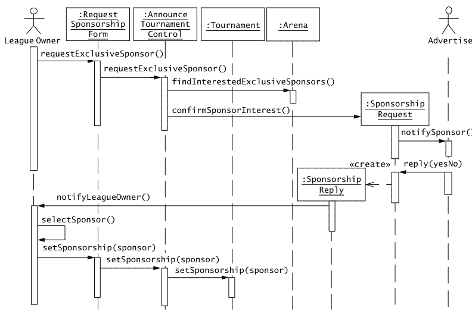

图 5-27 `AnnounceTournament` 用例的 UML 时序图，赞助工作流。

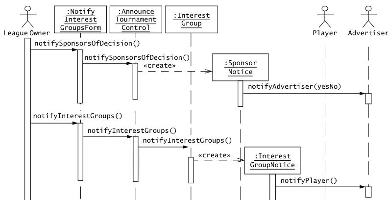

图 5-28 `AnnounceTournament` 用例的 UML 时序图，兴趣小组工作流。

# ARENA 案例研究

这些类图作为我们开发的术语表的视觉索引。虽然我们不应期望客户或用户能够审查类图，但我们可以利用类图为与客户的访谈生成更多问题。

我们首先关注实体对象，因为这些对象需要客户仔细审查，因为它们代表了分配域领域的概念（图 5-29）。请注意，我们使用 `Arena` 类作为系统中的根对象；`Arena` 类代表一个特定的实例化。例如，给定一个实例化，就可以获取所有 `InterestGroups` 列表。这意味着 `Arena` 类始终维护所有 `Advertisers` 的列表，以便将其返回给 `AnnouncementTournamentControl` 对象（或需要所有 `Advertisers` 列表的其他用例的控制对象）。为了通知 `Advertiser`，我们可能还需要联系信息，例如电子邮件地址，或者我们可能需要在 ARENA 内部为通知创建一个邮箱。因此，我们在 `Advertiser` 类中添加了一个属性，它最初存储 `Advertiser` 的电子邮件地址，直到支持进一步的服务。考虑到其他用例者可能有类似的需求，我们还向 `LeagueOwner` 和 `Player` 类添加了属性。

在构建用于通知兴趣小组的时序图（图 5-28）时，我们意识到用例并未指定如何通知被选中的赞助商。因此，我们在用例中添加了一个步骤，在通知兴趣小组之前，通知所有回复过赞助决定的赞助商。这需要识别一个新的边界对象 `SponsorNotice`。交互的其他部分没有产生任何新发现，因为我们已经预料到了对 `InterestGroup` 和 `InterestNotice` 类的需求。

现在我们已经识别了参与对象、它们的关联及其属性，我们绘制了 UML 类图来记录我们目前为止的分析结果。由于我们识别了许多对象，我们使用几张类图来描绘分析对象。我们使用这些类图作为我们开发的术语表的视觉索引。虽然我们不应期望客户或用户能够审查类图，但我们可以利用类图为与客户的访谈生成更多问题。

我们首先关注实体对象，因为这些对象需要客户仔细审查，因为它们代表了分配域领域的概念（图 5-29）。请注意，我们使用 `Arena` 类作为系统中的根对象；`Arena` 类代表一个特定的实例化。例如，给定一个实例化，就可以获取所有 `InterestGroups` 列表。这意味着 `Arena` 类始终维护所有 `Advertisers` 的列表，以便将其列表返回给 `AnnouncementTournamentControl` 对象（或需要所有 `Advertisers` 列表的其他用例的控制对象）。为了通知 `Advertiser`，我们可能还需要联系信息，例如电子邮件地址，或者我们可能需要在 ARENA 内部为通知创建一个邮箱。因此，我们在 `Advertiser` 类中添加了一个属性，它最初存储 `Advertiser` 的电子邮件地址，直到支持进一步的服务。考虑到其他用例者可能有类似的需求，我们还向 `LeagueOwner` 和 `Player` 类添加了属性。

接下来，我们绘制了描绘继承关系的类图（图 5-30）。尽管 UML 允许继承关系和关联共存在同一张图中，但在分析期间，良好的做法是绘制两个独立的图来描绘每种类型 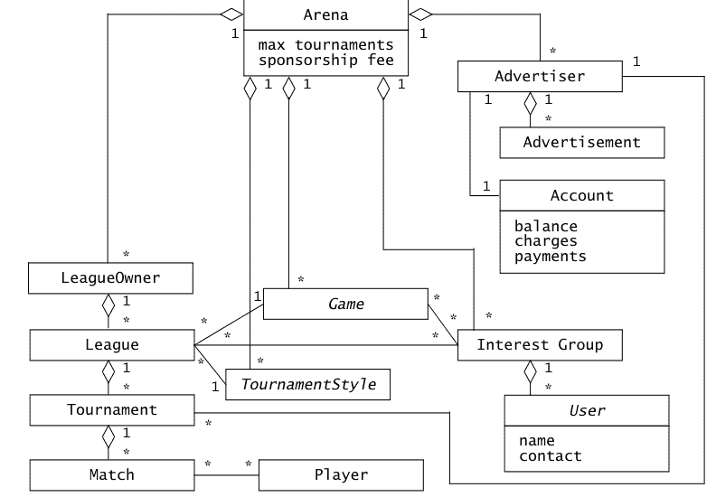

图 5-29 分析 `AnnounceTournament` 用例后识别的实体对象。

216 第 5 章 • 分析

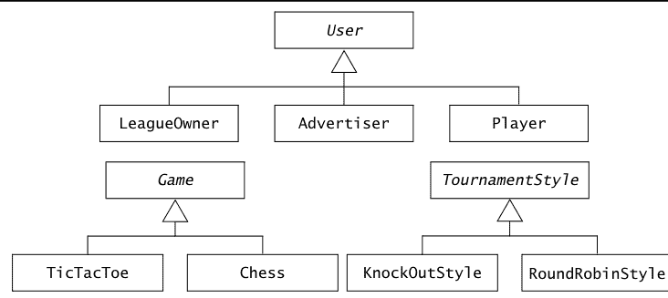

**图 5-30** 实体之间的继承关系。

图 5-30 显示了三个继承层次。首先，我们通过泛化识别了一个抽象类 `User`。这使我们能够以更通用的方式处理各种用户的属性，包括联系信息和注册程序。请注意，在问题说明和用例中，我们已经使用了“用户”一词，因此我们正在形式化一个已经在使用的概念。我们识别了两个继承层次，`Game` 和 `TournamentStyle`，通过特化识别以为这两个概念提供示例并提供对问题说明的可溯性。`TicTacToe` 和 `Chess` 类是 `Game` 的具体特化，体现了被称为“井棋”和“象棋”的规则。`KnockOutStyle` 和 `RoundRobinStyle` 类是 `TournamentStyle` 的具体特化，为将玩家分配到淘汰赛（玩家需要获胜赛事）和循环赛（每个玩家与所有人比赛一次）提供了算法。


最后，我们绘制了一幅类图，描述了与用例相关的边界、控制和选定实体对象之间的关联（图 5-31）。为了从时序图生成此图，我们绘制了相应的通信图，控制对象位于左侧，边界对象位于中间，实体对象位于右侧。然后，在必要时将迭代替换为关联，工作流中的对象可以向时序图中所示的对象发送消息。最后，我们向关联添加了导航以表示依赖的方向：控制和边界对象通常彼此感知，但实体对象（`entity objects`）不依赖于任何控制或边界对象。

图 5-29 中的类图关注的是应用领域概念之间的关系，而图 5-31 中的类图关注的是与用例粗粒度工作流相关的概念。控制对象（`control object`）作为边界对象和实体对象之间的胶水，代表了表单和通知之间的协调与排序。如图 5-26 至 5-28 中的序图所示，控制对象还会创建几个边界对象。图 5-31 的类图汇总了参与用例的对象以及在用例过程中遍历的关联。然而，序图提供了工作流的完整顺序信息。

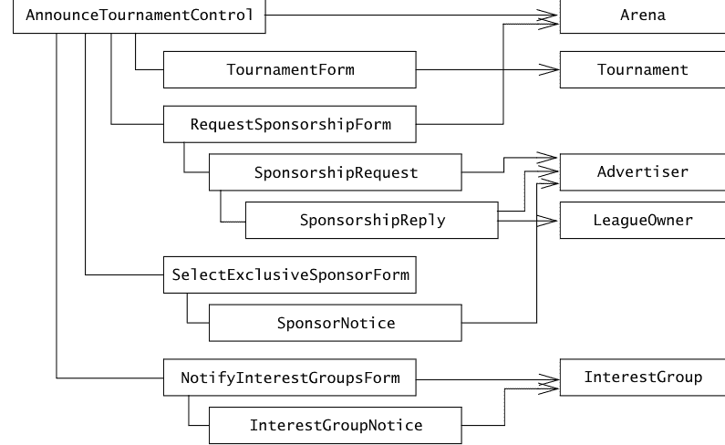

**图 5-31** 参与 `AnnounceTournament`（宣布比赛）用例的边界、控制和选定实体对象之间的关联。

## 5.6.6 经验训

在本节中，我们开发了与 ARENA 的 `AnnounceTournament` 用例相关的分析对象模型部分。我们首先使用 Abbott 的启发式方法（`Abbott’s heuristics`）识别实体对象，然后识别边界对象和控制对象，并使用序图寻找额外的关联、属性和对象。最后，我们整合了对象模型并用一系列类图对其进行了描绘。我们学到：

- 识别对象及其属性和关联需要多次迭代，且通常需要客户的参与。
- 对象识别使用了许多来源，包括问题描述、用例模型、术语表以及用例的事件流。
- 一个非平凡的用例可能需要许多序图和多个类图。在单张图中表示所有发现的对象是不切实际的。每个图都有特定的用途——例如，描绘实体对象之间的关联，或描绘参与某个用例的参与对象之间的关联。
- 根据分析师的个人风格和经验，建模同一个应用领域或系统有许多不同的方法。这要求在项目内部制定风格指南和规范，以便所有分析师都能有效沟通。

## 5.7 扩展阅读

将对象分类为实体、边界和控制对象的方法是由对象方法 [Jacobson et al., 1992] 推广的。这些概念源于 Smalltalk-80 环境中模型/视图/控制器 (MVC) 范式，并进入 Java Swing 用户界面框架 (JFC, 2009)。

CRC 卡片由 Beck 和 Cunningham 在一篇名为《教学面向对象思维的实验室》[Beck & Cunningham, 1989] 的 OOP OOPLA 论文中引入，用于向初学者和资深开发者教授面向对象的思维。CRC 卡片被广泛用于 Wirfs-Brock 的职责驱动设计方法 [Wirfs-Brock et al., 1990]。

面向对象的分析和设计已经从许多不同的启发式方法和术语演变而来。建模像编程一样是一门手艺，需要大量的经验以及愿意犯错误的意愿（因此客户和用户的反馈非常重要）。《面向对象建模与设计》[Rumbaugh et al., 1991] 为初学者的类建模提供了极佳的指南。现代书籍《UML 与模式》[Larman, 2005] 对面向对象的分析和设计进行了全面处理，包括用例建模和设计模式重用。对于使用状态机的动态建模，《硬骨头：在实时应用中使用面向对象编程和软件模式》[Douglass, 1999] 为该主题提供了详细的信息和建模启发方法。

### 5.8 练习

5-1 考虑一个具有图形用户界面的文件系统，例如 Macintosh 的 Finder、Microsoft 的 Windows Explorer 或 Linux 的 KDE。从一个描述从软磁盘拷贝文件到硬盘的用例识别出以下对象：`File`（文件）、`Icon`（图标）、`TrashCan`（垃圾桶）、`Folder`（文件夹）、`Disk`（磁盘）、`Pointer`（指针）。指定哪些是实体对象，哪些是边界对象，哪些是控制对象。

5-2 假设使用相同的文件系统，考虑在软磁盘上选择一个 `File`、将其拖到 `Folder` 并释放鼠标。识别并定义与此场景相关的至少一个控制对象。

5-3 将练习 5-1 和 5-2 中列出的对象水平排列在序图中，边界对象在左侧，你识别的控制对象在上，最后是实体对象。画出将文件放入文件夹后产生的交互序列。目前请忽略异常情况。

5-4 检查你在练习 5-3 中制作的序图，识别这些对象之间的关联。

5-5 识别每个对象与此场景（从软磁盘拷贝文件到硬盘）相关的属性。还要考虑异常情况“文件夹中已有同名文件”和“磁盘空间不足”。

5-6 考虑图 5-32 中的对象模型（改编自 [Jackson, 1995]）：

```
| Year |
| :--- |
| 1 *  |
| Month|
| 1 *  |
| Week |
| 1 *  |
| Day  |
```

**图 5-32** 格列日历的简单模型（UML 类图）。

根据你对格列日的知识，列出该模型的所有问题。修改它以修正每一个问题。

5-7 考虑图 5-32 的对象模型。仅使用关联就可以推断出每个月的天数。

5-8 考虑四路交叉口的交通灯系统。假设一条道路的交通通行，而另一条道路交通停止。画出一个描述状态（绿、黄、红）的状态机。

5-9 从图 5-23 的序图中，识别系统的偏好。

5-10 考虑为 `AnnounceTournament` 用例增加非功能性需求，规定工作必须降到最低。

5-11 识别并为参与 `Announcement`（公告）用例的任何额外实体、边界和控制对象编写定义。

5-12 更新图 5-29 和 5-31 的类图，包含你识别的新对象。

5-13 画出一个状态机，根据发送和接收每条通知作为触发改变的事件，描述 `Announcement` 对象的行为。

# 6

- 6.1 引言：平面图示例 224
- 6.2 系统设计概述 226
- 6.3 系统设计概念 228
- 6.3.1 子系统与类 228
- 6.3.2 服务与子系统接口 230
- 6.3.3 耦合与内聚 230
- 6.3.4 层与分区 235
- 6.3.5 架构风格 238
- 6.4 系统设计活动：从对象到子系统 247
- 6.4.1 起点：路径规划系统的分析模型 247
- 6.4.2 识别设计目标 249
- 6.4.3 识别子系统 253
- 6.5 进阶阅读 255
- 6.6 练习题 255

参考文献 257

# 系统设计：系统拆分

构建软件设计有两种方法：

一种方法是使其简单到显然没有任何缺陷，另一种方法是使其复杂到没有明显的缺陷。

——C.A.R. Hoare，摘自《皇帝的新装》

系统设计是将分析模型转换为系统设计的过程。在系统设计期间，开发者定义了项目的设计目标，并将系统拆分为更小的子系统，以便由各个团队来实现。开发者还选择了构建系统的策略，例如硬件/软件策略、持久性数据管理策略、全局流控制、访问控制策略以及边界条件的处理。系统设计的结果是一个模型，其中包含了子系统拆分以及对这些策略的清晰描述。

系统设计并不是算法性的。开发者必须在许多相互冲突的设计目标之间进行权衡。他们还无法预测将面临的所有设计问题，因为他们目前对解决方案领域还没有清晰的认识。系统设计被分解为若干项活动，每个活动解决系统拆分这一整体问题的某部分：

- 识别设计目标。开发者识别并确定系统需要优化的目标优先级。
- 设计初始的子系统拆分。开发者根据用例和分析模型将系统拆分为更小的部分。在这项活动中，开发者使用标准的架构风格作为起点。
- 细化子系统拆分以满足设计目标。初始拆分通常无法满足所有设计目标。开发者不断细化，直到所有目标都满足。

在本章中，我们关注前两项活动。在下一章中，我们将细化系统拆分，并结合 ARENA 个研究提供深度示例。

### 6.1 引言：平面图示例

系统设计、对象设计和实现构成了系统的构建。在这三项活动中，开发者弥补了需求获取与分析过程中产生的需求规格与交付给用户的系统之间的差距。系统设计是这一过程的第一步，重点是将系统拆分为可管理的部分。在需求获取和分析期间，我们关注的是系统的处理流程和功能。在系统设计期间，我们关注实现系统所需的流程、数据结构以及软件和硬件组件。系统设计的挑战在于，在拆分系统时必须满足许多冲突的标准和限制条件。

以设计住宅的任务为例。在与客户定房间数量、楼层、居住面积以及房屋位置后，建筑师必须设计平面图，即墙、门和窗的位置。他必须根据多项功能性需求来设计：厨房应该靠近餐厅和车库，浴室应该靠近卧室，等等。建筑师在确立每个房间的尺寸和门的位置时，还可以依靠许多标准：厨房橱柜采用固定增量，床采用标准尺寸。然而，建筑师不需要知道每个房间的确切内容和家具布局；相反，这些决策应该推迟，并留给客户决定。

图 6-1 显示了住宅平面图的三个连续修订版本。我们旨在满足以下约束条件：

1. 这栋房子应该有两个卧室、一个厨房和一个客厅区域。
2. 居住者每天行走的总距离应降至最低。
3. 自然光的使用应降至最低。

为了满足上述约束，我们假设大部分步行将发生在入门与厨房之间（当从车上卸购物购物时），以及厨房与客厅/餐厅区域之间（搬送餐具和餐后）。下一个需要最小化的步行路径是从卧室到浴室的路径。我们假设房屋的居住者大部分时间待在客厅/餐厅区域和主卧。

在我们平面图的第一版本中（图 6-1 顶部），我们发现房间离厨房太远。为了解决这个问题，我们将它与 2 号卧室交换（见图 6-1 中的灰色箭头）。在第二次修订中，我们发现厨房和楼梯离入门太远。为了解决这个问题，我们将入户门移到北墙。这允许我们重新调整 2 号卧室的方向，并将浴室移靠近两个卧室。居住面积增加了，我们满足了所有原始约束条件。

```
初始版本
| 楼梯 | 客书房 | 餐厅 |
| --- | --- | --- |
| 厨房 | | 走廊 | 入户门 |
| | 2号卧室 | 浴室 | 主卧 |

第二个版本
| 楼梯 | 客书房 | 2号卧室 |
| --- | --- | --- |
| 厨房 | | 走廊 | 入户门 |
| | 餐厅 | 浴室 | 主卧 |

第三个版本
| 楼梯 | 客书房 | 浴室 | 2号卧室 |
| --- | --- | --- | --- |
| 厨房 | | 走廊 | |
| | 餐厅 | 主卧 |
```

图 6-1 平面图示例。三个版本展示了我们如何减少步行距离并利用阳光。

此时，我们可以为每个房间布置门窗的位置以满足局部需求。一旦完成这些，就可以进行水路、电气线路和供暖管道的规划。

建筑中的平面图设计与软件工程中的系统设计相似（表 6-1）。整体被划分为更简单的组件和接口，同时考虑非功能需求和功能需求。系统设计影响实现活动，如果后期更改会导致昂贵的重构。单个组件的设计被推到了以后。

# 表 6-1 架构概念与软件工程概念的映射。

| 架构概念 | 软件工程概念 |
|---|---|
| 组件 | 房间 | 子系统 |
| 接口 | 门 | 服务 |
| 非功能需求 | 居住区 | 响应时间 |
| 功能需求 | 住宅 | 用例 |
| 昂贵的重构 | 墙 | 子系统接口 |

第 6.2 节提供了系统设计与分析关系的宏观视角。第 6.3 节描述了子系统和子系统拆分的概念。第 6.4 节描述了系统设计活动，并使用示例说明了这些构建块是如何协同工作的。

## 6.2 系统设计概述

分析产生由以下产品描述的模型：

- 一组非功能需求和约束，例如最大响应时间、最小吞吐量、可靠性、操作系统等
- 用例模型，从参与者的角度描述系统功能
- 对象模型，描述由系统管理的实体
- 每个用例的序列序图，显示了参与该用例的对象之间的交互序列。

分析模型从参与者的角度完整地描述了系统，并作为客户与开发者之间沟通的基础。然而，分析模型并不包含关于系统内部结构及其硬件配置，或者更广泛地说，系统应该如何被实现的信息。系统设计是这一方向的第一步。系统设计产生以下产物：

- 设计目标：描述开发者应该优化的系统特性。
- 软件架构：根据子系统的分解描述职责、子系统之间的依赖关系、子系统到硬件的映射以及主要的策略决策（如使用控制、访问控制和数据存储）。
- 边界情况：描述系统配置、启动、关闭和异常处理问题。

设计目标源于非功能性需求。设计目标引导开发者在需要权衡时所做出的决策。子系统分解构成了系统设计的大部分，将系统拆分为可管理的部分以处理复杂性：每个子系统被分配给一个团队并独立实现。为了实现这一点，开发者在分解系统时需要处理全系统范围内的问题。在本章中，我们描述了子系统分解的概念，并讨论了被称为“架构风格”的通用系统分解示例。在下一章中，我们将描述如何精细化系统分解以满足特定的设计目标。图 6-2 展示了系统设计与其他软件工程活动的关系。

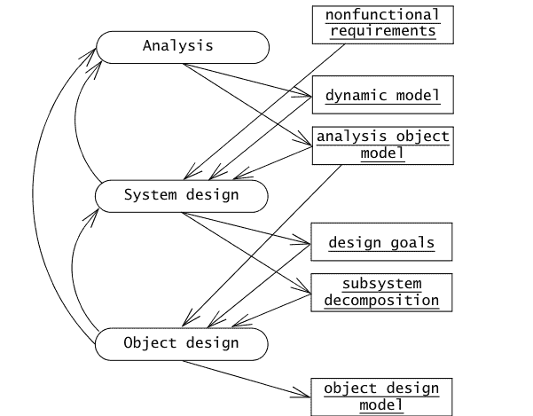

图 6-2 系统设计的活动（UML 活动图）。

## 6.3 系统设计概念

在本节中，我们将更详细地描述子系统分解及其属性。首先，我们定义子系统的概念及其与类的关系（第 6.3.1 节）。接下来，我们查看子系统的接口（第 6.3.2 节）：子系统为其他子系统提供服务。服务是一组共享共同目的的相关操作。在系统设计期间，我们根据子系统提供的服务来定义子系统。在后的对象设计中，我们根据其执行的操作来定义子系统接口。接下来，我们查看子系统的两个属性：耦合和内聚（第 6.3.3 节）。耦合衡量两个子系统之间的依赖关系，而理想的子系统分解应该尽可能地减少耦合并最大化提高内聚。然后，我们查看分层和分区，这是两种将子系统相互关联的技术（第 6.3.4 节）。分层允许系统组织为子系统的层级结构，每个子系统为其上方的子系统提供更高级的服务。分区将子系统组织为同级实体，它们相互提供不同的服务。在第 6.3.5 节中，我们描述了实践中常见的若干典型软件架构。

### 6.3.1 子系统与类

在第 2 章“使用 UML 建模”中，我们引入了应用领域和解决方案领域的区别。为了减少应用领域的复杂性，我们识别了被称为“类”的较小部分并将它们组织成包。同样，为了减少解决方案领域的复杂性，我们将系统分解为更简单的部分，称为“子系统”，它们由若干个解决方案领域的类组成。子系统是系统中可替换的部分，具有定义良好的接口，封装了其包含类的状态和行为。子系统通常对应于单个开发者或单个开发团队可以处理的工作量。通过将系统分解为相对独立的子系统，并发团队可以以最小的通信开销在独立的子系统上工作。对于复杂的子系统，我们递归地应用这一原则，将子系统分解为更简单的子系统（见图 6-3）。

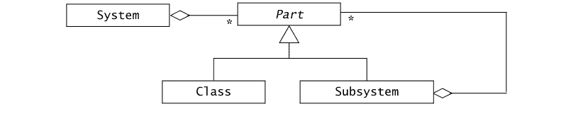

**图 6-3** 子系统分解（UML 类图）。

例如，我们之前描述的事故管理系统可以分解为：`DispatcherInterface` 子系统，实现调度员的用户界面；`FieldOfficerInterface` 子系统，实现现场人员的用户界面；`IncidentManagement` 子系统，负责事故（`Incident`）创建、修改和存储；`ResourceManagement` 子系统，负责跟踪可用资源（例如消防车和救护车）；`MapManagement` 子系统，描绘地图和位置；以及 `Notification` 子系统，实现现场人员终端与调度站之间的通信。

这种子系统分解被描绘为矩形，矩形右上角有系统组件。组件与组件之间的依赖关系可以用虚线箭头表示。在 UML 中，组件可以同时表示逻辑组件和物理组件。逻辑组件对应于没有显式运行时等价物的子系统，例如组合成单个运行时应用程序逻辑层的各个独立业务组件。物理组件对应于具有显式运行时等价物的子系统，例如数据库服务器。

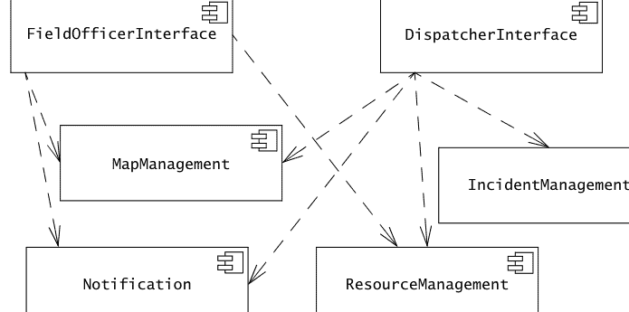

**图 6-4** 事故管理系统的子系统分解（UML 组件图）。子系统显示为 UML 组件。虚线箭头表示子系统之间的依赖关系。

几种编程语言（例如 Java 和 Modula-2）提供了建模子系统的构造（Java 中的 `packages`，Modula-2 中的 `modules`）。在其他语言（如 C 或 C++）中，子系统没有被显式建模，因此开发者使用约定对类进行分组（例如，一个子系统可以表示为包含实现该子系统的所有文件的目录）。无论编程语言是否显式表示子系统，开发者都需要仔细记录子系统分解，因为子系统通常由不同的团队实现。

### 6.3.2 服务与子系统接口

子系统的特征是它为其他子系统提供的服务。服务是一组共享共同目的的相关操作。例如，提供通知服务的子系统定义了发送通知、查找通道以及订阅和取消订阅的操作。子系统供其他子系统使用的操作集合成了子系统接口。子系统接口包括操作的名称、参数、类型和返回值。系统设计侧重于定义每个子系统的服务，即列出操作及其高层行为。对象设计将侧重于应用程序接口（API），它精化了子系统接口。API 还包括每个操作的参数类型和返回值。

提供的和所需的接口在 UML 中可以使用组件连接器（也称为球插连接器）表示。提供的接口显示为球形图标（也称为棒棒糖 `lollipop`），旁边带有名称。所需的接口显示为插座图标。子系统之间的依赖关系通过连接组件图中相应的球和插座显示。

图 6-5 展示了 `FieldOfficerInterface`、`DispatcherInterface` 和 `ResourceManagement` 子系统之间的依赖关系。`FieldOfficerInterface` 需要 `ResourceService` 来更新现场人员的状态和位置。`DispatcherInterface` 需要 `ResourceAllocationService` 来识别资源并分配给新事故。`ResourceManagement` 子系统提供这两个服务。注意，当子系统分解已经稳定且我们的关注从接口转向子系统时，我们才使用球插表示法。在系统设计的早期阶段，我们可能对功能的分配没有清晰的理解，此时我们使用图 6-4 中的依赖表示法（虚线箭头）。

通过服务定义子系统有助于我们关注其接口而非实现。在编写子系统接口时，应努力尽可能减少关于实现的提供信息。例如，子系统接口不应引用内部数据结构，如链表、数组或哈希表。这允许我们在修订子系统实现时尽可能减少更改的影响。更广泛地说，我们希望通过减少子系统之间的依赖关系来减少更改的影响。


# 系统设计概念

耦合是两个子系统之间依赖关系的数量。如果两个子系统是松耦合的，它们是相对独立的，因此对其中一个子系统的修改对彼此的影响很小。如果两个子系统之间强耦合，那么对其中一个子系统的修改可能会对另一个产生影响。子系统分解的一个理想特性是子系统之间尽可能保持松耦合。这可以最大限度地减少一个子系统的错误或未来变化对其他子系统的影响。

例如，考虑图 6-4 所示的应急响应子系统。在系统设计期间，我们决定将所有持久化数据（即描述系统单次执行的所有数据）存储在关系型数据库中。这导致产生了一个额外的子系统 `Database`（图 6-6）。起初，我们设计了数据库子系统的接口，使得子系统需要使用数据库的原生查询语言（如 `SQL`）来存储简单的问题命令。例如，`IncidentManagement` 子系统发布 `SQL` 查询以存储和检索数据库中代表 `Incident` 的记录。这导致了 `Database` 子系统与三个客户端子系统（即 `IncidentManagement`、`ResourceManagement` 和 `MapManagement`）之间存在高耦合，因为这三个系统都需要存储和检索数据，数据存储方式的任何更改都需要对客户端系统进行更改。例如，如果我们更改了数据库供应商，我们就必须更改子系统以使用不同的查询语言方言。为了减少这些子系统之间的耦合，我们创建了一个新子系统 `Storage`，它将 `Database` 与其他系统隔离开。在这种替代方案中，三个客户端子系统使用 `Storage` 子系统提供的服务，该系统负责向 `Database` 子系统发布 `SQL` 查询。如果我们决定更改数据库供应商或使用不同的存储机制（例如扁平文件），我们只需要更改 `Storage` 子系统。因此，子系统分解的整体耦合降低了。

注意，减少耦合并不是目的本身。在上面的示例中，减少耦合导致了额外的复杂性。通过减少耦合，开发者可能会引入许多不必要的抽象层，从而消耗开发时间和处理时间。只有当任何子系统可能发生变化时，高耦合才是一个问题。

**内聚性**是指子系统内部依赖的数量。如果一个子系统包含许多相互关联并执行相似任务的对象，则它的内聚性很高。如果一个子系统包含许多不相关的对象，则它的内聚性很低。

## 替代方案 1：直接访问 Database 子系统

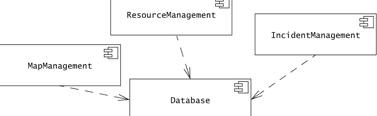

## 替代方案 2：通过 Storage 子系统间接访问 Database

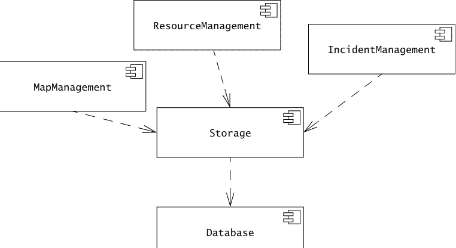

**图 6-6** 减少子系统耦合的示例（UML 组件图，为了清晰起见省略了子系统 `FieldOfficerInterface`、`DispatcherInterface` 和 `Notification`）。方案 1 描述了所有子系统直接访问数据库的情况，使它们容易受到 `Database` 子系统接口变化的影响。方案 2 用额外的子系统（`Storage`）屏蔽了数据库。在这种情况下，如果 `Database` 子系统的接口发生变化，只需要一个子系统进行更改。这种设计更改背后的假设是 `Storage` 子系统的接口比 `Database` 子系统更稳定。

# 系统设计概念

子系统分解的一个理想特性是它能导致具有高内聚性的子系统。

例如，考虑一个用于记录设计问题、讨论、方案评估、决策以及以任务形式实现的实现的决策跟踪系统（图 6-7）。`DesignProblem` 和 `Option` 代表对设计空间的探索：我们根据若干个 `DesignProblems` 来形式化系统，并记录每个探索的 `Option`。`Criterion` 类代表了我们感兴趣的属性。一旦我们根据理想的 `Criteria` 对探索的 `Options` 进行评估，我们就会以任务的形式实现 `Decisions`。`Tasks` 被递归地分解为足够小的、可以分配给单个开发者的 `Subtasks`。我们将这些称为原子的 `ActionItems`。

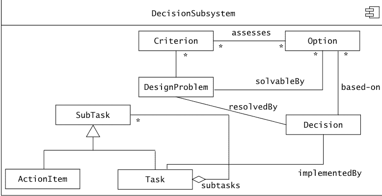

**图 6-7** 决策跟踪系统（UML 组件图）。`DecisionSubsystem` 的内聚性较低：`Criterion`、`Option` 和 `DesignProblem` 类与 `Subtask`、`ActionItem` 和 `Task` 之间没有关系。

决策跟踪系统足够小，我们可以将所有内容合并到一个名为 `DecisionSubsystem` 的子系统中（见图 6-7）。然而，我们观察到类模型可以划分为两个子图。一个称为 `RationaleSubsystem`，包含 `DesignProblem`、`Option`、`Criterion` 和 `Decision` 类。另一个称为 `PlanningSubsystem`，包含 `Task`、`Subtask` 和 `ActionItem`（见图 6-8）。两个子系统的内聚性都比原始的 `DecisionSubsystem` 高。这使我们能够独立地使用每个部分，因为其他系统只需要规划部分或原理部分。

| RationaleSubsystem | |
| --- | --- |
| Criterion | |
| Option | |
| DesignProblem | |
| Decision | |

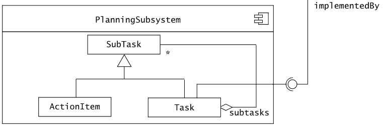

**图 6-8** 决策跟踪系统的分解方案（UML 组件图，使用球形和插座符号）。`RationaleSubsystem` 和 `PlanningSubsystem` 的内聚性比原始 `DecisionSubsystem` 高。`RationaleSubsystem` 和 `PlanningSubsystem` 实现了 `Task` 和 `Decision` 之间的关系。

通常情况下，内聚性和耦合之间存在权衡。通过减少耦合，开发者可能会引入许多不必要的抽象层，从而消耗开发时间和处理时间。只有当任何子系统可能发生变化时，高耦合才是一个问题。一个启发式方法是任何抽象级别的层不应超过三个。事实上，良好的系统设计可以通过三层完成。

## 6.3.4 层与分区

系统的分层分解产生一组有序的层。层是提供相关服务的子系统的分组，可能使用来自其他层的服务。层的排序使得每个层只依赖于下层，并且对上层无所知。不依赖于任何层的层被称为底层，不被任何层使用的层被称为顶层（图 6-9）。在闭源架构中，每个层都可以访问其紧下层。在开放架构中，层也可以访问更深层次层。

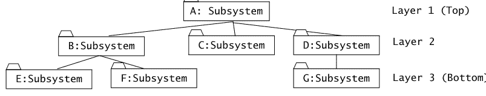

**图 6-9** 系统分解为三层（UML 对象图，层由包表示）。包含每层至少一个子系统的分解子集被称为垂直切片。例如，子系统 A、B 和 E 构成了一个垂直切片，而子系统 D 和 G 则不是。

闭源架构的一个示例是开放系统参考模型（简称为 `OSI` 模型），它由七层组成 [Day & Zimmermann, 1983]。每层负责执行一个定义良好的函数。此外，每层通过使用下层的服务提供其服务（图 6-10）。

+   1. 在软件工程领域，“开放”（open）一词通常意味着非专有。我们使用 [Rumbaugh et al., 1991] 定义的开放架构，而不是为了暗示非专有架构。

# 应用层

- 应用层
- 表示层
- 会话层
- 连接层
- 传输层
- 消息层
- 网络层
- 数据包层
- 数据链路层
- 帧
- 物理层
- 比特


直到最近，只有 `OSI` 模型的底四层才被标准化。例如，`Unix` 和许多桌面操作系统都提供了指向 `TCP/IP` 的接口，这些接口实现了传输层、网络层和数据链路层。应用程序开发者仍需填补传输层与应用层之间的空白。随着分布式应用程序数量的增加，这一空白促使了中间件的发展，例如 `CORBA` [OMG, 2008] 和 `Java RMI` [RMI, 2009]。`CORBA` 和 `Java RMI` 允许我们通过像向本地对象发送消息一样向远程对象发送消息来透明访问，有效地实现了表示层和会话层（见图 6-11）。

开放式架构的一个示例是 `Java` 的 `Swing` 界面工具包 [JFC, 2009]。底层由操作系统或窗口系统（如 `X11`）提供，并提供基本的窗口管理。`AWT` 是 `Java` 提供的抽象接口，用于保护应用程序不受特定窗口平台的影响。`Swing` 是一个用户界面对象库，提供了从按钮到几何管理的各种设施。应用程序通常只访问 `Swing` 接口。然而，应用层可能会跳过 `Swing` 层直接访问 `AWT`。

## 系统设计概念


**图 6-11** 闭式架构的示例（UML 组件图）。`CORBA` 允许访问在不同主机上用不同语言实现的对象。`CORBA` 有效实现了 `OSI` 栈的表示层和会话层。

总的，架构的开放性允许开发者跳过高层来解决性能瓶颈（图 6-12）。

闭式的分层架构具有良好的特性：它们使得子系统之间的耦合较低，并且子系统可以增量地集成和测试。然而，每一层都会引入速度和存储开销，这可能难以满足非功能性需求。此外，在后续修订中为系统添加功能可能是困难的，特别是当这些新增未被预料到时。在实践中，系统很少被分解为三五层以上。

处理复杂性的另一种方法是将系统划分为对等子系统，负责不同类型的服务。例如，汽车的车载系统可以分解为：为驾驶员提供实时方向引导的旅行服务、记住驾驶员座椅位置和喜爱的广播电台的个人偏好服务，以及跟踪汽车燃油消耗、维修和计划维护的车辆服务。每个子系统之间保持松散耦合。

图 6-12 开放式架构的示例：`X11` 平台上的 `Swing` 用户界面库（UML 组件图）。`X11` 提供了底层绘图功能。`AWT` 是 `Java` 提供的底层接口，用于保护程序员不受窗口系统的影响。`Swing` 提供了大量的复杂用户界面对象。某些应用程序经常跳过 `Swing` 层。

总的来说，子系统的分解是划分和分层的共同。我们首先将系统划分为顶层子系统，这些系统负责特定功能或运行在特定的硬件节点上。生成的每个子系统，如果复杂度允许，都会分解为更低层和更低层，直到它们简单到可以由单个开发者实现。由于与其他系统的交互，每个子系统都会增加一定的处理开销。过度的划分或分层会增加复杂度。

## 6.3.5 架构风格

随着系统复杂性的增加，系统分解的规范至关重要。一旦开发开始，修改或纠正糟糕的分解是非常困难的，因为大多数接口都必须更改。由于这一问题的重要性，软件架构的概念应运而生。软件架构包括系统分解、全局控制流、边界条件的处理以及子系统通信协议 [Shaw & Garlan, 1996]。

在本节中，我们描述了几种可以作为不同系统基础的架构风格。这绝不是对该主题的详尽阐述。相反，我们旨在提供几个典型的示例并引导读者参考文献获取更多细节。


## 系统设计概念

## 仓库

在仓库架构风格中（见图 6-13），子系统访问并修改一个称为中央仓库的单一数据结构。子系统相对独立，仅通过仓库进行交互。控制流可以由中央仓库决定（例如，数据触发器调用外围系统），也可以由子系统决定（例如，独立的控制流和通过仓库中的锁进行同步）。


**图 6-13** 架构风格（UML 组件图）。每个子系统仅依赖于名为仓库的中央数据结构。仓库对其他子系统一无不知。

仓库通常用于数据库管理系统，例如工资系统或银行系统。数据的中央位置使其更容易处理并发和完整性问题。编译器和软件开发环境也遵循仓库风格。

仓库子系统也可用于实现全局控制流。图 6-14 中的编译器示例中，每个工具（例如编译器、调试器和编辑器）都由用户调用。仓库仅确保并发访问是序列化的。相反，仓库可以根据黑板的状态调用子系统。这些系统被称为“黑板系统”。第一批黑板系统之一的 `HEARSAY II` [Erman et al., 1980] 根据黑板的当前状态调用。

仓库非常适用于具有不断变化的复杂数据处理任务的应用。一旦定义了中央仓库，我们就可以以额外子系统的形式轻松添加新服务。仓库系统的主要缺点是仓库在性能和可修改性方面都可能迅速成为瓶颈。每个子系统与仓库之间的耦合很高，因此很难在不影响所有子系统的情况下更改仓库。

第 6 章 · 系统设计：分解系统

240


**图 6-14** 仓库架构风格的实例（UML 组件图）。编译器增量地生成解析树和符号表，源代码级调试器和语法编辑器可以使用这些内容。

## 模型/视图/控制器

在模型/视图/控制器（`MVC`）架构风格中（见图 6-15），子系统被分为三种不同的类型：模型子系统维护领域知识，视图子系统将其显示给用户，控制器管理与用户交互的序列。模型子系统的开发使得它们不依赖于任何视图或控制器子系统。它们状态的变化通过订阅/通知协议传播到视图子系统。`MVC` 是仓库的一种特例，其中模型实现中央数据结构，控制对象检测控制流。

| 发起者 | 仓库 | 模型 |
| --- | --- | --- |
| 控制器 | | 1 通知者 |
| 视图 | 订阅者 * | |

**图 6-15** 模型/视图/控制器架构风格（UML 类图）。控制器收集用户输入并向模型发送消息。模型维护中央数据结构。视图显示模型，并在模型发生变化时（通过订阅/通知协议）被通知。

# 系统设计概念

例如，图 6-16 和 6-17 展示了 `MVC` 架构风格中发生的事件序列。图 6-16 显示了文件系统的两个视图。底部窗口列出了“基于组件的软件工程”（Comp-Based Software Engineering）文件夹的内容，包括文件 `DesignPatterns2.ppt`。顶部窗口显示了关于该文件的信息。文件名 `DesignPatterns2.ppt` 出现在三个地方：分别在两个窗口中以及顶部窗口的标题中。现在假设我们将文件名更改为 `DesignPatterns.ppt`。图 6-17 显示了以下事件序列：

1. `InfoView` 和 `FolderView` 订阅它们所展示的文件模型（`Model`）的变化（在它们被创建时）。
2. 用户输入新的文件名。
3. 控制器（`Controller`）作为负责在文件更改期间与用户交互的对象，向模型（`Model`）发送请求。
4. 模型更改名称并通知所有订阅者该项变化。
5. `InfoView` 和 `FolderView` 均得到了更新，因此用户看到一致的变化。


**图 6-16** `MVC` 架构风格的示例。“模型”是文件名 `DesignPatterns2.ppt`。一个“视图”是一个标题为 CBSE 的窗口，显示包含文件 `DesignPatterns2.ppt` 的文件夹内容。另一个“视图”被称为 `DesignPatterns2.ppt Info`，显示与该文件相关的信息。如果文件名发生更改，两个视图都将由“控制器”更新。

**图 6-17** 模型/视图/控制器（`MVC`）架构风格中的事件序列。

这种订阅和通知功能通常通过观察者模式（`Observer pattern`）[Gamma 等, 1994]实现（见 A.7）。观察者模式允许模型与视图、控制器之间解耦。

模型/视图/控制器（`MVC`）分离的理由是用户界面（`View`）和控制器（`Controller`）往往比模型发生变化，而不需要修改模型。在图 6-16 的例子中，由于这种分层，在某些情况下，`MVC` 甚至可以影响模型。

`MVC` 风格非常适合交互式系统，特别是当需要对同一个模型有多个视图时。`MVC` 可以在跨客户端保持一致性，并在某些视图。

# 客户端/服务器

在客户端/服务器架构风格（图 6-18）中，服务器子系统为其他子系统提供服务。服务的请求通常通过远程调用完成。客户端和服务器在管理请求或接收结果方面是独立的。

# 系统设计概念

| 客户端 | 服务器 |
| --- | --- |
| | 提供的接口<br>service1()<br>service2()<br>serviceN() |

具有中央数据库的信息系统是客户端/服务器架构风格的一个例子。服务器负责接收用户输入、执行范围检查并在收集到必要数据时启动事务。客户端/服务器通过过程管理数据。在万维网上，单个客户端可以访问不同的服务器。


**图 6-19** 客户端/服务器架构风格（UML 部署图）。作为实例

# 点对点

点对点架构风格（图 6-20）是客户端/服务器风格的泛化，其中子系统既是客户端也是服务器。点对点系统非常适合分布式系统。每个系统内部的流在管理请求或接收结果方面是独立的。

**图 6-20** 点对点架构风格（UML 类图）。节点之间可以请求并提供服务。

# 三层

三层架构风格将子系统组织三层（图 6-22）：

- *界面层*包含所有处理用户、表单等的边界对象（`boundary`）。
- *应用逻辑层*包含所有的控制和实体对象，实现处理、规则检查和通知。
- *存储层*实现持久化对象的存储、检索和查询。


**图 6-22** 三层架构风格（UML 组件图）。对象被组织成三层来实现用户界面、处理和存储。

# 四层

四层架构是三层架构的一种变体，其中界面层被分解为演示客户端层和演示服务器层（图 23）。演示客户端层位于用户机器上，而演示服务器层可以位于一个或多个服务器上。四层架构允许应用程序具有多种演示客户端，同时在客户端之间复用一些演示对象。

# 管道与过滤器

在管道与过滤器架构风格（图 6-24）中，子系统处理从一组输入接收的数据，并通过一组输出结果发送到其他子系统。子系统被称为“过滤器”（filters），子系统之间的关联被称为“管道”（pipes）。每个过滤器只知道输入管道接收的数据的内容和格式，而不知道生成了它们。每个过滤器都并发执行，并通过管道完成同步。管道-过滤器架构是可修改的：过滤器可以被相互替换，也可以重新配置以实现不同的目的。

管道-过滤器架构风格最为人知的例子是 Unix shell [Ritchie & Thompson, 1974]。大多数过滤器的编写方式使其从标准管道读取输入并将结果写入标准管道。这使得 Unix 用户能够以许多不同的方式将它们组合。图 6-25 显示了一个由四个过滤器组成的示例。`ps`（进程状态）的输出被输入 `grep`（搜索模式）以删除所有不属于特定用户的进程。`grep` 的输出（即属于该用户的进程）然后被 `sort` 排序，再交给 `more`，`more` 是一个每次向终端显示一屏其输入内容的过滤器。

管道-过滤器风格适用于对数据流进行转换而无需用户干预的系统。它们不适用于组件之间需要更复杂交互的系统，例如信息管理系统或交互系统。

# 系统设计活动：从对象到子系统

```
% ps auxwww | grep dutoit | sort | more

dutoit 19737 0.2 1.6 1908 1500 pts/6 0 15:24:36 0:00 -tcsh

dutoit 19858 0.2 0.7 816 580 pts/6 S 15:38:46 0:00 grep dutoit

dutoit 19859 0.2 0.6 812 540 pts/6 0 15:38:47 0:00 sort
```


**图 6-25** 作为管道-过滤器风格实例的 Unix 命令行（UML 活动图）。

## 6.4 系统设计活动：从对象到子系统

系统设计包括将分析模型转换为设计模型，并考虑需求分析文档中的非功能性需求。我们通过一个示例 MyTrip 来说明这些活动，MyTrip 是一个为汽车司机设计的路线规划系统。我们从 MyTrip 的分析模型开始；然后描述设计目标的识别（第 6.4.2 节）和初始系统拆解的设计（第 6.4.3 节）。

### 6.4.1 起点：路线规划系统的分析模型

使用 MyTrip，司机可以通过访问 Web 上的路线规划服务（图 6-26 中的 PlanTrip）从家里电脑规划行程。行程被保存在服务器上以便稍后检索。该路线规划服务必须支持多位司机。

**用例名称 PlanTrip**

**事件流**

1. 司机激活电脑并登录路线规划 Web 服务。
2. 司机输入一系列行程约束条件。
3. 根据路线图，规划服务计算出访问目的地的最短路径。
4. 司机通过添加或删除目的地来修订行程。
5. 司机将行程保存在数据库中以便后续检索。

**图 6-26** PlanTrip 用例系统。

司机随后通过路线助手（图 6-27 中的 ExecuteTrip）启动路线，根据第 5 节概述的可靠性进行*分析*。

**ExecuteTrip**

**用例名称**

**事件流**

1. 司机启动汽车并登录路线助手。
2. 登录成功后，司机指定执行的行程。
3. 路线助手从规划服务获取目的地、方向和交叉点。
4. 给当前位置，路线助手提供后续路线。
5. 司机到达目的地并关闭路线助手。

**图 6-27** ExecuteTrip 用例系统。


**交叉点 (Crossing)** 是多个路段的交汇点。

**目的地 (Destination)** 是司机想要去的地方。

**方向 (Direction)** 是给定交叉点和后续路段的描述。

**位置 (Location)** 是汽车所在的位置。

**规划服务 (PlanningService)** 是连接交叉点的 Web 服务器。

**路线助手 (RouteAssistant)** 为司机提供方向。

**路段 (Segment)** 代表两个交叉点之间的道路。

**行程 (Trip)** 是方向的序列。

**图 6-28** MyTrip 执行的分析模型。

# 系统设计活动：从对象到子系统

此外，在需求采集阶段，我们的客户为 MyTrip 指定了以下非功能性需求：

**MyTrip 的非功能性需求**

1. MyTrip 通过无线调制调制解调器与规划服务接触。假设无线调制解调器在初始目的地功能正常。
2. 行程开始后，即使无线调制解调器无法与规划服务连接，MyTrip 也应该给出正确的方向。
3. MyTrip 尽量减少连接时间以降低成本。
4. 只有在与规划服务连接的情况下才能进行重新规划。
5. 规划服务可以支持至少 50 位司机和 1000 个行程。

## 6.4.2 识别设计目标

设计目标的定义是系统设计的第一步。它确定了我们应该关注的质量。许多设计目标可以从非功能性需求或应用领域推断出来。其他则需要从客户处获取。例如，根据第 6.4.1 节描述的 MyTrip 非功能性需求，我们将可靠性和连接丢失的容错识别为设计目标。然后我们将安全性确定为设计目标，因为许多司机将访问路线规划服务器。我们将可修改性加入设计目标，因为我们希望为司机提供选择其心仪路线规划服务的选择。下框总结了所识别的设计目标。

**MyTrip 的设计目标**

- **可靠性 (Reliability)**：MyTrip 应该是可靠的（对非功能性需求 2 的泛化）。
- **容错性 (Fault Tolerance)**：MyTrip 对连接丢失具有容错性（对非功能性需求的重述）。
- **安全性 (Security)**：MyTrip 应该是安全的，即不允许其他司机或未经许可的用户访问司机的行程（从应用领域推断）。
- **可修改性 (Modifiability)**：MyTrip 应该是可修改的，以便使用不同的路由服务（对开发者变化的预测）。

通常，我们可以从很长的理想质量列表中选择设计目标。表 6-2 到表 6-6 列出了可能的设计准则。这些准则分为五组：性能、可靠性、成本、维护和用户准则。性能、可靠性和用户准则通常在需求中指定或从应用领域推断。成本和维护准则由客户和供应商决定。

性能标准（表 6-2）包含了对系统提出的速度和空间要求。系统应该是具有响应性的，还是应该完成尽可能多的任务？是否有足够的内存空间进行速度优化，还是应该节约地使用内存？

表 6-2 性能标准。

| 设计准则 | 定义 |
|---|---|
| 响应时间 | 请求发出后，多久能确认用户请求？ |
| 吞吐量 | 在固定时间内，系统可以完成多少任务？ |
| 内存 | 系统运行需要多少空间？ |

可靠性标准（表 6-3）决定了在尽量减少系统崩溃及其后果方面应该投入多少努力。系统崩溃的频率是多少？系统对用户的可用性应该有多高？系统是否应该容忍错误和故障？系统环境是否存在安全风险？系统崩溃是否涉及人员安全问题？

表 6-3 可靠性标准。

| 设计准则 | 定义 |
|---|---|
| 健壮性 | 应对无效用户输入的能力 |
| 可靠性 | 规定行为与观测行为之间的差异 |
| 可用性 | 系统用于完成正常任务的时间百分比 |
| 容错性 | 在错误条件下运行的能力 |
| 安全性 | 抵抗恶意攻击的能力 |
| 安全 | 即使在存在错误和故障的情况下避免危及人类生命的能力 |

成本标准（表 6-4）包含了开发系统、部署和管理系统的成本。注意，成本标准不仅包括设计考虑，还包括管理方面的考虑。当新系统替换旧系统时，必须考虑确保向后兼容或过渡到新系统的成本。不同类型的成本（如开发成本、终端用户培训成本、迁移成本和维护成本）之间也存在权衡。与旧系统的向后兼容可能会增加开发成本，同时减少迁移成本。

# 系统设计活动：从对象到子系统

表 6-4 成本标准。

| 设计准则 | 定义 |
|---|---|
| 开发成本 | 开发初始系统的成本 |
| 部署成本 | 安装系统和培训用户的成本 |
| 升级成本 | 从上一个系统转换数据的成本。此准则导致了向后兼容需求 |
| 维护成本 | 修复漏洞和增强系统所需的成本 |
| 管理成本 | 管理系统所需的成本 |

维护标准（表 6-5）决定了部署后更改系统的难易程度。新功能多容易被添加？现有功能多容易被修订？系统是否可以适应不同的应用领域？将系统迁移到不同平台需要多少努力？这些标准更难优化和规划，因为目前还不清楚项目将多成功以及系统将运行多久。

表 6-5 维护标准。

| 设计准则 | 定义 |
|---|---|
| 可扩展性 | 向系统添加新功能或新类有多容易吗？ |
| 可修改性 | 修改系统功能有多容易吗？ |
| 适应性 | 将系统迁移到不同应用领域有多容易吗？ |
| 可移植性 | 将系统迁移到不同平台有多容易吗？ |
| 可读性 | 通过阅读代码理解系统有多容易？ |
| 需求追溯性 | 将代码映射到特定需求有多容易吗？ |

终端用户标准（表 6-6）包含了从用户角度来看理想的质量，但尚未被性能和可靠性标准所涵盖。软件是否难以使用和学习？用户能在系统上完成所需的任务吗？通常，这些标准不会得到太多关注，特别是当承包系统的客户与其用户不同时。

表 6-6 终端用户标准。

| 设计准则 | 定义 |
|---|---|
| 效用性 | 系统多好支持用户的工作？ |
| 易用性 | 用户使用系统有多容易？ |

在定义设计目标时，只有这些标准中的一小部分可以被同时考虑。例如，开发一个既安全、可靠又廉价的软件是不现实的。通常，开发者需要对设计目标进行优先级排序，并在项目进度落后或预算超出时，相互以及与管理目标进行权衡。表 6-7 列出了几种可能的权衡。

表 6-7 设计目标权衡示例。

| 权衡 | 理由 |
|---|---|
| 空间 vs. 速度 | 如果软件不满足响应时间或吞吐量要求，可以投入更多内存来加速软件（例如，缓存、更多冗余）。如果软件不满足内存空间限制，可以以速度为代价压缩数据。 |
| 交付时间 vs. 功能 | 如果开发落后，项目经理可以按时交付少于指定的功能，或者在较晚的时间交付完整功能。合同软件通常更强调功能，而现成软件项目则更强调交付。 |
| 交付时间 vs. 质量 | 如果测试落后，项目经理可以带有已知 Bug 按时交付软件（并可能稍后提供补丁来修复任何严重 Bug），或者交付 Bug 更少的版本。 |
| 交付时间 vs. 人员 | 如果开发落后，项目经理可以为项目增加资源以提高生产力。在大多数情况下，这种选择仅在项目早期可用：在培训或让新人员熟悉的情况下增加资源会降低生产力。注意，增加资源还会提高开发成本。 |

管理目标可以与技术目标进行权衡（例如，交付时间与功能）。一旦我们对设计目标有了明确的想法，就可以开始进行子系统分解。

# 系统设计活动：从对象到子系统

## 6.4.3 识别子系统

在系统设计中寻找子系统与在分析中寻找对象相似。例如，我们在第5章中描述的对象识别技术（如 Abbott 的启发式）适用于子系统识别。此外，当解决新问题时，子系统分解会不断修订：多个子系统合并、一个复杂的子系统被拆分、以及添加子系统以增加新功能。子系统分解的首次迭代可能会引入巨大的变化。这些通常通过头脑风暴处理得最好。

初始子系统分解应从功能需求导出。例如，在 MyTrip 系统中，我们识别了两组主要对象：在 PlanTrip 用例中涉及的对象以及在 ExecuteTrip 用例中涉及的对象。Trip、Direction、Crossing 和 Destination 类在两个用例之间共享。这组类是紧耦合的，因为它作为一个整体表示 Trip。我们决定将它们连同 PlanningService 分配给 PlanningSubsystem，其余类分配给 RoutingSubsystem（图 6-29）。这导致跨系统边界的关联只有一个。注意，这种子系统分解 PlanningSubsystem 中的仓库负责中心数据存储。

另一个启发式起点是将每个用例识别的参与对象分配到子系统。某些对象组（MyTrip 中的 Trip 组）是共享的，用于在子系统之间通信信息。我们可以创建一个新的子系统来适应它们，或者将它们分配给创建这些对象的子系统。

### 对象分组到子系统的启发式

- 将同一个用例识别的对象分配到同一个子系统。
- 为用于子系统间移动数据的对象创建一个专门的子系统。
- 尽量减少跨子系统边界的关联数量。
- 子系统中的所有对象在功能上应该是相关的。

## 第 6 章 • 系统设计：系统分解


`PlanningSubsystem` 负责构建连接一系列 `Destination`（目的地）的 `Trip`（行程）。`PlanningSubsystem` 还负责响应 `RoutingSubsystem` 的重规划请求。

`RoutingSubsystem` 负责从 `PlanningService` 下载 `Trip` 并根据其 `Location`（位置）为司机提供 `Directions`（方向）以执行。

图 6-29 MyTrip 的初始系统分解（UML 类图）。


图 6-30 外观设计模式的示例（UML 类图）。

在初始系统分解期间识别出的子系统通常会将若干个功能相关的类组合在一起。这些子系统是外观模式的理想候选者，应该被封装在一个类中。

## 6.5 延伸阅读

从历史上看，软件架构学科源于 Dijkstra 和 Parnas。他们指出，软件的结构与其纠正结果的能力同样至重要。Dijkstra 引入了分层架构的概念，并讨论了其在操作系统 T.H.E. 设计中的应用 [Dijkstra, 1968]。Parnas 引入了信息隐藏的概念，并讨论了在分解系统时应该使用的标准 [Parnas, 1972]。

结构化设计方法 [Yourdon & Constantine, 1979] 引入了内聚和耦合指标概念来设计软件架构。

尽管从那时起软件架构的需求和优势已被人所理解，但在过去的几十年里，主要的障碍一直是缺乏用于描述架构的通用语言，以及缺乏用于比较架构和预测它们能否满足系统特定要求的分析方法。

《软件架构：新兴学科的视角》[Shaw & Garlan, 1996] 和《面向模式的软件架构》[Buschmann et al., 1996] 是首次提供架构目录的广泛系统性尝试。Shaw 和 Garlan 引入了体系风格的概念；Buschmann 等人则将架构模式作为描述语言。

20 世纪 90 年代，产品线工程中更多的案例研究为重用软件架构的益处提供了具体的示例，不仅从技术角度（重用关于系统和组件的设计决策），还从管理角度（重用团队组织和通信方法）。卡内基梅隆大学的软件工程研究所收集、维护并开发了关于软件架构和产品线的材料。例如，《实践中的软件架构》[Bass et al., 2003] 和《评估软件架构》[Clements et al., 2002] 描述了选择和评估软件架构的方法和案例。

与软件架构相关的还有《应用软件架构》[Hofmeister, 2000]，它关注软件架构的实际工业应用。

## 6.6 习题

- 6-1 将系统分解为子系统通过简化部分和增加内聚性来减少开发者需要处理的复杂性。将系统分解为简单的部分通常会增加另一种复杂度：部分简单意味着更多的部分和接口。如果内聚是引导开发者将系统分解为小部分的驱动原则，那么哪种竞争性原则驱动他们保持部分数量尽可能少？

- 6-2 在第 6.4.2 节，我们将设计目标分为五类：性能、可靠性、成本、维护和终端用户。为以下每个目标分配一个或多个类别：

    - 用户在发出任何命令后必须在一秒内收到反馈。
    - `TicketDistributor` 即使在网络故障的情况下也能发行火车车票。
    - `TicketDistributor` 的外壳必须允许在票价数量增加时安装新按钮。
    - `AutomatedTellerMachine`（自动取款机）必须能够暴力攻击（即用户试图通过系统尝试来发现识别码）。

- 6-3 你正在设计一个在 Unix 文件系统中存储数据的系统。你预计将把未来的系统版本放在提供不同文件系统的其他操作系统上。提出一种能够预见此变化的子系统分解方案。

- 6-4 旧的编译器是按照管道和过滤器架构设计的，其中每个阶段都会将其输入转换为中间表示并传递给下一阶段。现代开发环境（包括集成在带有语法文本编辑器和源码级调试器的交互式开发环境中的编译器）使用仓库架构。识别出最适合现代 IDE 的架构。

- 6-5 考虑图 6-17 所示的 MVC 模型。

    a. 将图 6-17 重绘为序列图。

    b. 讨论 MVC 如何帮助实现设计目标：

        - 可扩展性
        - 响应时间
        - 可修改性
        - 访问

- 6-6 在架构中，例如三层架构（图 6-x），持久对象的存储由专门的层处理。


- 6-7 在你看来，在许多架构中哪些设计目标导致了这一决策？

### 参考文献

| Bass et al., 2003 | L. Bass, P. Clements, R. Kazman, Software Architecture in Practice, 2nd ed., Addison-Wesley, Reading, 2003 |
|---|---|
| Buschmann et al., 1996 | F. Buschmann, R. Nosterad, J. Adams, G. Held, & P. Mahzens, Pattern-Oriented Software Architecture, John Wiley |
| Clements et al., 2002 | P. Clements, R. Eastman, R. Kazman, & B. Sharp, Evaluating Software Architectures: Methods and Case,,I Series in Software Engineering |
| Day & Zimmermann, 1983 | J.D. Day & H. Zimmermann, “The OSI Reference Model,” Proceedings of the IEEE, vol. 71, pp. 1334–1340 |
| Dijkstra, 1968 | E.W. Dijkstra, “Structure of the THE multiprogramming System,” Communication of the ACM 11, pp. 45–57 |
| Erman et al., 1980 | L. D. Erman, F. Hayes-Roth, et al., “Hearsay System: Integrating knowledge to resolve uncertainty.” ACM Surveys, vol. 12, no. 2, pp. 213–253 |
| Hofmeister, 2000 | C. Hofmeister, R. Nord, & D. Sons, Applied Software Architecture, Addison-Wesley |
| Gamma et al., 1994 | E. Gamma, R. Helm, R. Johnson, & J. Vashides, Design Patterns: Elements of Reusable Object-oriented Software, Addison-Wesley, Reading, MA |
| JFC, 2009 | Java Foundation Classes, JDK |
| OMG, 2008 | Object Management Group, Common Object Broker Architecture (CORBA) Specification: Version 3.1, http://www.omg.org |
| Parnas, 1972 | D. Parnas, “On Criteria to Be Used in Decomposing Systems Modules,” Communications of the ACM 15(12), pp. 1053–1058 |
| Ritchie & Thompson, 1974 | D. M. Ritchie & K. Thompson, “The Unix Time-sharing System,” Communications of the ACM 17, No. 7, pp. 365–37 |
| Rumbaugh et al., 1991 | J. Rumbaugh, M. Blaha, W. Premeriani, F. Eddy, & W. Lorensen, Object-Oriented Modeling and Design, Prentice Hall, Englewood Cliffs |

## 7.1 引言：一个冗余示例

## 7.2 系统设计活动概述

## 7.3 概念：UML 部署图

## 7.4 系统设计活动：解决设计目标

- 7.4.1 将子系统映射到处理器和组件
- 7.4.2 识别和存储持久化数据
- 7.4.3 提供访问控制
- 7.4.4 设计全局控制流
- 7.4.5 识别服务
- 7.4.6 识别边界条件
- 7.4.7 评审系统设计

## 7.5 管理系统设计

- 7.5.1 系统设计文档
- 7.5.2 分配责任
- 7.5.3 关于系统设计的通信
- 7.5.4 设计的迭代

## 7.6 ARENA 案例研究

## 7.7 进一步阅读

## 7.8 练习

## 参考文献

# 系统设计：解决设计目标

> 好、快、廉。三者选其一。
>
> ——旧老的软件工程格言

在系统设计过程中，我们识别设计目标，将系统分解为子系统，并不断完善子系统分解，直到所有设计目标都得到解决。在上一章中，我们描述了设计目标和系统分解的概念。在本章中，我们将介绍解决设计目标的系统设计活动。特别是，我们检查了：

- 现成和遗留组件的选择。现成或遗留组件以更经济的方式实现特定的子系统。初始系统分解会调整以适应这些组件。
- 子系统到硬件的映射。当系统部署在多个节点上时，需要额外的子系统来解决可靠性或性能问题。
- 持久化数据管理基础设施的设计。管理系统单次执行的状态会影响整体性能，并导致识别出一个或多个存储子系统。
- 访问控制策略的规范。保护共享对象，以控制用户对它们的访问。访问控制影响对象在子系统内部的分布。
- 全局控制流的设计。确定操作序列会影响子系统的接口。
- 边界条件的处理。一旦确定了所有子系统，开发者将决定各个组件启动和关闭的顺序。

随后，我们描述与系统设计相关的管理问题，如文档、责任和通信。我们通过使用 ARENA 案例研究更详细地讨论系统设计问题和权衡，作为结论。

# 7.1 引言：一个冗余示例

## 航天飞机计算机系统中的冗余

与航天器不同，航天飞机的设计是自主的。航天飞机任务将比阿波罗或双子座任务更长，人员也更多。预计同时需要多项任务。因此，航天飞机在任务中止前需要容忍多次故障，其设计包含了许多冗余特性，包括负责引导、导航和姿态控制的容错计算机系统。

在航天器计算机系统中使用冗余并不新鲜。土星号火箭的引导系统使用了三模冗余；也就是说计算机系统中的每个组件都准备了三份。当某个组件产生的输出与其他两个组件不同时，就会检测到单组件故障。投票系统会一直比较这些输出并掩盖单故障。这种计算机的制造成本昂贵，且只能处理单故障。它无法在大规模故障（例如阿波罗 13 号的爆炸）中幸存。

天空实验室（Skylab）空间站采取了不同的方法。计算机系统完全复制，并位于空间站的不同端。当其中一个故障时，另一个将启动接管。虽然对于空间站来说，缓慢的切换是可以接受的（即空间站在可以在安全问题出现之前丢失一些高度），但对于航天飞机来说是不可接受的，其计算机系统负责起飞和着陆引导等高频任务。

因此，航天飞机需要一种在系统级进行设计（如天空实验室），但又能同时运行的系统，以便在短时间内完成切换（如土星号火箭）。NASA 最初的要求是，航天飞机在任务中止前能够经历两次连续故障。这导致了一个带有五台运行相同软件的相同计算机的系统设计。如果两台计算机故障，最后三台将构成着陆时的三模冗余系统。如果在下降过程中发生第三台计算机故障，最后两台也足以确保安全着陆。

由于成本考虑，NASA 后来决定将要求降低为中止前一次故障。然而，由于五台计算机的采购已经完成，且这五台计算机已计入备份系统。四模冗余防止硬件故障，但无法增加软件故障的可靠性，因为所有主计算机都运行相同的软件。然而，备份系统运行的是简单版本的软件，仅能在起飞和着陆期间引导飞机。

上面的示例说明了在设计复杂的计算机系统期间是如何做出决策的。虽然某些决策是历史性的，但大多数是由设计目标和非功能需求驱动的。解决软件系统的设计目标与航天飞机等硬件系统的方法不同。然而，影响是相似的：在设计时建立了一个设计目标，影响系统分解，并导致子系统分解的改变。到系统设计结束时，所有设计目标都应得到解决。第 7.2 节提供了

# 7.2 系统设计活动概述

解决设计目标的系统设计活动。第 7.3 节描述了设计活动，并用示例说明了这些构建块如何一起使用。第 7.5 节描述了与系统设计相关的管理问题。第 7.6 节通过 ARENA 案例研究更详细地讨论这些概念。

设计目标引导开发者在需要权衡时所做出的决策。开发者将系统划分为可管理的单元以处理复杂性：每个子系统分配给一个团队并独立实现。然而，为了实现这一点，开发者需要解决整个系统范围的问题。特别是，他们需要解决以下问题：

- **硬件/软件映射**：系统的硬件配置是什么？哪个节点负责哪个功能？节点之间的通信是如何实现的？哪些服务是使用现有软件组件实现的？这些组件是如何封装的？解决硬件/软件映射通常会导致定义额外的子系统，用于将数据从一个节点移动到另一个节点；处理并发和可靠性问题。现成组件和数据库管理系统是现成组件的主要示例。然而，应该封装以减少对特定组件的依赖；竞争供应商可能会提供更好的产品，你希望保留切换的选择。
- **数据管理**：哪些数据应该是持久化的？持久化数据存储在何处？如何访问它们？持久化数据在许多方面都是系统的瓶颈：大多数功能涉及创建或操作持久化数据。因此，对数据的访问应该是快速且可靠的。检索数据将很慢，数据可能会损坏，整个系统可能会崩溃。这些问题必须在系统级上一致地解决。通常，这导致了选择数据库管理系统以及用于管理持久化数据的额外子系统。
- **访问控制**：谁可以访问数据？访问控制可以动态变化吗？如何规范和实现访问控制？访问控制和安全是整个系统的问题。访问控制在整个系统中必须保持一致；也就是说，指定谁可以访问某些数据的策略应跨所有系统。
- **控制流**：系统如何排序操作？系统是事件驱动的吗？它能同时处理多个用户交互吗？控制流的选择对子系统的接口有影响。如果选择了事件驱动的控制流，子系统将提供事件处理程序。如果选择了线程，子系统必须保证临界区中的互斥性。
- **边界条件**：系统是如何初始化和关闭的？如何处理异常情况？系统的初始化和关闭往往构成了系统大部分复杂性，尤其是在分布式环境中。初始化、关闭和异常处理会影响所有子系统。

图 7-1 展示了系统设计的活动。每个活动都旨在解决我们上述描述的问题之一。解决这些问题中的任何一个都可能导致子系统分解方式的变化，并引发新问题。正如你在本章中看到的，系统设计是一项高度迭代的活动，可能会导致识别新的子系统、修改现有子系统以及影响所有子系统的系统级修订。


**图 7-1** 系统设计的活动（UML 活动图）。

### 7.3 概念：UML 部署图

UML 部署图用于描绘运行时组件与节点之间的关系。组件是自包含的实体，为其他组件或参与者提供服务。例如，`Web` 服务器是一个为 `Web` 浏览器提供服务的组件。像 `Safari` 这样的 `Web` 浏览器是一个为用户提供服务的组件。节点是物理设备或执行组件的执行环境。系统由交互的运行时组件组成，这些组件可以分布在多个节点上。此外，一个节点可以包含另一个节点，例如一个设备可以包含一个执行环境。

在 UML 部署图中，节点由包含组件图标的方框表示。节点可以被刻画为物理设备或执行环境。节点之间的通信路径由实线表示。两个节点之间通信时使用的协议可以通过通信路径上的刻画类型指示。图 7-2 展示了一个包含两个 `Web` 浏览器访问 `Web` 服务器的部署图示例。`Web` 服务器反过来访问数据库服务器。从图中我们可以看到，`Web` 浏览器在任何时候都不会直接访问数据库。


**图 7-2** 表示组件分配到不同节点的 UML 部署图。PC 和 Mac 上的 `Web` 浏览器可以访问从数据库提供信息的 `WebServer`。

图 7-2 中的部署图侧重于组件到节点的分配，并提供了每个组件的高级视图。组件可以细化，以包含关于它们提供的接口和所包含的类的信息。图 7-3 展示了 `WebServer` 组件及其包含的类。


**图 7-3** `WebServer` 组件的细化视图（UML 组件图）。`WebServer` 提供一个 `http` 接口并需要 `jdbc` 接口。`http` 接口由 `HttpServlet` 类实现。

## 7.4 系统设计活动：解决设计目标

在本节中，我们描述了所需的活动，以确保子系统分解涵盖所有非功能性需求，并能够在实现阶段考虑任何约束。在第 6.4 节中，我们识别了一组设计目标并为 MyTrip 设计了初始的子系统分解。在这里，我们通过以下方式完善子系统分解：

- 将子系统映射到处理器和组件（第 7.4.1 节）
- 识别并存储持久化数据（第 7.4.2 节）
- 提供访问控制（第 7.4.3 节）
- 设计全局控制流（第 7.4.4 节）
- 识别服务（第 7.4.5 节）
- 识别边界条件（第 7.4.6 节）
- 审查系统设计模型（第 7.4.7 节）

### 7.4.1 将子系统映射到处理器和组件

#### 选择硬件配置和平台

许多系统运行在多台计算机上，并依赖于对内网或互联网的访问。使用多台计算机可以满足高性能需求，并连接多个分布式用户。因此，我们必须仔细检查子系统到计算机的分配，以及支持子系统间通信的设施设计。这些计算机被建模为 UML 部署图中的节点。由于硬件映射活动对系统的性能和复杂性有重大影响，我们在系统设计的早期就执行它。

选择硬件配置还包括选择一个系统应构建在其上的虚拟机。虚拟机运行操作系统以及任何所需的软件组件，例如数据库管理系统或通信包。虚拟机的选择减少了系统与其运行它的硬件平台之间的距离。组件提供的功能越多，涉及的开发工作越少。然而，虚拟机的选择可能会受到在项目开始前获取硬件的客户的限制。虚拟机的选择也可能受到成本考虑：很难估计构建组件是否比购买更便宜。

在 `MyTrip` 中，我们从需求中得出 `PlanningSubsystem` 和 `RoutingSubsystem` 运行两个不同的设备上：前者是互联网主机上的基于 `Web` 的服务，后者位于车载计算机上。图 7-4 展示了 `MyTrip` 的硬件分配，包含两个名为 `:OnBoardComputer` 和 `:WebHost` 的设备，以及一个名为 `:Apache` 的执行环境。

我们选择 `Unix` 机器作为 `:WebServer` 的虚拟机，并将 `Safari` 和 `Internet Explorer` 浏览器作为 `:OnBoardComputer` 的虚拟机。


**图 7-4** `MyTrip` 子系统分配到设备和执行环境的部署图。`RoutingSubsystem` 运行在 `OnBoardComputer` 上；`PlanningSubsystem` 运行在 `Apache` 上。

#### 将分配对象和子系统到节点

一旦确定了硬件配置并选择了虚拟机，就会将对象和子系统分配到节点。这通常会触发对节点间传输数据的新对象和子系统的识别。

在 `MyTrip` 系统中，`RoutingSubsystem` 和 `PlanningSubsystem` 共享 `Trip`、`Destination`、`Crossing`、`Segment` 和 `Direction` 对象。这些类的实例需要通过无线调制解调器使用某些协议进行通信。我们创建一个新系统来支持这种通信：`CommunicationSubsystem`，位于节点上，用于管理它们之间的通信。

我们还注意到，只有构成计划路线的部分存储在 `RoutingSubsystem` 中。为了考虑这一点，我们需要 `RoutingSubsystem` 中作为 `PlanningSubsystem` 中 `Segment` 和 `Trip` 代理的对象。代表其他对象的对象被称为“代理”。我们创建了两个新类 `SegmentProxy` 和 `TripProxy`，并使其成为 `RoutingSubsystem` 的。这些代理是代理模式的示例（参见附录 A.8 和 [Gamma 等人，1994]）。

当司机进行重新规划时，该类将透明地请求与其在 `PlanningSubsystem` 中相应的 `Segment` 相关的信息。最后，`CommunicationSubsystem` 用于从 `PlanningSubsystem` 完整的路线到 `RouteAgent`。修订后的设计模型和所有类描述如图 7-5 所示。

通常情况下，将子系统分配到硬件使我们能够在最需要的地方分配功能和处理能力。遗憾的是，它也引入了与子系统间存储、传输、复制和同步数据的问题。因此，开发者还会选择用于开发系统的组件。

例如，在 `MyTrip` 中，我们决定将当前 `Trip` 存储在可移动磁盘的文件中，以便司机在到达最终目的地之前关闭车辆时恢复该 `Trip` 目的地。鉴于 `RoutingSubsystem` 只在关闭前将完整的 `Trip` 存储到文件中，并在启动时加载文件，使用文件是最简单且高效的解决方案。但在 `PlanningSubsystem` 中，`Trip` 将存储在数据库中。该子系统可以用于管理许多司机的 `Trip` 以及生成 `Trip` 所需的地图。在该子系统使用数据库允许我们对这些数据执行复杂查询。我们在 `MyTrip` 中添加了 `TripFileStoreSubsystem` 和 `MapDBStoreSubsystem` 子系统来反映这些决策，如图 7-6 所示。


### TripFileStoreSubsystem

`TripFileStoreSubsystem` 负责在车载计算机的文件中存储 `Trip`。由于此功能仅用于在车辆关闭时存储 `Trip`，该子系统仅支持整个 `Trip` 的快速存储和加载。

### MapDBStoreSubsystem

`MapDBStoreSubsystem` 负责为 `PlanningSubsystem` 在数据库中存储地图和 `Trip`。该子系统支持多个并发司机和规划代理。


# 图 7-6 确定数据存储方案后 MyTrip 的子系统分解（UML 组件图）

## 识别持久化对象

首先，我们识别哪些数据必须是持久化的。分析过程中识别出的实体对象（entity objects）是持久化的明显候选者。在 MyTrip 中，`Trip` 及其相关类（`Crossing`、`Destination`、`PlanningService` 和 `Segment`）必须存储。注意，并非所有的实体对象都必须持久化。例如，`Location` 和 `Direction` 会随着车辆移动不断重新计算。然而，持久化对象不限于实体对象；在多用户系统中，与用户的信息（例如 `Drivers`）是持久化的，边界对象的某些属性（例如窗口位置、用户界面偏好、长时间运行控制对象的状态）也是如此。通常，我们可以通过检查在系统关闭后（无论是受控关闭还是意外崩溃）仍存活的所有类来识别持久化对象。系统将在系统初始化期间或在需要持久化对象时，通过从存储中检索其属性来恢复这些长存对象。

## 选择存储管理策略

一旦确定了所有持久化对象，我们需要决定应该如何存储这些对象。存储管理的决策更为复杂，通常由非功能性需求决定：对象是否应该被快速检索？系统是否必须执行复杂查询来检索它们？对象是否需要大量的内存或磁盘空间？通常情况下，目前存储管理有三种选择：

- **平直文件（Flat files）**。文件是操作系统提供的存储抽象。应用程序将其数据以字节序列的形式存储，并定义如何以及何时检索数据。文件抽象是相对低层级的，允许应用程序执行各种尺寸和速度优化。然而，文件要求应用程序处理许多问题，例如并发访问和系统崩溃导致的数据丢失。

- **关系型数据库（Relational database）**。关系型数据库提供了比平直文件更高层次的数据抽象。数据存储在具有预定义类型（称为 `schema`）的表中。表中的每一列代表一个属性。每行代表一个属性值元组（tuple）的数据项。不同表中的元组用于表示单个对象的属性。将复杂的对象模型映射到关系模式是具有挑战性的。专门的方法（例如 [Bluha & Premerlini, 1998]）提供了执行这种映射的系统方法。关系型数据库还提供并发管理、访问控制和崩溃恢复的服务。关系型数据库已用于大数据集有一段时间，是一项成熟的技术。尽管具有可扩展性且是数据集的理想选择，但对于小型数据集和非结构化数据（例如图像、自然语言文本），它们相对较慢。

- **面向对象的数据库（Object-oriented database）**。面向对象的数据库提供与关系型数据库类似的服务。与关系型数据库不同，它以对象和关联的形式存储数据。除了提供更高层次的抽象（从而减少了翻译对象和存储实体的需求），面向对象的数据库还为开发者提供了继承和抽象类型。面向对象的数据库显著缩短了存储子系统的初始开发时间。然而，对于典型查询，它们比关系型数据库慢，且更难调优。

图 7-7 总结了选择存储管理系统时的权衡。注意，在复杂系统中，可以使用混合平直文件和数据库管理系统的混合方案来处理不同的持久化对象集。在第 10 章“模型映射到代码”中，我们将研究如何将持久化对象映射到数据库表和和平直文件中。

## 平直文件、关系型数据库和面向对象数据库之间的权衡

### 何时选择平直文件？

- 海量数据（例如图像）
- 临时数据（例如核心文件）
- 低信息密度（例如存档文件、历史日志）

### 何时选择关系型数据库或面向对象数据库？

- 并发访问
- 更细粒度的细节访问
- 同一数据的多个平台或应用程序

### 何时选择关系型数据库？

- 针对属性的复杂查询
- 大数据集

### 何时选择面向对象数据库？

- 频繁使用关联检索数据
- 中等数据集
- 对象之间不规则的关联

图 7-7 平直文件、关系型数据库和面向对象数据库之间的权衡。

## 7.4.3 提供访问

在多用户系统中，我们定义访问控制。

定义多用户系统的访问比 MyTrip 更复杂。通常，我们需要为每个参与者（actor）定义他们在每个共享对象上可以访问的内容。例如，银行柜员可以记录预定金额内的贷记。如果交易超过了预定金额，则必须由经理批准交易。经理可以查看分支统计数据，但不能访问其他分支的统计数据。分析师可以访问公司所有分支的信息，但不能在个人账户上提交交易。我们使用访问矩阵对类的访问进行建模。矩阵的行表示我们控制访问的类。访问矩阵中的项（class, actor）被称为**访问列表（access list）**，它列出了在类实例上可以执行的操作（例如 `postDebit()`、`postLargeDebit()`、`examineGlobalStats()`）。表 7-2 展示了我们银行的访问矩阵。

我们可以使用三种不同方法之一表示访问矩阵：全局访问表、访问控制列表和能力（capabilities）。

**表 7-1 设计模型的修订**

| | | | | | |
| :--- | :--- | :--- | :--- | :--- | :--- |
| 通信子系统 | CommunicationSubsystem 负责将 Trip 从 PlanningSubsystem 传输到 RoutingSubsystem。CommunicationSubsystem 使用与 Trip 关联的 Driver | | | | |
| 规划子系统 | PlanningSubsystem 负责构建连接目的地的 Trip。PlanningSubsystem 还负责响应来自 RoutingSubsystem 的请求。在处理任何请求之前，PlanningSubsystem 会验证来自 RoutingSubsystem 的 Driver。 | | | | |
| Driver | Driver 代表一个经过验证的用户。它被 CommunicationSubsystem 用于记住与用户关联的密钥，并被 PlanningSubsystem 用于将 Trip 关联。 | | | | |

## 系统设计活动：解决设计目标

- **能力（capability）** 将一个（类，操作）对与执行者（actor）相关联。能力允许执行者访问能力中所描述的类的对象。拒绝某种能力等同于拒绝访问。能力的一个例子是派对的邀请函。在这种情况下，管家检查客人是否持有派对的邀请函。如果邀请函有效，则允许进入；否则，将其拒之。不需要其他检查。

访问矩阵的表示也是一个性能问题。全局访问表需要大量的空间。访问控制列表（ACLs）可以更快地回答“谁有权访问此对象？”以及“哪些对象有此访问权限？”的问题。

全局访问矩阵的每一行代表列中所列类的不同视图。所有这些访问视图都应该是一致的。然而，通常，访问视图通过为每种不同类型的（执行者，操作）元组定义子类来实现。在我们的银行系统中，我们将实现一个 `AccountViewByTeller` 和 `AccountViewByManager` 类作为 `Account` 的子类。相应的类对相应的执行者可用。例如，分析师软件将不包含 `Account` 类，因为分析师对任何操作都没有访问权限。这降低了系统错误导致未经授权访问的风险。

通常，执行者的数量和访问控制列表表示的数量对于能力或访问列表来说都太大了。在这种情况下，可以使用规则作为全局访问矩阵的紧凑表示。例如，防火墙保护位于内网的服务免受互联网上其他主机的影响。根据主机、目的地、端口以及数据包大小，防火墙允许或拒绝数据包到达目的地。

表 7-2 银行系统的访问矩阵。柜员可以执行小额交易并查询余额。经理除了执行柜员的操作外，还可以执行较大的交易并访问统计数据。分析师可以访问所有分支的统计数据，但不能在账户级别执行操作。

**表 7-2 银行系统的访问矩阵**

| 对象 | 本地分支 | 账户 |
| :--- | :--- | :--- |
| Teller | | `postSmallDebit()`、`postSmallCredit()` |
| Manager | `examineBranch()` | `postSmallDebit()`、`postSmallCredit()` |
| Analyst | `examineHistory()` | `examineGlobalStats()` |

由于源目的主机和端口可能存在不同的组合，防火墙访问是通过规则列表来安全的。对于任何给定的数据包，都会按顺序搜索列表，直到找到匹配的规则。匹配规则的操作随后决定数据包是否应该被过滤。为了完整性，列表的最后一条规则匹配任何数据包并具有拒绝操作。表 7-3 描述了图 7-8 所示防火墙的规则示例。前两条规则允许主机（位于互联网或内网）访问 Web 服务器上的 `http` 服务并向邮件服务器发送邮件。接下来的两条规则允许内网主机更新 Web 服务器的页面并从邮件服务器检索邮件。因此，由于这是最后两条允许的规则，所有互联网主机都被拒绝修改 Web 服务器上的网页、从邮件服务器读取邮件，或访问内网中任何一个主机上的任何其他服务。为了可读性和健壮性，这些也可以用拒绝规则进行指定（表 7-3 中的第 5-7 行）。

图 7-8 数据包过滤防火墙：位于路由器上的过滤器，根据头部信息（如源和目的）允许或拒绝单个数据包。

当执行者和对象的数量很大时，基于规则的表示比访问控制列表或能力更紧凑。此外，一小组规则更具读性，因此更容易被人类证明，这在建立安全环境时是一个至关重要的方面。

访问矩阵仅表示静态访问控制。这意味着访问权限可以被建模为系统对象的属性。在银行信息示例中，表 7-3 是图 7-8 防火墙数据包过滤规则的简化示例。

**表 7-3 图 7-8 防火墙数据包过滤规则的简化示例**

| 主机 | 目的主机 | 目的端口 | 动作 |
| :--- | :--- | :--- | :--- |
| any a | Web Server | http | allow |
| any | Mail Server | smtp | allow |
| Intranet host | Web Server | rsync | allow |
| Intranet host | Mail Server | pop | allow |
| Internet host | Web Server | rsync | deny |
| Internet host | Mail Server | pop | deny |
| Intranet host | Intranet host | any | deny |
| any | any | any | deny |

a. any 表示内网主机、互联网、Web 服务器或邮件服务器中的任意一个。

考虑一个被分配一组投资组合（portfolios）的经纪人。根据策略，经纪人不能访问另一个经纪人管理的投资组合。在这种情况下，我们需要在系统中动态地建模访问权限，因此这种访问被称为动态访问控制。例如，图 7-9 显示了如何使用保护代理（protection Proxy）设计模式（附录 A.8, [Gamma et al., 1994]）来实现访问。对于每个 Portfolio，我们创建一个 `PortfolioProxy` 来保护该 Portfolio 并检查访问。合法经纪人与 `PortfolioProxy` 之间的 Access 关联指示了经纪人有权访问哪个 Portfolio。要访问 Portfolio，经纪人向相应的 `PortfolioProxy` 发送消息。`PortfolioProxy` 首先检查调用经纪人是否与 `PortfolioProxy` 有适当的关联。如果授予访问，`PortfolioProxy` 将消息委托给 `Portfolio`。否则，操作失败。

在静态和动态访问控制中，我们假设知道键盘后的用户或调用的子系统。这种验证用户或子系统以及系统身份的过程称为身份验证（authentication）。一种使用的身份验证机制是用户使用一个众所皆知的签名，以及一个系统已知并存储在访问控制列表中的密码。系统在存储或传输密码之前对密码进行加密来保护其用户。如果只有一个用户知道这个名称-密码组合，那么我们就可以假设键盘后的用户是合法的。虽然密码验证在当前技术下可以是安全的，但它有许多易用性缺点：用户选择容易记忆且容易猜到的密码。他们倾向于将密码写在纸条上并放在显示器附近，因此对许多其他用户（无论是否授权）可见。幸运的是，更安全的身份验证机制是

图 7-9 使用保护代理模式实现的动态访问。Access 关联包含了经纪人可以使用来访问 Portfolio 的一组操作。`PortfolioProxy` 中的每个操作都会首先通过 `isAccessible()` 操作检查调用经纪人是否具有合法的访问权限。一旦授予访问，`PortfolioProxy` 将操作委托给真实的 Portfolio 对象。

# 系统设计活动：解决设计目标


明文消息

CC# 1234 5678 9012 3456 EXP 8/99

加密消息

XZ<ASL@*34HF* (*A2135SDA*)BKDAWR%#_AS2255

**图 7-10** 给于当前技术水平，被动入侵者可以监听所有的网络流量。为了防止这种攻击，加密使得传输中的信息变得难以被理解。

设计问题（issues）是一个棘手的话题。在解决这些问题时，开发者应该记录他们的假设，并描述他们所考虑的入侵者场景。在探索多种替代方案时，开发者应该说明他们试图解决的设计问题，并记录评估结果。我们将在下一章描述如何使用问题建模（issue modeling）系统地完成这些工作。

## 7.4.4 设计全局控制流

控制流是系统中动作的序列化。在面向对象的系统中，动作序列化包括决定应该执行哪些操作以及按什么顺序执行。这些决策基于执行者（actor）生成的外部事件，或基于时间的流逝。

控制流是一个设计问题。在分析阶段，控制流不是问题，因为我们假设所有对象都在同时运行，并在任何需要的时候执行操作。在系统设计阶段，我们需要考虑并不是每个对象都有独在自己的处理器上运行的这种幸运条件。有三种可能的控制流机制：

- **过程驱动型控制（Procedure-driven control）**。操作在任何需要来自执行者的数据时都会等待输入。这种控制流主要用于遗留系统和用过程语言编写的系统。与面向对象的语言配合使用时它会引入困难。由于操作的顺序分布在大量的对象中，通过代码来确定输入的顺序变得越来越困难（图 7-11）。

```
Stream in, out:
String userid, passwd;
/* Initialization omitted */
out.println("Login:");
in.readline(userid);
out.println("Password:");
in.readline(passwd);
if (!security.check(userid, passwd)) {
    out.println("Login failed.");
    system.exit(-1);
}
/* ... ... */
```

**图 7-11** 过程驱动控制的示例（Java）。该代码打印消息并等待用户输入。

- **事件驱动型控制（Event-driven control）**。主循环等待外部事件。每当一个事件变得可用时，它就会根据与事件相关的信息被分发给相应的对象。这种控制流的优点是导致了更简单的结构，并将所有输入集中在主循环中。然而，它使得多步序列的实现变得更加困难（图 7-12）。

```
Iterator subscribers, eventStream;
Subscriber subscriber;
Event event;
EventStream eventStream;
/* ... ... */
while (eventStream.hasNext()) {
    event = eventStream.next();
    subscribers = dispatchInfo.getSubscribers(event);
    while (subscribers.hasNext()) {
        subscriber = subscribers.next();
    }
    subscriber.process(event);
}
/* ... ... */
```

**图 7-12** 事件驱动控制的主循环示例（Java）。从 eventStream 中获取一个事件并发送给对其感兴趣的对象。

- **线程（Threads）**。线程是过程驱动控制的当前变体：系统可以创建任意数量的线程，每个线程响应不同的事件。如果线程需要额外数据，它会等待来自特定执行者的输入。这种控制流是三种机制中最直观的。然而，调试线程软件需要良好的工具：抢占式线程调度器引入了不确定性，从而使测试变得更加困难（图 7-13）。

```
Thread thread;
Event event;
EventHandler eventHandler;
boolean done;
/* ... */
while (idle) {
  event = eventStream.getNextEvent();
  eventHandler = new EventHandler(event);
  thread = new Thread(eventHandler);
  thread.start();
} /* ... */
```

**图 7-13** 使用线程进行事件处理的示例（Java），eventHandler 是一个专门处理事件的对象。它实现了 `run()` 操作，该操作在线程启动时被调用。

过程驱动控制对于测试子系统很有用。驱动程序（driver）对子系统提供的方法进行特定调用。然而，对于最终系统的控制流，应该避免过程驱动控制。

事件驱动控制与线程之间的权衡更为复杂。事件驱动控制比线程更成熟。现代语言最近才开始提供线程编程的支持。随着调试工具的可用和经验的积累，开发基于线程的系统将变得更容易。此外，许多用户界面包提供了分发事件的基础设施，并将这种控制流施加于设计中。

一旦选择了控制流机制，我们就可以用一组控制对象来实现它。控制对象的作用是记录外部事件、存储关于它们的临时状态，并向边界和实体对象发布正确的操作调用序列。将用例的控制决策局部化不仅使得代码更易读，还能使系统对变化更具韧性。

### 7.4.5 识别服务


到目前为止，我们检查了影响子系统分解的关键系统设计决策。现在我们已经识别了主要的子系统，并对如何分配职责有了大致的想法。在此项活动中，我们通过识别每个子系统提供的服务来细化子系统分解。我们查看每个系统之间的依赖关系，并为每个服务定义接口（由棒糖图表示）。在此项活动中，我们为识别出的服务命名。在对象设计阶段，我们将根据操作、参数和约束来精确指定每个服务（见第 9 章，对象设计：指定接口）。

通过关注子系统之间的依赖关系，我们细化了子系统的职责，发现了分解中的遗漏，并验证了当前的软件架构。通过关注服务（而不是属性或操作），我们保持在架构层面，允许我们在不更改许多建模元素的情况下重新分配子系统之间的职责。

例如，让我们关注 `MyTrip` 的 `CommunicationSubsystem`。职责是将行程从 `PlanningSubsystem` 传输到 `RoutingSubsystem`。`RoutingSubsystem` 发起连接，因为 `PlanningSubsystem` 是始终可用的服务器，而 `RoutingSubsystem` 只在汽车通电时运行。

# 系统设计活动：解决设计目标

- 在未来的用例中，`RoutingSubsystem` 是否应该将数据（例如当前行程路段的平均速度、交通拥堵位置）返回给 `PlanningSubsystem`？

- `CommunicationSubsystem` 应该只处理整个行程，还是应该提供将行程拆分为多个包发送的能力？

这些情况引导我们做了进一步的设计决策。我们为 `CommunicationSubsystem` 了一个服务，用于向 `PlanningSubsystem` 返回实时数据。我们可以对 `CommunicationSubsystem` 的接口进行结构化，使其能够支持任何一种下载策略。

请注意，按照惯例，我们使用名词作为服务的名称（例如 `TripRequester`），因为它们对应于包含属性和操作的接口。接口提供的操作以小写字母开头的动词短语命名（例如 `requestTrip()`）。接口定义的属性以小写字母开头的名词短语命名（例如 `connectionStatus`）。

我们审查了子系统之间的依赖关系并确定了相应的服务，我们就对稳态下的子系统职责有了具体的理解。现在，我们准备好检查边界情况了。

## 7.4.6 识别边界条件

在之前的章节中，我们处理了系统分解的设计和精炼。现在，我们对如何分解系统、如何在子系统之间分配用例、在哪里存储数据，以及如何实现访问控制和确保安全有了更好的了解。我们仍然需要检查系统的边界条件——即决定系统如何启动、初始化和关闭，并且我们定义定义如何处理重大故障（如数据损坏和网络中断），无论这些故障是由软件错误还是停电引起的。处理这些情况的情况被称为边界用例。

例如，我们对 `MyTrip` 在稳态下如何运行有了很好的了解。然而，我们还没有处理 `MyTrip` 是如何初始化的。例如，地图是如何加载到 `PlanningService` 中的？`MyTrip` 如何知道应该连接到哪一个 `PlanningService`？驱动程序是如何被添加到 `PlanningService` 的？我们很快发现了一些未说明的情况。

边界用例在分析过程中未被指定，或者它们与普通情况被分开处理，这是很常见的。例如，许多系统管理功能可以从日常需求中推断出来（注册和删除用户、管理访问控制），而许多其他功能是设计决策（缓存大小、数据库服务器的位置、备份服务器的位置）的结果，而不是需求决策的结果。通常，我们通过检查每个子系统和每个持久对象来识别边界用例：

- **配置**。对于每个持久对象，我们检查它在哪些用例中被创建或销毁（归档）。对于在任何普通用例中都没有创建或销毁的对象（例如 `MyTrip` 系统中的 `Maps`），我们添加一个由系统管理员调用的用例（例如 `MyTrip` 系统中的 `ManageMaps`）。

- **启动和关闭**。对于每个组件（例如 `WebServer`），我们添加三个用例来启动、关闭和配置该组件。请注意，单个用例可以管理多个紧耦合的组件。

- **异常处理**。对于每种类型的故障（例如网络中断），我们决定系统应该如何反应（例如通知用户故障）。我们用异常用例来记录这些每一个决策，该用例扩展了在需求摄取阶段识别出的相关普通用例。然而，在容忍故障影响时，异常条件的处理可能会导致系统设计的改变，而不是增加异常用例。例如，`RouteAssistant` 可以在行程开始前完全将 `Trip` 下载到车上。

通常，异常是系统执行期间发生的事件。异常由三个不同的来源引起：

- **硬件故障**。硬件会老化并故障。硬盘崩溃会导致数据的永久性丢失。例如，网络链路的故障可能会瞬间断开系统的两个节点。

- **运行环境的变化**。环境也会影响系统工作的方式。无线移动系统如果超出了发射器的范围，可能会丢失连接。停电会导致系统崩溃，除非它配备了备用电池。

- **软件缺陷**。错误的发生可能是因为系统或其某个组件包含设计错误。虽然编写无 bug 的软件是困难的，但单个子系统可以预测来自其他子系统的错误并对其进行防范。

异常处理是系统处理异常的机制。在用户错误的情况下，系统应该向用户显示一条有意义的消息，以便其纠正输入。在网络链路故障的情况下，系统应该保存其临时状态，以便在网络恢复后可以进行恢复。

例如，考虑中央计算机中的无线导航系统。当汽车进入隧道时，来自按需交通信息的传输在物理网络层会被中断。网络层将抛出一个异常（例如“socket 意外关闭”）并将其转发到上层。上层可以选择将异常转发到更高层，也可以选择容忍该异常（例如，等待一段时间并尝试重新检索数据，使用较旧的交通数据操作）。

在识别边界条件时，开发者会检查每个组件故障并决定如何处理它。他们可以设计组件来容忍故障，或者设计用例来指定用户将如何经历故障。注意，在系统设计期间，我们只检查组件层面的故障。在第 9 章*对象设计：指定的规范*中，我们将检查如何在对象层级处理异常。

开发可靠的系统是一个困难的话题。通常，权衡某些功能可以让系统设计变得简单。在 `MyTrip` 中，我们现在添加三个用例：


- **ManageDrivers**: 添加、删除或修改驱动。

- **ManageMaps**: 添加、删除或更新生成行程的地图。

- **ManageServer**: 启动和关闭服务器。

通常，异常是系统执行期间发生的事件。异常由三个不同的来源引起：

- **硬件故障**。硬件会老化并故障。硬盘崩溃会导致数据的永久性丢失。例如，网络链路的故障可能会瞬间断开系统的两个节点。

- **运行环境的变化**。环境也会影响系统工作的方式。无线移动系统如果超出了发射器的范围，可能会丢失连接。停电会导致系统崩溃，除非它配备了备用电池。

- **软件缺陷**。错误的发生可能是因为系统或其某个组件包含设计错误。虽然编写无 bug 的软件是困难的，但单个子系统可以预测来自其他子系统的错误并对其进行防范。

异常处理是系统处理异常的机制。在用户错误的情况下，系统应该向用户显示一条有意义的消息，以便其纠正输入。在网络链路故障的情况下，系统应该保存其临时状态，以便在网络恢复后可以进行恢复。

例如，考虑中央计算机中的无线导航系统。当汽车进入隧道时，来自按需交通信息的传输在物理网络层会被中断。网络层将抛出一个异常（例如“socket 意外关闭”）并将其转发到上层。上层可以选择将异常转发到更高层，也可以选择容忍该异常（例如，等待一段时间并尝试重新检索数据，使用较旧的交通数据操作）。

在识别边界条件时，开发者会检查每个组件故障并决定如何处理它。他们可以设计组件来容忍故障，或者设计用例来指定用户将如何经历故障。注意，在系统设计期间，我们只检查组件层面的故障。在第 9 章*对象设计：指定的规范*中，我们将检查如何在对象层级处理异常。

开发可靠的系统是一个困难的话题。通常，权衡某些功能可以让系统设计变得简单。在 `MyTrip` 中，我们现在添加三个用例：


| 用例名称 | 描述 |
| :--- | :--- |
| **StartServer** | **进入条件**：1. `PlanningServiceAdministrator` 登录服务器机器。<br>**事件流**：2. 登录后，`PlanningServiceAdministrator` 执行 `startPlanningService` 命令。3. 如果 `PlanningService` 之前是正常关闭，服务器将读取驱动列表以及活跃 `Trips` 和 `Maps` 的索引。如果 `PlanningService` 崩溃，它将通知 `PlanningServiceAdministrator` 并进行一致性检查。<br>**退出条件**：4. `PlanningService` 可用并等待 `RoutingAssistant` 的连接。 |

图 17

- **ManageMaps**: 添加、删除或更新生成行程的地图。

- **ManageServer**: 启动和关闭服务器。

`MapDBSubsystem`: `MapDBSubsystem` 负责在数据库中存储 `Maps` 和 `Trips` 以供 `PlanningSubsystem` 使用。该子系统支持多个并发驱动和规划代理。启动时，`MapDBSubsystem` 会检查是否正常关闭。如果不是，它将对 `Maps` 和 `Trips` 进行一致性检查，并在必要时修复损坏的数据。

# 系统设计活动：解决设计目标

- 系统设计模型中是否每个非功能性需求都得到了解决？

- 每个参与者（actor）是否都有访问策略？

- 每个访问策略是否与非功能性安全需求一致？

如果每个需求和每个系统设计问题都得到了解决，则模型是**完整**的。你应该询问以下问题来确定系统设计是否完整：

- 是否处理了边界条件？

- 是否对用例进行了演练（walkthrough），以识别系统设计中缺失的功能？

- 是否对所有用例都进行了检查并为其分配了控制对象？

- 系统设计的所有方面（即硬件分配、持久化存储、访问控制、遗留代码、边界条件）是否都得到了解决？

- 所有子系统是否都有定义？

如果模型不包含任何矛盾，则该模型是**一致**的。你应该询问以下问题来确定系统设计是否一致：

- 是否对冲突的设计目标进行了优先级排序？

- 是否有设计目标违反了非功能性需求？

- 是否存在同名的子系统或类？

- 子系统之间交换的对象集合是否以一致的方式进行？

如果相应的系统可以实现，则该模型是**现实**的。你询问以下问题来确定系统设计是否现实：

- 系统是否包含任何新技术或组件？是否评估了这些技术或组件的适用性或健壮性？

- 是否在子系统分解的背景下审查了性能和可靠性需求？

- 是否解决了并发问题（例如竞争、死锁）？

如果未参与系统设计的开发者能够理解该模型，则该模型是**可读**的。你应该询问以下问题以确保系统设计具有可读性：

- 子系统的名称是否易懂？

- 相似的实体（例如子系统、类）是否表示相似的概念？

- 所有实体的描述详尽程度是否相同？

在许多项目中，你会发现系统设计和实现之间会有一些重叠。例如，在架构稳定之前，你可能会先构建选定子系统的原型，以评估新技术。这导致了许多局部评审，而不是全面的评审后由客户对分析进行签字。尽管这个过程带来了更大的灵活性，但它要求开发者更细致地跟踪未解决的问题。许多困难的问题在后期才被解决，并不是因为它们很困难，而是因为它们在流程的缝隙中被遗漏了。

### 7.5 管理系统设计

第7章 • 系统设计：解决设计目标

在本节中，我们将讨论与管理系统设计活动相关的问题。与分析一样，管理系统设计的主要挑战是在尽可能利用资源的同时保持一致性。归结底，软件架构和系统接口描述的是一个单一、凝聚且让单个人可以理解的系统。

我们首先描述一个用于描述系统设计结果的文档模板（第7.5.1节），并解决系统设计过程中的通信问题（第7.5.3节）。接下来，我们处理与系统设计迭代性质相关的管理问题（第7.5.4节）。

## 7.5.1 系统设计文档

系统设计记录在《系统设计文档》（SDD）中。它描述了项目设定的设计目标、系统分解（带有 UML 类图）、硬件/软件映射、数据管理、访问控制、控制流机制和边界条件。SDD 用于定义开发者团队之间的接口，并在需要重新审视架构级决策时作为参考。SDD 的读者包括项目管理人员、系统架构师（即参与系统设计的开发者）以及设计和实现每个子系统的开发者。图7-18 是 SDD 的示例模板。

SDD 的第一部分是引言（Introduction）。其目的是提供软件架构和设计目标的简要概述。它还提供了其他文档的引用和追溯性信息（例如，相关的需求分析文档、现有系统的引用、影响软件架构的约束条件）。

第二部分*当前系统架构*（Current system architecture）描述了被替换的系统的架构。如果没有之前的系统，此部分可以用对相似系统当前架构的调查来代替。此部分的目的是明确架构师使用的背景信息、他们的假设以及新系统将解决的常见问题。

第三部分*建议的系统架构*（Proposed system architecture）记录了新系统的系统设计模型。它分为几个子节：

- *概述*（Overview）展示软件架构的全局视图，并简要描述每个子系统的功能分配。

- *子系统分解*（Subsystem decomposition）描述分解为子系统及其职责。这是系统设计的主要产物。

- 硬件/软件映射描述了如何将子系统分配给硬件和现有组件。它还列出了多节点和软件复用引入的问题。

- 持久化数据管理描述了系统存储的持久化数据及其所需的数据管理基础设施。该部分通常包括数据模式的描述、数据库的选择以及数据库封装的描述。

- *访问控制与安全*（Access control and security）从访问矩阵的角度描述系统的用户模型。该部分还描述了安全问题，如身份验证机制、加密的使用和密钥管理。

- *全局软件控制*（Global software control）描述了如何实现全局控制。特别是，此部分应该描述请求是如何发起的以及子系统是如何同步的。该部分应列出并解决并发问题。

- *边界条件*（Boundary conditions）描述系统的启动、关闭和错误行为。（如果为系统管理发现了新的用例，这些这些应该包含在需求分析文档中，而不是在本节。）

### 图 7-18 系统设计文档（SDD）示例大纲。

| 章节 | 标题 |
| :--- | :--- |
| 1 | 引言 |
| 1.1 | 系统的目的 |
| 1.2 | 设计目标 |
| 1.3 | 定义、缩写和简写 |
| 1.4 | 参考文献 |
| 1.5 | 概述 |
| 2 | 当前软件架构 |
| 3 | 建议的软件架构 |
| 3.1 | 概述 |
| 3.2 | 子系统分解 |
| 3.3 | 硬件/软件映射 |
| 3.4 | 持久化数据管理 |
| 3.5 | 访问控制与安全 |
| 3.6 | 全局软件控制 |
| 3.7 | 边界条件 |
| 4 | 子系统服务 |
| | 术语表 |

第四部分子系统服务（Subsystem services）描述了每个子系统提供的服务。虽然该部分在 SDD 的早期版本中为空或不完整，但它作为团队确定子系统边界的参考。每个子系统的接口都源于此设计，并在对象设计（Object Design）中详细说明。

SDD 在完成初始系统分解后编写；也就是说，系统架构师不应等到所有系统决策做出后才发布。此外，SDD 在整个过程中会根据设计决策或发现的问题进行更新。SDD 一旦发布，即成为基线并受配置管理。SDD 的修订历史提供了变更列表，包括负责变更的作者、变更日期和变更的简要描述。

## 7.5.2 分配职责

与分析不同，系统设计是开发者的领域。客户和最终用户退居背景。注意，系统设计中的许多活动会触发对分析模型的修订。对于此类修订，会将客户和用户重新引入流程。复杂系统的系统设计围绕架构展开。这是一个跨学科团队，由定义子系统分解的架构师和实现子系统的选开发者组成。系统设计包含受决策影响的人至关重要。架构团队在分析模型稳定后就开始工作，一直持续到集成阶段结束。这激励架构团队预测集成过程中遇到的问题。以下是系统设计的主要角色：

- 架构师承担系统设计的主要角色。架构确保设计决策和接口风格的一致。架构师确保配置管理和测试团队的设计一致性，特别是在配置管理策略和系统集成策略的制定方面。这主要是一个消耗各子系统信息的集成角色。架构师是跨学科架构团队的负责人。

- 架构协调员（Architecture liaisons）是架构团队的成员。他们是子系统团队的代表。他们在团队之间传递信息并协商接口变更。在系统设计期间，他们关注子系统服务；在实现阶段，他们关注 API 的一致性。

- 文档编辑员、配置管理员和评审员的角色与分析阶段相同（见第 5.5.2 节）。

# 管理系统设计

子系统的数量决定了架构团队规模。对于复杂系统，每个抽象层级都会引入一个架构团队。在所有情况下，团队中都应该有一个整合角色，以确保架构的一致性并让单个人能够理解整个架构。

## 7.5.3 关于系统设计的沟通

系统设计期间的沟通应该比分析阶段更具挑战性：系统的功能已经定义，项目参与者具有相似的背景，并且他们应该已经互相熟悉了。但由于新的复杂性来源，沟通仍然很困难：

- **规模**。随着开发者开始设计，需要处理的问题数量随之增加。开发者操作的项目数量也在增加：每项功能都需要在许多对象上进行多次操作。此外，开发者通常会并发地研究多种设计和多种实现技术。

- **变化**。子系统的分解和子系统的接口处于不断变化之中。开发者用于命名系统不同部分的术语不断演变。如果变化迅速，开发者可能没有在讨论子系统的同一个版本，这会导致巨大的混乱。

- **抽象层级**。关于需求的讨论可以通过接口原型和与现有系统的类比来变得具体。当集成和测试结果结果可用时，关于实现的讨论就会变得具体。系统设计讨论很少是具体的，因为设计决策的后果只有在之后的实现和测试期间才会被感知。

- **回避问题的意愿**。大多数讨论的抽象层级也可能易于推迟困难问题的解决。“让我们在实现期间重新审视这个问题。”虽然延迟某些设计决策（如每个子系统使用的内部数据结构和算法）是有希望的，但任何对系统分解和子系统接口产生影响的都不应该延迟。


- **冲突的目标和标准**。各个开发者往往会优化不同的标准。擅长用户设计的开发者会倾向于优化响应时间；擅长结果的开发者可能会优化吞吐量。这些冲突的目标（无论是明确还是隐性的）会导致开发者将系统推向不同的方向，并导致不一致。

在分析中讨论过的技术（见第 5.5.3 节）也可以应用于系统设计：

- 识别并优先考虑系统的设计目标并将其明确化（见第 6.4.2 节）。如果负责系统设计的开发者参与了这一过程，他们将更容易认可这些设计目标。设计目标提供了一个客观框架，可以据此评估决策。

- 让所有相关人员都能获取当前版本的系统分解。通过互联网分发在线文档是实现快速分发的一种方法。使用配置管理工具维护系统设计文档有助于开发者识别变化。

- 维护一份最新的术语表。在分析过程中，明确定义术语可以减少误解。在识别和建模子系统时，除了名称外还要提供定义。仅有子系统名称的 UML 图不足以支持有效的沟通。每个子系统和类名称都应该配有简洁而实质性的定义。

- 面对设计问题。在做出设计决策之前需要更多信息时，延迟设计决策是有益的。然而，这种方法可能会防止对困难设计问题的面对。在采取某个问题之前，可以探索并描述几种可能的替代方案，并证明延迟的合理。这确保了问题的延迟不会对系统分解产生严重影响。

- 对实现阶段的迭代探索可以改进系统设计。例如，可以通过对最可能从该功能受益的功能实现垂直原型（见第 7.5.4 节），评估供应商组件的新功能。

最后，无论在系统设计上付出了多少努力，系统分解接口几乎肯定会在实现期间发生变化。随着关于实现技术的新信息的出现，开发者对系统有了更清晰的理解，并发现了设计替代方案。开发者应该预见到变化，并在系统集成前留出时间更新系统设计文档（SDD）。

## 7.5.4 系统设计的迭代

与需求的情况一样，系统设计通过连续的迭代和变化发生。然而，应该对其进行控制以防止混乱，特别是在包含许多参与者的复杂项目中。我们将系统设计期间的迭代分为三类。第一，系统设计早期的重大决策会随着系统设计各项不同活动的启动而影响系统分解。第二，在创建评估原型以评估特定问题时，对子系统接口进行的修订。第三，后期发现的错误和疏忽会触发子系统接口的变化，有时还会触发系统分解本身的变化。

# 管理系统设计

第一组迭代最好在头脑风暴会议（面对面或电子）中处理。定义仍处于变动中，开发者尚未掌握整个系统，应该以牺牲形式化或程序为代价来最大化沟通。通常在基于团队的项目中，初始系统设计在分析完成之前就设计好了。尽早分解系统允许将不同子系统的责任分配给不同的团队。应该鼓励变化和探索，以拓宽开发者的共同理解或为当前设计提供支持性证据。由于这个原因，在此阶段不应使用官化的正式变更。

第二组迭代旨在解决定义的问题，例如子系统分解是否稳定（理想情况下，它应该独立于供应商和技术），大部分此类探索旨在确定某个特定包是否适用于该系统。在此期间，开发者还可以为关键用例创建垂直原型，以测试分解的适用性。这使得能够早发现并解决控制问题。再次，不需要正式变更流程。待办问题列表及其状态可以帮助快速传播技术创的结果。

第三组迭代修补过程中发现的设计问题。尽管开发者倾向于避免这些迭代，因为它们往往成本高昂并在系统中引入许多新漏洞，但它们预见了开发中的变化。预测后期迭代涉及记录系统之间的依赖关系、子系统接口的设计原理以及任何可能失效的变通方案。变更应该经过仔细管理，并建立类似于跟踪需求变更的变更流程。

我们通过使用“设计窗口”的概念来实现系统分解的渐进稳定。为了在鼓励变化的同时进行控制，关键问题只开放一段时间。例如，系统的目标硬件/软件平台应该在项目早期解决，以便及时做出硬件购买决策。内部数据结构和算法可以一直开放到集成之后，允许开发者根据性能测试对其进行修订。一旦设计窗口关闭，问题必须解决，并且只能在随后的迭代中重新打开。

随着技术创新的步伐加快，当组织中专门部分负责技术管理时，许多变化是可以预见的。技术经理扫描新技术、评估它们，并积累在选择组件时使用的知识。

- 1. 垂直原型完整地实现了受限的功能，例如一个用例的所有接口、控制和实体对象。水平原型部分地实现了广泛的功能，例如仅实现多个用例的接口对象。

### 7.6 ARENA 案例研究

在本节中，我们将本章描述的概念和方法应用于 ARENA 系统。我们首先识别 ARENA 的设计目标，并设计一个初始的子系统分解方案。然后，我们选择软件和硬件平台，并定义持久化存储、访问控制和全局流。最后，我们查看 ARENA 的边界条件。

## 7.6.1 识别设计目标

设计目标是使我们能够确定系统开发优先级的属性。设计目标源于需求摄取阶段指定的非功能性需求，以及项目所指定的业务和管理目标。

在 ARENA 中，主要的客户端是 `ArenaOperator`，他们负责为特定社区设置 Arena 提供资源。`ArenaOperator` 本身也是 `Player`，他们可能具备系统管理甚至编程技能。广告功能允许他们收回部分成本。此外，我们预计 `ArenaOperator` 将形成一个社区，新游戏向 ARENA 的整合以及 Arena 的改进将主要由 `ArenaOperator` 贡献。然而，广告并不是 ARENA 的目的。根据这些观察和 ARENA 问题陈述（图 4-17），我们确定了以下设计目标：

- 低运行成本。为了尽可能减少对广告的需求，应该尽量降低系统运行的成本（例如硬件资源、网络资源、管理成本等）。这促使我们选择免费或开源组件。该设计目标是对 ARENA 问题陈述中“低运行成本”非功能性需求（图 4-17）的细化。

- 高可用性。Arena 的价值随着参赛比赛的玩家数量增加而增加。比赛中意外的崩溃和中断会给玩家带来很大挫败感，并阻碍他们参加其他比赛。这一设计目标没有在问题陈述或需求中明确说明，但如果 Arena 要吸引并留住足够数量的玩家，这是必要的。

- 人数和并发比赛的可扩展性。Arena 的响应时间可能不会随着人数的增加而急剧下降。当需要时，`ArenaOperator` 应该具有通过添加硬件节点来增加 Arena 容量的能力。这一设计目标是对 ARENA 问题陈述中“可扩展性”非功能性需求（图 4-17）的细化。

- 易添加新游戏。某些游戏（如象棋）是永恒的。然而，计算机游戏行业随着不同的时尚和硬件改进而演进。因此，为了保持 Arena 的活跃，应该相对容易地适配和安装新游戏。这一设计目标是对 ARENA 问题陈述中“可扩展性”非功能性需求（图 4-17）的细化。

- 开源开发的文档。ARENA 游戏框架的组织和文档应该让新开发者更容易向代码中贡献功能。这包括支持低级更改和改进的源码文档，以及支持添加新功能的良好的架构级文档。这一设计源于 ARENA 的开发者和管理层（而非客户端）。请注意，此类设计目标可能需要与客户端进行额外的交互，这可能会与尚未显式的隐性客户端目标冲突。

## 7.6.2 识别子系统

我们首先根据 ARENA 的功能性需求和分析模型识别子系统。此项活动的目的是将系统定义为可以由个人管理的自包含组件。当我们处理访问控制和持久化管理等其他设计问题时，将细化或修改这一初始的子系统分解。

我们将 ARENA 子系统分为两个主要部分：系统的游戏组织部分，负责在组织 Arena、联赛（`League`）、锦标赛（`Tournament`）时协调用户；以及游戏进行部分，玩家在锦标赛的范围内进行单场比赛（`Match`）。

对于游戏组织部分，我们选择了一种三层架构风格（图 7-19），其中 `ArenaClient` 子系统为用户启动所有相关的用例提供前端（例如 `AnnounceTournament`、`ApplyForTournament`、`RegisterPlayer`）。`ArenaServer` 子系统负责访问控制和并发控制，并将逻辑委托给嵌套子系统。不同的子系统专门用于用户、广告和锦标赛的管理。底层由 `ArenaStorage` 子系统实现，负责存储除比赛之外的所有持久化对象。

对于游戏进行部分，对于一个玩家可以在较短时间内触发另一个玩家事件的同步游戏，客户端服务器架构可能不够。同步行为可以通过轮询来模拟；但考虑到可扩展性和响应速度目标，我们选择了点对点架构，其中 `MatchFrontEnd` 子系统提供接口，`GamePeer` 维护正在进行的比赛状态。为了实现游戏独立性，ARENA 为 `MatchFrontEnd` 和 `GamePeer` 提供了框架，而大部分游戏逻辑由自定义的游戏组件提供。添加游戏包括为现有游戏开发适配器或符合 ARENA 标准的组件。锦标赛管理系统使用 `GamePeer` 启动游戏并收集个人比赛的结果。`MatchEndPointPeer` 使用广告管理系统检索广告（图 7-20）。请注意，对于回合制游戏，客户端服务器风格就足够了，因为此类游戏的响应时间没有那么关键。选择点对点风格并不阻止特定游戏遵循客户端服务器风格。

## 7.6.3 子系统映射到处理器和组件

将子系统映射到处理器和组件使我们能够识别子系统之间潜在的并发，并解决性能和可靠性目标。

ARENA 本身是一个分布式系统，因为用户位于不同的机器，可能相隔几个时区。然而，我们只区分了两种节点：提供用户界面的 `UserMachine` 以及运行应用程序逻辑和存储、更广泛提供 ARENA 服务的 `ServerMachines`。`ArenaClient` 和 `MatchEndPointPeer` 子系统运行在 `UserMachine` 上。在玩家较少的 ARENA 安装中，所有其他子系统都可以集中在单个 `ServerMachine` 上。然而，为了确保可扩展性，我们确定了一个专门向浏览器发送广告横幅的额外子系统，并将 `AdvertisementServer`、`GamePeer`、`ArenaStorage` 和 `ArenaServer` 子系统分配到可以在任何 `ServerMachines` 上运行的进程。`ArenaServer` 组件包含了嵌套、锦标赛、用户管理和游戏管理子系统（图 7-21）。

对于 ARENA 游戏组织部分的实现，我们选择了 `Java EE` 框架。`Java EE` 是由 Sun Microsystems 和社区努力开发的一套用于用 Java 开发可移植 Web 信息系统的接口和标准集合。

该标准的优势在于它由多个开源和商业产品实现，这使得竞技场运营者（`ArenaOperator`）可以在规模（例如玩家数量、锦标赛和联赛）与固定成本（例如许可和运行时间）之间进行权衡。此外，在最简单的形式下，该框架的开源组件易于安装，且不需要先的管理知识。

因此，`ArenaClient` 是一个 Web 浏览器，而 `ArenaServer` 以及其他游戏组织子系统通过 Web 服务器访问。为了实现 `ArenaServer` 和相关子系统，我们选择 `Java Servlets` 和 `Java Server Pages (JSP)`（`Java EE` 的组件）作为实现边界对象的主要技术。`Servlets` 是位于服务器机器（`ServerMachine`）上的类。`Servlets` 通过生成 HTML 页面来接收、处理并响应来自 Web 浏览器的请求。`JSPs` 提供了一种使用类似于 HTML 的语言来指定 servlet 的紧凑方法。然后，预处理器会从 `JSP` 生成 servlet。我们使用 `JSPs` 来实现 Arena 的边界对象和控制对象。`JSPs` 反而调用实体对象（entity objects）和存储对象的方法，这些对象也是使用 Java Foundation 的类来实现的。

在确定了子系统、并发性以及硬件/软件映射后，我们现在将转向持久化管理。

## 7.6 识别和存储持久化数据

### 识别持久化对象

ARENA 处理两组必须存储的对象。第一组包括由游戏组织子系统创建并访问的对象（例如：锦标赛、游戏、比赛、玩家），这些对象需要持久化以跟踪联赛、比赛、锦标赛和玩家的进度。第二组包括在比赛期间由 `GamePeer` 和 `MatchFrontEndPeer` 创建并访问的对象，这些对象用于为旁观者重放比赛，并恢复因系统崩溃而中断的比赛。第一组对象有明确的定义，在 ARENA 的生命周期内可能不会发生太大变化。第二组对象特定于每个游戏，并由游戏开发者定义。在这里，我们决定通过 ARENA 的 `ArenaStorage` 子系统来管理第一组持久化对象，并让游戏开发者决定如何在游戏特定的组件中管理比赛的状态。每个游戏的持久化对象随后将仅通过由每个单独游戏实现的通用接口进行访问。

### 选择存储策略

在系统设计期间选择持久化存储策略使我们能够处理与存储管理相关的问题，例如并发控制和崩溃恢复。例如，许多数据库管理系统允许并发查询并提供事务机制以确保数据完整性。

## ARENA 案例研究

我们在 ARENA 中最高的设计目标是最小化运营成本，因此我们首先考虑使用平文件进行存储。此类系统可以很容易地安装，因为没有需要配置或管理的数据库系统。然而，仅基于平文件的系统无法扩展到具有几十个游戏和数千玩家的大型安装。

为了兼顾这两个目标，我们选择了一种混合策略。存储子系统将提供一个抽象接口，允许平文件和关系型数据库实现。在首次安装 Arena 时，竞技场运营者将选择哪种实现文件更好。竞技场运营者无法在运行时切换策略，但在系统配置期间可以将持久化对象转换为数据库并反之。这会增加 ARENA 的开发成本，但为竞技场运营者提供了更大的灵活性。为了减少开发风险，ARENA 的初始原型将仅使用平文件。第二个原型将使用与数据库无关的 API（例如 `JDBC` [`JDBC, 2009`]）在关系型数据库中存储持久化对象，允许竞技场运营者使用不同的产品。

开发者将分别处理游戏存储问题。鉴于游戏数据的顺序性，我们预计也将使用平文件进行存储。

### 7.6.5 提供访问控制

ARENA 是一个多用户系统，允许不同的参与者查看不同的对象集并对它们执行不同类型的操作。为了简明地记录访问权限，我们绘制了一张访问控制矩阵（表 7-4），描述了每个参与者对实体对象允许的操作。总而言之，由于边界对象和控制对象，我们使用 `JSPs` 来实现 Arena 的边界对象和控制对象。`JSPs` 反而调用实体对象和存储对象的方法，这些对象也是使用 Java Foundation 的类来实现的（此处由于原文逻辑有重复，按逻辑翻译）。此处由于访问控制信息已定义。

访问控制矩阵描述了每个参与者对实体对象允许的操作。

| 表 7-4 访问控制矩阵 | 参与者 | Arena | 联赛 | 锦标赛 |
| :--- | :--- | :--- | :--- | :--- |
| 创建用户和联赛 | | | | |
| 创建锦标赛和比赛 | | | | |
| 上传/删除广告 | | | | |
| 应用赞助 | | | | |
| 最终决策 | | | | |
| 订阅联赛 | | | | |
| 比赛 | | | | |
| 查看统计数据 | | | | |
| 查看联赛/锦标赛进度 | | | | |
| 订阅通知 | | | | |

注意，访问控制信息已在用例模型中提供。访问控制矩阵描述了对实体对象允许的操作。

## 7.6.6 设计全局控制流

如 7.3 和 7.4 所示，有三种控制流类型：过程驱动、事件驱动或线程驱动。选择何种范式取决于响应时间。在 ARENA 的情况下，边界对象和控制对象使用线程来处理请求。Web 服务器为每个请求分配新线程，允许在另一个请求等待时处理另一个。线程的缺点是增加了同步数据的复杂性。

对于 ARENA 的部分，`MatchFrontEndPeer` 和 `GamePeer` 运行在独立的进程中。这些进程根据锦标赛进度和玩家出席情况启动。`MatchFrontEndPeer` 和 `GamePeer` 的内部控制流可以是驱动的或线程的，取决于具体游戏的需求。

### ARENA 案例研究

- 边界对象不应定义任何字段。相反，边界对象持有局部变量数据。由于边界对象在线程之间共享，这防止了该层级的并发危害。

- 控制对象不应在线程之间共享。相反，每个会话最多关联一个控制对象，用户不应针对同一个控制对象发出并发请求。在控制对象生存单个请求处理时尤其需要强制执行。

- 实体对象不应提供对其字段的直接访问。相反，对状态的所有更改和访问应通过专门的方法进行。此外，这些方法仅访问接收对象（即 `this`）的字段，而不是同一类的其他实例。

- 访问实体对象状态的方法应该是同步的。也就是说，应该使用 Java 提供的同步机制，以便一次只有一个线程活动于访问方法。

- 应避免同步方法的嵌套调用。同步方法的开发者应调查嵌套调用会导致调用另一个同步方法。这可能导致死锁并应该避免。如果无法避免嵌套调用，开发者应该在方法之间分配类行为以避免此类调用，或者实施严格的同步方法顺序。

- 冗余状态应标记时间戳。对象的状态可能会重复。重复的一个例子是对象的状态存储在器的 Web 表单和存储系统中。为了检测对同一对象的并发更改导致冲突的情况，应在重复数据中添加时间戳以表示最后修改时间。

## 7.6.7 识别服务

我们现在定义了子系统分解，并决定了每个运行时组件以及整个系统的控制流范式。我们现在准备好识别每个子系统提供的服务。

在本示例中，我们关注“组织锦赛”（`Organize-Tournament`）用例（图 4-24）背景下 `ArenaServer`、`UserManagement`、`AdvertisementManagement` 和 `TournamentManagement` 依赖关系。

我们首先注意到，`ArenaServer` 处理的所有请求必须根据第 7.6.5 节定义的访问控制策略进行授权。这使我们定义了一个认证服务（`Authentication service`）用于在登录时检查用户的凭据，以及一个授权服务（`Authorization service`）用于检查是否允许请求用户的角色执行该请求。我们将这两个服务都分配给 `UserManagement`。

在组织组织锦赛用例的前几个步骤中，联赛所有者（`LeagueOwner`）在联赛背景下创建一个锦标赛（`Tournament`）。因此，`TournamentManagement` 需要提供创建和获取有关锦标赛及联赛信息的服务。这些服务是微不足道的，但分析模型中的每个类都需要它们。为了表示 `TournamentManagement` 子系统拥有 `Tournament` 和 `League` 类，我们定义了 `Tournament` 和 `League` 服务。在实践中，这类服务在模型中是隐式保留的以避免拥挤，因为它们提供的信息很少。

在接下来的步骤中，联赛所有者邀请广告商（`Advertisers`）来生成新的锦标赛。我们在 `AdvertisementManagement` 中添加赞助服务（`Sponsorship service`），允许联赛所有者邀请广告商并让广告做出响应。在同一个服务中定义这两组操作允许我们把所有与赞助的操作保持在一个地方。


当联赛所有者选择广告商来赞助锦赛时，我们面临在 `AdvertisementManagement` 或 `TournamentManagement` 中定义新服务的候选项，因为每个子系统都拥有广告商-锦赛关联的一端。我们决定将跟踪广告锦赛活动（`AdvertiseTournament activity`）状态的责任分配给 `TournamentManagement`，因为该用例的核心是锦赛的定义。在分析术语中，`TournamentManagement` 拥有与 `OrganizationTournament` 相关控制对象。因此，我们在 `TournamentManagement` 子系统中添加了赞助选择服务（`SponsorSelection service`）。

在组织锦赛的后续步骤中，联赛所有者发布锦赛，感兴趣的玩家（`Players`）提交申请，我们面临将玩家服务（`Player service`）分配给 `UserManagement` 还是 `Tournament` 子系统的问题。我们决定将 `Player` 分给 `TournamentManagement`，因为 `Player` 与联赛和锦赛紧密相关。由于在锦赛中接受玩家不仅仅是简单的创建玩家和获取其信息，我们定义了一个玩家接受服务（`PlayerAcceptance service`）来支持这一步骤。

图 7-22 描述了到目前为止的服务。我们在讨论中观察到两个趋势：

- 当在两个子系统之间权衡服务时，功能倾向于聚合在定义了对应用例控制对象的子系统中。虽然这会导致子系统具有高内聚性，但我们需要注意结果子系统的复杂度不要过高。

# ARENA 案例研究


**图 7-22** ARENA 子系统分解，已识别服务的游戏组织部分（UML 组件图，球和插座表示法，为了清晰起见省略了依赖关系）。

- 根据用例中的步骤定义服务，从而导致细粒度的服务。虽然这允许我们验证子系统的分解，但可能会导致许多接口，每个接口只定义一个操作。这表明我们正过快地向对象设计迈进。在第二次迭代中，我们可能会选择将几个相关服务合并到单个服务中，以保持设计处于架构抽象层次，并使子系统分解易于理解。用表示操作集合的名词短语为服务命名也有助于我们避免陷阱。

# 7.6.8 识别边界条件

在此活动期间，我们回顾了到今为止做的设计决策，并识别了额外的管理员用例。我们首先检查 ARENA 持久化对象的寿命、每个运行时组件的寿命以及系统故障的类型。

# 配置用例

大多数持久化对象的处理已经在分析期间开发的用例（图 4-21）以及访问控制矩阵（表 7-4）中进行了描述。例如，`Arena` 运算符（`ArenaOperators`）创建和停用用户（`Users`）。联赛所有者创建并归档联赛和锦赛。玩家（`Players`）启动和结束比赛（`Matches`）。广告商管理广告横幅（`Banners`）。然而，`Arena` 和 `Game` 对象的处理尚未在用例模型中描述，因为这些对象在系统设计期间进行了精化。`Arena` 随着系统的安装而创建。每当从系统中添加或删除游戏时，游戏就会创建或销毁。因此，我们识别了两个由 `Arena` 运算符调用的额外用例：安装 `Arena`（`InstallArena`）和管理游戏（`ManageGames`）。此外，当我们在讨论持久化存储时（第 7.6.4 节），我们决定 `Arena` 运算符可以在持久化对象在平面文件表示和数据库表示之间转换。这产生了一个额外的配置用例：转换持久化存储（`ConvertPersistentStorage`）（表 7-5）。

表 7-5 在检查持久化对象时识别的额外边界用例。

- **InstallArena**: `Arena` 运算符创建一个 `Arena`，给其命名，选择一个持久化存储子系统（平面文件或数据库），并配置资源参数（例如最大并发锦赛数、存储的文件路径）。

- **ManageGames**: `Arena` 运算符安装或移除一个游戏，包括用于 `GamePeer` 和 `MatchFrontEndPoint` 的自定义代码。游戏列表将更新，以便联赛所有者下次创建联赛时使用。

- **Convert Persistent Storage**: 当 `ArenaServer` 关闭时，`Arena` 运算符可以将持久化存储从平面文件转换为数据库存储，或从数据库转换为平面文件。

# 启动和关机用例

如图 7-22 所示 UML 部署图所示，`ARENA` 包含五个运行时组件：`WebBrowser`、`ArenaServer`、`TournamentManagement`、`MatchFrontEndPoint` 和 `GamePeer`。在这里，我们识别了两个额外的用例（表 7-6）。

表 7-6 在检查运行时组件时识别的额外边界用例。

- **StartArenaServer**: `Arena` 运算符启动 `ArenaServer`。如果服务器没有正常关闭，该用例将调用数据完整性检查。一旦初始化完成，联赛所有者和玩家就可以访问 `Arena`。

- **ShutdownArena**: `Arena` 运算符停止 `Arena`。服务器终止任何正在进行的比赛并存储缓存数据。一旦此用例完成，观众和广告商无法访问 `Arena`。

# 异常用例

`ARENA` 可能会遇到四类主要的系统故障：

- 网络故障导致 `MatchFrontEnders` 和 `GamePeers` 之间的多个连接中断
- 主机或组件故障导致 `MatchFrontEnders` 或 `GamePeers` 意外终止
- 网络故障导致 `WebBrowser` 和 `ArenaServer` 之间的连接中断
- 服务器故障导致 `ArenaServer` 意外终止

我们决定在自定义游戏组件中处理前两类异常。我们将为 `MatchFrontEnders` 和 `Gameers` 提供通用方法，以便在网络故障后重新建立连接或在崩溃后恢复比赛状态。然而，异常本身的处理取决于游戏类型。例如，实时模拟游戏无法容忍网络故障并应该中断或重启，而棋盘游戏可以由玩家透明地容忍短暂中断。因此，我们将灵活性留给游戏开发者，让他们决定如何处理这些异常。

我们通过通知用户网络故障来处理 `WebBrowser` 和 `ArenaServer` 之间的连接中断，我们预计参与者会稍后重试，代价是丢失已经在表单中输入的数据。因此，我们将设计表单，使得任何单一故障丢失的数据尽可能少。

我们决定通过在 `ArenaServer` 之后检查持久化数据的用例来处理最后一种故障（见表 7-7）。该用例可以在启动时自动调用（见表 7-6 中的 `StartArenaServer`），也可以由 `Arena` 运算符手动调用。我们还识别了一个重启的 `Gameers` 并通知相关玩家的额外用例。

在检查持久化对象时识别的边界用例。

| Table 7-7 | Additional |
| --- | --- |
| CheckDataIntegrity | `ARENA` 检查持久化数据的完整性。对于文件存储，这可能包括检查最后记录事务是否已保存到磁盘。对于数据库存储，这可能包括调用数据库系统提供的工具对表进行重新索引。 |
| RestartGamePeers | `ARENA` 启动任何中断的比赛，并通知任何运行中的 `MatchFrontPeer` `GamePeer` 已重新上线。 |

## 7.6.9 经验总结

在本节中，我们研究了 `ARENA` 系统的系统设计问题。我们识别并确定了设计目标的优先级，将系统分解为多个子系统，将子系统映射到组件和平台，选择了一种持久化数据存储策略，描述了系统的访问控制机制，检查了控制流问题，并识别了处理边界情况的用例。我们学到：

- 大多数系统设计问题都是相互关联的。例如，为了边界或存储目标而选择组件，会对系统的全局控制流产生影响。
- 某些系统设计问题在系统的不同部分有不同的解决方案。例如，对于 `ARENA` 的组织部分和游戏播放部分，我们处理架构、控制流、崩溃恢复和存储相关问题的方法是不同的。
- 某些系统设计问题可以推迟到对象设计阶段（例如关于 `GamePeers` 的决策）或推迟到后续版本（例如存储的实现）。
- 在所有情况下，设计目标都应该优先考虑并评估设计替代方案。

## 7.7 延伸阅读

满足多个冲突的设计目标是一项艰巨的任务，只有通过经验和实践才能完成。以下是几本与本章介绍的内容相关的书籍。

*Software Architecture in Practice* [Bass et al., 2003] 和 *Evaluating Software Architectures* [Clements et al., 2002] 侧重于给定一组设计目标评估架构的通用方法。这两本书都包含了前沿技术的案例研究。

*Object-Oriented Modeling and Design for Database Applications* [Blaha & Premierlini, 1998] 描述了实现数据库应用程序的方法，并考虑了性能、可扩展性和可修改性等设计目标。

*Reliable Systems: Design and Evaluation* [Siewiorek & Swarz, 1992] 是可靠系统设计的参考书。它涵盖了实现可靠性的各种技术和方法的广泛综述，还包含了大量的行业项目案例研究。

*Safeware: System Safety and Computers* [Leveson, 1995] 调查了大量的计算机故障并得出了若干结论。随后它讨论了安全方法，并强调了在系统设计中需要综合性的方法。

*Service-Oriented Architectures* [Erl, 2005] 为设计面向服务的 Web 提供了介绍和教程。SOA 架构的目标是围绕业务流程构建应用程序，使其更容易演进或组合提供给终端的服务。

## 7.8 练习题

7-1 考虑一个包含一个 Web 服务器和两个数据库服务器的系统。两个数据库服务器是相同的：第一个作为主服务器，第二个在第一个发生故障时作为冗余备份。用户使用 Web 浏览器通过 Web 服务器访问数据。他们也可以选择使用直接访问数据库的专有客户端。绘制一个表示该系统硬件/软件映射的 UML 部署图。

7-2 考虑一个飞机制造商的旧有、基于传真的问题报告系统。你是一个重构项目的一员，该项目将系统核心替换为包含数据库和通知系统的计算机系统。客户要求保留传真作为问题报告的入口。你提议增加电子邮件入口。请描述一种能够同时允许这两个接口的子系统分解方案。注意，此类系统每天处理许多问题报告（例如每天 2000 份传真）。

7-3 你正在为一家基于 Web 的零售店设计访问控制策略。客户通过 Web 访问商店，浏览产品信息，输入地址和支付信息，并购买产品。供应商可以添加新产品、更新产品信息并接收订单。店主设置零售价格，根据客户的购买画像向客户提供定制化优惠，并提供营销服务。你需要处理三个参与者：商店管理员（`StoreAdministrator`）、供应商（`Supplier`）和客户（`Customer`）。为这三个参与者设计一个访问控制策略。客户可以通过 Web 创建，而供应商由商店管理员创建。

7-4 为以下每个系统选择一个你认为最合适的控制流机制。由于大多数情况下有多种选择，请说明你选择的理由。

- 一个为维持高负载而设计的 Web 服务器
- 一个文字处理器的图形用户界面
- 一个实时嵌入式系统（例如，卫星引导系统）。

7-5 为什么在需求用取或分析阶段无法描述边界情况？

7-6 你正在设计一个缓存子系统，将从网络检索的数据（例如网页）临时存储在更快的存储设备中。由于需求变更，你在子系统中定义了一个额外的缓存参数（例如，缓存可以使用的最大容量）。你需要通知哪些项目成员？

### 参考文献

- [Bass et al., 2003] L. Bass, P. Clements, & R. Kazan, *Software Architecture in Practice*, 2nd ed., Addison-Wesley, Reading, MA, 2003.
- [Blaha & Premierlini, 1998] M. Blaha & W. Premierlini, *Object-Oriented Modeling and Design for Database Applications*, Prentice Hall, Upper Saddle River, NJ, 1998.
- [Clements et al., 2002] P. Clements, R. Kazam, & M. Klein, *Evaluating Software Architectures: Methods and Studies*, SEI Series in Software Engineering, Addison-Wesley, Reading, MA, 2002.
- [Erl, 2005] T. Erl, *Service-Oriented Architectures: Concepts, Technology, and Design*, Prentice Hall, Upper Saddle River, NJ, 2005.
- [Gamma et al., 1994] E. Gamma, R. Helm, R. Johnson, & J. Vlissides, *Design Patterns: Elements of Reusable Object-Oriented Software*, Addison-Wesley, Reading, MA, 1994.
- [Hofmeister, 2000] C. Hofmeister, R. Nord, & D. Soni, *Applied Software Architecture*, Object Technology Series, Addison-Wesley, Reading, MA, 2000.
- [Jacobson et al., 1999] I. Jacobson, G. Booch, & J. Rumbaugh, *The Unified Software Development Process*, Addison-Wesley, Reading, MA, 1999.
- [JDBC, 2009] *JDBC™-Connecting Java and Databases*, JDK Documentation, Javasoft, 2009.
- [Leveson, 1995] N. G. Leveson, *Safeware: System Safety and Computers*, Addison-Wesley, Reading, MA, 1995.
- [RMI, 2009] *Java Method Invocation*, JDK Documentation, Javasoft, 2009.
- [Siewiorek & Swarz, 1992] D. P. Siewiorek & R. Swarz, *Reliable Systems: Design and Evaluation*, 2nd ed., Digital, Burlington, MA, 1992.

## 8.1 引言：穿帮（Bloopers）

考虑以下来自电影业的例子：

《极速》(1994)

哈里是一名洛杉矶警察局（`LAPD`）警察，被疯狂的炸弹狂霍华德质质。哈里的搭档杰克射中了哈里的腿，以减缓霍华德的进攻。哈里被射中了右腿。但在整部电影中，哈里却用左脚跛着走路。

《星际大战三部曲》(1977, 1980, & 1983)

在第五部《帝国反击》(1980)的结尾，汉·索洛被捕获并冻结在碳中交付给贾巴。在第六部《绝地武士的回归》(1983)的开头，被冻结的汉·索洛被朋友们发现并融化复活。在被冻结时，索洛穿着一件夹克；当他融化时，他穿的是一件白衫。

《泰坦尼克号》(1997)

杰克是一个流浪者，正在教社交名媛罗丝如何吐口水。他通过示范并鼓励罗丝也进行练习。在课程期间，罗丝的母亲意外到访。当杰克开始转头面对罗丝的母亲时，他的脸上并没有口水。当他完成转头动作时，他的下巴上却有了口水。

《极速》、《帝国反击》、《绝地武士的回归》和《泰坦尼克号》的预算分别为 30 亿、18 亿、32.5 亿和 20 亿美元。

电影在交付给客户时是包含（通常有很多）bug 的系统。考虑到它们的制作成本，任何明显的错误都留在产品中，这令人惊讶。然而，电影比它们的要复杂得多。

许多因素都会导致电影中引入错误：电影需要许多人的协作；场景是非按顺序拍摄的；某些场景在计划之外进行了重拍；细节（如道具和服装）在制作过程中发生了变化；在编辑过程中（即所有片段整合在一起时），发布日期的压力很大。当拍摄一个场景时，场景中每个物体和演员的状态应该与前后的场景保持一致。这包括每位演员的姿势、他们衣服、珠宝和头发的状况、眼镜里的内容等。当不同的片段组合成一个场景时，一位被称为“连贯性编辑师”（`continuity editor`）的编辑会确保这些细节被正确还原。当发生变化时（例如添加或移除道具），这种变化不能影响其他场景。

软件系统和电影一样，是复杂的，受到持续变化的影响并面临集成的时间压力。在对象设计期间，开发者缩小了在分析期间识别出的应用对象与系统设计期间选定的硬件/软件平台之间的差距。开发者识别并构建自定义解决方案，其目的是实现任何剩余的功能，并桥接应用对象与所选硬件/软件平台之间的差距。在对象设计期间，开发者实现自定义对象的方式类似于电影场景的拍摄。它们是按按顺序实现的，由不同的开发者完成，并在达到最终形式之前会更改多次。通常，操作的调用者对该操作只有非正式的规范，并对其副作用和边界情况做出假设。这导致了调用者和被调用者之间的不匹配、行为缺失或行为错误。为了解决这些问题，开发者根据约束条件对类、属性和操作进行精确规范。同样，开发者会调整并重用已带有接口规范注释的现成组件。最后，开发者会重构和优化对象设计模型，以解决可维护性、扩展性、响应时间或及时交付等设计目标。

第 8.2 节提供了对象设计的概述。第 8.3 节定义了主要的对象设计概念，例如指定接口的约束。第 8.4 节详细描述了对象设计的活动。第 8.5 节讨论了与对象设计相关的管理问题。我们不描述实现算法和数据结构或使用特定编程语言的活动。首先，我们假设读者已经在这些领域拥有经验。其次，随着越来越多的现成组件出现，这些活动变得不那么重要。


图 8-2 对象设计的活动（UML 活动图）。

# 重用概念：解决方案对象、继承与设计模式


## 8.3 重用概念：解决方案对象、继承与设计模式

在本节中，我们将介绍与重用相关的对象设计概念：

- 应用对象与解决方案对象（第 8.3.1 节）
- 规格继承与实现继承（第 8.3.2 节）
- 委托（第 8.3.3 节）
- Liskov 替换原则（第 8.3.4 节）
- 设计模式中的委托与继承（第 8.3.5 节）

## 8.3.1 应用对象与解决方案对象

正如我们在第 2 章“使用 UML 建模”中所看到的，类图可以用于应用领域和解决方案领域的建模。应用对象也称为“领域对象”，代表与系统相关的领域组件。解决方案对象则代表在应用领域中没有对应物的组件，例如持久化数据存储、用户界面对象或中间件。

在分析阶段，我们识别实体对象及其关系、属性和操作。大多数实体对象都是独立于任何特定系统的应用对象。在分析期间，我们还会识别用户可见的解决方案对象，例如代表系统表单和事务的边界和控制对象。在系统设计阶段，我们根据软件和硬件平台识别更多的解决方案对象。在对象设计阶段，我们对应用对象和解决方案对象进行细化，并识别出弥补对象设计差距所需的额外解决方案对象。

## 8.3.2 规格继承与实现继承

在分析阶段，我们使用继承将对象分类到分类体系中。这允许我们区分一般用例的共同行为（即父类，也称为“基类”）与为特化对象指定的行为（即子类，也称为“派生类”）。泛化（即从许多现有类中识别出一个共同的父类）和特化（即在给定现有父类的情况下识别新的子类）的重点在于将分析对象组织成一个易于理解的层次结构。分析模型的读者可以从抽象概念开始，掌握系统的核心功能，然后向下落实具体概念并审查特化行为。例如，在检查第 4 章“需求获取”中描述的 FRIEND 应急响应系统的分析模型时，我们首先关注系统如何处理一般的事件（`Incidents`），然后转向处理交通事故（`Traffic Accidents`）或火灾（`Fires`）的差异。

对象设计过程中继承的重点是减少冗余并增强扩展性。通过将所有冗余行为提取到一个父类中，我们减少了更改期间（例如修复缺陷时）引入不一致的风险，因为我们只需要对所有子类进行一次更改。通过提供应用程序使用的抽象类和接口，我们可以通过编写新的子类来符合抽象接口并编写特化行为。例如，我们可以根据抽象的 `Image` 类编写一个处理图像的应用程序，该类定义了所有图像应支持的操作，并为支持的每种图像格式编写一系列特化类（例如 `GIFImage`、`JPEGImage`）。当我们需要将应用程序扩展到新格式时，只需添加一个特化类即可。

尽管继承可以使分析更易理解，使对象设计模型更具可修改性或扩展性，但这些收益并非自动产生的。相反，继承是一种如此强大的机制，以至于初学者产生的代码往往比他们不使用继承时更加晦涩和脆弱。

考虑以下示例：假设 Java 并不提供集合（set）抽象，我们需要自己编写一个。我们决定重用 `java.util.Hashtable` 来实现一个名为 `MySet` 的集合。在 `MySet` 中插入元素等同于检查表中是否存在相应的键，并在必要时创建条目。检查元素是否在 `MySet` 中，等同于检查是否有条目与相应的键关联（见图 8-3，左列）。

这种集合的实现方式允许我们重用代码并为我们提供所需的行为。然而，它也提供了意料之外的行为。例如，`Hashtable` 实现了 `contains()` 操作来检查指定对象是否作为键存在于 `Hashtable` 中，以及 `containsValue()` 操作来检查指定对象是否作为条目存在。

# 第 8 章 · 对象设计：重用模式解决方案


**图 8-4** 继承元模型（UML 类图）。在面向对象的分析和设计中，继承用于实现多个目标，特别是对分类法建模以及重用抽象类的行为。在建模分类法时，继承关系可以在特化（specializations，即在确定通用类后确定特化类）或泛化（generalizations，即从多个特化类中抽象出通用类）过程中被确定。在使用继承进行重用时，规范继承表示子类型关系，而实现继承则表示概念上无关的类之间的重用。

## 8.3.3 委托

委托是实现继承的替代方案，在需要重用时应当使用。如果一个类通过向另一个类发送消息来实现某个操作，则称该类委托给了另一个类。委托使得重用类与新类之间的依赖关系显式化。图 8-3 的右列显示了使用委托而非实现继承的 `MySet` 实现。唯一的显著变化是私有字段 `table` 及其在 `MySet()` 构造函数中的初始化。这解决了我们之前提到的两个问题：

- **可扩展性。** 右列的 `MySet` 接口中不包含 `containsKey()` 方法，且新的字段 `table` 是私有的。因此，我们可以将 `MySet` 的内部表示改为另一个类（例如 `List`），而不会影响任何 `MySet` 的客户端。

- **子类型。** `MySet` 没有继承自 `Hashtable`，因此在任何客户端代码中无法替换 `Hashtable`。因此，任何之前使用 `Hashtable` 的代码行为保持不变。

委托是比实现继承更优的机制，因为它不会干扰现有组件并产生更健壮的代码。请注意，在子类型情况下，规范继承优于委托，因为它能带来更具扩展性的设计。

## 8.3.4 Liskov 替换原则

里氏替换原则（Liskov Substitution Principle，LSP）指出：如果对于每个类型为 `S` 的对象 `o1`，都存在一个类型为 `T` 的对象 `o2`，使得以 `T` 定义的所有程序 `P` 在所有对象 `o1` 替换 `o2` 时行为保持不变，则 `S` 是 `T` 的子类型。简而言之，子类型必须能够替换其基类型，而不改变程序的正确性。

## 8.3.5 设计模式中的委托与继承

设计模式为常见的设计问题提供了可重用的解决方案模板。每个模式包含四个基本要素：

1. 一个描述设计问题及其上下文的模式名称。
2. 一个描述何时应用该模式的问题描述。
3. 一个描述模式的类和对象结构、它们的协作以及职责分配的解决方案。
4. 一组描述了对于解决的设计目标需要考虑的权衡和替代方案的后果。

## 第 8 章 · 对象设计：重用模式解决方案

例如，我们可以重新开始编写图 8-3 中的集合类问题，即实现一个符合现有接口（即 Java `Set` 接口）的新类（即 `MySet`），并重用现有类（即 `Hashtable` 类）提供的行为。`Set` 接口和 `Hashtable` 类都已提供，且两者都无法修改。适配器（Adapter）设计模式（图 8-5；附录 A.2）是解决此类问题的模板解决方案。

适配器模式的工作原理如下：适配器类根据 `ClientInterface` 中声明的每个项，通过对 `LegacyClass` 的请求来实现。任何数据结构的转换或行为的调整在适配器中执行更好，适配器的行为符合客户端的预期。适配器模式使得重用成为可能，因为 `ClientInterface` 和 `LegacyClass` 都不需要修改。适配器模式还鼓励了可扩展性，因为同一个适配器可以用于 `LegacyClass` 的任何子类型，因为根据里氏替换原则，子类型可以替换其父类型。通过将适配器模式应用于我们的集合问题（图 8-6），我们最终在 `MySet` 和 `Hashtable` 之间得到了与图 8-3 相同的委托关系。

请注意，适配器模式同时使用了继承和委托。在学习设计模式时，你会发现许多模式使用了继承和委托的混合，看起来非常相似。然而，相同的机制在参与模式的方式上有着细微的差异：为了澄清这些差异，我们使用以下术语来描述参与模式的不同类：

- **客户端**（client）访问该模式。在适配器模式的类图（图 8-5）中，这简单地称为 `CClient`。客户端类可以是类库中的现有类，也可以是开发系统中的新类。
- **模式接口**（pattern interface）是模式中对客户端类可见的部分。通常，模式接口由抽象类或接口实现。在适配器模式中，该类被称为 `CClientInterface`。
- **实现者**（implementor）提供模式的底层行为。在适配器模式中，`LegacyClass` 和适配器都是实现者类。在许多模式中，需要多个协作的实现者类来实现模式行为。
- **扩展者**（extender）类特化实现者类，以提供模式的不同实现或扩展行为。在适配器模式中，`LegacyClass` 的子类型就是扩展者类。请注意，扩展者类通常代表开发者预期的未来类。

由于开发者一直努力演进和完善设计模式以实现重用和灵活性的最大化，它们通常不是程序员最初想到的解决方案。由于设计模式捕捉了大量的知识（例如通过记录应用模式时涉及的上下文和权衡），它们也构成了关于何时使用继承和委托的指导。

在下一节中，我们将研究使用设计模式和框架来解决一系列常见的对象设计问题。

## 重用概念：解决方案对象、继承和设计模式

| 名称 | 适配器设计模式 |
| :--- | :--- |
| 问题描述 | 将遗留接口转换为客户端期望的另一种接口，以便客户端和遗留类可以在不修改的情况下协同工作。 |
| 解决方案 | 适配器类实现客户端期望的 `ClientInterface`。适配器将客户端的请求委托给 `LegacyClass` 并执行任何必要的转换。 |


- 客户端和 `LegacyClass` 在不修改它们的情况下协同工作。
- 适配器与 `LegacyClass` 及其所有子类一起工作。
- 为 `ClientInterface` 的每个特化（例如子类）需要编写新的适配器。

**图 8-5** 适配器模式示例（改编自 Gamma 等，1994）。


**图 8-6** 将适配器应用于集合问题（UML 类图）。

## 8.4 重用活动：选择设计模式和组件

系统设计和对象设计在开发过程中引入了一个矛盾的现象。一方面，在设计阶段，我们在子系统之间建立坚实的墙，通过将系统拆分为小组来管理复杂度，并防止一个子系统的变化影响其他。另一方面，在对象设计阶段，我们希望软件可修改且可扩展，以降低未来变化的成本。这些是冲突的目标；我们希望定义稳定的架构来处理复杂度，但也需要活性来处理变化。这种冲突可以通过预测并设计变化来解决，因为变化的来源通常是相同的：

- 新供应商或新技术。用于构建系统的组件经常会被来自不同供应商的等效组件取代。这种变化很常见且难以应对。软件市场是动态的，供应商可能在项目完成之前就倒闭了。
- 新实现。当子系统集成并测试时，通常会出现性能问题。系统性能难以预测，不应在集成之前进行优化。开发者应该先关注子系统。这引发了对高效数据结构和算法的需求——通常在时间限制下。
- 新视图。与真实用户测试软件会涵盖许多可用性问题。这些通常转化为创建额外数据视图的需求。
- 应用领域的新复杂度。系统的部署会触发新泛化的想法：单分行的银行信息系统可能会导致多分支信息系统的想法。应用领域本身也可能增加复杂度：以前航班号与飞机关联，而一个飞机可以有多个航班号。
- 错误。当真实用户开始使用系统时会发现许多需求错误。

结合抽象类使用委托和继承可以将接口与其实际实现解耦。在本节中，我们提供了处理上述类型变化的选定设计模式示例。

在为每种预期变化确定设计模式后（表 8-1），我们将在实际场景下讨论该模式，并在每个情况下讨论如何使用继承和委托作为构建块来实现可修改性和可扩展性。

# 重用活动：选择设计模式与组件

**表 8-1** 选定的设计模式及其预期的变化。

| 设计模式 | 预期变化 | 参考文献 |
| --- | --- | --- |
| 桥接 (Bridge) | 新供应商、新技术、新实现。该模式将类的接口与其实现解耦。它的作用与适配器模式相同，即让开发者不受现有组件的限制。 | 第 8.4.1 节 附录 A.3 |
| 适配器 (Adapter) | 新供应商、新技术、新实现。它封装了一段并非为系统设计的遗留代码。它还限制了用不同组件替换这段遗留代码的影响。 | 第 8.4.2 节 附录 A.2 |
| 策略 (Strategy) | 新供应商、新技术、新实现。该模式将算法与其实现解耦。它的作用与适配器和桥接模式相同，但封装的单元是一个行为。 | 第 8.4.3 节 附录 A.9 |
| 抽象工厂 (Abstract Factory) | 新供应商、新技术。封装相关对象族的创建。它保护客户端免受创建过程的影响，并防止使用不同（不兼容）族的对象。 | 第 8.4.4 节 附录 A.1 |
| 命令 (Command) | 新功能。该模式将负责命令处理的对象与命令本身解耦。该模式保护这些对象不受新功能带来的变化的影响。 | 第 8.4.5 节 附录 A.4 |
| 组合 (Composite) | 应用领域的新复杂性。通过为聚合节点和叶子节点提供共同的基类来封装层次结构。可以在不修改现有代码的情况下添加新类型的叶子节点。 | 第 8.4.6 节 附录 A.5 |

## 8.4.1 使用桥接模式封装数据存储

考虑由不同开发者实现的子系统进行增量开发、测试和集成的问题。子系统可能在不同的时间完成，导致所有子系统的集成被推迟到最后一个子系统完成。为了避免这种情况，项目通常会使用存根（stub）来代替特定的子系统，以便在子系统完成之前就能运行集成测试。在其他情况下，会实现同一个子系统的多个版本：作为一种使用最基础算法实现指定功能的参考实现，或者作为一种以额外复杂度为代价提供更好性能的优化实现。简而言之，需要一种解决方案来为不同用户动态替换同一接口的多种实现。

这个问题可以通过**桥接设计模式**（附录 A.3，[Gamma et al., 1994]）来解决。例如，考虑 ARENA 中联盟（Leagues）的存储。在项目早期，我们感兴趣的是基于对象序列化的原始存储子系统，用于调试和测试 `TournamentManagement` 子系统的核心用例。实体对象将发生许多变化，而且我们不知道在存储过程中为什么会出现性能瓶颈。因此，高效的存储子系统不应该是第一个原型的重点。正如在 ARENA 系统设计期间（第 7.6.4 节）讨论的，我们预计在系统的第一次和第二次迭代中分别提供存储子系统的文件实现和关系数据库实现。此外，应该提供一组存根，以便在文件实现准备好之前进行早期测试。为了解决这个问题，我们应用如图 8-7 所示的桥接模式。`LeaseStore` 接口类是模式的一部分，提供了与存储相关的所有高级功能。`LeaseStoreImplementor` 是一个抽象接口，为三个实现提供共同接口，即用于存根的 `StubStoreImplementor`、用于文件实现的 `XMLStoreImplementor` 以及用于关系数据库实现的 `JDBCStoreImplementor`。


**图 8-7** 应用桥接设计模式抽象数据库供应商（UML 类图）。

注意，即使大多数 `LeaseStore` 提供了类似的服务，使用桥接也可以减少性能问题。我们在系统设计初期（第 6.4.2 节）定义的设计目标有助于我们权衡。

## 桥接模式中的继承与委托

桥接模式的接口由 `Abstraction` 类实现，其行为由 `Implementor` 类实现。该设计模式可以通过提供 `RefinedAbstraction` 或 `ConcreteImplementor` 类来扩展。一方面，在 `Abstraction` 和 `ConcreteImplementor` 之间使用组合继承，允许在运行时透明地替换 `ConcreteImplementor`。

另一方面，`Abstraction` 和 `Implementor` 通过委托进行解耦。这使得桥接模式能够在不同的存储中实现不同的行为。例如，图 8-7 中的 `LeaseStore` 类为联盟提供了高级行为，而 `LeaseStoreImplementor` 提供了从一个到另一个的具体功能。由于 `LeaseStore` 和 `LeaseStoreImplementor` 提供了不同的行为，它们不能被视为子类型。

## 8.4.2 使用适配器模式封装遗留组件

随着系统复杂性的增加和上市时间的缩短，软件开发的成本大大超过了硬件成本。因此，开发者有强烈的动机重用以前的代码或使用现成组件。例如，交互式系统很少从零构建；而是使用提供各种对话框、窗口或其他标准接口对象的用户界面工具包进行开发。接口工程在设计和构建上成本很高，且必须适应新的客户端硬件。例如，企业信息系统，通常只对客户端使用新技术进行升级，而后端保持不变。无论是处理现成组件还是遗留代码，开发者都必须处理无法修改且通常不是为他们的系统设计的代码。

我们通过封装现有组件来处理它们。这种方法的优点是使系统与封装的组件解耦，减少现有软件对新设计的影响。这可以通过适配器模式来实现。

适配器设计模式（附录 A.2，[Gamma et al., 1994]）将组件的接口转换为客户端期望接口。该接口在图 8-5 中被称为 `ClientInterface`。适配器类提供了 `ClientInterface` 和 `LegacyClass` 之间的胶水。例如，假设客户端是 Java `Array` 类的静态 `sort()` 方法（图 8-8 和 8-9）。该方法接受两个参数：对象数组和一个 `Comparator` 对象 `c`，后者通过 `compare()` 方法定义元素之间的相对顺序。我们对 `String` 类的字符串感兴趣，它定义了 `greaterThan()` 和 `equals()` 方法。为了对 `String` 数组排序，我们需要定义一个新的比较器 `MyComparator`，它使用 `greaterThan()` 和 `equals()` 提供 `compare()` 方法。`MyComparator` 就是适配器类。

- 1. 在设计新系统时，适配器通常是必要的，因为可以定义新类以实现现有的接口。

# 第 8 章 · 对象设计：重用模式解决方案

| Array | Comparator | MyString |
| --- | --- | --- |
| | `compare()` | `greaterThan()` |
| | | adaptee |

图 8-8 用于对数组中的字符串进行排序的适配器模式（UML 类图）。

参见图 8-9 中的源代码。


```
/* 现有的目标接口 */
interface Comparator {
    int compare(Object o1, Object o2);
    /* ... */
}
/* 现有的客户端 */
class Array {
    static void sort(Object[] a, Comparator c) {
        /* ... */
    }
}
/* 现有的适配器类 */
class MyString extends String {
    boolean equals(Object o);
    boolean greaterThan(MyString s);
    /* ... */
}
/* 新的适配器类 */
class MyComparator implements Comparator {
    /* ... */
    int compare(Object o1, Object o2) {
        int result;
        if (((String)o1).greaterThan(o2)) {
            result = 1;
        } else if ((String)o1).equals(o2)) {
            result = 0;
        } else {
            result = -1;
        }
        return result;
    }
}
```

图 8-9 适配器模式示例（Java）。`Arrays` 类上的静态 `sort()` 方法接受两个参数：要排序的 `Object` 数组以及定义元素相对顺序的 `Comparator`。为了对 `MyStrings` 数组进行排序，我们需要定义一个名为 `MyComparator` 的比较器，并使其具有正确的接口。`MyComparator` 是一个适配器（Adapter）。

# 重用活动：选择设计模式和组件

## 适配器模式中的继承与委托

适配器模式在 `ClientInterface` 和 `Adapter` 之间使用了规范继承。适配器转而委托给 `LegacyClass` 实现类以实现 `ClientInterface` 中声明的操作。一方面，这使得所有已使用 `ClientInterface` 的客户端代码都能透明地与 `Adapter` 实例工作，而无需修改客户端。另一方面，同一个适配器可以用于 `LegacyClass` 的子类。

注意，桥接模式（Bridge）和适配器模式（Adapter）在目的和结构上非常相似。两者都将接口与实现解耦，并且都使用了规范继承关系和委托关系。它们的区别在于所使用的语境以及委托与继承发生的顺序。适配器模式先使用继承后使用委托，而桥接模式则在接口（即 `ClientInterface`）和实现（即 `LegacyClass`）已经存在且无法修改时应用。在开发新代码时，桥接模式是更好的选择，因为它提供了更强的扩展性。

## 8.4.3 使用策略模式封装上下文（Context）

考虑一个运行在可穿戴设备上的移动应用程序，该应用根据用户所在的位置使用不同的网络协议：例如，一名技师使用可穿戴设备来访问正在维修车辆的维修手册和维护记录。该可穿戴设备在维修间内应能通过本地无线网络运行，在路边时应使用第三代移动手机网络（如 UMTS）。在更新或配置移动应用程序时，系统管理员应该能够使用以太网等有线网络的可穿戴设备。这意味着移动应用程序在动态切换网络时，需要处理不同类型的网络。在此类应用程序的系统设计期间，我们将有线和无线网络之间的动态切换识别为关键设计目标。此外，我们希望能够处理未来的网络协议，而无需重新编译应用程序。

为了实现这两个目标，我们应用了策略模式（附录 A.9，[Gamma et al., 1994]）。系统模型和实现分别如图 8-10 和 8-11 所示。策略由 `NetworkInterface` 实现，它为所有网络提供了通用接口；上下文类由 `NetworkConnection` 对象实现，代表可穿戴设备与远程主机之间的点对连接。客户端是移动应用程序。策略（Policy）是 `LocationManager`，它监控可穿戴设备的当前位置，并根据合适的 `NetworkInterfaces` 配置 `NetworkConnection` 对象。当 `LocationManager` 对象调用 `setNetworkInterface()` 方法时，`NetworkConnection` 对象会关闭当前的 `NetworkInterface` 并为应用程序的其他部分透明地初始化新的 `NetworkInterface`。

# 应用

| NetworkConnection | NetworkInterface |
|---|---|
| send() | open() |
| receive() | close() |
| setNetworkInterface() | send() |
| | receive() |

LocationManager

| Ethernet | WaveLAN | UMTS |
|---|---|---|
| open() | open() | open() |
| close() | close() | close() |
| send() | send() | send() |
| receive() | receive() | receive() |

**图 8-10** 应用策略模式封装 `NetworkInterface` 的多种实现（UML 类图）。实现特定策略的 `LocationManager` 根据当前位置使用一个具体的 `NetworkInterface`（即机制）配置 `NetworkConnection`。应用程序独立于具体的 `NetworkInterfaces` 使用 `NetworkConnection`。请参见图 8-11 中对应的 Java 代码。

## 策略模式中的继承与委托

桥接模式和策略模式的类图（见图 8-7 和图 8-10）几乎完全相同。关键区别在于具体实现类的创建者：在桥接模式中，`Abstraction` 类创建并初始化了 `ConcreteImplementations`。但在策略模式中，上下文并不直接控制 `ConcreteStrategies`。相反，由客户端创建策略对象并配置上下文。此外，桥接模式中的 `ConcreteImplementations` 通常在初始化时创建，而策略模式中的 `ConcreteStrategies` 通常在运行时被替换多次。

## 8.4.4 使用抽象工厂模式封装平台（Platforms）

考虑一个智能家居应用程序（例如：灯的开启/关闭、室内外温度，如天气预报），该应用识别预定义的模式和行为，并向执行器发出指令（例如：车库门、触发报警器）。尽管多个制造商提供了构建此类应用程序的硬件，但目前该领域的互操作性较差，阻止了设备的匹配和混合。

```
/** Connection 对象代表客户端使用的
* 单个抽象连接。这是策略模式中的上下文（Context）对象。 */
public class NetworkConnection {
    private String destination;
    private NetworkInterface intf;
    private StringBuffer queue;

    public NetworkConnection(String destination, NetworkInterface intf) {
        this.destination = destination;
        this.intf = intf;
        this.intf.open(destination);
        this.queue = new StringBuffer();
    }
    public void send(byte[] msg) {
        // 待发送到网络的消息尚未就绪。
        queue.concat(msg);
        if (intf.isReady()) {
            intf.send(queue);
            queue.length(0);
        }
    }
    public byte[] receive() {
        return intf.receive();
    }
    public void setNetworkInterface(NetworkInterface newIntf) {
        intf.close();
        newIntf.open(destination);
        intf = newIntf;
    }
}
```

```
/** LocationManager 根据可用性和
* 成本决定使用哪个 NetworkInterface。 */
public class LocationManager {
    private NetworkInterface networkIntf;
    private NetworkConnection networkConn;
    /* ... */

    // 当位置可能发生变化时，由事件处理器调用此方法。
    public void doLocation() {
        if (isEthernetAvailable()) {
            networkIntf = new EthernetNetwork();
        } else if (isWaveLANAvailable()) {
            networkIntf = new WaveNetwork();
        } else if (isUMTSAvailable()) {
            networkIntf = new UMTSNetwork();
        } else {
            networkIntf = new QueueNetwork();
        }
        networkConn.setNetworkInterface(networkIntf);
    }
}
```

**图 8-11** 应用策略模式封装 `NetworkInterface` 的多种实现（Java）。该实现是简化的，且未考虑异常。请参见图 8-10 中对应的 UML 类图。

我们使用抽象工厂模式（附录 A.1）来解决这个问题。在我们的智能家居中，每个制造商都提供温度传感器、可以报告是否被强制插入的电灯泡，以及可以报告是否已烧毁的智能灯泡。如 8-12 所示，这些通用对象被称为抽象产品（AbstractProducts，例如 `LightBulb`、`Blind`），而它们的具体实现被称为具体产品（ConcreteProducts，例如 `EIBLightBulb`、`ZumtobLightBulb`、`EIBBlind`、`ZumtobBlind`）。每个制造商（例如 `ZumtobFactory`、`EIBBlind`、`EIBFactory`）都提供了创建具体产品（例如 `createLightBulb()`、`createBlind()`）的方法。客户端类（例如 `TheftApplication`）仅访问抽象工厂（AbstractFactory）和抽象产品（AbstractProducts）提供的接口，从而将客户端类完全从底层产品的现实隔离开。


## 抽象工厂模式中的继承与委托

抽象工厂模式使用规格继承将产品的接口与其实现解耦。然而，由于同一平台的产通常相互依赖并访问具体产品类，不同平台的产品无法透明地替换。例如，EIB 灯泡与 Luxmate 灯泡不兼容，不应混合在同一个智能家居系统中。为了确保创建一组一致的产品，客户端只能通过使用具体工厂（ConcreteFactory）来创建产品，由具体工厂将创建操作委托给相应的产品。通过使用规格继承来

## 重用活动：选择设计模式和组件

将具体工厂（ConcreteFactories）与其接口解耦，来自不同制造商的产品族就可以从客户端进行透明地替换。

## 8.4.5 使用命令模式封装控制流

在交互式系统和事务系统中，通常希望在不了解请求内容的情况下撤销或存储用户请求。例如，考虑 ARENA 赛事管理系统中的比赛（matches）的情况。我们希望记录比赛中的每一步动作（moves），以便观众在日后的某一天重放这些动作。我们还希望 ARENA 支持广泛的游戏，因此不希望负责记录和回放动作的类依赖于任何特定的游戏。

我们可以应用命令设计模式（附录 A.4，[Gamma et al., 1994]）来实现这一目标。关键是将动作作为对象，并继承自图 8-13 中的抽象类 `Move`。`Move` 类声明了执行、撤销和存储命令的操作，而具体命令类（ConcreteCommands类，即 ARENA 中的 `TicTacToMove` 和 `ChessMove`）实现了特定的命令。负责记录和回放游戏的类仅访问 `GameMove` 抽象类接口，使得系统对新游戏具有扩展性。


图 8-13 将命令模式应用于 ARENA 中的比赛（UML 类图）。

## 命令模式中的继承与委托

命令设计模式在命令类和具体命令（ConcreteCommands）之间使用规格继承，允许独立于调用者（Invoker）添加新命令。在具体命令与接收者（Receivers）之间、以及调用者与命令之间使用了委托，使得具体命令可以被动态地创建、执行和存储。命令模式通常用于模型/视图/控制器（Model/View/Controller）软件架构，其中接收者是模型对象，调用者和命令是控制器对象，而创建命令的客户端是视图对象。

## 使用组合设计模式封装层次结构

用户界面工具包（如 Swing 和 Cocoa）为应用程序开发者提供了一系列类作为构建模块。每个类都实现了一种特定的行为，如放置文本、选中和取消选中复选框、按下按钮或下拉菜单。用户界面设计可以将这些组件聚合为特定应用程序的接口。例如，偏好设置对话框可能包含多个复选框，用于启用应用程序中的不同功能。

随着窗口变得越来越复杂并包含许多不同的用户界面对象，它们的布局（即移动和调整每个组件的大小以便窗口形成连贯的整体）变得越来越难以从心。因此，现代工具包允许开发者将用户界面组织成聚合节点的层次结构，称为“面板”（panels），可以像操作核心界面对象一样操作它们。例如，我们的偏好对话框可以包含一个用于对话框标题和用户说明的顶部面板、一个包含复选框及其标签的中间面板，以及一个用于“确定”和“取消”按钮的底部面板。每个面板负责其子面板（称为“子”）的布局，整个对话框只需要处理这三个面板（图 8-14 和 15）。

| 顶部面板 | |
|---|---|
| 主面板 | ☐ 显示小型导航按钮（最大化文件夹和视图列表）<br>☑ 显示工具栏<br>☑ 显示工具提示<br>☑ 在列表中使用相对日期（今天，昨天）<br>打印单位：[ 英寸 v ] |
| 按钮面板 | [取消] [确定] |

**图 8-14** 偏好设置对话框的构造分析。被称为“面板”的聚合体用于组合一组需要一起调整大小和移动的界面对象。

Swing 使用组合设计模式（附录 A.5，[Gamma et al., 1994]）来解决这个问题，如图 8-16 所示。一个名为 `Component` 的抽象类是所有用户界面对象的根，包括复选框、按钮和标签。`Composite` 是 `Component` 的子类，是一个表示聚合的用户界面对象。注意 Windows 和 Applets（根实例）也是 Composite 类，处理浏览器的。


图 8-15 用户界面对象的对象图。


图 8-16 将组合模式应用于用户界面组件（UML 类图）。Swing Component 层次结构是一个 Composite，叶子组件（如复选框、按钮）特化了 Component。移动或调整 Composite 会影响所有的。

## 8.4.7 选择设计模式的启发式

对于特定问题识别正确的设计模式是困难的，除非你已经在使用模式的经验。模式目录很大且多样，无法期望开发者完全阅读它们。由于设计模式针对特定的设计目标或非功能需求，另一种技术是使用需求分析文档（RAD）和系统设计文档（SDD）中的关键句来选择候选模式。这类似于第 5 章描述的 Abbott 自然语言技术。下面的启发式框提供了本章涵盖模式的示例关键句：

> 选择设计模式的自然语言启发式

设计模式针对特定的设计目标和非功能需求。类似于第 5 章描述的 Abbott 启发式，可以使用关键句来识别候选设计模式。下面的表格提供了本章涵盖模式的示例。

| 关键句 | 设计模式 |
|---|---|
| “制造商独立性” | 抽象工厂 |
| “平台独立性” | |
| “必须符合现有接口” | 适配器 |
| “必须复用旧组件” | |
| “必须支持未来协议” | 桥接 |
| “所有命令都应该是可撤销的” | 命令 |
| “所有事务都应该被记录” | |
| “必须支持聚合结构” | 组合 |
| “必须支持深度变化的层次结构” | |
| “策略和机制应该解耦” | 策略 |
| “允许在运行时切换不同的算法。” | |

## 8.4.8 识别和调整应用程序框架

应用程序框架是一种重用的部分应用程序，可以通过专门化产生自定义应用程序 [Johnson & Foote, 1988]。与类库不同，框架针对特定的技术，例如数据处理或细胞

# 复用活动：选择设计模式与组件


……通信，或应用领域，如用户界面或实时航空电子设备。应用框架的主要优势是可重用性和扩展性。框架的可重用性利用了应用领域的知识以及经验丰富的开发者的前期工作，避免了对重复解决方案的重复创建和验证。应用框架通过提供钩子方法（`hook methods`）来增强扩展性，这些方法由应用程序重写以扩展应用框架本身。钩子方法系统化地将应用领域的接口和行为与特定语境下应用所需要的变化解耦。框架的扩展性对于确保新应用服务和功能的得到及时定制至关重要。

框架可以根据其在软件开发过程中的位置进行分类。

- **基础设施框架**（Infrastructure frameworks）旨在简化软件开发过程。示例包括操作系统框架 [Campbell & Islam, 1993]、调试器 [Bruegge et al., 1993]、通信任务 [Schmidt, 1997]、用户界面设计 [Weinand et al., 1988] 以及 `Java Swing` [JFC, 2009]。系统基础设施框架用于软件项目内部，通常不交付给客户。

- **中间件框架**（Middleware frameworks）用于集成现有的分布式应用程序和组件。常见示例包括微软的 `MFC` 和 `DCOM`、`Java RMI`、`WebObjects` [Wilson & Ostrom, 1999]、`WebSphere` [IBM]、`WebLogic Application` [BEA]、`CORBA` 的实现 [OMG, 2008] 以及事务数据库。

- **企业级应用框架**（Enterprise application frameworks）针对特定应用，侧重于电信、航空电子、环境建模、制造业、金融工程 [Birrer, 1993] 以及企业业务活动 [JavaEE, 2009] 等领域。

基础设施和中间件框架对于创建快速高质量软件系统至关重要，但它们仅是客户要求的。企业级框架支持终端应用程序的开发。因此，购买基础设施和中间件框架比构建它们更具成本效益 [Fayad & Hamu, 1997]。

框架也可以根据扩展它们所采用的技术进行分类。

- **白盒框架**（Whitebox frameworks）依赖继承和动态绑定来实现扩展。通过对框架基类进行子类化，并使用模板方法模式 [Gamma et al., 1994] 等模式重写预定义的钩子方法，来扩展现有功能。

- **黑盒框架**（Blackbox frameworks）通过为可以插件框架的组件定义接口来支持扩展。现有的 `CORBA` 通过定义符合特定接口的组件，并使用委托（`delegation`）将这些组件集成到框架中来实现复用。

白盒框架要求对框架的内部结构有深入的了解。白盒框架产生的系统与框架继承层次的特定细节紧密耦合，因此框架的更改可能需要重新编译应用程序。黑盒框架比白盒框架更容易使用，因为它们依赖于委托而不是继承。然而，黑盒框架的开发更困难，因为它们需要定义能够预见广泛潜在用例的接口和钩子。此外，黑盒框架更容易进行动态扩展和重新配置，因为它们强调动态对象关系而非静态类关系。 [Johnson & Foote, 1988]

# 框架、类库与设计模式

框架与设计模式、类库和组件密切相关。

## 设计模式与框架的区别

框架与模式的主要区别在于，框架侧重于特定编程语言中具体设计、算法和实现的复用。相比之下，模式侧重于抽象设计和少量协作类集合的复用。框架关注特定的应用领域，而设计模式可以被视为框架的构建模块。

## 类库与框架的区别

框架中的类运行的作用是为一组相关的应用程序提供可重用的架构骨架。相比之下，类库的领域特定性较低，复用范围较小。例如，类库组件（如字符串、复数、数组和位集）可以用于许多应用领域。类库通常是被动的；也就是说，它们不实现或限制控制流。然而，框架是主动的；也就是说，它们控制应用程序内部的控制流。在实践中，开发者在同一个系统中同时使用框架和类库。例如，框架使用类库来简化框架的开发。同样，由框架事件处理器调用的特定特定代码也使用类库来执行基础任务，如字符串处理、文件管理和数值分析。

## 组件与框架的区别

组件是类的自包含实例，通过插件组合形成完整的应用程序。在复用方面，组件是一个黑盒，定义了一组内聚的操作，仅需了解接口的语法和语义即可使用。与框架相比，组件的耦合程度较低，甚至可以在二进制代码级别进行复用。也就是说，应用程序复用组件时不需要从现有的基类派生。优点是，当组件更改时，应用程序并不总是重新编译。框架与组件之间的关系不是预定的。一方面，可以使用框架来开发组件，组件接口为框架的内部类结构提供了外观模式（`facade pattern`）。另一方面，组件可以插件到黑盒框架中。通常，框架用于简化基础设施和中间件软件的开发，而组件用于简化用户应用程序软件的开发。

# 框架示例

`WebObjects` 是一组框架，用于通过访问关系型数据库中的现有数据来开发交互式 Web 。`WebObjects` 框架处理 浏览器与 Web 服务器之间的交互。企业对象框架（`EOF`）处理 Web 服务器与关系型数据库之间的交互。`EOF` 支持数据库适配器，允许应用程序连接到数据库管理系统。`EOF` 为 `Oracle` 和 `Sybase` 适配器。在以下讨论中，我们关注 `WebObjects` 框架 [Wilson & Ostrom, 1999]。


**图 8-17 使用 WebObjects 的站点示例（UML 组件图）。浏览器发起一个 HTTP 请求，发送到 Web 服务器。如果服务器检测到请求是静态页面，将其传递给 `StaticHTML` 对象，并将页面返回给浏览器。如果服务器检测到请求是动态页面，将其传递给 `WebObjects` 适配器。适配器封装传入的 HTML 请求并转发给 `WOApplication` 对象。根据开发者定义的模板和从关系型数据库检索的相关数据，`WOApplication` 然后生成 HTML 响应，通过适配器传回服务器。**

`WebObjects` 框架提供的一个关键抽象是扩展 `HTTP` 协议以管理状态。`HTTP` 是一种无状态协议；也就是说，每个请求都会制定一个响应，但连续请求之间不维护状态。然而，在许多 Web 应用程序中，必须在请求之间保持状态。例如在 `ARENA` 中，玩家应该识别自己的身份，并在浏览器重启后能够继续比赛。已经提出了多种技术来跟踪 Web 应用程序中的状态，包括动态生成的 `URL`、`Cookie` 和隐藏 `HTML` 字段。`WebObjects` 提供了图 8-18 所示的类。


**图 8-18 WebObject 的状态管理类。HTTP 协议本质上是无状态的。状态管理类允许维护单个请求之间的信息。**

`WOApplication` 类代表在 Web 服务器上运行的应用程序，等待关联浏览器的请求。请求-响应循环从 `WOAdaptor` 接收到 `HTTP` 请求时开始。适配器将此请求封装在 `WORequest` 对象中并转发给 `WOApplication` 类实例。`WOSession` 类封装单个会话的状态，允许在单个应用程序内跟踪用户。一个 `WOSession` 由一个多个 `WOComponent` 组成，这些组件代表在单个会话中显示的可用 Web 页面或其部分。`WOComponent` 可能包含动态元素。当应用程序访问数据库时，组件的一个或多个动态元素将被从数据库检索的信息填充。

# 管理复用

`WOSessionStore` 为 `Session` 对象提供了持久化：它在服务器中存储会，并通过应用程序请求来恢复它们。

构建 `WebObjects` 应用的核心在于精炼 `WOApplication`、`WOSession` 和 `WOComponent` 类，以拦截它们之间发送和接收的请求流。当开发者需要扩展默认行为时，会重写从这些类继承的方法。精炼 `WOApplication` 类型对象的最早控制点是它们被构造时。最后一个控制点是应用程序对象终止时。通过在应用程序的构造函数中添加代码或重写 `WOApplication.terminate()` 方法，开发者可以根据需要自定义 `WebObjects` 应用的行为。

## 8.5 管理复用

从历史上看，软件开发起初是一门手工艺，每个应用程序都是根据单个客户的意愿和需求定制的。毕竟，当时软件成本仅占硬件成本的一小部分，计算解决方案对少数人是可以负担的。随着硬件价格下降和计算能力的指数级增长，客户数量和应用范围急剧扩大。相反，应用程序变得日益复杂，软件成本也随之增加。这种趋势导致软件成为任何计算解决方案中成本最大的部分，给项目经理带来了巨大的经济压力来降低软件成本。在看不到灵丹妙药的情况下，代码、设计和流程的系统性复用成为了一种具有吸引力的解决方案。复用，无论是设计模式、框架还是组件，都有许多技术和管理优势：

- 减少开发工作量。当复用某种解决方案或组件时，可以避免许多标准错误。此外，在设计模式的情况下，生成的系统更容易扩展，且对典型变化更具韧性。这减少了开发工作量并降低了对人力资源的需求，这些资源可以重新投入到软件测试中以确保更好的质量。

- 降低风险。当重复使用相同的设计模式或组件时，可以预见到并可能遇到的典型问题。此外，适应设计模式或胶合组件的时间也是已知的，使得开发过程更具可预测性，风险更少。

- 标准术语的广泛使用。复用一套设计模式和组件促进了标准词汇的使用。例如，`Adapter`（适配器）、`Bridge`（桥）、`Command`（命令）或 `Facade`（外观）等术语表示了所有开发者都熟悉的精确概念。这减少了解决常见问题的不同术语和方案的数量，并减少了开发者之间的误解。

- 提高可靠性。复用本身并不会增加可靠性或减少对测试的需求（参见第 3.1 节中的 `Ariane 501` 事件作为说明性）。

在一种语文中有效的组件和模式解决方案在其他语文中可能会出现意外之外的失败。然而，软件组织中的复用文化可以由于上述所有原因增加可靠性：开发时间的缩短可以导致测试投入的增加，重复使用组件可以建立针对典型问题的知识库，而标准术语的使用减少了通信失败。

遗憾的是，复用并不会在开发组织自发发生。主要挑战包括：

- **NIH（“非此不发明”）综合征**。由于软件工程教育（至少直到最近）主要强调新解决方案的设计，开发者往往对现有解决方案的复用不予信任，特别是当所考虑的解决方案的定制空间有限或受限时。在这种情况下，开发者认为他们可以开发出一个更适应其特定问题的新解决方案（这通常是事实），且花费的时间比他们理解复用解决方案所需的时间要短（这通常不是事实）。此外，复用的优势只有在长期来看才是可见的，而开发新实现带来的快感是即时的。

- **流程支持**。识别、复用和定制现有解决方案的相应流程与创建新解决方案的流程不同。第一类活动需要费力地筛选大型且不断演变的知识库，并仔细评估创造力以及对问题的良好理解。大多数软件工程工具和方法更适用于创造性活动，而不是复用。例如，有很多设计模式目录，但没有系统的方法让初级开发者能够快速识别在特定情况下应使用的适当模式。

- **培训**。鉴于缺乏复用的知识支持工具，培训是建立复用文化最有效的方法。教育开发者掌握特定的可复解决方案的负担完全落在开发组织。

在接下来的章节中，我们将探讨如何记录复用并为上述问题的分配。

### 8.5.1 记录复用

复用活动涉及两类型的文档：被复用的模板解决方案的文档，以及复用该解决方案的系统文档。

#### 管理复用

可复用解决方案（例如设计模式、框架或组件）的文档不仅包括解决方案的描述，还包括它所解决的问题类别的描述、开发者面临的权衡、替代实现以及用例示例。这类文档通常难以编写，因为复用解决方案的作者可能无法预见到它可以被用于的所有问题。此外，此类文档通常是通用且抽象的，必须通过具体的示例来让开发者充分理解解决方案的参数。因此，可复用解决方案的文档并不理想。然而，开发者可以在每次复用解决方案时通过添加以下内容来增量地改进这些文档：

- 使用该解决方案的系统引用。至少，可复用解决方案的文档应包含对每次使用的引用。如果在复用的解决方案中发现了缺陷，则这些缺陷应该在所有复用发生的地方被系统地纠正。

- 用例示例。示例对于开发者理解可复用解决方案的优点和局限性至关重要。每次复用都构成一个示例。开发者应该包含一个简短的总结，说明正在解决的问题和采用的解决方案。

- 考虑的替代方案。正如我们在本章看到的，许多设计模式是相似的。选择错误的模式导致的问题比开发自定义解决方案还要多。在解决方案文档中，开发者应该指出他们放弃了哪些候选方案以及原因。

- 遇到的权衡。复用，特别是在框架和组件的情况下，通常意味着要妥协并针对某些标准选择并非最优的解决方案。例如，一个组件可能提供可扩展的接口，而另一个可能提供更好的响应时间。

正在构建的系统的文档至少应包含对所有复用解决方案的引用。例如，设计模式在代码中无法立即识别，因为涉及的类名称与标准模式使用的名称不同。许多模式的优势来自于某些类之间的解耦（例如，桥客户端与桥实现解耦），在系统未来的更改中，这些类保持解耦状态。同样，显式记录哪些类可以使客户端更容易适应复用组件的新版本。因此，除了我们在第 9 章中讨论的标准对象设计文档外，开发者通过记录复用解决方案与代码之间的链接，可以进一步增加复用的益处。

导致后期更改高昂成本的一个因素是设计上下文的丢失。开发者会很快忘记在过程早期阶段设计复杂变通方案或复杂数据结构的原因。当在后期更改代码时，在该过程中，系统引入错误的概率很高。因此，记录权衡、示例、替代方案和其他决策信息的原因也是为了降低变更成本。在第 12 节“决策管理（Rationale Management）”中，我们将描述更多系统化地捕获此类决策信息的技术。

### 8.5.2 分配职责

分配到子系统的个人开发者除非具有相关这些主题的经验，否则他们不会自发地转向设计模式和组件。为了培养一种复用文化，组织需要尽可能为个人开发者提高复用的激励措施。这包括让开发人员能够访问可以提供建议和信息的专家开发者、获取特定的组件或模式，并在设计评审和代码检查中强调复用。知识的可用性可以降低开发人员在面对与组件相关的学习曲线时所经历的挫败感。对模式使用情况（或缺乏使用）的显式审查，增加了组织投入时间寻找现成解决方案的激励动力。

以下是参与复用的主要角色：

- **组件专家（Component expert）**：组件专家熟悉使用特定的组件。组件专家是开发者，通常接受过关于该组件使用的第三方培训。

- **模式专家（Pattern expert）**：模式专家是某族设计模式的组件专家。然而，模式专家通常是自学成才，通过经验获取知识。

- **技术文档人员（Technical writer）**：技术文档人员必须意识到并记录组件、设计模式和系统之间的依赖关系，如前节所述。这可能要求技术文档人员熟悉组织通常复用的解决方案及其相关术语。

- **配置管理器（Configuration manager）**：除了跟踪单个子系统的配置和版本外，配置管理器还必须意识到所用组件的版本情况。虽然可能会使用较新版本的组件，但它们的引入需要重复测试，并记录与升级相关的更改。

实现复用的技术手段（例如继承、委托、设计模式、应用框架）已经为软件工程师存在了近二十年的时间。与复用相关的成功因素实际上是技术上的，更是管理上的。只有那些提供选择和改进可复用解决方案的工具，以及鼓励使用这些解决方案的文化的组织，才能获得设计和代码复用的益处。

## 8.6 ARENA 案例研究

在本节中，我们将三种设计模式应用于 `ARENA` 的对象设计中。正如需求分析期间所指定的，我们预计 `ARENA` 将支持许多不同类型的游戏。因此，在本节中，我们关注与游戏（`Games`）、比赛（`Matches`）及其各自边界对象（`boundary objects`）相关的类。特别，我们关注以下设计模式：

- **抽象工厂设计模式**（第 8.6.1 节）。我们通过将 `Game` 抽象接口转换为抽象工厂（`AbstractFactory`），保护锦标赛和联赛对象免受具体游戏规格的影响。这样一来，对于新的具体游戏，只需要提供具体的产品（`Products`）。

- **命令设计模式**（第 8.6.2 节）。我们通过封装每个游戏具体的移动（`Moves`）来保护与播放和回放比赛相关的对象。

- **观察者设计模式**（第 8.6.3 节）。我们通过订阅者/发布者范式，标准化了所有游戏中 `Match` 和 `Move` 实体对象与 `MatchView` 对象之间的交互。

在本节中，我们只关注涉及玩家轮流执行的一系列移动的游戏。在现阶段，我们不考虑涉及同步或并发动作的游戏。

### 8.6.1 应用抽象工厂设计模式

在 `ARENA` 中实现游戏独立性并不像最初看起来那么简单。在分析模型中（见图 8-19），我们定义了一个抽象的 `Game` 接口，以保护锦标赛和联赛对象免受每个游戏细节的影响。然而，支持一个特定的游戏


**图 8-19** 与游戏独立性相关的 `ARENA` 分析对象（UML 类图）。

涉及到多个代表游戏规则、进行中的比赛状态、不同竞争者执行的具体移动以及比赛结果对象的密切协作。在比赛结束时，结果将汇总到锦标赛和联赛的统计数据中。我们需要在 `ARENA` 中定义一个 `Game` 框架，保护锦标赛和联赛对象免受所有游戏细节的影响，支持专门的 `Game`、`Match`、`Move`、`Result` 和 `Statistics` 对象之间的标准交互。

由于多个专门对象需要协作，我们首先选择抽象工厂设计模式来解决游戏独立性问题（见图 8-20）。抽象的 `Game` 接口是一个抽象工厂，提供了创建 `Match` 和 `Statistics` 方法。每个具体的 `Game`（例如跳井棋和象棋）实现抽象的 `Game` 接口，并为 `Match` 和 `Statistics` 对象提供实现。例如，当调用 `createMatch()` 和 `createStatistics()` 方法时，跳井棋游戏返回 `TTMatch` 和 `TTStat` 对象。具体的 `Match` 对象（例如 `TTMatch` 和 `ChessMatch`）跟踪比赛当前状态并执行游戏规则。每个具体的 `Game` 还提供一个 `Statistics` 对象用于累积平均统计数据（例如平均比赛长度、移动次数、每个玩家的胜负次数），以及分别在联赛和锦标赛范围内累积的游戏特定统计数据。由于联赛和锦标赛对象只访问抽象的 `Game`、`Match`、`Statistics` 接口，联赛和锦标赛对于所有符合该框架的游戏都是透明的。

### 8.6.2 应用命令设计模式


# ARENA 案例研究

虽然观察者可以在比赛发生时查看，但我们预计许多比赛将在事后进行异步查看。因此，我们需要在每个比赛中存储移动序列，以便以后进行回放。

如第 8.4.5 节所述，我们应用命令设计模式并将每次移动表示为命令。抽象的 `Move` 对象（对应设计模式中的 `Command` 对象）为联赛和锦标赛对象提供了独立于具体游戏的移动操作接口。具体的 `Move` 创建并存储在具体的 `Match` 对象中（图 8-21）。

为了处理并发观察者回放同一场比赛，我们需要进一步完善该解决方案。对于每个回放存档比赛的请求，`ARENA` 会创建一个新的 `ReplayedMatch`，它包含一个 `GameBoard` 来持有回放比赛的状态，并逐个提供存档比赛的 `Move` 对象。这使得比赛可以被许多观察者独立地回放。

## 8.6.3 应用观察者设计模式

`ARENA` 支持多人游戏，如跳井棋和象棋。每个玩家通过运行在本地机器上的客户端应用程序访问进行中的比赛。因此，同一场进行中比赛的多个视图必须保持一致。为了解决这个问题，我们使用了观察者模式的分布式版本（图 8-22），其中观察者是每个客户端中的边界对象，主题是维护每个比赛当前状态的 `GameBoard` 对象。主题和服务器之间的引用是 `Java RMI` 提供的远程对象引用。除了保持同一场比赛不同视图之间一致性外，这使我们能够对 `ReplayedMatch` 使用相同的模式。


**图 8-20** 应用于游戏的抽象工厂设计模式（UML 类图）。


**图 8-21** 应用于 `ARENA` 中 `Match` 和 `ReplayedMatch` 的命令设计模式（UML 类图）。

| 主题 | 观察者 (Observer) |
| :--- | :--- |
| `subscribe(subscriber)`<br>`unsubscribe(subscriber)`<br>`notify()` | `update()` |


**图 8-22** 应用观察者模式维护 `MatchViews` 之间的一致性（UML 类图）。

## 8.6.4 教训

在本节中，我们应用了不同的模式来解决 `ARENA` 与特定游戏解耦的问题。在这个短小的示例中，我们学到：

- **设计模式之间相互交织并重叠。** 例如，`Match` 类参与了两种模式。它既是抽象工厂中的抽象产品（`AbstractProduct`），也是命令模式中的调用者（`Invoker`）。

- **选择正确的模式并非易事。** 现有许多已发表的设计模式目录。除非开发者对它们熟悉并在过去使用过，否则很难评估在该语境下应该应用哪种模式。这强调了通过示例来记录模式的重要性，开发者可以使用这些示例来评估特定模式是否适用于他们的问题。

- **设计模式必须经过精炼。** 模式是模板化的解决方案，通常必须适应当前处理的问题。在精炼模式时，必须仔细检查规范继承（`specification inheritance`）和委托（`delegation`）的使用，以确保模式提供的扩展性优势不被破坏。

## 8.7 进阶阅读

继承为开发者带来了广泛的设计挑战。尽管它为设计可重用组件和现有类提供了一种强大的机制，但也让开发者能够创建难以理解和测试的复杂控制结构，导致系统变得脆弱。自从继承引入编程语言以来，研究人员一直试图提供区分“良好”继承用法和“糟糕”继承用法的方法，并提出一套通用的设计原则。

马文·明斯基（Marvin Minsky）被认为在 `Frames` 中引入了智能继承，`Frames` 是一种在人工智能中表示知识的框架 [Minsky, 1975]。继承后来被精炼并整合到 `Smalltalk` 等早期面向对象的编程语言中 [Goldberg & Kay, 1976]。Rumbaugh 及其同事首次将继承引入名为 `OMT` 的建模语言中 [Rumbaugh et al., 1991]，这对 `UML` 产生了巨大影响。

`Liskov` 替换原则 [Liskov, 1988] 引入了子类的正式定义，本质上区分了规范继承和实现继承。尽管易于理解，但作为设计原则应用起来很难。

在《面向对象软件构建》[Meyer, 1997]（最初于1989年出版）中，伯特兰·迈耶（Bertrand Meyer）提出了开闭原则，指出抽象类对扩展开放对修改关闭。《面向对象分析与设计》[Martin & Odelle, 1992] 进一步发展了这些设计原则。

然而，《设计模式》[Gamma et al., 1994] 的出版开启了另一种重用方法，它为几乎可以在每种设计中出现的问题提供了模板解决方案。通过组合、交织和重叠单个模式，开发者可以通过应用健壮的解决方案解决许多扩展性和可重用问题。编码知识的模式概念变得如此成功和流行，以至于其他作者将其应用于其他开发活动，例如软件架构 [Buschmann et al., 1996] 和分析 [Fowler, 1997]。

## 8.8 练习

8-1 考虑 `ARENA` 对象设计模型。对于以下每个对象，指明它们是应用对象还是解决方案对象：

- `League`
- `LeagueStore`
- `LeagueXMLStoreImplement`
- `Match`
- `MatchView`
- `Move`
- `ChessMove`

8-2 指明以下继承关系哪些是规范继承，哪些是实现继承：

- `Rectangle` 类继承自 `Polygon` 类。
- `Set` 类继承自 `BinaryTree` 类。
- `Set` 类继承自 `Bag` 类（其中 `Bag` 被定义为无序集合）。
- `Player` 类继承自 `User` 类。
- `Window` 类继承自 `Polygon` 类。

8-3 考虑一个用 `Java` 编写的现有游戏。我们希望将此游戏集成到 `ARENA` 中。你会使用哪种设计模式？画一个 UML 类图将 `ARENA` 对象与你期望的类联系起来。

8-4 考虑一个支持开发者的工作流系统。系统允许开发者根据活动和工作产品进行建模。经理可以为每个开发者分配任务并设定交付截止日期。系统支持多种类型的工作产品，包括格式化文本、图片和 `URL`。经理在编辑工作流时，可以动态设置每个工作产品的类型。假设你的设计目标是设计系统以便未来添加更多工作产品类型，你会使用哪种设计模式？

8-5 考虑一个包含数据库客户端和两个冗余服务器的系统。两个服务器是相同的：第一个作为主服务器，第二个在主服务器故障时作为备份。数据库客户端通过名为“gateway”的单个组件访问服务器。独立的对象“watchdog”监控主服务器的请求和响应，根据响应告诉网关切换到备份服务器。你会称这种设计为什么？画一个 UML 类图说明你的选择。

8-6 在 8.4.1 节中，我们使用 `Bridge` 模式将 `LeagueStore` 的实现与其接口解耦，以便出于测试目的提供不同的实现。理想情况下，这总是可能的。给出一个无法使用 `Bridge` 模式的系统例子。

8-7 考虑以下设计目标：

- 给一个银行应用程序，封装现有的业务逻辑。
- 给一个程序，允许监控组件根据玩家风格和响应在运行时切换到更好的算法。
- 给一个迷宫模拟，允许路径组件根据安全需求和计算时间评估不同的路径。

8-8 考虑一个必须选择加密算法的应用程序。你会选择哪种设计模式？画一个描绘类图并说明你的选择。

### 参考文献

- [BEA]
- [Birrer, 1993] BEA WebLogic Platform, http://www.bea.com/products/weblogic/platform. E. T. Birrer, "Frameworks in the engineering domain: An experience report," ECOOP '93, Lecture Notes in Computer Science, No. 707.
- [Bruegge et al., 1993] B. Bruegge, T. Gottschalk, & B. Luca, "A framework for dynamic analyzers," OPSLA '93, (Object-Oriented Programming Systems, Languages, and Applications), Washington, DC, pp. 65–82.
- [Bussmann et al., 1994] F. Buschmann, R. Meunier, P. Sommerfeld, & M. Stal, Pattern-Oriented Architecture: A System of Patterns, Wiley, Chicago, 1996.
- [Campbell & Islam, 1993] R. H. Campbell & N. Islam, "A technique for documenting the object-oriented system," Computing Systems, pp. 66–89.
- [Fayad & Manu, 1997] M. E. Fayad & D. S. Manu, "Object-oriented enterprise frameworks: decisions and guidelines for," The Communications of ACM, 1997.
- [Fowler, 1997] M. Fowler, Patterns: Reusable Object Models, Addison-Wesley, Reading, MA, 1997.
- [Gamma et al., 1994] E. Gamma, R. Helm, R. Johnson, & J. Vissliss, Design Patterns: Elements of Reusable Object-Oriented Software, Addison-Wesley, MA, 1994.
- [Goldberg & Kay, 1976] A. Goldberg & A. Kay, Smalltalk Manual, Xero Palo Alto, CA, 1976.
- [IBM] IBM, WebSphere Software Platform for E-Business, http://www.ibm.com/webphere/
- [JavaEE, 2009] Java Platform, Edition, 2009, http://www.java.com/
- [JFC, 2009] Java Foundation Classes, JDK Documentation, 2009.
- [Johnson & Foster, 1988] R. Johnson & B. Foster, "Designing reusable classes," Journal of Object-Oriented Programming, Vol. 1, No. 5, pp. 22–35, 1988.
- [Liskov, 1988] B. Liskov, "Data abstraction and hierarchy," SIGPLAN Notices, Vol. 23, No. 3, May 1988.
- [Martin & Odelle, 1992] J. Martin & J. J. Odelle, Object-Oriented Analysis and Design, Prentice Hall, Englewood Cliffs, NJ, 1992.
- [Meyer, 1997] B. Meyer, Object-Oriented Software Construction, 2nd ed., Prentice Hall, Saddle River, NJ, 1997.
- [Minsky, 1975] M. Minsky, "a framework for representing knowledge," in P. Winston (ed.), The Psychology of Computer Vision, McGraw-Hill, 1975.
- [OMG, 2008] Object Management Group, Object Request Broker Architecture (CORBA) Specification: Version 3.1, http://www.omg.org 2008.
- [Rumbaugh et al., 1991] J. Rumbaugh, M. Blaha, W. Premerani, F. Gall, & W. Olmstrom, Modeling and Design, Prentice Hall, Englewood Cliffs, NJ, 1991.
- [Schmidt, 1997] D. C. Schmidt, "applying design patterns and frameworks to develop-oriented communication software," in Peter Sales (ed.), Handbook of Programming Languages, Vol. I, Macmillan Computer, 1997.
- [Wilson & Ostrem, 1999] G. Wilson & J. Ostrem, WebObjects Developer’s Guide: Apple, Cupertino, CA, 1998.

# 第 9 章 对象设计：规范接口

- 9.1 引言：一个铁路示例
- 9.2 接口规范概述
- 9.3 接口规范概念
    - 9.3.1 类实现者、类扩展者与类用户
    - 9.3.2 类型、签名与可见性
    - 9.3.3 合约：不变性、前置条件与后置条件
    - 9.3.4 对象约束语言 (OCL)
    - 9.3.5 OCL 集合：Sets、Bags 和 Sequences（序列表）
    - 9.3.6 OCL 量词：forAll 和 exists
- 9.4 接口规范活动
    - 9.4.1 识别缺失的属性和操作
    - 9.4.2 规范类型、签名与可见性
    - 9.4.3 规范前置条件与后置条件
    - 9.4.4 规范不变性
    - 9.4.5 继承合约
- 9.5 管理对象设计
    - 9.5.1 对象设计文档化
    - 9.5.2 分配责任
    - 9.5.3 在需求分析中使用合约
- 9.6 ARENA 案例研究
- 9.7 延伸阅读
- 9.8 练习

参考文献

# 对象设计：规范接口


如果你有一个带有 10 个参数的程序，你可能漏掉了一些。

——Alan Perlis，《编程格言》(Epigrams in Programming)

在对象设计期间，我们识别并细化解决方案对象，以实现系统设计期间定义的子系统。在这一活动中，我们对每个对象的理解加深了：我们规范每个操作的类型签名和可见性，最后，我们描述了调用操作的条件以及操作抛出异常的条件。系统设计的重点在于识别可以分配给各个团队或开发人员的大型工作块，而对象设计的重点在于规范对象之间的边界。在这一阶段，大量开发者同时细化并更改许多对象及其接口。交付压力日益增加，而向设计中引入新的复杂故障的机会仍然存在。接口规范的重点是让开发者就系统日益底层的细节进行清晰、准确的通信。

对象设计的接口规范活动包括：

- 识别缺失的属性和操作
- 规范类型签名和可见性
- 规范不变性
- 规范前置条件和后置条件。

在本章中，我们提供了接口规范概念的概述。我们引入了 `OCL`（对象约束语言）作为一种规范不变性、前置条件和后置条件的语言。我们讨论了编写可读性约束的启发式方法和风格指南。最后，我们研究了与接口规范文档和管理相关的问题。

## 9.1 引言：一个铁路示例

### 斯图加特：将有电车演变为轻轨系统

在 1976 年之前，斯图加特主要的公共交通系统是有电车系统。该系统非常广泛，供许多乘客使用。然而，电车只能容载有限的乘客，并且与汽车共用。随着交通的不断增加，斯图加特选择将电车系统转换为更高效的路外轻轨系统。轻轨车辆的轨距允许使用比电车更大、容量更高的车辆。此外，专用轨道的建设允许轻轨车辆以更快的速度运行。而且由于轻轨的速度独立于地面交通，因此即使在高峰时段，列车时刻表也是可预测的。

转换始于 1976 年，考虑到电车网络覆盖范围广以及需要转换的线路数量，该市采用了演进方法。电车线路逐一进行转换，在过渡期间同时运行两种车辆。这种演进方法面临着许多挑战，来自轻轨车辆和电车之间的不兼容性。

- **轨距**。轻轨系统使用标准轨（1450 mm），而电车使用米轨（1000 mm）。由于几个站点需要容纳多条线路，轨道必须配备三条钢轨而不是通常的两条，以便两种类型的车辆可以使用同一条轨道。除了更多的轨道外，这还导致了更复杂的换线系统。

| 米轨（电车） | 标准轨（轻轨火车） |
|---|---|

- **站台平台**。电车的设计是面向从地面进入车辆的乘客的。轻轨车辆的设计是从抬高的站台进入的。对于同时容纳两种类型车辆的站点，站台的一端被抬高。由于站台的每个部分必须至少与其列车一样长，所有的站台都变得长得多。


| 电车 | 轻轨火车 |
|---|---|

- **信号系统**。电车遵守的信号类似于汽车观察到的交通信号灯：交通灯周期性地开启和关闭，很大程度上独立于当前的交通状况。然而，轻轨信号类似于列车信号，列车从中心位置调度，轨道电路监控列车的位置。因此，轻轨的信号必须与电车的车辆兼容。


考虑到过渡期的漫长，双轨系统引入的挑战使该市避免了交通系统的中断，并满足了增长的乘客需求。该项目于2007年12月成功完成，当时最后一条电车线路退役了。

# 接口规范概述

这个示例说明了接口的概念：交互像软件对象一样，为客户端提供服务，并对其环境做出某些假设。对于轨道轨道，电车的接口是轮子。如果电车轮子之间的距离增加，轨道必须进行调整。对于乘客来说，电车的接口是门。如果电车的门更高，乘客就需要更高的平台来进入。对于信号系统，接口是监控交通的司机。如果引入了新的信号系统，司机需要重新培训。如果这些接口的任何属性发生变化：

- 分析对象模型包含了每个对象的属性和操作。
- 子系统分解描述了如何将这些对象划分由不同开发团队实现的内聚部分。每个子系统包含其向其他系统提供功能的高级描述。
- 硬件/软件映射识别了用于构建解决方案对象的虚拟机组件。这可能包括现有组件定义的类和 `API`。
- 边界用例从用户的角度描述了系统处理行政管理用例和异常用例。
- 对象设计期间选择的设计模式重用了解决特定设计问题的部分对象设计模型。

系统包含一组操作，每个操作接受一组参数并产生结果，以及一组关于每个操作行为的假设。如果操作或假设发生变化，对象将无法完成其工作并提供承诺的服务。在本章中，我们将讨论与接口规范相关的对象设计活动。

`9.2节` 提供了接口规范的概述。`9.3节` 定义了主要的接口规范概念，包括类型签名、约束和合约，并提供了 `UML` 对象约束语言的介绍。`9.4节` 以 `ARENA` 系统为例，描述了接口规范的更多细节。`9.5节` 讨论了与接口规范相关的管理问题以及一般的对象设计，包括对象接口的文档化和责任分配。

然而，这些模型仅反映了系统的局部视图。许多问题碎片仍然缺失，另许多部分有待完善。对象设计的目标是产生一个对象设计模型，将上述所有信息整合为一个连贯且精确的整体。接口规范（本章的重点）的目标是精确地描述每个对象的接口，以便由个人开发者实现的对象能够以最小的集成问题相互契合。为此，接口规范包括以下活动：

- **识别属性和操作。** 在此项活动中，我们检查每个子系统服务和分析对象。我们识别实现子系统服务所需的缺失操作和属性。我们完善当前的对象设计模型，并用这些操作对其扩展。
- **指定可见性和签名。** 在此项活动中，我们决定哪些操作对其他对象和子系统可用，并且指定了每个操作的返回类型以及参数的数量和类型。此活动的目标是减少子系统之间的耦合，并提供一个单个开发者易于理解的简单接口。
- **指定合约。** 在此项活动中，我们用约束来描述每个对象提供的操作行为。特别是对于每个操作，我们描述了在调用对象之前必须满足的条件，以及操作返回后的结果规范。

大量的对象和开发者、高变化率以及对象设计过程中做出的并发决策，使得对象设计比分析或系统设计复杂得多。这代表了一种管理挑战，因为许多重要的决策往往是独立解决的，没有没有项目的其他部分。对象设计要求开发者之间共享大量信息，以便决策能够与其他开发者的决策一致，并与设计目标一致。对象设计文档（`Object Design Document`）是一个描述每个类规范的动态文档，支持这些信息的共享。

## 9.3 接口规范概念

在本节中，我们介绍了接口规范的主要概念：

- 类实现者、类扩展者和类用户（`9.3.1节`）
- 类型、签名和可见性（`9.3.2节`）
- 合约：不变性、前置条件和后置条件（`9.3.3节`）
- 对象约束语言（`9.3.4节`）
- `OCL` 集合：集合、包和序列（`9.3.5节`）
- `OCL` 限定符：`forAll` 和 `exists`（`9.3.6节`）。

## 9.3.1 类实现者、类扩展者和类用户

到目前为止，我们认为所有开发者都是平等的。现在我们正在深入设计和实现的细节，我们根据根据他们的视角来区分开发者。虽然他们都使用接口规范来就感兴趣的类进行通信，但他们从完全不同的视角来看这些规范（另见图 `9-1`）：

- **类实现者**（`class implementor`）负责实现所考虑的类。类实现者设计内部数据结构并实现每个公共操作的代码。对于他们来说，接口规范是一项工作分配。
- **类用户**（`class user`）在实现另一个类（称为**客户端类**，`client class`）期间调用所考虑的类所提供的操作。对于类用户来说，接口规范根据类提供的服务及其对客户端类所做的假设揭示了类的边界。
- **类扩展者**（`class extender`）开发所考虑的类的特化版本。与类实现者一样，类扩展者可能调用感兴趣类提供的操作，类扩展者关注相同服务的特化版本。对于他们来说，接口规范既规定了类的当前行为，也规定了对特化类所提供服务的任何约束。


**图 9-1** 类实现者、类扩展者和类用户的角色（`UML` 用例图）。

例如，考虑 `Game` 抽象类（图 `9-2`）。负责实现 `Game` 类（包括适用于所有 `Game` 的操作）的开发者是类实现者。`League` 和 `Tournament` 类调用 `Game` 接口提供的操作来组织和开始 `Matches`。负责 `League` 和 `Tournament` 的开发者是 `Game` 的类用户。`TicTacToe` 和 `Chess` 类是为 `Game` 类提供特化扩展的具体 `Games`。负责这些类的开发者是 `Game` 的类扩展者。

## 9.3.3 合约：不变性、前置条件和后置条件

合约（`Contracts`）是对类的约束，允许使用户、实现者和扩展者对该类共享相同的假设 [`Meyer, 1997`]。合约规定了类用户在使用该类之前必须满足的约束，以及类实现者和类本身在在使用时所确保的约束。合约包括三类型的约束：

- **不变性（`Invariant`）**是一个对于类的所有实例都始终为真的谓词。不变性与类或接口关联。不变性用于指定类属性之间的一致性约束。
- **前置条件（`Precondition`）**是在操作被调用之前必须为真的谓词。前置条件与特定操作关联。前置条件用于指定类用户在调用操作之前必须满足的约束。
- **后置条件（`Postcondition`）**是在操作调用后必须为真的谓词。后置条件与特定操作关联。后置条件用于指定类实现者和类扩展者在操作调用后必须确保的约束。

例如，考虑图 `9-3` 中 `Tournament` 的 `Java` 接口。该类提供了一个 `acceptPlayer()` 方法来向 `Tournament` 中添加 `Player`，一个 `removePlayer()` 方法从 `Tournament` 中移除 `Player`（例如，因为玩家取消了申请），以及一个 `getMaxNumPlayers()` 方法来获取参与该 `Tournament` 的最大 `Player` 数量。

该类的一个不变性示例是 `Tournament` 中的最大 `Player` 数量应该是正数。如果用 `numPlayers` 等于 0 创建了 `Tournament`，则 `acceptPlayer()` 方法将始终违反其合约，且 `Tournament` 将永远不会开始。使用布尔表达式（其中 `t` 是一个 `Tournament`），我们可以将其表示为

```
t.getMaxNumPlayers() > 0
```

`acceptPlayer()` 方法的一个前置条件示例是：要添加的 `Player` 尚未被 `Tournament` 接受，且 `Tournament` 尚未达到其最大 `Player` 数量。使用布尔表达式（其中 `t` 是 `Tournament`，`p` 是 `Player`），我们可以将其表示为

```
!t.isPlayerAccepted(p) and t.getNumPlayers() < t.getMaxNumPlayers()
```

`acceptPlayer()` 方法的一个后置条件示例是：当前 `Player` 的数量必须正好比调用 `acceptPlayer()` 之前的 `Player` 数量多出一个。我们将此后置条件表示为

```
t.getNumPlayers_afterAccept = t.getNumPlayers_beforeAccept + 1
```

其中 `numPlayers_afterAccept` 和 `numPlayers_beforeAccept` 分别是调用 `acceptPlayer()` 前后的 `Player` 数量。

我们使用不变性、前置条件和后置条件来无歧地指定特殊或异常情况。也可以使用约束来完全指定操作的行为。然而，使用一组约束（“基于约束的规范”）是非常困难，并且可能比实现操作本身更复杂。在书中，我们确实描述了纯基于约束的规范。相反，我们侧重于使用约束和自然语言共同指定操作，并强调边界情况，以便开发者之间更好地沟通。

## 9.3.4 对象约束语言

约束可以用自然语言或形式语言（如对象约束语言 `Object Constraint Language`，简称 `OCL`）来表示 [`OMG, 2006`]。`OCL` 是一种语言，允许在单个模型元素（例如属性、操作、类）或模型元素组（例如关联和参与的类）上格式化约束。在接下来的章节中，我们将介绍 `OCL` 的基本语法。有关 `OCL` 的完整教程，请参阅 [`Warmer & Klepplee, 2003`]。

约束被表示为返回 `True` 或 `False` 值的布尔表达式。约束可以描绘为通过依赖关系附加到受约束 `UML` 元素上的注释。图 `9-4` 描述了上一节 `Tournament` 示例使用 `UML` 和 `OCL` 的类图。

| <<invariant>> | <<precondition>> |
| :--- | :--- |
| getNumPlayers() > 0 | getNumPlayers() < maxPlayers() |
| Tournament | |
| -maxNumPlayers:int | <<postcondition>> |
| +getNumPlayers():int | isPlayerAccepted(p) |
| +getNumPlayers():int | <<postcondition>> |
| +acceptPlayer(p:Player) | !isPlayerAccepted(p) |
| +removePlayer(p:Player) | |
| +isPlayerAccepted(p:Player) | |

**图 9-4** `UML` 中不变性、前置条件和后置条件的示例

```
```java
/** 锦赛是一组玩家之间的一系列比赛，
 * 最终产生一个获胜者。锦赛的游戏规则和锦标赛样式
 * 由该锦标赛所属的联赛决定。
 */
public class Tournament {
    /** 玩家最大人数始终为正数。
     * @invariant maxNumPlayers > 0
     */
    private int maxNumPlayers;

    /** 玩家列表包含了已注册到锦标赛的
     * 玩家的引用。
     */
    private List players;

    /* 构造函数已省略 */

    /** 返回锦标赛中当前的玩家数量。
     */
    public int getNumPlayers() {}

    /** 返回锦标赛中最大的玩家人数。
     */
    public int getMaxNumPlayers() {}

    /** acceptPlayer() 操作假设指定的玩家
     * 尚未被锦标赛接受。
     * @pre isPlayerAccepted(p)
     * @pre getNumPlayers() < maxNumPlayers
     * @post getNumPlayers() = self.getNumPlayers() + 1
     */
    public void acceptPlayer(Player p) {}

    /** removePlayer() 操作假设指定的玩家
     * 当前正处于锦标赛中。
     * @pre isPlayer(p)
     * @post getNumPlayers() = self.getNumPlayers() - 1
     */
    public void removePlayer(Player p) {}

    /* 其他方法已省略 */
}
```

**图 9-5** `Tournament` 类的方法声明，带有前置条件、后置条件和不变式的注释（使用 `Java` 风格）。

## 9.3.5 OCL 集合：集合（Sets）、包（Bags）和序列（Sequences）

通常情况下，约束意味着任意数量的类和属性。考虑代表 `League`、`Tournament` 和 `Player` 类之间关系的类模型 `9-6`。假设我们想通过以下约束来精炼模型：

1. 锦标赛的持续时间必须小于一周。
2. 只有当玩家已注册到相应的联赛时，才能被锦标赛接受。
3. 联赛中活跃玩家是指参加过该联赛至少一次锦标赛的玩家。

| League |
| :--- |
| +start:Date |
| +end:Date |
| +getActivePlayers():Set {ordered} +tournaments |
| Tournament |
| :--- |
| +start:Date |
| +end:Date |
| +acceptPlayer(p:Player) +tournaments |
| Player |
| :--- |
| +name:String |
| +email:String |

**图 9-6** `Arena` 中 `League`、`Tournament` 和 `Player` 类之间的关系。

为了理解这些约束，让我们针对一组特定的实例来检查它们（参见图 `9-7`）。`ttExpert:League` 包含四个玩家：`alice`、`bob`、`marc` 和 `joe`，以及两个锦标赛：`winter:Tournament` 和 `xmas:Tournament`。`alice` 和 `bob` 正在参加 `winter:Tournament` 的比赛，而 `bob`、`marc` 和 `joe` 正在参加 `xmas:Tournament` 的比赛。`chessNovice:League` 目前包含一个玩家：`zoe`，且没有锦标赛。现在，让我们从图 `9-7` 实例的角度重新审视上述约束：

1. `winter:Tournament` 持续了两天，`xmas:Tournament` 持续了三天，两者都小于一周。
2. `winter:Tournament` 和 `xmas:Tournament` 的所有玩家都与 `ttExpert:League` 关联。然而，玩家 `zoe` 并不是 `ttExpert:League` 的一部分，且没有参加任何一个锦标赛。
3. `ttExpert:League` 有四个活跃玩家，而 `chessNovice:League` 没有，因为 `zoe` 没有参加任何锦标赛。

从乍上看，这些约束的差异很大：例如，第一个约束涉及单个类的属性（`Tournament.start` 和 `Tournament.end`）；第二个约束涉及三个类（即 `Player`、`Tournament`、`League`）以及它们的关联；第三个涉及单个锦标赛内的一组比赛（`Matches`）。在所有情况下，我们都是从感兴趣的类导航到模型中的一个或多个类。

通常情况下，我们区分三种导航情况（图 `9-8`）：

- **局部属性 (`Local attribute`)**：约束涉及目标类中局部的属性（例如约束 1 中锦标赛的持续时间）。
- **直接相关类 (`Directly related class`)**：表达式涉及通过单个关联导航到直接相关的类（例如锦标赛的玩家、锦标赛的联赛）。
- **间接相关类 (`Indirectly related class`)**：约束涉及导航到一个间接相关的类（例如联赛下所有锦标赛的玩家）。

![img/fa5464f3ba705224b9f7509985484d_396_0.png]

**图 9-7** 两个联赛、两个锦标赛和五个玩家的示例（`UML` 对象图）。

### 导航类型

1. 局部属性
2. 直接相关类
3. 间接相关类

![img/fa5464f3ba705224b9f7509985484d_397_0.png]

**图 9-8** 只有三种基本的导航类型。任何 `OCL` 约束都可以通过这三种类型的组合构建。

所有约束都可以通过这三种基本导航情况的组合来构建。一旦我们知道如何处理这三种导航情况，就可以构建任何约束。正如我们在上一节看到的，我们已经知道如何使用点符号表示（`dot notation`）来处理第一类约束。

为了处理集合，`OCL` 提供了额外的数据类型。共有三种：

- **集合 (`Sets`)**：用于对顺序不敏感的情况。例如，导航到 `ttExpert:League` 的玩家关联会得到集合 `{alice, bob, marc, joe}`。注意集合不能包含重复元素。
- **序列 (`Sequences`)**：用于顺序很重要的情况。例如，`ttExpert:League` 锦标赛关联是有序的，因此是序列。
- **包 (`Bags`)**：这些是多集；它们可以多次包含同一个对象。例如，从 `winter:Tournament` 导航到同一个关联会得到包 `(alice, bob, joe)`。

`OCL` 提供了许多访问集合的操作。常用的：

- `size`：返回集合中的数量。
- `includes(object)`：如果对象在集合中，则返回 `True`。
- `select(expression)`：返回一个仅包含原始集合中表达式为 `True` 的元素的集合。
- `union(collection)`：返回一个包含原始集合和作为参数指定的集合中元素的集合。
- `intersection(collection)`：返回一个仅包含原始集合和参数指定的集合中共同元素的集合。
- `asSet(collection)`：返回一个包含集合中每个元素的集合。

为了区分集合中类之间的属性，`OCL` 使用点符号访问属性，并使用 `->` 运算符访问集合。例如，第 361 页的约束 2 可以用内联操作表示：

```java
context Tournament::acceptPlayer(p:Player) pre:
    league->includes(p)
```


为了获取玩家，我们需要先通过 `Tournament` 和 `League` 之间的关联导航，然后通过 `League` 和 `Player` 之间的关联导航。我们使用关联的名称来引用 `league` 类，如果没有名称，则使用首字母小写的相关类名。下一次导航是 `League` 玩家关联，由于关联的“多”端，结果是一个集合。

导航至少两个一对多或多对多的关联会导致一个包。例如，在 `League` 的上下文中，表达式 `tournaments.players` 包含了所有锦赛玩家的拼接。

当前的联赛（`League`）。由于这种拼接，元素可能会出现多次。为了移除此包中的重复项，例如在统计参加过锦赛（`Tournament`）的玩家（`Players`）数量时，我们可以使用 OCL 的 `asSet` 操作将包转换为集合（set）。因此，我们可以进行如下约束：

```
context League::getAllPlayers: Set
result = tournaments->asSet()
```

## 9.3.6 OCL 量词：forAll 和 exists

到目前，我们展示了使用 `includes`、`union` 或 `asSet` 等常用集合操作进行约束的示例。集合的两个额外操作允许我们遍历集合并对每个元素测试表达式：

- `forAll(variable|expression)` 如果集合中的所有元素都满足 `expression` 为真，则结果为 True。
- `exists(variable|expression)` 如果集合中至少有一个元素使 `expression` 为真，则结果为 True。

例如，为了确保锦赛中的所有比赛（`Matches`）都发生在锦赛的时间范围内，我们可以反复针对锦赛使用 `forAll()` 检查所有比赛的开始日期。因此，我们将该约束写为：

```
context Tournament inv:
matches->forAll(m:Match | m.start.after(start) and m.end.before(end))
```

OCL 的 `exists()` 操作与 `forAll()` 类似，不同在于每个元素上评估的表达式是逻辑或（OR）的关系，也就是说只需要一个元素满足表达式即可返回 True。例如，为了确保每个锦赛在第一天至少进行一场比赛，我们可以写道：

```
context Tournament inv:
matches->exists(m:Match | m.start.equals(start))
```

## 9.4 接口规范

接口规范包括以下：

- 识别缺失的属性和操作 (9.4.1)
- 指定属性和可见性 (9.4.2)
- 指定前置条件和后条件 (9.4.3)
- 指定不变式 (9.4.4)
- 定义合约 (9.4.5)

为了说明这些活动，我们使用了由锦赛用例（第 5 节）生成的 ARENA 对象模型。在分析过程中，我们识别了几个边界类、控制类和实体类：`TournamentForm` 类负责生成和处理用户界面表单，而 `TournamentControl` 类负责协调 `TournamentForm` 与实体类 `Tournament`、`Player` 和 `Match` 之间的所有事务。图 9-9 展示了在分析期间识别出的这些类之间的属性、操作和关联。首先，我们通过识别属性和操作来解决剩余问题。

### 9.4.1 识别属性和操作

在这一步中，我们检查子服务的描述并识别缺失的属性和操作。在分析过程中，我们可能漏掉了许多属性，因为：

| TournamentForm | 1 |
| :--- | :--- |
| applyTournament() | TournamentControl |
| selectSponsors() | advertiseTournament() |
| acceptPlayer() | announceTournament() |
| 1 | Tournament |
| interestedPlayers * | name start end |
| Player * | acceptPlayer() schedule Advertiser |
| * | matches * |
| Match | start status playMove() getScore() |

图 9-9 锦赛用例分析期间识别出的 ARENA 对象（UML 类图）。为了简洁起见，仅显示了选定的信息。

#### 接口规范活动

专注于系统的功能：我们主要通过用例模型（而不是对象模型中的操作）来描述系统功能。在构建对象模型时，我们关注应用领域，因此忽略了与应用领域无关的系统细节。

在设计 ARENA 时，我们很快意识到并发锦赛和比赛的数量是服务器资源关注的问题并构成了瓶颈。因此，我们关注系统的可能误用，即玩家尝试同时参加多场比赛。在与客户审查这些问题时，我们同意这种玩家行为不会增加广告收入（即同时发送给同一客户端的广告横幅不会增加广告费用），也不会提高游戏质量（即参与并发比赛的玩家会分心并出错）。因此，我们决定在锦赛用例期间添加检查以防止此类情况的发生。然而，我们不想惩罚连续参加多个锦赛的玩家，因为我们预见回归玩家会提高质量和广告收入。

为了防止玩家申请两个同时进行的不同锦赛，我们绘制了一张表示所需控制和数据流的序列图（图 9-10）。绘制该图引出了一个额外的操作 `isPlayerOverbooked()`，该操作检查锦赛的开始和结束日期是否与该玩家已接受的其他锦赛日期重叠。


**图 9-10** `applyTournament()` 操作的序列图（UML 序列图）。该序列图识别出了一个新操作 `isPlayerOverbooked()`，以确保玩家不会分配到同时发生的锦赛中。

由于 `isPlayerOverbooked()` 执行的是我们最近在组织锦赛时识别的策略，我们将此操作附加到 `TournamentControl` 类，而不是 `Player` 类或 `Tournament` 类。这得到了一个更简单且可修改的实体对象模型。例如，玩家承诺的其他定义（例如玩家每周只能参加一次锦赛）或涉及其他对象的策略（例如比赛必须在特定时间之前发生）可以添加到 `TournamentControl` 类中，而无需更改实体类。

此时，我们已经识别了一个与锦赛用例相关的额外操作。请注意，随着我们查看其他用例，对象设计模型仍会发生变化。接下来，我们将使用类型、签名、可见性和合约来指定每个类的接口。

### 9.4.2 指定类型、签名和可见性

一旦我们识别了属性和操作，我们就为每个属性指定类型，为每个操作指定签名和可见性。图 9-11 展示了添加了类型信息的 ARENA 对象模型。

| TournamentForm | 1 | 1 |
|---|---|---|
| +applyForTournament() | | TournamentControl |
| *selectSponsors(advertisers) | | |
| +advertiseTournament() | | |
| +acceptPlayer(p) | | |
| +announceTournament() | | |
| +isPlayerOverbooked():boolean | | |

| Tournament |
| +name:String |
| +start:Date |
| +end:Date |
| +acceptPlayer(p) |
| +removePlayer(p) |
| +schedule(l) |

| * | * | +players | * | +sponsors | * | * |
| Player | Advertiser |
|---|---|
| +matches | * | +matches |

| Match |
| +start:Date |
| +status:MatchStatus |
| +playMove(p,m) |
| +getScore():Map |

**图 9-11** 为 ARENA 的对象模型添加类型信息（UML 类图）。为了简洁起见，仅显示了选定的信息。

一旦我们指定了每个属性的类型、每个操作的签名及其可见性，我们就可以关注使用契约（contracts）来规范每个类的行为和边界情况。

## 9.4.3 指定前置和后置条件

在这一步，我们为每个类的每个公共操作定义契约。我们已经说过，契约是类用户和类实现者之间的约定。操作的前置条件（preconditions）描述了类用户必须遵守的契约部分。后置条件（postconditions）描述了在类用户履行其契约部分的情况下，类实现者保证的内容。在扩展类时，类扩展者从原始类实现者继承契约。

例如，在 9.4.1 节中，我们确定了 `TournamentControl` 类上的 `isPlayerOverbooked()` 操作，该操作检查玩家现有的安排是否会阻止他参加当前的赛事。作为类实现者，我们希望确保类用户检查尚未被接受进入赛的玩家。如果是这种情况，我们只需要检查当前赛事是否与玩家已经参加的任何赛事重叠。我们用以下契约来表达：

```
/* isPlayerOverbooked assumes that the Player is not yet part of the
* Tournament of interest. */
context TournamentControl::isPlayerOverbooked(p) pre:
    not p.tournaments->includes(self.tournament)
/* A Player cannot take part in tournaments whose dates overlap. */
context TournamentControl::isPlayerOverbooked(p) post:
    result = p.tournaments->exists(t.overlaps(self.tournament))
```

前置条件和后置条件也可以用于指定同类操作之间的依赖关系。例如，考虑 `TournamentControl` 类上的操作。给定一个新的赛事，这些操作必须按照特定的顺序调用。在不知道哪些赞助商感兴趣的情况下，我们无法解决赛事的赞助问题。此外，在解决赞助问题之前，我们无法宣传赛事。对于 `TournamentControl`，我们可以简单地编写检查广告商和赛事类状态的前置和后置条件。要说明在没有感兴趣的广告商之前不能选择赞助商，我们写道：

```
context TournamentControl::selectSponsors(advertisers) pre:
    InterestedSponsors->notEmpty()
```

为了确保 `TournamentControl.selectSponsors()` 只被调用一次，我们添加以下前置条件：

```
context TournamentControl::selectSponsors(advertisers) pre:
    tournament.sponsors->isEmpty()
```

最后，为了指定 `TournamentControl.selectSponsors()` 如何设置广告商关联，我们添加了以下后置条件：

```
context TournamentControl::selectSponsors(advertisers) post:
    tournament.sponsors->equals(advertisers)
```

下面是完整的 OCL 约束集合，用于指定 `selectSponsors()`、`advertiseTournament()` 和 `acceptPlayer()` 的执行顺序。

| TournamentControl |
| +selectSponsors(advertisers) |
| +advertiseTournament(p) |
| +acceptPlayer(p) |
| +announceTournament(p) |
| +isPlayerOverbooked(C):boolean |

```
/* TournamentControl 操作的前置后置条件 */
context TournamentControl::selectSponsors(advertisers) pre:
    interestedSponsors->isEmpty() and
    tournament.sponsors->isEmpty()
context TournamentControl::selectSponsors(advertisers) post:
    tournament.sponsors->equals(advertisers)
context TournamentControl::advertiseTournament(p) pre:
    tournament.sponsors->isEmpty() and
    not tournament.advertised
context TournamentControl::advertiseTournament(p) post:
    tournament.advertised
context TournamentControl::acceptPlayer(p) pre:
    tournament.advertised and
    interestedPlayers->includes(p) and
    isPlayerOverbooked(p)
context TournamentControl::acceptPlayer(p) post:
    tournament.players->includes(p)
```

## 9.4.4 指定不变式

一旦掌握了 OCL 等约束语言的语法和概念，为单个操作编写契约是简单的。类用户与类实现者之间的契约概念是直观的（例如，“如果你确保这些条件，我可以这样做”），并且关注点分离。然而，从特定操作契约中理解类的本质是很困难的，信息分布在许多操作中，因此需要不变式。

编写不变式比编写前后置条件更困难，但它们提供了类的概述。不变式是特定操作契约的永久契约。识别不变式的活动与分析阶段相似（5.4.10）。有些是显而易见的，其他的可以通过从特定操作契约中提取。

一个显而易见的不变式示例是所有赛事必须在赛事的时间范围内发生：

```
context inv:
matches->forall(m)
m.start.after(start) and m.start.before(end)
```

另一个不那么显而易见的不变式（可以通过检查 `Tournament` 类的契约识别）是：玩家不能参加两个或多个重叠的赛事。虽然可以通过 `TournamentControl.isPlayerOverbooked()` 推导出此属性，但由于这是一个策略决策，我们将不变式附加到 `TournamentControl` 类，而不是 `Player` 或 `Tournament` 类。

```
context TournamentControl inv:
tournament.players->forall(p)
p.tournaments->forall(t)
implies t.overlap(tournament)
```

当跨多个关联指定时，约束通常变得复杂且难以理解，特别是当使用嵌套的 `forall` 语句时。例如，考虑一个说明赛事中所有比赛仅涉及被接受玩家的不变式：

| players * | Tournament |
| * | tournaments |
| players * | matches |
| Match * |

```
/* 比赛只能涉及赛事接受的玩家 */
context inv:
players->forall(p)
p.tournaments->exists(t)
t.matches->includes(self))
```

这个约束涉及三个集合：`players`、`tournaments` 和 `matches`。我们可以通过在导航系列关联时创建的包来简化这个表达式：

```
context inv:
players.tournaments.matches.includes(self)
```

通常，减少约束中的操作数量和嵌套层级使其更易理解。正如这些示例所示，为每个类生成大量约束是相对容易的。事实上，编写可读且正确的约束是困难的。记住，编写不变式的目的是澄清类实现者对类用户所做的假设。因此，在编写约束时，类实现者应该关注描述可能不明显的边界情况的简单短约束。图 9-12 列出了几种使约束更可读的启发式。

### 编写可读约束的启发式

- 关注类的生命周期。特定操作或仅在对象处于某些状态时才成立的约束是前置条件。例如：
  - “不同的玩家有不同的地址”是不变式。
  - “玩家一次只能申请一个赛事”是 `TournamentForm.applyTournament()` 操作的前置条件。

- 指定每个属性的值。零值和空值、在特定范围内具有唯一值的属性以及依赖其他属性的属性是误解和错误的来源。例如：
  - 比赛至少涉及一个玩家。
  - 完成的比赛恰好有一个。

- 指定关联的特殊情况。特别是识别无法通过多重性避免的特殊情况。例如：
  - `tournament.players` 是 `tournament.players` 的子集。

- 指定操作之间的顺序。例如，参见 9.4.3 节中的 `TournamentControl`。

- 使用方法计算复杂条件。这产生了更短、更易理解的约束以及更容易测试的代码。例如：
  - 使用 `tournament.overlaps(t:Tournament)` 来检查两个赛事在时间上重叠。

- 避免涉及许多关联遍历的约束。这通常增加不相关类之间的耦合，这不是我们想要的。例如：
  - 在指定比赛持续时间应低于游戏设置的最大限制时，我们倾向于编写 `match.tournament.game.maxDuration`。
    相反，考虑添加 `Match.getGame()` 方法，这将表达式简化为 `match.getGame().maxDuration`。

> 图 9-12 编写可读约束的启发式。

不变式、前置条件和后置条件通过规定在操作执行之前之后必须为真的内容来指定每个操作的语义。因此，契约为用户提供了清晰的文档。正如我们在下一节中提到的，契约对类扩展者也是有用的。

## 9.4.5 合约继承


# 契约继承与对象设计管理

## 契约继承

在多态语言中，一个类可以被它的任何后代类替换。这意味着，调用某个类操作的类用户实际上可能调用的是一个子类。因此，类用户期望适用于父类的契约同样适用于子类。我们把这种现象称为**契约继承**。

例如，在 ARENA 中，考虑 `User`、`LeagueOwner`、`Player`、`Spectator` 和 `Advertiser` 之间的继承层次结构（图 9-13）。`User` 有一个不变性式，规定电子邮件地址不能为空，以便每个用户都能收到通知。如果在我们设计的某个点上，我们决定 `Spectator` 实际上并不需要电子邮件地址，那么这个契约就会被破坏，调用 `User.notify()` 方法的类可能会崩溃。因此，要么应该将 `Spectator` 从 `User` 继承层次中移除（即 `Spectator` 不再满足 `User` 的契约），要么应该修订该不变性式（即应该重新表述契约的条款）。


契约按以下方式被继承：

- **前置条件（Preconditions）。** 子类方法允许削弱其所覆盖方法的前置条件。换句话说，被覆盖的方法可以处理比父类更多的情况。例如，考虑一个 `TournamentStyle` 类 `SimpleKnockoutStyle`，它可以处理任何数量为 2 的幂的 `Players`。我们通过对 `planMatches()` 操作的前置条件来表示这一点，将 `Players` 的数量限制为 2 的幂。一个完善 `SimpleKnockOutStyle` 的 `ComplexKnockOut` 类可以通过为任何数量的 `Players` 规划来削弱这一前置条件。

- **后置条件（Postconditions）。** 方法必须确保与其祖先相同或更严格的后置条件。假设你正在通过继承 `List` 来实现 `Set`（这是一种实现继承，且是可疑的做法，正如我们在 8.3.2 节中讨论过的）。`List.add()` 的后置条件是 `List` 的大小增加一。在这种情况下，`Set.add()` 方法无法遵守这一不变性，因为向集合中添加元素并不一定会增加集合的大小。因此，`Set` 不应该实现为 `List` 的子类。

- **不变性（Invariants）。** 子类必须尊重其父类的所有不变性。然而，子类可以加强继承的不变性。例如，`List` 继承自 `Collection`。`Collection` 有一个不变性规定其大小不能为负。因此，`List` 必须遵守这一不变性且不能具有负数的大小。然而，`List` 添加了一个新的不变性，规定其元素是有序的。

契约继承在指定供类扩展者完善的抽象类或接口时特别有用。通过精确地定义客户端类与接口之间的边界，类扩展者可以在不熟悉调用源代码的情况下，实现新的细化扩展类。契约继承也是**里斯科夫替换原则**（第 8.3.4 节）的结果，因为扩展类必须能够透明地替换祖先类。

## 9.5 管理对象设计

在本节中，我们将讨论与对象设计相关的管理问题。在对象设计期间，有两个主要的管理挑战：

- **通信复杂性增加。** 开发此阶段涉及的参与者急剧增加。对象设计模型和代码是许多人协作的结果。管理层需要确保这些开发者之间的决策与项目目标保持一致。

- **与之前的决策和文档的一致性。** 开发者在设计之前，往往无法完全理解分析和系统设计决策的后果。在详细说明和完善对象设计模型时，开发者可能会对某些决策产生并重新评估它们。管理的挑战是维护这些修订决策的记录，并确保所有文档都反映当前的开发状态。

我们将在 9.5.1 节中讨论这些挑战，重点关注对象设计文档（ODD）及其开发与维护，以及它与其他文档的关系；并在 9.5.2 节中描述与对象设计相关的角色和职责。

### 9.5.1 对象设计的文档化

对象设计记录在“对象设计文档（ODD）”中。它描述了设计者所做的设计权衡、他们遵循的子系统接口指南、子系统分解为包和类的划分，以及类接口。ODD 用于在团队之间交换接口信息，并在测试期间作为参考。ODD 的读者包括系统架构师（即参与系统设计的开发者）、实现每个子系统的开发者以及测试人员。

目前，UML 建模工具提供了从模型生成文档或从模型生成类存根的功能。例如，可以通过汇总附加在每个类上的描述字段从分析模型生成 RAD 术表（图 9-14）。类存根生成功能称为正向工程，可用于自包含的 ODD 方法，以为每个方法生成类接口和存根。


在建模工具为维护对象模型与源代码之间的一致性提供更好的支持之前，我们发现从源代码生成 ODD 并让 RAD 关注应用领域是最实用的。它减少了需要维护的冗余信息，并将对象设计信息放置在最容易访问的地方即源代码中。源代码与分析模型之间的一致性仍需手动维护。然而，这项任务更容易，因为影响分析模型的代码更改少于影响对象设计模型的更改。

图 9-15 是生成的 ODD 的示例模板。

#### 对象设计文档模板

1. 引言
   1.1 对象设计权衡
   1.2 接口文档指南
   1.3 定义、缩写和略语
   1.4 参考文献
2. 包
3. 类接口
术表

#### 对象设计管理

此类约定可以帮助开发者一致地设计接口，即使有许多开发者参与了接口规范的制定。此外，在对象设计之前明确这些约定，可以让开发者更容易遵循。通常情况下，这些约定在项目进行期间不应发生演变。Java 编码规范的一个示例是《Java 编码规范 [Sun, 2009]》。

ODD（对象设计文档）的第二部分“包（Packages）”描述了子系统向包的分解以及代码的文件组织。这包括每个包的概述、它与其他包的依赖关系以及预期的用法。

第三部分“类接口（Class interfaces）”描述了类及其公共接口。它包括每个类的概述、它与其他类及包的依赖关系、它的公共属性、操作以及它们可能抛出的异常。

ODD 的初始版本可以在子系统分解稳定后不久即可编写。每当有新接口可用或现有接口被修订时，ODD 就会更新。即使子系统尚未实现功能，代码接口允许开发者轻松地编写依赖子系统并进行无歧的通信。在这个阶段，开发者通常会发现缺失的参数和新的边界情况。ODD 的开发与其他文档不同，因为它涉及更多参与者，且文档修订得更频繁。为了适应高变化率和大量开发者，后两部分可以通过工具从源码注释生成。

在 Java 中，可以通过 `Javadoc` 实现，这是一种从源码注释生成 Web 页面的工具。开发者使用带标签的注释对接口和类声明进行注解。例如，图 9-16 展示了 ARENA 示例中 `Tournament` 类的接口规范。文件中的头部注释描述了 `Tournament` 类的用途、作者、当前版本以及与相关类的交叉引用。`Javadoc` 使用 `@see` 标签进行类之间的交叉引用。每个方法都包含对方法的简要描述、其参数和返回值。在使用约束时，我们会在方法头部包含前置条件（preconditions）和后置条件（postconditions）。注释的第一句和标签注释会被 `Javadoc` 提取并格式化。随源码一起维护 ODD 素材使开发者能够更容易、更快速地维护一致性。

对于任何通常规模的系统，ODD 都代表了大量信息，可以转化为数百或数千页文档。在对象设计和集成期间，ODD 的演变非常迅速，因为开发者会更好地理解子系统的需求并发现规范中的缺陷。由于这些原因，ODD 的所有版本都应以电子形式提供，例如一组 Web 页面。此外，ODD 的不同组件应处于配置管理之下，并与其相应的源码文件同步。我们将在第 13 章“配置管理”中详细描述配置管理问题。

注意，从源码生成 ODD 并不是对象设计的替代品。虽然经验丰富的开发者可以将对象设计记在脑海中，并仅使用源码或 `Javadoc` 注释进行文档编制，但这种方法通常是不建议的。

```java
/** A Tournament is a series of Matches among a set of Players
 * which ends with a single winner. The Game and TournamentStyle of a
 * TournamentStyle is determined by the League in which the Tournament is
 * played.
 * The Tournament starts empty, a number of Players are accepted in
 * the Tournament, the Tournament is planned, and finally,
 * the maximum number of players is positive at all times.
 * @invariant getNumPlayers > 0
 * The number of players is always less or equal than the max number.
 * @invariant getPlayers().size() < getNumPlayers()
 * The initial attributes of the Tournament are not null.
 * @invariant getLeague() != null and getName() != null
 */
public class Tournament {
    /** Fields object */

    /** Public constructor. A Tournament with a league, a name,
     * and a maximum number of players. These attributes cannot be changed.
     */
    public Tournament(League String, String name, int maxNumPlayers) {}

    /** Returns a list of the current Players
     */
    public List getPlayers() {}

    /** This operation accepts a new Player in the Tournament.
     * @pre getPlayers().size() < getNumPlayers()
     * @post isAccepted(p)
     * @post getPlayers().size() = self.getPlayers().size() + 1
     */
    public void acceptPlayer(Player p) {}

    /** The removePlayer operation assumes the specified player
     * is currently in the Tournament.
     * @pre isAccepted(p)
     * @post !isAccepted(p)
     * @post getPlayers().size() = self.getPlayers().size() - 1
     */
    public void removePlayer(Player p) {}
```

**图 9-16** Javadoc 注释（约束使用标签）。

对象设计和规范应在编码之前，并关注类接口。一旦接口稳定，开发者就可以生成存根（可能使用 CASE 工具）并实现规范。当规范转移到源码中时，开发者可以在那里进行修正。

### 9.5.2 分配职责

对象设计的特点是大量参与者访问和修改大量信息。为了确保接口的更改以有序的方式记录和通信，多个角色协作控制并实施变更。这包括负责系统设计和子系统接口的架构团队成员、负责团队间通信的协调员以及负责变更的管理。

以下是对象设计期间分配角色的示例。与其他活动一样，同一参与者可以承担多个角色。

- **核心架构师**在对象设计开始前制定编码指南和约定。对于许多约定，约定本身并不如所有架构师和开发者遵守这些约定重要。核心架构师还负责确保与系统设计文档（SDD）和需求分析文档（RAD）中记录的决策保持一致。

- **架构协调员**负责记录他们负责的公共子系统接口。这产生了 ODD 的初稿，供开发者使用。架构协调员还负责协商接口的变更。通常，问题不在于共识，而在于通信：依赖接口的开发者如果先收到通知，他们会欢迎这些变更。架构协调员和核心架构师形成了架构团队。

- **对象设计者**完善并详细说明他们所实现的类或子系统的接口规范。

- **子系统配置经理**在接口可用后发布接口变更和 ODD。配置经理还跟踪源码与 ODD 修订之间的关系。

- **来自文档团队的技术写作人员**对 ODD 的最终版本进行清理。他们确保文档在结构和内容上保持一致性。他们还会检查是否符合指南。

### 9.5.3 在需求分析期间使用契约

某些需求分析方法主张更早地使用约束，例如在定义实体对象期间。原则上讲，OCL 既可以用于需求分析，也可以用于对象设计。通常，开发者在决定文档化操作时使用的特定方法或形式化程度之前，会考虑具体的项目需求。在决定何时以及如何使用约束之前，请考衡以下权衡：

- **利益相关者之间的通信**。在软件开发过程中，模型支持利益相关者之间的通信。对于不同类型的利益相关者会使用不同的模型。一方面，对于客户来说，用例或用户界面原型图比理解 OCL 约束要容易得多；另一方面，对于类用户来说，OCL 约束是一个更精确的陈述。

- **详细程度和变化频率**。在分析模型上附加约束需要对需求有更深入的理解。当信息（来自用户、客户或通用领域知识）可用时，将产生一个更完整的分析模型。当这些信息不可用，客户和开发者可能被迫在过程过早阶段做出决策，从而增加了开发后期的变化频率（随之增加了开发成本）。

- **详细程度和获取精力**。同样，在分析期间从用户处获取信息可能比在已有用户界面早期版本且可以演示特定问题时从过程中获取信息需要更多精力。然而，这种方法假设所考虑的组件修改是廉价的，且对系统的其他部分不会产生严重影响。用户界面布局和对话考虑就是此类情况。

- **测试需求**。在测试期间，我们将系统或类的实际行为与指定的行为进行比较。对于自动化测试或严格需求（例如见于交通控制、医学或制药等应用中），这需要一个精确的目标来对比测试。在这种情况下，如果约束尽可能尽早指定，将会有很大帮助。我们将在第 11 章“测试”中讨论测试。

## 9.6 ARENA 研究

在本节中，我们将本章描述的概念和方法应用于 ARENA 系统中的一个更广泛的示例。我们关注围绕 `TournamentStyle` 的类，它负责创建一组比赛（`Matches`）、从锦标赛（`Tournaments`）中分配球员（`Players`），并决定每个比赛的开始结束日期。为这些类指定契约尤为关键，因为 `TournamentStyle` 为其他开发者创建新的 `TournamentStyles` 提供了开放接口。因此，`TournamentStyle` 与 ARENA 其他部分的边界应该足够清晰，以便开发者可以编写新的 `TournamentStyles`，而无需理解 ARENA 的源代码。

首先，我们识别缺失的操作或类。接下来，我们为与 `TournamentStyle` 相关的抽象类指定契约。最后，我们展示了在编写新的 `TournamentStyle`（例如 `KnockOutStyle`）时如何加强这些契约。

### 9.6.1 识别 TournamentStyle 和 Round 中缺失的操作

从 ARENA 分析模型中，我们知道 `TournamentStyle` 类的职责是将参与锦标赛的球员列表映射到一系列比赛上。具体 `TournamentStyles` 的示例包括 `KnockOutOf`（淘汰赛赛制），其中只有一个人能获胜进入下一场比赛；以及 `RoundRobinStyle`（循环赛制），其中每位球员都与其他所有球员恰好竞争一次。

在这一项活动期间，我们使用锦标赛调用的 `TournamentStyle` 应用程序接口（API）来生成系列比赛。首先，我们观察到 `TournamentStyles` 生成了可以并行进行的比赛系列（例如锦标赛的第一轮）以及具有先决约束的比赛系列（例如，淘汰赛的半决赛必须在决赛开始之前完成）。我们还观察到并不是所有比赛从一开始就分配了球员。例如，在 `KnockOutOf` 中，只有获胜的比赛才会分配后续比赛。这导致了以下需求集：

- **赛程表示**。我们需要表示锦标赛中要进行的比赛图，并使得所有 `TournamentStyles` 都能被表示。

- **增量计划**。我们需要在 `TournamentStyle` 上定义一组方法，允许比赛随着锦标赛的进展进行增量化计划。

- **游戏独立性**。比赛图和计划需求应与游戏（`Game`）独立。特别是，作为游戏抽象工厂一部分的比赛不应受上述需求的约束。

这导致使用一个新类 `Round`（图 9-17）来表示比赛图。一个 `Round`（轮）对应一组可以同时进行的比赛。因此，锦标赛的赛程仅是 `Rounds` 的列表。接下来，我们定义了 `TournamentStyle.planRounds()` 操作，它返回一个 `Round` 列表，负责创建锦标赛中的所有比赛并将它们组织成一系列轮。`TournamentStyle.planRounds()` 还会将球员分配给第一轮的比赛（可能也分配给其他轮）。然后，我们定义了 `Round.plan()` 操作，负责在必要时增量地分配球员到下一轮的比赛。为了让类能够定义新样式，`TournamentStyle` 和 `Round` 是抽象类，为每种样式进行细化。例如，`KnockOutOf` 扩展了 `TournamentStyle`，而 `KnockOutRound` 扩展了 `Round`。`Tournament` 类只访问抽象类，因此与为联赛（`League`）选择的具体样式分离。

我们现在指定 `TournamentStyle` 和 `Round` 抽象类的契约。


**图 9-17** TournamentStyle, Round 中新 Round 类的变化。

### 9.6.2 指定 TournamentStyle 和 Round 合约

*TournamentStyle* 和 *Round* 抽象类需要特定的合约以确保任何子类的行为都是正确的。首先，我们为 *TournamentStyle* 类定义合约。`TournamentStyle.planRounds()` 操作应返回一个覆盖锦赛中所有比赛的 Round 列表。

```ocl
/* 所有球员都分配到至少一场比赛 */
context TournamentStyle::planRounds(t:Tournament) post:
t.players()->forAll(p|)
p.matches(t)->isNotEmpty
```

```ocl
/* 之间不重叠 */
context TournamentStyle::planRounds(t:Tournament) post:
result->forAll(r1,r2) r1|r2 implies
r1.getEndDate().before(r2.getStartDate()) or
r1.getStartDate().after(r2.getEndDate())
```

TournamentStyle 的限制相对较少，因为根据设计我们不想限制可能的 TournamentStyles。首先，我们确保在初始调用 `planRounds` 后每个球员至少分配到一场比赛。其次，我们确保不同轮之间的比赛不重叠。为了表示这一约束，我们在 `Round` 类中增加了 `getStartDate()` 和 `getEndDate()` 操作，分别计算该轮中最早比赛的开始时间和最晚比赛的结束时间。为了启用上述约束，我们添加了辅助操作 `Player.getMatches(t:Tournament)`，用于检索球员在一次锦赛范围内参加的所有比赛。

另一种方法是在子类中将球员数量作为前提条件。例如，在 `KnockOutStyle.planRounds()` 中，我们有一个前提条件说明人数为 2 的幂。

```ocl
/* 只有人数为 2 的幂的锦赛才能被计划 */
context Tournament legalNumPlayers(t.size)
```

虽然将此类前提条件与具体类关联是一个好主意，但我们还需要确保与父类的合约至少与子类的合约一样严格。由于 `Round` 类是 `TournamentStyle` API 的一部分，我们需要指定 *Round* 类的合约。一个 Round 本质上是可以同时发生的比赛列表。因此，给定的球员在每轮中最多参加一场比赛。我们通过一个不变式来指定：

```ocl
/* 一个球员在每轮中被分配到超过一场比赛 */
context Round inv:
matches->forAll(m1:Match|)
m1.players->forAll(p:Player|)
p.matches->forAll(m2:Match| m1 <> m2 implies m1.round <> m2.round))
```

请注意，如果还没有向比赛（Match）分配玩家，上述不变性仍然有效。

接下来，我们关注回合（Round）的计划状态。回合可以处于三种状态之一：

- 初始状态，回合未被计划。它只包含可能分配了也可能未分配玩家的比赛。
- 当 `plan()` 操作成功为所有比赛分配了玩家时，其状态变为已计划（planned）。
- 当其所有的比赛都已进行并有了胜者时，其状态变为已完成（completed）。

这导致了增加了两个方法 `Round.isPlanned()` 和 `Round.isCompleted()`，以便回合更容易决定何时为比赛分配玩家，以及锦标赛（Tournament）决定何时可以开始回合。我们将上述内容表示为三个 OCL 约束（图 9-18），将回合的状态与其所属比赛的状态关联起来。

```ocl
/* 在前一个已完成的 Round 上调用 plan() 会导致一个已计划的 Round。 */
context Round.plan() post:
  pre.getPreviousRound().isCompleted() implies isPlanned
```

```ocl
/* 如果所有比赛都分配了玩家，则该回合为已计划。 */
context Round.isPlanned() post:
  result implies
  matches->forAll(m|
m.players->size = tournament.league.game.numPlayersPerMatch)
```

```ocl
/* 如果所有的比赛都已完成，则该回合为已完成。 */
context Round.isCompleted() post:
  result implies
  matches->forAll(m| m.winner <> null)
```

图 9-18 Round 类的合约。

正如我们在下一节看到的，某些锦标赛样式要求在上一个回合完成时，当前回合必须被计划。

## 9.6.3 指定 KnockOutStyle 和 KnockOutRound 合约

子类继承其祖类的合约（第 9.4.5 节）。`KnockOutStyle` 和 `KnockOutRound` 类分别继承了 `TournamentStyle` 和 `Round` 的合约。然而，子类可以加强继承合约的不变性和后条件，并削弱其前条件。这使我们能够精确地指定子类的细化，并详细记录其行为与其他细化（例如循环赛制 RoundRobin）的区别。

首先，我们通过后条件定义了 `KnockOutStyle.legalNumPlayers()` 的返回值（图 9-19）。玩家数量可以是 1 到锦标赛中最大玩家人数之间的任意 2 的幂。接下来，我们定义了每个回合的比赛数量：决赛回合恰好有一场比赛，而所有其他回合的比赛数量恰好是下一个回合的两倍。接着，我们添加了一个约束，规定玩家只有在第一回合或在他们赢得之前所有回合的比赛时，才能作为某个回合的一部分。最后，我们加强了 `KnockOut.plan()` 的后条件，要求在计划当前回合之前上一个回合必须已完成。

```ocl
/* 玩家人数应该是 2 的幂。 */
context KnockOutStyle::legalNumPlayers(n:int) post:
    result = (floor(log(n)/log(2))) = (log(n)/log(2))
```

- 最后一个回合的比赛数量为 1。否则，每个回合的比赛数量正好是后续回合比赛数量的两倍。

```ocl
context KnockOutStyle::planRounds(t:Tournament) post:
    result->forAll(index:Integer|
    if (index = result->size) then
        result->at(index).matches->size = 1
    else
        result->at(index).matches->size =
            (2^result->at(index+1).matches->size))
```

- 玩家只有在第一回合或它是之前回合的胜者时，才能参加某个回合。

```ocl
context KnockOutRound inv:
    previousRound == null or
    matches->forAll(p|
        round.previousRound.matches->exists(m| m.winner = p))
```

```ocl
/* 如果上一个回合未完成，此回合无法计划。 */
context KnockOutRound::plan() post:
    not self@pre.getPreviousRound().isCompleted() implies notPlanned
```

图 9-19 KnockOutRound 类的合约。

## 9.6.4 经验训

在之前的节中，我们为 `TournamentStyle`、`Round`、`KnockOutStyle` 和 `KnockOutRound` 类编写了合约。在此过程中，我们了解到：

- 识别缺失的操作和编写合约是重叠的活动。编写合约迫使我们仔细观察每个对象，并可能发现行为和边界情况。在我们的示例中，我们识别了一个用于建模锦标赛中比赛关系的新类。虽然这个概念源于应用领域，但对 `TournamentStyle` 定义的细化导致了它的识别。
- 编写合约会产生额外的辅助操作来检查对象。虽然通过检查属性和导航相关关联可以访问相关的对象状态，但编写简单的合约鼓励我们添加辅助方法来检查状态。这导致了更简单的约束和更易于测试的类（参见第 11 节，测试）。
- 编写合约会带来更好的抽象。在继承合约时，只有前条件可以被削弱。后条件和不变性只能被加强。因此，在为抽象类编写合约时，我们添加了抽象操作来描述具体类的属性。例如，`TournamentStyle.legalNumPlayers()` 操作使我们能够解决某些具体锦标赛样式可能对玩家数量有限制的问题。

### 9.7 进一步阅读

从历史上看，“契约设计”（Design by Contract）术语归功于 Bertrand Meyer。断言（assertion）的概念源于 Floyd、Hoare 和 Dijkstra 的工作。第一批将约束与面向对象结合的语言是 CLU、Eiffel 和 Smalltalk。最近，Java 的契约设计发展出了 Contract4J 和 Eiffel 等开源项目。

### 9.8 练习

- 9-1 考虑 `java.util` 包中的 `List` 接口。为以下操作编写 OCL 前条件和后条件：
    - `size()` 返回元素的数量。
    - `add(Object e)` 将对象添加到列表末尾。
    - `remove(Object e)` 从列表末尾移除对象。
    - `contains(Object e)` 如果对象在列表中则返回真。
    - `get(int idx)` 返回位于 idx 的对象，0 为第一个对象的索引。

- 9-2 考虑 `java.util` 包中的 `Set` 接口。为以下操作编写前条件和后条件：
    - `size()` 返回元素数量。
    - `add(Object e)` 将对象添加到集合中。如果已在集合中，则什么都不操作。
    - `remove(Object e)` 从集合中移除对象。
    - `contains(Object e)` 如果对象在集合中则返回真。

- 9-3 考虑 `java.util` 包中的 `Collection` 接口，它是 `List` 和 `Set` 的祖类。在已知会合约的情况下，为上述操作编写前条件和后条件，并修改你在 9-1 和 9-2 中编写的合约。确保符合 Liskov 替换原则。
    - `size()` 返回。
    - `add(Object e)` 将对象添加到集合中。
    - `remove(Object e)` 从集合中移除对象。
    - ...

- 9-4 考虑 `Rectangle` 类和继承自 `Rectangle` 的 `Square` 类：
    - 为 `Rectangle.setWidth(w:int)` 和 `Rectangle.setHeight(h:int)` 操作编写后条件，相对于 `Rectangle.getWidth():int` 和 `Rectangle.getHeight():int`。
    - 为 `Square` 类编写一个不变性，规定 Square 的宽度和高度始终相同。
    - 结合第 9.4.5 节描述的继承合约规则，考虑 `Square` 类的 `setWidth()` 和 `setHeight()` 操作。是否满足了所有规则？为什么不满足？模型应该发生什么变化？

- 9-5 考虑一个排序列表。编写一个 OCL 不变性，表示列表元素是有排序的。

- 9-6 考虑用于存储整数的排序二叉树结构。编写 OCL 不变性表示

## 第 9 章 • 对象设计：规范接口

- 任何节点的左子树中的所有节点都包含小于或等于当前节点的整数，或者该子树为空。
- 任何节点的右子树中的所有节点都包含大于当前节点的整数，或者该子树为空。
- 树是平衡的。

9-7 考虑一个具有两条交叉道路和四个交通灯的简单交叉路口。假设有一种简单的灯光算法，使得一条道路的交通可以通过，而另一条道路的交通停止。将每个交通灯建模为 `TrafficLight` 类的实例，该类有一个状态属性，状态可以是红色、黄色或绿色。编写不变式，确保交通不会在两条道路上同时进行。如有必要，为模型添加关联以导航系统。请注意 OCL 约束是写在类上的（而不是实例上）。

9-8 在阅读第 9.6.2 和 9.6.3 节后，为 `RoundRobinStyle` 类和 `RoundRobinRound` 类编写约束，分别实现 `TournamentStyle` 和 `Round` 接口。假设 `RoundRobinStyle` 计划了一系列 `Rounds`，使得每个 `Player` 在锦赛中与其他 `Players` 正好配对一次。注意 `Rounds` 的数量取决于锦赛中 `Players` 的数量是奇数还是偶数，并且指定的 `Player` 在指定的 `Round` 中不能玩超过一次。

### 参考文献

- [Borning, 1981] A. Borning, “The programming language aspects of ThingLab, a constraint-oriented simulation laboratory,” in ACM TOPLAS 3 (4), October 1981.
- [Contract4J] http://www.contract4j.org/
- [Dijkstra, 1976] E.W. Dijkstra, A Discipline of Programming, Prentice Hall, Englewood Cliffs, NJ, 1976.
- [Floyd, 1967] R. W. Floyd, “Assigning meanings to programs,” in Proceedings of the American Mathematics Society in Applied Mathematics, Vol. 19, pp. 19–31, 1967.
- [Freeman-Benson, 1990] B. Freeman-Benson, “Kaleidoscope: Mixing objects, constraints, and imperative programming,” in OOPSLA/SIGPLAN 25 (10): 77–88, October 1990.
- [Hoare, 1969] C.A. Hoare, “An axiomatic basis for computer programming,” Communications of the ACM, Vol. 6, pp. 5–56, 1969.
- [Horn, 1992] B. Horn, “Constraint patterns as a basis for object-oriented programming,” Proceedings of the OOPSLA '92, Vancouver, Canada, 1992.
- [Javadoc, 2009a] Sun Microsystems, Javadoc homepage, http://www.sun.com/j2se/javadoc/
- [Javadoc, 2009b] Sun Microsystems, “How to write doc documents for Javadoc,” http://www.sun.com/j2se/javadoc/writingdocuments/
- [jContactor] http://jcontactor.sourceforge.net/
- [Johnson & Foote, 1988] R. Johnson & B. Foote, “Designing reusable classes,” Journal of Object-Oriented Programming, Vol. 1, No. 5, pp. 22–35, 1988.
- [Kramer, 1998] R. Kramer, “The Design Design by Constraint Tool,” Technology of Object-Oriented Languages and Systems, IEEE Computer Press Press, 1998, p.295.
- [Liskov & Gutt, 1986] B. Liskov & J. Gutt, Abstraction and Specification in Program Development. McGraw-Hill, New York, 1986.
- [Meyer, 1997] B. Meyer, Object-Oriented Software Construction, 2nd ed., Prentice Hall, Upper Saddle River, NJ, 1997.
- [OMG, 2006] Object Management Group, Constraint Language Available Specification Version 2.0. http://www.omg.org 2006.
- [Rational, 2002] Rational Corp. Robert Raphael, Cupertino, 2002. http://www.rational.com.
- [Rumbaugh et al., 1991]


J. Rumbaugh, M. Blaha, W. Permami, F. Eddy, & W. Lorentz, *Object-Oriented Modeling and Design*, Prentice Hall, Englewood Cliffs, NJ, 1991.

- [Sun, 2009]

Sun Microsystems, *Code Conventions for the Java Programming Language*. http://www.sun.com/docs/codecon/2009.

- [TogetherSoft, 2002]

TogetherSoft, *Together Control Center*, Raleigh, NC, http://www.togethersoft.com 2002.

- [Warmer & Kleppe, 2003]

J. Warmer & A. Kleppe, *The Constraint Language: Getting Your Modes Ready for MDA*, 2nd ed., Addison-Wesley. Reading, MA, 2003.

# 第 10 章

## 10.1 引言：一个示例

## 10.2 概述

## 10.3 概念

- 10.3.1 转换
- 10.3.2 重构
- 10.3.3 前向工程
- 10.3.4 反向工程
- 10.3.5 原则

## 10.4 活动

- 10.4.1 优化模型
- 10.4.2 将关联映射到集合
- 10.4.3 将约束映射到异常
- 10.4.4 将模型映射到持久化存储

## 10.5 管理

- 10.5.1 文档化
- 10.5.2 分配责任

## 10.6 案例研究

## 10.7 延伸阅读

## 10.8 练习题

# 映射概述

一本书的出版（如《指环王》）需要从手稿到最终打印书籍的多个转换步骤。作者首先制作一份打字手稿并发送给出版商。然后，手稿会经过修订和文字编辑，最后进行排版。排版过程需要重新输入手稿，这会导致产生错误，例如拼写错误和出于好意的纠正。最后，在打印过程中，还会发生其他错误，例如打印页的顺序或方向错误。

虽然现在出版过程的许多步骤已经实现了自动化，但错误仍会由作者、出版商或打印机悄悄引入，导致一系列纠正，而这些纠正可能会引入新的错误。尽管涉及的过程相对简单（重打手稿在智力上并不很有挑战性），但工作的巨大量和重复性使得很难在无错误的情况下完成（《指环王》六本书总计超过一千页）。

对对象设计模型的工作同样涉及容易出错的转换。例如，开发者对对象模型进行局部转换以提高其模块化和性能。开发者将对象模型中的关联转换为对象引用集合，因为编程语言不支持关联契约。许多编程语言不支持契约，因此开发者需要将操作的契约规范转换为检测和处理契约违反。开发者修订对象的接口规范以适应客户的新需求。这些转换不像开发过程中的其他活动（如分析或系统设计）那样具有智力挑战性，但它们具有重复性和机械性的特点，并且由于工作规模性而变得困难。此外，它们是手动完成的，因为它们需要某种程度的人类判断。

在这些转换中，小错误通常会悄悄引入，导致 Bug 和失败。我们现在关注一组技术和示例转换，以减少此类错误的数量。

## 10.2 映射概述

转换旨在改进模型的某个方面（例如其模块化），同时保留其所有其他属性（例如其功能性）。因此，转换通常是局部的，影响少数的类、属性和操作，并以一系列小的步骤执行。这些转换发生在许多对象设计和实现活动中。我们重点关注以下活动：

- 优化（第 10.4.1 节）。该活动解决模型的性能需求。这包括减少关联 `multiplicities` 以加速查询、添加冗余关联以提高效率，以及添加派生属性以改进对对象的访问时间。

- 实现关联（第 10.4.2 节）。在此活动中，我们将关联映射到源码结构，如引用和引用集合。

- 将契约映射到异常（第 10.4.3 节）。在此活动中，我们描述当契约破坏时操作的行为。这包括在检测到违反时抛出异常，并在系统的更高层次处理异常。

- 将类模型映射到存储模式（第 10.4.4 节）。在系统设计期间，我们选择一种持久化存储策略，例如数据库系统、一组平面文件或两者的结合。在此活动中，我们将类模型映射到存储模式，例如关系型数据库模式。

## 10.3 映射概念

我们区分了四种转换（图 10-1）：

- 模型转换在对象模型上操作（第 10.3.1 节）。一个示例是将简单属性（例如表示为字符串的地址）转换为类（例如具有街道地址、邮政编码、城市、州和国家属性的类）。

- 重构是在源码上操作的转换（第 10.3.2 节）。它们与对象模型转换相似，在不改变系统功能的情况下改进系统的某个方面。不同之处在于它们操纵的是源码。

- 前向工程产生与对象模型对应的源码模板（第 10.3.3 节）。许多建模构造体（如属性和关联规范）可以机械地映射到所选编程语言支持的源码构造体（例如 Java 中的类和字段声明），而方法体和单个私有方法由开发者添加。

- 反向工程产生与源码对应的模型（第 10.3.4 节）。当系统设计丢失且必须从源码中恢复时，就会使用这种转换。尽管有几种 CASE 工具支持


**图 10-1** 本章描述的四种转换：模型转换、重构、正向工程和反向工程。

反向工程，重建准确模型仍涉及大量的人工交互，因为代码不包含无歧地恢复模型所需的所有信息。

### 10.3.1 模型转换

模型转换应用于对象模型并产生另一个对象模型 [Blaha & Permerani, 1998]。对象转换的目的是简化或优化原始模型，使其更符合规范中的所有要求。转换可能会添加、删除或重命名类、操作、关联或属性。转换还可以向模型中添加信息或从中移除信息。

在第 5 章“分析”中，我们使用转换将对象组织成继承层次结构并消除分析模型中的冗余。例如，图 10-2 中的转换取了一个包含许多相同属性的类模型并消除了冗余。`Player`、`Advertiser` 和 `LeagueOwner` 都有一个 `email` 属性。我们创建一个超类 `User`，并将 `email` 属性移动到超类中。


**图 10-2** 对象转换的示例。可以通过创建超类来消除冗余属性。

原则上讲，开发过程可以被视为一系列模型转换，从分析模型开始，以对象设计结束。虽然应用模型转换是一项相当机械的活动，但确定将哪个转换应用到哪一组类需要判断和经验。

### 10.3.2 重构

重构是对源码的转换，在不改变系统行为的情况下提高其可读性或可修改性 [Fowler, 2000]。重构旨在通过关注类的特定字段或方法来改进工作系统的设计。为了确保重构不会改变系统行为，重构是分步骤进行的，并与测试交替进行。每个类都存在测试驱动程序，允许开发者放心地更改代码，并鼓励他们在重构期间尽可能少更改类的接口。

例如，图 10-2 中的对象模型转换对应于三个重构的序列。第一个是“提取字段”（`Pull Up Field`），将 `email` 字段从子类移动到超类 `User`。第二个是“提取构造函数体”（`Pull Up Constructor Body`），将初始化代码从子类移动到超类。第三也是最后一个是“提取方法”（`Pull Up Method`），将操作 `email` 字段的方法从子类移动到超类。让我们详细检查这三个重构。

`Pull Up Field` 使用以下步骤重定位 `email` 字段（图 10-3）：

1. 检查 `Player`、`LeagueOwner` 和 `Advertiser` 以确保 `email` 字段是等价的。必要时将等价字段重命名为 `email`。

2. 创建公共类 `User`。

3. 将 `Player`、`LeagueOwner` 和 `Advertiser` 的父类设置为 `User`。

4. 在 `User` 类中添加一个保护字段 `email`。

5. 从 `Player`、`LeagueOwner` 和 `Advertiser` 中删除 `email` 字段。

6. 编译并测试。

```java
public class Player {
    private String email;
    //...
}
public class LeagueOwner {
    private String eMail;
    //...
}
public class Advertiser {
    private String email_address;
    //...
}
public class User {
    protected String email;
}
public class Player extends User {
    //...
}
public class LeagueOwner extends User {
    //...
}
public class Advertiser extends User {
    //...
}
```

**图 10-3** 应用 `Pull Up Field` 重构。

# 映射概念

然后，我们应用**上提构造函数（`Pull Up Constructor`）**重构来移动 `email` 的初始化代码，步骤如下（图 10-4）：

- 在 `User` 类中添加构造函数。

- 在构造函数中使用将传入的值赋值给 `email` 字段。

- 在 `Player` 类中添加 `super(email)` 调用。

- 编译并测试。

- 对 `LeagueOwner` 和 `Advertiser` 类重复步骤 1 到 4。

重构前

```java
public class User {
    private String email;
}
public class Player extends User {
    public Player(String email) {
        this.email = email;
        //...
    }
}
public class LeagueOwner extends User {
    public LeagueOwner(String email) {
        this.email = email;
        //...
    }
}
public class Advertiser extends User {
    public Advertiser(String email) {
        this.email = email;
        //...
    }
}
```

重构后

```java
public class User {
    public User(String email) {
        this.email = email;
    }
}
public class Player extends User {
    public Player(String email) {
        super(email);
        //...
    }
}
public class LeagueOwner extends User {
    public LeagueOwner(String email) {
        super(email);
        //...
    }
}
public class Advertiser extends User {
    public Advertiser(String email) {
        super(email);
        //...
    }
}
```

**图 10-4** 应用上提构造函数重构。

此时，`email` 字段及其对应的初始化代码位于 `User` 类中。现在，我们检查使用 `email` 字段的方法是否可以移动到 `User` 类。为了实现这一点，我们应用**上提方法（`Pull Up Method`）**重构：

- 检查使用 `email` 字段的 `Player` 方法。注意 `Player.notify()` 使用了 `email` 但没有使用任何 `Player` 特有的字段或操作。

- 将 `Player.notify()` 方法复制到 `User` 类并重新编译。

- 删除 `Player.notify()` 方法。

- 编译并测试。

- 对 `LeagueOwner` 和 `Advertiser` 重复此操作。

应用这三个重构有效地转换了 ARENA 源代码，就像图 10-2 的对象模型转换了 ARENA 对象设计模型一样。注意，这些重构比其对应的对象模型包含更多内容，并且与测试交替进行。这是因为源代码包含了更多细节，因此提供了更多引入错误的机会。在下一节中，我们将讨论避免转换错误的通用原则。

### 10.3.3 正向工程

正向工程被应用于一组模型元素，并产生一组相应的源代码语句，例如类声明、`Java` 表达式或数据库模式。正向工程的目的是维护对象设计模型与代码之间的强对应关系，减少实现过程中引入的错误，从而减少工作量。

例如，图 10-5 展示了应用于 `User` 和 `LeagueOwner` 类的特定正向工程转换。首先，每个 UML 类映射到 `Java` 类。接下来，将


| User | LeagueOwner |
| :--- | :--- |
| +email:String | +maxNumLeagues:int |
| +notify(msg:String) | |

```java
public class User {
    private String email;
    public String getEmail() {
        return email;
    }
    public void setEmail(String value) {
        email = value;
    }
    public void notify(String msg) {
        /* ... */
    }
    /* 其他方法省略 */
}
```

```java
public class LeagueOwner extends User {
    private int maxNumLeagues;
    public int getMaxNumLeagues() {
        return maxNumLeagues;
    }
    public void setMaxNumLeagues(int value) {
        maxNumLeagues = value;
    }
    /* 其他方法省略 */
}
```

**图 10-5** `User` 和 `LeagueOwner` 类的实现（UML 类图和 Java 代码片段）。在此转换中，`email` 和 `maxNumLeagues` 的公共可见性表示获取和设置它们值的方法是公开的。表示这些属性的实际字段是私有的。

# 映射概念

UML 泛化关系映射到 `LeagueOwner` 类中的 `extends` 语句。最后，UML 模型中的每个属性都映射到 `Java` 类中的私有字段以及两个用于设置和获取字段值的公共方法。开发者随后可以使用额外的行为细化转换结果，例如检查 `NumLeagues` 的新值是否为正整数。

注意，除了属性和方法的名称外，此转换产生的代码始终相同。这使得开发者更容易识别源代码中的转换，从而有助于遵循命名规范。

### 10.3.4 反向工程

反向工程被应用于一组源代码元素，并产生一组模型元素。这种转换的目的是为现有系统重建模型，可能是因为模型丢失、未创建，或者与源代码不同步。反向工程本质上是正向工程的逆向转换。它为每个声明创建 UML 类，为每个字段添加属性，为每个方法添加操作。然而，由于正向工程可能会丢失信息（例如关联转换为集合），反向工程并不一定能重建模型。尽管许多 CASE 工具支持反向工程，但这些工具只能提供开发者可以使用的近似值。

### 10.3.5 转换原则

转换旨在根据某些标准改进系统设计。到目前为止讨论了四种转换类型：模型转换、重构、正向工程和反向工程。模型转换改进了对象设计对设计目标的遵循。重构提高了源代码的可读性或维护性。正向工程提高了代码相对于对象设计的一致性。反向工程试图发现代码背后的设计。

然而，通过改进系统的某个方面，开发者面临引入难以检测和修复的错误的风险。为了避免引入新错误，所有转换应遵循以下原则：

- 每个转换必须针对单一标准。一个转换只针对一个设计目标。一个转换可以改进响应时间。另一个可以改进一致性。但一个转换不优化多个标准。如果你发现自己正在同时处理多个标准，可能会因为代码过于复杂而引入错误。

## 10.4 映射活动

在本节中，我们展示经常发生的转换，以说明上一节提到的原则。我们关注以下活动中的转换：

- 优化对象设计（第 10.4.1 节）
- 将关联映射到集合（第 10.4.2 节）
- 将契约映射到异常（第 10.4.3 节）
- 将对象模型映射到持久化存储模式（第 10.4.4 节）。

### 10.4.1 优化对象设计模型

将对象模型直接翻译成源代码通常是无效的。分析关注的是功能，而不考虑系统设计决策。在对象设计期间，我们转换对象模型以满足系统设计阶段确定的目标，例如最小化响应时间、执行时间或内存资源。例如，对于 Web 浏览器来说，更清晰的表示可能是 HTML 文档是文本和图像的聚合。然而，如果我们在系统设计期间决定按照检索时的原始状态显示文档，我们可能会引入一个代理对象，用于代表尚未检索的图像占位符。

在本节中，我们描述了四种常见的优化方法：添加关联以优化访问路径、将对象折叠为属性、延迟昂贵的计算以及缓存昂贵计算的结果。

在应用优化策略时，开发者必须在效率和清晰度之间取得平衡。优化提高了系统的效率，但增加了模型的复杂性，使得系统变得更难理解。

#### 优化访问路径

低效的常见来源是重复遍历多个关联、遍历具有“多（many）”多重复性的关联，以及属性的放置不当 [Rumbaugh et al., 1991]。


# 重复的关联遍历

为了识别低效的访问路径，你应该识别被调用的操作，并结合序列图检查这些操作中需要多次关联遍历的子集。频繁的操作不应该需要许多次遍历，而应该在查询对象和被查询对象之间有直接连接。如果缺少直接连接，你应该在这两个对象之间添加关联。在接口和重工程项目中，访问路径的频率估计可以从遗留系统中推导出。在绿色工程项目中，访问路径的频率更难估计。在这种情况下，不应该对整个系统进行动态分析（例如在系统测试期间）之前就添加冗余关联，通过分析来确定哪些关联参与了性能瓶颈。

# “多”关联

对于具有“多”多重复性的关联，你应该尝试通过将“多”减少为“一”来缩短搜索时间。这可以通过限定关联（第 2.4.2 节）实现。如果无法减少关联的重复性，你应该考虑对“多”端的对象进行排序或索引，以减少访问时间。

# 放置不当的属性

另一个导致系统性能低效的来源是过度建模。在分析期间，识别出许多类，但结果发现这些类没有有趣的行为。如果大多数属性只参与 `set()` 和 `get()` 操作，你应该重新考虑将这些属性折叠到调用类中。在折叠几个属性后，某些类可能不再需要，可以简单地从模型中删除。

使用上述问题对对象模型进行系统性检查，可能会得到一个包含特定冗余关联的模型，具有更少的低效多对多关联，以及更少的类。

# 折叠对象：将对象转换为属性

在对象模型经过几次重构和优化后，某些类可能只剩下少量的属性或行为。当此类类只与另一个类关联时，可以将其折叠为一个属性，从而降低模型的整体复杂性。

例如，考虑一个通过 `SocialSecurity` 对象标识 Person 的模型。在分析期间，可能识别出两个类。每个 Person 都与一个 `SocialSecurity` 类关联，该类存储一个唯一的社会安全号码来标识 Person。现在，假设用例不需要 `SocialSecurity` 对象的任何行为，且没有其他类与 `SocialSecurity` 类关联。在这种情况下，`SocialSecurity` 类应该折叠为 Person 的一个属性（见图 10-6）。


**图 10-6** 将没有有趣行为的对象折叠为属性（UML 类图）。

折叠类的决策并不总是显而易见的。在社会安全系统中，`SocialSecurity` 类可能有许多更多的行为，例如根据出生日期和原始申请位置生成新号码的专门程序。通常情况下，开发者应该将折叠决策延迟到实现的开始阶段，此时每个类的职责是清晰的。通常，这发生在大量代码编写之后，在这种情况下，可能需要重构代码。

等同于图 10-6 模型转换的重构是“内联类”（Inline Class）重构 [Fowler, 2000]：

1. 在吸收类（例如 `Person`）中声明源类（例如 `SocialSecurity`）的公共字段和方法。
2. 将所有指向源类的引用更改指向吸收类。
3. 将源类的名称更改为另一个名称，以便编译器能够捕获悬空的引用。
4. 编译并测试。
5. 删除源类。

# 映射活动

## 延迟昂贵的计算

通常，特定对象的创建开销很大。然而，它们的创建通常可以延迟到需要实际内容为止。例如，考虑一个代表存储为文件的图像对象（例如 `ArenaAdvertisementBanner`）。从文件中加载构成图像的所有像素是昂贵的。我们可以使用代理设计模式 [Gamma et al., 1994] 实现这种优化。`ImageProxy` 对象取代 `Image`，并提供与 `Image` 对象相同的接口（图 10-7）。简单操作如 `width()` 和 `height()` 由 `ImageProxy` 处理。然而，每当 `Image` 需要绘制时，`ImageProxy` 会从磁盘加载数据并创建一个 `RealImage` 对象。如果客户端不调用 `paint()` 操作，就可以节省大量的计算时间。调用类通过 `Image` 接口访问 `ImageProxy` 和 `RealImage`。

转换前的对象设计模型

```
Image
filename:String
data:byte[]
paint()
```

转换后的对象设计模型

```
Image
filename:String
paint()
```


| ImageProxy | image | 0.. | RealImage |
| --- | --- | --- | --- |
| filename:String | | 1 | data:byte[] |
| paint() | | | |

**图 10-7** 使用代理模式延迟计算的对象设计模型。

## 缓存昂贵计算的结果

某些方法被频繁调用，但其结果基于不经常变化的值。减少这些方法的计算次数可以显著提高响应时间。在这种情况下，计算结果应缓存为私有属性。例如 `League`。这种方法包含了时间空间权衡：我们提高了 `getStatistics()` 操作的响应时间，但通过存储冗余信息消耗了内存空间。

## 10.4.2 关联集合

关联是表示两个或多个对象之间链接的 UML 概念。然而，面向对象的语言并没有提供关联的概念。相反，它们提供了引用（一个对象存储另一个对象的句柄）和集合（存储多个对象的引用并可能排序）。引用是单向的，发生在两个对象之间。在对象设计期间，我们通过引用来实现关联，并考虑关联的多重复性和方向。

注意，许多 UML 工具机械地完成关联到引用的转换。然而，即使有工具，理解其原理仍然至关重要，因为你必须处理生成的代码。

### 单向一对一关联

最简单的是单向一对一关联。例如（图 10-8），在 ARENA 中，一个 `Advertiser` 与一个 `Account` 对象有一个一对一关联，该对象跟踪所有显示广告产生的费用。此关联是单向的，因为 `Advertiser` 调用 `Account` 的操作，`Account` 从不调用 `Advertiser`。在这种情况下，我们通过从 `Advertiser` 到 `Account` 的代码映射这种关联。即我们在 `Advertiser` 中添加一个类型为 `account` 的字段。

创建 `Advertiser` 和 `Account` 之间的关联等于将该字段设置为正确的 `Account` 对象。每个 `Advertiser` 对象都与一个 `Account` 关联，`account` 属性的空值只会在创建 `Advertiser` 对象时出现。否则，空账户被视为错误。由于对 `Account` 对象的引用不随时间变化，我们将 `account` 字段设为私有，并添加公共的 `getAccount()` 方法。这防止了调用者意外修改该字段。

### 双向一对一关联

关联的方向在系统开发过程中经常变化。单向关联很容易实现。双向关联更为复杂，引入了类之间的相互依赖。假设我们修改了 `Account` 类，使得 `Account` 的显示名称根据 `Advertiser` 的名称计算。在这种情况下，一个 `Account` 需要访问其对应的 `Advertiser` 对象。因此，这两个对象之间的关联必须是双向的（图 10-9）。我们在 Java 源代码中为 `Account` 添加了一个所有者（`owner`）属性，但这是不够的：通过添加第二个属性来实现该关联，我们向模型中引入了冗余。我们必须确保，如果给定的 `Account` 有指向特定 `Advertiser` 的引用，那么该 `Advertiser` 也有指向该同一个 `Account` 的引用。在这种情况下，`Account` 对象是由 `Advertiser` 构造函数创建的，因此我们为 `Account` 构造函数添加了一个参数来初始化正确的值。因此，两个字段的初始值都被指定了。

转换前的对象设计模型

| 广告商 | 账户 |
| :--- | :--- |

转换后的源代码

```java
public class Advertiser {
    /* account 字段在构造
     * 函数中初始化且从不被修改。 */
    private Account account;

    public Advertiser() {
        account = new Account(this);
    }
    public Account getAccount() {
        return account;
    }
}
```

```java
public class Account {
    /* owner 字段在构造
     * 函数期间初始化
     * 且从不被修改。 */
    private Advertiser owner;

    public Account(Advertiser owner) {
        this.owner = owner;
    }
    public Advertiser getOwner() {
        return owner;
    }
}
```

**图 10-9** 双向一对一关联的实现（UML 类图和 Java 代码片段）。

在 `Advertiser` 构造函数的同一条语句中完成。此外，我们将 `Account` 的 `owner` 字段设为私有，并添加了一个公共方法来获取其值。由于 `Advertiser` 类和 `Account` 类都没有在其他任何地方修改该字段，这确保了两个属性保持一致。请注意，这一假设无法通过编程语言的限制强制执行。开发者需要在 `account` 和 `owner` 字段之前立即写一条注释来记录这一假设。

在图 10-9 中，当我们更改类时，`Account` 和 `Advertiser` 类都必须重新编译并测试。对于从 `Advertiser` 类到 `Account` 类的单向关联，`Account` 类不会受到 `Advertiser` 类更改的影响。然而，对于需要紧密协作的类，双向关联通常是必要的。在单向或双向关联之间进行选择是在每个特定上下文中需要评估的权衡。为了使这种权衡更容易，我们可以系统地将所有属性设为私有，并提供相应的 `getAttribute()` 和 `setAttribute()` 操作来访问引用。这最小化了在将单向关联改为双向（或反之）时对 API 的更改。

### 一对多关联

一对多关联无法通过单个引用或对引用来实现。相反，我们使用引用集合来实现“多”的一端。例如，假设一个 `Advertiser` 有多个 `Accounts`，用于跟踪 `AdvertisementBanners` 为不同产品产生的费用。在这种情况下，`Advertiser` 对象与 `Account` 类之间是一对多关联（图 10-10）。由于 `Accounts` 没有特定的顺序，且一个 `Account` 最多只能属于一个 `Advertiser` 一次，我们使用一个名为 `accounts` 的引用集合来对关联的“多”部分建模。此外，我们决定将此关联实现为双向关联，因此向 `Advertiser` 和 `Account` 类添加了 `addAccount()`、`removeAccount()` 和 `setOwner()` 方法来更新 `accounts` 和 `owner` 字段。

与一对一示例一样，在创建 `Advertiser` 和 `Account` 对象时，必须初始化关联。然而，由于一个 `Advertiser` 可以拥有不同数量的 `Accounts`，`Advertiser` 对象并不调用 `Account` 构造函数。相反，一个创建 `Accounts` 的控制对象负责调用构造函数。

请注意，关联“多”的一端的集合取决于关联的约束。例如，如果必须移除 `Advertiser` 的 `Accounts`，我们需要使用 `List` 而不是 `Set`。为了在约束变化时对接口的更改，可以将 `getAccounts()` 方法的类型改为 `Collection`，它是 `List` 和 `Set` 的通用父类。

### 多对多关联

在这种情况下，两端都拥有引用集合的字段以及保持其一致的操作。例如，ARENA 的 `Tournament` 类与 `Player` 类之间存在有序的多对多关联。这种关联通过每个类中的 `List` 实现。

转换前的对象设计模型

| 广告商 | 1 | * | 账户 |
| :--- | :--- | :--- | :--- |

转换后的源代码

```java
public class Advertiser {
    private Set accounts;
    public Advertiser() {
        accounts = new HashSet();
    }
    public void addAccount(Account a) {
        accounts.add(a);
        a.setOwner(this);
    }
    public void removeAccount(Account a) {
        accounts.remove(a);
        a.setOwner(null);
    }
}
```

```java
public class Account {
    private Advertiser owner;
    public void setOwner(Advertiser newOwner) {
        if (owner != newOwner)
            owner = newOwner;
            if (newOwner != null)
                newOwner.addAccount(this);
        if (old != null)
            old.removeAccount(this);
    }
}
```

**图 10-11** 双向多对多关联的实现（UML 类图和 Java）。

如上一个示例所示，这些操作确保了两个列表保持一致。如果 `Tournament` 和 `Player` 之间的关联应该是单向的，我们可以移除 `tournaments` 属性及其相关方法，在这种情况下，单向多对多关联与单向一对多关联非常相似，在对象层面上难以区分。

### 限定符关联

正如我们在第 2 章“使用 UML 建模”中所看到的，限定符关联用于减少一对多或多对多关联中“多”端的基数。关联的限定符是关联中“多”端类的一个属性，例如在关联上下文中是唯一的名称，但不一定在全局唯一。例如，考虑 `League` 和 `Player` 之间的关联（图 10-12）。它最初是一个多对多关联（`League` 允许 `Players`，`Player` 可以参加多个 `Leagues`）。为了方便在 `League` 内部识别 `Players`，`Player` 可以选择一个在 `League` 内唯一的短昵称。然而，`Player` 在不同的 `League` 中可以选择不同的昵称，且昵称不需要在整个 Arena 内全局唯一。


**图 10-12** 双向限定关联的实现（UML 类图；箭头表示连续的转换）。

```java
public class League {
    private Map players;

    public void addPlayer(
        String nickname, Player p) {
        if (!players.containsKey(nickname)) {
            players.put(nickname, p);
            p.addLeague(nickname, this);
        }
    }
}
```

```java
public class Player {
    private Map leagues;

    public void addLeague(
        String nickname, League l) {
        if (!leagues.containsKey(l)) {
            leagues.put(l, nickname);
            l.addPlayer(nickname, this);
        }
    }
}
```

限定关联的实现方式与一对多或多对多关联不同。主要区别在于，我们使用一个 `Map` 对象来表示限定端，而不是 `List` 或 `Set`，并且我们将限定符作为参数传递给操作方法，以访问关联的另一端。继续之前的示例，考虑 `League` 与 `Player` 之间的关联。我们通过在 `League` 中创建一个私有的 `players` 属性以及一个 `players` 属性来实现这种限定关联。`players` 属性是一个 `Map`，以 `Player` 在联盟中的昵称（`nickname`）作为索引。由于昵称存储在 `Map` 中，特定的 `Player` 在不同联盟中拥有不同的昵称。`players` 属性通过 `addPlayer()` 和 `removePlayer()` 操作进行修改。通过特定的昵称使用 `getPlayer()` 获取特定的 `Player`，这减少了遍历 `Map` 来寻找特定 `Player` 的需求。关联的另一端像之前一样通过一个 `Set` 实现。


# 关联类（Association classes）

在 UML 中，我们使用关联类来持有关联的属性和操作。例如，我们可以将锦赛中球员的统计数据（`Statistics`）表示为关联类，它持有每个球员/锦赛组合的统计计数器（图 10-13）。为了实现这种关联，我们首先将类转换为一个独立的对象和若干个二元关联。然后我们可以使用之前的技术将每个二元关联转换为一组引用属性。

## 转换前的对象设计模型

| Statistics |
| :--- |
| +getAverageStat(name) |
| +getTotalStat(name) |
| +updateStats(match) |

| Tournament | * | Player |

## 转换后的对象设计模型

| Statistics |
| :--- |
| +getAverageStat(name) |
| +getTotalStat(name) |
| +updateStats(match) |

| Tournament | * | Player |

**图 10-13** 将关联类转换为对象和两个二元关联的转换（UML 类图）。

412

第 10 章 · 模型映射到代码

在第 10.6 节中，我们重新审视了这一案例，并描述了实现关联类的额外映射。

一旦关联映射到字段和方法，类的公共接口就相对完整了，应该只根据新需求、发现的 Bug 或重构而发生变化。

# 10.4.3 将合约映射到异常（Mapping Contracts to Exceptions）

包含约束（constraints）的面向对象语言（如 Eiffel）可以自动检查合约并在违反合约时抛出异常。特别是当开发者使用一组约束来发现边界情况时，这非常有用。在违反后条件（postconditions）时抛出异常，使类实现者能够尽早发现 Bug，精确确定发生违反的操作，并修正错误代码。

遗憾的是，许多面向对象的语言（包括 Java）并没有提供对合约的内置支持。然而，我们可以使用它们的异常机制作为信号传递和处理合约违反的构建模块。在 Java 中，我们使用 `throw` 关键字后跟异常对象来抛出异常。异常对象为存储异常信息提供了占位符，通常是错误消息和表示抛出堆栈的回溯轨迹（backtrace）。抛出异常的影响是中断控制流并回溯调用栈，直到找到 `catch` 语句。`catch` 语句后面跟着一个参数（它绑定到异常对象）以及一个异常处理块。如果异常对象的类型与参数相同（或其子类），则 `catch` 匹配并执行异常处理块。

例如，在图 10-14 中，假设 `TournamentControl` 的 `acceptPlayer()` 操作被一个已经是锦赛成员的球员调用。在这种情况下，`TournamentControl.addPlayer()` 抛出一个类型为 `KnownPlayer` 的异常，该异常被调用者 `TournamentForm.addPlayer()` 捕获，后者将异常转发给 `ErrorConsole` 类，然后处理下一个球员。`ErrorConsole` 边界对象向用户显示错误消息列表。

简单的映射是将合约中的每个操作单独对待，并在方法体内部添加代码来检查与操作相关的前条件、后条件和不变量变量（invariants）：

- **检查前条件（Checking preconditions）**。前条件应该在方法开始时、在进行任何处理之前进行检查。应该有一个测试来检查前条件是否为真，如果不是则抛出异常。每个前条件对应一个不同的异常，因此客户端类不仅能检测到发生了违反，还能识别出哪个参数有问题。

- **检查后条件（Checking postconditions）**。后条件应该在方法结束时、在所有工作完成且状态更改确定之后检查。每个后条件对应 `if` 语句中的一个布尔表达式，如果违反合约则抛出异常。如果不满足多个后条件，则只报告第一个检测到的。

- **检查不变量（Checking invariants）**。在单独处理每个操作时，不变量与后条件同时被检查。

- **处理继承（Dealing with inheritance）**。前条件和后条件的检查代码应该封装在独立的方法中，这些方法可以被子类调用。

```java
public class TournamentControl {
    private Tournament tournament;
    public void addPlayer(Player p) throws KnownPlayerException {
        if (tournament.isPlayerAccepted(p)) {
            throw new KnownPlayerException(p);
        }
        //... Normal addPlayer行为
    }
}

public class TournamentForm {
    private TournamentControl control;
    private List players;
    public void processPlayerApplications() {
        // 遍历所有申请此锦赛的球员
        for (Iterator i = players.iterator(); i.hasNext();) {
            try {
                // 委托给控制对象。
                control.addPlayer((Player)i.next());
            } catch (KnownPlayerException e) {
                // 如果捕获到异常，将其记录到控制台，
                // 并继续处理下一个球员。
                ErrorConsole.log(e.getMessage());
            }
        }
    }
}
```

**图 10-14** Java 异常处理示例。`TournamentForm` 捕获由 `Tournament` 和 `TournamentControl` 抛出的异常，并将它们记录到错误控制台中供用户显示。

将上述规则系统地应用到 `Tournament.addPlayer()` 产生图 10-15 所示的代码。

```java
«invariant»
getMaxNumPlayers() > 0
```

| «precondition» | «postcondition» |
| :--- | :--- |
| !isPlayerAccepted(p) | getNumPlayers() < getMaxNumPlayers() |

| Tournament |
| :--- |
| -maxNumPlayers:int |
| +getNumPlayers():int |
| +getMaxNumPlayers():int |
| +addPlayer(p:Player) |
| +isPlayerAccepted(p:Player):boolean |

```java
public class Tournament {
    private List players;

    public void addPlayer(Player p)
        throws KnownPlayer, ToManyPlayers, UnknownPlayer,
               IllegalMaxNumPlayers, IllegalMaxNumPlayers
    {
        // 检查前条件 isPlayerAccepted(p)
        if (isPlayerAccepted(p)) {
            throw new KnownPlayer(p);
        }

        // 检查前条件 getNumPlayers()
        if (getNumPlayers() == getMaxNumPlayers()) {
            throw new ToManyPlayers(getNumPlayers());
        }

        // 为后条件保存值
        int pre_getNumPlayers = getNumPlayers();

        // 完成实际工作
        players.add(p);
        p.addTournament(this);

        // 检查后条件 isPlayerAccepted(p)
        if (!isPlayerAccepted(p)) {
            throw new UnknownPlayer(p);
        }

        // 检查后条件 getNumPlayers() = @pre.getNumPlayers() + 1
        if (getNumPlayers() != pre_getNumPlayers + 1) {
            throw new IllegalMaxNumPlayers(getNumPlayers());
        }

        // 检查不变量 maxNumPlayers > 0
        if (getMaxNumPlayers() <= 0) {
            throw new IllegalMaxNumPlayers(getMaxNumPlayers());
        }
    }
    //...
}
```

**图 10-15** `Tournament.addPlayer()` 合约的完整实现。

如果我们映射了上述每一个步骤，就可以确保每次方法调用都检查了所有的前条件、后条件和不变量，并且在单次调用内发现违反。虽然这种方法产生了一个健壮的系统（假设检查代码是正确的），但它是不现实的：

- **编码工作量**。在许多情况下，检查前置和后置条件所需的代码比完成实际工作的代码更长、更复杂。这导致工作量增加，而这些工作本可以用于测试或清理。
- **缺陷机会增加**。检查代码也可能包含错误，增加测试工作量。更糟糕的是，如果某个开发者编写了该方法和检查代码，那么极有可能检查代码中的 bug 掩盖了实际方法中的 bug，从而降低了检查代码的价值。
- **代码混淆**。检查代码通常比其相应的约束更复杂，并且当约束变化时难以修改。这导致在更改过程中引入更多的 bug，违背了契约的原始意图。
- **性能劣势**。系统地检查所有契约会显著减慢代码运行速度，有时会慢一个数量级。虽然正确性始终是一个设计目标，但响应时间和吞吐量设计目标可能无法达成。

因此，我们有一种可以自动生成检查代码的工具，例如 iContract [Kramer, 1998]，我们需要采取务实的方法，并在项目背景下评估上述权衡。请记住，契约支持开发者之间的通信，因此对违反契约的异常处理应侧重于开发者之间的接口。以下是评估这些权衡的启发式方法：

### 将契约映射到异常的启发式方法

- 省略后置条件和不变式的检查代码。检查代码通常与实现类功能的代码冗余，并且由该方法的开发者编写。除非由独立的测试人员编写，否则不太可能检测到许多 bug。
- 关注子系统接口，省略与私有和受保护方法相关的检查代码。系统边界不会随着内部接口而改变，并且代表了不同开发者之间的边界。
- 关注生命周期最长的组件的契约，即关注最可能被重用并在发布后存活的代码。对象通常符合这些标准，而与用户界面相关的边界对象则不然。
- 重用约束检查代码。许多操作具有相似的前置条件。将约束检查代码封装到方法中，以便可以轻松调用并让它们共享相同的异常类。

在所有情况下，检查代码都应该用注释进行说明，描述所检查的约束，并包含英文和 OCL。除了使代码更具可读性外，这还使得在约束变化时更容易正确地修改检查代码。

# 10.4.4 将对象模型映射到持久化存储模式

到为止，我们将持久化对象视为与其他所有对象一样。然而，面向对象的编程语言通常不提供高效存储持久化对象的方法。在这种情况下，我们需要将持久化对象映射到数据结构，由系统设计期间决定的持久化数据管理系统存储（大多数情况下数据库或一组文件）。对于面向对象的数据库，不需要进行任何转换，因为对象模型和面向对象的数据库在关系文件和和平文件之间存在一对一的映射。然而，对于关系文件和和平文件，我们需要将对象模型映射到存储模式（schema），并提供从持久化存储双向转换的基础设施。在本节中，我们将介绍使用 Java 和数据库模式将对象模型映射到关系型数据库的步骤。

模式（schema）是对数据的描述，即数据的元模型 [Date, 2004]。在 UML 中，类图被用于描述由源代码创建的有效实例集。类似地，在关系型数据库中，数据库模式描述了可以存储在数据库中的有效数据记录集。关系型数据库同时存储模式和数据。关系型数据库在数据库中以表（也称为关系）的形式存储持久化数据。表由列结构化，每列代表一个属性。例如，在图 10-16 中，`User` 表有三列：`firstName`、`login` 和 `email`。表的行代表记录，表中的每个单元格代表该行数据记录的属性值。在图 10-16 中，`User` 表包含三个数据记录，分别代表特定用户 Alice、John 和 Bob 的属性。

表的主键（primary key）是表中的一组属性，在插入、更新或删除数据时能够唯一标识表中的记录。例如，在图 10-16 中，`login` 属性是表内的唯一用户名。然而，`email` 属性在表中所有用户中也是唯一的。因此，`email` 属性可以作为主键。主键是一组属性，其值可以唯一标识表中的记录。例如，在图 1 中，`email` 属性在表中所有用户中都是唯一的。因此，该属性可以作为主键。

| User | |
| :--- | :--- |
| firstName | Alice |
| login | alice |
| email | alice@example.com |
| firstName | John |
| login | john |
| email | john@example.com |
| firstName | Bob |
| login | bob |
| email | bob@example.com |

| User |
| :--- |
| +firstName:String |
| +login:String |
| +email:String |

| id:long | firstName:text[25] | login:text[8] | email:text[32] |

**图 10-18** `User` 类正向工程到数据库表。

## 关联映射

### 隐藏关联

多重性为一的关联可以使用外键来实现。对于一对多关联，我们向代表“多”的一端类对应的表上添加一个外键。对于所有其他关联，我们可以选择关联末端的任一类。例如（图 10-19），考虑 `LeagueOwner` 与 `League` 之间的一对多关联。我们通过在 `League` 表中添加一个 `owner` 列来建立这种关联，该列引用 `LeagueOwner` 表的主键。`owner` 列的值即为对应联盟的 `owner id`（即主键）的键值。如果一个 `LeagueOwner` 拥有多个 `League`，则 `League` 表中的多条数据记录将使用该所有者的 `id` 作为此列的值。对于多重性为 0 或 1 的关联，一个 `null` 值表示感兴趣的数据记录没有相应的关联。

| LeagueOwner | | League |
| :--- | :--- | :--- |
| LeagueOwner 表 | League 表 | |
| id:long | ... | owner:long |

**图 10-19** 将 `LeagueOwner/League` 关联作为嵌入关联（buried association）的映射。

### 独立表

多对多关联通过一个独立的双列表来实现，该表包含关联两个类的外键。我们称其为*关联表*（association table）。关联表类中的每一行都对应于两个实例之间的链接。例如，我们将多对多的 `Tournament/Player`（赛事/球员）关联映射到一个具有两列的关联表：一列用于 `Tournaments` 的 `id`，另一列用于 `Players` 的 `id`。如果一个玩家参与多个赛事，每个玩家/赛事关联将有一条独立的数据记录。同样，如果一个赛事包含多个玩家，每个玩家都有一条独立的数据记录。图 10-20 中的关联表包含两个链接，代表了“alice”和“john”在“novice”（入门）赛事中的成员身份。

| Tournament | | Player |
| :--- | :--- | :--- |
| Tournament 表 | TournamentPlayerAssociation 表 | Player 表 |
| id | name | ... | tournament | player | id | name | ... |
| 23 | novice | | 23 | 56 | 56 | alice |
| 24 | expert | | 23 | 79 | 79 | john |

**图 10-20** 将 `Tournament/Player` 关联作为独立表的映射。

注意，一对一和一对多关联可以使用关联表而非嵌入关联来实现。使用独立表来实现所有关联会导致数据库模式（schema）是可修改的。例如，如果我们将一对多关联的多重性改为多对多关联，则不需要更改数据库模式。当然，这增加了模式中表的总数，以及遍历关联的开销。通常情况下，我们需要在应用场景下评估这种权衡，检查关联的多重性是否可能发生变化，或者响应时间是否是关键的设计目标。

# 映射继承关系的映射

关系型数据库并不直接支持继承，但将继承关系映射到数据库模式有两种主要方案。在第一种方案中，称为*垂直映射*（vertical mapping），它类似于一对一关联，每个类由一个表表示，并使用外键将子类表链接到父类表。在第二种方案中，称为*水平映射*（horizontal mapping），将父类的属性直接下推到子类中，本质上是在子类表中重复了这些列。

## 垂直映射

给定一个继承关系，我们将父类和子类映射到各个表中。父类表包含父类中定义的每个属性的列。子类表包含一个额外的列，用于表示对应于该数据记录的子类。子类表包含父类中定义的每个属性的列。所有表共享同一个主键，即对象的标识符。父类表和子类表中具有相同主键值的数据记录指向同一个对象。


## 单表继承映射

例如，在图 10-21 中，`User`、`LeagueOwner` 和 `Player` 类被映射到带有类属性列的表中。`User` 表包含一个额外的列 `role`，用于表示数据记录的类。这三个表共享相同的主键，因此如果数据具有相同的主键，则指向同一个对象。父类表和子类表中具有相同主键值的数据记录指向同一个对象。

## 具体表继承映射

**水平映射。** 另一种实现继承的方法是将父类的属性直接下推到子类中，从而消除了父类表。在这种情况下，每个子类都包含了父类的属性。

例如，在 `User` 继承关系中，我们为 `LeagueOwners` 和 `Players` 创建了各自的表（图 10-22）。每个表都包含了其自身的属性以及父类的属性。在这种情况下，我们只需要一次查询即可获取所有的属性值。

使用独立表和重复列的权衡在于可修改性和响应时间。如果使用独立表，我们可以通过向父类表中添加列来增加属性。如果重复列，修改数据库模式将变得复杂且容易出错。重复列的优势是对象不会跨越多个表，从而查询速度更快。对于深层继承体系，这种差异非常显著。

通常情况下，我们需要根据变化的概率来评估这种需求。

### 图 10-22 通过重复列实现 User 继承关系

| `User` | `name` | `LeagueOwner` | `maxLeagues` | `Player` | `credits` |
| :--- | :--- | :--- | :--- | :--- | :--- |
| `id` | `name` | `maxLeagues` | ... | | |
| 56 | zoe | 12 | | | |
| | | | | `id` | `name` | `credits` | ... |
| | | | | 79 | john | 126 |

## 一致性挑战

- **关联多重性与嵌套关联。** 在数据库模式中，实现为嵌套关联的一对多关联和一对一关联也面临着相同的问题。更糟糕的是，当所有关联都实现为独立的表时，所有关于关联多重性的信息都会丢失。
- **后置条件与不变式。** 在将契约映射到异常处理代码（第 10.4.3 节）时，我们仅为前置条件生成检查代码。后置条件和不变式没有映射到源代码。当后置条件或不变式发生但未记录时，对象规范和系统会迅速变得不一致。

这些挑战归结为寻找某种约定和机制，以保持对象设计模型、源代码和文档之间的一致。没有单一的答案，但系统地应用以下原则可以减少一致性问题：

- **对于给定的转换，使用相同的工具。** 如果你正在使用建模工具将关联映射到代码，那么在更改关联多重性时，也应使用相同的工具。现代建模工具会将标记作为源代码注释生成，以便从同一个模型重复生成代码。然而，当开发者交替使用文本编辑器或建模工具来更改关联时，这种映射很容易被破坏。同样，如果你使用约束检查代码作为源码，那么在约束更改时，重新生成检查代码。
- **将契约保留在源代码中，而不是在对象设计模型中。** 契约描述了方法的行为以及对参数和属性的限制。开发者通过修改方法体来改变对象的行为，而不是通过修改对象设计模型。通过将约束保留为源代码注释，它们在代码变化时更容易被更新。
- **为相同的对象使用相同的名称。** 在映射到源代码或类类到数据库模式时，在转换的双方都使用相同的名称。如果模型中更改了名称，请在源代码中也更改。通过使用相同的名称，你为模型之间提供了可追溯性，并让开发者更容易识别转换的两个端。这也强调了在分析阶段（在应用任何转换之前）为类识别正确名称的重要性，以最大限度地减少重命名的工作量。
- **使转换显式化。** 当手动应用转换时，以某种形式显式转换转换至关重要，以便所有人都能以相同的方式应用转换。例如，将关联映射到集合的转换应该记录在编码规范中，这样当两个开发者应用相同的转换时，他们就会产生相同的代码。这使得开发者更容易识别源代码中的转换。一如既往，开发者对使用标准的标准的承诺比标准本身更重要。

## 10.5.2 分配职责

多个角色协作选择、应用和记录转换，以及将对象设计模型转换为源代码的转换：

- **核心架构师** 选择要系统应用的转换。例如，如果数据库模式的可修改性至关重要，核心架构师会决定所有关联都应实现为独立的表。
- **架构协调员** 负责记录与子系统接口相关的契约。当此类契约发生变化时，架构协调员负责通知所有该类的用户。
- **开发者** 负责遵循核心架构师设定的约定，并实际应用转换并将对象设计模型转换为源代码。开发者负责维护源代码注释与其他模型保持同步。

## 10.6 ARENA 案例研究

我们现在将本章描述的类和方法应用于 ARENA 系统中一个更广泛的示例。我们关注围绕 `Statistics`（统计数据）的类，它负责跟踪每个 `Game`（游戏）、`Player`（玩家）、`Tournament`（锦标赛）和 `League`（联赛）的通用和游戏特定统计数据。设计和实现这些类之间关联的挑战在于，为许多现有和未来的统计数据类型找到一个可重用的解决方案，以便在引入新的 `Games` 或 `TournamentStyles`（锦标赛样式）时，只需编写尽可能少的代码。

首先，我们详细描述 `Statistics` 类。接下来，我们将 `Statistics` 对象与其他对象之间的关联映射到集合。接着，我们将 `Statistics` 契约映射到异常。最后，我们为这些类和关联设计数据库模式。

### 10.6.1 ARENA 统计数据


# Statistics 实例负责在 `Game` 上下文中跟踪多个运行计数器，并针对多个范围

例如，观察者（Spectator）应该能够在单个 `Tournament` 的范围内查看与特定 `Player` 关联的统计数据（例如，玩家 John 在冬季井井棋锦标赛中每场比赛的平均步数），或者在更广义的 `League` 角色范围内查看（例如，玩家 John 在井井棋新手联赛中每场比赛的平均步数）。同样，观察者还应该能够查看一个联赛中所有玩家的平均统计数据。统计数据的范围从最通用到最具体：

- 一个游戏中的所有比赛
- 一个联赛中的所有比赛
- 一个特定玩家在某个联赛中的所有比赛
- 一个锦标赛中的所有比赛
- 一个特定玩家在某个锦标赛中的所有比赛

早些时候（见第 8.6.1 节），我们通过将 `Statistics` 定义为抽象工厂模式中的一个产品来解决游戏独立性问题。对于添加到 ARENA 的每个新游戏，开发者都被要求精炼 `Statistics` 接口。对于不需要特殊统计数据的游戏，我们提供了一个名为 `DefaultStatistics` 的 `Statistics` 接口的默认实现。ARENA 不直接访问具体的 `Game` 和 `Statistics` 类，从而确保了游戏的独立性（图 10-23）。

我们的设计目标是保持 `Statistics` 接口简单，以便能够针对不同的游戏轻松进行特化。换句话说，特定游戏的具体 `Statistics` 类只需要定义计算游戏特定统计数据的公式。此外，ARENA 的响应时间优先于内存消耗。这导致我们在对象设计期间，决定在每场比赛完成后增量地计算所有统计数据。我们将计算的各个计数器组织到 `Statistics` 对象中，每个对象代表一个范围。因此，每个游戏、每个锦标赛，以及每个 `Player/Game`、`Player/League` 和 `Player/Tournament` 的组合都有一个 `Statistics` 对象。

例如，让我们假设 John 在井井棋新手联赛中参加了两个锦标赛 t1 和 t2。他进入了专家井井棋联赛，并参加了另一个锦标赛 t3。让我们进一步假设井井棋 `Statistics` 对象跟踪他的胜率，即他获胜的游戏数与他玩过的游戏总数的比例。在这种情况下，有六个 `Statistics` 对象跟踪 John 的胜率：

- 三个 `Statistics` 对象跟踪 John 在 t1、t2 和 t3 锦标赛中的胜率。
- 两个 `Statistics` 对象分别跟踪 John 在新手和专家联赛中所有锦标赛的胜率。
- 一个井井棋游戏，跟踪他的长期胜率。

在 UML 中，我们可以通过一个 N 元关联 `Statistics` 类来连接 `Player`、`Game`、`League` 和 `Tournament` 类，表示这组复杂的交集（图 10-24）。对于任何给定的 `Statistics`，只有 `Game`、`League` 或 `Tournament` 中的一个参与关联，这表示该统计数据是特定游戏内所有联赛的值，或者分别是单个锦标赛的值。

## 10.6.2 将关联映射到集合

我们将 N 元关联 `Statistics` 映射到一个 `Statistics` Java 类，其整个目的是为了持有计数器的值，以及一个单例 `StatisticsVault`，负责跟踪 `Statistics` 对象与相关的 `Game`、`League`、`Tournament` 和 `Player` 实例之间的关系（图 10-25）。我们在 `StatisticsVault` 上添加了操作，以便根据范围（scope）检索特定的 `Statistics`。如果感兴趣的 `Statistics` 对象不存在，则 `StatisticsVault` 将使用相应的 `Game.createStatistics()` 方法创建它。在内部，`StatisticsVault` 使用一个私有的 `HashMap` 来存储 `Player`、`Game`、`League` 组合与相应 `Statistics` 对象之间的关系。

图 10-25 所示的 `SimpleStatisticsVault` 是图 10-24 中 N 元关联的直接映射。`SimpleStatisticsVault` 除了维护关联的状态外，不承担任何其他任务。`TournamentControl` 调用 `SimpleStatisticsVault` 的方法来检索所需的 `Statistics` 对象，然后在 `Match` 完成后调用 `SimpleStatistics.update()` 方法。`StatisticsView`（一个边界对象，根据用户选择显示所需的 `Statistics`，并调用 `Statistics.getStat()` 方法来检索计数器的具体值）。在这两种情况下，都需要两个方法：一个用于检索正确的 `Statistics` 对象，另一个用于调用执行实际工作的方法。

理想情况下，我们希望避免这种情况，并设计一个接口使 `TournamentControl` 和 `StatisticsView` 仅调用一个方法。这将简化两个对象中与 `Statistics` 相关的方法调用。它还将查找逻辑集中到单个对象中，使未来的更改更加容易。为了实现这一点，我们将 `SimpleStatisticsVault` 完善为 Facade（外观模式）设计模式（见图 6-30）。我们将 `getStatisticsObject()` 方法与 `Statistics` 对象提供的方法合并；即，我们为 `TournamentControl` 提供一个 `update()` 方法，并为 `StatisticsView` 提供一组 `getStat()` 方法。


**图 10-25** 实现图 10-24 N 元关联的 `SimpleStatisticsVault` 对象。

| TournamentControl | StatisticsView | StatisticsVault |
| :--- | :--- | :--- |
| update(match) | getNames() | update(match,player) |
| getNames(game) | getStat(name) |  |
| getStat(name,game,player) |  | createStatistics() |
| getStat(name,league,player) |  |  |
| getStat(name,tournament,player) |  |  |

作为 Facade 的 `StatisticsVault` 将控制和边界对象与存储和计算屏蔽（UML 图）。这导致接口变得稍微复杂（图 10-26）。然而，接口仍在所有处理范围内，且对 `Statistics` 对象的处理现在已集中化。如果我们决定添加不同的范围（例如 match），我们只需要向 `StatisticsVault` 中添加一个方法。此外，`TournamentControl` 和 `StatisticsView` 现在与单个 `Statistics` 对象解耦，这使我们能够更改 `Statistics` 对象存储方式的选择，例如通过即时计算或使用 Proxy（代理）模式进行缓存（图 10-7）。`Statistics` 对象的角色被简化为跟踪计数器（基本上是名称/值对）。`Player`、`Tournament` 或 `League` 类中的任何类都不存储该 N 元关联。因此，当为新的 `Game` 编写专门的 `Statistics` 对象时，我们只需要关注根据给定的 `Match` 计算统计数据。

### 10.6.3 将合约映射到异常

由于我们在 ARENA 设计模型中引入了一个新接口——`StatisticsVault` Facade，我们需要编写它的合约并将其与现有类关联起来。首先，我们关注与 `Statistics` 类相关的约束，并将其传播到 `StatisticsVault`。`Statistics.getStat()` 方法假设传入参数的名称是该对象已知的。因此，为 `StatisticsVault` 中的每个 `getStat()` 方法都添加了一个约束：

```
context StatisticsVault::get(name,game,player) pre:
getStat()->includes(name)
context StatisticsVault::get(name,league,player) pre:
getStat()->includes(name)
context StatisticsVault::get(name,tournament,player) pre:
getStat()->includes(name)
```

同样，对于 `update()` 方法，我们需要确保 match 是有效的：

```
context StatisticsVault::update(match) pre:
match.isValid()
```

## 10.4 将对象模型映射到数据库架构

在之前的两个小节中，我们将 N 元 `Statistics` 关联类（图 10-24）转换为一组 Java 类和操作。在本节中，我们从相同的对象模型开始并将其映射到一组表。由于 `Statistics` 是 N 元关联类，我们无法使用嵌入键。我们首先将关联映射到单独表中，包含每个关联端（`Game`、`League`、`Tournament`、`Player`）的外键。然后我们注意到 `Statistic` 仅包含到 `Game`、`League` 或 `Tournament` 的一个链接。因此，我们可以将 `Game`、`League` 和 `Tournament` 的列合并为指示范围类型的列和对象类型的列（scotype，图 10-28）。我们决定将范围类型编码为长值以节省存储空间并提高检索速度。长值与实际类之间的映射在存储子系统中完成。此决策是局部优化，不会影响 `StatisticsVault` 的接口。`Statistics` 对象的 id 是表的主键。

由于每个 `Statistic` 有变数量的名称/值对，我们使用单独的表存储计数器值，包括一个计数器列、一个值列和一个指向 `Statistics` 表的外键（即 `Statistics` id）。`StatisticsCounter` 表的主键是 `Statistics` id 和计数器名称。

### 统计表

| id:long | scope:long | scopetype:long | player:long |
| :--- | :--- | :--- | :--- |

### 计数器表

| id:long | name:text[25] | value:double |
| :--- | :--- | :--- |

### 游戏表 | 联盟表 | 锦标赛表

| id:long | ... | id:long | ... | id:long | ... |
| :--- | :--- | :--- | :--- | :--- | :--- |

**图 10-28** 图 10-24 中 `Statistics` N 元关联的数据库模式设计。

请注意，在为 `Statistics` 关联设计数据库模式时，我们是从对象设计模型开始的，而不是从我们在前一个一节中生成的 Java 类。从对象设计模型开始有以下几个原因：

- 对象设计模型代表了应用领域的视角，它比源代码更不容易发生变化。
- 从对象设计模型开始时，数据库模式使用的是来自应用领域的名称（例如 `Statistics`），而不是表示解决方案对象的名称（例如 `StatisticsVault`）。这为对需求的追溯提供了更好、更直接的可追溯性。
- 将 N 元关联转换为 Java 类的过程仅关注运行时问题，而不关注数据存储问题。

## 10.6.5 经验教训

在上一节中，我们将 `Statistics` N 元关联类映射到源代码和数据库模式中。在此过程中，我们学到：

- 应用一种转换会为其他转换带来新机会。通过将 N 元 `Statistics` 转换为独立的对象，我们定义了一个 Facade 模式，将控制和边界对象与 `Statistics` 的表示细节隔离开。
- 引入新接口会导致现有异常的转发。在引入新接口时，我们需要确保异常不被掩盖。当在这个示例中引入 Facade 模式时，我们简单地将低级异常（`UnknownStatistic`）转发给 Client 类。
- 数据库模式是基于对象设计模型的，而不是基于源代码。通常情况下，我们需要确保分析概念在实现中是可见的，提供回溯需求的追溯性。使用分析期间使用的名称对类、属性、方法和表进行命名，对于维护概念的完整性至关重要。

## 10.7 扩展阅读

重构的历史可以追溯到程序变换。许多程序变换系统侧重于提高程序性能或从形式化规范生成程序。《程序的规范与变换》[Partsch, 1990] 对该主题提供了全面的处理。

尽管程序变换系统正趋成熟并进入市场，但很少有工具支持对象模型的变换。《对象建模与设计》[Rumbaugh 等，1991] 首次引入了对象模型概念。《面向数据库的对象建模与设计》[Blaha & Premierlini, 1998] 将对象模型引入到关系型数据库中。

由 Martin Fowler 推广的《重构：改进现有代码的设计》[Fowler, 2000] 本质上是应用于对象程序的程序变换的一种变体。重构是与单元测试交替进行的，这是《极限编程》的一个角[Beck & Andres, 2005]。

### 10.8 练习题

- 页面由行组成，行又由单元格组成。单元格的实际宽度和高度根据其内容计算（例如单元格中文本的大小或图像的大小），而行的高度是行中所有单元格高度的最大值。因此，在单元格内容从互联网获取之前，表格的最终布局无法计算。使用图 10-7 描述的代理模式，描述一种算法，能够在单元格内容下载之前显示表格。
- 将 10.4 节描述的适当变换应用于 10-29 的关联。假设所有关联都是双向的，并且它们在对象的生命周期内可以发生变化。编写管理这些关联的代码，包括类、字段、方法的声明，方法体和可见性。


**图 10-29** 电子邮件客户端中消息、文件夹、邮箱和视图之间的关联（UML 类图）。

- 将 10.4.2 节描述的适当变换应用于图 10-30 的关联。假设所有关联都是双向的，但聚合关联在对象创建后不再更改。也就是说，必须修改每个类的创建者以便在创建每个对象时初始化聚合关系。编写管理这些关联的代码，包括类、字段、方法的声明，方法体和可见性。


**图 10-30** 联盟、锦标赛、轮次和玩家之间的关联（UML 类图）。

10-4 图 10-15 显示了 `Tournament` 的 `addPlayer()` 方法的检查代码。为 9-16 中所示与 `Tournament` 相关的其他约束编写检查代码。

10-5 为 9-6 节描述的 `Tournament` 合约编写检查代码。

10-6 为图 10-30 的对象模型设计关系型模式。

10-7 绘制一个表示图 10-30 应用领域的类图。

10-8 将 N 元关联映射到集合有两种通用方法。在 10.6.2 节中，我们将 N 元 `Statistics` 映射到一个或两个类中。在我们在两个类中存储的情况下，我们添加了相互递归方法以确保数据结构的一致性。使用这种方法来讨论你遇到的权衡以及每种方法的相对优势。

# 11 测试

- 11.1 引言：测试航天飞机 438
- 11.2 测试概览 440
- 11.3 测试概念 444
    - 11.3.1 故障、错误状态与失效 445
    - 11.3.2 测试用例 448
    - 11.3.3 测试桩与驱动程序 450
    - 11.3.4 修正 451
- 11.4 测试活动 451
    - 11.4.1 组件检查 452
    - 11.4.2 可用性测试 453
    - 11.4.3 单元测试 455
    - 11.4.4 集成测试 465
    - 11.4.5 系统测试 471
- 11.5 测试管理 476
    - 11.5.1 规划测试 476
    - 11.5.2 测试文档化 478
    - 11.5.3 分配责任 480
    - 11.5.4 回归测试 481
    - 11.5.5 自动化测试 482
- 11.6 扩展阅读 487
- 11.7 练习 488

参考文献 490

436


> 软件已经完成了。我们只是在试图让它运行起来。
>
> —— 联合 STARS E-8A FSD 执行计划评审中的陈述


测试是寻找系统模型指定的预期行为与已实现系统的观测行为之间差异的过程。单元测试寻找对象规格与其作为概念的实现之间的差异。结构化测试寻找系统设计模型与集成子系统子集之间的差异。功能测试寻找非功能性需求与实际系统性能之间的差异。最后，当发现差异时，开发者会识别出导致观测到的失效的缺陷并修改系统以纠正它。在其他情况下，系统模型被确定为差异产生，并更新系统模型以反映系统情况。

从建模的角度来看，测试是试图证明系统的实现与系统模型一致的尝试。测试的目标是设计测试，以激发系统中的缺陷并揭示问题。这项活动与我们在前面的章节中描述的所有其他活动相反：分析、设计、实现、通信和谈判都是建设性活动。然而，测试的目标是破坏系统。因此，测试通常由没有参与系统构建的开发者完成。

在本章中，我们首先强调了测试的重要性。我们提供了测试活动的鸟瞰视图，更详细地描述了故障、错误状态、失效和测试的概念，然后描述了产生计划、设计和执行测试的测试活动。我们引入了 `UML` 配置文件（`profiles`）作为描述基于模型的测试的扩展机制。我们最后通过讨论与测试相关的管理问题来结束本章。

## 11.1 引言：测试航天飞机

测试是分析系统或系统组件以检测指定（要求）行为与观测（现有）行为之间差异的过程。遗憾的是，完全测试一个非平凡系统是不可能的。首先，测试是不可判定的。其次，测试必须在时间和预算限制下进行。结果是系统往往在没有经过测试的情况下就部署，导致最终用户发现故障。

例如，1981年“哥伦比亚号”航天飞机的首次发射被取消是因为开发过程中没有检测到的问题。该问题追溯到两年前一名程序员所做的更改，他错误地将延迟因子从 50 毫秒重置为 80 毫秒。这使得任何太空发射失败的概率增加了 1/67。遗憾的是，尽管在该阶段进行了数千小时的测试，在实际发射期间，该故障导致航天飞机五台板载计算机出现同步问题，导致了放弃发射的决定。以下是理查德·费曼（Richard Feynman）的一篇文章摘，描述了测试航天飞机的挑战。

在总计 250 多个……

发动机测试的常用方法（军事或民用飞机）可能是组件系统测试或自下上的测试。首先，必须充分了解所用材料（例如涡轮叶片）的属性和限制，并在实验台上开始测试以确定它们。有了这些知识，较大的组件部件（如轴承）将被单独设计和测试。当发现缺陷和设计错误时，它们会被修正并通过进一步测试进行验证。由于一次只测试一个组件，这些测试和修改并不昂贵。人们最终推导出发动机的最终设计，以确保故障易于隔离和分析，因为燃料流量、材料限制等已经得到了充分理解。有很大的可能是，为了解决最终困难而对发动机进行的修改并不难以实现，因为大多数严重问题已经在过程的早期、较简单阶段被发现并处理了。

航天飞机主发动机的处理方式则不同，我们可以说是自上而下的。发动机的设计和组装都是对材料和组件进行了相对详细的初步研究。当轴承、涡轮叶片、冷却管等方面发现问题时，发现原因并做出更改变得更加昂贵且困难。例如，在高压涡轮泵的涡轮叶片中发现了裂纹。它们是由材料缺陷、氧气环境对材料属性的影响、启动或关闭的热应力、稳定运行中的振动和应力，或主要是某些速度下的某些共振引起的等。我们如何从裂纹产生演变为裂纹失效，这又取决于功率水平呢？使用完整的发动机作为测试来解决此类问题是极其昂贵的。人们不想为了找出失效发生在何处以及如何发生而丢失整个发动机。

## 引言：测试航天飞机

然而，准确掌握这些信息对于获得对发动机运行可靠性的信心至关重要。如果没有详细的理解，就无法获得信心。自上而下方法的缺点是，如果获得了对故障的理解，简单的修复（例如为涡轮壳增加法）可能在不重新设计整个发动机的情况下无法实施。

航天飞机主发动机是一台非常了不起的机器。它的推重比比任何之前的发动机都要高。它是在以往工程经验的边缘或之外的。因此，正如预期的，出现了许多不同的缺陷和困难。遗憾的是，由于它是按自上而下的方式构建的，它们很难被发现和修复。执行 55 次任务的设计目标（尽管现在可能已经修复）尚未实现。发动机需要频繁维护和更换重要部件，如涡轮泵、轴承、箱体等。高压燃料涡轮泵必须每三或四……最多占原始规格的百分之十。

费曼的文章给了我们关于与测试相关的问题的灵感。尽管航天飞机是一个极其复杂的硬件和软件系统，但测试的挑战并不是任何复杂系统所共有的。

测试通常被视为一项由初学者完成的工作。经理会将新成员分配到测试团队，因为经验丰富的人需要分析和设计等重要工作。遗憾的是，这种态度导致了许多问题。为了有效地测试系统，测试人员必须对整个系统有详细的理解，从需求到系统设计和实现问题。测试人员还必须精通测试技术，并有效地应用这些技术管理时间、预算和质量限制。

第 11.2 节提供了测试的鸟瞰视图。11.3 节详细定义了与测试相关的模型元素，包括故障、表现及其与测试的关系。11.4 节描述了开发过程中的测试活动，包括单元测试（关注寻找单个组件的故障）、集成测试和系统测试（分别关注寻找组件组合和完整系统中的故障）。我们还讨论了关注非功能性需求的测试活动，如可用性、性能和压力测试。11.4 节以现场测试和安装测试活动结束。11.5 节讨论了与测试相关的管理问题。

1. 费曼 [1988] 在担任调查 1985 年 1 月“挑战者号”航天飞机爆炸事件的总统委员会成员期间写了这篇文章。事故的原因被追溯到固体助推器中密封圈的侵蚀。这涉及到逐渐改变关键测试验收标准的现象，以及分级组织中常见的管理层与开发者之间沟通不畅导致的问题。

# 测试概述

可靠性是衡量观测到的行为是否符合规范的成功标准。软件可靠性是指软件系统在规定条件下不会导致故障的概率 [IEEE Std. 912.-1988]。故障是指观测到的行为与预期行为之间的任何偏差。错误状态意味着系统处于某种状态，以至于系统的处理将导致故障。故障（也称为“缺陷”或“bug”）是导致错误状态的算法或机械原因。测试的目标是最大化所发现的故障数量，从而允许开发者纠正它们并提高系统的可靠性。

我们将测试定义为一种有计划地寻找系统中故障的系统化尝试。将其与另一种定义进行对比：“测试是证明故障不存在的过程”。这两个定义之间的区别至关重要。我们的定义并不意味着程序完全按预期运行，测试的显式目标是证明故障的存在。我们的定义意味着对于任何规模的系统，证明故障不存在是不可能的。

此外，对于大多数项目，开发过程的大部分活动是分析、设计和实现，对象和关系被识别并细化。测试需要不同的思维方式，即开发者尝试在系统中检测出故障，即发现观测到的行为与需求之间的差异。许多开发者发现这样做是困难的。在测试期间，我们使用“成功”一词是指发现了故障；而“不成功”则意味着没有发现故障。

在本章中，我们将测试视为一种基于系统模型故障验证的活动 [Popper, 1992]。根据 Popper，测试的目标是设计实验来验证底层理论。如果实验无法打破理论，那么对理论的信心就会增强，且理论被采纳。同样，在测试中，目标是根据需求识别软件系统中的故障，如果测试能够发现任何故障，换句话说，软件系统发布时完成了它应该做的工作。

增加软件系统可靠性的技术有很多：

- **故障规避技术**：通过统计学方法检测故障，特别是依赖系统模型的执行。故障规避试图在系统发布前防止故障引入。故障规避包括开发方法、配置管理和验证。

- **故障检测技术**：如调试和测试，分别是无控和受控的实验，用于在开发过程中识别错误状态并发现底层故障。故障检测技术有助于发现系统中的故障，但不尝试从故障中恢复。通常情况下，故障检测技术应用于开发阶段，但在某些情况下，也用于系统发布之后。例如，飞机黑匣子记录最后几分钟的数据就是故障检测技术的示例。

- **故障容错技术**：假设系统可以带有故障发布，并且系统故障可以通过运行时恢复来处理。例如，模块化冗余系统分配多个组件执行相同任务，并比较冗余组件的结果。航天飞机机载计算机运行两个不同的软件来完成任务。

在本章中，我们关注故障检测技术，包括评审和测试。评审是对系统的部分或方面进行手动检查，而无需实际执行系统。评审有两种类型：走读（`walkthrough`）和检查（`inspection`）。在代码走读中，开发者向评审团队正式展示 `API`（应用程序编程接口）、代码以及组件的相关文档。评审团队根据分析阶段的用例和场景，对分析和对象设计到代码的映射发表意见。检查与走读类似，但组件的展示是正式的。事实上，在代码检查中，开发者不允许演示人工产物（模型、代码和文档）。这由评审团队完成，负责根据需求检查组件的接口和代码。它还会检查算法对于非功能性需求的效率。最后，它会检查代码注释并与代码本身进行比较，以发现不准确和不完整的组件。只有当评审需要对数据结构或算法的定义和使用进行澄清时，开发者才参与。代码评审证明对于检测故障是有效的。在某些实验中，高达 85% 的识别故障是通过代码评审发现的 [Fagan, 1976], [Jones, 1977], [Porter et al., 1997]。

调试假设可以通过从一个意外故障开始来发现故障。开发者引导系统经过一系列状态，最终到达并识别错误状态。一旦确定了该状态，必须确定导致该状态的算法或机械故障。调试有两种类型：**正确性调试**的目标是发现观测值与指定功能需求之间的任何偏差；**性能调试**解决观测值与指定非功能性需求（如响应时间）之间的偏差。

测试是一种故障检测技术，试图有计划地创建故障或错误状态。这允许开发者在系统交付给客户之前检测到故障。注意，这种测试定义意味着成功的测试是识别故障的测试。我们将在整个开发阶段使用这个定义。经常使用的测试定义是“它证明故障不存在”。我们只在系统开发后使用这种定义，试图证明它满足了功能和非功能性需求。

如果我们一直使用第二种定义，我们将倾向于选择导致程序失败概率较低的测试数据。相反，如果目标是证明程序存在故障，我们倾向于寻找故障概率更高的测试数据。良好的测试模型的特征是它包含了识别故障的测试。测试应该包含广泛的输入值，包括无效输入和边界情况，否则故障可能无法检测到。遗憾的是，这种方法即使对于小系统也需要极其大量的测试。

图 11-1 展示了测试活动的概述：

- **测试计划**：分配资源并安排测试。该活动应在开发早期进行，以确保有时间和技能投入测试。例如，一旦开发者要验证的模型稳定，他们就可以设计测试。

- **可用性测试**：试图发现系统用户界面的故障。通常，系统仅仅因为用户对界面感到困惑并无意引入错误数据而无法实现其目的。

- **单元测试**：根据单元模型中的用例发现参与对象或子系统的故障。

- **集成测试**：通过组合单个组件发现故障的活动。结构测试是集成测试的顶点，涉及系统的所有组件。集成测试和结构测试利用 `SDD`（系统设计文档）中的知识，并使用测试计划（`TP`）中描述的集成策略。

- **系统测试**：将所有组件结合起来作为一个单一系统进行测试，根据问题陈述中的场景以及分析和系统设计中识别的需求和设计目标发现故障：

    - **功能测试**：测试 `RAD` 和用户手册中的。

    - **性能测试**：检查 `SDD` 中的非功能需求和额外设计目标。功能和性能测试由开发者完成。

    - **验收测试和安装测试**：根据项目协议检查系统，由客户完成，必要时由开发者提供帮助。

# 测试概述

| 开发者 | 客户端 | 用户 |
| :--- | :--- | :--- |
| 管理计划 | 测试计划 | 用户界面设计 |
| 源自 `SPMP` | | 源自 `RAD` |
| 对象设计 | 单元测试 | 可用性测试 |
| 源自 `ODD` | | |
| 集成策略 | 集成测试 | |
| 源自 `TP` | | |
| 系统拆分 | 结构测试 | |
| 源自 `SDD` | | |
| 功能性需求 | 功能测试 | 用户手册 |
| 源自 `RAD` | | |
| 非功能性需求 | 性能测试 | 现场测试 |
| 源自 `RAD` | | |
| | 验收测试 | 项目协议 |
| | 安装测试 | |
| | | 日常运行 |

图 11-1 测试活动及其相关的工作产物（`UML` 活动图）。泳道表示由谁来执行测试。

# 11.3 测试概念

在本节中，我们介绍了在测试期间使用的模型元素（图 11-2）：

- 测试组件是系统中可以被隔离以进行测试的部分。组件可以是一个对象、一组对象或一个或多个子系统。
- 故障（`fault`），也称为 `bug` 或缺陷，是设计或编码错误，可能导致组件行为异常。
- 错误状态（`erroneous state`）是系统执行过程中故障的体现。错误状态由一个或多个故障引起，并导致失败（`failure`）。
- 失败（`failure`）是偏离规范的实际行为。失败由一个或多个错误状态触发。并不是所有的错误状态都会触发失败。
- 测试用例（`test case`）是一组输入和预期结果，通过执行测试组件来达到导致失败和检测故障的目的。
- 测试桩（`test stub`）是测试组件所依赖的组件的部分实现。测试驱动程序（`test driver`）是依赖于测试组件的组件的部分实现。测试桩和驱动程序使组件能够从系统的其他部分隔离出来进行测试。


图 11-2 测试期间使用的模型元素（`UML` 类图）。

请注意，在测试领域之外，开发者通常不区分故障、失败和错误状态，而是将这三个概念统称为“错误（`errors`）”。

# 测试概念

- 修正（`correction`）是对组件的更改。修正的目的是修复故障。请注意，修正可能会引入新的故障。

# 11.3.1 故障、错误状态和失败

在根据第 11.3 节的定义对术语有了初步理解，让我们来看图 11-3。你看到了什么？图 11-3 显示了一对互不对齐的轨道。如果我们想象有一列火车在轨道上运行，它将发生碰撞（失败）。然而，该图并不代表一个故障，也不是一个错误状态，更不是一个故障。它没有显示失败，因为没有指定预期行为，也没有观察到的行为。图 11-3 也没有显示错误状态，因为那意味着系统处于一种进一步处理将导致失败的状态。我们在这里只看到了轨道；没有显示任何移动。要谈论错误状态、失败或故障，我们需要将预期行为（在 `RAD` 的用例中描述）与观察行为（由测试用例描述）进行比较。假设我们有一个用例，显示火车从左上轨道移动到右下轨道（图 11-4）。


| 用例名称 | 动力传输 (`DriveTrain`) |
|---|---|
| 参与者 | 火车员 (`TrainOperator`) |
| 入口条件 | 火车员在控制面板上按下“启动火车”按钮。 |
| 事件流 | 1. 火车开始轨道 1 上移动。2. 火车切换到轨道 2。 |
| 退出条件 | 火车在轨道 2 上运行。 |

图 11-4 用例 `DriveTrain`，指定了火车的预期行为。

# 44 第 11 章 · 测试

我们可以推导出一个测试用例，使系统从用例移动到一个会崩溃的状态（图 11-5）。

| 测试用例标识符 | 动力传输 (`DriveTrain`) |
|---|---|
| 要测试的功能 | 11-5 |
| 标准 | 通过 |
| 测试步骤 | 1. 火车在轨道 1 上移动。2. 火车切换到轨道 2。 |
| 预期结果 | 1. 火车在轨道 1 上移动。2. 火车切换到轨道 2。 |
| 实际结果 | 1. 火车在轨道 1 上移动。2. 火车切换到轨道 2。 |
| 测试步骤 | 1. 火车在轨道 1 上移动。2. 火车切换到轨道 2。 |
| 预期结果 | 1. 火车在轨道 1 上移动。2. 火车切换到轨道 2。 |
| 实际结果 | 1. 火车在轨道 1 上移动。2. 火车切换到轨道 2。 |
| 测试步骤 | 1. 火车在轨道 1 上移动。2. 火车切换到轨道 2。 |
| 预期结果 | 1. 火车在轨道 1 上移动。2. 火车切换到轨道 2。 |
| 实际结果 | 1. 火车在轨道 1 上移动。2. 火车切换到轨道 2。 |
| 测试步骤 | 1. 火车在轨道 1 上移动。2. 火车切换到轨道 2。 |
| 预期结果 | 1. 火车在轨道 1 上移动。2. 火车切换到轨道 2。 |
| 实际结果 | 1. 火车在轨道 1 上移动。2. 火车切换到轨道 2。 |
| 测试步骤 | 1. 火车在轨道 1 上移动。2. 火车切换到轨道 2。 |
| 预期结果 | 1. 火车在轨道 1 上移动。2. 火车切换到轨道 2。 |
| 实际结果 | 1. 火车在轨道 1 上移动。2. 火车切换到轨道 2。 |

轨道的未对齐可能是日常运行的结果，例如，地震移动了底层土壤（图 11-6）。软件系统虚拟机中的故障是另一个机械故障的例子：即使开发者实现正确（即他们正确地映射了模型），观察到的行为仍然偏离了规范。在并发工程中，例如硬件与软件并行开发，我们无法假设虚拟机是按预期执行的。机械故障的另一个例子是故障和失败。请注意“故障”和“失败”对于特定组件的关系：一个组件的失败（电源系统）会导致另一个组件（软件系统）的失败。

# 测试概念

表 11-1 `TestCase` 类的属性。

| 属性 | 描述 |
|---|---|
| `name` | 测试用例名称 |
| `location` | 可执行文件的完整路径名 |
| `input` | 输入数据或命令 |
| `oracle` | 预期的测试结果，用于与测试输出进行比较 |
| `log` | 测试产生的输出 |

`input` 描述了由测试用例执行者（可以是测试人员或测试驱动程序）需要输入的输入数据或命令集。测试用例的预期行为是正确执行测试时应产生的输出数据或命令序列。预期行为由 `oracle` 属性描述。`log` 是测试运行期间的观测行为与预期行为的时间戳关联集。

一旦确定并描述了用例，测试用例之间的关系就被确定了。聚合和 `precede` 关联用于描述测试用例之间的关系。当测试可以被分解为子集时，通过 `precede` 关联一个测试用例先于另一个测试用例。

图 11-9 显示了一个测试模型，其中 `TestA` 必须先于 `TestB` 和 `TestC`，这意味着一旦 `TestA` 和 `TestA2` 被测试，`TestA` 就被测试了；良好的测试模型尽可能减少关联，因为互不关联的测试可以独立执行。这允许测试人员在可用必要资源的情况下加速测试。图 11-9，`TestB` 和 `TestC` 可以并行测试，因为它们之间没有关系。


图 11-9 测试模型包含 `TestA` 和 `TestA2`。`TestB` 和 `TestC` 可以独立测试，但只有在执行 `TestA` 之后。用例分为黑盒测试和白盒测试，取决于测试的是系统的哪个方面。黑盒测试关注组件的输入/输出行为。黑盒测试不涉及组件的内部方面，也不涉及组件的结构。白盒测试关注组件的内部结构。白盒测试确保了特定的输入/输出行为以及动态模型中的每个对象之间的交互都得到了测试。事实上，白盒测试需要无法从功能需求中导出的数据。单元测试结合了两种技术：黑盒测试测试组件的功能，白盒测试测试组件的结构和动态方面。

## 11.3.3 测试存桩（Stubs）与驱动（Drivers）

在单个组件或组件组合上执行测试需要将测试组件与系统的其余隔离。测试驱动和存桩用于替代系统的缺失部分。驱动程序模拟调用测试组件的系统部分，并将测试用例中确定的输入传递给组件并显示结果。

存桩模拟被测试用的组件。存桩必须提供与方法签名类型一致的返回值。注意，所有组件的接口必须建立基准。如果组件的接口发生变化，相应的测试驱动和存桩也必须更改。


# 测试存桩的实现

测试存桩的实现是一项复杂的任务。仅仅编写一个打印“存桩已调用”消息的存桩是不够的。在组件 A 调用组件 B 的情况下，A 要求 B 执行某些工作并以结果参数的形式返回。如果存桩没有模拟这种行为，A 将失败，不是因为 A 的错误，而是因为存桩没有正确模拟。

提供返回值并不总是足够的。例如，如果存桩返回了调用组件在特定场景下预期的值，可能会产生误导性结果，甚至导致调用组件的失败，尽管它被正确实现了。通常，实现准确的测试存桩与用实际组件替换存桩之间存在权衡。对于许多组件，驱动和存桩通常在组件完成后编写。

为了确保在需要时可用存桩和驱动，测试存桩的实现是一项复杂的任务。仅仅编写一个打印“存桩已调用”消息的存桩是不够的。在组件 A 调用组件 B 的情况下，A 要求 B 执行某些工作并以结果参数的形式返回。如果存桩没有模拟这种行为，A 将失败，不是因为 A 的错误，而是因为存桩没有正确模拟。

提供返回值并不总是足够的。例如，如果存桩返回了调用组件在特定场景下预期的值，可能会产生误导性结果，甚至导致调用组件的失败，尽管它被正确实现了。通常，实现准确的测试存桩与用实际组件替换存桩之间存在权衡。对于许多组件，驱动和存桩通常在组件完成后编写。

## 11.3.4 修正

一旦执行了测试并检测到失败，下一步是进行修正。修正的范围从简单的修改到组件的完全重新设计。修正的目的是消除故障。修正过程涉及几个步骤：

- **识别**：识别系统中的故障。
- **分析**：确定故障的根源。
- **实现**：开发故障的修复方案。
- **验证**：测试以确保故障已解决且没有引入新故障。

在修正过程中引入新故障的可能性很高。为了最小化这种风险，使用回归测试来确保现有功能不受影响。

## 11.4 测试活动

在本节中，我们描述了测试的技术活动。这些包括：

- **组件检查**：对源代码进行正式评审以发现故障。
- **可用性测试**：评估系统的易用程度。
- **单元测试**：隔离地测试单个组件。
- **集成测试**：测试集成组件之间的接口。
- **系统测试**：根据需求对整个集成系统进行测试。

### 11.4.1 组件检查

检查通过正式会议审查源代码来发现组件中的故障。检查可以在单元测试之前或之后进行。首次结构化检查流程是 Fagan 方法 [Fagan, 1976]。检查由一个团队执行，包括组件作者、负责引导的协调员以及多个评审人员。Fagan 方法包含五个步骤：

- **概述**：组件作者简要介绍检查的目的和范围。
- **准备**：评审人员熟悉组件的实现。
- **检查会议**：阅读者转述源代码，检查小组提出问题。
- **重构**：作者修改组件。
- **跟进**：协调员检查重构质量，并可能决定需要重新检查。

该过程中的关键步骤是准备阶段和检查会议。在准备阶段，评审人员熟悉源代码；他们尚未开始关注发现故障。Fagan 检查通常被认为耗时很长，因为准备和检查阶段持续很久。评审的有效性还取决于评审人员的准备。David Parnas 提供了一种改进的检查流程——主动设计评审，它消除了所有团队成员的检查会议 [Parnas & Weiss, 1985]。相反，要求评审人员在准备阶段发现故障。准备阶段结束后，每位评审人员填写一份问卷以测试他们对组件的理解。然后作者与每个评审人员单独会面，收集对组件的反馈。

事实证明，Fagan 检查和主动设计评审在发现故障方面通常比测试更有效。测试和检查都用于安全关键型项目，因为它们往往能发现不同类型的故障。

### 11.4.2 易用性测试

易用性测试测试用户对系统的理解。易用性测试并非将系统与规格说明进行比较。相反，它关注于发现系统与用户对其功能预期之间的差异。由于很难定义一个用于测试的用户正式模型，易用性测试采取了实证方法：代表目标人群的参与者通过操作用户界面或其仿真来发现问题。易用性测试还关注用户界面，例如用户界面的外观和感觉、屏幕的几何布局、交互序列以及硬件。例如，对于可穿戴计算机，易用性测试将测试用户在不便姿势下向系统发出命令的能力，例如技师在更换消气器时在汽车查看屏幕的情况。

进行易用性测试的技术基于进行控制实验的经典方法。开发者首先制定一组测试目标，描述他们希望通过测试中学到的内容。这些目标可能包括：评估用户界面的特定维度或几何布局、评估响应时间对用户效率的影响，或在线帮助文档对于初级用户是否足够。随后在一系列实验中评估这些测试目标，在实验中参与者接受训练以完成任务（例如练习正在调查的界面功能）。开发者观察参与者并收集衡量用户性能（例如完成任务的时间、错误率）和偏好（例如意见和思维过程）的数据，以识别系统的特定问题或收集改进系统的想法 [Rubin, 1994]。

控制实验和易用性测试之间存在两个重要的区别。经典实验方法的设计目的是反驳假设，而易用性测试的目标是获取关于如何修复易用性问题以及如何改进系统的定性信息。另一个区别是实验执行的严谨程度。事实证明，即使是早在需求获取阶段就开始的一系列快速重点测试也非常有帮助。Nielsen 使用“廉价易用性工程”来指代那些以全方位研究的一小部分时间和成本完成的简化易用性测试，并指出几次易用性测试也比完全没有要好 [Nielsen & Mack, 1994]。廉价易用性测试的示例包括：使用纸质场景模型（而非视频录制场景）、依赖手写笔记而非分析录带转录，或使用较少的受试者来获取建议并发现主要缺陷（而非实现统计显著性并使用定量测量）。

易用性测试有三种类型：

- **场景测试**：在此类测试期间，向一个或多个用户展示系统的愿景场景。开发者识别用户理解场景的速度有多快、该场景在多大程度上准确代表了他们的工作模型，以及他们对新系统描述的反应有多积极。所选的场景应尽可能真实和详细。场景测试可以通过纸质模型或简单的原型环境来实现，这种环境通常比用于开发的编程环境更易学习。场景测试的优点是易于实现和重复。缺点是用户无法与系统直接交互，且数据是固定的。

- **原型测试**：在这种类型的测试中，向最终用户展示一个实现了系统关键层面的软件。**垂直原型**通过系统完全实现一个用例。垂直原型用于评估核心需求、系统响应时间或压力之下的行为。**水平原型**实现系统中的单层；**用户界面原型**提供一个可供使用的界面（不具有许多或任何功能）。用户界面原型用于评估作为替代用户界面概念或窗口布局的问题。**奥兹仙师原型**用于测试自然语言应用，此时语音识别或人工操作员拦截用户查询并用系统能理解的术语进行重述，而用户感知不到操作员的存在。原型的优点是它们为用户提供了系统的真实视图，并且原型可以进行仪器化以收集详细数据。然而，原型构建测试场景需要更多精力。

- **产品测试**：这与原型测试相似，不同之处在于系统的功能版本代替了原型。产品测试只有在系统大部分开发完成后才能进行。它还要求系统易于修改，以便将易用性测试的结果考虑在内。

在这三类测试中，易用性测试的基本元素包括 [Rubin, 1994]：

- 测试目标的制定
- 具有代表性的最终用户
- 实际或模拟的工作环境
- 执行易用性测试的人员对用户进行控制、广泛的询问和探测
- 定性和定量结果的收集与分析
- 如何改进系统的建议
- 使用故事板（一种来自特性动画行业的技术），描绘场景中不同时间点的屏幕序列草图。每个场景的图片按时间顺序排列在板上的墙上（因此被称为“故事板”）。开发者和用户会在评审和讨论场景时在房间里走。在尺寸合理的房间内，参与者可以处理数百幅草图。

易用性测试中的典型目标涉及比较两种用户交互样式、识别场景或原型中最好和最差的功能、何时需要帮助以及需要什么类型的培训信息。

### 11.4.3 单元测试

单元测试关注软件的构建块，即对象和子系统。关注这些构建块背后有三个动机。首先，单元测试降低了整体测试的复杂性，使我们能够关注系统较小的单元。其次，由于测试涉及的组件很少，单元测试更容易定位和纠正故障。第三，单元测试允许测试活动并行化；即每个组件都可以独立进行测试。

单元测试的具体候选对象从对象模型和系统分解中选择。原则上，开发过程中开发的所有对象都应该经过测试，但由于时间和预算限制，这通常是不可行的。要测试的最小对象集应该是参与用例的对象。只有在子系统内的每个类都经过单独测试后，才应对子系统进行测试。被重用或替换的现有子系统应被视为内部结构未知的组件。这特别适用于商业子系统，开发者对其内部结构未知或不可用。

已经设计了许多单元测试技术。下面我们描述了最重要的几种：等价测试、边界测试、路径测试和基于状态的测试。

#### 等价测试

这种黑盒测试技术减少了测试用例的数量。将可能的输入划分为等价类，并为每个类选择一个测试用例。等价测试的假设是系统对于类中的所有成员的行为通常是相似。为了测试与类关联的行为，我们只需要测试类中的一个成员。等价测试包括两个步骤：识别等价类和选择测试输入。确定等价类使用以下标准：

- **覆盖**：每个可能的输入都属于一个等价类之一。
- **不交性**：没有输入同时属于多个等价类。
- **表示性**：如果当使用等价类中的特定成员作为输入时执行结果显示错误状态，那么使用该类的任何其他成员作为输入时也可以检测到相同的错误状态。

对于每个等价类，至少选择两个数据：一个用于测试常见情况的典型输入，以及一个用于测试组件异常处理能力的无效输入。在识别出所有等价类后，必须为每个类识别一个能够覆盖该等价类的测试输入。如果测试输入可能无法覆盖等价类的所有元素，则必须将该等价类拆分为更小的等价类，并为每个新类识别测试输入。

例如，考虑一个给定月份和年份返回该月份天数的方法（见图 11-10）。月份和年份指定为整数。按照惯例，1 代表 1 月，2 代表 2 月，依此类推。年份的有效输入范围为 0 到 `maxInt`。

```java
class Gregorian {
    public static int getDaysInMonth(int month, int year) {...}
}
```

**图 11-10** 计算给定月份天数的方法接口（Java）。`getDaysInMonth()` 方法接受两个参数，月份和年份，均指定为整数。

我们为月份参数找到了三个等价类：31 天的月份（即 1, 5, 7, 8, 10, 12 月），30 天的月份（即 4, 6, 9, 11 月）以及可能有 28 天或 29 天的 2 月。非正整数和大于 12 的整数是月份参数的无效值。同样，我们为年份找到了两个等价类：闰年和平年。根据规范，负整数是年份的无效值（例如，对于 2 月、6 月、7 月、1901 年和 1904 年）。由于 `getDaysInMonth()` 方法的返回值取决于这两个参数，我们组合这些值来测试交互，得出表 11-2 所示的六个等价类。

#### 边界测试

等价类测试的这种特殊情况关注等价类边界上的条件。边界测试要求的不是从等价类中选择任意元素，而是要求从等价类的“边缘”选择元素。边界测试背后的假设是，开发者经常会忽略等价类边界处的特殊情况（例如，空字符串、2000 年）。

**表 11-2** 测试 `getNumDaysInMonth()` 的等价类和选定的有效输入。

| 等价类 | 月份输入值 | 年份输入值 |
|---|---|---|
| 31 天的月份，平年 | 7（7月） | 1901 |
| 31 天的月份，闰年 | 7（7月） | 1904 |
| 30 天的月份，平年 | 6（6月） | 1901 |
| 30 天的月份，闰年 | 6（6月） | 1904 |
| 28或29 天的月份，平年 | 2（2月） | 1901 |
| 28或29 天的月份，闰年 | 2（2月） | 1904 |

在我们的示例中，2 月出现了几个边界情况。通常情况下，4 的倍数年是闰年。然而，100 的倍数年不是闰年，除非它们是 400 的倍数。例如，2000 年是闰年，而 1900 年不是。我们应该测试年份以及良好的边界情况。其他边界情况包括月份 0 和 13，它们位于无效等价类的边界。

表 11-3 显示了我们为 `getNumDaysInMonth()` 方法选择的额外边界情况。

等价类测试和边界测试的缺点是这些技术没有探索测试输入数据的组合。在许多情况下，程序的失败是因为某些值的组合导致了错误故障。因果测试通过在输入、输出与变换之间建立逻辑关系来解决这个问题。输入是原因，输出或变换是结果。该技术基于一个前提：输入/输出行为可以转换为布尔函数。关于此技术以及另一种称为“错误猜测”的技术的详细信息，请参考测试方面的文献（例如 [Myers, 1979]）。

**表 11-3** 为 `getNumDaysInMonth()` 方法选择的额外边界情况。

| 等价类 | 月份输入值 | 年份输入值 |
|---|---|---|
| 被 400 整除的闰年 | 2（2月） | 2000 |
| 被 100 整除的平年 | 2（2月） | 1900 |
| 非正无效月份 | 0 | 1291 |
| 正数无效月份 | 13 | 1315 |

#### 路径测试

这种白盒测试技术识别组件实现中的故障。路径测试背后的假设是，通过至少执行一次代码中所有可能的路径，大多数故障都会触发失败。路径的识别需要对源代码的了解。路径测试的起点是流图。流图由表示控制流的节点和边组成。图 11-11 展示了 `getNumDaysInMonth()` 方法（错误的）实现示例。

```java
class MyGregorian {
    public static boolean isLeapYear(int year) {
        boolean leap;
        if (year % 4 == 0) {
            if (year % 100 == 0) {
                if (year % 400 == 0) leap = true;
                else leap = false;
            } else {
                leap = true;
            }
        } else {
            leap = false;
        }
        return leap;
    }

    public static int getNumDaysInMonth(int month, int year) throws MonthOutOfBounds, YearOutOfBounds {
        int numDays;
        if (month < 1 || month > 12) {
            throw new MonthOutOfBounds();
        }
        if (year < 0) {
            throw new YearOutOfBounds(year);
        }
        if (month == 1 || month == 3 || month == 5 || month == 7 || month == 10 || month == 12) {
            numDays = 31;
        } else if (month == 4 || month == 6 || month == 9 || month == 11) {
            numDays = 30;
        } else if (month == 2) {
            if (isLeapYear(year)) {
                numDays = 29;
            } else {
                numDays = 28;
            }
        } else {
            numDays = 0; // Should not happen
        }
        return numDays;
    }
}
```

**图 11-11** `getNumDaysInMonth()` 方法（错误的）实现（Java）。


**图 11-12** 图 11-11 中 `getNumDaysInMonth()` 方法的等价流图（UML 活动图）。完全路径测试涉及设计测试用例使得活动图中每个边至少被遍历一次。这是通过检查与分支点相关的条件，并为真分支和假分支各选择输入来实现的。例如，检查图 11-12 中的第一个分支，我们选择了两个输入：`year=0`（使得 `year < 1` 为真）和 `year=1901`（使得 `year < 1` 为假）。我们对第二个分支重复此过程，并选择 `month=1` 和 `month=2`。输入 `(year=0, month=1)` 产生了路径 `{throw1}`。输入 `(year=1901, month=1)` 产生了第二个路径 `{n=32 return}`，这发现了 `getNumDaysInMonth()` 方法中的一个故障。通过对每个节点重复此过程，我们生成了表 11-4 所示的测试用例。

我们可以同样为 `isLeapYear()` 方法构建活动图，并导出测试用例来执行该方法的单一分支点（图 11-13）。注意 `getNumDaysInMonth()` 方法的测试用例 `(year = 1901, month = 2)` 已经执行了其中的 `isLeapYear()` 方法的路径。通过系统地构建测试来覆盖所有方法的所有路径，我们可以处理与大量方法相关的复杂性。

使用图论可以证明，覆盖所有边的最少测试数量等于通过流图独立路径数量 [McCabe, 1976]。这被定义为流图的圈复杂度 CC，其公式为：

CC = 边数 - 节点数 + 2

**表 11-4** 图 11-12 所示活动图的测试用例及其对应的路径。

| 测试用例 | 路径 |
|---|---|
| (year = 0, month = 1) | {throw1} |
| (year = 1901, month = 1) | {n=32 return} |
| (year = 1901, month = 2) | {n=28 return} |
| (year = 1904, month = 2) | {n=29 return} |
| (year = 1901, month = 4) | {n=30 return} |
| (year = 1901, month = 0) | {throw2} |


其中，节点数是分支和动作的数量，边数是活动图中转换的数量。`getDaysInMonth()` 方法的圈复杂度为 6，这与我们在表 11-4 中发现的测试用例数量相同。同样，`isLeapYear()` 方法的圈复杂度以及派生测试用例的方法为 2。

通过将从等价类（表 11-2）和边界情况（表 11-3）派生的用例与从流图派生的测试用例（表 11-4 和图 11-13）进行比较，可以发现几处差异。在两种情况下，我们都对涉及 2 月计算的方法进行了广泛测试。然而，由于 `isLeapYear()` 的实现没有考虑到被 100 整除的年份，路径测试没有为该等价类生成任何测试用例。

总来说，路径测试和白盒方法只能检测出由于执行程序路径而导致的故障，例如错误的 `numDays=32` 语句。白盒测试方法无法检测遗漏，例如未能处理非闰年 1900 年。路径测试也高度依赖程序的控制结构；与违反数据结构不变性相关的故障（例如数组越界）没有被显式处理。然而，没有任何穷尽测试方法能保证发现所有故障。在我们的示例中，等价测试或路径测试都没有发现与 8 月份相关的故障。

# 测试活动


# 测试用例

year = 1901, month = 2

year = 1904, month = 2

路径

leap = false return

leap = true return

**图 11-13** 用于（错误的）`isLeapYear()` 方法实现的等效流图，对应图 11-11（UML 活动图）及派生测试。*斜体*部分（注：此处原文为 italic，指斜体内容）的测试与我们为 `getNumDaysInMonth()` 方法派生的测试重复。

# 基于状态的测试

这种测试技术最近被用于面向对象的系统 [Turner & Robson, 1993]。大多数测试技术侧重于为系统的给定状态选择若干测试输入，执行组件或系统，并将观察到的输出与 Oracle（Oracle）进行比较。然而，基于状态的测试是将系统的产生状态与预期状态进行比较。在类的上下文中，基于状态的测试由类的 UML 状态机图派生的测试用例组成。对于每个状态，为每个转换派生一组代表性的刺激（类似于等价测试）。在应用每个刺激后，对类的属性进行插桩和测试，以确保类已达到指定的状态。

例如，图 11-14 描述了我们在第 2 章《使用 UML 建模》中描述的 2Bwatch 的状态机及其相关测试。它指定了刺激将手表从高级状态 `MeasureTime` 切换到高级状态 `SetTime`。它没有显示日期时间变化时的手表低级状态，因为由于用户的操作或时间的流逝。图 11-14 中的测试输入生成方式使得每个转换至少被遍历一次。在每次输入后，插桩会检查手表是否处于预测状态，否则报告失败。请注意，某些转换（例如转换 3）被遍历了多次，因为有必要将手表放回 `SetTime` 状态（例如为了测试转换 4、5 和 6）。仅显示了前八个刺激。没有生成 `DeadBattery` 状态的测试输入。

目前，基于状态的测试面临若干困难。由于类的状态是封装的，测试用例必须包含将类置于所需状态的序列，才能测试转换。基于状态的测试还需要对类属性进行插桩。虽然基于状态的测试目前不是实践的一部分，但一旦提供适当的自动化，它有望成为面向对象系统的有效测试技术。


# 刺激

# 转换

# 预测状态

- 空集
- 按左键
- 按两个按钮
- 按两个按钮
- 按两个按钮
- 按两个按钮
- 1.
- 2.
- 3.
- 4.
- 5.
- 6.

**图 11-14** 2Bwatch 的状态机图及相关测试。

# 多态

多态为测试引入了挑战，因为它允许同一个方法有多种实现。当方法被调用时，执行的特定实现是在运行时根据对象的类型确定的。这意味着测试必须考虑到方法的所有可能实现，这可能非常复杂。

然而，多态也可以用于简化测试。通过使用公共接口或基类，我们可以编写一个适用于所有实现该接口或基类的子类的单一测试套件。这使得随着系统的增长，维护和测试系统变得容易得多。

# 测试活动

# 465


**图 11-17** 图 11-16 中 `NetworkConnection.send()` 方法展开后的源代码的等效流图（UML 活动图）。

### 11.4.4 集成测试

单元测试侧重于单个组件。开发者使用等价类测试、边界测试、路径测试等方法来发现故障。当每个组件中的故障都被移除且测试用例未显示出任何新故障时，组件就可以准备集成到更大的子系统中。此时，组件仍然可能包含故障，因为单元测试期间使用的测试存根（stubs）和测试驱动程序（drivers）只是对它们所模拟的组件的近似表示。此外，单元测试无法发现由于调用这些接口时产生无效假设而与组件接口相关的故障。

集成测试通过关注组件的小组，来检测单元测试期间未被发现的故障。将两个或多个组件进行集成并测试，当没有发现故障时，再将更多组件添加到组中。如果两个组件一起测试，我们称之为*双路测试*（double test）。测试三个组件是*三路测试*（triple test），四个组件的测试被称为*四路测试*（quadruple test）。这种程序允许对系统中日益复杂的部分进行测试，同时将潜在故障的位置保持在较小的范围内（即：最近添加的组件通常是触发最近发现故障的组件）。

为系统性集成测试开发存根和驱动程序是非常耗时的。因此，极端开发（Extreme Programming）规定在开发组件之前应先编写驱动程序 [Beck & Andres, 2005]。然而，组件测试的顺序会影响集成测试所需的总工作量。仔细安排组件的顺序可以减少整体集成测试所需的资源。在接下来的章节中，我们将讨论水平集成测试策略（即根据层级集成组件）和垂直集成测试策略（即根据功能集成组件）。

## 水平集成测试策略

目前已经设计出几种方法来实现水平集成测试策略：大爆炸测试（big testing）、自下而上测试、自顶向下测试和三明治测试（sandwich testing）。这些策略最初的设计都假设系统分解是层次化的，且每个组件都属于根据“调用”（Call）关联排序的层次结构。然而，这些策略可以很容易地适应于非层次化的系统分解。图 11-18 显示了我们用于讨论这些策略的层次系统分解。

大爆炸测试策略假设所有组件首先被单独测试，然后作为一个系统整体进行测试。优点是不需要额外的存根或驱动程序。尽管这听起来很简单，但大爆炸测试是昂贵的：如果它发现了故障，无法区分是接口故障还是组件内部的故障。此外，也很难确定位导致故障的特定组件（或组件组合），因为系统中的所有组件都可能被执行了。这导致集成策略每次只能集成少数组件。

自下而上测试策略首先对底层的每个组件进行单独测试，然后将它们与下一层的组件集成。重复此过程，直到所有层的所有组件都组合在一起。使用测试驱动程序来模拟尚未集成的上层组件。注意，在自下而上测试期间不需要存根。

自顶向下测试首先测试顶层的组件，当新层的所有组件都一起测试后，再选择下一层。同样，测试会增量地一次添加一个组件。重复此过程，直到所有层都组合并参与测试。使用存根来模拟尚未集成的下层组件。注意，在自顶向下测试期间不需要测试驱动程序。

自下而上测试的优点是可以更容易发现接口故障：当开发者用测试驱动程序替换高层组件时，他们对低层组件的工作原理以及其接口中嵌入的假设有一个清晰的模型。如果高层组件违反了低层组件中做出的假设，开发者更有可能快速发现它们。自下而上测试的缺点是，它测试的是最重要的子系统，即用户界面组件。在顶层发现的故障可能会导致子系统分解或低层子系统接口的更改，使得之前的测试失效。

自顶向下测试的优点是从用户界面组件开始的。从需求派生的同一组测试可以用于测试日益复杂的子系统集。自顶向下测试的缺点是测试开发非常耗时且容易出错。对于非平凡系统的测试，通常需要大量的用例，特别是当系统分解的最低层实现方法时。

图 11-19 和图 11-20 展示了集成测试期间可以使用的子系统可能组合。使用自下而上策略，首先统一子系统 E、F 和 G，然后执行三路测试 B-E-F 和双路测试 D-G，依此类推。使用自顶向下策略，统一子系统 A，然后执行双路测试 A-B、A-C 和 A-D，然后执行四路测试 A-B-C-D，依此类推。

三明治测试策略结合了自顶向下和自下而上的策略，试图取两者之长。在三明治测试期间，测试人员必须能够将子系统映射为三层：目标层（“肉”）、目标层之上的层（“顶层面包”）和目标层之下的层（“底面包”）。


**图 11-18** 三层层次分解示例（UML 类图，层由包表示）。


**图 11-19** 自下而上测试策略。在单独测试 E、F 和 G 后，集成执行三路测试 B-E-F 和双路测试 D-G。


**图 11-20** 自顶向下测试策略。在单独测试系统 A 后，集成执行双路测试 A-B、A-C 和 A-D，然后执行四路测试 A-B-C-D。


**图 11-21** 三明治测试策略（UML 活动图）。目标层（即 B、C、D）中的没有任何组件通过了单元测试。

以目标层为关注点，现在可以并行进行自顶向下测试和自下而上测试。自顶向下集成测试通过与目标层组件增量地测试顶层来完成，自下而上测试用于与目标层组件增量地测试底层。结果是不需要为顶层和底层编写测试存根和驱动程序，因为它们使用了目标层的实际组件。注意，这还允许对用户界面进行测试。三明治测试有一个问题：它没有彻底测试目标层的单个组件。例如，图 11-21 所示的三明治测试没有单元测试目标层的组件 C。

改进的三明治测试策略在增量组合它们之前，先对三个层进行单独测试。单层测试由一组三个测试组成：

- 带有目标层存根的顶层测试
- 使用驱动程序和存根替换顶层和底层的目标层测试
- 带有目标层驱动程序的底层测试

组合层测试由两个测试组成：

- 顶层访问目标层。该测试可以重用单个层测试中的目标层测试，将驱动器（drivers）替换为来自顶层的组件。
- 目标层被目标层访问。该测试可以重用单个层测试中的目标层测试，将存根（stubs）替换为来自底层的组件。

改进三明治测试的优势是许多测试活动可以并行进行，如图 11-21 和图 11-22 的活动图所示。改进三明治测试的缺点是需要额外的测试存根和驱动器。总的来说，改进三明治测试的总测试时间明显短于自顶向下或自底向上测试。


**图 11-22** 改进三明治测试策略的示例（UML 活动图）。目标层的组件在与顶底层集成之前会进行单元测试。

## 垂直集成测试策略

在上一节中，我们讨论了水平集成测试策略，其中组件按照子系统分解集成到各个层中。由于开发职责也遵循子系统分解，因此水平集成易于管理，因为测试验证了团队之间协商好的接口。然而，主要的缺点是，可以作为发布候选版本（release candidate）的运行系统在开发后期才能可用。

相比之下，垂直集成测试策略侧重于早期集成。对于一个用例，每个组件的需要部分（用户界面、业务逻辑、中间件和存储）被识别并并行开发，然后进行集成测试。请注意，这与第 11.4.2 节讨论的可用性测试垂直原型不同，因为垂直原型不产生发布候选。采用垂直集成策略的系统会产生发布候选。

例如，极端编程 [Beck & Andres, 2005] 在用户故事方面使用了垂直集成策略。用户故事是由客户形成的功能性需求，在迭代期间进行实现和测试。在迭代结束时，会产生一个发布候选并交付给客户。然而，垂直集成测试的缺点是系统设计是增进演化的，往往会导致重新打开系统设计决策。

我们将在第 13 章“配置管理”中讨论引入持续集成时应对早期集成挑战的解决方案。

## 11.4.5 系统测试

单元测试和集成测试侧重于发现单个组件以及组件之间接口的故障。一旦组件完成，系统测试确保整个系统符合功能性和非功能需求。注意，垂直集成测试是系统测试的一种特例：前者只关注于新的功能切片，而系统测试关注于整个系统。

在系统测试期间，会执行以下若干活动：

- 功能测试：功能性需求的测试（来自 RAD）。
- 性能测试：非功能性需求的测试（来自 SDD）。
- 试点测试：在目标环境中对选定的终端用户组的常用功能进行测试。
- 验收测试：客户在开发环境中根据验收标准（来自项目协议）进行的可用性、功能和性能测试。
- 安装测试：客户在目标环境中进行的可用性、功能和性能测试。如果系统仅安装在小部分客户处，则称为 beta 测试。

## 功能测试

**功能测试**，也称为需求测试，用于发现功能性需求与系统之间的差异。功能测试是一种黑盒技术：测试用例从用例模型中推导出。在功能性需求复杂的系统中，通常无法对所有有效和无效输入的所有用例进行测试。测试人员的目标是选择那些与用户相关且有高概率发现故障的测试。注意，功能测试不同于可用性测试（在第 4 章“需求引取”中描述），后者也关注用例模型。功能测试发现用例模型与观测到的系统行为之间的差异。

为了识别功能测试，我们检查用例模型并识别可能导致故障的用例实例。这是通过类似于等效类边界测试（见第 11.4.3 节）的方法实现的。用用应涵盖常用和异常用例。例如，考虑自动售票机的用例模型（见图 11-23）。


**图 11-23** 自动售票机用例模型示例。

Timeout、Cancel 描述了由于显示器状态引起的各种异常情况。

### 测试活动

1. 用户在插入货币之前可能会点击多个区域按钮，在这种情况下，显示器将显示上一个金额。
2. 用户在开始插入货币后可能会选择另一个区域按钮，在这种情况下，显示器将退还用户插入的所有货币。
3. 用户插入的货币超过所需，在这种情况下显示器应返回正确的零钱。

| 用例名称 | PurchaseTicket |
|---|---|

| 前提 | 显示器处于就绪状态。用户有足够的资金购买票务。 |
|---|---|

| 事件流 | 1. 用户选择要购买的区域数量。用户点击按钮……2. 显示器显示金额……用户插入货币……4. 如果用户插入货币前选择了新区域，显示器退还所有硬币……5. 如果插入的金额大于应付金额，显示器返回多出的零钱。6. 显示器发放票务。7. 用户拿走零钱和票务。 |
|---|---|

| 退出条件 | 用户已选择票务。 |
|---|---|

**图 11-24** 自动售票机用例模型中的 PurchaseTicket 示例。它描述了测试用例 PurchaseTicket_CommonCase，该用例执行了这三个功能。注意，事件流描述了系统的输入（用户发送给显示器的刺激）和预期的输出（显示器的正确响应）。也可以为异常用例 NoChange、OutError、Timeout 和 Cancel 导出类似的测试用例。

性能测试发现在系统设计期间选择的设计目标与系统之间的差异。由于设计目标源自非功能需求，测试用例可以从 SDD 或 RAD 推导出。在性能测试期间会执行以下测试：

# 第 11 章 • 测试

| 测试用例名称 | 购票通用情况 (PurchaseTicket_CommonCase) |
| --- | --- |

| 入口条件 | 乘客站在售票机前。 |
| | 乘客有两张 5 美元钞和三枚 10 分硬币。 |

- 事件流程

1. 乘客连续按下区域 2、4、1 和 2 按钮。
2. 售票机应依次显示 $1.25、$2.25、$0.75 和 $1.25。
3. 乘客插入一张 5 美元钞。
4. 售票机退回三张 1 美元钞和三枚四分硬币，并吐出一张双区域票。
5. 乘客使用其第二张 5 美元钞重复步骤 1–4。
6. 乘客使用四枚四分硬币和三枚 10 分硬币重复步骤 1–3。售票机退回一张双区域票并退回一枚 5 分硬币。
7. 乘客选择区域 1 并插入一张 1 美元钞。售票机吐出一单区域票并退回一枚四分硬币。
8. 乘客选择区域 4 并插入两张 1 美元钞和一枚四分硬币。售票机吐出一张四区域票。
9. 乘客选择区域 4。售票机显示 $2.25。乘客插入一张 1 美元钞和一枚 5 分硬币，并选择区域 2。售票机退回 1 美元钞和 5 分硬币，并显示 $1.25。

退出条件 乘客拥有双区域票、一张单区域票和一张四区域票。

**图 11-25** 从“购票”用例派生的测试用例示例。

- 压力测试检查系统是否能够响应许多并发请求。例如，如果一个为汽车经销商提供的信息系统需要与 6000 个经销商对接，那么压力测试将评估系统在有超过 6000 个并发用户时的性能。
- 批量测试试图发现与大量数据相关的故障，例如由数据结构施加的静态限制、高复杂度算法或严重的磁盘碎片。
- 安全测试试图发现系统中的安全故障。发现安全故障的系统方法很少。通常，这种测试由“蓝虎队”完成，他们利用对典型安全漏洞的经验和知识尝试攻入系统。
- 时序测试试图发现违反非功能性需求中描述的约束的行为。
- 恢复测试评估系统从错误状态恢复的能力，例如资源不可用、硬件故障或网络故障。

在完成所有功能测试和性能测试后，如果在测试期间没有检测到任何失败，则认为该系统通过了验证。

# 试点测试 (Pilot testing)

在试点测试（也称为现场测试）中，系统由一组用户安装并使用。用户像系统已永久安装一样对系统进行操作。不给用户提供明确的指南或测试场景。当系统在没有特定需求集或没有特定客户的情况下构建时，试点测试非常有用。在这种情况下，邀请一组人在有限的时间内使用系统并向开发者提供反馈。

Alpha 测试是用户在开发环境中运行系统的试点测试。在 Beta 测试中，试点测试由少数用户在测试环境中执行；其与易用性测试以及 Alpha 或 Beta 测试的区别在于，不观察和记录终端用户的行为。因此，Beta 测试不如易用性测试那样彻底地测试易用性需求。对于易用性是要求的交互系统，易用性测试不能用 Beta 测试取代。


互联网使得软件分发变得非常容易。因此，Beta 测试越来越常见。事实上，有些公司现在将其作为测试软件的主要方法。由于下载过程是终端用户的责任，开发者分发实验软件的成本大幅下降。因此，有限的 Beta 测试人员也已成为过去。新的 Beta 测试范式将软件提供给任何感兴趣测试它的人。事实上，有些公司甚至向用户收取 Beta 测试软件的费用！

# 验收测试

在验收测试期间，客户有三种方法评估系统。在基准测试中，客户准备一组代表系统应运行的典型条件的测试用例。基准测试可以使用实际用户执行，也可以通过专门执行系统功能的测试来执行，但重要的是测试人员必须熟悉功能和长期需求，以便他们能够评估系统。

在验收测试之后，客户向项目经理报告哪些需求未得到满足。验收测试还为开发者和客户之间提供了对话的机会，讨论发生的变化以及由于这些变化，哪些需求必须添加、修改或删除。如果必须更改需求，这些更改应记录在客户验收评审的纪要中，并作为软件生命周期过程下一次迭代的基础。

另一种类型的系统测试用于重构项目，当新系统替换现有系统时。在竞争测试中，新系统与现有系统或竞争产品进行对比。在影子测试——一种比较测试的形式中，新系统和旧系统并行运行，并比较它们的输出。

# 安装测试

系统被接受后，将其安装在目标环境中。良好的系统计划允许系统从开发环境进行重新配置。安装测试的预期结果是安装的系统正确处理了所有需求。

大多数情况下，安装测试重复了功能和性能测试期间执行的测试。某些需求在开发环境中执行，因为它们需要特定的资源。为了测试这些需求，必须作为安装测试的一部分设计并执行测试用例。一旦客户对安装测试的结果满意，系统测试即完成，系统正式交付。

在之前的章节中，我们展示了如何使用不同的测试技术来最大化发现故障。在本节中，我们描述了如何管理测试活动以减少所需的资源。许多测试活动发生在项目后期，此时资源匮乏且交付压力增大。通常，权衡在于交付前必须修复的故障与可以在后续版本中修复的故障之间。最终，开发者应该检测并修复足够数量的故障，使系统达到客户可接受的程度。

首先，我们描述测试活动计划（第11.5.1节）。接下来，我们描述测试计划，它记录了测试活动（第11.5.2节）。接下来，我们描述测试期间的角色（第11.5.3节）。接下来，我们讨论了回归测试（第11.5.4节）、自动化测试（第11.5.5节）和基于模型的测试（第11.5.6节）。

# 测试管理

早期进行测试会引入维护问题：每当系统模型发生变化时，测试用例、驱动程序和存根节点都需要更新。

缩短测试时间的第二个关键要素是测试活动的并行化。所有组件测试都可以并行进行；在修复其他组件时，可以对未发现故障的组件启动双测试。例如，图 11-26 所示四重测试 A-B-C-D 可以在双测试 A-B、A-C 和 A-D 未产生任何失败后立即执行。这些双测试反过来又可以在单元 A 完成后立即执行。四重测试 A-B-C-D 可以与双测试 D-G 和三重测试 B-E-F 并行进行，即使测试 E、F 或 G 发现了故障并导致其余测试延迟。

测试占据了项目总资源的很大一部分。遵循统一过程生命周期的项目，典型指南是将项目资源的 25% 分配给测试（第 15.4.2 节；[Royce, 1998]）。然而，这个数字取决于对系统安全性和可靠性的要求。因此，测试计划必须尽早开始，至少在用例模型确定时就开始，这将是至关重要的。

| 测试 A, B | |
|---|---|
| 14 年 11 月 5 日 | Id 15 年 11 月 15 日 |
| 测试 A | |
|---|---|
| 13 年 11 月 1 日 | Id 14 年 11 月 1 日 |
| 测试 A, C | |
|---|---|
| 14 年 11 月 6 日 | Id 15 年 11 月 15 日 |
| 测试 A, B, C, D | |
|---|---|
| 15 年 11 月 10 日 | Id 16 年 11 月 16 日 |
| 测试 A, D | |
|---|---|
| 14 年 11 月 7 日 | Id 15 年 11 月 15 日 |
| 测试 A, B, C, D, E, F, G | |
|---|---|
| 16 年 11 月 11 日 | Id 17 年 11 月 17 日 |
| 测试 G | |
|---|---|
| 13 年 11 月 2 日 | Id 14 年 11 月 14 日 |
| 测试 D, G | |
|---|---|
| 14 年 11 月 8 日 | Id 15 年 11 月 15 日 |
| 测试 F | |
|---|---|
| 13 年 11 月 3 日 | Id 14 年 11 月 14 日 |
| 测试 B, E, F | |
|---|---|
| 14 年 11 月 9 日 | Id 15 年 11 月 15 日 |
| 测试 E | |
|---|---|
| 13 年 11 月 4 日 | Id 14 年 11 月 14 日 |

**图 11-26** 图 11-21 所示三明治测试测试计划的 PERT 图示例。PERT 图符号定义在第 3.3.4 节。

# 11.5.2 测试文档

测试活动记录在四类文档中：*测试计划*、*测试用例规格说明*、*测试问题报告*和*测试总结报告*：

- *测试计划*侧重于测试的管理方面。它记录了测试活动的范围、方法、资源和进度表。文档中识别了需要测试的需求和组件。

- 每一项测试都通过*测试用例规格说明*进行记录。该文档包含了测试的输入、驱动程序、存根和预期输出，以及要执行的任务。

- 每个测试的每次执行都通过*测试问题报告*进行记录。记录了测试的实际结果与预期输出之间的差异。

- *测试总结报告*文档列出了测试期间发现的所有需要调查的失败。开发者从*测试总结报告*中分析并对每个失败进行优先级排序，并对系统和模型计划更改。这些更改反过来会触发新的测试用例和新的执行。

*测试计划*（TP）和*测试用例规格说明*（TCS）在过程早期编写，即在测试计划和每个测试用例完成后完成。这些文档受配置管理，并随着系统模型的变化而更新。图 11-27 是*测试计划*的大纲。

# 测试计划

1. 引言
2. 与其他文档的关系
3. 系统概述
4. 需要测试/不需测试的功能
5. 合格/失败标准
6. 方法
7. 暂停与恢复
8. 测试材料（硬件/软件需求）
9. 测试用例
10. 测试进度表

图 11-27 测试计划大纲。

- 4. 本节描述的文档基于关于测试文档的 IEEE 829 标准。请注意，为了简单起见，我们省略了某些章节和文档（例如测试项目转交报告）。请参阅标准以获取这些文档的完整描述 [IEEE Std. 829-2008]。

测试计划的第 1 节描述了测试的目标和范围。目标是提供一个框架，供经理和测试人员用于以及时且成本效益的方式计划和执行必要的测试。

第 2 节解释了测试计划与开发过程中产生的其他文档（如 `RAD`、`SAD` 和 `ODD`（对象设计文档））的关系。它解释了所有测试如何与 `FDD`（功能设计文档）、功能性和非功能性需求以及系统相关。

第 3 节侧重于测试的结构方面，提供了测试的概述。

第 4 节侧重于测试的功能方面，识别了所有需要测试的功能。第 5 节规定了测试的合格/失败标准。

第 6 节描述了通测试方法。第 7 节规定了暂停和恢复测试的标准。第 8 节识别了测试所需的资源。第 9 节列出了测试用例。

第 10 节涵盖了职责、人员和培训需求以及应急措施。

# 测试用例规格说明

1. 测试用例标识符
2. 测试项
3. 输入规格
4. 输出规格
5. 环境需求
6. 特殊过程要求
7. 用例依赖关系

图 11-28 测试规格说明大纲。

## 测试管理

易用性测试的主要问题之一是招募参与者。项目经理在选择最终用户时会面临若干障碍 [Grudin, 1990]：

- 项目经理通常担心用户在了解如何联系他们后，会跳过已建立的技术支持组织，直接联系开发者。一旦建立了这种通信渠道，开发者可能会频繁地分心，无法完成其分配的任务。
- 销售人员不想与“他们的”客户交谈。销售人员担心开发者可能会冒犯客户，或对当前版本的产品（这些产品仍需售卖）产生不满意见。
- 终端用户没有时间。
- 终端用户不喜欢被研究。例如，一名汽车技师可能会认为增强现实系统会让他失业。

对参与者进行事后汇报是理解如何提高被测系统易用性的关键。尽管测试发现并暴露了问题，但通常是事后汇报说明了这些问题最初是如何发生的。在易用性测试完成后，尽快编写如何改进测试组件的建议非常重要，这样开发者就可以根据建议在被测组件的系统模型中实施任何必要的更改。

## 11.5.4 回归测试

面向对象的开发是一个迭代过程。随着新功能的实现或改进，开发者经常对组件进行修改、集成和重新测试。在修改组件时，开发者会设计新的单元测试，以测试所考虑的新功能。他们还可能通过更新和重新运行之前的单元测试来重新测试该组件。一旦修改后的组件通过了单元测试，开发者对组件内部的更改就会充满信心。然而，他们不应假设系统的其他部分将与修改后的组件正常工作，即使系统之前经过了测试。修改可能会在其他组件中引入副作用或之前隐藏的故障。这些更改可能会触及对未更改组件的不同假设，从而导致错误状态。在系统上重新运行以产生此类失败的集成测试被称为回归测试。

回归测试最稳健且简单直接的技术是积累所有集成测试，并在每当有新组件集成到系统时就重新运行它们。这要求开发者保持所有测试均为最新，随着子系统接口的变化而演进测试，并在添加新服务或子系统时添加新的集成测试。由于回归测试可能非常耗时，人们已经开发了不同的技术来选择特定的回归测试。这些技术包括 [Binder, 2000]：

- 重测依赖组件。依赖于修改后组件的组件在回归测试中最可能失败。在不可行运行所有测试的情况下，选择这些测试可以最大程度地增加发现故障的概率。
- 重测风险用例。通常，识别出最具灾难性的故障比识别数量最多的故障更关键。通过关注呈现最高风险的用例，开发者可以大幅度地减少灾难性失败的概率。
- 重测频繁用例。当用户连续接触同一个发布的后续版本时，他们期望之前运行的功能在新版本中仍然可以运行。为了最大程度提高这种感知的概率，开发者关注用户最频繁使用的用例。

在所有情况下，回归测试都导致了多次运行测试。因此，只有在建立了自动化测试基础设施的情况下，回归测试才是可行的，这使得开发者能够自动设置、初始化和执行测试，并将其结果与预定义的断言进行比较。我们将在下一节中讨论自动化测试。

## 11.5.5 测试自动化

手动测试涉及测试人员使用用户界面、命令行控制台或调试器向系统输入预定义的输入。然后，测试人员将系统生成的输出与预期断言进行比较。当涉及许多测试或系统产生大量输出时，手动测试可能成本高昂且容易出错。当需求变化且系统快速演进时，测试应该是可重复的。这使得这些缺点更加恶化，因为很难保证每次在相同的条件下都执行相同的测试。

测试执行的可重复性可以通过自动化来实现。虽然测试的所有方面都可以自动化（包括测试用例和断言的生成），但自动化的主要重点一直放在执行上。对于系统测试，测试是根据输入的顺序、时机以及预期输出轨迹来指定的。测试执行框架可以执行多个测试用例，并将系统输出与预期输出轨迹进行比较。对于单元测试和集成测试，开发者将测试定义为一个驱动程序，该驱动程序执行被测类的一个或多个方法。

自动化测试执行的益处是测试是可重复的。一旦由于失败修复了某个故障，发现该故障的测试就可以确保故障不再再次发生。然而，开发自动化测试的初始成本可能很高。如果一个测试只运行一两次，使用手动测试可能更具效益。

测试框架的一个示例是 `JUnit`，它允许开发者在 Java 中编写和运行可重复的测试。测试框架为组织测试用例提供了一个结构。

## 11.5.6 基于模型的测试

测试（手动或自动）需要执行测试、插桩系统和收集测试结果的基础。这种基础设施被称为测试框架或测试系统。测试系统由与各种参与者交互的软件和硬件组件组成。我们在章节中展示了如何对开发系统建模。为了做到这一点，我们需要在 UML 中扩展用于测试系统的实体对象。

UML 配置文件提供了扩展 UML 方法。UML 配置文件是新刻型、新接口或新约束的集合，为特定的应用领域或解决方案领域提供新概念。

UT（UML Testing Profile, [OMG, 2005]）是配置文件的一个示例，它扩展了 UML 以建模测试系统。UT 为开发系统提供了优势：测试用例使用所有参与者理解的标准符号建模，测试用例可以自动生成，测试用例结果可以自动收集和记录。

U2TP 用以下概念扩展了 UML：

- 被测系统 («s»)，可能是整个系统开发，也可能是它的部分，例如子系统或单个类。
- 测试用例 («testCase") 是实现一个或多个测试用例的行为规范。测试用例指定了被测系统之间的交互顺序以及从被测系统或测试组件收集的观测结果。测试用例表示为序列图或状态机。测试用例返回一个名为判定的匿名类型，用于检测运行是否失败、无结论或是否存在测试本身的错误。在 UT 术语中，错误是由测试系统的故障引起的，而失败是由被测系统的故障引起的。
- 测试目标 («testObjective") 用英语描述一个或多个测试用例的目标。测试目标通常是一个需求或需求的一部分。例如，显示票的测试目标是验证在选择了售票机上的按钮后显示了正确的价格。
- 测试组件 («testComponent"），例如执行测试用例所需的存根和工具。测试组件的示例包括模拟硬件、模拟用户行为或注入故障的组件。
- 测试上下文 («testContext"），包括测试用例集、每个测试用例所需的测试组件和系统配置，以及用于序列测试用例的测试控制。
- 仲裁者（接口 `Arbiter`），将本地测试结果收集到聚合结果中。
- 调度器（接口 `Scheduler`），在测试组件和被测系统之间创建并协调测试用例的执行。

图 11-30 展示了 U2TP 中针对图 11–23 至图 11–25 中 `TicketDistributor` 的测试系统示例。测试上下文 `PurchaseTicketSuite` 包含了 `PurchaseTicket` 用例的所有测试用例。被测系统是 `TicketDistributor` 软件。为了便于控制和插桩系统以评估测试的成功或失败，我们使用 `DisplaySimulator` 测试组件模拟票务分发器的显示。


**图 11-30** TicketDistributor (U2TP) 的测试系统示例。

例如，图 11-31 展示了 `displayTicketPrices()` 测试用例的预期交互，结果为通过。`selectZone1()`、`selectZone2()` 和 `selectZone4()` 是对被测系统的刺激。`getDisplay()` 是用于评估测试步骤是否成功的观测值。注意，图中显示的是预期交互。任何非预期的交互、缺失的交互或与断言不匹配的观测值都会导致失败的判决。U2TP 还提供了其他机制（此处未讨论），用于显式建模会导致结论不确定或失败判决的交互。

图 11-31 中的 `displayTicketPrices()` 测试用例显式地建模了区域与票价之间的映射。在现实系统中，这种做法是不可持续的，因为许多测试用例是为了边界值和不同等价类的样本而重复。为了应对这一挑战，U2TP 提供了 `DataPool`、`DataPartition` 和 `DataSelector` 概念，用于表示测试数据样本、等价类和数据选择策略。这些允许使用不同的值集对测试用例参数化，使测试用例的规范简洁且可重用。


**图 11-31** 测试用例 `displayTicketPrices()` 的行为示例 (U2TP)。仅表示了会导致通过判决的预期交互。

### 11.6 扩展阅读

从历史上看，“bug”一词最早由 Grace Hopper 用来表示一个故障，当时一只飞蛾干扰了计算机继电器，导致程序停止 [Hopper, 1981]。从那时起，该术语一直被用于开发人员的设计和编码缺陷。

Fagan 表明，在规定时间内，代码检查发现故障的效率比测试更有效 [Fagan, 1976]。许多重复性实验证实了 Fagan 的发现。因此，包括 ISO 9000 在内的若干标准规定了检查和同行评审。然而，除关键标准外，代码检查并没有广泛使用，因为讽刺的是，它们通常被认为过于耗时。


# 关于测试的参考文献与练习题

## 参考书目

关于测试的书籍有很多。然而，该学科的进展缓慢，新构想产生的结果与代码检查相当。《软件测试艺术》（*The Art of Software Testing*）尽管已有几十年历史，但仍然是测试文献中的经典，对今天的系统仍具有意义 [Myers, 1997]。

面向对象编程技术的引入为增加模块化和重用开启了大门。然而，多态也增加了需要测试的路径数量。《面向对象系统的测试》（*Testing Object-Oriented Systems*）包含了面向对象系统测试问题和技术的最全面的处理 [Binder, 2000]。

一个常见的误区是认为可用性测试需要巨大的预算和复杂的专业知识。《可用性测试手册》（*Handbook of Usability Testing* [Rubin, 1994]）和《可用性检查方法》（*Usability Inspection Methods* [Nielsen & Mack, 1994]）提供了实用的指导，并展示了即使有限的可用性测试也能大幅改进系统。《可用性工程生命周期》（*Usability Engineering Lifecycle* [Mayhew, 1999]）将可用性集成到面向对象的软件工程周期中。

开发可靠的系统不仅是测试。正如本章引言中所，替代技术（如故障规避和故障容错）可以补充测试，以产生高度可靠的系统。[Sieworek & Swarz, 1992] 对该主题提供了极佳的覆盖。

U2TP 是对 OMG 请求开发用于测试的 UML 配置文件的提案（RFP）的响应。U2TP 已经定型，现在是官方的 OMG 标准 [OMG, 2005]。Baker 提供了使用 U2TP 进行基于模型的测试的实务介绍 [Baker et al., 2008]。

## 11.7 练习题

**11-1** 修正图 11-11 中 `isLeapYear()` 和 `getNumDaysInMonth()` 方法的错误，并使用路径测试法生成测试用例。发现的用例与表 11-4 和图 11-13 的不同吗？为什么？你发现的故障在修正后的测试用例中会被覆盖吗？

**11-2** 为 2Watch 的 `SetTime` 用例的状态机图（图 11-14）生成等效 Java 代码。使用等价测试、边界测试和路径测试为你刚刚生成的代码创建测试用例。这些测试用例与基于状态的测试生成的用例相比如何？

**11-3** 构建对应于图 11-24 中 `PurchaseTicket` 用例的状态机图。基于状态测试技术基于状态机图生成测试用例。讨论测试用例的数量以及与图 11-25 用例的差异。

**11-4** 给定子系统分解：


对项目经理使用的测试计划进行评论：


做了哪些决策？该测试计划优缺点是什么？

**11-5** 你负责一个加密流量系统的集成测试。该系统包含一个使用随机数的密钥生成器。在集成测试期间，你使用密钥生成器的存根（`stub`）实现产生可预测的结果。然而，对于系统的发布版本，你想用随机实现替换存根实现，以便生成的密钥对攻击者来说是不可预测的。使用第 8 章描述的设计模式之一实现测试基础。

**11-6** 使用路径测试为图 11-15 所示的 `Network` 类的所有方法生成测试用例。如果代码没有扩展，你会生成多少个测试用例？

**11-7** 将以下术语应用于引言中的测试：

- 什么是断言（`oracles`）？
- 什么是迭代的？
- 什么是高可靠性？
- 什么是目标？
- 当他提到“百分之十的软件”时，IEEE 术语中的“断言（`oracles`）”意味着什么？

## 参考文献

- Beck & Andres, 2005, K. Beck, C. Andres, *Extreme Programming*, IEEE Standard for,
- Baker et al., 2008, P. Baker, Z. Dai, *Model-Driven Testing: Using the UML Profile*, Springer, 28.
- Binder, 2000, R. V. Binder, *Testing Object-Oriented Systems: Models, Patterns, and Tools*, Addison-Wesley.
- Fagan, 1976, M. E. Fagan, "Design inspections to reduce software defects," development of Information, Vol. 15, No. 3,
- Grudin, 1990, J. R. Grudin, "Active design reviews: principles and practice," Proceedings of International Conference on Human-Computer Interaction, 90.
- Hopper, 1981, G. Hopper, "The First Bug," Annals of Computing, 3, pp. 285–6.
- Kelly, 1999, D. J. Mays, *Usability Engineering Lifecycle: A Practitioner's Handbook*, Morgan Kaufmann.
- Myers, 1997, G. J. Myers, *The Art of Software Testing*, New York.
- Nielsen & Mack, 1994, J. Nielsen & R. L. Mack (eds.), *Usability Inspection Methods*, Wiley, New York.
- OMG, 2005, Object Management Group *UML Testing Version 1.0.* http://www.omg.org/
- Parnas & Weiss, 1985, D. L. Parnas & D M. Weiss, "Active design reviews: principles and practice," Proceedings of Eighth International Conference on Software Engineering, London, pp. 132–136.
- Popper, 1992, K. Popper, *Objective Knowledge: An Evolutionary Approach*, Clarendon, Oxford.
- Porter et al., 1997, A. A. Porter, H. Siy, C. A. Tom, & L. G. Volta, "An experiment to assess the cost of code inspections in large scale software development," IEEE Transactions on Software Engineering, Vol. 23, No. 6, pp. 329–346.
- Royce, 1998, W. Royce, *Software Project Management: A Unified Framework*, Addison-Wesley, Reading, MA.
- Rubin, 1994, J. Rubin, *Handbook of Usability Testing*, New York.
- Sieworek & Swarz, 1992, D. P. Sieworek & R. S. Swartz, *Computer Systems: Design and Evaluation, 2nd ed.*, Burlington, MA.
- Turner & Robson, 1993, C. D. Turner & D. J. Robson, "The state-based testing of object-oriented programs," Conference on Software Maintenance, pp. 302–310, September 1993.

---

# 第三部分：管理变更


# 第 12 章：依据管理


摩托车描述将涵盖组件层面的摩托车“是什么”，以及功能层面的引擎“如何工作”。正如罗伯特·波尔西格（Robert Pirsig）在《禅与摩托车艺术》中所述，依据（Rationale）是决策的证明。我们目前为止描述的模型代表系统，包括其功能和实现。依据在两个领域至关重要：它支持决策制定，并支持知识的捕获。依据包括：

- 已解决的问题
- 考虑过的替代方案
- 为解决问题而做出的决策
- 用于引导决策的标准
- 开发者为了达成决策而经历的辩论。

在决策的背景下，依据通过使决策元素（如标准、优先级和论点）显式化来提高决策的质量。在知识捕获的背景下，当系统发生变化时，依据是开发过程中最重要的信息。例如，当系统添加功能时，依据允许开发者跟踪哪些决策需要重新考虑，以及哪些替代方案已经过评估。当新员工被分配到项目时，新开发者可以通过访问系统的依据来熟悉过去的决策。

遗憾的是，依据也是开发者生成的最复杂的信息，因此最难维护和更新。此外，捕获依据代表了具有长期回报的提前投入。在本章中，我们描述了问题建模，一种用于建模依据的表示方法。然后我们描述了创建、维护和访问依据模型的活动。我们通过描述与依据相关的管理问题（如决策支持和谈判）结束本章。

## 12.1 引言：切火腿

系统模型是系统所做功能的抽象。需求分析模型（包括用例模型、类模型和序列图，参见第 4 章“需求获取”和第 5 章“分析”）代表了从用户角度看的系统行为。系统设计模型（参见第 6 章“系统设计：分解系统”）通过其子系统、设计目标、硬件节点、存储、访问控制等代表系统。依据模型代表了为什么给定的系统具有这种结构并以此方式运行。我们为什么要捕获“为什么”？考虑以下示例：

玛玛询问她的丈夫约翰，为什么他在把火腿放入烤箱之前总是先切掉两端。约翰回答说他在遵循他母亲的食谱，他一直看到她切掉两端，从未质疑过这种做法，认为这是食谱的一部分。玛玛对这个答案很感兴趣，打了婆婆的电话询问这个食谱。

约翰的母亲安提供了更多关于切火腿的细节，但没有提供烹饪上的合理解。她说她总是从火腿的两端各切掉一英寸，认为这与改善味道有关。

玛玛继续调查并拨打了约翰的祖母。起初，佐伊（Zoe）感到很惊讶。她并不切火腿的端，也无法想象这种做法如何改善味道。经过反复讨论，佐伊想起，当安还是个女孩时，她在一个很小的炉子上做饭，那个炉子无法容纳标准尺寸的面包。为了解决这个问题，她过去从火腿的两端各切掉一英寸。后来她停止了这种做法。

## 12.2 依据概述

依据是决策背后的动机。具体来说，它包括：

- **问题（Issue）**。每个决策都对应一个需要解决的问题，以便开发能够进行。依据的重要部分是对正在解决的特定问题的描述。问题通常表述为问题：应该如何煮火腿？应该如何表示年份？
- **替代方案（Alternatives）**。替代方案是解决所考虑问题的可能解决方案。这些包括被探索但由于未满足一个或多个标准而被丢弃的替代方案。例如，买一个宽炉子太贵了。用 16 位二进制数表示年份需要过多的处理。
- **标准（Criteria）**。标准是选择应该满足的理想特性。例如：火腿的食谱应该能够在标准的厨房设备上实现。20 世纪 60 年代的内存占用。在需求分析期间，标准是非功能性需求和约束（例如易用性、每日错误输入）。在系统设计期间，标准是设计目标（例如可靠性、响应时间）。在项目管理期间，标准是管理目标和权衡（例如按时交付的质量）。
- **辩论（Argumentation）**。烹饪和软件开发决策并非算法性的。厨师和开发者发现问题、尝试解决方案并了解它们的相对收益。只有在经过大量讨论后才会达成共识或强加决策。这种辩论发生在所有各个方面……
- **决策（Decisions）**。决策是对问题的解决，代表根据用于评估的标准所选的替代方案，以及对它的

## 第 12 章 • 依据管理 (Rationale Management)

例如，火腿的两端各切掉一英寸以及用两个数字表示年份，都是决策。许多决策是在没有探索替代方案或未检查相应问题的情况下做出的。这些决策已经记录在我们在做出许多决策时所开发的系统模型中。

我们在整个开发过程中都会做出决策，并可以在任何开发活动中使用依据模型：

- **在需求获取和需求分析期间**，我们对系统功能做出决策，通常是与客户共同完成。决策的动机是用户或组织的需求。这些决策的理由对于在系统集成和验收期间创建测试用例非常有用。
- **在系统设计期间**，我们选择设计目标并设计子系统的分解。例如，在确定设计目标时，我们通常基于非功能需求做出决策。记录这些决策的依据，使我们能够追踪设计目标与非功能需求之间的依赖关系。这允许我们在需求变化时修订设计目标。
- **在项目管理期间**，我们对开发过程中存在的风险做出假设。我们可能倾向于开始与最近发布的组件相关的开发任务，而不是成熟组件。记录风险背后的理由，以及当这些风险变成问题时的后备计划和缓解措施。
- **在集成和测试期间**，我们发现子系统之间的接口不匹配。通过访问子系统的依据，我们通常可以确定哪个更改或假设引入了不匹配，并以对系统其他部分影响最小的方式修正局面。

维护依据是对设计变更的资源投资：我们现在记录信息，以便在以后发生变化时更容易修订决策。我们愿意投入的资源量取决于项目的类型。

如果我们正在为单体客户构建一个复杂系统，我们可能会在很长一段时间内修订和升级系统设计。在这种情况下，客户可能要求记录依据。如果我们正在为新产品构建概念原型，一旦产品开发获得批准并开始，我们可能会抛弃该原型。如果我们转用开发资源来记录依据，将面临延迟原型演示的风险，甚至可能导致项目彻底取消。在这种情况下，我们不记录依据，因为这种投资的回报微乎其微。

更广泛地说，我们将依据的记录分为四个级别：

- **无显式依据记录**。资源仅用于开发。文档仅侧重于系统模型。依据信息仅存在开发人员的记忆以及电子邮件备忘录、忘录和传真等通信记录中。
- **依据重构**。在编写文档工作期间投入资源恢复设计依据。设计标准和主要架构决策背后的动机整合到相应的系统模型中。被丢弃的替代方案和论证不被显式记录。
- **依据记录**。在做出决策时投入大量精力记录依据。依据信息作为单独的模型进行记录，并与其他模型进行交叉引用。例如，问题模型用节点图表示依据，每个节点代表一个问题、一个替代方案或评估标准。需求模型背后的依据可以通过将问题模型附加到用例上来记录。
- **依据集成**。依据成为开发人员使用的核心模型。不同阶段产生的依据集成到一个活跃的、可搜索的信息库中。系统的更改首先发生在信息库中，表现为讨论，随后是一个或多个决策。系统模型代表了信息库中记录的决策总和。

在依据记录的前两个级别——“无显式依据记录”和“依据重构”中，我们依赖开发人员的记忆来记录和存储依据。在后两个级别“依据记录”和“依据集成”中，我们投入资源构建独立于开发人员的企业记忆。这些极端之间的权衡是开发初期的资源投入。在本章中，我们关注依据记录的最后两个级别。

## 12.3 依据概念

### 12.3.1 集中式控制

集中式交通控制（CTC）系统能够调度火车。在 20 世纪 60 年代，CTC 系统具有带有灯泡的定制显示器，用于显示轨道电路的状态。20 世纪 70 年代，CRT 取代了定制板，并通过开关为调度员提供了更多信息。最近，引入了基于计算机的交通控制系统，提供了分布式处理的可能性。集中式交通控制系统需要高可用性。虽然交通控制系统不是关键安全的（安全性由路边站确保），但系统故障会导致严重的交通中断，造成巨大的经济损失。因此，向新技术的过渡（例如从主机迁移到工作站环境，或从文本界面迁移到图形界面）应该经过仔细评估并逐渐完成。交通控制是一个记录依据至关重要的领域，并作为本章示例的基础。

让我们讨论如何使用问题模型来表示依据。

### 12.3.2 定义问题：问题 (Issues)

问题（Issue）代表复杂问题，作为需求、设计或管理问题。如何通知调度员火车延误？持久化数据如何存储？哪种技术的风险最大？问题通常代表没有单一正确答案且无法通过算法解决的问题。问题通常通过讨论和协商解决。

我们在 UML 中用类 `Issue` 的实例来表示问题。问题具有 `subject` 属性（总结问题）、`description` 属性（更详细地描述问题并引用支持性材料）以及 `status` 属性（指示问题是否已解决）。如果问题尚未解决，则状态为 `open`（开启），否则为 `closed`（关闭）。已关闭的问题可以重新打开。按照惯例，我们为每个问题提供一个短名称，例如 `train delay:Issue` 以供参考。例如，图 12-2 描述了我们在上一段中作为示例的三个问题。

开发过程中提出的问题通常是相关的。例如，问题可以分解为更小的子系统。交通控制系统的响应时间要求是什么？如何通知调度员火车延误？整个系统作为一个单一问题——我们应该构建什么种交通控制系统？——可以分解为许多子系统。问题也由对其他问题的决策产生。例如，在本地节点上缓存数据的决策引发了维护中心数据和缓存数据之间一致性的问题。


**图 12-1** 简化的显示示例。

- train delay:Issue (12.3.1)
- problem:Issue (12.3.2)
- alternatives:Issue (12.3.3)
- decision:Issue (12.3.4)
- implementation:Issue (12.3.5)
- items:Issue (12.3.6)

---

**图 12-2** 问题示例（UML 对象图）。

# 火车延迟？问题

# 存储？问题

# 技术风险？问题

火车延迟？问题 调度员应该在火车延迟发生后多久内被通知？

存储？问题 应该如何存储持久化数据？

技术风险？问题 哪种技术的风险最大？


考虑我们之前描述的集中式交通控制系统。假设我们目前正在研究从大型机系统向桌面级系统的过渡。在未来系统中，每位调度员都将有一台独立的桌面机器，该机器与服务器通信，由服务器管理与现场设备的通信。在讨论过程中，提出了两个接口问题：*应该如何将命令输入到系统中？*以及*如何向调度员显示轨道电路？* 图 12-3 用 UML 对象图描绘了这两个问题。

一个问题应该只关注问题本身，而不是关注解决该问题的可能替代方案。一种鼓励这种做法的惯例是将问题表述为疑问。为了强化这一概念，我们还在每个问题的末尾添加了问号。关于解决某个问题的可能替代方案的信息由“建议”（proposals）捕获，我们将在接下来讨论这些。

## 12.3.3 探索解决方案空间：建议

建议代表了对问题的候选答案。“调度员不应在火车延迟时立即被通知”是针对问题*调度员应该多久被通知？*的一个建议。建议不需要对其针对的问题给出良好或有效的答案。这使得开发者能够充分探索解决方案空间。在头脑风暴时，一个缺陷的解决方案会触发原本无法想象的新想法和解决方案。针对同一个问题的不同建议可能会存在重叠。例如，针对*如何存储持久化数据？*问题的建议可能包括“使用关系数据库”以及“使用关系数据库存储结构化数据并使用平面文件存储图像”。

### 显示？问题

### 输入？问题

输入？问题 调度员应该如何输入命令？

### 依据概念

图 12-3 CTC 接口问题（UML 对象图）。

建议用于表示问题的解决方案，也用于表示被丢弃的替代方案。

一个建议可以解决一个或多个问题。例如，“使用模型/视图/调度器架构”解决了“如何将接口对象与实体对象分离？”以及“如何跨多个视图保持一致性？”。建议还会触发新问题。例如，针对“如何尽可能减少内存泄漏？”问题，“垃圾回收”这一建议可能会引发随后的问题“如何减少由于内存管理导致的响应时间退化？”。当我们处理一个问题时，我们需要确保与所选建议相关的所有后续问题都能得到解决，因为……

我们在 UML 中将建议表示为 `Proposal` 类的实例。建议和问题一样，具有 `subject`（主题）和 `description`（描述）属性。根据惯例，我们赋予建议一个短名称，并以动词开头的陈述句表述。建议与其解决的问题通过 `addressed`（解决）关联相关。问题与其触发的建议通过 `raises`（引发）关联相关。

在讨论我们集中式交通控制系统的接口问题时，我们考虑了两个建议：点击界面（以图形形式表示轨道电路）和基于文本的界面（用特殊字符表示轨道段）。基于文本的建议提出了一个关于使用何种终端仿真器的后续问题。图 12-4 描绘了这两个建议的添加以及后续问题。

建议应该只包含与解决方案相关的信息，而不包含其价值、优点和缺点。标准和论据用于此目的。我们将在接下来讨论。


调度员的接口可以通过点击界面来实现。

调度员使用的显示可以是带有图形字符以表示轨道段的纯文本显示。

显示器应该使用哪种终端仿真器？

**图 12-4** 建议和后续问题的示例（UML 对象图）。建议和后续问题用粗体强调。

## 12.3.4 评估解决方案空间：标准（Criteria）与论据（Arguments）

标准（Criterion）是系统所期望的质量，用于评估特定的问题。设计目标（如响应时间或可靠性）是用于设计问题的标准。管理目标（如最小成本或最小风险）是用于管理问题的标准。一组标准是衡量建议的维度。

我们在 UML 中将标准表示为 `Criterion` 类的实例。标准和问题、建议一样，具有 `subject` 和 `description` 属性。根据惯例，我们用以动词开头的陈述句来表述标准。标准通过 `meets`（符合）关联与建议相关，通过 `fails`（不符合）关联与建议相关。评估具有一个 `value`（值）属性，表示是正面还是负面的，以及一个 `weight`（权重）属性，表示建议相对于标准的强度。

在评估我们集中式交通控制系统的接口时，我们确定了两个标准：可用性（代表最大化系统的非功能性需求）和易用性（在这种情况下代表最小化输入命令时间的非功能性需求）。这些标准取自


可用性：交通控制系统应至少具有 99% 的可用性。

易用性：输入命令的时间应少于 2 秒。

图 12-5 标准和评估的示例（UML 对象图）。标准用粗体强调。负面评估通过标记为 `fails` 的关联表示，而正向评估通过标记为 `meets` 的关联表示。我们针对标准评估两个建议：我们决定点击界面在可用性标准上的评估是负面的，因为它比文本界面更复杂，因此产生 Bug 的概率更高。然而，我们决定点击界面在易用性上比文本界面更好，因为命令的选择和数据的输入更加容易。注意图 12-5 中建议与标准之间的关联表示了一种权衡：每个建议最大化一个标准；问题在于决定哪一个优先级更高。

论据（Argument）是人、标准或评估所表达的观点。论据驱动了对解决方案空间的探索，定义了衡量标准，并最终导致决策。我们在 UML 中将论据表示为 `Argument` 实例，包括 `subject` 和 `description` 属性。论据通过 `is supported`（支持）或 `is opposed by`（反对）关联与其讨论的实体相关。

在讨论可用性和易用性标准的相对优先级时，我们决定易用性方面的任何收益都会被可用性的降低所抵消。我们通过创建一个支持可用性标准的论据捕捉这一点（见图 12-6）。注意一个论据在支持一个节点的同时反对另一个。


点击界面的实现比基于文本的界面复杂得多。它们也更难测试，因为调度员可以的操作要多得多。点击界面面临引入致命错误的风险，这会抵消界面提供的任何易用性收益。

**图 12-6** 论据的示例（UML 对象图）。论据用粗体强调。

在选择标准、评估提议以及对它们进行论证时，我们是在评估设计空间。下一步是达成共识并解决问题。

## 12.3.5 压缩解决方案空间：决（Resolutions）

决（Resolution）代表了为了关闭问题而选定的替代方案。决代表了一个决策，并对系统模型或任务模型之一产生影响。决可以基于多个提议，并总结了导致该决策的理由。我们用 `Resolution` 类的实例来表示决，包括主题（subject）、描述（description）、理由（justification）和状态（status）属性。决通过“基于（based-on）”关联与提议（Proposals）相关。一个决恰好对应它所解决的问题（Issue）。

决的 `status` 属性表示该决是否有效。当决与其对应的问题关联时，其状态被设置为激活（active），相应问题的状态被更改为已关闭（closed）。如果问题被重新打开，问题的状态将更改为开启（open），决的状态将更改为过时（obsolete）。一个已关闭的问题恰好有一个决和许多个过时的决。

在确定交通控制界面时，我们选择了基于文本的显示和键盘界面作为用户界的基础。这一决策的动力是将可用性标准认为比易用性标准更：基于文本的界面将以牺牲易用性为代价带来更简单、更可靠的用户界面代码。分发器将无法一次性看到更多数据，也无法通过点击式界面更快速地发布命令。我们创建了一个包含决策理由的决，并在决与这两个问题之间建立了链接（见图 12-7）。

向问题中添加一个决可以有效地结束讨论。由于开发是迭代的，有时有必要重新打开一个问题并重新评估替代方案。在开发结束时，绝大多数问题都应该被关闭，或者在文档中被列为已知问题。

## 12.3.6 实施决：行动事项（Action Items）

一个决通过一个或多个行动事项（action items）来实现。每个项下都被分配给某人，该项下是一个具有完成日期的任务。行动事项不属于原理说明（rationale）的一部分（见第 11 章，项目管理）。在这里描述行动事项是因为它们与问题模型紧密集成。

我们在 UML 中用 `ActionItem` 类的实例来表示行动事项。`ActionItem` 具有主题（subject）、描述（description）、所有者（owner）、截止日期（deadline）和状态（status）属性。所有者是负责完成该项的人。行动事项的状态可以可以是待办（todo）、进行中（in progress）或已完成（done）。决通过已实施（implemented）链接与行动事项关联。图 12-8 表示了图 12-7 决之后生成的行动事项。


### 基于文本与键盘

我们为交通控制用户界面选择了基于文本的显示和键盘输入。终端仿真应该提供允许在文本模式下绘制电路的字符。这一决策的动力是与点击式界面相比，基于文本的界面相对简单且可靠。我们意识到这些界面牺牲了某些易用性，因为呈现给分发器的数据较少，且分发器发布命令的速度会更慢且更容易出错。

**图 12-7** 已关闭问题的示例（UML 对象图）。决用加粗强调。

我们描述的符号及其与任务模型的集成正是我们用于表示原理说明（rationale）的建模方法。接下来，我们调查文献中提出的其他模型。

## 12.3.7 基于问题的模型示例

作为问题模型捕获原理说明最初是由 Kunz 和 Rittel 提出的。从那时起软件工程和其他学科已经提出了许多不同的模型。在这里我们比较了四种：

- IBIS（基于问题的信息系统，[Kunz & Rittel, 1970]）
- DRL（决策表示语言，[Lee, 1990]）
- QOC（问题、选项与标准，[MacLean, 1991]）
- NFR 框架（[Chung et al., 1999]）

### IBIS（基于问题的信息系统）

**棘手（wicked）**问题被定义为无法通过算法解决，而是通过讨论和辩论解决。IBIS 模型（图 12-9）包含了问题（Issue）、提议（Position）和论证（Argument）。论证（Argument）可以支持提议（Position）或挑战提议（Position）。


图 12-9 IBIS 模型。

### DRL（决策表示语言）

### QOC（问题、选项与标准）

### NFR 框架

NFR 框架使用目标图来表示非功能性需求。目标图中的节点代表目标，边代表目标之间的分解关系。主要有两种分解类型：

- AND 分解（AND decomposition）。一个目标可以分解为多个子目标，必须同时满足所有子目标才能满足父目标。
- OR 分解（OR decomposition）。一个目标可以分解为多个备选子目标，只需满足其中任何一个即可帮助父目标。

因此，顶层目标（由客户和用户指定）被细化为更低级、更具体的目标。请注意，单个子目标可能与多个父目标相关。此外，NFR 框架提供了额外的链接类型来捕获其他关系。例如，两个目标之间的相关性链接（correlation links）表示图中的一个目标如何支持或阻碍另一个目标。由于非功能性需求很少是简单的“满足”或“不满足”的属性，目标图中的链接代表一个目标对另一个目标的贡献或阻碍程度。当所选的替代方案在可接受范围内满足目标时，该目标被满足（而非未满足）。否则，该目标应被拒绝。一个链接可以关联五种权重：产生（makes）、帮助（helps）、中立（neutral）、损害（hurts）和破坏（breaks）。根节点是客户指定的层级目标。随着这些目标逐渐细化为更具体的 goal，细化活动向系统功能移动。代表系统功能的目标（而非非功能性需求）被称为操作化目标（operationalizing goals）。

图 12-12 描述了 ATM 身份验证机制备选方案的部分目标图。在这个目标图中，灵活性（Flexibility）、低成本（Low cost）和安全性（Security）是高级目标。安全性随后使用 AND 关系分解为认证（Authentication）、机密性（Confidentiality）和完整性（Integrity），这意味着为了账户安全，系统必须允许授权用户对账户进行操作，所有交易必须保持保密，且所有交易必须产生有效结果（即不能通过滥用系统创建或销毁资金）。认证子目标通过 OR 关系进一步细化为 Account+PIN、SmartCard+PIN 和指纹识别器。由于最后这些目标代表了系统的不同特性，它们是操作化目标，因此，


**图 12-12** 使用 NFR 框架对 ATM 身份验证机制进行目标细化的示例（NFR 目标图）。我们使用两个相关链接来表示（例如）Account+PIN 目标有助于低成本，但损害了灵活性目标。


一旦初始目标图经过细化并开发了几个操作化目标，就可以评估并选择不同的操作化目标子集。通过遵循分解和相关性链接，开发者可以检查是否满足了层级目标（至少在足够合理的范围内）。在图 12-12 中，我们将 `Account+PIN` 目标作为解决方案进行评估，并观察到认证目标和低成本目标得到了满足，安全性将在机密性和完整性目标满足后也将得到满足，但灵活性目标未被满足。对于现实问题，目标图会大幅增长，此时需要对不同的备选方案进行总体的支持以评估和比较。NFR 框架在此未涵盖的其它方面还包括从一个系统到另一个系统的目标分解复用。这使得开发者能够挑选以前探索过的解决方案组，并根据新标准对它们进行评估。

# 12.4 依据活动：从问题到决策

维护依据（rationale）有助于开发者应对变化。通过捕获决策的理由，当用户需求或目标环境发生变化时，他们可以更容易地重新考虑决策。然而，为了使依据模型有用，它们必须被捕获、结构化并易于访问。在本节中，我们将描述这些活动，包括：

- 在设计会议期间捕获依据（第 12.4.2 节）
- 通过后续说明修订依据模型（第 12.4.3 节）
- 在修订期间捕获额外的依据（第 12.4.4 节）
- 重建未捕获的依据（第 12.4.5 节）

最关键的依据信息是在系统设计期间产生的：系统设计期间的决策可能会影响任何子系统，而且子系统分解的依据通常是复杂的，特别是当它涉及到许多不同的问题，例如硬件分配、持久化存储、访问控制、控制流和边界。

由于这些原因，我们在本书中重点关注系统设计。但注意，维护依据贯穿整个开发过程，从需求引发到现场测试。我们通过 CTC（一种货运铁路集中控制系统）系统设计的问题来说明依据活动。接下来我们将描述 CTC 当前的系统设计模型。

## 12.4.1 CTC 系统设计

考虑我们在 12.3 节中描述的 CTC 系统。我们正处于重构旧系统的过程中，用工作站网络取代大型机计算机。我们还在增强系统，例如添加访问控制并增加对可用性的关注。我们正处于系统设计阶段。到目前为止，我们从非功能性需求中识别了几个设计目标（按优先级降序排序）：

- 可用性（Availability）。系统每月崩溃少于一次，并在崩溃后 10 分钟内完全恢复。
- 安全性（Security）。控制室之外的任何实体都不应访问轨道状态或操纵任何设备。
- 可用性（Usability）。调度员接受培训后，每天输入的错误命令不超过两次。

我们为每个调度员分配一个客户端节点。两个冗余服务器节点维护系统的全局状态（见图 12-13）。服务器还负责持久存储。数据存储在平面文件中，这些文件可以离线复制并导入数据库进行离线处理。与轨道上设备的通信通过专用机器的解调器完成。中间件支持子系统间的两种通信类型：处理请求的方法调用和告知状态变更的通知。每个子系统订阅其感兴趣的内容。目前，我们必须解决访问控制问题，并定义防止调度员操纵他人轨道的机制。我们在接下来的章节中描述访问控制问题如何被辩论和解决，同时捕获其依据。

### DispatcherClient

每个调度员都分配有一个 `DispatcherClient` 节点，该节点运行系统的用户界面。

### CTCServer

`CTCServer` 负责维护系统状态。它通过 `ModemPool` 将调度员命令传输到现场设备，并从现场接收状态信息。`CTCServer` 还负责存储持久化状态（例如：设备地址、设备名称、调度员分配、列车时刻）。使用两个 `CTCServer`（一个主服务器和一个热备服务器）来提高可用性。

### ModemPool

`ModemPool` 管理调制解调器以与现场设备进行通信。

### ModemManager

`ModemManager` 负责连接现场设备并传输现场命令。

### StorageSubsystem

`StorageSubsystem` 负责维护持久化状态。

### TrackingSubsystem

`TrackingSubsystem` 负责维护线路状态（从现场接收状态变化通知），并根据 `UISubsystem` 接收的用户级命令通过 `ModemManager` 发出设备命令。

### UISubsystem

`UISubsystem` 负责接收命令并向调度员显示线路状态。`UISubsystem` 在命令转发给 `CTCServer` 之前控制调度员命令的有效性。

图 12-13 CTC 的子系统分解（UML 部署图）。系统状态由 `mainServer` 维护。`mainServer` 的 `hotBackup` 处于备状态，以防 `mainServer` 故障。`mainServer` 通过 `ModemPool` 向线路发送命令并接收状态转换。


## 12.4.2 在会议中捕获依据

会议允许开发者面对面提出、协商和解决问题。参与讨论的相应开发者的物理存在很重要，这增加了非语言通信的优势；它允许人们评估彼此的立场以及他们愿意做的权衡。相反，通过电子邮件进行谈判和决策是困难的，很容易产生误解。面对面会议是捕获依据更自然的起点。

我们在第 3 章“项目组织与沟通”中描述了会议程序以及带有记录和议程会议。议程提前提出，描述了状态和要讨论的点。会议记录在会议后不久即可提供。使用我们在 12.3 节中描述的问题建模概念，我们根据我们需要讨论和解决的问题来编写议程。我们说明会议目标是对这些问题以及讨论中提出的任何相关问题达成决议。我们根据同意的提议以及支持或反对提议的论据来组织会议。我们将决策捕获为决议和实施决议的行动事项。在会议期间，我们根据之前会议产生的待办事项审查状态。

### 决策性活动：从问题到决策

例如，考虑 CTC 系统的访问控制问题。我们需要组织一次架构团队会议，包括负责 `UISubsystem` 和 `NotificationService` 的开发人员。作为架构团队的协调员，Alice 发布了图 12-14 所示的议程。

在会议期间，我们审查了上一次架构会议中生成的行动项——`AI[1]`: 通过中间件研究访问控制模型。中间件提供了身份验证和加密的基础模块，但没有对访问模型引入任何限制。问题 `I[1]` 和 `I[2]` 通过领域知识迅速解决：调度员可以看到所有的线路段（`TrackSections`），但只能操作其所在线路段的设备。然而，`I[3]` *如何将访问控制与 `TrackSections` 和 `NotificationService` 集成？* 更加困难并引发了辩论。

#### 议程：访问控制与通知的集成

- **时间与地点** **角色** 首席协调员：Alice
- **日期：** 9/13 计时员：Dave
- **开始：** 下午 4:30 记录员：Ed
- **结束：** 下午 5:30
- **建筑：** 火车厅 **房间号：** 3420

- **1. 目的**

硬件/软件映射和持久化存储设计的修订已完成。需要定义访问控制模型，并定义其与当前子系统（如 `NotificationService` 和 `TrackingSubsystem`）的集成。

- **2. 预期结果**

解决访问控制与通知集成的问题。

- **3. 信息共享 [分配时间：15 分钟]**

`AI[1]`: Dave: 研究中间件提供的访问控制模型。

- **4. 讨论 [分配时间：35 分钟]**

`I[1]`: 调度员可以看到其他调度员的线路段吗？

`I[2]`: 调度员可以修改其他调度员的线路段吗？

`I[3]`: 如何将访问控制与 `TrackSections` 和 `NotificationService` 集成？

- **5. 总结 [分配时间：5 分钟]**

审查并分配新的行动项。

会议评审。

图 12-14 CTC 访问控制讨论的议程。

负责 `NotificationService` 的开发人员 Dave 建议将访问控制与 `TrackSection` 集成（见图 12-15）。`TrackSection` 将维护一个可以查看或修改任何线路段的调度员访问列表。事件也将按 `TrackSection` 组织。子系统将需要通过 `NotificationService` 订阅 `TrackSection`。然后，`NotificationService` 将向给定的 `TrackSection` 检查当前调度员是否至少具有读取权限。

```
1: subscribeToStateChangeEvents(ts1291)
:UIClient :NotificationService
2: setSwitchState(s1515, open)
1.1: isAccessible(ts1291)
ts1291:TrackSection
2.1: whoIsThis()
1.1.1: whoIsThis()
:System
```

`NotificationService` 广播 `TrackSection` 的变化。为了接收来自 `NotificationService` 的通知，子系统需要订阅一个 `TrackSection`。只有拥有给定 `TrackSection` 权限的子系统才能订阅由 `TrackSection` 生成的事件。访问通过调用 `TrackSection` 上的 `isAccessible()` 操作来确定。

`System` 负责根据 `UIClient` 提供的信息确保谁是当前调度员。`TrackSection` 通过 `whoIsThis()` 操作检查凭据。

`TrackSection` 由一组线路段及其关联设备组成。访问控制由访问列表控制。

`UIClient` 负责显示线路状态并输入更改线路状态的命令。

[1]: 访问控制由 `TrackSection` 对象的访问列表控制图 12-15。`NotificationService` 查询 `TrackSection`。

### 决策性活动：从问题到决策

负责 `NotificationService` 的开发人员 Alice 建议将访问控制与 `TrackSection` 集成（见图 12-15）。`TrackSection` 将维护一个可以查看或修改任何线路段的调度员访问列表。事件也将按 `TrackSection` 组织。子系统将需要通过 `NotificationService` 订阅 `TrackSection`。然后，`NotificationService` 将向给定的 `TrackSection` 检查当前调度员是否至少具有读取权限。

| UIClient | NotificationService |
| :--- | :--- |
| 1: subscribeToStateChangeEvents(ts1291) | |
| 2: setSwitchState(s1515, open) | |
| 1.1: isAccessible(ts1291) | |
| ts1291:TrackSection | |
| 2.1: whoIsThis() | |
| 1.1.1: whoIsThis() | |
| :System | |

`NotificationService` 广播 `TrackSection` 的变化。为了接收来自 `NotificationService` 的通知，子系统需要订阅一个 `TrackSection`。只有拥有给定 `TrackSection` 权限的子系统才能订阅由 `TrackSection` 生成的事件。访问通过调用 `TrackSection` 上的 `isAccessible()` 操作来确定。

`System` 负责根据 `UIClient` 提供的信息确保谁是当前调度员。`TrackSection` 通过 `whoIsThis()` 操作检查凭据。

`TrackSection` 由一组线路段及其关联设备组成。访问控制由访问列表控制。

`UIClient` 负责显示线路状态并输入更改线路状态的命令。

[1]: 访问控制由 `TrackSection` 对象的访问列表控制图 12-15。`NotificationService` 查询 `TrackSection`。

### NotificationService

`NotificationService` 广播 `TrackSection` 的变化。为了接收来自 `NotificationService` 的通知，子系统需要订阅一个 `TrackSection`。只有拥有给定 `TrackSection` 权限的子系统才能订阅由 `TrackSection` 生成的事件。访问通过调用 `TrackSection` 上的 `isAccessible()` 操作来确定。

### TrackSection

`TrackSection` 由一组线路段及其关联设备组成。访问控制由访问列表控制。

`UIClient` 负责显示线路状态并输入更改线路状态的命令。

[1]: 访问控制由 `TrackSection` 对象的访问列表控制图 12-15。`NotificationService` 查询 `TrackSection`。

[2]: 访问控制由 `TrackSection` 对象的访问列表控制图 12-16。`NotificationService` 查询 `TrackSection`。

[2]: 访问控制由 `TrackSection` 控制（UML 部署图）图 12-16。

Ed 注意到每个调度员都允许查看其他的线路段，因此只有状态的修改需要被控制。假设所有修改都是通过方法调用完成，并且使用 `NotificationService` 广播变化，则 `NotificationService` 无需与访问控制集成。在这种情况下，可以使用 Dave 最初提的改进方案（见图 12-17）。

[3]: 修改 `TrackSection` 的访问控制由 `TrackSection` 对象的访问列表控制图 12-17。因为每个调度员都能看到状态变化，所以 `NotificationService` 不需要作为访问控制的一部分（UML 部署图）。

# 依据活动：从问题到决策

# 时间顺序纪要：访问控制与通知的集成

**时间与地点** 角色

**日期：** 9/13, 下午4:30 主持人：Alice

**地点：** 火车车（Train Hall），3420 计时员：Dave, 记录员：Ed

## 1. 目的

硬件/软件映射以及持久化存储设备的修订已完成。现在需要定义访问控制模型，并定义其与当前子系统（特别是 `NotificationService` 和 `TrackingSubsystem`）的集成方式。

## 2. 预期结果

解决访问控制与通知集成相关的问题

## 3. 信息共享

- `AI[1]`: Dave: 调查中间件提供的访问控制模型。状态：中间件支持健壮的身份验证和加密。它没有对访问模型引入任何限制。在服务器上可以实现任何策略。

## 4. 讨论

- `I[1]`: 调度员能看到其他调度员的轨道段（`TrackSections`）吗？

Ed: 可以，在 CTC 规范中是这样的。

- `I[2]`: 调度员能修改其他调度员的轨道段吗？

Zoe: 不，只有分配给该轨道段的调度员才能操作该区域的设备。注意，调度员可以动态重新分配。

Ed: CTC 规范中也是如此。

- `I[3]`: 应该如何将访问控制与轨道段和 `NotificationService` 集成？

Dave: 轨道段维护一个访问列表。通知服务询问轨道段哪些子系统具有访问权限。

Alice: 我们应该反转轨道段与 `NotificationService` 之间的依赖关系。例如，`HttpClient` 向轨道段请求订阅，由轨道段检查权限，然后调用 `NotificationService`。这样，所有受保护的方法都集中在一个地方。

Dave: 这样的话，当调度员的访问权限被撤销时，轨道段也可以更方便地取消其订阅。

Ed: 不，对于访问控制，调度员可以看到所有的轨道段。只要 `NotificationService` 不被用于更改轨道段的状态，就没有必要限制订阅。

Alice: 但考虑到通知的访问控制会更具通用性。

Ed: 但那样更复杂，我们目前只需将访问控制和通知分开，如果需求变化再重新审视该问题。

Alice: 好的，我会负责修订 `TrackingSubsystem` 的 API。

## 5. 总结

- `AI[2]`: Alice: 根据中间件提供的身份验证和加密，为 `TrackingSubsystem` 设计访问控制。

**图 12-18** CTC 访问控制讨论的时间顺序纪要。

# 结构化纪要：访问控制与通知的集成

时间与地点 角色

日期：9/13, 下午4:30–6:00 主持人：Alice

地点：火车车（Train Hall），3420 计时员：Dave, 记录员：Ed

硬件/软件映射和持久化设计的首次修订已完成。现在需要定义访问控制模型，并定义其与当前子系统（特别是 `NotificationService` 和 `TrackingSubsystem`）的集成方式。

## 2. 预期结果

解决访问控制与通知集成相关的问题。

## 3. 信息共享

`AI[1]`: Dave: 调查中间件提供的访问控制模型。状态：中间件支持强身份验证和加密。它没有对访问模型引入任何限制。在服务器上可以实现任何访问策略。

## 4. 讨论

`I[1]`: 调度员能看到其他调度员的轨道段吗？

`R[1]`: 可以（根据 CTC 规范，并经测试用户 Zoe 确认）。

`I[2]`: 调度员能修改其他调度员的轨道段吗？

`R[2]`: 不。只有分配给该轨道段的调度员才能操作该区域的设备。注意，调度员可以动态重新分配（根据 CTC 规范，并经 Zoe 确认）。

`I[3]`: 应该如何将访问控制与轨道段和 `NotificationService` 集成？

`P[3.1]`: 轨道段维护一个访问列表。通知服务询问轨道段哪些子系统具有访问权限。

Alice: 我们应该反转轨道段与 `NotificationService` 之间的依赖关系。例如，`HttpClient` 向轨道段请求订阅，由轨道段检查权限，然后调用 `NotificationService`。这样，所有受保护的方法都集中在一个地方。

Dave: 这样的话，当调度员的访问权限被撤销时，轨道段也可以更方便地取消其订阅。

Ed: 不，对于访问控制，调度员可以看到所有的轨道段。只要 `NotificationService` 不被用于更改轨道段的状态，就没有必要限制订阅。

Alice: 但考虑到通知的访问控制会更具通用性。

Ed: 但那样更复杂，我们目前只需将访问控制和通知分开，如果需求变化再重新审视该问题。

Alice: 好的，我会负责修订 `TrackingSubsystem` 的 API。

## 5. 总结

`AI[2]`: Alice: 根据中间件提供的身份验证和加密，为 `TrackingSubsystem` 设计访问控制。

# 依据活动：从问题到决策


通过关注问题模型，我们还记录了：

- 调查了 `NotificationService` 与访问控制的集成。
- 将所有受保护的方法集中到轨道段类中是一个被接受的原则。

最后两项信息是依据信息，通常被认为是不重要的。然而，这是记录员记录的、有助于未来变化的类型信息。

## 12.4.3 异步捕捉依据

会议讨论依赖背景信息。在会议开始时，大多数参与者对系统、其目的和设计有了充分的信息。会议的因素通常集中于一小部分问题。例如，在上一节介绍的会议中，所有参与者都了解 CTC 系统的目的、功能、设计目标以及子系统分解。会议记录仅记录了讨论的问题，因此不包含太多背景信息。遗憾的是，这些信息随着时间的推移而丢失，会议记录很快就会失效。

我们可以使用建模来解决这个问题。在第三章“项目组织与沟通”中，我们描述了支持异步通信的软件的使用。通过将会议准备和记录相结合，我们可以捕捉额外的上下文信息。

在 CTC 示例中，假设负责 UI 子系统的开发者 Mary 未能参加访问控制会议。她阅读了议程和会议记录，这些记录发布在小组中供架构团队查看。尽管她理解会议的结果，但关于 `NotificationService` 的讨论需要澄清：论点 `A[3.3]` 建议 `P[3.3]` 声称，因为调度员可以看到每个轨道段，所以所有内容都是可见的，没有必要控制事件的访问。这意味着 `NotificationService` 仅用于通知其他系统的状态变化。换句话说，轨道段不会由于其他系统生成的事件而改变其状态。许多人确认这一假设是正确的；因此她在小组中发布了一个问题（图 12-20）。她还提议不允许 `TrackingService` 订阅任何事件，以确保适当的访问控制。

跟进会议记录使开发者能够捕捉更多围绕设计的背景信息。结果是捕捉了更多的依据和更清晰的信息。在会议和在线讨论中使用相同的问题模型，使我们能够整合所有的依据信息。

### 新邮件组：ctc.architecture.discuss

**主题：**

- I[1]: 调度器能看到其他调度器的 `TrackSection` 吗？
- I[2]: 调度器能修改其他调度器的 `TrackSection` 吗？
- I[3]: 如何实现访问控制？
  - P[3.1]: `TrackSection` 拥有访问列表
  - P[3.2]: `TrackSection` 有订阅操作
  - +A[3.1]: 可扩展性。
  - +A[3.2]: 集中所有受保护的操作。
  - P[3.3]: `NotificationService` 不属于访问控制范围
  - +A[3.3]: 调度器可以看到所有的 `TrackSection`
  - +A[3.4]: 简单性。

**日期：** 9/14（共 7 条）

**来自：** （发件人信息缺失）

---

**邮件组：** ctc.architecture.discuss
**主题：** 并发问题：请求是否不应该使用通知机制？
**日期：** 9月15日 周四 13:12:48 -0400

> I[4] 回复 A[3.3]: 对于具有权限的访问列表
>
> 调度器可以看到所有的 `TrackSection`，因此应该能够看到所有的事件。

这假设了 `TrackSection` 不依赖事件来改变其状态，且事件仅用于通知其他子系统状态的更改。为了健壮性，我们是否应该禁止 `TrackingService` 订阅任何事件？

**图 12-20** 异步发布的后续性问题示例（新邮件组帖子）。未参加会议的开发者 Mary 请求澄清。这导致了额外一个问题的发布，并捕获了更多的决策依据。

托管在网站上的问题（参见图 12-21 所示示例）。一旦我们建立了在会议中组织和记录决策依据的程序，并使用协作软件进行扩展，我们就能捕捉到大量的依据。下一个挑战是随着变化的发生保持这些信息的时效性。

## 12.4.4 在讨论变更时捕捉依据

依据模型帮助我们处理变化。遗憾的是，当我们修订决策时，依据本身也可能发生变化。例如，当我们为需求变更设计解决方案时，我们会查看过去的依据来评估哪些决策需要修订，并设计变更。我们不仅需要捕捉变更及其解决方案的依据，还需要将其与过去的依据联系起来。

例如，在 CTC 系统中，假设访问控制的需求发生了变化。此前，调度器被允许查看所有的 `TrackSection`。客户告知我们，与之前的规定不同，调度器应该只看到必要的 `TrackSection`。响应这一变化，我们需要修改访问控制的设计，并与架构团队组织一次会议。特别是，我们需要搜索与访问控制相关的过去依据。架构团队的主要协调员 Alice 发布了如图 12-22 所示的议程。

### 依据活动：从问题到决策


**图 12-21** 示例数据库示例（Lotus Notes/Domino Lotus Notes 中的 LN IBIS 数据库模板）。开发者可以使用 Web 表单访问并发布问题、提案、论点和决议。

### 议程：修订访问控制，调度器仅能访问相邻轨道

| 时间与地点 | 角色 |
| :--- | :--- |
| 日期：10/13，下午 4:30–5:30 | 主要协调员：Alice |
| 地点：Signal Hall 2300 | 计时员：Dave，记录员：Ed |

1. **目的**  
   客户要求调度器仅能访问相邻的 `TrackSection`。

2. **预期结果**  
   解决与此需求变更相关的访问控制问题。

3. **信息共享** [分配时间：15 分钟]  
   AI[1] : Dave: 恢复关于访问控制的依据。

4. **讨论** [分配时间：35 分钟]  
   I[1] : 根据相邻轨道的要求，应该如何修订访问控制？

5. **总结** [分配时间：5 分钟]  
   回顾并分配新的行动项。  
   会议评议。

**图 12-22** CTC 访问控制修订的会议议程。

在会议期间，Dave 演示了在之前的会议和架构新邮件组中讨论过的依据。架构团队注意到，所有子系统都能看到事件的假设已不再有效；调度器应该只被允许看到相邻 `TrackSection` 的事件。在新的需求下，提案 `P[2]`（见图 12-16）似乎是更好的解决方案，因为受保护的操作可以集中在 `TrackSection` 类中，且开发者需要尽量减少对代码的更改。相反，Alice 建议选择 `P[1]`（见图 12-15）：`TrackSection` 和 `NotificationService` 类的接口需要更改。`NotificationService` 需要更改，使其请求 `TrackSection` 检查当前调度器的权限。为了在访问更改时撤销权限，`TrackSection` 向 `NotificationService` 发送请求以取消调度器。这在 `TrackSection` 和 `NotificationService` 之间引入了循环依赖，但它减少了对现有代码的修改。

架构团队选择了该解决方案。Ed 生成了如图 12-23 所示的结构化纪要（为了简洁起见，未显示时间顺序纪要）。

图 12-22 所示的纪要有两个目的：记录新变更的依据并将其与过去的依据联系起来。这是通过引用用于重新审视访问控制决策的过去依据来实现的。此外，这些纪要发布在架构新邮件组，并由未能参加会议的其他开发者讨论。

### 结构化纪要：访问控制修订，调度器仅可访问相邻轨道

| 时间与地点 | 角色 |
| :--- | :--- |
| 日期：10/13，下午 4:30–5:30 | 主要协调员：Alice |
| 地点：Signal Hall 2300 | 计时员：Dave，记录员：Ed |

| 议程项 | 内容 |
| :--- | :--- |
| 1. 目的 | 客户要求调度器仅能访问相邻的 `TrackSection`。 |
| 2. 预期结果 | 解决与此需求变更相关的访问控制问题。 |
| 3. 信息共享 [分配时间：15 分钟] | AI[1] : Dave: 恢复关于访问控制的依据。 |
| 4. 讨论 [分配时间：35 分钟] | I[1] : 根据相邻轨道的要求，应该如何修订访问控制？ |
| 5. 总结 [分配时间：5 分钟] | 回顾并分配新的行动项。<br>会议评议。 |


| 1. 目的 | 客户要求调度器仅能访问相邻的 `TrackSections`。 |
| 2. 预期结果 | 解决与此需求变更相关的访问控制问题。 |
| 3. 信息共享 [分配时间：15 分钟] | AI[1] : Dave: 恢复关于访问控制的依据。 |
| 4. 讨论 [分配时间：35 分钟] | I[1] : 根据相邻轨道的要求，应该如何修订访问控制？ |
| 5. 总结 [分配时间：5 分钟] | 回顾并分配新的行动项。<br>会议评议。 |

请注意，即使使用基准来维护和跟踪开放问题，这个信息库也可能迅速增长为巨大的无结构混沌状态。此外，并不是所有问题都被记录，因为并不是所有问题都在会议上进行讨论。许多问题在走廊对话中非正式地讨论和解决。因此，有必要重构系统缺失的原理并将其与过去的原理整合。我们将在下一节讨论这一点。

## 12.4.5 重构原理 (Rationale)

重构原理是捕捉系统原理的另一种方法。它不是在决策及其理由发生时进行捕捉，而是从系统模型、通信记录和开发人员的记忆中系统地重构原理。通过这种方法，原理的捕捉和结构化更加系统化。在过程的早期投入的资源较少，使开发者能够更快找到解决方案。此外，将设计活动与原理分离，使开发者能够后退一步，更客观地批判自己的设计。然而，重构原理主要集中在所选方案上。由于开发者会遗忘，捕捉被丢弃的替代方案要困难得多。例如，假设我们没有记录 CTC 中访问控制的原理，我们拥有的唯一信息是系统设计模型（图 12-24）。

我们想要恢复系统设计的原理以便进行评审和文档编制。我们将每个问题组织成具有两列的表格，左列用于建议，右列用于相应的理由。在图 12-25 中，我们恢复了访问控制与通知集成的原理。我们识别了两个可能的解决方案：P[1]，

## 4. 访问控制 (Access control)

CTC 中的访问是在 `TrackSection`（轨道段）层级受控制的：分配给某个 `TrackSection` 的调度器（`Dispatcher`）可以修改其状态，即打开和关闭信号以及开关，并修改其他设备。此外，调度器可以在不修改其状态的情况下检查相邻轨道的状态。这对于调度器观察即将进入受控 `TrackSection` 的轨道是必要的。

访问控制通过由 `TrackSection` 维护的访问列表实现。该访问列表包含可以修改 `TrackSection`（即写入者）的调度器身份，以及可以查看轨道段状态的调度器身份（即读取者）。为了通用性，访问列表的实现方式允许包含多个读取者和写入者。在每一个修改或查询 `TrackSection` 状态的操作中，`TrackSection` 都会检查该列表。

当子系统订阅事件时，`NotificationService`（通知服务）向 `TrackSection` 发送请求检查访问。`TrackSection` 向 `NotificationService` 发送请求，取消权限被撤销的调度器的订阅。

图 12-15 的通信图描述了这一解决方案。

**图 12-24** 系统设计文档摘，访问控制章节。

## 原理活动：从问题到决策

I[1]: **如何将 `TrackSections` 的访问控制与通知集成？** CTC 中的访问是在 `TrackSections` 层级受控制的：分配给某个 `TrackSection` 的调度器可以修改其状态，即打开和关闭信号以及开关，并修改其他设备。此外，调度器可以在不修改其状态的情况下检查相邻轨道的状态。这对于调度器观察即将进入受控 `TrackSection` 的轨道是必要的。

P[1]: **`TrackSection` 类控制所有的状态修改和通知订阅** 访问控制在 `TrackSection` 中以访问列表实现。`TrackSection` 类在每一个检查或修改状态的操作中检查调用者的访问权限。特别是，调用者通过调用 `TrackSection` 上的方法来订阅通知事件，如果授予访问权限，`TrackSection` 将请求转发给 `NotificationService`。该解决方案如图 12-16 所示。

- 核心解决方案：所有与 `TrackSection` 相关的保护方法都在一起。

P[2]: **`TrackSection` 类控制状态修改；`NotificationService` 订阅。** 与 P[1] 类似，不同在于调用者直接从 `NotificationService` 订阅事件，`NotificationService` 在授予订阅前向 `TrackSection` 检查访问权限。该解决方案如图 12-15 所示。

- 访问无关接口：`NotificationService` 和 `TrackSection` 的接口是独立的。
- `NotificationService` 和 `TrackSection` 之间的循环依赖：`TrackSection` 调用 `NotificationService` 生成事件，`NotificationService` 调用 `TrackSection` 检查访问。

R[1]: P[2]。P[1] 会有一个更好的解决方案；然而，访问控制并未应用于通知。

**图 12-25** CTC 通知访问控制的重构原理。

其中 `TrackSection` 导出所有受访问控制的操作，包括订阅通知，而 P[2] 则 `NotificationService` 将访问控制委托给 `TrackSection`。随后我们在右列列出每个方案的优缺点，并在底部总结决策的理由。

重构原理（如 12-25 所示）比我们之前描述的活动成本更低。然而，捕捉替代方案以及选择这些方案的原因要困难得多，特别是当决策随时间变化而修订时。相反，重构原理是评审以及识别与设计目标不一致决策的有效工具。

原理捕捉、维护和重构之间的平衡对于每个项目而言，必须仔细管理。经常可以看到原理工作积累了大量对应该从中受益的开发者无效的信息。

## 12.5 管理原理 (Managing Rationale)

在本节中，我们描述与管理原理活动相关的问题。记录设计决策的理由通常被视为对开发者工作的入侵，因此原理技术遇到开发者的阻制，并退化为官僚流程。原理技术需要仔细管理才能有效。在本节中，我们描述如何

- 记录原理（12.5.1）
- 分配责任（12.5.2）
- 就原理模型进行通信（12.5.3）
- 使用问题进行谈判（12.5.4）
- 解决冲突（12.5.5）。

与之前一样，我们继续系统设计活动。但注意，这些技术可以应用于整个系统开发。

## 12.5.1 记录原理 (Documenting Rationale)

原理模型（例如问题模型）在结构上与系统模型（例如用例模型、类模型、源代码）不同。虽然现实系统的系统模型很大且复杂，但开发者可以分层或按层次结构组织它们，通过用例进行交叉引用，并将对象设计到源代码中。原理模型要海量得多（每个决策都会产生大量的替代方案和理由），并且不断演变（决策会被重新审视和开启）。

相反，大多数方法将原理依据（Rationale）存储在一个持续更新并根据新见解和决策进行增强的仓库中。这些仓库的主要挑战在于，它们必须保持更新，并在需要时能够易于访问。在最近的工作中，这种将原理依据与开发工具和过程紧密集成。例如，`Request` 是一种基于原理依据的用例规范的工具 ([Doutait & Paech, 2002])。图 12-26 展示了 `Request` 的视图。左列用于访问需求，这些需求是用用例和非功能性需求定义的。右列用于访问以增强 QOC 模型表示的原理依据。左列顶部的按钮允许开发者访问不同类型的问题（关于清晰性、完整性、一致性、良好正确性和合理性），并将其附加到当前元素上。绿色、黄色和红色的原理指示器表示与特定元素相关的问题，以及这些问题是否已解决。点击原理指示器会在右列显示对应的问题。


**图 12-26** 需求工程原理依据仓库示例：`Request` 允许将模型附加到不同的需求元素上 ([Doutait & Paech, 2022])。左列用用例和非功能性需求描述需求，右列描述问题。

通过整合规范视图和原理依据视图，原理依据仓库更有可能包含有用且最新的原理依据，因为开发者可以轻松地访问它。从长期来看，由原理依据角色负责编辑和维护原理依据视图。接下来，我们将描述与原理依据相关的角色。

## 12.5.2 分配职责

为捕获和维护原理依据分配职责是使原理依据模型产生作用的最关键的管理决策。维护原理依据很容易被视为一种侵入性的官僚过程，开发者在其中需要为所有决策提供辩护。相反，原理依据模型应由少数人维护，他们可以访问所有开发者的信息，例如设计文档的草案和开发者动态。这群少数人员（系统设计历史学家）在提供原理依据信息时，对其他开发者变得非常有用，从而为开发者向成员提供信息创造了激励。以下是原理依据模型维护的主要角色：

- 记录员（Minute taker）在会议期间记录原理依据。这包括记录会议期间按时间顺序陈述，并在会议后根据问题进行重构（见第 12.4.2 节）。
- 原理编辑器（Rationale editor）收集并组织与原理相关的信息。这包括从记录员处获取会议记录、从开发者处获取原型和技术评估报告，以及从技术作家处获取所有系统模型和设计文档的草案。原理依据编辑器通过执行结构化和索引工作，减少开发者和作者的额外负担。开发者不需要提供结构化为索引模型的信息；但原理依据编辑器会构建问题索引。
- 评审员（Reviewer）检查原理依据编辑器捕获的原理依据，并识别需要重构的漏洞。评审员随后从通信记录中收集相关信息，必要时从开发者处收集。该角色不应是管理角色或质量保证角色：评审员必须让开发者直接受益，才能收集到有效信息。该角色可以与……合并

项目规模决定了记录员、原理依据编辑器和评审员的数量。使用以下启发式方法来分配这些角色：

- 每个团队一名记录员。会议通常由子系统团队或跨职能团队组织。每个团队的开发者都可以担任记录员，从而将这一耗时角色分散到整个项目中。
- 每个项目一名原理依据编辑器。一个项目的原理依据编辑器角色是一个全职角色。与可以轮换的记录员角色不同，原理依据编辑器的角色需要一致性，应分配给一个人。在小型项目中，此角色可以分配给系统架构师（参见第 6 章，系统设计：分解系统）。

## 12.5.3 关于沟通的启发式方法

在原理依据开发中，大多数重要的决策都是谈判的结果。不同的双方代表不同的利益，在某些方面达成共识。需求分析包括与客户的谈判。系统设计包括开发者之间接口的谈判。集成包括开发者之间冲突的解决。我们使用问题建模来表示这些期间交换的信息以帮助捕捉原理依据。我们还可以使用问题来促进谈判。传统的谈判基于立场的讨价，往往耗时且效率低下。此外，可以应用以下方法：

- **一致性地命名问题**：问题应在会议中一致地命名。
- **中心化问题**：尽管在不同背景下会讨论问题，但应将其中心化。
- **交叉引用问题与元素**：在系统模型中交叉引用是原理依据的。发现哪些问题属于元素是直观的，但发现哪些问题适用于特定元素要困难得多。
- **管理变更**：原理依据随着系统模型一起演进。因此，配置管理应应用于原理依据。

## 12.5.4 使用问题进行谈判

将开发视为一种谈判承认了它的社会属性。开发者是人，除了技术意见外，他们对不同的解决方案可能有情感观点。当冲突发生时，这会影响（有时会干扰）他们与其他之间的关系。使用问题模型（issue model）捕捉原理并驱动决策可以整合并改进开发的技术和社会方面。

这种方法的一个例子是 `winwin`，它是一种需求引导工具和技术，用于协商利益相关者之间的不同观点 [Boehm et al., 1998]。`winwin` 源于一种观察：满足所有利益相关者的需求是项目成功的必要条件。通常，处理冲突成功标准的问题不是调和冲突的观点，而是识别系统的关键利益相关者并明确他们的成功标准。一旦这些标准为人所知，识别冲突并通过谈判折中方案来解决它们就会变得容易得多。

`Winwin` 工具使用了与 QOC 模型类似的问题模型（图 12-27）。主要区别在于问题模型中的每个节点都关联到一个分类类别，该类别代表所考虑的应用程序领域。标准节点被命名为“胜利条件”（Win Condition），代表利益相关者的成功标准。`Winwin` 过程从识别关键利益相关者及其胜利条件开始。使用问题模型检测并讨论冲突的胜利条件。一旦达成协议（Agreement），就会将其输入工具并回链到冲突的胜利条件上。这确保了共识的发现和记录。


**图 12-27** `WinWin` 问题模型（UML 类图）。

## 12.5.5 冲突解决策略

偶尔，项目参与者未能通过谈判达成共识。在这种情况下，关键在于已经建立了冲突解决策略来应对这种情况。糟糕的设计决策是那些由于缺乏共识或缺乏冲突解决策略而未采取的。这会将关键决策推迟到开发的后期，导致高昂的重新设计和记录成本。

有很多冲突解决策略；以下是五个例子：

- **多数服胜。** 在发生冲突时，可以通过投票消除僵局并解决决策。一些协作工具允许用户为问题模型中的不同论点分配权重，从而通过算公式计算应选择哪种提案 [Purvis et al., 1996]。这假设每个参与者的意见同等重要，且从统计上讲，小组通常会做出正确的决定。
- **所有者最终决定。** 在这种策略中，问题的所有者（提出问题的人）负责决定结果。这假设所有者对该问题拥有最大的利益。
- **管理层总是正确的。** 另一种策略是诉诸组织层级。如果一个小组无法达成共识，小组经理将根据论点实施决策。这假设经理能够理解论点并做出正确的权衡。
- **专家总是正确的。** 在这种策略中，一个与辩论无关的外部专家会评估情况并建议最佳行动方案。例如，在需求分析期间，可以访谈测试用户以评估一个问题上的不同提案。遗憾的是，专家对系统的其他决策或更广泛地说，对设计背景的了解有限。
- **时间决定。** 随着问题悬而未决，随着其他决策的做出和系统其他方面的定义，时间变得更容易解决。这种策略的危险在于，它导致了仅优化短期标准（如实现的易用性）而忽视了长期标准（如可修改性和可维护性）。

**多数服胜**和**所有者最终决定**策略的效果并不好。它们会导致结果不一致（决策者多样化）以及未得到其他参与者良好支持的决策。当经理和专家具备足够的知识时，**管理层总是正确和专家总是正确**策略会导致更好的技术决策和更好的共识。**时间决定**策略是一种后路，尽管它可能导致昂贵的重复工作。

在实践中，我们首先尝试达成共识，在缺乏共识的情况下，诉诸专家或管理策略。如果专家或经理策略失败了，我们就让时间决定，或者进行具有约束力的多数决投票。

## 12.6 延伸阅读

原理研究中大多数基于问题的工作根源于 Rittel 的工作 [Kunz & Rittel, 1970]。然而，Rittel 提出了 IBIS 问题模型作为解决政治学中复杂问题的解决方案。Conklin 在 20 世纪 80 年代将 IBIS 引入软件工程，并贡献了 `gBIS` 工具 [Conklin & Burgess-Yakeovic, 1991]，该工具已用于行业广泛的案例研究。`gBIS` 是一项名为 `QuestMap` 的商业工具，它在会议期间捕捉和结构化原理方面被有效地使用。

20 世纪 90 年代初，QOC 被提出作为 IBIS 的替代模型，侧重于选项标准的系统评估（而不是偶然性发布论点）[MacLean et al., 1991]。从那时起，普遍认为 IBIS 是捕捉即时原理更合适的表示方法，而 QOC 是为了长期使用结构化原理更合适的表示方法。


# 软件工程中的原理管理

软件工程中的原理较少 [Moran & Carroll, 1996] [Dutoit et al., 2006]。主要挑战包括技术问题（例如，原理模型很大且难以搜索）和非技术问题。然而，有一些成功的案例说明了原理的重要性。在本章中，我们提到了需求工程领域的三个例子：WinWin [Boehm et al., 1998]、NFR 框架 [Chung et al., 1999] 和 ReQuest [Dutoit & Paech, 2002]。

## 12.7 练习

- **12-1** 在 12.3 节中，我们检查了与 `CTC` 访问控制相关的问题。选择一个 `CTC` 可能发生的类似问题，填充相关的提案、标准并证明解决的合理性。例如包括：
  - 如何维持 `mainServer` 和 `hotBackup` 之间的一致性？
  - 如何检测 `mainServer` 故障并实现随后向 `hotBackup` 的切换？

- **12-2** 你正在开发一个建模工具。你正在考虑将原理集成到工具中。描述开发者如何将问题附加到模型元素上。画出问题模型与其模型元素关联的类图。

- **12-3** 下面是事故管理系统设计文档的节选。它是关于用于永久存储的关系型数据库原理的自然语言描述。使用 12.3 中定义的问题、提案、论点、标准对之进行建模。

> 数据库设计中的一个基本问题是数据库引擎的实现。数据库子系统的初始非功能需求坚持使用对象数据库作为底层引擎。其他可能的选项包括使用关系型数据库、文件系统或者它们的结合。对象数据库的优势是能够处理复杂的数据关系并符合模糊逻辑。另一方面，对象数据库在处理大量数据或高频访问时可能太慢了。此外，现有产品与 `CORBA` 的集成并不良好，因为该协议不支持 `Java` 关联等编程语言特性。使用关系型数据库提供了更健壮的引擎、更高的性能特性以及大量的经验和工具可以借鉴。此外，关系数据模型与 `CORBA` 配合良好。提出的第三种方案是为了处理写入一次且很少访问的数据类型。这类数据（包括传感器读取和控制输出）缺乏简单的存档解决方案，并且可以处理大量数据。相反，任何代码都需要从头开始，包括访问的序列化。基于使用 `CORBA` 以及考虑到系统持久数据关系的相对简单，我们决定只使用关系型数据库。

- **12-4** 考虑 12.3.7 节描述的 NFR 框架。画出一个与图 12-12 所示的目标图相同的 QOC 模型。讨论 QOC 和 NFR 框架在表示原理方面的各自优缺点。

- **12-5** 你正在将缺陷报告系统与配置管理工具集成，以跟踪缺陷报告、缺陷修复、功能请求和改进。你正在考虑集成这些工具的问题模型。画出问题模型、相应的讨论、配置管理和缺陷报告元素的类图。

### 参考文献

[Boehm et al., 1998]
B. Boehm, A. Egyed, J. Kwan, D. Port, A. Shah, & R. Madachy, “Using the WinWin spiral model: a case study,” *IEEE Computer* 31(7): 33–44, 1998.

[Chung et al., 1999]
L. Chung, B. A. Nixon, E. Yu, & J. Mylopoulos, *Non-Functional Requirements in Software Engineering*, Kluwer Academic, Boston, 1999.

[Conklin & Burgess-Yakemovic, 1991]
J. Conklin & K. C. Burgess-Yakemovic, “A process-oriented approach to design rationale,” *Human-Computer Interaction*, Vol. 6, pp. 357–391, 1991.

[Dutoit & Paech, 2002]
A. H. Dutoit & B. Paech, “Rationale management in software engineering,” in S. K. Chang (ed.), *Handbook of Software Engineering and Knowledge Engineering*, Vol. 1, World Scientific Publishing, 2001.

[Dutoit et al., 2006]
A. H. Dutoit, R. McCall, I. Mistrik, B. Paech (eds.), *Rationale Management in Software Engineering*, Springer, Heidelberg, 2006.

[Fisher et al., 1991]
R. Fisher, W. Ury, & B. Patton, *Getting to Yes: Negotiating Agreement Without Giving In*, 2nd ed., Penguin Books, New York, 1991.

[Kunz & Rittel, 1970]
W. Kunz & H. Rittel, “Issues as elements of information management,” Working Paper No. 131, Institut für Grundlagen der Planung, Universität Stuttgart, 1970.

[Lee, 1990]
L. Lee, “A qualitative decision management system,” in P. H. Winston & S. Shellard (eds.), *Artificial Intelligence in MIT: Expanding Frontiers*, Vol. 1, pp. 104–133, MIT Press, Cambridge, 1990.

[MacLean et al., 1991]
A. MacLean, R. M. Young, V. Bellotti, & T. Moran, “Questions, options, and criteria: Elements of design space analysis,” *Human-Computer Interaction*, Vol. 6, pp. 201–250, 1991.

[Moran & Carroll, 1996]
T. P. Moran & J. M. Carroll (eds.), *Design Rationale: Concepts, Techniques, and Use*, Lawrence Erlbaum Associates, MA, NJ, 1996.

[Purvis et al., 1996]
M. Purvis, M. Purvis, & P. Jones, “A group collaboration tool for software engineering projects,” Conference proceedings of Software Engineering and Practice (SEEP ‘96), Dunedin, NZ, 1996.

---

# 第 13 章 • 配置管理

# 13.1 引言：一个飞机示例

增量细化和子系统复用并非没有问题。对其中一个模型进行的任何更改，都必须在另外两个模型的语境下进行仔细评估。例如，如果我们决定在 `A320` 上安装一种新的、更高效的动力装置，我们需要评估相同的动力装置是否也能用于 `A319` 和 `A321`，以保留在所有三个型号之间共享部件的优势。然后，我们需要对飞机的重大变化处理进行评估，在这种情况下，我们可能需要修改计算机软件以考虑这些变化。否则，所有驾驶 `A320` 的飞行员都将重新培训和重新认证，更不用说失去适用于三架飞机的通用平台和训练计划了。监管机构（例如美国联邦航空管理局、欧洲社区的联合民航当局）将决定飞机的安全性以及是否需要任何新的维护或飞行员培训程序。最后，必须对每架飞机的状态进行详细记录，以便更换正确的部件。总而言之，任何威胁到飞机安全、效率或飞行员在不同飞机机型间迁移的更改都必须被识别并拒绝。这些问题要求飞机制造商和运营商遵循复杂的版本和变更控制程序。

尽管没有客机那么复杂，但软件系统开发也面临类似的问题。软件系统的寿命很长，以便收回初始投资：例如，许多系统仍然包含追溯到 20 世纪 70 年代的代码。软件系统存在许多不同的变体：例如，某些 `Unix` 操作系统可以在大型机上，也可以在家用 `PC` 和 `Macintosh` 上运行。对现有和运行软件系统的维护更改必须经过仔细控制和评估，以确保某种程度的可靠性：例如，欧元的引入是一个简单的比例变化，对全球许多金融业务软件系统产生了非常明显且实质的影响。最后，软件系统的演变比飞机快得多，要求开发者跟踪变化及其影响。

配置管理使开发者和飞机制造商能够应对变化。配置管理的第一项功能是识别配置项。哪些子系统可能会发生变化？哪些子系统接口不应更改？每个子系统的更改都被建模为一个配置项，并对其状态标记版本号。`A320` 的飞控软件是一个配置项。`Unix` 操作系统中串口的设备驱动程序是一个配置项。

配置管理的第二项功能是通过正式流程来管理变更。首先记录变更请求，然后进行分析，并根据项目目标决定接受。飞机的变更请求是一份详尽的报告，列出了参与该更改的所有子系统和承包商。简单软件系统的变更请求可能仅仅是一封请求新功能的电子邮件。然后，根据变更对整个系统的预见影响，对变更进行批准或拒绝。

最后，配置管理的第三项功能是记录每个配置项每个版本及其依赖项的充分状态信息。通过查看 `A320` 的维护手册及其子系统的版本号，维护工程师能够判断哪些子系统需要更换或升级。查看串口设备驱动程序的最新发布版本、其改进以及自上一个版本以来的更改，我们可以确定是否应该升级到新驱动程序。

传统上，配置管理被视为一个维护课题。然而，开发与维护之间的区别已变得模糊，配置管理通常在过程的早期就会引入。在本章中，我们主要关注配置管理的早期阶段，并简要介绍其在维护期间的使用。但在之前，我们更正式地定义配置管理的概念。

# 13.2 配置管理概述

配置管理是软件系统演进过程中对变更进行管理和控制的学科 [IEEE Std. 1042-1987]。配置管理系统实现了版本的自动识别、存储和检索，并支持状态统计。配置管理包括以下活动：

- **配置项识别。** 系统的组件、工作产品及其版本被唯一识别和标记。开发者在*项目协议*（第 14.3.6 节）之后，一旦确定了系统的主要交付物和组件，就会识别配置项。开发者随着系统的演进创建版本和额外的配置项。

- **变更控制。** 对系统的更改和向用户发布的版本进行控制，以确保与项目目标一致。变更控制可以根据所需的质量水平和变化频率由开发者、管理层或控制委员会完成。

- **状态统计。** 记录单个组件、工作产品和变更请求的状态。这允许管理层跟踪与变更相关的版本和问题。

- **审计。** 对选定的发布版本进行验证，以确保产品的完整性、一致性和质量。审计由质量团队完成。

此外，以下活动通常被认为是配置管理的一部分 [Dart, 1991]：

- **构建管理。** 大多数配置管理系统允许在开发者创建新版本时自动构建系统。这有助于减少重新编译的量。

- **过程管理。** 除了变更控制外，项目可能还有关于版本创建和文档化的策略。其中一项策略可能是只有语法正确的代码才能成为版本的一部分。另一项策略可以是每周尝试构建（并应该成功）。最后，配置管理过程还包括在创建新版本或构建失败时通知相关开发者。

传统上，配置管理被视为一种管理学科，帮助项目经理进行变更控制、状态统计和审计 ([Bersoff et al., 1980] 和 [IEEE Std. 1042-1987])。然而，最近，配置管理也被视为一种支持学科，帮助开发者应对与大量变更和变体相关的复杂性 [Babich, 1986]。在本章中，我们将更详细地关注后一种观点，并简要描述变更控制和状态统计的活动。

在我们看来，配置管理贯穿整个软件生命周期。它始于定义系统交付物和主要组件时的配置项识别。它贯穿整个开发过程，在分析、系统设计、设计对象和实现期间，工作产品的版本会被不断创建。通过理由管理（见第 12 章，*理由管理*），配置管理是开发者处理变更的主要工具。

接下来，让我们更详细地关注配置管理的概念。

# 13.3 配置管理概念

在本节中，我们介绍配置管理的主要概念（图 13-1）。我们尽可能使用与 IEEE 配置管理指南中相同的术语 ([IEEE Std. 1042-1987])：

- **配置项** 是为了配置管理目的而被视为单一实体的工作产品或软件。配置项的组合定义为 **配置管理聚合**。`A320` 的飞控软件是一个配置项；`A320` 是一个 CM 聚合。串口设备驱动程序是一个配置项；`Linux` 操作系统是一个 CM 聚合。

- **变更请求** 是由用户或开发者发出的请求修改配置项的正式报告。例如，*工程变更建议* [MIL Std. 480] 是美国政府的标准变更请求表，长达七页。非正式的变更请求可以是一行电子邮件消息。

- **版本** 标识了配置项或配置聚合体在某一明确定义的时间点的状态。给定一个配置管理聚合体，其配置项的一致版本集被定义为一个 **配置**。配置可以被视为配置管理聚合体的一个版本。

- 意图共存的版本称为 **变体**。

- **提升** 是已向项目中的其他开发者提供的版本。**发布** 是已向客户或用户提供的版本。

- **软件库** 存储版本，并提供跟踪变更状态的设施。**仓库** 是发布版本的库。**主目录** 是提升版本的库。


**图 13-1** 配置管理概念（UML 类图）。

## 13.3.1 配置项与配置管理聚合体

配置项是受配置管理的工作产物或工作产物的组件，并为此目的被视为一个单一实体。例如，`A320` 的飞控软件就是一个配置项（图 13-2）。在升级期间，整个软件会被替换。飞控软件无法被拆分为可以独立安装的更小组件。同样，任何操作系统中串口的设备驱动程序也是一个配置项。该组件足够简单，无法进一步拆分进行安装。

配置管理聚合体是配置项的组合。`747` 是一个包含六百万个零件的配置管理聚合体。`Linux`¹ 操作系统是一个配置管理聚合体，它包含了调度器、内存管理器、许多设备驱动程序、网络守护进程、文件系统以及许多子系统。

> ¹ `Linux` 是由 `Linus Torvalds` 创建的免费使用的 `POSIX` [POSIX, 1990] 操作系统。更多信息请查看 `http://www.linux.org`。


**图 13-2** 配置聚合体与配置项的示例（UML 对象图）。

## 13.3.2 版本与配置

**版本** 标识了配置项在某一明确定义的时间点的状态。一个或多个开发者对工作产物进行的连续版本源于多次变更，例如修复故障、添加新功能或删除不必要或过时的功能。**配置** 标识了配置管理聚合体的状态。

**基线** 是一个经过管理层和客户正式评审并达成一致的配置项版本，该版本只能通过变更请求进行更改。例如，每架飞机在被航空公司运营之前，必须经过管理机构（即 `FAA` 或 `JAA`）的严格认证程序。认证后对飞机的任何更改都需要经过正式的变更流程和重新认证。这确保了变更与项目目标（例如安全性和可靠性）以及法规保持一致，并通知了相关的开发者和用户（例如航空公司乘客和航空公司运营商）。

意图共存的版本称为 **变体**。例如，`A319`、`A320` 和 `A321` 是同一种基础飞机的变体（图 13-3）。主要区别在于它们的长度，即它们能够装载的乘客和货物数量。然而，`A320-200` 是替换了初始版本的 `A320` 版本。换句话说，航空公司可以购买 `A319` 和 `A320-200`，但不能同时购买 `A320` 和 `A320-200`。在软件情况下，系统可以拥有 `Macintosh` 变体、`Windows` 变体和 `Linux` 变体，每个提供相同的功能。系统还可以有标准变体和专业或豪华版变体，支持不同的功能范围。变体之间实现核心功能的代码量差异很大，而差异局限于少数低层子系统。

| A320: 基线 | 首次发布 | 由...修订 | 源自 | 源自 |
| :--- | :--- | :--- | :--- | :--- |


| A320-200:版本 | 包含小小翼的改进版本 | | | |
| A319:基线 | 124 座变体 | | | |
| A321:基线 | 185 座变体 | | | |

**图 13-3** 基线、版本和变体的示例（UML 对象图）。A319、A320 和 A321 都基于相同的设计。它们的主要区别在于机舱的长度。

## 13.3.3 变更请求

变更请求（Change request）是启动变更流程的正式步骤。用户、客户或开发者发现了工作产物中的故障或想要新功能。变更请求的作者指定了适用的配置项、要解决的问题以及建议的解决方案。在流程的情况下，在批准或拒绝之前，会对成本和效益进行评估。在两种情况下，决策依据都记录在变更请求中。

例如，A320 在 1988 年 2 月认证后不久发布了修订版本 A320-200。在流程的情况下，在批准或拒绝之前，会对成本和效益进行评估。在两种情况下，决策依据都记录在变更请求中。

## 13.3.4 提升与发布

提升（Promotion）是已向项目中的其他开发者提供的版本。发布（Release）是已向客户或用户提供的版本。

意图共存的版本称为变体。例如，A319、A320 和 A321 是同一种基础飞机的变体。主要区别在于它们的长度，即它们能够装载的乘客和货物数量。

## 13.3.5 仓库与工作空间

软件库（根据 IEEE Std. 1042-1987 定义）提供了用于存储、标记和标识配置项版本的设施。软件库还提供了跟踪变更状态的功能。我们区分了三种库：

- 开发者工作空间（也称为动态库）用于开发者的日常工作。变更不受个人开发者的限制和控制。
- 主目录（也称为受控库）跟踪提升。在向项目其他部分提供之前，变更需要经过批准且版本需要满足某些项目标准（例如“只有无编译错误的代码可以提交”）。
- 软件仓库（也称为静态库）跟踪发布。在提升成为发布之前，提升版本需要满足某些质量控制标准（例如“回归测试检测的所有故障都必须修复”）。

## 13.3.6 版本标识方案

开发者和系统使用版本标识符（也称为版本号）来唯一标识版本。一些奇特的例子包括：

- Ada 规范经历了五个主要版本，分别命名为草案（Strawman）、木曼（Woodemann）、锡人（Tinman）、铁人（Ironman）和钢人（Steel）[Steelman, 1978]。
- 技术文档排版程序 TeX [Knuth, 1986] 的版本标识方案基于圆周率 π 的小数：每当发现并修复漏洞（这罕见）时，TeX 的版本号就会增加一位。当前版本号为 3.1415926。

然而，通常情况下，开发者和配置管理系统使用的版本标识方案可能非常大。在这种情况下，开发者通常使用更容易支持自动化方案，例如带有两位或三位小数的顺序数字。例如，考虑一个名为 `MUE`（代表 My UML Editor）的 UML 编辑器，它是增量地构建和发布的。我们可以使用三位数方案来区分功能变更、改进和错误修复（图 13-4）。最左侧的数字表示主版本（例如，功能或用户界面的彻底），第二个数字表示次版本（例如，添加有限的功能），第三个数字表示修订（例如，修正）。按照惯例，`1.0.0`之前的版本表示 alpha 或 beta 测试的发布。

然而，这种简单的版本方案仅适用于连续的版本序列。分支（branch）标识了一条需要独立配置管理的并发开发路径。用户将发布（releases）视为一个增量且顺序的开发过程。然而，不同功能的开发由不同团队完成，并随后合并到一个版本中。由不同分支创建的版本顺序需要进行协调，并将版本进行合并；即创建一个包含两个祖先版本元素的新版本。

对于发布而言，顺序标识方案通常足够，因为分支的概念对用户是不可见的。但对于开发者和配置管理系统来说，这是不够的，因为分支经常用于支持并发开发。例如，CVS [Berliner, 1990] 使用的版本标识方案为：

### 三位数版本标识方案

```
<version> ::= <configuration item name>.<major>.<minor>.<revision>
<major> ::= <nonnegative integer>
<minor> ::= <nonnegative integer>
<revision> ::= <nonnegative integer>
```


**图 13-4** 三位数版本标识方案（Backus-Naur 形式和 UML 对象图）。

### 配置管理概念

显式表示分支和版本。版本号包含一个分支标识，后跟一个修订号。分支标识包括分支启动时的版本号，随后是一个标识分支的唯一数字。这使得开发者能够识别属于哪个分支版本，以及一个分支版本的产生顺序。

在图 13-5 中，描绘了两个分支：主干（左侧包）源自版本 1.2 的分支 1.2.1（右侧包）。在 `MUE` 示例中，该分支可能是为了评估同一功能的竞争性实现（例如，在 `MUE` 中支持 UML 交互图）。注意，此标识方案并没有说明版本是如何合并回主干的。在图 13-5 中，版本 1.2.1 与版本 1.3 合并到主干，生成了版本 2.0。

### CVS 版本标识方案

```
<version> ::= <configuration item name>.<version identifier>
<version identifier> ::= <branch>.<revision>
<branch> ::= <version identifier>.<branch number> | <branch number>
<branch number> ::= <nonnegative integer>
<revision> ::= <nonnegative integer>
```


**图 13-5** CVS 版本标识方案（Backus-Naur 形式和 UML 对象图）。分支通过其派自的版本进行标识，后跟一个唯一数字。

## 13.3.7 变更与变更集

配置项的演进可以用两种方式进行建模：

- **基于状态的视图（State-based view）**。作为系列版本，即作为配置项的一系列状态。每个状态由一个版本号标识。
- **基于变更的视图（Changed-based view）**。作为一个基线，后跟一系列被称为**增量（deltas）**的变更。每个变更表示两个版本之间的差异。通常，与单个配置项相关的、添加或删除的变更被分组为一个**变更集（change set）**。如果这些之间不重叠（即它们应用于不相关的配置项），则可以按顺序应用到基线。

继续 `MUE` 示例，假设我们修订了基线两次：`MUE.1` 是为了修复某个错误而发布的，`MUE.2` 是为了修复另一个错误而发布的。这些修订是独立的，可以按任意顺序应用到基线。例如，将空变更集应用到 `MUE.1.0`，我们得到了 `MUE.1.1`。接着应用空空变更集，我们得到了 `MUE.1.1a`。再次应用空空变更集，还会得到 `MUE.1.2`。然而，第二个基线依赖于这两个修订。图 13-6 展示了 `MUE` 的系列变更及其依赖关系。

基于变更的视图比基于状态的视图更通用。它允许开发者跟踪涉及变更的配置项。只要变更不重叠，就可以按顺序应用到基线。

## 13.3.8 配置管理工具

由于配置管理的重要性，有很多可用工具。在本节中，我们简要描述其中四个：

- `RCS`（修订控制系统），一种免费工具，存储版本序列但不支持分支。
- `CVS`（并发版本系统），也是一种免费工具，通过分支概念扩展了 `RCS`。
- `Perforce` 是 `CVS` 的商业替代品。它基于相同的中央仓库概念。
- `ClearCase` 是另一种商业工具，支持配置聚合和配置。


**图 13-6** `MUE` 的系列变更及其依赖关系。

## 13.4 配置管理活动

在上一节中，我们描述了配置管理的主要概念。在本节中，我们重点关注定义和管理配置项、促销和发布的活动。我们还描述了与并发开发的分支和变体相关的活动。本节描述的配置管理活动包括：

- 配置项和配置聚合标识（13.4.1 节）
- 促销管理（13.4.2 节）
- 发布管理（13.4.3 节）
- 分支管理（13.4.4 节）
- 变体管理（13.4.5 节）
- 变更管理（）

作为本节示例的基础，我们使用一个名为 `myCarParts` 的分布式零件目录。`myCarParts` 允许汽车经销商和车主通过电脑浏览并订购零件。系统要求用户进行身份验证，

`myCarParts` 的初始版本允许用户使用文本信息浏览目录。零件具有标识符、名称、描述、制造该零件的车辆列表和年份，以及与其他零件的交叉引用。用户可以使用这些字段中的任何一个来搜索数据库。对于不知道自己要寻找的零件名称的新手来说，这可能会出现问题。在第二个版本中，我们通过为用户提供零件的导航地图来解决此问题。


### DealerPC

`DealerPC` 是经销商用于订购零件的机器。`DealerPC` 通常有一个服务器的链接。

### EClient

`EClient` 位于 `DealerPC` 上。它为专家用户提供功能，允许通过标识符、车辆品牌和年份以及订单历史来查找零件。`EClient` 是为高流量客户（如维修厂和经销商）设计的。

### HomePC

`HomePC` 是车主用于订购零件的机器。`HomePC` 连接到服务器。

### NClient

`NClient` 位于 `HomePC` 上。它为新手用户提供功能，允许通过描述查找零件，并在随后的版本中通过点击车辆地图来查找。`NClient` 是为偶尔访问的客户（如爱好者）设计的。

### Server

`Server` 托管零件目录。`Server`允许客户端根据标准检索零件列表、订单条目并跟踪活动。

**图 13-7** `myCarParts` 分配（UML 部署图）。

无法保证所有用户都拥有相同版本的客户端；服务器保持与旧客户端的兼容性是必要的。每个新修订版本都必须与旧客户端进行测试。

- 新客户端可能实现仅在服务器新版本中支持的功能。因此，在提供新客户端之前，必须先升级服务器。
- 当任何客户端有新版本可用时，用户可以下载通过邮件发送的相应手册。如果在短时间内发布了多个版本，用户应该能够识别出哪份手册对应于该版本。

`myCarParts` 的演进需要多个组件的协调发布。添加导航地图需要以下步骤序列：

1. 必须修改 `Server` 以支持对子组件地图的搜索和检索。
2. 必须发布并安装 `Server`。
3. 必须为每种车辆和年份创建一个地图并存储在数据库中。
4. 必须修改 `NClient` 以使用导航地图作为接口。
5. 必须发布并安装 `NClient`。

在后续的章节中，我们将 `myCarParts` 和导航地图的更改作为示例的基础。

## 13.4.1 配置项和 CM 聚合识别

配置项和 CM（配置管理）聚合的识别主要发生在项目协议之后（即与客户约定了一组交付物之后），以及系统设计之后（即大多数子系统已确定之后）。然而，配置项和 CM 聚合的识别在整个开发过程中持续，因为交付物会被重新定义，子系统会从子系统分解中添加或删除。

识别配置项和 CM 聚合与在分析期间识别对象相似。它并不是算法性的，因为某些配置项易于识别（例如 `RAD`、`SDD`），而另一些则更为细微（例如客户端/服务器协议定义）。配置项是自包含的文档或代码段，其演进必须被跟踪和控制。这些包括交付文档、工作产物、子系统、可以在系统生命周期内演化的现成组件以及接口描述。

在 `myCarParts` 示例中，我们将每份交付文档识别为配置项。在 `myCarParts` 项目协议中，以下内容被定义为交付物：

- 用户级文档，包括 `RAD` 和用户手册（`UM`）
- 系统级文档，包括 `SDD` 和 `ODD`
- 系统源代码，包括其子系统（如图 13-7 所示）和各种安装程序

我们监控子系统实体之间的接口，它们的演进应该被仔细控制，因为这些更改可能会引入重大问题。我们将 `SDD` 的两个组件——客户端/服务器协议规范和数据模式描述——识别为配置项。

图 13-8 展示了我们为 `myCarParts` 识别的配置项和 CM 聚合。由于 `myCarParts` 子系统可以独立发布，我们为每个子系统识别一个 CM 聚合，其中包含与子系统相关的配置项。例如，如果我们修改 `NClient` 子系统以包含导航地图功能，我们会修订 `RAD` (CI) 来解释如何使用该功能，修改 `NClient ODD` (CI) 以包含用于地图的新类，并在源代码中实现并测试这些更改。在发布 `NClient:CM` 之前对其修订以包含与 `NClient` 相关的配置项的最新版本。这种更改可以在不修改 `EClient:CM` 的情况下完成，因此与 `EClient` 和 `NClient` 子系统相关的配置项被建模为独立的项和 CM 聚合。

然而，构成 `myCarParts` 系统的三个子系统并不是完全独立的。在向 `NClient` 子系统添加导航地图之前，我们首先需要在 `Server` 子系统中提供存储和检索这些项目的功能。尽管这些功能是分开实现和发布的，但我们仍然需要确保客户端的发布与服务器的发布协调（即服务器应该在客户端之前升级）。为了此目的，我们还为每个交付物识别了系统级 CM 聚合。`RAD:CM` 聚合、`SDD:CM` 聚合和 `ODD:CM` 聚合代表了交付物的一致版本。例如（为了简洁起见，源代码、测试和测试手册未显示在图 13-8 中）。


**图 13-8** `myCarParts` 的配置项和 CM 聚合（UML 对象图）。

`ODD:CM` 聚合连带有描述导航地图类的 `NClient ODD:CI`，它还包含了描述如何存储和检索这些地图的 `Server ODD:CI`。

## 13.4.2 提交管理

当开发者想要与他人共享配置项时，就会为配置项创建一个新的提交。开发者创建提交是为了使配置项可供评审或用于调试另一个配置项。一旦提交被创建并存储在仓库中，对该提交感兴趣的开发者就会对其进行检查。

超出了配方范围。对该发布感兴趣的开发者将继续使用较早版本。当创建一个发布（promotion）时，它将无法修改。创建该发布的开发者可以继续修改配置项，而不会干扰使用该发布的开发者。要发布新更改，开发者需要创建一个新的发布。

例如，考虑 `myCarParts` 中的导航地图更改（图 13-9）。首先，开发者修改分析模型以指定导航地图用例及其与现有用例的交互，从而产生 `Client RAD.2.0:Promotion`。然后修改系统设计以适应地图的存储和下载，产生 `Protocol.2.0:Promotion` 和 `Data Schema.2.0:Promotion`。随后，在 `Server.2.0:Promotion` 中实现了协议端的首次实现，供新手客户端团队测试他们导航地图的实现（`NClient 2.0:Promotion` 及以上）。在测试 `NClient` 期间，服务器发现了几个 bug。服务器在 `Server.2.1:Promotion` 和 `Server.2.2:Promotion` 中识别并解决了这些 bug。同时，文档团队根据 `NClient RAD.2.0:Promotion` 修订了 `NClient UM2.0`。注意，在此期间，专家客户端团队可能正在独立于导航地图更改的情况下修复 `EClient.1.5` 中的 bug。为了测试 `EClient`，专家客户端团队继续使用服务器的版本（即 `Server.1.4`）。图 13-9 通过描绘每个团队工作区的快照说明了上述场景。即使团队正朝着一致的系统努力，他们也可能一直在处理同一组件的不同发布版本，直到所有组件稳定。

发布（Promotions）代表配置项在提供给其他开发者时的状态。项目通常要求代码发布不包含编译错误，但允许违反其他约束，以鼓励团队之间的工作交换。一旦配置项的质量得到提高并通过质量控制团队的评估，该发布可能获得发布的资格。

## 13.4.3 发布管理

为配置项或 CM 聚合创建新发布（release）是一项管理决策，通常基于营销和质量控制。发布用于提供额外的（或修订的）功能或解决关键 bug。

虽然创建发布看起来与创建 promotion相似，但它是一个复杂得多且昂贵的过程。开发者将更改视为其工作的一部分。如果组件的新版本引入的问题比解决的更多，他们可以简单地回滚到较早的发布。考虑到用户熟悉产品，过时的用户手册不会干扰他们的工作。另一方面，用户并不是来测试软件的。发现系统与其文档的不一致会干扰他们的工作，并导致他们切换产品或供应商。因此，发布是在比 promotion 更严格的过程中创建的，旨在确保一致性和质量。

### 技术作家工作区


**图 13-9** `myCarParts` 开发者使用的工作区快照（UML 对象图）。新手工作区、技术作家工作区和服务器工作区包含与导航地图功能相关的发布。然而，专家工作区包含较旧且更稳定的版本。对于所有配置项，`1.x` 格式的版本号指的是不包含导航地图功能的发布，而 `2.x` 格式的版本号指的是包含部分或完整导航地图实现的发布。

质量控制团队评估发布中单个组件的质量，并协调缺陷组件的修订。这种审计过程允许质量控制团队在对开发者工作干扰最小的情况下，确保发布的一致性。

例如，考虑导航地图的发布。质量控制团队评估发布中单个组件的质量，并协调缺陷组件的修订。这种审计过程允许质量控制团队在对开发者工作干扰最小的情况下，确保发布的一致性。

# 第 13 章 • 配置管理

| 初级客户端团队 | 服务器团队 | 质量控制团队 | 文档团队 |
| --- | --- | --- | --- |
| Nclient.2.4:P | Server.2.3:P | | Nclient RAD.2.0:P |


| 修复 | | 测试新功能 | | |
|---|---|---|---|---|
| Nclient.2.5:P | | | Nclient UM.2.0:P |
| | | 测试手册 | |
| | | | 修复 |
| | | | Nclient UM.2.1:P |
| 修复 | 修复 | 系统测试 | | |
| Nclient.2.6:P | Server.2.4:P | | | |
| | | 重测与发布 | | |
| | | myCarParts.2.0:R | | |

**图 13-10** `myCarParts.2.0` 导航地图功能的发布流程（UML 活动图）。`:P` 表示推广，`:R` 表示发布。

通常，开发者会同时进行多个改进工作。例如，当某些开发者在 `Nclient` 和 `Server` 中实现导航地图功能时，其他开发者可能正在改进 `Server` 的响应时间，而另一组开发者可能正在扩展 `EClient` 以存储用户发布的查询历史。当开发重点集中在 `myCarParts` 的不同子系统上（例如，`NClient` 和 `Server` 中的导航地图，`EClient` 中的查询历史）时，可以通过对同一组子系统的不同配置进行工作来隔离团队。例如，导航地图工作小组使用 `NClient` 和 `Server` 的最新版本，而查询历史工作小组使用 `EClient` 的最新版本和较旧的稳定 `Server` 版本。这种方法只有在更改影响互不重叠的组件集且接口保持**向后兼容性**时才有效。然而，当两个更改需要对同一个组件进行修改时，则需要一种不同的方法。可以使用并发分支和随后的合并来协调更改。

例如，让我们关注两个并发且重叠的更改：当一个开发者团队实现导航地图功能（如在第 13.4.2 节和第 13.4.3 节中描述）时，我们分配另一个团队负责改进 `Server` 的响应时间任务。两个团队都管理 `Server`、`NClient` 及其接口以实现他们的目标。

这些更改被分配给不同的团队，是因为它们相关的风险不同。导航地图的改进扩展了 `myCarParts` 的功能且定义明确。响应时间的改进需要实验性工作且是开放性的：开发者首先需要识别瓶颈并设计启发式算法以加速常见请求。所得的改进必须针对任何可靠性的损失和可维护性的下降进行衡量和评估。最后，将这两个更改分开为我们提供了交付期间的更多灵活性；如果响应时间的改进较早完成，我们可以将其与功能改进合并并同时发布；否则，我们可以将其作为补丁交付。

为了在保持团队独立的同时同时支持这两项工作，我们建立了一个分支，从更改获批时子系统的最新推广版本开始（见图 13-11）。

工作于功能改进的团队继续在主干道上工作（从 `Server.1.5` 和 `NClient.1.6` 开始）。负责响应时间改进的团队在分支上工作（从 `Server.1.5.1.1` 开始）。性能改进将其更改限制在 `Server` 子系统中，并决定避免修改 `Server` 接口。两个团队随后独立工作，直到完成他们的改进。导航地图的改进首先完成，并成为 `myCarParts` 第二版本的一部分，正如我们在图 13-10 所示（作为 `Server.2.4`）。很快，响应时间的改进完成（`Server.1.5.1.7`，见图 13-11）。响应时间的改进被认为是成功的，使常见请求的响应时间减少了四倍，同时略微扩展了客户端-服务器协议。此时，我们需要将此改进集成到主干道，希望产生一个既具有导航地图功能又有四倍响应改进的 `myCarParts` 版本。

* 3. 我们使用 CVS 识别方案来识别版本和分支（Berliner, 1990）。

## 主干道


**图 13-11** 分支示例（UML 对象图，为了简便，省略了一些推广；`:P` 表示推广，`:R` 表示发布）。在主干道上，开发者为 `myCarParts` 添加了导航地图功能。在一个并发分支上，开发者通过在服务器和数据库之间集成缓存来改进服务器的响应时间。

## 配置管理活动

`NClient` 和 `Server` 中的导航地图，`EClient` 中的查询历史，团队可以通过对同一组子系统的不同配置进行工作来隔离。例如，导航地图工作小组使用 `NClient` 和 `Server` 的最新版本，而查询历史工作小组使用 `EClient` 的最新版本和较旧的稳定 `Server` 版本。这种方法只有在更改影响互不重叠的组件集且接口保持向后兼容性时才有效。然而，当两个更改需要对同一个组件进行修改时，则需要一种不同的方法。可以使用并发分支和随后的合并来协调更改。

例如，让我们关注两个并发且重叠的更改：当一个开发者团队实现导航地图功能（如在第 13.4.2 节和第 13.4.3 节中描述）时，我们分配另一个团队负责改进 `Server` 的响应时间任务。两个团队都管理 `Server`、`NClient` 及其接口以实现他们的目标。

这些更改被分配给不同的团队，是因为它们相关的风险不同。导航地图的改进扩展了 `myCarParts` 的功能且定义明确。响应时间的改进需要实验性工作且是开放性的：开发者首先需要识别瓶颈并设计启发式算法以加速常见请求。所得的改进必须针对任何可靠性的损失和可维护性的下降进行衡量和评估。最后，将这两个更改分开为我们提供了交付期间的更多灵活性；如果响应时间的改进较早完成，我们可以将其与功能改进合并并同时发布；否则，我们可以将其作为补丁交付。

为了在保持团队独立的同时同时支持这两项工作，我们建立了一个分支，从更改获批时子系统的最新推广版本开始（见图 13-11）。

工作于功能改进的团队继续在主干道上工作（从 `Server.1.5` 和 `NClient.1.6` 开始）。负责响应时间改进的团队在分支上工作（从 `Server.1.5.1.1` 开始）。性能改进将其更改限制在 `Server` 子系统中，并决定避免修改 `Server` 接口。两个团队随后独立工作，直到完成他们的改进。导航地图的改进首先完成，并成为 `myCarParts` 第二版本的一部分，正如我们在图 13-10 所示（作为 `Server.2.4`）。很快，响应时间的改进完成（`Server.1.5.1.7`，见图 13-11）。响应时间的改进被认为是成功的，使常见请求的响应时间减少了四倍，同时略微扩展了客户端-服务器协议。此时，我们需要将此改进集成到主干道，希望产生一个既具有导航地图功能又有四倍响应改进的 `myCarParts` 版本。

`NClient` 和 `Server` 中的导航地图，`EClient` 中的查询历史，团队可以通过对同一组子系统的不同配置进行工作来隔离。例如，导航地图工作小组使用 `NClient` 和 `Server` 的最新版本，而查询历史工作小组使用 `EClient` 的最新版本和较旧的稳定 `Server` 版本。这种方法只有在更改影响互不重叠的组件集且接口保持向后兼容性时才有效。然而，当两个更改需要对同一个组件进行修改时，则需要一种不同的方法。可以使用并发分支和随后的合并来协调更改。

例如，让我们关注两个并发且重叠的更改：当一个开发者团队实现导航地图功能（如在第 13.4.2 节和第 13.4.3 节中描述）时，我们分配另一个团队负责改进 `Server` 的响应时间任务。两个团队都管理 `Server`、`NClient` 及其接口以实现他们的目标。

这些更改被分配给不同的团队，是因为它们相关的风险不同。导航地图的改进扩展了 `myCarParts` 的功能且定义明确。响应时间的改进需要实验性工作且是开放性的：开发者首先需要识别瓶颈并设计启发式算法以加速常见请求。所得的改进必须针对任何可靠性的损失和可维护性的下降进行衡量和评估。最后，将这两个更改分开为我们提供了交付期间的更多灵活性；如果响应时间的改进较早完成，我们可以将其与功能改进合并并同时发布；否则，我们可以将其作为补丁交付。

为了在保持团队独立的同时同时支持这两项工作，我们建立了一个分支，从更改获批时子系统的最新推广版本开始（见图 13-11）。

工作于改进改进的团队继续在主干道上工作（从 `Server.1.5` 和 `NClient.1.6` 开始）。负责响应时间改进的团队在分支上工作（从 `Server.1.5.1.1` 开始）。性能改进将其更改限制在 `Server` 子系统中，并决定避免修改 `Server` 接口。两个团队随后独立工作，直到完成他们的改进。导航地图的改进首先完成，并成为 `myCarParts` 第二版本的一部分，正如我们在图 13-10 所示（作为 `Server.2.4`）。很快，响应时间的改进完成（`Server.1.5.1.7`，见图 13-11）。响应时间的改进被认为是成功的，使常见请求的响应时间减少了四倍，同时略微扩展了客户端-服务器协议。此时，我们需要将此改进集成到主干道，希望产生一个既具有导航地图功能又有四倍响应改进的 `myCarParts` 版本。

## 分支管理启发式方法

正如我们在示例所示，合并两个分支是一项非简单的操作。它通常需要配置管理的支持。虽然没有可靠的方法来解决这个问题，但使用了几种启发式方法：

- 识别重叠部分。一旦建立了分支，在开始设计工作之前，开发者就可以预测哪里可能发生重叠。这些信息随后被用于指定这些重叠的约束。例如包括修改修改接口。
- 频繁合并。配置管理策略可以要求在分支工作的开发者经常与主干道的最新版本合并（例如每天、每周或每次创建新推广时）。合并仅在分支上创建，不会同步回主干道。该策略还可以规定此类合并仅确保代码编译；合并并不一定解决重叠。这种策略鼓励开发者尽早发现重叠并思考如何处理。
- 通信可能的冲突。虽然在不同分支工作的团队需要独立工作，但他们应该预测未来的冲突并与相关团队进行通信。这也有考虑到两个团队约束来改进设计的处。
- 减少主干道的更改。减少一个分支的更改数量可以减少冲突的可能性。虽然这种约束并不总是可行，但良好的配置管理策略是只在主分支进行修复，而在开发分支进行其他更改。
- 减少分支数量。配置管理分支是复杂的机制，不应被滥用。盲目分支导致的合并工作可能比使用单一分支要多得多。可能导致重叠和冲突的更改通常相互依赖，可以按顺序处理。只有当需要并发开发且冲突可以调和时，才使用分支。

## 变体管理

变体是旨在共存的版本。当一个系统在不同的操作系统和硬件平台上支持时，它就有多个变体。当系统以不同功能水平交付时，它也有多个变体（例如，初级版与专家版，标准版与豪华版）。在处理变体时存在两种基本方法（图 13-13）：

- 冗余团队。为每个变体分配一个团队。每个团队都获得相同的需求，并负责该变体的完整设计、实现和测试。只有少数的配置项在变体之间共享，例如用户手册和 RAD（快速应用开发文档）。
- 单项目。设计一种系统分解方案，使跨变体的共享代码量达到最大化。对于多个平台，将变体特定的代码限制在低层系统中。对于多个功能层级，将功能增量限制在各个且大部分独立的子系统中。

### 冗余团队组织


### 单项目组织


**图 13-13** 冗余变体与共享配置项的变体示例（UML 对象图）。在冗余团队组织中，针对 Macintosh 和 PC 的 `myCarParts NClients` 是独立实现的。在单项目组织中，针对 Macintosh 和 PC 的 `myCarParts NClients` 在 UI 上有所不同。

冗余团队选项会导致多个共享同一需求说明书的小型项目。单项目选项会产生一个较大的单一项目，大多数团队共享核心子系统。显而易见，冗余团队选项会导致项目产生冗余，因为系统的核心功能将被多次设计和实现。鉴于良好的系统设计，由于潜在的大量代码可以在变体之间复用，单项目选项似乎更具有效率。令人惊讶的是，在商业开发中，人们通常选择冗余团队选项，以避免组织架构的复杂性 [Kemerer, 1997]。代码共享带来的问题包括：

- 单一供应商/多个消费者。核心子系统被开发不同变体的团队使用，因此其需求存在差异。核心子系统团队需要统一满足这些需求。
- 请求周转时间长。当一个变体特定团队对核心子系统提出变更请求时，更改的审批和实现可能比其他更改花费长时间。需要更长的周转是为了确保更改不会干扰其他变体特定团队。
- 跨平台不一致性。核心子系统对变体子系统施加约束，这些约束可能与平台约束冲突。例如，核心子系统可以为了线程化控制流而设计，而特定变体的用户界面工具包则假设事件驱动的控制流。

这些问题中的每一个都可能被变体特定团队视为实现其核心子系统的动力。然而，可以通过在设计期间预判变体特定问题并通过有效的配置管理来解决这些问题。良好的系统设计对平台和变体特定问题具有韧性。这导致了适用于所有变体的完全相同的子系统分解，每个变体通过替换一个或多个子系统来区分。例如图 13-13所示，`NClient` 的 Macintosh 和 PC 变体共享零件目录和服务器接口子系统。用户界面和网络接口子系统是不同的，但具有相同的接口。这导致每个子系统的分解要么是变体无关的（即支持所有变体），要么是变体特定的（即支持少数变体）。我们之前提出的问题可以通过以下方式解决：

- 单一供应商/多个消费者问题通过细致的管理解决：如果请求的更改是变体特有的，则不应在核心子系统中处理。如果请求的更改有利于所有变体，则应只在核心子系统中处理。
- 长请求周转时间通过在验证期间引入发布变更请求的团队来缩短。建议的更改在核心子系统的一个新版本（promotion）中实现，并发布给请求更改的团队。该团队评估解决方案并测试其实现情况，而其他团队继续使用之前的版本。一旦更改通过验证，其他变体就可以开始使用修订后的子系统。我们描述过这样一个场景，即导航地图所需的服务器端更改（见第 13.4.4 节）：新手客户端团队验证了服务器的新版本，而 `ECClient` 团队继续使用之前的（更稳定的）发布。请注意，当变体团队需要对核心子系统进行并发更改时，开发者可以使用分支（branches）来隔离每个更改的影响，直到它们达到稳定状态。
- 在系统设计期间通过专注于变体无关的子系统分解，尽可能避免跨平台不一致性。底层的、跨平台的不一致性在变体特定的子系统中解决，代价是核心变体特定子系统之间存在某些胶水对象或冗余。如果这些方法都失败了，当支持的变体差异巨大时，应该考虑独立的开发路径。

正如我们之前指出的，使用共享资源管理多个变体是复杂的。在对系统设计进行前期投入后，共享代码方法产生了许多优势，例如提高了共享代码的质量和稳定性，增加了变体之间质量的一致性。最后，当变体数量很大时，尽早考虑变体特定问题并设计满足这些问题的配置管理机制可以节省大量的时间成本。

## 13.4.6 变更管理

新版本（promotions）和发布（releases）的创建由变更请求驱动。团队修复故障并创建一个版本以供质量控制评估。客户定义新需求或开发者利用新的实现技术，会导致系统的新发布。变更的范围从修正菜单标签的拼写错误到重新实现主要的子系统不等。请求的时机也不同：需求评审期间的功能请求可能会导致修改 RAD，而在测试期间的同一请求可能会导致主要的子系统手术。必须根据范围和时机处理变更请求。请求的处理被称为*变更管理*，是配置管理的一部分。

变更流程的正式程度和复杂性随项目目标而异。对于具有高可靠性要求的复杂系统，例如，变更请求有数页（Mil Std. 480），需要多个经理批准，并处理数周。对于由开发者编写的简单工具，非正式沟通就足够了。在两种情况下，变更流程包含以下步骤（图 13-14）：

1. 提出识别故障或新功能的更改。这可以任何人提出，包括用户或开发者。
2. 根据项目目标对请求进行评估。在大型项目中由控制委员会进行。在较小的项目中由项目经理进行。这可能包括成本效益分析以及更改对系统其他部分的影响。


3. 评估后，请求被接受或拒绝。
4. 如果被接受，则对更改进行计划、优先级排序并分配给开发者进行实现。
5. 对实现的更改进行审核。这由质量控制团队或负责管理发布的人完成。

## 13.5 管理配置管理

在本节中，我们处理与配置管理相关的管理问题。这些包括：

- 配置管理（第 13.5.1 节）
- 分配配置管理职责（第 13.5.2 节）
- 计划配置管理活动（第 13.5.3 节）
- 持续集成：集成测试与版本管理（第 13.5.4 节）。

## 13.5.1 配置管理文档化

[IEEE Std. 828-2005] 是一项关于编写软件配置管理计划（SCMP）的标准。此类计划包含了特定项目配置管理活动的所有相关信息。该计划在规划阶段生成，投入配置管理执行，并根据需要进行修订。计划的范围和长度可能根据项目需求而异。一个具有正式变更控制过程的关键任务型项目可能需要一份 30 页的文档；而一个开发概念原型的项目可能只需要 5 页的文档。

# 软件配置管理计划

- 1. 引言
   - 1.1 目的
   - 1.2 范围
   - 1.3 关键术语
   - 1.4 参考文献
- 2. 管理
   - 2.1 组织
   - 2.2 职责
- 3. 活动
- 4. 进度
- 5. 资源
- 6. 计划维护

图 13-15 软件配置管理计划模板示例。


一个 SCMP 包含六类信息：引言、管理、活动、进度、资源和计划维护（参见图 13-15）。

引言部分描述了文档的范围和受众、关键术语以及参考文献。

管理部分描述了项目的组织结构（可以引用《软件项目管理计划》中的相应章节；参见第 14 章“项目管理”）以及在该组织内部如何分配配置管理职责。

活动部分详细说明了配置项的识别、变更控制过程、发布创建与审计流程，以及状态量化流程。每项活动所需的职责都分配给管理部分定义的角色。

进度部分指明了配置管理活动发生的时间以及如何协调。特别是，它定义了在何种节点可以通过正式的变更过程请求并批准变更。

资源部分识别了完成配置活动所需的工具、技术、设备、人员和培训。

最后，计划维护定义了受配置管理管理的 SCMP 本身是如何被维护和修订的。特别是，本节详细说明了负责维护的人员、更新的频率以及更新计划的变更流程。

[IEEE Std. 828-2005] 标准的定义使得上述大纲适用于任何项目，从可靠的系统设计到免费软件产品。

## 13.5.2 分配配置管理职责

配置管理是一项项目功能，涉及项目中的许多不同任务和参与者。以系统设计为例，需要一致性的任务应由少数人员执行。在系统设计期间，一个由架构师组成的小团队会对子系统分解做出决策。同样，一个由配置经理组成的小团队会识别需要控制的配置项和 CM 聚合。在测试情况下，发布管理等质量控制任务应由与对象设计和实现等开发任务不同的参与者来执行。

配置管理包括以下角色：

- **配置经理（Configuration manager）。** 该角色负责识别配置项和 CM 聚合，可能还负责定义创建晋交和发布的程序。该角色通常与架构师的角色结合。

- **变更控制委员会（Change control board）。** 该角色负责根据项目目标批准或拒绝变更请求。根据变更过程的复杂程度，该角色还可以参与评估变更以及规划已接受的变更。该角色通常与团队或项目经理的角色结合。

- **开发者（Developer）。** 该角色创建由变更请求或正常开发活动触发的晋交。开发者主要的配置管理活动是提交变更和解决冲突。

- **审计员（Auditor）。** 该角色负责选择评估评估发布的晋交。审计员还负责确保发布的一致性和完整性。该角色通常由质量控制团队完成。

配置管理的角色在项目规划期间定义，并尽早分配以确保一致性。频繁地重新分配配置管理角色会严重限制配置管理的益处，并无法控制变更。

## 13.5.3 规划配置管理活动

项目经理应该在项目启动阶段规划配置管理活动。大多数配置管理程序可以在项目启动后管理配置管理之前定义，因为它们不依赖于系统本身，而是取决于项目目标和安全性、可靠性等非功能需求。

规划配置管理的关键要素是：

- 定义配置管理过程
- 定义并分配角色
- 定义变更标准；即工作产品的哪些属性可以更改，以及在过程的多晚阶段可以发生变更
- 定义发布标准；即在审计发布晋交时应该评估哪些标准

此外，配置管理程序和工具应在变更开始之前就到位，以便它们能够被记录、批准和跟踪。

## 13.5.4 持续集成：测试过程与晋交管理

面向对象的开发是一个迭代过程，其特点是对现有产品增量地添加功能和改进。在配置管理的术语中，每个开发者在自己的分支上工作，在本地测试新功能，并将更改合并到主干上。每次合并都是对修订子系统的集成，需要执行集成测试和回归测试。并发开发的功能数量会导致合并回主干的更改成为瓶颈，每个开发者都必须等待上一个变更被集成。不同开发者之间的更改冲突检测得较晚，进一步阻塞了其他开发者的工作。

持续集成 [Duval et al., 2007] 是一种结合了晋交管理（13.4.2 节）和集成测试（11.4.4 节）的方法，旨在尽早检测集成问题，减少集成瓶颈。持续集成具有以下特点：

- 单分支。开发者在私有分支上进行更改并在本地测试。然而，晋交是在所有人共享的单一分支上创建的。
- 自动化构建和回归测试。提交到主干触发自动化构建和必要的回归测试。如果构建失败，会立即通知开发者。
- 频繁晋交。开发者频繁地提交更改，通常每天一次。
- 透明的构建状态。构建状态对所有开发者可见。一方面，它增加了修复损坏构建的压力；另一方面，它鼓励开发者只在确认代码不会破坏构建后才提交代码。

例如，图 13-16 显示了 CruiseControl 中的仪表板。每个框代表一个带有随附测试的子系统。成功的构建用标记表示，失败的构建用感叹号表示。仪表板进一步区分了新损坏和最近修复的构建。点击框允许用户查看有关构建的更多细节，例如哪些测试或编译活动失败了，最近进行了哪些更改可能导致了构建失败。图 13-16 的概览图提供了关于不同子系统相对成熟度的快速印象。

持续集成的目标是保持主干上的头部版本稳定，以便所有开发者都有一个坚实的基础进行开发。当构建损坏时，其他开发者可以在故障定位期间集成他们的更改。

持续集成的主要益处是尽早检测新的集成问题。因此，即使产品规模和复杂性增加，保持构建和测试持续时间也是至关重要的。阶段构建（Staged builds）通过将构建和测试操作分为几个阶段来解决这个问题。在第一阶段，构建新的可执行文件并运行最少的回归测试（也称为冒烟测试）检测最严重的问题。第一阶段成功后，其他开发者就可以集成他们的更改。在第二阶段，运行时间较长的测试（如性能测试或使用真实数据的端到端测试）确保主干的成熟度。将测试分配到第一阶段或第二阶段是在尽早检测新问题与保持构建时间短之间的权衡。

持续集成利用了本章和第 11 章“测试”中介绍的技术，但在重点和时间尺度上有所不同。在持续集成期间，许多小更改和集成频繁发生。在自顶向下或自底向上的集成方法中，大型更改在一段时间的子系统级别进行集成。持续集成适用于架构不断演进且开发者团队整合的项目。子系统级集成适用于架构定义良好且子系统由不同（通常是竞争性的）供应商提供的项目。

# 571


**图 13-16** 持续集成构建状态示例（CruiseControl）。每个方块代表一个项目。颜色越深的方块表示成功持续超过 24 小时的构建。

## 13.6 延伸阅读

从历史上来看，配置管理的学科出现时间与“软件危机”被发现的时间大致相同。早期配置管理的很多工作动力源于大型合同开发项目，这些项目需要仔细管理变更和连续的发布。SEI 的软件能力成熟度模型（Capability Maturity Model）将没有配置管理的组织评为最低成熟度层级（见第 15.3 节）。尽管配置管理在当前具有许多变体或开发元素的项目中变得越来越重要，但该学科的发展仍不完善。《软件配置管理》[Babich, 1986] 仍然是一本相对标准的教材。

第一代版本控制工具出现于 20 世纪 70 年代初，当时性存储介质（如磁盘和带驱动器）变得普及。通常，版本控制和构建管理是操作系统的一部分：VAX VMS 在每次发生更改时都会创建一个新文件，并允许用户删除不需要的版本。在 Unix 世界中，SCCS（源码控制系统）作为操作系统的一部分分发，允许开发者以一系列增量的形式存储同一文件的连续版本和分支 [Rockchild, 1975]。20 世纪 80 年代中期，RCS（修订控制系统）通过关注多用户对 SCCS 进行了改进，并提供了协调和锁定机制 [Tichy, 1985]。20 世纪 90 年代初，CVS（并发版本系统）[Berliner, 1990] 允许开发者并发修改同一个文件，并提供了合并分支和处理合并冲突的支持。2000 年引入的 Subversion 提供了与 CVS 相似的接口，但添加了目录的版本历史，用于跟踪文件的重命名、移动和删除。Subversion 使用数据库跟踪历史，允许对仓库进行原子提交操作。从 20 世纪 90 年代后期开始，商业化配置管理工具帮助集成了变更请求、跟踪和通知的支持功能。

持续集成是极端编程 [Beck & Andres, 2005] 的核心元素，并随着 CruiseControl [CruiseControl]（用于构建和回归测试的开源工具）在 Java 社区中流行。其他著名的持续集成工具还有 Tinderbox 和 Bonsai，它们是 Mozilla 开源项目的一部分 [Mozilla]。

## 13.7 习题

- 13-1 RCS 采用反增量方法存储文件的多个版本。例如，假设一个文件有三个版本——1.1、1.2 和 1.3。RCS 将文件存储为版本 1.3，然后是 1.2 和 1.3 之间的差异，最后是 1.1 和 1.2 之间的差异。当创建一个新版本（例如 1.4）时，计算并存储 1.3 和 1.4 之间的差异，并删除 1.3 版本用 1.4 替换。解释为什么 RCS 不简单存储初始版本（在本例中为 1.1）以及每个连续版本之间的差异。

- 13-2 CVS 使用简单的基于文本的规则来识别合并过程中的重叠：如果正在合并的两个版本中的某行都发生了变化，则存在重叠。如果没有这样的行，CVS 认为没有冲突并自动合并版本。例如，假设一个文件包含三个方法——`a()`、`b()` 和 `c()`。两个开发者独立地处理该文件。如果他们修改了 `a()` 的相同代码行，CVS 会认为冲突。解释为什么这种方法无法检测某些类型的冲突。在答案中提供一个示例。

- 13-3 RCS、CVS 和 Perforce 等配置管理系统使用文件名及其路径来识别配置项。解释在存在标签（labels）的情况下，配置管理的聚合。

- 13-4 解释在没有变更控制或审计流程的情况下，配置管理对开发者有何帮助。

- 13-5 在第 12 章《合理性管理》中，我们描述了如何使用问题模型表示合理性信息。为领域对象绘制一个 UML 类图。

- 13-6 在第 11 章《测试》中，我们描述了质量控制团队如何发现子系统中的故障。为多团队项目绘制一个 UML 活动图。

### 参考文献

- [Babich, 1986] W. A. Babich, *Software Configuration Management*, Addison-Wesley, Reading, MA, 1986.

- [Beck & Andres, 2005] K. Beck & C. Andres, *Extreme Programming: Embrace Change*, 2nd ed., Addison-Wesley, Reading, MA, 2005.

- [Berliner, 1990] B. Berliner, “CVS: Parallelizing software development., *Proceedings of the 1990 USENIX Conference*, Washington, DC, pp. 22–26, January 1990.

- [Bersoff et al., 1980] E. H. Bersoff, V. Henderson and S. Siegel, *Software Configuration Management: An Investment in Productivity*, Englewood Cliffs, NJ, 1980.

- [CruiseControl] S. Dart, “Configuration in management systems,” *Third International Configuration Management Workshop*, ACM, 1991.

- [Dart, 1991] P. Duval, S. Matyas, and A. Glover, *Continuous Improvement: Improving Quality and Reducing Risk*, Addison-Wesley, Reading, MA, 2007.

- [Duval et al., 2007] IEEE Std. 828-2005 Standard for Configuration Management Plans, IEEE Standards Board, August 2005.

- [IEEE Std. 1042-1987] IEEE Guide to Software Configuration Management, IEEE Standards Board, September 1987.

- [Kemerer, 1997] C. F. Kemerer, “Case 7: Microsoft Corporation: Office Unit,” *Software Project Management: Readings and Cases*, Irwin/McGraw-Hill, Boston, MA, 1997.

- [Knuth, 1986] D. E. Knuth, *The Textbook*, Addison-Wesley, Reading, MA, 1986.

- [Leblang, 1994] D. Leblang, “The CM challenge: Configuration management that works,” in W. F. Fisher (ed.), *Configuration Management*, Vol. 2 of Trends in Software, Wiley, New York, 1994.

- [MIL Std. 480] MIL Std. 480, U.S. Department of Defense, Washington, DC.

- [Mozilla] http://www.mozilla.org/

- [Perforce/] http://www.perforce.com/

- [POSIX, 1990] Portable Operating System Interface for Computing Environments, in IEEE Std. 1003.1, 1990.

- [Raymond, 1998] E. Raymond, “The cathedral and the bazaar,” Available at http://www.tuxedo.org/~est/writings/cathedral-bazaar/cathedral-bazaar.html, 1998.

- [Rochkind, 1975] M.J. Rochkind, “The Source Control System,” *IEEE Transactions on Software Engineering*, SE-1(4), p. 255–265.

- [Steelman, 1978] Requirements for high order programming languages: Steelman, U.S. Department of Defense, Washington, DC, 1978.

- [Tichy, 1985] W. Tichy, “RCS—A system for version control,” *Software Practice and Experience*, Vol. 15, No. 7, 1985.

# 14

- 14.1 引言：STS-51L 发发射决策 576
- 14.2 项目管理概述 577
- 14.3 项目管理概念 584
- 14.3.1 任务与活动 584
- 14.3.2 工作产品、工作包、角色 585
- 14.3.3 工作分解结构 586
- 14.3.4 任务模型 586
- 14.3.5 技能矩阵 588
- 14.3.6 软件项目管理计划 589
- 14.4 经典项目管理活动 592
- 14.4.1 计划项目 592
- 14.4.2 组织项目 598
- 14.4.3 控制项目 603
- 14.4.4 终止项目 609
- 14.5 敏捷项目管理活动 611
- 14.5.1 计划项目：创建产品列表和迭代待办列表 611
- 14.5.2 组织项目 612
- 14.5.3 控制项目：每日站和燃尽图 613
- 14.5.4 终止项目：迭代评审 614

# 项目管理


> 脱下你的工程师帽子，戴上你的管理层帽子。
>
> ——在 51-L 发射讨论期间的发言

经理本身并不会产生实用的产品。相反，他们提供并协调资源，以便他人能够产生实用的产品。管理软件项目需要结合管理技能和社交技能，以预见破坏性问题并实施相应的响应。由于缺乏直观的产品，且对非技术技能有依赖，管理通常是开发人员及其他人开玩笑的对象。然而，鉴于当前系统的复杂性以及开发过程中高频率的变化，管理是确保项目圆满结束的关键职能。

经理不做技术决策，也不具备做出此类决策的背景。相反，他们负责协调项目的推进，并确保在预算范围内、按时交付高质量的系统。管理的主要工具是计划、监控、控制、风险管理和突发事件处理。

在本章中，我们从项目经理的角度描述了项目管理活动。我们假设了一个双级项目管理体系，这在当今软件行业中是典型的。我们描述了与经典项目管理相关的课题，如工作分解结构、计划角色分配、风险管理和软件项目管理计划。我们既讨论了经典管理方法（旨在交付符合固定需求和里程碑的产品），了敏捷方法（旨在增量地交付项目，并在项目进展过程中重新协商）。

在下一章第 15 章“软件生命周期”中，我们将关注被称为“软件生命周期”的模型，以便跨项目复用和改进管理知识。在本章和下一章中，我们对项目管理持乐观态度，并关注学术概念。在第 16 章“方法论：整合一切”中，我们将考察教科书之外的情况。我们将提供方法论和启发式方法，将本章介绍的构建组件适配到特定场景。

## 14.1 引言：STS-51L 发射决策

考虑以下示例：

**示例：STS-51L 发射决策**

1986年1月28日，美国航天飞机挑战者号 STS-51L 飞行任务在飞行 73 秒后爆炸，导致机上的七名机员全部遇难。为调查该事故而成立的罗格斯总统委员会确定，右侧火箭助推器接头处泄漏的燃烧气体导致了外部燃料箱中氢燃料的点燃。罗格斯委员会还确定美国航空航天局（NASA）的决策过程中存在缺陷。


# 航天飞机挑战者号事故与项目管理概述

## 挑战者号事故案例分析

航天飞机的主要组件包括轨道器、火箭助推器和外部燃料箱。轨道器是运输货物和宇航员的载器。固体助推器提供将轨道器送入轨道的大力。当它们消耗完燃料时，就会脱离并掉回海洋。为发动机提供燃料的外部燃料箱在到达轨道之前脱离。固体助推器由私人承包商莫顿·提科尔公司（Morton Thiokol）制造。它们的设计初衷便于运输，然后在发射场进行组装。每个部分由一个接头连接。该接头的设计缺陷是导致事故的燃烧气体泄漏的原因。

罗格斯委员会确定，提科尔公司已经意识到从之前的飞行中取回的固体助推器可能存在故障，这表明接头中被称为“O型圈”的橡胶密封圈已被燃烧气体侵蚀。这种侵蚀让工程师感到担心，因为 O型圈的设计并非为了接触燃烧气体。经理们将此问题视为可接受的风险，因为在之前的任务中发生过侵蚀但并未导致事故。提科尔公司的工程师反复尝试向管理层减轻问题的严重性，但均未果。在航天飞机发射前的几天，工程师收到了由于发射现场低温带来的警告，并试图说服管理层建议不要发射。提科尔公司最初建议不发射，但在 NASA 的催促下扭转了立场。

NASA 和提科尔公司都具有层级报告结构，这种典型的公共管理组织类型，组织内部的信息流遵循报告结构。工程师向其经理报告发现的结果，依此类推。每一层都可以根据其目标，在发送任何信息之前对其进行修改、扭曲或抑制。STS-51L 任务已被反复推迟，已经晚误了几个月。NASA 和提科尔公司管理层都希望赶上截止日期。这种情况导致了 NASA 和提科尔公司内部的信息传播不当和风险评估不足。

罗格斯委员会确定，挑战者号事故的主要原因是固体助推器的设计缺陷。然而，罗格斯委员会也确定，提科尔公司和 NASA 的决策过程及沟通策略存在缺陷，未能评估发射此类缺陷载具的风险。

> **注意**：挑战者号事故在此被总结为项目管理失败的案例。导致挑战者号事故的机械因素和行政因素比此总结所暗示的复杂得多。如需调查的完整报告，请参考罗格斯委员会报告 [Rogers et al., 1986] 以及关于该主题书籍 [Vaughan, 1996]。

## 项目管理概述

项目管理确保在预算内按时交付高质量的系统；该定义的核心组成部分是质量、时间和金钱。确保在预算内交付需要经理在人员、培训和工具方面对项目所需的资源进行估计和分配。确保按时交付需要经理计划工作量，并监控任务和工作产出中的项目状态。确保质量需要经理提供问题报告机制，并监控产品在缺陷和风险方面的状态。项目的三个方面——质量、预算和时间——对于成功至关重要。

在本章中，我们描述了管理在软件项目中的作用。然而，这里介绍的内容对于学习如何在航天计划或其他项目中担任项目经理来说远远不够。本章面向创新项目的项目领导、基于团队的项目课程的讲师以及即将成为团队领导的开发人员。我们假设了一个双级管理体系：顶部是项目经理，中间是团队领导，底部是开发人员。这种规模足以体验复杂性对管理的影响，并符合今日软件行业。

在 14.2 节中，我们提供了管理与其他开发活动的全局视图。在 14.3 节中，我们描述了管理的模型，如角色、工作产出、任务和进度。这些模型记录在软件项目管理计划中。在 14.4 节中，我们描述了经典团队项目的管理活动。在 14.5 节中，我们描述了敏捷项目的管理活动。

## 14.2 项目管理概述

我们在第 3 章“项目组织与沟通”中从开发人员的角度提供了一个项目模型。目标是为开发人员提供足够理解管理交付物和活动的信息。要完成的工作没有超出任务级结构。管理交付物已经创建，只能进行阅读和评论。本章的项目重点是创建管理交付物的项目经理。项目由以下组件组成：

- **结果**。这是一个产品或一组工作产出。为客户生产的工作产出也称为交付物。
- **工作**。为了实现结果而执行的工作。工作被划分为工作单元，即任务或活动。任务是可管理的最小工作量。任务和活动也可以递归地分组为更高级活动。工作在工作包中描述。
- **进度**。进度在时间轴上映射实现结果所执行的工作单元。工作单元之间可能存在依赖关系。进度有开始、持续时间和结束时间。
- **资源**。资源是执行工作所需的人员、设备、材料和预算。
- **控制**。此活动关注确保识别实际活动何时偏离计划活动。这涉及重新确认人员的预期表现、监控已采取的行动和取得的结果、解决遇到的问题，并与项目利益者共享信息。如果实际工作与计划工作之间发生重大偏差，项目经理需要重新分配资源、调整进度，并对项目产出进行重新谈判。
- **终止**。此活动关注完成项目。这包括根据客户要求交付系统，按照项目标准验收系统，在项目结束时收集项目教训并修改项目交付物。

从执行的角度来看，项目可以根据验收标准进行交付，并根据项目协议进行交付物的交付。这在第 3 章中定义的项目概念，见图 14-1。


**图 14-1** 项目概念

### 项目阶段

#### 项目概念
在项目概念阶段，项目经理会与利益者达成共识，并根据项目协议建立项目基础设施。在项目概念阶段，项目经理可以通过多种方式细化项目，这需要项目经理和项目架构师做出决策。

#### 项目架构
在项目概念阶段，项目经理建立项目基础设施。

##### 项目协议
在这一阶段，项目经理与客户正式就系统范围和交付日期达成一致。`项目协议`文档在项目启动阶段进行基准设定。项目经理可以在此阶段引入新的技术方案。此活动关注项目的产出。

##### 项目启动
在这一阶段，项目经理建立项目基础设施，招聘人员，组建团队，并启动项目。项目启动包括以下活动：

###### 项目定义
在这一阶段，项目经理、团队负责人和项目架构师参与其中。项目经理定义项目基础设施，并包括：

- **问题定义**。在这一阶段，项目经理与客户就项目范围达成一致。此活动关注项目产出。

###### 项目架构
项目架构对于管理项目状态至关重要，这需要项目经理与项目架构师之间的密切沟通。项目经理在项目状态阶段进行系统细分。

- **软件架构**。在这一阶段，项目经理为项目计划（SPMP）提供概述。此活动关注项目状态并扩展为系统设计文档（SDD）。
- **基础设施搭建**。在此活动中，不能假设基础设施已经存在。项目经理必须定义项目基础设施的需求，如公告板、网站、会议管理程序、配置管理工具、构建和测试环境以及工作流。项目经理可以将这些基础设施规范交给基础设施团队，由其在整个项目期间维护。
- **技能识别**。在这一活动中，项目经理识别开发者的技能和兴趣，并记录在技能矩阵中。
- **团队组装**。项目经理利用技能矩阵将人员分配到初始架构定义的子系统中，定义跨职能团队并选拔团队负责人。项目经理和团队负责人随后分配角色职责。当技能与角色不匹配时，项目经理在此阶段识别培训需求和教程。最后，项目经理将工作包分配给团队。
- **项目启动会议**。项目经理、团队负责人和客户在所有开发人员参加的会议上正式启动项目。启动会议的目的是向所有参与者介绍项目范围、通信基础设施和团队职责。启动会议后，项目进入稳定态。

#### 项目稳定态
在项目定义和项目启动阶段，大多数决策由项目经理做出。在稳定态，团队负责人接管部分管理职能，特别是负责跟踪团队状态并发现问题。团队负责人将团队状态报告给项目经理，由项目经理评估整个项目。对于偏离计划的情况，团队负责人通过重新分配任务或从项目经理处获取额外资源做出响应。项目经理负责与客户交互、获取正式协议并谈判资源和截止日期。稳定态项目管理包括以下活动：

- **软件架构计划**。在项目剩余的所有阶段中，团队负责人和项目经理通过每周会议监控状态，并与 SPMP 中的计划进度进行对比。
- **风险管理**。在此活动中，项目参与者会识别可能导致进度延误和预算超支的其他潜在问题。项目经理和团队负责人识别、分析并对风险进行排序，并制定应急预案。
- **项目重计划**。每当项目偏离进度或激活应急预案时，项目经理都需要修订进度并重新分配资源，以满足交付期限。项目经理可以聘佣新员工、创建新团队或合并现有团队。当客户更改需求时，也可能触发项目重计划。

#### 项目终止
在此阶段，项目成果将交付给客户，并收集项目历史。大多数开发者对项目的参与在这一阶段之前就结束了，此时他们清理模型和代码并完成文档。少数关键开发者、技术撰写人员和团队负责人将参与系统安装和验收的封装工作，并收集项目历史以供未来使用。

- **交付**。此活动由两个子活动组成：客户验收测试和安装，通常按顺序进行。
  - **客户验收测试**。根据`项目协议`中规定的验收标准与客户一起对软件系统进行评估。使用`项目协议`中定义的场景对功能性和非功能性需求进行演示和测试。客户在此阶段正式接受产品。
  - **安装**。将系统部署到目标环境中并交付文档。安装过程可能包含用户培训和上线阶段，在此期间数据将从旧系统迁移到新系统。
- **事后总结**。项目经理和团队负责人收集项目历史，以便组织从中学习。通过记录主要失败和次要失败的历史并分析其原因，组织可以避免重复错误并改进其实践。

每个状态都允许项目管理活动具有显著的并行性。这在图 14-2 的活动图中进行了建模。在下文中，我们将详细地描述这些活动。在下一节中，我们描述了用于各种项目阶段的项目管理模型，特别是针对要执行的工作、进度和基于团队的组织。我们还描述了如何在软件项目管理计划中记录这些模型。

## 项目管理概述（活动图视图）


**图 14-2** 软件项目中的管理活动（UML 活动图）。

## 项目管理概念

项目规划的基本假设是项目成果无法通过单一的整体活动产生。如果可以这样做，我们就不需要项目了，只需执行工作而不是进行规划。由于我们无法做到这一点，因此我们使用分治法将任务分解为更小、更易执行的部分。

因此，项目规划的关键之一是将总工作包分解为更小的任务。这涉及两个方面：识别恰当的任务和识别任务之间的依赖关系。我们首先讨论任务以及如何识别它们。对项目中所有任务的层级表示被称为工作分解结构。然后，我们讨论任务之间时间依赖关系的表示方法，这被称为任务模型或网络图。随后，将任务模型映射到时间轴上，即项目进度表。

### 14.3.1 任务与活动

任务是为项目参与者或团队定义良好的工作分配。任务是受项目管理管理的最小工作单位。任务包含描述和持续时间，并分配给参与者填充的角色。任务消耗资源并产生一个或多个工作产物。它们通常消耗其他任务产生的工作成果。表 14-1 提供了任务的简单示例。

**表 14-1** 数据库子系统实现的示例

| 任务名称 | 分配的角色 | 描述 | 任务输入 | 任务输出 |
|---|---|---|---|---|
| 数据库子系统需求获取 | 系统设计师 | 从子系统团队获取关于存储的需求，识别持久化对象 | 团队联系人 | 数据库 API，持久化对象分析模型 |
| 数据库子系统设计 | 子系统设计 | 设计子系统，推荐商业产品 | 子系统 API | 数据库设计 |
| 数据库子系统实现 | 实现者 | 实现数据库子系统 | 子系统设计 | 数据库子系统代码 |
| 数据库子系统检查 | 实现者 | 对数据库子系统进行代码检查 | 子系统源码 | 发现的缺陷列表 |
| 数据库子系统测试计划 | 测试员 | 为数据库子系统开发测试套件 | 子系统设计 | 测试计划 |
| 数据库子系统测试 | 测试员 | 执行数据库子系统的测试套件 | 子系统源码 | 测试结果 |

相关任务被分组到“活动”中，活动是更大的工作单位。例如，需求分析或系统设计。当活动跨越整个项目时，它们被称为项目功能。项目功能的示例包括配置管理和项目管理本身。


**图 14-3** 任务、活动和项目功能（UML 活动图）。

### 14.3.2 工作产物、工作包与角色

工作包是重要的制品，因为我们将其分配给参与者来完成工作。我们可以在识别任务后指定工作包。较小工作包的示例是行动事项（action item），它仅包含参与者的姓名、要执行的任务描述以及必须完成的时间。较大工作包的示例包括对象模型、源代码、文档章节。例如，需求分析文档的每个章节都可以对应一个工作包，并指定由谁来编写以及何时完成。

任何交付给客户的工作产物都称为交付物。软件系统和配套文档（如用户手册）都是交付物。仅供项目参与者使用的其他类型的工作产物称为内部工作产物。例如，行动事项就是内部工作产物。

### 14.3.3 工作分解结构

项目中所有任务的层级表示称为工作分解结构（WBS）。工作分解结构是对要执行工作的非常简单的模型。

图 14-6 展示了建造房屋的部分工作分解结构。右侧的活动可以分配给不同的公司。聚合活动（例如建造结构）的成本通过汇总其子活动（例如建造基础、建造墙、建造屋顶）的成本计算得出。层级根节点代表完成项目所需的所有工作。注意，工作分解结构并不表示活动的顺序。例如，在图 14-6 中，安装下水道和建造房屋是并行完成的，尽管它们属于层级不同的分支。时间依赖关系记录在任务模型中，我们将在接下来描述。

### 14.3.4 任务模型

任务通过时间依赖关系相关。时间依赖关系的一个示例是“建造屋顶”任务在“建造墙”完成之前不能开始。任务及其依赖关系的集合被称为任务模型或网络图。图 14-7 用 UML 展示了与图 14-6 对应的任务模型。


**图 14-5** 工作分解结构是项目中所有要执行工作的聚合（UML 类图）。


**图 14-6** 房屋的部分工作分解结构（UML 实例图）。


**图 14-7** 用于表 14-1 数据库子系统示例的带有时间依赖的任务模型示例（UML 活动图）。

任务具有持续时间，这对应于在所需参与人数的情况下完成任务所需的实际时间。持续时间由项目经理在项目开始前进行估算。一旦知道了任务之间的依赖关系和任务持续时间，项目经理就可以计算出完成项目的最短时间。这实际上就是任务模型中最长的路径，被称为**关键路径**，它从项目的第一项任务持续到最后一个任务，路径长度通过累加任务持续时间计算得出。项目经理特别关注关键路径上的任务，因为这些任务的任何延迟都会导致整个项目的延迟并错过截止日期。任务的**松弛时间**（slack time）是指任务在不影响项目其余部分的情况下延迟的最大时间。根据定义，关键路径上的任务松弛时间为零。

时间约束可以指定任务的开始或结束，而独立于任务与其他任务的关系。时间约束是项目经理与客户交互的结果。系统必须在 12 月的第一周完成，则它带有一个 MFO 约束。如果任务 T 必须在周一开始，它就有一个代理约束（见表 14-2）约束。ASAP 是订购任务的人最常用的约束；ALAP 是接收任务的人常用的约束。

**表 14-2** 时间约束类型

| 约束类型 | 定义 |
|---|---|
| ASAP | 尽早开始任务 |
| ALAP | 越晚越好 |
| FNET | 不早于完成 |
| SNET | 不早于开始 |
| FLNT | 不晚于完成 |
| SNLT | 不晚于开始 |
| MFO | 必须在...日期完成 |
| MSO | 必须在...日期开始 |

### 14.3.5 技能矩阵

一旦制定了工作分解结构，项目经理就必须找到合适的参与者来执行各个任务。这是困难的，因为项目经理可能与他们并不熟悉的人共事。

特意识别技能、知识和兴趣有助于经理更合理地利用任何特殊人才，并提高项目团队的士气和生产力。

技能矩阵是将人的技能、知识和兴趣与项目中要执行的任务相关联的一种方便形式。技能矩阵的行（见表 14-3）表示来自工作分解结构的工作单元——任务、活动和项目功能。列表示项目参与者。矩阵中的条目识别了特定参与者针对特定任务的技能和知识水平。我们区分三种条目：主技能、次要技能和兴趣。主技能或知识使某人胜任某工作单元。次要技能或知识使某人参与任务。兴趣意味着人感兴趣但没有技能。

**表 14-3** 具有 4 个任务和 4 个参与者的技能矩阵示例

| 任务\参与者 | Bill | Mary | Ed |
|---|---|---|---|
| 控制设计 | | ▲ | △ |
| 数据库设计 | △ | △ | ● |
| 用户界面设计 | | ○ | ▲ |
| 配置管理 | | ○ | △ |

*图例：● 主技能，▲ 次要技能，△ 兴趣，○ 无标记（原表中空白或特定符号）*

### 14.3.6 软件项目计划

到为止描述的模型总结在图 14-8 中。这是第 3 章定义的模型的细化。我们添加了产品、任务和参与者。我们还增加了工作分解结构和组织类，这些通常对开发人员不可见。

项目模型总结在软件项目计划 (SPMP) 中。[IEEE 标准 1058-1998]。在瀑布项目中，该文档在项目启动前创建。在以架构为中心的项目中，它在软件架构完成后创建。在敏捷项目中，它在每次迭代后更新。


# 项目模型

项目模型总结在软件项目计划 (SPMP) 中 [IEEE 标准 1058-1998]。在瀑布项目中，该文档在项目启动前创建。在以架构为中心的项目中，它在软件架构完成后创建。在敏捷项目中，它在每次迭代后更新。


**图 14-8** 项目模型。

项目。在这种情况下，SPMP（软件项目管理计划）的更新工作将分配给一名专职的计划员来负责。

在较小的项目中，计划员的角色通常由项目经理担任。由于工作量巨大，保持 SPMP 始终处于更新状态可能是可能的。在这种情况下，我们建议项目经理创建三个版本的 SPMP：作为项目规划基础的初始版本、项目协议签署后签署的基线版本，以及在项目结束时生成的最终版本，后者作为事后总结的依据。

## 14.4 经典项目管理活动

在本节中，我们将描述管理基于团队的软件项目的项目经理的各项活动。在忽略概念阶段的活动后，我们的重点从项目定义阶段开始。

项目经理在项目定义期间的主要活动是定义组织结构，并识别工作产物、任务、进度和角色。团队负责人在项目定义阶段结束时加入项目，他们的主要精力用于稳定阶段对团队的监控和管理。然而，团队负责人应该了解他们参与之前的项目活动以及与客户的交互。我们讨论了以下管理活动：

- **项目计划**（第 14.4.1 节）：定义问题，识别初始任务模型和组织结构，估算所需的资源（人员和资金）。
- **项目组织**（第 14.4.2 节）：招聘参与者、技能识别、将角色和职责映射到参与者，以及组织培训和项目启动会议。
- **项目控制**（第 14.4.3 节）：项目监控、风险管理和项目协议。
- **项目终止**（第 14.4.4 节）：客户验收测试、安装和项目事后总结。

在本节中，我们关注的是经典项目，在这些项目中，产品的范围在项目开始时就有了相对明确的定义，项目目标是在特定的截止日期和预算内交付。在第 14.5 节中，我们将重新审视这些活动在敏捷项目中的应用，在敏捷项目中，产品的范围和需求是随着项目的进行而定义的，产品是以增量方式交付的。

### 14.4.1 项目计划

项目计划侧重于定义阶段——问题的定义、解决方案的规划以及资源的估算——并产生以下工作产物（图 14-10）：

- **问题陈述** 是一份短文档，描述了系统应该解决的问题、目标环境、客户交付物和验收标准。问题陈述是一个初始描述，它是《项目协议》的种子（用于正式化客户和管理层对问题的共同理解），也是《需求分析文档》（RAD）的种子（后者是对开发中系统的精确描述）。
- **顶层设计** 代表系统向子系统的初始分解。它用于将子系统分配给各个团队。顶层设计将是《系统设计文档》（SDD）的种子，是对软件架构的精确描述。
- **软件项目管理计划 (SPMP)** 描述了项目的所有管理方面，特别是工作分解结构、进度、工作包和预算。


**图 14-10** 项目计划期间生成的工作产物及其与典型交付物的关系（UML 类图）。

将软件架构的设计提前到开头被称为以架构为中心的项目管理。并行设计顶层设计和 SPMP 是非常有理想的。然而，将子系统分解的设计推到项目组织阶段偏离了长期标准的软件项目管理惯例。在大学环境和小型公司项目中，软件项目经理和软件架构师的角色通常由同一个人兼任。由于工作量很大，这需要一位技术能力强且积极性极高的经理。在大型项目中，这些角色应由不同的人承担。软件架构师和项目经理应该作为一个决策团队共同工作，在管理决策和技术决策之间分配职责 [Paulish, 2001]。

#### 开发问题陈述

问题陈述由项目经理和客户共同制定，作为对系统要解决的问题的共同理解。问题陈述描述了现状、它应该支持的功能以及系统将部署的环境。它还定义了客户预期的交付物，以及交付日期和一组验收标准。问题陈述还可能规定开发环境的限制，例如要使用的编程语言。问题陈述并不是系统的精确或完整的规格说明。相反，它是两个待开发项目（RAD 和 SPMP）的高级总结。

问题陈述由项目经理和客户通过迭代方式开发。制定问题陈述既是一项协商活动，也是一项信息收集活动，双方借此了解对方的期望和约束。问题陈述包含了系统功能的高级描述。它还应该提供具体的示例，以确保双方共享相同的愿景。场景被用于描述现状和未来情况。

**图 14-11** 问题陈述的提纲。注意第 2、3、4 节并不是系统的完整或精确规格。它们为需求获取提供了基础。

| 问题陈述 (PROBLEM STATEMENT) |
| :--- |
| 1. 问题领域 |
| 2. 场景 |
| 3. 功能性需求 |
| 4. 非功能需求 |
| 5. 目标环境 |
| 6. 交付物与截止日期 |

第 1 节描述问题领域；第 2 节通过场景描述用户与系统交互的实质性功能。第 3 节总结了系统的非功能需求。第 5 节描述部署环境，包括编程语言、组件重用或测试。第 6 节列出了交付物和截止日期。

#### 定义顶层设计

顶层设计描述了软件架构。顶层设计由软件架构师完成。担任此角色的经理必须具备技术知识。

子系统分解应该是高层级的，侧重于功能。它应该保持到分析阶段产生稳定的系统模型。在系统设计阶段可以重新考虑子系统分解，通常会创建新的子系统。在这种情况下，可能需要调整组织。

随后在项目启动阶段，子系统分解作为组织单元的依据。每个子系统被分配给一个负责其定义和实现的团队。依赖子系统的团队在需要时对具体的服务的接口进行协商。

#### 识别工作分解结构

开发项目工作分解结构（WBS）有多种方法。最常用的方法是基于软件过程的功能分解。例如，表 14-4 中的工作分解结构是基于所执行工作的功能分解。

基于产品本身的功能分解也可以用于定义任务。这通常用于高风险项目，其中系统功能以一系列原型的形式增量发布。例如，如果一个软件系统提供三个主要功能，面向系统功能的工作分解结构可以由构建和交付这三个原型的任务组成。

面向对象的工作分解结构也是可能的。例如，如果一个产品包含五个组件，面向对象的 WBS 将包含与这五个组件构建相关的五个任务。在面向对象的软件项目中，将软件架构的这些子系统的开发定义为任务是非常自然的。

**表 14-4** 简单 ATM 的功能性工作分解结构示例。

| 用例 | 工作分解结构 |
| :--- | :--- |
| 身份验证 | 1. 实现身份验证用例<br>1.1. 开发用户界面表单（登录、修改密码）<br>1.2. 实现与服务器的身份验证协议<br>1.3. 开发初始账户创建 |
| 取款 | 2. 开发取款用例<br>2.1. 开发用户界面表单（选择账户、指定金额）<br>2.2. 实现与服务器通信<br>2.3. 开发审批取款的业务逻辑<br>2.4. 开发与现金分配器的接口 |
| 支票存款 | 3. 开发支票存款用例<br>3.1. 开发用户界面表单（指定支票、插入支票）<br>3.2. 实现与服务器通信<br>3.3. 开发记录存款的业务逻辑<br>3.4. 开发与标签打印机的接口 |


图 14-12 显示了由三个子系统组成的此类工作分解结构。

另一种分解方法是基于地理区域。如果项目在不同的地理区域有开发团队，可能会为这些区域中的每一个识别任务。另一种 WBS 基于组织单元。这些单元可以是公司的组织部门（营销、运营、销售），也可以基于项目中的人员。

无论采用哪种方法，最终目标都是将总工作分解为足够小且可以执行、其持续时间可以容易估算、并且可以分配给单个人的任务。

在创建工作分解结构时，以下启发式方法对项目经理非常有用：

- **复用现有的 WBS**。咨询参与过类似项目的人员。将获取到的信息整合到工作分解结构中。
- **让关键开发人员参与**。了解解决方案领域的开发人员应参与工作分解结构的制定。如果他们在工作分解结构完成后才加入项目，他们应该能够在开始执行分配的任务之前对其进行评审和批判。
- **识别工作缺口**。项目在必须执行的所有工作都必须映射到任务上。与活动相关的工作最终必须由至少一个任务处理。如果出现新工作，应该找到或定义一个包含该任务的活动。
- **识别工作重叠**。同一个任务不应包含在多个活动中。例如，如果所有子系统都由专门的测试团队执行，项目经理就不应让开发人员进行子系统测试。

#### 创建初始计划

在任务模型中建立时间依赖关系后，我们就可以创建计划。这需要估计每个任务的持续时间。估算持续时间是非常困难的。估算时间可以基于经理或估算人员的以往经验，但往往无法达到所需的精度。为整个项目给出一个精确的模型是不可能的。一种解决方案是从初始计划开始，该计划代表客户和项目经理共同同意的截止日期。这些日期非常宽松，即使发生变化也能完成。

最初，项目经理应该创建一个针对项目前几周的详细计划，显示项目启动会议、初始团队会议和辅导课程的事件。项目计划的其余部分不应比问题描述中的计划更详细。SPMP 的初始版本应被视为建议版本，在被软件架构团队和子系统团队评审之前，该版本不能被认为对所有项目参与者都具有约束力。

各团队应在初始团队会议后，开始对子系统解构的初始版本进行修订，重点关注他们的子系统以及用于开发该子系统的工作分解结构。

这项规划活动必须由团队与正在进行的需求分析和系统设计活动并行完成。新发现的任务应在规划阶段期间或接近结束时安排的正式规划评审中提交。修订的结果反过来是第二个工作分解结构和 SPMP 的基础，SPMP 应作为基准用于与客户签署的项目协议。

进度安排需要对资源、时间和实现的功能之间进行持续的权衡，这应由项目经理定期进行。然而，创建和更新计划是复杂的活动，特别是当人们必须在多个项目的承诺之间奔波时。解决资源过载问题超出了本书的涉及范围。

> **注**：在项目中你必须做的一些事情（如上班、吃饭等）是不被视为任务的。这意味着项目参与者没有责任向经理或团队负责人汇报这些事情的状态。试图将这些事情变成任务的经理通常被称为“微型管理者”，因为他们介入过多并管理低级细节。

### 14.4.2 组织项目

在项目期间，项目管理根据软件架构中描述的顶层设计对团队进行分组，建立通信基础设施，然后启动项目。一旦分配了任务并建立了汇报机制，项目就被认为处于稳定状态。

项目启动活动对于基于项目的组织至关重要，通常在压力下进行。主要问题是项目成员彼此了解彼此的性格和工作风格。项目内部职责的多样性是项目经理需要解决。

#### 设置通信基础设施

清晰准确的通信对于项目的成功至关重要。此外，项目的通信基础设施必须尽早建立。项目经理需要处理以下通信模式：

- **计划性通信模式**。包括计划的里程碑，如客户评审、团队会议、检查。计划性模式是参与者聚集的正式手段。
- **事件性通信模式**。包括问题报告、变更请求、问题讨论和解决。事件性模式通常来自不可预见的问题和危机。需要建立异步机制如电子邮件、问题数据库，并培训人员使用。当参与人数较多时，网站和公告板等集中基础设施优于面对对话。

#### 识别技能

经理了解每个任务所需的技能类型。例如，与需求相关的任务需要领域知识。涉及与客户讨论的任务需要有效的沟通技能。与测试相关的任务需要关注细节。通常，软件工程开发项目需要多种技能：

- **应用领域技能**。包括对应用领域的知识，例如银行业术语和程序以及信誉评分公式。
- **沟通技能**。包括与不熟悉软件开发或应用领域的利益相关者沟通的能力，总结和展示复杂想法的能力，以及谈判和达成共识的能力。
- **技术技能**。包括项目使用的特定技术知识，如编程技能或对特定组件的知识，评估软件设计风险和瓶颈的能力，寻找意外问题解决方案的能力。
- **质量技能**。包括关注细节、识别边界情况并生成相应测试用例的能力以及遵循流程的能力。
- **管理技能**。包括评估个人技能、激励、提供反馈以及评估项目级风险的能力。

项目经理在组织项目时的任务是使用技能矩阵（见 14.3.5 节）识别适用于每个任务的技能组合。矩阵的行来自每个任务所需的技能。列来自可用人员池。在基于项目的组织中，每个人的技能都记录在简介中，因为个人通过项目获得经验并参加特定课程。对于从外部聘请的资源（如自由职业者），可以创建一个档案，通过自我评估（例如个人简历）和组织自身的评估（例如面试、测试）相结合重构而成。组织可用的档案集代表了组织的能力水平。

#### 分配管理角色

管理角色分配给个人参与者。如果团队领导等角色被共享，将无法有效履行。首先，团队领导通过担任高层管理人员与开发人员之间的联络人履行沟通职能，并且能够双向传递一致的状态状况。其次，尽管团队领导通常寻求开发者的共识，但他/她有时必须做出时间紧的决策。其他管理角色（如团队之间的联络员）也需要相同的一致性，因此也分配给个人。

优秀的项目经理在分配管理角色时，会寻求参与者具备三种能力：沟通能力、及早识别风险的能力以及将管理决策与技术决策分开的自律。这些能力通常来自以往项目的经验。拥有团队经验是担任团队领导的一个重要前提条件。

#### 分配技术角色

在资源较少的项目中，软件架构的角色通常由项目经理承担。优点是管理活动与高层技术活动的紧密协调。缺点是项目经理需要额外的时间，这往往会导致任务过载。这两个角色应该分配给不同的人。

技术角色可以分配给参与者团队。例如，复杂的软件项目可以有一个仅由测试人员组成的测试团队。一旦项目经理定义了团队的职责，团队领导的任务就是根据人员可用性或技能为每个团队成员分配任务。技术角色不需要像管理角色那样要求相同的一致性，因为它们的任务定义得更好，并且它们依赖管理和联络员进行协调。

#### 处理技能短缺

通常情况下，由于技术演进迅速，某个特定项目很少有足够的技能（即矩阵中并非所有行都能分配到某一列）。当缺少技能时，项目经理会制定培训计划。这包括内部培训、供应商提供的课程以及在职培训。正规培训对组织来说可能非常昂贵，因此在实践中，许多培训是在工作中进行的。项目经理应该将新员工或缺乏经验员工分散在项目中，让经验丰富的开发人员提供技术领导力，并通常可以作为缺乏经验开发者的导师，让他们更快地获得经验。例如，在极限编程生命周期中，提倡两个开发人员共享计算机并协作完成开发任务的结对编程技术。

过程（见第 15 章，软件生命周期）作为通过最少正式培训在组织内传播技能的手段。

正式培训与在实践中学习是项目经理在给定项目时间限制内权衡的取舍。正式培训能让开发人员更早地提高生产力；然而，它是昂贵的，并且构成了有于未来项目的长期投资。

#### 选择团队规模

虽然技术角色可以分配给团队，但单个团队的大小受到管理和通信开销的限制。当团队中的参与者越多时，通信开销越高，团队效能越低。以下观察改编自 [Kayer, 1990]，他最初将这些启发式方法应用于会议期间的小组形成。鉴于团队会议是收集状态、谈判和决策的重要工具，对团队成员人数的限制就是团队规模的上限：

- **三名成员**。在会议期间，每个成员都有发言的机会。问题会得到充分讨论并容易解决。这种规模团队的一个可能问题是一个成员可以主导另外两个。此外，小团队面临每个参与者承担多个角色导致积累的问题（“帽子太多”症）。
- **四名成员**。从这种规模的团队开始，即使有参与者退出，团队也能继续。与偶数人数的团队达成共识可能是问题的，因为投票时可能会出现平局。结果是解决问题可能花费较长时间。
- **五名和六名成员**。这是软件开发团队的理想规模。成员仍然可以面对面交流。在想法、意见和态度混合的支持下，多元视角促进了创造性思维。每个成员被分配单一的角色，创建了一个微型组织，其中每个成员都相互补充。
- **七名成员**。这是一个相对有效的团队规模，但团队会议往往会变得冗长。审查状态需要超过半小时。如果有必要，建议在会议期间形成子小组。


- **八名及以上成员**。这种规模的团队变得难以管理。内部结构往往开始分解为子小组。在正式会议期间会出现派系和私下交谈。成员竞争的机会多于合作的机会。虽然结果通常是满意的，但达到这些结果的时间比较小团队要长。

# 组建团队

项目组织阶段的下一步是组建产生交付物的团队。项目经理在团队形成之前选择团队领导。团队领导除了能够理解团队状态外，还需要能够有效沟通、识别待处理的危机（技术或社交），并考虑到项目考虑因素做出权衡。

项目启动是培训团队领导并让他们熟悉项目程序和规则的理想时机。团队领导与技术领导的角色不同。技术领导通常是团队的联络员，与首席架构师互动，并对团队内的技术决策拥有最终决定权。联络员的角色需要卓越的技术技能和开发经验。

在培训背景下（例如大学项目课程或探索新方法的试点项目），团队领导可以拆分为两个角色。教练负责培训、解释团队并担任项目经理的联络员。领导见习生承担团队领导的所有其他职责，促进会议并分配任务。在大学项目中，这一角色可以由讲师或丰富的助教担任，而联络员可以由学生担任。在公司的开发项目中，团队领导由一个具有组织管理程序经验和知识的开发人员担任，而联络员由一个具有强大技术技能的开发人员担任。

# 启动会议

项目经理、团队领导和客户在所有开发人员参加的启动会议上正式启动项目。启动会议的目的是向所有项目参与者分享关于项目范围、通信基础设施和每个团队职责的信息。演示应在客户和项目经理之间分工。

客户提出需求和项目范围。项目经理介绍项目基础架构、高层设计和团队职责。

## 同意项目范围

本文档正式定义了项目的范围、持续时间、成本和交付物。项目协议可以是合同、工作说明书（`SOW`）、业务计划或项目图表的形式。项目协议通常在分析模型稳定且项目其他部分的规划正在进行时最终确定。

一份项目协议应至少包含以下内容：

- 交付文档列表
- 功能性需求演示标准
- 非功能性需求演示标准，包括准确性、可靠性、响应时间和安全性
- 验收标准

项目协议代表了客户验收测试的基线。对待交付功能、非功能性需求、截止日期和项目预算的任何更改，都需要重新协商项目协议。

在完成项目启动并达成项目范围共识后，项目进入稳态。

## 控制项目

为了在项目的稳态阶段做出有效决策，项目经理需要准确的状态信息。遗憾的是，收集准确的状态信息是困难的。虽然一个复杂系统本身很难理解，但其组件的状态以及对未来交付的影响变得更难理解。开发者不会向其团队负责人报告任何他们认为可以及时解决的问题。然而，进度上的微小偏差在进度计划的后期会汇聚成巨大的偏差。等到团队负责人发现并向项目经理报告重大问题时，它已经导致项目发生了严重的偏离。

有几种工具可以收集状态信息。由于没有任何一种工具单独是准确或可靠的，团队负责人和项目经理需要结合使用这些工具。下面我们回顾了它们的优缺点。

### 会议

- **定期状态会议**。在团队层面进行的状态会议在报告状态和纠正决策所需信息方面具有最大的潜力。然而，如果团队成员不配合，状态会议也可能提供不准确的状态。参与者自然地不愿报告问题或错误。只有当他们信任经理不会干预他们自己解决的问题时，他们才会配合。经理需要通过仅在必要时干预，使问题报告对开发者是有益的。

- **硬性里程碑**。可以通过确定开发者是否按时交付产品来衡量进度。经理可以通过定义可以准确监控的硬性里程碑来增加这种方法的准确性。例如，“编码完成”里程碑不是一个硬性里程碑，因为它没有考虑到交付代码的质量。代码可能很少或很多，无论哪种情况该里程碑都被视为已完成。相反，将里程碑定义为特定功能的测试、演示、文档和集成的完成可以获得更好的状态信息。在定义和监控硬性里程碑时，经理不需要开发者的配合。

- **项目评审**。项目评审是所有参与者通过正式演示交换所有团队的状态和计划信息。项目评审面临与状态会议类似的问题。如果参与者已经不愿在团队负责人面前承认问题，他们绝对不会在公共论坛上承认问题。

- **代码检查**。代码的正式同级评审是尽早发现缺陷的有效方法。当频繁执行时，结果也可以作为进度的指标。

- **原型演示**。原型演示是用于评估技术或功能的系统部分实现。它们通常不说明如何处理边界情况，或者实现的健壮性如何。它们对于衡量初始进度很有帮助，但不是衡量完成情况的硬性标准。

### 指标

如果没有客观衡量，很难管理产品的演进。虽然会议和检查有助于评估项目状态，但它们依赖于所选参与者的感知以及他们愿意交流所知信息的意愿。单个参与者的乐观可能导致人们认为项目进展比实际快得多。软件指标是对过程或系统选定方面的定量衡量。通过自动化指标对过程和演进中的系统进行仪表，为客观衡量进度提供工具。

已经提出了许多软件指标，例如源代码行数、分支点数量 [McCabe, 1976]、变量和操作符数量 [Halstead, 1977]以及功能需求数量 [Albrecht & Gaffney, 1983]。将软件指标作为管理工具是困难的，因为许多工作产物不是软件项，而且观察到的值和趋势需要经理大量的解释。许多项目或产品参数对所衡量的指标有潜在影响。例如，如果源代码中子系统的大小迅速增加，也许分配给子系统的开发者效率很高，或者他们可能在重复代码。然而，通过迭代和以架构为中心的方法，待测试和量的软件组件变得更早。此外，指标还可以衡量过程属性，例如偏离计划的情况、消耗的资源以及提前离开的人数。

- **衡量财务状况**。在实际进展的基础上比较计划成本与实际成本，使经理能够评估项目的财务状况。软件开发项目是劳动密集型的；因此，与项目相关的大部分成本是人员。随着时间推移的项目计划配置提供了一个与实际成本进行比较的成本基线。此外，任务模型和进度表为我们每个任务的估计工作量和截止日期。挣值评估使我们能够通过图表评估项目的成本和进度。例如，在图 14-13 中，细线描绘了项目随时间推移的计划成本。预算内且落后的项目将紧贴该线。粗线代表项目随时间推移的实际成本。在图 14-13 的示例中，实际花费低于计划。然而，如果我们只看这两条曲线，无法评估项目是否处于良好的财务状况。成本低是因为我们花更少的钱完成了工作，还是因为我们完成不如计划。因此，我们绘制了第三条曲线——挣值，它代表了我们目前完成的工作价值。挣值通过增加已完成任务的计划成本来衡量。在示例中，挣值位于实际成本和计划成本之间，表明项目预算内但延迟。如果挣值高于计划成本，则项目将超预算且提前。

- **衡量技术进度**。衡量财务状况在软件工程和一般的项目管理中已为理解，软件开发项目在确定实际完成了哪些任务时引入了特殊挑战。衡量技术进度需要每个团队的规模指标。对于开发团队，这可以包括基线上的源代码行数或已关闭变更请求的数量。对于测试团队，这可以包括发现的缺陷数量或开启的变更请求数量。对于架构团队，它可能是已演示的关键用例数量。然而，规模指标必须结合质量指标来看，以确保参与者没有在局部范围内优化自己的数字。例如，只有在与更改相关的所有回归测试均未发现新缺陷后，变更请求才被视为已完成。


**图 14-13** 使用挣值法评估项目的财务状况。挣值高于实际成本表明投入相同的资金完成了更多工作（即项目处于预算内）。挣值低于计划成本则表示没有按计划完成多少工作（即项目进度延期了）。

- **衡量稳定性**。一旦系统的初始版本建立了基准，就会发布变更请求以控制和跟踪基准的更改。衡量与系统缺陷相应的变更请求速率，可以反映需求变得多稳定。如果工作几乎快要完成，但变更请求的速率仍然很高，则项目可能没有实现其质量目标。

- **衡量模块化**。破坏性是衡量变更对基准影响的指标（可以用代码行数、文件数量、功能点或任何指标来衡量）。破坏性的增加表明在项目的生命周期内，模块化程度正在退化，这可能是由于架构不合理或难以满足特定的非功能需求导致的。

- **衡量成熟度**。平均故障间隔时间（`Mean time between failures`）衡量测试期间发现缺陷之间的时间间隔。随着项目的交付，发现的缺陷数量应该减少，表明产品成熟度不断提高。成熟度的下降可能表明开发人员面临处理变更请求的压力，没有对质量给予足够的关注。成熟度的下降也可能是由于缺乏稳定性（参见上文的**衡量稳定性**）。

最后，项目经理、团队负责人和开发者需要用易于理解的术语沟通状态。接下来，我们将描述风险管理作为一种控制项目、沟通潜在问题和制定应急预案的方法。

## 风险管理

风险管理的重点是识别项目中可能出现的问题，并在这些问题严重影响交付日期或预算之前解决它们。风险管理的关键要素是建立适当的信息流，以便能够及时准确地报告风险和问题。许多项目的失败要么是因为问题报告得太晚，要么是因为问题没有得到解决。在本节中，我们关注用于识别、分析和处理风险的风险管理活动。关于软件工程中风险管理的更多细节，我们建议读者参考专业文献（例如 [Boehm, 1991] 和 [Charette, 1989]）。

风险管理的第一步是识别风险。风险是由于不确定因素导致的潜在问题。风险可以是管理性的，也可以是技术的。管理风险包括任何与组织、工作产品或任务计划相关的不确定性。技术风险包括任何与系统模型、系统功能、非功能需求、架构或系统实现相关的不确定性。特别是，技术风险包括在开发后期才发现的缺陷。表 14-5 描述了软件项目中风险的示例。

### 表 14-5 项目中识别出的风险示例

| 风险 | 风险类型 |
| :--- | :--- |
| 商用现成（`COTS`）组件的行为不符合发布的标准。 | 技术 |
| `COTS` 组件的交付日期晚于计划。 | 管理 |
| 用户不愿意使用所选界面与系统进行交互。 | 技术 |
| 选定的中间件太慢，无法满足数据日志的性能要求。 | 技术 |
| 子系统的开发时间比计划要长。 | 管理 |

开发人员通常对适用于其任务的风险了。挑战在于鼓励开发人员报告风险以便进行管理。这需要奖励报告风险和问题的开发者，并让风险管理活动直接使开发人员获益。自发的风险报告通常是不够的。项目参与者（包括客户、开发者和经理）通常不愿沟通潜在的失败或缺点，并且对结果过于乐观。

一种更系统化的风险识别方法是使用结构化问卷对项目参与者进行访谈。要求参与者在小组会议中列出他们对特定任务所预期的风险。图 14-14 展示了基于分类的风险识别（`Taxonomy-Based Risk Identification`）示例 [Carr et al., 1993]。在该示例中，访谈者试图确定是否存在与非功能需求相关的风险。根据第一个问题的回答，可以询问后续问题。该问卷背后的逻辑是涵盖通常发现风险的开发领域。

- 1. 需求
- d. 性能
    - [2] 是否已经执行了性能分析？
    - (是) 2.a 你对性能分析的信心有多大？
    - (是) 2.b 你是否有模型来跟踪设计和实现中的性能？

**图 14-14** 基于分类的风险识别过程中提取性能风险的问题。如果问题 2 的答案是肯定的，将向开发者询问问题 2.a 和 2.b。

系统性的风险识别会产生大量的管理和技术风险，其中一些是关键的，另一些则不重要。风险排序使经理能够关注关键风险。风险的特征是它们变成问题的概率，以及变成问题时对项目的潜在影响。通过使用这两个属性，可以将风险分为四类：

- **可能**

经理应该关注第一类风险：可能发生、高影响。对于这些风险，开发人员和经理应该制定应急预案并密切监控风险。如果风险概率增加，经理可以启动应急预案并及时解决问题。此外，经理应该监控第二类风险：可能发生、高影响。除非其概率增加，否则不需要为它们制定应急预案。最后，除非有足够的资源进行监控，否则可以忽略第三类风险。表 14-6 对 14-5 中提出的风险进行了排序。

### 表 14-6 项目风险排序

| 风险 | 概率 | 潜在影响 |
| :--- | :--- | :--- |
| 商用现成（`COTS`）组件的行为不符合发布的标准。 | 不可能 | 高 |
| `COTS` 组件的交付日期晚于计划。 | 可能 | 高 |
| 用户不愿意使用界面。 | 对于每天使用电脑少于 2 小时的用户来说是可能的 | 高 |
| 选定的中间件太慢，无法满足数据日志的性能要求。 | 不可能，采样频率低 | 高 |
| 子系统的开发时间比计划要长。 | 可能，首次发生 | 高 |

### 表 14-7 项目的缓解策略

| 风险 | 缓解策略 |
|---|---|
| 现有组件（`COTS`）的行为不符合发布标准。 | - 运行基准测试以识别不符合之处。<br>- 调查是否可以避免不符合标准的功能。 |
| `COTS` 组件交付日期晚于计划。 | - 通过向制造商索要中期报告来监控风险。 |
| 用户不愿意使用用户界面。 | - 使用原型进行可用性研究。<br>- 开发替代界面。 |
| 选定的中间件太慢，无法满足数据日志的性能需求。 | - 监控风险。计划性能评估原型。 |
| 组件开发时间比计划长。 | - 提高此任务相对于其他实现任务的优先级。<br>- 分配关键开发负责此任务。 |

## 验收系统

客户验收测试的目的是演示系统，并根据**项目协议**中列出的验收标准获得客户的批准。其结果是客户对系统的正式验收（或拒绝）。客户可能已经完成了系统的安装和现场测试。客户验收测试构成了项目的显性终结。

客户验收测试通过一系列系统功能和新特性的演示来进行。开发者或未来用户将练习并演示来自**问题陈述**的重要场景。额外的演示侧重于系统的非功能性需求，如准确性、可靠性、响应时间或安全性。如果在客户验收测试之前进行过安装和用户评估，则会对其结果进行展示和总结。最后，客户验收测试还作为后续活动（如维护、知识传递或系统增强）的讨论论坛。

## 安装

项目的安装阶段包括系统的现场测试、系统结果与旧系统的比较、旧系统的下线以及用户的培训。根据**项目协议**，安装可以由供应商、承包商或客户进行。

为了降低风险，安装和现场测试通常是增量进行的，并将非关键站点作为现场测试环境。当客户确信对其业务的影响将最低时，交付的系统将进入全面运行。替换系统和升级很少以“大爆炸式”的方式引入，因为大部分问题是在运行的前几天被发现的。

## 项目回顾

每个项目都会发现新问题、不可预见的事件和意外失败。因此，每个项目都是一个学习和预测新风险的机会。许多软件公司在每个项目完成后都会进行项目回顾研究。回顾包括计划与实际交付日期的对比数据、发现的缺陷数量、关于遇到的技术和管理问题的定性信息，以及对未来项目的建议。尽管这一阶段在生命周期中可见性最低，但公司依赖它来学习和提高效率。

### 敏捷项目管理活动

上一节描述的项目管理方法演变自对大型项目的管理，在这些项目中，项目管理的目标是开发可重复和可预测的流程，作为规划和决策的基础。虽然此类方法对于定义良好的需求和成熟的技术适用，但它们会导致组织变得僵化，并且对新项目开发中典型的意外事件或定义不全的需求反应缓慢。

敏捷方法能更好地处理定义模糊的需求和新兴的解决方案技术，这些技术的特点是频繁的变化。随着客户和用户获得新见解，需求发生变化；随着新技术的采用或丢弃，软件架构发生变化，这给试图控制甚至阻碍变化的传统方法带来了压力。敏捷方法尝试通过关注在短时间爆发开发的小产品增量来应对这些挑战。在每个产品增量后，都会审查进度、总结教训，并相应地调整项目组织或目标。

在本节中，我们将描述 `Scrum` [Schwaber & Beedle, 2002]，作为敏捷项目管理方法的一个示例，并与上一节进行对比。请注意，上一节描述的许多活动（如风险管理、系统安装等）在两种方法中都是有效的。

#### 项目规划：创建产品待办列表和迭代待办列表

`Scrum` 方法以短期的迭代（`sprints`）为特征，在迭代中开发可发布的候选产品。在 `Scrum` 中，这被称为可交付的产品增量。

项目以**项目启动会议**开始，在会议期间，产品负责人和 `Scrum` 主师构思需求的初步版本。启动会议结束后，需求被排序并形成一个**产品待办列表**（`product backlog`）。产品待办列表以业务需求的形式开始，并随着团队项目的进展进行更新和完善。产品待办列表反映了客户对产品的当前理解，而不是一个固定的合同。

迭代以**迭代计划会议**开始，在会议期间，利益相关者（客户、管理层和团队）从产品待办列表中选择要考虑的项目。团队随后确定实现所选需求的任务以及估算。任务列表及其工作量构成了**迭代待办列表**（`sprint backlog`）。在迭代计划会议结束后，团队对迭代待办列表负责，并承诺在迭代结束时交付产品增量。迭代的时间通常限制在 30 天内。迭代结束时，会对产品增量进行评审并定义下次迭代的范围。未完成的工作返回产品待办列表。

产品待办列表中的项目被分为具有计划日期的发布。随着迭代产生完成的增量，产品负责人有三个选择：

1. 决定是否将迭代结果转换为产品增量
2. 宣布产品完成并交付最终产品
3. 根据团队进度，通过移动发布项目或调整发布日期来调整发布计划

#### 项目组织

`Scrum` 定义了三个角色：

- **产品负责人**负责需求。产品负责人参与产品待办列表的创建，并在每次迭代开始前对其进行排序。产品负责人以单一声音代表客户和用户。产品负责人会在每次迭代开始前更改并重新排序产品待办列表，以反映教训。产品负责人对产品待办列表独立负责，在迭代期间对团队没有影响。

- **Scrum 主师**是一个负责流程的角色。`Scrum` 主师制定并执行项目的规则和实践。`Scrum` 主师主持每日 `Scrum` 会议，监控进度并消除阻碍团队工作的障碍。`Scrum` 主师是 `Scrum` 团队与产品负责人之间的接口，确保团队生产力并保护团队免受干扰。

- **开发团队**负责交付技术增量。团队是跨职的，能够独立完成工作所需的任何工作。

- `Scrum` 团队负责开发产品增量。该团队是跨职的，包含了构建产品增量所需的所有技能。团队是自组织的，即每个成员都根据自己的技能和可用时间承诺完成工作。团队没有为特定成员（如分析师、程序员或测试人员）分配特定的角色或工作描述。成员根据待完成的工作来学习并调整自己的技能。团队参与冲刺计划会议，并承诺完成冲刺待办事项列表（`sprint backlog`）中定义的任务列表。

#### 控制项目：每日 Scrum 会和燃尽图

`Scrum Master` 通过每日 `Scrum` 会和燃尽图监控项目进度。**每日 Scrum 会**在工作开始时进行，持续时间最多 15 分钟。在每日 `Scrum` 会期间，每位团队成员单独报告：

- 状态：自上次每日 `Scrum` 会以来完成的工作
- 新问题：阻碍他们完成工作的障碍


## 新行动项：当天剩余时间建议的工作

通过报告这三点，Scrum Master 可以监控每个成员的进度并识别以下正确措施：

- 在冲刺计划会议或之前的每日 Scrum 会中未识别的新工作
- 由于技能不匹配或缺乏兴趣导致的成员间任务重新分配
- 消除障碍

与第 3 章*项目组织与沟通*（3.4 节）以及第 12 章*管理*（12.4 节）介绍的会议模板相比，Scrum 使用会议模板来减少绝对时间。例如，新问题的讨论和解决推迟到当天的后续会议，相关利益者参与通过时间箱（`timeboxing`）状态和报告来减少开发人员在不必要的会议上花费的时间。每日的 Scrum 会允许团队及早发现意外问题并做出决策。

每日 Scrum 提供冲刺的短期视图。为了审查进度并评估趋势，Scrum Master 使用**燃尽图**，它将剩余工作描述为时间的函数（见图 14-15）。冲刺待办事项中的每项内容包含完成它所需的估算小时数。团队成员每天根据已完成的工作和获得的见解更新估算值。新工作或被发现更复杂的任务估算值会增加冲刺的剩余工作。由于冲刺燃尽图绘制了冲刺待办事项的累计估计工作量，Scrum Master 可以评估冲刺的总体趋势并识别任何纠正措施。


**图 14-15** 使用燃尽图评估趋势。增加对应于估计工作量的上调（新工作、最初低估）。减少对应于剩余工作的下调（已完成的工作、移出计划的任务）。同样，在每个冲刺结束时更新的发布燃尽图显示了基于发布估算的剩余天数。

## 14.5.4 终止项目：冲刺评审

虽然团队的每日进度高度可见（例如每日 Scrum 会、每日冲刺待办事项更新），产品 Owner 在冲刺期间不能干预团队。冲刺计划会议后，团队对产品增量拥有完全自主权，而 Scrum Master 负责消除团队提出的障碍。在冲刺结束后，Scrum Master 可以调整团队组成，或者产品 Owner 根据团队表现更改需求。如果冲刺的目标变得过时无法实现，冲刺也可以由团队或管理层终止。由于冲刺通常很短，异常终止很少发生。

在每个冲刺结束时，产品 Owner 可能与客户重新协商产品待办事项。根据最新的产品增量，产品 Owner 可能提议修订需求或分配新的优先级。根据团队的表现，产品 Owner 可能提议发布计划或更改发布的分配。

图 14-16 显示了 Scrum 流程概述。

# 敏捷项目管理活动

| Scrum 团队 | Scrum Master | 产品 Owner | 客户 |
| :--- | :--- | :--- | :--- |
| | | | 问题描述 |
| | | 启动项目 | |
| 计划冲刺 | | | 产品待办事项 |
| | 冲刺待办事项 | | |
| 每日 Scrum：评审行动，识别障碍 | 行动项 | | |
| 执行工作 | 消除障碍 | | |
| | 产品增量 | | |
| [继续冲刺] | | | |
| [结束冲刺] | | | |
| 评审冲刺 | | | |
| | [新增量] | | |
| | [新发布] | | |
| | 交付发布 | | |
| | | | 产品发布 |

### 14.6 扩展阅读

在 Portny [2001] 中可以找到通用管理概念良好概述。团队是许多基于项目的组织的关键。Katzenbach 对从工作组到高效团队的不同团队类型进行了分类 [Katzenbach & Smith, 1994]。本章描述的 IEEE1058 正在修订并在 2009 年批准。Royce 描述了使用统一流程（Unified Process）指导软件开发的软件架构师早期角色 [Royce, 1998]。

Paulish 关于架构中心的项目管理的书籍描述了软件架构与项目管理计划同时制定时面临的机会与挑战 [Paulish, 2001]。

软件开发工作的估算是困难的，两种方法在一般情况下产生结果。COCOMO II 是一种根据大量参数提供时间和估算的统计模型 [Boehm et al., 2000]。

在估算的另一端，计划扑克牌 [Planning Poker, 2002] 是一种共识驱动的方法，利益者在主持的讨论中估算并讨论工作量。共识驱动的方法旨在利用利益者的经验，同时协调冲突的目标。基于共识的方法通过敏捷开发变得流行 [Cock, 2006]。

Scrum 由 Ken Schwaber 和 Jeff Sutherland 在 20 世纪 90 年代共同开发 [Schwaber, 1995]，该开发方法在 [Schwaber & Beed, 2002] 中描述。许多书籍跟进了这一主题，包括敏捷方法的模式 [Sutherland, 2009] 和最佳实践 [Schw2004]。

具有历史意义的是 Brooks 和 Weinberg 提出的两种软件组织形式。首席程序员组织 [Brooks, 1995] 是一种层次化组织，将所有成员分配给团队负责人——首席程序员。首席程序员负责子系统的设计和开发，并将编程任务委托给专家池。相比之下，无界编程 [1971] 采用了自组织团队采用的民主结构。对于对组织感兴趣的人，我们推荐 Wigand 和 Reich 的书 [Wigand et al., 1997]。

### 14.7 练习题

- 14-1 在图 14-1 中，我们对各个阶段进行了建模。使用状态图对这些阶段进行建模。使用本章介绍的项目管理活动对这些阶段进行时间箱化和状态报告。基于团队的组织。
- 14-2 扁平化管理与渐进式管理有什么区别？
- 14-3 报告状态和做出决策之间有什么区别？
- 14-4 为什么软件架构师和项目负责人应该是不同的人？
- 14-5 使用状态图对 Arena 项目的每个阶段进行建模（即概念、定义、开始、稳定状态、终止）。
- 14-6 为第 6 章中的 MyTrip 系统绘制任务模型。
- 14-7 估算完成第 14-6 题中任务模型所需的时间并确定关键路径。
- 14-8 针对第 6 章中的 MyTrip 系统设计识别、优先排序并计划前五个风险。
- 14-9 针对第 12 章*管理*中的用户界面子系统识别、优先排序并计划前五个风险。
- 14-10 使用市集（bazaar）开发的 Linux 比许多 Intel PC 上的操作系统更可靠、响应更快。为航天飞机控制软件应不应该使用市集模型提供论据。
- 14-11 将项目参与者分为四人小组。每个小组拥有以下资源：两个鸡蛋、一卷 TESA 胶带、一卷纸巾、一杯水、一桶沙、20 个泡沫球（每个直径约 1 厘米）、一张离地面约 1 米桌面。每个小组有 25 分钟构建并测试一个装置，使鸡蛋从桌面上方 75 厘米处释放并落在桌子上而不破裂。每个小组还有 5 分钟向管理层演示该装置。
- 14-12 将项目分为四人小组。每个小组拥有以下资源：两桶 DUPLO 积、两张间距 1.50 米的桌。每个小组有 25 分钟使用可用 DUPLO 积构建并测试一条在两个表面之间至少悬挂一分钟的桥。每个小组还有 5 分钟向该层演示。
- 14-13 为第 14-11 题中的破冰项目指定所有管理模型。
- 14-14 为第 14-11 题中的破冰项目编写一份软件项目管理计划（SPMP）。

618

第 14 章 • 项目管理

### 参考文献

- [Albrecht & Gaffney, 1983] A. J. Albrecht & J. E. Gaffney, Jr., “Software function, source lines of code, and development effort prediction: A software science validation,” IEEE Transactions on Software Engineering, Vol. SE-9, No. 6, November 1983.
- [Boehm, 1991] B. Boehm, “Software risk management: Principles and practices,” IEEE Software, Vol. 1, pp. 32–41, 1991.
- [Boehm et al., 2000] B. Boehm, E. Horowitz, R. Machady, D. Reifer, B. K. Clark, B. Stecee, A. W. Brown, S. Chalani, & C. Abts, Software Cost Estimation from COCOMO II Prentice Hall, Upper Saddle NJ, 2000.
- [Brooks, 1995] F. P. Brooks, The Mythical Month, Anniversary Edition: Essays on Software Engineering, Addison-Wesley, Reading, 1995.
- [Carr et al., 1993] M. J. Carr, S. L. Kondo, I. Monach, F. C. Ulrich, & C. F. Walker, Taxonomy-Based Risk Identification, Technical Report CMU/SE-93-TR-6, Software Engineering Institute, Carnegie Mellon University, Pittsburgh, PA, 1993.
- [Charette, 1989] R. N. Charette, Software Engineering Risk Analysis and Management, McGraw-Hill, New York, 1989.
- [Cohn, 2006] M. Cohn, Agile Estimation and Planning, Upper Saddle River, NJ, 2006.
- [Elmsamsady, 2009] A. Elmsamsady, Agile Adoption Patterns, Addison-Wesley, Reading, MA, 2009.
- [Grening, 2002] J. Grening, Planning Poker, http://www.planningoker.com/2002.
- [Halstead, 1977] M. H. Halstead, Elements of Software Science, Elsevier, New York, 1977.
- [IEEE Std. 1058-1994] IEEE Standard for Software Project Management Plans, IEEE Computer Society, New York, 1994.
- [Katzenbach & Smith, 1994] J. Katzenbach & D. K. Smith, The Wisdom of Teams: Creating The High-Performance Organization, Harper Business, 1994.
- [Kayser, 1990] T. A. Kayser, Agile Gold Series, El Segundo, CA, 1990.
- [McCabe, 1976] T. McCabe, “A software complexity measure,” IEEE Transactions on Software Engineering, Vol. 2, No. 12, December 1976.
- [Polaul, 2001] D. J. Paulsh, Architecture-Software Project Management: A Practical Guide, SEI Series in Engineering, Addison-Wesley, Reading, MA, 2001.
- [Portiny, 2001] S. E. Portiny, Project Management for Dummies, John & Wiley, 2005. The Presidential Commission on the Space Shuttle Accident Report. Washington, DC, June 6, 1986.
- [Rogers et al., 1988] W. Royce, Software Project Management: A Unified Framework, Addison-Wesley, Reading, MA, 1998.
- [Schaber, 1995] K. Schaber, “Scrum Development Process,” Business Object Design and Implementation Workshop, OPSLA-95, Austin, TX, 1995.
- [Schaber & Beadle, 2002] K. Schaber & M. Beadle, Agile Software Development with Scrum, Prentice Hall, Upper Saddle River, 2002.
- [Schaber, 2004] K. Schaber, Agile Project Management with Scrum, Microsoft, Redwood, 2004.
- [Vaughan, 1996] D. Vaughan, The Challenger Launch Decision: Risky Technology, Culture, and Deviance at NASA, The University of Chicago Press, Chicago, 1996.
- [Weinberg, 1971] G. M. Weinberg, The Psychology of Computer Programming, Van Nostrand, New York, 1971.
- [Wigand et al., 1997] T. R. Wigand, A. Picot, & R. Reichwald, Organization and Management: Expanding Markets and Corporate Boundaries, John Wiley & London, 1997.

# 15 生命周期

## 15.1 引言：波利尼西亚航海

概念与现实之间总是存在差异，因为前者是静态的，而后者是动态流动的。软件生命周期模型代表了开发系统所需的所有活动和工作产品。这些模型允许管理人员和开发人员处理开发过程中的复杂性，其方式类似于分析模型或设计模型。

## 引言：波利尼西亚人导航

上面的示例说明了如何通过不同的过程实现相似的目标。波利尼西亚人为了日益漫长的海洋航行，演化了他们的导航技术和对星辰的认知；随着他们向东移动，岛屿之间的距离显著增加。他们发明并完善了一种在每次发现新岛屿时都可以重复的过程。在哥伦布时代，大多数航海员停留在岸边，因为他们通过推算法法观测非洲非洲的东印度群岛。哥伦布应用了一种导航方法来跨越西洋。在这两种情况下，航海员都有一个目标（例如，定居特定的岛屿，寻找通往印度的跨洋路线）以及一组适用于当地情况并最终支持该目标的生存技能（例如识别岛屿的距离、设定路线的能力、修正路线的能力）。如果哥伦布和波利尼西亚人相遇并交流，他们就可以学习新技能并相应地修改各自的过程。然而，这种知识传递假设哥伦布和波利尼西亚人能够共享共同的导航模型。

在之前的章节中，我们使用 UML 作为描述和交流系统的建模语言。在本章中，我们关注软件开发过程模型，称为软件生命周期。建模软件生命周期是困难的，因为实施它是一个复杂且不断变化的系统。大多数提出的生命周期模型都侧重于软件开发的活动，并将它们显式地表示为活动对象。这种对软件生命周期的观点被称为以活动为中心（`activity-centered`）。软件生命周期的另一种观点是关注这些活动产生的工作产物。这种观点被称为以实体为中心（`entity-centered`）。以实体为中心的观点引导参与者关注工作产物的内容和结构。图 15-1 展示了一个使用三个活动的软件开发简单生命周期：问题定义、系统开发和系统运行。

图 15-2 显示了这种简单生命周期模型的活动为中心视图。活动之间的关联显示了线性的时间依赖，这是通过活动图表示法暗示的：问题说明先于系统开发，而系统开发先于系统运行。其他时间依赖也是可能的。

例如，在图 15-3 的软件生命周期中，“开发”和“市场”可以同时进行。

图 15-4 是图 15-2 所示模型的实体为中心视图。软件开发产生四个实体：市场调查文档、需求规范文档、可执行系统和教训文档。

活动为中心和实体为中心的观点是互补的，如图 15-5 所示。每个产品都由一个或多个活动生成。“问题定义”活动使用市场调查文档作为输入并生成需求规范文档。“系统开发”活动以需求规范文档作为输入并产生可执行系统。系统运行生成教训文档，该文档可以在下一个产品的开发中使用。或者，每个活动都会生成一个或多个产品。

在第 15.2 节中，我们描述了由 IEEE 1074 标准定义的生命周期活动 [IEEE Std. 1074-2006]。该标准引入了精确的定义，使项目参与者能够有效率理解和交流生命周期。在本节中，我们还描述了活动之间的信息流。

## 引言：波利尼西亚人导航


图 15-4 图 15-2 所示模型的实体为中心视图。


图 15-5 软件生命周期的活动和产品。

在第 15.2 节中，我们描述了由 IEEE 1074 标准定义的生命周期活动 [IEEE Std. 1074-2006]。该标准引入了精确的定义，使项目参与者能够有效率理解和交流生命周期。在本节中，我们还描述了活动之间的信息流。

在第 15.3 节中，我们描述了能力成熟度模型，这是一个评估组织成熟度的框架。在第 15.4 节中，我们调查了几个以活动为中心的软件生命周期模型。我们讨论了两个顺序模型：瀑布模型 [Royce, 1970] 和 V 模型 [1979]，以及两个迭代模型：螺旋模型 [Boehm, 1987] 和统一进程 [Jacobson et al., 1999]。

## 1.2 IEEE 1074：生命周期过程标准

IEEE 生命周期过程标准描述了开发和维护中强制要求的活动集。它的目标是为生命周期模型建立一个共同框架。在本节中，我们描述了主要活动并澄清了基本概念。

### 1.2.1 过程与活动

过程是为了特定目的（例如需求、管理、交付）而执行的一系列活动。IEEE 标准列出了 17 个过程，并分为更层级的过程组（表 15-1）。过程组的示例包括项目管理、开发前、开发和开发后。

- 需求过程：开发者在此过程中开发系统模型
- 设计过程：开发者在此过程中对系统进行分解
- 实现过程：开发者在此过程中实现组件

表 15-1 1074 中的软件过程。

| 过程组 | 过程 |
|---|---|
| 生命周期建模 | 选择生命周期模型 |
| 项目管理 | 项目启动、监控与控制、软件质量管理 |
| 开发前 | 概念探索、系统分配 |
| 开发 | 需求 |
| 开发后 | 安装、支持 |
| 整合 | 验证与确认、软件开发 |

每个过程都由活动组成。**活动**是分配给团队或项目的以实现特定目的的任务或子活动。例如，需求过程由三个活动组成：

- 定义和开发需求：在此过程中定义系统功能
- 定义接口需求：在此过程中定义系统与用户之间的交互
- 优先级和整合需求：在此过程中对所有需求进行整合

任务消耗资源（例如人员、时间、资金）并产生工作产物。在计划阶段，活动被分解为特定的任务，赋予开始和结束日期，并分配给团队或项目（图 15-6）。在项目期间，根据计划跟踪实际工作，并重新分配资源以应对问题。


图 15-1 软件开发的简单生命周期（UML 用例图）。


图 15-2 软件开发的简单生命周期（UML 活动图）。


图 15-3 另一种简单生命周期（UML 活动图）。


图 15-4 图 15-2 所示模型的实体为中心视图。


图 15-5 软件生命周期的活动和产品。


图 15-6 软件生命周期模型（UML 类图）。软件生命周期由过程组组成，过程组又由过程组成。过程实现一个特定目的（例如需求、设计、安装）。过程由活动组成，活动又由子活动或任务组成。任务是与管理相关的最小单元。任务消耗资源并产生一个或多个工作产物。

IEEE 1074 要求的流程列如表 15-1 所示。从开发者的角度来看，前六个过程（即`生命周期建模`、`项目管理`和`开发前阶段过程`）通常在他们参与项目之前就已经启动了。

## 15.2.2 生命周期建模

在`生命周期建模`期间，项目经理针对特定项目（即生命周期模型的一个实例）对特定项目进行定制化 IEEE 1074 中定义的活动。并非所有项目都需要相同的活动和相同的活动顺序。例如，不涉及持久化存储的项目不需要执行`设计数据库`这一活动。所选的生命周期模型将作为下一节中`项目启动过程`的输入。

## 15.2.3 项目管理

在`项目管理`期间，项目经理在整个软件生命周期内对项目的启动、监控和控制。`项目管理`由三个过程组成（表 15-2）。

`项目启动过程`为项目创建基础设施。在此过程中，定义了任务计划、进度表、预算、组织架构和项目环境。项目环境包括项目标准、通信基础设施、会议和报告程序、开发方法以及开发工具。在此过程中生成的大部分信息都记录在《软件项目管理计划》（SPMP）中。一旦建立了项目的稳定环境，项目启动过程即完成。

**表 15-2** 项目管理过程。

| 过程 | 条款^a | 活动 |
|---|---|---|
| 项目启动 | 3.1.3 | 将活动映射到软件生命周期 |
| | 3.1.4 | 分配项目资源 |
| | 3.1.5 | 建立项目环境 |
| | 3.1.6 | 项目计划 |
| 项目监控与控制 | 3.2.3 | 分析风险 |
| | 3.2.4 | 执行应急计划 |
| | 3.2.5 | 管理项目 |
| | 3.2.6 | 保留记录 |
| | 3.2.7 | 实现问题报告模型 |
| 软件质量管理 | 3.3.3 | 计划软件质量管理 |
| | 3.3.4 | 定义指标 |
| | 3.3.5 | 管理软件质量 |
| | 3.3.6 | 识别质量改进需求 |

> ^此表中的“条款”列以及本章中的其他表指的是 IEEE 1074 中的条款编号。这是对 [IEEE Std. 1074-2006] 中发布的标准文档的交叉引用。

监控与控制过程确保项目按照任务计划和预算执行。如果项目经理观察到任何偏离进度表的情况，将采取纠正措施，例如重新分配部分资源、更改程序或重新制定进度表。将更新 SPMP 以反映任何此类变化。项目监控与控制过程在整个生命周期内保持活跃。

软件质量管理过程确保构建中的系统符合要求的质量标准（这些标准在项目启动期间选定）。该过程由独立的质量管理团队执行，以避免利益冲突（即：开发者的目标是按时完成系统，而质量管理团队的目标是确保系统在满足要求的质量标准之前不被视为完成）。软件质量管理过程在生命周期的大部分时间内都是活跃的。

我们在第14章“项目管理”中描述过，项目启动和项目监控与控制活动与规划、组织和跟踪有关。在基于团队的项目背景下，“建立项目环境”活动需要特别关注。

## 15.2.4 开发前阶段

在`开发前阶段`期间，项目管理（或需求）识别了需求。系统架构在开发前阶段产生需求。在 IEEE 1074 标准中的需求开发过程描述在表 15-3 所示。

## 表 15-3 开发前过程。

| 过程 | 条款 | 活动 |
|---|---|---|
| 概念探索 | 4.1.3 | 识别需求 |
| | 4.1.4 | 制定应急计划 |
| | 4.1.5 | 执行应急计划 |
| | 4.1.6 | 进行可行性研究 |
| | 4.1.7 | 项目管理 |
| 系统分配 | 4.2.3 | 识别需求 |
| | 4.2.4 | 制定应急计划 |
| | 4.2.5 | 执行应急计划 |
| | 4.2.6 | 项目管理 |
| | 4.2.7 | 执行详细设计 |

## 15.2.5 开发

开发由指向系统构建的过程组成（表 15-4）。我们在第4章“需求”中描述了需求。

## 表 15-4 开发过程。

| 过程 | 条款 | 活动 |
|---|---|---|
| 需求 | 5.1.3 | 定义软件需求 |
| | 5.1.4 | 定义接口 |
| | 5.1.5 | 优先考虑需求 |
| 设计 | 5.2.3 | 架构设计 |
| | 5.2.4 | 数据库（如适用） |
| | 5.2.5 | 接口设计 |
| | 5.2.6 | 选择算法（如适用） |
| | 5.2.7 | 执行详细设计 |
| 实现 | 5.3.3 | 创建代码 |
| | 5.3.4 | 创建源 |
| | 5.3.5 | 创建操作文档 |
| | 5.3.6 | 计划集成 |
| | 5.3.7 | 执行集成 |

实现过程获取设计模型并产生可执行表示。实现过程包括集成规划和集成活动。注意，在此过程中执行的测试与质量控制或验证与确认的测试是独立的。我们在第11章“测试”中描述了实现的测试和集成方面。

## 15.2.6 后开发

后开发包括安装、维护、运行支持和退役过程（表 15-5）。

在安装期间，系统软件分发并安装在客户现场。安装根据项目协议中定义的标准的客户验收测试结束。运行支持涉及用户培训和系统运行。维护涉及系统交付后软件错误、故障和失效。维护需要生命周期的循环。

表 15-5 后开发过程。

| 过程 | 条款 | 活动 |
|---|---|---|
| 安装 | 6.1.3 | 计划安装 |
| | 6.1.4 | 软件分发 |
| | 6.1.5 | 软件 |
| | 6.1.7 | 在操作环境中接受软件 |
| 运行支持 | 6.2.3 | 运行系统 |
| | 6.2.4 | 提供技术支持和咨询 |
| | 6.2.5 | 维护支持日志 |
| 维护 | 6.3.3 | 重新应用生命周期 |
| 退役 | 6.4.3 | 通知用户 |
| | 6.4.4 | 进行并行运行（如适用） |
| | 6.4.5 | 退役系统 |

将过程和活动整合到一个新项目中。**退役**是指移除现有系统，终止其运行或支持；这通常发生在系统升级或被新系统取代时。为了确保两个系统之间的平稳过渡，两个系统通常会并行运行，直到用户习惯使用新系统。除了客户交付和验收外，本书中不涉及开发后的过程。

## 15.2.7 贯穿过程（跨开发过程）

在整个项目周期内会有多个过程发生。这些过程被称为贯穿过程（我们也使用“跨开发过程”这一术语），包括验证与确认、软件配置管理、文档编制和培训（表 15-6）。

验证与确认包含了验证任务和确认任务。验证任务侧重于证明系统模型符合规范。验证包括评审、审计和检查。确认任务确保系统满足客户需求，包括系统测试、Beta 测试和客户验收。验证与确认贯穿整个生命周期，其目的是尽早发现异常。例如，每个模型都可以在生成该模型的流程结束时使用检查清单进行评审。对模型（例如设计模型）的评审可能会导致对在其他过程中生成的模型（例如分析模型）进行修改。该活动

表 15-6 贯穿过程（也称为跨开发过程）。

| 过程 | 条款 | 活动 |
|---|---|---|
| 验证与确认 | 7.1.3 | 计划验证与确认 |
| | 7.1.4 | 执行验证与确认任务 |
| | 7.1.5 | 收集并分析度量数据 |
| | 7.1.6 | 计划测试 |
| | 7.1.7 | 开发测试需求 |
| | 7.1.8 | 执行测试 |
| 软件配置管理 | 7.2.3 | 计划配置管理 |
| | 7.2.4 | 开发配置标识 |
| | 7.2.5 | 执行配置控制 |
| | 7.2.6 | 执行状态统计 |
| 文档编制 | 7.3.3 | 计划文档 |
| | 7.3.4 | 实施文档 |
| | 7.3.5 | 产生并分发文档 |
| 培训 | 7.4.3 | 计划培训方案 |
| | 7.4.4 | 开发培训材料 |
| | 7.4.5 | 验证培训方案 |
| | 7.4.6 | 实施培训方案 |

“收集并分析度量数据”产生的数据也可用于未来的项目，并对组织的知识做出贡献。“计划测试”和“开发测试需求”活动可以在需求完成后尽早启动。在大型项目中，这些任务由与开发人员不同的参与者执行。我们在第 3 章“项目组织与沟通”中描述了评审、审计和检查的机制。我们在第 4、5、6 章中分别描述了与需求引发、分析和系统设计相关的特定评审。我们在第 11 章“测试”中描述了测试活动。

配置管理过程侧重于工作产物变化的跟踪和控制。配置管理范围包括系统源代码、所有开发模型、软件项目管理计划以及所有项目参与者可见的文档。我们在第 13 章“配置管理”中描述了配置管理。

文档过程处理工作产物（代码外），记录其他过程产生的结果。在这一活动期间选择文档模板。然而，IEEE 1074 标准并未规定任何特定的文档或模板。开发和跨开发特定的文档问题将在产生文档的章节中进行讨论（例如，第 5 章“分析”讨论了《需求文档》，第 13 章“配置管理”讨论了《软件配置计划》）。

## 15.3 刻画软件生命周期模型的成熟度

在上一节中，我们介绍了构成软件生命周期的活动和产物。选择哪些活动和产物并不由标准规定。能力成熟度模型（CMM）的目标之一是为生命周期活动提供指南。CMM 假设，当组织使用结构良好、所有项目参与者可见的生命周期过程且能够适应变化时，软件系统的开发更具预测性。CMM 使用以下五个级别来刻画组织的成熟度 [Paulk et al., 1995]：

- 1 级：初始级。初始级组织采用临时活动来开发软件。这些活动很少有明确定义。该级别的成功通常取决于关键个人的英雄努力和技能。从客户的角度来看，生命周期模型（如果有的话）是一个黑箱：在提供问题陈述并协商项目协议后，客户必须等到项目结束才能检查项目交付物。在项目持续期间，客户实际上无法与项目管理进行交互。
- 2 级：可重复级。每个项目都有定义良好的软件生命周期模型。然而，模型与项目存在差异，减少了团队合作和知识复用的机会。使用基础项目管理过程跟踪成本和进度。新项目基于组织对类似项目的经验，相似应用领域的项目成功是可预测的。客户在定义的时间点与组织交互，例如客户评审和客户验收测试，允许在交付前进行某些修正。
- 3 级：定义级。该级为整个组织的所有管理和技术活动使用记录的生命周期模型。在每个项目开始时都会产生模型的定制版本。客户了解标准模型以及针对特定项目的模型。
- 4 级：受管理级。该级为活动和交付物定义了指标。因此，可以对软件生命周期进行定量理解和分析。在项目开始前告知客户风险，并了解组织使用的措施。
- 5 级：优化级。测量数据被用于反馈机制，以在组织的整个寿命范围内改进软件生命周期。客户、项目经理和开发者在项目开发期间进行沟通和合作工作。

### 软件生命周期模型的成熟度表征

表 15-7 续。

| 成熟度等级 | 关键过程区域 |
|---|---|
| 3. 已定义 | 重点：建立一个基础设施，允许所有项目使用单一且有效的软件生命周期模型。<br>* 组织过程关注：组织拥有一个永久性团队，不断维护和改进软件生命周期模型。<br>* 组织过程定义：组织内所有项目均使用标准的软件生命周期模型。使用数据库存储与软件生命周期相关的信息和文档。<br>* 培训计划：组织识别特定项目的培训需求并开发相应的培训计划。<br>* 集成软件管理：每个项目团队都可以根据标准过程定制其特定的过程。<br>* 软件产品工程：根据定义的软件生命周期、方法和工具构建软件。<br>* 组间协调：项目团队之间进行互动，以解决需求和问题。<br>* 同行评审：开发人员相互检查对方的交付物，以识别潜在缺陷和需要更改的地方。 |
| 4. 已管理 | 重点：对软件生命周期过程和交付物进行量化理解。<br>* 量化过程管理：在整个项目中定义并不断测量生产率和质量指标。至关的一点是，这些数据不能在项目期间立即用于评估开发人员的性能，而是存储在数据库中，以便与其他项目进行比较。<br>* 质量管理：组织为软件产品定义了一系列质量目标。通过监控和调整这些目标，以向用户交付高质量的产品。 |
| 5. 已优化 | 重点：跟踪可能导致系统模型或交付物变化的技术和过程，即使在项目期间也是如此。<br>* 缺陷预防：利用指标数据库中的数据分析项目失败原因。必要时，采取特定行动防止此类缺陷再次发生。<br>* 技术变更管理：在整个组织不断调查并共享技术赋能因素和创新。<br>* 过程变更管理：不断完善和更改软件过程，以处理软件过程指标识别出的低效率问题。持续变化是常态，而非异常。 |

## 15.4 生命周期模型

图 15-7 描绘了 IEEE 1074 标准中过程之间的信息流。该标准的复杂性非常高，这从过程之间的许多依赖关系中看出。每个关联都代表由一个过程生成并被另一个过程消耗的工作产品。每个关联还代表过程参与者之间的正式通信通道，通过交换文档、模型或代码来支持。

| 开发过程 | 管理过程 | 整合过程 |
| :--- | :--- | :--- |
| 概念探索过程 | | |
| 系统分配过程 | 项目启动过程 | 配置管理过程 |
| 需求过程 | | |
| 设计过程 | | 文档开发过程 |
| 实现过程 | 项目监控与控制过程 | | |
| 安装过程 | | |
| 运行与支持过程 | 软件质量管理过程 | 培训过程 |
| 维护过程 | | 验证与确认过程 |
| 退役过程 | | |

**图 15-7** IEEE 1074 标准中的过程相互关系（UML 活动图，节选自 [IEEE Std. 1074-2006]）。正如该图所示，过程与活动之间的依赖关系是复杂的，很少允许过程按顺序执行。

### 15.4.1 以顺序活动为中心的模型

我们从以活动为中心的生命周期模型开始。最老的软件生命周期模型是瀑布模型，它规定了活动的顺序执行。V 模型是瀑布模型的一种变体，它为活动引入了不同抽象层级。

#### 瀑布模型

瀑布模型由 Royce [Royce, 1970] 首次描述，是一种以活动为中心的生命周期模型，它规定了在前一节描述的开发过程和管理过程子集的顺序执行（图 15-8）。


图 15-8 软件开发的瀑布模型是软件生命周期的以活动为中心的视图。软件开发活动按顺序执行（UML 活动图节选自 [Royce, 1970]，并使用 IEEE 1074 命名；省略了项目管理和跨开发过程）。

所有需求活动在系统设计活动开始之前完成。其目标是一旦活动完成后绝不回溯。该模型的关键特征是持续的验证活动（Royce 称为“验证步骤”），它确保每个开发活动都不会引入意外的需求或删除需求。该模型提供了一个软件开发的简单（甚至是过于简化的）视图，通过已完成的任务数量来衡量进度。该模型假设软件开发可以调度为一个一步步为营的过程，将用户需求转换为代码。

### V 模型

**V 模型**是瀑布模型的一种变体，它明确表达了开发活动与验证活动之间的依赖关系。瀑布模型与 V 模型的区别在于，后者为活动引入了不同层次的抽象。从需求到实现的活动，在 V 模型中关注的是构建系统。


**图 15-9** 软件开发的 V 模型（UML 活动图，节选自 [Jensen & Tonies, 1979]）。图 15-9 表示了活动之间的信息流。V 形状布局具有特定的语义。高层次抽象的 V 模型处理需求的提取和运行。中间抽象的 V 模型关注软件架构。底层抽象的 V 模型关注诸如组件组装等细节。单元测试活动的目标是根据详细设计验证单元。组件集成与测试活动根据初步（或高层）设计验证功能。在许多方面，瀑布模型及其变体是简化的。这些模型的缺陷是它们假设活动完成并评审后，相关工作物即可建立基线。这种理想模型仅适用于需求高度可靠且稳定的情况。在实践中，系统开发很少遵循这种模型。活动期间的变化通常会导致之前的活动重新进行。

### 15.4.2 以迭代活动为中心的模型

Boehm 的螺旋模型和最新的统一过程模型基于活动的迭代执行。

#### 螺旋模型

Boehm 的螺旋模型 [Boehm, 1987] 是一种以活动为中心的生命周期模型，其目的是解决瀑布模型的缺陷，特别是为了适应软件开发过程中的变化。它基于与瀑布模型相同的活动；但它在每个活动中增加了诸如风险管理、重用和原型等活动。这些扩展活动被称为周期或轮次。

螺旋模型按优先级逐步处理风险。在第一阶段（左象限），开发人员探索方案、定义约束并识别目标。在第二阶段（右上象限），开发人员根据第一阶段定义的解决方案管理风险。在第三阶段（右下象限），开发人员实现并验证在本轮中解决风险的原型或系统部分。在第四阶段（左下象限），开发人员根据当前轮的结果规划下一轮。每一轮的最后阶段作为评审进行，参与者包括开发者、客户和用户。Boehm 的螺旋模型区分了以下轮次：概念运行、软件需求、软件产品设计、详细设计、代码、单元测试、集成与测试、验收测试和实现。

2. 注意，该图仅说明了前三个活动（概念运行、软件需求和软件产品设计）。剩余活动的轮次（详细设计、代码、单元测试、集成与验收测试）未详细显示，而是作为螺旋最后一层末尾的区块。

每一轮都遵循瀑布模型，并包含以下活动：

1. 确定目标
2. 制定约束
3. 生成替代方案
4. 识别风险
5. 解决风险
6. 开发并验证下一级产品
7. 计划

前两个活动定义了当前周期要解决的问题。第三个活动*生成替代方案*定义了解决方案空间。*识别风险*和*解决风险*活动识别了可能导致高成本或项目取消的未来问题。*开发并验证下一级产品*活动是该周期的实现。*计划*活动是一个为下一个周期做准备的管理活动。这些周期可以在图 15-10 所示的极坐标系中查看。

确定目标、替代方案与约束

评估替代方案，识别并解决风险


计划下阶段

**图 15-10** 鲍姆的螺旋模型（节自 [Boehm, 1987]）。距离原点的距离代表项目累积的成本。与水平角的角代表活动的类型。例如，项目 P1 目前处于与软件需求相关的风险分析活动中。项目 P2 处于系统产品的设计阶段。

第一轮“运行概念”从左上象开始。随后的周期表示为螺旋上的额外层。这种表示法可以轻松地确定任何时间的项目状态。距离原点的距离是项目累积的成本。角坐标表示在每个阶段内完成的进度。

#### 统一软件开发过程

统一软件开发过程（也称为统一过程，Unified Process）是由 Booch、Jacobson 和 Rumbaugh [al., 1999] 提出的生命周期模型。统一过程区分了软件系统生命周期中的重要时间周期。请注意，这些与螺旋模型中的周期不同：它们可以被认为是描述软件系统在其生命周期期间成熟阶段的特征。周期有特定的名称。无论从系统的“出生”开始，我们可以认为系统处于“童年”、“成年”或“退休”状态，直到它死亡。一个周期通常以系统作为产品发布给客户而结束。每个周期处于四个状态阶段之一：启动阶段（Inception）、细节阶段（Elaboration）、构造阶段（Construction）和过渡阶段（Transition）（见图 15-11）。

在启动阶段，建立了系统的范围，即应该包含和不包含的内容。该阶段还识别了驱动冲突设计目标之间权衡决策的用例；这些用例也称为核心用例。确定确定一个候选软件架构，并针对该架构演示核心用例（UML 状态机图）。在此阶段还建立了整个项目的初步估算和进度计划，包括细节阶段的详细估算。

在细节阶段，用户对需求的视图被捕获在存储库中。设计软件架构，并做了初步的“买还是造”决策，以便推导出成本、进度和资源估算。在构造阶段，购买或构建组件，并将发布与验收标准进行比较。当基线系统成熟到可以部署到用户社区时，进入过渡阶段。


图 15-11 统一过程中称为“阶段”的软件系统状态。

统一过程区分了四个阶段：启动、细节、构造和过渡（UML 状态机图）。

## 第15 章 • 软件生命周期

每个阶段可以由多次迭代组成。每次迭代解决一组相关的用例，或缓解迭代开始时识别出的某些风险。统一过程中的迭代通常与我们在第 14 章“项目管理”中定义的项目相关。

在每个迭代持续期间，会并行执行几项活动。为了强调并行性以及它们贯穿整个迭代的特性，这些活动在统一过程中被称为“工作流”（workflows）。面向开发的工作流被称为“工程工作流”。需求、设计、实现和测试构成了工程工作流（图 15-12）。统一过程区分了四个功能性工作流——管理、环境、评估和部署。管理工作流处理计划问题。环境工作流涉及开发环境的维护，特别是用于通信和配置管理的基础设施。评估工作流评估评审、步演和检查所需的流程和产品。部署工作流使软件系统过渡到最终用户。

需求工作流处理软件系统的需求。设计工作流聚焦于系统设计。实现工作流将类映射到组件。测试工作流验证可执行系统提供了用例模型中描述的功能。


图 15-12 统一过程中的工作流（Royce, 1998）。

统一过程中的迭代通常与我们在第 14 章“项目管理”中定义的项目相关。在每个迭代持续期间，会并行执行几项活动。为了强调并行性以及它们贯穿整个迭代的特性，这些活动在统一过程中被称为工作流。面向开发的工作流被称为工程工作流。需求、设计、实现和测试构成了工程工作流（图 15-12）。

需求工作流处理软件系统的需求。设计工作流聚焦于系统设计。实现工作流将类映射到组件。测试工作流验证可执行系统提供了用例模型中描述的功能。

统一过程强调在每个阶段和迭代期间为每个工作流进行资源分阶段，从而将管理问题与生命周期紧密结合在一起（见图 15-13）。这是通过将每次迭代管理为一个软件项目来实现的正如第 14 章所述。由于工作流的持续时间就是项目的持续时间，它可以被视为具有不同需求的项目功能。例如，在细节阶段，需求工作流需要大部分资源，而实现工作流需要的较少。在构造阶段，需求工作流的资源减少，而设计和实现工作流的需求增加。

图 15-14 显示了以实体为中心的统一过程模型集。需求被捕获在用例模型中。分析模型将系统描述为一组类。设计模型定义系统结构为一组子系统和接口，部署模型定义了跨节点的分布。实现模型将类映射到组件，测试模型验证可执行系统提供了用例模型中描述的功能。

| 启动 | 细节 | 构造 | 过渡 |
| --- | --- | --- | --- |
| 迭代 #1 | 迭代 #2 | 迭代 #1 | 迭代 #2 | 迭代 #3 | 迭代 #1 | 迭代 #2 | 迭代 #1 | 迭代 #2 |
| 管理工作流 | | | | | | | | | |
| 环境工作流 | | | | | | | | | |
| 需求工作流 | | | | | | | | | |
| 设计工作流 | | | | | | | | | |
| 实现工作流 | | | | | | | | | |
| 评估工作流 | | | | | | | | | |
| 部署工作流 | | | | | | | | | |

**图 15-13** 统一过程中的七个工作流——管理、环境、需求、设计、实现、评估和部署——是在系统整个生命周期内执行的项目功能。根据软件系统的阶段和迭代，每个工作流都有不同的资源需求。每个工作流的直方图表示每次迭代的工作量——区块越高，表示该工作流在相应迭代中消耗的资源越多（节自 Jacobson et al., 1999）和 [Royce, 1998]。

所有模型都通过追溯性依赖相互关联。一个模型元素可以追溯到关联模型中的至少一个实体。例如，每个用例都与分析模型中的至少一个类具有可追溯的关系。追溯性允许我们理解一个模型中的更改对其他模型产生的影响，特别是，它允许我们在需求中提供可追溯性。

图 15-14 中模型之间的依赖可以通过不同的方式进行维护。通过正向工程，从用例模型建立分析和设计模型，然后从这些模型生成实现和测试模型。在反向工程期间，从现有代码中提取或更新分析和设计模型。环向工程是反向工程和正向工程的结合。它允许开发者根据哪个模型正在发生最大量的变更，随时在这些开发模型之间进行切换。


**图 15-14** 统一过程模型以实体为中心的生命周期视图（UML 类图）。依赖描述了追溯性。所有模型之间都存在依赖关系。用例模型与其他模型之间的依赖关系见 [Jacobson et al., 1999]。

## 15.4.3 以实体为中心的模型

如果更改之间的时间间隔远小于活动的持续时间，并且更改既可能发生在应用领域也可能发生在解决方案领域，那么瀑布模型和螺旋模型都会出现问题。例如，随着开发团队选择硬件平台，新平台每二到四年就会出现一次。只要项目时间显著少于三年，开发团队在项目开始时的知识通常就足够在系统设计后选择一个平台。然而，如果每三到四个月出现一个新平台，且项目持续时间也是三或四个月，那么在项目期间可能必须重新考虑平台决策。

在本节中，我们描述了一种以实体为中心的生命周期模型，称为基于问题的生命周期模型，其旨在处理频繁的变化。该模型基于“系统作为问题模型”的背后原理（第 12 章，原理管理）。每个项目都从一组问题开始。如果项目是从零开始的，这些问题源于项目经理的经验或标准模板。在重构或接口项目中，问题可以从上一个项目的原理中获得。如果项目有很久的历史，原理应该被充分填充。问题的示例包括：初始团队应该是怎样的？什么中间件是合适的？我们应该使用什么软件架构？我们应该使用什么实现语言？所有问题都存储在项目参与者可以访问的基库中。

问题的状态可以是关闭或开启。关闭的问题是已经解决的问题。例如，一个关闭的问题可以是一个关于系统应运行的平台的决策（例如 Solaris）。关闭的问题可以被重新开启，因为应用领域或解决方案领域发生了变化。例如，如果我们需要支持额外的平台（例如 Linux 和 Windows NT），我们重新重新开启该问题，重新评估备选方案并提供新的解决方案。开启的问题通过项目参与者之间的讨论和协商来解决（第 3 章，项目组织与通信）。如果 $i_1$ 的解决限制了 $i_2$ 可用的替代方案，则问题 $i_2$ 依赖于另一个问题 $i_1$。跟踪问题之间的依赖关系允许开发者评估重新考虑给定问题的影响。项目问题库描述了状态和依赖关系。图 15-15 显示了问题基库状态和依赖关系的快照。


**图 15-15** 项目问题基的快照（UML 对象图）。问题 $i_1$ 和 $i_5$ 已解决，而所有其他问题仍处于开启。问题之间的依赖表明，问题的解决可能会限制依赖问题的替代方案。

问题可以映射到之前描述的生命周期模型活动。例如，假设“计划”和“系统设计”活动是所选生命周期模型的一部分。“我们如何建立初始团队？”可以归类为计划问题，而“我们应该使用什么软件架构？”可以归类为系统设计问题。问题的状态可以用于跟踪每个活动的状态。如果任何设计问题仍处于开启，则“系统设计”活动尚未完成。我们之前描述的内容可以被视为基于问题的模型的特例。例如，在瀑布模型中，开发者在移动到下一个活动之前完全解决与该活动相关的问题。图 15-16 描述了项目在系统设计期间的状态。

在 Boehm 的螺旋模型中，风险对应于每年初评估并重新开启的问题。问题按照风险分析期间定义的优先级顺序解决。但请注意，“问题”是一个比“风险”更通的概念。例如，问题“我们应该使用什么访问控制模型？”是一个设计问题，而不是风险。

在一般情况下（图 15-17），所有活动可能仍有相关问题，项目经理的目标是保持开启问题的数量较少且可控，同时不对问题的解决施加限制。使用问题及其依赖关系来管理生命周期活动允许所有生命周期活动并行进行。


**图 15-16** 瀑布模型作为基于问题的模型的特例（UML 对象图）。所有属于同一类问题的包含在同一个 UML 包中。图中显示的状态，所有需求获取和分析问题已关闭；即需求获取和分析活动已完成。

### 需求获取

### 分析

| i1:问题 | status={Open} |
|---|---|
| i4:问题 | status={Open} |
| i2:问题 | status={Closed} |
| i5:问题 | status={Closed} |
| i3:问题 | status={Closed} |
| 系统设计 | |
| i6:问题 | status={Open} |

**图 15-17** 在复杂项目状态下，所有活动可能仍存在问题，这意味着所有活动都需要管理。

## 15.5 延伸阅读

基于瀑布的软件生命周期模型仍被广泛使用。进入 20 世纪，例如，美国国防部的合同软件公司被要求使用 2167A 标准 [DoD-STD-2167A]，该标准基于瀑布模型。锯齿模型 [Rowen,1990] 试图通过解决用户和软件开发者在不同抽象层次对系统的感知差异来改进 V 模型。

ISO/IEC 12207:1995 信息技术——软件生命周期过程 [ISO/IEC 12207,1995] 是软件生命周期过程的框架，具有定义的术语、过程和任务，适用于软件的采购、供应、开发、运行和维护。该标准偶尔（错误地）被认为是 IEEE 1074（本章涵盖的标准 [IEEE Std. 2074-2006]）的替代品。ISO/IEC 12207 是对双边关系、采购软件或提供软件交付所需活动的高级描述。它是软件生命周期的架构，但没有提供关于如何实施或执行特定活动的细节。IEEE 标准抽象层次较低，因为它针对的是需要为特定项目或一组项目构建特定软件生命周期的用户。例如，IEEE 1074 以文档和工作产品规定了活动之间的依赖和接口。IEEE 随后通过了 ISO/IEC 12207 作为

在 IEEE/EIA 12207.0-1996 的基础上增加了指导和澄清，并在 1997 年修订了 IEEE 1074，使两项标准兼容 [IEEE/EIA, 1996]。

统一过程（The Unified Process）正成为以活动为中心的软件生命周期模型的事实标准。它根于 [Jacobson et al., 1992] 和 [Jacobson et al., 1995] 中描述的 Objectivity 方法，Objectory 是理性统一过程（Rational Unified Process）的基础 [Kruchten, 1998]，而后者又构成了统一过程的基础。

## 15.6 练习

- 15-1 将图 15-2 中的活动和图 15-4 中的工作产品建模为类，并绘制一个 UML 类图来描述活动与工作产品之间的关系。
- 15-2 假设图 15-8 所示的瀑布模型是在“活动生命周期建模”期间根据图 15-7 的 IEEE 标准模型推导出来的。瀑布模型中省略了哪些过程和活动？
- 15-3 将图 15-10 中 Boehm 的螺旋模型重画为 UML 活动图。比较原始图与活动图的可读性。
- 15-4 绘制一个 UML 活动图，描述一个需求、设计、实现、测试和维护同时发生的生命周期活动之间的依赖关系。（这被称为演化型生命周期）。
- 15-5 描述如何在实现活动开始很久启动测试活动。解释为什么这样做是理想的。
- 15-6 在项目管理中，两个任务之间的关系通常被解释为先序关系；即一个任务必须在另一个任务开始之前完成。在软件生命周期中，两个活动之间的关系是依赖关系；即一个活动使用另一个活动的产出产物。请讨论这种差异，并结合 V 模型的背景提供一个例子。
- 15-7 假设你是负责修订 IEEE 1074 标准的 IEEE 委员会成员。你被分配了将通信建模为显性整合过程的任务。为属于该过程的活动提供论据。

### 参考文献

- [Boehm, 1987] B. Boehm, "A spiral model of software development and enhancement," Software Engineering Project Management, pp. 128-142, 1987.


# 方法论：整合一切

我们应该谨慎地只从经验中获取智慧——并停留在那里；否则我们就会变成待在火炉边的猫。我们永远再也不会待在火炉旁——但也会待在冰炉旁。

马克·吐温（Mark Twain），《沿着赤道线：环球之旅》（img/fa54a67024b9f75084.png）

在之前的章节中，我们描述了涵盖复杂系统的各种开发方法。对于处理领域复杂度，我们描述了建模、应用设计模式以及映射到代码。对于通信，我们讨论了 `UML` 图、非正式通信机制，对于处理变更，我们检查了各种生命周期。

到目前，你对面向对象的软件工程的现状有了概览，你可以将其视为食谱。然而，食谱对于新手做饭来说往往是不够的。而且食材并非总是可用，厨师必须现场发挥。

在本章中，我们提供方法论作为管理者选择特定环境的指导。关于软件开发的正确方法的讨论远未结束。我们介绍了从轻量级到重量级的方法。其理念是帮助你理解组织和运行软件项目的空间。虽然无法用书籍替代经验，但我们提供了项目案例来说明在定义、设置和运行软件项目时的权衡。我们还介绍了案例研究，涵盖了在编程方面技术熟练的开发者。

## 16.1 引言：K2的首次登顶

当珠穆玛峰（8850米）在 1953 年携带氧气成功登顶时——此前有多次无氧尝试——人们假设在极端海拔必须使用氧气才能到达顶峰。第二高峰 K2（8611米）由意大利探险队在 1954 年尝试，名单中包含了氧气。

### K2上的非计划露营

1954 年 7 月 30 日，沃尔特·博纳蒂（Walter Bonatti）和高海拔挑夫马赫迪（Mahdi）从 8 号营携带氧气前往 9 号营。提前到达 9 号营的领队阿基莱·科帕尼（Achille Compagni）和利诺·拉切德利（Lino Lacedelli）的氧气负载是由探险队领用于最终冲顶的，氧气旨在帮助他们在极端海拔下生存。当博纳蒂和马赫迪到达约定的 9 号营位置时，找不到任何人。在不断寻找科帕尼和拉切德利的过程中，他们与领队建立了语音通信，但未能与其会合。晚上 9:30 左右，他们被迫露营。

在 8100 米处非计划露营是非常严重的事情。博纳蒂和马赫迪在没有避风保护的雪暴中度过了可怕的夜晚。难以置信的是，博纳蒂从折难中出来，但马赫迪患了冻伤，手指和脚趾进行了多次截肢手术。第二天，博纳蒂和马赫迪离开露营地下回到 8 号营。科帕尼和拉切德利离开帐篷取氧气并开始冲顶。在攀登的官方记录中，科帕尼和拉切德利在距离顶峰 200 米处氧气耗尽；他们在下午 6 点到达。一些顶峰照片显示脚下就是山峰。

### 讨论

博纳蒂在露营中安然无事的事实导致了许多指控，特别是他试图违反探险队领队的命令攀登 K2。

科帕尼和拉切德利声称氧气过早耗尽是因为博纳蒂在非计划露营期间使用了部分氧气供应，以便他在冲顶时保持足够的体力。博纳蒂随身没有呼吸面罩，因此不可能使用氧气。1993 年对顶峰照片的详细分析证明，科帕尼和拉切德利一直到 K2 顶峰都有氧气 [Marshall, 2001]。他们为什么要撒谎？马尔歇（Marshall）提到，科帕尼在成功冲顶后回到 8 号营发现昨晚发生的事情时感到惊恐。如果他认为对非计划露营有个人责任，他一定担心会被指责。当探险队领队询问马赫迪的伤情时，他一定感到了威胁。

在第二次世界大战之前，所有 8000 米高峰的登顶都是在尼泊尔经验丰富的海拔夏尔人的帮助下完成的。前往喀喇昆仑山的 K2 峰和南迦峰的探险队雇佣了夏尔人。战后，喀喇昆仑探险队只有在雇佣当地挑夫的情况下才能获得登山许可证。巴基斯坦北部的胡扎人是不而易见的选择。胡扎人是非常能力的山民，但当时他们对海拔远征仍然缺乏经验。

1953年，胡扎人马哈迪（Hunza Mahdi）是南迦峰首次登顶期间的一个新手伙伴。南迦峰探险最初是一次具有等级组织的传统固定绳探险，但最后的冲顶阶段是由赫尔曼·布尔（Hermann Bull）完成了一场英雄式的 40 小时独自攀登的。布尔是在违背探险队队长命令的情况下这么做的 [Bull, 1956]。

通过观察布尔的方法，马哈迪一定得出了结论：成功攀登 8000 米高峰必须完成。他有理由假设博纳蒂（Bonatti）试图模仿布尔的壮举，而不是向能够登顶的先遣攀登者传递氧气瓶。

马哈迪指控博纳蒂未能登顶，这引起了爆炸性的反应，因为这违反了探险队队长的命令。康帕尼（Compagni）现在认为他有一个完美的理由将马哈迪受伤的所有责任归咎于博纳蒂。为了进一步保护自己不对马哈迪的受伤负责，康帕尼和拉切德利（Lacedelli）可能还编造了过早失氧的故事。

探险队长必须做出几个关键决策以确保探险成功：攀登哪座山、使用什么流程、什么类型的工具以及团队包含哪些成员。这些问题的答案导致了各种风格。固定绳风格侧重于建立大营，然后是几个高营。这些营地通过固定绳连接，允许攀登者在这些营地之间快速移动。阿尔卑斯风格下，攀登者完全不使用固定绳。攀登者携带所需物品，只有在晚上降临或天气阻碍他们时才扎营。

在经历了 20 世纪 20 年代和 30 年代珠穆玛峰和 K2 峰的失败后，几乎形成了一个共识：珠穆玛峰是在 1953 年用氧登顶的，氧气现在被认为是成功的关键。1978 年，莱因霍德·梅斯纳（Reinhold Messner）和彼得·哈布勒（Peter Habler）无氧登上了珠穆玛峰。

甚至是否需要探险队长这个问题都有不同的方式回答。从 20 世纪 20 年代初到 60 年代后期，许多探险队像军事一样组织。他们使用等级组织，包括一个探险队长、几位领队队员、一个支持团队、许多挑夫和一个联络员，后者的任务是解决通信问题……1954 年的 K2 探险队涉及 300 多个挑夫。1980 年，莱因霍德·梅斯纳无氧登顶珠穆玛峰并返回大营。从那里开始，他无氧完成了一次冲顶。

就像探险队长一样，软件项目经理必须处理有关项目目标、软件生命周期、项目组织、工具和团队成员的决策。尽管其中一些决策是由他人做出或由组织强加的，但项目的性质以及项目经理应对意外事件的能力受到这些决策的强烈塑造。

## 第 16 章 · 方法论：整合一切

在第 14 章项目管理中，我们讨论了与时间、进度、成本和项目组织相关的项目管理决策。在第 15 章软件生命周期中，我们讨论了与项目无关的决策，如过程模型、活动之间的依赖关系、过程成熟度和过程改进。为了处理材料的复杂性，我们在第 14 和 15 章中分别讨论了这些问题。在项目期间，经理必须共同处理这些问题，因为它们取决于项目背景且存在严格的相互依赖。在本章中，我们将讨论如何在连贯的框架内处理这些决策。为了方便讨论，我们区分了项目目标、环境、方法、工具和软件工程方法论（表 16-1）。

项目目标包含了评估项目成功的标准。项目目标可能仅仅是按时交付指定的系统。在其他情况下，项目目标可以包括更广泛的战略资产，例如确保客户的重复业务或降低业务成本。

**表 16-1** 登山和软件工程中目标、环境、方法和方法论的示例。

| | 登山 | 软件工程 |
|---|---|---|
| **目标** | K2 | 在质量、预算和进度的限制内交付应急信息系统。 |
| | 南迦峰 | |
| **环境** | 清朗寒冷的天气 | 本地客户 |
| | 挑夫 | 初级开发者 |
| | 登山许可证要求 | 项目周期 |
| | | 应急响应计划 |
| **方法** | 自由攀登 | 用例建模 |
| | 保护与下降 | 设计模式重用 |
| | 联络员 | 基于项目的组织 |
| **工具** | 氧气瓶 | `CASE` 工具 |
| | 绳子 | 版本控制工具 |
| **方法论** | 阿尔卑斯风格 | 极端编程 (`XP`) |
| | 固定绳风格 | 罗伊斯方法论 |

## 16.2 项目环境

环境包含了项目开始时存在的元素。在软件开发中，环境由客户和当前的开发状态定义。环境限制了项目经理。示例包括参与者的背景、问题类型和项目所在地。

方法是项目经理可以自由选择的配方，以便在给定环境中将项目推向成功的终点。示例包括我们为止讨论的方法，例如用例引取或设计模式重用。不同的方法在不同的环境中有效；使用氧气的探险队需要更多的挑夫。

工具是支持特定活动的设备或程序。维护工具包括氧气瓶、绳子、帐篷等。软件工程工具包括建模工具、编译器、调试器、跟踪工具和版本控制工具。开发者经常依赖特定工具来自动执行他们所用方法的步骤。

软件工程方法论是一系列用于开发和管理软件系统的工具和工具，以便在给定环境中实现特定目标。它规定了何时应该使用方法或工具，以及当发生意外事件时该做什么。

16.2 节描述了对项目有巨大影响的环境典型元素。16.3 节讨论了考虑到给定环境和一组方法的方法论所解决的典型问题。16.4 节描述了两种通用软件工程方法论：极端编程 [Beck & Andres, 2005] 和罗伊斯软件工程统一方法论 [Royce, 1998]，以说明软件项目经理可用的方法论范围。16.5 节在三个案例研究的背景下讨论了典型的方法论问题。

### 参与者的专业知识

在软件开发项目期间，许多因素会影响方法的选择。在本节中，我们考虑环境的以下方面，它们对项目启动有重大影响：参与者的专业知识、客户类型、终端用户、技术气候、分布和项目周期。

客户、项目经理和开发者的背景可能会限制或开启项目期间的方法领域。知识包括对应用领域、解决方案领域以及各种开发技术和管理实践的熟悉。

### 客户类型

客户类型影响需求引取期间反馈的性质和数量，以及请求更改时决策的速度。客户类型包括两个方面：决策能力和应用领域知识。因此，我们区分了四类客户（表 16-2）：

- **本地国王客户** 是指回答开发者问题且无需询问他人即可做出决策的客户。当地国王对应用领域具有深厚的知识，并且通常与项目位于同一地点。本地国王不向任何其他人汇报，能够有效地与开发者和项目经理进行协作。
- **代理客户端** 代表真实客户端。代理客户端由真实客户端派遣，可能是因为时间不足，也可能是因为物理距离导致与组织协作变得困难。代理客户端对应用领域有足够的知识来回答开发者的问题，但没有足够的代表权来做出重大决策。
- **伪客户端** 是开发组织的成员（例如营销部门），他们充当客户的角色，因为该系统针对的是新的市场细分，而不是单一的个人或公司。伪客户端可以在短时间内做出决策并能与开发组织协作，但对应用领域的知识有限。通常情况下，开发者也充当伪客户端。
- **无客户端**。许多项目在启动时并没有客户，例如在某个市场细分开放之前开发一种极具远见的产品。然而，在大多数情况下，项目会选择一个客户，以便平衡开发者的利益与未来用户的利益。

**表 16-2** 客户类型、决策权和对应用领域的知识。

| | 领域知识：高 | 低 |
| :--- | :--- | :--- |
| 决策权：高 | 本地国王客户 | 伪客户端 |
| 决策权：低 | 代理客户端 | 无客户端 |

### 终端用户访问

尽管客户可能拥有深厚的领域知识，但他们的利益与终端用户不同。客户通常关注早期的交付日期、尽可能多的功能以及低成本。终端用户感兴趣的是具有他们熟悉或易于学习的用户界面，并且能够良好支持其特定任务的系统。当客户和终端用户的利益不同时，项目的成功可能还取决于由终端用户进行的可用性测试。

### 技术气候

根据客户所表达的需求，项目可能会受到必须使用的技术组件的限制。改进遗留系统的项目处理的是已知且成熟的技术。基于技术触发器（technology enabler）开发首个原型的项目可能不得不处理组件的初步版本和不成熟的技术。

### 地理分布

所有参与者都位于同一个房间内的项目最容易管理，因为所有参与者都可以相互认识，许多重要的协调可以在非正式的情况下进行。然而，在许多情况下，单房间项目是不可行或不理想的。该组织可能是几家具有不同技能的独立公司合并或收购的结果。在其他情况下，开发组织是几个位于不同地理位置的包商组成的联合团或临时联盟。在其他情况下，开发组织的一部分可能需要与客户共同办公。虽然地理分布增加了技能的可用性，但它引入了新的挑战，例如通信缓慢、团队间意识较低以及站点之间的信息丢失。K2 峰首次成功攀登是高度分布的，这导致了信息的丢失；远征队领留在营地，主领攀登者在 8 号营带来了最后瓶氧气。

## 16.3 方法论问题

### 16.3.1 规划多少？

### 16.3.2 重用多少？

### 16.3.3 建模多少？

### 16.3.4 流程多少？

### 16.3.5 控制和监控多少？

### 16.3.6 何时重新定义目标？

## 16.4 方法论的光谱

### 16.4.1 罗伊斯方法论

### 16.4.2 极限编程

### 16.4.3 敏捷方法论

## 16.5 案例研究

### 16.5.1 XP 项目

### 16.5.2 本地客户

### 16.5.3 分布式项目

### 16.5.4 案例总结

## 16.6 延伸阅读

## 16.7 练习

## 16.8 参考文献

- [DoD-STD-2167A] DoD-STD-2167A, Military Standard, Defense Software Development, US Department of Defense, Washington, DC, 1988.
- [IEEE Std. 1074-2006] IEEE Standard for Development Life Cycle Processes, IEEE Computer Society, New York, 2006.
- [IEEE/EIA, 1996] IEEE/EIA 12207.0-1996. Industry Implementation of International Standard ISO/IEC 12207: 1995 Standard for Information Technology-Software life cycle processes, IEEE Computer Society & Electronic Industries Association, March, 1998.
- [ISO/IEC 12207, 1995] ISO/IEC 12207, Information Technology-life cycle processes, International Organization for Standardization & International Electrotechnical Commission, August 1995.
- [Jacobson et al., 1992] I. Jacobson, M. Christerson, P. Jonsson & G. Overgaard, Object-Oriented Software Engineering—A Use Case Approach, Addison-Wesley, Reading, MA, 1992.
- [Jacobson et al., 1995] I. Jacobson, M. Ericsson, & A. Jacobson, The Object Advantage: Business Process Reengineering with Object Technology, Addison-Wesley, Reading, MA, 1995.
- [Jacobson et al., 1999] I. Jacobson, G. Bosch, & J. Rumbaugh, The Unified Software Development Process, Addison-Wesley, Reading, MA, 1999.
- [Jensen & Tonies, 1979] R. W. Jensen & C. C. Tonies, Software Engineering, Prentice Hall, Englewood Cliffs, NJ, 1979.
- [Kruchten, 1998] P. Kruchten, The Rational Unified Process: An Introduction, Addison-Wesley, MA, 1998.
- [Paulk et al., 1995] M. C. Paulk, C. V. Weber, & B. Curtis (eds.), The Capability Maturity Model: Guidelines for Improving the Software Process, Addison-Wesley, Reading, MA, 1995.
- [Rowen, 1990] R. B. Rowen, "Software project management under incomplete and ambiguous specifications," IEEE Transactions on Engineering Management, Vol. 37, No. 1, 1990.
- [Royce, 1970] W. W. Royce, "Managing the development of large software systems,” in Tutorial: Software Engineering Project Management, IEEE Computer Society, Washington, DC, pp. 118–127, 1970.
- [Royce, 1998] W. Royce, Software Project Management: A Unified Framework, Addison-Wesley, Reading, MA, 1998.


项目持续时间与变化率。项目持续时间与需求及技术变化率之间的关系影响了可以选择的项目生命周期。一个需求不改变的短期项目需要大量的配置管理或理理管理。相反，一个具有许多需求变更和人员更动的多年项目则受益于系统化的配置和管理方法。

# 16.3 方法论问题

方法论为选择方法提供了通用的原则和策略。在处理新情况时，高层指导也是很有用的。在本节中，我们介绍了方法论通常提供指导的选定问题。这些包括

- 应该提前进行多少规划？（第 16.3.1 节）
- 设计中应该有多少部分源于重用过去的解决方案？（第 16.3.2 节）
- 系统在编码之前应该进行多少建模？（第 16.3.3 节）
- 应该以多大的细节定义过程？（第 16.3.4 节）
- 应该多久控制和监控工作？（第 16.3.5 节）
- 何时重新定义项目目标？（第 16.3.6 节）

# 16.3.1 规划多少？

软件项目计划是运行成功项目的关键之一。然而，计划具有局限性。托马斯·戈德温在篇文章证明了这一点，在文中他比较了波利尼西亚人和欧洲人导航开放海洋的方法 [[Gladwin, 1964]，由 [Suchman, 2007] 引用]]。欧洲航海家从路线计划开始。他在整个航行过程中的努力都是为了遵循计划。如果发生意外事件，计划会被更改，并引入纠正措施以仍然实现计划目标。这种类型的规划和控制对于泰勒在 20 世纪 20 年代早期描述的生产许多相同汽车的 [Taylor, 1911] 组配生产非常有效，但不适用于构建需要创造性问题解决和对变化反应的系统。

波利尼西亚航海家从目标而不是计划开始。他向目标出发，并根据出现的情况以临时的方式做出反应。他通过观察风、波浪、潮汐和洋流、动物群、星星、云层、船侧的水声来利用他的技能和经验，以确定目标的方向或陆地的远近。如果被被问及，他可以随时指向目标，但他无法描述他的航线。这种类型的项目管理是敏捷方法论的核心元素，可以有利地用于探索新技术的项目——即那些目的是打破范式的项目。

计划的另一个局限性在 [Suchman, 2007] 中被描述：“在计划划独木舟通过一系列急流时，很可能会在瀑布上方停留一会儿。计划可能是这样的：‘我会尽可能过远，尝试在大石头之间穿过，然后划向右侧以绕过那个……’但然而，详细的计划阻止了穿过瀑布的实际操作。当真的涉及到应对水流和处理独木舟的细节时，你最终会放弃计划，依靠你拥有的技能。

通常，软件项目管理计划对于启动项目和在没有重大变化的情况下保持航线特别有用。在发生意外变化时，它们在帮助项目经理或开发者控制项目方面有限。在这种情况下，在某些行动开始之前，项目经理通常无法预测替代活动或其后果。“通常只有在行动时，情况的特殊性才会变得清晰，我们往往无法预知，或者至少无法具体地预知我们想要实现的未来状态” [Suchman, 2007]。

# 16.3.2 重用多少？

重用架构、设计模式和现成组件可以显著减少交付系统所需的开发工作量（第 6 至第 8 章）。然而，这假设寻找合适的重用解决方案或组件可以高效、可靠地完成，并且参与者充分理解重用元素以评估它们对系统其他部分的影响。此外，虽然重用缩短了开发时间，但并没有显著减少测试系统所需的时间。对于商业组件，重用还引入了与供应商提供的支持数量和相关的风险。

通常，项目经理面临三种不同的权衡：

- **架构重用**。在这种情况下，项目参与者采用预先的系统设计并将其适配系统（第 6 章）。由于没有实际重用软件，评估一个现有的架构并不比从零构建的即兴架构更困难。在给定符合系统需求的架构的情况下，选择现有架构总是比从头开始创建一个更具优势。然而，这种方法的挑战在于选择一个能够让参与者满足系统非功能性需求的架构。

- **设计模式重用**。与架构重用类似，设计模式的重用不涉及现有的软件（第 8 章）。然而，设计模式为部分设计问题提供了解决方案。因此，开发者在对象设计过程中将重用、调整和组合许多不同的设计模式。当仅仅为了使用设计模式而使用设计模式时，会导致系统过度设计。特别是项目经理和首席架构师应确保特定模式的引入不会损害功能需求和设计目标。

- **框架和组件重用**。框架或一组组件的重用会限制系统设计，并迫使许多开发者使用特定的设计模式（第 8 章）。此外，组件通常是供应商提供的黑盒，且无法修改。项目经理必须仔细评估与重用相关的风险。通常情况下，框架评估会在组织内的多个项目之间共享，使项目减少与选择框架相关的开销。

归结底，项目环境是选择重用策略的决定因素。对于定义良好的应用领域和灵活的客户需求，基于组件的方法可能是最具成本效益的。对于新系统，从零开始构建可能是唯一的解决方案。

# 16.3.3 建模多少？

建模是构建系统的抽象，只关注相关方面而忽略所有其他方面。建模使开发者能够通过对更简单的概念进行推理来处理复杂性。随着开发的进行，模型往往会不断精炼以包含越来越多的细节，如果如果不小心，模型的复杂性可能会与被建模系统的复杂性相当。建模将关于系统的隐性知识显性化，并对其进行形式化，以便许多参与者共享这些知识而不会产生误解。模型可以支持三类型的活动：

- **设计**。模型提供了一种表示，让开发者能够对系统进行推理。模型还构成了编码的基础，因为 `CASE` 工具能够将模型转换为源代码模板。
- **通信**。模型提供了一种共同词汇，让开发者能够讨论特定的设计细节，即使相应的系统尚未实现。模型可以支持广泛的通信活动，从午餐时在纸餐巾上交换模型，到房间内的正式检查。
- **存档**。模型提供了一个紧凑的表示，用于存储设计及其原理，以供未来参考。成功的系统具有更长的寿命，需要几代开发者来熟悉早期的决策。

项目经理可以使用建模来支持上述一个或多个活动。通常情况下，建模给经理带来了若干挑战：

- 知识的形式化是昂贵的。它消耗了开发者的时间和精力和，并需要验证和共识，以确保每个参与者都同意相同的含义。
- 模型引入了冗余。如果对系统进行了更改，则必须更新模型；如果多个模型描绘了系统的相同方面，则都必须更新。如果一个模型不同步，它就会失去价值。
- 模型变得复杂。当模型的复杂性与系统的复杂性相似时，拥有模型的益处将显著减少。

项目经理可以选择创建专门的活动来维护模型的一致性和正确性，也可以尽可能地减少建模量，将精力转向编码和测试。通常情况下，这种权衡取决于项目环境。一方面，在拥有“本地国王”（核心决策者）的单点项目中，编写完整的需求模型并不是至关重要的，因为客户持续参与项目，并可以随时回答问题。客户可以被视为系统的“行走的”规格说明，而不是规格的编写者。另一方面，分布式项目要求需求和系统设计知识尽可能显性，因为参与者在项目中的状态可能不同，且没有非正式交流这些知识的机会。开发带有场景标注的详细用例模型使参与者能够收敛出单一系统概念，并记录他们所做出的决策和承诺（第 8 章）。

# 16.3.4 过程定义多详细？

过程定义了项目中执行的活动、这些活动的顺序以及每个活动的标准。过程定义的详细程度取决于项目环境。对于一个由经验丰富的开发人员组成的小型团队，过程定义可以非常简略，因为开发人员知道如何完成工作。对于一个由新手组成的大型团队，过程定义需要非常详细，以确保每个人都知道该做什么以及如何做。

项目经理可以选择创建专门的活动来维护过程定义的一致性和正确性，也可以尽可能地减少过程定义量，将精力转向编码和测试。通常情况下，这种权衡取决于项目环境。一方面，在拥有“本地国王”（核心决策者）的单点项目中，编写完整的过程定义并不是至关重要的，因为客户持续参与项目，并可以随时回答问题。另一方面，分布式项目要求过程定义尽可能显性，因为参与者在项目中的状态可能不同，且没有非正式交流这些知识的机会。

# 16.3.5 多久控制和监控一次工作？

控制和监控工作的频率取决于项目环境。对于一个短期的、低风险的项目，每周一次的状态会议可能就足够了。对于一个长期的、高风险的项目，可能需要每天进行状态跟踪。

项目经理可以使用里程碑来控制项目进度。里程碑是项目中具有重要意义的事件，例如需求规格说明书完成、架构设计完成、编码完成、测试完成等。项目经理可以根据项目的风险和复杂性来设定里程碑的频率。对于高风险项目，里程碑应该更频繁，以便及早发现问题。

项目经理还可以将里程碑定义为演示和基于场景的评审（而非文档），以迫使参与者尽早面对困难问题。为了控制创新开发，项目经理可以增加里程碑的频率，同时保持退出内容的灵活性，为项目目标的完善和重定向提供更多机会。项目经理可以通过允许经验丰富的开发人员修订项目计划或过程模型，来利用资深开发者的知识。对于一个由经验丰富者和新手组成的项目，项目经理可以选择同行评审、`walkthroughs` 和结对编程技术，以促进知识从专家向新手的转移，并创建一个非正式通信渠道的网络。

在首次攀登 K2 峰的过程中，层次化的组织导致了沟通渠道的问题，造成了几次误解。例如，马迪（Mahdi）与联络员交，后者将他的陈述转达给了探险队队长。然而，探险队长并没有与邦纳蒂（Bonatti）交流确认马迪的说法。

# 16.3.6 何时重新定义项目目标？

有时项目目标过于心勃勃，或者原始目标根本就是错误的。当这种情况发生时，最好的办法是承认失败并进行彻底分析，以理解哪里出了问题。这需要经理具备一定的心理能力来承认目标无法实现。毕竟，从项目开始到失败，经理的主要工作是说服所有人相信目标是可行的。做到这一点的一种方法是将项目的成果宣布为一次“成功的失败”。经理不再关注失败本身，而是专注于对项目进行分析，并总结出教训。许多教训在成功的项目中是无法学到的。这种分析产生的洞察可以改进下一个项目，或者识别出未来突然变得清晰的危险障碍。

虽然宣布为“成功的失败”是取消项目并从错误中学习的一种方法，但这种选择并非总是可用。另一种可能性是在项目结束时重新定义状态。有时，这种重新定义会导致意想不到的结果，并达到一个中间的、不那么心勃勃的目标，而这个目标本应被定义为原始目标。在其他情况下，原始目标变得无关紧要，重新定义项目目标是回收目前已完成工作的一种。

# 16.4 方法论的谱系

软件工程方法论是一套解决上一节所描述问题的连贯原则。在登山运动中，固定绳索式风格和阿尔卑斯式风格（Alpine styles）就是方法论。一旦探险队队长选择了其中一种，许多方法的选择也会随之而来。例如，人类无法在高海拔维持缺氧状态。由于固定绳索式需要增量建立大量营地，配备完整的帐篷、睡袋、食物供应和燃料，许多登山者和背夫在高海拔暴露的时间将比没有氧气时长。因此，大多数 8000 米高峰的固定绳索式探险将不再依靠为最高营地提供氧气瓶。相反，阿尔卑斯式探险可以计划一次足够快的登顶尝试，以避免在关键海拔长时间暴露。

同样，不同的软件开发风格由不同项目和软件生命周期的组合组成。传统上，软件工程方法论是从大型一次性项目演变而来的，导致了广泛规划阶段、详细的建模（即文档）、层次化的组织和细粒度的规划。这需要高昂的开销，对于短期或常规项目来说并不总是合理的。作为对这些沉重方法论的反应，敏捷方法论如极限编程 [Beck & Andres, 2005]、特性驱动开发 [Palmer & Felsing, 2002] 和 Scrum [Schwaber & Beedle, 2002] 在近几年出现。在这些更敏捷的方法论中，规划是增量完成的，源代码是唯一感兴趣的模型，由经验丰富的程序员组成的松散团队有权规划和组织自己的工作。敏捷方法论的另一个优势是它们能够适应需求的根本性变化 [Cockburn, 2001]。敏捷性一个被接受的定义是“创建和响应变化的能力，以便在动荡的环境中获利” [Highsmith, 2004]。

正如登山运动一样，环境限制了可以选择的方法集。阿尔卑斯式探险可能是快速征服一座山的一种方法，但显然不是让付费客户登上珠穆玛峰的最佳方法。同样，敏捷方法论在正确的技能组合下可以取得显著成果，但如果参与者缺乏大量的经验，可能并不适用。


在第 16.4.1 节中，我们描述了 Royce 的方法论 [Royce, 1998]，这是软件工程中相当于固定绳索登山的方法。Royce 遵循统一过程（Unified Process），并提供了许多用于估计、控制和监控项目的管理启发式方法。在第 16.4.2 节中，我们描述了极限编程 (XP) [Beck & Andres, 2005]，这是一种早期的敏捷方法论，也是软件工程中相当于阿尔卑斯登山的方法。XP 通过专注于在源代码中进行系统设计以及通过同行在组织内传播知识，最大限度地减少模型和文档的生成。在 16.4.3 中，我们描述了敏捷方法论的演变，从 Takeuchi 和 Nonaka 的橄榄球方法 [Takeuchi & Nonaka, 1986]，到现代敏捷方法 Scrum [Schwaber & Beedle, 2002]。橄榄球方法论是攀登未知高峰的方法。

### 16.4.1 Royce 方法论

Royce 的方法论基于第 15 节描述的统一过程生命周期。它是迭代的，关注风险管理和变更管理，并显著偏离了传统的瀑布方法。该方法论的核心原则包括：

- **架构优先方法**：在投入大规模开发之前，关注关键案例、重大架构决策和生命周期计划。在每次迭代开始时共同处理需求、架构和规划。
- **迭代生命周期过程，尽早面对风险**：尽早关注关键案例、高架构风险和规划不确定性。每次迭代应关注特定的风险，并平衡地推进需求、架构和规划。
- **组件化开发**：减少人工生成的代码行。这包括商业组件的使用、代码生成工具的使用以及高级编程语言的使用。
- **变更环境**：引入受控基线和自动化变更流程来处理生命周期过程引入的变化。
- **回溯工程**：利用自动化使模型和源代码紧密耦合，从而降低变更成本。
- **目标质量控制**：使用自动化指标和质量指标评估架构向完成产品演化的进展。
- **可视化建模语言**：使用 `UML` 等可视化语言支持建模、通信和文档。
- **演示驱动方法**：尽早识别并跟踪性能问题，并评估中间制品。

在接下来，我们将描述 Royce 方法论如何解决规划、建模、重用、过程和控制问题。

#### 规划多少计划？

在 Royce 方法论中，项目计划是迭代开发的，类似于软件。随着利益相关者对应用和解决方案领域知识增加，计划会被定义和完善。规划错误类似于软件缺陷：越早解决，对项目成功的影响就越小。

Royce 方法论围绕软件生命周期活动组织工作分解结构。工作分解结构中的第一层元素代表生命周期工作流——管理、需求、设计、实现、评估和部署。第二层元素代表阶段——启动、深化、构建和过渡。最后，第三层元素对应于阶段期间产生的制品。

### 方法论概览

将工作分解结构（WBS）围绕生命周期而非系统进行组织，可以保护其免受系统变动的影响。

虽然意识到新项目的估算是困难的，但 Royce 建议使用模型（如 `COCOMO II` [Boehm et al., 2000]）计算初始估算，并与项目经理、开发人员和测试人员一起进行精炼。Royce 将多个观点纳入估算考虑中。此外，这能够让项目参与者对估算产生所有感。在每次迭代之后，都会对计划进行修订，以反映项目进展并解决规划错误。

## 重用多少？

Royce 方法论中的一个关键原则是通过重用商业组件、使用代码生成工具以及使用高级视觉化编程语言，最大限度地减少人工生成的源代码量。Royce 将重用视为一种投资回报决策。使用上述任何一种方法都可以缩短开发时间。成熟的组件和工具还能缩短修复缺陷的时间；不成熟的组件和工具可能会剧增加质量问题，以至于抵消任何经济效益。因此，“买还是造”的决策被视为应该在生命周期早期应对的风险（例如，在详述阶段的前几次迭代中）。当组件在多个项目中被重用时，投资回报可以进一步增加。

## 建模多少？

Royce 根据统一流程（Unified Process）的活动（第 15.4.2 节）组织产物：

- **管理集**捕了与规划和监控活动相关的产物。这些产物使用临时标记（ad hoc notations）来记录参与者与其他利益相关者之间的“合同”。该集中包含的具体产物包括问题说明、软件过程管理计划、配置管理计划和状态描述。
- **需求集**由描述愿景场景、用户界面原型和需求分析模型的产物组成。
- **设计集**由描述软件架构和接口规范的产物组成。
- **实现集**由测试组件和系统所需的源代码、组件和可执行文件组成。
- **部署集**包含了项目经理与客户之间协商的所有交付物：通常情况下包括可执行代码、用户手册和管理员手册。

### 第 16 章 · 方法论：整合汇总

源自评估工作流的测试产物是上述每个集合的一部分。管理集包含了测试计划和程序。测试规范是需求集的一部分。测试被简单视为系统不可或缺的一部分，并使用相同的工具和技术来开发测试。

在软件系统各个阶段生成的所有产物集合图被称为产物路线图。图 16-1 显示了根据 Royce 方法论管理大型软件项目的产物图示例。

| 管理集 | 启动 (Inception) | 详述 (Elaboration) | 构建 (Construction) | 过渡 (Transition) |
| --- | --- | --- | --- | --- |
| 1. 问题说明 | Δ | | Δ | Δ |
| 2. WBS | | Δ | | |
| 3. SPMP | | Δ | | |
| 4. SCMP | | Δ | | |
| 5. 项目协议 | | | | Δ |
| 6. 测试计划 | | | | |
| 需求集 | | | | |
| 1. RAD | Δ | Δ | | Δ |
| 设计集 | | | | |
| 1. SDD | | Δ | Δ | |
| 2. ODD | | | Δ | |
| 实现集 | | | | |
| 1. 源代码 | | | Δ | Δ | Δ |
| 2. 测试用例 | | Δ Δ | | Δ |
| 部署集 | | | | |
| 1. 用户手册 | | | Δ | Δ | Δ |
| 2. 管理员手册 | | | | | Δ |

**图 16-1** 使用统一流程作为软件生命周期模型时项目工作成果的产物路线图示例。产物名称为所使用的名称。使用统一流程作为软件生命周期模型时，心形表示演进中的版本，实线表示基线版本，虚线表示演进中的（改编自 [Royce, 1998]）。

## 过程多少？

围绕生命周期而非系统来组织产物，可以保护其免受系统变动的影响。虽然意识到新项目的估算是困难的，但 Royce 建议使用模型（如 `COCOMO II` [Boehm et al., 2000]）计算初始估算，并与项目经理、开发人员和测试人员一起进行精炼。Royce 将多个观点纳入估算考虑中。此外，这能够让项目参与者对估算产生所有感。在每次迭代之后，都会对计划进行修订，以反映项目进展并解决规划错误。

## 重用多少？

Royce 方法论中的一个关键原则是通过重用商业组件、使用代码生成工具以及使用高级视觉化编程语言，最大限度地减少人工生成的源代码量。Royce 将重用视为一种投资回报决策。使用上述任何一种方法都可以缩短开发时间。成熟的组件和工具还能缩短修复缺陷的时间；不成熟的组件和工具可能会剧增加质量问题，以至于抵消任何经济效益。因此，“买还是造”的决策被视为应该在生命周期早期应对的风险（例如，在详述阶段的前几次迭代中）。当组件在多个项目中被重用时，投资回报可以进一步增加。

## 建模多少？

Royce 根据统一流程（Unified Process）的活动（第 15.4.2 节）组织产物：

- 管理集捕了与规划和监控活动相关的产物。这些产物使用临时标记（ad hoc notations）来记录参与者与其他利益相关者之间的“合同”。该集中包含的具体产物包括问题说明、软件过程管理计划、配置管理计划和状态描述。
- 需求集由描述愿景场景、用户界面原型和需求分析模型的产物组成。
- 设计集由描述软件架构和接口规范的产物组成。
- 实现集由测试组件和系统所需的源代码、组件和可执行文件组成。
- 部署集包含了项目经理与客户之间协商的所有交付物：通常情况下包括可执行代码、用户手册和管理员手册。

### 第 16 章 · 方法论：整合汇总

源自评估工作流的测试产物是上述每个集合的一部分。管理集包含了测试计划和程序。测试规范是需求集的一部分。测试被简单视为系统不可或缺的一部分，并使用相同的工具和技术来开发测试。

在软件系统各个阶段生成的所有产物集合图被称为产物路线图。图 16-1 显示了根据 Royce 方法论管理大型软件项目的产物图示例。

| 管理集 | 启动 (Inception) | 详述 (Elaboration) | 构建 (Construction) | 过渡 (Transition) |
| --- | --- | --- | --- | --- |
| 1. 问题说明 | Δ | | Δ | Δ |
| 2. WBS | | Δ | | |
| 3. SPMP | | Δ | | |
| 4. SCMP | | Δ | | |
| 5. 项目协议 | | | | Δ |
| 6. 测试计划 | | | | |
| 需求集 | | | | |
| 1. RAD | Δ | Δ | | Δ |
| 设计集 | | | | |
| 1. SDD | | Δ | Δ | |
| 2. ODD | | | Δ | |
| 实现集 | | | | |
| 1. 源代码 | | | Δ | Δ | Δ |
| 2. 测试用例 | | Δ Δ | | Δ |
| 部署集 | | | | |
| 1. 用户手册 | | | Δ | Δ | Δ |
| 2. 管理员手册 | | | | | Δ |

**图 16-1** 使用统一流程作为软件生命周期模型时项目工作成果的产物路线图示例。产物名称为所使用的名称。使用统一流程作为软件生命周期模型时，心形表示演进中的版本，实线表示基线版本，虚线表示演进中的（改编自 [Royce, 1998]）。

## 过程多少？

围绕生命周期而非系统来组织工作细分解结构，可以保护其免受系统变动的影响。虽然意识到新项目的估算是困难的，但 Royce 建议使用模型（如 `COCOMO II` [Boehm et al., 2000]）计算初始估算，并与项目经理、开发人员和测试人员一起进行精炼。Royce 将多个观点纳入估算考虑中。此外，这能够让项目参与者对估算产生所有感。在每次迭代之后，都会对计划进行修订，以反映项目进展并解决规划错误。

*(注：由于提供的文本中存在大量重复内容，译文已根据“不要重复输出原文”的原则对重复段落进行了去处理。)*

### 方法论概览

表 16-3 按方法论问题分类的罗伊斯（Royce）方法论方法

| 问题 | 方法 |
|---|---|
| 计划 | 演进式 WBS<br>基于模型的成本和进度初始估算（例如 `COCOMO II`）<br>迭代计划，包括所有利益相关者 |
| 建模 | 优先考虑关键用例和驱动需求<br>架构优先<br>`UML`<br>双向工程 |
| 重用 | 详化阶段进行“购买 vs. 自建”的决策<br>关注成熟组件以减少人工生成的代码量 |
| 过程 | 规模<br>利益相关者凝聚力<br>过程灵活性<br>过程成熟度<br>架构风险<br>领域经验 |
| 控制 | 管理指标（工作、成本、团队动态）<br>质量指标（变更流量、破坏、重构、平均无故障时间） |

# 16.4.2 极端编程

极端编程（Extreme Programming，XP）是一种针对小型开发人员团队的方法论，这些团队需要在不断变化环境中快速开发软件。其目的是使系统设计在源代码中尽可能显式，减少对文档的需求以及不同文档之间不一致的风险。系统设计以增量方式进行。仅实现当前考虑的需求所需的功能。开发人员不会设计一种可以应对未来需求的通用可扩展架构。相反，根据当前需求对现有代码进行重构，以改进系统设计。对重构后的代码进行测试；然后为当前需求编写测试。最后，实现需求。简而言之，系统设计仅在系统需要扩展的正之前，才会为了扩展性进行改进。

XP 包含了一系列项目管理启发式方法。例如，代码不属于特定的开发人员，而是属于团队。每行代码都必须由一对程序员编写，他们根据特定任务动态匹配配对。驾驶员（driver）控制键盘和鼠标，搭档（partner）在他们肩膀后监督驾驶员。任务完成后，这对组合解散。此后，任何人都可以更改代码；没有拥有唯一权限进行必要更改的“所有者”。这种所有权形式与 Weinberg 最初提出的“无所有者编程”方案 [Weinberg, 1971] 非常接近。

XP 可以被归纳为五个核心原则：

- **快速反馈**。及早面对问题可以留更多时间解决问题。这适用于客户反馈和测试反馈。
- **简单性**。设计应关注当前需求。由于会发生许多变化，且只有少数变化是可以预测的，因此在新需求出现时处理它们会更容易。与具有许多层间接层以预测预期变化的复杂设计相比，简单的设计更容易理解和更改。
- **增量变化**。处理当前变化比处理并发变化更容易。变化应该逐个地与当前基线集成。
- **拥抱变化**。变化在 XP 项目中是不可避免且频繁的。它应该被视为正常现象，而不是要避免的异常。
- **质量工作**。XP 专注于频繁演示的快速项目。然而，每个增量变化都应该仔细且完全地实现。投入时间第一次完成卓越的工作将减少后的浪费和重构。

接下来，我们描述 XP 如何解决计划、重用、建模、过程和控制问题。

## 需要多少计划？

在 XP 中，计划由需求及其相对优先级驱动。用户故事（Stories）是高层用例，包含了一组连贯的功能。开发人员与客户一起编写故事。开发人员根据实现故事功能所需的开发任务来分解每个故事。开发人员以天为单位估计每个任务的持续时间；如果任务计划超过两周，则进一步分解为更小的任务。在估算出每个故事所需的工作量后，客户和开发人员会会将特定的故事分配给发布（releases），发布对应于将部署给用户的系统版本。用户故事被组织成相关的若干栈。客户对栈进行优先级排序，以便及处理核心需求，稍后处理可选需求。这导致了发布计划：它规定了为了发布将实现哪个故事，以及何时部署给用户。发布安排频繁（例如每一或两个月发布一次），以确保来自终端用户的快速反馈。


# 实现用户故事的工作量估算

实现用户故事的工作量最初按理想周（ideal weeks）进行估算。理想周是指所有工作时间都投入这一单一目的的一周。在估算发布成本时，通过一个系数调整该数字，以反映会议、假期和病假等间接活动。该系数还考虑了与计划相关的不确定性。对于没有 XP 经验的新团队，作者建议从默认系数三开始——即用三个实际周来完成一个理想周的工作。随着时间的推移，该系数可以降低。该系数的倒数——在固定时间内完成了多少理想周——被称为项目速率（project velocity）。

# 迭代与发布

每次发布都由持续两到三周的较小迭代组成。每次迭代产生一个系统的提升，并提交给客户进行验收测试。通过让客户接触功能的小增量，客户有机会在开发过程中多次引入更改。每次迭代都是迈向发布的一步，因此变化是微小的，并在必要时可以轻松撤销。

# 计划游戏

迭代的开始是所谓的“计划游戏”（planning game），其中客户选择要实现的故事。每个用户故事的顺序和优先级由客户决定。然后客户为每个故事指定测试。验收测试是一个运行系统的场景，用于验证特定的故事。验收测试还用于每次发布之前的系统回归测试。

# 项目速率与迭代计划

在迭代结束时，团队通过累加已完成（即通过了验收测试的）用户故事所占的理想周数，来计算实际的项目速率。在下一次迭代中，客户只能选择一组估算工作量不超过上一次迭代中完成的理想周数的故事。这使得客户能够在功能和成本之间进行权衡，并让开发人员透明地证明每个功能的成本。迭代的计划还包括处理上一次迭代结束失败的任何验收测试。如果项目速率连续两个以上迭代大幅偏离原始计划，将与客户召开新的发布计划会议以调整进度。

# 项目管理视角

从项目管理的角度来看，故事可以被视为工作分解结构中的工作包。与传统项目管理的区别在于，任务估算来自开发人员，而不是项目经理。

## 需要多少重用？

XP 并不排除使用设计模式，鼓励开发人员选择解决当前实现的用户故事的最简单方案。设计模式可能会在实际实施更改时的重构而引入。在这方面，XP 与传统方法论的区别在于，它并不关注系统架构（后者允许在开始时就规划此类重用）。相反，随着原型向完整系统演进，系统架构通过一个故事不断完善和发现。

## 建模程度如何？

XP（极限开发）尽可能减少文档。其假设是交付物越少，工作量和问题的重复就越少。相反，知识在参与者之间直接传递——例如，客户在场，设计在 CRC 会话期间进行讨论，所有开发者都可以修改代码的任何部分。通过使用显式命名以及将方法分解为更简单且具有描述性名称的方法，系统设计在源代码中被尽可能地显式化。通过重构来逐步改进设计。

## 流程程度如何？

XP 遵循一个由四个活动组成的简单周期：计划、设计、编码和测试。计划发生在每次迭代的开始。设计、编码和测试相接进行。对活动的限制很少，总结如下：

- **测试优先**。在编写单元代码之前，由开发者预先编写单元测试。这使得开发者能够精炼 API（应用程序接口）并确保单元测试的有效性。
- **为每个 bug 编写测试**。当发现缺陷时，创建一个单元测试来重现该缺陷。修复缺陷后运行单元测试。
- **在扩展之前重构**。在实现新功能时，可能需要重构以创建一个能够容纳更改的设计。先进行重构，再实现扩展。这确保了随着新功能的添加，设计不会退化。
- **生产代码由结对编写**。虽然个人开发者编写原型用于概念验证，但生产代码（即发布版本的一部分）由结对编写，以确保更少的缺陷、改进的设计和知识共享。
- **频繁集成**。开发者的源代码以一次提交的方式集成到主分支中。使用所有集成单元的单元测试进行回归测试。XP 鼓励开发者在必要时改进这一过程。然而，XP 适用于任何规模的项目。

## 控制程度如何？

XP 试图减少开发者需要参加的会议数量。团队内部的状态通过每日站立会议进行沟通。所有项目参与者站立并围成一圈，轮流向团队简要更新昨天完成的任务、当前正在处理的任务以及他们面临的未解决问题。为了保持会议简短，不允许进行讨论。代码不属于任何特定的配对；许多程序员都会熟悉任何一段代码。此外，通过定期轮换配对，使知识在整个项目中得到更好的分布。

XP 替换了大型项目中的方法论和控制结构，正如 Royce 的方法论所示 [Highsmith & Orr, 2000]。领导者（相对于经理）传达系统需求和架构的愿景，并营造一个可以促进创新想法的环境。领导者鼓励一个参与者协作、共享信息并建立相互信任的环境。领导者仍必须做出艰难的决策，以确保参与者朝着同一个方向努力并交付产品。领导者就像一个导航员，引导他的船朝目标前进，而不是根据僵化的分步计划管理他的项目。

## 总结

### 16.4.3 Scrum 方法论

1995 年，竹（Takeuchi）和中泽（Nonaka）发表了一种解决产品开发过程中特定问题的方法论 [Takeuchi & Nonaka, 1995]。他们将其命名 Scrum，因为橄榄球要求所有团队成员作为一个单位共同前进，来回传球。这种方法与当时存在的接力方法论形成对比，后者一次只有一名跑步者移动，并将接力棒交给下一位跑步者。对于许多情况，基于接力的方法论被认为太慢、太重，且无法应对变化。

在橄榄球中，在发生违规（这在橄榄球中是不允许的）或球被卡住后，比赛的正常流程会停止。比赛通过一种名为“争球”（scrum）的阵型重新开始，这非常有对抗性。

**表 16–4 按问题划分 XP 方法**

| 问题 | 方法 |
| :--- | :--- |
| 计划 | 与客户一起编写用户故事。计划频繁的小发布（每 1 到 2 个月一次）。通过发布计划创建进度。通过迭代计划启动迭代。 |
| 建模 | 选择满足当前故事的最简单设计。使用系统隐喻处理概念。使用 CRC 卡进行分解。按照标准编写代码。 |
| 流程 | 先测试。为所有生产代码编写单元测试。为每个未覆盖的 bug 编写新测试。不要过早添加功能。与客户同地办公。结对编写所有生产代码。 |
| 控制 | 代码集体所有。调整进度。轮换配对。通过站立会议开始一天。经常运行验收测试。 |

在软件开发中，敏捷方法论认为，当需求发生变化时，开发者应该停下来并审查状况。为了减少忽视意外变化的风险，敏捷方法论提议尽可能地识别这些变化。虽然重量级方法论试图避免意外变化，但敏捷方法论将意外变化视为运行期间的状况。

上一节描述的 XP 是“轻量级”方法论之一，用于解决问题 [Beck & Andres, 2005]。基于 Scrum 方法，Ken Schwaber 在 1995 年发表了 Scrum 方法 [Schwaber, 1995]。其他相似的轻量级方法论也在同期出现，如自适应软件开发 (ASD) [Highsmith & Orr, 2000]、Crystal [Cockburn, 2004]。2005 年，Martin Fowler 发表了这些方法论的概述 [Fowler, 2005]。

2005 年，一组 XP 专家和其他方法论者讨论了 XP 与其他“轻量级”方法论的关系。在这次会议期间，选择了“敏捷方法论”而不是“轻量级方法论”，因为后者被认为会引起“头轻”的错误想法。敏捷方法论的关键点随后通过四个所谓的价值观发表在《敏捷宣言》[Agile Manifesto, 2001]中：

## 方法论图谱

- **个人和互动优于过程和工具**。软件项目最重要的因素是人以及他们如何合作。软件开发通过自组织人的社交网络比通过具有严格权威路线、固定规则流程和复杂工具的组织架构要好。
- **良好的软件优于详尽的文档**。软件开发的目标是创建软件，而不是文档。
- **客户协作优于合同谈判**。与客户签订合同很重要，但它不是沟通的替代品。成功的开发者与客户紧密合作以发现他们的需求，并在此过程中教育客户。
- **响应变化优于遵循计划**。一个良好的软件项目应该从计划开始，但这并不意味着必须照字执行，如果情况发生变化，计划应该是灵活的。

这种不确定性也体现在用于增量规划的估计模型中。例如，Cohn 提出了三种不同的估算：在项目开始时进行的数量级估算，其与最终值之间可能存在一个数量级的偏差。下一级估算是预算估算，精度为 +25% 到 -10%。在项目后期进行的是确定性估算，精度为 +10% 到 -5% [Cohn, 2006]。

与敏捷规划紧密相关的是敏捷估算，例如计划扑克游戏（Planning Poker）[Gennning, 2002]。计划扑克游戏涉及一名协调员和全体团队成员。它始于一份待开发的系统功能列表。这些功能可以是功能性或非功能性需求，通常以用户故事或场景的形式呈现。每个团队成员都有一副包含一组不同数值的牌，例如 `1, 2, 3, 5, 8, 13, 20, 40, 100`。对于列表上的每个功能，团队成员讨论其难度，并私下选择一张代表他们认为正确估值的卡牌。协调员要求所有人同时展示卡牌。通常情况下，对估值不会立即达成共识，估值最高和最低的团队成员需要解释自己的选择。这通常会导致另一轮讨论和另一次估算。达成共识有多种方法。例如，负责该需求的开发者在共识投票中可能有更大的话权，协调员也可能获得更多权力来协商共识。

由于敏捷估算是迭代的，规划者随着对开发团队和应用领域理解的加深，不断改进他们的估算。

## 多大程度重用？

橄榄球方法（Rugby methodologies）在性产品开发中具有优势，在我们的术语中这被称为“绿色工程”，其重点不在于模型或现有流程的重用，而在于知识的重用。

在个人层面和团队层面都鼓励知识获取。团队学习在技术层面体现在教程和培训计划上，也体现在社交层面。此外，鼓励团队成员积累自身以外领域的经验。这使得团队成员能够与来自其他领域的人交流，这对于需求引导和创新设计的发现至关重要。

随后，通过将专家重新分配到不同团队，在项目之间转移知识。虽然组织通过将个人项目成功转化为标准实践来学习，但当项目环境发生重大变化时，制度化就会产生问题。在这种情况下，之前项目的标准实践很少适用。相比之下，Takeuchi 和 Nonaka 认为，从错误中学习比从成功中学习更有帮助。项目经理和开发者通常能从错误中学到比成功中更多的知识 [Petroski, 1992]。在项目期间允许错误是 Scrum 方法论的一个重要方面：关键在于尽早发现错误并有时间纠正。这通过每日 Scrum 会议得以。

## 多大建模？

在整书中，我们引入了建模作为解决软件工程问题的概念。UML 已成为建模应用程序和软件系统的主导语言之一。我们使用 UML 通过功能模型（用例模型）为客户规范化需求，通过状态图和活动图实现动态行为（工作流），并使用部署图来描述软件安装。

我们强调了保持模型之间一致的性（第 4.3.3 节）。Ambler 提倡仅在“痛苦时”更新模型 [Ambler, 2002]，即开发者不应尝试在其中一个模型发生变化后就让其他模型与其保持一致。敏捷建模还假设有很多方法可以建模同一个概念。Ambler 还提出并行创建多个模型，使用最简单的符号绘图并使用最简单的工具。例如，在 Scrum 中，任务被写在纸条上并组织在白板上。

特别简单的建模技术是纸质原型（paper prototyping），要求终端用户通过与纸质版本的交互来执行真实的任务 [Norman, 2002]。用户界面由一个扮演电脑的人执行，此人不解释用户界面将如何实现。纸质原型可用于任何类型的人机交互可用性测试，但主要用于测试 Web 浏览器和手持设备。其目的是在界面设计仍处于绘图阶段时获取用户的快速反馈。用户界面原型可以是手绘的屏幕，通常在绘图或照片编辑工具的帮助下更改。

为了鼓励自然行为，开发者往往倾向于在终端用户不知道系统尚未实现的情况下进行这些测试。这可以通过奥兹巫术技术（Wizard of Oz technique）实现，该技术由一个人类（巫师，通常坐在另一个房间）通过拦截终端用户与系统之间的所有通信来揭示系统的行为。也就是说，用户不知道响应是由人类生成的。奥兹巫术技术通过收集有关交互性质的信息、在构建功能模型之前测试设备交互，以及识别用户在使用设备和交互时产生的问题，为未来的设计提供有价值的信息。

例如，用户输入搜索查询，巫师提供来自真实搜索引擎的结果。这允许在实现之前测试用户界面，特别是查询语句的制定和结果的过滤。在设计自然语言界面时，也可以使用奥兹巫术技术。最终系统命令语言的设计和语法是由用户使用的实际语言和表述驱动的 [Kelly, 1984]。

## 多大程度过程？

确定性过程（也被 Tunde & Ray，1994 称为“定义良好的过程模型”）假设在给定一组定义良好的输入的情况下，可以产生相同的输出。确定性模型源于 20 世纪初，当时 Frederick Taylor 提出了他的科学管理思想 [Taylor, 1911]。Taylor 认为，任何基于传统、启发式和经验法则的过程都应该被精确的程序所取代。随着统计方法的出现，他的方法后来被称为质量控制和管理。20 世纪 80 年代的全面质量管理（TQM）是另一种通过减少尽可能消除过程中的差异来实现生产确定性的尝试，从而获得产品的一致性 [Deming, 1992]。

瀑布式软件生命周期可以被视为将软件开发视为确定性过程的尝试。然而，将软件开发建模为确定性过程会导致产品不完整、失去控制以及客户收到错误的产品。软件开发更适合用非确定性模型进行建模，也称为经验过程控制模型 [Tunde & Ray, 1994]。在软件开发中使用这种模型的合理性在于，过程表现出极复杂性，无法完全预测何时会发生不可预测的影响。使用非确定性模型的项目经理接受这些意外事件并通过频繁检查来处理。例如，在 Scrum 中，“Sprint”是基于上一次迭代进行计划的。在 Sprint 期间，明确允许客户重定向项目目标和需求。

## 方法论的谱系

Scrum 团队是自组织的。尽管鼓励团队自主工作，但它们并不是不受控的。管理层建立了足够的检查点，以防止不稳定状态演变成混乱。但这种控制并非基于外部施加的僵化方案和截止日期，而是基于自控。这意味着项目监控由团队自己完成，例如通过同伴压力。这可以通过控制群体动态来实现。这可以通过团队完成，通过根据经验选择团队成员，或向团队中增加更有经验的成员。重要的是项目经理要具备容忍和预测错误的能力。为了应对即将出现的问题，必须尽早识别问题。Scrum 提倡每日会议，团队成员在会上定期分享进度和遇到的问题。这允许团队及早发现障碍并解决它们。

**表 16-5 总结了 Scrum 对每个问题所使用的方法**

| 问题 | 方法 |
| :--- | :--- |
| 计划 | 将项目规划为按优先级排序的高级目标列表。对投入达成共识；仅对当前迭代进行精确估算。根据新发现的工作和进展每天修订估算。 |
| 建模 | 草图和原型 |
| 重用 | 重用知识，将关键专家重新分配到其他项目以便在组织内部传播知识。 |
| 过程 | 开发活动。将完成的项集成到可能交付的增量中。 |
| 控制 | 召开每日状态会议。使用燃尽图评估趋势。与产品所有和客户审查结果以进行下一次迭代。 |

### 16.5 案例研究

新手项目经理倾向于对项目初期所做出的决定非常严格，并且通常不愿意适应项目中出现的任何挑战（无论是技术上的还是管理上的）。这种不意愿也源于经理对项目中所应用的方法和技术缺乏经验。项目经理需要以眼光探索在项目空间内应用工具和方法的各种可能性。为了获得经验，新手项目经理应该从简单的项目参数开始；例如，一个五个人的团队专注于单一项目参数、未知需求或新技术。不建议从一个具有未知需求和新技术的大型项目开始。随着经验的增加，经理和开发者可以向自由度更高、规模更大的项目进阶。

在本节中，我们从新手项目经理的角度提供了三个项目的项目案例研究：

- **ATRACT**（自动化测试原理捕获工具）：一个为期六月的 XP 项目，专注于为中间件环境开发测试基础设施。其特点是一个迭代后跟了三个开发迭代。
- **FRIEND**（第一响应者交互式数据库）：一个包含五次迭代的项目，客户就地办公，专注于应急响应系统。
- **JAMES**（移动服务的 Java 架构）：一个分布式的、包含两次迭代的项目，专注于智能卡应用。

注意，这些项目都是学生项目。在软件开发期间，学生通常还在学习其他课程。这类似于矩阵型组织，其中每个人都在处理多个项目。对于每个项目，我们都检查了项目目标、环境、解决计划、重用、建模、过程和控制所选的方法，以及经验的教训。

### 16.5.1 XP 项目：ATRACT

#### 项目目标

ATRACT 的目标是为专门用于手机和 MP3 播放器等小型无线设备的中间件环境提供一个编写和执行测试的框架。该框架必须提供在设备之间移动文件的服务。根据接收到的文件类型，设备可以处理、存储或忽略文件。由于需要支持许多新类型的设备和文件，中间件环境供应商需要一个测试环境来指定和自动化测试。由于测试的开发和执行可能涉及多名开发者，该工具还必须包含使用基于问题的模型进行测试讨论的功能。

首次发布的目标是实现一个健壮的测试环境，至少具有进行实际测试所需的最少功能和文档。所有参与者的额外目标是学习 XP 并评估其在结对小组进行的小型项目中的有效性。

#### 项目环境

- **本地客户**。该项目的客户是中间件供应商，他们熟悉平台。
- **新手参与者**。除了客户外，两名开发者和一名主管参与了项目。所有参与者都参与过软件开发；但对 XP 都是新手。开发者依赖外部参与者的建议来进行定制。
- **成熟技术**。由于平台是 Java，开发者可以选择相对成熟的组件来测试基础设施。
- **终端用户访问**。项目的客户也是终端用户。
- **项目位于所在地**。开发者驻在客户现场，对客户有无限制的访问。客户能够做出决策，而不需要咨询其他成员。
- **项目周期**。由于开发者熟悉所使用的需求建模和工具，项目被分为两个阶段：第一个月的阶段专注于需求，开发了一系列虚拟原型和用例模型。第二个阶段持续四个月，致力于实现需求。开发者紧密按照最初的计划与客户配合。然而，由于缺乏迭代时间，项目没有按照原计划执行 XP 流程。

#### 多种程度控制

开发者在每次迭代结束前与经理见面，向客户介绍最新进展并评估开放问题。由于项目紧密遵循计划，且迭代结束时开放问题很少，因此会议主要与客户进行。

#### 结果

项目按时结束，交付了所需的文档、安装脚本、源代码和可执行代码。简短的开发后阶段导致了用例模型的更新以反映需求的变化。客户对结果表示满意，最重要的是，由于他密切遵循了开发过程，他的预期与结果一致。

#### 经验教训

- **培训客户**。尽管项目与客户组织共同办公，但客户没有足够的资源投入编写用户故事和验收测试。该组织规模太小，无法为基础设施项目留出此类时间。因此，客户没有按照计划学到很多流程。在这种情况下，前两个月的需求工作得到了回报，因为开发者能够通过与客户的少量会议获取并验证稳定的需求集。


- **让开发者熟悉流程**。XP 需要丰富的开发者的核心。经验使开发者能够产生准确的估算、定位更改并对何时与其他参与者沟通做出判断。ATRACT 是一个小型项目，两名开发者都了解项目的所有现状。在较大的项目中，可以通过结对轮转来让新开发者（特别是初学者）跟上并为系统引入冗余。然而，我们预计，如果只有新手开发者运行大型项目，在项目达到稳定的变更状态之前，将面临严峻的学习曲线。

## 16.5.2 本地王级客户：FRIEND

### 项目目标

FRIEND 系统是一个用于协调处理事故现场单位的应急管理系统。当 FRIEND 项目于 1992 年启动时，事故管理主要通过基于纸的流程完成。随着数字无线技术和 PDA（个人数字助理）等技术赋能的出现，目标变为用电子前端取代纸质流程。FRIEND 设计用于各种类型的事故，从轻微的交通事故到火灾、风暴等重大事件。该项目分为五次迭代，展示了日益复杂的原型。第 4 章中的许多示例都取自此项目。

该项目的每个开发迭代都作为一门学期的工程课程执行，由高年级担任开发者。项目的目标是开发出 FRIEND 系统的演示原型。第二个目标是让学生接触最先进的软件工程方法和工具。尽管 FRIEND 没有严格遵循罗伊斯（Royce）的方法论，但它包含了其中的许多元素，包括基于项目的组织结构、定义良好的变更过程以及类似的产物集。

### 项目环境

- **本地王级客户**。FRIEND 的客户是一个当地社区的警局长。他最初在软件工程或无线技术方面没有任何背景。他对应用领域有深入了解，并能够对项目的范围和方向做出决策。
- **新手参与者**。项目平均包含 40 名参与者，大多数是新手开发者，他们拥有很强的技术能力，但缺乏这种规模项目的经验。管理层曾进行过几个此类规模的项目。应用领域对所有参与者来说都是新鲜的。
- **终端用户**。客户也是终端用户。此外，还有一组选定的其他终端用户可供可用性测试。
- **先进技术**。FRIEND 专注于无线技术并将 PDA 作为原型的平台。虽然使用的技术相对稳定，但它是新的，在产生可运行代码之前需要学生进行额外的培训。
- **单点项目**。项目发生在一个地点。所有学生都可以使用同一个实验室。客户可以在短时间内随时待命。
- **项目周期**。项目最初包括两个月的准备期，随后是为期四月的开发迭代。由于第一次迭代取得了成功，该项目催生了四个继任项目，进一步完善了系统的概念和架构，并产生了一个实现产品的衍生公司。整个项目最终耗时三年。

### 计划程度如何？

由于 FRIEND 是一个概念探索项目，原型的功能和平台没有详细规定。然而，里程碑从开始起就固定了。由于参与者在大规模开发方面缺乏经验，项目的进度计划基于瀑布模型。需求、系统设计、对象设计和编码每项都计划了大约四周，并在每项开发活动结束后进行正式评审。

### 复用程度如何？

该项目使用的应用领域（事故管理）和技术赋能器（Apple Newton、摩托罗拉无线调制解调器）对学生来说都是新的。系统的特定领域部分几乎没有可以复用的。图形用户界面和网络子系统使用了现成软件包。总的来说，项目周期的缩短限制了可以使用的现成软件包的复杂性和数量。

### 建模程度如何？

该项目产生了三组产物：客户集、管理集和系统集。系统产物集对应于罗伊斯方法论中的需求、设计、实现和部署产物。客户集包含了由客户负责并与项目管理协作编写的文档。这包括《问题陈述》（Problem Statement）和《初始进度表》（表 16-6）。

**表 16-6** 客户文档。问题陈述在项目开始时发给学生。

| 文档 | 目的 | 产生者 |
| --- | --- | --- |
| [问题陈述] | 描述需求、愿景场景、目标环境、要求和约束 | 概念探索 |
| 初始进度表 | 描述主要里程碑 | 项目启动 |

代表管理信息的系统模型在项目启动期间由管理层构建，并在整个过程中不断修订。它们记录在《软件项目管理计划》、《软件配置管理计划》以及用于建立初始团队的顶层设计中（表 16-7）。

系统模型从不同的抽象层次和不同的视角表示系统。用例模型从用户的角度描述系统。分析模型描述了事故管理领域的实体。系统设计和对象设计模型代表了软件架构和基于的解决方案对象。

**表 16-7** 管理文档。

| 文档 | 目的 | 产生者 |
| --- | --- | --- |
| 顶层设计 | 描述系统，特别是软件分层。 | 顶层设计 |
| 软件项目管理计划 | 控制文档 | 项目启动 |
| 软件配置管理计划 | 控制文档 | 软件配置管理 |

分析模型记录在《分析文档》（表 16-8）中。系统设计在《系统设计》中。对象设计在《对象设计》中。FRIEND 的目标主要是为了支持设计和通信。我们预计系统会快速演进，导致维护成本高昂。因此，开发阶段的生命周期。我们还进行了基础设施选择，专门分配了一个房间给负责该项目的学生。

### 过程程度如何？

生命周期包括三个阶段。在开发前期间，制定了初步需求和初始软件架构。在开发阶段开始时，所有学生被分配到一个团队，以增量的方式构建系统。核心功能在开发阶段被开发。某些可选功能在开发后阶段添加。这种方法的合理性是按时交付具有所需功能的系统，而不是交付一个不完整的系统。

### 案例研究

**表 16-8** FRIEND 的系统文档。

| 文档 | 目的 | 产生者 |
| --- | --- | --- |
| 需求分析文档 (RAD) | 描述系统的功能和全局需求，以及四种模型：用例、对象、功能和动态模型。 | 需求 |
| 用户手册 | 描述系统的使用（以教程的形式）。 | 需求 |
| 系统设计文档 (SDD) | 描述设计目标、设计目标之间的权衡、系统高层分层、并发识别、硬件/软件平台、数据管理、全局资源处理和边界条件。 | 系统设计 |
| 对象设计文档 (ODD) | 用精化的对象模型描述系统，特别是所选的数据结构和算法，以及所有公共方法的签名。该文档为程序员在实现阶段使用的每个类提供了详细规范。 | 对象设计 |
| 测试手册 | 描述测试策略——对系统进行的单元测试和系统测试以及预期结果和实际结果。 | 测试 |
| 管理员手册 | 描述安装、运行和关闭系统的管理程序。包含错误代码列表和故障终止条件。 | 安装软件 |

表 16-9 用 IEEE 1074 生命周期模型的术语描述了这三个阶段。

### 控制程度如何？

由于参与者人数众多（42 名学生，5 名教练）以及他们缺乏大规模开发的经验，我们采用了层级化的项目组织和严格控制。在开发前期间，创建了系统的初步顶层设计，作为团队划分的依据。项目组组织为五个子系统团队（校园、通信、数据库、EMOC 和 UI），每个团队负责一个子系统（图 16-2）。一个跨职能架构团队由来自每个子系统的协调员组成。工具团队负责为其他团队提供基础设施，包括构建脚本、配置管理和测试框架。在最初将学生分配到团队时，我们使用了一个考虑了编程知识、特定工具知识、意愿和兴趣的技能矩阵。技能和兴趣的识别是基于学生提供的信息。

在项目的第一周，我们培训学生使用定义的流程来报告状态和进行评审。每个团队每周开一次会议讨论状态。每周会议由教练主持，教练会在会前发布会议议程。一名学生会将会议内容记录在会议纪要和行动项目中，并在会议后很快发布。团队的教练每周也会与项目经理会面。

**表 16-9** FRIEND 的软件生命周期活动。

| 阶段 | 目的 | 活动 | IEEE 1074 活动 |
| --- | --- | --- | --- |
| 开发前 | 启动项目 | 项目启动<br>概念探索<br>顶层设计 | 3.1 项目启动<br>4.1 概念探索<br>4.2 系统分配 |
| 开发 | 验证架构<br>培训参与者<br>演示核心需求<br>演示可行性 | 项目管理<br>需求获取<br>分析<br>分析评审<br>系统设计<br>系统设计评审<br>对象设计<br>对象设计评审<br>实现<br>单元测试<br>系统集成测试<br>系统测试（alpha 测试）<br>配置管理<br>教程/培训 | 3.2 项目监控与控制<br>5.1 需求<br>5.2 设计<br>5.2.7 执行详细设计<br>5.3 实现<br>7.1 验证与确认<br>7.2 软件配置管理<br>7.4 培训 |
| 开发后 | 演示可选需求<br>交付原型<br>客户验收 | 项目管理<br>细化<br>安装软件<br>客户验收测试<br>现场测试（beta 测试）<br>配置管理 | 3.2 项目监控与控制<br>6.3 维护<br>6.1.5 安装软件<br>6.1.6 验收软件<br>7.1 验证与确认<br>7.2 软件配置管理 |

| 校园 (6) | 通信 (7) | 数据库(7) | EMOC (7) | UI (7) |
|---|---|---|---|---|
| 架构 (8) | 文档 (2) | 工具 (6) |

图例：来自管理层的协调员，通往跨部门团队的协调员

**图 16-2** 迭代 1 期间 FRIEND 的团队组织（CMU 秋季课程 15-413，1992）。白色矩形表示子系统团队；灰色矩形表示跨部门团队。括号中的数字表示团队人数。

进度通过每月项目评审进行评估。在第一个月，项目经理和教练确保严格遵守状态报告和会议流程。这使得项目状态对所有学生可见，让他们能够意识到此类信息的价值。此外，在前两个月期间，进行了角色轮换，使每个学生都有机会主持状态会议、担任架构团队的协调员并专门负责工具角色。角色轮换的动力是教学性的——每个学生都有机会学习更多角色；它也起到选择机制的作用——在特定角色中表现良好的学生通常会在项目的剩余时间内一直担任该角色。

在系统设计评审（即第二次项目评审）之后，流程强制和角色轮换都放宽了。学生被告知保留有效的工具和方法，放弃阻碍因素。结果是状态报告流程仍然保留，但随着编码的进行，越来越多的决策在本地做出。表现出沟通能力的学生进入了协调角色。擅长技术任务的学生承担了团队的技术任务。在构建过程中发现的冲突和接口问题在实验室中面对面解决。只有主要的集成问题会在临时会议中解决。

本质上，项目的组织从层级结构演变为每个子系统的系列 XP 子项目。每个子项目的其他团队将该子系统作为协同办公的客户。只有在建立了可靠的架构概念并定义了每个团队的责任后，这种组织才是可能的。

### 结果

项目产生了一个概念原型，展示了如何使用地理信息系统组织和显示事件信息。项目的成功归因于以下因素：

- **培训开发者了解领域。** 在项目开始时，客户没有任何背景。但到第四次迭代时，客户理解了基础设施。通常，开发者不应期望这种情况发生得很快。没有协同办公客户的项目必须找到其他方法来验证需求并仔细跟踪变化。
- **建立专门的实验室。** 项目受益于一个专门的实验室，供学生编程、会议、演示、交流和进行演示。白板用于跟踪当前问题、任务分配和项目状态，并且更新更及时。拥有单一实验室使得通信得以进行，并迅速发现设计和管理问题。
- **维护基础设施。** 项目组织建立了一个团队，负责寻找新的开发工具和现有类库，从而支持项目基础设施。由于工具团队的参与者是新手（学生项目的典型），他们理解大型项目基础设施的需求。我们建议不要将基础设施的责任分配给特定项目的行政小组。即使在基于项目的组织中，也需要独立项目的支持功能。拥有永久的基础设施更容易跨项目复用并增加投资回报。基础设施小组还通过从多个项目中积累经验获得开发者的信任。
- **将版本控制作为集成工具。** 早期建立版本控制方案和构建基础设施为检测和解决冲突提供了具体机制。从项目第二次迭代的开发阶段开始，一个包含构建和测试脚本的“Hello World”原型被提交到版本控制库。这种做法也被许多软件开发公司采用 [Cusumano & Selby, 1997]。

## 16.5.3 代理客户：JAMES

JAMES 项目的目标有两个：首先，研究 JavaCard 技术，并评估其是否可以用于在同一张卡片上托管多个应用程序，目的是减少个人需要携带的卡片数量。其次，定义一种系统架构，使用户能够选择应用程序组合并将其动态存储在卡片上。这使得汽车制造商能够在客户购买车辆后提供新的服务和应用程序。

为了实现这些目标，JAMES 是一个演示原型，包含三张智能卡片：Travel（旅行），一个用于在车载数字街道地图上规划和遵循路线的系统；Bonus（奖励），一个类似于常旅客飞行里程计划的奖励系统；以及 VIP，一个用于存储和自定义个人偏好的系统，例如座椅位置、广播电台和音频音量设置。

### 项目环境

- **代理客户**。在项目期间，来自戴姆勒-克莱斯勒（DaimlerChrysler）的代理客户全程可用。代理客户在启动会议上向学生提出了问题陈述。启动会议后，与客户的所有通信都通过代理客户进行。建立了一个专门的 Lotus Notes 数据库，用于代理客户与学生之间的通信。
- **新手参与者**。JAMES 项目的开发者来自与 FRIEND 项目相同的优秀高年级群体。客户和代理客户来自戴姆勒-克莱斯勒的信息技术部门，对应用领域以及项目中使用的软件工程方法有了解。
- **无最终用户访问**。无法访问最终用户。开发者和代理客户中的车主被用作半代表用户。
- **技术不成熟**。评估的技术（由 Schlumberger 开发 Cyberflex 套件）处于测试阶段。它实现的 JavaCard API 也是如此，导致通用缺乏开发者文档，并花费了大量时间解决 Bug。
- **三地项目**。项目分布在三个地点。一名学生在位于宾夕法尼亚州匹兹堡的卡内基·梅隆大学（CMU），另一名在慕尼黑工业大学（TUM）。客户位于德国斯图加特，迭代 1 的代理客户位于匹兹堡，与第一组学生共同办公。代理客户在剩余的迭代中返回了斯图加特。
- **项目周期**。项目包含三个迭代，每个迭代持续大约四个月。第一次迭代在 CMU 启动；迭代 2 涉及 CMU 和 TUM 地点；迭代 3 仅涉及 CMU 地点（图 16-4）。整个项目（包括开发前）持续了 11 个月。

### 需要多少规划？

该项目的目标是演示一个概念性原型。与 FRIEND 不同，演示环境是预先已知的，并限制了用于编程智能卡的开发套件。这要求在项目中更早地进行更多规划，该项目通常使用开发工具的预发布版本。迭代 1 被计划为瀑布式迭代，类似于 FRIEND。很少的里程碑界定需求、系统设计、实现和编码活动。迭代 2 采用了迭代原型开发方法，每个月演示功能不断增强的原型。TUM 和 CMU 地点在不同的子系统工作，但共享相同的架构。

### 需要多少复用？

概念性原型需要与现有的软件系统交互以访问数据交易。该遗留系统的存在以及简短的迭代周期减少了复用尚未属于现有基础设施的组件的机会。

### 需要多少建模？

分布式软件开发可以带来若干优势。例如，项目可以利用特定的技能组合，而无需在组织内部迁移参与者。

在 JAMES 中，在第二个开发阶段开始时，需要在站点之间传输大量的知识。在 CMU，大多数参与迭代 3 的学生都参与过迭代 1。因此，从迭代 1 到迭代 3 的知识传递在 CMU 并不是一个问题。然而，在 TUM，除了导师和其中一名教练外，没有一个参与者熟悉该系统。TUM 的参与者获得了访问迭代 1 所有交付物的权限，并可以通过 Lotus Notes 和电子邮件与 CMU 团队通信。为了鼓励两个站点之间的进一步信息交换，来自 TUM 团队的两名成员在迭代 2 早期前往匹兹堡，CMU 团队的一名成员前往慕尼黑参加集成阶段和客户验收。

与 FRIEND 类似，JAMES 中的模型主要作为设计和通信的基础。迭代 1 产生的文档存档价值有限，因为它们与当前的原型版本不一致。站点团队对第一个原型进行了逆向工程，以恢复系统的最新模型，修正了辅助文档中的不一致和遗漏。这项活动的结果被称为“库存分析”，是一份库存分析文档，描述了第一个原型的组件及其实现（图 16-4）。

**表 16-10** 系统文档。

| 文档 | 目的 | 产生者 |
| --- | --- | --- |
| 库存分析文档 | 描述已实现的模型和组件、其状态以及相关问题 | 库存分析 |

### 需要多少过程？

我们完善了 FRIEND 项目的生命周期，包含了第二个开发迭代，并增加了专注于从一个站点传输知识到另一个站点的活动（表 16-11）。两个开发迭代的结构都确保使用相同的文档、方法和程序。然而，第二个开发迭代是一个改进迭代，产生了精炼后的需求分析、系统设计文档、对象设计文档和原型系统。由于项目依赖于 JavaCard，TUM 地点的一个团队负责开发与技术供应商（Schlumberger）直接交互的技术原型，报告其当前的问题列表，并在每月评审期间演示其原型。这些原型随后被其他团队作为示例代码用于实现他们自己的代码。

### 需要多少控制？

与 FRIEND 类似，JAMES 项目组织最初是一个严格的层级组织。在迭代 1 期间，参与者被组织成五个小组（见图 16-5），每个小组负责一个子系统（日志、维护、旅行、VIP 和车辆）。

**表 16-11** JAMES 的活动。与 FRIEND 的区别使用斜体。

| 阶段 | 目的 | 活动 | IEEE 1074 活动 |
| --- | --- | --- | --- |


| 开发前阶段 | 启动项目 | 项目启动 概念探索 顶层设计 | 3.1 项目启动<br>4.1 概念探索<br>4.2 系统分配 |
|---|---|---|---|
| 第一阶段开发阶段 | 验证架构 | 项目管理 需求采集 | 3.2 项目监控与控制<br>5.1 需求 |
| | 培训第一个站点参与者 | 系统设计 对象实现 单元测试 集成测试 系统测试（alpha 测试） 配置管理 | 5.2 设计<br>5.2.7 详细设计<br>5.3 实现<br>7.1 验证 |
| | 演示核心需求 | 教程 | 7.2 配置管理<br>7.4 培训 |
| 第二阶段开发阶段 | 改进架构 | 库存分析 项目管理 需求采集 需求评审 | 3.2 项目监控与控制<br>5.1 需求 |
| | 培训第二个站点参与者 | 系统设计 系统评审 对象设计 对象评审 实现 | 5.2 设计 |
| | 演示扩展性 | 单元测试 集成测试 系统测试（alpha 测试） 配置管理 | 5.2.7 详细设计<br>5.3 实现<br>7.1 验证 |
| | 演示理想需求 | 教程 | 7.2 配置管理<br>7.4 培训 |
| 开发后阶段 | 演示完整功能 | 项目管理 精炼 安装软件 客户验收 现场测试（beta 测试） 配置管理 | 3.2 项目监控与控制<br>6.3 维护<br>6.1.5 安装软件<br>6.1.6 接受软件<br>7.1 验证<br>7.2 配置管理 |
| | 交付原型 | | |
| | 客户验收 | | |

# 第 16 章 · 方法论：整合一切

| 日志 (6) | 维护 (7) | 旅游 (7) | VIP (6) | 车辆 (6) |
|---|---|---|---|---|
| | 架构 (6) | HCI (6) | 基础设施 (2) | |

**图 16-5** 第 1 次迭代期间匹兹堡开发团队的组织结构（CMU 半课程 15-413, 1997）。白色矩形表示子系统团队；灰色矩形表示跨职能团队。括号中的数字表示团队人数。

职能团队（`架构与 HCI`）由子系统团队的联络员组成，负责与系统架构和用户界面相关的问题。每个团队每周开一次会报告状态并解决未决问题。团队教练每周与项目经理见面。

在第 2 次迭代期间，两个子系统团队 `Bonus` 和 `VIP` 位于慕尼黑工业大学（TUM）（23 名参与者），而子系统 `Travel` 位于卡内基梅隆大学（CMU）（10 名参与者）。`HCI 和架构` 团队位于 TUM 并组成了子系统团队（而不是跨职能团队）。团队向站点经理汇报，由站点经理向项目经理汇报。教练每周与站点经理见面。项目经理每三周在站点之间旅行，以协调和同步两个站点的开发。

与 FRIEND 项目一样，流程在迭代两个月后变得松散。在第 1 和 2 次迭代中，这导致了类似的结果，学生找到了自己表现最好的角色，并在公告板上维持了状态。在第 3 次迭代中，CMU 团队规模足够小，所有成员都可以在同一个房间内面对面交流。因此，他们没有遵循会议制度，在公告板上发布的信息较少，导致难以与其他站点进行通信。

# 成果

JAMES 项目以成功演示使用 Java 技术的汽车应用而结束。然而，原型并未整合，但 TUM 的最终演示基于不同版本的架构，并简单地忽略了追溯到第一次迭代的修订。

# 案例研究

作为我们对分布式项目的首次尝试，我们遇到了许多在非分布式环境下很容易解决的问题。最终的客户验收测试于 1998 年 3 月 30 日通过匹兹堡、慕尼黑和斯图加特之间的视频会议进行。遗憾的是，德国切换到了夏令时，而美国没有。这种计算失误和误解为项目消耗了大量的资源和额外的压力。

# 经验训

与客户的合作证明比预期复杂得多，原因有二：

- 在第 1 次迭代期间，代理客户物理上出现在开发现场，并且随时待命。代理客户很快熟悉了项目流程和使用基础设施的时间，但通常必须将信息转发给客户进行决策。
- 在第 2 次迭代期间，代理客户没有物理出现在任何一个站点。在正式评审期间，电子通信和视频会议是大多数迭代期间的唯一媒介。尽管这让 TUM 团队难以跟上应用领域，但让代理客户回到组织使得项目更容易推广其成果。

向开发者教授软件生命周期专业知识对于建立组织至关重要。从第 2 次迭代开始，教练从之前迭代的优秀学生中招募，这使得上手成为可能。教练能够传播领域知识并尽早发现需求。短迭代和高人员流转率限制了可以引入的工具数量。通常，在过程中使用的工具变化以及项目本身的变化在发布版本之间更容易实现。

分布式项目中迭代之间的时间重叠量构成了一个关键的项目管理权衡。较小的重叠防止了足够的知识传递：第二个站点的参与者将不得不仅通过工作产品学习大部分知识。大量的重叠提供了更多通过针对性问答形式进行知识传递的机会。如果第二个开发阶段开始得太早，第二个站点的参与者会干扰第一个站点的参与者，而后者仍在创建要传递的知识的过程中。

**传递隐性知识。** 站点之间无法进行非正式通信，因为不同站点的参与者彼此并不。这阻止了解决问题和传递隐性知识所需的自发信息交换。唯一有效的机制是前往其他站点。

**作为集成工具的版本控制。** 在 FRIEND 项目中，版本控制作为团队通信的集成机制。偶尔，在更改完全整合或调试之前需要交接时，会创建不完整的版本，仅用于从一个团队传输到另一个团队。这种对版本控制系统的使用，更广泛地说，任何对工具的非正式使用在站点之间是不可能的。

# 16.5.4 案例研究总结

本节介绍的项目跨越了规模、持续时间和客户的广泛范围。ATTRACT 包含四名参与者；JAMES 超过 80 名。ATTRACT 在六个月内完成；FRIEND 持续了两年。每个项目交互的客户类型差异巨大，从几乎没有软件工程经验的警察局长到具有汽车制造领域知识的信息技术专家。表 16-12 总结了所有三个项目环境的变化。

表 16-12 三个案例研究的项目环境总结。

| | 客户 | 持续时间 | 分布情况 |
|---|---|---|---|
| ATTRACT | 中间件测试环境 | King | 6 个月 | 本地客户 |
| FRIEND | 应急响应系统（绿色工程与重构） | King | 4 个月（2 年，包括后续项目） | 本地客户 |
| JAMES | 智能卡车辆应用 | Proxy | 11 个月 | 远程客户，2 个开发站点 |

结果，每个项目选择了不同的方法，并取得了不同的结果。在接下来的章节中，我们讨论了从三个案例研究中提取的关于计划、建模、过程和控制的启发式方法。表 16-13 总结了每个项目所做的决策。

表 16-13 案例研究中选择的方法总结。

| 计划 | 建模 | 过程 | 控制 |
|---|---|---|---|
| ATTRACT | 详细需求后的 XP 计划 | 用例 用户故事 | 需求阶段后进行三次迭代 | 迭代结束时的客户演示 |
| FRIEND | 基于 Royce 的迭代计划 | 客户、管理和系统制品集 OMT | 瀑布模型，随后是四次过程迭代 | 每周团队会议，每月客户评审 |
| JAMES | 基于 Royce 的迭代计划 | 客户、管理和系统制品集 UML | 瀑布模型，然后统一的过程迭代 | 每周团队会议、每月项目评审、每月旅行、库存分析 |

由于在三个项目中都没有出现大量的代码重用情况，因此我们不讨论重用。

# 建模多少程度？

建模的数量取决于必须显性化并在参与者之间传递的知识量。在 ATTRACT 项目中，参与者编写用例，直到他们相当确定自己理解了客户需求，并且客户能够构思出要开发的系统。从那之后，就不再进行建模，因为三名参与者都处于同一地点，可以以非正式的方式对需求进行更改。

在 FRIEND 项目中，构建了应用领域和系统的详细对象模型；这些模型被用于生成代码。对于 ATTRACT 的开发者来说，应用领域要陌生得多，而且有更多的参与者需要提高速度。模型主要作为设计和通信的基础，但不用于归档，因为原型阶段的演进非常快。

在分布式的 JAMES 项目中，跨站点传输知识需要将更多知识显性化。在 FRIEND 中，模型和系统是不一致的，因为学生通过库存分析找回了迭代 1 的设计。由于需要跨洲共享知识，建立详细模型是值得的。然而，考虑到快速的变更节奏和资源的匮乏，这是非常困难的。此外，详细的建模被认为是一种有利于其他站点的开销活动，并被视为站点之间的竞争，因此未被视为关键活动。派遣开发者跨站点进行面对面会议，在共享知识和减少竞争方面，比保持详细模型的更新状态更为有效。

总的来说，将知识正式化并保持其更新的成本是非常高的。它应该被视为一种投资，用于：

- 实现需求或架构设计的验证
- 使单个站点的参与者对单一系统概念达成共识
- 支持在多个站点之间旅行的参与者

对于周期较短且参与者较少的项目，投资回报率最低。在这种情况下，同行评审似乎是传递知识的更有效的方法。

# 流程多少程度？

ATTRACT 在整个开发过程中遵循了基于实体的生命周期。FRIEND 和 JAMES 从瀑布式迭代开始，在客户审查了第一个原型后切换到基于实体的生命周期。在 FRIEND 和 JAMES 项目初期，迭代 1 对于训练初级开发者是必不可少的。然而，到所有三个项目结束时，开发者们遵循的是一种类似于 XP 的生命周期，具有短迭代和每日构建。这三个项目规模都足够小，可以在本地维持小型团队氛围。需要注意的是，在 JAMES 案例中，实体生命周期并没有跨站点整合。尽管 JAMES 实现了其目标并被认为是成功的，但它未能保持两个站点系统设计的同步。对于开发生产环境代码的项目，需要一种基于活动的生命周期来管理跨站点问题以实现足够的控制。基于实体的生命周期需要紧密的协作和非正式通信，以便开发者能够解决每日构建中发现的问题。

# 控制多少程度？

控制量在每个项目的生命周期内演变并跨越了整个光谱。FRIEND 和 JAMES 在迭代的前两个月里采用了严格的层级组织。这使得项目中的角色能够系统地轮换，大量的状态和技术信息在公告板上显性化。因此，到编码开始时（通常在感恩节前后），具有领导和沟通能力的学生自然地分别承担了团队负责人和联络人的角色。此外，产生益处的程序（例如编写会议纪要）被认为值得与其相关的开销，因此被学生们保留了。根据我们的经验，这使得学生从感恩节回来后可以放宽对程序的执行，导致了一种敏捷的、基于实体的流程。技术决策在团队内部本地做出，冲突和问题的处理速度比传给管理层的速度更快。

换句话说，迭代的前两个月用于建立需求和架构的一致愿景。一旦这些种子被稳固地种下，项目管理就可以放松。项目像一个有机体一样演进，利用自然选择和自我组织。团队结构、联络员建立的通信路径以及程序通常能够存过转型。与客户验收测试（该测试无法重新安排）相关的不断增加的截止日期压力确保了项目保持专注，并且所有团队都朝着同一个方向努力。尽管经验水平和参与者人数使我们无法从一个自组织项目开始，但我们能够通过在迭代早期进行的引导，使其演变为自组织项目。在 FRIEND 中，这是可能的，因为所有开发者都能接触到客户，客户能够提供关于应用领域的连贯图景。在 JAMES 中，项目的分布性使得向客户验收测试的连贯演进变得困难得多。

总的来说，当所有参与者共享相同的目标和相同的架构概念时，敏捷组织就可以运作，这可能是因为他们从客户那里获得了相同的愿景，也是因为系统概念足够强大，将他们引向同一个方向。当利益相关者提出许多标准并竞争有限资源时，层级组织就变得必不可少。

# 方法论启发式建议

准备好更改系统。软件系统的变更将贯穿整个项目。变更来自客户端（不可预见的可用性问题、新需求）也来自开发端（不可预见的技术问题、新的架构设计）。尝试冻结规范可能使项目具有可预测性，但这通常会导致产生不符合最终用户预期的劣质产品。相反，要接受需求和架构在整个项目中不断变化的这一概念，并定义变更管理流程。

准备好更改组织。层级项目和自组织项目各有优劣。层级组织更具预测性，且对于启动项目更有效。自组织项目促进更多创新，并在适当的敏捷性可以带来更优的产品。在开发者对软件的专业知识增加，以及需求和架构的共同愿景出现后，应该考虑将决策权授予掌握相关知识的个人。这反过来增加了质量指标和管理指标的能力。

准备好更改流程。专业知识和版本控制有助于调整流程。软件生命周期模型可以从基于活动的流程演变为基于实体的流程，其中工作按基准进行分配。随着需求的完成，项目可以由时间驱动（例如在特定日期发布）或由功能驱动（例如在特定功能完成后发布）。

缩短客户决策。在处理项目的重大变更时（新功能、新发布计划），客户必须参与。缩短决策所需时间是防止项目向错误方向移动的关键。这需要一种有效的机制来向客户提供信息并与决策者解决问题。本地国王客户对此是理想的。对于没有本地国王的项目，应在客户和项目之间建立响应的信息和决策通道。

建立信任。参与者不愿意报告坏消息，尤其是当消息源于自己的错误时。此外，如果他们认为犯错误可能会受到惩罚，问题将会被掩盖。然而，承认这些错误通常是成功与失败的区别。相反，为参与者提供资源和控制以解决报告的意外问题，有助于保持对成功结果的关注。

学习教训，仅此如此。委托决策可能会导致更多感知短期成功，从而导致得出错误的教训。个人的英雄努力可能是达成里程碑与错过里程碑之间的区别。然而，知识集中在少数参与者手中会损害项目，并导致未来出现更严重的失败。从命令与控制组织转变为领导与协作组织需要经理成为老师。之后，必须犯错以确保吸取教训。

## 16. 延伸阅读

关于 Scrum 是否能扩展到具有多个开发团队的大型项目，目前仍无争议。解决这一挑战的建议包括“Scrum of Scrums”，它包含每个开发团队的代表；从单个 Scrum 开始项目，并用第一个 Scrum 的成员来播种新团队 [Larman & Vodde, 2008]。

一些研究人员认为软件开发是混沌的（从数学混沌理论的角度来看）；也就是说，微小的变化可能会对软件项目的结果产生巨大影响。Gleick 写了一本关于混沌理论的非常易读的入门读物 [Gleick, 1987]。Dee Hock 引入了混沌系统的概念，用来描述竞争的混沌与混沌中的秩序共存并繁荣发展的组织 [Hock, 1999]。

Petroski 描述了失败在成功设计中所扮演的关键角色 [Petroski, 1994]。特别是，他认为技术创新往往是对现有产品失败的响应。他的书籍是从土木工程的角度编写的，但许多观察结果也适用于软件工程。

### 16.7 练习题

- 16-1 软件生命周期和方法论之间的区别是什么？
- 16-2 你正在改进一个遗留系统。你需要为你的项目定制一个软件生命周期。你需要哪些活动？按什么顺序执行？
- 16-3 Royce 使用了一种管理指标，用于计算离开或加入项目的人员数量。你正在管理一个多团队项目，注意到其中一个团队的员工流失率很高。假设导致这种现象可能的原因。对于每种情况，提出一种解决方案。
- 16-4 我们在 16.5.4 节中概述的启发式方法表明，分布式组织对模型的需求更高。开源项目是遵循基于实体的生命周期的高度分布式项目，通常没有需求文档或系统设计文档。请举例说明在这种情况下，建模知识是如何显性并在参与者之间传递的。
- 16-5 Royce 在为特定项目定制过程时，考虑了几个项目因素（规模、利益相关者凝聚力、过程灵活性、成熟度、架构风险和领域经验）（第 16.4.1 节）。使用这些因素描述哪些项目可以使用 XP 作为适当的方法论。为你的每个因素选择提供理由。
- 16-6 1928 年，亚历山大·弗莱明在处理葡萄球菌时，不小心将一些碎屑掉落在一个培养皿中。一周后，该培养中的细菌没有按预期生长。弗莱明注意到在污染葡萄球菌培养物的霉菌周围有一个无菌圈。他没有因为计划的实验失败而扔掉培养皿，而是分离了霉菌，在液体培养基中培养它，并发现了一种即使被稀释 800 倍也能阻止细菌生长的物质。使用本章引入的术语和问题讨论青霉素的发现。
- 16-7 根据地球是圆的假设，哥伦布的目标是通过向西而不是向东找到通印度的更短路径。他发现了美国而不是印度。使用本章引入的术语和问题讨论哥伦布发现美国。
- 16-8 选择一个你参与过的项目。使用本章定义的方法论分类，描述项目中发生的权衡取舍。

### 参考文献

- [AgileManifesto, 2001]
- [Aguanno, 2005]
- [Ambler, 2002]
- [Beck & Andres, 2005]
- [Boehm et al., 2000]
- [Bonatti, 2001]
- [Buhl, 1956]
- [Cockburn, 2001]
- [Coln, 2006]
- [Cusumano & Selby, 1997]
- [Deming, 1982]
- [Fowler, 2005]
- [Gleick, 1987]
- [Gladwin, 1964]
- [Grennening, 2002]
- [Highsmith & Orr, 2000]
- [Highsmith, 2004]
- [Hock, 1999]
- [Kelly, 1984]

# 设计模式

设计模式是针对常见问题的局部解决方案，例如将接口与多个可能的实现分离、对一组遗留类进行封装、保护调用者免受特定平台相关变化的影响。一个设计模式由少数类组成，通过委托和继承提供了一种稳健且易于修改的解决方案。此外，设计模式可以针对正在构建的特定系统进行适配和完善。设计模式提供了继承和委托的示例。

自从第一本关于软件设计模式的书籍出版 [Gamma et al., 1994] 以来，针对各种问题提出了许多额外模式，包括分析 [Fowler, 1997] [Larman, 2005]、系统设计 [Buschmann et al., 1996]、中间件 [Mowbray & Malveau, 1997]、过程建模 [Ambler, 1998]、依赖管理 [Feiler & Tichy, 1998]、配置管理 [Brown et al., 1999] 以及方法论采用 [Elssamady, 2009]。该术语本身已成为一个流行语，并归因于许多不同的定义。在本书中，它为许多常见问题提供了一组简洁优雅的解决方案。本附录总结了书中使用的设计模式以及应用它们的自然语言启发式。对于每种模式，我们提供了书中示例的索引。我们的目标是提供一个快速参考。我们假设读者对设计模式、面向对象概念和 UML 类图有基础知识。

## A.1 抽象工厂：封装平台

| 名称 | 抽象工厂设计模式 |
|---|---|
| 问题描述 | 保护调用者免受为同一组概念提供不同实现的不同平台的影响。 |


# 附录 A • 设计模式

## A.1 抽象工厂：平台独立性

| 解决方案 | 将一个平台（例如窗口系统）表示为一组抽象产品（`AbstractProducts`），每个抽象产品代表一个所有平台都支持的概念（例如按钮）。抽象工厂（`AbstractFactory`）类声明了创建每个单独产品的操作。特定平台通过具体工厂（`ConcreteFactory`）和一组具体产品（`ConcreteProducts`，每个抽象产品对应一个具体产品）来实现。具体工厂仅依赖于其相关的具体产品。调用者仅依赖于抽象产品和抽象工厂类，这使得替换平台变得容易。 |


- 调用者免受具体产品类的隔离。
- 可以在运行时切换族类。
- 添加新产品是困难的，因为必须为每个工厂创建新的实现。
- 智能房屋中不兼容基础设施的静态封装（第 8.4.4 节）
- ARENA 中的游戏独立性（第 8.6.1 节）
- 规范继承与实现继承（第 8.3.2 节）。

图 A-1 抽象工厂设计模式（改编自 [Gamma et al., 1994]）。

## A.2 适配器：封装遗留代码

| 名称 | 适配器设计模式 |
|---|---|
| 问题描述 | 将遗留类的接口转换为客户端期望的不同接口，以便调用者和遗留类可以在不修改的情况下协同工作。 |
| 解决方案 | 适配器（`Adapter`）类实现了调用者期望的客户端接口（`ClientInterface`）。适配器将来自调用者的请求委托给遗留类（`LegacyClass`）并执行任何必要的转换。 |


- 调用者和遗留类在不修改任何一侧的情况下工作。
- 适配器可与遗留类及其所有子类工作。
- 为客户端接口的每个特化版本（例如子类）都需要编写新的适配器。
- 使用带有现有 `sort()` 方法的现有 String 类的实例进行排序（第 8.4.2 节）；MyStringComparator 是桥接 String 类与 `Array.sort()` 方法使用的 Comparator 接口之间差距的适配器。
- 桥接（Bridge，第 A.3 节）填补了两个接口之间的差距。

图 A-2 适配器设计模式（改编自 [Gamma et al., 1994]）。

## A.3 桥接：允许替代实现

| 名称 | 桥接设计模式 |
|---|---|
| 问题描述 | 将接口与实现解耦，以便可以替换实现，可能在运行时进行。 |
| 解决方案 | 抽象类（`Abstraction`）定义了客户端可见的接口。实现者（`Implementor`）是一个抽象类，定义了抽象类可用的低级方法。抽象实例维护对其对应的实现者实例的引用。抽象和实现者可以独立地完善。 |


- 调用者免受抽象和具体实现的隔离。
- 接口和实现可以独立地完善。

| 示例 | 测试同一接口的不同实现（第 8.4.1 节）。 |
| 相关概念 | 适配器模式（第 A.2 节）填补了两个接口之间的差距。 |

图 A-3 桥接设计模式（改编自 [Gamma et al., 1994]）。

## A.4 命令：封装控制流

| 名称 | 命令设计模式 |
|---|---|
| 问题描述 | 封装请求以便其可以执行、撤销或队列化。 |
| 解决方案 | 命令抽象类声明了所有命令（`Commands`）支持的接口。客户端创建消息并绑定到接收者（`Receivers`）。调用者（`Invoker`）执行或撤销命令对象。 |


### 后果

- 命令对象和接收者解耦。
- 调用者独立于特定命令。
- 命令可以被创建和存储。
- 无需更改代码即可添加新命令。

### 示例

- 为所有命令提供撤销栈：所有用户可见命令都需要实现 `do()`、`undo()` 和 `redo()` 方法。当用户撤销命令时，向栈顶命令对象发送消息。
- 解耦接口控制（第 8.4.5 节）：接口对象修改实体对象。当用户界面更改时（例如菜单栏被工具栏替换），只需修改接口对象。
- ARENA 中的解耦（第 8.6.2 节）。

### 相关概念

- MVC 架构（图 6-15）。

图 A-4 命令设计模式（改编自 [Gamma et al., 1994]）。

## A.5 组合：表示层级结构

| 名称 | 组合设计模式 |
|---|---|
| 问题描述 | 表示深度和宽度变化的层级结构，使得叶子节点和组合可以通过公共接口进行统一处理。 |
| 解决方案 | 组件（`Component`）接口指定了叶子节点和组合之间共享的服务（例如图形元素的 `move(x,y)`）。组合类与组件有聚合关联。 |


- 调用者处理叶子节点或组合时使用相同的代码。
- 可以在不更改层级结构的情况下修改叶子特定的行为。
- 无需更改层级结构即可添加新的叶类。

### 示例

- 可绘制元素的组：可绘制元素可以组织成组并进行统一移动和缩放。组也可以包含其他组。
- 文件和目录的层级结构（图 2-28）：目录可以包含文件和其他目录。相同的操作适用于移动、删除文件以及目录。
- 描述子系统分解（图 6-3）：我们使用组合模式描述子系统分解。子系统由类和其他系统组成。子系统实际上并未实现为动态添加类的组合类。
- 描述任务层级结构（图 6-8）：我们使用组合模式描述任务（组合）组织为子任务（组件）和操作项（叶子）的结构。我们使用类似的模型描述阶段、活动和任务（图 15-6）。
- Facade 模式（第 A.6 节）。

图 A-5 组合设计模式（改编自 [Gamma et al., 1994]）。

## A.6 外观模式：封装子系统

| 名称 | 外观模式设计模式 |
|---|---|
| 问题描述 | 减少一组相关类与系统其余部分之间的耦合性。 |
| 解决方案 | 单个 Facade 类通过调用低级类的方法，为子系统实现一个高层接口。Facade 是不透明的，因为调用者不直接访问低级类。递归使用 Facade 模式可以产生一个分层系统。 |


### 结果

- 保护客户端免受子系统低级类的影响。
- 通过提供更高层的方法来简化子系统的使用。

### 示例

- 子系统封装（图 6-30）：编译器由词法分析器（Lexer）、解析器（Parser）、语法树节点（ParseTree）、代码生成器（CodeGenerator）和优化器（Optimizer）组成。然而，在将字符串编译为可执行代码时，调用者仅与 Compiler 类交互，该类会调用包含的类的适当方法。

### 相关概念

- 耦合与内聚（第 6.3.3 节）、层与分区（第 6.3.4 节）、组合模式（第 A.5 节）。

图 A-6 Facade 设计模式（改编自 [Gamma et al., 1994]）。

## A.7 观察者：实体与视图解耦

| 名称 | 观察者设计模式 |
|---|---|
| 问题描述 | 维护一个发布者（`Publisher`）和多个订阅者（`Subscriber`）状态的一致性。 |
| 解决方案 | 发布者（在 [Gamma et al., 1994] 中称为 Subject）是一个其主要功能是维护某些状态的对象——例如矩阵。一个或多个订阅者（在 [Gamma et al., 1994] 中称为 Observer）使用发布者维护的状态——例如，将其显示为表格或图表。这在发布者和订阅者的状态之间引入了冗余。为了解决这个问题，订阅者对发布者调用 `subscribe()` 方法。每个具体订阅者（`ConcreteSubscriber`）定义 `update()` 以同步发布者与自身之间的状态。每当发布者的状态发生变化时，发布者调用其 `notify()` 方法，该方法会迭代调用每个订阅者的 `update()`。 |


- 将发布者与订阅者解耦。
- 当发布者状态变化时可能会导致多次广播。
- Observer 接口和 Observable 类用于 Java 中实现观察者模式（JFC, 2009）。
- 观察者模式可用于 Model/View/Controller 架构中的订阅和通知（图 6-15）。
- 将状态与视图解耦（第 8.6 节）。
- 实体、接口、控制对象（第 5.3.2 节）。

图 A-7 观察者设计模式（改编自 [Gamma et al., 1994]）。

## A.8 代理：封装昂贵对象

| 名称 | 代理设计模式 |
|---|---|
| 问题描述 | 通过延迟昂贵的计算、仅在需要时使用内存或在将对象加载到内存之前检查访问，来提高系统的性能或安全性。 |
| 解决方案 | ProxyObject 代表 RealObject 类执行。两个类都实现相同的接口。ProxyObject 存储 RealObject 的属性子集。ProxyObject 完全处理某些请求（例如确定图像的大小），而其他请求则委托给 RealObject。委托后，RealObject 被创建并加载到内存中。 |

| 对象 | | |
|---|---|---|
| filename | | |
| op1() | | |
| op2() | | |
| ProxyObject | RealObject |
|---|---|
| filename | data:byte[] |
| op1() | |
| op2() | |

- 在客户端和 RealObject 之间增加间接。
- 客户端免受创建 RealObjects 的任何优化影响。
- 保护代理（图 7-9）：Access 类包含一组 Broker（代理人）可以使用来访问 Proxy 的操作。ProxyProxy 中的每个操作都会首先通过 `isAccessible()` 检查 Broker 是否具有合法的访问权限。如果已授权，ProxyProxy 将操作委托给实际的 Proxy 对象。如果访问被拒绝，则不会将实际 Proxy 对象加载到内存中。
- 存储代理（图 10-7）：ImageProxy 对象代表磁盘上的 Image。ImageProxy 包含与 Image 相同的信息（例如宽度、高度、位置、分辨率），图像内容除外。ImageProxy 服务所有与内容相关的请求。只有在必须访问 Image 内容时（例如在屏幕上绘制图像时），ImageProxy 才会创建 RealImage 对象并从磁盘加载内容。
- 缓存昂贵的计算（第 10.4.1 节）。

图 A-8 代理设计模式（改编自 [Gamma et al., 1994]）。

## A.9 策略：封装算法

| 名称 | 策略设计模式 |
|---|---|
| 问题描述 | 将决策策略的类与一组机制解耦，以便从客户端可以透明地更改不同的机制。 |
| 解决方案 | 客户端访问 Context（上下文）提供的服务。Context 服务使用几种机制中的一种实现，由 Policy（策略）对象决定。抽象类描述了 Context 可以使用的所有机制的通用接口。Policy 类创建具体策略对象（`Concrete-Strategy`）并配置 Context 使用它。 |


- 客户端可以透明地替换策略。
- Policy 根据当前情况选择最佳 Strategy。
- 可以在不修改 Context 的情况下添加算法。
- 移动应用（第 8.4 节）：需要处理不同的协议（例如，速度与空间的权衡）。
- 策略模式（第 A.2 节）和桥接模式（第 A.3 节）。

图 A-9 策略设计模式（改编自 [Gamma et., 1994]）。

## A.10 选择设计模式的启发式

自然语言用于选择设计模式的启发式。以下是本章节涵盖的模式示例。

| 短语 | 设计模式 |
|---|---|
| 厂商独立性 | 抽象工厂 (Abstract Factory) |
| 遵循现有接口 | 适配器 (Adapter) |
| 支持未来标准 | 桥接 (Bridge) |
| 所有命令均可撤销 | 命令 (Command) |
| 所有事务均可日志 | 命令 (Command) |
| 必须支持聚合结构 | 组合 (Composite) |
| 允许深度和宽度变化 | 观察者 (Observer) |
| 策略与机制解耦 | 策略 (Strategy) |
| 在运行时可以切换不同的算法 | 策略 (Strategy) |

### 参考文献

- [Ambler, 1998] S. W. Ambler, Process Patterns: Building Large-Scale Systems Using Object Technology, Cambridge University Press, New York, 1998.
- [Brown, et al., 1999] W. J. Brown, H. McCormick, & S. W. Thomas, AntiPatterns and Patterns in Software Management, Wiley, New York, 1999.
- [Buschmann, et al., 1996] F. Buschmann, R. Meunier, R. Roehner, P. Sommerfeld, & M. Stal, Pattern-Oriented Software Architecture: A System of Patterns, Wiley, Chichester, U.K., 1996.
- [Elsamadisy, 2009] A. Elsamadisy, Agile Adoption Patterns, Addison-Wesley, Reading, MA, 2009.
- [Feiler & Tichy, 1998] P. Feiler & W. Tichy, “Propagator: a family of patterns,” Proceedings of TOOLS-27 ’97, July 28–August 1 1997, Santa Barbara, CA.
- [Fowler, 1997] M. Fowler, Analysis Patterns: Reusable Object Models, Addison-Wesley, Reading, MA, 1997.
- [Gamma et al., 1994] E. Gamma, R. Helm, R. Johnson, & J. Vlissides, Design Patterns: Elements of Reusable Object-Oriented Software, Addison-Wesley, Reading, MA, 1994.
- [JFC, 2009] Java Foundation Classes, JDK Documentation, Javascript, 2009.
- [Larman, 2005] C. Larman, Applying UML and Patterns: An Introduction to Object-Oriented Analysis and Design, 3rd ed., Prentice Hall, Upper Saddle River, NJ, 2005.
- [Mowry & Malveau, 1997] T. J. Mowry & R. C. Malveau, CORBA Design Patterns, Wiley, New York, 1997.

# 术语表

**抽象类 (`abstract class`)** 仅用于特化且永远不会实例化的类。抽象类的名称斜体表示。

**抽象数据类型 (`abstract data type`)** 由独立于实现的规范定义的数据类型。

**抽象 (`abstraction`)** 将现象分类为概念的过程。*参见*建模。

**验收测试 (`acceptance testing`)** 一种系统测试活动，在活动期间，客户决定系统是否符合验收标准。

**访问控制列表 (`access control list`)** 访问控制矩阵的表示，其中合法权限表示为附加在受控类上的（执行者，操作）对列表。

**访问权限 (`access right`)** 访问控制矩阵中的单元格，表示特定执行者可以在特定类上调用的操作。

**准确性 (`accuracy`)** 误差幅的量化衡量。

**动作 (`action`)** 行为的基本单元。动作可以接受一组输入，产生一组输出，并改变系统的状态。动作之所以基本，是因为它们不会被进一步分解。动作可以与状态机中的特定点（如转换、状态进入和状态退出）相关。动作的执行时间通常很短且不能被中断。

**动作事项 (`action item`)** 分配给参与者的带有完成日期的任务，通常是解决问题的结果。

**活动 (`activity`)** 在软件生命周期中，为了特定目的而执行的一系列任务。活动可以包含少量或许多任务，取决于其目标。活动的示例包括需求获取、对象识别和单元测试。*参见*过程。在状态机图中，只要对象存在于某个状态，就会执行某种行为。动作是简短且不可中断的，而活动可以持续很长时间，并在触发离开该状态的转换时被中断。这与动作形成对比。

**以活动为中心的软件生命周期模型 (`activity-centered software life cycle model`)** 一种主要表示开发活动的软件生命周期模型。与以实体为中心的软件生命周期模型对比。


# 附 B · 术语表

**活动图 (activity diagram)** 一种 UML 表示法，用于以活动的形式表示系统的行为。活动是一种表示执行一组操作的状态。当这些操作完成后，将触发到另一个状态的转换。活动图用于说明控制流和数据流的组合。

**活动分区 (activity partition)** 见上。

**执行者 (actor)** 需要与系统交换信息的外部实体。执行者可以代表用户，也可以代表另一个系统。

**适应性 (adaptability)** 更改系统以处理额外的应用领域概念的能力。

**聚合 (aggregation)** 表示两个类之间“整体-部分”关系的关联。例如，系统由子系统组成就是一种聚合关联。

**备选方案 (alternative)** 参见建议 (proposal)。

**歧义 (ambiguity)** 模型的某种属性，指示一个概念是否对应于两个或多个不相关的现象。

**分析 (analysis)** 开发者通过该活动确保系统需求是正确、完整、一致的且无歧义的。分析产生分析模型。

**分析模型 (analysis model)** 一个应该是正确、完整、一致且无歧义的系统模型。分析模型由功能模型、分析对象模型和动态模型组成。

**分析对象模型 (analysis object model)** 分析过程中产生的对象模型。分析对象模型描述了系统处理的应用领域概念以及系统用户可见的接口。

**分析师 (analyst)** 开发者的角色，负责从用户和客户处获取应用领域信息，并为开发中的系统构建用例模型。

**API** 参见应用程序编程接口 (Application Programmer Interface)。

**API 工程师 (API engineer)** 负责定义子系统 API 的角色。该角色通常与架构纽带的角色相结合。

**应用领域 (application domain)** 代表用户问题的所有方面。这包括系统运行的物理环境以及他们的工作流程。在需求和分析活动中，通过分析模型表示应用领域。应用领域也称为*问题领域*。与解决方案领域对比。

**应用领域专家 (application domain specialist)** 一种顾问角色，负责为项目提供应用领域专业知识。

**应用框架 (application framework)** 一种可重用的部分应用程序，可以通过特化产生自定义应用程序。参见类库。

**应用对象 (application object)** 分析模型中代表应用领域概念的对象。应用对象也称为领域对象。

**应用程序编程接口 (API)** 为子系统提供的一套完全指定的接口。

**架构师 (architect)** 负责做出战略决策并构建系统模型的角色。

**架构模式 (architectural pattern)** 参见架构风格。

**架构风格 (architectural style)** 一种通用的设计模型，可以作为设计的起点。架构风格的示例包括客户端/服务器、对等、管道/过滤器以及模型/视图/控制器。

**架构纽带 (architecture liaison)** 负责团队之间接口变更的角色。

**论据 (argument)** 随消息传递的值。

**论证 (argumentation)** 参与者之间为了解决问题的辩论。

**现状场景 (as-is scenario)** 描述现有系统的场景。现状场景可以用于验证对系统的理解。

**关联 (association)** 两个或多个类之间的关系。关联有一个名称，并可以在其每个端点上附加重数和角色信息。

**关联类 (association class)** 具有属性和操作的关联。

**属性 (attribute)** 类的命名属性，定义了对象可以包含的值范围。例如，时间是类的属性。

**属性类型 (attribute type)** 参见类型 (type)。

**属性可见性 (attribute visibility)** 指定该属性是否可以被其他类访问。

**审计 (auditing)** 在发布前对版本进行验证，以确保一致和完整。

**审计员 (auditor)** 负责选择和评估发布降级的角色。

**身份验证 (authentication)** 将人员与访问权限关联的过程。

**可用性 (availability)** 系统或组件处于运行且可访问的程度。

**基类 (base class)** 参见父类。

**基线 (baseline)** 经过正式评审并同意的配置版本。

**集市模型 (bazaar model)** 一种包含动态和分布式小组的项目组织形式。与大教堂模型（cathedral model）对比。

**爆炸测试 (big bang)** 一种集成测试策略，在所有组件经过单元测试后作为一个整体测试。

**黑盒框架 (blackbox framework)** 一种依赖定义接口来实现扩展的框架。与白盒框架对比。

**黑盒测试 (blackbox test)** 一种关注组件的输入/输出行为而不考虑其实现的测试。与白盒测试对比。

**自下向上 (bottom-up)** 一种集成测试策略，从最低层增量启动组件。自下向上测试不需要任何存根（stubs）。与自顶向下、三明治测试对比。

**边界 (boundary)** 一个表示用户与系统之间交互的对象。

**边界条件 (boundary condition)** 系统必须处理的特殊情况。边界条件包括启动、关闭和异常。

**边界用例 (boundary use case)** 处理边界条件的用例。

**软件能力成熟模型（CMM）框架** 用于评估具有五个成熟等级的组织成熟度。

**大教堂模型 (cathedral model)** 一种强调规划、系统架构和分级控制的项目组织形式。首席程序员团队是大教堂模型的一个示例。*与集市模型（bazaar model）对比。*

**中央化交通控制 (CTC)** 允许调度员从中心位置远程监控和控制交通的程序和系统。

**变更 (change)** 系统某方面的适配，例如需求的增加或修改，或用一个组件替换另一个。*参见增量（delta）。*

**变更控制 (change control)** 批准或拒绝变更请求的过程，以确保系统演进与项目目标一致。

**变更控制委员会 (change control board)** 在正式流程范围内批准变更请求的团队。

**变更请求 (change request)** 在期间期间的一种非计划通信事件，参与者在期间对工作产品请求修改或添加新功能。在配置管理中，请求修改配置项的正式报告。

**变更集 (change set)** 一组表示两个配置之间差异的增量。

**首席程序员组织 (chief programmer organization)** 一种分级项目组织，其中团队负责人做出所有关键决策。

**清晰性 (clarity)** *参见歧义（ambiguity）。*

**类 (class)** 对具有相同属性、操作、关系和语义的对象集合的抽象。类与抽象数据类型的不同在于，类可以通过特化另一个类来定义。例如，Modula 和 Ada 等编程语言提供了定义抽象数据类型的机制；而 Java、C++ 或 Smalltalk 等面向对象的语言提供了定义类的机制。

**类图 (class diagram)** 一种 UML 表示法，以对象、属性、操作和关联的术语表示系统结构。类图用于在开发期间表示对象模型。

**类扩展器 (class extender)** 实现所考虑类的具体实现的开发者。尽管如此，和类实现者一样，类扩展者可能会调用感兴趣类所提供的操作，但类扩展侧重于服务的特化版本。

**类实现者 (class implementor)** 实现所考虑类的具体实现的开发者。类实现者负责设计内部数据结构并为每个发布操作实现代码。

**类用户 (class user)** 在实现另一个类的过程中调用所考虑类提供的操作的开发者，该类被称为*客户端类（client class）*。

**客户端 (client)** 一个代表为系统开发付费的人或公司的角色。

**客户端类 (client class)** 在设计模式中，访问模式接口的类。

**客户端评审 (client review)** 一种计划的通信事件，客户端在期间期间监控项目状态。

**客户端/服务器架构风格 (client/server architectural style)** 一种架构风格，其中用户交互由简单的客户端程序管理，功能由中央服务器程序提供。

**闭源架构 (closed architecture)** 一种分层系统，其中某层只能依赖于其紧下方的层。与开放式架构对比。

**已关闭问题 (closed issue)** 一个已经解决的问题。

**CM 聚合 (CM aggregate)** 参见配置管理聚合。

**CMM** 参见能力成熟模型。

**内聚性 (cohesion)** 子系统或类内部依赖关系的强度。高内聚性是理想的，因为它能将相关的类保持在一起，以便以一致的方式进行修改。

**通信 (communication)** 开发者交换信息的活动，可以是同步的或异步的，也可以是自发地或根据计划执行的。

**通信图 (communication diagram)** 一种 UML 表示法，通过对象组之间的一系列交互表示系统的行为。每个对象在实例图中都被描为一个矩形。交互被描绘为对象之间的线，并注释了发送的消息名称。参见序列图（sequence diagram）。

**通信事件 (communication event)** 一种具有定义目标和范围的信息交换类型。通信事件可以是计划的或由事件驱动的。通信事件的示例包括客户端评审、状态评审和问题报告。

**通信机制 (communication mechanism)** 一种可用于传输和接收信息的工具或程序。通信机制支持一个或多个通信事件。通信机制的示例包括电话、传真、电子邮件和协作软件。取决于发送者和接收者是否需要在线，通信机制可以是同步或异步的。

**通信关系 (communication relationship)** 用例图中的一种关系，表示执行者与用例之间的信息流。

**完备性 (completeness)** 模型的一种属性，描述是否对所有相关现象进行了建模。如果一个或多个相关现象在模型中没有相应的概念，则该模型是不完整的。

**组件 (component)** 系统中符合接口的物理可替换部分。组件的示例包括类库、框架和二进制程序。

**组件专家 (component expert)** 开发者的一种角色，负责提供关于使用特定组件的详细知识。

**组件检查 (component inspection)** 一种测试技术，通过手动检查源代码发现组件中的缺陷。

**组合聚合 (composition aggregation)** 一种聚合关系，其中部分的存在取决于整体。与共享聚合（shared aggregation）对比。

**概念 (concept)** 对具有共同属性的现象集合的抽象。例如，这本书、我的黑手表和山谷渔民俱乐部都是现象。关于面向对象软件工程的教科书、黑手表和渔民俱乐部即是概念。与现象（phenomenon）对比。

**配置 (configuration)** 配置管理聚合的一个版本。

**配置项 (configuration item)** 一种工作产品，出于配置管理之目的被视为单个实体，并需要建立基线。参见配置管理聚合。

**配置管理 (configuration management)** 一种活动，开发者在期间监控并控制系统。配置管理的目标包括恢复系统到之前的版本；防止与目标一致的变更。

**配置管理聚合 (CM aggregate)** 相关配置项的聚合。

**配置管理器 (configuration manager)** 开发者的一种角色，负责跟踪、基线化和存档。

**一致性 (consistency)** 模型的一种属性，指示其是否自相矛盾。如果模型提供了相互冲突的视图，则该模型是不一致的。

**约束 (constraint)** 附加到 UML 元素上的限制其语义的规则。约束可以用自然语言文本或形式语言表达式表示。

**顾问 (consultant)** 任何在缺乏专业知识提供临时支持的角色。顾问角色包括用户、客户端、技术顾问和领域专家。

**契约 (contract)** 对类或组件的一组约束，允许调用者和被调用者共享假设。参见不变性（invariant）、前置条件（precondition）和后置条件（postcondition）。

**契约继承 (contract inheritance)** 基类向子类传播契约。

**控制流 (control flow)** 系统中的执行序列。与数据流（data flow）对比。

**控制节点 (control node)** 活动图中协调控制流的节点。参见决策、分支节点、合并节点。

**控制对象 (control object)** 代表由用户执行的任务的对象。

**控制器 (controller)** 在模型/视图/控制器架构风格中，一种管理与用户交互序列的系统对象。

**纠正 (correction)** 为了修复缺陷对组件进行的更改。

**正确性 (correctness)** 模型的一种属性，指示它是否准确表示了客户需要的、开发者打算构建的系统。

**成本标准 (cost criterion)** 与开发、运行或安装系统的相关的设计目标。

**耦合性 (coupling)** 两个系统之间依赖关系的强度。低耦合意味着修改系统时对其他系统的影响最小。

**CRC 卡 (CRC card)** 表示类的索引卡。*类*的名字描绘在顶部，*职责*描绘在左列，实现职责所需的类名（称为*协作类*）描绘在右列。

**标准 (criterion)** 在评估问题的替代方案时使用的良好衡量标准。

**关键路径 (critical path)** 任务模型中最长的路径。关键路径任务的延迟直接导致整体进度计划的延迟。

**交叉开发 (cross-development)** 一组过程，包含了贯穿整个项目并确保项目功能完成和质量的过程。交叉开发过程的示例包括验证与确认、配置管理、文档编制和培训。也称为*整体性过程*。

**跨职角色 (cross-functional role)** 任何负责协调多个团队工作的角色。跨职角色的示例包括配置管理器、架构联络员、测试人员和文档编辑。

**跨职团队 (cross-functional team)** 负责在配置管理、集成或测试等功能活动期间支持子系统团队的团队。与子系统团队对比。

**CTC** 参见中央化交通控制。

**数据流 (data flow)** 数据在系统中传输、使用和转换的序列。

**数据类型 (data type)** 编程语言背景下值集合的抽象。例如，*int* 是抽象了所有整数值的 Java 数据类型。

**调试 (debugging)** 一种故障检测技术，通过逐步执行系统的连续状态，尝试从非计划故障中发现故障。

**决策 (decision)** 在活动图的语文中，指活动图控制流中的分支。决策表示基于条件的备选转换。在问题建模的语文中，指一个问题的解决。

**决策表示语言 (DRL)** 一种扩展 IBIS 的问题模型，用于表示决策的定性元素。

**缺陷 (defect)** 见 故障 (fault)。

**委托 (delegation)** 一种代码复用机制，其中操作仅向另一个类重发（即委托）消息以实现所需的行为。

**交付物 (deliverable)** 为客户设计的工作产出物。

**增量 (delta)** 两个连续版本之间的差异集。也称为变更 (change)。

**可靠性 (dependability)** 描述计算机系统运行可靠性的属性。

**可靠性标准 (dependability criterion)** 与最小化系统崩溃次数和系统崩溃后果相关的设计目标。可靠性指标的示例包括健壮性、可靠性、可用性、容错性、安全性和安全性。

**部署图 (deployment diagram)** 一种表示运行时组件及其向硬件节点分配的 UML 图。

**派生类 (derived class)** 见 子类 (subclass)。

**设计目标 (design goal)** 系统应该优化的质量。设计目标通常从非功能性需求中推断出来，用于指导设计决策。设计目标的示例包括可用性、可靠性、安全性和安全性。

**设计对象 (design object)** 见 解决方案对象 (solution object)。

**设计模式 (design pattern)** 开发者随时间推炼的模板解决方案，用于解决一系列反复出现的问题。设计模式包括名称、问题描述、解决方案和一系列后果。具体的设计模式在附录 A 中描述。

**设计师 (designer)** 见 对象设计人员 (object designer)。

**开发者 (developer)** 包括分析师、系统架构师、对象设计人员和实现者。

**异步异地协作软件 (different time, different place groupware)** 见 协作软件 (groupware)。

**文档编辑器 (document editor)** 整合文档的人员角色。

**领域对象 (domain object)** 见 应用对象 (application object)。

**DRL** 见 决策表示语言 (Decision Representation Language)。

**动态访问控制 (dynamic access control)** 可以在运行时设置的访问控制策略。与静态访问控制相对。

**动态模型 (dynamic model)** 描述系统中具有有趣行为的组件。在书中，我们用状态机图、时序图和活动图来表示动态模型。

**无我编程 (egoless programming)** 一种项目组织形式，将责任分配给团队而非个人。团队内的角色是可以互换的。

**加密 (encryption)** 将消息（称为明文）翻译为加密消息（称为密文），使其无法被未经授权的人员理解。

**终端用户 (end user)** 使用交付系统的人员角色。


# 附录 B 术语表

**结束标准 (end criterion)** 与系统可见属性相关的设计目标，这些属性尚未被可靠性或性能标准所涵盖。

**企业级应用框架 (enterprise application framework)** 一种用于企业业务活动的特定应用程序框架。

**以实体中心的软件生命周期模型 (entity-centered software life cycle model)** 一种主要代表开发期间产生的工作产物的软件生命周期模型。与以活动中心的软件生命周期模型对比。

**实体对象 (entity object)** 代表系统跟踪的持久性或长期信息的对象。

**进入条件 (entry condition)** 在启动用例之前需要满足的条件。

**环境 (environment)** 项目开始时存在的元素。

**错误状态 (erroneous state)** 系统的状态，使得进一步的处理将导致故障。

**错误 (error)** 见 错误状态 (erroneous state)。

**评估场景 (evaluation scenario)** 描述用户针对被评估系统执行任务实例的场景。

**事件 (event)** 系统中相关的发生情况。事件是事件类的一个实例。事件的示例包括来自参与者的刺激、超时或两个对象之间的消息传递。

**事件类 (event class)** 一种对事件集的抽象，系统对这些事件具有共同的响应。

**事件驱动控制 (event-driven control)** 一种控制范式，其中主循环等待事件并将其分发给相应的对象。

**异常 (exception)** 在系统执行期间发生的意外事件。

**异常处理 (exception handling)** 系统处理异常的机制。

**退出条件 (exit condition)** 在用例完成后满足的条件。

**扩展关系 (extend relationship)** 用例图中的一种关系，表示一个用例扩展了另一个用例的事件流。扩展关系通常用于建模异常行为，如异常处理和帮助功能。

**扩展类 (extender class)** 特化实现者类以提供设计模式的不同实现或扩展行为的类。

**可扩展性 (extensibility)** 系统的质量，表示系统多容易地更改以适应新功能。

**外部行为 (external behavior)** 从用户角度看系统的行为。用例模型描述系统的外部行为。

**极端编程 (XP)** 一种针对小型开发者团队的方法论，他们需要在变化的环境中快速开发软件。极端编程旨在使设计在源代码中尽可能明确，减少对文档的需求以及不同文档之间不一致的风险。

**协调员 (facilitator)** 一种会议管理角色，负责组织和执行会议。首席协调员编写会议议程，通知与会者，并确保会议期间遵循议程。次席协调员支持首席协调员保持会议按轨道进行。

**故障 (failure)** 观察到的行为与指定行为的偏离。

**证伪 (falsification)** 显式尝试证明模型存在故障的过程（例如模型忽略了相关细节或错误地表示了相关细节）。原型和测试是证伪的示例。

**故障 (fault)** 错误的机械或算法原因。也称为漏洞 (bug) 或 缺陷 (defect)。

**故障预防 (fault avoidance)** 一种旨在在构建系统时防止插入故障的方法。故障预防技术包括开发方法论、配置管理、评审。

**故障检测 (fault detection)** 一种旨在在运行系统中发现故障的方法。故障检测的示例包括调试和测试。

**容错性 (fault tolerance)** 一种旨在构建在存在故障时不失败的系统的方法。承受故障的能力。

**现场测试 (field testing)** 见 试点测试 (pilot testing)。

**防火墙 (firewall)** 一种根据源和目的允许或拒绝数据包通过的过滤器。

**事件流 (flow of events)** 用例中描述参与者与系统交互的事件序列。

**外键 (foreign key)** 在数据库管理系统中，属性（或一组属性）引用另一个表的主键。

**分叉节点 (fork node)** 在活动图中，表示控制流进入多个线程的控制节点。

**正向工程 (forward engineering)** 将变换应用于一组模型元素以生成相应的源代码（如类声明、Java 表达式或数据库模式）的过程。与逆向工程 (reverse engineering) 对比。

**四层架构风格 (four-tier architectural style)** 一种将系统组织为四层的架构风格：表示客户端、服务器、应用逻辑和存储。

**框架 (framework)** 提供通用解决方案的类集，可以完善以提供应用程序或子系统。

**功能模型 (functional model)** 从用户角度描述系统的功能。在书中，我们用用例表示功能模型。

**功能需求 (functional requirement)** 系统必须支持的功能区域。功能需求描述参与者与系统之间的交互，独立于系统的实现。

**功能测试 (functional testing)** 一种系统测试活动，开发者发现观察的功能与用例模型之间的差异。

**甘特图 (Gantt chart)** 一种在时间轴上表示软件项目计划符号。甘特图是一种图，横轴表示时间，纵轴表示不同的任务。任务用条形表示，长度对应任务的计划时长。

**泛化 (generalization)** 一种有助于从低级概念识别抽象概念的建模活动。

**泛化-特化关系 (generalization-specialization relationship)** 见 继承关系 (inheritance relationship)。

**全局访问表 (global access table)** 访问权限的表示，其中每个合法权利都表示为 (参与者，类，操作) 元组。

**目标 (goal)** 一种引导项目的高层原则。目标定义了系统的重要属性：例如交通工具的安全性、零售版软件的低成本。

**优良度量 (goodness measure)** 用于评估提案的定性或定量标准。也见 准则 (criterion)。

**绿地工程 (greenfield engineering)** 一种从零开始的开发项目。见 重构工程 (re-engineering)、接口工程 (interface engineering)。

**协作软件 (groupware)** 任何支持一组参与者之间交换信息的软件工具。同时间异地协作软件支持同步交换。不同时间异地协作软件支持异步交换。

**走廊会话 (hallway conversation)** 一种同步通信机制，参与者在期间偶然面对面交流。

## 层级分解 (hierarchical decomposition)
一种产生有序层集的子系统分解。*参见*层 (layer)。

## 层级组织 (hierarchical organization)
一种报告和决策结构为层级的组织；即决策在组织的根部做出，并传递给团队负责人和团队成员。*参见*教堂模型 (cathedral model)。

## 钩子方法 (hook method)
框架类提供的的方法，旨在在子类中重写以对框架进行专门化。

## 水平原型 (horizontal prototype)
一个部分实现广泛功能的原型，例如，仅实现某些用例的接口对象。

## 理想周 (ideal week)
在极限开发（Extreme Programming）中，所有工作时间都用于实现用户故事的一周。参见项目速率 (project velocity)。

## 实现命令式语言 (imperative language)
开发者将模型转换为代码的活动。

## 实现决策 (implementation decision)
不影响类或子系统公共接口的设计决策。

## 实现域领域 (implementation domain)
参见解决方案领域 (solution domain)。

## 实现继承 (implementation inheritance)
仅作为重用机制使用的继承，且违反了里氏替换原则（Liskov's Substitution Principle）。

## 实现需求 (implementation requirement)
对系统实现的约束，包括对特定工具、编程语言或硬件平台的使用。

## 实现者 (implementor)
参见类实现者 (class implementor)。

## 实现类 (implementor class)
提供模式低级行为的类。在许多模式中，需要多个协作的实现类来实现模式行为。

## 包含关系 (include relationship)
用例图中的一种关系，表示一个用例调用另一个用例。用例的包含等同于方法调用。

## 基础设施框架 (infrastructure framework)
用于实现基础设施子系统的框架，例如用户界面或存储子系统。

## 继承 (inheritance)
一种可重用技术，子类继承父类的所有属性和操作。继承是实现继承关系的机制。

## 继承关系 (inheritance relationship)
通用类与更专门的类之间的关系。专门化的类为通用类增加了语义和功能。专门化的类称为子类（subclass），通用类称为超类（superclass）。

## 检查 (inspection)
一种定期的通信事件，在此期间开发者根据预定义的标准列表对工作成果进行正式的同行评审。*参见*走演 (walkthrough)。

## 安装 (installation)
一种在运行环境中对系统进行安装和测试的活动。安装还可以包括对用户的培训。

## 安装测试 (installation testing)
一种系统测试活动，开发者和客户在环境中系统进行测试。

## 实例 (instance)
特定数据类型的成员。例如，1291 是 int 类型的实例。3.14 是 float 类型的实例。

## 整体一体化过程 (integral processes)
*参见*交叉开发 (cross-development)。

## 集成测试 (integration testing)
一种测试活动，开发者通过组合少数子系统或对象来发现故障。

## 交互图 (interaction diagram)
UML 记法，用于通过一组对象之间的交互来表示系统的行为。交互图用于识别应用程序中的对象和实现细节。交互图是对于通信图（communication diagrams）和时序图（sequence diagrams）的通称。

## 接口工程 (interface engineering)
一项开发项目，其中重新设计并重新实现了系统的接口，而核心功能保持不变。*参见*绿地工程 (greenfield engineering)、重构 (reengineering)。

## 接口继承 (interface inheritance)
*参见*规范继承 (specification inheritance)。

## 接口需求 (interface requirement)
外部系统实施的约束，包括旧系统和交换格式。

## 内部转换 (internal transition)
一种不离开状态的转换。内部转换由事件触发，并可以关联动作。然而，触发内部转换不会导致执行任何退出或进入动作。*参见*动作 (action)、转换 (transition)。

## 内部工作成果 (internal work product)
仅供项目内部消耗的工作成果。

## 不变性 (invariant)
对于类的所有实例都为真的谓词判断。

## IBIS
*参见*基于问题的信息系统 (Issue-based information system)。

## 问题 (issue)
一个没有明确解决方案的关键性问题。

## 基于问题的信息系统 (Issue-Based Information System, IBIS)
由 Kunz Rittel 提出的问题模型，由三类节点组成：问题、立场和论据。

## 基于问题的开发 (issue-based development)
*参见*基于问题的生命周期模型 (issue-based life cycle model)。

## 基于问题的生命周期模型 (issue-based life cycle model)
一种基于实体的软件生命周期模型，其中问题用于监控和控制项目进度。

## 问题模型 (issue model)
以图的形式表示一个或多个决策原理的模型。问题模型的节点通常包括问题、提议、标准和解决方案。

## 问题解决 (issue resolution)
一种非计划的通信事件，在此期间参与者对问题达成共识或决策。

## 连接节点 (join node)
在活动图中，一种控制节点，表示将多个控制线程同步到单个线程中。

## 联合应用设计 (Joint Application Design, JAD)
一种需求获取技术，涉及客户、用户和开发者的协作，通过为期一周的工作会议来构建需求规格说明书。

## 关键过程领域 (Key Process Area, KPA)
一组为了实现被认为对于获得特定过程成熟度水平重要的目标。KPA 的示例包括配置管理、需求变更管理和风险管理。

## 启动会议 (kick-off meeting)
一场包含所有项目参与者的会议，标志着项目启动阶段的结束和稳定阶段的开始。

## 知识获取 (knowledge acquisition)
收集数据、组织成信息并将其正式化知识的活动。

## KPA
参见关键过程领域 (key process area)。

## 层 (layer)
层级分解中的子系统。层可以仅依赖于低层级，并且对上层层一无所知。

## 法律需求 (legal requirement)
关于许可、法规和认证问题的约束。法律需求的一个示例是，为美国联邦开发的软件必须符合 1973 年《康复法》第 508 条，该法要求政府系统对残障人士可访问。

## 联络员 (liaison)
负责信息流的通信角色。例如，联络员代表一个团队。

## 生命周期 (life cycle)
参见软件生命周期 (software life cycle)。

## 链接 (link)
关联的实例。链接连接两个对象。

## 里氏替换原则 (Liskov Substitution Principle)
规范继承的正式定义。它本质上说明了，如果客户端使用超类提供的方法，开发者应该能够添加子类而无需更改客户端代码。

## 本地国王 (local king)
一个可以在不需要询问任何人的情况下回答问题并决策的客户端。本地国王对应用程序领域有深入了解，并且通常位于项目所在地。

## 可维护性 (maintainability)
更改系统以修复缺陷的能力。

## 维护标准 (maintenance criterion)
与系统交付后升级系统的难度有关的设计目标。

## 管理角色 (management role)
任何关注规划、监控和控制项目的角色。管理角色的示例包括项目经理和团队负责人。我们还会看到项目管理。

## 多对多关联 (many-to-many association)
两端乘数关系均为 0..n 或 1..n 的关联。

## 映射 (mapping)
一种数学对应关系，将一个模型中的元素（或一组元素）分配给另一个模型。

## 主目录 (master directory)
促销信息的库。

## 会议 (meeting)
一种同步通信机制，参与者通过面对面、电话或视频演示、讨论、谈判和解决问题。

## 会议议程 (meeting agenda)
用于执行和主持会议的文档。会议议程通常包括三个部分：确定计划会议地点、时间和参与者的头部；要报告的列表；以及要讨论和解决的问题列表。

## 会议记录 (meeting minutes)
用于记录会议内容和决策的文档。会议记录通常包括与议程对应的三个部分，以及行动事项和决策事项。

## 消息 (message)
发送对象请求接收对象执行操作的机制。消息由名称和多个参数组成。接收对象将消息名称匹配到一个或多个操作，并将参数传递给操作。当操作结果返回给发送对象时，消息发送结束。

## 方法 (method)
在开发语境下，解决特定问题的可重复技术。例如，食谱是烹饪特定食物的方法。在类或对象的语境下，操作的实现。例如，SetTime(t) 是 Watch 类的方法。

## 方法论 (methodology)
解决一类问题的方法的集合。食谱是准备食物的方法论。本书描述了一种用于处理复杂且不断变化的系统的方法论。

## 中间件框架 (middleware framework)
用于集成分布式应用程序和组件的框架。

## 记录员 (minute taker)
负责记录会议的角色，特别是参与者达成的决议以及它们以行动事项形式实现的方案。

## 模型 (model)
系统的抽象，通过省略无关细节来简化对系统的推理。例如，如果感兴趣的系统是火车售票机，票分发器的蓝图、其电气线路原理图、软件的对象模型都是票分发器的模型。

## 模型对象 (model object)
参见 实体/视图/控制器架构风格。

## 模型转换 (model transformation)
应用于对象模型并产生另一个对象的模型的转换。模型转换的目的是简化或优化原始模型，使其更符合规范中所有要求的系统。

## 模型/视图/控制器 (MVC) 架构风格
一种 A 类架构风格，其中领域知识由模型对象维护，由视图对象显示，并由控制对象操作。在书中，模型对象被称为*实体对象*，视图对象被称为*边界对象*。

## 建模 (modeling)
参与者通过关注感兴趣的方面并忽略无关细节来构建系统抽象的活动。哪些是有趣的或无关的细节取决于使用模型所处的任务。*参见 抽象 (abstraction)*。

## 可修改性 (modifiability)
描述现有模型易于修改程度的系统属性。

## 多重性 (multiplicity)
附加在关联上一组整数，表示从关联末端的类实例可以合法发起的链接数量。例如，表示汽车有四个轮子的关联在汽车端的多重性为 1，在轮子端为 4。

## MVC
参见 模型/视图/控制器。


**名称 (name)** 在类中，一种用于在子系统内标识该类的强制性字符串。类名在子系统内是唯一的。在关联中，用于描述两个类之间关联的可选字符串。在属性中，用于在类内标识该属性的强制性字符串。属性名在类内是唯一的。

**导航 (navigation)** 关联可以遵循的方向。

**嵌套状态 (nested state)** 嵌套状态机内部的一个状态。

**嵌套状态机 (nested state machine)** 将单个状态的行为建模为一组嵌套状态、内部转换和动作的状态机。

**NFR 框架 (NFR Framework)** 一种用于跟踪每项决策、评估备选方案相关的非功能性需求，以及非功能性需求之间相互作用的方法。

**非功能性需求 (nonfunctional requirement)** 对系统的用户可见的约束。非功能性需求描述了系统中与功能不直接相关的用户可见方面。*也称为*设计目标。

**记法 (notation)** 一套表示模型的图形或文本规则。例如，罗马字母是表示单词的记法；UML 是表示系统模型的图形记法。

附加在 UML 图形上的注释。

**对象 (object)** 类的实例。对象具有标识并存储属性值。

**对象约束语言 (OCL)** 一种定义为 UML 部分的正式语言，用于表达约束。

**对象设计 (object design)** 开发者定义自定义对象，以弥补分析模型与硬件/软件平台之间差距的活动。这包括指定对象和子系统接口、选择现成组件、构建对象模型以实现设计目标，以及为了性能优化对象模型。对象设计的结果是对象设计模型。

**对象设计文档 (Object Design Document, ODD)** 一份描述对象设计模型的文档。对象模型通常从嵌入在源代码中的组件中生成。

**对象设计模型 (object design model)** 一个表示构成系统的应用对象和解决方案对象的详细对象模型。对象设计模型包括所有公共操作的详细类规范、合约、类型、签名和可见性。

**对象设计者 (object designer)** 开发者的一种角色，在对象设计期间精炼并指定类的接口。

**对象图 (object diagram)** 仅包含实例的类图。

**对象模型 (object model)** 用对象、属性、关联和操作描述系统的结构。在需求和分析阶段，对象模型从分析模型开始，描述与系统相关的应用概念。在系统设计阶段，对象模型被精炼为系统设计对象模型，并包括子系统接口的描述。在对象设计阶段，对象模型被精炼为对象设计模型，并包含解决方案详细描述。

**面向对象分析 (object-oriented analysis)** 关注用对象对应用领域建模的活动。

**面向对象设计 (object-oriented design)** 关注用对象对解决方案领域建模的活动。

**OCL** 参见 对象约束语言。

**OCL 包 (OCL bag)** 表示无序多重集（即可以包含多个相同元素的集合）的 OCL 集合。OCL 包用于表示导航一组关联的结果。

**OCL 集合 (OCL collection)** 表示一组对象的 OCL 类型。

**OCL 序列 (OCL sequence)** 表示有序列表的 OCL 集合。OCL 序列用于表示导航单个有序关联的结果。

**OCL 集合 (OCL set)** 表示数学集合的 OCL 集合。OCL 集合用于表示导航单个关联的结果。

**ODD** 参见 对象设计文档。

**一对多关联 (one-to-many association)** 一端多重性为 1，另一端多重性为 0..n 或 1..n 的关联。

**一对一关联 (one-to-one association)** 两端多重性均为 1 的关联。

**开放架构 (open architecture)** 一种分层架构，其中某层可以使用其下方任何层的服务（而不是仅紧邻下的一层）。与闭式架构对比。

**未解决问题 (open issue)** 尚未解决的问题。

**操作 (operation)** 类提供的原子化行为单元。调用对象通过向应执行操作的对象发送消息来触发操作的执行。

**操作需求 (operations requirement)** 在运行设置中对系统进行管理和管理的约束。

**组织 (organization)** 针对特定项目（项目组织）或一类项目（部门或公司组织）定制的团队、角色、通信路径和汇报结构。

**包 (package)** 一种 UML 组类概念，表示一组对象或类之间是相关的。包用在用例图和类图中。

**打包需求 (packaging requirement)** 对实际交付的约束（例如，安装媒体）。

**参与者 (participant)** 参与软件开发的任何人员。

**参与参与者 (participating actor)** 与用例交互的参与者。

**参与者实例 (participating actor instance)** 与场景交互的参与者实例。

**参与对象 (participating object)** 参与给定用例的分析对象。

**分区 (partition)** 对等架构风格中的子系统。

**模式专家 (pattern expert)** 负责提供模式知识的开发者角色。

**模式接口 (pattern interface)** 对客户端可见的模式。通常，模式接口由抽象类实现。

**基于同行的通信结构 (peer-based communication structure)** 一种不同团队之间直接通信的通信结构。

**同行评审 (peer review)** 团队成员在制品期间识别缺陷并寻找解决方案的计划活动。*参见* 检查 (inspection)、评审 (walkthrough)。

**对等架构风格 (peer-to-peer architectural style)** 客户端/服务器架构的推广，其中子系统可以是客户端或服务器。

**性能 (performance)** 系统任何量化属性，如响应时间、吞吐量、可用性和准确性。

**性能标准 (performance criterion)** 与系统速度或空间属性的设计目标。性能标准的示例包括响应时间、吞吐量内存空间。

**性能测试 (performance testing)** 开发者寻找非功能需求与系统性能之间差异的系统测试活动。

**持久数据 (persistent data)** 概述执行的数据。

**PERT 图 (PERT chart)** 将进度表示为任务无环图。

**阶段 (phase)** 常作为活动或过程的同义词。

**现象 (phenomenon)** 建模者感知的现实对象。建模包括选择现实中感兴趣的现象，识别它们的共同属性并将其抽象为概念。

**试点测试** 选择用户在部署环境中执行系统的测试活动。

**管道与过滤器架构 (pipe and filter architectural style)** 一种架构风格，其中子系统顺序处理一组输入并通过一组输出将结果发送到其他系统。子系统之间的关联被称为管道。子系统被称为过滤器。过滤器之间不依赖，可以按不同的顺序和配置排列。

**移植性 (portability)** 系统或组件从一个硬件或软件环境转移到另一个环境的容易程度。

**事回顾 (postmortem review)** 参与者记录项目期间经验的计划通信事件。

**后置条件 (postcondition)** 操作调用后必须为真的谓言。

**前置条件 (precondition)** 操作调用前必须为真的谓言。

**首席协调者 (primary facilitator)** 参见 协调者。

**主键 (primary key)** 数据库管理系统中，一组用于唯一标识表中数据记录的属性值。

**问题定义 (problem definition)** 客户和经理定义系统范围的计划通信事件。

**问题领域 (problem domain)** 参见 应用领域。

**问题检查 (problem inspection)** 开发者从问题说明、客户和用户处获取有关需求和应用领域信息的计划通信事件。

### 附录 B 术语表

**problem solving**（问题解决）一种通常通过试错来生成和评估替代方案的问题的搜索活动。

**problem statement**（问题说明）一份由客户和项目经理共同编写的文档，简要描述系统的范围，包括高级需求、目标环境和交付物。

**procedural language**（过程化语言）一种编程语言，其中开发者指定了产生结果的显式步骤序列。也称为*命令式*语言。

**procedure-driven control**（过程驱动控制）一种控制范式，操作通过显消息消息完成。

**process**（过程）为了特定目的而执行的一系列活动。过程的示例包括需求获取、分析、项目管理和测试。过程等同于层级活动。参见 activity（活动）。

**process group**（过程组）一组相关的过程。过程组的示例包括管理、开发前、开发和开发后。

**project management**（项目管理）在配置管理中，一套规定版本如何创建和记录的策略，包括在版本创建或失败时。

**project agreement**（项目协议）一份正式定义范围、持续时间和交付物的文档。需求通常分为核心需求（交付时必须满足）和理想需求（未来可能不需要）。项目协议订阅了问题说明。

**project-based organization**（基于项目的组织）一种根据项目划分工作的企业组织；每个参与者在任何时候只负责一个项目。

**project conception phase**（项目概念阶段）项目的第一个阶段，在此阶段产生项目的想法。在软件项目中，这通常是由现有市场的需求或新技术触发的新需求。

**project definition phase**（项目定义阶段）项目的某一阶段，可能的客户、项目经理和软件架构师参与并达成问题说明、进度和软件架构。

**project initiation**（项目启动）在 IEEE 1074 中，一种定义项目范围和资源的管理活动。在本书中，项目启动被称为*项目启动阶段*。

**project management**（项目管理）一种由经理计划、预算、监控和控制开发过程的活动。项目管理确保约束和项目目标的实现。

**project member**（项目成员）参见 participant（参与者）。

**project review**（项目评审）一种计划的通信事件，项目经理在此监控项目的状态。

**project start phase**（项目启动阶段）在客户和项目经理承诺项目后发生的项目阶段。在启动阶段，项目经理建立项目基础设施、聘用参与者、组建团队、定义主要里程碑并启动项目。

**project steady state**（项目稳态）一种监控和控制项目进度的管理活动。

**project termination**（项目终止）一种项目结束的活动活动：系统被交付并被客户接受。

**project velocity**（项目速率）在敏捷开发中，一个表示在固定时间内可以完成多少理想周工作量的因素。

**promotion**（晋级/发布）一个在内部提供给其他开发者的版本。也参见 release（发布）。

**proposal**（提议）对问题的可能解决方案。

**prototyping**（原型设计）一种设计和实现系统简化版本以供用户或经理评估的过程。例如，可用性原型评估不同界面的可用性；性能原型评估不同替代方案的性能。

**proxy client**（代理客户）代表客户的参与者。代理客户拥有足够的领域知识来回答开发者的澄清问题，但没有足够的权力做出重大决策。

**pseudo client**（伪客户）开发组织中的成员，充当客户，因为该系统针对的是新的市场细分，而不是单个个人或公司。伪客户可以在短时间内决策并与开发组织良好协作，但对应用领域的知识有限。

**pseudo requirement**（伪需求）一种可能位于实现、接口、操作、封装或法律领域的非功能性需求。

**QOC** 参见 Questions, Options, and Criteria（问题、选项和标准）。

**qualification**（限定化）一种通过将多对一或一对多的关联替换为限定关联来减少关联基数的技术。

**qualified association**（限定关联）一种通过属性进行索引的关联。例如，目录与文件之间的关联是按目录端的文件名进行索引的限定关联。

**qualifier**（限定符）用于索引限定关联的限定端的属性。

**questionnaire**（问卷调查）一种同步通信机制，从一组结构化的问题中获取取信息。

**Questions, Options, and Criteria (QOC)**（问题、选项和标准）由 McLean 等人提出的一种问题模型，扩展了 IBIS 以表示标准和评估信息。

**RAD** 参见 Requirements Analysis Document（需求分析文档）。

**rationale**（依据）对决策的证明。例如，选择 myDBMS 作为数据库管理系统是一个系统设计决策。选择 myDBMS 具有足够的可靠性和响应速度以实现项目目标是该设计决策依据的一部分。也称为设计依据。

**rationale editor**（依据编辑员）负责收集和组织依据信息的角色。

**rationale management**（依据管理）一种开发者创建、捕获、更新和访问依据信息的活动。

**rationale model**（依据模型）参见 issue model（问题模型）。

**readability**（可读性）系统的一种质量，描述从源代码中易于理解的程度。

**realizability**（可行性）模型的一种属性，指示系统是否可以实现。

**reengineering**（重工程）一种开发项目，其中系统及其配套的业务流程被重新设计和重新实现。参见 greenfield engineering（绿地工程）、interface engineering（接口工程）。

**refactoring**（重构）在不改变系统行为的情况下改进其可读性或修改性的代码转换。重构旨在改进特定类的设计。

**defined class**（定义类）参见 subclass（子类）。

**regression testing**（回归测试）一种测试活动，在系统更改后重新运行测试，以确保系统不会发生退化。

**release**（发布）在配置管理中，一种在通信期间向客户交付并接受的新版本。也参见 promotion。

**reliability**（可靠性）系统或组件在规定时间内执行其所需功能的能力。可靠性包括可接受的平均故障时间、抵抗特定攻击的能力。可靠性包括稳健性和安全性。

**reporting structure**（报告结构）表示状态链的结构。

**repository**（仓库）在仓库架构风格中，中心系统管理持久数据。在配置管理中，发布库。

**repository architectural style**（仓库架构风格）一种中心化持久数据的架构风格。子系统相对独立，仅通过中心系统进行交互。

**request for clarification**（澄清请求）一种非计划的通信事件，参与者请求更多信息。

**requirement**（需求）系统必须的功能（功能性需求）或用户可见的约束（非功能性需求）。

**Requirements Analysis Document (RAD)**（需求分析文档）描述模型的文档。

**requirements elicitation**（需求获取）一种参与者定义系统目的的活动。需求获取产生功能模型。

**requirements engineering**（需求工程）一种包括需求获取和分析的活动。

**requirements specification**（需求规格）从用户视角对系统的完整精确的描述。需求规格与分析模型不同，用户可以理解。在面向对象的软件工程中，需求规格包括用例和场景。

**requirements testing**（需求测试）参见 functional testing（功能测试）。

**response time**（响应时间）系统的一种属性，表示其对用户反应的快慢。

**resolution**（解决方案）参与者为完成工作而选择的提议。

**resources**（资源）用于工作的资产，包括时间、设备和人力。

**reverse engineering**（逆向工程）对源代码元素应用转换以产生模型元素的过程。逆向工程的目的是为现有系统重建模型，可能是因为模型丢失、从未创建，或者与代码不同步。与正向工程对比。

**reviewer**（评审者）验证工作产品符合质量标准的人员。

**risk**（风险）一种可能导致计划偏离的不确定区域（例如交付延迟、需求未满足、成本超支），包括项目失败。

**risk-based development**（基于风险的）一种由风险识别和解决驱动的软件生命周期。参见 Spiral model（螺旋模型）。

**鲁棒性 (robustness)**：系统或组件在存在无效输入或压力环境条件时能够正常运行的程度。

**角色 (role)**：在组织语境下，指分配给个人或团队的项目的一系列职责。一个人可以担任一个或多个角色。角色的示例包括分析师、架构师、测试人员、开发人员、经理、评审员。在关联端语境下，指表示该类在关联端相对于该关联的角色的字符串。

**溯源工程 (round-trip engineering)**：一种结合了正向工程和反向工程的模型维护活动。对实现模型的更改通过反向工程传播到分析和设计模型。对分析和设计模型的更改通过正向工程传播到实现模型。

**罗伊斯方法论 (Royce's methodology)**：罗伊斯基于统一过程（Unified Process）生命周期提出的迭代式、风险驱动的方法论。

**安全性 (safety)**：衡量环境免受灾难性后果的指标。

**同一时间、不同地组协作软件 (same time, different place groupware)** *参见 协作软件 (groupware)*

**三明治测试 (sandwich testing)**：一种结合了自顶向下和自底向上测试的集成测试策略。


**进度 (schedule)**：任务在时间轴上的映射。进度表以日历时间的形式表示工作。

**模式 (schema)**：在数据库管理系统中，用于数据的元模型。

**场景 (scenario)**：用例场景的实例。场景表示了一个或多个参与者与系统之间的一个具体的交互序列。

**SDD** *参见* **系统设计文档 (System Design Document)**。

**次级协调员 (secondary facilitator)** *参见* **协调员 (facilitator)**。

**安全性 (security)**：系统的一种属性，表示其具有保护资源免受未经授权的使用（无论是恶意还是意外）的能力。

**序列图 (sequence diagram)**：一种 UML 表示法，通过一组对象的一系列交互来表示系统的行为。每个对象表示为图中一列。每次交互表示为两列之间的箭头。序列图在分析期间用于识别缺失的对象、属性或关系。*另有参见* **通信图 (communication diagram)**。

**服务 (service)**：子系统提供的一系列相关操作。

**共享聚合 (shared aggregation)**：一种整体和部分可以独立存在的聚合关系。*对比* **组合聚合 (composition aggregation)**。

**签名 (signature)**：给定一个操作，由其参数类型类型和返回值类型组成的元组。操作签名在对象设计期间指定。

**松弛时间 (slack time)**：对于任务而言，指在不影响项目整体进度的情况下允许任务延迟的最大时间。

**软件架构 (software architecture)** *参见* **系统设计模型 (system design model)**。

**软件配置管理计划 (SCMP)**：一份定义配置管理的文档，定义了与配置管理相关的程序和约定。

**软件库 (software library)**：用于跟踪版本信息的存储。

**软件生命周期 (software life cycle)**：为了开发目的所需的活动抽象。生命周期的示例包括瀑布模型、V 模型、迭代模型以及螺旋模型。

**软件项目管理计划 (SPMP)**：一份定义项目执行策略的文档，涵盖了交付物、里程碑、风险管理和资源分配。SPMP 包含了对项目的执行、进度监控和控制。

**安全性 (security)**：系统的一种属性，表示其具有保护资源免受未经授权的使用（无论是恶意还是意外）的能力。（重复项）

**软件可靠性 (software reliability)**：系统的一种属性，表示软件在规定时间内发生故障的概率。

**解决方案领域 (solution domain)**：设计空间。解决方案领域包括设计方法、技术。

**解决方案专家 (solution specialist)**：负责设计解决方案的团队。

**解决方案对象 (solution object)**：在设计中表示解决方案的元素。

**继承 (inheritance)**：一种设计关系中的泛类。

**专门化 (specialization)**：一种继承关系。

**严格继承 (strict inheritance)**：符合 Liskov 替换原则的。

**状态 (state)**：系统在某一特定时间所处的条件。

**状态机 (state machine)**：一种 UML 表示法，通过状态之间的转换来表示系统的行为。

**状态图 (state diagram)**：通过状态来表示系统的行为。

**静态访问控制 (static access control)**：在系统设计中，在编译时设置的访问策略。*对比* **动态控制 (dynamic control)**。

**状态统计 (status accounting)**：在配置管理中，用于跟踪配置项状态的记录和审计。

**状态会议 (status meeting)**：在设计期间进行的状态评审会议。

**状态评审 (status review)** *参见* **状态会议 (status meeting)**。

**元类型 (stereotype)**：用于分类模型元素的扩展机制。一个元类型可以附加到模型，如系统设计中。

**刺激 (stimulus)**：发送给对象或系统的消息。

**结构化测试 (structural testing)**：一种测试系统与模型差异的活动。

**结构化面试 (structured interview)**：用于澄清不确定问题的面试。

**子类 (subclass)**：继承关系中的派类。

**子系统 (subsystem)**：广义上，是系统中更小、更简单的部分；子系统提供一系列服务。子系统的示例包括管理持久数据的、管理用户界面的、管理网络。

**子系统分解 (subsystem decomposition)**：将系统划分为子系统。每个子系统在设计期间都会描述。

**子系统接口 (subsystem interface)**：子系统公开的操作集。

**子系统团队 (subsystem team)**：负责开发子系统的团队。*对比* **跨职能团队 (cross-functional team)**。

**父类 (superclass)**：泛关系中的基类。*参见* **泛 (generalization)**。

**可支持性 (supportability)**：部署后更改系统的易用程度。

**泳道 (swimlane)**：表示由同一对象或一组对象执行活动的 UML 分组概念。

**同步性 (synchronicity)** *参见* **协作软件 (groupware)**。

**系统 (system)**：为了特定目的而组织的通信部分。例如，汽车由四个轮子、底盘、车身和发动机组成，用于运输人员。手表由电池、电路、指针和指针组成，用于测量时间。

**系统架构师 (system architect)** *参见* **架构师 (architect)**。

**系统设计 (system design)**：开发人员定义系统设计模型的活动，包括项目设计目标，并将系统划分为由独立团队实现的子系统。系统设计还涉及硬件/软件平台、持久化数据管理策略、全局控制流、访问控制策略和边界控制策略的选择。

**设计文档 (SDD)**：描述系统设计模型的文档。

**系统设计模型 (system design model)**：系统的高层描述，包括设计目标、子系统分解、硬件/软件平台、持久化存储策略、全局控制流、访问控制策略和边界控制策略。模型代表了架构团队所做的战略决策，使子系统能够并行工作并协作。

**系统模型 (system model)**：开发过程中构建的所有用于推理系统的模型集。系统模型包括分析模型、系统设计模型、对象设计模型和源代码。

**系统测试 (system testing)**：开发者将所有子系统作为一个整体进行测试的活动。系统测试包括功能测试、性能测试、验收测试和安装测试。

**任务 (task)**：可以管理的原子工作单元。任务消耗资源并产生一个或多个工作产物。

# 附录 B · 术表

**task model（任务模型）**：一种以任务及其相互依赖关系表示的项目工作模型。

**team（团队）**：一组在项目中解决共同问题的参与者。

**team-based organization（基于团队的组织）**：一种将项目参与者分配到负责特定子系统或项目功能的团队中的组织。基于团队组织中的参与者全职投入项目。

**team leader（团队组长）**：一种负责计划、监控和控制单个团队的管理角色。

**technical consultant（技术顾问）**：一种为项目提供解决方案领域专家知识的顾问角色。

**technical writer（技术写人员）**：*参见* **document editor（文档编辑员）**。

**test case（测试用例）**：一组输入和预期结果，通过运行组件以触发故障的目的。

**test driver（测试驱动程序）**：被测组件的部分实现，用于运行被测组件。测试驱动程序用于单元测试和集成测试。

**Test Manual（测试手册）**：一份描述用于测试系统的测试用例及其结果的文档。

**test planning（测试计划）**：一种为测试分配资源并安排测试活动的活动。

**test stub（测试存根）**：组件的部分实现，在单元测试和集成测试期间，使用依赖于测试组件的存根来隔离组件，以便在其依赖组件尚未实现时对组件进行测试。

**tester（测试人员）**：一种关注测试的计划、设计、执行和分析的角色。

**testing（测试）**：一种通过使用示例输入数据集运行系统来发现系统与其模型（或其部分）之间差异的活动。测试包括单元测试、集成测试、系统测试和可用性测试。

**thread（线程）**：一种控制流范式，系统创建任意数量的线程来处理任意数量的输入通道。

**three-tier architectural style（三层架构风格）**：一种将系统组织为接口层、应用逻辑层存储层的架构风格。

**throughput（吞吐量）**：系统的一个属性，表示其在规定时间内可以完成的工作量。

**timekeeper（计时员）**：一种会议角色，负责跟踪时间，以便主协调员在必要时能够加速问题的解决（或将其列入表格）。

**top-down testing（自顶下测试）**：一种集成策略，从最高层组件开始增量地将其集成在一起。自顶下测试不需要任何测试驱动程序。*与* **自底向上测试（bottom-up testing）**、**三明治测试（sandwich testing）** *相比*。

**top-level design（顶层设计）**：用于团队组织和初始计划的初始子系统分解。

**traceability（可溯性）**：模型的一种属性，描述模型元素是否可以追溯到原始需求或促使其存在的理据。

**training scenario（培训场景）**：用于向新用户介绍系统的教程级场景。这些是分步说明，旨在引导用户完成常见任务。

**transformation（转换）**：从一个模型到另一个模型的映射，旨在改进转换后模型的某一个方面（例如其模块化），同时保留其所有其他属性（例如其功能性）。转换通常是局部的，影响少数类、属性和操作，并以一系列小步骤执行。

**transition（状态转换）**：一种与事件、条件或时间触发的可能状态更改。

**tuple（元组）**：一个有序的值集合。元组的常见用途是表示关系型数据库中的一组值属性，以及表示访问权限。

**type（类型）**：在属性或变量中：描述该属性或变量可以取的合法值。

**UML state machine（UML 状态机）**：*参见* **state machine diagram（状态图）**。

**unambiguous requirement（无歧需求）**：*参见* **ambiguity（歧义）**。

**Unified Modeling Language (UML)（统一建模语言）**：用于表示模型的标准符号集。

**Unified Process（统一过程）**：*参见* **Unified Software Development Process（统一软件开发过程）**。

**Unified Software Development Process（统一软件开发过程）**：一种迭代的软件生命周期，以四个阶段的循环为特征，称为初始（Inception）、协作（Elaboration）、构建（Construction）和过渡（Transition）。

**unit testing（单元测试）**：测试单个组件。

**usability（可用性）**：用户学习操作系统或组件、准备输入以及解释输出的易易程度。

**usability testing（可用性测试）**：用户通过原型和仿真对系统或模型进行验证。

**use case（用例）**：参与者与系统之间交互的通用序列。*参见* **scenario（场景）**。

**use case（用例）**：在需求获取和分析期间使用的 UML 符号，用于表示系统功能。用例根据参与者与系统之间的交互序列来描述系统功能。用例还包括在执行用例前必须满足的进入条件，以及在用例完成后满足的退出条件。

**user（用户）**：*参见* **end user（终端用户）**。

**User Manual（用户手册）**：一份描述系统用户界面的文档，使不熟悉系统的用户可以使用它。

**V-model（V 模型）**：瀑布模型的变体，明确了开发过程和验证过程之间的依赖关系。

**validation（有效验证）**：一种确保系统满足客户需求的活动。

**variant（变体）**：旨在共存的版本。例如，如果一个系统可以在不同的平台上执行，则该系统针对每个平台都有一个变体（例如，Windows 变体、Macintosh 变体、Linux 变体）。

**verifiability（可验证性）**：模型的一种属性，指示其是否可以被证伪。

**verification（验证）**：一组形式化方法，试图在不执行系统的情况下检测默认故障。

**version（版本）**：配置项或配置管理（CM）聚合体在定义定义的时间点的状态。CM 聚合体的版本称为 *configuration*（配置）。

**version identifier（版本标识符）**：唯一标识一个版本的数字或名称。

**vertical prototype（垂直原型）**：完全实现受限制功能的原型，例如一个用例的所有接口、控制和实体对象。

**view（视图）**：在建模中，模型的一个子集。视图关注选定的模型元素以使其易于理解。在模型/视图/控制器（MVC）架构风格中，一种负责从模型对象或子系统显示用户信息的对象或子系统。

**visibility（可见性）**：*参见* **attribute visibility（属性可见性）**。

**visionary scenario（愿景场景）**：描述未来系统的场景。愿景场景既作为开发者在建模空间中完善其对未来系统想法的点，也作为从用户处获取需求的通信媒介。

**walkthrough（走演）**：一种计划的通信事件，在此期间，开发者逐行演示工作产品，其他开发者提问并质疑工作产品。*参见* **inspection（检查）**。

**waterfall model（瀑布模型）**：一种所有开发过程顺序执行的软件生命周期模型。

**WBS** *参见* **work breakdown structure（工作分解结构）**。

**white framework（白盒框架）**：依赖继承和动态绑定来实现扩展的框架。*与* **blackbox framework（黑盒框架）** *对比*。

**textbox test（文本框测试）**：关注组件内部结构的测试。*与* **blackbox test（黑盒测试）** *对比*。

**Work Breakdown Structure (WBS)（工作分解结构）**：将项目工作层级分解为任务。叶节点表示分配给参与者的任务。聚合表示与工作产品相关。

**work package（工作包）**：完成任务或活动所需完成的工作规范。

**work product（工作产物）**：开发期间产生的产物。工作产品的示例包括需求分析文档、系统设计文档、用户界面原型、市场调查，以及交付的系统。

**workflow（工作流）**：在统一过程中，一种产生产物的内聚且大部分是顺序的活动线程。工程工作流（需求、设计、实现、评估、部署）关注开发活动。支持工作流（管理、配置与变更、环境）关注协调开发活动所需的开销活动。

**workspace（工作空间）**：在配置管理中，发布版本的库。

**XP** *参见* **Extreme Programming（极限编程）**。

### 参考文献

- [Abbott, 1983] R. Abbott, "基于非正式英语描述的程序设计," Communications of the ACM, 第26卷, 第6期, 1983年11月11日。

- [Adams, 2000] D. N. Adams, 《大体无害》，Ballantine Books, 2000.

- [Aguanno, 2005] K. Aguanno, 《敏捷项目管理》，Multi-Media Publications, 安大略, 2005.

- [AgileManifesto, 2001] A. J. Albrecht & J. E. Gaffney Jr., "软件功能、代码行数与开发工作证明：软件验证，” IEEE Transactions on Software Engineering, SE-9, 第6期, 1983年11月。

- [Allen, 1985] T. J. Allen, 《技术流管理：研发组织内部的技术转移与技术创新的扩散》，第2版，马萨诸诸塞州剑桥，1995。

- [Ambler, 1998] S. W. Ambler, 《过程模式：使用对象技术构建大型系统》，剑桥大学出版社，纽约，1998。

- [Ambler, 2002] S. Ambler, 《敏捷建模：极端编程与统一过程的有效实践》，John Wiley & Sons, 2002.

- [Apache] http://www.apache.org/

- [Babich, 1986] W. W. Babich, 《软件配置管理》，Addison-Wesley, 马萨诸塞州里丁，1986.

- [Baker et al., 2008] P. Baker, R. T. Rai, & R. Grabowski, 《模型驱动测试：使用 UML 测试配置文件》，Springer, 柏林，2008.

- [Barone & Switzer, 1995] J.T.T. Barone & J. Switzer, 《面试：艺术与技能》，Alloy Bacon, 1995.

- [Bass et al., 2003] L. P. Bass, & R. Kazman, 《软件架构实践》，第2版，Addison-Wesley, 马萨诸塞州里丁，2003.

- [BEA] BEA WebLogic 平台, http://www.bea.com/products/weblogic/platform.

- [Beck & Andres, 2005] K. Beck & C. Andres, 《解读极端编程：拥抱变化》，第2版，Addison-Wesley, 马萨诸塞州里丁，2005.

- [Beck & Cunningham, 1989] K. Beck & W. Cunningham, "面向对象思维的实验室，”OOPSLA ’89 会议论文，路易斯那州新奥尔良斯，1989年10月1–6日。

- [Berliner, 1990] B. Berliner, "CVS II：软件开发的并行化，”1990年 USENIX 会议论文，华盛顿特区，第22–26页，1990年1月。


# 附录 C • 参考文献

- [Bersoff et al., 1980] E. H. Bersoff, D. W. Henderson, & S. G. Siegel, 《软件配置管理：对产品完整性的投资》，Prentice Hall, 新泽西州恩格伍德悬崖，1980.

- [Bezier, 1990] B. Bezier, 《软件测试技术》，第2版，Van Standrost，纽约，1990.

- [Binder, 2000] R. V. Binder, 《面向对象系统的测试：模型、模式与工具》，Addison-Wesley, 马萨诸塞州里丁，2000.

- [Birrer, 1993] E. T. Birrer, "金融工程经验中的框架：ECOOP’93 会议，”计算机科学讲座，第707号，1993.

- [Blaha & Premerlini, 1998] M. Blaha & W. Premerlini, 《数据库应用的面向对象建模与设计》，Prentice Hall, 新泽西州上萨德尔河，1998.

- [Boehm, 1987] B. Boehm, "软件开发与增强的螺旋模型，”工程项目管理，第128–142页，1987.

- [Boehm, 1991] B. Boehm, "软件风险管理：原则与实践，”IEEE Software, 第1卷, 第32–41页，1991.

- [Boehm et al., 1998] B. Boehm, "WinWin 模型：案例研究，”IEEE 31(7): 33–44, 1998.

- [Boehm, 2000] B. Boehm, "使用 COMO II 进行软件成本估计，”Prentice Hall, 新泽西州上萨德尔河，2000.

- [Bonatti, 2001] W. Bonatti, "生命之谜，”Random House,纽约，2001.

- [Booch, 1994] G. Booch, 《面向对象分析与设计》，应用版，Benjamin-Cummings, 加利福尼亚州红树城，1994.

- [Booch et al., 2005] G. Booch, R. Rumbaugh, & I. Jacobson, 《统一过程》，Addison-Wesley, 伦敦，2005.

- [Borghoff & Schlichter, 2000] U. Borghoff & J. Schlichter, "支持协作工作的基础，”Springer, 德国，2000.

- [Borning, 1981] A. Borning, "基于约束的编程，”TOPLAS 3(4),1981.

- [Brooks, 1995] F. Brooks, 《软件新话》，Addison-Wesley, 纽约，1995.

- [Brown et al., 1999] W. J. Brown, "软件配置中的反模式，”Wiley, 纽约，1999.

- [Bruegge, 1992] B. Bruegge, "面向系统的方法，”软件工程，加利福尼亚州圣地亚，1992.

- [Bruegge, 1994] B. Bruegge, "基于系统的开发，”软件工程会议，IEEE特刊，1994.

- [Bruegge, 2003] L. Bruegge, "非功能需求，”软件工程，Kluwer, 波士顿，2003.

- [Bruegge et al., 1992] B. Bruegge, "软件架构的方法与案例，”软件工程，IEEE特刊，1992.

- [Bruegge et al., 1993] B. Bruegge, "软件架构的评估，”SEI 系列软件工程，IEEE特刊，1993.

- [Bruegge et al., 1994] B. Bruegge, "软件架构的评估，”OOPSLA 94, 马萨诸塞州里丁，1994.

- [Bruegge et al., 1995] B. Bruegge, "软件架构的评估，”OOPSLA 95, 加利福尼亚州罗华尔特城，1995.

- [Bruegge et al., 1996] B. Bruegge, "软件架构的评估，”面向模式的架构，Wiley，1996.

- [Bruegge et al., 1997] B. Bruegge, "软件架构的评估，”IEEE特刊，1997.

- [Bruegge et al., 1998] B. Bruegge, "软件架构的评估，”IEEE特刊，1998.

- [Bruegge et al., 1999] B. Bruegge, "软件架构的评估，”IEEE特刊，1999.

- [Cohn, 2006] M. Cohn, Agile Estimating and Pearson, Upper Saddle NJ, 2006.

- [Cohnklin & Burgess-Yakemovic, 1991] J. Cohnklin & K. C. Burgess-Yakemovic, “面向过程的设计设计性说明方法，”Human-Computer Interaction, Vol. 6, pp. 357–391, 1991.

- [Conradi & Westfechtel, 1998] R. Conradi & B. Westfechtel, “软件配置管理的版本模型,”ACM Computing Surveys, Vol. 30, No. 2, 1998.

- [Constantine & Lockwood, 1999] L. L. Constantine & A. D. Lockwood, Software for Use, Addison-Wesley, Reading: MA, 1999.

- [Constantine & Lockwood, 2001] L. L. Constantine & A. D. Lockwood, “用户界面设计用例中的结构与使用，”in M. van Harmelen, et., Object-Oriented User Interface Design, 2001.

- R. Coyote, B. Bruegge, A. Dutoit, & D. Rothenberger, “教授更全面的基于模型的软件工程：采用 Objective 的用例方法，”in Linda Ibrah, 8th Conference on Software Engineering Education, Lecture Notes in Computer Science, Springer-Verlag, pp. 339–374, 1995.

```
http://www.constant4.org/
```

- [Craft4]

- [Coyle et al., 1995]

- [CruiseControl]

- [Curtis et al., 1988] B. Curtis, H. Krasner, & N. Isocoe, “系统软件设计过程现场研究，”Communications of the ACM, 31(11), pp. 1268–87, 1988.

- [Cusumano & Selby, 1997] M. A. Cusmano, R. Selby, “微软如何构建软件，”Communications of the ACM, Vol. 40, No. 6, pp. 53–61, 1997.

- S. Dart, “配置管理系统的概念，”Third International Software Configuration Management Workshop, ACM, June 1991.

- [Dart, 1991]

- [Date, 2004] C. J. Date, An Introduction to Database Systems, 8th ed., Addison-Wesley, Reading, MA, 2004.

- [Day & Zimmermann, 1983] J. D. Day & H. Zimmermann, “OSI 参考模型，”Proceedings of the IEEE, Vol. 71, pp. 1334–1340, 1983.

- [De Marco, 1978] T. De Marco, Structured Analysis and System Specification, Yourdon, New York, 1978.

- [Dijkstra, 1966] E. W. Dijkstra, “‘TIEH’ 系统的结构，”Communication of the ACM, 18(8), pp. 453–457, 1968.

- [Dijkstra, 1976] E. W. Dijkstra, A Discipline of Programming, Prentice-Hall, Englewood Cliffs, NJ, 1976.

- [DoD-STD-2167A] DoD-STD-2167A, Military Defense Software Systems, US Department of Defense, Washington, DC, 1988.

- [Douglass, 1999] B.P. Douglass, Doing Hard Time: Using Object Oriented and Software Patterns in Real Time Applications, Addison-Wesley, Reading, MA, 1999.

- [Doyle & Strauss, 1982] M. Doyle, D. Strauss, How to make meetings work, The Berkeley Publishing Group, New York, NY, 1992.

- [D'Souza & Wills, 1999] D. F. D'Souza & A. C. Wills, Objects, Components, and Frameworks with UML: The Catalysis Approach, the Addison-Wesley Object Technology Series, Addison-Wesley, Reading, MA, 1999.

- [Dumas & Redish, 1998] Dumas & Redish, A Practical Guide to Usability Testing, Ablex, NJ, 1993.

- [Doutot & Bruegge, 1998] A. H. Doutot & B. Bruegge, “软件开发中的通信指标，”IEEE Transactions on Software Engineering, August 1998.

- [Doutot & Paech, 2001] A. H. Doutot & B. Paech, “软件工程中的理性管理，”in S.K. Chang (ed.), Handbook of Software Engineering and Knowledge Engineering, Vol. 1, World Scientific, 2001.

- [Doutot & Paech, 2002] A. H. Doutot & B. Paech, “基于用例的规格，”Requirements Engineering, 7(1), pp. 3–19, 2002.

- [Doutot et al., 1996] A. H. Doutot, B. Bruegge, & R. Coy, “团队中基于用例模型的使用，”Conference of Software Engineering: Education and Practice (SEEP ’96), Dune, January 1996.

- [Doutot et al., 2006] A. H. Doutot, R. McCall, & B. Paech (eds.), Rational Management in Software Engineering, Springer-Verlag, Heidelberg.

- [Duval et al., 2007] P. Duval, S. Matyas, & A. Glover, Continuous Integration: Improving Software Quality and Risk Reduction, Addison-Wesley, Reading, MA, 2007.

- [Elsamadis, 2009] T. Elsamadis, Service-Oriented Architectures: Concepts, and Design, Prentice Hall, Upper Saddle River, 2005.

- [Erman et al., 1980] L. D. Erman, Hayes-Roth, et al., “解决不确定性的系统，”ACM Surveys, Vol. 12, No. 2, pp. 213–253, 1980.

- [Fagan, 1976] M. E. Fagan, “通过设计和检查减少程序错误，”IBM Systems Journal, Vol. 15, No. 3, pp. 182–211, 1976.

- [Fayad & Hamu, 1997] M. E. Fayad & D. Hamu, “面向对象的企业框架：决策与指南，”The Communications of ACM, 1997.

- [Feiler & Tichy, 1998] P. Feiler & W. Tichy, “传播器：模式族，”Proceedings of TOICS’27, Santa Barbara, July 28–August 1997.

- [Feynman, 1988] R. P. Feynman, “对 Shuttle 可靠性的观察，”in [Rogers et al., 1986]. 文章可在网上获取，如 `http://www.virtualschool.com/mon/FeynmanCharacterRepository.html`.

- [Fisher et al., 1991] R. W. Ury, & B. Patton, Getting to Yes: Negotiating Agreement Without Giving, 2nd ed., Penguin Publishing, 1991.

- [Floyd, 1967] R. W. Floyd, “赋予程序意义，”Proceedings of the American Mathematics Symposium in Applied Mathematics, Vol. 19, pp. 33–19, 1967.

- [Fowler, 1997] M. Fowler, Analysis Patterns: Reusable Object Models, Addison-Wesley, Reading, MA, 1997.

- [Fowler, 2000] M. Fowler, Refactoring: Improving The Design of Code, Addison-Wesley, Reading, MA, 2000.

- [Fowler, 2003] M. Fowler & K. Scott, UML Distilled: A Brief Guide To The Standard Object Language, 3rd ed., Addison-Wesley, Reading, MA, 2003.

- [Fowler, 2005] M. Fowler, The methodology., `http://www.martinfowler.com/articles/newMethodology.html`. Revised 2005.

- [Freeman-Benson, 1990] B. Freeman-Benson. “万花筒：对象、约束与命令式编程，”OOPSLA/SIGPLAN Notices 25 (10): 77:88, October 1990.

- [FRIEND, 1994] FRIEND Project Documentation, School of Computer Science, Carnegie Mellon University, Pittsburgh, PA, 1994.

- [Gamma et al., 1994] E. Gamma, R. Helm, R. Johnson, & J. Vlissides, Design Patterns: Elements of Reusable Object-Oriented Software, Addison-Wesley, MA, 1994.

- [Gantt, 1910] H. L. Gantt, “工资、工作与利润，”The Engineering Magazine, New York, 1910.

- [Gleick, 1987] J. Gleick, Chaos - Making a New Science, Penguin Books Ltd, Hammond, Middlesex, 1987.

- [Gladwin, 1964] T. Gladstone, “文化与逻辑过程，”in W. Goodman (ed.), Explorations in Cultural Anthropology: Essays Presented by George Peter Murdock, McGraw-Hill, New York, 1964.

- [Goldberg & Key, 1976] A. Goldberg & A. Key, Smalltalk-75 Instruction Manual, Xerox Palo Alto, 1976.

- [Grady, 1992] R. Grady, Practical Software Metrics for Project Management and Process Improvement, Prentice Hall, Englewood Cliffs, NJ, 1992.

- [Grenning, 2002] J. Grenning, Planning Poker, `http://www.programming.com/2002`.


# 附录 C · 参考文献

[Grubdin, 1988] J. Grubdin, “为什么 CSCW 失败：设计与评估的问题，”Proceedings of IFIP'98, OR, 1988.

[Grudin, 1990] J. Grudin, “用户参与大型开发的障碍，”Proceedings of IFIP'9th International Conference on Human-Computer, Cambridge, U.K., August 1990.

[Halstead, 1977] M. H. Halstead, Elements of Software Science, Elsevier, 1977.

[Hammer, 1993] M. Hammer & J. Champy, Reengineering the Corporation: A Manifesto for Business Revolution, Harper Business, New York, 1993.

[Harel, 1987] D. Harel, “状态图：复杂系统的视觉形式化，”Computer Programming, pp. 231–274, 1987.

[Hartkof et al., 1997] V. Hartkof, V. Lofness, A. Mahdadi, S. Lee, & J. Shankavaram, “智能体的设计与工程集成方法——卡内基梅隆大学的智能工作场所，”Automation in Construction, Vol. 6, pp. 401–415, 1997.

[Herbert, 1985] F. Herbert, Charlotte: Orion Publishing, 1985.

[Highsmith, 2004] J. Highsmith, Agile Project Management, Pearson Education, Boston, 2004.

[Highsmith & Orr, 2000] J. Highsmith & K. Ort, Adaptive Software Development: A Collaborative Approach to Managing Complex Systems, Dorset House, 2000.

[Hoare, 1969] C. A. R. Hoare, “计算机程序的公理化基础，”Communications of the ACM, Vol. 20, No. 6, pp. 576–580, October 1969.

[Hofmeister, 1980] C. A. R. Hoare, “皇帝的新衣，”Turing Award Lecture, 1980.

[Hofmeister, 2000] C. Hofmeister, R. Nord, & D. Soni, Applied Software Architecture, Object Technology Series, Addison-Wesley, 2000.

[Hopper, 1981] G. M. Hopper, “第一个 Bug，”Annals of the History of Computing, pp. 285–286, 1981.

[Horn, 1992] B. Horn, “作为面向对象编程基础的约束模式”，载于 OOPSLA’92 会议，加拿大温哥华，1992。

[Humphrey, 1989] W. Humphrey, 《软件过程管理》，Addison-Wesley, MA州塞丁郡，1989。

[IBM] IBM, 适用于电子商务的 WebSphere 软件平台，`http://www.ibm.com/websphere/`

[IEEE Std. 610.12-1990] 电气电子工程师学会，IEEE 计算机词典：IEEE 计算机术语汇编，纽约州纽约市，1990。

[IEEE Std. 828-2005] IEEE 软件配置管理计划标准，IEEE 标准委员会，2005年8月。

[IEEE Std. 829-2008] IEEE 软件测试文档标准，IEEE 标准委员会，2008年7月。

[IEEE Std. 982.2-1988] IEEE 使用 IEEE 测量标准字典产生可靠软件的指南，IEEE 标准委员会，1988年6月。

[IEEE Std. 1042-1987] IEEE 软件配置管理指南，IEEE 标准委员会，1987年9月。

[IEEE Std. 1058-1998] IEEE 软件项目管理计划标准，IEEE 计算机学会，1998年12月。

[IEEE Std. 1074-2006] IEEE 生命周期周期过程开发标准，IEEE 计算机学会，纽约州纽约市，2006年7月。

[IEEE/EIA, 1996] IEEE/EIA 12207.0-1996，国际标准 ISO/IEC 12207: 1995 信息技术-软件生命周期行业实现，IEEE 计算机学会与电子工业协会，1998年3月。

[ISO Std. 9126] 国际标准化组织。软件工程 — 产品质量。ISO/IEC-9126，瑞士日内瓦，2001。

[ISO/IEC 12207, 1995] ISO/IEC 12207. 信息技术—软件生命周期。国际标准化组织，1995年8月。

[Java, 2009] Java 平台企业版，`http://www.java.com/`

[Jackson, 1995] M. Jackson, 《软件需求：实践词典》，Addison-Wesley, MA州塞丁郡，1995。

[Jacobson et al., 1992] I. Jacobson, P. Jonsson, & G. Overgaard, “面向对象的软件工程——用例驱动”，Addison-Wesley, MA州塞丁郡，1992。

[Jacobson et al., 1995] I. Jacobson, M. Ericsson, & A. Jackson, 《面向对象的优势：软件工程》，Addison-Wesley, MA州塞丁郡，1995。

[Jacobson et al., 1999] I. Jacobson, G. Booch, & J. Rumbaugh, 《统一软件开发过程》，Addison-Wesley, MA州塞丁郡，1999。

[Jarke, 1998] M. Jarke, “需求工程”，载于《ACM 通报》，第 41 卷第 12 期，1998。

[Javadoc, 2009a] Sun Microsystems，Javadoc 首页，`http://www.java.com/javase/javadoc/`

[Javadoc, 2009b] Sun Microsystems, “如何撰写 Javadoc”，`http://www.java.com/javase/javadoc/documents`

[Connector] `http://connector.sourceforge.net/`

[JDBC, 2009] JDBC 连接数据库，JDK 文档，2009。

[Jensen & Tonies, 1979] R. W. Jensen & C. Tonies, 《软件工程》，Prentice Hall, NJ州恩格伍德克里夫，1979。

[JFC, 2009] Java 会，JDK 文档，2009。

[Johnson, 1992] P. Johnson, 《人机交互：任务分析与软件工程》，McGraw-Hill，伦敦，1992。

[Jones & Foster, 1988] R. Jones & Foster, “设计可重用类，”载于《面向对象编程》，第 1 卷第 5 期，第 22–35 页，1988。

[Jones, 1977] T. C. Jones, “程序员语言与生产力”，IBM 技术报告-02764，1977。

[JUnit, 2009] `http://www.junit.com/`

[Katzenbach & Smith, 1994] J. R. Katzenbach & D. Smith, 《团队的智慧：创建高效团队》，Harper Business，1994。

[Kayser, 1990] T. A. Kayser, 《采金》，CA州埃尔塞贡多，1990。

[Kelly, 1984] J. F. Kelly, “一种用于用户友好自然应用的迭代设计方法”，载于《ACM 信息系统交易》，第 2 卷第 1 期，1984。

[Kemerer, 1997] C. F. Kemerer, 《软件项目管理：阅读与案例》，Irwin/McGraw-Hill, MA州波士顿，1997。

[Knuth, 1986] D. E. Knuth, 《计算机》，Addison-Wesley, MA州塞丁郡，1986。

[Kotonya & Sommerville, 1996] G. Kotonya & I. Sommerville, “基于视角的需求工程，”载于《软件工程杂志》11(1)，1996。

[Kramer, 1998] R. Kramer, “控制驱动设计工具，”载于《面向对象语言与系统技术》，IEEE 计算机学会，1998，第 295 页。

[Kraut & Steerer, 1995] R. Kraut & L. A. Steerer, “软件开发中的协调，”载于《ACM 通报》，第 38 卷第 3 期，1995年3月。

[Kunz & Rittel, 1970] W. Kunz & H. Rittel, “作为信息系统元素的问题，”工作论文第 131 号，斯图加特大学规划研究所，德国，1970。

[Larman, 2005] C. Larman, 《应用 UML 和模式：面向对象分析与设计简介》，第 3 版，Prentice Hall, NJ州上宝石河，2005。

[Leblang, 1994] D. Leblang, “CM 挑战：有效的配置管理，”载于 W. F. Tichy (编), 《配置管理》，第 2 卷，软件趋势，Wiley, 纽约，1994。

[Lee, 1990] J. Lee, “一种定性决策管理系统，”载于 P. H. Winston & S. Shellard (编), 《人工智能》，1990。

[Lee, 1997] J. Lee, “设计理性，”载于《SIGPLAN 通报》，1997年6月。

[Leveson, 1995] N. Leveson, “易用性，”载于《IEEE 软件》，1995。

[Lions, 1996] J.-L. Lions, “易用性，”载于《SIGPLAN 通报》，第 23 卷第 3 期，1998。

[Liskov & Guttag, 1986] B. Liskov & J. Guttag, 《面向对象规范》，McGraw-Hill, 1986。

[Macaulay, 1996] L. Macaulay, 《需求工程》，Springer-Verlag, 伦敦，1996。

[MacLean et al., 1991] A. MacLean, R., "人机交互,”载于《ACM 信息交易》，第 2 卷，1991。

[Marshall, 2001] R. Marshall, 《面向对象编程》，Addison-Wesley，2001。

[Martin & Odell, 1992] J. Martin & J. Odell, 《面向对象分析与设计》，Prentice Hall, NJ州恩格伍德克里夫，1992。

[Mayhew, 1999] D. J. Mayhew, 《易用性工程：实践手册》，Morgan Kaufmann, 1999。

[McCabe, 1976] T. McCabe, “软件复杂度，”载于《IEEE 软件交易》，第 2 卷第 12 期，1976年12月。

[Mellor & Shlaer, 1998] S. Mellor & S. Shlaer, 《重构设计》，Prentice Hall, NJ州塞丁郡，1998。

[Meyer, 1997] B. Meyer, 《面向对象软件构造》，第 2 版，Prentice Hall, NJ州塞丁郡，1997。

[Microsoft] `http://www.microsoft.com/`

[MIL Std. 480] 美国国防部，美国华盛顿特区。

[Miller, 1956] G. A. Miller, “神奇数字七或减二：我们处理信息的能力的限制，”载于《心理学评论》，第 63 卷，第 81–97 页，1956。

[Minsky, 1975] M. Minsky, “知识表示的框架，”载于 P. Winston (编), 《计算机视觉心理学》，McGraw-Hill, 1975。

[Moran & Carroll, 1996] T. P. Moran & J. M. Carroll (编), 设计理性：概念、技术与应用, Lawson Erbah Associates, NJ州马霍瓦，1996。

[Mowbray & Malveau, 1997] T. J. Mowbray & R. C. Malveau, 《CORBA 设计模式》，Wiley, 纽约，1997。

[Mozilla] `http://www.mozilla.org/`

[OMG, 2005] Object Management Group UML 测试版本 1.0. 05-07-07. `http://www.omg.org/2005.`

[OMG, 2006] Object Management Group, 对象约束语言 OMG 可用规范版本 2.0. `http://www.omg.org/2006.`

[OMG, 2008] Object Management Group, Common对象代理器架构 (CORBA) 规范：版本 3.1. `http://www.omg.org/2008.`

[OMG, 2009] Object Management Group, OMG 统一建模语言超结构，版本 2.2. `http://www.omg.org/2009.`

[OWL, 1996] OWL 项目文档, 卡内基梅梅隆大学计算机科学学院，匹兹堡，宾夕法尼亚州，1996.

[Palmer & Felsing, 2002] S. Palmer, J. Felsing, 《特征驱动开发实战指南》，Prentice Hall 出，上萨德尔河，新泽西州，2002.

[Parnas, 1972] D. Parnas, “用于将系统分解为模块的准则”，“ACM 通报, 15(1), pp. 1053–1058, 1972.

[Parnas & Weiss, 1985] D. L. Parnas & D. M. Weiss, “活动设计评审：原则与实践；第八次国际软件工程会议论文集，伦敦，页 132–136, 1985年8月.

[Partsch, 1990] H. Partsch, 《程序的规范与变换》，Springer-Verlag 出，1990.

[Paulish, 2001] D. J. Paulish, 《以架构为中心的项目管理：实战指南》，SEI 软件工程系列，Addison-Wesley 出，雷丁，马萨诸塞州，2001.

[Paulk et al., 2005] M. C. Paulk, C. V. Weber, & B. Curtis (编辑), 《能力成熟度：改进软件过程的指南》，Addison-Wesley 出，雷丁，马萨诸塞州，1995.

`http://www.perforce.com/`

[Perforce, 1982] A. Perlis, “编程中的格言”，“ACM, SIGPLAN, 1982.

[Petroski, 1992] H. Petroski, 《工程之即人性》，Vintage Books 出，Random House 出，纽约，1992.

[Petroski, 1994] H. Petroski, 《有用事物的演化》，Vintage Books 出，Random House 出，纽约，1994.

[Pleeeger, 1991] S. L. Pleeeger, 《软件工程：高质量软件的生产》，第 2 版，Macmillan 出，1991.

[Pirsig, 1984] M. R. Pirsig, 《禅与摩托车维护艺术》，Bantam Books 出，1984.

[Pirsig, 1991] M. R. Pirsig, 《莉拉：对道德的探讨》，Bantam Doubleday 出，1991.

[Popper, 1992] K. Popper, 《客观知识：一种演化方法》，Clarendon 出，牛津，1992.

[Porter et al., 1997] A. A. Porter, H. Siz, C. A. Toman, & L. G. Votta, “评估大规模软件开发中代码审查成本效益的实验”，“IEEE 软件工程汇报, 第 23 卷第 6 期, pp. 329–346, 1997.

[Portny, 2001] S. E. Portny, 《傻瓜项目管理》，John Wiley & Sons 出，2000.

[POSIX, 1990] 计算环境的可移植操作系统接口, IEEE 标准 1003.1, 1990.

[Potts, 1996] C. Potts, “支持设计：集成方法与原理”，“设计原理：概念与使用”，Lawrence Erlbaum 出，马哈瓦，纽约州，1996.

[Potts & Bruns, 1988] C. Potts & G. Bruns, “记录决策”，“第10次国际软件工程会议论文集, pp. 418–427, 1988.

[Potts et al., 1994] C. Potts, K. Takahashi, & A. I. Anton, “基于需求的分析”，“IEEE, 第 11 卷第 2 期, pp. 21–32, 1994.

[Pressman, 2009] R. S. Pressman, 《软件工程：实践方法》，第 7 版，McGraw-Hill 出，2009.

[Purvis et al., 1996]


# 参考文献

[M. Purvis, M. Purvis & P. Jones, 1996]
M. Purvis, M. Purvis & P. Jones, “一种软件工程协作工具”，“软件工程教育 (SE-96),迪尼丁，1996.”

[Rational]
Rational Software Corp., 库珀蒂诺，加利福尼亚州，2002.

[Raymond, 1998]
E. Raymond, “大教堂与市集”, http://www.tuxedo.org/~cathedral-bazaar.html. 1998.

[Ritchie & Thompson, 1974]
D. M. Ritchie & K. Thompson, “分时系统”，“ACM 通报, 第 17 卷第 7 期, pp. 365–374, 1974.

[RI, 2009]
Java 远程调用, JDK 文档, 2009.

[Rochild, 1975]
M. J. Rocha, “源控制”，“IEEE 软件工程汇报, SE(4), 255–265, 1975.

[Rogers et al., 1986]
《航天飞机事故总统委员会》，华盛顿特哥特区，1986.

[Rowen, 1990]
R. B. Rowen, “不完整规范下的软件管理”，“IEEE 工程管理汇报, 第 37 卷第 1 期, 1990.

[Royce, 1970]
W. W. Royce, “大型软件系统的开发”，“软件项目管理教程”, IEEE Society, 华盛顿特哥特区, pp. 118–127, 1970.

[Royce, 1998]
W. Royce, 《软件项目管理：统一框架》，Addison-Wesley 出，雷丁，马萨诸塞州，1998.

[Rubin, 1994]
J. Rubin, 《可用性手册》，Wiley 出，纽约，1994.

[Rumbaugh et al., 1991]
J. R. Rumbaugh, M. Blaha, W. Lorensen, 《面向对象的建模与设计》，Prentice Hall 出，恩格伍德崖，新泽西州，1991.

[Schlumberger]
Schlumberger, http://www.cyberflex.com/

[Schmidt, 1997]
D. C. Schmidt, “应用设计模式和框架开发面向对象软件”，“P. Salus (编辑), 编程语言手册, 第 1 卷, Macmillan 出, 1997.

[Schwaber & Beedle, 2002]
K. Schwaber & M. Beedle, 《Scrum敏捷开发》，Prentice Hall 出，上萨德尔河，新泽西州，2002.

[Schwaber, 2004]
K. Schwaber, 《Scrum敏捷项目管理》，Microsoft 出，红木市，2004.

[Shaw & Garlan, 1996]
M. Shaw & D. Garlan, 《软件架构：新兴学科的视角》，Prentice Hall 出，上萨德尔河，新泽西州，1996.

[Shipman & McCall, 1997]
F M. Shipman III & R. J. McCall, “集成设计原理的多样视角：支持设计原理从交流中涌现”，“工程设计、分析与制造中的人工智能, 第 11 卷第 2 期, 1997.

[Siewiorek & Swartz, 1992]
D P. Siewiorek & R. S. Swartz, 《可靠计算机系统：设计与评估》，第 2 版，Digital 出，伯灵顿，马萨诸塞州，1992.

[Simon, 1970]
H A Simon, 《人工科学》，MIT Press 出，剑桥，马萨诸塞州，1970.

[Sommerville, 2006]
I Sommerville, 《软件工程》，第 8 版，Addison-Wesley 出，2006.

[Spivey, 1992]
M J. Spivey, 《Z 符号手册》，第 2 版，Hanson 出，迪福丁，1992.

[Steelman, 1978]
高阶语言规范, Steelman, 美国国防部, 华盛顿特哥特区，1978.

[Subrahmanian et al., 1997]
E Subrahmanian, Y. Reich, D. Cunningham, R. Thomas, “n 维方法构建系统”, 设计理论与方法研讨会, ASME, 纽约，1997.

[Suchman, 2007]
A L. Suchman, 《计划与情境行动》，第 2 版，剑桥大学出版社，2007.

[Sun, 2009]
Java 编码规范, http://www.sun.com/java/.

[Tanenbaum, 1996]
A. Tanenbaum, 《计算机网络》，第 3 版，Prentice Hall 出，上萨德尔河，新泽西州，1996.

[Taylor, 1911]
FW. Taylor, 《科学管理原理》，Harper Bros. 出，纽约，1911.

[Teleleg]
Telelogic, http://www.telelogic.se

[Tichy, 1985]
W. Wich, “RCS——一种版本控制系统”，“软件实践与经验, 第 15 卷第 7 期, 1985.

[TogetherSoft, 2002]
Togetheroft, 罗利，北卡罗来纳州，2002, http://www.togethersoft.com.

[Tolkien, 1995]
R.J. Tolkien, 《指环王》，Harper Collins 出，1995.

[Tunde & Harmon Ray, 1994]
A Ogunikan Babatunde & W. Harmon Ray, 《过程动态、建模与控制》，牛津大学出版社，1994.

[Turner & Robson, 1993]
C. Turner & D. Robson, “面向对象程序的状态测试”，“软件维护会议, pp. 302–310, 1993.

[Twain, 1897]
M. Twain, 《环球之旅》，美国出版公司 出，哈特福德，1897, BoondockNet 版, 2003.

[Vaughan, 1996]
V Vaughan, 《挑战者决定：NASA 的风险技术、文化与偏差》，芝加哥大学出版社 出，芝加哥，1996.

[Viller & Sommerville, 1999]
V Seller & I. Sommerville, “需求工程过程中的社会分析：从民族志到方法”，“软件需求工程国际研讨会 (ISRE '99), 利尼迪，爱尔兰，1999年6月.

[Warmer & Kleppe, 2003]
W Jenner & A. Kleppe, 《对象约束语言：获取你的 MDA 模式》，第 2 版，Addison-Wesley 出，雷丁，马萨诸塞州，2003.

# 附录 C · 参考文献

[Weinand et al., 1988]
A. Weinand, E. Gamma, & R. Marty, “ET++—一种基于 C++ 的对象应用框架,” in Object-Oriented Programming Systems, Languages, and Applications Conference Proceedings, San Diego, September 1998.

[Weinberg, 1971]
G. M. Weinberg, The Psychology of Computer Programming, Van Nostrand, New York, 1971.

[Wigat et al., 1997]
R. T. Wigat, A. Picot, & R. Reichwald, Information and Organization: Expanding Markets and Boundaries, John Wiley & Sons, London, 1997.

[Wilson & Ostrem, 1999]
G. Wilson & J. Ostrem, WebObjects Developer’s Guide, Apple Computers, Cupertino, CA, 1998.

[WirBrock, 1995]
R. Wirfs-Brock, “Design charts and their interactions: A brief look at responsibility-driven design,” in J. M. Carroll (ed.), Scenario-Based Design: Envisioning Work and Technology in System Development, Wiley, New York, 1995.

[Wirfs-Brock et al., 1990]
R. Wirfs-Brock, B. Wilkinson, & L. Wiener, Designing Object-Oriented Software, Prentice Hall, Englewood Cliffs, NJ, 1990.

[Wood & Silver, 1989]
J. Wood & D. Silver, Joint Application Design, Wiley, New York, 1989.

[Wordsworth, 1992]
J. B. Wordsworth, Software Development with Z: A Practical Approach to Formal Methods in Software Engineering, Addison-Wesley, Reading, MA, 1992.

[Yourdon & Constantine, 1979]
E. Yourdon & L. Constantine, Structured Design, Prentice Hall, Englewood Cliffs, NJ, 1979.

[Wiki]
http://wikipedia.com/cgi/wiki

[Yahoo]
http://groups.yahoo.com.

[Zultner, 1993]
R. E. Zultner, “TQM for technical teams,” Communications of the ACM, Vol. 36, No. 10, pp. 79–91, 1993.

# 索引

| 条目 | 页码 |
| :--- | :--- |
| Abbott 的启发式方法 | 180 |
| 角色 | 44, 722 |
| 抽象类 | 38, 721 |
| 启发式 | 132 |
| 抽象数据 | 38, 721 |
| 识别 | 124, 130 |
| 抽象工厂设计模式 | 328, 342, 710 |
| 识别关系 | 140 |
| 抽象 | 721 |
| 适应性 | 126, 251, 722 |
| 验收测试 | 442, 475, 721 |
| 适配器设计模式 | 318, 323, 711 |
| 访问控制 | 269–725 |
| 管理成本 | 251 |
| 访问控制列表 | 270, 721 |
| 议程 | 736 |
| 访问路径 | |
| 聚合 | 56, 192, 722 |
| 访问权限 | |
| 组合 | 192 |
| 准确性 | 270, 721 |
| 共享 | 192, 745 |
| 动作 | 126, 721 |
| 空客 A320 系列 | 538 |
| 行动事项 | 63, 721 |
| Alpha 测试 | 475 |
| 活动 | 504, 586, 721 |
| 动作 | 88 |
| 备选方案 | 495, 722 |
| 歧义 | 128, 143, 174, 722 |
| 在生命 | |
| 在软件生命周期中 | 585, 721 |
| 分析 | 16, 173–206, 722 |
| 在状态机中 | 13 |
| 活动 | 179 |
| 在活动图中 | 64 |
| 沟通 | 201 |
| 活动图 | 66 |
| 概念 | 176 |
| 应用 | 44, 65, 722 |
| 文档化 | 199 |
| 活动分区 | 68 |
| 迭代 | 203 |
| 以活动为中心的生命周期 | 66, 722 |
| 管理 | 199 |
| 623, 722 | |
| 角色 | 200 |
| 分析模型 | 123, 175–198, 722 |
| 评审 | 196 |
| 初始集合的启发式方法 | 145 |
| 异步组 | 108 |
| ATTRACT | 681–683 |
| 属性 | 39, 193, 723 |
| 描述 | 193 |
| 启发式 | 194 |
| 识别 | 193 |
| 缺失 | 196 |
| 命名 | 193 |
| 属性类型 | 723 |
| 属性可见性 | 723 |
| 审计 | 540, 723 |
| 审计员 | 568, 723 |
| 身份验证 | 273, 723 |
| 可用性 | 126, 250, 724 |
| B | |
| 球插座连接器 | 230 |
| 基类 | 313, 723 |
| 基线 | 543, 723 |
| 市集模型 | 724 |
| 基准测试 | 475 |
| Beta 测试 | 475 |
| 大轰炸测试 | 466 |
| 黑盒框架 | 333 |
| 黑盒测试 | 450 |
| 鲍尔姆的螺旋模型 | 639 |
| 从下到上 | 466 |
| 边界条件 | 279 |
| 边界对象 | 177, 724 |
| 边界测试 | 456 |
| 边界用例 | 279 |
| 分支 | 546 |
| 分支管理 | 557 |
| 桥接设计模式 | 321, 712 |
| 错误 | 724 |
| 构建管理 | 540, 724 |
| 嵌套关联 | 418, 724 |
| 燃尽图 | 613 |
| 活动 | 21 |
| 通信 | 61, 26 |
| 通信事件 | 26 |
| 通信基础设施 | 598 |
| 候选键 | 417, 724 |
| 能力 | 271, 724 |
| 通信机制 | 102, 726 |
| 通信关系 | 46, 726 |
| 能力成熟度模型 | 633, 725 |
| 教堂模型 | 498, 725 |
| 集中流量控制 | 548, 725 |
| 完整性 | 128, 726 |
| 变更 | 540, 725 |
| 变更控制 | 568, 725 |
| 变更管理 | 565, 664 |
| 变更请求 | 541, 744, 725 |
| 变更集 | 548, 725 |
| 基于变更的视图 | 548 |
| 逻辑 | 229 |
| 物理 | 229 |
| 首席组织 | 616, 725 |
| 首席冠军 | 340 |
| 阶段性时间 | 517 |
| 首席专家 | 727 |
| 实例检查 | 727 |
| 基于变更开发的 | 664 |
| 实例聚合 | 192, 727 |
| 类 | 35, 38, 50, 725 |
| 类图 | 43, 725 |
| 复合设计模式 | 330, 713 |
| 概念 | 59 |
| 配置 | 542, 743, 727 |
| 配置项 | 541, 742, 727 |
| ClearCase | 548 |
| 概念 | 59 |
| 识别 | 540, 552 |
| 在分析中 | 201 |
| 活动 | 567 |
| 客户 | 88, 242, 726 |
| 类 | 318, 353, 726 |
| 管理 | 566 |
| 客户评审 | 81, 95, 726 |
| 规划 | 568 |
| 客户签署 | 204 |
| 角色 | 568 |
| 客户类型 | 655 |
| 工具 | 548 |
| 客户端/服务器 | 242, 726 |
| 配置管理聚合 | 541, 727 |
| 封闭架构 | 235, 726 |
| 配置管理器 | 87, 568, 727 |
| 封闭问题 | 645, 726 |
| 在分析中 | 201 |
| CM 聚合 | 541, 742, 726 |
| 在对象设计中 | 381 |
| 识别 | 552 |
| 在发布中 | 340 |
| CMM | 633 |
| 在系统设计中 | 286 |
| 查看能力成熟度模型 | |
| 在发布中 | 340 |
| 冲突解决 | 531 |
| 内性 | 228, 231, 726 |
| 一致性 | 128, 727 |
| 系统的设计 | 283 |
| 关系表示语言 | 505, 507, 729 |
| 约束 | 70, 727 |
| 缺陷 | 729 |
| 委托 | 316, 729 |
| 顾问角色 | 88, 727 |


# 索引

| 约束 | 70, 727 | 可交付物 | 13, 90, 586, 729 |
|---|---|---|---|
| 缺陷 | 729 | 持续集成 | 569 |
| 委托 | 316, 729 | 差异 | 548, 729 |
| 顾问角色 | 88, 727 | 交付 | 70, 727 |
| 可交付物 | 13, 90, 586, 729 | 可用性 | 126, 250, 724 |
| 持续集成 | 569 | 部署成本 | 251 |
| 差异 | 548, 729 | 部署图 | 262 |
| 交付 | 70, 727 | 控制流 | 275, 728 |
| 可用性 | 126, 250, 724 | 控制节点 | 66, 722 |
| 部署成本 | 251 | 控制对象 | 177, 724 |
| 部署图 | 262 | 协调员 | 728 |
| 控制流 | 275, 728 | 开发者 | 729 |
| 控制节点 | 66, 722 | 修正 | 445, 501, 728 |
| 控制对象 | 177, 724 | 在分析中 | 201 |
| 协调员 | 728 | 在对象设计中 | 381 |
| 开发者 | 729 | 识别 | 552 |
| 修正 | 445, 501, 728 | 在发布中 | 340 |
| 在分析中 | 201 | CMM | 633 |
| 在对象设计中 | 381 | 在系统设计中 | 286 |
| 识别 | 552 | 查看能力成熟度模型 | |
| 在发布中 | 340 | 冲突解决 | 531 |
| CMM | 633 | 内性 | 228, 231, 726 |
| 在系统设计中 | 286 | 一致性 | 128, 727 |
| 查看能力成熟度模型 | 系统的设计 | 283 | |
| 冲突解决 | 531 | 关系表示语言 | 505, 507, 729 |
| 内性 | 228, 231, 726 | 约束 | 70, 727 |
| 一致性 | 128, 727 | 缺陷 | 729 |
| 系统的设计 | 283 | 委托 | 316, 729 |
| 关系表示语言 | 505, 507, 729 | 顾问角色 | 88, 727 |
| 约束 | 70, 727 | 可交付物 | 13, 90, 586, 729 |
| 缺陷 | 729 | 持续集成 | 569 |
| 委托 | 316, 729 | 差异 | 548, 729 |
| 顾问角色 | 88, 727 | 交付 | 70, 727 |
| 可交付物 | 13, 90, 586, 729 | 可用性 | 126, 250, 724 |
| 持续集成 | 569 | 部署成本 | 251 |
| 差异 | 548, 729 | 部署图 | 262 |
| 交付 | 70, 727 | 控制流 | 275, 728 |
| 可用性 | 126, 250, 724 | 控制节点 | 66, 722 |

## 索引

771

- 启发式算法 181
- 识别 180
- 以实体为中心的软件生命周期模型 623, 644, 730
- 入口条件 45, 730
- 环境 730
- 等效测试 455
- 错误状态 440, 444, 730
- 错误 440, 730
- 评估场景 133, 730
- 事件 40, 730
- 事件类 40, 730
- 事件驱动控制 276, 730
- 异常 730
- 异常处理 280–281, 730
- 退出条件 46, 730
- 高昂计算
    - 缓存 405 的结果
    - 延迟执行 405
- 下接关系 47, 140,
    - 启发式算法 143
- 结束器类 318, 731
- 可扩展性 251, 731
- 外部行为 44, 731
- 极限编程 669–731,
    - 平板文件 268
- 平板化人事 602
- 平面图示例 224
- 事件流 731
    - 在场景中 50
    - 在用例中 46
- 线控飞行 538
- 外键 417, 731
- 分叉节点 66, 731
- 正向工程 376, 600, 644, 732
- 四层架构 245, 732
- 框架 332, 732
    - 识别与调整 332
- 功能模型 49, 62, 68, 131, 684
- 功能需求 30, 175, 732
- 功能测试 442, 472, 732
- FURPS+ 126, 4, 731
- 甘特图 90, 732
- 一般化 49, 178, 732
- 一般化-特化 179, 732
- GLBIS 507
- 全局访问控制流 270, 732
- 全局控制流 275
- 目标 732
- 良好度量 502, 732
- 渐进式人事 602
- 绿地工程 129, 732
- 协作软件 732
    - 不同时间、不同地 108, 729
    - 同时间、不同地 108, 745

# F

- 门模式模式 253, 715
- 协调员 105, 731, 740
- 失败 440, 444, 731
- 伪证 43, 731
- 故障 440, 444, 731
    - 接口 4
- 闰年 4
- 安全 4
- 1900年
- 故障避免 440, 731
- 故障检测 441, 731
- 故障容错 250, 441, 731
- 现场测试 475, 731
- 过滤器 245
- 最终文档 (JAD) 150
- 防火墙 271, 731

# H

- 走廊会话 104, 732
- ham 494
- 硬件配置 264
- 层级解分解 235
- 层级化组织 84, 731
- 钩子方法 333, 733
- 水平映射 420
- 原型原型 289, 454, 733

# I

- IBIS 735
- 理想周 670, 733
- IEEE Std 1042 540, 541
- IEEE Std 1058.1 589
- IEEE Std 1074 626
- IEEE Std 828 567
- 过程式语言 20, 733
- 实现 38, 733
- 实现域 733 (另见解决方案域)
- 实现继承 315, 733
- 实现需求 127, 733
- 实现类 318, 733
- 包含关系 46, 141, 733
    - 启发式算法 143
- 基础架构框架 333, 733
- 继承 38, 178, 195, 733
- 继承关系 733
- 检查 96, 441, 734
- 安装 610, 734
- 安装测试 476
- 安装测试 442, 476, 734
- 实例 35, 37, 734
- 整合过程 632
- 集成测试 442, 451, 465, 734
- 交互图 43, 59, 734
- 接口工程 130, 734
- 接口继承 315, 734
- 接口层 244
- 接口需求 127, 734
- 内部转换 64, 734
- 内部产品 356, 371, 734
- 不变量 126
- ISO 9126 495, 499, 734
- 关闭 499
- 结果 499
- 开放 499
- 问题 499
- 问题解决 81, 101, 735
- 基于问题的开发 9, 734
- 基于问题的信息系统 505, 734
- 基于问题的生命周期模型 645, 734
- JAD2 691 (另见联合应用设计)
- 联合应用设计 124, 148, 735
- JUnit 483

# K

- K2 652
- 关键过程区域 634, 735
- 启动 602, 735
- 知识获取 5, 735
- KPA 735 (另见关键过程区域)

# L

- 延迟预算 4
- 层 228, 235, 735
- 法律需求 127, 735
- 协调 85, 735
- 基于协调的沟通 85
- 生命周期周期 52, 735
- 链接系统 350
- Liskov 替换原则 317, 735
- 本地 655, 735
- 环之王 394

# M

- 可维护性 126, 735
- 维护成本 251
- 维护标准 251, 736
- 管理角色 86, 600, 736
- 多对多关联 54, 736

# O

- 实现 409
- 映射 736
- 对象 35, 39, 50, 738
- 主目录 542, 545, 736
- 坍塌 404
- 会议 105, 736
- 交互 185
- 会议议程 105
- 会议纪要 250
- 对象设计 19, 310, 738
- 内存 546
- 活动 320, 365, 402
- 合并 40, 58, 59, 736
- 活动 320 (等，重复或概念)
- 概念 313, 352, 396
- 消息 15, 58, 655, 736
- 文档 375
- 方法 702
- 管理 337, 375, 422
- 方法论启发式算法 15, 655, 736
- 角色 340, 381, 424
- 方法论 604, 604, 607, 668
- 指标 333
- 模板 378
- 间件框架 542
- 对象设计模型 381, 738
- Mil Std 480 105, 528, 736
- 对象设计师 738
- 纪要 12, 35, 736
- 对象模型 30, 738
- 模型 738
- 面向对象分析 41, 738
- 模型对象 397, 737
- 面向对象数据库 268
- 模型转换 240, 737
- 面向对象设计 41, 738
- MVC 模式 5, 6, 35, 659, 737
- 观察者模式设计 242, 343, 716
- 模型 659
- OCL 357, 738
- 可修改性 251, 737
- OCL 364, 738
- 修改三明治测试 469
- OCL 序列 363, 738
- 多重性 54, 191, 737
- OCL 集合 363, 738
- MVC 737
- ODD 739
- 我的部分 550
- 一对多关联 54, 739
- 导航 52, 737
- 一一对一关联 54, 739
- 谈判 530
- 嵌套状态 65, 737
- 状态机 65, 737
- 开放架构 235, 739
- 开放问题 645, 739
- NFR 框架 505, 508, 737
- 非功能性需求 126, 739
- 识别 146
- 符号 15, 37, 737
- 组织 69
- 光学幻觉 174
- OWL 客户端 95

# P

- 前提条件 94
- 前提条件 356, 369, 740
- 开发后过程 630
- 包 (UML) 68, 739
- 包需求 127, 739
- 主键 416, 740
- 配对编程 669, 672
- 参与者 11, 79, 739
- 问题定义 580, 740
- 参与者 739
- 问题检查 81, 740
- 参与者实例 739
- 问题演示 93, 740
- 参与者 741
- 参与者对象 32, 143, 739
- 问题解决 5, 8, 741
- 基于问题的开发 9, 734
- 基于问题的信息系统 505, 734
- 基于问题的生命周期模型 645, 734
- JAD2 691 (另见联合应用设计)
- 联合应用设计 124, 148, 735
- JUnit 483
- 需求 744
- RAD 199, 594, 743
- 功能 14 (另见需求分析文档)
- 非功能性 124
- 理由 6, 10, 495, 743
- 识别 124
- 需求分析文档 151– 153, 199,
    - 活动 510
    - 异步获取 519
    - 模板 152
    - 在会议中获取 511
    - 需求需求 16, 744
    - 处理变更时获取 520
    - 活动 130
    - 关于...沟通 529
    - 概念 125
    - 概念 497
    - 文档 148
    - 文档 526
    - 管理 744
    - 管理 9, 22, 526
    - 需求工程 744
    - 重构 528
    - 需求规范 123, 744
    - 角色 524
    - 测试 472
    - 理由编辑器 528, 743
    - 结果 504, 744
    - 理由管理 493–532, 743
    - 资源 14
    - 理由模型 526, 743
    - 响应时间 126, 250, 744
    - 548
    - 反向工程 377, 401, 644, 744
    - RCS 441
    - 审查者 528, 744
    - 可读性 251, 743
    - 在分析期间 201

# 索引

- 系统设计期间 286
- 规范 368
- 风险 744
- 技能 599
- 风险管理 607–744
- 识别 588, 746
- 基于风险的开发 9, 744
- 空闲时间 238, 746
- 健壮性 126, 250, 745
- 软件架构 22, 537–569
- 角色 745
- 软件配置管理计划 567–568, 746
- 在关联中 54, 191
- 在组织中 639
- 轮 567
- 模板 655
- 往返工程 644, 664, 745
- 软件工程方法论 542, 545, 746
- Royce 的方法论 663, 745
- 软件库 23, 626, 745
- Rubin 174
- 软件生命周期 623, 746
- 软件项目管理计划 589–592, 746


## 索引

- 安全 126, 250
- 可靠性 440, 746
- 三明治测试 467, 745
- 解决方案领域 41
- SatWatch 125
- 对象 313, 746
- 锯齿模型 647
- 航天飞机器 260
- 场景 50, 135, 745
- 计算机冗余 576
- 启发式算法 134, 139
- 哥伦比亚号航天飞机 438
- 识别 124
- 发现号航天飞机 122
- 场景测试 454
- 特化 178, 746
- 进度 79, 745
- 规范继承 315, 746
- 创建初始 597
- 速度 308
- 模式 266, 415, 745
- 螺旋模型 594
- SCMP 745
- 另参见软件项目管理计划
- 另参见软件配置计划
- Scrum 主管 612
- 打印 611
- Scrum 团队 613
- 待压 612
- SDD 442, 745
- 迭代计划会议 570
- 另参见系统设计文档
- 阶段利益者内聚 667
- 次级协调员 745
- 安全 4, 250, 745
- 每日站会 673
- 安全测试 474
- 星际大战三曲 308
- 序序图 32, 185, 745
- 状态 62, 747
- 启发式算法 189
- 状态机图 44, 62, 747
- 服务器 242
- 应用 65
- 服务 228, 230, 745
- 基于状态的测试 461
- 会话 (JAD) 150
- 影子测试 475
- 基于状态的视图 548
- 共享聚合 192, 745
- 静态访问控制 272, 747
- 签名 354, 746
- 状态结算 540, 747
- 状态会议 81, 747
- 状态评审 96
- 刻 70, 747
- 刺激 747
- 存储层 244
- 策略设计模式 325, 718
- 有电车系统 350
- 压力测试 474
- 严格继承 317, 747
- 结构测试 747
- 结构化面试 104, 747
- 结构化记录 518
- STS-51L 576
- 斯图加特 350
- 子类 387
- 子类 313
- 子系统 35, 228, 747
- 分配到节点 265
- 封装 253
- 识别 253
- 子系统分解 748
- 系统接口 230, 748
- 系统团队 109, 748
- 子类型 317
- 父类 38, 57, 313, 748
- 可维护性 126, 748
- 泳道道 66, 748
- Swing 236
- 系统 12, 35, 748
- 系统设计 19, 223–302, 748
- 活动 247, 264
- 通信 287
- 概念 228, 262
- 文档 284
- 管理 284
- 评审 282
- 系统设计文档 284, 748
- 系统设计模型 35, 36, 748
- 结构结构 442
- 系统测试 442, 452, 471, 748
- 被测系统 484
- 表格 416
- 任务 14, 80, 88, 548
- 任务模型 586, 749
- 团队 109, 602, 749
- 团队组长 749
- 基于团队的组织 839
- 技术顾问 88, 746
- 技术角色 600
- 技术写作人员 749
- 设计期间 381
- 发布期间 340
- 测试用例 478
- 测试组件 444, 484
- 测试驱动器 444, 450
- 测试先行 672
- 测试台架 484
- 测试问题报告 478
- 测试手册 749
- 测试计划 484
- 测试计划 442, 749
- 测试存根 444, 450
- 测试报告摘要 474
- 测试系统 484
- 测试人员 88, 749
- 测试 20, 740
- 三层 276, 294
- 吞吐量 126, 250, 744
- 时间限制 588
- 定时 105, 749
- 泰坦尼克 308
- 托尔金，J.R. 394
- 自顶向下测试 666, 749
- 顶层设计 593, 750
- 追溯性 124, 129, 251, 750
- 维护 150
- 训练场景 133, 750
- 转换 395, 750
- 转换 62, 750
- 内部转换 44, 734
- 三重测试 465
- 元组 750
- 属性类型 194, 354
- U2TP 484
- UML 配置文件 484
- UML 状态机 750
- 明确的需求 30, 750
- 统一建模语言 (UML) 641, 663, 750
- 统一软件开发过程 641, 750
- 测试 442, 751, 555
- 不必要的复杂度 99
- 未计划的事件
- 升级成本 251
- 易用性 126, 250
- 示例 122
- 易用性测试 442, 751, 483
- 用例 44, 135, 750
- 参与对象 146
- 识别 124, 135
- 识别 124, 140
- 细化 124, 138
- 用例图 31, 43, 750
- 用户 750
- 用户界面原型 454
- 用户手册 750
- 验证 252
- 变体 542, 543, 751
- 管理 562
- 判定 484
- 可验证性 129, 751
- 验证 751
- 版本 542, 543, 751
- 版本标识符 545, 751
- 垂直映射 420
- 垂直原型 289, 454, 751
- 视图 36, 751
- 可可见性 368, 751
- 远景场景 133, 751
- 模型 638, 751
- 体积 474
- 走演 96, 441, 751
- 瀑布方法 637, 751
- WBS 751
- WebObjects 335
- 白盒框架 333, 751
- 白盒测试 450, 751
- 棘手问题 506
- 魔法师原型 586, 751
- 工作分解结构 90, 585, 751
- 工作产品 13, 79, 88, 752
- 可交付物 13
- 工作流 752
- 工作空间 545, 752
- XP 669, 731
- 年 190, 2000, 494
- 处理复杂度
- `img/fa546a4f3b705224b9f750998548d_813_0.png`
- `img/fa546a4f3b705224b9f750998548d_813_1.png`
- `img/fa546a4f3b705224b9f750998548d_813_2.png`
- `img/fa546a4f3b705224b9f750998548d_813_3.png`
- `img/fa546a4f3b705224b9f750998548d_813_4.png`
- `img/fa546a4f3b705224b9f750998548d_813_5.png`
- `img/fa546a4f3b705224b9f750998548d_813_6.png`
- `img/fa546a4f3b705224b9f750998548d_813_7.png`
- `img/fa546a4f3b705224b9f750998548d_813_8.png`
- `img/fa546a4f3b705224b9f750998548d_813_9.png`
- `img/fa546a4f3b705224b9f750998548d_813_10.png`
- `img/fa546a4f3b705224b9f750998548d_813_11.png`
- `img/fa546a4f3b705224b9f750998548d_813_12.png`
- `img/fa546a4f3b705224b9f750998548d_813_13.png`
- `img/fa546a4f3b705224b9f750998548d_813_14.png`
- `img/fa546a4f3b705224b9f750998548d_813_15.png`

## 示例系统

**2Bwatch 和 SatWatch (125)** 2Bwatch 是一款带有两个按钮的数字手表。SatWatch 是一种利用 GPS 卫星获取正确时区的数字手表。除了显示器外，它没有为用户提供任何接口。这两个系统都足够简单，可以引入基础的需求切取概念。

**FRIEND (131, 181)** FRIEND 是一个用于管理事故的分布式信息系统。它允许现场人员、调度员和当局进行通信，并为紧急情况分配资源。FRIEND 比 2Bwatch 或 SatWatch 复杂得多。它说明了切取和分析方法如何扩展到真实系统。FRIEND 于 1992 年至 1994 年间在卡内基梅隆大学（CMU）实现。

**myTrip (247)** myTrip 允许用户规划行程并将信息下载到车中。上车后，用户可以执行行程并接收路线。该示例来自 JAMES 系统，该系统分别于 1997 年和 1998 年在 CMU 和慕尼黑工业大学（TUM）实现。我们使用 myTrip 系统来说明系统设计方法。

**CTC (510)** CTC 是一个集中化的交通控制系统。它允许调度员监控并指导路线。此类系统通常具有很长的生命周期和高可用性要求。我们使用 CTC 的访问控制机制来说明理由管理方法。

**myCarParts (550)** myCarParts 是一个基于 Web 的汽车零件电子目录。它允许新手用户和机械师浏览、搜索并订购零件。myCarParts 是一个客户端-服务器系统，服务器和客户端都在增量地改进。我们使用 myCarParts 来说明 PAID 系统的活动，PAID 是于 1998 年和 1999 年在 CMU 和 TUM 实现的。

**ARENA (153, 206, 290, 341, 382, 424)** ARENA 是一个用于组织和举办锦标赛的多用户基于 Web 的系统。ARENA 在游戏方面是无关的，组织者可以将新游戏适配到 ARENA 游戏接口，将其上传到 ARENA 服务器，并立即与互联网上任何地方的玩家和观众宣布举办比赛。组织者还可以定义新的比赛样式，描述如何将玩家映射到一组比赛中，以及如何通过累加胜负来计算玩家的总体排名（从而确定谁得了锦标赛）。为了收回运营成本，组织者还可以邀请潜在赞助商在比赛期间展示广告横幅。ARENA 已于 2002 年和 2003 年在 TUM 和奥塔哥大学实现。
