# Java 对象优先：使用 BlueJ 的实用入门指南（第 4 版）


我们与领先的作者合作，开发计算领域最优秀的教育材料，将前沿思想和最佳学习实践引入全球市场。

在包括 Prentice Hall 在内的一系列知名品牌下，我们制作了高质量的纸质和电子出版物，帮助读者无论是在学习还是工作中都能理解并应用其内容。

欲了解更多关于我们出版全范围的信息，请访问我们的官方网站：

http://www.prenhall.com

本书的作者和出版社在编写本书方面付出了最大努力。这些努力包括对理论和程序进行开发、研究和测试，以确定其有效性。作者和出版社对书中包含的程序或文档不提供任何形式的明示或暗示保证。作者和出版社对于提供、执行或使用这些程序相关的由此引起的任何事故、间接或后果性损害不承担责任。

www.pearsonhighered.com

给我的家人

Helen, Sarah, Ben 和 John

献给我的家人

Leah, Sophie 和 Feena

本页故意留白

## 前言

作者：James Gosling，太阳微系统公司（Sun Microsystems）

看着我的女儿 Kate 和她的初中同学用商业 IDE 学习 Java 课程时的挣扎，是一段痛苦的经历。工具的复杂性为学习任务增加了显著的复杂性。我真希望自己能更早地明白发生了什么。当时，直到为时已晚，我都没有能与老师讨论这个问题。而这恰恰是 BlueJ 完美的用用场景。

BlueJ 是一个交互式开发环境，其使命是：它是为那些学习如何编程的学生设计的。它由每天在教室里面对这种情况的老师设计。对于开发 BlueJ 的人们来说，这令人耳目一新；他们对目标非常明确。讨论倾向于关注排除什么，而不是增加什么。BlueJ 非常纯净且非常有针对性。

尽管如此，这本书并不是关于 BlueJ 的。它是关于编程的。

使用 Java 进行。

在过去的几年里，Java 在编程教学中被广泛使用。这是出于几个原因。其一是 Java 具有许多易于教学的特点：它的定义相对清晰；编译器的大量静态分析让学生尽早发现问题；它具有健壮的内存模型，消除了当对象边界或类型系统受损时出现的大多数“神秘”错误。另一个是 Java 在商业上变得非常重要。

本书直面了最难教学的概念：它引导学生从起步一直到非常复杂的概念。

它成功地解决了编写编程书籍时最棘手的问题之一：如何处理实际输入和运行程序的机械性操作。大多数书籍都沉默地跳过了这个问题，或者只是轻带过，让老师自己去想如何解决问题，并给老师带来了将教学材料与学生在练习中必须经历的步骤联系起来的负担。相反，它假设使用 BlueJ，并能够将理解概念的任务与学生探索这些概念的机械操作整合在一起。

我希望去年我女儿身边有它就好了。也许明年吧……

## 教师序言

本书是面向初学者的面向对象编程介绍。书的重点是从软件工程的角度介绍通用面向对象和编程概念。

虽然前几章是为没有编程经验的学生编写的，但后面的章节也适用于更高级或专业的程序员。特别是那些具有非面向对象语言经验、并希望将其技能迁移到面向对象模式的程序员，也应该从书中受益。

在整本书中，我们使用两个工具将引入的概念付诸实践：Java 环境。

### Java

选择 Java 是因为它结合了两个因素：语言本身以及它的流行性。在已有这么多资料的情况下，还有空间可以说的吗？我们认为还有，而且我们使用的第二个工具是 Java 环境。

### BlueJ

BlueJ 是一个 Java 开发环境，由澳大利亚迪肯大学和英国肯特大学开发和维护。

- 界面要简单得多。初学者通常在 20 分钟内就能熟练使用环境。之后，教学可以集中在核心概念上——而不是浪费时间在环境、文件系统、DOS 命令上。
- 环境支持重要的教学工具，之一是类结构的可视化。BlueJ 会自动显示表示类关系的图。可视化这些重要概念对老师和学生都有帮助。
- BlueJ 环境最重要的优势之一是学生可以创建任何类的对象，并与其方法交互。这为直接实验提供了机会，且开销极小。学生几乎可以感受到创建对象、调用方法、传递参数或接收返回值。他们可以在方法编写后立即进行测试，无需编写驱动程序。这种设施对于理解底层概念和语言细节是宝贵的资产。

BlueJ 是一个完整的 Java 环境。它不是为了教学而删减的 Java 版本。它运行在太阳微系统 Java 开发包之上，并使用标准的编译器和虚拟机。这确保了它符合官方且最新的规范。

本书作者在 BlueJ 环境方面有多年教学经验（在此之前还有许多年没有经验）。我们都经历过使用 BlueJ 如何增加学生在课程中的参与度、理解力和活动。其中一位作者是 BlueJ 系统的开发者。

### 真实的对象 BlueJ

选择 BlueJ 的原因之一是它允许一种老师真正先处理概念的方法。“对象优先”一直是许多教科书作者和老师的口号。遗憾的是，Java 语言并没有让这一崇高目标变得容易。在出现第一个活生生的对象之前，必须克服语法和细节上的许多障碍。创建和调用对象的最小 Java 程序通常包括：

- 编写一个类；
- 编写 `main` 方法，其签名中包含静态方法、参数和数组等概念；
- 创建对象的语句（`new`）；
- 给变量赋值；
- 变量声明，包括变量类型；
- 使用点符号表示法的方法调用；
- 可能还有一个参数列表。

因此，教科书通常按照这个令人生畏的列表逐步进行，直到第 4 章左右才触及对象；或者

- 使用一个带有单一静态 `main` 方法的“Hello, world”风格程序作为第一个示例，从而完全不创建任何对象。

对于 BlueJ 来说，这不是问题。学生可以在第一项活动中创建一个对象并调用它的方法！因为用户可以直接创建并与对象交互，所以在查看 Java 语法的第一行之前，就可以以具体的方式讨论类、对象、方法和参数等内容。我们不再在这里做过多的解释，而是建议好奇的读者可以深入阅读第 1 章——一切将很快变得明朗。

### 迭代方法

本书的另一个特点是它遵循迭代式的风格。在计算机教育社区中，存在一种广为人知的教育设计模式，认为应该尽早且频繁地教授概念¹。教科书作者往往很想在引入某个主题时就介绍该主题的所有内容。例如，在介绍类型时，通常会给出内置数据类型的完整列表，或者在引入循环概念时讨论各种循环。

这两种方法都倾向于首先讨论重要概念，同时对遇到的所有主题提供全面的覆盖。使用教科书的问题在于，起初许多细节会分散注意力，并产生淹没重点的效果，使它们更难以掌握。

在书中，我们多次触及所有重要主题，但都在同一个章节内。概念的引入细节通常达到了理解和应用当前任务所需的水平。它们在稍后的不同语境下被再次回顾，随着读者继续阅读章节，理解会加深。这种方法也有助于处理概念之间频繁出现的依赖关系。

有些老师可能不熟悉迭代方法。看看前几章，习惯于顺序介绍法的老师会对早期触及的概念之多感到惊讶。这看起来可能像是一个陡峭的学习曲线。

重要的是要理解这并不是故事的结束。我们并不要求学生立即理解这些概念的所有内容。相反，这些基础概念将在全书中反复被回顾，让学生随着时间的推移获得更深层的理解。由于他们的知识水平随着学习的进行而变化，稍后回顾主题允许他们整体获得更深入的理解。

我们已经多次尝试过这种方法。看来学生在处理这种方法时比一些老老师遇到的问题要少。记住：只要你确保学生能够爬上这条曲线，陡峭的学习曲线并不是问题！

¹ “早鸟”模式，见于 J. Bergin: ‘Fourteen pedagogical patterns for teaching computer science’, Proceedings of the Fifth European Conference on Pattern Languages of Programs (EuroPLOP 2000), Irse, Germany, July 2000.

### 非完整的语言覆盖

与我们的迭代方法相关的是，决定不尝试在书中提供对 Java 语言的完整覆盖。

本书的重点是传授一般的面向对象编程原则，特别是 Java 语言细节。学习此书的学生在未来 30 或 40 年的人生中可能一直作为软件专业人员工作——几乎可以肯定，他们的大部分工作将不会使用 Java。每本教科书课程都试图为他们准备比“当天的流行语言风格”更基础的知识。

另一方面，许多 Java 细节对于实际工作非常重要。在书中，我们详细地介绍了 Java 构造，这对于说明概念和实现实际工作是必要的。某些 Java 构造被刻意排除在讨论之外。

我们意识到，有些老师会选择涵盖我们未详细讨论的主题。这是预料之中且必要的。然而，我们并没有尝试自己涵盖每一个可能的内容（这会导致这本书的长度增加到 1500 页），而是通过“钩子”（hooks）来处理。钩子是标记，通常以问题的形式提出主题，并指向附录或外部材料。这些钩子确保了在适当的时间建立相关主题，并让读者或老师决定该主题的详细程度。

### 项目驱动方法

本书与其他许多书籍的另一个不同点是，它是围绕基本的开发任务构建的，而不是一定根据特定的语言构造构建。其中一个标志是章节标题。在书中，你找不到许多传统的章节标题，例如“基本数据类型”或“控制结构”。通过基本的开发任务进行结构化允许我们提供一个不受特定语言细节驱动的介绍。我们还认为，学生更容易跟随介绍的动机，而且读起来更有趣。

由于这种方法，将本书作为参考书并不那么直接。介绍性教科书和参考书的目标不同，且部分相互竞争。在某种程度上，一本书可以尝试兼顾两者，但在某些点必须取舍。我们的书显然是作为教科书设计的，在任何出现冲突的地方，教科书风格都优于其作为参考书的属性。

然而，我们通过在每个章节引言中列出引入的 Java 构造提供了作为参考书的支持。

### 章节顺序

第 1 章处理面向对象的最基本概念：对象、类和方法。它对这些概念提供了坚实的、实践性的介绍，而不进入 Java 语法的细节。它还第一次查看源代码。我们通过使用一个可以交互绘制的图形形状示例，以及第二个简单的注册系统示例来实现。

第 2 章开启类定义，并研究如何编写 Java 代码来创建对象行为。我们讨论了如何定义字段和实现方法。在这里，我们还引入了第一种语句。主要示例是一个票务机实现。

第 3 章扩大了视野，讨论了多个对象之间的交互。我们看到对象如何通过调用彼此的方法来协作完成共同任务。我们还讨论了一个对象如何创建其他对象。书中讨论了一个数字闹钟显示器，我们使用两个显示对象来显示小时和分钟。作为第二个例子，我们检查了一个邮件系统的模拟，其中消息可以在客户端之间发送。

第 4 章继续构建复杂的对象结构。最重要的是，我们开始使用对象集合（collections）。我们实现了一个电子笔记本和一个拍卖系统来引入集合的概念。同时，我们还讨论了对集合的迭代，并首次接触了循环。使用的第一个集合是 `ArrayList`。在章节的后半部分，我们引入了数组作为集合的一种特殊形式，并介绍了 `for` 循环作为另一种循环形式。我们讨论了一个网络日志分析器的实现，作为数组的示例。

第 5 章涉及库和接口。我们引入了 Java 标准库和一些库类。更重要的是，我们解释了如何阅读和理解库文档。书中讨论了在软件开发项目中编写文档的重要性，并以练习如何为我们的类编写合适的文档作为结束。`Random`、`Set` 和 `Map` 是本章中遇到的类示例。我们实现了一个类似 Eliza 的对话系统和一个弹球的图形模拟，以应用这些类。

第 6 章题为“良好的对象”，其许多目标与产生正确、易于理解且可维护的类有关。它涵盖了从编写清晰、易于理解的代码（包括风格和注释）到测试和调试的各种问题。介绍了测试策略，并讨论了多种调试方法。我们使用一个用于安排预约的日记示例和一个电子计算器的实现来讨论这些主题。

第 7 章更正式地讨论了将问题领域划分为类以进行实现的问题。我们引入了类设计问题，包括职责驱动设计、耦合、内聚和重构等概念。该讨论使用了一个交互式文本冒险游戏（《World of Zual》）。我们通过数次迭代来改进该内部类结构并扩展其功能，最后以一份长长的、可以作为学生项目完成的扩展列表结束。

第 8 章和第 9 章引入了继承和多态，以及许多相关问题。我们使用一个简单的 CD 和 DVD 数据库来阐释这些概念。详细讨论了代码继承、多态方法调用、子类型和重写问题。

在第 10 章中，我们实现了一个捕食者模拟。这被用于讨论基于继承的额外抽象，即接口和抽象类。

第 11 章引入了两个新示例：图像查看器和音频播放器。这两个示例都用于讨论如何构建图形用户界面（GUI）。

第 12 章接手了如何处理错误这一棘手问题。讨论了几个问题和解决方案，并详细讨论了 Java 的异常处理机制。我们扩展并改进了一个地址簿应用以说明这些概念。输入/输出被作为一个案例研究，其中错误处理是一项基本需求。

第 13 章退一步更详细地讨论了下一层次的抽象：如何将一个描述模糊的问题结构化为类和方法。在之前的章节中，我们假设应用程序的大部分结构已经存在，并且进行了改进。现在是时候讨论我们如何从零开始了。我们详细讨论了实现我们的应用程序时应该是哪些类，它们如何交互，以及应该如何分配职责。我们使用类-职责-协作者（CRC）卡来处理这个问题，同时设计了一个电影订票系统。

在第 14 章中，我们尝试将一切结合起来，整合书中之前章节的许多主题。这是一个完整的案例研究，从应用程序设计开始，通过类接口设计，最后到讨论许多功能性和非功能特性以及实现细节。早期章节中讨论的主题（如可靠性、数据结构、类设计、测试和可扩展性）在新语境中再次被应用。

## 第四版

这是本书的第四版。与之前的版本相比，发生了一些变化。第二版引入了 JUnit 和一章关于 GUI 编程的章节。在第三版中，最明显的改变是使用 Java 5 作为实现语言。在这一版中，我们对书进行了许多小改动。增加了新材料（例如在 JUnit 中使用 `Code Pad`），但重点仍是原有内容，而不是增加新材料。总的来说，本书的概念和风格保持不变。

来自前几个版本读者的反馈非常积极，许多人通过提交评论和建议、发现并告诉我们错误、为书籍网站贡献材料、参与邮件列表的讨论或将书籍翻译成外语来帮助了这本书。

总的来说，本书似乎在“运行良好”。因此，这是在相同风格上进行改进的尝试，而不是彻底的改变。

## 补充材料

本书包含了所有用于讨论的项目。

## 导览

### 对象与类

本章介绍了几种可以用于编写新程序或扩展现有程序的技巧。该项目涉及为一家生产自行车的公司创建一个新系统的应用程序。你将学习如何使用继承、多态和接口，以及每种技术的优缺点。

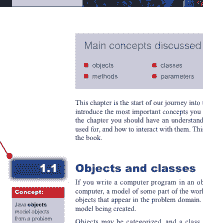

本章讨论的核心概念：

- 对象
- 方法

本章是我们进入面向对象编程世界之旅的起点。我们正在学习如何定义对象和方法，如何与它们交互，以及如何减少内存消耗。本章为本课程的所有其他章节奠定了基础。

在编写代码时，你应该避免创建包含逻辑错误的代码。编写运行良好的简单代码比编写运行良好的复杂代码要好。使用单元测试来发现和修复错误，可以特别地改进开发过程。你将学习如何编写单元测试以确保你的代码运行符合预期。

#### 1.1 对象与类

本章引入的术语

## 概念总结

如果你用面向对象的语言编写程序，你就是在以对象的方式进行思考。这些对象代表了问题的组件。这些对象应该出现在你正在构建的计算机程序中。

- 测试是验证软件是否按预期运行的过程。
- 调试是在代码中寻找并修复错误的过程。
- 继承是一种允许一个类从另一个类获取属性和行为的机制。
- 多态允许将不同的对象视为同一个公共父类的实例。
- 对象是具有状态和行为的类的实例。

对象是类的实例，而类是创建对象的蓝图。类定义了其对象将拥有的属性和方法。


你可以从同一个类创建许多对象。每个对象都可以有自己的状态，但它们共享相同的方法。你通过调用对象的方法与对象进行交互。

你会发现，当我们谈论对象时并不经常使用变量。这是因为变量是作为对象的属性存储的。

## 章节总结与概念总结

各章节总结都包含概念总结和元素列表。概念列表在章节开始的总结中联系在一起，可以作为一个极好的检查清单和复习工具。

### 对象优先方法

BlueJ 教授了一种在其他环境中无法实现的教学方法，包括类结构的可视化。这意味着学生在查看第一行 Java 语法之前就可以与对象进行交互！

### 用于解决问题的项目开发方法

每个章节都包含问题，在引入语言构造来解决问题之前，会对这些问题进行分析。此外，结构遵循开发任务的路线，清晰地涵盖了面向对象编程的原理。前言列出了书中讨论的所有项目。

| 本书中讨论的项目列表 |
| :--- |
| 章节 | 主题 |
| --- | --- |
| 1 | 对象与类 |
| 2 | 变量与类型 |
| 3 | 方法与函数 |
| 4 | 接口 |
| 5 | 继承 |
| 6 | 关系 |
| 7 | 多态 |
| 8 | 测试 |
| 9 | 调试 |
| 10 | 文件 |
| 11 | 异常处理 |
| 12 | GUI |

- 第 1 章：对象与类
- 第 2 章：变量与类型
- 第 3 章：方法与函数
- 第 4 章：接口
- 第 5 章：继承
- 第 6 章：关系
- 第 7 章：多态
- 第 8 章：测试
- 第 9 章：调试
- 第 10 章：文件
- 第 11 章：异常处理
- 第 12 章：GUI

## 本书中详细讨论的项目列表

- **shapes** 第 1 章

  使用几何形状进行简单绘图；说明了对象的创建、方法的调用和参数。

- **picture** 第 1 章

  一个使用形状对象画画的示例；引入了源代码、Java 语法和编译。

- **lab-classes** 第 1 章、第 2 章、第 8 章

  一个带有学生类的简单示例；说明了对象、字段和方法。在第 8 章中再次使用以添加继承。

- **ticket-machine** 第 2 章


# 火车票务机的模拟；引入了更多关于字段、构造函数、访问方法（accessor）和修改方法（mut）、参数以及一些简单的语句。

- book 第2章

存储书籍详情。强化了在票务机示例中使用的构造。

- clock-display 第3章

数字时钟显示器的实现；说明了抽象、模块化和对象交互的概念。

- mail system 第3章

电子邮件系统的简单模拟。用于演示对象的创建和交互。

- notebook 第4章

一个（简单）电子笔记本电脑的实现；用于引入集合和循环。

- auction 第4章

一个拍卖系统。更多关于集合和循环的内容，这次使用了迭代器。

- weblog-analyzer 第4章

一个分析网络日志文件的程序；引入了数组和 for 循环。

- tech-support 第5章

一个类似于 *Eliza* 的对话程序的实现，用于为客户提供“技术支持”；引入了库类的通用使用，以及某些特定的类；文档的读写。

- tech-support 第5章

一个用于为客户提供“技术支持”的程序实现；引入了库类的通用使用，以及某些特定的类；文档的读写。

- image-viewer 第5章

一个图片查看器的实现。专注于实现。

- balls

一个跳动的动画，重点讨论了测试和调试。

- diary 第6章

一个日历的实现，重点讨论了测试和调试。

- calculator 第6章

一个计算器的实现，重点讨论了测试和调试。

- world-of-zoo

一个基于文本的冒险游戏。这种项目是高度扩展的。

- dome 第9章

一个包含 CD 和 DVD 的数据库。这种项目详细讨论了继承和多态。

- foxes-and-rabbits

一个经典的捕食者-猎物者模拟。专注于继承和抽象类。

- simple-sound

一个简单的音频播放器。专注于构建接口。

- address-book

一个可以通过姓名或电话搜索的地址录。

- cinema-booking-system

一个用于管理电影院提前预订的系统。

- taxi

一个出租车示例，是系统和模拟的结合。

## 致谢

许多人对本书做出了许多贡献并使其成为可能。

首先，最重要的是，必须提到 John。John 现在是澳大利亚迪肯大学的副校长。纯属巧合，John 并不是本书的作者之一。他是 BlueJ 发展及其背后想法的推动者之一，我们讨论了多年关于写这本书。John 在本书编写期间对文本做出了贡献并帮助改进它。

几个人帮助了 BlueJ 变成今天的样子：Bruce Quig、Gavin McCall 以及澳大利亚的 Andrew Paterson，英国的 Ian Utting 和 Paul Henriksen。他们在工作之余为 BlueJ 工作了多年，改进并扩展了设计和实现。没有他们的工作，BlueJ 无法达到现在的质量和受欢迎程度，这本书可能永远无法写成。

另一个让 BlueJ 和本书成为可能的贡献来自 Sun Microsystems 的大力支持。在加州帕洛奥图为 Sun 工作的 Emil Sarpa 从一开始就支持 BlueJ 项目。他的支持和非官僚主义的合作方式极大帮助了我们。

Pearson 团队在制作本书方面也付出了巨大的努力，成功将其引入世界，并避免了每个作者最糟糕的担心——这本书被忽视。

我们的评审人员对手稿付出了巨大的努力，通常是在他们一天中最忙的时候。David 想对肯特大学计算机科学系的全体员工和学生表示个人的谢意。那些上过面向对象入门课程的学生来说，教他们是一种荣幸。他们还提供了必要的刺激和动力，让教学变得如此有趣。没有同事和研究生导师的宝贵帮助，课程将是不可能的，Simon Thompson 在担任系主任职位期间提供了卓越的支持。在大学生活之外，各种人士提供了极佳的休闲和社交出口，防止写作完全枯燥。我特别想提到 Chris Phillips 和 Joe Rotchell，他们继续忍受我的怪癖。

## 致谢

最后，我想感谢我的妻子 Helen，她的爱是如此特别；感谢我的孩子们，他们的生命如此宝贵。

Michael 感谢 Andrew、Davin 和 Bruce 与他进行了许多小时的激烈讨论。除了这些讨论所产生的技术工作外，我非常享受这个过程。自从我学术生涯开始以来，John Rosenberg 多年来一直一直是我的导师。没有他的款待和支持，我永远无法来到澳大利亚；没有他作为我的博士导师和同事，我无法在工作中取得我现在如此大的成就。与他共事是一件乐事，我对他感激不尽。感谢 Michael Caspersen，他不仅是一位良好的朋友，而且在我们共同举办的各种研讨会期间，他影响了我对教学的思考。

最后，我想感谢我的妻子 Leah 和我的两个小女儿 Sophie 和 Feena。在我写这本书期间，她们很多时候不得不忍受我全天候的长时间工作。她们的爱给了我继续下去的力量，并让这一切变得有意义。


# 第 1 章 对象与类

## 1.1 对象与类

**概念：**

Java 对象对问题领域中的对象进行建模。

如果你用面向对象的语言编写计算机程序，你实际上是在你的计算机中创建了世界上某个部分的模型。构建该模型的部分就是问题领域中出现的对象。这些对象必须在创建的计算机模型中被表示。

对象可以进行分类，而类则以抽象的方式描述某一特定类型的所有对象。

我们可以通过观察一个例子来让这些抽象概念变得更加清晰。假设你想为交通模拟建模。你必须处理的实体之一是汽车。在我们的语境下，汽车是什么：它是一个类还是一个对象？几个问题可能帮助你做出决定。

汽车是什么颜色的？它跑得有多快？它现在在哪里？

**概念：**

由类创建的对象。类描述对象的类型；对象代表类的实例。

你会发现，在我们谈论某辆特定的汽车之前，我们无法回答这些问题。这是因为在这个语境下的“汽车”指的是 `car` 类——我们谈论的是一般的汽车，而不是某辆特定的汽车。

如果我说，“我的旧车停在我家的车库里”，我们可以回答上面的问题。那辆车是红色的，它不快，它在我的车库里。现在我在谈论一个对象——汽车的一个特定示例。

我们通常将特定的对象称为*实例*（instance）。从现在起，我们将经常使用“实例”这个术语。“实例”与“对象”大致同义——当我们想要强调它们属于某个特定类时，我们会称对象为实例（例如，“这个对象是 `car` 类的一个实例”）。

在继续这个这个理论性较强的讨论之前，让我们来看一个例子。

## 1.2 创建对象

启动 BlueJ 并打开名为 *shapes* 的示例。¹你应该能看到一个与 BlueJ 1.1 所示类似的窗口。

图 1.1

BlueJ 中的 *shapes* 项目

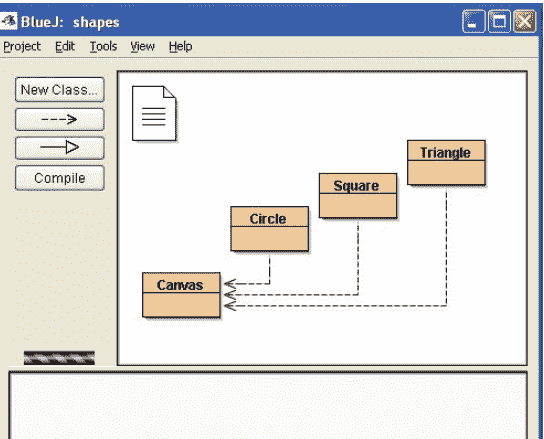

在这个窗口中，应该显示一张图。图中的每一个彩色矩形都代表我们项目中的一个类。在这个项目中，我们有 `Circle`、`Square`、`Triangle` 和 `Canvas` 类。

右键点击 *Circle* 类，并从弹出菜单中选择

`new Circle()`

系统要求你输入“实例名称”——点击 OK；目前提供的默认名称足够了。你将在屏幕底部看到一个标记为“circle1”的红色矩形（图 1.2）。

> ¹我们通常希望你在阅读本书时进行一些活动和练习。此时此，我们假设你已经知道如何启动 BlueJ 并打开示例项目。如果不知道，请先阅读附录 A。

图 1.2

对象台上的一个对象

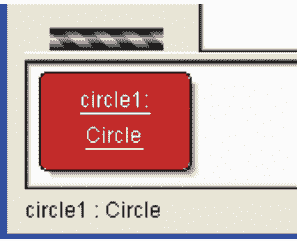

**约定：** 我们类名以大写字母开头（例如 `Circle`），对象名以小写字母开头（例如 `circle1`）。这有助于区分我们正在谈论的内容。

**练习 1.1** 创建另一个圆。然后创建一个正方形。

你刚刚创建了你的第一个对象！图 1.1 中的 *Circle* 图标代表类；屏幕底部的 `circle1` 是你创建的对象。

## 1.3 调用方法

右键点击其中一个对象（图 1.3），你将看到一个包含若干操作的菜单。这些是可以调用的方法。例如，你可以选择 `moveVisible` 方法来显示圆。

图 1.3

圆的绘制


**概念：**

我们通过调用方法与对象进行通信。

**练习 1.2** 如果调用两次方法会发生什么？如果调用三次会发生什么？

## 1.4 参数

**概念：**

方法可以带有参数以提供额外信息。

在示例中，对话框（图1.4）提示你输入一个整数。

仔细观察对象的弹出菜单可以看到方法的参数类型。如果一个方法没有参数，方法名后面跟着空括号。在圆的方法列表中，你会看到一个参数类型不同的方法：`changeColor` 方法有一个 `String` 类型的参数。

`String` 类型表示期望一段文本（例如一个单词或句子）。字符串始终包含在双引号内。例如，作为字符串的单词 red，应写为 "red"。

方法调用还包含一段文本，称为方法签名注释。注释是为了向（人类）读者提供信息，将在第 2 章中描述。`changeColor` 方法的注释说明了它知道哪些颜色。

图 1.4

方法对话框

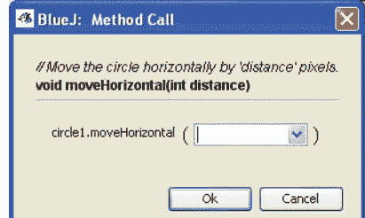

**练习 1.4** 在你的一个对象上调用 `changeColor` 方法并输入字符串 *red*。这应该改变圆的颜色。尝试其他颜色。

**练习 1.5** 这是一个非常简单的示例，支持的颜色不多。当你指定一个未知的颜色时会发生什么？

**练习 1.6** 调用 `changeColor` 方法，并在参数字段中不带引号地输入颜色。会发生什么？

> 陷阱 初学者一个常见的错误是在输入 `String` 类型的数据值时忘记加双引号。如果你输入 green 而不是 "green"，将得到类似‘Error: cannot resolve symbol.’ 的错误信息。

Java 支持其他几种数据类型，包括小数和字符。我们现在不会讨论所有这些类型，而是稍后再回到这个问题上。如果你现在就想了解它们，请参阅附录 B。

## 1.6 多个实例

> 练习 1.7 在对象台（object bench）上创建几个圆对象。你可以通过从 Circle 类的弹出菜单中选择 `new Circle()` 来。让它们可见，然后使用 'move' 方法在屏幕上移动它们。让其中一个变成大且黄色的；另一个变成小且绿色的。也尝试其他的：创建几个三角形和正方形。改变它们的位置、大小和颜色。

一旦你有了一个类，你就可以随心所欲地创建类的对象（或实例）。从 `Circle` 类，你可以创建很多圆。从 `Square` 类，你可以创建很多正方形。

这些每一个对象都有自己的位置、颜色和大小。你可以通过调用该对象上的方法来创建对象的属性（例如它的尺寸）。这将影响该特定对象，而不是影响其他对象。

你可能还会注意到关于参数的额外细节。看看三角形的 `coinChange` 方法。它的签名如下

```
void coinChange(int newWeight, int newWidth)
```

这是一个带有多个参数的方法示例。此方法有两个参数，在签名中用逗号分隔它们。事实上，方法可以有任意数量的参数。

## 1.7 状态

定义对象的所有值的集合（例如圆的 x 位置、y 位置、颜色、直径和可见性）也被称为对象的**状态**。这是我们从以后将使用的常用术语示例。

在 BlueJ 中，可以通过从对象的弹出菜单中选择 `Inspect`（检查）功能来查看状态。当对对象进行检查时，会显示一个与图 1.5 类似的窗口。这个窗口被称为对象检查器（object inspector）。

> 练习 1.8 确保你在对象台上有几个对象，然后依次检查每一个对象。在对象检查器打开时，尝试更改对象的状态（例如，通过调用 `moveTo` 方法）。你应该看到对象检查器中的值发生了变化。

图 1.5

对象检查对话框

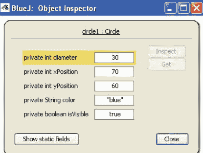

某些方法在调用时会改变对象的状态。例如，`moveLeft` 改变 `xPosition` 属性。Java 将这些对象属性称为**字段**（fields）。

## 1.8 对象中包含什么？

在检查不同的对象时，你会发现相同类的对象都具有相同的字段。也就是说，字段的数量、类型和名称是相同的，而每个对象中特定字段的实际值可能是不同的。相比之下，不同类的对象可能有不同的字段。例如，一个圆有一个 'diameter'（直径）字段，而一个三角形有 'width'（宽度）和 'height'（高度）字段。

原因是字段的数量、类型和名称是在类中定义的，而不是在对象中。因此，`Circle` 类定义每个圆对象将有五个字段：diameter、xPosition、yPosition、color 和 isVisible。它还定义了这些字段的类型。也就是说，它指定前三个是 `int` 类型，而颜色是 `String` 类型，`isVisible` 标志是 `boolean` 类型。（Boolean 是一种可以表示两个值的类型：true 和 false。我们将详细讨论这一点。）

当创建一个 `Circle` 类的对象时，该对象将自动拥有这些字段。这些字段的值存储在对象中。这确保了每个圆都有颜色（例如），并且每个可以有不同的颜色（图 1.6）。

方法的情况也是类似的。方法定义在对象的类中。因此，给定类的对象具有相同的方法。然而，方法是在对象上被调用的。这使得在调用例如 `moveRight` 方法时，清楚要更改的是哪个对象。

- 练习 1.9 使用 `shapes` 项目中的形状来创建一个房子和太阳的图像，类似于图 1.7 所示。在执行此操作时，写下你实现这一目标需要做什么。可以用不同的方式实现吗？

图 1.6

带有字段和值的类及其对象

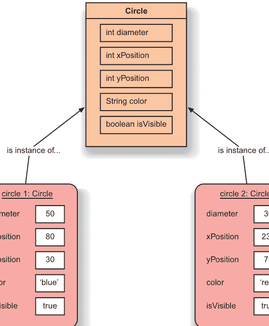

图 1.7

从一组形状对象创建的图像

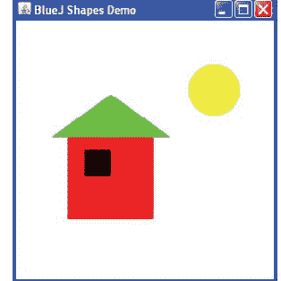

## 1.9 对象交互

在下一节中我们将处理一个不同的示例项目。如果你仍然打开着 `shapes` 项目，请关闭它，并打开名为 `picture` 的项目。

- 练习 1.10 打开 `picture` 项目。创建一个 `Picture` 类实例并调用它的 `draw` 方法。还尝试 `setBlackAndWhite` 和 `setColor` 方法。

- 练习 1.11 你认为 `Picture` 类是如何画图的？

项目中的四个类与 `shapes` 项目中的类完全相同。但我们现在有一个额外的类：`Picture`。这个类的程序是为了完全执行我们所需的功能的。


方法的情况也是类似的。方法定义在对象的类中。因此，给定类的对象具有相同的方法。然而，方法是在对象上被调用的。这使得在调用例如 `moveRight` 方法时，清楚要更改的是哪个对象。

- 练习 1.9 使用 `shapes` 项目中的形状来创建一个房子和太阳的图像，类似于图 1.7 所示。在执行此操作时，写下你实现这一目标需要做什么。可以用不同的方式实现吗？

## 图 1.6

带有字段和值的类及其对象


## 图 1.7

从一组形状对象创建的图像


### 1.9 对象交互

在下一节中我们将处理一个不同的示例项目。如果你仍然打开着 `shapes` 项目，请关闭它，并打开名为 `picture` 的项目。

- 练习 1.10 打开 `picture` 项目。创建一个 `Picture` 类实例并调用它的 `draw` 方法。还尝试 `setBlackAndWhite` 和 `setColor` 方法。

- 练习 1.11 你认为 `Picture` 类是如何画图的？

项目中的四个类与 `shapes` 项目中的类完全相同。但我们现在有一个额外的类：`Picture`。这个类的程序是为了完全执行我们所需的功能的。

## 关于编译

当人们编写程序时，通常使用一种“高级”语言，例如 Java。这样做的一个问题是计算机无法直接执行 Java 代码。Java 的设计是为了让人类容易阅读，而不是为了计算机。计算机内部使用机器码的二进制表示，这看起来与 Java 不同。对我们来说，这个问题太复杂了，以至于我们不想写它。我们能做什么呢？

解决方案是一个名为`编译器`（compiler）的程序。编译器将 Java 翻译成机器码。当我们写 Java 时，运行编译器——它生成机器码——然后计算机运行机器码。结果是，每当我们更改源代码时，在使用该类之前必须首先运行编译器。否则，编译器所需的机器版本将不存在。

## 源代码

每个类都有一些源代码。在 BlueJ 中，你可以通过点击类来查看源代码。

## 1.11 另一个示例

在本章中，我们已经讨论了许多新概念。为了帮助理解这些概念，我们将在不同的语境下重新回顾它们。为此，我们使用一个不同的示例。如果你还打开着 `picture` 项目，请将其关闭，并打开 `lab-classes` 项目。

该项目是一个学生数据库简化版，用于跟踪实验班的学生并打印班级名单。

- 练习 1.17 创建一个 `Student` 类的对象。你会发现，这次系统不仅提示你输入实例的名称，还提示你输入其他一些参数。在点击确定 之前填写这些内容。（记住，`String` 类型的参数必须写在双引号内。）

## 1.12 返回值

和之前一样，你可以创建多个对象。而且像之前一样，对象拥有你可以从它们的弹出菜单中调的方法。

- 练习 1.18 创建一些学生对象。在每个对象上调用 `getName` 方法。解释发生了什么。

当调用 `Student` 类的 `getName` 方法时，我们发现了一些新东西：方法可以返回一个结果值。事实上，每个方法的签名（signature）都会告诉我们它是否返回结果，以及结果的类型是什么。`get`（如对象弹出菜单中所示）的签名定义为

```
getName()
```

方法名前的单词 `String` 指明了返回类型。在这种情况下，它表示调用此方法将返回一个 `String` 类型的结果。`changeName` 的签名声明为：

```
void changeName(String replacementName)
```

`void` 表示此方法不返回任何结果。

带有返回值的方法使我们能够通过方法调用从对象获取信息。这意味着我们可以使用方法来改变对象的状态，或者获取其状态信息。

## 作为参数的对象

- 练习 1.19 创建一个 `LabClass` 类的对象。正如签名所示，你需要指定该班级的最大学生人数（整数）。

- 练习 1.20 调用该类的 `numberOfStudents` 方法。它是做什么的？

- 练习 1.21 观察 `enrollStudent` 方法的签名。你会发现预期的参数类型是 `Student`。确保你的工作台上上有二或三个学生对象和一个 `LabClass` 对象，然后调用 `LabClass` 对象的 `enrollStudent` 方法。在对话框输入框中输入并点击其中一个学生——这将学生对象的名称输入 `enrollStudent` 方法的参数字段（图 1.8）。点击确定，你就将该学生添加到了 `LabClass` 中。同样添加一个或多个其他学生。

- 练习 1.22 调用 `LabClass` 对象的 `printList` 方法。你会看到该班级所有学生的名单被打印到 BlueJ 终端窗口（图 1.9）。

## 图 1.8 向 LabClass 添加学生


## 图 1.9 LabClass 类列表的输出


如练习所示，对象可以作为参数传递给其他对象的方法。当方法期望一个对象作为参数时，该预期的对象类名会在方法签名中被指定为参数类型。

进一步探索这个项目。尝试在该语境下识别在 `shapes` 示例中讨论的概念。

## 练习 1.23

创建三个具有以下信息的学生：

- Snow White，学生 ID:100234，学分：24
- Lisa Simpson，学生 ID:122044，学分：56
- Charlie Brown，学生 ID:12003P，学分：6

然后将他们全部录入一个实验室，并在屏幕上打印列表。

## 练习 1.24

使用 `LabClass` 的检查器（inspector）发现它拥有哪些字段（fields）。

## 练习 1.25

为实验室设置讲师、房间和时间，并将列表打印到终端窗口，以检查这些新细节是否出现。

## 1.14 总结

在本章中，我们探索了类和对象的基础知识。我们讨论了对象是由类定义的这一事实。类代表了某物的通用概念，而对象代表了类的具体实例。我们可以有任何类的类型的对象。

对象拥有方法，我们通过方法与它们进行通信。我们可以使用方法对对象进行更改，或从对象中获取信息。方法有参数以及参数类型。方法有返回类型，指定了它们返回的数据类型。如果返回类型是 `void`，则它们不返回任何内容。

对象将数据存储在字段中（字段也有类型）。一个对象的所有数据值合称为对象的状态。

对象是根据用特定编程语言编写的类定义创建的。Java 编程很大程度上关于学习编写类定义。Java 编程中很大一部分工作关于学习编写类定义。一个大型 Java 程序会有许多类类。

## 本章引入的术语

object, class, instance, method, signature, parameter, type, state, source code, return value

## 概念总结

- object, class, instance, method, signature, parameter, type, state, source code, return value, 练习 1.25 在本章中讨论了这些
- 练习 1.26 在本章中我们提到了数据类型 `int` 和 `String`，Java 还有更多类型。为了查明它们，你可以查看附录 B，或者查看在线手册 http://java.sun.com/docs/tutorial/java/datatypes/ 以下是哪些类型？0, "hello", 101, -1, true, "33", 3.1415 什么是
- 练习 1.29 编写一个名为 `send` 的方法签名，它接受一个 `String` 类型的参数且不返回值。
- 练习 1.30 编写一个名为 `average` 的方法签名，它接受两个 `int` 类型的参数，并返回一个 `int` 值。
- 练习 1.31 观察你现在正在读的这书。它是对象还是类？如果是类，列举一些对象；如果是对象，列出它的类。
- 对象可以有多个不同的类吗？请讨论。

# 第2章 理解类定义

本章讨论的概念：

- 字段
- 方法（访问器 accessor、修改器 mutator）
- 构造方法
- 赋值和条件语句
- 参数

本章讨论的 Java 结构：

field, constructor, comment, parameter, assignment (=), block, return statement, void, compound assignment operators (+=, -=), if statement

我们首先查看类的源代码。我们将讨论类定义的元素：*字段、构造方法和方法*。方法包含语句，最初我们将查看包含简单算术和打印语句的方法。随后，我们引入了*条件语句*，允许在方法中做出不同的选择。

我们将详细地检查一个新项目。这代表了自动售票机的一种朴素实现。当我们从最基本的特征开始时，很快就会发现这种实现在许多方面都有缺陷。因此，我们将继续描述一个更复杂的售票机版本，它是一个重大的改进。最后，为了强化本章引入的概念，我们查看第一章中遇到的 *lab-classes* 的内部。

## 2.1 售票机

火车站通常提供售票机，当客户插入正确的金额时，机会打印票。在本章中，我们将定义一个模拟这类售票机的类。由于我们将查看第一个 Java 示例的内部，最初我们将保持模拟的简单。这将提供让我们去思考这些模型与现实世界的不同之处，以及我们如何修改类来使它们创建的对象更真实。

### 2.1.1 探索简易售票机的行为

在在 BlueJ 中打开 `naive-ticket-machine` 项目。该项目包含一个 `TicketMachine` 类——你将能够像第 1 章中讨论的示例一样来探索它。当你创建一个 `TicketMachine` 实例时，系统会要求你提供一个数字，对应该特定机器将发行的票价。价格以分为单位，因此像 500 这样的正整数将是一个合适的操作值。

- **练习 2.1** 在对象台上创建一个 `TicketMachine` 对象并观察它的方法。你应该看到以下方法：`getBalance`、`getPrice`、`insertMoney` 和 `printTicket`。尝试使用 `getPrice` 方法。它应该返回一个包含该对象在创建时设置的票价的值。使用 `insertMoney` 方法模拟向机器插入一个金额，然后使用 `getBalance` 检查机器是否记录了插入的金额。你可以向机器插入多次不同的金额，就像向真实机器中插入多张硬币或纸币一样。尝试插入购买票务所需的金额。由于这是一台简单的机器，一旦插入了足够的钱，票务不会自动发行，请调用 `printTicket` 方法。

- **练习 2.2** 如果在打印完票务后检查机器的余额，会返回什么？

- **练习 2.3** 尝试在打印票务之前插入不同的金额。你是否注意到机器的行为有什么奇怪之处？如果你向机器中插入了过多的钱会发生什么——你会收到任何退款吗？如果你插入的钱不足并尝试打印票会发生什么？

- **练习 2.4** 在我们开始在下一节查看 `TicketMachine` 类如何实现之前，尝试通过在对象台上与其交互，以获得对售票机的良好理解。

- **练习 2.5** 为不同价格的票务创建另一个售票机。从那台机器上买一张票。打印出来的票看起来不同吗？

## 检查类定义

在 BlueJ 中对 `TicketMachine` 对象的行为进行检查表明，如果我们插入了与票价完全匹配的正确金额，它们的行为确实如我们预期的那样。在我们在本节中探索该类的内部细节时，我们将学习为什么是这样。

通过双击类图中的图标来查看 `TicketMachine` 类的源代码。它看起来应该像图 2.1 所示。

## 图 2.1

BlueJ 编辑窗口

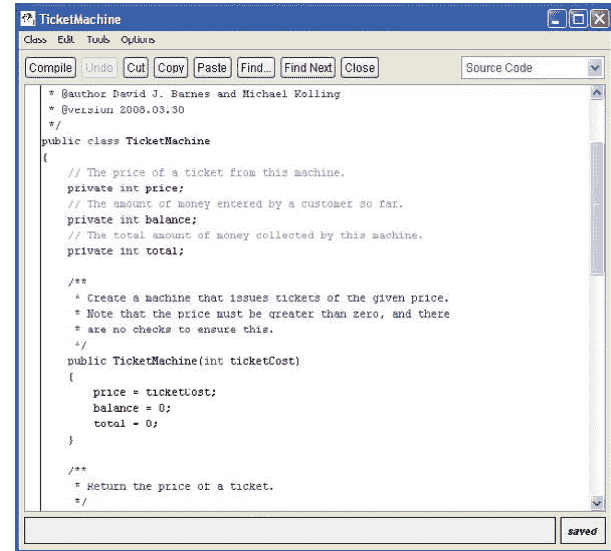

类的全文显示在代码 2.1 中。通过逐段查看类定义，我们可以充实第 1 章中讨论过的一些面向对象概念。

## 代码 2.1

`TicketMachine` 类

```java
/**
 * @author David J. Barnes and Michael Kölling
 * @version 2008.03.30
 */
public class TicketMachine
{
    // 此台机器的票务价格。
    private int price;
    // 目前已投入的金额。
    private int balance;
    // 此台机器收集的金额总额。
    private int total;

    /**
     * 创建一个发行给定价格票的机器。
     * 注意价格必须大于零，并且有检查
     * 确保这一点。
     */
    public TicketMachine(int ticketCost) {
        price = ticketCost;
        balance = 0;
        total = 0;
    }

    /**
     * 返回票价。
     */
    public int getPrice() {
        return price;
    }

    /**
     * 返回已投入的金额。
     */
    public int getBalance() {
        return balance;
    }

    /**
     * 接收客户的金额（分）。
     */
    public void insertMoney(int amount) {
        balance = amount;
    }
}
```

## 2.2 检查类定义

### 字段、构造函数和方法

大多数类的源代码可以分为两个部分：一个命名类的较外部包装，和一个较大的内部部分。在这种情况下，外部包装如下：

```java
public class TicketMachine {
    // 内部部分
}
```

不同类的外部包装看起来大相同；它们的主要目的是为类提供名称。

- **练习 2.6** 写出你认为 `Student` 类外部包装可能是什么样的——不要担心内部部分。

- **练习 2.7** 在类的外部包装中写

```java
public class TicketMachine
```

或

```java
class TicketMachine
```

是否有区别？修改 `TicketMachine` 类的源代码进行更改，然后查看编辑器窗口。类图发生了变化吗？

当你现在点击编译按钮时得到什么错误消息？你认为这条消息是否清晰地解释了哪里错了？

- **练习 2.8** 检查是否可以在外部包装中省略 `public` 单词。

类的内部部分是我们定义字段、构造函数和方法的地方，它们赋予了对象的特征和行为。我们将这三个组件的核心要素总结为：

- 字段为对象存储数据。
- 构造函数允许对象在首次创建时进行设置。
- 方法实现对象的行为。

在 Java 中，对于在类内部定义字段、构造函数和方法的顺序，很少规定。在 `TicketMachine` 类中，我们选择先列出字段，然后是构造函数，最后是方法（代码 2.2）。这是我们在所有示例中遵循的顺序。其他人选择不同的风格，这主要是一个偏好问题。我们的风格并不比所有其他风格都好。然而，选择一种风格并始终使用它是，因为你的类将更容易阅读和理解。

## 代码 2.2

我们对字段、构造函数和方法的排序

```java
public class ClassName {
    字段
    构造函数
    方法
}
```

- **练习 2.9** 从你之前在 BlueJ 中对售票机对象的实验中，可能可能记住一些方法的名称——例如 `printTicket`。查看代码 2.1 中的类定义，并结合这些知识以及我们提供的关于排序的额外信息，尝试列出 `TicketMachine` 类中字段、构造函数和方法的名称列表。提示：类中只有一个构造函数。

- **练习 2.10** 你是否注意到构造函数的任何特征使其与该类的其他方法有显著不同？

## 2.3.1 字段 (Fields)

> 概念：

字段存储对象使用的数据。字段也称为实例变量。

`TicketMachine` 类有三个字段：`price`（价格）、`balance`（余额）和 `total`（总额）。字段也称为实例变量。我们在类定义的开头就定义了这些字段（代码 2.3）。所有字段都与票务机对象需要处理的货币项目相关联：

- `price` 字段存储票务的固定价格。
- `balance` 字段存储用户在请求打印票之前向机器投入的金额。
- `total` 字段记录了自票务机对象构建以来，所有用户向机器投入的金额总量，不包括当前余额。

## 代码 2.3

`TicketMachine` 类的字段

```java
public class TicketMachine {
    private int price;
    private int balance;
    private int total;

    省略了构造函数和方法。
}
```


# 字段、构造函数和方法

字段是对象内部用于存储值的一小空间。每个对象一旦被创建，都会为其类中声明的每一个字段留出空间。图 2.2 显示了票务机对象及其三个字段的图示。这些字段尚未分配任何值；一旦需要，我们将每个值写入代表字段的框中。这种表示法与 BlueJ 中显示对象台上的对象使用的符号类似，只是我们在这里展示了更多细节。在 BlueJ 中，由于某些原因，字段没有显示在对象图标上。然而，我们可以通过打开检查窗口看到它们。

## 图 2.2 TicketMachine 类的一个对象

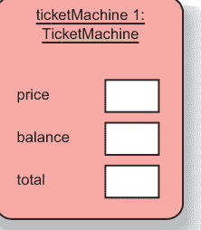

### 2.3 字段、构造函数和方法

每个字段在源代码中都有自己的声明。在上面的行中，在完整的类定义中，我们添加了一行文本——为了方便人类阅读类定义而编写注释：

```java
// 这台机器票务的价格。
private int price;
```

单行注释由两个字符 `//` 引入，这两个字符之间没有空格。更详细的、跨多行的注释通常以行内注释的形式编写。它们以字符对 `/*` 开始，并以字符对 `*/` 结束。代码 2.1 的类头之前有一个很好的例子。

这三个字段的定义非常相似：

- 所有定义都表明它们对象的私有（`private`）字段；在这里我们必须在第 5 章解释这意味着什么，但目前我们只需说我们总是将字段定义为私有的。
- 三个字段的类型都是 `int`。这表示每个字段都可以存储单个整数值，考虑到我们希望存储以分为单位的货币数字，这是合理的。

由于字段可以存储随时间变化的值，它们也被称为变量。如果我们愿意，字段中存储的值可以改变。例如，当钱被投入票务机时，我们想要更改存储在 `balance` 字段中的值。`price`、`balance` 和 `total` 字段都是票务机对象实现其接收客户货币、打印票务以及记录投入金额总额等功能所需的数据项。在接下来的章节中，我们将看到构造函数和方法如何使用这些字段来实现简单票务机的行为。

#### 练习 2.11 你认为以下每个字段的类型是什么？

```java
private int count;
private Student representative;
private Server host;
```

#### 练习 2.12 以下字段的名称是什么？

```java
private boolean alive;
private Person tutor;
private Game game;
```

#### 练习 2.13 在以下来自 TicketMachine 类的字段声明中

```java
private int price;
```

这三个单词出现的顺序重要吗？编辑 `TicketMachine` 类以尝试不同的排序。每次更改后，关闭编辑器。类图的出现变化是否提示了你是否可能其他排序？通过点击编译按钮来检查是否有错误消息。

请确保在实验后恢复到原始版本！

#### 练习 2.14 字段声明的末尾总是需要一个分号吗？再次通过编辑器进行实验。你在这里学到的规则非常重要，请务必记住它。

#### 练习 2.15 为一个名为 `status` 的 `int` 类型字段编写完整的声明。

### 2.3.2 构造函数

类的构造函数具有特殊的角色要扮演。它们的职责是确保该类的每个对象在被创建后处于适合使用的状态。这也被称为初始化。构造函数将对象初始化到一个合理的状态。代码 2.4 显示了 `TicketMachine` 类的构造函数。

构造函数的一个显著特征是它们与与其定义的类同名——在这种情况下为 `TicketMachine`。

对象的字段在构造函数中初始化。某些字段（如 `balance` 和 `total`）可以通过赋值一个常数（在本例中为零）来设置为合理的初始值。对于其他字段（例如票价），就没那么简单，因为在机器构建之前，我们不知道价格是多少：

```java
public class TicketMachine
{
    // 省略了字段。
    /**
     * 创建按给定价格发行票的机器。
     * 注意价格必须大于零，并且没有
     * 检查来确保这一点。
     */
    public TicketMachine(int ticketCost)
    {
        price = cost;
        balance = 0;
        total = 0;
    }
    // 省略了方法。
}
```

### 2.4 通过参数传递数据

构造函数和方法接收值的方式都是通过参数。你可能记得我们在第 1 章中简要遇到过参数。参数在构造函数或方法的头部中定义：

```java
public TicketMachine(int ticketCost)
```

此构造函数有一个参数 `ticketCost`，其类型为 `int` —— 与它将要用于设置的 `price` 字段类型相同。图 2.4 展示了如何通过参数传递值。在这种情况下，用户在创建新的票务机（左所示）时在对话框中输入一个值，然后该值被复制到新机器构造函数的 `ticketCost` 参数中。这通过箭头 (A) 所示。图 2.4 中机器对象中的框 "TicketMachine()" 是该对象的额外空间，仅在构造函数执行时才被创建。当我们讨论方法而不是构造函数时，我们将其称为对象的**构造空间**（或方法空间），因为那里的情况是一样的。构造空间用于为构造函数参数的值（以及我们遇到的其他变量）提供空间。

我们通过引用名称来区分参数名与构造或方法的值：将名称称为**形式参数**，将值称为**实际参数**。因此，`ticketCost` 是一个形式参数，而用户提供的值（如 500）是一个实际参数。因为它们存储了值，所以形式参数是另一种变量。在我们的图表中，所有变量都用白框表示。

形式参数仅在声明它的构造函数或方法体内部对对象可用。我们说参数的**作用域**限制在声明它的构造函数体内。相比之下，字段的作用域是整个类定义 —— 它可以从类的任何地方访问。

与变量作用域相关的概念是**生命周期**。参数的生命周期限于构造函数或方法的单次。一旦该调用完成任务，形式参数就会消失，它们所持的值也会丢失。换句话说，当构造函数执行完毕后，构造空间（见图 2.4）将被移除，其中包含的参数变量也会被移除。

相反，字段的生命周期与其所属对象的生命周期相同。如果我们想记住 `ticketCost` 参数中的票务成本，我们必须将该值存储在更持久的地方 —— 即在 `price` 字段中。

## 图 2.4 参数传递 (A) 和赋值 (B)

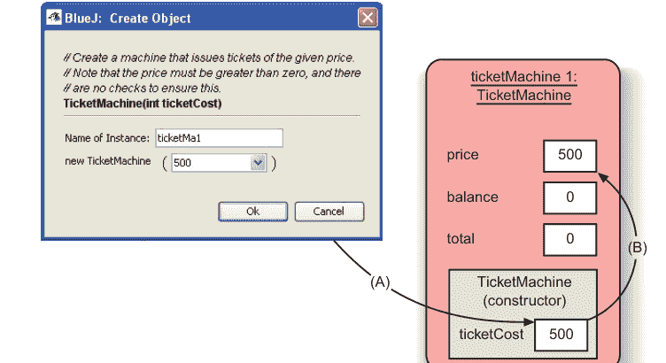

### 2.5 赋值

#### 练习 2.16 以下构造函数属于哪个类？

```java
public Student(String name)
```

#### 练习 2.17 这里的构造函数有多少个参数，它们的类型是什么？

```java
public Book(String title, double price)
```

#### 练习 2.18 你能猜出 `Book` 类的一些类型可能是什么吗？你能对它的字段名称推测出任何信息吗？

### 2.5 赋值

在上一节中，我们注意到需要将参数的短命值存储在某个更持久的地方 —— 字段。为了实现这一点，构造函数体包含以下赋值语句：

```java
price = ticketCost;
```

赋值语句通过存在赋值运算符来识别，例如上例中的 `=`。赋值语句的工作原理是获取运算符右侧显示的值，并将该值复制到运算符左侧的变量中。这在图 2.4 中通过标记为 (B) 的箭头所示。右侧被称为**表达式**：表达式是计算值的产物。在这种情况下，表达式仅包含一个单一变量，但我们将在本章节稍后的部分看到一些包含算术运算的复杂表达式的示例。关于赋值的一个规则是，表达式的类型必须与被赋值变量的类型匹配。到目前为止我们三种类型：`int`、`String` 和（非常）`boolean`。这条规则意味着例如，我们不允许将整数类型的表达式存储在字符串类型的变量中。该规则也适用于形式参数和实际参数之间：实际表达式的类型必须与形式参数变量的类型匹配。目前，我们可以说类型必须是相同的，尽管我们将在后面的章节中看到这并非全部事实。

#### 练习 2.19 假设 `Pet` 类有一个类型为 `String` 的字段 `name`。在以下构造函数体中写一条赋值语句，使 `name` 字段用构造函数参数的值初始化。

```java
public Pet(String petsName)
{
}
```

#### 练习 2.20 挑战性练习：以下 `TicketMachine` 构造函数的版本有什么什么问题？

```java
public TicketMachine(int ticketCost)
{
    int price = ticketCost;
    balance = 0;
    total = 0;
}
```

一旦你发现了问题，请在 `naive-ticket-machine` 项目中尝试这个版本。这个版本能编译吗？创建一个对象然后检查它的字段。你是否注意到检查器中该版本的 `price` 字段的值有什么异样的？你能解释为什么是这样吗？

### 2.6 访问器方法

`TicketMachine` 类有四个方法：`getPrice`、`getBalance`、`insertMoney` 和 `printTicket`。我们将通过考虑 `getPrice` 开始查看方法的源码。

方法包含两个部分：**头部**和**方法体**。这里是 `getPrice` 的方法头部：

```java
/**
 * 返回票务的价格。
 */
public int getPrice()
```

前三行是描述方法作用的注释。第四行也被称为**方法签名**。区分方法签名和字段声明是非常重要的，因为它们看起来非常相似。我们可以判断出 `getPrice` 是一个方法而不是字段，因为它后面跟着一对圆括号：`(` 和 `)`。注意，签名末尾没有分号。

方法体是方法头部之后的剩余部分。它总是被一对匹配的大括号包围：`{` 和 `}`。方法体包含声明和语句，这些声明和语句定义了当调用该方法时对象内部会发生什么。在我们上面的示例中，方法体包含一条语句，但我们看到了许多示例，其方法体由许多行声明和语句组成。

任何位于匹配的大括号之间的一组声明和语句都被称为**块**。因此，`TicketMachine` 类的体以及该类中所有方法的方法体都是块。

`TicketMachine` 构造函数的签名与 `getPrice` 方法的签名之间有两个显著区别：

```java
public TicketMachine(int ticketCost)
public int getPrice()
```

> 1 此定义与 Java 语言规范中更正式的定义略有不同，签名不包含访问修饰符和返回类型。

#### 代码 2.5 getPrice 方法

```java
public class TicketMachine {
    // 字段省略

    // 构造函数省略

    /**
     * 返回票务的价格。
     */
    public int getPrice() {
        return price;
    }

    // 其他方法省略
}
```

- 方法有一个 `int` 返回类型，但构造函数没有返回类型。返回类型写在方法名之前。
- 构造函数有一个形式参数 `ticketCost`，但方法没有 —— 只有一对空括号。

在 Java 中，构造函数不能有返回类型是一个绝对规则。相反，构造函数和方法可以有任意数量的形式参数，包括没有。

在 `getPrice` 的体内有一条语句：

`return price;`

这条返回语句负责返回一个与方法签名中 `int` 返回类型匹配的整数值。当方法包含返回语句时，它总是是该方法的最后一条语句，因为一旦执行了返回语句，方法中的后续语句都将不再被执行。

`getPrice` 的返回类型是一种承诺，保证方法体将执行某些操作，最终计算并返回一个整数作为方法的结果。你认为方法调用是向对象的一种提问，而方法的返回值是对象对该问题的回答。在这种情况下，对票务机调用了 `getPrice` 方法，问题是“票价是多少？”票务机不需要执行任何计算就能回答，因为它将答案保存在它的 `price` 变量中。

**概念**：访问器方法返回关于对象状态的信息。

我们将 `TicketMachine` 的两个方法（`getPrice` 和 `getBalance`）描述为**访问器方法**（或简称 accessors）。这是因为它们向调用者返回关于对象状态的信息 —— 提供了对该状态的访问。访问器通常包含一个返回语句，以便作为特定值传回信息。

#### 练习 2.21 比较 `getBalance` 方法与 `getPrice` 方法。它们之间有什么区别？

#### 练习 2.22 如果说对 `getPrice` 的调用可以被描述为“票价多少钱？”，那么你会如何描述对 `getBalance` 的调用呢？

#### 练习 2.23 如果将 `getBalance` 的名称改为 `getAmount`，方法体中的 `return` 语句也需要修改吗？请在 BlueJ 中尝试一下。

#### 练习 2.24 定义一个访问器方法 `getTotal`，返回 `total` 字段的值。

#### 练习 2.25 尝试从 `getPrice` 的体中移除 `return` 语句。现在编译该类时，你看到了什么错误信息？

#### 练习 2.26 比较代码 2.1 中 `getPrice` 和 `printTicket` 的方法签名。除了名称之外，它们之间的主要区别是什么？

#### 练习 2.27 `insertMoney` 和 `printTicket` 有 `return` 语句吗？你认为为什么会这样？你是否注意到它们的头部中有什么特征可能暗示它们不需要 `return` 语句？

### 2.7 变器方法

票务机的方法执行的是简单的任务——返回其对象某个字段的值。剩余的方法——`insertMoney` 和 `printTicket`——具有更为重要的角色，主要因为它们每次被调用时都会更改票务对象一个或多个字段的值。我们将改变对象状态的方法称为变器。

就像我们认为信息请求（问题）一样，我们可以将变器视为对对象改变其状态的请求。

变器的一个显著特征是，对象在调用之前之后会表现出略有不同的行为。我们可以通过下面的练习来说明这一点：

#### 练习 2.28 创建一个具有自定义票价的票务机。在执行任何其他操作之前，先调用它的 `getBalance` 方法。现在调用 `insertMoney` 方法（代码 2.6），并传入一个非零正整数作为实际参数。现在再次调用 `getBalance`。两次 `getBalance` 的调用应该显示不同的输出，因为 `insertMoney` 的调用具有通过 `balance` 字段改变机器状态的效果。

`insertMoney` 的签名具有 `void` 返回类型和一个形式参数 `amount`，类型为 `int`。`void` 返回类型意味着该方法不向调用者返回任何值。这与其他返回类型有显著不同。在 BlueJ 中，这种区别最明显的地方是返回值对话框显示了对 `void` 方法的调用。在 `void` 方法体中，这种区别体现在没有 `return` 语句上。

#### 代码 2.6 insertMoney 方法

```java
/**
 * 从客户处接收以分值为单位的金额。
 */
public void insertMoney(int amount)
{
    balance = balance + amount;
}
```

在 `insertMoney` 体中，有一个语句，它是另一种形式的赋值语句。我们考虑赋值语句总是首先检查赋值符号右侧的计算。在这里，它的效果是计算 `amount` 参数中的数字与 `balance` 字段中的数字之和。然后将这个组合值赋值给 `balance` 字段。因此，其效果是根据 `amount` 的值增加了 `balance` 的值。

#### 练习 2.29 我们仅从它的头部如何判断 `setPrice` 是一个方法而不是构造方法？

```java
public void setPrice(int ticketCost)
```

#### 练习 2.30 完成 `setPrice` 方法体，使其将其参数的值赋值给 `price` 字段。

#### 练习 2.31 完成以下方法的体，其目的是将其参数的值加到名为 `score` 的字段上。

> ² 实际上，Java 允许 `void` 方法包含一种特殊形式的 `return` 语句，其中没有返回值。这种形式的形式为：
>
> `return;`
>
> 并简单地导致方法退出而不执行任何后续代码。
>
> ³ 在变量的值上增加一个金额是如此常见的做法，以有一个特殊的复合运算符来完成：`+=`；例如：
>
> `balance += amount;`

```java
/**
 * 通过给定的点数增加分数。
 */
public void increase(int points) {
  ..
}
```

#### 练习 2.32 你能完成以下方法吗？其目的是从名为 `price` 的字段中减去参数的值。

```java
/**
 * 按给定的金额减少价格。
 */
public void discount(int amount) {
  ...
}
```

### 从方法打印

代码 2.7 显示了类中最复杂的方法：`printTicket`。为了帮助你理解接下来的讨论，请确保你已经在票务机上调用了此方法。你应该会在 BlueJ 终端窗口中看到如下内容的输出。

```
###############
# The BlueJ Line
# Ticket
# 500 cents.
#################
```

这是我们目前看到过的最长的方法，我们将将其分解为更易管理的部分：


- 签名表明该方法具有 `void` 返回类型，且不接受任何参数。
- 方法体由八条语句以及相关的注释组成。
- 前六条语句负责打印 BlueJ 终端窗口中看到的内容。
- 第七条语句将客户插入的余额（通过之前的调用 `insertMoney`）加到机器到为止收集的所有金额的运行总和。
- 第八条语句使用基础赋值语句将余额重置为零，为下一个客户插入某些钱做好准备。

## 2.8 从方法打印

### 代码 2.7

`printTicket` 方法

```java
/**
 * 打印票据
 * 清零余额。
 */
public void printTicket() {
    // 打印边框
    System.out.println("###############");
    // 打印标题
    System.out.println("# The BlueJ Line");
    // 打印票据
    System.out.println("# Ticket");
    // 打印金额
    System.out.println("# " + balance + " cents.");
    // 打印边框
    System.out.println("#################");

    // 更新总量
    total = total + balance;
    // 清零余额
    balance = 0;
}
```

通过比较这些语句所产生的输出，很容易看出 `System.out.println("# The BlueJ Line");` 打印了

- 字符串 `# `（注意空格）
- `balance` 字段的值（没有引号）
- 字符串 ` cents.`（注意前面的空格）

当用于字符串和任何其他内容时，`+` 是字符串拼接运算符而非加法运算符。

## 第2章 理解类定义

### 练习 2.33
在 `TicketMachine` 类中添加一个名为 `prompt` 的方法。它应该具有 `void` 返回类型且不接受任何参数。方法体应该打印如下：插入正确的金额。

### 练习 2.34
在 `TicketMachine` 类中添加一个 `showPrice` 方法。它应该具有 `void` 返回类型且不接受任何参数。方法体应该打印如下：票价为 `xyz` 分。其中 `xyz` 在方法被调用时被 `price` 字段的值替换。

### 练习 2.35
创建两个带有票价的票务机。调用它们的 `showPrice` 方法显示的输出是相同的还是不同的？你如何解释这种效果？

### 练习 2.36
如果你修改 `printTicket` 的第四条语句使 `price` 也带有引号，如下，你认为会打印什么？

```java
System.out.println("# " + "price" + " cents.");
```

### 练习 2.37
那么这个版本呢？

```java
System.out.println("# price cents.");
```

### 练习 2.38
上述两个版本是否有一个可以显示不同票务机的票价？解释你的答案。

## 2.9 简单票务机总结

我们详细检查了简单票务机类的内部结构。我们看到该类有一个较小的层来命名类，还有一个包含字段、构造方法和多个方法的实质主体。字段用于存储对象维护状态的数据。构造方法用于在创建对象时设置初始状态。适当的初始状态将使对象能够在创建后恰当地响应方法调用。方法实现了类的定义的行为。访问器提供有关对象的信息，而变器改变它。

我们看到构造方法与与其定义的类同名的方法区分开来。构造方法和方法都可以接受参数，但只有方法具有返回类型。非 `void` 返回类型允许我们将结果传出方法。具有非 `void` 返回类型的方法将 `return` 语句作为最后的语句。`return` 语句仅适用于方法，因为构造方法从没有任何类型的返回类型——即使是 `void`。

## 2.10 反思票务机的设计

在尝试这些练习之前，请确保你已经很好地理解了票务机是如何工作的，以及这些行为是如何通过类的字段、构造函数和方法实现的。

### 练习 2.39
修改 `TicketMachine` 的构造函数，使其不再具有参数。相反，票务的价格应固定在 1000 分。当你在 BlueJ 中构造票务机对象时，这会产生什么影响？

### 练习 2.40
实现一个方法 `empty`，它用于设置从机器中移除金额的效果。该方法的返回类型应为 `void`，其方法体只需将 `total` 字段设置为零。这个方法需要接受任何参数吗？通过创建一个机器、插入一些票、检查总额，然后使用该机器来测试你的方法。这是一个方法还是一个存取器（accessor）？

### 练习 2.41
实现一个方法 `setPrice`，它能够将票务的价格设置为新值。新价格作为参数值传递给该方法。通过创建一个机器、显示票价、更改它，然后显示新价格来测试你的方法。这是一个变变器（mutator）吗？

### 练习 2.42
给出类的构造函数。一个应该接受一个指定价格的参数，另一个应该不接受参数并将价格设置为你选择的默认值。通过两个不同的构造函数创建机器来测试你的实现。

## 反思票务机的设计

在接下来的章节中，我们将检查一个改进后的票务机类的实现，该类试图解决朴素实现中的某些缺陷。

通过我们对 `TicketMachine` 类内部结构的研究，你应该能够意识到它在现实世界中是多么不足。这在几个方面都是显而易见的：

- 它没有检查客户是否有足够的钱支付票务。
- 如果客户支付的钱多于票价，它不会退款。
- 它没有检查确保确保插入的金额是否合理：例如，实验一下输入负数金额会发生什么。
- 它没有检查传递给构造函数的票价是否合理。

如果我们能够解决这些问题，我们就能拥有一个功能更强大的软件，它可以作为运行真实世界票务机的基础。为了看到我们如何改进现有版本，请使用 `better-ticket-machine` 项目。和之前一样，该项目包含单个类——`TicketMachine`。在查看类的内部细节之前，通过创建一些实例来对其实验，看看你是否注意到此版本与之前的朴素版本之间行为的任何区别。一个特定的区别是新版本多了一个额外的方法 `refundBalance`。在本章的稍后部分，我们将使用这个方法引入 Java 的一个额外功能，所以请看看调用它时会发生什么。

## 代码 2.8 一个更复杂的 TicketMachine

```java
/**
 * TicketMachine 模拟了一个发行
 * 固定票价票务的机器。
 * 票价通过构造函数指定。
 * 实例将检查确保用户只输入
 * 合理的金额，并且在输入了足够金额时才会打印票据。
 * @author David J. Barnes and Michael Kölling
 * @version 2008.03.30
 */
public class TicketMachine {
    // 这台机器的票价。
    private int price;
    // 客户目前投入的金额。
    private int balance;
    // 这台机器收集的金额总量。
    private int total;

    /**
     * 创建一个发行给定价格票务的机器。
     */
    public TicketMachine(int ticketCost) {
        price = ticketCost;
        balance = 0;
        total = 0;
    }

    /**
     * 返回票价。
     */
    public int getPrice() {
        return price;
    }

    /**
     * 返回为下一张票已经投入的
     * 金额。
     */
    public int getBalance() {
        return balance;
    }

    /**
     * 从客户处接收分为单位的金额。
     * 检查金额是否合理。
     */
    public void insertMoney(int amount) {
        if(amount > 0) {
            balance = balance + amount;
        }
        else {
            System.out.println("使用正数金额: " + amount);
        }
    }

    /**
     * 如果插入了足够的钱，则打印票据，
     * 从当前余额中减少票价。
     * 如果需要更多钱，则显示错误消息。
     */
    public void printTicket() {
        if(balance >= price) {
            // 模拟打印票据。
            System.out.println("####################");
            System.out.println("# The BlueJ Line");
            System.out.println("# Ticket");
            System.out.println("# " + price + " cents.");
            System.out.println("####################");
            System.out.println();

            // 用票价更新收集总额。
            total = total + price;
            // 用票价减少余额。
            balance = balance - price;
        }
        else {
            System.out.println("你必须至少插入 " +
                (price - balance) + " 分.");
        }
    }

    /**
     * 返回余额中的金额。
     * 余额将被清空。
     */
    public int refundBalance() {
        int amountToRefund;
        amountToRefund = balance;
        balance = 0;
        return amountToRefund;
    }
}
```

## 2.11 选择：条件语句

代码 2.8 显示了更好的票务机类的内部细节。该定义的大部分内容在你讨论朴素票务机时是熟悉的。例如，命名类的外层包装是相同的，因为我们给这个类起了相同的名称。此外，它包含了维护对象状态的三个字段，这些字段以相同的方式声明。构造函数和两个 get 方法也和一样。

第一个显著的变化可以出现在 `insertMoney` 方法中。我们意识到朴素票务机的主要问题是它没有检查某些条件。其中缺失的检查之一是对插入金额的检查，因为可能会插入负数金额。我们通过使用条件语句来检查金额是否大于零，从而修复了这个问题：

```java
if(amount > 0) {
    balance = balance + amount;
} else {
    System.out.println("使用正数金额: " + amount);
}
```

条件语句也被称为 if 语句，这源于大多数语言中用于引入它们的词汇。条件语句允许我们根据检查或测试的结果采取两种可能行动之一。如果测试为真（true），则我们执行一种；否则，我们执行另一种。条件语句具有如下伪代码所示描述的形式：

### 概念：条件语句

条件语句根据测试的结果采取两种可能行动之一。

```
if(执行某个产生真或假结果的测试) {
    如果测试结果为真，执行此处的语句
} else {
    如果测试结果为假，执行此处的语句
}
```

重要的是要理解，在评估测试后只会执行其后续语句中的之一。因此，在 `insertMoney` 方法的案例中，在测试插入金额后，我们只将金额添加到余额中，或者打印错误消息。测试使用大于运算符 `>` 来将值与零进行比较。如果值大于零，则它会被添加到余额中；如果为 0，则打印一条错误信息。通过使用条件语句，我们实际上期望在参数不代表有效值的情况下，余额不会发生变化。在条件语句中使用表达式是一个布尔表达式的示例。在本章前面的部分，我们引入了产生数值结果的算术表达式。布尔表达式只有两个值：真或假：`amount` 的值大于 0（真）或不大于（假）。条件语句利用这两个可能的值，在不同的操作之间进行选择。

### 练习 2.43
通过创建一个条件 `TicketMachine` 实例并使用各种实际参数值调用 `insertMoney`，来检查我们所讨论的行为是准确的。在调用 `insertMoney` 之前之后检查余额。在打印错误信息的情况下，余额是否发生过变化？尝试预测当输入零值作为参数时会发生什么，然后看看你的判断是否正确。

### 练习 2.44
预测你认为如果将钱的测试更改为使用大于等于运算符会发生什么：

```java
if(amount >= 0)
```

通过运行一些测试来检查你的预测。这对方法的行为产生了什么影响？

### 练习 2.45
在我们在第 1 章中看到的形状项目中，我们使用了一个布尔字段来控制圆对象的某个特性。那是什么？它适合由具有两个不同值的类型来控制吗？

## 另一个条件语句示例

`printTicket` 方法包含了另一个条件语句的示例。这里是我们在大纲中的代码：

```java
if(balance >= price) {
    // 省略打印细节。
    // 用价格更新总收集金额。
    total = total + price;
    // 从余额中减少价格。
    balance = balance - price;
} else {
    System.out.println("You must insert at least: " + (price - balance) + " more cents.");
}
```

我们希望修复这样一个事实：即简单的检查使得客户已经插入了足够的钱来发放票据。这个版本检查 `balance` 字段中的值是否大于等于 `price` 字段中的值。如果是，就可以打印票据。如果不是，我们改为打印错误信息。

## 第 2 章 理解类定义

### 练习 2.46
在这个版本的 `printTicket` 中，我们对 `total` 和 `balance` 字段也进行了一些稍微不同的处理。比较代码 2.1 中的方法实现与代码 2.8 中的实现，看看你是否能看出差异之处。通过在 BlueJ 中进行实验来检验你的理解。

`printTicket` 方法通过减去 `price` 的值来减少 `balance` 的值。因此，如果客户插入的钱超过票价，余额中将剩下一些钱，可以用于支付第二张票。或者，客户可以获得余额的退款，这就是 `refundBalance` 方法的功能，正如我们在下一节将看到的。

### 练习 2.47
在打印票据后，能否通过从余额中减去 `price` 将余额的值设置为负值？请给出你的答案的理由。

### 练习 2.48
到此为止，我们向你介绍了两个算术运算符 `+` 和 `-`，它们可以用于 Java 算术表达式中。请查看附录 C 以找到还有哪些可用运算符。

### 练习 2.49
写一个赋值语句，将两个变量 `price` 和 `discount` 的乘积存储在第三个变量 `saving` 中。

### 练习 2.50
写一个赋值语句，将 `total` 的值除以 `count` 的值并将结果存储在 `mean` 中。

### 练习 2.51
写一个 `if` 语句比较 `price` 的值与 `budget`。如果 `price` 大于 `budget`，打印消息 'Too expensive'，否则打印消息 'Just right'。

### 练习 2.52
修改你上一个练习的答案，使得 `price` 太高时的信息包含你的 `budget` 的值。

## 局部变量

`refundBalance` 方法包含三个语句和一个声明。声明说明了一种新类型的变量：

```java
public int refundBalance() {
    int amountToRefund;
    amountToRefund = balance;
    balance = 0;
    return amountToRefund;
}
```

`amountToRefund` 是什么？它是一个局部变量，因为它定义在方法内部。它不是字段，因为它定义在方法内部。它不是参数，因为它定义在方法内部。与形式参数一样，局部变量的作用范围仅限于方法。它们的生命周期仅与方法的执行时间等长。因此，它们充当临时存储位置。

局部变量通常在方法内部使用。它们在表达式中使用之前必须初始化——它们不会被赋予默认值。

### 练习 2.53
如果你尝试声明一个与字段同名的局部变量，会发生什么？

```java
public int refundBalance() {
    int balance = balance;
    balance = 0;
    return balance;
}
```

### 练习 2.54
关于与字段同名的局部变量，你了解什么？

```java
public int refundBalance() {
    int balance = balance;
    balance = 0;
    return balance;
}
```

> **陷阱** 与字段同名的局部变量将导致该字段无法被访问。参见 3.12 解决此问题的方法。

## 2.14 字段、参数和局部变量

随着 `amountToRefund` 的引入，我们看到了三种不同的变量：字段、参数和局部变量。理解它们之间的相似和区别是非常重要的。以下是它们特征的总结：

- 三种变量都能存储与其类型相匹配的值。例如，定义的 `int` 类型允许变量存储一个整数值。
- 字段定义在构造函数和方法之外。
- 字段用于存储在对象生命周期内持续的数据。因此，它们维护了对象的当前状态。它们的生命周期与其对象一样长。
- 字段具有作用范围：它们的访问可见性延伸到整个类，因此可以在任何构造函数或方法中使用。
- 只要被定义为 `private`，字段就不能从类外部访问。


- 形式参数和局部变量仅在构造函数或方法执行期间持续。它们的生命周期仅与单次调用等长，因此它们的值在之后就会丢失。因此，它们充当临时而非永久的存储位置。

- 形式参数定义在构造函数或方法的头部中。它们从外部接收值，通过构造函数或方法调用部分的实际参数值进行初始化。

- 局部变量的作用范围局限于构造函数或方法的体。它们只能在定义它们的构造函数或方法体内进行初始化和使用。它们在表达式之前必须初始化——它们不会被赋予默认值。

- 局部变量的作用范围局限于定义的块。它们在其他地方都无法访问。

## 练习 2.55
添加一个新方法 `emptyMachine`，设计用于模拟收入。它应该返回 `total` 的值并将 `total` 重置为零。

## 练习 2.56
`emptyMachine` 是访问器（accessor）、修改器（mutator）还是两者都是？

## 练习 2.57
重写 `printTicket` 方法，使其声明一个局部变量 `amountLeftToPay`。该变量应初始化为 `price` 和 `balance` 之间的差。重写条件语句中的测试以检查 `amountLeftToPay` 的值。如果它的值小于等于零，则打印票据，否则打印一条所需金额的错误信息。你的版本要确保其行为与原始版本完全一致。

## 2.16 自测练习

## 练习 2.58
挑战性练习假设我们希望单个 `TicketMachine` 对象能够发行不同价格的票务。例如，用户通过物理机器上的按钮来选择特定的票价。需要向 `TicketMachine` 添加哪些额外的方法/字段来实现这种功能？你认为现有的许多方法是否也需要进行修改？

将 `better-ticket-machine` 项目重命名并保存，然后在新项目中实现你的更改。

## 2.15 更好的票务机 总结

在开发 `TicketMachine` 类的更高级版本时，我们解决了简单版本中的许多缺陷。在此过程中，我们引入了两种新的语言结构：条件语句和局部变量。

- 条件语句为我们提供了一种执行测试的方法，然后根据测试结果执行两个不同动作中的某一个。

- 局部变量允许我们在构造函数或方法内部计算并存储临时值。它们有助于其定义方法实现的行为，但一旦该构造函数或方法执行完毕，它们的值就会丢失。

你可以在附录 D 中找到关于条件语句的更多细节以及测试可以采取的形式。

## 2.16 自测练习

本章涵盖了许多新领域，我们引入了许多新概念。我们将在未来的章节中基于这些内容继续学习，因此你对这些概念感到熟悉非常重要。尝试以下纸笔练习，以检查你是否已经习惯了本章中引入的术语。不要因为我们建议你在纸上操作而不是在 BlueJ 内部操作而感到困扰。在没有编译器的情况下尝试尝试将是一个很好的练习。

## 练习 2.59
列出此方法的名称和返回类型：

```java
public String getCode() {
    return code;
}
```

## 第 2 章 理解类定义

## 练习 2.60
列出此方法的名称及其参数的名称和类型：

```java
public void setCredits(int creditValue)
{
    credits = creditValue;
}
```

## 练习 2.61
写出一个 *Person* 类的外层结构。记得包含标记类体开始和结束的大括号，其他部分保持体为空。

## 练习 2.62
写出以下字段的定义：

- 一个类型为 `String`、名为 `name` 的字段。
- 一个类型为 `int`、名为 `age` 的字段。
- 一个类型为 `String`、名为 `credits` 的字段（注：原文此处重复提了 type of int，可能为笔误）。

## 练习 2.63
写出一个名为 `Module` 的类的构造函数。该构造函数应该接受一个类型为 `String`、名为 `moduleCode` 的参数。构造函数的体应该将其参数的值赋值给名为 `code` 的字段。你不需要包含 `code` 的定义，只需要构造函数的文本即可。

## 练习 2.64
写出一个名为 `Person` 的类的构造函数。该构造函数应该接受两个参数。第一个参数类型为 `String`，名为 `myName`。第二个类型为 `int`，名为 `myAge`。第一个参数应用于设置名为 `name` 的字段的值，第二个参数应设置名为 `age` 的字段。你不需要包含字段的定义，只需要构造函数的文本。

## 练习 2.65
纠正此方法中的错误：

```java
public void getActivity()
{
    return age;
}
```

## 练习 2.66
写一个名为 `getName` 的访问器方法，返回类型为 `String` 的名为 `name` 的字段的值。

## 练习 2.67
写一个名为 `setAge` 的变器方法，它接受一个类型为 `int` 的参数并设置名为 `age` 的字段的值。

## 练习 2.68
为一个拥有类型为 `String` 的名为 `name` 字段的类写一个名为 `printDetails` 方法。*printDetails* 方法应该打印格式为 "The name of this person is" 的字符串，后面跟着 `name` 字段的值。例如，如果 `name` 字段的值为 "Helen"，则 `printDetails` 将打印：The name of this person is Helen

## 2.17 复习示例

如果你已经完成了这些练习的大部分或全部，你可能想在 BlueJ 中创建一个新项目，并为 Person 编写你自己的类定义。例如，该类可以拥有记录姓名和年龄的字段。如果你不确定如何完成任何练习，请回顾本章早前的章节以及 `TicketMachine` 的源代码，以复习你不清楚的内容。在下一节中，我们将提供复习材料。


## 复习示例

到在本章的现在，我们已经遇到了许多新概念。为了帮助强化这些概念，我们将在不同的熟悉语境中复习它们。打开我们在第一章中引入的 `lab-classes` 项目，然后在编辑器中检查 `Student` 类（代码 2.9）。

## 代码 2.9

Student 类

```java
/**
 * Student 类代表学生管理系统
 * 中的一个学生。
 * 它存储了与我们语境相关的学生详细信息。
 * @author Michael Liang and David Barnes
 * @version 2008.03.30
 */
public class Student {
    // 全名
    private String name;
    // 学生 ID
    private String id;
    // 到目前为止已修的学分数
    private int credits;

    /**
     * 创建一个具有给定姓名和 ID 号的新学生。
     */
    public Student(String fullName, String studentID) {
        name = fullName;
        id = studentID;
        credits = 0;
    }

    /**
     * 返回此学生的姓名。
     */
    public String getName() {
        return name;
    }

    /**
     * 为此学生设置新姓名。
     */
    public void setName(String newName) {
        name = newName;
    }

    /**
     * 返回此学生的 ID。
     */
    public String getID() {
        return id;
    }

    /**
     * 为学生增加一些学分。
     */
    public void addCredits(int newCreditPoints) {
        credits += newCreditPoints;
    }

    /**
     * 返回该学生积累的学分。
     */
    public int getCredits() {
        return credits;
    }

    /**
     * 返回此学生的登录名。
     * 登录名是姓名前四个字符
     * 和 ID 前三个字符的组合。
     */
    public String getLoginName() {
        return name.substring(0,4) + id.substring(0,3);
    }

    /**
     * 将学生的姓名和 ID 打印到输出终端。
     */
    public void print() {
        System.out.println(name + " * " + id + " *");
    }
}
```

## 第 2 章 理解类定义

## 练习 2.69
绘制一个与图 2.3 所示类似的图形，表示 Student 对象在使用以下实际值进行构造后的初始状态：

```java
new Student("Benjamin Jonson", "738321")
```

## 练习 2.70
对于一个名为 "Henry Moore"、ID 为 "557214" 的学生，`getLoginName()` 会返回什么？

## 练习 2.71
创建一个名为 "djb"、ID 为 "859012" 的 Student。当在该学生上调用 `getLoginName()` 时会发生什么？你为什么认为是这样？

## 练习 2.72
`String` 类定义了一个具有以下签名的 `length()` 访问器方法（accessor method）：

```java
/**
 * 返回此字符串中的字符数。
 */
public int length()
```

在 Student 的构造函数中添加条件语句，如果 `fullName` 参数的长度小于四个字符，或者 `studentId` 参数的长度小于三个字符，则打印错误信息。然而，如果打印了错误信息，构造函数应使用这些参数来设置 `name` 和 `id` 字段。*提示*：使用如下形式的 if 语句（即没有 `else` 部分）来打印错误信息。

```java
if(对其中一个参数进行测试) {
  // 如果测试结果为真，则打印错误信息
}
```

如有必要，请参考附录 D 有不同类型 if 语句的详情。

## 练习 2.73
挑战性练习：修改 Student 的 `getLoginName()` 方法，使其始终生成登录名，即使 `name` 和 `id` 字段长度并不严格足够。对于短于所需长度的字符串，使用整个字符串。

## 2.18 实验表达式：代码面板 (The Code Pad)

在之前的章节中，我们看到了各种实现计算的表达式，例如票务机中的总价计算，以及 Student 类中的 `name.substring(0,4)` 表达式。

在本书的剩余部分，我们将遇到许多更多操作，有时带有运算符符号（如 `+`），有时则写为方法调用（如 `substring`）。当我们遇到新的运算符和方法时，通过不同的示例来测试它们的作用通常会有帮助。

## 2.18 实验表达式：代码面板

BlueJ 提供了一个工具来帮助我们：代码面板（图 2.5）。我们可以通过 BlueJ 视图（View）菜单中的命令显示代码面板。一旦显示，你可以输入 Java 表达式，这些表达式将被立即求值并显示结果。这对于尝试新的运算符和方法非常有帮助。

图 2.5

BlueJ 代码面板

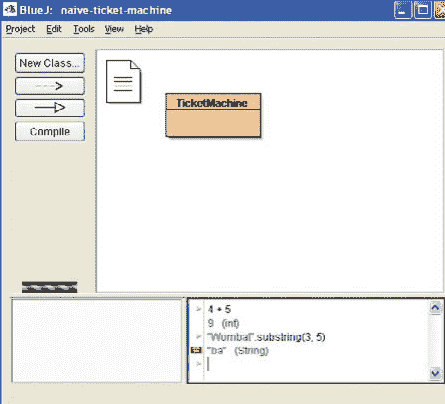

## 练习 2.74
考虑以下表达式。尝试预测它们的结果，然后在代码面板中输入以检查你的答案。

- `99 + 3`
- `"cat" + "fish"`
- `"cat" + 9`
- `9 + 3 + "cat"`
- `"cat" + 3 + 9`
- `"catfish".substring(3,4)`
- `"catfish".substring(3,8)`

你从这个练习中学到了任何你意料之外的知识吗？如果是，是什么？

当代码面板中表达式的结果是一个对象（如 `String`）时，它会被标记一个较小的红色对象符号。你可以双击此符号来检查它，或者将其拖到对象工作台（object bench）上进一步使用。你也可以在代码面板中声明变量并编写完整的语句。

每当你遇到新的运算符和方法调用时，尝试它们以获得对其行为的感觉是一个好主意。

## 总结

在本章中，我们涵盖了如何创建类定义的基础知识。类包含字段、构造函数和方法，它们定义了对象的状态行为。在构造函数和方法内部，一系列语句定义了对象如何完成其指定的任务。我们涵盖了赋值语句和条件语句，并在后面的章节中将添加更多类型的语句。

## 本章引入的术语

**字段 (field), 实例变量 (instance variable), 构造函数 (constructor), 方法 (method), 方法签名 (method signature), 方法体 (method body), 参数 (parameter), 访问器 (accessor), 修改器 (mutator), 声明 (declaration), 初始化 (initialization), 块 (block), 语句 (statement), 赋值语句 (assignment statement), 条件语句 (conditional statement), 返回语句 (return statement), 返回类型 (return type), 注释 (comment), 表达式 (expression), 运算符 (operator), 变量 (variable), 局部变量 (local variable), 作用域 (scope), 生命周期 (lifetime)**

## 概念总结

- **field**：存储供对象使用的数据。字段也被称为实例变量。

- **comment**：注释插入到类的源代码中，为人类阅读者提供解释。它们对类的功能没有影响。

- **constructor**：构造函数允许每个对象在创建时被正确设置。

- **scope**：变量的作用域定义了可以访问该变量的源代码部分。

- **lifetime**：变量的寿命描述了变量在被销毁之前存在多久。

- **assignment**：赋值语句存储由右侧表示的值。

- **method**：方法由两部分组成：头部和方法体。

- **accessor method**：访问器方法返回有关状态的信息。

- **mutator method**：修改器改变对象的状态。

- **println**：`System.out.println` 方法打印其。

- **conditional**：条件语句允许根据测试做出决策。

- **boolean expression**：布尔表达式只有两个值：true 和 false。

- **local variable**：局部变量在方法内部声明。其作用域限于该方法。

在本章中，我们涵盖了如何创建类定义的基础。类包含字段、构造函数和方法，它们定义了对象的状态行为。在构造函数和方法内部，一系列语句定义了对象如何完成其指定的任务。我们涵盖了赋值语句和条件语句，并在后面的章节中将添加更多类型的语句。

以下练习旨在帮助理解本章讨论的概念。

## 练习 2.75
为 Book 类添加两个方法 `author` 和 `title`。这应该格式如下：**Title:** Robinson Crusoe, **Author:** Daniel Defoe, **Pages:** 232

## 练习 2.76
为 Book 类添加一个字段 `refNumber`。该字段可以存储引用编号。它应该是 `String` 类型，并在构造函数中初始化为空字符串。

```java
public class Book {
    private String author;
    private String title;

    /**
     * 设置引用编号
     */
    public void setRefNumber(String ref) {
        refNumber = ref;
    }

    public String getRefNumber() {
        return refNumber;
    }
}
```

## 练习 2.77
为 Book 类添加一个字段 `pages`。它应该是 `int` 类型，其初始值应传递给构造函数。为该字段包含一个访问器方法 `getPages`。

## 练习 2.78
修改你的 `printDetails` 方法以包含引用编号。然而，该方法应在已设置时打印引用编号。

## 练习 2.79
修改你的 `setRefNumber` 修改器，使其当参数至少包含三个字符时才设置 `refNumber` 字段。如果小于，则打印错误信息并保持字段不变。

## 练习 2.80
为 Book 类进一步添加一个字段 `borrowed`。这记录了书籍被借用的次数。为类添加一个修改器 `borrow`。包含一个返回该新字段值的访问器 `getBorrowed`。修改 `printDetails` 以包含该字段的值。

## 练习 2.81
挑战在 BlueJ 中创建一个新项目 `heater-exercise`。编辑项目描述中的详情——你在图中看到的测试注释。创建一个类 `Heater`，它包含一个单一整数字段 `temperature`。定义一个不带参数的构造函数。`temperature` 字段应在构造函数中被设置为 15。定义修改器 `warmer` 和 `cooler`，其作用分别是将温度值增加或减少 5°。定义一个返回温度值的访问器方法。


# 练习 2.82

挑战修改你的 `Heater` 类，以定义三个新字段：`min`、`max` 和 `increment`。`min` 和 `max` 的值应通过传递给构造函数的参数进行设置。`increment` 的值应在构造函数中设置为 5。修改 `warmer` 和 `cooler` 的定义，使其使用 `increment` 的值，而不是显式值 5。在继续此练习之前，请检查一切是否如以前一样正常。

现在修改 `warmer` 方法，使其不允许温度被设置为大于 `max` 的值。同样修改 `cooler` 方法，使其不允许 `temperature` 被设置为小于 `min` 的值。检查该类是否工作正常。

现在添加一个方法 `setIncrement`，它接受一个整数参数，并使用它来设置 `increment` 的值。再次通过在 BlueJ 中创建一些 `Heater` 对象，测试该类是否如你预期那样工作。如果向 `setIncrement` 方法传递负值，操作是否仍按预期工作？在此方法中添加一个检查，以防止将负值赋值给 `increment`。

# 第 3 章：对象交互

本章讨论的主要概念：

- 抽象
- 模块化
- 对象创建
- 方法调用
- 调试器

### 本章讨论的 Java 构造结构

类类型、逻辑运算符（`&&`、`||`）、字符串拼接、取模运算符（`%`）、对象构造（`new`）、方法调用（点符号表示法）、`this`

在之前的章节中，我们研究了对象是什么以及它们是如何实现的。特别是在我们查看类定义时，我们讨论了字段、构造函数和方法。

现在我们将更进一步。要构建出有趣的应用程序，仅构建单个可运行的对象是不够的。相反，对象必须组合在一起，以便它们协作执行一项共同任务。在本章中，我们将从三个对象构建一个小型应用程序，并安排方法调用其他方法来实现目标。

## 3.1 闹钟示例

我们将用于讨论对象交互的项目是一个数字时钟显示器。显示器显示小时和分钟，用冒号隔开（图 3.1）。对于这个练习，我们将首先构建一个具有欧式 24 小时显示的闹钟。因此，显示器显示从 00:00（午夜）到 23:59（午夜前分钟）的时间。仔细观察发现，构建 12 小时钟稍微困难一些——我们将其留到本章最后。

图 3.1：数字时钟显示器


## 3.2 抽象与模块化

第一个想法可能是将整个 `display` 类实现在单个类中。毕竟，这就是我们目前为止所看到的：如何构建类来完成工作。

然而，我们将以稍微不同的方式来处理这个问题。我们将看看是否可以识别问题中的组件，并将其转换为单独的类。原因是复杂性。随着我们在书中不断深入，我们使用的示例和我们构建的程序将变得越来越复杂。像售票机这样微不足道的任务可以通过单个问题来解决。你可以查看整个任务并使用单个类推导出解决方案。对于更复杂的问题，那样就太简单了。随着问题的变大，同时跟踪所有细节将变得越来越困难。

解决复杂性问题的方案是抽象。我们将问题划分为子问题，然后再次划分为子问题，以此类推，直到单个问题小到可以处理的程度。一旦我们不再多考虑任何部分的细节（例如轮子），我们的工作就是为下一个问题设计单一的构建块。这种技术有时被称为*分治法*。

让我们用一个例子来讨论一下。想象一家汽车公司的工程师正在设计一辆新车。他们可能会考虑汽车的部位，例如外壳的形状、汽车的大小和位置、乘客区域座椅的数量和大小、轮子的精确间距等。另一方面，另一个工程师（比如轮子），他的工作是设计引擎（实际上那是一整个工程师团队的工作，但为了示例我们在这里进行了简化），他考虑引擎的许多部分：气缸、喷射机构、化油器、电子设备等。她不会将引擎视为一个单一实体，而是视为许多部分的复合体。其中一个部分可能是火花塞。

还有另外（可能在不同的公司）设计火花塞。他会将火花塞视为由许多部分组成的复杂制品。他可能进行过复杂的研究，以确定判断触点应该使用哪种金属，或者绝缘层应该使用何种材料和生产工艺。

许多其他部分也是如此。高层的设计师会将轮子视为单一部分。链中下游的另一个工程师可能会花费整天时间思考化学成分，以生产制造轮胎的正确材料。对于轮胎工程师来说，轮胎是一个复合体。汽车公司将直接从轮胎公司购买轮胎，并将其视为单一实体。这就是抽象。

汽车公司的工程师从轮胎制造的细节中*抽象*出来，以便能够专注于构造细节，例如轮子。根据轮子和引擎的技术细节设计汽车车身形状的设计师专注于车身设计（他只会对引擎和轮子的大小感兴趣）。

其他组件也是如此。当某人可能关注设计内部乘客空间时，另一个人可能在开发最终用于覆盖座椅的织物。

要点是，如果观察得足够详细，汽车包含的零件多到一个人不可能知道每一个细节。

汽车之所以能成功制造，是因为它们使用了模块化和抽象。模块化是将大物体（问题）划分为较小部分的过程，而抽象是忽略细节的能力。因此，模块化和抽象相辅相成。

## 3.3 软件中的抽象

上一节讨论的模块化和抽象原则用于软件开发中。为了帮助我们在复杂程序中保持全局观，我们尝试识别可以作为独立实体进行编程的子组件，而不必担心它们内部的复杂性。

在面向对象编程中，这些组件就是对象。如果我们试图使用面向对象的语言在软件中构建一辆汽车，我们首先会为引擎、变速箱、轮子等构建单独的对象，然后组装汽车。对于任何给定的问题，识别软件系统中应该具有什么类型的对象（以及这些对象的类）并不总是容易的，我们将在书的后部分对此进行大量讨论。现在，我们从一个相对简单的示例开始。

## 3.4 闹钟示例中的模块化

让我们仔细观察一下闹钟显示示例。使用我们刚刚描述的抽象概念，我们想要找到查看此示例的最佳方法，以便我们编写一些类来实现它。一种查看方法是将其考虑为具有四位数字的单一显示器（两个数字代表小时，两个代表分钟）。如果我们需要抽象那种非常底层的内容，我们可以看到它可以被视为单独的两个两位显示器（一组小时和一组分钟）。一个从零开始，每小时增加一，并在达到 59 的限制后回到零。这两个显示器行为的相似性可能会让我们甚至从区分查看小时分钟显示中抽象出来。现在我们已经达到了一个可以表示为类的适当抽象级别：两位显示类。

对于我们的闹钟显示，我们将首先为一个两位数编写一个类（图 3.2），并为它提供一个访问方法来获取其值，以及一个修改方法来设置值并对其递增。一旦定义了这个类，我们就可以创建两个具有不同限制的该类对象来构建整个闹钟显示。

## 3.5 实现时钟显示

图 3.2：两位数显示器


如上所述，为了构建时钟显示，我们首先构建一个两位数显示器。这个显示器需要存储两个值：一个是它在溢出回到零之前可以计数的限值；另一个是当前值。我们将这两个值都表示为类类中的整数字段（代码 3.1）。

代码 3.1：两位数显示类

```java
public class NumberDisplay
{
    private int limit;
    private int value;

    // 省略构造函数和方法
}
```

> **概念**：类定义了类型。类可以作为变量的类型。以类为类型的变量可以存储该类的对象。

我们将在稍后查看该类的其余剩余细节。首先，让我们假设我们可以构建 `NumberDisplay` 类，并更多地思考完整的时钟显示。通过内部拥有数字显示（一个用于小时，一个用于分钟）来构建一个完整的时钟显示。每个数字显示都是时钟显示的字段（代码 3.2）。在这里使用了之前未提到的细节：类定义类型。

代码 3.2：包含两个 `NumberDisplay` 字段的 `ClockDisplay` 类

```java
public class ClockDisplay
{
    private NumberDisplay hours;
    private NumberDisplay minutes;

    // 省略构造函数和方法
}
```

当我们在第二章讨论字段时，说字段声明中的 `private` 后面跟着一个类型和一个字段名。在这里我们使用 `NumberDisplay` 类作为小时和分钟字段的类型。这显示类可以用类型。如果类型是类，字段就可以持有该类的对象。

## 3.6 类图与对象图

上一节描述的结构（一个持有两个 `NumberDisplay` 对象的 `ClockDisplay`）可以通过图 3.3a 所示的对象图进行可视化。在图中，我们看到有三个对象。图 3.3b 显示了相同情况的类图。

图 3.3：`ClockDisplay` 的对象图和类图

> **概念**：类图显示了应用程序的类以及它们之间的关系。它提供了关于源代码的信息。它呈现了程序的静态视图。


注意，类图只显示两个类，而对象图显示了三个对象。这是因为我们可以从同一个类创建多个对象。在这里我们从类创建 `NumberDisplay` 对象（代码 3.3）。

代码 3.3：`NumberDisplay` 类的实现

```java
/**
 * NumberDisplay 类表示从零到给定限值的数字显示。
 * 在创建显示时指定限值。
 * 例如用于数字时钟的秒，限将将 60，产生 0 到 59 的显示值。
 * 当递增达到限值时，显示会自动溢回到零。
 * @author Michael Liang and David Barnes
 * @version 2008.03.30
 */
public class NumberDisplay {
    private int limit;
    private int value;

    /**
     * NumberDisplay 类对象的构造函数
     */
    public NumberDisplay(int rollOverLimit) {
        limit = rollOverLimit;
        value = 0;
    }

    /**
     * 返回当前值
     */
    public int getValue() {
        return value;
    }

    /**
     * 将显示的值设置为新值。
     * 如果新值小于零或超过限值，什么都不做。
     */
    public void setValue(int replacementValue) {
        if((replacementValue >= 0) && (replacementValue < limit)) {
            value = replacementValue;
        }
    }

    /**
     * 返回显示值（即两位数的字符串。
     * 如果值小于十，则会在前面补零）。
     */
    public String getDisplayValue() {
        if(value < 10) {
            return "0" + value;
        } else {
            return "" + value;
        }
    }

    /**
     * 将显示值加一，如果达到限值则溢回到零。
     */
    public void increment() {
        value = (value + 1) % limit;
    }
}
```

> **概念**：对象图显示了应用程序执行期间某一时刻的对象及其之间的关系。它提供了关于运行时对象的信息，代表了程序的动态视图。

这两幅图提供了同一个应用程序的不同视图。类图显示了静态视图。它描绘了我们在编写程序时所拥有的。有两个类，箭头表示 `ClockDisplay` 类使用了 `NumberDisplay` 类（在 `ClockDisplay` 的源码中提到了 `NumberDisplay`）。我们还说 `ClockDisplay` 依赖于 `NumberDisplay`。

为了启动程序，我们将创建一个 `ClockDisplay` 对象。我们将编写时钟，让它自动为自己创建两个 `NumberDisplay` 对象。对象图显示了运行时（应用程序运行时）的情况。这也被称为动态视图。

对象图还显示了另一个重要细节：当变量存储一个对象时，对象并不是存储在变量中的，而是对象引用存储在变量中。在图中，变量被显示为一个白框，而对象引用显示为一个箭头。被引用的对象在引用对象之外，而对象引用连接了两者。

> **概念**：对象引用。对象类型的变量存储对对象的引用。

理解这两幅图和不同的视图是非常重要的。蓝色显示的是静态视图。查看主窗口中的类图。为了规划和理解 Java 程序，你需要能够在纸上或在脑海中构建对象图。当我们思考程序将要做什么时，我们在思考它创建的对象结构，以及这些对象是如何交互的。能够可视化对象结构是至关重要的。

- **练习 3.1** 回想我们在第一和第二章讨论过的实验类项目。假设我们创建了一个 `LabClass` 对象和三个 `Student` 对象。然后我们将这三个学生都加入实验室。尝试为这种情况画出类图和对象图。识别并解释它们之间的区别。
- **练习 3.2** 类图什么时候会改变？是如何改变的？
- **练习 3.3** 对象图什么时候会改变？是如何改变的？
- **练习 3.4** 写出一个名为 `tutor` 的字段的定义，它可以持有指向 `Instructor` 类型对象的引用。

# 第 3 章 对象交互

接下来是一个用于当前显示值的简单访问器方法（`getValue`）。这允许其他对象读取显示的当前值。

接下来的修改器方法 `setValue` 更有趣。它的逻辑如下：

```java
public void setValue(int replacementValue) {
    if((replacementValue >= 0) && (replacementValue < limit)) {
        value = replacementValue;
    }
}
```

在这里，我们将显示的新值作为参数传递给方法。然而，在赋值该值之前，我们必须检查该值是否合法。如上所述，该值的合法范围是从 0 到 limit 减 1。我们在赋值之前使用一个 `if` 语句来检查该值是否合法。符号 `&&` 是一个逻辑“与”（and）运算符。如果 `&&` 符号两侧的两个条件都为真，则语句中的条件为真。详细信息请参阅随后的“逻辑运算符”注释。附录 C 显示了 Java 中逻辑运算符的完整表格。

### 逻辑运算符

逻辑运算符作用于布尔值（true 或 false），并产生一个新的布尔值作为结果。三个重要的逻辑运算符是与（and）、或（or）和非（not）。它们在 Java 中的写形式为：

```java
&& (and)
|| (or)
! (not)
```

表达式 `a && b` 当 a 和 b 都为真时为真，在所有其他情况下均为假。

表达式 `a || b` 当 a 或 b 有一个为真时为真，如果它们都为假则为假。

表达式 `! a` 如果 a 为假则为真，如果 a 为真则为假。

- **练习 3.6** 当用非法值调用 `setValue` 方法时会发生什么？这是一个一个好的解决方案吗？你能想出更好的解决方案吗？
- **练习 3.7** 如果你将测试中的 `>=` 运算符替换为 `>`，会发生什么？使其读取结果变为：
  ```java
  if((replacementValue > 0) && (replacementValue < limit))
  ```

### 3.8 ClockDisplay 源代码

- **练习 3.8** 如果你将测试中的 `&&` 运算符替换为 `||`，会发生什么？使其读取结果变为：
  ```java
  if((replacementValue >= 0) || (replacementValue < limit))
  ```
- **练习 3.9** 下列哪些表达式为真？
  - `! (4 < 5)`
  - `! false`
  - `(2 > 2) || ((4 == 4) && (1 < 0))`
  - `(2 > 2) || ((4 == 4) && (1 < 0))`
  - `(34 != 33) && ! false`
  
  在纸上写下答案后，打开 BlueJ 中的 Code 窗口并尝试一下。检查你的答案。
- **练习 3.10** 使用布尔变量 `a` 和 `b` 编写一个表达式，当 a 和 b 都为真或都为假时，该表达式的结果为真。
- **练习 3.11** 使用布尔变量 `a` 和 `b` 编写一个表达式，当 a 和 b 仅有一个为真时，该表达式的结果为真，如果 a 和 b 都为真则结果为假（这也被称为异或）。
- **练习 3.12** 考虑表达式 `(a && b)`。写一个等价的表达式（即在 a 和 b 的完全相同的值下求值为真的表达式），且不使用 `&&` 运算符。

下一个方法 `getDisplayValue` 也返回显示器的值，但格式不同。原因是我们希望将该值显示为两位数字字符串。也就是说，如果当前时间是凌晨 3:05，我们希望显示读为 03:05，而不是 3:5。为了实现这一点，我们实现了 `getDisplayValue` 方法。该方法将当前值作为字符串返回，如果该值小于 10，则会在前面添加一个前导零。以下是代码的相关部分：

```java
if(value < 10) {
    return "0" + value;
} else {
    return "" + value;
}
```

注意 `"0"` 是在双引号内的。因此 `"0" + value` 连接了字符串和整数。因此：

```java
"0" + value
```

转换为字符串。在继续之前，我们现在仔细观察字符串拼接。

## 3.8.2 字符串拼接

运算符 `+` 有不同的含义，取决于操作数的类型。如果两个操作数都是数字，它表示相加，正如我们所预期的。因此：

```java
4 + 2
```

加上两个数字。然而，如果操作数是字符串，那么加表示字符串拼接。例如，表达式

```java
"Java" + "with BlueJ"
```


会导致字符串。注意系统不会在字符串之间添加空格。如果你想要空格，必须在其中一个字符串中包含它。在一个操作数是字符串而另一个不是的情况下，结果会自动转换为字符串。因此：

```java
"0" + value
```

将返回 "03"。

### 3.8.3 模运算符

`Display` 中的最后一个方法将值加 1。它使用模运算符在值溢出时将其归零：

```java
public void increment() {
    value = (value + 1) % limit;
}
```

该方法使用了模运算符（`%`）。模运算符计算整数除法的余数。例如，除法

```java
27 / 4
```

可以表示为整数 3。模运算符仅返回该除法的余数。因此

```java
27 % 4
```

结果将是 3。

### 3.8.4 ClockDisplay 类

现在我们已经看到了如何构建一个定义两位数字显示的类，我们将更详细地查看 `ClockDisplay` 类——即创建两个数字显示以创建一个完整时间显示的类。代码 3.4 显示了 `ClockDisplay` 类的完整源代码。

与 `NumberDisplay` 类一样，我们将简要讨论所有的字段、构造函数和方法。

#### 代码 3.4 ClockDisplay 类的实现

```java
/**
 * ClockDisplay 类实现了一个欧洲制 24 小时钟的数字显示。
 * 钟显示小时和分钟。钟的范围是从 00:00（午夜）到 23:59（午夜前一分钟）。
 *
 * 时钟显示每分钟接收一次“滴答”（通过 timeTick 方法），
 * 并增加显示做出反应。这是按照通常的时钟方式进行的：
 * 当分钟归零时，小时会增加。
 *
 * @author Michael Köll and David J. Barnes
 * @version 2008.03.30
 */
public class ClockDisplay
{
    private NumberDisplay hours;
    private NumberDisplay minutes;
    private String displayString; // 模拟实际显示

    /**
     * ClockDisplay 对象的构造函数。此构造函数
     * 创建一个设置在 00:00 的新钟。
     */
    public ClockDisplay() {
        hours = new NumberDisplay(24);
        minutes = new NumberDisplay(60);
        updateDisplay();
    }

    /**
     * ClockDisplay 对象的构造函数。此构造函数
     * 创建了一个设置在参数指定时间的新时钟。
     */
    public ClockDisplay(int hour, int minute) {
        hours = new NumberDisplay(24);
        minutes = new NumberDisplay(60);
        setTime(hour, minute);
    }

    /**
     * 此方法应该每分钟调用一次 - 它
     * 让时钟显示向前移动分钟。
     */
    public void timeTick() {
        minutes.increment();
        if(minutes.getValue() == 0) { // 刚刚进位了！
            hours.increment();
        }
        updateDisplay();
    }

    /**
     * 将显示的时间设置为指定的小时和
     * 分钟。
     */
    public void setTime(int hour, int minute) {
        hours.setValue(hour);
        minutes.setValue(minute);
        updateDisplay();
    }

    /**
     * 返回此显示当前的时间，格式为
     * HH:MM。
     */
    public String getTime() {
        return displayString;
    }

    /**
     * 更新表示显示的内部
     * 字符串。
     */
    private void updateDisplay() {
        displayString = hours.getDisplayValue() + ":" + 
                        minutes.getDisplayValue();
    }
}
```

在这个项目中，我们使用字段 `displayString` 来模拟时钟的实际显示设备（正如你在练习 3.5 中看到的那样）。如果此软件运行在真实的时钟上，我们将会把输出呈现在真实的时钟设备上。这个字符串充当了我们时钟输出设备的软件模拟。

为了实现这一点，我们使用了一个字符串字段和一个方法：

```java
public class ClockDisplay {
    private String displayString;

    // 省略其他字段和方法。

    /**
     * 更新表示显示的内部
     * 字符串。
     */
    private void updateDisplay() {
        // 省略方法实现；
    }
}
```

每当我们改变时钟的显示时，我们都会调用内部方法 `updateDisplay`。在我们的模拟中，这个方法将更改显示字符串（我们将在下面检查源码）。在真实的时钟中，这个方法也会存在——在那里，它将改变时钟的显示。

除了显示字符串外，`ClockDisplay` 类只有两个字段：`hours` 和 `minutes`。这些字段中的每一个都可以存放 `NumberDisplay` 类型的对象。时钟显示的逻辑值（当前时间）存储在这些 `NumberDisplay` 对象中。图 3.4 显示了该应用程序在当前时间为 15:23 时的对象图。

### 3.9 对象创建对象

图 3.4 时钟显示的对象图


#### 概念

- 对象创建。
- 对象可以使用 `new` 运算符创建其他对象。

我们必须问自己的第一个问题是：这三个对象从哪里来？当我们想要使用时钟显示时，我们可能会创建一个 `ClockDisplay` 对象。然后我们假设时钟显示有小时和分钟。因此，通过创建一个时钟显示，我们期望隐式地创建了两个用于小时和分钟的数字显示器。

作为 `ClockDisplay` 类的类的编写者，我们必须实现这一点。我们只需要在 `ClockDisplay` 的构造函数中编写代码，创建并存储两个 `NumberDisplay` 对象即可。由于构造函数在 `ClockDisplay` 对象被创建时会自动执行，因此 `NumberDisplay` 对象将同时自动创建。以下是使此功能实现的 `ClockDisplay` 构造函数的代码：

```java
public class ClockDisplay {
    private NumberDisplay hours;
    private NumberDisplay minutes;
    // 省略剩余字段。

    public ClockDisplay() {
        hours = new NumberDisplay(24);
        minutes = new NumberDisplay(60);
        updateDisplay();
    }
    // 省略方法。
}
```

构造函数前两行中的每一行都会创建一个新的 `NumberDisplay` 对象并将其赋值给字段。

```
ClassName ( parameter-list )
```

`new` 操作执行了两个事情：

1. 它创建了该类的新对象（这里是：`NumberDisplay`）。
2. 它执行了该类的构造函数。

如果类的构造函数定义为带有参数，则必须在 `new` 语句中提供实际参数。例如，`NumberDisplay` 的构造函数定义为期望一个参数：

```java
public NumberDisplay(int limit)
```

因此，调用此构造函数的 `ClockDisplay` 类的 `new` 操作必须提供一个类型为 `int` 的实际参数：

```java
new NumberDisplay(24);
```

这与第 2.4 节中讨论的方法相同。通过这个构造函数，我们实现了想要的结果：如果有人创建一个 `ClockDisplay` 对象，构造函数会自动创建两个 `NumberDisplay` 对象。然后显示器就准备好了。

**练习 23** 通过选择以下构造函数创建一个 `ClockDisplay` 对象：`new ClockDisplay()`。调用 `getTime` 方法找出时钟设置的初始时间。你能算出出来吗？

**练习 24** 调用 `getTime` 方法找出时钟设置的初始时间。你能算出出来吗？

**练习 25** 调用 `getTime` 方法找出时钟设置的初始时间。你能算出出来吗？

**练习 26** 调用 `getTime` 方法找出时钟设置的初始时间。你能算出出来吗？

**练习 27** 调用 `getTime` 方法找出时钟设置的初始时间。你能算出出来吗？

**练习 28** 找出两个构造函数之间的点。

**练习 29** 找出方法之间的相同点。

### 3.11 方法调用

如果分钟的值不为零，我们就处理完毕。在这种情况下，我们不需要更改小时数。因此，该语句就不需要 `else` 部分。

我们还应该能够理解 `ClockDisplay` 类剩余的三个方法（代码 3.4）。`setTime` 方法接收两个参数——小时和分钟——并将时钟设置为指定的时间。观察方法体，我们可以看到它是通过调用两个数字显示器（一个用于小时，一个用于分钟）的 `setValue` 方法来实现的。然后它调用 `updateDisplay` 来相应地更新显示字符串，就像构造函数所做的那样。

`getTime` 方法非常简单——它返回当前的字符串。由于我们始终保持显示是最新的，所以只需要做这些了。

最后，`updateDisplay` 方法负责更新显示字符串，使字符串能够正确反映两个数字显示器所代表的时间。它在时钟每次变化时被调用。它的工作原理是调用每个 `NumberDisplay` 对象的 `getDisplayValue` 方法。这些方法返回每个独立数字显示器的值。它使用字符串拼接来将这两个值与中间的冒号连接成一个单一字符串。

## 练习题 3.30 给定变量

`Printer p1;`

它目前持有对一个打印机对象的引用，并且 `Printer` 类内部有两个头部如下的方法：

```
public void print(String filename, boolean doubleSided)
public int getStatus(int delay)
```

为这些方法中的每个方法编写两种可能的调用。

### 3.11.3 时钟显示总结

值得关注的是这个示例如何使用抽象将问题分解为更小的部分。观察 `ClockDisplay` 类的源代码，你会注意到我们在创建一个 `NumberDisplay` 对象时，并不特别感兴趣该对象看起来什么样。我们只需要调用该对象的方法（`increment`、`getValue`）来让它为我们工作。在这个层面上，我们假设 `increment` 会正确地增加显示值，而不必担心它是如何实现的。

在实际项目中，这些不同的类通常由不同的人编写。你可能已经注意到，这些人必须达成共识的是该类应该拥有哪些方法签名以及这些方法应该做什么。一个人可以专注于方法的实现，而另一个人只需要使用它们即可。

一个对象向其他对象提供的方法集被称为它的接口（interface）。我们将在书的后面更详细地讨论接口。

## 练习题 3.31 挑战性练习

将时钟从 24 小时制改为 12 小时制。小心；这看起来并不那么简单。在 12 小时制中，午夜和中午不显示为 00:30，而是 12:30。因此，分钟显示值的范围是从 0 到 59，而小时显示值的范围是从 1 到 12！

## 练习题 3.32

有（至少）两种方法可以制作 12 小时钟。一种可能性是存储 1 到 12 的小时值。另一方面，你也可以让时钟内部作为 24 小时钟运行，但更改显示字符串，当内部值为 16:23 时显示为 4:23 或 4.23pm。实现这两个版本。哪种方案更容易？哪种更好？为什么？

## 对象交互的另一个示例

我们现在将使用不同的示例和不同的工具来检查相同的概念。我们仍然关注的是理解对象如何创建其他对象，以及对象如何相互调用。在本章的前半部分中，我们使用了最基础的技术来分析给定的程序；读取和理解源代码的代码是软件开发人员最核心的技能之一，我们将在工作的每个项目中都需要应用它。然而，使用额外的工具帮助我们更好地理解程序的执行过程是有益的。

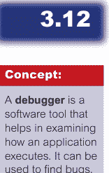

调试器（debugger）是一个允许程序员一次执行一步的程序。它通常提供在源代码的选定点启动和停止程序的功能，以及查看变量值的功能。

> “调试器”（debugger）这个名称源于计算机程序中的错误通常被称为“bug”（虫）。因此，帮助移除错误的程序被称为“调试器”（debuggers）。

> 目前尚不清楚“bug”一词源于哪里。有一个著名的案例被称为“第一只计算机虫”——这是在 1945 年由早期计算先驱格蕾丝·霍普（Grace Hopper）在 Mark I 计算机内部发现的一只真正的虫（实际上是一只蛾子）。史密森尼学会的美国国家历史博物馆仍然保存着一本日志，显示了这只蛾子被贴在书上，这是发现第一个真正的虫的案例。然而，这种用辞表明，“bug”一词在它给 Mark II 带来麻烦之前就已经在使用了。

> 术语“bug”的用法暗示了它在给 Mark II 造成麻烦之前就已经在使用。


### 3.11 方法调用

如果分钟的值不为零，我们就处理完毕。在这种情况下，我们不需要更改小时数。因此，该语句就不需要 `else` 部分。

我们还应该能够理解 `ClockDisplay` 类剩余的三个方法（代码 3.4）。`setTime` 方法接收两个参数——小时和分钟——并将时钟设置为指定的时间。观察方法体，我们可以看到它是通过调用两个数字显示器（一个用于小时，一个用于分钟）的 `setValue` 方法来实现的。然后它调用 `updateDisplay` 来相应地更新显示字符串，就像构造函数所做的那样。

`getTime` 方法非常简单——它返回当前的字符串。由于我们始终保持显示是最新的，所以只需要做这些了。

最后，`updateDisplay` 方法负责更新显示字符串，使字符串能够正确反映两个数字显示器所代表的时间。它在时钟每次变化时被调用。它的工作原理是调用每个 `NumberDisplay` 对象的 `getDisplayValue` 方法。这些方法返回每个独立数字显示器的值。它使用字符串拼接来将这两个值与中间的冒号连接成一个单一字符串。

## 练习题 3.30 给定变量

`Printer p1;`

它目前持有对一个打印机对象的引用，并且 `Printer` 类内部有两个头部如下的方法：

```
public void print(String filename, boolean doubleSided)
public int getStatus(int delay)
```

为这些方法中的每个方法编写两种可能的调用。

## 3.11.3 时钟显示总结

值得关注的是这个示例如何使用抽象将问题分解为更小的部分。观察 `ClockDisplay` 类的源代码，你会注意到我们在创建一个 `NumberDisplay` 对象时，并不特别感兴趣该对象看起来什么样。我们只需要调用该对象的方法（`increment`、`getValue`）来让它为我们工作。在这个层面上，我们假设 `increment` 会正确地增加显示值，而不必担心它是如何实现的。

在实际项目中，这些不同的类通常由不同的人编写。你可能已经注意到，这些人必须达成共识的是该类应该拥有哪些方法签名以及这些方法应该做什么。一个人可以专注于方法的实现，而另一个人只需要使用它们即可。

## 第 3 章 对象交互

一个对象向其他对象提供的方法被称为接口。我们将在书的后面更详细地讨论接口。

## 练习题 3.31 挑战性练习 将时钟从 24 小时制改为 12 小时制。小心；这看起来并不那么简单。在 12 小时制中，午夜和中午不显示为 00:30，而是 12:30。因此，分钟显示值的范围是从 0 到 59，而小时显示值的范围是从 1 到 12！

## 练习题 3.32 有（至少）两种方法可以制作 12 小时钟。一种可能性是存储 1 到 12 的小时值。另一方面，你也可以让时钟内部作为 24 小时钟运行，但更改显示字符串，当内部值为 16:23 时显示为 4:23 或 4.23pm。实现这两个版本。哪种方案更容易？哪种更好？为什么？

## 对象交互的另一个示例

我们现在将使用不同的示例和不同的工具来检查相同的概念。我们仍然关注的是理解对象如何创建其他对象，以及对象如何相互调用。在本章的半部分中，我们使用了最基础的技术来分析给定的程序；读取和理解源代码的代码是软件开发人员最核心的技能之一，我们将在工作的每个项目中都需要应用它。然而，使用额外的工具帮助我们更好地理解程序的执行过程是有益的。我们现在来看一个


调试器是一个允许程序员一次执行一步的程序。它通常提供在源代码的选定点启动和停止程序的功能，以及查看变量值的功能。

> “调试器”（debugger）这个名称源于计算机程序中的错误通常被称为“bug”（虫）。因此，帮助移除错误的程序被称为“调试器”（debuggers）。

> 目前尚不清楚“bug”一词源于哪里。有一个著名的案例被称为“第一只计算机虫”——这是在 1945 年由早期计算机先驱格蕾丝·霍普（Grace Hopper）在 Mark I 计算机内部发现的一只真正的虫（实际上是一只蛾子）。史密森尼学会的美国国家历史博物馆仍然保存着一本日志，显示了这只蛾子被贴在书上，这是发现第一个真正的虫的案例。然而，这种用辞表明，“bug”一词在它给 Mark II 带来麻烦之前就已经在使用了。

### 3.13 使用调试器

（名为 `from`、`to` 和 `message` 的字段。构造函数有三个参数，也命名为 `from`、`to` 和 `message`！

那么，当我们执行构造函数时，存在多少个变量？答案是六个——三个字段和三个参数。重要的是，要理解字段和参数是相互独立的变量，它们独立存在，尽管它们具有相似的名称。在 Java 中，参数和字段共享相同的名称并不是一个问题。

然而，我们确实面临的问题是，如何引用这六个变量以区分这两组变量。如果我们简单地在构造函数中使用变量名 `from`（例如在 `System.out.println(from)` 中），将使用哪一个呢？是参数还是字段？

Java 规范回答了这个问题。它规定，将使用在最近的闭包作用域中的定义。由于 `from` 参数是在构造函数中定义的，而 `from` 字段是在类中定义的，因此参数的定义距离使用该变量的语句更“近”。

现在，我们需要一种机制，在存在同名且定义更近的变量时访问字段。这就是 `this` 关键字的用途。该表达式引用当前对象。编写 `this.from` 指的是当前对象中的 `from` 字段。这为我们提供了一种访问字段而非同名参数的方法。我们现在可以读取赋值语句：

```
this.from = from;
```

正如我们现在看到的，这具有以下效果：

```
名为 from 的字段 = 名为 from 的参数;
```

换句话说，它将参数的值赋值给同名的字段。这当然正是我们为了正确初始化对象所需要执行的操作。

最后一个问题仍然是：我们为什么要这样做呢？通过给字段和参数起不同的名称，就可以避免整个这个问题。原因在于源代码的可读性。

有时，有一个名称可以完美地描述变量的用途。它是如此贴切，以至于我们不想为它发明另一个不同的名称。我们希望将它用于参数，作为对类的提示，指示需要传递什么内容；我们又希望将它用于字段，作为对类实现者的提醒，指示该字段的用途。如果一个名称可以完美地描述该类，那么在两处都使用它，并费力在赋值中使用 `this` 关键字来解决冲突是合理的。

### 3.13 使用调试器

邮件系统示例中最感兴趣的类是邮件客户端。现在我们将通过使用调试器对其进行更详细的调查。邮件客户端有三个方法：`getNextMailItem`、`printNextMailItem` 和 `sendMessage`。我们将首先调查 `printNextMailItem` 方法。

在开始调试器之前，设置一个我们可以用于调查的场景（练习 3.35）。

## 第 3 章 对象交互

**练习 3.35** 设置一个调查场景：创建一个邮件服务器，然后为用户 "Sophie" 和 "Juan" 创建两个邮件客户端（你也应该将这些实例命名为 'sophie' 和 'juan'，这样你就可以在对象调试台中更好地区分它们）。然后，使用 Sophie 的 `sendMessage` 方法向 Juan 发送一条消息。先不要读取该消息。

在完成练习 3.35 的设置后，我们处于这样的情况：Juan 的一个邮件项存储在服务器上，等待被取走。我们已经看到 `nextMailItem` 方法会获取此项并将其打印到终端。现在我们想具体调查它的工作原理。

### 3.13.1 设置断点

在开始调查时，我们设置一个断点（练习 3.36）。断点是附加在源代码行上的标记，当执行到该点时，它将停止方法的执行。在 Blue 编辑器中，它表现为一个小的停止标志（图 3.5）。

**图 3.5** Blue 编辑器中的断点

 (此处为占位符)

```java
/**
 * 将下一个邮件项（如果有）打印到终端。
 */
public void printNextMailItem() {
    MailItem item = server.getNextMailItem(user);
    if(item == null) {
        System.out.println("No mail");
    } else {
        item.print();
    }
}
```

**图 3.5** 调试点

 (此处为占位符)

**图 3.6** 停止在点处

 (此处为占位符)

```java
MailItem item = server.getNextMailItem(user);
```

在开始调查时，我们设置一个断点（练习 3.36）。断点是附加在源代码行上的标记，当执行到该点时，它将停止方法的执行。在 Blue 编辑器中，它表现为一个小的停止标志（图 3.5）。

**图 3.5** Blue 编辑器中的断点

 (此处为占位符)

**图 3.6** 停止在点处

 (此处为占位符)

```java
MailItem item = server.getNextMailItem(user);
```

**图 3.7** 单步执行后的停止

 (此处为占位符)

```java
MailItem item = server.getNextMailItem(user);
```

**图 3.7** 单步执行后的停止

 (此处为占位符)

```java
MailItem item = server.getNextMailItem(user);
```

# 方法调用回顾

这一行

```
item.print();
```

调用了 item 对象的 `print` 方法。在 `printNextMailItem` 方法的第一行中，我们可以看到 `item` 被声明为 `MailItem` 类。

通过调试器中的 `Step`（单步）命令，我们使用了抽象：我们将 item 类的 `print` 方法视为单条指令，并观察到它的作用是打印出邮件项目的详细信息（发送者、收件者和消息内容）。

如果我们对更多细节感兴趣，可以进一步查看该过程，观察 `print` 方法的逐步执行。这是通过使用调试器中的 `Step Into`（单步进入）而不是 `Step` 命令来实现的。`Step Into` 会进入被调用的方法，并在该方法内部的第一行停止。

**练习 3.40** 设置与之前相同的测试场景。即，从 Sophie 向 Juan 发送一条消息。然后再次调用 Juan 邮件客户端的 `printNextMailItem`。像之前一样向前执行。这次，当你到达这一行时

```
item.print();
```

使用 `Step Into` 而不是 `Step` 命令。确保你在向前执行时能看到文本窗口。你观察到了什么？解释你看到的内容。

## 3.14 方法调用回顾

在 3.13节的实验中，我们看到了另一个与之前类似的对象交互示例：对象调用其他对象的方法。在 `printNextMailItem` 方法中，`MailClient` 对象调用了 `MailServer` 来获取下一个邮件项目。该方法（`getNextMailItem`）返回了一个值——类型为 `MailItem` 的对象。随后调用了该邮件项目的 `print` 方法。通过抽象，我们可以将 `print` 方法视为单条命令。或者，如果我们对更多细节感兴趣，可以进入更低层次的抽象，查看 `print` 方法内部。

同样，我们可以使用调试器来观察一个对象创建另一个对象。`MailClient` 类中的 `sendMessage` 方法展示了一个很好的例子。在这个方法中，第一行代码就创建了一个 `MailItem` 对象：

```
MailItem item = new MailItem(user, to, message);
```

这里的思想是使用邮件项目来封装一封邮件消息。邮件项目包含了关于发送者、收件者和消息本身的信息。在发送消息时，邮件客户端创建一个包含所有这些信息的邮件项目，并将其存储在邮件服务器上。稍后邮件客户端可以提取它。

在代码行中，我们看到使用 `new` 关键字创建新对象，并看到传递给构造函数的参数。（记住：构造对象会完成两件事——创建对象并执行代码。）调用构造函数的方式与调用方法非常相似。这可以通过在构造对象的那行使用 `Step Into` 命令来观察到。

## 84 第3章 对象交互

**练习 3.41** 在 `MailClient` 类中 `sendMessage` 方法的第一行设置一个断点。调用此方法。使用 *Step Into* 函数进入邮件项目的构造函数。在 `MailItem` 对象的调试器显示中，你可以看到同名的实例变量和局部变量，正如 3.12.2 节所讨论的那样。进一步执行以查看初始化的实例变量。

**练习 3.42** 结合代码阅读、方法执行、断点和单步执行，熟悉 `MailItem` 和 `MailClient` 类。注意，我们还没有讨论到足够让你理解 `MailServer` 类的实现，所以你现在可以先忽略它。（当然，如果你觉得很有挑战性，可以去看看，但如果发现它有点难以理解，也不要惊讶……）在描述 `MailClient` 和 `MailItem` 类如何交互时，在解释中绘制图表。

## 3.15 总结

在本章中，我们讨论了如何将一个问题分为若干子问题。我们可以尝试在想要建模的对象中识别子组件，并将子组件实现为独立的类。这样做有助于降低实现大型应用的复杂性，使我们能够单独地实现和维护各个类。

我们看到了这如何导致对象结构协同工作以解决共同任务。对象可以创建其他对象，并相互调用方法。理解这些对象交互对于规划、实现和调试应用程序至关重要。

我们可以使用纸笔图、代码阅读和调试器来研究应用程序是如何执行的或追踪错误。

## 本章引入的术语

抽象（abstraction）、模块化（modularization）、分治法（divide and conquer）、类图（class diagram）、对象图（object diagram）、对象引用（object reference）、重载（overloading）、内部方法调用（internal method call）、外部方法调用（external method call）、点符号表示（dot notation）、调试器（debugger）、断点（breakpoint）。

## 概念总结

- **抽象**（abstraction）：抽象是忽略部分细节并将注意力集中在问题更高层次的能力。

- **模块化**（modularization）：模块化是将整体划分为定义良好的部分，这些部分可以被单独构建和检查，并以定义良好的方式进行交互。

- **类定义类型**（classes define types）

- **类图**（class diagram）：类图显示了类之间的关系。

- **对象图**（object diagram）：对象图显示了运行时的对象。

- **对象引用**（object references）：变量存储对象的引用。

- **基本数据类型**（primitive type）：如 int、boolean、double 和 long 等。

- **对象创建**（object creation）：对象可以使用 `new` 创建其他对象。

- **重载**（overloading）：类可以包含多个构造函数。

- **内部方法调用**（internal method call）：方法可以调用其他方法。

- **外部方法调用**（external method call）：方法可以使用点符号表示进行调用。

- **调试器**（debugger）：调试器是帮助检查程序的软件工具。

**练习 3.43** 使用调试器检查第2节的 `clock-display`。单步执行它们。结果符合你的预期吗？这给你带来了什么新见解？

**练习 3.44** 使用调试器检查 `ticket-machine` 项目。执行导致 `if` 语句两个分支执行的测试。

**练习 3.45** 为 `mail-system` 项目添加主题行并相应修改邮件客户端。

**练习 3.46** 给定以下类（此处所示）：


```java
public class Screen {
    public Screen(int xRes, int yRes) {
        ...
    }

    public int numberOfPixels() {
        ...
    }

    public void clear(boolean invert) {
        ...
    }
}
```

编写一些 Java 代码创建 `Screen` 对象，并在仅当像素数量大于两百万时调用其 `clear` 方法。（不要担心逻辑问题——目标是写出语法正确的代码，即如果输入的话可以编译。）

本章的主要概念：

- 集合（collections）
- 迭代器（iterators）
- 循环（loops）
- 数组（arrays）

本章讨论的 Java 构造：

`ArrayList`, `Iterator`, `while` loop, `null`, cast, anonymous objects, array, `for` loop, for-each loop

本章重点是介绍将对象分组为集合的一些方法。特别是，我们讨论了 `ArrayList` 类作为灵活大小集合的示例，以及使用数组对象处理固定大小集合。与集合密切相关的是对其包含的元素进行迭代。为了这个目的，我们引入了三种新的控制结构：两个版本的 `for` 循环和 `while` 循环。

## 第 4 章 对象的分组

### 4.1 灵活大小集合中的分组

在编写程序时，我们经常需要将对象分组。例如：

- 个人电子整理器存储有关预约、会议、生日等的笔记。
- 图书馆记录拥有的书籍和期刊详情。
- 大学维护过去和现在学生的记录。

通常情况下，集合中存储的项目数量随时间变化。例如，在电子整理器中，随着未来活动的安排，会添加新笔记；随着过去事件细节不再需要，会删除旧笔记。在图书馆中，随着新书的购买和旧书的入库，库存会发生变化。

因此，我们还没有遇到任何允许我们分组任意数量项目的 Java 特性。我们可以定义一个具有许多独立字段的类来涵盖一个固定但巨大的项目数量，但程序通常需要比这种方案提供的更通用的解决方案。一个合适的解决方案将要求我们预先知道要将多少项目分组在一起，也不需要对该数量设置一个上限。

在接下来的几节中，我们将使用个人笔记本的示例来说明 Java 允许我们在单个容器中对任意数量对象分组的方法。

### 4.2 个人笔记本

我们将建模一个个人笔记本应用程序，它具有以下基本功能：

- 它允许存储笔记。
- 它对存储笔记的数量没有限制。
- 它会显示单个笔记。
- 它会告诉我们当前存储了多少笔记。

如果我们有一个能够存储任意数量对象（笔记）的类，就可以轻松地支持所有这些功能。在分析使用这种类的源代码之前，探索笔记本的行为是有帮助的。

> **练习 4.1** 在 BlueJ 中打开笔记本并创建一个 `Notebook` 对象。存储一些笔记——它们是简单的字符串——当你使用 `showNote` 方法时，你需要使用参数 0（零）打印第一条笔记，使用 1（一）打印第二条笔记，以此类推。我们将在书中解释这种编号的原因。

### 4.3 类库初探

面向对象的语言的一个使它们强大的特性是，它们通常伴随着类库。这些类库通常包含成百上千种不同的类，在各种项目中被证明非常有用。Java 有许多类库，我们将以使用自己的类相同的方式使用它们。实例是使用 `new` 构建的，并且具有字段、构造器和方法。对于笔记本类，我们将使用在 `java.util` 包中定义的 `ArrayList` 类。集合可以存储任意数量的元素，每个元素都是一个对象。

#### 4.3.1 使用类库示例

代码 4.1 显示了 `Notebook` 类的完整定义，使用了 `ArrayList` 类。

**代码 4.1** Notebook 类

```java
import java.util.ArrayList;
/**
* 任意长度笔记列表的类。
* 外部引用。
* 在此版本中，笔记编号从 0 开始。
* @author David J. Barnes and Michael
* @version 20080330
*/
public class Notebook {
    // 用于任意数量笔记的存储
    private ArrayList<String> notes;

    /**
     * 为笔记本执行任何初始化。
     */
    public Notebook() {
        notes = new ArrayList<String>();
    }

    /**
     * 将新笔记存入笔记本。
     * @param note 要存储的笔记。
     */
    public void storeNote(String note) {
        notes.add(note);
    }

    /**
     * 返回笔记本中当前存储的笔记数量。
     */
    public int numberOfNotes() {
        return notes.size();
    }

    /**
     * 显示笔记。
     * @param noteNumber 要显示的笔记编号。
     */
    public void showNote(int noteNumber) {
        if(noteNumber < 0) {
            // 不是有效的笔记编号，什么都不做。
        } else if(noteNumber < numberOfNotes()) {
            // 这是一个有效的笔记编号，我们可以打印它。
            System.out.println(notes.get(noteNumber));
        } else {
            // 不是有效的笔记编号，什么都不做。
        }
    }
}
```

类文件的第一行说明了我们如何通过 `import` 语句访问 Java 中的类库：

```java
import java.util.ArrayList;
```

这使得 `java.util` 包中的 `ArrayList` 可供我们的类使用。`import` 语句必须放在类定义之前。一旦从包导入了类名，我们就可以像使用自己的类一样使用它。因此，我们在 `Notebook` 类的头部使用 `ArrayList` 来定义 `notes` 字段：

```java
private ArrayList<String> notes;
```

在这里，我们现在注意括号中的 `String`：`<String>`。在使用时，我们必须指定两个类型：集合本身的类型（这里是 `ArrayList`）以及计划存储在集合中的元素类型（这里是 `String`）。我们可以将完整类型定义 `ArrayList<String>` 读取为“String 的 ArrayList”。我们使用这个类型定义作为 `notes` 变量的类型。

在笔记本的构造函数中，我们创建一个 `ArrayList<String>` 对象并将其存储在 `notes` 字段中。我们需要再次在角括号中指定完整类型，后面跟着（空）参数列表的括号：

```java
notes = new ArrayList<String>();
```

像 `ArrayList` 这样带有第二个类型的类被称为泛型类（generic classes）——我们稍后会详细讨论它们。

### 4.4 带有集合的对象结构

`ArrayList` 类定义了许多方法，但在现阶段我们只使用其中三个来支持功能：`add`、`size` 和 `get`。

前两个分别在相对直观的 `storeNote` 和 `numberOfNotes` 方法中说明。`ArrayList` 的 `add` 方法将对象存储到列表中，而 `size` 方法返回当前存储了多少项内容。

要理解像 `ArrayList` 这样的集合对象是如何工作的，查看对象图是有帮助的。图 4.1 展示了 `Notebook` 对象在存储了两条笔记后可能的样子。对比图 4.1 和图 4.2，后者存储了第三条笔记。

**图 4.1** 包含两个笔记的笔记本

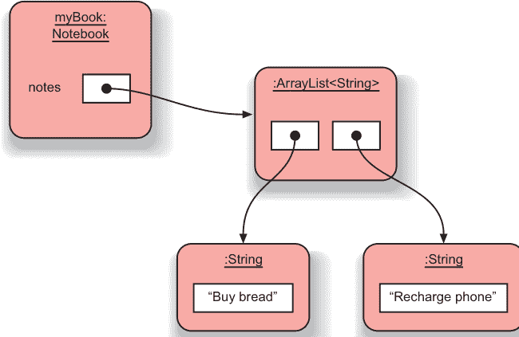

你应该观察到 `ArrayList` 类至少三个重要特征：

- 它能够根据需要增加其内部容量：随着更多项的添加，它只需为它们腾出空间。
- 它维护自己当前存储的项的计数。`size` 方法返回当前存储在其中的对象数量。
- 它维护你插入项的顺序。你稍后按相同的顺序检索它们。

我们注意到 `Notebook` 对象看起来非常简单——它只有一个存储 `ArrayList<String>` 类型对象的字段。所有的困难工作似乎都在 `ArrayList` 对象中完成了。这是使用类库的巨大优势之一：有人投入了时间和精力来实现某些功能，而我们通过使用这个类几乎免费地获得了这些功能。

**图 4.2** 包含三个笔记的笔记本

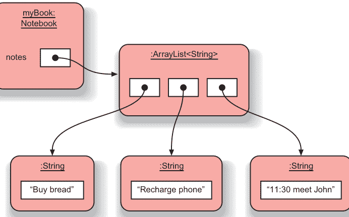

在这个阶段，我们不需要担心 `ArrayList` 是如何支持这些功能的。意识到这种能力有多用就足够了。

第二个特征——`ArrayList` 对象维护其插入对象的计数，对我们实现 `Notebook` 类的方式产生了重要影响。尽管笔记本有一个 `numberOfNotes` 方法，但我们并没有定义一个特定的字段来记录这些信息。相反，笔记本将跟踪数量的责任委托给了它的 `ArrayList` 对象。这意味着笔记本不会重复它从别处获得的信息。

重复可能会导致不一致，当两个本应该相同的东西由于错误而变得不同时。我们将在后面的章节中对功能重复进行更多论述。

### 4.5 泛型类

我们在上面观察到的使用角括号的新符号需要进一步讨论。我们 `notes` 字段的类型声明为 `ArrayList<String>`。

这里使用的类本身被称为 `ArrayList`，当在用它来声明字段或其他变量时，需要指定第二个类型作为参数。需要这种泛型类型参数的类被称为泛型类。与我们目前为止看到的其他类不同，泛型类在 Java 中不定义单一类型，而是可能定义许多类型。例如，`ArrayList` 可以用于指定字符串（`String`）列表、人员（`Person`）列表、矩形（`Rectangle`）列表，或者我们所拥有的任何类的列表。每个特定的 `ArrayList` 都是一个独立的类型，可以用于字段、参数和返回值的声明。我们可以定义以下两个：

```java
private ArrayList<Person> members;
private ArrayList<TicketMachine> myMachines;
```

这些定义表示 `members` 持有一个可以存储 `Person` 对象的 `ArrayList`，而 `myMachines` 可以持有一个存储 `TicketMachine` 对象的 `ArrayList`。请注意，`ArrayList<Person>` 和 `ArrayList<TicketMachine>` 是不同的类型。尽管它们的类型派自同一个类，但这些字段之间不能互相赋值。

**练习 4.2** 写一个名为 `library` 的私有声明，它可以持有一个 `ArrayList`。该 `ArrayList` 的元素类型为 `Book`。

泛型类被用于不同的目的——我们将在书的后面遇到更多它们。现在，集合（如 `ArrayList` 以及我们很快就会遇到的其他集合）是我们需要处理的唯一泛型类。

### 4.6 集合中的编号

在探索练习 4.1 中的笔记本项目时，我们注意到必须使用从零开始的参数值来打印笔记。这一要求背后的原因是存储在集合中的项具有从零开始的隐式编号或位置。对象在集合中的位置通常被称为它的索引（index）。添加到集合中的第一个项目赋予索引号 0，第二个赋予索引号 1，以此类推。图 4.3 说明了上述相同的情况，在 `ArrayList` 对象中显示了索引号。

代码 4.1 中的 `showNote` 方法说明了如何通过其 `get` 方法使用索引从 `ArrayList` 中检索项。`showNote` 方法的大部分内容在于确保在调用 `get` 之前，参数值在有效值范围 `[0 ... (size()-1)]` 内。

值得注意的是，`get` 并不会从集合中移除项。

**图 4.3** 集合中元素的索引号

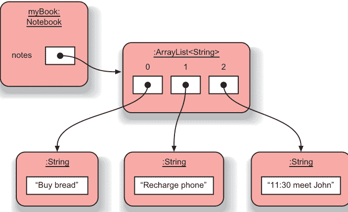

> **陷阱：** 如果你不小心，你可能会尝试访问 `ArrayList` 有效索引之外的集合元素。当你这样做时，你会收到错误消息。这种错误被称为索引越界（index-out-of-bounds）。在 Java 中，你会看到一条关于 `OutOfBoundsException` 的消息。

**练习 4.3** 如果一个集合存储了 10 个对象，调用其 `size` 方法将返回什么值？

**练习 4.4** 写一个使用 `get` 的调用，以返回名为 `items` 的集合中存储的第五个对象。

**练习 4.5** 在一个包含 15 个对象的集合中，最后一个项的索引是多少？

**练习 4.6** 写一个方法调用，将变量 `meeting` 持有的对象添加到名为 `notes` 的集合中。

### 4.7 从集合中移除项

当旧笔记不再具有价值时，能够从笔记本中移除它们将很有用。原则上讲，这是可行的，因为 `ArrayList` 类有一个 `remove` 方法，它接受要移除的笔记索引。当用户想要从笔记本中移除笔记时，我们只需调用 `notes` 对象的 `remove` 方法。代码 4.2 展示了我们可能会添加到 `Notebook` 类中的 `removeNote` 方法。

**代码 4.2** 从笔记本中移除笔记

```java
public void removeNote(int noteNumber) {
    if(noteNumber < 0) {
        // 这不是有效的笔记编号，所以什么都不做。
    }
    else if(noteNumber < numberOfNotes()) {
        // 这是一个有效的笔记编号，我们可以移除它。
        notes.remove(noteNumber);
    }
    else {
        // 这不是有效的笔记编号，所以什么都不做。
    }
}
```

移除过程的一个复杂之处在于，它可以改变集合中其他笔记存储的索引值。如果移除了一个低索引号的项，集合会将所有后续项向前移动一个位置以填补空隙。结果是它们的索引号将减少 1。

图 4.4 说明了通过从列表中间移除项，`ArrayList` 中某些项的索引值发生变化。从图 4.3 所示的情况开始，笔记编号 1（“Recharge phone”）已被移除。结果是索引为 2 的笔记（“11:30 meet John”）的索引已变为 1，而索引为 0 的笔记保持不变。

**图 4.4** 移除项的索引号

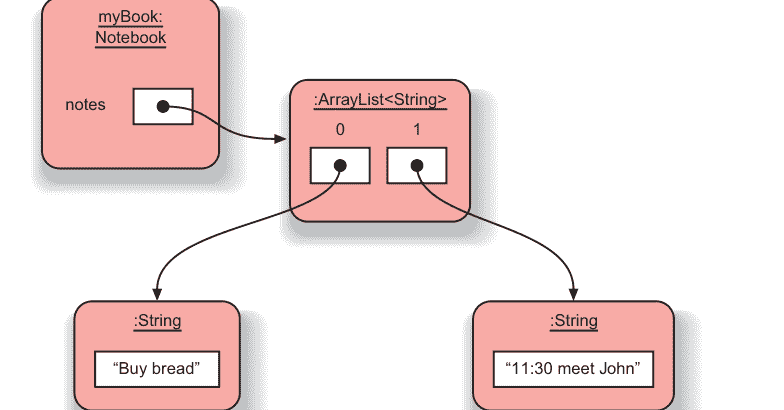

此外，我们稍后将看到，也可以向 `ArrayList` 的末尾之外的位置插入项。这意味着当添加新项时，列表中已有的项的其索引号可能会增加。用户在添加或移除笔记时必须意识到这种可能的索引变化。

**练习 4.7** 写一个方法调用，移除名为 `dates` 的集合中存储的第三个对象。

**练习 4.8** 假设一个对象存储在集合的索引 6 处。在索引 0 和索引 9 的对象被移除后，它的索引将变为？

**练习 4.9** 在你的笔记本中实现 `removeNote` 方法。

### 4.8 处理整个集合

如果添加和移除笔记意味着索引号可能会随时变化，那么在 `Notebook` 类中有一个方法来列出所有笔记及其当前的编号，那将很有用。我们可以用另一种方式来描述该方法的功能，即我们希望获取每个有效索引号，并显示对应编号的笔记。

**练习 4.10** `listNotes` 的头部可能像什么样？

**练习 4.11** 如果有三条笔记，需要多少个 `println` 语句？

在在这个 for-each 循环中，循环体（由单个 `System.out.println` 语句组成）会针对 `notes` `ArrayList` 中的每个元素重复执行。例如，如果 `notes` 列表中有四个字符串，则该语句将执行四次。

在每次执行语句之前，变量 `note` 会被赋值为列表中的一个元素，首先是索引为 0 的元素，然后是索引为 1 的元素，以此类推。因此，列表中的每个元素都会被打印出来。

让我们更详细地分析一下这个循环。`for` 关键字引入了循环。后面跟着一个括号，其中定义了循环的细节。第一个细节是声明 `String note` —— 这声明了一个新变量 `note`，用于存储列表元素。我们称之为循环变量。我们可以像选择任何其他变量一样选择这个变量的名字，不一定是 'note'。循环变量的类型必须与我们要使用的集合的声明元素类型相同，在本例中为 `String`。

然后是一个冒号和持有我们想要处理的集合的变量。从该集合中，每个元素将被赋值给循环变量，对于这些赋值中的每一次，循环体都会执行。在循环中，我们可以使用循环变量来引用每个元素。重要的是，循环变量被设置为集合的每个元素，而不是对象的索引值。在例子中，完全没有使用索引值。

为了测试你对此循环工作方式的理解，请完成以下练习。

> **练习 4.12** 在你的笔记本项目版本中实现 `listNotes` 方法。（该项目的 notebook2 版本提供了该方法的实现，但为了提高你对该主题的理解，我们建议你自己写它。）

> **练习 4.13** 创建一个 `Notebook` 并从中存储几条笔记。使用 `list` 方法将它们打印出来，以检查该方法是否按预期工作。

> **练习 4.14** 在 Code Pad 中输入以下两行代码创建一个 `ArrayList<String>`：

```java
import java.util.ArrayList;
new ArrayList<String>()
```


如果你在写最后一行时不加末尾的分号，你将看到红色对象图标。将此图标拖到对象台。检查它的方法，并尝试调用一些（例如 `add`、`remove`、`size`、`isEmpty`）。也可以在 Code Pad 中调用这些方法。你可以通过使用它们的名称从 Code Pad 访问对象台上的对象。例如，如果你在对象台上有一个名为 `al1` 的 `ArrayList`，在 Code Pad 中你可以输入：

```java
al1.size()
```

> 练习 4.15 如果你愿意，可以使用调试器帮助理解循环体中的语句是如何重复的。在循环之前设置一个断点，逐步执行方法，直到循环处理所有元素并退出。

### 4.8 处理整个集合

> **练习 4.16** 修改 `showNote` 和 `removeNote`，如果输入的笔记编号无效，则打印错误信息。

我们现在已经看到了如何使用 for 循环对集合中的每个元素执行某些操作（循环体）。这是向前的一大步，但它并没有解决我们的问题。有时我们需要更多的控制，Java 提供了一种不同的循环结构来让我们做更多：`while` 循环。

#### 4.8.2 while 循环

`while` 循环在结构和目的上与 for-each 循环相似：它由一个循环头部和一个体组成，循环体可能会重复执行。然而，细节有所不同。以下是 `while` 循环的结构：

```java
while(loop condition) {
    loop body
}
```

我们注意到，`while` 循环是用关键字 `while` 引入的，后面跟着一个条件。这个循环比 for-each 循环更灵活。它不是遍历集合中的每个元素，而是根据循环条件迭代灵活的次数。

条件是用于确定是否应该至少再执行一次循环体的布尔表达式。如果条件求值为 `true`，则执行循环体。每当循环体执行一次后，我们就会返回再次检查条件。这个过程会一次又一次地持续，直到条件求值为 `false`，此时，循环体将被跳过，执行将紧接循环体之后继续。

我们可以写一个 `while` 循环来打印 `notes` 列表中的所有笔记，就像我们之前使用 for-each 循环做的那样。`while` 循环版本见代码 4.4。

```java
// Code 4.4
// Using a while loop to list the notes
int index = 0;
while(index < notes.size()) {
    System.out.println(notes.get(index));
    index++;
}
```

这个 `while` 循环与之前章节讨论的 for-each 循环等效。以下几点观察是相关的：

- 在此示例中，`while` 循环更复杂。我们需要在循环外部声明一个列表变量，并且必须手动为第一个列表元素初始化为 0。
- 列表元素不会自动从集合中提取并赋值给我们的变量。相反，我们必须使用 `ArrayList` 的 `get` 方法手动完成。我们还必须维护一个计数器（`index`）来记住我们到了哪里。
- 我们必须自己记住计数器变量（`index`）。

`while` 循环体中的最后一个语句说明了一个将数值变量加 1 的特殊运算符：

```java
index++;
```

那么，`while` 循环相对于 for-each 循环的优点是什么？

优点有两点：第一，`while` 循环不需要处理我们能想到的任何条件——第二，`while` 循环不需要处理……

我们首先将看一个与集合无关的 `while` 循环简单示例。以下将打印所有偶数：

```java
int index = 0;
while(index < 30) {
  System.out.println(index);
  index = index + 2;
}
```

- 练习 4.17 写一个 `while` 循环，打印 10 之间所有 5 的倍数。
- 练习 4.18 写一个 `while` 循环，求加 a 和 b 之间的所有数字。a 和 b 的值可以作为参数传递。

### 4.8 处理集合

**练习 4.19 挑战：** 写一个 `Prime(int n)` 方法，如果参数 `n` 是质数则返回 `true`，否则返回 `false`。为了实现该方法，你可以写一个 `while` 循环将 `n` 除以 2 到 (n-1) 之间的所有数字，并测试除法是否产生整数。你可以通过模运算符 `%` 来实现这一点。

我们现在使用 `while` 循环在集合中搜索特定的条目。准确地说，我们想要一个名为 `search` 的方法，它接受一个字符串 `searchString`，然后打印出包含该字符串的第一个笔记。这可以通过以下 `while` 循环和 `if` 语句的组合来实现：

```java
int index = 0;
boolean found = false;
while(index < notes.size() && !found) {
  String note = notes.get(index);
  if(note.contains(searchString)) {
    found = true;
  }
  else {
    index++;
  }
}
```

学习这段代码直到你理解它——这很重要。你会看到 `while` 循环停止有两种条件：找到了 `search`，或者我们检查了所有元素。

练习 4.20 在 `Notebook` 类中实现 `search` 方法。所示代码是方法的一部分，但并不完整。你需要在循环中添加代码来打印找到的笔记或字符串“**Search not found.**”。

练习 4.21 修改 `listNotes` 方法，使其在每条笔记前面打印一个与其 `ArrayList` 索引对应的数字。例如：

- 0: Buy bread.
- 1: Recharge phone.
- 2: 11:30: Meeting with John.

这使得移除笔记时提供正确的索引变得容易得多。

# 第 4 章 对象分组

**练习 4.22** 在单次执行 `search` 方法期间，`notes` 集合会被反复询问当前存储了多少条笔记。在每次检查循环条件时都会执行。`size()` 方法返回的值在每次检查之间会变化吗？如果你认为答案是“否”，请重写 `search` 方法，使得在执行循环之前仅确定一次 `notes` 集合并存储在局部变量中。在循环条件中使用该局部变量而不是调用 `size()` 方法。检查此版本是否产生相同的结果。如果你在完成此练习时遇到困难，请尝试使用调试器查看问题出在哪里。

**练习 4.23** 修改你的笔记本，使笔记的编号从 1 开始，而不是从 0 开始。记住 `ArrayList` 对象将仍然使用从零开始的索引，但你可以在列表中显示从 1 开始编号的笔记。确保 `showNote` 和 `removeNote` 方法能够恰当处理。

#### 4.8.3 遍历集合

概念：

迭代器是一个提供遍历集合中所有元素的对象。

在继续之前，我们将讨论遍历集合的第三种变体，它介于 `while` 循环和 `for-each` 循环之间。它使用 `while` 循环执行迭代，并使用迭代器而不是整数循环索引来跟踪列表中的位置。

检查集合中的每个项目是非常常见的，因此 `ArrayList` 提供了一种特殊方式来遍历其内容。`ArrayList` 的 `iterator` 方法返回在 `java.util` 包中定义的 `Iterator`，因此我们必须在类中添加第二个 `import` 语句来使用它。

```java
import java.util.ArrayList;
import java.util.Iterator;
```

`Iterator` 提供了两个遍历集合的方法：`hasNext` 和 `next`。我们通常使用 `Iterator` 的方式用伪代码描述：

```
Iterator<ElementType> it = myCollection.iterator();
while(it.hasNext()) {
    调用 it.next() 获取下一个元素
    对该元素进行某些操作
}
```

在此代码中，我们首先使用 `ArrayList` 的 `iterator` 方法获取一个 `Iterator` 对象。注意 `Iterator` 也是一个泛型类型，我们根据集合中元素的类型对其进行参数化。然后我们使用该迭代器反复检查是否有更多元素（`it.hasNext()`）并获取下一个元素（`it.next()`）。一个需要注意的重要点是，是我们要求迭代器返回下一个项目，而不是集合。

> ¹ 注意区分迭代器方法的首字母与 `Iterator` 类首字母的不同情况。

使用 `Iterator`，我们可以编写一个列出所有笔记的方法，如代码 4.5 所示。实际上，迭代器从集合的开始处开始，每次调用其 `next` 方法时，它都会逐一个对象向前进行。

# 代码 4.5

使用迭代器列出笔记

```java
/**
 * 列出笔记本中所有的笔记。
 */
public void listNotes() {
    Iterator<String> it = notes.iterator();
    while(it.hasNext()) {
        System.out.println(it.next());
    }
}
```

花些时间将其与代码 4.3 和代码 4.4 所示的两个 `listNotes` 版本进行比较。关于最新版本的一个特殊点是，我们使用了显式的 `while` 循环，但不需要处理索引值。这是因为 `Iterator` 跟踪它遍历集合的进度，因此它知道是否还有剩余项目（`hasNext`）以及如果有，应该返回哪一个（`next`）。

#### 4.8.4 索引访问与迭代器的对比

我们在最后两个节中看到，至少有三种遍历 `ArrayList` 的方法。我们可以使用 `for-each` 循环（见第 4.8.1 节）、带索引的 `get` 方法（第 4.8.2 节），或者我们可以使用 `Iterator` 对象（第 4.8.3 节）。

根据我们目前了解，所有方法的质量似乎是平等的。第一种稍微更容易理解。

使用 `for` 循环的第一种方法是处理集合中所有元素时的标准技术，因为对于这种情况，它是最简洁的。后两种版本的优点是可以在处理过程中轻松停止迭代，因此当只处理集合的一部分时，它们是更优的。

对于 `ArrayList` ，后两种方法（使用 `while` 循环）实际上非常好。这并非总是如此。Java 提供了 `ArrayList` 之外的许多集合类。我们将在接下来的章节中看到其中的几个。对于某些集合，通过提供索引来访问单个元素是不可能的，或者效率非常低。那么，我们的第一种循环版本是 `ArrayList` 集合的特殊解决方案，可能不适用于其他类型的集合。

最后一种解决方案（使用 `Iterator`）适用于 Java 类库中的所有集合，因此它是一个重要的代码模式，我们将在后的项目中再次使用它。

#### 4.8.5 删除元素

在选择使用哪种循环时，另一个考虑因素是我们必须在循环的同时从集合中删除元素。一个例子可能是我们想要删除笔记本中所有旧的购物列表。假设我们在此类笔记中使用了“shopping”一词，现在我们想要删除所有包含字符串“shopping”的笔记。（这对于实际应用来说太简单了，但作为这里讨论的示例已经足够）

我们可以轻松地用伪代码编写：

```
对于集合中的每个元素 {
  如果 元素包含字符串 "shopping":
    删除它
}
```

在 `for-each` 循环中这样做是不可能的。如果我们在迭代期间修改集合，系统会报告错误（`ConcurrentModificationException`）。在迭代期间修改集合时该怎么办？如果使用 `Iterator`，则是可以的。`Iterator` 提供了 `remove` 方法，允许我们在迭代期间删除元素。

在 `while` 循环中这样做是不推荐的；因为当添加或删除元素时，索引会变化，这很容易导致迭代出错。使用 `Iterator` 可以保护我们免受此类。

**练习 4.24** 在你的笔记本中实现一个方法，允许指定字符串，然后删除所有包含该字符串的笔记。

### 4.9 笔记本示例总结

在笔记本示例中，我们看到了如何使用从类库创建的 `ArrayList` 对象来存储任意数量的对象。我们不需要预先决定存储多少对象，`ArrayList` 会自动跟踪数量。

我们讨论了如何使用循环遍历集合中的所有元素。Java 有多种循环——我们在这里使用的是 `for-each` 循环和 `while` 循环。

对于 `ArrayList`，我们既可以通过索引访问元素，也可以使用 `Iterator` 对象遍历所有元素。

**练习 4.25** 使用 *club* 项目完成以下练习。你的任务是完成 **Club** 类，该类的大纲已在项目中提供。**Club** 类旨在存储 **Membership** 对象。

对于 **Club**，定义一个 `ArrayList` 字段。为该字段使用适当的 `import` 语句，并仔细考虑列表的元素类型。在构造函数中，创建集合对象并将其赋值字段。在进入下一个练习之前，确保项目中的所有文件都能通过编译。

**练习 4.26** 完成 `numberOfMembers` 方法以返回集合的大小。在你有向集合添加对象的方法之前，它将始终返回零，但它将为后续的测试做好准备。

**练习 4.27** 俱乐部成员由 `Membership` 类的实例表示。`Membership` 的完整版本已在项目中提供，它应该不需要任何修改。实例包含了人的姓名、加入俱乐部的月份和年份。所有成员详情在创建实例时都已填充。新的 `Membership` 对象通过 `Club` 对象的 `join` 方法添加到 `Club` 对象中，该方法的描述如下：

```java
/**
 * 将新成员添加到俱乐部的成员集合。
 * @param member 要添加的成员对象。
 */
public void join (Membership member)
```

完成 **join** 方法。

## 第4章 对象的分组

当你想要从对象台上向 Club 对象添加一个新的 Membership 对象时，有两种方法可以实现：在对象台上创建一个新的 `Membership` 对象，调用 `Club` 对象的 `join` 方法，并点击 `Membership` 对象以提供参数；或者调用 `Club` 对象的 `join` 方法，并在构造函数的参数对话框中输入。

```
new Membership ("member name ...", month, year)
```

每次使用时，都使用 `numberOfMembers` 方法来检查 `join` 方法是否已将其添加到集合中，以及 `numberOfMembers` 方法是否给了正确的结果。

我们将通过本中进一步的练习继续探索这个项目。

### 4.10 另一个示例：拍卖系统

在本节中，我们将通过在不同的语境下再次回顾在本章中引入的一些新思想。

拍卖项目模拟了在线拍卖系统的部分操作。其核心思想是拍卖由一组供出售的物品组成。这些物品被称为“拍品”，每个拍品都被分配了一个唯一的编号。一个人通过对某个拍品出价金额来尝试购买。我们的拍卖与其他拍卖略有不同，因为我们的拍卖在有限时间内提供所有拍品。² 结束后，拍卖关闭。拍卖关闭时，对某个拍品出价最高的人被认为购买了它。关闭时任何没有出价的拍品将未售。例如，未售出的拍品可能会在较低的拍卖中提供。

拍卖项目包含以下类：`Auction`、`Bid`、`Lot` 和 `Person`。`Person` 类和 `Bid` 类都没有启动拍卖系统内的任何活动，因此我们不详细讨论它们：`Person` 存储出价者的姓名，`Bid` 存储出价的值以及出价者。学习这些类留给读者练习。相反，我们将关注 `Lot` 类和 `Auction` 类。

#### 4.10.1 Lot 类

`Lot` 类存储拍品的描述、拍品编号以及到为止收到的最高出价详情。该类中最复杂的部分是 `bidFor` 方法（代码 4.6）。它处理当一个人对拍品出价时的情况。当出价时，必须检查新出价的值是否高于该拍品的任何现有出价。如果更高，新出价将作为拍品内的当前最高价进行存储。

> ² 为了简单起见，拍卖的时间限制方面在我们在这里考虑的类中并未实现。

### 代码 4.6 处理拍品的出价

```java
public class Lot {
    // 此拍品的当前最高出价。
    private Bid highestBid;

    // 省略其他字段和构造函数。

    /**
     * 尝试对此拍品出价。成功的出价
     * 必须值必须高于任何现有出价。
     * @param bid 一个新的出价。
     * @return 如果成功则返回 true，否则返回 false。
     */
    public boolean bidFor(Bid bid) {
        if((highestBid == null) ||
            (bid.getValue() > highestBid.getValue())) {
            // 此出价是目前为止最好的。
            highestBid = bid;
            return true;
        } else {
            return false;
        }
    }

    // 省略其他方法。
}
```

#### 概念

Java 保留关键字 `null` 用于在对象变量当前引用特定对象时表示“没有对象”。未显式初始化的字段默认将包含 `null`。

我们首先检查此出价是否为最高出价。如果之前没有出价，或者当前出价高于目前为止最好的，则就是这种情况。检查的第一部分涉及以下内容：

```
highestBid == null
```


这实际上是在测试 `highestBid` 变量当前是否引用了一个对象。`null` 关键字是一个特殊值，表示“无对象”。如果你检查 `Lot` 类的构造函数，你会发现该字段没有被分配显式值。结果是它包含了对象引用的默认值，即 `null`。因此，在接收到该拍品的出价之前，`highestBid` 将包含 `null` 值。一个非常重要的原则是，如果一个变量包含 `null` 值，则不应该对其调用方法。原因应该是显而易懂的：方法属于对象，如果变量不引用对象，我们就无法调用方法。你可以在代码 4.6 的 `bidFor` 方法中看到我们是如何小心地避免这种情况发生的。只有当我们确定变量不为 `null` 时，我们才对 `highestBid` 调用 `getValue`。

### 4.10.2 Auction 类

`Auction` 类（代码 4.7）为我们在本章较早讨论的 `ArrayList` 和 `for-each` 循环概念提供了进一步的说明。

```
import java.util.ArrayList;

/**
 * 简单的拍卖模型。
 * 拍卖维护了一个任意长度的拍品列表。
 * @author David J. Barnes and Michael Kölling.
 * @version 2008.03.03
 */
public class Auction {
    // 此拍卖中的拍品列表。
    private ArrayList<Lot> lots;
    // 将赋给下一个进入此拍卖的拍品的编号。
    private int nextNumber;

    /**
     * 创建一个新的拍卖。
     */
    public Auction() {
        lots = new ArrayList<Lot>();
        nextNumber = 1;
    }

    /**
     * 将新拍品输入拍卖。
     * @param description 拍品的描述。
     */
    public void enterLot(String description) {
        lots.add(new Lot(nextNumber, description));
        nextNumber++;
    }

    /**
     * 显示拍卖中的完整拍品列表。
     */
    public void showLots() {
        for (Lot lot : lots) {
            System.out.println(lot.toString());
        }
    }

    /**
     * 为拍品出价。
     * 打印出价是否成功的信息。
     * @param number 出价的拍品编号。
     * @param bidder 为出价的人。
     * @param value 出价的值。
     */
    public void bidFor(int lotNumber, Person bidder, long value) {
        Lot selectedLot = getLot(lotNumber);
        if (selectedLot != null) {
            boolean successful = selectedLot.bidFor(new Bid(bidder, value));
            if (successful) {
                System.out.println("拍品号 " + lotNumber + " 成功了。");
            } else {
                Bid highestBid = selectedLot.getHighestBid();
                System.out.println("拍品号 " + lotNumber + " 已有价格 " + highestBid.getValue());
            }
        }
    }

    /**
     * 根据编号返回拍品。如果不存在该编号的拍品则返回 null。
     * @param lotNumber 要返回的拍品编号。
     */
    public Lot getLot(int lotNumber) {
        if ((lotNumber >= 1) && (lotNumber < nextNumber)) {
            // 编号看起来合理。
            Lot selectedLot = lots.get(lotNumber - 1);
            if (selectedLot.getNumber() != lotNumber) {
                System.out.println("内部错误：返回了拍品号 " + selectedLot.getNumber() + 而不是 " + lotNumber);
                selectedLot = null;
            }
            return selectedLot;
        } else {
            System.out.println("拍品号 " + lotNumber + " 不存在.");
            return null;
        }
    }
}
```

`lots` 字段是一个 `ArrayList`，用于存储拍卖中提供的拍品。通过向 `enterLot` 方法传递一个简单的描述向拍卖输入拍品。通过向 `Lot` 构造函数传递描述和一个唯一的拍品编号创建一个新的拍品。该拍品对象被添加到集合中。后续章节将讨论 `Auction` 类的额外功能。

### 4.10.3 匿名对象

`Auction` 中的 `enterLot` 方法展示了一种常见的惯用法——匿名对象。我们在以下语句中看到了它：

```
lots.add(new Lot(nextNumber, description));
```

在这里，我们正在做两件事：

- 我们创建一个新的 `Lot` 对象，
- 我们将此对象添加到 `ArrayList` 的 `add` 方法中。

我们可以用两行代码编写相同的内容，使步骤更加明确：

```
Lot furtherLot = new Lot(nextNumber, description)
lots.add(furtherLot);
```

这两个版本等效，但如果我们不再进一步使用 `furtherLot` 变量，就没有定义一个用途有限的变量。相反，我们通过将其直接传递给使用的方法创建一个匿名对象——一个没有名字的对象。

**练习 4.28** 为 `Auction` 类添加一个 `close` 方法。它应该遍历拍品集合并打印所有拍品的详情。你可以使用 `for-each` 循环或 `while` 循环。任何至少出过一次价的拍品都被视为已售出。

### 4.10 另一个示例：拍卖系统

对于已售出的拍品（lots），详细信息应包括成功竞买者的名称以及中标金额。对于未售出的拍品，打印一条指示表明这一事实的消息。

**练习 4.29** 在 `Auction` 类中添加一个 `getUnsold` 方法，其签名如下：

```java
public ArrayList<Lot> getUnsold()
```

该方法应该遍历所有拍品，并将未售出的拍品存储在一个 `ArrayList` 局部变量中。在方法结束时，返回未售出的拍品列表。

**练习 4.30** 假设 `Auction` 类包含一个可以从拍卖中移除拍品的方法。假设在移除拍品时，剩余拍品的 `lotNumber` 不会发生改变，那么移除拍品的能力对 `getLot` 方法会产生什么影响？

**练习 4.31** 重写 `getLot`，使其不再依赖于特定编号拍品存储在集合的索引 `(number-1)` 位置。例如，如果编号为 2 的拍品已被移除，那么编号为 3 的拍品将从索引 2 移动到 1，且所有更高编号的拍品也将移动一个索引位置。你可以假设拍品总是按照其编号的递增顺序存储。

**练习 4.32** 在 `Auction` 类中添加一个 `remove` 方法，其签名如下：

```java
/**
 * 移除具有给定编号的拍品。
 * @param number 要移除的拍品编号。
 * @return 具有给定编号的拍品，如果没有该拍品
 * 则返回 null。
 */
public Lot remove(int number)
```

该方法不应假设具有给定编号的拍品存储在集合中的任何特定位置。

**练习 4.33** `ArrayList` 类位于 `java.util` 包中。该包还包含一个名为 `LinkedList` 的类。尝试查出 `LinkedList` 类是什么，并将其方法与 `ArrayList` 的方法进行比较。它们哪些方法是共同的，哪些是不同的？

### 4.10.4 使用集合

`ArrayList` 集合类（以及类似的类）是一个重要的编程工具，因为许多程序都涉及对变大小对象集合的操作。在继续学习本章其余部分之前，重要的是你要彻底熟悉并熟练掌握如何使用它们。接下来的练习将帮助你做到这一点。

## 练习 4.34 继续完成练习 4.25 中的俱乐部项目。在 `Club` 类中定义一个描述如下的方法：

```java
/**
 * 确定在给定月份加入的成员人数。
 * @param month 我们感兴趣的月份。
 * @return 在该月份加入的成员人数。
 */
public int joinedMonth(int month)
```

如果参数 `month` 超出 1–12 的有效范围，则打印错误消息并返回零。

## 练习 4.35 从俱乐集合中定义所有在给定月份加入的成员——

```java
/**
 * 从俱乐部集合中移除所有在给定月份加入的成员，
 * 并将它们存储在一个独立的集合对象中。
 * @param month 会员资格的月份。
 * @param year 会员资格的年份。
 * @return 在给定月份和年份加入的成员。
 */
public ArrayList<Membership> purge(int month, int year)
```

如果参数 `month` 超出 1–12 的有效范围，则打印错误消息并返回一个不存储任何对象的集合。

注意：`purge` 方法的编写比该类中的任何其他方法都要困难得多。

## 练习 4.36 打开产品项目，使用 `ArrayList` 存储 `Product` 项并完成 `StockManager` 以及接下来的几个练习。`addProduct` 方法已经将产品添加到集合中，但以下方法需要完成：`delivery`、`findProduct`、`printProductDetails` 和 `numberInStock`。

公司出售的每件产品都由 `Product` 类的实例表示，该实例记录产品的 ID、名称和当前库存。`Product` 类定义了 `increaseQuantity` 方法来增加库存水平。`sellOne` 方法通过将数量减 1 来记录该产品已售出。该方法已提供，你不对其进行任何修改。

通过实现 `printProductDetails` 方法来遍历集合中的产品。调用每个产品的 `toString` 方法打印详情。

### 4.11 灵活集合总结

**练习 4.37** 实现 `findProduct` 方法。它应该遍历集合查找 id 字段匹配方法参数的产品。如果找到了匹配的产品，则将其作为方法的返回结果。如果没有找到匹配的产品，返回 `null`。

这与 `printProductDetails` 方法的不同在于，它不一定检查集合中的每个产品。例如，如果集合中的第一个产品匹配 ID，迭代即可结束并返回该产品。另一方面，可能集合中没有匹配项。在这种情况下，将检查整个集合也没有找到返回的产品。此时应返回 `null` 值。

在查找匹配项时，你需要调用 `getID` 方法查找 `Product`。

**练习 4.38** 实现 `numberInStock` 方法。它应该在集合中定位匹配 ID 的产品，并将产品的当前数量作为方法的结果。如果没有找到匹配 ID 的产品，返回零。这相对简单，可以调用已完成的 `findProduct` 方法。例如，`numberInStock` 可以调用 `findProduct` 方法进行搜索，然后对结果调用 `getQuantity` 方法。不过要处理找不到产品的情况。

**练习 4.39** 使用类似于 `numberInStock` 的方法实现 `delivery` 方法。它应该在产品列表中找到给定 ID 的产品并调用它的 `increaseQuantity` 方法。

**练习 4.40 挑战练习** 在 `StockManager` 中实现一个方法，打印库存水平低于给定值（作为参数传递给方法）的所有产品的详情。

- 修改 `addProduct` 方法不允许向产品列表添加与现有 ID 相同的新产品。
- 为 `StockManager` 添加一个通过名称而非 ID 查找产品的方法：

```java
public findProduct(String name)
```

为了实现这一点，你需要知道两个 String 对象 `s1` 和 `s2` 可以通过布尔表达式进行相等性测试：

```java
s1.equals(s2)
```

更多细节请参阅。

此类信息可能帮助经理做出决定，例如他们是否需要升级到更强大的服务器设备，或者何时是空闲时段，以便安排维护活动。

weblog-analyzer 项目包含一个对 Web 服务器数据进行分析的应用程序。每当发生访问时，服务器都会向文件中写入一条日志。项目文件夹中提供了一个名为 `weblog.txt` 的示例日志文件。每行按以下格式记录访问的日期和时间：

年 月 日 时 分

例如，下面这一行记录了 2008 年 6 月 7 日凌晨 03:45 的访问：

2008 06 07 03 45

该项目由四个类组成：`LogAnalyzer`、`LogFileReader`、`LogEntry` 和 `LogTokenizer`。我们将花费大部分时间在研究 `LogAnalyzer` 上，因为它包含了创建和使用数组的各个示例（代码 4.8）。随后的练习将鼓励你分析并修改 `LogEntry`，因为它也使用了数组。`LogReader` 和 `LogLineTokenizer` 使用了我们尚未过的 Java 语言特性，因此我们将对它们进行详细探索。

## 代码 4.8

日志文件分析器

```java
/**
 * 读取 Web 服务器数据并分析
 * 每小时访问模式。
 *
 * @author David J. Barnes and Michael Kölling.
 * @version 2008.03.00
 */
public class LogAnalyzer {
    // 用于存储每小时访问数的数组。
    private int[] hourCounts;
    // 使用 LogFileReader 访问数据。
    private LogFileReader reader;

    /**
     * 创建一个对象来分析每小时的 Web 访问。
     */
    public LogAnalyzer() {
        // 创建数组对象以保存每小时
        // 的计数。
        hourCounts = new int[24];
        // 创建读取器获取数据。
        reader = new LogFileReader();
    }
}
```

## 第 4 章 对象分组

代码 4.8 继续：

日志文件分析器

```java
/**
 * 分析日志文件中每小时访问数据。
 */
public void analyzeHourlyData() {
    while (reader.hasMoreEntries()) {
        LogEntry entry = reader.nextEntry();
        int hour = entry.getHour();
        hourCounts[hour]++;
    }
}

/**
 * 打印每小时计数。
 * 这些计数应该在先调用
 * analyzeHourlyData 后进行设置。
 */
public void printHourlyCounts() {
    System.out.println("Hr: Count");
    for(int hour = 0; hour < hourCounts.length; hour++) {
        System.out.println(hour + ": " + hourCounts[hour]);
    }
}

/**
 * 打印 LogfileReader 读取的数据行
 */
public void printData() {
    reader.printData();
}
```

该分析器目前仅使用在服务器日志行中存储的部分数据。它提供的信息允许我们确定平均而言，一天中哪些小时段服务器最繁忙或最空闲。这是通过统计日志所涵盖的时间范围内每个一小时段内的访问次数来实现的。

**练习题 4.41** 通过创建一个 `LogAnalyzer` 对象并调用其 `analyzeHourlyData` 方法来探索 weblog-analyzer 项目。接着调用其 `printHourlyCounts` 方法，这将打印分析结果。一天中最繁忙的时段是哪什么时候？

### 4.12 固定大小的集合

我们将在接下来的几节中检查该类如何使用数组来完成此任务。

### 4.12.2 声明数组变量

`LogAnalyzer` 类包含一个数组类型的字段：

```java
private int[] hourCounts;
```


数组变量声明的独特特征是名称中包含一对方括号：`int[]`。这表示 `hourCounts` 变量的类型是整数数组。我们称它是该特定数组的基类型。区分数组变量声明与外观相似的简单变量声明是非常重要的：

```java
int hour;
int[] hourCounts;
```

在这里，变量 `hour` 用于存储单个整数值，而 `hourCounts` 将在对象被创建后用于引用该数组对象。数组变量声明本身不会创建数组对象。创建是在单独的阶段使用 `new` 操作符与其他对象一起完成的。

值得观察一下这种不寻常的语法。`int[]` 声明在更常规的语法中可能会出现为 `Array<int>`。正如前面提到的，这没有逻辑上的更高理由。你仍然应该习惯于像这样读取它：“int 数组”。

### 练习题 4.42
编写一个名为 `people` 的数组变量声明，它可以引用任何 `Person` 对象。

### 练习题 4.43
编写一个名为 `vacant` 的数组变量声明，它可以引用任何布尔值。

### 练习题 4.44
仔细阅读 `LogAnalyzer` 类，并识别所有使用 `hourCounts` 变量的地方。在此阶段，不要担心所有用处意味着什么，因为它们将在后续章节中进行解释。注意变量配合使用一对方括号的频率。

### 练习题 4.45
以下数组声明有何错误？请纠正它们。

`[]int counts;`

`boolean[5000] occupied;`

## 第 4 章 对象分组

`LogFileReader` 类相当复杂，我们建议你不要花费太多时间去研究它的实现。它的作用是处理每行日志拆分为独立的数据值，但我们可以通过仅考虑其两个方法的头部来抽象掉具体的实现细节：

```java
public boolean hasMoreEntries()
public LogEntry nextEntry()
```

`hasMoreEntries` 方法告诉分析器日志文件中至少还有一条条目，而 `nextEntry` 方法返回一个包含下一行日志值的 `LogEntry` 对象。这两个方法模拟了 `Iterator` 接口中 `hasNext` 和 `next` 方法的风格，因为任何特定的日志文件中可能包含任意数量的条目。

通过 `LogEntry`，分析器的 `analyzeData` 方法获取字段的值：

```java
int hour = entry.getHour();
```

我们知道存储在局部变量中的值始终在 0–23 范围内，这与 `hourCounts` 数组的有效索引范围完全匹配。数组中的每个位置用于表示每小时计数的访问次数。每当读取到一个小时值时，我们通过写入操作来将该小时的计数加 1。我们是这样编写的：

```java
hourCounts[hour]++;
```

注意，存储在数组元素中的值被递增，而不是 `hour` 变量。两种替代方案都是等价的，因为我们可以像使用普通变量一样完全使用数组元素：

```java
hourCounts[hour] = hourCounts[hour] + 1;
hourCounts[hour] += 1;
```

在 `analyzeData` 方法结束时，我们已经得到了日志期间内每个小时的完整累积计数。

在下一节中，我们将查看 `hourlyCounts` 方法，因为它引入了一种适用于遍历数组的新类型控制结构。

### 4.1.6 for 循环

Java 定义了两种变体循环，都由关键字 `for` 标识。在第 4.8 节中，我们引入了第一种变体——`for-each` 循环（增强 for 循环），作为遍历灵活大小集合的方便方法。第二种变体——`for` 循环是另一种迭代控制结构，它特别适用于以下情况：

- 我们需要以固定次数执行一组语句；
- 我们在循环内部一个变量，其值在每次迭代中按固定量变化（通常是增加 1）。

> 4 有时，如果你想让 `for-each` 循环的区分更加清晰，他们也将其称为“旧式 for 循环”，因为它在 Java 语言中出现的时间比 `for-each` 循环早。`for-each` 循环有时被称为“增强 for 循环”。

### 4.12 固定大小集合

例如，当我们想要对数组中的每个元素执行某些操作时（例如打印每个元素的内容），通常使用循环。这符合“固定次数对应于数组长度”的标准，并且需要一个变量来提供数组的递增索引。

循环具有以下通用形式：

```java
for(initialization; condition; post-body action) {
  需要重复的语句
}
```

下面的具体示例取自 `LogAnalyzer` 的 `printHourlyCounts` 方法：

```java
for(int hour = 0; hour < hourCounts.length; hour++) {
  System.out.println(hour + " : " + hourCounts[hour]);
}
```

结果将打印数组中每个元素的值，并在前面附上其对应的小时数。例如：

- 0: 149
- 1: 149
- 2: 148
- 3: 166

当我们将此循环与 `for-each` 循环比较时，发现语法差异在于循环头中括号之间的部分。对于此循环，括号内包含三个由分号隔开的独立部分。

从编程语言设计的角度来看，如果为这两种循环使用不同的关键字会更好，也许是 `for` 和 `foreach`。对这两个循环都使用 `for` 的原因再次是一个历史性的偶然。旧版本的 Java 语言不包含 `for-each` 循环，当它最终被引入时，Java 设计者没有在此阶段引入新关键字，这可能会对现有程序产生问题。因此，他们决定对这两个循环使用相同的关键字。这使得区分变得稍微困难了一些。

### 练习 4.51
修正以下方法中的所有错误。

```java
/**
 * 输出 marks 数组中大于平均值的所有值。
 * @param marks 分数值数组。
 * @param mean 平均数（平均值）分数。
 */
public void printGreater(double[] marks, double mean)
{
    for(int index = 0; index < marks.length; index++) {
        if(marks[index] > mean) {
            System.out.println(marks[index]);
        }
    }
}
```

### 练习 4.52
重写 notebook 项目中 Notebook 类中的以下方法，使其使用 for 循环而不是 while 循环：

```java
/**
 * 列出笔记本所有的笔记。
 */
public void listNotes()
{
    for(int index = 0; index < notes.size(); index++) {
        System.out.println(notes.get(index));
    }
}
```

### 练习 4.53
重写相同的方法以使用 for-each 循环（增强 for 循环）。

### 练习 4.54
完成下方的 `numberOfAccesses` 方法，以统计日志文件中记录的访问次数。使用 for 循环遍历 `hourCounts` 来完成它：

```java
/**
 * 返回日志文件中记录的访问次数。
 */
public int numberOfAccesses()
{
    int total = 0;
    // 将 hourCounts 中每个元素的值
    // 加到 total 中。
    ...
    return total;
}
```

### 练习 4.55
将你的 `numberOfAccesses` 方法添加到 `LogAnalyzer` 类中，并检查其得到的结果是否正确。提示：你可以通过分析器读取仅包含几行数据的日志文件来简化检查。这样你将更容易判断你的方法是否给出了正确答案。`LogFileReader` 类有一个具有以下签的构造函数，用于从特定文件读取：

```java
/**
* 创建一个 LogFileReader，从特定的日志文件提供数据。
* @param filename 日志数据文件。
*/
public LogFileReader(String filename)
```

### 练习 4.56
在 `LogAnalyzer` 中添加一个 `busiestHourTo` 方法，返回最繁忙的小时。你可以通过遍历 `hourCounts` 找到计数最大的元素来实现。提示：你需要检查每一个元素以查看是否找到了最繁忙的小时？如果是，使用循环或 for-each 循环。在这种情况下哪种更好？

### 练习 4.57
在 `LogAnalyzer` 中添加一个 `quietestHourTo` 方法，返回最不忙的小时。注意：这听起来与上一个练习几乎完全相同，但对粗心的人来说有一个小陷阱。这里是使用每个小时都具有非零计数的数据来测试你的方法。

### 练习 4.58
如果有多个小时具有最大的计数，你的 `busiestHour` 方法会返回哪一个小时？

### 练习 4.59
在 `LogAnalyzer` 中添加一个方法，找到最繁忙的两个小时的时段。返回该时段第一个小时的值。

### 练习 4.60
挑战性练习：将 weblog-analyzer 项目以不同的名称保存，以便你可以开发一个新版本，对可用数据进行更广泛的分析。例如，知道哪些天比其他天更安静是有用的——例如，是否存在七天的周期性模式？为了对每日、每月或每年数据进行分析，你需要对 `LogEntry` 类进行一些更改。该类已经存储了单行日志的所有值，但仅通过访问器可以使用小时和分钟值。然后添加一组方法，使其余字段以类似的方式可用。

### 练习 4.61
挑战性练习：如果你完成了上一个练习，你可以通过额外的数值字段来扩展日志格式。例如，服务器通常会提供一个数值代码，指示访问是否成功。值 200 表示访问成功；403 意味着禁止访问文档；404 意味着找不到文档。分析器提供了成功和失败访问次数的信息。这个练习可能非常具有挑战性，因为它将要求你修改项目中的每一个类。

## 总结

在本章中，我们讨论了存储对象集合的机制，而不是在单独的字段中存储单个对象。我们详细查看了两种不同的集合：`ArrayList` 作为灵活大小集合的示例，以及数组作为固定大小的集合。

从现在起，在所有项目中使用集合都将非常重要。你会发现，几乎每个应用程序都需要地方地方存放某种形式的集合。它们是编写程序的基础。

在使用集合时，会产生遍历集合中的所有元素以利用存储其中的对象的需求。为了这个目的，我们已经了循环和迭代器（iterator）的使用。

循环也是计算中的一个基本概念，从现在起你将在每个项目中使用它。确保你熟悉编写循环——没有它们你将走不了多远。

顺便提一下，我们提到了 Java 类库——这是一个巨大的类集合，我们可以利用它让我们的类变得强大。我们需要更详细地学习这个库，看看还有什么是我们应该知道的。这将是下一章的主题。

## 本章引入的术语

- collection（集合）、array（数组）、iterator（迭代器）、for-each 循环

## 概念总结

- collection（集合）：可以存储任意数量对象的
- loop（循环）：可以重复执行一个语句块
- iterator（迭代器）：提供遍历所有元素的功能
- null：Java 中，当变量未初始化时将默认包含值 null
- array（数组）：可以存储固定数量对象的特殊类型集合

### 练习 4.62
在第 4 章中，我们引入了 Java 类库中的 `ArrayList`。通过这一章，我们实现了某些难以实现的功能（在此情况下存储任意数量的对象）。

这只是库中一个有用类的示例。该库包含成千上万个类，其中许多对你的工作是有用的（而许多可能永远不会使用）。

### 练习 4.63
`LogAnalyzer` 强制执行一个限制。考虑到这一点，你认为使用固定大小的数组比集合更合适吗？给出正反两方面的理由。

### 练习 4.64
Java 提供了另一种循环：while 循环。找出这种循环是如何工作的。写一个使用 while 循环打印 1 到 10 的示例。

http://java.sun.com/docs/tutorial/javaandbolts

### 练习 4.65
使用 while 循环重写 notebook 的 `listNotes` 方法。

### 练习 4.66
研究 Java 的 switch-case 语句。目的是什么？如何使用？写一个示例。（这也是控制流语句，因此可以在“控制语句”部分找到信息）。

## 第 5 章：复杂的行为

本章主要概念：

- 使用类库
- 阅读文档

本章讨论的 Java 构造：

`String`、`ArrayList`、`Random`、`HashMap`、`HashSet`、`Iterator`、`Arrays`、`static`、`final`

在第 4 章中，我们引入了 `ArrayList` 类。通过这一章，我们实现了某些难以实现的功能（在此情况下存储任意数量的对象）。

这只是库中一个有用类的示例。该库包含成千上万个类，其中许多对你的工作是有用的（而许多可能永远不会使用）。

对于一个优秀的 Java 程序员来说，能够处理库并对使用哪些类做出明智选择是至关重要的。学习类是本章的主题。

我们将介绍并讨论多个不同的类。在整个章节中，我们将构建一个单一应用程序（TechSupport 系统），它使用了许多不同的类。包含这里讨论的所有思想和源代码的完整实现，以及几个中间版本，都包含本书的 CD 和网站上。虽然这允许你研究完整的解决方案，但我们鼓励你遵循本章练习的路径。我们在简要查看整个程序后，将从一个非常初始的版本开始，然后逐渐开发并实现完整的解决方案。

### 库类文档

包含了几个每一个都值得花几天时间专门研究的部分。总来说，当你最终到达最后并成功完成了练习中建议的实现时，你将已经学到了许多重要的主题。


Java 库非常庞大。它包含数千计的类，每个类都有许多方法，既有带参数的也有带参数的，也有返回值。要记住它们以及伴随它们的所有细节是不可能的。相反，一个优秀的程序员应该做到：

- 根据库名记住一些最重要的类（`ArrayList` 就是其中一个重要类）；
- 发现其他类并查阅详细信息（如方法和参数）。

在本章中，我们将介绍类库中的一些重要类，在书中其他部分还会介绍更多的库类。但更重要的是，我们将向你展示如何独立探索和理解库。这将使你能够编写出更有趣的程序。此外，Java 有 HTML 格式可用（可以在网页浏览器中阅读）。文档就是我们用来查找库类的工具。

阅读和理解文档是介绍库类的第一部分。我们将进一步采用这种方法，讨论如何准备自己的类，以便其他人可以像使用库类一样使用它们。这对于现实世界中的软件开发至关重要，因为团队必须处理大型项目和软件维护时间。

你可能已经注意到 `ArrayList` 类的一点是，我们使用它时并没有非要使用它的功能。我们只需要知道类的名称、方法的名称、这些方法的参数和返回值，以及这些方法的具体作用。我们并不真正关心工作是如何完成的。这对于这类库类来说是典型的。

对于大型软件项目中的其他类来说也是如此。通常，几个人通过处理不同的部分来合作完成一个项目。每个程序员都应该专注于自己的领域，而不要去理解所有其他部分的细节（我们在第 3.2 节中讨论过抽象和模块化）。实际上，每个程序员都应该能够像使用库类一样使用其他团队成员的类，在不需要了解其内部工作原理的情况下对它们有充分的了解。

为了完成这项工作，每位团队成员都必须为自己的类编写文档，类似于 Java 标准库的文档，使其他人能够在无需阅读代码的情况下使用该类。本章也将讨论这个话题。

### TechSupport 系统

正如我们所，我们将通过一个示例来探索这些问题。这次我们将使用 TechSupport 。你可以在光盘或网上找到它，项目名为 `tech-support1`。

TechSupport 是一个旨在为虚构的 DoggySoft 软件公司的客户提供技术支持的程序。很久以前，DoggySoft 有一个技术部门，人们坐在电话旁，客户可以打电话来获取有关 DoggySoft 产品技术问题的建议和帮助。目前，业务经营并不理想，DoggySoft 决定撤销技术部门以节省费用。他们现在想开发 TechSupport 系统，以给人支持仍在提供的印象。该系统旨在模拟技术支持人员可能提供的回答。客户可以与技术支持系统进行通信。

#### 5.2.1 探索 TechSupport 系统

> 练习 5.1 打开并运行 `tech-support-complete` 项目。你可以通过创建 `SupportSystem` 类的对象并调用它的 `start` 方法来运行它。输入你可能在软件上遇到的问题来尝试系统。观察它的行为。完成后输入 'bye'。在现阶段你不需要检查源代码。该项目是我们在本章结束时开发的完整解决方案。此练习的目的仅仅是让你对我们计划实现的内容有个想法。

TechSupport 项目的想法基于 20 世纪 60 年代突破性的人工智能程序 Eliza，它由 Joseph Weizenbaum 在马省理工学院开发。你可以通过网上搜索 'Eliza' 和 'Weizenbaum' 来了解更多关于该程序的信息。

我们现在通过使用 tech-support 项目开始详细探索。它是我们系统的初步、原始实现。我们将在整个章节中改进它。通过这种方式，我们对整个系统的理解将比仅仅阅读解决方案要深刻。

从练习 5.1 你将看到程序本质上在与用户进行对话。用户可以输入问题，系统会做出回答。在我们项目的原型版本 `tech-support1` 上尝试一下。

在完整版本中，系统能够产生相当多样的回答。有时它们看起来很有意义！我们要开发的版本中，回答要受很多限制（见图 5.1）。你会很快发现回答总是同一个：

“听起来很有趣。告诉我更多……”

#### 图 5.1

第一个 TechSupport 对话

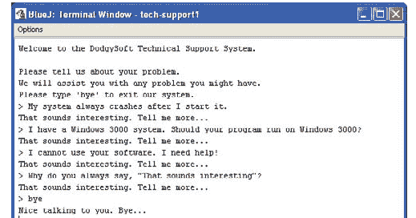


# BlueJ: Terminal Window - Tech Support!

## Options

欢迎来到 PuppySoft 技术支持系统。
告诉我们您的问题。
我们将协助您解决任何问题。
> 输入 `help` 查看选项。

事实上，这一点也不有趣，也没有让人相信我们在这一端有一个技术支持人员。我们很快就会改进这一点。然而，在此之前，我们应该探索一下目前的情况。

项目图向我们展示了三个类：`SupportSystem`、`InputReader` 和 `Responder`（图 5.2）。`SupportSystem` 是主类，它使用 `InputReader` 获取输入，使用 `Responder` 生成回答。

## 图 5.2

TechSupport class diagram

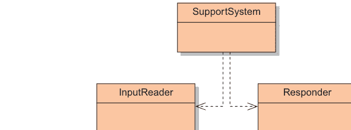

通过创建此类的对象并查看其方法来进一步检查 `InputReader`。你会发现它只有一个可用方法，名为 `getInput`，返回一个字符串。尝试一下。我们现在不会检查其内部是如何工作的，但只需注意 `InputReader` 将你在终端中输入的内容作为方法结果返回。

# 代码 5.1 续

## 5.2 TechSupport 系统

```java
/**
 * 启动技术支持系统。这将打印一个
 * 欢迎消息并与用户进行对话，
 * 直到用户结束对话。
 */
public void start() {
    boolean finished = false;

    printWelcome();
    while(!finished) {
        String input = reader.getInput();

        if(input.startsWith("bye")) {
            finished = true;
        }
        else {
            String response = responder.generateResponse();
            System.out.println(response);
        }
    }
    printGoodbye();
}
```

### SupportSystem 源代码

```java
/**
 * 在屏幕上打印欢迎消息。
 */
private void printWelcome() {
    System.out.println("欢迎 DoggySoft 技术支持系统。");
    System.out.println("请告诉我们您的问题。");
    System.out.println(
        "我们将协助解决您遇到的任何问题。");
    System.out.println(
        "请输入 'bye' 退出我们的系统。");
}
```

```java
/**
 * 在屏幕上打印告别消息。
 */
private void printGoodbye() {
    System.out.println("很高兴与您交。再见……");
}
```

# 代码 5.2

## Responder 源代码

```java
/**
 * Responder 类表示一个响应生成器
 * 对象。用于生成自动响应。
 * 
 * @author Michael Kölling and David J. Barnes
 * @version 0.1 (2008.03.30)
 */
public class Responder {
    /**
     * 构造一个 Responder - 无需操作
     */
    public Responder() {
    }

    /**
     * 生成响应。
     * @return 应该作为响应显示的
     * 字符串
     */
    public String generateResponse() {
        return "听起来很有趣。多告诉我些事...";
    }
}
```

最后，它有两个名为 `printWelcome` 和 `printGoodbye` 的方法。这些方法简单地打印一些文本——分别是欢迎消息和告别消息。

最有趣的代码段是中间的 `start` 方法。我们将更详细地讨论这个方法。

方法开头是对 `printWelcome` 的调用，结尾处是对 `printGoodbye` 的调用。这两个调用负责在适当的时间打印文本段。该方法的其余部分由一个布尔变量的声明和一个 `while` 循环组成。其结构如下：

```java
boolean finished = false;
```

```java
while(!finished) {
    do something
    if(exit condition) {
        finished = true;
    }
    else {
        do something more
    }
}
```

这种代码模式是第 4.8 节中讨论的循环惯用法的变体。我们使用 `finished` 作为标记，当我们想要结束循环（以及结束程序）时将其变为 `true`。我们确保它的初始状态为 `false`。（记住感叹号是一个 `!` 操作符！）

循环的主体——即重复执行的“尚未完成”部分——如果我们去掉对退出条件的检查，它包含三个语句：

```java
String input = reader.getInput();
...
String response = responder.generateResponse();
System.out.println(response);
```

循环反复：

- 读取某些用户输入，
- 请求 responder 生成一个响应，
- 并打印响应。

（你可能已经注意到响应完全不取决于输入！这确实是我们需要改进的地方。）

最后要检查的是退出条件的检查。其意图是一旦用户输入单词 'bye'，程序应该结束。我们在类中找到的相关源码部分如下：

如果你能单独理解这些部分，那么查看第 5.1 节中完整的 `start` 方法是一个好主意，看看你是否能理解其整体。

在上面检查的最后一个片段中使用了名为 `startsWith` 的方法。由于该方法是在持有 `String` 对象的变量 `input` 上调用的，它必须是 `String` 类的方法。这个方法是做什么的？我们如何发现呢？

我们可能仅通过方法名就能猜它是测试输入是否以单词 'bye' 开始。我们可以通过实验来验证这一点。运行 TechSupport 系统以退出。但注意，输入 'Bye' 或 ' bye'——大写字母开头或单词前面有空格——都不会被识别为以 'bye' 开始。这可能会让用户感到有些麻烦，但事实证明如果我们对 `String` 类了解一点，就可以解决这些问题。

我们如何获取有关 `startsWith` 方法或其他 `String` 类其他方法的信息？

## 5.3 阅读类文档

`String` 类是 Java 库中的类之一。我们可以通过阅读 `String` 类的库文档来了解更多细节。

要做到这一点，从 BlueJ 帮助菜单中点击 `Java Libraries` 项目。这将打开一个网络浏览器，显示 Java API（应用程序编程接口）文档的主页。

网络浏览器将显示三个框架。在左上角，你会看到类列表。下方是 Java 库中所有类的列表。右侧的大框架用于显示所选类的详细信息。

在左侧的类列表中，找到并选择 `String` 类。右侧的框架将显示 `String` 类的文档（图 5.3）。

 图 5.3 Java 标准文档

> ¹ 通过这样做，此功能通过互联网访问文档。如果你的机器没有网络访问，这将无效。BlueJ 可以配置为使用本地 API 文档。详情见附录 A。

## 5.3 阅读类文档

### 练习 5.2
研究 `String` 文档。查看其他类的文档。类文档的结构是怎样的？哪些部分是所有类共有的？它们的目的是什么？

### 练习 5.3
在 `String` 文档中查找 `startsWith` 方法。有两个版本，用自己的语言描述它们的功能以及它们之间的区别。

### 练习 5.4
`String` 类是否有方法可以测试字符串是否以某个后缀结尾？如果是，它叫什么？参数和返回类型是什么？

### 练习 5.5
`String` 类是否有方法可以返回字符串的字符数？如果是，它叫什么？参数是什么？

### 练习 5.6
如果你找到了上述任务的方法，你是如何找到它们的？寻找你需要的方法容易还是困难？为什么？

### 5.3.1 接口与实现

你会看到文档包含了不同的信息。它们还有其他内容：

- 类名；
- 对类目的的通用描述；
- 类构造函数和方法的列表；
- 每个构造函数和方法的参数和返回类型；
- 每个构造函数和方法的目的的描述。

这些信息合在一起就是类的接口。接口不显示实现类的代码。如果一个类描述得良好（即它写得好），那么程序员不需要查看代码就可以使用该类。看到接口提供了所有所需信息。这种抽象正在发挥作用。

幕后的、使类运行的源代码，是类的实现。通常，程序员一次处理一个类的实现，通过它们的接口使用其他几个类。

接口与实现之间的区别是一个非常重要的概念，它将在本书及后续章节中反复出现。

> **注意** 接口在编程和 Java 语言中具有多种含义。它被用于描述类的公开可见部分（正如我们在这里使用它的方式），它还有其他含义。用户界面（通常是图形用户界面）有时仅称为接口，但 Java 还有一种语言结构也称为 `interface`（在第 10 章讨论），它与我们这里的含义相关但又有所不同。

在特定的语境下，区分“interface”一词的不同含义是非常重要的。

“interface”术语也用于单个方法。例如，`String` 的文档向我们展示了 `length` 方法的接口：

```java
public int length()
```

> 返回此字符串的长度。长度等于字符串中 Unicode 编码单元的数量。
>
> **返回：** 由此对象表示的字符序列的长度。

一个方法的接口由方法的签名和注释（此处用*斜体*显示）组成。方法的签名包括（按此顺序）：

- 一个访问权限修饰符（此处为 `public`）——我们将在下文中讨论它；
- 方法的返回类型（此处为 `int`）；
- 方法名；
- 参数列表（在本例中为空）。

接口提供了我们使用该方法所需了解的全部信息。

## 5.3.2 使用库类方法

回到 TechSupport 系统。我们现在想稍微改进一下输入的处理。在上面的讨论中，我们已经看到我们的系统并不宽容：例如，如果我们输入 'Bye' 而不是 'bye'，可以通过调整从用户处读取的内容来实现。我们必须注意的一点是，`String` 对象一旦创建就无法被更改。我们现在必须获取原始 `String` 来创建一个新的 `String` 对象。

`String` 文档告诉我们，它有一个名为 `trim` 的方法，可以移除字符串开头结尾的空格。我们可以使用这个方法来处理第二种情况。

**概念：不可变对象**
如果一个对象一旦创建其内容或状态就无法被更改，则称它是不可变的。`String` 就是不可变对象的一个示例。

**练习 5.7** 在 `String` 类的文档中找到 `trim` 方法。写下该方法的签名。在一个名为 `text` 的 `String` 变量上写出该方法的示例调用。

在学习了 `trim` 方法的接口后，我们可以使用类似下面的代码移除输入字符串中的空格：

```java
input = input.trim();
```

这段代码将请求存储在 `input` 变量中的 `String` 对象创建一个新的、类似的字符串，并删掉前后的空格。新的 `String` 存储在 `input` 变量中，因为我们不再需要旧的。因此，在这行代码之后，`input` 指向一个两端都没有空格的字符串。

我们可以将这一行插入源代码中，使其读取如下：

```java
String input = reader.getInput();
input = input.trim();

if(input.startsWith("bye")) {
    finished = true;
} else {
    // ... 省略代码。
}
```

前两行也可以合并为一行：

```java
String input = reader.getInput().trim();
```

这行代码的效果与上述前两行相同。右侧部分的阅读方式应该就像加了括号一样：

```java
(reader.getInput()).trim();
```

你偏好哪种版本主要取决于喜好。决定应该主要基于可读性：使用你认为更易阅读和理解的版本。通常，新手程序员会更倾向于两行版本，而经验丰富的程序员则更倾向于单行风格。

**练习 5.8** 在你的 tech-support 项目版本中实现此改进。测试它以确认它对单词 'bye' 周围的额外空格具有宽容性。

现在我们解决了输入周围空格引起的问题，但还没有解决大写字母的问题。然而，对 `String` 类的进一步调查暗示了一个可能的解决方案，因为它描述了一个方法 `toLowerCase`。

**练习 5.9** 改进 tech-support 项目中 `SupportSystem` 类的代码，使输入中的大小写被忽略。使用 `String` 类的 `toLowerCase` 方法来实现。请记住，这个方法并不会实际更改它所调用的 `String`，而是会创建一个内容略有不同的新字符串。

### 5.3.3 检查字符串相等性

另一种解决方案是检查输入字符串是否为 'bye'，而不是它是否以字符串 'bye' 开头。编写这种代码的某种（错误的！）尝试看起来如下所示：

```java
if(input == "bye") { // 并不总是奏效！
    // ...
}
```

问题在于，可能存在多个独立的 `String` 对象，它们都代表相同的内容。例如，两个 `String` 对象可能都包含字符 'bye'。`==` 运算符检查的是运算符的每一侧是否引用同一个对象，而不是它们是否具有相同的值！这是一个重要的区别。

在我们的示例中，我们感兴趣的是输入变量和常量 'bye' 是否代表相同的值，即它们是否引用同一个对象。使用 `==` 运算符是错误的。即使输入变量的值是 'bye'，它也可能返回 `false`。

解决方案是使用在 `String` 类中定义的 `equals` 方法。该方法正确地测试两个 `String` 对象的内容是否相同。正确的代码如下：

```java
if(input.equals("bye")) {
    // ...
}
```

当然，这还与 `trim` 和 `toLowerCase` 方法结合在一起使用。

> **陷阱** 使用 `==` 运算符比较字符串可能会导致意想不到的结果。作为一个一般原则，字符串几乎应该总是使用 `equals` 进行比较，而不是 `==` 运算符。

**练习 5.10** 在 `String` 文档中找到 `equals` 方法。该方法的返回类型是什么？

**练习 5.11** 修改你的实现，用 `equals` 方法代替 `startsWith`。

### 5.4 添加随机行为

到目前为止，我们对 TechSupport 进行了一些改进，但总的来说仍然非常基础。问题之一是它给出相同的响应，与输入无关。我们现在通过定义一组可能的短语来改进这一点。我们将让程序每次执行时随机选择其中一个。这将是 `Responder` 类的扩展。

为了实现这一点，我们将使用 `ArrayList` 来存储一些字符串，生成一个随机数，并将该随机数作为索引来选择一个。在这个版本中，响应仍然依赖于用户的输入，但至少看起来会好得多。

首先，我们知道了如何生成一个随机整数。

> 在计算机上生成随机数实际上并没有想象中那么简单。计算机以一种非常明确、确定的方式运行，这使得随机行为的空间很小。
>
> 研究人员随着时间的推移提出了许多算法来产生看似随机的序列。这些数字通常并不是随机的，而是遵循复杂的规则。因此被称为伪随机数。
>
> 在 Java 语言中，伪随机数的生成幸运地已经在库类中实现，因此我们获取伪随机数只需要对库进行一些调用。
>
> 如果你想了解更多相关信息，请搜索“伪随机数”。

### 5.4.1 Random 类

Java 类库包含一个 `Random` 类，对我们的项目很有帮助。

**练习 5.12** 在 Java 库文档中找到 `Random` 类。它在哪个包中？如何构造实例？如何生成随机数？注意，你可能无法理解文档中所述的所有内容。只需尝试找到你需要的信息。

**练习 5.13** 尝试在纸上写一写使用该类生成随机整数的小代码片段。

为了生成随机数，我们需要：

- 创建 `Random` 类的实例；以及
- 调用该实例的方法来获取数字。

通过查看文档，我们看到有各种 `nextSomething` 的方法用于生成不同类型的随机值。生成随机整数的方法是 `nextInt`。

遗憾的是，Java 对字符串的实现意味着，当你比较两个内容相同的不同 `String` 对象时，`==` 往往会误导给你“正确”答案。然而，当你想要比较 `String` 对象的内容时，永远不要使用 `==`。

## 第 5 章 更复杂的行为

以下演示了生成并打印随机整数所需的代码：

```java
Random randomGenerator;

randomGenerator = new Random();
int index = randomGenerator.nextInt();
System.out.println(index);
```

这段代码段创建了 `Random` 类的新实例，并将其存储在 `randomGenerator` 变量中。它调用 `nextInt` 方法接收随机数，将其存储在 `index` 变量中，并最终打印出来。


- **练习 5.14** 编写一些代码（Java）来测试随机数的生成。为了实现这一点，创建一个名为 `RandomTester` 的新类。你可以在 `tech-support1` 项目中创建它，也可以为它创建一个新项目——这并不重要。在 `RandomTester` 类中实现两个方法：`printRandom()` 和 `printMultiRandom(int howMany)`，后者包含一个参数用于指定你想要的数字数量，并打印相应数量的随机数。

你的类应该只创建一个 `Random` 类的单实例（在构造函数中），并将其存储在字段中。不要在每次需要新数字时都创建一个新的 `Random` 实例。

### 5.4.2 限制范围的随机数

我们目前为止看到的数字是根据 Java 整数的全范围（-2147483648 到 2147483647）生成的。作为实验这很好，但往往没用。通常，我们想要给定范围内的随机数。

该类还提供了一个支持此功能的方法。它同样被称为 `nextInt`，但有一个参数用于指定我们想要使用的数字范围。

- **练习 5.15** 在 `Random` 类中找到允许指定随机数目标范围的 `nextInt` 方法。当你以 100 作为参数调用此方法时，生成的可能随机数有哪些？

- **练习 5.16** 在你的 `RandomTester` 类中编写一个名为 `throwDice` 的方法，返回一个 1 到 6（包含）之间的随机数。

- **练习 5.17** 编写一个名为 `getResponse` 的方法，随机返回 "yes"、"no" 或 "maybe" 字符串之一。

- **练习 5.18** 扩展你的 `getResponse` 方法，使其使用 `ArrayList` 来存储任意数量的响应，并随机返回其中之一。

当使用从特定范围生成随机数的方法时，可以检查边界是包含的还是排除的。例如，Java 库 `Random` 类中的 `nextInt(n)` 方法指定它生成一个从 0（包含）到 n（不包含）的数字。这意味着值 0 被包含在可能的结果中，而指定的值 n 则不是。此调用返回的最高数字是 n-1。

- **练习 5.19** 在你的 `RandomTester` 中添加一个方法，它接收一个参数 `max` 并生成一个在 1 到 max（包含）范围内的随机数。

- **练习 5.20** 在你的 `RandomTester` 中添加一个接受两个参数 `min` 和 `max` 的方法，生成一个在 min 到 max（包含）范围内的随机数。重写你为上一个练习编写的方法体，使其现在调用此方法来生成结果。注意，在此方法中没有必要使用循环。

### 5.4.3 生成随机响应

现在我们可以查看扩展 `Responder` 类，以便从预定义的响应列表中选择一个随机响应。代码 5.2 显示了我们在第一个版本中 `responder` 的源码。

我们将向此第一个版本添加代码以：

- 声明一个类型为 `Random` 的字段来存放随机数生成器；
- 声明一个类型为 `ArrayList` 的字段来存放我们可能的响应；
- 在 `Responder` 构造函数中创建 `Random` 和 `ArrayList` 对象；
- 使用短语填充列表；
- 在调用 `generateResponse` 时选择并返回一个随机短语。

代码 5.3 显示了带有内容的 `Responder` 源码版本。

### 5.6 使用 map 进行关联

存储在类库中的 Java 类并不能自动可以使用，就像当前项目中的其他类那样。相反，我们必须在源代码中声明我们想要使用库中的某个类。这被称为导入（import）类，通过 `import` 语句完成。`import` 语句的形式如下：

```
import qualified-class-name;
```

由于 Java 库包含了数千个类，因此在组织上需要一些结构以便于处理这些大量的类。Java 使用包（packages）将库中的类分类为相互所属的组。包可以被嵌套（即包可以包含其他包）。

`ArrayList` 和 `Random` 类都在 `java.util` 包中。这些信息可以在类文档中找到。类的全名或限定名（qualified name）是其所属包名，后面跟着一个点，然后是类名。因此，我们在这里使用的两个类的限定名别是 `java.util.ArrayList` 和 `java.util.Random`。

Java 还允许我们使用如下形式的语句导入整个包：

```
import package-name.*;
```

因此，以下语句将导入 `java.util` 包中的所有类名：

```
import java.util.*;
```

像我们的第一个版本那样，单独列出所有使用的类在打字上多花一点精力，但作为文档非常好用。它能清晰地指示哪些类实际上被我们的类使用了。因此，在本书中我们将倾向于使用第一个示例的风格，单独列出所有导入的类。

这些规则有一个例外：某些类用得非常频繁，以至于几乎每个类都会导入它们。这些类被放置在 `java.lang` 包中，这个包会自动导入到每个类中。`String` 类就是 `java.lang` 中一个类的示例。

- **练习 5.21** 在你的 *tech-support* 系统版本中实现这里讨论的随机响应解决方案。

- **练习 5.22** 当你向响应列表添加更多（或更少）可能的响应时，会发生什么？随机响应的选择能正常工作吗？为什么可以或为什么不可以？

## 使用 map 进行关联

这里讨论的解决方案也也包含在随附的光盘（CD）和网站上，名称为 `tech-support2`。然而，我们建议你作为基础版本的扩展来实现它。

我们现在有了一个可以生成随机响应的技术支持系统解决方案。这比我们的第一个版本好，但仍然缺乏说服力。特别是，用户的输入对响应没有产生任何影响。我们现在想要改进正是这个领域。


## 第 5 章 更复杂的行为

计划是我们将拥组可能出现在典型问题中的单词集合，并将这些单词与特定的响应关联起来。如果用户的输入包含了我们已知的单词之一，我们就可以生成相关的响应。这仍然是一种非常粗浅的方法，因为它没有捕捉用户输入的任何意义，也没有识别上下文，但它可能出奇地有效。而且这是一个很好的下一步。

为了做到这一点，我们使用 `HashMap`。你可以在 Java 库文档中找到 `HashMap` 类的文档。`HashMap` 是 `Map` 的一种实现，你也能找到它。你会发现你需要阅读这两者的文档才能理解 `HashMap` 是什么以及它是如何工作的。

- **练习 5.23** 什么是 HashMap？它的目的是什么？如何使用它？请书面回答这些问题。使用 Java 库中关于 `Map` 和 `HashMap` 的文档来回答这个问题。注意，你会发现理解一切都很困难，因为这些类的文档并不是很好。我们将在本章后面讨论细节，但你可以自己查阅。

- **练习 5.24** `HashMap` 是一个泛型类。列出它的泛型参数。你认为哪些方法依赖于这些泛型参数？

### 5.6.1 Map 的概念

map 存储键值对（key-value pairs）。正如我们在 `ArrayList` 中看到的那样，在声明 map 时必须指定存储的对象的类型。map 是键值对的。与 `ArrayList` 的不同之处在于，map 使用键值对。一个电话录是键值对示例。通过按字母顺序存储键，我们可以查找值。一个电话录包含条目，键和值。因此，map 非常适用于单向查找，即我们知道键并需要值。反向查找（根据值查找键）在 map 中并不简单。

### 5.6.2 使用 HashMap

`HashMap` 是 `Map` 的一种特定实现。`Map` 的重要方法是 `put` 和 `get`。

这里讨论的解决方案也位于随附的光盘和网站上，名称为 `tech-support2`。以下代码片段创建一个 `HashMap` 并向其中插入条目：

```java
HashMap<String, String> phoneBook = new HashMap<>();

phoneBook.put("Charles Nguyen", "(531) 9392");
phoneBook.put("Lisa Jones", "(402) 4536");
phoneBook.put("William H. Smith", "(998) 5488");
```

正如我们在 `ArrayList` 中看到的，在声明 `HashMap` 时，我们必须说出存储对象的类型。对于电话录，我们将 String 用于键和值。以下代码查找 Lisa Jones 的号码并打印它：

```java
String number = phoneBook.get("Lisa Jones");
System.out.println(number);
```

再次阅读 `HashMap` 的 `get` 和 `put` 方法，看看解释是否符合你的理解。

- **练习 5.25** 创建 `MapTester`（在当前项目或新项目中）。在其中使用 `HashMap` 实现一个类似于示例的电话录。（记得导入 `java.util.HashMap`。）在此类中实现两个方法：

```
public void enterNumber(String name, String number)
public String lookupNumber(String name)
```

使用 `HashMap` 的 `put` 和 `get` 方法来实现它们的功能。

- **练习 5.26** 当你向 map 添加一个已存在的键时，会发生什么？

- **练习 5.27** 当你向 map 添加两个不同键的目时，会发生什么？

- **练习 5.28** 如何检查 map 是否包含指定的键？（给出一个 Java 示例。）

- **练习 5.29** 当你尝试查找一个值但键不在 map 中时，会发生什么？

- **练习 5.30** 如何检查 map 中包含多少条目？

### 5.6.3 在 TechSupport 系统中使用 map

在技术支持系统中，我们可以通过使用已知的键和关联的响应作为值来充分利用 map。代码 5.4 显示了一个示例，其中创建了一个名为 `responseMap` 的 `HashMap` 并建立了三个条目。例如，单词“slow”与以下文本关联：

> "我认为这与你的硬件有关。升级处理器应该解决所有的性能问题。你对我们的软件有什么问题吗？"

现在，每当有人输入关于“slow”的问题时，我们就可以查找并打印此响应。注意源代码中的响应跨越了多行，但通过 `+` 运算符进行了连接，因此作为单个字符串输入到 `HashMap` 中。

代码 5.4 将选定的单词与可能的响应关联

```java
private HashMap<String, String> responseMap
```

## 5.6 使用 map 进行关联 151

编写一个生成响应方法的首次尝试可以像下面的 `generateResponse` 方法。在这里，为了暂时简化问题，我们假设用户只输入了一个单词（例如“slow”）。

```java
public String generateResponse(String word) {
    String response = responseMap.get(word);
    if (response != null) {
        return response;
    } else {
        // 如果我们到了这里，说明单词没有被识别。
        // 在这种情况下，我们选择一个默认响应。
        return pickDefaultResponse();
    }
}
```

在段代码片段中，我们在响应 `map` 中查找用户输入的单词。如果我们没有找到该单词的条目，就使用该条目作为响应。我们调用了一个名为 `pickDefaultResponse` 的方法。该方法现在可以包含之前版本 `generateResponse` 的代码（如代码 5.3 所示）。新的逻辑是：如果我们识别出一个单词，就选择一个合适的响应；如果没有识别，则从我们的默认响应列表中随机选择一个。

**练习 5.31** 在你自己的 TechSupport 系统版本中实现这里讨论的更改。进行测试以感受它的工作效果。

只要用户不输入完整的句子而只是单个单词，这种将关键词与响应关联的方法非常有效。应用程序最后的改进是允许用户再次输入完整句子，如果我们识别问题中的任何单词，就匹配相应的响应。

这引入了识别用户输入的句子中关键词的问题。在当前版本中，`InputReader` 返回用户输入的是单个字符串。我们将改为一个新版本，其中 `InputReader` 返回的是一个单词集合（set）。总的来说，这是一个字符串集合，集合中的每个字符串代表用户输入的一个单个单词。

如果我们能做到这一点，就可以将该集合传递给 `Responder`，它就可以检查集合中的每个单词，看它是否已知以及是否有关联的响应。

为了在 Java 中实现这一点，我们需要了解两点：如何将一个包含句子的单个字符串切割成单词，以及如何使用集合。这两个问题将在接下来的两个章节中讨论。

## 使用集合

Java 标准库包含了集合的各种变体，它们在不同的类中实现。我们将使用的类叫做 `HashSet`。

**练习 5.32** `HashSet` 和 `ArrayList` 之间有什么相似点和不同点？请使用库文档中对 `Set`、`HashSet`、`List` 和 `ArrayList` 的描述，因为 `HashSet` 是 `Set` 的特殊情况，而 `ArrayList` 是 `List` 的特殊情况。

我们需要集合的两个功能是向其中输入元素，以及之后检索元素。幸运的是，这些任务对我们来说几乎没有新内容。考虑以下代码片段：

```java
import java.util.HashSet;
import java.util.Iterator;

Set<String> mySet = new HashSet<String>();

mySet.add("one");
mySet.add("two");
mySet.add("three");
```

将此与向 `ArrayList` 输入元素所需的语句进行比较。几乎没有区别，只是这次我们创建的是 `HashSet` 而不是 `ArrayList`。现在让我们查看遍历所有元素：

```java
for(String item : mySet) {
    // 对该 item 执行某些操作
}
```

再次，这些语句与我们在第 4 章中遍历 `ArrayList` 的语句是相同的。在 Java 中使用集合对于不同类型的集合来说是非常相似的。一旦你理解了如何使用它们，区别在于每个集合的行为。例如，列表（list）将按所需的顺序保留所有输入的元素，通过索引访问元素，并可以包含多个相同的元素。而集合（set）不维护任何特定顺序（通过 `Iterator` 检索的元素顺序可能与输入时的顺序不同），并确保每个元素在集合中最多出现一次。输入两次元素不会产生任何影响。

> **概念：**
>
> 集合是一种存储每个独立元素最多一次的集合。它不维护任何特定顺序。

**List、Map 和 Set。** 人很容易假设 `HashSet` 的使用方式与 `HashMap` 类似。事实上，正如我们所说明的那样，`HashSet` 在用法上实际上更接近 `ArrayList`。在尝试理解如何使用各种集合类时，名称中的第二个单词提供了关于存储什么种数据的最佳指示，而第一个单词描述了它是如何被存储的。我们通常更感兴趣“什么”（后半部分），而不是“怎么做”。因此，`TreeSet` 的使用方式与 `HashSet` 类似，而 `TreeMap` 的使用方式则像 `HashMap`。

### 5.8 分割字符串

现在我们已经学会了如何使用集合，我们可以研究如何将输入字符串切割成单独的单词，并存储在单词集合中。解决方案在 `InputReader` 的 `getInput` 方法的新版本中（代码 5.5）。

在这里，除了使用 `HashSet` 之外，我们还使用了 `String` 类的 `split` 方法，该方法也在 Java 标准库中。

`split` 方法可以将字符串分成不同的子字符串，并以字符串数组的形式返回。`split` 方法的参数定义了原始字符串应该按什么种字符进行分割。我们定义在每个空格字符处切割字符串。

代码 5.5

返回单词集合的 `getInput` 方法

```java
/**
 * 从标准输入（终端）读取一行文本，
 * 并作为单词集合返回。
 *
 * @return 字符串集合，其中每个字符串是用户输入的单词
 */
public HashSet<String> getInput() {
    System.out.print(" "); // 提示
    String inputLine = reader.nextLine().toLowerCase();

    String[] wordArray = inputLine.split(" ");

    // 将数组添加到 hashset
    HashSet<String> words = new HashSet<String>();
    for(String word : wordArray) {
        words.add(word);
    }

    return words;
}
```

接下来的几行代码创建一个集合

**练习 5.33** `split` 方法比我们的示例显示的要强大。你可以如何精确定义字符串的分割方式？给出一些例子。

**练习 5.34** 如果你想在空格或制表符处分割字符串，应该如何调用 `split` 方法？你会如何分割以冒号（':'）分隔的字符串？

**练习 5.35** 使用 `HashSet` 返回单词与使用 `ArrayList` 返回单词的结果上有什么区别？

**练习 5.36** 如果两个单词之间存在多个空格（例如三个空格）会发生什么？有问题吗？

**练习 5.37** 挑战练习阅读关于 `Arrays.asList` 方法的脚注。找到并阅读书中关于类变量和类方法的章节。用自己的语言解释它是如何工作的。


`Arrays` 类提供了哪些其他方法的示例？

创建一个 `SortingTest` 类。在其中创建一个接受 `int` 值作为参数的方法，并将排序后的元素（最小元素）打印到终端。

### 5.9 完成 TechSupport 系统

为了将所有内容整合在一起，我们还必须调整 `SupportSystem` 和 `Responder` 类，以正确处理单词集合而不是单个字符串。代码 5.6 显示了 `SupportSystem` 类中 `start` 方法的新版本。变化不大：

- 接收 `reader.getInput()` 结果的输入变量类型是 `HashSet`。
- 结束程序的检查使用 `HashSet` 类的 `contains` 方法，而不是字符串方法。（请在文档中查找。）
- `HashSet` 类必须使用导入语句导入（此处未显示）。

最后，我们必须扩展 `Responder` 类中的 `generateResponse` 方法以接受一个参数。它必须遍历这些单词并修改每一个单词。

> 有一种更短、更优雅的方法来实现这一点。可以使用 `HashSet<String> words = new HashSet<String>(Arrays.asList(wordArray));` 替换所有四行代码。这使用了标准库中的 `Arrays` 类和一个静态方法（也称为类方法），我们现在还不想讨论它。如果你好奇，请阅读第 7.15 节中的类方法，并尝试使用这个版本。

#### 代码 5.6

start 方法的最终版本

我们已知单词的映射。如果任何单词被识别，我们立即返回相关的响应。如果我们没有识别出任何单词，像以前一样，我们从我们的默认响应中选择一个。代码 5.7 显示了解决方案。

#### 代码 5.7

generateResponse 方法的最终版本

```java
public String generateResponse(HashSet<String> words) {
    Iterator<String> it = words.iterator();
    while(it.hasNext()) {
        String word = it.next();
        String response = responseMap.get(word);
        if(response == null) {
            return response;
        }
    }
    // 如果我们到达这里，输入行中没有任何单词被
    // 识别。在这种情况下，我们选择一个我们的默认
    // 响应。

    return pickDefaultResponse();
}
```

这是本章讨论的关于该应用程序的最后更改。`tech-support-complete` 项目中的解决方案包含了所有的更改。它还包含了比本章显示的更多的单词与响应的关联。

该应用程序还有很多改进空间。我们在此不再讨论它们。相反，我们以留给读者的练习形式提供了一些建议。其中一些是非常有挑战性的编程练习题。

- **练习 5.38** 在你自己的程序版本中实现上述讨论的最终更改。
- **练习 5.39** 在你的应用程序中添加更多单词/响应映射。你可以从提供的解决方案中复制一些，并自己添加一些。
- **练习 5.40** 有时两个单词（或单词的变体）被映射到同一个响应。通过将同义词或相关表达式映射到同一个字符串来处理这个问题，这样你就不需要在响应映射中为同一个响应创建多个条目。
- **练习 5.41** 识别用户输入中的匹配单词，并在那种情况下给出更合适的回答。
- **练习 5.42** 当没有单词被识别时，使用用户输入中的其他单词来选择合适的默认响应：例如，'why'、'how'、'who' 等单词。

## 编写类文档

在开发项目时，在编写源码的同时为你的类编写文档是非常重要的。程序员通常会认真对待文档，但这经常会在以后产生严重的问题。

如果你不提供足够的文档，另一个程序员（或者过段时间后的你自己！）可能很难理解你的类。通常情况下，你将不得不通过阅读类的实现代码来弄清楚它是做什么的。这对于小型学生项目可能是可行的，但在现实世界的项目中会产生严重问题。

商业应用程序由几个类中的数百行代码组成的情况并不罕见。想象一下你必须阅读所有内容才能理解应用程序是如何运行的！你永远不会成功。

当我们使用 `HashSet` 或 `Random` 等 Java 类时，我们完全依赖文档来查找如何使用它们。我们从未查看过这些类的实现。这之所以可行，是因为这些类已经了充分的文档说明（尽管这些文档还可以改进）。如果我们在使用这些类之前必须阅读类的实现，我们的任务将变得困难得多。

在软件开发团队中，类的实现通常在多个程序员之间共享。你可能负责实现上一个示例中的 `SupportSystem` 类，而其他人可能实现 `InputReader`。因此，你可能在编写一个类的同时调用其他类的方法。

### 5.10 编写类文档

为库类讨论的论点同样适用于你编写的类：如果我们不需要阅读和理解完整的实现就可以使用这些类，我们的任务就会变得简单得多。与库类一样，我们希望看到类的公共接口而不是实现，因此为我们自己的类编写良好的类文档也是重要的。

Java 系统包含一个名为 `javadoc` 的工具，可以从源文件生成此类接口。例如，我们使用过的标准库文档是通过 `javadoc` 从类的源文件创建的。

#### 5.10.1 在 BlueJ 中使用 javadoc

BlueJ 环境使用 `javadoc` 为你的类创建文档。工具中的 Project Documentation（项目文档）会为项目中的所有类生成文档，而编辑器中的 Documentation 选项或 Tools/Toggle Documentation View 菜单则显示单个类文档的预览。如果你在 BlueJ 的帮助菜单中找到 BlueJ 教程，可以阅读它以获取更多详细信息。

#### 5.10.2 类文档的元素

类的文档至少应该包含：

- 类名；
- 描述类整体用途和特征的注释；
- 版本号；
- 作者姓名（或作者们的名字）；
- 每个构造函数和每个方法的文档。

每个构造函数和方法的文档应该包含：

- 方法名；
- 返回类型；
- 参数名称和类型；
- 对方法用途和功能的描述；
- 对每个参数的描述；
- 对返回值的描述。

此外，每个完整的项目都应该有一个整体项目注释，通常包含在“ReadMe”文件中。在 BlueJ 中，此项目注释可以通过类图左上角显示的文本说明访问。

> **练习 5.43** 使用 BlueJ 的 Project Documentation 功能为你的 TechSupport 项目生成文档。检查它。它准确吗？完整吗？哪些部分是有用的，哪些是没用的？你在文档中发现任何错误吗？

### 5.11 公有与私有

我们将详细讨论一个我们经常遇到的类方面：访问修饰符。

访问修饰符定义了字段或方法的可见性。例如：

```java
// 字段声明
private int numberOfSeats;
```

```java
// 方法
public void setState(int age) {
    ...
}
private int computeAverage() {
    ...
}
```

现在我们讨论了...

> 记住：接口是使用该类的程序员需要看到的细节。它提供了关于如何使用该类的信息。接口包括构造函数和方法签名以及注释。它也被称为类的公共部分。

实现是定义类如何运行的类部分。方法体类包含 Java 语句）和大多数字段都是实现的一部分。实现也被称为类的私有部分。类的用户不需要了解实现。事实上，有很好的理由防止用户了解实现（或至少使用这种知识）。这一原则被称为信息隐藏。

### 5.12 信息隐藏

在许多面向对象的语言中，类的内部实现是对其他类隐藏的。这有两个方面：第一，使用类的程序员不应该知道内部实现；其次，用户不应该被允许知道内部实现。

第一个原则——不知道——与第 3 章讨论的抽象和模块化有关。第二个原则——不被允许知道——是不同的。

通过另一个类中的语句来访问一个类的私有部分。这确保了一个类不会依赖于另一个类实现的具体实现方式。

这对于维护工作非常重要。对于维护性程序员来说，一个非常常见的任务是以后扩展某个类的实现以进行改进或修复错误。更改一个类的实现不应该导致有必要更改其他类。这个问题被称为**耦合**（coupling）：如果程序某部分的某个更改导致必须更改程序的另一个部分，这被称为**松散耦合**（loose coupling）。松散耦合是好的，因为它让程序员的工作变得简单得多。你可能不需要更改和修改许多类，而只需要理解和修改一个类。例如，如果一个 Java 程序员对 `ArrayList` 的实现进行了改进，你希望不需要修改使用该类的代码。这是可以实现的，因为你没有在代码中对 `ArrayList` 的实现进行任何引用。

所以，更准确地说，这条规则是用户“不应该引用类的内部实现细节”，而应该引用类本身。如果程序员知道实现细节通常不是问题，但一个类不应该“知道”（依赖于）另一个类的内部细节。这两个类的程序员可能是同一个人，但这些类之间仍然应该是松散耦合的。

耦合和信息隐藏的问题非常重要，我们将在后面的章节中对它们进行更多讨论。

目前，重要的是理解 `private` 关键字通过不允许其他类访问类的这部分来强制信息隐藏。这确保了松散耦合，并使应用程序更具模块化且易于维护。

#### 5.12.1 私有方法和公共字段

我们目前为止看到的大部分都是公共的。这确保了其他类可以调用这些方法。不过，我们也已经使用了私有方法。例如，在 TechSupport 系统的 `SupportSystem` 类中，我们看到 `printWelcome` 和 `printGoodbye` 方法被声明为私有方法。

提供这两个选项的原因是方法实际上用于不同的目的。它们用于为类的用户提供操作（公共方法），并用于将一个大任务分解成更小的任务，以便使大任务更容易处理。在第二种情况下，子任务并不打算从外部直接调用，而是被放在单独的方法中，以使类的实现更易读。在这种情况下，方法应该是私有的。`printWelcome` 和 `printGoodbye` 方法就是这类例子。

设置私有方法的另一个原因是，一个类的多个方法可能需要某个任务（作为子任务）。与其多次编写代码，你可以在单个方法中编写代码，然后从不同的地方调用该方法。我们已经见过这样的例子。

在 Java 中，字段也可以被声明为 `private` 或 `public`。到为止我们看到了公共字段的示例，这有充分的理由。声明公共字段破坏了信息隐藏原则。它使得依赖信息的类在实现发生变化时容易受到错误操作。尽管 Java 语言允许我们声明公共字段，但我们认为这是糟糕的风格，并且不会使用该选项。某些其他面向对象的语言完全不允许公共字段。

### 5.13 通过接口学习类

保持字段为私有的另一个原因是，它允许对象对其状态保持通用控制。如果对私有字段的访问通过访问器方法（accessor）和修改器方法（mutator）进行，对象就有能力确保字段永远不会设置为与其整体状态不一致的值。如果字段是公共的，这种完整性水平是不可能的。

简而言之：字段应该始终私有。

Java 还有两个访问级别。一个是使用 `protected` 关键字作为访问修饰符的；另一个是在没有声明任何访问修饰符时使用的。我们将在后面的章节中讨论这些。

## 通过接口学习类

balls 项目（在光盘和网站提供）是学习本章讨论概念的另一个很好的项目。我们不会用它来引入任何新概念，而是在不同的语境下重新回顾上面的话题。因此，本节主要是一系列练习，其中穿插了一些注释。

balls 项目提供了三个类：`BallDemo`、`BouncingBall` 和 `Canvas`（图 5.4）。

图 5.4 balls 项目

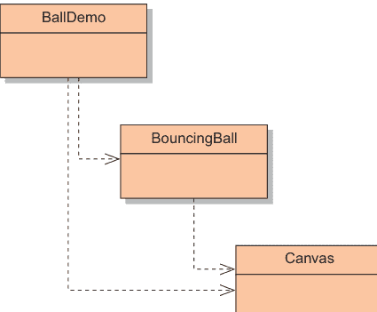

`Canvas` 类提供了一个可以在屏幕上绘图的窗口。它具有绘制线条、形状和文本的操作。可以通过创建实例并使用 `setVisible` 方法使其可见来使用 `Canvas`。`Canvas` 类不需要任何修改。最好的方法可能是将其视为库类：打开编辑器，并切换到文档查看视图。这将通过 javadoc 文档显示类的接口。

`BallDemo` 类提供了两个简短演示，展示了如何使用画布产生图形输出。`drawDemo` 提供了各种绘制操作的示例，而 `bounce` 方法演示了两个弹跳小球的简单动画。

`BouncingBall` 类用于弹跳演示。它实现了弹跳球的行为。

理解和实验这个项目的最佳起点可能是 `BallDemo` 类。

- **练习 5.47** 创建一个 `BallDemo` 对象并执行 `drawDemo` 和 `bounce` 方法。然后读取 `BallDemo` 源代码。详细描述这些方法是如何运行的。
- **练习 5.48** 阅读 `Canvas` 类的文档。然后以书面形式回答以下问题，包括 Java 代码片段。你如何创建 `Canvas`？如何让它可见？如何画线？如何擦除某些东西？`draw` 和 `fill` 有什么区别？`wait` 是做什么的？
- **练习 5.49** 通过修改 `BallDemo` 中的 `drawDemo` 方法来对画布对象进行实验。画一些线条、形状和文本。
- **练习 5.50** 通过在窗口边界内 20 像素处画一个矩形来为画布画一个框。将此功能放入 `BallDemo` 类中名为 `drawFrame` 的方法中。
- **练习 5.51** 改进 `drawFrame` 方法，使其能够自动适应当前画布的大小（即，不要在方法方法中硬编码画布的大小）。为了实现这一点，你需要查明如何使用类型为 `Dimension` 的类对象。一旦你实现了这个练习，你就可以通过手动调整画布大小并再次调用 `drawFrame` 来进行测试。

接下来，我们将继续对跳动球进行一些操作。

- **练习 5.52** 修改 `bounce` 方法，让用户可以选择应该有多少个球在跳动。
- **练习 5.53** 哪种类型的集合（`ArrayList`、`HashMap` 和 `HashSet`）最适合为新的 `bounce` 方法存储球？请进行书面讨论并说明你的选择理由。
- **练习 5.54** 修改 `bounce` 方法，将球随机放置在屏幕上半部分的任何地方。
- **练习 5.55** 写一个名为 `boxBounce` 的新方法。该方法在屏幕上画一个矩形（“盒子”），并在盒子内部画一个球。对于球，不要使用 `BouncingBall`，而是创建一个新类 `Ball`，它在盒子周围移动，并在盒壁上反弹以保持在内部。球的初始位置和速度应该是随机的。`boxBounce` 方法应该有一个参数，指定盒中有多少个球。
- **练习 5.56** 为 `boxBounce` 中的球赋予随机的颜色。

## 类变量和常量

我们还没有查看过 `BouncingBall` 类。如果你想真正理解这个动画是如何工作的，你可能也想学习这个类。它相当简单——唯一需要花精力理解的方法是 `move`，在该方法中，球改变位置到路径上的下一个位置。

我们将大部分工作留给读者研究这个方法，除了我们想在这里讨论的一个细节。先从一个练习开始。

- **练习 5.57** 在 `BouncingBall` 类中，你会找到重力的定义（一个简单的整数）。增加或减少重力值，编译并再次运行跳动球演示。你观察到变化了吗？

该类中最感兴趣的细节是这一行：

```java
private static final GRAVITY = 3;
```

这是一个我们还没有见过的结构。实际上，它引入了两个我们常用于定义的新关键字：static 和 final。

### 5.13.1 static 关键字

概念：

`static` 关键字是 Java 定义类变量的语法。类变量是存储在类本身的字段，而不是对象中。这使得它们从根本上与实例变量（我们目前为止处理的字段）有了本质的区别。考虑这段代码（`BouncingBall` 类的一部分）：

```java
public class BouncingBall {
    // 重力的影响。
    private static final int GRAVITY = 3;

    private int xPosition;
    private int yPosition;
}
```

省略其他字段和方法。

现在假设我们创建了三个 `BouncingBall` 实例。结果情况如图 5.5 所示。


从图中可以看到，实例变量（`xPosition` 和 `yPosition`）存储在每个对象中。由于我们创建了三个对象，因此拥有这些变量的三个独立副本。

另一方面，类变量 `GRAVITY` 存储在类本身。因此，无论创建了多少个实例，该变量始终只有一个副本。

类中的源代码可以像访问实例变量一样访问（读取和设置）这种变量。可以从类的任何实例访问该类变量。因此，这些对象共享这个变量。

如果一个值对于类的所有实例来说应该始终保持相同，则经常会使用类变量。与其在每个对象中存储一个副本（这将浪费空间并可能难以协调），不如在所有实例之间共享一个单一值。

Java 还支持静态方法（`static methods`，也称为静态方法），即属于某个类的方法。我们稍后会讨论这些。

### 5.13 类变量和常量

**图 5.5** 实例变量和类变量

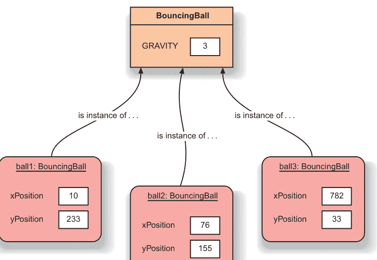

### 5.13.2 常量

`static` 关键字的一个频繁用途是定义*常量*。常量与变量类似，它们在应用程序执行期间不能改变值。在 Java 中，常量用 `final` 关键字定义。例如：

```java
private final int SIZE = 10;
```

在这里，我们定义了一个名为 `SIZE` 值为 10 的常量。常量定义与字段声明相似，有两点不同：

- 它们在类型名之前包含 `final` 关键字；
- 它们必须在声明时进行初始化。

如果一个值打算不改变，使用 `final` 是一个好主意。这确保它不会被意外更改。常量按照习惯使用大写字母。使用 `static` 关键字来定义*常量*是一种常见的情况。类常量适用于类的所有实例。例如：

```java
static final int SIZE = 10;
```

我们跳动球项目中 `GRAVITY` 的定义是常量的另一个例子。这是我们大多数时候定义常量的方式。实例特定的常量很少使用。

# 第 5 章 更复杂的行为

> ### 练习 5.58 为以下内容编写常量声明：

- 用于测量容差的公共变量，值为 0.001。
- 用于指示及格线的私有变量，值为 40。
- 用于指示帮助命令的公共字符变量，值为 'h'。

### 练习 5.59
查看第 4 章 `log-analyzer` 项目中的 `LogEntry`。该类是如何使用常量的？你认为这种用法用法吗？

### 练习 5.60
假设 `log-analyzer` 项目的更改意味着需要在 `LogEntry` 类的 `dataValues` 数组中存储年份。如果将月份存储在索引 0，日期存储在索引 1，以此类推，该类需要修改多少部分？你看到对这种特殊值使用命名常量了吗？

## 5.14 总结

- **接口 (interface)**：类的接口描述了类的功能以及如何被使用，并展示了实现方式。
- **实现 (implementation)**：定义类的完整源代码被称为该类的实现。
- **不可变 (immutable)**：如果一个对象在创建后其内容或状态无法被更改，则称该对象为不可变的。字符串（`Strings`）就是不可变对象的示例。
- **映射 (map)**：映射是一种以键/值对作为条目存储的集合。提供键就可以查找值。
- **集合 (set)**：集合是一个最多存储每个独立元素的集合。它不维护任何特定的顺序。
- **文档 (documentation)**：类的文档应该足够详细，以便其他程序员无需阅读实现代码即可使用该类。
- **访问修饰符 (access modifiers)**：访问修饰符定义了字段、构造函数或方法的可见性。公共（`public`）元素可以在同一个类内部以及从其他类访问；私有（`private`）元素仅从同一个类内部访问。
- **信息隐藏 (information hiding)**：信息隐藏是一项原则，规定类实现的内部细节应该对其他类隐藏。它确保了应用程序具有更好的模块化。
- **类变量、静态变量 (class variables, static variables)**：类可以拥有字段。这些被称为类变量或静态变量。类变量在任何时候都存在且只有一个，与创建的实例无关。

### 练习 5.61
网上流传着一个传言，说乔治·卢斯（《星球大战》电影的创作者）使用一个公式为他故事中的角色命名（如 Jar Binks, Obi-Wan Kenobi 等）。据称，该公式如下：

**你的《星球大战》名：**

- 取出你姓氏的前三个字母。
- 将其添加到你名字的前两个字母后面。

**你的《星球大战》姓：**

- 取出你母亲名字的前两个字母。
- 将其添加到你出生地名称的前三个字母后面。

现在轮到你的任务：创建一个名为 `star-wars` 的 BlueJ 项目。创建一个类 `NameGenerator`。该类应该有一个方法 `generateStarWarsName`，它按照上述描述的方法生成一个《星球大战》名字。你需要找到 `String` 类中一个用于生成子字符串的方法。

### 练习 5.62
以下代码段尝试以大写字母打印字符串：

```java
public void printUpper(String s)
{
    s.toUpperCase();
    System.out.println(s);
}
```

然而，这段代码不起作用。请找出原因并解释。正确的做法应该是怎样的？

### 练习 5.63
假设我们要交换两个整数变量 `a` 和 `b` 的值。为了实现这一点，我们写了一个方法

```java
public void swap(int i1, int i2)
{
    int tmp = i1;
    i1 = i2;
    i2 = tmp;
}
```

然后我们用变量 `a` 和 `b` 调用这个方法：

```java
swap(a, b);
```

在这次调用之后，`a` 和 `b` 交换了吗？如果你进行测试，你会发现它们并没有交换！为什么这不起作用？请详细解释。

# 第 6 章：行为良好的对象

本章讨论的核心概念：

- 测试 (testing)
- 单元测试 (unit testing)
- 调试 (debugging)
- 测试自动化 (test automation)

# 本章引入的 Java 结构

（本章未引入新的 Java 结构。）

### 6.1 引言

如果你遵循了本书之前的章节，并且执行了我们建议的练习，那么到目前为止你已经编写了相当多的类。你可能已经观察到的现象是：你写的类在第一次尝试编写源代码后，很少是完美的。通常，它起初运行并不正常，还需要更多的修改才能完成它。

你所面临的问题会随着时间而变化。初学者通常在 Java 语法错误上挣扎。语法错误是源代码本身结构中的错误。它们很容易发现，因为编译器会高亮它们并显示某种错误信息。

处理更复杂问题的经验更丰富的程序员通常在语言语法方面遇到的困难较少。他们更关注逻辑错误。

逻辑错误是指程序在编译和执行时没有明显错误，但交付了错误的结果。逻辑问题比语法错误严重得多，也更难发现。事实上，有时在起初就无法检测到存在错误。

编写语法正确的程序相对容易学习，而且良好的工具（如编译器）可以很容易检测语法错误并指出它们。另一方面，编写逻辑正确的程序对于任何非平凡问题来说都是非常困难的，而且程序错误的证明无法自动生成。事实上，由于这种困难，大多数市售的软件都被认为包含大量的 Bug。

因此，对于胜任的软件工程师来说，学习如何处理正确性以及减少类中的错误数量是至关重要的。

在本章中，我们将讨论与提高程序正确性相关的各种活动。包括测试、调试以及为了可维护性而编写。

测试是一种与提高程序正确性相关的活动。包括测试、调试和为了可维护性编写代码。测试是一种关注程序是否包含任何错误的活动。良好的测试并不容易。调试紧随测试之后。当我们发现错误存在时，使用调试技术来定位并修复它。为了可维护性编写代码可能是最基本的话题。理想情况下，代码应该是易于理解的，这样可以避免错误。在实践中这并不总是简单的。

### 测试与调试

测试和调试是软件开发中至关重要的技能。你经常需要检查程序的错误，并在错误发生时定位它们。此外，你可能还负责测试其他人的代码。在这种情况下，在接下来的章节中，我们将调查以下测试和调试技术：

- BlueJ 内部单元测试；
- 测试自动化；
- 手动走查 (walkthroughs)；
- 打印语句 (print statements)；
- 调试器 (debuggers)。

我们将在类的范围内讨论前两种技术，并在代码范围内讨论剩余的调试技术。

### 6.3 使用 BlueJ 进行单元测试

单元测试指的是测试应用程序的部分，而不是整个应用程序测试。被测试的单元可以是一组类、单个类，甚至是单个方法。值得注意的是，单元测试可以在应用程序完成很久以前就可以。

由于 BlueJ 允许我们直接与对象交互，它为类测试提供了独特的方法。在本节中我们要强调的一之一是，开始测试永远不早。早期实验和测试有很多好处。首先，它们让我们获得宝贵的经验，并且比以后发现问题成本低得多。其次，我们可以开始构建一套随系统增长反复使用的测试用例。每次对系统进行更改时，这些测试用例都可以让我们检查是否无意中引入了错误。为了说明这种 BlueJ 内部测试的形式，我们将使用 `diary-prototype` 项目，它代表了电子日历开发的早期阶段。

打开 `diary-prototype` 项目。开发了三个类：`Appointment`、`Day` 和 `Week`。由于这些类对于整个系统是基础性的，我们希望测试它们的工作原理，并看看我们对在设计和实现中的某些决策是否满意。`Appointment` 类描述记录预约原因及其持续时间（小时）的对象。对于我们的测试讨论，我们将集中在 `Day` 类上，见代码 6.1。该类的每个对象跟踪单日内生成的预约集合。每个日期记录其在一年中的唯一位置——1 到 366 之间的值。这个版本的两个简化是，预约总是在小时边界开始，并且总是持续整数个小时，因此预约可以在上午 9 点、10 点等进行，一直到下午 5 点（24 小时钟的 17:00）。

#### 代码 6.1 Day 类

```java
public class Day {
    // 一天中第一个和最后一个可预约的小时数。
    public static final int START_OF_DAY = 9;
    public static final int FINAL_APPOINTMENT_TIME = 17;
    // 一天中可预约的总小时数。
    public static final int MAX_APPOINTMENTS_PER_DAY = FINAL_APPOINTMENT_TIME - START_OF_DAY + 1;

    // 特定年份内的天数 (1-366)。
    private int dayNumber;
    // 这一天当前的预约列表。
    private Appointment[] appointments;

    /**
     * Day 类对象的构造函数。
     * @param dayNumber 这一天在年份中的编号 (1-366)。
     */
    public Day(int dayNumber) {
        this.dayNumber = dayNumber;
        appointments = new Appointment[MAX_APPOINTMENTS_PER_DAY];
    }

    /**
     * 寻找预约所需的空间。
     * @param appointment 需要容纳的预约。
     * @return 可以容纳该预约的最早时间。如果空间不足则返回 -1。
     */
    public int findSpace(Appointment appointment) {
        int duration = appointment.getDuration();
        for(int slot = 0; slot < MAX_APPOINTMENTS_PER_DAY; slot++) {
            if(appointments[slot] == null) {
                final int time = START_OF_DAY + slot;
                // 潜在的起始点。
                if(duration == 1) {
                    // 只需要一个时位。
                    return time;
                }
                else {
                    // 需要多少个时位？
                    int further_slots_required = duration - 1;
                    for(int nextSlot = slot + 1; nextSlot < MAX_APPOINTMENTS_PER_DAY; nextSlot++) {
                        if(further_slots_required > 0 && appointments[nextSlot] == null) {
                            further_slots_required--;
                        }
                    }
                    if(further_slots_required == 0) {
                        // 已经找到了足够的空间。
                        return time;
                    }
                }
            }
        }
        // 可空间不足。
        return -1;
    }

    /**
     * 建立预约。
     * @param time 预约开始的小时
     * @param appointment 要建立的预约。
     * @return 如果预约成功返回 true，
     *         否则返回 false。
     */
    public boolean makeAppointment(int time, Appointment appointment) {
        if(validTime(time)) {
            int startTime = time - START_OF_DAY;
            if(appointments[startTime] == null) {
                int duration = appointment.getDuration();
                // 填充预约持续持续的所有时位。
                for(int i = 0; i < duration; i++) {
                    appointments[startTime + i] = appointment;
                }
            }
            return true;
        }
        else {
            return false;
        }
    }

    /**
     * @param time 一天中的哪个时间。这必须在
     * START_OF_DAY 时间和 FINAL_APPOINTMENT_TIME 之间。
     * @return 给定时间的预约。
     * 如果时间无效或在给定时间没有预约，则返回 null。
     */
    public Appointment getAppointment(int time) {
        if(validTime(time)) {
            return appointments[time - START_OF_DAY];
        } else {
            return null;
        }
    }

    /**
     * 打印这一天的预约列表。
     */
    public void showAppointments() {
        System.out.println("== " + dayNumber + " ===");
        int time = START_OF_DAY;
        for(Appointment appointment : appointments) {
            System.out.print(time + ": ");
            if(appointment != null) {
                System.out.println(
                    appointment.getDescription()
                );
            } else {
                System.out.println();
            }
            time++;
        }
    }

    /**
     * @return 这一天在年份中的编号 (1–366)。
     */
    public int getDayNumber() {
        return dayNumber;
    }

    /**
     * 如果时间在 START_OF_DAY 和 FINAL_APPOINTMENT_TIME 之间，则为 true，否则为 false。
     */
    public boolean validTime(int time) {
        return time >= START_OF_DAY &&
               time <= FINAL_APPOINTMENT_TIME;
    }
}
```

### 6.3.1 使用检查器 (Inspectors)

为了准备测试，请在对象台（object bench）上创建一个 `Day` 对象，并通过从对象的菜单中选择 Inspector 功能打开它的检查器。选择 `appointments` 字段并打开数组检查器（图 6.1）。检查数组是否包含足够的内容。


## 第 6 章 行为良好的对象

测试的一个基本组成部分是检查边界。良好测试的一个关键特征是确保出现错误。

### 6.3.2 正测试与负测试

在决定测试内容时，我们通常区分正用例和负用例。正测试是对预期运行的功能测试。例如，在空的一天输入一个小时的预约是一个正测试。在测试正用例时，我们必须说服代码按照预期工作。

负测试是对预期失败的情况的测试。重复预约时位或在一天边界之外预约都是负用例的例子。

> **陷阱** 缺乏经验的测试人员常见的错误是只进行正测试。负测试——确保应该出错的地方确实出错，并且以定义的方式出错——对于良好的测试程序至关重要。

**练习 6.9** 上述练习中提到的哪些测试案例是正用例，哪些是负用例？为每个类别创建一个表格。你能想到更多的正用例吗？你能想到更多的负用例吗？

## 6.4 测试自动化

**练习 6.8** 挑战 尝试在 `Day` 对象上重复上述测试。你应该发现这些修改后的测试触发了一个或多个错误。尝试修正这些错误，以便两个小时的预约可以正确建立。在修改了 `Day` 类后，是否可以安全地假设所有单小时的测试仍然像以前一样工作？下一节将从回归测试的背景讨论测试自动化。

从这些练习中很容易看出检查器在提供对象状态即时反馈方面非常有价值，避免了在测试或调试时在类中添加打印语句的需求。

### 6.4.1 回归测试

如果我们能假设修正错误只会提高程序的质量，那就太好了。遗憾的是，经验表明，在修改软件时很容易引入进一步的错误。修复某处的错误可能会同时引入另一个错误。

因此，每当对软件进行更改时，运行回归测试都是理想的。回归测试涉及重新运行之前已经通过的测试，以确保新版本也能通过这些测试。如果能以某种方式实现自动化，它更有可能被执行。自动化回归测试的最简单方法之一是编写一个作为测试平台（`test rig`）或测试框架（`test harness`）的程序。日记测试项目演示了我们如何开始为日记原型上运行的测试构建测试平台。代码 6.2 显示了该项目的 `OneHourTests` 类。

### 代码 6.2

用于一小时测试的基础测试平台

```java
/**
 * 对 Day 类进行测试，涉及
 * 建立单小时的预约。
 *
 * @author David J. Barnes and Michael Kölling.
 * @version 2008.03.30
 */
public class OneHourTests {
    // 被测试的 Day 对象。
    private Day day;

    /**
     * OneHourTests 类对象的构造函数
     */
    public OneHourTests() {
    }

    /**
     * 通过在一天的开头、结尾和中间
     * 来测试基本功能。
     */
    public void makeThreeAppointments() {
        // 从一个新的 Day 对象开始。
        day = new Day(1);
        // 创建单小时的预约。
        Appointment first = new Appointment("Java lecture", 1);
        Appointment second = new Appointment("Java class", 1);
        Appointment third = new Appointment("Meet John", 1);

        // 在不同的时间建立每个预约。
        day.makeAppointment(9, first);
        day.makeAppointment(13, second);
        day.makeAppointment(17, third);

        day.showAppointments();
    }

    /**
     * 检查是否允许重复预约。
     */
    public void testDoubleBooking() {
        // 设置包含三个合法预约的。
        makeThreeAppointments();
        Appointment badAppointment = new Appointment("Error", 1);
        day.makeAppointment(9, badAppointment);
        day.showAppointments();

        // 显示 badAppointment 尚未被创建。
        day.showAppointments();
    }

    /**
     * 通过用预约填充整天
     * 来测试基本功能。
     */
    public void fillTheDay() {
        // 从一个新的 Day 对象开始
        day = new Day(1);
        for(int time = Day.START_OF_DAY; time <= Day.FINAL_APPOINTMENT_TIME; time++) {
            day.makeAppointment(time, new Appointment("Test " + time, 1));
        }
        day.showAppointments();
    }
}
```

测试平台类中的每个方法都编写为表示单个测试，捕捉了我们在第 6.3.1 节中手动运行测试时采取的步骤。因此，`makeAppointments` 方法旨在测试可以在新的 `Day` 对象中建立合法的预约，而 `fillTheDay` 测试每个小时都可以被填充。这两个方法都创建了一个新的 `Day` 对象，以确保它们在初始状态下进行测试。相比之下，`testDoubleBooking` 使用了由 `makeAppointments` 创建的 `Day` 对象，因为它需要一个具有某些现有预约的对象。

像 `OneHourTests` 这样的类使得对 `Day` 类进行回归变得容易得多。我们只需要创建一个实例，运行它的每个方法，并检查结果即可。

**练习 6.10** 向 `OneHourTests` 类中添加任何你认为适合测试单小时预约的进一步方法。然后对你修正后的 `Day` 类运行回归测试。

**练习 6.11** 创建一个 `TwoHourTests` 来捕一组两小时预约测试。

**练习 6.12** 创建其他类来测试你认为需要的 `Day` 类中剩余的任何功能。

**练习 6.13** 在一个复杂的项目中，可能有数百或数千个回归测试需要跟进维护或增强活动。你认为使用我们在本节中概述的技术来检查这些测试的结果会如何？你认为回归测试过程中仍然存在人工操作元素吗？如果是，它是什么？

### 6.4.2 测试结果的自动检查

第 6.4.1 节描述的技术为测试过程的自动化提供了一些方法，但该过程中仍然需要大量的人工参与。例如，打印出的预约列表必须通过肉眼检查，这还需要检查者知道结果应该是怎样的。如果我们能让测试具有自检功能，自动化回归将更加有效，只有当一个或多个测试结果指示可能存在问题时才需要人工干预。`diary-testing-junit-v1` 代表了这一方向上的重要一步。图 6.2 显示了该项目的类图。

首先要的是，图中紧随 `Day` 类之后包含了一个不同风格的类 `DayTest`。`DayTest` 是一个测试类，被 BlueJ 标记为 `<<test>>`。它的颜色与图中普通类的不同。需要注意的是 `Compile` 按钮下方的额外项目。


| Test All |
| --- |
| TestMakeAppointments |
| TestDoubleBooking |
| Create Test Method |
| Test Fixture |
| Object Bench |
| Open Editor |
| Compile |
| Inspect |
| Remove |

JUnit 可在 [junit.org](http://www.junit.org) 获取。


当测试运行时，BlueJ 能够在图 6.4 所示的窗口中显示结果。在下一节中，我们将讨论 BlueJ 如何支持回归测试的自动化，以便你可以创建自己的自动化测试。

**练习 6.15** 当创建一个新的测试类时，会自动创建哪些方法？

### 6.4.3 记录测试

正如我们在第 6.4 节开头讨论过的，测试自动化是非常理想的，因为手动创建和重新创建测试是一个耗时的过程。BlueJ 通过允许我们记录手动测试，然后回放这些测试用于回归测试，从而将手动单元测试的有效性和测试自动化的威力相结合。*diary-testing-junit-v1* 项目中的 `DayTest` 类就是通过这个过程创建的。我们将使用 *diary-testing-junit-v2* 项目来演示 BlueJ 的测试记录功能。

假设我们想要彻底测试该类的 `findSpace` 方法。该方法尝试为预约寻找空间。

- 在空闲的日子里寻找空间（正向测试）；
- 在已经至少有一个预约但当天未约满的情况下寻找空间（正向测试）；
- 尝试在完全约满的日子里寻找空间（负向测试）；
- 在没有连续两小时空间的情况下，尝试为两小时的预约寻找空间（负向测试）。

我们将描述如何创建其中的第一个，其余的留作练习。

打开 *diary-testing-junit-v2* 项目。BlueJ 记录测试的过程是：开始记录、手动执行测试、然后指示测试结束。第一步通过附加到测试类上的菜单完成。选择您希望新测试所在的 BlueJ 类。从 `DayTest` 类的弹出菜单中选择 *Create Test Method*...（创建测试方法）。系统将提示您输入测试方法名称。如果名称不以 'test' 开头，将添加其前缀。

为此，我们将检查在完全空闲的日子里运行 `findSpace` 是否会返回 9.00 作为第一个时间，因此 `findSpace9` 是合适的。一旦您输入名称并点击 *Ok*（确定），类图左侧会出现一个红圈，*End*（结束）和 *Cancel*（取消）按钮将可用。*End* 用于指示测试创建过程的结束，*Cancel* 用于放弃。

一旦开始记录，我们只需像执行手动测试一样执行操作：

- 创建一个 `Day` 对象
- 创建一个 `Appointment` 对象，持续时间为一小时。
- 在 `Day` 对象上调用 `findSpace` 方法。

在最后一步之前，与通常的对象交互没有区别。然而，一旦调用了 `findSpace`，就会弹出一个新的对话框（图 6.5）。这是带有断言辅助功能的普通方法结果窗口的扩展版本。

图 6.5

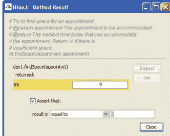

**概念：断言**

断言（`assertion`）是一个陈述我们预期为真的条件的表达式。如果该条件为假，我们就说断言失败。这表明我们的程序存在错误。

它是自动化测试过程中至关重要的部分。其目的是允许您指定方法调用的结果应该是什么。

在这种情况下，我们期望方法的返回值为 9，并且希望在测试中包含一个检查以确保确实如此。我们现在可以确保 Assert 复选框已勾选，在对话框中输入 9，并选择 Close（关闭）按钮。

作为测试的最后阶段，我们按下 End 按钮停止记录。此时，BlueJ 会为我们的方法 `testFindSpace9` 向测试类添加源代码，然后编译类并创建对象 bench。生成的最终方法位于代码 6.3 中。

### 代码 6.3

自动生成的方法

```java
public void testFindSpace9() {
    Day day1 = new Day(1);
    Appointment appointment1 = new Appointment("Java lecture", 1);
    assertEquals(9, day1.findSpace(appointment1));
}
```

如所示，该方法包含了重现记录时操作的语句：创建了 `Day` 和 `Appointment` 对象，并调用了 `findSpace` 方法。`assertEquals` 的调用检查 `findSpace` 返回的结果是否匹配预期值 9。提供下面的练习是为了让你亲自尝试。它们包含一个示例，显示当实际值与预期值不匹配会发生什么。

> **练习 6.16** 使用 *diary-testing-junit-v2* 项目，在 `DayTest` 中创建一个方法，以检查如果某天已经有一个上午 9 点的一小时预约，那么对于另一个一小时的预约，`findSpace` 是否返回值 10。从本质上，您需要执行与创建 `testFind9` 相似的步骤，但对第一个预约使用 `makeAppointment`，对第二个预约使用 `findSpace`。您需要为两次调用的结果指定断言。

> **练习 6.17** 创建一个测试，检查如果在已约满的日子里尝试寻找预约，`findSpace` 是否返回值 -1。

> **练习 6.18** 创建一个以 `Appointment` 为引用的测试类。在其中记录单独的测试方法，检查 `Appointment` 对象的描述和持续时间字段在创建后是否被正确初始化。

> **练习 6.19** 创建一个以 `Appointment` 为引用的测试类。在其中记录单独的测试方法，检查 `Appointment` 对象的描述和持续时间字段在创建后是否被正确初始化。

> **练习 6.20** 在 *diary-testing-junit-v2* 项目的 `DayTest` 类中添加更多自动化测试，直到您对这些类的正确运行有相当的把握。同时使用正向测试和负向测试。

### 6.5 接口

**概念：断言**

断言（`assertion`）是一个陈述我们预期为真的条件的表达式。如果该条件为假，我们就说断言失败。这表明我们的程序存在错误。

当软件组件协作完成任务时，我们说类中那些被其他类感知并依赖的部分之间的连接就是接口。这是我们在第 5 章中赋予接口的含义。

## 图 6.6

计算器的各个独立模块

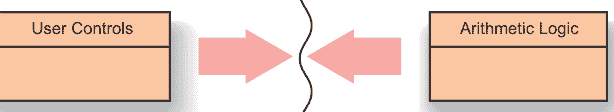

它们之间可以相互作用，而无需知道这些方法将如何实现。这是一个重要的概念。我们尽可能地将类的接口与具体的实现细节隔离开来。（我们已经在第 5 章中讨论过这种做法的某些优点）。在计算器项目中，我们有不同的方式来选择实现用户控制：完全作为一个带有推按钮图形界面的软件（图 6.7）；或者作为一个以手持设备形式存在的硬件部分。算术逻辑组件的实现不应受到此类差异的影响。

## 图 6.7

软件计算器的用户界面


在接下来的几个章节中，我们将探索一个简单的软件计算器的实现，该计算器基于两个独立的类：`CalcEngine` 和 `User`。我们在它们之间定义的接口如代码 6.5 所示。

### 代码 6.5

算术逻辑单元的接口

```java
// 返回要显示的值。
public int getDisplayValue();

// 当按下数字键时调用。
public void numberPressed(int number);

// 当按下加号运算符时调用。
public void plus();

// 当按下减号运算符时调用。
public void minus();

// 调用以完成计算。
public void equals();

// 调用以重置计算器。
public void clear();
```

`CalcEngine` 类将提供此接口的实现。该接口代表了 `CalcEngine` 类与程序中其他想要使用它的部分之间简单形式的约定。接口描述了逻辑组件中将实现的最少方法集，并且对每个方法的返回类型和参数都进行了完全定义。注释详细说明了当被通知按下加号运算符时，其实现类内部具体会做什么，例如；这留给实现者决定。此外，实现类可能还具有这里未列出的额外方法。

在随后的章节中，我们将尝试实现此接口，以作为各种代码阅读和调试技术的示例。


## 调试场景

假设你被要求加入一个现有项目团队，该团队正在实现之前章节中描述的计算器。你被选为编程团队的关键成员——Hacker T. Largebrain 刚刚被提升为另一个项目的管理职位。在离开之前，Hacker 向你即将加入的团队保证，他对逻辑接口的实现已经完成并经过了充分测试。他甚至编写了一些测试软件来验证这一点。你被要求接管该类，并确保它在与团队其他成员编写的类集成之前已进行了适当的注释。

你决定，在对 Hacker 的软件进行文档之前，理解它的最佳方法是探索它的源代码及其对象的行为。


## 6.7 注释与风格

如果你查看 `CalcEngine` 类，你会发现它遵循了某些良好的风格：

- 类顶部有说明目的的多行注释。
- 包含了作者和版本号。
- 每个方法都说明了其目的、参数和返回类型。
- 类布局是一致的，并使用了适当的空白缩进（嵌套块和控制结构）。
- 变量名和方法名具有描述性。


尽管这些约定在实现过程中可以节省时间，但对于帮助他人理解代码（正如我们在第 5 章中所提到的）也有巨大的益处。在 BlueJ 中，我们知道单元测试可以帮助我们，但我们注意到 Hacker 似乎没有使用单元测试来捕捉这些问题。我们注意到，单元测试的实现看起来没问题。

这并不一定是坏事，但让我们产生了一些疑虑。Hacker 知道在做什么？我们稍后会讨论这一点。

也许 Hacker 的能力确实如他所想的那样强大，并且在集成与其他类之前已经准备好了。尝试以下练习来查看是否如此：

**练习 21** 确保类已编译，并创建一个 `CalcEngine`。

**练习 22** 使用上一个练习，调用 `plus()`。

**练习 23** 重复上一个练习，调用 `minus()`。

上述实验让你意识到，并非所有内容都是正确的。在接下来的章节中，我们将考虑可以尝试定位问题的方法。

## 手动调试

手动调试是一种相对广为人知的技术，可能是因为它们是低科技的调试和测试方法。然而，不要让这误导你认为它们没用。手动调试涉及阅读类并跟踪类之间的控制流。实际上，手动调试是对计算机内部运行的纸笔模拟。在实践中，最好关注狭窄的部分，例如单个逻辑对象组或一个简单的方法。

### 6.8.1 高级手动调试

我们将通过 `calculator-engine` 项目来演示调试技术。你可能会发现打印 `CalcEngine` 和 `CalcEngineTester` 类的副本对于遵循该步骤很有帮助。

我们将从检查 `CalcEngineTester` 类的 `testPlus` 方法开始，因为它包含了单个逻辑对象组，帮助我们理解 `Engine` 类的多个方法如何协作以发挥计算器的作用。在处理执行时，我们经常会对脑中产生的问题做铅笔记录。

在这个阶段，我们不想深入到过多的细节。我们只想观察 `testPlus` 方法如何使用引擎对象，探索引擎的内部细节。从早期实验来看，似乎存在错误，但我们不知道错误是在测试类中还是引擎中。第一步是检查测试类是否在合理地使用引擎。

我们注意到第一条语句假设 `engine` 字段已经引用了一个有效对象。

```java
engine.clear();
```

我们可以通过检查测试类的构造函数来验证这是否属实。一种常见的错误是对象的字段在声明或构造函数中没有被正确初始化。如果我们尝试使用没有关联对象的字段，那么可能会出现 `NullPointerException` 运行时错误。第一条语句的调用似乎是将计算器引擎置于有效的初始状态，准备接收执行计算的指令。这看起来是一个

## 6.8 手动走读

这是合理的做法——等同于在真实的计算器上按下“重置”（reset）或“清除”（clear）键。在这个阶段，我们不需要查看 `engine` 类来具体检查 `clear` 方法到底做了什么。这可以等到我们有足够的信心认为测试者的操作是合理的。相反，我们只需要在纸上简单备注，说明 `clear` 如预期地将引擎置于一个有效状态。

- 第 4 行 `testPlus` 中的语句通过 `numberPressed` 方法输入一个数字：`engine.numberPressed(3);`

这同样是合理的，因为计算的第一步是输入第一个数。同样，我们不去看引擎对这个数字做了什么。我们只需假设它将其存储起来，以供稍后的计算使用。

- 第 5 行 下一个语句调用了 `plus()`，因此我们现在知道左操作数的完整值是 3。我们可以在打印输出上对这一事实做笔记，或者在 `testPlus` 的其中一个注释中对此断言打一个勾。同样，我们应该确认在 `testPlus` 中执行的操作确实是正确的。这看起来像是一件微不足的小事，但类的注释非常容易与它们应该记录的代码脱节。通过在阅读代码的同时检查注释，可以帮助我们避免被注释所误导。

- 第 6 行 接下来，通过再次调用 `numberPressed` 输入了另一个单数字作为右操作数。

- 第 7 行 通过调用 `equals()` 方法请求完成加法。我们可能会做个笔记，从它在 `testPlus` 中的使用方式来看，`equals()` 方法似乎并没有返回计算结果，正如我们可能预期的那样。这是我们在查看 `CalcEngine` 时可以检查的另一个点。

- 第 8 行 `testPlus` 的最后一条语句获取了应该显示在计算器屏幕上的值：`return engine.getDisplayValue();`

推测，这是加法的结果，但在不详细查看 `CalcEngine` 的情况下，我们无法确定这一点。再次，我们将做一个记录，去检查这是否确实如此。

完成对 `testPlus` 的检查后，我们已经有了相当的信心认为它正确地使用了引擎；即通过模拟一组可识别的按键序列来完成一个简单的计算。我们可能会注意到该方法并不特别歧义——两个操作数都是单数字，且只使用了一个运算符。然而，这在测试方法中并不稀奇，因为在测试更复杂的测试之前，测试基础的功能是非常重要的。尽管如此，观察到在某个阶段可以向测试中添加更复杂的测试也是很有用的。

**练习 6.24** 请对 `testMinus` 方法进行一次类似的自行走读。这是否在你脑海中引发了任何关于在详细查看 `CalcEngine` 时可能想要检查的其他问题？

第 6 章 行为良好的对象

在查看 `CalcEngine` 类之前，值得走读一下 `testAll` 方法，看看它是如何使用我们一直在观察 `testPlus` 和 `testMinus` 方法的。

- `testAll` 方法是一个直行的打印语句序列。它包含了对 `testPlus` 和 `testMinus` 的各一次调用，它们返回的值被打印出来供用户查看。我们注意到，没有任何地方告诉用户结果应该是。这使得使用户难以确认结果是否正确。我们注意到最后语句通过了。

> 所有测试均通过。但该方法并没有包含任何用以建立这一断言真实性的测试！我们真的应该有适当的方法来确定结果值应该是什么，以及它们是否被正确计算。当我们有机会回到该类的源码时，这是我们应该修复的问题。

在这个阶段，我们不应该被最后一点分心，去进行那些并非直接解决我们正在寻找的错误的更改。如果我们做了那类更改，很容易掩盖掉错误。成功调试的关键要求之一是能够容易且可重复地触发错误。在那种情况下，评估尝试修正的效果要容易得多。

在检查完测试后，我们就可以检查 `CalcEngine` 类的源码了。我们可以利用从 `testPlus` 方法走读中获得的一系列合理的的方法调用序列，以及由此产生的一系列问题来开展探索。

### 6.8.2 通过走读检查状态

`CalcEngine` 对象在风格上与它的测试器大不相同。这是因为引擎是一个完全被动的对象。它不会启动自己的任何活动，只是对外部方法调用做出响应。这是典型的服务器风格行为。服务器对象高度依赖其状态来决定它们应该如何响应方法调用。这对于计算器引擎尤其如此。因此，执行走读的一个重要部分是确保我们始终对其状态有一个准确的表示。做到这一点的一种方法是创建一个对象字段及其值的表格（图 6.8）。可以输入新行，以记录每次方法调用后值的运行日志。

| 调用的方法 | displayValue | leftOperand | previousOperator |
| :--- | :--- | :--- | :--- |
| 初始状态 | 0 | 0 | '' |
| clear | 0 | 0 | '' |
| numberPressed(3) | 3 | 0 | '' |

图 6.8 对象状态的信息表格化

这种技术使得检查是否出现问题变得非常容易。当我们开始走读 `CalcEngine` 时，我们在图 6.8 的第一行记录了初始状态。所有字段都在构造函数中初始化。正如在走读测试器时观察到的，对象的初始化是非常重要的，我们可能会做一个笔记，检查默认初始化是否足够。

- 下一步是看调用是如何改变状态的。如图 6.8 的第二行所示，此时状态保持不变，因为 `displayValue` 已经被设置为零。但我们可能会注意到另一个问题：为什么只有一个一个字段的值被这个方法设置了？

- 接下来调查一个带有实际参数 `3` 的 `numberPressed` 调用。该方法将 `displayValue` 的现有值乘以 10，并加上新数字。该方法正确地模拟了在现有数字右侧附加新数字的效果。它依赖于在输入新数字的第一位时 `displayValue` 具有合理的零值，而我们对 `clear` 方法的调查让我们有信心确实如此。

- 我们的第一条语句调用了 `applyOperator` 方法。我们必须决定继续忽略方法调用，还是中断并看看它是做什么的。如果在跟随 `applyOperator` 方法之前列出列表可能会导致进一步的嵌套调用，那么我们需要使用比简单方法的方法来返回调用者。在这种情况下，最好使用具有递增数值的调用点——使用之前的值作为返回值。

- `applyOperator` 方法让我们对 `previousOperator` 字段的运作有了一些见解。它还回答了我们的问题之一：上一个运算符的值是否正确。该方法显式地检查 `previousOperator` 是否包含 `+` 或 `-`。因此，另一个值不会导致错误的运算。在该方法结束时，`leftOperand` 的值将发生变化，因此我们在状态表格中记录它的新值。

- 返回 `plus` 方法，其余两个字段的值已被设置，因此状态表格的下一行将包含以下值：

```
plus               0               3       '
```

# 194

第 6 章 良好的对象

引擎的演练可以以类似的方式继续，记录状态的变化，深入了解其行为，并在此过程中提出问题。以下练习将帮助你完成此次演练。

**练习 6.25** 根据在 `testPlus` 方法中找到以下后续调用，完成状态表：

```
numberPressed(4);
equals();
```

**练习 6.26** 在走完 `equals` 方法时，你是否感受到了和我们在 `applyPreviousOperator` 中那样的确定性，直到 `previousOperator` 达到默认值之前，也感受到了同样的确定性？

**练习 6.27** 在你的状态表末尾对 `clear` 的调用进行演练，并记录新状态。引擎的状态与上一次调用 `clear` 时相同吗？如果不同，你认为这会对任何后续的计算产生什么影响？

**练习 6.28** 结合你的演练，你认为应该对 `CalcEngine` 类做哪些更改？在计算器的纸质版本上进行这些更改，然后重新尝试一遍演练。你可能不需要演练 `CalcEngineTester` 类，只需重复其 `testAll` 方法的操作即可。

**练习 6.29** 尝试在你修正后的引擎版本上对以下调用序列进行演练：

```
clear();
numberPressed(9);
plus();
numberPressed(1);
minus();
numberPressed(4);
equals();
```

结果会是什么？引擎的行为看起来是否正确，是否在 `searchValue` 中留下了正确的答案？

### 6.8.3 口头演练

另一种可以使用演练技术来发现程序错误的方法是，尝试向另人解释一个类或方法的作用。这通过两种完全不同的方式起：

- 你向其解释代码的人可能会替你发现错误。

- 你经常会发现，仅仅尝试将代码转化为语言的简单行为，并不足以触发对“它为什么不起作用”的理解。

后者是非常常见的现象，以至于向一个完全不熟悉代码的人解释这段代码是值得的——不是预感到他们会发现错误，而是预感到你会发现！

## 打印语句

在经验丰富的程序员中，理解和调试程序最常用的技术可能是——使用打印语句临时对方法进行注释。打印语句之所以很流行，是因为它们存在于大多数语言中，所有人都可以使用，而且在任何编辑器中都非常添加。使用它们不需要额外的软件或语言特性。随着程序的运行，这些额外的打印语句通常会为用户提供如下信息：

- 哪些方法被调用；
- 参数的值；
- 方法被调用的顺序；
- 关键点处局部变量和字段的值。

代码 6.6 显示了 `numberPressed` 方法在添加打印语句后可能的样子。此类信息对于提供对象状态如何随修改器（mutators）变化的图景非常有帮助。为了支持这一点，通常使用一种调试方法来打印对象所有字段的当前值是值得的。代码 6.7 显示了 `CalcEngine` 类的 `reportState` 方法。

# 代码 6.6

添加了调试打印语句的方法

```java
/**
 * 数字按钮被按下了。
 * @param number 被按下的数字。
 */
public void numberPressed(int number) {
    System.out.println("number called with: " + number);

    displayValue = displayValue * 10 + number;

    System.out.println("displayValue: " + displayValue);
}
```

# 代码 6.7

一个报告状态的方法

```java
/**
 * 打印对象的字段值。
 * @param where 发生的位置。
 */
public void reportState(String where) {
    System.out.println("displayValue: " + displayValue);
    System.out.println("previousOperator: " + previousOperator);
    System.out.println("searchValue: " + searchValue);
    System.out.println("state is at " + where);
}
```

（注：由于提供的原文文本中代码6.6和6.7的示例块内容存在乱码和重复，译文已根据上下文逻辑对代码进行了还原，以确保文档的逻辑性）

`debugging` 字段为 `true`。因此，对打印方法的调用不需要 `if` 语句保护。代码 6.9 说明了这种方法。请注意，此版本假设 `reportState` 要么测试了 `debugging` 字段本身，要么调用了 `printDebugging` 方法。

# 代码 6.9

用于选择性调试信息的方法

```java
/**
 * 按了数字按钮。
 * @param number 被按下的数字。
 */
public void numberPressed(int number)
{
    printDebugging("numberPressed called with: " +
        number);

    displayValue = displayValue * 10 + number;
    reportState();
}
/**
 * 仅当调试为 true 时，才打印调试信息。
 * @param info 调试信息。
 */
public void printDebugging(String info)
{
    if(debugging) {
        System.out.println(info);
    }
}
```

## 6.10 选择测试策略

我们已经看到存在几种测试策略：书面和口头演练、使用打印语句（无论是临时的，还是带有启用开关的永久）、使用对象工作台进行交互式测试、编写自己的类或使用专门的测试类。

在实践中，我们会在不同时期使用不同的策略。演练、打印语句和交互式测试对于新编写代码的初始测试，或调查程序段如何工作非常有用。它们的优点是这些技术快速且易于使用，适用于任何编程语言，并且（交互式测试外）独立于环境。主要缺点是这些测试以后无法轻易重复以进行回归测试。

使用测试类的优势在于——一旦设置好——测试就可以重复任意次数。

因此，Hacker 的测试方法——编写自己的测试类——是向正确方向迈的一步，但当然，是有缺陷的。我们现在知道，他的问题在于，虽然他的类包含了用于测试的合理方法调用，但它没有对方法结果包含任何断言（assertions），因此无法检测到测试失败。

当然，我们也知道通过使用专门的单元测试类可以更好、更容易地完成这一点。

**练习 6.34** 打开第一个计算器引擎项目，通过将 Hacker 的测试类替换为附加到 `CalcEngine` 上的单元测试类来改进测试。添加与 Hacker 使用的类似的测试（以及你认为有用的其他测试）并包含正确的断言。

## 6.11 调试器

在第 3 章中，我们介绍了如何使用调试器来理解现有应用程序如何运行，以及它的对象如何交互。以非常相似的方式，我们可以使用调试器来追踪错误。

调试器本质上是一种软件工具，为对代码段进行演练提供支持。我们通常在想要开始演练的语句处设置断点，然后使用 *Step*（单步）或 *Step Into*（步入）函数执行实际的行走。

优点之一是调试器会自动跟踪每个对象的状态，因此这样做比手动操作更快且更不容易出错。缺点是调试器通常不保留状态更改的永久记录，因此较难回去检查几个语句之前的状态。

调试器还向你提供每个时间点的*调用序列*（或堆栈）信息。调用序列显示了包含当前状态的方法名称，以及调用*该方法*的后续名称，以此类推。因此，调用序列包含了所有当前活跃、未完成方法的记录——类似于我们在手动演练期间通过编写调用方法调用的映射（maps）来所做的事情。

在 BlueJ 中，调用序列显示在调试器窗口的左侧。序列中的每个方法名都可以被选中，以检查方法局部变量的值。

**练习 6.35** 挑战性练习。在实践中，你可能会发现 Hacker T. Largebrain 对 `CalcEngine` 的编程尝试错误太多，无法尝试修复。相反，从头开始编写你自己的类版本。`calculator-gui` 项目包含了图 6.7 所示 GUI 的类。务必彻底地记录你的类，并为你的实现创建一套详尽的测试，这样你的继任者就不必重复你在 Hacker 代码上的经历了！

## 将技术付诸实践

本章描述了可以用于理解新程序或测试其是否存在错误的技巧。`bricks` 项目为你提供了一个在虚拟场景下尝试这些技术的机会。该项目包含一个砖块公司应用程序的一部分。砖块通过托盘（砖块堆）交付给客户。`Pal` 类提供了方法，根据每个托盘上的砖块数量告知单个托盘的高度和重量。


> **练习 6.36** 打开 `bricks` 项目。对其进行测试。该项目中至少有四个错误。看看你是否能找到并修复它们。你使用了什么技术来发现错误？哪种技术最有用？

## 总结

编写软件时，我们应该预见到它将包含逻辑错误。因此，将测试和调试视为整个开发过程中的正常活动是至关重要的。BlueJ 特别擅长支持方法和类的交互式测试。我们还查看了一些自动化该过程和执行简单调试的技巧。尽管我们从不完全消除错误，但在第 7 章中，我们将查看某些编写面向对象程序时减少引入错误的方法。

## 本章引入的术语

语法错误 (syntax error), 逻辑错误 (logical error), 测试 (testing), 单元测试 (unit testing), 正向测试 (positive testing), 负向测试 (negative testing), 手动演练 (manual walkthrough), 调用序列 (call sequence)

## 概念总结

- 测试是发现代码（方法、类或程序）是否产生预期行为活动。
- 调试是定位并修复错误的尝试。
- 正向测试是对预期成功的情况的测试。
- 负向测试是对预期失败的情况的测试。
- 断言（assertion）是一个我们预期为真的表达式。如果该条件为假，我们说断言失败表示程序存在错误。
- 具件（fixture）是处于定义状态的对象集，作为单元测试的依据。
- 演练（walkthrough）是逐行处理代码并观察变化的活动。

# 第7章 设计类

## 本章主要概念

- 责任驱动设计 (responsibility-driven design)
- 内聚 (cohesion)
- 耦合 (coupling)

## 本章讨论的 Java 构造

`static`（用于方法）、`Math`、枚举类型 (enumerated types)

在本章中，我们研究了影响类设计的某些因素。是什么导致了类设计的好坏？编写良好的类在短期内比编写糟糕类需要的精力，但从长期来看，这些额外努力是值得的。为了帮助我们编写良好的类，有一些我们可以遵循的原则。特别是，我们引入了类设计应该是责任驱动的，并且类封装它们的数据观点。

本章与之前的许多章节一样，围绕一个项目展开。你可以通过通过阅读并遵循我们的论点来学习，也可以通过在学习章节的同时进行项目练习来进行更深入的学习。

项目工作分为三个部分。在第一部分，我们讨论了源代码所需的更改，并开发了练习的完整解决方案。该部分的解决方案也可以在随书项目中获得。第二部分建议了更多的更改和扩展，我们在高层（类设计层面）讨论了可能的解决方案，但留留读者完成底层工作并完成实现。

第三部分以练习的形式提出了更多的改进。我们没有给出解决方案——练习应用了贯穿章节讨论的内容。

### 7.1 引言

可以使用设计糟糕的类来实现一个应用程序并让其完成任务。仅仅执行一个完成的应用程序通常不能指示其内部结构是否良好。

`debugging` 字段为 `true`。因此，对打印方法的调用不需要 `if` 语句保护。代码 6.9 说明了这种方法。请注意，此版本假设 `reportState` 要么测试了 `debugging` 字段本身，要么调用了 `printDebugging` 方法。

#### 代码 6.9

用于选择性调试信息的方法

```java
/**
 * 按了数字按钮。
 * @param number 被按下的数字。
 */
public void numberPressed(int number)
{
    printDebugging("numberPressed called with: " +
        number);

    displayValue = displayValue * 10 + number;
    reportState();
}

/**
 * 仅当调试为 true 时，才打印调试信息。
 * @param info 调试信息。
 */
public void printDebugging(String info)
{
    if(debugging) {
        System.out.println(info);
    }
}
```

## 6.10 选择测试策略

我们已经看到存在几种测试策略：书面和口头演练、使用打印语句（无论是临时的，还是带有启用开关的永久）、使用对象工作台进行交互式测试、编写自己的类或使用专门的测试类。

在实践中，我们会在不同时期使用不同的策略。演练、打印语句和交互式测试对于新编写代码的初始测试，或调查程序段如何工作非常有用。它们的优点是这些技术快速且易于使用，适用于任何编程语言，并且（交互式测试外）独立于环境。主要缺点是这些测试以后无法轻易重复以进行回归测试。

使用测试类的优势在于——一旦设置好——测试就可以重复任意次数。

因此，Hacker 的测试方法——编写自己的测试类——是向正确方向迈的一步，但当然，是有缺陷的。我们现在知道，他的问题在于，虽然他的类包含了用于测试的合理方法调用，但它没有对方法结果包含任何断言（assertions），因此无法检测到测试失败。

当然，我们也知道通过使用专门的单元测试类可以更好、更容易地完成这一点。

**练习 6.34** 打开第一个计算器引擎项目，通过将 Hacker 的测试类替换为附加到 `CalcEngine` 上的单元测试类来改进测试。添加与 Hacker 使用的类似的测试（以及你认为有用的其他测试）并包含正确的断言。

## 6.11 调试器

在第 3 章中，我们介绍了如何使用调试器来理解现有应用程序如何运行，以及它的对象如何交互。以非常相似的方式，我们可以使用调试器来追踪错误。

调试器本质上是一种软件工具，为对代码段进行演练提供支持。我们通常在想要开始演练的语句处设置断点，然后使用 *Step*（单步）或 *Step Into*（步入）函数执行实际的行走。

优点之一是调试器会自动跟踪每个对象的状态，因此这样做比手动操作更快且更不容易出错。缺点是调试器通常不保留状态更改的永久记录，因此较难回去检查几个语句之前的状态。

调试器还向你提供每个时间点的*调用序列*（或堆栈）信息。调用序列显示了包含当前状态的方法名称，以及调用*该方法*的后续名称，以此此类推。因此，调用序列包含了所有当前活跃、未完成方法的记录——类似于我们在手动演练期间通过编写调用方法调用的映射（maps）来所做的事情。

在 BlueJ 中，调用序列显示在调试器窗口的左侧。序列中的每个方法名都可以被选中，以检查方法局部变量的值。

**练习 6.35** 挑战性练习。在实践中，你可能会发现 Hacker T. Largebrain 对 `CalcEngine` 的编程尝试错误太多，无法尝试修复。相反，从头开始编写你自己的类版本。`calculator-gui` 项目包含了图 6.7 所示 GUI 的类。务必彻底地记录你的类，并为你的实现创建一套详尽的测试，这样你的继任者就不必重复你在 Hacker 代码上的经历了！

## 将技术付诸实践

本章描述了可以用于理解新程序或测试其是否存在错误的技巧。`bricks` 项目为你提供了一个在虚拟场景下尝试这些技术的机会。该项目包含一个砖块公司应用程序的一部分。砖块通过托盘（砖块堆）交付给客户。`Pal` 类提供了方法，根据每个托盘上的砖块数量告知单个托盘的高度和重量。

> **练习 6.36** 打开 `bricks` 项目。对其进行测试。该项目中至少有四个错误。看看你是否能找到并修复它们。你使用了什么技术来发现错误？哪种技术最有用？

## 总结

编写软件时，我们应该预见到它将包含逻辑错误。因此，将测试和调试视为整个开发过程中的正常活动是至关重要的。BlueJ 特别擅长支持方法和类的交互式测试。我们还查看了一些自动化该过程和执行简单调试的技巧。尽管我们从不完全消除错误，但在第 7 章中，我们将查看某些编写面向对象程序时减少引入错误的方法。

## 本章引入的术语

语法错误 (syntax error), 逻辑错误 (logical error), 测试 (testing), 单元测试 (unit testing), 正向测试 (positive testing), 负向测试 (negative testing), 手动演练 (manual walkthrough), 调用序列 (call sequence)

## 概念总结

- 测试是发现代码（方法、类或程序）是否产生预期行为活动。
- 调试是定位并修复错误的尝试。
- 正向测试是对预期成功的情况的测试。
- 负向测试是对预期失败的情况的测试。
- 断言（assertion）是一个我们预期为真的表达式。如果该条件为假，我们说断言失败表示程序存在错误。
- 具件（fixture）是处于定义状态的对象集，作为单元测试的依据。
- 演练（walkthrough）是逐行处理代码并观察变化的活动。

# 第7章 设计类

## 本章主要概念

- 责任驱动设计 (responsibility-driven design)
- 内聚 (cohesion)
- 耦合 (coupling)

## 本章讨论的 Java 构造

`static`（用于方法）、`Math`、枚举类型 (enumerated types)

在本章中，我们研究了影响类设计的某些因素。是什么导致了类设计的好坏？编写良好的类在短期内比编写糟糕类需要的精力，但从长期来看，这些额外努力是值得的。为了帮助我们编写良好的类，有一些我们可以遵循的原则。特别是，我们引入了类设计应该是责任驱动的，并且类封装它们的数据。

本章与之前的许多章节一样，围绕一个项目展开。你可以通过通过阅读并遵循我们的论点来学习，也可以通过在学习章节的同时进行项目练习来进行更深入的学习。

项目工作分为三个部分。在第一部分，我们讨论了源代码所需的更改，并开发了练习的完整解决方案。该部分的解决方案也可以在随书项目中获得。第二部分建议了更多的更改和扩展，我们在高层（类设计层面）讨论了可能的解决方案，但留留读者完成底层工作并完成实现。

第三部分以练习的形式提出了更多的改进。我们没有给出解决方案——练习应用了贯穿章节讨论的内容。

### 7.1 引言

可以使用设计糟糕的类来实现一个应用程序并让其完成任务。仅仅执行一个完成的应用程序通常不能指示其内部结构是否良好。

# 第7章 设计类

当维护程序员想要对现有应用程序进行某些更改时，问题通常会显现。例如，如果程序员尝试修复一个 bug，或想向现有程序中添加新功能，如果类设计良好，这项任务可能轻而易举；但如果类设计得糟糕，则可能会变得非常困难并涉及大量工作。

在较大的应用程序中，这种效应在原始实现阶段也会发生。如果结构不好，后期完成它可能会变得异常复杂，整个程序可能无法完成，或者包含 bug，或者构建时间比需要的要长得多。在现实中，公司通常会对一个应用程序进行维护、扩展和销售多年。我们今天在软件商店购买的软件，其实现可能始于10多年前，这种并不并不罕见。在这种情况下，软件公司无法承受结构糟糕代码的代价。

糟糕的类设计的许多影响在尝试适配或扩展应用程序时会变得最为明显，而我们恰恰要做。在本章中，我们将使用一个名为 `world-of-zuul` 的示例，这是一个简单、原始的文本冒险游戏的实现。在原始状态下，这个游戏其实并没有什么野心：首先，它是不完整的。然而，在本章结束时，你将能够发挥想象力设计你的游戏，让它变得真正有趣精彩。

**world-of-zuul** `World-of-zuul` 游戏的模型源于20世纪70年代初由 Will Crowther 开发、并由 Don Woods 扩展的原始 Adventure 游戏。原始游戏也被称为 `Colossal Cave Adventure`（巨型洞穴冒险）。这在那个时代是一个极具想象力且构思复杂的游戏，涉及在洞穴系统中寻找出路、寻找秘密武器和其他谜题，一切都是为了获得最高分。你可以在 `http://j2.setnetlify.edu/if/canon/Adventure.htm` 和 `http://www.rickadams.org/adventure/` 等地方阅读更多信息，或者尝试在网络上搜索“Colossal Cave Adventure”。

在我们扩展原始应用程序的过程中，我们将利用机会讨论现有类设计的各个方面。我们将看到其中一些糟糕设计决策的实现，并看到这些决策是如何影响我们的任务的，以及我们该如何修复它们。

在本书的项目示例中，你将找到 `zuul` 项目的两个版本：`zuul-bad` 和 `zuul-better`。它们实现了相同的功能，但类结构不同，分别代表了一个项目中的糟糕设计和另一个项目中的良好设计。我们能够以好或坏的方式实现相同的功能，这一事实说明，糟糕的设计通常不是因为问题难以解决而导致的。糟糕的设计更多地与我们在解决特定问题时所做的决策有关。我们不能用“没有其他方法可以解决问题”作为糟糕设计的借口。

因此，我们将使用那个设计糟糕的项目，以便探索它为什么坏，然后对其进行改进。较好的版本是我们在这里讨论的更改的实现。

## 练习 7.1 打开 `zuul-bad` 项目。（这之所以被称为“bad”，是因为它的实现包含了一些糟糕的设计决策，我们希望不留任何疑义，即它不应该被作为良好编程实践的示例！）执行并探索该应用程序。项目注释为你提供了关于如何运行它的某些信息。

在探索应用程序时，回答以下问题：

- 这个应用程序是做什么的？
- 游戏接受哪些命令？
- 每个命令的作用是什么？
- 场景中有多少个房间？
- 画出出现有房间的地图。

**练习 7.2** 在你了解了整个应用程序的功能后，尝试找到每个单独类的代码。为每个类写下它的用途。你需要查看源代码来完成这一点。注意，你可能没有（也不需要）理解所有的源代码。通常，阅读注释并查看方法头就足够了。

## 7.2 world-of-zuul 游戏示例

从练习 7.1 中，你已经看到 `zuul` 游戏还并不很有冒险性。事实上，它在当前状态下相当无聊。但它为我们设计和实现自己的游戏提供了良好的基础，希望我们的游戏会更有趣。

我们从分析第一个版本中已经存在的类开始，并找出它们的作用。类图如图 7.1 所示。

**图 7.1**

Zuul 类图

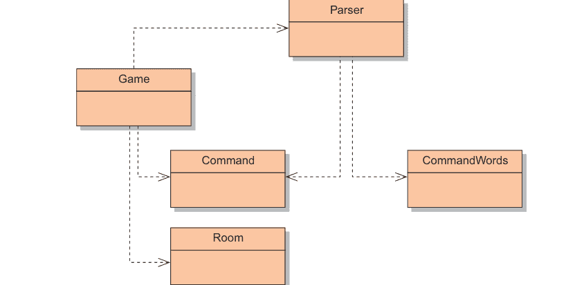

该项目显示了五个类：`Parser`、`CommandWords`、`Command`、`Room` 和 `Game`。对源代码的调查显示，幸运的是，这些类的文档非常详尽，我们只需要阅读每个类顶部的注释就可以对它们的作用有一个初步概述。（这一事实也说明，设计涉及的是比类的外观或文档优良程度更深层次的内容。）通过查看源代码查看每个类拥有哪些方法，以及某些方法似乎的作用，将有助于我们对游戏的理解。在这里，我们总结每个类的用途：

- **CommandWords** TheWords 类定义了游戏中所有有效的命令。它通过持有一个表示命令词的 `String` 对象数组来实现这一点。
- **Parser** 解析器从终端读取输入行，并尝试将其解释为命令。它创建 `Command` 类的对象。
- **Command** `Command` 对象代表用户创建的命令。它拥有方法，让我们轻松检查这是否为有效命令，并获取命令的第一个和单词字符串。
- **Room** `Room` 对象代表游戏中的一个位置。房间可以通往其他房间的出口。
- **Game** `Game` 类是游戏的主类。它设置游戏并进入循环以执行命令。它还包含了实现每个命令的代码。

**练习 7.3** 设计你自己的游戏场景。离开电脑完成。不要考虑实现、类或通用的编程。只需构思一个有趣的游戏。这可以用一组人来完成。

游戏可以是任何以玩家在不同位置移动为基础结构。以下是一些例子：

- 你是一个白细胞，在身体中寻找病毒进行攻击 . . .
- 你在商场迷路了，必须找到出口 . . .
- 你是系统中的一个分子，必须找到 . . .
- 你是充满怪物的地下室中的冒险者 . . .
- 你是一个小队的一员，必须在炸弹爆炸前解除 . . .

确保你的游戏有很多东西。在这个阶段，不要担心如何实现。让你的想象力飞驰。

## 7.3 耦合与内聚引论

概念：耦合指的是类之间的相互连接性。我们在早的章节中已经讨论过，我们的目标是通过定义良好的接口来设计应用程序。耦合程度表示这些类连接的紧密程度。我们追求低耦合，或松散耦合。耦合程度决定了对应用程序进行更改的难易。在紧耦合的类结构中，一个类的变化会迅速影响到其他类。这是我们试图避免的，产生一个微小变化的影响可能是困难且耗时的。

内聚描述的是代码单元与逻辑任务的匹配程度。在高内聚的系统中，每个代码（方法、类或模块）都负责一个定义良好的任务。良好的设计表现出高内聚。

另一方面，在松耦合的系统中，我们可以更改一个类而不修改其他类，应用程序仍然可以工作。我们将在这里讨论紧耦合和松耦合的具体示例。

**练习 7.4** 在纸上为你在 7.3 中设计的游戏画出一幅地图。打开 `zul-bad` 部分，并将其另存为不同的名称（例如 `zul!`）。这是你将在本章中用于进行改进和修改的项目。你可以去掉-bad 后缀，因为它很快（希望）就不再是那么糟糕了。

作为第一步，在 `Game` 类中创建 `Classrooms` 方法，以创建你为游戏设计的房间和出口。测试！

> * 我们有时也使用模块（在 Java 中称为包）来指代多类单元。内聚在这一层也是相关的。

## 7.4 代码重复

代码重复是设计不佳的指标。代码 7.1 所示的 `Game` 类包含了代码重复的情况。代码重复的问题在于，如果我们想避免不一致，那么对其中一个版本的任何更改都必须在另一个版本中同样进行。这增加了维护程序员需要完成的工作工作量，并引入了 Bug 的风险。维护程序员很容易发现一份代码副本，在对其修改后，就认为工作已经完成。没有任何迹表明存在第二份代码副本，而那份副本可能会被错误地保持不变。

概念：

代码重复——在应用程序中多次出现相同的代码段是设计不佳的迹象。应该避免这种情况。

### 代码 7.1

（设计不佳的）`Game` 类的选章节


# 第 7 章 设计类

## 7.4 代码重复

代码重复是设计不佳的指标。代码 7.1 所示的 `Game` 类包含了代码重复的情况。代码重复的问题在于，如果我们想避免不一致，那么对其中一个版本的任何更改都必须在另一个版本中同样进行。这增加了维护程序员需要完成的工作量，并引入了 Bug 的风险。维护程序员很容易发现一份代码副本，在对其修改后，就认为工作已经完成。没有任何迹象存在第二份代码副本，而那份副本可能会被错误地保持不变。

**概念：**

代码重复——在应用程序中多次出现相同的代码段是设计不佳的迹象。应该避免这种情况。

### 代码 7.1 （设计不佳的）`Game` 类的选章节

```java
public class Game {
    // ... 省略了一些代码 ...

    private void createRooms() {
        Room outside, theatre, pub, lab, office;

        // 创建房间
        outside = new Room("outside the main entrance of the university");
        theatre = new Room("in a lecture theatre");
        pub = new Room("in the campus pub");
        lab = new Room("in a computing lab");
        office = new Room("in the computing admin office");

        // 初始房间出口
        outside.setExits(null, theatre, lab, pub);
        theatre.setExits(null, null, null, outside);
        pub.setExits(null, outside, null, null);
        lab.setExits(outside, office, null, null);
        office.setExits(null, null, null, lab);

        currentRoom = outside; // 从门外开始游戏
    }
} // ... 省略了一些代码 ...
```

### 代码 7.1 继续 （设计不佳的）`Game` 类的选章节

```java
/**
 * 为玩家打印欢迎信息。
 */
private void printWelcome() {
    System.out.println();
    System.out.println("Welcome to the World of Zuul!");
    System.out.println("\nZuul is a new, incredibly boring adventure game.");
    System.out.println("Type 'help' if you need help.");
    System.out.println();
    System.out.println("You are " + 
        currentRoom.getDescription());
    System.out.print("Exits: ");
    if(currentRoom.northExit != null) {
        System.out.print("north ");
    }
    if(currentRoom.westExit != null) {
        System.out.print("east ");
    }
    if(currentRoom.southExit != null) {
        System.out.print("south ");
    }
    if(currentRoom.westExit != null) {
        System.out.print("west ");
    }
    System.out.println();
}
// ... 省略了一些代码 ...
/**
 * 尝试向一个方向移动。如果有出口，
 * 则进入新房间，否则打印错误消息。
 */
private void goRoom(Command command) {
    if(command.hasSecondWord()) {
        // 如果没有第二个单词，
        // 我们不知道该去哪里
        System.out.println("Go where?");
        return;
    }
}
```

### 代码 7.1 继续

```java
String direction = command.getSecondWord();
// 尝试离开当前房间。
Room nextRoom = null;
if(direction.equals("north")) {
    nextRoom = currentRoom.northExit;
}
if(direction.equals("east")) {
    nextRoom = currentRoom.eastExit;
}
if(direction.equals("south")) {
    nextRoom = currentRoom.westExit;
}
if(direction.equals("west")) {
    nextRoom = currentRoom.westExit;
}
```


206

第 7 章 设计类

## 7.4

## 代码重复

代码重复是设计不佳的指标。代码 7.1 所示的 `Game` 类包含了代码重复的情况。代码重复的问题在于，如果我们想避免不一致，那么对其中一个版本的任何更改都必须在另一个版本中同样进行。这增加了维护程序员需要完成的工作量，并引入了 Bug 的风险。维护程序员很容易发现一份代码副本，在对其修改后，就认为工作已经完成。没有任何迹象存在第二份代码副本，而那份副本可能会被错误地保持不变。

概念：

代码重复——在应用程序中多次出现相同的代码段是设计不佳的迹象。应该避免这种情况。

### 代码 7.1

（设计不佳的）`Game` 类的选章节

```java
public class Game {
    // ... 省略了一些代码 ...

    private void createRooms() {
        Room outside, theatre, pub, lab, office;

        // 创建房间
        outside = new Room("outside the main entrance of the university");
        theatre = new Room("in a lecture theatre");
        pub = new Room("in the campus pub");
        lab = new Room("in a computing lab");
        office = new Room("in the computing admin office");

        // 初始房间出口
        outside.setExits(null, theatre, lab, pub);
        theatre.setExits(null, null, null, outside);
        pub.setExits(null, outside, null, null);
        lab.setExits(outside, office, null, null);
        office.setExits(null, null, null, lab);

        currentRoom = outside; // 从门外开始游戏
    }
} // ... 省略了一些代码 ...
```

### 代码 7.1 代码重复

207

### 代码 7.1 继续

（设计不佳的）`Game` 类的选章节

```java
/**
 * 为玩家打印欢迎信息。
 */
private void printWelcome() {
    System.out.println();
    System.out.println("Welcome to the World of Zuul!");
    System.out.println("\nZuul is a new, incredibly boring adventure game.");
    System.out.println("Type 'help' if you need help.");
    System.out.println();
    System.out.println("You are " + 
        currentRoom.getDescription());
    System.out.print("Exits: ");
    if(currentRoom.northExit != null) {
        System.out.print("north ");
    }
    if(currentRoom.westExit != null) {
        System.out.print("east ");
    }
    if(currentRoom.southExit != null) {
        System.out.print("south ");
    }
    if(currentRoom.westExit != null) {
        System.out.print("west ");
    }
    System.out.println();
}
// ... 省略了一些代码 ...
/**
 * 尝试向一个方向移动。如果有出口，
 * 则进入新房间，否则打印错误消息。
 */
private void goRoom(Command command) {
    if(command.hasSecondWord()) {
        // 如果没有第二个单词，
        // 我们不知道该去哪里
        System.out.println("Go where?");
        return;
    }
}
```

208

第 7 章 设计类

### 代码 7.1 继续

```java
String direction = command.getSecondWord();
// 尝试离开当前房间。
Room nextRoom = null;
if(direction.equals("north")) {
    nextRoom = currentRoom.northExit;
}
if(direction.equals("east")) {
    nextRoom = currentRoom.eastExit;
}
if(direction.equals("south")) {
    nextRoom = currentRoom.westExit;
}
if(direction.equals("west")) {
    nextRoom = currentRoom.westExit;
}
```


206

第 7 章 设计类

## 7.4 代码重复

代码重复是设计不佳的指标。代码 7.1 所示的 `Game` 类包含了代码重复的情况。代码重复的问题在于，如果我们想避免不一致，那么对其中一个版本的任何更改都必须在另一个版本中同样进行。这增加了维护程序员需要完成的工作量，并引入了 Bug 的风险。维护程序员很容易发现一份代码副本，在对其修改后，就认为工作已经完成。没有任何迹象存在第二份代码副本，而那份副本可能会被错误地保持不变。

**概念：**

代码重复——在应用程序中多次出现相同的代码段是设计不佳的迹象。应该避免这种情况。

### 代码 7.1

（设计不佳的）`Game` 类的选章节

```java
public class Game {
    // ... 省略了一些代码 ...

    private void createRooms() {
        Room outside, theatre, pub, lab, office;

        // 创建房间
        outside = new Room("outside the main entrance of the university");
        theatre = new Room("in a lecture theatre");
        pub = new Room("in the campus pub");
        lab = new Room("in a computing lab");
        office = new Room("in the computing admin office");

        // 初始房间出口
        outside.setExits(null, theatre, lab, pub);
        theatre.setExits(null, null, null, outside);
        pub.setExits(null, outside, null, null);
        lab.setExits(outside, office, null, null);
        office.setExits(null, null, null, lab);

        currentRoom = outside; // 从门外开始游戏
    }
} // ... 省略了一些代码 ...
```

### 代码 7.1 继续

（设计不佳的）`Game` 类的选章节

```java
/**
 * 为玩家打印欢迎信息。
 */
private void printWelcome() {
    System.out.println();
    System.out.println("Welcome to the World of Zuul!");
    System.out.println("\nZuul is a new, incredibly boring adventure game.");
    System.out.println("Type 'help' if you need help.");
    System.out.println();
    System.out.println("You are " + 
        currentRoom.getDescription());
    System.out.print("Exits: ");
    if(currentRoom.northExit != null) {
        System.out.print("north ");
    }
    if(currentRoom.westExit != null) {
        System.out.print("east ");
    }
    if(currentRoom.southExit != null) {
        System.out.print("south ");
    }
    if(currentRoom.westExit != null) {
        System.out.print("west ");
    }
    System.out.println();
}
// ... 省略了一些代码 ...
/**
 * 尝试向一个方向移动。如果有出口，
 * 则进入新房间，否则打印错误消息。
 */
private void goRoom(Command command) {
    if(!command.hasSecondWord()) { // 修正逻辑：原文注释暗示此处应为无第二个单词时提示
        // 如果没有第二个单词，
        // 我们不知道该去哪里
        System.out.println("Go where?");
        return;
    }
}
```

208

第 7 章 设计类

### 代码 7.1 继续

```java
String direction = command.getSecondWord();
// 尝试离开当前房间。
Room nextRoom = null;
if(direction.equals("north")) {
    nextRoom = currentRoom.northExit;
}
if(direction.equals("east")) {
    nextRoom = currentRoom.eastExit;
}
if(direction.equals("south")) {
    nextRoom = currentRoom.southExit;
}
if(direction.equals("west")) {
    nextRoom = currentRoom.westExit;
}
```


# 第 7 章 设计类

## 7.4 代码重复

代码重复是设计不佳的指标。代码 7.1 所示的 `Game` 类包含了代码重复的情况。代码重复的问题在于，如果我们想避免不一致，那么对其中一个版本的任何更改都必须在另一个版本中同样进行。这增加了维护程序员需要完成的工作量，并引入了 Bug 的风险。维护程序员很容易发现一份代码副本，在对其修改后，就认为工作已经完成。没有任何迹象存在第二份代码副本，而那份副本可能会被错误地保持不变。

**概念：**

代码重复——在应用程序中多次出现相同的代码段是设计不佳的迹象。应该避免这种情况。

### 代码 7.1 （设计不佳的）`Game` 类的选章节

```java
public class Game {
    // ... 省略了一些代码 ...

    private void createRooms() {
        Room outside, theatre, pub, lab, office;

        // 创建房间
        outside = new Room("outside the main entrance of the university");
        theatre = new Room("in a lecture theatre");
        pub = new Room("in the campus pub");
        lab = new Room("in a computing lab");
        office = new Room("in the computing admin office");

        // 初始房间出口
        outside.setExits(null, theatre, lab, pub);
        theatre.setExits(null, null, null, outside);
        pub.setExits(null, outside, null, null);
        lab.setExits(outside, office, null, null);
        office.setExits(null, null, null, lab);

        currentRoom = outside; // 从门外开始游戏
    }
} // ... 省略了一些代码 ...
```

### 代码 7.1 继续 （设计不佳的）`Game` 类的选章节

```java
/**
 * 为玩家打印欢迎信息。
 */
private void printWelcome() {
    System.out.println();
    System.out.println("Welcome to the World of Zuul!");
    System.out.println("\nZuul is a new, incredibly boring adventure game.");
    System.out.println("Type 'help' if you need help.");
    System.out.println();
    System.out.println("You are " + 
        currentRoom.getDescription());
    System.out.print("Exits: ");
    if(currentRoom.northExit != null) {
        System.out.print("north ");
    }
    if(currentRoom.eastExit != null) {
        System.out.print("east ");
    }
    if(currentRoom.southExit != null) {
        System.out.print("south ");
    }
    if(currentRoom.westExit != null) {
        System.out.print("west ");
    }
    System.out.println();
}
// ... 省略了一些代码 ...
/**
 * 尝试向一个方向移动。如果有出口，
 * 则进入新房间，否则打印错误消息。
 */
private void goRoom(Command command) {
    if(!command.hasSecondWord()) {
        // 如果没有第二个单词，
        // 我们不知道该去哪里
        System.out.println("Go where?");
        return;
    }

    String direction = command.getSecondWord();
    // 尝试离开当前房间。
    Room nextRoom = null;
    if(direction.equals("north")) {
        nextRoom = currentRoom.northExit;
    }
    if(direction.equals("east")) {
        nextRoom = currentRoom.eastExit;
    }
    if(direction.equals("south")) {
        nextRoom = currentRoom.southExit;
    }
    if(direction.equals("west")) {
        nextRoom = currentRoom.westExit;
    }
}
```


# 代码 7.1 代码重复

## 代码 7.1 继续

（设计不佳的）`Game` 类的选章节

```java
office = new Room("in the computing admin office");

// 初始房间出口

outside.setExits(null, theatre, lab, pub);

theatre.setExits(null, null, null, outside);

pub.setExits(null, outside, null, null);

lab.setExits(outside, office, null, null);

office.setExits(null, null, null, lab);

currentRoom = outside; // 从门外开始游戏

}
} // ... 省略了一些代码 ...
```

```java
/**

 * 为玩家打印欢迎信息。

 */

private void printWelcome() {

    System.out.println();

    System.out.println("Welcome to the World of Zuul!");

    System.out.println("\nZuul is a new, incredibly boring adventure game.");

    System.out.println("Type 'help' if you need help.");

    System.out.println();

    System.out.println("You are " + 

        currentRoom.getDescription());

    System.out.print("Exits: ");

    if(currentRoom.northExit != null) {

        System.out.print("north ");

    }

    if(currentRoom.westExit != null) {

        System.out.print("east ");

    }

    if(currentRoom.southExit != null) {

        System.out.print("south ");

    }

    if(currentRoom.westExit != null) {

        System.out.print("west ");

    }

    System.out.println();

}

// ... 省略了一些代码 ...

/**

 * 尝试向一个方向移动。如果有出口，

 * 则进入新房间，否则打印错误消息。

 */

private void goRoom(Command command) {

    if(command.hasSecondWord()) {

        // 如果没有第二个单词，

        // 我们不知道该去哪里

        System.out.println("Go where?");

        return;

    }

}
```

## 代码 7.1 继续

```java
String direction = command.getSecondWord();

// 尝试离开当前房间。

Room nextRoom = null;

if(direction.equals("north")) {

    nextRoom = currentRoom.northExit;

}

if(direction.equals("east")) {

    nextRoom = currentRoom.eastExit;

}

if(direction.equals("south")) {

    nextRoom = currentRoom.westExit;

}

if(direction.equals("west")) {

    nextRoom = currentRoom.westExit;

}
```

# 7.5 制作扩展

## 代码 7.3

（设计不当的）`Room` 类源代码

```java
public class Room {

    public String description;

    public Room northExit;

    public Room southExit;

    public Room eastExit;

    public Room westExit;

    /**

     * 创建一个描述为 "description" 的房间。初始状态下，

     * 它没有出口。"description" 类似于“

     * 厨房”或“开放式庭院”。

     */

    public Room(String description) {

        this.description = description;

    }

    /**

     * 定义此房间的出口。每个方向要么

     * 通向另一个房间，要么为空空（该处没有出口）。

     */

    public void setExits(Room north, Room east, Room south, Room west) {

        if(north != null) {

            northExit = north;

        }

        if(east != null) {

            eastExit = east;

        }

        if(south != null) {

            southExit = south;

        }

        if(west != null) {

            westExit = west;

        }

    }

    /**

     * 返回房间的描述（在构造函数中

     * 定义的那个）。

     */

    public String getDescription() {

        return description;

    }

}
```

在 `Game` 类中找到所有相关的地方需要多花一些功夫。源代码要长一些（未完整显示），找到所有相关位置需要一些耐心和细心。

阅读代码 7.1 所示的代码，我们可以看到 `Game` 类大量地使用了房间的出口信息。`Game` 对象在 `currentRoom` 变量中持有一个房间的引用，并频繁地访问该房间的信息：

- 在 `createRoom` 方法中，定义了出口。
- 在 `printWelcome` 中，打印了当前房间的出口，以便玩家在游戏开始时知道该去哪里。
- 在 `goRoom` 方法中，使用出口来寻找下一个房间。然后它们再次被用于打印我们进入的下一个房间的出口。

如果我们想添加两个新方向，必须在所有这些地方添加 `up` 和 `down` 选项。然而，在此之前，请阅读以下章节。

# 7.6 耦合

在许多地方列举所有出口，是类设计不佳的症状。在 `Room` 类中声明出口变量时，我们需要为每个出口列出一个变量；在 `setExits` 方法中，每个出口有一个语句；在 `goRoom` 方法中每个出口有一个 `if` 语句；在 `printLocationInfo` 中每个出口有一个语句；依此类推。这种设计目前对我们有效：当添加新出口时，我们需要找到所有这些地方并添加两个。想象一下如果我们决定使用西北、东南等作为方向，会产生什么影响！

为了改善这种情况，我们决定使用 `HashMap` 来存储出口，而不是使用独立的变量。这样做，应该能够写出可以处理任意数量出口且不需要大量修改的代码。`HashMap` 可以处理从命名方向（例如 `"north"`）到该方向的房间（`Room` 对象）的映射。每个条目都有一个 `String` 作为键，一个 `Room` 对象作为值。

这是我们内部存储相邻房间信息的方式改变。从理论上讲，这种改变应该影响 `Room` 类的实现（如何存储出口信息）以及接口（房间存储什么）。

理想情况下，当仅一个类的实现发生变化时，其他类不应该受到影响。

在我们的示例中，这是不可行的。如果我们移除出口变量并将其替换为 `HashMap`，`Game` 类将无法再次编译。它对房间的出口变量有大量引用，这些引用都将导致错误。

我们看到了紧耦合的情况。为了解决这个问题，我们在引入 `HashMap` 之前，将这些类进行解耦。

## 使用封装来减少耦合

示例中的一个主要问题是使用了公共字段。`Room` 类中的出口字段被声明为 `public`。显然，该类的程序员没有遵循我们之前提到的准则（“不要让字段公开！”）。

我们现在看到了结果！`Game` 类暴露了它拥有出口的事，而不是出口是如何存储的。封装具有巨大的优势：当我们改变 `Room` 类中出口的存储方式时，不需要担心破坏其他类。

通过将字段设为私有并使用访问器方法，我们可以强制“什么”与“如何”的分离。修改后的 `Room` 类第一阶段在代码 7.4 中所示。

## 代码 7.4

使用访问器方法减少耦合

```java
public class Room {

    private String description;

    private Room northExit;

    private Room southExit;

    private Room eastExit;

    private Room westExit;

    // 现有方法

    public Room getExit(String direction) {

        if (direction.equals("north")) {

            return northExit;

        }

        if (direction.equals("east")) {

            return eastExit;

        }

        if (direction.equals("south")) {

            return southExit;

        }

        if (direction.equals("west")) {

            return westExit;

        }

        return null;

    }

}
```

在对 `Room` 类做了这种更改后，我们也需要修改 `Game` 类。例如，以前我们是这样写：

```java
Room nextRoom = currentRoom.east;
```

现在我们写成：

```java
Room nextRoom = currentRoom.getExit("east");
```

这使得 `Game` 类中的该部分变得更简单。在 `goRoom` 方法中，这里的替换将导致：

```java
Room nextRoom = currentRoom.getExit(direction);
```

**练习 7.6** 对 `Room` 和 `Game` 类进行上述更改。
**练习 7.7** 修改 `Game` 的 `printLocationInfo` 方法。在 `Room` 中定义如下签名的方法：

```java
/*

* 返回出口的描述

* 例如，“north”。

* @return 可用出口的描述

*/

public String getExitString()
```

因此，我们没有改变 `Room` 的出口表示，只是清理了接口。`Game` 类的变化是微小的——从公共字段改为方法——但收益是肯定的。我们现在可以更改出口存储的方式，而担心破坏任何内容。`Room` 的内部表示已经完全解耦。既然设计已经是本该的样子，将独立字段交换为 `HashMap` 是很容易的。更改后的代码见 7.5。

## 代码 7.5

`Room` 类源代码

```java
import java.util.HashMap;

// 类注释省略

public class Room {

    private String description;

    private HashMap<String, Room> exits;

    /**

     * 创建一个描述为 "description" 的房间。初始状态下，

     * 它没有出口。"description" 类似于“

     * 厨房”或“开放式庭院”。

     */

    public Room(String description) {

        this.description = description;

        exits = new HashMap<String, Room>();

    }

    /**

     * 定义此房间的出口。每个方向要么

     * 通向另一个房间，要么为空（该处没有出口）。

     */

    public void setExits(Room north, Room east, Room south, Room west) {

        if(north != null)

            exits.put("north", north);

        if(east != null)

            exits.put("east", east);

        if(south != null)

            exits.put("south", south);

        if(west != null)

            exits.put("west", west);

    }

    /**

     * 返回如果我们从此房间向 "direction" 方向移动

     * 时到达的房间。如果该方向没有房间，则返回 null。

     */

    public Room getExit(String direction) {

        return exits.get(direction);

    }

}
```

## 代码 7.5 继续

`Room` 类的源代码

```java
/**

 * 返回房间的描述（在构造函数中

 * 定义的那个描述）。

 */

public String getDescription()

{

    return description;

}
```

再次强调一下，即使在不检查是否会在其他地方产生破坏的情况下，我们现在也可以进行此更改。由于我们只更改了 `Room` 类的私有部分，根据定义，这些部分无法在其他类中使用，因此此更改不会影响其他类。接口保持不变。

这次更改的副作用是，我们的 `Room` 类现在更短了。我们不再需要列出四个独立的变量，而是有了一个。此外，`getExit` 方法现在也简单了许多。

记住，这一系列更改最初的目标是为了更更容易添加向上（up）和向下（down）的新可能出口。这已经变得容易得多了。由于我们使用 `HashMap` 来存储条目，这两个额外的方向无需任何任何更改即可工作。我们也可以毫无问题地通过 `getExit` 方法获取信息。

唯一我们知道四个现有出口（北、东、南、西）的地方仍然硬编码在 `setExits` 方法中。这是最后一个需要改进的部分。目前，它的方法签名是：

```java
public void setExits(Room north, Room east, Room south, Room west)
```

该方法是 `Room` 类接口的一部分，因此我们对其进行的任何更改都会通过耦合不可避免地解耦某些其他类。值得注意的是，在应用程序中我们永远无法完美地解耦，否则不同类的对象之间将无法相互作用。相反，我们应该保持耦合程度尽可能低。如果我们再次对 `setExits` 进行更改以适应额外的方向，那么我们首选的解决方案是用此方法完全替换它：

```java
/**

 * 定义从此房间的出口。

 * @param direction 出口的方向。

 * @param neighbor 给定方向上的 Room 对象。

 */

public void setExits(String direction, Room neighbor)

{

    exits.put(direction, neighbor);

}
```

现在，可以一次设置一个该房间的出口，并且任何方向都可以作为出口。在 `Game` 类中，由修改 `Room` 接口带来的更改如下。我们不再编写：

```java
lab.setExits(outside, office, null, null);
```

而是编写：

```java
lab.setExit("north", outside);

lab.setExit("east", office);
```


我们现在已经完全消除了 `Room` 类存储四个出口的限制。`Room` 类现在已准备好存储向上和向下的出口，以及你可能想到的任何其他方向（西北、东南等）。

- 练习 7.8 在你的 zuul 项目中实现本节描述的更改。

# 7.7 职责驱动的设计

概念：

职责驱动设计是一个设计过程，它为每个类定义了良好的职责，这些职责可以用来确定由哪一个类来实现应用程序功能的某部分。

在上一节中，我们已经看到利用适当的封装可以减少耦合，并可以显著减少更改应用程序时所需的工作量。然而，封装并不是影响耦合程度的唯一因素。另一个方面被称为“职责驱动的设计”。

职责驱动的设计表达了这样一个观点：每个类都应该负责处理它自己的数据。通常，当我们需要向应用程序添加某些新功能时，我们需要问自己是否应该添加一个方法来实现这个新功能。哪一个类应该负责这项任务？答案是，负责存储某些数据的类也应该负责操作这些数据。

职责驱动设计如何影响耦合程度，从而影响应用程序如何被修改或扩展。像往常一样，我们将通过示例详细地讨论这一点。

## 7.7.1 职责与耦合

我们在 7.6.1 节中讨论的对 `Room` 类的更改使得在 `Game` 类中添加向上向下移动的新方向变得容易。我们通过一个示例来研究这一点。假设我们想在办公室下方添加一个新的房间（地下室）。我们只需对 `Game` 的 `createRooms()` 方法进行一些小更改来创建该房间，并调用两次设置出口：

```java
private void createRooms() {
    Room outlet, theatre, pub, lab, office, cellar;
    cellar = new Room("in the cellar");
    office.setExit("down", cellar);
    cellar.setExit("up", office);
}
```

由于 `Room` 类的新接口，这将顺利地工作。这个更改非常简单，并证实了设计正在变得更好。

如果我们对比代码 7.2 显示的原始 `printInfo()` 方法版本与代码 7.6 显示的 `getExitString()` 方法（它代表了练习 7.7 的解决方案），就可以看到进一步的证据。

### 代码 7.6 Room 的 `getExitString()` 方法

```java
/**
 * 返回房间出口的描述
 * 例如 "Exits: north west"
 * @return 可用出口的描述
 */
public String getExitString() {
    String exitString = "Exits: ";
    if(northExit != null)
        exitString += "north ";
    if(eastExit != null)
        exitString += "east ";
    if(southExit != null)
        exitString += "south ";
    if(westExit != null)
        exitString += "west ";
    return exitString;
}
```

因为关于出口的信息现在存储在房间本身，所以是房间负责提供信息。房间可以比任何其他对象都做得更好，因为它拥有关于出口数据内部存储结构的所有知识。在 `Room` 类内部，我们可以利用出口存储在 `HashMap` 中的知识，并可以遍历 map 来描述出口。

因此，我们用代码 7.7 中所示版本替换代码 7.6 中的 `getExitString()` 版本。该方法找到 `HashMap` 中所有的出口名称（`HashMap` 中的键就是出口名称），并将它们拼接成一个字符串，然后返回。（为了这项工作，我们需要从 `java.util` 导入 `Set` 和 `Iterator` 类。）

- 练习 7.9 在 `HashMap` 的文档中查找 `keySet()` 方法。它是做什么的？
- 练习 7.10 详细并书面地解释 `getExitString()` 方法是如何工作的。

### 代码 7.7 修改后的 `getExitString()`

```java
/**
 * 返回房间出口的描述
 * 例如 "Exits: north west"
 * @return 可用出口的描述。
 */
public String getExitString() {
    String returnString = "Exits:";
    Set<String> keys = exits.keySet();
    for(String exit : keys) {
        returnString += " " + exit;
    }
    return returnString;
}
```

我们减少耦合的目标要求尽可能，对 `Room` 类的更改不需要对 `Game` 类进行更改。我们仍然可以改进这一点。

目前，我们仍在 `Game` 类中硬编码了我们从房间想要的信息由描述和出口字符串组成：

```java
System.out.println("You are " + currentRoom.getDescription());
System.out.println(currentRoom.getExitString());
```

如果我们向游戏中添加房间呢？怪物呢？或其他玩家呢？

当我们决定看到什么时，物品、怪物和其他玩家的列表应该包含在房间的描述中。我们只需要对 `Room` 类进行更改来添加这些东西，但还需要更改上面打印描述的代码段。

这违反了职责驱动的设计规则。由于 `Room` 类持有关于房间的信息，它也应该产生房间的描述。我们可以通过向 `Room` 类添加以下方法来改进这一点：

```java
/**
 * 返回此房间的长描述，格式如下：
 * You are in the kitchen.
 * Exits: north west
 * @return 包括出口的房间描述。
 */
public String getLongDescription() {
    return "You are " + description + "\n" + getExitString();
}
```

在 `Game` 类中，我们接着写道：

```java
System.out.println(currentRoom.getLongDescription());
```

房间的“长描述”现在包含了描述字符串、出口信息，并且未来可能包含任何关于房间的其他描述内容。当我们进行这些扩展时，我们只需要修改一个类：`Room` 类。

| 练习题 |
| :--- |
| 练习 7.11 在你自己的 zuul 项目中实现本节描述的更改。 |
| 练习 7.12 画出包含包含游戏中所有对象的对象图，展示它们在游戏刚开始时的状态。 |
| 练习 7.13 当你执行 `go` 命令时，对象图发生了什么变化？ |

## 更改的局部化

解耦和责任原则的另一个方面是更改的局部化。我们的目标是创建一种使得更改的影响清晰可见的类设计。

理想情况下，只需要更改一个类即可完成修改。有时需要更改几个类，但我们的目标是尽可能减少类的数量。此外，其他类中所需的更改应该是显而易见、易于检测且易于执行的。在很大程度上，我们可以通过遵循良好的设计规则来实现这一点，例如使用责任驱动的设计，并以松耦合高内聚为目标。然而，在创建应用程序时，我们应该考虑到修改和扩展。预判程序的某个方面可能会发生变化以便进行这种更改至关重要。

## 隐式耦合

我们看到，使用公共字段（`public fields`）是一种可能会在类之间创建不必要的紧密耦合形式的做法。有了这种耦合，对于一个本该简单的修改，可能需要更改多个类。因此，应该避免使用公共字段。然而，还有更糟糕的耦合形式：隐式耦合。

隐式耦合是指一个类依赖另一个类的内部信息，但这种依赖关系并不显而易见。公共字段类中的紧耦合并不好，但至少它是显眼的。如果我们更改了一个类中的公共字段而忘记了另一个，应用程序将无法编译，编译器会指出该问题。在隐式耦合的情况下，漏掉必要的更改可能无法被发现。

当我们尝试为游戏添加更多命令时，就能看到问题的产生。

# 7.9 隐式耦合

假设我们想向合法命令集添加 `look` 命令。`look` 的目的仅仅是再次打印房间的描述和出口（“环顾房间”）——如果我们在一个房间里输入了一系列命令，导致描述滚出了视线，而我们又不记得当前房间的出口在哪里，这就会很有帮助。

我们可以通过简单地将它添加到 `CommandWords` 类中 `validCommands` 数组的已知单词列表中，来引入一个新命令：

```java
// 一个存储所有有效命令的常量数组
private static final String validCommands[] = {
    "go", "quit", "help", "look"
}
```

顺便说，这展示了良好内聚的示例：作者没有在解析器中定义命令单词（这将是一个显而易见的错误），而是创建一个单独的类来定义命令单词。这使得我们很容易找到定义单词的地方，也容易添加新单词。作者显然考虑到了可能会添加更多命令，并创建了一个让这种操作非常容易的结构。

我们可以测试这一点。然而，在做出更改后，我们运行游戏并执行 `look` 命令，什么都没有发生。这与未知命令的行为形成对比：如果我们输入任何未知单词，我们会看到回复：

> I don't know what you mean...

因此，我们没有看到这个回复，表明该单词被识别了，但由于我们还没有为该命令实现动作，所以什么都没有发生。

我们可以通过为 `Game` 类添加一个 `look` 命令的方法来修复这个问题：

```java
private void look() {
    System.out.println(currentRoom.getLongDescription());
}
```

之后，我们需要在 `processCommand()` 方法中为 `look` 命令添加一个分支，当识别到 `look` 命令时将调用 `look()` 方法：

```java
if(commandWord.equals("help")) {
    printHelp();
} else if(commandWord.equals("go")) {
    goRoom(command);
} else if(commandWord.equals("look")) {
    look();
} else if(commandWord.equals("quit")) {
    wantToQuit = quit(command);
}
```

尝试一下，你会发现它是可以的。

- **练习 7.14** 在你版本的 zuul 游戏中添加 `look` 命令。
- **练习 7.15** 为游戏添加另一个命令。开始，你可以选择一个简单的。

## 7.10 预瞻性思考

我们现在实现的设计是对原始版本的一个重要改进。然而，它还可以进一步改进。

优秀软件设计人员的一个特点是具备预测的能力。什么可能会发生？哪些部分我们可以安全地假设在程序的生命周期内保持不变？

我们在大多数类中硬编码的一个假设是：这个游戏将作为一个具有终端输入输出的文本游戏来运行。但它会一直这样吗？

添加一个带有菜单、按钮和图像的图形用户界面可能是一个有趣的扩展。在这种情况下，我们就不再想将信息打印到终端了。我们可能仍然有命令词，并且仍然想在玩家输入帮助命令时显示它们。但那时我们可能会将其显示在窗口的文本框中，而不是使用 `System.out.println`。

将所有关于用户界面的信息封装在单个类或一组定义明确类中是良好的设计。例如，我们在第 7.9 节中的设计——`CommandWords` 类中的 `showAll()` 方法，并没有遵循这一规则。更好的做法是定义为 `CommandWords` 负责生成（但不打印！）命令词列表，而由 `Game` 类来决定如何向用户展示它。

我们可以通过将 `showAll()` 方法更改为返回一个包含所有命令的 `String` 而不是打印它们来实现这一点。（在我们进行此更改时，可能应该将其重命名为 `getCommandList()`。）这个 `String` 可以在 `Game` 类的 `printHelp()` 方法中打印。

注意，这现在并没有给我们带来任何好处，但我们将来可能会从改进后的设计中受益。

- **练习 7.18** 实现建议的更改。确保你的程序仍然如以前一样运行。
- **练习 7.19** 查询什么是模型-视图-控制器（model-view-controller）模式。你可以通过搜索获取信息，或使用发现的任何其他资源。它与这里讨论的话题有什么关系？它暗示了什么？如何将其应用于这个项目？（仅讨论其在该项目中的应用，因为实际实现是一个高级挑战练习。）

## 7.11 内聚性

我们在第 7.3 节中引入了内聚性的概念：代码单元应该始终负责且仅负责一个任务。现在我们将更深入地研究内聚性原则并分析一些示例。

内聚性原则适用于类和方法：类应该显示出高内聚性，方法也是如此。

### 7.11.1 方法的内聚性

当我们谈论方法的内聚性时，我们寻求的理想是任何一个方法都应该负责且仅负责一个定义良好的任务。

我们可以在 `Game` 类中看到一个内聚方法的示例。该类有一个名为 `printWelcome()` 的私有方法用于显示欢迎文本，该方法在游戏开始时在 `play()` 方法中调用（代码 7.8）。

### 代码 7.8 两个具有良好内聚性的方法

```java
/**
 * 主例程。循环直到游戏结束。
 */
public void play() {
    printWelcome();

    // 进入主命令循环。在这里我们反复获取
    // 命令并执行，直到游戏结束。
    boolean finished = false;
    while (!finished) {
        Command command = parser.getCommand();
        finished = processCommand(command);
    }
    System.out.println("Thank you for playing. Good bye.");
}

/**
 * 为玩家打印欢迎消息。
 */
private void printWelcome() {
    System.out.println();
    System.out.println("Welcome to the World of Zuul!");
    System.out.println("Zuul is a new, incredibly boring adventure game.");
    System.out.println("Type help if you need help.");
    System.out.println();
    System.out.println(currentRoom.getLongDescription());
}
```


从功能角度来看，我们本可以直接将 `printWelcome` 中的语句输入到 `play` 方法中，并在不定义额外方法和进行方法调用的情况下实现相同的结果。顺便说一下，同样在 `play` 方法中调用的 `processCommand` 方法也是如此：这段代码可以直接写在 `play` 方法中。

然而，如果使用短小且内聚的方法，理解一段代码的作用以及进行修改将变得容易得多。在选定的方法结构中，所有方法都足够短且易于理解，并且它们的名称清楚地指示了它们的用途。这些特征为维护程序员提供了宝贵的帮助。

### 7.11.2 类的内聚性

类的内聚性规则规定，每个类应该代表问题领域中的一个单一、定义良好的实体。

作为类内聚性的示例，我们现在讨论 `zul` 项目的另一个扩展。我们想在游戏中添加物品。每个房间可以放置一个物品，每个物品都有描述和重量。物品的重量可以用来判断是否可以被捡起。

简单的方法是在 `Room` 类中添加两个字段：`itemDescription` 和 `itemWeight`。然而，这种方法没有显示出良好的内聚性：`Room` 类既描述房间又描述物品。

更好的设计是为物品创建一个单独的类，可能称为 `Item`。这个类将具有描述和重量字段，而房间只需持有指向物品对象的引用。

- **练习 7.20** 扩展你的冒险项目或 `zul-better` 项目，使房间可以包含单个物品。物品具有描述和重量。当玩家进入房间时，应该显示关于物品的信息。
- **练习 7.21** 房间中的物品信息应该如何生成？哪个类应该打印它？请用书面说明。如果回答这个练习让你觉得应该更改你的实现，请尽管进行更改。

如果我们稍微更改规范，就能看到房间和物品分离的真正益处：在我们的游戏的另一个变体中，我们希望不仅允许每个房间包含一个物品，还允许无限数量的物品。在使用单独 `Item` 类的设计中，这是很容易的：我们可以创建多个 `Item` 并将它们存储在房间的集合中。

使用第一种简单方法，这种更改几乎是不可能实现的。

- **练习 7.22** 修改项目，使房间可以持有任意数量的物品。使用集合来实现这一点。确保房间有一个 `addItem` 方法可以将物品放入房间中。确保当玩家进入房间时显示所有物品。

### 7.11.3 为了提高可读性的内聚性

内聚性通过多种方式使设计获益。最重要的两个是可读性和重用性。

在第 7.11.1 节中讨论的示例——`printWelcome` 方法的内聚性，显然是一个增加内聚性使类更具可读且更容易理解和维护的示例。

第 7.11.2 节中的内聚性示例也有可读性的元素。如果存在一个单独的 `Item` 类，那么维护程序员在需要更改物品特征时很容易识别从哪里开始编码。类的内聚性增加了程序的可读性。

### 7.11.4 为了重用的内聚性

内聚性的另一个巨大优势是更高的重用潜力。

第 7.11.2 节中的内聚性示例也展示了这一点：通过创建单独的 `Item` 类，我们可以创建多个物品，从而对多个物品使用相同的代码。

重用也是方法内聚性的一个重要方面。考虑 `Room` 类中具有以下签名的方法：

```java
public Room leaveRoom(String direction)
```

该方法可以返回指定方向的房间（因此可以被用作新的 `currentRoom`），并打印出我们进入的新房间的描述。

这看起来是一个可行的设计，而且确实可以实现工作。但在我们的版本中，我们将此任务拆分为两个方法：

```java
public Room getExit(String direction)

public String getDescription()
```

第一个方法负责返回新房间，而第二个方法生成房间的描述。

这种设计的优势在于这些分离的任务可以很容易地重用。例如，`getLongDescription` 方法不仅用于 `goTo` 方法，还用于 `printWelcome` 和 `look` 命令的实现。这只有在显示出高度的内聚性时才是可能的。在带有 `leaveRoom` 方法的版本中，它是无法重用的。

- **练习 7.23** 实现一个 `back` 命令。该命令没有第二个单词。输入 `back` 命令会让玩家回到他之前所在的房间。
- **练习 7.24** 正确地测试你的新命令。不要忘记测试！如果玩家在 `back` 命令后输入第二个单词，程序会发生什么？它的行为合理吗？还有更多的负测试用例吗？
- **练习 7.25** 如果你输入两次 `back`，程序会做什么？这种行为合理吗？
- **练习 7.26** 挑战性练习：实现 `back` 命令使其能够连续——带你回几个房间，如果使用次数足够，则会回到游戏开始。使用栈（Stack）来实现。（你可能需要了解一下栈。请查看 Java 库文档。）

---

## 第 7 章 设计类

### 重构

在设计应用程序时，我们应该考虑未来，预见可能的变化，并创建高内聚、低耦合的类和方法，以便于进行修改。这是一个高尚的目标，但显然我们无法总是预见到所有的未来适应，也不可能为我们能想到的所有扩展做准备。

这就是为什么重构很重要。

重构是对现有类和方法进行结构调整活动，以适应更改的功能和需求。在应用程序的生命周期中，功能会不断添加。一个常见的副作用是，由于此，方法和类的长度逐渐变长。

**概念：**
重构是在应用程序修改或扩展时，通过重组现有设计来保持良好的类设计的活动。

### 7.12 重构

维护人员往往想向现有的类或方法中添加一些代码。然而，长期这样做会降低内聚度。当向一个方法或类中添加更多代码时，它在某个阶段很可能代表了多于一个清晰定义的任务或实体。

重构是对类和方法结构的重新思考和重新设计。最常见的结果是类被拆分为两个，或者方法被拆分为两个或多个方法。重构也可以包括将类或方法合并为一个，但这种情况较少见。

#### 7.12.1 重构与测试

在提供重构示例之前，我们需要思考这样一个事实：当我们重构一个程序时，通常是对已经可以工作的东西进行某些潜在重大的更改。当某个东西发生变化时，可能会引入错误。因此，谨慎行事是重要的，在重构之前，我们应该确保为当前版本的程序建立一套测试。如果不存在测试，第一阶段应该是创建一些适用于对重构版本进行回归测试的测试。只有当这些测试存在时，才开始重构。理想情况下，重构应该分两步骤：

- 第一步是重构，以提供与原始相同的功能。
- 第二步是重构，以确保代码没有引入意外的错误。

那个在 `Game` 类中留下了 `currentRoom` 的偷懒程序员，现在面临着严重的问题。由于整个游戏只有一个当前房间，多个玩家的当前位置无法被存储。糟糕的设计通常会在以后产生反噬，最终为你增加更多额外的工作。

良好的重构不仅关乎技术技能，更取决于是否以当前的思维进行思考。当我们对应用程序进行更改和扩展时，应该经常自问原始设计是否仍然是最佳解决方案。随着功能的变化，对某些设计支持或反对的理由也会随之改变。对于简单应用程序良好的设计，在添加某些扩展后可能就不再良好。

识别出这些变化并实际上对源代码进行重构修改，最终将节省大量的精力和时间。越早地清理设计，通常就能节省越多的工作。

我们应该准备好提取方法（将任何现有方法中的一系列语句转换为一个新的...

- **练习 7.29** 重构你的项目以引入一个独立的 `Player` 类。`Player` 对象应该至少存储玩家的当前房间，但你可能也想存储玩家的名字或其他信息。
- **练习 7.30** 实现一个扩展，允许玩家捡起单个物品。这包括实现两个新命令：`take` 和 `drop`。
- **练习 7.31** 扩展你的实现，允许玩家携带任意数量的物品。
- **练习 7.32** 添加一个限制，允许玩家携带最多指定最大重量的物品。玩家可以携带的最大重量是玩家的一个属性。
- **练习 7.33** 实现一个 `items` 命令，打印出当前携带的所有物品及其总重量。
- **练习 7.34** 在房间中添加一个魔法饼干物品。添加一个 `eat cookie` 命令。如果玩家发现并吃掉了魔法饼干，它会增加玩家可以携带的重量。（你可能希望对其稍作修改，以更好地适应你自己的游戏场景。）

## 为了语言无关性进行重构

### 7.13 为了语言无关性进行重构

zuul 游戏的一个我们尚未讨论过的特性是：用户界面与英语命令紧密绑定。这种假设嵌入在存储有效命令列表的 `CommandWords` 类中，也嵌入在 `Game` 类的 `processCommand` 方法中，该方法显式地将每个命令词与一组单词进行比较。如果我们想更改界面以允许用户使用不同的语言，我们就必须找到源代码中所有使用命令词的地方并更改它们。这是隐式耦合形式的另一个示例，我们在第 7.9 节中讨论过。

如果我们希望程序具有语言无关性，理想情况下，我们在源代码中应该只在一个地方存储命令的实际文本，而在其他所有地方以与语言无关的方式引用命令。一种使这种成为可能的编程特性是枚举类型（enums）。我们将通过 `zuul-with-enums` 项目探索 Java 的这一特性。

#### 7.13.1 枚举类型

代码 7.9 显示了一个 Java 枚举类型定义 `CommandWord`。

```java
/**
 * 游戏所有有效命令词的表示。
 *
 * @author Michael Kolling and David J. Barnes
 * @version 2008.03.30
 */
public enum CommandWord
{
    // 为每个命令词提供一个值，外加一个未识别
    // 命令的值。
    GO, QUIT, HELP, UNKNOWN;
}
```

在最简单的形式下，枚举类型定义包含一个外壳（使用 `enum` 关键字而不是 `class`）和一个体，体是命名属于该类型的值的变量列表。根据惯例，这些变量名全部大写。我们从不创建枚举类型的对象。实际上，类型定义中的每个名称都代表了为我们创建的该类型的唯一实例。我们将这些实例称为 `CommandWord.GO`、`CommandWord.QUIT` 等。虽然使用它们的语法相似，但避免将这些值等同于我们在第 5.13 节中讨论的数值常量是非常重要的。尽管定义非常简单，但枚举类型值是正规的对象，它们与整数是不相同的。

我们如何使用 `CommandWord` 来向将 zuul 游戏逻辑与特定自然语言解耦迈出一步？我们可以做的首要改进之一是对 `Game` 类中 `processCommand` 方法的以下系列测试：

现在，我们必须安排将用户输入的命令映射到对应的 `CommandWord` 值。打开 `zuul-with-enums-v1` 项目来查看我们是如何做的。最显著的变化可以在 `CommandWords` 类中找到。我们不再使用字符串数组来定义有效命令，而是使用一个字符串和 `CommandWord` 对象的映射：

```java
public CommandWords() {
    validCommands = new HashMap<String, CommandWord>();
    validCommands.put("go", CommandWord.GO);
    validCommands.put("help", CommandWord.HELP);
    validCommands.put("quit", CommandWord.QUIT);
}
```

现在，用户输入的命令可以转换为其对应的枚举类型值。

- **练习 7.35** 审查 `zuul-with-enums-v1` 项目的源代码，查看它是如何使用 `CommandWord` 类型的。`Command`、`CommandWords` 和 `Parser` 类都已从 `zuul-better` 版本适配以适应这一变化。检查程序是否仍然按照你的预期工作。
- **练习 7.36** 按照第 7.9 节描述的方法为游戏添加一个 `look` 命令。

#### 7.13.2 命令界面的进一步解耦

枚举类型 `CommandWord` 允许我们实现了用户界面语言与游戏逻辑的重大解耦，通过编辑 `CommandWords` 类，几乎可以将命令翻译成另一种语言。（在某个阶段，我们还应该通过从文件中读取房间描述和其他输出字符串，但我们将此留到以后。）我们还想对命令进行进一步的解耦。目前，每当游戏引入一个新命令时，我们必须在 `CommandWord` 中添加一个新值，以及该值与 `CommandWords` 中用户文本之间的关联。如果我们可以让 `CommandWord` 类型自包含，将非常有帮助。实际上，将“文本:值”关联从 `CommandWords` 移动到 `CommandWord`。

Java 允许枚举类型包含比类型值列表更多的内容。我们不会详细探讨这一特性，只是提供一种可能性。代码 7.10 显示了一个增强的 `CommandWord` 类型，它看起来与普通的类定义非常相似。这可以在 `zuul-enums-v2` 项目中找到。

```java
/**
 * 游戏所有有效命令词的表示
 * 以及特定语言的字符串。
 *
 * @author Michael Kolling and David J. Barnes
 * @version 2008.03.30
 */
public enum CommandWord {
    // 为每个命令词提供一个值，以及其对应的
    // 用户界面字符串。
    GO("go"), QUIT("quit"), HELP("help"), UNKNOWN("??");

    // 命令词。
    private String commandWord;

    /**
     * 使用相应的命令字初始化。
     * @param commandWord 命令字。
     */
    CommandWord(String commandWord) {
        this.commandWord = commandWord;
    }

    /**
     * @return 以字符串形式返回的命令字。
     */
    public String toString() {
        return commandWord;
    }
}
```

关于这个 `CommandWord` 新版本需要注意的重点是：

- 每个类型值后面都跟着一个参数值——在这种情况下，与该值关联的命令文本。
- 类型定义包含一个构造函数。该构造函数的头部中没有 `public` 关键字。枚举类型的构造函数永远不会是公共的，因为我们不创建实例。与每个类型值关联的参数被传递给这个构造函数。
- 类型定义包含一个字段 `commandWord`。构造函数将命令字符串存储在该字段中。
- 使用 `toString` 方法来返回与特定类型值关联的文本。

由于 `CommandWord` 类型中存储了命令文本，`zuul-with-enums-v2` 中的 `CommandWords` 类使用了一种不同的方式来映射其文本和枚举值：

```java
validCommands = new HashMap<String, CommandWord>();
for(CommandWord command : CommandWord.values()) {
    if(command != CommandWord.UNKNOWN) {
        validCommands.put(command.toString(), command);
    }
}
```


每个枚举类型都定义了一个 `values` 方法，该方法返回一个填充了该类型对象的数组。上面的代码遍历数组并调用 `toString` 方法以获取与每个值关联的命令字符串。

练习 7.40 为 `zuul-with-enums-v2` 添加你自己的 `look` 命令。你只需要更改 `CommandWord` 类型吗？

**练习 7.41** 更改 `CommandWord` 中与 `help` 命令关联的单词。这个更改在启动游戏时会自动反映在欢迎文本中吗？请查看 `Game` 类中的 `printWelcome` 方法以查看是如何实现这一。

## 7.14 设计指南

关于初学者编写良好的面向对象程序的一条老建议是“不要在单个方法中放入太多的内容”，或者“不要把所有东西都放在一个类中”。这两个建议都有道理，但经常会导致反问：“一个方法应该有多长？”或“一个类应该有多长？”

在经过本章的讨论后，这些问题可以从**内聚**和**耦合**的角度回答。如果一个方法执行了超过一个逻辑任务，那么它就太长了。如果一个类代表了多个逻辑实体，那么它就太复杂了。

你会发现这些答案并没有给出指定具体该做什么的明确规则。像*一个逻辑任务*这样的术语仍有解释的空间，不同的程序员在许多情况下会做出决定性的判断。

> 理解以下练习作为建议，而不是固定的规范，是非常重要的。这个游戏有许多可能的扩展方式，鼓励你发明自己的扩展。你不需要完成这里所有的练习来创建一个有趣的游戏，你可能想做更多，也可能想做不同的。这里是一些可以帮助你开始的建议。

**练习 7.42** 为你的游戏添加某种形式的时间限制。如果某个任务没有在规定时间内完成，玩家就会失败。通过计算移动次数或输入命令次数可以轻松实现时间限制。你不需要使用真实时间。

**练习 7.43** 在某处实现一个陷门（或其他另一种只能单向通过的门）。

**练习 7.44** 为游戏添加一个 *beamer*（遥控器）。*beamer* 是一个可以被*充电并发射*的设备。当你为 beamer 充电时，它会记住当前的房间。当你发射 beamer 运行时，它会将你立即送回它充电时的房间。beamer 既可以是标准设备，也可以是玩家可以找到的物品。当然，你需要命令来充电和发射 beamer。

**练习 7.45** 为你的游戏添加锁住的门。玩家需要找到（或通过其他方式获得）钥匙来打开门。

**练习 7.46** 添加一个传送室。每当玩家进入这个房间时，他/她会被随机传送到其他房间之一。注意：为这项任务设计良好的方案并非易事。与学生讨论此任务的替代设计可能会很有趣（我们将在第 9 章末尾讨论此任务的替代方案。冒险者或高级读者可能想跳过去看看。）

**练习 7.47** *在 `Game` 类的 `processCommand` 方法中的挑战练习：那里有一系列语句用于在识别出命令字时分发命令。* 这并不是非常好的设计，因为我们每添加一个命令，就必须在该语句中添加一个 `case`。你能改进这个设计吗？设计类使得命令处理更具模块化，并且可以更容易添加新命令。实现它。

**练习 7.48** 为游戏添加角色。角色与物品类似，但它们可以说话。当你第一次遇到它们时，它们会说一些文本，如果你给它们正确的物品，它们可能会为你提供帮助。

**练习 7.49** 添加移动的角色。这些角色与其他角色相似，但每当玩家输入命令时，这些角色可能会移动到相邻的房间。

## 在不使用 BlueJ 的运行

当我们的游戏完成后，我们可能想把它交给其他人玩。在 BlueJ 中，我们通常创建一个对象并调用它的其中一个方法，但 BlueJ 应用程序启动时没有任何对象。类是最初拥有的东西，因此第一个可以调用的方法必须是类方法。

## 7.15.1 类方法

到为止，我们看到的所有方法都是实例方法：它们是在实例上被调用的。类方法与实例方法的区别在于，类方法可以在没有实例的情况下调用。在第 13 中，我们讨论了类变量。正如类变量属于类而不是实例一样，类方法也是如此。

类方法通过在类型名称前面添加 `static` 关键字来定义：

```java
public static int getNumberOfDaysMonth() {
  ...
}
```

这种方法可以通过在点之前指定类名来调用。如果方法定义在一个名为 `Calendar` 的类中，则以下调用将执行它：

```java
int days = Calendar.getNumberOfDaysMonth();
```

注意，在点之前使用了类名——没有创建任何对象。

**练习 7.50** 读取 `java.lang` 包中 `Math` 类的类文档。它包含许多静态方法。找到计算两个数字最大值的方法。它的签名是什么？

**练习 7.51** 你为什么认为 `Math` 类中的方法是静态的？它们可以写成实例方法吗？

**练习 7.52** 编写一个测试类，测试测试循环计数到 100 需要多长时间。你可以使用 `System` 中的 `currentTimeMillis` 来帮助测量时间。

## 7.15.2 main 方法

如果我们想在不使用 BlueJ 的情况下启动 Java 应用程序，我们需要使用类方法。在 BlueJ 中，我们通常创建一个对象并调用它的其中一个方法，但 BlueJ 应用程序启动时没有任何对象。因此，第一个可以调用的方法必须是类方法。

Java 启动应用的定义非常简单：用户指定要启动的类，然后 Java 系统随后调用类中名为 `main` 方法。该方法必须具有特定的签名。如果类中不存在这样的方法，则会报告错误。附录 E 描述了该方法的细节以及不使用 BlueJ 启动 Java 系统的命令。

**练习 7.53** 查找 `main` 方法的细节并将此类方法添加到你的 `Game` 类中。该方法应该创建一个 `Game` 对象并调用它的 `play` 方法。通过从 BlueJ 调用它来测试该方法。类方法可以从类的弹出菜单调用。

**练习 7.54** 在不使用 BlueJ 的运行你的游戏。

## 7.15.3 类方法的局限性

由于类方法与类关联而不是实例，它们有两个重要的局限性。第一个局限性是类方法无法访问类中定义的任何实例字段。这是逻辑上的，因为实例字段与特定的实例关联。相反，类方法被限制为只能访问其所属类的类变量。第二个限制与第一个相似：类方法不能调用该类的实例方法。类方法只能调用定义在其所在类中的其他类方法。

你会发现，在本书的示例中，我们很少使用类方法。

## 7.16 总结

在本章中，我们讨论了通常被称为应用程序非功能方面的的内容。在这里，问题不在于让程序执行某个特定任务，而在于通过设计良好的类来实现这一点。

良好的类设计在应用需要修正、修改或扩展时，可以产生巨大的差异。它还允许我们在其他语境中重用应用程序的部分（例如，用于其他项目），这将在以后产生益处。

类设计可以从两个关键概念进行评估：耦合（coupling）和内聚（cohesion）。耦合指的是类之间的相互连接性；内聚指的是在适当单位中的模块化程度。良好的设计表现出低耦合和高内聚。

实现良好结构的一种方法是遵循责任驱动的设计流程。每当我们向应用程序添加一个功能时，我们都会尝试识别哪个类负责任务的哪个部分。

在扩展程序时，我们使用常规的重构来使设计适应变化的需求，并确保类和方法保持内聚且低耦合。

## 本章引入的术语

代码重复，耦合，内聚，封装，责任驱动设计，隐式耦合，重构，类方法

## 概念总结

- **耦合 (coupling)** 该术语描述类之间的相互连接性。我们力求在系统中实现低耦合——即每个类在很大程度上是独立的，并通过一个小的、定义良好的接口与其他类通信。
- **内聚 (cohesion)**：内聚描述了代码单元与逻辑任务或实体的映射程度。在高内聚的系统中，每个代码单元（方法、类或模块）都负责一个定义良好的任务或实体。良好的类设计表现出高程度的内聚。
- **代码重复 (code duplication)**：代码重复（在应用程序中多次出现相同的代码段）是设计不良的迹象。应该避免。
- **封装 (encapsulation)**：类中适当的封装可以减少耦合，从而更好的设计。
- **责任驱动设计 (responsibility-driven design)**：责任驱动设计是通过通过给每个类分配定义良好的责任来设计类的过程。这一过程可以用于确定哪个类应该实现应用程序功能的哪个部分。
- **变更局部化 (localizing change)**：良好的类设计的主要目标之一是变更局部化：对一个类的修改对其他类的影响应降至最低。
- **方法内聚 (method cohesion)**：内聚的方法负责且仅负责一个定义良好的任务。
- **类内聚 (class cohesion)**：内聚的类代表一个定义良好的实体。
- **重构 (refactoring)**：重构是对现有设计进行结构调整的活动，以便在应用程序修改或扩展时保持良好的类设计。

**练习题 7.55** 在不使用 BlueJ 的情况下，编辑第 5 章中的 *TechSupport* 项目，使其能够在不通过 BlueJ 的情况下执行。然后从命令行运行它。

**练习题 7.56** 你能从实例方法调用静态方法吗？你能够从静态方法调用实例方法吗？你能从静态方法调用静态方法吗？在纸上回答这些问题，然后创建一个测试项目来检查你的答案并尝试。详细解释你的答案和观察结果。

**练习题 7.57** 类是否可以统计该类创建了多少个实例？这样做需要什么？写一些代码片段来说明需要做什么。假设你想要一个名为 `numberOfInstances` 的静态方法，返回创建的实例数量。

## 第二部分
应用程序结构

## 第 8 章 通过继承改进结构

在本章讨论的核心概念：
* 继承 (inheritance)
* 替换 (substitution)
* 子类型化 (subtyping)
* 多态变量 (polymorphic variables)

在本章讨论的 Java 构造：
`extends`, `super` (构造函数)

在本章中，我们引入了一些额外的构造来改进结构。在本章中，我们将介绍继承和多态。

这些概念都依赖于继承和多态。在本章中，我们将介绍这些概念。在本章中，我们将介绍继承和多态。

在本章中，我们将介绍这些概念的。继承和多态。

继承是一个强大的构造，可以用于解决问题。在本章中，我们将介绍这些概念的用法。和多态。

我们所介绍的示例被称为 DoME。

## 8.1 DoME 示例

DoME 的缩写代表多媒体娱乐。

DoME 是一个允许我们存储 CD 和 DVD 信息的应用程序。

本质上，DoME 是一个允许我们存储 CD 和 DVD 信息的应用程序。

DoME 提供的功能至少应包括：

- 它允许我们输入 CD 和 DVD 的信息。
- 它持久地存储这些信息。
- 它允许我们根据特定的艺术家查找所有 CD，或者根据给定的导演查找所有 DVD。
- 它允许我们打印所有 CD 的列表。
- 它允许我们删除信息。

我们想要存储在每个 CD 中的细节有：

- 专辑标题
- 艺术家（乐队或歌手）
- CD 上的曲目数量
- 总播放时间
- 一个指示我们是否拥有的标志
- 以及注释

我们想要存储在每个 DVD 中的细节有：

- DVD 标题
- 导演的名称
- 播放时间（我们定义为主要功能的播放时间）
- 一个指示我们是否拥有的标志
- 以及注释

### 8.1.1 DoME 类和对象

为了实现此应用程序，我们首先必须决定使用哪些类来该问题建模。在这种情况下，某些类是很容易识别的。决定应该有一个 `CD` 类来表示 CD 以及一个 `DVD` 类来表示 DVD 是非常直观的。

这些类的对象应该封装我们想要存储关于这些对象的数据（图 8.1）。


这些数据项可能还应该具有访问器和修改器方法（图 8.2）。对于我们的目的来说，现在不需要决定所有方法的精确细节，只是为了对应用程序的设计有一个初步印象。在图中，我们为那些可能随时间变化的字段（指示我们是否拥有的标志和注释定义了访问器和修改器方法。

本书和 BlueJ 使用的类图样式是广泛使用的命名 UML 的子集。虽然我们没有使用 UML 的所有内容（到目前），但对于我们展示的内容尝试使用 UML 符号。UML 样式定义了字段和方法在类图中的显示方式。类被分为三个部分来显示（从上到下的顺序）：类名、字段和方法。本书和 BlueJ 使用的类图样式是广泛使用的命名 UML 的子集。

其他字段在构造函数中设置。我们还添加了一个名为 `print` 的方法，它可以打印 CD 或 DVD 对象的详细信息。

一旦我们定义了 `CD` 和 `DVD` 类，就可以根据需要创建任意数量的 CD 和 DVD 对象——为想要存储的每个 CD 或 DVD 创建一个。除此之外，我们还需要另一个对象：一个数据库对象，它可以持有 CD 集合和 DVD 集合。

数据库对象本身可以持有两个集合对象（例如，类型为 `ArrayList<CD>` 和 `ArrayList<DVD>`）。其中一个集合可以包含所有的 CD，另一个包含所有的 DVD。该模型的对象图如图 8.3 所示。

**图 8.3** DoME 应用中的对象

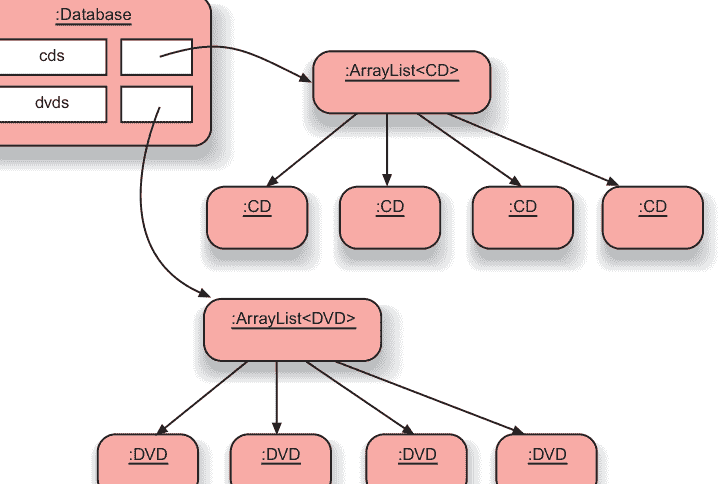

BlueJ 显示的相应类图如图 8.4 所示。注意，BlueJ 显示的是略微简化的图：标准 Java 库中的类（在此例中 `ArrayList`）没有显示。相反，该图侧重于用户定义的类。此外，BlueJ 在图中没有显示字段和方法名称。

在实践中，为了实现一个完整的 DoME 应用，我们会有更多的类来处理诸如将数据保存到文件以及提供用户界面。这些与目前的讨论关系不大，因此我们现在将跳过这些细节，专注于对这里提到的核心类进行更详细的讨论。

## 8.1 DoME 示例

图 8.4
DoME 的 BlueJ 类图

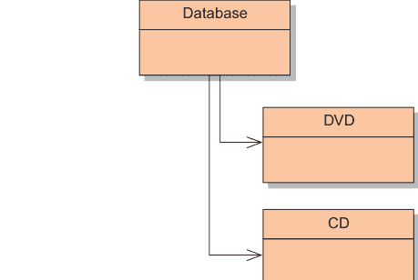

### 8.1.2 DoME 源代码

到目前为止，这三个类（`CD`、`DVD` 和 `Database`）的设计非常直观。将这些想法转换为 Java 代码也同样简单。代码 8.1 显示了 `CD` 类的源代码。它定义了相应的字段，在构造函数中设置了所有不会随时间变化的数据项，并为 `gotIt` 标记和注释（comment）提供了访问器（accessor）和变异器（mutator）。它实现了 `print` 方法向终端写入一些详细信息。

注意，我们目前并不打算在任何意义上使这个实现变得完整。它的作用是提供一个像这样的类可能是什么样的初步感受。我们将此作为后续关于继承讨论的基础。

#### 代码 8.1
CD 类的源代码

```java
/**
 * The CD 类表示一个音乐 CD 对象。关于 CD 的
 * 信息被存储并可以检索。
 *
 * @author Michael Kölling and David J. Barnes
 * @version 2008.03.30
 */
public class CD {
    private String title;
    private String artist;
    private int numberOfTracks;
    private int playingTime;
    private boolean gotIt;
    private String comment;

    /**
     * 初始化 CD。
     * @param theTitle CD 的标题。
     * @param theArtist CD 的艺人。
     * @param tracks CD 上的轨道数量。
     * @param time CD 的播放时间。
     */
    public CD(String theTitle, String theArtist, int tracks, int time) {
        title = theTitle;
        artist = theArtist;
        numberOfTracks = tracks;
        playingTime = time;
        gotIt = false;
        comment = "";
    }

    /**
     * 为此 CD 输入注释。
     * @param comment 要输入的注释。
     */
    public void setComment(String comment) {
        this.comment = comment;
    }

    /**
     * 返回 CD 的注释。
     */
    public String getComment() {
        return comment;
    }

    /**
     * 设置我们是否拥有此 CD 的标记。
     * @param ownIt 如果拥有为 true，否则为 false。
     */
    public void setOwn(boolean ownIt) {
        gotIt = ownIt;
    }

    /**
     * 如果我们拥有此 CD 的副本则返回 true。
     */
    public boolean getOwn() {
        return gotIt;
    }
```


#### 代码 8.1 延续
CD 类的源代码
让我们 CD 代码与 DVD 类源代码 8.2 进行对比。观察这两个类，我们很快发现它们非常相似。这并不意外，因为它们的目的是相似的（都用于存储媒体项）。区别仅在于细节，例如某些字段和 `print` 方法。

#### 代码 8.2
DVD 类的源代码

```java
/**
 * DVD 类表示一个 DVD 对象。关于 DVD 的
 * 信息被存储并可以检索。
 *
 * @author Michael Kölling and David J. Barnes
 * @version 2008.03.30
 */
public class DVD {
    private String title;
    private String director;
    private int playingTime;
    private boolean gotIt;
    private String comment;

    /**
     * DVD 类对象的构造函数。
     * @param theTitle DVD 的标题。
     */
```

#### 代码 8.2 延续
DVD 类的源代码

```java
    * @param theDirector DVD 的导演。
     * @param time DVD 的播放时间。
     */
    public DVD(String theTitle, String theDirector, int time) {
        title = theTitle;
        director = theDirector;
        playingTime = time;
        gotIt = false;
        comment = "";
    }

    /**
     * 为此 DVD 输入注释。
     * @param comment 要输入的注释。
     */
    public void setComment(String comment) {
        this.comment = comment;
    }

    /**
     * 返回 DVD 的注释。
     */
    public String getComment() {
        return comment;
    }

    /**
     * 设置我们是否拥有此 DVD 的标记。
     * @param ownIt 如果拥有为 true，否则为 false。
     */
    public void setOwn(boolean ownIt) {
        gotIt = ownIt;
    }

    /**
     * 如果我们拥有此 DVD 的副本则返回 true。
     */
    public boolean getOwn() {
        return gotIt;
    }
}
```

#### 代码 8.2 延续
DVD 类的源代码

```java
    /**
     * 将此 DVD 的详细信息打印到终端。
     */
    public void print() {
        System.out.print("DVD: " + title + " (" + playingTime + " mins)");
        if (gotIt) {
            System.out.println("");
        } else {
            System.out.println();
        }
        System.out.println(director);
        System.out.println(comment);
    }
}
```

接下来，让我们检查 Database 类源代码（代码 8.3）。它也很简单。它定义了两个列表（基于 `ArrayList`）来持有 CD 集合和 DVD 集合。在构造函数中创建了空列表。它提供了两个添加方法——一个添加 CD，一个添加 DVD。名为 `list` 的最后一个方法向终端提供所有 CD 和 DVD 的列表。

#### 代码 8.3
Database 类源代码

```java
import java.util.ArrayList;

/**
 * Database 类提供了存储 CD 和
 * DVD 对象的设施。可以向终端打印所有 CD 和 DVD。
 *
 * 此版本没有将数据保存到磁盘，也没有
 * 提供任何搜索功能。
 *
 * @author Michael Kölling and David J. Barnes
 * @version 2008.03.30
 */
public class Database {
    private ArrayList<CD> cds;
    private ArrayList<DVD> dvds;

    /**
     * 构建一个空的 Database。
     */
    public Database() {
        cds = new ArrayList<CD>();
        dvds = new ArrayList<DVD>();
    }

    /**
     * 将 CD 添加到数据库。
     * @param theCD 要添加到数据库的 CD。
     */
    public void addCD(CD theCD) {
        cds.add(theCD);
    }

    /**
     * 将 DVD 添加到数据库。
     * @param theDVD 要添加到数据库的 DVD。
     */
    public void addDVD(DVD theDVD) {
        dvds.add(theDVD);
    }

    /**
     * 向终端打印所有当前存储的 CD 和 DVD 列表。
     */
    public void list() {
        // 打印 CD 列表
        for (CD cd : cds) {
            cd.print();
            System.out.println(); // 项目之间的空行
        }

        // 打印 DVD 列表
        for (DVD dvd : dvds) {
            dvd.print();
            System.out.println(); // 项目之间的空行
        }
    }
}
```

注意，这绝不是一个完整的应用程序。它还没有用户界面（因此无法在 BlueJ 之外使用），而且输入的数据没有保存到文件系统。这意味着每次程序结束时输入的数据都会丢失。此外，输入和编辑数据以及搜索和显示数据的功能对于我们的需求来说不够灵活。

然而在我们的背景中并不重要。我们可以以后改进这个应用程序。基础结构已经存在，并且可以运行。这足够我们讨论这种设计的问题以及可能的改进。

- **练习 8.1** 打开项目 `dome-v1`。它包含了我们在这里讨论的完全类。创建 CD 对象和一些 DVD 对象。创建一个 Database 对象。将 CD 和 DVD 输入数据库，然后列出数据库的内容。
- **练习 8.2** 尝试以下操作：创建一个 CD 对象。将其输入数据库。你会发现该 CD 没有关联的注释。在对象台上（你输入数据库的那个）为 CD 添加注释。当你再次列出数据库时，列出的 CD 是否带有注释？尝试一下。解释你的行为。

### 8.1.3 对 DoME 应用的讨论

尽管应用程序尚未完成，但我们已经完成了最重要的部分。我们定义了应用程序的核心：存储基本信息的数据结构。

到目前为止这相当直观，我们可以继续设计仍然缺失的部分。在此之前，我们将讨论到目前为止解决方案的质量。

# 第8章 通过继承改进结构

不仅关于 CD 和 DVD，也关于书籍。书籍看起来也足够相似，我们应该很容易修改我们的应用程序来支持它们。我们将引入另一个类 `Book`，并本质上为我们已经在 CD 和 DVD 类中拥有的源代码编写第三个版本。然后，我们必须处理 `Database` 类，添加另一个列表、另一个对象、添加另一个方法，并在第一个方法中添加另一个循环。

我们还会对第四种类型的物品进行同样的操作。我们做的越多，代码重复问题就变得越严重，以后进行更改也变得越困难。当我们对这类事情感到不适时，这是一个说明可能有更好方法的良好指标。对于这种特殊情况，面向对象的语言提供了一种独特的特性，这对涉及相似类集合的程序具有巨大影响。在接下来的章节中，我们将介绍这种被称为“继承”的特性。

### 8.2 使用继承

概念：
继承允许我们将一个类定义为另一个类的扩展。

继承是一种为重复问题提供解决方案的机制。思想非常简单：不再独立地定义 CD 和 DVD 类，而是首先定义一个包含我们所有共同部分的类。我们将这个类命名为 `Item`。然后我们可以声明 CD 是一个 `Item`，DVD 也是一个 `Item`。最后，我们将 CD 需要的额外细节添加到 CD 类中，将 DVD 需要的额外细节添加到 DVD 类中。这种技术的本质特征是我们只需要描述一次共同特征。

图 8.5 显示了这种新结构的类图。它显示了顶部的 `Item` 类，它定义了所有物品（CD 和 DVD）共有的字段和方法。在下面

图 8.5
继承自 Item 的 CD 和 DVD

| Item |
| --- |
| title |
| playingTime |
| gotIt |
| comment |
| setComment |
| getComment |
| setOwn |
| getOwn |
| print |

| CD |
| --- |
| artist |
| numberOfTracks |

| DVD |
| --- |
| director |
| getDirector |


## 8.3 继承层次结构

`Item` 类下面显示了 CD 和 DVD 类，它们只持有每个特定类特有的字段和方法。（我们在这里添加了三个方法：CD 类中的 `getArtist` 和 `getNumberOfTracks`，以及 DVD 类中的 `getDirector`，用以说明 CD 和 DVD 类可以定义它们自己的方法。）

这种面向对象编程的新特性需要一些新术语。在这种情况下，我们说 `CD` 类继承自 `Item` 类。DVD 也继承自 `Item`。在谈论 Java 程序时，有时也会使用 `class CD extends class Item` 这种表达式，因为 Java 使用 `extends` 关键字来定义继承关系（我们很快就会看到这一点）。

类图中的箭头（通常用空心箭头头绘制）表示继承关系。

概念：
一个类是被另一个类扩展的类。

`Item` 类（被继承的类）是父类或超类。继承类（本例中的 CD 和 DVD）被称为子类。在书中我们将使用“超类”（superclass）和“子类”（subclass）来指代继承关系中的类。

继承有时也是一种“是”（is-a relationship）关系。子类是超类的特化。我们可以说“CD 是一个物品”，“DVD 是一个物品”。

使用继承的方法现在显而易见。CD 的实例将拥有 `CD` 类和 `Item` 类中定义的所有字段。（CD 继承了来自 `Item` 的字段）。DVD 的实例将拥有 `DVD` 和 `Item` 中定义的所有字段。我们实现了以前的结果，但我们只需要定义一次 `title`、`playingTime`、`gotIt` 字段（但我们可以在两个地方使用它们）。

方法也是如此：子类的实例拥有在超类和子类中定义的所有方法。通常情况下，我们可以说：CD 是一个物品，CD 对象拥有物品拥有的一切；DVD 也是一个物品，它拥有物品拥有的一切，以及更多。

因此，继承允许我们创建两个非常相似的类，避免了重复编写相同部分。继承还有许多其他优势，我们将在下面讨论。不过，我们将从另一个通用视角观察继承层次结构。

## 8.3 继承层次结构

继承的使用比上面示例中显示的要通用得多。两个以上的子类可以继承同一个超类，而子类反过来也可以是其他子类的超类。这些类随后形成继承层次结构。

概念：
通过继承关系链接的类形成继承层次结构。

继承层次结构最为人知的例子可能是生物学家使用的物种分类。图 8.6 显示了一小部分。我们可以看到贵宾犬是狗，狗是哺乳动物，哺乳动物是动物。

我们对贵宾犬了解一些，例如它们是活着的，它们会叫，它们吃肉，而且它们会产下幼崽。通过仔细观察，我们发现了一些

这些特征并不是因为它们是贵宾犬，而是因为它们是狗。原理很简单。继承是一种抽象技术，让我们能够根据某些标准对对象进行分类。

> 练习 8.3 为人们绘制一个继承层次结构。例如，如果你是一个学生，那么

## 8.4 Java 中的继承

在讨论继承的更多细节之前，我们将查看 Java 语言是如何表达继承的。这里是 `Item` 类的源代码片段：

```java
public class Item {
    private String title;
    private int playingTime;
    private boolean gotIt;
    private String comment;
    // 省略构造函数和方法
}
```

到目前为止这个类并没有特别。它从普通的类定义开始，并以通常的方式定义物品字段。接下来，我们检查 `CD` 类的源代码：

```java
public class CD extends Item {
    private String artist;
    private int numberOfTracks;
    // 省略构造函数和方法
}
```

这里有两个值得注意的地方。首先，`extends` 关键字定义了继承关系。“extends Item” 短语指定该类是 `Item` 类的子类。

其次，`CD` 类只定义了 CD 特有的字段（artist 和 numberOfTracks）。来自 `Item` 的字段是被继承的，不需要在这里列出。然而，`CD` 类的对象将拥有 `title`、`playingTime` 等字段。

接下来，让我们看看 `DVD` 的源代码：

```java
public class DVD extends Item {
    private String director;
    // 省略构造函数和方法
}
```

该类遵循与 `CD` 类相同的模式。它使用 `extends` 关键字将其定义为 `Item` 的子类，并定义了它自己的字段。

### 8.4.1 继承与访问权限

对于其他类的对象，DVD 或 CD 对象看起来就像所有其他类型的对象一样。因此，在子类或超类中定义为公有的成员可以被其他类访问，但定义为私有的成员将是不可访问的。事实上，私有性规则也适用于子类及其超类之间：子类无法访问其超类的私有字段。因此，如果子类方法需要访问或更改超类的私有字段，那么子类需要提供适当的访问和/或修改方法。子类对象可以调用超类中定义的任何公共方法，就像这些方法定义在子类本地一样——不需要变量，因为所有方法都属于同一个对象。

### 8.4.2 继承与初始化

当我们创建一个对象时，该类的构造函数负责将所有对象字段初始化为某些合理状态。我们必须更仔细地观察在继承自其他类的类中是如何完成这一点的。

当我们创建一个 CD 对象时，我们向 CD 的构造函数传递了几个参数：标题、艺术家名称、曲目数量和播放时间。其中一些参数包含在 Item 类中定义的字段的值，另一些则包含在 CD 类中定义的字段的值。所有这些字段都必须被正确地初始化，代码 8.4 显示了在 Java 中实现此点的代码段。

# 代码 8.4
子类和父类的初始化

```java
public class Item {
    private String title;
    private int playingTime;
    private boolean gotIt;
    private String comment;
    /**
```


## 初始化项的字段

* @param title 此项的标题。
* @param time 此项的播放时间。

```java
public Item(String theTitle, int time) {
    title = theTitle;
    playingTime = time;
}
```

# 8.4 Java 中的继承

## 子类和父类字段的初始化

```java
gotIt = false;
comment = "*";
}

// 省略方法

public class CD extends Item {
    private String artist;
    private int numberOfTracks;

    /**
     * CD 类对象的构造函数
     * @param title CD 的标题。
     * @param artist CD 的艺术家。
     * @param tracks CD 的曲目数量。
     * @param time CD 的播放时间。
     */
    public CD(String theTitle, String theArtist, int time) {
        super(theTitle, time);
        artist = theArtist;
        numberOfTracks = tracks;
    }

    // 省略方法
}
```

在这里可以观察到一些现象。首先，`Item` 类有一个构造函数，尽管我们并不打算直接创建 `Item` 类的实例。这个构造函数接收初始化 `Item` 字段所需的参数，并包含了执行此初始化的代码。

其次，`CD` 构造函数接收初始化 `Item` 和 `CD` 字段所需的参数。它随后包含了以下行代码：

```java
super(theTitle, time);
```

关键字 `super` 是从子类构造函数对父类构造函数的调用。它的效果是 `Item` 构造函数作为 `CD` 构造函数的一部分被执行。当

> 目前，没有什么可以阻止我们创建 `Item` 对象，尽管我们在设计这些类时的初衷并非如此。

我们创建一个 `CD`，`CD` 构造函数被调用，它作为其第一语句调用 `Item` 构造函数。`Item` 构造函数初始化字段，然后返回 `CD` 构造函数，初始化剩余字段。在 Java 中，子类必须作为第一语句调用父类构造函数。只有当父类具有默认构造函数（无参数的构造函数）时，这样做才有效：

```java
super();
```

如果父类只有带参数的构造函数，你必须显式地调用它们。

> **练习 8.7** 在 `CD` 构造函数中设置断点。进入 `Item` 构造函数。观察字段如何初始化。

## 第 8 章 使用继承改进结构

### DoME：添加类型

现在我们建立了继承层次结构，添加类型变得简单得多。由于新类型可以定义为 `Item` 的子类，只需要添加与 `Item` 代码即可。

现在想象我们也想将桌游游戏存储到数据库中。毕竟这是一个“多媒体娱乐数据库”，而桌游游戏也是娱乐，只是使用了低技术媒介。

我们可以在 `Item` 类下添加第四个子类。然而，有时仔细分析关系是有用的。视频游戏和桌游游戏都有“最大人数”属性。如果我们不在 `VideoGame` 和 `BoardGame` 类中都定义这个字段就很好。这将是另一个代码重复的例子（我们将重复该字段以及相应的变器方法）。第一个想法可能是让 `BoardGame` 成为 `VideoGame` 的子类。通过这种方式，我们将继承 `numberOfPlayers` 字段及其配套方法，从而避免重复编写。但有一个问题：我们还将继承存储游戏运行平台信息的字段，而这个属性对于桌游游戏并没有意义。

解决方案是重构层次结构。我们可以为所有游戏引入一个新的父类（命名为 `Game`），它仍然是 `Item` 的子类（图 8.8）。现在，所有通用的游戏关系（如人数）都可以在 `Game` 类中定义，而特定信息可以移动到相应的子类中。`BoardGame` 对象现在拥有 `Item`、`Game` 和 `BoardGame` 类的所有字段和方法。

### 图 8.7 带有 VideoGame 类的 DoME 项

| Item | |
|---|---|
| title | |
| playingTime | |
| gotIt | |
| comment | * 方法未显示 |
| CD DVD VideoGame | |
| artist | |
| numberOfTracks | |
| platform | * |

### 图 8.8 在 DoME 中添加更多项目类型

| 项目 | |
| --- | --- |
| 标题<br>播放时间<br>得分<br>评论 | * *未显示的方法* |
| * | |
| * | |

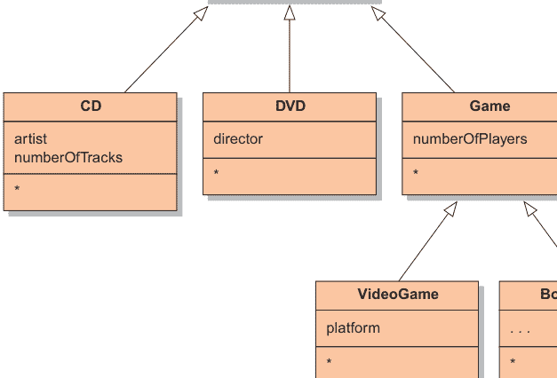

> **练习 8.8** 打开 `dome-v2` 项目。为项目添加一个视频游戏类。创建一些视频游戏对象并测试所有方法是否都按预期工作。

## 8.6 继承的优点（到目前为止）

我们已经看到在 DoME 应用中使用继承的几个优点。在探索继承的其他方面之前，我们先来总结一下到目前为止遇到的通用优点：

- **避免代码重复** 使用继承避免了多次（甚至更多次）编写相同或相似的代码副本。
- **代码复用** 现有的代码可以被重用。如果存在一个与我们现有类类似的类，我们可以对现有类进行子类化并复用现有代码，而无需重新实现所有内容。
- **更容易维护** 维护应用程序变得更加容易，因为类之间的关系被清晰地表达出来。对不同类型子类共享的字段或方法的更改只需要进行一次。
- **可扩展性** 使用继承，在某些方面扩展现有应用程序将变得简单得多。

### 8.7 子类型

> **练习 8.9** 将这些项目按继承层次结构排序：苹果、冰淇淋、面包、水果-Item、谷物、橙子、甜点、巧克力慕斯、法包。
>
> **练习 8.10** 触摸板和鼠标可能存在什么样的继承关系？（我们在这里讨论的是计算机输入设备，而不是小型毛茸茸哺乳动物。）
>
> **练习 8.11** 有时候情况比看起来看起来要复杂。考虑一下：*矩形（Rectangle）*和*正方形（Square）*处于什么样的继承关系？理由是什么？请讨论。

我们还没有研究的是当我们修改项目以使用继承时，`Database` 类中的代码发生了什么变化。代码 8.5 显示了 `Database` 类的完整源代码。我们可以将其与代码 8.3 显示的原始源代码进行比较。

### 代码 8.5 Database 的源代码（第二个版本）

```java
import java.util.ArrayList;
import java.util.Iterator;

/**
 * Database 类提供了一个存储娱乐
 * 项目对象的机制。所有项目的列表可以打印
 * 终端终端。
 * 此版本没有将数据保存到磁盘，也没有
 * 提供任何搜索功能。
 * @author Michael Kölling and David J. Barnes
 * @version 2008.03.30
 */
public class Database {
    private ArrayList<Item> items;

    /**
     * 构造一个空的 Database。
     */
    public Database() {
        items = new ArrayList<Item>();
    }

    /**
     * 向数据库添加一个项目。
     */
    public void addItem(Item theItem) {
        items.add(theItem);
    }

    /**
     * 将所有当前存储的项目列表打印到
     * 文本终端。
     */
    public void list() {
        for(Item item : items) {
            item.print();
            System.out.println(); // 项目之间的空行
        }
    }
}
```

我们可以看到，自从改为使用继承后，代码变得显著更短、更简单。在第一个版本（代码 8.3）中所有必须写两次的内容，现在只存在一次。我们有一个集合，一个添加项目的方法，以及 `list` 方法中的一个循环。

我们能够缩短源代码的原因是，在没有使用继承之前，某些逻辑在每个子类中都需要重复编写。

## 8.7 子类化

我们现在使用这种方法将 `DVD` 和 `CD` 添加到数据库：

```java
Database db = new Database();
DVD dvd = new DVD(...);
CD cd = new CD(...);
db.addItem(dvd);
db.addItem(cd);
```

由于子类化的规则，我们只需要一个方法（参数类型为 `Item`）就可以同时添加 `DVD` 和 `CD` 对象。

我们将在下一章详细地讨论子类化。

### 8.7.4 多态变量

Java 中持有对象的变量是**多态变量**（字面意思是：许多形状），这指的是一个变量可以持有不同类型的对象（即声明的类型或该声明类型的任何子类）。多态在面向面向的语言中出现在多种语境中——多态变量只是第一个例子。我们将在下一章更详细地讨论多态的其他形式。

目前，我们只需要观察到使用多态变量可以帮助我们简化 `list` 方法。该方法的体部如下：

```java
for(Item item : items) {
    item.print();
    System.out.println(); // 项目之间留一个空行
}
```

在这里，我们遍历项目列表（存储在变量中的 `ArrayList` 中）。我们取出每个项目并调用它的 `print` 方法。注意，我们取出的实际项目是 `CD` 或 `DVD` 类型，而不是 `Item` 类型。然而，我们可以使用 `Item` 类型的循环，因为变量是多态的。`item` 变量能够持有 `CD` 和 `DVD` 对象，因为它们是 `Item` 的子类。

因此，在这个示例中对继承的使用消除了在 `list` 方法中使用两个独立循环的需求。继承不仅避免了服务器类中的代码重复，也避免了这些类的客户端中的代码重复。

> **注意**：在做练习时，你可能注意到 `print` 方法存在一个问题：并不是所有的细节都打印打印了。解决这个问题需要更多的解释——我们将在下一章进行说明。

> **练习 8.14** 当添加另一个项目子类（例如 `VideoGame` 类）时，`Database` 类需要改变什么？为什么？

### 8.7.5 强制转换

有时，不能将父类类型赋值给子类类型的规则比必要的更严格。如果我们知道一个父类变量持有的是一个子类对象，那么赋值实际上是可以允许的。例如：

```java
Vehicle v;
Car c = new Car();
v = c; // 正确
c = v; // 错误
```

上面的语句将无法编译：我们在最后一行会得到编译器错误，因为不允许将 `Vehicle` 变量赋值给 `Car` 变量。然而，如果我们执行这些语句，我们会发现变量 `v` 实际上包含一个 `Car` 类型的对象，因此赋值将是允许的。编译器并不聪明；它逐行翻译代码，因此它会孤立地查看某一行，而不知道当前 `v` 中存储了什么内容。这被称为**类型丢失**（type loss）。`v` 中对象的类型实际上是 `Car`，但编译器并不知道。

我们可以通过如下使用强制转换运算符显式地告诉变量 `v` 持有一个 `Car` 来解决这个问题：

```java
c = (Car) v; // 好的
```

强制转换运算符由写在变量或表达式后面的括号括起来的类型名称（这里是：`Car`）组成。这样做会让编译器认为该对象是 `Car`，它不会报告错误。在运行时，Java 系统会告诉我们它实际上是 `Car`。如果我们足够小心，一切都是正常的。如果 `v` 中的对象是另一种类型，运行时系统将指示一个错误（`ClassCastException`），程序将停止。

现在考虑这段代码片段，其中 `Bicycle` 也是 `Vehicle` 的子类：

```java
Vehicle v;
Car c;
Bicycle b;
c = new Car();
v = c; // 好的
b = (Bicycle) c; // 编译错误！
b = (Bicycle) v; // 运行时错误！
```

最后两次赋值都会失败。尝试将 `c` 赋值给 `b`（带强制转换）将是一个编译错误。编译器注意到 `Car` 和 `Bicycle` 并不构成子类/父类关系，因此 `v` 永远无法持有 `Bicycle`。尝试将 `v` 赋值给 `b`（带强制转换）在编译时会被接受但在运行时失败，然而 `v` 中的对象不是 `Bicycle` 而是 `Car`，程序将提前终止。

> 异常将在第 12 章中详细讨论。

### 8.8 Object 类

应该尽可能避免强制转换，因为它可能导致运行时错误，而这显然是我们不想要的。在这种情况下，编译器无法帮助我们确保正确性。

在实践中，在结构良好的面向对象程序中很少需要强制转换。在几乎所有情况下，当你代码中使用中使用强制转换时，你都可以重构代码以避免这种情况，并获得一个设计更好的程序。这通常涉及将强制转换替换为类的显式父类（关于这一点在下一章会有更多介绍）。

所有类都有一个父类。因此似乎我们看到的大多数类都没有父类，比如扩展了另一个类的 `DVD` 和 `CD`。事实上，虽然我们可以为类声明显式的父类，但所有没有父类声明的类都隐式继承自一个名为 `Object` 的类。`Object` 是 Java 标准库中的一个类，作为所有对象的父类。

编写如下的类声明：

```java
public class Person {
    ...
}
```

等同于编写 `public class Person extends Object {}`。

Java 编译器会自动为所有没有显式 `extends` 声明的类插入 `Object` 父类，因此你没有必要自己这样做。每一个类（`Object` 类除外）都直接或间接地继承自 `Object`。图 8.10 显示了一些选定的类来解释这一点。

#### 图 8.10：所有类都继承自 Object


为所有对象提供一个公共父类有两个目的：首先，我们可以声明类型为 `Object` 的多态变量来持有任何对象。拥有可以持有任何对象的变量并不总是有用，但在某些情况下这可以很有帮助。其次，`Object` 类定义了一些方法，这些方法对每个对象都是自动可用的。特别重要的是 `toString`、`equals` 和 `hashCode` 方法。第二点将变成了一个有趣的部分，我们将在下一章详细讨论。

## 8.9 自动装箱和包装类

我们已经看到，通过适当的参数化，集合类存储任何对象类型的对象。仍然存在一个问题：Java 有一些类型不是对象类型。

正如我们所知，`int`、`boolean` 和 `char` 等简单类型与对象类型是分开的。它们值不是类的实例，并且不继承 `Object` 类。正因如此，它们不是 `Object` 的子类，通常无法将它们添加到集合中。

这很遗憾。在某些情况下，我们可能想要创建一个 `int` 列表，或者一个 `char` 集合等。我们可以做什么？

Java 解决这个问题的方案是**包装类**（wrapper classes）。Java 中的每个原生类型都有一个对应的包装类，它表示相同的类型，但是一个真实的对象类型。`int` 的包装类称为 `Integer`。简单类型及其包装类的完整列表见附录 B。

下面的示例显式地将原生变量 `ix` 的值包装成一个 `Integer`：

```java
Integer wrap = new Integer(ix);
```

现在 `wrap` 可以轻松地存储在 `ArrayList<Integer>` 集合中，然而，将原始值存储到对象集合中通过名为**自动装箱**（autoboxing）的编译器功能变得更加简单。

当原始值在需要包装类型的上下文中运行时，编译器会自动将原生类型包装成适当的包装对象。这意味着原始类型值可以添加到集合中：

```java
private ArrayList<Integer> markList;
...
public void storeMarkList(int mark) {
    markList.add(mark);
}
```

反向操作——自动拆箱——也会自动执行，从集合中检索可能如下：

```java
int firstMark = markList.remove(0);
```


## 8.10 集合层级结构

Java 库在定义集合类时广泛使用了继承。例如，`ArrayList` 类继承自一个名为 `AbstractList` 的类，而 `AbstractList` 又继承自 `AbstractCollection`。我们在这里不再讨论这种层级结构，因为它在其他可以访问的地方已经有了详细描述。一个很好的描述可以在 Sun Microsystems 的网站上找到：http://java.sun.com/books/tutorial/collections/index.html。

注意，该层级结构的某些细节需要对 Java 接口有理解。我们将在第 10 章讨论这些内容。

- 练习 8.15 使用 Java 标准类库的文档查找集合类的继承层级结构。画一张显示该层级结构的图。

## 8.11 总结

本章介绍了继承的初步概念。Java 中的所有类都排列在一个继承层级结构中。每个类可能有一个显式定义的超类，或者隐式地继承自 `Object` 类。

子类通常代表父类的特化。由于如此，继承关系也被称为“是一个”关系（is-a relationship，例如“汽车是一辆车辆”）。

子类继承父类的所有的字段和方法。对象的子类拥有自身类中声明的所有字段和方法，以及来自所有父类的字段和方法。继承关系可以避免代码重复、重用现有代码，并使应用程序更具维护性和扩展性。

子类还形成了子类型，这导致了多态变量。子类型对象可以替代父类型对象，并且允许变量持有其声明类型的子类实例的对象。

继承允许设计出更易维护、更灵活的类结构。本章仅包含了为了改进程序结构而使用继承的介绍——继承的更多用法及其优点将在后续章节中介绍。

## 本章引入的术语

继承（inheritance）、超类（superclass）、子类（subclass）、is-a、继承层级结构（inheritance hierarchy）、抽象类（abstract class）、子类型（subtype）、多态变量（polymorphic variable）、类型丢失（type loss）、强制转换（cast）、自动装箱（autoboxing）、包装类（wrapper classes）

## 概念总结

- **inheritance 继承** 继承允许我们将一个类定义为另一个类的扩展。
- **superclass 超类** 超类是一个被另一个类扩展的类。
- **subclass 子类** 子类是一个扩展（继承自）另一个类的类。它继承其超类所有的字段和方法。
- **inheritance hierarchy 继承层级结构** 通过继承关系链接的类形成了一个继承层级结构。
- **superclass constructors 超类构造函数** 子类的构造函数必须始终将其超类构造函数的调用作为第一条语句。如果源代码中没有包含调用，Java 将尝试自动插入。
- **reuse 重用** 继承允许我们在新的语境下重用以前编写的类。
- **subtypes 子类型** 类似于类层级结构，类型形成了一个类型层级结构。由子类定义定义的类型是其超类的子类型。
- **variables and subtypes 变量与子类型** 变量可以持有其声明类型的对象，或其声明类型的任何子类型的对象。
- **substitution 替换** 在任何需要父类型对象的地方都可以子类型对象。这被称为替换。
- **Object** 所有没有显式超类的类都以 **Object** 作为其超类。
- **Autobox 自动装箱** 当在需要包装类型的语境中使用原始类型值时，会自动执行自动装箱。

**练习 8.16** 回到第 1 章的 lab 课程项目。向项目中添加教师（每个实验课程可以有多个学生和一名教师）。使用继承来避免学生和教师之间的代码重复（两者都有姓名、联系方式等）。

**练习 8.17** 画一个表示计算机系统部分部分的继承层级结构（处理器、内存、磁盘驱动器、CD 驱动器、打印机、扫描仪、键盘、鼠标等）。

**练习 8.18** 查看下面的代码。你有四个类（O, X, T, 和 M）以及这些类中的每一个变量。

```
O;
X;
T;
M;
```

以下赋值都是合法的（假设它们通过编译）：

```
m = t;
m = x;
o = t;
```

以下赋值都是非法的（会导致编译器错误）：

```
o = m;
o = x;
x = o;
```

对这些类的关系有什么看法？

**练习 8.19** 画出 `AbstractList` 及其所有直接和间接子类的继承层级结构。

## 本章的核心概念

- 继承
- 静态类型
- 动态变量
- 多态

## 9.1 问题：DoME 的 print 方法

当你在第 8 章实验 DoME 时，你可能注意到第二个版本——带有继承的版本存在问题。让我们来看一个例子。假设我们使用以下数据创建 CD 和 DVD：

```java
class Item {
    private String artist;
    private int tracks;

    public Item(String artist, int tracks) {
        this.artist = artist;
        this.tracks = tracks;
    }

    public void print() {
        System.out.println("Artist: " + artist + ", Tracks: " + tracks);
    }
}

class CD extends Item {
    private String label;

    public CD(String artist, int tracks, String label) {
        super(artist, tracks);
        this.label = label;
    }

    public void print() {
        System.out.println("Label: " + label);
    }
}

class DVD extends Item {
    private String director;

    public DVD(String artist, int tracks, String director) {
        super(artist, tracks);
        this.director = director;
    }

    public void print() {
        System.out.println("Director: " + director);
    }
}
```

如果我们尝试从 `Item` 的 `print` 方法访问 `CD` 的 `artist` 字段，将报告错误。这说明了一个重要的原则：继承是单向的：`CD` 继承了 `Item` 的字段，但 `Item` 仍然不知道它的子类。

### 静态类型和动态类型

解决开发完整多态方法的问题引导我们进入静态和动态类型以及方法查找的讨论。但让我们从开始。

解决该问题的第一次尝试是将 `print` 方法移动到子类中。当我们尝试将 `print` 方法从 `Item` 移动到子类时，我们发现遇到了一些问题：项目不再编译。存在两个根本性问题：

- 在 `CD` 和 `DVD` 类中出现错误，因为我们无法访问超类的字段。
- 在 `Database` 类中出现错误，因为它找不到 `print` 方法。

第一类错误的原因是 `Item` 中的字段具有私有访问权限，因此对任何其他类（包括子类）都是不可见的。由于我们不希望破坏封装并将这些字段公开化，解决此问题的简单方法是为这些定义公共的访问方法。

### 9.2 静态类型与动态类型

它们。然而，在 9.9 节中，我们将引入另一种访问类型，它专门设计用于支持父类-子类关系。

第二种错误的原因需要更详细的解释，将在下一节中进行探讨。

#### 9.2.1 在 Database 中调用 print

首先，我们调查在 `Database` 中调用 `print` 方法的问题。`Database` 类中相关的代码如下：

```java
for(Item item : items) {
    item.print();
    System.out.println();
}
```

`for` 语句从集合中获取 item；循环体内部的第一条语句尝试在 item 上调用 `print` 方法。编译器告诉我们它找不到该 item 的 `print` 方法。

一方面，这看起来是合逻辑的；`Item` 不再有 `print` 方法了（见图 9.2）。另一方面，这是非法的且令人恼的。我们知道集合中的每个对象实际上都是 `DVD` 或 `CD` 对象，而两者都有 `print` 方法。这意味着无论 item 是 `CD` 还是 `DVD`，`item.print()` 都应该能够工作——我们知道它拥有。

为了理解它为什么不起作用，我们需要更仔细地观察。考虑以下语句：

```java
Car c1 = new Car();
```

我们说 `c1` 的类型是 `Car`。在遇到继承之前，没有必要区分所谓的“`c1` 的类型”指的是“变量 `c1` 的类型”还是“存储在 `c1` 中的对象的类型”。这并不重要，因为变量的类型和对象的类型总是相同的。

现在我们开始讨论子类型（subtyping），我们需要更加严谨。考虑以下语句：

```java
Vehicle v1 = new Car();
```

`v1` 的类型是什么？取决于我们精确指的“`v1` 的类型”。变量 `v1` 的类型是 `Vehicle`；存储在 `v1` 中的对象类型是 `Car`。通过子类型和替换规则，我们现在有了变量类型与其中存储的对象类型不完全相同的情况。

让我们使用一些术语来方便讨论关于这个变量的问题：

- 我们将变量的类型称为**静态类型**（static type），因为它是在源代码中声明的——即程序的静态表示。
- 我们将存储在变量中的对象的类型称为**动态类型**（dynamic type），因为它取决于运行时的赋值——即程序的动态行为。

## 第 9 章 更多关于继承

因此，观察上面的语句，我们现在可以更准确地描述：`v1` 的静态类型是 `Vehicle`，`v1` 的动态类型是 `Car`。

我们也可以对 `Database` 类中调用 item 的 `print` 方法进行类似的表述。在调用时：

```java
item.print();
```

`item` 的静态类型是 `Item`，而动态类型是 `CD` 或 `DVD`（图 9.3）。假设我们已经向数据库输入了 CD 和 DVD 对象，我们不知道具体是哪一个。

图 9.3
类型为 Item 的变量包含类型为 DVD 的对象

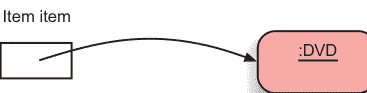

编译器报告了错误，因为对于类型检查，使用的是静态类型。动态类型只在运行时已知，所以如果编译器想在编译时进行任何检查，它只能使用静态类型。`Item` 的静态类型是 `Item`，而 `Item` 没有 `print` 方法。所有已知的 `Item` 子类都有 `print` 方法这一点并没有区别。在这方面，编译器的行为是合理的，因为它无法保证 `Item` 的所有子类确实定义了 `print` 方法，而这在实践中是无法检查的。

换句话说，为了让其工作，`Item` 类必须有一个 `print` 方法，我们似乎回到了最初的问题，没有任何进展。

> 练习 9.2 在你的项目中，在 `Item` 类中再次添加 `print` 方法。现在，编写该方法体，使用单语句打印标题。然后修改 `CD` 和 `DVD` 的 `print` 方法，使得 `CD` 版本输出艺术家，`DVD` 版本输出导演。这消除了遇到的其他错误（我们将在下文中回到这些）。

你现在应该有一个对应图 9.4 的情况，其中三个类都有 `print` 方法。编译你的项目。（如果有错误，删除它们。这种设计应该是可以工作的。）

在执行之前，预测哪一个 `print` 方法会被调用。

尝试一下。将 CD 和一个 DVD 输入数据库并调用 `Database` 列表。执行了哪些 `print` 方法？你的预测正确吗？尝试解释你的观察。

图 9.4
打印，版本 3：
子类和父类中的方法

| Database |
| --- |
|  |

| Item |
| --- |
| ... |
| print |

| CD | DVD |
| --- | --- |
| ... | ... |
| print | print |

### 9.3 重写

我们将讨论的下一个设计是父类和子类都有 `print` 方法（图 9.4）。所有 `print` 方法的签名完全相同。

代码 9.1 显示了三个类源码的详细信息。`Item` 有一个 `print` 方法，打印在 `Item` 中声明的字段（CD 和 DVD 共同字段）。

## 第 9 章 更多关于继承

# 图 9.6
带继承的方法查找

```java
v1.print();
```

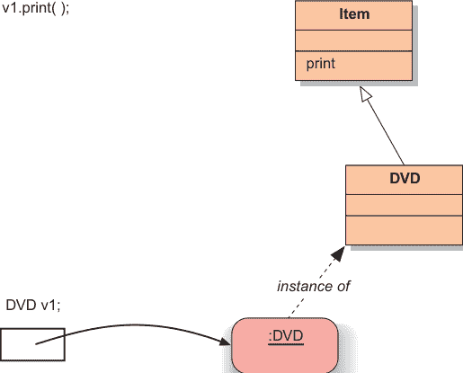

我们执行了完全相同的语句。方法调用的启动方式相似：再次执行了上一个场景中的第 1 到 3 步，但随后的处理方式有所不同：

- 在 `DVD` 类中没有找到 `print` 方法。
- 因为没有找到匹配的方法，因此在父类中搜索匹配的方法。如果在父类中没有找到该方法，则搜索下一个父类（如果存在）。这个过程将一直持续到继承层级的顶端——`Object` 类，直到找到一个该方法为止。请注意，在运行时一定能够找到匹配的方法，否则该类将无法编译。
- 在我们的类中，在 `Item` 类中找到了 `print` 方法，并将将其执行。

此场景说明了对象如何继承方法。在父类中找到的任何方法都可以在子类对象上调用，并被正确地找到和执行。

接下来，我们来看最有趣的场景：带有多态变量和方法重写的方法查找（图 9.7）。该场景与之前相似，但有两处变化：

- 变量 `v1` 的声明类型现在是 `Item`，而不是 `DVD`。
- `print` 方法在 `Item` 类中定义，然后在 `DVD` 类中被重新定义（重写）。

这个场景对于理解我们 DoMe 应用的行为以及寻找解决 `print` 方法问题的方案至关重要。

方法执行的步骤与场景 1 中的第 1–4 步完全相同。请再次阅读它们。

## 9.5 方法中的 super 调用（Super call）

图 9.7 带有多态和重写的方法查找

- 在动态类型不等于静态类型的情况下，方法查找并不并不使用任何特殊的查找规则。我们观察到的行为是通用规则的结果。
- 首先找到并执行哪种方法取决于动态类型，而不是静态类型。换句话说，变量 `v1` 的声明类型为 `Item` 这一事实没有任何影响。我们正在处理的实例是 `DVD` 类——这才是关键。
- 子类中的重写方法优先级高于父类方法。由于方法查找是从实例的动态类（继承层级的底部）开始的，因此最后重定义的方法会被首先找到，并执行这一个。
- 当一个方法被重写时，只会执行最后一个版本（继承层级中最低的版本）。任何父类中相同方法的版本不会被自动执行。

有一些值得注意的观察结果：

这解释了我们在 DoME 项目中观察到的行为。打印项目时，只有子类（`CD` 和 `DVD`）中的 `print` 方法被执行，导致列表显示不完整。在下一节中，我们将讨论如何修复这个问题。

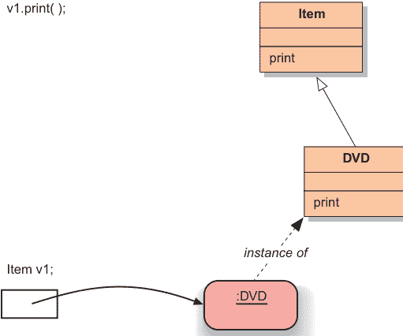

## 方法中的 super 调用

现在我们详细知道了重写方法是如何执行的，就可以理解问题的解决方案了。很容易看出，我们想要实现的是：对例如 `CD` 对象的 `print` 方法的每次调用，导致同一个对象的 `Item` 类的 `print` 方法和 `CD` 类的方法都被执行。（在本章稍后的部分将讨论不同的解决方案。）

事实上，这其实很容易实现。我们可以使用 `super` 构造，我们已经在第 8 章的构造函数上下文中遇到过它。代码 9.2 通过 `CD` 类的 `print` 方法说明了这一思想。

### 代码 9.2
使用 super 调用重新定义方法

```java
public void print() {
    super.print();
    System.out.println(" " + artist);
    System.out.println("tracks: " + numberOfTracks);
}
```

当现在在 `CD` 对象上调用 `print` 时，最初将调用 `CD` 类中的 `print` 方法。通过这第一条语句，该方法将反过来调用父类的 `print` 方法，从而打印通用项目信息。当控制权从父类方法返回时，子类方法的剩余语句将打印 `CD` 类的特殊字段。

有三个值得注意的细节：

- 与构造函数中的 `super` 调用不同，父类方法的方法名是显式写出的。方法中的 `super` 调用始终具有如下形式：

```
super.method-name (parameters)
```


当然，参数列表可以是空的。

- 同样，与构造函数中 `super` 调用的规则不同，方法中的 `super` 调用可能发生在该方法的任何位置。它不必是第一条语句。
- 与构造函数中的 `super` 调用不同，系统不会生成自动 `super` 调用，也不需要 `super` 调用；它是完全可选的。默认行为产生子类方法完全隐藏（即重写）父类中相同方法版本的效果。

练习 9.3 修改你最新版本的 DoMe 项目，在 `print` 方法中包含 `super` 调用。测试它。它的行为符合预期吗？你认为这个解决方案有任何问题吗？

练习 9.4 修改输出格式，以便在细节前面打印字符串“CD:”或“DVD:”（取决于项目的类型）。

有必要重复第 8.7.1 节中阐述的内容；在没有方法重写的情况下，非私有方法可以直接访问父类版本。`super` 调用只有在需要时才使用。

## 方法多态

我们在之前的章节（9.2–9.5）中讨论的，多态的另一种形式，即多态方法分发。记住，多态变量意味着方法调用是多态的，取决于对象的动态类型。类似地，Java 方法调用也是多态的，例如，语句

```java
item.print();
```

可以调用不同的方法，取决于 `item` 的动态类型。

## Object 方法：toString

在第 8 章中我们提到，通用父类 `Object` 实现了一些方法。这些方法中最有趣的是 `toString`，我们在这里介绍它；如果你对细节感兴趣，可以查阅文档。练习 9.5 在文档中查找 `toString`。它的参数是什么？它的返回类型是什么？

`toString` 方法的目的是创建对象的字符串表示。这对于任何文本表示的对象都很有用，但为了调试目的。例如，如果我们对 `DVD` 对象调用 `toString`，我们将得到类似的字符串：

```
DVD@6dd
```

返回值仅仅显示类名和一个数字。¹

练习 9.6 你可以轻松尝试这样做。创建一个 `DVD` 类的对象，然后调用 `toString` 方法。

> ¹该数字实际上是存储对象的内存地址。除了确定身份外，它并不有用。如果两次调用的数字相同，说明我们查看同一个对象。如果不同，说明有两个不同的对象。

322

第 9 章 更多关于继承

为了使这个方法更有用，我们通常会在自己的类中重写它。例如，我们可以将 `Item` 的 `print` 方法定义为调用 `toString` 方法。在这种情况下，`toString` 方法不会打印细节，而是创建一个带有文本的字符串。代码 9.3 修改了源代码。

### 代码 9.3
针对 Item 和 CD 的 `toString` 方法

```java
public class Item {

    ...

    public String toString() {

        String line1 = title + " (" + playingTime + " mins)";

        if(gotIT) {

            return line1 + "*\n" + " " + comment + "\n";

        } else {

            return line1 + "*\n" + " " + comment + "\n";

        }

    }

    public void print() {

        System.out.println(toString());

    }

}

public class CD extends Item {

    public String toString() {

        return super.toString() + " " + artist +

               "\n tracks: " + numberOfTracks + "\n";

    }

    public void print() {

        System.out.println(toString());

    }

}
```

根结底，我们计划从这些类中完全删除 `print` 方法。只定义 `toString` 方法的一个巨大好处是，我们并不强制要求 `Item` 类如何处理这些描述文本。原始版本总是将文本打印到输出终端。现在，任何客户端（例如 `Database` 类）都可以自由地对这些文本进行任何操作。它可以将文本显示在图形用户界面的文本区域中、保存到文件中、通过网络发送，或者像之前一样，打印到终端。

## 9.7 对象方法：toString

`System.out.println(item.toString())` 语句现在可以写如下：

```java
System.out.println(item.toString());
```

事实上，`System.out.print` 和 `System.out.println` 方法在这一方面是特殊的：如果其中一个方法的参数不是一个 `String` 对象，那么该方法会自动调用对象的 `toString` 方法。我们不需要显式地编写该调用，而是写成：

```java
System.out.println(item);
```

现在考虑代码 9.4 所示的 `Database` 类列表方法的修改版本。在这个版本中，我们删除了 `toString` 调用。它能够正确地编译和运行吗？

### 代码 9.4
Database 方法的新版本

```java
public class Database {

  // 省略字段、构造函数和其他方法

  /**

   * 将所有当前存储的 CD 和 DVD 列表打印

   * 到文本终端。

   */

  public void list() {

    for(Item item : items) {

      System.out.println(item);

    }

  }

}
```

事实上，该方法的运行结果符合预期。如果你能详细解释这个例子，那么你可能已经很好地理解了在本章和上一章中介绍的大部分概念！以下是对循环内部单个打印语句的详细解释：

- `for` 循环遍历所有项，并将它们放入一个静态类型为 `Item` 的变量中。动态类型是 `CD` 或 `DVD`。
- 由于这些内容被打印到 `System.out` 且不是 `String`，因此它们的 `toString` 方法被自动调用。
- 调用此方法之所以有效，仅仅是因为 `Item` 类（静态类型）拥有 `toString` 方法。（记住：类型检查是针对静态类型进行的。如果 `Item` 没有 `toString` 方法，这种调用将是不允许的。然而，`Object` 类中的 `toString` 方法保证了该方法对任何类都是可用的。）
- 输出正确显示了所有细节，因为每个动态类型（`CD` 和 `DVD`）都重写了 `toString` 方法，而动态方法查找确保了执行被重定义的方法。

# 第 9 章 关于继承的更多

`toString` 方法通常用于调试。通常，如果对象可以以合理的格式轻松打印出来将非常方便。Java 库的大部分类都重写了 `toString`（例如所有的集合都可以像这样打印），通常为我们的类也重写这个方法也是一个好主意。

### 9.8 对象相等性：equals 和 hashCode

通常需要判断两个对象是否“相同”。`Object` 类定义了两个方法：`equals` 和 `hashCode`，它们在确定相似性方面有紧密的联系。当我们使用“相同”这个短语时需要非常小心；因为在论论对象时它可以意味着不同的意思。有时我们想知道不同的变量是否指向同一个对象。当对象作为参数传递给方法时，就会发生这种情况：只有一个对象，但原始引用和变量都指向它。当任何对象赋值给另一个对象时，也会发生这种情况。这些情况被称为**引用相等**。使用 `==` 运算符来测试相等性。因此，如果 `var1` 和 `var2` 指向同一个对象（或均为 `null`），则下面的测试返回 `true`；如果它们指向其他任何内容，则返回 `false`：

```java
var1 == var2
```

引用相等不考虑所指对象的所有内容，只考虑不同变量指向的是同一个对象还是不同的对象。这就是为什么我们还定义了**内容相等**，以区别于引用相等。内容相等性测试是询问两个对象是否相同——即两个对象的内部状态是否相同。这就是为什么我们在第 5 章中拒绝在进行字符串比较时使用引用相等。

两个特定对象之间的相等含义是由对象的类决定的。在这里我们利用每个继承自 `Object` 子类的类都拥有的 `equals` 方法。如果我们需要根据对象的内部状态来定义两个对象相等的含义，就必须重写 `equals` 方法，这允许我们编写如下测试：

```java
var1.equals(var2)
```

图 9.8
访问级别：private, protected, and public

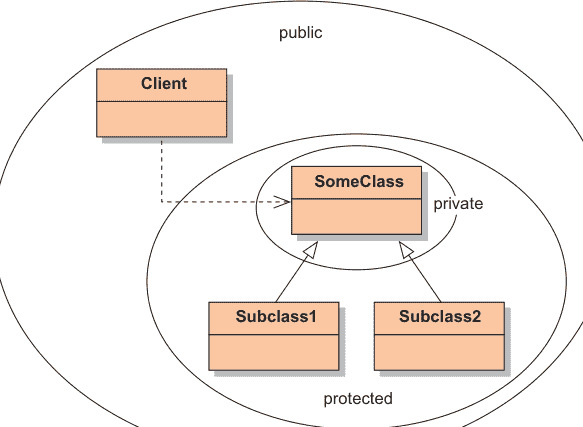

**练习 9.7** 代码 9.2 所示的 `print` 版本产生图 9.9 所示的输出。请重新排列你的 DoME 项目版本中方法中的语句，使其按照图 9.10 所示的方式打印细节。

**练习 9.8** 在 `print` 中必须使用父类调用在格式化输出方面具有某种局限性，因为它取决于父类如何格式化其字段。对 `Item` 类和 `CD` 的 `print` 方法进行任何必要的更改，使其产生图 9.11 所示的输出。你对 `Item` 类所做的任何更改应仅对其子类可见。*提示：* 你可以为此添加 `protected` 访问器方法。

```
CD: Frank Sinatra: A Swingin' Affair *

64 minutes

my favorite Sinatra album

tr: 16
```

```
CD: Frank Sinatra: A Swingin' Affair *

16 tracks, 64 minutes

my favorite Sinatra album
```

**图 9.9**
`print` 的可能输出：在 `print` 开头的父类调用（阴影部分为由父类方法打印的区域）

```
* Swingin' Affair (64 mins)*

my favorite Sinatra album

Frank Sinatra

tracks 16
```

第 9 章 关于继承更多

图 9.10
`print` 的另一种输出（阴影区域为由父类方法打印）

| CD: Frank Sinatra: A Swingin' Affair |
| 64 minutes |
| my favorite Sinatra album |
| tracks: 16 |

图 9.11
`print` 混合子类和父类细节的输出（阴影区域代表父类细节）

| CD: Frank Sinatra: A Swingin' Affair |
| 16 tracks, 64 minutes |
| my favorite Sinatra album |

### 9.10 instanceof 运算符

将继承引入 DoMe 项目的后果之一是 `Database` 只知道 `Item` 对象，而无法区分 `CD` 项目和 `DVD` 项目。这允许所有类型的项目都存储在单个列表中。

然而，假设我们想从列表中检索 `CD` 或仅 `DVD`；我们应该怎么做呢？也许我们想查找具有特定标题的项目；如果 `Item` 类定义了 `getTitle`，这并不是问题，但某些 `CD` 和 `DVD` 有相似的标题。返回什么类型重要吗？

在某些情况下，我们需要在处理了共享父类型后重新发现对象的特定类型。为此，Java 提供了 `instanceof` 运算符。`instanceof` 运算符测试一个对象是否直接或间接地是给定类的实例。该测试：

```java
obj instanceof MyClass
```

如果 `obj` 的动态类型是 `MyClass` 或 `MyClass` 的任何子类，则返回 `true`。左操作数始终是一个对象引用，右操作数始终是类名。因此，`item instanceof CD` 仅当 `item` 是 `CD` 而不是 `DVD` 时才返回 `true`。

使用 `instanceof` 运算符后通常紧接着会将对象引用强制转换为识别出的类型。例如，这里有一些代码来识别项目列表中的所有 `CD` 并将其存储在列表中。

```java
ArrayList<CD> cds = new ArrayList<CD>();

for(Item item : items) {

  if(item instanceof CD) {

    cds.add((CD) item);

  }

}
```

### 9.11 覆盖继承的另一个示例

为了讨论另一个类似继承使用的示例，我们回到第 7 章中的一个项目：zuul 项目。在 `world-of-zuul` 游戏中，我们使用了一组对象来创建一个简单的游戏。章节末尾的练习之一建议你实现一个传送室（一个当你尝试离开它时，它会将你传送到游戏中的某一个随机位置的房间）。我们在这里重新回顾这个练习，因为它的解决方案可以从继承中大大受益。如果你不记得这个项目，请再次快速阅读第 7 章，或者查看你的 zuul 项目。

这个任务没有简单的解决方案。可能有许多不同的解决方案并可以使其工作。尽管如此，某些方案比其他的更好。它们可能更优雅、更易读、更易维护和扩展。

假设我们想要实现此任务，以便当玩家试图离开魔法传送室时，她会自动传送到随机房间。许多人首先想到的最直接的解决方案是在 `Game` 类中处理这个问题，该类实现了玩家的命令。其中一个命令是 'go'，它在 `GoRoom` 方法中实现。其中一个命令是 'go'，它在 `GoRoom` 方法中实现。其中一个命令是 'go'，它在 `GoRoom` 方法中实现。其中一个命令是 'go'，它在 `GoRoom` 方法中实现。其中一个命令是 'go'，它在 `GoRoom` 方法中实现。其中一个命令是 'go'，它在 `GoRoom` 方法中实现。其中一个命令是 'go'，它在 `GoRoom` 方法中实现。其中一个命令是 'go'，它在 `GoRoom` 方法中实现。其中一个命令是 'go'，它在 `GoRoom` 方法中实现。其中一个命令是 'go'，它在 `GoRoom` 方法中实现。其中一个命令是 'go'，它在 `GoRoom` 方法中实现。其中一个命令是 'go'，它在 `GoRoom` 方法中实现。其中一个命令是 'go'，它在 `GoRoom` 方法中实现。其中一个命令是 'go'，它在 `GoRoom` 方法中实现。其中一个命令是 'go'，它在 `GoRoom` 方法中实现。其中一个命令是 'go'，它在 `GoRoom` 方法中实现。其中一个命令是 'go'，它在 `GoRoom` 方法中实现。其中一个命令是 'go'，它在 `GoRoom` 方法中实现。那些核心语句是：

```java
nextRoom = currentRoom.exit(direction);
```

该语句从当前房间获取我们想要去的方向的相邻房间。为了添加我们的传送功能，我们可以将其修改为如下：

```java
if(currentRoom.getName().equals("Transporter room") {

    nextRoom = getRandomRoom();

} else {

    nextRoom = currentRoom.exit(direction);

}
```

这里的想法非常简单：我们只需检查我们是否在传送室里。如果是，我们就通过获取一个随机房间找到该房间（当然，我们必须实现 `getRandomRoom` 方法）。

虽然这个解决方案有效，但它有几个缺点。第一个是，使用字符串（如房间名称）来识别房间是一个坏主意。想象有人想把你的游戏翻译成另一种语言，比如德语。他们可能会更改房间的名字——‘Transporter room’ 变成 ‘Transporterraum’——突然游戏就无法运行！这是一个明显的可维护性问题。第二个方案稍微好一点，将使用实例变量 own房间名称。类似于此：

```java
if(currentRoom == transporterRoom) {

    nextRoom = getRandomRoom();

} else {

    nextRoom = currentRoom.exit(direction);

}
```

第 9 章 关于继承更多

这次，我们假设我们有一个类为 `transporterRoom` 的实例变量，我们在其中存储了传送室的引用。现在它独立于房间名称。这稍微好了一点。

尽管如此，进一步改进的空间。当我们考虑另一个变化时，就能理解这个解决方案的局限性。想象我们想再添加两个传送室。

我们现有设计的一个非常棒的优点是，我们可以在一个地方设置地板，一切仍然可以工作——可维护性满分！对于我们目前的解决方案，这是损坏的。如果我们添加新的传送室，我们必须添加实例变量或数组（指向房间的引用），并且必须修改 getter 方法以添加这些检查。在易更改性方面，我们退步了。

问题是：我们能否找到一种不需要修改命令实现就能添加传送室的解决方案？这是我们的下一个想法。

我们可以在 `Room` 类中添加 `isTransporterRoom` 方法。这样，`Game` 对象就不需要记住所有的房间——房间自己记得。创建房间时，它们可以接收一个指示该房间是否为传送室的布尔标记。`go` 方法可以使用可以使用代码段：

```java
if(currentRoom.isTransporterRoom()) {

    nextRoom = getRandom();

} else {

    nextRoom = currentRoom.getExit(direction);

}
```

我们可以添加尽可能多的传送室——不需要对 `Game` 类进行更多更改。然而，`Room` 类有了一个额外的字段值，该值实际上由于一个或两个实例的性质才需要。这种特殊情况的代码是类设计薄弱的典型指标。如果我们决定引入更多特殊房间子集，每个子集都需要自己的标记和访问方法，这种方法的扩展性也不。

通过继承我们可以做得更好，并实现一个比这更灵活的解决方案。

我们可以实现 `Room` 的子类 `TransporterRoom`。在新类中，我们重写 `getExit` 方法并更改其实现，使其返回一个随机房间：

```java
public class TransporterRoom extends Room {

    /**

* 返回一个随机房间，不受方向参数的影响。

* @param direction 忽略

* @return 一个随机房间。

*/

    public Room getExit(String direction) {
        return findRandomRoom();
    }
}
```

> 4 确保你理解为什么引用相等性测试在这里是最合适的。
> 5 我们可能还会考虑使用 `instanceof`，但这里的重点是这些想法都不是


```java
/*
 * 选择一个随机房间。
 * @return 一个随机房间。
 */
private Room findRandomRoom()
{
    // 省略实现细节
}
```

这种解决方案的优雅之处在于，原始的 `Game` 或 `Room` 类完全不需要任何修改！我们只需将此代码添加到现有的游戏中，`goMethod` 就会继续像以前一样工作。只需在平面图的设置中简单的添加 `TransporterRoom` 的创建，（几乎）就能让它运行起来了。同时注意，新类不需要标记位来指示其特殊性——其类型本身和独特的行为就已经提供了这些信息。

由于 `TransporterRoom` 是 `Room` 的子类，因此可以在任何需要 `Room` 对象的地方使用它。因此，它可以作为另一个房间的邻居房间，也可以在 `Game` 中作为当前房间存储。

当然，我们漏掉了 `findRandomRoom` 方法的实现。实际上，这可能在单独的类（例如 `Randomizer`）中完成比在 `TransporterRoom` 类本身中更好。我们将此留给读者作为练习。

- 练习 9.9 在你版本的 zuul 项目中使用继承实现一个传送门房间（transporter room）。
- 练习 9.10 讨论如何在 zuul 项目中使用继承来实现玩家类（player）和怪物类（monster）。
- 练习 9.11 是否可以（或应该）使用继承在游戏中的角色和物品之间建立继承关系（父类、子类或兄弟类关系）？

## 总结

当我们处理子类和多态变量时，我们必须区分变量的静态类型和动态类型。静态类型是声明的类型，而动态类型是当前存储在其中的对象的类型。

类型检查由编译器使用静态类型完成，而运行时查找则使用动态类型。这使得我们能够通过重写方法来创建非常灵活的结构。即使使用超类变量来调用方法，重写也能让我们确保为每个特定的子类型调用其专门特化的方法。这确保了不同类的对象可以对同一个方法调用做出不同的反应。

在实现方法时，可以使用 `super` 关键字来调用父类的方法版本。如果字段或方法使用 `protected` 访问修饰符声明，则子类允许访问它们，而其他类不允许。

## 本章引入的术语

**静态类型、动态类型、重写、重定义、方法查找、方法分发、方法多态、protected**

## 概念总结

- **静态类型** 变量 `v` 的静态类型是源代码中变量声明语句中声明的类型。
- **动态类型** 变量 `v` 的动态类型是当前存储在 `v` 中的对象的类型。
- **重写**（overriding）子类可以重写方法实现。要做到这一点，子类声明了一个与父类具有相同签名的方法，但方法体不同。重写的方法在对子类对象进行方法调用时具有优先级。
- **方法多态**（method polymorphism）Java 中的方法调用是多态的。同一个方法调用在不同时间调用不同的方法，取决于所用变量的动态类型。
- **toString** Java 中的每个对象都有一个 **toString** 方法，可以返回它的 **String** 字符串。通常，为了使其有用，一个类应该重写此方法。
- **protected** 将字段或方法声明为 **protected** 允许子类直接（或间接）访问它。

**练习 9.12** 假设你看到以下代码行：

```java
Device dev = new Printer;
dev.getName();
```

**Printer** 是 **Device** 的子类。为了让这段代码通过编译，这些类中哪些必须定义方法 **getName**？

**练习 9.13** 在与上练习相同的情况下，如果两个类都有 **getName** 的实现，将执行哪一个？

# 9.12 总结

**练习 9.14** 假设你写了一个 `Student` 类，它没有声明的父类。你没有写 `toString` 方法。考虑以下代码行：

```java
Student st = new Student();
String s = st.toString();
```

这些可以通过编译吗？如果是，当你尝试执行时会发生什么？

**练习 9.15** 在之前相同的情况下，以下行可以通过编译吗？

```java
Student st = new Student();
System.out.println(st);
```

**练习 9.16** 假设你有一个 `Student` 类，它返回它的名字。以下代码可以通过编译吗？如果是，它会打印什么？

```java
for(Object st : myList) {
  System.out.println(st);
}
```

**练习 9.17** 在有一个变量的情况下，静态类型和动态类型是什么？

# 10 继承与子类

继承允许一个类继承另一个类的字段和方法。继承的类被称为子类（或派生类），被继承的类被称为父类（或基类）。这建立了一种“是一种”的关系。例如，如果 `Dog` 是 `Animal` 的子类，那么 `Dog` 就是 `Animal`。

继承的主要益处是代码重用。与其为多个类编写相同的代码，可以在父类中编写一次并让子类继承它。然而，继承也允许多态，即父类变量可以持有任何子类的对象。

处理子类和父类之间差异的几种方法：

- **重写**：子类提供了父类中已定义方法的特有实现。
- **新方法**：子类增加了父类中不存在的方法。
- **新字段**：子类增加了父类中不存在的字段。
- **访问修饰符**（如果它们不是 `private`）：当子类重写方法时，调用父类版本时使用 `super` 关键字。

`protected` 访问修饰符允许子类和同一包中的类访问成员，同时将其对外界隐藏。

多态是不同对象对同一个方法做出反应的能力。在 Java 中，这通过使用父类变量持有任何子类的引用来实现。当对这样的变量调用方法时，JVM 根据对象的实际类型决定执行哪个版本的方法。这被称为动态分发。

继承还允许实现接口。接口定义了一个类必须遵守的合同，但它不提供实现。即使它们没有共同的父类，继承和多态的主要优点是：

- **代码重用**：在父类中编写一次代码并在子类中重用。
- **灵活性**：可以在不改变父类代码的情况下添加新的子类。
- **扩展性**：系统可以通过子类进行扩展，为新功能提供基础。

然而，应该谨慎使用继承。过度使用继承会导致紧耦合，父类的更改可能会破坏子类。当“有一个”（has-a）关系比“是一种”（is-a）关系更合适时，使用组合比继承更好。

## 本章核心概念

- **静态类型**：在源代码中声明的变量类型。
- **动态类型**：运行时变量引用的对象的实际类型。
- **重写**：子类对其父类中定义方法的特定实现。
- **多态**：不同对象以它们自己的方式响应同一个方法调用的能力。
- **protected**：允许子类和同一包中的类访问的访问修饰符。
- **继承**：一个类获取另一个类的属性和行为的机制。
- **接口**：定义一个类必须实现的方法集的合同。

## 总结表格

| 概念 | 定义 |
| :--- | :--- |
| 静态类型 | 变量的声明类型。 |
| 动态类型 | 运行时对象的实际类型。 |
| 重写 | 子类对父类方法的实现。 |
| 多态 | 不同对象响应同一个方法调用。 |
| protected | 子类和包级类的访问级别。 |
| 继承 | 一个类从另一个类继承代码的关系。 |

## 10.2 狐与兔子模拟

狐与兔子模拟是演示继承和多态的经典示例。在这个模拟中，我们对环境中的狐狸和兔子种群进行建模。狐狸和兔子都是动物，所以它们共享一个父类 `Animal`。`Animal` 类可能包含位置和能量等通用属性，而 `Fox` 和 `Rabbit` 子类增加了狩猎或觅食等特定行为。

通过使用继承，我们可以创建一个包含狐狸和兔子的 `Animal` 对象列表。当我们遍历列表并调用类似 `move()` 的方法时，多态确保为每只单独的狐狸或兔子执行正确的方法版本。这允许我们编写更通用、更灵活的代码，以统一的方式处理不同类型的动物。

模拟允许我们探索这些种群如何随时间相互作用。我们可以观察狐狸的数量如何影响兔子种群，反之亦然。这证明了面向对象编程建模复杂的现实世界系统的威力。通过继承和多态，我们可以轻松地添加新的动物类型（如狼或鹿），而无需更改现有的模拟逻辑。

# 302 第 10 章 进一步的抽象技术

正如我们在前面的章节中所做的，我们将从一个从用户角度来看运行良好的应用程序开始，但根据良好的面向对象设计和实现原则来判断，它的内部视图并不理想。我们将以此为基础开发几个改进后的版本，逐步引入新的抽象技术。

我们希望在基础版本中解决的一个特定问题是，它没有充分利用第 8 章中引入的继承技术。然而，我们将首先检查模拟的机制，而不对其实现进行过多的批评。一旦我们理解了它是如何工作的，就能很好地进行一些改进。

## 10.2.1 狐狸与兔子项目

打开 *foxes-and-rabbits-v1* 项目。类图如图 10.1 所示。

**图 10.1** 狐狸与兔子项目的类图

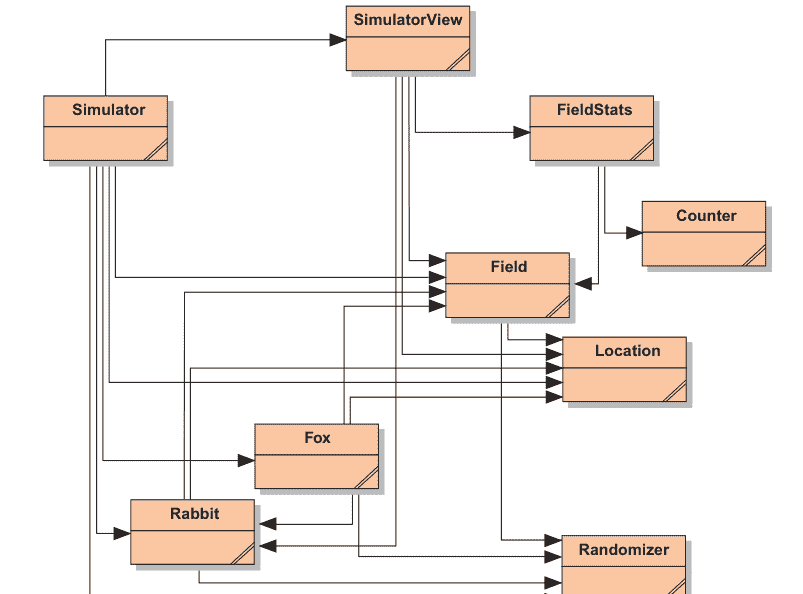

我们在讨论中关注的主要类是 `Simulator`（模拟器）、`Fox`（狐狸）和 `Rabbit`（兔子）。`Fox` 和 `Rabbit` 类分别提供了捕食者和猎物行为的简单模型。在这个特定的实现中，我们没有尝试提供真实狐狸和兔子的准确生物模型；相反，我们只是试图说明典型的捕食者-猎物模拟的原理。`Simulator` 类负责创建模拟的初始状态，然后控制并执行它。基本思想非常简单：模拟器持有狐狸和兔子的集合，并反复地让这些动物有机会经历其生命周期的每一步。在每一步中，每只狐狸和兔子都被允许执行体现其行为特征的动作。在每一步之后（当所有动物都有机会行动时），场地的新状态将显示在屏幕上。

我们可以将其余类的目的总结如下：

- `Field`（场地）代表一个二维封闭场地。场地由固定数量的位置组成，按行和列排列。场地中的每个位置最多由一个动物占据。每个场地位置可以包含一个动物的引用，也可以为空。
- `Location`（位置）代表场地内的一个二维位置。它的位置由行值和列值决定。
- 这些类（`Simulator`, `Fox`, `Rabbit` 和 `Location`）共同提供了模拟的模型。它们完全决定了行为。
- `SimulatorView`、`FieldStats` 和 `Counter` 类共同提供了模拟的图形化显示。显示显示了场地的图像以及每个物种的计数器（兔子和狐狸当前的数量）。
- `SimulatorView` 提供场地状态的图形化可视化。示例可以在 10.2 中看到。

**图 10.2** 狐狸与兔子模拟的初始状态


注意，我们并没有定义“一步”实际上代表什么。在实践中，这必须由此类因素结合决定，因为我们正在试图发现我们正在模拟什么事件，以及有多少现实时间可以运行模拟。

- `FieldStats` 提供场地中狐狸和兔子数量的统计。
- `Counter` 存储一种类型动物的当前计数以辅助计数。
- `Randomizer` 类为我们提供了对模拟中随机方面的控制。

尝试以下练习，以理解模拟是如何围绕其实现运行的：

- **练习 10.1** 使用无参数的构造函数创建一个 `Simulator` 对象，你应该能看到如图 10.2 所示的模拟初始状态。如果你更改 `simulateStep` 方法，会有什么变化？
- **练习 10.2** 如果你更改 `simulateStep` 方法，你认为我们正在模拟哪些自然过程？
- **练习 10.3** 如果你连续运行 50 或 100 步，狐狸和兔子的数量会增加吗？
- **练习 10.4** 如果你运行 500 步，你会观察到什么变化？
- **练习 10.5** 使用 `reset` 方法创建一个新的开始，你会看到相同的模拟吗？是否出现了某种模式？
- **练习 10.6** 如果你运行足够长的时间，所有的狐狸或兔子都会死吗？指出可能的原因。
- **练习 10.7** 记录每一步的狐狸和兔子的数量，以及长时间运行后的数量。
- **练习 10.8** 在运行一段时间后重置它，你应该看到原始的模拟。你可能需要查看 `Randomizer` 类的代码以了解原因。
- **练习 10.9** 检查将 `Randomizer` 中的 `used` 设置为 `false` 是否会破坏模拟的可重复性。请确保之后将其恢复为 `true`，因为可重复性在后续测试中是一个重要元素。

在接下来的章节中，我们将检查 `Rabbit`、`Fox` 和 `Simulator` 类的初始实现。

### 10.2.2 Rabbit 类

`Rabbit` 类的源代码见代码 10.1。

**代码 10.1** Rabbit 类

```java
// import statements omitted
public class Rabbit {
    // 所有兔子共享的特征（静态字段）。
    // 兔子开始繁殖的年龄。
    private static final int BREEDING_AGE = 5;
    // 兔子可以活到的年龄。
    private static final int MAX_AGE = 40;
    // 兔子繁殖的概率。
    private static final double BREEDING_PROBABILITY = 0.15;
    // 最大出生数。
    private static final int MAX_LITTER_SIZE = 4;
    // 控制繁殖的共享随机生成器。
    private static final Random rand = Randomizer.getRandom();

    // 个体特征（实例字段）。
    // 兔子的年龄。
    private int age;
    // 兔子是否存活。
    private boolean alive;
    // 兔子的位置。
    private Location location;
    // 占据的场地。
    private Field field;

    /**
     * 创建一只新兔子。兔子可以用年龄为 0（新生儿）或随机年龄来创建。
     * @param randomAge 如果为 true，兔子将具有随机年龄。
     * @param field 当前占据的场地。
     * @param location 场地内的位置。
     */
    public Rabbit(boolean randomAge, Field field, Location location)
    {
      // body of constructor omitted
    }
}
```

### 代码 10.1 续 Rabbit 类

```java
if(age > MAX_AGE) {
    setDead();
}

/**
 * 检查这只兔子在这一步是否要出生。
 * 新的出生体将在相邻的空位置产生。
 * @param newRabbits 用于添加新出生兔子的列表。
 */
private void giveBirth(List<Rabbit> newRabbits) {
    // 新兔子出生在相邻的位置。
    // 获取相邻空位置的列表。
    List<Location> free = field.getFreeAdjacentLocations(location);
    int births = breed();
    for(int b = 0; b < births && free.size() > 0; b++) {
        Location loc = free.remove(0);
        Rabbit young = new Rabbit(false, field, loc);
        newRabbits.add(young);
    }
}

/**
 * 生成一个代表出生数量的数字，
 * 如果它可以繁殖的话。
 * @return 出生数量（可能为零）。
 */
private int breed() {
    int births = 0;
    if(canBreed() && rand.nextDouble() <= BREEDING_PROBABILITY) {
        births = rand.nextInt(MAX_LITTER_SIZE) + 1;
    }
    return births;
}

// 省略其他方法
```

`Rabbit` 类包含若干静态变量，定义了所有兔子通用的配置设置。这些变量包括兔子可以活到的最大年龄（定义为模拟步数）以及它在任何一步中能产生的最大后代数量。每只兔子都有四个实例变量来描述其状态：作为步数的年龄、是否仍然活着，以及它在字段中的位置。

兔子的行为定义在它的 `run` 方法中，该方法反过来使用 `giveBirth` 和 `incrementAge` 方法并实现了兔子的移动。在每个模拟步骤中，`run` 方法都会被调用，兔子会增加年龄；如果足够大，它还可能繁殖，然后移动。移动和繁殖行为都具有随机成分。兔子移动的方向是随机的，繁殖也是随机发生的，由类变量 `BREEDING_PROBABILITY` 控制。

你已经能看到我们在兔子模型中所做的一些简化：例如，我们没有尝试区分雌雄，一只兔子可能在每个模拟步骤都产下一窝新崽，而忽略了它是否足够老大。

- **练习 10.10** 你是否认为在 `Rabbit` 类中添加性别作为一种属性可能会导致产生不准确的模拟？
- **练习 10.11** 与现实生活相比，你认为 `Rabbit` 类的实现中是否存在其他简化之处？你认为这些简化会对模拟的准确性产生重大影响吗？
- **练习 10.12** 尝试改变 `Rabbit` 类中类变量的部分或全部值的影响。例如，如果兔子的繁殖概率高得多或低得多，对狐狸和兔子种群会有什么影响？

### 10.2.3 Fox 类

`Fox` 类和 `Rabbit` 类之间有许多相似之处，因此代码 10.2 只显示了 `Fox` 的独特元素。


// 省略导入语句和类注释
public class Fox {
    // 所有狐狸共有的特征（静态字段）
    // 单只兔子的食物价值。实际上，这是狐狸在必须再次进食之前可以走的步数。
    private static final int RABBIT_FOOD_VALUE = 7;

    // 其他静态字段

    // 个体特征（实例字段）
    // 狐狸的年龄。
    private int age;
    // 狐狸是否活着。
    private boolean alive;
    // 狐狸的位置。
    private Location location;
    // 被占据的字段。
    private Field field;
    // 狐狸的食物水平，通过吃兔子增加。
    private int foodlevel;
}

/**
 * 创建一只狐狸。狐狸可以是新生（年龄为零且不饿）
 * 或具有随机年龄和饥饿水平。
 * @param randomAge 如果为真，狐狸将具有随机的年龄和饥饿水平。
 * @param field 被占据的字段。
 * @param location 字段内的位置。
 */
public Fox(boolean randomAge, Field field, Location location) {
    // 省略构造函数体
}

/**
 * 这是狐狸在大多数时间里做的事情：它捕捕兔子。
 * 在过程中，它可能会繁殖、饿死
 * 或因年龄老死。
 * @param field 被占据的字段。
 * @param newFoxes 添加新出生狐狸的列表。
 */
public void hunt(List<Fox> newFoxes) {
    incrementAge();
    incrementHunger();
    if (alive) {
        giveBirth(newFoxes);
        // 向食物源移动。
        Location newLocation = findFood(location);
        if (newLocation == null) {
            // 移动到空位置。
            newLocation = field.freeAdjacentLocations(location);
        }
        // 查看是否可以移动。
        if (newLocation != null) {
            setLocation(newLocation);
        } else {
            // 拥挤。
            setDead();
        }
    }
}

/**
 * 让狐狸寻找当前位置相邻的兔子。
 * @param location 它所在的位置。
 * @return 找到食物的位置，如果没有则返回 null。
 */
private Location findFood(Location location) {
    List<Location> adjacent = field.adjacentLocations(location);
    Iterator<Location> it = adjacent.iterator();
    while (it.hasNext()) {
        Location where = it.next();
        Object animal = field.getObject(where);
        if (animal instanceof Rabbit) {
            Rabbit rabbit = (Rabbit) animal;
            if (rabbit.isAlive()) {
                rabbit.setDead();
                foodlevel += RABBIT_FOOD_VALUE;
                // 从字段中移除兔子。
                return where;
            }
        }
    }
    return null;
}
// 省略其他方法

对于狐狸来说，`hunt()` 方法每一步都会被调用并定义它们的行为。除了每步增长和繁殖外，狐狸还会寻找食物（使用 `findFood()` 方法）。如果在相邻位置找到兔子，兔子会被杀死并增加狐狸的食物水平。对于兔子来说，无法移动的狐狸被认为死亡。

- **练习 10.13** 像对待兔子一样，评估我们对狐狸模型的简化程度。
- **练习 10.14** 增加狐狸的最大年龄会导致狐狸数量显著增加，还是导致兔子种群更容易减少到零？
- **练习 10.15** 尝试狐狸和兔子不同的设置组合（繁殖年龄、最大年龄、繁殖产量、窝崽大小等）。在某些配置下物种会完全消失吗？是否存在稳定的配置？
- **练习 10.16** 尝试不同大小字段（你可以使用 `Simulator` 的第二个构造函数来实现）。字段的大小会影响物种的生存概率吗？
- **练习 10.17** 目前狐狸每一步吃一只兔子。修改 `findFood()` 方法，使得相邻位置的兔子在一步内被吃掉。评估此变化对结果的影响。注意 `findFood()` 方法返回被吃的兔子的位置，但你需要返回视图中某一只兔子的位置。如果没有可吃的，返回 null。
- **练习 10.18** 延续上一个练习；如果狐狸在一步内吃掉多只兔子，关于如何建模它的食物水平有几种不同的可能性。如果我们加上所有兔子的食物价值，狐狸将具有很高的食物水平，使其在很长时间内不会饥饿。或者，我们可以为狐狸的食物水平设定一个上限吗？这模拟了无论是否饥饿都会杀死的捕食者的影响。评估实施这一选择对结果模拟的影响。

### 10.2.4 Simulator 类：设置

`Simulator` 类是应用程序的核心部分。代码 10.3 说明了它的一些主要功能。

```java
// 省略导入语句和类注释
public class Simulator {
    // 省略静态变量

    // 字段中的动物列表
    private List<Rabbit> rabbits;
    private List<Fox> foxes;
    // 字段的当前状态
    private Field field;
    // 模拟的当前步数
    private int step;
    // 模拟的图形视图。
    private SimulatorView view;
}
```

#### 代码 10.3 Simulator 类的一部分

```java
/**
 * 创建一个给定尺寸的模拟场。
 * @param depth 场的深度。必须大于0。
 * @param width 场的宽度。必须大于0。
 */
public Simulator(int depth, int width) {
    if (width <= 0 || depth <= 0) {
        System.out.println("尺寸必须大于0。");
        System.out.println("正在使用默认值。");
        depth = DEFAULT_DEPTH;
        width = DEFAULT_WIDTH;
    }
    rabbits = new ArrayList<Rabbit>();
    foxes = new ArrayList<Fox>();
    field = new Field(depth, width);

    // 创建场中每个位置状态的视图。
    view = new SimulatorView(depth, width);
    view.setColor(Rabbit.class, Color.orange);
    view.setColor(Fox.class, Color.blue);

    // 设置一个有效的起始点。
    reset();
}

/**
 * 从当前状态开始运行指定步数的模拟。
 * 如果模拟无法继续，则在达到指定步数前停止。
 * @param numSteps 要运行的步数。
 */
public void simulate(int numSteps) {
    for (int step = 1; step <= numSteps && view.isViable(field); step++) {
        simulateOneStep();
    }
}
```

#### 代码 10.3 继续 Simulator 类的一部分

```java
/**
 * 从当前状态开始运行单步模拟。
 * 遍历整个场，更新每只狐狸和兔子的状态。
 */
public void simulateOneStep() {
    // 省略方法体
}
```

```java
/**
 * 将模拟重置为起始位置。
 */
public void reset() {
    step = 0;
    rabbits.clear();
    foxes.clear();
    field.clear();
    populate();

    // 在视图中显示初始状态。
    view.showStatus(step, field);
}
```

```java
/**
 * 在场中填充狐狸和兔子。
 */
private void populate() {
    Random rand = Random.getRandom();
    field.clear();
    for (int row = 0; row < field.getDepth(); row++) {
        for (int col = 0; col < field.getWidth(); col++) {
            if (rand.nextDouble() <= FOX_CREATION_PROBABILITY) {
                Location location = new Location(row, col);
                Fox fox = new Fox(true, field, location);
                foxes.add(fox);
            } else if (rand.nextDouble() <= RABBIT_CREATION_PROBABILITY) {
                Location location = new Location(row, col);
                Rabbit rabbit = new Rabbit(true, field, location);
                rabbits.add(rabbit);
            }
            // 否则留该位置为空。
        }
    }
    // 省略其他方法
}
```

`Simulator` 有三个重要部分：它的构造函数、`populate()` 方法和 `simulateOneStep()` 方法。（`simulateOneStep()` 的方法体见下文。）

当 `Simulator` 对象被创建时，模拟的所有其他部分都会被构建（场、存储不同类型动物的列表以及图形界面）。一旦所有设置完成，就会调用模拟器的 `populate()` 方法（直接通过 `reset()` 方法调用）来创建初始的狐狸和兔子种群。使用不同的概率来决定特定位置是否包含其中一种动物。注意，在模拟开始时创建的动物会被赋予一个随机年龄。这有两个作用：

- 它更准确地代表了混合年龄的种群，这本应该是模拟的正常状态。
- 如果所有动物都从零岁开始，那么在初始种群达到各自的繁殖年龄之前，就不会产生新动物。由于狐狸无论年龄大小都会吃掉兔子，存在兔子种群在有机会繁殖之前被杀光的风险，或者种群会因饥饿死的风险。

> **练习题 10.19** 修改 `Simulator` 的 `populate()` 方法，以确定为狐狸和兔子设置初始年龄为零是灾难性的。

**练习题 10.20** 如果为兔子设置了初始随机年龄但没有为狐狸设置，兔子种群将倾向于扩大，而狐狸种群将保持很小。一旦狐狸老到可以繁殖，模拟结果会倾向于原始版本吗？这对于初始种群的规模及其对模拟的影响说明了什么？

### 10.2.5 Simulator 类：模拟单步

`Simulator` 类的核心部分是代码 10.4 所示的 `simulateOneStep()` 方法。它将每类型动物的移动（以及可能的繁殖，或程序设定执行的操作）的循环隔离开。因为每只动物都可能产生新动物，用于存储这些动物的列表作为参数传递给 `Fox` 和 `Rabbit` 的 `hunt()` 和 `run()` 方法。新出生动物会在模拟结束时添加到主列表中。为了实现这一点，会反复调用 `simulateOneStep()` 方法。

#### 代码 10.4 在 Simulator 类内部：模拟一步

```java
public void simulateOneStep() {
    step++;
    // 为新出生的兔子留空间。
    List<Rabbit> newRabbits = new ArrayList<>();
    // 让所有动物行动。
    for (Iterator<Rabbit> it = rabbits.iterator(); it.hasNext(); ) {
        Rabbit rabbit = it.next();
        rabbit.run(newRabbits);
        if (!rabbit.isAlive()) {
            it.remove();
        }
    }

    // 为新出生的狐狸留空间。
    List<Fox> newFoxes = new ArrayList<>();
    // 让所有动物行动。
    for (Iterator<Fox> it = foxes.iterator(); it.hasNext(); ) {
        Fox fox = it.next();
        fox.hunt(newFoxes);
        if (!fox.isAlive()) {
            it.remove();
        }
    }

    // 将新出生的狐狸和兔子添加到主列表。
    rabbits.addAll(newRabbits);
    foxes.addAll(newFoxes);
    view.showStatus(step, field);
}
```

每只动物始终位于两个数据结构中：场和 `Simulator` 的列表。存在不一致的风险。

**练习题 10.21** 检查 `simulateOneStep()` 方法、`Fox` 中的 `hunt()` 以及 `Rabbit` 中的 `run()` 方法是如何维护列表的。

**练习题 10.22** 你认为让 `Simulator` 不维护单独的列表而是在一步都重新生成这些列表会更好吗？

> **练习题 10.23** 写一个测试，确保在每一步结束时，场中没有任何动物（无论死活）不在列表中，反之亦然。在那个阶段应该有死动物吗？

### 10.2.6 改进模拟的步骤

现在我们已经检查了模拟是如何运行的，可以对其内部设计进行改进。通过引入新功能进行逐步改进是后续章节的重点。有几个可以开始的地方，但最明显的缺陷之一是尚未在狐狸和兔子类的实现中利用继承的优势，它们共享许多共同元素。为了实现这一点，我们将引入抽象类的概念。

第 8 章引入了继承和多态等概念，我们能够在模拟应用中利用这些概念。例如，狐狸和兔子类具有许多相似特征，表明它们应该是公共父类（如 `Animal`）的子类。在本节中，我们将开始进行更改以改进整个模拟的设计和实现。根据第 8 章的 DoME 方法，使用公共父类可以避免子类中的代码重复并简化客户端类的代码。注意的是，我们正在进行重构过程，这些更改不应改变从用户视角看到的模拟本质特征。

### 10.3 抽象类

> **练习题 10.24** 识别狐狸和兔子类之间的相似与不同。分别列出字段、方法、构造函数，并区分类变量（静态字段）和实例变量。

> **练习题 10.25** 放在所有子类中都完全相同的候选方法。狐狸和兔子类中哪些方法是真正相同的？在得出结论时，你可能想考虑将类变量的值替换到使用它们的方法体中。

### 10.3.1 Animal 超类

在第一组修改中，我们将狐狸（`Fox`）和兔子（`Rabbit`）中相同的元素提取到 `Animal` 超类中。项目 `foxes-and-rabbits-v1` 提供了一个模拟基础版本的副本，供你跟踪我们所做的修改。

- 狐狸和兔子都有 `age`（年龄）、`alive`（存活）、`field`（领地）和 `location`（位置）属性。然而，此时我们只将 `alive`、`location` 和 `field` 移动到 `Animal` 超类，稍后再讨论 `age` 字段。按照处理实例字段的习惯，我们将这些字段均在超类中设为私有。初始值在 `Animal` 的构造函数中设置，其中 `alive` 设置为 `true`，而 `field` 和 `location` 则通过狐狸和兔子构造函数的调用传入。


- 这些字段需要访问器（accessors）和修饰器（mutators），因此我们可以从狐狸和兔子中移动 `getLocation`、`setLocation`、`isAlive` 和 `setDead`。我们还需要在 `Animal` 中添加 `getField` 方法，以便取代子类方法 `run`、`hunt`、`findFood` 中对 `field` 的直接访问。

- 在移动这些方法时，我们必须考虑最合适的可见性。例如，`location` 在狐狸和兔子中是私有的，但在 `Animal` 中不能保持私有，否则狐狸和兔子将无法调用它。因此，我们需要对其开放。

- 类似地，请注意 `setDead` 在兔子中是公共的，但在狐狸中是私有的。它在 `Animal` 中也应该是公共的吗？它在兔子中是公共的，是因为狐狸在吃掉猎物时需要能够调用兔子的 `setDead` 方法。现在它们是共享超类的兄弟类，更合适的可见性是 `protected`（保护的）。

这些修改是利用继承消除代码重复的第一步，正如我们在 DoME 项目中所做的那样。

**练习 10.27** 在对模拟进行重构过程之前，你可以建立什么样的回归测试策略？这种策略是可以方便管理的吗？

**练习 10.28** `Randomizer` 类为我们提供了一种控制模拟中的“随机”元素是否可重复的方法。如果你的 `Shared` 字段被设置为 `true`，则所有模拟对象之间将共享同一个 `Random` 对象。此外，`reset` 方法会重置共享的 `Random` 对象的起点。在进行练习时，请使用这些功能来确保在引入 `Animal` 类时，你没有改变整个模拟的任何部分。

在你的项目版本中创建 `Animal` 超类。进行上述修改。确保模拟的运行方式与之前相似。

你可以通过并排打开项目的旧版本和新版本来检查这一点，例如对两者的 `Simulator` 对象执行相同的调用，并期望获得相同的结果。

**练习 10.29** 到目前为止，使用继承对项目产生了哪些改进？请进行讨论。

### 10.3.2 抽象方法

到目前为止，`Animal` 超类的使用有助于避免兔子和狐狸类中的大量代码重复，并可能使未来添加新的动物类型变得更容易。然而，正如我们在第 8 章看到的，智能地使用继承也应该简化客户端类——在此处的 `Simulator`。我们现在打算实现这一点。

在 `Simulator` 类中，我们使用了单独的狐狸和兔子列表，以及每个列表的迭代代码来实现每个模拟步骤。相关代码如代码 10.4 所示。现在我们有了 `Animal` 类，可以改进这一点。由于集合中的所有对象都是 `Animal` 的子类型，我们可以将它们合并到一个集合，从而只需使用 `Animal` 类型进行一次迭代。然而，这种方法的问题在代码 10.5 的单列表中显而易见。我们知道列表中的每个类型都是 `Animal`，但仍然需要确定具体是哪种动物，以便调用其类型对应的动作方法。我们使用 `instanceof` 运算符来确定类型。

代码 10.5：一种不人意的让动物行动的单列表方案

```
for(Iterator<Animal> it = animals.iterator(); it.hasNext();) {
    Animal animal = it.next();
    if(animal instanceof Rabbit) {
        Rabbit rabbit = (Rabbit) animal;
        rabbit.run(newAnimals());
    } else if(animal instanceof Fox) {
        Fox fox = (Fox) animal;
        fox.hunt(newAnimals());
    } else {
        System.out.println("found unknown animal");
    }
    // 从模拟中移除死动物
    if(!animal.isAlive()) {
        it.remove();
    }
}
```

在代码 10.5 中，每种动物类型必须单独进行测试和转换，并且每个动物类都存在特殊代码，这说明我们没有充分利用继承提供的优势。相反，如果我们确保超类（Animal）有一个让动物行动的方法，并且该方法在每个子类中都被重写，我们就可以使用多态方法让每种动物行动，而无需测试特定的动物类型。假设我们创建了名为 `act` 的这种方法，并研究结果代码。代码 10.6 显示了实现此方案的方案。

代码 10.6：完全改进的动物行动方案

```
// 让所有动物行动
for(Iterator<Animal> it = animals.iterator(); it.hasNext();) {
    Animal animal = it.next();
    animal.act(newAnimals());
    // 从模拟中移除死动物
    if(!animal.isAlive()) {
        it.remove();
    }
}
```

### 10.3 抽象类

上面讨论过的：我们已经表示不希望直接创建 Animal 类——此类仅作为父类使用。声明该类强制执行了这一限制。

## 概念：抽象类

抽象类的子类要变成具体的类，它必须为所有继承的方法提供实现。否则，该子类将是抽象的。

- 只有抽象类可以拥有抽象方法。这确保了具体类中的所有方法都是可执行的。如果我们允许在具体类中使用抽象方法，我们就可以创建一个缺少某个方法实现的类实例。

- 带有抽象方法的抽象类会强制子类重写并实现这些已声明的方法。如果子类没有为继承的抽象方法提供实现，那么它本身也是抽象的，并且无法创建其实例。要使子类成为具体的类，它必须为所有抽象方法提供实现。

现在我们可以开始看到抽象方法的作用了。尽管它们没有提供实现，但它们确保了所有具体子类都拥有该方法的实现。换句话说，虽然 Animal 类没有实现该抽象方法，但它确保了所有动物都实现了该抽象方法。这是通过确保以下点来实现的：

- 无法创建 Animal 类的实例，并且
- 所有具体子类必须实现该抽象方法。

虽然我们不能直接创建抽象类的实例，但我们仍然可以用通常的方法将抽象类作为类型使用。例如，多态的普通规则允许我们将狐狸和兔子处理为 Animal 类的实例。因此，模拟程序不需要知道它们处理的是否是特定的子类，可以使用父类类型。

**练习 10.30** 尽管代码 10.6 中的循环体不再处理 `Fox` 和 `Rabbit` 类型，但它仍然处理 `Animal` 类型。为什么不能使用 `Object` 类型处理集合中的对象呢？

**练习 10.31** 拥有一个或多个抽象方法的类是否有必要定义为抽象类？如果你不确定，请对 `foxes-and-rabbits-v2` 项目中的 `Animal` 类源码进行实验。

**练习 10.32** 一个没有抽象方法的类是否可以定义为抽象类？如果你不确定，请通过给 `Animal` 类提供一个没有语句的方法，将 `act` 改为具体方法。

**练习 10.33** 如果一个类没有抽象方法，将其定义为抽象类是否会有任何意义？请讨论这一点。

**练习 10.34** `java.util` 包中哪些类是抽象的？其中一些类名中包含 Abstract，但还有其他方法可以从文档中判断吗？哪些具体类扩展了它们？

**练习 10.35** 你能从抽象类的 API 文档判断它的哪些（任何）方法是抽象的吗？你需要知道哪些方法是抽象的吗？

## 第 10 章 进一步抽象技术

**练习 10.36** 复习第 9 章讨论的方法和字段的重写规则。为什么它们在我们尝试向此应用程序引入继承时具有尤为重要的意义？

**练习 10.37** 本节中所做的更改消除了 `simulateOneStep` 方法对 `Fox` 和 `Rabbit` 类的依赖（耦合）。然而，`Simulator` 类仍然与 `Fox` 和 `Rabbit` 耦合，因为这些类在 `populate` 方法中被引用了。在我们创建动物实例时，没有办法避免这一点，我们必须精确指定要创建什么种的动物。

这可以通过将 `Simulator` 拆分为两个类来改进：一个类 `Simulator` 负责运行模拟并与具体的动物类解耦；另一个类 `PopulationGenerator`（由模拟器创建并调用）负责创建种群。只有这个类与具体的动物类耦合，这使得维护程序员在扩展应用程序时能够更容易找到需要更改的地方。尝试实现这个重构步骤。`PopulationGenerator` 类还应该定义每种动物的颜色。

项目 `foxes-and-rabbits-v2` 提供了带有此处讨论的改进的模拟实现。需要注意的是，`Simulator` 更改为处理单个列表中的所有动物，这意味着版本 2 的模拟结果将与版本 1 不相同。

### 10.4 抽象方法

当我们在 10.3 节中创建 `Animal` 父类时，是通过识别所选子类的共同元素来实现的，没有移动 `age` 字段以及与其相关的方法。这可能过于保守。事实上，我们可以很容易地将 `age` 字段移动到 `Animal` 中，并为它提供访问器（accessor）和修改器（mutator），供子类方法（如 `incrementAge`）调用。我们不是没有将 `incrementAge` 和 `canBreed` 移动到 `Animal` 吗？不移动它们的原因是，尽管 `Fox` 和 `Rabbit` 中剩余的几个主体方法包含文本上相同的语句，但它们使用不同值的变量意味着它们不能直接移动到父类。在 `canBreed` 的情况下，问题在于 `BREEDING_AGE` 变量，它依赖于 `BREEDING_PROBABILITY` 和 `MAX_LITTER_SIZE`。例如，如果将 `canBreed` 移动到 `Animal`，编译器就需要访问 Animal 中繁殖年龄的值，以便在 `Animal` 类中定义 `BREEDING_AGE` 字段，并假设其值将被子类中同名的字段覆盖。然而，在 Java 中，字段的处理方式与方法不同：字段不能被子类重写。这意味着 `Animal` 中的 `canBreed` 方法将使用类中定义的无意义的值，而不是特定于此子类的值。此规则无论字段是否为静态都适用。

## 10.4 更多抽象方法

记得我们在 `Animal` 中将 `act` 定义为抽象，是因为为该方法提供主体是没有意义的。如果我们通过方法而不是字段访问 `age`，就可以解决与 `age` 相关的问题。这种方法在代码 10.8 中所示。

### 代码 10.8：Animal 的 `canBreed` 方法

```java
/**
 * 如果动物达到了繁殖年龄就可以繁殖。
 * @return 如果动物可以繁殖
 */
public boolean canBreed()
{
    return age >= getBreedingAge();
}
/**
 * 返回此动物的繁殖年龄。
 * @return 此动物的繁殖年龄
 */
abstract int getBreedingAge();
```

`canBreed` 方法已重写为使用方法调用的值而不是类变量的值。为了实现，必须在 `Animal` 中定义 `getBreedingAge` 方法。由于我们无法为动物指定繁殖年龄，我们可以再次在 Animal 类中使用抽象方法，并在子类中进行具体定义。Fox 和 Rabbit 都会定义自己的 `getBreedingAge` 版本以返回它们特定的 `BREEDING_AGE`：

```java
/**
 * 返回兔子开始繁殖的年龄。
 */
public int getBreedingAge()
{
    return BREEDING_AGE;
}
```

因此，即使 `getBreedingAge` 的调用源自父类的代码，调用的方法也是在子类中定义的。初看起来这可能很神秘，但它基于我们在第 9 章中描述的原理，即使用对象的动态类型来确定运行时调用哪个版本。此处所示的技巧使得每个实例都能使用适用于此子类的值。使用这种方法，我们可以类似地将剩余的方法 `incrementAge` 和 `breed` 移动到子类。

**练习 10.38** 使用你最新版本的项目（如果你没有完成所有练习，则使用 `foxes-and-rabbits-v2` 项目）

**练习 10.39** 将 `age` 从 Fox 和 Rabbit 移动到 Animal。在构造函数中将其初始化为零。为它提供访问和修改方法，并在中使用

# 第 10 章 进一步的抽象技术

让狐狸和兔子而不是直接访问字段。确保程序能够像以前一样编译并运行。

**练习 10.40** 将 `canBreed` 方法从 Fox 和 Rabbit 移动到 Animal 类，并按照代码 10.8 所示的形式重写它。在 Fox 和 Rabbit 中提供相应的 `getBreedingAge` 方法版本，以返回不同的繁殖年龄值。

**练习 10.41** 通过在 Animal 类中提供一个抽象的 `getMaxAge` 方法，并在 Fox 和 Rabbit 中提供具体的实现版本，将 `incrementAge` 方法从 Fox 和 Rabbit 移动到 Animal 类。

**练习 10.42** `breed` 方法可以移动到 Animal 类吗？如果可以，请进行此项更改。

**练习 10.43** 考虑到你对这三个类所做的所有更改，重新考虑每个方法的可见性，并进行你认为合适的任何更改。

**练习 10.44** 是否可能在不对项目中的其他类产生任何影响的情况下完成这些更改？如果是，这对于原始版本中关于封装和耦合的争论说明了什么？

**练习 10.45** 挑战：为模拟定义一种完全全新的动物类型，作为 Animal 的子类。你需要决定它的存在对现有动物类型产生什么种的影响。例如，你的动物可能会作为捕食者与狐狸竞争兔子种群，或者该动物可能会捕食狐狸而不是兔子。你可能会发现，你需要对为它使用的配置设置进行大量实验。你需要修改 `populate` 方法，以便在模拟开始时创建你的某些动物。

你还应该为你的新动物类定义一种新颜色。你可以在记录 `java.awt` 包中 `Color` 类的 API 页面上找到预定义的颜色名称列表。

**练习 10.46** 挑战性练习：Fox 和 Rabbit 中 `giveBirth` 的文本非常相似。唯一的区别是一个创建一个 Fox 对象，而另一个创建 Rabbit 对象。是否可以使用在 `canBreed` 示例中所示的技术，将公共代码移动到 Animal 类中共享的 `giveBirth` 方法中？如果你认为可以，请尝试一下。提示：多态替换的规则也适用于方法返回的值，以及赋值和参数传递中。

### 10.5 多重继承

### 10.5.1 Actor 类

在这一节中，我们将讨论一些未来的扩展，以及支持这些扩展的某些编程结构。

我们模拟的第一个明显的扩展是添加新动物。如果你尝试过练习 10.45，那么你已经处理了这个问题。我们应该将其泛化一下：也许模拟中的所有参与者并不是动物。我们目前的结构假设模拟中的所有参与者都是动物并继承自 `Animal` 超类。我们可能想要的一种增强是在模拟中引入人类捕食者，作为猎人或陷阱者。它们并不真正符合现有的纯动物参与者的假设。我们还可能扩展模拟以包含植物，甚至是天气。植物的生长可能会影响兔子的种群，而植物反过来可能会受到天气的影响。所有这些新组件都会参与模拟，但它们显然不是动物。

当我们考虑向模拟中引入更多参与者的可能性时，值得揭示为什么我们选择在 `Field` 对象和动物列表中都存储动物的细节。这显然是信息的重复，存在产生不一致的风险。做出这一设计决策的原因之一是，它允许我们考虑并不在字段内的模拟参与者——天气的表示可能就是其中的一个例子。

为了处理更通用的参与者，引入一个 `Actor` 超类似乎是一个好主意。`Actor` 类将作为所有类型模拟参与者的超类，无论它们是什么。图 10.3 显示了模拟这部分的类图。`Actor` 和 `Animal` 类是抽象的，而 Rabbit、Fox 和 Hunter 是具体类。

图 10.3：带有 Actor 的模拟结构


`Actor` 类将包含所有参与者的共同部分。所有可能的参与者的共同点之一是它们执行某种动作。我们还需要知道一个参与者是否活跃。`Actor` 类中唯一的定义是抽象的 `act` 和 `isActive` 方法：

```java
// 省略所有注释

public abstract class Actor {
    abstract public void act(List<Actor> newActors);
    abstract public boolean isActive();
}
```

这应该足够使用 `Actor` 类代替 `Animal` 来重写 `Simulator`（代码 10.6）中的参与者循环了。（可以将 `isAlive` 方法重命名为 `isActive`，或者在 `Animal` 中用一个独立的 `isActive` 方法简单地调用 `isActive` 方法。）

**练习 10.47** 将 `Actor` 类引入你的模拟。重写 `Simulator` 中的 `simulateOneStep` 使用 `Actor` 代替 `Animal`。还没有引入任何新的参与者类型，就可以这样做。Simulator 编译通过了吗？或者 `Actor` 类中还需要其他什么？

这种新结构更加灵活，因为它允许更容易地添加非动物参与者。事实上，我们可以将统计收集类 `FieldStats` 重写为 `Actor`——它在每一步都会执行一次。它的动作是更新它当前的动物计数。

## 10.5.2 通过抽象实现灵活性

通过转向管理参与者的对象的概念，我们成功地远离了最初的关于狐狸和兔子的场景。这种抽象过程带来的灵活性可以允许我们扩展范围。例如，我们可以引入。

在下一节中，我们将讨论绘图，作为对动作的扩展。

## 10.5.3 绘制

处理绘图，一个好主意是改变模拟中执行绘制的方式。与其遍历字段并在每个位置绘制，我们不如遍历一个独立的可绘制对象集合。simulator 类的代码看起来像这样：


```java
// 让所有参与者动作。
for(Actor actor : actors) {
  actor.act();
}
```

```java
// 绘制所有可绘制对象。
for(Drawable item : drawables) {
  item.draw();
}
```

所有的参与者都在 `actors` 集合，而我们想要显示在屏幕上的参与者也会在 `drawables` 集合。为了这项工作，我们需要另一个超类 `Drawable`，它声明了一个抽象的 `draw` 方法。可绘制参与者必须继承自 `Actor` 和 `Drawable`（图 10.4 显示了假设我们蚂蚁的例子，它们动作但不在屏幕上显示）。

图 10.4

带有 Drawable 的 Actor 层次结构


> **概念：**
>
> 多重继承。
>
> 类继承自多个超类的情况被称为多重继承。

## 10.5.4 可绘制参与者：多重继承

演示场景使用了被称为多重继承的结构。多重继承存在于类继承自多个超类的情况下。子类随后拥有两个超类的所有特征，以及子类中定义的特征。多重继承在原理上非常容易理解，但在编程语言的实现中可能会导致严重的复杂。面向对象的语言对多重继承的处理各异：某些语言允许继承多个超类，其他则不允许。Java 处于之间。它不允许类的多重继承，但提供了一种名为“接口”的另一种结构，允许有限形式的多重继承。接口将在下一节中讨论。

### 10.6 接口

在本书到目前为止，我们以非正式的使用了“接口”（interface）这一术语，来表示类中与其他类相耦合的部分。Java 通过允许定义接口类型正式地捕获了这一概念。

从初上看，接口与类相似，最明显的区别是它们的方法定义不包含方法体。因此，它们类似于所有方法都为抽象的抽象类。

#### 10.6.1 一个 Actor 接口

代码 10.9 显示将 `Actor` 定义为一种接口类型。

```java
/**
 * 任何想要参与模拟的类需要扩展的接口。
 */
public interface Actor {
  /**
   * 执行 actor 的常规行为。
   * @param newActors 用于存储新创建的 actor 的列表。
   */
  void act(List<Actor> newActors);

  /**
   * 该 actor 是否仍处于活跃状态？
   * @return 如果仍处于活跃则返回 true，否则返回 false。
   */
  boolean isActive();
}
```

Java 接口具有许多重要特性：

- 在声明头中使用 `interface` 关键字代替 `class`。
- 接口中的所有方法都是抽象的；不允许有方法体。不需要 `abstract` 关键字。
- 接口不包含任何构造方法。
- 接口中的所有方法签名都具有 `public` 可见性。不需要声明可见性（即每个方法不需要 `public` 关键字）。
- 接口中只允许常量字段（`public`、`static` 且 `final`）。可以省略 `public`、`static` 和 `final` 关键字，但所有字段仍被处理为 `public`、`static` 和 `final`。

类继承接口的方式与其继承类的方式类似。然而，Java 使用不同的关键字 —— `implements` —— 来继承接口。

如果一个类在它的类头中包含 `implements` 子句，则称该类实现了一个接口。例如：

```java
public class Fox extends Animal implements Drawable {
  // 省略类体。
}
```

在此情况下，如果一个类既扩展一个类又实现一个接口，那么 `extends` 子句必须写在第一个类头中。

我们在上面示例中的两个抽象类 `Actor` 和 `Drawable` 是重写为接口的良好候选。它们都只包含方法的定义，而不包含方法的实现。它们已经完美符合接口的定义：它们不包含实例字段、构造方法和方法体。

`Animal` 类是一个不同的情况。它是一个真实的抽象类，提供了部分实现（许多方法有方法体），并且在原始版本中只有一个抽象方法。因此，它必须保持为类而不是接口。

**练习题 10.48** 在你的项目中将抽象类 `Actor` 重新定义为接口。模拟还能编译吗？它能运行吗？进行任何必要的修改以使其能够运行。

**练习题 10.49** 下面接口中的字段是静态字段还是实例字段？

```java
public interface Quiz {
  int CORRECT = 1;
  int INCORRECT = 0;
  ...
}
```

它们具有什么可见性？

**练习题 10.50** 下面接口中有哪些错误？

```java
public interface Monitor {
  private static final int THRESHOLD = 50;
  public Monitor (int initial);
  public int getThreshold()
  {
    return THRESHOLD;
    ...
  }
}
```

#### 10.6.2 接口的多重继承

如上所述，Java 允许任何类最多扩展另一个类。然而，它允许一个类实现任意数量的接口（此外还可以扩展一个类）。因此，如果我们将 `Actor` 和 `Drawable` 定义为接口而不是抽象类，我们可以定义类 `Hunter`（图 10.4）来实现它们中的两个：

`Hunter` 类将所有接口的方法定义（在本例中为 `act` 和 `draw`）作为抽象方法继承。它必须通过重写方法为它们都提供方法定义，或者该类本身必须声明为抽象类。

`Animal` 类展示了一个类没有重写继承的接口方法的例子。在我们图 10.4 的新结构中，它从 `Actor` 继承了抽象方法 `act`。它没有为该方法提供方法体，这使得 `Animal` 本身是抽象的（它必须在类头中包含 `abstract` 关键字）。

子类实现 `act` 方法并变成具体类。

> **练习题 10.51** 挑战 给模拟添加一个非动物类。例如，你可以引入一个具有以下属性的 `Hunter` 类。猎手没有最大年龄，既不进食也不繁殖。在模拟的每个阶段，猎手会移动到场内的任何随机位置，并向场地周围的随机目标位置发射固定数量的射击。目标位置之一中的任何动物会被杀死。
>
> 在模拟开始时在场内放置少量猎手。猎手在整个模拟过程中一直存在吗，还是它们会消失？如果它们消失了，可能是什么，这是否代表了真实的行为？
>
> 由于引入了猎手，其他类需要更改？是否有必要对类引入进一步的解耦？

#### 10.6.3 接口作为类型

当一个类实现接口时，它没有从接口中继承任何实现，因为接口不能包含方法体。那么问题是：实现接口我们实际上获得了什么？

我们在第 8 章引入继承时，强调了继承的两个巨大益处：

- 子类继承代码（方法实现）。
- 子类可以被视为父类。

#### 10.6.4 接口作为规范

在本章中，我们讨论了如何使用接口将组件的规范与其实现分离，以便可以插入不同的实现。

#### 10.6.5 接口的另一个示例

在前面的一节中，我们讨论了如何使用接口将组件的规范与其实现分离，以便可以插入不同的实现，从而轻松替换系统中的组件。

这通常用于分离逻辑上耦合的部分。我们模拟中的一个例子是显示。模拟逻辑（场地和 actor）与模拟的视觉显示是相当分离的。我们可以想象许多不同的展示方式：

- 显示可以绘制一个表示每个物种数量随时间变化的图。图的 x 轴代表时间（以模拟步骤计数），y 轴显示动物数量。每个物种将用自己的颜色显示。
- 输出可以是纯文本的：我们可以为每个模拟步骤向终端打印一系列文本语句。这种方法的优点是实现非常简单并且可以保存到文件中，例如。与当前版本中的动画相比，它提供了整个过程的记录。

我们可以通过将 `SimulatorView` 变为一个接口来实现这一点。为了定义这个接口，我们可以搜索 `Simulator` 类，找到所有实际上从外部调用的方法。它们是（按顺序）：

```java
view.setColor(class, color);
view.isViable(field);
view.showStatus(step, field);
```

我们可以轻松定义完整的 `SimulatorView` 接口：

```java
import java.awt.Color;

public interface SimulatorView {
    void setColor(Class cls, Color color);
    boolean isViable(Field field);
    void showStatus(int step, Field field);
}
```

然后，我们应该将当前的 `SimulatorView` 类重命名为 `AnimatedView`（因为它提供了模拟器的动画视图），并且它应该实现 `SimulatorView` 接口：

```java
public class AnimatedView extends JFrame implements SimulatorView {
    ...
}
```

完成这些更改后，为仿真实现并“插拔”其他视图就变得相当简单了。

> **练习 10.55** 执行上述更改：将 `SimulatorView` 重命名为 `AnimatedView` 并定义 `SimulatorView` 接口。确保在 `Simulator` 中，`AnimatedView` 名称只使用一次（在创建视图对象时）。在所有其他地方，都应该使用接口名称 `SimulatorView`。
>
> **练习 10.56** 实现一个实现 `SimulatorView` 的新类 `TextView`。`TextView` 提供了仿真的文本视图。在每个仿真步骤之后，它会在帧中打印一行内容。
>
> **狐狸：121 只 兔子：266 只**
>
> 在某些测试中使用 `TextView` 替替 `AnimatedView`（不要删除 `AnimatedView` 类。我们希望保留能够切换两种视图的能力！）
>
> **练习 10.57** 你能设法让两个视图同时激活吗？

#### 10.6.6 抽象类还是接口？

在某些情况下，必须在使用抽象类或接口之间做出选择。有时这种选择是容易的：当一个类旨在用于包含某些方法的实现时，我们需要使用抽象类。在其他情况下，抽象类或接口都可以胜任这项工作。

如果有选择，接口通常是优的。如果我们提供一个抽象类作为类型，那么子类就无法继承任何其他类。由于接口允许多重继承，使用接口就不会产生这种限制。因此，使用接口会导致更灵活、更可扩展的结构。

## 10.7 继承总结

在最后三个章节中，我们讨论了继承技术的许多不同方面。这些包括代码继承和子类型化，以及继承接口、抽象类和具体类。

通常情况下，我们可以区分继承的两个目的：我们可以用它继承代码（代码继承），也可以用它继承类型（子类型化）。前者用于代码重用，后者用于多态和特化。

当我们继承（“扩展”）具体类时，我们两者兼顾：我们继承了实现和类型。当我们继承（实现）接口时，我们将两者分开：我们继承了类型，但没有实现。对于两部分都有用的情况，我们继承抽象类；在这里，我们继承了类型和部分实现。

在继承完整的实现时，我们可以选择添加或重写方法。当继承的是类型的无或仅部分实现时，子类必须在实例化之前提供实现。

某些面向对象的语言还提供了无需通过继承来实现代码的机制。Java 并没有提供这种结构。

## 10.8 总结

在本章中，我们讨论了计算机仿真的基础结构。

随后我们利用这个示例引入了抽象类和接口，这些构造允许我们创建进一步的抽象并开发更灵活的应用程序。

抽象类是不打算拥有任何实例的类。它们的目的是作为其他类的超类。抽象类可以有抽象方法——即具有定义签名但没有实现的方法——以及方法的实现。抽象类的具体子类必须重写抽象方法以提供方法的实现。

在 Java 中定义类型的另一种构造是接口。Java 接口类似于完全抽象的类——它们定义了方法签名但没有实现。接口定义了可以用于变量的类型。

接口可以为类（或应用程序的一部分）提供规范，而无需说明任何关于具体实现的内容。

Java 允许接口的多重继承（它称之为“implements”关系），但类只允许单重继承（“extends”关系）。

## 本章引入的术语

抽象方法、抽象类、具体类、抽象子类、继承、接口（Java 构造）、implements

## 概念总结

- **abstract method（抽象方法）**：抽象方法的定义由一个没有主体的方法签名组成。它被标记为关键字 `abstract`。
- **abstract class（抽象类）**：抽象类是不打算用于创建实例的类。它的目的是作为其他类的超类。抽象类可以包含抽象方法。
- **abstract subclass（抽象子类）**：为了让抽象类的子类变成具体的，它必须为所有继承的抽象方法提供实现。否则它本身将仍然是抽象的。
- **multiple inheritance（多重继承）**：类继承自多个父类的情况被称为多重继承。
- **interface（接口）**：Java 接口是一种类型的规范（形式为类型名称和一组方法），它不为其中任何一个方法定义任何实现。

**练习 10.58** 抽象类可以有具体的（非抽象）方法吗？具体类可以有抽象方法吗？可以有一个没有抽象方法的抽象类吗？请给出你的答案理由。

**练习 10.59** 查看下面的代码。你有四种类型（U, G, B, X），它们是类或接口……关于这些类型你可以说明什么？

```java
U;
G;
B;
X;
```

以下赋值都是合法的（它们可以编译）：

```java
U = G;
G = B;
B = X;
```

以下赋值都是不合法的（它们会导致编译器错误）：

```java
X = U;
```

**练习 10.60** 假设你想建模一个大学系统。有不同的人参与：员工、学生、教学人员和支持人员。画一个类型层次结构（类和接口）来表示它。标明哪些类型是类，哪些是接口。

**练习 10.61** 标准库中有时存在某些类/接口对，它们定义了完全相同的方法。通常接口以 *Listener* 结尾，而类名以 *Adapter* 结尾。例如 *PrintJobListener* 和 *PrintJobAdapter*。接口定义了方法，而适配器类定义的方法为空。这种设计的原因是什么？

**练习 10.62** 集合库有一个类 `TreeSet`，它是排序集合的示例。集合中的元素是保持顺序的。仔细阅读该类，然后编写一个 `Person` 类，使其能够按年龄插入 `TreeSet`。

# 组件、布局与事件处理

创建图形用户界面（GUI）涉及的细节非常详尽。在书中，我们无法涵盖你可能进行的所有操作的所有细节，但我们将讨论通用原理和几个示例。

Java 中所有的 GUI 编程都是通过使用专门的标准类库完成的。一旦我们理解了这些原理，就可以通过查阅标准文档找到所有必要的细节。

我们需要理解的原理可以分为三个响应式主题：

- 我们可以在屏幕上显示哪些类型的元素？
- 我们如何安排这些元素？
- 我们如何响应用户输入？

我们将在组件、布局和事件处理这几个关键词下讨论这些问题。

组件（Components）是构建 GUI 的各个部分。它们是如按钮、菜单、项目、复选框、滑块、文本字段等。Java 库包含了许多现成的组件，我们也可以编写自己的组件。我们将学习哪些是重要的组件、如何创建它们，以及如何让它们看起来符合我们的意愿。


# 布局与事件处理

布局涉及如何在屏幕上安排组件。早期的 GUI 使用二维坐标处理此问题：由程序员为每个组件指定 x 和 y 坐标（以像素为单位）来确定位置和大小。在现代 GUI 中，这种方法过于简单，无法考虑屏幕分辨率、不同用户、窗口缩放以及许多影响布局的因素。解决方案是采用一种允许我们用更通用术语指定布局的方案。例如，我们可以指定“这个组件应该在那个组件下面”或“如果窗口调整大小，这个组件应该拉伸，但那个组件应该始终保持固定大小”。这是通过布局管理器来实现的。

事件处理指的是处理用户输入的技术。创建组件并将它们放置在屏幕上后，我们还需要确保当用户点击按钮时会发生什么。Java 库使用的模型是基于事件的：如果用户激活了一个组件（例如点击按钮或选择菜单项），系统将生成一个事件。应用程序可以接收该事件的通知（通过调用它的某个方法），然后采取适当的行动。

我们将在本章后面详细讨论这些领域。然而，我们将简要介绍一些更基础的概念和术语。

# AWT 和 Swing

Java 有两个 GUI 库。较旧的是 AWT（抽象窗口工具包），它是随着最初的 Java 系统引入的。后来，Java 增加了一个改进得多的 GUI 库 Swing。

Swing 使用了部分 AWT 类，用它自己的版本替换了部分 AWT 类，并添加了许多新类（图 11.1）。

**图 11.1** AWT 和 Swing


在本书中，我们将使用 Swing 库。这意味着我们将使用一些在 Swing 程序中仍使用的 AWT 类，但对于两个库中都存在的类，将使用 Swing 版本。

只要在 AWT 和 Swing 中有等效类的地方，Swing 版本通过在类名开头添加 `J` 来标识。例如，你将看到命名为 `Button` 和 `JButton`、`Frame` 和 `JFrame`、`Menu` 和 `JMenu` 的类，而以 `J` 开头的类就是 Swing 版本——这些是我们要使用的。

作为开始，这些背景已经足够了。让我们来看一些代码。

# ImageView 示例

一如既往，我们将通过示例来讨论新概念。我们在本章中构建的应用程序是一个图像查看器（图 11.2）。这是一个可以打开并显示 JPEG 和 PNG 格式图像、执行某些图像变换并将图像保存回磁盘的程序。

作为其中的一部分，我们将使用自己的类来表示内存中的图像，并使用 Swing 组件来构建用户界面。在此过程中，我们将讨论集中在程序的 GUI 方面上。

> **概念：图像格式**
>
> 图像可以以不同的格式存储。差异主要影响文件大小和信息内容。

如果你好奇想看我们将构建什么，可以打开并运行 `imageviewer-0` 项目；只需创建一个 `ImageView` 对象——这就是图 11.2 中显示的版本。在这里，我们从缓慢开始，最初从一些简单的东西开始，然后逐步完成最终的应用程序。

## 首次实验：创建一个框架

你在 GUI 中看到的几乎每一个东西都包含在一个顶层窗口中。顶层窗口受操作系统窗口管理控制，通常可以独立地移动、调整大小、最小化和最大化。

Java 将这些顶层窗口称为 frames（框架）。在 Swing 中，它们由名为 `JFrame` 的类表示。

### 代码 11.1：一个 ImageViewer 类的第一个版本

```java
import java.awt.*;
import java.awt.event.*;
import javax.swing.*;

// 注释省略。

public class ImageView {
    private JFrame frame;

    /**
     * 创建一个框架并在屏幕上显示。
     */
    public ImageView() {
        makeFrame();
    }

    /**
     * 创建框架
     */
    private void makeFrame() {
        frame = new JFrame("ImageViewer");
        Container contentPane = frame.getContentPane();

        JLabel label = new JLabel("I am a label.");
        contentPane.add(label);

        frame.pack();
        frame.setVisible(true);
    }
}
```

为了在屏幕上显示窗口，我们做的第一件事是创建一个框架。为此创建一个 `JFrame` 的实例：

```java
frame = new JFrame("ImageViewer");
```

该语句创建一个框架并将其存储在实例变量以便以后使用。

**练习 11.1** 调整框架。我们在构造函数中使用 "ImageViewer" 参数的作用是什么？

作为一个通用原则，你应该在学习书中示例的同时，查看我们遇到的所有类的文档。这适用于我们使用的所有类——我们不会每次都指出，但期望你这样做。

**练习 11.2** 查看 `JFrame` 类文档。我们在构造函数调用中使用 "ImageViewer" 参数的作用是什么？

框架由三部分组成：标题栏、可选的菜单栏以及内容面板（图 11.3）。标题栏的准确外观取决于底层操作系统。它通常包含窗口标题和一些窗口控件。

菜单栏和内容面板受应用程序控制。对于两者，我们都可以添加一些组件来创建 GUI。我们首先关注内容面板。

**图 11.3** 框架的不同部分


## 添加简单组件

紧接创建 `JFrame` 之后，框架是不可见的，且其内容面板是空的。我们通过向内容面板添加标签继续：

```java
contentPane = frame.getContentPane();
```

```java
JLabel label = new JLabel("I am a label.");
contentPane.add(label);
```

第一行代码从框架获取内容面板。我们总是必须这样做——GUI 组件是通过添加到框架的内容面板来添加到框架的。

> ² Java 在 `JFrame` 类中也有直接添加组件的 `add` 方法，这也会将其添加到内容面板。然而，由于我们之后出于其他原因需要访问内容面板，所以我们在这里也将组件添加到内容面板。

内容面板本身的类型是 `Container`（容器）。容器是一个 Swing 组件，它可以容纳其他组件的任意对象——这就像 `ArrayList` 可以包含任意的对象的集合一样。我们将在后文中详细讨论容器。

我们创建了一个标签（类型为 `JLabel`）并将其添加到内容面板中。标签是一个可以显示文本和/或图像的组件。

最后，我们有这两行代码：

```java
frame.pack();
frame.setVisible(true);
```

第一行使框架妥善地排列内部的组件并适当调整自身的大小。在添加或调整组件大小之后，我们总是必须对框架调用 `pack` 方法。

最后一行使框架在屏幕上可见。我们总是让框架在初始状态为不可见，这样我们就可以在不让构建过程显示在屏幕上的情况下安排框架内部的所有组件。然后，当框架构建完成后，我们就可以以完整的状态显示它。

> **练习 11.3** 另一个常用的 Swing 组件是按钮（类型为 `JButton`）。将上述示例中的标签替换为按钮。
>
> **练习 11.4** 当向内容面板添加两个标签（或两个按钮）时会发生什么？你能解释你观察到的现象吗？尝试调整框架的大小。

## 添加菜单

我们构建 GUI 的下一步是添加菜单和菜单项。这在概念上很容易，但包含一个棘手的细节：我们如何安排来响应用户的操作（例如选择一个菜单项）？我们将在下文中讨论这一点。

首先，我们创建菜单。这涉及到三个类：

- `JMenuBar` – 此类的对象代表菜单栏，它可以作为窗口顶部的标题栏（见图 11.3）。每个窗口最多有一个 `JMenuBar`³。
- `JMenu` – 此类的对象代表单个菜单（例如常见的“文件”、“编辑”或“帮助”菜单）。菜单通常包含在菜单栏中。它们也可以以弹出菜单的形式出现，但我们现在不需要那个。
- `JMenuItem` – 此类的对象代表菜单内部的单个菜单项（如“打开”或“保存”）。

对于我们的图像查看器，我们将创建一个菜单栏和几个菜单菜单项。

³ 在 MacOS 上，原生显示有所不同：菜单栏位于屏幕顶部，而不是每个窗口的顶部。在 Java 应用程序中，默认行为是将菜单附加到窗口。通过使用 MacOS 特有的属性，Java 应用程序可以将菜单放置在屏幕顶部。

`JFrame` 类有一个方法 `setJMenuBar`。我们可以创建一个菜单栏，并使用该方法将我们的菜单栏附加到框架：

```java
JMenuBar menubar = new JMenuBar();
frame.setJMenuBar(menubar);
```

现在我们准备好创建一个菜单并将其添加到菜单栏中：

```java
JMenu fileMenu = new JMenu("File");
menubar.add(fileMenu);
```

这两行代码创建了一个标记为“文件”的菜单并将其插入到我们的菜单栏中。最后，我们可以向菜单添加菜单项。以下代码向“文件”菜单添加了标记为“打开”和“退出”的项：

```java
JMenuItem openItem = new JMenuItem("Open");
fileMenu.add(openItem);

JMenuItem quitItem = new JMenuItem("Quit");
fileMenu.add(quitItem);
```

> **练习 11.5** 将这里讨论的菜单和菜单项添加到你的图像查看器项目中。当你选择菜单项时会发生什么？
>
> **练习 11.6** 添加另一个名为“帮助”的菜单，其中包含一个名为“AboutImageView”的菜单项。（注意：为了提高可读性和凝聚性，将菜单的创建移动到独立方法可能是个好主意，可以命名为 `makeMenuBar`，并在我们的 `makeFrame` 方法中调用它。）

到目前为止，我们完成了一半任务：我们可以创建菜单并显示。但还缺少另一部分：我们如何安排来响应用户的操作，例如选择一个菜单项？我们将在下文中讨论。

## 事件处理

Swing 使用非常灵活的模型来处理输入：事件处理。使用 `ActionListener` 接口来处理事件。为了让我们的 `ImageViewer` 响应这些事件，我们需要做三件事：

1. 声明实现 `ActionListener` 接口的方法。
2. 实现一个签名名为 `public void actionPerformed(ActionEvent e)` 的方法。
3. 调用菜单项的 `addActionListener` 方法来注册我们的对象。

### 代码 11.2：为菜单项添加监听器

```java
public class ImageViewer
implements ActionListener
{
    // 字段和构造函数。

    public void actionPerformed(ActionEvent event) {
        System.out.println("Item: " + event.getActionCommand());
    }

    /**
     * 创建框架及其内容。
     */
    private void makeFrame() {
        frame = new JFrame("ImageViewer");
        makeMenuBar(frame);
        // 其他 GUI 构建代码。
    }
}
```

### 代码 11.2（续）：继续为菜单项添加监听器

```java
/**
 * 创建框架的主菜单栏。
 * @param frame 菜单栏应该被框架。
 */
private void makeMenuBar(JFrame frame) {
    JMenuBar menubar = new JMenuBar();
    frame.setJMenuBar(menubar);

    // 创建文件菜单
    JMenu fileMenu = new JMenu("File");
    menubar.add(fileMenu);

    JMenuItem openItem = new JMenuItem("Open");
    openItem.addActionListener(this);
    fileMenu.add(openItem);

    JMenuItem quitItem = new JMenuItem("Quit");
    quitItem.addActionListener(this);
    fileMenu.add(quitItem);
}
```

让我们看看示例。菜单项（`JMenuItem` 类）在被激活时会产生 `ActionEvent`。对于事件，有两种不同的样式：一个单一监听器，或者为每个事件源分配其唯一的监听器。我们将在接下来的章节中讨论这两种样式。

命令字符串是一个用来标识引发事件的组件的字符串。对于菜单项，默认情况下它是项的标签文本。

在代码 11.2 的示例中，我们为两个菜单项注册了同一个动作对象。这意味着当这两个菜单项被激活时，都会调用同一个 `actionPerformed` 方法。

在 `actionPerformed` 方法中，我们简单地打印出项目的命令字符串以证明这种方案是有效的。在这里，我们现在可以添加代码来处理菜单迭代了。到目前为止讨论的这个代码示例可以在书籍项目 `project imageviewer0-2` 中找到。

- **练习 11.7** 在你自己的查看器项目实现上述讨论的菜单处理代码。或者，打开 `imageviewer-2` 项目并仔细检查源代码。用文字形式详细描述在激活菜单项后触发的事件序列。
- **练习 11.8** 添加另一个名为 *Save*（保存）的菜单项。
- **练习 11.9** 在你的类中添加三个私有方法，命名为 `openFile`、`saveFile` 和 `quit`。修改 `actionPerformed` 方法，使其在菜单项被激活时调用相应的方法。
- **练习 11.10** 如果你已经完成了练习 11.6（添加 *Help* 帮助菜单），请确保其菜单项也能得到恰善的处理。

我们注意到这种方法是有效的。

我们现在可以实现处理菜单项的方法来完成我们的各种程序任务。然而，有一个方面我们应该调查：当前的解决方案在可维护性和扩展性方面并不理想。

检查你在练习 11.9 中在 `actionPerformed` 方法中必须编写的代码。这里有几个问题，它们是：

- 你可能使用了 `if` 语句和 `getActionCommand()` 来确定哪个项被激活了。例如，你可以写：

```java
if(event.getActionCommand().equals("Open")) ...
```

- 根据函数的标签字符串来进行判断不是一个好主意。如果你将界面翻译成另一种语言怎么办？仅仅更改菜单项上的文本就会导致程序无法运行。（或者，你必须找到所有使用该字符串的地方并全部修改它们——这是一个繁琐且容易出错的过程。）

- 拥有一个中央分发方法（例如我们的 `actionPerformed`）完全不是一个好的结构。我们本质上让每个事件都调用一个单一方法，只为了在该方法中编写冗长的代码来从那里为每个项目调用单独的方法。这在维护方面是非常恼人的（每增加一个菜单项，我们都必须在 `actionPerformed` 中添加一个新的 `if` 语句）；这似乎也是精力的浪费。如果我们可以让每个菜单项直接调用一个单独的方法，将要好得多。

在下一节中，我们引入了一种新的语言结构，允许我们这样做。

## 内部类

为了解决上述的中央事件分发问题，我们使用了一种之前没有讨论过的新结构：内部类。内部类是在文本上在另一个类内部定义的类：

```java
class EnclosingClass {
  ...
  class InnerClass {
    ...
  }
}
```

内部类的实例附着在外部类的实例上——它们只能与外部类实例共同存在。它们在概念上存在于外部类实例内部。

一个有趣的细节是，内部类方法中的语句可以查看并访问外部类的私有字段和方法。内部类被认为是外部类的一部分，就像外部类的任何其他方法一样。

我们现在可以使用这种结构，为每一个我们想要监听的菜单项创建一个单独的动作监听器类。由于它们是独立的类，它们各自拥有一个单独的 `actionPerformed` 方法，以便这些方法中的每个都只处理单个项的激活。

这种结构如下：


```java
class ImageView {
  ...
  class OpenActionListener implements ActionListener {
    public void actionPerformed(ActionEvent) {
      // 执行打开动作
    }
  }
  class QuitActionListener implements ActionListener {
    public void actionPerformed(ActionEvent) {
      // 执行退出动作
    }
  }
}
```

作为样式指南，我们通常将内部类写在外部类的末尾（方法之后）。

## 11.4 图像查看器示例

一旦完成，我们现在可以像创建任何其他类一样创建这些内部类的实例了。注意，`ImageViewer` 不再实现 `ActionListener` 了（我们删除了它的 `actionPerformed` 方法），但这两个类实现了。这允许我们使用内部类的实例作为菜单项的动作监听器：

```java
JMenuItem openItem = new JMenuItem("Open");
openItem.addActionListener(new OpenActionListener());
```

```java
JMenuItem quitItem = new JMenuItem("Quit");
quitItem.addActionListener(new QuitActionListener());
```

总之，与其让图像查看对象监听所有事件，我们为每个可能的事件创建单独的监听器对象，每个监听器监听一种事件类型。由于每个监听器都有自己的 `actionPerformed` 方法，我们现在可以在这些方法中编写特定的处理代码。由于监听器类在外部类的作用域内（它们可以访问外部类的私有字段和方法），我们可以在 `actionPerformed` 方法的实现中充分利用外部类。

- **练习 11.11** 在你版本的图像查看器中，按照之前讨论的那样，使用内部类实现菜单项处理。

内部类通常可以在某些情况下用于提高大型项目的内聚性。例如，第 10 章的 foxes-and-abbits 项目有一个类 `SimulatorView`，它包含一个内部类 `FieldView`。你可能喜欢学习这个例子以加深理解。

## 11.4.7 匿名内部类

使用内部类解决动作分发问题的方案相当不错，但我们想更进一步：我们可以使用匿名内部类。对于这种情况，匿名内部类提供了一种语法快捷径：它们让我们在一个步骤内定义类并创建实例。效果与内部类版本是相同的，区别在于我们不需要为监听器创建单独的类，并且监听器的定义更接近菜单项的激活。

- **练习 11.12** 打开 `imageviewer-3` 并检查它。
- **练习 11.13** 查询任何类的文档。

## 第 11 章 构建图形界面

这种版本的核心是设置动作监听器来监听。相关代码如下：

```java
JMenuItem openItem = new JMenuItem("Open");
openItem.addActionListener(new ActionListener() {
    public void actionPerformed(ActionEvent e) {
        openFile();
    }
});
```

当你第一次遇到这段代码时，它看起来非常神秘，即使你理解了目前为止讨论的所有内容。但别担心——我们将调查它。

你看到的其实是匿名类。当使用匿名类时，我们在不命名的情况下创建一个内部类并立即创建一个实例。在上面的动作监听器代码中，这样做是通过：

```java
new ActionListener() {
    public void actionPerformed(ActionEvent e) {
        openFile();
    }
}
```

匿名内部类通过命名超类型（通常是抽象类）或接口来创建，例如：`ActionListener`，后面跟着一个包含其抽象方法的块。

在这个例子中，我们创建了一个实现 `actionPerformed` 方法的新子类。这个新子类没有接收名称。相反，我们通过 `new` 关键字在创建该类的单一实例。

在我们的示例中，这个单一实例是一个动作对象（它是 `ActionListener` 类型）。它可以被传递给菜单项的 `addActionListener` 方法，并在激活时调用其所属类的 `openFile` 方法。

# 11.5 ImageViewer 1.0：第一个完整版本

相反，我们为每个菜单项创建了一个独立的、自定义的动作监听器（类和对象）。这个动作监听器可以直接调用实现该功能的方法。

这种结构具有良好的内聚性和扩展性。如果我们需要额外的菜单项，只需添加代码来创建监听器和菜单项，由该方法处理其功能即可。无需修改中心方法。

其次，使用匿名类可能会使代码变得非常难以阅读。强烈建议仅在短小的类中使用它们，并且仅在成熟的惯用用法中。

对我们而言，实现事件监听器是本书中唯一一个使用这种构造方式的例子。⁴

第三，我们只在只需要单个实现实例的地方使用匿名类——因为每个菜单项的动作对于该特定项来说是唯一的。此外，该实例将始终通过其超类型进行引用。由于某些原因，没有必要创建一个新类：它可以是匿的。

在我们的所有工作中，都应该避免使用 `actionPerformed` 方法并改用匿名内部类。因此，你应该放弃 `imageviewer-2` 项目，并以 `imageviewer-3` 的结构作为你工作的基础。

## 11.4.8 GUI 关键元素总结

在本章的开始，我们列出了 GUI 构建的三个区域：组件、布局和事件处理。到为止，我们集中在其中两个区域上。我们遇到了少量组件（标签、按钮、菜单项），并以一些细节讨论了动作事件的处理。

要达到目前的状态——显示一个带有标签和几个菜单的框架——是比较困难的，我们不得不讨论了大量的背景概念。从现在开始情况会变得容易——真的！理解菜单项的事件处理可能是我们为这个示例所必须掌握的最困难的细节。

现在，向框架中添加更多菜单和其他组件将变得轻而易举：只需重复相同的操作。我们必须查看一个完全全新的领域：布局：如何在框架中安排组件。

# 11.5 ImageViewer 1.0：第一个完整版本

我们现在将开始创建第一个完整版本——一个真正能够执行主任务的版本：显示某些图像。

### 11.5.1 图像处理类

在通往解决方案的过程中，我们将研究另一个中间版本：`imageviewer-4`。它的类结构如图 11.4 所示。

> ⁴ 如果你想了解更多关于内部类的信息，我们可以查看 Java 教程的两个部分：http://java.sun.com/docs/books/tutorial/java00/nested.html 和 http://java.sun.com/docs/books/tutorial/java00/innerclasses.html

`ImagePanel` 类实现了一个自定义的 Swing 组件，用于显示我们的图像。自定义的 Swing 组件可以通过编写现有组件的子类来创建。这样，它们就可以插入 Swing 容器并像任何其他 Swing 组件一样显示在我们的 GUI 中。`ImagePanel` 是 `JComponent` 的子类。

### 11.5.2 添加图像

现在我们已经准备好了处理图像的类，将图像添加到用户界面就简单了。代码 11.3 显示了与之前版本的重要区别。

```java
public class ImageViewer {
    private JFrame frame;
    private ImagePanel imagePanel;

    // 省略构造函数和退出方法
    /**
     * 打开函数：打开文件选择器以选择新的
     * 图像文件。
     */
    private void openFile() {
        OFImage image = ImageFileManager.get(image);
        imagePanel.setImage(image);
        frame.pack();
    }

    /**
     * 创建 Swing 框架及其内容。
     */
    private void makeFrame() {
        frame = new JFrame("ImageView");
        makeMenuBar(frame);

        Container contentPane = frame.getContentPane();

        imagePanel = new ImagePanel();
        contentPane.add(imagePanel);

        // 构建完成 - 安排组件并显示
        frame.pack();
        frame.setVisible(true);
    }

    // 省略 makeMenuBar 方法
}
```

将此代码与之前的版本进行比较时，我们注意到只有两个微小的变化：

- 在 `makeFrame` 方法中，我们现在创建并添加了一个 `ImagePanel` 组件，而不是 `JLabel`。这样做并不比添加标签复杂。`ImagePanel` 对象存储在实例字段中，以便我们稍后访问它。
- 我们的 `openFile` 方法现在已更改为主动打开并显示图像文件。使用我们的图像处理类，这也很容易。`ImageFileManager` 类有一个方法选择并打开图像，`ImagePanel` 对象有一个方法显示该图像。需要注意的是，我们需要在 `openFile` 方法结束处调用 `frame.pack()`，因为我们的图像组件的大小发生了变化。`pack` 方法将重新计算框架布局并重绘框架。


# 第 11 章 构建图形用户界面

## 11.5 ImageViewer 1.0：第一个完整版本

### 11.5.1 打开并显示图像

我们的 `openfile` 方法现在已更改为主动打开并显示图像文件。使用我们的图像处理类，这也很容易。`ImageFileManager` 类有一个方法选择并打开图像，`ImagePanel` 对象有一个方法显示该图像。需要注意的是，我们需要在 `openfile` 方法结束处调用 `frame.pack()`，因为我们的图像组件的大小发生了变化。`pack` 方法将重新计算框架布局并重绘框架。

将此代码与之前的版本进行比较时，我们注意到只有两个微小的变化：

- 在 `makeFrame` 方法中，我们现在创建并添加了一个 `ImagePanel` 组件，而不是 `JLabel`。这样做并不比添加标签复杂。`ImagePanel` 对象存储在实例字段中，以便我们稍后访问它。
- 我们的 `openfile` 方法现在已更改为主动打开并显示图像文件。使用我们的图像处理类，这也很容易。`ImageFileManager` 类有一个方法选择并打开图像，`ImagePanel` 对象有一个方法显示该图像。需要注意的是，我们需要在 `openfile` 方法结束处调用 `frame.pack()`，因为我们的图像组件的大小发生了变化。`pack` 方法将重新计算框架布局并重绘框架。

### 11.5.3 布局

首先，我们处理在界面中添加两个标签的任务：顶部用于显示当前图像的文件名，底部用于显示各种状态消息。

创建这些标签很容易——它们是简单的 `JLabel` 实例。我们将它们存储在实例字段中，以便我们稍后访问。唯一的问题是在如何在屏幕上安排它们。

第一次——幼稚且错误的尝试看起来像：

```java
Container contentPane = frame.getContentPane();
filenameLabel = new JLabel();
contentPane.add(filenameLabel);
imagePanel = new ImagePanel();
contentPane.add(imagePanel);
statusLabel = new JLabel("Version 1.0");
contentPane.add(statusLabel);
```

这里的想法很简单：我们获取框架的内容面板，并按顺序添加我们想要显示的所有三个组件。唯一的问题是：我们没有指定这些组件应该如何安排。我们可能希望它们相邻、一个接一个或任何安排。由于我们没有指定任何布局，容器（内容面板）使用了默认行为。事实证明，这并不是我们想要的。

**练习 11.16** 继续你上一个版本的项目，使用上面的代码片段添加两个标签。测试它。你观察到了什么？

Swing 使用布局管理器来安排 GUI 中组件的布局。每个持有组件的容器（如内容面板）都有一个关联的布局管理器，负责在容器内安排组件。

Swing 提供了几种不同的布局管理器以支持不同的布局偏好。最重要的是：`FlowLayout`、`BorderLayout`、`GridLayout` 和 `BoxLayout`。每一个都由 Swing 库中的一个 Java 类表示，并且每个都以不同的方式安排其控制的组件。

以下是每种布局的简要描述。

**FlowLayout**（图 11.5）从左到右顺序排列所有组件。它将让每个组件保持其首选大小，并在水平方向居中。如果水平空间不足容纳所有组件，它们将换行到第二行。`FlowLayout` 也可以设置为左对齐或右对齐。

**BorderLayout**（图 11.6）按照排列模式放置最多五个组件：一个在中间，另外四个位于顶部、底部、右侧和左侧。这些位置中的每一个都可以为空，因此它包含的组件可能少于五个。这五个位置命名为 `CENTER`、`NORTH`、`SOUTH`、`EAST` 和 `WEST`。

> 图 11.6 BorderLayout
> 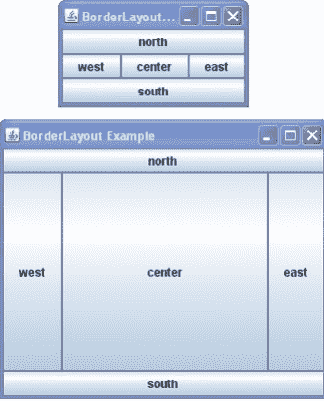

这种布局起初看起来非常特殊——人们会想这到底需要多少。但在实践中，这是一个非常实用的布局，被用于许多应用程序。例如，在 BlueJ 中，主窗口和编辑器都使用 `BorderLayout` 作为主布局管理器。

当 `BorderLayout` 调整大小时，中间的组件会在尺寸上被拉伸。东部和西部组件的高度会变化，但保持宽度不变。北部和南部组件保持高度，只有宽度会变化。

**GridLayout** 顾名思义（图 11.7），可以将组件排列在间距均匀的网格中。可以指定行数和列数，`GridLayout` 管理器将保持所有组件具有相同的大小。这对于强制按钮具有相同的宽度等非常有用。`JButton` 实例的宽度最初由每个按钮上的文本决定：恰好足够显示其文本的宽度。将按钮插入 `GridLayout` 将导致所有按钮的宽度都与最宽的按钮一致。

> 图 11.7 GridLayout
> 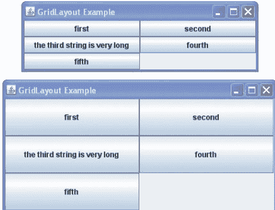

**BoxLayout** 按垂直或水平方向排列多个组件。在调整大小时，它不会换行（图 11.8）。通过相互嵌套 `BoxLayout`，可以构建出复杂的、二维对齐的布局。

> 图 11.8 BoxLayout
> 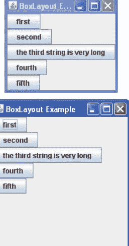

### 11.5.4 嵌套容器

上述讨论的所有布局策略都相当简单。构建美观且良好的界面的关键在于最后一个细节：布局是可以嵌套的。

某些 Swing 组件是容器。容器在外部看起来是一个单一组件，但它们可以包含多个其他组件。每个容器都附有它自己的布局管理器。

最常用的容器是 `JPanel` 类。`JPanel` 可以作为组件插入到框架的内容面板（content pane）中，然后在 `JPanel` 内部可以布局更多组件。例如，图 11.9 显示了类似于 BlueJ 主窗口的界面安排。此框架的内容面板使用 `BorderLayout`，其中使用了 EAST 位置。

> 图 11.9 使用嵌套容器构建界面
> 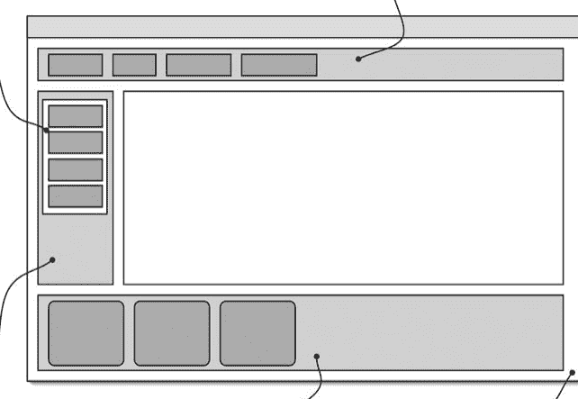

该 `BorderLayout` 的 `NORTH` 区域包含一个带有水平 `FlowLayout` 的 `JPanel`，它按行排列其组件（可能是工具栏按钮）。`SOUTH` 区域也类似：另一个带有 `FlowLayout` 的 `JPanel`。

`WEST` 区域的按钮组首先被置于一个带有单列 `GridLayout` 的 `JPanel` 中，以使所有按钮具有相同的宽度。然后，此 `JPanel` 被置于另一个带有垂直 `FlowLayout` 的 `JPanel` 中，这样网格就不会延伸到 `WEST` 区域的整个高度。此 `JPanel` 然后被插入框架的布局中。

注意容器和布局管理器在组件布局中是如何协作的。容器持有组件，但如果我们不显式设置，布局管理器将决定它们的精确排列。每个容器都有一个布局管理器。我们将使用默认布局管理器。不同容器的默认布局器不同：例如，`JFrame` 的内容面板默认是 `BorderLayout`，而 `JPanel` 默认使用 `FlowLayout`。

**练习 11.17** 查看第 6 章中使用的计算器项目的 GUI（见第 187 页的图 6.7）。

**练习 11.18** 查看第 6 章中使用的计算器项目的 GUI（见第 187 页的图 6.7）。

### 11.5.5 图像过滤器

#### 代码 11.5 简单过滤过程的模式

```java
int height = getHeight();
int width = getWidth();
for(int y = 0; y < height; y++) {
    for(int x = 0; x < width; x++) {
        Color pixel = getPixel(x, y);
        alter the pixel's color value;
        setPixel(x, y, pixel);
    }
}
```

过滤器函数本身在图像上操作，遵循职责驱动的设计原则，它应该在 `OFImage` 类中实现。另一方面，处理菜单的调用还包含一些与 GUI 相关的代码（例如，当我们调用过滤器时，我们必须检查是否打开了图像）。我们可以看到 `ImageView` 类中的 `makeDarker` 方法。

基于这一推理，我们创建了两个方法，一个在 `ImageView` 中，一个在 `OFImage` 中，以共享工作（代码 11.6 和代码 11.7）。我们可以看到 `ImageView` 中的 `makeDarker` 方法包含了与 GUI 相关的任务部分（检查是否加载了图像、显示状态消息、重绘框架），而 `OFImage` 中的 `darker` 方法则包含了图像中每个像素变暗的实际工作。

#### 代码 11.6 ImageViewer 类中的过滤器方法

```java
public class ImageView {
    // 省略字段、构造函数和其他所有其他方法

    /**
     * 'Darker' 函数：让图片变暗。
     */
    private void makeDarker() {
        if(currentImage != null) {
            currentImage.darker();
            frame.repaint();
            showStatus("Applied: darker");
        } else {
            showStatus("No image loaded.");
        }
    }
}
```

#### 代码 11.7 OFImage 类中过滤器的实现

```java
public class OFImage extends BufferedImage {
    // 省略字段、构造函数和其他所有其他方法
    /**
     * 让这张图像变暗一点。
     */
    public void darker() {
        int height = getHeight();
        int width = getWidth();
        for(int y = 0; y < height; y++) {
            for(int x = 0; x < width; x++) {
                setPixel(x, y, getPixel(x, y).darker());
            }
        }
    }
}
```

**练习 11.23** 你在 `makeDarker` 方法中看到的方法调用 `frame.repaint()` 是做什么的？

**练习 11.24** 我们可以看到方法 `showStatus` 的调用，这显然是一个内部调用。从名称我们可以推测，该方法应该使用我们之前创建的状态标签显示状态消息。在你的 `imageviewer0-4` 项目版本中实现此方法。（*提示：查看 `JLabel` 类中的 `setText` 方法。）

**练习 11.25** 如果在没有打开图像的情况下选中了 *Darker* 菜单项会发生什么？

**练习 11.26** 详细解释 `OFImage` 中的 `darker` 方法是如何工作的。（*提示：它包含了对另一个自身也称为 `darker` 的方法的调用。这第二个方法属于哪个类？去查一下吧。）

**练习 11.27** 在 `OFImage` 中实现 `lighter` 过滤器。

**练习 11.28** 实现 `threshold` 过滤器。为了获取像素的亮度，你可以获取其红、绿、蓝值并将它们相加。`Color` 类定义了指向合适的黑、白、灰对象的静态引用。

你可以在 `imageviewer1-0` 项目中找到目前为止描述的所有内容的有效实现。然而，在查看答案之前，你应该尝试自己完成这些练习。

### 11.5.6 对话框

我们这个版本的最后一个任务是添加一个帮助菜单，其中包含一个名为“About ImageViewer”的菜单项。当选中此项时，应该弹出一个显示一些简短信息的对话框。

- **练习 11.29** 再次添加一个名为 Help 的菜单。在其中，添加一个名为 About ImageViewer 的菜单项。
- **练习 11.30** 添加一个名为 `showAbout` 的方法存根（空方法体），并添加一个动作监听器。（*提示：查看 `JLabel` 类中的 `setText` 方法。）
- **练习 11.31** 共有多少类型的对话框？
- **练习 11.32** 在你的 `imageviewer0-4` 项目版本中实现 `showAbout` 方法。
- **练习 11.33** 实现输入对话框以允许用户输入。

你可以在 `imageviewer1-0` 项目中找到目前为止描述的所有内容的有效实现。然而，在查看答案之前，你应该尝试自己完成这些练习。

对话框的特征之一是它是否是模态的（modal）。模态对话框在关闭之前会阻塞与应用程序的所有交互。非模态对话框允许在显示时与其他部分交互。

然而，对于模态对话框，有：

- **消息对话框 (Message dialog)**：显示消息的对话框。
- **确认对话框 (Confirm dialog)**：提问并具有是、否按钮的对话框。
- **输入对话框 (Input dialog)**：允许用户输入文本的对话框。

我们需要实现 `showAbout` 方法以便显示“关于”框。

```java
private void showAbout() {
    JOptionPane.showMessageDialog(frame,
        "ImageViewer\n" + VERSION,
        "About",
        JOptionPane.INFORMATION_MESSAGE);
}
```

在这一部分中，我们添加了处理图像的自定义类，但对 GUI 更重要的是，我们查看了组件的布局。我们看到了容器和布局管理器如何协同工作以实现我们所需的精确排列。

学习使用布局管理器需要一些经验，通常也需要实验。然而，随着时间的推移，你将熟悉布局管理器。

我们现在已经涵盖了 GUI 编程所有领域的基础。在本章的剩余部分，我们可以专注于对已有内容进行微调和改进。

### 11.6 进阶：使用过滤器对象

在这种情况下，我们希望找到一种设计，让我们能够添加新的过滤器，而无需每次都为过滤器添加新的分发方法（`dispatch method`）。

为了实现我们的目标，我们需要避免将每个过滤器都硬编码到 `ImageView` 类中。相反，我们应该使用过滤器集合，然后创建一个单一的过滤器调用方法，来查找并调用正确的过滤器。

为了做到这一点，过滤器本身必须变成对象。如果我们想将它们存储在一个公共集合并直接从该集合应用过滤器，所有过滤器都需要一个共同的父类，我们将其命名为 `Filter`（图 11.10）。

> 图 11.10 作为对象的过滤器类结构
> 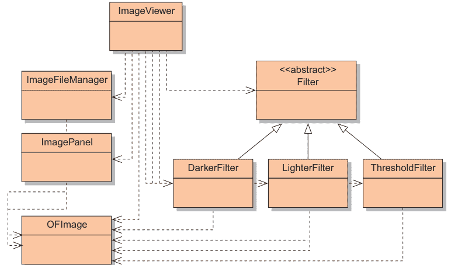

每个过滤器都将有一个名称和一个将过滤器应用于图像的 `apply` 方法。我们可以在 `Filter` 父类中定义这些（代码 11.10）。注意，这是一个抽象类，因为该方法在该层级必须是抽象的，但 `getName` 方法可以完全实现。

#### 代码 11.10 抽象类 Filter：所有过滤器的父类

```java
public abstract class Filter
{
    private String name;

    /**
     * 创建一个带有给定名称的新过滤器。
     */
    public Filter(String name)
    {
        this.name = name;
    }

    /**
     * 返回此过滤器的名称。
     * @return 此过滤器的名称。
     */
    public String getName() {
        return name;
    }

    /**
     * 将此过滤器应用于图像。
     * @param image 要被此过滤器更改的图像。
     */
    public abstract void apply(OFImage image);
}
```

一旦我们写了父类，作为子类实现特定的过滤器并不困难。我们只需要为 `apply` 方法提供一个实现，使用图像的 `getPixel` 和 `setPixel` 方法来处理（作为参数传递的图像。代码 11.11 显示了一个示例。

#### 代码 11.11 特定过滤器类的实现

```java
// 此处原文缺失具体实现代码，仅保留标题
```


# 第 11 章 构建图形用户界面

```java
// All comments omitted.
public class DarkerFilter extends Filter {
    public DarkerFilter(String name) {
        super(name);
    }

    public void apply(OFIImage image) {
        int height = image.getHeight();
        int width = image.getWidth();
        for(int y = 0; y < height; y++) {
            for(int x = 0; x < width; x++) {
                image.setPixel(x, y, image.getPixel(x, y).darker());
            }
        }
    }
}
```

作为此的副作用，`OFImage` 类变得简单得多，因为所有的过滤器方法都可以从其中移除。它现在只定义 `setPixel` 和 `getPixel` 方法。

一旦我们这样定义了过滤器，就可以创建过滤器对象并将它们存储在集合中（代码 11.12）。

## 代码 11.12 添加过滤器类

```java
public class ImageViewer
{
    // Other fields and comments omitted.

    private List<Filter> filters;
    public ImageViewer()
    {
        filters = createFilters();
        ...
    }

    private List<Filter> createFilters()
    {
        List<Filter> filterList = new ArrayList<Filter>();
        filterList.add(new DarkerFilter("Darker"));
        filterList.add(new LighterFilter("Lighter"));
        filterList.add(new ThresholdFilter("Threshold"));

        return filterList;
    }

    // Other methods omitted.
}
```

一旦我们搭建好了这个结构，就可以进行最后两个必要的更改：

- 我们更改创建过滤器菜单项的代码，使其遍历过滤器集合。对于每个过滤器，它都会创建一个菜单项并使用过滤器的 `getName` 方法来确定项的标签。
- 完成此后，我们可以写一个通用的 `applyFilter` 方法，接收过滤器作为参数，并将此过滤器应用于当前图像。

## 11.7 ImageViewer 3.0: 更多界面组件

图 11.11 带有工具栏按钮的图像查看

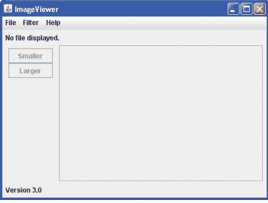

解决方案很简单。我们在框架的 WEST 区域添加一个 `JPanel`（正如我们所知，`JPanel` 是容器），然后将两个按钮放入该 `JPanel` 中。代码 11.13 显示了实现此操作的代码。

## 代码 11.13 添加两个按钮的工具栏

```java
// 创建带有按钮的工具栏
JPanel toolbar = new JPanel();

JButton smallerButton = new JButton("Smaller");
toolbar.add(smallerButton);

JButton largerButton = new JButton("Larger");
toolbar.add(largerButton);

contentPane.add(toolbar, BorderLayout.WEST);
```

> **练习 11.43** 使用与上述类似的代码，在你最新版本的项目中添加两个标记为 Larger 和 Smaller 的按钮。进行测试。你观察到了什么？

我们尝试了这样做，发现它部分起作用，但效果并不符合预期。原因是 `JPanel` 默认使用 `FlowLayout`，而 `FlowLayout` 会水平方向排列其组件。我们希望它们是垂直排列的。

我们可以通过使用另一个布局管理器来实现这一点。`GridLayout` 正好能实现我们需要。在创建 `GridLayout` 时，构造函数参数决定了我们希望拥有的行和列数。这里的零值具有特殊含义，表示“按需要的数量”。

因此，我们可以使用 0 作为行数、1 作为列数创建一个单列 `GridLayout`。然后我们可以在创建面板后，立即使用面板的 `setLayout` 方法为其设置该 `GridLayout`：

```java
JPanel toolbar = new JPanel();
toolbar.setLayout(new GridLayout(0, 1));
```

或者，布局管理器也可以作为容器的构造函数参数指定：

```java
JPanel toolbar = new JPanel(new GridLayout(0, 1));
```

> **练习 11.44** 修改你的代码，使你的工具栏面板如上所述地使用 `GridLayout`。进行测试。你观察到了什么？

如果我们尝试一下，可以看到我们正接近目标，但仍然没有得到我们想要的结果。我们的按钮现在的尺寸比预想的要大得多。

原因是 `BorderLayout` 中的容器（在此例中为我们的工具栏 `JPanel`）始终覆盖它的整个区域（我们框架中的 WEST 区域）。而 `GridLayout` 总是调整组件的大小以填充容器。

`FlowLayout` 则不会这样做——它乐意在组件周围留出空隙。我们的解决方案是同时使用两者：使用 `GridLayout` 将按钮排列成一列，并在周围使用 `FlowLayout` 以留出一些空间。我们最终在 `BorderLayout` 内部的 `FlowLayout` 面板内部使用了 `GridLayout`。代码 11.14 显示了这种解决方案。这种构造非常常见。你经常会把容器嵌套在另一个容器中，以创建你精确想要的布局。

## 代码 11.14 在 FlowLayout 容器内部嵌套使用 GridLayout 容器

```java
// 创建带有按钮的工具栏
JPanel toolbar = new JPanel();
toolbar.setLayout(new GridLayout(0, 1));

JButton smallerButton = new JButton("Smaller");
toolbar.add(smallerButton);

JButton largerButton = new JButton("Larger");
toolbar.add(largerButton);

// 将工具栏添加到带有流布局的面板中以留间距
JPanel flow = new JPanel();
flow.add(toolbar);

contentPane.add(flow, BorderLayout.WEST);
```

我们的按钮现在看起来已经非常接近我们的目标了。在添加最后的润色之前，我们首先要让按钮工作起来。

我们需要添加两个方法，例如命名 `makeLarger` 和 `makeSmaller` 来执行实际工作，并且我们需要为按钮添加动作监听器来调用这些方法。

> **练习 11.45** 在你的项目中添加两个名为 `makeLarger` 和 `makeSmaller` 的方法存根。最初，在这些方法体中放置一个简单的 `println` 语句，以便查看它们何时被调用。方法可以是私有的。
>
> **练习 11.46** 为这两个按钮添加调用它们的动作监听器。为按钮添加动作监听器与为菜单项添加动作监听器是完全相同的。你基本上可以从那里复制代码模式。确保通过激活按钮使你的 `makeSmaller` 和 `makeLarger` 方法被调用。
>
> **练习 11.47** 正确实现带有不同尺寸的 `makeImage`，从当前图像复制像素（同时进行放大或缩小），然后将新图像设置为当前图像。在方法的末尾，你应该调用框架的 `pack` 方法以根据更改的大小重新排列组件。
>
> **练习 11.48** 所有 Swing 组件都有一个 `setEnabled(boolean)` 方法，可以启用和禁用组件。禁用的组件通常显示为浅灰色，并且对输入没有反应。更改你的图像查看器，使工具栏按钮初始处于禁用状态。当打开图像时，它们应该是启用的；当关闭时，它们应该再次被禁用。

### 11.7.2 边框

我们想要界面添加的最后完善是一些内部边框。边框可以用于分组组件或仅在它们之间添加一些空间。每个 Swing 组件都可以有一个边框。

某些布局管理器还接受定义间距的构造函数参数，布局管理器将……最常用的边框有 `BevelBorder`、`CompoundBorder`、`EmptyBorder`、`EtchedBorder` 和 `TitledBorder`。

我们将做三件事来改进视觉效果：

- 分组组件
- 在它们之间添加一些空间
- 添加边框

## 练习（续）

> **练习 11.57** 实现一个 `reload` 函数，丢弃对当前图像的所有更改并从磁盘重新加载。
>
> **练习 11.58** `JMenu` 类实际上是 `JMenuItem` 的子类。这意味着可以通过将一个 `JMenu` 嵌套在另一个内部创建嵌套菜单。嵌套一个 `Rotate` 菜单，允许图像顺时针或逆时针旋转 90 或 180 度。实现此功能。例如，`Adjust` 菜单也可以包含调用 `Larger` 和 `Smaller` 功能的菜单项。
>
> **练习 11.59** 应用程序始终调整窗口大小以确保显示完整图像。拥有大窗口并不总是理想的。阅读 `JScrollPane` 的文档。不要将 `ImageIcon` 添加到内容面板中，而是将面板放入 `JScrollPane` 中，并将滚动条添加到内容面板中。滚动条带来了什么变化？这是否允许你显示那些原本会超出屏幕的图像？
>
> **练习 11.60** 修改你的应用程序，使其能够同时打开多个图像（但每次只显示一张图像）。然后添加一个弹出菜单（使用 `JComboBox`）来选择要显示的图像。
>
> **练习 11.61** 作为练习 11.60 中使用 `JComboBox` 的替代方案，使用一个标签页面板（类 `JTabbedPane`）来持有多个图像。
>
> **练习 11.62** 实现一个 `slide` 函数，允许你选择一个目录，然后按照指定的时间（例如 5 秒）显示目录中的每个图像。
>
> **练习 11.63** 一旦你有了幻灯片，添加一个滑动块（类 `JSlider`），允许你通过移动滑动块来选择幻灯片中的图像。幻灯片运行时，滑动块应该移动以指示进度。


# 另一个示例：SoundPlayer

到目前为止，在本章中，我们详细讨论了一个 GUI 应用程序示例。现在我们想引入第二个应用程序，提供另一个供学习的示例。这个程序引入了一些额外的 GUI 组件。

第二个示例是一个音频播放器应用程序。我们不会对其进行过多的详细讨论。它的目的是作为研究源代码的基础（在很大程度上基于你的代码），并作为供你复制和修改的代码片段来源。

在本章中，我们仅指出该应用程序中值得关注的几个方面。

## 练习 11.64 打开 simplesound 项目。创建 `SoundPlayerGUI` 的实例，并对该应用程序进行实验。

音频播放器查找并播放存储在项目文件夹内 `audio` 文件夹中的音频剪辑。它可以播放存储在 AIFF、AU 和某些 WAV 格式中的声音。注意，WAV 格式使用了多种不同的编码，其中只有一些可以被我们的播放器播放。如果你有格式正确的音频文件，应该可以通过将其拖入 `simplesound` 的 `audio` 文件夹来播放。

音频播放器由两个类实现：`SoundPlayer` 和 `SoundEngine`。只有第一个类是用来研究的。`SoundEngine` 类基本上可以被视为库类。熟悉它的接口，但你不需要理解或修改它的实现。（当然，如果你喜欢，也欢迎研究这个类，但它使用了一些我们在本节中没有讨论的概念。）

以下关于该项目的一些值得注意的观察。

### 模型/视图分离

该应用程序使用了比上一个示例更好的模型/视图分离。这意味着应用程序功能（模型）与用户界面（GUI）被清晰地分离。这两个部分（模型和视图）都可能由多个类组成，为了实现清晰分离，每个类都应该明确地属于其中一组。每个示例都只包含一个类。

将应用程序的功能与界面分离具有良好的内聚性——它使程序更容易理解、更易维护，并且更容易适应不同的需求（特别是不同的用户界面）。例如，为音频播放器编写一个基于文本的界面是很容易的，这有效地替换了 `SoundPlayerGUI` 而保持 `SoundEngine` 类不变。

### 继承 JFrame

在这个示例中，我们正在展示创建窗口的另一种方式。我们的 GUI 类没有实例化 `JFrame` 对象；它而是继承了 `JFrame` 类。

因此，我们需要调用的所有 `JFrame` 方法（如 `getContentPane`、`setMenuBar`、`pack` 等）现在都可以作为内部（继承的）方法调用。

没有充分的理由偏于一种样式（使用 `JFrame` 实例）而不是另一种样式（继承 `JFrame`）。这在很大程度上取决于个人喜好，但你应该意识到这两种样式都被明智地使用了。

### 显示静态图像

在 GUI 中显示图像是非常常见的。实现此点的简单方法是在界面中包含一个 `JLabel`，它将图形作为其标签（`JLabel` 可以显示文本、图形或两者兼有）。音频播放器包含了一个这样做的示例。

相关的源代码是：

```java
JLabel image = new JLabel(new ImageIcon("title.jpg"));
```

该语句将从项目目录加载图像文件 'title.jpg'，创建一个带有该图像的图标，并创建一个显示该图标的 `JLabel`。

“图标（icon）”一词似乎表明我们处理的只是小图像，但这里的图像是很大的。

### 组合框

音频播放器提供了一个使用 `JComboBox` 的示例。组合框是一组值，其中一个被选中。

### 列表

程序还包含一个列表（类 `JList`）的示例。列表可以持有任意数量的值。

### 滚动条

此示例中演示的另一个组件是滚动条的使用。滚动条可以通过 `JScrollPane` 创建。

## 11.10 总结

在本章中，我们介绍了使用 AWT 和 Swing 进行 GUI 编程。我们讨论了三个领域：创建 GUI 组件、布局和事件处理。

...（总结的剩余部分）

我们引入了匿名类的概念，作为一种编写事件监听器的可扩展技术。

最后，我们提供了一个在线参考和教程的链接，用于学习本章未涵盖的细节。

## 练习（续）

> **练习 11.65** 修改音频播放器以显示新图像。
>
> **练习 11.66** 修改其他组件（前景和背景）颜色以适应新图像。
>
> **练习 11.67** 为音频播放器添加重加载功能，从 `audio` 文件夹重新加载。
>
> **练习 11.68** 在菜单中添加一个“打开”项。激活时，它会弹出一个对话框让用户选择文件。如果用户选择目录，播放器应该打开目录中的所有文件。
>
> **练习 11.69** 修改滑动块，使起始和结束（以及可能的标记）用数字标记。起始应为 0，结束应为音频剪辑的长度。
>
> **练习 11.70** 修改音频播放器，使双击列表元素可以启动声音。
>
> **练习 11.71** 改进按钮外观。所有在此时没有功能的按钮都应该显示灰色，并且只有当它们可以合理使用时才启用。
>
> **练习 11.72** `SoundEngine` 提供调整音量的方法。在用户界面某处添加一个滑动块来调整音量。

## 练习 11.73

为第 7 章的 `world-of-zuul` 项目添加图形用户界面（GUI）。每个房间都应该有一张关联图片，当玩家进入该房间时显示。应该有一个不可编辑的文本区域用于显示文本输出。为了输入命令，你可以选择不同的方案：你可以放弃输入文本框并使用文本字段（`JTextField` 类）来输入命令，或者使用按钮进行命令输入。

## 练习 11.74

为 `world-of-zuul` 游戏添加声音。你可以将单个声音与房间、物品或角色关联。

## 练习 11.75

为文本编辑器设计并构建一个 GUI。用户应该能够输入文本、编辑、滚动等操作。考虑格式化功能（字体、样式和大小）以及字符/单词计数统计功能。你现在不需要实现加载和保存函数——你可能想读完下一章后再考虑。

## 本章引入的术语


# 概念总结

- **组件**：GUI 通过在屏幕上排列组件来构建。组件由对象表示。
- **布局**：通过使用布局管理器来实现组件的布局。
- **事件处理**：事件处理术语是指响应用户事件（如鼠标点击或键盘输入）的任务。
- **图像格式**：图像可以以不同的格式存储。差异主要影响文件大小和信息内容。
- **菜单栏、内容面板**：通过将组件添加到框架的菜单栏或内容面板中将其放入框架中。
- **事件监听器**：对象可以通过实现事件监听器接口来监听组件事件。
- **匿名内部类**：匿名内部类是实现事件监听器的有用结构。

# 第 12 章 错误处理

本章讨论的主要概念：

- 防御性编程
- 错误报告
- 异常的抛出与处理
- 简单的文件处理

本章讨论的 Java 构造：

`TreeMap`, `TreeSet`, `SortedMap`, `assert`, `exception`, `throw`, `throws`, `try`, `catch`, `FileReader`, `FileWriter`, `stream`

在第 6 章中我们注意到，程序的逻辑错误比语法错误更难发现，因为编译器无法对逻辑错误提供任何帮助。逻辑错误的产生有几个原因，在某些情况下可能会重叠：

- 问题的解决方案实现不正确。例如，涉及生成数据值统计的问题可能被编写为寻找平均值而不是中位数（“中间”值）。
- 对象可能被要求执行它无法完成的操作。例如，调用集合的 `get` 方法时传入的索引值超出了有效范围。
- 对象的使用方式可能未被类设计师预料到，导致对象处于不一致或不恰当的状态。这通常当一个类在与其原始环境不同的设置中被重用时发生（例如通过继承）。

尽管第 6 章中讨论的类测试策略可以帮助我们在程序投入使用之前识别并消除许多逻辑错误，但经验表明程序故障将继续发生。此外，即使经过最彻底测试的程序也可能因为程序员无法控制的情况而失败。考虑这种情况：网络浏览器被要求显示一个不存在的网页；或者程序需要向一个没有剩余空间的磁盘写入数据。这些问题不是逻辑编程错误的结果，但如果没有预料到它们发生的可能性，它们很容易导致程序失败。

## 12.1 通讯录地址

我们将使用地址簿项目来展示应用程序中出现的某些错误报告和处理问题。

```java
import java.util.Iterator;
import java.util.LinkedList;
import java.util.LinkedHashSet;
import java.util.List;
import java.util.Set;
import java.util.SortedMap;
import java.util.TreeMap;

/**
 * 为了初始化地址簿。
 * @author David Barnes and Michael Kelly
 * @version 2008.03
 * 任意数量的细节。
 */
public class AddressBook {
    // 存储任意数量的细节
    private TreeMap<String, ContactDetails> book;
    private int numberOfEntries;

    /**
     * 执行地址簿初始化。
     */
    public AddressBook() {
        book = new TreeMap<>();
        numberOfEntries = 0;
    }

    /**
     * 根据 key 查找对应的细节。
     * @param key 要查找的名称或电话。
     * @return 对应的细节。
     */
    public ContactDetails getDetails(String key) {
        return book.get(key);
    }

    /**
     * 返回 key 是否在使用。
     * @param key 要查找的名称或电话。
     * @return 如果使用返回 true，否则返回 false。
     */
    public boolean keyInUse(String key) {
        return book.containsKey(key);
    }

    /**
     * 向笔记本添加新的细节。
     * @param details 要关联的细节。
     */
    public void addDetails(ContactDetails details) {
        book.put(details.getName(), details);
        book.put(details.getPhone(), details);
        numberOfEntries++;
    }

    /**
     * 从地址簿中移除给定 key 的项。
     * @param key 要移除项的 key 之一。
     */
    public void removeDetails(String key) {
        ContactDetails details = book.get(key);
        book.remove(details.getName());
    }

    /**
     * 修改存储在给定 key 下的细节。
     * @param oldKey 存储细节的 key。
     * @param details 替换细节。
     */
    public void changeDetails(String oldKey, ContactDetails details) {
        removeDetails(oldKey);
        addDetails(details);
    }

    /**
     * 搜索以给定前缀开头的所有细节。
     * @param keyPrefix 要搜索的键前缀。
     * @return 找到的细节数组。
     */
    public ContactDetails[] search(String keyPrefix) {
        List<ContactDetails> matches = new LinkedHashSet<>();
        // 找到大于等于前缀的键。
        SortedMap<String, ContactDetails> tail = book.tailMap(keyPrefix);
        Iterator<String> it = tail.keySet().iterator();
        boolean endOfSearch = false;
        while (!endOfSearch && it.hasNext()) {
            String key = it.next();
            if (key.startsWith(keyPrefix)) {
                matches.add(book.get(key));
            } else {
                endOfSearch = true;
            }
        }
        ContactDetails[] results = new ContactDetails[matches.size()];
        return results;
    }

    /**
     * @return 地址簿中当前的项数量。
     */
    public int getNumberOfEntries() {
        return numberOfEntries;
    }
}
```

## 代码 12.1 续

```java
book.remove(details.getPhone());
numberOfEntries--;

/**
 * @return 所有联系人详情，根据 ContactDetails 类
 * 的排序顺序进行排序。
 */
public String listDetails() {
    // 因为每个条目存储在两个键下，所以
    // 有必要构建 ContactDetails 的集合。
    // 这可以消除重复项。
    StringBuilder allEntries = new StringBuilder();
    Set<ContactDetails> sortedDetails =
        new TreeSet<ContactDetails>(book.values());
    for(ContactDetails details : sortedDetails) {
        allEntries.append(details);
        allEntries.append('\n');
        allEntries.append('\n');
    }
    return allEntries.toString();
}
```

### AddressBook 类

可以通过其 `addDetails` 方法在地址录中存储新的详情信息。这假设详情信息代表一个新的联系人，而不是现有联系人详情的变更。为了涵盖后一种情况，`changeDetails` 方法会移除旧条目并用修改后的详情替换它。地址录提供了两种检索条目的方法：`getDetails` 方法接受名称或电话号码作为键并返回匹配的详情；`search` 方法返回所有以通用搜索字符串开头的详情数组。例如，搜索 `08459` 将返回所有电话号码具有该地区前缀的条目。

这里有两个入门级的通讯录项目版本供你选择。它们都提供了访问相同版本的 `AddressBook`，如代码 12.1 所示。`address-book-v1` 项目提供了一个基于文本的用户界面，其风格类似于第 7 章中讨论的 `ziul` 项目。目前可用的命令包括列出地址录内容、搜索地址录以及添加新条目。然而，作为界面，可能更有趣的是 `address-book-v2` 版本，它包含了一个简单的 GUI。尝试这两个版本，以获得对应用程序功能的性的经验。

**练习 12.1** 打开 `address-book-v1` 项目并创建一个 `AddressBookDemo` 对象。调用它的 `showInterface` 方法显示 GUI 并与示例地址录进行交互。

**练习 12.2** 重复你对 `address-book-v1` 文本界面的实验。

**练习 12.3** 检查 `AddressBook` 类的实现，并评估你认为它写得好不好。你是否有任何具体的批评意见？

**练习 12.4** `AddressBook` 类使用了大量来自 `java.util` 包的类；如果你不熟悉其中任何类，请检查 API 文档以补充空白。你认为使用这么多不同的类是合理的吗？可以使用 `HashMap` 代替 `TreeMap` 吗？

**练习 12.5** 修改 `address-book-v1` 项目中的 `CommandWords` 和 `AddressBookTextInterface` 类，以对 `AddressBook` 的 `getDetails` 和 `remove` 方法提供交互式访问。

**练习 12.6** `AddressBook` 类定义了一个属性来记录条目数量。你认为根据需要，从 `TreeMap` 中唯一条目的数量来计算此值会更合适吗？例如，你能想到在任何种情况下，以下计算不会产生相同的值吗？

```java
return book.size() / 2;
```

## 12.2 防御性编程

### 12.2.1 客户端-服务器交互

`AddressBook` 是一个典型的服务器对象，它不会代表自己发起任何操作；其所有活动都由客户端请求驱动。实现者在设计和实现服务器时至少可以采用两种可能的观点：

- 他们可以声称客户端对象知道自己在做什么，并且仅以敏感且定义良好的方式请求服务。
- 他们可以声称服务器运行在一个本质上是敌意的环境中，必须采取所有可能的步骤防止客户端对象错误地使用服务器。

这些观点清楚地代表了对立的极端。在实践中，最可能的情况位于两者之间。大多数客户端交互都是合理的，偶尔会有尝试错误地使用服务器的情况——这是由于逻辑编程错误或程序员的误解造成的。这些不同的观点为讨论此类问题提供了一个有用的基础：

- 服务器方法应该对客户端请求执行多大的检查？
- 服务器应该如何向其客户端报告错误？
- 客户端如何预判向服务器请求的失败？
- 客户端应该如何处理请求失败？

### 12.2.2 参数检查

如果我们带着这些问题来检查 `AddressBook` 类，将会发现该类的编写完全信任其客户端会恰当使用。练习 12.7 阐述了这种情况的一种方式，以及事情可能变得出错的情况。

**练习 12.7** 使用 `address-book-v1` 项目，在对象台上创建一个新的 `AddressBook` 对象。它将完全没有任何联系人详情。现在调用它的 `removeDetails` 方法，并传入任何字符串值作为键。发生了什么？你能理解为什么会发生这种情况吗？

**练习 12.8** 对于程序员来说，对出现错误的最简单响应是允许程序终止（即“崩溃”）。你能想到在哪些情况下仅仅允许程序终止是非常危险的吗？

**练习 12.9** 许多市售的程序包含软件中未妥善处理的错误并导致程序崩溃。这是不可避免的吗？是可以接受的吗？讨论。

`removeDetails` 方法的问题在于它假设传递的键是有效的。如果键不存在，方法将：

```java
ContactDetails details = book.get(key);
```

如果键没有关联的条目，变量将为 `null`。如果我们对其调用方法，结果就是运行时错误：

```java
book.remove(details.getName());
```

如果键无效，方法应该什么都不做。

**练习 12.10** 有必要报告调用 `removeDetails` 时使用无效键吗？如果有，你将如何报告它？

**练习 12.11** `AddressBook` 中是否有其他方法容易受到类似错误的影响？如果有，尝试在你的代码中修复它们。

服务器对象在构造函数和方法接收参数时最为脆弱。传递给构造函数的值用于设置对象的初始状态；传递给方法的值将影响方法的整体效果并可能是它产生的结果。因此，关键在于知道是否可以信任参数是有效的，还是由自己检查其有效性。`ContactDetails` 和 `AddressBook` 类的当前情况是对参数值没有检查。正如我们在 `removeDetails` 中看到的，这会导致致命运行时错误的发生。

防止 `removeDetails` 产生 `NullPointerException` 相对容易，并且通过改进方法中的源代码，我们更新了方法的注释以说明忽略未知键的事实。

### 代码 12.2 针对 `removeDetails` 中的无效键

```java
/**
 * 从地址录中移除给定键的条目。
 * 如果键不存在，则什么都不做。
 * @param key 要移除条目的键之一。
 */
public void removeDetails(String key) {
    if(keyInUse(key)) {
        ContactDetails details = book.get(key);
        book.remove(details.getName());
        book.remove(details.getPhone());
        numberOfEntries--;
    }
}
```

如果我们检查 `AddressBook` 的所有方法，我们会发现其他可以进行细微改进的地方：

- `addDetails` 方法应该检查其参数不是 `null` 值。
- `changeDetails` 方法应该检查旧键是否为使用的，并且新详情不为 `null`。
- `search` 方法应该检查键是否为 `null`。

这些更改已全部在 `address-book-v2g` 和 `address-book-v2t` 项目中的应用程序版本中实现。

**练习 12.12** 为什么你认为对 `getDetails` 和 `keyInUse` 方法进行类似的更改是没必要的？

**练习 12.13** 在处理参数错误时，我们没有打印任何错误信息。你认为 `AddressBook` 在每当接收到其任一个方法的错误参数时，都应该打印错误信息吗？是否存在某些打印错误信息是不恰当的情况？

**练习 12.14** 你认为是否还有其他你应该对方法的参数进行进一步的检查，以防止 `AddressBook` 对象运行异常？

## 12.3 服务器错误报告

在通过错误的参数值保护了服务器免执行非法操作后，我们可以认为这就是服务器所做的全部工作。然而，我们希望从源上避免此类错误情况发生。此外，错误值通常是提供这些值的客户端某些编程错误导致的。因此，与其简单地在服务器中报告问题并置之不管，服务器良好的做法是努力指示问题的发生——无论是向客户端、人类用户还是程序员。这样，就有机会让编写错误的客户端得到纠正。对于服务器来说，在这些问题发生时报告问题的最佳方式是什么？这个问题没有单一答案，最合适的答案通常取决于特定服务器对象被使用的上下文。在接下来的章节中，我们将探索服务器报告结果的多种方案。


**练习 12.16** 你能想出多少种不同的方式来指示方法收到了错误的参数值，或由于其他原因无法完成其任务？请考虑许多不同类型的应用程序。例如：具有 GUI 的应用程序；具有文本界面和人类用户的应用程序；以及没有任何类型交互式用户的应用程序，例如汽车的发动机管理系统。

### 12.3.1 通知用户

当对象检测到错误时，其尝试响应的最明显方式是以某种方式通知应用程序的用户。主要的选项是使用 `System.out` 打印错误信息，或者显示错误消息窗口。

这两种方法的两个主要问题：

- 它们假设应用程序是由人类用户使用的，用户会看到错误信息。许多应用程序完全独立于人类用户运行。错误信息或错误窗口将完全无人注意到。事实上，运行应用程序的计算机可能根本没有连接任何显示器。

- 即使有人类用户看到错误信息，该用户也很少处于能够采取行动解决问题的位置。想象一台自动取款机遇到了 `NullPointerException`！只有在用户直接操作导致问题时（例如向应用程序提供无效输入）在这种情况下，他们才可能采取某些纠正措施。

打印不当错误信息的程序更有可能惹怒用户，而不是获得有用的结果。因此，除非在极少数情况下，否则通知用户不是解决报告问题的通用策略。

### 12.3.2 通知客户端对象

与我们目前讨论的方法截然不同的方法是，当发生问题时，让服务器向客户端对象反馈一个指示。实现这一目标有两种主要方法：

- 服务器可以使用方法的返回值来返回一个标志，用于指示方法调用的成功或失败。

- 如果发生问题，服务器可以从方法中抛出一个异常。这引入了 Java 的一个新功能，该功能在其他一些语言中也能找到。我们将在 12.4 节描述这一细节。

这两种技术的优点在于，它们鼓励客户端的程序员考虑到对另一个对象的方法调用可能会失败。然而，只有抛出异常的决定才能主动防止客户端程序员忽略方法失败的后果。

第一种方法很容易引入到原本具有 `void` 返回类型的方法，例如 `removeDetails`。如果将 `void` 类型替换为 `boolean` 类型，那么方法就可以返回 `true` 表示删除成功，返回 `false` 表示由于某种原因失败（代码 12.3）。

这允许客户端使用 `if` 语句来保护依赖于错误成功删除的语句：

```java
if(addresses.removeDetails("...")) {
  // 条目已成功删除。
  ...
}
else {
  // 删除失败。如果可能，尝试恢复。
  ...
}
```

#### 代码 12.3

使用布尔返回类型指示成功或失败

#### 12.3 服务器错误报告

```java
/**
 * 从地址簿中删除给定键的条目。
 * 键应该是当前正在使用的。
 * @param key 要删除的条目的键之一。
 * @return 如果成功删除了条目则返回 true，
 *         否则返回 false。
 */
public boolean removeDetails(String key) {
    if (keyInUse(key)) {
        ContactDetails details = book.get(key);
        book.remove(details.getName());
        book.remove(details.getPhone());
        numberOfEntries--;
        return true;
    } else {
        return false;
    }
}
```

当方法已经具有 `void` 返回类型时——可能仍方法指示错误。例如，下面的示例：

```java
// 发送消息
ContactDetails details = addresses.getDetails("David");
String phone = details.getPhone();
```

`getDetails` 指示键未使用的另一种方法是返回 `null`（代码 12.4）。

#### 代码 12.4

返回越界错误

```java
/**
 * 查找名称或数字并返回相应的联系详情。
 * @param key 要查找名称或数字。
 * @return 对应的详情，
 *         如果未找到则返回 null。
 */
```

**练习 12.20** 你认为一个找不到匹配项的方法是一个错误吗？请说明你的理由。

## 12.4 异常抛出原则

**练习 12.21** 构造函数是否有任何方法向客户端指示它无法正确设置状态？

显然，当所有值都有意义时，无法使用这种方法。在这种情况下，通常需要诉诸*抛出异常*的技术（见 12.4），这实际上确实具有巨大的优势。我们将会欣赏为什么这样做，因为值得考虑与使用返回值相关的两个问题：

- 遗憾的是，没有办法要求客户端检查返回值。结果是，客户端很容易在什么都没有发生的情况下继续运行；导致 `NullPointerException`；或者糟——它甚至可以将诊断返回值作为普通返回值使用，导致难以调试的错误！

- 在某些情况下，我们可能将诊断值用于两个不同的目的。这在修改后的 `removeDetails`（代码 12.3）和 `getDetails`（代码 12.4）中。一个目的是告诉客户端他们的请求是否成功。另一个目的是指示他们的请求有问题，例如传递了错误的参数。

在许多情况下，失败的请求不代表逻辑错误，而错误的请求无疑是。我们对这两种情况应该有完全不同的响应。仅使用值没有通用的解决方法来解决这种冲突。抛出异常是服务器对象指示其无法满足客户端请求的最有效方式。与使用特殊返回值相比，其主要优势之一是客户端几乎无法忽略已抛出的异常并继续运行。客户端未能处理异常将导致应用程序立即终止。此外，异常机制独立于方法的返回值，并可以用于所有方法，无论它们返回什么值。

### 12.4.1 抛出异常

代码 12.5 显示了如何在方法中使用 `throw` 语句抛出异常。在这里，`getDetails` 方法正在抛出一个异常，以指示传递 `null` 值是不合理的。

#### 代码 12.5

抛出异常

```java
if (key == null) {
    throw new IllegalArgumentException("Key cannot be null");
}
```

# 394 第 12 章 处理异常

代码 12.5 继续

抛出异常

```java
/**
 * @param key 要查找的名称或数字。
 * @return 与该 key 对应的详细信息，
 *     如果没有匹配的项，则返回 null。
 * @throws NullPointerException 如果 key 为 null。
 */
public ContactDetails getDetails(String key) {
    if(key == null) {
        throw new NullPointerException(
            "null key in getDetails");
    }
    return book.get(key);
}
```

抛出异常有两个阶段。首先创建一个异常对象（在这种情况下是一个 `NullPointerException` 对象）；然后使用 `throw` 关键字抛出该异常对象。这两个阶段几乎总是结合在单条语句中：

```
throw new ExceptionType("optional-diagnostic-string");
```

当创建异常时，可以向其构造函数传递一个诊断字符串。该字符串稍后可以通过异常的 `getMessage` 访问器或 `toString` 方法供异常的接收者获取。

代码 12.5 说明了方法的文档可以通过可以使用 javadoc 的 `@throws` 标签扩展，以包含其抛出的任何异常的细节。

## 12.4.2 异常类

> 概念：

异常是一个表示程序运行失败详细信息的对象。抛出异常用于指示发生了故障。

异常对象始终是特殊继承层次结构中某个类的实例。我们可以通过在该层次结构中创建子类来创建新的异常类型（图 12.1）。严格来说，异常类是定义在 `java.lang` 包中的 `Throwable` 类的子类。我们将遵循定义和使用 `Exception` 子类作为异常类的约定，而 `Exception` 也定义在 `java.lang` 中。`java.lang` 包定义了许多你在开发程序时可能已经遇到的常见异常类，如 `NullPointerException`、`IndexOutOfBoundsException` 和 `ClassCastException`。

Java 将异常类分为两类：已检异常（checked exceptions）和未检异常（unchecked exceptions）。Java 标准类 `RuntimeException` 的所有子类都是未检异常；`Exception` 的所有子类都是已检异常。

> 异常是 `Throwable` 的两个直接子类之一；另一个是 `Error`。`Error` 的子类通常保留给运行时系统错误，而不是程序员可以控制的错误。

## 12.4 异常抛出原则

图 12.1

异常类层次结构

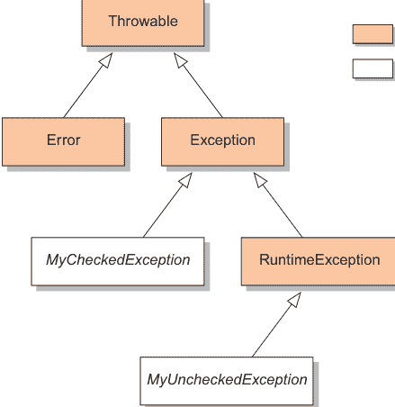

稍微简化一下，其区别在于：已检异常用于客户端应该预期某个操作可能会失败的情况（例如，如果我们向磁盘写入数据，我们知道磁盘可能是满的）。在这种情况下，应该强制客户端检查操作是否成功。未检异常则用于在正常运行下不应失败的情况——它们通常表示程序错误。

遗憾的是，在任何特定情况下应该抛出哪种异常并不是一门精确的科学，但我们可以提供以下建议：

- 一条经验法则是，对于可能导致程序失败的情况使用未检异常——通常是因为怀疑程序中存在逻辑错误，导致其无法继续运行。在出现问题但客户端有可能影响恢复的情况下，应应使用所有已检异常。该策略策略的一个问题是，它假设服务器了解其被使用的上下文，以便判断客户端进行恢复是否可能。

- 另一条经验法则是，对于可以合理避免的情况使用未检异常。例如，在数组中使用无效索引是逻辑编程错误的结果，这是完全可以避免的，而 `ArrayIndexOutOfBoundsException` 异常是未检异常，这符合这一模型。因此，所有已检异常应用于程序员无法控制的失败情况，例如在尝试写入文件时磁盘满了。

管理异常使用的 Java 规则对于未检异常和已检异常显著不同，我们将在将在第 12.4.4 和 12.5.1 节中详细概述这些差异。简单来说，这些规则确保调用可能抛出已检异常方法的客户端对象，既包含了预期可能出现问题的代码，也包含了在问题发生时尝试处理问题的代码。²

# 第 12 章 处理异常

**练习 12.2** 列出 `java.io` 包中的三种异常类型。**练习 12.3** `java.lang` 包中的 `NoSuchException` 又是怎样的？

## 12.4.3 异常的影响

当抛出异常时会发生什么？实际上有两个影响需要考虑：抛出异常的方法中的影响，以及调用者处的影响。当抛出异常时，方法的执行会立即结束——它不会执行到方法的末尾。这是因为方法不需要返回一个有效的结果。我们可以通过代码 12.5 中方法的以下替代版本来阐述这一原则：

```java
if(key == null) {
    throw new NullPointerException("null key in getDetails");
} else {
    return book.get(key);
}
```

`throw` 之后的任何语句赋值永远不会被执行。异常对调用者的影响稍微复杂。考虑以下对 `getDetails` 的调用：

```java
AddressDetails details = getDetails(null);
// 下述语句不会被执行。
String phone = details.getPhone();
```

我们可以说，在所有情况下，如果未被捕获，程序将直接终止，并指示抛出了未检异常。我们将在第 12.5.2 节讨论如何捕获异常。

² 事实上，对于客户端编写者来说，遵守规则并尝试从问题中恢复仍然太容易。

## 12.4.4 未检异常

从程序员的角度来看，未检异常是最容易，因为编译器对它们的使用强制规则很少。这就是“未检”的含义——编译器既不对抛出未检异常的方法进行特殊检查，也不对调用方法的地方进行特殊检查。未检异常是定义在 `java.lang` 中的 `RuntimeException` 类的子类。我们到目前为止的所有示例都说明了未检异常。关于如何抛出未检异常，没有进一步要添加的：使用语句即可。

如果我们遵循在预期结果为程序终止的情况下使用未检异常的约定——即异常不会被捕获——那么对于调用者方法应该做什么就没有进一步需要讨论的，因为它将什么都不做并让程序失败。然而，如果需要捕获未检异常，就可以为它编写异常处理程序，就像处理已检异常一样。这样做见第 12.5.2 节。

一种常用的未检异常是 `IllegalArgumentException`。它由构造函数或方法抛出，以指示其参数值无效。例如，如果传递给 `getDetails` 方法的 key为空，该方法可能会抛出此异常（代码 12.6）。

#### 代码 12.6

```java
/**
 * 查找名称或电话号码并返回详细信息。
 * @param key 要查找的名称或数字。
 * @throws NullPointerException 如果 key 为 null。
 * @throws IllegalArgumentException 如果 key 为空。
 * @return 与该 key 对应的详细信息，
 *     如果没有匹配的项，则返回 null。
 */
public ContactDetails getDetails(String key) {
    if(key == null) {
        throw new NullPointerException(
            "null key in getDetails()");
    }
    if(key.trim().length() == 0) {
        throw new IllegalArgumentException(
            "Empty key passed to getDetails()");
    }
    return book.get(key);
}
```

# 398 401 第 12 章 错误处理

在执行方法的主要目的之前，对其参数进行一系列有效性检查是明智的。这可以减少方法在因参数值无效而必须抛出异常之前已经执行了操作的可能性。避免这种情况的一个特殊原因是，对象的部分变异可能会导致其在未来处于不一致的状态。如果操作由于任何原因而失败，理想情况下，该对象应保持在尝试操作之前的状态。

- **练习 12.24** 审查 `AddressBook` 类的所有方法，并判断是否有任何方法应该抛出 `IllegalArgumentException`。如果是，请添加必要的检查和 `throw` 语句。

- **练习 12.25** 如果你尚未这样做，请添加 javadoc 文档来描述 `AddressBook` 类抛出的任何异常。

## 12.4.5 防止对象创建

异常的一个重要用途是防止对象在无法置于有效状态时被创建。这通常是由于向构造函数传递了不适当的参数导致的。我们可以通过 `ContactDetails` 类来说明这一点。目前的构造函数对接收到的参数相当宽容；它不会拒绝空值，而是将其替换为空字符串。然而，地址簿至少需要每个条目的一个姓名或电话号码来使用唯一索引，一个同时具有姓名和电话字段的条目将无法被索引。我们可以通过在这种情况下防止 `ContactDetails` 对象的构造来反映这一需求。从构造函数中抛出异常的过程与从方法中抛出异常完全相同。代码 12.7 显示了修订后的构造函数，它将防止条目出现空白的姓名和电话字段。

#### 代码 12.7 `ContactDetails` 类的构造函数

```java
/**
 * 设置联系详情。所有细节都经过修剪以去除
 * 末尾空格。姓名或电话必须不能为空。
 * @param name 姓名。
 * @param phone 电话号码。
 * @param address 地址。
 * @throws IllegalStateException 如果姓名和电话都为空。
 */
public ContactDetails(String name, String phone, String address) {
  if(name == null) {
    name = "";
  }
  if(phone == null) {
      phone = "";
  }
  if(address == null) {
      address = "";
  }

  this.name = name.trim();
  this.phone = phone.trim();
  this.address = address.trim();

  if(this.name.length() == 0 && this.phone.length() == 0) {
      throw new IllegalStateException(
          "姓名或电话必须不为空.");
  }
}
```

## 概念：

检查异常（Checked exceptions）是一种异常，其使用需要编译器进行特定的检查：特别是，检查异常需要使用 `throws` 子句和语句。

从构造函数抛出的异常对客户端的影响与从方法抛出的异常相同。以下尝试创建一个无效的 `ContactDetails` 对象的尝试将完全失败；它不会导致变量中存储一个空值：

### 12.5 异常处理

异常处理的原则同样适用于未检查异常和检查异常，但 Java 的特定规则意味着异常处理仅在检查异常时才是一项要求。检查异常是 `Exception` 的子类但不是 `RuntimeException` 的子类。在使用检查异常时有几条规则需要遵循，编译器会在抛出检查异常的方法以及该方法的调用者中强制执行检查。

### 12.5.1 检查异常：throws 子句


# 异常处理

## 12.5.1 抛出检查异常

抛出检查异常的方法第一个要求是必须在方法头部添加一个 `throws` 子句来声明它是这样做的。以下是抛出 `IOException` 的方法在头文件中的示例：

```java
public void saveToFile(String destination)
    throws IOException
```

> 注意：这里使用的是 `throws` 而不是 `throw`。

允许对未检查异常使用 `throws` 子句，但编译器并不要求。我们建议只在检查异常时使用 `throws` 子句。尽管如此，对于两种类型的异常，在方法调用处尽可能包含 `throws` 是可以的。

## 12.5.2 捕获异常：try 语句

第二个要求是，抛出异常的调用必须有一个 `try` 语句来处理异常。这通常是 `try` 块的形式。代码 12.8 显示了 `try` 和 `catch` 关键字分别标记了异常。

```java
try {
    // 可能会抛出的语句
}
catch (Exception e) {
    // 异常处理
}
```

> 概念：在 `try` 块中发生异常时，执行将转移到相应的 `catch` 块。

## 12.5 异常处理

为了理解异常处理器如何工作，必须意识到异常会阻止调用者的正常流程继续。异常会中断调用者该语句的执行，因此紧随该语句的语句将不会执行。问题随之产生：“执行在何恢复？”`try` 语句提供了答案：如果从 `try` 块中出现异常，执行将在 `catch` 块中恢复。所以，如果我们考虑 12.9 中的示例，从 `saveToFile` 抛出异常的影响是从 `try` 块转移到 `catch` 块，如 12.10 所示。`try` 块中的语句被称为保护语句。如果在执行保护语句期间没有异常，则到达 `try` 结束时将跳过 `catch` 块。执行将从 `try` 之后继续。

1. 从此处抛出异常
2. 控制转移到此处

代码 12.10 `try` 语句中的控制转移

```java
try {
  addressbook.saveToFile(filename);
  tryAgain = false;
}
catch(IOException e) {
  System.out.println("Unable to save to " + filename);
  tryAgain = true;
}
```

`catch` 块在紧跟 `catch` 关键字的括号中命名它设计用于处理的异常类型。除了异常类型，它还包含一个变量名（传统上简单为 `e`），可以使用它引用抛出的异常对象。拥有此对象的引用对于提供支持恢复的信息可能有用。一旦 `catch` 块完成，控制不会返回导致异常的语句。

- **练习 12.26** `addressbook-v3` 项目包含了一些在参数值为空时抛出的未检查异常。该项目还包含了检查类 `NoMatchingDetailsException`，目前尚未使用。修改 `AddressBook` 的 `removeDetails` 方法，如果其参数不是正在使用的键，则抛出此异常。在 `AddressBookTextInterface` 的 `remove` 方法中添加异常处理器以捕获并报告此类异常的发生。

- **练习 12.27** 在 `AddressBook` 的 `changeDetails` 方法中使用 `NoMatchingDetailsException`。增强用户界面，以便显示详情的现有条目可能会被更改。在 `AddressBookTextInterface` 中捕获并报告由于使用了与现有条目不匹配的键而产生的异常。

### 练习 12.28 为什么这种使用异常处理程序不合理？

```java
Person p;
try {
    p = database.lookup(details);
}
catch(Exception e) {
    System.out.println("The details belong to: " + p);
}
```

请注意，在你过的所有 `try` 语句示例中，异常都不是直接由 `try` 块中的语句抛出的。相反，异常是间接产生的，它是从 `try` 块中语句所调用的方法中回传回来的。这是通常的模式。

## 12.5.3 抛出和捕获多个异常

有时，一个方法会抛出多种类型的异常以指示不同类型的问题。对于这些受检异常，它们必须在方法的 `throws` 子句中全部列出，并用逗号分隔。例如：

```java
public void process()
throws EOFException, FileNotFoundException
```

异常处理程序必须处理其保护语句中的所有受检异常，因此一个语句可能包含多个 `catch` 块，如代码 12.11 所示。注意，变量名在每个情况下均可用于异常对象。

代码 12.11 `try` 语句中的多个 `catch` 块

```java
try {
    ...
    ref.process();
    ...
}
catch(EOFException e) {
    // 针对文件结束异常采取适当的操作。
    ...
}
catch(FileNotFoundException e) {
    // 针对文件未找到异常采取适当的操作。
    ...
}
```

当 `try` 块中的方法调用抛出异常时，`catch` 块将按照它们编写的顺序进行检查，直到找到与异常类型匹配的。因此，如果抛出了 `EOFException`，控制将转移到第一个 `catch` 块；如果抛出了 `FileNotFoundException`，控制将转移到第二个。一旦到达单个 `catch` 块的末尾，执行将继续从最后一个 `catch` 块的下方向下进行。

如果需要，可以使用多态性来避免编写多个 `catch` 块。然而，这可能会以无法采取特定类型操作为代价。在代码 12.12 中，单个 `catch` 块将处理保护语句抛出的任何异常。这是因为异常匹配过程仅仅是检查异常对象是否为该块中命名的类型的实例。由于所有异常都是 `Exception` 类的子类，因此该单块将捕获所有内容——无论是受检的还是未受检的异常。根据匹配过程的性质，可以推导出单个语句中 `catch` 块的顺序是重要的，并且特定异常类型的块不能跟在其父类类型的块之后——因为较早的父类块总会在检查子类块之前被匹配成功。

代码 12.12 在单个 `catch` 块中捕获所有异常

```java
try {
  ref.process();
}
catch(Exception e) {
  // 针对所有异常采取适当的操作
  ...
}
```

**练习 12.29** 在解决练习 12.26 和 12.27 的同时，增强 `try` 语句，使其能够在不同的 `catch` 块中处理受检和未受检异常。

**练习 12.30** 下面的 `try` 语句有什么错？

```java
try {
  Person p = database.lookup(details);
  System.out.println("The details belong to: " + p);
}
catch(Exception e) {
  // 处理任何受检异常...
  ...
}
catch(RuntimeException e) {
  // 处理任何未受检异常...
  ...
}
```

## 12.5.4 异常的传播

因此，我们建议异常必须被捕获。当 `try` 块中的方法调用抛出异常时，`catch` 块将按照它们编写的顺序进行检查，直到找到与异常类型的匹配项。所以，如果抛出了 `EOFException`，控制将转移到第一个 `catch` 块；如果抛出了 `FileNotFoundException`，控制将转移到第二个。一旦到达单个 `catch` 块的末尾，执行将继续从最后一个 `catch` 块的下方向下进行。

## 12.5.5 finally 块

`try` 语句可以包含一个可选的第三组件：`finally` 块。这个块在异常被抛出后执行，无论是否被捕获。如果到达 `try` 块的末尾，`catch` 块将被跳过。反之，如果在 `try` 块中抛出了异常，`finally` 块也会执行。

代码 12.13 带有 `finally` 块的 `try` 语句

```java
try {
  保护一个或多个语句。
}
catch(Exception e) {
  从异常中进行恢复。
}
finally {
  无论是否抛出异常，都执行此操作。
}
```

乍一看，`finally` 块似乎是多余的。下面的示例是否说明了与 12.13 相同的控制流？

```java
try {
  保护一个或多个语句。
}
catch(Exception e) {
  从异常中进行恢复。
}
finally {
  无论是否抛出异常，都执行此操作。
}
```

## 12.6 定义新异常类

当标准异常类不能充分描述问题时，可以使用继承定义新的、更具描述性的异常类。新的受检异常类可以定义为现有异常类的子类（例如 `Exception`），而新的未受检异常将是 `RuntimeException` 层次结构的子类。

所有异常类都支持向构造函数传递诊断字符串。然而，定义新异常类的主要原因是在异常对象中包含更多信息以支持错误诊断和恢复。例如，地址录应用程序中的某些方法（如 `changeDetails`）接收一个应该匹配条目的键。如果没有找到匹配的条目，这表示这是一个编程错误，因为方法无法完成任务。在报告错误时，包含引起错误的键详情是有用的。代码 12.1 显示了一个在 `address-book-v3` 项目中定义的新异常类。它在构造函数中接收键，并通过诊断字符串和专门的访问器方法提供该键。如果此异常被异常处理程序捕获，那么键对于尝试从错误恢复的语句是可用的。

代码 12.14 带有额外诊断信息的异常类

```java
/**
 * 捕获在地址录中未匹配条目的键。
 *
 * @author David J. Barnes and Michael Kölling.
 * @version 2008.03.30
 */
public class NoMatchingDetailsException extends Exception {
    // 没有匹配的键。
    private String key;

    /**
     * 存储错误详细信息。
     * @param key 没有匹配的键。
     */
    public NoMatchingDetailsException(String key) {
        this.key = key;
    }

    /**
     * @return 错误中的键。
     */
    public String getKey() {
        return key;
    }

    /**
     * @return 包含错误键的诊断字符串。
     */
    public String toString() {
        return "No details matching '" + key + "' were found.";
    }
}
```

在定义新的检查异常类时，应该特别记住包含可能支持错误恢复的信息的原则。在异常的构造函数中定义形式参数将有助于确保诊断信息可用。此外，在可以进行恢复或未尝试恢复的情况下，确保重写了异常的 `toString` 方法以包含适当的信息，有助于诊断错误的原因。

**练习 12.31** 在 `address-book-v3` 项目中，定义一个新的检查异常类：`DuplicateException`。如果参数的两个非空键字段中有一个已在使用，则应由 `addDetails` 方法抛出此异常。异常类应该存储违规键的详细信息。对用户界面类进行任何必要的修改，以捕获并报告该异常。

**练习 12.32** 你认为 `DuplicateException` 应该是检查异常还是非检查异常？给出你答案的理由。

# 使用断言

## 12.7.1 内部一致性检查

当我们设计或实现一个类时，我们对执行过程中某一点应该为真的事情有一种直觉，但很少正式地感知到它们。例如，我们期望一个 `ContactDetails` 对象始终至少包含一个非空字段，或者当使用特定键调用 `removeDetails` 方法时，我们期望该键在方法结束时不再被使用。通常，这些是在开发类时、发布之前希望建立的条件。从某种意义上说，我们在第 6 章讨论的这类测试是尝试确定我们是否实现了对类或方法应执行工作的准确表示。那种测试风格的特征是它们对于被测试的类是外部的。如果类发生了变化，我们应该花时间运行回归测试，以确定它仍然有效并且易于使用。在本章中引入的参数检查过程略微将重点从完全外部检查转移到外部和内部检查的结合。然而，参数检查的主要目的是保护服务器对象免受客户端错误用法的影响。这留下了一个问题：我们是否可以包含一些内部检查以确保服务器按照其预期方式运行。

我们在开发期间实现内部检查的一种方法是通过正常的异常抛出机制。在实践中，我们必须使用非检查异常，因为我们不能期望普通客户端包含这些本质上是内部服务器错误的处理程序。然后，我们将面临一个问题：在开发完成后是否应该移除这些内部检查，以避免几乎肯定会通过的运行时检查所可能产生的高昂成本。

## 12.7.2 assert 语句

为了处理执行内部一致性检查的需求（这些检查可以在开发代码中开启，但在发布代码中关闭），Java 提供了一种断言机制。`address-book-assert` 项目是地址簿项目的开发版本，它说明了断言是如何使用的。代码 12.15 显示了 `removeDetails` 方法，它包含了两种形式的 `assert` 语句。

代码 12.15 使用断言进行内部一致性检查

```java
/**
 * 从地址簿中删除给定键的条目。
 * 键应该是当前正在使用的键。
 * @param key 要删除的条目的键。
 * @throws IllegalArgumentException 如果键为空。
 */
public void removeDetails(String key)
{
    if(key == null) {
        throw new IllegalArgumentException(
          "Null key passed to removeDetails.");
    }
    if(keyInUse(key)) {
        ContactDetails details = book.get(key);
        book.remove(details.getName());
        book.remove(details.getPhone());
        numberOfEntries--;
    }
    assert keyInUse(key);
    assert "Inconsistent size" : consistentSize();
}
```

> 概念：断言是一个一点希望为真的语句。`assert` 关键字后面跟着一个布尔表达式。如果断言求值为假，则会抛出 `AssertionError`。这有助于早期发现错误。

因此，断言有两个作用：

1. 它表达了我们在某一点希望为真的东西。
2. 当我们的假设证明错误时提供帮助。

代码 12.16 检查地址簿的内部一致性


```java
/**
 * 检查 numberOfEntries 字段与地址簿中实际存储的条目数量是否匹配。
 * @return 如果一致则返回 true，否则返回 false。
 */
private boolean consistentSize() {
    Collection<ContactDetails> allEntries = book.values();
    // 由于使用多个键，排除重复。
    Set<ContactDetails> uniqueEntries = new HashSet<ContactDetails>(allEntries);
    int actualCount = uniqueEntries.size();
    return numberOfEntries == actualCount;
}
```

## 12.7.3 使用断言指南

断言的主要目的是在项目的开发和测试阶段提供执行一致性检查的方法。它们不是用于发布代码的。这是因为 Java 编译器会在请求时编译代码中包含断言语句。因此，断言绝不应用于执行常规功能。例如，在地址簿中，如下所示将断言与删除详细信息结合是错误的：

```java
// 错误：不要用断言进行常规处理！
assert book.remove(details.getName()) != null;
assert book.remove(details.getPhone()) != null;
```

**练习 12.33** `address-book-assert` 项目。查看 `AddressBook` 类并识别所有的 `assert` 语句，确保你理解正在检查的内容以及为什么。

**练习 12.34** `AddressBookDemo` 类包含多个测试方法，这些方法都包含了 `AddressBook` 的断言语句。查看 `AddressBookDemo` 的源码以检查你理解测试，然后尝试测试方法。是否生成了断言错误？如果是，你理解为什么吗？

**练习 12.35** `AddressBook` 的 `changeDetails` 方法目前没有断言语句。关于它的一个断言是：方法结束时地址簿包含的条目数量与开始时相同。添加断言语句（以及你可能需要的其他语句）来检查这一点。这样做后运行 `AddressBookDemo` 的 `testChange` 方法。你认为该方法也应该包含对尺寸一致性的检查吗？

# 410

第 12 章 ■ 处理错误

**练习 12.36** 假设我们决定允许地址簿通过名称和电话号码进行索引。如果我们简单地在 `addetails` 方法中添加以下语句：

```java
book.put(details.getAddress(), details);
```

你预料到现在会有任何断言（assertions）失败吗？尝试一下。对 `AddressBook` 进行必要的修改，以确保所有的断言现在都能成功通过。

**练习 12.37** `ContactDetails` 是不可变对象——也就是说，它们没有变异方法。这一事实对于 `AddressBook` 的内部一致性有多重要？假设 `ContactDetails` 类有一个 `setPhone` 方法，例如？你能设计一些测试用例来说明这可能导致的问题吗？

## 12.7.4 断言与 BlueJ 单元测试框架

在第 6 章中，我们介绍了 BlueJ 如何提供 JUnit 单元测试框架的支持。这种支持是基于我们在本节中讨论的断言机制。框架中的方法（如 `assertEquals`）是围绕断言语句构建的，该语句包含一个由其参数组成的布尔表达式。JUnit 测试类用于测试包含其断言语句的类，这些语句产生的断言错误会与测试类的断言失败一起在测试结果窗口中报告。`Address-book` 项目包含一个测试类来说明。`AddressBookTest` 的 `testAddDetails` 方法将触发断言错误，因为 `addetails` 不应用于更改现有的详情（见练习 12.31）。

## 12.8 错误恢复与规避

到为止，本章的重点一直是识别服务器对象中的错误，并确保在适当的情况下将任何问题报告给客户端。与错误报告相关的有两个互补的问题：错误恢复和错误规避。

### 12.8.1 错误恢复

成功错误恢复的首要要求是客户端能够注意收到的任何错误通知。这听起来是理所当然的，但程序员假设某个方法不会失败，因此不返回其值的情况也并不罕见。当使用异常时，忽略错误变得更加困难，我们经常看到等同以下异常处理的方法：

```java
AddressDetails details = null;
try {
    details = addresses.getDetails(...);
}
catch(Exception e) {
    System.out.println("Error: " + e);
}
String phone = details.getPhone();
```

异常被捕获并报告了，但并没有考虑到“无论如何继续执行可能是错误的”这一事实。

Java 的策略是抛出异常时提供错误恢复机制的关键。从错误中恢复通常涉及 `catch` 块中的某种形式的纠正操作，然后重新尝试。可以通过将语句放在循环中进行多次尝试。这种方法的示例显示在代码 12.17 中，它是代码 12.9 的扩展版本。组合备文件名的努力可能尝试一组可能的文件夹，或提示交互式用户提供不同的名称。

#### 代码 12.17

尝试错误恢复

```java
// 尝试保存地址簿。
boolean successful = false;
int attempts = 0;
do {
    try {
        addressbook.saveToFile(filename);
        successful = true;
    } catch (IOException e) {
        System.out.println("Unable to save to " + filename);
        attempts++;
        if(attempts < MAX_ATTEMPTS) {
            filename = an alternative file name;
        }
    }
} while (!successful && attempts < MAX_ATTEMPTS);
if(!successful) {
    // 报告问题并放弃；
}
```

尽管这个示例说明了特定情况的恢复，但它说明的原理更具通用性：

- 如果错误不会发生，预判错误并从错误中恢复通常需要更复杂的控制流。
- `catch` 块中的语句是设置恢复尝试的关键。
- 恢复通常意味着需要再次尝试。
- 无法保证恢复成功。
- 应该有一个逃生路径，以避免无休止地尝试毫无希望的恢复。

# 412

第 12 章 处理错误

并不总是会有的人类用户在旁边提示备用输入。记录错误可能是客户端的责任。

### 12.8.2 错误规避

显而易见，到达抛出异常的情况，最坏的情况下对程序执行是致命的，最好的情况下是在客户端中进行恢复。从一开始就尝试避免错误可能会更简单，但这服务器和客户端之间的协作。

在许多 `AddressBook` 对象被迫抛出异常的情况下，是因为传递给其方法的 `null` 参数值，这些代表了客户端中的逻辑编程错误，可以通过客户端中简单的先验测试清楚地避免。`null` 参数通常是客户端做出无效假设的结果。例如，考虑以下情况：

```java
String key = postCodeDatabase.search(postCode);
ContactDetails university = book.getDetails(key);
```

如果数据库搜索失败，那么它可能是空的或 `null`。直接将该结果传递给 `getDetails` 方法将产生运行时异常。然而，通过对搜索进行简单测试，可以避免异常，并可以这样处理邮政编码搜索失败的结果：

```java
String key = postCodeDatabase.search(postCode);
if(key != null && key.length() > 0) {
    ContactDetails university = book.getDetails(key);
} else {
    // 处理邮政编码搜索失败
}
```

这个特定的示例说明了一些重要的原理：

- 如果服务器的有效性检查和状态测试方法对客户端可见，客户端通常能够避免异常的抛出。
- 如果可以通过这种方式避免异常，那么异常代表客户端中的逻辑编程错误。这建议对这类情况使用非检查异常。
- 使用非检查异常意味着客户端不需要为“不可能发生”的情况使用 `try` 语句。这是一个巨大的收益，因为对程序员来说编写 `try` 语句很麻烦。

然而，影响并不是全都是，某些原因说明这种方法并不总是可行：

- 将服务器的有效性检查和状态测试方法公开给客户端代表了封装的严重损失，且服务器与客户端之间高度的耦合并不是理想的。
- 服务器假设客户端会进行避免异常的必要检查可能是不安全的。结果是，这些检查将在客户端和服务器中重复出现。如果这些检查在计算上是“昂贵”的，那么重复可能是不可取的或无法负担的。然而，我们的观点是，为了更安全的编程，牺牲效率是值得的，并在那里有客户端的选择。

## 12.9 基于文件的输入输出

输入输出是一个不能忽略的重要编程领域。这是因为应用程序的程序员对应用程序运行的环境可能没有直接控制权。例如，应用程序所需的数据文件在运行之前可能被意外删除或以某种方式损坏；或者，将结果存储到文件系统的尝试可能会因为权限不足或超过文件系统配额而受阻。输入输出操作在任何阶段都有许多失败的方式。

Java API 包含了 `io` 包，它提供了许多类以平台无关的方式支持输入输出操作。该包定义了 `IOException` 异常类作为输入输出操作出现问题的通用指示，人们必须预料任何这些异常都可能被抛出。有时会抛出 `IOException` 的受检查子类的实例，以提供更详细的诊断信息，例如 `EOFException` 和 `FileNotFoundException`。

# 414

第 12 章 ■ 处理错误

`java.io` 包中许多不同类的详细描述超出了本书的范围，但我们将在已经见过的几个项目背景下提供一些基础示例。这应该能为你提供足够的背景，使你能够在自己的项目中尝试输入/输出操作。特别是，我们将阐述以下常见任务：

- 使用 `FileWriter` 类向文件写入输出；
- 使用 `FileReader` 和 `BufferedReader` 类从文件读取文本输入；
- 预判 `IOException` 异常；
- 使用 `Scanner` 类对输入进行解析。

此外，我们还将介绍读取和写入对象的二进制版本，作为对 Java 序列化功能的简要介绍。

关于 Java 输入/输出的进一步阅读，我们推荐 Sun 官方教程，可以在网上找到：

```
http://java.sun.com/docs/books/tutorial/essential/io/index.html
```

### 12.9.1 读器、写入器和流

`java.io` 包中的几个类属于两大类之一：处理文本文件的类和处理二进制文件的类。我们可以将文本文件认为包含与 Java 的 `char` 类型类似的数据——通常是基于行的、人类可读的、字母数字信息。二进制文件则更加多样：图像文件是一个常见的例子，可执行程序（如文字处理器和媒体播放器）也是。处理文本文件的类被称为读器（readers）和写入器（writers），而处理二进制文件的类被称为流处理器（stream handlers）。主要地，我们将重点关注读器和写入器。

### 12.9.2 使用 FileWriter 进行文本输出

将数据存储在文件中涉及三个步骤：

- 打开文件。
- 写入数据。
- 关闭文件。

文件输出的性质意味着这些步骤中的任何一步都可能由于各种原因失败，其中许多原因完全不在应用程序程序员的控制范围内。因此，有必要在每个阶段预判可能抛出的异常。

为了写入文本文件，创建一个 `FileWriter` 对象是有帮助的，其构造函数接收要写入的文件名。文件名可以是 `String` 形式，也可以是 `File` 对象。创建 `FileWriter` 的效果是打开文件并准备好接收某些输出。如果由于任何原因尝试打开文件失败，构造函数将抛出一个 `IOException` 失败的原因可能是文件系统权限阻止用户写入某些文件，或者给定的文件名与文件系统中的有效位置不匹配。

当文件成功打开后，就可以使用写入器的方法将字符（通常以字符串的形式）存储到文件中。只要文件已成功打开，任何写入尝试都可能失败。此类失败虽然罕见，但仍然可能。

一旦写入了所有输出，关闭文件是非常关键的。这确保了所有数据都已真正写入外部文件系统，并且它通常具有释放某些内部或外部资源的效果。再次，在少数情况下，尝试关闭文件可能会失败。

从上述讨论中得出的基本模式如下：

```java
try {
    FileWriter writer = new FileWriter(*... fileName ...);
    while (还有更多文本需要写入) {
        writer.write(下一段文本);
        ...
    }
    writer.close();
} catch (IOException e) {
    在处理文件时发生了错误
}
```

出现的主要问题是如何处理在上述三个阶段期间抛出的异常。尝试打开文件时抛出的异常是唯一可能采取措施的异常，且仅在有某种方法获取替代名称进行尝试的情况下。由于这将需要应用程序用户的干预，因此成功处理的概率取决于具体的应用上下文。如果尝试写入文件失败，那么重复尝试不太可能成功。同样，关闭文件失败也不值得再次尝试。结果可能是导致文件不完整。

该模式的实际示例可以在代码 12.18 中看到。这是第 8 章 DoME 项目的一个版本，其中 `Database` 类现在包含一个方法，用于将项目的详细信息写入到文件名中，该文件名作为参数传递给 `writerDetails` 方法（项目：dome-simple-output）。该方法使用了两个不同的写入方法——一个写入字符串，另一个写入字符。在以字符串形式写入项目的基本详细信息后，我们写入一个换行符，以便每个项目显示在单独的一行。

#### 代码 12.18

写入文本文件

```java
import java.util.ArrayList;
import java.io.*;

public class Database {

    ... 省略了字段和方法 ...

    /**
     * 将所有项目的基本详细信息写入给定文件。
     * @param filename 保存详细信息的地方。
     */
    public void writeBasicDetails(String filename) {
        try {
            FileWriter writer = new FileWriter(filename);
            for (Item item : items) {
                writer.write(item.basicDetails());
                writer.write('\n');
            }
            writer.close();
        } catch (IOException e) {
            System.err.println("保存到 " + filename + " 失败");
        }
    }
}
```

**练习 12.38** 修改 `notebook-io` 项目，使 `Notebook` 类有一个方法可以将笔记列表写入文件。

**练习 12.39** 修改第 7 章的 `zuul` 项目，使其能够将用户输入写入文本文件。这里有几种不同的方法可以处理这个问题：

- 修改 `Parser` 将每行读取到一个列表中，然后在结束时写入文件。这将产生一个与上述讨论的基本模式最接近的解决方案。
- 你可以将所有的文件处理放在 `Parser` 类中，并在读取每一行时关闭文件。
- 你可以将文件处理放在 `Game` 类中，并在 `Command` 类中实现一个 `toString` 方法。

从责任驱动设计和异常处理的角度考虑这些可能的解决方案。如何确保文件在结束时始终关闭？

### 12.9.3 使用 FileReader 进行文本输入

`FileWriter` 输出的补充是 `FileReader` 的输入。正如预期的那样，需要一组互补的步骤：打开文件、从文件中读取以及关闭文件。正如写入的自然单位是字符串一样，读取的单位是字符和行。然而，尽管 `FileReader` 类包含读取单个字符的方法，但它没有读取行的方法。从文件读取行的问题在于行长度没有预定义的限制。因此，在创建 `FileReader` 时，通常会将其封装在 `BufferedReader` 对象中，因为 `BufferedReader` 定义了它所缺失的 `readLine` 方法。行终止符总是会从读取的字符串中移除，并用 `null` 值表示文件的结束。

这暗示了读取文本文件内容的如下模式：


```java
try {
    BufferedReader reader = new BufferedReader(
        new FileReader(fileName));
    String line = reader.readLine();
    while (line != null) {
        对 line 进行某些操作
        line = reader.readLine();
    }
    reader.close();
} catch (FileNotFoundException e) {
    找不到指定的文件
} catch (IOException e) {
    在读取或关闭时发生错误
}
```

代码 12.19 展示了第 5 章 `tech-support` 项目中 `BufferedReader` 的实际用法，这样我们可以从文件中读取系统的默认响应，而不是将其硬编码在 `Responder` 类的代码中（项目：tech-support-io）。

# 代码 12.19 从文本文件读取

```java
import java.io.*;
import java.util.*;
public class Responder {
    // 当我们识别某个单词时使用的默认响应。
    private ArrayList<String> defaultResponses;
    // 包含默认响应的文件名。
}
```

## 代码 12.19 从文本文件读取（续）

```java
private static final String FILE_OF_DEFAULT_RESPONSES =
    "default.txt";
... 其他字段和方法已省略 ...
/**
 * 构建一个默认响应列表，当我们不知道还能些什么
 * 时，可以从列表中进行选择。
 */
private void fillDefaultResponses() {
    try {
        BufferedReader reader = new BufferedReader(
            new FileReader(FILE_OF_DEFAULT_RESPONSES));
        String response = reader.readLine();
        while (response != null) {
            defaultResponses.add(response);
            response = reader.readLine();
        }
        reader.close();
    } catch (FileNotFoundException e) {
        System.err.println("无法打开 " + FILE_OF_DEFAULT_RESPONSES);
    } catch (IOException e) {
        System.err.println("读取 " + FILE_OF_DEFAULT_RESPONSES 时遇到问题");
    }
    // 确保我们至少有一个响应。
    if(defaultResponses.size() == 0) {
        defaultResponses.add("Could you elaborate on that?");
    }
}
```

有了输出后，问题在于对于在整个过程中抛出的任何异常该怎么办。在这个示例中，我们打印了一条错误信息，然后在并在完全无法读取到任何内容的情况下提供了至少一个响应。

**练习 12.40** 修改 `notebook-io` 项目中的 `Notebook` 类，使其能够从文件中读取一个笔记列表，每行一个。

**练习 12.41** 修改 `tech-support-io` 项目中的 `Responder` 类，使其能够从文本文件中读取关键词与响应之间的关联，而不是在 `fillResponseMap` 方法中使用写入源代码的字符串来初始化 `responseMap`。你可以使用 `fillDefaultResponses` 方法作为模式，但你需要对它的逻辑进行一些更改，每个实体需要读取两个字符串而不是一个——关键词和响应。将关键词和响应存储在交替的行中——将每个响应的文本保持在单行内。你可以假设行数始终是偶数（即没有缺失的响应）。

## 12.9.4 File 类

文件不仅仅是一个名称和一些内容。文件位于特定磁盘驱动器的特定文件夹或目录中，例如，不同的操作系统对于文件文件名中使用的字符有不同的约定。`File` 类允许程序执行有关外部文件的详细信息，这些信息与程序运行的特定文件系统无关。在程序中创建 `File` 对象并不会在文件系统中创建文件。相反，如果外部文件存在，会在 `File` 对象中存储关于现有文件的详细信息。如果外部文件不存在，对象的 `exists` 方法将返回 `false`。

在尝试读取文件内容之前为外部文件创建 `File` 对象可以减少文件操作失败的概率。如果检查了 `exists` 和 `canRead` 方法，创建 `FileReader` 失败的概率就会降低。此类检查通常不适用于写入文件，因为文件不需要在写入之前就已经存在。

- **练习 12.42** 读取 `java.io` 包中 `File` 类的 API 文档。关于文件提供了哪些可用信息？

- **练习 12.43** 如何判断文件名代表的是普通文件还是目录（文件夹）？

- **练习 12.44** 是否可能从 `File` 对象中存储的信息中确定关于特定文件内容的任何信息？

- **练习 12.45** 修改你对练习 12.40 的解决方案，使得从文件中读取笔记的方法首先检查文件是否是可读的，并且长度大于零。只有在在这种情况下，它才尝试打开并读取文件内容。

在打开文件之前检查了这些方面这一事实，对于在创建 `FileReader` 时预测异常的需求是否有任何影响？

## 12.9.5 Scanner：从终端读取输入

我们经常使用调用 `System.out` 的 `print` 和 `println` 方法向 BlueJ 终端窗口写入文本。`System.out` 的类型为 `java.io.PrintStream`，并映射到通常被称为标准输出的目标。同样，有一个对应的标准输入源 `System.in`，它的类型为 `java.io.InputStream`。当需要从终端读取用户输入时，通常不直接使用 `InputStream`，因为它一次传递一个字符。`System.in` 通常被传递给 `Scanner` 的构造函数，`Scanner` 定义在 `java.util` 包中。第 5 章 `tech-support-complete` 项目中的 `InputReader` 类使用这种方法从用户处读取：

```java
Scanner reader = new Scanner(System.in);
... 中间的代码已省略 ...
String inputline = reader.next();
```

`Scanner` 的 `next` 方法从标准输入返回下一行完整的输入行（不包括换行符）。

`Scanner` 不限于从 `System.in` 提供输入。它包含一个接受 `File` 参数的构造函数，并提供从该文件读取的输入。

- **练习 12.46** 审查 `tech-support-complete` 中的 `InputReader` 类，检查你是否理解它是如何使用 `Scanner` 类的

- **练习 12.47** 读取 `java.util` 包中 `Scanner` 类的 API 文档。除了 `nextLine`，它还有哪些 `next` 方法？

- **练习 12.48** 审查 `zual-better` 中的 `Parser` 类，查看它是如何使用 `Scanner` 的。它以两种不同的方式。

- **练习 12.49** 你认为为什么 `Scanner` 有一个接受 `String` 的构造函数可能是用的？`Scanner` 最重要的功能可能是它能够“解析”——换句话说，将文本转换为数字。例如，`Scanner` 的 `nextInt` 方法会导致它读取：

```java
Scanner tokenizer = new Scanner(logfile);
for(int i = 0; i < dataLine.length; i++) {
  dataLine[i] = tokenizer.nextInt();
}
```

这里 `Scanner` 被提供了已经读取的。

## 12.9.6 对象序列化

简单来说，序列化允许对象被写入外部文件并在后续阶段读取。这适用于对象和多组件对象，例如集合。这是一个重要的特性，避免了通过字段读取和写入。这对于具有持久数据的应用程序，如地址簿或媒体数据库特别有用，因为它允许在一个会话中创建的所有条目在会话中被读取。或者我们选择将对象的输出作为文本字符串，恢复对象的精确状态通常是困难的，如果不是可能的。

为了参与序列化，类必须实现包定义的 `Serializable` 接口。这意味着序列化过程由运行时系统管理，并且不需要用户定义的代码。在 `addressbook-project` 中，`AddressBook` 和 `Contact` 都实现了此接口，以便它们可以保存到文件中。`AddressBookHandler` 类定义了 `saveToFile` 和 `readFromFile` 方法来说明序列化过程。代码 12.20 包含了 `saveToFile` 的源码，以说明实际上需要代码来保存整个地址簿。同样注意，我们是以二进制格式写入对象的，使用了一个 `Stream` 对象，而不是 `Writer`。`AddressBookHandler` 类还包含了与文本文件使用的基本读取和写入示例。例如，它的 `saveSearch` 和 `showSearchResults` 方法。

### 带有 ContactDetails 的完整地址簿序列化

序列化允许对象，并且对象在单次操作中读取和写入。涉及的每个对象必须来自实现 `Serializable` 接口的类。

## 422 第 12 章 处理错误

## 代码 12.20 继续

### 序列化包含所有联系人详情的完整地址簿

```java
ObjectOutputStream os = new ObjectOutputStream(
new FileOutputStream(destination));

os.writeObject(book);
os.close();
```

**练习 12.50** Notebook 类需要进行哪些更改才能使其变为可序列化？String 类已经是可序列化的了吗？

**练习 12.51** 为 Dome 项目中的类创建可序列化的版本，以便能够保存和恢复 Database 对象的完整状态以及它包含的所有媒体项目。Item 及其所有子类是否有必要分别实现 Serializable 接口？在项目中包含一个额外的类，其中包含以下签名的方法：

`public Database readFromFile(String sourceFile)`

`public void saveToFile(Database db, String destinationFile)`

**练习 12.52** 如果你更改了类的定义（例如添加了一个额外的字段），然后尝试从该类的之前的版本中读取序列化对象，会发生什么？

## 12.10 总结

当两个对象交互时，由于各种原因，总是存在出现问题的可能。例如：

- 客户端的程序员可能误解了特定服务器对象的状态或能力。
- 服务器对象可能因为特定的外部环境而无法满足客户端请求。
- 客户端的程序可能编写错误，导致向服务器方法传递了不当的参数。

如果出现问题，程序可能会提前终止（即崩溃！）或产生错误且不理想的结果。通过使用异常处理机制，我们可以在很大程度上避免许多此类问题。该机制为对象提供了一种清晰定义的方式，向客户端报告发生了错误。异常防止了客户端简单地忽略问题，并鼓励程序员在发生问题时寻找替代的行动方案。

在开发类时，可以使用 `assert` 语句（断言）来提供内部一致性检查。这些语句通常在生产代码中省略。

## 本章引入的术语

异常（exception）、未检查异常（unchecked exception）、受检查异常（checked exception）、异常处理器（exception handler）、断言（assertion）、序列化（serialization）

## 概念总结

- **exception**: 异常是一个表示程序失败细节的对象。抛出异常表示发生了故障。
- **unchecked exception**: 未检查异常是异常的一种，其使用不需要编译器的检查。
- **checked exception**: 受检查异常是异常的一种，其使用需要编译器的额外检查。特别是在 Java 中，受检查异常需要使用 `throws` 子句和 `try` 语句。
- **exception handler**: 保护可能调用异常的语句的程序代码称为异常处理器。如果发生异常，它提供报告和/或恢复代码。
- **assertion**: 断言是对一个在正常程序执行期间应该为真的事实的陈述。我们可以使用断言来显式声明我们的假设，并更容易地检测编程错误。
- **serialization**: 序列化允许在单个操作中对整个对象和对象层次结构进行读取和写入。所涉及的每个对象必须来自实现了 `Serializable` 接口的类。

# 第 13 章 应用设计

- 本章讨论的核心概念：
  - 发现类
  - 设计接口
  - CRC 卡片
  - 模式（patterns）

- 本章讨论的 Java 构造：
  （本章未引入新的 Java 构造）

在本书的之前的章节中，我们描述了如何编写良好的类。我们讨论了如何设计类、如何使它们具有维护性和健壮性，以及如何让它们相互作用。这一切都很重要，但我们忽略了任务的一个方面：寻找类。

在我们之前的示例中，我们假设多或少知道应该使用哪些类来解决我们的问题。在真实的软件项目中，决定使用哪些类来实现对某个问题的解决方案可能是最困难的任务之一。在本章中，我们将讨论开发过程的这一方面。

开发软件系统的这些初始步骤通常被称为分析和设计。我们分析问题，然后设计解决方案。第一阶段的设计层次将比第 7 章讨论的类设计更高。我们将思考应该创建哪些类来解决我们的问题，以及它们具体应该如何相互作用。一旦我们有了该问题的解决方案，就可以继续设计单个类，并开始考虑它们的实现。

## 13.1 分析与设计

软件系统的分析和设计是一个大型且复杂的问题领域。详细讨论它远出了本书的范围。文献中描述了许多方法，并在实践中用于这项。在本章中，我们旨在介绍过程中遇到的问题。

我们将使用一种相当简单的方法来处理这些任务，该方法适用于较小的问题。为了发现初始用例，我们使用“动词/名词法”。然后我们将使用 CRC 卡片进行初始的应用设计。

### 13.1.1 动词/名词法

这种方法在于识别类和对象，以及它们之间的关联和交互。人类语言中的名词描述“事物”，例如建筑；动词描述“动作”，例如写作等。从这些自然语言概念中，我们可以看到在编程问题的描述中，名词将对应于类和对象，而动词将对应于这些对象所做的事情，即方法。我们不需要很长的描述就可以说明这种技术。描述通常只需要几段长度。

我们将讨论这一过程的示例是电影院订票系统的设计。

### 13.1.2 电影院订票示例

这次我们不再从扩展现有项目开始。现在假设我们处于这样一种情况：我们的任务是从开始创建一个新的应用程序。任务是创建一个可以供运营电影院座椅进行放映的公司使用的系统。人们通常会提前预订座位。应用程序应该能够为请求的放映找到空座位并为客户预留。

我们假设我们已经与电影院运营商开过会议，他们向我们描述了他们期望系统实现的功能。（理解功能是什么、描述它并与客户达成共识本身就是一个重大问题。然而，这超出了本书的范围，可以在其他课程和书籍中学习。）

这是我们为电影院订票系统编写的描述：

> 电影院订票系统应该存储多个剧院的座位预订。每个剧院的座位按行排列。客户可以预订座位，并获得行号和座号。他们可能会请求预订几个相邻的座位。
>
> 每一笔预订都是针对特定的场次（即在特定时间放映某部电影）。场次在指定的日期和时间，并安排在放映它们的剧院中。系统存储客户的电话号码：

给定这样一个相当清晰的描述，我们可以通过识别文本中的名词和动词，首次尝试发现类和方法。

### 13.1.3 发现类

识别类的第一步是检查描述并标记文本中所有的名词和动词。通过这样做，我们发现了以下名词和动词。（名词按照它们在文中出现的顺序显示；动词附加在它们所指的名词后面。）

#### 名词

#### 动词

- 电影院订票系统
- 存储（座位预订）
- 存储（电话号码）
- 订座
- 影院
- 有（座位）
- 座位
- 行
- 客户
- 预留（座位）
- 给（行号，座号）
- 请求（座位预订）
- 行号
- 座号
- 场次
- 安排（在影院内）
- 电影
- 日期
- 时间
- 电话号码

这里识别出的名词为我们系统中的类提供了初步估计。作为初步筛选，我们可以为每个名词使用一个类。这并不是一种精确的方法——我们之后可能会发现一些额外的类，或者发现某些名词是多的。不过，这一点我们将稍后进行测试。重要的是不要立即排除任何名词——我们还没有足够足够的信息来做出明智的决策。

你可能已经注意到，所有的名词都是以单数形式编写的。类的命名名称通常是单数而非复数。例如，我们总是会选择定义一个名为 `Cinema` 的类而不是 `Cinemas`。这是因为多重性是通过创建类的多个实例来实现的。

> **练习 13.1** 回顾本书书中前面章节的项目。是否存在类名是复数名称的情况？如果有，这些情况是否出于特定原因而是合理的？

### 13.1.4 使用 CRC 卡

我们设计过程的下一步是处理类之间的交互作用。为了实现这一点，我们将使用一种称为 CRC 卡的方法.¹¹


¹ CRC 卡最早在 Kent Beck 和 Ward Cunningham 的一篇论文《面向教学导向型思维的实验室》（*A Laboratory for Teaching-Oriented Thinking*）中被描述。这篇文章作为本章的补充信息值得阅读。你可以在 `http://c2.com/doc/ola89/paper.html` 在线找到它，或者通过搜索它的标题找到。

# 第 13 章 设计应用程序

## 13.1 分析与设计

CRC 代表类（Class）/职责（Responsibilities）/协作者（Collaborators）。这个主意是使用纸板卡（普通的索引卡每个类使用一张）。对于这项活动来说，使用真实的物理卡片非常重要，而不仅仅是使用计算机或单页纸。每张卡被分为三个区域：左上角一个区域，写类的名称；下方一个区域，记录类的职责；右侧一个区域，编写该类的协作者（该类所使用的类）。图 13.1 展示了 CRC 卡的布局。

**图 13.1 一张 CRC 卡**

| 类名 | 协作者 |
| :--- | :--- |
| 职责 | |

> **练习 13.2** 为电影院订票系统中的类制作 CRC 卡。在这个阶段，你只需要填写类名即可。

### 13.1.5 场景

#### 概念

场景（也称为“用例”）可以用于理解系统中的交互。

我们对系统所需的类有了一个初步估计，并且它们在 CRC 卡上有物理表示。为了弄清楚系统内部类之间必要的交互，我们通过运行*场景*来推演。场景是系统可以执行或支持的活动示例。场景有时被称为*用例*（use cases）。我们在这里不使用那个术语，因为它通常用于表示一种描述场景的更正式的方法。

我们先从一个简单的示例场景开始。一个客户给电影院打电话，想为观看《肖申克的救赎》预留两个座位。电影院员工开始使用订票系统查找并预留座位。

由于人类用户与订票系统（由 `CinemaBookingSystem` 类表示）进行交互，这就是场景开始的地方。以下是可能发生的情况：

- （电影院员工）想要找到今晚所有《肖申克的救赎》的场次。我们也可以在 `CinemaBookingSystem` 的 CRC 卡上将其记录为一个职责：*根据标题和日期查找场次*。我们还可以记录 `Show` 类作为一个协作者。

我们必须问自己：系统是如何找到场次的？它问了谁？一种解决方案可能是 `CinemaBookingSystem` 存储了一个场次集合。这给了我们一个额外的类：集合（这以后可以通过使用 `ArrayList`、`LinkedList`、`HashSet` 或其他形式的集合来实现）。我们可以稍后做这个决定——目前我们将其作为一个集合使用（`Collection`）。这是我们在运行场景过程中可能引入额外类的示例。有时我们发现由于实现的原因，我们必须添加一些最初被忽略的类。我们在 `CinemaBookingSystem` 的职责中添加了：场次集合。并在协作者中添加了 `Collection`。

> **练习 13.3** 为新识别的 `Collection` 类制作一个 CRC 卡，并将其加入你的系统。

我们假设出现了三个场次：下午 5:30 一个，晚上 9:00 一个，晚上 11:30 一个。员工告知客户时间，客户选择了晚上 9:00 的那个。因此，员工想要检查该场次的详细信息（是否已售罄，在哪个影院放映）。因此，在我们的系统中，`CinemaBookingSystem` 必须能够检索并显示场次详情。通过此人，运行订票系统应该要求运行场次的人告诉他们所需的细节。然后你在 `CinemaBookingSystem` 的卡上注明：检索并显示场次详情，在 `Show` 卡上注明：关于影院和空座位数量的详情。

假设有大量空座位。客户选择了晚上 9:00 的[座位]。员工想要检查该场次的详细信息（是否已售罄，在哪个影院放映）。因此，在我们的系统中，`CinemaBookingSystem` 必须能够检索并显示场次详情。通过此人，运行订票系统应该要求运行场次的人告诉他们所需的细节。然后你在 `CinemaBookingSystem` 的卡上注明：检索并显示场次详情，在 `Show` 卡上注明：关于影院和空座位数量的详情。

（注：原文后续部分存在大量重复内容，译文已根据逻辑流进行了去重处理。）

这些场景应该让你对系统的座位查询和预订部分有良好的理解。我们需要另一组场景：处理影院设置和放映排程的场景。以下是一些可能的场景：

- 系统必须为一家新影院进行设置。该影院有两个规模不同的影厅。A 厅有 26 行，每行 18 个座位。B 厅有 32 行。在该影厅中，前六行有 20 个座位，接下来的 10 行有 22 个座位，其他行有 26 个座位。
- 计划放映一部新电影。它将在未来两周内每天三次（下午 4:40、6:30 和 8:30）。这些场次必须添加到系统中。所有场次都在 A 影厅进行。

**练习 13.5** 演练这些场景。在另一张纸上记录下你未解答的问题。记录下你演过的所有场景。

**练习 13.6** 你还能想出哪些场景？把它们写下来，然后演练一遍。

演练场景需要耐心和练习。花费足够的时间做这一点非常重要。演练这里提到的场景将花费几个小时。

初学者往往会走捷径，不质疑或不记录场景执行的每一个细节。这是非常危险的！我们很快就会转向用 Java 开发这个系统，如果细节留待未，在实现时很可能会做出临时决定（hoc decisions），而这些决定后来被证明是糟糕的选择。

初学者遗忘某些场景也是常见的。在开始类设计和实现之前，忘记透彻思考系统的某部分，可能会导致后期产生大量工作，因为那时必须修改一个已经部分实现的系统。

**练习 13.7** 为机场控制系统仿真设计一个类设计。使用卡片和场景。以下是该系统的描述：

该程序是一个机场仿真系统。对于我们的新机场，我们需要知道是否可以使用两条跑道运行，或者是否需要三条。机场的运作如下：

机场有几条跑道。飞机在跑道上起飞和降落。空中交通管制员协调交通并允许飞机起飞或降落。管制员有时会直接许可，有时会要求飞机等待。飞机之间必须保持一定的距离。该程序的目的是模拟运行中的机场。

## 13.2 类设计

现在是时候下一步了：从 CRC 卡片转移到 Java 类。在 CRC 练习期间，你应该已经对应用程序的结构以及你的类如何协作解决程序任务有了良好的理解。你可能遇到过必须引入额外类的情况（这通常发生在代表内部数据结构的类上），并且你可能注意到某个类的卡片从未被使用过。如果是这样，可以删除这张卡片。

识别用于实现的类绝非易事。卡片向我们展示了我们需要的全部类。决定每个类的接口（即一个类应该拥有的公共方法集）要困难一点，但我们已经向所需的目标迈出了重要的一步。如果场景演练顺利，那么记录在每个类上的职责就描述了该类的公共方法（以及一些实例字段）。应该根据第 7 章讨论的类设计原则（责任驱动设计、耦合和内聚）来对每个类的职责进行评估。

### 13.2.1 设计类接口

在开始用 Java 编写我们的应用程序代码之前，我们现在可以使用更多的卡片，通过将非正式描述翻译为方法调用并添加参数，向最终设计迈出一步。

为了得到更正式的描述，我们现在可以演练场景，这次要用方法调用、参数和返回值来讨论。应用程序的逻辑和结构不应有任何变化，但我们尝试记录关于方法签名和实例字段的完整信息。我们在一组新卡片上完成这一点。

> **练习 13.8** 为你识别出的类制作一组新的 CRC 卡。演练这些场景。这次，对从另一个类调用的每个方法使用确切的名称，并详细说明（带有类型和名称）所有传递的参数和方法的返回值。方法签名写在 CRC 卡上，而不是在职责处。在卡片的背面，记录每个类拥有的实例字段。

一旦我们完成了上述练习，编写每个类的接口就很简单了。我们可以直接从卡片翻译成 Java。通常情况下，应该创建所有的类，并为所有公共方法编写方法存根（method stubs）。方法存根是具有正确签名和空方法体的方法占位符¹

许多学生发现这种详尽的操作很枯燥。在项目结束时，你希望能够体会这些活动的价值。许多软件开发已经意识到一个事实：在设计阶段节省的时间，后来必须花费数倍的时间来修复没有尽早的错误或遗漏。

¹ 如果你愿意，可以在非 void 返回类型的方法的体中包含 return 语句。对于返回对象的方法直接返回 `null` 值，对于原始类型返回 `0` 或 `false` 值。

缺乏经验的程序员往往将编写代码视为“真正的执行”。初始设计被认为是多余的，或者至少是令人厌烦的，人们等不及要度过它以便开始真正的工作。这是一种非常误导的观点。

初始设计是项目最重要的部分之一。你计划在设计上花费的时间应该至少与你计划在实现上花费的时间一样多。应用程序设计不是编程之前的工作——它是编程中最重要的部分！

代码本身的错误可以相对容易地修复。整体设计的错误在最好的情况下修复代价巨大，在最坏的情况下可能导致整个应用程序失败，几乎无法修复（除非推倒重来）。

### 13.2.2 用户界面设计

我们遗漏讨论的一个部分是用户界面设计³ 在某些阶段，我们必须详细决定用户在屏幕上看到什么，以及我们如何与系统交互。

在一个设计良好的应用程序中，这与底层逻辑是相当独立的，因此它可以独立于项目其余部分的类设计。正如我们在第 6 章看到的，BlueJ 在最终用户界面出现之前提供了与应用程序交互的手段，因此我们可以选择专注于内部结构。

用户界面可以是带有菜单和按钮的 GUI（图形用户界面），但也可以是文本的，或者我们可以决定使用 BlueJ 方法机制运行应用程序。

目前，我们应该忽略用户界面设计，并使用 BlueJ 调用来处理程序。

### 13.3 文档

在识别了类及其接口之后，开始实现类的方法之前，应该对接口进行记录。这涉及为项目中的每个类编写类注释和方法注释。这些描述应该足够详细，以识别每个类和方法的整体性能。

除了分析和设计，文档是初学者经常忽视的另一个领域。对于缺乏经验的程序员来说，处理只有几个类并在几周或几个月内完成的项目很容易。在这些微型项目中，程序员即使文档做得糟糕也能过关。

³ 注意此处“设计接口”这一术语的双重含义！上面，我们谈论的是单个类的接口（一组公共方法）；现在，我们谈论的是用户界面——用户看到并与应用程序交互的界面。两者都是非常重要的问题，不幸的是，“接口”一词被用于两者。

## 13.4 协作

然而，即使是经验丰富的程序员也经常疑惑，为什么可能在实现之前编写文档。这是因为他们意识到，良好的文档关注的是高层次问题，例如一个类或方法的作用，而不是低层次问题，即它具体是如何实现的。这通常是认为实现比设计更重要的症状。

如果一个软件开发人员想要向更有趣的问题迈进，并开始专业地处理现实世界的应用，那么在几年里与几十个人合作开发一个应用并不罕见。那种仅仅“把文档记在脑子里”的临时方案已经不再行通了。

- **练习 13.9** 为电影院订票系统创建一个 BlueJ 项目。创建必要的类。为所有方法创建方法存根（stubs）。
- **练习 13.10** 为所有类和方法编写文档。如果你在一个小组工作，请将类的职责分配给不同的团队成员。使用 Javadoc 格式编写注释，并使用适当的 javadoc 标签记录细节。

### 13.4.1 结对编程

类实现传统上是独立完成的。大多数程序员在编写代码时都是独立工作，在实现完成后再引入其他人来测试或审查代码。

此外，结对编程被建议作为一种替代方案，旨在产生更高质量的代码（结构更好、错误更少的代码）。结对编程也是被称为“极值编程”（extreme programming）的技术元素之一。可以在网络上搜索“pair programming”或“extreme programming”来了解。

软件开发通常以团队形式进行。一种清晰的面向对象的方法为团队协作提供了强有支持，因为它允许将问题分解为松耦合的组件（类），这些组件可以独立实现。

虽然最初的设计工作最好在小组中完成，但现在是时候分工了。如果类接口的定义和文档已经完成，那么应该能够独立实现这些类。可以将类分配给程序员，由他们独立工作或结对工作。

在本章的剩余部分中，我们不再详细讨论电影院订票系统的实现。该阶段在很大程度上涉及我们在书中之前的章节中一直在做的任务，我们希望读者现在已经可以自己决定如何从这里继续。

## 13.5 原型设计

与其通过一次巨大的跨跃来设计并构建整个应用，可以使用*原型设计*（prototyping）来研究系统的部分内容。

原型是应用程序的一个版本，其中一个部分被模拟，以便对其他部分进行实验。例如，你可以实现一个原型来测试图形用户界面。在这种情况下，应用程序的逻辑可能没有被正确实现。相反，我们会为那些模拟任务的方法编写简单的实现。例如，调用一个在电影院系统中查找空闲座的方法，该方法可以始终返回*第 15 行第 3 号座位*，而不是实际实现整个系统。原型设计允许我们快速开发出一个可执行（但非完全功能）的系统，以便我们可以在实践中研究应用的部分。

原型对于类来说也有助于团队开发过程。通常情况下，当不同的成员处理不同的类时，并不是所有类完成工作所需的时间都是相同的。当某个类的缺失可能会阻塞其他类的开发和测试时，在这些情况下，编写一个类原型是有益的。原型包含了所有存根的实现，但它并不是继续完整的实现，而是只模拟功能。编写原型应该能够快速完成，然后客户端类就可以使用原型继续开发，直到该类被正式实现。

正如我们在第 13.6 节中讨论的那样，原型设计的额外益处是它可以让开发人员洞察早期阶段未考虑的问题和困难。

- **练习 13.11** 为你的电影院系统示例列出一个原型大纲。哪些类应该先实现，哪些类应该保持在原型阶段？
- **练习 13.12** 实现你的电影院系统原型。

## 13.6 软件增长

关于软件应该如何构建，存在几种模型。其中最为人知的之一通常被称为*瀑布模型*（因为活动从一个水平进展到下一个水平，就像级联瀑布中的水一样——没有回头的路）。

### 13.6.1 瀑布模型

在瀑布模型中，软件开发的几个阶段按固定的顺序完成的：

- 问题分析；
- 软件设计；
- 软件组件的实现；
- 单元测试；
- 集成测试；
- 将系统交付给客户。

如果任何阶段失败，我们可能不得不回到上一个阶段来修复它——例如，如果测试显示失败，我们就回到实现阶段——但没有返回早期阶段的计划。

这可能是最传统、最保守的软件开发模型，并且已经使用了很久。然而，多年来这种模型也被发现了许多问题。两个主要缺陷是它假设开发者从一开始就详细地理解系统功能的全部范围，并且系统在交付后不会发生改变。

在实践中，这两个假设通常是不成立的。系统功能的设计在开始时往往是不完美的，因为了解问题的客户并不太熟悉计算机，而会编程的软件工程师对问题的了解也是有限的。

### 13.6.2 迭代开发

解决瀑布模型问题的一种可能性是在开发过程中使用早期原型设计和频繁的交互。构建系统的原型，这些原型不会增长太多，但能提供关于它样子的印象，并且客户定期对设计和功能进行评论。这导致了一个比瀑布模型更具循环的过程。在这里，软件通过“分析-设计-原型-实现-客户”的循环开发几次。

另一种方法体现在这种观点中：良好的软件不是设计出来的，而是增长出来的。背后的想法是最初设计一个小型且简洁的系统，并使其处于工作状态，供终端用户使用。以受控的方式逐渐添加功能（软件增长），并反复达到“完成”状态（意味着软件完全可用并可以交付给客户的状态）。

传统的瀑布模型的目标是交付一个完整的系统。软件增长模型假设不存在以不变状态被无限使用的系统。软件系统只会发生两件事：要么被不断改进和适应，要么就会消失。

这一讨论是本书的核心，因为它影响了我们如何看待程序员或软件工程师所要求的任务和技能。你可能已经看出来，本书的作者们强烈倾向于软件增长模型，而不是瀑布模型。

结果，某些任务和技能变得比在瀑布模型中重要得多。软件维护、代码阅读（而不仅仅是编写）、面向可扩展性的设计、文档编写、为了可理解性而编码，以及我们在书中提到的许多其他问题，其重要性源于这样一个事实：在我们之后会有其他人到来，他们必须适配并扩展我们的代码。

将一个软件视为一个不断增长、改变和适应的实体，而不是一个像小说那样被编写和保存的静态文本，这决定了我们关于如何编写良好代码的观点。我们在本书中讨论的所有技术都是为了这一目标服务的。

- **练习 13.13** 电影订票系统未来可能通过哪些方式进行适配或扩展？哪些变化比其他变化更有可能？请列出可能的更改列表。
- **练习 13.14** 是否还有其他组织可能使用与我们讨论类似的订票系统？这些系统之间存在哪些显著差异？
- **练习 13.15** 你认为是否可能设计出一个“通用”的订票系统，使其能够为具有不同订票需求的组织进行适配或定制？如果你要创建这样一个系统，你会在电影院系统开发过程的哪个点引入更改？还是你会把原来的那个丢掉并从头开始？

## 13.7 使用设计模式

在早的章节中，我们详细讨论了某些重用工作成果的技术，以及如何让代码对其他人更易理解。到目前为止，这些讨论的大部分仍然停留在类的源代码层面。

随着我们经验的增加，并转向设计更大的软件系统，单个类的实现已经不再是最困难的问题了。整个系统的结构——类与类之间复杂的关系变得更难以设计，理解单个类的代码也变得困难。

逻辑上的一步是，我们应该努力为类结构实现我们在源代码上尝试过的相同目标。我们希望重用良好的工作成果，并让其他人能够理解我们做了什么。

在类结构层面上，这两个目标都可以通过设计模式来实现。

设计模式描述了软件开发中经常出现的共同问题，然后描述了该问题的通用解决方案，该解决方案可以用于许多不同的语境。对于设计模式来说，解决方案通常是对一组小规模类及其相互作用的描述。

> **概念**
>
> 设计模式是对常见计算问题的描述，以及对一组小规模类及其交互结构的描述，它有助于解决该问题。

设计模式通过两种方式帮助我们完成任务。首先，它们记录了解决问题的良好方案，以便这些方案以后可以重用于类似的问题。在这种情况下，重用不在源代码层面，而是在类结构层面。

其次，设计模式有名称，从而建立了一套词汇，帮助软件设计人员讨论他们的设计。当经验丰富的设计人员讨论应用程序的结构时，可能会说：“我认为我们这里应该使用单例模式（Singleton）。”单例是一个广为人知的模式名称，因此，如果两个设计人员都熟悉这种模式，能够在这个层面上讨论它就能节省大量细节的解释。由常用设计模式引入的模式语言引入了另一个抽象层次，使我们能够处理更复杂系统中的复杂性。


# 软件设计模式

软件设计模式通过 1995 年的一本书而流行起来，该书描述了一系列模式及其应用和益处。这本书仍然是今天关于设计模式最重要的著作之一。在这里，我们并不尝试给出设计模式的完整概述。相反，我们描述了少数模式，让读者对使用设计模式的益处留下印象，并让读者通过其他文献继续研究模式。

## 模式的结构

模式的描述通常使用包含某些最小信息的模板进行记录。模式描述不仅关乎某些类的结构，还包括该模式所解决的问题描述，以及支持或反对使用该模式的冲突力量。

模式的描述至少包含：

- 一个可以方便讨论该模式的名称；
- 对该模式所解决的问题的描述（通常分为意图、动机、适用性等部分）；
- 对解决方案的描述（通常列出结构、参与者和协作关系）；
- 使用该模式的后果，包括结果和权衡。

在接下来的章节中，我们将简要讨论常见模式。

## 装饰器

装饰器模式处理向现有对象添加功能的问题。我们假设我们想要一个对与现有对象相同的方法调用做出响应（具有相同的接口）但具有已改变行为的对象。我们还想在现有的接口上添加内容。

实现此目标的方法一种是继承。子类可以重写方法的实现并添加额外的方法。使用继承是一种静态解决方案：一旦创建，对象就无法改变行为。

> 5 Design Patterns: Elements of Reusable Object-Oriented Software by Erich Gamma, Richard Helm, Ralph Johnson, and John Vlissides, Addison-Wesley, 1995.

一种更动态的解决方案是使用装饰器对象。装饰器是一个封装了现有对象，并可以替代原始对象（它通常实现相同的接口）。客户端随后与装饰器通信而不是直接与原始对象通信（无需知道这种替换）。装饰器将方法调用传递给封装的对象，但它可能会执行额外的操作。我们可以在示例中找到这一点。

| 图表 | 描述 |
| :--- | :--- |
| 13.2 | 模式的结构 |

## 单例

许多程序中的一种常见情况是只有一个实例。在 Java 中，可以通过将构造函数设为私有来实现。

在此模式中：

- 构造函数是私有的，因此只能由类本身创建（静态字段或静态方法）。
- 定义并初始化了一个私有静态字段。
- 定义了一个静态方法以提供访问。

单例的客户端可以使用该静态方法来获取解析器：

```java
Parser parser = Parser.getInstance();
```

代码 13.1 单例模式：（此处内容缺失）

## 工厂方法

工厂方法模式提供了一个创建对象的接口，但让子类决定创建哪类对象。通常，客户端期望实际对象的父类或接口，而工厂方法提供了特化。

集合的迭代器是这种技术的示例。如果我们有一个 `Collection` 变量，我们可以向它请求一个迭代器，然后对其进行操作（代码 13.2）。

```java
public void process(Collection<Type> coll) {
    Iterator<Type> it = coll.iterator();
    ...
}
```

代码 13.2 使用工厂方法（如上）。

从客户端的角度来看（在 13.2 显示的代码中），我们处理的是 `Collection` 和 `Iterator` 的类型。实际上，集合的（动态）类型是 `ArrayList`，其迭代器返回一个 `ArrayIterator` 对象。它可能是 `HashSet`，迭代器则是 `HashSetIterator`。工厂方法在子类中被特化。

我们可以在我们的狐兔子模拟中使用这种模式来解耦 `Simulator` 类（记得：在我们版本中，`Simulator` 与 `Fox` 和 `Rabbit` 是耦合的，因为它创建了初始实例）。相反，我们引入了 `ActorFactory` 以及为每种动物实现该接口的类（例如 `FoxFactory` 和 `RabbitFactory`）。`Simulator` 只需存储 `ActorFactory` 对象的集合，并要求每个工厂产生一定数量的演员。每个工厂当然会产生不同类型的演员，但 `Simulator` 通过 `ActorFactory` 接口与它们通信。

## 观察者

在讨论书中项目时，我们必须将应用程序的内部模型与其在屏幕上的呈现方式（视图）分开。观察者模式提供了实现这种模型/视图分离的一种方法。

更广泛地说：观察者模式定义了一种一对多的关系，使得当一个对象改变状态时，许多其他对象可以收到通知。它通过在观察者与被观察对象之间保持极低耦合来实现这一点。

从我们可以看出，观察者模式不仅支持模型的解耦视图，还允许多个不同的视图（作为替代方案，或同时存在）。例如，我们可以再次使用我们的狐狸与兔子模拟实验。

在展示的模拟中，我们以二维动画网格的形式在屏幕上展示动物。还有其他可能性。我们可能更倾向于将种群显示为沿时间轴分布的数量图表，或者动态条形图（图 13.3）。我们甚至可能同时看到所有的表示形式。

### 图 13.3 一个主题的多个视图


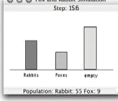
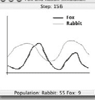
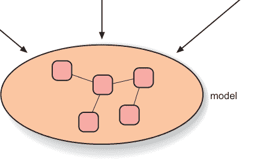

对于观察者模式，我们使用两种类型：`Observable`（可观察者）和 `Observer`（观察者）。可观察实体（我们模拟中的 `Field`）继承自 `Observable` 类，而观察者（`SimulatorView`）实现了 `Observer` 接口（图 13.4）。

`Observable` 类提供了方法让观察者能够将其附加到被观察实体上。它确保了每当被观察实体（字段）调用其继承的 `notify` 方法时，观察者的更新方法就会被调用。实际的观察者（视图）随后可以从字段获取新的更新后的状态并重新显示。

> ⁶ 在 `java.util` 包中，`Observer` 实际上是一个包含单一方法 `update` 的接口。

### 图 13.4 观察者模式的结构

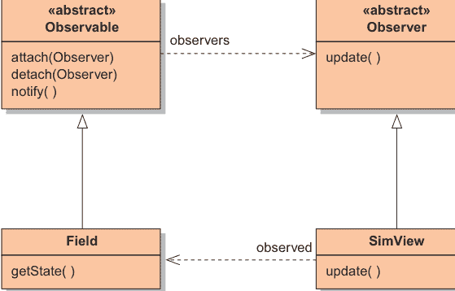

观察者模式也可以用于模型/视图分离以外的其他问题。每当一个或多个对象的状态依赖于另一个对象的状态时，就可以应用它。

## 模式总结

详细讨论设计模式及其应用超出了本书的范围。在这里，我们仅介绍了设计模式是什么的简要概念，以及我们如何对一些常用模式进行非正式描述。

然而，我们希望这次讨论能够展示接下来的路该往何处。一旦我们理解了如何创建功能定义良好的单类良好实现，就可以集中精力决定应用程序中需要什么类型的类，以及它们应该如何协作。良好的解决方案并不总是显而易见的，因此设计模式描述了被证明反复用于解决某类问题的结构。它们帮助我们创建良好的类结构。

作为软件开发人员，你越有经验，就会花更多时间思考高层次结构，而不是简单方法的实现。

> **练习 13.16** 另外三个常用模式是状态模式、策略模式和访问者模式。找到这些每个模式的描述，并为每个模式识别至少一个可能的应用示例。

> **练习 13.17** 在项目开发后期，你发现两个独立开发应用程序两个部分的团队实现了不兼容的类。一个团队实现的几个类的接口与另一个团队期望要使用的接口略有不同。解释适配器模式如何帮助解决这种情况，从而避免重写任何现有的类。

## 总结

在本章中，我们在抽象层次上向上迈了一个台阶，从思考单个类转向思考类之间如何相互作用。我们看到了观察者模式，它允许我们将视图与模型解耦并支持多个视图。这种模式在一个或多个对象的状态依赖于另一个对象的状态许多情况下非常有用。

本章引入的术语包括：

- `Observable`（可观察者）：可以被观察变化的实体。
- `Observer`（观察者）：观察 `Observable` 实体变化的对象。
- Model/view（模型/视图）：将数据（模型）与用户界面（视图）分离的架构模式。
- Coupling（耦合）：软件模块之间相互依赖的。
- Interface（接口）：对象提供给其他对象的的方法集。

# 第 14 章 案例研究

## 分析与设计

将来自不同地点的个人接到并运送到目的地。当公司接到来自个人、酒店、娱乐场所或旅游组织的电话时，它会尝试安排一辆车辆去接送。如果没有空闲车辆，它不会运行任何形式的排队系统。当车辆到达接送地点时，司机会通知公司。同样，如果乘客在目的地处被送下，司机也会通知公司。

正如第 10 章所述，建模的常见目的之一是帮助我们了解所建模的情况。在早期阶段识别出我们想要了解的内容是有用的，因为这些目标很可能对我们产生的设计产生影响。例如，如果我们正试图回答关于在该地区运营出租车的盈利能力的问题，那么我们必须确保能够从模型中获得有助于我们评估盈利能力的信息。因此，我们发现了两个问题：由于没有空闲车辆供接而导致丢失的潜在乘客的频率；以及在另一个极端情况下，由于缺乏乘客而闲置了多少时间。这些影响在出租车公司正常运行的描述中并没有体现，但它们确实代表了我们在制定设计时必须演练的场景。

因此，我们在描述中添加了以下段落：

> 系统详细介绍了无法满足的乘客请求的细节。它还提供了车辆在各项活动中花费时间的细节：运送乘客、前往接送地点和闲置。

然而，在我们开发模型时，我们将仅关注公司运营程序的原始描述，并将额外功能留作练习题。

- **练习题 14.1** 你是否认为从模型中收集某些额外数据是有帮助的？如果是，请将这些需求添加到上述描述中，并在你对项目的自己的扩展中使用它们。

## 分析与设计

正如第 13 章所建议的，我们将首先尝试使用动词/名词法来识别系统描述中的类和交互。

### 发现类

描述中存在以下名词的（单数形式）：公司、出租车、穿梭车、个人、地点、目的地、酒店、娱乐场所、旅游组织、车辆、票价、接送地点、司机和乘客。

首先需要注意的是的一点是，直接从这个名词列表转向一组类是错误的。非正式描述很少是以分类这些内容的方式编写的。

通常需要的一种进一步细化工作是识别名词列表中的同义词：用于同一实体的不同单词。例如，“个人”和“票价”都是“乘客”的同义词。

进一步的细化是消除那些实际上不需要在系统中建模的实体。例如，描述识别了联系出租车公司的各种方式：通过个人、酒店、娱乐场所和旅游组织。维护这些区别将是真正必要的！答案将取决于我们建模了哪些信息。我们可能希望为提供大量客户的酒店安排折扣，或者向没有提供大量客户的娱乐场所发送宣传材料。如果不需要这种程度的细节，那么我们可以根据某些统计学上合理的模式将乘客“注入”到模型中，从而简化模型。

- **练习题 14.2** 考虑简化与车辆相关的名词数量。在我们的语境下，“车辆”和“出租车”是同义词吗？我们需要区分“穿梭车”和“出租车”吗？“司机”呢？请为你的答案提供理由。

- **练习题 14.3** 在我们的语境下，是否可以消除以下任何一个同作为同义词：“地点”、“目的地”和“接送地点”？

- **练习题 14.4** 识别你添加到系统的任何扩展中的名词，并进行必要的简化。

### 使用 CRC 卡片

图 14.1 包含了我们在对原始描述进行某些简化后留下的名词和动词关联总结。每个名词都应该分配到一张 CRC 卡片上，准备识别其职责和协作者。


| 名词 | 动词 |
|---|---|
| company | 运营出租车和穿梭车 |
| | 接到电话 |
| | 安排车辆 |
| taxi | 运送乘客 |
| shuttle | 运送更多乘客 |
| passenger | 公司 |
| location | 接送乘客 |
| passenger-source | 到达接送地点 |
| vehicle | 通知公司到达 |
| | 通知公司已送下 |

从这个总结可以清楚看出，出租车和穿梭车是更通用的“车辆”的特化。出租车和穿梭车之间的主要区别在于，出租车只负责接送和运送单个乘客，而穿梭车处理多个乘客。这两者之间的关系暗示了继承关系。

- **练习题 14.5** 为本节识别的名词/类创建 CRC 卡片，以演练这些场景。

- **练习题 14.6** 对你希望遵循的任何自己的扩展执行同样的操作。

### 场景

出租车公司实际上并不代表一个复杂的应用程序。我们将发现，系统中的大部分总交互是通过通过满足乘客从一个地点到另一个地点的这一基本场景来探索的。在实践中，这个单一场景将被分解为若干按顺序执行的步骤，从初始电话到最终送下。

- 我们决定由乘客源为系统创建所有新的乘客对象。因此，乘客源的职责创建乘客，协作者是乘客。
- 乘客源调用出租车公司请求接送乘客。我们将公司作为乘客源的协作者，并添加请求接送作为职责。相应地，我们为公司添加了接收接送请求的职责。与请求关联的是乘客和接送地点。因此公司有乘客和地点作为协作者。当它带请求调用公司时，乘客源可以将乘客和接送地点作为单独的对象传递。然而，将接送地点与乘客密切关联更为理想。乘客的协作者是地点，职责提供接送地点。
- 乘客的接送地点来自哪里？接送地点和目的地将在创建乘客时决定。因此为乘客源添加职责生成乘客的接送和目的地，地点作为协作者；并为乘客添加职责接收接送和目的地。
- 收到请求后，公司有安排车辆的职责。这表明进一步的职责是存储车辆集合，集合和车辆作为协作者。由于请求可能会失败——可能没有空闲车辆——将向乘客源返回成功或失败指示。

没有迹象表明在安排时寻求区分出租车和穿梭车，因此我们在这里不需要考虑这一点。然而，只有在车辆空闲时才能安排车辆。这意味着车辆的职责是指示是否空闲。

- 当确定一辆空闲车辆后，必须将其引导至接送地点。`TaxiCompany` 负责引导车辆去接送，对应的责任是 `Vehicle` 接收接送地点。`Location` 被添加为 `Vehicle` 的协作者。
- 接收接送点后，出租车和穿梭的行为会有很大不同。出租车只有在没有正在前往接送点或目的地时才是空闲的。因此，`Taxi` 的责任是前往接送地点。相比之下，穿梭必须处理多个乘客。当它收到接送点时，可能需要在几个可能的地点之间进行选择。因此，我们为 `Shuttle` 添加了选择下一个目标位置的责任，并使用协作者 `Collection` 来维护可选的目标位置集合。车辆在位置之间移动的事实表明它具有维护当前位置的责任。
- 到接送点后，`Vehicle` 必须通知公司到达，即协作者 `TaxiCompany`；而 `TaxiCompany` 必须接收乘客到达通知。在现实生活中，出租车在到达接送点时第一次遇到其乘客。这是车辆接收下一个乘客的自然点。在模型中，它从公司接收，公司最初是从乘客源接收的。`TaxiCompany` 责任：传递乘客给车辆，`Vehicle` 责任：接收乘客，并将 `Passenger` 添加为 `Vehicle` 的协作者。
- 车辆现在请求乘客的预期目的地。`Vehicle` 责任：请求目的地位置，`Passenger` 责任：提供目的地位置。在此处，出租车和穿梭的行为将有所不同。出租车将直接前往乘客目的地。穿梭则会将位置添加到出租车的集合中，并选择下一个。
- 到达乘客目的地后，`Vehicle` 具有卸载和通知公司乘客到达的责任，`TaxiCompany` 必须接收乘客到达通知。

我们概述的步骤代表了出租公司的基本活动，随着每个新乘客请求服务，这些活动反复进行。然而，需要注意的一点是，一旦有新的请求产生，我们的计算机模型需要为每个乘客重新启动序列——即使上一个请求尚未执行完成。用并发的话说，在程序的单个步骤内，一辆车辆可能正在前往接送点，而另一辆车辆可能正在到达乘客目的地，并且新乘客可能请求接送。

- **练习 14.7** 回顾问题描述和我们处理过的场景。在进入类设计之前，是否有任何需要处理的场景？例如，我们是否充分涵盖了在收到请求时没有可用车辆会发生什么？如果你觉得还有更多工作要做，请完成场景分析。

- **练习 14.8** 你认为我们对场景的描述细节程度是正确的吗？例如，在讨论出租车和穿梭车之间的差异时，我们是否包含了过少或过多的细节？

- **练习 14.9** 你认为在这一阶段处理车辆如何移动位置是必要的吗？

- **练习 14.10** 你认为随着应用程序的开发，是否会出现进一步类的需求——那些在问题描述中没有直接引用的类？如果是这样，原因是什么？

## 类设计

在本节中，我们将开始从纸面上的高层抽象设计转向 BlueJ 项目中具体的大纲设计。

### 设计接口


在第 13 章中，我们建议下一步是根据第一版 CRC 卡创建一组新的 CRC 卡，将每个类的责任转换为一组方法签名。在不否定这一步骤重要性的情况下，我们将其留给你们完成，并留下一个包含存根类（`stub classes`）和方法的 BlueJ 项目大纲。这应该让你很好地感受到项目的复杂度，以及我们在之前的步骤中是否遗漏了任何关键点。

值得指出的是，在项目生命周期的每个阶段，我们都预期在早些阶段的工作中发现错误或遗留问题。这并不一定意味着我们的技术或能力有弱点。它反映了项目开发是一个发现的过程。只有通过探索和尝试，我们才能充分理解我们正试图要实现的目标。发现遗漏实际上说明了我们正在使用的过程！

## 14.3.2 协作者

在确定了类之间的协作之后，一个经常需要解决的问题是特定对象如何引用其协作者。这种情况通常有几种不同的发生方式，并且通常代表了三种不同的对象交互模式：

- 协作者作为构造函数的参数被接收。这样的协作者通常会存储在新对象的一个字段中，以便在整个对象的整个生命周期内都可用。该协作者可能会以这种方式与不同的对象共享。例如：`PassengerSource` 对象通过其构造函数接收 `TaxiCompany` 对象。

- 协作者作为方法的参数被接收。与此类协作者的交互通常是瞬时的——仅持续在方法的执行期间——尽管接收对象可能会选择将引用存储在它的其中一个字段中，以便进行更长期的交互。例如：`TaxiCompany` 通过其处理接送请求的方法接收 `Passenger` 协作者。

- 对象为自己构造协作者。该协作者将供构造对象独占使用，除非通过上述的任一种方式传递给其他对象。

在方法中，协作通常是短暂的，持续到构造它的代码块结束。然而，如果协作者被存储在字段中，那么协作可能会持续整个创建对象的生命周期。例如：`TaxiCompany` 创建了一个集合来存储它的车辆。

练习 14.11 在下一节讨论 `taxi-company-outline` 项目时，请特别注意对象是在哪里创建，以及协作对象是如何相互认识的。尝试识别我们描述的每个模式的至少一个例子。

## 14.3.3 大纲实现

`taxi-company-outline` 项目包含了我们在设计过程中描述的类、责任和协作的大纲实现。我们鼓励你查阅源代码，并将具体的类与第 14.2.3 节中相应的描述相关起来。代码 14.1 显示了项目中 `Vehicle` 类的大纲。

代码 14.1

Vehicle 类的大纲

```java
/**
 * 捕捉车辆的大纲细节。
 * @author David J. Barnes and Michael Kölling
 * @version 2008.03.30
 */
public abstract class Vehicle
{
    private TaxiCompany company;
    // 车辆所在。
    private Location location;
    // 车辆去向地。
    private Location targetLocation;

    /**
     * Vehicle 类的构造函数
     * @param company 出租车公司。不能为 null。
     * @param location 车辆的起点。不能为 null。
     * @throws NullPointerException 如果 company 或 location 为 null
     */
    public Vehicle(TaxiCompany company, Location location)
    {
        if(company == null) {
            throw new NullPointerException("company");
        }
        if(location == null) {
            throw new NullPointerException("location");
        }
        this.company = company;
        this.location = location;
        targetLocation = null;
    }

    /**
     * 通知公司到达了接送点。
     */
    public void notifyPickupArrival()
    {
        company.arrivedAtPickup(this);
    }

    /**
     * 通知公司到达了乘客目的地。
     */
    public void notifyPassengerArrival(Passenger passenger)
    {
        company.arrivedAtDestination(this, passenger);
    }

    /**
     * 接收接送点。这种处理取决于车辆类型。
     * @param location 接送地点。
     */
    public abstract void setPickupLocation(Location location);

    /**
     * 接收乘客。这种处理取决于车辆类型。
     * @param passenger 乘客。
     */
    public abstract void pickup(Passenger passenger);

    /**
     * @return 此车辆是否为空闲。
     */
    public abstract boolean isFree();

    /**
     * 卸载所有目的地为当前位置的乘客。
     */
    public abstract void offloadPassenger();

    /**
     * @return 此车辆当前所在的位置。
     */
    public Location getLocation()
    {
        return location;
    }

    /**
     * 设置当前位置。
     * @param location 所在的位置。不能为 null。
     * @throws NullPointerException 如果 location 为 null。
     */
    public void setLocation(Location location)
    {
        if(location != null) {
            this.location = location;
        } else {
            throw new NullPointerException();
        }
    }

    /**
     * @return 此车辆当前的目标位置，如果处于空闲状态则返回 null。
     */
    public Location getTargetLocation()
    {
        return targetLocation;
    }

    /**
     * 设置所需的目标位置。
     * @param location 想要去的地方。不能为 null。
     * @throws NullPointerException 如果 location 为 null。
     */
    public void setTargetLocation(Location location)
    {
        if(location != null) {
            targetLocation = location;
        } else {
            throw new NullPointerException();
        }
    }

    /**
     * 清除目标位置。
     */
    public void clearTargetLocation()
    {
        targetLocation = null;
    }
}
```

### 14.3 类设计

创建大纲项目的过程引发了一些问题。以下是其中一些：

- 由于设计语言和实现语言的性质不同，你应该预料在设计和实现之间会发现一些差异。例如，对场景的讨论表明，`PassengerSource` 应该负责为乘客生成接送点和目的地，而 `Passenger` 应该负责接收接送点和目的地位置。与其将这些职责映射到单个方法调用，在 Java 中更自然的实现是编写类似下面的代码：

`new Passenger(new Location(...), new Location(...))`

- 我们确保了大纲项目成功完成。在这一阶段并不总是必要的，但它意味着在下一阶段进行增量开发将变得容易一些。然而，它也有相应的缺点，会使得缺失的代码片段可能更难处理，因为编译器不会指出遗留问题。

- `Vehicle`、`Taxi` 和 `Shuttle` 类的共享元素和不同元素在我们向实现移动时才开始成形。例如，出租车和穿梭车响应接送请求的不同方式体现在：`Vehicle` 将 `setPickup` 定义为抽象方法，该方法将在子类中具有不同的具体实现。另一方面，即使出租车和穿梭车在决定去向方面有所不同，它们也可以共享拥有单个目标位置的概念。这已经实现为父类中的一个 `targetLocation` 字段。

- 在场景中的两个点，车辆需要在到达接送点或目的地时通知公司其到达。在实现中，组织这种方式至少有两种方法。直接的方法是让车辆存储指向它的引用。这意味着在类图中，这两个类之间存在显式的关联。

另一种方法是使用第 13 章引入的观察者模式，让 `Vehicle` 继承 `Observer` 类，并让 `TaxiCompany` 实现接口。`Vehicle` 和 `TaxiCompany` 之间的直接耦合减少了，但隐式耦合仍然存在，且通知过程在编程上稍微复杂一些。

- 到为止，还没有讨论过穿梭车可以载入多少乘客。预计会有不同尺寸的穿梭车？此应用的这方面被推迟到以后再解决。

在任何特定应用中，大纲实现做到何种程度都没有绝对的规则。大纲实现的目的不是创建一个可以运行的项目，而是记录应用程序大纲结构的设计（该结构是之前通过 CRC 卡开发的）。当你回看 `taxi-company-outline` 项目中的类时，你可能会觉得在这个案例中我们走得太远了，或者甚至走得不够远。从积极的一面来说，通过尝试创建一个符合规范的版本，我们确实发现自己被迫详细地考虑 `Vehicle` 继承层次结构：特别是哪些方法可以在完整的父类中实现，而哪些方法最好留为抽象方法。从负面来看，存在过早做决策的风险：例如，致力于特定类型的数据结构，而这些结构在以后可能更好，或者像我们这里一样，选择拒绝观察者模式而倾向于更直接的方法。

练习 14.12 对于项目中的每个类，查看类接口并列出应该用于测试该类功能的 JUnit 测试列表。

练习 14.13 `taxi-company-outline` 项目定义了一个 `Demo` 类来创建一对 `PassengerSource` 和 `TaxiCompany` 对象。创建一个 `Demo` 对象并尝试其 `pickupTest`。

练习 14 你是否觉得我们应该在这个阶段进一步开发以实现至少一次接送成功？如果是这样，你将会投入多少开发？

## 14.3.4 测试

在开始实现后，我们不应该在走得太远之前就开始考虑如何测试应用程序。我们不希望犯只有在完整实现后才设计测试的错误。我们可以随着实现的演进逐步建立一些测试。尝试以下练习以获得对这一阶段可能性的感受。

## 14.4 迭代开发

练习 14.15 `taxi-company-outline` 项目包含了包含初始测试的简单 JUnit 测试类。尝试它们。在这一阶段添加任何你认为合适的测试。是否重要？

练习 14.16 `Location` 类目前不包含任何字段或方法。该类的进一步开发可能会对测试产生什么影响？

## 14.3.5 一些遗留问题

我们尚未处理的一个主要问题之一是如何组织各种活动的顺序：接送请求、移动等。另一个问题是位置还没有具体的形态，因此移动没有影响。随着我们开发应用程序，这些问题的解决和演进过程将逐步展开。

## 14.4 迭代开发

从 `taxi-company-outline` 开发的大纲实现到最终版本，我们还有很长的路要走。然而，与其被整体任务的规模所压倒，我们可以通过识别迈向目标的离散步骤并进行迭代开发过程，使事情变得更易管理。

以下是出租车公司应用程序可能的开发步骤序列：

- 实现由单辆出租车接送一名乘客并送送到其目的地。
- 提供足够的出租车，以实现多个独立乘客能够同时被接送并送送到目的地。
- 实现由单辆出租车接送一名乘客并送送到其目的地。
- 确保记录没有乘客的车辆详细信息。
- 实现单辆出租车同时接送多名乘客并将他们送送到目的地。
- 提供一个 GUI 来显示城市内活跃车辆和乘客的情况。
- 确保出租车和接送车并发运行。
- 提供剩余的功能，包括统计数据。

我们不会详细讨论这些步骤的实现，但你可以自己完成你认为需要的部分。

> **练习 14.17** 结合以下问题对这些步骤进行批判性评估：顺序是否合理？任务复杂度太高、太低还是恰好？是否有遗漏的步骤？根据你的观点修改列表。
>
> **练习 14.18** 对于每个阶段，完成标准是否足够直观？如果是，请编写相应的测试用例。

### 14.4.2 第一个阶段

对于第一阶段，我们想要让单辆出租车接送一名乘客并送送到其目的地。这意味着我们需要开发若干类：`Location`、`Taxi` 和 `Passenger`，以及可能的其他类。此外，我们必须允许出租车在城市内移动。这概述了该阶段的需求。（`LocationTest` 和 `PassengerTest` 将在 14.4.3 节中讨论）。

与其详细讨论，我们只需描述从上一个版本产生的问题。第一阶段的目标被设定为适中，但仍然涉及到接送乘客，以及空闲计数。在这个阶段，对网格区域没有限制（除了坐标值必须为正数外），但这引发了后续阶段记录公司运营区域边界的需求。

```java
/**
 * 出租车能够接送一名乘客。
 * @author David J. Barnes and Michael Köll
 * @version 2008-02-30
 */
public class Taxi extends Vehicle {
    private Passenger passenger;

    /**
     * Taxi 对象的构造函数
     * @param company 出租车公司。不能为空。
     * @param location 车辆的起点。不能为空。
     * @throws NullPointerException 如果 company 或 location 为空。
     */
    public Taxi(TaxiCompany company, Location location) {
        super(company, location);
    }

    /**
     * 执行出租车的动作。
     */
    public void act() {
        Location target = getTargetLocation();
        if (target != null) {
            // 寻找下一个移动的位置。
            Location next = getLocation().nextLocation(target);
            setLocation(next);
            if (next.equals(target)) {
                if (passenger != null) {
                    notifyPassengerArrival(passenger);
                    offloadPassenger();
                } else {
                    notifyPickupArrival();
                }
            }
        } else if (isIdle()) {
            incrementIdleCount();
        }
    }

    /**
     * @return 此出租车是否空闲。
     */
    public boolean isFree() {
        return getTargetLocation() == null && passenger == null;
    }

    /**
     * 接送地点。这成为目标位置。
     * @param location 接送地点。
     */
    public void setPickupLocation(Location location) {
        setTargetLocation(location);
    }

    /**
     * 接上乘客。将其目的地设为目标位置。
     * @param passenger 乘客。
     */
    public void pickup(Passenger passenger) {
        this.passenger = passenger;
        setTargetLocation(passenger.getDestination());
    }

    /**
     * 卸载乘客。
     */
    public void offloadPassenger() {
        passenger = null;
        clearTargetLocation();
    }

    /**
     * 返回出租车的详情，例如它所在的位置。
     * @return 出租车的字符串表示。
     */
    public String toString() {
        return "Taxi at " + getLocation();
    }
}
```


对移动建模使得 `Location` 类需要比大纲中更完整的实现。从表面上看，它应该是矩形网格内二维位置的简单容器。但在实践中，它还需要提供两个位置是否重合的测试（`equals`），以及一种让车辆根据其当前位置和目的地找到移动到何处的方法（`nextLocation`）。在此阶段，对网格区域没有任何限制（除了坐标值必须为正数），但这引发了后续阶段记录公司运营区域边界的需求。

必须解决的主要问题之一是乘客与车辆之间的关联，即接送请求与车辆到达点之间的关联。虽然我们被要求只处理单辆出租车和单个乘客，但我们试图记住，最终在任何时候都可能有多个乘客请求。在 14.2.3 节中，我们决定当车辆到达接送点时，它应该接收其乘客。

# 第 14 章 案例

**练习 14.21** 下一个计划的实施阶段是提供多辆出租车同时运载多个乘客。请带着这一目标审查 `TaxiCompany` 类。你认为它已经支持这一功能了吗？如果没有，需要哪些更改？

**练习 14.22** 审查 `TaxiCompany` 中 `assignments`（分配任务）存储 *车辆:乘客* 关联的方式。你能看出这种方法的任何弱点吗？它能支持从同一地点接送多个乘客吗？一辆车辆是否可能需要记录多条关联？

**练习 14.23** 如果你认为当前的 *车辆:乘客* 关联存储方式存在任何问题，那么为每个关联创建一个唯一标识（例如“预订号”）是否会有帮助？如果是这样，`Vehicle` 类层级结构中任何现有的方法签名是否需要更改？请实现一个支持所有现有场景要求的改进版本。

## 14.4.3 测试第一阶段

截至第一阶段的实现，我们已经开发了两个类：`LocationTest` 和 `TaxiTest`。第一个检查 `Location` 类的基本功能，这对于车辆的正确移动至关重要。第二个是测试乘客是否在正确的步数内被接送并送到目的地，以及出租车在之后是否立即再次可用。为了开发第二组测试，`Location` 类增强了 `distance` 方法，以提供在两个位置之间移动所需的步数。

通常情况下，应用程序是静默运行的，在没有 GUI 的情况下，没有视觉方法来监控出租车的进度。一种方法是在 `Taxi` 和 `TaxiCompany` 等类的方法中添加打印语句。然而，BlueJ 提供了另一种选择，例如在 `Taxi` 类中设置断点。这将使得通过检查来“观察”出租车的移动成为可能。

对目前的实现有了合理的信心后，我们简单地在 `TaxiCompany` 的通知方法中保留了打印语句，以提供基本的用户反馈。

为了证明在实现的同时开发测试的价值，值得注意的是，现有的测试使我们能够识别并修正代码中的两个严重错误。

**练习 14.24** 审查在 *taxi-company-stage-one* 测试类中实现的测试。是否可以将这些测试作为后续阶段的回归测试，还是说它们需要重大的修改？

> ¹ 我们预计这将在应用程序开发中具有更广泛的用途，因为它应该允许公司根据哪个距离接送点最近来调度车辆。

## 14.4 迭代开发

**练习 14.25** 实现你认为必要的额外测试和更进一步的类，以增加你对当前实现的信心水平。在此过程中修复你发现的任何错误。

## 14.4.4 开发的后期阶段

我们无意充分讨论出租应用程序开发的完成情况，因为这对你来说获益较少。相反，我们将在后期阶段简要介绍该应用程序，并鼓励你在此基础上完成剩余部分。

这个更高级的阶段可以在 *taxi-company-later-stage* 中找到。它处理多辆出租车和乘客，并通过 GUI 提供了两者移动的渐进视图（图 14.2）。以下是该版本相比上一个版本的一些主要开发大纲。

**图 14.2**

城市的可视化

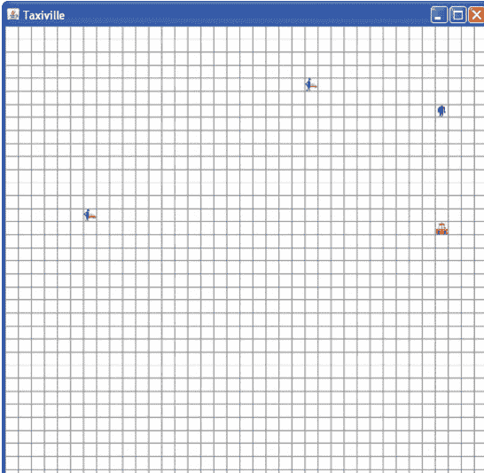

- 一个 `Simulation` 类现在管理执行者，就像在 *foxes-and-rabbits* 项目中所做的一样。执行者是车辆、乘客源以及 `CityGUI` 类提供的 GUI。在每一步之后，模拟会暂停短时间，以防 GUI 变化得过快。

- 在第一阶段开发期间，确定了对类似 `City` 类需求。`City` 对象定义了城市网格的维度，并持有城市中所有感兴趣的项目的集合：车辆和乘客。

- 城市中的项目可以选择性实现 `DrawableItem` 接口，这允许 GUI 显示它们。为了这个目的，项目文件夹中的 images 文件夹中提供了车辆和人的图像。

- `Taxi` 类实现了 `DrawableItem` 接口。它根据是否被占用或空闲，向 GUI 返回不同的图像。images 文件夹中存在用于往返同一地点的出租车的图像文件

- `PassengersSource` 与之前的版本相比进行了大量的重构，以更好地适应其作为执行者的角色。此外，它还维护了错过接送的计数以供统计分析。

- `Taxi` 类负责创建用于模拟的出租车。

当你探索 *taxi-company-later-stage* 项目的源代码时，你将发现我们在书后半部分涵盖的许多主题的插图：继承、多态、抽象类、接口和错误处理。

> **练习 14.26** 在每个类中添加断言和异常抛出一致性检查，以防止不当使用。例如：确保创建乘客时，接送地点和目的地不相同；确保不会在出租车已有目标位置的情况下请求其前往接送点；等。

> **练习 14.27** 报告统计信息这些

> **练习 14.28** 适配

## 14.4.5 开发的进一步想法

我们在本章中概述的方法，用于实现具有一个或多个电梯的建筑模拟。

# 14.6 进一步探索

通过展示自己的项目想法并演示我们如何开发它们，我们能带你的路是有限的。你会发现，如果你能开发自己的项目想法并以自己的方式实现它们，就能走得远得多。选择一个你感兴趣的话题，并按照我们概述的阶段进行：分析问题、构思一些场景、绘制设计图、计划一些实施阶段，然后开始动手。

设计和实现程序是一项令人兴奋且富有创造性的活动。像任何有价值的活动一样，需要时间和练习才能精通。所以，如果你早期的努力似乎花费了无尽的时间，或者充满了错误，请不要气馁。这是正常的，你将随着经验的增加而逐渐提高。开始时不要太心勃勃，要预留出执行过程中需要重新修改想法——这都是自然学习过程的一部分。

最重要的是：享受其中！

# 附录

## A 与 BlueJ 项目操作

### A.1 安装 BlueJ

要使用 BlueJ，你必须安装 Java 开发工具包 (JDK) 和 BlueJ 环境。

你可以在本书的 CD 或访问 `http://java.sun.com/java/` 找到 JDK 和详细的安装说明。

你可以在本书的 CD 或访问 `http://www.bluej.org/` 找到 BlueJ 环境和安装说明。

### A.2 打开项目

要使用本书 CD 中包含的任何示例项目，必须将项目复制到可写磁盘上。BlueJ 项目可以从 CD 打开，但不能从中执行（若要执行，BlueJ 需要向项目文件夹写入内容）。因此，直接使用 CD 中的项目通常无法运行。

最简单的方法是将包含书中所有项目的文件夹（命名为 *projects*）拷贝到你的硬盘上。

双击图标安装并启动 BlueJ 后，从 *Project* 菜单选择 Open...。导航到 *projects* 文件夹并选择一个项目。你可以同时打开多个项目。

关于 BlueJ 使用的更多信息包含在 BlueJ 教程中。教程位于书的 CD 上，也可以通过 BlueJ *Help* 菜单中的 *BlueJ Tutorial* 项进行访问。

### A.3 BlueJ 调试器

关于使用 BlueJ 调试器的信息可以在附录 F 和 BlueJ 教程中找到。教程位于书的 CD 上，也可以通过 BlueJ *Help* 菜单中的 *BlueJ Tutorial* 项进行访问。

### A.4 CD 内容

在书中附的 CD 上，你将找到以下文件和目录：

| 文件夹 | 注释 |
| --- | --- |
| bluej/ | BlueJ 系统和文档。 |
| bluesetup-221.exe | Microsoft Windows 的 BlueJ 安装程序（所有版本）。 |
| BlueJ-221.zip | 适用于 MacOS X 的 BlueJ。 |
| bluej-221.jar | 适用于其他系统的 BlueJ。 |
| tutorial.pdf | BlueJ 教程。 |
| reference-manual.pdf | BlueJ 参考。 |
| teamwork-tutorial.pdf | 协作工具使用教程。 |
| repository-setup.pdf | 关于设置用于协作支持 CVS 仓库的信息。 |
| ReadMe.htm | CD 文档。在浏览器中打开此文件进行阅读。包含 CD 内容概述、安装说明和其他有用提示。 |
| jdk/ | 包含适用于各种操作系统的 Java 2 系统 (Java 2 SDK)。 |
| linux/ | 适用于 Linux 的 Java 2 SDK 安装程序。 |
| solaris/ | 适用于 Solaris 的 Java 2 SDK 安装程序。 |
| windows/ | 适用于 Microsoft Windows 的 Java 2 SDK 安装程序（所有版本）。 |
| jdk-doc/ | 包含 Java 2 库文档。这是一个单压缩文件。将此文件拷贝到硬盘并解压以使用文档。 |
| projects/ | 包含书中讨论的所有项目。 |
| runthis.exe | 适用于 Windows 程序。 |

### A.5 配置 BlueJ

许多 BlueJ 的设置可以根据你的个人情况进行配置。某些选项可以通过 Preferences 对话框提供。

### A.6 更改界面

许多 BlueJ 的设置可以根据你的个人情况进行配置。某些选项可以通过 Preferences 对话框提供。

### A.7 使用调试器

许多 BlueJ 的设置可以根据你的个人情况进行配置。某些选项可以通过 Preferences 对话框提供。

### A.8 更改新类

许多 BlueJ 的设置可以根据你的个人情况进行配置。某些选项可以通过 Preferences 对话框提供。

# 附录 B

Java 数据类型

Java 知道两种类型：基本类型和对象类型。基本类型存储在变量中，并且具有值语义（赋值时会复制）。对象类型通过存储引用来存储。当赋值给另一个变量时，只复制引用。

## B.1 基本类型

下表列出了 Java 语言所有的基本类型。

| 类型名称 | 说明 | 示例字面量 |
| --- | --- | --- |
| byte | 字节整数（8 位） | 24, -2 |
| short | 短整数（16 位） | 137, -119 |
| int | 整数（32 位） | 5409, -2003 |
| long | 长整型（64 位） | 423266353L, 55L |
| 实数 | | |
| float | 单精度浮点数 | 43.889F |
| double | 双精度浮点数 | 45.63, 2.4e5 |
| 其他类型 | | |
| char | 单个字符（16 位） | 'm', '\u00F6' |
| boolean | 布尔值（真或假） | true, false |

+ 注意：

- 不带小数点的数字通常被解释为 `int`，但在赋值时会自动转换为 `byte`、`short` 或 `long` 类型（如果值在范围内）。你可以在数字后加 'L' 来声明字面量（'l' –小写 L 也可以但应避免，因为它很容易被误认为数字 1）。

- 带有小数点的数字是 `double` 类型。你可以在数字后加 'F' 或 'f' 来指定 `float` 字面量。

- 字符可以写为单引号内的单个 Unicode 字符，或者以四位 Unicode 值通过 '\u' 写入。

- 布尔字面量为 `true` 和 `false`。

由于基本类型的变量不引用对象，因此没有与基本类型相关联的方法。然而，在需要对象类型的语境下，可能会使用自动装箱（autoboxing）将基本值转换为相应的对象。更多细节请参见 B.4 节。

下表详细列出了数值类型提供的最小值和最大值。

| 类型 | 最小值 | 最大值 |
|---|---|---|
| byte | -128 | 127 |
| short | -32768 | 32767 |
| int | -2147483648 | 2147483647 |
| long | -9223372036854775808 | 9223372036854775807 |
| 正最小值 | 正最大值 | |
|---|---|---|
| float | 1.4e−45 | 3.4022353e+38 |
| double | 4.9e−324 | 1.797691348623157e+308 |

## B.2 基本类型的强制转换

有时有必要将一个基本类型的值转换为另一个基本类型的值——通常是将具有特定值范围的值转换为范围较小的值。这被称为强制转换（casting）。强制转换几乎涉及信息的丢失，例如在将浮点类型转换为整数类型时。在数值类型之间允许强制转换，但无法通过强制转换将布尔值转换为任何其他类型，反之亦然。

强制转换运算符由变量或表达式前的括号内的基本类型类型值组成。例如，

```java
int val = (int) mean;
```

如果 `mean` 是一个类型为 `double` 且值为 3.9 的变量，那么上述语句将整数值 3（通过截断转换）存储在变量 `val` 中。

## B.3 对象类型

未在“基本类型”部分列出的类型都是对象类型。这些包括来自标准 Java 库的类和接口类型（如 `String`）以及用户定义的类型。

对象类型的变量持有指向对象的引用（或“指针”）。赋值和参数传递具有引用语义（即复制的是引用，而不是对象）。在将一个变量赋值给另一个变量后，两个变量都引用同一个对象。这两个变量被称为同一个对象的别名。

类是对象的模板，定义了每个实例拥有的字段和方法。

数组的行为类似于对象类型——它们也具有引用语义。

## B.4 包装类

Java 中的每个基本类型都有一个对应的包装类，该类表示相同类型但是一个真实的对象类型。这使得能够通过自动装箱过程在需要对象类型的地方使用基本类型的值。下表列出了 `java.lang` 包中的基本类型及其对应的包装类型。除了 `Integer` 和 `Character` 之外，包装类的名称与基本类型名称相同，只是首字母大写。

| 基本类型 | 包装类型 |
|---|---|
| byte | Byte |
| int | Integer |
| long | Long |
| float | Float |
| double | Double |
| char | Character |
| boolean | Boolean |

每当需要在对象类型的语境中使用基本类型的值时，编译器都会使用自动装箱将基本类型值封装在适当的包装对象中。这意味着例如，基本类型的值可以直接添加到集合中。反向操作——拆箱（unboxing）——在需要对应基本类型值的语境中使用包装类型对象时也会自动执行。

## B.5 对象类型的强制转换

对象可能属于某种类型的继承层次结构，有时有必要将一种类型的对象引用转换为继承层次结构中更下子类型的引用。这一过程被称为强制转换（或向下强制转换）。强制转换运算符由变量或表达式括号内的类或接口类型名称组成。例如，

```java
Car c = (Car) veh;
```

如果变量 `veh` 的声明（即静态）类型是 `Vehicle` 且 `Car` 是 `Vehicle` 的子类，则该语句可以通过编译。运行时会进行单独检查，以确保 `veh` 所引的对象确实是 `Car` 而不是其他类型的实例。

重要的一的是，对象类型之间的强制转换与基本类型之间的强制转换（上文 B.2）完全不同。特别是，对象类型之间的强制转换不涉及涉及对象的更改。它仅仅是获取对象已具有的类型信息的方法——即其完整动态类型的一部分。

# 附录

## C 运算符

### C.1 算术表达式

Java 提供了大量的运算符用于算术表达式和逻辑表达式。表 C.1 显示了所有被归类为运算符的内容，包括类型强制转换和参数传递等内容。大多数运算符是二元运算符（接受左操作和一个右操作数）或一元运算符（接受单个操作数）。主要的二元算术运算是：

- `+` 加法
- `-` 减法
- `*` 乘法
- `/` 除法
- `%` 取模或取余

除法和取模运算的结果取决于操作数是整数还是浮点值。在两个整数之间，除法产生整数结果并丢弃任何余数，但在浮点值之间，结果是浮点值：

- `5 / 3` 结果为 1
- `5.0 / 3` 结果为 1

（注意，只需运算符中有一个是浮点值即可产生浮点结果。）

当表达式中出现多个一个运算符时，需要使用优先级规则。在表 C.1 中，优先级最高的运算符位于顶部，因此乘法、除法和取模的优先级高于加法和减法。相同的二元运算符从左到右评估，而相同的一元运算符从右到左评估。

当需要改变评估顺序时可以使用括号。因此以下示例的结果为：

- `(5 + 3) / 2`

主要的一元运算符是 `-`、`++` 和 `new`。你会注意到 `++` 和 `--` 出现在 C.1 的前两行。第一行的左侧接受单个操作数，而第二行在右侧接受单个操作数。

#### 表 C.1

Java 运算符，顶部优先级最高

| | | | (参数) |
| ++ | + | -- | ! ~ |
| new | | (强制转换) |
| * | / | % | |
| + | | | |
| << | >> | >>> | |
| < | > | >= | <= | instanceof |
| == | != | | |
| & | | | |
| ^ | | | |
| \|\| | | |

### C.2 布尔表达式

在布尔表达式中，运算符用于组合操作数以产生真或假的值。此类表达式通常出现在 `if-else` 语句和循环的测试表达式中。

关系运算符通常组合一对算术操作数，相等和不相等的测试也用于对象引用。Java 的关系运算符有：

| `==` 等于 | `!=` 不等于 |
| `<` 小于 | `<=` 小于等于 |
| `>` 大于 | `>=` 大于等于 |

二元逻辑运算符组合两个布尔表达式产生另一个布尔值。这些运算符有：

- `&&` 与


- `||` 或
- `^` 异或

此外，
- `not` 非

取单个布尔表达式并将其从真变为假，反之亦然。

`&&` 和 `||` 的应用方式都略有不同。如果 `&&` 的左侧操作数为假，则右侧操作数的值无关且不会被评估。同样，如果 `||` 的左侧操作数为真，则右侧操作数不会被评估。因此，它们被称为短路运算符。

# 附录

# Java 控制结构

## D.1 控制结构

控制结构影响语句执行的顺序。主要分为两大类：选择语句和循环。

选择语句提供了一个决策点，在该点选择执行方法体或构造函数体中的某条路径，而不是另一条路径。`if-else` 语句涉及两组不同语句之间的决策，而 `switch` 语句则允许从多个选项中选择单个选项。

循环提供了重复语句的选项，次数可以是固定的或不定的。前者以 `for-each` 循环和 `for` 循环为典型，后者则以 `while` 循环和 `do` 循环为典型。

在实践中，应当记住，上述特征的特例情况非常常见。例如，如果 `else` 部分包含一个嵌套的 `if-else` 语句，则可以使用 `if-else` 语句从多个备选的语句组中进行选择；而 `for` 循环也可以执行不确定的次数。

## D.2 选择语句

### D.2.1 if-else

```
if(expression) {
    statements
}
else {
    statements
}
```

在第一种形式中，布尔表达式的值用于决定是否执行这些语句。在第二种形式中，表达式用于在两组备选的语句之间进行选择，其中只有一组会被执行。

示例：

```
if(field.size() == 0) {
    System.out.println("The field is empty.");
}
```

```
if(number < 0) {
    reportError();
} else {
    processNumber(number);
}
```

通过将第二个 `if-else` 语句放在第一个 `if-else` 的 `else` 部分，将 `if-else` 语句连接在一起是非常常见的。这种方式可以无限次持续下去。始终包含一个最终的 `else` 部分是一个很好的主意。

```
if(n < 0) {
    handleNegative();
} else if(number == 0) {
    handleZero();
} else {
    handlePositive();
}
```

### D.2.2 switch

`switch` 语句根据单个值切换到任意数量的 `case` 之一。我们两种可能的使用模式如下：

```
switch (expression) {
    case value: statements;
        break;
    case value: statements;
        break;
    省略后续 cases
    default: statements;
        break;
}
switch (expression) {
    case value1:
    case value2:
    case value3:
        statements;
        break;
    case value4:
    case value5:
        statements;
        break;
    省略后续 cases
    default:
        statements;
        break;
}
```

说明：

- `switch` 语句可以有任意数量的 `case` 标签。
- 每个 `case` 之后的 `break` 指令是必要的，否则执行流将“穿透”到下一个标签的语句。上面的第二种形式利用了这一点。在这种情况下，前三个值都都会执行第一个 `statements` 部分，而第四和第五个将执行第二个 `statements` 部分。
- `default case` 是可选的。如果未给出 `default`，则可能没有任何 `case` 会被执行。
- `default`（或如果没有 `default` 则则是最后一个 `case`）之后的 `break` 指令不是必须的，但被认为是一种良好的代码风格。

示例：

```
switch(day) {
  case 1: dayString = "Monday";
    break;
  case 2: dayString = "Tuesday";
    break;
  case 3: dayString = "Wednesday";
    break;
  case 4: dayString = "Thursday";
    break;
  case 5: dayString = "Friday";
    break;
  case 6: dayString = "Saturday";
    break;
  case 7: dayString = "Sunday";
    break;
  default: dayString = "invalid day";
    break;
}
```

```
switch(month) {
  case 1:
  case 3:
  case 5:
  case 7:
  case 8:
  case 10:
  case 12:
    numberOfDays = 31;
    break;
  case 4:
  case 6:
  case 9:
  case 11:
    numberOfDays = 30;
    break;
  case 2:
    if(isLeapYear()) {
      numberOfDays = 29;
    else {
      numberOfDays = 28;
    }
    break;
}
```

## D.3 循环

Java 有三种循环：`while`、`do-while` 和 `for`。`for` 循环有两种形式。除了 `for-each` 循环外，循环都通过布尔表达式控制。

### D.3.1 While

`while` 循环只要指定的表达式为真，就会执行语句块。在执行循环体之前测试表达式，因此循环体可能执行零次（即完全不执行）。这是 `while` 循环的一个重要特征。

```
while(expression) {
    statements
}
```

示例：

```
System.out.print("Please enter a filename: ");
input = readInput();
while(input == null) {
    System.out.print("Please try again: ");
    input = readInput();
}
```

```java
int index = 0;
boolean found = false;
while(!found && index < list.size()) {
    if(list.get(index).equals(item)) {
        found = true;
    } else {
    index++;
    }
}
```

### D.3.2 do-while

`do-while` 循环只要指定的表达式为真，就会执行语句块。在执行循环体之后测试表达式，因此循环体至少执行一次。这是与 `while` 循环的重要区别。

```
do {
    statements
} while(expression);
```

示例：

```
do {
    System.out.print("Please enter a filename:");
    input = readInput();
} while (input == null);
```

### D.3.3 for

`for` 循环有两种形式。第一种被称为 `for-each` 循环，专门用于遍历集合元素。

```
for(variable : collection) {
    statements
}
```

示例：

```
for(String note : list) {
    System.out.println(note);
}
```

`for` 形式只要条件为真就会执行。在循环之前执行一次初始化语句。在每次执行循环体之前求值条件（循环体可能执行零次）。

```
for(initialization; condition; increment) {
    statements
}
```

示例：

```
for(int i = 0; i < list.size(); i++) {
    System.out.println(list.get(i));
}
```

## D.4 异常

抛出和捕获异常提供了另一种改变控制流的方法。然而，它们主要用于预测和处理错误情况，而不是正常流程。

```
try {
    statements
} catch(exception-type name) {
    statements
}
finally {
    statements
}
```

示例：

```
try {
    FileWriter writer = new FileWriter("foo.txt");
    writer.write(text);
    writer.close();
} catch (IOException e) {
    Debug.reportError("Writing to file failed.");
    Debug.reportError("The exception is: " + e);
}
```

异常语句可以有任意数量的 `catch` 子句。执行第一个匹配项（如果抛出的异常对象的动态类型与 `catch` 子句中声明的异常类型，则匹配）。`finally` 子句是可选的。

## D.5 断言

断言语句主要在程序开发期间作为测试工具，而不是生产代码。断言语句有两种形式：

- `assert boolean-expression;`
- `assert boolean-expression : expression;`

示例：

```
assert getDetails(key) != null;
assert expected == actual :
    "Actual value: " + actual +
    "does not match expected value: " + expected;
```

如果断言表达式为假，则将抛出 `AssertionError`。编译器选项允许在生产代码中使断言语句失效，而无需将其从源码中删除。

# 附录 E

不离 BlueJ 运行 Java

在本书中，我们一直使用 BlueJ 开发和执行 Java 应用程序。这样做是有充分：BlueJ 给了我们一些工具让某些开发任务变得简单。特别是，它让我们轻松执行类和对象的单个方法——这如果我们想快速测试一段新代码是非常有用的。

我们将不离 BlueJ 的讨论分为两类：不离 BlueJ 执行程序和不离 BlueJ 开发。

## E.1 不离 BlueJ 执行

通常，当应用程序交付给终端用户时，它们是直接执行的。它们有一个单一启动点，定义了用户何时启动应用程序。

启动应用程序的精确机制取决于操作系统。通常，这是通过双击应用程序图标或在命令行中输入应用程序名称来实现的。然后操作系统需要知道调用类中的哪种方法来执行整个程序。

在 Java 中，这个问题通过约定来解决。当启动 Java 程序时，类名作为启动命令的参数指定，而方法名是固定的：它是 `main`。例如，考虑在命令行（如 Windows 命令提示符或 Unix 终端）输入以下命令：

```
java Game
```

`java` 命令启动 Java 虚拟机。它是 Java 开发包（SDK）的一部分，必须安装在你的系统中。`Game` 是我们要启动的类名。

Java 系统将在类 `Game` 中查找签名完全匹配的方法：

`public static void main(String[] args)`

该参数是一个 `String` 数组。这允许用户传递额外的参数。在示例中，`args` 参数的值将是一个长度为 0 的数组。然而，命令行以 `program` 开头，可以定义参数：

```java
java Game 2 Fred
```

在此命令行中，类名之后的每个单词都将被读取为一个独立的 `String`，并作为字符串数组中的元素传递给 `main` 方法。在这种情况下，`args` 数组将包含两个元素，即字符串 `"2"` 和 `"Fred"`。在 Java 中，命令行参数并不常用。

`main` 方法的体从理论上讲可以包含任何你喜欢的语句。然而，根据良好的代码规范，`main` 方法的长度应该保持在最小。具体来说，它不应该包含任何属于应用程序逻辑的内容。

通常情况下，`main` 方法应该恰好地执行你在 BlueJ 中交互式启动应用程序的操作。例如，如果你创建了一个 `Game` 类的对象并向应用程序调用了名为 `start` 的方法，那么你应该在 `Game` 类中添加以下方法：

```java
public static void main(String[] args) {
    Game game = new Game();
    game.start();
}
```

现在，执行该方法将模拟你对游戏进行的交互式调用。

Java 项目通常存储在每个项目的独立目录中。该项目的所有类都放置在该目录内。当你执行启动 Java 并运行你的应用程序的命令时，请确保项目目录是你命令行终端中的活动目录。这确保了能够找到这些类：

如果找不到指定的类，Java 虚拟机将生成一条类似于这样的错误消息：

> Exception in thread "main" java.lang.ClassNotFoundException: Game

如果你看到类似这样的消息，请确保你正确输入了类名，并且你的当前目录确实包含该类。类存储在后缀为 `.class` 的文件中。例如，`Game` 类的代码存储在名为 `Game.class` 的文件中。

如果找到了类，但它不包含 `main` 方法（或者 `main` 方法没有正确的签名），你将看到类似下面的的消息：

> Exception in thread "main" java.lang.NoSuchMethodError: main

在这种情况下，请确保你想要执行的类具有正确的方法。

## E.2 创建可执行的 .jar 文件

Java 项目通常以文件集合的形式存储在目录（或“文件夹”）中。我们将在下面简要讨论这些文件。

为了向他人分发应用程序，将整个应用程序存储在单个文件中通常会更方便。Java 为此提供的机制是 Java 归档（.jar）格式。应用程序的所有文件都可以打包成单个文件，并且它们仍然可以执行。（如果你熟悉 `zip` 压缩格式，你可能感兴趣的是，事实上这种格式实际上是相同的。.jar 文件可以用 zip 程序打开，反之亦然。）

要使 .jar 文件变得可执行，有必要在某处指定类。（记住：被执行的方法始终是 `main`，但我们需要指定是哪个类中的方法）。这是通过在 .jar 文件中包含包含此类信息的文本文件（清单文件）来实现的。幸运的是，BlueJ 会为你处理好这一切。

在 BlueJ 中创建可执行的 .jar 文件，请使用 `Project – Create Jar File` 功能，并在后续对话框中指定包含 `main` 方法的类。（你必须按照上述描述编写 `main` 方法）。

有关此的详细信息，请阅读 BlueJ，你可以通过 `BlueJ Help – Tutorial` 或 BlueJ 网站获取。

一旦创建了可执行的 .jar 文件，就可以通过双击它来执行。执行它的计算机必须安装了 JDK 或 JRE（Java 运行时）并支持 .jar 文件。

## E.3 开发 BlueJ

如果你不仅想执行还想在没有 BlueJ 的情况下开发你的程序，你需要编辑并编译这些类。类的源代码...

Threads 显示区域超出了本书的范围，将不再讨论。

# 附录 G

JUnit 单元测试工具

在本附录中，我们简要概述了 BlueJ 支持 J-Unit 单元测试的主要功能。更多细节可以在书籍附带 CD 和 BlueJ 网站上的测试教程中找到。

## G.1 启用单元测试功能

为了确保 BlueJ 的单元测试功能，有确保在 `Tools（工具） - Preferences（选项） - Miscellaneous（杂项）` 菜单下勾选 `Show unit testing（显示单元测试）` 框。主 BlueJ 窗口将包含若干额外的按钮，这些按钮在项目打开时处于激活状态。

## G.2 创建测试类

通过右键点击类图中的类并选择 `Create Test Class（创建测试类）` 可以创建一个测试类。测试名称将自动确定，即在关联类的名称后添加 `Test` 作为后缀。或者，也可以通过选择 `New Class...（新建类...）` 按钮并将类类型选择 `Unit Test（单元测试）` 来创建测试类。在这种情况下，你可以自由选择它的名称。

测试类在类图中被标记为 `<<unit test>>`，并且它们具有与普通类不同的颜色。

## G.3 创建测试方法

可以以交互方式创建测试方法。用户与类图和对象台的系列交互会被记录，然后被捕获为测试方法中的一系列 Java 语句和声明。从与测试类相关的弹出菜单中选择 `Create Test Method（创建测试方法）` 开始记录。系统将提示你输入新方法的名称。如果名称不以 `test` 开头，它将作为前缀添加到方法名称中。类图左侧的记录符号将变为红色，并且 `End（结束）` 和 `Cancel（取消）` 按钮将可用。

一旦开始记录，任何对象的创建或方法调用将成为正在创建的方法代码的一部分。选择 `End（结束）` 完成记录并捕获测试，或选择 `Cancel（取消）` 丢弃记录，使测试类保持不变。

## G.4 测试断言


在记录测试方法时，任何返回结果的方法都会弹出一个“Method Result（方法结果）”窗口。这提供了一个通过勾选“Assert that（断言...）”来对结果值进行断言的机会。下拉菜单包含一组针对结果值的可能的断言。如果进行了断言，它将被编码为测试方法中的一个方法调用，旨在当测试失败时抛出 `AssertionError`。

## G.5 运行测试

可以通过从与测试类相关的弹出菜单中选择单个测试来运行它们。成功的测试将通过主窗口状态行中的消息来指示。失败的测试将导致“Test Results（测试结果）”窗口出现。从测试类的弹出菜单中选择“All（全部）”可以运行单个测试类中的所有测试。“Test Results”窗口将详细列出每个方法的成功或失败。

## G.6 固定件（Fixtures）

通过从与测试类相关的弹出菜单中选择“Object Bench to Test Fixture（从对象台到测试固定件）”，可以将对象台的内容捕获为固定件。创建固定件的效果是为测试类中的每个对象添加一个字段定义，并在其 `setUp` 方法中添加语句，以重新创建对象在对象台上的精确状态。对象将从对象台中移除。

`setUp` 方法在任何测试方法运行之前自动执行，因此固定件中的所有对象对所有测试可用。

可以通过从测试类的菜单中选择“Test Fixture to Object Bench（从固定件到对象台）”在对象台上重新创建固定件的对象。

# 附录 H

团队协作工具

在本附录中，我们简要描述了用于支持团队协作的可用工具。

BlueJ 包含了基于源代码仓库模型的团队协作支持工具。在这种模型中，会建立一个仓库服务器，用户可以从他们工作的机器上通过互联网访问该服务器。

服务器需要由管理员进行设置。在 BlueJ 2.2.1 版本中，支持 CVS 仓库。在未来的 BlueJ 版本中，还计划支持对 Subversion 仓库的支持。

## H.1 设置服务器

服务器的设置通常由管理员完成。仓库应该是一个 CVS 仓库。详细说明可以在书籍 CD 上找到名为 `repository-setup.pdf` 的文档。

## H.2 启用功能

协作工具在 BlueJ 中最初是隐藏的。要显示工具，打开“Preferences（选项）”对话框，在“Miscellaneous（杂项）”选项卡中勾选“Show teamwork controls（显示协作控件）”。界面将包含三个按钮（Update（更新）、Commit（提交）、Status（状态））以及一个额外的“Team（团队）”子菜单。

## H.3 共享项目

要创建一个共享项目，由一个团队成员创建项目。使用“Team”菜单中的“Share this Project（共享此项目）”，项目将被放入仓库。服务器名称和访问细节需要向（设置的）咨询。

## H.4 使用共享项目

一旦用户创建了共享项目，其他团队成员就可以使用它。要这样做，从“Team”菜单中选择“Checkout Project（检出项目）”。这将从服务器将项目的副本放入你的文件系统。你可以对该副本进行工作。

## H.5 更新和提交

团队成员磁盘上的各种项目偶尔需要同步。这是通过中央仓库完成的。使用 `Commit` 函数将更改提交到仓库，使用 `Update` 函数从仓库拉取更改。频繁提交和更新是良好的习惯，这样任何步骤的变化都不会太大。

## H.6 更多信息

更多详细信息可以在团队协作教程（Team Tutorial）中找到。

# 附录 Javadoc

为类和接口定义编写良好的文档是编写高质量源码的重要补充。文档允许你以自然语言的高级概述的形式向人类读者传达意图，而不是强迫他们阅读相对低级的源代码。对于类或接口的公共元素，文档具有特别价值，以便程序员可以在不了解实现细节的情况下使用它。

在本书的所有项目示例中，我们都使用了 javadoc 工具识别的特定注释样式，该工具作为 Sun Microsystems Java SDK 的部分发布。该工具自动生成 HTML 页面形式的类文档。Java API 是使用相同的工具编写的，在使用库类时价值显而易见。

在本附录中，我们简要概述了你应该习惯在源码使用的文档注释的主要元素。

## 1.1 文档注释

类文档的类元素包括类定义本身、其字段、构造函数和方法。对于你的类的用户来说，最重要的是为类及其公共构造函数和方法提供文档。我们倾向于不对字段提供 javadoc 风格的注释，因为我们认为这些是私有的实现细节，用户无需依赖。

文档注释始终以 `/**` 开头并以 `*/` 结束。在这些符号之间，注释将有一个主描述，随后跟一个标签部分，尽管两者都是可选的。

### 1.1.1 主描述

类的主描述应该是该类目的的通用描述。代码 1.1 显示了典型主描述的一部分，取自 world-of-zuul 项目中的 Game 类。注意描述中包含了如何使用该类启动游戏的细节。

# 代码 I.1

类注释的主体描述

```
/**
 * 此类是 "World of Zuul" 应用程序的主类。
 * "World of Zuul" 是一个非常基于文本的冒险游戏。
 * 用户可以在一些场景中行走。仅此而已。它应该
 * 应该被扩展以变得更有趣！
 * 要玩这个游戏，请创建该类的实例并调用
 * "play" 方法。
 */
```

方法的主体描述应该保持相当通用，不要详细描述方法的具体实现细节。事实上，方法的主体描述通常只需要一句话，例如：

```
/**
 * 创建一个具有不同起点和终点位置
 * 的新乘客接送对象。
 */
```

对于类、接口或方法的主体描述的第一句应该给予特别关注，因为它被用在生成文档顶部的摘要中。Javadoc 还支持在这些注释中使用 HTML 标记。

### 1.1.2 标签部分

紧随主体描述之后的是标签部分。Javadoc 识别大约 20 个标签，我们在这里只讨论最重要的几个（见表 I.1）。标签有两种使用形式：块状标签（block tags）和内联标签（in-line tags）。我们只讨论块状标签，因为它们最常用。关于内联标签和剩余标签的更多细节可以在 Java SDK 工具文档的 javadoc 部分找到。

| 标签 | 关联文本 |
|---|---|
| @author | 作者姓名 |
| @param | 参数名和描述 |
| @return | 返回值描述 |
| @see | 交叉引用 |
| @throws | 抛出的异常类型和情况 |
| @version | 版本描述 |

`@author` 和 `@version` 标签经常出现在类和接口注释中，但不能用于构造函数、方法或字段注释。两者后面都跟自由文本；示例如下：

```
@author Hacker
@version 2008.04
```

`@param` 和 `@throws` 标签用于方法和构造函数，而 `@return` 仅用于方法。示例如下：

- `@param limit` 允许的最大值。
- `@return` 1 到 limit（包含 limit）之间的随机数。
- `@throws IllegalException` 如果 limit 小于 1。

`@see` 标签有不同的形式，可以用于任何文档注释。它提供了一种对被注释项的类、方法或其他文档形式进行交叉引用的方法。例如：

```
@see "Java Language Specification, by"
@see <a="http://www.bluej.org/">BlueJ 网站</a>
@see java.util.ArrayList
```

## 1.2 BlueJ 对 javadoc 的支持

如果项目使用了 javadoc 风格的注释，BlueJ 支持生成完整的 HTML 文档。在主窗口中，选择 Documentation 项目，文档就会在浏览器中生成（如果需要的话）。在编辑器中，可以通过将 Source Code 切换到 Documentation 来查看类的源码。这提供了文档的快速查看，但不包含对父类或类的引用（图 I.1）。

图 I.1：Source Code 和 Documentation 选项

img/9574937920a175a10c8f5327.png

更多细节见：

```
http://java.sun.com/j2se/javadoc/writingcomments/index.html
```

# 风格指南

## J1 命名

### J1.1 使用有意义的名字

对所有标识符（类名、变量名和方法名）使用描述性名字。避免歧义。避免缩写。简单的修改方法（mutator methods）命名为 `setSomething(...)`。简单的访问方法（accessor methods）命名为 `getSomething(...)`。返回布尔值的访问方法通常称为 `isEmpty()`。

### J1.2 类名大写开头

### J1.3 类名使用单数

### J1.4 方法和变量名小写开头

所有类、方法和变量名在中间使用大字母以增加复合标识符的可读性，例如 `numberOfItems`。

### J1.5 常数全大写

常量偶尔使用下划线表示复合标识符：`MAXIMUM_SIZE`。

## J2 布局

### J2.1 缩进一级四个空格

### J2.2 块内的所有语句缩进一级

### J2.3 类和方法的括号单独占一行

类和方法块的括号单独占一行并保持相同的缩进级别。例如：

```
public int getAge()
{
    statements
}
```

### J2.4 对于所有其他块，括号在行尾开启

所有其他块的括号在定义该块的关键字行尾开启。右括号单独占一行并与定义块的关键字对齐。例如：

```
while(condition) {
    statements
}
if(condition) {
    statements
} else {
    statements
}
```

### J2.5 控制结构中始终使用括号

即使循环体只有一个语句，在 if 语句和循环也要使用括号。

### J2.6 在控制结构块的左括号前使用空格

### J2.7 在运算符周围使用空格

### J2.8 方法（及构造函数）之间使用空行

使用空行分隔逻辑代码块；这意味着至少在方法之间，以及方法内部的逻辑部分之间。

## J3 文档

### J3.1 每个类在顶部都有类注释

类注释包含：

- 类的通用描述；
- 作者姓名；
- 版本号。

每个对该类做过贡献的人都必须列为作者或获得适当的说明。版本号可以是简单的数字、日期或其他格式。重要的是，读者必须能够识别两个版本是否不同，并能够判断哪一个较新。

### J3.2 每个方法都有方法注释

### J3.3 注释是 Javadoc 可读的

类和方法注释必须被 Javadoc 识别。换句话说：它们应该带有注释符号 `/**`。

### J3.4 仅在必要时编写代码注释

在代码不直观或难以理解时应包含代码注释（优先考虑使代码直观或易于理解（如果可能），以及有助于理解方法的地方）。不要对显而易语句语句注释——假设你的读者懂 Java！

# 附录

重要的库类

Java 2 平台包含了丰富的库集，用于支持各种编程任务。

在本附录中，我们简要总结了 Java 2 平台 API 中重要包的类和接口细节。一个胜任的 Java 程序员应该熟悉其中的大部分内容。本附录仅为摘要，应当结合完整的 API 文档一起阅读。

## K.1 java.lang 包

java.lang 包中的类和接口是 Java 语言的基础。因此，该包会被自动隐式地导入到任何类定义中。

| 包 java.lang – 核心类及接口总结 |
| :--- |
| interface Comparable | 实现此接口允许对实现该类的对象进行比较和排序。例如，在这种情况下，`Arrays.sort` 和 `Collections.sort` 等静态工具方法可以提供高效的排序。 |
| class Math | Math 是一个仅包含静态字段方法的类。在这里定义了数学常数 e 和 π 的值，以及三角函数和其他如 abs、min、max 和 sqrt 等方法。 |
| class Object | 所有类在类类层次结构的根部都以 Object 作为父类。从它继承了 equals 和 toString 等重要方法的默认实现。该类定义的其他重要方法是 clone 和 hashCode。 |
| class String | 字符串是许多应用程序中的重要特性，它们在 Java 中需要特殊处理。String 类的关键方法有 charAt、equals、indexOf、length、split 和 substring。字符串是不可变对象，因此像 trim 这样的方法似乎是返回一个表示操作结果的新 String 对象。 |
| class StringBuilder | 当需要从多个组件（例如通过拼接）构建字符串时，StringBuilder 类提供了 String 的替代方案。它的关键方法是 append、insert 和 toString。 |

## K.2 java.util 包

java.util 包是一个相对松散的集合，包含了许多用的类和接口。

包 java.util – 核心类及接口总结

- interface Collection 为 java.util 包中定义的大多数基于集合的类（如 ArrayList、HashSet 和 LinkedList）提供了核心方法集。它定义了 add、clear、iterator、remove 和 size 方法的签名。
- interface Iterator 为遍历集合的内容定义了一个简单且一致的接口。它的三个方法是 hasNext、next 和 remove。
- interface List 是 Collection 接口的扩展，提供了序列选择的方法。它的许多方法都接受一个索引参数：例如 add、get、remove 和 size。ArrayList 和 LinkedList 等类实现了 List。
- interface Map 通过支持将集合中的每个对象与键值对关联的理念，提供了基于列表的集合的替代方案。对象通过 put 和 get 方法添加和检索。Map 不返回 Iterator，但它的 getKey 方法返回键的集合（Set），其 values 方法返回 map 中对象的集合（Collection）。
- interface Set 扩展了 Collection 接口，旨在强制集合不包含重复元素。值得注意的是，作为一个接口，Set 并没有强制执行这一限制的实际含义。Set 实际上是作为一种标记接口产生的，以便集合元素指示其所属类满足了这一特定限制。
- class ArrayList 是 List 接口的一种实现，它使用数组通过索引直接访问其存储的对象。如果从列表最后一个位置以外的地方添加或删除对象，则必须移动项目以留空间或填补间隙。关键方法是 add、get、remove 和 size。
- class Collections 是用于操作集合的方法汇集点。关键方法是 binarySearch、fill 和 sort。
- class HashMap 是 Map 接口的实现。关键方法是 get、put 和 size。对 HashMap 进行迭代是一个两个阶段的过程：通过其 getKey 方法获取键的集合，然后遍历这些键。
- class HashSet 是 Set 接口的基于哈表的实现。它比 HashMap 更接近 Collection。关键方法是 add、remove 和 size。
- class LinkedList 是 List 接口的实现，它使用内部结构来存储对象。直接访问列表末尾是高效的，但通过索引访问单个对象的效率低于 ArrayList。另一方面，在不需要移动现有键的情况下，可以从列表中添加或删除它们。关键方法是 addFirst、getLast、iterator、removeLast 和 size。
- class Random Random 类支持伪随机值（通常是随机数）的生成。生成的数字序列由种子值决定，该种子值由构造函数产生或通过 setSeed 设置。两个从相同种子开始的 Random 对象在执行相同的调用下将返回相同的值序列。关键方法是 nextDouble、nextInt 和 setSeed。
- class Scanner Scanner 类提供了一种读取和解析输入的方法。它经常被用于从键盘读取输入。关键方法是 next 和 hasNext。

## K.3 java.io 包

java.io 包包含了支持输入和输出的类。许多输入/输出类通过其是基于流的（处理二进制数据）还是读取器和器（处理字符）来区分。

包 java.io – 核心类及接口总结

- Serializable Serializable 接口是一个空接口，在实现类中不需要编写任何代码。类实现此接口是为了参与序列化过程。Serializable 对象可以作为一个整体从输入和输出源进行写入和读取。这使得 Java 中持久化数据的存储和检索变成了一个相对简单的过程。更多信息请参阅 ObjectInputStream 和 ObjectOutputStream 类。
- BufferedReader BufferedReader 是一个为输入源提供缓冲的字符级访问的类。缓冲输入通常比非缓冲输入更高效，特别是当输入源是外部文件系统时。如果它缓冲输入，也是为了提供其他输入类中没有的 readLine 方法。关键方法是 close、read 和 readLine。
- BufferedWriter BufferedWriter 是一个提供缓冲的字符级输出的类。缓冲输出通常比非缓冲输出更高效，特别是当输出目的地在外部文件系统时。关键方法是 close、flush 和 write。
- File File 类为外部文件系统中的文件和文件夹（目录）提供了对象表示。存在的方法可以指示文件是否可读或可写，以及它是文件还是文件夹。可以为不存在的文件创建 File 对象，这可能是在文件系统上创建文件的第一步。关键方法是 canRead、createNewFile、createTempFile、getFileName、getParent、getPath、isDirectory、isFile 和 listFiles。


- `FileReader`：`FileReader` 是一个打开外部文件并以字符形式读取内容的类。`FileReader` 对象被传递给另一个读取器类（如 `BufferedReader`）的构造函数，而不是直接使用。关键方法是 `close` 和 `read`。

- `FileWriter`：`FileWriter` 是一个打开外部文件以写入字符级数据的类。一对构造函数决定了现有文件是将被追加还是丢弃其现有内容。`FileWriter` 对象被传递给另一个写入器类（如 `BufferedWriter`）的构造函数，而不是直接使用。关键方法是 `close`、`flush` 和 `write`。

- `IOException`：`IOException` 是一个检查异常类，位于大多数输入/输出异常层次结构的根部。

## K.4 `java.net` 包

`java.net` 包包含支持网络化应用程序的类和接口。这些类中的大部分不在本书的涵盖范围之内。

### package `java.net` – 最重要类的摘要

| class | 描述 |
| :--- | :--- |
| `URL` | `URL` 代表统一资源定位符（Uniform Resource Locator）：换句话说，它提供了一种描述互联网上某物位置的方法。事实上，它也可以用于描述本地文件系统上某物的位置。我们在这里包含它，是因为 `java.io` 和 `javax.swing` 包中的类经常使用 `URL` 对象。关键方法有 `getContent`、`getFile`、`getPath` 和 `openStream`。 |

## K.5 其他重要的包

其他重要的包包括：

- `java.awt`
- `java.awt.event`
- `java.swing`
- `javax.swing.event`

这些包在编写图形用户界面（GUIs）时被广泛使用，并且它们包含了 GUI 程序员应该熟悉的许多实用类。

## 索引

### A

- `@author` 158, 492-3
- `@param` 158, 492-3
- `@return` 158, 492-3
- `@see` 492, 493
- `@throws` 492-3
- `@version` 158, 492-3
- `AboutImageView` 项 354
- 抽象类 316-24, 328, 330, 333–334
- 抽象方法 318-20, 322-4
- `Animal` 超类 317-18
- `AbstractCollection` 273
- 对象交互 10, 56–88
- 阅读类文档 138–9
- 在软件中 58
- 另见 抽象技术；继承
- 抽象技术 300–36
- 以及灵活性 326
- 继承 302
- 多重继承 324–7
- 模拟 300–1
- 另见 类；foxes-and-rabbits 项目；接口
- `AbstractList` 273
- Abstract Window Toolkit 见 `AWT`
- 访问修饰符 158, 159
- 访问方法 0–2, 3, 49, 161, 213, 214, 263, 278, 291
- 抽象技术 300–36
- 继承 245, 249, 256
- 带重写的继承 295
- 静态类型和动态类型 278
- 访问器 见 访问方法
- 访问权限和继承 259
- `ActionEvent` 344-8, 350
- `ActionListener` 接口 345, 346, 348, 349, 350, 364
- `actionPerformed` 340, 345, 347, 348, 350, 351
- `Actor` 类 324–6
- `ActorFactory` 类 439
- actors 325–30
- 概念 457
- `address-book-asset` 项目 407
- `AddressBookDemo` 类 382
- `AddressBookFileHandler` 类 421
- `address-io` 项目 410
- `address-junit` 项目 410
- `address-book` 项目 382–6, 390, 407, 410
- `address-book-text-v1g` 项目 385
- `address-book-text-v1i` 项目 385
- `address-book-text-v2g` 项目 389
- `address-book-v3j` 项目 405
- 以及应用设计 424–30
- `cin` 订票示例 425
- 类的发现 425
- 协作 433
- `CRC` 426–7
- 文档 432–3
- 原型设计 434
- 软件增长 434–5
- 动词/名词方法 425, 445
- 另见 使用设计模式
- `&` 运算符 64
- `Animal` 类 317–18, 5, 330, 439
- 匿名对象 110–111
- `API` 136, 146, 291, 375, 413, 467, 498
- 应用程序接口 见 `API`
- 应用程序测试 170
- 另见 应用分析与设计；应用设计
- `Appointment` 类 171, 183
- 参数检查 407
- 到构造函数 449
- 到方法
- 算术表达式 471–2
- 数组 470
- 对象，对象数组 119
- 对象，声明 117–8
- 变量，声明 116–17
- 另见 固定大小集合
- `ArrayList` 87–91, 93–4, 114, 129
- 抽象 312
- 访问修饰符 158–9
- 应用设计 228, 424
- 库类文档 129
- 继承 247, 269
- 接口 161
- 映射 147
- 包和导入 146–7
- 随机行为 140–6
- `remove` 方法 104
- 集合 152–3
- 断言 186, 199, 417, 479, 488
- `assert` 语句 407–9
- `and Blue` 框架 410
- 设施 407
- 内部一致性检查 407–8
- 赋值 29–30
- 以及子类型 265–6
- 匿名对象 110–111
- `action` 类 106–8
- 使用 111–13
- 自动装箱 114, 272, 469–7
- `AWT` 338–9
- `BevelBorder` 373
- `Bicycle` 类 270
- 二进制文件 414
- `block` 29, 44, 350
- `catch` 400, 401, 402, 403, 404, 411
- 标签 492
- `try` 400, 402, 404
- `BlueJ`
- 配置 448–9
- 调试器 433
- `Javadoc` 支持 493
- 教程 433
- 单元测试 158–66, 381
- `class` 263
- `body` 28, 30
- `boolean` 类型 63, 272
- 调试字段 197
- 表达式 41, 99, 408, 410, 472–3, 479
- `flag` 296
- 值，`true` 或 `false` 41
- 在 `TechSupport` 134
- `BorderLayout` 355–9, 371–2, 372
- `borders` 373–4
- `BouncingBall` 161–2, 163–4
- `break` 49–5
- 断点 80–1, 484
- `bricks` 项目 207
- `Brooks, Frederick P. Jnr` 435
- `BufferedImage` 类 352
- `BufferedReader` 414, 417, 418, 438, 500
- `BufferedWriter` 500
- `bugs` 169
- 另见 调试
- `Button` 类 339
- `buttons` 370–3
- `BallDemo` 类 161–2
- `balls` 项目 161
- `base` 类型 117
- `Beck, Kent` 181, 426
- `CalcEngine` 类 188–90, 192, 195
- `CalcEngineTester` 188–90
- `calculator-engine` 项目 188, 190, 196
- `Calendar` 类 239
- 调用方法 5–6
- 调用序列 486
- 调用序列（栈）199
- `Canvas` 类 4, 161, 162
- 大写字母 494
- `Car` 类 267, 279
- `Case` 475
- 强制转换 270–1
- `catch` 块 400, 401, 402, 403, 405, 411
- `catch` 子句 479
- 捕捉异常 400–1, 478
- `CD` 类 249–51, 255–6, 259, 260, 262, 285–8
- 动态方法查找 282, 289
- 对象方法 287
- 静态类型和动态类型 278, 280
- `CD` 内容 465–46
- 检查异常 394–5, 397, 399, 400, 402, 405, 407
- 子类 见 子类
- `cin` 订票示例 425
- `CinemaBookingSystem` 类 427, 428
- `Cinema` 类 426
- `Circle` 4, 5, 6, 7, 8, 9, 10, 11
- `City` 类 461
- `class` 11–12, 18, 40, 44, 63, 49
- 内聚性 226–7
- 注释 157, 495–6
- 常量 165–6
- 定义类型 59
- 定义 18–55
- 访问方法 30–2
- 赋值 29–30
- 条件语句 40–2
- 构造函数 26–7
- 通过参数传递数据 27–9
- 叠加 20–2
- 字段 24–6, 44–5
- 局部变量 42–3
- 修改方法 32–4
- 参数 44–5
- 从方法打印 34–6
- 票市 18–19, 37–40, 45
- 图 249
- 对象图 60
- 不同 9
- 发现 424–5, 426–7
- 文档 136–9
- 库类方法 138–40
- 文档编写 156–8
- `DoME` 246–8
- 继承 263
- 接口 449
- 方法 238, 239
- 相同 9
- 范围 44
- 变量和常量 163–66
- 另见 抽象类；设计类；对象；子类；类/职责
- 实现 329
- `finally` 400, 479
- 子句
- 客户端 335
- 客户端-服务器交互 386
- `ClockDisplay` 63–8
- 取模运算符 67–8
- 连接 66–7
- 片段 376
- 内容实体 290
- 内容面板 342–3, 355, 359
- 控制按钮 484–5
- 控制结构 474–9
- 协作 433
- 程序的正确性 170
- `Counter` 类 303
- 耦合 160, 205, 212–137, 237, 429
- 直接 454
- 封装以减少 213–17
- 隐式 220–4, 233, 454
- 宽松 160, 205, 212, 220, 240
- 以及职责 217–18
- 强 413
- 紧密 220
- 弱 160
- 灵活 113–14
- 层次结构 273, 331
- 使用 111
- 集合处理
- `Collection` 接口 499
- 集合的 `get` 方法 104
- 集合的 `remove` 方法 104
- `Color` 类 9, 312, 333
- `Colossal Adventure` 见 `world-of-zul` 项目
- 组合框 378
- `Command` 类 204
- 命令接口，解耦的 235–6
- 命令字符串 346
- `CommandWords` 204, 221–4, 232, 234–6
- `Crowther, Will` 202
- `Cunningham, Will` 426
- `Database` 255–6, 278–0, 288, 294, 415
- `Database of Multimedia` 见 `DoME`
- 数据类型 7–8
- 组件 338
- 复合赋值 373
- `CompoundOrder` 373
- `creature` 类 320
- `ConcurrentModificationException` 104
- 条件语句 18, 40, 53, 82
- 配置 448–9
- 确认对话框 363
- 一致性检查 407–8
- 构造函数 26–7, 27, 28, 31–37, 43, 54, 166, 180
- 错误处理 382
- 继承 249, 253, 259–6
- 对象交互 59, 72, 78
- 参数 371, 373
- `protected` 访问 292–3
- `space` 28
- 连接 66–7
- 取模运算符 67–8
- 连接 66–7
- 片段 376
- 读取 76, 84, 188, 236
- `reuse` 264
- `CRC` 425, 431, 442, 449
- 设计（续）
- 另参见 类，设计；设计
- 应用程序设计；设计
- 类；使用设计模式
- 设计应用程序 224–42
- 类设计 41–2
- 另参见 应用程序的分析与设计
- 设计类 201–40, 292
- 代码设计 206–110
- 内聚性 225, 85
- 合作者 449–50
- 耦合 205, 212–17
- 隐式耦合 220–4
- 设计指南 237–8
- 不使用 `BlueJ` 运行 238–40
- 扩展 201–2
- 接口 331–449
- 更改的局部化 220
- 大纲实现 450–4
- 重构 228–32
- 为了语言无关性的重构 237–9
- 职责驱动的设计 217–20
- 测试 454–5
- 提前思考 224
- 用户界面 432
- `world-of-uzui` 游戏 203–4
- 对话 7, 363–4
- 框 27
- 直径 9
- 日记测试项目 178, 182, 183–5
- 显示字符串 70
- 距离 6,7
- 分治法 57
- 文档 432–3, 495–6
- 注释 491–2
- 用于库类 129
- 读取 136–40
- 针对已准备类的类的读取 146
- 标准库 136–7, 152–3
- 编写 156–8
- `DoME` 245–9, 255, 262, 264, 276–8, 282
- 添加其他项类型 262–4
- 类和对象 246–8
- 应用程序讨论 255–6
- `print` 方法 276–7
- 源代码 245–9
- `DoME` 项目 294
- `dome-v3` 项目 282
- 点符号表示法 74
- `do-while` 循环 477
- 可绘制角色 327
- `Drawable` 类 329, 330
- `DrawableItem` 462
- 重复 92
- `DVD` 类 217–8, 251–2, 275, 283
- 动态方法查找 282–5
- 对象方法 287–9
- 静态类型和动态类型 278–1
- 动态类型 62, 78–80, 282, 285, 294, 319, 323, 374, 479, 470
- 动态视图 62, 85

### E

- `Effective Java` 291
- `EmptyBorder` 373–4
- 封装 213
- 减少代码 213–17
- 内部类 348–50
- 内部类实例 348
- 增强型 `for` 循环 120
- 枚举类型 (`enums`) 233–7
- 等号运算符 (`=`) 140
- `equals` 和 `hashCode` 290–2
- 相等性方法 290
- 处理 381–422
- 地址簿项目 382–5
- 断言 407–10
- 避免 412–13
- 防御性编程 386–8
- 异常类，新的，定义的 406–7
- 发现 413–14
- 服务器错误报告 389–92
- 另参见 异常类，异常处理；抛出异常；逻辑错误；服务器/错误；输入/输出类
- 越界 417
- 报告 382
- 语法的 169, 381
- `EtchedBorder` 373, 374
- 事件处理器 338, 344
- 事件监听器 344, 351
- 事件，集中接收的 345–7
- 异常 472
- 类，新的，定义的 405–6
- 另参见 捕获异常；检查异常；异常类，

### 索引

- 异常处理：抛出异常：未检查异常
- `finally` 子句 405–479
- `Fish Eye` 过滤器 374
- `Exception` 类 394, 402
- 捕获异常：`try` 语句 400–2
- 检查异常：`throws` 子句 399
- 异常处理：399–405
- 传播异常 404
- 抛出并捕获多个异常 402–3
- 固定大小集合 114–23
- 数组对象，数组的 119
- 数组对象，创建 118–19
- 数组变量，声明 107–8
- 日志分析器 114–16, 119
- `for` 循环 119–23
- 抛出异常 393, 407
- 异常的影响 396–7
- 异常类 394–6
- 机制 407
- 对象创建，防止 398–9
- 抛出异常 393–4
- 未检查异常 397–38
- 固具 685–488
- 通过抽象实现灵活性 326
- 灵活尺寸集合 87–8, 114
- `FlowLayout` 355–6, 358–31
- `for` 循环 106, 119, 232, 478
- `for-each` 循环 97–98, 100–102–4, 105–8, 114, 121, 2–7
- `fox-and-rabbits` 308–11, 312
- `fox-and-rabbits` 202–5, 349, 457, 461
- 异或运算符 `^` 42
- 可执行 `.jar` 文件 481–2
- 可执行程序 414
- 使用异常实验 50–1
- 方法调用 50
- `Student` 类 50
- 设计应用程序 424
- `Fox` 类 308–11
- `Rabbit` 类 305–8
- 改进 316
- `Simulator` 类：设置 311–14
- `Simulator` 类：模拟 314–16
- `fox-and-rabbits-v1` 项目 317
- `Factory` 类 439
- `Frame` 类 342
- `Frame` 类 339
- 表达式 29
- 扩展性 210–12, 220
- 极限编程 402

### F

- 工厂方法 232
- 工厂模式 439
- `Field` 类 303, 317, 325, 440
- 字段 9, 22, 24, 6–3, 35–4, 45–247, 248
- 平衡 25
- 声明 130
- 功能性 228, 229, 232, 369, 370, 374, 478, 489
- 对象创建 59, 75
- 总 25
- `Game` 类 204, 206–8, 210, 212, 221–3, 231–358
- 继承 245
- 带的继承 295–6
- `FieldStats` 303
- `View` 类 349
- 文件处理 414–15
- `FileReader` 414, 416–19, 500
- `FileWriter` 类 385, 388–9, 466
- `Filter` 354, 360–2
- 过滤器 339, 354, 374
- `Gamma` 181, 437
- 泛型 90, 92–3, 146
- `get` 方法，集合 104
- `getTitle` 方法 294
- `get` 方法 296
- 图形接口 337–79, 501
- `AWT` 和 `Swing` 338–9

### G

- 分组对象 87–126


# 索引

## 集合中的项
94–5

## 库类
88–91

## 笔记本项目
93, 105–6

## 在集合中编号
93–4

## 对象结构
91–2

## GUI 编程
364

## imageviewer 0-3 项目
349

## imageviewer 0-4 项目
352

## imageviewer 1-0 项目
340, 341, 354, 362

## imageviewer 2-0 项目
351, 362–7

## imageviewer 3-0 项目
370–4

## ImageView
340–1, 344, 6, 351, 359, 361, 363–4, 364–5

## imageviewer 3-9 项目
339–40

## 事件处理
344

## 事件，集中接收
344–7

## 帧创建
345–7

## 内部类
348–9

## 匿名内部类
349–50

## 可变对象
137

## 实现
137–8, 159, 212, 221

## 对比接口
137–8

## implements 子句
329

## import 类
496

## import 和包
146–7

## import 语句
90

## 内联标签
492

## 递增语句
478

## 缩进
494

## 索引
93, 105, 119

## 访问迭代器
103–4

## 值
64–6

# H

## Halt
384

## hashCode 方法
291

## hashMap 类
146, 148–9, 291–2

## 耦合
212–17

## 接口
152

## 职责驱动的设计
217–20

## hashSet 类
153–4, 156, 291, 499

## 设计应用程序
424

## 编写类文档
156

## 头部
30, 44

## Helm, Richard
437

## 帮助菜单
343, 354, 360

## HTML
129, 491, 492

## hunter 类
325, 330

# I

## if-else 语句
474

## if 语句
63, 74, 101, 390, 475

## image

### 添加
353–4

### 文件
385

### 过滤器
414–16

### 处理类
352–3

## imageFileManager 类
352, 353, 354

## imageIO 类
353

## imagePanel 类
352, 353, 374

## imageviewer 0-2 项目
347

# 索引 509

## 覆盖
281–2

## protected
292

## 语句
478

## 静态类型和动态类型
278–8

## super 调用
285–6

## 内部化
273

## 语言的更改
267

## 和模块化
186

## 类化
331–2

## 内部一致性检查
407–10

## IOException 类
501

## 可见
370

## 带覆盖的继承
295–7

### Game 类
295

### 更改
296

### Exit 方法
296

### form 方法
296

### zuul 项目
295

## 内部类
348–9

## 匿名内部类
349–51

## Item 类
226–7, 230, 252–6, 268–9

## 集合中的项
94–5

## 对集合迭代
102–3

## 交互式开发
435–6

## 开发步骤
455–6

## 第一阶段
456–9

## 开发的进一步想法
462

## 后期阶段
461–2

## 重用
462

## 测试类
460–1

## 迭代器
497

## 集合的
439

## verus 索引访问
102–3

## 对象
102

## 参见多个实例

## instanceof
291, 294, 318

## int
62, 117, 272

## integer

### 数组
117

### 字段
59

### 值
67

## Iterator 接口
102, 103, 105, 218, 499

## Iterator 对象，remove 方法

### 示例代码
104

## Iterator 的使用
104

## 交互式测试
198

## 接口
159, 161–3, 212, 218, 233, 328–34

## 或抽象类
333–4

## Actor 接口
328–30

## 类
431–2

## 组件，添加的
370–1

## 对比实现
137–8

# 510

# 索引

- `java.awt` 包 352
- `java.awt` 包 341, 352
- `javac` 482
- `javadoc` 491–3
- `@throws` 标签 394
- 文档 161, 400
- 可读 496
- `java.io` 包 399, 413, 419, 421, 500
- `java.lang` 包 146, 147, 394, 397, 470, 498
- `java.net` 包 501
- `java.util` 包 146–7, 420, 440, 499
- `java.imageio` 包 352
- `java.swing.border` 包 374
- `java.swing` 包 341
- `JButton` 类 339, 356
- `JComponent` 类 352
- `JDialog` 类 363
- `JDK` 485
- `JFrame` 类 333, 339, 340, 344, 358, 363
- `JLabel` 类 342–3, 377
- `JList` 类 378
- `JMenu` 类 339, 343, 360
- `JMenuItem` 类 339, 343, 360
- `JOptionPane` 363
- `JPanel` 类 357–8, 371, 372, 374
- `JPEG` 格式 339, 352, 378
- `JRE` 482
- `JScrollPane` 378
- 单元测试框架 181
- 单元测试总量 487–8
- 库类 88–91, 138–9, 498–501
- 标准库文档 129
- `LinkedList` 类 331, 499
- 列表 152–3, 378
- `List` 接口 331, 499
- 局部变量 42–3, 81
- `Location` 类 303, 447, 448, 456, 463
- `LocationTest` 类 456, 460
- 日志文件分析 114–17, 119–20
- `LogAnalyzer` 115, 117, 119
- `LogEntry` 115, 120
- `LogFileReader` 115, 119
- 日志操作 64, 169, 381, 393, 395, 412
- `LoglineAnalyzer` 420
- `LoglineTokenizer` 115
- 循环 477–8
- do-while 477–8
- 主体 97–8, 99
- for 114, 120–2, 289, 478
- for-each 97–9, 102–5, 121–258, 229, 478, 497
- 头部 97, 99
- 无限的 100
- 简单 314
- 变量 98
- while 99–102, 103, 105, 121, 477
- `Lot` 106–7, 110, 146
- 小写字母 494

# K

- 键对象 148

# L

- 实验类 13, 14, 15, 47, 291
- 语言独立与重构 233–7
- 语言限制 496–7
- 布局 338, 354, 494–5
- 管理器 338, 355, 398–9
- 布局管理 364
- 小于 (`<`) 运算符 122, 472
- 小于等于 (`<=`) 运算符 562

# M

- Mac 343
- `MailClient` 类 77, 80, 81, 83
- `MailItem` 类 77, 78, 82
- `MailServer` 类 77, 148
- 邮件系统项目 77–8
- 描述 491–3
- `main` 方法 239, 480–1, 482
- 可维护性 295
- 维护 264
- 清单文件 482
- 手动演练 190–4
- 检查状态 192–4
- 高级 190–2
- 语言 194
- `Map` 接口 147–51, 499
- 映射关联 147–51
- Map 概念 148
- `HashMap` 148–9
- `Math` 类 498
- 菜单栏 342–3
- `Menu` 类 339
- 菜单，添加 343–4
- 消息对话 363
- 方法 8, 9, 22–7, 30, 34–6, 27, 248
- 绑定 5–6, 13, 73–6, 82
- 抽象 330
- 设计应用 431–2
- 外部 74–5
- 内部 73–4
- 内聚 225–8
- 注释 157, 496
- 分发 40
- 访问者 6
- 查找 282–5
- 对象交互 63, 70
- 重写 284
- 多态 287
- 打印 34–6
- 保护访问 292
- 签名 30, 216, 431, 449
- 空间 28
- 存根 431
- 见修改器方法
- 方法类 505
- 减法 (`-`) 运算符 193
- 对话 363, 364
- 模型/视图分离 377
- 模块化 220, 57–8
- 与接口 186–8
- 取模 (`%`) 运算符 67–8
- 多重构造函数 73
- 多重继承 324–7, 330
- 可绘制 324–6
- 抽象的灵活性 326–1
- 绘制 326–7
- 多重实例 8
- 修改器 32–6, 39, 48, 58, 64, 119, 161, 247
- 实例 247, 259, 263
- 名字 7, 194
- 重载 78
- 需要基本类型 159
- 嵌套构造函数 356–9, 372
- 嵌套方法调用 193
- 非模态对话 363
- 不允许知道 159–6
- 不等于 (`!=`) 运算符 472
- `null` 关键字（无对象） 107
- `null` 425–6, 494
- `NumberDisplay` 类 59, 63–71, 68, 70, 72–75
- `bench` 5, 84, 241
- 图表 71,
- 类 246–9
- 交互 10, 56–86
- 与模块化 57–8
- 软件抽象 58
- 闹钟项目 56,
- 调试器 76–83
- 方法类 73, 83–4
- 多重构造函数 71–3
- 基本类型和对象类型 63
- 面向语言 256
- 方法：`toString` 287–90
- 对象（继续）
- 面向对象 19
- 引用 62
- 序列化 421–2
- 集合结构 91–2
- 类型 63, 468, 469
- 见对象；对象和类；良好的对象
- `Object` 类 271, 272, 284, 287–290, 498
- 对象等性，`equals` 和 `hashCode` 290–2
- 内容密度 290
- `equals` 方法 290
- `hashCode` 方法 291
- 类项目 291
- 对象超类 290
- 引用等性 290
- 对象和类 3–17
- 调用方法 5–6
- 创建对象 4–5
- 数据类型 7–8
- 对象定义 9–10
- 多重实例 8
- 对象交互 10–11
- 参数 6–7, 14–15
- 返回值 13
- 源码 11–12
- 状态 8–9
- `Object` 超类 290
- `Observable` 接口 440, 454
- `Observer` 接口 440
- 观察者模式 439–41
- `OfImage` 类 352, 353, 361–2, 365, 368
- 数据库类 294
- Demo 项目 294
- `getTitle` 方法 294
- `MyClass` 294
- 运算符 471–3
- `|` 64, 472
- `–` 72, 471
- `%` 67, 471
- `&&` 44, 472
- `*` 471
- `+` 33, 471
- 与字符串 66–7
- `+=` 33
- `!=` 64, 133, 472
- `<` 64, 472
- `=` 33
- `!=` 64, 472
- `=` 33
- 之间字符串 140
- `>` 40, 64, 472
- `>=` 41, 64, 472
- `^` 472
- 逻辑 64
- `new` 71–2
- 声明顺序 496
- 越界错误 291
- 概述实现 450–4
- 输出语句 100
- 重载 73
- 重写 281–2, 285, 289, 295–7
- 重写，继承。见继承。

# P

- 包和导入 146–7
- 对象对 148
- 编程 433
- 参数 6–7, 27–9, 36, 44–5
- 实际 28, 39
- 类 146
- 集合 104
- 移除元素 104
- 伪代码 104
- `Responder` 类 131–2, 134–5, 143–5, 151, 154–5
- 责任驱动 217–20, 222, 231, 361
- 返回值 13
- 返回语句 31, 36
- 返回类型 31, 33, 36, 390, 393
- 返回值 130, 390, 431
- 微风 227–8, 262, 463
- `Room` 类 204, 210–11, 212–271, 226, 228, 230, 295–6
- `Room` 对象 295, 297
- `Row` 类 429
- 优先级规则 471–2
- 运行测试 488
- 运行时见动态视图

# R

- `Rabbit` 类 302–8, 317, 318, 319, 323, 325
- `RabbitFactory` 类 439
- 随机行为 140–6
- 随机响应生成 143–6
- 范围限制的随机数 142–3
- `Random` 类 146, 147, 156, 499
- 可读性与连贯性 227
- 读取 414
- 重定义方法 286
- 定义见重写
- 重构 228–32, 316, 365, 369
- 语言独立 233–7

# S

- 示例代码，移除方法 104
- `Scanner` 类 499
- 扫描器：从终端读取 419–20
- 场景 427–30, 405, 447–9
- 滚动条 378
- 滚动页面 370
- `SDK` 480, 491
- `Seat` 类 429
- 选择性语句 474–5
- 选择性绘制 326–7
- `Serializable` 接口 500
- 序列化功能 414
- 服务端错误报告 389–93
- 识别客户端对象 390–3
- 识别用户 390
- `Set` 接口 218, 499
- `setlayout` 方法 372
- set 方法见修改器方法
- sets 122–3
- 形状 4, 19, 115
- 短路运算符 473
- `Show` 类 428
- `Shuffle` 类 448, 453
- 签名 7, 13, 138
- 像素 513

# 514

# 索引

- 简单组件，加法 342–3
- 简单循环 314
- 模拟 300–1
- 逻辑 332
- `Simulator` 类 302–3, 316–19, 326, 331, 333, 461
- 设计应用 439
- 设置 311–14
- 步进 314–26
- `SimulatorView` 类 333, 339, 440
- 单例实例 350–1
- 单列表解决方案 318
- 单条语句 33
- 单步步执行 81–2
- `pingleton` 438
- 软件开发包 见 `SDK`
- 软件增长 434–6
- `SoundEngine` 类 377
- `SoundPlayer` 类 376–9
- `SoundPlayerGUI` 类 377
- 源码 11–12, 18, 20, 25, 30
- `DoME` 249–55
- 图形用户界面 376
- 继承 255, 265
- 对象创建 68, 70, 75, 76, 78
- 重写 281–2
- 可读性 79
- 相关 210–12
- `TechSupport` 系统 132–3
- 间距 373–4
- 特殊化 162
- `split` 方法 163
- `Square` 类 4, 8, 11
- 标准类库 338
- 标准输入源 420
- 标准库文档 136–40
- 标准输出目标 420
- 状态 8–9
- 语句 30, 34, 42, 475
- 赋值 29–30, 33
- `if` 64, 74, 101, 391, 375, 495
- `if-else` 474–5
- 递增 478
- 初始化 478
- 输出 100
- `print` 195–8
- 保护 400
- `return` 31, 36
- 选择 474–7
- 单一 33
- `switch` 475–7
- `throw` 393–4
- `try` 400–2, 404, 411
- 见条件判断 (conditionals)
- 状态报告方法 195
- 静态字段 439
- 静态图像显示 377–8
- `static` 关键字 164–5
- 静态方法 154n, 363, 439
- 见类，
- 静态类型 278–81, 285, 289, 319
- 静态变量 81
- 静态视图 62
- Step 按钮 484
- `Step Into` 命令 485
- 步进 81–2
- 步骤 303
- 流 414
- `StringBuilder` 类 498
- `String` 类 88, 99, 101, 391, 498
- 分离实体 153
- 随机行为 145, 146
- 读取类系统 138, 139
- `TechSupport` 系统 135
- 字符串拼接 66–7, 75
- 字符串相等检查 140
- 字符串，的 153–4
- 使用继承改进结构
- 初始化 245–75
- 继承的优势 264–5
- 自动装箱和包装类 272
- 集合层次结构 276
- 继承与访问 259–60
- 继承层次结构 257–8
- 继承与初始化 260–2
- `Object` 类 271–2


- 子类型 265–71
- 使用继承 256–7
- 见 DoME
- `Student` 类 13, 14
- 样式 188–9
- 子类 257, 259–262
- 抽象 333
- 抽象技术 316, 318, 320, 321, 322, 333
- 构造函数 262
- 动态方法查找 284, 285
- 错误处理 394n
- 图形用户界面 350, 367
- 带重写的继承 296
- 重写 281–2, 283
- 保护访问 292, 293, 294
- 方法中的 supercall 286
- 子类型 265–71, 279
- 强制转换 270
- 错误处理 403
- 以及参数传递 268–9
- 以及子类 266
- 多态变量 269
- Sun Microsystems 273, 375, 414, 491
- 父类 257, 259, 260, 262, 266, 270
- 构造函数 262, 467
- 动态方法查找 283–4, 285
- 图形用户界面 366, 367
- 重写 281–2, 284
- 保护访问 292, 293, 294
- 方法中的 supercall 285–6
- 类型 266
- 类型 270, 350, 403
- 静态类型和动态类型 278–1
- `super` 关键字 297
- 场景 427–30
- 第一阶段 456
- 技术实践 200
- tech-support-complete 项目 420
- TechSupport 项目 128, 135, 138, 150–7, 160
- 应用 130–5
- 代码阅读 132–5
- 随机行为 140
- 电话目录 (map) 148
- Terminate 按钮 485
- 测试 454–5
- 断言 488
- 固测试件 185–6
- 记录测试 183–5
- 测试结果 180–3
- 类 180, 188, 487
- 方法创建 487
- 以及重构 229
- 策略选择 198–9
- 良好的对象 170
- 见回归测试；单元测试
- 文本文件 414
- 文本输入/输出类研究 414–22
- 地址簿-到项目 421
- 对象序列化 421–2
- 读取器、写入器和流 414
- scanner：从终端读取 419–20
- 文本输入使用 FileReader 416–19
- 文本输出使用 FileWriter 414–16
- 系统 130–2, 154, 156, 160
- Swing 组件 338–9, 343, 344, 351–3, 355, 357, 373–4
- `switch` 语句 475–7
- 同义词 446
- 策略 169, 381
- 语法 114, 117
- 标签章节 492–3
- `Taxi` 类 448, 453, 456, 457–9, 460
- `Taxi-company` 类 447–9, 450, 454, 462, 463
- taxi-company 项目 444–64
- 类，发现 445–6
- CRC 类 446–7
- 后期阶段 461–3
- 纲 450, 454, 455
- 问题描述 444–5
- 剧 429
- `this` 关键字 78–9
- 显示 486
- `Throwable` 类 394
- throw 异常 见 exception
- `throws` 子句 399–400, 404
- `throw` 语句 393
- ticket-machine 项目 18–29, 30–2, 36–7, 47
- 标题栏 342–3
- `TitledBorder` 373
- `toString` 方法 287–90, 406
- `Triangle` 类 4, 9, 11
- `try` 块 400, 403, 404
- `try` 语句 400–2, 404, 411
- 类型 7
- 损失 270
- 泛型集合 见 generic
- 动词 225–6, 446
- 动词/名词 225
- 版本 364
- `VideoGame` 类 262–3
- Vlissides, John 337
- `void` 类型 390
- 遍历 198, 199
- 见手动 walkthroughs
- 瀑布模型 434–5
- web-analyzer 项目 115, 420
- `Week` 类 171
- 良好的对象 169–200
- 注释和样式 188–9
- 调试 199
- 模块化和接口 186–8
- 技术实践 200
- 测试用例 98–9
- 测试和调试 170
- `while` 循环 99–102, 105, 121, 123, 477
- 整个集合处理 96–105
- 集合迭代 103
- UML 247
- 拆箱 272, 470
- 未检查的场景 394–6, 399, 407, 413
- 单元测试 175
- 正向 177
- 框架 410
- 工具 487–8
- `URL` 类 501
- 用例场景
- `UserInterface` 类 187
- 使用集合 111–13
- 使用设计模式 366–41
- 装饰器 377–8
- 观察者 339–41
- 单例 338–9
- 模式结构 337
- 值对象 148
- 数值 13, 27
- `false` 9
- `true` 9
- 变量 25, 67, 469
- 局部 52
- 多态变量 285–6, 270, 279, 447, 488, 450–3, 534, 457
- `Vehicle` 类 344
- `Window` 类 344
- Woods 202
- world-of-code 项目 202–4, 216, 232–295, 272, 481
- writers 414, 470
- 写入可维护性 170
- (-better) 项目 224

# 用户许可协议

SUN MICROSYSTEMS, INC. ("SUN") IS WILLING TO GRANT THIS SPECIFICATION TO YOU UPON THE CONDITION THAT YOU ACCEPT ALL THE TERMS CONTAINED IN THIS AGREEMENT. PLEASE READ THE TERMS AND CONDITIONS OF THIS AGREEMENT CAULL. BY DOWNLOADING THIS SPECIFICATION, YOU ACCEPT THE TERMS AND CONDITIONS OF THE AGREEMENT; IF YOU ARE NOT TO BE BOUND BY IT, SELECT THE "DECLINE" BUTTON AT THE BOTTOM OF THIS PAGE.

Specification: JAVA PLATFORM, STANDARD EDITION ("Specification") Version: 6 Status: Final Release Date: December 7, 2006

Copyright 2006 SUN MICROSYSTEMS, INC. Network Center, Santa Clara, California, U.S. All rights reserved.

# 限制许可授予

1. 评估目的许可。Sun grants you a fully-paid, non-exclusive, nontable, worldwide, limited license (without right to sublicense), under Sun's applicable intellectual property rights to use, download, and reproduce the Specification for the purpose of internal evaluation. This includes (i) developing applications intended for implementation of a Specification, provided that such applications do not implement any portion of (ii) discussing the Specification with any third party; and (iii) excerpting portions of the Specification in oral or written communications which discuss the Specification provided that aggregate contains a significant portion of the Specification.

2. 合规实现发行许可。Sun grants you a perpetual, non-exclusive, nontransferable, worldwide, fully-paid, right limited license (without the right to sublicense) under any copyrights, or subject to the provisions of subsection 4 below, which you may have right to cover the Specification and/or distribute an Independent Implementation of the Specification that: (a) fully implements the Specification including all its interfaces and functions; (b) is conform to the Specification and may include any or protected packages, classes, Java interfaces, fields or methods within the Licensed Name Space other than required/authorized by the Specification or Specifications being implemented; and (c) passes the Technology Compatibility Kit (including the requirements of the TCK Users Guide) for Specification ("Compliant Implementation"). In such case no license is granted hereunder to you for any other purpose (including, for example, modifying the Specification or other than the extent of your grant use rights, or distributing the Specification to third parties). No right, title, or interest or relation to any trademarks, service marks, or names of Sun's licensees is granted. And Java-related logos, marks and names are trademarks or registered trademarks of Sun Microsystems Inc.

3. 传递条件。You need not include limitations-(a) from the previous paragraph or any other particular "requirements" in any license you grant the use of your Independent Implementation or products that derive from them. However, except with respect to Independent Implementations (and products derived from them) that satisfy limitations-(a) from the previous paragraph, you may grant or authorize other rights to use under Sun's applicable intellectual property rights or authorize licensees to make any claims concerning their compliance with the Specification.

4. 许可专利关注。With respect to any patents covered by the license granted under subparagraph 2 above that will be infringed by technically feasible implementations of the Specification, such license is conditioned upon your offering on fair, reasonable and non-discriminatory terms, to pay you, a perpetual, non-exclusive, nontransferable, worldwide, license under your patent grants or be infringed by technically feasible implementations of the Specification.

b. With respect to any patent claimed by Sun and covered by the license granted under subparagraph 2 above, whether or not their infringement of such claims can be avoided in a technically feasible manner when implementing the Specification, such license shall terminate with respect to Sun if you initiate a claim against Sun that, in the course of your performance of the responsibilities as the Specification Lead, induced any other to infringe your patent grants.

c. With respect to any patent claimed by Sun and covered by the license granted under subparagraph 2 above, whether the infringement of such claims can be avoided in a technically feasible manner when implementing the Specification that derives from any of Sun's source code or binary code materials; except that if making using, offering to sell, selling or implementing a Compliant Implementation infringes your patent grants.

5. 定义。For the purposes of this Agreement: "Independent Implementation" shall mean an implementation of the Specification that derives from any of Sun's source code or binary code materials; except that if an implementation separate from Sun, includes any of Sun's source code or binary code materials; "Licensed Name Space" shall mean

名称以 "java"、"javax"、"com.sun" 或 Sun 通过 Java 社区进程采纳的后续命名规范中的等效名称开头的公共类或接口声明，或其任何认可的继任者或替代品；以及“技术兼容性套件”或“TCK”，是指 Sun 提供的、与规范对应的测试套件及随附的 TCK 用户指南，该套件在以下情况下可用：(i) 在您允许商业用途的独立实现版本发布前 120 天内，或 (ii) 晚于发布后 120 天，但您选择针对该套件对您对规范的实现进行测试。

如果您违反本协议或在上述许可范围之外的行为，Sun 将立即终止本协议，且不另行通知。

## 免责声明

本规范按“现状”提供。Sun 不作任何明确或暗示的陈述或保证，包括但不限于对特定用途的适用性、不侵权（包括对规范的任何实践或实施导致的结果），或规范的内容是否适用于任何用途。本文件不代表承诺在您的产品中发布或实施规范的任何部分。此外，规范可能包含技术性错误或排版错误。

## 责任限制


# 法律免责声明

在法律允许的范围内，对于任何事件，Sun 或其许可方不对任何损害（包括但不限于收入、利润或数据）或特殊的、间接的、偶然的或惩罚性的损害承担责任，无论出于何原因以及无论何责任理论，由于您拥有、实施或以其他方式使用规范而引起或与之相关的任何损害，即使 Sun 及其许可方已被告知此类损害的可能性。您将赔偿、保护并使 Sun 及其许可方免受任何由于 (i) 规范引起的任何索赔，(ii) 您的 Java 应用程序、applet 和实现的使用或分发；或 (iii) 后出现的任何索赔，或向您提供的任何规范版本与根据本协议向您提供的规范不兼容。

# 限制权利法律

美国政府：如果本规范是由美国政府、代表美国政府或美国政府主承包商或分包商（任何层级）获取的，则政府对软件和文档的权利应仅限于本合同规定；这符合 48 C.F.R. 227.701-227.720-227.72124（针对国防部 DoD 采购）以及 48 C.F.R. 2.101 和 12.212（针对非国防部采购）。

# 报告

如果您向 Sun 提供有关规范的任何意见或建议（“反馈”），您：(i) 同意此类反馈是在非所有且非机密的基础上提供的，且 (ii) 授予 Sun 永久的、非独占的、全球已付的、不可撤销的许可，有权通过多个许可方分许可，且但不限于为了您的目的披露反馈。

# 通用条款

针对本协议的任何诉讼将受加州法律和相关的美国联邦法的管辖。《国际货物销售公约》和法律选择规则适用。

规范受出口管制法律限制，并可能受其他国家进口法规限制。许可方同意遵守所有法律法规，并承认在交付给许可方后有义务获得出口、再出口或进口所需的许可。

本协议是关于其主题的完整协议。它取代了之前所有同时口头或书面的通信、提议、条件、陈述和保证，并优于协议期限内双方之间关于其主题的任何报价、订单、确认或其他通信中的任何冲突或额外条款。除非经各方授权代表书面签署，否则对本协议的任何修改均不具有约束力：

2006年4月
