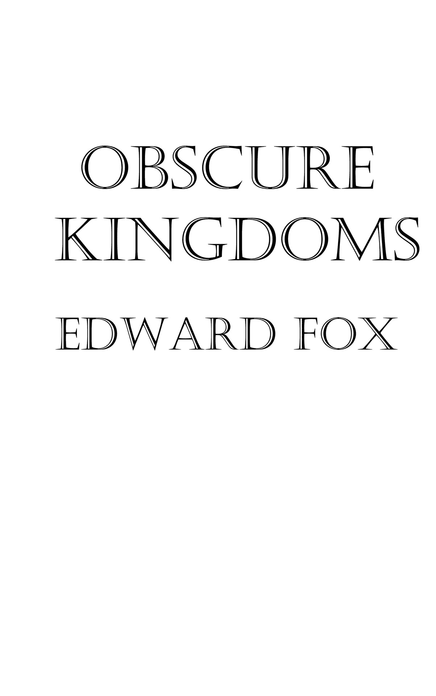

# 稀有王国：汤加、奥曼、尼日利亚、斯瓦士兰、爪哇岛

## 作者简介

Edward L. Fox 于 1958 年出生于纽约。他在剑桥大学学习英语，并在哥伦比亚大学学习中东语言与文化。他现在住在伦敦，担任一名自由记者。《Obscure Kingdoms》是他的第一本书。

## 插图说明

- **汤加**:
  1. Taufa’ahau Tupou IV 国王与其俄罗斯算盘。
  2. 国王骑着定制的自行车。
  3. Fale Alea（立法机构）。
  4. Nuku’alofa 的宫廷办公室。

- **奥曼**:
  5. 苏丹 Qaboos 的官方肖像（1990 年）。
  6. Qaboos 在奥曼国庆日的演讲。
  7. 马斯克的 Al-Alam 宫殿。
  8. Muttrah 港的象征船队。
  9. 1990 年苏丹生日庆典。

- **尼日利亚**:
  10. Oshogbo 皇宫的 Ataojo。
  11. Òyó 的 Aláàfin。
  12. 女神祭司 Abimbola Oyelawe。

- **斯威士兰**:
  13. Mamba 国王 Maja II。
  14. Maja II 的 Indvuna 及其儿子。

- **爪哇**:
  15. 通往 Kota Gede 的入口。
  16. Kraton Yogyakarta 黄色亭的守护者 Bapak Sugiri。
  17. 纪念苏丹 Hamengkubuwono VIII 的纪念碑。
  18. Yogyakarta 市中心的入口。
  19. 携带供品的宫廷女妇女。

## 致谢

作者表示，除了更改某些名字和身份细节外，他没有虚构任何内容。对于汤加章节，他感谢 Pilimilose、Alisi 和 Sione；以及当时在 `Condé Nast’s Traveler` 的 Maggie Simmons。

他感谢在其他章节中提供帮助的人：

- **奥曼**: Brian Pridham (University of Exeter), Salim Tabook, John Peterson, Khalfan al-Barwani, Jumah al-Shidi, Saleh al-’Alawi, Ken Brazier (奥曼大使馆), 奥曼信息部。

- **尼日利亚**: Dr John Peel, Akin Oyetade (SOAS), Lucy Duran, Muraina Oyelami 等。

- **斯威士兰**: James Dlamini, Vincent Sithole, R. L. Mamba (University of Swaziland)。

- **爪哇**: Dr Ignatius Suharno, Dr Ben Arps, Dr Damjati Suparjar, Agustina Ismurjilah, Ric Suhardi。

作者还感谢代理人 Susan Schorr, Deborah Karl, Gillon Aitken 和 Anthony Harwood，以及编辑 ` Andrew Franklin。

## 引言：宫门中的灯笼

正如我所记忆的，1984 年我在西弗吉尼亚州查尔斯顿的一家报社工作，报道那些神圣的教堂和郊区市政。我在那里呆了两年，感到极度无聊，并制定逃离计划。

一天晚上下班后，我在查尔斯顿河畔的 `Holiday Inn` 酒吧里，喝着大杯爱尔士威忌加苏打水。酒精进入我的身体后，标题中的两个词——`Obscure`（隐秘）和 `Kingdoms`（王国）浮现在我的意识中，就像苏打水泡从冰冷、琥珀色的高脚杯深处升向水面。

我想说，是约鲁巴（`Yoruba`）神灵 `Eshu` 用一个刻有字母的铜盘将这两个词递给了我，没有给我其他解释或指令，只是让我继续写下去。这似乎是一个神迹般的礼物：我离开“飞越美国地区”的方法，我的门票，我的高速公路。

于是我开始写，尽管起初只有一个标题。在名为 `Obscure Kingdoms` 的书页之间会出现什么？我为什么会被召唤来写它？我是一个美国人、中产阶级、一个政治无论者。我对国王、王国或君权制了解多少？不在乎？这个想法本身就是一个笑话；它是一本某会在喜剧小说中编写但永远无法完成的书。将那些自认为孤独、华丽且不可比拟的生物结合在一起，特别是在“隐秘”这个形容词下，是鲁莽的。这可能是不可能的：我永远无法接触我的臣民。
