# OCA Java SE 8：程序员 I 考试指南 (考试 1Z0-808) (认证与职业 - OMG)

Kathy Sierra, SCJP
Bert Bates, SCJP, OCA, OCP

Kathy Sierra
Bert Bates

eBook 由 codeMantra 转换
版本 1.0

# 贡献者

## 关于作者

Kathy Sierra 是 Java 5 和 Java 6 SCJP 考试的主开发人员。Kathy 曾任培训师，并在 1997 年创立了 JavaRanch.com。她的畅销书多次获得奖项，她是 Oracle Java Champions 的创始成员。如今，Kathy 正在开发多个领域的高级程序，但将她所有项目联系在一起的线索是帮助读者减轻认知负载。

Bert Bates 是 Sun 许多认证考试（包括 SCJP）的主开发人员。Bert 还是 Oracle OCA 7 和 OCP 7 的首席开发人员之一，以及 Oracle OCA 8 和 OCP 8 的贡献者。他是 JavaRanch 的版主，是多本畅销书的合著者，也是 Oracle Java Champions 的创始成员。现在书写完了，Bert 计划去打打球，然后再次去冰岛。

## 关于技术评审团队

这是我们精心制作的第五版。我们完成的第一个版本是针对 Java 2 的。然后我们再次为 Java 5 更新了这本书。在每一步中，我们都有幸有优秀的以 JavaRanch 为中心的技术评审团队在身边支持。在过去的几年里，我们多次重写了这本书。在接下来的页面中，我们想感谢过去几年里一直支持我们的各种技术评审团队成员。

# 关于 SCJP 6 技术评审团队

Fred
Marc P.
Marc W.
Mikalai!
Christophe

由于升级到 Java 6 考试像是一次精细的外科手术，我们决定书中这次更新版本的技术评审团队也需要类似的配置。为此，我们挑选了一支由 JavaRanch 顶尖大师组成的精英团队来对 Java 6 考试进行评审。

我们对 Mikalai Zaikin 表示无衷感谢。Mikalai 在 Java 5 书中发挥了巨大作用，在 Java 6 版中他再次为我们效力。我们需要感谢 Volha、Anastasia 和 Daria 让我们借用了 Mikalai。他的评论和编辑帮助我们对书籍进行了巨大的改进。感谢你，Mikalai！

Marc Peabody 在帮助我们完成这项“双头蛇”任务方面赢得了特别表誉！除了帮助我们处理 Sun 的新 SCWCD 考试外，Marc 还为这本书提供了一系列出色的编辑——Marc，你冬天救了我们的命！（顺便说一下，我们直到游戏进入后期才知道 Marc、Bryan Basham 和 Bert 都对终极飞盘充满热情！）

Fred 在 JavaRanch 担任版主的同时，还抽时间帮助我们编写了这本书。Stacey 和 Olivia，感谢你们让我们借了 Fred 一段时间。

**Marc Weber** 主持着 JavaRanch 一些最活跃的论坛。Marc 精通此道，发现了书中埋藏的一些非常狡猾的问题。虽然我们非常感谢 Marc 的帮助，但我们需要提醒大家小心——他带了 Phaser（相位发生器）！

最后，我们向 Christophe Verre 表示感谢——如果我们能找到他的话。Christophe 似乎在世界各地履行他的 JavaRanch 版主职责，包括法国、威尔士以及最近的东京。Christophe 曾多次保护我们免受我们组织不严的混乱。感谢你的耐心，Christophe！重要的是，这些家伙都将他们的评审酬劳捐赠给了 JavaRanch！JavaRanch 社区对你们感激不尽。

## 贡献作者

Tom
Jeanne

# 技术评审团队

Roel
Mikalai
Vijitha
Roberto

**Roel**，我们能说什么呢？你作为技术评审的工作是无与伦比的。Roel 发现了如此多的技术错误，让我们眼花缭乱。在印刷书籍和 CD 上的所有材料之间，我们估计这里有 1500 多页“内容”。这太大了！Roel 一页又一页地钻研，投入并以无数方式让这本书变得更好。感谢你，Roel！

除了她的其他贡献外，**Jeanne** 是我们最有活力的技术评审员之一。Jeanne，我们对你感激不尽。感谢 **Matt Heimer** 在并发章节中的优异工作。一个棘手的话题处理得很好！最后，**Roel De Nij** 和 **Roberto Perillo** 对本书做出了贡献并协助技术评审团队——感谢你们，伙计们！

致 Andi
致 Bob

- 索引
- 致谢
- 前言
- 导论

# 1 声明与访问控制

- Java 的特性与优势 (OCA 目标 1.5)
  - 合法标识符
  - 使用 `javac` 和 `java` 命令
- 传递基本类型变量
- 编写显式使对象符合回收代码
- 问答自测
- `instanceof` 比较
- 条件运算符
- 使用 if 和 switch 语句 (OCA 目标 3.3 和 3.4)
- switch 语句
- 使用 do 循环
- 使用 for 循环
- 无标签语句
- 练习 5-2：创建带标签的 while 循环
- 异常的来源
- 总结
- 故障排除

## 致谢

Kathy 和 Bob 感谢以下人员（仅列出部分）：Andy、以及、、、、、、、、、特、Bruce、Lucy、Mary。

感谢这些为我们注入乐趣的人：以及、、、、、、、、、、、、。

感谢这些在早期帮助过我们的人：Alan Petersen、Jean Thomas、Georgiana Meagher、Anthony Ortiz、Jacqueline Jones、Bob Weiner、John Nyquist、Asok Perry、Steve Steiner、Kimberly Brown、Keith Ratliff、以及这个世界上最贴心的 Java 大哥 Jari Pauka。

感谢这些毛茸茸和羽毛的朋友：Kara、Vafi、Niki。

最后，感谢 Eric Freeman 和 Beth Robson 的持续启发。

## 前言

本书的主要目标是帮助你准备并通过 Oracle OCA 8 程序员级认证考试。

本书的内容紧贴真实考试的广度和深度。例如，读完本书后，你可能不会成为 OO 专家，但如果你学习了这些材料并在自测中取得良好成绩，你将对 OO 有基本的理解。完成本书后，你应该确信自己彻底回顾了 Oracle 为这些考试规定的所有目标。

本书分为六个章节，以优化你对 OCA 8 涵盖主题的学习。在可能的情况下，我们将章节按照 Oracle 目标组织，但有时我们会混合或部分重复它们，以更适合学习材料的顺序呈现主题。

每个章节都以“认证目标”开始——这是你通过涉及该章节主题的考试部分时需要具备的。认证目标标题标识了章节中的目标，因此你总能一眼看出目标！

Exam Watch（考试关注）笔记会提醒考试中的信息以及潜在陷阱。因为我们是创建这些考试的团队成员，我们知道你将面临什么！

出现在考试中，但它们在现实世界中也会有用。

- **练习题（Exercises）** 贯穿于各章节。它们帮助你掌握可能成为考试重点的技能。不要只是读一遍练习题；它们是实操练习，你应该能够熟练地完成。在做中学学习是提高你对产品熟练度的有效方法。

- **来自课堂（From the Classroom）** 侧栏描述了在培训课堂环境中经常出现的问题。这些侧栏为你提供了有关认证和产品相关主题的价值视角。它们指出了常见错误，并回答了课堂讨论中产生的问题。

- **认证总结（The Certification Summary）** 是对章节的简要回顾，并对考试要点进行了重新陈述。

- 每章节末尾的**分钟冲刺（Two-Minute Drill）** 是该章节要点的检查清单。它可以用于考前的最后复习。

**自测（The Self Test）** 提供了与认证考试类似的题目，包括多选题和伪拖放题。这些题目的答案以及解析可以在每个章节的末尾找到。在完成每个章节后进行自测，你将强化对该章节所学知识，同时熟悉考试题的结构。

## 引言

### 体系结构

本书的组织方式旨在为 OCA 8 考试提供深度复习，既适用于经验丰富的 Java 专业人士，也适用于 Java 技术初级的人士。每个章节至少涵盖考试的一个大方面，重点关注 Java 语言编程的“为什么”以及“如何做”。

你不会在书中找到学习 Java 的初学者指南。书中 500 多页的内容完全致力于帮助你通过考试。如果你是 Java 新手，我们建议你花时间学习基础知识。在不知道如何编写、编译和运行简单的 Java 程序之前，你不应该开始读这本书。然而，我们并不假设你对涵盖的各个主题具备任何先验知识。换句话说，对于任何特定主题（完全由实际考试目标驱动），我们从假设你对该主题是新的开始。所以，我们假设你对各个主题是新的，但假设我们对 Java 不是新的。

我们并不会假装在为你准备考试的同时让你成为一个全面的 Java 人才。这是一本认证考试学习指南，它的使命非常明确。这并不是说准备考试不会让你成为更优秀的 Java 程序员！相反，即使是经验最丰富的 Java 开发者也经常声称，准备认证考试让他们成为比没有这种考试驱动的学习时要博学多才、更完备的程序员。

有关模拟考试软件的更多信息，请参阅附录。

## 一些建议

一旦你读完这本书，请留出一些时间进行彻底的复习。你可能想多次返回这本书，并利用它提供的所有方法来学习材料：

1. 重新阅读所有的“分钟冲刺”，或者让别人考考你。你也可以将这些练习作为考前快速突击的一种。你可能想用 3 × 5 英寸的索引卡制作一些闪卡，上面写上“分钟冲刺”的内容。

2. 重新阅读所有的“考试笔记（Exam Notes）”。记住这些笔记是由协助创建考试的作者编写的。记住你了解应该预期什么——以及你应该警惕什么。

3. 重新进行“自测”。在读完章节后立即进行测试是一个好主意，因为问题会强化你刚刚学到的。然而，更好的主意是稍后回来一次性做完书中所有的题。假装你正在参加真实考试。（每当你进行自测时，请在另一张纸上标记你的答案。这样，你就可以根据需要反复练习，直到对材料感到熟悉为止。）

4. 完成练习题。练习题旨在涵盖考试主题，没有比通过练习更好地了解这些材料的方法了。确保你理解为什么要执行每个练习中的每一步。如果你对某些内容尚不清楚，请重新阅读章节中的该部分。

5. 编写大量的 Java 代码。我们会反复强调这条建议。当我们写这本书时，我们写了数百个小程序来帮助我们研究。我们从数百名通过考试的候选人那里听过，在几乎每种情况下，考试中得分极高的候选人在学习期间编写了大量的代码。实验书中的代码示例，创建可怕的编译器错误列表——关掉你的 IDE，打开命令行，写代码！

OCA 8 考试被认为是 IT 行业最难的考试之一，我们根据经验告诉你，很大一部分考生是在没有做好准备的情况下参加考试的。作为程序员，考虑到我们通常面临的疯狂截止日期，我们只需要学习完成当前项目所需的内容。

但这次考试试图证明你对 Java 语言的完整理解，而不仅仅是你在工作中熟悉的部分。

仅凭经验就能让你通过考试并获得及格分，即使你知道的事情可能与你想象的略有不同。仅仅说是不够的。

## 谁需要认证？

Oracle 的 Java 考试以多选题的形式出题。

## 参加考试

在之前的版本中，当你遇到多选题时，并不知道有多少个正确答案；但随着考试每个版本的更新，题目变得越来越困难；现在，每道多选题都会告诉你选几个。每个章节末尾的自测与真实考试题目的格式、用词和难度相似，但有两个例外：

- 只要可能，我们的题目不会告诉你有多少个正确答案（除非我们说“选择所有适用项”）。这样做是为了帮助你掌握材料。在已知正确答案数量的情况下，一些考生可以排除错误答案。如果你知道正确答案的数量，也可以选择最可能的答案。我们的工作是让你适应实战！

- 真实考试通常会对问题中的代码进行编号。有时我们不编号代码行——大部分是为了让我们有空间在关键位置添加注释。在正式考试中，如果一个代码列表从第 1 行开始，意味着你正在查看整个文件。如果代码列表从大于 1 的行号开始，则意味着你查看的是部分源代码。在查看部分源文件时，假设你看不见的代码是正确的。（例如，除非明确说明，否则你可以假设部分源文件具有正确的 import 语句。）

当你发现自己在回答多选择题时毫无思路时，请使用你的草稿纸（或白板）写下你认为最有力的二三个答案，然后下划你认为最可能正确的答案。以下是在你完成一遍测试后，草稿纸可能呈现的示例：

- 21. B 或 C
- 33. A 或 C

当你标记该问题并继续做题时，这非常有帮助。然后你可以回到该问题，从你中断的地方独立地恢复你的思考过程。使用这种技术可以避免重新阅读和思考问题。你还需要在复杂的基于文本的场景题中使用草稿纸来创建视觉图像，以更好地理解问题。如果你是一个视觉型学习者，这种技术特别有帮助。

每场考试的问题数量和及格百分比可能会变化。在考试之前，请务必访问 www.Oracle.com 向 Oracle 确认。

你可以以任何顺序回答问题，并可以在完成测试后回去检查你的答案。错误答案没有惩罚，因此至少尝试回答一个答案比完全不回答要好。

考试的一个良好策略是过一遍并回答所有浮现在脑海中的问题。然后你可以回来做其他题目。回答一个问题可能会唤起你对如何回答上一个问题的记忆。

请非常小心代码示例。首先是语法错误：大括号、分号和括号，确保左括号和右括号的数量相等。在尝试弄懂代码的功能之前，先寻找大小写错误和其他语法问题。

考试中的许多问题将取决于语法的细微差别。你必须对 Java 语言有深入的知识才能成功。

这引出了另一个候选人报告的问题。考试中心本应该为你提供足够的书写工具“纸”。在某些情况下，中心的记号笔不足，且白板太小、太笨，无法有效使用。我们建议你打电话并确认他们将为你提供足够大的白板、细头记号笔和良好的擦板。我们真的希望鼓励大家在他们提供实际铅笔时，向 Oracle 和 Pearson VUE 投诉。

# 备考技巧

首先，也是最重要的，给自己留出充足的时间学习。Java 是一门复杂的编程语言，你不能指望在单次学习中突击完成所需的知识。这个领域最好随着时间的推移来学习，通过学习学科并应用你的知识。制定一个学习计划并坚持下去，对自己施加的压力要合理，特别是如果你在日常工作之余学习的话。

准备认证考试时的一个简单技巧是“每天投入 15 分钟”。只需每天至少学习 15 分钟。这是一个微小但重要的承诺。如果你某天无法集中注意力，就在 15 分钟后放弃吧。如果你某天完全进入心流，就学得久一点。只要你有许多“心流日”，成功的几率就非常大。

我们强烈建议你在准备程序员考试时使用抽认卡（flash cards）。抽认卡简单来说就是 3 x 5 或 4 x 6 的卡片，正面是问题，背面是答案。在过每个章节时制作这些卡片，捕捉任何你认为需要更多记忆或练习的主题。你可以通过阅读问题、思考答案，如果回答正确则翻转卡片来训练自己。或者你可以让另一个人帮助你，拿着朝向问题的卡片，然后验证你的答案。我们的大多数学生发现这些工具非常有帮助，特别是因为它们非常便携，你可以随身带到任何地方。但在开车时最好不要使用，红灯除外。我们把它们带到了任何地方——办公室、餐厅、剧院，哪里都可以。

认证学习小组是另一个极佳的资源，你找不到比 Cank.com 大 Moose 论坛更大或更有社区氛围的地方。如果你有这本书的问题，或其他遇到的任何其他模拟考试题，在认证论坛上提问，通常情况下一天内就能得到答案——通常在几小时内。

最后，我们建议你多写一些小型 Java 程序！在编写这本书的过程中，我们写了数百个小程序，如果你听听最成功的候选人的话（你知道的，那些拿了 98 分的人），他们几乎总是报告说他们写了大量的代码。

你可以从 Oracle 或 Pearson VUE 购买考试代金券。访问 Oracle.com（遵循培训/认证链接）或访问 PearsonVue.com 获取考试安排详情和中心位置。

和任何考试一样，你可能会在考前一晚想要临时突击。抵制这种诱惑。你应该已经熟悉材料。早点到达。

当你到达考试中心时，你需要提供身份证明。访问 PearsonVue.com 了解详情。

进入考试中心后，你将接受调查简报。一旦完成调查，计时就开始了，乐趣也开始了。

测试软件允许你在问题之间来回。最重要的是，屏幕上有一个标记框——正如下一节所示，这证明将是一个关键工具。


如果没有进攻计划，候选人可能会被考试压垮，或者因为分心导致用完时间。在大多数情况下，如果你熟悉材料，分配的时间足以完成考试。技巧就在于避免时间在某个特定问题上流逝。

首先，快速浏览考试中的所有问题。“挑选”简单的问题并立即回答。简读每个问题，注意问题的类型和主题。作为指南，尝试在这一轮中花费少于 25% 的测试时间。

这一步让你评估考试的得分和复杂性，并帮助你确定如何分配时间。它让你了解找到某些问题的潜在答案。

如果你对问题的答案不完全确定，尽管回答，但勾选标记以便以后复习。如果你用完了时间，至少你提供了一个“初选”答案，而不是留白。

其次，通读整个测试，利用第一次通过时获得的洞察。例如，如果整个测试看起来很困难，你就会明白不应该在每道题上花费一两分钟。建立一个带有小里程碑的节奏——例如，“我需要每 15 分钟回答 10 道题。”

在这个阶段，跳过那些耗时的题目可能是一个好主意，将它们标记为下一次处理。确保在测试时间过 50% 到 60% 之前完成此阶段。

第三，返回所有题目进行回顾，使用题目回顾界面上的“已标记（Review Marked）”按钮。这一步包括再次查看之前轮次中你不确定的题目，以及处理你推迟到现在的耗时题目。逐组攻克题目，直到你回答完所有题目为止。

如果你对之前标记的题目更有把握，现在可以取消“已标记”按钮的状态。否则，请保持标记。现在着手处理那些耗时题目，特别是那些需要手动计算的题目。当你对答案满意时，取消标记。

到此阶段结束，你已经回答了测试中的每道题，尽管对某些答案仍有保留。如果你在下一步用完了时间，至少你不会因为缺少答案而丢分。在宽限阶段，如果你仍剩余 10% 到 20% 的时间。

现在你进入顺畅了！你已经回答了所有题目，准备好进行质量检查。对整个测试再次通过一遍（最后一次），简要重读每道题和你的答案。再次仔细检查题目以查看是否有“陷阱题”。注意那些包含“不完成（Does not complete）”选项的题目。警惕最后时刻的线索。到此时，你已经对几乎每道题都很熟悉了，你可能会发现几个之前错过的线索。

当你对所有答案都很有信心时，提交评分以完成考试。完成考试后，你将收到来自 Oracle 的封邮件，其中包含一个链接，你可以在该页面查看你的考试结果。截至本文编写时，你必须专门申请纸质证书，否则系统将不会向你寄送。

如果你没有通过考试，不要气馁。尝试用良好的态度对待这次经历，并准备再次尝试。认为自己又学到了一些。你会更熟悉测试的形式，并且对下次可能遇到的题目难度有一个良好的了解。

如果你能迅速振作，你可能会记得你可能错过的几道题。这将帮助你将学习精力集中在正确的领域。

最后，请记住 Oracle 认证非常有价值，因为它们很难获得。毕竟，如果任何人都能获得，它还有什么价值？最后，这需要良好的态度和大量的学习，但你可以的！

### 考试目标与学习指南覆盖范围对照表

下表描述了考试目标以及你将在书中找到对应的章节。（注：我们总结了你在 Oracle.com 网站上找到的一些描述。）

| 考试目标 | 学习指南覆盖范围 |
|---|---|
| Java 基础 定义变量的作用范围 (1.1) | 第 3 章 |
| 定义 Java 类的结构 (1.2) | 第 1、2 章 |
| 使用带有 main 方法创建可执行的 java 应用程序 (1.3) | 第 1 章 |
| 导入其他 java 包以便在代码中访问它们 (1.4) | 第 1 章 |
| 比较和对比 Java 的特性 (1.5) | 第 1 章 |
| 处理 Java 数据类型 | |
| 声明并初始化变量 (2.1) | 第 1、3 章 |
| 区分对象引用变量和原始类型变量 (2.2) | 第 1、2、3 章 |
| 知道如何读取或写入对象字段 (2.3) | 全书 |
| 解释对象的生命周期（创建、“去引用”和垃圾回收） (2.4) | 第 3 章 |
| 使用包装类作为 Boolean、Double、Integer (2.5) | 第 6 章 |
| 使用运算符和判定构造结构 | |
| 使用 Java 运算符 (3.1) | 第 1、4 章 |
| 使用 == 和 equals() 测试字符串与其他对象之间的相等性 (3.2) | 第 1、4 章 |
| 创建 if/else 和三元运算符结构 (3.4) | 第 4、5 章 |
| 使用 switch 语句 (3.5) | 第 5 章 |
| 创建和使用数组 | |
| 声明、实例化、初始化和使用一维数组 (4.1) | 第 3、6 章 |
| 声明、实例化、初始化和使用多维数组 (4.2) | 第 3、6 章 |
| 使用循环结构 | |
| 创建并使用 while 循环 (5.1) | 第 5 章 |
| 创建并使用 for 循环，包括增强型 for 循环 (5.2) | 第 5 章 |
| 创建并使用 do/while 循环 (5.3) | 第 5 章 |
| 比较循环结构 (5.4) | 第 5 章 |
| 使用 break 和 continue (5.5) | 第 5 章 |

### 处理方法与封装

| 考试目标 | 学习指南覆盖范围 |
|---|---|
| 创建带有参数和返回值的方法 (6.1) | 第 6 章 |
| 将 static 应用于方法和字段 (6.2) | 第 1、2 章 |
| 创建并重载构造函数 (6.3) | 第 1、2 章 |
| 应用访问修饰符 (6.4) | 第 1 章 |
| 将封装原理应用于类 (6.5) | 第 2、6 章 |
| 确定对象引用和原始值传递的影响 (6.6) | 第 3 章 |

### 继承

| 考试目标 | 学习指南覆盖范围 |
|---|---|
| 描述继承及其优势 (7.1) | 第 2 章 |
| 开发演示多态的代码 (7.2) | 第 2 章 |
| 确定何时需要类型转换 (7.3) | 第 2 章 |
| 使用 super 和 this 访问对象和构造函数 (7.4) | 第 2 章 |
| 使用抽象类和接口 (7.5) | 第 1、2 章 |

### 异常处理

| 考试目标 | 学习指南覆盖范围 |
|---|---|
| 区分异常、RuntimeException 和 Error (8.1) | 第 5 章 |
| 创建 try-catch 块并确定异常如何改变流程 (8.2) | 第 5 章 |
| 描述异常的优势 (8.3) | 第 5 章 |
| 创建并调用抛出异常的方法 (8.4) | 第 5 章 |
| 识别常见的异常类 (8.5) | 第 5 章 |

### 选定的 API 类

| 考试目标 | 学习指南覆盖范围 |
|---|---|
| 使用 StringBuilder 类处理数据 (9.1) | 第 6 章 |
| 创建并处理字符串 (9.2) | 第 6 章 |
| 创建并处理日期数据 (9.3) | 第 6 章 |
| 声明并使用 ArrayList (9.4) | 第 6 章 |
| 编写一个消费 Lambda 表达式的简单 Lambda 表达式 (9.5) | 第 6 章 |

### 行为（方法）

当程序员创建一个类时，她会为该类创建方法。方法是存储类逻辑以及完成实际工作的地方。它们是执行算法和对数据进行操纵的地方。

我们刚刚讨论的所有 Java 组件——类、变量和方法——都需要名称。在 Java 中，这些名称被称为标识符（`identifiers`），正如你所预期的那样，对于什么构成一个 Java 标识符是有规则的。不过，除了合法性之外，Java（以及 Oracle）程序员还为方法、变量和类的命名创建了约定（`conventions`）。

和所有编程语言一样，Java 拥有一套内置关键字（`keywords`）。这些关键字不能用作标识符。在本文章的后后部分，我们将回顾这些命名规则、约定以及 Java 关键字的细节。

### 继承与接口

Java 和其他面向对象（OO）语言的核心是继承概念，它允许在某个类或接口中定义的代码在其他类中重用。在 Java 中，你可以定义一个通用的（更抽象的）父类，然后用更具体的子类来扩展它。父类对继承它的类一无所知，但所有子类都必须显式地声明继承关系。继承自父类的子类会自动获得父类定义的实例变量和方法，但子类也可以自由重写（`override`）父类方法以定义更具体的行为。例如，汽车父类可以定义所有汽车通用的通用方法，而法拉利子类可以重写已经在汽车类中定义的 `accelerate()` 方法。

继承的强大伙伴是接口（`interfaces`）。接口通常像一个 100% 抽象类，定义了子类必须支持什么，但不定义如何支持。换句话说，例如，一个 `Animal` 接口可能会声明所有 `Animal` 实现类都有 `eat()` 方法，但 `Animal` 接口并不为 `eat()` 方法提供任何逻辑。实现接口的类负责定义当其 `eat()` 方法被调用时特定类型行为的具体代码。注意：从 Java 8 开始，接口现在可以包含具体的、可继承的方法。当我们下一章深入研究面向对象编程时，我们会更多地讨论这一点。

### Java 的特性与优势（OCA 目标 1.5）

**1.5 比较并对比 Java 的特性和组件，如：平台无关性、面向对象、封装等。**

也许在我们对 OCA 8 的官方讲解中，一个很好的入门的话题是讨论 Java 提供的各种优势。Java 现在已经有 20 多年的历史了（哇！）并且仍然是世界上最需求的编程语言之一。有点令人困惑的是，还有一个名称相似的“JavaScript”（ECMA 标准的实现），它也是一种非常流行的语言。Java 和 JavaScript 有一些共同点，但不要将它们混淆；它们是截然不同的。让我们看看 Java 为程序员提供的一些优势，并（在适当的情况下）与 Java 的某些竞争对手进行比较。这里有一个提醒，这些优势中的许多基于极其复杂的话题。这些描述绝不是定义性的，但对于示例来说足够了：

- **面向对象**：随着软件系统变得越来越大，测试和增强它们变得越来越困难。在过去的几十年里，面向对象（OO）编程一直是大型系统主导的软件设计，设计良好的 OO 系统在成长为拥有数行代码的巨大应用程序时，仍然保持可测试性和可增强性。OO 设计还提供了一种自然的方式来思考系统中的组件应该如何构建以及它们应该如何相互作用。设计良好的 OO 系统中的类、对象、系统状态和行为在概念上很容易与现实世界中的对应物映射。

- **封装**：封装是 OO 编程中的一个核心概念。封装允许软件组件向其他组件隐藏数据，保护数据不被未经组件批准或知情的情况下进行更新。Java 让封装比非 OO 语言更容易实现。

- **内存管理**：与它的某些竞争对手（C 和 C++）不同，Java 提供了自动内存管理。在不提供自动内存管理的语言中，通过指针跟踪内存是非常复杂的。此外，追踪与内存管理相关的错误（通常称为`内存泄漏`）是一个常见、易错且耗时的过程。

- **海量库**：Java 拥有海量的、最好经过良好测试并获得良好支持的代码库。它很容易包含在你的 Java 应用程序中，并通过 Java API 有了良好的文档。在整个书中，我们将探索 Java 标准核心库中一些常用（且最有用）的成员。

- **设计安全**：当编译后的 Java 代码执行时，它在 Java 虚拟机（`JVM`）内部运行。`JVM` 为你的 Java 代码提供了一个安全的“沙箱”，`JVM` 确保邪恶的程序员无法写出在运行时会在他人机器上引起麻烦的 Java 代码。

- **一处编写，处处运行（跨平台执行）**：Java 的目标之一（在很大程度上实现但并非完美）是许多 Java 代码可以在许多平台上运行，从微小的物联网（`IoT`）设备到手机、笔记本电脑再到服务器集群。这种在许多设备上运行能力的另一个常用术语是`跨平台`。

- **强类型**：强类型语言通常要求程序员显式地声明所用数据和对象的类型。强类型允许 Java 编译器在你甚至编译之前捕获许多潜在的编程错误。另一端是动态类型。动态类型语言可以更简洁、初始代码编写更快，并且在小团队和快速原型设计成为常态的环境中通常更青睐。但像 Java 这样的强类型语言在大型软件公司中凭借更可靠、可测试、生产级的代码脱颖而出。

- **多线程**：随着系统增长以处理更密集的任务，使用多个核心的能力变得至关重要。多线程编程从未简单，但 Java 提供了内置语言功能来简化。

- **分布式计算**：解决大问题的另一种方法是将工作负载分布到许多机器上。Java API 提供了几种方法来简化与分布式计算的任务。一个例子是序列化，将 Java 对象转换为便携格式的过程。序列化对象可以发送到其他机器、反序列化并作为普通对象使用。

再次，我们触及了这些话题的表面，但如果你理解了这些简要描述，你就应该准备好应对任何问题了。理论到此为止，让我们进入细节……

## 认证目标

## 标识符和关键字（OCA 目标 1.2 和 2.1）

- **1.2 定义类的结构。 2.1 声明和初始化变量（包括原始类型的转换）。**

记得我们在书中列出了一个或多个认证目标，正如我们所做的，这意味着后续章节涵盖了该目标的一部分。某些目标会在不同的章节中涵盖，你会在书中看到同一个目标。例如，本节涵盖了声明和标识符，但使用这些内容主要在后面的章节中。

所以，我们将从 Java 标识符开始。在这里涵盖的 Java 标识符有两个方面：

- **合法标识符**：编译器判断名称是否合法的规则。
- **Oracle 的 Java 代码约定**：Oracle 对类、变量、方法的命名建议。我们在整个书中通常遵循这些标准，除非我们在尝试展示棘手的考试题是如何编写的。你不会被问关于 Java 代码约定的问题，但我们强烈建议你使用它们。

所以，我们从标识符开始。在这里涵盖的 Java 标识符两个方面（重复内容，已合并）。

从技术上讲，合法标识符必须由 Unicode 字符、数字、货币符号和连接字符（如下划线）组成。考试并没有深入研究 Unicode 字符集中哪些范围定义了字母和数字。因此，例如，你不需要知道这些。你需要的是：

- 标识符必须以字母、货币符号（`$`）或连接字符如下划线（`_`）开头。标识符不能以数字开头！
- 在第一个字符之后，标识符可以包含字母、货币符号、连接字符或数字的任意组合。
- 在实践中，标识符的字符数量没有限制。

你不能使用关键字作为标识符。表 1-1 列出了所有的关键字。

### 表 1-1 Java 关键字完整列表（含 1.4 中添加的 `assert` 及 1.5 中添加的 `enum`）

| abstract | boolean | break | byte | case | catch |
|---|---|---|---|---|---|
| char | class | continue | default | do | double |
| else | extends | final | finally | float | for |
| goto | if | implements | import | instanceof | int |
| interface | long | native | new | package | private |
| protected | public | return | short | static | strictfp |
| super | switch | synchronized | this | throw | throws |
| transient | try | void | volatile | while | assert |
| enum | | | | | |

Java 中的标识符是区分大小写的；`foo` 和 `FOO` 是两个不同的标识符。

以下是合法和非法标识符的示例。首先是一些合法的标识符：

```
int _a;
int $sc;
int __2_w;
int _$;
int this_is_a_very_detailed_name_for_an_identifier;
```

以下是非法的（你的任务是识别它们的原因）：

```
int :b;
int -d;
int e#;
int .f;
int 7g;
```

Oracle 估计，一段标准代码的生命周期中，20% 的工作将用于代码的原始创建和测试，而 80% 的工作将用于代码后续的维护和增强。达成并遵循一套代码标准进行编码，有助于减少测试、维护和增强任何代码时所需的工作量。Oracle 为 Java 创建了一套编码标准，并发布了这份巧妙命名为《Java 代码规范》（`Java Code Conventions`）的文档，如果你从 java.oracle.com 开始查找，就能找到它。这是一份非常棒的文档，短且易于阅读，我们强烈推荐它。

尽管如此，你会发现考试中的许多问题并没有遵循代码规范，因为测试考试在国际范围内交付代码存在局限性。Oracle 认证的伟大之处之一是考试在全球范围内统一管理。为了实现这一点，你在真实考试中看到的代码列表通常非常拥挤，并且不遵循 Oracle 的代码标准。为了给考试做准备，我们将展示具有类似拥挤外观和感受的代码列表，通常我们的代码缩进两个空格，而不是 Oracle 标准四个空格。

我们还会不自然地将大括号连接在一起，而且有时会将多个语句放在同一行…………噢！例如：

```
class Wombat implements Runnable {
  private int i;
  public synchronized void run() {
    if (i % 5 != 0) {
      i++;
      for (int x = 0; x < 5; x++, i++) {
        if (x > 1) Thread.yield();
        System.out.print(i + " ");
      }
    }
  }
  public static void main(String[] args) {
    Wombat n = new Wombat();
    for (int x = 100; x > 0; --x) {
      new Thread(n).start();
    }
  }
}
```

请做好心理准备——你将看到很多扭曲、奇怪的代码列表、问题和真实的考试题。没有人希望你像这样写代码——你的雇主、你的同事、Oracle 以及考试命题团队都不是这样！创建这样的代码仅仅是为了在通用测试工具中测试复杂的概念。在考试中尽可能遵循的唯一标准是命名标准。以下是 Oracle 推荐的、我们在考试以及书中大部分内容使用的命名标准：

- **类和接口**：第一个字母应该大写，如果多个单词组合成一个名称，则内部单词的首字母也应该大写（这种格式有时被称为“驼峰命名法”`CamelCase`）。对于类，名称通常应该是名词。这里是一些示例：
  - `Dog`
  - `Account`
  - `PrintWriter`

对于接口，名称通常应该是形容词，如下：


## Java 标识符与命名规范

### 关键字
你不能使用关键字作为标识符。表 1-1 列出了所有的关键字。

| abstract | boolean | break | byte | case | catch |
|---|---|---|---|---|---|
| char | class | continue | default | do | double |
| else | extends | final | finally | float | for |
| goto | if | implements | import | instanceof | int |
| interface | long | native | new | package | private |
| protected | public | return | short | static | strictfp |
| super | switch | synchronized | this | throw | throws |
| transient | try | void | volatile | while | assert |
| enum | | | | | |

Java 中的标识符是区分大小写的；`foo` 和 `FOO` 是两个不同的标识符。

### 合法与非法标识符示例

**合法标识符：**
```java
int _a;
int $sc;
int __2_w;
int _$;
int this_is_a_very_detailed_name_for_an_identifier;
```

**非法标识符：**
```java
int :b;
int -d;
int e#;
int .f;
int 7g;
```

### 代码规范的重要性
Oracle 估计，一段标准代码的生命周期中，20% 的工作将用于代码的原始创建和测试，而 80% 的工作将用于代码后续的维护和增强。达成并遵循一套代码标准进行编码，有助于减少测试、维护和增强任何代码时所需的工作量。Oracle 为 Java 创建了一套编码标准，并发布了这份名为《Java 代码规范》的文档，可在 java.oracle.com 找到。这是一份非常棒的文档，短且易于阅读，我们强烈推荐它。

尽管如此，你会发现考试中的许多问题并没有遵循代码规范，因为测试在国际范围内交付代码存在局限性。为了给考试做准备，我们将展示具有类似拥挤外观和感受的代码列表，通常我们的代码缩进两个空格，而不是 Oracle 标准四个空格。我们还会不自然地将大括号连接在一起，而且有时会将多个语句放在同一行。例如：

```java
class Wombat implements Runnable {
  private int i;
  public synchronized void run() {
    if (i % 5 != 0) { i++;
    for (int x = 0; x < 5; x++, i++) {
      if (x > 1) Thread.yield();
      System.out.print(i + " ");
    }}
  }
  public static void main(String[] args) {
    Wombat n = new Wombat();
    for (int x = 100; x > 0; --x) { new Thread(n).start(); }
  }
}
```

请做好心理准备——你将看到很多扭曲、奇怪的代码列表。没有人希望你像这样写代码，创建这样的代码仅仅是为了在通用测试工具中测试复杂的概念。在考试中尽可能遵循的唯一标准是命名标准。

### Oracle 推荐的命名标准

#### 类和接口
第一个字母应该大写，如果多个单词组合成一个名称，则内部单词的首字母也应该大写（这种格式有时被称为“驼峰命名法” CamelCase）。对于类，名称通常应该是名词。例如：
- `Dog`
- `Account`
- `PrintWriter`

对于接口，名称通常应该是形容词，如下：
- `Runnable`
- `Serializable`

#### 方法
第一个字母应该是小写，然后应使用正常的驼峰命名法规则。此外，名称通常应该是动词-名词的组合对。例如：
- `getBalance()`
- `doCalculation()`
- `setCustomerName()`

#### 变量
与方法一样，应该使用驼峰命名法，但以小写字母开头。Oracle 建议使用短而有意义的名字。一些示例：
- `buttonWidth`
- `accountBalance`
- `myString`

#### 常量
Java 常量通过将变量标记为 `static` 和 `final` 来创建。它们应该使用大写字母命名，并用下划线作为分隔符：
- `MIN_HEIGHT`

---

## 类定义目标 (1.2, 1.3, 1.4, 6.4, 7.5)

1.2 定义 Java 类的结构。
1.3 创建带有 `main` 方法的可执行 Java 应用程序；从命令行运行 Java 程序；包括控制台输出。
1.4 导入其他 Java 包以便在你的代码中访问。
6.4 应用访问修饰符。
7.5 使用抽象类和接口。

当你用 Java 写代码时，你正在编写类或接口。在这些类中，正如你所知，有变量和方法（以及其他一些东西）。你如何声明类、方法和变量会极大影响你代码的行为。例如，公共方法可以从应用程序中任何地方运行的代码访问。但如果该方法标记为私有，它就会从每个人的视线中消失（声明它的类除外）。

对于这个目标，我们将学习声明和修改（或不修改）类的方法。你会发现我们以极其详细的内容涵盖了修饰符，尽管我们知道你已经熟悉它们了，但我们从最开始开始。大多数 Java 程序员认为它们是如何工作的，但仔细研究后会发现它们并非如此（至少没有达到考试所需的程度）。细微的差别随处可见，因此你需要在参加考试之前，确保你对本节目标中的所有内容都完全掌握。

### 源文件声明规则
在深入类声明之前，让我们快速回顾一下与源文件中声明类、`import` 语句和 `package` 语句相关的规则：

- 每个源文件只能有一个 `public` 类。
- 注释可以出现在源文件中任何行的开头或结尾；注释独立于此处的任何位置规则。
- 如果文件中有一个 `public` 类，文件名必须与该 `public` 类的名称匹配。例如，声明为 `public class Dog { }` 的类必须命名为 `Dog.java`。

### `main` 方法详解

```java
public class MyClass {
    public static void main(String[] args) {
        System.out.println(args[0] + " " + args[1]);
    }
}
```

它被编译并按如下方式调用：
```
java MyClass x 1
```
输出将是：
```
x 1
```

目前只需要知道 `args`——和所有数组一样——使用从 0 开始的索引。换句话说，第一个命令行参数被赋值给 `args[0]`，第二个参数被赋值给 `args[1]`，以此类推。

`main()` 方法的使用在考试的大多数问题中都是隐含的。对于那 0.0001% 不知道的同学来说，`main()` 是 JVM 用于启动 Java 程序执行的方法。

首先，对你来说的一点是，将方法命名为 `main()` 并不会赋予它我们通常与 `main()` 关联在一起的超能力。对于编译器和 JVM 而言，**唯一版本**具有能力的 `main()` 是具有以下签名的 `main()`：

```java
public static void main(String[] args)
```

具有其他签名的 `main()` 版本是完全合法的，但它们被视为普通方法。声明“特殊” `main()` 方法（用于启动 Java 应用的方法）具有一定的灵活性：它的修饰符顺序可以更改；`String` 数组不需要命名为 `args`；它可以使用变长参数语法声明。以下是“特殊” `main()` 的所有合法声明：

```java
public static void main(String[] args)
public static void main(String... x)
public static void main(String[] bang_a_gong)
```

对于考试，你唯一还需要知道的一点是 `main()` **可以被重载**。我们将在下一章详细介绍重载。

### 导入语句

世界上有无数个 Java 类。假设我们创建了：

```java
public class ArrayList {
    public static void main(String[] args) {
        System.out.println("fake ArrayList class");
    }
}
```

事实证明，这是一个完全合法的类，Java API 中最常用的类之一也叫 `ArrayList`。API 版本的实际名称是 `java.util.ArrayList`。这是它的全限定名。使用全限定名有助于 Java 开发者确保两个像 `ArrayList` 这样的类版本不会产生混淆。现在假设我想使用 API 中的 `ArrayList` 类：

```java
public class MyClass {
    public static void main(String[] args) {
        java.util.ArrayList<String> a = new java.util.ArrayList<String>();
    }
}
```

尽管这是合法的，但也需要大量的击键。`import` 语句来救场了！我们的类可以像这样：

```java
import java.util.ArrayList;
public class MyClass {
    public static void main(String[] args) {
        ArrayList<String> a = new ArrayList<String>();
    }
}
```

我们将 `import` 语句解释为：“在 Java API 中有一个名为 'util' 的包，在那个包里有一个名为 'ArrayList' 的类。每当你在这个类中使用 'ArrayList' 时，它都是简写为：'java.util.ArrayList'。” Java `import` 语句能为你节省的只是打字量。仅此而已。

一个包通常包含许多类。`import` 语句提供了另一种节省击键的能力。假设你想使用来自 `java.util` 包的几个不同的类：`ArrayList` 和 `TreeSet`。你可以在 `import` 语句中添加通配符字符 `*`：

```java
import java.util.*;
public class MyClass {
    public static void main(String[] args) {
        ArrayList<String> a = new ArrayList<String>();
        TreeSet<String> t = new TreeSet<String>();
    }
}
```

编译器和 JVM 看到这些代码后，它们知道去 `java.util` 中查找 `ArrayList` 和 `TreeSet`。对于考试，关于在类中使用 `import` 语句你唯一需要记住的是，你可以自由地混合使用。这样写是可以的：

```java
ArrayList<String> a = new ArrayList<String>();
java.util.ArrayList<String> a2 = new java.util.ArrayList<String>();
```


## Static Import 语句（静态导入）

亲爱的读者，我们确实在纠结把关于静态导入的这段讨论放在哪里。从学习的角度来看，这里并不是理想的位置，但从参考的角度来看，我们认为这是合理的。当你第一次学习这些材料时，可能会对本节的某些想法感到困惑。如果是这样，我们表示歉意。请在此页贴上贴签，在读完第 3 章后再回来查看。另一方面，一旦你度过了学习阶段并将本书作为参考，我们认为把放在这里非常有用。现在，关于静态导入：

有些类会包含静态成员。（我们稍后会详细讨论静态成员，但由于我们正在讨论导入，我们认为顺带一下静态导入。）静态成员可以存在于你编写的类中，也可以于 Java API 中的许多类中。

正如我们之前所说的，`import` 语句最终的价值在于节省打字量并让你的代码更易读。在 Java 5（很久以前），引入了静态导入以提供更大的减少击键的能力，虽然有些人认为这是以牺牲可读性为代价的。这种功能被称为静态导入。你可以在需要时静态导入。这里有一个前后的示例：

### 静态导入前

```java
public class TestStatic {
    public static void main(String[] args) {
        System.out.println(Integer.MAX_VALUE);
        System.out.println(toHexString(42));
    }
}
```

### 静态导入后

```java
import static java.lang.System.*;
import static java.lang.Integer.*;
public class TestStatic {
    public static void main(String[] args) {
        out.println(MAX_VALUE);
        out.println(toHexString(42));
    }
}
```

这两个类都产生相同的输出：

```
2147483647
2a
```

通过整个 Java API：`import java.*;` // 合法，但不会跨包搜索。

## 类声明与修饰符

我们讨论的类声明限于顶层类（top-level classes）。除了顶层类，Java 还提供了另一类类，被称为嵌套类或内部类。内部类包含在 OCP 考试中，但不在 OCA 考试中。当你成为 OCP 候选人时，你将会学习到内部类。不，真的。我是认真的的。

以下代码是一个最基础的类声明：

```java
class MyClass { }
```

这段代码可以正常编译，但你也可以在类声明之前添加修饰符。通常，修饰符分为两类：

- 访问修饰符（`public`、`protected`、`private`）
- 非访问修饰符（包括 `strictfp`、`final` 和 `abstract`）

我们将先查看访问修饰符，这样你就能学习如何限制或允许对你创建类的访问。Java 中的访问控制有点复杂，因为有四种访问控制（访问控制级别），但只有三个访问修饰符。第四种访问级别（默认或包级访问）是在你不使用上述任何三个访问修饰符时获得的。换句话说，每个类、方法和实例变量都声明了一个访问控制，无论你是否显式地输入它。尽管所有的访问控制（这意味着所有三个修饰符）适用于大多数方法和变量声明，但类可以只声明为 `public` 或默认访问；正如你所看到的，另外两个访问级别对于类来说是没有意义的。


Java 是一门以包为中心的语言；开发者假设为了良好的组织和命名作用域，你会将所有的类都放在包中。他们是正确的，你确实应该这样做。想象一下这个噩梦：三名程序员在同一家公司负责项目的不同部分，他们都写了一个名为 `utilities` 的类。如果这些 `utilities` 类没有声明在显式的包中并且在类路径（`classpath`）中，你将无法编译你所指的编译器或 JVM。Oracle 建议开发者使用反转域名，并加上版本/项目名称。例如，如果你的域名是 `geeksanonymous.com` 且你正在为 `TwelvePointSteps` 程序编写客户端代码，你会将包命名为 `com.geeksanonymous.steps.client` 之类的。这本质上将你的类名改为 `com.geeksanonymous.steps.utilities`。如果你不想出自己的命名方案，在公司内部可能仍然会发生命名冲突（假设这些方案保证不会与公司之外开发的类冲突（假设它们遵循 Oracle 的命名规范，如果它们不是，那么，可能会发生非常糟糕的事情））。

## 类访问

访问一个类意味着什么？当我们说来自一个类 (A) 的代码可以访问另一个类 (类 B) 时，意味着类 A 可以执行三件事之一：

- 创建类 B 的实例。
- 扩展类 B（换句话说，成为类 B 的子类）。
- 根据方法和变量的访问控制，访问类 B 中的某些方法和变量。

实际上，访问意味着可见性。如果类 A 看不到类 B，那么类 B 中方法和变量的访问级别就无关了；类 A 将无办法访问那些方法和变量。

## 默认访问

具有默认访问的类在声明中前面没有修饰符！这是你在类声明中没有输入修饰符时获得的访问控制。将默认访问理解为包级访问，因为具有默认访问的类只能被同一个包内的类可见。例如，如果类 A 和类 B 在不同的包中，且类 A 是默认访问，类 B 将无法创建类 A 的实例，甚至无法声明类 A 的变量或返回类型。事实上，类 B 必须假装类 A 不存在，否则编译器会报错。查看以下源文件：

```java
package cert;
class Beverage { }
```

现在看第二个源文件：

```java
package exam.stuff;
import cert.Beverage;
class Tea extends Beverage { }
```

如你所示，父类 (`Beverage`) 与子类 (`Tea`) 在不同的包中。Tea 文件顶部的 `import` 语句试图（祈祷有效）导入 `Beverage` 类。`Beverage` 文件可以编译，但当我们尝试编译 `Tea` 文件时，我们会得到类似这样的信息：

> 无法访问 `cert.Beverage`。类或接口必须是 `public`、在同一个包中，或者是可访问的成员类。

```
import cert.Beverage;
```

（注意：由于各种原因，我们在书中显示的错误信息可能与你获得的错误信息不匹配。不要担心，真正的重点是理解你何时可能遇到某种错误。）

`Tea` 无法编译，因为它的父类 `Beverage` 是默认访问且在不同的包中。你可以做两件事来使其工作。你可以将两个类都放在同一个包中，或者像下一节描述的那样将 `Beverage` 声明为 `public`。

当你看到带有复杂逻辑的问题时，务必先查看访问修饰符。这样，如果你发现了访问违规（例如，包 A 中的类尝试访问包 B 中的默认类），你就会知道代码无法编译，因此无需费力推演逻辑。这并不是说你在考试时没别的事情要做。只需选择“编译失败”答案并跳到下一个问题即可。

## Public 访问

访问一个类意味着什么？带有 `public` 关键字的类声明意味着所有类都可以访问该类。换句话说，所有类都可以访问 `public` 类。但请记住，如果你尝试使用的 `public` 类在不同的包中，你仍然需要导入该 `public` 类。

在前一节的示例中，为了让代码工作，我们需要在父类前面加上 `public` 关键字，如下：

```java
package cert;
public class Beverage { }
```

这使得 `Beverage` 类对所有类可见。

## 其他（非访问）类修饰符

你可以使用 `final`、`abstract` 或 `strictfp` 关键字来修改类声明。这些修饰符是在类的任何访问控制之外的，因此例如，你可以将一个类声明为 `public` 和 `final`。但你不能总是混合访问修饰符。你可以结合 `strictfp` 与 `final` 使用。

你不需要了解 `strictfp` 如何工作，因此我们专注于只修改 `final` 或 `abstract`。对于考试来说，你只需要知道 `strictfp` 是一个关键字，可以修改类或方法，但不能修改变量。将类标记为 `strictfp` 意味着类中的任何方法代码都将严格遵循浮点的 IEEE 754 标准。如果没有该修饰符，方法中的浮点可能会以平台相关的方式运行。如果没有将类声明为 `strictfp`，你仍然可以通过将方法声明为 `strictfp` 来逐方法获得 `strictfp` 行为。如果你不知道 IEEE 754 标准，现在不是学习它的时候。你有更重要的事情要处理。

## Final 类

当在类声明中使用时，`final` 关键字意味着该类不能被子类化。换句话说，没有类可以扩展（继承）`final` 类，任何尝试这样做都会导致编译错误。

那么，你为什么要将类标记为 `final` 呢？毕竟，这难道不违反了整个面向对象的继承概念吗？只有当你绝对确定该类中的任何方法永远不会被重写时，你应该创建一个 `final` 类。如果你深度依赖某些方法的实现，使用 `final` 可以给你提供安全保障，没有人可以更改你的实现。

你会发现 Java 核心库中的许多类都是 `final` 的。例如，`String` 类不能被子类化。如果你不能保证 `String` 对象在运行应用程序的任何给定系统上都能工作，那将造成多么灾难！如果程序员自由扩展 `String` 类，并在需要 `java.lang.String` 实例的地方替换为自己的 `String` 子类，我们所知的文明可能会崩溃。因此，为了安全请使用 `final`，但仅在你确定时。

本质上，`final` 类确实已经说过，所有的需求都无法被另一个程序员改进或专门化。

在这种情况下，拥有非本地类（nonlocal classes）是有好处的：假设你发现你正在使用的某个类中的某个方法存在问题，但你没有源代码。因此，你无法修改源码来改进该方法，但你可以扩展该类并在你的新子类中重写该方法，然后在所有预期原始父类的地方替换该方法。然而，如果类是 `final` 的，你就被困住了。

让我们通过在声明中放置 `final` 关键字来修改我们的 `Beverage` 示例：

```java
package cert;
public final class Beverage { 
    public void importantMethod() { }
}
```

现在让我们尝试编译 `Tea` 子类：

```java
package exam.stuff;
import cert.Beverage;
class Tea extends Beverage { }
```

我们得到了一个错误——类似这样的错误：

```
Can't subclass final classes: class
cert.Beverage class Tea extends Beverage
1 error
```

在实践中，你几乎不会将一个类标记为 `final`。`final` 类消除了面向对象扩展性的一个核心优势。除非你有严重的安全或防护问题，否则假设某天另一个程序员需要扩展你的类。如果你这样做，下一个被迫维护你代码的程序员就会追捕你并 <在此处插入一件可怕的事情>。

## 抽象类

抽象类永远不能被实例化。它唯一的目的、生命中的使命、存在的意义（raison d'être）就是被扩展（成为子类）。（但注意，只要你不尝试实例化它的实例，你就可以编译并执行抽象类。）如果不能用它创建对象，为什么还要写一个类呢？因为这个方法太抽象了。例如，假设你有一辆汽车，它拥有所有车辆通用的方法。但你不希望任何人实际上创建一个通用的抽象对象。他们将如何初始化它？它是什么颜色的？有多少个座位？马力？全驱？更重要的是，它的行为会如何？换句话说，方法将如何实现？

不，你需要程序员来实例化具体的汽车类型，如 `BMWBoxster` 和 `SubaruOutback`。我们打赌 Boxster 的主人会告诉你，他的车能做一些 Subaru “只有在梦里”才能做的事。看看下面的抽象类：

```java
abstract class Car {
    private double price;
    private String Model;
    private String year;
    public abstract void goFast();
    public abstract void goUpHill();
    public abstract void impressNeighbors();
    // 额外的、重要的且严肃的代码放在这里
}
```

前面的代码可以正常编译。然而，如果你尝试在另一段代码中实例化 `Car`，你将得到类似这样的编译器错误：

```
AnotherClass.java:7: class Car is an abstract
class. It can't be instantiated.
    Car x = new Car();
1 error
```

注意，标记为 `abstract` 的方法以分号结尾，而不是大括号。

寻找那些方法声明以分号结尾而不是大括号结尾的题目。如果方法在类中（而不是接口中），那么方法和类都必须标记为 `abstract`。你可能会遇到这样的问题，要求你如何修复一个代码示例，该示例包含一个以分号结尾的方法，但类或方法上没有 `abstract` 修饰符。在这种情况下，你可以将方法和类标记为 `abstract`，或者将分号改为代码（如大括号对）。记住，如果你将一个方法从 `abstract` 改为非 `abstract`，别忘了将方法声明结尾的分号改为大括号！

我们将在本目标的稍后部分详细介绍抽象方法，但始终记住，即使只有一个方法是 `abstract` 的，整个类也必须声明为 `abstract`。一个抽象方法毁掉大局。然而，你可以在抽象类中放置非抽象方法。例如，你可能拥有某些从 `Car` 类型到 `Car` 类型都不会改变实现的方法，例如 `getColor()` 或 `setPrice()`。通过将非抽象方法放在抽象类中，你将获得所有具体的子类，它们都实现了那些非 `abstract` 的实现方法。好消息是，具体的子类可以继承功能，并且只需要实现定义子类特定行为的方法。

（顺便说一下，如果你之前在这里用了 `raison d'être` 这个词组，请不要发邮件。我们希望看到你把它写进程序员认证书中）。

使用抽象类类型（包括本章稍后将讨论的接口）进行编码可以让你利用多态性，并给你最大程度的灵活性和扩展性。你将在第 2 章中学习更多关于多态的知识。

你不能将一个类标记为 `abstract` 又是 `final`。它们的含义几乎相反。抽象类必须被子类化，而 `final` 类不能被子类化。如果你在类或方法的声明中使用这种 `abstract` 和 `final` 修饰符的组合，代码将无法编译。

## 练习 1-1

### 创建抽象父类和具体子类

以下练习将测试你对 `public`、`default`、`final` 和 `abstract` 类的理解。

创建一个名为 `Fruit` 的抽象父类和一个名为 `Apple` 的具体子类。父类应该属于名为 `food` 的包，子类可以属于默认包（意味着它没有被显式放入包中）。将父类设为 `public`，并给子类默认访问权限。

- 按照如下所示创建父类：

```java
package food;
public abstract class Fruit { /* 任何你想要 */ }
```

- 在单独的文件中按照如下创建子类：

```java
import food.Fruit;
class Apple extends Fruit { /* 任何你想要 */ }
```

- 在类目录下创建一个名为 `food` 的目录。
- 尝试编译这两个文件。

## 认证目标

### 使用接口

#### 声明接口

通常，当你创建一个接口时，你是在定义一个类*可以做*的契约，而不是关于它*如何做*。

> **注意**：从 Java 8 开始，你也可以描述*如何做*，但通常不需要。在我们讨论 Java 8 的接口相关特性——默认和静态方法之前，我们将从传统的角度讨论接口。

接口是一个契约。例如，你可以写一个 `Bounceable` 接口，它相当于“这是一个接口”。任何实现该接口的类都必须编写 `bounce()` 和 `setPrice()` 方法的代码。

接口可以由任何类实现，通过任何继承。这让你让完全不同的类具有一个共同的特征。例如，你可能希望 `Ball` 和 `Tire` 具有 `bounce` 行为，但它们并不共享任何继承关系；它们只自 `java.lang.Object`。通过让 `Ball` 和 `Tire` 变为 `Bounceable`，你是在说它们可以被视为“可以跳跃的东西”，这在 Java 中翻译为“可以调用 `bounce()` 和 `setPrice()` 方法的东西”。图 1-1 阐述了接口与类的关系。

| | |
| :--- | :--- |
| interface Bounce<br>void bounce();<br>void setPrice(int bf); | 你声明的内容。 |
| interface Bounceable<br>public abstract void bounce();<br>abstract void setPrice(int bf); | 编译器看到的。 |
| Class Tire implements Bounceable<br>public void bounce(){}<br>public void setPrice(int bf) { } | 实现类必须做的。（所有接口方法都必须实现并标记为公共。） |

**图 1-1** 接口与类的关系

将传统的接口看作是一个完全抽象的类。与抽象类一样，接口定义了采取如下形式的抽象方法：

```java
abstract void bounce(); // 以分号结尾而不是
// 大括号
```

虽然抽象类可以定义抽象和非抽象方法，接口通常只有抽象方法。接口与抽象类的不同之处在于，接口中方法和变量的声明方式活性非常小。这些规则非常严格：


- 接口方法隐式是 `public` 和 `abstract` 的，除非声明为 `default` 或 `static`。换句话说，你不需要在方法声明中输入 `public` 或 `abstract` 修饰符，但方法始终是公共且抽象的。

- 接口中定义的所有变量必须是 `public`、`static`、`final` 的——换句话说，接口可以声明常量，但不能声明实例变量。接口方法不能标记为 `final`、`strictfp` 或 `native`。（在本章稍后的部分将详细介绍这些修饰符。）

- 方法不能标记为 `final`、`strictfp` 或 `native`。

- 接口可以扩展一个或多个其他接口。

- 接口不能扩展接口以外的任何内容。

- 接口不能实现另一个接口或类。

- 接口必须使用 `interface` 关键字声明。

- 接口类型可以多态地使用（更多细节请参见第 2 章）。

以下是一个合法的接口声明：

```java
public abstract interface Rollable { }
```

输入 `abstract` 修饰符被认为是冗余的；无论你是否输入 `abstract`，接口都是隐式抽象的。你只需要知道这两种声明都是合法的且功能相同的：

```java
public abstract interface Rollable { }
public interface Rollable { }
```

如果你希望接口具有公共访问权限而非默认访问权限，则需要 `public` 修饰符。我们已经查看了接口声明，现在我们来仔细查看接口内部的方法：

```java
public interface Bounceable {
    public abstract void bounce();
    public abstract void setBounceFactor(int bf);
}
```

在方法上输入 `public` 和 `abstract` 修饰符是冗余的，尽管所有的接口方法都是隐式公共且抽象的。根据该规则，你可以看到以下代码与之前的接口完全等价：

```java
public interface Bounceable {
    void bounce(); // 无修饰符
    void setBounceFactor(int bf); // 无修饰符
}
```

你必须记住，无论你在接口定义中看到什么，所有未声明为 `default` 或 `static` 的接口方法都是公共且抽象的。寻找使用任何组合的 `public`、`abstract` 或无修饰符声明的接口方法。例如，以下五个方法声明，如果在它们各自的接口中声明，将是合法的且完全相同的！

```java
void bounce();
public void bounce();
abstract void bounce();
public abstract void bounce();
abstract public void bounce();
```

```java
final void bounce(); // final 和 abstract 永远不能使用
private void bounce(); // 组合使用时，隐含了 abstract
protected void bounce(); // 接口方法总是公共的
```

## 声明接口常量

你允许在接口中放置常量。这样做可以确保任何实现该接口的类都将访问相同的常量。通过将常量直接放在接口中，任何实现该接口的类都可以直接访问这些常量，就像类继承了它们一样。

你需要记住关于接口常量的一个关键规则。它们必须始终是：

`public static final`

听起来很简单，对吧？毕竟，接口常量与任何公共访问常量没有区别，所以显然它们必须被声明。但在你快速浏览完剩下的讨论之前，请考虑一下影响：**由于接口常量定义在接口中，它们不需要被声明为 `public`、`static` 或 `final`。它们必须是 `public`、`static` 且 `final`，但你实际上不需要那样声明。** 就像接口方法无论你是否说明都是公共且抽象的一样，在代码中，接口中定义的任何变量必须是——并且隐式地——公共常量。看看你是否看出以下代码中的问题（假设是独立的文件）：

```java
interface Foo {
    int BAR = 42;
    void go();
}

class Zap implements Foo {
    public void go() {
        BAR = 27;
    }
}
```

你不能改变常量的值！一旦分配了值，该值就永远无法修改。赋值发生在接口本身（即声明常量的地方），因此实现类可以访问并使用它，但只能作为一个只读值。因此，`BAR = 27` 的赋值将无法编译。


**寻找定义了常量但没有显式使用所需修饰符的接口定义。** 例如，以下所有都是相同的：

```java
public int x = 1; // 看起来既非静态非 final，
int x = 1; // 但其实不是！
static int x = 1; // 看起来是默认、非 final，
final int x = 1; // 非静态，但其实不是！
public static int x = 1; // 没有显示 final
public final int x = 1; // 没有显示 static
static final int x = 1; // 没有显示 public
public static final int x = 1; // 显式声明
// 隐式得到的结果
```

所需（但隐式的）修饰符的任何组合都是合法的，就像完全不加修饰符一样！在考试中，你可以预期看到一些你无法正确回答的问题，除非你知道（例如）接口变量是 `final` 的，并且永远无法由实现类（或任何其他类）赋值。

## 声明默认接口方法

从 Java 8 开始，接口可以包含具有具体实现的*可继承的*方法。（*在 Java 8 中，“继承”的严格定义已经变得有点模糊；我们将在第 2 章详细讨论继承。）这些具体方法被称为 `default` 方法。在下一章中，我们将讨论由于 `default` 方法产生影响的各种面向对象相关问题。目前我们只涵盖简单的声明规则：

- 默认方法通过使用 `default` 关键字声明。`default` 关键字只能用于接口方法签名，不能用于类方法签名。
- 默认方法根据定义是公共的，`public` 修饰符是可选的。
- 默认方法不能标记为 `private`、`protected`、`static`、`final` 或 `abstract`。
- 默认方法必须有一个具体的方法体。

以下是一些合法和不合法的默认方法示例：

```java
interface TestDefault {
    default int m1() { return 1; } // 合法
    public default void m2() {} // 合法
    static default void m3() {}; // 不合法：default 不能标记为 static
    default void m4(); // 不合法：default 必须有方法体
}
```

## 声明静态接口方法

从 Java 8 开始，接口可以包含具有具体实现的静态方法。与接口默认方法一样，我们将在第 2 章中讨论其涉及的面向对象影响。目前，我们将重点于声明和使用静态接口方法的基础知识：

- 静态接口方法通过使用 `static` 关键字声明。
- 静态接口方法默认是公共的，`public` 修饰符是可选的。
- 静态接口方法不能标记为 `private`、`protected`、`final` 或 `abstract`。
- 静态接口方法必须有一个具体的方法体。
- 调用静态接口方法时，必须包含方法的类型（接口名称）。

以下是一些合法和不合法的静态方法及其使用的示例：

```java
interface StaticInterface {
    static int m1() { return 42; } // 合法
    public static void m2() { } // 合法
    // final void m3() { } // 不合法：不允许 final
    // abstract void m4() { } // 不合法：不允许 abstract
    // static void m5() // 不合法：需要方法体
}

class TestSIF implements StaticInterface {
    public static void main(String[] args) {
        System.out.println(StaticInterface.m1()); // 合法：必须包含接口类型
        new TestSIF().go();
        // System.out.println(m1()); // 不合法：需要引用接口
    }
    void go() {
        System.out.println(StaticInterface.m1()); // 从实例也是合法的
    }
}
```

产生输出：

```
42
42
```

正如我们之前提到的，我们将在第 2 章返回对默认方法和静态方法的讨论。

## 认证目标

## 声明类成员 (OCA 目标 2.1, 2.2, 2.3, 4.1, 4.2, 6.2, 6.3, 和 6.4)

- 2.1 声明和初始化变量（包括原始数据类型的强制转换）。
- 2.2 区分对象引用变量和原始变量。
- 2.3 知道如何读取或写入对象字段。
- 4.1 声明、实例化、初始化并使用一维数组。
- 4.2 声明、实例化、初始化多维数组。
- 6.2 将 `static` 应用于方法和字段。
- 6.3 创建和重载构造函数；包括对默认构造函数的影响。

## 应用访问修饰符

我们已经了解过类声明中使用修饰符的含义，现在我们将查看修改方法或变量声明的含义。方法和实例（非局部）变量统称为成员。你可以同时使用访问修饰符和非访问修饰符来修改成员，而且与声明类相比，你有更多的修饰符可以选择（并组合）。

## 访问修饰符

由于方法和变量成员通常以完全相同的方式被赋予访问控制，我们将在本节中同时涵盖这两者。类仅可以使用四种访问控制级别中的两种（默认或公共），而成员可以使用所有的级别：

- `public`（公共）
- `protected`（受保护）
- `default`（默认）
- `private`（私有）

一个类中的代码访问另一个类的成员意味着什么？目前，方法和变量之间暂无区别。如果类 A 有权访问类 B 的成员，意味着类 B 的成员对类 A 是可见的。当类无权访问另一个成员时，编译器将阻止你尝试访问你不应该知道它存在的东西！你需要理解两种不同的访问问题：

- 一个类中的方法代码是否可以访问另一个类的成员
- 子类是否可以继承其父类的成员

第一种访问发生在当一个类中的方法尝试访问另一个类的方法或变量时，使用点运算符 (`.`) 来调用方法或获取变量。例如：

```java
class Zoo {
    public String coolMethod() {
        return "Wow baby";
    }
}

class Moo {
    public void useAZoo() {
        Zoo z = new Zoo();
        // 如果前一行编译通过，Moo 就有权访问 Zoo 类
        // 但是……它有权访问 coolMethod() 吗？
        System.out.println("A Zoo says, " + z.coolMethod());
        // 前一行可以工作，是因为 Moo 可以访问该 public 方法
    }
}
```

第二种访问围绕着子类可以通过继承访问父类的哪些成员（如果有的话）展开。我们关注的不是子类是否可以调用父类实例上的某个方法（这只是第一种访问的例子）。相反，我们关注的是子类是否继承了其父类的成员。记住，如果子类继承了一个成员，就等同于子类实际上声明了该成员。换句话说，如果子类继承了一个成员，子类就拥有该成员。这里有一个示例：

```java
class Zoo {
    public String coolMethod() {
        return "Wow baby";
    }
}

class Moo extends Zoo {
    public void useMyCoolMethod() {
        // Moo 的实例继承了 coolMethod() 吗？
        System.out.println("Moo says, " + this.coolMethod());
        // 前一行可以工作，是因为 Moo 可以继承 public 方法
        // Moo 的实例可以在 Zoo 的实例上调用 coolMethod() 吗？
        Zoo z = new Zoo();
        System.out.println("Zoo says, " + z.coolMethod());
        // coolMethod() 是 public 的，所以 Moo 可以在 Zoo 上调用它
    }
}
```

图 1-2 比较了类继承另一个类的成员以及通过该类的实例引用访问另一个类的成员。

### 跑车

```java
goFast() {
    doStuff() {
        goFast();
    }
}
```
父类

### 敞篷车

```java
doThings() {
    SportsCar sc = new SportsCar();
    sc.goFast();
}
doMore() {
    goFast();
}
```
子类

### 司机

```java
doDriverStuff() {
    SportsCar car = new SportsCar();
    car.goFast();
    Convertible con = new Convertible();
    con.goFast();
}
```

访问方法的方式：
- 调用在同一个类中声明的方法
- 使用类的引用调用方法
- 调用继承的方法

**图 1-2** 继承的比较：用于成员访问的点运算符

大部分访问（两种类型）都集中在涉及的两个类是否在同一个包或不同的包中。但不要忘记，如果类 A *本身* 不能被类 B 访问，那么类 A 内部任何成员都无法被类 B 访问。

你需要了解类和成员访问不同组合的效果（例如带有公共变量的默认类）。要弄清楚这一点，首先查看类的访问级别。如果类本身对另一个类不可见，那么即使成员被声明为 `public`，所有成员也是不可见的。一旦你确认了类是可见的，那么查看单个成员的访问级别就有意义了。

## 公共成员

当方法或变量成员声明为 `public` 时，意味着所有其他类（无论它们属于哪个包）都可以访问该成员（假设类本身是可见的）。

查看以下源代码：

```java
package book;
import cert.*; // 导入 cert 包中的所有类

class Goo {
    public static void main(String[] args) {
        Sludge o = new Sludge();
        o.testIt();
    }
}
```

现在看第二个文件：

```java
package cert;

public class Sludge {
    public void testIt() { System.out.println("test"); }
}
```

```java
package cert;

public class Roo {
    private String doRooThings() {
        // 想象一下这里有很多有趣的代码，但没有其他类会知道
        return "fun";
    }
}
```

`doRooThings()` 方法现在对所有子类都是限制，即使是与父类在同一个包中的子类也不行：

```java
package cert;               // Cloo 和 Roo 在同一个包中

class Cloo extends Roo {                  // 仍然可以，父类 Roo 是 public 的
    public void testCoo() {
        System.out.println(doRooThings()); // 编译错误！
    }
}
```

如果我们尝试编译子类 `Cloo`，编译器会高兴地抛出类似这样的错误：

```
% javac Cloo.java
Cloo.java:4: Undefined method: doRooThings()
    System.out.println(doRooThings());
1 error
```


# 私有方法可以被子类重写吗？

这是一个有趣的问题，但答案是否定的。因为我们所见，子类无法继承私有方法，因此，它无法重写该方法——重写依赖于继承。我们将在本节稍后以及第 2 章中详细讨论其影响，但现在，只需记住，标记为 `private` 的方法不能被重写。图 1-3 说明了 `public` 和 `private` 修饰符对相同包或不同包类的影响。

## 访问方法的类方式

- 调用在同一类中声明的方法
- 使用类的引用调用方法
- 调用继承的方法

**图 1-3** `public` 和 `private` 访问的影响

# Protected 和默认成员

> **注意**：提一下，在后续章节中，当我们使用“默认”一词时，指的是访问控制。我们不是在讨论 Java 8 中可以声明为 `default` 的新类型接口方法。

`protected` 和默认访问控制级别几乎完全相同，但有一个关键区别。默认成员只有在访问该成员的类属于同一个包时才能被访问，而 `protected` 成员可以被子类（通过继承）访问，**即使该子类位于不同的包中**。请看以下类：

```java
package certification;

public class OtherClass {

  void testIt() { // 没有修饰符意味着方法具有默认访问

    // 访问

    System.out.println("OtherClass");

  }

}
```

在另一个源文件中，你有以下内容：

```java
package somethingElse;

import certification.OtherClass;

class AccessClass {

  static public void main(String[] args) {

    OtherClass o = new OtherClass();

    o.testIt();

  }

}
```

如你所见，第一个文件中的 `testIt()` 方法具有默认（包级）访问权限。注意类 `OtherClass` 与 `AccessClass` 在不同的包中。`AccessClass` 能够使用 `testIt()` 方法吗？它会导致编译错误吗？Daniel 会和 Francesca 结婚吗？请关注。

在 `certification.OtherClass` 类中没有匹配 `testIt()` 的方法。`o.test();`

根据前面的结果，你可以看到 `AccessClass` 无法使用 `OtherClass` 方法，因为 `testIt()` 是默认访问的，且 `AccessClass` 与 `OtherClass` 不在同一个包。所以 `AccessClass` 无法使用它，编译器抱怨道，而我们不知道 Daniel 和 Francesca 是什么。

默认和 `protected` 行为仅在讨论子类时不同。如果使用 `protected` 关键字定义一个成员，声明它的类的任何子类都可以通过继承访问它。父类和子类是否在不同的包中并不重要；`protected` 父类成员对子类仍然可见（尽管仅以非常特定的方式可见，正如我们稍后看到的）。这与默认行为形成对比，默认行为不允许子类访问父类成员，除非该子类位于同一个包中。

默认访问没有对子类进行任何特殊考虑（你要么在包内，要么不在），而 `protected` 修饰符尊重父子关系，即使子类离开了（并加入了新包）。所以，当你考虑默认访问时，请考虑限制。但当你考虑 `protected` 时，请考虑包。带有 `protected` 成员的类标记为对所有类具有包级访问权限，但对包外的子类有特殊例外。

## Protected Details

让我们看看 `protected` 细节。

```java
package certification;

public class Parent {

    protected int x = 9;

}
```

前面的代码将变量 `x` 声明为 `protected`。现在让我们创建一个不同包的子类并尝试使用该变量：

```java
package other;

import certification.Parent;

class Child extends Parent {

    public testIt() {

        System.out.println("x is " + x);

    }

}
```

前面的代码可以编译通过。但是，如果另一个包的子类通过父类的引用来访问 `x` 会怎样呢？

```java
package other;

import certification.Parent;

class Child extends Parent {

    public void testIt() {

        System.out.println("x is " + x); // 继承了 x

        Parent p = new Parent(); // 可以通过 p 访问访问吗？

        System.out.println("X in parent is " + p.x); // 编译错误！

    }

}
```

编译器非常乐意向我们展示问题：

```text
%javac Child.java

Child.java:9: has protected access in certification.Parent

    System.out.println("X in parent is " + p.x);
```

到目前为止，我们已经确定 `protected` 成员对所有类和子类都具有包级或默认访问权限。我们看到包外的子类可以继承该成员。最后，我们看到包外的子类不能通过父类引用来访问 `protected` 成员。*对于包外的子类，protected 成员只能通过继承访问。*

但我们仍然有一个待解决的问题：对于尝试使用包外的子类来获取父类成员的情况，`protected` 成员看起来如何？例如，使用我们的 `Parent/Child` 类，如果子类所在包中的另一个类（例如 `Neighbor`）拥有 `Child` 实例的引用并想要访问变量 `x` 会怎样？

```java
package other;

import certification.Parent;

class Child extends Parent {

    public void testIt() {

        System.out.println("x is " + x);

    }

}
```

前面的代码可以编译通过。但是，注意子类通过父类访问 `protected` 变量：

```java
package other;

import certification.Parent;

class Child extends Parent {

    public void testIt() {

        System.out.println("x is " + x); // 继承了 x

        Parent p = new Parent(); // 可以通过 p 访问访问吗？

        System.out.println("X in parent is " + p.x); // 编译错误！

    }

}
```

**图 1-4** 保护访问的影响

# 默认细节

让我们从父类成员的默认行为开始。我们将父类的成员 x 修改为默认权限。

```java
package certification;

public class Parent {

    int x = 9; // 没有访问修饰符，意味着默认

    // (包) 访问

}
```

注意，我们没有在变量 x 前面放置访问修饰符。请记住，如果在类或成员声明之前没有输入访问修饰符，访问控制将是默认的，这意味着包级别。现在，我们将尝试从之前看到的 `Child` 类访问该默认成员。当我们尝试编译 `Child.java` 文件时，会得到如下的错误：

```text
java:4: Undefined variable: x

System.out.println("Variable x is " + x);

1 error
```

当成员被声明为 `private` 时，编译器会给出相同的错误。子类 `Child`（在不同的包中）无法看到或使用默认父类成员 `x`！那么，同一个包中的两个类的默认访问又是怎样的呢？

```java
package certification;

public class Parent{

    int x = 9; // 默认访问

}
```

在第二个类中，你有如下代码：

```java
package certification;

class Child extends Parent{

    static public void main(String[] args) {

        Child sc = new Child();

        sc.testIT();

    }

    public void testIT() {

        System.out.println("Variable x is " + x); // 没有问题；

    }

}
```

之前的源文件可以正常编译，子类运行并显示 x 的值。请记住，只有当子类与父类位于同一个包时，默认成员对子类才可见。

# 局部变量与访问修饰符

访问修饰符可以应用于局部变量吗？不能！
绝不存在可以将访问修饰符应用于局部变量的情况，所以请注意如下代码：

```java
class Foo {

void doStuff() {

    private int x = 7;

    this.doMore(x);

}

}
```

你可以确信，任何带有访问修饰符声明的局部变量都无法通过编译。事实上，只有一个修饰符可以应用于局部变量——即 `final`。
我们关于成员访问修饰符的讨论到此结束。表 1-2 显示了访问权限和可见性的所有组合；你真的应该花时间研究一下。接下来，我们将深入研究可以应用于成员声明的其他（非访问）修饰符。

## 表 1-2 确定类成员的访问权限

| 可见性 | Public | Protected | Default | Private |
| :--- | :--- | :--- | :--- | :--- |
| 同一个类内部 | 是 | 是 | 是 | 是 |
| 同一个包中的任何类 | 是 | 是 | 是 | 否 |
| 同一个包内的子类 | 是 | 是 | 是 | 否 |
| 来自同一个包之外的子类 | 是 | 是，通过继承 | 否 | 否 |
| 来自包外的任何非子类 | 是 | 否 | 否 | 否 |

# 非访问成员修饰符

我们讨论了成员访问，这指的是一个类的代码是否可以调用另一个类的方法（或访问其实例变量）。尽管如此，仍有一系列可以在成员声明上使用的修饰符需要处理。你已经熟悉其中两个——`final` 和 `abstract`——因为我们在在本章的早些部分已经将它们应用于类声明。但我们仍然需要快速查看 `transient`、`synchronized`、`native`、`strictfp`，然后在在本章后面详细查看那个“大头”——`static`。

我们将首先查看应用于方法的修饰符，然后查看应用于实例变量的修饰符。我们将通过查看 `static` 在应用于变量和方法时的工作原理来结束本节。

## Final 方法

`final` 关键字可以防止方法在子类中被重写，通常用于强制执行方法的 API 功能。例如，`Thread` 类有一个名为 `isAlive()` 的方法，用于检查线程是否仍然活跃。然而，如果你扩展了 `Thread` 类，你实际上没有办法自己正确地实现这个方法（首先它使用了原生代码），设计者已将其标记为 `final`。正如你不能对 `String` 类进行子类化（因为我们需要信任 `String` 对象）一样，你不能重写核心类库中的任何方法。这种不可重写的限制提供了安全保障，但你应该非常谨慎地使用它。防止子类重写方法可以带来面向对象编程的许多好处，包括通过多态实现扩展性。一个典型的 `final` 方法声明如下：

```java
class SuperClass{

    public final void showSample() {

        System.out.println("One thing.");

    }

}
```

扩展 `SuperClass` 是合法的，因为该类没有标记为 `final`，但我们不能重写 `final` 方法 `showSample()`，如下面的代码尝试的那样：

```java
class SubClass extends SuperClass{

    public void showSample() { // 尝试重写 final

        System.out.println("Another thing.");

    }

}
```

编译上述代码会得到如下提示：

```text
% javac FinalTest.java

FinalTest.java:5: The method void showSample() declared in class

SubClass cannot override the final method of the same signature

declared in the same signature
```


## Final 参数

方法参数是括号之间的变量。在前面的示例中，该变量被标记为 `final`，这意味着它不能被修改。

## 抽象方法

抽象方法是已声明（抽象）但未实现的方法。换句话说，它没有方法体。当你想要强制子类提供实现时，就将方法标记为抽象。

```java
public abstract class Vehicle {

    private String type;

    public abstract void goUphill(); // Abstract方法

    public String getType() { // 非抽象方法
        return type;
    }
}
```

```java
public abstract class Car extends Vehicle {

    public abstract void goUphill(); // 仍然是抽象的

    public void doCarThings() {
        // 这里编写特殊的汽车代码
    }
}
```

```java
public class Mini extends Car {

    public void goUphill() {
        // Mini 特有的上坡代码
    }
}
```

那么，`Mini` 类有多少个方法？三个。它继承了 `getType()` 和 `doCarThings()` 方法，因为它们是公共且具体的（非抽象的）。但由于 `goUphill()` 在父类 `Vehicle` 中是抽象的，并且在汽车类中从未实现（因此它仍然是抽象的），这意味着 `Mini` 类作为 vehicle 下方的第一个具体类——必须实现 `goUphill()` 方法。换句话说，`Mini` 类不能将（抽象方法的实现的责任）推给继承树中的下一个类，但 `Car` 类可以，因为 `Car` 和 `Vehicle` 一样是抽象的。图 1-5 展示了抽象修饰符对具体类和抽象子类的影响。

## 抽象 Car

```java
startEngine()
abstract goForward()
abstract reverse()
stop()
abstract turn(int whichWay)
```

## SportsCar

## 抽象 SUV

```java
startEngine() // 可选
goForward()   // 必须
reverse()     // 必须
turn(int whichWay) // 必须
```

```java
enable4wd()
goForward()
reverse()
abstract goOffRoad()
```

```java
// turn() 未实现
```

抽象方法必须由非抽象的子类实现。如果该子类是抽象的，则不要求实现抽象方法，但允许实现父类的任何或所有抽象方法。`AcmeRover` 类是非抽象的，因此它必须实现其父类中声明的抽象方法，并且必须实现 `turn()`，而 `SUV` 没有实现该方法。

## AcmeRover

```java
enable4wd() // 可选
goOffRoad() // 必须
turn(int whichWay) // 必须
```

图 1-5 抽象修饰符对具体类和抽象子类的影响

寻找没有为父类的抽象方法提供方法实现的具体类。以下代码将无法编译：

```java
public abstract class A {
    abstract void foo();
}

class B extends A {
    void foo(int i) { }
}
```

类 `B` 将无法编译，因为它没有实现继承的抽象方法 `foo()`。虽然类 `B` 中的 `foo(int i)` 方法看起来像是父类抽象方法的实现，但它仅仅是一个重载方法（使用相同标识符但参数不同的方法），因此它并没有满足实现父类抽象方法的要求。我们将在第 2 章查看重载（overloading）和重写（overriding）之间的区别。

一个方法永远不能同时被标记为 `abstract` 和 `final`，或者同时标记为 `abstract` 和 `final`（这实际上意味着被子类重写），而 `final` 和 `private` 方法永远不能被子类重写。换句话说，抽象标记意味着父类并不知道子类在方法上应该如何表现，而 `final` 标记意味着父类知道所有子类（无论在继承树中有多深）在方法上应该如何表现。`abstract` 和 `final` 修饰符几乎是对立的。由于 `private` 方法子类不可见（更不用说继承），它们同样不能被重写，因此也不能标记为抽象。

最后，你需要知道——对于顶级类来说——`abstract` 修饰符不能与 `static` 修饰符结合。我们稍后目标中介绍静态方法，但现在只需记住以下内容是非法的：

```java
abstract static void doStuff();
```

它会给你一个现在应该很熟悉的错误：

```text
Class.java:2: illegal combination of modifiers: abstract and static
abstract static void doStuff();
```

## 同步方法 (Synchronized Methods)

`synchronized` 关键字表示方法一次只能被一个线程访问。当你学习 OCP 8 时，你会深入学习 `synchronized` 关键字，但现在……你只需要知道 `synchronized` 修饰符只能应用于方法——不是变量、不是类，只是方法。一个典型的 `synchronized` 声明如下：

```java
public synchronized Record retrieveUser(int id) {
```

你还应该知道 `synchronized` 修饰符可以与四个访问控制级别中的任何一个（这意味着它可以与任何访问修饰符关键字匹配）。

## 原生方法 (Native Methods)

`native` 修饰符表示该方法是在依赖平台的代码（C 语言）中实现的。对于考试，你不需要知道如何使用原生方法，只需要知道 `native` 是一个修饰符（因此是一个关键字），并且 `native` 只能应用于方法——不是类、不是变量，只是方法。注意，原生方法的体必须是一个分号；（类似于抽象方法），表示省略了实现。

## 严格浮点方法 (Strictfp Methods)

我们之前看过了将 `strictfp` 作为类修饰符，但即使你没有将类声明为 `strictfp`，你仍然可以将单个方法声明为 `strictfp`。记住，`strictfp` 强制浮点（以及任何浮点操作）遵循 IEEE 754 标准。通过 `strictfp`，无论 JVM 运行在什么底层平台上，你都可以预测浮点的行为。缺点是，如果底层平台能够支持更高的精度……

## 带有参数列表的方法（变长参数 varargs）

Java 允许你创建接受可变参数的方法。根据需要，它们被称为“varargs”、“variable arguments”或“varargs”。让我们来看一些例子：

```java
void method(String... names) {
    for (String name : names) {
        System.out.println(name);
    }
}
```

## 声明基本类型及其范围

基本类型变量可以声明为类变量（静态）、实例变量、方法参数和局部变量。你可以在同一行中声明一个或多个相同类型的基本类型。在第 3 章中，我们将讨论初始化它们的各种方式，但现在我们先为你提供几个基本类型变量声明的示例：

```java
byte b;
boolean myBooleanPrimitive;
int x, y, z; // 声明三个 int 基本类型
```

在之前的考试版本中，你需要知道如何计算所有 Java 基本类型的范围。对于目前的考试，你可以跳过其中一些细节，但理解以下这一点仍然重要：对于整数类型，从从小到大的顺序是 byte、short、int 和 long，且 double 的精度（或范围）比 float 大。

- 你还需要知道数值类型（包括整数类型和浮点型类型）都是有符号的，以及这如何影响它们的范围。首先，让我们复习这些概念。

Java 中的所有六种数值类型都由特定数量的 8 位字节组成，并且是有符号的，这意味着它们可以是负数也可以是正数。最左边的位（最高位）用于表示符号，其中 1 表示负数，0 表示正数，如图 1-6 所示。其余位使用补码表示表示值。

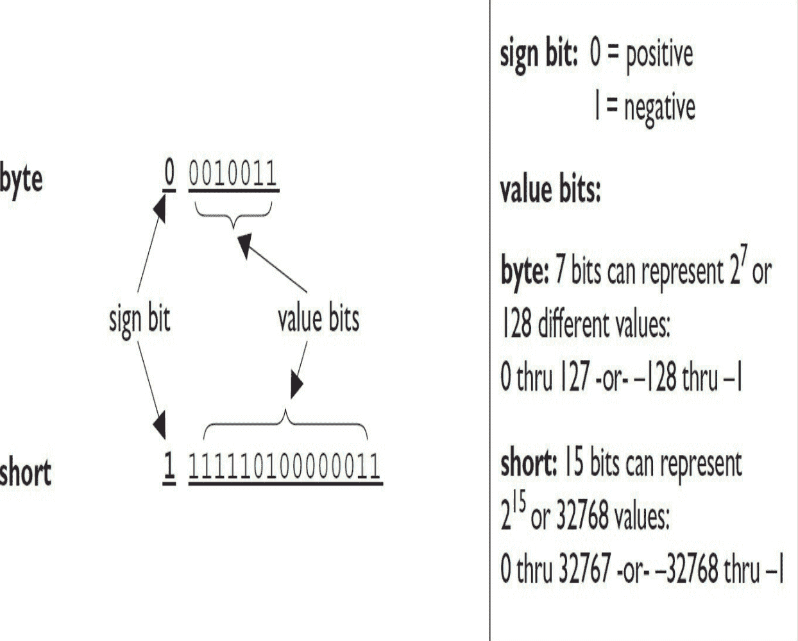

**图 1-6** byte 的符号位

**表 1-3** 数值基本类型的范围

| 类型 | 位数 | 字节 | 最小范围 | 最大范围 |
|---|---|---|---|---|
| byte | 8 | 1 | -2^7 | 2^7 - 1 |
| short | 16 | 2 | -2^15 | 2^15 - 1 |
| int | 32 | 4 | -2^31 | 2^31 - 1 |
| long | 64 | 8 | -2^63 | 2^63 - 1 |
| float | 32 | 4 | n/a | n/a |
| double | 64 | 8 | n/a | n/a |

图 1-3 显示了基本类型及其的大小和范围。图 1-6 显示，对于 byte，有 256 种可能的数字（或 $2^8$）。其中一半是负数，另一半减 1。正数比负数范围少 1，因为 0 是以二进制形式存储的。使用公式 $-2^{(bits-1)}$ 计算范围，使用 $2^{(bits-1)} - 1$ 计算正数范围。再次，如果你知道这张表的前两列，那么应对考试就没问题了。

浮点数的范围确定起来很复杂，但幸运的是，你不需要在考试中知道它们（尽管你应该知道 double 是 64 位，而 float 是 32 位）。

boolean 值没有范围；boolean 只能为 true（真）或 false（假）。如果有人问你 boolean 的位深度，你就直视他们的眼睛说：“这取决于虚拟机。”

char 类型（字符）包含单个的 16 位 Unicode 字符。虽然被称为 ISO Latin-1 的扩展 ASCII 只需要 8 位（256 个不同的字符），但表示英语以外语言的字符需要更大的范围。Unicode 字符实际上由无符号 16 位整数表示，这意味着有 $2^{16}$ 种可能的值，范围从 0 到 65535 ($2^{16}$ – 1)。你将在第 3 章学到，由于 char 实际上是一个整数类型，它可以赋值给任何大到足以容纳 65535 的数字（这意味着任何比 short 大的；char 和 short 都是 16 位类型，但 short 使用 1 位表示符号，short 中可以接受的正数较少）。

## 声明引用变量

引用变量可以声明为静态变量、实例变量、方法参数或局部变量。你可以在同一行中声明一个或多个相同类型的引用变量。在第 3 章中，我们将讨论初始化它们的各种方式，但现在我们先为你提供几个引用变量声明的示例：

```java
Object o;
Dog myNewReferenceVariable;
String s1, s2, s3; // 声明三个 String 变量
```

## 实例变量

实例变量定义在类内部、任何方法之外，并且仅在类实例化时初始化。实例变量是属于每个唯一对象的字段。例如，以下代码为员工对象定义了名称、职称和经理的字段（实例变量）：

```java
class Employee {
    // 为员工实例定义字段（实例变量）
    private String name;
    private String title;
    private String manager;
    // 其他代码在这里，包括私有字段的访问方法
}
```

前面的 Employee 类表示，每个员工实例都将拥有自己的名称、职称和经理。换句话说，每个实例都可以对这三个字段拥有自己独特的值。

对于实例变量：
- 可以使用四种访问级别中的任何一种（这意味着它们可以被三个修饰符中的任何一个标记）
- 可以标记为 `final`
- 可以标记为 `transient`
- 不能标记为 `abstract`
- 不能标记为 `static`
- 不能标记为 `native`
- 不能标记为 `synchronized`
- 不能标记为 `volatile`
- 不能标记为 `transient`

我们已经涵盖了可以应用于实例变量的修饰符用法。首先，我们来看实例和方法之间的区别。

### 局部（栈）变量

| 局部变量 | 方法 |
|---|---|
| `final` | `final` |
| `transient` | `transient` |
| `abstract` | `abstract` |
| `static` | `static` |
| `synchronized` | `synchronized` |
| `volatile` | `volatile` |

```java
new TestServer().count();
}
```

前面的代码产生了以下输出：

```text
local variable count is 10
instance variable count is 9
```

到底在地球上（或你选择的星球上）为什么要这么做？通常情况下，你不会这样做。但比较常见的原因之一是将参数命名为与它要被赋值的实例变量相同的名称。

这段（错误的）代码试图使用参数来设置实例变量的值：

```java
class Foo {
    int size = 27;

    public void setState(int size) {
        size = size; // ???哪个 size 等于哪个 size ？？
    }
}
```

所以你决定——为了整体可读性——想给参数起一个与它指向的实例变量相同的名称，但你如何解决命名冲突呢？使用关键字 `this`。该关键字始终、始终、始终指向当前运行的对象。下面的代码展示了这一用法：

```java
class Foo {
    int size = 27;

    public void setState(int size) {
        this.size = size; // this.size 表示当前对象的
                          // 实例变量，size。右边的 size
                          // 是参数
    }
}
```

## 数组声明

在 Java 中，数组是存储多个相同类型变量或所有都是同一类型子类的变量的对象。数组可以包含基本类型数据，也可以包含对象引用，但数组本身始终是堆上的一个对象，即使数组被声明为持有基本类型元素。换句话说，不存在所谓的“基本类型数组”，但你可以创建一个“基本类型的数组”。

对于考试，你需要知道三件事：
- 如何创建一个数组引用变量（声明）
- 如何创建一个数组对象（构造）
- 如何向数组中填充元素（初始化）

对于这个目标，你只需要知道如何声明一个数组；我们将在第 5 章中介绍数组的构造和初始化。


数组是高效的，但很多时候你可能想使用 `java.util` 中的一种 Collection 类型（包括 `HashMap`、`ArrayList` 和 `TreeSet`）。Collection 类提供了更灵活的方法来访问对象（插入、删除、读取等），并且与数组不同，它们可以随着添加或删除元素而动态扩展或收缩。针对各种需求都有 Collections。需要快速排序吗？需要一组没有重复的对象吗？需要访问键值对吗？Java 提供了多种 Collection 类型来处理这些情况，但你需要的 Collection 类型只有 `ArrayList`。

数组的声明方式是说明数组将持有的元素类型（对象或基本类型），然后在标识符的两侧各加上方括号。

### 声明基本类型数组

```java
int[] key; // 方括号在名称之前（推荐）
int key[]; // 方括号在名称之后（合法但可读性差）
```

### 声明对象引用数组

```java
Thread[] threads; // 推荐
Thread threads[]; // 合法但可读性差
```

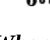

在声明数组引用时，你应该始终将数组括号紧跟在声明的类型之后，而不是标识符（变量名）之后。这样，任何阅读代码的人都可以轻松判断出，例如，`key` 是一个 `int` 数组对象的引用，而不是基本类型。

我们还可以声明多维数组，它们实际上是数组的数组。可以通过以下方式实现：

```java
String[][] occupantName;
String[] managerName[];
```

第一个示例是二维数组（数组的数组），第二个也是二维数组。注意在第二个示例中，变量名之前有一个方括号，之后也有一个。这对于编译器来说是完全合法的，再次证明了仅仅合法并不意味着它是正确的。

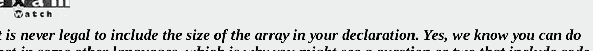

> 在声明中包含数组的大小是不合法的。是的，我们知道在其他某些语言中可以这样做，这就是为什么你可能会看到一两个包含类似下面代码的问题：

```java
int[5] scores;
```


前面的代码将无法编译。记住，在实际实例化数组对象之前，JVM 不会分配空间。这就是 `size` 变得的地方。

在第 6 章中，我们将花费大量时间讨论数组、如何初始化和使用它们以及如何处理多维数组……请期待！

## Final Variables

使用 `final` 关键字声明变量会导致该变量在用显式值初始化后无法重新赋值（注意我们说的是“显式”而不是“默认”）。对于基本类型，这意味着一旦变量被赋值了值，该值就无法更改。例如，如果你给 `int` 变量 `x` 赋值 10，那么 `x` 将一直保持为 10。对于基本类型来说这很直接，但拥有一个 `final` 对象引用变量意味着什么？标记为 `final` 的引用永远无法重新赋值指向不同的对象。换句话说，引用无法更改。它所引用的对象的状态是可以修改的。我们将详细介绍这一点。

Java 允许你将变量限制为少数几个预定义值之一——换句话说，就是来自枚举列表中的一个值。（令人惊讶的是，枚举列表中的项被称为枚举，即 enums。）

使用枚举可以帮助减少代码中的错误。例如，想象你正在创建一个商业咖啡馆应用程序，在你的咖啡馆应用程序中，你可能想将 `CoffeeSize`（咖啡尺寸）选择限制为 `BIG`（大号）、`HUGE`（特大）和 `OVERWHELMING`（超大号）。如果你允许 `LARGE` 或 `GRANDE` 订单溜入，可能会导致错误。枚举来救场了。通过下面的简单声明，你可以保证编译器将阻止你向 `CoffeeSize` 赋值除 `BIG`、`HUGE` 或 `OVERWHELMING` 以外的任何内容：

```java
enum CoffeeSize { BIG, HUGE, OVERWHELMING };
```

从那时起，获取 `CoffeeSize` 的唯一方法将是通过类似这样的语句：

```java
CoffeeSize cs = CoffeeSize.BIG;
```

枚举常量并不要求全大写，但借用 Oracle 代码规范（即常量使用大写字母命名），这是一个好主意。

枚举的基本组成部分是它的常量（即 `BIG`、`HUGE` 和 `OVERWHELMING`），尽管过一会儿你就会发现枚举还可以包含更多内容；枚举可以声明为自己独立的类，也可以声明为类的成员；但是，它们不能在方法内部声明！

这里有一个在类外部声明枚举的示例：

```java
enum CoffeeSize { BIG, HUGE, OVERWHELMING } // 这不能是 private 或 protected

class Coffee {
    CoffeeSize size;
}

public class CoffeeTest1 {
    public static void main(String[] args) {
        Coffee drink = new Coffee();
        drink.size = CoffeeSize.BIG; // 类外部的枚举
    }
}
```

上述代码可以作为单个文件的一部分（或者通常情况下，枚举类可以存在于自己的文件中，如 `CoffeeSize.java`）。但请记住，在这种情况下，文件必须命名为 `CoffeeTest1.java`，因为那是该 public 类的名称。要记住的关键点是，没有封装在类中的枚举可以仅使用 public 或默认（default）修饰符进行声明，就像非内部类一样。这里有一个在类内部声明枚举的示例：

```java
class Coffee2 {
    enum CoffeeSize { BIG, HUGE, OVERWHELMING }
    CoffeeSize size;

    public class CoffeeTest2 {
        public static void main(String[] args) {
            Coffee2 drink = new Coffee2();
            drink.size = Coffee2.CoffeeSize.BIG; // 封装类
            // 需要名称
        }
    }
}
```

从这些示例中获得的关键点是，枚举可以声明为自己的类，也可以封装在另一个类中，并且访问枚举成员的语法取决于枚举声明的位置。以下代码是不合法的：

```java
public class Coffee1 {
    static void main(String[] args) {
        enum CoffeeSize { BIG, HUGE, OVERWHELMING } // 错误！不能在方法中声明枚举
        Coffee drink = new Coffee();
        drink.size = CoffeeSize.BIG;
    }
}
```

为了让情况更加混乱，Java 语言设计者让在枚举声明末尾添加分号（当后面没有其他枚举声明时）是可选的：

```java
public class Coffee1 {
    enum CoffeeSize { BIG, HUGE, OVERWHELMING }; // <-- 这里的分号是可选的
    static void main(String[] args) {
        Coffee drink = new Coffee();
        drink.size = CoffeeSize.BIG;
    }
}
```

所以，当你创建一个枚举时创建了什么？最重要记忆的一点是，枚举不是 String 或 int！枚举中的每个值实际上都是 `CoffeeSize` 的实例。换句话说，`BIG` 的类型是 `CoffeeSize`。将枚举想象成某种类，它看起来像（但并不完全是）这样：

```java
class CoffeeSize {
    public static final CoffeeSize BIG = new CoffeeSize("BIG", 0);
    public static final CoffeeSize HUGE = new CoffeeSize("HUGE", 1);
    public static final CoffeeSize OVERWHELMING = new CoffeeSize("OVERWHELMING", 2);

    CoffeeSize(String enum, int index) {
        // 这里是内容
    }

    public static void main(String[] args) {
        System.out.println(CoffeeSize.BIG);
    }
}
```

注意这些枚举值 `BIG`、`HUGE` 和 `OVERWHELMING` 是 `CoffeeSize` 的实例。它们被表示为 static 和 final，这在 Java 世界中被认为是一个常量。还要注意枚举值知道其索引或位置——换句话说，声明枚举值的顺序是有重要的。你可以将 `CoffeeSize` 枚举想象为存在于 `CoffeeSize` 类型的数组中，正如你在稍后的章节中看到的，你可以通过调用 `values()` 方法来遍历枚举的值。（在本章中无必担心这一点）。

## 在枚举中声明构造函数、方法和变量

由于枚举确实是一种特殊的类，你可以所做的不仅仅是列出枚举值。你可以添加构造函数、实例变量、方法以及一种非常奇怪的被称为“常量体”（constant body）的东西。想象你想知道映射到三个 `CoffeeSize` 常量的每个实际盎司数（ounces）。考虑这种场景：例如，你想知道 `BIG` 是 8 盎司。考虑这种情况：你想知道 `BIG` 是 8 盎司，`HUGE` 是 10 盎司，而 `OVERWHELMING` 是 16 盎司。你可以使用某种数据结构来处理这些，但那样将难以维护，最好的方法是让 `OVERWHELMING` 常量覆盖方法。当你需要某个常量来覆盖方法时，使用它。想象大多数咖啡尺寸使用相同的盖子代码“B”，但 `OVERWHELMING` 使用“A”。你不想在 `getCode()` 方法中编写一些难以维护的 if/then 代码，所以最好的方法可能是让 `OVERWHELMING` 常量覆盖方法。

```java
enum CoffeeSize {
    BIG(8), HUGE(10),
    OVERWHELMING(16) { // 开始一个代码块来定义
        // 该常量的“体”
        public String getLidCode() { // 覆盖方法
            return "A";
        }
    }; // 分号是必须的

    // 后面是代码
    CoffeeSize(int ounces) {
        this.ounces = ounces;
    }

    private int ounces; // 实例变量

    public int getOunces() {
        return ounces;
    }
}

class Coffee {
    CoffeeSize size;

    public static void main(String[] args) {
        Coffee drink1 = new Coffee();
        drink1.size = CoffeeSize.BIG;

        Coffee drink2 = new Coffee();
        drink2.size = CoffeeSize.OVERWHELMING;

        System.out.println(drink1.size.getOunces()); // 输出 8

        for (CoffeeSize cs : CoffeeSize.values()) { // 按照声明顺序输出
            System.out.println(cs + " " + cs.getOunces());
        }
    }
}
```


产生输出：
```
BIG 8
HUGE 10
OVERWHELMING 16
```

关于枚举构造函数的关键点：
- 你永远不能直接调用枚举构造函数。枚举构造函数是自动调用的，带有定义的参数。例如，`BIG(8)` 调用了接受 `int` 的 `CoffeeSize` 构造函数。
- 你可以为构造函数定义多个参数，就像你可以重载类构造函数一样。我们在第 2 章中会详细讨论构造函数。为了用盎司数和盖子类型初始化 `Coffee`，你需要向构造函数传递两个参数，如 `BIG(8, "A")`，这意味着有一个接受一个 `int` 和一个 `String` 的构造函数。

最后，你可以在枚举中定义某种非常奇怪的东西，看起来像匿名内部类特定的体。当你需要某个常量来覆盖方法时使用它。

你需要理解与创建合法标识符相关的规则，以及与源代码声明相关的规则，包括包（`package`）和导入（`import`）语句的使用。

你学习了 `java` 和 `javac` 命令行程序的基本语法。

你学习了 `main()` 方法的作用以及它在什么时候不起作用。

我们涵盖了 `import` 和 `static` 语句的基础知识。人们往往认为这些语句不仅仅是为了节省打字量，但事实并非如此。

你对与类、方法和变量相关的访问控制有了良好的理解。你查看了修饰符（`public`、`protected` 和 `private`）如何定义类或成员的访问控制。

你学习了抽象类可以同时包含抽象方法和非抽象方法，但只要有一个方法被标记为 `abstract`，该类就必须被标记为 `abstract`。切记，抽象类的具体（非抽象）子类必须为父类的所有抽象方法提供实现，但抽象子类则不需要实现其父类中的抽象方法。抽象子类可以将这些实现责任“推卸”给第一个具体子类。

我们涵盖了接口的实现。请记住，接口可以扩展另一个接口（通过多个接口），并且实现接口的类必须实现该接口所有继承树中的所有方法。

你还查看了其他修饰符，包括 `static`、`final`、`abstract`、`synchronized` 等。你学习了某些修饰符在声明中永远不能结合使用，例如 `abstract` 不能与 `final` 或 `private` 结合。

请记住，Java 中没有 `final` 对象。一个 `final` 引用变量永远无法更改，但它所引用的对象可以被修改。你已经看到，应用于方法的 `final` 意味着子类不能重写它们，而当应用于类时，`final` 类不能被子类化。

方法可以使用变长参数（var-arg）声明（它可以接受多个已声明类型的参数），但每个方法只能有一个变长参数，且它必须是方法的最后一个参数。

确保你熟悉原始类型数字的相对大小。记住，虽然非局部变量的值可以改变，但引用变量的类型永远无法改变。

你还学习了数组是包含许多相同类型变量对象。数组也可以包含其他数组。

记住你学到的关于 `static` 变量和方法的知识，特别是 `static` 成员属于类而不是属于实例。不要忘记，`static` 方法不能直接访问类中的实例成员，因为它没有对该类任何实例的显式引用。

最后我们涵盖了枚举（enums）。枚举是实现常量的一种安全且灵活的方式。因为它们是枚举，所以可以声明得非常简单，也可以非常复杂——包括方法、变量、构造函数以及一种特殊的内部类类型，称为常量特定体（constant-specific body）等属性。

在开始进行测试练习之前，请花些时间完成以下命名良好的“两分钟冲刺（Two-Minute Drill）”。在你读完这本书之后，特别是在进行最后的临时突击时，回到这个特定的冲刺练习。因为——这里有一条你希望母亲在你去大学前给过你的建议——重要的不是你知道什么，而是你知道你不知道什么。

对于考试来说，在 Java 语言中知道自己不知道什么，与知道你知道什么同样重要。尝试一下示例题！它们的难度和结构与真实考试题非常相似，应该让你对考试的可能大开眼界。如果你错了很多题，不要担心。如果你发现某个主题是你薄弱的，请花更多时间进行复习和学习。许多……

## 两分钟冲刺

记住在本章中，当我们谈论类时，我们指的是非内部类，换句话说，顶级类。

## Java 特性与优势 (OCA 目标 1.5)

- 虽然 Java 为程序员提供了许多优势，但对于考试来说，你应该记住 Java 支持通用的面向对象编程、封装、自动内存管理、大型 API（库）、内置安全特性、多平台兼容性、强类型检查、多线程和分布式计算。

## 标识符 (OCA 目标 2.1)

- 标识符可以以字母、下划线或货币符号开头。
- 在第一个字符之后，标识符还可以包含数字。
- 标识符可以是任意长度的。

## 可执行的 Java 文件和 main() (OCA 目标 1.3)

- 你分别可以使用 `javac` 和 `java` 命令行程序来编译和执行 Java 程序。
- 启动程序的唯一方法是通过 `public static void main(String[] args)`。

## 导入语句 (OCA 目标 1.4)

- `import` 语句用于将其他类引入当前命名空间。
- 你可以使用星号 (`*`) 导入包中的所有类。
- `static` 导入允许你在不限定类名的情况下使用类的静态成员。

## 源文件规则 (OCA 目标 1.2)

- `public` 类必须与文件名匹配。
- 一个源文件只能包含一个 `public` 类。
- 一个源文件可以包含多个非公共类。

## 类修饰符 (OCA 目标 6.4)

- `final` 类不能被子类化。
- `abstract` 类不能实例化。
- 抽象类可以包含抽象方法和非抽象方法。

## 接口实现 (OCA 目标 7.5)

- 实现接口的类必须实现该接口继承树中的所有方法。
- 接口的抽象子类不需要实现其父类中的抽象方法。
- 抽象子类可以将这些实现责任“推卸”给第一个具体子类。

`this` 始终指向当前执行的对象。

`this.aMethod` 等同于直接调用 `aMethod()`。

私有成员只能由同一类中的代码访问。

私有成员对子类不可见，因此私有成员不能被继承。

默认（default）和受保护（protected）成员的区别仅在涉及子类时：

- 默认成员只能被同一包中的类访问。
- 受保护成员可以被同一包中的其他类访问，无论在哪个包，还可以被子类访问。
- 受保护 = 包 + 子类（kids 指子类）。
- 对于包外的子类，受保护成员只能通过继承来访问；包外的子类不能通过使用指向父类实例的引用来访问受保护的成员。（换句话说，继承是包外子类访问其父类受保护成员的唯一机制。）
- 子类从另一个包继承的受保护成员对子类包中的任何其他类都是可见的，该子类自身的子类除外。

## 局部变量 (OCA 目标 2.1 和 6.4)

- 局部（方法、自动或栈）变量的声明不能有访问修饰符。
- `final` 是局部变量唯一可用的修饰符。
- 局部变量没有默认值，因此它们在使用之前必须进行初始化。

# 其他修饰符——成员 (OCA 目标 7.1 和 7.5)

- `final` 方法不能在子类中被重写。
- 抽象（abstract）方法通过签名、返回类型和可选的 `throws` 子句声明，但它们没有实现。
- 抽象方法以分号结束——没有大括号。
- 识别非抽象方法的三种方法：
  - 方法没有被标记为 `abstract`。
  - 方法有大括号。
  - 方法在大括号之间*可能*有代码。

扩展抽象类的第一个非抽象（具体）类必须实现该抽象类的所有方法。

`synchronized` 修饰符仅作用于方法和代码块。

`synchronized` 方法不能是抽象的；抽象方法必须由子类实现，因此它们必须是可继承的。出于这个原因：

- 抽象方法不能是 `private`。
- 抽象方法不能是 `final`。
- `native` 修饰符仅作用于方法。
- `strictfp` 修饰符仅作用于类和方法。

# 带变长参数的方法：OCA 目标 1.2

- 方法可以声明一个接受零个到多个参数的参数，这种被称为变长（vararg）方法。
- 变长参数使用语法 `type... name;` ，例如：`doStuff(int... x) { }`。
- 变长方法只能有一个变长参数。
- 在带有普通参数和变长参数的方法中，变长参数必须最后。

# 构造函数 (OCA 目标 1.2 和 6.3)

- 构造函数必须与类名相同。
- 构造函数可以有参数，但它们没有返回类型。
- 构造函数可以使用任何访问修饰符（即使是 `private`！）。

## 变量声明 (OCA 目标 2.1)

- 实例变量可以：
  - 具有任何访问控制
  - 被标记为 `final` 或 `transient`
- 实例变量不能是 `abstract`、`synchronized`、`native` 或 `strictfp`。
- 声明一个与实例变量同名的局部变量是合法的；这被称为“影蔽”（shadowing）。
- `final` 变量具有以下属性：
  - `final` 变量一旦赋值就无法重新赋值。
  - `final` 引用变量一旦对象被赋值给 `final` 变量，就不能指向不同的对象。
  - `final` 变量必须在构造函数完成之前初始化。
- 不存在所谓的 `final` 对象。标记为 `final` 的对象引用**并不**意味着对象本身不能改变。
- `transient` 修饰符仅作用于实例变量。
- `volatile` 修饰符仅作用于实例变量。

## 数组声明 (OCA 目标 4.1 和 4.2)

- 数组可以持有原始数据类型或对象，但数组本身始终是一个对象。
- 当你声明数组时，方括号可以位于变量名的左侧也可以在右侧。
- 在声明中包含数组的大小是合法的。
- 对象数组可以持有任何对象——`instanceof` 测试数组的类型。例如，如果 `Horse extends Animal`，那么 `Horse` 对象可以进入 `Animal` 数组。

## 静态变量和方法 (OCA 目标 6.2)

- 它们与类的特定实例**无关**（注：原文“绑定”有误，static 成员属于类不属于实例）。
- 使用类或接口的静态成员不需要实例。
- 静态变量/类只有一个副本，且所有实例共享它。
- 静态方法没有访问实例成员的权限。

# 枚举 (OCA 目标 1.2)

- `enum` 代表一个类型的常量列表。
- `enum` 不是 `String` 或 `int`；`enum` 的类型是 `enum`。
- 枚举可以在类外部或内部声明，但不能在方法内部声明。
- 声明的 `enum` 不能是 `static`、`final`、`abstract` 或 `private`（注：顶级枚举不能是 private/protected/static，内部枚举可以是 static/private 等，此处指顶级声明限制）。
- 枚举可以包含构造函数、方法、变量和常量体。
- 枚举常量可以传递给枚举构造函数。
- 枚举构造函数可以有参数并可以重载。
- 枚举构造函数**不能**直接在代码中调用。它们在枚举初始化时被自动调用。
- 枚举末尾的分号是可选的。这些是合法的：

```java
enum Foo { ONE, TWO, THREE };
```

- `Enum.values()` 返回一个数组。

## 自测

以下问题将帮助你衡量对本章内容的理解。仔细阅读所有选项，因为可能有多个正确答案。专注于学习。对自己说：“我足够理解枚举”，“好吧，别人比我聪明，但我可以学习。”

1. 哪些是正确的？（选择所有）
   A. "X extends Y" 在 `X` 是类且 `Y` 是接口时正确。
   B. "X extends Y" 在 `X` 是接口且 `Y` 是类时正确。
   C. "X extends Y" 在 `X` 和 `Y` 都是类时正确。
   D. "X extends Y" 对于 `X` 和 `Y` 是类或接口的所有组合都正确。

2. 已知：
```java
class Rocket {
    private void blastOff() { System.out.print("bang "); }
}

class Shuttle extends Rocket {
    public static void main(String[] args) {
        new Shuttle().go();
    }

    void go() {
        blastOff();
        // Rocket.blastOff(); // 行 A
        private void blastOff() { System.out.print("sh-bang "); } // 语法错误：方法内不能定义方法
    }
}
```
等待，上面的代码有一个语法错误（方法内部的方法）。修正测试逻辑：
哪些是正确的？（选择所有）
   A. 按代码所示，输出是 `bang `。
   B. 按代码所示，输出是 `sh-bang `。
   C. 按代码所示，编译失败。
   D. 如果取消 A 行注释，输出是 `bang `。
   E. 如果取消 A 行注释，输出是 `sh-bang `。
   F. 如果取消 A 行注释，编译失败。

3. 假设 `for` 循环的语法是正确的，且：
```java
import java.lang.System.*;

class Test {
    static public void main(String[] args) {
        String s = "";
        for(int x=0; x < args.length; x++) // for 循环
            s += args[x];
        println(s);
    }
}
```
命令行：
```bash
java Test args
```
结果是什么？
   A. -args
   B. args.
   C. -args.
   D. args.
   E. -args
   F. 编译失败
   G. 运行时抛异常

4. 已知：
```java
enum Animals {
    DOG("woof"), CAT("meow"), FISH("burble");
    String sound;
    Animals(String s) { sound = s; }
}

class TestEnum {
    static Animals a;
    public static void main(String[] args) {
        System.out.println(a.DOG.sound + " " + a.FISH.sound);
    }
}
```
结果是什么？
   A. woof burble
   B. 多个编译错误
   C. 第 2 行错误导致编译失败
   D. 第 3 行错误导致编译失败
   E. 第 4 行错误导致编译失败
   F. 第 9 行错误导致编译失败

5. 给两个文件：
文件 1：
```java
package pkgA;

public class Foo {
    int a = 5;
    protected int b = 6;
    public int c = 7;
}
```
文件 2：
```java
package pkgB;

import pkgA.*;

public class Baz {
    public static void main(String[] args) {
        Foo f = new Foo();
        System.out.print(" " + f.a);
        System.out.print(" " + f.b);
        System.out.println(" " + f.c);
    }
}
```
结果是什么？（选择所有）
   A. 5 6 7
   B. 5 后面跟着一个异常
   C. 第 7 行编译失败错误
   D. 第 8 行编译失败错误
   E. 第 9 行编译失败错误
   F. 第 10 行编译失败错误

6. 给定代码：
```java
1. public class Electronic implements Device { public void doIT() { } }
2.
3. abstract class Phone extends Electronic { }
4.
5. abstract class Phone2 extends Electronic { public void doIT(int x) { } }
6.
7. class Phone3 extends Electronic implements Device { public void doStuff() { } }
8.
9. interface Device { public void doIT(); }
```
结果是什么？（多选题）
   A. 编译成功
   B. 第 1 行编译失败错误
   C. 第 3 行编译失败错误
   D. 第 5 行编译失败错误
   E. 第 7 行编译失败错误
   F. 第 9 行编译失败错误

7. 给定代码：
```java
4. class Announce {
5. public static void main(String[] args) {
6. for (int __x = 0; __x < 3; __x++) {
7. int _lb = 7;
8. long [] x = {5};
9. Boolean [] ba[];
10. }
11. }
```


# 结果是什么？多选题

- A. 编译成功
- B. 第 6 行编译失败错误
- C. 第 7 行编译失败错误
- D. 第 8 行编译失败错误
- E. 第 9 行编译失败错误

# 8. 给定代码：

```java
3. public class TestDays {
4.     public enum Days { MON, TUE, WED };
5.     public static void main(String[] args) {
6.         for(Days d : Days.values())
7.             ;
8.         Days[] d2 = Days.values();
9.         System.out.println(d2[2]);
10.     }
11. }
```

结果是什么？多选题

- A. TUE
- B. WED
- C. 输出不可预测的
- D. 第 4 行错误导致编译失败
- E. 第 6 行错误导致编译失败
- F. 第 8 行错误导致编译失败
- G. 第 9 行错误导致编译失败

# 9. 给定代码：

```java
4. public class Frodo extends Hobbit {
5.     public static void main(String[] args) {
6.         int myGold = 7;
7.         System.out.println(countGold(myGold, 6));
8.     }
9. }
10. class Hobbit {
11.     int countGold(int x, int y) { return x + y; }
12. }
```

结果是什么？

- A. 13
- B. 多处错误导致编译失败
- C. 第 6 行错误导致编译失败
- D. 第 7 行错误导致编译失败
- E. 第 11 行错误导致编译失败

# 10. 给定代码：

```java
interface Gadget {
    void doStuff();
}

abstract class Electronic {
    void getPower() { System.out.print("plug in "); }
}

public class Tablet extends Electronic implements Gadget {
    void doStuff() { System.out.print("show book "); }

    public static void main(String[] args) {
        new Tablet().getPower();
        new Tablet().doStuff();
    }
}
```

哪些是正确的？多选题

- A. `Tablet` 类将无法编译
- B. `Gadget` 接口将无法编译
- C. 输出为 plug in show book
- D. 抽象类 `Electronic` 将编译
- E. `Tablet` 类不能同时扩展和实现

# 11. 给定 `// insert code here` 在 `java.lang` 包中，且给定：

```java
1. // insert code here
2. class StatTest {
3.     public static void main(String[] args) {
4.         System.out.println(Integer.MAX_VALUE);
5.     }
6. }
```

独立插入哪些行可以编译？（多选题）

- A. `import static java.lang;`
- B. `import static java.lang.Integer;`
- C. `import static java.lang.*;`
- D. `static import java.lang.*;`
- E. `import static java.lang.MAX_VALUE;`
- F. 以上均无效

# 12. 给定代码：

```java
interface MyInterface {
    // insert code here
}
```

独立插入 `insert here` 的哪些行可以编译？（多选题）

- A. `public static m1() {};`
- B. `default void m2() {};`
- C. `abstract m3();`
- D. `final short m4() {return 5;}`
- E. `default long m5();`
- F. `static void m6() {};`

# 13. 哪些是正确的？（多选题）

- A. Java 是动态类型语言
- B. Java 通过指针提供细粒度控制
- C. Java 提供封装
- D. Java 提供了从一台机器发送对象的能力
- E. Java 是 ECMA 标准的实现
- F. JVM 使用字节码提供了 Java 的主要安全机制

## 答案

1. C 正确。A 是错误的，因为类实现了接口。B 是错误的，因为接口不使用“继承”其他接口。D 根据前面的规则是错误的。（OCA 目标 7.5）
2. B 和 F 正确。由于 `Rocket.blastOff()` 是私有的，它不能被重写且对 `Shuttle` 类不可见。A、C、D 是错误的。（OCA 目标 6.4）
3. B 正确。此题使用了有效但不恰当的标识符、静态导入、`main()` 和自增逻辑。（注意：编译时可能会得到警告）。A、C、D、E 是错误的。（OCA 目标 1.2）
4. A 正确；枚举可以有构造函数和变量。B、D 和 F 是错误的。（OCA 目标 1.2）
5. D 和 E 正确。变量 `a` 是默认权限，因此无法从包外访问。变量 `b` 是受保护权限。A、B 和 F 是错误的。（OCA 目标 1.4 和 6.5）
6. A 正确；这些都是合法声明。B、D 和 F 是错误的。（OCA 目标 7.5）
7. C 和 D 正确。变量名不能以 `#` 开头，且数组声明不能包含大小。其余代码是有效的。A、B 和 E 是错误的。（OCA 目标 2.1）
8. B 正确。每个枚举都有静态 `values()` 方法，返回按枚举中声明顺序排列的值数组。A、C、D、E 和 F 是错误的。（OCA 目标 1.2）
9. D、C 和 E 正确。`countGold()` 方法无法在静态方法中调用。A、B 和 E 是错误的。（OCA 目标 6.2）
10. A 正确。默认情况下，接口的方法是 `public`，所以 `Tablet.doStuff` 也必须是 `public`。其余代码是有效的。B、C、D 和 E 是错误的。（OCA 目标 7.5）
11. C 和 E 是静态导入的正确语法。第 4 行没有使用静态导入，因此代码在没有任何导入的情况下也可以编译。A、B、D 和 F 是错误的。（OCA 目标 1.4）
12. B、C 和 F 正确。从 Java 8 开始，接口可以拥有默认静态方法。A、D 和 E 是错误的。A 没有返回类型；D 不能有方法体；而 E 需要方法体。（OCA 目标 7.5）
13. C 和 D 正确。A 是错误的，因为 Java 是静态类型语言。B 是错误的，因为它不提供指针。E 是错误的，因为 JavaScript 是 ECMA 标准的实现而非 Java。F 是错误的，因为 JVM 对字节码的使用提供了 Java 的主要安全机制。

# 2 面向对象

## 目标

- 描述封装
- 实现继承
- 使用 IS-A 和 HAS-A 关系 (OOP)
- 使用多态
- 使用重写和重载
- 理解强制转换
- 使用接口
- 理解并使用返回类型
- 开发构造函数
- 使用静态成员
- 两分钟训练

### 问答自测

成为 Oracle Certified Associate (OCA) 8 意味着你必须与 Java 的面向对象方面融为一体。你必须梦见继承层次结构；多态的力量必须流淌在你；封装必须成为你的本能。（耦合、内聚、组合和设计模式将成为你作为 Oracle Professional [OCP] 8 时的赖以生存的技能。）

因为它的实例变量被（其他程序员在他们的代码中）设置了你未预料的值。他们的代码导致了你代码中的错误。（放松，这只是一个假设性的情况）。嗯，这是一个 Java 程序，所以你应该能够发布该类的新版本，让他们可以在不改变自己任何代码的情况下替换掉你的代码。

这种场景凸显了面向对象 (OO) 语言的两个承诺/优势：灵活性和可维护性。但这些优势并不是自动获得的。你必须做些什么。那么，如果 Java 支持 OO 会又怎样呢？它不能为你设计代码。例如，想象一下你创建类时使用了公有实例变量，而那些其他程序员直接设置了这些实例变量，正如代码所示：

```java
public class BadOO {
    public int size;
    public int weight;
    // ...
}

public class ExploitBadOO {
    public static void main(String[] args) {
        BadOO b = new BadOO();
        b.size = -5; // 合法但很糟糕！
    }
}
```

现在你遇到麻烦了。你该如何修改类，以便能够处理当有人将 `size` 变量更改为导致问题的值时出现的问题？你唯一的选择是回去并编写方法代码来调整 `size`（例如一个 `setState(int a)` 方法），然后用例如 `private` 访问修饰符来封装 `size` 变量。但你一旦对代码做了这种更改，你就破坏了其他人的代码！

在不破坏使用你代码的人员代码的情况下对实现代码进行更改的能力，是封装的核心优势之一。你希望将实现细节隐藏在公有编程接口之后。我们所说的接口是指你的代码提供的供其他代码调用的方法集合——换句话说，就是你代码的 API。通过隐藏实现细节，你可以重构你的方法代码（可能还改变类使用变量的方式），而无需强制调用你方法的代码发生变化。

如果你想要可维护性、灵活性和扩展性（当然，你是这样要求的），你的设计必须包含封装。你该如何做呢？

- 保持实例变量隐藏（使用访问修饰符，通常是 `private`）。
- 创建公有的访问器方法，并强制调用代码使用这些方法而不是直接访问实例变量。这些所谓的访问器方法允许类的用户设置变量的值或获取变量的值。
- 对于这些访问器方法，使用最常用的命名约定 `set<SomeProperty>` 和 `get<SomeProperty>`。

图 2-1 说明了这样一个想法：封装强制我们代码的调用者通过方法而不是直接访问变量。

| Class A | Class B |
| :--- | :--- |
| `public` | `private` |

Class A 无法通过 getter 和 setter 方法访问 Class B 的实例变量数据。数据被标记为私有；只有访问方法是公有的。

**图 2-1** 封装的本质

我们把这些访问方法称为 getters 和 setters，尽管有些人更喜欢更高级的术语 accessors 和 mutators。（个人而言，我们不喜欢 "mutate" 这个词）。无论你如何称它们，它们都是其他程序员为了访问你的实例变量必须通过的方法。它们看起来很简单，你可能已经用了它们很久了：

```java
public class Box {
    // 隐藏实例变量；只有 Box 的实例才能访问它
    private int size;

    // 提供公有的 getters 和 setters
    public int getSize() {
        return size;
    }

    public void setSize(int newSize) {
        size = newSize;
    }
}
```

等一下。之前的代码有多用呢？它甚至没有进行任何验证或处理。拥有不添加功能的 getters 和 setters 有什么好处？要点在于，你以后可能会改变主意，在方法中添加更多代码，而不破坏你的 API。即使你今天认为自己并不真的需要对数据进行验证或处理，良好的 OO 设计要求你为未来做打算。为了安全起见，强制调用代码通过你的方法而不是直接访问实例变量。现在你可以自由地以后重构你的方法实现，而不用担心那几个知道你住址的程序员的愤怒。

> **注意**：在第 6 章中，我们将重新回顾封装适用于也是引用变量的实例变量的话。这比你想象的要复杂，请期待！（另外，我们会等到到第 6 章再用封装为主题的模拟题挑战你。）

注意那些表面上是在询问方法行为的代码，而问题实际上是缺乏封装。看下面的例子，看看你是否能看出发生了什么：

```java
class Foo {
    public int left = 9;
    public int right;
}
```

## 继承与多态

- 7.1 描述继承及其优势。
- 7.2 开发演示继承用的代码

当你学习下表时，你会注意到从 Java 8 开始，接口可以包含两种类型的具体方法：静态（`static`）和默认（`default`）。我们将在本章稍后讨论这些重要的新增。表 2-1 总结了类和接口相对于继承而言的元素。

### 表 2-1 类和接口的可继承元素

| 元素类型 | 类 | 接口 |
| :--- | :--- | :--- |
| 实例变量 | 是 | 不适用 |
| 静态变量 | 是 | 仅限常量 |
| 抽象方法 | 是 | 是 |
| 实例方法 | 是 | Java 8, 默认方法 |
| 静态方法 | 是 | Java 8, 不可继承，但可以访问 |
| 构造函数 | 否 | 不适用 |
| 初始化块 | 否 | 不适用 |

对于考试，你需要知道在 Java 中可以通过扩展类或实现接口来创建继承关系。理解使用继承的两个常见原因也很重要：

- 为了促进代码复用
- 为了使用多态

让我们从复用开始。一种常见的设计方法是创建一个相当通用的类版本，意图是创建更多继承自它的专门化子类。例如：

```java
class GameShape {
    public void displayShape() {
        System.out.println("displaying shape");
    } // more code
}

class PlayerPiece extends GameShape {
    public void movePiece() {
        System.out.println("moving game piece");
    } // more code
}

public class TestShapes {
    public static void main(String[] args) {
        PlayerPiece shape = new PlayerPiece();
        shape.displayShape();
        shape.movePiece();
    }
}
```

输出：
```
displaying shape
moving game piece
```

注意，`PlayerPiece` 类从专门程度较低的类 `GameShape` 继承了通用的 `displayShape()` 方法，并添加了自己的方法 `movePiece()`。通过继承实现复用意味着，具有通用功能的方法（例如 `displayShape()`，它可以适用于游戏中的许多不同类型的形状）不需要重新实现。这意味着 `GameShape` 的所有专门化子类都保证具有更通用的父类的能力。你不会希望在在线引擎的任何专门化组件中重写 `displayShape()` 代码。

多态（“许多形式”）的美妙之处在于，你可以将任何子类视为 `GameShape`。换句话说，你可以在 `GameLauncher` 类中编写代码说：“我不在乎你从（继承并扩展）`GameShape` 是什么类型的对象。对我来说，只要你扩展了 `GameShape`，那么你就一定有一个 `displayShape()` 方法，所以我知道我可以调用它。”

假设我们有两个继承更通用的 `GameShape` 类的专门化子类：`PlayerPiece` 和 `TilePiece`：

```java
class GameShape {
    public void displayShape() {
        System.out.println("displaying shape");
        // more code
    }
}

class PlayerPiece extends GameShape {
    public void movePiece() {
        System.out.println("moving game piece");
    }
    // more code
}

class TilePiece extends GameShape {
    public void getAdjacent() {
        System.out.println("getting adjacent tiles");
    }
    // more code
}
```


现在假设一个测试类有一个方法，其声明参数类型为 `GameShape`，这意味着它可以接收任何类型的 `GameShape`。换句话说，任何 `GameShape` 的子类都可以传递给参数类型为 `GameShape` 的方法。这段代码：

```java
public class TestShapes {

  public static void main (String[] args) {

    PlayerPiece player = new PlayerPiece();

    TilePiece tile = new TilePiece();

    doShapes(player);

    doShapes(tile);

  }

  public static void doShapes(GameShape shape) {

    shape.displayShape();

  }

}
```

输出：

```
displaying shape
displaying shape
```

关键点是 `doShapes()` 声明了一个 `GameShape` 参数，但可以传递任何 `GameShape` 的子类型（在本例中为子类）。方法可以调用任何 `GameShape` 的方法，而无需担心传入对象的实际运行时类型。影响在于，`doShapes()` 方法只知道对象是 `GameShape` 类型，因为它是这样声明的。并且使用声明为 `GameShape` 类型的引用——无论该变量是方法参数、局部变量还是实例变量——意味着只能在其上调用 `GameShape` 的方法。你可以调用的方法取决于变量的声明类型，无论引用所指向的实际对象是什么。这意味着，如果传递的对象是 `TilePiece` 类型，你无法使用 `GameShape` 变量来调用 `getAdjacent()` 方法。（我们在查看接口时再次遇到这一点。）

## IS-A 和 HAS-A 关系

注意：从 2017 年冬季开始，OCA 8 考试不再直接询问 IS-A 和 HAS-A 关系。但理解 IS-A 和 HAS-A 关系将帮助 OCA 8 考生应对考试中的许多问题。

## IS-A

在面向对象中，IS-A 概念基于继承（或接口实现）。IS-A 是表达“某物是某物的一种类型”的方式。例如，野马（Mustang）是马的一种，所以在面向对象的术语中，我们可以说：“Mustang IS-A Horse”。

## HAS-A

HAS-A 关系基于使用，而不是继承。换句话说，类 A HAS-A 类 B，意味着类 A 的代码中拥有一个指向类 B 实例的引用。例如，你可以说：“Horse HAS-A Halter”。HAS-A 关系的代码如下所示：

```java
public class Horse {
    private Halter myHalter = new Halter();
}
```

将与马轭圈（Halter）相关的代码直接引入到 `Horse` 类中，你最终会在 `Cow` 类中重复代码，以及任何其他可能需要马轭圈行为的类。通过将 `Halter` 代码保持在一个独立的、专门的 `Halter` 类中，你就有机会在多个应用程序中重用 `Halter` 类。

`Horse` 类的使用者（即对 `Horse` 实例调用方法的代码）认为 `Horse` 类具有马轭圈行为。`Horse` 类可能有一个 `tie(Lead rope)` 方法。`Horse` 类的用户永远不需要知道，当他们调用 `tie()` 方法时，`Horse` 对象会旋转并通过调用 `myHalter.tie(rope)` 将调用委托给它的 `Halter` 类。上述描述的场景可能如下：

```java
public class Horse extends Animal {

    private Halter myHalter = new Halter();

    public void tie(Lead rope) {

        myHalter.tie(rope); // 将 tie 行为委托给
        // Halter 对象

    }

}

public class Halter {

    public void tie(Leadrope arope) {

        // 在此处执行实际的绑定工作

    }

}
```

在面向对象（OO）中，我们不希望调用者担心究竟是哪个类或对象在执行实际工作。为了实现这一点，`Horse` 类向 `Horse` 用户隐藏了实现细节。`Horse` 用户要求 `Horse` 对象执行任务（在这种情况下是把自己系好），`Horse` 将执行它或者像本示例所示，让其他东西（可能是继承自 `Animal` 类的方法）去执行。对于调用者来说，看起来一直是 `Horse` 对象在处理自己。`Horse` 的用户甚至不需要知道存在 `Halter` 类类。

## 面向对象设计

在面向对象设计中，IS-A 和 HAS-A 关系以及封装只是冰山一角。许多书籍和毕业论文都致力于这个主题。强调正确设计的原因非常简单：钱。据估计，设计糟糕的程序，交付软件应用程序的成本可能要高出十倍。

即使是最好的面向对象设计者（通常被称为“架构师”）也会犯错。要可视化成百甚至数千个类之间的关系是非常困难的。当在项目实现阶段（编写代码阶段）发现错误时，必须重写的代码量有时意味着编程团队必须从头开始。

软件行业为设计者提供了帮助。视觉化对象建模语言，如统一建模语言（UML），允许设计者在不先编写代码的情况下设计并轻松修改类，因为面向对象的组件是以图形化方式表示的。这允许设计者创建一张类关系映射图，并帮助他们在编码开始之前识别错误。

面向对象设计的另一个创新是设计模式。设计者注意到，许多面向对象设计在项目之间是一致地应用的，而且应用相同的设计是有用的，因为它减少了引入新设计错误的可能性。随后，面向对象设计者开始在互联网和书籍形式上分享这些设计。虽然通过 Java 认证考试并不要求你彻底理解面向对象设计，但这些背景信息将帮助你更好地理解为什么出题者选择在考试中包含封装以及 IS-A 和 HAS-A 关系。

> —Jonathan Meeks，Sun 认证 Java 程序员

## 认证目标

## 多态 (OCA 目标 7.2)

7.2 开发演示多态使用的类；包括重写以及对象类型与引用类型的区别。

记住，任何可以通过多个 IS-A 测试的 Java 对象都可以被认为是多态的。除了 `Object` 类型的对象外，所有 Java 对象都是多态的，因为它们都通过了自身类型和 `Object` 类的 IS-A 测试。
记住，访问对象的唯一方法是通过引用变量。关于引用，有几点是你应该了解的：

- 引用变量只能有一种类型，一旦声明，该类型就永远无法改变（尽管它引用的对象可以改变）。
- 引用是一个变量，因此它可以被重新赋值给其他对象（除非该引用是常量）。
- 引用的类型决定了可以在该引用上调用哪些方法。
- 引用可以是类类型或接口类型。如果是接口类型，它可以引用该接口的任何实现类的对象。

多态方法调用仅适用于实例方法。你可以使用更通用的引用类型（如父类或接口）来引用一个对象，但在运行时，**唯一**根据实际对象（而不是引用类型）动态选择的内容是实例方法。静态方法（`static methods`）不是。变量也不不是。只有被重写的实例方法会根据真实对象的类型动态调用。

由于这个定义依赖于对重写（overriding）以及静态方法与实例方法之间区别的清晰理解，我们将在章节后面的部分介绍这些内容。

## 认证目标

### 重写/重载 (OCA 目标 6.1 和 7.2)

- 6.1 创建带有参数和返回值的方法；包括重载方法。
- 7.2 开发演示多态性用的代码；包括重写以及对象类型与引用类型（原文）。

考试将在许多题目中使用重写和重载方法。这两个概念经常被混淆（也许因为它们的名称相似？），但每个概念都有其自身独特且复杂的规则集。搞清楚哪种“over”使用的是哪种规则至关重要！

## 重写方法 (Overridden Methods)

每当一个类型从父类型继承一个方法时，你就有机会重写该方法（除非如你之前学过的，该方法被标记为 `final`）。重写的关键优势在于能够定义特定于子类的行为。下面的示例演示了 `Animal` 的子类重写了 `Animal` 版本的 `eat()` 方法：

```java
public class Animal {

    public void eat() {

        System.out.println("Generic Animal Eating Generically");

    }

}

class Horse extends Animal {

    public void eat() {

        System.out.println("Horse eating hay, oats, " 
                + "and horse treats");

    }

}
```

对于从父类型继承的抽象方法，你没有选择：必须由第一个子类实现该方法，但这等于说具体子类重写了父类型（类）的抽象方法。因此，你可以将抽象方法视为你最终被迫重写的方法。

`Animal` 类的创建者可能决定，为了多态，所有的 `Animal` 子类都应该以独特的方式定义 `eat()` 方法。在多态情况下，当一个 `Animal` 引用指向不是 `Animal` 实例，而是 `Animal` 子类实例时，调用者应该能够在 `Animal` 引用上调用 `eat()`，但实际的运行时对象（例如 `Horse` 实例）将运行自己特定的 `eat()` 方法。标记 `eat()` 方法是 `Animal` 程序员告诉所有子类开发者：“你们的新子类型使用通用的 `eat()` 没有任何意义，所以你们必须提供自己的 `eat()` 方法实现！”使用多态的一个（非抽象）示例如下：

```java
public class TestAnimals {

    public static void main(String [] args) {

        Animal a = new Animal();

        Animal b = new Horse(); // Animal 引用，但是一个 Horse 对象

        a.eat(); // 运行 Animal 版本的 eat ()

        b.eat(); // 运行 Horse 版本的 eat ()

    }

}

class Animal {

    public void eat() {

        System.out.println("Generic Animal Eating Generically");

    }

}

class Horse extends Animal {

    public void eat() {

        System.out.println("Horse eating hay, oats," 
                + "and horse treats");

    }

    public void buck() { }

}
```

在前面的代码中，测试类使用 `Animal` 引用调用 `Horse` 对象上的方法。记住，当使用 `Animal` 的引用时，编译器只允许调用 `Animal` 类中的方法。在上述代码中，以下操作是不合法的：

```java
Animal c = new Horse();
c.buck(); // 无法调用 buck();
```

重申，编译器只看引用类型，而不是实例类型。多态允许你使用更抽象的父类型（包括接口）来引用它的一个子类型（包括实现类）。重写方法的修饰符不能比被重写的方法更严格（例如，你不能重写一个标记为 `public` 的方法并将其改为 `protected`）。思考一下：如果 `Animal` 类发布了一个 `public` 的 `eat()` 方法，并且有人有一个 `Animal` 引用（换句话说，声明类型为 Animal 的引用），他们假设无论该引用指向实际实例是什么，在该引用上调用 `eat()` 都是安全的。如果允许子类型溜进来并更改重写方法的访问修饰符，那么当 JVM 调用对象的（`Horse`）版本而不是引用类型（`Animal`）版本时——程序就会崩溃。

让我们修改一下在本节中看到的多态示例：

```java
public class TestAnimals {

    public static void main(String [] args) {

        Animal a = new Animal();

        Animal b = new Horse(); // Animal 引用，但是一个 Horse 对象

        a.eat(); // 运行 Animal 版本的 eat ()

        b.eat(); // 运行 Horse 版本的 eat ()

    }

}

class Animal {

    public void eat() {

        System.out.println("Generic Animal Eating Generically");

    }

}

class Horse extends Animal {

    private void eat() { // 喔！——它是私有的！

        System.out.println("Horse eating hay, oats, " + " treats");

    }

}
```

如果这段代码通过编译（实际上并没有通过），以下内容将在运行时失败：

```java
Animal b = new Horse(); // Animal 引用，但是一个 Horse 对象
b.eat(); // 崩溃
```

变量 `b` 是 `Animal` 类型，它有一个 `public` 的 `eat()` 方法。但记住，在运行时，Java 使用虚方法调用根据实际实例动态选择将运行的实际版本。`Animal` 引用始终指向 `Horse`，因为 `Horse` 是 `Animal`。无论 `Horse` 实例是重写了 `Animal` 继承的方法还是仅仅继承了它们，任何拥有 `Horse` 实例的 `Animal` 引用的人都可以调用所有可见的 `Animal` 方法。因此，重写方法必须履行父类的约定。

注意：在第 5 章中，我们将探讨重写规则，你会喜欢这个实用的列表。重写的规则如下：

- 参数列表必须与被重写的方法完全匹配。
- 返回类型必须与被重写方法的返回类型相同，或者是其子类型。（有关协变返回的更多将在几页后讨论。）
- 访问级别不能比被重写方法更严格。
- 访问级别可以比被重写方法更宽松。
- 实例方法只要被子类型继承，就可以被重写。与实例类型在同一包内的子类型可以重写非 `private` 或 `final` 的方法。不同包的子类型只能重写标记为 `public` 或 `protected` 的方法（因为 `protected` 方法被子类型继承）。
- 重写方法可以抛出任何未检查异常（运行时异常），无论被重写方法声明了什么。（见第 5 章。）
- 重写方法不能抛出比被重写方法新或更广泛的检查异常。例如，声明 `FileNotFoundException` 的方法不能被声明 `SQLException`、`Exception` 或任何其他子类异常的方法重写。
- 重写方法可以抛出更少的异常。仅仅“承担风险”并不意味着重写异常承担相同的风险。结论是：重写方法不需要声明它永远不会抛出的任何异常，无论被重写方法声明了什么。
- 不能重写标记为 `final` 的方法。
- 不能重写标记为 `static` 的方法。我们在几页后详细讨论静态方法时会看一个示例。
- 如果方法无法被继承，你就无法重写它。记住，重写意味着你正在重新实现一个方法。例如，以下代码是不合法的，即使你在 `Horse` 中添加了 `eat()`，它也不会是 `Animal` 的 `eat()` 方法的重写：

```java
public class TestAnimals {

    public static void main(String [] args) {

        Horse h = new Horse();

        h.eat(); // 不合法，因为 Horse 没有继承 eat

    }

}

class Animal {

    private void eat() {

        System.out.println("Generic Animal Eating Generically");

    }

}
```

## 调用重写方法的父类型版本

通常，你想利用父类型版本方法中的某些代码，但仍重写它以提供一些额外的特定行为。这就像是说：“运行父类型的方法，然后返回这里完成我的子类额外方法。”（注意，并不要求父类型版本在子类代码之前运行。）在代码中使用 `super` 关键字可以轻松地做到：

```java
public class Animal {

    public void eat() {}

    public void printYour() {

        // 此处编写有打印代码

    }

}

class Horse extends Animal {

    public void printYour() {

        // 利用 Animal 的代码，然后添加更多内容

        super.printYour(); // 调用父类
        // (Animal) 代码

        // 然后执行 Horse 特有的操作
        // 在处执行打印工作

    }

}
```


类似地，你可以使用以下语法访问接口重写的方法：

`InterfaceX.super.doStuff();`

注意：使用 `super` 调用重写的方法仅适用于实例方法。（记住静态方法不能被重写。）而且你只能使用 `super` 访问直接父类中的方法，而不能访问父类的父类——也就是说，你不能说 `super.super.doStuff()`，也不能说 `InterfaceX.super.super.doStuff()`。


如果一个方法被重写了，但你使用多态（父类）引用来指向带有重写方法的子类对象，编译器会假设你正在调用方法的父类版本。如果父类版本声明了受检异常，但重写的子类方法没有声明，编译器仍然认为你正在调用一个声明了异常的方法（更多详见第 5 章）。让我们来看一个例子：

```java
class Animal {
    public void eat() throws Exception {
        // 抛出一个 Exception
    }
}

class Dog2 extends Animal {
    public void eat() { /* 没有异常 */ }

    public static void main(String[] args) {
        Animal a = new Dog2();
        Dog2 d = new Dog2();

        d.eat(); // OK
        a.eat(); // 编译错误 - 未报告的异常
    }
}
```

这段代码将无法编译，因为在 `Animal.eat()` 方法上声明了异常。尽管在运行时，使用的 `eat()` 方法是 `Dog2` 版本（该版本没有声明异常），这种情况仍然发生了。

# 非法方法重写的示例

让我们重写 `Animal` 的 `eat()` 方法：

```java
public class Animal {
    public void eat() { }
}
```

表 2-2 列出了在上述 `Animal` 类版本的情况下，`Animal.eat()` 方法的非法重写示例。

## 表 2-2 非法重写示例

| 非法重写代码 | 代码问题 |
| :--- | :--- |
| `private void eat() { }` | 访问修饰符更严格 |
| `public void eat() throws IOException { }` | 声明了父类版本未定义的受检异常 |
| `public void eat(String food) { }` | 合法的重载而非重写，因为参数列表发生了变化 |
| `public String eat() { }` | 返回类型不兼容，既非重写也非重载，因为参数列表没有变化 |

## 重载方法

重载方法允许你在类中使用相同的方法名，但具有不同的参数（可选的还有不同的返回类型）。重载方法通常意味着你对调用你方法的人更友好，因为你的代码承担了处理不同类型参数的负担，而不是强迫调用者在调用你的方法之前进行转换。规则并不算复杂：

- 重载方法**必须**更改参数列表。
- 重载方法**可以**更改返回类型。
- 重载方法**可以**更改访问修饰符。
- 重载方法**可以**声明新的或更宽的受检异常。
- 方法可以在同一类中被重载，也可以在子类中被重载。换句话说，如果类 A 定义了一个 `doStuff(int i)` 方法，子类 B 可以定义 `doStuff(String s)` 方法，而不会重写接收 `int` 的父类版本。如果两个同名方法位于不同类中，但子类继承了其中一个版本的方法，然后在其类中声明了另一个重载版本，它们仍然可以被视为重载。


经验较少的 Java 开发者经常对重载和重写方法之间的细微区别感到困惑。注意识别方法何时是重载而非重写。你可能会看到一个似乎违反了重写规则的方法，但它实际上是合法的重载，如下：

```java
public class Foo {
    public void doStuff(int y, String s) { }
    public void moreThings(int x) { }
}

class Bar extends Foo {
    public void doStuff(int y, long s) throws IOException { }
}
```

人们很容易认为 `IOException` 是问题所在，因为重写的 `doStuff()` 方法没有声明异常，而 `IOException` 是受编译器检查的。但 `doStuff()` 方法并没有被重写！子类 `Bar` 通过改变参数列表重载了 `doStuff()` 方法，因此 `IOException` 是没问题的。

## 合法的重载

让我们来看一个想要重载的方法：

```java
public void coinChange(int size, String name, float pattern) { }
```

以下方法是 `coinChange()` 方法合法的重载：

```java
public void coinChange(int size, String name) { }
private int coinChange(int size, float pattern) { }
public void coinChange(float pattern, String name) throws IOException { }
```

## 调用重载方法

在第 6 章中，我们将查看装箱和变长参数对重载的影响。（尽管如此，你仍然需要掌握这里的基础知识。）

当调用一个方法时，对于你调用的对象类型，可能存在多个同名方法。例如，`Horse` 类可能有三个名字相同但参数列表不同的方法……

然而，当涉及到方法的重写版本决策时，多态就会发挥作用。但有时一个方法既被重载又被重写了。假设 `Animal` 和 `Horse` 类如下：

```java
public class Animal {
    public void eat() {
        System.out.println("Generic Animal Eating Generically");
    }
}

public class Horse extends Animal {
    public void eat() {
        System.out.println("Horse eating hay ");
    }

    public void eat(String s) {
        System.out.println("Horse eating " + s);
    }
}
```

注意，`Horse` 类对 `eat()` 方法同时进行了重载和重写。表 2-3 显示了根据调用方式，三个 `eat()` 方法的不同版本将会被调用。

## 表 2-3 合法与非法重写的示例

| 方法调用代码 | 结果 |
| :--- | :--- |
| `Animal a = new Animal();`<br>`a.eat();` | Generic Animal Eating Generically |
| `Horse h = new Horse();`<br>`h.eat();` | Horse eating hay |
| `Animal ah = new Horse();`<br>`ah.eat();` | Horse eating hay<br>多态性生效——使用实际对象类型（Horse）而不是引用类型（Animal）来决定调用哪个 `eat()`。 |
| `Horse he = new Horse();`<br>`he.eat("Apples");` | Horse eating Apples<br>调用了重载的 `eat(String s)` 方法。 |
| `Animal a2 = new Animal();`<br>`a2.eat("treats");` | 编译错误！编译器发现 `Animal` 类没有接受 `String` 参数的 `eat()` 方法。 |
| `Animal ah2 = new Horse();`<br>`ah2.eat("Carrots");` | 编译错误！编译器仍然只看引用并发现 `Animal` 没有接受 `String` 参数的 `eat()` 方法。编译器并不关心运行时实际对象可能是 `Horse`。 |


不要被子类重载但未被重写的方法所误导。执行以下操作是完全合法的：

```java
public class Foo {
    void doStuff() { }
}

class Bar extends Foo {
    void doStuff(String s) { }
}
```

`Bar` 类有两个 `doStuff()` 方法：一个是从 `Foo` 继承的无参版本（且未重写），另一个是在 `Bar` 类中定义的重载方法 `doStuff(String s)`。使用 `Foo` 引用的代码只能调用无参版本，但使用 `Bar` 引用的代码可以调用任一个重载版本。

表 2-4 总结了重载方法与重写方法的区别。

## 表 2-4 重载与重写方法的区别

| | 重载方法 | 重写方法 |
| :--- | :--- | :--- |
| 参数 | 必须改变。 | 禁止改变。 |
| 返回类型 | 可以改变。 | 不能改变，除非是协变返回（在本章后面介绍）。 |
| 异常 | 可以改变。 | 可以减少或消除。不能抛出新的或范围更广的受检异常。 |
| 访问修饰符 | 可以改变。 | 不得变得更严格（可以更宽松）。 |
| 调用 | 引用类型决定选择哪种重载版本（基于声明的参数类型）。在编译时发生。实际调用的方法仍然是运行时发生的虚方法调用，编译器将已经知道要调用的方法签名。因此，在运行时，参数匹配已经确定，只是方法所属的类尚未确定。 | 对象（换句话说，堆上实际实例的类型）决定选择哪个方法。在运行时发生。 |

我们将在章稍后的部分介绍构造函数重载，届时我们还会涵盖与构造函数相关的其他主题。（此处注：由于原始文本中第 132 页以后的 OCR 文本存在大量重复和乱码，此处根据提供的唯一语义片段进行了整理。）

还有一件事……如果 `Beagle` 声明它实现了 `Pet`，仅仅是为了让其他人在查看 `Beagle` 的超类时，由于 `Dog` 类（`Beagle` 的超类）已经处理了 `beFriendly()` 方法，`Beagle` 仍然就不需要实现 `beFriendly()` 方法。换句话说，如果 `Beagle` **是一个** `Dog`，而 `Dog` **是一个** `Pet`，那么 `Beagle` **是一个** `Pet` 就已经履行了它在实现 `beFriendly()` 方法方面承担的 `Pet` 义务。`Beagle` 已经是一个 `Dog` 了，因此它不需要实现接口的方法。在判断代码是否合法之前，你已经知道这个实现类声明了哪些实现。如果其继承树中的任何超类都声明了（即非抽象的）方法实现，那么无论它所声明的父类是否实现了该接口，子类都没有义务重新实现（重写）这些方法。


考试命题者会告诉你，由于“考试引擎的原因”，他们被迫将大量的代码挤进狭小的空间。虽然这部分是事实，但他们**也**喜欢混淆视听。以下代码：

```java
Animal a = new Dog();
Dog d = (Dog) a;
d.doDogStuff();
```

可以被替换为这段易读的趣味代码：

```java
Animal a = new Dog();
((Dog)a).doDogStuff();
```

在这种情况下，编译器需要所有这些括号；否则，它会认为得到的是一个不完整的语句。

# 认证目标

## 实现接口 (OCA 目标 7.5)

7.5 使用抽象类和接口。

当你实现一个接口时，你是在同意遵守接口中定义的契约。这意味着你同意为接口中定义的每个抽象方法提供合法的实现，任何了解接口方法外观的人（不是它们如何实现的，而是如何可以调用它们以及它们返回什么）都可以放心，他们可以在你的实现类的实例上调用这些方法。

例如，如果你创建一个实现 `Runnable` 接口的类（这样你的代码就可以被指定的线程执行），你必须提供 `public void run()`。否则，线程可能会尝试执行你的 `Runnable` 对象的代码——惊喜吧，惊喜——线程发现它没有 `run()` 方法！（此时，线程将会发生一场壮烈的堆栈溢出爆炸）。坦率地说，Java 通过检查任何声称实现接口的类来防止这种崩溃。如果一个类正在实现一个接口，它最好为接口中的每个抽象方法都有一个实现（我们稍后会看到）。

假设有一个接口 `Bouncy` 有两个方法 `bounce()` 和 `setBounceFactor()`，以下类可以通过编译：

```java
public class Ball implements Bouncy { // 关键字 'implements'
    public void bounce() { }
    public void setBounceFactor(int b) { }
}
```

好了，我们知道你在想什么：“这一定是实现类历史上最糟糕的实现类了。”它可以通过编译，也可以运行。接口契约保证了类将拥有该方法（换句话说，其他人可以在访问控制范围内调用该方法），但它从不保证有一个良好的实现——甚至在方法体中没有任何实际的实现。（请记住，如果接口声明某个方法不是 `void`，那么类的实现代码必须包含一个 `return` 语句）。编译器永远不会说：“嗯，抱歉，但你真的想在那两个大括号之间什么都不放吗？嘿。这毕竟是一个方法，所以它不应该做点什么吗？”

实现类在方法实现上必须遵循与扩展抽象类的类相同的规则。要成为一个合法的实现类，非抽象的实现类必须执行以下操作：

- 为声明的接口的所有抽象方法提供具体的（非抽象）实现。
- 遵循所有合法重写的规则，例如：
  - 在实现方法中除了接口方法声明的异常或接口方法声明的异常的子类外，不声明任何受检异常。
  - 保持接口方法的签名，并保持相同的返回类型（或子类型）。但不需要声明接口方法声明中声明的异常。

等等，还有更多！实现类本身可以是抽象的！例如，对于一个实现 `Bouncy` 的 `Ball` 类，以下是合法的：

```java
abstract class Ball implements Bouncy { }
```

注意到缺少什么了吗？我们没有提供实现方法。这没关系。如果实现类是抽象的，它可以简单地将责任推给它的第一个具体子类。例如，如果 `BeachBall` 扩展 `Ball`，且 `BeachBall` 不是抽象的，那么 `BeachBall` 必须为来自 `Bouncy` 的所有抽象方法提供实现：

实现类**不需要**实现接口的静态或默认方法。我们将在章节稍后的部分深入讨论这一点。

```java
class BeachBall extends Ball {
    // 虽然在上面的类声明中没有这么说，
    // BeachBall 实现了 Bounceable，因为 BeachBall 的抽象
    // 父类 (Ball) 实现了 Bounceable
    public void bounce() {
        // 有趣的 BeachBall 特有的跳动代码
    }

    public void setBounceFactor(int bf) {
        // 设置跳动系数的
        // BeachBall 特有的巧妙代码
    }
    // 如果类 Ball 定义了任何抽象方法，
    // 它们也必须在这里实现
}
```

寻找那些声称实现接口但没有提供正确方法实现的类。除非实现类是抽象的，否则实现类必须为实现方法提供实现。你需要知道这个实现类声明了哪些实现。

1. 类可以实现多个接口。由于 Java 的限制，类只能扩展一个类，但可以实现许多接口。例如，以下是合法的：
   `public class BeachBall implements Serializable, Runnable { ... }`

2. 接口可以扩展另一个接口。以下代码是合法的：
   `interface Bounceable extends Moveable { // ok! }`

这意味着什么？具体的（非抽象的）实现类必须实现 `Bounceable` 的抽象方法，加上 `Moveable` 的抽象方法。子接口（我们这样称呼它）为父接口增加了契约的要求。你将在 Java 的许多领域看到这一概念，特别是 Java EE，你通常需要构建一个扩展接口的自己的接口。

等等，这里变得奇怪了。接口可以扩展多个接口！考虑一下这一点。你知道当我们在谈论类时，以下是非法的：

```java
public class Programmer extends Employee, Geek { } // 非法！
```

正如前面提到的，类不允许扩展多个类。然而，接口可以自由扩展多个接口：

```java
interface Bounceable extends Moveable, Spherical { // ok!
    void bounce();
    void setBounceFactor(int bf);
}

interface Moveable {
    void moveIt();
}

interface Spherical {
    void doSphericalThing();
}
```


# Java 8—现在支持多重继承！

你可能已经意识到，既然接口现在可以拥有具体方法，而且类可以实现多个接口，那么多重继承的威胁和“死亡钻石问题”（Deadly Diamond of Death）就会现形了！嗯，你部分正确。类**可以**实现具有重复的具体方法签名的接口吗？但好消息是，编译器会支持你，如果你**想要**实现两个接口，你必须在你的类中提供一个重写方法。让我们来看下面的代码：

## 接口实现示例

在下一个示例中，`Ball` 需要实现 `Bounceable`，加上 `Bounceable` 扩展的所有抽象方法（包括 `Bounceable` 扩展的任何接口，如此类推，直到到达栈的顶部——还是栈底部？）。所以 `Ball` 应该像这样：

```java
class Ball implements Bounceable {

  public void bounce() { } // 实现 Bounceable 的方法

  public void setBounceFactor(int bf) { }

  public void moveIt() { } // 实现 Moveable 的方法

  public void doSphericalThing() { } // 实现 Spherical

}
```

如果 `Ball` 未能实现 `Bounceable`、`Moveable` 或 `Spherical` 的任何抽象方法，编译器将疯狂地跳脚，满脸通红，直到它这样做为止。除非，`Ball` 可以选择实现任何接口的任何、全部或某个抽象方法，将其余实现留给 `Ball` 的具体子类，如下所示：

```java
abstract class Ball implements Bouncy {

  public void bounce() { ... } // 定义跳动行为

  public void setBounceFactor(int bf) { ... }

  // 不要实现剩下的；留给子类

}

class SoccerBall extends Ball { // 类 SoccerBall 必须

  // 实现接口

}
```

```java
public void moveIt() { ... }

public void moveSphericalThing() { ... }

// SoccerBall can choose to override the Bouncyable methods

// implemented by Ball

public void bounce() { ... }
```

图 2-5 比较了类和接口中 extends 和 implements 的具体和抽象示例。

| interface Bouncyable |
| :--- |
| void bounce(); |
| void setBounceFactor(int bf); |

| abstract Ball implements Bouncyable |
| :--- |
| /* Ball 中没有实现 Bouncyable 的任何方法 */ |
| void beSpherical() {} |

| class Tire implements Bouncyable |
| :--- |
| public void bounce() {} |
| public void setBounceFactor(int bf) {} |

| class BeachBall extends Ball |
| :--- |
| public void bounce() {} |
| public void setBounceFactor(int bf) {} |
| /*beSpherical 不是抽象的，所以 BeachBall 不需要要求实现它。*/ |

因为 BeachBall 是第一个实现 Bouncyable 的类，它必须为 Bouncyable 的所有方法提供实现，但在抽象类 Ball 中定义的方法除外。由于 Ball 没有提供 Bouncyable 方法的实现，因此 BeachBall 要求实现所有这些方法。

**图 2-5** 比较 extends 和 implements 的具体和抽象示例

## 寻找 extends 和 implements 的非法用法

以下展示了类和接口声明的合法和非法示例：

```java
class Foo { } // OK

class Bar implements Foo { } // 不行！不能实现类

interface Baz { } // OK

interface Fi { } // OK

interface Fee implements Baz { } // 不行！接口不能实现接口

interface Zee implements Foo { } // 不行！接口不能实现类

interface Zoo extends Foo { } // 不行！接口不能继承类

interface Boo extends Fi { } // OK。接口可以扩展接口

class Toon extends Foo, Button { } // 不行！一个类不能继承多个类

class Zoom implements Fi, Baz { } // OK。类可以实现多个接口

interface Vroom extends Fi, Baz { } // OK。接口可以扩展多个接口

class Yow extends Foo implements Fi, Baz { } // OK。类可以同时做这两者 // (extends 必须在第一)

class Yow extends Foo implements Fi, Baz { } // OK。类可以做这三者 // (extends 必须在第一)
```

把这些记下来，并在考试中遇到的题目里留意这些滥用情况。无论题目看起来在测试什么，真正的问题可能出现在类或接口的声明上。在陷入（比如）追踪一个类的执行流之前，先检查代码是否甚至可以编译。（光是这一条建议就值得让我们写进你的遗嘱了！）（你会对考试开发者为了分散你对真实问题的注意力所付出的精力感到惊讶。）（在括号发明之前，人们是如何写出东西的？）

## 多重继承与钻石问题示例

```java
interface I1 {

    default int doStuff() { return 1; }

}

interface I2 {

    default int doStuff() { return 2; }

}
```

```java
public class MultiInt implements I1, I2 { // 需要重写

    public static void main(String[] args) {

        new MultiInt();

    }

    @Override

    public int doStuff() {

        return 0;

    }

}
```

*(注：由于原文代码块 MultiInt 部分不完整，此处根据逻辑保持代码结构且不翻译，仅对注释进行翻译。)*

## 返回类型与多态

```java
public Animal getAnimal() {

    return new Horse(); //  Horse 继承 Animal

}

public Object getObject() {

    int[] nums = {1,2,3};

    return nums; // 返回一个 int 数组，它仍然是一个对象

}

public interface Chewable {

public class Gum implements Chewable { }

public class TestChewable {

    // 接口返回类型的方法

    public Chewable getChewable() {

        return new Gum(); // 返回接口的实现类

    }

}

}
```

注意那些声明返回抽象类或接口返回类型的方法，并记住任何通过 IS-A 测试（换句话说，使用 `instanceof` 运算符结果为 true）的对象都可以从该方法返回。例如：

```java
public abstract class Animal { }

public class Bear extends Animal { }

public class Test {

    public Animal go() {

        return new Bear(); // 正确，Bear "是一个" Animal

    }

}
```

这段代码将编译通过，且返回值是一个子类型。

# 认证目标

## 构造函数与实例化
(OCA 目标 6.3 和 7.4)

- 6.3 创建和重载构造函数；包括对默认构造函数的影响（sic）
- 7.4 使用 `super` 和 `this` 访问对象和构造函数。

对象是被构造的。如果不调用构造函数，你**无法**创建一个新对象。事实上，你不不仅调用对象实际类类型的构造函数，而且不调用它的每个父类的构造函数，就无法创建新对象！这些是在每当你使用 `new` 时运行的代码。

（好的，为了更准确一点，当你说 `new` 时，可能还会运行初始化块，我们在讨论构造函数时，将涵盖初始化块及其静态初始化对应项。）我们有很多内容要谈——我们将查看构造函数是如何编写的、它们的作用是什么，以及它们在运行时是如何工作的。带上你的安全帽和锤子，让我们开始进行对象构建吧。

## 构造函数基础

每个类（包括抽象类在内）**必须**有一个构造函数。把这刻在脑子里。但仅仅因为类必须有构造函数，并不意味着程序员必须手动输入它。构造函数看起来像这样：

```java
class Foo {

    Foo() { } // Foo 类的构造函数

}
```

注意缺少了什么？构造函数没有返回类型，关于它们没有返回类型，并且它们的名称必须与类名完全匹配。通常，构造函数用于初始化实例变量的状态，如下所示：

```java
class Foo {

  int size;

  String name;

  Foo(String name, int size) {

    this.name = name;

    this.size = size;

  }

}
```

在前面的代码示例中，`Foo` 类没有无参构造函数。这意味着以下代码将编译失败：

```java
Foo f = new Foo(); // 无法编译，因为没有匹配的构造函数
```

但以下代码将编译通过：

```java
Foo f = new Foo("Fred", 43); // 没有问题。参数与构造函数匹配。
```

因此，一个类拥有无参构造函数是非常常见的（也是理想的），无论该类中有多少个其他重载构造函数（是的，构造函数是可以重载的）。你并不总是能让你的类实现这一点；偶尔你会有一个类，在不向构造函数提供信息的情况下创建实例是没有意义的。例如，一个 `java.awt.Color` 对象不能通过调用无参构造函数来创建，因为那相当于对 JVM 说：“为我创建一个新的 Color 对象，我真的不在乎它是什么颜色……你选吧。”你真的想让 JVM 来替你做风格决策吗？

## 构造函数链

我们知道，当你对某个类类型使用 `new` 时，构造函数会在运行时被调用，如下：

但当你说 `new Horse()` 时究竟发生了什么？（假设 `Horse` 继承 `Animal` 和 `Object`。）

1. 调用 `Horse` 构造函数。每个构造函数都会通过（隐式的）调用 `super()` 来调用其父类的构造函数，除非该构造函数调用了同类的重载构造函数（此处略）。
2. 调用 `Animal` 构造函数（`Animal` 是 `Horse` 的父类）。
3. 调用 `Object` 构造函数（`Object` 是所有类的终极父类，所以尽管你没有在 `Animal` 类声明中实际输入 `extends Object`，类 `Animal` 也继承了 `object`；这是隐式的）。
4. 如果 `Object` 类有任何实例变量，它们将被赋予显式值。我们说的显式值是在变量声明时赋值的值，例如 `int x = 27`，其中 `27` 是实例变量的显式值（相对于默认值）。
5. `Object` 构造函数完成。
6. `Animal` 实例变量被赋予显式值（如果有）。
7. `Animal` 构造函数完成。
8. `Horse` 实例变量被赋予显式值（如果有）。
9. `Horse` 构造函数完成。

图 2-6 显示了构造函数在调用栈上是如何工作的。

| Object() |
| :--- |
| Animal() calls super() |
| Horse() calls super() |
| main() calls new Horse() |

**图 2-6** 运行栈上的构造函数

## 构造函数规则

以下列表总结了你考试需要掌握的规则（该列表总结了你需要在考试中了解的规则）。你必须记住这些，并多看几次。

- 构造函数可以使用任何访问修饰符，包括 `private`。（私有构造函数意味着只有类内部可以实例化该类型，所以如果类允许实例化，它必须提供。）
- 构造函数的名称必须与类名相同。在类中拥有与类名相同的方法是合法的，但这并不使其成为构造函数。如果你看到返回类型，它是方法而不是构造函数。事实上，你可以在类中同时拥有同名的方法和构造函数。
- 如果不在代码中编写构造函数，编译器会自动生成默认构造函数。
- 默认构造函数总是无参构造函数。
- 如果你在代码中编写了任何构造函数，编译器就不会为你提供无参构造函数。换句话说，如果你编写了带参数的构造函数，就没有无参构造函数，除非你自己编写了它！
- 每个构造函数的第一语句要么是对重载构造函数的调用（`this`），要么是对父类构造函数的调用（`super()`），尽管记住这可以由编译器插入。
- 如果你编写了构造函数（而不是依赖编译器生成的默认构造函数），并且你没有编写对 `super()` 的调用或对 `this()` 的调用，编译器会在构造函数的第一语句处插入无参的 `super()` 调用。
- 对 `super()` 的调用可以是无参调用，也可以包含传递给父类构造函数的参数。
- 无参构造函数不一定是默认（即编译器提供的）构造函数，尽管默认构造函数总是无参构造函数。默认构造函数是编译器提供的！虽然默认构造函数总是无参构造函数，你也可以编写自己的无参构造函数。
- 只有静态变量和方法可以作为 `super()` 或 `this()` 调用的一部分被访问。（例如：`super(Animal.NAME)` 是正确的，因为 `NAME` 被声明为静态变量。）
- 抽象类有构造函数，当实例化具体子类时，这些构造函数会被调用。
- 接口没有构造函数。接口不是对象继承树的一部分。
- 构造函数的唯一调用方式是从另一个构造函数内部。换句话说，你不能编写实际调用构造函数的代码如下：

```java
class Horse {

    Horse() {} // 构造函数

    void doStuff() {

        Horse(); // 调用构造函数 - 非法！

    }

}
```

## 确定是否会创建默认构造函数

示例显示了一个包含两个构造函数的 Horse 类：

```java
class Horse {

    Horse() { }

    Horse(String name) {}

}
```

编译器会为这个类放入一个默认构造函数吗？不会！
下面的类变体呢？

```java
class Horse {

    Horse(String name) {}

}
```

现在编译器会插入默认构造函数吗？不会！
这个类呢？

```java
class Horse { }
```

现在对了。编译器会为此类生成一个默认构造函数，因为该类没有定义任何构造函数。
那么，这个类呢？

```java
class Horse {

    void Horse() {}

}
```


看起来编译器可能不会创建构造函数，因为 `Horse` 类中已经有了一个。但事实如此吗？再看一遍前面的 `Horse` 类。

`Horse()` 构造函数有什么问题？它根本不是一个构造函数！它只是一个碰好与类同名的方法。记住，返回类型是判断我们看的是方法而不是构造函数的线索。

你如何能确定是否会创建默认构造函数？因为你没有在类中编写任何构造函数。

你如何知道默认构造函数会什么样？因为……

- 默认构造函数的访问修饰符与类相同。
- 默认构造函数没有参数。
- 默认构造函数包含对超类构造函数的无参调用（`super()`）。

表 2-5 显示了编译器将为你的类生成（或不生成）什么。

## 表 2-5 编译器生成的构造函数代码

| 类代码（你写的） | 编译器生成的构造函数代码（加粗部分） |
| --- | --- |
| class Foo { } | class Foo { Foo() { super(); } } |
| class Foo { Foo() { } } | class Foo { Foo() { super(); } } |
| public class Foo { } | public class Foo { public Foo() { super(); } } |
| class Foo { Foo(String s) { } } | class Foo { Foo(String s) { super(); } } |
| class Foo { Foo(String s) { super(); } } | 无；编译器不需要插入任何内容。 |
| class Foo { void Foo() { } } | class Foo { void Foo() { } Foo() { super(); } } (void Foo() 是一个方法，不是构造函数。) |

如果超构造函数有参数会怎样？构造函数可以像方法一样带参数，如果你尝试调用一个接受（例如 `int`）的方法，但你没有向方法传递任何内容，编译器会如下报错：

```java
class Bar {
  void takeInt(int x) { }
}

class UseBar {
  public static void main(String [] args) {
    Bar b = new Bar();
    b.takeInt(); // 尝试调用无参 takeInt() 方法
  }
}
```

编译器会报错说你可以在不传递 `int` 的情况下调用 `takeInt()`。当然，编译器偶尔喜欢谜题，所以它在某些 JVM 版本上抛出的信息（你的回旋镖）并不明显：

```
UseBar.java:7: takeInt(int) in Bar cannot be applied to ()
b.takeInt();
^
```

但你明白意思了。底线是方法必须匹配。所谓的匹配，是指参数类型必须能够接受你传递的值或变量，并且符合你传递的顺序。这让我们回到了构造函数（在这里你以为我们永远不会到那一步），它的工作原理完全相同。

所以，如果你的超构造函数（即你的直接超类/父类的构造函数）有参数，你必须手动输入对 `super()` 的调用，并提供适当的参数。关键点：如果你的父类没有无参构造函数，你必须在你的类（子类）中编写一个构造函数，因为你需要一个地方来放置带有适当参数的 `super()` 调用。

以下是该问题的示例：

```java
class Animal {
  Animal(String name) {}
}

class Horse extends Animal {
  Horse() {
    super(); // 问题！
  }
}
```

再次，编译器以惊人的清醒度对待我们：

```
Horse.java:7: cannot resolve symbol
symbol : constructor Animal ()
location: class Animal
super(); // 问题！
^
```

如果你足够幸运（而且正值满月），你的编译器可能会更明确一些。但再次，问题在于，对于我们尝试通过 `super()` 调用的内容，并没有一个匹配项——一个无参数的 `Animal` 构造函数。

另一种说法是，如果你的父类没有无参构造函数，那么在你的子类中你将无法使用编译器提供的默认构造函数。这很简单。

编译器只能放入对无参 `super()` 的调用，你甚至无法编译这样的代码：

```java
class Clothing {
    Clothing(String s) { }
}

class TShirt extends Clothing { }
```

尝试编译这段代码会得到和我们在子类中放入一个调用 `super()` 无参版本的构造函数时得到的完全相同的错误：

```
Clothing.java:4: cannot resolve symbol
symbol : constructor Clothing ()
location: class Clothing
TShirt extends Clothing {
```

事实上，前面的 `Clothing` 和 `TShirt` 代码与下面的相同，后者编译器提供了：

```java
class Clothing {
    Clothing(String s) { }
}

class TShirt extends Clothing {
    TShirt() {
        super();
    }
}
```

关于默认构造函数的最后一点（虽然显而易见，但我们必须说明），构造函数是不被继承的。所以虽然构造函数不能被重写，但你已经看到它们可以被重载，而且通常确实是这样。

## 重载构造函数

重载构造意味着编写多个版本的构造函数，每个版本都有不同的参数列表，如下例所示：

```java
class Foo {
    Foo() {}
    Foo(String s) {}
}
```

前面的 `Foo` 类有两个重载的构造函数：一个接受字符串，一个无参数。因为该类中实际上已经有一个构造函数（接受字符串的那个），编译器就不会提供默认构造函数。如果你想要一个无参构造函数来重载你已有的带参数版本，你需要自己编写它。

重载构造函数通常用于为客户端提供实例化类的替代方式。例如，如果客户端知道动物名称，可以传递给接受字符串的 `Animal` 构造函数。但如果他们不知道名称，客户端可以调用无参构造函数，该构造函数可以提供一个默认名称。它看起来如下：

```java
public class Animal {
    String name;

    Animal(String name) {
        this.name = name;
    }

    Animal() {
        this(makeRandomName());
    }

    static String makeRandomName() {
        int x = (int) (Math.random() * 5);
        String name = new String[] {"Fluffy", "Fido", "Rover", "Spike", "Gigi"}[x];
        return name;
    }

    public static void main(String [] args) {
        Animal a = new Animal();
        System.out.println(a.name);
        Animal b = new Animal("Zeus");
        System.out.println(b.name);
    }
}
```

运行代码四次会产生此输出：

```
% java Animal
Gigi
Zeus
```

```
% java Animal
Fluffy
Zeus
```

```
% java Animal
Rover
Zeus
```

```
% java Animal
Fluffy
Zeus
```

前面的代码中包含很多操作。图 2-7 显示了构造函数重载时的构造调用栈。

| Object() |
|--- |
| 3. Animal(String s) calls super() |
| 2. Animal() calls this(randomlyChosenNameString) |
| 1. main() calls new Animal() |

## 图 2-7 调用栈上的重载构造函数

看一下调用栈，然后让我们从顶部逐行分析代码。

- 第 2 行：声明一个 `String` 实例变量 `name`。
- 第 3–5 行：接收 `String` 参数的构造函数并将其赋值给实例变量 `name`。
- 第 7 行：这里是有趣的地方。假设每种动物都需要名字，但客户端（调用代码）并不总是知道名字应该是什么，因此 `Animal` 类将分配一个随机名称。无参构造函数通过调用 `makeRandomName()` 方法来生成名称。
- 第 8 行：无参构造函数调用了它自己的接收 `String` 的重载构造函数，效果相当于客户端执行 `new` 一个对象并传递一个 `String` 作为名称。该重载调用使用了 `this` 关键字，但由于那里使用了一个名为 `this()` 的方法。因此，第 8 行只是调用了第 3 行的构造函数，传递了一个随机选择的 `String`，而不是客户端选择的名字。
- 第 11 行：注意 `makeRandomName()` 方法被标记为 `static`！这是因为在 `super` 构造函数运行之前，你无法调用实例（即非静态）方法（或访问实例变量）。由于 `super` 构造函数将是从第 3 行的构造函数调用的，而不是第 7 行，因此第 8 行只能使用静态方法来生成名称。如果我们想让未由调用者指定名字的动物具有相同的默认名称（例如“Fred”），那么第 8 行可以读取 `("Fred")`，而不是调用一个返回随机名称 `String` 的方法。
- 第 12 行：这与构造函数无关，由于我们都是为了学习，它生成了一个 0 到 4 之间的整数。
- 第 13 行：这种语法很奇怪，我们知道。我们正在创建一个新的 `String` 对象（只是一个 `String` 实例），但我们希望从列表中随机选择。由于我们没有这个列表，所以我们需要创建它。在这一行代码中：
  1. 声明一个字符串变量。
  2. 创建一个字符串数组（匿名——我们没有将数组赋值给变量）。
  3. 从新创建的数组的索引 `[x]`（x 是第 12 行生成的随机数）获取字符串。
  4. 将从数组获取的字符串赋值给声明的实例变量 `name`。如果我们直接写成读起来会容易得多：

```java
String[] nameList = {"Fluffy", "Fido", "Rover", "Spike", "Gigi"};
String name = nameList[x];
```

但这样有什么趣呢？为了应考试，加入了一些不寻常语法（尤其是与实际问题完全无关的代码）。不要惊讶！（好吧，可以惊讶一下，但只要对自己说：“哇！”）然后继续。）

- 第 18 行：我们正在调用无参版本的构造函数（导致从列表中随机选择一个名称传递给另一个构造函数）。
- 第 20 行：我们正在调用接收代表名称字符串的重载构造函数。

从这段代码示例中得到的关键在于第 8 行。我们没有调用 `super()`，而是调用 `this()`，而 `this()` 意味着调用同类中的另一个构造函数。好的，但在调用 `this()` 之后发生了什么？迟早 `super()` 构造函数会被调用，对吧？是的，调用 `this()` 意味着你在延迟避免发生。某个构造函数必须调用 `super()`。

> **核心规则：构造函数的第一行必须是调用 `super()` 或调用 `this()`。**

没有例外。如果你在构造函数中既没有这些调用，编译器将插入无参的 `super()` 调用。换句话说，如果构造函数 `A()` 有一个 `this()` 调用，编译器知道构造函数 `A()` 不会是调用 `super()` 的那个。前面的规则意味着构造函数永远不能同时调用 `super()` 和 `this()`。因为这两个调用都必须是构造函数中的第一条语句，你不能在同一个构造函数中合法地使用两者。此外，编译器不会在任何带有 `this()` 调用的构造函数中放入 `super()` 调用。

思考题：如果你尝试编译以下代码，认为会发生什么？

```java
class A {
  A() {
    this("foo");
  }

  A(String s) {
    this();
  }
}
```

你的编译器可能实际上不会发现问题（这取决于编译器，但大多数编译器不会发现）。它假设你知道自己在做什么。你能看出缺陷吗？鉴于 `super` 构造函数必须始终被调用，那么 `super()` 的调用将放在哪里？记住，如果你在类中已经有一个或多个构造函数，编译器就不会插入默认构造函数。如果编译器没有插入默认构造函数，它仍然会插入一个 `super()` 调用。

## 初始化块（1.2 和 6.3）

### 1.2 定义类的结构

### 6.3 创建和重载构造函数；对默认构造函数的影响

我们讨论了类中可以放置操作代码的两个地方：方法和构造函数。初始化块是 Java 程序中执行操作的第三地方。静态初始化块在类首次加载时运行一次。

```java
class Init {
    static int x;
    int y;

    static { 
        x = 7; 
        System.out.println("1st static init"); 
    }

    static { 
        y = 8; 
        System.out.println("2nd static init"); 
    }

    Init(int x) { 
        System.out.println("1-arg const"); 
    }

    Init() { 
        System.out.println("no-arg const"); 
    }

    { 
        System.out.println("1st instance init"); 
    }

    { 
        System.out.println("2nd instance init"); 
    }

    public static void main(String [] args) {
        new Init();
        new Init(7);
    }
}
```

要解决这个问题，记住这些规则：

- 初始化块按照它们出现的顺序执行。
- 静态初始化块在类首次加载时运行一次。
- 实例初始化块在每次创建类实例时都会运行。
- 实例初始化块在构造函数调用 `super()` 之后运行。

考虑到这些规则，以下输出应该是合理的：

```
1st static init
2nd static init
1st instance init
2nd instance init
no-arg const
1st instance init
2nd instance init
1-arg const
```

如你所见，实例初始化块都运行了两次。实例初始化块通常用于存放类中所有构造函数都应该共享的代码。这样，代码就不需要在各个构造函数之间进行重复了。

最后，如果你在静态初始化块中犯了错误，JVM 会抛出 `ExceptionInitializerError`。让我们来看一个例子：

```java
class InitError {
  static int x = new int[4];
  static { x[4] = 5; }; // 数组索引错误！
  public static void main(String [] args) { }
}
```

它会产生如下输出：

```
Exception in thread "main" java.lang.ExceptionInitializerError
Caused by: java.lang.ArrayIndexOutOfBoundsException: 4
at InitError.<clinit>(InitError.java:3)
```


按照习惯，初始化块通常出现在类文件的顶部，大约在构造函数附近。然而，我们谈论的是 OCA 考试。如果你发现一个初始化块被挤在几个方法之间，看起来完全就像一个即将发生的编译错误，请不要感到惊讶！

## 认证目标

## 静态 (Statics) (OCA 目标 6.2)

6.2 将 `static` 关键字应用于方法和字段。

## 静态变量和方法

`static` 修饰符对方法或变量的行为有深远影响，我们将其视为一个与其他修饰符完全独立的概念。为了理解 `static` 是如何工作的，我们首先来看使用它的原因。假设你有一个工具类或接口，其中一个方法总是以相同的方式运行；它的唯一功能是返回一个随机数。由类的哪个实例执行该方法并不重要——它的行为将完全相同。换句话说，方法的行为没有依赖于对象的状态（实例变量的值）。既然如此，你为什么需要一个永远不是实例特有的对象呢？为什么不让类型本身来运行该方法呢？

让我们想象另一个场景：假设你想保留从特定类实例化的所有实例的运行计数。你实际上将该变量保存在哪里？将其作为被跟踪类中的实例变量是行不通的，因为每创建一个新实例，计数都会重新初始化为默认值。对于“工具方法始终相同方式运行”和“保留实例总数”这两个场景的答案都是使用 `static` 修饰符。标记为 `static` 的变量和方法属于类型，而不是任何特定的实例。对于类来说，你可以在没有该类的任何实例的情况下使用静态方法或变量。你只需要该类型可用即可调用它，而无需类的实例。但是访问静态变量呢？静态变量也可以在没有类实例的情况下被访问。但如果存在实例，类的静态变量将被该类的所有实例共享；它只有一个副本。

以下代码声明并使用了静态计数器变量：

```java
class Frog {
    static int frogCount = 0;      // 声明并初始化静态变量
    public Frog() {
        frogCount += 1;               // 在构造函数中修改值
    }
    public static void main (String [] args) {
        new Frog();
        new Frog();
        new Frog();
        System.out.println("Frog count: " + frogCount);
    }
}
```

```java
class Frog {
    private static int frogCount = 0; // 静态变量
    static int getCount() { // 访问器方法
        return frogCount;
    }
    public Frog() {
        frogCount += 1; // 在构造函数中修改该值
    }
}
```

```java
class TestFrog {
    public static void main(String [] args) {
        new Frog();
        new Frog();
        new Frog();
        System.out.println("from static " + Frog.getCount()); // 静态上下文
        new Frog();
        new TestFrog().go();
        Frog f = new Frog();
        System.out.println("use ref var " + f.getCount()); // 使用引用变量
    }
    void go() {
        System.out.println("from instance " + Frog.getCount()); // 实例上下文
    }
}
```

这产生了输出：

```text
from static 3
from instance 4
use ref var 5
```

但为了让情况变得非常混乱，Java 语言还允许你使用对象引用变量来访问静态成员。你注意到 `main()` 方法的最后一行了吗？它包含了这个调用：

```java
f.getCount(); // 使用实例变量访问静态成员
```

在前面的代码中，我们实例化了一个 `Frog` 对象，将新的 `Frog` 对象赋值给引用变量 `f`，然后使用 `f` 引用来调用一个静态方法！但尽管我们使用了一个特定的 `Frog` 实例来访问该静态方法，但规则并没有改变。这仅仅是一种语法技巧，允许你使用对象引用变量（但不是它所引用的对象）来获取静态方法或变量，但静态成员仍然感知不到用于调用静态成员的特定实例。在 `Frog` 示例中，编译器知道引用变量 `f` 的类型是 `Frog`，因此运行类静态方法时，不会感知或担心 `f` 引用另一端所指向的实例。换句话说，编译器只关心引用变量 `f` 是否被声明为 `Frog`。

从接口调用静态方法与从类调用静态方法几乎相同，区别在于“实例变量的语法技巧”仅适用于类中的静态方法。以下代码演示了如何以及如何不能调用接口静态方法：

```java
interface FrogBailable {
    static int getCtoF(int cTemp) { // 接口静态方法
        return (cTemp * 9 / 5) + 32;
    }
    default String hop() { return "hopping"; } // 接口默认方法
}

public class DontBoilFrogs implements FrogBailable {
    public static void main(String[] args) {
        new DontBoilFrogs().go();
    }
    void go() {
        System.out.println(hop()); // 1 - 默认方法允许
        // System.out.println(getCCtoF(100)); // 2 - 找不到符号
        System.out.println(FrogBailable.getCtoF(100)); // 3 - 静态方法允许
        DontBoilFrogs dbf = new DontBoilFrogs();
        // System.out.println(dbf.getCCtoF(100)); // 4 - 找不到符号
    }
}
```

让我们回顾一下代码：

- 第 1 行是对接口默认方法的合法调用。
- 第 2 行是调用接口静态方法的非法尝试。
- 第 3 行是调用接口静态方法的**唯一合法方式**。
- 第 4 行是另一种调用接口静态方法的非法尝试。

图 2-8 展示了 `static` 修饰符对方法和变量的影响。

```java
class Foo {
    int size = 42;
    static void doMore() {
        int x = size; // 编译错误：静态方法无法访问实例变量
    }
}
```

```java
class Bar {
    void go() {
        static void doMore() { // 编译错误：方法内不能定义方法
            // ...
        }
    }
}
```

```java
class Baz {
    static int count;
    static void woo() { }
    static void doMore() {
        woo();
        int x = count; // 合法：静态方法可以访问静态方法或变量
    }
}
```

你再次发现，考试包含了一些陷阱题，这些题目很大程度上是为了测试你识别题目到底有多刁钻的能力。

## 两分钟演练

以下是本章每个认证目标中的一些关键点。

### 封装、IS-A、HAS-A (OCA 目标 6.5)

- 封装有助于在接口（或 API）后面隐藏实现细节。
- 封装的代码有两个特性：
    - 实例变量被保持为保护状态（通常使用 `private` 修饰符）。
    - Getter 和 setter 方法提供对实例变量的访问。
- IS-A 指继承或实现。
- IS-A 使用关键字 `extends` 或 `implements` 表达。
- IS-A、“继承自”（inherits from）和“是...的子类型”（is a subtype of）都是等价表达式。
- HAS-A 意味着一个类的实例“拥有”另一个类实例或同一类实例的引用。*HAS-A 不在考试范围内，但了解它是有好处的。*

## 继承 (OCA 目标 7.1)

- 继承允许一个类型成为超类型的子类型，从而继承超类型的公共和保护变量及方法。
- 继承是 IS-A、多态、重写、重载和强制转换的基础概念。
- 所有类（`Object` 类除外）都是 `Object` 类型的子类，因此继承了 `Object` 的方法。

## 多态 (OCA 目标 7.2)

- 多态意味着“多种形式”。
- 引用变量始终是单一的、不变的类型，但它可以指向子类型对象。
- 单个对象可以被许多不同类型的引用变量引用——只要它们是相同类型或该对象的子类型即可。
- 引用变量的类型（而不是对象的类型）决定了可以调用哪些方法！
- 多态方法调用仅适用于被重写的实例方法。

## 重写与重载 (OCA 目标 6.1 和 7.2)

- 方法可以被重写或重载；构造函数可以被重载但不能被重写。

关于它所重写的方法，重写方法：
- 必须具有相同的参数列表
- 必须具有相同的返回类型或子类（称为协变返回）
- 不得具有更严格的访问修饰符
- 可以具有更宽松的访问修饰符
- 不得抛出新的或更宽泛的检查异常
- 可以抛出更少或更窄的检查异常，或任何未检查异常

`final` 方法不能被重写。

只有继承的方法可以被重写，记住 `private` 方法是不被继承的。

子类使用 `super.overriddenMethodName()` 调用被重写方法的父类版本。

子类使用 `MyInterface.super.overriddenMethodName()` 调用被重写方法的接口版本。

重载意味着重用方法名但使用不同的参数。

重载方法：
- 必须具有不同的参数列表
- 如果参数列表也不同，可以具有不同的返回类型
- 可以具有不同的访问修饰符
- 可以抛出不同的异常

超类型的方法可以被重写。

多态适用于重写，不适用于重载。

对象类型（而不是引用变量的类型）决定了运行时使用哪个重写方法。

引用类型决定了编译时将使用哪个重载方法。

## 引用变量强制转换 (OCA 目标 7.3)

- 引用变量强制转换有两种类型：向下转换和向上转换。
- 向下转换：如果你有一个指向子类型对象的引用变量，可以将其赋值给该子类型的引用变量。你必须进行显式强制转换才能这样做，结果是你可以使用这个新引用变量访问子类的成员。
- 向上转换：你可以显式或隐式地将引用变量赋值给超类型引用。这在本质上是安全的操作，因为赋值限制了新变量的访问能力。

## 实现接口 (OCA 目标 7.5)

当你实现一个接口时，你是在履行它的合约。

- 你通过正确且具体地实现接口定义的所有抽象方法来实现接口。
- 单个类可以实现多个接口。

## 返回类型 (OCA 目标 7.2 和 7.5)

- 重载方法可以改变返回类型；重写方法不能，除非是协变返回的情况。
- 对象引用返回类型可以接受 `null` 作为返回值。
- 数组是一个合法的返回类型，既可以声明也可以作为值返回。
- 对于基本类型返回类型的方法，可以返回任何可以隐式转换为返回类型的值。
- `void` 方法不能返回任何内容，但你可以返回“空”。你可以在任何返回类型为 `void` 的方法中直接 `return` 以提前退出方法。但你不能从非空返回类型的方法中返回空。
- 返回对象引用类型的方法可以返回子类型。
- 返回接口返回类型的方法可以返回任何实现类。

## 构造函数与实例化 (OCA 目标 6.3 和 7.4)

- 在创建新对象时，总是会调用构造函数。
- 对象继承树中的每个父类都将被调用构造函数。
- 每个类（即使是抽象类）都至少有一个构造函数。
- 构造函数的名称必须与类相同。
- 构造函数没有返回类型。如果你看到带有返回类型的代码，它是一个与类同名的方法，而不是构造函数。
- 典型的构造函数执行流程如下：
    - 构造函数调用其父类构造函数，父类构造函数调用其父类构造函数，依此类推。
    - ... 直到实例被创建。
- 构造函数可以使用任何访问修饰符（即使是 `private`！）。
- 如果你没有创建构造函数，编译器将创建一个默认构造函数。
- 默认构造函数是对 `super()` 的无参调用。
- 实例成员只有在父类构造函数运行后才可以访问。
- 抽象类拥有在实例化具体子类时调用的构造函数。
- 接口没有构造函数。
- 如果你的父类没有无参构造函数，你必须创建一个构造函数并插入一个与父类参数匹配的 `super()` 调用。
- 构造函数不被继承；因此它们不能被重写。
- 构造函数只能通过另一个构造函数直接调用（使用 `super()` 或 `this()`）。
- 关于 `this()` 调用的问题：
    - 它们只能作为构造函数的第一语句。
- 参数列表决定了调用哪个重载构造函数。
- 构造函数可以调用构造函数，依此类推，但迟早其中一个必须调用 `super()`，否则栈会溢出。
- `this()` 和 `super()` 调用不能出现在同一个构造函数中。

## 初始化块 (OCA 目标 1.2 和 6.3 左右)

- 静态初始化块——`static { // 代码 }`——用于在类首次加载时运行一次的代码。多个块从上到下运行。
- 普通初始化块——`{ // 代码 }`——用于在创建每个新实例时运行的代码，位于所有父类构造函数运行之后。同样，多个块从类的顶部到底部运行。

## 静态 (OCA 目标 6.2)

- 我们使用静态方法来实现不受实例状态影响的行为。
- 我们使用静态变量来存储类特定而非实例特定的数据——静态变量只有一个。
- 所有成员都属于类，而不是属于任何实例。
- 静态方法无法直接访问实例变量。
- 使用点操作符访问静态成员，但记住使用引用变量配合点操作符实际上是一种语法技巧，编译器会将类名替换为引用变量；例如：

```java
d.doStuff();
```
变为
```java
Dog.doStuff();
```

- 调用接口静态方法 `MyInterface.doStuff()` 的语法。
- 静态方法不能被重写，但可以被重定义。

## 自测试

### 1. 给定：

`public abstract interface Frobnicate { public void twiddle(String s); }`

哪个是正确的类？（选择所有可能的选项。）

- A. public abstract class Frob implements Frobnicate {
  public abstract void twiddle(String s) { }
- B. public abstract class Frob implements Frobnicate { }
- C. public class Frob extends Frobnicate {
  public void twiddle(Integer i) { }
- D. public class Frob implements Frobnicate {
  public void twiddle(Integer i) { }
- E. public class Frob implements Frobnicate {
  public void twiddle(String i) { }
  public void twiddle(Integer s) { }
}

### 2. 给定：

```java
class Top {
  public Top(String s) { System.out.print("B"); }
}

public class Bottom2 extends Top {
  public Bottom2(String s) { System.out.print("D"); }
  public static void main(String [] args) {
    new Bottom2("C");
    System.out.println(" ");
  }
}
```

结果是什么？

- A. BD
- B. DB
- C. BDC
- D. DBC
- E. 编译失败

### 3. 给定：

```java
class Clidder {
    private final void flipper() { System.out.println("Clidder"); }
}

public class Clidlet extends Clidder {
    public final void flipper() { System.out.println("Clidlet"); }
    public static void main(String [] args) {
        new Clidlet().flipper();
    }
}
```


## 结果是什么？

- A. Clidlet
- B. Clidder
- C. Clidder Clidlet
- D. Clidlet Clidder
- E. 编译失败

特别说明：下一个题粗略地模拟了被称为“拖放”的题型。在 SCJP 6 考试之前，拖放题包含在考试中。从 2014 年起，Oracle 不会在其 Java 考试中包含任何拖放题，但以防 Oracle 的策略在下方发生变化，我们在书中留了几道题。

### 4. 使用下面的片段，完成以下代码使其通过编译。注意，你可能不需要填充所有的槽。

#### 代码：

```java
class AgedP {

    public AgedP(int x) {

    }

}

public class Kinder extends AgedP {

    public Kinder(int x) {

    }

}
```

#### 片段：零次或多次使用以下片段：

| AgedP | super | this | |
| :--- | :--- | :--- | :--- |
| ( | ) | { | |
| ; | | | |

---

### 5. 给定：

#### Bird 类

```java
{

    System.out.print("b1 ");

    public Bird() { System.out.print("b2 "); }

}

class Raptor extends Bird {

    static { System.out.print("r1 "); }

    public Raptor() {

        System.out.print("r2 ");

        System.out.print("r3 ");

    }

    static { System.out.print("r4 "); }

}

class Hawk extends Raptor {

    public static void main(String[] args) {

        System.out.print("pre ");

        new Hawk();

        System.out.println("hawk ");

    }

}
```

## 结果是什么？

- A. pre b1 b2 r1 r2 r3 r4 hawk
- B. pre b1 b2 r2 r3 hawk
- C. pre b1 b2 r2 r3 r4
- D. r1 r4 pre b1 b2 r3 r3
- E. r r r4 r1 b2 r3
- F. pre r1 r4 b1 b2 r3 hawk
- G. pre r1 r4 b2 b1 r3 hawk
- H. 输出无法预测
- I. 编译失败

> 注意：你可能永远不会在考试中看到这么多选项。

---

### 6. 给定以下：

```java
// 1. class X { void do() { }
// 2. class Y extends X { void do2() { }
// 3.
// 4. class Chrome {
// 5. public static void main(String[] args) {
// 6. X x1 = new X();
// 7. X x2 = new Y();
// 8.
// 9. Y y1 = new Y();
    // 插入代码
// 10. } }
```

以下哪个插入到第 9 行可以编译？（选择所有可能的选项。）

- A. `x2.do2();`
- B. `(Y)x2.do2();`
- C. `((Y)x2).do2();`
- D. 以上语句均可编译

---

### 7. 给定：

```java
public class Locomotive {

    Locomotive() { main("hi"); }

    public static void main(String[] args) {

        System.out.print("2 ");

    }

    public static void main(String[] args) {

        System.out.print("3 " + args);

    }

}
```

## 结果是什么？（选择所有可能的选项。）

- A. 输出包含 2
- B. 输出包含 3
- C. 输出包含 hi
- D. 编译失败
- E. 运行时产生异常

---

### 8. 给定：

```java
class Dog {

    public void bark() { System.out.print("woof "); }

}

class Hound extends Dog {

    public void sniff() { System.out.print("sniff "); }

    public void bark() { System.out.print("howl "); }

}

class DogShow {

    public static void main(String[] args) { new DogShow().go(); }

    void go() {

        new Hound().bark();

        (Dog) new Hound().bark();

        (Dog) new Hound().sniff();

    }

}
```

## 结果是什么？（选择所有可能的选项。）

- A. howl sniff
- B. howl woof sniff
- C. howl 产生异常
- D. woof 后面跟着异常
- E. 第 14 行编译失败
- F. 第 15 行编译失败

---

### 9. 给定：

```java
class Redwood extends Tree {

  public static void main(String[] args) {

    new Redwood().go();

  }

  void go() {

    go2(new Tree(), new Redwood());

    go2(Redwood, new Redwood());

  }

  void go2(Tree t1, Redwood r1) {

    Redwood r2 = (Redwood)t1;

    Tree t2 = (Tree)r1;

  }

}

class Tree { }
```

## 结果是什么？（选择所有可能的选项。）

- A. 运行时产生异常
- B. 代码编译但无输出
- C. 第 8 行编译失败
- D. 第 9 行编译失败
- E. 第 12 行编译失败
- F. 第 13 行编译失败

---

### 10. 给定：

```java
class Tenor extends Singer {

  static String sing() { return "fa"; }

  public static void main(String[] args) {

    Tenor t = new Tenor();

    Singer s = new Tenor();

    System.out.println(t.sing() + " " + s.sing());

  }

}

class Singer { public static String sing() { return "la"; } }
```

## 结果是什么？

- A. fa fa
- B. fa la
- C. la la
- D. 编译失败
- E. 运行时产生异常

---

### 11. 给定：

```java
class Alpha {

    static String s = " ";

    protected Alpha() { s +=="alpha " }

}

class SubAlpha extends Alpha {

    private SubAlpha() { s +=="sub " }

}

public class ClassSubAlpha extends Alpha {

    private SubAlpha() { s +=="sub sub " }

    public static void main(String[] args) {

        new SubAlpha();

        System.out.println(s);

    }

}
```

## 结果是什么？

- A. subsub
- B. sub subsub
- C. alpha subsub
- D. alpha sub subsub
- E. 编译失败
- F. 运行时产生异常

---

### 12. 给定：

```java
class Alpha {

    static String s = " ";

    protected Alpha() { s +=="alpha " }

}

class SubAlpha extends Alpha {

    private SubAlpha() { s +=="sub " }

}

public class ClassSubAlpha extends Alpha {

    private SubAlpha() { s +=="sub " }

    public static void main(String[] args) {

        System.out.println(s);

    }

}
```

## 结果是什么？

- A. h x
- B. hn h
- C. b hn x
- D. b x h
- E. bn x hn x
- F. bn x b hn x
- G. bn x b hn x
- H. 编译失败

---

### 15. 已知：

```java
interface I1 {

    default int doStuff() { return 1; }

}

interface I2 {

    default int doStuff() { return 2; }

}

public class MultiInt implements I1, I2 {

    public static void main(String[] args) {

        new MultiInt().go();

    }

    void go() {

    System.out.println(doStuff());

    }

    int doStuff() {

        return 3;

    }

}
```

## 结果是什么？

- A. 1
- B. 2
- C. 3
- D. 输出不可预测
- E. 编译失败
- F. 运行时抛出异常

---

### 16. 已知：

```java
interface MyInterface {

    default int doStuff() {

        return 42;

    }

}

public class IfaceTest implements MyInterface {

    public static void main(String[] args) {

        new IfaceTest().go();

    }

    void go() {

        // 在此处插入代码

        public int doStuff() {

            return 43;

        }

    }

}
```

在 `// 在此处插入代码` 处独立插入哪些行代码允许代码通过编译？（选择所有适用项）

```
A. System.out.println("class: " + doStuff());
B. System.out.println("iface: " + super.doStuff());
C. System.out.println("iface: " + MyInterface.super.doStuff());
D. System.out.println("iface: " + MyInterface.doStuff());
E. System.out.println("iface: " + super.MyInterface.doStuff());
F. A–E 中的任何行都无法让代码通过编译
```


## 测试答案

- **1.** B 和 E 正确。B 正确是因为抽象类不需要实现接口的任何或所有方法。E 正确是因为该类实现了该接口，并额外重载了 `twiddle()` 方法。
  A、C 和 D 错误。A 错误是因为抽象方法没有方法体。C 错误是因为类实现了接口，而不是继承接口。D 错误是因为重载方法并不等同于实现方法。（OCA 目标 7.1 和 7.5）

- **2.** E 正确。`Bottom2` 构造函数中实现的 `super()` 调用无法满足，因为 `Top` 中没有无参构造函数。只有当类没有显式定义构造函数时，编译器才会生成默认的无参构造函数。
  根据上述内容，A、B、C 和 D 是正确的。（OCA 目标 6.3）

- **3.** A 正确。虽然 `final` 方法不能被重写，但在这种情况下，该方法是私有的，因此被隐藏了。结果是创建了一个新的、可访问的方法 `fli`。因此，在这个例子中没有发生多态，调用的方法仅仅是子类的方法，没有发生错误。
  根据上述内容，B、C、D 和 E 是正确的。（OCA 目标 7.2）

- **特别说明：** 下一个问题模拟了被称为“拖放式”的题型。在 SCJP 6 之前，考试中包含拖放题。从 2014 年春季开始，Oracle 的 Java 考试不再包含任何拖放题，但为了以防 Oracle 的政策发生变化，我们在书中留了几道。

- **4.** 答案如下：

  由于变量 `x` 没有可拖动的磁块，且括号（在 `Kinder` 构造函数中）已经存在且为空，因此没有办法构建带参数的父类构造函数调用。因此，唯一的可能性是使用 `super()` 创建无参父类构造函数的调用。该行不能留空，括号已经存在。此外，由于调用的父类是无参的，必须创建此构造函数。编译器不会创建它，因为已经存在另一个构造函数。（OCA 目标 6.3 和 7.4）正如你所见，很多问题测试了 OCA 目标 7.1，我们将停止目标 7.1。

- **5.** D 正确。静态初始化块在类加载时执行；实例初始化块在构造函数调用 `super()` 之后运行。当类中出现多个相同类型的初始化块时，根据上述内容，它们是错误的。注意：你可能在实际考试中永远看不到这些选项！（OCA 目标 6.3）

  A、B、C、E、F、G、H 和 I 根据上述内容是错误的。注意：你可能在实际考试中永远看不到这些选项！（OCA 目标 6.3）

- **6.** C 正确。在你可以调用 `y` 的 `do2` 方法之前，你必须将 `x2` 强制转换为类型。

  A、B、D 和 E 根据上述内容是错误的。B 看起来像是正确的转换，但如果没有第二组括号，编译器会认为它是一个不完整的语句。（OCA 目标 6.2 和 7.3）

- **7.** A 正确。重载 `main()` 是合法的。由于没有创建 `Locomotive` 的实例，构造函数不会运行，而重载版本会运行。

- **8.** E 正确。`Bottom2` 构造函数中实现的 `super()` 调用无法满足，因为 `Top` 中没有无参构造函数。只有当类没有显式定义构造函数时，编译器才会生成默认的无参构造函数。
  根据上述内容，A、B、C 和 D 是正确的。（OCA 目标 6.3）

- **9.** A 正确。虽然 `final` 方法不能被重写，但在这种情况下，该方法是私有的，因此被隐藏了。结果是创建了一个新的、可访问的方法 `fli`。因此，在这个例子中没有发生多态，调用的方法仅仅是子类的方法，没有发生错误。
  根据上述内容，B、C、D 和 E 是正确的。（OCA 目标 7.2）

- **10.** D 正确。静态初始化块在类加载时执行；实例初始化块在构造函数调用 `super()` 之后运行。当类中出现多个相同类型的初始化块时，根据上述内容，它们是错误的。注意：你可能在实际考试中永远看不到这些选项！（OCA 目标 6.3）

- **11.** C 正确。在你可以调用 `y` 的 `do2` 方法之前，你必须将 `x2` 强制转换为类型。

- **12.** A 正确。重载 `main()` 是合法的。由于没有创建 `Locomotive` 的实例，构造函数不会运行，而重载版本会运行。

- **13.** E 正确。`Bottom2` 构造函数中实现的 `super()` 调用无法满足，因为 `Top` 中没有无参构造函数。只有当类没有显式定义构造函数时，编译器才会生成默认的无参构造函数。

- **14.** B 正确。由于没有 1 。

- **15.** 已知：

- **15.** B 正确。输出 。

- **16.** E 正确。输出是 3。

## 堆 (Heap)

## String 对象

`"Aiko"`，

实例变量:
- `name`

| setName() | dogName |
| :--- | :--- |
| go() | dog |
| main() | d |

- C

Dog 对象

方法局部变量

Collar 对象

## 栈 (Stack)

**图 3-1** 栈和堆的概览

- 第 7 行—`main()` 被放置在栈上。
- 第 9 行—在栈上创建了引用 `d`，但还没有 `Dog` 对象。
- 第 10 行—在堆上创建了一个新的 `Dog` 对象，并将其赋值给引用变量 `d`。
- 第 11 行—将引用变量 `d` 的拷贝传递给 `go()` 方法。
- 第 13 行—`go()` 方法被放置在栈上，`dog` 参数作为一个局部变量。
- 第 14 行—在堆上创建了一个新的 `Collar` 对象，并将其赋值给 `Dog` 的实例变量。
- 第 17 行—`setName()` 被添加到栈中，`dogName` 参数是它的局部变量。
- 第 18 行—`name` 实例现在也指向了 `String` 对象。
- 注意，两个不同的局部变量指向同一个 `Dog` 对象。
- 注意，一个局部变量和一个实例变量都指向同一个 `String Aiko`。

## 认证目标

## 字面量、赋值与变量
(OCA 目标 2.1, 2.2 和 2.3)

2.1 声明并初始化变量（包括基本数据类型的强制类型转换）。
2.2 区分对象引用变量和基本数据类型变量。
2.3 了解如何读取或写入对象字段。

## 所有基本数据类型的字面量值

基本数据类型字面量仅仅是基本数据类型在源代码中的表示——换句话说，就是你在编写代码时输入的整数、浮点数、布尔值或字符。以下是基本数据类型字面量的示例：

```
'b'               // char 字面量

42              // int 字面量

false           // boolean 字面量

2546789.343     // double 字面量
```

## 整数字面量

在 Java 语言中，表示整数有四种方式：十进制（基 10）、八进制（基 8）、十六进制（基 16）以及 Java 7 加入的二进制（基 2）。大多数涉及整数字面量的考试题使用十进制表示，但八进制、十六进制或二进制的使用也值得研究。尽管在现实世界中真正使用八进制的概率极其微小，但它们是为了趣味被包含在内的。在查看这四种表示整数的方法之前，让我们先讨论 Java 7 中添加的一个新特性：带下划线的字面量。

## 带下划线的数值字面量

从 Java 7 开始，数值字面量可以使用下划线字符（`_`）声明，表面上是为了提高可读性。让我们把 Java 7 之前的声明和更易读的 Java 7 声明进行对比：

```
int pre7 = 10000000;    // Java 7 - 我们希望是一百万

int with7 = 1_000_000;     // 清晰得多！
```

主要的规则是记住，你**不能**在字面量的开头或结尾使用下划线字面量。这里的潜在陷阱在于，你可以在“奇怪”的地方使用下划线：

```
int i11 = _1_000_000;   // 非法，不能以 "_"开头

int i12 = 10_000_000;   // 合法，但容易混淆
```

最后，记住你可以在任何数值类型上使用下划线字符（包括 `double` 和 `float`），但对于 `double` 和 `float`，你**不能**直接在小数点旁边添加下划线字符，或者在十六进制或二进制数字的 `X` 或 `B` 旁边添加（后者很快就会出现）。

## 十进制字面量

十进制整数不需要解释；你从一年级开始就在使用它们了。在 Java 语言中，它们以原样表示，没有任何任何前缀，如下所示：

```
int length = 343;
```

## 二进制字面量

Java 7 新增了二进制字面量。二进制字面量只能使用数字 0 和 1。二进制字面量必须以 `0b` 或 `0B` 开头，如下：

```
int b1 = 0b10110; // 将 b1 设置为二进制10110（十进制 22）

int b2 = 0b00011; // 将 b2 设置为二进制11（十进制 3）
```

## 八进制字面量

八进制整数只使用数字 0 到 7。在 Java 中，通过在数字前放置零来表示八进制形式，如下：

```java
class Octal {
    public static void main(String [] args) {
        int six = 06; // 等于十进制 6
        int seven = 07; // 等于十进制 7
        int eight = 10; // 等于十进制 8
        int nine = 01; // 等于十进制 9
        System.out.println("Octal " + eight);
    }
}
```

八进制数可以有最多 2 位数字，但不包括开头的零。如果运行前面的程序，将显示：Octal 10 = 8

## 十六进制字面量

十六进制（简称 hex）数字使用 16 个不同的符号。因为我们没有发明 10 到 15 的数字符号，所以我们使用字母表示这些数字。Java 接受大写或小写字母（这是少数不区分大小写的地方之一）。十六进制数允许最多 16 位数字，包括前缀 `0x`（或 `0X`）或可选的后缀 L（稍后解释）。以下赋值都是合法的：

```java
class HexTest {
  public static void main(String [] args) {
    int x = 0X01;
    int y = 0ffff;
    int z = 0xCAFE;
    System.out.println("x = " + x + " y = " + y + " z = " + z);
  }
}
```

HexTest 输出：
```
x = 1
y = 65535
z = 51966
```

## 浮点字面量

浮点数定义为表示分数的数字。在下面的示例中，数字 `130874.988124` 是字面量：

浮点字面量默认定义为 `double`（64 位），所以如果你想将浮点字面量赋值给 `float`（32 位）变量，必须为数字附加后缀 `F` 或 `f`。如果不这样做，编译器会报错丢失精度，因为你正试图将数字放入一个（可能）精度较低的容器。`F` 后缀让你告诉编译器：“嘿，我知道我在做什么，我会承担这个风险。”

```java
float f = 23.46789; // 编译器错误，可能丢失精度

float g = 498378.02947F; // OK，有后缀
```

你可以选择为 `double` 字面量附加 `D` 或 `d`，但这不是必要的，因为默认就是 `double`。

```java
double d = 110599.99501D; // 可选，不需要

double g = 987.897; // 没有 'D' 后缀，但 OK 因为字面量是 double
```

寻找包含逗号的数值字面量；例如：

```java
int x = 25,343; // 因为逗号无法编译
```

## 布尔字面量

布尔字面量是布尔值的源代码表示。布尔值只能定义为 `true` 或 `false`。虽然在 C（以及其他一些语言）中，使用名称来表示真或假是常见的，但这在 Java 中是不可行的。再次，跟我重复：“Java 不是 C。”

注意在需要布尔值的地方使用数字。你可能会看到使用数字的 if 测试，如下所示：

```
if (x = 1) {} // 编译器错误！
```

## 字符字面量

`char` 字面量用单引号中的单个字符表示：

```
char a = 'a';

char b = '@';
```

你还可以输入字符的 Unicode 值，使用在值前前缀 `\u` 的 Unicode 记法，如下：

```
char letterN = '\u004E'; // 字母 'N'
```

记住，字符在底层是 16 位无符号整数。这意味着你可以赋值数字字面量，假设它能放入无符号 16 位范围（0 到 65535）。例如，以下是合法的：

```java
char a = 0x8b92; // 十六进制字面量

char b = 982;         // int 字面量

char c = (char) 70000; // 需要强制类型转换；70000 是

char d = (char) -98;    // 超出 char 范围

char e = (char) -1; // 荒谬，但合法
```

以下是不合法的并产生编译器错误：

```
char e = -29;      // 可能丢失精度，需要强制类型转换

char f = 70000;     // 可能丢失精度，需要强制类型转换
```

`Thread t = ???` // 这里可能在这里有一个字面量？

## 赋值运算符

给变量赋值看起来非常简单易懂；你只需要将 `=` 右侧的内容赋值给左侧的变量即可。不过，不要指望考试会考像这样的内容：

```java
x = 6;
```

不，你会被测试到那些“不费脑筋”（技术术语）的赋值。然而，你会被测试到涉及复杂表达式和类型转换的更复杂的赋值。我们将查看基本类型变量和引用类型变量的赋值。在开始之前，让我们回溯并窥视变量内部。什么是变量？变量和它的值之间有什么关系？

变量仅仅是具有指定类型的位持有者。你可以有一个 `int` 持有者、一个 `double` 持有者、一个 `String[]` 持有者。在这些持有者内部，有一组表示值的位。对于基本类型，这些位表示一个数值（尽管我们不知道 `boolean` 的模式看起来是什么样的，但幸运的是，我们并不在乎）。例如，一个值为 6 的 `byte` 意味着变量（字节持有者）中的模式为 `00000010`，代表这 8 位。

基本类型变量的值是清晰的，但什么是对象持有者呢？如果你说：

```java
Button b = new Button();
```

`Button` 持有者 b 里面里面是什么？是 `Button` 对象吗？不！引用对象的变量仅仅是——一个引用变量。引用变量持有者包含表示获取对象方法的位。我们不知道具体的格式是什么。对象引用的方式特定于虚拟机（它是指向某些东西的指针，我们只是不知道那是什么）。我们唯一能说的是变量的值不是对象，而是一个表示堆上对象的值。或者是 `null`。如果引用变量没有被赋值或被显式赋值为 `null` 值，该变量持有的就是——你猜得了——`null` 的位。你可以读取：

```java
Button b = null;
```

“Button 变量没有引用任何对象”

既然我们知道变量只是一个小小的位盒子，就可以开始更改这些位的工作了。我们将首先查看给基本类型赋值，然后以对引用类型变量的赋值结束。

## 基本类型赋值

等号 (`=`) 用于给变量赋值，它被巧妙地命名为赋值运算符。实际上有 12 个赋值运算符，但考试中只有 5 个最常用的赋值运算符，它们在第 4 章中介绍。

你可以使用字面量或表达式的结果为基本类型变量赋值。
看以下内容：

```java
int x = 7; // 字面量赋值

int y = x + 2; // 使用表达式赋值

//（包括字面量）

int z = x * y; // 使用表达式赋值
```

要记住的最重要点是，字面量（如 7）始终是一个隐式的 `int`。如果你是在给 `int` 或 `long` 变量赋值，这没关系，但如果你是在给 `byte` 变量赋值呢？毕竟，一个字节大小的持有者能容纳的位没有一个 `int` 大小的持有者那么多。这里就变得奇怪了。以下代码是合法的：

```java
byte b = 27;
```

但仅是因为编译器自动将字面量收窄为 `byte`。换句话说，编译器承担了这个代价。之前的代码与以下代码相同：

```java
byte b = (byte) 27; // 显式将 int 字面量转换为 byte
```

看起来就像编译器给了你一个方便，让你在对比 `int` 小的整数变量赋值时采取了捷径。（我们说的关于 `byte` 的所有话都适用于 `char` 和 `short`，它们都比 `int` 小。）我们实际上还没到奇怪的部分，但顺便说一下。

我们知道字面量始终是 `int`，但更重要的是，涉及任何 `int` 大小或更小类型的表达式的结果都是 `int`。换句话说，将两个 `byte` 相加你会得到一个 `int`——即使这两个 `byte` 非常微小。将一个 `int` 和一个 `short` 相乘你会得到一个 `int`。将一个 `byte` 除以一个 `byte` 你会得到……一个 `int`。现在好了，我们到了奇怪的部分。看这个：

```java
byte a = 3; // 没问题，3 可以放入 byte

byte b = 8; // 没问题，8 可以放入 byte

byte c = a + b; // 应该没问题，两个字节的和可以放入 byte
```

最后一行将无法编译！你将得到一个类似于祖父以前说过的错误：

```
TestBytes.java:5: possible loss of precision
found: int
byte c = a + b;
```

我们尝试将两个 `byte` 的和赋值给一个 `byte` 变量，其结果绝对小到可以放入其中，但编译器不在乎。它知道关于 `int` 或更小表达式导致 `int` 结果规则。如果我们没有省略显式转换，它是可以编译的：

```java
byte c = (byte) (a + b);
```


我们一直在苦苦寻找一个好的方法来教这个主题，我们的朋友评审员提出了以下内容。他们认为自己做得很好：通过在每个变量之间放置逗号在一行内声明多个相同类型的变量是完全合法的：

```java
int a, b, c;
```

你还可以选择在原地初始化任意数量的变量：

```java
int j;
int k = 1;
int l;
int m = 3;
```

这些变量按照你阅读的顺序（从左到右）进行求值。就像你分行声明每一个变量一样：

```java
int j, k = 1, l = k + 3; // 合法：k 在 m 使用它之前已初始化
```

但这些不是合法的：

```java
int j, k = m, l; // 非法：m 在 k 使用之前没有被声明和初始化
int x, y = x + 1, z; // 非法：x 在 y 使用之前没有被初始化
```

Java 永远在我们的心中。

## 基本类型转换

类型转换允许将基本类型值从一种类型转换为另一种类型。我们在上一个节中提到过基本类型转换，但现在我们将进行更深入的观察。（对象转换在第 2 章中涵盖过）。

转换可以是隐式的或显式的。隐式转换意味着你不需要为转换编写代码；转换会自动发生。通常，当你进行宽类型转换时会发生隐式转换——换句话说，将一个较小的（例如 `byte`）放入较大的容器中（例如 `int`）。记住，当你把一个较小的（例如 `byte`）放入较大的容器（如 `int`）时。大大值到小类型容器的转换被称为收窄，需要显式转换，你对此明知这种危险并承担责任。

首先我们看隐式转换：

```java
int a = 100;
long b = a; // 隐式转换，int 值总是放入 long
```

显式转换看起来像这样：

```java
float a = 100.01f;
int b = (int)a; // 显式转换，int 可能会丢失 float 的信息！
```

```java
double d = 100L; // 隐式转换
```

在前面的语句中，`double` 使用 `long` 值初始化。情况下不需要转换，因为 `double` 可以存储 `long` 能存储的所有信息。如果我们想将 `double` 值赋值给整数类型，我们正在尝试收窄转换，编译器知道这一点：

```java
class Casting {
    public static void main(String[] args) {
        int x = 3957.229; // 非法
    }
}
```

如果我们尝试编译前面的代码，我们会得到一个这样的错误：

```
%javac Casting.java
Casting.java:3: Incompatible type for declaration. Explicit cast needed to convert double to int.
int x = 3957.229; // 非法
1 error
```

在前面的代码中，一个浮点值被赋值给整数变量。因为整数无法存储小数，因此发生了错误。为了使此工作，我们将浮点数转换为 `int`：

```java
class Casting {
    public static void main(String[] args) {
        int x = (int)3957.229; // 合法转换
        System.out.println("int x = " + x);
    }
}
```

当你将浮点数转换为整数类型时，值会丢失小数点后所有的数字。之前的代码将产生以下输出：

```
int x = 3957
```

我们还可以将较大的数字类型（例如 `long`）转换为较小的数字类型（例如 `byte`）。看以下：

```java
class Casting {
    public static void main(String[] args) {
        long l = 56L;
        byte b = (byte)l;
        System.out.println("The byte is " + b);
    }
}
```

之前的代码将正常编译并运行。但如果 `long` 值大于 127（`byte` 能够存储的最大数字）会发生什么呢？让我们修改代码：

```java
class Casting {
    public static void main(String[] args) {
        long l = 130L;
        byte b = (byte) l;
        System.out.println("The byte is " + b);
    }
}
```

这段代码可以正常编译，当我们运行它时会得到以下输出：

```
The byte is -126.
```

即使当收窄的值对于该类型太大时，也不会产生运行时错误。低 8 位左侧位会被丢弃。如果字节（或任何原始类型）中最左侧位（符号位）恰好为 1，则该原始类型的值将为负。

## 原始类型的强制转换

练习 3-1：创建一个任意值的 `float` 变量并使用强制转换将其赋值给 `short`。

1. 声明一个 `float`：`float f = 23.5f;`
2. 将 `float` 赋值给 `short`：`short s = (short)f;`

浮点数的行为与整数类型略有不同。首先你必须知道，每个浮点字面量隐式地是一个 `double`（64 位），而不是 `float`。例如，字面量 `32.3` 被视为 `double`。如果你尝试将 `double` 赋值给 `float`，编译器知道 32 位的 `float` 容器中没有足够的空间来容纳 64 位 `double` 的精度。下面的代码看起来没问题但无法编译：

```java
float f = 32.3;
```

你可以看到 `32.3` 应该可以放入 `float` 大小的变量中，但编译器不允许这样做。为了将浮点字面量赋值给 `float`，你必须强制转换该值，或者在字面量末尾附加 `f`。以下赋值是可以编译的：

```java
float f = (float) 32.3;
float g = 32.3f;
float h = 32.3f;
```

## 为变量赋值过大的字面量

如果我们尝试赋值一个编译器知道太大而无法放入变量的字面量，我们也会得到一个编译错误。

```java
byte a = 128; // byte 只能容到 127
```
```
Test.java:5: possible lossy conversion from int to byte
```

我们可以通过强制转换来修复它：

```java
byte a = (byte) 128;
```

但结果是什么呢？当你收窄一个原始类型时，Java 会截断无法容纳的高位。换句话说，它丢失了你收窄位左侧的所有位。让我们看看前面的代码发生了什么。`128` 的位模式是 `10000000`。表示 `128` 需要 8 位。但由于字面量 `128` 是一个 `int`，我们实际上得到了 32 位，`128` 位于最右侧（低位）8 位。因此，字面量 `128` 实际上是 `00000000000000000000000010000000`。可以说，那里有 32 位。为了收窄表示 `128` 的 32 位，Java 简单地丢弃了最左侧（高位）24 位。剩余的是 `10000000`。但记住，字节是有有符号的，最左侧位代表符号（而不是变量的一部分）。所以我们得到了一个负数（用于表示 `128` 的 `1` 现在变为了负符号位）。记住，使用补码表示法找到负数的值，需要翻转所有位并加 1。翻转这 8 位得到 `01111111`，加 1 得到 `10000000`，或者变回 `128`！而当我们应用符号位时，最终得到了 `-128`。

你必须使用显式强制转换将 `128` 赋值给 `byte`，而赋值留下的值是 `-128`。强制转换仅仅是你告诉编译器的方式：“相信我。我是个专业人士。对于当这些高位被切掉时发生的任何奇怪情况承担全部责任。”

这引入了复合赋值运算符。这段代码是可以编译的：

```java
byte b = 3;
b += 7; // 没有问题 - 将 b 加上 7（结果为 10）
```

并且等同于：

```java
byte b = 3;
b = (byte) (b + 7); // 没有强制转换将无法编译，因为 b + 7 的结果是 int
```

复合赋值运算符 `+=` 允许你在不进行显式强制转换的情况下加上 `b` 的值。事实上，`+=`、`-=`、`*=`、`/=` 都会包含一个隐式强制转换。

## 将一个原始变量赋值给另一个原始变量

当你将一个原始变量赋值给另一个变量时，右侧变量的内容会被复制。例如：

```java
int a = 6;
int b = a;
```

这段代码可以读为：“将数字 6 的位模式赋值给 `int` 变量 `a`。然后复制该位。”现在两个变量都持有 6 的位，但这两个变量之间没有其他关系。我们只是将该变量作为引用。

# 范围 (OCA 目标 1.1)

## 1.1 确定变量的作用范围。

## 变量作用域

一旦你声明并初始化了一个变量，自然而然的问题是：“这个变量会存在多久？”这是一个关于变量作用域的问题。作用域不仅在总体上是一项重要的理解内容，在考试中也占有很大地位。让我们先从看一个类文件开始：

```java
class Layout { // 类
    static int s = 343;      // 静态变量
    int x;                   // 实例变量
    { x = 7; int x2 = 5; };  // 初始化块
    Layout() { x += 8; int x3 = 6; } // 构造函数
    void doStuff() {
        int y = 0;           // 局部变量
        for(int z = 0; z < 4; z++) { // 'for' 代码块
            y += z + x;
        }
    }
}
```

与所有 Java 程序中的变量一样，这个程序中的变量（`s`, `x`, `x2`, `x3`, `y` 和 `z`）都有它们的作用域：

- `s` 是一个静态变量。
- `x` 是一个实例变量。
- `y` 是一个局部变量（有时被称为“方法局部”变量）。
- `z` 是一个块变量。
- `x2` 是一个初始化块变量，局部变量的一种形式。
- `x3` 是一个构造函数变量，局部变量的一种形式。

为了讨论变量的作用域，我们可以说有四种基本作用域：

1. 静态变量的作用域最长；它们在类加载时创建，只要该类留在 Java 虚拟机 (JVM) 中，它们就会一直存在。
2. 实例变量的生存周期次之；它们在创建新实例时创建，并直到该实例被移除为止一直存在。
3. 局部变量次之；只要它们的方法留在栈上，它们就会一直存在。然而，正如我们很快看到的，局部变量可能仍然存在，但已经“出了作用域”。
4. 块变量只在代码块执行期间存在。

作用域错误以各种大小和形状出现。一种常见的错误错误发生在变量被遮蔽且两个作用域重叠时。我们将在几页后详细查看遮蔽问题。作用域错误最常见的原因是尝试访问不在作用域内的变量。让我们来看看这种类型错误的三个常见例子：

- 尝试从静态上下文访问实例变量（通常是从 `main()` 方法）：

```java
class ScopeErrors {
    int x = 5;
    public static void main(String[] args) {
        x++; // 无法编译，x 是一个'实例'变量
    }
}
```

- 尝试访问调用你的方法的局部变量。当一个方法 `go()` 调用另一个方法（例如 `go2()`）时，它无法访问 `go()` 的局部变量。在 `go2()` 执行期间，`go()` 的局部变量仍然存在，但它们已经出了作用域。当 `go2()` 完成时，它被从栈中移除，`go()` 继续执行。此时，`go()` 之前声明的所有变量都回到了作用域内。例如：

```java
class ScopeErrors {
    public static void main(String[] args) {
        ScopeErrors s = new ScopeErrors();
        s.go();
    }
    void go() {
        int y = 5;
        go2(); // 一旦 go2() 完成，y 就回到了作用域内
        y++;
    }
    void go2() {
        y++; // 无法编译，y 是 go() 的局部变量
    }
}
```

- 尝试在代码块完成后使用块变量。在代码块内部声明并使用变量是非常常见的，但请注意不要在代码块完成后尝试使用该变量：

```java
void go3() {
    for(int z = 0; z < 5; z++) {
        boolean test = false;
        if (z == 3) {
            test = true;
            break;
        }
    }
    System.out.print(test); // 'test' 是一个失效的变量，
    // 它已经不再存在……
}
```

在最后两个例子中，编译器会输出类似如下的信息：

```
cannot find symbol
```

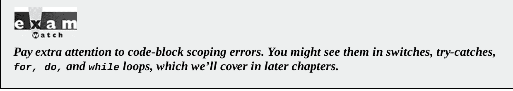

## 认证目标

## 变量初始化

# (OCA 目标 2.1, 4.1 和 4.2)

- 2.1 声明并初始化变量（包括基本数据类型的强制转换）。
- 4.1 声明、实例化、初始化并使用一维数组
- 4.2 声明、实例化、初始化和使用多维数组

# 使用未初始化且未赋值的变量或数组元素

Java 为我们提供了初始化已声明变量或保持其未初始化的选项。当我们尝试使用未初始化的变量时，取决于我们处理的是什么类型的变量或数组（基本类型或对象），我们可以得到不同的行为。行为还取决于我们声明变量的级别（作用域）。实例变量在类内部声明但在任何方法或构造函数之外，而局部变量在方法内部声明（或在方法的参数列表中）。

局部变量有时被称为栈变量、临时变量、自动变量或方法变量，但无论如何，这些变量的规则都是相同的。实例变量在类内部声明但在任何方法或构造函数之外。

## 实例变量

具有默认值：

| 变量类型 | 默认值 |
| :--- | :--- |
| byte, short, int, long, char | 0 或 0 |
| float, double | 0.0f 或 0.0d |
| boolean | false |
| Object (引用) | null |

局部变量有时被称为栈变量、临时变量、自动变量或方法变量，但无论如何，这些变量的规则都是相同的。

## 局部变量

局部变量必须在首次使用之前初始化。

```java
class MyClass {
    public static void main(String[] args) {
        int x; // 声明
        x = 10; // 初始化
        System.out.println(x);
    }
}
```

如果你尝试使用未初始化的局部变量，编译器会报错：

```java
class MyClass {
    public static void main(String[] args) {
        int x;
        System.out.println(x); // 错误：variable may not have been initialized
    }
}
```

## 实例变量

实例变量在创建新实例时初始化。

```java
class MyClass {
    int x; // 实例变量，自动初始化为0
    public static void main(String[] args) {
        MyClass obj = new MyClass();
        System.out.println(obj.x); // 输出 0
    }
}
```

## 静态变量

静态变量在类加载时初始化。

```java
class MyClass {
    static int x; // 静态变量，自动初始化为0
    public static void main(String[] args) {
        System.out.println(x); // 输出 0
    }
}
```

## 块变量

块变量只在代码块执行期间存在。

```java
class MyClass {
    public static void main(String[] args) {
        for (int i = 0; i < 5; i++) {
            int z = i; // 块变量
            System.out.println(z);
        }
        // System.out.println(z); // 错误：z 无法访问
    }
}
```


## 数组变量

在第 5 章中，我们将非常详细地查看声明、构造和初始化数组以及多维数组。现在，我们只需要查看数组元素的默认值规则。

数组是一个对象；因此，一个已声明但未显式初始化的实例变量其值将为 `null`，就像任何其他对象引用变量一样……但如果数组被初始化，数组包含的元素会发生什么呢？所有的数组元素都会被赋予默认值——与该类型的元素作为实例变量时获得的默认值相同。底线结论是：无论数组本身是否被实例化，数组元素总是、总是、总是被赋予默认值的。

如果我们初始化了一个数组，对象引用元素如果没有被单独赋值值，那么它们将等于 `null`。如果数组中包含基本数据类型，它们将获得各自的默认值。例如，在下面的代码中，数组将包含 100 个整数，它们默认都等于 0（零）：

```java
public class BirthDays {

    static int[] year = new int[100];

    public static void main(String[] args) {

        for (int i = 0; i < 100; i++) {

            System.out.println("year[" + i + "] = " + year[i]);

        }

    }

}
```

当你在运行代码之前，输出表明数组中的所有 100 个整数的值都为 0。

## 局部（栈、自动）基本数据类型和对象

局部变量定义在方法内部，它们包含了方法的参数。


“自动”（Automatic）只是局部变量的另一个术语。它并不意味着变量会自动赋值！事实上，事实恰恰相反。自动变量必须在代码中被赋值，否则编译器会报错。

## 局部基本数据类型

在下面的时空旅行模拟器中，整数 `year` 被定义为自动变量，因为它位于方法的大括号内部：

```java
public class TimeTravel {

    public static void main(String[] args) {

        int year = 2050;

        System.out.println("The year is " + year);

    }

}
```

局部变量（包括基本数据类型）在尝试使用之前，总是、总是必须先初始化（尽管不一定在同一行代码中）。Java 不为局部变量提供默认值；你必须显式地为它们初始化值，如前面的示例所示。如果你尝试在代码中使用未初始的基本数据类型，将得到编译器错误：

```java
public class TimeTravel {

    public static void main(String[] args) {

        int year; // 局部变量（已声明但未初始化）

        System.out.println("The year is " + year); // 编译器错误

    }

}
```

编译产生的输出如下：

```text
%javac TimeTravel.java

TimeTravel.java:4: Variable year may not have been initialized.

    System.out.println("The year is " + year);

1 error
```

为了纠正我们的代码，我们必须给 `year` 赋一个值。在更新后的示例中，我们在单独的一行中声明了它，这是完全合法的：

```java
public class TimeTravel {

    public static void main(String[] args) {

        int year; // 已声明但未初始化

        int day; // 已声明但未初始化

        System.out.println("You step into the portal.");

        year = 2050; // 初始化（分配显式值）

        System.out.println("Welcome to the year " + year);

    }

}
```

注意在前面的示例中，我们声明了一个从未被初始化的整数 `day`，但代码仍然可以编译并运行。在法律上，只要你不使用该变量，你就可以声明一个不初始化的局部变量——但面对现实吧，如果你声明了它，你可能出于理由（尽管我们听说过程序员纯为了好玩声明随机局部变量，看看自己是否能弄清楚它们是如何以及为何被使用的）。

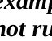

编译器永远无法判断局部变量在使用之前是否已经过初始化。例如，如果你在逻辑条件块内进行初始化（换句话说，在一个可能不会执行的代码块中，例如没有字面量真或假测试的 `if` 或 `for` 循环），编译器知道初始化可能不会发生，并产生错误。以下代码会让编译器不爽：

```java
public class TestLocal {

    public static void main(String[] args) {

        int x;

        if (args[0] != null) // 假设你知道这是真的
            x = 7; // 编译器无法判断这个语句是否会执行

        int y = x; // 编译器会在这里报错

    }

}
```

编译器会产生类似这样的错误：

```text
TestLocal.java:9: variable x might not have been initialized
```

由于这种“编译器无法确定”的问题，你有时需要在条件块之外初始化变量，仅仅是为了让编译器开心。如果你见过那句保险杠贴纸：“当编译器不开心时，谁也不开心”，你就知道这为什么了。

## 对象引用

（注：原文此处存在大量重复的段落，已根据要求忽略重复内容进行翻译）

## 将一个变量赋值给另一个变量

对于基本数据类型变量，将一个变量赋值给另一个意味着内容（位模式）被复制到另一个。对象引用的工作完全相同。如果你将一个对象的实例分配一个新的引用，那么两个引用变量将持有相同的位模式——指向堆上的某个特定对象。查看以下代码：

```java
import java.awt.Dimension;

class ReferenceTest {

    public static void main(String[] args) {

        Dimension a1 = new Dimension(5, 10);

        System.out.println("a1.height = " + a1.height);

        Dimension b1 = a1;

        b1.height = 30;

        System.out.println("a1.height = " + a1.height + " after change to b1");

    }

}
```

在前面的示例中，声明并初始化了一个宽度为 5、高度为 10 的 `Dimension` 对象 `a1`。接下来，声明了 `Dimension b1` 并赋值 `a1` 的值。此时，两个变量（`a1` 和 `b1`）持有相同的值，因为 `a1` 的内容被复制到了 `b1` 中。仍然只有一个对象——`a1` 和 `b1` 指向的那个。最后，使用 `b1` 引用更改了高度属性。现在思考一下：这也会改变 `a1` 的高度属性吗？看看输出是什么：

```text
%java ReferenceTest

a1.height = 10

a1.height = 30 after change to b1
```

从输出中可以得出结论，两个变量指向 `Dimension` 对象的同一个实例。当我们修改 `b1` 时，`a1` 的高度属性也随之改变了。对象引用赋值方式的一个例外是 `String`。在 Java 中，字符串对象被特殊对待。首先，`String` 对象是不可变的；你无法更改 `String` 对象的值（关于该概念在第 6 章会有更多介绍）。但看起来你确实可以。查看这个

```java
class StringTest {

    public static void main(String[] args) {

        String x = "Java"; // 给 x 赋值

        String y = x; // 现在 y 和 x 指向同一个 String 对象

        System.out.println("y string = " + y);

        x = x + " Bean"; // 现在使用 x 引用来修改该对象

        System.out.println("y string = " + y);

    }

}
```

由于 `String` 是对象，你可能会认为在 `x` 改变后，`String y` 将包含 "Java Bean" 字符。让我们看看输出是什么：

```text
%java StringTest

y string = Java

y string = Java
```

如你所见，尽管 `y` 是指向 `x` 所引用的同一个对象的引用变量，但当我们改变 `x` 时，它并没有发生变化！对于任何其他对象类型，如果两个引用指向同一个对象，只要使用任何一个引用来修改该对象，两个引用都能看到变化，因为仍然只有一个对象。但只要我们对 `String` 进行了任何修改，VM 都会更新变量以指向一个不同的对象。这个不同的对象可能是一个新对象，也可能不是，但它一定是一个不同的对象。我们无法确定是否创建了新对象，是因为我们将在第 6 章中介绍字符串常量池的内容。

你需要理解当使用 `String` 引用修改字符串时会发生什么：

- 创建了一个新的 `String`（在 `String` 池中找到了匹配的 `String`），原始的 `String` 对象保持不变。
- 用于修改 `String` 的引用（更准确地说，通过修改原始对象的副本来创建一个新 `String`）随后被赋值为全新的 `String` 对象。

所以，当你，

1. `String s = "Fred";`
2. `String t = s; // 现在 t 和 s 指向同一个 String 对象`
3. `t.toUpperCase(); // 调用一个修改 String 的 String 方法`

你并没有改变第 1 行创建的原始 `String` 对象。当第 2 行执行完成后，`t` 和 `s` 都指向同一个 `String` 对象。但当第 3 行运行时，它并没有修改 `t` 和 `s` 所引用的对象（到目前为止这是唯一的 `String` 对象），而是创建了一个新的 `String` 对象。然后它被遗弃了。由于新的 `String` 没有被赋值给 `String` 变量，新创建的 `String`（持有 "FRED" 字符串）丢失了。尽管在前面的代码中创建了两个 `String` 对象，但实际上只有一个被引用，且 `t` 和 `s` 都指向它。`String` 的行为在考试中至关重要，因此我们将在第 6 章进行更详细的介绍。

## 将变量传递到方法 (OCA 目标 6.6)

### 6.8 确定当它们传递到会改变其值的方法时，对对象引用和基本类型值的影响。

方法可以被声明为接收基本类型和/或对象引用。你需要知道调用者的变量如何（或是否）会被调用的方法影响。对象引用和基本类型变量在传递到方法时的区别是巨大且重要的。为了理解这一节，你需要熟悉本章开头“字面量、赋值和变量”部分中涵盖的内容。

## 传递对象引用变量

当你将对象变量传递到方法中时，你必须记住你传递的是对象引用，而不是对象本身。记住，引用变量持有的是代表（底层 VM）访问内存（堆）中特定对象方式的位信息。最重要的是，你必须记住你甚至没有传递实际的引用变量，而是引用变量的副本。变量的副本意味着你获得了该变量中位数据的副本，因此当你传递引用变量时，你传递的是代表如何访问特定对象的位副本。换句话说，调用者和调用的方法都拥有相同的引用副本；因此，它们都指向堆上的同一个（而不是副本）对象。

对于这个示例，我们将使用来自 `java.awt` 包的 `Dimension` 类：

```java
import java.awt.Dimension;

class ReferenceTest {

    public static void main(String[] args) {

        Dimension d = new Dimension(5, 10);

        ReferenceTest rt = new ReferenceTest();

        System.out.println("Before, d.height: " + d.height);

        rt.modify(d);

        System.out.println("After, d.height: " + d.height);

    }

    void modify(Dimension dim) {

        dim.height = dim.height + 1;

        System.out.println("dim = " + dim.height);

    }

}
```

当我们运行这个类时，可以看到 `modify()` 方法确实能够修改在第 4 行创建的原始（也是唯一的）`Dimension` 对象。

```text
C:\Java Projects\Reference\java ReferenceTest

Before, d.height: 10

dim = 11

After, d.height: 11
```

注意，当第 4 行的 `Dimension` 对象传递给 `modify()` 方法时，方法内部对对象的任何更改都是对被传递的引用所指向的对象进行的。

## Java 使用值传递语义吗？

如果 Java 是通过传递引用来传递对象的，这是否意味着 Java 对对象使用了引用传递？不完全是。这里有很多误解，但关键在于 Java 始终是值传递的。被传递的“值”是引用本身。

如果你将对象引用传递给方法，你传递的是引用的副本。如果方法修改了引用所指向的对象，这种变化对调用者是可见的，因为两个引用指向同一个对象。然而，如果方法只是将其副本重新赋值指向一个新对象，调用者的变量将保持不变，指向原始对象。

## 传递基本类型变量

```java
class ReferenceTest {

    public static void main(String[] args) {

        int a = 1;

        ReferenceTest rt = new ReferenceTest();

        System.out.println("Before modify() a = " + a);

        rt.modify(a);

        System.out.println("After modify() a = " + a);

    }

    void modify(int number) {

        number = number + 1;

        System.out.println("number = " + number);

    }

}
```

在这个程序中，变量 `a` 被传递给方法 `modify()`，方法将变量增加了 1。产生的输出如下：

```text
Before modify() a = 1

number = 2

After modify() a = 1
```

注意，`a` 在传递给方法后并没有改变。记住，传递给方法的是 `a` 的副本。当基本类型变量传递到方法时，它是值传递的，这意味着传递的是变量中位的副本。

## 来自课堂

### 变量的阴影世界

当你认为自己已经完全理解了一切时，你会看到某些代码中变量的行为并不如你所想。你可能进入了带有变量的代码。你可以通过几种方式遮蔽变量。我们将查看一种可能会让你绊脚的方法：通过局部变量来遮蔽静态变量。

遮蔽的效果是将之前声明的变量隐藏起来，使得它看起来好像你正在使用被隐藏的变量，但实际上你正在使用遮蔽变量。你可能会出于某些故意遮蔽变量，但这通常是意外发生的，并导致难以发现的错误。你可以通过声明同名的局部变量（直接声明或作为参数）来遮蔽变量：

```java
class Foo {

    static int size = 7;

    static void changeIt(int size) {

        size = size + 200;

        System.out.println("size in changeIt is " + size);

    }

    public static void main(String[] args) {

        Foo f = new Foo();

        System.out.println("size = " + size);

        changeIt(size);

        System.out.println("size after changeIt is " + size);

    }

}
```

上述代码似乎更改了 `changeIt()` 方法中的静态 `size` 变量，但由于 `changeIt()` 有一个名为 `size` 的参数，局部 `size` 变量被修改了，而静态 `size` 变量保持不变。

运行 `Foo` 类会输出如下：

```text
%java Foo

size = 7

size in changeIt is 207

size after changeIt is 7
```

当被蔽变量是对象引用而不是基本类型时，情况会变得更有趣：

```java
class Bar {

    int barNum = 28;

}

class Foo {

    Bar myBar = new Bar();

    void changeIt(Bar myBar) {
```


```java
myBar.barNum = 99;

System.out.println("myBar.barNum in changeIt is " + myBar.barNum);

myBar = new Bar();

myBar.barNum = 420;

System.out.println("myBar.barNum is now " + myBar.barNum);

}

public static void main (String [] args) {

    Foo f = new Foo();

    System.out.println("f.myBar.barNum is " + f.myBar.barNum);

    changeIt(f.myBar);

    System.out.println("f.myBar.barNum after changeIt is " + f.myBar.barNum);

}

}
```

# 上述代码输出了：

```
f.myBar.barNum is 28

myBar.barNum in changeIt is 99

myBar.barNum in changeIt is now 420

f.myBar.barNum after changeIt is 99
```

你可以看到，遮蔽变量（`changeIt()` 中的局部参数 `myBar`）仍然可以影响 `myBar` 实例变量，因为 `myBar` 参数接收了同一个 `Bar` 对象的引用。但当局部 `myBar` 被重新赋值一个新的 `Bar` 对象时（我们通过更改其 `barValue` 来修改它），`Foo` 原本的 `myBar` 实例变量不受影响。

## 认证目标

### 垃圾回收 (OCA) 目标 2.4

2.4 解释对象的生命周期（创建、通过重新赋值“取消引用”以及垃圾回收）

“垃圾回收”这个短语似乎在考试目标中出现又消失。从 OCA 8 考试开始，它回来了，我们感到很高兴。垃圾回收是计算机科学中一个广为人知的概念和通用术语。

# 内存管理与垃圾回收概述

这是你一直等待的部分！现在是时候深入探索内存管理和垃圾回收的美妙世界了。内存管理是许多类型应用程序的关键元素。考虑一个从网络其他地方读取大量数据，然后将其写入硬盘数据库的程序。典型的设计是将数据读取到内存中的某种集合中，对数据执行某些操作，然后将其写入数据库。在数据写入数据库后，存储数据的集合在处理下一批数据之前必须清空旧数据或进行回收。这种操作可能会执行数千次，在 C 或 C++ 这种不提供自动垃圾回收的语言中，手动清空或删除集合数据结构的逻辑微小缺陷可能会导致小部分内存被不当回收或丢失。这些小损失被称为内存泄漏，在数千次迭代后，它们可能导致足够的内存无法访问，最终使程序崩溃。编写既整洁又彻底执行手动内存管理的代码是一项非凡且复杂的任务，而可以认为手动内存管理可能会使复杂程序的开发工作量增加倍。Java 的垃圾回收器提供了内存管理的自动解决方案。在大多数情况下，它让你免于在应用程序中添加任何内存管理逻辑。自动收集的缺点是，你无法完全控制它何时运行何时不运行。

# Java 垃圾回收器概述

让我们看看在 Java 的世界里谈论垃圾回收意味着什么。从高处看，垃圾回收是描述 Java 中自动内存管理的术语。每当软件程序执行时（在 Java、C、C++、Lisp、Ruby 等语言中），它都会以几种不同的方式使用内存。我们在这里不会涉及计算机科学 101，但内存通常会创建栈（stack）、堆（heap），在 Java 的情况下还有常量池和方法区。堆是内存中 Java 对象生存的地方，它是内存中唯一位于任何（此处原文缺失）的部分。

堆就是堆。对于考试来说，重要的是你知道你可以称它为堆，可以称它为垃圾回收堆，但只有一个堆。

因此，垃圾回收围绕着确保堆有尽可能多的自由空间。对于考试而言，这归结底就是删除那些运行中的 Java 程序无法访问的对象。我们将更多地讨论“可访问”意味着什么。

## 显式使对象符合垃圾回收条件的代码编写

在前面的节中，你学习了 Java 垃圾回收背后的理论。在本节中，我们将展示如何使用实际代码使对象符合垃圾回收条件。我们还讨论了在必要时如何尝试强制进行垃圾回收，以及如何对从内存中移除的对象进行额外的清理。

## 将引用置空

正如前面讨论的，当一个对象不再有任何可达的引用时，它就符合了垃圾回收条件。显然，如果没有可达的引用，对象发生什么什么就不再重要了。对于我们的目的而言，它漂浮在空间中、未被使用、无法访问且不再需要。

移除对对象引用的第一种方法是将指向该对象的引用变量设置为 `null`。查看以下代码：

```java
public class GarbageTruck {
    public static void main(String [] args) {
        StringBuilder sb = new StringBuilder("hello");
        System.out.println(sb);
        // StringBuilder 对象不符合回收条件
        sb = null;
        // 现在 StringBuilder 对象符合回收条件
    }
}
```

在第三行中，值为 hello 的 `StringBuilder` 被赋值给引用变量 `sb`。为了使该对象符合（垃圾回收）条件，我们将引用变量 `sb` 设置为 `null`，这移除了指向 StringBuilder 对象的唯一引用。一旦第 6 行执行，我们那个快乐的小 `StringBuilder` 对象就完蛋了，符合了垃圾回收条件。

## 重新赋值引用变量

我们也可以通过将引用变量指向另一个对象，将引用变量与对象解耦。查看以下代码：

```java
class GarbageTruck {
    public static void main(String [] args) {
        StringBuilder s1 = new StringBuilder("hello");
        StringBuilder s2 = new StringBuilder("goodbye");
        System.out.println(s1);
        // 在此点 StringBuilder "hello" 不符合条件
        s1 = s2; // 重定向 s1 指向 "goodbye" 对象
        // 现在 StringBuilder "hello" 符合回收条件
    }
}
```

在方法中创建的对象也需要被考虑。当方法被调用时，在方法中创建的对象符合垃圾回收条件。然而，有一个明显的异常。如果一个对象从方法返回，它的引用可能会被赋值给它所调用方法中的引用变量；因此，它将符合回收条件。查看以下代码：

```java
import java.util.Date;

public class GarbageFactory {
    public static void main(String [] args) {
        Date d = new Date();
        doComplicatedStuff();
        System.out.println("d = " + d);
    }

    public static Date getDate() {
        Date d2 = new Date();
        StringBuilder now = new StringBuilder(d2.toString());
        System.out.println(now);
        return d2;
    }
}
```

在前面的示例中，我们创建了一个返回 `Date` 对象的方法 `getDate()`。该方法创建了两个对象：一个 `Date` 和一个包含日期信息的 `StringBuffer`。由于该方法返回了 `Date` 对象的引用且该引用被赋值给本地变量，即使在 `getDate()` 方法执行完毕，它也不会符合回收条件。但是，`StringBuffer` 对象将符合条件，尽管我们没有显式地将 `now` 变量设置为 `null`。

## 隔离引用

还有另一种方式可以使对象符合垃圾回收条件，即使它们仍然有有效的引用！我们将这种场景称为“隔离孤岛”。

一个简单的例子是，某个类拥有一个实例变量，该变量是指向同类另一个实例的引用变量。假设两个这样的实例存在并互相引用。如果删除了指向这两个对象的其他所有引用，尽管每个对象仍然有一个有效引用，任何存活线程也无法访问其中任何一个。当垃圾回收器运行时，即使每个对象仍然有有效引用，它也能发现并移除。查看以下代码：

```java
class Island {
    Island next;

    public static void main(String [] args) {
        Island i1 = new Island();
        Island i2 = new Island();
        i1.next = i2;
        i2.next = i1;
        i1 = null;
        i2 = null;
    }
}
```

在上面的代码中，`i1` 和 `i2` 是两个 `Island` 实例。它们形成了一个“孤岛”，因为它们通过 `next` 变量互相引用。当我们将 `i1` 和 `i2` 设置为 `null` 时，这两个对象不再是可达的，垃圾回收器将能够识别并移除它们。

## 强制垃圾回收

我们在这里提到的第一点是，无法强制垃圾回收。语言规范允许你建议进行垃圾回收，但不保证它会立即发生。我们说“理论上”是因为这并不总是有效。首先，JVM 可能不实现这一点；其次，在你调用 `System.gc()` 后，另一个线程可能会获取大量内存。请求垃圾回收的最简单方法是 `System.gc()`。然而，你不能依赖 `System.gc()` 来释放内存。既然你已经熟悉了它是如何工作的，让我们做一个小实验来看看垃圾回收的效果。以下程序告诉我们 JVM 有多少内存以及有多少可用内存。它创建了 10,000 个对象。之后，它告诉我们剩余多少并调用垃圾回收器（如果运行的话，将停止程序直到所有未使用对象被移除）。让我们看看程序：

```java
public static void main(String [] args) {
    Runtime rt = Runtime.getRuntime();
    System.out.println("Total JVM memory: " + rt.totalMemory());
    System.out.println("Before Memory = " + rt.freeMemory());
    Date d = null;
    for(int i = 0;i<10000;i++) {
        d = new Date();
    }
    d = null;
    System.out.println("After Memory = " + rt.freeMemory());
    rt.gc(); // System.gc() 的替代方案
    System.out.println("After GC Memory = " + rt.freeMemory());
}
```

运行程序并检查结果。正如你所见，JVM 确实决定了垃圾回收（即删除）符合条件的对象。在提供的示例中，我们建议 JVM 在剩余 458,048 字节内存时进行垃圾回收，并履行了我们的请求。此程序只有一个用户线程，所以当我们调用 `rt.gc()` 时，没有其他事情在运行。

## 练习 3-2

### 垃圾回收实验

尝试将第 13 行和第 14 行放入循环中来修改 `CheckGC` 程序。你可能会发现，在每次运行 GC 时，并不是所有内存都被释放了。

## 在垃圾回收之前清理——finalize() 方法

Java 提供了一种机制，允许你在对象被垃圾回收器删除之前运行某些代码。这个收集器是一个名为 `finalize()` 的方法，所有类都继承自 `Object` 类。从表面上看，这是一个很棒的主意；也许你的对象打开了一些资源，你希望在对象被删除之前关闭它们。问题是，正如你现在可能意识到的，你永远无法依靠垃圾回收器来删除对象。因此，你放入类中重写的 `finalize()` 方法的任何代码都无法保证执行。因为 `finalize()` 方法可能会运行但你无法保证，所以请不要将任何核心代码放入你的 `finalize()` 方法中。事实上，我们通常建议完全不要重写 `finalize()`。

## 棘手的 finalize() 小陷阱

关于 `finalize()` 有几个概念你需要记住：

- 对于任何对象，垃圾回收器最多只会调用 `finalize()` 一次。
- 调用 `finalize()` 实际上可能会导致一个对象免于删除。

让我们进一步检查这些语句。首先，记住任何你可以放入普通方法中的代码，都可以放入 `finalize()` 中。例如，在 `finalize()` 方法中，你可以编写代码，将对该对象的引用指向回另一个对象，有效地使该对象不再符合垃圾回收的条件。如果在此稍后的某个点，该对象再次符合垃圾回收的条件，垃圾回收器仍然可以处理该对象并将其删除。然而，垃圾回收器会记住，对于该对象，`finalize()` 已经运行过了，它将不会再次运行 `finalize()`。

## 认证总结

本章涵盖了广泛的主题。如果你在进入后续章节时需要回顾其中某些主题，不要担心。本章包含了许多以后会派上用场的基础知识。

我们从回顾栈（stack）和堆（heap）开始本章；请记住，栈上的局部变量和实例变量与它们在堆上的对象共共存。

我们回顾了基本数据类型和字符串的合法字面量（literals），然后讨论了赋值的基础。

接下来我们讨论了作用域（scope）的概念，或者说“这个变量将存活多久？”记住四个基本作用域，按寿命从长到短排序：静态、实例、局部和块（block）。

我们涵盖了使用未初始化变量的影响，以及局部变量**必须**被赋值的重要性。我们讨论了将一个引用赋值给另一个引用的一些棘手方面，以及将变量传递到方法中的一些细节，包括对“遮蔽”（shadowing）的讨论。

最后，我们深入研究了垃圾回收，这是 Java 的自动内存管理功能。我们了解到堆是对象存放的地方，也是酷的垃圾回收活动发生的地方。我们了解到最终，JVM 会在它认为需要的时候执行垃圾回收。你（程序员）可以请求运行垃圾回收，但你不能强制它。我们了解到垃圾回收仅适用于符合条件的对象，而这种符合条件意味着“无法从任何存活的线程访问”。最后，我们讨论了极少用的 `finalize()` 方法，以及你为了考试需要了解关于它的什么。总而言之，这是一个非常迷人的章节。

## 两分钟训练

这里是本章的一些要点。

### 栈和堆

- 局部变量（方法变量）存放在栈上。
- 对象及其实例变量存放在堆上。

### 字面量和基本类型转换 (OCA 目标 2.1)

- 整数字面量可以是二进制、十进制、八进制（如 `013`）或十六进制（如 `0x3d`）。
- long 的字面量以 L 或 l 结尾。（为了可读性，我们建议使用“L”）。
- float 字面量以 F 或 f 结尾，double 字面量以 d 或 D 结尾。
- 布尔型字面量为 true 和 false。

### 作用域 (OCA 目标 1.1)

- 作用域指的是变量的生命周期。
- 有四种基本作用域：
  - 静态变量随类一起存活。
  - 实例变量随对象一起存活。
  - 局部变量随方法一起存活。
  - 块变量在块结束时存活（例如在 if 中）。

### 基本赋值 (OCA 目标 2.1, 2.2, 2.3)

- 整数字面量是隐式的。
- 整数表达式结果为 int。
- 浮点数是隐式的 double。
- 复合赋值（如 `+=`）执行操作。
- 缩小转换会截断。
- 当你创建一个新对象时，JVM 会：
  - 创建一个名为 b 的引用。
  - 将对象赋值给引用。

## 使用未初始变量或数组 (OCA 目标 4.1, 4.2)

- 在初始化之前尝试使用变量将导致编译错误。
- 初始化的数组具有默认值。
- 实例变量总是具有默认值。
- 局部变量从未赋予默认值。

### 将变量传递到方法 (OCA 目标 6.6)

- 方法可以接收基本类型和或对象引用作为参数。
- 方法参数总是副本。
- 方法参数不是实际对象（可以是引用）。
- 基本类型参数是原始值的副本。
- 引用参数是指向原始对象的副本。
- 当不同作用域的变量同名时会发生遮蔽。这会导致难以发现的 Bug 和难以回答的问题。

### 垃圾回收 (OCA 目标 2.4)

- 在 Java 中，垃圾回收 (GC) 执行自动内存管理。
- GC 的目的是删除无法访问的对象。
- 只有 JVM 决定何时运行 GC；你只能请求它。
- 你无法确定 GC 的算法。
- 对象在被垃圾回收前必须符合条件。
- 当对象无法访问时是符合条件的。
- 要访问一个对象，你必须拥有该对象的存活且可达引用。
- Java 可能会耗尽内存。
- 即使对象互相引用，对象岛也可以被回收。
- 使用 `System.gc()` 请求垃圾回收。
- Object 类有一个 `finalize()` 方法。
- `finalize()` 方法保证在垃圾回收器删除对象之前运行且仅运行一次。
- 垃圾回收器不保证 `finalize()` 可能永远不运行。
- 你可以在 `finalize()` 内部使对象符合 GC。

## 自测

1. 给定：

```java
class CardBoard {
  Short story = 200;

  CardBoard go(CardBoard cb) {
    cb = null;
    return cb;
  }
}
```


## 1. 给定：

```java
public static void main(String[] args) {
    CardBoard c1 = new CardBoard();
    CardBoard c2 = new CardBoard();
    CardBoard c3 = c1.go(c2);
    c1 = null;
    // do Stuff
}
```

当到达 `// do Stuff` 时，有多少个对象符合垃圾回收条件？

- A. 0
- B. 1
- C. 2
- D. 编译失败
- E. 不可能
- F. 运行时抛出异常

## 2. 给定：

```java
public class Fishing {
    byte b1 = 4;
    int i1 = 123456;
    long l1 = (long)i1; // line A
    short s2 = (short)i1; // line B
    byte b2 = (byte)i1; // line C
    int i2 = (int)123.456; // line D
    byte b3 = b1 + 7; // line E
}
```

哪些行**无法**编译？（选择所有项）。

- A. Line A
- B. Line B
- C. Line C
- D. Line D
- E. Line E

## 3. 给定：

```java
public class Literally {
    public static void main(String[] args) {
        int i1 = 1_000; // line A
        int i2 = 10_00; // line B
        int i3 = _10_000; // line C
        int i4 = 0b101010; // line D
        int i5 = 0B10_1010; // line E
        int i6 = 0x2_a; // line F
    }
}
```

哪些行**无法**编译？（选择所有适用项）。

- A. Line A
- B. Line B
- C. Line C
- D. Line D
- E. Line E
- F. Line F

## 4. 给定：

```java
class Mixer {
    Mixer() {}
    Mixer(Mixer m) { m1 = m; }
    Mixer m1;
    public static void main(String[] args) {
        Mixer m2 = new Mixer();
        Mixer m3 = new Mixer(m2); m3.go();
        Mixer m4 = m3.m1; m4.go();
        Mixer m5 = m2.m1; m5.go();
    }
    void go() { System.out.print("hi "); }
}
```

结果是什么？

- A. hi
- B. hi hi
- C. hi hi hi
- D. 编译失败
- E. hi，后面跟着一个异常
- F. hi hi，后面跟着一个异常

## 5. 给定：

```java
class Fizz {
    int x = 5;
    public static void main(String[] args) {
        final Fizz f1 = new Fizz();
        Fizz f2 = new Fizz();
        Fizz f3 = FizzSwitch(f1,f2);
        System.out.println(f1 == f3 + " " + (f1.x == f3.x));
    }
    static Fizz FizzSwitch(Fizz x, Fizz y) {
        final Fizz z = x;
        z.x = 6;
        return z;
    }
}
```

结果是什么？

- A. true true
- B. false true
- C. true false
- D. false false
- E. 编译失败
- F. 运行时抛出一个异常

## 6. 给定：

```java
public class Mirror {
    int size = 7;
    public static void main(String[] args) {
        Mirror m1 = new Mirror();
        Mirror m2 = m1;
        int i1 = 10;
        int i2 = i1;
        go(m2, i2);
        System.out.println(m1.size + " " + i1);
    }
    static void go(Mirror m, int i) {
        m.size = 8;
        i = 12;
    }
}
```

结果是什么？

- A. 7 10
- B. 8 10
- C. 7 12
- D. 8 12
- E. 编译失败
- F. 运行时抛出一个异常

## 7. 给定：

```java
public class Wind {
    int id;
    Wind(int i) { id = i; }
    public static void main(String[] args) {
        new Wind(3).go();
        // commented line
    }
    void go() {
        Wind w1 = new Wind(1);
        Wind w2 = new Wind(2);
        System.out.println(w1.id + " " + w2.id);
    }
}
```

当执行到被注释行时，哪些是正确的？（选择所有适用项）。

- A. 输出包含 1
- B. 输出包含 2
- C. 输出包含 3
- D. 没有 wind 对象符合垃圾回收条件
- E. 有一个 wind 对象符合垃圾回收
- F. 有两个 wind 对象符合垃圾回收
- G. 有三个 wind 对象符合垃圾回收

## 8. 给定：

```java
public class Ouch {
    static int ouch = 7;
    public static void main(String[] args) {
        new Ouch().go(ouch);
        System.out.print(" " + ouch);
    }
    void go(int ouch) {
        ouch++;
        for (int ouch = 3; ouch < 6; ouch++) {
            ;
        }
        System.out.print(" " + ouch);
    }
}
```

结果是什么？

- A. 5 7
- B. 5 8
- C. 8 7
- D. 8 8
- E. 运行时编译失败

## 9. 给定：

```java
public class Happy {
    int id;
    Happy(int i) { id = i; }
    public static void main(String[] args) {
        Happy h1 = new Happy(1);
        Happy h2 = h1.go();
        System.out.println(h2.id);
    }
    Happy go(Happy h) {
        Happy h3 = h;
        h3.id = 2;
        h1.id = 3;
        return h1;
    }
}
```

结果是什么？

- A. 1
- B. 2
- C. 3
- D. 编译失败
- E. 运行时抛出一个异常

## 10. 给定：

```java
public class Network {
    Network(int x, Network n) {
        id = x;
        p = this;
        if (n != null) p = n;
    }
    int id;
    Network p;
    public static void main(String[] args) {
        Network n1 = new Network(1, null);
        n1.go(n1);
    }
    void go(Network n1) {
        Network n2 = new Network(2, n1);
        Network n3 = new Network(3, n2);
        System.out.println(n3.p.id);
    }
}
```

结果是什么？

- A. 1
- B. 2
- C. 3
- D. null
- E. 编译失败

## 11. 给定：

```java
class Beta { }
class Alpha {
    static Beta b1;
    Beta b2;
    public static void main(String[] args) {
        Beta b1 = new Beta();
        Beta b2 = new Beta();
        Alpha a1 = new Alpha();
        Alpha a2 = new Alpha();
        a1.b1 = b1;
        a2.b2 = b2;
        b1 = null;
        b2 = null;
        // stuff
    }
}
```

当执行到第 16 行时，有多少个对象符合垃圾回收？

- A. 0
- B. 1
- C. 2
- D. 3
- E. 4
- F. 5

## 12. 给定：

```java
public class Telescope {
    static int magnify = 2;
    public static void main(String[] args) {
        go();
    }
    static void go() {
        int magnify = 3;
        zoomIn();
    }
    static void zoomIn() {
        magnify *= 5;
        zoomMore(magnify);
        System.out.println(magnify);
    }
    static void zoomMore(int magnify) {
        magnify *= 7;
    }
}
```

结果是什么？

- A. 2
- B. 10
- C. 15
- D. 30
- E. 70
- F. 105
- G. 编译失败

## 13. 给定：

```java
class Dark {
    int x = 3;
    public static void main(String[] args) {
        new Dark().gol();
    }
    int x;
    void gol() {
        go2(++x);
    }
    void go2(int y) {
        int x = ++y;
        System.out.println(x);
    }
}
```


## 运算符 (Operators)

### 认证目标

- 使用 Java 运算符
- 使用括号覆盖运算符优先级
- 使用 `==` 和 `equals()` 测试字符串与其他对象的等性
  - 两分钟强化演练

### 问答自测

如果你有了变量，你就会修改它们。（除非你是那些搞新奇的“函数式编程程序员”之一。）你会对它们进行递增、将它们相加，并进行一个与另一个的比较（大约有十种方式）。在本章中，你将学习如何在 Java 中实现所有这些。作为额外奖励，你将学习一些可能在现实世界中永远用不到，但几乎肯定会出现在考试中的内容。

### 认证目标

#### Java 运算符 (OCA 目标 3.1, 3.2 和 3.3)

- 3.1 使用 Java 运算符；包括用于覆盖运算符优先级的括号。
- 3.2 使用 `==` 和 `equals()` 测试字符串与其他对象的等性。
- 3.3 创建 `if` 和 `if/else` 结构。

Java 运算符从一个或多个操作数产生新值。（为了让大家明确，记住操作数位于运算符的右侧或左侧。）大多数操作的结果是布尔值或数值。由于你知道 Java 不是 C++，所以你不会对 Java 运算符通常不被重载感到意外。然而，有少数运算符是重载的：

- `+` 可以用于两个数值原始类型相加，或者如果其中一个操作数是字符串，则执行拼接操作。
- `&` 和 `^` 运算符可以用两种不同的方式使用，尽管在这一版本的考试中，它们的位操作能力不会被测试。

保持清醒。运算符通常是考试中候选得分最低的部分。此外，运算符和赋值是许多涉及其他主题的问题的一部分——如果你只解决了一个非常棘手的 lambda 问题，却在一个预递增语句上栽了跟头，那将太可惜了。

### 赋值运算符

我们在第 3 章中涵盖了 `=` 赋值运算符的大部分功能。总结一下：

- 给原始类型赋值值时，大小很重要。务必确你何时会发生隐式转换、何时需要显式转换，以及何时可能会发生截断。
- 记住引用变量不是对象；它是获取对象的方法。（我们知道你们这些 C++ 程序员急于听我们说“它是一个指针”，但我们不会那样说的。）
- 给引用变量赋值值时，类型很重要。记住超类型、子类型和数组的规则。

接下来，我们将涵盖更多关于考试中涉及的赋值运算符的细节，当我们进入下一章时，我们将查看赋值运算符 `=` 是如何处理字符串（字符串是不可变的）的。

> **不要花时间准备已经不再出现在考试中的主题了！** 自 Java 1.4 以来，以下主题**没有**出现在过考试中：
> - 位移运算符
> - 位运算运算符
> - 补码
> - 除以零的相关内容
>
> 并不是说这些不是重要主题；只是它们不再出现在考试中了，而我们非常关注考试。（注意：我们提到这些是因为你可能会在模拟考试中遇到关于这些主题的题目——你可以忽略那些题目！）

### 复合赋值运算符

实际上有大约 11 种复合赋值运算符，但只有最常用的 4 种 (`+=`, `-=`, `*=`, `/=`) 出现在考试中。复合赋值运算符让懒的人减少几次击键的工作量。

以下是几个赋值示例，首先是不使用复合运算符：

```java
y = y - 6;
x = x + 2 * 5;
```

现在，使用复合运算符：

```java
y -= 6;
```

后两个赋值的结果与前两个相同。

### 关系运算符

考试涵盖了六种关系运算符（`<`, `<=`, `>=`, `==` 和 `!=`）。关系运算符总是产生一个布尔值（`true` 或 `false`）。这个布尔值通常用于 `if` 测试，如下所示：

```java
int x = 8;
if (x < 9) {
  // 执行某些操作
}
```

但结果值也可以直接赋值给布尔原始类型：

```java
class CompareTest {
  public static void main(String [] args) {
    boolean b = 100 > 99;
    System.out.println("The value of b is " + b);
  }
}
```

Java 有四种关系运算符可以用于比较整数、浮点数或字符的任何组合：

- 大于
- 大于等于
- 小于
- 小于等于

让我们看看合法的比较：

```java
import java.swing.JButton;

class CompareReference {
    public static void main(String[] args) {
        JButton a = new JButton("Exit");
        JButton b = new JButton("Exit");
        JButton c = a;
        System.out.println("Is reference a == b? " + (a == b));
        System.out.println("Is reference a == c? " + (a == c));
    }
}
```

这段代码创建了三个引用变量。前两个变量 `a` 和 `b` 是独立的 `JButton` 对象，它们恰好具有相同的标签。第三个引用变量 `c` 被初始化为指向 `a` 所引用的同一个对象。当程序运行时，会产生以下输出：

```text
Is reference a == b? false
Is reference a == c? true
```

这说明 `a` 和 `c` 引用了同一个 `JButton` 实例。`==` 运算符不会测试对象是否在“意义上等价”，这个概念将在第 6 章中进行更详细的介绍，届时我们将查看 `equals()` 方法（而不是我们这里正在查看的 equals 运算符）。

### 字符串的相等性和 java.lang.Object.equals()

我们使用 `==` 来确定引用变量是否指向同一个对象。由于对象是 Java 的核心，Java 中的每个类都继承了 `Object` 类的一个方法，用于测试两个同类对象是否“相等”。令人惊讶的是，在 `equals()` 方法这种情况下，应该使用短语“意义上等价”而不是单词“相等”。`equals()` 方法用于确定两个同类对象是否在“意义上等价”。为了理解用于 OCA 考试中的 `equals()` 方法，你需要理解 `equals()` 方法的两个方面：

- `equals` 在 `Object` 类中的含义
- `equals` 在 `String` 类中的含义

#### Object 类中的 equals() 方法

`Object` 类中的 `equals` 方法的工作方式与 `==` 运算符相同。如果两个引用指向同一个对象，则它将返回 `true`。如果两个引用指向不同的对象，即使它们具有相同的值，该方法也将返回 `false`。

#### String 类中的 equals() 方法

`String` 类中的 `equals` 方法被重写了。当使用 `equals` 方法比较字符串时，如果字符串的值相同，将返回 `true`；如果字符串的值不同，将返回 `false`。对于 String 的 `equals()` 方法，值是区分大小写的。让我们来看 `equals()` 方法在实际运行中的工作（注意 String **并没有** 重写 Object）：

```java
class Test {
    public static void main(String[] args) {
        Object b1 = new Object();
        Object b2 = new Object();
        Object b3 = b1;
        String s1 = "Bob";
        String s2 = "Bob";
        String s3 = "bob";
        System.out.println(b1.equals(b2)); // false, 不同的对象
        System.out.println(b1.equals(b3)); // true, 同一个对象
        System.out.println(s1.equals(s2)); // true, 相同的值
        System.out.println(s1.equals(s3)); // false, 区分大小写
    }
}
```

产生：

```text
false
true
false
```

### 枚举的相等性

一旦定义了一个枚举（enum），它就无法扩展。在运行时，没有办法创建额外的常量。当然，你可以拥有任意数量的变量来引用给定的枚举常量，因此能够比较两个枚举变量以查看它们是否“相等”——即它们是否指向同一个常量——是非常关键的。你可以使用 `==` 运算符或 `equals()` 方法来确定两个变量是否指向同一个常量：

```java
class EnumTest {
    enum Color { RED, BLUE }
    public static void main(String[] args) {
        Color c1 = Color.RED;
        Color c2 = Color.RED;
        if (c1 == c2) { System.out.println("=="); }
        if (c1.equals(c2)) { System.out.println("equals"); }
    }
}
```

（我们知道 equals() 是可以的。）这产生了输出：

```text
==
equals
```

### instanceof 比较

`instanceof` 运算符仅用于对象引用，可以用它来检查对象是否属于某种类型。这里说的“类型”指的是类类型或接口类型——也就是说，运算符左侧变量引用的对象是否通过了右侧的类型测试（第 2 章详细介绍过 IS-A 关系）。下面的简单示例如下：

```java
public static void main(String[] args) {
    String s = new String("foo");
    if (s instanceof String) {
        System.out.print("s is a String");
    }
}
```

打印：

```text
s is a String
```

即使被测试的对象不是运算符右侧类类型的实际实例化，如果被比较的对象与右侧类型兼容，`instanceof` 仍然会返回 `true`。

下面的示例演示了 `instanceof` 的常见用法：在尝试向下转换之前，测试对象是否为其子类型之一：

```java
class A {
class B extends A {
    public static void main(String[] args) {
        A myA = new B();
        m2(myA);
    }
    public static void m2(A a) {
        if (a instanceof B) {
            ((B)a).doBStuff(); // 将 A 引用
            // 转换为 B 引用
        }
    }
    public static void doBStuff() {
        System.out.println("'a' refers to a B");
    }
}
}
```

代码可以编译并产生此输出：

```text
'a' refers to a B
```

在这样的示例中，`instanceof` 运算符保护程序不会尝试非法的向下转换。

你可以针对对象引用所属的类类型或其任何父类进行测试。这意味着如果你对 `Object` 类型使用 `instanceof` 运算符，任何对象引用都将为 `true`，如下：

```java
B b = new B();
if (b instanceof Object) {
    System.out.print("*b is definitely an Object*");
}
```

这打印了

```text
b is definitely an Object
```

寻找跨类层次结构的 `instanceof` 问题。间接实现发生在对象的某个父类实现了该接口时。在示例中，

```java
interface Foo {
class A implements Foo { }
class B extends A { }
...
A a = new A();
B b = new B();
```

以下情况为真：

```text
a instanceof Foo
b instanceof Foo
```

> 如果对象的任何父类实现了该接口，则认为该对象属于该特定类型（意味着它将通过 `instanceof` 测试）。

### 算术运算符

我们相信你对基础算术运算符熟悉：

- 加法
- 减法
- 乘法
- 除

这些可以按照标准方式使用：

```java
int x = 5 * 3;
int y = x - 4;
System.out.println("x - 4 is " + y); // 输出 11
```

### 取余运算符 (%) 运算符（也称为取模运算符）

你可能没有那么熟悉的另一个运算符是取余运算符：`%`。取余运算符将左操作数除以右操作数，结果为余数，下面的代码演示了这一点：

```java
class MathTest {
    public static void main (String [] args) {
    int x = 15;
    int y = x % 4;
    System.out.println("The result of 15 % 4 is the " + "remainder of 15 divided by 4. The remainder is " + y);
    }
}
```


运行 `MathTest` 类会输出以下内容：

> The result of 15 % 4 is the remainder of 15 divided by 4. The remainder is 3

（记住：默认情况下表达式是从左到右求值的。你可以通过添加括号来改变这种顺序或优先级。还要记住，`*`、`/` 和 `%` 运算符的优先级高于 `+` 和 `-` 运算符。）


在处理 `int` 类型时，取余运算符（也称为取模运算符）和除法运算符之间存在一种有趣的关系：

- 取模运算符丢弃除余数以外的所有内容。
- 除法运算符丢弃余数。

## 字符串拼接运算符

```java
String animal = "Gray " + "elephant";
```

当将数字与字符串结合时，字符串拼接变得有趣起来。查看以下内容：

```java
String a = "String";
int b = 3;
int c = 7;
System.out.println(a + b + c);
```

`+` 运算符在涉及 `int` 变量 `b` 和 `c` 时会作为加法运算符作用吗？还是运算符会将 3 和 7 视为字符并分别拼接？结果会是 `String10` 还是 `String37`？好了，你有足够的时间思考这个问题了。这些 `int` 值被简单地视为字符，并胶在 `String` 的右侧，得到结果：

String37

所以，我们可以将之前的代码读为：“从值 `String` 开始，将字符 3（`b` 的值）拼接到它后面，生成一个新字符串 `String3`，然后将字符 7（`c` 的值）拼接到该字符串后面，生成一个新字符串 `String37`。然后打印它。”

如果你在两个 `int` 变量周围加上括号，如下：

```java
System.out.println(a + (b + c));
```

你将得到：

String10

使用括号会导致 `(b + c)` 先求值，因此由于两个操作数都是 `int` 值，最右侧的 `+` 运算符充当加法运算符。这里的关键在于，在括号内部，左操作数不是 `String`。如果是的话，那么 `+` 运算符将执行字符串拼接。之前的代码可以读为：

> 将 `b` 和 `c` 的值相加，然后取和并转换为 `String`，与变量 `a` 的 `String` 拼接。

需要记住的规则是：

> 如果任一操作数是 `String`，`+` 运算符就会变成字符串拼接运算符。如果两个操作数都是数字，`+` 运算符就是加法运算符。

你会发现，有时你可能很难判断左操作数是否为 `String`。在考试中，不要指望它是显而易见的（实际上，现在仔细想想，别指望它是显而易见的）。看以下代码：

```java
System.out.println(x.foo() + 7);
```

在发现 `foo()` 方法返回什么之前，你无法知道 `+` 运算符是如何使用的！如果 `foo()` 返回一个 `String`，最后你就知道该运算符是用于将 7 加到 `foo()` 的返回值了。你需要知道复合加法运算符 (`+=`) 和 `String` 混合是合法的，如下：

```java
String s = "123";
s += "45";
s += 67;
System.out.println(s);
```

由于两次使用 `+=` 运算符且左操作数都是 `String`，两次操作都是拼接，结果为：

1234567


如果你不理解字符串拼接是如何工作的，特别是在打印语句内部，即使你知道题目的其他答案，你也可能不及格！因为有许多题目问“结果是什么”，你不仅需要知道代码运行的结果，还需要知道结果是如何打印的。虽然至少有少数题目会直接测试你的 `String` 知识，但字符串拼接几乎出现在每道单选题的其他题目中。实验一下！例如，你可能会看到这样的一行：

```java
int b = 2;
System.out.println("" + b + 3);
```

它输出：

23

但如果打印语句变为如下：

```java
System.out.println(b + 3);
```

打印结果为

5

## 自增自减运算符

Java 有两种运算符可以使变量增加或减少一：

- 自增运算符 (`++`)
- 自减运算符 (`--`)

这些运算符有前置和后置形式。例如：

```java
int x = 5;
System.out.println(x++); // 输出 5
System.out.println(x); // 输出 6
```

```java
int y = 5;
System.out.println(--y); // 输出 4
System.out.println(y); // 输出 4
```

前置运算符在表达式求值之前增加，而后置运算符在表达式求值之后增加。

```java
int x = 5;
System.out.println(++x); // 输出 6
System.out.println(x); // 输出 6
```

```java
int y = 5;
System.out.println(y--); // 输出 5
System.out.println(y); // 输出 4
```

这些运算符也可以用于复杂的表达式中。例如：

```java
int x = 5;
System.out.println(x + x++); // 输出 10
System.out.println(x); // 输出 6
```

在上面的例子中，第一个 `x` 的取值为 5，第二个 (`x++`) 的取值为 5，然后 `x` 增加到 6。所以 5 + 5 = 10。

```java
int x = 5;
System.out.println(x++ + x); // 输出 11
System.out.println(x); // 输出 6
```

在上面的例子中，第一个 (`x++`) 的取值为 5，然后 `x` 增加到 6，第二个 `x` 的取值为 6。所以 5 + 6 = 11。

## 赋值运算符

赋值运算符与算术运算符结合。例如：

```java
int x = 5;
x += 3; // 相当于 x = x + 3
System.out.println(x); // 输出 8
```

```java
int x = 5;
x -= 3; // 相当于 x = x - 3
System.out.println(x); // 输出 2
```

```java
int x = 5;
x *= 3; // 相当于 x = x * 3
System.out.println(x); // 输出 15
```

```java
int x = 5;
x /= 3; // 相当于 x = x / 3
System.out.println(x); // 输出 1
```

```java
int x = 5;
x %= 3; // 相当于 x = x % 3
System.out.println(x); // 输出 2
```

## 复合运算符

复合运算符将算术运算符和赋值运算符结合。例如：

```java
int x = 5;
x += 3; // 相当于 x = x + 3
System.out.println(x); // 输出 8
```

## 关系运算符

关系运算符用于比较两个值并返回布尔值。

```java
int a = 10;
int b = 20;
System.out.println(a == b); // 输出 false
System.out.println(a != b); // 输出 true
System.out.println(a > b); // 输出 false
System.out.println(a < b); // 输出 true
System.out.println(a >= b); // 输出 false
System.out.println(a <= b); // 输出 true
```

## 逻辑运算符

逻辑运算符用于组合布尔表达式。

```java
boolean a = true;
boolean b = false;
System.out.println(a && b); // 输出 false (逻辑与)
System.out.println(a || b); // 输出 true (逻辑或)
System.out.println(!a); // 输出 false (逻辑非)
```

## 三元运算符

三元运算符是 Java 中唯一拥有三个操作数的运算符。它也称为条件运算符。它的语法为：`表达式 ? 真时的值 : 假时的值`

```java
int a = 10;
int result = (a > 5) ? 10 : 20;
System.out.println(result); // 输出 10
```

变量 `left` 以布尔运算符开头，后面跟随着用于赋值给 `=` 运算符左侧的两个可能值。如果条件（布尔）测试为真，则赋值第一个值（冒号左侧的值），如果条件测试为假，则赋值第二个值。你甚至可以在一个语句中嵌套条件运算符：

```java
class AssignmentOps {
    public static void main(String [] args) {
        int sizeOfYard = 10;
        int numOfPets = 3;
        String status = (numOfPets < 4) ? "Pet count OK"
            : (sizeOfYard > 8) ? "Pet limit on the edge"
            : "too many pets";
        System.out.println(" Pet status is " + status);
    }
}
```

不要指望会有很多关于条件运算符的题目，但你可能会遇到一个。

## 逻辑运算符（概述）

考试目标规定了六个“逻辑”运算符 (`&`、`|`、`^`、`&&`、`||`)。Oracle 文档对这些运算符使用其他术语，但就我们的目的以及考试目标而言，这六个就是逻辑运算符。

## 位运算符（考试不涉及！）

好了，这很让人困惑。在上面列出的六个逻辑运算符中，有三个 (`&`、`|`、`^`) 可以用作“位”运算符。位运算符包含在之前的考试版本中，但它们**不出现在** Java 6、Java 7 或 Java 8 考试中。我们提到它们是为了让你对逻辑运算符有一个更完整的了解。

以下是几个使用位运算符的合法语句：

```java
byte b1 = 6 & 8;
byte b2 = 7 | 9;
byte b3 = 5 ^ 4;
System.out.println("b1 " + " " + b2 + " " + b3);
```

位运算符按位比较两个变量，并返回一个变量，其位根据所比较的两个变量相应位是否同时为“开启”(`&`)、其中一个“开启”(`|`) 或恰好仅一个“开启”(`^`) 来设置。顺便说一下，当我们运行前面的代码时，我们得到

0 15 1


说了这么多位运算符，需要记住的关键点是：
**位运算符不在 Java 6、Java 7 或 Java 8 考试中！**

## 短路逻辑运算符

考试中的五个逻辑运算符用于评估包含多个布尔表达式的语句。这五个中最常用的是两个*短路*逻辑运算符：

- `&&` 短路与
- `||` 短路或

它们被用于将较小的布尔表达式连接在一起，形成更大的布尔表达式。`&&` 和 `||` 运算符只评估布尔值。对于一个与 (`&&`) 表达式要为真，两个操作数必须为真。例如：

```java
if ((2 < 3) && (3 < 4)) {
```

前面的表达式结果为真，因为*两个*操作数一 (2 < 3) 和操作数二 (3 < 4) 的结果均为真。
`&&` 运算符的短路特性之所以这样命名，是因为它不在无意义的评估上浪费时间。短路 `&&` 会评估操作的左侧（操作数一），如果结果为假，则 `&&` 运算符不会去查看表达式的右侧（操作数二），因为 `&&` 运算符已经知道整个表达式不可能为真。

```java
class Logical {
    public static void main(String [] args) {
        boolean b1 = false, b2 = false;
        boolean b3 = (b1 == true) && (b2 = true); // b2 会被设置为 true 吗？
        System.out.println(b3 + " " + b2);
    }
}
```

当我们运行前面的代码时，由于短路运算符的存在，*赋值* `b2 = true` 永远不会执行，输出为

```
%java Logical
false false
```

`||` 运算符与 `&&` 运算符类似，区别在于如果操作数中*任何一个*为真，它的结果为真。如果或运算中的第一个操作数为真，则结果将为真，因此短路 `||` 不会浪费时间查看等式的右侧。然而，如果第一个操作数为假，短路 `||` 必须评估第二个操作数，以查看或运算的结果是真还是假。请密切注意下面的示例；你会在考试中看到很多这样的题目：

```java
class TestOR {
    public static void main(String[] args) {
        if ((isSmall(3)) || (isSmall(7))) {
            System.out.println("Result is true");
        }
        if ((isSmall(6)) || (isSmall(9))) {
            System.out.println("Result is true");
        }
    }

    public static boolean isSmall(int i) {
        if (i < 5) {
            System.out.println("i < 5");
            return true;
        } else {
            System.out.println("i >= 5");
            return false;
        }
    }
}
```

结果是什么？
```
% java TestOR
i < 5
Result is true
i >= 5
i >= 5
```

以下是 `main()` 运行时发生的情况：

1. 当我们遇到第 3 行时，评估 `||` 表达式中的第一个操作数（换句话说，`||` 运算的左侧）。
2. 调用 `isSmall(3)` 方法，打印 "i < 5" 并返回 true。
3. 因为第 3 行 `||` 表达式中的第一个操作数为真，`||` 运算符不会评估第二个操作数（那将调用 `isSmall(7)`）。
4. 评估第 6 行，从 `||` 表达式中的第一个操作数开始。
5. 调用 `isSmall(6)` 方法，打印 "i >= 5" 并返回 false。
6. 因为第 6 行 `||` 表达式中的第一个操作数为假，`||` 运算符无法跳过第二个操作数；该表达式仍可能是真。
7. 调用 `isSmall(9)` 方法并打印 "i >= 5"。
8. `isSmall(9)` 方法返回 false，所以第 6 行的表达式为假，因此第 7 行永远不会执行。


## `&&` 运算符只与布尔操作数一起工作

考试可能会通过在这些运算符中使用整数来欺骗你：

```java
if (5 && 6) {
```

看起来我们正尝试对整数 5 和 6 进行位与运算，但代码将无法编译。

## 逻辑运算符（非短路）

有两个非短路逻辑运算符：

- `&` 非短路与
- `|` 非短路或

这些运算符在逻辑表达式中的用法与 `&&` 和 `||` 一样，但它们是非短路的。

为了让大家更清楚地理解，让我们看看短路运算符与非短路运算符的区别。例如：

```java
int z = 5;
if (++z > 6) {}
```

对比这个：

```java
int z = 5;
if (++z > 6) {}
```

## 逻辑运算符 `^` 和 `!`

考试中的最后两个逻辑运算符：

- `^` 异或
- `!` 取反

`^` 运算符只评估布尔值。例如：

```java
System.out.println("xor " + ((2 < 3) ^ (4 > 3)));
```

输出 false，因为*两个*操作数一 (2 < 3) 和操作数二 (4 > 3) 的结果均为真。

`!`（取反）运算符返回布尔值的相反值。例如：

```java
if (!(7 == 5)) { System.out.println("not equal"); }
```

可以读作“如果 7 不等于 5”。这是另一个布尔示例：

```java
boolean t = true;
boolean f = false;
System.out.println("! " + (t & !f) + " " + f);
```


true false

在前面的示例中，注意测试成功了（打印 true），布尔变量 `f` 的值没有改变，所以打印了 false。

## 运算符优先级

OCA 8 考试重新引入了运算符优先级的话题。正如你可能已经知道并且在本节中会演示的，当多个运算符组合时，它们的评估顺序可以改变表达式的结果。

## 运算符优先级的吐槽

让我们在这里吐槽一下。记忆运算符优先级是在 15 年前的旧版 SCJP 1.2 考试中。从 SCJP 1.4 考试开始直到 OCA 8 考试，运算符优先级都没有出现在考试中。在辉煌的 15 年里，候选人不需要进行这种记忆。遗憾的是，它又溜回了 OCA 8 考试。我们为什么如此在意这个？看这个：

```java
System.out.println(true & false == false | true);
```

你会预期什么结果？想象一个更真实的版本，评估一些布尔值：

```java
System.out.println(b1 & b2 == b3 | b4);
```

你猜程序的意图是什么？这里有两种可能的情况：

### 场景 1：`(b1 & b2) == (b3 | b4)`
如果这是程序员的意图，那么他刚刚创建了一个 Bug。

### 场景 2：`b1 & (b2 == b3) | b4`
如果这是程序员的意图，那么代码将按照预期工作，但他的老板和同事们会想勒死他。

这是一种冗长的表达方式，意思是：在你编写代码时，不应该依赖所有人对运算符优先级的记忆。你应该像文明人一样直接使用括号。

## 运算符优先级章节的正式开始

表 4-2 列出了 Java 最常用的运算符及其相对优先级，从顶部的最高优先级运算符开始，到底部的最低优先级运算符结束。（注意，并不是所有的 Java 运算符在此表中！）

## 表格 4-2 常用运算符的优先级分层（从高到低）

| 运算符类型 | 符号 | 示例用法 |
| --- | --- | --- |
| 一元运算符 | `-, !, +, +-` | `-7 * 4, !myBoolean` |
| 乘法、除法、取模 | `*, /, %` | `7 % 4` |
| 加法、减法 | `+, -` | `7 + 4` |
| 关系运算符 | `<, >, <=, >=` | `y > x` |
| 相等运算符 | `==, !=` | `y != x` |
| 逻辑运算符 (`&` 优于 `|`) | `&, |` | `myBool & yourBool` |
| 短路 (`&&` 优于 `||`) | `&&, ||` | `myBool || yourBool` |
| 赋值运算符 | `=, +=` | `X += 5;` |

JavaRanch（我们知道，我们知道，“Coderanch”）的管理员 Fritz Walraven 与我们分享了这个提示。我们很喜欢它并把它转达给你：对于上面的表格，你可以编一个像“UMARELSA”这样的单词，或者一个使用这些首字母的句子，来帮助你记住优先级规则！

确定 Java 如何评估带有运算符的表达式有三个重要的通用规则：

- 当两个优先级相同的运算符出现在同一个表达式中时，Java 从左到右求值。
- 当表达式的部分放在括号中时，先求值这些部分。
- 当括号嵌套时，先求值最内层的括号。

将这些优先级规则刻在脑子里的好方法是——像往常一样——写一些测试代码并运行它。我们添加了一个测试代码示例，展示了这里列出的几条优先级分层规则。如你所见，我们经常将不带括号的表达式与其带括号的表达式进行对比以证明这些规则：

```java
System.out.println(-7 + 4) + " " + (-7 + 4)); // 一元 (-7), 优于减法
// output: -11 -3
```

```java
System.out.println(2 + 3 * 4) + " " + ((2 + 3 * 4)); // * 优于 +
// output: 14 20
```

```java
System.out.println(7 > 5 && 2 > 3); // > 优于 &&
// output: false
```

```java
System.out.println(true & false == true | " "); // == 优于 System.out.
((true & false) == (false | true)); // output: true
```

重复一遍输出：

- -11 -3
- 14 20
- false
- true false

我们很抱歉让你需要记忆这些内容，但如果你掌握了这一短节的内容，你应该能够处理考试中抛出的任何奇葩的优先级相关问题。

## 认证总结

如果你认真学习了这一章，你应该已经牢牢掌握了 Java 运算符，并且你应该理解当使用 `==` 运算符测试时相等的含义。让我们回顾一下你在本章中学习的重点。

逻辑运算符（`&&, ||, &, ^`）只能用于评估两个布尔表达式。`&&` 和 `||` 的区别在于，如果左侧求值为 false，`&&` 运算符就不会理会右侧的操作数，因为 `&&` 的结果已经确定。（注：由于原文末尾存在大量重复和损坏，翻译时已根据逻辑进行了清理，去除了重复的乱码部分，保留了核心内容）。

等等，OCR 文本在末尾变得极其重复且损坏。我将根据文档的逻辑提供一个干净的版本。

- B. 生命
- C. 宇宙
- D. 一切
- E. 编译失败
- F. 运行时抛出异常

## 2. 给定：

```java
public class Dog {

    String name;

    Dog(String s) { name = s; }

    public static void main(String[] args) {

        Dog d1 = new Dog("Boi");

        Dog d2 = new Dog("Tyri");

        System.out.print((d1 == d2) + " ");

        Dog d3 = new Dog("Boi");

        d2 = d1;

        System.out.print((d1 == d2) + " ");

        System.out.print((d1 == d3) + " ");

    }

}
```

结果是什么？

- A. true true true
- B. true true false
- C. false true false
- D. false true true
- E. false false false
- F. 运行时将抛出异常

## 3. 给定：

命令行调用如下：

```
java Fork live2
```

结果是什么？

- A. test case
- B. production live2
- C. test live2
- D. 编译失败
- E. 运行时抛出异常

## 4. 给定：

```java
class Feline {

    public static void main(String[] args) {

        long x = 42L;

        long y = 44L;

        System.out.print(" " + 7 + 2 + " ");

        System.out.print(foo() + x + 5 + " ");

        System.out.println(x + y + foo());

    }

    static String foo() { return "foo"; }

}
```

结果是什么？

- A. 9 foo047 86foo
- B. 9 foo047 4244foo
- C. 9 foo025 86foo
- D. 9 foo025 4244foo
- E. 72 foo047 86foo
- F. 72 foo047 4244foo
- G. 72 foo025 86foo
- H. 72 foo025 4244foo
- I. 编译失败

## 5. 注意：这里有另一个旧式的拖拽题……以防万一。

将片段放入代码中以产生输出 33。注意，每个片段必须恰好使用一次。

```java
代码:

class Incr {

    public static void main(String[] args) {

        Integer x = 7;

        int y = 2;

        x=

        y=

        x=

        System.out.println(x);

    }

}
```

## 片段：

- `y y y`
- `y x x`
- `*= *= * =`

## 6. 给定：

```java
public class Cowboys {

    public static void main(String[] args) {

        int x = 12;

        int a = 5;

        int b = 7;

        System.out.println(x/a + " " + x/b);

    }

}
```

结果是什么？（选择所有适用项。）

- A. 2 1
- B. 2 2
- C. 3 1
- D. 3 2
- E. 运行时抛出异常

## 7. 给定：

```java
3. public class McGee

4. public static void main(String[] args) {

5. Days d1 = Days.TH;

6. Days d2 = Days.M;

7. for(Days d: Days.values()) {

8. if(d.equals(Days.F)) break;

9. d2 = d;

10. 

11. System.out.println((d1 == d2)?"same old" : "newly new");

12. 

13. enum Days {M, T, W, TH, F, SA, SU};

14. }
```

结果是什么？

- A. same old
- B. newly new
- C. 因多个错误导致编译失败
- D. 仅因第 7 行错误导致编译失败
- E. 仅因第 8 行错误导致编译失败
- F. 仅因第 11 行错误导致编译失败
- G. 因第 13 行的错误导致编译失败

## 8. 给定：

```java
4.  public class SpecialOps {

5.    public static void main(String[] args) {

6.      String s = "";

7.      boolean b1 = true;

8.      boolean b2 = false;

9.      if ((b2 == false) | ((21%5) > 2)) s += "x";

10.     if (b1 || (b2 == true)) s += "y";

11.     if (b2 == true)

12.       System.out.println(s);

13.   }

14.   }
```

哪些正确的？（选择所有适用项。）

- A. 编译失败
- B. 输出中将包含 x
- C. 输出中将包含 y
- D. 输出中将包含 z
- E. 运行时抛出异常

## 9. 给定：

```java
3.  public class Spock {

4.    public static void main(String[] args) {

5.      int mask = 0;

6.      int count = 0;

7.      if ((5<7) || (count < 10)) | mask++ = mask + 1;

8.      if ((6 > 8) ^ false) mask = mask + 10;

9.      if (!mask > 1) && ++count = mask + 10;

10.     System.out.println(mask + " " + count);

11.   }

12. }
```

关于 `mask` 和 `count` 的值，哪两个正确？

- A. mask 是 0
- B. mask 是 1
- C. mask 是 2
- D. mask 是 10
- E. mask 大于 10
- F. count 是 0
- G. count 大于 0

## 10. 给定：

```java
3.  interface Vessel { 
4.  interface Toy {
5.  class Boat implements Vessel {
6.  class Speedboat extends Boat implements Toy {
7.  public class Tree {
8.  public static void main(String[] args) {
9.      String s = "0";
10.     Boat b = new Boat();
11.     Boat b2 = new Speedboat();
12.     Speedboat s2 = new Speedboat();
13.     if((b2 instanceof Vessel) && (s2 instanceof Toy)) s += "1";
14.     if((s2 instanceof Vessel) && (s2 instanceof Toy)) s += "2";
15.     System.out.println(s);
16.   }
17. }
```

结果是什么？

- A. 0
- B. 01
- C. 02
- D. 012
- E. 编译失败
- F. 运行时抛出异常

## 11. 给定：

```java
10. boolean b1 = false;
11. boolean b2;
12. int x = 2, y = 5;
13. b1 = 2/4 > 5-7 & b1 != y++ == 7&4 ++x | b1 == true;
14. b2 = (2/4 > 5-7) && (b1 != y++) == (7&4 ++x) | (b1 == true);
15. System.out.println(b1 + " " + b2);
```

结果是什么？（这是一个陷阱。如果你需要提示，请再看运算符优先级。）

- A. true true
- B. false true
- C. true false
- D. false false
- E. 编译失败
- F. 运行时抛出异常

## 自测答案

1. **D 正确**。这是一个三元运算符中的三元。两个表达式都是假的。A、B、C、E 和 F 是错误的。（OCA 目标 3.1 和 3.3）

2. **C 正确**。`==` 用于引用变量，而不是对象相等性。A、B、D 和 E 是错误的。（OCA 目标 3.1 和 3.2）

3. **E 正确**。没有使用短路 (`||`)，两个操作数都会求值。`args[1]` 是数组越界，抛出了 `ArrayIndexOutOfBoundsException`。A、B、C 和 D 是错误的。（OCA 目标 3.1 和 3.2）

4. **G 正确**。拼接从左到右运行，如果任何操作数是 String，则操作数会被拼接。如果都是数字，则它们相加。A、B、C、D、E、F、H 和 I 是错误的。（OCA 目标 3.1）

5. 答案：

```java
class Incr {
    public static void main(String[] args) {
        Integer x = 7;
        int y = 2;

        x *= x;
        y *= y;
        y *= y;
        x -= y;

        System.out.println(x);
    }
}
```

是的，我们知道这像谜题，但如果 Oracle 坚持这种类型的题目，你可能会在真实考试中遇到。（OCA 目标 3.1）

6. **A 正确**。在除整数时，余数会向下取整。B、C、D 和 E 是错误的。（OCA 目标 3.1）

7. **A 正确**。这种语法是正确的。for-each 使用 `values()` 方法返回数组来遍历枚举。枚举可以使用 `equals()` 或 `==` 进行比较。枚举可以用于三元运算符的布尔测试。B、C、D、E、F 和 G 是错误的。（OCA 目标 3.1、3.2 和 3.3）

8. **C 正确**。第 9 行使用了模运算符，它返回除法的余数，在这里是 1。另外 9 将 `b2` 设置为 false，它没有设置 `b2` 的值。第 10 行将被设置为 2；然而，短路运算符阻止了表达式 `b2 = true` 的执行。A、B、D 和 E 是错误的。（OCA 目标 3.1 和 3.2）

9. **C 和 F 正确**。第 7 行 `||` 阻止了 `count` 增加，而 `||` 让 `mask` 增加。在第 9 行 `mask` 是 2，`&&` 阻止了 `count` 增加。A、B、D、E 和 G 是错误的。（OCA 目标 3.1）

10. **D 正确**。记住 `instanceof` 可以跨越继承树的多个层次。此外，`instanceof` 通常用于向下转换；因此在这种情况下，在第 15 行之后，可以进行 `Speedbot s3 = (Speedbot)b2;`。A、B、C、E 和 F 是错误的。（OCA 目标 3.1）

## 流程控制与异常

## 认证目标

- 使用 `if` 和 `switch` 语句
- 开发 `for`, `do`, 和 `while` 循环
- 使用 `break` 和 `continue` 语句
- 使用 `try`, `catch`, 和 `finally` 语句
- 阐述异常的影响
- 识别常见异常
- 两分钟演练

## 问答自测


# 流程控制

你能想象尝试使用一种不提供条件执行语句方式的语言来编写代码吗？流程控制是大多数实用编程语言的关键部分，而 Java 提供了几种方法来实现它。某些语句（如 `if` 语句和 `for` 循环）在大多数语言中都是通用的。但 Java 还引入了一些你以前可能没有使用过的流程控制特性——异常和断言。（我们将在下一章中讨论断言。）

> `if` 和 `switch` 语句是条件/决策控制的一种，它们允许你的程序根据逻辑测试的结果，在“十字路口”表现出不同的行为。Java 还提供了三种不同的循环结构——`for`、`while` 和 `do`——根据某些条件为真来反复执行代码。异常为你提供了一种清晰、简单的方法来组织处理运行时可能出现问题的代码。

通过这些工具，你可以构建一个健壮的程序，能够优雅地处理任何逻辑情况。预计在考试中会有大量的题目，其中包含流程控制作为题目代码的一部分，即使有些题目并不是测试你对流程控制的知识。

## 认证目标

### 使用 `if` 和 `switch` 语句 (OCA 目标 3.3 和 3.4)

- 3.3 创建 `if`、`if-else` 和三元结构。
- 3.5 使用 `switch` 语句。

`if` 和 `switch` 语句通常被称为决策语句。当你使用时……

## if-else 分支

`if` 语句的基本格式如下所示：

```java
if (booleanExpression) {
    System.out.println("Inside if statement");
}
```

括号中的表达式必须求值为（布尔）`true` 或 `false`。通常情况下，你正在测试某些内容以判断是否为真，如果是真，则运行代码块（一个或多个语句），如果为假，则（可选地）运行另一个代码块。以下代码演示了一个合法的 `if-else` 语句：

```java
if (x > 3) {
    System.out.println("x is greater than 3");
} else {
    System.out.println("x is not greater than 3");
}
```

`else` 块是可选的，所以你也可以使用如下：

```java
if (x > 3) {
    y = 2;
    z += 8;
    a = y + x;
}
```

如果测试成功（意味着 `x` 确实大于 3），前面的代码会将 2 分给 `y`，但另外两行无论如何都会执行。如果你在条件块体内只有一个语句要执行，甚至大括号也是可选的。以下代码示例是合法的（尽管出于可读性考虑不建议这样做）：

```java
if (x > 3) // 坏习惯，但在考试中常见
    y = 2;
z += 8;
a = y + x;
```

大多数开发者认为，将块封装在大括号内是良好的做法，即使块中只有一个语句。请小心像上面的代码，因为你可能会认为它的读法应该是：

> “如果 `x` 大于 3，则将 `y` 设置为 2，将 `z` 设置为 `z + 8`，将 `a` 设置为 `y + x`。”

但最后两行无论如何都会执行！它们并不是条件流的一部分。如果代码像下面这样缩进，你可能会觉得它更有误导性：

```java
if (x > 3) {
    y = 2;
    z += 8;
    a = y + x;
}
```

你可能需要嵌套 `if-else` 语句（尽管再次，出于可读性不建议这样做，因此嵌套的 `if-else` 语句要保持最少）。你可以为多个条件设置 `if-else` 语句。下面的示例使用了两个条件，如果第一个测试失败，我们希望在决定做什么之前进行第二次测试：

这引出了另一种 `else` 结构，即 `if, else if, else`。前面的代码可以（应该）这样重写：

```java
if (price < 300) {
    buyProduct();
} else if (price < 400) {
    getApproval();
} else {
    dontBuyProduct();
}
```

使用 `else` 和 `else if` 有几个规则：

- 对于给定的 `if` 可以有零或一个 `else`，且它必须在任何 `else if` 之后。
- 对于给定的 `if` 可以有零到多个 `else if`，并且它们必须在（可选的）`else` 之前。
- 一旦 `else if` 成功，剩余的 `else if` 或 `else` 都不会再被测试。

下面的示例显示了在现实世界中格式极其糟糕的代码。正如你可能猜到的那样，你很有可能在考试中遇到这种格式。无论如何，此段代码演示了多个 `else if` 的使用：

```java
int x = 1;
if (x == 3) { }
else if (x < 4) { System.out.println("<4"); }
else if (x < 5) { System.out.println("<5"); }
else { System.out.println("else"); }
```

这产生了输出：

```
<4
```

### 赋值与相等性测试

1. 代码编译并运行正常，但 `if` 测试失败了，因为 `boo` 为 `false`。
2. 代码无法编译，因为你使用的是赋值运算符 (`=`) 而不是相等性测试运算符 (`==`)。
3. 代码编译并运行正常，且 `if` 测试成功，因为在参数中 `boo` 被**赋值**为 `true`（而不是被**测试**是否为 `true`）！

嗯，第 3 点是正确的——虽然没意义，但它是正确的。鉴于任何赋值的结果都是赋值的值，表达式 `(boo = true)` 的结果为 `true`。因此，`if` 测试成功。但唯一可以赋值（而不是其他内容）的变量是 `boolean` 或 `Boolean` 类型；所有其他赋值都将导致非布尔结果，因此它们是不合法的，如下所示：

```java
int x = 3;
if (x = 5) { } // 无法编译，因为 x 不是布尔值
```

因为 `if` 测试需要布尔表达式，你必须对逻辑运算符和 `if` 测试的语法与语义都非常熟悉。

## switch 语句

你已经见过 `if` 和 `else-if` 语句如何用于支持简单和复杂的决策逻辑。在许多情况下，`switch` 语句提供了处理复杂决策逻辑更清晰的方法。让我们比较下面的 `if-else` 语句与等效实现的 `switch` 语句：

```java
int x = 3;
if (x == 1) {
    System.out.println("x equals 1");
} else if (x == 2) {
    System.out.println("x equals 2");
} else {
    System.out.println("No idea what x is");
}
```

现在让我们看看用 `switch` 结构表示相同的功能：

```java
int x = 3;
switch (x) {
    case 1:
        System.out.println("x equals 1");
        break;
    case 2:
        System.out.println("x equals 2");
        break;
    default:
        System.out.println("No idea what x is");
}
```

注意：这个 `switch` 语句之所以能模拟 `if`，是因为在 `switch` 内部放置了 `break` 语句。通常情况下，`break` 语句是可选的，正如你在后几页中看到的，某些排除情况使用它们会导致 `switch` 语句的执行方式发生巨大变化。

## switch 和 case 的合法表达式

`switch` 语句的一般形式是：

```java
switch (expression) {
    case constant1: code block
    case constant2: code block
    default: code block
}
```

`switch` 的表达式必须求值为 `char`、`byte`、`short`、`int`、`enum`（Java 5 起）以及 `String`（Java 7 起）。这意味着如果你没有使用 `enum` 或 `String`，则只有可以自动提升（换句话说，隐式转换）为 `int` 的变量和值是可以接受的。如果你使用其他类型（包括剩余的 `long`、`float` 和 `double` 数值类型），将无法编译。

`case` 常量的求值类型与 `switch` 表达式可以使用的类型相同，但有一个额外的巨大的限制：`case` 常量必须是**编译时常量**！由于 `case` 参数必须在编译时解析，因此你只能使用立即用字面量初始化的常量或 `final` 变量。仅仅是 `final` 是不够的；它必须是编译时常量。这里有一个例子：

```java
final int a = 1;
final int b;
b = 2;
int x = 0;
switch (x) {
    case a: // OK
    case b: // 编译器错误
}
```

此外，`switch` 只能检查相等性。这意味着其他关系运算符（如“大于”）在 `case` 中变得不可用。以下是一个在 `switch` 语句中使用方法调用的有效示例。注意，要使此 `case` 合法，在对象引用上调用的方法必须返回与 `int` 兼容的值。

```java
String s = "xyz";
switch (s.length()) {
    case 1:
        System.out.println("length is one");
        break;
    case 2:
        System.out.println("length is two");
        break;
    case 3:
        System.out.println("length is three");
        break;
    default:
        System.out.println("no match");
}
```

另一个你可能意想不到的规则涉及问题：“如果我对一个比 `int` 小的变量进行 switch 会发生什么？”看下面的 `switch`：

```java
byte g = 2;
switch (g) {
    case 128:
}
```

这段代码无法编译。虽然 `switch` 参数是合法的——`byte` 被隐式转换为 `int`——但第二个 `case` 参数 (128) 对于 `byte` 来说太大了，编译器知道这一点！尝试编译前面的示例会得到类似这样的错误：

```text
Test.java: possible loss of precision
found   : int
required: byte
case 128:
  ^
```

使用多个相同值的 `case` 标签也是非法的。例如，以下代码块无法编译，因为它使用了两个值均为 80 的 `case`：

```java
int temp = 90;
switch (temp) {
    case 80: System.out.println("80");
    case 80: System.out.println("80"); // 无法编译！
    case 90: System.out.println("90");
}
```

## switch 中的 break 与穿透

在本例中，输出如下：

```java
class SwitchExample {
    public static void main(String[] args) {
        String s = "green";
        switch (s) {
            case "red":
                System.out.print("red ");
                break;
            case "green":
                System.out.print("green ");
            case "blue":
                System.out.print("blue ");
                break;
            default:
                System.out.print("default ");
        }
        System.out.println("done");
    }
}
```

输出为：

```
green blue done
```

在本例中，"green" 情况匹配了，但由于没有 `break` 语句，执行会“穿透”到 "blue" 情况。这就是所谓的穿透。

换句话说，`switch` 块在匹配项后不会停止；它会继续执行后续情况，直到遇到 `break` 或 `switch` 结束。

这里另一个有意使用穿透的例子：

```java
int day = 2;
switch (day) {
    case 1:
        System.out.println("Monday");
    case 2:
        System.out.println("Tuesday");
    case 3:
        System.out.println("Wednesday");
        break;
    default:
        System.out.println("Other day");
}
```

`day = 2` 的输出是：

```
Tuesday
Wednesday
```

这是因为 case 2 匹配了，然后执行穿透到 case 3，并在处遇到了 `break`。

当你想让多个情况执行相同的代码时，穿透可能非常有用。

```java
int x = someNumberBetweenOneAndTen;
switch (x) {
    case 2:
    case 4:
    case 6:
    case 8:
    case 10: {
        System.out.println("x is an even number");
        break;
    }
}
```


这个 `switch` 将打印 `x is an even number` 或者什么都不打印，取决于数字是否在一到十之间以及是奇数还是偶数。例如，如果 `x` 为 4，执行将从 `case 4` 开始，然后向下穿透 6、8 和 10，在那里进行打印并 `break`。顺便说一下，`case 10` 处的 `break` 是并不需要的；因为我们已经已经处于 `switch` 的末尾了。

注意：穿透（Fall-through）不那么直观，Oracle 建议你在使用穿透逻辑时添加类似 `// fall through` 的注释。

## 默认分支

如果使用上述代码，你想在没有任何一个 `case`（偶数）匹配时打印 `x is an odd number`，该怎么办？你不能把它放在 `switch` 语句之后，甚至不能放在 `switch` 的最后一个 `case` 中，因为在这两种情况下它总是会打印 `x is an odd number`。为了实现这种行为，你需要使用 `default` 关键字。（顺便说一下，如果你一直奇怪为什么即使在访问控制时也有一个 `default` 关键字，现在你会看到 `default` 关键字被用于完全不同的用途。）我们需要唯一的更改是向上述代码中添加 `default` case：

```java
int x = someNumberBetweenOneAndTen;
switch (x) {
  case 2:
  case 4:
  case 6:
  case 8:
  case 10: { System.out.println("x is even"); break; }
  default: System.out.println("x is an odd number");
}
```


`default` case 不一定要在 `switch` 的末尾。请在以下等奇怪的地方寻找它：

```java
int x = 2;
switch (x) {
  case 2: System.out.println("2");
  default: System.out.println("default");
  case 3: System.out.println("3");
  case 4: System.out.println("4");
}
```

运行上述代码将输出：

```
2
default
3
4
```

如果我们修改它，使得唯一的匹配是 `default` case，如下：

```java
int x = 7;
switch (x) {
  case 2: System.out.println("2");
  default: System.out.println("default");
  case 3: System.out.println("3");
  case 4: System.out.println("4");
}
```

那么运行上述代码将输出：

```
default
3
4
```

需要记住的规则是：`default` 的工作就像任何其他 `case` 一样支持穿透！

## 练习 5-1

### 创建 switch-case 语句

尝试使用 `char` 值作为 `case` 来创建一个 `switch` 语句。如果没有一个 `char` 值匹配，请包含一个默认行为。

- 确保在 `switch` 语句之前声明了一个 `char` 变量。
- 每个 `case` 语句后面都应该跟一个 `break`。
- `default` case 可以位于结尾、中间或顶部。

## 认证目标

### 创建循环结构

- 5.1 创建并使用 `while` 循环。
- 5.2 创建并使用 `for` 循环，包括增强型 `for` 循环。
- 5.3 创建并使用 `do/while` 循环。
- 5.4 比较循环。
- 5.5 使用 `break` 和 `continue`。

所有循环都有三种形式：`while`、`do` 和 `for`。从 Java 5 开始，`for` 循环有两种变体。只要条件为真重复代码块，或者为了指定的次数。你可能熟悉其他语言中的循环，即使对 Java 并不熟悉，学习这些也没有问题。

## 使用 While 循环

当你不知道代码块应该重复多少次，但希望在条件允许的情况下继续循环时，`while` 循环很有用。`while` 语句如下：

```java
while (expression) {
  // 执行操作
}
```

或者：

```java
int x = 2;
while(x == 2) {
  System.out.println(x);
  ++x;
}
```

在这种情况下，就像所有循环一样，表达式（测试）必须求出一个布尔值。`while` 循环体只有当表达式（有时被称为“条件”）结果为真时才会执行。在前面的例子中，由于 `x` 等于 2，程序将进入循环体。然而，`x` 在循环中增加了，所以当再次检查条件时它将为假并退出循环。

需要记住的是，`while` 表达式中使用的任何变量必须在表达式求值之前声明。也就是说，你不能这样写：

```java
while (int x = 2) { // 非法
```

那么，你为什么要想去声明并初始化它呢？这样它总是具有相同的值。关于 `while` 循环的关键点是，它可能永远不会运行。如果第一次检查表达式时为假，循环体将被跳过。看下面的例子：

```java
int x = 8;
while (x > 8) {
  System.out.println("in the loop");
  x = 10;
}
```

运行这段代码产生：

由于表达式 `(x > 8)` 为假，`while` 循环内的代码从未执行。

## 使用 do 循环

`do` 循环与 `while` 循环相似，不同在于表达式在 `do` 循环执行之后才求值。因此，`do` 循环的代码保证至少执行一次。以下显示了 `do` 循环的作用：

```java
do {
    System.out.println("do loop");
} while (false);
```

即使条件为假，`do` 循环也会打印一次。


## 使用 for 循环

从 Java 5 开始，`for` 循环有两种变体。只要条件为真重复代码块，或者为了指定的次数。你可能熟悉其他语言中的循环，即使对 Java 并不熟悉，学习这些也没有问题。

`for` 循环比增强型循环更灵活，但增强型循环是为了遍历数组和集合设计的。

### for 循环

当你已经知道执行语句的次数时，`for` 循环特别有用。`for` 声明有三个部分：

- 声明和初始化
- 条件（布尔）表达式
- 迭代表达式

三个声明部分用分号隔开。以下示例演示了伪代码形式的循环部分，第二个显示了一个典型的 `for` 示例：

```
for (/*Initialization*/; /*Condition*/; /*Iteration */) {
  /* 循环体 */
}

for (int i = 0; i<10; i++) {
  System.out.println("is " + i);
}
```

#### 声明和初始化

`for` 语句的第一部分允许你在关键字后面的括号内声明并初始化零、一个或多个变量。如果你声明了多个相同类型的变量，需要用逗号将它们分开，如下：

```java
for (int x = 10, y = 3; y > 3; y++) {
```

声明和初始化发生在循环中任何操作之前。而另外两个部分——布尔测试和迭代表达式——在循环的每次迭代中运行，但声明和初始化只发生一次，就在最开始。你还必须知道，在循环中的变量的作用域随着 `for` 循环结束！以下演示了这一点：

```java
for (int x = 1; x < 2; x++) {
  System.out.println(x); // 合法
}
System.out.println(x); // 非法！x 现在超出了范围且无法访问
```

如果你尝试编译这段代码，你会得到类似这样的：

```
Test.java:19: cannot resolve symbol
symbol : variable x
location: class Test
System.out.println(x);
```

#### 条件（布尔）表达式

下一个部分执行条件表达式，该表达式（与所有其他条件测试一样）必须求出一个布尔值。你只能有一个逻辑表达式，但它可以非常复杂。注意使用如下逻辑表达式的代码：

```java
for (int x = 0; ((x < 10) && (y-- > 2)) | x == 3); x++) {
```

上述代码是合法的，但以下不合法：

```java
for (int x = 0; (x > 5), (y < 2); x++) { // too many
// expressions
```

编译器会告诉你问题所在：

```
TestLong.java:20: expected
for (int x = 0; (x > 5), (y < 2); x++) { }
```

记住这个规则：你只能有一个测试表达式。

换句话说，你不能使用逗号分隔多个测试，即使语句的另外两个部分可以包含多个部分。

#### 基础 for 循环：迭代表达式

在每次执行完循环体后，迭代表达式会被执行。在这里，你指定你希望在循环的每次迭代中发生什么。请记住，它总是发生在循环体运行之后！看以下代码：

```java
for (int x = 0; x < 1; x++) {
// 不改变 x 值的循环体代码
}
```

这只执行一次。第一次进入循环时，`x` 被设置为 0，然后测试 `x` 是否小于 1（确实小于），然后执行循环体。在循环体运行后，执行迭代表达式，将 `x` 加 1。接下来检查条件测试，由于结果现在为假，执行将跳转到循环外并继续。

请记住，除非强制退出，否则评估迭代表达式和评估条件表达式总是 `for` 循环中最后发生的事情！

强制退出的示例包括 `break`、`return`、`System.exit()` 和异常，它们都会导致循环突然终止，而不运行迭代表达式。看以下代码：

```java
static boolean doStuff() {
    for (int x = 0; x < 3; x++) {
        System.out.println("in for loop");
        return true;
    }
}
```

运行这段代码会产生

```
in for loop
```

该语句只打印了一次，因为 `return` 导致执行不仅离开了循环的当前迭代，还离开了整个方法。因此，在这种情况下，迭代表达式永远不会运行。表 5-1 列出了循环异常终止的原因。

| TABLE 5-1 | 循环提前终止的原因 |
| --- | --- |
| 循环中的代码 | 发生了什么 |
| `break` | 执行立即跳转到 `for` 循环后的第一个语句。 |
| `return` | 执行立即跳回调用者方法。 |
| `System.exit()` | 所有程序执行停止；VM 关闭。 |

#### 基础 for 循环：for 循环问题

`for` 声明的三个部分都不是必须的！以下示例是合法的（尽管不一定是良好实践）：

```java
for( ; ; ) {
  System.out.println("Inside an endless loop");
}
```

在这个示例中，所有的声明部分都被省略了，因此 `for` 循环将表现像一个死循环。在考试中，重要的是知道在缺少初始化和递增部分的情况下，循环将表现像 `while` 循环。下面的示例演示了如何实现这一点：

```java
int i = 0;

for (;i<10) {
  i++;
  // 做一些其他工作
}
```

下一个示例演示了带有多个变量的 `for` 循环。用逗号分隔变量，它们必须是相同类型。记住，`for` 语句中声明的变量是 `for` 循环局部的，不能在循环范围之外使用。

```java
for (int i = 0, j = 0; (i<10) && (j<10); i++, j++) {
  System.out.println("i is " + i + " j is " +j);
}
```


变量作用域在考试中起着很大作用。你需要知道在循环中声明的变量不能在 `for` 循环之外使用。但在 `for` 语句中初始化（但早早声明）的变量可以在循环外使用。例如，以下是合法的：

```java
int x = 3;
for (x = 12; x < 20; x++) { }
System.out.println(x);
```

但这是不法的：

```java
for (int x = 3; x < 20; x++) { }
System.out.println(x);
```

最后需要注意的是，循环的三个部分是相互独立的。语句中的三个表达式不需要操作于同一个变量，尽管它们通常是这样。即使是许多人称为“递增表达式”的迭代表达式，也不需要递增或设置任何东西；你可以放入任何你希望在每次迭代中发生的任意代码。看以下代码：

```java
int b = 3;
for (int a = 1; a != b; a++) {
    System.out.println("iterate");
}
```

之前的代码打印

```
iterate
iterate
```


考试中的许多问题将“编译失败”和“运行时发生异常”作为答案，这使得它们变得更加困难，因为你不需要推演代码的行为。你必须首先确保代码没有违反任何基本规则（导致编译错误），然后查找可能的异常。

### 增强型 for 循环

自 Java 5 起，增强型 `for` 循环是一种简化遍历数组或集合的特殊循环。在本章中，我们将关注遍历数组的增强型循环。在第 6 章中，当我们讨论 `ArrayList` 类时，将再次回到增强型 `for`。传统的 `for` 有三个组件，增强型 `for` 只有两个。让我们通过传统的（旧的）方式以及使用增强型的方式来遍历：

```java
int[] a = {1,2,3,4};
for(int x = 0; x < a.length; x++) // 基础 for 循环
    System.out.print(a[x]);
for(int n : a) // 增强型 for 循环
    System.out.print(n);
```

这产生了输出：

```
12341234
```

更正式地说，让我们如下描述增强型 `for`：

```
for(declaration : expression)
```

- **declaration**：与你要访问的数组类型兼容的新声明变量。该变量在 `for` 块内可用，其值与数组元素相同。
- **expression**：必须评估为你想要遍历的数组。它可以是一个变量或返回数组的方法调用。数组可以是任何类型：基本类型、对象甚至是数组数组。

使用前面的定义，让我们看一些合法和不合法的增强型 `for` 声明：

```java
int x;
long x2;
long[] la = {7L, 8L, 9L};
int[][] twoDee = {{1,2,3}, {7,8,9}};
String[] sNames = {"one","two","three"};
Animal[] animals = {new Dog(), new Cat()}; // 合法的 'for' 声明
for(long y : la); // 遍历 long 数组
for(int[] n : twoDee); // 遍历数组数组
for(int n2 : twoDee[2]); // 遍历第3 个子数组
for(String s : sNames); // 遍历 String 数组
for(Object o : sNames); // 设置 Object 引用
for(Animal a : animals); // 设置 Animal 引用元素

// 不法的 'for' 声明
for(x2 : la); // x2 已声明
for(int x4 : twoDee); // 不能将数组放入 int
for(int x3 : la); // 不能将 long 放入 int
for(Dog d : animals); // 你可能会得到一个 Cat!
```

增强型循环假设在提前退出循环后将遍历数组的每一个元素。关于 `break` 和 `continue` 的后续讨论适用于基础和增强型 `for` 循环。

## 使用 break 和 continue

`break` 和 `continue` 关键字用于停止整个循环（`break`）或仅停止当前迭代（`continue`）。通常，如果你使用 `break` 或 `continue`，你会在循环内进行 `if` 测试，如果某些条件变为真（取决于程序），你想要立即退出。它们之间的区别是继续新的迭代，还是跳转到循环下方的第一个语句并从那里继续。


记住，`continue` 语句必须在循环内部；否则你会得到编译错误。`break` 语句必须在循环或 `switch` 语句内部。`break` 语句导致程序停止执行内层循环并开始处理块之后的下一行代码。`continue` 语句在循环条件满足时，停止内层循环的当前迭代并启动同一个循环的下次迭代。在 `for` 循环中使用 `continue` 语句时，你需要考虑 `continue` 对循环迭代的影响。检查下面的代码：


```java
for (int i = 0; i < 10; i++) {
    System.out.println("Inside loop");
    continue;
}
```

问题是，这是一个死循环吗？答案不是。当遇到 `continue` 语句时，它仍然运行！它的运行就像当前迭代以“自然方式”结束一样。因此在前面的示例中，在再次检查条件 `(i < 10)` 之前，`i` 仍然增加。大多数情况下，`continue` 在如下 `if` 测试中使用：

```java
for (int i = 0; i < 10; i++) {
    System.out.println("Inside loop");
    if (foo.doStuff() == 5) {
        continue;
    }
    // 更多循环代码，当上面的 if 测试为真将无法到达
}
```

## 无标签语句

`break` 语句和 `continue` 语句都可以带标签或不带标签。虽然使用无标签的 `break` 和 `continue` 要多得多，但考试期望你知道带标签的 `break` 和 `continue` 语句是如何工作的。如之前所述，无标签的 `break` 语句将退出最内层的循环结构，并继续执行循环块之外的后续代码。以下示例演示了一个 `break` 语句：

```java
boolean problem = true;
while (true) {
    if (problem) {
        System.out.println("There was a problem");
        break;
    }
    // 下一行代码
}
```

在之前的示例中，`break` 语句是没有标签的。以下是无标签 `continue` 语句的示例：

```java
if (!EOF) {
    // 从文件中读取一个字段
    if (wrongField) {
        continue; // 移动到文件的下一个字段
    }
    // 否则对该字段进行其他操作
}
```

在例示例中，字段是逐个被读取的。当遇到错误时（如果错误不在文件末尾），程序将移动到文件的下一个字段，并使用 `continue` 语句返回循环（`if`）并继续读取各种字段。如果使用 `break` 命令而不是 `continue`，代码将在停止读取文件后立即停止，并移动到循环后的下一行代码。`continue` 语句为你提供了一种方法，可以说：“循环的这次特定迭代需要停止，但循环本身不需要。我只是不想让这次迭代中的其余代码执行完毕，所以不要重新开始测试，也不要担心 `continue` 语句下方的内容。”

## 标记语句 (Labeled Statements)

虽然 Java 程序中的许多语句都可以标记，但最常见的用法是将标记与 `for` 或 `while` 等语句结合，并配合 `break` 和 `continue` 语句使用。标记必须放置在被标记语句的正之前，它由一个以冒号（:）结尾的有效标识符组成。

你需要理解带标记和未带标记的 `break` 及 `continue` 之间的区别。带标记的版本只有在嵌套循环的情况下才需要，它们需要指示你想从哪个嵌套循环中跳出，或者从哪个嵌套循环中继续下一次迭代。如果 `break` 关键字与标记结合，`break` 语句将退出被标记的循环，而不是最内层的循环。

这是一个标记外观的示例：

```java
foo:
for (int x = 3; x < 20; x++) {
    while (y > 7) {
        y--;
    }
}
```

标记必须遵守有效变量名的规则，并应符合 Java 命名规范。与 `break` 语句结合使用标记名的语法是：`break` 关键字、标记名，后跟分号。使用标记 `break` 语句的更完整示例如下：

```java
boolean isTrue = true;
outer:
for (int i=0; i<5; i++) {
  while (isTrue) {
    System.out.println("Hello");
    break;
  } // while 循环结束
    System.out.println("Outer loop."); // 不打印
  }
}
System.out.println("Good-Bye");
```

运行此代码将产生：

Hello

Good-Bye

在例示例中，Hello 会打印一次。然后，将执行带标记的 `break` 语句，流将退出标记为 `outer` 的循环。下一行代码将打印 Good-Bye。

让我们看看如果使用 `continue` 语句代替 `break` 语句会发生什么。下面的代码示例与前一个相似，区别在于将 `break` 替换为 `continue`：

```java
outer:
for (int i=0; i<5; i++) {
  for (int j=0; j<5; j++) {
    System.out.println("Hello");
    continue;
  } // 内层循环结束
  System.out.println("outer"); // 永远不打印
}
System.out.println("Good-Bye");
```

运行此代码将产生：

Hello

Hello

Hello

Hello

Hello

Good-Bye

在例示例中，Hello 会打印五次。执行 `continue` 语句后，流将继续执行带有标记循环的下一次迭代。最后，当外层循环中的条件评估为假时，该循环将结束并打印 Good-Bye。

## 练习 5-2

### 创建带标记的 while 循环

尝试创建一个带标记的 `while` 循环。将标记命名为 `outer` 并提供一个条件来检查变量 `age` 是否小于或等于 21。在循环内部，将 `age` 增 1。每当程序获取：

- 外层循环应该出现在 `while` 循环开始之前。
- 确保 `age` 在 `while` 循环之外声明。

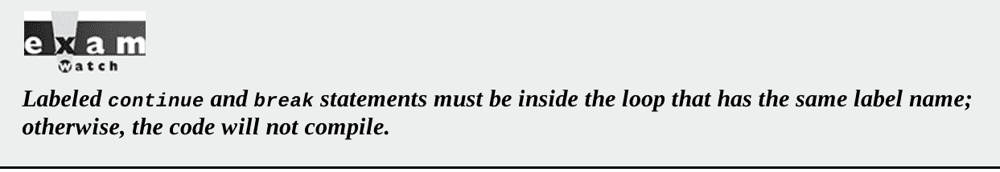

带标记的 `continue` 和 `break` 语句必须位于具有相同标记名的循环内部；否则代码将无法编译。

## 认证目标

### 处理异常 (OCA 目标 8.1, 8.2, 8.3, 8.4 和 8.5)

- 8.1 区分受检异常 (checked exceptions)、未检异常 (unchecked exceptions) 和错误 (errors)。
- 8.2 创建 `try-catch` 块并确定异常如何改变程序的正常流。
- 8.3 描述异常处理的优势。
- 8.4 创建并调用抛出异常的方法。
- 8.5 识别常见的异常类（如 `NullPointerException`、`ArithmeticException`、`ArrayIndexOutOfBoundsException`、`ClassCastException`）。

软件开发中有一句老格言：80% 的工作用于处理错误，而 20% 的时间用于编写功能。在许多语言中，检查错误的代码是枯燥的且会让程序变得臃肿。尽管如此，检测和处理可能是任何健壮应用程序最重要的部分。以下是 Java 异常处理的一些优势：

- 它为开发者提供了一种优雅的错误处理机制。
- 它让我们能够轻松检测错误。
- 它让我们将异常处理代码与正常代码分离。

# 捕获异常

在开始之前，让我们介绍一些术语。异常是改变程序流的事件。许多事情都会导致异常，包括硬件故障、资源耗尽和错误。当异常事件发生时，异常被称为“抛出”。负责对异常进行处理的代码被称为异常处理器，它“捕获”抛出的异常。为了做到这一点，我们使用 `try` 定义一个可能发生异常的代码块。一个或多个 `catch` 子句将特定的异常与代码块匹配。如下伪代码所示：

```java
try {
    // 这是受保护区域的第一行
    // 受 try 关键字控制。
    // 可能导致某种异常的代码。
    // 我们可能有很多行或只有一行。
} catch(MyFirstException) {
    // 此处处理该异常
    // 这是异常处理器的下一行。
    // 这是异常处理器的最后一行。
} catch(MySecondException) {
    // 此处处理该异常
}
// 其他非受保护（正常、无风险）代码区域开始
```

在伪代码示例中，第 2 到 5 行构成了受 `try` 子句控制的保护区域。第 7 行是类型为 `MyFirstException` 的异常的异常处理器。第 12 行是类型为 `MySecondException` 的异常的异常处理器。注意 `catch` 块紧跟 `try` 块。这是一个要求；如果你有一个或多个 `catch` 块，它们必须紧跟 `try` 块。此外，所有的 `catch` 块必须相互跟随，中间不能有其他语句或块。

保护区域的执行从第 2 行开始。如果程序执行完第 5 行且没有抛出异常，执行将跳转到第 15 行并继续向下。但是，如果在第 2 到 5 行（`try` 块）的任何时候抛出了类型为 `MyFirstException` 的异常，执行将立即跳转到第 7 行。第 8 到 10 行将执行，以便整个

注意，如果在 `try` 块的第 3 行发生异常，`try` 块中剩余的行（4 行和 5 行）将永远不会执行。一旦控制跳转到 `catch` 块，它就不会返回完成 `try` 块的剩余部分。不过，这正是你想要的。假设你的代码如下所示伪代码：

```
try {
  FromFileFromNetwork
  readFromFileAndPopulateTable
} catch (CantGetFromFileNetwork) {
  displayNetworkErrorMessage
}
```

这段伪代码演示了你通常如何处理异常。依赖于风险操作的代码（例如用文件数据填充表格）被分组在一个 `try` 块中，这样如果第一个操作失败了，你就不会继续运行其他同样保证会失败的代码。在伪代码示例中，如果你从根本无法从网络获取文件，你就无法从文件中读取。

使用异常处理的好处之一是，处理保护区域内可能发生的任何特定异常的代码只需要编写一次。回到我们之前的代码示例，`try` 块中可能有三个不同的地方可以生成 `MyFirstException`，无论它在何处发生，都将由同一个 `catch` 块（第 7 行）处理。我们将在本章结束时讨论异常处理的更多好处。

## 使用 finally

尽管 `try` 和 `catch` 提供了一种捕获和处理异常的极佳机制，但我们仍然面临在发生异常时如何进行清理的问题。因为异常一旦抛出，就会立即离开 `try` 块，因此我们不能将清理代码放在 `try` 块的底部，并期望在发生异常时它会被执行。同样糟糕的主意是将清理代码放在每个 `catch` 块中——让我们看看为什么。

异常处理器并不是在 `try` 块代码执行后进行清理的良好位置，因为每个处理程序都需要清理代码的副本。例如，如果你在保护区域的某处分配了网络套接字或打开了文件，每个处理程序都必须关闭文件或释放套接字。这将非常容易忘记清理，并导致大量的冗余代码。为了解决这个问题，Java 提供了 `finally` 块。

`finally` 块封装了在 `try` 块之后某个点始终会被执行的代码，无论是否抛出了异常。即使 `try` 块中有 `return` 语句，`finally` 块也会会在遇到 `return` 语句之前、在 `finally` 执行之前执行！

这是关闭文件、释放网络套接字以及执行你的代码所需的任何其他清理的正确位置。如果 `try` 块执行时没有异常，`finally` 块会在 `try` 块完成后立即执行。如果抛出了异常，`finally` 块会在相应的 `catch` 块完成后立即执行。让我们来看另一个伪代码示例：

```
try {
  // 这是“保护区域”的第一行。
} catch (MyFirstException) {
  // 在此处放置处理此异常的代码
} catch (MySecondException) {
  // 在此处放置处理此异常的代码
} finally {
  // 在此处放置代码，以释放我们在
  // try 子句中分配的任何资源
}
```

与之前一样，执行从 `try` 块的第一行即第 2 行开始。如果 `try` 块中没有抛出异常，执行将转移到第 11 行，即 `finally` 块的第一行。相反，如果在捕获 `try` 块中的代码时抛出了 `MySecondException`，执行将转移到该异常处理器的第一行，即 `catch` 子句中的第 8 行。在执行完 `catch` 子句中的所有代码后，程序将移动到第 11 行，即 `finally` 子句的第一行。重复一遍：`finally` 总是运行！好的，我们必须稍微完善一下，但现在请先记住“`finally` 总是运行”这个观念。如果抛出了异常，`finally` 运行。如果没有抛出异常，`finally` 运行。我们稍后会查看 `finally` 可能不运行或完成的少数情况。

记住，`finally` 子句不是强制要求的。如果你不写它，代码也可以正常编译和运行。事实上，你可能甚至不需要 `finally` 子句。此外，由于编译器甚至不需要 `catch` 子句，有时你会遇到紧随 `try` 块之后就是 `finally` 块的代码。这在 `try` 块执行且没有异常时非常有用，`finally` 块会在 `try` 块完成后立即执行。如果抛出了异常，`finally` 块会在相应的 `catch` 块完成后立即执行。

你可以不断向堆栈中的方法向下抛出异常。但当你到达底部的 `main()` 方法时会发生什么？你也可以将异常抛出 `main()` 方法。这将 JVM 停止，并将堆栈跟踪打印到输出输出中。下面的代码抛出了异常：

```java
class TestEx {
    public static void main(String [] args) {
        doStuff();
    }
    static void doStuff() {
        doMoreStuff();
    }
    static void doMoreStuff() {
        int x = 5/0; // 不能除以零！
        // 这里抛出 ArithmeticException
    }
}
```

它会打印类似下面的堆栈跟踪：

```
@java TestEx
Exception in thread "main" java.lang.ArithmeticException: / by zero
at TestEx.doMoreStuff(TestEx.java:10)
at TestEx.doStuff(TestEx.java:7)
at TestEx.main(TestEx.java:3)
```

# 练习 5-3

### 传播和捕获异常

在本次练习中，你将创建两个处理异常的方法。其中一个方法是 `main()` 方法，它将调用另一个方法。如果在另一个方法中抛出了异常，`main()` 将处理它。将包含一个 `finally` 语句以指示程序已完成。`main()` 将的方法的方法命名为 `reverse`，并将反转字符串中字符的顺序。如果字符串不包含字符，`reverse` 将异常传播到 `main()` 方法。

创建一个名为 `Propagate` 的类和一个 `main()` 方法，该方法目前保持为空。

1. 创建一个名为 `reverse` 的方法。它接受一个 `String` 参数并返回一个 `String`。
2. 在 `reverse` 中，使用 `String.length()` 方法检查字符串长度是否为 0。如果长度为 0，`reverse` 方法将抛出一个异常。
3. 现在包含反转字符串顺序的代码。因为这不是本章的主题，我们已经提供了反转代码，但你可以尝试自己实现。

```java
String reverseStr = "";
for(int i=s.length()-1;i>=0;--i) {
    reverseStr += s.charAt(i);
}
return reverseStr;
```

5. 现在在 `main()` 方法中将尝试调用此方法并处理任何潜在的异常。此外，你将包含一个 `finally` 语句，显示 `main()` 何时结束。

# 定义异常

我们一直都在讨论异常这一概念。我们知道当发生某种类型的问题时会抛出异常，并且我们知道它们对程序执行流的影响。在本节中，我们将进一步开发这些概念，并在功能性 Java 代码中使用异常。

早些时候我们说异常是改变正常程序流的事件。但因为是 Java，任何非原始类型都必须是一个对象。异常也不例外。每个异常都是一个在继承体系中包含 `Exception` 的类的实例。换句话说，异常总是 `java.lang.Exception` 的某个子类。

当异常被抛出时，会实例化特定异常子类型的对象，并作为 `catch` 句的参数传递给异常处理器。实际的 `catch` 句看起来如下：

```java
try {
    // 此处某些代码
} catch (ArrayIndexOutOfBoundsException e) {
    e.printStackTrace();
}
```

在这个示例中，`e` 是 `ArrayOutOfBoundsException` 类的实例。与任何其他对象一样，你可以调用它的方法。

# 异常层次结构

所有异常类都是 `Exception` 类的子类。该类派自 `Throwable` 类（该类又派自 `Object` 类）。图 5-2 显示了异常类的层次结构。

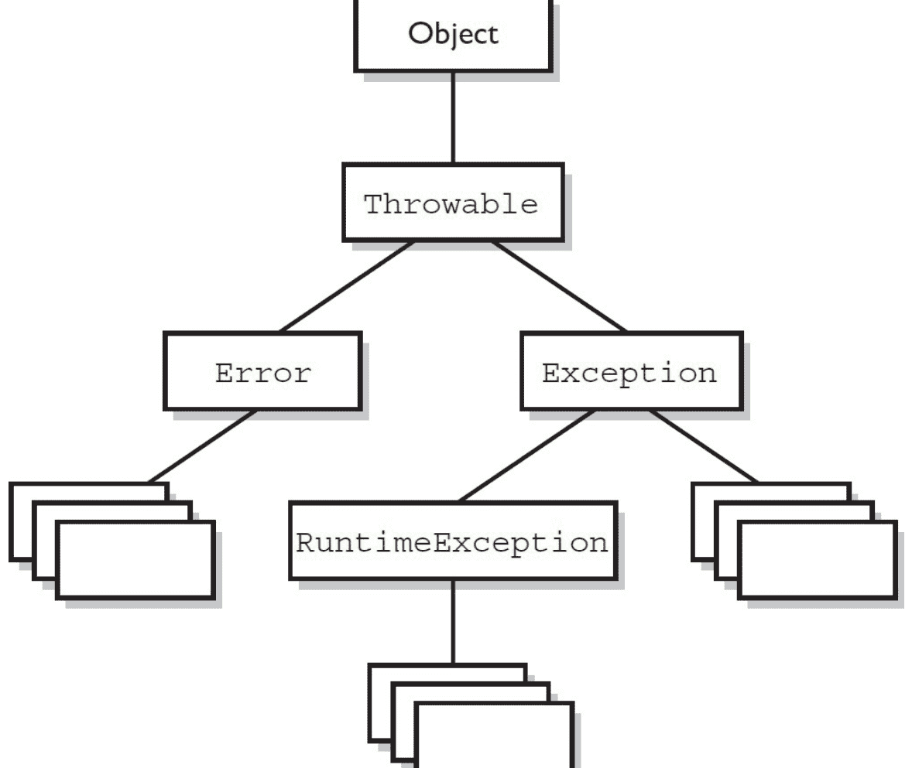

图 5-2 异常类层次结构


如所示，有两个子类派自 `Throwable`：`Exception` 和 `Error`。派自 `Error` 的类代表并非程序错误引起的异常情况，并指示程序执行期间通常不会发生的情况，例如 JVM 内存不足。通常，你的应用程序无法从 `Error` 中恢复，因此你不需要处理它们。如果你的代码没有处理它们（通常也不会处理），它仍然可以顺利编译。虽然 `Error` 通常被认为是异常情况，但从技术上讲它们不是异常，因为它们没有派自 `Exception` 类。

通常，异常代表的不是由于编程错误发生的事情，而是因为某些资源不可用或正确执行所需的其他条件不存在。例如，如果你的应用程序应该与另一个应用程序通信但计算机没有响应，这不是由 bug 引起的异常。图 5-2 还显示了名为 `RuntimeException` 的 Exception 子类。这些异常是一个特殊情况，因为它们有时指示程序错误。它们也可以代表难以处理的异常情况。异常将在本章后面进行详细讨论。

Java 提供了许多异常类，大多数具有非常具描述性的名称。第一个来自异常类型本身。下一个来自你可以从异常对象中获取的信息。`Throwable` 类（位于异常继承树的顶端）为其后代提供了在异常处理器中非常有用的方法。其中之一就是 `printStackTrace()` 方法，如较早的示例所示，它将打印从异常发生处的堆栈跟踪。

我们讨论过调用堆栈是向上构建的，最近被调用的方法位于顶端。你会发现 `printStackTrace()` 方法会打印最近进入的方法并继续向下，在从顶端向下遍历调用堆栈的过程中打印每个方法的名称（这被称为“栈溯”）。

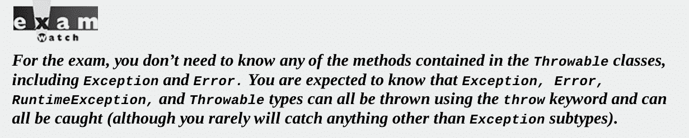

对于示例，你不需要知道 `Throwable` 类包含的任何方法，包括 `Exception` 和 `Error`。你应该知道 `Exception`、`Error`、`RuntimeException` 和 `Throwable` 类型都可以使用 `throw` 关键字抛出，并且可以被捕获（尽管你很少捕获 `Exception` 子类以外的内容）。

## 处理整个异常层次结构

我们讨论过 `catch` 关键字允许你指定要捕获的特定异常。你可以在单个 `catch` 句中捕获多种异常。如果 `catch` 句中的异常类没有子类，则只会捕获指定的异常类。然而，如果 `catch` 句中指定的类有子类，那么任何其子类的异常都将被捕获。

例如，`IndexOutOfBoundsException` 有两个子类 `ArrayIndexOutOfBoundsException` 和 `StringOutOfBoundsException`。如果你想以特殊方式处理其中一个子类型但想一起处理其余部分，只需要两个 `catch` 句。

当异常被抛出时，Java 将尝试寻找（通过从上下查找可用的 `catch` 句）该异常类型的 `catch` 句。如果没找到，它将搜索异常的父类型的处理器。如果找不到匹配异常父类型的 `catch` 句，异常将向下传播到调用栈。这个过程被称为“异常匹配”。让我们来看一个例子。

```java
1: import java.io.*;
2: public class ReadData {
3: public static void main(String[] args) {
4: try {
5: RandomAccessFile raf =
6: new RandomAccessFile("file.txt", "r");
7: byte b[] = new byte[1000];
8: raf.readFully(b, 0, 1000);
9: }
10: catch (FileNotFoundException e) {
11: System.err.println("File not found");
12: System.err.println(e.getMessage());
13: e.printStackTrace();
14: }
15: catch (IOException e) {
16: System.err.println("IO Error");
17: System.err.println(e.toString());
18: e.printStackTrace();
19: }
20: }
21: }
```

这个短程序尝试打开一个文件并从中读取一些数据。打开和读取文件可能会产生许多异常，大多数是某种类型的 `IOException`。抵制编写如下单一异常处理器的倾向：

```java
try {
    // 某些代码
} catch (Exception e) {
    e.printStackTrace();
}
```

这段代码将捕获生成的每个异常。当然，没有任何异常处理器可以正确处理每个异常，这种方式编程会违背设计。异常处理器一次捕获许多错误可能会降低你程序的可靠性。

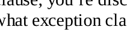

我们只感兴趣异常异常是否为 `FileNotFound`。否则，我们并不关心具体问题是什么。

`FileNotFoundException` 是 `IOException` 的子类。因此，我们可以在捕获所有 `IOException` 子类的 `catch` 句中处理它，但那样我们就必须测试该异常以判断它是否为 `FileNotFound`。相反，我们为 `FileNotFound` 编写了一个特殊的处理程序，并为所有其他 `IOException` 子类编写了单独的异常处理器。

如果这段代码产生 `FileNotFound`，它将由从第 10 行开始的 `catch` 句处理。如果它产生另一个 `IOException`——例如 `EOFException`，它是 `IOException` 的子类——它将由从第 15 行开始的 `catch` 句处理。如果生成了其他异常（作为某种类型的运行时异常），则两个 `catch` 句都不会执行，异常将沿堆栈向下传递。

注意，针对 `FileNotFound` 的 `catch` 句被放在 `IOException` 句器的上方。这非常重要！如果我们反过来操作，程序将无法编译。最具体异常的处理器必须始终放置在更通用异常的处理器之上。以下代码无法编译：

```java
try {
  // 执行危险操作
 catch (IOException e) {
    // 处理通用的 IOExceptions
    catch (FileNotFoundException ex) {
      // 只处理 FileNotFound
    }
}
```

你将得到类似这样的编译器错误：

```
TestEx.java:15: exception java.io.FileNotFoundException has already been caught
catch (FileNotFoundException ex) {
```

如果你回想起那些带棒球手套的人（在“传播未捕获的异常”章节中），请想象一下最通用的手套是最大的，可以接住各种类型的球。`IOException` 足够大且足够灵活，可以接住任何类型的 `IOException`。所以，五楼的人（比如 Fred）手里有一个巨大的！`IOException` 异常，他不由得用它接住了一个 `FileNotFound` 球。而如果二楼的那个家伙（比如 Jimmy）手里拿着一个 `FileNotFound` 球，那么这个 `FileNotFound` 球永远无法到达他那里，因为它总会被站在五楼的 Fred 挡住，他站在那里，拿着足够接住任何 `IOException` 的大手套。

那么，对于类层级中处于兄弟关系的 Fred 你该怎么办呢？如果一个 `Exception` 类不是另一个类的子类或父类，那么 `catch` 句的放置顺序就无关紧了。

## 异常声明与公共接口

那么，我们如何知道某个方法抛出了我们必须捕获的异常呢？就像方法可能会指定它接受什么类型和多少数量的参数以及返回值一样，方法必须被声明（除非这些异常是 `RuntimeException` 的子类）。被抛出的异常列表是方法公共接口的一部分。`throws` 关键字用法如下，用于列出方法可能抛出的异常：

```java
void myFunction() throws MyException1, MyException2 {
  // 方法的代码
}
```

该方法具有 `void` 返回类型，不接受任何参数，并声明它可以抛出两种类型异常之一：要么是 `MyException1`，要么是 `MyException2`。（因为方法声明了它会抛出异常并不意味着它真的会抛出。它只是告诉大家如此。）

假设你的方法没有直接抛出异常，而是调用了一个抛出异常的方法。你可以选择不自己处理该异常，而是直接声明它，仿佛是你的方法实际上抛出了该异常一样。如果你声明了你的方法可能从另一个方法获取的异常，且你没有为它提供 `try/catch`，那么该方法将传回调用你方法的方法，并可能被捕获或继续由堆栈更深处的方法处理。

任何可能抛出异常的方法（除非它是 `RuntimeException` 的子类）必须声明该异常。这包括那些实际上并没有抛出异常的方法。

记住这一点：

- 每个方法必须通过提供 `catch` 句来处理所有已处理的受检异常，或者将每个未处理的受检异常作为 `throws` 异常列出。

这一规则被称为 Java 的“处理或声明”（handle or declare）要求（有时称为“捕获或声明”）。


寻找调用声明异常方法的代码，其中调用方法没有处理或声明该受检异常。以下代码（使用 `throw` 关键字手动抛出异常——下文将详细介绍）有两个编译器会阻止其产生的问题：

```java
void doStuff() {
  doMore();
}
void doMore() {
  throw new IOException();
}
```

首先，`doMore()` 方法抛出了一个受检异常但没有声明它！但假设我们如下修复了 `doMore()` 方法：

```java
void doMore() throws IOException { ... }
```

`doStuff()` 方法仍然面临问题，因为它也必须声明 `IOException`，除非它通过提供 `try/catch` 以及一个可以接收 `IOException` 的 `catch` 句来处理它。

而且，某些异常不受此规则的限制。`RuntimeException` 类型的对象可以抛出，而无需指定其作为方法公共接口的一部分（且不需要处理器）。即使方法抛出了异常，也不需要这样做。

（注：此处原文文本似乎存在大量重复的句子，翻译时已根据逻辑进行处理）

当抛出 `Exception` 子类对象时，必须被处理或声明。这些对象被称为“受检异常”。准备好识别那些不遵循“处理或声明”规则的方法，例如：

```java
class MyException extends Exception {
    void someMethod () {
        doStuff();
    }
    void doStuff() throws MyException {
        try {
            throw new MyException();
        }
        catch(MyException me) {
            throw me;
        }
    }
}
```

你需要识别出这段代码无法编译。如果你尝试，你会得到：

```
MyException.java:3: unreported exception MyException;
must be caught or declared to be thrown
    doStuff();
```

你需要知道 `Error` 与受检和运行时异常的区别。`Error` 类型的对象不是 `Exception` 对象，尽管它们代表了异常情况。`Exception` 和 `Error` 共享一个父类 `Throwable`；因此，两者都可以使用关键字抛出。当抛出 `Error` 或 `Error` 的子类（如 `StackOverflowError`）时，它是运行时异常。你不需要捕获 `Error` 对象或 `Error` 子类。你也可以自己抛出 `Error`（虽然除了 `AssertionError`，你可能永远不想这样做），并且你可以再次捕获它，但可能不会。例如，如果你遇到了 `OutOfMemoryError`，你实际上会做什么？它不像当垃圾回收器运行时；你完全可以认为 JVM 已经拼命地自救了，并在你到达那里之前回收了它捕到的所有内存。换句话说，不要期望 JVM 在那个时刻说：“运行垃圾回收器？感谢你告诉我。我从来没想过这一层。好的，我这就去办。”更好的是，如果发生了了 `VirtualMachineError`，你会怎么办？

```java
class Test {
    public static void main(String [] args) {
        badMethod();
    }
    static void badMethod() { // 不需要声明 Error
        doStuff();
    }
    static void doStuff() { // 不需要声明 Error
        try {
            throw new Error();
        }
        catch (Error me) {
            throw me;    // 我们捕获了它，但将其重新抛出
        }
    }
}
```

如果我们抛出的是受检异常而不是 `Error`，那么 `doStuff()` 方法就需要声明该异常。但请记住，由于 `Error` 不是 `Exception` 的子类型，因此它不需要声明。你可以根据需要声明它，但编译器并不关心 Error 是由谁在何时以何种方式抛出的。


**因为 Java 有受检异常，人们常说 Java 强制要求开发者处理异常。** 是的，Java 强迫我们为正常运行期间可能发生的每个异常编写异常处理器，但让这些异常处理器实际做一些有用的事情取决于我们。我们认识一些软件经理，当他们看到程序员写下这样的代码时会气崩溃：

```java
try {
    callBadMethod();
} catch (Exception ex) { }
```

注意到遗漏了什么吗？不要通过捕获异常而不进行实际处理来“吞掉”异常。你将无法得知异常是否已经发生，因为你永远看不到堆栈跟踪信息。

## 重新抛出相同的异常

就像你可以在 `catch` 语句中抛出一个新异常一样，你也可以抛出刚刚捕获的同一个异常。这里有一个执行此操作的 `catch` 语句：

```java
catch (IOException e) {
    // 如果你决定无法处理它……先执行操作
    throw;
}
```

与同一个 `try` 相关的所有其他 `catch` 语句都会被忽略；如果存在 `finally` 块，它会运行，并且异常会被抛回给调用方法（堆栈中的下一个方法）。如果你从 `catch` 语句中抛出一个受检异常，你也必须声明它！换句话说，你必须处理并声明它，而不是仅仅处理或声明。以下示例是非合法的：

```java
public void doStuff() {
    try {
        // 危险的 IO 操作
    } catch (IOException ex) {
        // 无法处理
        throw ex; // 除非声明它，否则无法抛出
    }
}
```

在前面的代码中，`doStuff()` 方法显然能够抛出一个受检异常——在本例中是 `IOException`——所以编译器说：“哎，你在那儿写了 `try/catch` 真是太棒了，但这还不够够。如果你重新考虑一下你捕获的 `IOException`，那么你必须声明它（在方法签名中）！”

## 练习 5-4

## 创建异常


在本次练习中，我们尝试创建一个自定义异常。我们不会添加任何新方法（它将只有继承自 `Exception` 的方法）；并且因为它扩展了 `Exception`，编译器将其视为受检异常。程序的目标是判断代表特定食物（字符串）的命令行参数是坏的还是好的。

- 1. 让我们创建异常。我们将其命名为 `BadFoodException`。当遇到坏食物时，将抛出此异常。
- 2. 创建一个名为 `MyException` 的包装类和一个 `main()` 方法，目前该保持为空。
- 3. 创建一个名为 `checkedFood()` 的方法。它接收一个 `String` 参数，如果不喜欢给定的食物，则抛出一个异常。否则，它会返回食物。你可以添加任何不在列表中的食物。
- 4. 现在在 `main()` 方法中，从 `String` 数组中获取命令行参数，将其传递给 `checkedFood()` 方法。由于它是受检异常，`checkedFood()` 方法必须声明它，且 `main()` 方法必须处理它（使用 `try/catch`）。不要让 `main()` 声明异常，因为如果 `main()` 逃避了异常，还有谁来捕获它呢？（实际上，`main()` 可以合法地声明异常，但在本次练习中不要这样做。）

尽管异常处理非常精妙，但妥善利用它仍然取决于开发者。异常处理让组织代码和信号化问题变得简单，但异常处理器仍然必须是……

## 认证目标

### 常见异常与错误 (OCA 目标 8.5)

8.5 识别常见的异常类（例如 `NullPointerException`、`ArithmeticException`、`ArrayIndexOutOfBoundsException`、`ClassCastException`）

该目标的用意是确保你熟悉作为 Java 程序员会遇到的一些常见异常和错误。


> 来自此节的问题可能类似于：“这里有一些执行了坏操作的代码，将抛出哪种异常”。在整个考试，题目将给出一些代码并要求你判断代码是否会运行或是否会抛出异常。由于这些问题非常常见，理解这些异常的原因对你的成功至关重要。

这是另一个在真实考试中处处出现的目标之一（“在运行时抛出异常”听起来耳熟吗？），所以确保这一部分获得你大部分的关注。

### 异常从何而来

回到上一页看最后的一句话。理解导致异常和错误的原因以及它们从何处来非常重要。为了准备考试，让我们将异常和错误分为两类：

- JVM 异常：那些由 JVM 专门或逻辑上由 JVM 抛出的异常或错误。
- 程序性异常：那些由应用程序和/或 API 程序员显式抛出的异常。

### JVM 抛出的异常

让我们从一个非常常见的异常 `NullPointerException` 开始。正如我们在前面的章节中看到的，当你尝试使用当前值为 `null` 的引用变量来访问对象时，就会发生这种异常。编译器无法希望在运行之前发现这些问题。看看以下代码：

```java
class NPE {
    static String s;
    public static void main(String[] args) {
        System.out.println(s.length());
    }
}
```

难道编译器能发现这个微小程序的问题吗！不，得靠你自己。代码可以正常编译，但 JVM 会抛出 `NullPointerException`。在本章早些时候我们讨论了调用堆栈。正如你所记得的，`main()` 位于堆栈的底部，随着 `main()` 调用另一个方法，该方法再调用另一个方法，堆栈就会增长。当然，堆栈位于内存中，即使你给程序提供了 GB 级的内存，它仍然是有限的。堆栈可能会增长到导致操作系统没有空间来存储它。当这种情况发生时，你会得到……`StackOverflowError`。这种情况最常见的方法是创建一个递归方法。递归方法在方法体内调用自己。虽然这听起来很奇怪，但对于搜索和排序算法来说是常用且有效的技术。看看这段代码：

```java
void go() { // 递归故障
    go();
}
```

如你所示，如果你犯了调用 `go()` 方法的错误，你的程序将陷入黑洞——无论你拥有多少内存，你都会得到 `StackOverflowError`。再次，只有 JVM 知道这一时刻何时发生，JVM 将是该错误的来源。

### 程序性抛出的异常

现在让我们看看程序性抛出的异常。记得程序性的定义类似于：

> 由应用程序和/或 API 开发者创建

例如，Java API 中的许多类都具有接收 `String` 参数并将这些字符串转换为数值的方法。这些类的一个很好的例子是我们将在第 6 章学习的所谓“包装类”。尽管我们还没有讨论过包装类，但下面的示例应该能很好地说明。很久以前，某个程序员编写了 `java.Integer` 类并创建了 `parseInt()` 和 `valueOf()` 方法。该程序员决定，如果这些方法传递了一个无法转换为数字的 `String`，该方法应该抛出 `NumberFormatException`。部分实现的代码可能如下：

```java
int parseInt(String s) throws NumberFormatException {
    boolean parseSuccess = false;
    int result = 0;
    // 复杂的解析
    if (!parseSuccess) // 如果解析失败
        throw new NumberFormatException();
    return result;
}
```

程序化异常的包括 `AssertionError`（好吧，它不是异常，但它确实是程序化抛出的）和抛出 `IllegalArgumentException`。事实上，我那个神话 API 开发者本可以为你的 `parseInt()` 方法使用 `IllegalArgumentException`。但事实证明在这种情况下，使用 `NumberFormatException` 继承 `IllegalArgumentException` 更加精确，这样你就拥有了异常层次结构，你应该使用你所能的最精确的异常。

当然，正如我们之前讨论的，你也可以创建自己的自定义异常，并在任何需要的时候抛出它们。这些自制的异常也属于“程序化抛出的异常”的范畴。

### 考试异常与错误总结

OCA 8 目标 8.5 列出了一些特定的异常和错误；它提到“识别常见的异常类（例如……）”。表 5-2 总结了可能出现在 OCA 8 考试中的十种异常和错误。

表 5-2 常见异常的描述和来源

| 异常 | 描述 | 通常抛出 |
|---|---|---|
| `ArrayIndexOutOfBoundsException`（本章） | 当尝试使用无效索引值（负数或超出数组长度）访问数组时抛出。 | 由 JVM 抛出 |
| `ClassCastException`（第 2 章） | 当尝试将引用变量转换为通过 IS-A 测试通过时抛出。 | 由 JVM 抛出 |
| `IllegalArgumentException` | 当方法接收到的参数格式与方法预期不同时抛出。 | 程序化抛出 |
| `IllegalStateException` | 当环境状态与尝试的操作不匹配时——例如，使用已关闭的扫描。 | 程序化抛出 |
| `NullPointerException`（第 3 章） | 当尝试对当前值为 null 的引用变量调用方法或访问其属性时抛出。 | 由 JVM 抛出 |
| `NumberFormatException`（本章） | 当将字符串转换为数字的方法接收到一个无法转换的字符串时抛出。 | 程序化抛出 |
| `ArithmeticException` | 当尝试非法操作（如除以零）时抛出。 | 由 JVM 抛出 |
| `ExceptionInInitializerError`（第 2 章） | 当尝试初始化静态变量或初始化块时抛出。 | 由 JVM 抛出 |
| `StackOverflowError`（本章） | 通常在方法递归深度过深时抛出。（每次调用都会添加到栈中。） | 由 JVM 抛出 |
| `NoClassFoundError` | 当 JVM 因为命令行错误、类路径问题或缺少 .class 文件而找不到所需的类时抛出。 | 由 JVM 抛出 |

## 认证总结

本章涵盖了大量内容，所有内容都涉及基于条件测试控制程序流的方法。首先，你学习了 `if` 和 `switch` 语句。`if` 语句评估一个表达式以得到布尔结果。如果结果为真，程序将执行 `if` 包围块中的代码。如果使用了 `else` 语句且 `if` 结果为假，则将执行随后的 `else` 代码。如果没有定义 `else` 块，则与 `if` 语句相关的代码将都不会执行。

你还学习了 `switch` 语句可以替换多个 `if-else` 语句。`switch` 语句可以评估可以隐式转换为 `int` 的整数原始类型（这些是 `byte`、`short`、`int` 和 `char`）；或者它可以评估枚举；从 Java 7 开始，它可以评估字符串。在运行时，JVM 将尝试在 `switch` 语句中的表达式与相应 `case` 语句中的常量之间寻找匹配。如果找到匹配，执行将从匹配的 `case` 开始并从那里继续，执行所有剩余 `case` 语句中的代码，直到找到 `break` 语句或发生 `switch` 语句结束。如果没有匹配，则将执行 `default` 情况（如果存在的话）。

你已经学习了 Java 语言中提供的三个循环结构。这些结构是 `for` 循环（包括基础 `for` 和增强型 `for`，后者是 Java 5 新引入的）、`while` 循环和 `do-while` 循环。当你知道想要循环多少次时，使用 `for` 循环。当你不知道想要循环多少次时，使用 `while` 循环；而当你需要至少循环一次时，使用 `do-while` 循环。在 `for` 循环和 `while` 循环中，表达式必须评估为真才能进入块，并在每次循环迭代后检查。`do-while` 循环在执行一次循环后才会检查条件。`for` 循环的主要优势是在循环定义中初始化一个或多个变量，并在循环中递增或递减这些变量。

`break` 和 `continue` 语句可以使用带标签或不带标签的形式。不带标签时，`break` 语句将强制程序停止处理最内层的循环结构，并开始执行后续代码。使用不带标签的 `continue` 命令将导致程序停止当前内层循环迭代的执行并进入下次迭代。当以标签方式使用 `break` 或 `continue` 语句时，其执行方式相同，但有一个例外：该语句不适用于最内层循环；而是适用于带有标签的循环。`break` 语句通常与 `switch` 语句配合使用。当 `switch` 表达式与 `case` 常量匹配时，将执行 `case` 之后的代码。为了停止执行，需要 `break`。

你已经看到 Java 如何为异常处理提供一种优雅的机制。异常处理允许你将错误修正代码隔离到单独的块中，主代码就不会被错误检查代码所干扰。另一个优雅特性允许你用单个错误处理块处理多个错误，而不会产生代码重复。此外，错误处理允许你在单个块中处理错误，而不会产生代码重复。`finally` 块允许代码无论是否抛出异常都能执行，这对于清理资源非常有用。（注：原文此处存在大量重复段落，已根据要求在翻译中保持逻辑一致性。）

如果你想在没有任何 `case` 匹配条件值时运行代码，则应在 `switch` 语句中使用 `default` 关键字。

`default` 块位于 `switch` 块的任何位置，因此如果没有前面的 `case` 匹配，将进入 `default` 块；如果 `default` 不包含 `break`，代码将继续执行（贯穿）到 `switch` 结束或直到遇到 `break` 语句。

## 使用循环编写代码 OCA 目标 5.1, 5.2, 5.3 和 5.4

- 一个基础 `for` 语句包含三个部分：声明/或初始化、布尔评估和迭代表达式。
- 如果在基础循环内部对变量进行递增或评估，必须在循环之前或 `for` 声明中声明该变量。
- 在基础 `for` 循环声明中声明（未初始化）的变量无法在 for 循环外部访问——换句话说，“for 循环下面的代码无法使用该变量”。
- 你可以在基础 `for` 循环声明的第一部分初始化多个相同类型的变量；每个初始化之间必须用逗号分隔。
- 增强型 `for` 语句（Java 5 新引入）包含两个部分：声明和表达式。它仅用于遍历数组或集合。
- 使用增强型 `for` 时，表达式是你想要遍历的数组或集合。
- 使用增强型 `for` 时，声明是块变量，其类型必须与数组或集合的元素兼容，且该变量包含给定迭代中元素的值。
- 与 C 语言不同，你不能使用数字或任何无法评估为布尔值作为语句（如 `if`）或循环构造的条件。例如，你可以写 `if(x)`，除非 `x` 是布尔变量。
- `do-while` 循环至少会进入循环体一次。

## 使用 break 和 continue OCA 目标 5.5

- 无标签的 `break` 语句将导致内层循环的当前迭代停止，并执行其后的代码。
- 无标签的 `continue` 语句将导致内层循环的当前迭代停止，检查该循环的条件，如果满足条件则再次运行。
- 如果 `break` 语句或 `continue` 语句带有标签，它将在标签标记的循环上发生作用，而不是内层循环。

## 异常 (OCA 目标 8.1, 8.2, 8.3 和 8.5)

- Java 异常处理的优点包括：组织化的错误处理、错误检测、将异常处理代码与其他代码分离以及处理范围问题的能力。
- 异常分为两种类型：检查异常（checked）和非检查异常（unchecked）。
- 检查异常包括 `Exception` 的所有子类，但 `RuntimeException` 除外。
- 检查异常受“处理或声明”规则限制；任何可能抛出检查异常的方法都必须使用 `throws` 声明或通过 `try/catch` 处理异常。
- `Error` 或 `RuntimeException` 的子类是非检查异常，因此编译器不强制执行“处理或声明”规则。你可以自由地处理或声明它们。
- 无论异常是在 `try/catch` 中抛出还是被捕获，`finally` 块总是会被调用。
- 因为 `finally` 被调用并不意味着它执行完成。`finally` 块本身可能会抛出异常或使用 `System.exit()`。
- 未捕获的异常将沿着调用栈回溯，从抛出异常的方法开始，到 `main()` 方法结束（如果在 `main()` 中没有通过声明来“逃逸”该异常）。
- 你几乎总是可以通过扩展 `Exception` 或其子类来创建自己的异常。这种异常会被编译器视为检查异常。（也就是说，扩展 `RuntimeException` 很少。）
- 所有 `catch` 块必须从具体到通用排序。如果你同时有 `IOException` 和 `Exception` 的 `catch` 子句，必须将 `IOException` 放在代码的前部。否则，`IOException` 会被 `catch(Exception)` 捕获。

## 自测

1. 假设 `toString()` 是一个返回字符串 的方法，且代码如下：

```java
public class Flipper {
    public static void main(String[] args) {
        String o = "-";
        switch ("RED".toLowerCase()) {
            case "yellow":
                o += "y";
            case "red":
                o += "r";
            case "green":
                o += "g";
        }
        System.out.println(o);
    }
}
```

结果是什么？

- A. -
- B. -r
- C. -rg
- D. 编译失败
- E. 在运行时抛出异常

2. 假设：

```java
class Plane {
    static String s = "-";
    public static void main(String[] args) {
        new Plane().s1();
        System.out.println(s);
    }
    void s1() {
        try { s2(); }
        catch (Exception e) { s += "c"; }
    }
    void s2() throws Exception {
        s3();
        s += "r";
        s3();
        s += "b";
    }
    void s3() throws Exception {
        throw new Exception();
    }
}
```

结果是什么？

- A. -
- B. -c
- C. -c2
- D. -2c
- E. -c2b
- F. -c2bc
- G. 编译失败

3. 假设：

```java
try { int x = Integer.parseInt("two"); }
```

哪些可以用于创建适当的 `catch` 块？（多选）

- A. `ClassCastException`
- B. `IllegalStateException`
- C. `NumberFormatException`
- D. `IllegalArgumentException`
- E. `ExceptionInitializerException`
- F. `ArrayIndexOutOfBoundsException`

4. 假设：


```java
public class Flip2 {
    public static void main(String[] args) {
        String o = "-";
        String[] sa = new String[4];
        for(int i = 0; i < args.length; i++)
            sa[i] = args[i];
        for(String n : sa)
            switch(n.toLowerCase()) {
                case "yellow": o += "y";
                case "red": o += "r";
                case "green": o += "g";
            }
        System.out.print(o);
    }
}
```

且命令行调用为：`Java Flip2 RED Green`

哪些正确的？（多选）

- A. 字符串 `rgy` 出在输出中
- B. 字符串 `rgg` 出在输出中
- C. 字符串 `gyr` 出在输出中
- D. 编译失败
- E. 在运行时抛出异常

## 5. 假设：

```java
class Loop {
    public static void main(String[] args) {
        int[] x = {7,6,5,4,3,2,1};
        // 在此处插入代码
        System.out.print(y + " + ");
    }
}
```

哪些独立插入第 4 行可以编译？（多选）

- A. `for(int y : x) {`
- B. `for(x : int y) {`
- C. `int y = 0; for(y : x) { y = x[z];`
- D. `for(int y=0, z=0; z<x.length; z++) y = x[z];`
- E. `for(int y=0, int z=0; z<x.length; z++) { y = x[z];`
- F. `int y = 0; for(int z=0; z<x.length; z++) { y = x[z]; }`

## 6. 假设：

```java
class Emu {
    static String s = "-";
    public static void main(String[] args) {
        try {
            throw new Exception();
        } catch (Exception e) {
            try {
                throw new Exception("ic ");
            } catch (Exception ex) { s += "ic "; }
            throw new Exception();
        } catch (Exception x) { s += "mc "; }
        finally { s += "mf "; }
        }
        finally { s += "of "; }
        System.out.println(s);
    }
}
```

结果是什么？

- A. -ic of
- B. -mf of
- C. -ic mf
- D. -ic mf of of
- E. -ic mc mf of of
- F. -ic mc mf of mf
- G. 编译失败

## 7. 假设：

```java
class SubException extends Exception { }
class SubException extends SubException { }
public class CC { void doStuff() throws SubException { } }
class CC2 extends CC { void doStuff() throws SubException { } }
class CC3 extends CC { void doStuff() throws Exception { } }
class CC4 extends CC { void doStuff(int x) throws Exception { } }
```

结果是什么？（多选）

- A. 编译成功
- B. 编译失败，由于第 8 行错误
- C. 编译失败，由于第 10 行错误
- D. 编译失败，由于第 12 行错误
- E. 编译失败，由于第 14 行错误

## 8. 已知：

```java
public class Ebb {
    static int x = 7;
    public static void main(String[] args) {
        String s = "";
        for (int y = 0; y < 3; y++) {
            x++;
            switch(x) {
                case 8: s += "8";
                case 9: s += "9";
                case 10: { s+= "10";
```

结果是什么？

- A. 9 10 d
- B. 8 9 10 d
- C. 9 10 10 d
- D. 9 10 10 d 13
- E. 8 9 10 10 d 13
- F. 8 9 10 9 10 10 d 13
- G. 编译失败

## 9. 已知：

```java
3. class Infinity {
4.     public class Beyond extends Infinity {
5.     static Integer i;
6.     public static void main(String[] args) {
7.     int sw = (int)(Math.random() * 3);
8.     switch(sw) {
9.     case 0: { for(int x = 10; x > 5; x--)
10.     if (x < 1000000) x = 10;
11.     break;
12.     case 1: { int y = 7 * i; break; }
13.     case 2: { Infinity inf = new Beyond();
14.     Beyond b = (Beyond)inf;
15.     }
16.     }
17.     }
```

并且已知第 7 行将值 0、1 或 2 赋值给 `sw`，哪些是正确的？（选择多项）。

- A. 编译失败
- B. 可能会抛出 `ClassCastException`
- C. 可能会抛出 `StackOverflow`（堆栈溢出）
- D. 可能会抛出 `NullPointerException`（空指针异常）
- E. 可能会抛出 `IllegalStateException`
- F. 程序可能会挂起而永远不会完成
- G. 程序将始终完成且不执行

## 10. 已知：

```java
3. public class Circles {
4.     public static void main(String[] args) {
5.     int[] ia = {1,3,5,7,9};
6.     for(int x : ia) {
7.     for(int j = 0; j < 3; j++) {
8.     if(x > 4 && x < 8) continue;
9.     System.out.print(" " + x);
10.     if(j == 1) break;
11.     continue;
12.     }
13.     }
14.     }
15. }
```

结果是什么？

- A. 1 3 9
- B. 5 5 7 7
- C. 1 3 3 9 9
- D. 1 1 3 3 9 9 9
- E. 1 1 3 3 3 9 9 9
- F. 编译失败

## 11. 已知：

```java
3. public class OverAndOver {
    public static String s = "";
    public static void main(String[] args) {
        try {
            s += "1";
            throw new Exception();
        } catch (Exception e) { s += "2"; }
        finally { s += "3"; doStuff(); s += "4"; }
    }
    System.out.println(s);
    }
    public static void doStuff() { int x = 0; int y = 7/x; }
```

结果是什么？

- A. 12
- B. 13
- C. 123
- D. 1234
- E. 编译失败
- F. 1234 后面跟着一个异常
- G. 1234 后面跟着一个异常
- H. 抛出一个异常且没有其他输出

## 12. 已知：

```java
3. public class Wind {
    public static void main(String[] args) {
        foreach:
            for (int j=0; j<5; j++) {
                for (int k=0; k<3; k++) {
                    System.out.print(" " + j);
                }
                if (j==3 && k==1) break foreach;
                if (j==0 || j==2) break;
            }
    }
}
```

结果是什么？

- A. 0 1 2 3
- B. 1 1 3 3
- C. 0 1 1 1 2 3 3
- D. 1 1 3 3 4 4 4
- E. 0 1 1 1 2 3 3 4 4 4
- F. 编译失败

## 13. 已知：

```java
3. public static Gotcha
4. public static void main(String[] args) {
5.
   // 在此处插入代码
6.
7. }
8 void go() {
9.
   go();
10. }
11.}
```

并且给定以下代码片段：

- I. `new Gotcha().go();`
- II. `try { Gotcha().go(); } catch (Error e) { System.out.println("ouch"); }`
- III. `try { Gotcha().go(); } catch (Exception e) { System.out.println("ouch"); }`

当片段 I-III 独立添加到第 5 行时，哪些是正确的？（选择多项）。

- A. 部分无法编译
- B. 全部通过编译
- C. 所有将正常完成
- D. 都不会正常完成
- E. 只有一个可以正常完成
- F. 有两个可以正常完成

## 14. 给定代码段：

```java
String s = "bob";
String[] sa = {"a", "bob"};
final String s2 = "bob";
StringBuilder sb = new StringBuilder("bob");
```

```java
// switch(sa[0]) { // 第 1 行
// switch("b" + "bob") { // 第 2 行
// switch(sb.toString()) { // 第 3 行

// case "ann": // 第 4 行
// case s: // 第 5 行
// case s2: // 第 6 行
}
```

并且假设通过同时取消注释一个 `switch` 语句和一个 `case` 语句进行测试，哪些行将**失败**编译？（选择多项）。

- A. 第 1 行
- B. 第 2 行
- C. 第 3 行
- D. 第 4 行
- E. 第 5 行
- F. 第 6 行

## 15. 假设 `IOException` 位于 `java.io` 包中，并且给定：

```java
1. public class Frisbee {
2. // 在此处插入代码
3. int x = 0;
4. System.out.println(7/x);
5. }
6. }
```

并且给定以下四个代码：

- I. `public static void main(String[] args) throws Exception`
- II. `public static void main(String[] args) throws IOException`
- III. `public static void main(String[] args) throws IOException`
- IV. `public static void main(String[] args) throws RuntimeException`

如果将这些片段插入第 2 行，哪些是正确的？（选择多项）。

- A. 部分无法编译
- B. 全部通过编译
- C. 所有将正常完成
- D. 都不会正常完成
- E. 只有一个可以正常完成
- F. 有两个可以正常完成

---

提前开始且执行跳转到下次迭代。最后两个 `continue` 语句是多余的！

- 根据上述内容，A、B、C、E 和 F 都是错误的。（OCA 目标 5.2 和 5.5）

## 11. H 是正确的。

在抛出除以零异常时，String 的值确实是 123，但 `finally()` 不保证能完成，而在这种情况下 `finally()` 永远不会完成，因此 `System.out.println(S.O.P)` 永远不会执行。

- 根据上述内容，A、B、C、D、E 和 G 都是错误的。（OCA 目标 8.2 和 8.5）

## 12. C 是正确的。

`break` 跳出最内层循环并继续。带标签的 `break` 跳出并终止标签循环。

- 根据上述内容，A、B、D、E 和 F 都是错误的。（OCA 目标 5.2 和 5.5）

## 13. B 和 E 是正确的。

首先，`go()` 是一个设计糟糕的递归方法，保证会导致 `StackOverflow`。由于 `Exception` 不是 `Error` 的父类，捕获 `Exception` 将无法帮助处理 `Error`，因此片段 III 将无法正常完成。只有片段 II 会捕获 `Error`。

- 根据上述内容，A、C、D 和 F 都是错误的。（OCA 目标 8.1、8.2 和 8.4）

## 14. E 是正确的。

`switch` 的 `cases` 必须是编译时常量或枚举值。

- 根据上述内容，A、B、C、D 和 G 都是错误的。（OCA 目标 3.4）

## 15. D 是正确的。

这有点狡猾，但请记住我们正在为你应对真实考试做准备。如果你要抛出一个 `IOException`，你必须导入 `java.io` 包或使用完全限定类名声明异常。

- A、B、C 和 E 是错误的。根据上述内容，A、B 和 C 是错误的。E 是错误的，因为同时处理异常和声明异常是可以允许的。（OCA 目标 8.2 和 8.5）

---

- 16. C 和 D 是正确的。重写的方法不能抛出比被覆盖方法抛出的异常更宽的检查异常。然而，重写的方法可以抛出被覆盖方法未抛出的 `RuntimeException`。

- 根据上述内容，A、B、E 和 F 是错误的。（OCA 目标 1）


# 字符串、数组、ArrayList、日期和 Lambda

## 认证目标

- 创建和操作字符串
- 使用 `StringBuilder` 类及其方法操作数据
- 创建和使用日历数据
- 声明、实例化、初始化和使用一维数组
- 声明、实例化、初始化和使用多维数组
- 声明和使用 `ArrayList`
- 使用包装类
- 对引用变量使用封装
- 使用简单的 Lambda 表达式
- ✓ 两分钟演练

## Q&A 自测

本章侧重于与搜索、格式化和解析字符串；创建和使用日历相关对象；创建和使用数组和 ArrayList；以及使用简单的 Lambda 表达式相关的考试目标。这些主题中的许多可以填满一整本书。幸运的是，你不需要成为专家就能在考试中取得好成绩。考试团队打算仅包含这些技术的基础方面，在本章中，我们涵盖的内容比你通过考试相关目标所需的更多。

## 认证目标

# 使用 String 和 StringBuilder (OCA 目标 9.2 和 9.1)

9.2 创建和操作字符串。

9.1 使用 `StringBuilder` 类及其方法操作数据。

在旧的 OCJP 考试中你需要关于字符串的所有知识，在 OCA 8 考试中也同样需要。与 `String` 类紧密相关的是几乎完全相同的 `StringBuilder` 类。（对于方法，你对 `StringBuilder` 类唯一需要知道的是它恰拥有与 `String` 类完全相同的方法，但 `StringBuilder` 更快，因为方法没有同步。`StringBuilder` 和 `StringBuffer` 这两个类都提供 `String` 对象以及操作它们的方法，重要的区别在于这些对象是可变的。）

# String 类

本节涵盖 `String` 类，你需要理解的关键概念是：一旦创建了 String，它永远无法被改变。那么，当 String 对象似乎在变化时，发生了什么？让我们发现吧。

# 字符串是不可变对象

我们将从关于字符串的一些背景信息开始。你可能在测试不需要这些，但一些背景会有帮助。处理字符“字符串”是大多数编程语言的一个基本方面。在 Java 中，字符串中的每个字符都是 16 位的 Unicode 字符。由于 Unicode 字符是 16 位（不要跳过 ASCII 提供的 7 或 8 位），丰富的国际化字符集很容易在 Unicode 中表示出来。


在 Java 中，字符串是对象。对于所有其他对象，你可以使用 `new` 关键字创建一个字符串的实例：

```java
String s = new String();
```

这行代码创建了一个新的 `String` 类并将其赋值给引用变量 `s`。到目前为止，`String` 对象看起来与其他对象一样。现在，给字符串赋一个值：

```java
s = "abcdef";
```

（你很快就会发现，这两行代码的作用并不像看起来那样，所以请留意。）

事实证明 `String` 类有许多构造函数。我们可以使用这种更高效的快捷方式：

```java
String s = new String("abcdef");
```

以及这种更简洁的方式：

```java
String s = "abcdef";
```

上述这些选项之间存在细微差别，但它们的共同点是：创建一个值为 "abcdef" 的 `String` 对象，并将其赋值给引用变量 `s`。到目前为止一切正常。`String` 对象看起来与其他对象一样，但这一切的纠结在哪里？不可变性！一旦赋值了字符串值，它就永远无法改变——它是固化的、结束了。好消息是，虽然 `String` 对象是不可变的，但它的引用变量是可以变的，所以 `s` 可以指向另一个字符串。继续我们之前的例子，考虑这个：

```java
s = s.concat("more stuff");
```

现在等一下，我们刚刚不是说 `String` 对象是不可变的吗？所以这一切到底是什么？好问题：让我们看看实际上发生了什么。虚拟机（JVM）获取了字符串 `s` 的值（即 "abcdef"），并在末尾加上了 " more stuff"，得到了值 "abcdef more stuff"。由于字符串是不可变的，JVM 给了它值 "abcdef more stuff"，并让 `s` 指向它。在示例的这个点，我们有两个 `String` 对象：我们创建的第一个值为 "abcdef"，的第二个。技术上现在有三个 `String` 对象，因为 `concat` 的字面量参数 " more stuff" 本身就是一个新的 `String` 对象。（被 `s2` 指向）以及 "abcdef more stuff"（被 `s` 指向）。如果在调用 `s = s.concat(" more stuff")` 之前，我们没有预见或幸运为 "abcdef" 字符串创建一个第二个引用变量？在这种情况下，原始的 "abcdef" 字符串仍然存在于内存中，但它会被认为是“丢失”。我们的程序中没有代码可以引用它——它对我们丢失了。然而，原始的 "abcdef" 字符串并没有改变（它不能，记住；它是不可变的）；只有引用变量 `s` 改变了，指向不同的字符串。图 6-1 显示了当你重新赋值引用变量时堆上发生了什么。虚线表示被删除的引用。

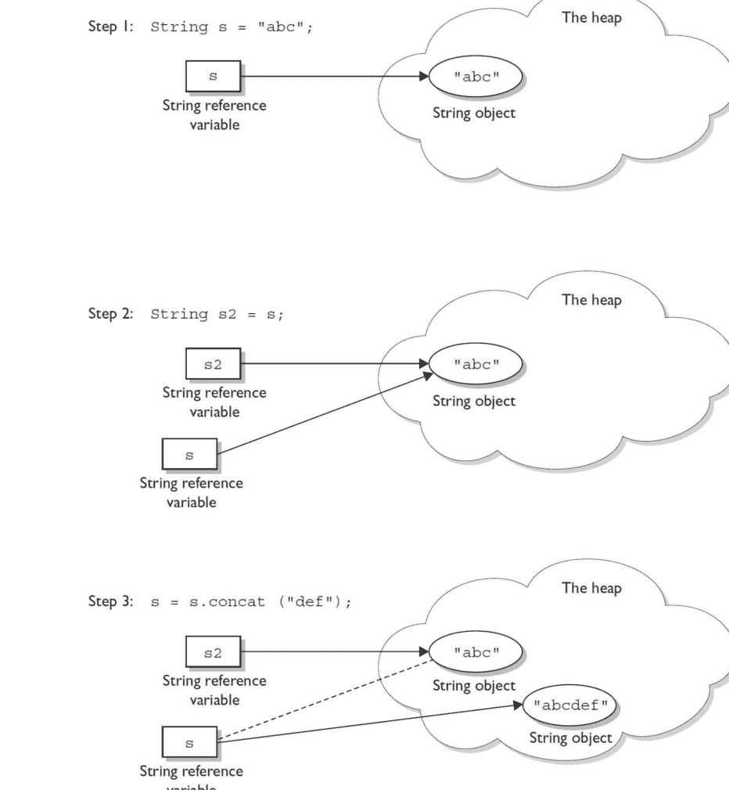

# 图 6-1 String 对象及其引用变量

回顾我们的第一个例子：

```java
s = "abcdef"; // 创建一个新的 String 对象，
// 值为 "abcdef"，s 指向它
s2 = s; // 创建第二个引用变量
// 指向同一个 String
```

```java
// 指向新的 String）。（记住 s2 仍然指向
// 原始的 "abcdef" String。）
```

```java
s = s.concat("more stuff"); // concat 方法将
// 字面量附加到末尾
```

让我们看看另一个例子：

```java
String x = "Java";
x.concat(" Rules!");
System.out.println("x = " + x); // 输出为 "x = Java"
```

第一行代码显而易懂：创建一个新的 String 对象，给它赋值为 "Java"，并引用它。接下来，JVM 创建了另一个值为 "Java Rules!" 的第二个 String 对象，但没有任何地方引用它。第二个 String 对象立即被丢失了；你无法获取到它。引用变量 `x` 仍然指向值为 "Java" 的原始 String。图 6-2 显示了创建了一个 String 但没有给它分配引用。

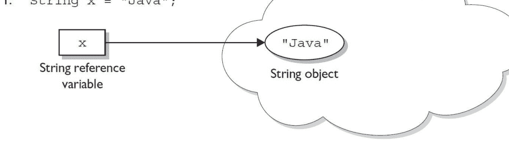

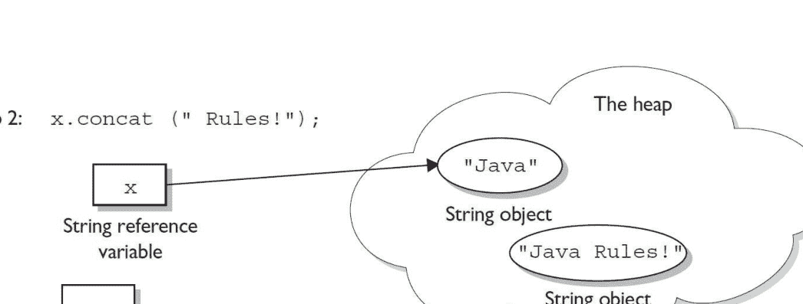

# 图 6-2 一个 String 对象在创建后即被遗弃了。

让我们扩展一下这个现在的例子。我们从这里开始：

```java
String x = "Java";
x.concat (" Rules!");
System.out.println("x = " + x); // 输出为：x = Java
```

现在我们加上：

```java
x.toUpperCase();
System.out.println("x = " + x); // 输出仍然是：
// x = Java
```

（我们实际上创建了一个值为 "JAVA" 的新 String 对象，但它丢失了，而 `x` 仍然指向原始未变的字符串 "Java"）。如果加上这个会怎样：

```java
x.replace('a', 'X');
System.out.println("x = " + x); // 输出仍然是：x = Java
```

你能判断出发生了什么吗？JVM 又创建了另一个值为 "JVXX" 的 String 对象（将所有的 'a' 替换为 'X'），但这次这个新 String 再次丢失了，导致 `x` 指向那个原始的、未改变且无法更改的 String 对象，其值为 "Java"。在所有情况下，我们都调用了各种字符串方法来通过修改现有 String 来创建一个新的 String，但我们从未将新创建的 String 赋值给引用变量。

但我们可以对之前的例子做一点小变化：

```java
String x = "Java";
x = x.concat(" Rules!"); // 将新字符串赋值给 x
System.out.println("x = " + x); // 输出：x Java Rules!
```

这一次，当 JVM 运行第二行时，会创建一个值为 "Java Rules!" 的新 String 对象，并将 `x` 设置为引用它。但等一下……还有更多——现在原始的 String 对象 "Java" 已经丢失了，没有人引用它。因此在两个例子中，我们都创建了两个 String 对象但只有一个引用变量，所以两个 String 对象中的一个被冷落了。（请看图 6-3，关于这个悲惨故事的图示描述。）

# 步骤 1：String x = "Java";

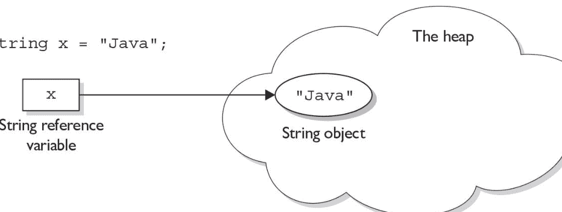

# 步骤 2：x = x.concat("Rules!");

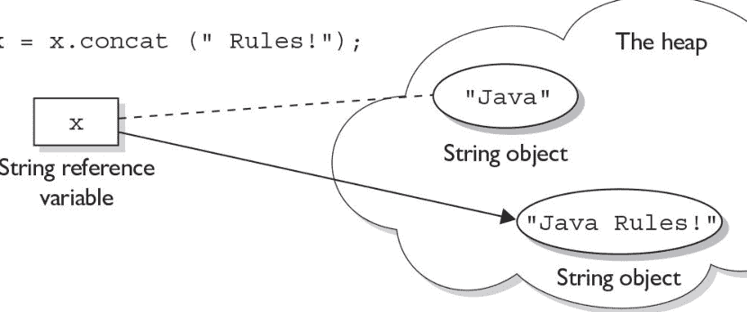

注意步骤 2 中，对 "Java" String 没有有效引用，该对象已被“遗弃”，并创建了一个新对象。

**图 6-3** 一个被遗弃的旧字符串对象。虚线表示被删除的引用。

让我们把这个例子再往前走一步：

```java
String x = "Java"
x = x.concat("Rules!");
System.out.println("x = " + x);    // 输出：x = Java Rules
```

```java
x.toLowerCase();                             // 没有赋值，创建一个
// 新的、遗弃的 String
```

```java
System.out.println("x = " + x);             // 没有赋值，输出
// 仍然是：x = Java Rules
```

```java
x = x.toLowerCase();                    // 创建一个新的 String，
// 赋值给 x
```

```java
System.out.println("x = " + x);     // 赋值导致输出
// x = java rules!
```

前面的讨论包含了理解 Java 字符串不可变性的关键。如果你真的、真的把所有的例子和图表反复地看一遍，考试中关于 String 的问题你就能做对 80%。

接下来我们将介绍有关字符串的更多细节，但不要误解——就性价比而言，我们已经涵盖了理解 Java 中 String 对象最重要的部分。

我们将通过展示一个你可能在考试中看到的“恶魔题目”的例子来结束本节。花时间在纸上推导一下（提示：跟踪有多少个对象和引用变量，以及哪一个引用哪一个）。

```java
String s1 = "spring";
String s2 = s1 + "summer";
s1.concat("fall");
s2.concat(s1);
s1 += "winter";
System.out.println(s1 + " " + s2);
```

输出是什么？加分题：println 语句创建了多少个 String 对象和多少个引用变量？答案：这段代码片段的结果是 spring winter。有两个引用变量：s1 和 s2。有两个对象。

# 关于字符串和内存的重要事实

在本节中，我们将讨论 Java 如何处理字符串字面量。让 String 对象不可变是一个好主意。字符串字面量占用大量内存是非常常见的。为了让 Java 更高效，JVM 会留出一个名为 String 池的特殊区域。当编译器遇到一个字符串字面量时，它会检查池是否存在相同的 String。如果找到匹配项，JVM 会重用该对象。

```java
String x = "library" + " card"; // output is "library card"
System.out.println(x);
String x = "Atlantic";
x += " ocean";
System.out.println(x); // output is "Atlantic ocean"
```

在前面的“Atlantic ocean”示例中，请注意 `x` 的值确实发生了变化！记住 `+=` 是一个赋值运算符，因此第 2 行实际上创建了一个新字符串 "Atlantic ocean"，并将其赋值给变量 `x`。在第 2 行执行后，原始引用的字符串 "Atlantic" 就被抛弃了。

## public boolean equalsIgnoreCase(String s)

此方法返回一个布尔值（true 或 false），取决于调用该方法时参数中 String 的值。即使 String 对象中的字符在比较时大小写不同，此方法也会返回 true——这里有一个例子：

```java
String x = "Exit";
System.out.println(x.equalsIgnoreCase("EXIT")); // is "true"
System.out.println(x.equalsIgnoreCase("tixe")); // is "false"
```

## public int length()

此方法返回用于调用方法的 String 的长度——这里有一个例子：


```java
String x = "012345678";
System.out.println(x.length()); // returns "8"
```


数组有一个名为 `length` 的属性（而不是方法）。你可能会在考试中遇到尝试对数组使用 `length()` 方法，或者尝试在 `String` 上使用 `length` 属性的题目。这两者都会导致编译错误——例如考虑这些：

```java
String x = "test";
System.out.println(x.length()); // compiler error
```

和

```java
String[] x = new String[3];
System.out.println(x.length()); // compiler error
```

## public String replace(char old, char new)

此方法返回一个字符串，其值等于调用方法的 `String` 的值，更新后是将第一个参数中出现的任何 `char` 替换为第二个参数中的 `char`——

```java
String x = "oxoxoxox";
System.out.println(x.replace('x', 'X')); // output is "oXoXoXoX"
```

## public String substring(int begin, int end)

`substring()` 方法用于返回调用方法的 `String` 的部分（或子字符串）。第一个参数代表子字符串的起始位置（从 0 开始）。如果调用只有一个参数，返回的子字符串将包含原始字符串末尾的字符。如果调用有两个参数，返回的子字符串将以原始字符串第 $n$ 个位置的字符结束，其中 $n$ 是第二个参数。遗憾的是，结束参数不是从 0 开始的，如果第二个参数是 7，则原始字符串第 7 个位置返回的最后一个字符的索引是 6（哎）。让我们来看一些例子：

```java
String x = "0123456789"; // 就像变魔术一样，每个字符的值都和它的索引相同！
System.out.println(x.substring(5)); // output is "56789"
System.out.println(x.substring(5, 8)); // output is "567"
```

第一个例子应该很简单：从索引 5 开始并返回字符串的剩余部分。第二个例子应该这样读：从 5 开始并返回包括第 8 个位置（索引 7）在内的字符。

## public String toLowerCase()

将 `String` 的所有字符转换为小写——这里有一个例子：

```java
String x = "A New Moon";
System.out.println(x.toLowerCase()); // output is "a new moon"
```

## public String toString()

此方法返回调用方法的 `String` 的值。什么？为什么你需要这样一个看似看起来“什么都没做”的方法？Java 中的所有对象都必须有一个 `toString()` 方法，它通常返回一个以某种有意义的方式描述该对象的字符串。对于 `String` 对象来说，还有比 `String` 的值更有意义的方式吗？为了保持一致性，这里有一个例子：

```java
String x = "big surprise";
System.out.println(x.toString()); // output? [读者的练习 :- ]
```

## public String toUpperCase()

将 `String` 的所有字符转换为大写——这里有一个例子：

```java
String x = "A New Moon";
System.out.println(x.toUpperCase()); // output is "A NEW MOON"
```

## public String trim()

返回一个值等于调用方法的 `String`，但删除了任何开头或结尾的空白——这里有一个例子：

```java
String x = " hi ";
System.out.println(x + " t");    // output is " hi t"
System.out.println(x.trim() + "t");  // output is "hit"
```

## StringBuilder 类

当你需要对字符串进行大量修改时，应该使用 `java.lang.StringBuilder` 类。如前节所述，`String` 对象是不可变的，如果你选择对 `String` 对象进行大量操作，你会在字符串池中产生大量被抛弃的 `String` 对象。（即使在如今以 GB 计的内存时代，浪费内存也不是好主意。）

正如你之前看到的，此方法会更新调用它的对象的值，无论返回的值是否赋值给变量。这个高度重载的方法有许多不同的参数，包括 `boolean`、`char`、`double`、`float`、`int`、`long` 等，但最可能使用的是 `String` 参数——例如：

```java
StringBuilder sb = new StringBuilder("set ");
sb.append("point");
System.out.println(sb);    // 输出为 "set point"
StringBuilder sb2 = new StringBuilder("pi =");
sb2.append(3.14159);
System.out.println(sb2);    // 输出为 "pi = 3.14159"
```

## public StringBuilder delete(int start, int end)

此方法修改调用它的 `StringBuilder` 对象的值。要删除的子字符串的起始索引由第一个参数定义（从 0 开始），删除的子字符串的结束索引由第二个参数定义（但是从 1 开始的！）。学习以下示例：

```java
StringBuilder sb = new StringBuilder("0123456789");
System.out.println(sb.delete(4,6));    // 输出为 "01236789"
```


考试可能会测试你对 `String` 和 `StringBuilder` 对象区别的知识。由于 `StringBuilder` 对象是可以变的，以下代码段的行为与使用 `String` 对象的类似代码段不同：

```java
StringBuilder sb = new StringBuilder("abc");
sb.append("def");
System.out.println( sb );
```

在这种情况下，输出将是："abcdef"

## public StringBuilder insert(int offset, String s)

此方法更新执行该方法调用的 `StringBuilder` 对象的值。传递第二个参数的 `String` 将插入到 `StringBuilder` 中，从第一个参数表示的 offset 位置开始（offset 从 0 开始）。同样，可以通过第二个参数传递其他类型的数据（`boolean`、`char`、`double`、`float`、`int`、`long` 等），但你最可能会看到 `String` 参数：

```java
StringBuilder sb = new StringBuilder("01234567");
sb.insert(4, "---");
System.out.println( sb );    // 输出为 "0123---4567"
```

## public StringBuilder reverse()

此方法更新执行该方法调用的 `StringBuilder` 对象的值。当调用时，`StringBuilder` 中的字符将反转——第一个字符变成最后一个，第二个字符变成倒数第二个，依此类推：

```java
StringBuilder sb = new StringBuilder("A man a plan a canal Panama");
sb.reverse();
System.out.println(sb); // 输出: "amanap lanac a nal a nam A"
```

## public String toString()

此方法将执行该方法调用的 `StringBuilder` 对象的值作为 `String` 返回：

```java
StringBuilder sb = new StringBuilder("test string");
System.out.println(sb.toString()); // 输出为 "test string"
```

`StringBuilder` 就到此。如果你从这一节中只记住一点，那就是与 `String` 对象不同，`StringBuilder` 对象是可以改变的。


许多涵盖本章主题的考试题会使用被称为“链式方法”（chained methods）的棘手 Java 语法。具有链式方法的语句具有这种通用形式：

```java
result = method().method(2).method(3);
```

在理论上，任意数量的方法都可以以此方式链链，尽管通常你不会看到超过三个。当你遇到这些“实用的 Java 捷径”时，解读如下：

1. 确定最左的方法调用返回什么（我们称之为 x）。

2. 使用 x 作为调用第二个（从左起）方法的对象。如果只有两个链式方法，第二个方法调的结果就是表达式的结果。

3. 如果有第三个方法，第二个方法调的结果将用于调用第三个方法，第三个方法的结果就是表达式的结果——例如：

```java
String x = "abc";
String y = x.concat("def").toUpperCase().replace('C', 'X'); // 链式方法
System.out.println("y = " + y); // 结果为 "y = ABXDEF",
```

让我们看看发生了什么。字面量 def 被拼接到 abc 上，创建了一个临时的中间 `String`（很快就会丢失），值为 abcdef。在该字符串上调用了 `toUpperCase()` 方法，这创建了一个新的（很快就会丢失）`String`，值为 ABCDEF。然后在这个第二个 `String` 对象上调用了 `replace()` 方法，创建了一个值为 ABXDEF 的最终 `String` 并将其赋值给 y。

## 认证目标

## 历历数据处理 (OCA 目标 9.3)

9.3 使用以下内容创建并处理日历数据：`java.time.LocalDateTime`, `java.time.LocalDate`, `java.time.LocalTime`, `java.time.format.DateTimeFormatter`, `java.time.Period`

Java 8 引入了大量（哎）与处理日历、日期和时间相关的新包。OCA 8 的创建者们选择包含其中一部分的知识。

每当你看到与日期或时间相关的考试题时，请留意这些新关键字。这是代码无法通过编译的信号：

```java
LocalDateTime d1 = new LocalDateTime(); // 无法编译
```

记住，考试中的日期和时间类使用工厂方法（factory methods）来创建新对象。

# 使用和操作日期与时间

现在我们已经知道了如何创建新的日历相关对象，让我们转向如何使用和操作它们。（你懂我们说“操作”时是什么意思）。下面的代码演示了 Java 8 新日历相关类的一些用法和强大功能：

```java
import java.time.*;
import java.time.format.*;
import java.time.temporal.ChronoUnit; // 考试在此范围内

public class DrWho {
    public static void main(String[] args) { // 但非常有用
        DateTimeFormatter f = DateTimeFormatter.ofPattern("MMddyyyy\
```

使用相关的生日运行程序：

```
java 01201934
```

产生以下输出（当在 2017 年 1 月 13 日运行时）：

```
your birthday is: 1934-01-20
a SATURDAY
y've lived for:
24 days, 11 months, 82 years
y've lived for: 30309 days, so far
you'll reach 30000 days on 2016-03-10
period since Y2K: P17Y12D
```

这里有很多操作，让我们过一遍。首先，我们希望用户以 `mmddyyy` 的格式输入他们的生日。我们使用 `DateTimeFormatter` 解析第一个参数，并验证它是否是我们期望格式的有效日期。通常在 Java API 中，`parse()` 方法可能会抛出异常，因此我们必须在 `try/catch` 块中进行解析。

接下来，我们打印验证过的日期，并通过打印该日期是星期几来展示它。这种计算手动完成会非常困难！

接下来，我们创建一个 `Period` 对象，表示用户生日和今天之间的时间量，并使用 `getX()` 方法列出 `Period` 对象的详细信息。使用时间单位来确定用户活了多少天。我们在这里作了点小比弊，使用了 `java.time.temporal` 包中的 `ChronUnit` 枚举。（尽管 `ChronUnit` 不在考试范围内，但如果你认为你需要进行大量的日历计算，我们将经常使用它。）

接下来，我们在用户的生日基础上加上 30000 天，以便我们可以计算出用户将在哪一天活满 30000 天。很快就能看出，这类日历计算对于调度应用程序、项目管理应用程序、旅行规划等将非常强大。最后，我们使用一个通用的工厂方法 `of()` 创建另一个日期对象（代表今天的日期），并结合非常强大的 `between()` 方法来查看自 2000 年 1 月 1 日（Y2K）以来过去了多久。

# 格式化日期与时间

现在转向使用 `DateTimeFormatter` 类来格式化日期和时间，这样当你把它们包含在程序的输出中时，你的日历对象看起来就会非常漂亮。对于考试，你应该掌握创建表示格式化良好的日历对象的字符串的两个步骤过程：

- 使用 `DateTimeFormatter` 类提供的巨大列表中的格式化器和模式来创建 `DateTimeFormatter` 对象。

- 在 `LocalDate`、`LocalDateTime` 和 `LocalTime` 类中，使用 `format()` 方法并将 `DateTimeFormatter` 对象作为参数来创建一个格式良好的字符串——或者使用 `DateTimeFormatter.format()` 方法配合日历参数来创建一个格式良好的字符串。

让我们来看几个例子：

```java
import java.time.*;
import java.time.format.*;
public class NiceDates {
    public static void main(String[] args) {
        DateTimeFormatter f1 = 
            DateTimeFormatter.ofPattern("MMM dd, yyyy");
        DateTimeFormatter f2 = 
            DateTimeFormatter.ofPattern("E MMM dd, yyyy G");
        DateTimeFormatter t1 = 
            DateTimeFormatter.ofPattern("k:m:s A a");

        LocalDate d = LocalDate.now();
        String s = d.format(f1); // 因此此证明了 format ()
        // 方法会创建 String 对象

        System.out.println(s);
        System.out.println(d.format(f2));

        LocalTime t = LocalTime.now();
        System.out.println(t.format(t1));
    }
}
```

当我们运行这段代码时，它产生了以下内容（你的输出会有所不同）：

```
Jan 14, 2017
Sat Jan 14, 2017 AD
14:17:9 51429958 PM
```

我们使用的一些代码是显而易懂的（例如 `MMM dd yyyy`），而一些是任意的，例如“E”代表星期，“k”代表24小时制小时。所有代码都可以在 `DateTimeFormatter` API 中找到。

关于日历的内容就足够了；现在来看数组！

## 认证目标

# 使用数组 (OCA 目标 4.1 和 4.2)

4.1 声明、实例化、初始化和使用一维数组。

4.2 声明、实例化、初始化和使用多维数组。

数组是对象，它们使用 `new` 关键字在堆上创建。与其他对象不同，数组具有固定大小，该大小不可更改。数组可以持有相同类型的元素，可以是基本类型或对象引用。

# 声明数组

数组通过说明它将包含的元素类型来声明（该类型可以是对象或类型），然后在标识符的左侧或右侧加上方括号。

## 声明基本类型数组：

```java
int[] key;      // 括号在名称之前（推荐）
int key[];      // 括号在名称之后（合法但不易读）
```

# 声明对象引用数组：

```java
Thread[] threads; // 推荐
threads[];  // 合法但不易读
```


声明数组引用时，你应该始终将括号放在类型后面而不是标识符后面。这样任何阅读代码的人都能一眼看出，例如 `key` 是一个 `int` 引用而不是 `int` 基本类型。

我们还可以声明多维数组，实际上就是数组的数组。可以通过以下方式实现：

```java
String[][] occupantName; // 推荐
String[] managerName[];  // 糟糕但合法
```

第一个是三维数组（数组的数组数组），第二个是二维数组。注意在第二个例子中，我们在变量名之前有一个方括号，后面有一个。这对于编译器来说是完全合法的，再次证明了仅仅合法并不意味着它是正确的。

在声明中包含数组的大小永远是不合法的。在某些其他语言中可以这样做，这就是为什么你可能会在考试中看到一两个包含类似以下代码的问题：

```java
int[5] scores; // 无法编译
```

上述代码无法通过编译。记住，JVM 只在你实际实例化数组时才会分配空间。那时大小才变得重要。

# 构造数组

构造数组意味着在堆上（所有对象所在的地方）创建数组对象——也就是说，对数组类型执行 `new`。为了创建一个对象，Java 必须知道要在堆上分配多少空间。

# 构建一维数组

构建数组最直接的方法是使用 `new` 关键字后跟数组类型，并用括号指定该数组将包含多少个该类型的元素。以下是一个构建 `int` 类型数组的示例：

```java
int[] testScores; // 声明 int 数组
testScores = new int[4]; // 构建数组并将其赋值
                    // 给变量 testScores
```

前面的代码在堆（heap）上创建了一个新对象——一个包含四个元素的数组对象——其中每个元素都包含一个默认值为 0 的 `int`。你可以把这段代码看作是在对编译器说：“创建一个包含四个 `int` 的数组对象，并将其赋值给名为 `testScores` 的引用变量。此外，请将每个 `int` 元素都设置为零。谢谢。”（编译器很欣赏良好的礼貌。）

图 6-4 显示了构建后在堆上的 `testScores` 数组。

```
testScores
```

int[] array

reference

variable

```

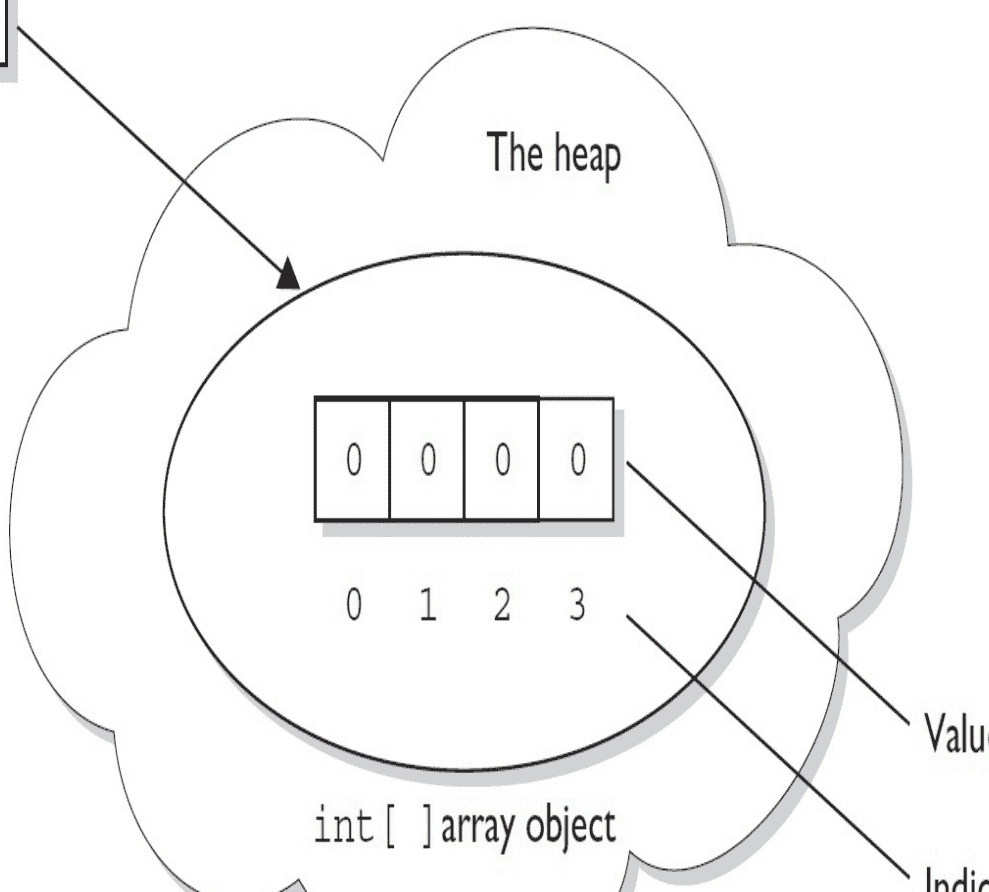

**图 6-4** 堆上的一维数组

你也可以在一个语句中声明并构建数组，如下：
`int[] testScores = new int[4];`

这条单一语句产生与之前两个语句相同的结果。
对象类型的数组也可以以相同的方式构建：

- `Thread[] threads = new Thread[5];` // 没有创建 Thread 对象！
  // 创建了一个 Thread 数组

请记住，尽管代码看起来如此，但 `Thread` 构造函数并没有被调用。我们并不是在创建一个 `Thread` 实例，而是创建一个单一的 `Thread` 数组对象。在执行上述语句之后，仍然没有实际的 `Thread` 对象！

仔细思考在代码语句或代码块执行后，堆上有多少个对象。考试将要求你了解，例如，前面的代码只产生了一个对象（赋值给名为 `threads` 的引用变量的数组）。由 `threads` 引用的单个对象持有五个 `Thread` 引用变量，但尚未创建任何 `Thread` 对象或将其赋值给这些引用。

记住，数组在构建时必须始终指定大小。JVM 需要大小来在堆上为新数组对象分配适当的空间。例如，执行以下操作永远是不合法的：

```java
int[] carList = new int[]; // 无法编译；需要大小
```


你可能会看到“construct（构建）”、“create（创建）”和“instantiate（实例化）”这些词交替使用。它们都意味着“在堆上构建了一个对象”。这意味着对象的构造函数会由于构建/创建/实例化代码而运行。你可以肯定地说，例如，任何使用 `new` 关键字的代码（如果执行成功）都会导致类构造函数和所有父类的构造函数运行。

除了使用 `new` 构建外，还可以使用一种语法简写创建数组，在创建数组的同时将数组元素初始化为代码中提供的值（而不是默认值）。我们将在下一节讨论这个问题。现在，请理解由于这些语法快捷方式，即使你从未使用或见过 `new` 关键字，仍然创建对象。

# 构建多维数组

记住，多维数组是数组的简单数组。因此，一个 `int` 类型的二维数组实际上是一个 `int` 数组对象（`int[]`），该数组中的每个元素都持有指向另一个数组的引用。第二个维度持有实际的 `int` 原型。

以下代码声明并构建了一个 `int` 类型的二维数组：

```java
int[][] myArray = new int[3][];
```

注意，只有第一个括号被赋予大小。这在 Java 中是可以接受的，因为 JVM 知道赋值给变量 `myArray` 的对象的大小。

图 6-5 显示了二维 `int` 数组在堆上是如何工作的。

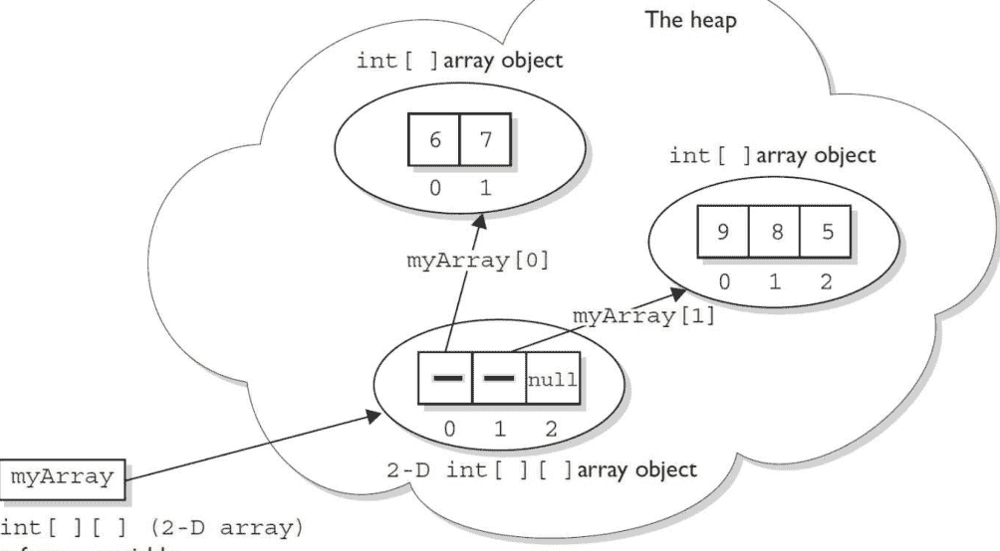

```java
int[][] myArray = new int[3][];
myArray[0] = new int[2];
myArray[0][0] = 6;
myArray[0][1] = 7;
myArray[1] = new int[3];
myArray[1][0] = 9;
myArray[1][1] = 8;
myArray[1][2] = 5;
```

**图 6-5** 堆上的二维数组

# 初始化数组

初始化数组意味着向其中放入内容。数组中的“内容”是它的元素，它们是原始类型值（2, x, false）或数组中引用变量所指向的对象。如果你有一个对象数组（而不是原始类型数组），数组并没有实际持有对象——就像任何其他原始类型变量从不实际持有对象一样——而是持有指向对象的引用。我们确实会谈论数组，例如“一个包含五个字符串的数组”，尽管我们的意思是“一个包含 String 对象引用的数组”。现在大问题是，这些引用是否实际上指向（抱歉，这是 Java，我们的意思是引用）真实的字符串，还是仅仅是 `null`。**记住**，如果访问一个尚未分配任何对象的引用（例如），它将抛出 `NullPointerException`。

数组对象有一个单一的公共变量 `length`，它可以给你数组中元素的数量。因此，最后一个索引值总是比长度小一。例如，如果数组的长度为 4，则索引值为从 0 到 3。你通常会在循环中初始化数组，如下所示：

```java
Dog[] myDogs = new Dog[6]; // 创建一个包含 6 个 Dog 引用的数组
for(int x = 0; x < myDogs.length; x++) {
  myDogs[x] = new Dog(); // 将新的 Dog 赋值给索引位置 x
}
```

长度告诉我们数组持有多少个元素，但它并没有告诉我们这些元素是否已经初始化。

```java
dots;
dots = new int[3];
int x = 9;
dots[0] = 6;
dots[1] = x;
dots[2] = 8;
```

这引发了一个问题：“为什么会有人用更长的写法呢？”我想到了一个原因。你可能在创建数组时，并不知道将赋值给数组元素的值。使用对象引用而不是基本类型，其工作方式完全相同：

```java
Dog puppy = new Dog("Frodo");
Dog[] myDogs = {puppy, new Dog("Clover"), new Dog("Aiko")};
```

上述代码创建了一个由变量 `myDogs` 引用的 Dog 数组，长度为三个元素。它将一个之前创建的 Dog 对象（已分配给引用变量 `puppy`）分配给数组的第一个元素。它还创建了两个新的 Dog 对象（Clover 和 Aiko），并将它们添加到 `myDogs` 数组的最后两个 Dog 引用变量元素中。光是这种简写方式（结合了极具启发性的文字描述）就值这本书的价格了。图 6-6 显示了结果。

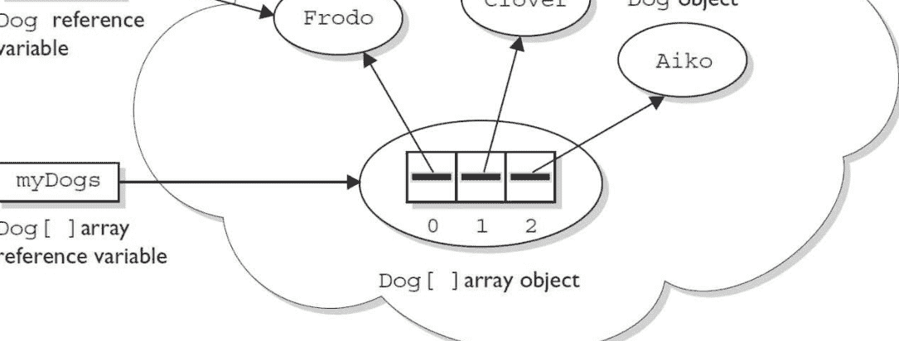

图片展示了以下代码的结果：
Dog puppy = new Dog("Frodo");
Dog[] myDogs = {puppy, new Dog("Clover"), new Dog("Aiko")};

- 创建了四个对象：
  - 1 个被 `puppy` 和 `myDogs[0]` 引用的 Dog 对象
  - 1 个被 `myDogs` 引用的 Dog[] 数组
  - 2 个被 `myDogs[1]` 和 `myDogs[2]` 分别引用的 Dog 对象

# 图 6-6 对象的数组的声明、构造和初始化

你也可以对多维数组使用简写语法，如下：

```java
int[][] scores = {{5,2,4,7}, {9,2}, {3,4}};
```

这段代码在堆上总共创建了四个对象。首先，构造了一个 int 数组的数组（将分配给 `scores` 引用变量的对象）。`scores` 数组的长度为三，源于外部大括号之间用逗号分隔的项目数量。`scores` 数组中的三个元素每一个都是指向 int 数组的引用变量，因此构造了三个 int 数组并将它们分配给 `scores` 数组中的三个元素。

这三个 int 数组的每个数组的大小取决于对应内部大括号内的项目数量。例如，第一个数组长度为四，第二个数组长度为二，第三个数组长度为二。到目前为止，我们有了四个对象：一个 int 数组的数组（每个元素都是对 int 数组的引用），以及三个 int 数组（三个 int 数组中的每个元素都是一个 int 值）。最后，使用内部大括号内的实际 int 值初始化这三个 int 数组。因此，第一个 int 数组包含了值 5, 2, 4, 7。以下代码显示了这个二维维数组中某些元素的值：

```java
scores[0]    // 一个包含 4 个 int 的数组
scores[1]    // 一个包含 2 个 int 的数组
scores[2]    // 一个包含 2 个 int 的数组
scores[0][1] // int 值 2
scores[2][1] // int 值 4
```

图 6-7 显示了在一个语句中声明、构造和初始化二维数组的结果。

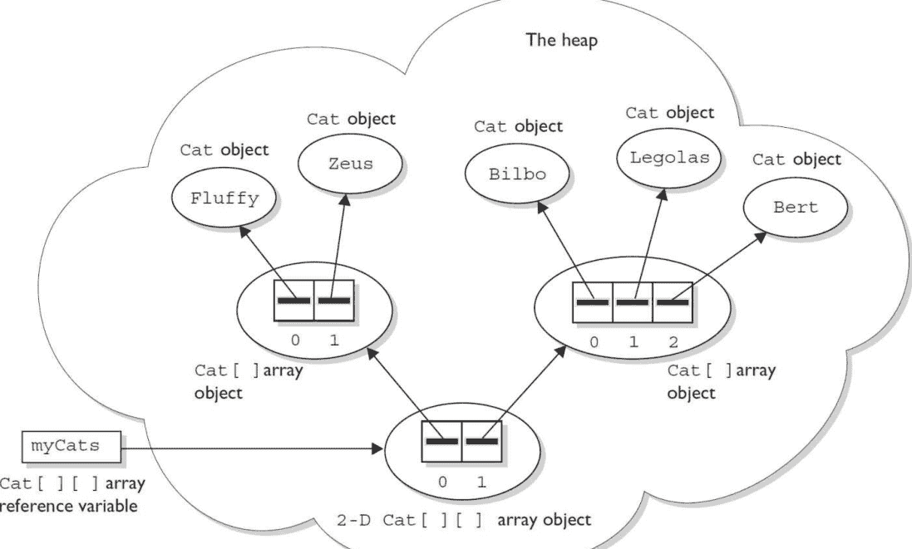

图片展示了以下代码的结果：
Cat[][][] myCats = {{new Cat("Fluffy"), new Cat("Zeus")}, {new Cat("Bilbo"), new Cat("Legolas"), new Cat("Bert")}};

创建了八个对象：

| 描述 | 数量 |
| :--- | :--- |
| 2D Cat[][] 数组对象 | 1 |
| Cat[] 数组对象 | 2 |
| Cat 对象 | 5 |

**图 6-7** 二维数组的声明、构造和初始化

## 构造和初始化匿名数组

第二个简写被称为“匿名数组创建”，可以用于构造和初始化数组，并将数组赋值给之前声明的数组引用变量：

```java
int[] testScores;
testScores = new int[]{4, 7, 2};
```

上述代码创建了一个具有三个元素的新数组；用值 4, 7 和 2 初始化这三个元素；然后将新数组分配给之前声明的 int 数组引用变量 `testScores`。你可以称之为匿名数组创建，因为使用这种语法时，你甚至不需要将新数组赋值给任何东西。你可能在想：“如果不把数组赋值给引用，它有什么用呢？”你可以用它来创建一个即时数组以便使用，例如，作为接收数组参数的方法的参数。

以下代码演示了即时数组参数：

```java
public class JIT {
    void takesArray(int[] someArray) { // 使用数组
    }
    public static void main(String[] args) {
        JIT j = new JIT();
        j.takesArray(new int[] {7,8,2,5}); // 传递一个数组
    }
}
```


光是这种简写方式（结合了极具启发性的文字描述）就值这本书的价格了。图 6-6 显示了结果。

可以持有对象引用（与基本类型不同），它们是没有限制的。就像你可以把一个 Car Honda 对象放入 Car 数组中（因为 Honda 继承自 Car）一样，你也可以像下面将一个 Honda 类型的数组赋值给一个 Car 类型的数组引用：

```java
Car[] cars;
Honda[] cuteCars = new Honda[5];
cars = cuteCars; // OK，因为 Honda 是 Car 的类型
Beer[] beers = new Beer[99];
cars = beers; // NOT OK，Beer 不是 Car 的类型
```

应用 IS 测试来帮助检测合法与非法。Honda 是一个 Car（是一种），所以 Honda 数组可以赋值给 Car 数组。Beer 是一个 Car 是不成立的；Beer 并没有继承自 Car（而且这不符合逻辑，除非你已经喝得太多了）。

数组赋值的规则同样适用于接口和类。声明为接口的数组可以引用任何实现了该接口的类型的数组。请记住，来自实现特定接口的类的任何对象，都将通过该接口的 IS-A (instanceof) 测试。例如，如果 Box 实现了 Foldable，以下代码是合法的：

```java
Foldable[] foldingThings;
Box[] boxThings = new Box[3];
foldingThings = boxThings; // OK，Box 实现了 Foldable，所以 Box 是一个 Foldable
```


你不能反向进行合法的赋值。Car 数组不能赋值给 Honda 数组。Car 不一定是 Honda，所以如果你声明了一个 Honda 数组，如果你将一个 Car 数组赋值给 Honda 引用变量，可能会导致崩溃。想一下：Car 数组可以持有指向法拉利的引用，因此某人认为自己拥有一个 Honda 数组的人可能会发现自己突然有了一辆法拉利。记住，在代码中使用 `instanceof` 操作符可以检查 IS-A 测试。

### 多维数组的数组引用赋值

当你将一个数组赋值给之前声明的数组引用时，你正在赋值的数组必须与被赋值的引用具有相同的维度。例如，一个 int 数组的二维数组不能赋值给普通的 int 引用，如下所示：

```java
int[] blots;
int[][] squeegees = new int[3][];
blots = squeegees; // NOT OK，squeegees 是一个 int 数组的二维数组
int[] blocks = new int[6];
blots = blocks; // OK，blocks 是一个 int 数组
```

特别注意使用不同维度的数组赋值。例如，你可能会被问及将 int 数组赋值给 int 数组数组中的第一个元素是否合法的，如下所示：

图 6-8 显示了数组引用的合法和非法赋值示例。

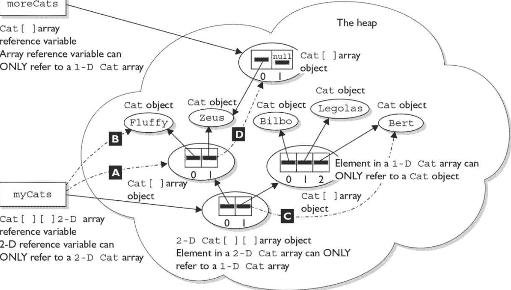

| 非法的数组引用赋值 | 关键点 |
|---|---|
| A: myCats = myCats[0];<br>// 不能将 1D 数组赋值给 2D 数组引用 | |
| B: myCats = myCats[0][0];<br>// 不能将非数组对象赋值给 2D 数组引用 | 合法 |
| C: myCats[1] = myCats[1][2];<br>// 不能将非数组对象赋值给 1D 数组引用 | |
| D: myCats[0][1] = more.Cats;<br>// 不能将数组对象赋值给非数组引用<br>// myCats[0][1] 只能引用一个 Cat 对象 | 非法 |

**图 6-8** 合法与非法的数组赋值

## 认证目标

## 使用 ArrayList 和包装类 (OCA 目标 9.4 和 2.5)

9.3 声明并使用给定类型的 ArrayList。

## 5 编写使用包装类作为 Boolean、Double 和 Integer 的代码。

数据结构是你曾经处理过的几乎每个应用程序的组成。Java API 提供了大量的类，支持如 Lists、Sets、Maps 和队列等常见的数据结构。为了 OCA 考试，你应该记住，支持这些常见数据结构的类是被称为“集合 API”（The Collection API）的一部分（它的许多别名之一）。OCP 考试涵盖了所有这些结构最常见的实现。

## 何时使用 ArrayList

我们已经讨论了数组。数组看起来很有用而且非常灵活。那么，为什么我们还需要比数组提供的更多的功能呢？考虑以下两种情况：

- 你需要能够增加和减少项目列表的大小。
- 你的列表中项目的顺序是重要的，并且可能会改变。

这两种情况都可以用数组处理，但并不简单……
假设你想计划去欧洲旅行。你脑海中有几个目的地（巴黎、奥斯陆、罗马），但你还不确定以什么种顺序访问这些城市，随着计划的进行，你可能想从列表中添加或删除城市。假设你的第一个想法是从北向南，所以你的列表看起来像这样：
奥斯陆， 巴黎， 罗马。
如果我们使用数组，我们可以从这里开始：

```java
String[] cities = {"Oslo", "Paris", "Rome"};
```


但现在想象一下，你想起你真的想去伦敦！你面临两个问题：

- 你的数组已经满了。
- 如果你打算从北向南，你可能需要在数组中插入 `London`。

由于数组的大小是固定的，你无法直接动态地改变它。虽然你可以创建一个新数组并复制元素，但这很费麻烦。现在，让我们看看如何通过 `ArrayList` 实现这一点：

```java
import java.util.*;

public class Cities {

    public static void main(String[] args) {

        List<String> c = new ArrayList<>();

        c.add("Oslo");

        c.add("Paris");

        c.add("Rome");

        System.out.println(c);

        int index = c.indexOf("Paris");

        System.out.println(c + " " + index);

        c.add(index, "London");

        System.out.println(c);

    }

}
```

输出将是：

```
[Oslo, Paris, Rome]
[Oslo, Paris, Rome] 1
[Oslo, London, Paris, Rome]
```

通过回顾代码，我们可以学习到这些：

- `ArrayList` 位于 `java.util` 包。
- 与数组类似，`ArrayList` 实现了 `List` 接口。
- `ArrayList` 的索引从 0 开始。
- 可以在代码中通过 `instanceof` 操作符检查 IS-A 测试。
- 多维数组的赋值：当你将一个数组赋值给之前声明的数组引用时，被赋值的数组必须具有相同的维度。
- `ArrayList` 允许存储重复元素，包括 `null`。
- `ArrayList` 是动态调整的。
- `ArrayList` 维护元素的顺序。
- `ArrayList` 提供 `add(E e)` 和 `add(int index, E element)` 方法。
- `ArrayList` 提供 `remove(int index)` 和 `remove(Object o)` 方法。
- `ArrayList` 提供 `get(int index)` 方法。
- `ArrayList` 提供 `indexOf(Object o)` 方法。
- `ArrayList` 提供 `size()` 方法。
- `ArrayList` 提供 `clear()` 方法。
- `ArrayList` 实现了 `RandomAccess` 接口，这意味着它的随机访问速度很快。

```java
import java.util.*;

public class TweakKists {

    public static void main(String[] args) {

        List<String> myList = new ArrayList<String>();

        myList.add("z");

        myList.add("x");

        myList.add(1, "y"); // zero based

        myList.add(0, "w");

        System.out.println(myList); // [w, z, y, x]

        myList.clear(); // remove everything

        myList.add("b");

        myList.add("a");

        myList.add("c");

        System.out.println(myList); // [b, a, c]

        System.out.println(myList.contains("x") + " " + myList.contains("x"));

        System.out.println("get 1: " + myList.get(1));

        System.out.println("index of c: " + myList.indexOf("c"));

        myList.remove(1); // remove "a"

        System.out.println("size: " + myList.size() + " contents: " + myList);

    }

}
```

输出应该产生类似下面的内容：

```
[w, z, y, x]
[b, a, c]
true false
get 1: a
index of c: 2
size: 2 contents: [b, c]
```

关于这段代码有几点说明：首先，注意 `contains()` 返回一个布尔值。这使得 `contains()` 可以用于 "if" 测试。其次，注意 `ArrayList` 有一个 `size()` 方法。记住，数组有 `length` 属性，而 `ArrayList` 有 `size()` 方法。

# ArrayList 类中的重要方法

以下方法是 `ArrayList` 类中最常用的方法，也是你最有可能在考试中遇到的方法：

- `add(element)` 将此元素添加到 `ArrayList` 的末尾
- `add(index, element)` 将此元素添加到索引处，并将后续元素向后移动（例如，原本在索引处的元素现在位于索引+1 处）
- `clear()` 从 `ArrayList` 中移除所有元素
- `boolean contains(element)` 返回元素是否在列表中
- `Object get(int index)` 返回位于索引处的 `Object`
- `int indexOf(Object)` 返回元素的 `(int)` 位置，如果 `Object` 不存在则返回 -1
- `remove(int index)` 移除该索引处的元素，并将后面的元素向起始位置移动
- `remove(Object o)` 移除该 `Object` 的第一次出现处，并将后面的元素向起始位置移动
- `int size()` 返回 `ArrayList` 中元素的数量

总结一下，OCA 8 考试只测试对 `ArrayList` 的非常基础知识。如果你继续参加 OCP 8 考试，你将学习更多关于 `ArrayList` 和其他常见集合面向类的知识。

# ArrayList 的自动装箱

通常情况下，像 `ArrayList` 这样的集合可以包含对象，但不能包含基本数据类型。在 Java 5 之前，所谓“包装类”（例如 `Integer`、`Float`、`Boolean` 等）的常见用途是将基本数据类型存入和从集合中取出的方法。在 Java 5 之前，你必须在将基本数据类型放入集合之前对其进行“包装”。从 Java 5 开始，基本数据类型在添加到 `ArrayList` 之前仍然需要包装，但自动装箱会为你处理这一切。

```java
myInts = new ArrayList(); // Java 5 之前的声明
myInts.add(new Integer(42)); // 使用 Integer 类来“包装”一个 int
```

在以前的示例中，我们创建了一个值为 42 的 `Integer` 类实例。我们创建了另一个对象来“包装”一个基本数据类型。从 Java 5 开始，我们可以说：

```java
myInts.add(42); // 自动装箱处理了它！
```

在最后一个例子中，我们仍然向 `myInts` 添加一个 `Integer`（而不是 `int` 基本数据类型）；只是自动装箱为我们处理了包装。当我们需要使用包装对象时，存在一些微妙的含义；让我们仔细观察一下……

在 Java 5 之前的旧时代，如果你想创建一个包装对象、将其解箱、使用它，然后重新包装它，你可能会执行类似这样的操作：

```java
Integer y = new Integer(567); // 创建
int x = y.intValue(); // 解箱
x++; // 使用
y = new Integer(x); // 重新包装
System.out.println("y = " + y); // 打印
```

现在你可以说：

```java
Integer y = new Integer(567); // 创建
y++; // 解箱，递增，重新包装
System.out.println("y = " + y); // 打印
```

两个示例都产生以下输出：

```
y = 568
```

是的，你读得没错。代码似乎在对象上使用了后自增运算符。

让我们尝试这个：

```java
Integer y = 567;           // 创建一个包装对象
Integer x = y;                // 分配第二个引用指向同一个包装对象
System.out.println(y == x);   // 验证它们是否指向同一个对象
y++;                          // 解箱，使用，“重新包装”
System.out.println(x + " " + y);  // 打印值
System.out.println(y == x);   // 验证它们是否指向不同对象
```

产生输出：

```
true
567 568
false
```

所以，在底层，当编译器处理到 `y++` 这一行时，它必须替换为类似的内容：

```java
int x2 = y.intValue();    // 解箱
x2++;                          // 使用
y = new Integer(x2);         // 重新包装
```

正如我们所料的那样，那里一定有一个对 `new` 的调用。

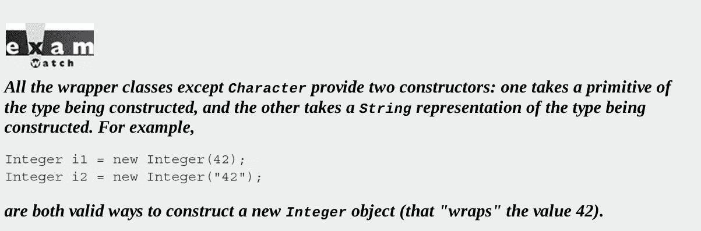

# 装箱、== 和 equals()

我们刚刚通过 `==` 对包装类进行了深度探索。让我们更彻底地查看包装类是如何与 `==`、`!=` 和 `equals()` 工作的。API 开发人员决定，对于所有的包装类，如果两个对象的类型相同且具有相同的值，它们就是相等的。这并不意外：

```java
Integer i1 = new Integer(100);
Integer i2 = new Integer(100);
Integer i3 = new Integer(100);
System.out.println(i1 == i2); // false
System.out.println(i1 == i3); // false
System.out.println(i1.equals(i2)); // true
System.out.println(i1.equals(i3)); // true
```

（注：此处提供的后续文本存在大量 OCR 错误和重复，已根据标准 Java 逻辑进行了修复处理。）

## 菱形操作符

他们借此创建了一个菱形——噢！你不能调换这些；例如，下面的声明是非合法的：

```java
ArrayList stuff = new ArrayList<String>(); // 不是合法的菱形语法
```

对于考试来说，这就是关于菱形操作符你需要知道的所有内容。在书的剩余部分，我们将某种随机地使用菱形之前的语法和 Java 7 的菱形语法——就像现实世界一样！

## 认证目标

## 高级封装：OCA 目标 6.5

6.5 将封装原则应用于类中。

## 引用变量的封装

在第 2 章中，我们开始了对面向对象概念——封装的讨论。那时，我们将讨论限制在保护类的原始字段和（不可变的）`String` 字段上。现在你已经学习了更多关于“值传递”（pass-by-copy）的含义，并且我们查看了如数组、`StringBuilder` 和 `ArrayList` 等处理数据的非原始方式，现在是时候仔细观察封装了。

假设我们有一些特殊数据，并将其保存在 `StringBuilder` 中。我们乐意与其他程序员共享这个值，但我们不想改变这个值：

```java
class Special {
    private StringBuilder s = new StringBuilder("bob"); // 我们的特殊数据
    StringBuilder getName() { return s; }
    void printName() { System.out.println(s); } // 验证我们的特殊数据
}

public class TestSpecial {
    public static void main(String[] args) {
        Special sp = new Special();
        StringBuilder s2 = sp.getName();
        s2.append("fred");
        sp.printName();
    }
}
```

当我们运行代码时，我们得到了：

```
bobfred
```

噢糟糕，看起来我们通过将字段设为私有并提供“getter”方法练习了良好的封装技术，但根据输出，显而易见，我们在保护 `Special` 类中的数据方面做得并不好。你能看出为什么吗？花一分钟时间……

好了——只是为了验证你的答案——当我们调用 `getName()` 时，我们确实返回了一个拷贝，就像 Java 执行的那样。但我们返回的不是 `StringBuilder` 对象的拷贝；我们返回的是指向（我知道的且唯一的）那个 `StringBuilder` 对象的引用变量的拷贝。在 `getName()` 返回的那一点，我们有一个 `StringBuilder` 对象和两个引用变量。

对于 OCA 考试而言，关键点在于：在封装像 `StringBuilder`、数组或 `ArrayList` 这样的可变对象时，如果你想让外部类获得对象的拷贝，你必须实际上复制该对象并返回指向该拷贝对象的引用变量。如果你返回的是原始对象引用变量的拷贝，那么你并没有实现封装。

## 使用简单的 Lambda (OCA 目标 9.5)

9.5 编写一个简单的 Lambda 表达式来消耗一个 Lambda Predicate 表达式。

Java 8 可能最广为人知的最终添加了 lambdas 和流（streams）的 Java 版本。这两个新功能（lambdas 和流）为程序员提供了工具，用更易于读、更简洁且在许多情况下运行更快的代码来解决一些常见且复杂的问题。OCA 8 考试的创建者认为，通常情况下 lambdas 和流是更适合 OCP 8 考试的主题，但他们希望 OCA 8 的候选人能有一个初步介绍，也许以此激发他们的兴趣……


> 在实际考试中，你应该预期看到许多测试多个目标的题目。在接下来的几页中，当我们讨论 lambdas 时，我们将大量依赖 `ArrayList` 和包装类。你会发现我们在许多代码列表中将 `ArrayList`、包装类以及 lambdas 结合在一起，我们提供的模拟考试题中也使用了这种组合。实际考试（以及现实生活中的编程）也会这样做。

假设你正在为一家兽医医院创建一个应用程序。我们想关注应用程序的一部分，它允许兽医获取有关他们工作的所有狗的信息。这里是我们的 `Dog` 类：

```java
class Dog {
    String name;
    int weight;
    int age;
    // 构造函数分配重量和年龄
    Dog(String name, int weight, int age) {
        this.name = name;
        this.weight = weight;
        this.age = age;
    }
    String getName() { return name; }
    int getWeight() { return weight; }
    int getAge() { return age; }
    public String toString() {
        return name;
    }
}
```

现在让我们看看如何编写代码来填充一个 `ArrayList`，然后对它进行查询。为了 OCA 考试，关键点是：在封装一个对象之前。这里是我们的测试代码：

```java
import java.util.*;

public class TestDogs {
    public static void main(String[] args) {
        // 填充数据
        ArrayList<Dog> dogs = new ArrayList<>();
        dogs.add(new Dog("Buddy", 30, 5));
        dogs.add(new Dog("Max", 45, 8));
        dogs.add(new Dog("Charlie", 20, 2));
        // 查询示例
        for (Dog d : dogs) {
            if (d.getWeight() > 25) {
                System.out.println(d.getName());
            }
        }
    }
}
```


## 使用数组 (OCA 目标 4.1 和 4.2)

- 数组可以存放基本数据类型或对象，数组本身始终是一个对象。
- 声明数组时，方括号可以在名称的左侧也可以在右侧。
- 在声明中包含数组的大小永远是不合法的。
- 在构造数组（使用 `new`）时，必须包含数组的大小，除非你正在创建一个匿名数组。
- 对象数组中的元素不会被自动创建，尽管基本类型数组元素会被赋予默认值。
- 如果你尝试在对象数组中使用数组元素，而该元素未引用真实的对象，你将得到 `NullPointerException`。
- 数组的索引从 0 开始。
- 如果你使用了无效的索引值，会发生 `ArrayOutOfBoundsException`。
- 数组有一个 `length` 属性，其值是数组元素的数量。
- 你可以访问的最后一个索引始终比数组长度少 1。
- 多维数组仅仅是数组的数组。
- 多维数组中的各个维度可以有不同的长度。
- 基本类型数组可以接受任何可以隐式提升为数组声明类型的值——例如，一个 `byte` 变量可以放入 `int` 数组中。
- 对象数组可以存放任何通过数组声明类型 IS-A（或 `instanceof`）测试的对象。例如，如果 `Horse` 继承自 `Animal`，一个 `Horse` 对象可以放入 `Animal` 数组。
- 如果你将数组赋值给之前声明的数组引用，则该数组的维度必须与你所赋值的引用相同。
- 你可以将一种类型的数组赋值给之前声明的其超类类型的数组引用。例如，一个 `Honda` 数组可以赋值给声明类型为 `Car` 的数组（假设 `Honda` 继承自 `Car`）。

## 使用 ArrayList (OCA 目标 9.4)

- `ArrayList` 允许你调整列表的大小，并且比数组更容易对列表进行插入和删除。
- `ArrayList` 默认是有序的。使用不带参数的 `add()` 方法时，新条目将附加到 `ArrayList` 的尾部。
- 对于 OCA 8 考试，你只需要掌握这种形式的 `ArrayList` 声明：

```java
List<type> myList = new ArrayList<type>();
List<type> myList2 = new ArrayList<type>(); // 多态
List<type> myList3 = new ArrayList<>(); // 钻石运算符，可选多态
```

- `ArrayList` 仅存放对象，不存放基本类型，但请记住自动装箱（autoboxing）可以让你看起来像是在向 `ArrayList` 中添加基本类型，而实际上，你正在添加该基本类型的包装对象版本。
- `ArrayList` 的索引从 0 开始。
- `ArrayList` 允许有重复条目。判断两个对象是否重复比看起来要复杂，而且这在 OCP 8 考试中才会出现。
- 需要记住的 `ArrayList` 方法：`add(element)`、`add(index, element)`、`clear()`、`contains(object)`、`get(index)`、`indexOf(object)`、`remove(index)`、`remove(object)` 和 `size()`。

## 封装引用变量 (OCA 目标 6.5)

- 如果你想封装可变对象（如 `StringBuilder`、数组或 `ArrayList`），你不能返回这些对象的引用；你必须先创建对象的副本，并返回副本的引用。
- 任何拥有返回可变对象引用的方法的类都破坏了封装。

## 使用 Predicate Lambda 表达式 (OCA 目标 9.5)

- Lambda 允许你将代码片段从一个方法传递到另一个方法。接收方法可以在不编译其传递方式的情况下运行。
- 虽然 Java 8 支持许多类型的 Lambda，但对于这次考试，你唯一掌握的 Lambda 类型是 `Predicate`。
- `Predicate` 接口有一个需要实现的单方法，称为 `test()`，它接受一个参数并返回一个 `boolean`。
- 由于 `Predicate.test()` 方法返回布尔值，因此它可以（在大多数）放在任何可以使用布尔表达式的地方，例如 `if`、`while`、`do` 和三元运算符语句。
- `Predicate` Lambda 表达式包含三个部分：单个参数、箭头 (`->`) 以及一个表达式或代码块。
- `Predicate` Lambda 表达式的参数可以只是变量，也可以是括号内的类型和变量，例如 `(MyClass m)`。
- `Predicate` Lambda 表达式的主体是一个解析为布尔值的表达式，也可以是一个由大括号包围并以返回布尔值的语句结尾的语句块。

## 认证总结

关于 `String` 最重要的一点是，`String` 对象是不可变的，但 `String` 的引用是可变的！你可以使用现有的 `String` 作为起点创建一个新的 `String`，但如果你没有将引用变量赋值给这个新 `String`，它将从你的程序中丢失——你将无法访问你的新 `String`。复习 `String` 类中的重要方法。

`StringBuilder` 类是在 Java 5 中添加的。它与旧的 `StringBuffer` 类具有完全相同的方法，只是 `StringBuilder` 的方法不是线程安全的。

## 自测

### 1. 给定：

```java
public class Mutant {
    public static void main(String[] args) {
        StringBuilder sb = new StringBuilder("abc");
        String s = "abc";
        sb.reverse().append("d");
        s.toUpperCase().concat("d");
        System.out.println("" + sb + " " + s + ".");
    }
}
```

结果中将包含哪些子字符串？（选择两个。）

- A. .abc.
- B. .ABCD.
- C. .cbad.
- D. .dcba.

### 2. 给定：

```java
public class Hilltop {
    public static void main(String[] args) {
        String[] horses = new String[5];
        horses[4] = null;
        for(int i = 0; i < horses.length; i++) {
            if(i < args.length)
                horses[i] = args[i];
            System.out.print(horses[i].toUpperCase() + " ");
        }
    }
}
```

并且，如果代码编译通过，命令行：`java Hilltop eyra vafi draumur kara` 结果是？

- A. EYRA VFI DRAUMUR KARA
- B. EYRA VFI DRAUMUR null
- C. 抛出 NullPointerException
- D. EYRA VFI DRAUMUR KARA 然后抛出 ArrayIndexException
- E. 编译失败

### 3. 给定：

```java
public class Actors {
    public static void main(String[] args) {
        boolean[] ca = {true, false, true};
        System.out.println(ca[0] + " " + ca[2]);
    }
}
```

结果是？

- A. true true
- B. true false
- C. false true
- D. false false
- E. 编译失败

### 4. 给定：

```java
public class Dims {
    public static void main(String[] args) {
        int[][] a = {{1,2}, {3,4}};
        int[] b = (int[]) a[1];
        Object ol = a;
        int[] b2 = (int[]) ol;
        System.out.println(b2[1]);
    }
}
```

结果是？（选择所有可能的）

- A. 2
- B. 4
- C. 运行时抛出异常
- D. 在第 4 行编译错误
- E. 在第 5 行编译错误
- F. 在第 6 行编译错误

### 5. 给定：

```java
import java.util.*;
public class Sequence {
    public static void main(String[] args) {
        ArrayList<String> myList = new ArrayList<String>();
        myList.add("apple");
        myList.add("carrot");
        myList.add("banana");
        myList.add(1, "plum");
        System.out.print(myList);
    }
}
```

结果是？

- A. [apple, carrot, banana]
- B. [apple, carrot, banana]
- C. [apple, banana, carrot]
- D. [plum, banana, carrot]
- E. [plum, apple, carrot]
- F. [banana, plum, apple]
- G. 编译失败

### 6. 给定：

```java
public class Eggs {
    public static void main(String[] args) {
        Dozens[] da = new Dozens[3];
        da[0] = new Dozens();
        Dozens d = new Dozens();
        da[1] = d;
        d = null;
        da[1] = null;
        // do stuff
    }
}

public class Dozens {
    int[] dz = {1,2,3,4,5,6,7,8,9,10,11,12};
}
```

关于 `main()` 方法中创建的对象，哪些是正确的？哪些在第 14 行可以被垃圾回收？

- A. 创建了三个对象
- B. 创建了四个对象
- C. 创建了五个对象
- D. 没有对象可以被 GC
- E. 有一个对象可以被 GC
- F. 有两个对象可以被 GC
- G. 有三个对象可以被 GC

### 7. 给定：

```java
public class Tailor {
    public static void main(String[] args) {
        byte[][] ba = {{1,2,3,4}, {1,2,3}};
        System.out.println(ba[1].length + " " + ba.length);
    }
}
```

结果是？

- A. 2 4
- B. 2 7
- C. 3 2
- D. 3 7
- E. 4 2
- F. 4 7
- G. 编译失败

### 8. 给定：

```java
public class Theory {
    public static void main(String[] args) {
        String s1 = "abc";
        String s2 = s1;
        s1 += "d";
        System.out.println(s1 + " " + s2 + " " + " " + (s1==s2));
        StringBuilder sb1 = new StringBuilder("abc");
        StringBuilder sb2 = (StringBuilder) s1; // 这里错误
    }
}
```


```java
sb1.append("d");

System.out.println(sb1 + " " + sb2 + " " + " " + (sb1==sb2));

}
}
```

哪些选项是正确的？（选择所有适用项）

- A. 编译失败
- B. 第一行输出是 abc abc true
- C. 第一行输出是 abc abc false
- D. 第一行输出是 abcd abc false
- E. 第二行输出是 abcd abc false
- F. 第二行输出是 abcd abcd true

### 9. 假定：

```java
public class Mounds {

    public static void main(String[] args) {

        StringBuilder sb = new StringBuilder();

        String s = new String();

        for(int i = 0; i < 1000; i++) {

            s = " " + i;

            sb.append(s);

        }

        // 循环结束

    }

}
```

如果在这段代码执行期间垃圾回收器没有运行，当循环结束时内存中大约有多少个对象？

- A. 少于 10
- B. 大约 1000
- C. 大约 2000
- D. 大约 3000
- E. 大约 4000

### 10. 假定：

```java
class Box {

    int size;

    Box(int s) { size = s; }

}

public class Laser {

    public static void main(String[] args) {

        Box b1 = new Box(5);

        Box[] ba = go(b1, new Box(6));

        ba[0] = b1;

        for(Box b : ba) System.out.print(b.size + " ");

    }

    static Box[] go(Box b1, Box b2) {

        b1.size = 4;

        Box[] ma = {b2, b1};

        return ma;

    }

}
```

结果是什么？

- A. 4 4
- B. 5 4
- C. 6 4
- D. 4 5
- E. 5 5
- F. 编译失败

### 11. 假定：

```java
public class Hedges {

    public static void main(String[] args) {

        String s = "JAVA";

        s = s + "rocks";

        s = s.substring(4,8);

        s.toUpperCase();

        System.out.println(s);

    }

}
```

结果是什么？

- A. JAVA
- B. JAVOCKS
- C. rocks
- D. rock
- E. RKS
- F. ROCK
- G. 编译失败

### 12. 假定：

```java
import java.util.*;

class Fortress {

    private String name;

    private ArrayList<Integer> list = new ArrayList<Integer>();

    String getName() { return name; }

    void addToList(int x) { list.add(x); }

    ArrayList getList() { return list; }

}
```

哪些行代码（如果有）破坏了封装性？（选择所有适用项）

- A. 第 3 行
- B. 第 4 行
- C. 第 5 行
- D. 第 7 行
- E. 第 8 行
- F. 第 9 行
- G. 该类已经很好地封装

### 13. 假定：

```java
import java.util.function.Predicate;

public class Sheep {

    public static void main(String[] args) {

        Sheep s = new Sheep();

        s.go(() -> adder(5, 1) < 7); // 行 A

        s.go(x -> adder(6, 2) < 9); // 行 B

        s.go((x, y) -> adder(3, 2) < 4); // 行 C

    }

    void go(Predicate<Sheep> e) {

        Sheep s2 = new Sheep();

        if (e.test(s2)) {

            System.out.print("true");

        } else {

            System.out.print("false");

        }

    }

    static int adder(int x, int y) {

        return x + y;

    }

}
```

结果是什么？

- A. true false
- B. 仅因为行 A 的错误导致编译失败
- C. 仅因为行 B 的错误导致编译失败
- D. 仅因为行 C 的错误导致编译失败
- E. 仅因为行 A 和 B 的错误导致编译失败
- F. 仅因为行 A 和 C 的错误导致编译失败
- G. 仅因为行 A、B 和 C 的错误导致编译失败
- H. 因未列出的原因编译失败

### 14. 假定：

```java
import java.time.*;

import java.time.format.*;

public class Shiny {

    public static void main(String[] args) {

        DateTimeFormatter f1 = DateTimeFormatter.ofPattern("MMM dd, yyyy");

        LocalDate d = LocalDate.of(2018, Month.JANUARY, 15);

        LocalDate d2 = d.plusDays(1);

        System.out.print(f1.format(d) + " ");

        System.out.println(d2.format(f1));

    }

}
```

结果是什么？

- A. 2018-01-15 2018-01-16
- B. 2018-01-15 2018-16
- C. Jan 15, 2018 Jan 15, 2018
- D. Jan 15, 2018 16, 2018
- E. 编译失败
- F. 运行时抛出异常

### 15. 假定：

```java
import java.util.*;

public class Jackets {

    public static void main(String[] args) {

        List<Integer> myList = new ArrayList<>(); // 行 5

        myList.add(new Integer(5)); // 行 7

        myList.add(42); // 行 8

        myList.add(13); // 行 9

        System.out.println(myList);

    }

}
```

结果是什么？

- A. [5, 42, 13]
- B. 仅因为行 5 的错误导致编译失败
- C. 仅因为行 8 的错误导致编译失败
- D. 仅因为行 5 和 8 的错误导致编译失败
- E. 仅因为行 7 和 8 的错误导致编译失败

### 16. 如果 `adder()` 返回 `int`，哪些是有效的 lambda？（选择所有适用项）

- A. x -> 7
- B. x -> adder(2, 1) < 5
- C. x -> adder(2, 1);
- D. x -> { y = 5; int z = 7;
- E. x -> { y = 5; int z = 7; adder(y, z) < 8; }
- F. (MyClass) x -> 7
- G. (MyClass) x -> 5

### 17. 假定：

```java
import java.util.*;

public class Baking {

    public static void main(String[] args) {

        ArrayList<String> steps = new ArrayList<String>();

        steps.add("knead");

        steps.add("oil pan");

        steps.add("turn on oven");

        steps.add("roll");

        steps.add("turn on oven");

        steps.add("bake");

        System.out.println(steps);

    }

}
```

结果是什么？

- A. [knead, oil pan, roll, turn on oven, bake]
- B. [knead, oil pan, turn on oven, roll, bake]
- C. [knead, oil pan, turn on oven, roll, turn on oven, bake]
- D. 输出不可预测
- E. 编译失败
- F. 运行时抛出异常

### 18. 假定：

```java
import java.time.*;

public class Bachelor {

    public static void main(String[] args) {

        LocalDate d = LocalDate.of(2018, 8, 15);

        d = d.plusDays(1);

        LocalDate d2 = d.plusDays(1);

        LocalDate d3 = d2;

        d2 = d2.plusDays(1);

        System.out.println("d " + d2 + " " + d3); // 行 X

    }

}
```

哪些是正确的？（选择所有适用项）

- A. 输出：d 2018-08-16 2018-08-17 2018-08-17
- B. 输出：d 2018-08-16 2018-08-18 2018-08-17
- C. 输出：d 2018-08-16 2018-08-17 2018-08-17
- D. 行 X 时，没有 `LocalDate` 对象可以被垃圾回收
- E. 行 X 时，有一个 `LocalDate` 对象可以被垃圾回收
- F. 行 X 时，有两个 `LocalDate` 对象可以被垃圾回收
- G. 编译失败

### 19. 假定 `e` 指向一个实现 `Predicate` 的对象，哪些可能是有效的代码段或语句？（选择所有适用项）。

- A. if(e.test(m))
- B. switch (e.test(m))
- C. while(e.test(m))
- D. e.test(m) ? "yes" : "no"
- E. do {} while(e.test(m));
- F. System.out.print(e.test(m));
- G. boolean b = e.test(m);

---

这创建了包含其“int array”对象。当到达第 14 行时，只有第二个 Dozens 对象（及其“int array”对象）是不可达的。

- 根据上述内容，A、B、D、E 和 G 是错误的。（OCA 目标 4.1 和 2.4）
- C 是正确的。二维数组是“数组的数组”。`ba` 的长度为 2，因为它包含 2 个二维数组。数组索引从 0 开始，因此 `ba[1]` 指向 `ba` 的第二个数组。
- 根据上述内容，A、B、D、E、F 和 G 是错误的。（OCA 目标 4.2）
- D 和 F 是正确的。`String` 对象是不可变的，而 `String` 的引用是可变的。代码 `s1 += " d"` 创建了一个新的 `String` 对象。`StringBuilder` 对象是可变的，因此 `append()` 正在改变 `StringBuilder` 引用的新 `StringBuilder` 对象。
- 根据上述内容，A、B、C、E 和 G 是错误的。（OCA 目标 9.2 和 9.1）
- B 是正确的。`StringBuilder` 是可变的，因此所有的 `append()` 调用都是在同一个对象上反复操作。然而，`String` 的每次字符串拼接操作都会产生一个新的 `String` 对象。此外，字符串 `""` 被创建一次并在每次循环迭代中被重用。
- 根据上述内容，A、C、D 和 E 是错误的。（OCA 目标 9.2 和 9.1）
- A 是正确的。虽然 `main()` 中的 `bi` 与 `q()` 中的 `by` 是不同的变量名，但它们指向同一个 `Box` 对象。
- 根据上述内容，B、C、D 和 F 是错误的。（OCA 目标 4.1、6.1 和 6.6）
- D 是正确的。`substring()` 调用使用从 0 开始的索引，且第二个参数是排他的，索引为 8 的字符**不包含在内。`toString()` 调用创建了一个瞬时存在的新的 `String` 对象。`toString()` 调用不会影响 `s` 中的 `String`。
- 根据上述内容，A、B、C、E 和 G 是错误的。（OCA 目标 9.2）
- F 是正确的。当封装像 `ArrayList` 这样的变对象时，你必须返回对象的副本，而不仅仅是原始对象的引用。
- 根据上述内容，A、B、C、D、E 和 G 是错误的。（OCA 目标 6.5）
- 13. F 是正确的。`Predicate` lambda 恰好接受一个参数；代码其余部分是正确的。
- 根据上述内容，A、B、C、D、E 和 H 是错误的。（OCA 目标 9.5）
- 14. D 是正确的。调用 `plusDays()` 方法创建一个新对象，且 `LocalDate` 和 `DateTimeFormatter` 都有 `format()` 方法。
- 根据上述内容，A、B、C、E 和 F 是错误的。（OCA 目标 9.3）
- 15. C 是正确的。此代码中唯一的错误是尝试将 `String` 添加到 `Integer` 包装对象的 `ArrayList` 中。第 7 行使用了自动装箱，第 6 行和第 9 行演示了使用包装类的构造函数。
- 根据上述内容，A、B、D、E、F 是错误的。（OCA 目标 2.5 和 9.4）
- 16. B、D、E 和 F 语法正确。
- A、C 和 G 是错误的。A 传递了两个参数。C 返回必须在代码块中，且代码块必须在大括号内。D 是一个块，必须有返回语句。G 的结果不是布尔值。（OCA 目标 9.5）
- 17. C 是正确的。`ArrayList` 可以有重复项。
- 根据上述内容，A、B、D、E 和 F 是错误的。（OCA 目标 9.4）
- 18. B 和 E 是正确的。共创建了四个 `LocalDate` 对象，但使用 `of()` 方法创建的对象在下一行代码处被弃弃，因为其引用变量被赋值为第一次 `plusDays()` 调用创建的新 `LocalDate` 对象。引用变量发生了调换，这导致日期没有按时间顺序打印。
- 根据上述内容，A、C、D、F 和 G 是错误的。（OCA 目标 2.4 和 9.3）
- 19. A、C、D、E、F 和 G 是正确的；它们都需要一个布尔值。
- B 是错误的。`switch` 不接受布尔值。（OCA 目标 9.5）


## 关于下载

本电子书附带了免费下载的 Oracle Press Practice Exam Software，可以通过附录提供的链接进行下载。该软件易于安装在任何 Mac 或 Windows 电脑上，必须安装才能访问模拟考试功能。

## 系统要求

### Windows

- 2.33GHz 或更快的 x86 兼容处理器，或用于笔记本类设备的 Intel Atom™ 1.6GHz 或更快的处理器
- Microsoft® Windows Server 2008, Windows 7, Windows 8.1 Classic 或 Windows 10
- 512MB 内存（建议 1GB）

### Mac OS

- Intel® Core™ Duo 1.83GHz 或更快的处理器
- Mac OS v10.7 及以上
- 512MB 内存（建议 1GB）

## 从 McGraw-Hill Professional 的 Media Center 下载

要下载术语表、额外内容和 Oracle Press Exam Software，请访问 McGraw-Hill Professional 的 Media Center，点击下方链接并输入本电子书的 ISBN。

```
http://mhprofessional.com/mediacenter
```


本电子书的 ISBN 为 126011380。一旦收到来自 McGraw-Hill Professional Media Center 的电子邮件，请点击其中包含的链接下载模拟考试。如果没有收到电子邮件，请检查您的垃圾邮件箱。

# 安装模拟考试软件

请按照以下 Windows 或 Mac OS 的说明操作。

## Windows

1. 打开 `InstallerforPC.zip` 文件。
2. 找到 `Installer.exe`。
3. 安装。

## Mac OS

1. 打开 `InstallerforMac.zip` 文件。
2. 双击安装程序。
3. 安装。

> **注意**：如果在安装时遇到错误，请确保禁用您的杀毒软件或安全程序。您可以在安装后启用杀毒软件或安全程序。

# 运行模拟考试软件

请按照以下 Windows 或 Mac OS 的说明操作。

## Windows

安装后，可以使用以下方式开始考试：

## Mac OS

安装后，您可以开始考试。

# 卸载安装

在 Mac 上删除程序的最佳方法是前往应用程序文件夹并将 `Oracle SE 8 Practice` 拖到垃圾桶。

# 帮助

可以通过页面右上角的 `Help` 按钮获取帮助文件。`Bonus Content` 文件夹中也包含一个 `readme` 文件。

# 技术支持

技术支持信息位于以下章节中。

# Windows 8 故障排除

在 Windows 8 上报告了以下已知错误。请参阅下文有关解决这些问题的信息。

# McGraw-Hill 教育内容支持

如有关于术表或额外奖励内容的疑问，请发送邮件至 `techsolutions@mheducation.com` 或访问 `http://mhp.softwareassist.com`。

如有关于书籍内容的疑问，请发送邮件至 `hep_customer.service@mheducation.com`。美国以外的客户请发送邮件至 `international_cs@mheducation.com`。

# 索引

# A

- 遗弃字符串, 344–346
- 抽象类, 19
- 构造函数, 133, 136
    - 创建, 23
    - 实现, 123
    - 与接口对比, 25
    - 概述, 21–22
- 抽象方法
    - 继承, 93
    - 概述, 45–48
    - 子类实现, 106
- 访问与访问修饰符, 30–33
- 类, 17–21
    - 构造函数, 135
    - 封装, 89
    - 关键点, 71
    - 级别, 54
    - 局部变量, 42–43
    - 重载方法, 111
    - 重写方法, 107–108
    - 私有, 34–36
    - 保护和默认成员, 36–42
    - 公有, 33–34
    - 静态方法和变量, 151–154
- `ArrayList` 中的 `add()` 方法, 383
- 加法
    - 复合赋值, 236
    - 运算符, 244
    - 优先级, 257
- 符号符 (`&`)
    - 位运算符, 251–252
    - 逻辑运算符, 252–255
    - 优先级, 257
- AND 表达式, 252–255
- 泛型代码中的角括号 (`<>`), 381
- 匿名数组, 372–373
- `append()` 方法, 353–354
- 拼接字符串, 341–342, 353–354
- 应用，启动, 11–12
- `@argfiles` 选项, 11
- 参数，`final`, 44–50
    - 重载方法, 111, 113
    - 重写方法, 108
    - 与参数对比, 49–50
    - 超级构造函数, 137
    - 可变参数列表, 49–50
- 算术运算符, 244–249
    - 基础, 244–245
    - 递增减, 248–250
    - 关键点, 260–261
    - `{数`, 245–246
    - 字符串拼接, 246–248
- `ArithmeticException` 类, 322
- `ArrayIndexException` 类, 306
    - 描述, 322
    - 索引越范围数组索引, 369–309
    - 父类, 13–14
- `ArrayList` 类, 384–388
    - 自动装箱, 380–381
    - 基础，菱形语法, 388–389
    - 重复, 383
    - 关键点, 401
    - 方法, 382–384
    - 使用, 379–381
- 数组, 363
    - 构建, 364–367, 370–372
    - 声明, 57–59, 363–364, 370–372
    - 默认元素值, 198–199, 202, 221
    - 元素赋值, 374–378
    - 增强 `for` 循环, 292–293
    - 索引, 12, 368
    - 返回, 131
- ASCII 集合, 53
- `AssertionError` 类, 316, 321
- 赋值
    - 数组元素, 374–378
    - 编译器错误, 188–189
    - 浮点数, 188
    - 关键点, 220–221
    - 对象兼容性, 242
    - 运算符, 182–183, 235–236, 257
    - 基本类型, 183–185, 190
    - 引用变量, 190–191, 202–203, 376–378
- 星号 (`*`)
    - 复合赋值, 236
    - 导入语句, 24, 16
    - 乘法, 244
    - 优先级, 257
- `ArrayList` 的自动装箱, 384–388
    - 自动局部变量, 55–57

# B

- 反斜杠 (`/`)
    - 二进制基（二进制）整数, 178
    - 八进制基（八进制）整数, 178–179
    - 十进制基（十进制）整数, 178
    - 十六进制基（十六进制）字面量, 178, 180
- 行为，描述, 2
    - `between()` 方法, 361
    - 二进制（基 2）整数, 178
    - 二进制字面量, 179
- 块
- 布尔类型和值, 196
- 默认值, 196
    - `do` 循环, 288–289
    - 在循环中, 276–277
    - `if-else`, 273–277
    - `switch` 语句, 281–283

# C

- 日历数据, 357–358
- 调用栈异常, 303–305
- `CamelCase`, 9
- 大写敏感, 7
- `case` 语句, 278–280
- 强制转换, 184
- `catch` 子句, 299–300
- 链式方法, 356
- 链式构造函数, 134
- 字符和字符深度, 53
- `charAt()` 方法, 348–349
- 检查异常处理, 314–315
- `ChronoUnit` 枚举, 361
- 类文件, 12
- 类访问, 17–21
    - 编译, 11
    - 构造函数。见声明, 17–18
    - 定义, 9–10
    - 扩展, 18, 102
    - `final`, 20–59–61
    - 导入语句, 13–14
- 接口实现, 123
    - 使用 `java` 启动应用, 11–12
    - `main()` 方法, 12–13
    - 成员声明, 28
    - 名称, 8–9, 151
    - 重写, 3
    - 源文件声明规则, 10
    - 包装器, 320
- 清理垃圾回收, 218
- `clear()` 方法, 383
- 代码规范, 7–9
- 集合, 58
- 冒号 (`:`)
    - 条件运算符, 250–251
- 标签, 296
- `for` 循环中的逗号 (`,`) , 288–289
- 变量, 185
- 源代码文件中的注释, 10
- 比较 `instanceof`, 242–244
- 关系运算符, 236–241
- 字符串, 348–349
- 编译器与编译强制转换, 119
- 接口实现, 122–123
- `javac`, 11
- 重载方法, 114
- 编译器错误赋值, 188–189
- `instanceof`, 242–244
- 接口实现, 122–123
- 重载方法, 111
- 重写方法, 108, 110
- 强制转换, 119
- 关键点, 157
- 概览, 88–91
- 引用变量, 389–390, 401
- `switch` 语句中的入口点, 281
- `enums`, 62
    - `case` 常量, 278–279
    - 常量, 62
    - 声明, 62–64
    - 声明元素, 65–67
    - 等性测试, 241
    - 关键点, 76–77
- `EOFException` 类, 311, 314
- 等号 (`=`)
    - 赋值, 182, 235
    - 装箱, 386–387
    - 复合赋值运算符, 236
    - 等性测试, 237–241
    - 关系运算符, 236–237
- 等性和等性运算符
    - `enums`, 241
    - 对象, 386–387
    - 优先级, 257
    - 原型, 238
    - 引用, 238–240
    - 字符串, 240–241, 281
- `equals()` 方法, 240–241, 386–387
- `equalsIgnoreCase()` 方法, 348–349
- `Error` 类, 307
- `Exception` 类, 306–307
- `ExceptionInitializerError` 类
    - 描述, 322
    - 初始化块, 147
- 异常, 298–299
    - 创建, 317–318
    - 声明, 312–317
    - 定义, 306–307
    - 层次结构, 307–309
    - 接口实现, 123
    - JVM 抛出, 319–320
    - 关键点, 327
    - 列表, 321–322
- 匹配, 309–310
- 重写方法, 108, 110
- 程序化抛出, 320–321
- 传播, 303–306
- 重新抛出, 317
- 源, 319
- `try` 和 `catch`, 299–303
- 感叹号 (`!`)
    - `boolean` 布尔取反运算符, 255–256
    - 优先级, 257
    - 关系运算符, 236–237
    - 异或 (XOR) 运算符, 255
- `switch` 语句中的执行入口点, 281
- `exit(0)` 方法
    - 循环, 290
    - `try` 和 `catch`, 324
- 显式转换, 185–186
- 构造函数中的显式值, 134
- 表达式
    - 增强 `for` 循环, 293
    - `if` 语句, 276–277
- ASCII 字符集, 53
- 扩展
    - 类, 18, 102
    - 继承自, 94
    - 接口, 124
- `extends` 关键字
    - 非法用法, 127
    - IS-A 关系, 97

# F

- `F` 后缀, 181
- 工厂类, 359
- `switch` 语句中的穿透, 281–283
- `false` 值, 181
- 特性与优势, 3–5
- `FileNotFoundException` 类, 311–312
- `final` 参数, 44–45
- `final` 类, 20–21, 59–61
- `final` 常量, 26–27
- `final` 方法
    - 非访问成员修饰符, 43–45
    - 重写, 108
- `final` 修饰符
    - 递增和递减运算符, 250
- `finalize()` 方法, 218–219
- `finally` 子句, 301–303
- 面向对象带来的灵活性, 88
- `float` 类型和浮点数
    - 赋值, 188
    - 转换, 187
    - 类, 20
    - 比较, 237
    - 默认值, 196
    - 字面量, 180–181
    - 范围, 53
    - 下划线, 179
- 流程控制, 272
    - `break` 和 `continue` 语句, 294–295
    - `do` 循环, 287
    - `for` 循环, 287–293
    - `if-else` 分支, 273–277
    - 标签语句, 295–297
    - `switch` 语句。见 `switch` 语句
    - 无标签语句, 295
    - `while` 循环, 285–286
- `for` 循环
    - 基础, 288–292
    - 增强, 292–293
    - 强制跳出循环, 290
- 强制垃圾回收, 215–218
- `format()` 方法, 362
- 格式化日历数据, 362
- 分数, 180
- 全限定名, 13

# G

- 垃圾回收
    - 清理前, 218
    - 强制, 215–218
    - 关键点, 222
    - 可回收对象, 213–215
    - 概览, 210
- 垃圾回收器
    - 操作, 212
    - 概览, 210
    - 运行, 210
- `gc()` 方法, 215–216
- 泛型, 381
- `get()` 方法, 383
- `getRuntime()` 方法, 216
- `getters`, 89
- 大于 (`>`)
    - 优先级, 257
    - 关系运算符, 236–237
- 保护区域, 299
- HAS-A 关系
    - 关键点, 157
    - 概览, 96–100
- 堆
    - 垃圾回收, 210
    - 关键点, 220
    - 概览, 176–177
- 十六进制 (base 16) 字面量, 178, 180
- 隐藏细节, 89
- 异常层次结构, 307–309

# I

- 标识符, 2
- 合法, 6–7
- 关键点, 325–326
- 概览, 273–277
- `IllegalArgumentException` 类
    - 描述, 322
    - 程序化抛出, 321
- `IllegalStateException` 类, 322
- 不可变性
    - 日历数据, 358–359
    - 字符串, 340–347
- 实现细节, 89
- 实现接口
    - 概览, 122–128
    - 非法用法, 127
- 隐式转换
    - 赋值, 235
- 索引, 380
- `indexOf(Object)` 方法, `ArrayLists`, 383
- 间接实现, 243
- 继承, 93–95
    - 多个, 102, 126–128
- 数组, 202, 368–374
- 循环元素, 370
- 对象引用, 201–202
- 变量, 56, 185
- 内部类, 17
- `insert()` 方法, 354–355
- 插入字符串元素, 355
- 实例方法
- 实例变量, 54–55
- `instanceof` 运算符
- 实例化, 160–161
- `Integer` 类, 15–16, 321
- 整数和 `int` 数据类型
    - 和 `byte`, 184
    - `case` 常量, 278–279
    - 转换, 186–187
    - 比较, 237
    - 默认值, 196
    - 字面量, 178
    - 范围, 53
    - 取余运算符, 246
- 集成开发环境 (IDE), 11
- 接口, 2, 89
    - 对比抽象类, 25
    - 常量, 26–27
    - 构造函数, 136
    - 声明, 23–26
    - 扩展, 124
    - 实现, 122–128, 159
    - 间接实现, 243
    - 关键点, 72–73
    - 方法, 28–29
    - 名称, 8–9
    - 概览, 3
- 取反运算符, 255–256
- 调用
    - 重载方法, 112–115
    - 多态方法, 103
- `IOException` 类
    - 检查型异常, 314
    - 文件, 311–312
- IS-A 关系
    - 关键点, 157
    - 概览, 96–97
    - 多态, 101
    - 返回类型, 132
- ISO Latin-1 字符, 53
- 引用隔离, 214–215
- `for` 循环基础迭代, 289–290

# J

- `java` 命令, 11–12
- `java.io.IOException` 类
    - 检查型异常, 314
    - 文件, 311–312
- `java.lang.ClassCastException`
    - 描述, 322
    - 转换, 119
- `java.lang.Exception` 类
    - 描述, 306–307
- `java.lang.Integer` 类, 15–16, 321
- `java.lang.Object` 方法, 240–241
- `java.lang.Runtime` 类, 216
- `java.lang.RuntimeException` 类, 307
- `java.lang.StringBuilder` 类, 340–347
- `java.time.Formatter` 类, 358–362
- `java.time.LocalDate` 类, 357–362
- `java.time.LocalDateTime` 类, 357–362
- `java.time.LocalTime` 类, 357–362
- `java.time.Period` 类, 358
- `java.time.Temporal` 接口, 393
- `java.util.ArrayList` 类, 380–383
- `java.util.List` 接口, 381
- `java.util.Predicate` 接口, 395
- Java 虚拟机 (JVM), 5–11
- 逻辑运算符, 251
    - 位运算符, 251–252
    - 关键点, 261–262
    - 非短路, 254–256
    - 优先级, 257
- `long` 类型
    - 短路, 252–254, 276–277
    - 默认值, 196
    - 范围, 53
- 循环结构, 285
    - `break` 和 `continue`, 294–295
    - `do`, 287
    - 元素初始化, 370
    - `for`, 287–293
    - 关键点, 326
    - `while`, 185–286
- 字符串中的小写字符, 351

# M

- `main()` 方法, 12–13
    - 异常, 303–305
    - 重载, 115
- 可维护性，面向对象为了, 88
- 标记-清除算法, 212
- 匹配异常, 309–310
- `MAX_VALUE` 常量, 16
- 有意义等价的对象, 240
- 成员修饰符，非访问, 43–50
- `members`
    - 访问。见访问和访问修饰符声明, 28
    - 关键点, 74–75
- 内存
    - 垃圾回收。见垃圾回收字符串, 347
    - 内存泄漏, 210
- 内存管理, 45–48
- 方法
    - 抽象 (`abstract`), 45
    - 修饰符。参见访问操作符和访问修饰符
    - `ArrayList`, 382–384
    - 链式 (`chained`), 356
    - 描述, 2
    - 枚举 (`enums`), 65–66
    - 工厂 (`factory`), 359
    - `final`, 43–45, 59
    - 实例 (`instance`), 104, 108
    - 接口实现, 122–123
    - 接口 (`interfaces`), 28–29
    - 命名, 9
    - 原生 (`native`), 49
    - 重载的 (`overloaded`), 111–117
    - 重写的 (`overridden`), 105–111
    - 递归 (`recursive`), 320
    - 栈 (`stacks`), 303–305
    - 静态 (`static`), 61, 148–150
    - `strictfp`, 49
    - `String`, 348–352
    - `StringBuilder`, 354–356
    - 同步 (`synchronized`), 48–49
    - 可变参数列表 (`variable argument lists`), 49–50
- 减号 (`−`)
    - 复合赋值操作符, 236
    - 递减运算符, 248–249
    - 优先级, 257
    - 减法, 244
- 修饰符。参见访问操作符和访问修饰符
- 概述, 245–246
- 多维数组
    - 构建, 366
    - 声明, 58–59, 364
    - 引用赋值, 377–378
- 多继承, 102, 126–128
- 乘法
    - 复合赋值, 236
    - 运算符, 244
    - 优先级, 257
- 多线程编程, 5

# N

- 封装中的变异器 (`mutators`), 89
- 命名
    - 类和接口, 8–9
    - 常量, 9
    - 构造函数, 51, 133, 135
    - 约定, 2
    - 点运算符, 151
    - 全限定 (`fully qualified`), 13
    - 标签, 296
    - 方法, 9
    - 阴影变量 (`shadow variables`), 208–209
    - 变量, 9
- 收窄转换, 186
- 原生方法, 49
- 负数
    - 来自强制类型转换, 189
    - 表示法, 53
- 嵌套类, 17
- 嵌套 `if-else` 语句, 273
- `new` 关键字
    - 数组, 364
    - 日历数据, 359
    - 无参构造函数, 135–136
- `NoClassFoundError` 类, 322
- 不可访问成员修饰符, 19–20, 43
    - 抽象方法, 45–48
    - `final` 参数, 44–45
    - `final` 方法, 43–45
    - 关键点, 71–72
    - 带有可变参数列表的方法, 49–50
    - 原生方法, 49
    - `strictfp` 方法, 49
    - 同步方法, 48–
- 不等运算符 (`!`), 237
- `null` 值
    - 引用变量, 183, 191
    - 返回, 130
    - 包装类变量, 388
- 引用置空, 213
- `NullPointerException` 类, 314
    - 数组, 368
    - 描述, 322
    - 引用变量, 319–320
    - 包装类变量, 388
- `NumberFormatException` 类
    - 描述, 322
    - 字符串转换, 321
- 数字
    - 基本类型 (`primitives`)。参见基本类型
    - 与字符串拼接, 246–247
    - 带有下划线, 178–179

# O

- `Object` 类, 92
- 对象对象 (OO), 87–88
- 优势, 100
- 强制转换, 118–121
- 构造函数。参见构造函数描述, 2
- 封装, 88–91
- 实例, 92–100
- 初始化块, 145–147
- 接口实现, 122–128
- 重载方法, 111–117
- 重写方法, 105–111
- 多态性, 101–105
- 返回类型, 129–132
- 静态, 148–154
- 对象和引用
    - 数组, 58, 363–364, 374–375
    - 默认值, 196–198
    - 描述, 2, 183
    - 等于, 386–387
    - 垃圾收集, 213–219
    - 堆 (`on heap`), 176–177
    - 初始化, 201–202
    - `instanceof` 比较, 242–244
    - 重载方法, 113–114
    - 传递, 205–207
    - 字符串, 341
- 八进制 (base 8) 整数, 178–179
- `method()`, 361
- 一维数组
    - 构建, 364–366
    - 引用赋值, 376–377
- 操作数, 233–234
    - 算术, 244–249
    - 赋值, 235–236
    - 条件, 250–251
    - 递增和递减, 248–250
    - `instanceof`, 242–244
    - 逻辑, 251–256
    - 优先级, 256–258, 262
    - 关系, 236–241
- OR 表达式, 253–255
- 初始化块, 146
- 越界索引, 369
- 作用外变量, 194
- `OutMemoryException` 类, 218
- 重载构造函数, 140–145
- 重载方法, 111
    - 实例化, 112–115
    - 关键点, 158
    - `main()`, 13, 115
    - 与重写的, 112, 117
    - 多态性, 115
    - 返回类型, 129
- 重写方法 (`overriding`)
    - 非, 110–111
    - 调用重载, 112, 117
    - 多态性, 115
    - 返回类型, 129–130
    - 静态, 154
- 重写 (`overriding`)
    - 类, 3
    - 关键点, 158
    - 私有方法, 36
- 以包为中心的语言, 17
- 包级访问, 18–19
- 源代码中的包语句, 10
- 参数, 49–50
- 括号 (`()`) 参数, 44, 50
- 条件运算符, 250
- `if` 表达式, 273, 276–277, 258
- 运算符优先级, 246–247, 262
- 字符串拼接, 247
- `parseInt()` 方法, 321
- 关键点, 221
- 对象引用变量, 205–207
- 按值传递，基本类型变量, 207–208
- 优先级, 257
- 取模运算符, 245–246
- 位运算符, 251–252
- 逻辑 OR 运算符, 253–255
- 复合赋值操作符, 236
- 递增运算符, 248–249
- 优先级, 257
- 字符串拼接, 248–249
- 抽象类, 22
- 声明, 381
- 继承, 95
- 关键点, 157
- 重载和重写方法, 115
- 概述, 101–105
- 运算符, 245, 247, 256–258, 262
- 强制转换, 186, 188–189
- 浮点字面量, 181
- 浮点数, 188
- `Predicate` 接口, 393–395
- 前置递增运算符, 248–249
- 基本类型 (`primitives`)
    - 数组, 58, 363–364, 374
    - 赋值, 183–185, 190
    - 强制转换, 185–188, 220
    - 比较, 238
    - 声明, 51–53
    - 默认值, 195–196
    - `final`, 59
    - 初始化, 199–201
    - 字面量, 178–182
    - 传递, 207–208
    - 返回, 131
    - 包装类, 388
- 栈异常, 320
- 方法, 303–305
- 抛出异常, 310
- 未捕获异常, 306
- 运行时类, 216
- 运行时异常, 312
- `RuntimeException` 类, 308

# S

- 沙箱, 5
- 范围, 291
- 关键点, 220
- 变量, 192–195
- 序列化, 5
- 设置器, 89
- 阴影变量, 56, 209
- 短路逻辑运算符, 273–277
- 概述, 252–254
- 短类型, 278–279
- 情况常量, 26–27
- 范围, 53
- 有符号数, 53
- 大小, 53
- `ArrayList`, 383–384
- 数组, 59, 363, 364, 372, 374
- 赋值, 235
- 问题, 53
- `size()` 方法, 383–384
- 斜杠 (`/`)
    - 复合赋值操作符, 236
    - 除法, 244
    - 优先级, 257

## 索引

- 340 类，398 关键点，方法，354–356 概览，352 vs. `StringBuffer`，352–353 `StringOutOfBoundsException` 类，308–309 字符串，340
    - 追加，341–342, 353–354
    - `case` 常量，278–279
    - 比较，348–349
    - 拼接，246–248, 261, 348–349
    - 创建，348
    - 删除，354–355
    - 等于，240–241, 281
    - 不可变性，340–347
    - 插入元素到，355
    - 关键点，398
    - 长度，350
    - 字面量量，182, 347
    - 小写，351
    - 内存，347
    - 方法，348–352
    - 替换...中的元素，350
    - 反转，355
    - 子字符串，350–351
    - 修剪，352
    - 大写，351
- 强类型，5
- 子类
    - 具体的，46–47
    - 继承，1
- `substring()` 方法，350–351
- 减法
    - 复合赋值，236
    - 运算符，244
    - 优先级，257
- 引用变量的子类型，101
- 构造函数的 `super()` 调用，144
- 超构造函数参数，137
- 父类，构造函数，135
- 重写方法，109–110
- `switch` 语句，278
    - `break` 和贯穿，281–283
    - 默认 `case`，283–284
    - 练习题，325–326
    - 关键点，
    - 合法表达式，278–280
    - 字符串相等性，281
- 同步方法，48–49
- `System.exit()` 方法
    - 循环，290
    - `try` 和 `catch`，324
- `System.gc()` 方法，215–216
- `TemporalAmount` 接口，358
- 三元运算符
    - 条件的，250–251
    - 关键点，261
- `test()` 方法，393, 396
- 构造函数的 `this()` 调用，135, 144
- `this` 关键字，57
- 垃圾收集器中的线程，212
- 三维数组，59, 364
- `Throwable` 类，307
- 抛出异常描述，299
    - JVM，319–320
    - 程序化地，320–321
- 时间数据
    - 使用和操作，360–361
    - 格式化，362
- `toLowerCase()` 方法，351
- `toString()` 方法
    - `ArrayLists`，381
    - `String`，351
    - `StringBuilder`，356
- `toUpperCase()` 方法，351
- `transient` 变量，60–61
- `trim()` 方法，352
- 真值，181
- 强制转换时的截断，189
- `try` and `catch` 功能
    - `finally`，301–303
    - 概览，299–300
- 二维数组，59, 364
- 补码表示法和情况，189
- 类型
    - 数组声明，363
    - 赋值，235
    - 强制转换，*参见* casts
    - return。*参见* return 类型
    - 变量，183

# U

- `u` 前缀，181
- UML（统一建模语言），100
- 一元运算符，优先级，257
- 未赋值变量
    - 关键点，221
    - 使用，195–199
- 未捕获的异常，303–306
- 未检查的异常
    - 描述，314–315
    - 重写方法，108
- 数字字面量中的下划线 (`_`)，178–179
- Unicode 字符
    - `char` 类型，53
    - 标识符，6
    - 字面量，181
    - 字符串，341
- 统一建模语言 (UML)，100
- 未初始化变量
    - 关键点，221
    - 使用，195–199
- 无标记语句，295
- `until()` 方法，361
- 栈回溯，308
- 向上转型，120
- 字符串大写，351

# V

- `values()` 方法，66
- 变量的值，182
- 变长参数 (`var-args`)
    - 关键点，75
    - 方法，49–50
- 可变参数列表，49–50
- 变量
    - 访问。参见访问和访问修饰符赋值。参见赋值。声明，51–73, 75–76
    - 描述，2
    - 枚举，65–66
    - `final`，59
    - 在 `for` 循环中，291
    - 堆和栈，176–177
    - 初始化，185
    - 实例，54–55
    - 局部。参见 局部变量
    - 命名，9
    - 基本类型，51–53
    - 作用域，192–195
    - 影子，208–209
    - 静态，61, 148–150
    - `transient`，60–61
    - 未初始化和未赋值，195–199, 221
    - 值，182
    - `volatile`，61
- 竖线 (`|`)
    - 位 运算符，251–252
    - 逻辑 OR 运算符，253–255
    - 优先级，257
- 可见性，访问，43
- `void` 返回类型，131
- `volatile` 变量，61

# W

- `W`, 258
- `while` 循环
    - 有标记的，297
    - 使用，285–286
- 字符串修剪，352
- 宽转换，186
- `import` 语句中的通配符，14
- 包装类
    - 基本类型，192
    - 字符串，320

# X

- XOR (异或) 运算符，255

# Z

- 基于零的索引，12
- `0x` 前缀，179

# 加入最大的技术社区

- 下载最新的软件、工具和开发者模板
- 获取独家培训和研讨会
- 通过 ACE 程序扩展你的专业网络
- 发布你的技术文章——分享你的专业知识

加入 Oracle Technology Network 是免费的。访问 `community.oracle.com`。
`@Oracle` `facebook.com/OracleNetwork`

# 点击按钮将你的 Java 应用迁移到 Oracle 云

`ORACLE` `cloud.oracle.com/java`

... 或返回数据中心

Copyright © 2016, Oracle 或其关联公司。保留所有权利。Oracle 和 Java 是 Oracle 或其关联公司的注册商标。

# 通过 Oracle Publishing Group 接触超过 640,000 名 Oracle 客户

与对你的业务最重要的受众联系

## ORACLE MAGAZINE

Oracle 杂志
世界最大的出版
发行量：325,000
受众：IT 经理、DBA、程序员和开发者

## PROFIT

面向企业级领导者的业务洞察，帮助他们使用 Oracle 技术构建更好的业务
发行量：50,000
受众：高管和业务经理

## Java 杂志

Java 技术、Java 语言和 Java 应用的核心来源
发行量：225,000 稳定增长
受众：企业和独立 Java 开发者、程序员和架构师

获取更多信息或注册免费订阅：扫描二维码访问 Oracle Publishing 在线。

Copyright © 2016, Oracle 或其关联公司。保留所有权利。Oracle 和 Java 是 Oracle 或其关联公司的注册商标。其他名称可能是其各自所有者的商标。

# Beta 测试 Oracle 软件

首次预览我们的最新产品——并帮助完善它们。你必须满足以下标准：

- 许可 Oracle 客户或 Oracle PartnerNetwork 成员
- Oracle 软件专家
- Oracle 产品早期采用者

请在此处申请：`pdpm.oracle.com/BPO/userprofile`

如果你的兴趣符合近期活动，我们将联系你。档案将保留 12 个月。
Copyright © 2014, Oracle 或其关联公司。保留所有权利。Oracle 和 Java 是 Oracle 或其关联公司的注册商标。

# 攀爬职业阶梯

考虑一下——97% 的财富 500 强运行 Oracle 解决方案。你为什么不选择 Oracle 认证来确保你的未来？通过 Oracle 认证，你的简历会获得关注，你获得理想工作的机会会增加，你变得更有市场竞争力，并且赚得更多钱。这很简单。Oracle 认证帮助你获得工作并为你的技能获得报酬。

> 93% 的招聘经理表示 IT 认证有益并为公司提供价值
> Oracle 认证专业人员薪资增长 7%
> 70% 的人认为 Oracle 认证提高了他们的赚钱能力
> 90% 的人说在寻找新工作时，Oracle 认证给了他们信誉
> 68% 的人认为该认证让他们更受青睐
> 拥有认证的人 LinkedIn 个人资料查看量增加了 6 倍，提升了他们的可见度和职业机会

迈下一步：`http://education.oracle.com/certification/press`

# 在 OraclePressBooks.com 加入 Oracle Press 社区

获取有关 Oracle 产品和技术的最新信息。获取 Oracle Press 书籍的专属折扣。与 Oracle 专家作者及其他 Oracle Press 社区成员互动。阅读博客文章、下载内容和多媒体资源等更多精彩。立即加入吧！

立即加入 Oracle Press 社区，享受以下权益：

- 专属会员折扣和优惠
- 完整访问网站上的所有功能：示例章节、免费代码和下载内容、作者博客、播客、视频等
- 与作者和 Oracle 爱好者进行互动
- 关注你喜欢的作者和主题，并接收更新
- 接收包含专属优惠、折扣、抢先预览以及作者播客和采访的通讯订阅
