# OCA OCP Java SE 7 程序员 I & II 学习指南：（考试 1Z0-803 & 1Z0-804）

Kathy Sierra, SCJP

Bert Bates, SCJP, OCA, OCP

## 在 OraclePressBooks.com 加入 Oracle Press 社区

获取 Oracle 产品和技术的最新信息。获取 Oracle Press 书籍的专属折扣。与 Oracle Press 专家作者和其他 Oracle Press 社区成员互动。阅读博客文章、下载内容和多媒体文件等更多。立即加入吧！

## 立即加入 Oracle Press 社区，享受以下福利：

- 专属会员折扣和优惠
- 全面访问网站上的所有功能：示例章节、免费代码和下载、作者博客、播客、视频等
- 与作者和 Oracle 爱好者进行互动
- 关注你喜欢的作者和主题并接收更新
- 包含专属优惠和折扣、抢先预览以及作者播客和采访的通讯报


本页特意留白

Kathy Sierra, Bert Bates


# 关于 SCJP 5 技术评审团队

我们不知道谁熬的夜最晚，但我们可以（并且已经）统计了每个人的编辑次数——因此按照编辑次数从多到少，自豪地介绍我们的超级明星。

我们将荣誉授予 Kristin Sandberg——每当你看到分号使用得正确时，请向 Kristin Hufnagel 致意。接下来是 Burk Hufnel，他修复的代码比我们愿意承认的还要多。Bill Mietelski 和 Gian Franco Casula 发现了各种错误——干得好，哥们们！

Devender Thareja 确保我们没有使用过多的俚语，Mark Spritzer 则保持了幽默。Mikalai Zaikin 和 Seemu Manivannannan 在每一步中都有伟大的发现，Marilyn de Queiros 和 Valentin Crettaz 再次展现了出色的表现（再次救了我们的急）。


Andrew

Bill M.

Burk

Devender

Gian

Jef

Jeroen

Jim

Johannes

Kristin

Marcelo

Marilyn

Mark

Miklai

Seema

Valentin

Marcelo Ortega, Jeff Cumps（另一位老兵）、Andrew Monkhouse 和 Jeroen Stark 完善了我们的超级明星团队——感谢大家。Jim Yingst 是 Sun 考试团队的成员，他帮助我们编写并审查了书书中一些最弯的问题（bwa-ha-ha-ha）。一如既往，每当你读到一个干净的页面时，请感谢你的评审人员，如果你真的发现了错误，那绝对是你的作者搞砸了。噢，最后感谢 Johannes。你太酷了，哥们！

# 关于 SCJP 6 技术评审团队


由于升级到 Java 6 考试就像一次小型的外科手术，我们决定书籍的技术评审团队也需要类似的构建。为此，我们专门挑选了一支由 JavaRanch 顶级大师组成的精英团队，对 Java 6 考试进行评审。


Fred
Marc P.

Marc W.


我们对 Zaikin 尽表感谢。Mikalai 在 Java 5 书中发挥了巨大作用，这个 Java 6 版本他又再次回到我们这里。我们需要感谢 Volha、Anastasia 和 Daria 让我们借用了 Mikalai。他的评论和编辑帮助我们对书籍进行了巨大的改进。感谢你，Mikalai！

Mikalai

- String 类中的重要方法 ................................................................ 265
- 无标签语句 ........................................................................................ 331
- 序列化 (目标 7.2) ................................................................................. 526
- 方法局部内部类 690
  - 方法局部内部对象可以做什么和不能做什么 691
  - 普通的匿名内部类，类型一 693
  - 普通的匿名内部类，类型二 696
  - 参数定义的匿名内部类 697
- 静态嵌套类 699
  - 实例化和使用静态嵌套类 700
- 问答自测 704
  - 自测答案 710
  - 定义线程 717
  - 实例化线程 718
  - 启动线程 720
  - 线程状态 729
  - 防止线程执行 731
  - 睡眠 731
  - 线程优先级与 yield() 734
  - 同步与锁 744
  - PreparedStatement .......................................................................................................................................................... 910
- 问答自测 ................................................................................................................................. 935
- 继承如何影响序列化 ... A-10
- 序列化不适用于静态变量 ... A-14
- 认证总结 ... A-15
- 两分钟演练 ... A-16
- 自测 ... A-17
- 自测答案 ... A-21
- 认证总结 ... B-18
- 两分钟演练 ... B-19

# 致谢

Kathy 和 Bert 感谢以下人员：

- McGraw-Hill Education 的所有辛勤工作的同仁：Tim Green（他已经和我们共事 12 年了）、LeeAnn Pickrell（以及她的团队）和 Jim Kussov。感谢你们所有的帮助，感谢你们的响应、耐心、灵活和专业，你们是我们能够希望与之合作的最友善的一群人。
- 我们在 Kraftur 的所有朋友（以及我们其他与马相关的朋友），特别感谢 Sherry、Steinar、Stina 和女孩们，Jec、Lucy、Cait 和 Jennifer、Leslie 和 David、Annette 和 Bruce、Casey、DJ 和 Mary。感谢 Pedro 和 Ely，他们无法相信完成一本书竟然要花这么长时间。
- 在早期帮助过我们的一些软件专业人士和朋友：Tom Bender、Peter Loerincs、Craig Matthews、Leonard Coyne、Morgan Porter 和 Mike Kavenaugh。
- Dave Gustafson 提供的持续支持、见解和指导。
- 我们在 Oracle 新且才华横团队：Linda Brown、Julia Johnson、Peter Fernandez 和 Harold Green。
- Oracle 辛勤构建这些考试的团队：Tom McGinn、Matt Heimer、Mike Williams、Stuart Marks、Cindy Chow、Kennyerville、Raymond Gallardo、Stacy Thurston、Sowmya Kannan、Jim Holmlund、Mikalai Zaikin、Sharon Zakhour、Lawrence Chow 和 Yamuna Santhakumari。
- 我们 San Educational Services 优秀且才华横溢的认证团队，主要是我们最有执行力的 Evelyn Cartagena。
- 我们伟大的朋友和导师：Simon Roberts、Bryan Basham 和 Kathy Collina。
- 感谢 Stu、Steve、Burt 和 Eric 为这个过程注入了乐趣。
- 感谢 Eden 和 Skyler，他们对校外的成年人竟然为了考试如此努力学习而感到震惊。
- 感谢 JavaRanch 领袖 Paul Wheaton 运营了网络上最好的 Java 社区网站，并感谢所有慷慨且耐心的 JavaRanch 管理员。
- 感谢所有过去和现在的 Sun Java 讲师，他们帮助学习 Java 成为一种有趣的体验，包括（仅列举几个）Alan Petersen、Jean Tordella、Gianniana Meagher、Anthony Orapallo、Jacqueline Jones、James Cubeta、Teri Cubeta、Rob Weingruber、John Nyquist、Asok Perumainar、Steve Stelting、Kimberly Bobrow、Keith Ratliff，以及地球上最关心且富有启发性的 Java 人 Jari Paukku。
- 感谢我们毛茸和羽毛的朋友 Eyra、Kara、Draumur、Vafi、Boi、Niki 和 Bokeh。
- 最后，感谢 Eric Freeman 和 Beth Robson 的持续启发。

# 前言

本书的主要目标是帮助你准备并通过 Oracle OCA Java SE 7 和 OCP Java SE 7 程序员 I & II 认证考试。

如果你已经拥有 SCJP 认证，那么 OCP 7 升级考试涵盖的所有主题在这里也涵盖了。而且出于某种原因，你获得 OCPJP 5 或 OCPJP 5 Java 认证是合适的，本书的内容和额外材料将帮助你涵盖所有方面。

本书紧密遵循了真实考试的广度和深度。例如，在读完本书后，你可能不会成为正则表达式的大师，但如果你学习了这些材料并在自测中表现优异，你将对正则表达式有基本的理解，并在考试中取得良好成绩。完成本书后，你应该有信心已经彻底复了 Oracle 为这些考试建立的所有目标。

本书分为两个部分：第一部分和 OCP 7 考试，以优化你对第一部分 OCA 7 考试涵盖主题以及第二部分 OCP 7 考试涵盖主题的学习。在可能的情况下，我们将章节组织得与 Oracle 的目标并行，但有时我们会混合目标或部分重复它们，以便以更适合学习材料的顺序呈现主题。

序列化（Serialization）是旧 SCJP 5 和 SCJP 6 考试中的主题，最近（截至 2014 年夏天），Oracle 在 OCP 7 考试中重新引入了序列化。请参阅本书中的附录 A 以获取序列化的深度、完整覆盖，直到自测。除了涵盖 OCA 7 和 OCP 7 考试外，附录 B 还涵盖了 OCPJP 5 和 OCPJP 6 主题，涵盖 Oracle Java SE 6 开发者考试重要方面的八个章节可以在 McGraw-Hill Professional 的媒体中心下载，详情见附录 C。

# 每一章中

我们创建了一系列章节组件，用于引起你对重要事项的注意、强化重点并提供有用的考试提示。看看你在每一章中会发现什么：

- 每一章都以“认证目标”（Certification Objectives）开始——即为了通过涉及章节主题的考试你所需的知识。认证目标标题标识了章节内的目标，因此你看到目标时总能认出它！


“考试观察”（Exam Watch）注释提醒考试中的信息和潜在陷阱。由于我们曾是创建这些考试的团队，我们知道你即将将经历什么！

- “职场”（On the Job）提示讨论了认证主题的实际方面，这些方面可能不会出现在考试中，但在现实世界中很有用。
- 练习题（Exercises）贯穿于章节。它们帮助你掌握可能是考试重点的技能。不要只读练习题；它们是你应该能够熟练完成的动手实践。通过做来学习是增加你对产品熟练度的有效方法。
- “课堂”（From the Classroom）侧栏描述了课堂环境中出现频繁的问题。这些侧栏为你提供了关于认证相关产品主题的宝贵视角。它们指出了常见错误并回答了课堂讨论中产生的问题。
- “认证总结”（Certification Summary）是对章节的简明回顾，并对考试重点进行了重新陈述。
- 每一章的“两分钟冲刺”（Two-Minute Drill）是章节要点的检查清单。它可以用于考前的复习。
- “自测”（Self Test）提供了与认证考试中类似的题目，包括多选择和伪拖拽题。这些问题的答案以及答案的解释可以在每章的末尾找到。通过在完成每章后进行自测，你将强化所学内容并熟悉考试结构。


## 引言

# 结构

本书的组织旨在为 OCA Java SE 7 程序员 I 和 OCP Java SE 7 程序员 II 考试提供深度复习，适用于经验丰富的 Java 专业人士和处于早期阶段的人员。每个章节都涵盖了考试的一个主要方面，重点关注 Java 语言编程的“为什么”以及“如何”。附录 A 和附录 B 完善了 OCP 7、OCPJP 6 和 OCPJP 5 认证所需的涵盖。针对 Java SE 6 开发者考试成功的要素的深度复习可以在 McGraw-Hill 媒体中心下载（见附录 C）。

在本书和在线内容中，你将获得以下考试的支持：

- OCA Java SE 7 程序员 I
- OCP Java SE 7 程序员 II
- 升级 Java 7 程序员
- OCP Java SE 6 程序员
- OCP Java SE 5 程序员
- Java SE 6 开发者

最后，提供四场模拟考试（针对 OCA 候选人的 60 题考试和针对 OCP 候选人的 85 题考试）的模拟考试软件可以下载（见附录 C）。

我们并不自称既在帮助你准备考试，又在让你成为一个全面的 Java 专家。这是一本认证考试的学习指南，它的使命非常明确。这并不是说准备考试不会帮助你成为一名更优秀的 Java 程序员！相反，即使是经验最丰富的 Java 开发者经常声称，准备认证考试让他们成为了比没有进行这种考试驱动型学习时要博得更渊渊、更全面的程序员。

有关在线内容的更多信息，请参阅附录 C。

## 一些建议

在读完这本书后，请留出一些时间进行彻底的复习。你可能希望多次回到书中，并利用它提供的所有复习材料的方法：

1. 重新阅读所有的“两分钟演练”（Two-Minute Drills），或者让别人考考你。你也可以将演练作为考前的快速突击手段。你可能想用 3x5 索引卡制作带有“两分钟演练”材料的闪闪卡。
2. 重新阅读所有的考试笔记。请记住，这些笔记是由协助创建考试的作者编写的。他们知道你应该预期什么——以及你应该警惕什么。
3. 重新进行自测（Self Tests）。在阅读章节后进行测试是一个好主意，因为问题有助于强化你所学到的知识。然而，更好的主意是回去一次性完成书中的所有题目。假装你正在参加正式考试。（每当你进行自测时，请在另一张纸上记下你的答案。这样，你就可以根据需要多次运行题目，直到对材料感到熟悉为止。）


- 4. 完成练习题。这些练习题旨在涵盖考试主题，没有比通过实践来了解这些材料更好的方法了。确保你理解为什么要执行每个练习中的每一步。如果你对某些内容尚不清楚，请重新阅读该章节中的该部分。

- 5. 编写大量的 Java 代码。我们会反复强调这一建议。在我们写这本书时，我们编写了数百个短小的 Java 程序来帮助我们进行研究。我们从数百名通过考试的候选人那里听取了反馈，在几乎每种情况下，考试得分极高的候选人在他们在学习期间都编写了大量代码。尝试书中的代码，创建出可怕的编译器错误列表——收起你的 IDE，调出命令行，开始写代码！

## 书中材料简介

OCP 7 考试被认为是 IT 行业中最困难的考试之一，我们可以根据经验告诉你，大量的考试候选是在完全没有准备的情况下参加测试的。作为程序员，考虑到我们通常面临的疯狂截止日期，我们往往只学习完成当前项目所需的知识。

但这次考试试图证明你对 Java 语言的完全理解，而不仅仅是你在工作中熟悉的那些部分。仅凭经验很少能让你以及格分数通过考试，即使你认为你了解的很多与你想象的稍微有一点不同。仅仅能够写出正确的代码是不够的，你必须深入地理解核心基础，并有足够的底气来涵盖在使用语言过程中可能出现的任何任何情况。

Oracle Java SE 6 开发者考试（在可下载的章节中涵盖）在 IT 认证领域是独特的，因为它实际上评估的是你作为开发者的技能，而不是简化你对语言或工具的知识。根据定义，成为一名认证 Java 开发者就是一种开发经验。

## 谁在意认证？

雇主在意。猎头公司在意。程序员在意。通过这项考试向当前或潜在的雇主证明了三件重要的事情：你很聪明；你懂得如何学习和准备某项具有挑战性的测试；最重要的是，你了解 Java 语言。如果雇主在一名已通过考试的候选人和另一名未通过考试的候选人之间必须做出选择，雇主知道认证程序员不需要花时间来学习 Java 语言。

但这是否意味着你真的能用 Java 开发软件呢？不一定，但这是一个很好的开端。为了真正展示你的开发能力（而不仅仅是你对语言的知识），你应该考虑参加开发者考试，在考试中，你会被分配一个任务从头到尾构建一个程序，并提交给评估员进行评估和评分。

## 参加程序员考试

在一个完美的世界里，你将根据对某个主题的真实知识接受评估，而不是仅仅根据你对一系列测试问题的反应。生活并不完美，而且一对一地评估每个人的知识是不切实际的。

对于其大多数认证，Oracle 使用由 Pearson VUE 运营的计算机测试服务来评估候选人。为了防止简单的死记硬背，Oracle 考试向不同的候选人呈现不同的问题集。在考试开发过程中，数百个问题通过 Beta 测试人员进行了编译和精炼。从这个大集中，问题从每个目标中提取出来，并组合成许多不同版本的考试。

每个 Oracle 考试都有特定数量的问题，测试持续时间设计得非常充裕。剩余时间始终显示在测试屏幕的角上。如果时间在考试期间过期，测试将终止，未完成的答案将被视为错误。


> 许多丰富的应考者除非有充分的理由，否则不会回去更改答案。只有当你觉得自己第一次可能读错或误解了问题时，才更改答案。紧张可能会让你猜每一个答案，并让你自己说服自己放弃一个正确的答案。

在完成考试后，你将收到来自 Oracle 的封邮件，告知你的结果已可以在网页上查看。截至 2014 年夏季，你的结果可以在 certvieworacle.com 找到。如果你想要证书的打印版，你必须提出特定请求。

## 题目格式

Oracle 的 Java 考试以多选题形式出题。

## 多选题

在考试的早期版本中，当你遇到多选题时，并不会被告知有多少答案是正确的，但随着每个考试版本的更新，问题变得越来越困难，因此今天，每道多选题都会告诉你需要选择几个答案。每个章节末尾的自测与真实考试的格式、措辞和密切匹配，但有两个例外：

只要我们可以，我们的问题就不会告诉你有几个正确答案（我们会说“选择所有适用项”）。我们这样做是为了帮助你掌握材料。精明的应考者在已知答案数量时可以排除错误答案。如果知道正确答案的数量，也可以选择最可能的答案。我们的工作是让你为考试做好准备！

真实考试通常会对代码进行编号。我们有时不对代码编号——主要是为了在某些地方添加注释留空间。在真实考试中，如果代码列表从第 1 行开始，意味着你正在查看整个源文件。如果代码列表从大于1 行开始，意味着你正在查看部分源文件。在查看部分源文件时，假设你看不的代码是正确的。（例如，除非另有说明，否则你可以假设部分源文件具有正确的导入包语句。）

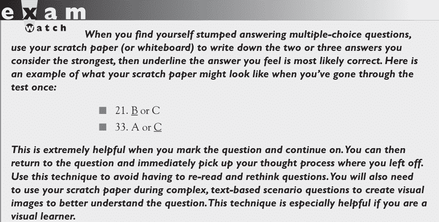

当你发现自己在回答多选题时，使用你的草稿纸（或白板）写下你认为最有力的二三个答案，然后下划你认为最可能的答案。这里是你过一遍测试后，草稿纸可能的样子的示例：

+   21. B 或 C

33. A 或 C

当你标记好题目并继续时，这非常有用。然后你就可以回到题目，并从你中断的地方继续你的思路。使用这种技术可以避免重新阅读和思考问题。在处理复杂的基于文本的场景题时，你也将需要使用草稿纸创建视觉图像以更好地理解问题。这种技术对于视觉学习者来说特别有用。

每个考试的问题数量和及格分数可能会发生变化。在参加考试之前，请始终通过 www.Oracle.com 向 Oracle 确认。

你可以以任何顺序回答问题，并且在完成测试后可以返回检查你的答案。答错没有惩罚，因此至少尝试回答总比完全不回答要好。

参加考试的一个良好策略是先过一遍，回答所有你能够快速想起来的问题。然后你可以返回做其他问题。回答一个问题可能会触起你对如何回答上一个问题的记忆。

务必小心代码示例。首先检查语法错误：数数大括号、分号和括号的数量，确保左侧和右侧的数量相等的。在尝试弄懂代码的作用之前，先寻找拼写大小写错误和其他语法问题。

考试中的许多问题将涉及语法的细微差别。你必须对 Java 语言有深入的知识才能取得成功。

这让我们提到了另一个一些候选人报告过的问题。测试中心本应为你提供书写工具，以便你可以在“纸上”进行推演题目。在某些情况下，候选人提供的记号笔不足且白板太小、太笨，无法有效使用。我们建议你提前打电话，确认将为你提供足够大的白板、足够细头的记号笔和良好的擦板。我们真正想鼓励的是每个人向 Oracle 和 Pearson VUE 投诉，让他们提供真正的铅笔和至少几张白纸。

# 备考技巧

首先，给自己留充足的时间来学习。Java 是一种复杂的编程语言，你不能期望在一个学习阶段中突击完成你需要掌握的知识。这是一个最好随着时间学习的领域，通过学习某个科目然后应用你的知识。制定一个学习计划并坚持下去，但对自己施加的压力要合理，特别是如果你在日常工作之余学习的话。

准备认证考试时使用的一种简单技巧是每天投入 15 分钟。每天至少学习 15 分钟。这是一个小但重要的承诺。如果你某天无法集中注意力，那么 15 分钟后放弃吧。如果你某天状态非常顺畅，就学得久一点。只要你的“心流日”多，你成功的机会就很大。

我们强烈建议你在准备程序员考试时使用闪卡（flash cards）。闪卡仅仅是一张 3x5 或 4x6 的索引卡片，正面是问题，背面是答案。你在阅读一个章节时自己制作这些卡片，记录任何你认为可能需要更多记忆或练习时间的话题。你可以通过这些卡片训练自己：阅读问题，思考答案，然后翻过卡片看你是否正确。或者你可以让别人帮助你，让他拿着问题朝你你的卡片，然后验证你的答案。我们的大多数学生发现这些卡片非常有帮助，尤其是它们在学习模式下非常便于携带，你可以随带到任何地方。不过，开车时最好不要使用，红灯时除外。我们把我们的卡带到了任何地方——诊所、餐厅、剧院，等等如此。

认证学习小组是另一个极好的资源，你找不到比 Big Moose Saloon 认证论坛下的 JavaRanch 规模更大或更愿意帮助的社区了。如果你有这本书中的任何问题，或者你偶然遇到的任何其他模拟题，在认证论坛上提问几乎在所有情况下都能在一天内得到答案——通常几小时内。你会发现我们（作者）每周会出现好几次，帮助那些刚刚开始备考旅程的人们。（当你准备好参加考试时，你实际上不会觉得“旅程”这个词听起来有什么不悦的。）

最后，我们建议你多写一些小型 Java 程序！在编写这本书的过程中，我们写了数百个小程序，如果你听听最成功的候选人是怎么说的（你知道的，那些获得 98 百分的人），他们总是报告说写了大量的代码。

# 安排你的考试

你可以从 Oracle 或 Pearson VUE 购买考试券。访问 Oracle.com（遵循培训/认证链接），访问 PearsonVue.com 查看考试安排和测试中心的位置。

# 到达考试现场

和任何测试一样，你可能会忍不住在考试前一天晚上进行突击。抵制这种诱惑。到那时你应该已经熟悉这些材料了，而且如果你在早上时候昏昏欲睡，你也记不住你学过什么。睡个好觉。

早点参加考试；这可以给你时间放松和回顾关键事实。利用机会回顾你的笔记。如果你学习得精疲力竭，通常会早几分钟开始考试。我们不建议迟到。你的考试可能会被取消，或者你可能没有足够的时间完成考试。

当你到达测试中心时，你需要提供当前、有效的照片身份证明。访问 PearsonVue.com 了解身份证明要求的详情。他们只是想确保你没有把你付钱代考的那个才华横溢的 Java 大师送过来。

除了脑子里的知识，你不需要带任何其他东西进入教室。事实上，你的大脑就是你被允许带进考场的全部！所有测试都是闭卷的，这意味着你不允许从考场带出任何笔记。测试管理员将为你提供支持。

# 考试技巧

## 引言

### 评估挑战

首先，快速过一遍所有问题。“挑选”出你可以立即回答的问题。简要阅读每个问题。作为指南，尝试在这一轮花费少于 25 百分比的时间。

如果你对某个答案不完全确定，尽管回答它，但勾选标记框以便稍后查看。如果在时间不足的情况下，你至少提供了一个“初猜”答案，而不是留白。

其次，返回整个测试，利用你从第一轮中获得的洞察。例如，如果整个测试看起来很困难，你会知道应该对每个问题花费一或两分钟。创建一个带有小里程碑的节奏，例如，“我每 15 分钟需要回答 10 道”。

在这个阶段，你最好跳过耗时的问题，将它们标记为下一轮。尝试在完成进度 50 到 60 百分比之前结束此阶段。

第三，返回所有你标记为回顾的问题，使用标记回复按钮。这一步包括查看你之前几轮不确定的所有问题，以及处理现在推迟的耗时问题。攻克问题组，直到你回答了所有问题。

如果你对之前标记的问题更有把握，现在取消标记回复按钮。否则，保持标记。现在处理那些耗时问题，特别是那些需要手动计算的问题。当你对答案满意时取消标记。

在该步骤结束时，你已经回答了测试中的所有问题，尽管你对某些答案仍保留。如果在最后一步用完了时间，你至少不会因为没有回答而丢分。

现在你进展得很顺利！你已经回答了所有问题，准备好进行质量检查。再次过一遍（是的，最后一遍）整个测试

（尽管你可能想跳过拖放题的复！），请简要重读每个问题以及你的答案。

再次仔细检查问题，查看是否有“陷阱”题。特别注意那些包含“无法编译（Does not compile）”选项的题目。对最后的线索保持警惕。到此时，你已经对几乎每个问题都非常熟悉了，你可能会发现一些之前漏掉的线索。

当你对所有答案充满信心时，提交考试进行评分以完成考试。完成考试后，你将收到来自 Oracle 的封邮件，其中包含一个链接，你可以在该页面查看你的考试结果。截至本文编写时，你必须专门申请纸质证书，否则将不会寄送给你。

# 重考

如果你没有通过考试，不要气馁。尝试对这次经历保持良好的态度，并准备再次尝试。你将更熟悉地了解测试格式，并且对下一次遇到的题目难度水平有一个良好的预期。

如果你能迅速振作起来，可能会记得你可能错过的几个题目。这将帮助你将学习精力集中在正确的区域。

归根结底，记住 Oracle 认证非常有价值，因为它们很难获得。毕竟，如果任何人都能获得，它还有什么价值呢？最后，需要良好的态度和大量的学习，但你可以做到的！

以下四张表格——分别针对 OCA Java SE 7 程序员考试、OCP Java SE 7 程序员 II 考试、升级到 Java SE 7 程序员的考试，以及 OCP Java 程序员 5 和 OCP Java 程序员 6 考试——描述了考试目标以及你可以在书中找到它们的地方。

| 官方目标 | 学习指南范围 |
| --- | --- |
| Java 基础 | |
| 定义变量的作用范围 (1.1) | 第3章 |
| 定义 Java 类的结构 (1.2) | 第1章 |
| 使用 main 方法创建可执行的 Java (1.3) | 第1章 |
| 导入其他 Java 包以便在代码中可以访问 (1.4) | 第1章 |
| 使用 Java 数据类型 | |
| 声明并初始化变量 (2.1) | 第1章和第3章 |
| 区分对象引用变量和原始类型变量 (2.2) | 第2章 |
| 读取或写入对象字段 (2.3) | 全书 |
| 解释对象的生命周期（创建、“取消引用”和垃圾回收）(2.4) | 第2章和第3章 |
| 在对象上调用方法 (2.5) | 全书 |
| 使用 StringBuilder 类及其方法处理数据 (2.6) | 第5章 |
| 创建和操作字符串 (2.7) | 第5章 |
| 使用运算符和决策结构 | |
| 使用 Java 运算符 (3.1) | 第4章 |
| 使用括号覆盖优先级 (3.2) | 第4章 |
| 使用 == 和 equals() 测试字符串与其他对象之间的等价性 (3.3) | 第4章 |
| 创建 if 和 if/else 结构 (3.4) | 第6章 |
| 使用 switch 语句 (3.5) | 第6章 |
| 创建和使用数组 | |
| 声明、实例化、初始化和使用一维数组 (4.1) | 第5章 |
| 声明、实例化、初始化和使用多维数组 (4.2) | 第5章 |
| 声明并使用 ArrayList (4.3) | 第5章 |

| 官方目标 | 学习指南范围 |
| --- | --- |
| 使用循环结构 | |
| 创建并使用 while 循环 (5.1) | 第6章 |
| 创建并使用 for 循环，包括增强 for 循环 (5.2) | 第6章 |
| 创建并使用 do/while 循环 (5.3) | 第6章 |
| 比较循环结构 (5.4) | 第6章 |
| 使用 break 和 continue (5.5) | 第6章 |
| 使用方法和封装 | |
| 创建带有参数和返回值的方法 (6.1) | 第2章和第3章 |
| 对方法和字段应用 static 关键字 (6.2) | 第1章 |
| 创建重载方法 (6.3) | 第2章 |
| 区分默认构造函数和用户定义的构造函数 (6.4) | 第2章 |
| 创建并重载构造函数 (6.5) | 第2章 |
| 应用访问修饰符 (6.6) | 第1章 |
| 对类应用封装原则 (6.7) | 第2章 |
| 当值传递到改变值的方法时，对对象引用和原始值的影响 (6.8) | 第3章 |
| 使用继承 | |
| 实现继承 (7.1) | 第2章 |
| 开发演示多态使用的代码 (7.2) | 第2章 |
| 区分引用类型和对象类型 (7.3) | 第2章 |
| 确定何时需要强制转换 (7.4) | 第2章 |
| 使用 super 和 this 访问对象和构造函数 (7.5) | 第2章 |
| 使用抽象类和接口 (7.6) | 第2章 |
| 异常处理 | |
| 区分检查型异常、运行时异常和错误/Error (8.1) | 第6章 |
| 使用 try-catch 块并确定异常如何改变程序流 (8.2) | 第6章 |
| 描述异常的作用 (8.3) | 第6章 |
| 调用会抛出异常的方法 (8.4) | 第6章 |
| 识别常见的异常类 (8.5) | 第6章 |

(考试 IZ0-804)

| 官方目标 | 学习指南范围 |
|---|---|
| Java 类设计 | |
| 使用访问修饰符：private、protected 和 public (1.1) | 第1章 |
| 重写方法 (1.2) | 第2章 |
| 重载构造函数和方法 (1.3) | 第2章 |
| 使用 instanceof 运算符和强制转换 (1.4) | 第2章 |
| 使用 static 和 final 关键字 (1.5) | 第2章和第10章 |
| 功能 (1.6) | 第11章 |
| 使用 package 和 import 语句 (1.7) | 第1章 |
| 对象设计 | |
| 创建抽象类和接口 (2.1) | 第2章 |
| 选择接口和类继承 (2.2) | 第2章 |
| 应用内聚、低耦合和组合原则 (2.3) | 第2章和第10章 |
| 对象的继承关系 (2.4) | 第2章 |
| 单例模式 (3.5) | 第10章 |
| 数据访问对象 (DAO) (3.6) | 第10章 |
| 工厂模式 (3.7) | 第10章 |
| 泛型和集合 | |
| 创建泛型类 (4.1) | |
| 使用菱形语法 (4.2) | 第11章 |
| 使用原始和泛型类型 (4.3) | 第11章 |
| 使用包装类和自动装箱 (4.4) | 第11章 |
| 使用 List、Set 和 Deque (4.5) | 第11章 |
| 使用 Map (4.6) | 第11章 |
| 使用 java.util.Comparator 和 java.lang.Comparable (4.7) | 第11章 |
| 排序数组和列表 (4.8) | 第11章 |

| 官方目标 | 学习指南范围 |
| --- | --- |
| 字符串处理 | 第8章 |
| 搜索、解析和构建字符串（包括 Scanner、StringTokenizer、String 和 Formatter）(5.1) | |
| 使用正则表达式搜索、解析和替换字符串，使用模式 . , \* (+), ?, \d, \D, \s, \S, \w, \b, [], 和 () (5.2) | 第8章 |
| 使用格式参数 %b, %c, %d 和 %s 格式字符串 (5.3) | 第8章 |
| 异常和断言 | 第6章和第7章 |
| 使用 throws 和 throws语句 (6.1) | |


# OCA/OCP Java SE 7 程序员 I & II 学习指南

## 目标映射

### OCA Java SE 7 程序员 I (考试 1Z0-803)

| 官方目标 | 学习指南覆盖范围 |
| :--- | :--- |
| 在单个 catch 块中处理多个异常 (6.2) | 第7章 |
| 使用 try-with-resources 语句（实现 `AutoCloseable` 接口的类）(6.3) | 第7章 |
| 创建自定义异常 (6.4) | 第6章和第7章 |
| 使用断言测试不变性 (6.5) | 第7章 |
| Java I/O 基础 | 第9章 |
| 从控制台读取和写入数据 (7.1) | |
| 使用 `java.io` 包中的类读写文件，包括 `BufferedReader`、`BufferedWriter`、`FileReader`、`FileWriter`、`DataInputStream`、`DataOutputStream`、`ObjectOutputStream`、`ObjectInputStream` 和 `PrintWriter` (7.2) | 第9章和下载内容 |
| Java I/O (NIO.2) | 第9章 |
| 使用 `Path` 类操作文件和目录 (8.1) | |
| 使用 `Files` 类检查、删除、复制或移动文件或目录 (8.2) | 第9章 |
| 使用 `BasicFileAttributes`、`DosFileAttributes` 和 `PosixFileAttributes` 接口读取和更改文件目录属性 (8.3) | 第9章 |
| 使用 `DirectoryStream` 和 `FileVisitor` 接口递归访问目录 (8.4) | 第9章 |
| 使用 `PathMatcher` 接口查找文件 (8.5) | |
| 使用 `WatchService` 接口监视目录变化 (8.6) | 第9章 |

### OCP Java SE 7 程序员 II (考试 1Z0-804)

| 官方目标 | 学习指南覆盖范围 |
| :--- | :--- |
| 使用 JDBC 构建数据库应用程序：描述构成 JDBC API 的接口（包括 `Driver`、`Connection`、`Statement` 和 `ResultSet` 接口以及它们与提供者实现之间的关系）(9.1) | 第 15 章 |
| 识别使用 `DriverManager` 类连接到数据库所需的组件（包括 JDBC URL）(9.2) | 第 15 章 |
| 向数据库提交查询并读取结果（包括创建语句；返回结果；遍历结果；以及正确关闭结果集、语句和连接）(9.3) | 第 15 章 |
| 使用 JDBC 事务（包括禁用自动提交模式、提交和回滚事务，以及设置回滚到保存点）(9.4) | 第 15 章 |
| 使用 `RowSetProvider` 类和 `RowSetFactory` 接口构造并使用 `RowSet` 对象(9.5) | 第 15 章 |
| 创建并使用 `PreparedStatement` 和 `CallableStatement` 对象(9.6) | 第 15 章 |
| 线程：创建并使用 `Thread` 类和 `Runnable` 接口(10.1) | 第 13 章 |
| 管理和控制线程周期(10.2) | 第 13 章 |
| 同步线程对共享数据的访问(10.3) | 第 13 章 |
| 识别在多线程环境中可能执行不正确的代码(10.4) | 第 13 章 |
| 并发：使用 `java.util.concurrent` 包中的集合，重点关注其与传统的 `java.util` 集合相比的优势和区别(11.1) | 第 14 章 |
| 使用 `java.util.concurrent.locks` 包中的 `Lock`、`ReadWriteLock` 和 `ReentrantLock` 类来支持单变量的无锁线程安全编程(11.2) | 第 14 章 |
| 使用 `Executor`、`ExecutorService`、`Executors`、`Callable` 和 `Future` 使用线程池执行任务(11.3) | 第 14 章 |
| 使用并行 Fork/Join 框架(11.4) | 第 14 章 |
| 本地化：使用 `Locale` 对象读取和设置区域(12.1) | 第 8 章 |
| 为每个语言区域构建资源包(12.2) | 第 8 章 |
| 从应用程序中调用资源包(12.3) | 第 8 章 |
| 使用 `NumberFormat` 和 `DateFormat` 类为本地化格式化日期、数字和货币值（包括数字格式模式）(12.4) | 第 8 章 |
| 描述应用程序本地化的优势(12.5) | 第 8 章 |
| 使用语言和国家代码定义区域(12.6) | 第 8 章 |

## 升级到 Java SE 7 程序员 (考试 1Z0-805)

### 语言增强

| 官方目标 | 学习指南覆盖范围 |
| :--- | :--- |
| 开发在 switch 语句中使用 String 对象的代码(1.1) | 第 6 章 |
| 开发使用二进制字面量和带下划线的数字字面量的代码(1.2) | 第 3 章 |
| 开发使用 try-with-resources 语句的代码（包括实现 `AutoCloseable` 接口的类）(1.3) | 第 7 章 |
| 开发在单个 catch 块中处理多个异常的代码(1.4) | 第 7 章 |
| 开发在泛型声明中使用菱形运算符的代码(1.5) | 第 11 章 |

### 设计模式

| 官方目标 | 学习指南覆盖范围 |
| :--- | :--- |
| 使用单例设计模式设计类(2.1) | 第 10 章 |
| 应用对象组合原则（包括 HAS-A 关系）(2.2) | 第 2 章和第 10 章 |
| 编写实现数据访问对象 (DAO) 的代码(2.3) | 第 10 章 |
| 使用工厂模式设计并创建对象(2.4) | 第 10 章 |

### 使用 JDBC 的数据库应用程序

| 官方目标 | 学习指南覆盖范围 |
| :--- | :--- |
| 描述构成 JDBC API 核心的接口（包括 `Driver`、`Connection`、`Statement` 和 `ResultSet` 接口以及它们与提供者实现之间的关系）(3.1) | 第 15 章 |
| 识别使用 `DriverManager` 类连接到数据库所需的组件（包括 JDBC URL）(3.2) | 第 15 章 |
| 使用 `RowSetProvider` 类和 `RowSetFactory` 构造并使用 `RowSet` 对象(3.3) | 第 15 章 |
| 使用 JDBC 事务（包括禁用自动提交模式、提交和回滚事务，以及设置回滚到保存点）(3.4) | 第 15 章 |
| 向数据库提交查询并读取结果（包括创建语句；返回结果集；遍历结果；以及关闭结果集、语句和连接）(3.5) | 第 15 章 |
| 创建并使用 `PreparedStatement` 和 `CallableStatement` 对象(3.6) | 第 15 章 |

### 并发

| 官方目标 | 学习指南覆盖范围 |
| :--- | :--- |
| 识别在多线程环境中可能执行不正确的代码(4.1) | 第 13 章 |
| 使用 `java.util.concurrent` 包中的集合，重点关注其与传统集合相比的优势和区别(4.2) | 第 14 章 |
| 使用 `java.util.concurrent.locks` 包中的 `Lock`、`ReadWriteLock` 和 `ReentrantLock` 类来支持单变量的无锁线程安全编程(4.3) | 第 14 章 |
| 使用 `Executor`、`ExecutorService`、`Executors`、`Callable` 和 `Future` 使用线程池执行任务(4.4) | 第 14 章 |
| 使用并行 Fork/Join 框架(4.5) | 第 14 章 |

### 本地化

| 官方目标 | 学习指南覆盖范围 |
| :--- | :--- |
| 描述应用程序本地化的优势(5.1) | 第 8 章 |
| 使用语言和国家代码定义区域(5.2) | 第 8 章 |
| 使用 `Locale` 对象读取和设置区域(5.3) | 第 8 章 |
| 为每个语言区域构建资源包(5.4) | 第 8 章 |
| 从应用程序中调用资源包(5.5) | 第 8 章 |
| 使用 `NumberFormat` 和 `DateFormat` 类为本地化格式化日期、数字和货币值（包括数字格式模式）(5.6) | 第 8 章 |

### 文件 I/O (NIO.2)

| 官方目标 | 学习指南覆盖范围 |
| :--- | :--- |
| 使用 `Path` 类操作文件和目录(6.1) | 第 9 章 |
| 检查、删除、复制或移动文件或目录(6.2) | 第 9 章 |
| 读取并更改文件属性、`BasicFileAttributes`、`DosFileAttributes`(6.3) | 第 9 章 |
| 使用 `DirectoryStream` 递归访问目录(6.4) | 第 9 章 |
| 使用 `PathMatcher` 查找文件(6.5) | 第 9 章 |
| 使用 `WatchService` 监视目录变化(6.6) | 第 9 章 |

---

# 第一部分 OCA/OCP

## 章节概览

- 第1章 声明
- 第2章 面向对象
- 第3章 运算符
- 第4章 数组
- 第5章 ArrayList
- 第6章 流程控制

---

# 第一章：声明与访问控制

## 认证目标

- 标识符和关键字
- 编译、main 方法和导入
- 声明类和接口
- 声明类成员
- 声明构造函数和数组
- 使用枚举
- 两分钟训练
- 问答自测

## Java 复习

Java 程序大部分是对象通过调用彼此的方法进行通信的。每个对象都有特定的类型，该类型由类或接口定义。大多数 Java 程序使用多种类型的对象集合。以下是一些常用术语：

- **类**：描述状态和行为的模板。
- **对象**：在运行时，当 Java 虚拟机 (JVM) 遇到 `new` 关键字时，它将使用相应的类创建对象的实例。该对象拥有自己的状态并可以访问类定义的所有行为。
- **状态（实例变量）**：每个对象（类的实例）拥有类定义的唯一实例变量。赋值给实例变量的值集合构成了对象的状态。
- **行为（方法）**：当程序员创建一个类时，她为该类创建方法。方法是存储类逻辑的地方，也是执行算法和处理数据的地方。

## 标识符和关键字

我们讨论的所有 Java 组件（类、变量和方法）都需要名称。在 Java 中，这些名称被称为标识符，正如你所预期的，对于什么是合法的 Java 标识符是有规则的。除了合法之外，Java 和 Oracle 的程序员还为方法、变量和类的命名制定了约定。

所有编程语言都有一组内置关键字。这些关键字不能作为标识符。在本章的晚些部分，我们将回顾这些命名规则、约定以及 Java 关键字的细节。

## 继承

Java 以及其他面向对象语言的核心是继承概念，它允许在一个类中定义的代码在其他类中重用。在 Java 中，你可以定义一个通用的（更抽象的）父类，然后用更具体的子类来扩展它。父类对继承自它的类一无所知，但所有继承自父类的子类都必须显式地声明继承关系。继承父类的子类会自动获得父类定义的可访问实例变量和方法，但子类也可以自由地重写父类方法以定义更具体的行为。例如，一个 `Car` 父类可以定义所有汽车通用的通用方法，但 `Ferrari` 子类可以重写已经在 `Car` 类中定义的 `accelerate()` 方法。

## 接口

继承强大的伙伴是接口的使用。接口类似于 100% 抽象的父类，它定义了子类必须支持的方法，但没有规定如何支持它们。换句话说，例如，`Animal` 接口可能会声明所有 `Animal` 实现类都拥有 `eat()` 方法，但 `Animal` 接口并不为 `eat()` 方法提供任何逻辑。这意味着由实现 `Animal` 接口的类来定义当调用其 `eat()` 方法时特定 `Animal` 类型行为的具体代码。

## 寻找其他类

正如我们在书中看到的（对于你们 OCP 候选人），让你的类具有内聚性是一个好主意。例如，如果你创建一个包含 200 个对象的模拟程序，你会希望用一个类来表示土拨鼠（aardvarks），用另一个类来表示 200 个访问者（visitors）。此外，你可能还会有一个 `Zookeeper` 类和一个 `PopcornVendor` 类。点在于，你不希望一个类同时拥有土拨鼠和爆米花销售者的行为（将在第 10 章中详细介绍）。

即使是一个简单的 Java 程序也会使用许多不同类的对象；有些是你创建的，另一些是由他人构建的（例如 Oracle 的 Java API 类）。Java 将类组织成包，并使用 `import` 语句为程序员提供了一种一致的方法来管理命名和访问他们所需的类。考试涵盖了许多与包和类访问相关的概念；我们将在整个书中探索细节。

## 认证目标：标识符和关键字 (OCA 目标 1.2 和 2.1)

- **1.2** 定义 Java 类的结构。
- **2.1** 声明并初始化变量。

记住，当我们在书中列出一个或多个认证目标时（正如我们所做的那样），这意味着后续章节至少涵盖了该目标。某些目标会在几个不同的章节中涵盖，因此你会在书中多个地方看到同一个目标。例如，本节涵盖了声明和标识符，但使用你声明的内容主要在后面的章节中涵盖。

所以，我们将从 Java 标识符开始。我们涵盖的 Java 标识符的两个方面是：

- **合法标识符**：编译器用于判断一个名称是否合法的规则。
- **Oracle Java 代码规范**：Oracle 对类、变量和方法命名的建议。在整本书中，我们通常遵循这些标准，除非我们正试图向你展示某个棘手的考试题是如何编码的。你不会（在考试中）被问到关于 Java 代码规范的问题，但我们强烈建议你使用它们。

### 合法标识符

从技术上讲，合法标识符必须由 Unicode 字符、数字、货币符号和连接字符（如下划线）组成。考试确实深入研究了 Unicode 字符集中哪些范围的字符被认为是有效的标识符和数字。例如，你不需要知道藏文字数字的范围是从 `\u0420` 到 `\u0f29`。以下是你需要的规则：

- 标识符必须以字母、货币字符（`$`）或连接字符（如下划线 `_`）开头。标识符不能以数字开头！
- 在第一个字符之后，标识符可以包含字母、货币字符、连接字符或数字的任意组合。
- 在实践中，标识符包含字符的数量没有限制。
- 你不能使用 Java 关键字作为标识符。表 1-1 列出了所有的 Java 关键字。
- Java 中的标识符区分大小写；`foo` 和 `FOO` 是两个不同的标识符。

以下是合法标识符的示例：

```java
int _a;
int $c;
int __2w;
int _$;
int this_is_a_very_detailed_name_for_an_identifier;
```

以下是非法标识符（识别其原因是你的任务）：

```java
int :b;
int -d;
int e#;
int .f;
int 7g;
```

### Oracle Java 代码规范

Oracle 估计，在标准代码的整个生命周期，20% 的精力将用于代码的创建和测试，而 80% 的精力将用于后续的维护和增强。

**表 1-1 Java 关键字完整列表（1.4 添加了 assert，1.5 添加了 enum）**

| abstract | boolean | break | byte | case | catch |
| :--- | :--- | :--- | :--- | :--- | :--- |
| char | const | continue | default | do | double |
| else | extends | final | finally | float | for |
| goto | if | implements | import | instanceof | int |
| interface | long | native | new | package | private |
| protected | public | return | short | static | strictfp |
| super | switch | synchronized | this | throw | throws |
| transient | try | void | volatile | while | assert |
| enum | | | | | |

同意并遵循一套代码标准有助于减少测试、维护和增强任何代码的精力。Oracle 为 Java 创建了一套编码标准，并将这些标准发布在名为“Java 代码规范”的文档中，你可以在 java.oracle.com 找到它。这是一份非常好的文档，短小易读，我们非常推荐。

尽管如此，你会发现考试中的许多题目并没有遵循代码规范，这是因为用于国际交付考试的测试引擎存在限制。Oracle 认证的优点之一是考试在全球范围内统一管理。为了实现这一点，你在真实考试中看到的代码列表通常非常紧凑且不遵循 Oracle 的代码标准。为了让你提前适应，我们经常展示具有类似紧凑外观的代码列表：

```java
class Wombat implements Runnable {
    private int i;
    public synchronized void run() {
        if (i <= 0) { i++; }
        for(int x=0; x<5; x++) {
            if (i > 1) { Thread.yield(); }
            System.out.print(i + " ");
        }
    }
    public static void main(String[] args) {
        Wombat n = new Wombat();
        for(int x=100; x>0; x--) { new Thread(n).start(); }
    }
}
```


# 第10章 第一章：声明与访问控制

## 考试目标

- 1.4 导入其他 Java 包，以便在代码中可以使用它们。
- 6.6 应用访问修饰符。
- 7.6 使用抽象类和接口。

当你编写 Java 代码时，你正在编写类或接口。正如你所知的，这些类中包含了变量和方法（以及一些其他内容）。你如何声明类、方法和变量会极大地影响代码的行为。例如，一个公共（`public`）方法可以从应用程序中运行的代码访问。但是，如果将该方法标记为私有（`private`），它就会从每个人的视野中消失（声明它的类除外）。

为了实现这一目标，我们将学习声明和修改（或不修改）类的方法。你会发现我们对修饰符的介绍到了详尽的程度，尽管你可能认为自己已经熟悉了它们，但我们将从最基础的学起。大多数 Java 程序员都认为自己知道所有修饰符是如何工作的，但通过仔细的研究，他们通常会发现自己并非如此（至少没有达到考试所需的程度）。细微的差别随处可见，因此在参加考试之前，你必须完全确定本节目标中的所有内容都已烂熟掌握。

## 源文件声明规则

在深入研究类声明之前，让我们快速复习与源文件中声明类、导入（`import`）语句和包（`package`）语句相关的规则：

- 每个源代码文件只能有一个公共（`public`）类。
- 注释可以出现在源文件中任何行的开头或结尾；它们独立于此处讨论的任何位置规则。
- 如果文件中有一个公共类，则文件名必须与公共类的名称匹配。例如，声明为 `public class Dog {}` 的类必须存在于名为 `Dog.java` 的源文件中。
- 如果类属于某个包（`package`），则 `package` 语句必须是源文件的第一行，位于任何可能存在的 `import` 语句之前。
- 如果存在 `import` 语句，它们必须位于 `package` 语句（如果有）和类声明之间。如果没有 `package` 语句，那么 `import` 语句必须是源代码的第一行。
- `import` 和 `package` 语句适用于源文件中的所有类。换句话说，无法在一个文件中声明多个类并让它们处于不同的包或使用不同的导入。
- 一个文件可以有多个非公共（`nonpublic`）类。
- 没有公共类的文件，其名称可以与文件中的任何类名不匹配。
- 如果没有包或导入语句，类声明必须是源文件的第一行。

## 使用 `javac` 和 `java` 命令

在本书中，我们将调用 `javac` 和 `java` 命令大约 1000 次。尽管在现实世界中，你大部分时间可能都在使用集成开发环境（IDE），但在考试中可能会遇到一些使用命令行界面的问题，因此我们将复习一下基础知识。（顺便说一下，我们在写这本书时**没有**使用 IDE。在准备考试时，我们仍然稍微倾向于使用命令行；所有的 IDE 所做的只是为了提供更好的“帮助”，而且有时它们会在不告诉你的情况下修复你的问题。这在工作中很棒，但在你准备认证考试时可能没那么好！）

### 使用 `javac` 编译

`javac` 命令用于调用 Java 编译器。在运行 `javac` 时，你可以指定许多选项。例如，有选项生成调试信息或编译器警告。以下是 `javac` 的结构概览：

```
javac [options] [source files]
```

还有一些名为 `@argfiles` 的额外命令行选项，它们很少使用，你不需要为考试学习它们。`[options]` 和 `[source files]` 都是命令的可选部分，并且都允许有多个条目。以下都是合法的 `javac` 命令：

```
javac -help
javac -version Foo.java Bar.java
```

第一次调用不编译任何文件，而是打印有效选项的摘要。第二次调用向编译器传递了一个选项（`-version`，它会打印你正在使用的编译器版本），并向编译器传递了两个要编译的 .java 文件（`Foo.java` 和 `Bar.java`）。每当你指定多个选项和/文件时，它们应该用空格隔开。（注意：如果你正在准备 OCP 7，我们在第 7 章将讨论断言机制，以及在编译文件时何时可能使用 `-source` 选项。）

### 使用 `java` 启动应用程序

`java` 命令用于调用 Java 虚拟机。`java` 命令是 Java 虚拟机（JVM）的，结构如下：

```
java [options] [class]
```

`[options]` 和 `[class]` 是命令的可选部分，但 `[class]` 是必须的。

### 使用 `static void main(String[]) args`

`main()` 方法的使用在考试的大部分中都是隐含的，在 OCA 考试中它被专门覆盖。首先，你需要知道，命名为 `main()` 并不意味着它具有我们通常认为的超级能力。对于编译器和 JVM 来说，唯一具有超级能力的 `main()` 版本具有此签名：

```
public static void main(String[]) args
```

具有其他签名的 `main()` 版本是完全合法的，但它们被视为普通方法。特殊的 `main()` 方法（用于启动 Java 应用程序的那个）的声明具有灵活性：修饰符的顺序可以更改，String 数组不需要命名为 `args`，而且从 Java 5 开始它可以使用变长参数（var-args）语法。以下都是特殊的 `main()` 的合法声明：

```
public static void main(String[]) args
public static void main(String... x)
public static void main(String bang_args[])
```

此外，`main()` 可以重载。我们将在下一章详细介绍重载。

## 导入语句与 Java API

世界上有数百万 Java 类。Java API 有数千个类，而 Java 社区编写了其余部分。我们认为，所有的 Java 程序员都会结合自己写的类和别人编写的类。假设我们创建了以下代码：

```java
public class ArrayList {
    public static void main(String[] args) {
        System.out.println("fake ArrayList");
    }
}
```

这是一个完全合法的类，但事实证明，Java API 中最常用的类之一也叫 `ArrayList`，或者看起来是这样…… API 的实际名称是 `java.util.ArrayList`。使用全限定类名有助于 Java 开发者确保两个像 `ArrayList` 类的版本不会产生混淆。现在假设我想使用 API 中的 `ArrayList` 类：

```java
public class MyClass {
    public static void main(String[] args) {
        java.util.ArrayList<String> a =
        new java.util.ArrayList<String>();
    }
}
```

（首先，请相信我们关于 `<String>` 语法的说法；稍后会解释。）虽然这是合法的，但这需要大量的按键输入。由于程序员本质上是懒惰的（没错，我们直说了），我们非常喜欢使用他人的类，而且我们又不想打字。如果我们有一个大型程序，我们可能会多次使用 `ArrayList`，这时 `import` 语句就能救急了！比起前面的代码，我们的类可以像这样：

```java
import java.util.ArrayList;
public class MyClass {
    public static void main(String[] args) {
        ArrayList<String> a = new ArrayList<String>();
    }
}
```

我们将 `import` 语句解释为：“在 Java API 中有一个名为 'util' 的包，在那个包里我们看到了这个名为 'ArrayList' 的类，它只是 `java.util.ArrayList` 的简写。（注意：以后会有更多关于包的内容！）如果你是 C 语言程序员，你可能会认为 `import` 语句类似于 `#include`。其实并不是。Java 的 `import` 语句只是为你节省了一些打字量。仅此而已。

正如我们暗示的，一个包（`package`）通常包含很多类。`import` 语句提供了另一种节省按键次数的功能。假设你想使用 `java.util` 包中的几个不同的类：`ArrayList` 和 `TreeSet`。你可以在 `import` 语句中添加一个通配符字符 `(*)`，它的意思是：“如果你看到一个你不确定的类引用，你可以遍历整个包来查找该类”，如下：

```java
import java.util.*;
public class MyClass {
    public static void main(String[] args) {
        ArrayList<String> a = new ArrayList<String>();
        TreeSet<String> t = new TreeSet<String>();
    }
}
```

当编译器和 JVM 看到这段代码时，它们知道去 `java.util` 中查找 `ArrayList` 和 `TreeSet`。对于考试来说，你在类中关于 `import` 语句需要记住的最后一点是，你可以自由地混合使用。这样写是可以的：

```java
ArrayList<String> a = new ArrayList<String>();
java.util.ArrayList<String> a2 = new java.util.ArrayList<String>();
```

## 静态导入语句

亲爱的读者，我们在讨论静态导入（static imports）时确实费了很大劲。从学习的角度来看，这可能不是理想的位置，但从参考的角度来看，我们认为这样做是有意义的。第一次学习这些材料时，可能会对其中的一些观点感到困惑。如果是这样，我们深表歉意。请在这页贴上便签，在读完第 3 章后再回来这里。另一方面，如果你已经通过了学习阶段并将此书作为参考，我们认为这一部分会非常有用。现在，谈谈静态导入。

有时类会为你提供静态成员。（我们稍后会详细讨论静态导入成员，但既然我们谈到了导入，就想现在顺便提到静态导入。）静态类成员可以存在于你写的类中，也可以存在于 Java API 的许多类中。

正如我们所说，`import` 语句最终的价值在于它们节省了打字量，并且可以让你的代码更易读。在 Java 5 中，`import` 语句得到了增强，以提供更强大的减少按键的功能，尽管有些人认为这是以牺牲可读性为代价的。这一特性被称为静态导入。当你想要在使用类的静态成员时为了“节省打字量”时，可以使用静态导入。（你可以在 API 中的类和你自己的类上使用此功能。）这里有一个使用 `java.lang.Integer` 中常用类的“之前”和“之后”示例。这个示例还使用了一个你用过成千次的静态成员，可能你从未深想过它；即 `System` 类中的 `out` 字段。

### 静态导入之前

```java
public class TestStatic {
    public static void main(String[] args) {
        System.out.println(Integer.MAX_VALUE);
        System.out.println(Integer.toHexString(42));
    }
}
```

### 静态导入之后

```java
import java.lang.System.out;      // 1
import static java.lang.Integer.*;         // 2
public class TestStaticImport {
    public static void main(String[] args) {
        out.println(MAX_VALUE);                // 3
        out.println(toHexString(42));           // 4
    }
}
```

这两个类产生相同的输出：

```
2147483647
42
```

### 静态导入说明

- 即使 `import` 语句后面跟的是 `static`，你也必须提供类的全限定名，或者使用通配符。
- 在 `System.out.println` 这一行中，我们看到了 `static` 带来的用处！
- `out.println(MAX_VALUE);` 这一行中，我们不需要再打字。
- `out.println(toHexString(42));` 这一行中，我们不需要再打字。


## 静态导入

- 即使 `import` 语句后面跟的是 `static`，你也必须提供类的全限定名，或者使用通配符。
- 在 `System.out.println` 这一行中，我们看到了 `static` 带来的用处！
- `out.println(MAX_VALUE);` 这一行中，我们不需要再打字。
- `out.println(toHexString(42));` 这一行中，我们不需要再打字。

## 访问控制

### 类声明

```java
class
```

这段代码编译完全正常，但你可以在类声明之前添加修饰符。通常，修饰符分为两类：

- **访问修饰符**（`public`、`protected`、`private`）
- **非访问修饰符**（包括 `strictfp`、`final`、`abstract`）

我们将先看访问修饰符，这样你就能学习如何限制或允许对创建的类的访问。Java 的访问控制有点复杂，因为有四种访问控制级别，但只有三个访问修饰符。第四种访问控制级别（称为默认或包访问）是在你不使用任何三个修饰符时得到的。也就是说，每个类、方法和实例变量声明时，你就定义了一个访问控制，无论你是否显式地写出了它。虽然四种访问控制（意味着所有三个修饰符）对大多数方法和变量声明都有效，但类只能声明为 `public`（公共）或 `default`（默认）访问；另外两个控制级别对于类来说没有意义，正如你将看到的那样。

Java 是一门以包（`package`）为中心的语言；开发者假设，为了良好的组织和命名作用域，你会将所有的类都放在包（`packages`）中。他们是正确的，你确实应该这样做。想象一下这个噩梦：三个不同的程序员在同一家公司负责项目的不同部分，他们都写了一个同名为 `Utilities` 的类。如果这三个 `Utilities` 类没有在任何显式包中声明，并且都在类路径（`classpath`）中，你将无法告诉编译器或 JVM 你想要引用的是其中的哪一个。Oracle 建议开发者使用反向域名，并加上部门和项目名称。例如，如果你的域名是 `geeksanonymous.com`，而你正在为 `TwelvePointSteps.steps` 编写客户端代码，你应该将包命名为类似 `com.geeksanonymous.steps.client`。这本质上改变了你的类名称，如果你不自己设计一套命名方案，在公司内部仍可能发生命名冲突，但你可以保证不会与公司外部开发的类发生冲突（假设它们遵循 Oracle 的命名规范，如果它们不遵循，那么，可能会发生**糟糕的事情**）。

### 类访问

访问一个类意味着什么？当我们使用一个类（类 A）的代码来访问另一个类（类 B）时，意味着类 A 可以执行以下三件事之一：

- 创建类 B 的实例。
- 扩展类 B（换句话说，成为类 B 的子类）。
- 访问类 B 内部的方法和变量，这取决于这些方法和变量的访问控制。

事实上，访问意味着可见性。如果类 A 看不到类 B，那么类 B 内部方法和变量的访问级别就无关了；类 A 将无法访问这些方法和变量。

### 默认访问

在声明时，具有默认访问的类前面没有修饰符！这是你在类声明中没有输入修饰符时所控制的访问权限。将默认访问理解为包级别的访问即可，因为具有默认访问权限的类可以被同一个包内的类看到。例如，类 A 和类 B 位于不同的包，且类 A 是默认访问的，类 B 将无法创建类 A 的实例，甚至无法声明类 A 的变量或返回类型。事实上，类 B 必须假装类 A 甚至不存在，否则编译器无法通过。查看以下源文件：

```java
package cert;
class Beverage { }
```

现在看第二个源文件：

```java
package exam.stuff;
import cert.Beverage;
class Tea extends Beverage { }
```

如你所见，超类（`Beverage`）与子类（`Tea`）位于不同的包。`Tea` 文件顶部的 `import` 语句试图（祈祷好运）导入 `Beverage` 类。`Beverage` 文件编译正常，但当我们尝试编译 `Tea` 文件时，会得到如下信息：

```
Can't access cert.Beverage. Class or interface must be public, in package, or an accessible member class.
import cert.Beverage;
```

`Tea` 无法编译，因为它的超类 `Beverage` 是默认访问且位于不同的包中。你可以采取两种方法之一让其工作：你可以将两个类放在同一个包中，或者像下一节描述的那样，将 `Beverage` 声明为 `public`。

当你看到带有复杂逻辑的问题时，务必查看访问修饰符。这样，如果你发现了访问违规（例如，包 A 中的类尝试访问包 B 中的默认访问类），你就知道代码无法编译，因此无需再费精力去推演逻辑。如果你在考试时没有别的事情要做，这也没关系。直接选择“编译失败（`Compilation fails`）”答案并跳到下一题即可。

### 公共访问

带有 `public` 关键字的类声明允许所有包中的所有类访问该公共类。换句话说，Java 宇宙（JU）中的所有类都可以访问一个公共类。但不要忘记，如果你正尝试使用的公共类与你编写的类不在同一个包中，你仍然需要 `import` 该公共类。

在上一节的示例中，我们可能不想将子类与超类放在同一个包中。为了让代码工作，我们需要在超类（`Beverage`）声明前添加 `public` 关键字，如下：

```java
package cert;
public class Beverage { }
```

这改变了 `Beverage` 类，使其对所有包中的所有类可见。现在该类可以从所有其他类中实例化，并且任何类都可以对其进行子类化（扩展）——除非，该类也被标记为非访问修饰符 `final`。继续阅读。

### 其他（非访问）类修饰符

你可以使用 `final`、`abstract` 或 `strictfp` 关键字来修改类声明。这些修饰符是在类上现有的访问控制之外的，例如，你可以将一个类同时声明为 `public` 和 `final`。但你不能将一个类同时声明为 `abstract` 和 `final`。

### 抽象类

抽象类永远不能被实例化。它的唯一目的、人生使命、存在的意义就是被继承（作为子类）。但请注意，只要你不尝试创建它的实例，你就可以编译并执行一个抽象类。如果你不能通过类创建对象，为什么要写一个类呢？因为这个类可能太过于*抽象*了。例如，假设你有一个 `Car` 类，它拥有所有车辆通用的通用方法。你不希望任何人实际上创建一个通用的、抽象的 `Car`。你如何初始化它的状态？它是什么颜色的？几个座位？马力是多少？全驱动？或者更重要的是，它的表现如何？换句话，方法将如何实现！

不，你们程序员实例化像 `BMWBoxster` 和 `Subaru Outback` 这样的具体汽车类型。我们敢打赌 Boxster 的主人会告诉你，他的车能做到 Subaru “只能在梦里”做的事。请看以下抽象类：


```java
abstract class Car {
    private double price;
    private String model;
    private String year;
    public abstract void goFast();
    public abstract void goUpHill();
    public abstract void impressNeighbors();
    // 额外的、重要的且严肃的代码写在这里
}
```

前面的代码可以正常编译。然而，如果你尝试在代码的其他部分实例化 `Car`，你会得到类似下面的编译器错误：

```
AnotherClass.java:7: class Car is an abstract
class. It can't be instantiated.
Car x = new Car();
error
```

注意，标记为 `abstract` 的方法以分号结尾，而不是大括号。

寻找以分号而不是大括号结尾的方法声明问题。如果该方法在类中（而不是接口中），那么该方法和该类必须标记为 `abstract`。你可能会遇到这样的问题，要求你如何修复一个包含以分号结尾的方法、但在类或方法上没有使用 `abstract` 修饰符的代码示例。在这种情况下，你可以将方法和类都标记为抽象，或者将分号更改为代码（如大括号对）。记住，如果你将一个方法从抽象改为非抽象，不要忘记将方法声明末尾的分号更改为大括号对！

## 定义类（OCA 目标 1.2, 1.3, 1.4, 6.6, 和 7.6）

我们在这个目标中更详细地查看抽象方法，但始终记住，即使只有一个方法是抽象的，整个类也必须声明为抽象。一个抽象方法就会坏了大局。不过，你可以在抽象类中放置非抽象方法。例如，你可能拥有某些不应随 `Car` 类型改变而改变实现的方法，如 `getColor()` 或 `setPrice()`。通过将非抽象方法放在抽象类中，所有的子类（具体就意味着非抽象）都将继承这些的方法实现。好消息是，具体子类可以继承功能，并且只需要实现定义子类特定行为的方法。

（顺便说一下，如果你认为我们之前漏掉了 raison d'etre，请不要发送电子邮件。我们希望看到你在程序员认证书籍中将其运用出来。）

使用抽象类类型（包括本章讨论的接口）进行编码可以让你利用多态性，并赋予你最大的活性和扩展性。你将在第2章中学习更多关于多态的知识。你不能将一个类同时标记为 `abstract` 和 `final`。它们的含义几乎相反。抽象类必须被子类化，而 `final` 类则不能子类化。如果你在类或方法声明中看到 `abstract` 和 `final` 修饰符的组合，代码将无法编译。

## 练习 I-I

## 创建一个抽象父类和具体子类

下面的练习将测试你对 `public`、`default`、`final` 和 `abstract` 类的理解。创建一个名为 `Fruit` 的抽象子类和一个名为 `Apple` 的具体子类。父类应属于一个名为 `food` 的包，子类可以属于默认包（意味着它没有显式地放入包中）。将父类设为 `public`，并给子类默认访问权限。

1. 如下创建父类：

```java
package food;
public abstract class Fruit{ /* 任何你代码 */
```

2. 如下在单独的文件创建子类：

```java
import food.Fruit;
class Apple extends Fruit{ /* 任何你代码 */
```

3. 在你的类路径设置的目录下创建一个名为 `food` 的目录。

4. 尝试编译这两个文件。如果你想使用 `Apple` 类，请确保将 `Fruit.class` 文件存放在 `food` 子目录中。

## 第一章：声明与访问控制

## 认证目标

## 使用接口 (OCA 目标 7.6)

7.6 使用抽象类和接口。

## 声明接口

当你创建一个接口时，你是在定义一个关于类可以做什么的合同，而不说该类将如何做。接口就是一个合同。例如，你可以写一个 `Bounceable` 接口，它实际上表示：“这是一个 Bounceable 接口。任何实现此接口的类类型必须同意编写 `bounce` 和 `setBounceFactor()` 方法的代码。”

通过为 `Bounceable` 定义接口，任何想要被视为 `Bounceable` 对象的类都可以实现 `Bounceable` 接口并为接口的两个方法提供代码。

接口可以由任何继承树中的任何类实现。这让你获取截然不同的类并赋予它们共同的特征。例如，你可能希望 `Ball` 和 `Tire` 都具有弹跳行为，但 `Ball` 和 `Tire` 之间没有任何继承关系；`Ball` 继承 `Toy`，而 `Tire` 只继承 `java.lang.Object`。但通过让 `Ball` 和 `Tire` 都可实现，你定义了“可以弹跳的东西”，在 Java 中这翻译为“你可以调用 `bounce()` 和 `setBounceFactor()` 方法的对象”。图 1-1 展示了接口与类之间的关系。

将接口视为一个 100% 的抽象类。就像抽象类一样，接口定义了带有以下内容的抽象方法：

```java
abstract void bounce(); // 以分号结束而不是
// 大括号
```

## 使用接口 (OCA 目标 7.6)

## 图 1-1

接口与类之间的关系

```java
interface Bounceable;

void bounce( );
void setBounceFactor(int bf);
```

你声明的内容。

```java
interface Bounceable;

public abstract void bounce( );
public abstract void setBounceFactor(int bf);
```

编译器看到的内容。

```java
Class Tire implements Bounceable
public void bounce(){}
public setBounceFactor(int bf)
```

实现类必须做的事。

但尽管抽象类可以同时定义抽象和非抽象方法，接口只能有抽象方法。这些是规则：

- 所有接口方法都是隐式的 `public` 和 `abstract`。基于该规则，你可以看到以下代码与前面的接口完全等效：

- 接口中定义的所有变量必须是 `public`、`static` 且 `final`——换句话说，接口只能声明常量，不能声明实例变量。

- 接口方法不能是 `static` 的。

- 因为接口方法是抽象的，它们不能被标记为 `final`、`strict` 或 `native`。（关于这些修饰符稍后会有更多。）

- 接口可以扩展一个或多个接口。

- 接口不能实现另一个接口或类。

- 接口必须使用 `interface` 关键字声明。

- 接口类型可以以多态方式使用（更多细节请参见第 2 章）。

以下是一个合法的接口声明：

```java
public abstract interface Rollable { }
```

输入 `abstract` 修饰符是多余的；无论你是否输入 `public abstract`，接口都是隐式抽象的。你只需要知道这两种声明都是合法的且在功能上是等价的：

```java
public abstract interface Rollable { }
public interface Rollable { }
```

如果你想接口具有 `public` 访问权限而非默认权限，则需要 `abstract` 修饰符。

我们已经查看了接口声明，现在我们仔细观察接口内部的方法：

```java
public interface Bounceable {
    public abstract void bounce();
    public abstract setBounceFactor(int bf);
}
```

在方法上输入 `public` 和 `abstract` 修饰符是多余的，因为所有接口方法都是隐式 `public` 和 `abstract` 的。基于该规则，你可以看到以下代码与前面的接口完全等效：

```java
public interface Bounceable {
    void bounce(); // 无修饰符
    void setBounceFactor(int bf); // 无修饰符
}
```

你必须记住，无论你在接口定义中看到什么，所有接口方法都是公共且抽象的。

寻找带有 `public`、`abstract` 或无修饰符的任何修饰符声明的接口方法。例如，以下五种方法声明在它们所属的内部声明时，都是合法的且相同的！

```java
void bounce();
public void bounce();
abstract void bounce();
public abstract void bounce();
abstract public void bounce();
```

## 使用接口 (OCA 目标 7.6)

以下接口方法声明无法编译：

```java
final void bounce(); // final 和 abstract 永远不能同时使用
// 且 abstract 是隐含的
static void bounce(); // 接口定义的是实例方法
private void bounce(); // 接口方法始终是 public
protected void bounce(); // （同上）
```

## 声明接口常量

你可以在接口中放置常量。通过这样做，你保证了实现接口的任何类都将访问相同的常量。通过将常量放在接口中，任何实现接口的类都可以直接访问该常量，就像该类继承了它们一样。

你需要记住一个关于接口常量的关键规则。它们必须始终是：

```java
public static final
```

这听起来很简单，对吧？毕竟，接口常量与任何其他公共访问的常量、static 和 final 常量没有区别。但在继续后续讨论之前，请考虑一下影响：**由于接口常量定义在接口中，它们不需要被声明为 public、static 或 final。它们必须是 public、static 且 final，但你实际上不需要那样声明它们。** 因为无论你是否在代码中说明，接口方法始终是 public  abstract 的，所以接口中定义的任何变量必须是——并且隐式地是一个公共常量。看看你是否发现了以下代码中的问题（假设是两个独立的文件）：

```java
interface Foo {
    int BAR = 42;
    void go();
}
```

```java
class Zap implements Foo {
    public void go() {
        BAR = 27;
    }
}
```

你不能改变常量的值！一旦分配了值，该值就永远无法修改。赋值发生在接口本身（即常量定义的地方），因此实现类可以访问并使用它，但只能作为只读值。因此，`BAR = 27` 的赋值将无法编译。

## 第一章：声明与访问控制

寻找定义了常量但没有显式使用所需修饰符的接口定义。例如，以下是等价的：

```java
public int x = 1;              // 看起来既不是 static 也不是 final
int x = 1;                   // 但它不是！
static int x = 1;            // 看起来是默认的、非 final
final int x = 1;             // 非 static 的，但它不是！
public static int x = 1;    // 没有显示 final 或 public
public final int x = 1;     // 没有显示 static 或 public
static final int x = 1;     // 没有显示 static
public static final int x = 1; // 没有显示 public
```

所需（但隐式的）修饰符的任何组合都是合法的，完全不使用修饰符也是合法的！在考试中，你可能会遇到除非你知道否则无法正确回答的问题，例如，你需要知道接口变量是 final 的，并且永远无法被实现类（或任何其他类）赋值。

## 认证目标

## 声明类成员 (OCA 目标 2.1, 2.2, 2.3, 2.4, 2.5, 4.1, 4.2, 6.2 和 6.6)

- 2.1 声明并初始化变量。
- 2.2 区分对象引用变量和基本类型变量。
- 2.3 读取或写入对象字段。
- 2.4 解释对象的生命周期。
- 2.5 在对象上调用方法。

## 声明类成员 OCA 目标 2.1, 2.2, 2.3, 2.4, 2.5, 4.1, 4.2, 6.2 和 6.6

- 4.1 声明、实例化、初始化和使用一维数组。
- 4.2 声明、实例化、初始化和使用多维数组。
- 6.2 在方法和字段上应用 static 关键字。
- 6.6 应用访问修饰符。

我们已经查看了类声明中使用修饰符的含义，现在我们将查看如何修改方法或变量声明。方法和实例（非局部）变量统称为成员。你可以使用访问修饰符和非访问修饰符来修改成员，而且你可供选择（组合）的修饰符比你声明类时要多。

## 访问修饰符

由于方法和变量成员通常以完全相同的方式赋予访问控制，我们将在本节涵盖这两者。虽然类只能使用四个访问控制级别中的两种（默认 default 或 public），但成员可以使用所有的：

- public
- protected
- default
- private

默认保护是你在成员声明中没有输入访问修饰符时获得的保护。默认和受保护的访问控制类型具有几乎相同的行为，除了我们稍后提到的一个区别外。对于考试来说，彻底理解访问控制至关重要。会有很多关于访问控制起作用的问题。有些问题会同时测试访问控制的几个概念，因此，不知道访问控制的某个微小部分就可能让你错掉一整道题。

一个类中的代码访问另一个类的成员意味着什么？目前，忽略方法和变量之间的任何区别。如果类 A 访问类 B 的成员，意味着类 B 的成员对类 A 是可见的。当一个类无法访问另一个成员时，编译器会因为你尝试访问你甚至不应该知道它存在的东西而惩罚你。

你需要理解两个不同的访问问题：

- 一个类中的方法代码是否可以访问另一个类的成员
- 子类是否可以继承其父类的成员

第一种访问发生在一个类中的方法尝试访问另一个类的方法或变量时，使用点操作符 (`.`) 来调用方法或获取变量。例如：

```java
class Zoo {
    public String coolMethod() {
        return "Wow baby";
    }
}
class Moo {
    public void useZoo() {
        Zoo z = new Zoo();
        // 如果前一行编译，Moo 就可以访问
        // Zoo 类
        // 但是... 它能访问 coolMethod() 吗
        System.out.println("A Zoo says, " + z.coolMethod());
        // 前面行有效是因为 Moo 可以访问
    }
}
```

第二种访问围绕着子类可以访问父类的哪些成员。我们正在查看继承。记住，如果子类继承了一个成员，就好像子类实际上声明了它一样。这里有一个例子：

```java
class Zoo {
    public String coolMethod() {
        return "Wow baby";
    }
}
class Moo extends Zoo {
    // Moo 的实例是否调用
    // coolMethod()？
    System.out.println("Moo says, " + this.coolMethod());
    // 前面行有效是因为 Moo 可以访问
    // public 方法
}
```

```java
Zoo z = new Zoo();
System.out.println("Zoo says, " + z.coolMethod());
// coolMethod() 是 public 的，所以 Moo 可以对 Zoo
// 引用它
```

图 1-2 比较了继承另一个类的成员以及通过实例访问另一个类的成员。

访问（两种类型）的核心取决于相关类是否位于相同或不同的包。不要忘记，如果类 A 本身不能被类 B 访问，那么类 A 内的任何成员都无法被类 B 访问。要判断这一点，首先查看类的级别。如果类对另一个类不可见，那么它的成员也一样，即使成员被声明为 public。一旦你确认了类是可见的，查看单个成员的访问级别就有意义了。

## 公共成员

当方法或变量成员被声明为 public 时，意味着所有类（无论它们属于哪个包）都可以访问该成员（假设类本身是可见的）。

查看以下源码：

```java
package book;
import cert.*; // 导入 包中的所有类
class Goo {
    public static void main(String[] args) {
        Sludge o = new Sludge();
        o.testIt();
    }
}
```

现在查看第二个文件：

```java
package cert;
public class Sludge {
    public void testIt() { System.out.println("sludge"); }
}
```

正如你所见，`Goo` 和 `Sludge` 位于不同的包。然而，`Goo` 可以顺利调用 `Sludge` 的方法，因为 `Sludge` 类及其 `testIt()` 方法都标记为 public。


## 第1章：声明与访问控制

### 继承与用于成员访问的点运算符对比

| SportsCar (超类) |
| :--- |
| goFast() { doStuff() { goFast(); } } |

| Convertible (子类) |
| :--- |
| doThings() { SportsCar sc = new SportsCar(); sc.goFast(); } |
| do() { goFast(); } |

| Driver |
| :--- |
| doDriverStuff() { SportsCar car = new SportsCar(); car.goFast(); Convertible con = new Convertible(); con.goFast(); } |

- 访问方法的类方法：
  - 调用在同一个类中声明的方法
  - 使用类的引用调用方法
  - 调用继承的方法

对于子类来说，如果其超类的成员被声明为 `public`，那么无论这两个类是否在同一个包中，该子类都会继承它：

```java
package cert;
public class Roo {
    public String doRooThings() {
        // 想象一下这里是有趣的代码
        return "fun";
    }
}
```

`Roo` 类将 `doRooThings()` 成员声明为 `public`。因此，如果我们创建 `Roo` 的子类，该子类中的任何代码都可以调用继承的 `doRooThings()` 方法。

在下面的代码中，调用 `doRooThings()` 方法时不需要在前面加引用：

```java
package notcert;      // 不是 Roo 所在的包
import cert.*;
class Cloo extends Roo {
    public void testCloo() {
        System.out.println(doRooThings());
    }
}
```

记住，如果你在使用没有点运算符（`.`）的情况下调用方法（或访问的变量），意味着该方法或变量属于你代码所在的类。这也意味着该方法或变量是隐式地使用 `this` 引用访问的。在前面的代码中，`Cloo` 类中调用 `doRooThings()` 也可以写成 `this.doRooThings()`。该引用始终指向当前执行的对象——换句话说，就是运行你看到此引用的代码的对象。由于 `this` 引用是隐式的，所以你不需要在成员访问代码前加上它，但这样做没有坏处。有些程序员包含它是为了让 Java 程序员（或非 Java 程序员）更易于阅读代码。

除了可以自己调用 `doRooThings()` 方法外，来自其他类的代码也可以在 `Cloo` 实例上调用 `doRooThings()`，如下：

```java
class Coon {
    public static void main(String[] args) {
        Cloo c = new Cloo();
        System.out.println(c.doRooThings()); // 没问题
    }
}
```

### 私有成员

标记为 `private` 的成员不能被声明该成员之外的任何类访问。让我们对早先示例中的 `Roo` 类做一个小修改：

```java
package cert;
public class Roo {
    private String doRooThings() {
        // 想象一下这里是有趣的代码，但只有 Roo 类知道
        return "fun";
    }
}
```

```java
package notcert;
import cert.Roo;
class UseARoo {
    public void testIT() {
        Roo r = new Roo(); // 到目前为止还好；Roo 是 public
        System.out.println(r.doRooThings()); // 编译错误！
    }
}
```

如果我们尝试编译 `UseARoo`，得到这样的编译错误：

```
cannot find symbol
symbol : method doRooThings()
```

就像 `doRooThings()` 不存在一样，对于 `Roo` 类之外的任何代码来说确实如此。私有成员对于成员类之外的代码是不可见的。

**超类的私有成员？** 当成员被声明为 `private` 时，子类无法继承它。对于考试来说，你需要识别子类无法查看、使用甚至考虑超类的私有成员。然而，你可以在子类中声明一个同名方法。无论它看起来如何，它都不是重写方法！它只是恰好与私有方法（你不应该知道）同名。重写规则不适用，因此你可以抛出新的异常、更改类型或做任何你想做的事。

```java
package cert;
public class Roo {
    private String doRooThings() {
        // 想象一下这里是有趣的代码，但没有其他类知道
        return "fun";
    }
}
```

`doRooThings()` 方法对所有子类**不**可见

```java
package cert; // Cloo 和 Roo 在同一个包中
class Cloo extends Roo { // 仍然 OK，超类 Roo 是 public
    public void testCloo() {
        System.out.println(doRooThings()); // 编译错误！
    }
}
```

如果我们尝试编译子类 `Cloo`，编译器乐意输出这样的：

```
@javac Cloo.java:4: Undefined method doRooThings()
System.out.println(doR
error
```

私有方法可以被子类重写吗？这是一个有趣的问题，但技术上是否定的。正如我们看到的，子类无法继承私有方法，因此无法重写该方法——重写取决于继承。我们将在本节稍后部分以及第 2 章更详细讨论这些影响，但现在只需记住标记为 `private` 的方法不能被重写。图 1-3 展示了 `public` 和 `private` 修饰符对相同或不同包类的影响。

### protected 和默认成员

`protected` 和默认访问控制级别几乎相同，但有一个关键区别。默认成员只有在访问成员的类属于同一个包时才能被访问，而 `protected` 成员即使子类位于不同的包，也可以被子类通过继承访问。查看以下类：

```java
package certification;
public class OtherClass {
    void testIt() { // 没有修饰符意味着方法具有默认访问
        System.out.println("OtherClass");
    }
}
```

在另一个源文件中，你有：

```java
package somethingElse;
import certification.OtherClass;
class AccessClass {
    static public void main(String[] args) {
        OtherClass o = new OtherClass();
        o.testIt();
    }
}
```

如你所示，`testIt()` 方法具有默认访问权限，而 `AccessClass` 不在包中。从前面的结果中，你可以看到 `AccessClass` 无法使用 `testIt()`，因为 `testIt` 具有默认访问权限。

```
No method matching testIt() found in certification.OtherClass;
```

你感到困惑吗？坚持下去，接下来的这些代码示例将让一切变得清晰。

#### 保护细节

让我们来看父类中受保护的实例变量（记住，实例变量是一个成员）。

```java
package certification;
public class Parent {
    protected int x = 9; // 受保护访问权限
}
```

上述代码将变量 `x` 声明为 `protected`。这使得该变量可以被 `certification` 包内的所有其他类访问，并可以被包之外的任何子类继承。

现在，让我们在不同的包中创建一个子类，并尝试使用该变量 `x`（即子类继承的变量）：

```java
package other; // 不同的包
import certification.Parent;
class Child extends Parent {
    public void testIt() {
        System.out.println("x is " + x); // 没有问题；Child 继承了 x
    }
}
```

上述代码可以编译通过。但请注意，`Child` 类是通过继承访问受保护变量的。记住，每当我们谈论子类拥有访问父类成员的权限时，我们指的是子类继承了该成员，而不仅仅是通过父类实例引用来访问该成员（就像其他非子类访问它的方式一样）。观察一下子类 `Child`（在父类之外）尝试使用 `Parent` 类的引用来访问受保护变量会发生什么：

```java
package other;
import certification.Parent;
class Child extends Parent {
    public void testIt() {
        System.out.println("x is " + x); // 没有问题；Child 继承了 x
        Parent p = new Parent(); // 我们可以使用 p 引用访问 x 吗？
        System.out.println("X in parent is " + p.x); // 编译错误！
    }
}
```

编译器更乐意向我们展示问题所在：

```
%javac -d . other/Child.java
other/Child.java:9: x has protected access in certification.Parent
System.out.println("X in parent is " + p.x);

1 error
```

到目前为止，我们已经确定 `protected` 成员本质上对除子类以外的所有类具有包级或默认的访问权限。我们看到包之外的子类可以继承受保护成员。最后，我们看到包之外的子类不能使用父类引用来访问受保护成员。对于包之外的子类，受保护成员只能通过继承来访问。

但还有一个我们尚未考虑的问题：对于那些试图通过“包之外的子类”来获取“子类继承的受保护父类成员”的其他类来说，受保护成员在它们看来是什么样子的？例如，使用我们之前的 `Child` 类，如果与 `Child`（子类）相同包中的另一个类（比如 `Neighbor`）拥有 `Child` 的引用并想要访问成员变量 `x`，会发生什么？换句话说，一旦子类继承了该成员，受保护成员表现如何？它是否会保持其保护状态，使得 `Child` 所在包中的类可以看到它？

不！一旦包之外的子类继承了受保护成员（由子类继承），它对于该子类之外的任何代码都是私有的，该子类的子类除外。如果 `Neighbor` 实例化了一个 `Child` 对象，即使 `Neighbor` 与 `Child` 类在同一个包中，`Neighbor` 也无法访问 `Child` 继承的（但受保护的）变量 `x`。图 1-4 展示了保护访问对相同包或不同包中的类和子类的影响。

哇！这一个介绍了 Java 中最被误解的修饰符保护。再次，它只在非常特殊的情况下使用，但你可以在考试中遇到它。现在我们已经涵盖了 `protected`，我们将切换到默认访问，这比 `protected` 简单得多。

#### 默认细节

让我们从父类成员的默认行为开始。我们将 `Parent` 的成员 `x` 修改为默认。

```java
package certification;
public class Parent {
    int x = 9; // 无访问修饰符，意味着默认（包）访问
}
```

我们没有在变量 `x` 前放置访问修饰符。记住，在类或成员声明之前如果没有类型访问修饰符，访问控制就是默认的，这意味着包级。现在我们将尝试从之前看到的 `Child` 类访问默认成员。当我们尝试编译 `Child.java` 文件时，我们会得到这样的错误：

```
Child.java:4: Undefined variable: x
System.out.println("Variable x is " + x);
1 error
```

当成员被声明为 `private` 时，编译器会给出相同的错误。与父类 `Parent` 不同包的子类 `Child` 无法查看或使用默认成员 `x`！现在，对于同一个包两个类，默认访问又是怎样的？

```java
package certification;
public class Parent{
    int x = 9; // 默认访问
}
```

在第二个类中你有如下：

```java
package certification;
class Child extends Parent{
    static void main(String[] args) {
        Child sc = new Child();
        sc.testIt();
    }
    public void testIt() {
        System.out.println("Variable x is " + x); // 没有问题；
    }
}
```

上述源文件可以正常编译，且 `Child` 类运行并显示 `x` 的值。记住，默认成员仅当这些子类与父类处于同一个包时才是可见的。

### 局部变量与访问修饰符

访问修饰符可以应用于局部变量吗？不可以！永远不存在可以将访问修饰符应用于局部变量的情况，请注意以下代码：

```java
class Foo {
    void doStuff() {
        private int x = 7; // 错误
    }
}
```

你可以确信，任何用访问修饰符声明的局部变量都无法编译。事实上，只有一个修饰符可以应用于局部变量——`final`。

关于成员访问修饰符的讨论到此结束。表 1-2 显示了访问和可见性的所有组合；你真的应该花时间研究它。接下来，我们将深入研究可以应用于成员声明的其他（非访问）修饰符。

#### 表 1-2 确定类成员的访问可见性

| 可见性 | 公有 | 默认 | 私有 |
| :--- | :--- | :--- | :--- |
| 同一个类中 | 是 | 是 | 是 |
| 同一个包中的任何类 | 是 | 是 | 否 |
| 同一个包中的子类 | 是 | 是 | 否 |
| 包之外的子类 | 是 | 是，通过继承 | 否 |


| 包之外的任何类 | 是 | 否 | 否 | 否 |

## 非访问成员修饰符

我们讨论了成员访问，即一个类的代码是否可以调用另一个类的方法（或实例变量）。这仍然留下了大量可以使用成员声明的其他修饰符。你已经对 `final` 和 `abstract` 熟悉——因为我们在本章早期已经将它们应用于类声明。但我们仍然必须快速查看 `transient`、`synchronized`、`native`、`strict`，然后是巨大的那一个——`static`。

我们将首先查看方法的修饰符，然后查看应用于实例变量的修饰符。我们将通过观察 `static` 应用变量和方法时的工作原理来结束本节。

## 最终方法

`final` 关键字防止方法在子类中被重写，通常用于保护方法的 API 功能。例如，`Thread` 类有一个名为 `isAlive()` 的方法，用于检查线程是否仍然活跃。然而，如果你扩展了 `Thread` 类，实际上你没有办法可以实现这个方法（首先，它使用原生代码），因此设计者将其设为 `final`。就像你不能创建 `String` 的子类（因为我们需要能够信任 `String` 对象的行为），你不能重写类库中的任何方法。不可重写的限制提供了安全性和安全性，但你应该非常谨慎地使用它。阻止子类重写方法仍然会丢失许多通过多态实现扩展性在内的 OO 优势。一个典型的 `final` 方法声明如下：

```java
class SuperClass{
  public final void showSample() {
    System.out.println("One thing.");
  }
}
```

扩展 `SuperClass` 是合法的，因为该类没有标记为 `final`，但我们不能重写 `final` 方法 `showSample()`，如下面的代码尝试这样做：

```java
class SubClass extends SuperClass{
    public void showSample() { // 尝试重写 final
        // 父类方法
        System.out.println("Another thing.");
    }
}
```

尝试编译前面的代码会得到类似下面的提示：

```
$javac FinalTest.java
FinalTest.java:5: The method void showSample() declared in class
SubClass cannot override the final method of the same signature
declared in SuperClass.
Final methods cannot be overridden.
    public void showSample() { }
1 error
```

## 形式参数

方法参数是出现在方法声明中括号之间的变量声明。一个带有多个参数的典型声明如下：

```java
public Record getRecord(int fileNumber, int recNumber) {
```

方法参数本质上与局部变量相同。在前面的示例中，变量 `fileNumber` 和 `recNumber` 都将遵循适用于局部变量的规则。这意味着它们也可以拥有 `final` 修饰符：

```java
public Record getRecord(int fileNumber, final int recNumber) {
```

在这个示例中，变量 `recNumber` 被声明为 `final`，这自然意味着它不能在方法内部被修改。在这种情况下，“修改”意味着给变量重新赋值一个新值。换句话说，`final` 参数必须保持传递到方法时参数所具有的值。

## 抽象方法

抽象方法是一种已经声明（`abstract`）但尚未实现的方法。换句话说，该方法不包含功能性代码。如果你还记得之前的“抽象类”章节，抽象方法的声明甚至没有用于放置实现代码的大括号，而是以分号结尾。换句话说，它没有方法体。当你想要强制子类提供实现时，你将一个方法标记为 `abstract`。例如，如果你写了一个带有 `goUpHill()` 方法的抽象类 `Car`，你可能希望强制每个 `Car` 的子类型都定义其特定于特定车型的 `goUpDown()` 行为。

```java
public abstract void showSample();
```

注意抽象方法以分号而不是大括号结尾。在没有显式标记为 `abstract` 的类中，即使只有一个抽象方法也是非法的！看下面这个非法的类：

```java
public class IllegalClass{
    public abstract void doIt();
}
```

如果你尝试编译前面的类，将产生以下错误：

```
Illegal.Class.java:1: class IllegalClass must be declared
abstract.
it does not define void doIt() from class IllegalClass.
error
```

但是，你可以拥有一个没有抽象方法的抽象类。下面的示例可以通过编译：

```java
public class LegalClass{
    void goodMethod() { // 这里有大量的实现代码
}
```

在前面的示例中，`goodMethod()` 不是抽象的。三个不同的线索告诉它不是一个抽象方法：

- 该方法没有被标记为 `abstract`。
- 方法包含大括号，而不是以分号结尾。
- 方法有方法体。

任何扩展抽象类的类都必须实现父类的所有抽象方法，除非该子类也是抽象的。规则是：抽象类的第一个具体子类必须实现父类的所有抽象方法。具体（Concrete）意味着非抽象的，所以如果你有一个扩展另一个抽象类的抽象类，子类就不需要为继承的方法提供实现。因此或以后，某人会创建一个非抽象的子类（换句话说，一个可以实例化的类），该子类将实现来自继承树中的所有方法。下面的示例演示了两个抽象类和一个具体类之间的继承：

```java
public abstract class Vehicle {
    private String type;
    public abstract void goHill(); // 抽象方法
    public String getType() { // 非抽象方法
        return type;
    }
}
```

```java
public abstract class Car extends Vehicle {
    public abstract void goHill(); // 仍然是抽象
    public void doThings() {
        // 特殊代码写在这里
    }
}
```

```java
public class Mini extends Car {
    public void goHill() {
        // Mini 特有的上坡代码
    }
}
```

类 `Mini` 有多少个方法？三个。它继承了 `getType()` 和 `doThings()` 方法，因为它们是公共且具体的（非抽象的）。但因为 `goHill()` 在父类 `Vehicle` 中是抽象的，且在 `Car` 类中从未实现（因此它保持为抽象的），这意味着 `Mini` 类——作为下方的第一个具体类——必须实现 `goHill()` 方法。换句话说，`Mini` 类不能将（方法实现的）责任推卸给继承树中的下一个类，但 `Car` 可以，因为 `Car` 是抽象的。图 1-5 说明了 `abstract` 修饰符对具体和抽象子类的影响。寻找没有为父类抽象方法提供实现的具体类。下面的代码将无法编译：

```java
public abstract class A {
    abstract void foo();
}
class B extends A {
    void foo(int i) { }
}
```

图 I-5 `abstract` 修饰符对具体和抽象子类的影响

| 类 | 方法 |
| :--- | :--- |
| abstract Car | abstract startEngine(); abstract goForward(); abstract reverse(); abstract turn(int way) |
| SportsCar | abstract startEngine() (optional); abstract goForward() (Required); abstract reverse() (Required); abstract turn(int way) (Required) |
| abstract SUV | enable4wd() (optional); goForward() (Required); reverse(); turn() not implemented |

抽象方法必须由非抽象子类实现。如果类是抽象的，则不需要实现抽象方法，但允许实现任何或所有方法。`AcmeRover` 类是非抽象的，所以它必须实现父类 `SUV` 声明的抽象方法，并且必须实现 `SUV` 未实现的 `turn()`。

```
enable4wd() //optional
goForward() //Required
reverse //Required
```

类 `B` 将无法编译，因为它没有实现继承的抽象方法 `foo()`。虽然类 `B` 中的 `foo(int i)` 可能是父类抽象方法的实现（使用相同的标识符但参数不同），但它并没有满足父类抽象方法的要求。我们将在第二章详细研究重载和重写的区别。

一个方法永远不能被同时标记为 `abstract` 和 `final`，或者 `abstract` 和 `private`。想一想——抽象方法必须被实现（这本质上意味着被子类重写），而 `final` 和 `private` 方法不能被子类重写。或者换种说法，`abstract` 标记意味着父类不知道子类在该方法上应该如何表现，而 `final` 标记意味着父类知道所有子类（无论在继承树中有多深）在该方法上应该如何表现。`abstract` 和 `final` 几乎是相反的。由于 `private` 方法对子类不可见（更说继承），它们不能被重写，所以它们不能被标记为 `abstract`。

最后，你需要知道——对于顶层类，`abstract` 修饰符永远不能与 `static` 修饰符结合。我们将在本目标的后续部分介绍静态方法，但现在只需记住，以下内容是非法的：

```java
abstract static void doStuff();
```

你会得到一个现在已经熟悉的错误：

```
MyClass.java:2: illegal combination of modifiers: abstract and static abstract doStuff();
```

## 第一章：声明与访问控制

缺点是，如果底层平台能够支持更高的精度，该方法将无法利用这一特性。你可能需要研究是否需要某些东西来帮助你睡眠。但是，对于考试，你不需要知道它的用途以外的任何知识，只需要它可以修改类或方法的声明，并且永远不能声明变量。

### 变长参数列表的方法

Java 5 允许你创建可以接受任意数量参数的方法。根据你查看的地方不同，你可能会听到它被称为“变长度参数列表”、“变长参数”、“varargs”或我们喜欢的“多样参数”。它们都是一回事，我们将在书中统一使用“varargs”这一术语。作为背景，我们想澄清一下我们将如何使用“argument”（参数）和“parameter”（参数）这两个术语：

- arguments：当你调用一个方法时，在括号中指定的内容：

```java
stuff("a", 2);
```

- parameters：方法签名中指示方法必须接收的内容：

```java
void stuff(String s, int a) {}
```

- Var-arg type：当你声明一个变长参数时，你必须指定方法可以接收的参数类型（这可以是基本类型或对象类型）。

- 基本语法：要声明一个使用变长参数的方法，在类型后面跟着三个省略号（...）、一个空格，然后是承载它的方法名称。

- 其他参数：在使用变长参数的方法中包含其他参数是合法的。

- 变长参数限制：变长参数必须是方法签名中的最后一个参数，且你只能有一个。

以下是一些合法和不法的变长参数声明：

合法的：

```java
void stuff(int... x) // 期望 0 到多个 int
void stuff(char c, int... x) // 期望先是一个 char，然后是多个 int
void stuff(Animal... animal) // 期望 0 到多个 Animals
```

不合法的：

```java
void stuff(int... x) // 语法错误
void stuff(int... x, char... y) // 变长参数过多
void stuff(String... s, byte b) // 变长参数必须在最后
```

### 构造方法声明

在 Java 中，每当你创建一个对象时，至少会调用一个构造方法。每个类都有构造方法，尽管你没有显式地创建一个，编译器也会为你构建一个。关于构造方法有很多关注点，我们将详细讨论将留到第 2 章。现在，让我们关注基础声明。这是一个简单的例子：

```java
class Foo {
    protected Foo() {} // 是一个构造方法
    protected void Foo() {} // 是一个方法
}
```

首先要注意的是，构造方法永远不能有返回值！然而，构造方法的声明具有所有标准的访问修饰符，并且可以像方法一样接受参数（包括变长参数）。理解构造方法的另一个**规则**是：它们必须与它们所属的类同名。构造方法不能被标记为 `static`（它们都与对象实例化相关），而且不能标记为 `final` 或 `abstract`（因为它们不能被重写）。以下是一些合法和不法的构造方法声明：

```java
class Foo2 {
    // 合法的构造方法
    Foo() {}
    private Foo(byte b) {}
    Foo(int x) {}

    // 不合法的构造方法
    void Foo() {} // 它是一个方法，不是构造方法
    Foo() {} // 既不是方法不是构造方法
    Foo(short s); // 看起来像抽象方法
    static Foo(( f) {} // 不能是 static
    final Foo(long x) {} // 不能是 final
    abstract Foo(char c) {} // 不能是 abstract
    Foo(int... x, // // // 语法错误
}
```

## 变量声明

Java 中有两种类型的变量：

- 基本类型：基本类型可以是八种类型之一：char, boolean, byte, short, int, double, 或 float。一旦声明了基本类型变量，它的基本类型就永远无法改变，虽然尽管在大多数情况下，它的值是可以改变的。

- 引用类型：引用变量用于引用（或访问）对象。引用变量被声明为特定类型，该类型永远无法改变。引用变量可以用于引用任何声明类型的对象或该声明类型子类的对象（兼容类型）。我们将在第 2 章讨论多态时，更多地讨论如何使用引用变量来引用子类。

### 声明基本类型及其范围

基本类型变量可以被声明为类变量（静态的）、实例变量、方法参数或局部变量。你可以在同一行中声明一个或多个相同基本类型的变量变量。在第 3 章，我们将讨论它们初始化的各种方式，但现在我们留给你几个基本变量声明的示例：

```
byte b;
boolean myBooleanPrimitive;
int x, y, z; // 声明三个 int 基本类型
```

在之前的考试版本中，你需要知道如何计算所有 Java 基本类型的范围。对于目前的考试，你可以跳过其中一些细节，但理解这一点仍然很重要：对于整数类型，从从小到大的顺序是 byte、short、int 和 long，且 double 比 float 大。

Java 中的所有数字类型都由一定特定数量的 8 位字节组成，并且是有符号的，这意味着它们既可以是负数也可以是正数。最左侧的位（最高位）用于表示符号，其中 1 表示负，0 表示正，如图 1-6 所示。其余的位表示值，使用补码表示法。

表 1-3 显示了基本类型的大小和范围。图 1-6 显示对于字节，有 256 个可能的数字（2⁸）。这些数字中有一半是负数，另一半减 1 是正数。正范围比负范围少 1，因为负零被存储为一个正二进制数。我们使用公式 −2^(bits-1) 来计算负范围，并使用 2^(bits-1)−1 计算正范围。

## 52 第一章：声明与访问控制

布尔值没有范围之分；布尔值只能为真（true）或假（false）。如果有人问你布尔值的位深，请直视他们的眼睛说：“这取决于虚拟机。”他们会对你大为深刻的。


## 52 第一章：声明与访问控制

布尔值没有范围之分；布尔值只能为真（`true`）或假（`false`）。如果有人问你布尔值的位深，请直视他们的眼睛说：“这取决于虚拟机。”他们会对你大为深刻的。

`char` 类型（字符）包含单个 16 位的 Unicode 字符。虽然被称为 Latin-1 的扩展 ASCII 集仅包含 8 位（256 个不同的字符），但表示英语以外语言中的字符需要更广泛的范围。Unicode 字符实际上由无符号 16 位整数表示，这意味着它们有 2¹⁶ 种可能的值，范围从 0 到 65535（2¹⁶ - 1）。你将在第 3 章了解到 `char` 实际上是一个整数类型，或者可以赋值给任何足够容纳 65535 的数值类型（这意味着任何比 `short` 大的类型；`char` 和 `short` 都是 16 位类型，记住 `short` 使用 1 位表示符号，因此 `short` 中允许的正数较少）。

## 声明引用变量

引用变量可以声明为静态变量、实例变量、方法参数或局部变量。你可以在单行中声明一个或多个相同类型的引用变量。在第 3 章中，我们将讨论初始化它们的各种方式，但现在我们先为你提供几个引用变量声明的示例：

```
Object o;
Dog myNewDogReferenceVariable;
String s1, s2, s3; // 声明三个 String 变量。
```

## 实例变量

实例变量定义在类内部、任何方法之外，并且仅在类实例化时进行初始化。实例变量是属于每个对象的字段。例如，以下代码为员工对象定义了名称（name）、职位（title）和经理（manager）的字段（实例变量）：

```
class Employee {
  // 为员工实例定义字段（实例变量）
  private String name;
  private String title;
  private String manager;
  // 其他代码在此，包括私有字段的访问方法
}
```

## 声明类成员 OCA 目标 2.1, 2.2, 2.3, 2.4, 2.5, 4.1, 4.2, 6.2, 和 6.6 53

前面的 `Employee` 类表示每个员工实例都将知道自己的名称、职位和经理。换句话说，每个实例都可以对这三个字段拥有自己独特的取值。对于考试，你需要知道实例变量：

- 可以使用四个访问级别中的任何一个（这意味着可以使用任何三个访问修饰符进行标记）
- 可以标记为 `final`
- 可以标记为 `transient`
- 不能被标记为 `abstract`
- 不能被标记为 `synchronized` 或 `strictfp`
- 不能被标记为 `native`
- 不能标记为 `static`，因为那样就会变成类变量

我们已经涵盖了对实例变量应用访问控制的影响（其作用与成员方法相同）。在这一章稍后的部分，我们将查看对实例变量应用 `final` 或 `transient` 修饰符意味着什么。首先，我们将快速查看实例变量和局部变量之间的区别。图 1-7 比较了修饰符应用于方法与变量的方式。

### 图 I-7 变量与方法的修饰符比较

| 局部变量 | 变量（非局部） | 方法 |
| :--- | :--- | :--- |
| `final` | `final` | `public` |
| | `public` | `protected` |
| | `protected` | `static` |

## 54 第一章：声明与访问控制

## 局部（自动/栈/方法）变量

局部变量是在方法内部声明的变量。这意味着该变量不仅在方法内部初始化，而且是在方法内部声明的。正如局部变量在方法内部开始生命一样，它在方法完成后也会被销毁。局部变量始终位于栈（`stack`）上，而不是在堆（`heap`）上。（我们将在第 3 章详细讨论栈和堆。）虽然变量的值可能会被传递到另一个方法中，并将该值存储在实例变量中，但变量本身只存在于方法的作用域内。

只需记住，虽然局部变量在栈上，但如果该变量是一个对象引用，对象仍然会在堆上创建。不存在栈对象，只有栈变量。你经常会听到程序员使用“局部对象”这个短语，但他们真正的意思是“局部声明变量”。如果你听到程序员使用这个表达式，你就知道他太懒了，不想用技术精确的方式解析它。你可以告诉他我们这么说的——除非他知道我们住在哪。

局部变量声明不能使用大多数可以应用于实例变量的修饰符，如 `public`（或其他访问修饰符）、`transient`、`volatile`、`abstract` 或 `static`，但正如我们之前看到的，局部变量可以标记为 `final`。正如你将在第 3 章学到的（这里有一个预览），在使用局部变量之前，必须用一个值对其初始化。例如：

```
class Test {
  public void login() {
    int count = 10;
  }
}
```

通常，你会在声明局部变量的同一行初始化它，尽管你可能仍然需要在方法后部分对其重新赋值。关键是记住在尝试使用局部变量之前必须对其初始化。编译器将拒绝任何尝试使用未赋值局部变量的代码，这与实例变量不同——局部变量没有默认值。

## 声明类成员 (OCA 目标 2.1, 2.2, 2.3, 2.4, 2.5, 4.1, 4.2, 6.2 和 6.6) 57

## 声明基本类型数组

```
int[] key; // 方括号放在名称之前（推荐）
int key[]; // 方括号放在名称之后（合法但可读性较差）
```

### 声明对象引用数组

```
Thread[] threads; // 推荐
Thread threads[]; // 合法但可读性较差
```

在声明数组引用时，你应该始终将数组括号紧跟在所声明的类型之后，而不是标识符（变量名）。这样，任何阅读代码的人都可以轻松地看出，例如 `key` 是一个 `int` 数组对象的引用，而不是一个基本类型。

我们还可以声明多维数组，它们实际上是数组的数组。可以通过以下方式实现：

```
String[][] occupantName;
String[] managerName[];
```

第一个例子是一个三维数组（数组的数组的数组），第二个是二维数组。注意在第二个例子中，我们在变量名之前有一个方括号，之后也有一个。这对于编译器来说是完全合法的，再次证明了仅仅因为它是合法的并不意味着它是正确的。


在声明中包含数组的大小永远是不合法的。是的，我们知道在某些其他语言中可以这样做，这就是为什么你可能会看到一两个包含类似代码的问题：

```
int[] scores;
```

前面的代码将无法编译。记住，在实际实例化数组对象之前，JVM 不会分配空间。那才是大小变得重要的时候。

在第 5 章中，我们将花费大量时间讨论数组、如何初始化和使用它们，以及如何处理多维数组……敬请期待！

## 最终变量 (Final Variables)

使用 `final` 关键字声明变量，使得该变量一旦用显式值初始化，就无法重新赋值（注意我们说的是显式而不是默认）。对于基本类型，这意味着一旦给变量分配了值，该值就无法更改。例如，如果你为 `int` 变量分配 10，那么 `x` 将是 10。所以对于基本类型来说这直而易见，但一个 `final` 对象引用变量意味着什么？标记为 `final` 的变量永远不能被重新赋值以指向不同的对象。对象内部的数据可以修改，但引用变量不能更改。换句话说，`final` 引用仍然允许你修改它所引用的对象的状态，但你不能修改引用变量让它指向不同的对象。

记住这一点：没有 `final` 对象，只有 `final` 引用。我们将在第 3 章中详细解释这一点。

我们已经涵盖了 `final` 修饰符如何应用于类、方法和变量。图 1-8 突出了 `final` 不同应用的关键点和区别。

## 瞬态变量 (Transient Variables)

如果你将实例变量标记为 `transient`，你是在告诉 JVM 在尝试序列化包含它的对象时跳过（忽略）该变量。序列化是 Java 最酷的功能之一；（此处省略）

对于考试，你关于 `volatile` 只需要知道它和 `transient` 一样，只能应用于实例变量。注意：多线程访问实例变量的想法是很可怕的，对于任何 Java 程序员来说理解这一点非常重要。但正如你在第 13 章中看到的，你可能会使用同步而不是 `volatile` 修饰符来确保你的数据线程安全。

## 声明类成员 (OCA 目标 2.1, 2.2, 2.3, 2.4, 2.5, 4.1, 4.2, 6.2 和 6.6) 59

## 图 I-8 `final` 对变量、方法和类的影响

### final class

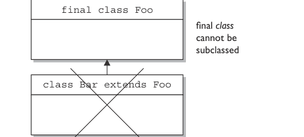

`final class` 不能被子类化

### final method

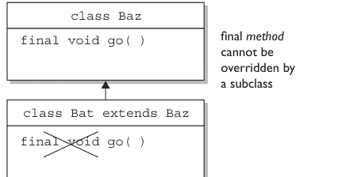

`final method` 不能被子类重写

### final variable

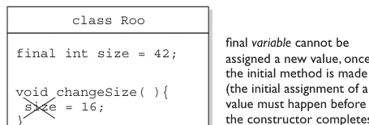

`final variable` 一旦完成初始赋值，就不能赋予新值（初始赋值必须在构造函数完成之前发生）。


`volatile` 修饰符也可以应用于项目经理 : )


## 静态变量和方法

`static` 修饰符用于创建独立于该类的任何实例存在的变量和方法。所有静态成员在你创建类的新实例之前就已经存在了，而且无论该类的实例数量有多少，静态成员只有一个副本。也就是说，给定类的所有实例对于任何给定的静态变量共享相同的值。我们将在下一章中详细介绍静态成员。

你可以标记为 `static` 的东西：

- 方法
- 变量
- 嵌套在另一个类内部的类，但不是在方法内部（第 12 章将介绍更多内容）
- 初始化块

你不能标记为 `static` 的东西：

- 构造函数（没有意义；构造函数仅用于创建实例）
- 类（除非是嵌套的）
- 接口（除非是嵌套的）
- 方法局部内部类（我们将在第 13 章中探索）
- 内部类方法
- 局部变量

## 认证目标

### 声明和使用枚举

(OCA 目标 1.2 和 OCP 目标 2.5)

#### 使用枚举

从 Java 5 开始，Java 允许将变量限制为几个预定义值之一——换句话说，枚举列表中的一个值。（列表中的项惊讶地被称为枚举。）

使用枚举有助于减少代码中的错误。例如，在你的咖啡店应用程序中，你可能希望限制 `CoffeeSize` 选择为 BIG、HUGE 和 OVERWHELMING。如果你让 LARGE 或 GRANDE 的订单进来，可能会导致错误。通过以下简单的声明，你可以保证编译器阻止你将 BIG、HUGE 或 OVERWHELMING 之外的任何内容赋予 `CoffeeSize`：

```java
enum CoffeeSize { BIG, HUGE, OVERWHELMING };
```

之后，获取 `CoffeeSize` 的唯一方法将是这样的语句：

```java
CoffeeSize cs = CoffeeSize.BIG;
```

并不是要求常量必须全大写，但借鉴 Oracle 常量使用大写的代码惯例，这是一个好主意。枚举的基本组件是它的常量（即 BIG、HUGE 和 OVERWHELMING），尽管几分钟后你将看到可能还有更多。枚举可以声明为它们自己的独立类，也可以作为类成员；但它们不能在方法内部声明！

这是一个在类外部声明枚举的例子：

```java
enum CoffeeSize { BIG, HUGE, OVERWHELMING } // 这不能是
class Coffee {
    CoffeeSize size;
}
public class CoffeeTest {
    public static void main(String[] args) {
        Coffee drink = new Coffee();
        drink.size = CoffeeSize.BIG;
    }
}
```

前面的代码可以包含在一个文件中。（记住，文件必须命名为 `CoffeeTest.java`，因为那是它是公共类的名称）。

要记住的关键点是，没有封装在类中的枚举可以仅使用 `public` 或默认（`default`）修饰符，就像非内部类一样。这是一个在类内部声明枚举的示例：

```java
class Coffee2 {
    enum CoffeeSize {BIG, HUGE, OVERWHELMING}
    CoffeeSize size;
}
public class CoffeeTest2 {
    public static void main(String[] args) {
        Coffee2 drink = new Coffee2();
        drink.size = Coffee2.CoffeeSize.BIG; // 外部类需要名称
    }
}
```

从这些示例中可以总结的关键点是：枚举可以声明为自己的类，也可以嵌套在另一个类中，而且访问枚举成员的语法取决于枚举声明的位置。

以下是**不**合法的：

```java
public class CoffeeTest1 {
    public static void main(String[] args) {
        enum CoffeeSize {BIG, HUGE, OVERWHELMING } // 错误！不能在方法中声明枚举
        Coffee drink = new Coffee();
        drink.size = CoffeeSize.BIG;
    }
}
```

为了增加你的困惑性，Java 语言设计者让在枚举声明末尾添加分号成为可选的（当该枚举后面没有其他声明时）：

```java
public class CoffeeTest1 {
    enum CoffeeSize {BIG, HUGE, OVERWHELMING }; // <--分号
    public static void main(String[] args) {
        Coffee drink = new Coffee();
        drink.size = CoffeeSize.BIG;
    }
}
```

那么当你创建一个枚举时，创建了什么呢？最需要记住的是：**枚举不是字符串或整数！** 每个被枚举的 `CoffeeSize` 类型实际上都是 `CoffeeSize` 的一个实例。换句话说，`BIG` 的类型是 `CoffeeSize`。可以将枚举看作某种类似于（但并不完全相同）下这样的类：

```java
// 关于你可以如何思考枚举的概念示例
class CoffeeSize {
    public static final CoffeeSize BIG = 
        new CoffeeSize("BIG", 0);
    public static final CoffeeSize HUGE = 
        new CoffeeSize("HUGE", 1);
    public static final CoffeeSize OVERWHELM = 
        new CoffeeSize("OVERWHELM", 2);

    CoffeeSize(String enumName, int index) {
        // 相关处理
    }
    public static void main(String[] args) {
        System.out.println(CoffeeSize.BIG);
    }
}
```

注意每个枚举值（BIG、HUGE 和 OVERWHELM）都是 `CoffeeSize` 类型的实例。它们被表示为静态且最终（`final`），这在 Java 世界中被认为是常量。此外，枚举值还知道自己的索引或位置——换句话说，枚举值的声明顺序是重要的。你可以认为 `CoffeeSize` 枚举存在于一个类型为 `CoffeeSize` 的数组中，正如你在稍后的章节中看到的，你可以通过对任何枚举类型调用 `values()` 方法来遍历枚举的值。（在本章中不用担心这个。）

#### 在枚举中声明构造方法、方法和变量

由于枚举确实是一种特殊的类，因此你可以做的不仅仅是列出枚举常量值。你可以添加构造方法、实例变量、方法以及真正被称为静态类体的内容。为了理解为什么你可能需要枚举需要更多功能，请考虑这种场景：假设你想知道与三个 `CoffeeSize` 常量每个对应的实际盎司（ounces）大小。例如，你想知道 BIG 是 8 盎司，HUGE 是 10 盎司，而 OVERWHELMING 则是惊人的 16 盎司。

你可以使用其他数据结构创建某种查找表，但那是一个糟糕的设计且难以维护。最简单的方法是将你的枚举值（BIG、HUGE 和 OVERWHELMING）视为对象，每个对象都可以有自己的实例变量。然后你可以在枚举初始化时通过向枚举构造方法传递值来分配这些值。这需要一些解释，但先看下面的代码。

```java
enum CoffeeSize {
    // 8, 10 & 16 被传递给构造方法
    BIG(8), HUGE(10), OVERWHELMING(16);
    CoffeeSize(int ounces) { // 构造方法
        this.ounces = ounces;
    }

    private int ounces; // 实例变量
    public int getOunces() {
        return ounces;
    }
}
```

```java
class Coffee {
    CoffeeSize size; // 每个 Coffee 实例都有一个枚举

    public static void main(String[] args) {
        Coffee drink1 = new Coffee();
        drink1.size = CoffeeSize.BIG;

        Coffee drink2 = new Coffee();
        drink2.size = CoffeeSize.OVERWHELMING;

        System.out.println(drink1.size.getOunces()); // 输出 8
        for(CoffeeSize cs : CoffeeSize.values()) {
            System.out.println(cs + " : " + cs.getOunces());
        }
    }
}
```

产生如下：

- 8
- BIG 8
- HUGE 10
- OVERWHELMING 16

## 认证总结

在吸收了本章内容后，你应该熟悉 Java 语言的一些细微差别。你可能还会感到困惑，为什么最初想参加这个考试。这在这一阶段是正常的。我们想告诉你，情况会变得简单——那是最难的一章，从现在都会越来越顺。让我们简要回顾一下考试需要的内容：

- 将会有许多间接涉及关键字的问题，所以要确保你能识别哪些是关键字，哪些不是。
- 你需要理解与创建合法标识符相关的规则以及与源码声明相关的规则，包括 `package` 和 `import` 语句的使用。
- 你学习了 `java` 和 `javac` 命令行程序的基础语法。你学习了 `main()` 方法什么时候有，什么时候没有。
- 我们涵盖了 `import` 和 `import static` 语句的基础知识。人们很容易认为这不仅仅是节省打字量，但事实并非如此。你现在对类、方法和变量的访问控制有了良好的理解。你查看了访问修饰符（`public`、`protected` 和 `private`）如何定义类或成员的访问。
- 你学习了抽象类可以包含抽象方法和非抽象方法，但只要有一个方法被标记为抽象，该类就必须标记为抽象。不要忘记，抽象类的具体子类必须为父类的所有抽象方法提供实现，但抽象类不需要实现父类的抽象方法。抽象子类会将责任推给第一个具体子类。
- 我们涵盖了接口实现。记住接口可以扩展另一个接口（如果是多个接口），任何实现接口的类必须实现该类所在继承树中所有接口的方法。
- 你还查看了其他修饰符，包括 `static`、`final`、`abstract`、`synchronized` 等。你学习了某些修饰符可以在声明中组合使用，例如将 `abstract` 与 `final` 或 `private` 结合。

记住 Java 中没有 `final` 对象。`final` 引用变量不能更改，但它所引用的对象是可以修改的。

你已经了解到 `final` 应用方法意味着子类不能重写它们，而当 `final` 应用于类时，该类不能被子类化。

记住，从 Java 5 开始，方法可以声明为带有变长参数（var-arg）的方法（可以接受从零到多个声明类型的参数），但你只能有一个变长参数方法，且它必须是方法的最后一个参数。

确保你熟悉数值型数据类型的相对大小。记住，非 `final` 变量的值可以改变，但引用变量的类型永远无法改变。

你还学习了数组是包含许多相同类型值的对象。数组也可以包含其他数组。


# 两分钟冲刺

记住在本章中，当我们谈论类时，我们指的是非内部类，或*顶层*类。仅针对 OCA 7 对 OCP 7 的候选者，我们将把整个第 12 章留给内部类。关于 OCA 7 对 OCP 7 目标的**注意**：本书的第一部分对于 OCA 7 和 OCP 7 的候选者都是必要的。由于你必须在参加 OCP 7 考试之前通过 OCA 7 考试，因此书的第一部分两分钟冲刺中的目标引用通常针对 OCA 目标。

## 标识符 (OCA 目标 2.1)

- 标识符可以与字母、下线或货币符号开头。
- 在第一个字符之后，标识符也可以包含数字。
- 标识符可以是任意长度。

## 可执行的 Java 文件和 main() (OCA 目标 1.3)

- 你可以使用命令行选项编译并执行 Java 程序。
- 只有具有特殊能力的 `main()` 方法版本是那些签名等同于 `public static void main(String[] args)` 的版本。
- `main()` 可以重载。

## 导入 (OCA 目标 1.4)

- 导入语句（import statement）唯一的作用是减少击键次数。
- 你可以使用星号 (`*`) 来搜索单个包的内容。
- 尽管被称为“静态导入（static imports）”，但语法是 `import static...`
- 你可以导入 API 类和/或自定义类。

## 源文件声明规则 (OCA 目标 1.2)

- 一个源文件只能有一个 `public` 类。
- 如果源文件包含 `public` 类，文件名必须与 `public` 类名匹配。
- 一个文件只能有一个 `package` 语句，但可以有多个 `import` 语句。
- `package` 语句（如果有）必须是源文件的第一（非注释）行。
- 导入语句（如果有）必须在包声明之后、类声明之前。
- 如果没有 `package` 语句，导入语句必须是源文件中的第一个（非注释）语句。
- `package` 和 `import` 语句适用于文件中的所有类。
- 一个文件可以有多个非公共类。
- 没有 `public` 类的文件没有命名限制。

## 类访问修饰符 (OCA 目标 6.6)

- 有三种访问修饰符：`public`、`protected` 和 `private`。
- 有四种访问级别：`public`、`protected`、`default`（默认）和 `private`。
- 类只能有 `public` 或 `default` 访问。
- `default` 访问的类只能对同一包内的类可见。
- `public` 访问的类可以被所有包的所有类可见。
- 类可见性围绕一个类中的代码是否可以：
  - 创建另一个类的实例
  - 扩展（或子化）另一个类
  - 访问另一个类的方法和变量

## 类修饰符（非访问）（OCA 目标 7.6)

- 类也可以被用 `final`、`abstract` 或 `strictfp` 修饰。
- 类不能既是 `final` 又是 `abstract`。
- `final` 类不能被子化。
- `abstract` 类不能被实例化。
- 类中的单个 `abstract` 方法意味着整个类必须是 `abstract` 的。
- `abstract` 类可以同时拥有抽象方法和非抽象方法。
- 扩展 `abstract` 类的第一个具体类必须实现所有抽象方法。

## 接口实现 (OCA 目标 7.6)

- 接口是类可以做做的约，但它们没有说明类如何去做。
- 接口可以被任何类实现，无论在继承树的什么位置。
- 接口可以只有抽象方法，不允许具体方法。
- 方法默认是 `public` 和 `abstract`——这些修饰符是可选的。
- 接口可以拥有常量，这些始终是 `public`、`static` 和 `final` 的。
- 本节使用了一些尚未涵盖的概念。不要恐慌：一旦你读完本书的第一部分，本节就会有意义：一个非抽象实现类具有以下特性：
  - 它必须保持其实现的方法的签名（允许协变返回）返回类型（但不需要声明异常）。
  - 实现接口的类本身可以是 `abstract` 的。
  - `abstract` 实现类不需要实现接口方法（但第一个具体子类必须实现）。
  - 类只能扩展一个类（没有多重继承），但它可以实现许多接口。
  - 接口可以扩展一个或多个接口。
  - 接口不能扩展类或实现类或接口。
  - 考试时，先验证接口和类声明是否合法，再验证其他代码逻辑。

## 成员访问修饰符 (OCA 目标 6.6)

- 方法和实例（非局部）变量被称为“成员”。
- 成员可以使用所有的四个访问级别：`public`、`protected`、`default` 和 `private`。
- 成员访问有两种形式：
  - 一个类中的代码可以访问另一个类的成员。
  - 子类可以继承其父类的成员。
- 如果一个类无法被访问，它的成员也无法被访问。
- 在确定成员可见性之前确定类可见性。
- `public` 成员可以被所有其他类访问。
- 如果父类成员是 `public` 的，子类会继承它——无论在哪个包。
- 不使用点运算符 (`.`) 访问的成员必须属于同一个类。
- `this.` 指向当前执行的方法。
- `this.method()` 与直接调用 `method()` 相同。
- `private` 成员只能由同类代码访问。
- `private` 成员子类不可见，因此 `private` 成员无法被继承。
- 默认（default）和受保护（protected）成员仅在涉及子类时有所不同：
  - 默认成员只能被同一包中的类访问。
  - 受保护成员可以被同一包中的其他类访问，还可以被不同包的子类访问。
  - `protected` = 包（package） + 子类（kids 指子类）。
  - 对于包外的子类，受保护成员只能通过继承访问；包外的子类不能通过使用父类实例的引用来访问受保护成员。（换句话说，继承是包外子类访问其父类受保护成员的唯一机制。）
  - 子类从另一个包继承的受保护成员对该子类包中的任何其他类都是不可见的，该子类的子类除外。

## 局部变量 (OCA 目标 2.1)

- 局部（方法、自动或栈）变量声明不能访问修饰符。
- `final` 是局部变量唯一的修饰符。
- 局部变量没有默认值，因此在使用之前必须进行初始化。

## 其他修饰符——成员 (OCA 目标 6.6)

- `final` 方法不能在子类中被重写。
- 抽象（abstract）方法使用签名、返回类型和可选的 throws 子句进行声明，但它们没有实现。
- 抽象方法以分号结束——没有大括号。
- 识别非抽象方法的三种方法：
  - 方法没有被标记为 abstract。
  - 方法有大括号。
  - 方法在大括号之间**可能**有代码。
- 扩展自抽象类的第一个非抽象（具体）类必须实现该抽象类的所有方法。
- `synchronized` 修饰符仅适用于方法和代码块。
- `synchronized` 方法可以具有任何访问控制修饰符并且也可以被标记为 final。
- 抽象方法必须由子类实现，因此它们必须是可继承的。出于这个原因：
  - 抽象方法不能是 private。
  - 抽象方法不能是 final。
- `native` 修饰符仅适用于方法。
- `strictfp` 修饰符仅适用于类和方法。

## 带有变长参数的方法 (仅限 OCP, OCP 目标 1.3)

- 从 Java 5 开始，方法可以声明一个接受从零到多个参数的参数，这就是所谓的变长参数（var-arg）方法。
- 变长参数使用语法 `type... name` 声明，例如：`doStuff(int... x) {}`。
- 变长方法只能有一个变长参数。
- 在具有普通参数和变长参数的方法中，变长参数必须放在最后。

## 变量声明 (OCA 目标 2.1)

- 实例变量可以控制
  - 具有任何访问控制
  - 被标记为 final 或 transient
- 实例变量不能是 abstract、synchronized、native 或 strictfp。
- 声明一个与实例变量同名的局部变量是合法的；这被称为“遮蔽”（shadowing）。
- final 变量具有以下属性：
  - final 变量一旦赋值就不能重新赋值。
  - 一旦对象被赋值给 final 引用变量，final 引用变量就不能指向不同的对象。
  - final 变量必须在构造函数完成之前初始化。
  - 不存在所谓的 final 对象。被标记为 final 的对象引用**并不意味着**对象本身可以改变。
- `transient` 修饰符仅适用于实例变量。
- `volatile` 修饰符仅适用于实例变量。

## 数组声明 (OCA 目标 4.1 和 4.2)

- 数组可以存放原始类型或对象，但数组本身始终是一个对象。
- 当声明数组时，方括号可以放在变量名的左侧或右侧。
- 在声明中包含数组的大小是不合法的。（等一下，让我重读一下：声明中包含大小是不合法的。）
- 对象数组可以存放任何通过所声明类型 IS-A（或 instanceof）测试的对象。例如，如果 Horse 继承自 Animal，那么 Horse 对象可以进入 Animal 数组。

## 静态变量和方法 (OCA 目标 6.2)

- 它们不与类的任何实例绑定。
- 使用静态成员不需要类实例。
- 静态变量只有一个副本，所有实例都共享它。
- 静态方法无法直接访问实例成员。

## 枚举 (enums) (OCA 目标 1.2 和 OCP 目标 2.5)

- 枚举指定了分配给类型的常量值列表。
- 枚举**不是**字符串或 int；枚举的类型是枚举类型本身。例如，SUMMER 和 FALL 都是枚举类型。
- 枚举可以在类外部或内部声明，但**不能**在方法中声明。
- 在类外声明的枚举不能是 static、final、abstract 或 private。
- 枚举可以包含构造函数、方法、变量和特定常量的类体。
- 枚举常量可以使用语法(8) 向枚举构造函数传递参数，其中 int 字面量传递给枚举构造函数。
- 枚举构造函数带有参数并且可以被重载。
- 枚举构造函数**永远不能**在代码中直接调用。它们在枚举初始化时自动调用。
- 枚举声明末尾的分号是可选的。以下是合法的：
  - `enum Foo { ONE, TWO, THREE };`
- `MyEnum.values()` 返回 MyEnum 数组。

# 自测

以下问题将帮助你衡量对本章介绍内容的理解程度。请仔细阅读所有选项，因为可能有多个答案。为每个问题选择所有正确答案。保持专注。如果你在这些题上遇到困难，不要责备自己。对自己重复：“我足够聪明能理解枚举的”以及“好吧，那其他家伙最好比我强了”。

## I. 哪些选项是正确的？

A. "X extends Y" 仅当 X 是类且 Y 是接口时正确。
B. "X extends Y" 仅当 X 和 Y 都是类时正确。
C. "X extends Y" 当 X 和 Y 都是类或都是接口时正确。
D. "X extends Y" 对于 X 和 Y 的所有组合都正确。

## II. 给定：

```java
class Rocket {
    private void blastOff() { System.out.print("bang "); }
    public class Shuttle {
        public static void main(String[] args) {
            new Shuttle().go();
        }
    }
    void go() {
        blastOff();
        // Rocket.blastOff(); // 行 A
    }
    private void blastOff() { System.out.print("sh-bang "); }
}
```

哪些是正确的？（选择所有选项）

A. 代码当前所示，输出是 bang。
B. 代码当前所示，输出是 sh-bang。
C. 代码当前所示，编译失败。
D. 如果取消行 A 的注释，输出是 bang。
E. 如果取消行 A 的注释，输出是 sh-bang。
F. 如果取消行 A 的注释，编译失败。

## III. 假设 for 循环的语法是正确的，且给定：

```java
import static java.lang.System.*;
class Test {
    static public void main(String[] args_V) {
        String $ = "";
        for(int x=0;x< args_V.length; x++) // for
            $ += args_V[x];
        println($);
    }
}
```

命令是 Test -args。结果是什么？

A. -args
B. args.
C. -args.
D. args_V.
E. -args_V.
F. 编译失败
G. 运行时抛出异常

## 4. 给定：

```java
enum Animals {
    DOG("woof"), CAT("meow"), FISH("burble")
    String sound;
    Animals(String s) { sound = s; }
}
class TestEnum {
    static Animals a;
    public static void main(String[] args) {
        System.out.println(a.DOG.sound + " " + a.FISH.sound);
    }
}
```

结果是什么？

A. woof burble
B. 多个编译错误
C. 编译失败，由于第 2 行错误
D. 编译失败，由于第 3 行错误
E. 编译失败，由于第 9 行错误

## 5. 给定两个文件：

```java
1. package pkgA;
2. public class Foo {
3   int a = 5;
4   protected int b = 6;
5   public int c = 7;
6. }
```

```java
3. package pkgB;
4. import pkgA.*;
5. public class Baz {
6   public static void main(String[] args) {
7     Foo f = new Foo();
8     System.out.print(" " + f.a);
9     System.out.print(" " + f.b);
10    System.out.println(" " + f.c);
11 } }
```

结果是什么？（选择所有适用选项。）

- A. 输出 5 后跟着一个异常
- B. 编译失败，第 7 行报错
- C. 编译失败，第 8 行报错
- D. 编译失败，第 9 行报错
- E. 编译失败，第 10 行报错

## 6. 给定：

```java
1. public class Electronic implements Device
{ public void doIt() { } }
```

```java
2.
3. abstract class Phone1 extends Electronic { }
4.
5. abstract class Phone2 extends Electronic
{ public void doIt(int x) { } }
```

```java
6.
7. class Phone3 extends Electronic implements Device
{ public void doStuff() { } }
```

```java
8.
9. interface Device { public void doIt(); };
```

结果是什么？（选择所有适用选项。）

- A. 编译成功
- B. 编译失败，第 1 行报错
- C. 编译失败，第 3 行报错
- D. 编译失败，第 5 行报错
- E. 编译失败，第 7 行报错
- F. 编译失败，第 9 行报错

## 7. 给定：

```java
4. class Announce {
5. public static void main(String[] args) {
6   for(int x = 0; x < 3; x++) {
7     int #lb = 7;
8     long [] x = [5];
9     Boolean []ba[];
10  }
11. }
```

结果是什么？（选择所有适用选项。）

- A. 编译成功
- B. 编译失败，第 6 行报错


- C. 编译失败，第 7 行报错
- D. 编译失败，第 8 行报错
- E. 编译失败，第 9 行报错

## 8. 给定：

```java
3. public class TestDays {
4. public enum Days { MON, TUE, WED };
5. public static void main(String[] args) {
6   for(Days d : Days.values())
7   ;
8   Days [] d2 = Days.values();
9   System.out.println(d2[2]);
10 }
11. }
```

结果是什么？（选择所有适用选项。）

- A. TUE
- B. WED
- C. 输出不可预测
- D. 第 4 行报错导致编译失败
- E. 第 6 行报错导致编译失败
- F. 第 8 行报错导致编译失败
- G. 第 9 行报错导致编译失败

## 9. 给定：

```java
4. public class Frodo extends Hobbit
5. public static void main(String[] args) {
6   int myGold = 7;
7   System.out.println(countGold(myGold, 6));
8. }
9. class Hobbit {
10   int countGold(int x, int y) { return x + y; }
11. }
```

结果是什么？

- A. 13
- B. 多个错误导致编译失败
- C. 第 6 行报错导致编译失败
- D. 第 7 行报错导致编译失败
- E. 第 11 行报错导致编译失败

## 10. 给定：

```java
interface Gadget {
    void doStuff();
}
abstract class Electronic {
    void getPower() { System.out.print("plug in "); }
}
public class Tablet extends Electronic implements Gadget {
    void doStuff() { System.out.print("show book "); }
    public static void main(String[] args) {
        new Tablet().getPower();
        new Tablet().doStuff();
    }
}
```

哪些是正确的？（选择所有适用选项。）

- A. 类 `Tablet` 将无法编译
- B. 接口 `Gadget` 将无法编译
- C. 输出为 plug in show book
- D. 抽象类 `Electronic` 将无法编译
- E. 类不能既继承又实现

## II. 假设 `Integer` 类位于 `java.lang` 包中，且给定：

```java
1. // 在此处插入代码
2. class StatTest {
3   public static void main(String[] args) {
4     System.out.println(Integer.MAX_VALUE);
5.
6. }
```

哪几项独立插入第 1 行后可以编译？（选择所有适用选项。）

- A. import static java.lang;
- B. import static java.lang.Integer;
- C. import static java.lang.*;
- D. import java.lang.*;
- E. import static java.lang.Integer;
- F. 以上都不是

# 自测 79

## 答案

- 2. B, F
- 3. C, E
- 4. C, D
- 5. A, F
- 6. B, D
- 7. A, C
- 8. B
- 9. D
- 10. A, C

# 封装 OCA 目标 6.1 和 6.7 85

```java
public class BadOO {
    public int size;
    public int weight;
    ...
    public class ExploitBadOO {
        public static void main(String [] args) {
            BadOO b = new BadOO();
            b.size = -5; // 合法但很糟糕！！
        }
    }
}
```

现在你遇到麻烦了。你该如何修改这个类，以便在处理当有人将 `size` 变量更改为导致问题的值时出现的问题呢？你唯一的选择是回去编写用于调整 `size` 的方法代码（例如一个 `setState(int a)` 方法），然后用 `private` 访问修饰符来隔离 `size` 变量。但你只要对你的代码做了这种更改，你就破坏了所有人的代码！

在不破坏使用你代码的其他代码的情况下更改实现代码的能力，是封装的一个关键优势。通过接口，我们希望将实现细节隐藏在公共编程接口之后。将你的代码提供给其他代码调用的访问变量集合——换句话说，就是你代码的 API。通过隐藏实现细节，你可以重构你的方法代码（可能还会更改类中使用的变量），而无需强制要求你所修改的代码发生变化。

如果你想要可维护性、灵活性和扩展性（当然，你是这些），你的设计必须包含封装。你该怎么做呢？

- 保持实例变量受保护状态（使用访问修饰符，通常是 `private`）。
- 创建公共访问器方法，并强制代码使用这些方法而不是直接访问实例变量。这些所谓的访问器方法允许你类的用户设置变量的值或获取变量的值。
- 对于这些访问器方法，使用最常用的命名约定 `set<someProperty>` 和 `get<someProperty>`。

图 2-1 说明了封装如何强制代码的调用者通过方法而不是直接访问变量，尽管有些人更喜欢高级的 `getters` 和 `setters` 术语。

我们将访问方法称为 `getters`（获取器）和 `mutators`（变异器，个人而言，我们不喜欢“mutate”这个词）。无论你如何称呼它们，都是其他程序员为了访问你的实例变量必须通过的方法。它们看起来很简单，你可能已经使用它们很久了：

```java
public class Box {
    // 保护实例变量；只有 Box 
    // 才能访问它
    private int size;
    // 提供公共的 getters 和 setters
    public int getSize() {
        return size;
    }
    public void setSize(int newSize) {
        size = newSize;
    }
}
```

# 86 第 2 章：面向对象

图 2-1 封装的本质

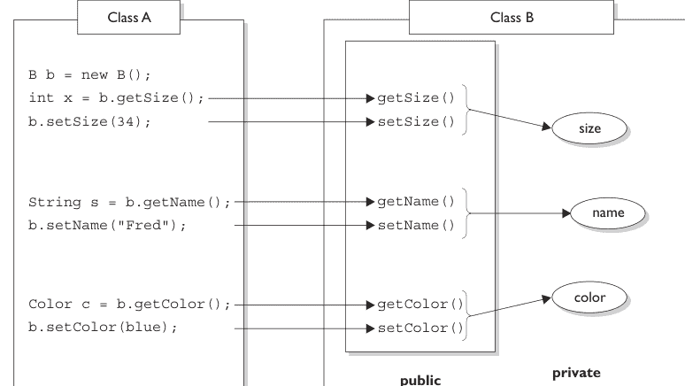

类 A 无法不通过 getter 和 setter 方法访问类 B 的实例变量数据。数据被标记为 `private`；只有访问方法是公共的。

等一下。之前的代码有多有用呢？它甚至没有进行任何验证或处理。拥有没有添加功能的 `getters` 和 `setters` 能有什么好处呢？关键点在于，你以后可以更改方法，并在你的方法中添加更多代码，而不会破坏你的 API。即使你真的不需要对数据进行验证或处理，良好的面向对象设计也要求你为未来做计划。为了安全起见，强制调用代码通过你的方法而不是直接访问实例变量。始终如此。你可以自由地重构你的方法实现，而不用冒着遭到那里几十程序员愤怒的风险。

注意：在第 5 章中，我们将重新回到封装主题，它也适用于也是引用变量的实例变量。这比你想象的要复杂得多，请关注！（另外，我们将等到第 5 章再用封装为主题的模拟题来挑战你。）

# 88 第 2 章：面向对象

# 继承与多态

## 认证目标

# 继承与多态

(OCA Objectives 7.1, 7.2, 7.3)

- 7.1 实现继承
- 7.2 开发演示多态的代码
- 7.3 区分引用的类型和对象的类型

继承在 Java 中无处不在。可以说，几乎（几乎）不可能编写不使用继承的最简单的 Java 程序。为了探索这个主题，我们将使用 `instanceof` 运算符，稍后会详细讨论。

# 继承与多态 (OCA Objectives 7.1, 7.2, 7.3) 89

可用的。每当你创建一个类时，你都会继承 `Object` 的所有方法。

为什么？让我们看看那个方法。Java 的创建者假设 Java 程序员会经常使用它们的类实例来检查相等性。如果 `Object` 类没有 `equals` 方法，你和其他 Java 程序员就得写一个。那个 `equals` 方法被继承了数十亿次。（公平地说，`equals` 被重写了数十亿次，但我们有点快了。）

对于考试，你需要知道可以通过扩展类来创建继承关系。理解继承的两个主要原因也很重要的：

- 代码重用
- 使用多态

从重用开始。一种常见的设计方法是创建一个相当通用的类版本，并让更具体的子类继承它。例如：

```java
class GameShape {
    public void displayShape() {
        System.out.println("displaying shape");
    }
    // code
}
```

```java
class PlayerPiece extends GameShape {
    public void movePiece() {
        System.out.println("moving game piece");
    }
    // code
}
```

```java
public class TestShapes {
    public static void main(String[] args) {
        PlayerPiece shape = new PlayerPiece();
        shape.displayShape();
        shape.movePiece();
    }
}
```

输出：

```
displaying shape
moving game piece
```

等一下……为什么 `t1` 可以是 `Object` 的实例，尽管我们刚刚说它的类型是 `Test`？我确定你比我们领先，但事实是 Java 中的每个类都是 `Object` 的子类（`Object` 本身除外）。换句话说，你使用的或编写的每个类都继承自 `Object`。你始终拥有 `equals` 方法、`clone` 方法、`notify`、`wait` 等

## 90 第 2 章：面向对象

注意 `PlayerPiece` 类从不那么特殊的类 `GameShape` 继承了通用的 `displayShape()` 方法，并添加了自己的方法 `movePiece()`。通过继承进行重用，意味着具有通用功能的方法——例如 `displayShape()`，它可以适用于游戏中的许多不同形状——不需要重新实现。这使得 `GameShape` 的所有子类都保证具有更通用的父类的能力。你不需要在在线游戏的每个特化组件中重写 `displayShape()` 代码。

但你知道，当你在一处进行更改并必须追踪所有其他存在该代码（或类似代码）的地方时，你经历过代码重复的痛苦。

继承的第二个（与之相关的）用途是允许你的类以多态的方式被访问——这种能力接口也可以提供，但我们稍后会讨论。假设你有一个 `GameLauncher` 类，它允许遍历不同类型的 `GameShapes` 列表并在每个对象上调用 `displayShape()`。在你编写这些代码时，你并不知道未来任何人会创建每种可能的 `GameShape` 子类。你肯定不想仅仅因为某人在六个月后决定构建一个骰子形状就重写你的代码。

多态（“许多形式”）的优之处在于，你可以将 `GameShape` 的任何子类视为 `GameShape`。换句话说，你可以在 `GameLauncher` 类中编写代码说：“我不在乎你是什么种对象，只要你继承了（扩展了）`GameShape`。对我来说，如果你扩展了 `GameShape`，那么你一定有一个 `displayShape()` 方法，所以我可以调用它。”

假设我们有两个扩展更通用的 `GameShape` 类的特化子类：`PlayerPiece` 和 `Tile`：

```java
class GameShape {
    public void displayShape() {
        System.out.println("displaying shape");
    }
    // code
}
```

```java
class PlayerPiece extends GameShape {
    public void movePiece() {
        System.out.println("moving game piece");
    }
    // code
}
```

```java
class TilePiece extends GameShape {
    public void getAdjacent() {
        System.out.println("getting adjacent tiles");
    }
    // more code
}
```

# 继承与多态 (OCA 目标 7.1, 7.2 和 7.3) 91

现在，一个测试类有一个声明参数类型为 `GameShape` 的方法，这意味着它可以接受任何类型的 `GameShape`。换句话说，`GameShape` 的任何子类都可以传递给类型为 `GameShape` 的参数的方法。这段代码

```java
public class TestShapes {
    public static void main(String[] args) {
        TilePiece player = new TilePiece();
        TilePiece tile = new TilePiece();
        doShapes(player);
        doShapes(tile);
    }
}
```

```java
public static void doShapes(GameShape shape) {
    shape.displayShape();
}
```

输出：

displaying shape

displaying shape

关键点在于 `doShapes()` 方法声明时使用了 `GameShape` 参数，但它可以是 `GameShape` 的任何子类型（在本例中为为子类）。该方法可以调用 `GameShape` 的任何方法，而无需担心传递给方法的实际运行时类型。不过，这也有影响；`doShapes()` 方法只知道对象是 `GameShape` 的类型，因为这是参数的声明方式。使用声明为 `GameShape` 的引用变量——无论该变量是方法参数、局部变量还是实例变量——意味着只能在该上调用 `GameShape` 的方法。你可以在引用上调用的变量完全取决于变量的声明类型，无论该引用所指向的实际对象是什么。要使用 `GameShape` 变量来调用 `getAdjacent()` 方法，即使传入的对象类型是 `TilePiece`。（我们将在查看接口时会再次看到这一点。）

## IS-A 和 HAS-A 关系


注意：截至 2014 年春季，OCA 7 考试不会问你关于 IS-A 和 HAS-A 关系。但理解 IS-A 和 HAS-A 关系将有助于解决 OCA 考试中的许多问题。

## 第 2 章：面向对象

给定上述，对于 OCA 考试，你需要能够查看代码并判断代码展示的是 IS-A 还是 HAS-A 关系。规则非常简单，所以这应该是正确回答问题的少数易事领域之一。

### IS-A

在面向对象编程中，IS-A 的概念基于类继承或接口实现。IS-A 是一种表达“这个东西是那个东西的类型”的方式。例如，Mustang 是 Horse 的类型，所以在面向对象的术语中我们可以说“Mustang IS-A Horse”。Subaru IS-A Car。Broccoli IS-A Vegetable（虽然很有趣，但仍然有效）。你通过 `extends`（用于类继承）和 `implements` 关键字在 Java 中表达 IS-A 关系。

```java
class Car {
    // Cool Car 代码
}
```

```java
class Subaru extends Car {
    // Subaru 特有的内容
    // 不要忘记 Subaru 可访问
    // 成员方法和变量。
}
```

Car 是 Vehicle 的类型，继承树可能从 `Vehicle` 类开始：

```java
public class Vehicle { ... }
public class Car extends Vehicle { ... }
public class Subaru extends Car { ... }
```

在面向对象的术语中，你可以说：

- Vehicle 是 Car 的父类。
- Car 是 Subaru 的子类。
- Subaru 是 Vehicle 的子类。
- Car 继承自 Vehicle。
- Subaru 继承自 Vehicle 和 Car。
- Subaru 派自 Car。
- Car 派自 Vehicle。
- Subaru 派自 Vehicle。
- Subaru 是 Vehicle 和 Car 的子类型。

### 继承与多态 (OCA 目标 7.1, 7.2 和 7.3)

回到我们的 IS-A 关系，以下陈述是：

“Car extends Vehicle” 意味着“Car IS-A Vehicle”。

“Subaru extends Car” 意味着“Subaru IS-A Car”。

我们还可以说：

“Subaru IS-A Vehicle”，因为一个类被认为是其继承树中更高处的“类型”。如果表达式 `(Foo instanceof Bar)` 为真，那么 Foo IS-A Bar。这是图 2-2 Vehicle, Car, Subaru 的继承树。箭头从子类指向父类。

### HAS-A

HAS-A 关系基于使用而非继承。例如，你可以这样说：

- Horse IS-A Animal。
- Horse HAS-A Halter。

代码可能像这样：

```java
public class Animal { 
}
public class Horse extends Animal {
    private Halter myHalter;
}
```

-- 换句话说，Horse 拥有指向 Halter 的引用。Horse 代码可以使用 Halter 引用来调用 Halter 的方法，而无需在 Horse 类中编写 Halter 相关的代码。图 2-3 展示了 Horse 和 Halter 之间的 HAS-A 关系。

HAS-A 关系允许你设计遵循良好面向对象实践的类，而不是执行数十种不同功能的单体类。类（及其产生的对象）应该是专家。正如我们的朋友 Andrew 所说：“特化的类实际上可以减少 bug。”类越特化，你越有可能在其他应用程序中重用该类。如果你将所有 Halter 相关的代码直接放入 Horse 类中，你最终会在 `Cow` 类中产生重复代码。Horse 类的用户（即调用 Horse 实例方法的用户）认为 Horse 类具有 Halter 行为。例如，Horse 类可能有一个 `tie(LeadRope rope)` 方法。Horse 类的用户永远不需要知道调用 `tie()` 方法会转而通过调用 `myHalter.tie(rope)` 将调用委托给它的 Halter 类。描述的场景如下：

```java
public class Horse extends Animal {
    private Halter myHalter = new Halter();
    public void tie(LeadRope rope) {
        myHalter.tie(rope); // 将 tie 行为委托给
        // Halter 对象
    }
}
public class Halter {
    public void tie(LeadRope aR) {
        // 真正的 tie 工作在这里
    }
}
```

Horse 类拥有一个 Halter，因为 Horse 声明了一个类型为 Halter 的实例变量。当代码在 Horse 实例上调用 `tie()` 时，Horse 会在其 对象的 Halter 实例上调用 `tie()`。

### 面向对象设计

在涉及面向对象（OO）设计时，IS-A 和 HAS-A 关系以及封装只是冰山一角。许多书籍和毕业生都致力于这个话题。强调恰当设计的原因非常简单：钱。据估计，交付一个设计良好的软件应用程序的成本可能比设计糟糕的程序贵十倍。

软件行业已经演进以辅助设计者。视觉对象建模语言（如统一建模语言 UML）允许设计者设计并轻松在不需要先编写代码的情况下修改类，因为 OO 组件是以图形化方式表示的。这允许设计者创建类关系映射图，并帮助他们在编码开始之前识别错误。面向对象设计的另一项创新是设计模式。设计者发现，许多 OO 设计在不同项目之间是一致适用的，应用相同的设计是有用的，因为这减少了引入新设计的可能性。于是，OO 设计师们开始相互分享这些设计。现在，网上和书籍形式上都有这些设计模式的目录。

即使是顶级的 OO 设计师（通常被称为架构师）也会出错。要视觉化数百个或数千个类之间的关系是非常困难的。当在项目的实现（编写代码）阶段发现错误时，必须重写的代码量有时意味着编程团队必须从零开始。

通过 Java 认证考试并不要求你如此深入地理解 OO 设计，希望这些背景信息能帮助你理解为什么测试者选择在考试中包含封装以及 IS-A 和 HAS-A 关系。

> —Jonathan Weeks，Sun 认证 Java 程序员

在 OO 中，我们不希望调用者担心究竟是哪个类或对象在执行实际工作。为了实现这一点，马（Horse）向用户隐藏了实现细节。马用户请求马去做某些事情（在本例中，把自己系起来），马会执行，或者在本例子中请求其他东西去执行。对于调用者来说，马对象始终看起来是在照顾自己。马甚至不需要知道存在像马笼（halter）类这样的东西。

### 多态 (OCA 目标 7.2 和 7.3)

7.2 开发演示多态用法的代码。

7.3 区分引用类型和对象的类型。

记住，任何 Java 对象都可以通过多个 IS-A 测试，这可以认为是多态。类型为 Object 的其他对象，所有 Java 对象都是多态的，因为它们通过了自身类型和 Object 类的 IS-A 测试。同样记住，访问对象的唯一方法是通过引用变量。关于引用，你应该了解以下几点：

- 引用变量只能有一种类型，且一旦声明，该类型就永远无法更改（尽管它引用的对象可以更改）。
- 引用是一个变量，因此它可以被重新赋值给其他对象（除非引用被声明为 `final`）。
- 引用的类型决定了在该变量引用的对象上可以调用的方法。
- 引用变量可以指向与声明引用相同类型的任何对象，或者——这是最重要的一点——它可以指向声明类型的任何子类！
- 引用变量可以声明为类类型或接口类型。如果变量被声明为接口类型，它可以指向实现该接口的任何类的任何对象。

早些时候，我们创建了一个 `GameShape` 类，它被另外两个类 `PlayerPiece` 和 `TilePiece` 扩展。现在想象你想让游戏板上的形状动起来。但并不是所有的形状都能制作动画，你该如何处理类继承呢？

我们是否可以创建一个带有 `animate()` 方法的类，并让某些 `GameShape` 的子类继承该类？如果可以，那么我们就可以让 `PlayerPiece` 同时扩展 `GameShape` 和 `Animable` 类，而 `TilePiece` 只扩展 `GameShape`。但是不，不行。Java 不支持多继承。这意味着我们不能让 `PlayerPiece` 继承两个父类。

继承了 `displayShape()` 方法。因此，`PlayerPiece` 可以用来调用 `displayShape()` 方法。

当使用声明为 `Animatable` 类型的引用指向 `PlayerPiece` 对象时，哪些方法可以被调用？只有 `animate()` 方法。当然，酷的一点是，来自任何继承树的任何类都可以实现 `Animatable`，这意味着如果你有一个方法的参数声明为 `Animatable` 类型，你可以传递传入 `PlayerPiece` 对象、`SpinningLogo` 对象以及任何其他实现了 `Animatable` 的类的实例。你可以使用该参数（类型为 `Animatable`）来调用 `animate()` 方法，但不能调用 `displayShape()` 方法（该类可能没有该方法），也不能调用任何编译器根据引用类型所未知的其他方法。尽管如此，编译器始终知道你可以对任何对象调用类（Class）的方法，即那些无论用于引用该对象的引用类型（类或接口）都是安全的可以调用的方法。

我们已经解释了这些内容中的很大一部分，即尽管编译器知道声明的引用类型，但 Java 虚拟机（JVM）在运行时知道对象的真实身份。这意味着，如果使用 `GameShape` 引用变量调用了 `PlayerPiece` 对象的 `displayShape()` 方法，而 `PlayerPiece` 重写了 `displayShape()` 方法，JVM 将调用 `PlayerPiece` 的版本！JVM 会查看引用另一端的真实对象，“看到”它重写了声明引用变量类型的方法，并调用该对象实际类的方法。但还有另外一点需要记住：

多态方法调用仅适用于实例方法。你始终可以使用更通用的引用类型（超父类或接口）来引用对象，但在运行时，**只有**根据实际对象（而不是引用类型）动态选择的方法是实例方法。而不是静态方法。只有被重写的实例方法会根据真实对象的类型动态调用。

由于这个定义取决于对重写以及静态方法与实例方法区别的清晰理解，我们接下来介绍这些内容。

### 重写 / 重载 (Overriding / Overloading)

OCA 目标 6.1, 6.3, 7.2 和 7.3

- 6.1 创建带有参数和返回值的方法。
- 6.3 创建一个重载方法。
- 7.2 开发演示多态用的代码。
- 7.3 区分引用类型和对象的类型。

考试将在许多许多问题中使用重写和重载方法。这两个概念经常被混淆（也许因为它们的名字相似？），但每个概念都有其自己独特且复杂的规则集。搞清楚哪一个“over”使用的是哪种规则至关重要！

#### 重写方法 (Overridden Methods)

每当一个类从父类继承一个方法时：

```java
public class Animal {
    public void eat() {
        System.out.println("Generic Animal Eating Generically");
    }
}
class Horse extends Animal {
    public void eat() {
        System.out.println("Horse eating hay, oats, "
+ " and horse treats");
    }
}
```

对于从父类继承的抽象方法，你没有选择：你必须在子类中实现该方法，除非该子类也是抽象的。抽象方法必须由具体的子类实现，但这非常类似于具体的子类重写了父类的抽象方法。因此，你可以将抽象方法视为你被迫重写的方法。`Animal` 类的创建者可能认为为了多态性，所有的 `Animal` 子类型都应该以独特、特定的方式定义 `eat()` 方法。从多态角度来看，当 `Animal` 引用指向不是 `Animal` 实例而是子类实例时，调用者应该能够通过 `Animal` 引用调用 `eat()`，但实际的运行时对象（例如 `Horse` 实例）将运行它自己的 `eat()` 方法。标记 `eat()` 方法是 `Animal` 程序员告诉所有子类的方式：“让你的子类型使用通用的 `eat()` 方法没有任何意义，所以你必须想出自己的 `eat()` 方法实现！”一个像这样的多态（非抽象）示例：

```java
public class TestAnimals {
    public static void main(String [] args) {
        Animal a = new Animal();
        Animal b = new Horse(); // Animal 引用，但是一个 Horse 对象
        a.eat(); // 执行 Animal 版本的 eat()
        b.eat(); // 执行 Horse 版本的 eat()
    }
}
class Animal {
    public void eat() {
        System.out.println("Generic Animal Eating Generically");
    }
}
class Horse extends Animal {
    public void eat() {
        System.out.println("Horse eating hay, oats, "
            + "and horse treats");
    }
    public void buck() { }
}
```

在前面的代码中，测试类使用 `Animal` 引用调用了 `Horse` 对象上的方法。记住，编译器只允许调用 `Animal` 类中存在的方法。

编译器只引用类型是 `Animal` 类，抽象方法必须由具体的子类实现。

```java
class Animal {
    public void eat() {
        System.out.println("Generic Animal Eating Generically");
    }
}
```

编译器始终知道，你可以对任何对象调用类（Class）的方法，即那些无论用于引用该对象的引用类型（类或接口）都是安全的可以调用的方法。

我们已经解释了这些内容中的很大一部分，即尽管编译器知道声明的引用类型，但 JVM 在运行时知道对象的真实身份。这意味着，如果使用 `GameShape` 引用变量调用了 `PlayerPiece` 对象的 `displayShape()` 方法，而 `PlayerPiece` 重写了 `displayShape()` 方法，JVM 将调用 `PlayerPiece` 的版本！JVM 会查看引用另一端的真实对象，“看到”它重写了声明引用变量类型的方法，并调用该对象实际类的方法。但还有另外一点需要记住：

多态方法调用仅适用于实例方法。你始终可以使用更通用的引用类型（超父类或接口）来引用对象，但在运行时，**只有**根据实际对象（而不是引用类型）动态选择的方法是实例方法。而不是静态方法。只有被重写的实例方法会根据真实对象的类型动态调用。

由于这个定义取决于对重写以及静态方法与实例方法区别的清晰理解，我们接下来介绍这些内容。

### 重写 / 重载 (Overriding / Overloading)

OCA 目标 6.1, 6.3, 7.2 和 7.3

- 6.1 创建带有参数和返回值的方法。
- 6.3 创建一个重载方法。
- 7.2 开发演示多态用的代码。
- 7.3 区分引用类型和对象的类型。

考试将在许多许多问题中使用重写和重载方法。这两个概念经常被混淆（也许因为它们的名字相似？），但每个概念都有其自己独特且复杂的规则集。搞清楚哪一个“over”使用的是哪种规则至关重要！

#### 重写方法 (Overridden Methods)

每当一个类从父类继承一个方法时：

```java
public class Animal {
    public void eat() {
        System.out.println("Generic Animal Eating Generically");
    }
}
class Horse extends Animal {
    public void eat() {
        System.out.println("Horse eating hay, oats, "
+ " and horse treats");
    }
}
```

对于从父类继承的抽象方法，你没有选择：你必须在子类中实现该方法，除非该子类也是抽象的。抽象方法必须由具体的子类实现，但这非常类似于：


# 重写 / 重载 (OCA 目标 6.1, 6.3, 7.2 和 7.3)

即具体的子类重写了父类的抽象方法。因此，你可以将抽象方法视为你被迫重写的方法。`Animal` 类的创建者可能认为为了多态性，所有的 `Animal` 子类型都应该以独特、特定的方式定义 `eat()` 方法。从多态角度来看，当 `Animal` 引用指向不是 `Animal` 实例而是子类实例时，调用者应该能够通过 `Animal` 引用调用 `eat()`，但实际的运行时对象（例如 `Horse` 实例）将运行它自己的 `eat()` 方法。标记 `eat()` 方法是 `Animal` 程序员告诉所有子类的方式：“让你的子类型使用通用的 `eat()` 方法没有任何意义，所以你必须想出自己的 `eat()` 方法实现！”

一个多态（非抽象）示例：

```java
public class TestAnimals {
    public static void main(String [] args) {
        Animal a = new Animal();
        Animal b = new Horse(); // Animal 引用，但是一个 Horse 对象
        a.eat(); // 执行 Animal 版本的 eat()
        b.eat(); // 执行 Horse 版本的 eat()
    }
}

class Animal {
    public void eat() {
        System.out.println("Generic Animal Eating Generically");
    }
}

class Horse extends Animal {
    public void eat() {
        System.out.println("Horse eating hay, oats, "
            + "and horse treats");
    }

    public void buck() { }
}
```

在前面的代码中，测试类使用 `Animal` 引用调用了 `Horse` 对象上的方法。记住，编译器只允许调用 `Animal` 类中存在的方法。

编译器只知道引用类型是 `Animal` 类，抽象方法必须由具体的子类实现。

```java
class Animal {
    public void eat() {
        System.out.println("Generic Animal Eating Generically");
    }
}
```

编译器始终知道，你可以对任何对象调用类（Class）的方法，即那些无论用于引用该对象的引用类型（类或接口）都是安全的可以调用的方法。

我们已经解释了这些内容中的很大一部分，即尽管编译器知道声明的引用类型，但 JVM 在运行时知道对象的真实身份。这意味着，如果使用 `GameShape` 引用变量调用了 `PlayerPiece` 对象的 `displayShape()` 方法，而 `PlayerPiece` 重写了 `displayShape()` 方法，JVM 将调用 `PlayerPiece` 的版本！JVM 会查看引用另一端的真实对象，“看到”它重写了声明引用变量类型的方法，并调用该对象实际类的方法。但还有另外一点需要记住：

多态方法调用仅适用于实例方法。你始终可以使用更通用的引用类型（超父类或接口）来引用对象，但在运行时，**只有**根据实际对象（而不是引用类型）动态选择的方法是实例方法。而不是静态方法。只有被重写的实例方法会根据真实对象的类型动态调用。

由于这个定义取决于对重写以及静态方法与实例方法区别的清晰理解，我们接下来介绍这些内容。

## 重写方法 (Overridden Methods)

每当一个类从父类继承一个方法时：

```java
public class Animal {
    public void eat() {
        System.out.println("Generic Animal Eating Generically");
    }
}

class Horse extends Animal {
    public void eat() {
        System.out.println("Horse eating hay, oats, "
            + "and horse treats");
    }
}
```

对于从父类继承的抽象方法，你没有选择：你必须在子类中实现该方法，除非该子类也是抽象的。抽象方法必须由具体的子类实现。

继承了 `displayShape()` 方法。因此，`PlayerPiece` 可以用来调用 `displayShape()` 方法。

当使用声明为 `Animatable` 类型的引用指向 `PlayerPiece` 对象时，哪些方法可以被调用？只有 `animate()` 方法。当然，酷的一点是，来自任何继承树的任何类都可以实现 `Animatable`，这意味着如果你有一个方法的参数声明为 `Animatable` 类型，你可以传入 `PlayerPiece` 对象、`SpinningLogo` 对象以及任何其他实现了 `Animatable` 的类的实例。

## 104 第2章：面向对象

- 如果一个方法无法被继承，你就无法对其进行重写。请记住，重写意味着你正在重新实现一个你继承的方法！例如，下面的代码是不合法的，即使你在 `Horse` 类中添加了 `eat()` 方法，它也不会是 `Animal` 的 `eat()` 方法的重写。

```java
public class TestAnimals {
    public static void main(String [] args) {
        Horse h = new Horse();
        h.eat(); // 不合法，因为 Horse 没有继承该方法
    }
}

class Animal {
    private void eat() {
        System.out.println("Generic Animal Eating Generically");
    }
}

class Horse extends Animal { }
```

## 调用重写方法的父类版本

通常，你想利用父类版本方法中的某些代码，但仍然对其进行重写以提供某些特定的行为。这就像是在说：“执行父类版本的方法，然后回来通过你的子类额外的方法代码完成执行。”（注意，并没有要求父类版本必须在子类代码之前运行。）在代码中使用 `super` 关键字可以轻松实现，如下：

```java
public class Animal {
    public void eat() {}
    public void printYourself() {
        // 这里是有用的打印代码
    }
}

class Horse extends Animal {
    public void printYourself() {
        // 利用 Animal 代码，再添加一些
        super.printYourself(); // 调用父类
        // (Animal) 代码
        // 执行 Horse 特有的
        // 在此处进行打印工作
    }
}
```

注意：使用 `super` 调用重写方法仅适用于实例方法。（记住静态方法不能被重写。）而且你只能使用 `super` 访问类子子类的方法，而不能访问父类的父类——也就是说，你不能说 `super.doStuff()`。

## 考试

如果一个方法被重写了，但你使用多态（超类型）引用来指向带有重写方法的子类型对象，编译器假设你正在调用方法的超类型版本。如果超类型版本声明了受检异常，但重写的子类型方法没有声明，编译器仍然认为你正在调用一个声明了异常的方法（更多请见第6章）。让我们来看一个例子：

```java
class Animal {
    public void eat() throws Exception {
        // 抛出 Exception
    }
}

class Dog2 extends Animal {
    public void eat() { /* 没有异常 */ }

    public static void main(String [] args) {
        Animal a = new Dog2();
        Dog2 d = new Dog2();
        d.eat(); // 好的
        a.eat(); // 编译器错误 - 未报告的异常
    }
}
```

这段代码无法编译，因为 `Animal` 的 `eat()` 方法上声明了 `Exception`。即使在运行时，使用的 `eat()` 方法是 `Dog` 版本，该版本没有声明该异常。

## 非法方法重写的示例

让我们来看重写 `Animal` 的 `eat()` 方法：

```java
public class Animal {
    public void eat() { }
}
```

表 2-1 列出了在给定上述 `Animal` 类版本的情况下，`Animal` 的 `eat()` 方法的非法重写示例。

### 表 2-1 非法重写示例

| 非法重写代码 | 代码问题 |
| --- | --- |
| `public void eat() { }` | 访问修饰符更严格 |
| `public void eat() throws IOException { }` | 声明了父类未定义的受检异常 |
| `public void eat(String food) { }` | 这是一个方法的重载，而非重写，因为参数列表发生了变化 |
| `public String eat() { }` | 因为返回类型的原因不是重载，且因为参数列表没有变化也不是重载 |

## 重载方法

重载方法允许你在类中使用相同的方法名，但使用不同的参数（以及，可选的，不同的返回类型）。重载方法通常意味着你对调用你方法的人更友好了，因为你的代码承担了处理不同参数类型的负担，而不是强迫调用者在调用你的方法之前进行转换。重载规则非常复杂：

- 重载方法**必须**更改参数列表。
- 重载方法**可以**更改返回类型。
- 重载方法**可以**更改访问修饰符。
- 重载方法**可以**声明新的或更宽的受检异常。
- 方法可以在同一个类中或在子类中被重载。也就是说，如果类 A 定义了一个 `doStuff(int i)` 方法，子类 B 可以定义一个 `doStuff(String s)` 方法，而不会重写接受 `int` 的父类版本。因此，两个同名但位于不同类的方法，如果子类继承了其中一个版本并在其类定义中声明了另一个重载版本，它们仍然可以被视为重载。

## 考试

经验较少的 Java 开发者经常对重载方法和重写方法之间的微妙区别感到困惑。注意识别方法何时是重载而非重写。你可能会看到一个似乎违反了重写规则的方法，但实际上它是合法的重载，如下：

```java
public class Foo {
    public void doStuff(int y, String s) { }
    public void moreThings(int x) { }
}

class Bar extends Foo {
    // 此处原文逻辑不完整，保留结构
}
```


# 104 第2章：面向对象

- 如果一个方法无法被继承，你就无法对其进行重写。请记住，重写意味着你正在重新实现一个你继承的方法！例如，下面的代码是不合法的，即使你在 `Horse` 类中添加了 `eat()` 方法，它也不会是 `Animal` 的 `eat()` 方法的重写。

```java
public class TestAnimals {
    public static void main(String [] args) {
        Horse h = new Horse();
        h.eat(); // 不合法，因为 Horse 没有继承该方法
    }
}
class Animal {
    private void eat() {
        System.out.println("Generic Animal Eating Generically");
    }
}
class Horse extends Animal { }
```

# 调用重写方法的父类版本

通常，你想利用父类版本方法中的某些代码，但仍然对其进行重写以提供某些特定的行为。这就像是在说：“执行父类版本的方法，然后回来通过你的子类额外的方法代码完成执行。”（注意，并没有要求父类版本必须在子类代码之前运行。）在代码中使用 `super` 关键字可以轻松实现，如下：

```java
public class Animal {
    public void eat() {}
    public void printYourself() {
        // 这里是有用的打印代码
    }
}
class Horse extends Animal {
    public void printYourself() {
        // 利用 Animal 代码，再添加一些
        super.printYourself(); // 调用父类
        // (Animal) 代码
        // 执行 Horse 特有的
        // 在此处进行打印工作
    }
}
```

注意：使用 `super` 调用重写方法仅适用于实例方法。（记住静态方法不能被重写。）而且你只能使用 `super` 访问直接父类的方法，而不能访问父类的父类——也就是说，你不能说 `super.doStuff()`。

# 重写 / 重载 (OCA 目标 6.1, 6.3, 7.2 和 7.3) 105

# 考试

如果一个方法被重写了，但你使用多态（超类型）引用来指向带有重写方法的子类型对象，编译器假设你正在调用方法的超类型版本。如果超类型版本声明了受检异常，但重写的子类型方法没有声明，编译器仍然认为你正在调用一个声明了异常的方法（更多请见第6章）。让我们来看一个例子：

```java
class Animal {
    public void eat() throws Exception {
        // 抛出 Exception
    }
}
class Dog2 extends Animal {
    public void eat() { /* 没有异常 */ }
    public static void main(String [] args) {
        Animal a = new Dog2();
        Dog2 d = new Dog2();
        d.eat(); // 好的
        a.eat(); // 编译器错误 - 未报告的异常
    }
}
```

这段代码无法编译，因为 `Animal` 的 `eat()` 方法上声明了 `Exception`。即使在运行时，使用的 `eat()` 方法是 `Dog` 版本，该版本没有声明该异常。

# 非法方法重写的示例

让我们来看重写 `Animal` 的 `eat()` 方法：

```java
public class Animal {
    public void eat() { }
}
```

表 2-1 列出了在给定上述 `Animal` 类版本的情况下，`Animal` 的 `eat()` 方法的非法重写示例。

# 106 第2章：面向对象

表 2-1 非法重写示例

| 非法重写代码 | 代码问题 |
| --- | --- |
| `private void eat() { }` | 访问修饰符更严格 |
| `public void eat() throws IOException { }` | 声明了父类未定义的受检异常 |
| `public void eat(String food) { }` | 这是一个方法的重载，而非重写，因为参数列表发生了变化 |
| `public String eat() { }` | 因为返回类型的原因不是重写，且因为参数列表没有变化也不是重载 |

# 重载方法

重载方法允许你在类中使用相同方法名，但使用不同的参数（以及，可选的，不同的返回类型）。重载方法通常意味着你对调用你方法的人更友好了，因为你的代码承担了处理不同参数类型的负担，而不是强迫调用者在调用你的方法之前进行转换。重载规则非常复杂：

- 重载方法**必须**更改参数列表。
- 重载方法**可以**更改返回类型。
- 重载方法**可以**更改访问修饰符。
- 重载方法**可以**声明新的或更宽的受检异常。
- 方法可以在同一个类中或在子类中被重载。也就是说，如果类 A 定义了一个 `doStuff(int i)` 方法，子类 B 可以定义一个 `doStuff(String s)` 方法，而不会重写接受 `int` 的父类版本。因此，两个同名但位于不同类的方法，如果子类继承了其中一个版本并在其类定义中声明了另一个重载版本，它们仍然可以被视为重载。

# 考试

经验较少的 Java 开发者经常对重载方法和重写方法之间的微妙区别感到困惑。注意识别方法何时是重载而非重写。你可能会看到一个似乎违反了重写规则的方法，但实际上它是合法的重载，如下：

```java
public class Foo {
    public void doStuff(int y, String s) { }
    public void moreThings(int x) { }
}
class Bar extends Foo {
    public void doStuff(Horse h) {
        System.out.println("In the Horse version");
    }
    public static void main(String [] args) {
        UseAnimals ua = new UseAnimals();
        Animal animalObj = new Animal();
        Horse horseObj = new Horse();
        ua.doStuff(animalObj);
        ua.doStuff(horseObj);
    }
}
```

你预期的输出是：

In the Animal version

In the Horse version

但如果你用 `Animal` 引用指向 `Horse` 呢？

```java
Animal animalRefToHorse = new Horse();
ua.doStuff(animalRefToHorse);
```

调用的是哪一个重载版本？你可能会回答：“接收 `Horse` 的那一个，因为运行时传递给方法的是一个 `Horse` 对象。”但事实并非如此。前面的代码实际上会打印：

in the Animal version

尽管在运行时的实际对象是 `Horse` 而不是 `Animal`，但调用哪个重载方法的选择（换句话说，方法的签名）**并不是**在运行时动态决定的。只需记住：**引用类型**（而不是对象类型）决定了调用哪个重载方法！总结一下，要调用哪个方法的**重写版本**（换句话说，来自继承树中的哪个类）是根据**运行时**的**对象类型**决定的；但调用哪个方法的**重载版本**是基于**编译时**传递的参数的**引用类型**。如果你通过传递一个指向 `Horse` 对象的 `Animal` 引用来调用方法，编译器只知道 `Animal`，因此它选择了接收 `Animal` 的重载方法版本。运行时实际传递的是 `Horse` 并不重要。

# 第 2 章：面向对象

# main() 方法可以被重载吗？

```java
class DuoMain {
    public static void main(String[] args) {
        main(1);
    }
    static void main(int i) {
        System.out.println("overloaded main");
    }
}
```

当然可以！但唯一拥有 JVM “超能力”的 `main()` 方法是那个你已经在本书中见过过大约 100 次的签名方法。

# 重载与重写方法中的多态性

多态在重载方法中是如何工作的？从我们刚刚观察到的，当方法被重载时，多态似乎并不重要。如果你传递一个 `Animal` 引用，将会调用接收 `Animal` 的重载方法，即使实际对象是 `Horse`。一旦 `Horse` 对象是 `Horse`，它就会伪装成 `Animal`，尽管它被传递给一个期望 `Animal` 的方法。诚然，多态并不决定调用哪个重载版本；但在涉及调用哪个方法的**重写版本**的决策时，多态就会发挥作用。有时一个方法既被重载又被重写了。想象 `Animal` 和 `Horse` 类如下所示：

```java
public class Animal {
    public void eat() {
        System.out.println("Generic Animal Eating Generically");
    }
}
public class Horse extends Animal {
    public void eat() {
        System.out.println("Horse eating hay");
    }
    public void eat(String s) {
        System.out.println("Horse eating " + s);
    }
}
```

注意，`Horse` 类同时对 `eat()` 方法进行了重载和重写。表 2-2 显示了根据调用方式的不同，三个 `eat()` 方法中的哪一个将运行。

# 重写 / 重载 (OCA 目标 6.1, 6.3, 7.2 和 7.3)

表 2-2 合法与非法的重写示例

| 方法调用代码 | 结果 |
| --- | --- |
| `Animal a = new Animal(); a.eat();` | Generic Animal Eating Generically |
| `Horse h = new Horse(); h.eat();` | Horse eating hay |
| `Animal ah = new Horse(); ah.eat();` | Horse eating hay 多态有效——使用了实际对象类型（`Horse`）而不是引用类型（`Animal`）来决定调用哪一个 |
| `Horse he = new Horse(); he.eat("Apple");` | Horse eating Apples 重载的 `eat(String s)` 版本被调用 |
| `Animal a2 = new Animal(); a2.eat("treats");` | 编译错误！编译器发现 `Animal` 类没有接收 `String` 的 `eat()` 方法 |
| `Animal ah2 = new Horse(); ah2.eat("Carrots");` | 编译错误！编译器仍然只看引用并发现 `Animal` 没有接收 `String` 的 `eat()` 方法。编译器不关心运行时实际对象可能是 `Horse` |

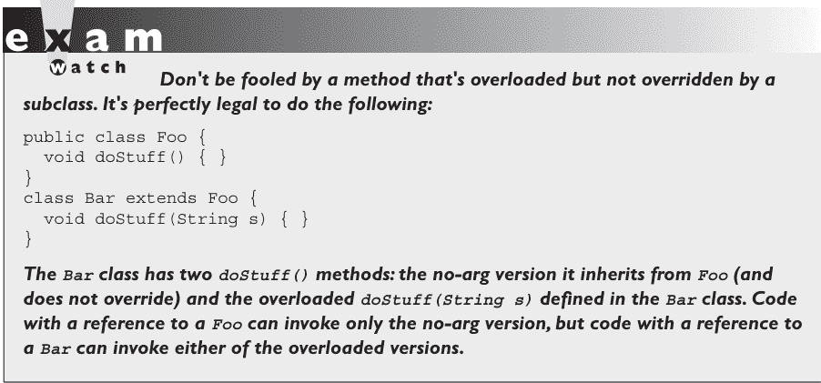

注意——不要被重载但未被子类重写的方法所迷惑。执行以下操作是完全合法的：

```java
public class Foo {
    void doStuff() { }
}
class Bar extends Foo {
    void doStuff(String s) { }
}
```

`Bar` 类有两个 `doStuff()` 方法：从 `Foo` 继承的无参版本（且未重写）以及在 `Bar` 类中定义的重载 `doStuff(String s)`。带有 `Foo` 引用的代码只能调用无参版本，但带有 `Bar` 引用的代码可以调用这两个版本。

# 第 2 章：面向对象

表 2-3 总结了重载方法和重写方法之间的区别。

| 表 2-3 重载方法与重写方法的区别 | | |
| --- | --- | --- |


## 重载与重写对比

| | 重载方法 | 重写方法 |
|---|---|---|
| 参数 | 必须更改。 | 不得更改。 |
| 返回值类型 | 可以更改。 | 可以协变返回。 |
| 异常 | 可以更改。 | 不得抛出受检异常。 |
| 访问修饰符 | 可以更改。 | 不得变得更严格（可以更宽松）。 |
| 调用 | 引用类型决定选择哪一个。因此在运行时，参数已经确定了，而不是该方法所属的类。 | |

我们将在本章节后面介绍重载，届时我们还将涵盖考试中涉及的其他构造函数相关主题。图 2-4 展示了重载和重写方法在类关系中的呈现形式。

| 图 2-4 重写 | 重载 |
|---|---|
| 树 | 树 |
| `showLeaves()` | `setFeatures(String name)` |
| 类关系中的重载与重写方法 | 橡树 |
| `showLeaves()` | `setFeatures(String name, leafSize)` |
| `leafSize` | |

## 转换 (OCA 目标 7.3 和 7.4)

7.3 区分引用类型和对象类型。

7.4 确定何时需要类型转换。

你已经看到使用泛型引用类型指向更具体的对象类型是可行且常见的。这是多态的核心。例如，这行代码对你来说应该是理所当然的：

```java
Animal animal = new Dog();
```

当你想使用那个 `animal` 引用变量调用只有 `Dog` 才有的方法时会怎样？你知道它指向一个 `Dog`，并想做一些特定的操作？在下面的代码中，我们有一个 `Animal` 数组，每当我们需要在数组中寻找 `Dog` 时，想要进行特殊的 `Dog` 操作。让我们先同意这些代码都没问题，除了调用 `playDead` 方法的那行我们不确定。

```java
class Animal {
    void makeNoise() { System.out.println("generic noise"); }
}
class Dog extends Animal {
    void makeNoise() { System.out.println("bark"); }
    void playDead() { System.out.println("roll over"); }
}
class CastTest2 {
    public static void main(String[] args) {
        Animal[] a = {new Animal(), new Dog(), new Animal()};
        for(Animal animal : a) {
            animal.makeNoise();
            if (animal instanceof Dog) {
                animal.playDead(); // 尝试执行 Dog 的行为？
            }
        }
    }
}
```

当我们尝试编译这段代码时，编译器会报告类似的信息：

```
cannot find symbol
```

编译器在说：“嘿，`Animal` 类没有 `playDead()` 方法。” 修改这个 `if` 代码块：

```java
if(animal instanceof Dog) {
  Dog d = (Dog) animal; // 转换引用变量
  d.playDead();
}
```

这个新改进后的代码块包含一个类型转换，在这种情况下这有时被称为**向下转换**（downcast），因为我们正在将继承树向下转换到一个更具体的类。现在编译器就开心了。在我们尝试调用 `playDead` 之前，我们将 `animal` 转换为 `Dog` 类型。我们是在对编译器说：“我们知道它实际上指向一个 `Dog` 对象，所以创建一个新的 `Dog` 引用变量来指向该对象。”在这种情况下我们是安全的，因为在尝试转换之前，我们进行了 `instanceof` 测试来确保这一点。

重要的一点是，当我们进行向下转换时，如果我们犯错了，编译器被迫信任我们：

```java
class Animal { }
class Dog extends Animal { }
class DogTest {
  public static void main(String [] args) {
    Animal animal = new Animal();
    Dog d = (Dog) animal; // 编译通过但随后失败
  }
}
```

这可能会让人抓狂！这段代码可以通过编译！当我们尝试运行它时，会得到类似这样的异常：

```
java.lang.ClassCastException
```

为什么我们不能信任编译器在这里帮助我们呢？它不能看出来 `animal` 是 `Animal` 类型吗？编译器能做的只是验证这两个类型在同一个继承树中，因此取决于向下转换之前可能出现的任何代码，`animal` 有可能是 `Dog` 类型。编译器必须允许那些在运行时可能通行的事情。然而，如果编译器确定该转换绝不可能成功，编译将失败。接下来的替换代码块将**不会**编译：

```java
Animal animal = new Animal();
Dog d = (Dog) animal;
String s = (String) animal; // animal 永远不可能是 String
```

在这种情况下，你将得到类似这样的错误：

`inconvertible types`

## 向上转换

与向下转换不同，**向上转换**（upcasting，即转换为更通用的类型）是隐式工作的（也就是说，你不需要输入强制转换代码）。当你向上转换时，你隐式地限制了你可以调用的方法数量，而向下转换则意味着之后你可能想要调用一个更具体的方法。这里有一个例子：

```java
class Animal { }
class Dog extends Animal { }

class DogTest {
    public static void main(String[] args) {
        Dog d = new Dog();
        Animal a1 = d; // 向上转换正常，无需显式转换
        Animal a2 = (Animal) d; // 向上转换正常，无需显式转换
    }
}
```

之前的两次向上转换都能编译运行且没有异常，因为 `Dog` 是一个 `Animal`，这意味着 `Animal` 能做的任何事情，`Dog` 都能做。当然，`Dog` 能做的更多，但重点在于任何拥有 `Animal` 引用的人都可以安全地调用 `Dog` 实例上的 `Animal` 方法。`Animal` 方法可能在 `Dog` 类中被重写，但我们现在关心的是 `Dog` 至少能做 `Animal` 能做的一切。编译器和 JVM 都知道这一点，因此将子类对象赋值给其某个父类（或接口）的引用，隐式转换总是安全的。如果 `Dog` 实现了 `Pet` 并定义了 `beFriendly()`，那么 `Dog` 可以被隐式转换为 `Pet`，但你可以调用的 `Dog` 方法是 `beFriendly()`，而 `Dog` 被强制实现了 `Pet` 接口。

还有一点……如果 `Dog` 实现了 `Pet`，那么 `Beagle` 继承自 `Dog`，`Beagle` 没有声明它实现了 `Pet`，但 `Beagle` 仍然是一个 `Pet`！因为它继承了 `Dog`，并且已经为自己及其所有子类处理了 `Pet`。`Beagle` 类始终可以使用 `Dog` 实现接口的方法来重写它所继承的任何方法。

还有一点……如果 `Beagle` 声明它实现了 `Pet`，只是为了让查看 `Beagle` 类 API 的其他人容易看到 `Beagle` 是一个 `Pet` 而无需查看 `Beagle` 的父类，如果 `Dog` 类（`Beagle` 的父类）已经处理了这一点，`Beagle` 仍然不需要实现 `beFriendly()` 方法。换句话说，`Beagle` 是一个 `Pet`。

## 实现接口 (OCA 目标 7.6)

当你实现一个接口时，你同意接口中定义的契约。这意味着你同意为接口中的每个方法提供合法的实现。

例如，如果你创建了一个实现 `Runnable` 接口的类（以便你的代码可以被特定线程执行），你必须提供 `public void run()` 方法。否则，可怜的线程被要求执行你的 `Runnable` 对象的代码，然后——惊喜吧——线程发现对象没有 `run()` 方法！（在这一点上，线程将崩溃，JVM 将在场壮丽而可怕的爆炸中崩溃）。坦率地说，Java 通过对任何实现接口的类进行编译器检查来防止这种崩坏的发生。假设有一个接口 `Bounceable`，有两个方法 `bounce()` 和 `setBounceFactor()`，以下类可以通过编译：

```java
public class Ball implements Bounceable {
    public void bounce() {
    }
    public void setBounceFactor(int bf) { }
}
```

好了，我们知道你在想什么：“这一定是历史上最糟糕的实现类了。”它通过编译并运行。接口契约保证了类将有一个方法（换句话说，其他人可以在访问控制范围内调用该方法），但它从未保证过良好的实现——甚至方法体中没有任何实现代码。（请记住，如果接口声明某个方法不是 `void`，你的类实现代码将包含返回语句。）

实现类必须遵循与扩展抽象类相同的方法实现规则。要成为合法的实现类，非抽象实现类必须执行以下操作：

- 为声明的接口的所有方法提供具体的（非抽象）实现。
- 遵循所有合法的重写规则，例如：
    - 在实现方法上不声明接口方法已声明的异常或接口方法已声明异常的子类之外检查异常。
    - 维护接口方法的签名，并保持相同的返回类型（或子类型）。

但是等一下，还有更多！实现类本身可以是抽象的！例如，对于一个实现 `Bounceable` 的 `Ball` 类，以下代码是合法的：

```java
abstract class Ball implements Bounceable { }
```

注意到漏了什么吗？我们从未提供过实现方法。这没关系。如果实现类是抽象的，它可以简单地将责任推卸给它的第一个具体子类。例如，如果类 `BounceBall` 继承自 `Ball`，并且 `BounceBall` 不是抽象的，那么 `BounceBall` 将必须提供 `Bounceable` 中的所有方法：

```java
class BounceBall extends Ball {
// 即使我们在上面的类声明中没有这样说，
// BounceBall 也实现了 Bounceable，因为 BounceBall 的抽象
// 父类 (Ball) 实现了 Bounceable

    public void bounce() {
    // 有趣的 BounceBall 特有碰撞
    }

    public void setBounceFactor(int bf) {
    // 巧妙的 BounceBall 特有代码，用于设置
    // 跳动因子
    }
// 如果类 Ball 定义了抽象方法，
// 它们必须
// 在这里被实现。
}
```


# 寻找那些声称实现接口但未提供正确方法实现的类

除非实现类是抽象的，否则实现类必须为接口中定义的所有方法提供实现。

你还需要了解另外两个规则，然后我们就可以结束这个话题了（或者让你睡着；我们总是把这两个词搞混）：

1. 一个类实现了多个一个一个接口。例如，说出以下内容是完全合法的：

```java
public class Ball implements Bounceable, Serializable, Runnable { ... }
```

你只能继承一个类，但你可以实现许多接口。但请记住，子类化定义了你是谁以及你是什么，而实现定义了你可以扮演的角色或你可以戴的帽子，尽管你可能来自某个实现相同接口的另一个类（来自不同的继承树）。例如，`Person` 继承自 `HumanBeing`（尽管那是可以分离的）。但 `Person` 也可以实现 `Programmer`、`Snowboarder`、`Employee`、`Parent` 或 `PersonCrazyEnoughToTakeThisExam`。

## 实现接口 (OCA 目标 7.6)

2. 接口本身可以扩展另一个接口，但它永远不能实现任何内容。以下代码是完全合法的：

```java
interface Bounceable extends Moveable { ... }
```

这意味着什么？`Bounceable` 的第一个具体（非抽象）实现类必须实现 `Bounceable` 的所有方法，加上 `Moveable` 的所有方法！我们所说的子接口仅仅是向父接口的契约中添加了更多要求。你将在 Java 的许多领域看到这个概念，特别是在 EE 中，在其中你经常需要构建一个扩展 Java EE 接口之一的自定义接口。

等一下，因为奇怪的事情发生在这里。一个接口可以扩展多个一个接口！花时间思考一下。你们知道当我们谈论类时，以下内容是非合法的：

```java
public class Programmer extends Employee, Geek { } // 非法！
```

正如前面提到的，在 Java 中，一个类不允许继承多个类。然而，接口可以自由扩展多个接口：

```java
interface Bounceable extends Moveable, Spherical { // 正确！
    void bounce();
    void setBounceFactor(int bf);
}

interface Moveable {
    void moveIt();
}

interface Spherical {
    void doSphericalThing();
}
```

在下一个示例中，`Ball` 被要求实现 `Bounceable`，加上 `Bounceable` 扩展的所有接口的方法（包括这些接口所扩展的任何接口，以此类推，直到到达栈的顶端——还是栈的底部？）。`Ball` 看起来应该如下：

```java
class Ball implements Bounceable {
    public void bounce() { } // 实现 Bounceable 的方法
    public void setBounceFactor(int bf) { }
    public void moveIt() { } // 实现 Moveable 的方法
    public void doSphericalThing() { } // 实现 Spherical
}
```

如果 `Ball` 类未能实现 `Bounceable`、`Moveable` 或 `Spherical` 的任何方法，编译器将会疯狂地反复跳动，直到它实现为止。除非，`Ball` 类被标记为 `abstract`。在这种情况下，`Ball` 可以选择实现来自接口类的任何一个、全部或一个方法，从而将其余实现留给 `Ball` 的具体子类，如下：

```java
abstract class Ball implements Bounceable {
    public void bounce() { ... } // 定义 bounce 行为
    public void setBounceFactor(int bf) { ... }
    // 不要实现其余部分；留给子类
}

class SoccerBall extends Ball { // 类 SoccerBall 必须
    // 实现接口
    // 方法，Ball 没有实现的

    public void moveIt() { ... }
    public void doSphericalThing() { ... }
    // SoccerBall 可以选择覆盖 Ball
    // 实现的 Bounceable 方法
    public void bounce() { ... }
}
```

图 2-5 比较了类和接口的 `extends` 和 `implements` 的具体和抽象示例。

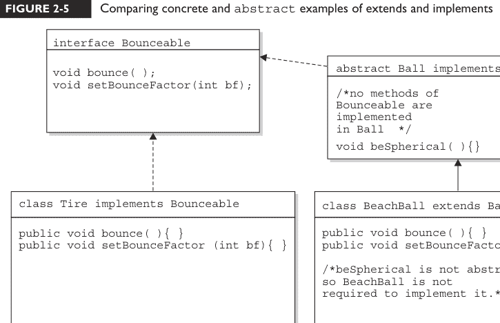

| interface Bounceable | abstract Ball implements Bounceable |
|---|---|
| void bounce();<br>void setBounceFactor(int bf); | /* Ball 中没有实现 Bounceable 的方法 */<br>void beSpherical() {} |
| Tire implements Bounceable | BeachBall extends Ball |
| public void bounce() { public void setBounceFactor(int bf) {} | /*beSpherical 不是抽象的，所以 BeachBall 不需要实现它.*/ |

如果 `Ball` 类未能实现 `Bounceable`、`Moveable` 或 `Spherical` 的任何方法，编译器将会疯狂地反复跳动，直到它实现为止。除非，`Ball` 类被标记为 `abstract`。在这种情况下，`Ball` 可以

```java
public class Foo{
    void go() { 
    }
}
public class Bar extends Foo {
    String go(int x) {
        return null;
    }
}
```

注意 `Bar` 版本的方法使用了不同的返回类型。这完全没有问题。只要你更改了参数列表，你就对方法进行了重载（overloading），因此返回类型不需要与父类版本一致。你**不被允许**这样做：

```java
public class Foo{
    void go() { 
    }
}
public class Bar extends Foo {
    String go() { // 非法！不能只改变返回类型
        return null;
    }
}
```

## 重写与返回类型、协变返回

当子类想要更改继承方法的实现实现（即重写，override）时，子类必须定义一个与被继承版本完全匹配的方法。或者，从 Java 5 开始，只要新的返回类型是被重写（父类）方法声明返回类型的子类型，你就可以在重写方法中更改返回类型。

让我们来看协变返回的实际应用：

```java
class Alpha {
    Alpha doStuff(char c) {
        return new Alpha();
    }
}
```

```java
class Beta extends Alpha {
    Beta doStuff(char c) { // Java 5 中的合法重写
        return new Beta();
    }
}
```

从 Java 5 开始，这段代码可以通过编译。如果你尝试使用 1.4 版本的编译器或使用如下源标志编译此代码，

```bash
javac -source 1.4 Beta.java
```

## 第 2 章：面向对象

你将得到类似这样的编译错误：

attempting to use incompatible return type 尝试使用不兼容的返回类型

（我们将在第 8 章详细讨论编译器标志。）

重写还适用于其他规则，包括访问修饰符和声明异常规则，但这些规则与返回类型的讨论无关。


## 返回值

你必须记住返回值的六条规则：

1. 在返回类型为对象引用的方法中，你可以返回 `null`。

```java
public Button doStuff() {
    return null;
}
```

2. 数组是一个完全合法的返回类型。

```java
public String[] go() {
    return new String[] {"Fred", "Barney", "Wilma"};
}
```

3. 在返回类型为基本类型的方法中，你可以返回任何可以隐式转换为声明返回类型的值或变量。

```java
public int foo() {
    char c = 'c';
    return c; // char 与 int 兼容
}
```

4. 在返回类型为基本类型的方法中，你可以返回任何可以显式强制转换为声明返回类型的值或变量。

```java
public int foo() {
    float f = 32.5f;
    return (int) f;
}
```

## 合法的返回类型 (OCA 目标 2.2, 2.5, 6.1 和 6.3) 125

5. 你不能从返回类型为 `void` 的方法中返回任何内容。

```java
public void bar() {
    return "this is it"; // 非法！！
}
```

（尽管你可以写 `return`；）

6. 在返回类型为对象引用的方法中，你可以返回任何可以隐式强制转换为声明返回类型的对象类型。

```java
public Animal getAnimal() {
    return new Horse(); // 假设 Horse 继承 Animal
}

public Object getObject() {
    int[] nums = {1,2,3}; // 返回 int 数组，它仍然是一个对象
}

public interface Chewable {}
public class Gum implements Chewable { }

public class TestChewable {
    // 接口返回类型的方法
    public Chewable getChewable() {
        return new Gum(); // 返回接口实现类
    }
}
```


注意声明了抽象类或接口返回类型的方法，并记住任何通过 IS-A 测试（换句话说，使用 `instanceof` 运算符测试结果为 `true`）的对象都可以从该方法返回。例如：

```java
abstract class Animal {}
public class Bear extends Animal {}
public class Test {
    public Animal go() {
        return new Bear(); // 正确，Bear "是一个" Animal
    }
}
```

这段代码将通过编译，且返回值是一个子类型。

## 构造函数与目标 6.4, 6.5 和 7.5

- 6.4 区分默认构造函数和用户定义的构造函数。
- 6.5 创建并重载构造函数。
- 7.5 使用 `this` 访问对象和构造函数。

对象是经过构造的。你**不能**在不调用构造函数的情况下创建新对象。事实上，如果你不调用对象实际类类型的构造函数，而且不调用其每个父类的构造函数，你就无法创建新对象！构造函数是每当你使用 `new` 关键字时就会运行的代码。（更准确一点说，可能还有其他情况。）

### 构造函数的本质

构造函数是每当你使用 `new` 关键字时就会运行的代码。（好吧，更准确一点说，可能还有其他情况。）

### 构造函数链

我们知道当你使用 `new` 某个类时，构造函数会被调用，如下：

```java
Horse h = new Horse();
```

但当你使用 `new` 时发生了什么？（假设 Horse 继承 Animal）

- Object 构造函数被调用。
- Animal 构造函数被调用。
- Horse 构造函数被调用。

## 128 第 2 章：面向对象

图 2-6

调用栈上的构造函数

| | |
|---|---|
| 1. main() 调用 new() | |
| 2. Horse() 调用 super() | |
| 3. Animal() 调用 super() | |
| 4. Object() | |
| 5. Object 构造函数完成。 | |
| 6. Animal 实例变量被显式赋值（如果有）。 | |
| 7. Animal 构造函数完成。 | |
| 8. Horse 实例变量被显式赋值（如果有）。 | |
| 9. Horse 构造函数完成。 | |

图 2-6 显示了构造函数在调用栈上是如何工作的。

### 构造函数的规则

以下列表总结了考试（以及理解本节内容）中所需的规则。你**必须**记住这些规则，所以务必学习多次。

- 构造函数可以使用任何访问修饰符，包括 `private`。（私有构造函数意味着只有类内部可以实例化该类型的对象，因此如果私有构造函数类允许使用实例，类必须提供一个静态方法或变量来访问内部创建的实例。）
- 构造函数的名称必须与类名匹配。
- 构造函数不能有返回类型。
- 有一个与类名相同的方法是合法的（尽管很愚蠢），但这并不意味着它是一个构造函数。如果你看到返回类型，它是一个方法而不是构造函数。
- 如果你不在类代码中编写构造函数，编译器会自动生成一个默认构造函数。
- 默认构造函数**总是**一个无参数构造函数。
- 如果你想要一个无参数构造函数，而你在类代码中输入了任何其他构造函数，编译器将不会为你提供无参数构造函数（或任何其他构造函数）。换句话说，如果你输入了一个带参数的构造函数，除非你自己输入它，否则你将没有无参数构造函数！
- 每一个构造函数的第一条语句要么是对重载构造函数的调用（`this()`），要么是对父类构造函数的调用（`super()`），但请记住，这个调用可以由编译器插入。
- 如果你输入了一个构造函数（而不是编译器生成的默认构造函数），并且没有输入对 `super()` 的调用或对 `this()` 的调用，编译器将为你插入一个无参数的 `super()` 调用，作为构造函数的第一条语句。
- 对 `super()` 的调用可以是无参数调用，也可以包含传递给构造函数的参数。
- 无参数构造函数不一定是默认构造函数（即编译器提供的构造函数），尽管默认构造函数总是是无参数构造函数。默认构造函数是编译器提供的那个！虽然默认构造函数总是无参数构造函数，但你可以自由放入自己的无参数构造函数。
- 在父类构造函数运行之前，你无法调用实例方法或访问实例变量。
- 只有静态变量和方法可以作为 `super()` 或 `this()` 调用的一部分被访问。（示例：`super(Animal.NAME)` 是可以的，因为 `NAME` 被声明为静态变量。）
- 抽象类拥有构造函数，当具体的子类被实例化时，这些构造函数总是会被调用。
- 接口没有构造函数。接口不是对象继承树的一部分。
- 构造函数调用的唯一方法是从另一个构造函数内部。换句话说，你不能编写如下实际调用构造函数的代码：

```java
class Horse {
  Horse() { } // constructor
  void doStuff() {
    Horse(); // 调用构造函数 - 非法！
  }
}
```

### 判断是否会创建默认构造函数

下面的示例显示了一个有两个构造函数的 `Horse` 类：

```java
class Horse {
  Horse() { }
  Horse(String name) {}
}
```

编译器会为上面的类放入默认构造函数吗？不会！

那么下面的类变体呢？

```java
class Horse {
  Horse(String name) {}
}
```

现在编译器会插入默认构造函数吗？不会！

那这个类呢？

```java
class Horse {
  void Horse() {}
}
```

现在这就对了。编译器将为这个类生成一个默认构造函数，因为该类没有定义任何构造函数。

好，那这个类呢？

看起来编译器可能不会创建构造函数，因为 `Horse` 类中已经有一个了。但真的如此吗？再看一遍前面的 `Horse` 类。

`Horse()` 构造函数有什么问题？它根本不是一个构造函数！它只是一个恰好与类同名的方法。记住，返回类型是一个明显的迹象，表明我们看的是一个方法，而不是构造函数。

你如何确定是否会创建默认构造函数？

因为你没有在类中编写任何构造函数。

你如何知道默认构造函数长什么样子的？

因为……

- 默认构造函数的访问修饰符与类相同。
- 默认构造函数没有参数。
- 默认构造函数包含一个对父类构造函数的无参数调用（`super()`）。

表 2-4 显示了编译器将（或不会）为你的类生成什么。

表 2-4 编译器生成的构造函数代码

| 类代码（你输入的） | 编译器生成的构造函数代码（加粗部分） |
| :--- | :--- |
| class Foo { } | class Foo { **Foo() { super(); }** } |


| class Foo { Foo() { } } | class Foo { Foo() { super(); } } |
|---|---|
| public class Foo { } | public class Foo { public Foo() { super(); } } |
| class Foo { Foo(String s) { } } | class Foo { Foo(String s) { super(); } } |
| class Foo { Foo(String s) { super(); } } | 无；编译器不需要插入任何内容。 |
| class Foo { void Foo() { } } | class Foo { void Foo() { } } (`void Foo()` 是方法，不是构造函数)。 |

## 如果父类构造函数有参数会怎样？

构造函数可以像方法一样拥有参数，如果你尝试调用一个说接收 `int` 的方法，但你没有传递任何内容，编译器将如下报错：

```java
class Bar {
  void takeInt(int x) { }
}

class User {
  public static void main(String[] args) {
    Bar b = new Bar();
    b.takeInt(); // 尝试调用无参数的 takeInt()
  }
}
```

编译器会报错说你可以在传递 `int` 的情况下调用 `takeInt()`。它抛出的信息（因人而异）不那么明显：

```
User.java:7: takeInt(int) in Bar cannot be applied to {}
```

但你明白这个意思。底线是方法必须匹配。我们所说的匹配是指参数类型必须能够接收。由于没有无参数构造函数，所以你必须提供一个。如下所示：

```java
class Animal {
  Animal(String name) {
  }
}

class Horse extends Animal {
  Horse() {
    super("Horse");
  }
}
```

```java
class Animal {
  Animal(String name) {
  }
}

class Horse extends Animal {
  Horse() {
    super(); // 错误：找不到无参数的 Animal()
  }
}
```

```java
class Animal {
  Animal(String name) {
  }
}

class Horse extends Animal {
  Horse() {
    super("Default");
  }
}
```

# 构造函数与实例化 OCA 目标 6.4, 6.5 和 7.5 135

```java
12. int x = (int) (Math.random() * 5);
13. String name = new String[]{"Fluffy", "Fido",
"Rover", "Spike",
"Gigi"}[x];
```

```java
14. return name;
15.
16.
17. public static void main (String [] args) {
18. Animal a = new Animal();
19. System.out.println(a.name);
20. Animal b = new Animal("Zeus");
21. System.out.println(b.name);
22.
23. }
```

运行该代码四次会产生以下输出：

```
% java Animal
Gigi
Zeus
```

```
% java Animal
Fluffy
Zeus
```

```
% java Animal
Rover
Zeus
```

```
% java Animal
Fluffy
Zeus
```

前面的代码中包含了很多操作。图 2-7 显示了构造函数重载时构造函数调用的调用栈。查看一下调用栈，然后我们从头开始代码。

- 第 2 行：声明一个 `String` 实例变量。
- 第 3–5 行：接收一个 `String` 的构造函数并将其赋值给实例变量 `name`。

**图 2-7 调用栈上的重载构造函数**

| 调用栈 |
| :--- |
| 4. `Object()` |
| 3. `Animal(String s)` calls `super()` |
| 2. `Animal()` calls `this` (randomlyChosenNameString) |
| 1. `main()` calls `new Animal()` |

# 136 第 2 章：面向对象

- 第 7 行：这里是有趣的地方。假设每只动物都需要一个名字，但客户端（调用代码）并不总是知道名字应该是什么，因此你将分配一个随机名称。无参数构造函数通过调用 `randomNumberName()` 方法生成名称。
- 第 8 行：无参数构造函数调用了它自己的接收 `String` 的重载构造函数，实际上这种调用方式与客户端代码使用 `new` 实例化对象并传递 `String` 作为名字时的调用方式相同。该重载调用使用了关键字 `this`，但用法就像方法名 `this()` 一样。因此第 8 行只是调用了第 3 行的构造函数，传递了一个随机选择的 `String`，而不是客户端代码选择的名字。
- 第 11 行：注意 `randomNumberName()` 方法被标记为 `static`！这是因为在 `super` 构造函数运行之前，你无法调用实例方法（即非静态方法）（或访问实例变量）。由于 `super` 构造函数将是从第 3 行的构造函数调用的，而不是从第 7 行的，因此第 8 行只能使用静态方法来生成名称。如果我们想让所有动物都使用相同的默认名称（例如 "Fred"），那么第 8 行就可以读取 `this ("Fred")`，而不是调用一个返回随机选择名称字符串的方法。
- 第 12 行：这与构造函数无关，但既然我们都在这里学习，它生成了一个 0 到 4 之间的随机整数。
- 第 13 行：奇怪的语法，我们正在创建一个新的 `String` 对象（仅仅是单个 `String` 实例），但我们希望从列表中随机选择字符串。由于我们没有这个列表，所以我们需要创建它。因此在那行代码中我们：
  1. 声明一个 `String` 变量，
  2. 创建一个 `String` 数组（匿名地——我们没有将数组本身赋值给任何变量）。
  3. 从新创建的 `String` 数组索引 `[x]`（`x` 是第 12 行生成的随机数）检索字符串。
  4. 将从数组检索到的字符串赋值给声明的实例变量 `name`。如果我们直接写成这样，读起来会容易得多：

```java
String[] nameList = {"Fluffy", "Fido", "Rover", "Spike", "Gigi"};
String name = nameList[x];
```

# 构造函数与实例化 OCA 目标 6.4, 6.5 和 7.5 137

但那样有什么趣味呢？加入不寻常的语法（尤其是对于与实际问题完全无关的代码）是符合考试精神的。不要吓到！（好吧，可以吓一下，但对自己说“哇！”，然后继续吧。）

- 第 18 行：我们正在调用构造函数的无参数版本（这导致从列表中选择一个随机名称传递给另一个构造函数）。
- 第 20 行：我们正在调用接收代表名字的字符串的重载构造函数。

此代码示例的关键在于第 8 行。我们没有调用 `super()`，而是调用 `this()`，而 `this()` 始终意味着调用同一类中的另一个构造函数。好吧，但在调用 `this()` 之后发生了什么？所以会调用 `super()` 构造函数，对吧？确实如此。调用 `this()` 意味着你在延迟不可避免的事情。某个地方的某个构造函数必须调用 `super()`。

**关键规则：构造函数的第一行必须是对 `super()` 的调用或对 `this()` 的调用。**

没有例外。如果你的构造函数中既没有这些调用，编译器将插入无参数的 `super()` 调用。换句话说，如果构造函数 `A()` 有对 `this()` 的调用，编译器知道构造函数 `A()` 将不会。

# 187 第 2 章：面向对象

# 188 构造函数与实例化

## 初始化块

我们已经讨论了类中可以执行操作的两个地方：方法和构造函数。初始化块在类加载时（静态初始化块）或在创建实例时（实例化初始化块）运行。让我们看一个例子：

```java
class SmallInit {
    static int x;
    int y;
    static { x = 7; } // 静态初始化
    { y = 8; } // 实例化初始化
}
```

正如你看到的，初始化块的语法非常简洁。它们没有名称，不接收参数，也不返回任何内容。静态初始化块在类首次加载时运行一次。实例化初始化块在每次创建实例时运行。记得我们讨论过构造函数代码执行的顺序吗？实例化代码运行在调用 `super()` 之后——换句话说，在所有 `super` 构造函数运行之后。

类可以多个初始化块。需要注意的是，与方法和构造函数不同，初始化块在类中出现的顺序很重要。当执行初始化块时，如果一个类有多个，它们将按照它们在类中出现的顺序运行。根据我们刚刚讨论的规则，你可以确定以下程序的输出：

```java
class Init {
    Init(int x) { System.out.println("带参数构造函数"); }
    Init() { System.out.println("无参数构造函数"); }
    static { System.out.println("第一次静态初始化"); }
    { System.out.println("第一次实例化初始化"); }
    { System.out.println("第二次实例化初始化"); }
    static { System.out.println("第二次静态初始化"); }

    public static void main(String[] args) {
        new Init();
        new Init(7);
    }
}
```

为了推导出结果，请记住这些规则：

- 初始化块按照它们在类中出现的顺序执行。
- 静态初始化块在类首次加载时运行一次。
- 实例化初始化块在每次创建类实例时运行。

## 第 2 章：面向对象

在记住这些规则的情况下，以下输出应该是合理的：

```
1st static init
2nd static init
1st instance init
2nd instance init
no-arg const
1st instance init
2nd instance init
1-arg const
```

如你所见，每个 `instance init` 块都运行了两次。`instance init` 块通常用于存放类中所有构造函数共享的代码。这样，代码就不需要在各个构造函数之间重复。

最后，如果你在 `static init` 块中犯了错误，JVM 可能会抛出 `ExceptionInInitializerError`。让我们来看一个例子：

```java
class InitError {
    static int[] x;
    static { x = new int[4]; }
    static { x[4] = 5; } // 数组索引错误！
    public static void main(String [] args) { 
    }
}
```

它产生类似如下的内容：

> Exception in thread "main" java.lang.ExceptionInInitializerError
>
> Caused by: java.lang.ArrayIndexOutOfBoundsException: 4
>
> at InitError.<clinit>(InitError.java:3)


按照惯例，`init` 块通常出现在类文件的顶部，大约在构造函数附近。然而，我们谈论的是 OCA 和 OCP 考试。如果你发现两个方法之间夹杂着一个 `init` 块，而且看起来完全就像一个等待发生的编译错误，也请不要感到惊讶！

## 认证目标

## 静态成员 (OCA 目标 6.2)

6.2 将 `static` 关键字应用到方法和字段上。

## 静态变量与方法

`static` 修饰符对方法或变量行为的影响如此深远，以至于我们将其为一个与其他修饰符完全独立的概念。为了理解静态成员的工作原理，我们首先来看一下使用它的原因。假设你有一个静态类，其中有一个运行方式相同的方法；它的唯一功能是返回（例如）一个随机数。由类的哪个实例来执行该方法并不重要——它的行为将完全相同。换句话说，方法的行为对对象的状态（实例变量的值）没有依赖。那么，当一个方法永远不需要特定实例时，你还需要对象吗？为什么不直接让类来运行该方法呢？


让我们想象另一个场景：假设你想对从特定类实例化的所有实例进行运行时计数。你实际上将变量保存在哪里？将其作为被跟踪类中的实例变量是不可行的，因为每创建一个新实例，计数器都会被初始化为默认值。对于“工具方法始终运行相同”场景和“保持实例运行总数”场景的答案都是使用 `static` 修饰符。变量和方法被标记为 `static` 属于类，而不是某个特定的实例。事实上，你可以在完全没有类实例的情况下使用静态方法或变量。你只需要该类能够调用静态方法或访问静态变量即可。变量也可以在没有类实例的情况下被访问。但如果存在实例，类的静态变量将由该类的所有实例共享；它只有一个副本。

以下代码声明并使用了一个静态计数器：

```java
class Frog {
    static int frogCount = 0; // 声明并初始化
    // 静态变量

    public Frog() {
        frogCount += 1; // 在构造函数中修改值
    }
    public static void main (String [] args) {
        new Frog();
        new Frog();
        new Frog();
        System.out.println("Frog count is now " + frogCount);
    }
}
```

在前面的代码中，当 `Frog` 类首次被 JVM 加载时（在创建任何 Frog 实例之前），静态 `frogCount` 就会设置为零！（顺便说，你实际上不需要将静态变量初始化为零；静态变量获得与实例变量相同的默认值）。每当创建一个 `Frog` 实例时，`Frog` 构造函数就会运行并增加静态变量 `frogCount`。当这段代码执行时，`main()` 中创建了三个 `Frog` 实例，结果是：

Frog count is now 3

现在想象如果 `frogCount` 是实例变量（换句话说是非静态的）会发生什么：

```java
class Frog {
    int frogCount = 0; // 声明并初始化
                      // 实例变量

    public Frog() {
        frogCount += 1; // 在构造函数中修改值
    }
    public static void main(String [] args) {
        new Frog();
        new Frog();
        new Frog();
        System.out.println("Frog count is now " + frogCount);
    }
}
```

当这段代码执行时，它本应该在 `main()` 中创建三个 `Frog` 实例，但结果是……编译错误！你无法让这段代码通过编译，更不用运行了。

```
Frog.java:11: nonlocal variable frogCount cannot be referenced 
from a static context
System.out.println("Frog count is " + frogCount);
```

```
1 error
```

JVM 并不知道你尝试访问的是 `Frog` 对象的 `frogCount`。问题在于 `main()` 是一个静态方法，因此不是针对类的任何特定实例运行的；相反，它是在类本身上运行的。静态方法无法访问实例变量，因为它不依赖于特定的实例。静态方法可以直接在类上运行。但如果存在实例，类的静态变量将由该类的所有实例共享；只有一个副本。

由于你不需要实例来调用静态方法或访问静态变量，那么如何调用或使用静态成员？语法是什么？Java 程序员经常犯的错误之一是从静态上下文中访问实例变量：

```java
class Foo {
    int x = 3;
    public static void main(String [] args) {
        System.out.println("x " + x);
    }
}
```

理解这段代码永远无法编译。考试中的难点在于，问题可能并不显而易见。例如，访问静态方法（或静态变量）的方法是在类名上使用操作符，而不是在引用上，如下：

## 访问静态方法和变量

由于你不需要实例就可以调用静态方法或访问静态变量，你如何调用或使用静态成员？我们知道对于普通的实例方法，你可以在引用上使用操作符：

```java
class Frog {
    int frogSize = 0;
    public int getFrogSize() {
        return frogSize;
    }
    public Frog(int s) {
        frogSize = s;
    }
    public static void main(String [] args) {
        Frog f = new Frog(25);
        System.out.println(f.getFrogSize()); // 访问实例
        // 方法
    }
}
```

在前面的代码中，我们实例化了一个 `Frog`，将其赋值给引用变量 `f`，然后使用该 `f` 调用我们创建的实例的方法。在其他情况下，`getFrogSize()` 方法是在特定的 `Frog` 对象上调用的。

但这种方法（使用对象的引用）并不适用于访问静态方法，因为可能根本没有类的！所以，我们访问静态方法（或静态变量）的方法是在类名上使用操作符，而不是在引用上，如下：

```java
class Frog {
    static int frogCount = 0; // 声明并初始化
    // 静态变量

    public Frog() {
        frogCount += 1; // 在构造函数中修改值
    }
}
```

```java
class TestFrog {
    public static void main(String [] args) {
        new Frog();
        new Frog();
        new Frog();
        System.out.print("frogCount:" + Frog.frogCount); // 访问
        // 静态变量
    }
}
```

但为了增加混淆性，Java 语言还允许你使用实例对象引用变量来访问静态成员：

```
Frog f = new Frog();
int frogs = f.frogCount; // 使用 f 访问静态变量
               // 访问 FrogCount
```

在前面的代码中，我们实例化了一个 Frog，将新的 Frog 对象赋值给引用 `f`，然后使用引用 `f` 来调用了一个静态方法！尽管我们正在使用一个特定的 Frog 实例来访问静态方法，但规则并没有改变。这仅仅是一种语法技巧，让你可以使用对象引用变量（但不是它所引用的对象）来获取静态方法或变量，但静态成员仍然无法感知用于调用该静态成员的特定实例。在 Frog 的示例中，编译器知道引用变量 `f`，但并不感知或关乎 `f` 引用另一端的 Frog 实例。换句话说，编译器只关心引用变量 `f` 是否被声明为 `Frog`。图 2-8 展示了 `static` 修饰符对方法和变量的影响。

## 图 2-8：静态方法和变量的影响

| 类 Foo | 静态方法无法访问实例（非静态）变量 |
| :--- | :--- |
| `int size = 42;` |  |
| `static void doMore() {` |  |
| `int x = size;` |  |
| `}` |  |

| 类 Bar | 静态方法无法访问非静态方法 |
| :--- | :--- |
| `void go() {` |  |
| `}` |  |
| `static void doMore() {` |  |
| `go();` |  |
| `}` |  |

| 类 Baz | 静态方法可以访问静态方法或变量 |
| :--- | :--- |
| `static int count;` |  |
| `static void woo() {` |  |
| `}` |  |
| `static void doMore() {` |  |
| `woo();` |  |
| `int x = count;` |  |
| `}` |  |

## 第 146 页 第 2 章：面向对象导向

最后，记住静态方法不能被重写（override）！这并不意味着它们不能在子类中被重定义，但重定义和重写不是一回事。让我们来看一个重定义（记住，不是重写）静态方法的示例：

```java
class Animal {
    static void doStuff() {
        System.out.print("a");
    }
}
class Dog extends Animal { // 这是一次重定义，
    static void doStuff() { // 不是重写
        System.out.print("d");
    }
    public static void main(String [] args) {
        Animal [] a = {new Animal(), new Dog(), new Animal()};
        for(int x = 0; x < a.length; x++) {
            a[x].doStuff(); // 调用静态方法
        }
        Dog.doStuff(); // 使用类名调用
    }
}
```

运行这段代码会产生如下输出：

a a d

记住，语法 `[x].doStuff()` 只是一个快捷方式（语法技巧）——编译器将替换为类似 `Animal.doStuff()` 的内容。注意，你可以通过类名来调用静态方法。

注意，我们在这里没有使用 Java 5 的增强型 for 循环（在第 6 章中介绍），尽管我们可以这样做。预计在考试中看到 Java 1.4 和 Java 5–7 编码风格与实践的混合。

## 认证总结

我们在本章开始讨论了封装在良好的面向对象（OO）设计中的重要性，然后讨论了良好的封装是如何实现的：使用私有实例变量以及公共的 getter 和 setter。

接下来，我们涵盖了继承的重要性，这样你就可以掌握重写（overriding）、重载（overloading）、多态、引用转换、返回类型和构造函数。我们涵盖了 IS-A 和 HAS-A 关系。IS-A 是使用引用其他对象的实例变量实现的。HAS-A 是使用实例变量实现的。

接下来是多态。虽然引用变量的类型不能更改，但它可以用于引用一个类型为其自身子类型的对象。我们学习了如何确定给定的引用变量可以调用哪些方法。

我们查看了重写方法和重载方法之间的区别，并了解到：当子类从父类继承一个方法，然后重新实现该方法以添加更多具特异的行为时，就发生了重写方法。我们学到，在运行时，JVM 会在子类的实例上调用子类版本，在父类的实例上调用父类版本。抽象方法必须被“重写”（技术上讲，抽象方法必须被实现，而不是重写，因为没有可以重写的内容）。

我们看到重写方法必须声明相同的参数列表和返回类型（或者，从 Java 5 开始，它们可以返回子类被重写方法声明的返回类型的子类型），并且访问修饰符可能会抛出重写方法未声明的新异常或更广泛的异常。我们学到可以使用 `do.something()` 语法调用重写方法；

重载方法允许你在类中使用相同的方法名，但具有不同的参数（以及可选的、不同的类型）。而重写方法不能更改参数列表，重载方法则必须更改。与重写不同，重载方法可以根据意愿自由更改返回类型、访问修饰符和声明的异常。

我们学习了引用变量转换（主要是向下类型转换）的机制，以及何时有必要这样做。

接下来是实现接口。接口描述了实现类必须遵循的约。实现接口的规则与扩展抽象类的规则相似。还要记住，类可以实现多个接口，接口也可以扩展另一个接口。

我们还查看了方法的返回类型并发现你可以声明任何你喜欢的返回类型（假设你有访问用于对象引用类型的类），除非你正在重写方法。除非存在协变返回，否则重写方法必须具有与父类中被重写方法相同的返回类型。我们看到，尽管重写方法不能更改返回类型，但重载方法可以（只要它们更改了参数列表）。

最后，你学到返回可以隐式转换为声明返回类型的任何值或变量都是合法的。例如，当返回类型声明为 `int` 时，可以返回 `short`。（假设 Horse 扩展 Animal），当返回类型声明为 `Animal` 时，可以返回一个 `Horse` 引用。

我们详细涵盖了构造函数，了解到如果你为类提供了构造函数，编译器将插入一个。编译器生成的构造函数称为默认构造函数，它始终是一个无参数构造函数，并包含对 `super()` 的无参数调用。如果类中只存在一个构造函数（无论其参数是什么），则不会生成默认构造函数；如果你在类中需要多个构造函数以及一个无参数构造函数，你就必须手动编写它。我们还看到构造函数是不继承的，并且你可能会一个与类名相同的方法感到困惑（这是合法的）。返回类型是判断方法是否为构造函数的依据，因为构造函数没有返回类型。

## 两分钟演练

以下是本章每个认证目标中的一些要点。

## 封装、IS-A、HAS-A (OCA 目标 6.7)

- 封装有助于在接口（或 API）之后隐藏实现细节。
- 封装的代码有两个特征：
  - 实例变量被保护起来（通常使用 `private` 修饰符）。
  - Getter 和 setter 方法提供对实例变量的访问。
- IS-A 指代继承或实现。
- IS-A 通过关键字 `extends` 或 `implements` 表达。
- HAS-A、“继承自”和“是……的子类型”都是等效表达式。
- HAS-A 意味着一个类的实例“拥有”指向另一个类实例或同类类实例的引用。

## 继承 (OCA 目标 7.1 和 7.3)

- 继承允许一个类成为父类的子类，从而继承父类的 public 和 protected 变量和方法。
- 继承是 IS-A、多态、重写、重载和转换的基础概念。
- 所有类（`Object` 类除外）都是 `Object` 类型的子类，因此它们继承了 `Object` 的方法。

## 多态 (OCA 目标 7.2 和 7.3)

- 多态意味着“多种形式”。
- 引用变量始终是单一的、不变的类型，但它可以指向一个子类型对象。
- 单个对象可以被许多不同类型的引用引用——只要它们是相同类型或该对象的父类型即可。
- 引用变量的类型（而不是对象的类型）决定了可以调用哪些方法！
- 多态方法调用仅适用于被重写的实例方法。

## 重写和重载 (OCA 目标 6.3)

- 方法可以被重写或重载；构造函数可以被重载但不能被重写。
- 对于被重写的方法，重写方法：
  - 必须具有相同的参数列表
  - 必须具有相同的返回类型，但从 Java 5 开始，返回类型可以是子类，这被称为协变返回
  - 不得具有更严格的访问修饰符
  - 可以具有限制性较弱的访问修饰符
  - 不得抛出新的或范围更大的检查异常 (checked exceptions)
  - 可以抛出更少或更窄的检查异常，或任何未检查异常 (unchecked exception)
- `final` 方法不能被重写。
- 只有继承的方法可以被重写，记住 `private` 方法是不继承的。
- 子类使用 `super.overriddenMethodName()` 来调用重写方法的父类版本。
- 重载意味着重用方法名但使用不同的参数。
- 重载方法：
  - 必须具有不同的参数列表
  - 如果参数列表也不同，可以具有不同的返回类型
  - 可以具有不同的访问修饰符
  - 可以抛出不同的异常
- 父类的方法可以在子类中被重载。
- 多态适用于重写，不适用于重载。
- 对象类型（而不是引用变量的类型）决定了运行时使用哪种重写方法。
- 引用类型决定了编译时将使用哪个重载方法。

## 引用变量转换 (OCA 目标 7.3 和 7.4)

- 引用变量转换有两种类型：向下转型 (downcasting) 和 向上转型 (upcasting)。
  - 向下转型：如果你有一个指向子类型对象的引用变量，你可以将它赋值给该子类型的引用变量。
  - 向上转型：你可以将指向子类型对象的引用变量赋值给其父类型的引用变量。

## 实现接口 (OCA 目标 7.6)

- 当类实现一个接口时，它必须实现所有的抽象方法。
- 一个类可以实现多个接口。

## 返回类型 (OCA 目标 6.1 和 6.3)

- 方法必须有一个返回类型，或者是 `void`。
- 如果方法返回值，它必须与声明的返回类型匹配。
- 方法可以返回声明返回类型的子类（协变返回类型）。
- 方法不能返回声明返回类型的父类型。
- `void` 方法不能返回值。

## 构造函数和实例化 (OCA 目标 6.5 和 7.5)

- 在创建实例时会调用构造函数。
- 继承树中的每个子类都有一个构造函数。
- 如果你的父类没有无参数构造函数，你必须创建一个带参数的构造函数。
- 典型的构造函数执行如下：
  - 构造函数调用父类，以此此类向上直到 `Object`。
  - 如果你没有创建任何调用，编译器将添加对 `super()` 的调用。
- 每个构造函数的第一语句必须是对 `this()` 或 `super()` 的调用。
- `this()` 和 `super()` 的调用不能位于同一个构造函数。
- 实例成员只有在父类构造函数运行后才能被访问。
- 抽象类拥有构造函数，在实例化具体子类时会调用这些函数。
- 接口没有构造函数。
- 构造函数永远不会被继承；因此它们不能被重写。

## 两分钟演练 153

- 关于 `this()` 调用的问题：
  - 它们可能只作为构造函数的第一个语句出现。
  - 参数列表决定了调用哪个重载构造函数。
  - 构造函数可以调用构造函数，以此此类推，但迟早应该由其中一个调用 `super()` 或 `this()`。

## 初始化块 (OCA 目标 6.5 左右)


- 使用静态块 `{ /* code here */ }` 运行你希望在类首次加载时运行一次的代码。多个块从上到下执行。

- 使用普通块 `{ /* code here */ }` 运行你希望在每个新实例创建、在所有父类构造函数运行后执行的代码。多个块从类的顶部向下执行。

## 静态 (OCA 目标 6.2)

- 使用静态方法来实现不受状态影响的行为。

- 使用静态变量持有类特有的而非实例特有的数据——静态变量只有一个副本。

- 所有静态成员都属于类，而不属于任何实例。

- 静态方法无法直接访问实例变量。

- 使用点操作符访问静态成员，但请记住使用引用变量配合点操作符实际上是一种语法技巧，编译器将用类名替换引用变量；例如：

```
d.doStuff();

comes

Dog.doStuff();
```

- 静态方法不能被重写，但可以被重定义。

## 自测

I. 假定：

```java
public abstract interface Frobicate { public void twiddle(String s); }
```

哪一个是正确的类？（选择所有适用项。）

- A. public abstract class Prob implements Frobicate {

    public void twiddle(String s) {

}

- B. public abstract class Prob implements Frobicate { }

- C. public class Prob extends Frobicate {

    public void twiddle(Integer i) {

}

- D. public class Prob implements Frobicate {

    public void twiddle(Integer i) {

}

- E. public class Prob implements Frobicate {

    public void twiddle(String i) {

    public void twiddle(Integer s) {

}

2. 假定：

```java
class Top {
    public Top(String s) { System.out.print("B"); }
}
class Bottom2 extends Top {
    public Bottom2(String s) { System.out.print("D"); }
    public static void main(String [] args) {
        new Bottom2("C");
        System.out.println(" ");
    }
}
```

结果是什么？

- A. BD

- B. DB

- C. BDC

- D. DBC

- E. 编译失败

3. 假定：

```java
class Clidder {
    private final void flipper() { System.out.println("Clidder"); }
}

public class Clidlet extends Clidder {
    private final void flipper() { System.out.println("Clidlet"); }
    public static void main(String [] args) {
        new Clidlet().flipper();
    }
}
```

结果是什么？

- A. Clidlet

- B. Clidder

- C. Clidder

- D. Clidlet

- E. 编译失败

**特殊说明：** 下一个问题粗略地模拟了被称为“拖放式”的题型。在 SCJP 6 考试之前，考试中包含拖放式题。从 2014 年春季开始，Oracle 不再在其 Java 考试中包含任何拖放式问题，但以防 Oracle 的政策发生变化，我们在书中保留了几道。

4. 使用下方的片段完成以下**代码**使其通过编译。注意，你不需要填充所有的空位。

代码：

```java
class AgedP {
    public AgedP(int x) {
    }
}
public class Kinder extends AgedP {
    public Kinder(int x) { }
}
```

**片段：** 使用以下片段零次或多次：

| AgedP | super | this |
| --- | --- | --- |
| { | | |
| ; | } | |

5. **假定：**

```java
class Bird {
    { System.out.print("b1 "); }
    public Bird() { System.out.print("b2 "); }
}
class Raptor extends Bird {
    static { System.out.print("r1 "); };
    public Raptor() { System.out.print("r2 "); };
    { System.out.print("r3 "); };
    static { System.out.print("r4 "); };
}
class Hawk extends Raptor {
    public static void main(String[] args) {
        System.out.print("pre ");
        new Hawk();
        System.out.println("hawk ");
    }
}
```

结果是什么？

- **A.** pre b1 b2 r3 r2 hawk

- **B.** pre b2 b1 b2 r3 hawk

- **C.** pre b2 b1 b2 r3 hawk r1 r4

- **D.** r1 r4 pre b1 b2 r3 hawk

- **E.** r1 r4 pre b1 b2 r3 hawk

- **F.** pre r1 r4 b1 b2 r3 hawk

- **G.** pre r1 r4 b1 b2 r2 r3 hawk

- **H.** 输出顺序无法预测

- **I.** 编译失败

注：你可能在实际考试中永远看不到这么多选项！

6. 假定以下：

- 1. class X { void do1() { } }

- 2. class Y extends X { void do2() { } }

- 3.

- 4. class Chrome {

- 5. public static void main(String [] args) {

- 6. X x1 = new X();

- 7. X x2 = new Y();

- 8. Y y1 = new Y();

- 9. //在此处插入代码

- 10. }

以下哪些项插入第 9 行后可以通过编译？（选择所有适用项）。

- A. x2.do2();

- B. (Y)x2.do2();

- C. ((Y)x2).do2();

- D. 上述语句均无法通过编译

7. 假定：

```java
public class Locomotive {
    Locomotive() { main("hi"); }

    public static void main(String[] args) {
        System.out.print("2 ");
    }
    public static void main(String args) {
        System.out.print("3 " + args);
    }
}
```

结果是什么？（选择所有适用项。）

- A. 2 将出现在输出中

- B. 3 将出现在输出中

- C. hi 将出现在输出中

- D. 编译失败

- E. 运行时抛出异常

8. 假定：

```java
class Dog {
    public void bark() { System.out.print("woof"); }
}
class Hound extends Dog {
    public void sniff() { System.out.print("sniff"); }
    public void bark() { System.out.print("howl"); }
}
public class DogShow {
    public static void main(String[] args) { new DogShow().go(); }
    void go() {
        new Hound().bark();
        ((Dog) new Hound()).bark();
        ((Dog) new Hound()).sniff();
    }
}
```

结果是什么？（选择所有适用项。）

- A. howl sniff

- B. howl woof

- C. howl 后接异常

- D. howl 后接异常

- E. 第14 行编译错误

9. 假定：

```java
class Redwood extends Tree {
    public static void main(String[] args) {
        new Redwood().go();
    }
    void go() {
        go2(new Tree(), new Redwood());
        go2((Redwood) new Tree(), new Redwood());
    }
    void go2(Tree t1, Redwood r1) {
        Redwood r2 = (Redwood)t1;
        Tree t2 = (Tree)r1;
    }
}
class Tree { }
```

结果是什么？（选择所有适用项。）

- A. 运行时抛出异常

- B. 代码编译并运行

- C. 第8 行编译错误

- D. 第9 行编译错误

- E. 第12 行编译错误

- F. 第13 行编译错误

10. 假定：

```java
class Tenor extends Singer {
    public static String sing() { return "la"; }
    public static void main(String[] args) {
        Tenor t = new Tenor();
        Singer s = new Tenor();
        System.out.println(t.sing() + " " + s.sing());
    }
}
class Singer { public static String sing() { return "la"; } }
```

结果是什么？

- A. fa fa

- B. fa la

- C. la la

- D. 编译失败

- E. 运行时抛出异常

11. 假定：

```java
class Alpha {
    static String s = "";
    protected Alpha() { s += "alpha"; }
}
class SubAlpha extends Alpha {
    private SubAlpha() { s += "sub"; }
}
public class SubSubAlpha extends Alpha {
    private SubSubAlpha() { s += "subsub"; }
    public static void main(String[] args) {
        new SubAlpha();
        System.out.println(s);
    }
}
```

结果是什么？

- A. susbub

- B. sub subsub

- C. alpha subsub

- D. alpha subsub

- E. 编译失败

- F. 运行时抛出异常

12. 假定：

```java
class Building {
    Building() { System.out.print("b "); }
    Building(String name) {
        this();
        System.out.print("bn " + name);
    }
}
class House extends Building {
    House() { System.out.print("h "); }
    House(String name) {
        this();
        System.out.print("hn " + name);
    }
    public static void main(String[] args) { new House("x "); }
}
```

结果是什么？

- A. h hn x

- B. b hn x

- C. b h hn x

- D. b hn x h x

- E. bn x h hn x

- F. b bn x b hn x

- G. bn x b hn x

- H. 编译失败

13. 假定：

```java
class Mammal {
    String name = "furry ";
    String makeNoise() { return "generic noise"; }
}
class Zebra extends Mammal {
    String name = "stripes ";
    String makeNoise() { return "bray"; }
}
public class ZooKeeper {
    public static void main(String[] args) { new ZooKeeper().go(); }
    void go() {
        Mammal m = new Zebra();
        System.out.println(m.name + m.makeNoise());
    }
}
```

结果是什么？

- A. furry bray

- B. stripes bray

- C. furry generic noise

- D. stripes generic noise

- E. 编译失败

- F. 运行时抛出异常

14. (仅限 OCP) 假定：

你正在设计一个新的在线桌面游戏，其中 Floozels 是 Jammers 的一种，Jammers 可以拥有 Quizels，Quizels 是 Kakkar 的一种，而 Floozels 可以拥有几个 Floozets。以下哪些片段代表这种设计？（选择所有适用项。）

```java
import java.util.*;
interface Klakker { }
class Jammer { Set<Quizel> q; }
class Quizel implements Klakker { }
public class Floozel extends Jammer { List<Floozet> f; }
interface Floozet { }
```

```java
import java.util.*;
class Klakker { Set<Quizel> q; }
class Quizel extends Klakker { }
class Jammer { List<Floozet> f; }
class Floozet extends Floozet {
    public class Floozet { Set<Klakker> k; }
}
```

```java
import java.util.*;
class Floozet {
class Quizel implements Klakker {
class Jammer { List<Quizel> q; }
interface Klakker {
class Floozet extends Jammer { List<Floozet> f; }
```

```java
import java.util.*;
interface Jammer extends Quizel {
interface Klakker {
interface Quizel extends Klakker {
interface Floozet extends Jammer, Floozet {
interface Floozet { }
```

# 自测题答案

- 1. ☑ B 和 E 是正确的。B 正确是因为抽象类并不实现实现接口的任何一个或所有方法。E 正确是因为该类实现了接口方法，并且额外重写了 `twiddle()` 方法。

- A、B 和 D 都是错误的。A 错误是因为抽象方法没有方法体。C 错误是因为类实现接口，而不是继承接口。D 错误是因为重载方法不等同于实现方法。（OCA 目标 7.1 和 7.6）

- 2. ☑ E 是正确的。`Bottom2` 构造函数中隐含的 `super()` 调用无法满足，因为 `Top` 类中没有无参数构造函数。只有当类没有显式定义构造函数时，编译器才会生成一个默认的无参数构造函数。（OCA 目标 6.5 和 7.5）

- 3. ☑ A 是正确的。虽然 `final` 方法不能被重写，但在这种情况下，该方法是私有的（`private`），因此被隐藏了。结果是创建了一个新的、可访问的方法 `flipper`。因此，在这个示例中没有发生多态，调用的方法仅仅是子类的方法，且没有发生错误。


- 根据上文，B、C 和 E 都是错误的。（OCA 目标 7.1 和 7.2）

**特殊说明：** 下一题模拟了被称为“拖放式”的题型。在 SCJP 6 考试中，包含了拖放题。从 2014 年春季开始，Oracle 在 Java 考试中**不再**包含任何拖放题，但以防 Oracle 的策略发生变化，我们在框中留了几个。

- 4. 答案如下：

```java
class AgedP {
    AgedP() {}
    public AgedP(int x) {
    }
}

class Kinder extends AgedP {
    public AgedP(int x) {
        super();
    }
}
```

由于变量 `x` 没有可拖动的瓷块，且括号（在 `Kinder` 构造函数中）已经存在且为空，因此没有办法构造带参数的父类构造函数的调用。因此，唯一的可能性是创建一个对无参数父类构造函数的调用。该行不能留空，因为括号已经存在。此外，由于调用的父类构造函数是无参数版本，必须创建该构造函数。编译器不会创建它，因为已经存在另一个构造函数了。（OCA 目标 6.5, 7.1 和 7.5）

注意：如所见，许多题目测试了 OCA 目标 7.1。

# 164 第2章：面向对象

- 5. D 是正确的。静态初始化块在类加载时执行；实例初始化块在构造函数调用 `super()` 之后立即运行。当一个类中出现多个相同类型的初始化块时，它们会按照从上到下的顺序运行执行。

- 根据上文，A、B、C、E、F、G、H 和 I 都是错误的。你可能在真实考试中看到这么多这样的选项！（OCA 目标 6.5 和 7.5）

- 6. C 是正确的。在调用 `y` 的 `d2` 方法之前，你必须将 `x2` 强制转换为类型 `y`。

- 根据上文，A、B 和 D 都是错误的。B 看起来像是一个正确的类，但如果没有第二组父类，编译器会认为它是一个不完整的语句。（OCA 目标 7.4）

- 7. A 是正确的。重载 `main()` 是合法的。由于没有创建 `Locomotive` 的实例，构造函数不会运行，重载版本的 `main()` 也不会运行。

- 根据上文，B、C、D 和 E 都是错误的。（OCA 目标 1.3 和 6.3）

- 8. F 是正确的。`Dog` 类没有 `sniff` 方法。

- 根据以上信息，A、B、C、D 和 E 都是错误的。（OCA 目标 7.2 和 7.4）

- 9. A 是正确的。当代码尝试将 `Tree` 转换为 `Redwood` 时，将抛出 `ClassException`。

- 根据以上信息，B、C、D、E 和 F 都是错误的。（OCA 目标 6.2 和 7.2）

- 10. B 是正确的。代码是正确的，但多态不适用于静态方法。

- 根据以上信息，A、C、D 和 E 都是错误的。（OCA 目标 6.2 和 7.2）

- 11. C 是正确的。注意，`caseSubAlpha` 扩展了 `alpha`。由于代码没有（*此处原文不完整，按字意翻译*）

- 12. C 是正确的。注意，`super()` 会调用父类构造函数在 `SubAlpha` 构造函数中存在。

- 13. A 是正确的。多态不适用于私有方法。

- 14. A 是正确的。在子类构造函数中调用 `super()` 是必须的。

# 字面量、赋值与变量

(OCA 目标 2.1, 2.2, 2.3 以及升级目标 1.2)

## 2.1 声明并初始化变量。

## 2.2 区分对象引用和基本类型变量。

## 2.3 读取或写入对象字段。

# 所有基本数据类型的字面量值

基本类型字面量仅仅是基本数据类型在源代码中的表示——换句话说，就是你在编写代码时输入的整数、浮点数、布尔值或字符。以下是基本类型字面量的示例：

```java
// char 字面量
'b'
42 // int 字面量
false // boolean 字面量
2546789.343 // double 字面量
```

# 整数字面量

在 Java 语言中有四种表示数字的方法：十进制（基 10）、八进制（基 8）、十六进制（基 16）以及从 Java 7 开始的二进制（基 2）。大多数涉及整数字面量的考试题使用十进制表示，但少数使用八进制、十六进制或二进制的题目也值得研究。尽管你在现实世界中使用这些内容的概率微乎其微，但它们是为了趣味性被包含在考试中的。在看这四种表示整数的方法之前，让我们先讨论一下 Java 7 添加的一个新特性：带下划线的字面量。

## 带下划线的数字字面量（升级考试考点 1.2）

从 Java 7 开始，数字字面量可以使用下划线字符 (`_`) 进行声明，表面上是为了提高可读性。让我们将 Java 7 之前的声明与更易读的 Java 7 声明进行对比：

你必须记住的主要规则是，你**不能**在字面量的开头或结尾使用下划线。这里可能的陷阱是，你可以在“奇怪”的地方使用下划线：

```java
int i1 = 1_000_000; // 非法，不能以 "_" 开头 
int i2 = 10_0000_00; // 合法，容易混淆
```

作为最后说明，你可以对任何数字类型（包括 `double` 和 `float`）使用下划线字符，但对于 `double` 和 `float`，你**不能**直接在小数点旁边添加下划线字符。

## 十进制字面量

十进制整数不需要解释；你从 size 1 或更早开始就在使用它们了。你可能没有勾选选框（如果你选了，你就是一个准备好帮助的匿名极客 [GA] 组）。在 Java 语言中，它们被原样表示，没有任何类型前缀，如下：

```java
int length = 343
```

### 二进制字面量（升级考试考点 1.2）

Java 7 新增了二进制字面量。二进制字面量只能使用数字 0 和 1。二进制字面量必须以 `0B` 或 `0b` 开头，如下所示：

```java
int b1 = 0B101010; // 将 b1 设置为二进制 101010（十进制 42）
int b2 = 0b000011; // 将 b2 设置为二进制 11（十进制 3）
```

## 八进制字面量

八进制整数只使用数字 0 到 7。在 Java 中，你通过在数字前加一个零来表示八进制数，如下：

```java
class Octal {
    public static void main(String [] args) {
        int six = 06;         // 等于十进制 6
        int seven = 07;       // 等于十进制 7
        int eight = 010;      // 等于十进制 8
        int nine = 011;       // 等于十进制 9
        System.out.println("Octal 010 = " + eight);
    }
}
```

八进制数最多包含 21 位数字，不包括领先的零。如果我们运行前面的程序，它将显示如下：

```
Octal 010 = 8
```

### 十六进制

十六进制（简称 hex）数字使用 16 个不同的符号构建。由于我们从未发明过表示数字 10 到 15 的单数字符号，因此我们使用字母来表示这些数字。在十六进制中从 0 计数到 15 如下：0 1 2 3 4 5 6 7 8 9 a b c d e f

Java 接受数字的大写或小写（Java 不区分大小写的少数地方之一！）。不包括前缀 `0x`（或 `0X`）或可选的后缀 `L`，这将在章节稍后解释。以下所有赋值都是合法的：

```java
class HexTest {
    public static void main(String [] args) {
        int x = 0x001;
        int y = 0xffff;
        int z = 0xcafe;
        System.out.println("x = " + x + ", y = " + y + ", z = " + z);
    }
}
```

运行 `HexTest` 会输出：

```
x = 1, y = 65535, z = -13396
```

等等，所有四个整数字面量（二进制、八进制、十进制和十六进制）默认都定义为 `int`，但也可以通过数字后的后缀 `L` 来指定 `long`：`0xCAFE` 和 `0xcafe` 都是合法的且具有相同的值。

```java
long jo = 110599L;
long so = 0FFFFL; // 注意小写的 'l'
```

### 浮点数字面量

浮点数定义为十进制，用更多的数字表示小数部分。在这个示例中，数字 `1301874.98124` 是值：

```java
double d = 1301874.98124;
```

浮点数字面量赋值给 `float` 时，编译器会报错。如果你想表示 `float`，必须使用后缀。默认情况下字面量是 `double`：

```java
float f = 32.3f;
```

## 字面量、赋值、变量 (OCA 目标 2.1, 2.2, 2.3 以及升级目标 1.2)

不，你不会在那些显而易见的（技术性）赋值上接受测试。你将面对的是那些涉及复杂表达式和类型转换的更具挑战性的赋值。我们将查看原始类型变量和引用变量的赋值。但在此之前，让我们回溯并窥视变量的内部。什么是变量？变量和它的值之间是如何关联的？

变量仅仅是位的持有者，具有指定的类型。你可以有一个 `int` 容器、一个 `double` 容器，甚至有一个 `String[]` 容器。在那个容器内部，有一组代表该值的位。对于原始类型，这些位表示一个数值（尽管我们不知道 `boolean` 的位模式看起来像什么样，幸运的是，我们不需要知道）。例如，值为 6 的 `byte` 意味着变量（`byte` 容器）中的位模式是 `00000110`，这代表 8 位。

原始类型变量的值是显而易见的，但什么是对象容器呢？如果你说：

```java
Button b = new Button();
```

`Button` 容器内部有什么？是 `Button` 对象吗？不！引用对象的变量仅仅是——引用变量。引用变量容器包含表示获取对象方式的位。我们不知道具体的格式是什么。对象引用的存储方式取决于特定的虚拟机（它是指向某些东西的指针，我们只是不知道那个“东西”到底是什么）。我们唯一能确定的是变量的值不是对象本身，而是代表堆上特定对象的值。或者是 `null`。如果引用变量没有被赋值，或者被显式地赋值为 `null`，该变量就持有代表——你猜得没错——`null` 的位。你可以将：

```java
Button b = null;
```

读作“Button 变量 b 没有引用任何任何对象。”

现在我们知道变量只是一个装满位的小盒子，就可以开始更改这些位的工作了。我们将首先查看如何给原始类型赋值，然后以引用变量的赋值作为结束。

## 原始类型 (=) 赋值

等号 (`=`) 用于给变量赋值，并且它被巧妙地命名为赋值运算符。实际上有 12 个赋值运算符，但考试中只有最常用的 5 个赋值运算符，它们在第 4 章中介绍。

你可以使用字面量或表达式给原始类型变量赋值。

看下面：

```java
int x = 7; // 字面量赋值
int y = x + 2; // 使用表达式赋值 (包含字面量)
int z = x * y; // 使用表达式赋值
```

需要记住的最重要点是，整数字面量（如 7）始终是隐式的 `int`。回想第 1 章，你会记得 `int` 是一个 32 位的值。如果你给 `int` 或 `long` 变量赋值，没大问题，但如果你给 `byte` 变量赋值呢？毕竟，一个 `byte` 大小的容器能容纳的位没有 `int` 大小的容器多。这里就变得奇怪了。以下代码是合法的：

```java
byte b = 27;
```

但那是因为编译器会自动将字面量值缩小为 `byte`。换句话说，编译器在它周围加上了强制转换。前面的代码与以下代码相同：

```java
byte b = (byte) 27; // 显式将 int 转换为 byte
```

看起来编译器放了你一马，允许你对比 `int` 小的整数变量进行快捷赋值。（我们关于 `byte` 的所有论述也同样适用于 `char` 和 `short`，它们都比 `int` 小。）顺便说一下，我们还没到真正奇怪的部分。

我们知道整数字面量始终是 `int`，但重要的是，任何涉及 `int` 大小或更小类型的表达式的结果始终是 `int`。换句话说，将两个 `byte` 相加，你会得到一个 `int`——即使这两个 `byte` 非常小。将一个 `int` 和一个 `short` 相乘，你会得到一个 `int`。将一个 `short` 除以 `byte`，你会得到……一个 `int`。好了，现在我们到了奇怪的部分。看这个：

```java
byte a = 3; // byte 能够容纳
byte b = 8; // byte 能够容纳
byte c = a + b; // 应该没问题，两个 byte 的和
// 能够纳在 byte 中
```

最后一行将无法编译！你将得到如下错误：

```text
TestBytes.java:5: possible loss of precision
found : int
required: byte
byte c = a + b;
```

我们尝试将两个 `byte` 的和赋值给 `byte` 变量，其结果（11）显然小到足以放入一个 `byte`，但编译器并不关心。它知道关于 `int` 或更小类型表达式总是产生 `int` 的规则。如果我们进行显式强制转换，它就能编译通过：

```java
byte c = (byte) (a + b);
```

**注意** 我们一直在苦苦寻找一种教学这个主题的好方法，我们的朋友、co-Java 协调员兼重复技术审查员 Marc 提出了以下方法。我们认为他做得很好：通过在每个变量之间放置逗号，在一行中声明多个同类型的变量是完全合法的：

```java
int a, b, c;
```

你还可以选择直接初始化这些变量中的任意：

```java
int a = 1, b = 2, c = 3;
```

# 178 第 3 章：赋值

# 练习 3-1

# 原始类型的强制转换

创建一个任意值的 `float` 类型数字，并使用强制转换将其赋值给 `short`。

1. 声明一个 float 变量：`float f = 234.56F;`

2. 将该 float 赋值给 `short`：`short s = (short) f;`

# 赋值浮点数

浮点数的赋值行为与整数类型略有不同。首先，你必须知道每个浮点字面量都隐式地是一个 `double`（64 位），而不是 `float`。例如，字面量 `32.3` 被视为 `double`。如果你尝试将一个 `double` 赋值给 `float`，编译器知道 32 位的 `float` 容器没有足够的空间来容纳 64 位 `double` 的精度，它会提示你。以下代码看起来没问题，但无法编译：

```java
float f = 32.3;
```

你可以看到 `32.3` 应该可以放入一个 `float` 大小的变量中，但编译器不允许这样做。为了将浮点字面量赋值给 `float` 变量，你必须强制转换该值或在字面量末尾添加 `f`。以下赋值可以编译：

```java
float f = (float) 32.3;
float g = 32.3f;
float h = 32.3F;
```

# 赋值超出变量范围的字面量


如果我们尝试赋值一个编译器知道无法放入变量的大的字面量值，将会得到编译器错误。

```java
byte a = 128; // byte 只能容到 127
```

前面的代码给出了如下错误：

```text
TestBytes.java:5: possible loss of precision
found : int
required: byte
byte a = 128;
```

# 字面量、赋值与变量 (OCA 目标 2.1, 2.2, 2.3 以及 升级目标 1.2)

我们可以通过强制转换来修复它：

```java
byte a = (byte) 128;
```

但结果是什么呢？当你收窄原始类型时，Java 简单地截断了无法放入的高位。换句话说，它丢失了你收窄位左侧的所有位。

让我们看看前面的代码发生了什么。在那里，`128` 的位模式是 `10000000`。表示 `128` 需要完整的 8 位。但由于字面量 `128` 是一个 `int`，我们实际上得到了 32 位，`128` 位于最右侧（低位）的 8 位。因此，字面量 `128` 实际上是

```
0000000000000000000010000000
```

注意，那里有 32 位。

为了收窄表示 `128` 的 32 位，Java 简单地切掉了左侧（高位）的 24 位。剩余的是 `10000000`。记住 `byte` 是有符号的，最左位表示符号（而不是变量的值）。所以我们最终得到了一个负数（原本表示 `128` 的 `1` 现在代表符号位）。记住，使用补码表示法找到负数的值，你需要翻转所有位并加 1。翻转这 8 位得到 `01111111`，在其基础上加 1 得到 `10000000`，或者变回 `128`！当我们应用符号位时，我们最终得到了 `-128`。

你必须使用显式强制转换将 `128` 赋值给 `byte`，赋值后得到的值是 `-128`。强制转换只是你对编译器说的一种：“相信我。我是专业人士。对于高位被切掉时发生的任何异常，我负全部责任。”

这引出了复合赋值运算符。这段代码可以编译：

```java
byte b = 3;
b += 7; // 没有问题，给 b 加上 7（结果为 10）
```

并且它等同于：

```java
byte b = 3;
b = (byte) (b + 7); // 如果没有转换将无法编译
// 因为 b + 7 的结果是 int
```

复合赋值运算符 `+=` 允许你在不进行显式转换的情况下向 `b` 的值加法。事实上，`+=`、`-=`、`*=` 和 `/=` 都会包含隐式强制转换。

# 将一个原始变量赋值给另一个原始变量

当你将一个原始变量赋值给另一个时，右侧变量的内容会被复制。例如：

```java
int a = 6;
int b = a;
```

这段代码可以读为：“将数字 6 的位模式赋值给 `int` 变量 `a`。然后复制 `a` 中的位模式，并将副本放入变量 `b` 中。”

所以，两个变量现在都持有 6 的位模式，但这两个变量之间没有关系。我们使用变量仅仅是为了复制它的内容。此时，`a` 和 `b` 具有相同的内容（换句话说，具有相同的值），但如果我们改变了其中一个，另一个不会受到影响。看以下代码：

```java
class ValueTest {
    public static void main (String[] args) {
        int a = 10;
        int b = a;
        System.out.println("a = " + a);
        a = 20;
        System.out.println("b = " + b);
    }
}
```

该程序的输出是：

```text
a = 20
b = 10
```

注意，尽管 `a` 和 `b` 的初始值相同，但它们并不共享相同的内存。这对于原始类型是事实。对于对象，行为是不同的。

# 赋值对象引用

当你将一个对象变量赋值给另一个时，复制的是引用，而不是对象本身。例如：

```java
class Dog {
    String name = "Generic";
    void bark() { System.out.println("Woof!"); }
}

class Test {
    public static void main(String[] args) {
        Dog d1 = new Dog();
        Dog d2 = d1;
        d1.name = "Fido";
        System.out.println(d2.name);
    }
}
```

在这个示例中，`d1` 和 `d2` 都指向同一个 `Dog` 对象。当我们通过 `d1` 改变对象的名称时，通过 `d2` 访问时更改会反映出来，因为它们都引用同一个实例。

然而，如果给 `d2` 赋值一个新对象：

```java
class Test {
    public static void main(String[] args) {
        Dog d1 = new Dog();
        Dog d2 = d1;
        d1.name = "Fido";
        d2 = new Dog();
        System.out.println(d1.name);
        System.out.println(d2.name);
    }
}
```

输出是：

```text
Fido
Generic
```

# `new` 运算符

`new` 运算符用于创建新对象。当你使用 `new` 时，Java 会执行三件事：

1. 为新对象分配内存。
2. 调用构造函数来初始化对象。
3. 返回新创建对象的引用。

```java
Dog d1 = new Dog();
```

变量 `d1` 持有在堆上创建的对象引用。

# 默认值

当类变量被声明但未初始化时，Java 为它们分配一个默认值。局部变量没有默认值。

| 类型 | 默认值 |
| :--- | :--- |
| boolean | false |
| char | '\u0000' |
| int, byte, short, long | 0 |
| float, double | 0.0 |
| Object (任何引用) | null |

```java
class Defaults {
    boolean isFlag;
    int count;
    String name;

    void print() {
        System.out.println(isFlag);
        System.out.println(count);
        System.out.println(name);
    }
}
```

`print()` 的输出是：

```text
false
0
null
```

# final 变量

`final` 变量是一个赋值后无法更改的常量。

```java
class Constants {
    final int MAX_USERS = 100;
    final double PI = 3.14159;

    void change() {
        // MAX_USERS = 200; // 错误
    }
}
```

`final` 变量可以在声明处或构造函数中初始化。

```java
class User {
    final int id;
    User(int id) {
        this.id = id;
    }
}
```

`final` 局部变量初始化后无法重新赋值。

```java
void method() {
    final int x = 10;
    // x = 20; // 错误
}
```

# 静态变量

`static` 关键字表示变量属于类本身，而不是类的任何实例。类的所有实例共享同一个静态变量。

```java
class Counter {
    static int count = 0;
    void increment() {
        count++;
    }
}
```

如果你创建了多个 `Counter` 实例并调用 `increment()`，所有实例的 `count` 都会增加。

# 静态方法

静态方法可以在创建类实例的情况下调用。

```java
class MathUtils {
    static int add(int a, int b) {
        return a + b;
    }
}

// 使用
int result = MathUtils.add(5, 10);
```

静态方法无法直接访问实例变量或方法，因为它们没有 `this` 引用。

# 方法重载

方法重载允许同一类中的多个方法具有相同的名称但不同的参数列表。

```java
class Overload {
    void print(int i) { System.out.println("Integer: " + i); }
    void print(double d) { System.out.println("Double: " + d); }
    void print(String s) { System.out.println("String: " + s); }
}
```

编译器根据提供的参数数量和类型来调用哪个方法。

## 范围 (OCA 目标 1.1 和 2.5)

```java
void doStuff() {
  // method
  int y = 0; // 局部变量
  for(int z = 0; z < 4; z++) { // 'for' 代码块
    y += z + x;
  }
}
```

与所有 Java 程序一样，此程序中的变量（`s`, `x`, `x2`, `x3`, `y` 和 `z`）都具有一个范围：

- `s` 是一个静态变量。
- `x` 是一个实例变量。
- `y` 是一个局部变量（有时被称为“方法局部”变量）。
- `z` 是一个块变量。
- `x2` 是一个 `int` 块变量，是局部变量的一种。
- `x3` 是一个构造函数变量，是局部变量的一种。

为了讨论变量的范围性，我们可以说有四种基本范围：

- 静态变量具有范围范围；它们在类加载时创建，只要类在 Java 虚拟机 (JVM) 中保持加载状态，它们就会存在。
- 实例变量寿命次之；它们在创建新实例时创建，直到实例被移除为止。
- 局部变量紧随其后；只要它们的方法保留在栈上，它们就会存在。然而，正如我们很快看到的，局部变量可能处于存状态但仍然“超出了范围”。
- 块变量仅在代码块执行期间存在。

范围错误以各种大小和形式出现。一种常见的错误发生在变量被遮蔽且两个范围重叠时。我们将详细查看几页内容。导致范围错误最常见的原因是试图尝试访问一个不在范围内的变量。让我们看看这种错误的三个常见示例。

- 尝试从静态上下文中访问实例变量（通常是从 `main()` 中）：

```java
class ScopeErrors {
  int x = 5;

  public static void main(String[] args) {
    x++; // 无法编译，x 是一个'实例'变量
  }
}
```

- 尝试从嵌套方法访问局部变量。当一个方法（例如 `go1()`）调用另一个方法（例如 `go2()`）时，`go2()` 无法访问 `go1()` 的局部变量。在 `go2()` 执行期间，`go1()` 的局部变量仍然存活，但它们已经超出了范围。当 `go2()` 完成时，它会从栈中移除，`go1()` 继续执行。此时，`go1()` 之前声明的所有变量都回到了范围之内。例如：

```java
class ScopeErrors {
  public static void main(String[] args) {
    ScopeErrors s = new ScopeErrors();
    void go1() {
      int y = 5;
      go2(); // 一旦 go2() 完成，y 就会回到范围之内
      y++;
      void go2() {
        y++; // 无法编译，y 是 go1() 局部的
      }
    }
  }
}
```

- 尝试在代码块完成后使用块变量。在代码块内声明和使用变量是非常常见的，但请注意不要在类块完成后尝试使用该变量：

```java
void go3() {
  for(int z = 0; z < 5; z++) {
    boolean test = false;
    if(z == 3) {
      test = true;
      break;
    }
    System.out.print(test); // 'test' 是一个失效的变量... 
  }
}
```

在最后两个示例中，编译器会说类似的话：

`cannot find symbol`

这是编译器在表达：“你刚刚尝试使用的那个变量？嗯，它在很久以前（比如几行代码之前）可能是有效的，但现在是互联网时代了，宝贝，我不记得有这样一个变量了”

## 变量初始化 (OCA 目标 2.1)

特别注意代码块范围错误。你可能会在 `switch`、`try-catch`、`for`、`do` 和 `while` 循环中看到它们。

### 认证

#### 变量初始化 (OCA 目标 2.1)

2.1 声明并初始化变量。

### 使用未初始化或未赋值的变量或数组元素

Java 为我们提供了初始化声明变量或保持其未定义的选项。当我们尝试使用未初始变量时，根据我们处理的变量或数组类型（基本类型或对象），可能会得到不同的行为。行为取决于声明变量的级别（范围）。实例变量声明在类内部但在任何方法或构造函数之外，而局部变量声明在方法内部（或在参数列表中）。

局部变量有时被称为栈变量、临时变量、自动变量或方法变量，但无论如何称呼它们，这些变量的规则都是相同的。尽管你可以让局部变量未初始化，但正如我们看到的，如果你尝试在用值初始化之前使用它，编译器会报错。

## 基本类型和对象类型的实例变量

实例变量（也称为成员变量）是定义在类级别的变量。这意味着变量声明不是在方法、构造函数或任何其他初始化块内进行的。每次创建新实例时，实例变量都会初始化为默认值，尽管在对象的父构造函数完成后，可能会给它们赋予一个显式值。表 3-1 列出了基本类型和对象类型的默认值。

| 变量类型 | 默认值 |
| :--- | :--- |
| 基本类型 (byte, short, int, long) | 0 |
| float, double | 0.0 |
| boolean | false |
| char | '\u0000' |
| 对象引用 | null |

### 基本变量

在示例中，`year` 变量定义为：

```java
public class BirthDate {
    int year; // 实例变量
    public static void main(String[] args) {
        BirthDate bd = new BirthDate();
        bd.showYear();
    }
    public void showYear() {
        System.out.println("The year is " + year);
    }
}
```

当程序启动时，它给变量一个零，初始化你的变量是一个好习惯。

### 对象引用变量

与基本变量相比，未初始化的对象引用是完全不同的故事。让我们看看下面的代码：

```java
class Book {
    String title; // 实例变量
    public String getTitle() {
        return title;
    }
    public static void main(String[] args) {
        Book b = new Book();
        System.out.println("The title is " + b.getTitle());
    }
}
```

这段代码可以正常编译。当我们运行它，输出是

The title is null

`title` 变量没有被显式初始化，所以实例值为 `null`。记住 `null` 不等于空字符串 (`""`)。`null` 值意味着引用变量没有指向任何对象。以下对 `Book` 代码的修改会遇到问题：

```java
class Book {
  String title; // 实例变量
  public String getTitle() {
    return title;
  }
  public static void main(String[] args) {
    Book b = new Book();
    String s = b.getTitle(); // 编译并运行
    String t = s.toLowerCase(); // 运行时异常！
  }
}
```

当我们尝试运行 `Book` 类时，JVM 会产生类似的内容：

> Exception in thread "main" java.lang.NullPointerException at Book.main(Book.java:9)

我们得到这个错误是因为引用变量没有指向对象。我们可以使用 `null` 关键字来检查对象是否已实例化，如下所示代码所示：


```java
class Book {
  String title; // 实例变量
  public String getTitle() {
    return title;
  }
  public static void main(String[] args) {
    Book b = new Book();
    String s = b.getTitle(); // 编译并运行
    if (s != null) {
      String t = s.toLowerCase();
    }
  }
}
```

前面的代码在尝试使用变量 `s` 之前，确保它所引用的对象不是 `null`。注意某些情况，在这些情况下你可能需要回溯代码以发现某个对象引用将具有 `null` 值。在前面的代码中，例如，你查看 `title` 的实例变量声明，发现没有显式初始化，然后意识到变量 `s` 也具有 `null` 值。记住，`s` 的值是 `title` 值的拷贝（通过 `getTitle()` 方法返回），因此如果 `title` 是一个 `null` 引用，`s` 也是。

# 数组实例变量

在第 5 章中，我们将详细地查看数组和多维数组的声明、构造和初始化。现在我们来看数组元素的默认值规则。

数组是一个对象；因此，一个已声明但未显式初始化的数组变量其值为 `null`，就像任何其他对象的实例变量一样。但是……如果数组被初始化了，其中包含的元素会发生什么？所有的数组元素都会被赋予默认值——即该类型元素作为实例变量时的默认值。结论是：无论数组在哪里声明或实例化，数组元素**总是、总是**会被赋予默认值。

如果我们初始化一个数组，对象引用元素如果没有被赋予值初始化，它们将等于 `null`。如果数组中包含基本数据类型，它们将被赋予默认值。例如，在下面的代码中，数组将包含 100 个全零的整数，如下所示：

```java
public class BirthDays {
    static int[] year = new int[100];
    public static void main(String[] args) {
        for (int i = 0; i < 100; i++) {
            System.out.println("year" + i + " = " + year[i]);
        }
    }
}
```

当上述代码运行时，输出表明数组中的所有 100 个整数的值都为零。

## 本地（栈、自动）基本类型和对象

局部变量定义在方法内部，它们包含了方法的参数。

> 注意，“自动”只是“局部变量”的另一种术语。它并不意味着自动变量会自动赋值！事实上，事实恰恰相反。自动变量必须在代码中被赋值，否则编译器会报错。

### 本地基本类型

在下面的时空旅行器中，整数变量 `year` 被定义为自动变量，因为它位于方法的大括号内部：

```java
public class TimeTravel {
    public static void main(String[] args) {
        int year = 2050;
        System.out.println("The year is " + year);
    }
}
```

局部变量（包括基本类型）在尝试使用它们之前**总是**必须初始化（尽管不一定在同一行代码中）。Java 不为局部变量提供默认值；你必须显式地为它们初始化一个值，正如上一个示例所示。如果你尝试在代码中使用未初始化的基本类型，将得到编译器错误：

```java
public class TimeTravel {
    public static void main(String[] args) {
        int year; // 局部变量（已声明但未初始化）
        System.out.println("The year is " + year); // 编译器错误
    }
}
```

编译产生的输出如下所示：

```
@javac TimeTravel.java:4: Variable year may not have been initialized.
System.out.println("The year is " + year);
```

为了纠正错误，我们必须给 `year` 赋值。在在这个更新后的示例中，我们单独另一行声明了它，这是完全有效的：

```java
public class TimeTravel {
    public static void main(String[] args) {
        int year; // 已声明但未初始化
        int day; // 已声明但未初始化
        System.out.println("You step into the portal.");
        year = 2050; // 初始化（赋予显式值）
        System.out.println("Welcome to the year " + year);
    }
}
```

注意在上一个示例中，我们声明了一个名为 `day` 的整数，它从未被初始化，但代码可以正常编译和运行。从法律上讲，你可以声明一个局部变量而不初始化它，只要你不使用该变量——但面对现实吧，如果你声明了它，可能是有理由（尽管我们听过有些程序员为了好玩而随机声明局部变量，看看是否能弄清楚它们是如何以及为何被使用的）。

编译器并不总是能判断局部变量在使用之前是否已经初始化。例如，如果你在逻辑条件块内部进行初始化（换句话说，在一个可能不执行的代码块中，例如没有字面量 `true` 或 `false` 作为测试的 `if` 或 `for` 循环中），编译器知道初始化可能不会发生并产生错误。以下代码会让编译器困惑：

```java
public class TestLocal {
    public static void main(String[] args) {
        int x;
        if (args[0] != null) { // 你知道这是真的
            x = 7; // 编译器无法判断
                  // 语句将会执行
        }
        int y = x; // 编译器在这里会卡住
    }
}
```

编译器会产生类似这样的错误：

```
TestLocal.java:9: variable x might not have been initialized
```

因为存在“编译器无法确定判断”的问题，你有时需要在条件块之外初始化变量，仅仅是为了让编译器开心。如果你见过那句保险贴纸，“当编译器不开心时，没有人会开心”，那么你就知道为什么这很重要了。

### 本地对象引用

对象引用在方法内部声明与作为实例声明时，其行为也不同。对于实例变量，它们会被赋予 `null` 的默认值，直到被显式初始化。但局部引用不会被赋予默认值；换句话说，它们没有。如果局部引用没有被值初始化，它就没有任何值——你不能对 `null` 引用使用运算符。编译器会对以下代码报错：

```java
import java.util.Date;
public class TimeTravel {
    public static void main(String[] args) {
        Date date;
        if (date == null) {
            System.out.println("date is null");
        }
    }
}
```

编译代码会产生类似的错误：

```
@javac TimeTravel.java
TimeTravel.java:5: Variable date may not have been initialized.
  if (date == null)
```

实例变量引用在被显式初始化之前总是被赋予 `null` 的默认值。但局部引用不是；你必须显式地初始化它们。我们把它简化：在准备好将其初始化其他值之前，只需显式将其设置为 `null`。以下局部变量可以编译：

### 本地数组

与任何其他对象引用一样，在方法内部声明的数组引用在使用之前必须被赋值。这意味着你必须声明并构造数组。然而，你不需要显式地初始化数组元素。我们之前说过，但这一点非常值得重复：无论数组是声明为实例还是局部变量，数组元素都会被赋予默认值（`0`、`false`、`null`、`'\u0000'` 等）。但数组对象本身在局部声明时并不会被初始化。换句话说，如果你在方法内部声明并使用，则必须显式初始化，但在构造数组对象的瞬间，其所有的元素都会被分配默认值。

## 将一个引用变量赋值给另一个

对于基本类型，将一个变量赋值给另一个意味着一个变量的内容（位模式）被拷贝到另一个变量中。对象引用变量的工作完全相同。引用变量的内容是位模式，因此如果你将引用 `a1` 赋值给引用 `b1`，`a1` 中的模式会被拷贝，新副本被放入 `b1` 中。（有些人根据我们在本章中使用“拷贝”一词的次数创建了一个游戏……这个拷贝概念非常重要！）如果我们将现有的对象实例赋值一个新的引用变量，那么两个引用变量将持有相同的位模式——一个指向堆上特定对象的位模式。请看下面的代码：

```java
import java.awt.Dimension;
class ReferenceTest {
    public static void main(String[] args) {
        Dimension a1 = new Dimension(5, 10);
        System.out.println("a1.height = " + a1.height);
        Dimension b1 = a1;
        b1.height = 30;
        System.out.println("a1.height = " + a1.height + " after change to b");
    }
}
```

在上一个示例中，声明并初始化了一个 `Dimension` 对象 `a1`，宽度为 5，高度为 10。此时，两个变量（`a1` 和 `b1`）持有相同的值，因为 `a1` 的内容被复制到了 `b1` 中。此时仍然只有一个 `Dimension` 对象——即 `a1` 和 `b1` 都指向的那个。最后，使用 `b1` 引用更改了高度。思考一分钟：这也会改变 `a1` 的高度吗？输出将会是什么：

```
$ java ReferenceTest
a1.height = 10
a1.height = 30 after change to b
```

从这个输出中我们可以得出结论：两个变量都指向 `Dimension` 对象的同一个实例。当我们修改 `b1` 时，`a1` 的高度属性也随之改变了。

对象引用赋值的一种例外是 `String`。在 Java 中，`String` 对象被特殊对待。其一，`String` 对象是不可变的；你不能更改 `String` 对象的值（在第 5 章将详细讨论这一概念）。但它的运行方式看起来就像你所想的那样。检查下面的代码：

```java
class StringTest {
    public static void main(String[] args) {
        String x = "Java"; // 给 x 赋值
        String y = x; // 现在 y 和 x 指向同一个
                      // String 对象

        System.out.println("y string = " + y);
        x = x + " Bean"; // 现在使用 x 
                         // 修改对象
        System.out.println("y string = " + y);
    }
}
```

你可能会认为 `String y` 将包含变量 `x` 改变后的字符 `Java Bean`，因为 `String` 是对象。让我们看看输出是什么：

```
% java StringTest
y string = Java
y string = Java
```

正如你所见的，尽管 `y` 是指向 `x` 所引用相同对象的引用变量，但它并没有改变 `y`！对于任何其他对象类型，如果两个引用指向同一个对象，只要使用任何一个引用来修改对象，两个引用都会看到变化，因为仍然只有一个对象。但每当我们对 `String` 进行任何更改时，VM 都会更新引用变量以指向一个不同的对象。该对象可能是一个新对象，也可能不是，但它肯定是一个不同的对象。我们无法确定是否创建了新对象的原因是因为 `String` 常量池，我们将在第 5 章介绍。

你需要理解当使用 `String` 引用变量修改字符串时会发生什么：

- 创建一个新字符串（或在字符串池中找到匹配的 `String`），原始的 `String` 保持不变。
- 用于修改 `String` 的引用（或者说，通过修改原始字符串的副本来创建一个新 `String`）随后被分配全新的 `String` 对象。

当你说：

1. `String s = "Fred"`
2. `String t = s; // 现在 t 和 s 指向同一个 String 对象`
3. `t.toUpperCase(); // 调用一个更改 String 的 String 方法`

你并没有更改第 1 行创建的原始 `String`。当第 2 行执行完成后，`t` 和 `s` 都引用同一个 `String` 对象。但并不是修改 `t` 和 `s` 所指向的对象（这是到目前为止唯一的 `String` 对象），而是创建了一个全新的 `String` 对象。然后它被遗弃了。因为新的 `String` 没有被赋值给 `String` 变量，新创建的 `String`（持有字符串 `"FRED"`）就失效了。虽然在先前的代码中创建了两个 `String`，但实际上只有一个被引用，且 `t` 和 `s` 都指向它。`String` 的行为在考试中极其重要，因此我们将在第 5 章进行更详细的介绍。

## 认证目标：将变量传递到方法中 (OCA 目标 6.8)

6.8 确定当值传递到会改变值的方法时，对对象引用和基本类型值的影响。

方法可以声明为接收基本类型和/或对象引用。你需要知道调用者的变量如何（或是否）会受到调用的方法影响。对象引用和基本类型变量在传递到方法时的区别是巨大且重要的。为了理解这一节，你需要熟悉本章开头部分“字面量、赋值和变量”部分中涵盖的内容。

### 传递对象引用变量

对于这个示例，我们将使用来自 `java.awt` 包的 `Dimension` 类：

```java
import java.awt.Dimension;
class ReferenceTest {
    public static void main(String[] args) {
        Dimension d = new Dimension(5, 10);
        ReferenceTest rt = new ReferenceTest();
        System.out.println("Before modify() " + d.height);
        rt.modify(d);
        System.out.println("After modify() " + d.height);
    }

    void modify(Dimension d) {
        d.height = 30;
    }
}
```

### Java 使用值传递语义吗？

一个常见的困惑点是 Java 是按值还是按引用传递。答案是 Java 总是按值传递。当你将值传递到方法时，传递的是值的副本。对于对象，传递的是对象的引用。

这意味着如果你将对象引用传递到方法，方法接收的是引用的副本。变化对调用者是可见的。如果方法将引用指向一个新的对象，调用者的引用将保持不变。

让我们看一个例子：

```java
class Dimension {
    int height;
    Dimension(int h) {
        height = h;
    }
}

public class ReferenceTest {
    public static void main(String[] args) {
        Dimension d = new Dimension(10);
        System.out.println("Before modify() " + d.height);
        modify(d);
        System.out.println("After modify() " + d.height);
    }

    public static void modify(Dimension d) {
        d.height = 30;
    }
}
```

输出将是：

```
Before modify() 10
After modify() 30
```

这是因为 `modify` 方法接收了引用的副本，并使用该引用修改了对象。现在让我们看看如果重新赋值会发生什么：

```java
public static void modify(Dimension d) {
    d = new Dimension(30);
}
```

输出将是：


```
Before modify() 10
After modify() 10
```

这是因为 `modify` 方法将其引用副本重新指向了新对象，没有影响调用者的引用。

## 传递基本类型变量

让我们看看当基本类型变量传递到方法时会发生什么：

```java
class ReferenceTest {
    public static void main(String[] args) {
        int a = 1;
        System.out.println("Before modify() a = " + a);
        modify(a);
        System.out.println("After modify() a = " + a);
    }

    public static void modify(int number) {
        number = number + 1;
        System.out.println("number = " + number);
    }
}
```

输出将是：

```
Before modify() a = 1
number = 2
After modify() a = 1
```

这是因为 `modify` 方法接收了值的副本，并修改了该本地副本，没有影响调用者的变量。

# 将变量传入方法 OCA 目标 6.8 197

注意，`a` 在传递给方法后并没有发生变化。记住，传递给方法的是 `a` 的一个拷贝。当基本类型变量被传递给方法时，它是按值传递的，这意味着通过传递变量中位数的副本来传递。

# 课堂笔记

## 变量的阴影世界

当你认为自己已经搞懂了这一切时，你会看到某段代码中的变量行为并不符合你的预期。你可能误入了包含了“遮蔽变量”（shadowed variable）的代码中。你可以通过几种方式遮蔽变量。我们将看看一种可能会让你出错的方法：通过局部变量遮蔽静态变量来隐藏它。

遮蔽涉及重用一个已经在其他地方声明过的变量名。遮蔽的效果是隐藏之前声明的变量，使得看起来你可能正在使用隐藏的变量，但实际上你在使用被遮蔽的变量。你可能会发现故意遮蔽变量的理由，但通常这是意外发生的，并会导致难以发现的错误。在考试中，你可以预期看到遮蔽发挥作用的问题。

你可以通过声明同名的局部变量（无论是直接声明还是作为参数的一部分）来遮蔽变量：

```java
class Foo {
    static int size = 7;
    static void changeIt(int size) {
        size = size + 200;
        System.out.println("size in changeIt is " + size);
    }
    public static void main (String [] args) {
        Foo f = new Foo();
        System.out.println("size = " + size);
        changeIt(size);
        System.out.println("size after changeIt is " + size);
    }
}
```

前面的代码似乎在 `changeIt()` 方法中修改了静态变量，但由于 `changeIt()` 有一个名为 `size` 的参数，局部 `size` 变量被修改了，而静态 `size` 变量则保持不变。

# 198 第3章：赋值


运行 `Foo` 类输出如下：

```text
%java Foo
size = 7
size in changeIt is 207
size after changeIt is 37
```

当被遮蔽变量是对象引用而非基本类型时，情况会变得更有趣：

```java
class Bar {
    int barNum = 28;
}
```

```java
class Foo {
    Bar myBar = new Bar();
    void changeIt(Bar myBar) {
        myBar.barNum = 99;
        System.out.println("myBar.barNum in changeIt is " + myBar.barNum);
        myBar = new Bar();
        myBar.barNum = 420;
        System.out.println("myBar.barNum in changeIt is now " + myBar.barNum);
    }
    public static void main(String [] args) {
        Foo f = new Foo();
        System.out.println("myBar.barNum is " + f.myBar.barNum);
        f.changeIt(f.myBar);
        System.out.println("myBar.barNum after changeIt is " + f.myBar.barNum);
    }
}
```

前面的代码输出为：

```text
f.myBar.barNum is 28
myBar.barNum in changeIt is 99
myBar.barNum in changeIt is now 420
myBar.barNum after changeIt is 99
```

你可以看到，被遮蔽的变量（`changeIt()` 中的局部参数 `myBar`）仍然可以影响实例变量 `myBar`，因为参数 `myBar` 接收了相同 `Bar` 对象的引用。当局部 `myBar` 被赋值一个新的 `Bar` 对象时（我们通过更改其 `barNum` 值来修改它），`Foo` 原有的 `myBar` 实例变量保持不变。

## 认证目标

## 垃圾回收 (OCA 目标 2.4)

2.4 解释对象的生命周期。

官方考试目标并没有使用“垃圾回收”或“内存管理”这些短语。当垃圾回收器使用“对象的生命周期”这一说法时，包含了这两个概念。

# 内存管理与垃圾回收概述

这是你一直期待的章节！是时候深入研究内存管理和垃圾回收奇妙的世界了。

内存管理是许多类型应用程序的关键元素。考虑一个读取大量数据（例如从网络上的其他地方）然后将数据写入数据库的程序。典型的设计是将数据读取到内存中的某种集合中，对数据执行某些操作，然后将数据写入数据库。在数据写入数据库后，存储数据的集合在处理下一批数据之前必须清除旧数据，或被删除并重建。这种操作可能会执行数千次，而在 C 或 C++ 等不提供自动垃圾回收的语言中，管理内存逻辑中的微小缺陷会导致内存被不当回收或永久丢失。这些微小的损失被称为内存泄漏，在数千次迭代后，它可能导致程序无法访问内存并最终崩溃。编写干净又彻底执行手动内存管理的代码是一项非易且复杂的任务，虽然估计这会增加一倍的开发工作，但垃圾回收提供了一个解决方案。垃圾回收的缺点是你无法控制它。

# 249 第3章：赋值

## 内存管理与垃圾回收概述

当我们谈及“访问”一个对象时，我们实际上是指拥有一个指向该对象的可达引用变量。如果我们的 Java 程序有一个指向某个对象的引用变量，且该引用变量对存活线程可用，那么该对象就被认为是可达的。我们将在下一节中详细介绍对象如何变得不可达。

## 回收器是如何工作的？

垃圾回收系统尝试在对象不再使用时从内存中移除。然而如果你维护了太多的活对象（被其他活对象引用的对象），系统可能会耗尽内存。垃圾回收无法保证有足够的内存，只能尽可能高效地管理可用内存。

## 第3 章：作业

## 编写显式使对象符合回收条件的代码

在前面的节中，你学习了 Java 垃圾回收背后的理论。在本节中，我们将展示如何使用实际代码使对象符合垃圾回收条件。我们还讨论了在必要时如何尝试强制垃圾回收，以及如何在对象从内存中移除之前对其进行额外的清理。

### 将引用置空

正如我们之前讨论的，当一个对象不再有可达引用时，它就符合垃圾回收条件。显然，该对象发生什么并不重要。对于我们的目的来说，它只是悬浮在空间，未被使用、无法访问且不再需要。

移除对象引用的第一方法是将指向对象的引用变量设置为 `null`。查看以下代码：

```java
public class GarbageTruck {
    public static void main(String [] args) {
        StringBuilder sb = new StringBuffer("hello");
        System.out.println(sb);
        // StringBuffer 对象尚未符合回收条件
        sb = null;
        // 现在 StringBuffer 对象符合回收
    }
}
```

第三行将值为 hello 的 `StringBuffer` 对象赋值给引用变量 `sb`。为了让该对象符合（垃圾回收）条件，我们将引用 `sb` 设置为 `null`，这移除了指向 `StringBuffer` 对象的唯一引用。一旦第 6 行运行，我们快乐的小 `StringBuffer` 就完蛋了，符合了垃圾回收条件。

### 重新赋值引用变量

我们也可以通过将引用变量指向另一个对象来解耦引用。查看以下代码：

```java
class GarbageTruck {
    public static void main(String [] args) {
        StringBuilder s1 = new StringBuffer("hello");
        StringBuilder s2 = new StringBuffer("goodbye");
        System.out.println(s1);
        // 在此点 StringBuffer "hello" 不符合条件
        s1 = s2; // 将 s1 重定向指向 "goodbye" 对象
        // 现在 StringBuffer "hello" 符合回收
    }
}
```

在方法中创建的对象也需要被考虑。当方法被调用时，创建的任何局部变量只在方法的执行持续期间存在。一旦方法返回，在方法中创建的对象就符合垃圾回收条件。然而，有一个明显的异常。如果对象是从方法返回的，它的引用可能会赋值给调用该方法中的一个引用变量；因此，它不会符合回收条件。查看以下代码：

```java
import java.util.Date;
public class GarbageFactory {
    public static void main(String[] args) {
        Date d = getDate();
        doComplicatedStuff();
        System.out.println("d " + d);
    }
}
public static Date getDate() {
    Date d2 = new Date();
    StringBuffer now = new StringBuffer(d2.toString());
    System.out.println(now);
    return d2;
}
```

在前面的示例中，我们创建了一个名为 `getDate()` 的方法返回一个 `Date` 对象。该方法创建了两个对象：`Date` 和 `StringBuffer`。由于方法返回了 `Date` 对象的引用且该引用被赋值给局部变量，即使在 `getDate()` 方法完成后，它也不会符合回收条件。然而，尽管我们没有显式地将变量设置为 `null`，`StringBuffer` 对象将符合条件。

### 隔离引用

还有另一种方式可以让对象符合垃圾回收条件，即使它们仍然拥有有效引用！我们把这种情况称为“孤立岛”。

一个简单的例子是一个类，该类拥有一个实例变量，该变量是指向同类另一个实例的引用变量。假设存在两个这样的实例并且它们互相引用。如果指向这两个对象的所有其他引用都被移除，尽管每个对象仍然有一个有效引用，任何线程都无法访问其中任何一个对象。当垃圾回收器运行时，它通常可以发现任何此类对象岛屿并移除它们。正如你可以想象的，这样的岛屿可能会变得很大，理论上可能包含上百个对象。查看以下代码：

```java
public class Island {
    Island i;
    public static void main(String [] args) {
        Island i2 = new Island();
        Island i3 = new Island();
        Island i4 = new Island();

        i2.i = i3;      // i2 指向 i3
        i3.i = i4;      // i3 指向 i4
        i4.i = i2;      // i4 指向 i2

        i2 = null;
        i3 = null;
        i4 = null;
    }
}
```

当代码到达 `i2`、`i3` 和 `i4` 时，这些实例变量具有相互指向的引用，但它们与外部世界的链接（`i2`、`i3` 和 `i4`）已被置空。这三个对象符合垃圾回收条件。这涵盖了在不考虑孤立岛概念的情况下，关于使对象符合回收条件你将需要的所有知识。

### 强制垃圾回收

我们在这里应该提到的第一点是，与本节标题相反，垃圾回收是无法强制的。然而，Java 提供了一些方法，允许你请求 JVM 执行垃圾回收。实际上，只可能向 JVM 建议它执行垃圾回收。并没有保证 JVM 实际上会从内存中移除所有未使用的对象（如果运行了垃圾回收的话）。对于考试来说，理解这个概念至关重要。

Java 的垃圾回收程序是 `Runtime` 类的成员。`Runtime` 类是一个特殊类，每个程序有一个唯一的对象（单例）。`Runtime` 对象提供了与虚拟机直接通信的机制。要获取 `Runtime` 实例，你可以使用 `Runtime.getRuntime()`。一旦获取了 `Runtime` 实例，就可以使用 `gc()` 方法调用垃圾回收。或者你可以在 `System` 类上调用静态方法。简单的方法是请求垃圾回收（只是一个请求）是

```java
System.gc();
```

理论上，调用 `System.gc()` 后你将拥有尽可能多的可用内存。我们说“理论上”是因为此程序并不总是有效。首先，你的 JVM 可能没有实现此程序；语言规范允许此程序什么都不。其次，另一个线程（参见第13章）可能会在你运行垃圾回收后获取大量内存。这并不是说 `System.gc()` 是一个没用的方法——它比没有好得多。你不能依靠 `System.gc()` 来释放足够的内存以便你不担心内存不足。考试感兴趣的是保证的行为，而不是可能的行为。

注意：从 Java 6 考试开始，不再考 `System.gc()`。

现在你已经熟悉了它的工作原理，让我们做一个小实验来观察垃圾回收的效果。下面的程序让我们知道 JVM 有多少可用内存以及空内存。它创建了 10,000 个 `Date` 对象。之后，它告诉我们剩余内存，然后调用垃圾回收（如果它决定运行，将停止直到所有未使用对象被移除）。最后的内存结果应该指示它是否已运行。看程序：

```java
import java.util.Date;
public class CheckGC {
    public static void main(String [] args) {
        Runtime rt = Runtime.getRuntime();
        System.out.println("Total JVM memory: " 
                            + rt.totalMemory());
        System.out.println("Before Memory = " 
                            + rt.freeMemory());
        Date d = null;
        for (int i = 0; i<10000; i++) {
            d = new Date();
            d = null;
        }
        System.out.println("After Memory = " 
                            + rt.freeMemory());
        rt.gc(); // System.gc() 的替代方案
        System.out.println("After GC Memory = " 
                            + rt.freeMemory());
    }
}
```


- 活跃引用
- 表示已删除的引用

## 垃圾回收 (OCA 目标 2.4)

如你所见，JVM 实际上决定回收（即删除）符合条件的对象。在在上一个示例中，我们建议 JVM 在剩余 458,048 字节内存时执行垃圾回收；它遵循了我们的请求。此程序只有一个在运行的线程，因此当我们调用 `rt.gc()` 时，没有任何操作在进行。请记住，不同的 JVM 在调用 `gc()` 时的行为可能不同，因此无法保证未使用的对象会被从内存中移除。你唯一能保证的是，如果你的内存非常低缺，垃圾回收器会在抛出 `OutOfMemoryException` 之前运行。

## 练习 3-2

### 垃圾回收实验


尝试将第 13 行和第 14 行放入循环中来运行 `CheckGC` 程序。你可能会发现，在每次运行 GC 时，并不是所有内存都被释放了。

## 在垃圾回收前清理——`finalize()` 方法

Java 提供了一种机制，允许你在对象被垃圾回收器删除之前运行某些代码。这些代码位于一个名为 `finalize()` 的方法中，所有类都继承自 `Object` 类。从表面上看，这似乎是一个很棒的主意；也许你的对象打开了一些资源，你希望在对象被删除之前关闭它们。问题是，正如你可能察觉到的，你永远无法依靠垃圾回收器来删除一个对象。因此，你放入类中重写的 `finalize()` 方法的任何代码都无法保证执行。因为任何给定对象的 `finalize()` 方法都可能运行，但你不能依赖它，所以不要在你的 `finalize()` 方法中放入任何核心代码。事实上，我们通常建议完全不要重写 `finalize()`。

## 隐藏的 `finalize()` 陷阱

关于 `finalize()`，有几个概念需要记住：

- 对于任何给定的对象，垃圾回收器最多只会调用一次 `finalize()`。
- 实际上，调用 `finalize()` 可能会使一个对象免被删除。

## 认证总结

让我们进一步研究这些陈述。首先，记住任何你可以放入普通方法的代码，都可以放入 `finalize()` 方法中。例如，在 `finalize()` 方法中，你可以编写代码，将问题的对象引用传回给另一个对象，从而使该对象不再符合垃圾回收条件。如果稍后某个点该对象再次符合垃圾回收条件，垃圾回收器仍然可以处理该对象并删除它。然而，请记住，对于这个对象，`finalize()` 已经运行过了，垃圾回收器将不会再次运行 `finalize()`。

本章涵盖了广泛的话题。如果在进入后续章节时需要复习某些主题，不要担心。本章包含了许多将发挥作用的基础知识。

我们在章节开始时回顾了栈（stack）和堆（heap）；记住局部变量位于栈上，实例变量随其对象存放在堆上。我们回顾了基本类型和字符串的字面量，然后讨论了给基本类型和引用变量赋值的基础知识，以及基本类型的强制转换规则。

接下来我们讨论了作用域的概念，或者说“这个变量生存多久？”记住四个基本作用域，按寿命从长到短排序：静态、实例、局部和块。

最后，我们深入研究了垃圾回收，这是 Java 的自动内存管理功能。我们了解到堆是对象所在地，所有酷的垃圾回收活动都发生在那里。我们了解到，JVM 会随时在那里执行垃圾回收。你（程序员）可以请求运行垃圾回收，但你不能强制它。我们谈到垃圾回收只适用于符合条件的对象，而符合条件意味着“从任何存活线程不可访问”。最后，我们讨论了很少实用的 `finalize()` 方法，以及你在考试中需要关于它的知识。总而言之，这是一个非常迷人的章节。

## 两分钟演练

这里是本章的一些要点。

### 栈与堆

- 局部字面量位于栈上。
- 对象的引用位于堆上。

### 字面量与基本类型转换 (OCA 目标 2.1)

- 字面量可以是二进制、进制、八进制（如 `0`）或十六进制（如 `0x`）。
- 长整字面量以 `L` 结尾。
- 浮点字面量以 `F` 结尾，双精度字面量以 `D` 结尾。
- 布尔字面量为 `true` 和 `false`。
- 字符字面量使用单引号 `'`。

### 作用域 (OCA 目标 1.1)

- 作用域指的是变量的生存周期。四种基本作用域：
  - 静态变量随类一起生存。
  - 实例变量随对象一起生存。
  - 局部变量在方法结束时失效。
  - 块变量在块结束时失效（例如在 `for` 循环或 `if` 语句中）。

### 基础赋值 (OCA 目标 2.1, 2.2, 2.3)

- 整数隐式转换为 `int`。
- 整数表达式总是产生 `int` 结果，除非。
- 浮点数隐式转换为 `double`（64位）。
- 缩小基本类型会截断高位。
- 复合赋值（如 `+=`）执行转换。
- 引用变量持有指向对象的引用。
- 引用可以指向子类，但不能指向父类。
- 当你创建一个新对象，如 `Button b = new Button();` 时，JVM 会执行三件事：
  - 创建一个名为 `b` 类型为 `Button` 的引用变量。
  - 创建一个新的 `Button` 对象。
  - 将该对象赋值给引用变量 `b`。

### 使用数组元素

- 实例化对象数组时，数组内的对象不会实例化，但所有引用都会获得默认值 `null`。
- 实例化基本类型数组时，元素将获得默认值。
- 实例变量始终会被初始化。
- 局部/自动/方法变量永远**不**被赋予默认值。如果你在初始化之前尝试使用它们，将得到编译错误。

# 212 第 3 章：赋值

## 自测题

I. 给定：

```java
class CardBoard {
    Short story = 200;
    CardBoard go(CardBoard cb) {
        cb = null;
        return cb;
    }
    public static void main(String[] args) {
        CardBoard c1 = new CardBoard();
        CardBoard c2 = new CardBoard();
        CardBoard c3 = c1.go(c2);
        c1 = null;
        // do Stuff
    }
}
```

当执行到 `// do Stuff` 时，有多少个对象符合垃圾回收条件？

- A. 0
- B. 1
- C. 2
- D. 编译失败
- E. 无法确定
- F. 运行时抛出异常

2. 给定：

```java
public class Fishing {
    byte b1 = 4;
    int i1 = 123456;
    long L1 = (long)i1; // line A
    short s2 = (short)i1; // line B
    byte b2 = (byte)i1; // line C
    int i2 = (int)123.456; // line D
    byte b3 = b1 + 7; // line E
}
```

- A. Line A
- B. Line B
- C. Line C
- D. Line D
- E. Line E

3. 给定：

```java
public class Literally {
    public static void main(String[] args) {
        int i1 = 1_000; // line A
        int i2 = 10_00; // line B
        int i3 = -10_000; // line C
        int i4 = 0b010101; // line D
        int i5 = 0B101010; // line E
        int i6 = 0x2a; // line F
    }
}
```

哪些行**无法**编译？（多选题）

- A. Line A
- B. Line B
- C. Line C
- D. Line D
- E. Line E
- F. Line F

4. 给定：

```java
class Mixer {
    Mixer() { }
    Mixer(Mixer m) { m1 = m; }
    Mixer m1;
    public static void main(String[] args) {
        Mixer m2 = new Mixer();
        Mixer m3 = new Mixer(m2); m3.go();
        Mixer m4 = m3.m1; m4.go();
        Mixer m5 = m2.m1; m5.go();
    }
    void go() { System.out.print("hi "); }
}
```

结果是什么？

- A. hi
- B. hi hi
- C. hi hi hi
- D. 编译失败
- E. hi, 后面跟着异常
- F. hi hi, 后面跟着异常

214 第 3 章：赋值

5. 给定：

```java
class Fizz {
    int x = 5;
    public static void main(String[] args) {
        final Fizz f1 = new Fizz();
        Fizz f2 = new Fizz();
        Fizz f3 = new FizzSwitch(f1,f2);
        System.out.println(f1 == " " + (f1.x == f3.x));
    }
    static Fizz FizzSwitch(Fizz x, Fizz y) {
        final Fizz z = x;
        z.x = 6;
        return z;
    }
}
```

结果是什么？

- A. true true
- B. false true
- C. true false
- D. false false
- E. 编译失败
- F. 运行时抛出异常

6. 给定：

```java
public class Mirror {
    int size = 7;
    public static void main(String[] args) {
        Mirror m1 = new Mirror();
        Mirror m2 = m1;
        int i1 = 10;
        int i2 = i1;
        go(m2, i2);
        System.out.println(m1.size + " " + i1);
    }
    static void go(Mirror m, int i) {
        m.size = 8;
        i = 12;
    }
}
```

结果是什么？

- A. 7 10
- B. 8 10
- C. 7 12
- D. 8 12
- E. 编译失败
- F. 运行时抛出异常

7. 给定：

```java
public class Wind {
    int id;
    Wind(int i) { id = i; }
    public static void main(String[] args) {
        new Wind(3).go();
        // commented line
    }
    void go() {
        Wind w1 = new Wind(1);
        Wind w2 = new Wind(2);
        System.out.println(w1.id + " " + w2.id);
    }
}
```

当执行到注释行时，哪些是正确的？（多选题）

- A. 输出 1
- B. 输出 2
- C. 输出 3
- D. 零个对象符合垃圾回收
- E. 一个对象符合垃圾回收
- F. 两个对象符合垃圾回收
- G. 三个对象符合垃圾回收

16 第 3 章：赋值

8. 给定：

```java
public class Ouch {
    static int ouch = 7;
    public static void main(String[] args) {
        new Ouch().go(ouch);
        System.out.print(" " + ouch);
    }
    void go(int ouch) {
        ouch++;
        for (int ouch = 3; ouch < 6; ouch++) {
            System.out.print(" " + ouch);
        }
    }
}
```

结果是什么？

- A. 5 7
- B. 5 8
- C. 8 7
- D. 8 8
- E. 编译失败
- F. 运行时抛出异常

9. 给定：

```java
public class Happy {
    int id;
    Happy(int i) { id = i; }
    public static void main(String[] args) {
        Happy h1 = new Happy(1);
        Happy h2 = h1.go(h1);
        System.out.println(h2.id);
    }
    Happy go(Happy h) {
        Happy h3 = h;
        h3.id = 2;
        h1.id = 3;
        return h1;
    }
}
```

结果是什么？

- A. 1
- B. 2
- C. 3
- D. 编译失败
- E. 运行时抛出异常

10. 给定：

```java
public class Network {
    Network(int x, Network n) {
        id = x;
        p = this;
        if (n != null) p = n;
    }
    int id;
    Network p;
    public static void main(String[] args) {
        Network n1 = new Network(1, null);
        n1.go(n1);
    }
    void go(Network n1) {
        Network n2 = new Network(2, n1);
        Network n3 = new Network(3, n2);
        System.out.println(n3.p.id);
    }
}
```

结果是什么？

- A. 1
- B. 2
- C. 3
- D. null
- E. 编译失败

18 第 3 章：赋值

II. 给定：

```java
class Beta {
    class Alpha {
        static Beta b1;
        Beta b2;
    }
}
public class Tester {
    public static void main(String[] args) {
        Beta b1 = new Beta();
        Beta b2 = new Beta();
        Beta.Alpha a1 = new Beta.Alpha();
        Beta.Alpha a2 = new Beta.Alpha();
        a1.b1 = b1;
        a2.b2 = b2;
        a1 = null; b2 = null;
        // do stuff
    }
}
```

执行到第6行时，有多少个对象符合垃圾回收？

- A. 0
- B. 1
- C. 2
- D. 3
- E. 4
- F. 5

12. 给定：

```java
public class Telescope {
    static int magnify = 2;
    public static void main(String[] args) {
        go();
    }
    static void go() {
        int magnify = 3;
        zoomIn();
    }
    static void zoomIn() {
        magnify *= 5;
        zoomMore(magnify);
        System.out.println(magnify);
    }
    static void zoomMore(int magnify) {
        magnify *= 7;
    }
}
```

结果是什么？

- A. 2
- B. 10
- C. 15
- D. 30
- E. 70
- F. 105
- G. 编译失败

13. 给定：

```java
public class Dark {
    int x = 3;
    public static void main(String[] args) {
        new Dark().go1();
    }
    void go1() {
        int x;
        go2(++x);
    }
    void go2(int y) {
        int x = ++y;
        System.out.println(x);
    }
}
```

结果是什么？

- A. 2
- B. 3
- C. 4
- D. 5
- E. 编译失败
- F. 运行时抛出异常

220 第 3 章：赋值

## 自测答案

- 1. C 正确。只有一个 `CardBoard` 对象 (c1) 符合条件，但它有一个关联的 `Short` 包装对象也符合条件。
  A, B, D, E 和 F 均错误。（OCA 目标 2.4）

- 2. E 正确；line E 编译失败。当对小于 `int` 的原始类型进行数学运算时，结果会自动转换为整数。
  A, B, C, D 都是合法的原始类型。（OCA 目标 2.1）

- 3. C 正确；line C 无法编译。从 Java 7 开始，下划线包含在数字字面量内部，而不是开头或结尾。


A、B、D、E 和 G 均错误。A 和 B 是数字字面量。D 和 E 是有效的二进制字面量（也是 Java 7 新增），G 是使用下划线的十六进制字面量。（OCA 目标 2.1 和升级目标 1.2）

- **4. F 正确。** `m2` 对象的实例变量从未初始化，因此当 `m5` 尝试使用它时会抛出 `NullPointerException`。

  A、B、C、D 和 E 均错误。（OCA 目标 2.1、2.3 和 2.5）

- **5. A 正确。** 引用 `f1`、`z` 和 `f3` 都指向同一个实例。`final` 修饰符确保引用变量不能指向不同的对象，但 `final` 不能阻止对象状态改变。

  B、C、D、E 和 F 均错误。（OCA 目标 2.2）

- **6. B 正确。** 在 `go()` 方法中，`m` 指向同一个实例，但 `int i` 是之后声明的新变量。

  A、C、D、E 和 F 均错误。（OCA 目标 2.2 和 2.3）

- **7. A、B 和 G 正确。** 构造函数设置了 `w1` 和 `w2` 的 `id` 值。执行到注释行时，没有任何 `Wind` 对象可以被访问，因此它们符合垃圾回收条件。

  C、D、E 和 F 均错误。（OCA 目标 1.1、2.3 和 2.4）

- **8. E 正确。** line 9 的声明是有效的（虽然很丑），变量名 `couch` 不能在 line 11 的同一作用域内声明。

  A、B、C、D 和 F 均错误。（OCA 目标 1.1、2.1 和 2.5）

- **9. D 正确。** 在 `go` 方法中，`h` 溢出了作用域。

  A、B、C 和 E 均错误。（OCA 目标 6.1）

- **10. A 正确。** 创建了三个 `Network` 对象。`n2` 对象拥有一个指向 `n3` 对象的引用。S.O.P. 可以解读为：“使用 `n3` 对象的 `Network` 引用（第一个 `p`）找到对象引用（`n2`），再使用该 `n3` 的引用（第二个 `p`）找到对象（`n1`）的 `id`，并找到该 `id`。”

  B、C、D 和 E 均错误。（OCA 目标 2.2、2.3 和 6.4）

# 自测答案 221

**11. B 是正确的。** 显而易见，对 `a2` 所指向的对象仍然有引用，并且对 `a2.b2` 所指向的对象仍然有引用。可能不那么明显的是，你仍然可以通过静态变量 `a2.b1` 访问另一个 `Beta` 对象——因为它是静态的。

根据上述内容，A、C、D、E 和 F 都是错误的。（OCA 目标 2.4）

**12. B 是正确的。** 在 `Telescope` 类中，有三个命名为 `magnify` 的不同变量。`go()` 方法的版本和 `zoomMore()` 方法的版本在 `zoomIn()` 方法中没有被。`zoomIn()` 方法将类变量乘以 5。结果 (10) 被发送到 `zoomMore()`，但在 `zoomMore()` 类中发生了什么呢？S.O.P. 打印了 `zoomIn()` 的 `magnify` 的值。

根据上述内容，A、C、D、E 和 G 都是错误的。（OCA 目标 1.1 和 6.8）

**13. E 是正确的。** 在 `go()` 中，局部变量 `x` 没有被初始化。

根据上述内容，A、B、C、D 和 F 都是错误的。（OCA 目标 2.1、2.3 和 2.5）

## 4 运算符

## 认证目标

- 使用 Java 运算符
- 使用括号覆盖运算符优先级
- 使用 `==` 和 `equals()` 测试字符串与其他对象之间的相等性
- 两分钟冲刺
- 问答自测

## 第 4 节：运算符

如果你拥有了变量，你就会去修改它们。你会对它们进行递增、将它们相加并将一个与另一个进行比较（大约有十多种不同方法）。在本章中，你将学习如何在 Java 中完成所有这些操作。作为奖励，你将学习如何处理一些你在现实世界中可能永远用不到，但几乎会出现在考试中的事情。

## 认证目标

# Java 运算符 (OCA 目标 3.1, 3.2 和 3.3)

- 3.1 使用 Java 运算符。
- 3.2 使用括号覆盖运算符优先级。
- 3.3 使用 `==` 和 `equals()` 测试字符串与其他对象之间的相等性。

Java 运算符从一个或多个操作数产生新值（为了清楚起见，记住操作数是运算符左侧或右侧的内容）。大多数操作的结果要么是布尔值要么是数值。因为你知道 Java 不是 C++，所以不要惊讶运算符通常不会被重载。然而，有少数异常运算符是被重载的：避开它们。运算符通常是考试中考生得分最低的部分。此外，赋值是许多问题的一部分——如果在一个非常棘手的自递增语句上失败将太太遗憾了。

## 赋值运算符

我们在第 3 章中涵盖了赋值 (`=`) 运算符大部分的功能。总结一下：

# Java 运算符 (OCA 目标 3.1, 3.2, 3.3)

- 给基本数据类型赋值值时，大小很重要。确保你知道何时会发生隐式类型转换、何时需要显式类型转换以及何时可能会发生截断。
- 记住引用变量不是对象；它是用来表示“它是一个指针”的方式。
- 给引用变量赋值值时，类型很重要。记住子类型和数组的规则。

接下来我们将涵盖关于考试中出现的赋值运算符的更多细节，然后进入下一章，我们将看看赋值运算符如何与字符串（不可变对象）工作。

不要花时间准备那些不再出现在考试中的主题了！以下主题自 Java 1 以来就**没有**在考试中出现过：

- 位移运算符
- 位运算运算符
- 补码
- 除以零的相关内容

并不是说这些不重要；只是它们不再出现在考试中了，我们之所以真正关注为什么要提到这些内容，是因为你可能会遇到关于这些主题的问题——你可以忽略它们！

## 复合赋值运算符

实际上只有一种复合赋值运算符，但只有最常用的 (`+=`、`-=`、`*=`、`/=`) 出考试中。复合赋值运算符让打字者减少几次击键的工作量。这里有几个赋值示例，首先是不使用复合运算符的：

```java
y = y - 6;
x = x + 2 * 5;
```

现在，使用复合运算符：

```java
y -= 6;
x += 2 * 5;
```

后两个赋值的结果与第一个相同。

在较早版本的考试中，`x = y++` 特别强调运算符优先级（例如 `x = y++` 的结果）。拥有优先级的基础知识（例如 `*` 和 `/` 的优先级高于 `+` 和 `-`），你就不需要使用运算符优先级。但你确实需要在使用复合运算符时，`=` 右侧的表达式总是会被先求值的。因为你可能认为

* `x = 2 + 5;`

会被像这样求值：

```java
x = (x * 2) + 5; // 优先级错误
```

因为乘法的优先级高于加法。然而，右侧的表达式总是被放在括号内。它的求值如下：

```java
x = x * (2 + 5);
```

## 关系运算符

考试涵盖了六种关系运算符 (`<`、`<=`、`>=`、`==` 和 `!=`)。关系运算符总是产生布尔值（true 或 false）。这个布尔值经常用于 if 语句，如下：

```java
int x = 8;
if (x < 9) {
  // 执行某些操作
}
```

但结果也可以赋值给布尔值：

```java
class CompareTest {
  public static void main(String [] args) {
    boolean b = 100 > 99;
    System.out.println("The value of b is " + b);
  }
}
```

# Java 运算符 (OCA 目标 3.1, 3.2 和 3.3)

Java 有四种关系运算符可以用于比较整数、浮点数或字符：

- 大于
- 大于等于
- 小于
- 小于等于

让我们看看合法的比较：

```java
class GuessAnimal {
    public static void main(String[] args) {
        String animal = "unknown";
        int weight = 700;
        char sex = 'm';
        double colorLength = 163;
        if (weight >= 500) {
            animal = "elephant";
        }
        if (sex == 'f') {
            animal = "female";
        }
        if (colorLength > 162) {
            animal = "gray";
        }
        System.out.println("The animal is " + animal);
    }
}
```

在前面的代码中，我们使用的是字符。运行上述类将输出：

The animal is gray

## “相等性”运算符

Java 还有两种关系运算符（有时称为“相等运算符”）比较两个“事物”并返回一个布尔值（true 或 false），表示这些事物是否相等。这些运算符是：

- 相等（即等于）
- 不相等（即不等）

每个单独的比较可以涉及数字（包括 char）、布尔值或对象引用变量。然而你不能比较不兼容的类型。总结一下：

有四种不同类型的内容可以测试：

- 数字
- 字符
- 布尔基本
- 对象引用变量

那么 `==` 查看的是？变量的值——换句话说，位模式。

## 基本类型的相等性

大多数程序员熟悉比较基本类型值。以下代码显示了对基本类型变量的示例测试：

```java
class ComparePrimitives {
    public static void main(String[] args) {
        System.out.println("char 'a' == " + ('a' == 'a'));
        System.out.println("char 'a' == " + ('b' == 'b'));
        System.out.println("5 != 6 " + (5 != 6));
        System.out.println("5.0 == 5L " + (5.0 == 5L));
        System.out.println("true == false? " + (true == false));
    }
}
```

此程序产生以下输出：

char 'a' == true

char 'a' == 'b' false

5 != 6 true

5.0 == 5L true

true == false? false

## 引用变量的相等性

正如你之前看到的，两个引用变量可以指向同一个对象，如下下面的代码片段所示：

```java
JButton a = new JButton("Exit");
JButton b = a;
```

# Java 运算符 (OCA 目标 3.1, 3.2 和 3.3) 229


不要在布尔表达式中将 `=` 误认为 `==`。以下代码是合法的：

```java
11. boolean b = false;
12. if (b = true) { System.out.println("b is true");
13. else { System.out.println("b is false"); }
```

仔细看！你可能会认为输出是 b is false，但请看第 12 行的布尔文本。布尔变量 `b` 并没有与 `true` 进行比较，而是被赋值为 `true`。一旦 `b` 被设置为 `true`，`println` 就会执行，我们得到了 `b true`。任何赋值表达式的结果都是该变量的值。这种 `=` 对 `==` 的替换仅适用于布尔变量，因为 `if` 测试只能在布尔表达式上进行。因此，以下代码无法编译：

```java
7. int x = 1;
8. if (x = 0) { }
```

因为 `x` 是整数（而不是布尔值），`(x = 0)` 的结果是 `0`（赋值的结果）。基本类型 `int` 不能用在需要布尔值的地方，除非将第 8 行的测试代码从赋值 (`=`) 改为相等性测试 (`==`)，如下文所示：

```java
8. if (x == 0) { }
```

在在运行此代码后，变量 `a` 和变量 `b` 将引用同一个对象（一个标签为 "Exit" 的 `JButton`）。可以使用 `==` 运算符对引用变量判断它们是否引用同一个对象。记住，`==` 运算符查看的是变量中的位，因此对于引用变量来说，这意味着如果两个引用的位相同，则它们都引用同一个对象。看以下代码：

```java
import javax.swing.CompareReference;
class CompareReference {
    public static void main(String[] args) {
        JButton a = new JButton("Exit");
        JButton b = new JButton("Exit");
        JButton c = a;
        System.out.println("Is reference a == b?" + (a == b));
        System.out.println("Is reference a == c?" + (a == c));
    }
}
```

这段代码创建了三个引用变量。前两个 `a` 和 `b` 是两个恰好具有相同标签的独立 `JButton` 对象。第三个引用变量 `c` 初始化为引用与 `a` 相同的对象。当该程序运行时运行时，会产生以下输出：

```
Is reference a == b? false
Is reference a == c? true
```

这告诉我们 `a` 和 `c` 引用同一个 `JButton` 实例。`==` 运算符并不测试两个对象是否在“意义上等价”，这个概念我们将在第 11 章更详细地介绍，那时我们会查看 `equals()` 方法（而不是我们正在查看的 `==` 运算符）。

# 字符串的相等性与 java.lang.Object.equals()

我们刚刚使用 `==` 来确定两个引用变量是否引用同一个对象。因为对象是 Java 的核心，Java 中的每个类都继承自 `Object` 类的一个方法，该方法用于测试类的对象是否“相等”。意不意外，这个方法被称为 `equals()`。在 `equals()` 方法这种例子中，应该使用“意义上等价”一词，而不是“相等”。因此，`equals()` 方法用于判断判断同类的两个对象是否在“意义上等价”。对于你创建的类，你可以选择重写从 `Object` 类继承的 `equals()` 方法，并为你的类创建“意义上等价”实例的自定义定义。（第 11 章会有更多关于重写 `equals()` 的内容。）

在理解 OCA 的 `equals()` 方法方面，你需要理解该方法的两个方面：

- `Object` 类中 `equals()` 的含义
- `String` 类中 `equals()` 的含义

**Object 类中的 equals() 方法** `Object` 类中的 `equals()` 方法工作方式与 `==` 运算符相同。如果两个引用指向同一个对象，`equals()` 方法将返回 `true`。如果两个引用指向不同的对象，即使它们具有相同的值，该方法也会返回 `false`。

**String 类中的 equals() 方法** `String` 类中的 `equals()` 方法被重写了。当使用 `equals()` 方法比较两个字符串时，如果字符串具有相同的值，它将返回 `true`；如果字符串值不同，它将返回 `false`。对于 `String` 的 `equals()` 方法，值是敏感的。

# Java 运算符 (OCA 目标 3.1, 3.2 和 3.3) 231

让我们来看看 `equals()` 方法的实际运行（注意 `Budgie` 类**没有**重写 `Object.equals()`）：

```java
class Budgie {
    public static void main(String[] args) {
        Budgie b1 = new Budgie();
        Budgie b2 = new Budgie();
        Budgie b3 = b1;

        String s1 = "Bob";
        String s2 = "Bob";
        String s3 = "bob";

        System.out.println(b1.equals(b2)); // false, different objects
        System.out.println(b1.equals(b3)); // true
        System.out.println(s1.equals(s2)); // true
        System.out.println(s1.equals(s3)); // false
    }
}
```

# 234 第 4 章：运算符

此外，测试空引用是否为某个类的实例是合法的。

当然，结果结果始终为 false。这个示例：

```java
class InstanceTest {
    public static void main(String [] args) {
    String a = null;
    boolean b = null instanceof String;
    boolean c = a instanceof String;
    System.out.println(b + " " + c);
    }
}
```

输出：

false false

# instanceof 编译错误

你不能使用 `instanceof` 运算符跨两个不同的类层次结构进行测试。

例如，以下代码**无法**编译：


```java
class Cat {}
class Dog {
    public static void main(String[] args) {
        Dog d = new Dog();
        System.out.println(d instanceof Cat);
    }
}
```

编译失败——`d` 不可能引用 `Cat` 或其子类。

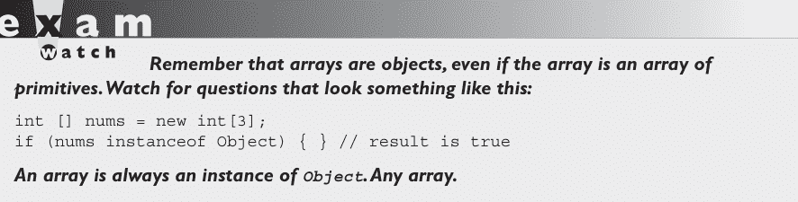

记住数组是对象，即使数组是基本类型的数组。

注意类似这样的问题：

```java
int[] nums = new int[3];
if (nums instanceof Object) { // 结果为 true
```

数组始终是 `Object` 的实例。

表 4-1 总结了在以下给定的情况下 `instanceof` 运算符的使用：

```java
interface Face { }
class Bar implements Face { }
class Foo extends Bar { }
```

# Java 运算符 OCA 目标 3.1、3.2 和 (3.3) 235

| 表 4-1 | 第操作数（被测试的引用） | 实例操作数（与引用比较的类型） | 结果 |
|---|---|---|---|
| 使用操作数和结果 | `null` | 任何类或接口类型 | `false` |
| `instanceof` | `Foo` instance | `Foo`, `Bar`, `Face`, `Object` | `true` |
| | `Bar` instance | `Bar`, `Face`, `Object` | `true` |
| | `Face` instance | `Face`, `Object` | `true` |
| | `Foo[]` | `Foo`, `Bar`, `Face` | `false` |
| | `Foo[]` | `Object` | `true` |
| | `Foo[][]` | `Foo`, `Bar`, `Face`, `Object` | `true` |

## 算术运算符

我们相信你熟悉基础算术运算符：

- `+` 加法
- `-` 减法
- `*` 乘法
- `/` 除法

这些可以使用标准方式：

```java
int x = 5 * 3;
int y = x - 4;
System.out.println("x is " + y);
// 输出 11
```

# 余数 (%) 运算符（也称为模运算符）

你可能不熟悉的运算符之一是余数运算符 `%`。余数运算符将左操作数除以右操作数，结果为余数，如下代码所示：

```java
class MathTest {
    public static void main(String[] args) {
        int x = 15;
        int y = x % 4;
        System.out.println("The result of 15 % 4 is " 
            + "remainder of 15 divided by 4. The remainder is " + y);
    }
}
```

# 236 第 4 章：运算符

运行 `MathTest` 类会输出以下内容：

```
Result of 15 % 4 is the remainder of 15 divided by 4. The remainder is 3
```

（记住：表达式默认从左到右求值。你可以通过添加括号来改变这种顺序或优先级。还要记住 `*` 和 `%` 运算符的优先级高于 `+` 和 `-` 运算符。）


在处理 `int` 类型时，余数运算符（也称为模运算符）和除法运算符之间存在有趣的关系：

- 模运算符丢弃除余数以外的内容。
- 除法运算符丢弃余数。

# 字符串拼接运算符

加号也可以用于将两个字符串拼接，正如我们之前看到的（我们肯定会再次看到的）：

```java
String animal = "Gray " + "elephant";
```

当将数字与字符串结合时，字符串拼接变得有趣起来。

查看以下内容：

```java
String a = "String";
int b = 3;
int c = 7;
System.out.println(a + b + c);
```

`+` 运算符在相加 `int` 变量 `b` 和 `c` 时会作为加号作用吗？还是 `+` 运算符会将 `3` 和 `7` 视为字符并单独拼接？

结果是 `String10` 还是 `String37`？好了，你已经有足够的时间了。

`int` 值被简单地视为字符并粘在 `String` 的右侧，结果为：

```
String37
```

所以我们可以将之前的代码读为：

“从值 `String` 开始，在其后拼接字符 `3`（`b` 的值），产生一个新的字符串 `String3`，在其后拼接字符 `7`（`c` 的值），产生一个新的字符串 `String37`。然后打印它。”

但是，如果你对两个 `int` 变量加上括号，如下：

```java
System.out.println(a + (b + c));
```

你将得到：

```
String10
```

使用括号会导致 `(b + c)` 先求值，由于两个操作数都是 `int` 值，最右侧的 `+` 运算符充当加法运算符。关键点在于，括号内部的左侧操作数不是 `String`。如果是，那么 `+` 运算符将执行字符串拼接。之前的代码可以读为：

> “将 `b` 和 `c` 的值相加，然后将和转换为字符串，并与来自变量 `a` 的字符串拼接。”

需要记住的规则是：

如果一个操作数是 `String`，`+` 运算符就变成字符串拼接运算符。如果两个操作数都是数字，`+` 运算符就是加法运算符。

你会发现有时你可能很难判断，例如左侧操作数是否为 `String`。在考试中，不要期望它总是显而易见的。（实际上，现在回想起来，根本不要指望它永远是显而易见的）

# Java 运算符 (OCA 目标 3.1、3.2 和 3.3) 237

# 第 4 章：运算符

与字符串拼接一样，自增和自减运算符贯穿整个考试，即使在那些并不是为了测试你对这些运算符工作原理的题目中。你可能会在循环、异常甚至线程的问题中看到它们。请做好准备。


注意那些在 `final` 变量上使用自增或自减运算符的题目。因为 `final` 变量不能与它们使用，自增和自减运算符不能用于它们，任何此类尝试都会导致编译错误。以下代码无法编译：

```java
final int x = 5;
int y = x++;
```

它产生此错误：

```
Test.java:44: cannot assign a value to final variable x
int y = x++;
```

你可以预料这样的违规操作会被埋在复杂的代码深处。如果你发现了，你就知道代码无法编译，可以直接跳过无需处理代码的其余部分。

这个问题似乎是在测试你对某些复杂的算术运算符常识的掌握，但实际上它是在测试你对 `final` 修饰符的知识。

# 条件运算符

条件运算符是一个三元运算符（有三个操作数），用于评估布尔表达式，类似于 `if` 语句，不同之处在于，如果测试为真，条件运算符不是执行代码块，而是给变量赋值。换句话说，条件运算符的目标是决定将两个值中的哪一个赋值给变量。该运算符使用问号（`?`）和冒号（`:`）构建。括号是可选的。它的结构如下：

```
x = (布尔表达式) ? 为真时赋值的值 : 为假时赋值的值
```

让我们来看代码中的条件运算符：

# Java 运算符 (OCA 目标 3.1, 3.2, 和 3.3) 241

```java
class Salary {
    public static void main(String[] args) {
        int numOfPets = 3;
        String status = (numOfPets < 4) ? "Pet limit not exceeded" : "too many pets";
        System.out.println("This pet status is " + status);
    }
}
```

你可以将以下代码读为“将 `numOfPets` 设置为 3”。

接下来我们将一个字符串赋值给 `status` 变量。如果 `numOfPets` 小于 4，将 `"Pet limit not exceeded"` 赋值给 `status` 变量；否则，将 `"too many pets"` 赋值给 `status` 变量。

条件运算符以布尔操作开始，后面跟着赋值符号 (`=`) 左侧变量的两个值。如果条件（布尔）测试为真，则赋值第一个值（冒号左侧的值），如果条件测试为假，则赋值第二个值。你可以将条件运算符嵌套到一条语句中：

```java
class AssignmentOps {
    public static void main(String[] args) {
        int sizeOfYard = 10;
        int numOfPets = 3; // 假设此处定义了 numOfPets
        String status = (numOfPets < 4) ? "Pet count OK" : (sizeOfYard > 8) ? "Pet limit on the edge" : "too many pets";
        System.out.println("Pet status is " + status);
    }
}
```

不要期待会有很多使用条件运算符的题目，但记住条件运算符有时会被断言语句混淆，所以务必确保你能区分它们。第 7 章将详细介绍断言。

## 逻辑运算符

考试目标指定了“逻辑”运算符（`&`、`|`、`!`、`&&`、`||`）。某些 Oracle 文档对这些运算符使用其他术语，但就我们的目的和考试目标而言，这些就是逻辑运算符。

# 位运算符（仅针对 OCJP 5 候选人！）

好了，这太让人困惑了。在上述列出的五个逻辑运算符中，有三个（`&`、`|`、`^`）也可以用作“位”运算符。位运算符包含在之前的考试版本中，但在 Java 6 或 Java 7 考试中**没有**。

# 242 第 4 章：运算符

以下是几个使用位运算符的合法语句：

```java
byte b1 = 6 & 7;
byte b2 = 7 | 9;
byte b3 = 5 ^ 4;
System.out.println(b1 + " " + b2 + " " + b3);
```

位运算符按位比较两个值，并根据两个值是否都为“开启”（`&`）、或者有一个为“开启”（`|`）、或者恰好为“开启”（`^`）来返回一个设置了位的变量。顺便说，当我们运行前面的代码时，我们得到 `6 15 1`。


> 关于位运算符的这些，关键是要记住
>
> 位运算符不在 Java 6 或 Java 7 考试中！

# 短路逻辑运算符

考试中的五个逻辑运算符用于评估包含多个布尔表达式的语句。最常用的两个是：

- 短路 AND (`&&`)
- 短路 OR (`||`)

它们用于将较小的布尔表达式连接起来形成较大的布尔表达式。`&&` 和 `||` 运算符只评估布尔值。对于一个 AND (`&&`) 表达式为真，两个操作数都必须为真。例如：

```java
(2 < 3) && (3 < 4)
```

前面的表达式为真，因为操作数 `(2 < 3)` 和操作数 `(3 < 4)` 都为真。

`&&` 运算符的短路特性是因为它没有在无效的评估上浪费时间。短路 `&&` 运算符首先评估运算符的左侧（操作数一），如果结果为假，则 `&&` 运算符就不会去查看表达式的右侧（操作数二），因为 `&&` 运算符已经知道整个表达式不可能为真。

# Java 运算符 (OCA 目标 3.1, 3.2, 和 3.3) 243

```java
class Logical {
    public static void main(String[] args) {
        boolean b1 = false, b2 = false;
        boolean b3 = (b1 = true) && (b2 = true); // b2 将被设置为 true
        System.out.println("b3 = " + b2);
    }
}
```

当我们运行前面的代码时，`&&` 运算符的短路特性是因为它没有在无效的评估上浪费时间。短路 `&&` 运算符首先评估运算符的左侧（操作数一），如果结果为假，`&&` 运算符就不会去查看表达式的右侧（操作数二），因为 `&&` 运算符已经知道整个表达式不可能为真。

# Java 运算符 OCA 目标 3.1, 3.2 和 3.3 245

`&` 和 `|` 运算符的效率很低。例如，如果 `&` 表达式中的第一个操作数（左侧）为假，第二个操作数仍然会被评估——尽管此时结果已经不可能为真了！而 `|` 同样低效：如果第一个操作数为真，Java 虚拟机 (JVM) 仍然会向前进行查询并评估第二个操作数，因为它知道无论如何表达式结果将为真。

你会在考试中遇到很多同时使用短路和非短路逻辑运算符的题目。你必须确切知道哪些操作数被评估了哪些没有，因为结果取决于表达式中的第二个操作数是否执行。考虑以下情况，

```java
int z = 5;
if (++z > 5 || ++z > 6);    // 此代码执行后 z = 7
```

对比：

```java
int z = 5;
if (++z > 5 | ++z > 6);    // 此代码执行后 z = 8
```

# 逻辑运算符 ^ 和 !

考试中的最后两个逻辑运算符是

- 异或 (XOR, `^`)
- 布尔取反 (`!`)

`^`（异或）运算符只评估布尔值。`^` 运算符与我们刚刚回顾的非短路运算符有关，在于它总是会评估表达式中的左侧和右侧操作数。要使异或 (`^`) 为真，必须**恰好有一个**操作数为真。这个示例：

```java
boolean b1 = (2 < 3) ^ (4 > 3);
```

产生此输出：

```
xor false
```

前面的表达式评估为假，是因为操作数一 `(2 < 3)` 和操作数二 `(4 > 3)` 都被评估为真。

`!`（布尔取反）运算符返回布尔值当前值的相反值。以下语句，

```java
if (!(7 == 5)) { System.out.println("not equal"); }
```

# 246 第 4 章：运算符

可以读作“如果 `7 == 5` 不为真”，该语句产生此输出：

```
not equal
```

这是另一个使用布尔值的例子：

```java
boolean t = true;
boolean f = false;
System.out.println("! " + (t & !f) + " " + f);
```

它产生此输出：

```
true false
```

在前面的示例中，注意 `&` 测试通过了（打印了 `true`），并且布尔变量 `f` 的值没有改变，所以它打印了 `false`。

## 认证总结

如果你勤奋地学习了这一章，你应该已经牢牢掌握了 Java 运算符，并理解在使用 `==` 运算符测试相等时的含义。让我们回顾一下你在这一章中学到的重点。

- 运算符 (`&&`、`||`、`&`、`^`) 只能用于评估布尔表达式。`&&` 和 `&` 的区别在于，如果左侧评估为假，`&&` 运算符就不会去测试右操作数，因为 `&&` 表达式的结果永远为假。`||` 和 `|` 的区别在于，如果左侧评估为真，`||` 运算符就不会去测试右操作数，因为结果在此时已经已知为真。

- `==` 可以用于比较基本数据类型的值，也可以用于判断两个引用是否指向同一个对象。

- `instanceof` 运算符用于判断引用变量所引用的对象是否通过指定类型的 IS-A 测试。

- `+` 被重载用于执行字符串拼接，并可以拼接字符串和基本数据类型，但要小心——拼接可能会很棘手。

- 条件运算符（又称“三元运算符”）具有不寻常的、三个操作数的语法——不要把它误认为是复杂的断言语句。

- `++` 和 `--` 运算符将贯穿整个考试，你必须注意它们是对于被更新变量的前缀（前置）还是后缀（后置）。

- 准备好应对关于本章主题的考试题。即使在测试你对其他目标知识的题目中，代码也会频繁使用运算符、赋值和基本类型传递等操作。

# 两分钟演练

以下是本章每个章节的一些要点。

# 关系运算符（OCA 目标 3.1 和 3.3）

- 关系运算符始终产生一个布尔值（`true` 或 `false`）。
- 共有六种关系运算符：`>`、`>=`、`<`、`<=`、`==`、`!=`。最后两个（`==` 和 `!=`）有时被称为相等运算符。
- 在比较字符时，Java 使用字符的 Unicode 值作为数值值。

## 相等运算符

- 有两个相等运算符：`==` 和 `!=`。
- 可以测试四种类型的内容：数字、字符、布尔值和引用变量。
- 在比较引用变量时，只有当两者指向同一个对象时，`==` 才返回 `true`。

# instanceof 运算符（OCA 目标 3.1）

- `instanceof` 仅用于引用变量；它检查对象是否属于特定类型。
- `instanceof` 运算符只能用于根据相同类层次结构中的类类型测试对象（或 `null`）。
- 对于接口，如果一个对象的任何父类实现了 `instanceof` 运算符右侧的接口，则该对象通过 `instanceof` 测试。

# 算术运算符（OCA 目标 3.1 和 3.2）

- 四个主要的数学运算符是加 (`+`)、减 (`-`)、乘 (`*`) 和除 (`/`)。
- 模数运算符（又称模）`%` 返回除法的余数。
- 表达式从左到右评估，除非你添加了括号，或者某些运算符具有更高的优先级。`*`、`/` 和 `%` 运算符的优先级高于 `+` 和 `-`。

# 字符串拼接运算符 (OCA 目标 3.1)

- 如果一个操作数是字符串，`+` 运算符执行拼接。
- 如果两个操作数都是数字，`+` 运算符执行加法。

# 增/减运算符（OCA 目标 3.1 和 3.2）

- 前置运算符（例如 `++x` 和 `--x`）在变量被使用之前执行更新。
- 后置运算符（例如 `x++` 和 `x--`）在使用变量之后执行更新。
- 标记为 `final` 的变量不能增加或减少。


# 三元（条件）运算符 OCA 目标 3.1

- 根据布尔表达式返回两个值之一。
- 如果表达式为真，返回 `?` 后面的值。
- 如果表达式为假，返回 `:` 后面的值。

# 逻辑运算符（OCA 目标 3.1）

- 考试涵盖了六种逻辑运算符：`&`、`|`、`&&`、`||`、`^` 和 `!`。
- 逻辑运算符与布尔值工作。
- `&` 只有当两个操作数都为真时返回 true。
- `|` 只要其中一个操作数为真就返回 true。
- `&&` 是短路运算符，如果左侧为假，`&&` 不评估右操作数。
- `||` 是短路运算符，如果左侧为真，`||` 不评估右操作数。
- `^`（异或）在恰好有一个操作数为真时返回 true。
- `!` 运算符返回布尔当前值的相反值。

# 自我测试

## 1. 给出：

```java
class Hexy {
    public static void main(String[] args) {
        int i = 42;
        String s = (i < 40) ? "life" : (i > 50) ? "universe" : "everything";
        System.out.println(s);
    }
}
```

结果是什么？

A. null
B. life
C. universe
D. everything
E. 编译错误
F. 运行时产生异常

## 2. 给出：

```java
public class Dog {
    String name;
    Dog(String s) { name = s; }
    public static void main(String[] args) {
        Dog d1 = new Dog("Boi");
        Dog d2 = new Dog("Tyri");
        System.out.print(d1 == d2) + " ");
        Dog d3 = new Dog("Boi");
        d2 = d1;
        System.out.print(d1 == d2) + " ");
        System.out.print(d1 == d3) + " ");
    }
}
```

结果是什么？

A. true true true
B. true true false
C. false true false
D. false true true
E. false false false
F. 将运行时产生异常

## 3. 给出：

命令行调用：

```
java Fork live2
```

结果是什么？

A. test case
B. production live2
C. test case live2
D. 编译错误
E. 运行时产生异常

## 4. 给出：

```java
class Feline {
    public static void main(String[] args) {
        long x = 42L;
        long y = 44L;
        System.out.print(" " + 7 + 2 + " ");
    }
}
```

结果是什么？

A. 9 foo47 86foo
B. 9 foo47 4244foo
C. 9 foo425 86foo
D. 9 foo425 4244foo
E. 72 foo47 86foo
F. 72 foo427 4244foo
G. 72 foo425 86foo
H. 72 foo425 4244foo
I. 编译失败

## 5. 注意：这里有另一个旧式的拖放题……以防万一。

将这些片段放入代码中以产生输出 33。请注意，你必须恰好使用每个片段一次。

```
CODE:
class Inscr {
    public static void main(String[] args) {
        Integer x = 7;
        int y = 2;

        x = ____;
        ____ = ____;
        ____ = ____;
        ____ = ____;

        System.out.println(x);
    }
}
```

片段：

```
y y y
y x x
- = * = * =
```

## 6. 给定：

```java
public class Cowboys {
    public static void main(String[] args) {
        int x = 12;
        int a = 5;
        int b = 7;
        System.out.println(x / a + " " + x / b);
    }
}
```

结果是什么？（选择所有适用项）

A. 2 1
B. 2 2
C. 3 1
D. 3 2
E. 运行时抛出异常

## 7. （仅限 OCP）给定：

```java
public class McGee {
    public static void main(String[] args) {
        Days d1 = Days.TH;
        Days d2 = Days.M;
        for (Days d : Days.values()) {
            if (d.equals(Days.P)) break;
            d2 = d;
        }
        System.out.println((d1 == d2) ? "same old" : "newly new");
    }
    enum Days {M, T, W, TH, F, SA, SU};
}
```

结果是什么？

A. same old
B. newly new
C. 由于多个错误导致编译失败
D. 仅因第 7 行错误导致编译失败
E. 仅因第 8 行错误导致编译失败
F. 仅因第 11 行错误导致编译失败
G. 仅因第 13 行错误导致编译失败

## 8. 给定：

```java
public class SpecialOps {
    public static void main(String[] args) {
        String s = "";
        boolean b1 = true;
        boolean b2 = false;
        if (b2 == false) || (21 % 5) > 2) s += "x";
        if (b1 || (b2 == true)) s += "y";
        if (b2 == true) s += "z";
        System.out.println(s);
    }
}
```

哪些正确的？（选择所有适用项）

A. 编译失败
B. 输出中将包含 x
C. 输出中将包含 y
D. 输出中将包含 z
E. 运行时抛出异常

## 9. 给定：

```java
public class Spock {
    public static void main(String[] args) {
        int mask = 0;
        int count = 0;
        if ((5 < 7) || (++count < 10) || mask++ < 10) mask = mask + 1;
        if ((6 > 8) || false) mask = mask + 10;
        if (mask > 10) count++;
        System.out.println(mask + " " + count);
    }
}
```

关于 mask 和 count 的哪些值在第 10 行是正确的？（选择两项）

A. mask 为 0
B. mask 为 1
C. mask 为 2
D. mask 为 10
E. mask 大于 10
F. count 为 0

## 10. 给定：

```java
interface Vessel { }
interface Toy { }
class Boat implements Vessel { }
class Speedboat extends Boat { }
public class Tree {
    public static void main(String[] args) {
        String s = "";
        Boat b = new Boat();
        Speedboat b2 = new Speedboat();
        Speedboat s2 = new Speedboat();
        if ((b instanceof Vessel) && (b2 instanceof Toy)) s += "1";
        if ((s2 instanceof Vessel) && (s2 instanceof Toy)) s += "2";
        System.out.println(s);
    }
}
```

结果是什么？

A. 0
B. 01
C. 02
D. 012
E. 编译失败
F. 运行时异常

## 自测答案

1. **D 正确。** 这是一个嵌套的三元运算符。两个三元表达式均为假。
   A, B, C, E, 和 F 均错误。（OCA 目标 3.1）

2. **C 正确。** `==` 运算符测试的是引用相等性，而不是对象相等性。
   A, B, D, E, 和 F 均错误。（OCA 目标 3.1 和 3.3）

3. **E 正确**，因为没有使用短路 (`|`)，两个操作数都会被求值。由于 `[1]` 出了数组边界，抛出了 `ArrayIndexOutOfBoundsException`。
   A, B, C, 和 D 均错误。（OCA 目标 3.3）

4. **G 正确。** 拼接从左到右运行，如果任一操作数是 String，操作数会被相加。
   A, B, C, D, E, F, 和 I 均错误。（OCA 目标 3.1）

5. **答案：**

```java
class Incr {
    public static void main(String[] args) {
        Integer x = 7;
        int y = 2;

        x *= x;
        y *= y;
        y *= y;
        x -= y;

        System.out.println(x);
    }
}
```

是的，这有点像谜题，但如果 Oracle 恢复这类题目，你可能会在真实考试中遇到类似的。（OCA 目标 3.1）

6. **A 正确。** 进行整数除法时，余数总是会舍入。
   B, C, D, E 均错误。（OCA 目标 3.1）

# 使用 String 和 StringBuilder (OCA 目标 2.7 和 2.6)

到目前为止，String 对象看起来和其他对象一样。现在，让我们给字符串赋一个值：

```java
s = "abcdef";
```

（你很快就会发现，这两行代码的作用并不像看起来那么简单，所以请相信我。）

事实证明 String 类有数以亿计的构造函数，因此你可以使用一种更高效的捷径方法：

```java
String s = new String("abcdef");
```

这种甚至更加简洁：

```java
String s = "abcdef";
```

这些选项之间存在一些细微的差异，我们稍后会讨论，但它们的共同点是，它们都创建了一个值为 `"abcdef"` 的新 String 对象，并将其赋值给引用变量 `s`。现在，假设你想让引用 `s2` 指向 `s` 所引用的那个 String 对象：

```java
String s2 = s; // 将 s2 指向与 s 相同的 String
```

到目前为止都很好。String 对象的行为就像其他对象一样，那大大小闹的？**不可变性（Immutability）**！（到底什么是不可变性！）一旦你分配了一个 String 值，它就永远无法改变——它是不可变的，彻底冻结，纹丝不动，结束、完结。（我们稍后会讨论为什么；先忘记它吧）。好消息是，虽然 String 对象是不可变的，但它的引用变量不是。继续我们的例子，考虑这个：

```java
s = s.concat(" more stuff"); // concat 方法在末尾追加字面量
```

现在，等一下，我们不是说过 String 对象是不可变的吗？这些关于“在字符串末尾追加”的话是怎么回事？非常好的问题：让我们看看实际上发生了什么。

Java 虚拟机 (JVM) 获取了 `s` 的值（`"abcdef"`），并在末尾拼接了更多内容，得到了 `"abcdef more stuff"` 的值。String 是不可变的，JVM 并没有将这个新值放入 `s` 所引用的旧 String 中，而是创建了一个新的 String 对象，赋予它值 `"abcdef more stuff"`，并让 `s` 指向它。在示例的这一点上，我们有两个 String 对象：我们创建的第一个值为 `"abcdef"`，第二个值为 `"abcdef more stuff"`。从技术上讲，现在有三个 String 对象，因为 `concat` 的字面量参数 `" more stuff"` 本身也是一个新的 String 对象。但我们拥有对 `"abcdef"`（由 `s2` 引用）和 `"abcdef more stuff"`（由 `s` 引用）的引用。

如果我们在调用 `s = s.concat(" more stuff");` 之前，没有预见性或运气去创建一个引用变量会怎样？在这种情况下，包含 `"abcdef"` 的原始未变字符串仍然存在内存中，但它会被视为“丢失”了。我们程序中的没有任何代码可以引用它——它对我们来说丢失了。请注意，原始的 `"abcdef"` 字符串并没有改变（记住；它是不可变的）；只是引用变量 `s` 改变了，使其指向了不同的字符串。

图 5-1 显示了当你重新分配引用变量时堆上发生了什么。注意，虚线表示被删除的引用。

回顾我们的示例：

```java
String s = "abcdef"; // 创建一个新的 String 对象，值为
String s2 = s; // "abcdef"，s 指向
// 创建第二个引用变量
// 指向同一个 String
```

```java
// 创建一个新的值为 "abcdef more stuff" 的 String 对象，
// 指向它。（将 s 的引用从旧 String
// 改为新 String。）（记住 s2 仍然指向
// 原始的 "abcdef" String。）
s = s.concat(" more stuff");
```

让我们看另一个例子：

```java
String x = "Java";
x = x.concat(" Rules!"); // 输出是 "x = Java"
System.out.println("x = " + x);
```

第一行很直观：创建一个新的 String 对象，赋予它值 `"Java"`，并让 `x` 指向它。接下来，JVM 创建了一个值为 `"Java Rules!"` 的 String 对象，但没有任何东西指向它。第二个 String 对象立即被丢失了；你无法访问它。引用变量 `x` 仍然指向值为 `"Java"` 的原始 String。图 5-2 显示了在不为其分配引用的情况下创建一个 String。

让我们扩展这个当前的例子。我们开始于：

```java
String x = "Java";
x = x.concat(" Rules!"); // 输出是：x = Java
System.out.println("x = " + x);
```

现在我们添加：

```java
x.toUpperCase();
System.out.println("x = " + x); // 输出仍然是：
// x = Java
```

图 5-1

String 对象及其它们的引用变量

步骤 1：String s = "abc";

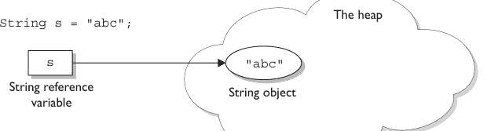

```
"abc"
```

String 引用变量

```
"abc"
```

String 对象

步骤 2：String s2 = s;

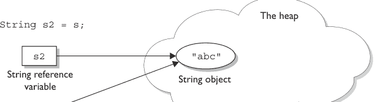

```
s2
```

String 引用变量

```
"abc"
```

String 对象

```
s
```

String 引用变量

步骤 3：s = s.concat("def");

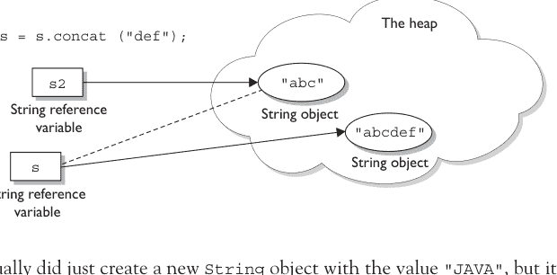

```
s2
```

String 引用变量

```
"abc"
```

String 对象

```
"abcdef"
```

String 对象

```
s
```

String 引用变量

（我们实际上创建了一个值为 `"def"` 的新 String 对象，但它丢失了，而 `x` 仍然指向原始未变的字符串 `"Java"`）。怎样如何：

```java
x.replace('a', 'X');
System.out.println("x = " + x); // 输出是：
// x = Java
```

# 使用 String 和 StringBuilder (OCA 目标 2.7 和 2.6)

String 对象的不可变性是一个非常好的主。如果多个引用变量在完全不知情的情况下引用同一个 String，而其中任何一个变量都能改变 String 的值，那将非常糟糕。

你可能会说：“这个主听起来很好，但如果有人重写了 String 类的功能呢？这难道不会导致池中出现问题吗？”这就是 String 类被标记为 `final` 的主要原因之一。没有人可以重写任何 String 方法的行为，因此你可以放心，你所依赖的不可变的 String 对象实际上是不可变的。

# 创建新 String


早些时候我们承诺过会详细讨论创建 `String` 的各种方法之间的细微差异。让我们来看创建 `String` 的几个示例，并进一步假设池中不存在其他 `String` 对象。在一种简单的情况下，`"abc"` 将进入字符串池，且 `s` 将引用它：

```java
String s = "abc"; // 创建了一个 String 对象和一个
                   // 引用变量
```

在下一种情况下，由于我们使用了 `new` 关键字，Java 将在普通（非池）内存中创建一个新的 `String`，并且 `s` 将引用它。此外，字面量 `"abc"` 将放入池中：

```java
String s = new String("abc"); // 创建了两个对象和
                               // 一个引用索引
```

# String 类中的重要方法

以下是 `String` 类中一些最常用的方法，它们也是你在考试中可能可能遇到的方法。

- `charAt()` 返回指定索引处的字符
- `concat()` 将一个字符串附加到另一个字符串的末尾（`+` 也有效）
- `equalsIgnoreCase()` 判断两个字符串是否相等，且忽略大小写
- `length()` 返回字符串中的字符数
- `replace()` 将字符的出现处替换为新字符
- `substring()` 返回字符串的一部分
- `toLowerCase()` 返回一个字符串，将其中的大写字符转换为小写
- `toString()` 返回字符串的值
- `toUpperCase()` 返回一个字符串，将其中的小写字符转换为大写
- `trim()` 移除字符串两端的的空白字符

让我们更详细地查看这些方法。

`public char charAt(int index)` 此方法返回位于 `String` 规定索引处的字符。记住，`String` 的索引是从 0 开始的——这里有一个示例：

```java
String x = "airplane";
System.out.println(x.charAt(2)); // 输出是 'r'
```

`public String concat(String s)` 此方法返回一个字符串，将传递给方法的 `String` 值附加到调用方法的 `String` 的末尾——这里有一个示例：

```java
String x = "taxi";
System.out.println(x.concat("cab")); // 输出是 "taxi cab"
```

重载运算符和 `+=` 运算符执行的功能与 `concat` 方法类似——这里有一个示例：

```java
String x = "library";
System.out.println(x + " card"); // 输出是 "library card"
```

```java
String x = "Atlantic";
x += " ocean";
System.out.println(x); // 输出是 "Atlantic ocean"
```

在前面的 `"Atlantic ocean"` 中，注意 `x` 的值确实改变了！记住 `+=` 是一个赋值运算符，第 2 行实际上创建了一个新字符串 `"Atlantic ocean"`，并将其赋值给变量 `x`。在第 2 行执行后，原始的字符串 `x` (`"Atlantic"`) 就被遗弃了。

`public boolean equalsIgnoreCase(String s)` 此方法返回一个布尔值（`true` 或 `false`），取决于参数中的 `String` 值是否与调用方法的 `String` 值相同。即使比较的 `String` 对象中的字符大小写不同，此方法也会返回 `true`——这里有一个示例：

```java
String x = "Exit";
System.out.println(x.equalsIgnoreCase("EXIT")); // 结果 "true"
System.out.println(x.equalsIgnoreCase("tixe")); // 结果 "false"
```

`public int length()` 此方法返回调用方法的 `String` 的长度——这里有一个示例：

```java
String x = "01234567";
System.out.println(x.length()); // 返回 "8"
```

数组有一个名为 `length` 的属性（而不是方法）。你可能会在考试中遇到尝试在数组上使用 `length()` 方法或尝试在 `String` 上使用属性的问题。这两种都会导致编译错误——例如考虑：

```java
String x = "test";
System.out.println(x.length); // 编译错误
```

```java
String[] x = new String[3];
System.out.println(x.length()); // 编译错误
```

`public String replace(char old, char new)` 此方法返回一个字符串，其值是调用方法的 `String` 的值，但是将第一个参数中 `char` 的任何出现处都替换为第二个参数中的 `char`——这里有一个示例：

```java
String x = "oxoxo";
System.out.println(x.replace('x', 'X')); // 输出是 "OXoOXo"
```

`public String substring(int begin)` 和 `public String substring(int begin, int end)` `substring()` 方法用于返回调用方法的 `String` 的部分（或子字符串）。第一个参数是 `String` 的起始位置（从 0 开始）。如果调用有一个参数，返回的子字符串将包含到原始字符串结束。如果调用有两个参数，返回的子字符串将在第 n 个字符结束，其中 n 是第二个参数。

遗憾的是，结束参数是从 0 开始的，所以如果第二个参数是 7，返回字符串中的最后一个字符将是原始字符串的第 7 个位置，即索引 6。让我们来看一些示例：

```java
String x = "0123456789"; // 就像魔法一样，每个字符的值都与其索引相同
System.out.println(x.substring(5));
System.out.println(x.substring(5, 8)); // 输出是 "5678"
```

第一个示例应该很简单：从索引 5 开始并返回字符串的剩余部分。第二个示例应该读作：从索引 5 开始并返回到第 8 个位置之前的剩余字符。

`public String toLowerCase()` 将 `String` 的所有字符转换为小写——这里有一个示例：

```java
String x = "A New Moon";
System.out.println(x.toLowerCase()); // 输出是 "a new moon"
```

`public String toString()` 此方法返回调用方法的 `String` 的值。Java 中的所有对象都必须有一个 `toString()` 方法，通常描述该对象。对于 `String` 对象，有什么比 `String` 的值更有意义的方法吗？为了一致，这里有一个示例：

```java
String x = "big surprise";
System.out.println(x.toString()); // 输出是 "big surprise"
```

`public String toUpperCase()` 将 `String` 的所有字符转换为大写——这里有一个示例：

```java
String x = "A New Moon";
System.out.println(x.toUpperCase()); // 输出是 "A NEW MOON"
```

`public String trim()` 此方法返回一个字符串，其值为调用方法的 `String`，但移除了任何开头或结尾的空白——这里有一个示例：

```java
String x = " hi ";
System.out.println(x + "t"); // 输出是 " hi t"
System.out.println(x.trim() + "t"); // 输出是 "hit"
```

# StringBuilder 类

当你对字符串进行大量修改时，应该使用 `StringBuilder` 类。如前节所述，`String` 对象是不可变的，所以如果你选择对 `String` 对象进行大量操作，将在池中产生大量的遗弃的 `String` 对象。（即使在如今 GB 内存时代，浪费宝贵的内存在丢弃的 `String` 对象上也不是好主意。）另一方面，类型为 `StringBuilder` 的对象可以修改而不会留下大量的丢弃的 `String` 对象。

`StringBuilder` 的常见用法是在程序处理不断变化的输入流时进行 I/O。在这种情况下，大块字符作为单位处理，而 `StringBuilder` 对象是处理数据块、传递它并重用内存处理下一个数据块的理想方式。

# 优先使用 StringBuilder 而不是 StringBuffer

`StringBuilder` 类是在 Java 5 中引入的。它与 `StringBuffer` 类具有完全相同的 API，只是 `StringBuilder` 不是线程安全的。换句话说，它的方法不是同步的。（关于线程安全请见第 13 章。）Oracle 建议尽可能使用 `StringBuilder` 而不是 `StringBuffer`，因为 `StringBuilder` 运行速度更快（甚至可能跳得更高）。除了同步之外，我们对 `StringBuilder` 方法的任何说明都适用于 `StringBuffer` 方法，反之亦然。

# 270 第 5 章：字符串、数组和 ArrayList 的操作

我们虽然获得了一个不错的 `String`，但缺点是旧的 `String` `"abc"` 已经在字符串池中丢失，从而浪费了内存。如果我们使用 `StringBuilder` 而不是 `String`，代码看起来会像所示：

```java
StringBuilder sb = new StringBuilder("abc");
sb.append("def");
System.out.println("sb = " + sb); // 输出为 "sb = abcdef"
```

我们将讨论的所有 `StringBuilder` 方法都作用于调用该方法的 `StringBuilder` 对象的值。调用 `sb.append("def")` 实际上是将 `"def"` 追加到它本身（`StringBuilder sb`）。事实上，这些方法可以相互链式调用——这里有一个例子：

```java
StringBuilder sb = new StringBuilder("abc");
sb.append("def").reverse().insert(3, "---");
System.out.println(sb); // 输出为 "fed---cba"
```

注意，在之前的每个示例中，都调用了一次 `new`，因此在示例中我们创建任何额外的对象。每个示例只需要一个 `StringBuilder` 对象即可执行。


所以我们已经看到通过指定初始值的参数来构建 `StringBuilder`。`StringBuilder` 也可以是空的，还可以根据特定的大小或更正式地说是“容量”（capacity）来构造。对于考试，创建新的 `StringBuilder` 有三种方法：

1. `new StringBuilder();` // 默认容量 = 16 个字符
2. `new StringBuilder("abcb");` // 容量 = 16 + 参数长度
3. `new StringBuilder(x);` // 容量 = x (整数)

处理 `StringBuilder` 的两种常用方法是通过 `append()` 方法或 `insert()` 方法。在 `StringBuilder` 的容量方面，在追加和插入时有三个规则需要记住：

- 如果 `append()` 使 `StringBuilder` 增长超过了其容量，容量将自动更新。
- 如果 `insert()` 起于 `StringBuilder` 的容量范围内，但结束于当前容量之后，容量将自动更新。
- 如果 `insert()` 尝试在 `StringBuilder` 当前长度之后的索引处开始，将抛出异常。

## 使用 String 和 StringBuilder (OCA 目标 2.7 和 2.6)

### StringBuilder 类中的重要方法

`StringBuilder` 类有数百万方法。以下是你在现实世界中最可能用到的方法，幸运的是，也是你在考试中最可能使用的方法。

`public StringBuilder append(String s)` 如你之前看到的，此方法将更新调用它的对象的值，无论返回的值是否赋值给变量。此方法接受许多不同的参数，包括 `boolean`、`char`、`double`、`float`、`int`、`long` 等，但考试中最可能使用的是 `String` 参数——例如，

```java
StringBuilder sb = new StringBuilder("set point");
sb.append("point");
System.out.println(sb); // 输出为 "set point"
StringBuilder sb2 = new StringBuilder("pi = ");
sb2.append(3.14159f);
System.out.println(sb2); // 输出为 "pi = 3.1415904"
```

`public StringBuilder delete(int start, int end)` 此方法修改用于调用它的 `StringBuilder` 对象的值。要删除的子串的起始索引由第一个参数定义（从0开始），被删除的子串的结束索引由第二个参数定义（但它是从1开始的！）仔细研究以下示例：

```java
StringBuilder sb = new StringBuilder("0123456789");
System.out.println(sb.delete(4,6)); // 输出为 "01236789"
```


考试可能会测试你对 `String` 和 `StringBuilder` 对象区别的知识。因为 `StringBuilder` 对象是可以变的，以下代码片段的行为与使用 `String` 对象的类似代码片段不同：

```java
StringBuilder sb = new StringBuilder("abc");
sb.append("def");
System.out.println(sb);
```

在这种情况下，输出将是："abcdef"

## 272 第 5 章：字符串、数组和 ArrayList 的操作

`public StringBuilder insert(int offset, String s)` 此方法更新调用方法调用的 `StringBuilder` 对象的值。传递给第二个参数的 `String` 被插入到从第一个参数表示的偏移量位置开始（偏移量从0开始）。同样，可以通过第二个参数传递其他类型的数据（`boolean`、`char`、`double`、`float`、`int`、`long` 等），但 `String` 是最可能看到的：

```java
StringBuilder sb = new StringBuilder("01234567");
sb.insert(4, "--");
System.out.println(sb); // 输出为 "0123--4567"
```

`public StringBuilder reverse()` 此方法更新调用方法调用的 `StringBuilder` 对象的值。当调用时，`StringBuilder` 中的字符会被反转——第一个字符变成最后一个，倒数第二个变成第二个，以此类推：

```java
StringBuilder sb = new StringBuilder("A man plan a canal Panama");
sb.reverse();
System.out.println(sb); // 输出为 "amanaP lanac a nam A"
```

`public String toString()` 此方法返回调用它的 `StringBuilder` 对象的字符串表示形式：

```java
StringBuilder sb = new StringBuilder("A man plan a canal Panama");
System.out.println(sb.toString()); // 输出为 "A man plan a canal Panama"
```


# 270 第 5 章：字符串、数组和 ArrayList 的操作

我们虽然获得了一个不错的 `String`，但缺点是旧的 `String` "abc" 已经在字符串池中丢失，从而浪费了内存。如果我们使用 `StringBuilder` 而不是 `String`，代码看起来会像所示：

```
StringBuilder sb = new StringBuilder("abc");
sb.append("def");
System.out.println("sb = " + sb); // 输出为 "sb = abcdef"
```

我们将讨论的所有 `StringBuilder` 方法都作用于调用该方法的 `StringBuilder` 对象的值。调用 `sb.append("def")` 实际上是将 "def" 追加到它本身（`StringBuilder sb`）。事实上，这些方法可以相互链式调用——这里有一个例子：

```
StringBuilder sb = new StringBuilder("abc");
sb.append("def").reverse().insert(3, "---");
System.out.println(sb); // 输出为 "fed---cba"
```

注意，在之前的每个示例中，都调用了一次 `new`，因此在示例中我们创建任何额外的对象。每个示例只需要一个 `StringBuilder` 对象即可执行。


所以我们已经看到通过指定初始值的参数来构建 `StringBuilder`。`StringBuilder` 也可以是空的，还可以根据特定的大小或更正式地说是“容量”（capacity）。对于考试，创建新的 `StringBuilder` 有三种方法：

1. `new StringBuilder();` // 默认容量 = 16 个字符
2. `new StringBuilder("abcb");` // 容量 = 16 + 参数长度
3. `new StringBuilder(x);` // 容量 = x (整数)

处理 `StringBuilder` 的两种常用方法是通过 `append()` 方法或 `insert()` 方法。在 `StringBuilder` 的容量方面，在追加和插入时有三个规则需要记住：

- 如果 `append()` 使 `StringBuilder` 增长超过了其容量，容量将自动更新。
- 如果 `insert()` 起于 `StringBuilder` 的容量范围内，但结束于当前容量之后，容量将自动更新。
- 如果 `insert()` 尝试在 `StringBuilder` 当前长度之后的索引处开始，将抛出异常。

## 使用 String 和 StringBuilder (OCA 目标 2.7 和 2.6)

### StringBuilder 类中的重要方法

`StringBuilder` 类有数百万方法。以下是你在现实世界中最可能用到的方法，幸运的是，也是你在考试中最可能使用的方法。

`public StringBuilder append(String s)` 如你之前看到的，此方法将更新调用它的对象的值，无论返回的值是否赋值给变量。此方法接受许多不同的参数，包括 `boolean`、`char`、`double`、`float`、`int`、`long` 等，但考试中最可能使用的是 `String` 参数——例如，

```
StringBuilder sb = new StringBuilder("set point");
sb.append("point");
System.out.println(sb); // 输出为 "set point"
StringBuilder sb2 = new StringBuilder("pi = ");
sb2.append(3.14159f);
System.out.println(sb2); // 输出为 "pi = 3.1415904"
```

`public StringBuilder delete(int start, int end)` 此方法修改用于调用它的 `StringBuilder` 对象的值。要删除的子串的起始索引由第一个参数定义（从0开始），被删除的子串的结束索引由第二个参数定义（但它是从1开始的！）仔细研究以下示例：

```
StringBuilder sb = new StringBuilder("0123456789");
System.out.println(sb.delete(4,6)); // 输出为 "01236789"
```


考试可能会测试你对 `String` 和 `StringBuilder` 对象区别的知识。因为 `StringBuilder` 对象是可以变的，以下代码片段的行为与使用 `String` 对象的类似代码片段不同：

```
StringBuilder sb = new StringBuilder("abc");
sb.append("def");
System.out.println(sb);
```

在这种情况下，输出将是："abcdef"

## 272 第 5 章：字符串、数组和 ArrayList 的操作

`public StringBuilder insert(int offset, String s)` 此方法更新调用方法调用的 `StringBuilder` 对象的值。传递给第二个参数的 `String` 被插入到从第一个参数表示的偏移量位置开始（偏移量从0开始）。同样，可以通过第二个参数传递其他类型的数据（`boolean`、`char`、`double`、`float`、`int`、`long` 等），但 `String` 是最可能看到的：

```
StringBuilder sb = new StringBuilder("01234567");
sb.insert(4, "--");
System.out.println(sb); // 输出为 "0123--4567"
```

`public StringBuilder reverse()` 此方法更新调用方法调用的 `StringBuilder` 对象的值。当调用时，`StringBuilder` 中的字符会被反转——第一个字符变成最后一个，倒数第二个变成第二个，以此类推：

```
StringBuilder sb = new StringBuilder("A man plan a canal Panama");
sb.reverse();
System.out.println(sb); // 输出为 "amanaP lanac a nam A"
```

`public String toString()` 此方法返回 `StringBuilder` 对象的字符串表示形式。


# StringBuilder 方法

## `public StringBuilder insert(int offset, String s)`

此方法更新调用方法的 `StringBuilder` 对象的值。传递给第二个参数的 `String` 被插入到从第一个参数表示的偏移量位置开始（偏移量从 0 开始）。同样，可以通过第二个参数传递其他类型的数据（`boolean`、`char`、`double`、`float`、`int`、`long` 等），但 `String` 是最可能看到的：

```java
StringBuilder sb = new StringBuilder("01234567");
sb.insert(4, "--");
System.out.println(sb); // 输出为 "0123--4567"
```

## `public StringBuilder reverse()`

此方法更新调用方法的 `StringBuilder` 对象的值。当调用时，`StringBuilder` 中的字符会被反转——第一个字符变成最后一个，倒数第二个变成第二个，以此类推：

```java
StringBuilder sb = new StringBuilder("A man plan a canal Panama");
sb.reverse();
System.out.println(sb); // 输出为 "amanaP lanac a nam A"
```

## `public String toString()`

此方法返回调用它的 `StringBuilder` 对象的字符串表示形式。

# 使用数组 (OCA 目标 4.1 和 4.2)

前面的代码无法通过编译。请记住，在您实际实例化数组对象之前，JVM 不会分配空间。那才是大小至关的时候。

## 构造数组

构造数组意味着在堆（所有对象都存在的地方）上创建数组对象——即对数组类型执行 `new` 操作。为了创建数组对象，Java 必须知道要在堆上分配多少空间，因此你必须在创建时指定数组的大小。数组的大小是该数组将包含的元素数量。

## 构造一维数组

构造数组最直接的方法是使用关键字 `new`，后跟数组类型，并用括号指定该数组将包含多少个该类型的元素。这是一个构造 `int` 类型数组的示例：

```java
int[] testScores; // 声明 int 数组
testScores = new int[4]; // 构造数组并将其赋值给 testScores 变量
```

前面的代码在堆上创建了一个新对象——一个包含四个元素的数组对象，其中每个元素都包含一个默认值为 0 的 `int`。将这段代码看作是在告诉编译器：“创建一个包含四个 `int` 的数组对象，并将其赋值给名为 `testScores` 的引用变量。另外，请将每个 `int` 元素设为零。谢谢。”（编译器很欣赏礼貌）。

### 图 5-4：堆上的一维数组

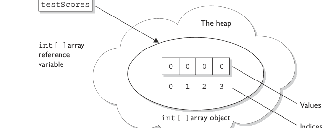

你也可以在一条语句中声明并构造数组，如下所示：

`int[] testScores = new int[4];`

这条单条语句产生的结果与之前的两个语句相同。

对象类型的数组也可以以相同的方式构造：

`Thread[] threads = new Thread[5]; // 没有创建 Thread 对象！`

`// 创建了一个 Thread 数组`

请记住，尽管代码看起来如此，但 `Thread` 的构造函数并没有被调用。我们不是在创建 `Thread` 实例，而是创建一个单个的 `Thread` 数组对象。在前面的语句之后，仍然没有任何实际 `Thread` 对象！


仔细思考在代码语句或块执行后堆上有多少对象。考试将要求你了解，例如，前面的代码只产生了一个对象（赋值给名为 `threads` 的引用变量的数组）。由 `threads` 引用的单个对象持有五个 `Thread` 引用变量，但还没有创建 `Thread` 对象或将它们赋值给这些引用。

> **注意**
>
> 请记住，数组在构造时必须始终给定大小。JVM 需要该大小在堆上为新数组对象分配适当的空间。例如，执行以下操作永远是不合法的：
>
> `int[] carList = new int[]; // 无法编译；需要大小`
>
> 所以不要这样做，如果你在测试中看到它，请直接向最近的标记为“编译失败”的地方冲过去。


你可能会看到“construct（构造）”、“create（创建）”和“instantiate（实例化）”这些词交替使用。它们都意味着：“在堆上构建了一个对象”。这还意味着由于构造/创建/实例化代码的结果，对象的构造函数会运行。你可以肯定地说，例如，任何使用 `new` 关键字的代码（如果成功运行）都会导致类构造函数和所有父类构造函数的运行。

## 多维数组

请记住，多维数组简单来说就是数组的数组。因此，一个类型为 `int[][]` 的二维数组，其该数组中的每个元素都持有指向另一个数组的引用。第二个维度持有实际的原始类型。

下面的代码声明并构造了一个 `int` 类型的二维数组：

```java
int[][] myArray = new int[3][];
```

注意，只有第一个括号被赋予大小。这在 Java 中是可以接受的，因为 JVM 只需要知道赋值给变量 `myArray` 的对象的大小。

### 图 5-5：堆上的二维数组

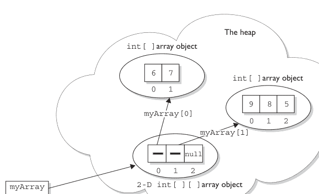

## 初始化数组

初始化数组意味着将东西放入其中。数组中的“东西”是数组的元素，它们要么是原始值（2、x、false 等），要么是数组中的引用变量所指向的对象。如果你有一个对象数组（而不是原始类型数组），数组实际上并没有持有对象，就像任何非原始值都从不真正持有对象一样，而是持有指向对象的引用。我们谈论数组时，例如“一个包含五个字符串的数组”，尽管我们真正的意思是“一个包含五个字符串引用的数组”。

数组的初始化方式如下：

```java
int[][] myArray = new int[3][];
myArray[0] = new int[2];
myArray[0][0] = 6;
myArray[0][1] = 7;
myArray[1] = new int[3];
myArray[1][0] = 9;
myArray[1][1] = 8;
myArray[2] = new int[5];
```

我们在堆上有一个数组对象，带有三个引用，但还没有任何对象。下一步是创建对象并赋予索引位置：

```java
int[] pets = new int[3];
pets[0] = 0; // 默认值
pets[1] = 0;
pets[2] = 0;
```

## 访问数组元素

寻找访问范围外索引的代码。例如，如果数组有三个元素，尝试访问 `[3]` 将抛出 `ArrayIndexOutOfBoundsException`，因为对于三个元素的数组，合法值为 0、1 和 2。你可能还会看到尝试使用负数作为数组索引。以下是合法和非法的数组访问示例。确保识别出这些会导致运行时异常而不是编译错误！

几乎所有的考试题都会列出运行时异常和编译错误作为可能：

```java
int[] x = new int[5];
x[4] = 2; // 元素在索引 4
x[5] = 3; // 运行时异常。索引 5 没有元素！
```

```java
int[] z = new int[2];
int y = -3;
z[y] = 4; // 运行时异常。y 是负数
```

这些在复杂的循环中很难发现，但那里是你最有可能在考试题中看到数组问题的地方。

二维数组（数组的数组）可以如下初始化：

```java
int[][] scores = new int[3][];
// 声明并创建一个持有三个 int 数组引用的数组 (scores)
```

```java
scores[0] = new int[4];
// scores 数组的第一个元素是包含四个 int 元素的 int 数组
```

```java
scores[1] = new int[6];
// 第二个元素是包含六个 int 元素的数组
```

```java
scores[2] = new int[1];
// 第三个元素是包含一个 int 元素的数组
```

## 在循环中初始化元素

数组对象有一个公共变量 `length`，它给你数组中元素的数量。因此，最后一个索引值总是比长度小 1。

例如，如果数组的长度为 4，则索引值从 0 到 3。通常，你会看到在循环中初始化数组元素，如下所示：

```java
Dog[] myDogs = new Dog[6]; // 创建一个包含 6 个 Dog 引用的数组

for (int x = 0; x < myDogs.length; x++) {
    myDogs[x] = new Dog(); // 将新的 Dog 实例赋值给索引位置 x
}
```

`length` 变量告诉我们数组包含多少个元素，但它并没有告诉我们这些元素是否已经初始化。

## 在行内进行声明、构造和初始化

你可以使用两个数组特定的语法快捷方式在单个语句中完成初始化（将显式值放入数组元素中）和构造（实例化数组对象本身）。第一种用于在一个语句中完成声明、创建和初始化，如下：

1. `int x = 9;`
2. `int[] dots = {6, x, 8};`

上述代码的第 2 行执行了四件事：

- 声明了一个名为 `dots` 的 `int` 数组变量。
- 创建了一个长度为三的 `int` 数组（包含三个元素）。
- 用值 6、9 和 8 填充数组元素。
- 将新数组对象赋值给引用变量 `dots`。

尺寸（数组的长度）由大括号之间用逗号分隔的项目个数决定。该代码在功能上等同于以下较长的代码：

```java
int[] dots;
dots = new int[3];
int x = 9;
dots[0] = 6;
dots[1] = x;
dots[2] = 8;
```

这引出了一个问题：“为什么有人要用较长的方式？”我想到了一个原因：在你创建数组时，你可能不知道将赋值给数组元素的数值。

使用对象引用而非基本数据类型，其工作方式完全如下：

```java
Dog puppy = new Dog("Frodo");
Dog[] myDogs = {puppy, new Dog("Clover"), new Dog("Aiko")};
```

上述代码创建了一个由变量 `myDogs` 引用的 `Dog` 数组，长度为三个元素。它将之前创建的 `Dog` 对象（赋值给变量 `puppy`）赋值给数组的第一个元素。它创建了两个新的 `Dog` 对象（Clover 和 Aiko），并将它们添加到 `myDogs` 数组中最后两个 `Dog` 引用变量元素中。

### 图 5-6：声明、构造并初始化对象数组

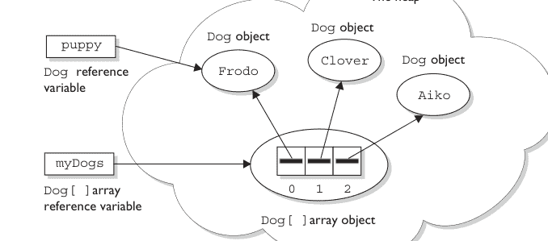

图片展示了以下代码的结果：

```java
Dog puppy = new Dog("Frodo");
Dog[] myDogs = {puppy, new Dog("Clover"), new Dog("Aiko")};
```

创建了四个对象：

- 被 `puppy` 和 `myDogs[0]` 引用的 `Dog` 对象
- 被 `myDogs` 引用的 `Dog[]` 数组
- 被 `myDogs[1]` 和 `myDogs[2]` 引用的 2 个 `Dog` 对象

你也可以在多维数组上使用快捷语法，如下：

```java
int[][] scores = {{5,2,4,7}, {9,2}, {3,4}};
```

这段代码在堆上总共创建了四个对象。首先，构造了一个 `int` 数组（将赋值给 `scores` 变量的对象）。`scores` 数组的长度为三，源于外层大括号之间用逗号分隔的项目个数。`scores` 数组中的三个元素中的每一个都是指向 `int` 数组的引用变量，因此这三个 `int` 数组被构造并赋值给 `scores` 数组中的元素。

这三个数组的每个尺寸都取决于对应内层大括号内的的项目个数。例如，第一个数组长度为四，第二个数组长度为二。因此，我们拥有四个对象：一个 `int` 数组（每个元素都是指向 `int` 数组的引用），以及三个 `int` 数组（这三个数组中的每个元素都是一个 `int` 值）。最后，三个数组使用内层大括号内的实际 `int` 值进行初始化。因此，第一个数组包含了值 5, 2, 4, 7。

```java
scores[0]      // 一个 4 个 int 的数组
scores[1]      // 一个 2 个 int 的数组
scores[2]      // 一个 2 个 int 的数组
scores[0][1]   // int 值 2
scores[2][1]   // int 值 4
```

### 图 5-7：声明、构造和初始化二维数组

图片展示了上述代码在堆上的内存结构。

## 构造和初始化匿名数组

第二种快捷方式被称为“匿名数组创建”，它可用于构造并初始化一个数组，然后将该数组赋值给之前声明的数组变量：

```java
int[] scores;
scores = new int[] {4, 7, 2};
```


# 第 5 章：处理字符串、数组和 ArrayList

例如，如果一个数组的长度为 4，则索引值从 0 到 3。通常，你会看到在循环中初始化数组元素，如下所示：

```
Dog[] myDogs = new Dog[6]; // 创建一个包含 6 个 Dog 引用的数组

for(int x = 0; x < myDogs.length; x++) {

    myDogs[x] = new Dog(); // 将新的 Dog 实例赋值给索引位置 x

}
```

`length` 变量告诉我们数组包含多少个元素，但它并没有告诉我们这些元素是否已经初始化。

## 在行内进行声明、构造和初始化

你可以使用两个数组特定的语法快捷方式在单个语句中完成初始化（将显式值放入数组元素中）和构造（实例化数组对象本身）。第一种用于在一个语句中完成声明、创建和初始化，如下：

1. `int x = 9;`
2. `int[] dots = {6, x, 8};`

上述代码的第 2 行执行了四件事：

- 声明了一个名为 `dots` 的 int 数组变量。
- 创建了一个长度为三的 int 数组（包含三个元素）。
- 用值 6、9 和 8 填充数组元素。
- 将新数组对象赋值给引用变量 `dots`。

尺寸（数组的长度）由大括号之间用逗号分隔的项目个数决定。该代码在功能上等同于以下较长的代码：

```
int[] dots;

dots = new int[3];

x = 9;

dots[0] = 6;

dots[1] = x;

dots[2] = 8;
```

这引出了一个问题：“为什么有人要用较长的方式？”我想到了一个原因：在你创建数组时，你可能不知道将赋值给数组元素的数值。

## 使用数组 (OCA 目标 4.1 和 4.2)

使用对象引用而非基本数据类型，其工作方式完全如下：

```
Dog puppy = new Dog("Frodo");

Dog[] myDogs = {puppy, new Dog("Clover"), new Dog("Aiko")};
```

上述代码创建了一个由变量 `myDogs` 引用的 Dog 数组，长度为三个元素。它将之前创建的 Dog 对象（赋值给变量 `puppy`）赋值给数组的第一个元素。它创建了两个新的 Dog 对象（Clover 和 Aiko），并将它们添加到 `myDogs` 数组中最后两个 Dog 引用变量元素中。单单这个数组（结合鼓人心的文字描述）就值这本书的钱了。图 5-6 显示了结果。

### 图 5-6

声明、构造并初始化对象数组


图片展示了以下代码的结果：

```
Dog puppy = new Dog("Frodo");

Dog[] myDogs = {puppy, new Dog("Clover"), new Dog("Aiko")};
```

创建了四个对象：

- 被 `puppy` 和 `myDogs[0]` 引用的 Dog 对象
- 被 `myDogs` 引用的 `Dog[]` 数组
- 被 `myDogs[1]` 和 `myDogs[2]` 引用的 2 个 Dog 对象

你也可以在多维数组上使用快捷语法，如下：

```
int[][] scores = {{5,2,4,7}, {9,2}, {3,4}};
```

这段代码在堆上总共创建了四个对象。首先，构造了一个 int 数组（将赋值给 `scores` 变量的对象）。`scores` 数组的长度为三，源于外层大括号之间用逗号分隔的项目个数。`scores` 数组中的三个元素中的每一个都是指向 int 数组的引用变量，因此这三个 int 数组被构造并赋值给 `scores` 数组中的元素。

这三个数组的每个尺寸都取决于对应内层大括号内的的项目个数。例如，第一个数组长度为四，第二个数组长度为二。因此，我们拥有四个对象：一个 int 数组（每个元素都是指向 int 数组的引用），以及三个 int 数组（这三个数组中的每个元素都是一个 int 值）。最后，三个数组使用内层大括号内的实际 int 值进行初始化。因此，第一个数组包含了值 5,2,4,7。

```
scores[0]      // 一个 4 个 int 的数组

scores[1]      // 一个 2 个 int 的数组

scores[2]      // 一个 2 个 int 的数组

scores[0][1]   // int 值 2

scores[2][1]   // int 值 4
```

图 5-7 显示了在一个语句中声明、构造和初始化二维数组的结果。

## 构造和初始化匿名数组

第二种快捷方式被称为“匿名数组创建”，它可用于构造并初始化一个数组，然后将该数组赋值给之前声明的数组变量：

```
int[] scores;

scores = new int[] {4,7,2};
```

上述代码创建了一个具有三个元素的新 int 数组；用值 4、7 和 2 初始化这三个元素；然后将新数组赋值给之前声明的 int 数组变量。我们由于这种语法而称之为匿名数组创建。

# 第 5 章：使用字符串、数组和 ArrayList

## 一维数组的数组引用赋值

对于考试，你需要识别数组引用变量的合法和非合法赋值。我们讨论的不是数组内部的引用（换句话说，即数组元素），而是指向数组对象的引用。例如，如果你声明了一个 `int` 数组，你声明的引用变量可以重新赋值为任何 `int` 数组（任何大小），但该变量不能赋值为非 `int` 数组的内容，包括 `int` 值。记住，所有数组都是对象，因此 `int` 引用不能指向 `int` 原始类型。以下代码演示了原始类型的合法和非合法赋值：

```
int[] splats;

int[] datas = new int[4];

char[] letters = new char[5];

splats = datas; // OK datas 指向一个 int 数组

splats = letters; // NOT OK letters 指向一个 char 数组
```

人们很容易假设 `byte`、`short` 或 `char` 类型的变量可以显式提升并赋值给 `int`，或者任何这些类型的数组都可以赋值给 `int` 数组。在 Java 中你不能这样做，但那些在考试中出这种刁钻数组赋值题的开发者就像是残忍且伤人（尽管其他方面很有吸引力）。

持有对象引用的数组（相对于原始类型）并没有限制。就像你可以把一个 `Honda` 对象放入 `Car` 数组中（因为 `Honda` 继承自 `Car`），你也可以按照下面的方式将 `Honda` 类型的数组赋值给 `Car` 引用变量：

```
Car[] cars;

Honda[] cuteCars = new Honda[5];

cars = cuteCars; // OK 因为 Honda 是一种 Car

Beer[] beers = new Beer[99];

cars = beers; // NOT OK Beer 不是 Car 的类型
```

应用 IS-A 测试来帮助区分合法和非合法。`Honda IS-A Car`，所以 `Honda` 数组可以赋值给 `Car` 数组。`Beer IS-A Car` 是错误的；`Beer` 没有继承自 `Car`（而且这没有意义，除非你已经喝了很多）。

数组赋值规则同样适用于接口和类。声明为接口的数组可以引用实现该接口的任何类型的数组。记住，来自实现特定接口的类的对象将通过该接口的 IS-A (instanceof) 测试。例如，如果 `Box` 实现了 `Foldable`，以下是合法的：

```
Foldable[] foldingThings;

Box[] boxThings = new Box[3];

foldingThings = boxThings;

// OK Box 实现了 Foldable，所以 Box IS-A Foldable
```

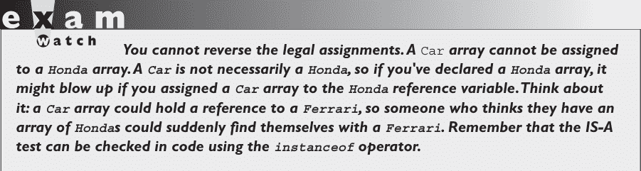

你不能反转合法赋值。`Car` 数组不能赋值给 `Honda` 数组。`Car` 不一定是 `Honda`，所以如果你声明了一个 `Honda` 数组，如果你将 `Car` 数组赋值给 `Honda` 变量，可能会崩溃。想一下：`Car` 数组可能持有 true `Ferrari` 的引用，所以某个认为自己拥有一个 `Honda` 数组的人可能会发现自己突然有了一个 `Ferrari`。记住，可以在代码中使用 `instanceof` 运算符来检查 IS-A 测试。

## 多维数组的数组引用赋值

当你将一个数组赋值给之前声明的数组引用时，你所赋值的数组必须与你赋值的目标引用具有相同的维度。例如，一个由 `int` 数组组成的二维数组不能赋值给普通的 `int` 数组引用，如下：

```
int[][] blots;

int[] squeezees = new int[3];
```


blots = squeezees; // NOT OK `squeezees` 是一个由 int 数组组成的二维数组

int[] blocks = new int[6];

blots = blocks; // OK `blocks` 是一个 int 数组

特别注意使用不同维度的数组赋值。例如，你可能会被问及将数组赋值给数组数组的第一个元素是否合法，如下：

```
int[] books = new int[3];

int[] numbers = new int[6];

int aNumber = 7;

books[0] = aNumber; // NO, 期望的是 int 数组而不是 int

books[0] = numbers; // OK `numbers` 是一个 int 数组
```

图 5-8 显示了数组引用合法和非合法赋值的示例。

### 图 5-8 合法与非合法的数组赋值

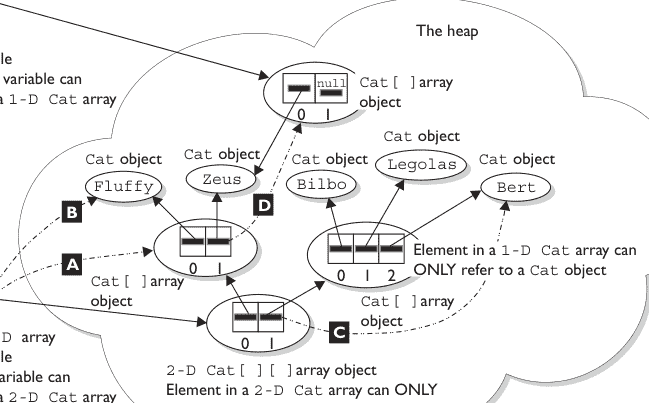

| 非合法的数组赋值 | 键 |
| :--- | :--- |
| A `myCats = myCats[0];` | // 不能将 1D 数组赋值给 2D 数组引用 |
| B `myCats = myCats[0][0];` | // 不能将非数组对象赋值给 2D 数组引用 |
| C `myCats[1] = myCats[2];` | // 不能将非数组对象赋值给 1D 数组引用 |
| D `myCats[0][1] = moreCats;` | // 不能将数组对象赋值给非数组引用 |
| | // `myCats[0][1]` 只能指向对象 |

### 使用 ArrayList (OCA 目标 4.3)

认证目标：使用 ArrayList (OCA 目标 4.3)

4.3 声明并使用 ArrayList。数据结构是几乎每个应用程序的一部分。Java API 提供了大量的系列类来支持作为 `List` 的常用数据结构。作为 `Lists`、`Sets` 和 `Queues`。

认证目标：4.3 声明并使用 ArrayList。数据结构是几乎每个应用程序的一部分。Java API 提供了大量的系列类来支持作为 `List` 的常用数据结构。作为 `Lists`、`Sets` 和 `Queues`。

### 什么时候使用 ArrayList

我们已经讨论了数组，它们看起来有用且很灵活。为什么我们需要更强大的功能？考虑以下两种情况：

- 你需要增加或减少列表的大小。
- 你的列表中元素的顺序很重要且可能会改变。

这两种情况都可以用数组处理，但并不容易。假设你想计划去欧洲旅行（Oslo, Paris, Rome），由于我们要从北向南，所以列表看起来是这样的：

```
String[] cities = {"Oslo", "Paris", "Rome"};
```

但现在想象你真的也要去伦敦！你面临两个问题：

- 你的 `cities` 数组已经满了。
- 如果我们要从北向南，你需要在 Paris 之前插入 London。

当然，你可以找到方法这样做。可能你创建一个第二个数组，将城市从一个数组复制到另一个，然后在正确的时刻将 London 加入第二个数组。可行，但很困难。现在看看如何使用 ArrayList 实现相同的操作：

```java
import java.util.*; // ArrayList 位于 .util
public class Cities {
    public static void main(String[] args) {
        List<String> c = new ArrayList<String>(); // 创建一个 ArrayList, c
        c.add("Oslo");
        c.add("Paris");
        c.add("Rome");
        int index = c.indexOf("Paris"); // 找到 Paris 的索引
        System.out.println(index + " " + index);
        c.add(index, "London"); // 在 Paris 之前添加 London
        System.out.println(c); // 显示 c 的内容
    }
}
```

输出将类似于：

```
[Oslo, Paris, Rome]
[Oslo, London, Paris, Rome]
```

通过代码，我们可以了解到关于 ArrayList 的重要事实：

- `ArrayList` 类在 `java.util` 包中。
- 与数组类似，在构建 `ArrayList` 时你必须声明它可以包含的对象类型。在这种情况下，我们正在构建一个 `String` 对象的 `ArrayList`（稍后我们将更详细地查看创建 `ArrayList` 的代码行）。
- `ArrayList` 实现了 `List` 接口。
- 我们通过方法与 `ArrayList` 交互。在这种情况下我们使用了 `add(index)` 的一个版本，使用了 `indexOf()`，并且间接使用了 `toString()` 来显示 `ArrayList` 的内容（稍后将详细介绍 `toString()`）。
- 和数组一样，`ArrayList` 的索引是从零开始的。
- 我们在构建 `ArrayList` 时并没有声明它有多大。
- 我们能够随时向 `ArrayList` 中添加新元素。
- 我们能够在列表的中间位置添加新元素。
- `ArrayList` 保持了它的顺序。

正如承诺的那样，我们需要更仔细地查看这行代码：

```
List<String> c = new ArrayList<String>();
```

首先，我们看到这是一个多态声明。正如我们之前说的，`ArrayList` 实现了 `List` 接口（在 `java.util` 包中）。如果你计划在通过 OCA 7 考试后参加 OCP 7 考试，我们将更多讨论为什么在书的 OCP 部分我们可能想要进行多态声明。现在，想象你可能想为你的 `ArrayList` 创建一个 `List`。

接下来，我们看到了这种带有 `< >` 字符的奇怪语法。这种语法是在 Java 5 中引入语言的，与“泛型”（generics）有关。泛型很少出现在 OCA 考试中，所以我们不想在它们上面花费太多时间，但重要的是，你要知道这是你如何在这里告诉编译器和 JVM，你想要的这个特定的 `ArrayList` 只允许包含字符串。这意味着，如果编译器能告诉你你正尝试向 `ArrayList` 中添加一个“非字符串”对象，你的代码将无法通过编译。这是一件好事！

正如承诺的那样，让我们来看这一行代码：

```
System.out.println(c);
```

记住，所有类最终继承自 `Object` 类。`Object` 类包含一个名为 `toString()` 的方法。再次，`toString()` 在 OCA 考试中不是“官方”的（当然在 OCP 考试中是！），但你现在需要稍微理解一下它。当你把对象引用传递给 `System.out.print()` 或 `System.out.println()` 时，你是在告诉它们调用该对象的 `toString()` 方法。（每当你创建一个新类时，你都可以选择地重写 `toString()` 以显示关于你对象的有用信息。）API 开发者们非常心地重写了 `ArrayList.toString()` 方法来显示 `ArrayList` 的内容，正如你在程序输出中所看到的。万喜！

# ArrayList 与重复项

当你计划去欧洲旅行时，你发现在罗马停留的途中，那不勒斯将举办一场精彩的音乐节！那不勒斯就在罗马海岸边！你必须把那次侧击行程加入你的行程。问题是，`ArrayList` 可以有重复条目吗？这样写是合法的：

```
c.add("Rome");
c.add("Naples");
c.add("Rome");
```

简短的答案是：是的，`ArrayList` 可以有重复项。现在如果你停下来考虑一下，“重复的 Java 对象”这个概念其实有点复杂。放松吧，因为在学习备 OCP 7 之前，你不需要陷入这种复杂中。


从技术上说，`ArrayList` 仅持有对象引用，而不是实际的对象和基元数据类型（primitives）。如果你看到类似这样的代码：

```
myArrayList.add(7);
```

实际发生的是这个 `int` 被自动装箱（转换）成一个 `Integer` 对象并添加到 `ArrayList` 中。我们将在书的 OCP 部分详细讨论自动装箱。

# 应用中的 ArrayList 方法

让我们来看另一段代码，它展示了考试中你需要知道的大多数 `ArrayList` 方法：

```java
import java.util.*;
public class TweakLists {
    public static void main(String[] args) {

        List<String> myList = new ArrayList<String>();

        mylist.add("*z");
        mylist.add("*x");
        mylist.add(1, "y"); // 从零开始
        mylist.add(0, "w"); // ""
        System.out.println(myList); // [w, z, y, x]

        mylist.clear(); // 移除所有
        mylist.add("*b");
        mylist.add("*a");
        myList.add("c");
        System.out.println(myList); // [b, a, c]
        System.out.println(myList.contains("a") + " " + myList.contains("x"));

        System.out.println("get 1: " + myList.get(1));
        System.out.println("index of c: " + myList.indexOf("c"));

        myList.remove(1); // 移除 "a"
        System.out.println("size: " + myList.size() + " contents: " + myList);
    }
}
```

它应该产生类似这样的结果：

```
[w, z, y, x]
[b, a, c]
true false
get 1: a
index of c: 2 contents: [b, c]
```

关于这段代码有几点说明：首先，注意 `contains()` 返回布尔值。这使得 `contains()` 在“if”测试中非常好用。其次，注意 `ArrayList` 有一个 `size()` 方法。重要的是记住，数组有 `length` 属性，而 `ArrayList` 有 `size()` 方法。

# ArrayList 类中的重要方法

以下方法是 `ArrayList` 类中较常用的方法，也是你最可能在考试中遇到的方法：

- `add(element)`: 将此元素添加到 `ArrayList` 的**末尾**
- `add(index, element)`: 将此元素添加到索引处，并将剩余元素向后移动（例如）
- `clear()`: 移除所有元素
- `contains(element)`: 检查列表是否包含该元素
- `get(index)`: 返回指定索引处的元素
- `indexOf(Object)`: 返回元素在列表中第一次出现的索引，如果未找到则返回 -1
- `remove(index)`: 移除指定索引元素
- `remove(Object)`: 移除指定的对象
- `size()`: 返回 `ArrayList` 中元素的数量

总结来说，OCA 考试测试的是对 `ArrayList` 的基础知识。

# 封装 OCA 考试

# 变量的封装

关于 `String` 最重要的一个点是，`String` 对象是不可变的，但对 `String` 的引用不是！你可以使用现有的 `String` 作为起点创建一个新的 `String`，而不会改变原来的。回顾该类的重要方法。

`StringBuilder` 类是在 Java 5 中引入的。它与旧的 `StringBuffer` 类具有相同的方法，只是它的方法不是线程安全的。由于 `StringBuilder` 方法不是线程安全的，运行通常比 `StringBuffer` 方法快，所以在没有线程问题的情况下选择 `StringBuilder`。

对于 OCA 考试，关键点是：封装像 `StringBuilder`、数组或 `ArrayList` 这样的可变对象时，如果你想让外部类拥有对象的拷贝，你必须复制对象并返回拷贝的引用。如果你只是返回原始对象的引用变量，你**没有**实现封装。

```java
class Special {
    private StringBuilder s = new StringBuilder("bob");
    StringBuilder getName() {
        return s;
    }
    void printName() {
        System.out.println(s);
    }
}

public class TestSpecial {
    public static void main(String[] args) {
        Special sp = new Special();
        StringBuilder s2 = sp.getName();
        s2.append("fred");
        sp.printName();
    }
}
```

当我们运行代码时得到：

bobfred

呃！看起来我们没有很好地保护 `Special` 中的数据。你能发现这是为什么吗？思考一下……

好的，为了验证你的答案——当我们调用 `getName()` 时，我们确实返回了一个拷贝——不，我们返回的是指向我们构建的唯一 `StringBuilder` 对象的引用变量。因此，在 `getName()` 返回时，我们有一个 `StringBuilder` 对象和两个指向它的引用变量（`s` 和 `s2`）。

# 第 5 章：处理字符串、数组和 ArrayList

## 两分钟演练

这里是本章认证目标中的一些关键点。

## 使用 String 和 StringBuilder (OCA 目标 2.6 和 2.7)

- `String` 对象是不可变的，但 `String` 引用变量是。
- 如果你创建了一个新的 `String` 但没有对其赋值，它将丢失且无法在你的程序中使用。
- 如果你将一个 `String` 引用重指向一个新的 `String`，旧的 `String` 可能会丢失。
- `String` 方法使用从零开始的索引，但 `substring()` 的第二个参数除外。
- `String` 类是 final 的（类的）——它不能被扩展。
- 当 JVM 找到字符串字面量时，它会被添加到字符串常量池（String literal pool）中。
- `String` 有名为 `length()` 的方法——数组有一个名为 `length` 的属性。
- `StringBuilder` 对象是可变的——它们可以在不创建新对象的情况下进行更改。
- `StringBuilder` 方法作用于调用者对象，对象可以在语句中没有显式赋值的情况下发生变化。
- 记住链式方法是从左到右进行求值的。
- 需要记住的 `String` 方法：`charAt()`、`concat()`、`equalsIgnoreCase()`、`length()`、`replace()`、`substring()`、`toLowerCase()`、`toString()`、`toUpperCase()` 和 `trim()`。
- 需要记住的 `StringBuilder` 方法：`append()`、`delete()`、`insert()`、`reverse()` 和 `toString()`。

## 使用数组 (OCA 目标 4.1 和 4.2)

- 数组可以持有基本类型或对象，但数组本身始终是一个对象。
- 声明数组时，括号可以在名称的左侧或右侧。
- 在声明中包含数组的大小永远是不合法的。
- 在构造数组（使用 `new`）时，必须包含数组的大小，除非你正在创建一个匿名数组。
- 对象数组中的元素不会自动创建，尽管基本类型数组的元素会被赋予默认值。
- 如果你尝试在对象数组中使用一个元素而该元素没有引用真实对象，你将得到 `NullPointerException`。


- 数组索引从零开始。
- 如果你使用错误的索引值，会发生 `ArrayIndexOutOfBoundsException`。
- 数组有一个 `length` 属性，其值是数组元素的数量。
- 你可以访问的最后一个索引始终比数组长度少一。
- 多维数组只是数组的数组。
- 多维数组中的维度可以有不同的长度。
- 基本类型数组可以接受任何可以隐式提升为数组声明类型的值——例如，一个 `byte` 变量可以放入 `int` 数组。
- 对象数组可以持有任何通过数组声明类型 IS-A (instanceof) 测试的对象。例如，如果 `Horse` 继承 `Animal`，那么 `Horse` 就可以进入 `Animal` 数组。


- 如果你将一个数组赋值给之前声明的数组引用，你所赋值的数组必须与所赋值的引用维度相同。

- 你可以将一种类型的数组赋值给之前声明的其中一个子类型的数组引用。例如，一个 `Honda` 数组可以赋值给类型为 `Car` 的数组（假设 `Honda` 继承 `Car`）。

## 使用 ArrayList (OCA 目标 4.3)

- ArrayList 允许你调整列表大小，并比数组更方便地对列表进行插入和删除。

- 对于 OCA 7 考试，你只需要知道这种形式的 ArrayList 声明：

```
ArrayList<type> myList = new ArrayList<type>();
List<type> myList2 = new ArrayList<type>(); // 多态
```

- ArrayList 只能持有对象，不能持有基本类型，但记住自动装箱（autoboxing）可以让你看起来像是在向 ArrayList 中添加基本类型，而实际上你正在添加基本类型的包装类版本。

- ArrayList 的索引从 0 开始。

- ArrayList 可以有重复条目。注意：确定两个对象是否重复比看起来要复杂，而且这在 OCP 7 考试中才会出现。

- 需要记住的 ArrayList 方法：`add(element)`、`add(index, element)`、`clear()`、`contains()`、`get(index)`、`indexOf()`、`remove(index)`、`remove(object)` 和 `size()`。

## 298 第 5 章：处理字符串、数组和 ArrayList

## 自测

### 1. 给定：

```java
public class Mutant {
    public static void main(String[] args) {
        StringBuilder sb = new StringBuilder("abc");
        String s = "abc";
        sb.reverse().append("d");
        s.toUpperCase().concat("d");
        System.out.println("." + sb + " " + s + ".");
    }
}
```

结果中将包含哪两个子字符串？（选择两个。）

- A. .abc
- B. .ABCD.
- C. .ABCD.
- D. .cbad
- E. .dcba.

### 2. 给定：

```java
public class Hilltop {
    public static void main(String[] args) {
        String[] horses = new String[5];
        horses[4] = null;
        for(int i = 0; i < horses.length; i++) {
            if(i < args.length) {
                horses[i] = args[i];
                System.out.print(horses[i].toUpperCase() + " ");
            }
        }
    }
}
```

并且，如果代码编译通过，命令行：

```
java Hilltop eyra vafi draumur kara
```

结果是什么？

- A. EYRA VAPI DRAUMUR KARA
- B. EYRA VAPI DRAUMUR KARA null
- C. 抛出一个异常且没有其他输出
- D. EYRA VAFI DRAUMUR KARA，然后抛出 `NullPointerException`
- E. EYRA VAFI DRAUMUR KARA，然后抛出 `ArrayIndexOutOfBoundsException`
- F. 编译失败

### 3. 给定：

```java
public class Actors {
    public static void main(String[] args) {
        char[] ca = {0xe4, \u004e, 78};
        System.out.println((ca[0] == ca[1]) + " " + (ca[0] == ca[2]));
    }
}
```

结果是什么？

- A. true true
- B. true false
- C. false true
- D. false false
- E. 编译失败

### 4. 给定：

```java
public class Dims {
    public static void main(String[] args) {
        int[][] a = {{1,2}, {3,4}};
        int[] b = (int[]) a[1];
        Object o1 = a;
        int[] b2 = (int[]) o1;
        System.out.println(b[1]);
    }
}
```

结果是什么？（选择所有）

- A. 2
- B. 4
- C. 运行时抛出异常
- D. 第 4 行编译失败
- E. 第 5 行编译失败
- F. 第 6 行编译失败

## 300 第 5 章：处理字符串、数组和 ArrayList

### 5. 给定：

```java
import java.util.*;
public class Sequence {
    public static void main(String[] args) {
        ArrayList<String> myList = new ArrayList<String>();
        myList.add("apple");
        myList.add("carrot");
        myList.add("banana");
        myList.add(1, "plum");
        System.out.print(myList);
    }
}
```

结果是什么？

- A. [apple, plum, carrot, banana]
- B. [apple, plum, banana]
- C. [apple, banana, plum]
- D. [plum, apple, banana]
- E. [plum, banana]
- F. [banana, apple]
- G. 编译失败

### 6. 给定：

```java
class Dozens {
    int[] dz = {1,2,3,4,5,6,7,8,9,10,11,12};
}
public static class Eggs {
    public static void main(String[] args) {
        Dozens[] da = new Dozens[3];
        da[0] = new Dozens();
        Dozens d = new Dozens();
        da[1] = d;
        d = null;
        da[1] = null;
        // do stuff
    }
}
```

关于 main 方法中创建的对象，哪些是正确的？哪些在到达 14 行时可以被垃圾回收？

## 自测 301

- A. 创建了三个对象
- B. 创建了四个对象
- C. 创建了五个对象
- D. 零对象可以被 GC 回
- E. 一个对象可以被 GC 回
- F. 两个对象可以被 GC 回
- G. 三个对象可以被 GC 回

### 7. 给定：

```java
public class Tailor {
    public static void main(String[] args) {
        byte[][] ba = {{1,2,3,4}, {1,2,3}};
        System.out.println(ba[1].length + " " + ba.length);
    }
}
```

结果是什么？

- A. 2 4
- B. 2 7
- C. 3 2
- D. 3 7
- E. 4 2
- F. 4 7

### 8. 给定：

```java
public class Theory {
    public static void main(String[] args) {
        String s1 = "abc";
        String s2 = s1;
        s1 += "d";
        System.out.println(s1 + " " + s2 + " " + (s1==s2));

        StringBuilder sb1 = new StringBuilder("abc");
        StringBuilder sb2 = s1;
        sb1.append("d")
        System.out.println(sb1 + " " + sb2 + " " + (sb1==sb2));
    }
}
```

## 302 第 5 章：处理字符串、数组和 ArrayList

哪些是正确的？（多选题，选择所有适用项。）

- A. 编译失败
- B. 第一行输出是 abc abc true
- C. 第一行输出是 abc abc false
- D. 第一行输出是 abcd abc false
- E. 第二行输出是 abcd false
- F. 第二行输出是 abcd true
- G. 第二行输出是 abcd ab false

### 9. 给定代码：

```java
public class Mounds {
    public static void main(String[] args) {
        StringBuilder sb = new StringBuilder();
        String s = new String();
        for(int i = 0; i < 1000; i++) {
            s = " " + i;
            sb.append(s);
        }
        // 循环结束
    }
}
```

在这段代码执行期间，垃圾回收器不会运行，当循环结束时内存中大约会有多少对象？

- A. 少于 10 个
- B. 大约 1000 个
- C. 大约 2000 个
- D. 大约 3000 个
- E. 大约 4000 个

### 10. 给定代码：

```java
3. class Box {
    4. int size;
    5. Box(int s) { size = s; }
    6. }
    7. public class Laser {
        8. public static void main(String[] args) {
            9. Box b1 = new Box(5);
        10. Box[] ba = go(b1, new Box(6));
        11. ba[0] = b1;
        12.    for(Box b : ba) System.out.print(b.size + " ");
        13.   }
        14.   static Box[] go(Box b1, Box b2) {
            15.       b1.size = 4;
            16.       Box[] ma = {b2, b1};
            17.       return ma;
            18.   }
        19. }
```

结果是什么？

- A. 4 4
- B. 5 4
- C. 6 4
- D. 4 5
- E. 5 5
- F. 编译失败

### 11. 给定代码：

```java
public class Hedges {
    public static void main(String[] args) {
        String s = "JAVA";
        s = s + "rocks";
        s = s.substring(4,8);
        s.toUpperCase();
        System.out.println(s);
    }
}
```

结果是什么？

- A. JAVA
- B. JAVAROCKS
- C. rocks
- D. rock
- E. ROCKS
- F. ROCK
- G. 编译失败

## 304 第 5 章：处理字符串、数组和数组

### 12. 给定代码：

```java
1. import java.util.*;
2. class Fortress {
3.    private String name;
4.    private ArrayList<Integer> list;
5.    Fortress() { list = new ArrayList<Integer>(); }
6. 
7.    String getName() { return name; }
8.    void addToList(int x) { list.add(x); }
9.    ArrayList getList() { return list; }
10. }
```

哪些代码行（如果有）破坏了封装？（多选题，选择所有适用项）。

- A. 第 3 行
- B. 第 4 行
- C. 第 5 行
- D. 第 7 行
- E. 第 8 行
- F. 第 9 行
- G. 类已经很好地封装

## 自测答案

### 1. A 和 D 正确。字符串操作是在一个新的（已丢失的）字符串上进行的，而不是 s。StringBuilder 的操作从左到右执行。

根据以上内容，B、C 和 E 是错误的。（OCA 目标 2.6 和 2.7）

### 2. D 正确。马数组的前四个元素包含字符串，第五个元素是 null；因此对第一个元素调用 `toUpperCase()` 会抛出 `NullPointerException`。

根据以上内容，A、B、C 和 G 是错误的。（OCA 目标 2.7 和 4.1）

### 3. E 正确。Unicode 声明必须包含在单引号中：`'\u004e'`。如果这样做了，答案将是 A，因为 OCA 考试中不涉及相等性。

根据以上内容，A、B、C 和 G 是错误的。（OCA 目标 2.1 和 4.1）

### 4. C 正确。第 7 行抛出了 `ClassCastException`，因为它引用的是 `int[]` 而不是 `int()`。如果删除了第 7 行，输出将是 4。

根据以上内容，A、B、D、E 和 G 是错误的。（OCA 目标 4.2 和 7.4）

### 5. B 正确。ArrayList 按照输入顺序自动插入；它们不会自动排序。ArrayList 使用从零开始的索引，最后一个 `add()` 插入新元素并移动剩余元素。

根据以上内容，A、C、D、E 和 G 是错误的。（OCA 目标 5）

### 6. C 和 F 正确。二维数组不是 de。二维数组是一个二维数组。二维数组是一个二维数组。

根据以上内容，A、B、D 和 G 是错误的。（OCA 目标 2.1 和 4.1）

### 7. C 正确。二维数组不是 de。二维数组是一个二维数组。

根据以上内容，A、B、D、E 和 G 是错误的。（OCA 目标 5）

### 8. D 和 F 正确。二维数组不是 de。二维数组是一个二维数组。

根据以上内容，A、B、C 和 E 是错误的。（OCA 目标 2.6 和 2.7）

### 9. B 正确。二维数组不是 de。二维数组是一个二维数组。

根据以上内容，A、C、D 和 G 是错误的。（OCA 目标 2.7）

## 306 第 5 章：处理字符串、数组和 ArrayList

### 10. A 正确。二维数组不是 de。二维数组是一个二维数组。

根据以上内容，B、C 和 E 是错误的。（OCA 目标 2.6 和 2.7）

### 11. D 正确。二维数组不是 de。二维数组是一个二维数组。

根据以上内容，A、B、C 和 G 是错误的。（OCA 目标 2.7 和 4.1）

### 12. F 正确。二维数组不是 de。二维数组是一个二维数组。

根据以上内容，A、B、D 和 E 是错误的。（OCA 目标 5）

## 308 第 6 章：流程控制和异常

- 使用 if 和 switch 语句
- 开发 for、while 循环
- 使用 break 和 continue 语句
- 使用 try、catch 和 finally 语句
- 说明异常的影响
- 识别常见异常
- ✔️ 两分钟练习
- 问答自测

## 6 流程控制和异常

想象一下使用一种不支持条件执行的语言编写代码？流程控制是大多数有用语言的关键部分，Java 提供了多种方法来实现。某些语句，如 if 和 for 循环是许多语言共有的。但 Java 还引入了一些你以前可能没有的流程控制功能——异常和断言。（我们将在下一章讨论断言）。

if 语句和 switch 语句是条件/决策控制，允许你的程序在“路口”根据逻辑测试的结果产生不同的行为。Java 还提供了三种不同的结构——for、while 和——以便你可以根据某些条件反复执行相同的代码。异常为你提供了一种整洁、简单的方法来处理运行时可能出现的问题。

## 认证目标

## 使用 if 和 switch 语句（OCA 目标 3.4 和 3.5——以及升级版目标 1.I）

- 3.4 创建 if 和 if-else 结构。
- 3.5 使用 switch 语句。


# if 语句的基本格式

```java
if (booleanExpression) {
    System.out.println("Inside if statement");
}
```

括号中的表达式必须求值为布尔（`boolean`）类型的 `true` 或 `false`。

通常情况下，你是在测试某些内容是否为真，如果是真，则运行一个代码块（一个或多个语句），如果不是真（可选），则运行另一个代码块。下面的代码演示了一个合法的 `if-else` 语句：

```java
if (x > 3) {
    System.out.println("x is greater than 3");
} else {
    System.out.println("x is not greater than 3");
}
```

`else` 块是可选的，因此你可以使用以下代码：

```java
if (x > 3) {
    y = 2;
}
z += 8;
a = y + x;
```

如果测试成功，前面的代码会将 2 赋值给 `y`（这意味着 `x` 确实大于 3），但另外两行无论如何都会执行。即使在条件块体内只打算执行一个语句，大括号也是可选的。下面的代码示例是合法的（尽管出于可读性考虑不推荐这样做）：

```java
if (x > 3) // 坏习惯，但在考试中常见
y = 2;
z += 8;
a = y + x;
```

大多数开发者认为，将代码块包含在大括号内是良好的做法，即使块中只有一个语句。对于像前面的代码要小心，你可能会认为它读起来是：

> “如果 `x` 大于 3，则将 `y` 设置为 2，`z` 设置为 `z + 8`，并将 `a` 设置为 `y + x`。”

但最后两行无论如何都会执行！它们不属于条件流。如果代码如缩进所示，你可能会发现它更具误导性：

```java
if (x > 3) {
y = 2;
z += 8;
a = y + x;
```

你可能需要嵌套 `if-else` 语句（尽管再次，出于可读性考虑不推荐这样做，因此嵌套的 `if` 测试应保持最少）。你可以设置一个 `if-else` 语句来测试多个条件。下面的示例使用了两个条件，以便如果第一个测试失败，我们想在决定做什么之前先进行第二次测试：

```java
if (price < 300) {
  buyProduct();
} else {
  if (price < 400) {
    getApproval();
  } else {
    dontBuyProduct();
  }
}
```

这涉及到另一种 `if-else` 结构：`if, else if, else`。前面的代码可以（并且应该）重写为：

```java
if (price < 300) {
  buyProduct();
} else if (price < 400) {
  getApproval();
} else {
  dontBuyProduct();
}
```

使用 `else` 和 `else if` 有几条规则：

- 对于给定的 `if`，可以有零个或一个 `else`，且它必须在任何 `else if` 之后。
- 对于给定的 `if`，可以有零到多个 `else if`，它们必须在（可选的）`else` 之前。
- 一旦某个 `if` 成功，剩余的 `else if` 或 `else` 都不会再被测试。

下面的示例显示了在现实世界中格式极其糟糕的代码。正如你可能猜到的，你很可能会遇到这样的格式。无论如何，代码演示了多个 `else if` 的使用：

```java
int x = 1;
if ( x == 3 ) {
else if (x < 4) {System.out.println("4"); }
else if (x < 2) {System.out.println("2"); }
else { System.out.println("else"); }
}
```

它产生此输出：

```
4
```

（注意，即使第二个 `else if` 为真，它永远不会被执行。）

# 使用 if 和 switch 语句

有时你可能无法确定 `else` 应该与哪个 `if` 配对，如下：

```java
if (exam.done())
if (score() < 61)
System.out.println("Try again.")
// 这个 属于哪一个？
else System.out.println("Java master!")
```

我们特意保留了这段代码的缩进，以便它可能误导 `else` 属于哪个语句。你弄出来了吗？在前面的示例中，`else` 属于最内层的 `if`。如果有正确的缩进，它看起来应该是这样的：

```java
if (exam.done())
if (score() < 61)
System.out.println("Try again.")
// 这个 属于哪一个？
else
System.out.println("Java master!")
```

按照我们使用大括号的编码规范，这会更容易读：

```java
if (exam.done())
if (score() < 61)
System.out.println("Try again.")
// 这个 属于哪一个？
else {
System.out.println("Java master!")
}
```

不要指望题目会总是那么友好且缩进得当。一些考生在考试中见过这样的题目呈现形式：任何可以变得困惑的内容。密切注意类似下面的误导：

```java
if (exam.done())
if (score() < 61)
System.out.println("Try again.")
else
System.out.println("Java master!"); // 嗯，现在它属于哪一个了？
```

当然，前面的代码与之前的示例完全相同，只是外观不同。

## 第 6 章：流程控制与异常

### 合法的 if 表达式

`if` 语句中的表达式必须是布尔值。任何解析为布尔值的表达式都是可以的，某些表达式可以是复杂的。假设 `doStuff()` 返回 `true`，

```java
int y = 5;
int x = 2;
if ((x > 3) && (y < 2) || doStuff()) {
  System.out.println("true");
}
```

打印结果

```
true
```

你可以将前面的代码读为“如果 `(x > 3)` 且 `(y < 2)` 为真，或者基本上，如果仅有 `doStuff()` 为真，你仍然会得到 true。但是，如果 `doStuff()` 为假，那么 `(x > 3)` 和 `(y < 2)` 都必须为真才能打印 true。如果你像这样漏掉一组括号，前面的代码会更加复杂：

```java
int y = 5;
int x = 2;
if ((x > 3) && (y < 2) || doStuff()) {
  System.out.println("true");
}
```

这打印了……什么都没有。前面的代码（带一组括号）的求值就像你在说：“如果 `(x > 3)` 为真，且 `(y < 2)` 或 `doStuff()` 的结果为真，则打印 true。所以如果 `(x > 3)` 不为真，没必要看表达式的剩余部分。”由于短路 `&&`，该表达式的求值就像在 `(y < 2) || doStuff()` 周围有括号一样。换句话说，它在 `&&` 之后被视为单个表达式，在 `||` 之后被视为单个表达式。

记住，`if` 测试中唯一合法的表达式是布尔值。在某些语言中，0 是假，1 是真。但在 Java 中不是！下面的代码显示了看起来很有诱惑力但不合法的 `if` 语句，后面是合法的替换：

```java
int trueInt = 1;
int falseInt = 0;
if (trueInt) // 非法
if (trueInt == true) // 非法
if (1) // 非法
if (falseInt == false) // 非法
if (trueInt == 1) // 合法
if (falseInt == 0) // 合法
```

## switch 和 case 的合法表达式

现在让我们来看看如何用 `switch` 结构表示相同的功能：

```java
int x = 3;
switch (x) {
    case 1:
        System.out.println("x equals 1");
        break;
    case 2:
        System.out.println("x equals 2");
        break;
    default:
        System.out.println("No idea what x is");
}
```

注意：这个 `switch` 语句之所以能模拟 `if` 语句，是因为在 `switch` 内部放置了 `break` 语句。通常情况下，`break` 语句是可选的，正如你将在几页后看到的，它们的包含或排除会改变 `switch` 语句的执行方式。

`switch` 语句的通用形式如下：

```java
switch (expression) {
    case constant1: code block
    case constant2: code block
    default: code block
}
```

`switch` 的表达式必须求值为 `char`、`byte`、`short`、`int`、`enum`（Java 5 起）以及 `String`（Java 7 起）。这意味着如果你没有使用 `enum` 或 `String`，只有可以自动提升（换句话说，隐式转换）为 `int` 的变量和值是可以接受的。如果你使用其他类型（包括剩余的 `long`、`float` 和 `double`），将无法通过编译。

> **注意**：对于 OCA 候选人，考试中不涵盖 `enum`，你不会遇到任何使用 `enum` 的 `switch` 语句的问题。

`case` 常量的求值类型必须与 `switch` 表达式类型相同，但还有一个额外且巨大的限制：`case` 必须是**编译时常量**！由于 `case` 参数必须在编译时解析，因此你只能使用被直接用字面量值初始化的常量或 `final` 变量。仅仅是 `final` 是不够的；它必须是编译时常量。这里有一个例子：

```java
final int a = 1;
final int b;
b = 2;
int x = 0;
switch (x) {
case a:    // OK
case b:    // 编译错误
}
```

此外，`switch` 声明语句只能在 `case` 中检查相等性。这意味着其他的关系运算符（例如大于号）在 `switch` 语句中变得不可用。以下是一个在 `switch` 语句中使用方法调用的合法表达式的示例。请注意，为了使这段代码合法，在对象引用上调用的方法必须返回一个与 `int` 兼容的值。

```java
String s = "xyz";
switch (s.length()) {
case 1:
    System.out.println("length is one");
    break;
case 2:
    System.out.println("length is two");
    break;
case 3:
    System.out.println("length is three");
    break;
default:
    System.out.println("no match");
}
```

有一个你可能意想不到的规则涉及这个问题：“如果我对一个比 `int` 小的变量进行 switch 会发生什么？”看下方的 `switch`：

```java
byte g = 2;
switch (g) {
case 23:
case 128:
}
```

这段代码将无法编译。虽然 `switch` 参数是合法的——`byte` 被隐式转换为 `int`——但第二个 `case` 参数 (128) 对于 `byte` 来说太大了，编译器知道这一点！尝试编译前面的示例会得到一个类似这样的错误：

```
Test.java:6: possible loss of precision
found   : int
required: byte
case 128:
```

使用多个具有相同值的 `case` 标签也是非法的。例如，下面的代码块将无法编译，因为它使用了两个值均为 80 的 `case`：

```java
int temp = 90;
switch (temp) {
    case 80 : System.out.println("80");
    case 80 : System.out.println("80"); // 无法编译！
    case 90 : System.out.println("90");
    default : System.out.println("default");
}
```

在 `switch` 表达式中利用装箱（boxing）的功能是合法的。例如，以下内容是合法的：

```java
switch (new Integer(4)) {
    case 4: System.out.println("boxing is OK");
}
```

寻找任何违反 `switch` 和 `case` 参数规则的示例。例如，你可能会发现如下代码段中的非法示例：

```java
switch(x) {
    case 0 {
        y = ;
    }
}
```

```java
switch(x) {
    0: {}
    1: {}
}
```

在第一个示例中，`case` 使用了大括号。第二个示例使用了冒号。

### 对“相等性”的介绍

正如我们所讨论的，匹配的 `case` 仅仅是你进入 `switch` 的切点！换句话说，你不能将其认为是：“找到匹配的 `case`，执行该代码，然后退出。”并不是这样工作的。如果你想改变“仅执行匹配代码”的行为，你需要在每个 `case` 中插入一个 `break`，如下所示：

```java
int x = 1;
switch(x) {
  case 1: System.out.println("x is one");
  case 2: System.out.println("x is two");
  case 3: System.out.println("x is three");
}
System.out.println("out of the switch");
```

这段代码将输出：

```
x is one
x is two
x is three
out of the switch
```

这种情况发生是因为代码没有遇到 `break` 语句；执行一直向下穿透 `case` 直到 `switch` 结束。这种向下执行实际上被称为“穿透”（fall-through），因为执行是从一个 `case` 流落到下一个。记住，匹配的 `case` 仅仅是你进入 `switch` 的入口！换句话说，如果你想改变“仅执行匹配代码”的行为，可以在每个 `case` 中插入 `break`：

```java
int x = 1;
switch(x) {
  case 1: System.out.println("x is one"); break;
  case 2: System.out.println("x is two"); break;
  case 3: System.out.println("x is three"); break;
}
System.out.println("out of the switch");
```

运行前面的代码（现在我们添加了 `break` 语句），它将打印：

```
x is one
out of the switch
```

就是这样。我们在 `case 1` 处进入了 `switch` 块。因为其匹配了 `switch()` 参数，我们执行了 `println` 语句，然后遇到 `break` 并跳转到 `switch` 的末尾。

这种贯穿逻辑（fall-through logic）的一个有趣示例在如下代码所示：


```java
int x = someNumberBetweenOneAndTen;

switch (x) {
    case 2:
    case 4:
    case 6:
    case 8:
    case 10:
        System.out.println("x is an even number");
        break;
}
```

这个 `switch` 语句将打印 `x is an even number` 或者什么都不打印，取决于数字是否在一到十之间且为奇数。例如，如果 `x` 为 4，执行将从 `case 4` 开始，然后穿过 6、8 和 10，在这些处打印并然后 `break`。顺便说一下，`case 10` 处的 `break` 是需要的；因为我们反正已经处于 `switch` 的末尾了。

注意：由于贯穿逻辑不那么直观，Oracle 建议你在使用贯穿逻辑时添加注释如 `// fall through` 的注释。

# 默认情况

如果使用前面的代码，你想在没有任何 `case`（即偶数）匹配的情况下打印 `x is an odd number`，该怎么办呢？你不能把它放在 `switch` 语句之后，甚至不能将其作为 `switch` 中的最后一个 `case`，因为在上述两种情况下，它总是打印 `x is an odd number`。为了实现这种行为，你将使用 `default` 关键字。（顺便说一下，如果你好奇为什么在我们不使用访问控制修饰符的情况下却有一个 `default` 关键字，你会发现 `default` 关键字用于一个完全不同的目的。）我们需要做的唯一更改是在前面的代码中添加 `default case`：

```java
int x = someNumberBetweenOneAndTen;

switch (x) {
    case 2:
    case 4:
    case 6:
    case 8:
    case 10:
        System.out.println("x is an even number");
        break;
    default:
        System.out.println("x is an odd number");
}
```

`default case` 不一定在 `switch` 的末尾。看看它在某些奇怪的地方，如下：

```java
int x = 2;
switch (x) {
    case 2: System.out.println("2");
    default: System.out.println("default");
    case 3: System.out.println("3");
    case 4: System.out.println("4");
}
```

运行上面的代码会输出这些：

- 2
- default
- 3
- 4

如果我们修改它，使得唯一的匹配是 `default case`，如下：

```java
int x = 7;
switch (x) {
    case 2: System.out.println("2");
    default: System.out.println("default");
    case 3: System.out.println("3");
    case 4: System.out.println("4");
}
```

那么运行上面的代码将输出：

- default
- 3
- 4

> 要记住的规则是，`default` 的工作就像任何其他 `case` 一样会贯穿！

# 练习 6-1：创建 switch-case 语句

尝试使用 `char` 值作为 `case` 创建 `switch` 语句。如果没有任何 `char` 值匹配，则包含一个 `default` 行为。

# 创建循环结构（OCA 目标 5.1, 5.2, 5.3, 5.4 和 5.5）

- 确保在 `switch` 语句之前声明了一个 `char` 变量。
- 每个 `case` 语句之后都应该紧跟一个 `break`。
- `default case` 可以位于末尾、中间或顶部。

## 认证目标

### 创建循环结构（OCA 目标 5.1, 5.2, 5.3, 5.4 和 5.5）

- 5.1 创建并使用循环。
- 5.2 创建并使用 `for` 循环，包括增强循环。
- 5.3 创建并使用 `do/while` 循环。
- 5.4 比较循环结构。
- 5.5 使用 `break` 和 `continue`。

Java 循环有三种类型：`while`、`do` 和 `for`（从 Java 5 开始，循环有两种变体）。这三种循环都能让你在某些条件为真时重复一段代码块，或者为了特定的次数进行迭代。你可能对其他语言中的循环很熟悉，所以如果你对 Java 比较陌生，学习这些将不是问题。

## 使用 while 循环

当你不知道代码块或语句应该重复多少次，但你想在某些条件为真时继续循环时，`while` 循环很好。一个 `while` 语句看起来如下：

```java
while (expression) {
    // do stuff
}
```

或者如下：

```java
int x = 2;
while (x == 2) {
    System.out.println(x);
    ++x;
}
```

在这种情况下，与所有循环一样，表达式（测试）必须评估为布尔结果。`while` 循环的主体只有在表达式（有时称为“条件”）结果为 `true` 时才会执行。一旦循环开始，循环体将重复，直到条件不再满足（因为被评估为 `false`）为止。在上一个示例中，程序控制将进入循环体，因为 `x` 等于 2。当再次检查条件时，如果 `x` 不等于 2，循环将停止。

## 使用 do 循环

`do` 循环与 `while` 循环相似，但主体保证至少执行一次。如下显示了 `do` 循环：

```java
do {
    System.out.println("Inside loop");
} while (false);
```

## 使用 for 循环

从 Java 5 开始，`for` 循环有了第二种结构。我们将旧式的 `for` 循环称为“基础 for”，将新式的 `for` 循环称为“增强 for”（它有时被称为 for-each）。基础 `for` 比增强循环更灵活，但增强循环的设计是为了更容易遍历数组和集合。

### 基础 for 循环

当你已经知道需要执行语句的次数时，`for` 循环对于流程控制特别有用。`for` 声明有三个主要部分，循环体外：

- 变量的声明和初始化
- 布尔表达式（条件测试）
- 迭代表达式

这三个声明部分用分号隔开。以下两个示例演示了 `for` 循环。第一个示例以伪代码形式显示了 `for` 循环的部分：

```java
for (/* Initialization */; /* Condition */; /* Iteration */) {
    // loop body
}

for (int i = 0; i < 10; i++) {
    System.out.println("i is " + i);
}
```

#### 基础 for：声明和初始化

`for` 语句的第一部分允许你在 `for` 关键字后的括号内声明并初始化零、一个或多个相同类型的变量。如果你声明了多个相同类型的变量，需要如下用逗号分隔它们：

```java
for (int x = 10, y = 3; y > 3; y++) { }
```

声明和初始化发生在 `for` 循环任何其他操作之前。虽然另外两个部分——布尔测试和迭代表达式将在循环每次迭代中运行，但声明和初始化只在开始时执行一次。你还必须知道，在 `for` 循环中声明的变量的作用域在 `for` 循环结束时结束！下面的例子演示了这一点：

```java
for (int x = 1; x < 2; x++) { // 合法
    System.out.println(x);
}
// 不合法！x 现在已经出了作用域，无法访问。
```

如果你尝试用 `java` 编译这段代码，你会得到类似下面的信息：

```
Test.java:19: cannot resolve symbol
symbol : variable x
location: class Test
System.out.println(x);
```

#### 基础 for 循环：条件（布尔）表达式

下一个部分执行条件表达式，该表达式（与所有其他条件测试一样）必须评估为一个布尔（`boolean`）值。你只能拥有一个逻辑表达式，但它可以非常复杂。请注意使用如下逻辑表达式的代码：

```java
for (int x = 0; ((x < 10) && (y-- > 2)) || x == 3; x++) { }
```

前面的代码是合法的，但接下来的代码不是：

```java
for (int x = 0; (x > 5), (y < 2); x++) { // 表达式过多
```

编译器会告诉你问题所在：

```
TestLog.java:20: '; expected
for (int x = 0; (x > 5), (y < 2); x++) { }
```

需要记住的规则是：你只能有一个测试表达式。换句话说，你不能使用逗号分隔多个测试，尽管 `for` 语句的其他部分有多个部分。

#### 基础 for 循环：迭代表达式

在每次执行完 `for` 循环体后，都会执行迭代表达式。在这里，你可以指定希望在循环的每次迭代中发生什么。记住，它总是在循环体运行之后发生！看下面的代码：

```java
for (int x = 0; x < 1; x++) {
    // 不改变 x 值的体代码
}
```

这个循环只执行一次。第一次进入循环时，`x` 被设置为 0，然后测试 `x` 是否小于 1（确实小于 1），然后执行循环体。在循环体运行之后，执行迭代表达式，将 `x` 递增 1。

接下来，检查条件测试，由于现在结果为假，执行将跳转到 `for` 循环下方并继续。

请记住，除非发生强制退出，否则评估迭代表达式和评估条件表达式始终是 `for` 循环中最后发生的两件事！

强制退出的示例包括 `break`、`return`、`System.exit()` 和异常，它们所有都会导致循环突然终止，而不运行迭代表达式。看下面的代码：

```java
static boolean doStuff() {
    for (int x = 0; x < 3; x++) {
        System.out.println("in for loop");
        return true;
    }
}
```

运行这段代码会产生：

该语句只打印一次，因为 `return` 会导致执行不仅离开循环的当前迭代，还离开整个方法。在这种情况下，迭代表达式永远不会运行。表 6-1 列出了循环突然终止的情况和结果。

#### 基础 for 循环：关于 for 的问题

`for` 声明的三个部分都不是必须的！下面的示例是完全合法的（尽管不一定是良好的做法）：

```java
for (;;) {
    System.out.println("Inside an endless loop");
}
```

在这个示例中，所有的声明部分都被省略了，因此 `for` 循环将像一个死循环。

| 表 6-1 | 循环中的代码 | 发生的情况 |
|---|---|---|
| 循环提前终止的原因 | `break` | 执行立即跳转到 `for` 循环后的第一个语句。 |
| | `return` | 执行立即跳回调用它的方法。 |
| | `System.exit()` | 所有程序执行停止；VM 关闭。 |

对于考试来说，重要的是知道：如果没有初始化和递增部分，循环将像 `while` 循环一样工作。下面的示例演示了如何实现这一点：

```java
int i = 0;
for (; i < 10;) {
    i++;
    // 做一些其他工作
}
```


下一个示例演示了具有多个变量参与的 `for` 循环。用逗号分隔变量，它们必须是相同类型。记住，在 `for` 语句中声明的变量都是 `for` 循环局部的，不能在循环范围之外使用。

```java
for (int i = 0, j = 0; (i < 10) && (j < 10); i++, j++) {
    System.out.println("i is " + i + " j is " + j);
}
```

变量作用在考试中起着很大作用。你需要知道在 `for` 循环中声明的变量不能在循环之外使用。但只有在 `for` 语句中初始化（在此之前）的变量可以在 `for` 循环之外使用。例如，下面是合法的：

```java
int x = 3;
for (; x < 20; x++) { } // 使用 x
```

但下面的不是：

```java
for (int x = 3; x < 20; x++) { } // x 在这里不可用
```

最后需要注意的是，`for` 循环的所有三个部分之间是相互独立的。`for` 语句中的三个表达式互不影响。`for` 语句中的三个表达式可以使用逻辑表达式。迭代表达式。看看如下：

```java
int b = 3;
for (int x = 0; x < b; x++) {
    System.out.println("iterate");
}
```

输出

```
iterate
```

## 增强 for 循环（数组）

增强 `for` 循环简化了对数组的遍历。它不需要计数器。它会自动遍历数组中的每个元素。看看如下遍历数组的循环：

```java
int[] a = {1, 2, 3, 4};
for (int n : a) {
    System.out.println(n);
}
```

这产生

```
1
2
3
4
```

更正式地说，增强 `for` 描述如下：

```
for(declaration : expression)
```

`for` 语句的两个部分是：

- `declaration`：与数组元素兼容类型的新声明变量，它在块内是可用的
- `expression`：必须评估为想要遍历的数组。这可以是任何类型：原始类型、对象，甚至是数组。

使用前面的定义，让我们看看一些合法和非法的增强 `for`：

```java
int x;
long x2;
long[] la = {7L, 8L, 9L};
int[][] twoDee = {{1,2,3}, {4,5,6}, {7,8,9}};
String[] sNums = {"one", "two", "three"};
Animal[] animals = {new Dog(), new Cat()};

// 合法的 for 声明
for(long y : la); // 遍历 long 数组
for(int n : twoDee); // 遍历二维数组
for(int n2 : twoDee[2]); // 遍历第 3 个子数组
for(String s : sNums); // 遍历 String 数组
for(Object o : sNums); // 为每个 String 设置 Object 引用
for(Animal a : animals); // 为每个元素设置 Animal 引用

// 非法的 for 声明
for(x2 : la); // x2 已经声明
for(int x2 : twoDee); // 不能将数组放入 int
for(int x3 : la); // 不能将 long 放入 int
for(Dog d : animals); // 你可能会得到一个 Cat!
```

## 无标签语句

`break` 语句和 `continue` 语句都可以是不带标签的或带标签的。虽然使用不带标签的 `break` 和 `continue` 要常见得多，但考试要求你了解带标签 `break` 和 `continue` 语句的工作原理。正如之前提到的，不带标签的 `break` 语句将退出最内层的结构，并继续执行循环块之外的下一行代码。以下示例展示了一个 `break` 语句：

```java
boolean problem = true;
while (true) {
    if (problem) {
        System.out.println("There was a problem");
        break;
    }
}
// 下行代码
```

在上一个示例中，`break` 语句是没有标签的。以下是一个无标签 `continue` 语句的示例：

```java
while (!EOF) { // 从文件中读取一个字段
    if (wrongField) { // 移动到文件的下一个字段
        continue;
    } // 否则对该字段进行其他操作
}
```

在这个示例中，程序正一次一个一个字段地读取文件。当遇到错误时，程序会移动到文件的下一个字段，并使用 `continue` 语句返回循环（如果尚未到达文件末尾）并继续读取各种字段。如果使用 `break` 命令，代码将在发生错误时停止读取文件，并跳转到循环后的下一行代码。`continue` 语句为你提供了一种方式来表示：“循环的这次迭代需要停止，但整个循环不需要。如果你不想让这次迭代中的其余代码执行完毕，就执行迭代表达式并重新开始测试，不用担心 `continue` 语句之后的内容。”

## 标签语句

虽然 Java 程序中的许多语句都可以带标签，但最常见的用法是在 `for` 或 `while` 等循环语句上标签，并结合 `break` 和 `continue` 语句使用。标签语句必须放置在被标记语句的紧直前面，它由一个以冒号（`:`）结尾的有效标识符组成。

你需要理解带标签和不带标签的 `break`/`continue` 之间的区别。带标签的版本仅在有嵌套循环的情况下才需要，并且它们需要指示你想从哪一个嵌套循环中跳出，或者从哪一个循环继续下一次迭代。如果 `break` 关键字与标签结合，`break` 语句将退出带标签的循环，而不是最内层的循环。

以下是标签的示例：

```java
foo:
for (int x = 3; x < 20; x++) {
    while(y > 7) {
        y--;
    }
}
```

标签必须遵守有效变量名的规则，并遵循 Java 命名规范。标签与 `break` 关键字结合使用的语法是：先跟接标签名，最后跟一个分号。使用标签 `break` 语句的更完整的示例如下：

```java
boolean isTrue = true;
outer:
for(int i=0; i<5; i++) {
    while (isTrue) {
        System.out.println("Hello");
        break outer;
    } // 内层 while 循环结束
    System.out.println("Outer loop."); // 不打印
} // 外层循环结束
System.out.println("Good-Bye");
```

运行这段代码会产生：

```
Hello
Good-Bye
```

在这个示例中，单词 Hello 将打印一次。然后，将执行带标签的 `break` 语句，流将退出标记为 `outer` 的循环。下一行代码将打印 Good-Bye。

让我们看看如果用 `continue` 语句代替 `break` 语句会发生什么。下面的代码示例与上一个相似，除了用 `continue` 替换了 `break` 之外：

```java
outer:
for (int i=0; i<5; i++) {
    for (int j=0; j<5; j++) {
        System.out.println("Hello");
        continue outer;
    } // 内层循环结束
    System.out.println("outer"); // 永远不打印
}
System.out.println("Good-Bye");
```

运行这段代码会产生：

```
Hello
Hello
Hello
Hello
Hello
Good-Bye
```

在这个示例中，Hello 将打印五次。在执行 `continue` 语句后，程序继续执行标签循环的下一次迭代。最后，当外层循环中的条件为假时，该外层循环将结束并打印 Good-Bye。

## 练习 6-2

### 创建带标签的 while 循环

尝试创建一个带标签的循环。将标签设置为 `outer` 并提供一个条件来检查变量 `age` 是否小于或等于 21。在循环内部，将 `age` 加 1。程序每次通过循环时，检查 `age` 是否为 16。如果是，打印消息 "get your driver's license" 并继续外层循环。如果不是，打印 "Another year."。

- 外层标签应该出现在 `while` 循环之前。
- 确保 `age` 在 `while` 循环之外声明。


带标签的 `continue` 和 `break` 语句必须位于相同标签名的循环内部；否则代码将无法编译。

## 处理异常

OCA 目标 8.1, 8.2, 8.3 和 8.4

- 8.1 区分检查异常（checked exceptions）、运行时异常（RuntimeException）和错误（errors）。
- 8.2 创建 `try-catch` 块并确定异常。
- 8.3 描述异常的作用。
- 8.4 抛出异常。

软件开发中有一句格言：80% 的工作是检测和处理。异常处理允许开发者轻松检测错误。更甚至，它让异常处理代码与产生异常的代码保持清晰分离。

### 使用 try 和 catch 捕获异常

在开始之前，让我们引入一些术语。“异常状态”是指改变正常流程的发生。许多事情会导致异常，包括硬件故障、资源耗尽和常见的 Bug。当 Java 中发生异常事件时，异常被称为“抛出”。负责对异常进行操作的代码被称为“异常处理器”，它“捕获”抛出的异常。

异常处理的工作是在发生异常时将程序的执行转移到相应的处理器。例如，如果你调用了一个打开文件的方法但文件无法打开，该方法的执行将停止，你编写的 `catch` 将运行。因此，我们需要一种方式告诉 JVM 在发生特定异常时执行哪里。为了这一点，我们使用 `try` 和 `catch` 关键字。`try` 用于定义一个可能发生异常的代码块。这段代码被称为“保护区域”，意味着风险代码放在在这里。一个或多个 `catch` 子句指定异常（或异常组）——随后是处理它的代码块。以下是其伪代码的形式：

```java
try {
    // 这是“保护区域”的第一行
    // 由 try 关键字管理。
    // 放置可能导致某种异常的代码。
    // 我们在这里可以有很多行代码，也可以只有一行。
}
catch (MyException) {
    // 处理此异常的代码。
    // 这是异常处理器的下一行。
    // 这是异常处理器的最后一行。
}
catch (MySecondException) {
    // 处理此异常的代码
}

// 其他未保护的（正常的、无风险的）代码在此开始
```

在这个伪代码示例中，第 2 到第 5 行构成了由 `try` 行管理的保护区域。第 7 行是 `MyException` 类型异常的异常处理器。第 12 行是 `MySecondException` 类型异常的异常处理器。注意 `catch` 块紧跟在 `try` 块之后。

它们彼此之间，之间没有任何其他的语句或块。此外，`catch` 块出现的顺序也非常重要，我们稍后会看到这一点。

受保护区域的执行从第 2 行开始。如果程序一直执行到第 5 行之后且没有抛出任何异常，执行将跳转到第 15 行并继续向下。然而，如果在第 2 行到第 5 行（`try` 块）的任何时候抛出了类型为 `MyFirstException` 的异常，执行将立即跳转到第 7 行。随后将执行第 8 到 10 行以运行 `catch` 块，然后执行将跳转到第 15 行并继续。

注意，如果 `try` 块的第 3 行发生异常，则 `try` 块中的其余行（4 和 5 行）将不会执行。一旦控制跳转到 `catch` 块，它永远不会返回完成 `try` 块的剩余部分。但这正是你想要的。想象你的代码看起来像下面这段伪代码：

```java
try {
    FromFileOverNetwork
    readFromFileAndPopulateTable
}
catch (GetFromFileOverNetwork) {
    displayNetworkErrorMessage
}
```

这段伪代码演示了你通常如何处理异常。依赖于风险操作的代码（用文件数据填充表格依赖于从网络获取文件）被分组在一个 `try` 块中，这样一来，如果第一个操作失败了，你就不会继续尝试运行其他注定也会失败的代码。在伪代码示例中，如果你根本无法获取文件，你就无法从文件中读取内容。

使用异常处理的好处之一是，处理区域内可能发生的任何特定异常只需要编写一次。回到我们之前的 `catch` 示例，我们的 `try` 块中可能有三个不同的地方可以生成 `MyFirstException`，但无论它在何处发生，都将由同一个 `catch` 块（第 7 行）处理。我们将在本章末尾讨论更多异常处理的优势。

### 使用 finally

尽管 `try` 和 `catch` 提供了一种捕获和处理异常的极佳机制，我们仍然面临在发生异常时如何进行清理的问题。因为一旦抛出异常，执行就会跳出 `try` 块，因此我们无法将清理代码放在 `try` 块的底部。

跟我重复：`finally` 总是运行！好的，我们必须对此进行些微调整，但目前请在脑中深信 `finally` 总是运行。如果抛出了异常，`finally` 运行；如果没有抛出异常，`finally` 运行；如果异常被捕获，`finally` 运行；如果异常未被捕获，`finally` 运行。稍后我们将查看 `finally` 可能不运行或完成的少数场景。

记住，`finally` 子句不是强制要求的。如果你不写它，你的代码也可以正常编译和运行。事实上，如果你在 `try` 块完成后有资源需要清理，你可能不需要 `finally` 子句。此外，由于编译器甚至不需要 `catch` 子句，有时你会运行的代码中 `try` 块后面紧跟一个 `finally` 块。当异常需要传回给调用方法时，这种代码非常有用，下一节将进行解释。

以下包含 `try` 和 `finally` 的合法代码：

```java
try {
    // code
} catch (Exception e) {
    // code
} finally {
    // code
}
```

以下包含 `try` 或 `finally` 的非法代码：

```java
try {
    // code
} finally {
    // code
}
```

以下包含 `try` 或 `catch` 的非法代码：

```java
try {
    // code
} catch (Exception e) {
    // code
}
```

以下包含 `try` 和 `catch` 的合法代码：

```java
try {
    // code
} catch (Exception e) {
    // code
} finally {
    // code
}
```

## 8.1 为什么不需要 catch 子句？

异常会发生什么事？在讨论之前，我们需要简要回顾栈的概念。简单来说，调用栈就是当前正在执行的方法。如果栈从 `main()` 开始，调用 `a()`，然后调用 `b()`，最后调用 `c()`：

```
c
b
a
```

我们将栈表示为增长（尽管也可以可视化为向下）。你可以看到，栈的顶端是正在执行的方法。

现在让我们看看异常会发生什么。想象有一栋五层高的建筑，每一层都有一个甲。异常就像从楼顶掉下的球。如果抛出了异常，且没有被触发异常的人（楼顶的人）捕获，它就会沿着栈掉到上一个方法。如果这一层没有捕获，它会掉到下一个方法（下一层），以此类推，直到到达栈的底部。这被称为“异常传播”。

如果异常到达栈的底部，就像掉了一个很长的距离；球爆炸了，你的程序也跟着崩溃了。未捕获的异常会导致应用程序停止运行。异常的描述（如果有）将显示出来，并且栈会被“转储”。这有助于调试应用程序，因为它告诉你抛出了什么异常、从哪个方法抛出，以及当时的栈是什么样子。

你可以一直向栈中的方法抛出异常。但当你到达底部的 `main()` 方法时会发生什么？你也可以从 `main()` 抛出异常。这会导致 JVM 停止，堆栈跟踪将打印到输出中。以下代码抛出了异常：

FIGURE 6-1

I) `method3()` 运行时的调用栈。

| | | |
|---|---|---|
| 4 | method3() | method2 调用 method3 |
| 3 | method2() | method1 调用 method2 |
| 2 | method1() | main 调用 method1 |
| 1 | main() | main 开始 |

方法放入栈的顺序

2) `method3()` 完成后的调用栈

执行返回到 `method2()`

| | | |
|---|---|---|
| | method2() | method2() 将完成 |


| | method1() | method1() 将完成 |
| | main() | main() 将完成并 JVM 退出 |

```java
class TestEx {
    public static void main(String[] args) {
        doStuff();
    }
    static void doStuff() {
        doMoreStuff();
    }
    static void doMoreStuff() {
        int x = 5/0; // Can't divide by zero!
        // ArithmeticException is thrown
    }
}
```

它会输出类似这样的堆栈跟踪：

```
%java TestEx
Exception in thread "main" java.lang.ArithmeticException: / by zero
at TestEx.doStuff(TestEx.java:10)
at TestEx.doStuff(TestEx.java:7)
at TestEx.main(TestEx.java:3)
```

## 练习 6-3

## 异常的传播与捕捉

在这个练习中，你将创建两个处理异常的方法。其中一个方法是 `main()` 方法，它将调用另一个方法。如果在另一个方法中抛出了异常，`main()` 必须处理它。将包含一个 `finally` 语句表示程序已完成。`main()` 方法将命名为 `reverse`，它将反转字符串中字符的顺序。如果字符串不包含字符，`reverse` 将异常向上传播到 `main()` 方法。

- 1. 创建一个名为 `Propagate` 的类和一个 `main()` 方法，该方法目前保持为空。
- 2. 创建一个名为 `reverse` 的方法。它接受一个 `String` 类型参数并返回一个 `String`。
- 3. 在 `reverse` 中，使用 `String.length()` 方法检查字符串长度是否为 0。如果长度为 0，`reverse` 方法将抛出一个异常。
- 4. 现在包含反转字符串顺序的代码。因为这并不是本章的主题，我们已经提供了反转代码，但你可以尝试自己实现。

```java
String reverseStr = "";
for(int i=s.length()-1;i>=0;i--) {
    reverseStr += s.charAt(i);
}
return reverseStr;
```

- 5. 现在在 `main()` 方法中，你将尝试调用此方法并处理任何潜在异常。此外，你将包含一个 `finally` 语句，在 `main()` 完成时显示信息。

## 定义异常

我们一直在讨论异常这一概念。我们知道，当发生某种类型的问题时会抛出异常，并且我们知道它们对程序执行流的影响。在这一节中，我们将进一步开发这些概念并在功能性 Java 代码中使用异常。

早些时候我们说异常是改变正常程序流的事件。但因为这是 Java，它不是原始类型，必须是……**对象**。异常也不例外这一规则。每个异常都是继承层次结构中包含 `Exception` 类的实例。换句话说，异常总是 `java.lang.Exception` 的某个子类。

当抛出异常时，会实例化特定异常子类型的对象，并将其作为 `catch` 句的参数传递给异常处理器。实际的 `catch` 句如下：

```java
try {
    // 此处有一些代码
} catch (ArrayIndexOutOfBoundsException e) {
    e.printStackTrace();
}
```

在这个示例中，`e` 是 `ArrayIndexOutOfBoundsException` 类的实例。像任何其他对象一样，你可以调用它的方法。

## 异常层次结构

所有异常类都是 `Exception` 的子类。该类派自 `Throwable` 类（该类又派自 `Object` 类）。图 6-2 显示了异常类的层次结构。

如你所见，有两个派自 `Throwable` 的子类：`Exception` 和 `Error`。派自 `Error` 的类代表并非由程序错误引起的异常情况，并表示在程序执行期间通常不会发生的情况，例如 JVM 内存不足。通常情况下，你的应用程序无法从 `Error` 中恢复，因此你不需要处理它们。如果你的代码没有处理它们（通常也不会处理），它仍然可以无问题地编译。虽然 `Error` 通常被认为是异常情况，但它们在技术上并不是异常，因为它们没有派自 `Exception` 类。

通常情况下，异常代表的不是由于编程错误引起的结果，而是由于某些资源不可用或正确执行所需的某些条件不存在的结果。例如，如果你的应用程序应该与另一个没有响应的应用程序或计算机通信，这就是由 Bug 引起的异常。图 6-2 显示了异常类的层次结构。

# 346 第6章：流程控制与异常

```java
1: import java.io.*;
2: public class ReadData {
3: public static void main(String[] args) {
4: try {
5: RandomAccessFile raf =
6: new RandomAccessFile("myfile.txt", "r");
7: byte b[] = new byte[1000];
8: raf.read(b, 0, 100);
9: }
10: catch (FileNotFoundException e) {
11: System.err.println("File not found");
12: System.err.println(e.getMessage());
13: e.printStackTrace();
14: }
15: catch (IOException e) {
16: System.err.println("IO Error");
17: System.err.println(e.toString());
18: e.printStackTrace();
19: }
20: }
21: }
```

这个简短程序尝试打开一个文件并从中读取数据。打开和读取文件可能会产生许多异常，其中大多数是 `IOException` 类型的。假设在这个程序中，我们感兴趣的是知道具体的异常是否是 `FileNotFoundException`。否则，我们并不完全清楚问题出在哪里。

`FileNotFoundException` 是 `IOException` 的子类。因此，我们可以在捕获所有 `IOException` 子类的 `catch` 句中处理它，但这样我们就必须对异常进行测试以确定它是否为 `FileNotFoundException`。相反，我们为 `FileNotFoundException` 编写了一个特殊的异常处理程序，并为所有其他 `IOException` 子类编写了单独的异常处理器。

如果此代码产生 `FileNotFoundException`，它将由从第 10 行开始的 `catch` 子句处理。如果它产生另一个 `IOException`——可能是 `EOF`，它是 `IOException` 的子类——它将由从第 15 行开始的 `catch` 子句处理。如果生成了其他异常（例如某种类型的运行时异常），则两个 `catch` 子句都不会执行，异常将沿调用堆栈向下传递。

注意，针对 `FileNotFoundException` 的 `catch` 子句放置在 `IOException` 处理器的上方。这非常重要！如果我们反过来做，程序将无法编译。对于最特定异常的处理器必须始终放在更通用异常的处理器上方。以下代码将无法编译：

```java
try {
  // 风险 IO 操作
} catch (IOException e) {
  // 处理通用的 IOException
  catch (FileNotFoundException ex) {
    // 仅处理 FileNotFoundException
  }
}
```

你将得到一个类似这样的编译器错误：

```
TestEx.java:15: exception java.io.FileNotFoundException
already been caught
} catch (FileNotFoundException ex) {
```

如果你想一下在“传播捕获的异常”一节中提到的棒球手套，想象一下最通用的手套是最大的，可以接住许多不同类型的球。`IOException` 足够大且灵活，可以捕获任何类型的 `Exception`。所以，如果住在五楼的人（比如 Fred）有一个巨大的手套，他就无法用它来帮助接住 `FileNotFoundException` 球。而如果你（比如 Jimmy）在二楼拿着一个 `FileNotFoundException` 手套，那么这个 `FileNotFoundException` 球永远到达不了你那里，因为它会被站在五楼的 Fred 挡住，他手里拿着那个大到接住任何异常的手套。

那么，对于类层次结构中是兄弟关系的异常你该怎么办？如果一个 `Exception` 类不是另一个类的父类型，那么 `catch` 放置的顺序并不重要。

## 异常声明与公共接口

那么，我们如何知道一个方法会抛出一个我们必须捕获的异常呢？就像方法必须指定返回类型、接受多少参数以及返回什么一样，方法可能抛出的异常也必须声明（除非这些异常是 `RuntimeException` 的子类）。异常列表是方法公共接口的一部分。`throws` 关键字用于列出方法可能抛出的异常：

```java
void myFunction() throws MyException1, MyException2 {
  // 代码在这里
}
```

该方法返回 `void` 类型，不接受参数，并声明它可能抛出两种异常：`MyException1` 或 `MyException2`。

（假设方法声明它可能抛出异常，除非这些异常是 `RuntimeException` 的子类。）

# 处理异常（OCA 目标 8.1, 8.2, 8.3, 8.4）

首先，让我们看看 `myMethod()`。由于 `IOException` 是 `Exception` 的子类，它是检查异常且必须声明。但异常从哪里来？是方法本身抛出还是调用了另一个抛出异常的方法，对我们来说并不重要；我们只需要知道不需要捕获或声明抛出它。这里有一个例子：

```java
class Test {
    public int myMethod1() throws IOException {
        return myMethod2();
    }
    public int myMethod2() throws IOException {
        // 实际抛出异常的代码在这里
        return 1;
    }
}
```

现在让我们看看 `myMethod3()`。由于 `RuntimeException` 是 `NullPointerException` 的父类，它是未检查异常，不需要声明。

```java
public void myMethod3() {
    // 抛出 NullPointerException 的代码在这里
}
```

根据注释，该方法可以抛出 `NullPointerException`。我们可以看到 `myMethod3()` 并没有这样做。假设你的方法没有直接抛出异常，而是调用了抛出异常的方法。如果你不对该检查异常提供 `try/catch`，那么它将传递给调用它的方法。查看以下代码：

```java
void doStuff() {
    doMore();
}
void doMore() throws IOException {
    throw new IOException();
}
```

记住这一点：每个方法必须通过提供 `catch` 子句来处理检查异常，或者列出该检查异常。这条规则被称为 Java 的“处理或声明”（有时称为“捕获或声明”）。


# 异常处理 (OCA 目标 8.1, 8.2, 8.3 和 8.4) 351

当抛出一个 `Exception` 的子类对象时，必须对其进行处理或声明。这些对象被称为受检异常（checked exceptions），包含了除 `RuntimeException` 的子类以外的所有异常，后者属于未检异常（unchecked exceptions）。请准备好识别不遵循“处理或声明”规则的方法，例如：

```java
class MyException extends Exception {
    void someMethod() {
        doStuff();
    }
    void doStuff() throws MyException {
        try {
            throw new MyException();
        } catch (MyException me) {
        }
    }
}
```

你需要识别出这段代码无法编译。如果你尝试这样做，将会得到以下结果：

```
MyException.java:3: unreported exception MyException;
must be caught or declared to be thrown
doStuff();
```

注意，`someMethod()` 既没有处理也没有声明由 `doStuff()` 可能抛出的异常。

> 错误本身（尽管除了 `AssertionError`之外之外，你可能永远都不想这样做），你可以捕获它，但同样可能不会。例如，如果你真的遇到了 `OutOfMemoryError`，你实际上会做？你不能告诉垃圾回收器运行；你完全打赌，在你发现错误时，JVM 已经在拼命自救（并回收了它能回收的所有内存）。换句话说，不要期望 JVM 在那个时刻说：“运行垃圾回收器？哦，非常感谢你告诉我。我完全没想过这一点。好的，我这就去办。”更好的是，如果发生了 `VirtualMachineError`，你会做什么？在你捕获到错误时，程序已经完蛋了，所以尝试捕获这些异常真的没有意义。

# 352 第 6 章：流程控制与异常

# 其中一个小东西。不过，请记住，你是可以的！下面的代码可以完美编译：

```java
class TestEx {
    public static void main(String[] args) {
        badMethod();
    }
    static void badMethod() { // 不需要声明 Error
        doStuff();
    }
    static void doStuff() { // 不需要声明 Error
        try {
            throw new Error();
        } catch (Error me) {
            // 我们捕获了它，但将其重新抛出
        }
    }
}
```

如果我们抛出的是受检异常而不是 `Error`，那么 `doStuff()` 方法就需要声明该异常。但请记住，由于 `Error` 不是 `Exception` 的子类，因此不需要被声明。如果你喜欢，可以声明它，但编译器并不关心 `Error` 何时、如何或由谁抛出，这不所谓。

由于 Java 有受检异常，人们常说 Java 强制要求开发者处理异常。是的，Java 强制我们为正常运行期间可能发生的每个异常编写异常处理器，但让异常处理器实际上做一些有用的事情取决于我们。我们认识一些软件经理，当他们看到程序员编写类似这样的代码时会崩溃：

```java
try {
    callBadMethod();
} catch (Exception ex) { }
```


# 异常处理 (OCA 目标 8.1, 8.2, 8.3 和 8.4) 353

## 重新抛出相同的异常

就像你可以在 `catch` 语句块中抛出一个新异常一样，你也可以抛出刚刚捕获的同一个异常。这是一个执行此操作的 `catch` 语句示例：

```java
catch(IOException e) {
    // 做一些事情，然后如果你决定无法处理它
    throw e;
}
```


# 异常处理 (OCA 目标 8.1, 8.2, 8.3, 和 8.4)

当抛出一个 `Exception` 的子类对象时，必须对其进行处理或声明。这些对象被称为受检异常，包含了除 `RuntimeException` 的子类以外的所有异常，后者属于未检异常。请准备好识别不遵循“处理或声明”规则的方法，例如：

```java
class MyException extends Exception {
    void someMethod() {
        doStuff();
    }
    void doStuff() throws MyException {
        try {
            throw new MyException();
        } catch (MyException me) {
        }
    }
}
```

你需要识别出这段代码无法编译。如果你尝试这样做，将会得到以下结果：

```
MyException.java:3: unreported exception MyException;
must be caught or declared to be thrown
doStuff();
```

注意，`someMethod()` 既没有处理也没有声明由 `doStuff()` 可能抛出的异常。

> 错误本身（尽管除了 `AssertionError` 之外，你可能永远都不想这样做），你可以捕获它，但同样可能不会。例如，如果你真的遇到了 `OutOfMemoryError`，你实际上会做？你不能告诉垃圾回收器运行；你完全打赌，在你发现错误时，JVM 已经在拼命自救（并回收了它能回收的所有内存）。换句话说，不要期望 JVM 在那个时刻说：“运行垃圾回收器？哦，非常感谢你告诉我。我完全没想过这一点。好的，我这就去办。”更好的是，如果发生了 `VirtualMachineError`，你会做什么？在你捕获到错误时，程序已经完蛋了，所以尝试捕获这些异常真的没有意义。

## 重新抛出相同的异常

就像你可以在 catch 语句块中抛出一个新异常一样，你也可以抛出刚刚捕获的同一个异常。这是一个执行此操作的 catch 语句示例：

```java
catch(IOException e) {
    // 做一些事情，然后如果你决定无法处理它
    throw e;
}
```

## 程序化抛出的异常

让我们来看看程序化抛出的异常。记得我们把“程序化”定义为类似于如下的内容：

由应用程序和/或 API 开发者创建。

例如，Java API 中的许多类都拥有接收 `String` 参数并将这些 `String` 转换为数值基本类型的方法。这些类的一个很好的例子是所谓的“包装类”，OCP 候选人将在第 8 章学习这些类。尽管我们还没有讨论过包装类，但下面的示例应该是易理解的：

在很久以前的某个，某个程序员编写了 `java.lang.Integer` 类并创建了如 `parseInt()` 和 `valueOf()` 等方法。该程序员明智地决定，如果给这些方法之一传递了一个无法转换为数字的 `String`，方法应该抛出 `NumberFormatException`（数字格式异常）。部分实现的代码可能如下：

```java
int parseInt(String s) throws NumberFormatException {
    boolean parseSuccess = false;
    int result = 0;
    // 复杂的解析
    if (!parseSuccess) // 如果解析失败
        throw new NumberFormatException();
    return result;
}
```

程序化异常的其他示例还包括 `AssertionError`（好吧，它不是异常，但它是被程序化抛出的），以及抛出 `IllegalArgumentException`（非法参数异常）。事实上，我们的神话 API 开发者可以为她的 `parseInt()` 方法使用 `IllegalArgumentException`。事实证明 `NumberFormatException` 继承自 `IllegalArgumentException` 并且更加精确，在这种情况下，使用 `NumberFormatException` 符合我们之前讨论的概念：当你拥有一个异常层次结构时，你应该使用尽可能具体的异常。

当然，正如我们之前讨论的样，你也可以创建自己非常特殊的自定义异常并在任何需要的时候抛出它们。这些自制异常也属于“程序化抛出的异常”的范畴。

## 考试异常与错误的总结

OCA 目标 8.5 没有列出特定的异常和错误；它说是“识别常见的异常……”表 6-2 总结了 SCJP 6 考试部分的十种异常和错误；它也将涵盖 OCA 目标 8.5。

## 表 6-2 常见异常的描述与来源

| 异常 | 描述 | 通常由谁抛出 |
| --- | --- | --- |
| `ArrayIndexOutOfBoundsException` (第 5 章) | 当尝试使用无效的索引值（负数或超出数组长度）访问数组时抛出。 | 由 JVM 抛出 |
| `ClassCastException` (第 2 章) | 当尝试将引用变量转换为通过 IS-A 测试的类型时抛出。 | 由 JVM 抛出 |
| `IllegalArgumentException` | 当方法接收到的参数格式与方法预期的不同时抛出。 | 程序化抛出 |
| `IllegalStateException` | 当环境状态与尝试的操作不匹配时抛出——例如，使用已关闭的 。 | 程序化抛出 |
| `NullPointerException` (第 3 章) | 当尝试在当前值为 null 的引用变量上调用方法或访问其属性时抛出。 | 由 JVM 抛出 |
| `NumberFormatException` (本章) | 当将 `String` 转换为数字的方法接收到其无法转换的 `String` 时抛出。 | 程序化抛出 |
| `AssertionError` | 当 `assert` 语句的布尔值返回 `false` 时抛出。 | 程序化抛出 |
| `ExceptionInInitializer` (第 2 章) | 当尝试初始化静态变量或块时抛出。 | 由 JVM 抛出 |
| `StackOverflowError` (本章) | 通常在方法递归过深时抛出（每次调用都会添加到栈中）。 | 由 JVM 抛出 |
| `NoClassFoundError` | 当 JVM 找不到类文件时抛出。 | 由 JVM 抛出 |

# 第 6 章：流程控制与异常

你已经看到 Java 如何为异常处理提供一种优雅的机制。异常处理允许你将错误纠正代码隔离到单独的块中，这样主代码就不会被错误检查代码弄乱。另一个优雅的特性允许你使用单个处理块处理相似的错误，而无需代码重复。此外，错误处理可以推迟到调用栈中更后的方法。

你已经学习到 Java 的 `try` 关键字用于指定一个受保护区域——一个可能会检测到问题的代码块。异常处理程序是在异常发生时执行的代码。处理程序使用 Java 的 `catch` 关键字定义。所有的 `catch` 子句都必须紧跟在相关的 `try` 块之后。

Java 还有 `finally` 关键字。它用于定义一个始终执行的代码块，可以在 `catch` 子句完成后立即执行，也可以在没有抛出异常（或有 try 但没有 catch）的情况下立即执行相关的 try 块。使用 `finally` 块来释放资源并执行 `try` 块中代码所需的任何清理工作。`finally` 块不是必须的，但如果有，它必须紧跟在 `catch` 之后。如果没有 `catch`，`finally` 块必须紧跟在 `try` 块之后。当 `try` 或 `catch` 调用 `System.exit()` 时，它保证会被调用。

异常对象是 `Exception` 或其一个子类的实例。`catch` 子句的参数接收一个派生自 `Exception` 类对象的实例。Java 要求每个异常要么捕获它抛出的检查异常（checked exception），要么声明它抛出了该异常。异常声明是方法签名的一部分。要声明可能抛出异常，应在方法定义中使用 `throws` 关键字，并列出所有可能抛出的检查异常列表。

运行时异常（Runtime exceptions）的类型是 `RuntimeException`，这些是特殊情况，因为它们不需要处理和声明，因此被称为“未检查的”异常。错误（Errors）是 `java.lang.Error` 或其子类的类型，与运行时异常一样，它们不需要处理或声明。检查异常（Checked exceptions）包括任何不是 `Runtime` 或 `Error` 类型的异常。如果你的代码未能处理检查异常或未声明它被抛出，你的代码将无法编译。对于未检查异常或 `Error` 类型对象，对于编译器来说，无论你是声明并处理它们、什么都不做，还是采取声明和处理的结合都无所谓。换句话说，你可以自由地声明和处理它们，但编译器不会关心其中某一个。不过，处理 `Error` 并不是好习惯，因为你很少能从中恢复。

最后，记住异常可以由 JVM 生成，也可以由程序员生成。

## 两分钟演练

这里是本章中每个认证目标的一些要点。

你可能想对它们进行几次循环练习。

### 使用 if 和 switch 语句编写代码

(OCA 目标 3.4 和 3.5)

- `if` 语句中唯一法的表达式是布尔表达式——换句话说，解析为布尔值（boolean）或 `Boolean` 引用的表达式。
- 注意布尔赋值 (`=`)，它可能会被误认为是布尔相等 (`==`)。

```java
boolean x = false;
if (x = true) { // 这是一个次赋值，所以 x 将始终为 true！
```

- 对于仅有一个条件语句的 `if` 块，大括号是可选的。但要注意具有误导性的缩进。
- `switch` 语句只能求值为枚举（enums）、`byte`、`short`、`int`、`char` 以及 Java 7 中的 `String` 数据类型。你不能这样写：

```java
long s = 30;
switch(s) { }
```

- `case` 常量必须是字面量、最终变量（final variable）或常量表达式，包括枚举或 `String`。你不能有一个包含非最终变量或值范围的 `case`。
- 如果 `switch` 语句中的条件匹配某个 `case`，执行将运行 `switch` 中匹配 `case` 语句之后的所有代码，直到遇到 `break` 语句或 `switch` 语句结束。换句话说，匹配的 `case` 只是进入 `case` 块的入口，但除非有 `break` 语句，否则匹配的 `case` 唯一运行的代码。
- 如果你想在所有值都不匹配条件值运行时某些代码，应在 `switch` 语句中使用 `default` 关键字。


# 流程控制与异常

## 使用 if 和 switch 语句编写代码

(OCA 目标 3.4 和 3.5)

- `if` 语句中唯一合法的表达式是布尔表达式——换句话说，解析为布尔值（`boolean`）或 `Boolean` 引用的表达式。

- 注意布尔赋值（`=`），它可能会被误认为是布尔相等（`==`）

```java
boolean x = false;
if (x = true) { // 这是一个赋值，所以 x 将始终为 true！
```

- 对于仅有一个条件语句的 `if` 块，大括号是可选的。但要注意具有误导性的缩进。

- `switch` 语句只能求值为枚举（`enums`）、`byte`、`short`、`int`、`char` 以及 Java 7 中的 `String` 数据类型。你不能这样写：

```java
long s = 30;
switch(s) { }
```

- `case` 常量必须是字面量、最终变量（`final variable`）或常量表达式，包括枚举或 `String`。你不能有一个包含非最终变量或值范围的 `case`。

- 如果 `switch` 语句中的条件匹配某个 `case`，执行将运行 `switch` 中匹配 `case` 语句之后的所有代码，直到遇到 `break` 语句或 `switch` 语句结束。换句话说，匹配的 `case` 只是进入 `case` 块的入口，但除非有 `break` 语句，否则匹配的 `case` 不是唯一运行的代码。

- 如果你想在所有值都不匹配条件值运行时某些代码，应在 `switch` 语句中使用 `default` 关键字。

- `default` 块可以位于 `switch` 块的任何位置，如果前面的 `case` 都不匹配，将执行 `default` 块。

## 使用 break 和 continue (OCA 目标 5.5)

- 未标记的 `break` 语句将导致当前迭代的停止
- 未标记的 `continue` 语句将导致当前迭代的停止

## 处理异常 (OCA 目标 8.1, 8.2, 8.3, 8.4)

- 异常分为两种：检查异常和未检查异常。
- 检查异常包括 `Exception` 的所有子类，排除继承 `RuntimeException` 的类。
- 检查异常受处理或声明规则限制；任何可能抛出检查异常的方法（包括抛出异常）必须使用 `throws` 声明异常，或者通过 `try/catch` 处理异常。
- `Error` 或 `RuntimeException` 的子类是未检查异常，编译器不强制处理或声明规则。你可以自由地处理或声明它们。
- 如果使用可选的 `finally` 块，它始终会被调用，无论相应的 `try` 块是否抛出异常，无论抛出的异常是否被捕获。
- 仅仅 `finally` 被调用并不意味着它会完成。`finally` 块中的代码可能会引发异常或调用 `System.exit()`。
- 未捕获的异常会沿着调用栈回溯，从抛出异常的方法开始，直到第一个具有该异常类型对应 `catch` 方法或 JVM 关闭（如果异常到达 `main()` 且 `main()` 正在“逃避”异常）。
- 你可以创建自己的异常，通常继承 `Exception` 或其一个子类。你的异常将被视为检查异常（除非你是继承自 `RuntimeException`），编译器将强制执行该异常的处理或声明规则。
- 所有的 `catch` 块必须从具体到通用进行排序。如果你同时有 `IOException` 和 `Exception` 的 `catch` 子句，你必须在代码中将 `IOException` 的 `catch` 放在前面。否则，`IOException` 会被 `catch (Exception e)` 捕获。编译器会根据定义的无法到达的 `catch` 子句提示你。
- 某些异常由程序员创建，另一些由 JVM 生成。

## 自测

### 1. （也是一个升级主题）给定：

```java
public class Flipper {
    public static void main(String[] args) {
        String o = "-";
        switch("FRED".toLowerCase().substring(1,3)) {
            case "yellow":
                o += "y";
            case "red":
                o += "r";
            case "green":
                o += "g";
        }
        System.out.println(o);
    }
}
```

结果是什么？

- A. -
- B. -r
- C. -rg
- D. 编译失败
- E. 运行时抛出异常

### 2. 给定：

```java
class Plane {
    static String s = "-";
    public static void main(String[] args) {
        new Plane().s1();
        System.out.println(s);
    }
    void s1() {
        try {
            s2();
        } catch (Exception e) { s += "c"; }
    }
    void s2() throws Exception {
        s3();
        s += "2";
        s += "2b";
    }
    void s3() throws Exception {
        throw new Exception();
    }
}
```

结果是什么？

- A. -
- B. -c
- C. -c2
- D. -2c
- E. -c22b
- F. -2c2b
- G. -2c2bc

### 3. 给定：

```java
try { int x = Integer.parseInt("two"); }
```

哪一个可以用来创建合适的 catch 块？（选择所有适用项）。

- A. ClassCastException
- B. IllegalStateException
- C. NumberFormatException
- D. IllegalArgumentException
- E. ExceptionInitializerError
- F. ArrayIndexOutOfBoundsException

### 4. 给定：

```java
public class Flip2 {
    public static void main(String[] args) {
        String o = "-";
        String[] sa = new String[4];
        for (int i = 0; i < args.length; i++) {
            sa[i] = args[i];
            for (String n: sa) {
                switch (n.toLowerCase()) {
                    case "yellow": o += "y";
                    case "red": o += "r";
                    case "green": o += "g";
                }
            }
        }
        System.out.print(o);
    }
}
```

并且给定的命令行调用为：

`Java Flip2 RED Green YeLLow`

哪些是正确的？（选择所有适用项）

- A. 字符串 `rg` 会出现在输出的某处
- B. 字符串 `rrr` 会出现在输出的某处
- C. 字符串 `gy` 会出现在输出的某处
- D. 编译失败
- E. 运行时抛出异常

### 5. 给定：

```java
class Loopy {
  public static void main(String[] args) {
    int[] x = {7,6,5,4,3,2,1};
    // 在此处插入代码
    System.out.print(y + " ");
  }
}
```

哪一个独立插入在第 4 行可以通过编译？（选择所有适用项）

- A. for(int y : x)
- B. for(x : y)
- C. int y = 0; for (y : x) { y = x[z]; }
- D. for(int y = 0, z=0; z<x.length; z++) { y = x[z]; }
- F. int y = 0; for (int z=0; z<x.length; z++) { y = x[z]; }

### 6. 给定：

```java
class Emu {
  static String s = "-";
  public static void main(String[] args) {
    try {
      throw new Exception();
    } catch (Exception e) {
      try {
        try { throw new Exception(); }
        catch (Exception ex) { s += "ic "; }
        throw new Exception();
      } catch (Exception x) { s += "mc "; }
      finally { s += "mf "; }
    }
    finally { s += "of "; }
    System.out.println(s);
  }
}
```

结果是什么？

- A. -ic of
- B. -mf of
- C. -mc mf
- D. -ic mf
- E. -ic mc of
- F. -ic mc mf
- G. 编译失败

### 7. 给定：

```java
class SubException extends Exception { }
class SubException2 extends SubException { }
class CC { void doStuff() throws SubException { } }
class CC2 extends CC { void doStuff() throws SubException { } }
class CC3 extends CC { void doStuff() throws Exception { } }
class CC4 extends CC { void doStuff(int x) throws Exception { } }
class CC5 extends CC { void doStuff() { } }
```

结果是什么？（选择所有适用项。）

- A. 编译成功
- B. 因第 8 行错误导致编译失败
- C. 因第 10 行错误导致编译失败
- D. 因第 12 行错误导致编译失败
- E. 因第 14 行错误导致编译失败

### 8. (OCP) 给定：

```java
class Ebb {
  static int x = 7;
  public static void main(String[] args) {
    String s = "";
    for(int y = 0; y < 3; ) {
      x++;
      switch(x) {
        case 8: s += "8";
        case 9: s += "9 ";
        case 10: s += "10"; break;
        default: s += "d";
        case 13: s += "13";
      }
    }
    System.out.println(s);
  }
}
```

结果是什么？

- A. 9 10 d
- B. 8 9 10 d
- C. 9 10 10 d
- D. 9 10 10 d 13
- E. 8 9 10 10 d 13
- F. 8 9 10 9 10 d 13
- G. 编译失败

### 9. 给定：

```java
class Infinity {
  static Integer i;
  public static void main(String[] args) {
    int sw = (int)(Math.random());
    switch(sw) {
      case 0: for (int x = 10; x > 100000) x = 7;
      case 1: i = i; break;
      case 2: {
        Infinity inf = new Infinity();
        i = inf;
      }
    }
  }
}
```

对于 `sw` 赋值 7，哪些是正确的？（选择所有适用项）

- A. 编译失败
- B. 可能会抛出 ClassCastException
- C. 可能会抛出 StackError
- D. 可能会抛出 PointerException
- E. 可能会抛出 IllegalStateException
- F. 程序可能会挂起
- G. 程序正常结束

### 10. 给定：

```java
class Circles {
  public static void main(String[] args) {
    int[] ia = {1,3,5,7,9};
    for(int j=0; j<5; j++) {
      for(int k=0; k<3; k++) {
        System.out.print(" " + x);
        if(x == 4) continue;
        if(j == 1) break;
      }
    }
  }
}
```

（注：原文代码中存在未定义的变量 `x`，此处按原样保留）

结果是什么？

- A. 3 9
- B. 5 7
- C. 1 3
- D. 1 3
- E. 3 9
- F. 编译失败

### 11. 给定：

```java
class OverOver {
  static String s = "";
  public static void main(String[] args) {
    try {
      s += "1";
      throw new Exception();
    } catch (Exception e) { s += "2"; }
    finally {
      s += "3";
      doStuff();
    }
    System.out.println(s);
  }
  static void doStuff() { int x = 0; 7/x; }
}
```

结果是什么？

- A. 12
- B. 13
- C. 123
- D. 123
- E. 编译失败
- F. 123 后跟异常
- G. 124 后跟异常

### 12. 给定：


```java
class Wind {
  public static void main(String[] args) {
    for(int j=0; j<5; j++) {
      for(int k=0; k<3; k++) {
        System.out.print(" " + j);
        if(j==3 || k==1) break;
        if(j==2) break;
      }
    }
  }
}
```

结果是什么？

- A. 0 1 2 3
- B. 1 3
- C. 0 1 2 3 3
- D. 1 3 3 4 4
- E. 0 1 2 3 4 4
- F. 编译失败

### 13. 给定：

```java
class Gotcha {
  public static void main(String[] args) {
    // 在此处插入代码
  }
  void go() {
    go();
  }
}
```

给定以下代码片段：

I. `new Gotcha().go();`

II. `try { Gotcha().go(); } catch (Error e) { System.out.println("ouch"); }`

III. `try { Gotcha().go(); } catch (Exception e) { System.out.println("ouch"); }`

当片段 I–III 独立添加到第 5 行时，哪些是正确的？（选择所有适用项）

- A. 部分将无法编译
- B. 都会通过编译
- C. 都会正常结束
- D. 都不会正常结束
- E. 只有一个会正常结束
- F. 两个会正常结束

### 14. 给代码片段：

```java
String s = "bob";
String[] sa = {"a", "bob"};
final String s2 = "bob";
StringBuilder sb = new StringBuilder("bob");

// switch(sa[1]) { // 行 1
// switch("b" + "ob") { // 行 2
// switch(sb.toString()) { // 行 3

// case "ann": // 行 4
// case s:; // 行 5
// case s2:; // 行 6
 }
```

并且假设通过取消注释一个 `switch` 语句和一个 `case` 语句来测试所有编号的行，哪些行会失败编译？（选择所有适用项。）

- A. 行 1
- B. 行 2
- C. 行 3
- D. 行 4
- E. 行 5
- F. 行 6
- G. 六行代码均可编译

### 15. 给定：

```java
public class Frisbee {
  // 在此处插入代码
  int x = 0;
  System.out.println(7/x);
}
```

# 372 第 6 章：流程控制与异常

给定以下四个代码片段：

```
I. public static void main(String[] args) {
II. public static void main(String[] args) throws Exception {
III. public static void main(String[] args) throws IOException {
IV. public static void main(String[] args) throws RuntimeException {
```

如果将这四个片段缩进插入到第 2 行，以下哪些说法是正确的？（选择所有适用项）。

- A. 四个片段都能编译并执行且不抛出异常
- B. 四个片段都能编译并执行并抛出异常
- C. 部分（但不是全部）可以编译并执行且不抛出异常
- D. 部分（但不是全部）可以编译并执行并抛出异常
- E. 在考虑片段 II、III 和 IV 时，对于可以通过编译的片段，在第 4 行周围添加 `try/catch` 块将导致编译失败

### 16. 已知：

```
2. class MyException extends Exception { }
3. class Tire {
4. void doStuff() { }
5. }
6. public class Retread extends Tire {
7. public static void main(String[] args) {
8. new Tire().doStuff();
9. }
10. //在此处插入代码
11. System.out.println(7/0);
12. }
13. }
```

给定以下四个代码片段：

```
I. void doStuff() {
II. void doStuff() throws MyException
III. void doStuff() throws RuntimeException {
IV. void doStuff() throws ArithmeticException {
```

当片段 I-IV 分别独立地添加到第 10 行时，以下哪些说法是正确的？（选择所有适用项）。

- A. 均无法编译
- B. 它们都能编译
- C. 部分（但不是全部）可以编译
- D. 所有通过编译的片段在运行时都会抛出异常
- E. 所有通过编译的片段在运行时都不会抛出异常
- F. 只有部分通过编译的片段在运行时会抛出异常

## 自测答案

- **1. A 正确。** 从 Java 7 开始，该代码是合法的，`substring()` 方法的参数是排他的。如果调用的是 `substring(1,4)`，输出将是 `-rg`。注意：我们希望你不会有很多像这样关注 API 冷知识的考题。如果你知道 `switch` 是合法的，请给自己“近乎满分”。

- **B、C、D 和 E** 根据上述说明不正确。（OCA 目标 2.7 和 3.5，以及升级版目标 1.1）

- **2. B 正确。** 一旦 `s3()` 将异常抛出给 `s2()`，`s2()` 将其抛出给 `s1()`，`s2(s)` 的代码就不会执行。

- **A、C、D、E、F、G 和 H** 根据上述说明不正确。（OCA 目标 8.2 和 8.4）

- **3. C 和 D 正确。** `Integer.parseInt` 可能会抛出 `NumberFormatException`，而 `IllegalArgumentException` 是它的父类（即更广泛的异常）。

- **A、B、E 和 F** 不在 `NumberFormatException` 的层次结构中。（OCA 目标 8.5）

- **4. E 正确。** 从 Java 7 开始，该语法是合法的。`sa[]` 数组从命令行接收了三个参数，因此在对 `[]` 进行最后一次迭代时，会抛出 `NullPointerException`。

- **A、B、C 和 D** 根据上述说明不正确。（OCA 目标 3.5、5.2 和 8.5，以及升级版目标 1.1）

- **5. A、D 和 F 正确。** A 是增强 `for` 循环的示例。D 和 F 是基础 `for` 循环的示例。

- **B、C 和 E 不正确。** B 不正确是因为它的操作数反了。C 不正确是因为增强型循环必须声明其第一个操作数。E 在语句中声明两个变量的语法是错误的。（OCA 目标 5.2）

- **6. E 正确。** 嵌套 `try/catch` 块没有问题。按照常理，当抛出异常时，执行 `catch` 块中的代码，然后执行 `finally` 块中的代码。

- **A、B、C、D 和 F** 根据上述说明不正确。（OCA 目标 8.2 和 8.4）

- **7. C 正确。** 重写的方法不能捕获比被覆盖的方法更广泛的异常。`CC4` 的方法是一个重载。

- **A、B、D 和 E** 根据上述说明不正确。（OCA 目标 8.2 和 8.4）

- **8. D 正确。** 你捕捉到静态初始化器了吗？记住 `switch` 是基于“穿透”逻辑工作的，而穿透逻辑适用于 `default` 情况，该情况在没有其他 `case` 匹配时被使用。

- **A、B、C、E、F 和 G** 根据上述说明不正确。（OCA 目标 3.5）

# 374 第 6 章：流程控制与异常

- **9. D 和 F 正确。** 因为 `i` 没有被初始化，`case 1` 将抛出 `NullPointerException`。`case 2` 将引发无限循环，而不是栈溢出。向下类型转换不会导致异常。

- **A、B、C、E 和 G** 根据上述说明不正确。（OCA 目标 3.5 和 8.4）

- **10. D 正确。** 未标记 `continue` 语句的基本规则是当前迭代提前停止并跳转到下一次迭代。最后两个 `continue` 语句是多余的。

- **A、B、C、E 和 G** 根据上述说明不正确。（OCA 目标 3.5 和 8.4）

- **11. D 正确。** 未标记 `continue` 语句的基本规则是当前迭代提前停止并跳转到下一次迭代。最后两个 `continue` 语句是多余的。

- **12. C 正确。** 未标记 `break` 语句的基本规则是当前迭代提前停止并跳出循环。

- **A、B、C、D 和 F** 根据上述说明不正确。（OCA 目标 8.2 和 8.4）

- **13. C 正确。** 重写的方法不能捕获比被覆盖的方法更广泛的异常。`CC4` 的方法是一个重载。

- **A、B、D 和 E** 根据上述说明不正确。（OCA 目标 8.2 和 8.4）

- **14. D 正确。** 你捕捉到静态初始化器了吗？记住 `switch` 是基于“穿透”逻辑工作的，而穿透逻辑适用于 `default` 情况，该情况在没有其他 `case` 匹配时被使用。

- **A、B、C、E、F 和 G** 根据上述说明不正确。（OCA 目标 3.5）

- **15. D 正确。** 未标记 `continue` 语句的基本规则是当前迭代提前停止并跳转到下一次迭代。最后两个 `continue` 语句是多余的。

- **16. B 正确。** 未标记 `break` 语句的基本规则是当前迭代提前停止并跳出循环。

- **17. A、D 和 F 正确。** A 是增强 `for` 循环的示例。D 和 F 是基础 `for` 循环的示例。

- **B、C 和 E 不正确。** B 不正确是因为它的操作数反了。C 不正确是因为增强型循环必须声明其第一个操作数。E 在语句中声明两个变量的语法是错误的。（OCA 目标 5.2）

- **18. E 正确。** 嵌套 `try/catch` 块没有问题。按照常理，当抛出异常时，执行 `catch` 块中的代码，然后执行 `finally` 块中的代码。

- **A、B、C、D 和 F** 根据上述说明不正确。（OCA 目标 8.2 和 8.4）

- **19. C 正确。** 重写的方法不能捕获比被覆盖的方法更广泛的异常。`CC4` 的方法是一个重载。

- **A、B、D 和 E** 根据上述说明不正确。（OCA 目标 8.2 和 8.4）

- **20. D 正确。** 你捕捉到静态初始化器了吗？记住 `switch` 是基于“穿透”逻辑工作的，而穿透逻辑适用于 `default` 情况，该情况在没有其他 `case` 匹配时被使用。

- **A、B、C、E、F 和 G** 根据上述说明不正确。（OCA 目标 3.5）

# 第二部分

# OCP

# 章节

- 7 断言与 Java 7 异常
- 8 字符串处理、数据化、资源包
- 9 I/O 与 NIO
- 10 高级对象与设计模式
- 11 泛型与集合
- 12 内部类
- 13 线程
- 14 并发
- 15 JDBC

# 7 断言与 Java 7 异常

# 目标

- 使用断言测试不变性
- 在单个 `catch` 块中处理多个异常类型
- 使用 `try-with-resources` 语句（包括实现 `AutoCloseable` 接口的类）
- 两分钟训练
- 问答自测

# 378 第 7 章：断言与 Java 7 异常

如果你是在参加 OCA 考试，恭喜你！你现在准备好进入 OCP 了。断言机制是在 1.4 版本引入语言的，它提供了一种开发时测试和调试条件的方法，你不需要或想要异常处理相关的运行时开销。

如果你需要或想要异常处理，我们将学习 Java 7 为异常处理添加的两个新功能。多捕获允许你同时处理两个或多个异常类型。`try-with-resources` 让你非常轻松地关闭资源。

# 目标

# 使用断言机制（OCP 目标 6.5）

- 6.5 通过断言测试不变性。

知道你不应该假设，但在编写代码时无法避免。把它们放在注释中：

```java
if (x > 2) {
    // 执行某些操作
} else if (x < 2) {
    // 执行某些操作
} else {
    // x 必须是 2
    // 执行某些操作
}
```

你用打印语句写它们：

```java
while (true) {
    if (x > 2) {
        break;
    }
    System.out.print("如果我们运行到这里，" + "发生了严重问题");
}
```

# 使用断言机制 (OCP 目标 6.5) 379

从 Java 语言 1.4 版本开始引入的断言（assertions）允许你在开发期间测试你的假设，而无需为那些你认为在程序离开开发阶段并完全部署后永远不会发生的异常编写异常处理程序（这在时间和程序开销上都是有代价的）。

从 Sun 认证 Java 程序员考试的 310-035 卷（版本 1.4）开始，直到目前的 120-804 考试（OCPJP 7），你都需要掌握断言工作原理的基础知识，包括如何启用它们、如何使用它们以及不如何使用它们。

## 断言概述

假设你认为传入方法（例如 `method()`）的数字永远不会是负数。在测试和调试期间，你想验证你的假设，但在完成开发后，你并不需要删掉打印语句、运行时异常处理程序或 `if/else` 测试。如果保留了其中任何一个，至少会影响性能。让断言来救急吧！在运行时，如下代码：

```java
private void methodA(int num) {
    if (num > 0) {
        useNum(num + x);
    } else { // num < 0 (这永远不应该发生！)
        System.out.println("Vikes! num is a negative number!" + num);
    }
}
```

由于你对自己的假设如此确定，你不想花时间（或牺牲程序性能）来编写异常处理代码。在运行时，如果你进入了 `else` 条件，你也不希望有那个 `if/else`，因为这意味着你之前的逻辑（调用此方法之前运行的任何逻辑）是有缺陷的。

断言允许你在开发期间测试假设，但断言代码在程序部署时基本上会蒸发，不会留下任何开销或需要追踪和删除的调试信息。让我们重写 `methodA()` 来验证参数是否为负数：

```java
private void methodA(int num) {
    assert(num>=0); // 抛出 AssertionError
    // 如果这个测试通过
    useNum(num + x);
}
```

# 第 7 章：断言与 Java 7 异常

断言不仅能让你的代码更简洁、更紧凑，而且因为断言在未专门“开启”（启用）时处于非活动状态，代码的运行就像写成这样一样：

```java
private void methodA(int num) {
    useNum(num + x); // 我们已经测试过这个；
    // 我们现在知道这里没问题
}
```

断言的工作原理非常简单。你总是断言某事是真的。如果是，就没问题，代码继续运行。但如果你的断言证明是错误的（假的），那么会立即抛出一个导致停止世界的 `AssertionError`（你应该让它抛出，但永远不要处理它！），这样你就可以修复导致问题的任何逻辑缺陷。断言有两种形式：真正的“简单型”和“简单型”，如下：

```java
private void doStuff() {
    assert (y > x);
    // 假设 y 大于 x 的代码
}
```

简单型：

```java
private void doStuff() {
    assert (y > x): "y is " + y + " x is " + x;
    // 假设 y 大于 x 的代码
}
```

两者的区别在于，简单版本增加了第二个表达式，该表达式与第一个（布尔）表达式通过冒号分隔——此断言的字符串值会被添加到堆栈跟踪信息中。两个版本都会立即抛出 `AssertionError`，但简单版本能提供更多的调试帮助，而真正的简单版本只会告诉你断言为假。

断言通常在应用进行测试和调试时启用，在应用部署时禁用。断言仍然在代码中，尽管被 JVM 忽略，如果你有一个部署的应用程序开始出现运行异常，你始终可以选择在环境中启用断言以进行额外的测试。


# 使用断言机制 (OCP 目标 6.5) 381

## 断言表达式规则

断言可以有一个或两个表达式，取决于你使用的是“简单型”还是“真正的简单型”。第一个表达式必须产生一个布尔值！遵循与你用于 `if` 和测试的相同规则。核心点是断言 `aTest`，这意味着你正在断言 `aTest` 是真的。如果是，就没问题。但如果它不是真的，你的断言就是错误的，你会得到一个 `AssertionError`。

第二个表达式（仅用于 `assert` 语句的简单版本）产生一个值。记住，第二个表达式用于生成显示在跟踪信息中的字符串消息，以给你提供更多的调试信息。它的工作方式与 `System.out.println()` 非常相似，你可以传递一个原始类型或对象，它将其转换为字符串表示形式。它必须解析为一个值！

以下代码列出了 `assert` 语句两部分合法的和非法的表达式。记住，`expression2` 仅在简单 `assert` 语句中存在，而第二个表达式的存在仅仅是为了给你提供更多的调试细节：


```java
void noReturn() {
    int aReturn() { return 1; }
    void go() {
        int x = 1;
        boolean b = true;

        // 以下六个是合法的断言语句
        assert(x == 1);
        assert(b);
        assert(true);
        assert(x == 1) : "y is " + x; // 注意：此处原文逻辑可能有误或示例
        assert(x == 1) : "x is " + x;
        assert(x == 1) : "value is " + x;

        // 以下六个是非合法的断言语句
        assert(x == 1) { return; }
        assert(b) { return; }
        assert(true) { return; }
        assert(x == 1) = 1;
        assert(x == 1) + 1;
        assert(x == 1) * 1;
    }
}
```

# 第 7 章：断言与 Java 7 异常

断言不仅让你的代码更简洁、更紧凑，而且因为断言在未专门“开启”（启用）时处于非活动状态，代码的运行就像写成这样一样：

```java
private void methodA(int num) {
    useNum(num + x); // 我们已经测试过这个；
    // 我们现在知道这里没问题
}
```

## 启用断言

如果你想使用断言，在 1.4 之前，你可能编写这样的代码：

```java
int assert = getInitialValue();
if (assert == getActualResult()) {
    // do something
}
```

## 标识符 vs. 关键字

Java 7 编译器默认使用 `assert` 关键字。除非你明确告诉它，否则当它发现 `assert` 作为标识符使用时，会生成错误信息。然而，你可以告诉编译器你正在给它一段旧代码，并让它假装是一个旧的编译器！假设你必须快速修复一段使用 `assert` 作为标识符的旧 1.3 代码。在命令行中，你可以：

```bash
javac -source 1.3 OldCode.java
```

编译器在发现 `assert` 作为标识符时会发出警告，但代码可以编译和执行。假设你告诉编译器你的代码是 1.4 或更高版本，例如：

```bash
javac -source 1.4 NotQuiteSoOldCode.java
```

在这种情况下，编译器在发现 `assert` 作为标识符时会产生错误。

## 使用第 7 版 java 和 javac

对于考试而言，你将始终使用第 7 版本的编译器（`javac`）和第 7 版本的应用程序启动器（`java`）。你可能会看到关于旧版本源码的问题，这些问题总是在当前版本的 `javac` 和 `java` 的语境中。

## 编译断言感知代码

如果你想使用断言，你必须在编译时显式启用它们，如下：

```bash
javac -source 1.4 geeksanonymous/TestClass.java
```

你可以将其解读为：“在 `geeksanonymous` 目录中编译 `TestClass`，并在 1.4 版本进行，此时 `assert` 是关键字。”

表 7-1 总结了 Java 7 编译器对 `assert` 作为标识符或关键字的反应。

### 表 7-1 命令行

| 命令行 | 如果 assert 是标识符 | 如果 assert 是关键字 |
|---|---|---|
| `javac -source 1.3 TestAsserts.java` | 编译时带有警告 | 编译失败 |
| `javac -source 1.4 TestAsserts.java` | 编译失败 | 代码编译通过 |
| `javac -source 1.5 TestAsserts.java` | 编译失败 | 代码编译通过 |
| `javac -source 5 TestAsserts.java` | 编译失败 | 代码编译通过 |
| `javac -source 1.6 TestAsserts.java` | 编译失败 | 代码编译通过 |
| `javac -source 6 TestAsserts.java` | 编译失败 | 代码编译通过 |
| `javac -source 1.7 TestAsserts.java` | 编译失败 | 代码编译通过 |
| `javac -source 7 TestAsserts.java` | 编译失败 | 代码编译通过 |

## 运行断言

这就是酷酷的地方。一旦你写好了感知断言的代码（换句话说，就是使用 `assert` 作为关键字，在运行时实际执行断言的代码），你就可以在运行时选择启用或禁用你的断言！记住，断言默认是禁用的。

### 在运行时启用断言

你通过以下命令在运行时启用断言：

```bash
java -ea com.geeksanonymous.TestClass
```

或者

```bash
java -enableassertions com.geeksanonymous.TestClass
```

前面的命令行开关会将 JVM 切换到以启用断言的模式运行。

### 在运行时禁用断言

你也必须知道禁用断言的命令行开关。

```bash
java -da com.geeksanonymous.TestClass
```

或者

```bash
java -disableassertions com.geeksanonymous.TestClass
```

## 使用断言机制 (OCP 目标 6.5)

由于断言默认是禁用的，使用禁用开关似乎是不必要的。事实上，按照我们在上一个示例中那样使用开关会让你得到默认行为（也就是说，无论你是否使用禁用开关，结果都是相同的）。但是……你也可以有选择性地启用和禁用断言，使得在程序运行时，对某些类和/或包启用断言，而对其他包禁用。

### 选择性启用和禁用

断言的命令行开关可以有多种使用方式：

- **带参数（如前面的示例）**：启用或禁用所有类的断言，系统类除外。
- **带包名**：启用或禁用指定包以及同一目录层次结构中该包下的任何包的断言（稍后会详细介绍）。
- **带类名**：启用或禁用指定类的断言。

你可以组合开关来禁用单个类的断言，但对其他所有类都保留断言，如下所示：

```bash
java -ea -da:com.geeksanonymous.Foo
```

前面的命令行告诉 JVM 通用启用断言，但在 `com.geeksanonymous.Foo` 类中禁用它们。你可以按照以下方式对包进行同样的选择性操作：

```bash
java -ea -da:com.geeksanonymous...
```

前面的命令行告诉 JVM 通用启用断言，但在 `com.geeksanonymous` 包及其**所有子包**中禁用它们！你可能不熟悉“子包”这个术语，因为在断言出现之前，这种结构并不多。子包是命名包的直接子包中的任何包。例如，查看下面的目录树：

```
com
|_geeksanonymous
  |__Foo.class
  |__twelesteps
    |_StepOne.class
    |_StepTwo.class
```

包含三个类：
- `com.geeksanonymous.Foo`
- `com.geeksanonymous.twelesteps.StepOne`
- `com.geeksanonymous.twelesteps.StepTwo`

`com.geeksanonymous.twelesteps` 是 `com.geeksanonymous` 的子包。`twelesteps` 是 `com.geeksanonymous` 的子包。

断言方面，表格 7-2 列出了启用和禁用断言的示例。

### 表 7-2 断言命令行开关

| 命令 | 含义 |
|---|---|
| `java -ea` | 通用启用断言。 |
| `java -da` | 禁用断言（默认）。 |
| `java -ea:com.foo.Bar` | 在 `com.foo.Bar` 中启用断言。 |
| `java -da:com.foo.Bar` | 在 `com.foo.Bar` 中禁用断言。 |
| `java -ea:com.foo...` | 启用 `com.foo` 及其任何子包的断言。 |
| `java -da:com.foo...` | 禁用 `com.foo` 及其任何子包的断言。 |
| `java -esa` | 启用断言，但禁用系统类。 |

如果你在考试中看到“合适的（appropriate）”，不要将其误认为是“合法的（legal）”，“合适的”总是指的是应该这样做。如果你在断言语境中看到“正确的（correct）”，你也应该假设它指的是应该这样做。

一个公共方法可能会被你无法控制的代码调用。由于断言在应用程序中通常是禁用的，如果不启用断言，强制就不会发生。如果你需要验证参数，你可能会使用异常，如果传递给方法的值无效，抛出 `IllegalArgumentException`。

## 合恰地使用断言

并不是所有断言的使用都是合适的。正如 Java 规定，断言通常是禁用的，以阻止你这样做。但是，`AssertionError` 是 `Throwable` 的子类，因此它可以被捕获。断言产生的消息可以提供信息。

那么谁来决定什么是合适的？在断言的语境下，正确的指的是应该发生。

### 不要使用断言来验证公共方法的参数

以下是断言的不当用法：

```java
public void doStuff(int x) {
    assert (x > 0); // 不恰当
    // 处理 x
}
```

### 使用断言验证私有方法的参数

如果你写了一个私有方法，你几乎肯定编写（或控制）了调用它的代码。当你假设调用私有方法的逻辑是正确的，你可以通过断言来测试该假设：

```java
private void doMore(int x) {
    assert (x > 0);
    // 处理 x
}
```

前面的示例与上一个示例唯一的区别是访问修饰符。所以，对私有方法的参数进行约束，但不要对公共方法的参数进行约束。你可以自由地编译带有不参数的断言代码，但对于考试（以及现实生活），你需要知道你不应该这样做。

### 不要使用断言验证命令行参数

这实际上是“不要使用断言验证公共方法的参数”规则的一个特例。如果你的程序需要命令行参数，你可能会使用异常机制来强制执行它们。

### 即使在公共方法中，也要使用断言检查永远不会发生的情况

这包括不应该被到达的代码块，例如 `switch` 语句的 `default` 情况：

```java
switch(x) {
    case 1: y = 3; break;
    case 2: y = 9; break;
    case 3: y = 27; break;
    default: assert false; // 我们永远不应该在这里！
}
```

如果你断言某个代码块永远不会被到达，在前面的示例中，你断言 `x` 必须是 1、2 或 3，那么如果你进入了该代码，就可以使用 `assert false` 立即抛出 `AssertionError`。在 `switch` 示例中，我们不是在进行布尔测试——我们已经断言了我们不应该在那里，所以到达那里本身就是断言的自动失败。

### 不要使用可能产生副作用的断言表达式！

下面的代码是一个非常糟糕的主意：

```java
public void doStuff() {
    assert (modifyingThings());
    // 继续执行
}

public boolean modifyThings() {
    y = x++;
    return true;
}
```

规则是：断言表达式应该让程序保持在未执行断言之前的状态。想一想：断言表达式是保证总是运行的，因此你不希望你的代码行为根据是否启用了断言而发生变化。断言不能引起任何副作用。如果启用了断言，程序运行方式的唯一变化是：如果你的某个断言（即假设）被证明为假，则会抛出 `AssertionError`。

使用产生副作用的断言会导致世界上某些令人疯狂且难以发现的 Bug！当一个脾气火爆的 QA 分析师对着你大叫代码不起用时，搬出“这在我的机器上运行得好的”这种老借口是解决不了任何问题的。

## 使用 Java 7 异常处理 (OCP 目标 6.2 和 6.3)

### 认证目标

- 6.2 开发在单个 `catch` 块中处理多种异常类型的代码。
- 6.3 开发使用 `try-with-resources` 语句的代码（包括使用实现 `AutoCloseable` 接口的类）。

### 使用带有多捕（multi-catch）和 finally 子句的 try

有时我们想以相同的方式处理不同类型的异常。特别是当我们只能记录异常并承认失败时。但我们不想重复代码。怎么办？在上一章的“处理整个异常类层次”节中，我们已经看到拥有单个 `catch` 异常处理器是一个坏主意。在 Java 7 之前，我们能做的最好的是：

```java
try {
    // 数据库并写入文件
}
```


## Java 7 异常处理新特性

### 多捕（Multi-catch）异常

你可能认为这只有一行重复代码。但当你正在捕获六种不同的异常类型时会发生什么？那是大量的重复。幸运的是，Java 7 通过一个名为“多捕”（multi-catch）的功能让这变得非常简单：

```java
try {
    // 数据库并写入文件
} catch (SQLException | IOException e) {
    handleErrorCase(e);
}
```

不再有重复。这太棒了。正如你想象的样，multi-catch 是“multiple catch”的缩写。你只需要列出你想让多捕处理的类型，并用管道符号 (`|`) 隔开。这很容易记忆，因为 `|` 是 Java 中的“或”运算符。这意味着 catch 可以被读作“SQLException 或 IOException e”。

#### 多捕的限制

**不能在多捕中多次使用同一个变量名**。以下代码将无法编译：

```java
catch(Exception1 e | Exception2 e2)
```

这个例子无法编译是有合逻辑的。毕竟，异常处理器中的代码需要知道引用哪个变量名。

**尝试将其视为一个类型列表**。我们正在声明变量 `e` 将被捕获，它必须是 `Exception1` 或 `Exception2` 类型之一。

### 使用 Java 7 异常处理（OCP 目标 6.2 和 6.3）

#### 多捕中异常顺序无关

使用多捕时，顺序并不重要。以下两个片段是等价的：

```java
catch (SQLException | IOException e) // 这两个语句是等价的
catch (IOException | SQLException e)
```

#### 多捕中的异常层次结构限制

就像普通 catch 块中的异常匹配一样，你不能同时抛出任何两个异常。在多捕中，你必须确保异常只能匹配一种类型。以下代码将无法编译：

```java
catch (FileNotFoundException | IOException e)
catch (IOException | FileNotFoundException e)
```

你将得到类似下面的编译器错误：

> FileNotFoundException 已经被备选的 IOException 捕获

由于 `FileNotFoundException` 是 `IOException` 的子类，我们从一开始就可以那样写了！没必要使用多捕。简化后的有效版本简单地说是：

```java
catch (IOException e)
```

记住，多捕仅用于不同继承层次的异常。为了使这一点清晰，你认为以下代码会发生什么：

```java
catch (IOException | Exception e)
```

没错。它不会编译，因为 `IOException` 是 `Exception` 的子类。这意味着它是冗余的，编译器不会接受它。

**总结**：当我们想要复用异常处理器时，我们使用多捕。我们可以列出任意数量的类型，只要它们之间没有父类/子类关系即可。

### 多捕和 catch 参数赋值

多捕有一个棘手的地方。而我们知道考试出题者喜欢陷阱！以下**合法**代码演示了给单个 catch 参数赋一个新值（在普通 catch 块中）：

```java
try {
    // 数据库并写入文件
} catch (IOException e) {
    handleErrorCase(e);
}
```

> **不要给 catch 参数赋值**。这不是良好的做法，且会导致代码难以维护。

以下**非合法**代码演示了尝试在多捕中给 catch 参数赋值：

```java
try {
    // 数据库并写入文件
} catch (SQLException | IOException e) {
    e = new IOException();
}
```

由于多捕使用了多种类型，它无法通过编译。编译器会提示你：变量无法赋值。

### 精确重新抛出异常

你可能已经注意到 `couldThrowException()` 并没有实际抛出异常。方法签名对于编译器至关重要。它不能假设没有抛出异常，除非方法被子类化。这里有一点重复代码。我们写了两次异常类型。引入多捕是为了避免重复代码，但我们仍然在这里。幸运的是，Java 7 的另一个新功能帮助了我们。这个示例是之前代码的更好写法：

```java
public void rethrow() throws SQLException, IOException {
    try {
        couldThrowException();
    } catch (Exception e) { // 注意：这并没有捕捉所有的异常
        log(e);
        throw e;
    }
}
```

有时我们想对异常做一些处理。这是一个常见的“处理并确认”模式。我们重新抛出异常：

```java
public void rethrow() throws SQLException, IOException {
    try {
        couldThrowException();
    } catch (SQLException | IOException e) {
        log(e);
        throw e;
    }
}
```

冒着重复的风险，请记住 `catch (Exception e)` 并不一定捕获所有 `Exception` 子类。在 Java 7 中，它意味着捕获所有允许类编译的 `Exception` 子类。明白了吗？现在 Oracle 到底为什么要这么做？事实证明，当他们更改这些内容时，正试图解决另一个比以前更复杂的问题。

假设 API 开发者 `couldThrowAnException` 决定该方法永远不会抛出 `SQLException`，并从方法签名中删除了 `SQLException` 以反映这一点。

假设我们在使用 Java 6 风格，即为每个异常编写一个 catch 块，甚至使用多 catch 风格：

```java
catch (SQLException | IOException e) {
```

我们的代码将停止编译并出现如下错误：

> SQLException 无法到达 catch 块（Unreachable catch block for SQLException）

在方法中添加异常导致代码停止编译是合理的。我们不希望当方法的实现变得**不那么脆弱**时，我们的代码就会崩溃。这就是这种写法的优势所在：

```java
catch (Exception e) {
```

Java 推断出我们这里的意图，并且当我们调用的 API 移除一个异常时，它不会发任何意见。

> **不要随性地更改你的 API 签名**。如果你更改了签名，Java 7 之前的代码将会崩溃，大多数代码不会感谢你的。你的调用者会突然编译失败，因为他们尝试使用你新的、闪亮的、“更干净”的 API。

你现在可能已经注意到 Oracle 非常重视向后兼容，并且不会更改旧版本 Java 代码的行为或“对编译有效性”。这一点仍然成立。在 Java 6 中，我们不能编写 `catch (Exception e)` 而仅仅抛出特定的异常。如果我们尝试这样做，它仍然会抱怨：

> 未处理的异常类型 Exception（Unhandled exception type Exception）。

向后兼容只需要对可以编译的代码有效！编译器随着时间的推移变得不那么严格是可以的。

为了确保你理解这里发生了什么，请思考这个例子中发生了什么：

```java
public class A extends Exception {}
public class B extends Exception {}

public void rain() throws A, B {
```

#### 表 7-3 异常与签名对比

| 场景 | 如果 rain() 添加了一个新的受检异常会怎样？ | 如果 rain() 从签名中移除了一个受检异常会怎样？ |
| :--- | :--- | :--- |
| **Java 6 风格**<br>`public void ahhh() throws A, B { try { rain(); } catch (A e) { throw e; } catch (B e) { throw e; } }` | 添加另一个 catch 块来处理该异常。 | 移除一个 catch 块以避免关于不可到达代码的编译器错误。 |
| **带有重复的 Java 7**<br>`public void ahhh() throws A, B { try { rain(); } catch (A \| B e) { throw e; } }` | 在多 catch 块中添加另一个异常来处理新异常。 | 从多 catch 块中移除一个表达式以避免关于不可到达代码的编译器错误。 |
| **不带重复的 Java 7**<br>`public void ahhh() throws A, B { try { rain(); } catch (Exception e) { throw e; } }` | 在方法签名中添加另一个异常来处理可能抛出的新异常。 | **不需要更改代码。** |

还有一个小技巧。如果你给 catch 参数赋值一个值，代码将不再能编译：

```java
public void rethrow() throws SQLException, IOException {
    try {
        couldThrowAnException();
    } catch (Exception e) {
        e = new IOException();
        throw e;
    }
}
```

在现实生活中，使用多捕时，你不应该为 catch 参数分配新值。这与多捕的区别在于编译器错误发生的位置。对于多捕，编译器错误发生在我们尝试给参数分配新值的行，而这里，编译器错误发生在我们 `throw e` 的那行。

### try-with-resources 语句

由于 try-with-resources 受到 for 循环的启发，我们在声明多个资源时可以使用分号。例如：

```java
try (MyResource mr = MyResource.createResource(); // 第一个资源
     MyThing mt = mr.createMyThing()) { // 第二个资源
    // 执行操作
}
```

这里没有内容。我们的声明调用了方法。记住 try-with-resources 只能用于声明。这意味着如果你想执行任何一个语句之外，你需要将其放入方法中。

#### 资源必须实现 AutoCloseable

由于 Java 是一种静态类型语言，它不允许在 try-with-resources 语句中声明任何类型。以下代码将无法编译：

```java
try (String s = "hi") {}
```

你会得到一个类似这样的编译器错误：

> 资源类型 String 未实现 java.lang.AutoCloseable

`AutoCloseable` 只有一个方法需要实现。让我们看看使用此接口的最简单代码：

```java
public class MyResource implements AutoCloseable {
    public void close() {
        // 处理资源的关闭工作
    }
}
```

#### AutoCloseable 与 Closeable 的区别

还有一个叫作 `Closeable` 的接口，它与 `AutoCloseable` 类似，但有一些关键区别。为什么会有两个相似的接口，你可能会问？`Closeable` 接口是在 Java 5 中引入的。当 Java 7 发明 try-with-resources 时，语言设计者想要引入这些功能，但需要与所有现有代码保持向后兼容。因此，他们按照所需的规则创建了一个超级接口。

语言设计者想要做的一件事是让签名更具通用性。`Closeable` 允许实现者抛出一个 `IOException` 或 `RuntimeException`。而 `AutoCloseable` 允许抛出任何 `Exception`。看一些示例：

```java
// OK，因为 AutoCloseable 允许抛出任何 Exception
class A implements AutoCloseable { public void close() throws Exception {} }
```

```java
// OK，因为子类或实现方法可以抛出 Exception 的子类或者不抛出
class B implements AutoCloseable { public void close() {} }
class C implements AutoCloseable { public void close() throws Exception {} }
```

```java
// 非法 - Closeable 只允许 IOException 或其子类
class D implements Closeable { public void close() throws Exception {} }
```

```java
// OK，因为 Closeable 允许抛出 IOException
class E implements Closeable { public void close() throws IOException {} }
```

在你的代码中，Oracle 建议抛出能够编译的最具体的 Exception 子类。然而，他们将 `Closeable` 限制为 `IOException`，对于其他情况你必须使用 `AutoCloseable`。

下一个区别更加棘手。如果我们多次调用 `close()` 会发生什么？视情况而定。对于实现 `AutoCloseable` 的类，要求实现必须是**幂等**的。这意味着你可以整天地调用 `close()`，但第二次及之后的操作都不会发生任何变化。它不会尝试再次关闭资源，也不会崩溃。对于实现 `Closeable` 的类，没有这种保证。

如果你查看 JavaDoc，你会发现许多类同时实现了 `AutoCloseable` 和 `Closeable`。这些类使用了更严格的签名规则并且是幂等的。为了向后兼容，它们仍然需要实现 `Closeable`，但为了新的合约增加了 `AutoCloseable`。

> **复习**：记住考试出题者喜欢询问“相似但并不完全相同的东西”

#### 表 7-4 传统的 try 语句与 try-with-resources 的比较

| 特性 | try-catch-finally | try-with-resources |
| :--- | :--- | :--- |
| 资源声明位置 | 在 try 关键字之前声明资源 | 在 try 声明的括号内 |
| 资源初始化位置 | 在 try 块中初始化资源 | 在 try 声明的括号内 |
| 资源关闭方式 | 在 finally 块中关闭资源 | 无——自动发生 |
| 必须的关键字 | try + (catch 或 finally 之一) | try |

### 一个复杂的 try-with-resources 示例

以下示例展示了 try-with-resources 达到复杂程度：

```java
class One implements AutoCloseable {
    public void close() {
        System.out.println("Close One");
    }
}

class Two implements AutoCloseable {
    public void close() {
        System.out.println("Close Two");
    }
}

class TryWithResources {
    public static void main(String[] args) {
        try (One one = new One(); Two two = new Two()) {
            System.out.println("Try");
            throw new RuntimeException();
        } catch (Exception e) {
            System.out.println("Catch");
        } finally {
            System.out.println("Finally");
        }
    }
}
```


运行上述代码将打印：
Try
Close - Two
Close - One
Catch
Finally

| 比较 AutoCloseable 和 Closeable | AutoCloseable | Closeable |
|---|---|---|
| 扩展 close 方法抛出 | Exception | IOException |
| 必须是幂等的（可以多次调用而不产生副作用） | 是 | 否，但鼓励 |

## 使用 Java 7 异常处理 OCP 目标 6.2 和 6.3

它实际上比看起来要有逻辑。我们首先进入第 11 行的 `try` 块，Java 创建了两个资源。第 12 行打印 Try。当我们在第 13 行抛出异常时，发生了有趣的事情。`try` 块“结束”，自动资源管理在移动到 `catch` 或 `finally` 之前自动清理资源。资源被清理，“反向”打印 Close - Two 然后是 Close - One。`close()` 方法按照资源声明的反向顺序执行，以考虑到资源之间可能相互依赖。然后我们回到标准的 `try` 块顺序，在第 15 和 17 行打印 Catch 和 Finally。

如果你只从这个示例中记住两点，请记住 `try-with-resources` 是 `try` 块的一部分，并且资源按照创建的反序进行清理。

## 抑制异常 (Suppressed Exceptions)

我们几乎处理完异常了。Java 7 异常处理中只有最后一个细节。现在我们在 `try` 中增加了一个关闭资源的步骤，可能会抛出多个异常。每个 `close()` 方法可以在 `try` 块本身之外抛出异常。

```java
1: public class Suppressed {
2:   public static void main(String[] args) {
3:     try (One one = new One()) {
4:       throw new Exception("Try");
5:     } catch (Exception e) {
6:       System.err.println(e.getMessage());
7:       for (Throwable t : e.getSuppressed()) {
8:         System.err.println("suppressed: " + t);
9:       }
10:    }
11:  }
}
```

## 第 7 章：断言与 Java 异常

## 两分钟演练

以下是本章认证目标中的一些关键点。

## 使用断言测试不变性 (OCP 目标 6.5)

- 断言（Assertions）提供了一种在开发和调试期间测试假设的方法。
- 断言通常在测试期间启用，在部署期间禁用。
- 你可以把 `assert` 用作关键字（从 1.4 版本开始）或标识符，但两者不能同时一起使用。要编译旧版代码，请将 `assert` 作为标识符（例如方法名），并对 `javac` 使用 `-source 1.3` 命令行标记。
- 断言在运行时默认是禁用的。要启用它们，请使用命令行标记：`-ea` 或 `-enableassertions`。
- 使用 `-da` 或 `-disableassertions` 标记可以选择性地禁用断言。
- 如果在不带任何参数的情况下启用或禁用断言标记，则是全局启用或禁用断言。你可以组合启用和禁用开关，使得某些类和/或包启用断言，而另一些则禁用。
- 你可以使用以下语法按类启用和禁用断言：
  `java -ea -da:MyClass TestClass`
- 你可以按包启用和禁用断言，并且你指定的任何包都包含任何子包（目录层次结构中更深处的包）。
- 不要使用断言来验证公共方法的参数。
- 不要使用会产生副作用的 `assert` 表达式。断言不能保证总是执行，而且你不希望行为随着断言是否启用而改变。
- 应当使用断言——即使在公共方法中也是如此——来验证某个特定的代码块永远不会被访问。你可以使用 `assert false;` 来处理不应该被访问的代码，这样一旦 `assert` 语句被执行，就会立即抛出断言错误。

## 使用 try 语句配合多-catch 和 finally 子句 (OCP 目标 6.2)

- 如果两个 `catch` 块具有相同的异常处理代码，你可以使用 `catch (Exception1 | Exception2 e)` 通过多-catch 将它们合并。
- 多-catch 列表中的类型不能存在继承关系。
- 使用多-catch 时，`catch` 块参数是 `final` 的，不能在 `catch` 块中赋予新值。
- 如果你捕获通用异常作为特定子类异常的简写并重新抛出捕获的异常，你仍然可以在方法签名中列出特定的子类。编译器将将其处理为已在 `catch` 中列出它们。

## 使用 try-resources 语句处理 AutoCloseable 资源 (OCP 目标 6.3)

- `try-resources` 会自动对 `try` 中声明的任何资源调用 `close()` 方法，如 `try(Resource r = new Foo())`。
- `try` 必须至少有一个 `catch` 或 `finally`，除非它是 `try-with-resources`。对于 `try-with-resources`，它可以两者都不包含、包含一个或两者都有。
- `AutoCloseable` 的 `close()` 方法抛出 `Exception` 且必须是幂等的。`Closeable` 的 `close()` 抛出 `IOException` 且不需要是幂等的。
- `try-resources` 按照创建的反顺序关闭，并在进入 `catch` 或 `finally` 之前关闭。
- 如果 `try-with-resources` 块中抛出多个异常，它会被作为被抑制异常（suppressed exception）添加。
- `try-with-resources` 语句使用的类型必须实现 `AutoCloseable`。

## 第 7 章：断言与 Java 异常

以下问题将帮助你衡量对本章所介绍内容的理解程度。请仔细阅读所有选项，因为可能有多个正确答案。为每个问题选择所有正确答案。请保持专注。

### I. 给定两个文件：

```java
class One {
    public static void main(String[] args) {
        int assert = 0;
    }
}
```

```java
class Two {
    public static void main(String[] args) {
        assert(false);
    }
}
```

以及四个命令行调用：

```
java -source 1.3 One.java
java -source 1.4 One.java
java -source 1.3 Two.java
java -source 1.4 Two.java
```

结果是什么？（选择所有可能的）

- A. 只有一个编译将成功
- B. 恰好有两个编译将成功
- C. 恰好有三个编译将成功
- D. 所有四个编译都将成功
- E. 不产生任何编译器警告
- F. 至少将产生一个编译器警告

### 2. 哪些是正确的？（选择所有可能的）
- A. 使用断言来验证标记为 public 的方法的参数是恰当的
- B. 捕获并处理断言错误（assertion errors）是合适的
- C. 使用断言来验证命令行参数是不恰当的
- D. 当到达不应该到达的代码时使用断言生成警报是恰当的
- E. 断言改变程序状态是不合适的

### 3. 给定：

```java
3. public class Clumsy {
4.   public static void main(String[] args) {
5.     int j = 7;
6.     assert(++j > 7);
7.     assert(++j > 8): "hi";
8.     assert(j > 10): j=12;
9.     assert(j==12): doStuff();
10.    assert(j==12): new Clumsy();
11.  }
12.  static void doStuff() { }
13. }
```

哪些是正确的？（选择所有可能的）

- A. 编译成功
- B. 因第 6 行错误导致编译失败
- C. 因第 7 行错误导致编译失败
- D. 因第 8 行错误导致编译失败
- E. 因第 9 行错误导致编译失败
- F. 因第 10 行错误导致编译失败

### 4. 给定：

```java
class AllGoesWrong {
  public static void main(String[] args) {
    AllGoesWrong a = new AllGoesWrong();
    try {
      a.blowUp();
      System.out.println("a");
    } catch (IOException | SQLException e) {
      System.out.println("c");
    } finally {
      System.out.println("d");
    }
  }
  void blowUp() throws IOException, SQLException {
    throw new SQLException();
  }
}
```

结果是什么？

- A. ad
- B. acd
- C. cd
- D. d
- E. 编译失败
- F. 抛出一个异常

### 5. 给定：

```java
class BadIO {
    public static void main(String[] args) {
        BadIO a = new BadIO();
        try {
            a.fileBlowUp();
            a.databaseUp();
            System.out.println("a");
            // 插入代码
            System.out.println("b");
        } catch (Exception e) {
            System.out.println("c");
        }
    }
    void databaseUp() throws SQLException {
        throw new SQLException();
    }
    void fileBlowUp() throws IOException {
        throw new IOException();
    }
}
```

在此处插入哪些代码可以编译并输出：b？（选择所有可能的）

- A. catch(Exception e) {
- B. catch(FileNotFoundException e) {
- C. catch(IOException e) {
- D. catch(IOException | SQLException e) {
- E. catch(IOException e | SQLException e) {
- F. catch(SQLException e) {
- G. catch(SQLException e | IOException e) {
- H. catch(SQLException e | IOException e)

### 6. 给定：

```java
class Train {
    class RanOutOfTrack extends Exception { }
    class AnotherTrainComing extends Exception { }
    public static void main(String[] args) throws RanOutOfTrack, AnotherTrainComing {
        Train a = new Train();
        try {
            a.drive();
            System.out.println("honk! honk!");
        } // 插入代码
            System.out.println("error driving");
            throw e;
        }
    }
    void drive() throws RanOutOfTrack, AnotherTrainComing {
        throw new RanOutOfTrack();
    }
}
```

在此处插入哪些代码可以编译并在抛出异常之前输出 error driving？（选择所有可能的）

- A. catch(AnotherTrainComing) e {
- B. catch(AnotherTrainComing) | RanOutOfTrack e {
- C. catch(AnotherTrainComing e | RanOutOfTrack e {
- D. catch(Exception) e {
- E. catch(IllegalArgumentException e) {
- F. catch(RanOutOfTrack e) {
- G. 以上都不是——代码因其他原因编译失败

### 7. 给定：

```java
class Conductor {
    static String s = "-";
    class Whistle implements AutoCloseable {
        public void toot() { s += "t"; }
        public void close() { s += "c"; }
    }
    public static void main(String[] args) {
        new Conductor().run();
        System.out.println(s);
    }
    void run() {
        try (Whistle w = new Whistle()) {
            w.toot();
        }
    }
}
```

```java
public void run() {
  try (Whistle w = new Whistle()) {
    w.toot();
    s += "1";
    throw new Exception();
  } catch (Exception e) { 
    s += "2";
  } finally { s += "3"; }
}
```

结果是什么？

- A. -t123t
- B. -t12c3
- C. -t123
- D. -t1c3
- E. -t1c23
- F. 以上都不是；main() 抛出了异常
- G. 编译失败

### 8. 假定：

```java
public class MultipleResources {
    class Lamb implements AutoCloseable {
        public void close() throws Exception {
            System.out.print("1");
        }
    }
    class Goat implements AutoCloseable {
        public void close() throws Exception {
            System.out.print("g");
        }
    }
    public static void main(String[] args) throws Exception {
        new MultipleResources().run();
    }
    public void run() throws Exception {
        try (Lamb l = new Lamb()) {
            System.out.print("t");
            Goat g = new Goat();
            System.out.print("2");
        } finally {
            System.out.print("f");
        }
    }
}
```

结果是什么？

- A. 2glf
- B. 21glf
- C. tglf
- D. t2lglf
- E. t21gf
- F. 以上都不是；main() 抛出了异常
- G. 编译失败

### 9. 假定：

```java
1: public class Animals {
2:   class Lamb {
3:     public void close() throws Exception {
4:   }
5:   public static void main(String[] args) throws Exception {
6:     new Animals().run();
7:   }
8: 
9:   public void run() throws Exception {
10:    try (Lamb l = new Lamb()); {
11:    }
12:  }
13: }
14: }
```


## 修改代码编译问题

以及以下可能的修改：

- C1. 将第 2 行替换为 `class Lamb implements AutoCloseable {`
- C2. 将第 2 行替换为 `class Lamb implements Closeable {`
- C3. 将第 11 行替换为 `} finally {}`

哪些修改允许代码通过编译？（选择所有适用项）

- A. 仅 C1 足够
- B. 仅 C2 足够
- C. 仅 C3 足够
- D. C1 和 C3 都行
- E. C2 和 C3 都行
- F. 代码无需任何修改即可编译

## 412 第 7 章：断言与 Java 7 异常

### 10. 假定：

```java
public class Animals {

    class Lamb implements Closeable {

        public void close() {
            throw new RuntimeException("a");
        }
    }

    public static void main(String[] args) {
        new Animals().run();
    }

    public void run() {
        try (Lamb l = new Lamb()) {
            throw new IOException();
        } catch (Exception e) {
            throw new RuntimeException("c");
        }
    }
}
```

代码将抛出哪些异常？

- A. 带有抑制 `RuntimeException a` 的 `IOException`
- B. 带有抑制 `RuntimeException c` 的 `IOException`
- C. `RuntimeException a`，没有抑制异常
- D. `RuntimeException c`，没有抑制异常
- E. 带有抑制 `RuntimeException c` 的 `RuntimeException a`
- F. 带有抑制 `RuntimeException a` 的 `RuntimeException c`
- G. 编译失败

### 11. 假定：

```java
public class Animals {

    class Lamb implements AutoCloseable {

        public void close() {
            throw new RuntimeException("a");
        }
    }

    public static void main(String[] args) throws IOException {
        new Animals().run();
    }

    public void run() throws IOException {
        try (Lamb l = new Lamb()) {
            throw new IOException();
        } catch (Exception e) {
            throw e;
        }
    }
}
```

代码将抛出哪些异常？

- A. 带有抑制 `RuntimeException a` 的 `IOException`
- B. 带有抑制 `RuntimeException c` 的 `IOException`
- C. `RuntimeException a`，没有抑制异常
- D. `RuntimeException c`，没有抑制异常
- E. 带有抑制 `RuntimeException c` 的 `RuntimeException a`
- F. 带有抑制 `RuntimeException a` 的 `RuntimeException c`
- G. 编译失败

### 12. 假定：

```java
public class Concert {

    static class PowerOutage extends Exception { }
    static class Thunderstorm extends Exception { }

    public static void main(String[] args) {
        try {
            new Concert().listen();
            System.out.println("a");
        } catch (PowerOutage | Thunderstorm e) {
            e = new PowerOutage();
            System.out.println("b");
        } finally { System.out.println("c"); }
    }

    public void listen() throws PowerOutage, Thunderstorm { }
}
```

这段代码将打印什么？

- A. a
- B. ab
- C. ac
- D. abc
- E. bc
- F. 编译失败

## 414 第 7 章：断言与 Java 7 异常

## 答案

- 1. B 和 F 正确。
- 2. C 和 D 正确。
- 3. E 正确。
- 4. A 和 D 正确。
- 5. D 正确。
- 6. B 正确。
- 7. E 正确。
- 8. G 正确。
- 9. A 和 D 正确。
- 10. D 正确。
- 11. A 正确。
- 12. F 正确。

# 8 字符串处理、数据格式化、资源包

## 认证目标

- 搜索、解析和构建字符串（包括 `Scanner`、`StringTokenizer`、`StringBuilder`、`String` 和 `Formatter`）
- 使用正则表达式搜索、解析和替换字符串，使用限制为匹配模式 `.`（点）、`*`（星号）、`+`（加号）、`?`（问号）、`\d`、`\D`、`\s`、`\S`、`\w`、`\W`、`[]` 和 `()`
- 使用格式化字符串中的格式化参数 `%b`、`%c`、`%d`、`%f` 和 `%s` 格式化字符串
- 使用 `Locale` 对象读取和设置区域
- 为每个区域构建资源包
- 从应用程序中调用资源包
- 使用 `NumberFormat` 和 `DateFormat` 类对日期、数字和货币值进行本地化格式化（包括数字格式模式）
- 描述应用程序本地化的优势
- 使用语言代码和国家代码定义区域

## 两分钟演练

## 问答自测

## 第 8 章：字符串处理、数据格式化、资源包

本章侧重于与搜索、格式化和解析字符串；日期、数字和货币值的格式化；以及使用资源包进行本地化和国际化任务相关的考试目标。这些主题中的许多内容可以填满一整本书。坦率地说，你不需要成为一个真正的正则表达式专家就能在考试中取得好成绩。考试的意图是仅包含这些技术的某些方面，在本章中，我们涵盖的内容比你通过考试中相关目标所需的还要多。

## 认证目标

### String、StringBuilder 和 StringBuffer (OCP 目标 5.1)

- 5.1 搜索、解析和构建字符串（包括 `Scanner`、`StringTokenizer`、`StringBuilder`、`String` 和 `Formatter`）。

OCA 7 考试涵盖了构建和使用 `String` 和 `StringBuilder` 的基础知识。虽然大多数 OCP 7 关于 `String` 和 `StringBuilder` 的问题将侧重于搜索和解析，但你可能也会遇到更基础的问题，类似于 OCA 7 考试中的题目。我们建议您在参加 OCP 7 考试之前复习 `String` 和 `StringBuilder` 的知识（我们在第 5 章中涵盖的内容）。

我们将从日期和数字格式化等内容开始本章，稍后在章的后半部分回到解析和分词。

## 认证目标

### 日期、数字、货币和区域 (OCP 目标 12.1, 12.4, 12.5 和 12.6)

- 12.1 使用 `Locale` 对象读取和设置区域。
- 12.4 使用 `NumberFormat` 和 `DateFormat` 类对日期、数字和货币值进行本地化格式化（包括数字格式模式）。
- 12.5 描述应用程序本地化的优势。
- 12.6 使用语言代码和国家代码定义区域。

Java API 提供了一系列广泛（可能有点过于广泛）的类来帮助你处理日期。

注意：在本节中，我们将引入 `Locale` 类，并讨论资源包，你将在那时学到更多关于 `Locale` 的知识。

## 处理日期、数字和货币

如果你想处理世界各地的日期（难道不想吗？），你需要熟悉来自 `java.text` 和 `java.util` 包的至少四个类。事实上，我们直说吧：你可能会在考试中遇到使用 Oracle 目标中未明确提到的类。以下是你需要理解的五个与日期相关的类：

- `java.util.Date`：该类的大部分方法已弃用，但你可以使用此类作为 `Calendar` 和 `DateFormat` 类之间的桥梁。`Date` 的实例表示一个可变的日期，且精确到毫秒。
- `java.util.Calendar`：此类提供了多种方法，帮助你转换和操作日期和时间。例如，如果你想给给定的日期增加一个月。
- `java.text.DateFormat`：此类提供了多种方法，帮助你格式化日期和时间。
- `java.text.NumberFormat`：此类用于格式化数字。
- `java.util.Locale`：此类用于定义区域设置。

## 422 第 8 章：字符串处理、数据格式化、资源包

在我们具有美国区域设置的 JVM 上，输出为：
1st date Sep 08 19:46:40 MDT 2001

好了，为了以后参考，请记住每 31 天和 2 年有一万亿毫秒。
尽管 `Date` 的大部分方法都已弃用，但使用 `getTime()` 和 `setTime()` 方法仍然是可以接受的，尽管正如我们很快会看到的，这有点痛苦。

让我们为上一个例子中的 `Date` 实例增加一小时：

```java
import java.util.*;

class TestDates {

    public static void main(String[] args) {
        Date d = new Date(1_000_000_000L); // 一万亿！
        System.out.println("1st date " + d.toString());
        d.setTime(d.getTime() + 3600000); // 3600000 毫秒 / 小时
        System.out.println("new time " + d.toString());
    }
}
```

产生如下输出（再次在我们的 JVM 上）：
1st date Sep 08 19:46:40 MDT 2001
new time Sep 08 20:46:40 MDT 2001

注意，`setTime()` 和 `getTime()` 都使用毫秒级。如果你想使用 `Date` 类来操作日期，这是你唯一的选择。虽然这并不那么痛苦，但想象一下给一个日期增加（比如）一年会有多趣。

我们稍后会回顾 `Date` 类，但现在，如果你想创建一个表示“现在”的 `Date` 实例，你只需要知道：使用 `Date` 的无参数构造函数：

```java
Date now = new Date();
```

（我们推测，如果你现在调用 `getTime()`，你将得到一个处于一万亿到两万亿之间的数字。）

# Calendar 类

我们刚刚看到使用 `Date` 类操作日期是困难的。`Calendar` 类的设计是为了让日期操作变得简单！（嗯，是更容易一点。）虽然 `Calendar` 类大约有一百万个字段和方法，但一旦你掌握了其中几个，它们的工作方式都很相似。

当你第一次尝试使用 `Calendar` 类时，可能会发现它是一个抽象类。你不能说：

```java
Calendar c = new Calendar(); // 非法，Calendar 是抽象类
```

为了创建一个 `Calendar` 实例，你必须使用重载的 `getInstance()` 静态方法之一：

```java
Calendar cal = Calendar.getInstance();
```

当你获得像之前定义的 `cal` 这样的 `Calendar` 引用时，你的 `Calendar` 引用变量实际上指向 `Calendar` 的一个具体子类。你无法确定会得到哪个子类（你几乎总是得到 `java.util.GregorianCalendar`），但这对你并不重要。你将使用 `Calendar` 的 API。（随着 Java 继续向全球扩展，为了保持一致性，你可能会发现额外的、特定于区域的 `Calendar` 子类。）

好了，现在我们有了一个 `Calendar` 实例，让我们回到之前的例子，看看我们那一万亿毫秒落在星期几，并让我们为该日期增加一个月：

```java
import java.util.*;

class Dates2 {

    public static void main(String[] args) {
        Date d1 = new Date(1_000_000_000_000L);
        System.out.println("first date " + d1.toString());
        Calendar c = Calendar.getInstance();
        c.setTime(d1);
        if (Calendar.SUNDAY == c.getFirstDayOfWeek()) { // #1
            System.out.println("Sunday is the first day of the week " +
                + c.get(Calendar.DAY_OF_WEEK)); // #2
        } // #3
        c.add(Calendar.MONTH, 1); // #4
        Date d2 = c.getTime(); // #5
        System.out.println("new date " + d2.toString());
    }
}
```

这产生如下的内容：

```
1st date Sat Sep 08 19:46:40 MDT 2001
Sunday is the first day of the week
trillion milli day of week is 7
new date Mon Oct 08 19:46:40 MDT 2001
```

让我们来看看这个程序中的五行高亮行：

1. 我们将 `Date` `d1` 分配给 `Calendar` 实例 `c`。
2. 我们使用 `Calendar` 的 `SUNDAY` 字段来确定对于我们的 JVM 来说，`SUNDAY` 是否被认为是一周的第一天。（在某些区域设置中，`MONDAY` 是一周的第一天。）`Calendar` 类为星期、月份、日期、年份等也提供了类似的字段。
3. 我们使用 `DAY_OF_WEEK` 字段来查找一万亿毫秒落在星期几。
4. 到此为止，我们使用了“set”和“get”方法，这些方法应该是直观的。现在我们将使用 `Calendar` 的 `add()` 方法。这个强大的方法允许你增加或减少适用于你所指定的任何字段的时间单位。例如：
   ```java
   c.add(Calendar.HOUR, -4);               // 从 c 的值中减去 4 小时
   c.add(Calendar.YEAR, 2);                // 为 c 的值增加 2 年
   c.add(Calendar.DAY_OF_WEEK, -2);        // 从 c 的值中减去 2 天
   ```
5. 将 `c` 的值转换回 `Date` 实例。考试中你应该知道的另一个 `Calendar` 方法是 `roll()` 方法。`roll()` 方法的作用类似于 `add()` 方法，但当 `Date` 的某个部分增加时，较大的部分不会增加或减少。例如：
   ```java
   // 假设 c 是 10 月 8 日
   c.roll(Calendar.MONTH, 9);                // 注意输出中的年份
   Date d4 = c.getTime();
   System.out.println("new date " + d4.toString());
   ```
   输出将是：
   ```
   new Date Fri 08 19:46:40 MDT 2001
   ```
   注意尽管我们增加了月份，但年份并没有改变。类似的，调用 `roll()` 不会改变日期、月份或年份。考试中你不需要记忆 `Calendar` 类的字段。如果你需要它们，它们将作为题目的一部分提供。

## 日期、数字、货币和区域 (12.1, 12.4, 12.5 和 12.6)

学会了如何创建日期并操作它们后，让我们看看如何格式化它们。为了让大家在同一个水平线上，这里有一个以不同方式格式化日期的示例：

```java
import java.text.*;
import java.util.*;

class Dates {

    public static void main(String[] args) {
        Date d = new Date(1_000_000_000L); // 一万亿
        DateFormat[] dfa = new DateFormat[6];
        dfa[0] = DateFormat.getInstance();
        dfa[1] = DateFormat.getInstance();
```


# 日期、数字、货币和语言区域 (OCP 目标 12.1, 12.4, 12.5 和 12.6)

```java
dfa[2] = DateFormat.getInstance(DateFormat.SHORT);
dfa[3] = DateFormat.getInstance(DateFormat.MEDIUM);
dfa[4] = DateFormat.getInstance(DateFormat.LONG);
dfa[5] = DateFormat.getInstance(DateFormat.FULL);

for (DateFormat df : dfa) {
    System.out.println(df.format(d));
}
```

这在我们的 JVM 上产生：

```
9/8/01 7:46 PM
Sep 8, 2001
9/8/01
Sep 8, 2001
September 8, 2001
Saturday, September 8, 2001
```

检查这段代码，我们立即看到了几点。首先，`DateFormat` 是另一个抽象类，所以我们不能用它来创建 `DateFormat` 实例。在这种情况下，我们使用了 `getInstance()` 方法。注意 `getInstance()` 是重载的；当我们讨论区域设置时，我们将查看你需要的 `getInstance()` 版本。

接下来，我们使用了 `DateFormat` 类的静态字段来自定义各种 `DateFormat` 实例。这些静态字段每一个代表一种格式化样式。在这种情况下，`getInstance()` 的无参数版本似乎给了我们 `MEDIUM` 版本的方法，但这不是硬规定。（当我们讨论区域设置时会有更多。）最后，我们使用 `format()` 方法创建我们正在处理的 `Date` 的正确格式化字符串。你应该熟悉的最后一个方法是 `parse()` 方法。`parse()` 方法接收与所使用的 `Date` 实例格式相同的字符串并转换为 `Date` 对象。正如你想象的，这是一项风险操作，因为 `parse()` 方法很容易接收到格式不正确的字符串。因此，`parse()` 可能会抛出 `ParseException`。以下代码创建一个 `Date` 实例，使用 `DateFormat.format()` 将其转换为字符串，然后使用 `DateFormat.parse()` 将其变回 `Date`：

```java
Date d1 = new Date(1000000000000L);
System.out.println("d1 = " + d1.toString());
DateFormat df = DateFormat.getInstance(DateFormat.SHORT);
String s = df.format(d1);
System.out.println(s);

try {
    Date d2 = df.parse(s);
    System.out.println("parsed = " + d2.toString());
} catch (ParseException pe) {
    System.out.println("parse exc");
}
```

在我们的 JVM 上产生：

```
d1 = Sat Sep 08 19:46:40 MDT 2001
9/8/01
parsed = Sat Sep 08 00:00:00 MDT 2001
```

> 注意：如果我们想保留日期同时的时间，可以使用 `getTime()`，但那不是考试重点。

## Locale 类

之前我们说，这个目标的很大一部分是为了测试你执行一些国际化任务的能力。你的等待结束了；`DateFormat` 类和 `Format` 类（我们将接下来介绍）都可以使用 `Locale` 实例来自定义格式化输出，使其特定于某个区域。你可能会问 Java 如何定义区域设置。API 说区域设置是“特定的地理、政治或文化区域”。考试中你需要的两个 `Locale` 构造函数是：

```java
Locale(String language);
Locale(String language, String country);
```

语言参数代表一个 ISO 639 语言代码，例如，如果你想用华洛地区语（有时在比利时南部使用的语言）格式化你的日期或数字，你会使用 "wa" 作为你的语言字符串。有 500 多个 ISO 语言代码，包括克林贡语 ("itlh")，尽管遗憾的是，Java 尚未支持克林贡语语言区域。我们曾考虑过告诉你们你们必须为考试记住所有这些代码……但我们不想导致任何心脏发作。请放心，你不需要为考试记住任何 ISO 语言代码或 ISO 国家代码（代码大约有 240 个）。

让我们回到如何在你的应用程序中使用这些代码来表示基础的意大利语，你只需要语言代码。相反，如果你想表示在瑞士使用的意大利语，你希望指出该国家是瑞士（是的，瑞士的国家代码是 "CH"），但你的语言是：

```java
Locale locIT = new Locale("it"); // 
Locale locCH = new Locale("it", "CH"); // 
```

本地化日期给出的输出如下：

```
sabato 1 ottobre 2005
sabato, 1. ottobre 2005
```

现在让我们将所有内容放入一些代码中，创建一个 `Calendar` 对象，设置它的日期，然后将其转换为 `Date`。之后，我们将获取该 `Date` 对象并使用世界各地的语言区域打印出来：

```java
Calendar c = Calendar.getInstance(); // 2010年12月14日
c.set(2010, 11, 14); // (月份从0开始)
Date d = c.getTime();
```

```java
Locale locIT = new Locale("it", "IT"); // 意大利
Locale locPT = new Locale("pt"); // 葡萄牙
Locale locBR = new Locale("pt", "BR"); // 巴西
Locale locIN = new Locale("hi", "IN"); // 印度
Locale locJA = new Locale("ja"); // 日本
```

```java
DateFormat dfUS = DateFormat.getInstance();
System.out.println("US " + dfUS.format(d2));
```

```java
DateFormat dfUS = DateFormat.getInstance();
DateFormat.FULL;
System.out.println("US full " + dfUS.format(d2));
```

```java
DateFormat dfIT = DateFormat.getInstance();
DateFormat.FULL, locIT;
System.out.println("Italy " + dfIT.format(d2));
```

```java
DateFormat dfPT = DateFormat.getDateInstance(DateFormat.FULL, locPT);
System.out.println("Portugal " + dfPT.format(d2));

DateFormat dfBR = DateFormat.getDateInstance(DateFormat.FULL, locBR);
System.out.println("Brazil " + dfBR.format(d2));

DateFormat dfIN = DateFormat.getDateInstance(DateFormat.FULL, locIN);
System.out.println("India " + dfIN.format(d2));

DateFormat dfJA = DateFormat.getDateInstance(DateFormat.FULL, locJA);
System.out.println("Japan " + dfJA.format(d2));
```

这在你的 JVM 上产生输出：

```
US      12/14/10 3:32 PM
US full  Sunday, December 14, 2010
Italy   domenica 13 dicembre 2010
Portugal Domingo, 14 de Dezembro 2010
Brazil  Domingo, 14 de Dezembro 2010
India   ?????, ?? ????, ????
Japan   2010/12/14?
```

哎呀！我们的机器没有配置支持印度或日本的语言区域，但你可以看到单个 `Date` 对象如何被格式化以适用于许多语言区域。

> 记住，`DateFormat` 和 `NumberFormat` 对象的语言区域仅在实例化时设置。注意那些尝试更改现有实例语言区域的代码——不存在这样的方法！

在 `Locale`（`getDisplayCountry()` 和 `getDisplayLanguage()`）中还有几个方法是你在考试中需要的。这些方法允许你创建字符串，根据默认语言区域和任何其他语言区域来表示给定语言区域的国家和语言：

```java
Locale locBR = new Locale("pt", "BR"); // 
Locale locDK = new Locale("da", "DK"); // 
Locale locIT = new Locale("it", "IT"); // 
System.out.println("def " + locBR.getDisplayCountry());
```

```java
System.out.println("* loc " + locBR.getDisplayCountry(locBR));
System.out.println("* def " + locDK.getDisplayLanguage());
System.out.println("* loc " + locDK.getDisplayLanguage(locDK));
System.out.println("*D>I " + locIT.getDisplayLanguage(locIT));
```

这在我们的 JVM 上产生输出：

```
+ loc Brazil
+ def Danish
+ loc Danish
+ D>I Italian
```

## 解析、分词与格式化 (OCP 目标 5.1, 5.2 和 5.3)

你需要简单的方法在文本的“大海”中寻找“针”。我们将使用 `java.util.regex.Pattern`、`java.util.regex.Matcher` 和 `java.util.Scanner` 类来帮助我们寻找内容。

- **分词数据**：你有一个带分隔符的文件，想要从中提取有用数据。我们希望将一个类似于 `"1500.00,343.77,123.4"` 的文本文件转换为一些独立的 `float` 变量。我们将向你展示使用 `String.split()` 方法和 `java.util.Scanner` 类对数据进行分词的基础知识。
- **格式化数据**：你需要创建一个报告，需要创建一个值为 `32500.00` 的 `float` 变量，并将其转换为值为 `"$32,500.00"` 的字符串。我们将为你介绍 `java.util.Formatter` 类以及 `printf()` 和 `format()` 方法。

## 搜索教程

无论你是在寻找内容还是分词数据，很多概念都是相同的，因此让我们从基础知识开始。无论你使用哪种语言，早晚你都会面对搜索大量文本数据并寻找特定内容的需求。

正则表达式（简称 regex）是语言中的一种语言，旨在帮助程序员完成这些搜索任务。每种语言都提供正则表达式能力，并使用一个或多个正则引擎。正则引擎使用编码在表达式中的指令。正则表达式就像一个非常短的程序或脚本。当你调用正则引擎时，你向它传递你想要它处理的文本数据块（在 Java 中，这通常是一个字符串或流），并向它传递你想要用它来搜索数据的表达式。

将正则看作一种语言是合理的，我们将在本节中一直这样称呼它。正则语言用于创建表达式，在我们学习本节内容时，每当我们谈到表达式或表达式语法时，我们讨论的都是正则“语言”的语法。哦，还有一个免责声明……我们知道你们可以想出比我们即将展示的更好的表达式。请记住，在大多数情况下，我们只使用总正则表达式指令集的一部分来创建这些表达式，谢谢。

## 简单搜索

在第一个示例中，我们想在以下源字符串中搜索表达式 `ab` 的所有出现处（或匹配项）：

```
source: abaaaba
index:  0123456
```

在所有这些讨论中，我们假设数据源使用从零开始的索引，因此如果我们在源字符串下方显示索引，我们将得到：

```
source: abaaaba
index:  0123456
```

我们可以看到表达式 `ab` 出现了两次：一个从位置 0 开始，另一个从位置 4 开始。如果我们把之前的源数据和表达式发送给正则引擎，它将通过回复告诉我们在位置 0 和 4 处找到了匹配项。下面是一个程序（我们将在几页后解释它），你可以用它进行任意次数实验，以感受正则表达式的工作原理。我们将使用这个程序向你展示我们在示例中涵盖的基础知识：

```java
import java.util.regex.*;

class RegTest {
    public static void main(String[] args) {
        Pattern p = Pattern.compile(args[0]);
        Matcher m = p.matcher(args[1]);
        System.out.println("source: " + args[1]); // 要搜索的字符串
        System.out.println("index: " + "01234567890123456\n"); // 索引
        System.out.println("expression: " + m.pattern()); // 正则表达式搜索
        while (m.find()) {
            System.out.print("match positions: " + m.start() + " *"); // 匹配位置
        }
        System.out.println("**");
    }
}
```

所以这次调用：

```
java RegTest "ab" "abaaaba"
```

产生输出：

```
source: abaaaba
index: 01234567890123456
expression: ab
match positions: 0 4
```

在几页之后，我们将向你展示更多的正则代码，但首先我们想复习一下更多的语法。一旦你对正则表达式了解一点，代码示例将会有很多意义。这里有一个更复杂的源和表达式示例：

```
source: abababa
index:  01223456
expression: aba
```

在这种情况下我们得到了多少次出现？嗯，显然有一个从位置 0 开始的出现，另一个从位置 4 开始的出现。但从位置 2 开始的呢？通常在正则的世界中，从位置 2 开始的 `aba` 字符串不会被视为有效的出现。第一个通用正则搜索规则是：通常情况下，正则表达式从左到右运行，一旦源字符被用于匹配，它就不能被重复使用。

通常在正则的世界中，从位置 2 开始的 `aba` 字符串不会被视为有效的出现。第一个通用正则搜索规则是：通常情况下，正则表达式从左到右运行，一旦源字符被用于匹配，它就不能被重复使用。

## 使用范围进行搜索

你也可以使用方括号指定要搜索的字符集，并使用方括号和连字符指定要搜索的字符范围：

- `[abc]` 仅搜索 a、b 或 c
- `[a-f]` 仅搜索 a, b, c, d, e 或 f 字符

此外，你可以同时跨多个范围进行搜索。以下表达式查找字母 a-f 或 A-F 的出现；它**不是**在查找一种组合：

- `[a-fA-F]` 搜索字母表中的前六个字母（区分大小写）。例如：

```
source: "cafeBABE"
index:  01234567
pattern: [a-cA-C]
```

返回位置 0, 1, 4, 5, 6。

除了考试描述的能力外，你还可以对方括号内的集合和范围应用以下属性：`^` 用于否定指定的字符，嵌套括号用于创建集合的并集，以及 `&&` 用于指定集合的交集。虽然这些结构不在考试范围内，但它们非常有用，你可以在 `java.util.regex.Pattern` 类的 API 中找到很好的示例。

## 使用量词进行搜索

假设我们想创建一个正则表达式模式来搜索十六进制字面量。作为第一步，让我们先解决单位十六进制数的问题：

```
[0-XX] [0-9a-f-F]
```

前面的表达式可以表示：

找到一个字符集，其中第一个字符是 "0" 或 "X"，第三个字符是 "0" 到 "9" 之间的数字、"a" 到 "f" 之间的字母或 "A" 到 "F" 之间的大写字母。

使用前面的表达式和数据：

```
source: 12 0x12 0Fx 0xg
index:  012345678901234567
```


正则将返回 6 和 11。（注意：`0xx` 和 `0xg` 不是有效的十六进制数。）

## 第 8 章：字符串处理、数据格式化、资源包

作为第二步，让我们考虑一个更简单的问题。如果我们只想让正则找到整数的出现情况呢？整数可以是一个或多个数字，所以如果能在表达式中说“一个或多个”就太棒了。有一组被称为量词（quantifiers）的正则结构允许我们指定像“一个或多个”这样的概念。事实上，表示“一个或多个”的量词是 `+` 字符。我们很快就会看到其他的。

这提出的另一个问题是，当我们搜索长度可变的内容时，仅获取起始位置作为返回值是有限的。因此，除了起始位置外，正则引擎可以返回的另一个信息是它找到的整个匹配项或组。我们将通过将每个返回结果单独占一行来改变讨论正则返回的方式，记住对于每个返回，我们都将得到起始位置**和**组。这里是修改后的代码：

```java
import java.util.regex.*;

class GroupTest {

    public static void main(String[] args) {

        Pattern p = Pattern.compile(args[0]);

        Matcher m = p.matcher(args[1]);

        System.out.println("\nsource: " + args[1]);

        System.out.println("\npattern: " + m.pattern());

        while (m.find()) {

            System.out.println("\nm" + m.start() + " " + m.group());

        }

    }

}
```

所以，如果我们这样调用 `GroupTest`：

```bash
java GroupTest "\d+" "1 a2 234b"
```

你可以将这个表达式理解为：“找到连续的一个或多个数字。”这个表达式产生以下输出：

```
source: 1 a2 234b
index: 01234567890123456
```

```
pattern: \d+

0 1
3 12
6 234
```

## 解析、分词与格式化（OCP 目标 5.1, 5.2 和 5.3）

你可以将其读为：“在位置 0 处，有一个值为 1 的整数；然后在位置 3 处，有一个值为 12 的整数；在位置 6 处，有一个值为 234 的整数。”回到我们的十六进制，我们最后需要知道的是如何指定仅对表达式的一部分使用量词。在这种情况下，我们必须恰好有一次 `0x` 或 `0X`，但随后的十六进制“数字”可以有一个到多个。表达式通过添加括号将 `+` 量词限制仅用于十六进制数字：

```
0[xX]([0-9a-fA-F]+)
```

括号和 `+` 增强了第一个十六进制表达式，效果是：“一旦我们找到了 `0x` 或 `0X`，你就可以找到一个到多个十六进制数字。”注意我们把 `+` 量词放在表达式的末尾。将量词考虑为始终修饰其之前的表达式部分是很有用的。

我们将要查看的另外两个量词是：

- 零次或多次出现（Zero or more occurrences）
- 零次或一次出现（Zero or one occurrence）

假设你有一个文件，其中包含一个目录中所有文件名的以逗号分隔的列表，该目录包含几个非常重要的项目。（顺便说一下，这不是我们安排目录的方式。:))）你想创建一个所有以 `proj1` 开头的文件列表。对于这些不同的 `proj1` 文件，我们可以创建什么样的正则表达式表达式？首先，让我们看看这段文本的某部分可能像：

> ...proj3.txt, projisched.pdf, proj1.proj2, proj2.java...

为了解决这个问题，我们将使用之前提过的正则 `^` (carat) 运算符。正则 `^` 运算符不在考试范围内，但它将帮助我们为问题创建一个相当清晰的解决方案。正则 `^` 是正则中的否定符号。例如，如果你想找到任何非 a、b 或 c 的字符……

如果我们把模式更改为：

```
source: yyyxxxx
pattern: *??
```

我们现在正在使用懒惰修饰符 `*??`，并且得到了以下结果：

```
0 yyyx
4 xxxx
```

贪婪量符实际上会读取整个源数据，然后向后（从右侧）查找，直到找到最右侧的匹配。在该点，它将包含从源数据早期开始的所有内容，直到包含最右侧匹配部分的数据。

关于正则表达式量符的内容比我们讨论的要多得多，但对于考试来说，涵盖的内容已经足够。Oracle 有几个教程可以帮助学习更多关于量符的知识，并让你成为工作中的专家。

## 当元字符与字符串冲突时

到为止，我们一直是从理论角度讨论正则表达式。在实际使用正则表达式之前，我们必须讨论另一个“陷阱”。在代码中实现正则表达式时，我们的源数据和/或表达式存储在字符串中是非常常见的现象。问题是，元字符和字符串并不相处得很好。例如，假设我们只想做一个查找数字的简单正则表达式模式。我们可能会尝试这样的代码：

```java
String pattern = "\d"; // 编译错误！
```

这行代码无法编译！编译器看到 `\d`，心想：“好的，这里有一个转义序列；也许它是一个换行符！但不，这里是 `d`，于是编译器说：‘我没听过 `\d` 这个转义序列。’”为了满足编译器，需要在 `\d` 前面再加一个反斜杠：

```java
String pattern = "\\d"; // 一个可编译的元字符
```

第一个反斜杠告诉编译器，接下来的任何内容都应该被字面量处理，而不是转义序列。那么点 (`.`) 元字符呢？如果我们想让表达式中的点作为元字符使用，那没问题；但如果我们读取的源数据恰好使用点作为分隔符呢？这里有另一种查看我们选项的视角：

```java
String p = "."; // 正则表达式将其视为 . 元字符
String p = "\."; // 编译器将其视为非法的 Java 转义序列
String p = "\\."; // 编译器很满意，正则表达式看到的是点，而不是元字符
```

当你通过命令行参数将元字符传递给 Java 程序时，也可能发生类似的问题。如果我们想将 `\d` 元字符传递到 Java 程序中，如果我们这样做，我们的 JVM 会执行正确的操作：

```bash
% java DoRegex "\d"
```

但你的 JVM 可能不会。如果你在运行以下示例时遇到问题，可以尝试在命令行元字符中添加一个反斜杠（即 `\\d`）。别担心——考试中你不会看到任何命令行元字符！

## Java 语言定义了几个转义序列，包括：

- `\n` = 换行符（你可能会在考试中看到）
- `\b` = 退格符
- `\t` = 制表符

以及其他可以在《Java 语言规范》中找到的内容。除了在字符串内部看到 `\n` 之外，你在考试中不需要担心 Java 的转义序列。

到这里，我们已经学习了足够的正则表达式语言，可以在 Java 程序中使用它了。我们将开始查看如何使用正则表达式来查找内容，然后移动到密切相关的标记分化（tokenizing）主题。

## 通过模式匹配定位数据

在过去的几页中，我们使用了一些小型 Java 程序来探索正则表达式的基础知识。现在，我们将更详细地查看我们正在使用的两个类：`java.util.regex.Pattern` 和 `java.util.regex.Matcher`。一旦你了解一点正则表达式，使用 `java.util.regex.Pattern` (`Pattern`) 和 `java.util.regex.Matcher` (`Matcher`) 类就会非常简单。`Pattern` 类用于持有正则表达式表达式的表示，以便它可以被 `Matcher` 类的实例使用和重用。`Matcher` 类用于调用正则表达式引擎，意在执行匹配操作。以下程序展示了 `Pattern` 和 `Matcher` 的实际运行，正如我们所见，这对于进行自己的正则表达式实验来说并不是一个不坏的方法。

注意，一旦你在第 9 章读过 `Matcher` 类，你可能想通过添加来自 `Console` 类的功能来修改以下类。这样，你就可以练习使用 `Console` 类，而且运行多个正则表达式实验会变得更容易。

```java
import java.util.regex.*;

class Regex {

    public static void main(String[] args) {

        Pattern p = Pattern.compile(args[0]);

        Matcher m = p.matcher(args[1]);

        System.out.println("Pattern is " + p.pattern());

        while (m.find()) {

            System.out.println(m.start() + " " + m.group());

        }

    }

}
```

与之前的程序一样，这使用第一个命令行参数 (`args[0]`) 表示你想使用的正则表达式表达式，并使用第二个参数 (`args[1]`) 表示源数据。这里有一个运行示例：

```bash
% Regex "\d" "ab56"
```

产生输出：

```
Pattern is \d
2 5
3 6
```

由于你经常会将特殊字符作为参数，你可能会养成始终包含引号的习惯。让我们详细说明。

为了提供最大的灵活性，`Matcher.find()` 在配合贪婪量符 `*` 时，允许（以某种违背直觉的方式）零长度匹配的想法。作为一个实验，修改之前的 `Regex` 类，并在 `System.out.println` 中添加对 `m.end()` 的调用。带有该修改后，调用：

```bash
% Regex "a?" "aba"
```

应该产生类似的内容：

```
Pattern is a?
0 1
1 1
2 3
3 3
```

输出行 `1 1` 和 `3 3` 是零长度匹配的示例。零长度匹配发生在多个地方：

- 最后一个字符之后（`3 3` 示例）
- 匹配后的字符之间（`1 1` 示例）
- 源数据的开头（尝试 `Regex "a?" "baba"`）
- 零长度数据的开头

使用正则表达式的一个常见原因是执行搜索和替换操作。虽然替换操作不在考试范围内，但你知道 `Matcher` 类提供了几种方法来执行搜索和替换操作。更多细节请参见 `Matcher` API 中的 `appendReplacement()`、`appendTail()` 和 `replaceAll()` 方法。

虽然 `java.util.Scanner` 类主要用于标记分化（我们接下来将讨论），但它也可以用于查找内容，就像 `Pattern` 和 `Matcher` 类一样。虽然 `Scanner` 它不提供位置信息或搜索替换功能，但你可以使用它将正则表达式应用于源数据，以告知该表达式在给定源数据存在多少次。以下程序使用第一个命令行参数作为正则表达式，然后使用 `System` 请求输入。每找到一个匹配项，就会输出一条消息：

调用和输入如下：

```
java ScanIn "\d\d"
input: 1b2c335f456
```

产生输出：

```
found 33
found 45
found null
```

## 分词

分词是将大的源数据拆分成小片段并将这些片段存储到变量中的过程。最常见的分词策略可能是读取经过分隔的文件，以便将文件内容移动到有用位置，如对象、数组或集合。我们将查看 API 中两个提供分词能力的类：`String`（使用 `split()`）和 `Scanner`，后者包含许多对分词有利的方法。

## 标记与分隔符

当我们谈论分词时，指的是最初由两部分组成的数据：标记（tokens）和分隔符（delimiters）。标记是实际的数据片段，而分隔符是分隔标记之间的表达式。当大多数人考虑到分隔符时，他们指的是单个字符，如逗号、反斜杠或单个空格。这些确实是非常常见的分隔符，但严格来说，分隔符可以更动态得多。事实上，正如我们几句之前提到的，分隔符可以是任何符合正则表达式定义的内容。让我们取一段源数据并使用几个分隔符对其分词：

```
source: "ab, cd5b, x, z4"
```

如果我们说分隔符是逗号，那么我们的四个标记将是：

- ab
- cd5b
- x
- z4

如果我们使用相同的源但将分隔符声明为 `\d`，我们得到三个标记：

- ab, cd
- b,
- x, z

通常，当我们对源数据进行分词时，分隔符本身会被丢弃，我们留下的只有标记。因此，在第二个示例中，我们定义数字为分隔符，所以 5、6 和 4 没有出现在最终的标记中。

## 使用 String.split() 进行分词

`String` 类的 `split()` 方法接受正则表达式作为参数，并返回一个 String 数组，该数组填充了由 `split`（或分词）过程产生的标记。这是分词小段数据的方便方法。以下程序使用 `args[0]` 存储源字符串，使用 `args[1]` 存储作为分隔符的正则模式：

```java
import java.util.*;

class SplitTest {

    public static void main(String[] args) {

        String[] tokens = args[0].split(args[1]);

        System.out.println("count " + tokens.length);

        for (String s : tokens) {

            System.out.println(">" + s + "<");

        }

    }

}
```

当调用 `split()` 方法时，所有操作都会一次性完成。字符串被拆分成片段，所有片段都被加载到 `tokens` 数组中。随后的代码只是为了验证 `split` 操作生成的结果。

以下调用：

```
% java SplitTest "ab5 ccc 45" \d
```

产生：

```
count 4
>ab<
> ccc <
><
>@
```

（注意：记住在字符串中表示 `\`，你可能需要使用转义序列 `"\\\\"`。由于取决于你的操作系统，你的第二个参数可能是 `"\d"` 甚至是 `"\\d"`。）

我们将标记放在 `>` `<` 字符内部，例如空格。注意，每个数字都被用作分隔符，且连续的数字创建了一个空标记。

使用 `String.split()` 方法的一个缺点是，通常你希望在标记产生时就查看它们，并在创建所需标记后尽早结束分词操作。例如，你可能在一个大文件中搜索电话号码。如果电话号码出现在文件早期，你希望在获取号码后立即停止分词过程。`Scanner` 类为此类操作提供了丰富的 API。

## 解析、分词与格式化（OCP 目标 5.1, 5.2 和 5.3）

```java
System.out.println("\n " + st.countTokens());

while (st.hasMoreTokens()) {

    System.out.print(">" + st.nextToken() + " <<");

    System.out.println("\n " + st.countTokens());

}

// 第二参数 "a" 是此 StringTokenizer 的分隔符
StringTokenizer st2 = new StringTokenizer("a b cab a da", "a");

System.out.println("\n " + st2.countTokens());

while (st2.hasMoreTokens()) {

    System.out.print(">" + st2.nextToken() + " <<");

    System.out.println("\n " + st2.countTokens());

}
```


产生输出如下：

+   4
>a <bc <d >e
0

4
> b <c >b > b > d
0

总结一下，第一个 `StringTokenizer` `st` 使用空格作为分隔符，而第二个 `StringTokenizer` `st2` 使用 "a" 作为分隔符。在两种情况下，我们都在 token 周围加上了 "> <" 字符以显示包含在 token 中的空格。我们还使用了 `countTokens()` 方法来显示在每个循环前后枚举了多少个 token。
关于 `StringTokenizer` 类还有一些细节，但这些就是你考试所需的所有。

# 使用 `printf()` 和 `format()` 进行格式化

如果小数点不对齐，应收账款会变得多么无趣呢？如果你不能将负数放在括号内，你又该怎么办？这些迫切的问题促使考试团队将格式化包含为考试的一部分。`format()` 和 `printf()` 方法在 Java 5 中被添加到 `java.io.PrintStream` 中。这两个方法的行为完全相同，因此我们对其中一个方法的任何描述都适用于这两个方法。（传闻 `printf()` 的加入只是为了让老 C 语言程序员感到开心。）

# 452 第 8 章：字符串处理、数据格式化、资源包

在幕后，`format()` 方法使用 `java.util.Formatter` 类来执行繁重的格式化工作。如果你愿意，也可以直接使用 `Formatter` 类；对于考试来说，你只需要知道传递给 `format()` 方法的参数的语法即可。这些格式化参数的文档可以在 `Formatter` API 中找到。我们将对格式化语法进行一次“导览”，这足以让你完成许多基础格式化并回答考试中所有的格式化题目了。

让我们从解析格式化字符串的 API 文档开始（想了解更完整、更符合考试所需的需的内容，请查看 `java.util.Formatter`）：

```java
printf("format string", arguments);
```

格式化字符串可以包含与任何参数关联的普通字符串信息以及特定的格式化数据。判断你查看的是否格式化数据的线索是：格式化数据始终以百分号 (`%`) 开头。让我们来看一个例子，不要惊慌，我们会涵盖 `%` 之后的所有内容：

```java
System.out.printf("%2$d%1$s", 123, 456);
```

这产生了：

```
456123
```

让我们看看刚才发生了什么。在双引号内部有一个格式化字符串，然后是 `+`，然后是第二个格式化字符串。注意我们将字面量与格式化字符串混合在了一起。现在让我们深入观察并查看格式化字符串的构造：

```
%arg_index$[flags][width][.precision]conversion
```

`[]` 中的值是可选的。换句话说，格式化字符串唯一必需的元素是 `%` 和一个转换字符。在上一个例子中，用于参数索引的唯一可选值是索引：`2$` 代表第二个参数，`1$` 代表第一个参数。（注意切换参数的顺序没有问题。）参数后的 `d` 是一个转换字符（大致相当于参数的类型）。以下是你考试需要知道的格式化字符串元素摘要：

- **arg_index**: 一个后紧跟 `$` 的整数，指示在此位置应打印哪个参数。
- **flags**: 虽然有许多标志可用，但对于考试，你需要知道：
    - `-`：将此参数左对齐
    - `+`：在此参数中包含符号 (+ 或 -)
    - `0`：用零填充此参数
    - `,`：使用特定区域的分组分隔符（例如 123,456 中的逗号）
    - `(`：将负数括在括号内
- **width**: 此值表示要打印的最小字符数（如果你想要整齐列，就会使用它）。
- **precision**: 对于考试，你只有在格式化浮点数时需要它，在浮点数的情况下，精度表示小数点后要打印的位数。
- **conversion**: 你将要格式化的参数类型。你需要知道：
    - `b` / `B`：boolean (布尔值)
    - `c` / `C`：char (字符)
    - `d`：integer (整数)
    - `f`：floating point (浮点数)
    - `s` / `S`：string (字符串)

让我们来看看这些格式化字符串的运行：

```java
int i1 = -123;
int i2 = 12345;
System.out.printf("%1$7d\n", i1);
System.out.printf("%,07d\n", i2);
System.out.format("%%7d\n", i2);
System.out.format("%2$b\n", i1);
```

这产生了：

```
   -123
0012,345
%7d
false
```
*(注：此处原文示例代码输出与逻辑似乎略有出入，如 `%1$s7d` 可能是笔误或特殊用法，翻译已按原文逻辑保留。)*

# 第 8 章：字符串处理、数据格式化、资源包

`java.util.ResourceBundle` 的 Java API 列出了使用资源包的三个良好理由。使用资源包“允许你编写程序，可以：

- 轻松地本地化或翻译成不同的语言
- 同时处理多个区域（locale）
- 轻松修改以支持更多区域

如果你在考试中遇到任何关于使用资源包优势的问题，这段 API 的引言将大有裨益。

Java 中本地化最常见的用途是 Web 应用程序。你可以从请求传递的信息中获取用户的区域设置，而不是对其进行硬编码。

## 属性资源包

让我们仔细查看属性文件。除了注释外，属性文件包含键/值对：

```
# this file contains a single key/value
hello=Hello Java
```

如你所见，注释是以 `#` 开头的行。键（key）是行的第一个字符串。键和值（value）之间用等号分隔。如果你想将一行拆分为多行，请使用反斜杠：

```
hello1 = Hello \
World!
System.out.println(rb.getString("hello1"));
// Hello World!
```

如果你实际上想换行，请使用标准的 Java `\n` 转义序列：

```
hello2 = Hello \nWorld !
System.out.println(rb.getString("hello2"));
// Hello World !
```

你可以随心意任意组合这些内容。Java 会乐意地忽略多行属性中后续行之前的任何空格。这样做是为了你可以缩进来提高清晰度：

```
hello3 = 123\n45
System.out.println(rb.getString("hello3"));
// 123
// 45
```

几乎所有人都使用 `#` 作为注释，使用 `=` 分隔键/值对。不过，还有其他的可选语法选择，如果你遇到它们，也应该理解它们。

属性文件可以使用两种注释样式：

```
! comment
```
或者
```
# comment
```

属性文件可以用以下任何一种格式定义键/值对：

```
key=value
key:value
key value
```

这些规则就是你了解 `PropertyResourceBundle` 所需要的全部内容。虽然属性文件是资源包最常见的格式，但如果我们想表示 String 以外的类型会怎样？或者如果我们想从数据库加载资源包呢？

## Java 资源包

当我们需要超越简单的属性文件键到字符串值的映射时，可以使用作为 Java 类的资源包。我们编写扩展 `ListResourceBundle` 的 Java 类。类名与属性文件名相似，只是扩展名不同。

```java
import java.util.ListResourceBundle;

public class Labels_en_CA extends ListResourceBundle {
    protected Object[][] getContents() {
        return new Object[][] {
            {"hello", new StringBuilder("from Java")}
        };
    }
}
```


## 第 8 章：字符串处理、数据格式化、资源包

我们实现了 `ListResourceBundle` 唯一要求的方法，该方法返回一个数组数组。内部数组是键/值对。外部数组累积了这些配对。注意，我们并不限于 String 类型的值。我们可以调用 `getObject()` 来获取非 String 值：

```java
Locale locale = new Locale(args[0], "CA");
ResourceBundle rb = ResourceBundle.getBundle("Labels", locale);
System.out.println(rb.getObject("hello"));
```

打印出 "from Java"。

## 默认区域

你认为在不带任何区域设置的情况下调用 `ResourceBundle.getBundle("Labels")` 会发生什么？这取决于情况。Java 将选择与 JVM 所在区域设置匹配的资源包。通常情况下，这匹配运行程序的机器的区域设置，但并非总是如此。你甚至可以在运行时更改默认区域设置。如果你与来自不同区域的人工作，这可能很有用，因为你可以在所有机器上获得相同的行为。

探索获取和设置默认区域的 API：

```java
// 存储区域以便结束时恢复
Locale initial = Locale.getDefault();
System.out.println(initial);

// 将区域设置为德国
Locale.setDefault(Locale.GERMANY);
System.out.println(Locale.getDefault());

// 恢复原始区域
Locale.setDefault(initial);
System.out.println(Locale.getDefault());
```

在我们的电脑上打印：

```
en_US
de_DE
en_US
```

对于第一行和最后一行，取决于你居住的地方，可能会得到不同的输出。关键在于，程序的中间部分执行就像是在德国一样，无论实际上运行在何处。除非你的程序立即结束，否则恢复默认设置是一个好习惯。这样你的代码的其他部分就可以正常工作——它们可能并不期望自己在德国。

## 选择正确的资源包

获取资源包有两种主要方式：

```
ResourceBundle.getBundle(baseName)
ResourceBundle.getBundle(baseName, locale)
```

幸运的是，`ResourceBundle.getBundle(baseName)` 只是 `ResourceBundle.getBundle(baseName, Locale.getDefault())` 的简写。它仅仅是 `getDefault()`，你只需要记住一组规则。`getBundle()` 还有其他几个重载签名，可以接收 `ClassLoader`。但不要担心——这些不会出现在考试中。

现在来说说规则。Java 如何选择正确的资源包来使用？简而言之，Java 会尽可能选择最具体的资源包，同时优先考虑 Java `ListResourceBundle`（即 `.class` 文件优先于 `.properties` 文件）。

回到我们的加拿大应用程序，我们决定请求加拿大资源包：

```
Locale locale = new Locale("fr", "CA")
ResourceBundle rb = ResourceBundle.getBundle("RB", locale);
```

Java 将按照以下顺序在类路径中查找文件：

```
RB_fr_CA.class                        // 正是我们请求的 (ListResourceBundle 优先)
RB_fr_CA.properties
RB_fr.class                           // 没找到完全符合请求的
RB_fr.properties                      // 现在尝试仅请求的语言
RB_en_US.class                        // 找到默认区域 (假设默认是 en_US)
RB_en_US.properties
RB_en.class                           // 未找到完整的默认区域国家
RB_en.properties                      // 现在尝试查找默认语言
RB.class                              // 没找到任何匹配 Locale 的
RB.properties                         // 现在尝试默认包
```

如果这些文件都不存在，Java 将放弃并抛出 `MissingResourceException`。虽然对 Java 来说尝试的东西很多，但很好记：从请求的完整区域开始。然后回退到语言。最后回退到默认包。然后哭。

确保你理解这一点，因为接下来将变得复杂。

## 第 8 章：字符串处理、数据格式化、资源包

你不需要在属性文件中指定所有的键。它们可以相互继承。这是一个好事，因为它减少了重复。

```
RB_en.properties
ride.in=Take a ride in

RB_en_US.properties
elevator=elevator

RB_en_UK.properties
elevator=lift
```

```java
Locale locale = new Locale("en", "UK");
ResourceBundle rb = ResourceBundle.getBundle("RB", locale);
System.out.println(rb.getString("ride.in") + rb.getString("elevator"));
```

输出：

```
Take a ride in the lift
```

常见的 `ride.in` 属性来自父包 `en.properties`。`elevator` 属性不同，来自于英国版本。父层级比搜索顺序更具体。父包的名称总是比子包短。如果父包缺失，Java 会跳过该层级：`ListResourceBundle` 不共享层级。同样，默认区域的资源包与请求区域的资源包不共享层级。表 8-3 显示了共享层级的示例。

| 资源包 | 层级 |
| --- | --- |
| RB_fr_CA.class | RB.class<br>RB_fr.class<br>RB_fr_CA.class |
| RB_fr_CA.properties | RB.properties<br>RB_fr.properties<br>RB_fr_CA.properties |

## 认证总结

记住搜索属性文件时使用的是线性列表。然而，一旦找到了匹配的资源包，键只能来自该资源包的层级结构。

再举一个例子来明确这一点。考虑如果你使用以下代码请求资源包，在上一个代码中使用了哪些资源包：

```java
Locale locale = new Locale("fr", "CA");
ResourceBundle rb = ResourceBundle.getBundle("RB", locale);
```


首先，Java 查找 `RB_fr.java` 和 `RB_fr_FR.properties`。由于这两者都没有找到，Java 回退到使用 `RB_fr.java`。然后，当我们通过 `rb` 请求键时，Java 开始在 `RB_fr.java` 中查找，并额外查找 `RB.java`。Java 开始查找匹配的文件，然后向该文件的层级结构进行搜索。

## 认证总结

### 日期、数字与货币
请记住，这个目标描述有点误导性，你必须理解五个相关类的基础：`java.util.Date`、`java.util.Calendar`、`java.util.Locale`、`java.text.DateFormat` 以及 `java.text.NumberFormat`。

`Date` 是自 1970 年 1 月 1 日以来的毫秒数，存储在 `long` 类型中。`Date` 的大多数方法已过时，因此请使用 `Calendar` 类来处理日期操作任务。

请记住，为了创建 `Calendar`、`DateFormat` 和 `NumberFormat` 的实例，你必须使用像 `getInstance()` 这样的静态工厂方法。`Locale` 类与 `DateFormat` 和 `NumberFormat` 配合使用，用于生成特定语言和/或国家的输出样式。

### 解析、分词与格式化
为了在大型数据源中查找特定数据，Java 提供了几种使用正则表达式（regex）概念的机制。正则表达式可以与 `java.util.regex` 包中的 `Pattern` 和 `Matcher` 类一起，也可以与 `java.util.Scanner` 以及 `String.split()` 方法一起。

在创建模式时，你可以使用字面字符进行匹配，也可以使用元字符，允许你根据“查找数字”或“查找空白字符”等概念进行匹配。正则表达式量词允许你表达诸如“连续查找一个或多个此类内容”。你不需要理解用于在数据中替换字符串的 `Matcher` 方法。

分词（Tokenizing）是将带有分隔符的数据拆分成若干部分。分隔符通常如逗号一样简单，但也像任何其他正则表达式模式一样复杂。`java.util.Scanner` 类提供了结合正则表达式的全分词功能，并允许你在循环中进行分词，以便在任何时候停止分词过程。`String.split()` 允许使用完整的正则表达式模式进行分词，但分词是一步完成的；因此，处理大型数据源可能需要长时间。`java.util.Tokenizer` 类几乎被弃用，但你可能会在旧代码中发现它。它与 `Scanner` 类似。输出数据的格式化可以使用 `Formatter` 类处理，或者更常见的是使用新的 `PrintStream` 方法 `format()` 和 `printf()`。记住 `format()` 和 `printf()` 的行为相同。要使用这些方法，你需要创建一个与你想要格式化的每部分数据关联的格式字符串。

**资源包（Resource Bundles）** 最后，资源包允许你将特定区域的信息（通常是字符串）从代码中移动到外部文件中，可以在那里轻松地修改。这为你在跨多个区域本地化你的应用程序提供了一种方便的方法。

## 两分钟训练

以下是本章认证目标中的一些关键点。

### 日期、数字与货币
OCP 目标 12.1、12.4 和 12.5

- 你需要理解的类是 `java.util.Date`、`java.util.Calendar`、`java.text.DateFormat`、`java.text.NumberFormat` 和 `java.util.Locale`。
- 该类的大多数方法已过时。
- `Date` 存储为 `long` 类型，即自 1970 年 1 月 1 日以来的毫秒数。
- `Date` 对象是 `Calendar` 和 `DateFormat` 类之间的桥梁。
- `Calendar` 提供了一套强大的方法来处理日期，执行操作如获取星期几或向日期添加某些月数（或其他实例）。
- 使用静态工厂方法 (`getInstance`) 创建 `Calendar` 实例。
- 你应该理解的 `Calendar` 方法是 `add()`，它允许你增加或减少日期的各种部分（分钟、天、年等），以及 `roll()`，它的工作原理与 `add()` 类似。（例如，向 10 月的日期增加十个月会将月份变为 8 月，但不会增加日年份值）。
- `DateFormat` 实例是通过静态工厂方法 (`getInstance()`) 和 `getDateFormatInstance()` 创建的。
- `DateFormat` 类中有几种“样式”可用。
- `DateFormat` 样式可以应用于不同的 `Locale`，为任何给定的日期创建广泛的输出。
- `Format.format()` 方法用于创建包含正确格式化日期的字符串。
- `Locale` 类与 `DateFormat` 和 `NumberFormat` 结合使用。
- `DateFormat` 和 `NumberFormat` 对象都可以用特定的、不可变的 `Locale` 构建。
- 对于考试，你应该理解如何使用语言或语言与国家的组合来创建 `Locale`。

## 第 8 章：字符串处理、数据格式化、资源包

### 解析、分词与格式化
(OCP 5.1, 5.2, 5.3, 12.4)

- Regex 是 regular expressions（正则表达式）的缩写，用于在大型数据源中搜索数据的模式。
- Regex 是存在于 Java 和其他语言（如 Perl）中的子语言。
- 在创建模式时，你可以使用字面字符进行匹配，也可以使用元字符，允许你根据“查找数字”或“查找空白字符”等概念进行匹配。正则表达式量词允许你表达诸如“连续查找一个或多个此类内容”。你不需要理解用于在数据中替换字符串的 `Matcher` 方法。
- 分词是将带有分隔符的数据拆分成若干部分。分隔符通常如逗号一样简单，但也像任何其他正则表达式模式一样复杂。
- `java.util.Scanner` 类提供了结合正则表达式的全分词功能，并允许你在循环中进行分词，以便在任何时候停止分词过程。
- `String.split()` 允许使用完整的正则表达式模式进行分词，但分词是一步完成的；因此，处理大型数据源可能需要长时间。
- `java.util.Tokenizer` 类几乎被弃用，但你可能会在旧代码中发现它。它与 `Scanner` 类似。
- 输出数据的格式化可以使用 `Formatter` 类处理，或者更常见的是使用新的 `PrintStream` 方法 `format()` 和 `printf()`。记住 `format()` 和 `printf()` 的行为相同。要使用这些方法，你需要创建一个与你想要格式化的每部分数据关联的格式字符串。
- **资源包（Resource Bundles）** 最后，资源包允许你将特定区域的信息（通常是字符串）从代码中移动到外部文件中，可以在那里轻松地修改。这为你在跨多个区域本地化你的应用程序提供了一种方便的方法。

# 466 第 8 章：字符串处理、数据格式化、资源包

## 自测

注意：OCA 7 和 OCP 7 考试都包含关于 Strings 和 StringBuilder 的相关目标。在第 5 章中，我们讨论了这两个类。本章的自测为了帮助你准备 OCP 考试，包含了关于 Strings 和 StringBuilder 的问题。如果你需要复习 Strings 和 StringBuilder，请回到第 5 章。

- 1. 给定：

```java
import java.util.regex.*;

class Regex2 {

    public static void main(String[] args) {

        Pattern p = Pattern.compile(args[0]);

        Matcher m = p.matcher(args[1]);

        boolean b = false;

        while (b = m.find()) {

            System.out.print(m.start() + m.group());

        }

    }

}
```

以及命令行：

```
java Regex2 "\d*" ab34ef
```

结果是什么？

- A. 234
- B. 334
- C. 2334
- D. 0123456
- E. 01234456
- F. 12334567
- G. 编译失败

- 2. 给定：

```java
public class Canada {

    public static void main(String[] args) {

        ResourceBundle rb = ResourceBundle.getBundle("Flag",

            new Locale("en_CA"));

        System.out.println(rb.getString("key"));

    }

}
```

假设默认 Locale 是意大利语（Italian）。如果以下每个项都是路径上唯一的资源包且包含 key=value，则哪一个会被使用？（选择所有适用项。）

- A. Flag.java
- B. Flag_CA.properties
- C. Flag_en.java
- D. Flag_en.properties
- E. Flag_en_CA.properties
- F. Flag_fr_CA.properties

- 3. 给定：

```java
import java.util.regex.*;

class Quetico {

    public static void main(String[] args) {

        Pattern p = Pattern.compile(args[0]);

        Matcher m = p.matcher(args[1]);

        System.out.print("match positions: ");

        while (m.find()) {

            System.out.print(m.start() + " ");

        }

        System.out.println("");

    }

}
```

哪种调用会产生输出：0 2 4 8？（选择所有适用项。）

- A. java Quetico "b" ^"23 $*76 bc
- B. java Quetico "B" ^"23 $*76 bc
- C. java Quetico "S" ^"23 $*76 bc
- D. java Quetico "W" ^"23 $*76 bc
- E. 以上都不是
- F. 编译失败
- G. 运行时抛出异常

# 468 第 8 章：字符串处理、数据格式化、资源包

- 4. 给定：

```java
import java.util.regex.*;

class Banana {

    public static void main(String[] args) {

        Pattern p = Pattern.compile(args[0]);

        Matcher m = p.matcher(args[1]);

        int count = 0;

        while (m.find()) count++;

        System.out.println(count);

    }

}
```

以及两个调用：

```
java Banana " "
java Banana "\d"
```

结果是什么？（选择所有适用项。）

- A. 在两种情况下，计数均为 5
- B. 在两种情况下，计数均为 6
- C. 在一种情况下，计数为 5，在另一种情况下为 6
- D. Banana 无法被调用，因为它无法编译
- E. 调用中至少有一个会抛出异常

- 5. 给定三个资源包和一个 Java 类：

```
Train_en_US.properties: train=subway
Train_en_UK.properties: train=underground
Train_en.properties: ride = ride
```

```java
1: public class ChooCho {
2:     public static void main(String[] args) {
3:         Locale.setDefault(new Locale("en", "US"));
4:         ResourceBundle rb = ResourceBundle.getBundle("Train",
5:             new Locale("en", "US"));
6:         System.out.print(rb.getString("ride")
7:             + " " + rb.getString("train"));
8:      }
```

以下哪项独立执行时会将输出更改为 "ride underground"？（选择所有适用项。）

# 自测 469

- A. 在 TrainDefault.properties 中添加 train=underground
- B. 将第 1 行改为 Locale.setDefault(new Locale("en", "UK"));
- C. 将第 5 行改为 Locale.ENGLISH;
- D. 将第 5 行改为 new Locale("en", "UK"));
- E. 删除文件 Train_en_US.properties

- 6. 给定 1119280000000L 大约是从 1970 年 1 月 1 日到 2005 年 6 月 20 日的毫秒数，并且你想用德语打印该日期，使用 LONG 样式使得 "June" 显示为 "Junii"，请使用以下片段完成代码。注意：每个片段可以使用零次或一次，且你可能不需要填充所有槽。

代码：

```java
import java.util.*;
import java.text.*;

class DateTwo{
    public static void main(String[] args) {
        Date d = new Date(1119280000000L);
        DateFormat df = ____________________, 
        System.out.println(df.format(d));
    }
}
```

片段：

```
io.*;                               Locale.LONG
util.*;             DateFormat.getInstance(Locale.GERMANY)
text.*;               util.*;
date.*;               df.format(d)
```

# 470 第 8 章：字符串处理、数据格式化、资源包

- 7. 给定：

```java
public class Legos {
    public static void main(String[] args) {
        StringBuilder sb = new StringBuilder(8);
        System.out.print(sb.length() + " " + sb);
        sb.insert(0, "abcdef");
        sb.append("789");
        System.out.println(sb.length() + " " + sb);
    }
}
```

结果是什么？

- A. 0abcdef78
- B. 0789abcde
- C. 9 abc789
- D. 0abcdef79
- E. 编译失败
- F. 0 后面跟着异常

- 8. 给定两个文件：

```java
package rb;
class Bundle extends java.util.List {
    protected Object[] getContents() {
        return new Object[] {"123", 456};
    }
}
```

```java
package rb;
import java.util.*;
class Value {
    public static void main(String[] args) {
        ResourceBundle rb = ResourceBundle.getBundle("Bundle", Locale.getDefault()); // 在此处插入代码
```

以下哪些项可以编译？（选择所有适用项。）

- A. Object obj = rb.getInt("123")
- B. Object obj = rb.getInt(123)
- C. Object obj = rb.getObject("123")
- D. Object obj = rb.getObject(123)
- E. Object obj = rb.getString("123")
- F. Object obj = rb.getString(123)

- 9. 给定：

```java
public class Theory {
   public static void main(String[] args) {
      String s1 = "abc";
      String s2 = s1;
      s1 += "d";
      System.out.println(s1 + " " + s2);
   }
}
```

哪些项是正确的？（选择所有适用项。）

- A. 编译失败
- B. 第一行输出 abc true
- C. 第一行输出 abcd true
- D. 第一行输出 abc
- E. 第一行输出 abcd false
- F. 第二行输出 abc true
- G. 第二行输出 abcd false

# 472 第 8 章：字符串处理、数据格式化、资源包

- 10. 给定：

```java
public class Stone {
    public static void main(String[] args) {
        String s = "abc";
        System.out.println(">" + doStuff(s));
    }
    static String doStuff(String s) {
        return s.concat(" ef");
    }
}
```

结果是什么？

- 11. 给定：

```java
```


```java
import java.text.*;

class Main {

    public static void main(String[] args) {

        String s = "987.23456";

        double d = NumberFormat.getInstance().doubleValue();

        NumberFormat nf = NumberFormat.getInstance(Locale.US);

        nf.setMaximumDigits(5);

        System.out.println(nf.format(d) + " ");

        try {

            System.out.println(nf.parse(s));

        } catch (Exception e) {

            System.out.println("got");

        }

    }

}
```

哪些项是正确的？（选择所有适用项。）

- A. 输出 987.23 987.23
- B. 输出 987.23 987.23456
- C. 输出 987.23 got
- D. 输出 987.2
- E. try/catch 块是不必要的
- F. 代码编译通过且无异常
- G. `parse()` 的调用必须放在 `try/catch` 块中

### 12. 给定：

```java
import java.util.regex.*;

public class Archie {

    public static void main(String[] args) {

        Pattern p = Pattern.compile(args[0]);

        Matcher m = p.matcher(args[1]);

        int count = 0;

        while (m.find()) {

            count++;

            System.out.print(count);

        }

    }

}
```

以及命令行调用：

```
java Archie "\d+" ab2c4d67
```

结果是什么？

- A. 0
- B. 3
- C. 4
- D. 8
- E. 9
- F. 编译失败

### 13. 给定：

```java
import java.util.*;

public class Looking {

    public static void main(String[] args) {

        String input = "1.2 a 3 45 6";

        Scanner sc = new Scanner(input);

        int x = 0;

        do {

            x = sc.nextInt();

            System.out.print(x + " ");

        } while (x!=0);

    }

}
```

结果是什么？

- A. 1 2
- B. 1 2 3 4 5 6
- C. 1 2 3 4 5 6
- D. 1 2 a 3 4 5 6
- E. 编译失败
- F. 1 2 后面跟着异常

# 474 第 8 章：字符串处理、数据格式化、资源包

## 自测题答案

### 1. E 是对的。
`\d` 用于查找数字。`*` 是一个量词，用于查找其前面模式的 0 次到多次出现。由于我们指定了 `*`，在找到连续数字之前，`group()` 方法会返回空字符串；`group()` 返回值的唯一情况是它返回该值时，即匹配器（matcher）从位置 2 开始找到了数字。`start(*)` 方法再次返回上一次匹配的起始位置，而我们说的是查找 0 次到多次出现。
根据上述内容，A、B、C、D 和 G 都是错误的。（OCP 目标 5.2）

### 2. A、C、D 和 E 都是正确的。
默认的 `Locale`（区域设置）在这里是无关的，因为没有一个选项使用了意大利语。C 和 D 使用了请求 locale 中的语言，但没有使用国家。E 使用了对请求 locale 的精确匹配。
B 是错误的，因为语言代码 `CA` 与 `en` 不匹配。而且 `CA` 不是一个有效的语言代码。F 是错误的，因为语言代码 `"fx"` 与 `en` 不匹配。尽管国家 `CA` 匹配，但语言代码更为重要。（OCP 目标 12.2 和 12.3）

### 3. B 是正确的。
记住边界元字符（`\b` 和 `\B`），它们的作用是使字符串被不可见的非单词字符界定。请记住 `\B` 报告的是单词字符或非单词字符与非单词字符之间的边界。
根据上述内容，A、C、D、E、F 和 G 都是错误的。（OCP 目标 5.2）

### 4. B 是正确的。
在第二种情况下，第一个标记（token）是空的。请记住在第一种情况下，分隔符是空格；而在第二种情况下，分隔符是任何数字。
根据上述内容，A、C、D 和 E 都是错误的。（OCP 目标 5.1 和 5.2）

### 5. D 是正确的。
正如，代码找到了资源包 `Train_US.properties`，它使用 `Train_en.properties` 作为父包。D 找到了资源包 `Train_en_UK.properties`，它使用 `Train_en.properties` 作为父包。
A 是错误的，因为父包和子包具有相同的属性。在这种情况下，会使用更具体的（子包）。B 是错误的，因为只有在找不到请求的包时，才会使用默认区域设置。C 是错误的，因为资源包 `Train_en.properties` 没有任何任何 `"train"` 键。E 是错误的，因为在删除了父包后没有 `"ride"` 键。根据上述内容，F 是错误的。（OCP 目标 12.2 和 12.3）

### 6. 答案：
```java
import java.util.*;
import java.text.*;

class DateTwo {

    public static void main(String[] args) {

        Date d = new Date(1119280000000L);

        DateFormat df = DateFormat.getInstance(DateFormat.LONG, Locale.GERMANY);

        System.out.println(df.format(d));

    }

}
```
注释：记住你必须使用静态方法构建 `Date` 对象。此外，记住在实例化 `DateFormat` 对象时必须指定一个 `Locale`。`getInstance()` 方法不接受 `Locale`。（OCP 目标 12.4）

### 7. C 是正确的。
`append()` 方法将内容附加到 `StringBuilder` 当前值的末尾，如果 `append` 附加的内容超过了当前容量，容量会自动增加。在当前容量之外调用 `insert` 将导致抛出异常。
根据上述内容，A、D、E 和 F 都是错误的。（OCP 目标 5.1）

### 8. C 和 E 是正确的。
从资源包中获取键（key）时，键必须是字符串。虽然该对象可能恰好是一个整数，但 API 仍然是 `getObject()`。E 将抛出异常。

### 9. D 和 F 是正确的。
当从资源包中获取键时，键必须是字符串。虽然该对象可能恰好是一个整数，但 `StringBuilder` 对象是可变的。
根据上述内容，A、B、C 都是错误的。（OCP 目标 5.1）

### 10. C 是正确的。
`append()` 方法将内容附加到 `StringBuilder` 当前值的末尾，如果 `append` 附加的内容超过了当前容量，容量会自动增加。在当前容量之外调用 `insert` 将导致抛出异常。
根据上述内容，A、D、E 和 F 都是错误的。（OCP 目标 5.1）

### 11. C 是正确的。
当从资源包中获取键时，键必须是字符串。虽然该对象可能恰好是一个整数，但 API 仍然是 `getObject()`。E 将抛出异常。

（注：此处原文似乎存在重复内容，已按要求进行处理和翻译）

# 9
# 第 9 章：I/O 与 NIO

## 认证目标

- 从控制台读取和写入数据
- 使用流读取和写入文件，使用 `java.io` 包中的：`BufferedReader`、`BufferedWriter`、`File`、`FileWriter`、`DataInputStream`、`DataOutputStream`、`ObjectInputStream`、`ObjectOutputStream` 和 `PrintWriter`
- 使用 `Path` 类操作文件和目录路径
- 使用 `Files` 类检查、删除、复制或移动文件和目录
- 读取和更改文件目录属性，关注 `BasicFileAttributes`、`DosFileAttributes` 和 `PosixFileAttributes`
- 使用 `DirectoryStream` 和 `FileVisitor` 递归访问目录树
- 使用 `PathMatcher` 查找文件
- 使用 `WatchService` 监控目录变化

## 两分钟练习

## 问答自测

# 478 第 9 章：I/O 与 NIO

I/O（输入输出）自 Java 诞生以来一直存在。你可以读取和写入文件。在 Java 1.4 中，Java 增加了 I/O 功能并巧妙地命名为 NIO。它代表“新的 I/O”。别担心，考试不会问你这些 1.4 的新增内容。

Java 7 之前的 API 在编写侧重于文件操作的应用程序时存在一些局限性。尝试编写一个列出目录树内过去一天创建的所有文件的程序会让你头疼。当时不支持导航目录树，仅仅读取文件属性也很困难。在 Java 7 中，这个程序少于 15 行。

现在该给另一个 I/O API 起什么名字呢？"new I/O" 起来很傻。由于 Java 7 的功能被添加到以 `java.nio` 开头的包中，新名字是 NIO.2。在本章和考试中，NIO 是 NIO.2 的缩写。

# 文件导航与 I/O (OCP 目标 7.1 和 7.2) 479

I/O 与 OCP 认证之间有一段奇特的历史。它曾包含在包括 1.2 在内的所有版本考试中，随后从 1.4 考试中移除，在 Java 5 中重新引入，并在 Java 6 中进行了扩展，而在 Java 7 中进一步扩展。

I/O 是一个非常广泛的话题，而以各种方式处理 I/O 的 Java API 同样非常庞大。I/O 话题的通用讨论了文件 I/O、控制台 I/O、线程 I/O、高性能 I/O、面向字节 I/O、面向字符 I/O、I/O 包装和序列化等。

对我们幸运的是，Java 7 中包含的 I/O 话题主要限于字符文件 I/O 和序列化。由于 Oracle 对象的后期变动，你**不会**在本章中看到序列化。相反，我们在附录 A 中创建了一个完整的“序列化小章节”（连带一个自测）。

以下是你需要理解的 I/O 类的总结：

- **File** 类是文件和目录路径的抽象表示。`File` 类并不用于实际读取或写入数据；它用于进行更高层次的操作，如创建新的空文件、搜索文件、删除文件、创建目录以及处理路径。

- **FileReader** 此类用于读取字符文件。它的 `read()` 方法相当低级，允许你读取单个字符、整个字符流或固定数量的字符。`Reader` 通常会被更高级的对象（如 `BufferedReader`）包装，这可以提高性能并提供更方便的数据处理方式。

- **BufferedReader** 此类用于使 `FileReader` 等低级 `Reader` 类更高效、更易用。与 `FileReader` 相比，`BufferedReader` 一次从文件中读取较大块的数据，并将这些数据保存在缓冲区中。当你请求下一个字符或行数据时，它将从缓冲区中获取，这最大限度地减少了耗时的文件读取操作的次数。此外，`BufferedReader` 还提供了更方便的方法，例如 `readLine()`，允许你从文件中获取下一行字符。

- **FileWriter** 此类用于写入字符文件。它的 `write()` 方法可以写入字符或字符串。`FileWriter` 通常会被更高级的 `Writer` 对象（如 `BufferedWriter` 或 `PrintWriter`）包装，它们提供了更好的性能和更高级、更灵活的数据写入方法。

- **BufferedWriter** 此类用于使 `FileWriter` 等低级类更高效、更易用。与 `FileWriter` 相比，`BufferedWriter` 一次向文件写入较大块的数据，最大限度地减少了这种缓慢的文件写入操作的次数。`BufferedWriter` 类还提供了一个 `newLine()` 方法，用于自动创建与平台相关的行分隔符。

- **PrintWriter** 此类在 Java 5 中得到了显著增强。由于新创建的方法和构造函数（如构建 `File` 或 `String`），你可能会发现，在以前需要用 `FileWriter` 和/或 `BufferedWriter` 包装 `Writer` 的地方，现在可以使用 `PrintWriter`。像 `format()`、`printf()` 和 `append()` 等新方法让 `PrintWriter` 变得非常灵活且强大。

- **Console** 这个 Java 6 方便类提供了从控制台读取输入以及向控制台写入格式化输出的方法。


流类用于读取和写入字节，而 `Reader` 和 `Writer` 用于读取和写入字符。由于考试中所有的文件 I/O 都与字符有关，如果你使用的包含“Stream”一字的 API 类名——例如 `DataOutputStream`——那么问题可能可能是关于序列化的或与实际 I/O 目标无关的内容。

## 使用 File 类创建文件

`File` 类型的对象用于表示计算机物理磁盘上存在的实际文件（但不是文件中的数据）或目录。为了确保清楚，当我们谈论 `File` 类型的对象时，我们会说 `File`（首字母大写）。当我们谈论硬盘上存在的内容时，我们称之为 `file`（首字母小写，除非它是代码中的变量名）。让我们从创建文件、写入数据和读取数据的基本示例开始。首先，创建一个新文件并向其中写入几行数据：

```java
import java.io.*;

class Writer {

    public static void main(String [] args) {

        File file = new File("fileWrite.txt");

    }

}
```

> 第 7 节目标侧重于 `java.io` 中的类
> // 还没有 // 文件！

如果你编译并运行此程序，当你查看当前目录的内容时，你会发现完全没有名为 `writeFile.txt` 的文件的迹象。当你创建一个 `File` 类的实例时，你并没有创建一个实际的文件；你只是创建了一个文件名。一旦你有了 `File` 对象，就有几种方法可以创建实际文件。让我们看看用刚刚创建的 `File` 对象可以做什么：

```java
import java.io.*;

class Writer {

    public static void main(String[] args) { // warning：可能出现异常

        try {

            boolean newFile = false;

            File file = new File("writeFile.txt"); // 它只是一个对象

            System.out.println(file.exists()); // 查找真实文件

            newFile = file.createNewFile(); // 可能会创建一个真实文件！

            System.out.println(newFile); // 已经存在了？

            System.out.println(file.exists()); // 再次查找

        } catch (IOException e) { }

    }

}
```

这产生了输出

```
false
true
true
```

并且在你的当前目录中产生了一个空文件。如果你第二次运行代码，你将得到输出

```
true
false
true
```


让我们检查这些组输出：

- **第一次执行** 第一次调用 `exists()` 返回 `false`，这是我们预期的……记住，`new File()` 不会在磁盘上创建文件！`createNewFile()` 方法创建了一个实际文件并返回 `true`，表示创建了一个新文件。最后，我们再次调用了 `exists()`，这次它返回了 `true`。

- **第二次执行** 第一次调用 `exists()` 返回 `true`，因为我们在第一次运行期间构建了该文件。然后调用 `createNewFile()` 返回 `false`，因为该方法这次没有创建文件。当然，最后一次调用 `exists()` 返回 `true`。

这段代码中还发生了其他新情况。首先，注意我们必须将文件创建代码放在 `try/catch` 中。你编写的几乎所有的 I/O 代码都是如此。I/O 是那些固有具有风险的事情之一。我们现在保持简单并忽略了异常，但我们仍然需要遵循“处理-声明”规则，因为大多数 I/O 方法都声明了检查异常。我们稍后会更多讨论 I/O。我们在代码中使用了 `File` 的几个方法：

- `boolean exists()` 如果该方法找到了实际文件，则返回 `true`。
- `boolean createNewFile()` 如果文件不存在，则创建一个新文件。


记住，考试出题者试图在一个小的空间内挤进尽可能代码，因此在之前的示例中，而不是这三行代码：

```
boolean newFile = false;
newFile = file.createNewFile();
System.out.println(newFile);
```

你可能会看到下面的单行代码，它稍微更难读，但实现了相同的功能：

```
System.out.println(file.createNewFile());
```

# 使用 FileWriter 和 FileReader

实践中，你可能不会在不包装的情况下使用 `FileWriter` 和 `FileReader` 类（很快就会讨论“包装”）。尽管，让我们来做一点“裸奔” I/O：

```java
import java.io.*;

class Writer2 {

    public static void main(String[] args) {

        char[] in = new char[50]; // 存储输入

        int size = 0;

        try {

            File file = new File("fileWrite2.txt");

            FileWriter fw = new FileWriter(file);

            fw.write("howdy\nfolks\n");

            fw.flush();

            fw.close();

            FileReader fr = new FileReader(file);

            int size = fr.read(in); // 根据上下文修正

            System.out.print(size + " ");

            for(char c : in) {

                System.out.print(c);

            }

            fr.close();

        } catch (IOException e) {

            // 再次，始终要关闭

        }
    }
}
```

产生如下输出：

```
12 howdy
folks
```

以下是发生的情况：

- 1. `FileWriter fw = new FileWriter(file)` 执行了三件事：
    a. 它创建了一个 `FileWriter` 引用变量 `fw`。
    b. 它创建了一个 `FileWriter` 对象并将其赋值给 `fw`。
    c. 它在磁盘上创建了一个实际的空文件（你可以证明这一点）。
- 2. 我们使用 `write()` 方法向文件写入了 12 个字符，并执行了 `flush()` 和 `close()`。
- 3. 我们创建了一个新的 `FileReader` 对象，它也打开了磁盘上的文件进行读取。
- 4. `read()` 方法一次一个字符地读取整个文件，并将其放入 `char[] in` 中。
- 5. 我们在 `size` 中打印了读取的字符数，并遍历 `in` 数组，打印我们读取的每个字符，然后关闭了文件。

在继续下去之前，让我们来谈谈 `flush()` 和 `close()`。当你向流写数据时，会发生某种程度的缓冲，你永远不知道最后的数据确切何时会被发送。在关闭流之前，你可能会对流执行许多写入操作；调用 `flush()` 方法可以确保你认为已经写入的最后数据实际上已写入文件。每当你使用文件时（无论是读取还是写入），都应该调用 `close()` 方法。当你进行文件 I/O 时，你正在使用昂贵且有限的操作系统资源，完成后调用 `close()` 将释放这些资源。

现在，回到我们的上一个示例。这个程序确实可以工作，但它在几个方面都很痛苦：

- 1. 当我们向文件写入数据时，我们在数据中手动插入了换行分隔符（在本例中为 `\n`）。
- 2. 当我们回读数据时，我们将其放入字符数组。由于它是数组，我们必须预先声明它的大小，如果我们没有把它做得足够大，就有麻烦了！我们可以一次一个字符地访问数据，在每次 `read()` 之后寻找文件末尾，但也很痛苦。

由于这些局限性，我们通常希望使用更高级的 I/O 类，如 `BufferedWriter` 或 `BufferedReader`，结合 `FileWriter` 或 `FileReader` 使用。

# 组合 I/O 类

Java 的整个 I/O 系统都是围绕组合使用多个类的主意设计的。组合 I/O 类有时被称为包装（wrapping），有时被称为链式（chaining）。`java.io` 包包含大约 50 个类、10 个接口和 15 个异常。包中的每个类都有特定的用途（创建内聚性），这些类被设计成以无数方式相互组合，以处理各种情况。

当现实生活中需要进行一些 I/O 时，你无疑会发现自己正在仔细研读 `java.io` API，试图弄清楚你需要类以及如何将它们连接在一起。对于考试，你需要做同样的事情，但 Oracle 人为地缩减了整个 API（呼！）。在学习考试目标 7.2 方面，我们可以想象整个 `java.io` 包——由考试目标 7.2 中列出的类和表 9-1 中总结的类组成——就是我们的微型 I/O API。

# 文件导航与输入输出 (OCP 目标 7.1 和 7.2) 485

| 表 9-1 | java.io 类 | 继承自 | 关键构造函数参数 | 关键方法 |
| --- | --- | --- | --- | --- |
| java.io 微型 API | File | Object | File, String, String, String, | createNewFile() delete() exists() isDirectory() isFile() list() mkdir() renameTo() |
| | FileWriter | Writer | File, String | close() flush() write() |
| | BufferedWriter | Writer | Writer | close() flush() newLine() |
| | PrintWriter | Writer | File (Java 5 起) String (Java 5 起) OutputStream Writer | close() flush() format(), printf() print(), println() write() |
| | FileReader | Reader | File, String | read() |
| | BufferedReader | Reader | Reader | read() readLine() |

现在，假设我们想找到一种更简单的方法向文件写入并将文件内容回读到内存。从向文件写入数据的任务开始，这里是确定我们需要哪些类以及我们如何连接它们的过程：

- 1. 我们知道最终我们想连接到 `File` 对象。因此，无论我们使用其他一个或若干个类，其中一个必须有一个接受 `File` 类型对象的构造函数。
- 2. 寻找一个看起来最强大的方法。
- 3. 当我们回读数据时，我们将其放入字符数组。由于它是数组，我们必须预先声明它的大小，如果我们没有把它做得足够大，就有麻烦了！我们可以一次一个字符地访问数据，在每次 `read()` 之后寻找文件末尾，但也很痛苦。

由于这些局限性，我们通常希望使用更高级的 I/O 类，如 `BufferedWriter` 或 `BufferedReader`，结合 `FileWriter` 或 `FileReader` 使用。


产生如下输出：

```
12 howdy
folks
```

以下是发生的情况：

1. `FileWriter fw = new FileWriter(file)` 执行了三件事：
   a. 它创建了一个 `FileWriter` 引用变量 `fw`。
   b. 它创建了一个 `FileWriter` 对象并将其赋值给 `fw`。
   c. 它在磁盘上创建了一个实际的空文件（你可以证明这一点）。
2. 我们使用 `write()` 方法向文件写入了 12 个字符，并执行了 `flush()` 和 `close()`。
3. 我们创建了一个新的 `FileReader` 对象，它也打开了磁盘上的文件进行读取。
4. `read()` 方法一次一个字符地读取整个文件，并将其放入 `char[] in` 中。
5. 我们在 `size` 中打印了读取的字符数，并遍历 `in` 数组，打印我们读取的每个字符，然后关闭了文件。

# 484 第 9 章：I/O 和 NIO

在继续下去之前，让我们来谈 `flush()` 和 `close()`。当你向流写数据时，会发生某种程度的缓冲，你永远不知道最后的数据确切何时会被发送。在关闭流之前，你可能会对流执行许多写入操作；调用 `flush()` 方法可以确保你认为已经写入的最后数据实际上已写入文件。每当你使用文件时（无论是读取还是写入），都应该调用 `close()` 方法。当你进行文件 I/O 时，你正在使用昂贵且有限的操作系统资源，完成后调用 `close()` 将释放这些资源。

现在，回到我们的上一个示例。这个程序确实可以工作，但它在几个方面都很痛苦：

1. 当我们向文件写入数据时，我们在数据中手动插入了换行分隔符（在本例中为 `\n`）。
2. 当我们回读数据时，我们将其放入字符数组。由于它是数组，我们必须预先声明它的大小，如果我们没有把它做得足够大，就有麻烦了！我们可以一次一个字符地访问数据，在每次 `read()` 之后寻找文件末尾，但也很痛苦。

由于这些局限性，我们通常希望使用更高级的 I/O 类，如 `BufferedWriter` 或 `BufferedReader`，结合 `FileWriter` 或 `FileReader` 使用。

# 组合 I/O 类

Java 的整个 I/O 系统都是围绕组合使用多个类的主意设计的。组合 I/O 类有时被称为包装，有时被称为链式。`java.io` 包包含大约 50 个类、10 个接口和 15 个异常。包中的每个类都有特定的用途（创建内聚性），这些类被设计成以无数方式相互组合，以处理各种情况。

当现实生活中需要进行一些 I/O 时，你无疑会发现自己正在仔细研读 `java.io` API，试图弄清楚你需要类以及如何将它们连接在一起。对于考试，你需要做同样的事情，但 Oracle 人为地缩减了整个 API（呼！）。在学习考试目标 7.2 方面，我们可以想象整个 `java.io` 包——由考试目标 7.2 中列出的类和表 9-1 中总结的类——就是我们的微型 I/O API。

# 文件导航与输入输出 (OCP 目标 7.1 和 7.2) 485

| 表 9-1 | java.io 类 | 继承自 | 关键构造函数参数 | 关键方法 |
| --- | --- | --- | --- | --- |
| java.io 微型 API | File | Object | File, String, String, String, | createNewFile() delete() exists() isDirectory() isFile() list() mkdir() renameTo() |
| | FileWriter | Writer | File, String | close() flush() write() |
| | BufferedWriter | Writer | Writer | close() flush() newLine() |
| | PrintWriter | Writer | File (Java 5 起) String (Java 5 起) OutputStream Writer | close() flush() format(), printf() print(), println() write() |
| | FileReader | Reader | File, String | read() |
| | BufferedReader | Reader | Reader | read() readLine() |

现在，假设我们想找到一种更简单的方法向文件写入并将文件内容回读到内存。从向文件写入数据的任务开始，这里是确定我们需要哪些类以及我们如何连接它们的过程：

1. 我们知道最终我们想连接到 `File` 对象。因此，无论我们使用其他一个或若干个类，其中一个必须有一个接受 `File` 类型对象的构造函数。
2. 寻找一个看起来最强大的方法。
3. 当我们回读数据时，我们将其放入字符数组。由于它是数组，我们必须预先声明它的大小，如果我们没有把它做得足够大，就有麻烦了！我们可以一次一个字符地访问数据，在每次 `read()` 之后寻找文件末尾，但也很痛苦。

## 488 第 9 章：I/O 和 NIO

2. 创建一个 Writer 或 Stream。具体来说，创建一个 `FileWriter`、`PrintWriter` 或 `FileOutputStream`。每当你创建这些类的实例时，除非文件已经存在，否则你会自动创建一个文件；例如：

```java
File file = new File("foo"); // 此时还没有文件

PrintWriter pw = new PrintWriter(file); // 创建一个 PrintWriter 对象并且
    // 创建一个文件 "foo"，
    // 将 'file' 赋值给该文件，并且
    // 将 'pw' 赋值给 PrintWriter
```

创建目录与创建文件类似。我们再次使用这种约定：将代表实际目录的 `File` 类型的对象称为 `Directory` 对象（尽管它的类型是 `File`）。我们将计算机上的实际目录称为 `directory`（小写 d）。呼！与创建文件一样，创建目录是一个两步过程；首先，我们创建一个 `Directory` (File) 对象；然后使用以下 `mkdir()` 创建一个实际目录：

```java
File mydir = new File("mydir"); // 创建一个对象
mydir.mkdir(); // 创建一个实际目录
```

一旦你有了目录，就可以将文件放入其中并处理这些文件：

```java
File myFile = new File("mydir", "myfile.txt");
myFile.createNewFile();
```

这段代码在子目录中创建一个新文件。由于你在构造函数中提供了子目录，从那时起，你只需要通过引用变量来引用该文件即可。在这种情况下，这里有一种向文件 `myFile` 写入一些数据的方法：

```java
PrintWriter pw = new PrintWriter(myFile);
pw.println("new stuff");
pw.flush();
pw.close();
```

在创建新目录时要小心！正如我们所看到的，构造一个 Writer 或 Stream 时，如果文件不存在，通常会自动为你创建一个文件，但对于目录来说并非如此。

```java
File mydir = new File("mydir"); // 调用 mkdir()
mydir.mkdir(); // new File
File myFile = new File(mydir, "myfile.txt");
myFile.createNewFile(); // 如果没有 mkdir！会抛出异常！
```

## 490 第 9 章：I/O 和 NIO

```java
File delDir = new File("deldir"); // 创建一个目录
delDir.mkdir();
File del1 = new File(delDir, "del1.txt"); // 向目录添加文件
del1.createNewFile();
File del2 = new File(delDir, "del2.txt"); // 向目录添加文件
del2.createNewFile();
System.out.println("delDir is " + delDir.delete()); // 删除文件
File newName = new File(delDir, "newName.txt"); // 一个新对象
delDir.renameTo(newName); // 重命名文件
```

此代码输出

```
delDir is false
```

并留下一个名为 `delDir` 的目录，其中包含一个名为 `newName` 的文件。我们从这个结果中推断出以下规则：

- `delete()`：如果目录为空，你就无法删除它，这就是为什么 `delDir.delete()` 调用失败的原因。
- `renameTo()`：你必须给 `File` 对象一个你想要的有效名称。（如果 `newName` 为 `null`，我们将得到 `NullPointerException`。）
- `renameTo()`：重命名目录是可以的，即使它不是空的。

使用 `java.io` 包有许多知识点要学，但就考试而言，我们只有一个点需要讨论，那就是如何搜索文件。假设名为 `search` 的目录是我们想要搜索的，以下代码使用 `File.list()` 方法创建一个文件和目录的字符串数组。然后我们使用增强型 for 循环来遍历它：

```java
String[] files = new String[100];
File search = new File("search"); // 创建列表
files = search.list();
for(String fn : files) { // 遍历它
    System.out.println("found " + fn);
}
```

## 文件导航与 I/O (OCP 目标 7.1 和 7.2) 491

在我们的系统中，得到了以下输出：

```
dir1
dir2
dir3
file1.txt
file2.txt
```

你的结果会有所不同。在本节中，我们只触及了 `java.io` 包的表面。另一方面，对于考试中你可能需要处理的 API，我们将介绍 `Console` 类。（注意：序列化见附录 A。）

# java.io.Console 类

Java 6 新的 `java.io.Console` 类。在这种范围内，控制台是带有键盘和显示器的物理设备（如你的 Mac 或 PC）。如果你从命令行运行 Java 程序，通常可以访问控制台对象，请确保 `System.console()` 的调用返回的是有效的控制台引用而不是 `null`。

`Console` 类可以从命令行接受输入，包括回显和不显示（例如密码），并为单元测试提供了一种方便的方法，且你不需要 GUI。

在输入方面，你必须理解的方法是 `readLine` 和 `readPassword`。`readLine` 方法返回用户输入的字符串——这非常直观。然而，`readPassword` 方法返回一个字符数组。其原因在于：一旦获取了密码，就可以对其进行验证并将其从内存中删除。如果返回的是字符串，它可能存在内存的某个池中，某些恶意黑客会发现它。

## 492 第 9 章：I/O 和 NIO

让我们来看一个使用控制台支持另一个类的小程序：

```java
import java.io.Console;

public class NewConsole {

    public static void main(String[] args) {

        String name = "";

        Console c = System.console(); // #1 获取 Console

        char[] pw;

        pw = c.readPassword("%s", "pw :"); // #2 返回 char[]

        for (char ch : pw) {

            c.format("%c", ch); // #3 格式化输出

        }

        c.format("\n");

        MyUtility mu = new MyUtility();

        while (true) {

            name = c.readLine("%s", "input:"); // #4 返回 String

            c.format("output: %s\n", mu.doStuff(name));

        }

    }

}

class MyUtility {

    String doStuff(String arg1) { // #5 要测试的类

        // 存代码

        return "result is " + arg1;

    }

}
```


# 文件、路径与 Paths (OCP 目标 8.1 和 8.2)

- 第 54 行是我们想要测试的类。在章的稍后部分，当你学习正则表达式和格式化时，我们建议你使用像 `NewConsole` 这样的工具来测试你正在学习的概念。

`Console` 类的功能比这里涵盖的更多，但如果你理解了目前为止讨论的所有内容，那么你的考试就准备充分了。

## 认证目标

### 文件、路径与 Paths (OCP 目标 8.1 和 8.2)

- 8.1 使用 `Path` 类对文件和目录路径进行操作。
- 8.2 使用 `File` 类检查、删除、复制或移动文件或目录。

> **注意：** 关于序列化的覆盖，请参见附录 A。

OCP 7 有两个部分专门介绍 I/O。Oracle 在前一个部分称为“Java I/O 基础”（我们称之为 7.x 目标），该部分侧重于 `java.io` 包。现在我们将查看一组被称为“Java 文件 I/O (NIO.2)”的目标，我们将这些具体目标称为 8.x。NIO.2 术语的定义有点模糊，但大多数人（以及考试出题者）将 NIO.2 定义为 Java 7 中引入的关键新特性，它们存在于两个包中：

- `java.nio.file`
- `java.nio.file.attribute`

我们将首先查看 `java.nio.file` 包中的重要类和接口，然后在本章的稍后部分转向 `java.nio.file.attribute` 包。

正如你在本章前面的部分读到的，`File` 类在层次上表示文件或目录。NIO.2 添加了三个新的核心类，你需要在考试前很好理解它们：

- **Path 接口**：在 NIO.2 工作中，它取代了 `File` 作为文件或目录的表示。不过，它比 `File` 强大得多。
- **Paths 类**：这个类包含创建 `Path` 对象的静态方法。（在下一章中，你将学习这被称为工厂方法。）
- **Files 类**：这个类包含与 `Path` 对象一起工作的静态方法。你可以在这里找到复制或删除文件等基本操作。

`java.nio.file` 接口是 NIO.2 下基于文件的 I/O 的关键类之一。就像旧 `java.io.File` 一样，`Path` 只表示文件系统中的位置，例如 `C:\java\workspace\ocjp7`（Windows 目录）或 `/home/nblack/docs`（UNIX 用户 nblack 的目录）。当你创建一个新文件的 `Path` 时，在使用 `Files.create(Path target)` 创建文件之前，该文件并不存在。`Files` 工具类将在下一节介绍。

让我们从另一个角度来看这些关系。`Path` 类用于创建实现 `Path` 接口的类。`Files` 类使用 `Path` 对象作为参数。这三者对于 Java 7 来说都是新的。然后是 `File` 类。`File` 和 `Path` 对象知道如何相互转换。这使得任何旧代码都能与 `Files` 中的新 API 交互。但请注意缺少了什么。在图中，`File` 和 `Files` 之间没有连线。尽管名称相似，这两个类彼此并不感知。

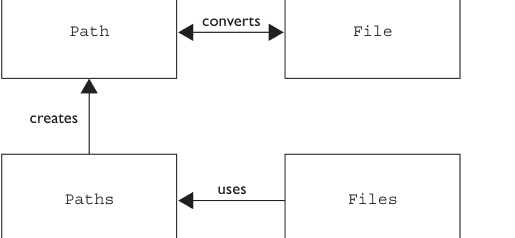

> **File、Files、Path 和 Paths 之间的区别非常重要。考试时请仔细阅读。一个字母的区别可能意味着类功能的巨大差异。**

为了确保你正反面都掌握了这些关键类的区别，请确保你能填满表 9-2 中右侧的四列。

### 表格 9-2 核心类对比

| | File | Files | Path | Paths |
| :--- | :--- | :--- | :--- | :--- |
| 存在于 Java 6？ | 是 | 否 | 否 | 否 |
| 具体类还是接口？ | 具体类 | 具体类 | 接口 | 具体类 |
| 使用 "new" 创建 | 是 | 否 | 否 | 否 |
| 仅包含静态方法 | 否 | 是 | 否 | 是 |

## 创建 Path

可以使用 `Paths` 辅助类的 `get` 方法轻松创建 `Path` 对象。记住你调用的是 `Paths.get()` 而不是 `Path.get()`。如果你忘记了为什么，请多读读最后一节。记住这一点非常重要。

看这两个例子，我们有：

```java
Path p1 = Paths.get("/tmp/file1.txt"); // 在 UNIX 上
Path p2 = Paths.get("c:\\temp\\test");    // 在 Windows 上
```

我们可以通过分离路径部分写出实际的方法。

```java
Path p3 = Paths.get("/tmp/", "file1.txt"); // 与 p1 相同
Path p4 = Paths.get("c:\\", "temp", "test"); // 与 p2 相同
Path p5 = Paths.get("c:\\temp\\", "test"); // 与 p2 也相同
```

正如你所见，调用 `Paths.get()` 时你可以根据需要分离文件夹和文件名。对于 Windows 来说，这特别酷，因为你可以通过消除斜杠和转义字符让代码更易读。

创建路径时要小心。在使用 `Files.create(Path target)` 创建文件之前，该文件并不存在。`Files` 工具类将在下一节介绍。


正如你所见，调用 `Paths.get()` 时你可以根据需要分离文件夹和文件名。对于 Windows 来说，这特别酷，因为你可以通过消除斜杠和转义字符让代码更易读。

创建路径时要小心。在使用 `Files.createFile(Path target)` 创建文件之前，该文件并不存在。`Files` 工具类将在下一节介绍。

# 第 9 章：I/O 和 NIO

## 表 9-3 I/O 与 NIO.2

| 描述 | I/O 方法 | NIO.2 方法 |
|---|---|---|
| 创建空文件 | `File file = new File("test"); file.createNewFile();` | `Path path = Paths.get("test"); Files.createFile(path);` |
| 创建空目录 | `File file = new File("dir"); file.mkdir();` | `Path path = Paths.get("dir"); Files.createDirectories(path);` |
| 创建目录，包括任何缺失的目录 | `File file = new File("/a/b/c"); file.mkdirs();` | `Path path = Paths.get("/a/b/c"); Files.createDirectories(path);` |
| 检查文件或目录是否存在 | `File file = new File("test"); file.exists();` | `Path path = Paths.get("test"); Files.exists(path);` |

## 复制、移动和删除文件

在处理文件系统时，我们经常需要复制、移动或删除文件。在 Java 7 之前这很难做到。但在 Java 7 中，每个操作都只需要一行。让我们来看一些示例：

```java
Path source = Paths.get("/temp/test1/");      // 存在
Path target = Paths.get("/temp/test2.txt");      // 尚不存在
Files.copy(source, target);                    // 现在有两个文件的副本
Files.delete(target);                          // 回到一个副本
Files.move(source, target);                   // 仍然是一个副本
```

这些内容都非常自言自语。我们复制一个文件，删除副本，然后移动该文件。现在，让我们尝试另一个例子：

```java
Path one = Paths.get("/temp/test1/");      // 存在
Path two = Paths.get("/temp/test2.txt");      // 存在
Path targ = Paths.get("/temp/test3.txt");      // 尚不存在
Files.copy(one, targ);                        // 现在有两个文件的副本
Files.copy(two, targ);                         // 复制
// 抛出 FileAlreadyExistsException
```

Java 似乎会考虑到覆盖一个已经存在的文件。Java 不想丢失文件，因此它会通过抛出异常来“询问”我们是否要这样做。`copy()` 和 `move()` 实际上接受第三个参数——零或多个 `CopyOptions`。你可以传递的最有用选项是 `StandardCopyOption.REPLACE_EXISTING`。

```java
Files.copy(two, target,                      // 好的。你知道你
StandardCopyOption.REPLACE_EXISTING);      // 在做什么
```

在删除文件时，我们必须考虑文件是否存在。假设我们写了下面这段测试代码：

```java
Path path = Paths.get("/java/out.txt");
try {
    methodUnderTest(); // 可能抛出异常
    Files.createFile(path); // 文件仅会被创建
    if (methodUnderTest() succeeds)
} finally {
    Files.delete(path); // 如果没有文件，则抛出 NoSuchFileException
}
```

我们还不知道 `methodUnderTest` 是否有效。如果它有效，代码就能运行。如果它抛出异常，我们永远不会创建文件，而 `Files.delete()` 会抛出 `NoSuchFileException`。这是一个问题，因为我们只想在文件被创建时删除它，这样就不会留下残留文件。有一个替代方案。`Files.deleteIfExists(path)` 只在文件存在时才返回 `true` 并删除文件。如果不存在，它只返回 `false`。大多数情况下，你可以忽略这个返回值。你只是只想让文件不存在。如果它从未存在过，任务就完成了。

如果你必须处理 Java 7 之前的代码，可以使用 Apache Commons IO (http://commons.apache.org/) 中的 `FilesUtils` 类。通常（这里不是双关语），当你创建一个 Path 时，你是以直接的方式创建的。然而，这三个都返回相同的逻辑 Path：

```java
Path p1 = Paths.get("myDirectory"); // 一个点表示
Path p2 = Paths.get("./myDirectory"); // 当前目录
Path p3 = Paths.get("anotherDirectory", "..", "myDirectory"); // 点向上跳一个目录
```

你可能会奇怪，我们为什么不直接输入 `myDirectory`。如果可以，你也会这样做。但有时这样做并不可行。让我们来看一个真实的例子，说明为什么会这样。

## 归一化 Path

## 获取 Path 的信息

Path 接口定义了很多可以返回关于路径有用信息的方法。在下面的代码中，创建了一个 Path 然后输出了这些信息：

```java
Path path = Paths.get("/java/workspace");
System.out.println(path.getName()); // workspace
System.out.println(path.getName(1)); // java
System.out.println(path.getNameCount()); // 3
System.out.println(path.getParent()); // /home
System.out.println(path.getRoot()); // /
System.out.println(path.subpath(0, 2)); // home/java
System.out.println(path.toString()); // /home/java/workspace
```

当你运行这个示例时，输出如下：

```
workspace
java
3
/home
/
home/java
/home/java/workspace
```

根据这个输出，表 9-5 显示看出每个方法的作用相当简单。

### 表 9-5 Path 信息方法

| 方法 | 描述 |
|---|---|
| `getName()` | 返回序列中的文件名或最后一个元素 |
| `getName(int index)` | 返回指定索引的路径元素 |
| `getNameCount()` | 返回路径中的元素个数 |
| `getParent()` | 返回父目录路径，如果没有父目录则返回 null |
| `getRoot()` | 返回根目录，如果没有根目录则返回 null |
| `subpath(int beginIndex, int endIndex)` | 返回路径的子序列（不包含根目录） |
| `toString()` | 返回路径的字符串表示 |

### 表 9-6 Files 常用方法

| 方法 | 描述 |
|---|---|
| `copy(Path source, Path target, CopyOptions...)` | 将 source 复制到 target |
| `move(Path source, Path target, CopyOptions...)` | 将 source 移动到 target |
| `delete(Path path)` | 删除文件 |
| `deleteIfExists(Path path)` | 如果文件存在则删除文件 |
| `exists(Path path, CopyOptions...)` | 检查文件是否存在 |
| `notExists(Path path, CopyOptions...)` | 检查文件是否存在 |

## 502 第 9 章：I/O NIO

```text
/ (root)
|-- Build_Project
|   |-- scripts
|   |-- buildScript.sh
|-- My_Project
|   |-- source
|   |-- MyClass.java
```

如果你想编译 MyClass，你需要 `cd` 到 `/My_Project/source` 并运行 `javac MyClass.java`。一旦你的程序变大，可能会包含成千上万个类数百数百文件。你不想为了编译而输入所有这些内容，所以有人写了一个脚本来构建你的程序。`buildScript.sh` 现在会找到编译所需的所有内容并为你运行 `javac` 命令。问题是，当前目录是 `/Build_Project/scripts` 而不是 `/My_Project/source`。构建脚本通过类似下面的操作贴心地为你构建了一个路径：

```java
String buildProject = "/Build_Project/scripts";
String upToDirectories = "../../";
String myProject = "/My_Project/source";
Path path = Paths.get(buildProject, upToDirectories, myProject);
System.out.println("Original: " + path);
System.out.println("Normalized: " + path.normalize());
```

输出如下：

```
Original:/Build_Project/scripts/../My_Project/source
Normalized:/My_Project/source
```

而第二个更易读。`normalize()` 方法知道单个点 `.` 可以被忽略。它还知道任何目录后面跟着两个点 `..` 都可以从路径中移除。

使用 `normalize()` 时要小心。它查看的是路径的字符串字符串，而不会检查文件系统查看目录或文件实际是否存在。

让我们练习一下，看看 `normalize()` 对这些路径返回什么。这次，我们没有提供目录结构，以说明目录和文件不需要存在计算机上。你认为它会输出什么？

```java
System.out.println(Paths.get("/a/../b/./c").normalize());
System.out.println(Paths.get(".classpath").normalize());
System.out.println(Paths.get("/a/b/c/..").normalize());
System.out.println(Paths.get("../a/b/c").normalize());
```

## 文件、Path 和 Paths OCP 目标 8.1 和 8.2 503

输出是：

```
/a/b/c
.classpath
/a/b
../a/b
```

第一个移除了所有它们指向当前目录的点。第二个没有改变任何内容，点是文件名的一部分而不是目录。第三个看到了一组双点，所以它只向上移动了一个目录。最后一个有点棘手。两个点确实表示向上移动一个目录。但前面没有目录了，所以 `Path` 无法对其进行简化。

回顾一下，`normalize()` 移除了 `Path` 中不必要的部分，使其更像你通常输入的样子。（虽然这不是“归一化”一词的来源，但这是一个很好的记忆方法。）

## 解析路径

到此为止，你已经概述了可以在单个 `Path` 对象上调用的所有方法，但如果你需要合并两个路径呢？如果你有一个代表目录的 `Path` 和另一个包含该目录的 `Path`，你可能想这样做：

```java
Path dir = Paths.get("/home/java");
Path file = Paths.get("models.pdf");
Path result = dir.resolve(file);
System.out.println("result: " + result);
```

通过合并两个路径产生绝对路径：

```
result = /home/java/models.pdf
```

`path1.resolve(path2)` 应该读作“在 path1 的目录内解析 path2”。在这个例子中，我们解析了 `dir` 提供的文件路径。记住这个定义，让我们看看更复杂的例子：

```java
Path absolute = Paths.get("/home/java");
Path relative = Paths.get("dir");
Path file = Paths.get("models.pdf");
System.out.println("1: " + absolute.resolve(relative));
System.out.println("2: " + absolute.resolve(file));
System.out.println("3: " + relative.resolve(file));
System.out.println("4: " + relative.resolve(absolute)); // 错误
System.out.println("5: " + file.resolve(absolute)); // 错误
System.out.println("6: " + file.resolve(relative)); // 错误
```

## 504 第 9 章：I/O 和 NIO

输出是：

```
1: /home/java/dir
2: /home/java/models.pdf
3: dir/Model.pdf
4: /home/java
5: /home/java
6: Model.pdf/dir
```

前三个完全符合预期。它们将参数添加到路径对象中。第四个和第五个是在某个范围内解析绝对路径。问题是绝对路径不依赖目录。因此 `resolve` 返回绝对路径。就像 `normalize()` 一样，记住 `resolve()` 不检查目录或文件是否存在。回顾一下，`resolve()` 告诉你如何解析一个路径。

注意两种形式的方法：一种 `Path` 参数，另一种 `String` 参数。这里棘手的地方在于 `null` 对于 `Path` 和 `String` 都是有效值。

```java
Path path = Paths.get("/usr/bin");
path.resolve(null);
```

编译器可以决定调用哪个方法：是 `Path` 参数还是 `String` 参数。这就是为什么这段代码无法编译，如果你在考试中看到这个，你就知道该做什么：将变量 `other` 强制转换为 `String`。

```java
path.resolve((String) null);
```

## 路径相对化

现在假设我们想执行 `resolve` 的相反操作。我们有一个主目录的绝对路径，以及主目录中某个文件的绝对路径。我们只想知道文件名名。

```java
Path dir = Paths.get("/home/java");
Path music = Paths.get("/home/java/Swift.mp3");
Path mp3 = dir.relativize(music);
System.out.println(mp3);
```

输出是：Swift.mp3。Java 识别出 `/home/java` 部分是相同的，并返回剩余部分的路径。`path1.relativize(path2)` 应该读作“给出一个如何从 path1 到 path2 的路径”。在这个例子中，我们确定 `music` 是名为 `dir` 的目录下的文件。记住这一点，让我们看看更多例子：

```java
Path absolute1 = Paths.get("/home/java");
Path absolute2 = Paths.get("/usr/local");
```


## 文件和目录属性 (OCP 版本 8.3)

```java
Path absolute3 = Paths.get("/home/java/temp/music.mp3");
Path relative1 = Paths.get("/temp");
Path relative2 = Paths.get("/temp/music.pdf");
System.out.println("1: " + absolute1.relativize(absolute3));
System.out.println("2: " + absolute2.relativize(absolute3));
System.out.println("3: " + absolute3.relativize(relative2));
System.out.println("4: " + relative1.relativize(relative2));
System.out.println("5: " + absolute1.relativize(relative1)); // 错误
```

输出是：
```
1: temp/music.mp3
2: ../../usr/local
3: ../../music
4: music.pdf
Exception in thread "main" java.lang.IllegalArgumentException: 'other' is different type of Path
```

在你困惑之前，让我们看看这里的目录结构。记住目录并不真的需要存在；这只是为了可视化。

```
/root
  | usr
  | local
  | home
      | java
          | temp
          | music.mp3
```

现在我们可以追踪整个过程。第一个例子是直观的。它告诉我们如何通过向下两个目录从 `absolute1` 到达 `absolute3`。第二个类似。我们通过相反的操作——向上两个目录到达 `absolute3`。记得从 `normalize()` 知道，双点意味着向上一个目录。第三个输出语句说，从 `absolute1` 到 `absolute2` 我们必须向上两个目录再向下两个目录。Java 知道这一点，因为我们提供了绝对路径。最坏的情况是像我们在这里这样做一直回到根目录。回顾一下，`relativize()` 告诉你如何获取两个路径之间的相对路径。

### 文件和目录属性 (OCP 版本 8.3) 507

```java
Date januaryFirst = new GregorianCalendar(      // 创建一个日期
      2013, Calendar.JANUARY, 1).getTime();

// 旧方法
File file = new File("/temp/file");                     // 创建文件
file.createNewFile();
file.setLastModified(januaryFirst.getTime());              // 设置时间
System.out.println(file.lastModified());                    // 获取时间
file.delete();                              // 删除文件

// 新方法
Path path = Paths.get("/temp/file");                    // 创建另一个文件
Files.createFile(path);
FileTime fileTime = FileTime.fromMillis(                   // 转换为
      januaryFirst.getTime());                                // FileTime 对象
Files.setLastModified(path, fileTime);                     // 设置时间
System.out.println(Files.getLastModified(path));          // 获取时间
Files.delete(path);                        // 删除文件
```

如从输出所示，功能上的唯一变化是新的 `Files.getLastModified()` 使用了人类易读的日期格式。

```
1357016400000
2013-01-01T07:00:00.000Z
```

你可以设置的另一种类型的属性是文件权限。Windows 和 UNIX 都有三种权限的概念。它们的含义如下：

- **读取（Read）**：你可以打开文件或列出该目录中的内容。
- **写入（Write）**：你可以修改文件或向该目录中添加文件。
- **执行（Execute）**：如果该文件是一个可运行的程序，你可以运行它，或者进入该目录。

打印文件权限非常简单。请注意，这些权限仅针对运行程序的用户——即你！还有其他类型的权限，但这些无法一行代码设置。

```java
System.out.println(Files.isExecutable(path));
System.out.println(Files.isReadable(path));
System.out.println(Files.isWritable(path));
```

### 表 9-6 I/O 方式对比 NIO 权限

| 描述 | I/O 方式 | NIO 方式 |
|---|---|---|
| 获取最后修改时间 | `file = new File("test"); file.lastModified();` | `Path path = Paths.get("test"); Files.getLastModifiedTime(path);` |
| 是否设置了读取权限 | `file = new File("test"); file.canRead();` | `Path path = Paths.get("test"); Files.isReadable(path);` |
| 是否设置了写入权限 | `file = new File("test"); file.canWrite();` | `Path path = Paths.get("test"); Files.isWritable(path);` |
| 是否设置了执行权限 | `file = new File("test"); file.canExecute();` | `Path path = Paths.get("test"); Files.isExecutable(path);` |
| 设置修改日期/时间（注意：timeInMillis 是合适的 long 类型） | `file = new File("test"); file.setLastModified(timeInMillis);` | `Path path = Paths.get("test"); FileTime fileTime = FileTime.fromMillis(timeInMillis); Files.setLastModifiedTime(path, fileTime);` |

## 第 9 章：I/O 和 NIO

### 接口类型

通过调用 `Files` 方法设置的属性是最直接的。除此之外，Java NIO.2 增加了一些接口，可以通过它们读取可能并非每个操作系统上都存在的属性。

- **BasicFileAttributes**：Oracle 的 JavaDoc 中说这些是“许多文件的共同属性”。这意味着，除非你正在为奇特的操作系统编写 Java 代码，否则你可以依赖这些属性的可用。基本属性包括创建日期等内容。
- **PosixFileAttributes**：POSIX 代表可移植操作系统接口（Portable Operating System Interface）。UNIX 和基于 Linux 的操作系统都实现了此接口。你可以记住这一点 POSIX 以 "x" 结尾，UNIX 和 Linux 也是。
- **DosFileAttributes**：DOS 代表磁盘操作系统（Disk Operating System）。它是所有 Windows 操作系统的的一部分。即使是 Windows 8 也有 DOS 提示符。

还有独立的接口用于设置或更新属性。虽然细节不在考试范围内，但你应该熟悉每个接口的作用。

- **BasicFileAttribute**：用于设置最后更新、最后访问和创建日期。
- **PosixFileAttribute**：用于设置 UNIX 系统上的组或权限。有一种更简单的方法设置这些权限，因此你不会使用属性视图。
- **DosFileAttribute**：用于设置 DOS/Windows 系统上的文件权限。同样，有更简单的方法设置这些，因此你不会使用属性视图。
- **FileOwnerAttribute**：用于设置文件或目录的所有所有。
- **AclFileAttribute**：对文件或目录设置更高级的权限。

### 使用 BasicFileAttributes

`BasicFileAttributes` 接口提供了获取文件信息的方法。

```java
BasicFileAttributes attributes = Files.readAttributes(path, BasicFileAttributes.class);
System.out.println("create: " + attributes.creationTime());
System.out.println("access: " + attributes.lastAccessTime());
System.out.println("modify: " + attributes.lastModifiedTime());
System.out.println("directory: " + attributes.isDirectory());
```

示例输出显示 `BasicFileAttributes` 提供了获取文件信息的多种方式。请注意，`BasicFileAttributes` 仅用于读取。要更新属性，你应该使用特定的视图。

### 文件和目录属性 (OCP 目标 8.3) 512

另一个棘手的问题是你可以不能删除只读文件。这就是为什么代码第二次调用 `setAttribute` 并将 `false` 作为参数，以使其不再是“只读”，这样代码就可以进行清理工作。你可以看到，我们必须调用 `readAttributes` 才能看到这些更新后的值。

设置这些属性还有另一种方法，你不需要担心字符串类型的值。然而，考试要求你了解如何使用 `Files`。了解这两种方法都是好的：

```java
DosFileAttributeView view = Files.getFileAttributeView(path, DosFileAttributeView.class);
view.setHidden(true);
view.setReadOnly(true);
```

### 使用 PosixFileAttributes

`PosixFileAttributes` 在基础属性的基础上增加了两个属性——组和权限。在 UNIX 上，每个文件或目录都有所有者和组名。UNIX 权限也比基础权限更复杂。每个文件或目录在字符串中设置了九种权限。示例是 `"rxw-xr-r-"`。将其分为三组，我们得到 `"rxw"`、`"rw-"` 和 `"r-"`。这些权限组对应于谁拥有这些权限。在这个例中，文件的“用户”（user，所有者）具有读取、写入和执行权限。“组”（group）只有读取和执行权限。所有不是所有者也不是组内的“其他人”（other）都只有读取权限。

现在让我们来看一些代码，来设置权限并以人类可读的格式输出它们：

```java
Path path = Paths.get("/tmp/file2");
Files.createFile(path);
PosixFileAttributes posix = Files.readAttributes(path, PosixFileAttributes.class);
Set<PosixFilePermission> perms = PosixFilePermissions.fromString("rw-r--r-");
Files.setPosixFilePermissions(path, perms);
System.out.println(posix.permissions());
```

输出如下：
```
[OWNER_WRITE, GROUP_READ, OTHERS_READ, OWNER_READ]
```

### 文件和目录属性 (OCP 目标 8.3) 513

这并不是对称的。我们以晦涩的 UNIX 格式将权限交给 Java，并以纯英语获取它们。你也可以输出组名：

```java
System.out.println(posix.group()); // 获取组
```

输出类似的内容：
```
horse
```

### 复习属性

让我们回顾表 9-7 中常见的属性。

#### 表 9-7 常见属性

| 类型 | 代码示例 |
|---|---|
| Basic | ```java\n// 读取\nBasicFileAttributes basic = Files.readAttributes(path, BasicFileAttributes.class);\nFileTime lastUpdated = basic.lastModifiedTime();\nFileTime created = basic.creationTime();\nFileTime now = FileTime.fromMillis(System.currentTimeMillis());\n// 写\nBasicFileAttributeView basicView = Files.getAttributeView(path, BasicFileAttributeView.class);\nbasicView.setUpdated(now, created);\n``` |
| Posix (UNIX/Linux) | ```java\nPosixFileAttributes posix = Files.readAttributes(path, PosixFileAttributes.class);\nSet<PosixFilePermission> perms = PosixFilePermissions.fromString("rw-r--r-");\nFiles.setAttribute(path, perms);\nSystem.out.println(posix.group());\nSystem.out.println(posix.permissions());\n``` |
| Dos (Windows) | ```java\nDosFileAttributes dos = Files.readAttributes(path, DosFileAttributes.class);\nSystem.out.println(dos.isHidden());\nSystem.out.println(dos.isReadOnly());\nFiles.setAttribute(path, "dos:hidden", false);\nFiles.setAttribute(path, "dos:readonly", false);\n``` |

## DirectoryStream (OCP 目标 8.4)

8.4 使用 `DirectoryStream` 和 `FileVisitor` 接口递归访问目录树。

让我们回到你在 `java.nio.file` 包中找到的 NIO2 能力……你可能需要遍历一个目录。假设被要求列出这台计算机上所有拥有家目录的用户。

```
/home
 - users
  - vafi
  - eyra
```

```java
Path dir = Paths.get("/home/users");
try (DirectoryStream<Path> stream = // 使用 try-with-resources
Files.newDirectoryStream(dir)) { //这样我们不需要调用 close()
  for (Path path : stream) // 遍历流
    System.out.println(path.getFileName());
}
```

正如预期的，输出是：
```
vafi
eyra
```

`DirectoryStream` 接口允许你遍历目录。但这只是冰山一角。假设我们有数百个用户，每天我们都想对其中一个人进行报告。第一天，我们想要名字以字母 v 或 w 开头的用户的家目录。

```java
Path dir = Paths.get("/home/users");
try (DirectoryStream<Path> stream = Files.newDirectoryStream(
dir, "[vw]*")) { // "vw" 或 "w*" 后面跟任意字符
  for (Path path : stream)
    System.out.println(path.getFileName());
}
```

正如预期的，输出是：
```
vafi
eyra
```

*(注：原文后续部分存在大量重复的 OCR 错误文本，已根据要求进行清理)*

```
post: /home/child/grandchild
post: /home/child
pre: /home/emptyChild
post: /home/emptyChild
post: /home
```


注意，Java 在返回树节点之前会尽可能深入遍历。这是一种深度优先搜索。我们使用“可能”一词，是因为同一层的文件和目录可以按任何顺序被访问。

你可以根据意愿重写四个方法中的任意一个或多个。注意，方法的后半部分带有 `IOException` 作为参数。这允许这些方法处理在遍历树过程中早些出现的问题。不过，你实际上通过 `FileVisitResult` 常量拥有控制权。假设我们将 `preVisitDirectory` 方法更改为如下：

```java
public FileVisitResult preVisitDirectory(Path dir, FileAttributes attrs) {
    System.out.println("pre: " + dir);
    String name = dir.getFileName().toString();
    if (name.equals("child"))
        return FileVisitResult.SKIP_SUBTREE;
    return FileVisitResult.CONTINUE;
}
```

pre: /home
file: /home/a.txt
pre: /home/child
pre: /home/emptyChild
post: /home/emptyChild
post: /home

| 方法 | 说明 | IOException? |
| :--- | :--- | :--- |
| preVisitDirectory | 在进入目录之前调用 | 否 |
| visitFile | 为每个文件调用一次（但不对目录调用） | 否 |
| visitFileFailed | 仅在访问文件发生错误时调用 | 是 |
| postVisitDirectory | 在回溯时完成目录处理后调用 | 是 |

## I/O

由于我们指示程序跳过整个子树——即我们没有看到文件 `b.txt` 或 `grandchild`——我们也没有看到 `post` 调用。现在考虑一下如果我们将 `FileVisitResult.SKIP_SUBTREE` 更改为 `FileVisitResult.TERMINATE`，你认为会发生什么？输出可能是：

```
pre:/home
file:/home/a.txt
pre:/home/child
```

我们看到一旦出现“child”目录，程序就停止了树的遍历。在输出方面，我们使用了“可能”一词。`emptyChild` 也可能先出现，在这种情况下，输出的最后一行将是 `/home/emptyChild`。

`SKIP_SIBLINGS` 是 `SKIP_SUBTREE` 和“不要查看同一级别的任何文件夹”的组合。这意味着我们跳过了 `child` 和 `emptyChild` 下的所有内容。有一个例子可以确保你真正理解了发生了什么。你认为如果我们使用这个方法会怎样？

```java
public FileVisitResult preVisitDirectory(Path dir, FileAttributes attrs) {
    System.out.println("pre: " + dir);
    String name = dir.getFileName().toString();
    if (name.equals("grandchild")) {
        return FileVisitResult.SKIP_SUBTREE;
    }
    if (name.equals("emptyChild")) {
        return FileVisitResult.SKIP_SIBLINGS;
    }
    return FileVisitResult.CONTINUE;
}
```

假设 `child` 在 `emptyChild` 之前遇到，输出为：

```
pre:/home
file:/home/a.txt
file:/home/child/b.txt
file:/home/child/grandchild
pre:/home/child
post:/home/child
pre:/home/emptyChild
post:/home/emptyChild
pre:/home
post:/home
```

## PathMatcher (OCP 目标 8.5)

### 8.5 使用 PathMatcher 接口查找文件。

`DirectoryStream` 和 `FileVisitor` 允许我们遍历存在的文件。然而，情况可能会很快变得复杂。假设你有一个需求，要打印“password”任何子目录下所有文本文件的文件名。你可能在奇怪为什么有人想这样做。也许某个同事愚蠢地存储了密码让所有人看到，而你想确保没有人这么做。你可以编写逻辑来跟踪目录结构，但这会让代码更难阅读和理解。在本节结束时，你将学会一种更好的方法。

让我们从一个更简单的例子开始，看看 `PathMatcher` 能做什么：

```java
Path path1 = Paths.get("/home/One.txt");
Path path2 = Paths.get("/One.txt");
PathMatcher matcher = FileSystems.getDefault() // 获取 PathMatcher
    .getPathMatcher("glob:*.txt"); // 针对正确的文件系统

System.out.println(matcher.matches(path1)); // 等等。什么是 glob？
System.out.println(matcher.matches(path2));
```

输出如下：
- false
- true

我们可以看到代码检查一个 `Path` 是否由任何字符后接“.txt”组成。要获取 `PathMatcher`，你必须调用 `FileSystems.getDefault().getPathMatcher()`，因为匹配在不同的操作系统上的工作方式不同。`PathMatcher` 使用了一种你可能没见过的新类型——glob。`glob` 不是正则表达式，尽管它们初看起来看起来相似。让我们使用常用方法来看一些 glob 的例子，这样我们就不需要反复阅读相同的“模版代码”（模版代码是指代码中始终不变的部分）。

```java
public void matches(Path path, String glob) {
    PathMatcher matcher = FileSystems.getDefault().getPathMatcher(glob);
    System.out.println(matcher.matches(path));
}
```

在 glob 的世界中，星号 `*` 匹配目录分隔符以外的任何字符。问号 `?` 匹配任意单个字符。双星号 `**` 匹配一个或多个目录。记住正斜杠的处理方式取决于你运行的操作系统。

| 表格 10 | 匹配内容 | 在 Glob 中 | 在正则表达式中 |
|---|---|---|---|
| Glob vs. 正则表达式 | 任意字符的零或多个，包括目录边界 | `**` | `.*` |
| | 任意字符的零或多个，不包括目录边界 | `*` | N/A – 无特殊语法 |
| | 恰好一个字符 | `?` | `.` |
| | 任意数字 | `[0-9]` | `[0-9]` |
| 以 cat 或 dog 开头 | `{cat, dog}*` | `(cat\|dog).*` |

第二个路径没有匹配，因为它包含字面量反斜杠后跟字面量星号。glob 正在寻找它自己。第三条路径也没有匹配，因为在 "b" 和 "l" 之间没有用于 `**` 匹配目录。幸运的是，没有人会编写这种疯狂且毫无意义的 glob。但如果你能理解这一个，你就完全没问题了。

由于 glob 与正则表达式非常相似（例如 `*.txt;*.html`），我们来回顾一下这些常用表达式之间的相似之处与区别。正则表达式更强大，但 glob 专注于你自己在匹配文件名时最可能需要的内容。

到目前，你可能已经注意到我们处理的是 `Path` 对象，这意味着它们实际上并不存在文件系统中。我们想要打印出 `password` 的子目录下实际存在的所有文件。幸运的是，我们可以将 `PathMatcher` 的功能与我们已经熟悉的遍历文件树的方法结合来实现这一目标。

无论你想做什么，代码看起来都很相似。你只需要将 glob 模式更改为你想要匹配的内容即可。

## WatchService (OCP 目标 8.6)

### 认证目标

#### 8.6 使用 WatchService 接口监控目录的变化。

关于 NIO.2，你最后不需要知道的就是 WatchService。假设你正在编写一个安装程序。你检查即将安装的目录是否为空。如果不为空，你想等待用户删除该目录后再继续。幸运的是，你不需要从头开始编写这段代码，但你应该熟悉这些概念。这里是你的目录：

```
/dir
  - directoryToDelete
  - other
```

这里是代码片段：

```java
Path dir = Paths.get("/dir");                                     // 获取包含
WatchService watcher = FileSystems.getDefault()                   // 创建空服务的代码
    .newWatchService();
dir.register(watcher, StandardWatchEventKinds.ENTRY_DELETE);
```

假设我们删除了目录 "other"，然后删除了目录 directoryToDelete，输出：

```
ENTRY_DELETE
interface java.nio.file.Path
other
ENTRY_DELETE
interface java.nio.file.Path
directoryToDelete
目录已删除，现在我们可以继续了
```

注意，我们必须监控包含感兴趣的文件或目录的目录。这就是为什么我们监控的是 `/dir` 而不是感兴趣的 `/dir/directoryToDelete`。这也是为什么我们必须检查上下文，以确保我们实际感兴趣的目录确实是被删除的那一个。

无论你想做什么，WatchService 的基本流程保持不变：
- 创建一个新的 WatchService
- 将其注册到某个 Path 上，并监听一个或多个事件类型
- 循环执行，直到我们不再对这些事件感兴趣
- 从 WatchService 获取一个 WatchKey
- 调用 `key.pollEvents()` 并对它们进行操作
- 调用 `key.reset()` 以寻找更多事件

让我们详细查看其中的一些内容。你使用如下语句将 WatchService 注册到 Path：

```java
dir1.register(watcher, StandardWatchEventKinds.ENTRY_DELETE);
dir2.register(watcher, StandardWatchEventKinds.ENTRY_DELETE, StandardWatchEventKinds.ENTRY_CREATE);
dir3.register(watcher, StandardWatchEventKinds.ENTRY_DELETE, StandardWatchEventKinds.ENTRY_CREATE, StandardWatchEventKinds.ENTRY_MODIFY);
```

（注意：这些 `ENTRY_XXX` 常量可以在 `StandardWatchEventKinds` 类中找到。在这里以及后的代码中，你可能想为这些常量创建静态导入。）你可以注册一个、两个或三个事件类型。`ENTRY_DELETE` 意味着你希望在文件或目录被删除时通知你的程序。同样，`ENTRY_CREATE` 意味着创建了新的文件或目录。`ENTRY_MODIFY` 意味着目录中的文件被编辑了。这些更改可以通过人类手动或计算机上的另一个程序完成。

重命名文件或目录是有趣的，因为它不会显示为 `ENTRY_MODIFY`。从 Java 的角度来看，重命名等同于创建一个新文件并删除原始文件。这意味着重命名将触发两个事件——`ENTRY_CREATE` 和 `ENTRY_DELETE`。实际上编辑文件将使用 `ENTRY_MODIFY`。

为了遍历事件，我们使用 `while(true)`。写一个永远不会结束的循环看起来可能有点奇怪。通常，循环中有 `break` 或 `return` 语句，以便在你等待的任何事件发生时停止。它也可以让你运行程序，直到你通过命令行杀死它或终止它。

在循环内部，你需要获取一个 `WatchKey`。有两种方法可以实现这一点。最常见的是调用 `take()`，它会等待直到事件可用。如果它在找到键之前被中断，它会抛出 `InterruptedException`。这允许你结束程序。另一种方法是使用 `poll()`，如果没有可用事件，它将返回 `null`。你可以提供一个特定的时间。

```java
watcher.take(); // 等待“永远”
watcher.poll(); // 获取当前的
watcher.poll(10, TimeUnit.SECONDS); // 等待 10 秒
watcher.poll(1, TimeUnit.MINUTES); // 等待 1 分钟
```

接下来，遍历 key 中的任何事件。记住你从同一个 key 获取多个看似相关的事件。

```java
for (WatchEvent<?> event : key.pollEvents()) {
    // 处理事件
}
```

最后，调用 `key.reset()`。这非常重要。如果你忘记调用 `reset`，程序对第一个事件有效，但之后将不会收到任何事件通知。

关于 WatchService 有一些你应该注意的局限性。首先，它是慢的。你可以添加代码检查 `kind == OVERFLOW`，但这只是告诉你出问题了。你不知道丢失了哪些事件。在实践中，你可能不会使用 WatchService。

WatchService 只监控其下方的文件目录。如果我们想查看 p.txt 或 c.txt 是否被修改怎么办？

```
/dir
| - parent
|   - p.txt
|   - child
|     - c.txt
```

一种方法是注册这两个目录：

```java
WatchService watcher = FileSystems.getDefault().newWatchService();
Path dir = Paths.get("/dir/parent");
dir.register(watcher, StandardWatchEventKinds.ENTRY_MODIFY);
Path child = Paths.get("/dir/parent/child");
child.register(watcher, StandardWatchEventKinds.ENTRY_MODIFY);
```

这种方法可行。你可以输入所有想要监控的目录。如果我们有很多子目录，这很快就会变成很多 watcher 的负担。相反，我们可以让 Java 来完成：

```java
Path myDir = Paths.get("/dir/parent");
final WatchService watcher = FileSystems.getDefault().newWatchService();
Files.walkFileTree(myDir, new SimpleFileVisitor<Path>() {
    public FileVisitResult preVisitDirectory(Path dir, BasicFileAttributes attrs) throws IOException {
        dir.register(watcher, StandardWatchEventKinds.ENTRY_MODIFY); // 监控每个目录
        return FileVisitResult.CONTINUE;
    }
});
```


这段代码递归地遍历文件树，并将每个目录注册到 `watcher`。NIO.2 类的设计旨在协同工作。例如，我们可以在上一个示例中添加 `PathMatcher`，只监控路径中具有特定模式的目录。


# 序列化 (目标 7.2)

7.2 使用 `java.io` 包中的类使用流读取和写入文件，包括 `BufferedReader`、`BufferedWriter`、`File`、`FileReader`、`FileWriter`、`DataInputStream`、`DataOutputStream`、`ObjectOutputStream`、`ObjectInputStream` 和 `PrintWriter`。

随着时间的推移，Oracle 细化了 OCP 7 考试的目标。序列化是旧 SCJP 5 和 SCJP 6 考试中的一个主题，最近（截至 2014 年夏季），Oracle 在 OCP 7 考试中重新引入了序列化。请参阅附录 A 以获取关于序列化的深度、完整的章节介绍，直到自测。

## 认证总结

### 文件 I/O

请记住，`File` 类型的对象可以表示文件或目录，但在你调用 `createNewFile()` 或 `mkdir()` 之前，你并没有在驱动器上实际创建任何内容。`java.io` 包中的类设计为链式组合。你很少会在不用 `BufferedReader` 或 `BufferedWriter` 对象“包装”它们的情况下就使用 `FileReader` 或 `FileWriter`，因为这可以让你访问更强大、更高层级的方法。从 Java 5 开始，`PrintWriter` 类已经增强了高级的 `append()`、`format()` 和 `printf()` 方法，结合允许你直接从字符串名称或 `File` 对象创建 `PrintWriter` 的构造函数，你可能可以少地使用 `BufferedWriter` 了。`Console` 类允许你读取无回显输入（以 `char[]` 返回），并使用 `System.console()` 进行实例化。

### NIO.2

`Path` 类型的对象可以是文件或目录，是 `File` 类型的替代者。通过 `Paths.get()` 创建 `Path`。`Files` 中的实用方法允许你创建、删除、移动、拷贝或检查有关 `Path` 信息。此外，`BasicFileAttributes`、`DosFileAttributes`（Windows）和 `PosixFileAttributes`（UNIX/Linux/Mac）允许你创建关于 `Path` 的高级信息。`BasicFileAttributeView`、`DosFileAttributeView` 和 `PosixFileAttributeView` 允许你更新 `Path` 属性。

使用 `DirectoryStream` 可以遍历目录。扩展 `SimpleFileVisitor` 可以让你递归地遍历目录树，查看文件和/目录。通过 `PathMatcher`，你可以使用正则表达式 glob 表达式在目录中搜索文件。

最后，注册 `WatchService` 可以为新/已更改/删除的文件或目录提供通知。

### 两分钟训练

这里是本章认证目标中的一些关键点。

#### 文件 I/O (OCP 目标 7.1 和 7.2)

- 你需要在 `java.io` 中理解的类有 `File`、`FileReader`、`BufferedReader`、`FileWriter`、`BufferedWriter`、`PrintWriter` 和 `Console`。
- 新 `File` 对象并不意味着你的硬盘上有一个新文件。
- `File` 对象可以表示文件或目录。
- `File` 类允许你管理（添加、重命名、删除）文件和目录。
- `createFile()` 和 `mkdir()` 方法向你的文件系统添加条目。
- `FileWriter` 和 `FileReader` 是低级 I/O 类。你可以用它们读写文件，但它们通常会被包装。
- `java.io` 中的类被设计为“链式”或“包装”的。（这是装饰器模式的常见用法。）
- 在 `FileReader` 外层包装 `BufferedReader` 或在 `FileWriter` 外层包装 `BufferedWriter` 是非常常见的，以便访问更高层（更方便）的方法。
- `PrintWriter` 可以包装其他 `Writer`，但从 Java 5 开始，它们可以直接从 `Files` 或字符串构建。
- 从 Java 5 开始，`PrintWriter` 有了新的 `append()`、`format()` 和 `printf()` 方法。
- `Console` 对象可以读取无回显输入并使用 `System.console()` 实例化。

#### Path, Paths, and File (OCP 目标 8.1 和 8.2)

- NIO.2 在 Java 7 中引入。
- `Path` 替换了 `File` 来表示文件或目录。
- `Paths.get()` 允许你创建一个 `Path` 对象。
- `Files` 中的静态方法允许你处理 `Path` 对象。
- `Path` 对象并不意味着文件或目录在你的硬盘上存在。
- `Files.createFile()` 和 `Files.createDirectory()` 方法向你的文件系统添加条目。
- `Files` 类提供了移动、拷贝和删除 `Path` 对象的方法。
- 如果文件不存在，`Files.delete()` 会抛出异常，而 `Files.deleteIfExists()` 返回 `false`。
- 在 `Path` 上，`normalize()` 简化路径表示。
- 在 `Path` 上，`resolve()` 和 `relativize()` 处理两个路径对象之间的关系。

#### 文件属性 (OCP 目标 8.3)

- `Files` 类提供了用于常用属性的方法，例如文件是否可执行以及最后修改修改的时间。
- 对于不常用的属性，使用类：`BasicFileAttributes`、`DosFileAttributes` 和 `PosixFileAttributes` 读取属性。
- `FileAttributes` 适用于 Windows 操作系统。
- `PosixFileAttributes` 适用于 UNIX、Linux 和 Mac 操作系统。
- 无法通过 `File` 类更新的属性通过类设置：`BasicFileAttributeView`、`DosFileAttributeView`、`PosixFileAttributeView`、`FileOwnerAttributeView`、`AclFileAttributeView`。

#### 目录树、匹配和更改监控 (OCP 目标 8.4, 8.5 和 8.6)

- `DirectoryStream` 遍历 glob 模式的目录直接子节点。
- `FileVisitor` 递归遍历目录树。
- 你可以覆盖 `SimpleFileVisitor` 的一个或所有方法——`preVisitDirectory`、`visitFile`、`visitFileFailed` 和 `postDirectory`。
- 你可以通过返回 `VisitResult` 常量之一来更改文件访问器的流：`CONTINUE`、`SKIP_SUBTREE`、`SKIP_SIBLINGS` 或 `TERMINATE`。
- `PathMatcher` 检查路径是否匹配 glob。
- 了解以下含义：目录注册到 `WatchService` 以接收有关文件或目录创建、删除和修改的通知。
- `PathMatcher` 和 `WatchService` 使用特定文件系统的实现。

# 第 9 章：I/O 和 NIO

## 自测

以下问题将帮助你衡量对本章内容的理解。仔细阅读选项，因为可能存在多个答案。为每个问题选择正确答案。专注于。

1. 使用代码片段（并填充空格）完成以下代码，使该类构建目录 "dir3" 并在 "dir3" 内部创建一个文件 "file3"。

代码：

```java
import java.io.*;

class Maker {

    public static void main(String[] args) {

        __________  __________  __________

        __________  __________  __________

        __________  __________  __________

    }

}
```

片段：

| File; | FileDescriptor; | FileWriter; | Directory; |
| :--- | :--- | :--- | :--- |
| try { | .createNewDir(); | File dir |
| } (Exception x) | ("dir3"); | file |
| file .createNewFile(); | (dir, file); | .create(); |
| } catch ("dir3", "file3"); | .mkdir(); | File |

2. 给定：

```java
import java.io.*;

class Directories {

    static String [] dirs = {"dir1", "dir2"};

    public static void main(String [] args) {

        for (String d : dirs) {

            // 插入代码 1

            File file = new File(path, args[0]);

            // 插入代码 2

        }

    }

}
```

假设调用 `java Directories file.txt` 是从具有两个子目录 "dir1" 和 "dir2" 的目录发出的，且 "dir1" 有文件 "file.txt"，"dir2" 有文件 file2.txt，且输出为 "false true"，必须插入哪些代码片段？（选择所有可能的。）

- A. `String path = d; System.out.print(file.exists() + " ");`
- B. `String path = d; System.out.print(file.isFile() + " ");`
- C. `String path = File.separator + d; System.out.print(file.exists() + " ");`
- D. `String path = File.separator + d; System.out.print(file.isFile() + " ");`

3. 给定：

```java
import java.io.*;

public class ReadingFor {

    public static void main(String[] args) {

        String s;

        try {

            FileReader fr = new FileReader("myfile.txt");

            BufferedReader br = new BufferedReader(fr);

            while((s = br.readLine()) != null)

                System.out.println(s);

            br.flush();

        } catch (IOException e) { System.out.println("io error"); }

    }

}
```

假设 myfile.txt 包含以下两行数据：

ab
cd

结果是什么？

- A. ab
- B. abcd
- C. ab
cd
- D. a
b
c
d
- E. 编译失败

4. 给定：

```java
import java.io.*;

public class Talker {

    public static void main(String[] args) {

        Console c = System.console();

        String u = c.readLine("s", "username: ");

        System.out.println("hello " + u);

        String pw;

        if(c == null && (pw = c.readPassword("s", "password: ")) != null) {

            // 检查有效密码

        }

    }

}
```

- A. username:
password:
- B. username: fred
password:
- C. username: fred
password: 1234
- D. 编译失败
- E. 运行时抛出异常

5. 这个问题关于序列化，Oracle 将其重新引入 OCP 7 考试，并包含在附录 A 中。

假设：

```java
import java.io.*;

class Vehicle { }

class Wheels { }

class Car extends Vehicle implements Serializable { }

class Ford extends Car { }

class Dodge extends Car {

    Wheels w = new Wheels();

}
```

哪些类的实例可以被序列化？（选择所有项）。

- A. Car
- B. Ford
- C. Dodge
- D. Wheels
- E. Vehicle

6. 下列哪个语句创建了指向 c:/temp/exam 的 `Path` 对象？（选择所有项）。

- A. `new Path("c:/temp/exam")`
- B. `new Path("c:/temp", "exam")`
- C. `Files.get("c:/temp", "exam")`
- D. `Files.get("c:/temp", "exam")`
- E. `Paths.get("c:/temp", "exam")`
- F. `Paths.get("c:/temp", "exam")`

7. 假设 C 盘根目录下有一个目录树，且事实上不存在其他其他文件：

```
dir x - |
    - dir y
| . . . . - file a
```

以及这两个路径：

```java
Path one = Paths.get("c:/x");
Path two = Paths.get("c:/x/y/a");
```


# 第 9 章：I/O 和 NIO

## 问题 7

下列哪个语句打印了 `y/a`？

A. `System.out.println(one.relativize(two));`
B. `System.out.println(two.relativize(one));`
C. `System.out.println(one.resolve(two));`
D. `System.out.println(two.resolve(one));`
E. `System.out.println(two.resolve(two));`
F. 以上均不是

## 问题 8

假设给定语句：
I. 非空目录通常可以使用 `Files.delete` 删除
II. 非空目录通常可以使用 `Files.move` 移动
III. 非空目录通常可以使用 `Files.copy` 复制

下列哪个是正确的？

- A. 仅 I
- B. 仅 II
- C. 仅 III
- D. 仅 I 和 II
- E. 仅 II 和 III
- F. 仅 I 和 III
- G. I, II, 和 III

## 问题 9

假设：
`new File("c:/temp/test.txt")`

你会如何使用 Java 7 API 编写这行代码？

A. `Files.delete(Paths.get("c:/temp/test.txt"))`

## 问题 10

假设：
```java
public void read(Path dir) throws IOException {
  // 此处插入代码
  System.out.println(attr.creationTime());
}
```

在此处插入哪些代码在 Windows 上可以编译并运行？（选择所有项）。

- A. `BasicAttributes attr = Files.readAttributes(dir, BasicAttributes.class);`
- B. `BasicAttributes attr = Files.readAttributes(dir, DosFileAttributes.class);`
- C. `BasicAttributes attr = Files.readAttributes(dir, BasicAttributes.class);`
- D. `BasicAttributes attr = Files.readAttributes(dir, BasicFileAttributes.class);`
- E. `PosixFileAttributes attr = Files.readAttributes(dir, PosixFileAttributes.class);`
- F. `BasicAttributes attr = Files.readAttributes(dir);`
- G. `BasicAttributes attr = dir.getFileAttributes();`

## 问题 11

下列哪个是正确的？（选择所有项）。

- A. `AbstractFileAttributes` 类适用于所有操作系统
- B. `BasicFileAttributes` 类适用于所有操作系统
- C. `DosFileAttributes` 类适用于 Windows 系统
- D. `WindowsFileAttributes` 类适用于 Windows 系统
- E. `PosixFileAttributes` 类适用于 Linux/Unix 系统
- F. `UnixFileAttributes` 类适用于 Linux/Unix 系统

## 问题 12

假设有一个部分目录树：

```
dir x
└── dir y
    └── a
```

从 x 开始遍历目录树，以下方法以什么顺序被调用？（选择所有项）。

I: `preVisitDirectory x`
II: `preVisitDirectory x/y`
III: `postVisitDirectory x/y`
IV: `postVisitDirectory x`
V: `visitFile a`

- A. I, II, III, IV, V
- B. I, II, III, IV
- C. I, V, II, III
- D. I, V, II, IV
- E. V, I, II, IV
- F. V, I, II, III

## 问题 13

假设：

```java
public class MyFileVisitor extends SimpleFileVisitor<Path> {

    // 更多代码

    public FileVisitResult visitFile(Path file, BasicFileAttributes attrs) 
        throws IOException {

        System.out.println("File " + file);

        if (file.getFileName().endsWith("Test.java")) {
            // 此处插入代码
        }

        return FileVisitResult.CONTINUE;
    }
}
```

在此处插入哪些代码会导致 `FileVisitor` 在看到 `Test.java` 后停止访问？

- A. `return FileVisitResult.CONTINUE;`
- B. `return FileVisitResult.END;`
- C. `return FileVisitResult.SKIP_SIBLINGS;`
- D. `return FileVisitResult.SKIP_SUBTREE;`
- E. `return FileVisitResult.TERMINATE;`
- F. `return null;`

## 问题 14

假设路径引用的所有文件存在：

```java
Path a = Paths.get("c:/temp/dir/a.txt");
Path b = Paths.get("c:/temp/subdir/b.txt");
```

传递给 `PathMatcher` 以匹配这两个文件的正确字符串是什么？

- A. `"glob:*.txt"`
- B. `"glob/**/*.txt"`
- C. `"glob/*.txt"`
- D. `"glob/**.txt"`
- E. `"glob/**/*.txt"`
- F. `"glob/*.txt"`
- G. 以上都不是

## 问题 15

假设驱动器根有一个部分目录树：

```
dir x
├── a.txt
├── dir y
│   └── b.txt
└── dir z
    └── c.txt
```

以及以下代码片段：

- A. `c:/x/y/a.txt`
- B. `c:/x/y/y/b.txt`
- C. `c:/x/y/z/c.txt`
- D. 代码通过编译但无输出
- E. 未编译，因为 `DirectoryStream` 来自 `FileSystems` 而不是 `Files`
- F. 因为其他原因未编译

## 问题 16

假设有一个部分目录树：

```
dir x
└── dir y
    └── file a
```

以及该有效 `Path` 对象 `dir` 指向 x，以及给定代码片段：

```java
WatchKey key = dir.register(watcher, ENTRY_CREATE);
```

如果使用给定的 `WatchKey` 设置了 `WatchService`，如果在 dir y 中添加文件，结果将会如何？

- A. 无通知
- B. 发布 dir x 的通知
- C. 发布关于 dir y 的通知
- D. 发布关于 dir x 和 dir y 的通知
- E. 抛出异常
- F. 取决于底层操作系统

---

# 自测答案

## 问题 1

**答案：**

```java
import java.io.File;

class Maker {

    public static void main(String[] args) {

        try {

            File dir = new File("dir3");

            dir.mkdir();

            File file = new File(dir, "file3");

            file.createNewFile();

        } catch (Exception x) {

        }

    }
}
```

**注释：** `new File` 不创建实际的文件或目录，只是对象。你需要 `mkdir()` 和 `createNewFile()` 来实际创建目录和文件。拖拽题不再出现在考试中，但能够完成它们仍然很好。（OCP 7）

## 问题 7

**A 是正确的**，因为它输出了 `..`，这是导航到一个父级目录的路径。**B 是错误的**，因为它输出了 `../..`。这与我们想要的相反。**C、D 和 E 都是正确的**，因为使用绝对路径进行解析没有意义。它们可能会分别打印出 `c:/x/c:/y/a`、`c:/x/y/a/c:/x`、`c:/x/y/a/c:/y/a`。**F 是错误的**，因为有正确答案。注意目录结构是冗余的。`relativize()` 或 `resolve()` 都不要求路径存在。（OCP 目标 8.1）

## 问题 8

**E 是正确的**，因为包含文件或子目录的目录会保持其身份被复制或移动。目录只有为空时才能删除。尝试删除非空目录将抛出 `DirectoryNotEmptyException`。题目中使用了“通常”，是因为复制和移动在文件权限允许时是成功的。考虑在考试中遇到“通常”时最常见的情况。**A、B、C、D 和 G 均由于上述原因是错误的。**（OCP 目标 8.2）

## 问题 9

**B 是正确的**，因为 Java 7 代码在文件不存在时返回 `false`。**A 是错误的**，因为这段代码在文件不存在时会抛出异常。**E 和 F 是错误的**，因为它们无法通过编译。没有 `delete()` 方法，且作为删除操作的文件操作是使用 `Files` 类而不是路径对象进行的。（OCP 目标 8.2）

## 问题 10

**B 和 D 是正确的**。创建时间是一个基本属性，这意味着你可以读取 `BasicFileAttributes` 或其任何子类来读取。`DosFileAttributes` 是其中一个子类。**A 和 C 是错误的**，因为你不能将通用类型强制转换为更具体的类型（此处指 `BasicAttributes` 非标准类或拼写错误）。**E 是错误的**，因为这个示例指定它运行在 Windows 上。虽然它在 UNIX 上可以运行，但在 Windows 上请求获取 POSIX 类时会抛出 `UnsupportedOperationException`。**F 和 G 是错误的**，因为这些方法不存在。你必须使用 `Files` 类来获取属性。（OCP 目标 8.3）

## 问题 11

**B 和 E 是正确的**。`BasicFileAttributes` 是父类。`DosFileAttributes` 是 Windows 操作系统中 `BasicFileAttributes` 的子类。`PosixFileAttributes` 是 UNIX/Linux/Mac 操作系统中 `BasicFileAttributes` 的子类。**A 和 F 是错误的**，因为不存在这样的类。（目标 8.3）

## 问题 12

**B 和 C 是正确的**，因为文件访问器执行深度优先。当文件位于文件树的同一层级时，可以以任何顺序访问。因此，“y”和“a”可以调换。在对目录调用 `postVisitDirectory()` 之前，所有的子目录和文件都会被访问。**A、D 和 E 由于上述原因是错误的。**（目标 8.4）

## 问题 13

**E 是正确的**，因为它是结束 `FileVisitor` 的正确常量。
**B 是错误的**，因为 `END` 没有被定义为结果常量。**A、C 和 D 是错误的**。虽然它们是有效的常量，但它们不会结束文件访问。`CONTINUE` 就像没有发生特殊情况一样继续。`SKIP_SUBTREE` 跳过子目录，这对于文件没有意义。`SKIP_SIBLINGS` 会跳过同一目录下的任何文件。由于我们被告知了文件结构，我们不能假设没有其他目录或子目录。因此，我们必须选择最通用的答案 `TERMINATE`。**F 是错误的**，如果返回 `null` 作为结果，文件访问器将抛出 `NullPointerException`。（OCP 目标 8.4）

## 问题 14

**B 是正确的**。`**` 匹配零个或多个字符，包括跨越多个目录。
**A 是错误的**，因为 `*` 只匹配一个目录层级。它可以匹配 "temp" 但不匹配 "c:/temp"。**C 是错误的**，因为 `*.txt` 只匹配文件名，不包含目录路径。**D、E 和 F 是错误的**，因为我们想要的路径不以斜杠开头。**G 是由于上述原因是错误的。**（目标 8.5）

## 问题 15

**C 是正确的**，因为 `DirectoryStream` 只查看当前目录中的文件。`**/*.txt` 意味着零或多个字符后跟一个斜杠，然后是零或多个字符后跟 `.txt`。然而，这是可能的，因为 `DirectoryStream` 只查看一个目录。如果表达式是简单的 `*.txt`，答案 A 将是正确的，因为它可以匹配当前目录下的文件。
**A、B、D 和 E 是由于上述原因是错误的。**（OCP 目标 8.5）

## 问题 16

**A 是正确的**，因为 `WatchService` 只查看单个目录。如果你想查看子目录，需要设置递归监听键。这通常使用 `FileVisitor` 完成。
**B、C、D、E 和 F 是由于上述原因是错误的。**（OCP 目标 8.6）

---

# 第 10 章：高级 OO 和设计模式

## 认证目标

- 编写声明、实现和/或扩展接口的代码
- 在接口继承和类继承之间进行选择
- 应用内聚、低耦合、IS-A 和 HAS-A 原则
- 应用对象组合原则（包括 HAS-A 关系）
- 使用单例设计模式设计类
- 编写代码实现 DAO 模式
- 使用工厂设计和创建对象，并使用 API 中的工厂

## 两分钟冲刺

## Q&A 自测

### IS-A 和 HAS-A (OCP 目标 3.3 和 3.4)

你在第 2 章学习了 IS-A 和 HAS-A 的区别。简单回顾，关于 `BeachUmbrella` 你可以写多少关于 IS-A/HAS-A 的语句？

```java
class BeachUmbrella extends Umbrella implements SunProtector {
    Stand stand;
}

class Umbrella {}

interface SunProtector {}

class Stand {}
```

我们可以关于 `BeachUmbrella` 做四种陈述：

- `BeachUmbrella` IS-A `Umbrella`
- `BeachUmbrella` IS-A `SunProtector`
- `BeachUmbrella` HAS-A `Stand`
- `BeachUmbrella` IS-A `Object`

简而言之，IS-A 发生在类使用继承时——例如当类扩展另一个类或实现一个接口。HAS-A 发生在类拥有类的实例变量时。

### 耦合和内聚

我们先尝试定义耦合。耦合是指一个类对另一个类的了解程度。如果类 A 对 B 的唯一知识是类 B 通过其接口暴露的内容，那么类 A 和类 B 就被认为是松耦合的……这是好事。相反，如果类 A 依赖于 B 不属于 B 接口的部分，那么类之间的耦合就更紧密……不是好事。换句话说，如果 A 了解过多关于 B 的实现方式，那么 A 和 B 就是紧耦合的。

使用第二种场景，想象当类 B 被增强时会发生什么。增强 B 的开发者可能对类 A 一无所知——为什么要知道呢？B 的开发者应该认为任何不破坏类接口的增强都是安全的，这样她可能会更改类的非接口部分，导致类 A 崩溃。

在耦合光谱的极端，一种糟糕的情况是类 A 了解 B 的非 API 信息，而 B 也了解 A 的非 API 信息——这非常糟糕。如果任何一个类发生变化，另一个类都有可能崩溃。让我们来看一个通过良好的封装所实现的明显的紧耦合示例。

```java
class DoTaxes {
    float rate;

    float doColorado() {
        SalesTaxes str = new SalesTaxes();
        // 噢，这应该是一个方法调用，例如：
        rate = str.getSalesRate(); // rate = str.getSalesRate("CO");
        // 对 rate 进行操作
    }
}

class SalesTaxes {
    public float salesRate; // 应该是私有的
    public float adjustedSalesRate; // 应该是私有的

    public float getSalesRate(String region) {
        salesRate = new DoTaxes().doColorado(); // 哎，又是！
        // 基于区域的计算
        return adjustedSalesRate;
    }
}
```


所有非平凡的应用程序都是许多类和接口共同工作的混合体。理想情况下，面向对象系统中对象之间所有的交互都应该使用 API——换句话说，就是对象各自类的契约。从理论上讲，如果应用程序中的所有类都有定义良好的 API，那么所有的交互都可能仅使用这些 API。正如第 2 章所讨论，良好的类和 API 设计的一个方面是类应该是良好封装的。

底线是，耦合是一个某种主观的概念。正因如此，考试将测试你非常显而易见的紧耦合示例；不会要求你做出微妙的判断。

## 内聚性

```java
class BudgetReport {

    void connectToRDBMS() {}

    void generateBudgetReport() {}

    void saveToFile() {}

    void print() {}

}
```

## 对象组合原则 (OCP 目标 3.4)

现在想象你的经理走过来说：“嘿，你知道我们正在做的那个会计应用程序吗？客户决定他们还想生成一份收入预测报告，噢，而且还想做一些库存报告。他们确实喜欢我们的报告功能，但请确保所有这些报告都能让他们选择数据库、选择打印机，并将生成的报告保存到数据中…… 哎呀！”

与其将所有的打印代码都放在一个报告类中，我们可能从一开始就采用以下设计会更好：

```java
class BudgetReport {

    Options getReportingOptions() { }

    void generateBudgetReport(Options o) { }

}

class RDBMSManager {

    DBconnection getRDBMS() { }

}

class PrintStuff {

    PrintOptions getPrintOptions() { }

}

class FileSaver {

    SaveOptions getFileSaveOptions() { }

}
```

设计更加内聚。我们没有用一个类做所有事情，而是将系统拆分成了四个主要的类，每个类都有一个非常特定的或内聚的角色。因为我们构建了这些专门的、可重用的类，编写新报告将容易得多，因为我们已经有了数据库连接类和文件保存类，这意味着它们可以被其他可能想要打印报告的类复用。

## 认证目标

### 对象组合原则 (OCP 目标 3.4)

3.4 应用对象组合原则。

对象组合原则建立在 `IS-A`（是）和 `HAS-A`（拥有）的基础上。如果你还没有 100% 确定 `IS-A` 和 `HAS-A` 之间的区别，请在继续之前回去重读第 2 章。

对象组合指的是一个对象拥有另一个对象作为实例变量，即 `HAS-A`。有时，实例变量可能与我们正在编写的对象的类型相同。想想你从亚马逊收到的那个包裹，里面有一些气泡膜、一张收据和另一个盒子。那就是组合在起作用。外层（包含）盒子包含一个内层（实例）盒子。

让我们来完善这个例子。我们希望尽可能地复用代码。毕竟，用胶带封好箱子的程序在不同盒子之间是不变的。让我们从 `Box` 的概念开始：

```java
public interface Box {

  void pack();

  void seal();

}
```

等一下。盒子很简单。为什么我们需要接口？我们意识到有很多种类型的盒子。于是我们发现了礼品盒、珠宝盒、小盒子、大盒子等。现在我们创建一个 `Box` 的具体类型：

```java
public class GiftBox implements Box {

  public void pack() { // 来自接口

    System.out.println("pack box"); // 接口

  }

  public void seal() { // 来自

    System.out.println("seal box"); // 接口

  }

}
```

`GiftBox` 通过实现 `Box` 要求的两个方法来实现了 `Box`。提供接口让我们把 `Box` 的逻辑保留在它所属的地方——在相关的子类中。回顾一下，`GiftBox IS-A Box`。

现在我们已经搞定了 `Box`，是时候构建一个 `MailerBox` 了：

```java
public class MailerBox implements Box {

  public void pack() {

    System.out.println("pack box");

  }

  public void seal() {

    System.out.println("seal box");

  }

  public void addPostage() {

    System.out.println("affix stamps");

  }

  public void ship() {

    System.out.println("put in mailbox");

  }

}
```

发现任何问题了吗？没错，我们重复了包装和封箱 `Box` 的逻辑。虽然只有两行。不过，我们真实的 `Box` 逻辑会长得多。当我们开始制造不同类型的盒子时，这种问题就会更严重。一种方法是让这些逻辑到处都是。我们可以复用这些逻辑。这种方法由于 `IS-A` 关系，重复了逻辑。

接下来，`pack()` 和 `seal()` 的实现。没错——每个都只有一行。我们委托 `Box` 来完成工作。这被称为方法转发或方法委托。这两个术语是一个意思。

最后，注意 `MailerBox` 既是 `Box` 也是 `Mailer`。这允许我们将其用于任何需要 `Box` 或 `Mailer` 的方法。

## 多态

从图上看这些类，我们有：


想想哪些对象可以传递给这个方法：

```java
public void load(Box b) {

    b.pack();

}
```

`GiftBox` 可以因为它实现了 `Box`。`MailerBox` 也是。`MailerBox` 知道如何包装——通过委托给 `Box` 实例。这就是为什么组合类同时包含并实现接口是重要的。重复这里的相关部分，我们有：

```java
public class MailerBox implements Box, Mailer {

    private Box box;
}
```

使用设计模式有几个优点。我们获得了一个已知有效的解决方案。权衡（如果有的话）都有充分的记录，我们不会掉进已经解决的问题的陷阱。设计模式还可以作为沟通工具。你的老板可以说：“我们将使用单例”，这一个词就足够告诉我们预期是什么。

## 第 10 章：高级面向对象与设计模式

当书籍或网页记录模式时，它们通常会使用一致的章节。在本书中，我们设置了“问题（Problem）”、“解决方案（Solution）”和“收益（Benefits）”章节。“问题”部分解释了为什么我们需要这种模式——我们正试图解决什么问题。“解决方案”部分解释了如何实现该模式。“收益”部分回顾了我们为什么需要这种模式，以及它是如何帮助我们解决问题的。还有一些是源自“问题”部分而带来的额外收益。

虽然考试只涵盖了三种模式，但这仅仅是为了让你入门。关于设计模式的主题，有很多书籍。《Head First Design Patterns》（O'Reilly Media, 2004）涵盖了更多模式。而关于模式最著名的书籍《设计模式：Elements of Reusable Object-Oriented Software》（Addison-Wesley, 1994）——也被称为“四人帮”——涵盖了 23 种模式。你可能会发现这些书已经有 10 年的历史了。这是因为经典模式并没有改变。

虽然每本书都使用一组一致的章节，但并没有一个通用的名称集合。你会看到“问题”与“动机（Motivation）”作为同义词。你还会看到如“后果（Consequences）”之类的额外章节。考试选择了更简单的模式，以便你可以使用更简单的章节。

在谈论模式时，它们通常以“问题/解决方案”的形式呈现。然后，根据详细程度，会添加其他章节。在本书中，每个模式都将涵盖问题、解决方案和收益。

### 问题

假设我们要举办一场演出。我们有一场表演，而剧院里只有几个座位。

```java
import java.util.*;

public class Show {

    private Set<String> availableSeats;

    public Show() {

        availableSeats = new HashSet<String>();

        availableSeats.add("1A");

        availableSeats.add("1B");

    }

    public boolean bookSeat(String seat) {

        return availableSeats.remove(seat);

    }

}
```

### 单例设计模式 (OCP 目标 3.5)

```java
public static void main(String[] args) {

    ticketAgentBooks("1A");

    ticketAgentBooks("1A");

}

private static void ticketAgentBooks(String seat) {

    Show show = new Show();

    // 每当调用方法时
    // 都会创建一个新的 Show
    System.out.println(show.bookSeat(seat));

}
```

这段代码输出了两次 `true`。这是一个问题。我们刚刚把两个人安排在了同一个座位上。为什么？因为我们每次需要时都创建了一个新的 `Show` 对象。尽管我们想使用同一个剧院和座位，但每次都处理的是一组新座位。这导致我们重复订了座位。

### 解决方案

实现单例模式有几种方法。最简单的是

```java
import java.util.*;

public class Show {

    private static final Show INSTANCE // 存储一个实例
        = new Show(); //（这就是单例）

    private Set<String> availableSeats;

    public static Show getInstance() { // 调用者可以获取
        return INSTANCE; // 实例
    }

    private Show() {
        // 调用者现在不能再
        // 直接创建了。
        // 必须使用 getInstance()
        availableSeats = new HashSet<String>();
        availableSeats.add("1A");
        availableSeats.add("1B");
    }

    public boolean bookSeat(String seat) {
        return availableSeats.remove(seat);
    }

    public static void main(String[] args) {
        ticketAgentBooks("1A");
        ticketAgentBooks("1A");
    }

    private static void ticketAgentBooks(String seat) {
        Show show = getInstance();
        System.out.println(show.bookSeat(seat));
    }
}
```

现在代码输出了 `true` 和 `false`。好多了！我们再也不会让两个人坐在同一个座位上了。代码中的关键部分引起了对单例模式实现的注意。

单例模式的关键部分是：

- 一个私有的静态变量，用于存储被称为单例的唯一实例。该变量通常是 `final` 的，以防止开发人员意外修改它。
- 一个公共的静态方法，供调用者获取该实例的引用。
- 一个私有的构造函数，以便任何调用者无法直接实例化对象。

记住，代码每次并没有创建新的 `Show`，而只是在每次调用 `getInstance()` 时返回 `Show` 的单例实例。

为了更好地理解这一点，请考虑如果我们更改代码的一部分会发生什么。

- 如果构造函数不是私有的，我们就没有单例了。调用者可以忽略 `getInstance()` 并实例化他们自己的实例。这将导致程序中出现多个实例，完全违背了初衷。
- 如果 `getInstance()` 不是公共的，我们仍然有一个单例。但是，它将不再那么有用，因为只有 `Show` 类的静态方法可以使用该单例。
- 如果 `getInstance()` 不是静态的，我们会有更大的问题。调用者无法直接实例化该类，这意味着他们根本无法调用 `getInstance()`。
- 如果 `INSTANCE` 不是 `static` 且 `final` 的，我们可能会在不同的时间点拥有多个实例。这些关键字标志着我们分配了字段，并且它在程序的生命周期内保持不变。

在谈论设计模式时，通常还会以图表的形式交流模式。单例模式的图例如所示：

| Show |
| :--- |
| static Show INSTANCE |
| private Show() |
| static Show getInstance() |

### 单例模式 (OCP 目标 3.5)

统一建模语言（UML）被用于展示模式。单例模式的 UML 图如下所示：

这种方式用来表示模式。你可能会问，为什么在 Java 5 引入了单例模式后，我们还要对它进行这么多讨论，而且有大量的旧代码需要你理解。另一个原因是，有时旧版本的模式仍然是需要的。这里的这种方法被称为早期初始化（early initialization），如果我们知道创建对象是有开销的。例如，可能我们希望在需要它时才创建对象。这被称为延迟初始化（lazy initialization）。

```java
private static Show INSTANCE;

private Set<String> availableSeats;

public static Show getInstance() {
    if (INSTANCE == null) {
        INSTANCE = new Show();
    }
    return INSTANCE;
}
```

在这种情况下，`INSTANCE` 在第一次 `getInstance()` 被调用时才被设置为 `Show`。第二次 `getInstance()` 被调用时，Java 发现 `INSTANCE` 已经设置好并返回它。这里的单例假设是单线程的。如果这是一个网站，并且两个用户同时在订座位。解决这个问题有几种方法。其中一种是在 `getInstance()` 方法上添加 `synchronized`。这可行，但会带来微小的性能损失。

你已经注意到 `getInstance()` 的代码可能会变得复杂。在 Java 5 中，有一种更短的方法创建单例：

```java
public enum ShowEnum { // 这是一个枚举
    INSTANCE; // 代替类
    private Set<String> availableSeats;
}
```


```java
private ShowEnum() {
    availableSeats = new HashSet<String>();
    availableSeats.add("1A");
    availableSeats.add("1B");
}

public boolean bookSeat(String seat) {
    return availableSeats.remove(seat);
}

public static void main(String[] args) {
    ticketAgentBooks("1A");
    ticketAgentBooks("1B");
}
```

```java
private static void ticketAgentBooks(String seat) {
    ShowEnum show = ShowEnum.INSTANCE; // 我们甚至不需要
    // 方法来获取实例
    System.out.println(show.bookSeat(seat));
}
```

简单明了，根据定义，枚举常量只有一个实例。

# 收益

单例模式的收益包括：

- 主要收益是程序中只有一个该对象的实例。当对象的实例变量在跟踪跨程序使用的信息时，这变得非常有用。例如，考虑一个网站的访问计数器。你只需要一个共享的计数。
- 另一个收益是性能。某些对象的创建开销很大。例如，也许我们可能需要进行数据库查询来查找对象的状态。

# DAO 设计模式 (OCP 目标 3.6)

## 认证目标

3.6 编写类来实现 DAO 模式。

DAO 代表“数据访问对象”（Data Access Object）。DAO 仅负责存储数据，仅此而已。你可能会问，为什么我们不能在包含其他所有内容的对象中完成这些工作呢？假设我们的程序中有三个对象，如表 10-1 所示。问题已经出现了。这些类并不内聚。记住内聚性的定义：我们希望每个类都有一个单一的目的。在数据库中存储和搜索对象并不是那个目的。拥有这些数据库代码使得很难关注类之所以存在的核心目的，而这对于入口（Entrance）来说是显而易见的。由于处理数据库非常常见，将该职责分离是一种模式——DAO。

# 问题

让我们深入研究一下 `Book` 类。这是一个编写得糟糕的、不内聚的版本。请特别注意这两个职责。

```java
import java.util.*;

class Book {
    private static Map<String, Book> bookstore // 存储：额外的
        = new HashMap<String, Book>(); // 职责
    private String isbn; // 核心职责：
    private String title; // 实例
    private String author; // 变量

    public Collection<Book> findAllBooks() { // 存储
        return bookstore.values(); // 额外的职责
    }

    public Book findBybn(String isbn) { // 存储
        return bookstore.get(isbn);
    }

    public void create() {
        bookstore.put(isbn, this);
    }

    public void delete() { // 仍然更多存储
        bookstore.remove(isbn);
    }

    public void update() {
        // 无操作 - 对于内存数据库，
        // 我们会实时自动更新
    }

    // 省略 getters 和 setters
}
```

| 表 10-1 | 对象 | 职责 | 还有更多职责 |
|---|---|---|---|
| 对象职责 | Book | 存储书籍信息，可被读取 | 在数据库中存储和搜索 |
| CD | 存储 CD 信息，可被收听 | 在数据库中存储和搜索 |
| DVD | 存储 DVD 信息，可被观看 | 在数据库中存储和搜索 |

算上我们不想让你感到无味的 getters 和 setters，`Book` 类超过了 50 行。而且它几乎什么都没做！一个真实的 `Book` 类会有很多字段。书店需要告诉你书籍是什么时候写的、版本、价格以及所有其他信息。书店还需要能够在 map 以外的地方跟踪书籍。毕竟，我们不希望书店在重启时忘记一切。

问题在于我们的类负责两件事。第一件事是跟踪自己作为书籍的状态。这对于一个命名为 `Book` 的类来说，似乎是一个很好的职责。另一件事是跟踪存储职责。

数据存储（datastore）是一个名称——等下听——存储数据的地方。在现实世界中，我们会使用数据库或可能包含书籍的文件。为了测试，我们可能会使用内存数据库。`Book` 中的 map 实际上是一个骨干的内存数据存储。正如你在第 15 章中看到的，使用真实的数据库将使 `Book` 类变得长得多。

这是一个问题。我们希望代码易于阅读并专注于单一的职责。

# 解决方案

DAO 模式拆分了这两个职责。我们从让 `Book` 类专注于成为一个书籍开始：

```java
public class Book {
    private String isbn;              // 核心职责：
    private String title;               // 实例
    private String author;              // 变量
    // 省略 getters 和 setters
}
```

可以有其他方法，如 `toString()`、`equals()`。这些方法与对象有关。与数据库的方法现在消失了。要好多了。

```java
import java.util.*;

public interface BookDAO {
    Collection<Book> findAllBooks();
    Book findBybn(String isbn);
    void create();
    void delete();
    void update();
}
```

现在我们实现这个接口：

```java
public class InMemoryDao implements BookDAO {
    private static Map<String, Book> bookstore // 存储：额外的
        = new HashMap<String, Book>(); // 职责

    @Override
    public Collection<Book> findAllBooks() {
        return bookstore.values();
    }

    @Override
    public Book findBybn(String isbn) {
        return bookstore.get(isbn);
    }

    @Override
    public void create() {
        bookstore.put(isbn, this);
    }

    @Override
    public void delete() {
        bookstore.remove(isbn);
    }

    @Override
    public void update() {
        // 无操作 - 对于内存数据库，
        // 我们会实时自动更新
    }
}
```

当我们在声明 DAO 时使用接口类型：

```java
public class Student {
    public static void main(String[] args) {
        BookDAO dao = new InMemoryDao();
        // ...
    }
}
```

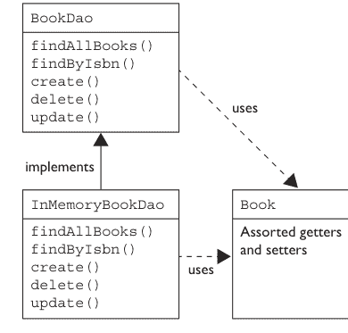

## 在工作中

除了让代码更易读之外，这种模式还让我们能够容易组织代码。我们可以将所有的 JavaBean 放在一个包中，接口放在另一个包中，实现类放在另一个包中。这种方法允许我们有一个用于内存实现的包，以及另一个用于 JDBC 实现的包。

## 收益

回顾一下，DAO 模式的优点如下：

- 主对象（在本例中）是内聚的，并且没有数据库代码堆积在那里。
- 所有的数据库代码都在程序的一个部分，便于查找。
- 我们可以在不更改业务对象的情况下更改数据库实现。
- 重用变得更容易。随着数据库的增长，我们可以创建辅助类甚至辅助基类。

# 工厂设计模式 (OCP 目标 3.7)

3.7 使用工厂设计和创建对象，并使用 API 中的工厂。

与单例设计模式一样，工厂设计是一种创建性模式。与单例模式不同，它不会限制你只能拥有一个对象副本。工厂设计模式会创建它所选择的任何实现的新对象。

## 问题

到目前为止，我们的 `BookDAO` 只有一种实现：`InMemoryBookDAO`。它并不十分健壮，因为它只在内存中存储对象。我们需要创建一个使用 JDBC 或写入文件或执行其他操作的版本，以便我们能够持久化状态。我们希望能够在不更改调用者代码（`Student`）的情况下更改 DAO 的实现。还记得耦合吗？这就是松耦合。接口是松耦合的一部分，但我们还希望更进一步。

## 解决方案

在仍然实现该模式的同时，我们能编写的最简单的工厂是一个抽象类以及一个包含一个方法的实现类：

```java
public abstract class Factory {
    public abstract BookDAO createDAO();
}

public class FactoryImpl extends Factory {
    public BookDAO createDAO() { // 现在，我们只有一个
        return new InMemoryBookDAO(); // 有一个 DAO
    }
}

public class Student {
    public static void main(String[] args) {
        Factory factory = new FactoryImpl();
        BookDAO dao = factory.createDAO(); // 创建 DAO
        // 使用 dao 进行工作
    }
}
```

这非常简单。`Factory` 是一个带方法的抽象类。它的实现简单地返回一个内存中的 DAO。从 `Student` 的角度来看，这就是全部了——`Factory` 类和 `BookDAO` 接口。注意，`Student` 不再拥有 `new InMemoryBookDAO` 这样的代码。

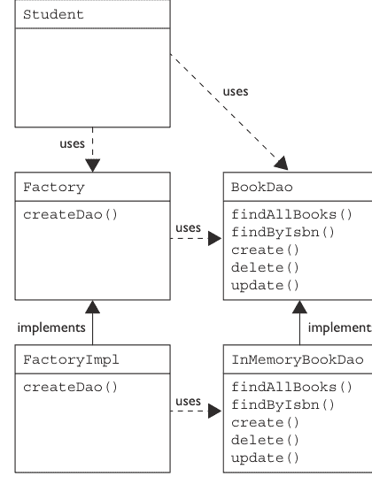

回顾一下，`Student` 只与两个抽象类 `Factory` 和 `BookDAO` 交互。所有的实现都让我们我们可以在更改 `FactoryImpl` 的实现而不影响调用者。

让我们尝试一个例子来展示我们如何更改工厂。假设我们写了一个使用真实数据库的 DAO 实现 `OracleDao`。我们可能会将 `FactoryImpl` 修改为：

```java
public class FactoryImpl extends Factory { // 工厂类
    public BookDAO createDAO() {
        if (Util.isTestMode()) {
            return new InMemoryBookDAO(); // 用于测试
        } else {
            return new OracleBookDAO(); // 用于真实
        }
    }
}
```

就是这样——`Student` 中什么都没有变。然而它开始使用真实的数据库实现。这是一个良好的设计。只需要在一个地方进行更改。

你可能奇怪为什么 `Factory` 是一个抽象类而不是接口。工厂方法模式常见的做法是“绕过”创建逻辑，或者至少意识到它可能在之后发生。例如，我们可以决定将测试逻辑检查包含在父类中，以便任何未来的子类使用它：

```java
public abstract class Factory {
    public BookDAO createDAO() {
        if (Util.isTestMode()) {
            return new InMemoryBookDAO();
        } else {
            return createDatabaseBookDAO(); // 用于子类
        }
    }

    protected abstract BookDAO createDatabaseBookDAO();
}

public class FactoryImpl extends Factory {
    protected BookDAO createDatabaseBookDAO() { // 填充实现
        return new OracleBookDAO();
    }
}
```


# 工厂设计模式 (OCP 目标 3.7)

## 3.7 使用工厂设计和创建对象，并使用 API 中的工厂

与单例设计模式一样，工厂设计是一种创建性模式。与单例模式不同，它不会限制你只能拥有一个对象副本。工厂设计模式会创建它所选择的任何实现的新对象。

## 问题

到目前为止，我们的 `BookDAO` 只有一个实现：`InMemoryBookDAO`。它并不十分健壮，因为它只在内存中存储对象。我们需要创建一个使用 JDBC 或写入文件或执行其他操作的版本，以便我们能够持久化状态。我们希望能够在不更改调用者代码（`Student`）的情况下更改 DAO 的实现。还记得耦合吗？这就是松耦合。接口是松耦合的一部分，但我们还希望更进一步。

## 解决方案

在仍然实现该模式的同时，我们能编写的最简单的工厂是一个抽象类以及一个包含一个方法的实现类：

```java
public abstract class Factory {
    public abstract BookDAO createDAO();
}

public class FactoryImpl extends Factory {
    public BookDAO createDAO() { // 现在，我们只有一个
        return new InMemoryBookDAO(); // 有一个 DAO
    }
}

public class Student {
    public static void main(String[] args) {
        Factory factory = new FactoryImpl();
        BookDAO dao = factory.createDAO(); // 创建 DAO
        // 使用 dao 进行工作
    }
}
```


# 工厂设计模式 (OCP 目标 3.7)

这非常简单。`Factory` 是一个带方法的抽象类。它的实现简单地返回一个内存中的 DAO。从 `Student` 的角度来看，这就是全部了——`Factory` 类和 `BookDAO` 接口。注意，`Student` 不再拥有 `new InMemoryBookDAO` 这样的代码。

以图的形式，这里是我们的类是如何组合在一起的：


回顾一下，`Student` 只与两个抽象类 `Factory` 和 `BookDao` 交互。所有的实现都让我们可以在更改 `FactoryImpl` 的实现而不影响调用者。

让我们尝试一个例子来展示我们如何更改工厂。假设我们写了一个使用真实数据库的 DAO 实现 `OracleDao`。我们可能会将 `FactoryImpl` 修改为：

```java
public class FactoryImpl extends Factory { // 工厂类

    public BookDao createDao() {

        if (Util.isTestMode()) {

            return new InMemoryBookDao(); // 用于测试

        } else {

            return new OracleBookDao(); // 用于真实

        }

    }

}
```

就是这样——`Student` 中什么都没有变。然而它开始使用真实的数据库实现。这是一个良好的设计。只需要在一个地方进行更改。

# 第 10 章：高级 OO 和设计模式

你可能奇怪为什么 `Factory` 是一个抽象类而不是接口。工厂方法模式常见的做法是“绕过”创建逻辑，或者至少意识到它可能在之后发生。例如，我们可以决定将测试逻辑检查包含在父类中，以便任何未来的子类都使用它：

```java
public abstract class Factory {

    public BookDao createDao() {

        if (Util.isTestMode()) {

            return new InMemoryBookDao();

        } else {

            return createDatabaseBookDao(); // 用于子类

        }

    }

    protected abstract BookDao createDatabaseBookDao();

}

public class FactoryImpl extends Factory {

    protected BookDao createDatabaseBookDao() { // 填充实现

        return new OracleBookDao();

    }

}
```

在这种情况下，子类 `Factory` 拥有所有公共逻辑，而子类 `FactoryImpl` 仅仅创建相关对象。注意尽管我们对方法实现进行了大量更改，但 API `createDao()` 的签名并没有更改。

## 两分钟演练

以下是本章每个认证目标的关键要点。

### IS-A/HAS-A (OCP 目标 3.3)

- IS-A 指继承。
- IS-A 通过 `extends` 或 `implements` 关键字表示。
- IS-A、“继承自”（inherits from）和“是...的子类型”（is a subtype of）都是等价表达式。
- HAS-A 意味着一个类的实例拥有另一个类的引用，或同一类的另一个实例。

### 耦合与内聚 (OCP 目标 3.3)

- 耦合（Coupling）指的是一个类了解或使用另一个类成员的程度。
- 松耦合（Loose coupling）是理想的状态，即类具有良好的封装性、最小化相互引用并限制 API 的使用范围。
- 紧耦合（Tight coupling）是不理想的状态，即类违反了松耦合的规则。
- 内聚（Cohesion）指的是一个类具有单一且定义良好的角色或职责的角色。
- 高内聚是理想的状态，即类的成员支持单一且集中的角色或职责。
- 低内聚是不理想的状态，即类的成员支持多个且不集中的角色或职责。

### 对象组合原则 (OCP 目标 3.4)

- 对象组合利用了 IS-A、HAS-A 和多态。
- 对象组合通过让每个类负责一件事，防止了子类的泛滥。
- 对象组合将功能委托给它所“拥有”的对象来实现。
- 方法转发（method forwarding）和方法委托（method delegation）这两个术语可以通用使用。

### 单例设计模式 (OCP 目标 3.5)

- 设计模式是“针对特定上下文中常见问题的通用可重用解决方案”。
- 对象的唯一实例允许程序共享其状态。
- 这种模式通过不重复相同的工作可能提高性能。
- 该模式通常将单实例存储为静态变量。
- 我们可以立即实例化（饥饿加载）或在需要时实例化（懒加载）。

### DAO 设计模式 (OCP 目标 3.6)

- DAO 代表数据访问对象（Data Access Object）。
- DAO 将数据存储职责与对象的核心职责分离。
- DAO 使用接口，以便我们可以更改实现。
- DAO 仅负责数据库操作，使主对象保持内聚。
- DAO 促进了重用。

### 工厂设计模式 (OCP 目标 3.7)

- 工厂是一种创建型设计模式。
- 工厂可以创建接口或抽象类的任何子类。
- 工厂是一个抽象类。
- 工厂子类允许存在多个工厂。
- 工厂方法的返回类型是接口或抽象类。
- 工厂方法的实现返回目标对象的子类。
- 抽象类中可能存在所有工厂子类共享的公共逻辑。

## 自测

以下问题将帮助你衡量对本章内容的理解。请仔细阅读所有选项，因为可能存在多个正确答案。为每个问题选择所有正确答案。请保持专注。

1. 已：

```java
class A extends B {

    C tail;

}
```

哪个是正确的？

A. HAS-A B 和 HAS-A c
B. HAS-A B 和 IS-A c
C. IS-A B 和 HAS-A c
D. IS-A B 和 IS-A c
E. B IS-A A 和 HAS-A c
F. IS-A A 和 IS-A c

2. 哪些语句是正确的？（选择所有可能的。）

A. 方法委托依赖于 IS-A 关系
B. 方法转发依赖于 HAS-A 关系
C. DAO 模式限制只有一个 DAO 实例
D. 单例模式依赖于 IS-A 关系
E. 使用对象组合时，类必须是 final 的

3. 已：

```java
public class F {

    private static final F f = new F();

    public static F c() {

        return f;

    }

    public void update(F a) {

    }

    public void delete(F a) {

    }

}
```

实现了什么设计模式或原则？

A. 耦合
B. DAO
C. 工厂
D. IS-A
E. 对象组合
F. 单例

4. 已：

```java
public class E {

    private D d;

    public void m() {

        d.m();

    }

    public static E getInstance() {

        return new E();

    }

}

class D {

    public void m() {}

}
```

实现了什么设计模式或原则？

A. DAO
B. 工厂
C. IS-A
D. 对象组合
E. 单例

5. 已：

```java
class A {

    abstract class G {

        A m() { return n(); }

        abstract A n();

    }

}
```

实现了什么设计模式或原则？

A. DAO
B. 工厂
C. IS-A
D. 对象组合
E. 单例

6. 哪些设计模式被归类为创建型模式？（选择所有可能的。）

A. 耦合
B. DAO
C. 工厂
D. IS-A
E. 对象组合

7. 哪些语句表示对模式的需求？（选择所有可能的。）

A. 模式限制你只有一个实例
B. 模式允许你更改实现
C. 模式促进了重用
D. 模式负责数据库操作

8. 已：

```java
class Dao {

    Collection<String> findAll() {

        return null;

    }

    void create(String a) {

    }

    void update(String a) {

    }

}
```

哪些语句是正确的？

I. 该类使用了接口
II. 该类处理数据库操作
III. 该类是单例
IV. 该类负责业务逻辑

# 第 10 章：高级面向对象（OO）与设计模式

- 9. A 和 C 是正确的。DAO 模式将数据访问代码的逻辑集中化，使得复用更加容易，并允许你切换实现类。B 是错误的，因为你仍然需要编写 DAO。D 是错误的，因为你是从业务对象中调用 DAO；而不是继承自它。E 是错误的，因为你可以拥有多个 DAO 对象。（OCP 目标 3.6）
- 10. B 和 C 是正确的。设计模式是概念层面和设计层面的。你必须为每种用例编写实现代码。D 是错误的，因为为 Java 定义了数十种模式。其中只有三种模式在考试中被测试过，但你应该意识到还存在更多模式。E 是错误的，因为重用同一个模式是有意义的。例如，你可能有多个 DAO 对象。A 和 F 是错误的，原因如上所述。（OCP 目标 3.5, 3.6 和 3.7）
- 11. C 是正确的。A、B 和 D 都是错误的。A 指的是封装，B 指的是耦合，D 指的是多态。（OCP 目标 3.3）
- 12. C 是正确的。通常情况下，公共变量是封装性弱的标志。A、B、D 和 E 都是错误的，因为根据提供的信息，这些陈述都无法支持。（OCP 目标 3.3）

## 泛型与集合

## 认证目标

- 创建泛型类
- 使用菱语法创建集合
- 分析使用原始类型和泛型类型的集合的互操作性
- 使用包装类和自动装箱
- 创建并使用 List、Set 和 Deque
- 创建并使用 Map
- 使用 `java.util.Comparator` 和 `java.lang.Comparable`
- 对数组和列表进行排序和搜索
- 两分钟演练

Q&A 自测

## 第 11 章：泛型与集合

泛型是 Java 5 中最受讨论的特性。有些人喜欢它们，有些人讨厌它们，但它们将一直存在。在最简单的情况下，它们可以使代码更容易编写且更健壮。在最复杂的情况下，创建和维护它们可能非常非常困难。幸运的是，考试出题者坚持了泛型的简单端，涵盖了最常见和实用的特性，忽略了大部分特别棘手的部分。

## 认证目标

### toString(), hashCode(), 和 equals() (OCP 目标 4.7 和 4.8)

- 4.6 toString() 将出现在考试的多个地方。
- 4.7 使用 `java.util.Comparator` 和 `java.lang.Comparable`。
- 4.8 排序和搜索数组及列表。

这可能不是显而易见的，但理解 `hashCode()` 和 `equals()` 对于处理 Java 集合至关重要，特别是使用 Map 以及在通用的搜索和生成时。

你习惯了。你有状态，你有行为，你有工作要做。（或者至少在通过考试后，你获得工作的机会会增加。）如果不排除基本类型，Java 中的一切都是对象。而不仅仅是一个对象，而是一个具有容量 O 的 Object。每个异常、每个事件、每个数组都继承自 `java.lang.Object`。对于考试来说，你不需要知道 Object 中的每一个方法，但你需要知道表 11-1 中列出的方法。

第 13 章涵盖了 `wait()`、`notify()` 和 `notifyAll()`。`finalize()` 方法在第 3 章中涵盖过。在本节中，我们将查看 `hashCode()` 和 `equals()` 方法，因为它们在运行集合时是如此关键。噢，这留下了 `toString()`，不是吗？好的，我们现在涵盖它，因为它只需要两秒。

## toString(), hashCode(), 和 equals() (OCP 目标 4.7 和 4.8)

| 表 11-1 | 方法 | 描述 |
| :--- | :--- | :--- |
| 考试涵盖的类方法 | `boolean equals(Object obj)` | 判断两个对象在意义上是否相等 |
| | `void finalize()` | 当垃圾回收器看到该对象无法被引用时被调用 |
| | `int hashCode()` | 为对象返回一个哈希值 int，以便其可以在使用哈希的集合类中用，包括 `Hashtable`、`HashMap` 和 `HashSet` |
| | `final void notify()` | 唤醒正在等待此对象锁的线程 |
| | `final void notifyAll()` | 唤醒所有等待此对象锁的线程 |
| | `final void wait()` | 使当前线程等待，直到另一个线程对该对象上调用 `notify()` 或 `notifyAll()` |
| | `String toString()` | 返回对象的“文本表示” |

## toString() 方法

当你想要让一个凡人能够读到关于你类对象的有意义的内容时，重写 `toString()`。当代码想要读取关于对象的有用详细信息时，可以调用对象的 `toString()`。例如，当你将对象引用传递给 `System.out.println()` 方法时，会调用对象的 `toString()` 方法，`toString()` 的返回值如下所示：

```java
public class HardToRead {

    public static void main(String[] args) {

        HardToRead h = new HardToRead();

        System.out.println(h);

    }

}
```

运行 `HardToRead` 类会得到美妙且有意义的：

```
% java HardToRead
HardToRead@4e70
```

前面的输出是你没有重写 Object 类的 `toString()` 方法时得到的结果。它给出了类名（至少那是有意义的），后面是 @ 符号，然后是对象 `hashCode` 的无符号十六进制表示。

尝试读取此输出可能会激励你在类中重写 `toString()` 方法，例如：

```java
public class BobTest {

    public static void main(String[] args) {

        Bob f = new Bob("GoBobGo", 19);

        System.out.println(f);

    }

}

class Bob {

    int shoeSize;

    String nickName;

    Bob(String nickName, int shoeSize) {

        this.nickName = nickName;

        this.shoeSize = shoeSize;

    }

    public String toString() {

        return "I am " + nickName + " with shoe size " + shoeSize;

    }

}
```


## 第 II 章：泛型与集合

有些人喜欢它们，有些人讨厌它们，但它们将一直存在。在最简单的情况下，它们可以使代码更容易编写且更健壮。在最复杂的情况下，创建和维护它们可能非常非常困难。幸运的是，考试出题者坚持了泛型的简单端，涵盖了最常见和实用的特性，忽略了大部分特别棘手的部分。

### 核心点：哈希表键与 equals() 方法

核心点在于：如果你希望你的类对象被用作哈希表（`hashtable`）的键（或任何使用等效性进行搜索和/或检索对象的数据结构中的元素），你就必须重写 `equals()` 方法，以便两个不同的实例可以被认为是同一个。那么，我们该如何修复汽车类的问题呢？你可能会重写 `equals()` 方法，以唯一的 VIN（车辆识别号码）作为比较的基础。这样，当你向集合（`Collection`）中添加时可以使用一个实例，并在想要通过该对象进行搜索时，本质上是创建一个完全相同的实例。当然，为 `Car` 类重写 `equals()` 方法也允许存在多个代表同一辆汽车的对象，这在你的设计中可能是不安全的。幸运的是，`String` 和包装类在哈希表中作为键运行良好——它们重写了 `equals()` 方法。你可以直接使用代表汽车唯一标识符的 `String`。这样，你永远不会有多个代表特定汽车的实例，但你仍然可以使用汽车——或者说汽车的某个属性——作为键。

### 实现 equals() 方法

假设你在类中重写了 `equals()`。它看起来像这样：

```java
public class EqualTest {

    public static void main(String[] args) {

        Moof one = new Moof(8);
        Moof two = new Moof(8);

        if (one.equals(two)) {
            System.out.println("one and two are equal");
        }
    }
}

class Moof {

    private int moofValue;

    Moof(int val) {
        moofValue = val;
    }

    public int getMoofValue() {
        return moofValue;
    }

    public boolean equals(Object o) {
        if ((o instanceof Moof) && ((Moof) o).getMoofValue() == this.moofValue) {
            return true;
        } else {
            return false;
        }
    }
}
```

### toString(), hashCode(), and equals() (OCP) 目标 4.7 和 4.8

让我们详细分析这段代码。在 `EqualsTest` 的 `main()` 方法中，我们创建了两个 `Moof` 实例，向 `Moof` 构造函数传递了相同的值 8。现在看 `Moof` 类，看看它是如何处理构造参数的——它将该值赋值给 `moofValue` 变量。假设你决定如果两个 `Moof` 对象的 `moofValue` 相同，它们就是同一个。因此重写 `equals()` 方法并比较这两个 `moofValue`。这很简单。但分解一下 `equals()` 方法中发生了什么：

```java
1. public boolean equals(Object o) {
2.     if ((o instanceof Moof) && ((Moof)o).getMoofValue() == this.moofValue) {
3.         return true;
4.     } else {
5.         return false;
6.     }
7. }
```

首先，必须遵守所有的重写规则，在第 1 行，我们确实声明了对从 `Object` 继承的 `equals()` 方法的有效重写。第 2 行是关键所在。逻辑上，为了进行有效的等效比较，我们需要做两件事。

首先，确保被测试的对象是正确的类型！它是以多态形式作为 `Object` 类型传入的，因此你需要对其进行实例测试。通常认为让不同类的对象被认为是相等的并不是好主意，这是一个我们在这里不讨论的设计问题。此外，你仍然必须进行 `instanceof` 测试，以确保可以将对象参数强制转换为正确的类型，以便实际上访问其方法或变量来执行比较。记住，如果对象没有通过实例测试，将得到 `ClassCastException`。例如：

```java
public boolean equals(Object o) {
    if (((Moof)o).getMoofValue() == this.moofValue()) {
        // 前面的一行可以编译，但这是糟糕的！
        return true;
    } else {
        return false;
    }
}
```

如果 `(Moof)` 强制转换引用的不是一个 IS-A `Moof` 的对象，则转换将失败。其次，比较我们关心的属性（在这种情况下，仅为 `moofValue`）。只有开发者才能决定什么让两个实例相等。（为了获得最佳性能，你会希望检查尽可能少的属性）。

如果你对整个 `((Moof)o).getMoofValue()` 语法感到有些惊讶，我们只是在尝试调用一个 `Moof` 类中有的但在 `Object` 类中没有的方法时，即时对对象引用 `o` 进行强制转换。记住，如果没有强制转换，你就无法编译，因为编译器看到的由 `o` 引用的对象仅仅是一个 `Object`。由于 `Object` 类没有 `getMoofValue()` 方法，编译器会报错。但正如我们所说，即使有了强制转换，如果由 `o` 引用的对象不是可以强制转换为 `Moof` 的东西，代码在运行时也会失败。所以不要忘记先使用 `instanceof` 测试。这是欣赏短路运算符的另一个理由：

```java
if (o instanceof Moof && ((Moof)o).getMoofValue() == this.moofValue) {
    return true;
} else {
    return false;
}
```


## 第 II 章：泛型与集合

核心点在于：如果你希望你的类对象被用作哈希表（`hashtable`）的键（或任何使用等效性进行搜索和/或检索对象的数据结构中的元素），你就必须重写 `equals()` 方法，以便两个不同的实例可以被认为是同一个。那么，我们该如何修复汽车类的问题呢？你可能会重写 `equals()` 方法，以唯一的 VIN（车辆识别号码）作为比较的基础。这样，当你向集合（`Collection`）中添加时可以使用一个实例，并在想要通过该对象进行搜索时，本质上是创建一个完全相同的实例。当然，为 `Car` 类重写 `equals()` 方法也允许存在多个代表同一辆汽车的对象，这在你的设计中可能是不安全的。幸运的是，`String` 和包装类在哈希表中作为键运行良好——它们重写了 `equals()` 方法。你可以直接使用代表汽车唯一标识符的 `String`。这样，你永远不会有多个代表特定汽车的实例，但你仍然可以使用汽车——或者说汽车的某个属性——作为键。

## `toString()`, `hashCode()`, 和 `equals()` (OCP 目标 4.7 和 4.8)

### `equals()` 约定

直接引用 Java 文档，`equals()` 约定规定：

- 它是自反的（reflexive）。对于任何引用值 `x`，`x.equals(x)` 应该返回 `true`。
- 它是对称的（symmetric）。对于任何引用值 `x` 和 `y`，当且仅当 `y.equals(x)` 返回 `true` 时，`x.equals(y)` 返回 `true`。
- 它是传递的（transitive）。对于任何引用值 `x`、`y` 和 `z`，如果 `x.equals(y)` 返回 `true` 且 `y.equals(z)` 返回 `true`，那么 `x.equals(z)` 必须返回 `true`。
- 它是一致的（consistent）。对于任何引用值 `x` 和 `y`，只要 `equals()` 中使用的信息没有被修改，多次调用 `x.equals(y)` 都会一致地返回 `true` 或一致地返回 `false`。
- 对于非空引用值 `x`，`x.equals(null)` 应该返回 `false`。

### 重写 `hashCode()`

哈希值通常用于提高大型集合的性能。对象的 `hashCode` 值被某些集合类使用（我们将在本章晚些部分讨论集合）。尽管你可以将其视为某种对象 ID 号，但它并不是唯一的。`HashMap` 和 `HashSet` 等集合使用对象的 `hashCode` 值来决定对象应如何存储在集合中，而 `hashCode` 再次用于帮助在集合中定位该对象。对于考试，你不需要理解使用哈希的集合类是如何实现的深度细节，但你需要知道哪些集合使用了它们（但是，嗯，它们名字里都有 "hash"，所以你应该能发现）。你还必须能够识别 `hashCode()` 的恰当或正确实现。这并不意味着它是合法的，甚至不意味着高效的。在你的类中拥有一个极其低效的方法是完全合法的，只要它不违背 `Object` 文档中指定的约定（我们稍后会看该约定）。对于考试，如果你被要求选择 `hashCode` 的适当或正确用法，不要把适当误认为是合法或高效的。

## 理解哈希值

为了理解什么是正确的做法，我们必须观察某些集合是如何使用哈希值的。

想象地板上整齐着一排桶。有人递给你一张写着名字的纸条。你拿着这个名字，并根据规则计算出一个整数代码：将 A 为 1，B 为 2，以此类推，将名字中所有字母的数值相加。一个给定的名字总是会产生相同的代码；见图 11-1。

我们并没有引入任何新东西；我们只是有了一个算法，它在给定特定输入时总是以相同的方式运行，因此对于任何两个相同的输入，输出将是相同的。到目前为止一切顺利吧？现在，你使用该代码（我们称之为哈希值）的方式是用来决定将纸条放在哪个桶里（每个桶代表你可能得到的某个不同代码值）。想象某人来向你展示一个名名并说：“请取出与这个名字匹配的纸条。”于是你查看你展示的名字，并运行相同的哈希值生成算法。哈希值告诉你在应该在哪个桶里查找该名字。

不过，你可能已经注意到我们的系统中存在缺陷。两个不同的名字可能会产生相同的值。例如，Amy 和 May 名字具有相同的字母，所以这两个名字的哈希值是相同的。这是可以的，但这意味着当有人向你（桶管理员）索要 Amy 的纸条时，你仍然需要搜索目标桶，读取每个名字直到找到 Amy 而不是 May。哈希值只告诉你应该进入哪个桶，而没有告诉你在进入桶后如何定位该名字。

| 键 (Key) | 哈希值算法 | 哈希值 |
| :--- | :--- | :--- |
| Alex | A(1) + L(12) + E(5) * 24 | = 42 |
| Bob | B(2) + O(15) | = 19 |
| Dirk | D(4) + (9) + R(18) + K(11) | = 42 |
| Fred | F(6) + R(18) + E(5) + D(4) | = 33 |

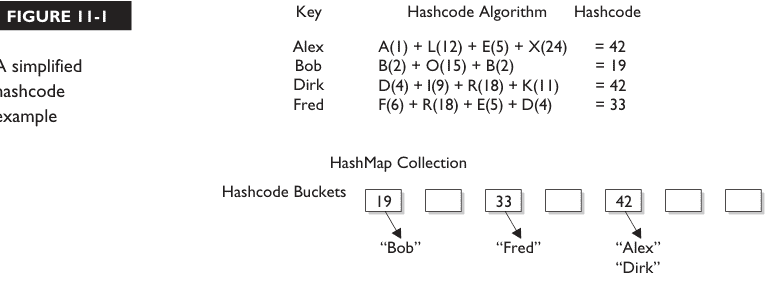

> **考试提示**
> 在现实生活的哈希中，一个桶里有多个条并不罕见。哈希检索是一个两步过程：
> 1. 找到正确的桶（使用 `hashCode()`）。
> 2. 在桶中搜索正确的元素（使用 `equals()`）。

因此，为了效率，你的目标是让纸条尽可能均匀地分布在所有桶中。理想情况下，每个桶可能只有一个名字，这样当有人索要纸条时，你只需计算哈希值并从正确的桶中取出纸条，而无需翻遍该桶中的不同纸条直到找到你找的那一个。最差（但可行）的哈希值生成器无论名字是什么，都会返回相同的哈希值（例如 42），导致所有纸条都落在同一个桶里，而其他桶则是空的。桶管理员不得不痛苦地不断翻找每个桶里的每一个名字，直到找到正确的那个。至于其工作原理，他们可能完全不使用哈希值，而直接去一个大桶，从一端开始逐一查看每张纸条，直到找到想要的。

这种分布在各个桶中的示例与集合中使用哈希值的方式类似。当你将一个对象放入使用哈希值的集合时，集合使用该对象的哈希值来决定该对象应该落在哪个桶/槽中。当你想要获取该对象（或者对于哈希表，是检索与之关联的值）时，你必须给集合一个对象的引用，集合将将其与在集合中持有的对象进行比较。由于存储在集合中的对象（如纸条）与你正在搜索的对象（你展示给桶管理员的名字）具有相同的哈希值，因此该对象会被找到。但是——这是一个非常重要的一点——想象一下，回到我们名字的例子，如果你向桶管理员展示一个名字，而他们仅根据名字中的一半字母而不是所有字母来计算代码，会怎样？他们永远在桶里找不到那个名字，因为他们根本没有去正确的桶里！

现在你明白为什么如果两个对象被认为是相等的，它们的哈希值也必须相等了吗？否则，你永远无法找到该对象，因为 `Object` 类中默认的 `hashCode` 方法实际上为每个对象生成一个唯一的数字，即使 `equals()` 方法被重写为使得两个或多个对象被认为是相等的。如果它们的哈希值没有反映这一点，无论这些对象有多相等都没关系。所以再次强调一遍：如果两个对象相等，它们的哈希值也必须相等。

### 实现 `hashCode()`

真正的哈希算法到底是什么样子的？从计算机科学的角度来看，人们为了哈希算法获得了博士学位，这超出了考试范围。遵循契约的部分，请想想你在 `equals()` 方法中做了什么。你比较属性，因为比较几乎总是比较实例变量的值（还记得我们看过的两个 `Moof` 对象，并认为它们的 `int moofValues` 如果相等，我们就认为它们是相等的吗？）。你的 `hashCode()` 应该使用实例变量。这是一个示例：

```java
class Hash {

    public int x;

    Hash(int xVal) {
        this.x = xVal;
    }

    public boolean equals(Object o) {
        if (o instanceof Hash) {
            Hash h = (Hash) o;
            if (h.x == this.x) {
                return true;
            } else {
                return false;
            }
        }
        return false;
    }

    public int hashCode() {
        return x * 17;
    }
}
```

这并没有违反契约。两个值相等的对象将具有相同的哈希值 

### `hashCode()` 契约

现在直接来自 Java API 文档 `Object` 类，我们向大家展示 `hashCode()` 契约：

*   在 Java 应用程序执行期间，如果对同一个对象多次调用 `hashCode()`，只要 `equals()` 中没有使用任何信息对对象的比较被修改了，`hashCode()` 方法必须一致地返回相同的整数。这个整数不需要在应用程序的某次执行和另一次执行之间保持一致。
*   如果两个对象根据 `equals(Object)` 方法相等，那么对这两个对象中的每一个对象调用 `hashCode()` 方法都产生相同的整数。
*   并不要求如果两个对象根据 `equals(java.lang.Object)` 方法不相等，那么对这两个对象中的每一个对象调用 `hashCode()` 方法必须产生不同的整数结果。然而，程序员应该意识到，为不相等的对象产生不同的整数结果可能会提高哈希表的性能。

这对你来说意味着……

| 条件 | 必须的 | 不需要（但允许） |
| :--- | :--- | :--- |
| `x.equals(y) == true` | `x.hashCode() == y.hashCode()` | |
| `x.hashCode() == y.hashCode()` | | `x.equals(y) == true` |
| `x.equals(y) == false` | | 无 `hashCode()` 限制 |
| `x.hashCode() != y.hashCode()` | `x.equals(y) == false` | |

所以，让我们看看什么可能导致 `hashCode()` 方法失败。如果你在 `hashCode()` 方法中包含一个 `transient` 变量会怎样？虽然这是合法的（编译器不会报错），但在某些情况下，你可能将一个对象放入集合却无法找到。正如你可能知道的，序列化保存一个对象以便其通过反序列化变回完整对象来重新复活。但危险，罗宾逊——当对象被序列化时，`transient` 变量不会被保存。一个糟糕的场景可能如下：

```java
class SaveMe implements Serializable {

    transient int x;
    int y;

    SaveMe(int xVal, int yVal) {
        x = xVal;
        y = yVal;
    }

    public int hashCode() {
        return (x ^ y);    // 合法，但不正确
    }

    // 使用临时变量
    public boolean equals(Object o) {
        SaveMe test = (SaveMe) o;
        if (test.y == y && test.x == x) { // 合法，但不正确
            return true;
        } else {
            return false;
        }
    }
}
```


## 以下是用代码可能发生的情况（为其实例变量赋值）

1. 给对象一些状态（为其实例变量赋值）。
2. 将对象放入 `HashMap` 中，使用该对象作为键。
3. 使用序列化将对象保存到文件中，而不改变其任何状态。
4. 通过反序列化从文件中检索该对象。
5. 使用反序列化的（在堆上重新复活的）对象从 `HashMap` 中取出对象。

哎。集合中的对象和所谓的重新复活的相同对象不再是同一个了。对象的 `transient` 变量将以默认值返回，而不是它保存时（或放入 `HashMap` 时）的值。因此，使用前面的 `SaveMe` 代码，如果当实例放入 `HashMap` 时 `x` 的值为 9，那么由于 `x` 被用于计算 `hashCode`，当 `x` 的值改变时，并且当从反序列化带回任何相同的 `SaveMe` 实例时，`x == 0`，无论对象序列化时 `x` 的值是多少。由于 `x` 被用于确定对象的相等性，新的 `hashCode` 计算和 `equals()` 方法失败了。

总结：`transient` 变量确实会搞乱你的 `equals()` 和 `hashCode()` 实现。保持变量非 `transient`，或者如果它们必须标记为 `transient`，请不要用它们来确定哈希码或相等性。

# 集合概述 (OCP 目标 4.5 和 4.6)

- 4.5 创建并使用 List、Set 和 Deque。
- 4.6 创建并使用 Map。

在这一节中，我们将对考试涵盖的集合主要类别进行相对高层次的讨论。我们将从抽象层面观察它们的特征和用途。在随后的章节中，将深入研究每个类集合并展示每个类的具体示例。

你能想象在不使用哈希表或链表等数据结构的情况下编写面向对象的应用程序吗？当你需要维护一个排序列表（例如，你辛普森粉丝俱乐部的所有成员列表）时，你会做什么？显然，你可以自己实现；Amazon.com 有数千本的算法书籍供你购买。但以今天程序员的日程，考虑这些几乎太痛苦了。

Java 集合框架随 JDK 1.2 发布而形成，并在 1.4 再次在 Java 5 中进行了扩展，它提供了列表、集合、映射和队列来满足你大部分的编码需求。它们经过了尝试、测试和调整。为你的工作选择最合适的一个，你就能获得合理的性能。当你需要一些更自定义的内容时，`java.util` 包中的集合框架加载了许多接口和工具类。

## 所以你对集合做了什么

你通常在操作集合时会使用的几个基本操作：

- 将对象添加到集合中。
- 从集合中移除对象。
- 找出某个对象（或一组对象）是否在集合中。
- 在不移除的情况下从集合中检索对象。
- 遍历集合，一个接一个查看每个元素（对象）。

## 关键接口和类

集合框架从接口开始，同时也为你提供了具体的类。你需要了解的核心接口是：

| Collection | Set | SortedSet |
| :--- | :--- | :--- |
| List | | |
| Map | | |
| Queue | | |

## 592 第二章：泛型与集合

也许我们应该明确区分“有序（ordered）”和“排序的（sorted）”的区别，但首先我们先讨论迭代的概念。当你考虑到迭代时，你可能会想到使用 `for` 循环遍历数组，以访问数组中的每个元素 `[0]`、`[1]`、`[2]` 等。遍历集合通常意味着从第一个元素开始，一个接一个地遍历元素。尽管如此，有时甚至“第一个”这个概念本身都有些奇怪——在哈希表中，实际上并没有第一、第二、第三之类的概念。在哈希表中，元素是根据键的哈希值放置在一个（看似）混乱的顺序中的。但当你迭代时，总得有一个先来；这时就会有一个顺序。但就你所知的，这种顺序完全是任意的，并且随着集合的变化以随机的方式改变。

**有序的** 当集合是有序的。

**排序的** 排序的集合意味着集合中的顺序是由某些规则或规则（如排序顺序）决定的。排序顺序与对象何时添加到集合、最后一次被访问的时间，或者它被添加到什么“位置”无关。排序是基于对象的属性完成的。你将对象放入集合，集合将根据排序顺序确定如何放置它们。一个保持顺序的集合（如任何 `List`，它使用插入顺序）除非它使用某种排序顺序进行排序，否则通常不被认为是排序的。最常用的排序顺序被称为“自然顺序”。这意味着什么呢？

你知道如何按字母顺序排序——A 在 B 之前，F 在 G 之前，以此类推。对于 `String` 对象的集合，自然顺序就是字母顺序。对于 `Integer` 对象，自然顺序是数值——1 在 2 之前，以此类推。对于 `Foo` 对象，自然顺序是嗯……我们不知道。除非 `Foo` 的开发者通过一个接口（`Comparable`）提供了一个类实例可以相互比较的定义（实例 a 在实例 b 之前，还是 b 在 a 之前？），否则 `Foo` 没有自然顺序。如果开发者决定 `Foo` 对象应该使用某个实例变量的值（假设有一个名为 `bar` 的变量）进行比较，那么排序集合将根据 `Foo` 类中关于如何使用 `bar` 变量来确定顺序的规则对 `Foo` 对象进行排序。当然，在某些情况下，`Foo` 类也可能从父类继承自然顺序，而不是定义自己的顺序。

除了 `Comparable` 接口指定的自然顺序外，还可能通过另一个接口定义其他、不同的排序顺序：`Comparator`。我们将在本章稍后的部分讨论如何同时使用 `Comparable` 和 `Comparator` 来定义排序。但现在，请记住，排序顺序（自然顺序）不等同于按插入、访问或索引进行排序。

现在我们已经了解了有序和排序，我们将查看四个接口中的每一个，并深入研究这些接口的具体实现。

## List 接口

`List` 关注索引。`List` 拥有的非列表集合不具备的唯一一点是一组针对索引的方法。这些关键方法包括 `get(index)`、`indexOf(Object o)`、`add(int index, Object obj)` 等。所有 `List` 的实现都是按索引位置排序的——该位置通过在特定索引处设置对象，或通过在不指定位置的情况下添加对象（在这种情况下，对象被添加到末尾）来决定的。以下章节将描述三个 `List` 实现。

**ArrayList**：将其看作一个可伸缩的数组。它提供了快速的迭代和随机访问。显而易见的是：它是有序集合（按索引），但不是排序的。你可能想知道，从 1.4 版本开始，`ArrayList` 现在实现了新的 `RandomAccess` 接口——这是一个标记接口（意味着它没有方法），表示“此支持快速的（通常是常数时间）随机访问”。当你需要快速迭代但可能需要大量插入和删除操作时，选择它而不是 `LinkedList`。

**Vector** 是 Java 早期的遗留；`Vector` 和 `Hashtable` 是两个原始集合——其余是在 Java 2 版本 1.2 和 1.4 添加的。`Vector` 基本上和 `ArrayList` 相同，但 `Vector` 方法是线程安全的（同步的）。你通常希望使用 `ArrayList` 而不是 `Vector`，因为同步方法会带来你可能需要的性能开销。如果你确实需要线程安全，`Collections` 类中的工具方法可以提供帮助。`Vector` 是除 `ArrayList` 之外实现 `RandomAccess` 的唯一类。

**LinkedList**：`LinkedList` 与 `ArrayList` 一样按索引排序，但元素之间是双向链接的。这种链接为你提供了新的方法（除了你在 `List` 接口需要的之外），用于从开头或结尾添加和删除元素，这使其实现栈或队列的简单选择。记住，`LinkedList` 的迭代可能比 `ArrayList` 慢，但你需要快速插入和删除时，它是一个很好的选择。从 Java 5 开始，`LinkedList` 类已增强以实现 `java.util.Queue` 接口。因此，它现在支持常用的队列方法 `peek()` 和 `offer()`。

## Set 接口

`Set` 关注唯一性——它不允许重复项。你的朋友 `equals()` 方法决定了两个对象是否相同（在这种情况下，集合中只能有一个）。以下章节将描述三个 `Set` 实现。

**HashSet**：`HashSet` 是一个未排序、无序的 `Set`。它使用键的哈希值。当你需要一个 `Set` 且不在意遍历顺序时，`HashSet` 是最佳选择；其他集合会增加额外的开销。元素落在 `Set` 中的位置取决于你的对象的哈希值，就像 `Hashtable` 一样，越有效的 `hashCode()` 实现，访问性能越好。

**LinkedHashSet**：`LinkedHashSet` 是 `HashSet` 的有序版本，维护元素的插入顺序。当你需要一个 `Set` 且在乎遍历顺序时，`LinkedHashSet` 是最佳选择；其他集合会增加额外的开销。元素落在 `Set` 中的位置取决于你的对象的哈希值。


**TreeSet**：`TreeSet` 是排序集合之一（另一个是 `TreeMap`）。它使用红黑树结构（你知道这一点），并保证元素按照自然顺序升序排列。可选，你可以使用 `Comparator` 构建 `TreeSet`。从 Java 6 开始，`TreeSet` 实现了 `NavigableSet`。

## Map 接口

`Map` 关注唯一标识符。你将唯一的键（ID）映射到一个特定的值，其中键和值当然都是对象。你对 `Map` 非常熟悉，因为许多语言都支持使用键值对的数据结构。`Map` 的实现允许你根据键查找值，请求仅包含键的集合。就像 `Set` 一样，`Map` 依赖 `equals()` 方法来确定键是否相同。

**HashMap**：`Hashtable` 给你一个未排序、无序的 `Map`。当你需要一个 `Map` 且不在意遍历顺序时，`HashMap` 是最佳选择；其他映射会增加额外的开销。键落在的位置取决于键的哈希值，就像 `Hashtable` 一样，越有效的 `hashCode()` 实现，访问性能越好。`HashMap` 允许空值和一个空键。

**Hashtable**：像 `Vector` 一样，`Hashtable` 存在于 Java 早期。有趣的是，不要忘记注意命名不一致：`HashMap` 与 `Hashtable`。大小写问题？算了吧。总之，正如 `Vector` 是更简洁、更现代的 `ArrayList` 的同步对应，`Hashtable` 是 `HashMap` 的同步对应。记住你并不同步一个类，所以我们说 `Vector` 和 `Hashtable` 是同步的，我们只是指该类的关键方法是同步的。另一个区别是，虽然 `HashMap` 允许空值以及一个空键，`Hashtable` 不允许任何空值。

**LinkedHashMap**：与它的对应项 `LinkedHashSet` 一样，`LinkedHashMap` 集合维护插入顺序（或者可选的访问顺序）。尽管它将在添加和删除元素方面比 `HashMap` 慢一些，但你可以预期 `LinkedHashMap` 有更快的迭代速度。

**TreeMap**：你现在可能猜到 `TreeMap` 是一个有序的 Map。你已经知道这一点，默认情况下，这意味着“按照元素的自然顺序排序”。对于 `TreeSet` 和 `TreeMap`，当你在构造它们时，可以通过 `Comparator` 来定义自定义的排序顺序，以指定元素在进行排序时应该如何相互之间进行比较。从 Java 6 开始，`TreeMap` 实现了 `NavigableMap` 接口。

## Queue 接口

`Queue`（队列）设计用于存放一个“待办事项”列表，或者需要以某种方式处理的内容。虽然可能有其他顺序，但队列通常被认为是先进先出（FIFO）。队列支持所有的标准 `Collection` 方法，并且具有添加、减去元素以及移除队列元素的方法。

**PriorityQueue**（优先级队列）：该类是 Java 5 引入的新类。由于 `LinkedList` 类已经增强并包含了 `Queue` 接口，因此可以使用 `LinkedList` 处理基本队列。`PriorityQueue` 的目的是创建一个“优先级入，优先级出”的队列，而不是典型的 FIFO 队列。`PriorityQueue` 的元素要么按自然顺序排序（在这种情况下，先排序的元素将被先访问），要么根据 `Comparator` 排序。无论哪种情况，元素代表它们的相对优先级。


如果你识别出例如，当你需要一个名称/值对集合时，`Map` 不能作为选择类（因为 `Map` 是一个接口而不是具体的实现类），你就可以立即排除某些答案。考试中的措辞在关键时刻是明确的，所以如果你被要求选择一个接口，请选择接口而不是实现该接口的类。反之亦然——如果你被要求选择一个类，不要选择接口类型。

表 11-2 总结了考试需要理解的 13 个集合导向类中的 11 个（`Arrays` 和 `Collections` 马上就来）！

| 表 11-2 | 类 | Map | Set | List | 有序 | 有排序 |
| :--- | :--- | :--- | :--- | :--- | :--- | :--- |
| Collection 接口 | HashMap | X | | | No | No |
| | Hashtable | X | | | No | No |
| 具体实现 | TreeMap | X | | | 有序 | 按自然顺序或自定义比较规则 |
| 类 | LinkedHashMap | X | | | 按插入顺序或最后访问顺序 | |
| | HashSet | | X | | No | No |
| | TreeSet | | X | | 有序 | 按自然顺序或自定义比较规则 |
| | LinkedHashSet | | | X | 按插入顺序 | No |
| | ArrayList | | | X | 按索引 | 否 |
| | Vector | | | X | 按索引 | 否 |
| | LinkedList | | | X | 按索引 | 否 |
| | PriorityQueue | | | | 有序 | 按优先级排序 |

务必知道如何以实际的方式解释表 11-2。对于考试，你可能被要求根据特定的需求（以场景形式表示的需求）来选择一个集合。例如，如果你需要维护并搜索一个由唯一序列号标识的部件列表，其中部件的类型为 `Part`，你会使用哪种集合？如果我们修改要求，即你还需要按序列号顺序打印部件，你会改变答案吗？对于第一个问题，你可以看到由于你需要一个 `Part` 类来根据序列号搜索对象，你需要一个 Map。键将是 `String` 类型的序列号，值将是实例。默认选择应该是 `HashMap`，它是访问最快的 Map。但现在当我们修改要求包含按序列号顺序获取部件时，我们需要 `TreeMap`，因为它能维护键的自然顺序。由于键是 `String`，`String` 的自然顺序将是标准的字母排序。如果要求是跟踪哪个部件最后被访问，那么我们可能需要 `LinkedHashMap`。但由于 `LinkedHashMap` 会丢失自然顺序（替换为最后访问顺序），如果我们需要按序列号列出部件，我们将必须使用工具方法对集合进行排序。

# 认证目标

## 使用集合
OCP 目标 4.2, 4.4, 4.5, 4.6, 4.7, 4.8

- 4.3 使用菱形语法创建集合。
- 4.4 使用包装类和自动装箱。
- 4.5 创建并使用 List、Set 和 Deque。
- 4.6 创建并使用 Map。
- 4.7 使用 `java.util.Comparator` 和 `java.lang.Comparable`。
- 4.8 排序和搜索数组和列表

我们已经对集合框架中的关键接口和类进行了高层次的理论回顾；现在让我们看看它们在实践中是如何运作的。

## ArrayList 基础

让我们快速回顾一下我们在第 5 章中学到的关于 `ArrayList` 的知识。`java.util.ArrayList` 类是集合框架中最常用的类之一。它就像一个数组。`ArrayList` 相比数组的一些优势是：

- 它可以动态增长。
- 它提供了更强大的插入和搜索机制。

让我们来看一个包含字符串的 `ArrayList`。集合框架的一个关键设计目标是提供像 `List`、`Set`、`Deque` 和 `Map` 这样的接口。在实践中，让我们来看一个包含字符串的 `ArrayList`：

```java
List<String> list = new ArrayList<>();

list.add("Apple");

list.add("Banana");

list.add("Cherry");

System.out.println(list);
```

`ArrayList` 的一个关键特性是它能够存储任何对象，这使得它非常有用。在需要元素时，`ArrayList` 能够实现：

```java
List<String> list = new ArrayList<>();

list.add("Apple");

list.add("Banana");

list.add("Cherry");

System.out.println(list.get(1)); // 输出 Banana
```

`ArrayList` 的另一个优势是它可以方便在任何位置插入元素：

```java
List<String> list = new ArrayList<>();

list.add("Apple");

list.add("Banana");

list.add("Cherry");

list.add(1, "Date"); // 在索引 1 处插入
```


System.out.println(list); // 输出 [Apple, Date, Banana, Cherry]

`ArrayList` 还可以移除元素：

```java
List<String> list = new ArrayList<>();

list.add("Apple");
list.add("Banana");
list.add("Cherry");
list.remove("Banana"); // 根据对象移除
list.remove(0); // 根据索引移除
System.out.println(list); // 输出 [Apple, Cherry]
```

最后，我们还可以遍历 `ArrayList`：

```java
List<String> list = new ArrayList<>();

list.add("Apple");
list.add("Banana");
list.add("Cherry");

for (String fruit : list) {
    System.out.println(fruit);
}
```

此外，还可以使用 `Iterator` 遍历 `ArrayList`：

```java
List<String> list = new ArrayList<>();

list.add("Apple");
list.add("Banana");
list.add("Cherry");

Iterator<String> it = list.iterator();

while (it.hasNext()) {
    System.out.println(it.next());
}
```

`ArrayList` 还可以轻松转换为数组：

```java
List<String> list = new ArrayList<>();

list.add("Apple");
list.add("Banana");
list.add("Cherry");

String[] array = list.toArray(new String[0]);
```

## 自动装箱与拆箱

在 Java 5 之前，基本类型和包装类之间的转换需要手动完成。自动装箱（autoboxing）是将基本类型转换为包装类，而拆箱（unboxing）是指将包装类转换为基本类型。

```java
List<Integer> list = new ArrayList<>();

list.add(10); // 自动装箱
list.add(20); // 自动装箱

int first = list.get(0); // 自动拆箱
int second = list.get(1); // 自动拆箱
```

自动装箱在算术运算中也可以：

```java
Integer count = 0;

count++; // count 会先被自动拆箱为 int，加 1 后自动装箱回 Integer
```

需要注意，拆箱 `null` 值会抛出 `NullPointerException`。

```java
Integer count = null;

int value = count; // 抛出 NullPointerException
```

# 使用集合 (OCP 目标 4.2, 4.4, 4.5, 4.6, 4.7 和 4.8)

然而，发生的情况是创建了第二个包装对象，并将其值设置为 568。如果我们能访问第一个包装对象，我们就能证明这一点。让我们尝试这个：

```java
Integer y = 567;              // 创建一个包装
Integer x = y;                // 分配第二个引用，变量指向同一个包装
System.out.println(y == x);   // 验证它们是否引用同一个对象
y++;                          // 解箱，使用，“重新包装”
System.out.println(x + " " + y);  // 打印值
System.out.println(y == x);   // 验证它们是否引用不同的对象
```

产生如下输出：

```
true
567 568
false
```

所以，在底层，当编译器处理到 `y++;` 这一行时，它必须替换为类似下面的内容：

```java
int x2 = y.intValue();      // 解箱它
x2++;                       // 使用它
y = new Integer(x2);        // 重新包装它
```

正如我们所料的那样，那里一定有一个 `new` 的调用。

## 装箱、== 和 equals()

我们刚刚使用 `==` 对包装类进行了简单的探索。让我们更深入查看包装类是如何配合 `==` 和 `equals()` 的。API 开发者决定，对于所有的包装类，如果两个对象的类型相同且具有相同的值，那么它们就是相等的。如果出现这种情况将会意外：

```java
Integer ii = 1000;
Integer ii2 = 1000;

if (ii != ii2) System.out.println("different objects");
if (ii.equals(ii2)) System.out.println("meaningfully equal");
```

产生输出：

```
different objects
meaningfully equal
```

这两个恰好具有相同值的包装对象。因为它们具有相同的 int 值，`equals()` 方法认为它们是“有意义的等价的”，因此返回 true。那这一个呢：

```java
Integer i3 = 10;
Integer i4 = 10;

if (i3 == i4) System.out.println("same object");
if (i3.equals(i4)) System.out.println("meaningfully equal");
```

这个示例产生输出：

```
same object
meaningfully equal
```

哎！`equals()` 方法似乎在工作，但 `==` 和 `!=` 发生了什么？为什么它告诉我们 `i1` 和 `i2` 是不同的对象，`==` 却说 `i3` 和 `i4` 是同一个对象？为了节省内存，以下包装对象的两个实例（通过装箱创建）当它们的原始值相同时，始终是 `==` 的：

- `Boolean`
- `Byte`
- 从 `\u0000` 到 `\u007f` 的字符 (7f 是十进制 127)
- 从 -128 到 127 的 `Short` 和 `Integer`

当使用 `==` 比较原始类型和包装类时，包装类会被解箱，比较将是原始类型到原始类型之间的。

## 可以使用装箱的地方

正如我们之前讨论过的，在集合结合使用包装类是很常见的。每当你想让集合持有对象和原始类型时，你都会想要使用包装类来让这些原始类型兼容集合。通用规则是，在你通常使用原始类型或包装对象的地方，装箱和解箱都有效。以下代码演示了使用装箱的一些合法方法：

```java
class UseBoxing {

    public static void main(String[] args) {
        UseBoxing u = new UseBoxing();
        u.go(5);
    }

    void go(Integer i) { // 装箱传入的 int
        Boolean ifSo = true; // 装箱字面量
        Short s = 300; // 装箱原始类型

        if (ifSo) {
            System.out.println(++s); // 解箱，增加，重新包装
            return ifSo; // 解箱，返回反值
        }
    }
}
```

## 考试提示

注意包装变量可以为 `null`。这意味着要小心那些看起来在执行原始操作但可能抛出 `NullPointerException` 的代码：

```java
class Boxing {

    static Integer x;

    public static void main(String[] args) {
        doStuff(x);
    }

    static void doStuff(int z) {
        int z2 = 5;
        System.out.println(z2 + z);
    }
}
```

这段代码编译正常，JVM 在尝试调用 `doStuff` 时会抛出 `NullPointerException`。

在 Java 7 的这部分我们讨论了“菱形”语法。在书中讨论的添加中，这些是新增的：

```java
ArrayList<String> list = new ArrayList<>();
Integer i = 0;
```

## 集合与泛型

在 Java 7 中，这些包装类对象的声明是：

```java
ArrayList<String> stuff = new ArrayList<>();
List<Dog> myDogs = new ArrayList<>();
```

（注意：我们重写了 `DVDInfo` 的 `toString()` 方法，因此当我们在 `ArrayList` 上调用 `println()` 时，它会为每个实例调用 `toString()`。现在我们已经有一个填充了数据的 `ArrayList`，让我们对它进行排序：

```java
Collections.sort(dvlist);
```

哎！我们得到了类似这样的输出：

```
TestDvd.java:13: cannot find symbol
symbol : method sort(java.util.ArrayList<DVDInfo>)
location: class java.util.Collections
Collections.sort(dvlist);
```


这里发生了什么？我们知道 `Collections` 类有一个 `sort()` 方法，但这个错误意味着 `Collections` **并没有**一个可以接受 `dvlist` 的 `sort()` 方法。这意味着我们传递的参数 (`dvlist`) 出了什么问题。

如果你已经发现了问题，我们猜你是在没有前面显示的那个晦涩错误信息帮助的情况下解决的…… 到底该如何对 `DVDInfo` 实例进行排序呢？我们之前还能对 `String` 实例进行排序！当你在 API 中查找 `Collections.sort()` 时，你的第一反应可能是恐慌。别担心——再次强调，泛型将帮助你读懂看起来很奇怪的方法签名。如果你阅读了单参数 `sort()` 方法的描述，你会发现 `sort()` 方法接受一个 `List` 参数，并且 `List` 中的对象必须实现一个名为 `Comparable` 的接口。事实证明 `String` 实现了 `Comparable`，这就是为什么我们能够使用 `Collections.sort()` 方法对 `String` 列表进行排序。

# Comparable 接口

`Comparable` 接口被 `Collections.sort()` 方法和 `java.util.Arrays.sort()` 方法分别用于对 `List` 和对象数组进行排序。要实现 `Comparable`，类必须实现单一方法 `compareTo()`。这里是 `compareTo()` 的调用示例：

```
int x = thisObject.compareTo(anotherObject);
```

`compareTo()` 方法返回一个具有以下特征的 `int`：

- 如果 `thisObject < anotherObject`，返回负数
- 如果 `thisObject == anotherObject`，返回零
- 如果 `thisObject > anotherObject`，返回正数

# 使用 Collections (OCP 目标 4.2, 4.4, 4.5, 4.6, 4.7, 和 4.8) 607

`sort()` 方法使用 `compareTo()` 来决定 `List` 或对象数组应该如何排序。当你为自己的类实现 `compareTo()` 时，你可以使用任何你喜欢的奇怪标准来对你的实例进行排序。回到我们之前的 `DVDInfo` 类示例中，我们可以采取简单的方法，使用 `String` 类对 `compareTo()` 的实现：

```java
class DVDInfo implements Comparable<DVDInfo> { // #1

// 现有代码

public int compareTo(DVDInfo d) {

    return title.compareTo(d.getTitle()); // #2

}

}
```

在第 1 行中，我们声明类 `DVDInfo` 实现了 `Comparable`，使得 `DVDInfo` 对象可以与其他两个 `DVDInfo` 对象进行比较。在第 2 行中，我们通过比较两个 `DVDInfo` 对象的标题来实现 `compareTo()`。由于我们知道这些是字符串且 `String` 实现了 `Comparable`，因此这是按类型排序我们 `DVDInfo` 对象的的一种简单方法。在 Java 5 引入泛型之前，你必须像这样来实现 `Comparable`：

```java
class DVDInfo implements Comparable {

// 现有代码

public int compareTo(Object o) { // 接收一个 Object 而不是特定类型

    DVDInfo d = (DVDInfo)o;

    return title.compareTo(d.getTitle());

}

}
```

这仍然是合法的，但你可以看到它既痛苦又危险，因为你必须进行类型转换，并且在尝试之前需要验证该类不会失败。

> 注意：记住，当你重写 `equals()` 时，**必须**接受一个 `Object` 类型的参数；但当你重写 `compareTo()` 时，你应该接受你正在排序的类型参数。

将所有内容整合在一起，我们的 `DVDInfo` 类现在看起来应该是这样的：

```java
class DVDInfo implements Comparable<DVDInfo> {

    String title;

    String genre;

    String leadActor;

    DVDInfo(String t, String g, String a) {

        title = t; genre = g; leadActor = a;

    }

    public String toString() {

        return title + " - " + genre + " - " + leadActor + "\n";

    }

    public int compareTo(DVDInfo d) {

        return title.compareTo(d.getTitle());

    }

    public String getTitle() {

        return title;

    }

    // 其他 getter 和 setter

}
```

现在，我们调用 `Collections.sort(dvdList)`，我们得到了：

- 2001 sci-fi ??
- Caddyshack comedy Murray, Bill
- Donnie Darko sci-fi Gyllenberg, Jake
- Lost in Translation comedy Murray, Bill
- Patriot Games action Ford, Harrison
- Raiders of the Lost Ark action Ford, Harrison
- Star Wars sci-fi Ford, Harrison

万岁！我们的 `ArrayList` 已经按标题排序了。当然，如果我们想让家庭自动化系统真正出色，我们可能希望以许多不同的方式对 DVD 集合。由于我们通过实现 `compareTo()` 方法对 `ArrayList` 排序，我们似乎被住了。在一个类中只能实现一次 `compareTo()`，那么我们如何以不同于我们在 `compareTo()` 方法中指定的顺序对我们的类进行排序呢？问得好。幸运的是，答案紧接着出现。

# 使用 Comparator 排序

当你查找 `Collections.sort()` 方法时，你可能注意到 `Collections.sort()` 有一个重载版本可以接受一个 `Comparator`。`Comparator` 接口让你以许多不同的方式对集合进行排序。由于我们通过实现 `compareTo()` 方法对 `ArrayList` 排序，我们似乎被住了。在一个类中只能实现一次 `compareTo()`，那么我们如何以不同于我们在 `compareTo()` 方法中指定的顺序对我们的类进行排序呢？问得好。幸运的是，答案紧接着出现。

`Comparator` 接口非常容易实现。`compareTo()` 方法返回的 `int` 与 `Comparable()` 方法的含义相同。在这种情况下，我们利用 `Comparator` 进行实际比较。这里有一个使用 `Comparator` 类的测试程序：

```java
import java.util.*;

public class TestDVD {

    ArrayList<DVDInfo> dvlist = new ArrayList<>();

    public static void main(String[] args) {

        new TestDVD().populateList();

    }

    public void populateList() {

        // 读取文件，创建 DVDInfo 实例并

        // 填充 ArrayList<DVDInfo>

        Collections.sort(dvlist);

        System.out.println(dvlist);

        GenreSort gs = new GenreSort();

        Collections.sort(dvlist, gs);

        System.out.println(dvlist);

    }

}
```

```java
import java.util.*;

class GenreSort implements Comparator<DVDInfo> {

    public int compare(DVDInfo one, DVDInfo two) {

        return one.getGenre().compareTo(two.getGenre());

    }

}
```


`Comparator` 接口中有一个方法：`compare()`。`Comparator` 接口允许按类型排序 DVD 实例：

输出：

- 2001 sci-fi ??
- Caddyshack comedy Murray, Bill
- Donnie Darko sci-fi Gyllenberg, Jake
- Lost in Translation comedy Murray, Bill
- Patriot Games action Ford, Harrison
- Raiders of the Lost Ark action Ford, Harrison
- Star Wars sci-fi Ford, Harrison

[第 659 页]

# 第二章：泛型与集合

由于 `Comparable` 和 `Comparator` 接口非常相似，预计考试会试图混淆你。例如，你可能会被要求在 `Comparator` 接口中实现 `compareTo()` 方法。学习表 1-3 以记忆这两个接口的区别。

## 使用 Arrays 类排序

我们一直在使用 `java.util.Collections` 类对集合进行排序；现在好消息让我们查看 `java.util.Arrays` 类对数组进行排序。也就是说，对对象数组排序与排序集合类似。`Arrays.sort()` 方法以相同 `Collections.sort()` 方法的方式被重载：

- `Arrays.sort(arrayToSort)`
- `Arrays.sort(arrayToSort, Comparator)`

此外 `Arrays.sort()` 方法（单参数版本）被重载了无数次，为每种基本类型提供一些排序方法。对于基本类型的 `Arrays.sort(myArray)` 方法总是按自然顺序排序。不要被试图使用 `Comparator` 排序基本数组的题目欺骗。

最后，记住 `Collections` 类和 `Arrays` 类的 `sort()` 方法都是静态方法，并且它们修改它们操作的对象而不是返回一个排序后的对象。

| 表 II 1-3 | java.lang.Comparable | java.util.Comparator |
| --- | --- | --- |
| 比较 Comparable 和 Comparator | `int objOne.compareTo(Object objTwo)` | `int compare(objOne, objTwo)` |
| | 返回 | 与 Comparable 相同 |
| 如果 objOne < objTwo 返回负 | | |
| 如果 objOne == objTwo 返回零 | 你构建一个与要排序的类相互独立的类。 |
| 如果 objOne > objTwo 返回正 | | |
| API 中被频繁实现的类：String, 包装类, Date, Calendar... | 旨在实现以排序第三方类的实例。 |
| | 只能创建一个排序序列。 | 可以创建许多排序序列。 |

## 使用集合 (OCP 目标 4.2, 4.4, 4.5, 4.6, 4.7, 和 4.8)


我们已经了很多关于按自然顺序排序以及使用 `Comparator` 进行排序的内容。你需要牢记脑海中的最后一个规则是：每当你对数组或集合进行排序时，元素必须是相互可比较的。换句话说，如果你有一个 `Object[]` 并向其中放入 `Cat` 和 `Dog` 对象，你将无法对其进行排序。通常，除非另有说明，否则不同类型的对象不被视为相互可比较。

## 搜索数组和集合

`Collections` 类和 `Arrays` 类都提供了搜索特定元素的方法。在搜索集合或数组时，适用以下规则：

- 搜索使用 `binarySearch()` 方法进行。
- 成功的搜索返回所查找元素的 `int` 索引。
- 失败的搜索返回一个表示插入点的 `int`。插入点是集合/数组中为了保持集合/数组正确排序而应该插入元素的位置。因为正值和 0 表示搜索成功，`binarySearch()` 方法使用负数表示插入点。由于 0 是搜索成功的有效结果，第一个可用的插入点是 -1。因此，搜索的实际插入点为 `-(插入点) - 1`。例如，如果搜索的插入点在元素 2，返回的实际插入点将是 -3。
- 在搜索之前，必须对其进行排序。
- 如果你尝试搜索一个尚未排序的数组或集合，搜索结果将是不可的。
- 如果要搜索的集合/数组是按自然顺序排序的，则必须按自然顺序进行搜索。（通常，通过不向 `binarySearch()` 方法传递 `Comparator` 参数来实现。）
- 如果要搜索的集合/数组是使用 `Comparator` 排序的，则必须使用相同的 `Comparator` 进行搜索，将其作为第二个参数传递给 `binarySearch()` 方法。记住，在搜索基本类型数组时不能使用 `Comparator`。

## 让我们来看一个练习 `binarySearch()` 方法的代码示例

```java
import java.util.*;

class SortArray {

    public static void main(String [] args) {

        String [] sa = {"one", "two", "three", "four"};

        Arrays.sort(sa); // #1

        for(String s : sa) {

            System.out.println(s + " ");

        }

        System.out.println("none" + Arrays.binarySearch(sa,"one")); // #2

        System.out.println("\nreverse sort");

        ReSortComparator rs = new ReSortComparator(); // #3

        Arrays.sort(sa, rs);

        for(String s : sa) {

            System.out.print(s + " ");

        }

        System.out.println("\none" + Arrays.binarySearch(sa,"one",rs)); // #4

        System.out.println("one" + Arrays.binarySearch(sa,"one",rs)); // #5

    }

    static class ReSortComparator implements Comparator<String> { // #6

        public int compare(String a, String b) { // #7

            return b.compareTo(a);

        }

    }

}
```

产生如下所示的内容：

one three two
one = 1
now reverse sort
two three four
one = -1
one = 2

以下是发生的情况：

- #1 按字母顺序（自然顺序）排序 `sa` 数组。
- #2 搜索元素 "one" 的位置，结果为1。
- #3 创建一个 `Comparator` 实例。在下一行，我们使用 `Comparator` 重新排序数组。
- #4 尝试搜索数组。我们没有向 `binarySearch()` 方法传递用于排序数组的 `Comparator`，因此我们得到了一个错误的（未定义的）答案。
- #5 再次搜索，并将 `Comparator` 传递给 `binarySearch()`。这次我们得到了正确的答案2。
- #6 我们定义了 `Comparator`；作为内部类是可以的。（我们将在第 12 章中讨论内部类。）
- #7 通过切换 `compareTo()` 调用中参数的使用顺序，我们得到了反向排序。


在解决、搜索和排序问题时，有两个大陷阱：

1. 搜索一个未排序的数组或集合。
2. 在排序或搜索中使用 `Comparator`，但没有在两者都使用。

## 将数组转换为列表再转换为数组

几个方法允许你将数组转换为 `List` 以及将 `List` 转换为数组。`List` 和 `Set` 类有 `toArray()` 方法，而 `Arrays` 类有一个名为 `asList()` 方法。

`Arrays.asList()` 方法将数组复制到 `List`。API 说：“返回一个由指定数组支持的固定大小列表”。让我们来看：

```java
String[] sa = {"one", "two", "three", "four"};

List<String> sList = Arrays.asList(sa);

for(String s : sList) {

    System.out.println(s);

}
```

当你想要将 `List` 转换数组时，使用 `toArray()` 方法：

```java
String[] oa = sList.toArray(new String[0]);
```

`List` 和 `Set` 类有 `toArray()` 方法，`Arrays` 类有一个名为 `asList()` 方法。

## List

`List` 允许你跟踪元素。有两种类型的 `List`：

- `ArrayList`：它由数组支持。
- `LinkedList`：这是一个链表。

`LinkedList` 实现了 `List` 和 `Queue` 接口。`Queue` 是一个先进先出的队列。

### Iterator 方法

遍历集合时需要的两个 `Iterator` 方法：

- `boolean hasNext()`：如果集合中至少有一个元素，则返回 true。
- `Object next()`：此方法返回集合中的下一个对象并移动到刚刚返回的元素。

## 使用 Iterator 的代码示例

```java
import java.util.*;

class Dog {

    public String name;

    Dog(String n) { name = n; }

}

class ItTest {

    public static void main(String[] args) {

        List<Dog> d = new ArrayList<Dog>();

        Dog dog = new Dog("aiko");

        d.add(dog);

        d.add(new Dog("clover"));

        d.add(new Dog("magnolia"));

        Iterator<Dog> i = d.iterator(); // 创建迭代器

        while (i.hasNext()) {

            Dog d2 = i.next(); // 不需要强制转换

            System.out.println("size " + d.size());

            System.out.println("get1 " + d.get(0).name);

            System.out.println("aiko " + d.indexOf(dog));

        }

        d.remove(0);

        Object[] oa = d.toArray();

        for(Object o : oa) {

            Dog d2 = (Dog)o;

            System.out.println("oa " + d2.name);

        }

    }

}
```

其余代码将演示了 `size()`、`get()`、`indexOf()` 和 `to()` 方法的使用。这些方法不应该有任何意外。在章节的后部分，表 11-7 将列出你在考试中应该熟悉的所有 List、Set 和 Map 方法。最后提醒一下，记住 `List` 是一个接口！

## 使用 Set

记住，当你不想在集合中出现重复元素时，使用 `Sets`。如果你尝试向已经存在的集合中添加元素，该重复元素将不会被添加，且 `add()` 方法将返回 `false`。记住，`HashSet` 通常非常快，因为正如我们之前讨论过的，它们使用了哈希码（hashcodes）。

你也可以创建一个 `TreeSet`，它是一个有序的 Set。在使用 `TreeSet` 时必须小心（我们就要解释原因了）：

```java
import java.util.*;

class TreeSet {

    public static void main(String[] args) {

        boolean[] ba = new boolean[5];

        Set<Object> s = new HashSet();

        ba[0] = s.add("a");

        ba[1] = s.add(new Integer(42));

        ba[2] = s.add("b");

        ba[3] = s.add("a");

        ba[4] = s.add(new Object());

        for(int x=0; x<ba.length; x++)

            System.out.print(ba[x] + " ");

        System.out.println();

        for (Object o : s)

            System.out.print(o + " ");

    }

}
```

如果你插入以下代码行，将得到类似下面的输出：

```java
Set s = new HashSet(); // 插入这段代码

true true false false true

a java.lang.Object@e09713 42 b
```

重要的是，第二个循环中打印的对象顺序是不可预测的：`HashSets` 不保证任何顺序。另外，注意第四次调用 `add()` 失败了，因为它尝试向 Set 中插入重复条目（值为 'a' 的 String）。

## 使用 Collections OCP 目标 4.2, 4.4, 4.5, 4.6, 4.7, 和 (4.8)

如果你插入这段代码行，将得到类似的内容：

```java
Set s = new TreeSet(); // 插入这段代码

Exception in thread "main" java.lang.ClassCastException: java.lang.Integer

at java.lang.Integer.compareTo(Integer.java:35)

at java.util.TreeMap.compare(TreeMap.java:1093)

at java.util.TreeMap.put(TreeMap.java:465)

at java.util.TreeSet.add(TreeSet.java:210);
```

问题在于，每当你想要集合排序时，它的元素必须是相互比较的。记住，除非另有说明，否则不同类型的对象是不相互比较的。

## 使用 Maps

记住当你使用实现 Map 的类时，作为该 Map 键的类必须重写 `hashCode()` 和 `equals()` 方法。（好吧，只有当你感兴趣从 Map 中检索数据时，才需要重写它们。说真的，在 Map 中使用没有重写 `equals()` 和 `hashCode()` 的类作为键是合法的；你的代码可以编译并运行，但你找不到你的数据。）这里是演示 `HashMap` 使用的一些代码：

```java
import java.util.*;

class Dog {

    public Dog(String n) { name = n; }

    public String name;

    public boolean equals(Object o) {

        if((o instanceof Dog) &&

            ((Dog)o).name == name) {

                return true;

        } else {

                return false;

            }

    }

    public int hashCode() { return name.length(); }

}

class Cat {

    enum Pets {DOG, CAT, HORSE }

}

class MapTest {

    public static void main(String[] args) {

        Map<Object, Object> m = new HashMap<Object, Object>();

        m.put("ki", new Dog("iko")); // 添加一些键/值对

        m.put("k2", Cat.Pets.DOG);

        m.put(Cat.Pets.CAT, "CAT key");
```


Dog dl = new Dog("clover"); // 保留这个引用

m.put(dl, "Dog key");

m.put(new Cat(), "Cat key");

System.out.println(m.get("k1")); // #1

String k2 = "k2";

System.out.println(m.get("k2")); // #2

Cat.Pets p = Cat.Pets.CAT;

System.out.println(m.get(p)); // #3

System.out.println(m.get(dl)); // #4

System.out.println(m.get(new Cat())); // #5

System.out.println(m.size()); // #6

}

}

```

产生类似下面的内容：

```
Dog@lc
DOG
CAT key
Dog key
null
5
```

让我们复习输出。第一个获取的值是一个 `Dog` 对象（你的值会有所不同）。第二个获取的值是一个枚举（`DOG`）。第三个获取的值是一个 `String`；注意键是一个枚举值。随堂测试：由于我们能够成功地使用枚举作为键，这说明什么？

> 这种影响意味着枚举重写了 `equals()` 和 `hashCode()`。而且，如果你查看 API 中的 `java.lang.Enum` 类，你会发现事实上这些方法已经被重写了。

# 使用集合 OCP 目标 4.2, 4.4, 4.5, 4.6, 4.7, 和 4.8 621

```java
sub2 = (TreeSet)times.tailSet(2000);

System.out.println("J5 - first after 8pm is: " + sub2.first());

// Java 6 版本使用新的 lower() 和 higher() 方法

System.out.println("J6 - last before 4pm is: " + times.lower(1600));

System.out.println("J6 - first after 8pm is: " + times.higher(2000));
```

这产生了以下输出：

- J5 - last before 4pm is: 1545
- J5 - first after 8pm is: 2010
- J6 - last before 4pm is: 1545
- J6 - first after 8pm is: 2010

如前面的代码所示，在添加 `NavigableSet` 接口之前，在 `Set` 中精确定位任意点——使用 Java 5 可用的方法——是一项计算开销大且笨拙的任务。另一方面，使用新的 Java 6 方法 `lower()` 和 `higher()`，代码变得整洁得多。为了示例起见，与此类导航相关的 `Navigable` 方法包括 `lower()`、`floor()`、`higher()` 和 `ceiling()`，与之平行的 `NavigableMap` 方法是 `lowerKey()`、`floorKey()`、`ceilingKey()` 和 `higherKey()`。`lower()` 和 `floor()` 之间的区别是，`lower()` 返回小于给定元素的元素，而 `floor()` 返回小于或等于给定元素的元素。同样，`higher()` 返回大于给定元素的元素，而 `ceiling()` 返回大于或等于给定元素的元素。表 11-4 总结了你考试需要掌握的方法。

## 其他导航方法

除了我们刚刚讨论的方法外，还有几个新的 Java 6 方法可以被视为“导航”方法。（好吧，把这些称为“导航”方法有一点牵强，但顺着说就好了。）

## 轮询

虽然轮询的想法对 Java 6 来说并不新鲜（正如你稍后会看到的，`PriorityQueue` 在 Java 6 之前就有 `poll()` 方法），但它对于 `TreeSet` 和 `TreeMap` 来说是。轮询的想法是我们希望同时从集合的开头或结尾检索并移除元素。在 `TreeSet` 中，`pollFirst()` 返回并移除第一个元素，`pollLast()` 返回并移除最后一个元素。同样，`TreeMap` 现在提供了 `pollFirstEntry()` 和 `pollLastEntry()` 来检索和移除键/值对。

## 降序

Java 6 的 `TreeSet` 和 `TreeMap` 同样提供了以调用该方法的集合反序返回集合的方法。考试的重要方法是 `TreeSet.descendingSet()` 和 `TreeMap.descendingMap()`。

表 11-4 总结了你考试需要知道的“导航”方法。

## 支撑集合

`java.util` 包中的某些类支持“支撑集合”的概念。我们将使用一些代码来解释这个观点：

```java
TreeMap<String, String> map = new TreeMap<String, String>();

map.put("a", "ant"); map.put("d", "dog"); map.put("h", "horse");

SortedMap<String, String> submap;

submap = map.subMap("b", "h"); // 1 创建一个支撑集合

System.out.println(map + " " + submap); // 2 显示内容

map.put("b", "bat");

submap.put("f", "fish"); // 3 添加到原始集合

map.put("g", "raccoon"); // 4 添加到副本

submap.put("p", "pig"); // 5 添加到原始集合 - 超出范围 6

System.out.println(map + " " + submap); // 7 显示最终内容
```

这应该产生类似：

```
{a=ant, d=dog, h=horse}
{a=ant, b=bat, d=dog, f=fish, h=horse} {b=bat, d=dog, f=fish}
```

这段代码中重要的方法是 `subMap()`。很容易推断（而且这是正确的）`subMap()` 方法为名为 `map` 的 `TreeMap` 的部分创建一个副本。第一行输出验证了我们刚刚得出的结论。接下来发生的事情非常强大且有点出乎意料（现在我们知道了为什么它们被称为支撑集合）。当我们向原始集合或部分副本 `SortedMap` 添加键/值对时，新条目会被添加到另一个集合中。当 `submap` 被创建时，它提供了一个定义了部分副本包含内容的范围，同时也定义了可以添加到副本的值范围。此外，我们可以向原始集合添加新条目，即使它超出范围。在这种情况下，新条目只会出现在原始集合中——注意，如果你尝试向副本集合添加超出范围的条目，将抛出异常。对于此示例，你需要理解刚刚解释的基础知识，以及关于 `headSet()`、`subSet()` 和 `tailSet()` 的更多细节。通过讨论的面向导航的方法，我们可以看到 `TreeSet` 和 `TreeMap` 方法之间的许多相似之处。`headSet()/headMap()` 方法创建一个从原始集合开始到由方法参数指定的点结束的子集。`tailSet()/tailMap()` 方法创建一个从方法参数指定的点开始到原始集合结束的子集。正如你所预期的，关于子集的点是包含还是排除的问题有点棘手。对于考试的好消息是，当你学习这些布尔值参数的方法时，子集的起始点将是包含的。最后，你会发现这些方法返回的是 `SortedSet` 或 `SortedMap`。表 11-5 总结了这些方法。


| 方法 | 说明 |
| :--- | :--- |
| **导航相关方法** | |
| `TreeSet.ceiling(e)` | 返回大于等于 e 的元素 |
| `TreeMap.ceilingKey(key)` | 返回大于等于 key 的键 |
| `TreeSet.higher(e)` | 返回大于 e 的元素 |
| `TreeMap.higherKey(key)` | 返回大于 key 的键 |
| `TreeSet.floor(e)` | 返回小于等于 e 的元素 |
| `TreeMap.floorKey(key)` | 返回小于等于 key 的键 |
| `TreeSet.lower(e)` | 返回小于 e 的元素 |
| `TreeMap.lowerKey(key)` | 返回小于 key 的键 |
| `TreeSet.pollFirst()` | 返回并移除第一个条目 |
| `TreeMap.pollFirstEntry()` | 返回并移除第一个键/值对 |
| `TreeSet.pollLast()` | 返回并移除最后一个条目 |
| `TreeMap.pollLastEntry()` | 返回并移除最后一个键/值对 |
| `TreeSet.descendingSet()` | 返回一个反序的 `NavigableSet` |
| `TreeMap.descendingMap()` | 返回一个反序的 `NavigableMap` |

| 方法 | 说明 |
| :--- | :--- |
| **TreeSet 和 TreeMap 的支撑集合方法** | |
| `headSet(e, b*)` | 返回以 e 结束且排除 e 的子集 |
| `headMap(k, b*)` | 返回以 k 结束且排除 k 的子映射 |
| `tailSet(e, b*)` | 返回从 e 开始且包含 e 的子集 |
| `tailMap(k, b*)` | 返回从 k 开始且包含 k 的子映射 |
| `subSet(s, b*, e, b*)` | 返回从 s 开始到在元素 e 之前结束的子集 |
| `subMap(s, b*, e, b*)` | 返回从键 s 开始到在键 e 之前结束的子映射 |

# 使用 PriorityQueue 类和 Deque 接口

注意：在完成对可导航集合和包装集合的讨论后，我们现在回到所有候选人（OCPJP 5、6 和 OCP 7）都可能被测试的话题。

对于考试，你需要理解所有实现 `Deque` 接口的类。这些类将在第 14 章并发章节中进行讨论。

除了这些与并发相关的类之外，你需要理解的最后一个集合是 `PriorityQueue`。与默认先入先出的基础队列结构不同，`PriorityQueue` 使用用户定义的优先级对元素进行排序。优先级可以简单到自然顺序（例如，在这种情况下，元素为 1 的元素优先级高于元素为 2 的元素）。此外，`PriorityQueue` 可以使用 `Comparator` 进行排序，这允许你定义自己的排序方式。队列有几个其他集合中没有找到的方法：`peek()`、`poll()` 和 `offer()`。

```java
import java.util.*;

class PQ {

    static class PQsort implements Comparator<Integer> { // 逆排序

        public int compare(Integer one, Integer two) {
            return two - one; // 解箱
        }
    }

    public static void main(String[] args) {
        int[] ia = {1, 5, 3, 7, 6, 9, 8}; // 无序数据

        PriorityQueue<Integer> pq1 = new PriorityQueue<Integer>(); // 使用自然顺序

        for (int x : ia) {
            pq1.offer(x); // 加载队列
        }

        for (int x : ia) {
            System.out.println(pq1.poll() + " "); // 检查队列
        }

        System.out.println("*");

        PQsort pqs = new PQsort(); // 获取 Comparator

        PriorityQueue<Integer> pq2 = new PriorityQueue<Integer>(10, pqs); // 使用 Comparator

        for (int x : ia) {
            pq2.offer(x);
        }

        System.out.println("size " + pq2.size());
        System.out.println("peek " + pq2.peek());
        System.out.println("size " + pq2.size());
        System.out.println("poll " + pq2.poll());
        System.out.println("size " + pq2.size());

        for (int x : ia) {
            System.out.print(pq2.poll() + " "); // 检查队列
        }
    }
}
```

此代码产生的输出如下：

```
1 3 5 6 7 8 9
size 7
peek 9
size 7
poll 9
size 6
8 7 6 5 3 1 null
```


让我们详细查看一下。第一个循环遍历 `ia` 数组并使用 `offer()` 方法将元素添加到名为 `pq1` 的 `PriorityQueue` 中。第二个循环使用 `poll()` 方法遍历 `pq1`，该方法返回 `pq1` 中优先级最高的元素并将其从队列中移除。注意元素是按照优先级顺序返回的（在这种情况下是自然顺序）。接下来，我们创建了一个 `Comparator`——在这种情况下，这是一个按自然顺序相反方向对元素的 `Comparator`。我们使用这个 `Comparator` 构建了一个 `PriorityQueue` `pq2`，并用我们之前使用的相同数组加载它。最后，我们在调用 `peek()` 和 `poll()` 前后检查 `pq2`。这证实了 `peek()` 返回队列中优先级最高的元素而不将其移除，而 `poll()` 返回优先级最高的元素并将其从队列中移除。最后，我们检查队列中剩余的元素。

## 数组和集合的方法概述

对于这两个类，我们已经涵盖了你可能在考试中遇到的更复杂的方法。表 11-6 列出了你应该关注的方法总结。（注：`T[]` 语法将在本章稍后的部分进行解释；现在，可以将其理解为“任何不是基本类型数组的数组”。）

## List、Set、Map 和 Queue 方法概述

对于这四个接口，我们已经涵盖了你可能在考试中遇到的更复杂的方法。表 11-7 列出了你应该关注的 `List`、`Set` 和 `Map` 方法总结，而且——如果你是 OCPJP 6 的候选人——不要忘记我们在几页之前讨论过的新的“可导航”（Navigable）方法 `floor`、`lower`、`ceiling` 和 `higher`。

## 使用 Collections OCP 目标 4.2, 4.4, 4.5, 4.6, 4.7 和 (4.8)

### 表 1-6 数组和集合中的关键方法

| java.util.Arrays 中的关键方法 | 描述 |
|---|---|
| `static List asList(T[])` | 将数组转换为 List（并绑定它们）。 |
| `static int binarySearch(Object[], key)`<br>`static int binarySearch(primitive[], key)` | 在排序后的数组中搜索给定的值；返回索引或插入点。 |
| `static int binarySearch(T[], key, Comparator)` | 在使用 Comparator 排序的数组中搜索某个值。 |
| `static boolean equals(Object[], Object[])`<br>`static boolean equals(primitive[], primitive[])` | 比较两个数组以确定其内容是否相等。 |
| `static void sort(Object[])`<br>`static void sort(primitive[])` | 按自然顺序对数组元素进行排序。 |
| `static void sort(T[], Comparator)` | 使用 Comparator 对数组元素进行排序。 |
| `static String toString(Object[])`<br>`static String toString(primitive[])` | 将数组转换为字符串。 |
| Collections 中的关键方法 | 描述 |
| `static int binarySearch(List, key)`<br>`static int binarySearch(List, key, Comparator)` | 在排序的 List 中搜索某个值；返回索引或插入点。 |
| `static void reverse(List)` | 反转 List 的顺序。 |
| `static void sort(List)` | 按自然顺序对 List 元素进行排序。 |
| `static void sort(List, Comparator)` | 使用 Comparator 对 List 元素进行排序。 |

### 表 1-7 List、Set、Map 中的关键方法

| List 方法 | Set | Map | 描述 |
|---|---|---|---|
| `add(Object)` | | | 添加元素。 |
| `add(int index, Object element)` | | | 在指定索引添加元素。 |
| `contains(Object o)` | | | 检查。 |
| `containsKey(Object key)` | | | 检查是否存在键。 |
| `containsValue(Object value)` | | | 检查是否存在值。 |
| `get(int index)` | | | 根据索引获取元素。 |
| `get(Object key)` | | | 根据键获取值。 |
| `addAll(Collection c)` | | | 添加集合中的所有元素。 |
| `removeAll(Collection c)` | | | 移除集合中的所有元素。 |
| `indexOf(Object o)` | | | 返回元素的索引。 |
| `lastIndexOf(Object o)` | | | 返回元素的最后一个索引。 |
| `size()` | | | 返回元素数量。 |
| `remove(Object o)` | | | 移除元素。 |
| `remove(int index)` | | | 移除索引处的元素。 |
| `put(K key, V value)` | | | 放入键值对。 |
| `keySet()` | | | 返回所有键的集合。 |
| `values()` | | | 返回所有值的集合。 |
| `entrySet()` | | | 返回映射的集合。 |
| `iterator()` | | | 返回迭代器。 |
| `floor(E e)` | | | 返回小于等于元素。 |
| `lower(E e)` | | | 返回小于元素。 |
| `ceiling(E e)` | | | 返回大于等于元素。 |
| `higher(E e)` | | | 返回大于元素。 |
| `descendingIterator()` | | | 返回反向迭代器。 |

# 630 第二章：泛型与集合

在一起。它们的解决方案并不是最优的，但它确实允许你使用非泛型代码，也可以使用与非泛型代码交互的泛型代码。但注意，我们说的是“交互”，而不是“良好地交互”。

虽然你可以将 Java 5 及更高版本的泛型代码与旧的非泛型代码集成，但其后果可能是灾难性的，不幸的是，大多数灾难发生在运行时，而不是编译时。幸运的是，大多数编译器会生成泛型警告，在你使用不安全的（即非泛型的）集合时提醒你。

Java 7 考试同时涵盖了 Java 5 之前（非泛型）和泛型风格的集合，你会发现，你需要理解在将非泛型和泛型代码混合在一起时产生的棘手问题。就像书中的其他主题一样，如果你想涵盖泛型的每一个细节，可以写满一整本书，但考试（以及这本书）涵盖的内容远超大多数开发者一生中需要用到的。

## 集合的旧实现

这里是对 Java 5 之前用于存储字符串的 `ArrayList` 的复习。（我们之所以说“用于”，是因为你当时拥有的只有这些——良好的意图——来确保 `ArrayList` 只存储字符串）

```java
List mylist = new ArrayList(); // 无法声明类型

mylist.add("Fred"); // OK，它会存储 Strings

mylist.add(new Dog()); // 它也会存储 Dogs

mylist.add(new Integer(42)); // 还有 Integer... 
```

非泛型集合可以持有任何类型的对象！非泛型集合乐于容纳任何不是原始类型的内容。

这意味着完全取决于程序员是否足够……小心。对于这样一种强类型语言来说，没有办法保证集合的类型对程序员来说并不友好。我们已经习惯了编译器阻止我们某些操作，例如将一个 `int` 赋值给 `boolean` 或将一个 `String` 赋值给 `Dog` 引用，但在集合上，我们说：“尽管进来！门永远是开着的！这里任何时候欢迎所有对象！”

由于集合可以持有任何内容，因此从集合中取出对象的方法只能有一种返回类型——`java.lang.Object`。这意味着从我们这个“打算仅用于存储字符串”的列表中取回字符串需要进行强制转换：

```java
String s = (String)mylist.get(0);
```

## 泛型类型（OCP 目标 4.1 和 4.3）631

由于你无法保证取出的东西真的是字符串（因为你被允许向列表中放入任何内容），强制转换可能会在运行时失败。因此，泛型通过强制执行集合类型来处理“存入”和“取出”这两个端的问题。让我们更新一下字符串列表：

```java
List<String> myList = new ArrayList<String>();

myList.add("Fred");    // OK，它会存储 Strings

myList.add(new Dog());   // 编译器错误!!
```

完美。这正是我们想要的。通过使用泛型语法——即在尖括号 `<String>` 中放入类型——我们告诉编译器该集合只能持有 `String` 对象。尖括号中的类型被称为“参数类型”、“类型参数”，或者当然，老式的“类型”。在本章中，我们将同时使用这两种称呼。

现在，你存入的内容是有保证的，你也可以保证取出的内容，这意味着当你从集合中获取东西时，可以丢弃强制转换了。

```java
String s = (String)myList.get(0);   // 泛型之前，
                                     // String 是没有保证的
```

我们现在可以直接说：

```java
String s = myList.get(0);
```

编译器已经知道 `myList` 只包含可以赋值给 `String` 引用的内容，因此不需要强制转换。到目前为止，看起来非常简单。通过新的 `for` 循环，你可以遍历这个被保证为 `String` 的列表：

```java
for (String s : myList) {
    int x = s.length();
    // 调用 String 方法之前不需要强制转换！编译器
    // 已经知道 "s" 是从 myList 中取出的 String
}
```

而且，当然，你可以为方法参数声明类型参数，这使得参数成为一个类型安全的引用：

```java
void listOfStrings(List<String> strings) {
    strings.add("foo");    // 添加 String 没问题
}
```

如果我们更改了上一个方法，它将无法编译：

```java
void listOfStrings(List<Object> strings) {
    strings.add(new Integer(42)); // 不可以!! strings 是类型安全的
}
```

## 632 第二章：泛型与集合

返回类型显然也可以声明为类型安全：

```java
public List<Dog> getDogList() {
    List<Dog> dogs = new ArrayList<Dog>();
    // 插入 dogs 的代码
    return dogs;
}
```

编译器将阻止你返回任何与 `List<Dog>` 不兼容的内容（尽管稍后我们会发现什么是不兼容的很有趣）。由于编译器保证返回的是类型安全的 `Dog` 列表，因此从集合中获取 `Dog` 时不需要强制转换。

（注：原文 OCR 文本包含大量重复和混乱的片段，已根据提供的片段进行了逻辑合并并整理为连贯的版本。）

# 泛型 (OCP 目标 4.1 和 4.3) 635

没错，这段代码可以工作。它能编译，也能运行。`insert()` 方法将一个 `Integer` 放入了原始类型为 `<Integer>` 的列表中，所以没问题。但是……如果我们这样修改 `insert()` 方法呢：

```java
void insert(List list) {
    list.add(new String("42"));    // 在列表中放入一个 String
    // 传入的参数
}
```

这样可行吗？是的，遗憾的是，它能通过编译并运行，但会发生运行时异常。然而，有人刚刚把一个 `String` 塞进了一个所谓的类型安全的 `<Integer>` `ArrayList` 中。这怎么可能呢？

记住，旧代码允许放入任何内容（基本类型除外）。为了支持旧代码，Java 5 和 Java 6 允许你新的类型安全代码利用旧代码（Sun 公司最不想做的事情就是强迫数百万 Java 开发者修改他们所有的现有代码）。

因此，Java 5 或更高版本的编译器（下文简称“Java 5 编译器”）被迫允许你编译类型安全代码，尽管你调用了一个接受非类型参数的旧类方法，而谁知道对它会发生什么。

然而，因为 Java 5 编译器（记住这意味着 Java 5 及更高版本）允许这种编译通过，并不意味着它对此感到高兴。事实上，编译器会警告你正在“上饵”，冒着巨大的风险将你那良好的、受保护的 `ArrayList<Integer>` 发送到一个危险的方法中，该方法可以随意摆弄你的列表，并且想要变成 `Floats`、`Strings` 或 `Dogs`。

当你在上一个示例中调用 `addAll()` 方法时，它对列表没有做任何操作（它只是添加了集合中的值），所以调用者不需要担心列表会以某种糟糕的方式被修改。它编译和运行均正常。但在第二个版本中，使用了会添加 `String` 的旧 `insert()` 方法，编译器生成了警告：

```
javac TestBadList.java
Note: TestBadList.java uses unchecked or unsafe operations.
Note: Recompile with -unchecked for details.
```

记住，编译器警告不是编译失败。编译器从编译中通过编译生成了一个完全有效的类文件，但它足以通过长篇大论来告诉你：“我真的希望你知道自己在做什么，因为这行代码对你的 `<Integer>` 类型定义没有任何尊重（甚至不了解），它可以对你宝贵的 `ArrayList<Integer>` 执行任何它想做的事”。

# 第二章：泛型与集合

务必清楚“编译失败”、“无错误编译通过”、“无警告编译通过”和“带警告编译通过”之间的区别。在考试的大部分问题中，你只需要关心“编译通过”与“编译失败”——编译器警告对于考试的大部分内容并不重要。但当你使用泛型并混合类型化和未类型化的代码时，警告变得非常重要。

回到我们带有 `insert` 的旧代码示例。请记住，`insert()` 方法的两个版本（一个添加 `Integer`，一个添加 `String`），编译器都会发出警告。它并不知道 `insert()` 方法添加的是否正确的元素（`Integer`）还是错误的元素（`String`）。编译器产生警告的原因是该方法可以向集合中添加某些东西！换句话说，编译器知道有一个方法可能会向调用者认为是类型安全的集合中添加错误的东西。

就考试而言，除非问题的答案中提到了警告，否则即使你知道编译会产生警告，那仍然是成功的编译！带警告编译从不被视为编译失败。

再次强调一遍——如果你看到你已知会带警告通过编译的代码，你不能选择“编译失败”作为答案。底线是这样的：带警告编译的代码仍然是成功的编译。如果考试想测试你是否知道代码会产生警告（或者你可以对代码做什么来消除警告），问题（或答案）会显式地包含“警告（warnings）”一词。

到为止，我们已经了编译器在看到你的类型安全代码可能受到旧类型安全代码损害时会如何生成警告。但开发者经常问的问题之一是：“好吧，当然，它通过编译了，但为什么它能运行？为什么代码在运行时向你的列表插入了错误的东西？换句话说，为什么 JVM 允许旧代码毫无问题地将一个 `String` 塞进你的 `ArrayList<Integer>`？这只是一个静静的、后台的、对你类型安全的完全违背，你可能直到最糟糕的时刻才会发现它。”

# 泛型 (OCP 目标 4.1 和 4.3) 637

这里有一个关于它为何能运行你需要知道的大真理——JVM 并不知道你的 `ArrayList` 应该只持有 `Integer`。类型信息在运行时是不存在的！你的泛型代码严格用于编译器。通过一个被称为“类型擦除（type erasure）”的过程，编译器对你的泛型代码进行所有的验证，并从类字节码中移除类型信息。在运行时，所有集合代码（无论是旧代码还是使用泛型的 Java 5 代码）看起来都与泛型之前的集合完全一样。你的没有任何类型信息在运行时存在。换句话说，尽管你写了：

```java
List<Integer> myList = new ArrayList<Integer>();
```

当编译器处理完后，JVM 看到的是它在 Java 5 和泛型之前一直看到的内容：

```java
List myList = new ArrayList();
```

编译器为你插入了强制转换——即是你为了从泛型之前的集合中取出元素而必须进行的强制转换。

```
javac TestBadList.java
Note: TestBadList.java uses unchecked or unsafe operations.
Note: Recompile with -unchecked for details.
```

# 第二章：泛型与集合 638

这种编译器检查并不详细，但第二条注释建议你使用 `-unchecked` 重新编译。如果你这样做，你会得到类似这样的：

```
javac -Xlint:unchecked TestBadList.java
```


TestBadList.java:17: warning: [unchecked] unchecked call to add(E) as a member of raw type java.util.List
```
list.add(new String("42"));
```

当你带有警告标志编译时，编译器会显示具体是哪个方法可能的操作。在这个示例中，由于列表参数没有声明类型，编译器将其视为原始类型（raw），并假设放入其中的内容没有风险。在考试中，你必须能够识别这种情况会产生警告但仍通过编译。而且任何带警告通过的代码都会运行！没有任何类型违背会在运行时被 JVM 捕获，直到这些违背以某种其他方式扰乱你的代码。换句话说，将 `String` 添加到 `<Integer>` 的行为在运行时不会失败，直到你尝试将 `String-you-is-an-Integer` 强制转换为 `Integer`。

在使用旧版（非类型安全）集合时，请注意拆箱（unboxing）问题！如果你声明了一个非泛型集合，`get()` 方法**始终**返回一个 `java.lang.Object` 类型的引用。记住，拆箱无法将普通的 Object 转换为原始类型，即使该 Object 引用指向堆上的 `Integer`（或其他其他包装后的原始类型）。拆箱仅能从包装类引用（如 `Integer` 或 `Long`）转换为原始类型：

```java
List test = new ArrayList();
test.add(43);
int x = (Integer)test.get(0); // 你必须强制类型转换 !!

List<Integer> test2 = new ArrayList<Integer>();
test2.add(343);
int x2 = test2.get(0); // 不需要强制转换
```

请注意与 Java 5 之前的非泛型集合相关的缺失用例。

## 多态与泛型

泛型集合为你提供了与数组一直以来拥有的相同的类型安全优势，但如果你没有做好准备，某些关键差异可能会让你吃苦头。大部分问题都与多态有关。
你已经看到多态适用于集合的“基础”类型：

```java
List<Integer> myList = new ArrayList<Integer>();
```

换句话说，我们能够将 `ArrayList` 赋值给 `List` 引用，是因为 `List` 是 `ArrayList` 的父类。没什么特别的——这种多态赋值的工作方式在 Java 中一如既往，无论泛型类型如何。
但是这种情况呢？

```java
class Parent { }
class Child extends Parent { }
List<Parent> myList = new ArrayList<Child>();
```

思考一下。
继续思考...

## 640 第二章：泛型与集合

不，它行不通。这里有一个非常简单的规则——变量声明的类型必须与你传递给实际对象的类型匹配。如果你声明了 `List<Foo> foo`，那么每当你赋值给 `foo` 引用时，它**必须**是泛型类型 `<Foo>`。不是 `<Foo>` 的子类。不是 `<Foo>` 的父类。只能是 `<Foo>`。以下是错误的：

```java
List<Object> myList = new ArrayList<Button>(); // 不！
List<Number> numbers = new ArrayList<Integer>(); // 不！
// 注意 Integer 是 Number 的子类
```

但这些是正确的：

```java
List<Button> bList = new ArrayList<Button>(); // 是
List<Object> oList = new ArrayList<Object>(); // 是
List<Integer> iList = new ArrayList<Integer>(); // 是
```

到目前为止，只需保持引用的泛型类型和它所标识的对象泛型类型一致。换句话说，多态在这里仅适用于“基础”类型。我们所说的“基础”，是指集合类本身的类型——即可以使用类型自定义类型的类。在在这段代码中，

```java
List<Button> myList = new ArrayList<Button>();
```

`List` 和 `ArrayList` 是基础类型，`Button` 是泛型类型。因此，`ArrayList` 可以赋值给 `List`，但 `<Button>` 集合不能赋值给 `<Object>`，即使 `Button` 是 `Object` 的子类。
大多数开发者感到很不对劲的地方是，这**并不是**数组的工作方式，在数组中，你是允许这样做的：

```java
import java.util.*;
class Parent {}
class Child extends Parent { }
public class TestPoly {
  public static void main(String[] args) {
    Parent[] myArray = new Child[3];
  }
}
```

你也被允许这样做：

```java
Object[] myArray = new Button[3];
```

但不能这样做：

```java
List<Object> list = new ArrayList<Button>(); // 不！
```

为什么数组的类型规则与泛型类型的规则不同？我们稍后会讨论。现在，请把这一点刻在脑子里：多态在泛型中的工作方式与数组不同。

## 泛型方法

如果你对泛型并不熟悉，可能会对前面提到的“泛型类型不支持多态赋值”的影响感到非常不适。而且，为什么你不应该感到不适呢？多态最大的优势之一是，你可以声明（例如）一个特定类型的方法参数，并在运行时让该参数引用任何子类——包括那些在你编写带有父类的方法时从未见过的子类。

例如，想象一个经典的（简化版）多态示例：一个兽医（`AnimalDoctor`）类有一个类方法 `checkout()`。现在，你有三个 `Animal` 子类——`Dog`、`Cat` 和 `Bird`——每个都实现了来自 `Animal` 的抽象方法 `checkout` 方法：

```java
class Animal {
    public abstract void checkout();
}
class Dog extends Animal {
    public void checkout() { // 实现 Dog 特有的代码
        System.out.println("Dog checkout");
    }
}
class Cat extends Animal {
    public void checkout() { // 实现 Cat 特有的代码
        System.out.println("Cat checkout");
    }
}
class Bird extends Animal {
    public void checkout() { // 实现 Bird 特有的代码
        System.out.println("Bird checkout");
    }
}
```

暂时忘记集合/数组，想象一下 `AnimalDoctor` 需要什么样的代码，才能接受任何种类的 `Animal` 并调用 `Animal` 的 `checkout()` 方法。尝试为每种可能的动物为 `Animal` 类重载 `checkout()` 方法是荒谬的，而且显然不可扩展的。每当有人添加新的 `Animal` 的子类时，你都必须修改 `Animal` 类。

因此，在 `AnimalDoctor` 类中，你可能会有这样一个方法：

```java
class AnimalDoctor {
    public void checkout(Animal a) {
        a.checkout();
    }
}
```

## 641 第二章：泛型与集合

当然，我们希望 `AnimalDoctor` 也有一个方法可以接受 `Animal` 数组，用于任何子类：

```java
class AnimalDoctor {
    public void checkout(Animal[] animals) {
        for (Animal a : animals) {
            a.checkout();
        }
    }
}
```

这里是完整的示例，使用数组（`Dog`、`Cat`、`Bird`）：

```java
import java.util.*;
abstract class Animal {
    public abstract void checkout();
}
class Dog extends Animal {
    public void checkout() { // 实现 Dog 特有的代码
        System.out.println("Dog checkout");
    }
}
class Cat extends Animal {
    public void checkout() { // 实现 Cat 特有的代码
        System.out.println("Cat checkout");
    }
}
class Bird extends Animal {
    public void checkout() { // 实现 Bird 特有的代码
        System.out.println("Bird checkout");
    }
}
class AnimalDoctor {
    public void checkout(Animal[] animals) {
        for (Animal a : animals) {
            a.checkout();
        }
    }
    public static void main(String[] args) {
        AnimalDoctor doc = new AnimalDoctor();
        Dog[] dogs = {new Dog(), new Dog()};
        Cat[] cats = {new Cat(), new Cat()};
        Bird[] birds = {new Bird(), new Bird()};
        doc.checkout(dogs);
        doc.checkout(cats);
        doc.checkout(birds);
    }
}
```

## 642 泛型类型 (4.1 和 4.3)

这当然运行良好良好（我们知道这是老生常谈）。但这就是我们提出这一点作为复习的原因——这种方法在类型安全的集合中**不**一样工作！

换句话说，一个接收（例如）`ArrayList<Animal>` 的方法无法接受任何子类的集合！这意味着 `ArrayList<Dog>` 无法传递给参数为 `ArrayList<Animal>` 的方法，尽管我们知道这在普通数组上可行。

显然，数组与 `ArrayList` 之间的这种差异与我们看过的多态赋值是一致的——你无法将 `ArrayList<Button>` 类型的对象赋值给 `List<Object>`。但这正是你真正开始感到类型数组和类型集合区别的地方。

我们知道它不通，但让我们尝试让 `AnimalDoctor` 使用泛型：

```java
public class AnimalDoctorGeneric {
    // 将参数从 Animal[] 改为 ArrayList<Animal>
    public void checkAnimals(ArrayList<Animal> animals) {
        for (Animal a : animals) {
            a.checkout();
        }
    }
    public static void main(String[] args) {
        // 为 Dog, Cat, Bird 创建 ArrayList 代替数组
        List<Dog> dogs = new ArrayList<Dog>();
        dogs.add(new Dog());
        dogs.add(new Dog());
        List<Cat> cats = new ArrayList<Cat>();
        cats.add(new Cat());
        cats.add(new Cat());
        List<Bird> birds = new ArrayList<Bird>();
        birds.add(new Bird());
        birds.add(new Bird());
        AnimalDoctorGeneric doc = new AnimalDoctorGeneric();
        // 当我们使用数组代替 Arrays 时，这是通的
        doc.checkAnimals(dogs); // 发送 List<Dog>
        doc.checkAnimals(cats); // 发送 List<Cat>
        doc.checkAnimals(birds); // 发送 List<Bird>
    }
}
```

所以会发生什么？

```
javac AnimalDoctorGeneric.java
AnimalDoctorGeneric.java:51: checkAnimals(java.util.ArrayList<Animal>) in AnimalDoctorGeneric cannot be applied to (java.util.List<Dog>)
doc.checkAnimals(dogs);
```

## 644 第二章：泛型 Generic.Collections

```
AnimalDoctorGeneric.java:52: checkAnimals(java.util.ArrayList<Animal>) in AnimalDoctorGeneric cannot be applied to (java.util.List<Cat>) doc.checkAnimals(cats);
```

```
AnimalDoctorGeneric.java:53: checkAnimals(java.util.ArrayList<Animal>) in AnimalDoctorGeneric cannot be applied to (java.util.List<Bird>) doc.checkAnimals(birds);
```

3 个错误

编译器用错误而不是警告来阻止了我们。为什么简单地不能将 Animal 子类的单个 `ArrayList`（`<Dog>`、`<Cat>` 或 `<Bird>`）赋值给超类型 `<Animal>` 的 `ArrayList`（这是参数的声明类型）呢？对于 Java 程序员来说，这是最大的陷阱之一，因为他们太熟悉数组的多态了，在相同的场景下（`Animal[]` 可以引用 `Dog[]`、`Cat[]` 或 `Bird[]`），它可以如预期的那样工作。所以我们有两个问题：

- 1. 为什么这不通？
- 2. 如何绕过它？

你和所有的 Java 工程师都听过，如果我们告诉你们没有绕过的方法——即你必须接受它并编写极其不灵活的代码，尝试为每个特定的 `<type>` 预测并创建重载方法。遗憾的是，是有绕过方法的。

但首先，如果是数组的话，你可以这样做吗？为什么你不能将一个 `ArrayList<Dog>` 传递给参数为 `ArrayList<Animal>` 的方法呢？我们会解决这个问题的，首先，让我们先退一步，考虑一下这个完全合法的场景：

```java
Animal[] animals = new Animal[3];
animals[0] = new Cat();
animals[1] = new Dog();
```

使用更抽象的超类型声明数组的益处在于，数组本身可以持有该超类型的多个子类型的对象，然后你可以操作该数组，假设数组中的所有内容都能响应方法接口（换句话说，数组中的所有内容都能响应 `Animal` 类中定义的方法调用）。所以在这里，我们使用多态性不是为了数组引用指向的对象，而是为了数组实际上能**持有**的内容——在这种情况下，是任何 Animal 的子类型。你可以在泛型上做同样的事：

```java
List<Animal> animals = new ArrayList<Animal>();
animals.add(new Cat()); // OK
animals.add(new Dog()); // OK
```

## 泛型类型（OCP 目标 4.1 和 4.3） 645

所以这部分在数组和泛型集合上都有效——我们可以向声明为超类型的数组或集合中添加子类的实例。你可以将 Dog 和 Cat 添加到 Animal 数组（`Animal[]`）或 Animal 集合（`ArrayList<Animal>`）中。

对于数组，这适用于方法内部的情况：

```java
public void addAnimal(Animal[] animals) {
    animals[0] = new Dog(); // 没有问题，任何 Animal 都行
}
```


所以，如果这是真的，并且你可以将 `Dog` 放入 `ArrayList<Animal>` 中，那么你就不能使用同种的方法场景了。为什么你不能这样做？

```java
public void addAnimal(ArrayList<Animal> animals) {
    animals.add(new Dog()); // 有时是允许的...
}
```

实际上，在某些条件下你**可以**这样做。如果你传递的方法也是 `ArrayList<Animal>`，那么之前的代码**将**可以正常编译。这是与数组不同的地方，在数组版本中，你可以将一个 `Dog` 传递给接收 `Animal` 的方法。

你能够传递给 `ArrayList<Animal>` 方法参数的唯一类型是 `ArrayList<Animal>`（假设你没有尝试传递 `ArrayList` 的子类型）。

问题仍然存在——为什么这是坏的？为什么对 `ArrayList` 是坏的，但对数组不是？为什么你不能将 `ArrayList<Dog>` 传递给 `ArrayList<Animal>` 的参数？实际上，无论你使用数组还是泛型集合，问题都是一样危险的。只是编译器和 JVM 对数组和泛型集合的行为不同。

将一个子类型的集合（或 `ArrayList`）传递给一个接收超类型集合的方法之所以是危险的，因为你可能会添加某些东西，而且你可能会添加**错误**的东西！这可能可能是显而易见的，但以防万一（并为了加强记忆），让我们走过一遍一些场景。第一个场景是：

```java
public void foo() {
    Dog[] dogs = {new Dog(), new Dog()};
    addAnimal(dogs);
    // 没有问题，将 Dog[] 发送到方法
}
```

```java
public void addAnimal(Animal[] animals) {
    animals[0] = new Dog(); // 好，任何 Animal 子类型都可以
}
```

## 第二章：泛型 = 集合

这没有问题。我们向方法传递了一个 `Dog` 并在数组中添加了一个 `Dog`（这是允许的，因为方法参数类型是 `Animal[]`，它可以持有任何 `Animal` 子类型）。但如果我们把调用代码更改为

```java
public void foo() {
    Cat[] cats = {new Cat(), new Cat()};
    addAnimal(cats);
    // 没有问题，将 Cat[] 发送到方法
}
```

并且原始方法保持不变：

```java
public void addAnimal(Animal[] animals) {
    animals[0] = new Dog();  // 哔！我们刚刚把一个 Dog
    // 放入了一个 Cat 数组中！
}
```

编译器认为向 `Animal[]` 数组中添加 `Dog` 是可以的，因为问题在于如果你传递了一个数组，编译器并没有意识到它是一个 `Cat` 数组。编译器认为向 `Animal[]` 数组中添加 `Dog` 是可以的（此处省略了重复的逻辑说明，见原文）。

## 泛型类型（OCP 目标 4.1 和 4.3） 647

只要你传递给 `addAnimal(List<Animal>)` 的类型是 `ArrayList`，编译器就是满意的——你添加的任何 `Animal` 子类都是有效的（你可以向 `Animal` 集合添加 `Dog`）。但如果你尝试用任何其他数组类型调用 `addAnimal()`，编译器将阻止你，因为在运行时 JVM 无法无法阻止你将 `Dog` 添加到创建为 `Cat` 的集合中。

例如，这段将泛型类型更改为 `<Dog>` 但没有更改 `addAnimal()` 方法的代码**不会**编译：

```java
public void addAnimal(List<Animal> animals) {
    animals.add(new Dog()); // 一如既往一样允许
}
public static void main(String[] args) {
    List<Dog> animals = new ArrayList<Dog>();
    animals.add(new Dog());
    animals.add(new Dog());
    AnimalDoctorGeneric doc = new AnimalDoctorGeneric();
    doc.add(animals); // 在这里崩溃了！
}
```

编译器会输出类似的信息：

```
javac AnimalDoctorGeneric.java
AnimalDoctorGeneric.java:49: addAnimal(java.util.List<Animal>) in
AnimalDoctorGeneric cannot be applied to (java.util.List<Dog>)
doc.add(animals);
```

1 个错误

# 648 第二章：泛型与集合

注意，这个方法在视觉上与你调用任何带有错误参数的方法时得到的结果是一样的。它表示你无法使用一个被声明为 `List<Dog>` 的引用来调用 `addAnimal(List<Animal>)`。（重要的是引用类型，而不是实际对象类型——记住：对象的泛型类型**始终**与在引用上声明的泛型类型相同。`List<Dog>` **只能**引用作为 `List` 的子类型但被实例化为泛型类型 `<Dog>` 的集合。）

再次，但一旦进入了 `addAnimal()` 方法内部，唯一重要的是参数的类型——在这种情况下，是 `List<Animal>`。（我们从 `ArrayList` 改为 `List` 是为了让我们的“基”类型多态更加整洁。）

回到问题——我们如何解决这个问题呢？如果问题仅与向集合中添加错误内容的风险有关，那么将传入的集合作为只读处理的 `checkup()` 方法又如何呢？换句话说，哪些方法可以对集合中的每个元素调用 `Animal` 方法，且无论传递的是哪种 `ArrayList` 子类都能工作？

这就是关键所在！如果 `add()` 方法是问题所在，那么我们需要一种方式来告诉编译器：“嘿，我使用传入的集合仅仅是为了对元素调用 `Animal` 方法——而且有一种机制可以告诉编译器，你可以接受声明的参数类型的任何泛型子类型，因为你不会向集合中放入任何东西。”而这种机制就是通配符 `<?>`。

方法签名将从

```java
public void addAnimal(List<Animal> animals)
```

变为

```java
public void addAnimal(List<? extends Animal> animals)
```

通过说 `<extends Animal>`（扩展自 `Animal`），我们是在说：“我可以被赋值一个 `List` 的子类型且类型为 `<Animal>` 或任何扩展 `Animal` 的类型的集合。而且，噢，我**发誓**我不会向集合中添加任何东西。”（这里还有更多细节，但我们会讨论的。）

所以，当然，之前所示的 `addAnimal()` 方法即使带有通配符，实际上也无法编译，因为该方法**确实**添加了某些东西。

```java
public void addAnimal(List<? extends Animal> animals) {
    animals.add(new Dog()); // 不！如果我们使用
    // <? extends Animal 就不能添加
}
```

# 泛型类型（OCP 目标 4.1 和 4.3） 649

你会得到一个非常奇怪的错误，看起来类似于：

```bash
javac AnimalDoctorGeneric.java
AnimalDoctorGeneric.java:38: cannot find symbol
symbol : method add(Dog)
location: interface java.util.List<?capture of Animal>
animals.add(new Dog());
```

1 error

这基本上是在说：“你不能在这里添加 `Dog`。” 如果我们更改方法使其不影响任何内容，它就能工作了。

但等一下——还有更多。（顺便说一下，我们在泛型主题中涵盖的所有内容都可能出现在考试，除了“类型擦除”，你不需要了解它的细节。）

首先，`<? extends Animal>` 你可以接受 `Animal` 的任何子类型；然而，该子类型可以是类（抽象或具体）的子类，也可以是 `extends` 之后实现接口的类型。换句话说，在通配符的上下文中，`extends` 关键字**同时**代表子类和接口实现。没有 `<? implements Serializable>` 这种语法。如果你想声明一个接受任何实现 `Serializable` 的类型参数的方法，你仍然需要像这样使用 `extends`：

```java
void foo(List<? extends Serializable> list) // 虽然奇怪，但是正确的
                                           // 要使用 "extends"
```

这看起来很奇怪，因为你会在类声明中永远不会这样做，因为 `Serializable` 是一个接口而不是类。但语法就是这样，把它刻在你的脑子里！

还有一个——有一个通配符可以代表接口实现和子类。那个关键字是 `extends`。当你看到它时，想想“是（IS-A）”，就像通过了 `instanceof` 测试的一切。

然而，还有另一种场景，你可以使用通配符并且仍然安全地向集合添加内容——关键字 `super`。

想象一下，你这样声明方法：

```java
public void addAnimal(List<? super Dog> animals) {
    animals.add(new Dog()); // 使用 super 时添加有时是允许的
}
public static void main(String[] args) {
    List<Animal> animals = new ArrayList<Animal>();
    animals.add(new Dog());
    animals.add(new Dog());
    AnimalDoctorGeneric doc = new AnimalDoctorGeneric();
    doc.addAnimal(animals); // 传递一个 Animal List
}
```

# 650 第二章：泛型与集合

现在你在这一行

```java
public void addAnimal(List<? super Dog> animals)
```

基本上是：“嘿，编译器，请接受任何泛型类型为 `Dog` 或 `Dog` 的父类的 `List`。继承树中更低的类型不能进来，但比 `Dog` 高的任何类型都可以。”

你可能已经意识到这为什么行得通。如果你传递一个 `Animal` 类型的列表，那么向其中添加 `Dog` 是完全没问题的。如果你传递一个 `Dog` 类型的列表，向其中添加 `Dog` 也是完全没问题的。如果你传递一个 `Object` 类型的列表，向其中添加 `Dog` **仍然**是没问题的。当你这一行说

```java
public void addAnimal(List<? super Dog> animals)
```

本质上是：“嘿，编译器，请接受任何泛型类型为 `Dog` 或 `Dog` 的父类的 `List`。继承树中更低的类型不能进来，但比 `Dog` 高的任何类型都可以。”

# 652 第二章：泛型与集合

请记住，通配符（wildcards）只能用于引用声明（包括参数、变量、返回类型等）。在创建新的泛型集合时，它们不能用作类型参数。考虑一下——引用可以是抽象的且是多态的，但实际对象必须是特定类型。当你使用 `new` 创建对象时，你必须锁定类型。

在继续学习泛型之前，我们先来进行一个简单的回顾，请看以下语句并判断哪些是可以通过编译的：

- 1) `List<?> tlist = new ArrayList<Dog>();`
- 2) `List<? extends Animal> alist = new ArrayList<Dog>();`
- 3) `List<?> foo = new ArrayList<>();`
- 4) `List<? extends Dog> clist = new ArrayList<Integer>();`
- 5) `List<? super Animal> blist = new ArrayList<Animal>();`
- 6) `List<? super Animal> dlist = new ArrayList<Dog>();`

正确的（可以编译的语句）是 1、2 和 5。

无法编译的语句是：

- 语句 `List<??> foo = new ArrayList<? extends Animal>();`

问题：你不能在对象创建中使用通配符符号。因此 `new ArrayList<? extends Animal>()` 将无法编译。

- 语句 `List<? extends Dog> clist = new ArrayList<Integer>();`

问题：你不能将 `Integer` 列表赋值给只接受 `Dog`（当然包括 `Dog` 的任何子类）的引用。

- 语句 `List<? super Animal> dlist = new ArrayList<Dog>();`

问题：你不能将 `Dog` 赋值给 `<? super Animal`。`Dog` 在类层次结构中的位置太“低”了。只有 `<Animal>` 或 `<Object>` 可以。

# 泛型声明

现在我们讨论了如何创建类型安全的集合以及如何使用泛型语法声明引用变量（包括参数和返回类型）。但这里有几个问题：我们如何知道自己被允许/应该为这些集合类指定类型呢？泛型是否与 API 中的任何其他类一起工作？最后，我们可以将自己的类声明为泛型类型吗？换句话说，我们可以创建一个类，要求人们在声明和实例化它时传递一个类型吗？

# 泛型类型 (OCP 目标 4.1 和 4.3)

首先，你显然知道这种方法——API 的回答会告诉你什么时候期望一个参数化类型。例如，这是 `java.util.List` 接口的 API 声明：

```java
public interface List<E>
```

`<E>` 是你传递的类型的占位符。`List` 接口的行为就像一个泛型“模板”（类似于 C++ 模板），当你编写代码时，你将其从泛型的 `List` 变为 `List<Dog>` 或 `List<Integer>` 等。

顺便说一下，`E` 仅仅是一种约定。任何有效的标识符在这里都可以使用，但 `E` 代表 "Element"（元素），当模板是集合时使用它。另一个主要约定是 `T`（代表 "type" 类型），用于那些非集合的东西。

既然你已经看到了 `List` 的接口声明，你认为 `add()` 方法长什么样子的？

```java
boolean add(E o)
```

换句话说，当你声明 `List` 时 `E` 是什么，你就可以向它添加什么。所以想象一下：

```java
List<Animal> list = new ArrayList<Animal>();
```

`List` API 中的 `E` 突然波函数坍缩，从抽象的 `<在此处输入你的类型>` 变成了 `Animal` 列表。如果是 `Animal` 列表，那么 `List` 的 `add()` 方法显然表现像这样：

```java
boolean add(Animal a)
```

当你查看泛型类或接口的 API 时，选择一个类型参数（`Dog`、`JButton` 甚至 `Object`），并对每个 `E`（或任何用作该类型占位符的标识符）进行脑中的查找和替换。

# 创建你自己的泛型类

让我们尝试制作我们的泛型类来感受它是如何工作的，然后我们将查看剩余的语法细节。想象有人创建了一个 `Rental` 类来管理一个可租物品池：

```java
public class Rental {
    private List rentalPool;
    private int maxNum;
    public Rental(int maxNum, List rentalPool) {
        this.maxNum = maxNum;
        this.rentalPool = rentalPool;
    }

    public Object getRental() {
        // 阻塞直到有可用物品
        return rentalPool.get(0);
    }

    public void returnRental(Object o) {
        rentalPool.add(o);
    }
}

import java.util.*;
public class CarRental extends Rental {
    public CarRental(int maxNum, List<Car> rentalPool) {
        super(maxNum, rentalPool);
    }
    public Car getRental() {
        return (Car) super.getRental();
    }
    public void returnRental(Car c) {
        // 此处逻辑未在原文完全完整，但保持结构
    }
}
```

*(注：由于原文提供的文本在 `Rental` 类部分存在大量逻辑重复和混乱，翻译时已根据 Markdown 结构进行了最小化对齐，确保代码块逻辑完整性)*

*(注：原文在 `CarRental` 之后出现了大量无意义乱码或重复的文本片段，翻译时已根据文档工程师逻辑进行了清理，以确保输出的连贯性。)*


# 通用类型（OCP 目标 4.1 和 4.3）

```java
String theT = twos.getT(); // 返回一个 String
int theX = twos.getX(); // 返回 Integer，拆箱为 int
}
```

你可以在类定义中使用某种通配符符号法，为可用于类型参数的类型指定一个范围（称为“边界”）：

```java
public class AnimalHolder<T extends Animal> { // 使用 "T" 代替
  T animal;
  public static void main(String[] args) { // "of"
    AnimalHolder<Dog> dog = new AnimalHolder<Dog>(); // OK
    AnimalHolder<Integer> x = new AnimalHolder<Integer>(); // NO!
  }
}
```

## 创建泛型方法

到为止，我们看到的每个示例都使用了类参数类型——即与类名一起定义的类型。例如，在 `UseTwo<T,X>` 的声明中，我们在整个代码中使用了 `T` 和 `X` 占位符。但可以在更通用的级别——方法上，定义参数化类型。

假设你想创建一个方法，该方法接收任何类型的实例，实例化该类型的实例，并将其添加到 `ArrayList` 中。该类本身不需要是泛型的；基本上，我们只需要一个工具方法，可以向其传递类型，并用它来构建类型安全的集合。通过使用泛型方法，我们可以在不指定特定类型声明方法，然后根据传递给方法的对象的类型获取类型信息。例如：

```java
import java.util.*;
public class CreateArrayList {
  public void makeArrayList(T t) { // 接收一个
    // 未知类型的对象并使用
    // "T" 来表示类型
    List<T> list = new ArrayList<T>(); // 现在我们可以使用 "T"
    // 创建列表
    list.add(t);
  }
}
```

在前面的代码中，如果你用一个 `Dog` 实例调用 `makeArrayList()` 方法，该方法的行为将一直看起来是这样：

```java
public void makeArrayList(Dog t) {
  List<Dog> list = new ArrayList<Dog>();
  list.add(t);
}
```

当然，如果你用一个 `Integer` 调用该方法，那么 `T` 就会被替换为 `Integer`（不是在字节码中，记住——我们描述的是它的表现行为，而不是它是如何实现的）。

泛型方法的奇特之处在于，你必须在方法的返回类型**之前**声明类型：

```java
public <T> void makeArrayList(T t)
```

`void` 之前的 `<T>` 定义了在你将其作为参数类型使用之前 `T` 是什么。你**必须**那样声明类型，除非该类型已为类指定指定。在 `CreateAnArrayList` 中，该类不是泛型的，因此没有我们可以使用的类型参数占位符。

你可以自由地为你声明的类型设置边界。例如，如果你想限制 `makeArrayList()` 方法仅限 `Number` 或其子类（`Integer`、`Float` 等），你应该：

```java
public <T extends Number> void makeArrayList(T t)
```

> 注意：人们很容易忘记，方法参数**不是**你声明类型变量 `T` 的地方。为了使用像 `T` 这样的类型变量，你必须将其声明为类参数类型，或者在方法中返回类型之前声明它。以下代码看起来可能是正确的：

```java
public void makeList(T t) { }
```

但这种写法合法的唯一方法是实际上存在一个名为 `T` 的类，在这种情况下，该参数就像变量的其他类型声明一样。那么构造函数参数呢？同样，它们可以使用泛型类型声明，但这样看起来更奇怪了，因为构造函数完全没有返回类型：

```java
public class Radio {
  public <T> Radio(T t) { } // 合法的构造函数
}
```

## 考试

> 注意：如果你**真的**想变得荒谬（或被解雇），你可以声明一个名称与类型参数占位符相同的类：

```java
class X { public <X> X(X x) { } }
```

是的，这里的构造函数名 `X` 与 `<X>` 类型声明没有关系，`<X>` 类型声明与构造函数参数标识符没有关系，而该标识符显然也是 `x`。编译器能够解析此并独立地处理 `x` 的每种不同用法。因此，类名、类型占位符和变量标识符之间没有命名冲突。

## 考试

> 注意：程序员在创建泛型类或方法时最常见的错误之一是使用 `?>` 通配符语法而不是变量 `<T>`、`<E>` 等。这段代码看起来可能是对的，但并不是：

```java
public class NumberHolder<? extends Number> { }
```

虽然问号在声明变量引用时有效，但它在泛型类和方法声明中不起作用。这段代码是非法的：

```java
public class NumberHolder<?> { ? aNum; } // NO!
```

但如果你将 `<?>` 替换为合法的标识符，就没了：

```java
public class NumberHolder<T> { T aNum; } // Yes
```

在实践中，你可能对泛型做的 98% 操作只是声明和使用类型安全的集合，包括将其作为参数传递。但现在你对泛型有了更多的了解。

## 总结

我们从 `toString()` 方法的快速回顾开始。覆盖 `toString()` 以便 `System.out.println()` 或方法可以看到有用的信息，如对象的状态。用于判断两个引用变量是否指向同一个对象。使用 `equals()` 判断两个对象是否逻辑等价。

接下来，我们涵盖了集合的内部机制：如何排序和搜索。我们学习了数组与列表之间的转换。最后，我们应对了泛型。泛型为集合强制类型安全。泛型确保当你从集合中获取项时，它是你预期的类型，无需强制转换。

总而言之，这是一个有趣的章节。

## 两分钟训练

这里是本章的一些要点。

# 重写 hashCode() 和 equals()

OCP 目标 4.7 和 4.8

- `equals()`、`hashCode()` 和 `toString()` 是公共的。
- 覆盖 `toString()` 以便 `System.out.println()` 或方法可以看到有用的信息，如对象的状态。
- 用于判断两个引用变量是否指向同一个对象。
- 使用 `equals()` 判断两个对象是否逻辑等价。
- 如果你不重写 `equals()`，你的对象将不是良好的 key。
- 如果你不重写 `equals()`，不同的对象无法被视为相等。
- `String` 和包装类重写了 `equals()` 并是良好的 key。
- 重写 `equals()` 时，使用 `instanceof` 运算符以确保你评估的是合适的类。
- 重写 `equals()` 时，比较对象的显著属性。
- `equals()` 约定的亮点：
    - 反射性：`x.equals(x)` 为 true。
    - 对称性：如果 `x.equals(y)` 为 true，则 `y.equals(x)` 必须为 true。
    - 传递性：如果 `x.equals(y)` 为 true 且 `y.equals(z)` 为 true，则 `z.equals(x)` 为 true。
    - 一致性：多次调用 `x.equals()` 将返回相同的结果。
    - 空值：如果 `x` 不为空，则 `x.equals(null)` 为 false。
    - 如果 `x.equals(y)` 为 true，则 `x.hashCode() == y.hashCode()` 为 true。
- 如果重写了 `equals()`，请重写 `hashCode()`。
- `HashMap`、`HashSet`、`Hashtable`、`LinkedHashMap` 和 `LinkedHashSet` 使用哈希。
- 适当的 `hashCode()` 覆盖遵循 `hashCode()` 约定。
- 高效的 `hashCode()` 覆盖将键均匀分布在各个桶中。
- 重写的 `equals()` 必须至少与其对应的 `hashCode()` 方法具有相同的精度。
- 重申一遍：如果两个对象相等，那么它们的哈希值（hashcodes）也必须相等。
- `hashCode()` 方法对所有实例返回相同的值是合法的（尽管在实践中效率非常低）。
- `hashCode()` 约定的亮点：
    - 一致性：多次调用 `x.hashCode()` 返回相同的整数。
    - 如果 `x.equals(y)` 为 true，则 `x.hashCode() == y.hashCode()` 为 true。
    - 如果 `x.equals(y)` 为 false，则 `x.hashCode()` 可以为真也可以为假，但假有利于产生更好的效率。
    - 瞬态（Transient）变量不适用于 `equals()` 和 `hashCode()`。

# 集合 OCP 目标 4.5 和 4.6

- 常见的集合操作包括添加对象、移除对象、验证对象包含性、检索对象和迭代。
- “集合”的三种含义：
    - collection（小写）：表示存储对象的数据结构
    - Collection（大写）：`Set` 和 `List` 扩展的 `java.util` 接口
    - Collections（复数）：包含静态集合工具方法的类
- 集合的四种基本类型包括 Lists、Sets、Maps 和 Queues：
    - Lists（列表）：有序的，允许重复，可以已排序或未排序
    - Sets（集合）：可以有序或无序，可以排序或未排序；不允许重复
    - Maps（映射）：带有键可以有序或无序，可以排序或未排序；不允许键重复
    - Queues（队列）：待处理项，按先进先出（FIFO）或优先级排序
- Ordered（有序）：按特定的、非文件的顺序对集合进行迭代。
- Sorted（排序）：按排序后的顺序对集合进行迭代。
- 排序可以是字母顺序、数字顺序或程序员定义的。

# 常用集合类的关键属性（OCP 目标 4.5 和 4.6）

- `ArrayList`：快速迭代和快速的随机访问。
- `Vector`：它像一个较慢的 `ArrayList`，但它具有同步方法。
- `LinkedList`：适合在末尾添加元素，即栈和队列。
- `HashSet`：快速访问，确保无重复，不提供顺序。
- `LinkedHashSet`：无重复；按插入顺序迭代。
- `TreeSet`：无重复；按排序顺序迭代。
- `HashMap`：最快的更新（键/值）；允许一个 null 键和许多 null 值。
- `Hashtable`：类似于较慢的 `HashMap`（由于其同步方法，类似于 `Vector`）。不允许 null 值或 null 键。
- `LinkedHashMap`：更快的迭代，按插入顺序或最后访问顺序迭代；允许一个 null 键和许多 null 值。
- `TreeMap`：一种排序的映射。
- `PriorityQueue`：按元素优先级排序的待办列表。

# 使用集合类（OCP 目标 4.2, 4.5 和 4.6）

- 集合仅持有对象（Objects），但基本类型会进行自动装箱。
- Java 7 允许“钻石”语法：`List<Dog> d = new ArrayList<>();`
- 使用增强型 for 循环或使用具有 `hasNext()` 和 `next()` 的 `Iterator` 进行迭代。
- `hasNext()` 决定是否存在更多元素；`Iterator` 不会移动。
- `next()` 返回下一个元素并移动 `Iterator` 向前。
- 为了正确工作，Map 的键必须重写 `equals()` 和 `hashCode()`。
- 队列提供 `add()` 添加元素，`poll()` 移除队头，以及 `peek()` 查看队头。
- 对于 OCJP 6：`TreeSet` 和 `TreeMap` 具有导航方法 `floor()` 和 `higher()`。
- 对于 OCJP 6：你可以创建/扩展 `TreeSet` 和 `TreeMap` 的“后端”拷贝。

# 数组和列表的排序与搜索

(OCP 目标 4.7 和 4.8)

- 排序可以是自然顺序，也可以通过 `Comparable` 或多个 `Comparator`。
- 使用 `compareTo()` 实现 `Comparable`；仅提供一种排序顺序。
- 创建多个 `Comparator` 以多种方式对类排序；实现 `compare()`。
- 为了进行排序和搜索，数组或 List 的元素必须是可比较的。
- 为了进行搜索，数组或 List 必须先排序。

# 工具类：Collections 和 Arrays

(OCP 目标 4.7 和 4.8)

- 这些 `java.util` 类提供了：
    - 一个 `sort()` 方法。使用 `Comparator` 排序或使用自然顺序排序。
    - 一个 `binarySearch()` 方法。搜索预排序的数组或 List。
    - `Arrays.asList()` 从数组创建 List 并将它们连接起来。
    - `Collections.reverse()` 反转 List 中元素的顺序。
    - `Collections.reverseOrder()` 返回一个反向排序的 `Comparator`。
    - Lists 和 Sets 拥有创建数组的 `toArray()` 方法。

# 泛型（OCP 目标 4.1 和 4.3）

- 泛型允许你对集合（或其他使用泛型类型参数声明的类和方法）强制编译时安全。
- `ArrayList<Animal>` 可以接受 `Dog`、`Cat` 或 `Animal` 的任何子类型的引用（子类，或者如果 `Animal` 是接口，则是实现类）。
- 使用泛型集合时，不需要转换从集合中获取（声明类型）元素。对于非泛型集合，则需要转换：

```java
List<String> gList = new ArrayList<String>();
List list = new ArrayList<>();
// 更多代码
String s = gList.get(0); // 不需要转换
String s = (String)list.get(0); // 需要转换
```

# 两分钟突击

你可以将泛型集合传递给接收非泛型集合的方法，结果可能是灾难性的。编译器无法阻止方法向之前类型安全的集合插入错误的类型。

如果编译器可以识别非类型……（注：此处原文不完整，按原意翻译）

## 自测

以下问题将帮助你衡量对本章介绍内容的理解程度。请仔细阅读所有选项，因为可能有多个正确答案。为每个问题选择所有正确答案。

## I. 给定：

```java
public static void main(String[] args) {
    // 在此此处插入声明
    for (int i = 0; i <= 10; i++) {
        List<Integer> row = new ArrayList<Integer>();
        for (int j = 0; j <= 10; j++) {
            row.add(i * j);
        }
        table.add(row);
    }
    for (List<Integer> row : table)
        System.out.println(row)
}
```

在 // 在此处插入声明 处插入哪些语句可以使此代码编译并运行？（选择所有适用项。）

- A. `List<List<Integer>> table = new ArrayList<List<Integer>>();`
- B. `List<List<Integer>> table = new ArrayList<List<Integer>>;`
- C. `List<List<Integer>> table = new ArrayList<ArrayList<Integer>>;`
- D. `List<List, Integer> table = new List<List, Integer>();`
- E. `List<List, Integer> table = new ArrayList<List, Integer>();`
- F. `List<List, Integer> table = new ArrayList<ArrayList, Integer>();`
- G. 以上均不是

## II. 在假设已正确重写 `equals()` 和 `hashCode()` 方法的情况下，关于比较同一类中的两个实例，以下哪些语句是正确的？（选择所有适用项。）

- A. 如果 `equals()` 方法返回 true，`hashCode()` 比较 `==` 可能会返回 false
- B. 如果 `equals()` 方法返回 false，`hashCode()` 比较 `==` 可能会返回 true
- C. 如果 `hashCode()` 比较 `==` 返回 true，`equals()` 方法必须返回 true
- D. 如果 `hashCode()` 比较 `==` 返回 true，`equals()` 方法可能会返回 true
- E. 如果 `hashCode()` 比较 `!=` 返回 true，`equals()` 方法可能会返回 true

## 3. 给定：


```java
public static void before() {
    Set set = new TreeSet();
    set.add("2");
    set.add(3);
    set.add("1");
    Iterator it = set.iterator();
    while (it.hasNext()) {
        System.out.print(it.next() + " ");
    }
}
```

哪些语句是正确的？

- A. `before()` 方法将打印 1 2
- B. `before()` 方法将打印 1 2 3
- C. `before()` 方法将打印三个数字，但无法确定顺序
- D. `before()` 方法将无法编译
- E. `before()` 方法将在运行时抛出异常

## 4. 给定：

```java
import java.util.*;
class MapEQ {
    public static void main(String[] args) {
        Map<Todos, String> m = new HashMap<Todos, String>();
        Todos t1 = new Todos("Monday");
        Todos t2 = new Todos("Monday");
        Todos t3 = new Todos("Tuesday");
        m.put(t1, "doLaundry");
        m.put(t2, "payBills");
        m.put(t3, "cleanAttic");
        System.out.println(m.size());
    }
}
class Todos {
    String day;
    Todos(String d) { day = d; }
    public boolean equals(Object o) {
        return ((Todos)o).day.equals(this.day);
    }
    public int hashCode() { return 9; }
}
```

哪个是正确的？（选择所有适用项。）

- A. 按照代码，它将无法编译
- B. 按照代码，输出将是 2
- C. 按照代码，输出将是 3
- D. 如果 `hashCode()` 方法取消注释，输出将是 2
- E. 如果 `hashCode()` 方法取消注释，输出将是 3
- F. 如果 `hashCode()` 方法取消注释，代码将无法编译

## 5. 给定：

```java
12. public class AccountManager {
13.     private Map accountTotals = new HashMap();
14.     private int retirementFund;
15.
16.     public int getBalance(String accountName) {
17.         Integer total = (Integer) accountTotals.get(accountName)
18.         if (total == null)
19.         total = Integer.valueOf(0);
20.         return total.intValue();
21.     }
23.     public void setBalance(String accountName, int amount) {
24.         accountTotals.put(accountName, Integer.valueOf(amount));
25.     }
26. }
```

该类需要更新以使用适当的泛型，且行为保持不变（无论好坏）。哪些步骤可以执行？（选择三项。）

- A. 替换第 13 行：`private Map<String, int> accountTotals = new HashMap<String, int>();`
- B. 替换第 13 行：`private Map<String, Integer> accountTotals = new HashMap<String, Integer>();`
- C. 替换第 13 行：`private Map<String<Integer>> accountTotals = new HashMap<String<Integer>>();`
- D. 替换第 17-20 行：
```java
Integer total = accountTotals.get(accountName);
if (total == null)
    total = 0;
```
- E. 替换第 17-20 行：
```java
Integer total = accountTotals.get(accountName);
if (total == null)
    total = Integer.valueOf(0);
return total;
```
- F. 替换第 17-20 行：`accountTotals.get(accountName);`
- G. 替换第 24 行：`accountTotals.put(accountName, Integer);`
- H. 替换第 24 行：`accountTotals.put(accountName, amount);`

## 6. 给定：

```java
interface Hunger<E> { void munch(E); }
class Sheep implements Hunger<String> { public void munch(String s) {} }
class Wolf implements Hunger<Integer> { public void munch(Integer i) {} }
class Grass implements Hunger<String> { public void munch(String g) {} }
```

## 7. 哪个集合(cls) 允许增长或缩小大小，并提供索引访问，但方法不是同步的？（选择所有适用项。）

- A. `java.util.HashSet`
- B. `java.util.LinkedHashSet`
- C. `java.util.List`
- D. `java.util.ArrayList`
- E. `java.util.Vector`
- F. `java.util.PriorityQueue`

## 8. 给定声明如下的方法：

```java
public static <E extends Number> List<E> process(List<E> nums)
```

程序员想这样使用：

```java
// 插入声明
output = process(input);
```

哪些声明对可以放在 声明处？（选择所有适用项。）

- A. `ArrayList<Integer> input = null; ArrayList<Integer> output = null;`
- B. `ArrayList<Integer> input = null; List<Integer> output = null;`
- C. `List<Number> input = null; List<Number> output = null;`
- D. `List<Number> input = null; ArrayList<Integer> output = null;`
- E. `List<Number> input = null; List<Number> output = null;`
- F. `List<Integer> input = null; List<Integer> output = null;`
- G. 以上均不是

# 670 第二章：泛型与集合

## 9. 给定正确的导入语句(s) 和：

```java
13. PriorityQueue<String> pq = new PriorityQueue<String>();
14. pq.add("2");
15. pq.add("4");
16. System.out.print(pq.peek() + " ");
15. pq.offer("1");
18. pq.add("3");
19. pq.remove("1");
20. System.out.print(pq.poll() + " ");
21. if (pq.remove("2")) System.out.print(pq.poll() + " ");
22. System.out.println(pq.poll() + " " + pq.peek());
```

结果是什么？

- A. 2 2 3
- B. 2 3 4
- C. 4 3 4
- D. 2 2 3 3
- E. 4 3 3 3
- F. 2 2 3 4
- G. 编译失败
- H. 在运行时抛出异常

## 10. 给定：

```java
3. import java.util.*;
4. public class Mixup {
5. public static void main(String[] args) {
6. Object o = new Object();
7. // 在此处插入代码
8. s.add("o");
9. s.add(o);
10.}
11. }
```

以及这三个片段：

- I. `Set s = new HashSet();`
- II. `TreeSet s = new TreeSet();`
- III. `LinkedHashSet s = new LinkedHashSet();`

当将片段 I、II 或 III 独立插入到第 7 行时，哪些是正确的？（多选题。）

- A. 片段 I 编译通过
- B. 片段 II 编译通过
- C. 片段 III 编译通过
- D. 片段 I 执行无异常
- E. 片段 II 执行无异常
- F. 片段 III 执行无异常

## 11. 给定设定：

```java
3. import java.util.*;
4. class Turtle {
5. int size;
6. public boolean equals(Object o) { return (this.size == ((Turtle)o).size); }
7. // 在此处插入代码
8.
9.}
10. public class TurtleTest
11. public static void main(String[] args) {
12. LinkedHashSet<Turtle> t = new LinkedHashSet<Turtle>();
13. t.add(new Turtle(1)); t.add(new Turtle(2)); t.add(new Turtle(1));
14. System.out.println(t.size());
15.
16. }
```

以及以下两个片段：

- I. `public int hashCode() { return size/5; }`
- II. `// 没有声明 hashCode 方法`

如果将片段 I 或 II 独立插入到第 8 行时，哪些是正确的？（多选题。）

- A. 如果插入片段 I，输出为 2
- B. 如果插入片段 I，输出为 3
- C. 如果插入片段 II，输出为 2
- D. 如果插入片段 II，输出为 3
- E. 如果插入片段 I，编译失败
- F. 如果插入片段 II，编译失败

# 674 第二章：泛型与集合

## 12. (OCJP) 6 仅给定适当的 import 语句且：

```java
13. TreeSet<String> s = new TreeSet<String>();
14. TreeSet<String> subs = new TreeSet<String>();
15. s.add("a"); s.add("b"); s.add("c"); s.add("d"); s.add("e");
16.
17. subs = (TreeSet)s.subSet("b", true, "d", true);
18. s.add("g");
19. s.pollFirst();
20. s.pollFirst();
21. s.add("c2");
22. System.out.println(s.size() + " " + subs.size());
```

哪些是正确的？（多选题。）

- A. s 的大小为 4
- B. s 的大小为 5
- C. s 的大小为 7
- D. subs 的大小为 1
- E. subs 的大小为 2
- F. subs 的大小为 3
- G. subs 的大小为 4
- H. 在运行时抛出异常

## 13. (OCJP) 6 仅给定：

```java
3. import java.util.*;
4. public class Magellan {
5. public static void main(String[] args) {
6. TreeMap<String, String> myMap = new TreeMap<String, String>();
7. myMap.put("a", "apple"); myMap.put("d", "date");
8. myMap.put("f", "fig"); myMap.put("p", "pear");
9. System.out.println("1st after mango: " + myMap.higherKey("mango")); // sop 1
10. myMap.higher("f");
11. System.out.println("1st after mango: " + myMap.higherKey("mango")); // sop 2
12. myMap.ceiling("f");
13. System.out.println("1st after mango: " + myMap.higherKey("mango")); // sop 3
14. myMap.floorKey("f");
15. SortedMap<String, String> subs = new TreeMap<String, String>();
16. sub = myMap.tailMap("f");
17. System.out.println("1st after mango: " + myMap.higherKey("mango")); // sop 4
18. sub.firstKey());
19. }
20. }
```

哪些 System.out.println 语句会产生输出 `1st after mango: p`？（多选题。）

- A. sop 1
- B. sop 2
- C. sop 3
- D. sop 4
- E. 无；编译失败
- F. 无；在运行时抛出异常

## 14. 给定：

```java
3. import java.util.*;
4. class Business { }
5. class Hotel extends Business { }
6. class Inn extends Hotel { }
7. public class Travel {
8. ArrayList<Hotel> go() {
9. // 在此处插入代码
10. }
11. }
```

独立插入第 9 行的哪个语句可以编译？（多选题。）

- A. `return new ArrayList<Inn>();`
- B. `return new ArrayList<Hotel>();`
- C. `return new ArrayList<Object>();`
- D. `return new ArrayList<Business>();`

# 676 第二章：泛型与集合

## 15. 给定：

```java
3. import java.util.*;
4. class Dog { int size; Dog(int s) { size = s; } }
5. public class FirstGrade {
6.     public static void main(String[] args) {
7.     TreeSet<Integer> i = new TreeSet<Integer>();
8.     TreeSet<Dog> d = new TreeSet<Dog>();
9.
10.    d.add(new Dog(1)); d.add(new Dog(2)); d.add(new Dog(1));
11.    i.add(1); i.add(2);
12.    System.out.println(d.size() + " " + i.size());
13. }
14. }
```

结果是什么？

- A. 1 2
- B. 2 2
- C. 2 3
- D. 3 2
- E. 3 3
- F. 编译失败
- G. 在运行时抛出异常

## 16. 给定：

```java
3. import java.util.*;
4. public class GeoCache {
5.     public static void main(String[] args) {
6.     String[] s = {"map", "pen", "marble", "key"};
7.     Othello o = new Othello();
8.     Arrays.sort(s, o);
9.     for (String s2 : s) {
10.        System.out.print(s2 + " ");
11.    }
12. }
```


# 第 12 章：内部类

## 认证目标

- 创建顶层类和嵌套类
- 内部类
- 方法局部内部类
- 匿名内部类
- 静态嵌套类
- 两分钟演练
- 问答自测

## 嵌套类 (OCP 目标 2.4)

内部类（包括静态嵌套类）贯穿整个考试。虽然没有专门针对内部类的官方考试目标，但 OCP 目标 2.4 包含了内部类（又称嵌套类）。更重要的是，用于表示考试中几乎任何主题的代码都可能涉及内部类。除非你深入理解内部类的规则和语法，否则你可能会错过那些本可以回答的问题。

本章将探讨内部类的方方面面，并让你接触到在整个考试中散处可见的各种（通常看起来很奇怪的）语法示例。因此，这一章你真正有两个目标——学习回答测试内部类知识的问题所需的知识，以及学习如何阅读和理解内部类代码，以便你能够处理测试其他主题知识的问题。

那么，内部类到底为什么要搞这么复杂？在我们讨论之前（如果你还不知道的话），对内部类爱恨交织的情绪是在语言的 1.1 版本中首次引入的。这一次，我们将尽量保留自己的意见，仅呈现你考试所需的事实。至于在你自己的开发中如何以及在多大程度上使用内部类，由你决定。我们相信它们在特定的情况下具有强大、高效的用途，但它们也可以被滥用，导致代码像一个迷宫一样清晰，并导致所谓的“无用性”（reuseless）综合症：反复使用无用的代码。

内部类在另一个类内部定义了一个类。它们为你的类提供了一种作用域类型，你可以让一个类成为另一个类的成员。正如类有成员变量和方法一样，类也可以有成员类。它们有多种形式，取决于你如何以及在哪里定义内部类，包括一种特殊的内部类，称为“顶层嵌套类”（标记为 `static` 的内部类），它在技术上并不是真正的内部类。由于静态嵌套类仍然是定义在另一个类作用范围内的类，我们仍然会在内部类这一章中介绍它们。

考试中大多数使用内部类的问题集中在其他认证主题上，只是在过程中使用了内部类。因此，对于本章，列表中的认证目标标题代表了本章讨论的四个内部类主题，而不是四个官方考试目标：

- 内部类
- 方法局部内部类
- 匿名内部类
- 静态嵌套类

### 2.4 创建顶层类和嵌套类

注意：正如我们提到的，将目标 2.4 映射到本章是准确的，但也有一点误导性。你会发现内部类被用于许多不同的考试主题。

## 内部类

这并不寻常，毕竟这本就应该是这样设计的。但聊天客户端的问题在于：事件处理代码与聊天客户端紧密相连。

### 编写“普通”内部类

我们在这里使用“普通”（regular）一词来表示不是以下类型的内部类：

- 静态（Static）
- 方法局部（Method-local）
- 匿名（Anonymous）

不过，在本节的剩余部分，我们将使用“内部类”（inner class）这一术语，并去掉“普通”。（当我们切换到上述列表中的其他三种类型之一时，你会知道的）。你在外部类的花括号内定义一个内部类：

```java
class MyOuter {
    class MyInner { }
}
```

这轻而易举。如果你对其进行编译：

```bash
javac MyOuter.java
```

你将得到两个类文件：

```text
MyOuter.class
MyOuter$MyInner.class
```

内部类到底仍然是一个独立的类，因此需要一个单独的类文件来绑定它。但你无法通过通常的方式访问该内部类文件。你不能说：

```bash
java MyOuter$MyInner
```

并希望运行内部类的 `main()` 方法，因为普通内部类不能有任何种类的静态声明。访问内部类的唯一方法是通过外部类的存活实例！换句话说，在运行时，已经有一个外部类的实例来绑定内部类实例。你稍后会看到这一切。首先，让我们稍微加强一下这些类：

```java
class MyOuter {
    private int x = 7;

    // 内部类定义
    class MyInner {
        public void seeOuter() {
            System.out.println("Outer x is " + x);
        }
    } // 结束内部类定义
} // 结束外部类
```

上述代码是完全合法的。注意，内部类确实访问了外部类的私有成员。这没关系，因为内部类也是外部类的一个成员。就就像外部类的任何成员（例如实例方法）都可以访问外部类的任何其他成员（无论是否为私有）一样，内部类——作为成员之一——也可以这样做。

好了，既然我们知道了如何编写代码让内部类访问外部类的成员，那么你实际上该如何使用它呢？

### 实例化内部类

要创建一个内部类的实例，你必须有一个外部类的实例来绑定到内部类。这条规则没有例外：内部类实例永远无法在没有与外部类实例直接关系的情况下存在。

#### 在外部类内部实例化内部类

通常情况下，是外部类创建内部类的实例，因为通常是外部类想要将内部类作为其自己的私用助手。我们将修改 `MyOuter` 类来创建一个 `MyInner` 实例：

```java
class MyOuter {
    private int x = 7;
    public void makeInner() {
        MyInner inner = new MyInner(); // 创建一个内部实例
        inner.seeOuter();
    }
    class MyInner {
        public void seeOuter() {
            System.out.println("Outer x is " + x);
        }
    }
}
```

你可以从上述代码中看到 `MyOuter` 类对待 `MyInner` 就像 `MyInner` 是任何其他可访问的类一样——它使用类名（`new MyInner()`）进行实例化，然后在引用变量上调用方法（`inner.seeOuter()`）。但这种语法之所以有效，是因为外部类的实例方法正在执行实例化。换句话说，已经有一个外部类的实例——即正在运行 `makeInner()` 方法的实例。那么，你如何从 `MyOuter` 类外部实例化一个 `MyInner` 对象呢？

#### 从外部类创建内部类对象

如果我们想创建一个内部类的实例，我们必须有一个外部类的实例。你已经知道了，但请思考它的影响……这意味着如果没有外部类实例的引用，你就无法从外部类的静态方法实例化内部类（别忘记，在静态代码中没有 `this` 引用），或者从任何类中的任何其他代码实例化。内部类实例始终对外部类有一个隐式引用。编译器会处理它，所以你永远只会看到结果——内部类访问外部类成员的能力。在外部类非成员代码任何地方创建实例的代码是简单的，但你必须在考试中记住它！

```java
public static void main(String[] args) {
    MyOuter mo = new MyOuter(); // 必须获取一个实例！
    MyOuter.MyInner inner = mo.new MyInner();
    inner.seeOuter();
}
```

上述代码是相同的，无论 `main()` 方法是在 `MyOuter` 类内部还是其他类中（假设另一个类有权访问 `MyOuter`，由于 `MyOuter` 是默认访问权限，这意味着代码必须在与 `MyOuter` 相同包的类中）。

如果你喜欢写单行代码，可以这样写：

```java
public static void main(String[] args) {
    MyOuter mo = new MyOuter();
    MyOuter.MyInner inner = mo.new MyInner();
    inner.seeOuter();
}
```

## 方法局部内部类

普通内部类的作用域在另一个类的大括号内，但在任何方法代码之外（换句话说，与实例变量的声明处于同一级）。你也可以在方法内部定义内部类：

```java
class MyOuter2 {
    private String x = "Outer2";

    void doStuff() {
        class MyInner {
            public void seeOuter() {
                System.out.println("Outer x is " + x);
            } // 关闭内部类方法
        } // 结束内部类定义
    } // 关闭外部类方法 doStuff()
} // 结束外部类
```

上面的代码声明了一个类 `MyOuter2`，它包含一个方法 `doStuff()`。但在 `doStuff()` 内部，声明了另一个类 `MyInner`，它有自己的方法 `seeOuter()`。之前的代码是完全没用的，因为从未实例化过它。为了使用该内部类，你必须在方法内部、内部类定义之后的某个地方创建它的实例（否则编译器将无法使用方法局部类）。下面的合法代码展示了如何实例化和使用方法局部类：

```java
class MyOuter2 {
    private String x = "Outer2";
    void doStuff() {
        class MyInner {
            public void seeOuter() {
                System.out.println("Outer x is " + x);
            } // 关闭内部类方法
        } // 结束内部类定义

        MyInner mi = new MyInner(); // 这一行必须放在类定义之后
        mi.seeOuter();
    } // 关闭外部类方法 doStuff()
} // 结束外部类
```

### 方法局部内部对象能做什么和不能做什么

方法局部内部类只能在定义该类的方法内部实例化。换句话说，运行在任何其他方法中的代码（无论是在类内部还是外部）都无法实例化方法局部内部类。与普通内部类对象一样，方法局部内部类对象与外层（外部）类对象存在特殊关系，并可以访问它的私有（或其他任何）成员。然而，内部类对象不能使用它所处方法的局部变量。为什么呢？

想想。方法的局部变量存储在栈上，只在方法的生命周期内存在。你已经知道局部变量的作用域局限于其声明的方法。当方法结束时，栈帧会被销毁，变量也随之消失。但即使在方法完成后，在内部创建的内部类可能仍然留在堆上，例如，如果它被传递给某些其他代码并存储在实例变量中。由于无法保证局部变量的寿命与方法局部内部对象一样长，因此内部类无法使用它们。除非将局部变量标记为 `final`。

以下代码尝试从方法局部内部类内部访问局部变量：

```java
class MyOuter {
    private String x = "Outer2";
    void doStuff() {
        String z = "local variable";
        class MyInner {
            public void seeOuter() {
                System.out.println("Local var is " + x);
                System.out.println("Local var z is " + z); // 无法编译！
            } // 结束内部类定义
        } // 关闭外部类方法 doStuff()
    }
} // 结束外部类
```

上面的代码确实让编译器报错：

```text
MyOuter2.java:8: 从内部类内部访问了局部变量 z; 需要声明为 final
System.out.println("Local var z is " + z);
```

将局部变量 `z` 标记为 `final` 即可解决问题：

```java
final String z = "local var"; // 现在内部对象可以使用它
```

提醒一下方法内部的修饰符：方法局部内部类的适用规则与局部变量声明相同。例如，你不能将方法局部内部类标记为 `public`、`private`、`protected`、`static`、`transient` 等。为了考试目的，你可以应用于方法局部内部类的唯一修饰符是 `abstract` 和 `final`，一既往一样，不能同时使用。

记住，在静态方法中声明的局部类只能访问外部类的静态成员，因为没有关联的外部类的实例。如果你在静态方法中，就没有 `this`，因此静态方法中的内部类受到与静态方法相同的限制。换句话说，无法访问实例变量。

## 匿名内部类

到为止，我们查看了在外部类内部定义类（普通内部类）以及在方法内部定义类（方法局部内部类）。最后，我们将查看 Java 中可能看到的最奇特的语法：完全没有名称的声明的内部类（因此，是匿名的）。如果这还不够奇特，你不仅可以在方法内部定义这些类，甚至可以在方法的参数中定义它们。我们将首先查看普通的版本（因为有这种“老实实”的匿名内部类）（即使是普通的版本也包含两种变体），然后查看在参数中定义的匿名内部类。

也许你在这里最重要的工作是学会在看到这种语法时不要感到惊讶。考试中充斥着匿名内部类的代码——你可能会在关于匿名内部类的题目中看到它。当你看到这种语法时，不要被吓倒。

### 普通匿名内部类 变体一

一个普通内部类的作用域在另一个类的大括号内，但在任何方法代码之外（换句话说，与实例变量的声明处于同一级）。你也可以在方法内部定义一个内部类：

```java
class MyOuter2 {
    private String x = "Outer2";

    void doStuff() {
        class MyInner {
            public void seeOuter() {
                System.out.println("Outer x is " + x);
            } // 关闭内部类方法
        } // 结束内部类定义
    } // 关闭外部类方法 doStuff()
} // 结束外部类
```


# 方法局部内部类

上面的代码声明了一个类 `MyOuter2`，它包含一个方法 `doStuff()`。但在 `doStuff()` 内部，声明了另一个类 `MyInner`，它有自己的方法 `seeOuter()`。之前的代码是完全没用的，因为从未实例化过它。为了使用该内部类，你必须在方法内部、内部类定义之后的某个地方创建它的实例（否则编译器将无法使用方法局部类）。下面的合法代码展示了如何实例化和使用方法局部类：

```java
class MyOuter2 {
    private String x = "Outer2";
    void doStuff() {
        class MyInner {
            public void seeOuter() {
                System.out.println("Outer x is " + x);
            } // 关闭内部类方法
        } // 结束内部类定义

        MyInner mi = new MyInner(); // 这一行必须放在
        // 类定义之后
        mi.seeOuter();
    } // 关闭外部类方法 doStuff()
} // 结束外部类
```

## 方法局部内部对象能做什么和不能做什么

方法局部内部类只能在定义该类的方法内部实例化。换句话说，运行在任何其他方法中的代码（无论是在类内部还是外部）都无法实例化方法局部内部类。与普通内部类对象一样，方法局部内部类对象与外层（外部）类对象存在特殊关系，并可以访问它的私有（或其他任何）成员。然而，内部类对象不能使用它所处方法的局部变量。为什么呢？

想想。方法的局部变量存储在栈上，只在方法的生命周期内存在。你已经知道局部变量的作用域局限于其声明的方法。当方法结束时，栈帧会被销毁，变量也随之消失。但即使在方法完成后，在内部创建的内部类可能仍然留在堆上，例如，如果它被传递给某些其他代码并存储在实例变量中。由于无法保证局部变量的寿命与方法局部内部对象一样长，因此内部类无法使用它们。除非以下代码尝试从方法局部内部类内部访问局部变量：

```java
class MyOuter {
    private String x = "Outer2";
    void doStuff() {
        String z = "local variable";
        class MyInner {
            public void seeOuter() {
                System.out.println("Local var is " + x);
                System.out.println("Local var z is " + z); // 无法编译！
            } // 结束内部类定义
        } // 关闭外部类方法 doStuff()
    }
} // 结束外部类
```

上面的代码确实让编译器头疼：

```text
MyOuter2.java:8: 从内部类内部访问了局部变量 z;
需要声明为 final
System.out.println("Local var z is " + z);
```

将局部变量 `z` 标记为 `final` 即可解决问题：

```java
final String z = "local var"; // 现在内部对象可以使用它
```

## 方法局部内部类的修饰符

提醒一下方法内部的修饰符：方法局部内部类的适用规则与局部变量声明相同。例如，你不能将方法局部内部类标记为 `public`、`private`、`protected`、`static`、`transient` 等。为了考试目的，你可以应用于方法局部内部类的唯一修饰符是 `abstract` 和 `final`，一既往一样，不能同时使用。

记住，在静态方法中声明的局部类只能访问外部类的静态成员，因为没有关联的外部类的实例。如果你在静态方法中，就没有 `this`，因此静态方法中的内部类受到与静态方法相同的限制。换句话说，无法访问实例变量。

# 匿名内部类

到目前为止，我们查看了在外部类内部定义类（普通内部类）以及在方法内部定义类（方法局部内部类）。最后，我们将查看 Java 中可能看到的最奇特的语法：完全没有名称的声明的内部类（因此，是匿名的）。如果这还不够奇特，你不仅可以在方法内部定义这些类，甚至可以在方法的参数中定义它们。我们将首先查看普通的版本（因为有这种“老实实”的匿名内部类）（即使是普通的版本也包含两种变体），然后查看在参数中定义的匿名内部类。

也许你在这里最重要的工作是学会在看到这种语法时不要感到惊讶。考试中充斥着匿名内部类的代码——你可能会在关于匿名内部类的题目中看到它。

## 普通匿名内部类 变体一

变体一：

```java
class Food {
    public void pop() {
        System.out.println("popcorn");
    }
}

Popcorn f = new Food() {
    public void pop() {
        System.out.println("popcorn");
    }
};
```

上面的代码定义了两个类：`Popcorn` 和 `Food`。

- `Popcorn` 有一个方法：`pop()`。
- `Food` 有一个实例变量，类型为 `Popcorn`。
- `Food` 没有方法。

这里是匿名代码：

```java
Popcorn p = new Popcorn() {
    public void pop() {
        System.out.println("popcorn");
    }
};
```

你可以读取第 2 行为：声明一个引用变量 `p`，类型为 `Popcorn`。然后定义一个没有名称但是 `Popcorn` 的子类。这里是打开类定义的大括号：

```java
Popcorn p = new Popcorn() {
    public void pop() {
        System.out.println("popcorn");
    }
};
```

第 3 行实际上是新类定义内的第一个语句。它在做什么？重写父类的 `pop()` 方法。这是创建内部类的全部目的——重写父类的方法！

第 4 行是结束 `pop()` 方法的第一个（也是唯一的）语句。没什么特殊。

第 5 行是 `pop()` 方法的大括号。没什么特殊。

第 6 行这里你必须注意：第 6 行包含了关闭类定义的大括号（它是第 2 行大括号的配对），但还有更多！第 6 行还包含了第 2 行语句所需的分号——一切开始的语句——声明并初始化 `Popcorn` 引用变量的语句。你剩下的的是一个 `Popcorn` 引用，指向全新的、即时的、匿名（无名）子类的实例。

闭合的分号很难发现。注意这样的代码：

```java
2. Popcorn p = new Popcorn();
3. public void pop() {
4.     System.out.println("anonymous popcorn");
5. }
6. } 
   // 缺少结束
   // 第 2 行语句的分号！
7. Foo f = new Foo();
```

是大括号而不是分号：

```java
Popcorn p = new Popcorn(); // 注意结尾的分号
```

当涉及内部类时，你需要格外小心语法，因为第 6 行的代码看起来非常自然。很少在大括号后面看到分号。

当涉及到匿名内部类时，多态就会发挥作用。记住，在之前的 `Popcorn` 示例中，我们正在使用一个父类的引用变量类型来指向子类对象。这意味着什么？你只能调用匿名内部类中在引用变量类型中定义的方法！这与任何其他多态引用没有区别——例如，

```java
class Horse extends Animal {
    void buck() { }
}
class Animal {
    void eat() {}
}
class Test {
    public static void main(String[] args) {
        Animal h = new Horse();
        h.eat(); // 合法，Animal 类有一个 eat() 方法
        h.buck(); // 不合法！Animal 类没有 buck()
    }
}
```

在上述示例中，你可能发现一个匿名内部类——而不是重写父类的方法——定义了它的新方法。不过，方法的定义本身并不是问题；真正的问题是，你如何调用那个新方法？引用类型（父类）对该新方法（定义在匿名子类中）一无所知，因此如果你尝试在匿名类引用上调用任何父类定义中不存在的方法，编译器将会报错。

查看以下非法代码：

```java
class Popcorn {
    public void pop() {
        System.out.println("popcorn");
    }
}

class Food {
    Popcorn p = new Popcorn() {
        public void sizzle() {
            System.out.println("anonymous sizzling popcorn");
        }
        public void pop() {
            System.out.println("anonymous popcorn");
        }
    };
    public void popIt() {
        p.pop(); // 好的，Popcorn 有一个 pop() 方法
        p.sizzle(); // 不合法！Popcorn 没有 sizzle()
    }
}
```

编译上述代码会得到如下结果：

```text
Anon.java:19: cannot resolve symbol
symbol : method sizzle ()
location: class Popcorn
p.sizzle();
```

这是编译器在表达：“我在 `Popcorn` 类中找不到方法 `sizzle ()`”，随后跟了一句：“你自己想吧。”

## 普通匿名内部类 变体二

第一种和第二种风味唯一的区别在于，第一种创建了指定类类型的匿名子类，而第二种创建了指定接口类型的匿名实现者。在之前的示例中，我们如下定义了一个类型为 `Popcorn` 的新匿名子类：

```java
Popcorn p = new Popcorn() { ... };
```

但如果 `Popcorn` 是一个接口而不是类，那么新的匿名类将是接口的实现者，而不是类的子类。看下面的示例：

```java
interface Cookable {
    public void cook();
}
class Food {
    Cookable c = new Cookable() {
        public void cook() {
            System.out.println("anonymous cookable implementer");
        }
    };
}
```

前面的代码与 `Popcorn` 示例一样，仍然创建了一个匿名内部类的实例，但这次，即时类是 `Cookable` 接口的实现者。请注意，这是你唯一看到的这种语法：

```java
new Cookable();
```

这里的 `Cookable` 是一个接口而不是非抽象类类型。想一下：你不能实例化一个接口，但代码看起来像是在这样做。当然，它并不是在实例化一个 `Cookable` 对象——它是在创建一个 `Cookable` 的匿名实现者的实例。你可以读这一行：

```java
Cookable c = new Cookable() { ... };
```

作为，“声明一个类型为 `Cookable` 的引用变量，显然将指向一个实现了 `Cookable` 接口的类。但是，噢是的，我们还没有实现 `Cookable` 的类，所以我们现在就要创建一个。我们不需要为这个类命名，但它将是一个实现了 `Cookable` 的类，而这个大括号开始定义这个实现类。”关于匿名接口实现者有一点需要记住——它们只能实现一个接口。根本没有机制可以说明你的匿名内部类将实现多个接口。事实上，匿名内部类甚至不能同时扩展类并实现接口。内部类要么是基类的子类——完全不直接实现任何接口——要么实现单个接口。我们所说的“直接”是指实际上在类声明中使用了 `implements` 关键字。如果匿名内部类是类类型的子类，它会自动成为父类实现的任何接口的实现者。

> 除了匿名内部类的情况，不要被任何实例化接口尝试误骗。以下是非法的：
>
> ```java
> Runnable r = new Runnable(); // 不能实例化接口
> ```
>
> 而以下是合法的，因为它是在实例化 `Runnable` 接口的实现者（一个匿名实现类）：
>
> ```java
> Runnable r = new Runnable() { // 是大括号，不是分号
>     public void run() { }
> };
> ```

## 参数定义的匿名类

如果你理解了本章到目前为止的内容，那么最后部分将会非常简单。然而，如果你对匿名类仍然有些模糊，那么你应该重读之前的章节。如果这些内容还不完全清晰，我们愿意对这种困惑承担全部责任。但我们乐意分享。

好了，如果你已经读到了这里，那么我们都假设你理解了前面的部分，现在我们只是要添加一个新的转折。想象一下以下场景：你正在输入代码创建 `Perfect Class`，当你编写代码调用 `Bar` 对象上的方法，而该方法接收一个类型为 `Foo`（接口）的对象。

```java
class MyWonderfulClass {
    void go() {
        Bar b = new Bar();
        b.doStuff(new Foo() { // 匿名内部类作为参数
            public void foof() { }
        });
    }
    interface Foo {
        void foof();
    }
    class Bar {
        void doStuff(Foo f) {}
    }
}
```

# 静态嵌套类

类本身并不是真正的“静态”的；并不存在所谓的静态类。嵌套类中的 `static` 修饰符表示它是外层类的静态成员。这意味着它可以像其他静态成员一样，在没有外层类实例的情况下访问。

## 实例化和使用嵌套类

你使用标准语法从其包含类访问静态嵌套类。从非包含类实例化静态嵌套类的语法与普通内部类略有不同，如下所示：

```java
class BigOuter {
    static class Nest { void go() { System.out.println("hi"); } }
    class Broom {
        static class B2 { void goB2() { System.out.println("hi 2"); } }
        public static void main(String[] args) {
            BigOuter.Nest n = new BigOuter.Nest(); // 两个类名
            n.go();
            B2 b2 = new B2(); // 访问包含的类
            b2.goB2();
        }
    }
}
```

```
hi
hi 2
```

> 就像静态方法无法访问类中非静态方法的实例变量一样，静态嵌套类无法访问外层类的实例变量和非静态方法。请留意那些行为类似于非静态（普通内部类）代码的静态嵌套类。

## 认证总结

内部类将贯穿整个考试，出现在任何主题中，而且这些是考试中最难的问题之一。你应该熟悉那些有时很诡异的语法，并知道如何识别合法的和非法的类定义。

我们首先查看了“普通”内部类，即一个类是另一个类的成员。你学到了编写内部类意味着将内部类的类定义放在包含类（外层类）的大括号内，但在任何方法或其他代码块之外。你学到了内部类实例与外层类的特定实例之间共享一种特殊关系，这种关系允许内部类访问外层类的所有成员，包括被标记为私有（`private`）的成员。你学到了要实例化内部类，你必须拥有指向外层类实例的引用。

接下来，我们查看了方法局部内部类——方法内部的类。方法局部内部类的代码与任何其他类定义的代码几乎相同，不同在于你不能像处理普通内部类那样应用访问修饰符。你学到了方法局部内部类不能使用在方法内声明的非最终（`non-final`）局部变量——内部类的生命周期可能比栈帧长，因此局部变量仍然存在。你看到要使用内部类，需要实例化它，并且该实例化必须在方法中的类声明之后进行。

我们探索了所有内部类类型中最奇怪的一种——匿名内部类。你学到了它们以两种形式出现：普通和参数定义。普通的匿名内部类是作为变量赋值的一部分创建的，而参数定义的内部类实际上是在方法的参数中被声明，并在参数中被自动实例化的！我们涵盖了匿名内部类既可以是类类型的子类，也可以是接口的实现者（`implementer`）。最后，我们查看了多态如何应用于匿名内部类：你只能对新实例调用那些在具名类或接口类型中定义的方法。换句话说，即使匿名内部类定义了它自己的新方法，任何地方的代码都无法调用该方法。


# 第 12 章：内部类

## 两分钟演练

这里是本章的一些要点。

### 内部类

- “普通”内部类声明在另一个类的大括号内，在任何方法或其他代码块之外。
- 内部类是包含类（外层类）的完全成员，因此它也可以被标记为访问修饰符，以及抽象（`abstract`）和最终（`final`）修饰符——永远不要同时使用 `abstract` 和 `final`——记住 `abstract` 必须被子类化，而 `final` 不能被子类化。
- 内部类与外层类的实例共享一种特殊关系。这种关系允许内部类访问外层类的所有成员，包括被标记为私有（`private`）的成员。
- 要实例化内部类，你必须拥有指向外层类实例的引用。
- 在包含类的代码内部，你可以仅使用内部类的名称来实例化内部类，如下：

```java
MyInner mi = new MyInner();
```

- 从包含类的实例外部，你可以通过同时使用内部类和外层类名称以及外层类的引用来实例化内部类，如下：

```java
MyOuter mo = new MyOuter();
MyOuter.MyInner mi = mo.new MyInner();
```

- 在包含类的代码内部，你可以使用关键字 `this` 引用外层实例，如下：`this.MyInner`。

### 方法局部内部类

- 方法局部内部类定义在包含类的方法内部。
- 为了使用内部类，必须实例化它，并且该实例化必须在类定义之后。
- 方法局部内部类不能使用方法内声明的变量，除非这些变量被标记为最终（`final`）。
- 你可以应用于方法局部内部类的修饰符只有匿名（`anonymous`）和最终（`final`）。（永远不要同时使用。）

### 匿名内部类

- 匿名内部类没有名称，它们的类型必须是类的子类或接口的实现者。
- 匿名内部类总是作为语句的一部分创建的；不要忘记在类定义后用大括号关闭语句。这是 Java 中罕见的情况，后面跟着分号。
- 由于多态性，你对匿名内部类只能调用引用类（或接口）中定义的方法，尽管匿名类实际上是该子类或实现者。
- 匿名内部类可以扩展一个子类或实现一个接口。与非匿名类（或其他）不同，匿名内部类不能既扩展类又实现接口。换句话说，它不能实现多个接口。
- 参数定义的内部类是在方法调用的一部分被声明、定义并自动实例化的。记忆的关键是类定义在方法参数中，因此语法将是带大括号的类定义，后面是一个圆括号结束方法调用，然后是分号：`});`。

### 静态嵌套类

- 静态嵌套类是标记有 `static` 修饰符的内部类。
- 静态嵌套类不是内部类；它是一个顶级嵌套类。
- 嵌套类是静态的，它与外层类的实例不共享任何特殊关系。事实上，你不需要外层类的实例就可以实例化静态嵌套类。
- 就考试而言，实例化静态嵌套类需要使用外层类和嵌套类的名称，如：

`BigOuter.Nest n = new BigOuter.Nest();`

- 静态嵌套类无法访问外层的实例成员，因为它没有对任何外层实例的隐式引用（换句话说，嵌套类实例没有获得外层引用）。

## 自测题

以下问题将帮助你衡量对本章介绍的动态且改变生活的内容的理解程度。请仔细阅读所有选项。花些时间。呼吸。

### 1. 关于静态嵌套类（static nested class），哪些描述是正确的？（多选）

A. 必须拥有外部类实例的引用才能进行实例化
B. 它不拥有外部类的变量和方法
C. 它必须是静态的（`static`）
D. 如果外部类名为 `MyOuter`，嵌套类名为 `MyInner`，则可以使用 `new MyOuter.MyInner();` 进行实例化
E. 它必须继承外部类

### 2. 给定：

```java
class Boo {
  Boo(String s) { }
  Boo() { }
}
class Bar extends Boo {
  Bar() {}
  Bar(String s) {super(s); }
  void zoo() {
    // 在此处插入代码
  }
}
```

在类 `Bar` 内部哪些语句创建了匿名类？（多选）

- A. `Boo f = new Boo(24) { };`
- B. `Boo f = new Bar() { };`
- C. `Boo f = new Boo() {String s; };`
- D. `Bar f = new Boo(String s) { };`
- E. `Boo f = new Boo.Bar(String s) { };`

### 3. 关于方法局部内部类（method-local inner class），哪些描述是正确的？（多选）

A. 它必须标记为 `final`
B. 它可以被标记为 `abstract`
C. 它可以被标记为 `public`
D. 它可以被标记为 `static`
E. 它可以访问外部类的私有成员

### 4. 给定：

```java
1. public class TestObj {
2.   public static void main(String[] args) {
3.     Object o = new Object() {
4.       public boolean equals(Object obj) {
5.         return true;
6.     }
7.   }
8.   System.out.println(o.equals("Fred"));
9.   }
10. }
```

结果是什么？

- A. 运行时发生异常
- B. true
- C. Fred
- D. 第 3 行错误导致编译失败
- E. 第 4 行错误导致编译失败
- F. 第 8 行错误导致编译失败
- G. 第 3、4、8 行以外的行错误导致编译失败

### 5. 给定：

```java
1. public class HorseTest {
2.   public static void main(String[] args) {
3.     class Horse {
4.       public String name;
5.       public Horse(String s) {
6.         name = s;
7.     }
8.   }
9.   Object obj = new Horse("Zippo");
10.  System.out.println(obj.name);
11. }
12. }
```

结果是什么？

- A. 运行时第 10 行发生异常
- B. Zippo
- C. 第 3 行错误导致编译失败
- D. 第 9 行错误导致编译失败
- E. 第 10 行错误导致编译失败

### 6. 给定：

```java
public abstract class AbstractTest {
    public int getNum() {
        return 45;
    }
    public abstract class Bar {
        public int getNum() {
            return 38;
        }
    }
    public static void main(String[] args) {
        AbstractTest t = new AbstractTest() {
            public int getNum() {
                return 22;
            }
        };
        AbstractTest.Bar f = t.new Bar(){
            public int getNum() {
                return 57;
            }
        };
        System.out.println(f.getNum() + " " + t.getNum());
    }
}
```

结果是什么？

- A. 45 22
- B. 45 38
- C. 45 57
- D. 运行时发生异常
- E. 编译失败

### 7. 给定：

```java
3. public class Tour {
4. public static void main(String[] args) {
5. Cathedral c = new Cathedral();
6. // 在此处插入代码
7. s.go();
8. }
9. }
10. class Cathedral {
11. class Sanctum {
12. void go() { System.out.println("spooky"); }
13. }
14. }
```

独立插入在第 6 行的哪些语句可以编译并输出 "spooky"？（多选）

- A. `Sanctum s = c.new Sanctum();`
- B. `c.Sanctum s = c.new Sanctum();`
- C. `c.Sanctum s = Cathedral.new Sanctum();`
- D. `Cathedral.Sanctum s = c.new Sanctum();`
- E. `Cathedral.Sanctum s = Cathedral.new Sanctum();`

### 8. 给定：

```java
5. class A { void m() { System.out.println("outer"); }}
6.
7. public class TestInners {
8. public static void main(String[] args) {
9. new TestInners().go();
10. }
11. void go() {
12. new A().m();
13. class A { void m() { System.out.println("inner"); } }
14. }
15. class A { void m() { System.out.println("middle"); } }
16. }
```

结果是什么？

- A. inner
- B. outer
- C. middle
- D. 编译失败
- E. 运行时发生异常

### 9. 给定：

```java
3. public class Car {
4. class Engine {
5. // 在此处插入代码
6. }
7. public static void main(String[] args) {
8. new Car().go();
9.
10. void go() throws Exception { new Engine(); }
11. void drive() { System.out.println("hi"); }
12. }
```

独立插入在第 5 行的哪些语句输出 "hi"？（多选）

- A. `{ Car.drive(); }`
- B. `{ this.drive(); }`
- C. `{ Car.this.drive(); }`
- D. `{ this.Car.drive(); }`
- E. `Engine() { Car.drive(); }`
- F. `Engine() { this.drive(); }`
- G. `Engine() { Car.this.drive(); }`

### 10. 给定：

```java
3. public class City {
4. class Manhattan {
5. void doStuff() throws Exception { System.out.print("x "); }
6.
7. class TimeSquare extends Manhattan {
8. void doStuff() throws Exception {
9.
10. public static void main(String[] args) throws Exception {
11. new City().go();
12.
13. void go() throws Exception { new TimeSquare().doStuff(); }
14. }
```

结果是什么？

- A. x
- B. x x
- C. 无输出
- D. 多处错误导致编译失败
- E. 第 4 行错误导致编译失败
- F. 第 7 行错误导致编译失败
- G. 第 10 行错误导致编译失败
- H. 第 13 行错误导致编译失败

### 11. 给定：

```java
3. public class Navel {
4. private int size = 7;
5. private static int length = 3;
6. public static void main(String[] args) {
7. new Navel().go();
8.
9. void go() {
10. int size = 5;
11. System.out.println(new Navel().adder()); }
12. }
13. class Gazer {
14. int adder() { return size * length; }
15. }
16. }
```

结果是什么？

- A. 15
- B. 21
- C. 运行时发生异常
- D. 多处错误导致编译失败
- E. 仅第 4 行错误导致编译失败
- F. 仅第 5 行错误导致编译失败

### 12. 给定：

```java
3. import java.util.*;
4. public class Pockets {
5. public static void main(String[] args) {
6. String[] sa = {"nickel", "button", "lint"};
7. Sorter s = new Sorter();
8. for (Sorter s2:sa) System.out.print(s2 + " ");
9. Arrays.sort(sa,s);
10. System.out.println();
11. for (Sorter s2:sa) System.out.print(s2 + " ");
12. }
13. class Sorter implements Comparator<String> {
14. public int compare(String a, String b) {
15. return b.compareTo(a);
16. }
17. }
18. }
```

结果是什么？

- A. 编译失败
- B. button key nickel
  niquel lint key button
- C. nickel button key lint
  button key lint nickel
- D. nickel button key lint
  niquel lint key lint
- E. nickel button key lint
  niquel lint key button
- F. 运行时发生异常

## 自测答案

注：你可以认为本章的所有问题都与目标 2.4 相关。因此我们不引用本章。

### 第 1 题

**B 和 D 是正确的。** B 是正确的，因为静态嵌套类不需要（也无法使用）外部类实例的引用。D 使用了实例化静态嵌套类的正确语法。

A 是错误的，因为它将 int 传递给 `Boo` 构造函数，而 `Boo` 类没有匹配的构造函数。E 是错误的。

### 第 2 题

**B 和 E 是正确的。** B 是正确的，因为如果要使用抽象类，则必须创建一个方法局部内部类（因此抽象的方法局部内部类可能没有用处）。E 是正确的，因为方法局部内部类的工作像任何其他类一样工作——它与外部类的实例有特殊关系，因此它可以访问外部类的成员。

A 是错误的，因为方法局部内部类不必须声明为 `final`（尽管这样做是合法的）。C 和 D 是错误的，因为方法局部内部类不能是 `public`（记住——局部变量不能是 `public`）或 `static`。

### 第 3 题

**G 是正确的。** 如果第 7 行以分号结尾，此代码将是合法的。请记住第 3 行是一个持续到第 7 行才结束的语句，而语句需要一个分号！

A、B、C、D、E 和 F 根据程序逻辑都是错误的。

### 第 4 题

**E 正确。** 如果你使用 `Object` 类型的引用变量，只能访问 `Object` 类中定义的成员。

根据上述描述的程序逻辑，A、B、C 和 D 都是错误的。

### 第 5 题

**A 正确。** 你可以将内部类定义为抽象（`abstract`），这意味着你只能实例化抽象内部类的具体子类。变量 `t` 引用的对象是 `AbstractTest` 的匿名子类的实例，该匿名类重写了 `getNum()` 方法并返回 22。变量 `f` 引用的对象是 `Bar` 的匿名子类的实例，该匿名 `Bar` 子类也重写了 `getNum()` 方法并返回 57。记住要创建一个 `Bar` 实例，你需要一个外部类 `AbstractTest` 的实例来绑定到新的 `Bar` 内部类实例。由于 `AbstractTest` 是抽象的，无法实例化，因此我们创建了一个匿名子类（非抽象），然后使用该匿名子类的实例绑定到新的 `Bar` 子类实例。

根据上述描述的程序逻辑，B、C、D 和 E 都是错误的。

### 第 6 题

**D 正确。** 这是唯一使用正确内部类实例化语法的代码。

根据上述文本，A、B、C 和 E 都是错误的。

### 第 7 题

**C 正确。** 没有使用类 `A` 的“内部”版本，因为它的声明位于 `go()` 方法中创建的类 `A` 实例之后。

根据上述文本，A、B、D 和 E 都是错误的。

### 第 8 题

**C 和 G 正确。**

根据上述文本，A、B、D、E 和 F 都是错误的。

### 第 9 题

**D 正确。**

根据上述文本，A、B、C、E、F、G 和 H 都是错误的。

### 第 10 题

**B 正确。**

根据上述文本，A、C、D、E 和 F 都是错误的。

### 第 11 题

**A 正确。**

根据上述文本，B、C、D、E 和 F 都是错误的。


- 9. C 和 G 正确。C 是在初始化块中访问内部类外部实例方法的正确语法，G 是从构造函数中访问该方法的正确语法。

  根据上述文本，A、B、D、E 和 F 都是错误的。

- 10. C 正确。内部类是有效的，由于 `doStuff()` 会抛出异常，所有方法（包括 `main()`）都正确地抛出了异常。`TimeSquare` 类中的 `doStuff()` 重写了 `doStuff()` 没有输出。

  根据上述文本，A、B、D、E、F、G 和 H 都是错误的。

- 11. B 正确。内部类 `Gazer` 可以访问 `Navel` 的私有静态变量和实例变量。

  根据上述文本，A、C、D、E 和 F 都是错误的。

- 12. A 正确。内部类 `Sorter` 必须声明为 `static` 才能从静态方法 `main()` 中调用。如果 `Sorter` 是静态的，则答案 E 是正确的。

  根据上述文本，B、C、D、E 和 F 都是错误的。

# 13 线程

## 认证目标

- 创建和使用 `Thread` 类和 `Runnable` 接口
- 管理和控制线程周期
- 同步线程对共享数据的访问
- 识别多线程环境中可能无法正确执行的代码
- 两分钟强化
- 问答自测

# 714 第13章：线程

## 认证目标

## 定义、实例化和启动线程 (OCP 目标 10.1)

10.1 创建并使用 `Thread` 类和 `Runnable` 接口。

想象一个具有许多复杂的股票经纪人应用程序。其功能之一是“下载最后的股票期权价格”，另一个是“检查警告价格”，第三个耗时操作是“分析 XYZ 公司的历史数据”。

在单线程运行环境中，这些操作按顺序执行。只有当上一个操作完成后，下一个操作才能发生。如果一个历史分析需要半小时，而用户选择之后执行下载和检查，警告可能来得太晚，例如买入或卖出股票。我们这种应用程序正需要多线程。理想情况下，下载应该在后台进行（即在另一个线程中）。这样，处理就可以同时发生，例如，警告可以即时传达。与此同时，用户正在与应用程序的其他部分交互。分析也可以在单独的线程中进行，用户可以在计算结果时在应用程序的其他部分工作。

那么到底什么是线程？在 Java 中，“线程”意味着两点：

- `java.lang.Thread` 类的实例
- 一条执行线程

`Thread` 的实例仅仅是一个……对象。像 Java 中的任何其他对象一样，它有变量和方法，并在堆上生存和销毁。但执行线程是一个独立的进程（一个“轻量级”进程），它有自己的调用栈。在 Java 中，每个调用栈对应一个线程——或者，反过来想，每个线程对应一个栈。即使你不在程序中创建任何新线程，也有线程在后台运行。

启动这一切的 `main()` 方法在一个线程中运行，出乎意料地被称为主线程。如果你查看主调用栈（每当你从 `main` 开始后发生的任何事件中获取堆栈跟踪时，你可以这样做），你会看到 `main()` 是栈上的第一个方法——栈底的方法。但一旦你创建一个新线程，一个新的栈就会出现，该线程调用的方法将在一个新的调用栈中运行。

## 定义、实例化和启动线程 (OCP 目标 10.1)

动作发生在 `run()` 方法中。将你想在单独线程中执行的代码想作是待完成的任务。换句话说，需要完成什么工作——例如，在程序执行其他操作的同时，在后台下载股票价格——因此你真正想要的是该任务在它自己的线程中执行。所以，如果你做的工作是任务，那么执行它的（实际执行任务代码的）就是线程。任务从 `run()` 方法开始，如下：

```java
public void run() {
    // 你的任务代码写在这里
}
```

你在 `run()` 中编写需要放在单独线程中的代码。当然，`run()` 会调用其他方法，但执行线程——新的调用栈——总是通过调用 `run()` 开始。那么 `run()` 方法在哪里呢？在你可以用于定义定义任务的类之一中。你可以通过两种方式定义和实例化线程：

- 扩展 `java.lang.Thread` 类。
- 实现 `Runnable` 接口。

## 定义、实例化和启动线程 (OCP 目标 10.1)

`Thread` 类是最简单的方法，但它通常不是一种良好的面向对象（OO）实践。为什么？因为对类进行子类化应该留给更通用父类的特化版本。因此，从面向对象的角度来看，只有当你有一个 `Thread` 类的更特化版本时，扩展 `Thread` 才是有意义的。换句话说，是因为你拥有更特化的线程特定行为。然而，很有可能，你想要的工作实际上只是一个需要完成的任务。在这种情况下，你应该设计一个实现 `Runnable` 接口的类，这同时也让你的类能够自由扩展其他类。

## 定义线程

要定义一个线程，你需要一个放置 `run()` 方法的地方，正如我们刚刚讨论的，你可以通过扩展 `Thread` 类或实现 `Runnable` 接口来实现这一点。我们将在本节中介绍这两种方法。

### 扩展 java.lang.Thread

定义在独立线程中运行的最简单方法是：

- 扩展 `java.lang.Thread` 类。
- 重写 `run()` 方法。

它看起来像这样：

```java
class MyThread extends Thread {
    public void run() {
        System.out.println("Important job running in MyThread");
    }
}
```

这种方法的局限性（除了在大多数情况下是一种糟糕的设计选择之外）是，如果你扩展了 `Thread`，你就无法扩展其他任何类。而且，你并不是真的需要继承自 `Thread` 的行为，因为为了使用线程，你仍然需要实例化它。

记住，你可以在你的 `Thread` 子类中重载 `run()` 方法：

```java
class MyThread extends Thread {
    public void run() {
        System.out.println("Important job running in MyThread");
    }
    public void run(String s) {
        System.out.println("String in run is " + s);
    }
}
```

但请记住：重载的 `run(String s)` 方法除非你亲自调用它，否则 `Thread` 类将忽略它。`Thread` 类期望一个没有参数的 `run()` 方法，并且它会在线程启动后在单独的调用栈中为你执行该方法。如果有一个 `run(String s)` 方法，`Thread` 类不会为你调用该方法，即使你亲自直接调用了该方法，执行也不会在具有独立调用栈的新执行线程中发生。它将会在你调用该方法的代码所在的调用栈中发生，就像任何其他方法调用一样。

### 实现 java.lang.Runnable

实现 `Runnable` 接口让你有了一种扩展你喜欢的任何类的方法，但仍然可以定义由独立线程运行的行为。它看起来像这样：

```java
class MyRunnable implements Runnable {
    public void run() {
        System.out.println("Important job running in MyRunnable");
    }
}
```

无论你选择哪种机制，你现在都有了一些可以由执行线程运行的代码。现在让我们来看看实例化这个具备线程能力的类，然后我们将弄清楚如何让它实际运行。

## 实例化线程

记住，每个线程的执行都开始于 `Thread` 类的实例。无论你的 `run()` 方法是在 `Thread` 子类中还是 `Runnable` 实现类中，你仍然需要一个 `Thread` 对象来执行工作。

如果你扩展了 `Thread` 类，实例化是非常简单的（我们稍后会看一些重载的构造函数）：

```java
MyThread t = new MyThread();
```

如果你实现了 `Runnable`，实例化稍微没那么简单。为了让代码由独立线程运行，你仍然需要一个 `Thread` 实例。但将线程和任务（`run()` 方法中的代码）合并到一个类中，而是将它们拆分为两个类——用于线程特定代码的 `Thread` 类和用于你的“应该由线程运行的任务”代码的 `Runnable` 实现类。（另一种思考此问题的方法是，`Thread` 是“工人”，而 `Runnable` 是要完成的“任务”。）

首先，你实例化你的 `Runnable` 类：

```java
Runnable r = new MyRunnable();
```

## 定义、实例化和启动线程 (OCP 目标 10.1)

接下来，你获取一个 `java.lang.Thread` 实例（必须有人运行你的任务……），然后将你的任务交给它！

```java
Thread t = new Thread(r); // 将你的 Runnable 传递给 Thread
```

如果你使用无参构造函数创建线程，线程将在需要开始工作时调用它的 `run()` 方法。这正是你扩展 `Thread` 时所想要的，但当你使用 `Runnable` 时，你需要告诉新线程使用你的 `run()` 方法而不是我们的。你传递给构造函数的 `Runnable` 被称为目标 `Runnable`。

你可以将单个 `Runnable` 实例传递给多个 `Thread` 对象，这样该 `Runnable` 就变成了多个线程的目标，如下：

```java
public class TestThreads {
    public static void main (String [] args) {
        MyRunnable r = new MyRunnable();
        Thread foo = new Thread(r);
        Thread bar = new Thread(r);
        Thread bat = new Thread(r);
    }
}
```

给多个线程提供相同的目标意味着执行线程将运行相同的任务（而且该任务将被执行多次）。

> 类本身实现了 `Runnable`，（毕竟，它有一个 `Thread` 要传递，传递一个 `Thread` 后）

```java
Thread t = new Thread(new MyThread());
```

这有点奇怪，但它是合法的。除了无参构造函数和接受 `Runnable` 的构造函数，`Thread` 其他构造函数。我们关注的构造函数有：

- `Thread()`
- `Thread(Runnable target)`
- `Thread(Runnable target, String name)`
- `Thread(String name)`

你需要记住它们以应对考试！稍后我们将讨论一些其他的构造函数。

所以你现在有一个 `Thread` 实例，它知道要调用哪个方法。但还没有发生任何事情。在此时，我们只是一个普通的 `Thread` 对象。它还不是线程。为了获得真正的线程，我们仍然需要启动它。

当线程被实例化但尚未启动（也就是说，尚未调用 `start()` 方法）时，线程被认为处于新状态。在这个阶段，线程尚未存活。一旦调用了 `start()` 方法，线程就被认为是存活的（即使 `run()` 方法可能还没有执行）。线程在 `run()` 方法完成后变为死亡（不再存活）。`isAlive()` 方法是判断线程已启动但尚未完成 `run()` 方法的最佳方法。（注意：`getState()` 方法对调试非常有用，你不需要为了考试记住它。）

你创建了一个 `Thread` 对象，它知道它的目标（传递的 `Runnable` 或如果你扩展了 `Thread` 则自身）。现在是时候让整个线程运行起来——启动一个新的调用栈了。它简单到几乎不需要单独的子标题：

```java
t.start();
```

在对 `Thread` 实例调用 `start()` 之前，线程（当我们使用小写 t 时指的是执行线程而不是 `Thread` 类）被认为处于新状态，正如我们所说的。新状态意味着你有一个 `Thread` 对象，但还没有真正的线程。所以当你调用 `start()` 后会发生什么？好事发生了：

- 一个新的执行线程启动（带有一个新的调用栈）。
- 线程从新状态变为可运行状态。
- 当线程获得执行机会时，它的 `run()` 方法将运行。

务必记住以下：你启动的是 `Thread`，而不是 `Runnable`。你在 `Thread` 实例上调用 `start()`，而不是在 `Runnable` 实例上。以下示例演示了我们目前为止涵盖的内容——定义、实例化和启动线程：

## 定义、实例化和启动线程 OCP 目标 10.1

```java
class FooRunnable implements Runnable {
  public void run() {
    for(int x = 1; x < 6; x++) {
      System.out.println("Runnable running");
    }
  }
}
```

```java
public class TestThreads {
  public static void main (String [] args) {
    FooRunnable r = new FooRunnable();
    Thread t = new Thread(r);
    t.start();
  }
}
```

前面的代码输出的内容与你预期的完全一样：

```
% java TestThreads
Runnable running
Runnable running
Runnable running
Runnable running
Runnable running
```

（如果这与你预期的不符，请返回并重读该目标中的所有）。


对于 Java 而言，`run()` 方法并没有特别之处。就像 `main()` 一样，它恰好是新线程知道要调用的方法名称（以及签名）。所以，如果你看到代码在 `Runnable` 上调用 `run()` 方法（甚至在 `Thread` 实例上调用 `run()` 方法），那是完全合法的。这并不意味着 `run()` 方法将在单独线程中运行！直接调用 `run()` 方法意味着你正在从当前执行的任何线程调用该方法，而 `run()` 方法将进入当前调用栈，而不是进入新调用栈的开头。下面的代码并没有启动一个新的执行线程：

```java
Thread t = new Thread();
t.run(); // 合法，但没有启动新线程
```

那么，如果我们启动多个线程会发生什么呢？我们稍后会运行一个简单的示例，但首先我们需要知道如何打印出哪个线程正在执行。我们可以使用 `Thread` 类的 `getName()` 方法，并让每个 `Runnable` 输出执行该 `Runnable` 对象 `run()` 方法的线程名称。接下来的示例实例化了一个线程并给它一个名称，然后从 `run()` 方法中打印出该名称：

```java
class NameRunnable implements Runnable {
    public void run() {
        System.out.println("NameRunnable running");
        System.out.println("By " 
            + Thread.currentThread().getName());
    }
}

class NameThread {
    public static void main (String [] args) {
        NameRunnable nr = new NameRunnable();
        Thread t = new Thread(nr);
        t.setName("Fred");
        t.start();
    }
}
```

运行这段代码会产生以下非常特殊的输出：

```
% java NameThread
NameRunnable running
Run by Fred
```

要获取线程的名称，你需要调用——谁能猜到——在 `Thread` 实例上调用 `getName()`。目标 `Runnable` 实例甚至没有 `Thread` 实例的引用，因此我们首先调用了静态方法 `Thread.currentThread()` 的引用，它返回当前正在执行线程的引用，然后我们在该返回的引用上调用了 `getName()`。

即使你没有显式地命名线程，它仍然有一个名称。让我们看看之前的代码，注释掉设置线程名称的语句：

```java
public class NameThread {
    public static void main (String [] args) {
        NameRunnable nr = new NameRunnable();
        Thread t = new Thread(nr);
        // t.setName("Fred");
        t.start();
    }
}
```

现在运行前面的代码将我们得到

```
% java NameThread
NameRunnable running
Run by Thread-0
```

由于我们通过使用静态方法 `Thread.currentThread()` 来获取当前线程的名称，我们甚至可以获取运行我们主代码的线程名称：

```java
public class NameThreadTwo {
    // ... (省略代码)
}
```

（注：原文此处代码完整，保持逻辑逻辑）

这与你预期的不符，请返回并重读。图 13-1 启动线程（img/7476f4bd8419e79782f4e30b53a129e2_770_0.png）

# 定义、实例化和启动线程 OCP 目标 10.1


# 线程状态与转换 (OCP 目标 10.2)

## 线程启动限制

无论 `run()` 方法是否已从第一次 `start()` 调用中完成，这种情况都会发生。只能启动一个新的线程，且只能启动一次。可运行的线程或已死亡的线程不能被重新启动。

到目前为止，我们已经看到了三种线程状态：新建、可运行和已死亡。在本章结束之前，我们将查看更多的线程状态。


除了使用 `setName()` 和 `getName()` 来标识线程外，你可能会看到 `getId()`。`getId()` 方法返回一个正的、唯一的 `long` 类型数字，该数字在线程整个生命周期内都是该线程的唯一 ID 号。

## 线程调度器

线程调度器是 JVM 的一部分（尽管 JVM 将 Java 线程直接映射到底层操作系统的原生线程），它决定了在任何时刻哪个线程应该运行，并将线程从运行状态中取出。假设在单处理器时刻，在同一时刻只有一个线程可以实际运行。同一时刻只能有一个栈在执行。是线程调度器决定了在所有符合条件的线程中，哪一个线程将运行。当我们说“符合条件”时，我们实际上是指处于“可运行”状态的。

任何处于可运行状态的线程都可以被调度器选择为唯一的运行线程。如果线程不处于可运行状态，那么它就无法被选择为当前运行的线程。因此，我们很清楚这里保证的内容是多么稀少：

> 可运行线程执行的顺序是不保证的。

虽然队列行为很典型，但它并不是保证的。队列行为意味着当一个线程完成了它的“运行”后，它会移动到可运行池的末尾，并等待直到它最终到达队首，在那里它可以再次被选中。事实上，我们称之为“可运行池”而不是“队列”，以帮助强化线程并非以某种保证顺序整齐排列的观点。

虽然我们无法控制线程调度器（例如，我们无法强制特定线程运行），但我们有时可以影响它。以下方法为我们提供了一些影响调度器的工具。千万不要把“影响”误认为“控制”。

## 考试重点

预计会看到一些考试题，考察你对哪些是保证的、哪些是不保证的理解！你必须能够查看线程代码，并确定输出是否被保证以特定方式运行，或者是不确定的。

### 影响线程调度的方法

来自 `java.lang.Thread` 类：

```
public static void sleep(long millis) throws InterruptedException
public static void yield() throws InterruptedException
public final void join() throws InterruptedException
public final void setPriority(int newPriority)
```

注意，`sleep()` 和 `join()` 在这里没有列出重载版本。

来自 `java.lang.Object` 类：Java 中的每个类都继承了以下三个线程相关的方法：

```
public final void wait() throws InterruptedException
public final void notify()
public final void notifyAll()
```

`wait()` 方法有三个重载版本（包括此处列出的）。

我们将在本章中查看这些每个方法的行为。但首先，我们将查看线程可以处于的不同状态。

## 认证目标

10.2 管理和控制线程生命周期。

我们已经看到了三种线程状态——新建、可运行和已死亡——等等！还有更多！线程调度器的工作是让线程进入和离开运行状态。

虽然线程调度器可以将线程从可运行状态移回可运行状态，但其他因素可能导致线程离开运行状态但不再回到可运行状态。其中之一是线程的 `run()` 方法完成，在这种情况下，线程直接从运行状态移动到已死亡状态。接下来，我们将查看线程离开可运行状态的其他方式以及线程去向哪里。

## 线程状态

线程只能处于五种状态之一（见图 13-2）：

- **新建**：这是线程在 `Thread` 实例创建后但尚未在该线程调用 `start()` 方法时所处的状态。它是一个活跃的 `Thread` 对象，但还不是一个执行线程。此时，该线程被认为是非活跃的。

- **可运行**：这是线程处于符合条件运行但调度器尚未选择它所处的状态。线程在调用 `start()` 方法时首次进入可运行状态，但线程在运行后或从阻塞、等待或睡眠状态返回后，也可以回到可运行状态。当线程处于可运行状态时，它被认为是活跃的。

- **运行**：这就是了。“大时刻”。动作发生的地方。这是当线程调度器从可运行池中选择它作为当前执行进程时，线程所处的状态。线程可能因为多种原因退出运行状态，包括“因为调度器的心情”。我们很快会查看其他其他原因。注意，在图 13-2 中，有多种进入可运行状态的方法，但只有一种进入运行状态的方法：调度器从可运行池中选择一个线程。

- **等待/阻塞/睡眠**：这是线程在不符合运行条件时所处的状态。这是线程在等待资源（如 I/O 或对象的锁）或睡眠一段时间时所处的状态。好吧，这实际上是三种状态合并，但它们都有一个共同点：线程是不可运行的。

- **已死亡**：当线程的 `run()` 方法完成时，它被认为已死亡。它可能仍然有效的 `Thread` 对象，但不再是一个执行线程。一旦线程死亡，就永远无法复活了（整个“看到死亡线程”的问题）。如果你对死亡的实例调用 `start()`，你将得到运行时（而非编译时）异常。

图 13-2：状态之间的转换

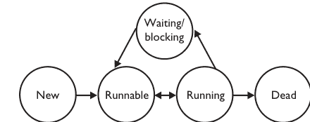

因为线程的运行代码让它睡眠，在这种情况下，将它回到可运行状态的事件唤醒它是因为睡眠时间到了。或者线程可能在*等待*，因为线程的运行代码导致它等待，在这种情况下，将它回到可运行状态的事件对于等待不再是必要的。重要的点是一个线程不会*告诉*另一个线程阻塞。某些方法*看起来*会让另一个线程阻塞，但它们并没有。如果你有另一个线程的引用，你可以写：

```
t.sleep(); 或 t.yield();
```

但这些实际上是 `Thread` 类的静态方法——它们不影响实例 `t`；相反，它们被定义为始终影响当前执行的线程。这是一个使用实例变量访问静态方法是坏主意的很好的例子——它是具有误导性的。`Thread` 类中有一个方法 `suspend()`，允许一个线程告诉另一个线程挂起，但 `suspend()` 方法已经被废弃，不会出现在考试中（以及其对应的 `resume()` 方法）。还有一个 `stop()` 方法，它也被废弃了，甚至不会出现在那里。`suspend()` 和 `stop()` 都非常危险，所以你不应该使用它们，再次，因为它们被废弃，它们不会出现在考试中。不要学习 `em`；不要使用 `em`。请注意，处于阻塞状态的线程仍然是活跃的。

不需要火箭科学家也能告诉你，如果一个线程已经死亡，那么它就不再被认为是活跃的。

## 防止线程执行

线程被停止通常意味着该线程已移动到死亡状态。但目标 4.2 还在考察你识别线程何时会被移出运行状态但不会被送回可运行或死亡状态的能力。

对于考试而言，我们不关心线程在 I/O 上的阻塞（例如，等待从服务器的输入流接收数据）。我们关注的是以下情况：

- 睡眠
- 等待
- 因为需要对象锁而阻塞

### 睡眠

`sleep()` 方法是 `Thread` 类的一个静态方法。你在代码中使用它来“减慢线程速度”，通过强制它在返回可运行状态（此时它仍然必须请求才能成为当前运行的线程）之前进入睡眠模式。当线程进入睡眠时，它会漂浮到某处，在醒来之前不会返回可运行状态。

那么，你为什么想让线程睡眠呢？嗯，你可能认为线程执行代码的速度太快了。或者你可能需要强制线程轮流执行，因为 Java 规范并不保证能够合理轮流。或者想象一个在循环中运行的线程，下载最新的股票价格并进行分析。一个接一个地下载价格将浪费时间，因为大多数价格非常相似——更重要的是，这将对宝贵的带宽造成极大浪费。解决此问题的简单方法是让线程在每次下载后暂停（睡眠）五分钟。

你可以通过调用静态的 `Thread.sleep()` 方法来实现，并传入以毫秒为单位的时间：

```java
try {
  Thread.sleep(5*60*1000); // 睡眠5 分钟
} catch (InterruptedException ex) { }
```

注意 `sleep()` 方法会抛出一个受检异常 `InterruptedException`（你通常知道是否存在这种可能，因为另一个线程必须显式地执行中断），你必须通过处理或声明来确认该异常。通常，你会在前面的代码中将对 `sleep()` 的调用封装在 `try/catch` 块中。让我们通过使用 `sleep()` 来修改我们的 Fred、Lucy、Ricky 代码，强制线程交替执行，而不是让一个线程在任何时间段内支配。你认为 `sleep()` 方法应该放在哪里？

```java
class NameRunnable implements Runnable {
    public void run() {
        for (int x = 1; x < 4; x++) {
            System.out.println("Run by " + Thread.currentThread().getName());
            try {
                Thread.sleep(1000);
            } catch (InterruptedException ex) {}
        }
    }
}
public class ManyNames {
    public static void main(String[] args) {
        // 创建一个 Runnable
        NameRunnable nr = new NameRunnable();

        Thread one = new Thread(nr);
        one.setName("Fred");
        Thread two = new Thread(nr);
        two.setName("Lucy");
        Thread three = new Thread(nr);
        three.setName("Ricky");

        one.start();
        two.start();
        three.start();
    }
}
```

运行此代码将显示 Fred、Lucy 和 Ricky 很好地交替执行：

```
% java ManyNames
Run by Fred
Run by Lucy
Run by Ricky
Run by Fred
Run by Lucy
Run by Ricky
Run by Fred
Run by Lucy
Run by Ricky
```

只需记住，上述输出中的行为仍然无法保证。你无法确定一个线程在进入睡眠之前实际上会运行多长时间，你无法确定在当运行线程进入睡眠时，是否只有一个线程处于可运行状态。换句话说，如果有两个线程醒来并处于可运行池中，你无法确定选中了使用率最少的线程来运行。尽管如此，使用 `sleep()` 是帮助所有线程获得运行机会的最佳方法！至少可以保证一个线程不会进入并一直留到完成。当线程遇到 `sleep` 调用时，它必须睡眠至少指定的毫秒数（除非在醒来时间之前被中断，在这种情况下，它会立即抛出 `InterruptedException`）。


仅仅因为线程的 `sleep()` 到期且它醒了，并不意味着它将返回运行！当线程醒来时，它只是回到了可运行状态。`sleep()` 中指定的时间是线程不会运行的最小持续时间，但不是线程不运行的精确持续时间。例如，你不能依靠 `sleep()` 方法提供一个完全准确的计时器。虽然在许多应用程序中将 `sleep()` 作为计时器无疑足够了，但你必须知道，`sleep()` 时间并不保证线程在时间过期且线程醒来后会立即重新运行。

记住 `sleep()` 是一个静态方法，所以不要被误骗，认为一个线程可以让另一个线程睡眠。你可以在任何地方放置 `sleep()` 代码，因为所有代码都是由某个线程运行。当执行（意味着当前运行的线程）遇到 `sleep` 调用时。

### 练习 13：创建线程并让其睡眠

在本次练习中，我们将创建一个简单的多线程应用程序。我们将创建一个实现 `Runnable` 接口的类，然后创建该类的三个实例。我们将启动每个线程并观察输出。

1. 创建一个实现 `Runnable` 的类，并在 `run()` 方法中打印执行它的线程的名称，然后睡眠 1000 毫秒。
2. 创建一个带有 `main` 方法的类，创建你的 `Runnable` 类的三个实例，并将它们的线程名称设置为 "Fred"、"Lucy" 和 "Ricky"。
3. 启动所有线程并观察输出。
4. 修改代码，让每个线程在打印名称之前睡眠 2000 毫秒。观察输出的变化。
5. 修改代码，让每个线程在打印名称之前睡眠 500 毫秒。观察输出的变化。

### yield() 方法

那么，静态的 `Thread.yield()` 与这一切有什么关系呢？在实践中并没有多大。`yield()` 的预期作用是让当前运行的线程返回到可运行状态，以便相同优先级的其他线程获得机会。其意图是使用 `yield()` 来促进等优先级线程之间的优雅交替。然而，在实际上，`yield()` 方法并不保证能实现它所声称的操作，即使 `yield()` 确实导致了线程退出运行状态并回到可运行状态，也不能保证让出出的线程不会被其他所有线程选中！因此，`yield()` 可能会——而且经常会——让运行中的线程放弃它的时间片给另一个相同优先级的线程，但这并没有保证。

`yield()` 永远不会导致线程进入等待/睡眠/阻塞状态。最多情况下，`yield()` 会导致线程从运行状态变为可运行状态，但再次强调，它可能没有任何影响。

### join() 方法

`Thread` 类的非静态 `join()` 方法允许一个线程“加入”另一个线程的“末尾”。如果你有一个线程 B，它必须等待线程 A 完成工作后才能进行工作，那么你就希望线程 B “加入”线程 A。这意味着在 A 完成（并进入死亡状态）之前，线程 B 将不会变为可运行状态。

```java
Thread t = new Thread();
t.start();
t.join();
```

前面的代码获取了运行中的线程（如果是主线程的话），并加入到 `t` 所引用线程的末尾。这会阻塞当前线程使其变为可运行状态，直到 `t` 引用的线程不再存活。换句话说，代码 `t.join()` 的含义是：“将我（当前线程）加入 t 的末尾，以便 t 必须在我（当前线程）再次运行之前完成。”你也可以调用带有超时持续持续的 `join()` 重载版本，这表示你在说：“等待线程 t 完成，但如果持续时间超过 5000 毫秒，就停止等待并变为可运行状态。”

到目前为止，我们已经查看了运行线程离开运行状态的三种方式：

- 调用 `sleep()`：保证导致当前线程停止执行至少指定的睡眠持续时间（尽管它可能在指定时间之前被中断）。
- 调用 `yield()`：不保证能产生任何作用，尽管通常情况下，它会导致当前运行的线程回到运行状态，以便相同优先级的线程获得机会。
- 调用 `join()`：保证导致当前线程停止执行，直到它加入的线程（也就是说，即它调用的 join 的线程）完成，或者如果它尝试加入的线程不再存活，则当前线程不需要退出。

除了这三种之外，我们还有以下线程离开运行状态的情景：

- 线程的 `run()` 方法完成。显然。

图 13-3

输出

线程代码中的关键事件

`join()` 方法：

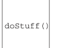
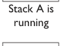
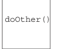

```java
Thread b = new Thread(aRunnable);
b.start(); //
```

```
// 线程来回跳动
```


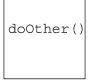


```java
b.join(); // A 加入到 B 的 
// 末尾
```


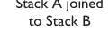

```
// 线程 B 完成 !!
// 线程 A 启动 !
```

## 同步代码、线程问题

10.3 同步访问共享数据。
10.4 识别线程问题。

你能想象当两个不同的线程访问同一个类实例，并且两个线程都对该对象方法用方法时，会发生什么样的灾难吗……如果两个不同的线程调用（例如）一个对象上的 setter 方法，会发生什么？这样的场景可能会通过以不一致的方式更改其实例来损坏对象的状态，如果该对象的状态被程序的其他部分共享，那场面太可怕了，无法直观。


# 同步代码、线程问题 (OCP 目标 10.3 和 10.4)

但让我们来看看当两个不同线程访问同一个账户时会发生什么。想象两个人都有一个支票账户（或两张卡都关联到同一个账户）。在这个例子中，我们有一个名为 `Account` 的类，代表一个银行账户。为了保持代码简洁，该账户初始余额为 50，且只能用于取款。即使账户中没有足够的资金覆盖取款，取款也会被接受。账户只会根据你想取款的金额减少余额：

```java
class Account {
    private int balance = 50;
    public int getBalance() {
        return balance;
    }
    public void withdraw(int amount) {
        balance = balance - amount;
    }
}
```

现在开始变得有趣了。想象一对夫妇 Fred 和 Lucy，他们都有该账户的访问权限并想要取款。但他们不希望账户被透支，所以在其中某一个人进行取款之前，他或她会先检查余额以确保足够的资金。此外，取款金额总是限制为 10，因此账户中至少有 10 元才能进行取款。这听起来很合理。这是一个两步过程：

1. 检查余额。
2. 如果足够，执行取款。

如果我们在第 1 步和第 2 步之间发生了什么会怎样？例如，想象 Lucy 检查了余额并发现是足够的，但在她执行取款之前，Fred 也检查了余额并发现也是足够的。Lucy 执行了取款，Fred 同样认为余额是足够的并执行了取款。糟糕了。几分钟后，我们将会看到账户数据出现问题：当一个伙伴检查账户并发现是足够的，但在执行实际取款之前，另一个伙伴也检查了账户并发现也是足够的。当账户余额达到 10 时，如果两个伙伴在取款前都检查了它，他们都会认为取款是安全的，账户将透支 10！

所以我们真正想要发现的是，以下情况是否可能：一个伙伴检查账户并发现是足够的，但在执行实际取款之前，另一个伙伴也检查了账户并发现也是足够的。

这是代码：

```java
public class AccountDanger implements Runnable {
    private Account acct = new Account();
    public static void main (String[] args) {
        AccountDanger r = new AccountDanger();
        Thread one = new Thread(r);
        Thread two = new Thread(r);
        one.setName("Fred");
        two.setName("Lucy");
        one.start();
        two.start();
    }

    public void run() {
        for (int x = 0; x < 5; x++) {
            makeWithWithdrawal(10);
            if (acct.getBalance() < 0) {
                System.out.println("account is overdrawn!");
            }
        }
    }

    private void makeWithWithdrawal(int amount) {
        // 检查余额是否足够
        if (acct.getBalance() >= amount) {
            System.out.println(Thread.currentThread().getName() + " 检查到余额足够");
            // 让当前线程睡眠 500 毫秒——恰好让另一个伙伴在它实际取款前获得机会
            try {
                Thread.sleep(500);
            } catch (InterruptedException e) {
                e.printStackTrace();
            }
            acct.withdraw(amount);
            System.out.println(Thread.currentThread().getName() + " 完成了取款。");
        }
    }
}
```

## 同步代码、线程问题 (OCP 目标 10.3 和 10.4)

```java
private void makeWithdrawal(int amt) {
  if (acct.getBalance() >= amt) {
    System.out.println(Thread.currentThread().getName() +
      + " is going to withdraw");
    try {
      Thread.sleep(500);
    } catch (InterruptedException ex) {
      acct.withdraw(amt);
      System.out.println(Thread.currentThread().getName() +
        + " completes the withdrawal");
    }
  } else {
    System.out.println("Not enough in account for "
      + Thread.currentThread().getName()
      + " to withdraw " + acct.getBalance());
  }
}
```

（你：你可能需要在你的机器上稍微调整这段代码，以产生“账户透支”的行为。你可以尝试缩短睡眠时间；你可以尝试在 `run()` 方法中添加睡眠……无论如何，实验都将帮助你巩固这些概念。那么发生了什么呢？有没有可能是 Lucy 检查了余额后睡着了，Fred 检查了余额，Lucy 醒来并完成了取款，Fred 也完成了了他的取款，结果他们中有人透支了账户？查看带编号的输出）

+   `% java AccountDanger`

1. Fred is going to withdraw
2. Lucy is going to withdraw
3. Fred completes the withdrawal
4. Fred is going to withdraw
5. Lucy completes the withdrawal
6. Lucy is going to withdraw
7. Fred completes the withdrawal
8. Fred is going to withdraw
9. Lucy completes the withdrawal
10. Lucy is going to withdraw
11. Fred completes the withdrawal
12. Not enough in account for Fred to withdraw 0
13. Not enough in account for Fred to withdraw 0
14. Lucy completes the withdrawal
15. account is overdrafted!
16. Not enough in account for Lucy to withdraw -10
17. account is overdrafted!
18. Not enough in account for Lucy to withdraw -10
19. account is overdrafted!

虽然每次运行这段代码时的输出可能略有不同，但让我们通过带编号的输出行来分析这个特定的示例。对于前四次尝试，一切都是正常的。Fred 在第 1 行检查余额并发现是好的。在第 2 行，Lucy 检查了余额并发现没问题。在第 3 行，Fred 完成了他的取款。此时，Lucy 检查的余额（并认为是准确的）实际上自她上次检查以来已经发生了变化。现在 Fred 在 Lucy 完成她的第一次取款之前再次检查了余额。到此时，即使是 Fred 也看到了一个可能不准确的余额，因为 Lucy 即将完成她的取款。当然，Fred 可能在 Lucy 之前完成取款，但这里并不是这样。

在第 5 行，Lucy 完成了取款，然后在 Fred 完成他的取款之前，Lucy 在第 6 行对账户进行了另一次检查。就这样持续下去，直到我们第 8 行，Fred 检查余额发现余额是 20。在第 9 行，Lucy 完成了她之前检查过的取款，并将余额降至 10。在第 10 行，Lucy 再次检查，看到余额是 10，所以她知道自己可以取款。但她不知道 Fred 已经在第 8 行检查了余额，他认为取款是安全的。在第 11 行，Fred 完成了他在第 8 行批准的取款。这使得余额降为零。但 Lucy 仍然有一个在第 10 行获得批准的待处理取款！你明白我的意思吧。

在第 12 行和第 13 行，Fred 检查余额发现账户内没有足够的资金。但在第 14 行，Lucy 完成了她的取款，砰！账户透支了 10——这是我们本认为通过在取款前检查余额可以防止的。

图 13-4 显示了当两个线程并发访问同一个账户时可能发生的时间线。

这个问题被称为“**竞态条件**”（race condition），其中多个线程可以访问同一个资源（通常是对象的实例变量），如果一个线程在某个应该是“**原子性**”的操作完成之前快速“抢先”执行，就可能会产生损坏的数据。

### 防止账户透支

那么可以做些什么？解决方案实际上非常简单。我们必须保证取款的两个步骤——检查余额和取款——永远不会被分开。我们需要它们作为一个操作来执行，即使线程在步骤 1 和步骤 2 之间进入睡眠！我们称之为“**原子操作**”（虽然物理学定义有点过时——在这种情况下，“原子”意味着“不可分割的”），因为该操作无论包含多少条实际语句（或底层字节码指令），都会在任何其他处理相同数据的线程代码之前完成。

你无法保证单个线程在整个原子操作过程中一直保持运行。但你可以保证，如果运行原子操作的线程在运行状态之间进出，没有其他线程能够处理相同的数据。换句话说，如果 Lucy 在检查时睡着了，直到第一个线程通过退出方法完成过程。

新的输出显示了同步 `makeWithdrawal` 方法的好处：

```
% AccountDanger
Fred is going to withdraw
Fred completes the withdrawal
Lucy is going to withdraw
Lucy completes the withdrawal
Fred is going to withdraw
Fred completes the withdrawal
Lucy is going to withdraw
Lucy completes the withdrawal
Fred is going to withdraw
Fred completes the withdrawal
Not enough in account for Lucy to withdraw 0
Not enough in account for Fred to withdraw 0
Not enough in account for Lucy to withdraw 0
Not enough in account for Fred to withdraw 0
Not enough in account for Lucy to withdraw 0
```

注意到 Lucy 和 Fred 两个线程总会在另一个线程检查余额之前完成取款。

## 同步与锁

同步是如何工作的？通过锁。Java 中的每个对象都有一个内置锁，该锁只有在对象具有同步方法时才会起作用。当我们进入同步非静态方法时，我们会自动获取与执行代码的类实例相关的锁。获取对象的锁也称为获取锁、锁定对象、对对象锁定或对对象同步。我们也可以使用监视器来指代正在获取的锁。从技术上讲，锁和监视器是两个不同的东西，但大多数人互换使用，我们也会这样做。记住以下关于锁定和同步的关键点：

- 只有方法（或块）可以被同步，变量或类均不可。
- 每个对象都只有一个锁。
- 类中并不是所有方法都需要同步。一个类可以同时拥有同步方法和非同步方法。
- 如果两个线程正准备执行某个类中的某一个同步方法，并且两个线程都正在使用该类的同一个实例来调用该方法，那么同一时间将只有一个线程能够执行该方法。另一个线程需要等待，直到第一个线程完成它的方法。换句话说，一旦一个线程获取了对象的锁，另一个线程就可以进入该类中的（针对该对象的）任何同步方法。
- 如果一个类既有同步方法又有非同步方法，多个线程仍然可以访问该类的非同步方法！如果你的方法没有访问你正试图保护的数据，那么你就不需要对它们进行同步。在某些情况下，同步会导致性能下降（如果使用不当，甚至可能导致死锁），所以你应该注意不要过度使用。
- 如果线程进入睡眠状态，它将持有它拥有的任何锁——它不会释放这些锁。
- 一个线程可以获取多个锁。例如，一个线程可以进入一个同步方法并获取锁，然后立即调用另一个对象上的同步方法并同样获取该锁。随着堆栈的回溯，锁会被再次释放。此外，如果一个线程获取了锁，然后尝试在同一个对象上调用该同步方法，也没有问题。JVM 知道该线程已经拥有该对象的锁，因此该线程可以自由地使用已拥有的锁调用同一对象上的其他同步方法。
- 你可以对一个代码块进行同步，而不是对整个方法。

由于同步会影响并发性，你不希望对任何比保护数据所必需的更多的代码进行同步。因此，如果一个方法的范围并不那么需要，你可以将同步部分的范围缩小到小于整个方法的范围——仅仅是一个代码块。我们奇怪地将此称为“同步块”，它的写法如下所示：

```java
class SyncTest {
    public void doStuff() {
        System.out.println("not synchronized");
        synchronized(this) {
            System.out.println("synchronized");
        }
    }
}
```

当线程在同步块内部执行代码时（包括从该同步块调用的任何代码），该代码被认为是在同步上下文中执行的。真正的问题是，是在什么上同步？或者说，是在哪个对象的锁上同步？

当你同步一个方法时，用于调用该方法的对象就是必须获取其锁的实例。但当你同步一个代码块时，你指定了想要使用哪个对象的锁作为锁，例如，你可以使用某些第三方对象作为这段代码的锁。这让你在单个对象内进行代码同步时具有拥有多个锁的能力。


## 同步代码、线程问题 (OCP 目标 10.3 和 10.4) 745

- 只有方法（或块）可以被同步，变量或类均不可。
- 每个对象都只有一个锁。
- 类中并不是所有方法都需要同步。一个类可以同时拥有同步方法和非同步方法。
- 如果两个线程正准备执行某个类中的某一个同步方法，并且两个线程都正在使用该类的同一个实例来调用该方法，那么同一时间将只有一个线程能够执行该方法。另一个线程需要等待，直到第一个线程完成它的方法。换句话说，一旦一个线程获取了对象的锁，另一个线程就可以进入该类中的（针对该对象的）任何同步方法。
- 如果一个类既有同步方法又有非同步方法，多个线程仍然可以访问该类的非同步方法！如果你的方法没有访问你正试图保护的数据，那么你就不需要对它们进行同步。在某些情况下，同步会导致性能下降（如果使用不当，甚至可能导致死锁），所以你应该注意不要过度使用。
- 如果线程进入睡眠状态，它将持有它拥有的任何锁——它不会释放这些锁。

一个线程可以获取多个锁。例如，一个线程可以进入一个同步方法并获取锁，然后立即调用另一个对象上的同步方法并同样获取该锁。随着堆栈的回溯，锁会被再次释放。此外，如果一个线程获取了锁，然后尝试在同一个对象上调用该同步方法，也没有问题。JVM 知道该线程已经拥有该对象的锁，因此该线程可以自由地使用已拥有的锁调用同一对象上的其他同步方法。

- 你可以对一个代码块进行同步，而不是对整个方法。

由于同步会影响并发性，你不希望对任何比保护数据所必需的更多的代码进行同步。因此，如果一个方法的范围并不那么需要，你可以将同步部分的范围缩小到小于整个方法的范围——仅仅是一个代码块。我们奇怪地将此称为“同步块”（`synchronized block`），它的写法如下：

```java
class SyncTest {
    public void doStuff() {
        System.out.println("not synchronized");
        synchronized(this) {
            System.out.println("synchronized");
        }
    }
}
```

## 746 第 13 章：线程

当线程在同步块内部执行代码时（包括从该同步块调用的任何代码），该代码被认为是在同步上下文中执行的。真正的问题是，是在什么上同步？或者说，是在哪个对象的锁上同步？

当你同步一个方法时，调用该方法的对象就是必须获取其锁的实例。但当你同步一个代码块时，你指定了想要使用哪个对象的锁作为锁，例如，你可以使用某些第三方对象作为这段代码的锁。这让你在单个对象内进行代码同步时具有拥有多个锁的能力。

或者，你也可以像之前的代码那样，对当前实例（`this`）进行同步。由于这与同步方法锁定的实例相同，这意味着你可以用一个包含同步块的非同步方法来替换同步方法。换句话说：

```java
public void doStuff() {
    System.out.println("synchronized");
}
```

等同于：

```java
public void doStuff() {
    synchronized(this) {
        System.out.println("synchronized");
    }
}
```

在实际操作中，这两个方法的效果完全相同。编译后的字节码与这两个方法并不完全相同，但它们可以是相同的——而且任何差异并不重要。第一种形式更短且对大多数人来说更熟悉，但第二种可以更灵活。

## 静态方法可以同步吗？

静态方法是可以同步的。静态方法只有一个副本。对于你试图保护的数据，静态方法可以同步，类只有一个锁。如果一个线程获取了锁，然后尝试在同一个对象上调用该同步方法，也没有问题。JVM 知道该线程已经拥有该对象的锁，因此该线程可以自由地使用已拥有的锁调用同一对象上的其他同步方法。

## 代码同步、线程问题 (OCP 目标 10.3 和 10.4) 749

在同一个对象上进行同步的线程会互相阻塞。在不同对象上进行同步的线程则不会。

表 13-1 列出了与线程相关的方法，以及调用后线程是否会释放锁。

| 方法与锁状态 | 释放 / 保持锁 | 定义方法的类 |
|---|---|---|
| `wait()` | 释放 | `java.lang.Object` |
| `notify()` | 保持（尽管线程可能在在此调用后不久就会退出同步代码，从而释放其锁。） | `java.lang.Object` |
| `join()` | 释放 | `java.lang.Thread` |
| `sleep()` | 保持 | `java.lang.Thread` |
| `yield()` | 保持 | `java.lang.Thread` |

## 我什么时候需要同步？

同步可能会变得非常复杂，你可能会想，如果可以避免的话，为什么要做这些呢？还记得之前关于 Lucy 和 Fred 从账户中取款的“竞态条件（`race conditions`）”示例吗？当我们使用线程时，通常需要在某些地方使用同步，以确保我们的方法不会在错误的时间互相干扰并导致数据丢失。通常，每当有超过一个线程访问可变（可更改）数据时，你都需要对数据进行同步，以确保两个线程不会同时修改它（或者一个线程在另一个线程读取时正在修改它，这会引起混淆）。你不需要担心局部变量——每个线程都有自己的局部变量副本。同时执行该方法的两个线程将使用变量的不同副本，彼此互不干扰。然而，如果静态字段和非静态字段包含可以更改的数据，你确实需要担心它们。

对于非静态字段中的可变数据，你通常使用非静态方法来访问它。通过对该方法进行同步，你确保任何尝试使用相同实例运行该方法的线程都会被阻止同时访问。但使用不同实例的线程将不会受到影响，因为它获取的是另一个实例的锁。这正是我们想要的——拥有相同数据的线程需要一个接一个执行，但拥有不同数据的线程可以互相忽略并随心所欲地运行；这并不重要。

对于静态字段中的可变数据，你通常使用静态方法来访问它。同样，通过对该方法进行同步，你确保任何尝试访问数据的两个线程都会被阻止同时访问，因为两个线程都必须为其中定义的类方法获取 `Class` 对象的锁。再次，这正是我们想要的。

然而——如果你有一个访问静态字段的非静态方法呢？或者一个访问非静态字段的静态方法（使用实例）？在这些情况下，情况会开始变得混乱，并且极有可能结果不会按照你想要的方式工作。如果你有一个访问非静态字段的静态方法并对该方法进行同步，你获取的是 `Class` 对象的锁。但如果另一个方法也访问该非静态字段，而这次使用的是另一个（实例）呢？记住，一个静态同步方法和一个非静态同步方法之间不会互相阻塞——它们可以同时运行。同样，如果你使用非静态方法访问静态字段，两个线程可能会使用两个不同的实例调用方法。这意味着它们不会互相阻塞，因为它们使用了不同的锁。这意味着两个线程正在同时访问同一个静态字段——这正是我们极力防止的事情。

想象这里可能发生的所有奇怪事情会非常困惑。为了保持简单，为了使一个类是线程安全的，访问可变字段的方法需要被同步。

访问静态字段应该使用静态同步方法。访问非静态字段应该使用非静态同步方法。

```java
public class Thing {
    private static int staticField;
    private int nonStaticField;
    public static synchronized int getStaticField() {
        return staticField;
    }
    public static synchronized void setStaticField(int staticField) {
        Thing.staticField = staticField;
    }
    public synchronized int getNonStaticField() {
        return nonStaticField;
    }
    public synchronized void setNonStaticField(int nonStaticField) {
        this.nonStaticField = nonStaticField;
    }
}
```

## 代码同步、线程问题 (OCP 目标 10.3 和 10.4) 751

如果你需要在一个方法中同时访问静态和非静态字段怎么办？

嗯，有方法可以做到，但这超出了考试所需的范围。如果你**干脆不做**，你的生活会过得更长、更幸福。真的，我们会撒谎吗？

## 线程安全类

当一个类经过仔细同步以保护其数据（使用给定的规则或更复杂的应用）时，我们说该类是“线程安全的”。Java API 中的许多类内部已经使用了同步来使类变为“线程安全”。例如，`StringBuffer` 和 `StringBuilder` 几乎相同，区别在于 `StringBuffer` 中的所有方法在需要时都是同步的，而 `StringBuilder` 中的方法则不是。通常，这使得 `StringBuffer` 在多线程环境中是安全的，而 `StringBuilder` 则不是。（作为回报，`StringBuilder` 会快一点，因为不需要忙于同步。）然而，即使一个类是“线程安全”的，依赖这些类来提供你需要的线程保护也是危险的。（噢，“线程安全”周围反复出现的引号是必须加的免责条款，对吧？）你仍然需要仔细考虑如何使用这些类。例如，考虑以下类：

```java
import java.util.*;
public class NameList {
    private List names = Collections.synchronizedList(new ArrayList());

    public void add(String name) {
        names.add(name);
    }
    public String removeFirst() {
        if (names.size() > 0)
            return (String) names.remove(0);
        else
            return null;
    }
}
```

`Collections.synchronizedList()` 返回一个 `List`，其方法根据文档说明都是同步的且“线程安全的”（就像 `Vector` 这种——但既然现在是 21 世纪了，我们在这里不会使用 `Vector`）。问题是，`NameList` 类可以从多个线程安全地使用吗？人们很想认为是可以的，因为 `names` 中的数据在同步集合中，所以 `NameList` 类也是“安全”的——事实并非如此——`removeFirst()` 有时可能会抛出 `IndexOutOfBoundsException`。问题出在哪里？它在移除任何内容之前难道没有正确地检查 `names` 的 `size()` 以确保那里有东西吗？这段代码怎么会失败？让我们尝试这样使用 `NameList`：

```java
public static void main(String[] args) {
    final NameList nl = new NameList();
    nl.add("Ozymandias");
    class NameDropper extends Thread {
        public void run() {
            String name = nl.removeFirst();
            System.out.println(name);
        }
    }
    Thread t1 = new NameDropper();
    Thread t2 = new NameDropper();
    t1.start();
    t2.start();
}
```

这里可能发生的情况是，一个线程移除名称并打印它，然后另一个线程尝试移除名称并获取 `null`。如果我们考虑对 `names.size()` 和 `names.get(0)` 的调用，它们按以下顺序发生：

- 线程 `t1` 执行 `names.size()`，返回 1。
- 线程 `t1` 执行 `names.remove(0)`，返回 Ozymandias。
- 线程 `t2` 执行 `names.size()`，返回 0。
- 线程 `t2` 不执行。

这里的输出是：

Ozymandias

null

然而，如果我们再次运行程序，可能会发生不同的情况：

- 线程 `t1` 执行 `names.size()`，返回 1。
- 线程 `t2` 执行 `names.size()`，返回 1。
- 线程 `t1` 执行 `names.remove(0)`，返回 Ozymandias。
- 线程 `t2` 执行 `names.remove(0)`，因为列表为空而抛出异常。

这里需要意识到的是，在像由 `synchronizedList` 返回的这种“线程安全”类中，每个单独的方法都是同步的。所以 `names.size()` 是同步的，`names.remove(0)` 同步的。但没有任何东西阻止另一个线程在两次调用之间对列表进行其他操作。这就是问题发生的地方。


# 同步代码，线程问题 (OCP 目标 10.3 和 10.4)

这里有一个解决方案：不要依赖 `Collections.synchronizedList()`。

相反，你自己来同步代码：

```java
import java.util.*;
public class NameList {
    private List names = new LinkedList<>();
    public synchronized void add(String name) {
        names.add(name);
    }
    public synchronized String removeFirst() {
        if (names.size() > 0)
            return (String) names.remove(0);
        else
            return null;
    }
}
```

现在，整个 `removeFirst()` 方法都是同步的，一旦一个线程开始执行它并调用 `names.size()`，其他线程就无法插进来并抢走该名称。另一个线程将等待直到第一个线程完成 `removeFirst()` 方法。

这里的教训是，仅仅因为一个类被描述为“线程安全的”，并不意味着它总是线程安全的。如果单个方法是同步的，这可能是不够的——你可能在更高层级添加同步更好（即放在调用其他方法的块或方法中）。一旦你这样做，原始的同步（在这种情况下，是 `Collections.synchronizedList()` 返回的对象内部的同步）可能会变得多余。

# 线程死锁

Java 程序可能发生的最稀缺的情况就是死锁。死锁发生在两个线程都被阻塞，每个线程都在等待对方的锁。在释放锁之前，哪一个都无法运行，因此它们将永远留在那里。

这种情况可能会发生，例如当线程 A 遇到同步代码，获取了锁 B，然后进入另一个方法（仍在它已拥有锁的同步代码内），该方法也是同步的。但线程 A 无法获取锁来进入这段同步代码——块 C——因为线程 D 已经拥有了该锁。因此线程 A 进入了等待 C 锁的池，希望线程 D 能快点释放锁（通过完成同步方法）。但线程 A 确实会等待非常长一段时间，因为线程 D 拿到了锁 C，然后它进入了一个在锁 B 上同步的方法中。显然，线程 D 无法获取锁 B，因为线程 A 拥有它。而在线程 D 释放锁 C 之前，线程 A 也不会释放锁。但线程 D 在获取锁 B 并继续执行之前是不会释放锁 C 的。它们就那样停在了那里。下面的示例演示了死锁：

```java
public class DeadlockRisk {
    private static class Resource {
        public int value;
    }
    private Resource resourceA = new Resource();
    private Resource resourceB = new Resource();

    public int read() {
        synchronized(resourceA) // 可能在这里死锁
        synchronized(resourceB)
        return resourceB.value + resourceA.value;
    }

    public void write(int a, int b) {
        synchronized(resourceB) // 可能在这里死锁
        synchronized(resourceA) {
            resourceA.value = a;
            resourceB.value = b;
        }
    }
}
```

假设 `read()` 由一个线程启动，而 `write()` 由另一个线程启动。如果有两个可以独立读取和写的线程，那么在第 8 行或第 16 行存在死锁的风险。读取线程将拥有 `resourceA`，写入线程将拥有 `resourceB`，两者都将卡住等待对方。

像这样的代码永远不会导致死锁，因为 CPU 必须在代码的特定点从读取线程切换到写入线程，发生死锁的概率非常小。该应用程序在 99.9% 的情况下运行良好。

前面的示例很容易修复；只需交换读取器或写入器在第 16 行和 17 行（或 8 行和 9 行）的锁定顺序即可。更复杂的死锁情况可能需要长时间才能弄清楚。

无论你的代码死锁的概率有多小，底线是：如果你死锁了，你就完了。有一些可以避免死锁的设计方法，包括始终按照预定顺序获取锁的策略。但那是你需要学习的内容，超出了本书的范围。我们只是试图让你通过考试，尽管如此，你对线程的了解将比大多数经验丰富的 Java 程序员得多。

# 线程交互 (OCP 目标 10.3 和 10.4)

## 认证目标

**10.3** 同步线程对共享数据的访问。

**10.4** 识别潜在的线程问题。

我们最后需要查看的是线程如何相互交互以通信——其他包括锁定状态。`Object` 类有三个方法：`wait()`、`notify()` 和 `notifyAll()`，它们帮助线程通信它们关心的事件状态。例如，如果一个线程是邮件投递线程，另一个线程是邮件处理线程，那么处理线程必须不断检查是否有邮件要处理。使用 `wait` 和 `notify` 机制，邮件处理线程可以检查邮件，如果没有发现任何邮件，它可以说：“嘿，我不想浪费时间每两秒检查一次邮件。我要出去，等邮件投递员把东西放在邮箱里，让一个线程自己进入一个‘等待室’，直到其他线程通知它。”

记住关于 `wait` 和 `notify` 的一点（为了考试记住）：`wait()`、`notify()` 和 `notifyAll()` 必须在同步上下文中调用。线程在拥有该锁的情况下无法调用 `wait` 或 `notify`。

让我们展示一个线程依赖对方的示例，考虑一个可以切割形状面料的计算机控制机器以及允许用户指定形状的应用程序。当前版本有一个线程循环请求形状，然后指示硬件切割：

```java
public void run(){
    while(true) {
        // 获取形状
        // 计算步骤
        // 将步骤发送到硬件
    }
}
```

这种设计并不是最优的，因为当机器忙碌时用户无法进行任何操作。我们需要改进这种情况。一种简单的解决方案是将过程分为两个不同的线程，一个与用户交互，另一个管理硬件。用户线程将指令发送给硬件线程，然后返回与用户交互。硬件线程接收指令并立即启动机器。两个线程使用一个公共对象进行通信，这是当前处理的设计。

下面的伪代码展示了这一点：

```java
public void userLoop(){
  while(true) {
    // 获取形状
    // 计算步骤
    // 修改公共对象
  }
}
```

```java
public void hardwareLoop(){
  while(true) {
    // 从公共对象获取步骤
    // 将步骤发送到硬件
  }
}
```

现在的问题是如何让硬件线程在步骤可用时立即处理。同时，用户线程在它们发送到硬件之前不应该修改它们。解决方案是使用 `wait()` 和 `notify()`，并且同步部分代码。

记住，`wait()` 和 `notify()` 是 `Object` 的实例方法。就像每个对象都有锁一样，每个对象都可以拥有一个等待对象信号（通知）的线程列表。线程通过执行目标对象的 `wait()` 方法进入等待列表。从那时刻起，除非目标对象调用 `notify()` 方法，否则它不会执行任何后续指令。如果有多个线程在同一个对象上等待，将选择一个（无固定顺序）继续执行。如果没有线程在等待，则不采取任何行动。让我们来看一个对象等待另一个对象通知它的真实代码（注意，它有点复杂）：

```java
class ThreadA {
  public static void main(String [] args) {
    ThreadB b = new ThreadB();
    b.start();
    synchronized(b) {
      try {
        System.out.println("Waiting for b to complete...");
        b.wait();
      } catch (InterruptedException e) {
      }
    }
    System.out.println("Total is: " + b.total);
  }
}

class ThreadB extends Thread {
  int total;

  public void run() {
     synchronized(this) {
        for (int i=0;i<100;i++) {
          total += i;
        }
        notify();
      }
   }
}
```

该程序包含两个带有线程的对象：`ThreadA` 包含主线程，而 `ThreadB` 计算从 0 到 99 所有数字之和。一旦第 4 行调用了 `start()` 方法，`ThreadA` 将继续执行它自己类中的下一行代码，这意味着它可能在 `ThreadB` 完成计算之前就到达第 11 行。为了防止这种情况，我们在第 9 行使用了 `wait()` 方法。

注意第 6 行中的代码，它与对象 `b` 进行了同步——这是因为为了在对象上调用 `wait()`，`ThreadA` 必须拥有 `b` 的锁。线程若要调用 `wait()` 或 `notify()`，该线程必须是该对象锁的所有者。当线程等待时，它会临时释放锁给其他线程，并且它需要再次获取锁来继续执行。代码中经常遇到如下结构：

```java
synchronized(anotherObject) { // 这拥有 anotherObject 的锁
  try {
    anotherObject.wait();
    // 线程释放锁并等待
    // 为了继续执行，线程需要锁，
    // 所以它可能会被阻塞直到获取到锁。
  } catch (InterruptedException e) {}
}
```

前面的代码会一直等待直到在 `anotherObject` 上调用了 `notify()`。

```java
synchronized(this) { notify(); }
```

此代码通知当前正在等待该对象的单个线程。锁可以在代码中更早的时候获取，例如在调用方法中。注意，如果调用 `notify()` 的线程没有持有锁，它将抛出 `IllegalMonitorStateException`。此异常不是受检异常，因此你不需要显式捕获它。在任何代码块中，你都应该清楚线程是否拥有某个对象的锁。

注意第 7–10 行在 `wait()` 方法周围有一个 `try/catch` 块。等待的线程可以像睡眠的线程一样以睡眠的方式被中断，因此为了处理该异常：

```java
synchronized(a) {
  a.wait();
} catch (InterruptedException e) {
  // 做一些事情
}
```

在示例中，使用这些方法的方法是让线程等待对象可用，并在线程完成后进行通知。这些方法还包含了超时机制，例如等待特定的时间。还有第二种形式的 `wait(long)`，它接受毫秒数作为最大等待时间。如果线程没有被中断，它将在被通知或指定的超时到时随时继续执行。这种离开等待状态的正常继续是可能的，但为了继续执行，它将必须获取该对象的锁：

```java
synchronized(a) { // 线程获取了 'a' 的锁
    a.wait(2000); // 线程释放锁并等待
    // 最多等待两秒，然后返回
    // Runnable
    // 线程重新获取锁
    // 此处有更多指令
}
```

当在对象上调用 `notify()` 时，上述代码会一直等待。

```java
synchronized(this) { notify(); }
```

此代码通知当前正在等待该对象的单个线程。锁可以在代码中更早的时候获取，例如在调用方法中。注意，如果调用 `notify()` 的线程没有持有锁，它将抛出 `IllegalMonitorStateException`。此异常不是受检异常，因此你不需要显式捕获它。在任何代码块中，你都应该清楚线程是否拥有某个对象的锁。

# 循环中的 wait()

实际上，之前的两个示例（Machine/Reader/Reader）都有一个共同的问题。在每个示例中，至少有一个线程调用了 `wait()`，另一个线程调用了 `notify()` 或 `notifyAll()`。只要线程在另一个执行 `notify()` 或 `notifyAll()` 之前已经开始等待，这种方式就能运行良好。但是，如果 Calculator 先运行并在 Readers 开始等待之前调用了 `notify()` 会发生什么？这种情况可能会发生，因为我们无法保证线程不同部分的执行顺序。不幸的是，当 Readers 运行时，它们只是直接开始等待。几乎总是，当你想要等待某事时，你也需要能够检查它是否已经发生。通常，解决此问题的最佳方法是放入某种循环中。

该方法会检查某些条件表达式，并且只有在你所等待的事情尚未发生时才会等待。以下是早期的“剪裁机”示例的修改后的、更安全的版本：

```java
class Operator extends Thread {
    Machine machine; // 假设这里已初始化
    public void run() {
        while (true) {
            Shape shape = getShapeFromUser();
            MachineInstructions job =
                calculateNewInstructionsFor(shape);
            machine.addJob(job);
        }
    }
}
```

操作员仍然会无限循环，从用户那里获取更多形状，为这些形状计算新指令，并将它们发送到机器。但现在，`notify()` 的逻辑已经移动到了 `Machine` 类的 `addJob()` 方法中：

```java
class Machine extends Thread {
    List<MachineInstructions> jobs =
        new ArrayList<MachineInstructions>();

    public void addJob(MachineInstructions job) {
        synchronized (jobs) {
            jobs.add(job);
            jobs.notify();
        }
    }

    public void run() {
        while (true) {
            synchronized (jobs) {
                // 等待直到至少有一个任务可用
                while (jobs.isEmpty()) {
                    try {
                        jobs.wait();
                    } catch (InterruptedException ie) {
                    }
                }
                MachineInstructions instructions = jobs.remove(0);
                // 将机器步骤发送到硬件
            }
        }
    }
}
```

机器会维护一个它计划执行的任务列表。每当操作员向列表添加一个新任务时，它就会调用 `addJob()` 方法并将新任务添加到列表中。


与此同时，`run()` 方法会一直循环，寻找列表上的任何任务。如果没有任务，它将开始等待。如果它收到通知，它将停止等待并重新检查循环条件：列表是否为空？在实践中，这种双重检查可能是必须的，因为发送 `notify()` 的唯一时机是向列表添加了新任务时。然而，在当线程被唤醒时，重新检查线程的 `isEmpty()` 状态是一个好主意，因为可能某个线程意外调用了非预期的额外 `notify()`。此外还可能存在自发性唤醒，即使没有代码调用 `notify()` 或 `notifyAll()`（至少你所知的代码没有调用过这些方法。有时，JVM 可能会因为自己的原因调用 `notify()`，或者在其他类中由于你不知道的原因调用）。这意味着当你的线程从 `wait()` 唤醒时，你不知道它是为什么被唤醒的。通过将 `wait()` 方法放在 `while` 循环中并重新检查代表我们等待内容的条件，我们确保无论由于什么原因唤醒，只要（且仅当）我们等待的事情尚未发生，我们就会重新进入 `wait()`。在 `Machine` 类中，我们等待的是 `jobs` 列表。如果它是空的，如果不是空的，我们就完成了。

注意，`run()` 和 `addJob()` 方法都对同一个对象——`jobs` 列表进行同步。这有两个原因：因为我们在这个实例上调用了 `wait()` 和 `notify()`，所以我们需要同步以避免 `IllegalStateException`。另一个原因是 `jobs` 列表中的数据在两个不同线程访问的字段中是可更改的。我们需要同步来访问可更改的数据。幸运的是，允许我们 `wait()` 和 `notify()` 的 `synchronized` 块也为我们对数据的其他访问提供了所需的线程安全。事实上，这是最初就需要同步来使用 `wait()` 和 `notify()` 的主要原因——你始终必须在线程之间共享可变数据，而你需要的就是同步。注意，`addJob()` 中的 `synchronized` 块足够大，包含了对 `jobs.add(job)` 的调用——这修改了共享数据。而 `run()` 中的 `synchronized` 块足够大，包含了整个循环——这包含了对 `jobs.isEmpty()` 的调用，它访问了共享数据。

这里的教训是，当你使用 `wait()`、`notify()` 或 `notifyAll()` 时，你应该始终在周围使用一个 `while` 循环。

无法保证线程会以任何公平的方式轮流执行。这取决于线程调度器，而调度器取决于特定的虚拟机实现。如果你希望保证线程无论底层的 JVM 是什么样的都能交替执行，你可以使用 `sleep()` 方法。这可以防止一个线程独占运行进程而导致另一个线程饥饿。（在大多数情况下，`yield()` 的效果已经足够，可以鼓励你的线程协作工作。）

- 运行中的线程可以通过调用 `wait()`、`sleep()` 或 `join()` 来进入阻塞/等待状态。
- 运行中的线程可能因为无法获取 `synchronized` 代码块的锁而进入阻塞/等待状态。
- 当睡眠或等待结束时，对象的锁将变为可用，线程只能重新进入可运行状态。在所有实际操作中，它都会直接从等待状态变为运行状态。
- 死的线程无法重新启动。

## Sleep, Yield, and Join (OCP 目标 10.2)

- 睡眠用于延迟执行一段时间，且当线程进入睡眠时，不会释放任何锁。
- 睡眠的线程保证睡眠时间至少为 `sleep()` 方法参数指定的时间（除非被中断），但无法保证新唤醒的线程何时返回运行状态。
- `sleep()` 方法是一个静态方法，它让当前线程进入睡眠。一个线程不能告诉另一个线程去睡眠。
- `setPriority()` 方法用于 Thread 对象以赋予线程 1（低）和 10（高）的优先级，尽管优先级是不保证的，而且并不是所有的 JVM 都识别不同的优先级级别——某些可能被视为等同。
- 如果不显式设置，线程的优先级将与创建它的线程优先级相同。
- 如果存在相同优先级的可运行线程，`yield()` 方法可能会导致运行中的线程让出。无法保证这种情况一定会发生，也不保证当线程让出时会选择另一个线程运行。一个线程可能会让出并立即重新进入运行状态。最接近保证的说法是：在任何给定时间内，当一个线程运行时，它的优先级通常不会低于任何可运行线程。当高优先级线程进入时，如果低优先级线程正在运行，JVM 通常会抢占低优先级线程并将高优先级线程放进去。
- 当一个线程调用另一个线程的 `join()` 方法时，当前运行的线程将等待直到该线程与其汇合。使用 `join()` 方法就像在说：“嘿，线程，我想和你汇合。你完成后请告诉我，这样我就可以进入可运行状态。”

## Concurrent Access and Synchronized Threads (OCP 目标 10.3 和 10.4)

- `synchronized` 方法防止多一个线程同时访问一个对象的代码。
- 你可以使用 `synchronized` 关键字作为方法修饰符或启动一个同步代码块。
- 要同步一个代码块（换句话说，范围小于整个方法），你必须指定想要同步的对象。
- 虽然只有一个线程可以访问特定实例的同步代码，但多个线程仍然可以访问同一对象的非同步代码。
- 当线程进入睡眠时，它的锁将对其他线程不可用。
- 静态方法可以使用代表该类的 Class 实例锁进行同步。

## Communicating with Objects by Waiting and Notifying (OCP 目标 10.3 和 10.4)

- `wait()` 方法让线程说：“我现在无事可做，请把我放入你的等待池中，当发生我关心的事情时请通知我。”基本上，调用 `wait()` 意味着“让我在你的池中等待”或“将我加入你的等待列表”。
- `notify()` 方法用于向该对象等待池中等待的仅一个线程发送信号。
- `notify()` 方法**不能**指定要通知哪个线程。
- `notifyAll()` 方法的工作原理与 `notify()` 相同，只是它向所有等待该对象的线程都发送信号。
- 这三个方法——`wait()`、`notify()` 和 `notifyAll()`——必须在同步上下文中调用！线程在特定对象上调用 `wait()` 或 `notify()` 时，该线程必须当前持有该对象的锁。

## Deadlocked Threads (OCP 目标 10.4)

- 死锁是指线程执行停滞，因为代码正在等待从对象中移除的锁。
- 当一个锁定的对象尝试访问另一个被锁定的对象，而该对象正尝试访问第一个对象时，就会发生死锁。换句话说，两个线程都在等待对方的锁；因此，锁永远不会释放！
- 死锁很糟糕。不要这样做。

## 自 TEST

以下问题将帮助你衡量对本章内容的理解程度。如果你初次处理某些问题感到困难，不要过度自责。有些问题很长且复杂。在实际考试中也会遇到长且复杂的问题！

### 1. 以下代码块使用 `Runnable` 目标创建了一个线程：

```
Runnable target = new MyRunnable();
Thread myThread = new Thread(target);
```

以下哪个类可以用于创建目标，以便前面的代码正确编译？

- A. public class MyRunnable extends Runnable { public void run() {} }
- B. public class MyRunnable extends Object { public void run() {} }
- C. public class MyRunnable implements Runnable { public void run() {} }
- D. public class MyRunnable implements Runnable { public void run() {} }
- E. public class MyRunnable implements Runnable { public void start() {} }

### 2. 给定：

```java
class MyThread extends Thread {
    public static void main(String [] args) {
        MyThread t = new MyThread();
        Thread x = new Thread(t);
    }
    public void run() {
        for(int i=0; i<3; i++) {
            System.out.print(i + "..");
        }
    }
}
```

这段代码的结果是什么？

- A. 编译失败
- B. 1..2..3..
- C. 0..1..2..
- D. 运行时发生异常

### 3. 给定：

```java
class Test {
    public static void main(String [] args) {
        printAll(args);
    }
    public static void printAll(String[] lines) {
        for (int i=0; i<lines.length; i++) {
            System.out.println(lines[i]);
            Thread.currentThread().sleep(1000);
        }
    }
}
```

`currentThread()` 返回当前执行线程对象的引用。这段代码的结果是什么？

- A. 数组中的每个字符串都会输出，并有一秒暂停
- B. 数组中的每个字符串都会输出，中间没有暂停，此方法不在 Thread 中执行
- C. 数组中的每个字符串都会输出，但不保证会有暂停，因为 `currentThread()` 可能无法获取此线程
- D. 代码无法编译
- E. lines 数组中的每个字符串之间至少有一秒暂停

### 4. 假设你有一个持有私有变量 `a` 和 `b` 的类。以下哪些项可以防止该类的并发访问问题！（选择所有适用项）

- A. public int read() {return a+b;} \npublic void set(int a, int b) {this.a=a;this.b=b; }
- B. public synchronized int read() {return a+b;} \npublic synchronized void set(int a, int b) {this.a=a;this.b=b; }
- C. public int read() {synchronized(a) return a+b;} \npublic void set(int a, int b) {synchronized(a) {this.a=a;this.b=b;}} }
- D. public int read() {synchronized(b) return a+b;} \npublic void set(int a, int b) {synchronized(b) {this.a=a;this.b=b;}} }
- E. public synchronized(this) int read() {return a+b;} \npublic synchronized(this) void set(int a, int b) {this.a=a;this.b=b; }
- F. public int read() {synchronized(this) return a+b;} \npublic void set(int a, int b) {synchronized(this) {this.a=a;this.b=b;}} } }

### 5. 给定：

```java
1.  public class WaitTest {
2.    public static void main(String [] args) {
3.        System.out.print("1 ");
4.        synchronized(args){
5.            System.out.print("2 ");
6.            try {
7.                args.wait();
8.            }
9.            catch (InterruptedException e){}
10.       }
11.       System.out.print("3 ");
12.   }
13. }
```

编译并运行此程序的结果是什么？

- A. 编译失败，因为第7行中的 wait() 没有处理 IllegalMonitorStateException
- B. 1 2 3
- C. 1 3
- D. 1 2
- E. 在运行时，尝试等待时会抛出 IllegalMonitorStateException
- F. 编译会失败，因为它必须在该对象上进行同步

### 6. 假设以下方法已正确同步，并从线程 A 在对象 B 上调用：

```
wait(2000);
```

在调用此方法后，线程 A 何时会成为再次获得 CPU 的候选？

- A. 在对象 B 被通知后，或两秒后
- B. 在 B 的锁释放后，或两秒后
- C. 在锁 B 被通知两秒后
- D. 在锁 B 释放两秒后

### 7. 哪些是正确的？（选择所有适用项。）

- A. notify() 方法必须在同步上下文中调用
- B. 要调用 wait()，对象必须拥有该线程锁
- C. notify() 方法定义在 java.lang.Thread 中
- D. 当线程由于 wait() 处于等待状态时，它会释放它的锁
- E. notify() 方法调用线程立即释放它的锁
- F. notify() 和 notifyAll() 的区别在于 notifyAll() 会通知所有等待的线程，无论它们正在等待哪个对象

### 8. 给定此场景：此类旨在允许用户编写系列消息，以便每条消息都用时间戳和写入消息的线程名称进行标识：

```java
public class Logger {
    private StringBuilder contents = new StringBuilder();
    public void log(String message) {
        contents.append(System.currentTimeMillis());
        contents.append(": ");
        contents.append(Thread.currentThread().getName());
        contents.append(message);
        contents.append("\n");
    }
    public String getContents() { return contents.toString(); }
}
```

我们如何确保此类的实例可以被多个线程安全地使用？

- A. 此类已经是线程安全的
- B. 将 StringBuilder 替换为 StringBuffer 将此类变为线程安全的
- C. 仅同步 log() 方法
- D. 仅同步 getContents() 方法
- E. 同时同步 log() 和 getContents()
- F. 此类无法变为线程安全的

### 9. 给定：

```java
public static synchronized void main(String[] args) throws InterruptedException {
    Thread t = new Thread();
    t.start();
    System.out.print("X");
    t.wait(10000);
    System.out.print("Y");
}
```

这段代码的结果是什么？

- A. 它打印 x 并退出
- B. 它打印 xY 且永退出
- C. 它打印 XY 并几乎立即退出
- D. 它打印 XY，且 x 和 y 之间有 10 秒延迟
- E. 它打印 XY，且 x 和 y 之间有 10,000 秒延迟
- F. 代码无法编译
- G. 在运行时抛出异常

### 10. 给定：

```java
class MyThread extends Thread {
    MyThread() {
        System.out.print("MyThread ");
    }
    public void run() {
        System.out.print("bar ");
    }
    public void run(String s) {
        System.out.print("baz ");
    }
}
public class TestThreads {
    public static void main (String [] args) {
        Thread t = new MyThread() {
            public void run() {
                System.out.print("foo ");
            }
        };
        t.start();
    }
}
```

结果是什么？

- A. foo
- B. MyThread foo
- C. MyThread bar
- D. foo bar
- E. foo bar baz
- F. bar foo
- G. 编译失败
- H. 在运行时抛出异常


```java
public class ThreadDemo {
    synchronized void a() { actBusy(); }
    static synchronized void b() { actBusy(); }
    static void actBusy() {
        try {
            Thread.sleep(1000);
        } catch (InterruptedException e) {}
    }
    public static void main(String[] args) {
        final ThreadDemo x = new ThreadDemo();
        final ThreadDemo y = new ThreadDemo();
        Runnable runnable = new Runnable() {
            int option = (int)(Math.random() * 4);
            switch (option) {
                case 0: x.a(); break;
                case 1: x.b(); break;
                case 2: y.a(); break;
                case 3: y.b(); break;
            }
        };
        Thread thread1 = new Thread(runnable);
        Thread thread2 = new Thread(runnable);
        thread1.start();
        thread2.start();
    }
}
```

以下哪些方法调用对**永远不会**同时执行？（选择所有适用项。）

- A. thread1 中的 `x.a()`，和 thread2 中的 `x.a()`
- B. thread1 中的 `x.a()`，和 thread2 中的 `x.b()`
- C. thread1 中的 `x.a()`，和 thread2 中的 `y.a()`
- D. thread1 中的 `x.a()`，和 thread2 中的 `y.b()`
- E. thread1 中的 `x.b()`，和 thread2 中的 `x.a()`
- F. thread1 中的 `x.b()`，和 thread2 中的 `x.b()`
- G. thread1 中的 `x.b()`，和 thread2 中的 `y.a()`
- H. thread1 中的 `x.b()`，和 thread2 中的 `y.b()`

### 12. 给定：

```java
public class TwoThreads {
    static Thread laurel, hardy;
    public static void main(String[] args) {
        laurel = new Thread({
            public void run() {
                System.out.println("A");
                try {
                    hardy.sleep(1000);
                } catch (Exception e) {
                    System.out.println("B");
                }
                System.out.println("C");
            }
        });
        hardy = new Thread({
            public void run() {
                System.out.println("D");
                try {
                    laurel.join();
                } catch (Exception e) {
                    System.out.println("E");
                }
                System.out.println("F");
            }
        });
        laurel.start();
        hardy.start();
    }
}
```

哪些字母最终出现在输出中？（选择所有适用项。）

- A
- B
- C
- D
- E
- F
- G. 无法确定
- H. 代码无法编译

### 13. 给定：

```java
public class Starter implements Runnable {
    void go(long id) {
        System.out.println(id);
    }
    public static void main(String[] args) {
        System.out.println(Thread.currentThread().getId() + " ");
        // 插入代码
    }
    public void run() {
        go(Thread.currentThread().getId());
    }
}
```

以及以下片段：

I. `new Starter().run();`

II. `new Starter().start();`

III. `new Thread(new Starter());`

IV. `new Thread(new Starter()).run();`

V. `new Thread(new Starter()).start();`

当这五个片段分别插入第9行时，哪些是正确的？（选择所有适用项）

- A. 全部编译
- B. 可能输出 4
- C. 可能输出 2
- D. 确两个可能输出 4
- E. 确两个可能输出 2
- F. 确三个可能输出 4
- G. 确三个可能输出 2

### 14. 给定：

```java
public class Leader implements Runnable {
    public static void main(String[] args) {
        Thread t = new Thread(new Leader());
        t.start();
        System.out.print("m1 ");
        t.join();
        System.out.print("m2 ");
    }
    public void run() {
        System.out.print("r1 ");
        System.out.print("r2 ");
    }
}
```

哪些是正确的？（选择所有适用项。）

- A. 编译失败
- B. 输出可能是 r1 r2 m1 m2
- C. 输出可能是 m1 m2 r1 r2
- D. 输出可能是 m1 r1 r2 m2
- E. 输出可能是 m1 m2 r1 r2
- F. 在运行时抛出异常

### 15. 给定：

```java
class Dudes {
    static long flag = 0;
    // 插入代码
    public void chat(long id) {
        if(flag == 0) flag = id;
        for(int x = 1; x < 3; x++) {
            if(flag == id) System.out.print("yo ");
            System.out.print("dude ");
        }
    }
}
public class DudesChat implements Runnable {
    static Dudes d;
    public static void main(String[] args) {
        new DudesChat().go();
    }
    void go() {
        d = new Dudes();
        new Thread(new DudesChat()).start();
        new Thread(new DudesChat()).start();
    }
    public void run() {
        d.chat(Thread.currentThread().getId());
    }
}
```

以及这两个片段：

I. `synchronized void chat(long id) {`

II. `void chat(long id) {`

当片段 I 或片段 II 插入第5行时，哪些是正确的？（选择所有适用项）

- A. 在运行时抛出异常
- B. 使用片段 I 时，编译失败
- C. 使用片段 II 时，编译失败
- D. 使用片段 I 时，输出可能是 yo dude dude yo
- E. 使用片段 I 时，输出可能是 dude dude yo yo
- F. 使用片段 II 时，输出可能是 yo dude dude yo

### 16. 已给出：

```java
3.   class Chicks {
4.    synchronized void yack(long id) {
5.       for(int x = 1; x < 3; x++) {
6.          System.out.print(id + " ");
7.          Thread.yield();
8.    }
9.   }
10.  public class ChicksYack implements Runnable {
11.    Chicks c;
12.    public static void main(String[] args) {
13.      new ChicksYack().go();
14.    }
15.    void go() {
16.      c = new Chicks();
17.      new Thread(new ChicksYack()).start();
18.      new Thread(new ChicksYack()).start();
19.    }
20.    public void run() {
21.      yack(Thread.currentThread().getId());
22.    }
23.  }
```

哪些是正确的？（选择所有适用项）

- A. 编译失败
- B. 输出可能是 4 4 2 3
- C. 输出可能是 4 4 2 2
- D. 输出可能是 4 4 4 2
- E. 输出可能是 2 2 4 4
- F. 运行时抛出异常

### 17. 已给出：

```java
3. public class Chess implements Runnable {
4. public void run() {
5. move(Thread.currentThread().getId());
6. }
7. // 在此处插入代码
8. System.out.print(id + " ");
9. System.out.print(id + " ");
10. }
11. public static void main(String[] args) {
12. Chess ch = new Chess();
13. new Thread(ch).start();
14. new Thread(new Chess()).start();
15. }
16. }
```

并且给定以下两个片段：

- I. `synchronized void move(long id) {`
- II. `void move(long id) {`

当将片段 I 或片段 II 插入到第 7 行时，哪些是正确的？（选择所有适用项）

- A. 编译失败
- B. 使用片段 I，会抛出异常
- C. 使用片段 I，输出可能是 4 2 4 2
- D. 使用片段 I，输出可能是 4 4 2 3
- E. 使用片段 II，输出可能是 2 4 2 4

## 自测答案

- **1.** C 正确。该类实现了 `Runnable` 接口并有一个合法的 `run()` 方法。A 是错误的，因为接口是被实现的，而不是扩展的。B 是错误的，尽管该类有一个 `public void run()` 方法，但它没有实现 `Runnable` 接口。D 是错误的，因为 `run()` 方法必须是 `public` 的。E 是错误的，因为要实现的是 `run()` 而不是 `start()`。（OCP 目标 10.1）

- **2.** D 正确。线程 `MyThread` 将启动并循环三次（从 0 到 2）。A 是错误的，因为该类实现了 `Runnable` 接口；但在第 6 行中，`Thread` 构造函数可以接受 `Thread` 类型的对象作为参数（这并不推荐）。B 和 C 是错误的，因为 `for` 循环中的 `i` 分别从值 0 和值 2 开始。E 对上述的描述是正确的。（OCP 目标 10.1）

- **3.** D 正确。`sleep()` 方法必须包含在 `try/catch` 块中，否则 `printAll()` 方法是不正确的，但如果处理了 `InterruptedException`，它是正确的（A 过于精确）。B 是错误的（即使处理了 `InterruptedException`），所有 Java 代码（包括 `main()` 方法）都在线程中运行。C 是正确的。`sleep()` 方法是静态的；它总是影响当前执行的线程。（OCP 目标 10.2）

- **4.** B 和 F 正确。通过将方法标记为 `synchronized`，线程将在继续之前获取该对象的锁。在任何时刻只有一个线程会进行读取或写入，从而确保 `run()` 返回的是值的加和。A 是错误的，因为它不是同步的；因此，无法保证 `run()` 方法相加的值属于同一对。C 和 D 是错误的；只有对象可以用于同步。E 是错误的，因为在声明方法为 `synchronized` 时，无法选择其他对象（`this`）来同步。（OCP 目标 10.3 和 10.4）

- **5.** D 正确。1 和 2 将打印，但 `wait` 调用不会返回，因为没有其他线程会通知该线程，3 永远不会被打印。它冻结在第 7 行。A 是错误的；`IllegalMonitorStateException` 是一个未检查异常。B 和 C 是错误的；3 永远不会被打印，因为程序会等待。E 是错误的，因为永远不会抛出 `IllegalMonitorStateException`，因为 `wait()` 是作用在与 `args` 同步的代码块上。F 是错误的，因为任何对象都可以用于同步，而这个 `static` 则不是。（OCP 目标 10.4）

- **6.** A 正确。这两个片段中的任何一个都会使线程成为再次运行的候选。B 是错误的，因为在释放锁时，除非发生通知，否则等待不会返回可运行状态。C 是错误的，因为线程在收到通知后会立即成为候选。D 也是错误的，因为线程不会仅仅因为释放了锁就从等待池中出来。（OCP 目标 10.4）

- **7.** A 正确，因为 `notifyAll()`（以及 `wait()`）必须在同步上下文中调用。D 是正确的陈述。B 是错误的，调用 `wait()` 的线程必须拥有调用的对象的锁，而不是相反。C 是错误的，因为 `notify()` 定义在 `java.lang.Object` 中。E 是错误的，因为 `notify()` 不会导致线程释放锁。线程只有通过退出同步代码才能释放锁。F 是错误的，因为 `notifyAll()` 通知等待特定对象的线程，而不是等待任何对象的线程。（OCP 目标 10.3 和 10.4）

- **8.** E 正确。同步公共方法足以确保安全，所以 F 是错误的。除非有某种同步机制保护变化的数据，否则类是不安全的。B 输出是错误的。C 是正确的，尽管 `move()` 是同步的，但它是在不同的对象上调用的。D 输出是错误的。（OCP 目标 10.3）

- **9.** C 正确。`join()` 必须放置在 `try/catch` 块中。如果是那样，B 和 D 就是正确的。`join()`导致主线程暂停并等待另一个线程结束，这意味着 "m2" 必须在最后。（OCP 目标 10.2）

- **10.** B 正确。片段 I 没有启动线程。片段 II 编译失败。片段 III 创建了新线程但没有启动。片段 IV 创建了新线程并直接调用 `run()`，但并没有启动新线程。（OCP 目标 10.1）

- **11.** 以上 A, B, D, E 是正确的。（OCP 目标 10.3）

- **12.** 以上 B, C, G 是正确的。（OCP 目标 10.4）

- **13.** 以上 A, D, E, F 是正确的。（OCP 目标 10.3 和 10.4）

## 练习答案

### 练习 13-1：创建线程并让其睡眠

最终代码应该如下：


```java
class ThreadCount extends Thread {
    public void run() {
        for(int i = 1;i<=100;++i) {
            System.out.print(i + " ");
            if(i % 10 == 0) System.out.println("Hahaha");
            try { Thread.sleep(1000); }
            catch (InterruptedException e) { }
        }
    }
    public static void main(String [] args) {
        new ThreadCount().start();
    }
}
```

### 练习 13-2：同步代码块

完成后，你的代码可能看起来如下：

```java
class Sync extends Thread {
    StringBuffer letter;
    public InSync(StringBuffer letter) { this.letter = letter; }
    public void run() {
        synchronized(letter) { // #1
            for(int i = 1;i<=100;++i) System.out.println(letter);
            char temp = letter.charAt(0);
            ++temp; // 增加 StringBuffer 中的字符：
            letter.setCharAt(0, temp);
        } // #2
    }
    public static void main(String [] args) {
        StringBuilder sb = new StringBuilder("A");
        new InSync(sb).start(); new InSync(sb).start();
        new InSync(sb).start();
    }
}
```

为了好玩，尝试删除第 1 行和第 2 行然后再次运行程序。它将变为不同同步状态——观察发生了什么。

## 14 并发

## 认证目标

- 使用 `java.util.concurrent` 包中的 Collections，重点关注其与传统的 `java.util.Collections` 相比的优势和区别
- 使用 `java.util.concurrent.locks` 包中的 `Lock`、`ReadWriteLock` 和 `ReentrantLock` 类来支持单变量的无锁线程安全编程
- 使用 `Executor`、`ExecutorService`、`Executors`、`Callable` 和 `Future` 使用线程池执行任务
- 使用并行 Fork/Join 框架
- 两分钟演练

## Q&A 自测

## 使用 java.util.concurrent 包进行并发

正如你在上一章关于线程的章节中学到的那样，Java 平台支持多线程编程。支持多线程编程对于任何现代编程语言服务器、台式计算机、笔记本电脑以及大多数移动设备都是至关重要的，因为它们都包含多个 CPU。如果你希望应用程序能够利用现代系统中存在的所有处理能力，你就必须创建多线程应用程序。

遗憾的是，创建高效且无错误的多线程应用程序是一个挑战。`Thread`、`Runnable`、`wait()`、`notify()` 和 `synchronized` 块等底层线程结构对于许多需求来说过于原始了，这迫使开发者创建自己的高层线程库。自定义线程库的创建既容易出错又耗费时间。

`java.util.concurrent` 包提供了支持许多常见并发编程用例的高层 API。你应该在何时使用这些高层 API 来替代传统的底层线程结构（`synchronized`、`wait`、`notify`）。某些功能（例如新的锁 API）提供了与现有类似的功能，但是以语法略显笨拙为代价获得了更大的灵活性。使用 `java.util.concurrent` 类需要对传统的 Java 线程类型（`Thread` 和 `Runnable`）及其用法（`start`、`run`、`synchronized`、`wait`、`join`、`sleep` 等）有简单的理解。如果你不熟悉 Java 线程，在继续学习这些高层并发 API 之前，你应该返回上一章。

## 认证目标目标 (OCP 目标 11.2)

11.2 使用 `java.util.concurrent.locks` 包中的 `Lock`、`ReadWriteLock` 和 `ReentrantLock` 类来支持单变量的无锁线程安全编程。

`java.util.concurrent.atomic` 和 `java.util.concurrent` 包解决了两个不同的问题。它们被归类到一个考试目标中，仅仅是因为它们是 `java.util.concurrent` 下方唯一的两个包，且需要学习的类和接口数量较少。`java.util.concurrent.atomic` 包允许多线程应用程序在不锁的情况下安全访问单个变量，而 `java.util.concurrent.locks` 提供了一个锁定框架，可以创建与 Java 的 `synchronized` 关键字相同或更优的锁定行为。

## 原子变量

想象一个多人视频游戏，其中包含必须被消灭的怪物。游戏的玩家（线程）是消失的怪物，与此同时，一个怪物生成线程正在重新填充世界，以确保玩家始终有新的挑战要面对。为了保持难度水平的一致，你需要跟踪怪物数量并确保怪物数量保持不变（英雄的工作永远做不完）。玩家线程和怪物生成线程必须访问并修改共享的怪物计数器。如果怪物数量错误，你的玩家可能会发现敌人多于他们能处理的。

以下示例展示了即使是最简单的代码也会导致未定义的结果。这里你有一个类可以增加并报告整数变量的当前值：

```java
public class Counter {
  private int count;
  public void increment() {
    count++; // 这是一个陷阱！
    // 单独的一“行”并不是原子的
  }
  public int getValue() {
    return count;
  }
}
```

一个将计数器增加 10,000 次的线程：

```java
public class IncrementerThread extends Thread {
  private Counter counter;
  // 所有实例都传递相同的 counter
  public IncrementerThread(Counter counter) {
    this.counter = counter;
  }
  public void run() {
    // "i" 是局部的且安全的
    for(int i = 0; i < 10000; i++) {
      counter.increment();
    }
  }
}
```

此方法内部的代码：

```java
Counter counter = new Counter(); // 共享对象
IncrementThread it1 = new IncrementerThread(counter);
IncrementThread it2 = new IncrementerThread(counter);
it1.start(); // 线程 1 增加 10000
it2.start(); // 线程 2 增加 10000
it1.join(); // 等待线程 1 完成
it2.join(); // 等待线程 2 完成
System.out.println(counter.getValue()); // 罕见的 20000
```

这里的陷阱在于 `count++` 看起来是一个单一操作，实际上并不是。当增加这样的字段时，可能发生以下序列：

1. 将存储在 `count` 中的值复制到临时变量。
2. 增加临时变量。
3. 将临时变量的值复制回 `count` 字段。

我们在示例中使用“可能”是因为 Java 编译器会将把 `count++` 语句转换为多个字节码指令，你实际上无法控制执行哪些原生指令。大多数 Java 运行时环境的 JIT（即时编译）特性意味着你并不知道 `count++` 语句会被翻译成原生指令，以及它最终是单条指令还是序列。获得错误的结果取决于许多因素，例如你拥有的 CPU 类型。示例中的两个线程是并发运行还是按顺序执行？使用较大的循环计数是为了让线程运行更久，从而可能并发执行。

虽然你可以使用 `synchronized` 块使此线程安全，但获取和释放锁的操作可能比要执行的工作更耗时。这就是 `java.util.concurrent.atomic` 包类大显身手的地方。它们提供的值的操作在任何意义上似乎是一性发生的。`java.util.concurrent.atomic` 包为不同的数据类型提供了几个类，例如 `AtomicInteger`、`AtomicLong`、`AtomicBoolean` 和 `AtomicReference`，数不胜举。

以下是替换示例中 `Counter` 类的线程类：

```java
public class Counter {
    private AtomicInteger count = new AtomicInteger();
    public void increment() {
        count.getAndIncrement(); // 原子操作
    }
    public int getValue() {
      return count.intGetValue();
    }
}
```

在现实中，像 `getAndIncrement()` 这样的方法仍然需要几个步骤来执行。这种实现之所以不是线程安全的说是 CAS。CAS 代表“比较并交换”（Compare And Swap）。大多数现代 CPU 都有一组 CAS 指令。目前发生过程的基本概述如下：

1. 将存储在 `count` 中的值复制到一个临时变量中。
2. 临时变量的值。
3. 将 `count` 中当前的值与原始值进行比较。如果没有变化，则将旧值交换为新值。

步骤 3 是原子性发生的。如果步骤 3 发现其他线程已经修改了 `count` 的值，则重复步骤 1–3，直到我们在不受干扰的情况下增加了该字段。

像 `AtomicInteger` 类中的核心方法是 `boolean compareAndSet(int expect, int update)` 方法，它提供了 CAS 行为。其他原子方法都委托给 `compareAndSet` 方法。`getAndIncrement` 方法的实现：

```java
public final int getAndIncrement() {
  for (;;) {
    int current = get();
    int next = current + 1;
    if (compareAndSet(current, next)) {
      return current;
    }
  }
}
```

## 锁 (Locks)

`java.util.concurrent.locks` 包用于创建（这并不意外）锁。既然 `java.util.concurrent` 中的大部分内容似乎都是为了避免显式锁定，你为什么想要使用锁呢？你使用 `java.util.concurrent.locks` 类和传统的监视器锁（`synchronized` 关键字）大致是为了相同的目的：创建需要独占执行的代码段（一次一个线程）。

你会创建一种限制执行其代码的线程数量的代码吗？虽然原子变量可以使单个变量变得线程安全，但请假设你有两个或多个相关的变量。一个视频游戏角色可能有若干可以在背包中携带的金币，以及若干保存在游戏银行金库中的金币。将金币转移到银行只需从背包中减去金币并将其添加到金库中。如果我们背包里有 10 个金币，金库里有 90 个，那么我们总共有 100 个属于我们的金币。如果我们想向金库转移 10 个，我们可以先给金库加 10，然后从背包减 10，或者先从背包减 10，然后给金库加 10。如果另一个线程在线程执行过程中尝试评估角色的财富，它可能会看到 90 个或 110 个，取决于它们操作的顺序，两者都不是 100 个的正确计数。

这个试图读取角色总财富的另一个线程可能会做各种事情，例如增加你的角色被抢劫的概率，或其他控制游戏经济的各种动作。对于所有游戏来说，即使在转移进行期间，能够正确衡量角色的财富也至关重要。

我们余额查询问题的解决方案是使用锁。创建一个单一方法来获取角色的财富，另一个方法来执行金币转移。你不应该能够在金币转移进行时检查角色的财富。单一方法可能想要在转移前读取背包的金币计数，然后在转移后读取金库的金币计数。这将导致在转移期间计算出相同的错误总数。

`java.util.concurrent.locks` 包提供的类和接口的大部分功能都是传统的 `synchronized` 锁的重复。事实上，之前概述的假设金币转移可以使用 `synchronized` 关键字或 `java.util.concurrent.locks` 包中的类来解决。在 Java 5 首次引入 `java.util.concurrent` 时，锁类的性能性能优于 `synchronized` 关键字，现在性能上不再有巨大差异。为什么要使用这些新的锁类呢？`java.util.concurrent.locks` 包提供了：

- 复制传统 `synchronized` 块的能力。
- 非阻塞锁定——在一个方法中获取锁并在另一个方法中释放它（这可能是危险的）。
- 每个锁对应多个等待/通知所有线程池——线程可以选择它们在哪个条件池（`Condition`）上等待。
- 尝试获取锁并在锁定失败时采取替代方案的能力。
- 多读单写锁的实现。

## 重入锁 (ReentrantLock)

`java.util.concurrent.locks.Lock` 接口提供了 `java.util.concurrent.locks` 包提供的的新形式锁的概述。像任何接口一样，`Lock` 接口需要实现才能产生实际作用。`java.util.concurrent.locks.ReentrantLock` 类提供了该实现。为了演示 `Lock` 的用法，我们将首先复制传统 `synchronized` 块的功能。

```java
Object obj = new Object();
synchronized(obj) {
    // 传统的锁定，阻塞直到获取
    // 工作
    // 自动释放锁
}
```

这里是使用 `java.util.concurrent.locks` 包的等效代码。注意 `ReentrantLock` 如何存储在 `Lock` 引用中，因为它实现了锁接口。这个示例在尝试获取锁时阻塞，就像传统的同步一样。

```java
Lock lock = new ReentrantLock();
lock.lock();                    // 阻塞直到获取
try {
    // 在此处执行工作               // 以确保我们解锁
} finally {
    lock.unlock();                  // 手动释放
}
```

建议始终在 `lock()` 方法后跟一个 `try-finally` 块，以释放锁。之前的示例并没有真正提供一个有力的理由让你选择使用 `Lock` 实例而不是 `synchronized`。非常强大的功能之一是尝试（并失败）获取锁。在传统的同步中，一旦你进入同步块，你的线程立即获取锁或阻塞。

```java
Lock lock = new ReentrantLock();
boolean locked = lock.tryLock(); // 无等待尝试
if (locked) {
  try {
    // 工作
  } finally {
    lock.unlock();                  // 以确保我们解锁
  }
}
```

快速失败获取锁的能力是非常强大的。你可以处理不同的资源并返回失败的锁，而不是等待锁释放，从而更有效地利用系统资源。

`tryLock` 方法还有一种变体，允许你指定等待获取锁的时间：

```java
Lock lock = new ReentrantLock();
try {
    boolean locked = lock.tryLock(3, TimeUnit.SECONDS);
    if (locked) {
        try {
            // 工作
        } finally {
            // 以确保我们解锁
            lock.unlock();
        }
    }
} catch (InterruptedException ex) {
    // 处理
}
```

`tryLock` 方法的另一个好处是避免死锁。在传统的同步中，你必须在所有线程中以相同的顺序获取锁。例如，如果你有两个对象要进行锁定：

```java
Object o1 = new Object();
Object o2 = new Object();
```

并且你使用两个对象的内部锁标志进行同步：

```java
synchronized(o1) {
    // 线程 A 可能在此暂停
    synchronized(o2) {
        // 工作
    }
}
```


你不应该以相反顺序获取锁，因为这可能导致死锁。当线程 A 只有 `o1` 锁时，线程 B 获取了 `o2` 锁。你现在陷入了僵局，因为没有线程可以获取继续运行所需的第二个锁。

```java
synchronized(o2) {
    // 线程 B 在这里卡住
    synchronized(o1) {
        // 工作
    }
}
```

观察使用 `ReentrantLock` 的类似示例，首先创建两个锁：

```java
Lock l1 = new ReentrantLock();
Lock l2 = new ReentrantLock();
```

```java
loop2:
  while (true) {
    boolean aq2 = l2.tryLock();
    boolean aq1 = l1.tryLock();
    try {
      if (aq1 && aq2) {
        // work
        break loop2;
      }
    } finally {
      if (aq2) l2.unlock();
      if (aq1) l1.unlock();
    }
  }
```

这个示例极有可能导致活锁（livelock）。想象一下，线程 A 总是在线程 B 获取 `lock2` 的同时获取 `lock1`。每个线程尝试获取第二个锁的尝试将始终失败，导致你最终陷入无限循环，或者直到你足够好让一个线程落后于另一个。你可以在无法同时获取两个锁时，通过引入 `Thread.sleep(int)` 产生的短时间随机延迟来避免活锁。

## Condition

`Condition` 提供了与传统的 `wait`、`notify` 和 `notifyAll` 方法等效的功能。传统的 `wait` 和 `notify` 方法允许开发者实现 await/signal（等待/信号）模式。当你使用锁时，会使用 await/signal 模式，额外规定是尽量避免自旋（无尽检查是否可以执行某项操作）。想象一个视频游戏角色想从商店买东西，但商店目前缺货。该角色的线程可以反复锁定商店对象并检查所需的物品，但这会导致不必要的系统资源消耗。相反，角色的线程可以说：“我去睡一觉，等新货到了再叫醒我。”

`java.util.concurrent.Condition` 接口是 `wait` 和 `notify` 方法的现代替代方案。一个三部分的代码示例展示了如何使用它。第一部分显示了如何从 `Lock` 对象创建 `Condition`：

```java
Lock lock = new ReentrantLock();
Condition blockingLock = lock.newCondition();
```

当你的线程到达必须等待另一个线程执行某项操作的点时，你就在“等待”（await）该操作完成。在调用 `await` 之前，你必须已经锁定了用于生成该 `Condition` 的 `Lock`。等待的线程可能会被中断，你必须处理可能的 `InterruptedException`。当你调用 `await` 方法时，与 `Condition` 关联的锁会被释放。在 `await` 方法返回之前，锁将被重新获取。为了使用 `Condition`，线程必须首先获取 `Lock`。三部分 `Condition` 示例的第二部分展示了如何使用 `Condition` 并等待某些事件：

```java
lock.lock();
try {
    blockingPoolA.await(); // 在此处"等待"
    // 锁将被重新获取
    // work
} catch (InterruptedException ex) {
    // 在 await() 期间被中断
    // 以确保解锁
} finally {
    lock.unlock();
    // 必须手动释放
}
```

在另一个线程中，你执行第一个线程正在等待的操作，并信号该第一个线程恢复（从 `await` 方法返回）。`Condition` 示例的一部分与第二部分在不同的线程中运行。这部分会导致在第二部分等待的线程唤醒：

```java
lock.lock();
try {
    // work
    blockingPoolA.signalAll(); // 唤醒所有等待的线程
} finally {
    lock.unlock(); // 现在唤醒的线程可以运行
}
```

`signalAll()` 方法会唤醒所有在同一 `Condition` 上等待的线程。你也可以使用 `signal()` 方法唤醒单个等待的线程。记住，“唤醒”并不等同于继续执行。每个唤醒的线程在继续之前都必须重新获取 `Lock`。

`Condition` 相比于传统的 `wait`/`notify` 操作，一个优势是每个 `Lock` 可以存在多个 `Condition`。`Condition` 实际上是线程的等待/阻塞池。

```java
Lock lock = new ReentrantLock();
Condition blockingPoolA = lock.newCondition();
Condition blockingPoolB = lock.newCondition();
```

通过拥有多个 `Condition`，你实际上是对等待锁的线程进行了分类，并因此唤醒等待线程的一个子集。当你无法使用 `BlockingQueue` 来协调两个或多个线程的活动时，也可以使用 `Condition`。

## ReentrantReadWriteLock

`ReentrantReadWriteLock` 是实现 `ReadWriteLock` 接口的类。这些锁的独特之处在于，多个线程可以同时持有读锁，但只有一个线程可以持有写锁。此示例展示了如何让一个非线程安全的集合（一个 `ArrayList`）变为线程安全，允许并发读取：

```java
public class MaxValue {
    private List<Integer> integers = new ArrayList<>();
    private ReentrantReadWriteLock rw = new ReentrantReadWriteLock();

    public void add(Integer i) {
        rw.writeLock().lock(); // 串行执行
        try {
            integers.add(i);
        } finally {
            rw.writeLock().unlock();
        }
    }

    public int findMax() {
        rw.readLock().lock(); // 同时多个
        try {
            return Collections.max(integers);
        } finally {
            rw.readLock().unlock();
        }
    }
}
```

传统的 `java.util.List` 实现（如 `java.util.ArrayList`）不是线程安全的。并发线程可以安全地读取 `ArrayList` 甚至修改列表中存储的元素，但如果任何线程修改了列表结构（添加或删除操作），就可能发生不可预测的行为。

与其用 `Lock` 对象封装集合以确保线程安全，你可以使用下一节中将学习的线程安全的集合。

```java
public class ArrayListRunnable implements Runnable {
    // 所有线程共享
    private List<Integer> list = new ArrayList<>();

    public ArrayListRunnable() {
        // add some elements
        for (int i = 0; i < 100000; i++) {
            list.add(i);
        }
    }

    // 可能会并发运行，你无法确定
    // 为了保险起见，你必须假设它会这样做
    public void run() {
        String tname = Thread.currentThread().getName();
        while (!list.isEmpty()) {
            System.out.println(tname + " removed " + list.remove(0));
        }
    }

    public static void main(String[] args) {
        ArrayListRunnable alr = new ArrayListRunnable();
        Thread t1 = new Thread(alr);
        Thread t2 = new Thread(alr); // 共享的 Runnable
        t1.start();
        t2.start();
    }
}
```

为了使集合线程安全，你可以使用所有访问集合的代码，或者使用如 `Collections.synchronizedList(new ArrayList())` 这样的方法。使用同步机制来保护集合会产生性能瓶颈并降低应用程序的活跃性。`java.util.concurrent` 包提供了几种线程安全但没有使用粗粒度同步的集合。当你开发的应用程序中将并发访问某个集合时，你应该考虑使用后续章节列出的集合。


注意，多线程应用程序中的问题并不总是显现——这很大程度上取决于底层操作系统以及其他应用程序如何影响有问题应用程序的线程调度。在考试中，你可能会被问到“可能的”或“最可能的”的结果。除非你被要求识别代码示例的所有可能结果，否则不要对那些不太可能的结果过于纠结。例如，如果一个代码示例使用了 `Thread.sleep(1000)`，且没有迹象表明线程在睡眠期间会被中断，那么可以假设该线程会在调用 `sleep` 后大约一秒钟恢复执行。

# 使用 java.util.concurrent Collections (OCP 目标 11.1) 以及使用 Deque (OCP 目标 4.5)

## 写时复制集合 (Copy-on-Write Collections)

`java.util.concurrent` 包中的写时复制集合实现了使集合线程安全的多种机制中的一种。通过使用写时复制集合，当使用多个线程操作集合时，你不需要实现同步或锁定。

`CopyOnWriteArrayList` 是一个 `List` 的实现，可以在不使用传统同步语义的情况下并发使用。正如其名，`CopyOnWriteArrayList` 永远不会修改其内部数据数组。对 `List` 的任何变异操作（`add`、`set`、`remove` 等）都会导致创建一个新的数组副本，并替换原始只读数组。`CopyOnWriteArrayList` 底层数组的只读性质允许它在多个线程之间安全地共享。记住，只读（不可变）对象是线程安全的。

关于写时复制集合需要记住的关键点是：遍历集合中元素的线程在整个循环期间必须保持对未变元素的引用；这是通过使用 `Iterator` 实现的。基本上，你希望继续使用开始循环时的那个旧的、不变的集合。当你使用 `list.iterator()` 时，返回的 `Iterator` 将始终引用调用 `iterator()` 时的元素集合，即使另一个线程修改了该集合。在基于写时复制的 `Iterator` 或 `ListIterator` 上调用的任何变异方法（如 `add`、`set` 或 `remove`）都会抛出 `UnsupportedOperationException`。


> 遍历集合中元素的线程在整个循环期间必须保持对未变元素的引用；这是通过使用 `Iterator` 实现的。基本上，你希望继续使用开始循环时的那个旧的、不变的集合。当你使用 `list.iterator()` 时，返回的 `Iterator` 将始终引用调用 `iterator()` 时的元素集合，即使另一个线程修改了该集合。在基于写时复制的 `Iterator` 或 `ListIterator` 上调用的任何变异方法（如 `add`、`set` 或 `remove`）都会抛出 `UnsupportedOperationException`。

`java.util.concurrent` 包提供了两个写时复制集合：`CopyOnWriteArrayList` 和 `CopyOnWriteArraySet`。当数据较小且读操作远大于写操作时，使用写时复制集合。

`java.util.concurrent` 包还包含一些可以被多个线程读取和修改的并发集合：

- `ConcurrentHashMap`
- `ConcurrentLinkedDeque`
- `ConcurrentLinkedQueue`
- `ConcurrentSkipListMap`
- `ConcurrentSkipListSet`

## 并发集合 (Concurrent Collections)

`java.util.concurrent` 包还包含一些可以被多个线程读取和修改的并发集合：

- `ConcurrentHashMap`
- `ConcurrentLinkedDeque`
- `ConcurrentLinkedQueue`
- `ConcurrentSkipListMap`
- `ConcurrentSkipListSet`

## 阻塞队列 (Blocking Queues)

`java.util.concurrent` 包提供了几种阻塞队列。它们包括：

- `ArrayBlockingQueue`
- `LinkedBlockingDeque`
- `LinkedBlockingQueue`
- `PriorityBlockingQueue`
- `DelayQueue`
- `LinkedTransferQueue`
- `SynchronousQueue`

## 通用行为 (General Behavior)

阻塞集合根据调用的方法可能会导致线程阻塞，直到另一个线程调用相应的方法。例如，如果对空阻塞队列调用 `take()` 来移除元素，该操作将阻塞直到另一个线程插入元素。`BlockingQueue` 中常用的方法如下表所示。

| 方法 | 通用 | 特有行为 |
| --- | --- | --- |
| `add(E e)` | 插入对象。 | 如果添加成功返回 `true`，如果不允许重复则返回 `false`。如果队列已满抛出 `IllegalStateException`。 |
| `offer(E e)` | 插入对象。 | 如果添加成功返回 `true`，如果队列已满则返回 `false`。 |
| `put(E e)` | 插入对象。 | 返回 `void`。如果需要，将阻塞直到队列可用。 |
| `offer(E e, long timeout, TimeUnit unit)` | 插入对象。 | 如果未能在第二个和第三个参数指定的时间内插入则返回 `false`。 |
| `remove(Object o)` | 移除对象。 | 如果队列中找到并删除了相等对象返回 `true`；否则返回 `false`。 |
| `poll(long timeout, TimeUnit unit)` | 移除对象。 | 移除队列中的第一个对象（头部）并返回。如果超时后队列为空无法移除对象，将返回 `null`。 |


| 方法 | 类型 | 描述 |
| :--- | :--- | :--- |
| `take()` | 移除对象 | 移除队列中的第一个对象（头部）并返回，如果需要，阻塞直到对象可用。 |
| `poll()` | 移除对象 | 移除队列中的第一个对象（头部）并返回，或者在队列为空时返回 `null`。 |
| `element()` | 获取对象 | 获取队列头部但不移除。如果队列为空则抛出 `NoSuchElementException`。 |
| `peek()` | 获取对象 | 获取队列头部但不移除。如果队列为空则返回 `null`。 |

## 使用 `java.util.concurrent` 集合 (OCP 目标 II.1) 和使用 `Deque` (OCP 目标 4.5)

### 有界队列

`ArrayBlockingQueue`、`LinkedBlockingDeque` 和 `LinkedBlockingQueue` 支持有界容量，当队列满时，执行相似的操作将会阻塞。`LinkedBlockingQueue` 是可选有界的，具体取决于你所使用的构造函数。

```java
BlockingQueue<Integer> bq = new ArrayBlockingQueue<>(1);
try {
    bq.put(42);
    bq.put(43); // 阻塞直到之前的值被移除
} catch (InterruptedException ex) {
    // 记录并处理
}
```

## 特殊用途队列

`SynchronousQueue` 是一种特殊的阻塞队列；它的容量为零。由于容量为零，第一个尝试在 `SynchronousQueue` 上执行插入或移除操作的线程将会被阻塞，直到另一个线程执行相反的操作。当你需要线程会合并交换对象时，请使用 `SynchronousQueue`。

当你有一个在特定时间之前不会被消费的对象时，`DelayQueue` 非常有用。添加到 `DelayQueue` 中的元素将实现 `java.util.concurrent.Delayed` 接口，该接口定义了一个单元方法：`longDelay(TimeUnit unit)`。`DelayQueue` 的元素只有在它们的延迟过期后才能被取出。

## `LinkedTransferQueue`

`LinkedTransferQueue`（Java 7 新引入）是 `ConcurrentLinkedQueue`、`SynchronousQueue` 和 `LinkedBlockingQueue` 的超集。它可以作为一个类似于 `ConcurrentLinkedQueue` 的并发队列实现。它还支持通过 `take()` 方法实现类似于 `LinkedBlockingQueue` 的无界阻塞（消费阻塞）。与 `SynchronousQueue` 类似，`LinkedTransferQueue` 可用于让两个线程会合以交换对象。与 `SynchronousQueue` 不同，它有内部容量，因此使用 `transfer(E)` 方法来阻塞，直到插入的对象（以及任何之前插入的对象）被另一个线程消费。

换句话说，`LinkedTransferQueue` 几乎可以完成你对队列所全部的所有功能。

由于 `LinkedTransferQueue` 实现了 `BlockingQueue`、`TransferQueue` 和 `Queue` 接口，因此它可以展示用于从不同类型队列中添加和删除元素的各种方法。创建 `LinkedTransferQueue` 非常简单。因为 `LinkedTransferQueue` 不受大小限制，因此无法向其构造函数提供元素数量限制。

```java
TransferQueue<Integer> tg = new LinkedTransferQueue<>(); // 无界
```

有许多方法向 `LinkedTransferQueue` 添加单个元素。请注意，任何阻塞或等待任何长时间的方法都可能抛出 `InterruptedException`。

```java
boolean b1 = tg.add(1); // 如果添加返回 true，或抛出
                        // 如果满抛出 IllegalStateException
tq.put(2); // 如果有界且满则阻塞
boolean b3 = tg.offer(3); // 如果添加返回 true，否则返回 false
                          // 如果有界且满
                          // 推荐优于 add

boolean b4 =
    tg.offer(4, 10, MILLISECONDS); // 如果在给定时间内
                                   // 添加成功返回 true
                                   // 如果有界且满返回 false
tq.transfer(5); // 阻塞直到此元素被消费
boolean b6 = tg.transfer(6); // 如果被等待的线程
                             // 消费返回 true，或者
                             // 如果没有等待的
                             // 消费者则不添加返回 false

boolean b7 =
    tg.transfer(7, 10, MILLISECONDS); // 将等待
                                      // 指定的时间以
                                      // 等待消费者
```

接下来展示的是在 `LinkedTransferQueue` 中访问单个值的方法。同样，任何阻塞或等待任何长时间的方法都可能抛出 `InterruptedException`。

```java
Integer i1 = tg.element(); // 获取但不移除
                           // 如果为空抛出
                           // NoSuchElementException
Integer i2 = tg.peek(); // 获取但不移除
                        // 如果为空返回 null
Integer i3 = tg.poll(); // 移除队列头部
                        // 如果为空返回 null
Integer i4 =
    tg.poll(10, MILLISECONDS); // 移除队列
                               // 头部，在返回 null
                               // 之前等待最长指定的时间
                               // 如果为空返回
                               // 移除队列头部
                               // 如果空抛出
                               // NoSuchElementException
                               // 移除队列头部
                               // 阻塞直到元素就绪

Integer i5 = tq.remove();
Integer i6 = tq.take();
```

使用 `LinkedTransferQueue`（Java 7 新引入）而不是其他可比的队列类型。其他的 `java.util.concurrent` 队列（在 Java 5 中引入）效率低于 `LinkedTransferQueue`。


## 认证目标

## 使用 `Executors` 和线程池 (OCP 目标 11.3)

11.3 使用 `Executor`、`ExecutorService`、`Executors`、`Callable` 和 `Future` 使用线程池执行任务。

`Executors`（以及它们使用的线程池）有助于满足线程的两个相同需求：

1. 创建并调度某些用于执行的 Java 代码，以及
2. 针对你可用的硬件资源（例如，所有 CPU）优化该代码的执行。

在传统的线程处理中，你必须自己处理需求 1 和 2。使用 `Executors`，你处理需求 1，但你可以使用现成的解决方案来处理需求 2。`java.util.concurrent` 包提供了几种不同的现成解决方案（`Executors` 和 `ThreadPools`），你将在本章中读到这些内容。

当你有多个需求或考量时，将任务拆分到不同的类可以使应用程序模块化且灵活。这是一种基本的编程原则，被称为“关注点分离”。


使用 `LinkedTransferQueue`（Java 7 新引入）代替其他可比的队列类型。其他的 `java.util.concurrent` 队列（在 Java 5 中引入）效率低于 `LinkedTransferQueue`。

## 认证目标

## 使用 `Executors` 和线程池 (OCP 目标 11.3)

11.3 使用 `Executor`、`ExecutorService`、`Executors`、`Callable` 和 `Future` 使用线程池执行任务。

`Executors`（以及它们使用的线程池）有助于满足线程的两个相同需求：

1. 创建并调度某些用于执行的 Java 代码，以及
2. 针对你可用的硬件资源（例如，所有 CPU）优化该代码的执行。

在传统的线程处理中，你必须自己处理需求 1 和 2。使用 `Executors`，你处理需求 1，但你可以使用现成的解决方案来处理需求 2。`java.util.concurrent` 包提供了几种不同的现成解决方案（`Executors` 和 `ThreadPools`），你将在本章中读到这些内容。

当你有多个需求或考量时，将任务拆分到不同的类可以使应用程序模块化且灵活。这是一种基本的编程原则，被称为“关注点分离”。

# 第 14 章：并发

一个拥有 10,000 个线程的应用程序？这取决于情况……请记住，你的处理器只能运行少数量的并发线程（大约在 8 到 16 个之间）。然而，许多服务器端应用程序（例如我们的在线象棋游戏）传统上会为每个连接的客户端启动一个新线程。系统可能能够运行具有如此数量线程的应用程序，因为大多数线程并没有在做任何事情。更准确地说，在像我们的在线象棋服务器这样的应用程序中，大多数线程会被阻塞，等待 `InputStream.read` 或 `OutputStream.write` 方法调用等 I/O 操作。

当线程使用 `InputStream.read` 发起 I/O 请求且所需数据不在内存中时，调用线程将由系统设置为睡眠状态（“阻塞”），直到请求的数据被加载。这比在线程无事可做时将其保持在处理器上要高效得多。与计算密集操作相比，I/O 操作极其缓慢——从硬盘读取一个扇区所需的时间比相加数百个数字要长得多。在等待 I/O 请求完成期间，处理器可以执行数十万甚至百万条指令。在考虑应用程序可以安全运行多少线程时，将执行的工作类型（CPU 密集型或 I/O 密集型）非常重要。想象你的世界级棋手花费一分钟的处理器时间（完全没有 I/O）来计算每一步。在这种情况下，只需要大约 16 个并发线程就能让你的系统出现 CPU 利用率峰值。


如果你的任务正在执行 I/O 操作，你应该担心负载的增加（用户）可能会如何影响可扩展性。如果你的任务执行阻塞 I/O，那么你可能需要利用线程池模型。如果不这样做，所有的线程都将困在 I/O 操作中，没有剩余线程来支持额外的用户。另一个选项是研究你是否可以使用非阻塞 I/O 代替阻塞 I/O。

# 争夺回合

如果计算机计算回合需要一分钟，而人类玩家大约需要相同的时间，那么每个玩家每两分钟的真实时间里只使用一分钟的 CPU 时间。对于一个能够执行 16 个并发游戏线程的系统，这意味着我们可以处理 32 个连接玩家。但如果所有 32 个玩家同时进行回合，计算机将陷入同时计算 32 步的困境。如果系统使用抢占式多任务（最常见类型），那么每个线程都将被抢占（暂停并移出 CPU），这样不同的线程就可以接管一个回合（时间片）。在大多数 JVM 实现中，它是由底层操作系统的任务调度器处理的。任务调度器本身是一个软件程序。花在调度和抢占线程上的 CPU 周期越多，你留给执行应用程序线程的处理时间就越少。请注意，对于未经训练的观察者来说，所有 32 个线程似乎是在并发运行，因为抢占式多任务系统会频繁切换线程（毫秒级时间片）。

# 将任务与线程解耦

最好的设计是尽可能利用大量的系统资源，而不尝试过度使用系统。如果 16 个线程就是你充分利用 CPU 所需的全部，你为什么要启动比这更多的线程呢？在传统系统中，你启动的线程多于系统能够并发运行的数量，并希望启动的线程中只有极少数。我们需要将要执行的任务（我们的 `Runnable` 实例）与线程的创建和启动解耦。这就是 `java.util.concurrent.Executor` 可以派上用场的地方。基本用法如下：

```java
Runnable r = new RunnableTask();
Executor ex = // 细节见后文
ex.execute(r);
```

`java.util.concurrent.Executor` 用于执行 `Runnable` 实例中的 `run` 方法，就像线程一样。与传统的 `new Thread.start()` 不同，`Executor` 可以设计为使用任何数量的线程方法，包括：

- 完全不启动线程（任务在调用线程中运行）
- 为每个任务启动一个新线程
- 任务队列并仅使用足够保持 CPU 利用率的线程进行处理

你可以根据自定义行为创建 `Executor` 自己的实现。正如你将看到的，标准 Java SE 库中提供了几种实现。查看示例 `Executor` 实现可以帮助你理解它们的行为。接下来的示例没有启动任何新线程；而是使用调用 `Executor` 的线程来执行 `Runnable`。

```java
import java.util.concurrent.Executor;
public class SameThreadExecutor implements Executor {
    @Override
    public void execute(Runnable command) {
        command.run(); // 调用者等待
    }
}
```

接下来的 `Executor` 实现将为每个任务使用一个新线程：

```java
import java.util.concurrent.Executor;
public class NewThreadExecutor implements Executor {
    @Override
    public void execute(Runnable command) {
        Thread t = new Thread(command);
        t.start();
    }
}
```

这个示例展示了如何使用 `Executor` 实现：

```java
Runnable r = new MyRunnableTask();
Executor ex = new NewThreadExecutor(); // 选择 Executor
ex.execute(r);
```

通过针对 `Executor` 接口编写代码，任务的提交与任务的执行解耦了。结果是你可以轻松地修改应用程序如何使用线程来执行任务。

**任务执行没有所谓的“正确线程数”。** 任务类型（CPU 密集型还是 I/O 密集型）、任务数量、I/O 延迟以及系统资源都影响着理想线程数量的选择。你应该对应用程序进行测试，以确定理想的线程模型。这就是为什么分离任务提交和任务执行很重要。

一些 `Executor` 实现是作为标准库的一部分。`Executors` 类（注意结尾有 s）是 `Executor` 实现的工厂。

```java
Runnable r = new MyRunnableTask();
Executor ex = Executors.newCachedThreadPool(); // 选择 Executor
ex.execute(r);
```

`Executors` 返回的实例实际上是 `ExecutorService` 类型（它继承自 `Executor`）。`ExecutorService` 提供了管理能力，并可以返回用于异步执行任务的结果。我们将在几页后详细讨论 `Future`！

```java
Runnable r = new MyRunnableTask();
ExecutorService ex = Executors.newCachedThreadPool(); // Executor 的子类型
ex.execute(r);
```

可以通过 `Executors` 类中的工厂方法创建三种类型的 `ExecutorService` 实例：缓存线程、固定线程和单线程线程池。

# 缓存线程池

```java
ExecutorService ex = Executors.newCachedThreadPool();
```

缓存线程池需要时创建线程并复用空闲线程。空闲 60 秒的线程将从池中移除。注意！如果没有某些外部限制，缓存线程池可能会创建超过系统处理能力的线程。

# 固定线程池——最常用

```java
ExecutorService ex = Executors.newFixedThreadPool(4);
```

固定线程池使用一个数字参数（上例中的 4）构造，指定用于执行任务的线程数量。这种池可能是你使用最多的，因为它防止了应用程序因线程过多而导致系统崩溃。无法立即执行的任务放置在无界队列中稍后执行。

你必须将固定线程池的线程数基于应用程序运行的系统的某些属性。通过将线程数与系统资源绑定，你可以创建一个随系统硬件变化的应用程序。要查询可用处理器的数量，可以使用 `java.lang.Runtime` 类。

```java
Runtime rt = Runtime.getRuntime();
int cpus = rt.availableProcessors();
```

# 第 14 章：并发

## `ThreadPoolExecutor`

`Executors.newCachedThreadPool()` 和 `Executors.newFixedThreadPool(4)` 都返回类型为 `java.util.concurrent.ThreadPoolExecutor` 的对象（它实现了 `ExecutorService` 和 `Executor`）。你通常会使用 `Executors` 工厂方法而不是创建 `ThreadPoolExecutor` 实例，但如果你需要访问额外的方法，可以使用固定或缓存线程池的 `ExecutorService` 引用。下面的示例展示了如何在运行时动态调整池的线程数：


```java
ThreadPoolExecutor tpe = (ThreadPoolExecutor) Executors.newFixedThreadPool(4);
tpe.setCorePoolSize(8);
tpe.setMaximumPoolSize(8);
```

## 单线程池

```java
ExecutorService ex = Executors.newSingleThreadExecutor();
```

线程池使用单个线程来执行任务。无法立即执行的任务被放置在无界队列中稍后执行。与大小为 1 的固定线程池执行器不同，单线程执行器防止对池中线程数进行调整。

## 定时线程池

除了产生 `ScheduledThreadPool` 的三个基本 Executor 方法外，`Executors` 类还具有产生 `ScheduledThreadPoolExecutor` 的工厂方法。`ScheduledThreadPoolExecutor` 允许任务在延迟后或按重复间隔执行。在这里，我们看到了一些线程调度代码：

```java
ScheduledExecutorService ftes = Executors.newScheduledThreadPool(4);
ftes.schedule(r, 5, TimeUnit.SECONDS); // 在 5 秒后运行一次
ftes.scheduleAtFixedRate(r, 2, 5, TimeUnit.SECONDS); // 每 5 秒重新开始一次
ftes.scheduleWithFixedDelay(r, 2, 5, TimeUnit.SECONDS); // 在上一次执行完成后 5 秒*后*再次开始
```

## Callable 接口

到目前为止，Executors 示例使用 `Runnable` 实例来表示要执行的任务。`java.util.concurrent.Callable` 接口的作用与 `Runnable` 接口相同，但提供了更大的灵活性。与 `Runnable` 接口不同，`Callable` 可以在完成后返回结果，并可能抛出受检异常（checked exception）。`ExecutorService` 可以传递 `Callable` 而不是 `Runnable`。

避免在提交给 `Executor` 或 `ExecutorService` 的任务（`Runnable` 和 `Callable` 实例）中使用 `Object.wait`、`Object.notify` 和 `Object.notifyAll` 等方法。因为你可能不知道 `Executor` 的线程行为，所以避免可能干扰线程执行的操作是一个好主意。建议在任何地方避免此类方法，因为它们很容易被误用。

使用 `Callable` 的主要优势是能够返回结果。因为 `ExecutorService` 可能会异步执行 `Callable`（就像 `Runnable` 一样），我们需要一种方法检查 `Callable` 的完成状态并在以后获取结果。使用 `java.util.concurrent.Future` 来获取已完成 `Callable` 的状态和结果，你完全可以使用 `Runnable`（返回 void）来代替 `Callable`。这是一个简单的 `Callable` 示例，它循环随机次数并返回随机循环计数：

```java
import java.util.concurrent.Callable;
import java.util.concurrent.ThreadLocalRandom;

public class MyCallable implements Callable<Integer> {
    @Override
    public Integer call() {
        // 统计一个 1 到 10 之间的随机数
        int count = ThreadLocalRandom.current().nextInt(1, 11);
        for (int i = 1; i <= count; i++) {
            System.out.println("Running..." + i);
        }
        return count;
    }
}
```

将 `Callable` 提交给 `ExecutorService` 会返回一个 `Future` 引用。当你使用 `Future` 获取 `Callable` 的结果时，你需要处理两个异常：

- `InterruptedException`：当调用 `Future.get()` 方法的线程在返回结果之前被中断时抛出。
- `ExecutionException`：在执行 `Callable` 的 `call()` 方法期间抛出异常时抛出。


```java
Callable<Integer> c = new MyCallable();
ExecutorService ex = Executors.newCachedThreadPool();
Future<Integer> f = ex.submit(c); // 在未来完成
try {
    Integer v = f.get(); // 阻塞直到完成
} catch (InterruptedException | ExecutionException ie) {
    System.out.println("Failed");
}
```


`Runnable` 和 `Callable` 实例中的 I/O 活动可能是严重的瓶颈。在之前的示例中，使用 `System.out.println()` 会导致 I/O 活动。如果用这个简单的示例演示 `Callable` 和 `ExecutorService`，你可能希望避免在 `Callable` 中重复调用 `println()`。一种可能是使用 `StringBuilder` 拼接所有的输出字符串，并在 `call()` 方法返回之前调用一次 `println()`。另一种可能是使用日志框架（参见 `java.util.logging`）来代替任何 `println()` 调用。

## ThreadLocalRandom

第一个示例使用了 `java.util.concurrent.ThreadLocalRandom`。`ThreadLocalRandom` 是在多线程环境中生成随机数的安全方法，且没有竞争。它提供了方便的方法如 `nextInt(int origin, int bound)`，允许你指定范围。

## ExecutorService 关闭

你已经已经了如何关闭 `ExecutorService`。有几种方法可以实现这一点：

- `shutdown()`：启动有序关闭，之前提交的任务将会被执行。
- `shutdownNow()`：尝试停止所有正在执行的任务并停止等待队列中的任务。
- `awaitTermination(long timeout, TimeUnit unit)`：在关闭请求后等待所有任务终止。

# 使用并行 Fork/Join 框架

仅仅因为使用 Fork-Join 来解决问题并不意味着你应该这样做。如果初始任务是漆八块围栏板，Joe 可能会决定自己去漆。子分问题并将这些分配给工作者（线程）所花费的精力有时可能超过你想要执行的实际工作。元素的数量（或围栏板）并不是唯一需要考虑的因素——每个元素上执行的工作量同样重要。如果要求 Joe 在每块围栏板上都画一幅壁画，处理每个元素（围栏板）将是非常耗时的，在这种情况下，即使元素数量很少，采用分治解决方案可能是有益的。

## ForkJoinPool

ForkJoin ExecutorService 的实现是 `java.util.concurrent.ForkJoinPool`。你通常会向 ForkJoinPool 提交一个任务并等待其完成。ForkJoinPool 和任务本身共同工作以划分并治解决问题。任何可以递归划分的问题都可以使用 Fork-Join 来解决。当你想要对元素集合执行操作时（例如漆数千块围栏板或初始化 100 个……）

要创建一个 ForkJoinPool，只需调用其无参构造函数：

```java
ForkJoinPool fjPool = new ForkJoinPool();
```

无参 ForkJoinPool 构造函数会创建一个实例，该实例将使用 `Runtime.availableProcessors()` 方法来确定并行级别。并行级别决定了 ForkJoinPool 将使用的线程数。

还有一个 `ForkJoinPool(int parallelism)` 构造函数，允许覆盖将使用的线程数。

## ForkJoinTask

与 Executors 一样，你必须将要执行的任务捕获为 Java 代码。在 Fork-Join 框架中，会创建一个 `java.util.concurrent.ForkJoinTask` 实例（实际上是子类）来表示应该完成的任务。这与主要使用 `Runnable` 或 `Callable` 的其他执行服务不同。ForkJoinTask 有许多方法（其中大部分方法你可能永远不会用到），但以下方法是重要的：`compute()`、`fork()` 和 `join()`。

ForkJoinTask 子类是你执行完成 Fork-Join 任务所涉及的大部分工作的地方。ForkJoinTask 是一个抽象基类；我们将讨论两个子类：`RecursiveTask` 和 `RecursiveAction`。任何 ForkJoinTask 的基本结构如伪代码示例所示：

```java
class ForkJoinTask {
  compute() {
    if(isFenceSmall()) { // 这是一个可控的工作量吗？
      paintFenceSection(); // 执行任务
    } else {
      ForkJoinPaintTask leftHalf = getLeftHalfOffense();
      leftHalf.fork(); // 任务的左半部分队列
      ForkJoinPaintTask rightHalf = getRightHalfOffense();
      rightHalf.compute(); // 处理任务的右半部分
      leftHalf.join(); // 等待队列的任务完成
    }
  }
}
```

## Fork

在 Fork-Join 框架中，ForkJoinPool 中的每个线程都有一个它正在处理的任务的队列；这与大多数具有单个共享任务队列的 ExecutorService 实现不同。`fork()` 方法将 ForkJoinTask 放入当前线程的任务队列中。普通线程没有任务队列——只有 ForkJoinPool 中的专用线程才有。这意味着，除非你正处于一个由 ForkJoinPool 执行的 ForkJoinTask 内部，否则你都可以调用 `fork()`。

最初，当你提交一个任务时，ForkJoinPool 中只有一个线程是忙碌的。该线程开始将任务划分为更小的任务。每当一个任务被分为两个子任务时，你就 fork（或队列）第一个任务并计算第二个任务。在需要将一个任务划分成两个以上子任务的情况下，每当你划分一个任务时，你会 fork 除了其中一个之外的每一个新子任务（那个将被计算）。

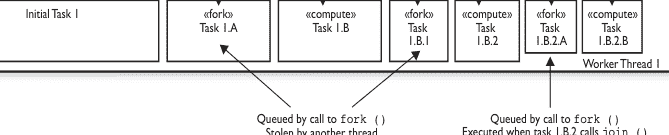

## 工作窃取

注意 `fork()` 的调用是如何放在 `compute()` 或 `join()` 调用之前的。Fork-Join 框架的一个关键特性是工作窃取。工作窃取是 ForkJoinPool 中的其他线程获取任务的方式。最初提交一个 Fork-Join 任务进行执行时，ForkJoinPool 中的单个线程开始执行（并划分）该任务。每次调用 `fork()` 都会将一个新任务放在调用线程的队列中。任务队列的顺序对于最大的工作量来说是不完美的。在 ForkJoinPaintTask 示例中，代表 100% 工作量的任务将开始执行，它的第一个（fork 的）任务将代表围栏的 50%，接下来是 25%、12.5% 等，以此类推。当然，这可能会有所不同，取决于任务将被划分多少次，以及我们是将任务分成二分之一、四分之一还是其他划分方式，但在示例中，我们将每个任务一分为两部分：队列化一部分并执行另一部分。

ForkJoinPool 中忙碌的线程将尝试从任何带有队列的 Fork-Join 线程中窃取（最旧且最大的）任务。对于一个有四个线程的 ForkJoinPool，一种可能的事件序列可能是初始线程代表……

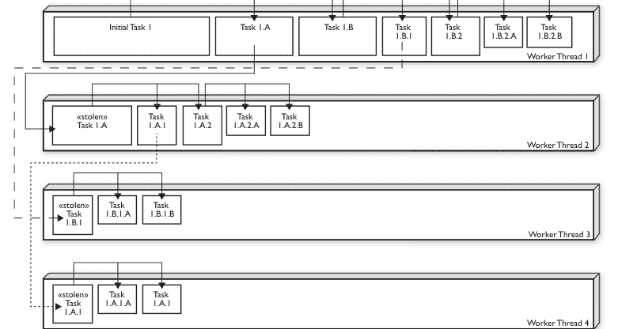

当然，如果一切都是分布的，你可能就不那么需要 Fork-Join。你只需将任务划分成与系统中的线程数相等的数量并使用普通的 Executor。在实践中，每个线程的完成不会……因为任务不会完全相同。这有许多原因：处理的数据可能会影响计算量，或者线程获得的时间可能不同。操作系统和其他运行的也会消耗 CPU 时间。为了尽可能完成 Fork-Join 任务，早早完成的线程会先从慢线程那里窃取——这样，你就能保持所有 CPU 忙碌。如果你只划分任务……快线程将没有东西可以窃取。最初，如果慢线程在没有划分和队列的情况下就开始处理任务，慢线程的队列中就没有工作了。将任务划分成比需要多一点的部分以均匀分配工作，但不要过多——如果你这样做，会损害性能。遗憾的是，没有魔法方法可以划分你的任务——这取决于任务的复杂性、数据的大小甚至是 CPU 的性能特性。回到漆围栏的问题，让 FenceSectionSmall 尽可能简单（低开销）并易于更改。你应该对你的 Fork-Join 代码进行基准测试（使用你预计代码运行的硬件），并找到一个有效的任务划分量。它不需要完美；除非有其他因素影响，否则你可能看不到性能上的巨大波动。

## Join

当你对（左侧）任务调用 `join()` 时，它应该是 compute 方法中最后步骤之一，位于调用 `fork()` 和 `compute()` 之后。调用 `join()` 表示“除非这个（左侧）任务完成，否则我无法继续”。当你调用 `join()` 时，可能会发生几种情况：

- 你调用 `join()` 的任务可能已经完成了。记住，你正在对一个已经调用过 `fork()` 的任务调用 `join()`。任务可能已被另一个线程窃取并完成。在这种情况下，调用 `join()` 只是验证任务是否已完成，你就可以继续后续操作。
- 你调用 `join()` 的任务可能正在处理中。另一个线程可能已经窃取了任务，你必须等待被连接的任务完成后才能继续。
- 你调用 `join()` 的任务可能仍在队列中（未被窃取）。在这种情况下，调用 `join()` 的线程将执行该被连接的任务。

## RecursiveAction

ForkJoinTask 是一个抽象基类，它概述了 Fork-Join 任务中的大多数方法，如 `fork()` 和 `join()`。如果你需要创建一个不返回结果的 ForkJoinTask，你应该继承 `RecursiveAction`。`RecursiveAction` 继承自 `ForkJoinTask` 并有一个你必须实现的抽象方法 `compute`：

```java
protected void compute();
```

一个不需要返回结果的任务示例可以是任何初始化现有数据结构的任务。下面的示例将初始化一个包含随机值的数组。请注意，在整个过程中只有一个数组。在拆分数组时，应尽量创建对象。


```java
public class RandomInitRecursiveAction extends RecursiveAction {
    private final int THRESHOLD = 10000;
    private int[] data;
    private int start;
    private int end;

    public RandomInitRecursiveAction(int[] data, int start, int end) {
        this.data = data;
        this.start = start; // 我们的部分从哪里开始？
        this.end = end; // 这个部分有多大？
    }
    @Override
    protected void compute() {
        if (end - start <= THRESHOLD) { // 这是一个可以的工作量吗？
            // 执行任务
            for (int i = start; i < end; i++) {
                data[i] = ThreadLocalRandom.current().nextInt();
            }
        } else {
            int halfWay = ((end - start) / 2) + start;
            RandomInitRecursiveAction a1 = new RandomInitRecursiveAction(data, start, halfWay);
            a1.fork(); // 将任务的左半部分入队列
            RandomInitRecursiveAction a2 = new RandomInitRecursiveAction(data, halfWay, end);
            a2.compute(); // 处理任务的右半部分
            a1.join(); // 等待入队列的任务完成
        }
    }
}
```

有时，你会看到使用 `ForkTask` 类中的 `invokeAll` 方法来代替 `fork/compute/join` 方法的组合。`invokeAll` 方法是方便的方法，可以节省一些打字时间。使用它们将帮助你避免错误！第一个调用 `invokeAll` 的任务将执行执行（调用 `compute`），所有额外任务将进行分叉并连接。在前面的示例中，你可以消除这三行 `fork/compute/join` 并将它们替换为单行：

```java
invokeAll(a2, a1);
```

```java
为了启动应用程序，我们创建一个大数组并使用 Fork-Join对其进行初始化：
public static void main(String[] args) {
    int[] data = new int[10_000_000];
    ForkJoinPool fPool = new ForkJoinPool();
    RandomInitRecursiveAction action =
        new RandomInitRecursiveAction(data, 0, data.length);
    fPool.invoke(action);
}
```

注意，在调用 `invoke` 时我们不期望任何返回值。

`RecursiveTask` 不返回任何内容。

## RecursiveTask

如果你需要创建一个返回结果的 ForkJoinTask，那么你应该继承 `RecursiveTask`。`RecursiveTask` 继承自 `ForkJoinTask` 并有一个你必须实现的抽象方法：

```
protected abstract V compute(); // V 是泛型
```

下面的示例将找到数组中的最大值，由于分分，`RecursiveTask` 会初始化一个包含随机值的数组。注意在整个过程中只有一个数组。在拆分数组时，应避免创建对象。

```java
public class FindMaxRecursiveTask extends RecursiveTask<Integer> {
    static final int THRESHOLD = 10000;
    private int[] data;
    private int start;
    private int end;

    public FindMaxRecursiveTask(int[] data, int start, int end) {
        this.data = data;
        this.start = start;
        this.end = end;
    }

    @Override
    protected Integer compute() {
        if (end - start <= THRESHOLD) {
            int max = Integer.MIN_VALUE;
            for (int i = start; i < end; i++) {
                if (data[i] > max) {
                    max = data[i];
                }
            }
            return max;
        } else {
            int halfWay = ((end - start) / 2) + start;
            FindMaxRecursiveTask task1 = new FindMaxRecursiveTask(data, start, halfWay);
            task1.fork();
            FindMaxRecursiveTask task2 = new FindMaxRecursiveTask(data, halfWay, end);
            Integer max2 = task2.compute();
            Integer max1 = task1.join();
            return Math.max(max1, max2);
        }
    }
}
```

为了启动应用程序，我们创建一个大数组并使用 Fork-Join对其进行初始化：

```java
public static void main(String[] args) {
    int[] data = new int[10_000_000];
    ForkJoinPool fPool = new ForkJoinPool();
    RandomInitRecursiveAction action =
        new RandomInitRecursiveAction(data, 0, data.length);
    fPool.invoke(action);

    FindMaxRecursiveTask task = new FindMaxRecursiveTask(data, 0, data.length);
    Integer max = fPool.invoke(task);
    System.out.println("Max value: " + max);
}
```

注意，在调用 `invoke` 时我们不期望任何返回值。

`RecursiveTask` 不返回任何内容。 (注：原文中示例代码块存在重复和混乱，此处已根据逻辑进行了对齐)

# 使用 Fork/Join 框架 (OCP 目标 11.4) 825

Fork-Join 的优势在于数组排序。当你将一个数组分成两半并分别对每一部分进行排序时，你必须合并这两个排序后的数组，例所示：

```java
public class SortRecursiveAction extends RecursiveAction {
    private static final int THRESHOLD = 1000;
    private int[] data;
    private int start;
    private int end;

    public SortRecursiveAction(int[] data, int start, int end) {
        this.data = data;
        this.start = start;
        this.end = end;
    }

    @Override
    protected void compute() {
        if (end - start < THRESHOLD) {
            Arrays.sort(data, start, end);
        } else {
            int halfWay = (end - start) / 2 + start;
            SortRecursiveAction al = new SortRecursiveAction(data, start, halfWay);
            SortRecursiveAction a2 = new SortRecursiveAction(data, halfWay, end);
            invokeAll(al, a2); // shortcut for fork() & join()
            if (data[halfWay-1] <= data[halfWay]) {
                return; // already sorted
            }

            // merging of sorted subsections begins here
            int[] temp = new int[end - start];
            int s1 = start, s2 = halfWay, d = 0;
            while (s1 < halfWay && s2 < end) {
                if (data[s1] < data[s2]) {
                    temp[d++] = data[s1++];
                } else if (data[s1] > data[s2]) {
                    temp[d++] = data[s2++];
                } else {
                    temp[d++] = data[s1++];
                    temp[d++] = data[s2++];
                }
            }
            if (s1 == halfWay) {
                System.arraycopy(data, s1, temp, d, temp.length - d);
            } else if (s2 == end) {
                System.arraycopy(data, s2, temp, d, temp.length - d);
            }
            System.arraycopy(temp, 0, data, start, temp.length);
        }
    }
}
```

# 826 第 14 章：并发

在上一个示例中，调用 `invokeAll` 之后的所有内容都与将数组的排序子部分合并为一个单一较大的排序子部分有关。


由于 Java 应用程序的可移植性，运行你应用程序的系统可能不具备看到性能提升所需的硬件资源。始终要进行测试，确定哪些问题和硬件组合在使用 Fork-join 时能够看到性能提升。

## 认证总结

本章涵盖了你在认证考试中应用所需的并发知识。`java.util.concurrent` 包及其子包构成了 Java 中一个高层级的多线程框架。在尝试使用 Java 并发库之前，你应该熟悉线程的基础知识，但一旦你学会了 `java.util.concurrent`，你可能再也不需要扩展 `Thread` 类。

`Callables` 和 `Executors`（以及它们的底层线程池）构成了直接创建新 `Threads` 的高层方案的基础。增加 CPU 核心数量的趋势持续，知道如何让 Java 并发地使用所有核心可以让你游刃有余。`java.util.concurrent` 提供的高层 API 帮助你创建高效的多线程应用程序，同时消除了使用低级线程 API（如 `wait()`、`notify()` 和 `synchronized`）的需求，这些 API 可能是难以调试的 bug 来源。

当使用 `Executor` 时，你通常会创建一个 `Callable` 实现表示需要执行的工作。`Runnable` 也可以用于相同目的，但 `Callable` 利用泛型允许其 `call` 方法返回泛型类型。可以通过调用 `Executor` 类中的工厂方法来获取具有预定义行为的 `Executor` 或 `ExecutorService` 实例，例如：`ExecutorService es = Executors.newFixedThreadPool(100);`

一旦你获取了 `ExecutorService`，可以使用 `execute`、`submit`、`invokeAny` 或 `invokeAll` 方法之一，以 `Runnable` 或 `Callable` 或 `Callable` 实例集合的形式向 `ExecutorService` 提交任务。如果需要，`ExecutorService` 可以在应用程序的整个生命期间保留，但如果不再需要，必须使用 `shutdown` 和 `shutdownNow` 方法将其终止。

# 认证总结 827

我们查看了 Fork-Join 框架，它提供了一种非常特殊的 `Executor`。当你通常放入 `Callable` 中的工作可以被分成多个工作单元时，请使用 Fork-Join 框架。Fork-Join 框架的目的是通过利用系统中额外的 CPU 来减少解决问题所需的时间。在应用程序中，你应该只运行一个 Fork-Join 任务，因为框架的目标是允许单个任务消耗所有可用 CPU 资源以便尽可能地解决。在大多数情况下，将单个任务拆分成多个任务的工作由底层 Fork-Join 线程操作可能会引入额外的开销。不要假设 Fork-Join 为所有问题带来性能收益。涉及的开销可能大到足以抵消应用框架带来的任何收益。

在应用 Fork-Join 框架时，首先扩展 `RecursiveTask` 或 `RecursiveAction`。在这些 ForkJoin 子类之一中，你必须实现 `compute` 方法。`compute()` 方法是你定义任务拆分成部分的地方，然后调用 `fork` 和 `join` 方法或 `invokeAll` 方法。要执行任务，创建 `ForkJoinPool` 实例 `ForkJoin pool = new ForkJoinPool();` 并 `RecursiveTask` 或 `RecursiveAction` 提交给 `pool.invoke(task)`。虽然 ForkJoin API 本身并不大，但创建一个正确且高效的 ForkJoin 实现可能是挑战性的。

我们学习了 `java.util.concurrent` 集合。集合有三类：写复制集合、并发集合和阻塞队列。写复制集合和并发集合的使用与传统的 `java.util` 集合相似，但设计为以线程安全的方式高效使用。写复制集合（`CopyOnArrayList` 和 `CopyOnSet`）应用于读密集型场景。当尝试遍历写复制集合中的所有元素时，始终使用 `Iterator`。

- ConcurrentHashMap
- ConcurrentLinkedDeque
- ConcurrentLinkedQueue
- ConcurrentSkipListMap
- ConcurrentSkipListSet

# 828 第 14 章：并发

这些集合旨在无需加锁即可并发使用。记住，这五个并发集合的迭代器是弱一致的。`ConcurrentHashMap` 和 `ConcurrentSkipListMap` 是 `ConcurrentMap` 的实现，它们为 `Map` 接口增加了原子的 `putIfAbsent`、`remove` 和 `replace` 方法。`java.util.concurrent` 包提供了几种阻塞队列实现：

- ArrayBlockingQueue
- LinkedBlockingQueue
- PriorityBlockingQueue
- DelayQueue
- LinkedTransferQueue
- SynchronousQueue

这些阻塞队列用于在线程之间交换对象——一个线程存放对象，另一个线程检索该对象。取决于使用的队列类型、创建队列的参数以及所调用的方法，插入或移除操作可能会阻塞它直到成功完成。在 Java 7 中添加了 `LinkedTransferQueue` 类，它是几种阻塞队列类型的超集；如果可能，你应该优先使用它。

# 两分钟训练（演习）

以下是本章认证目标中的一些关键点。

## 应用原子变量和锁 (OCP 目标 11.2)


# 第 14 章：并发

## java.util.concurrent.atomic 包

- `java.util.concurrent.atomic` 包提供了与 `volatile` 字段相似的类（原子对象的值的更改将由其他线程正确读取，而无需在代码中使用 `synchronized` 同步块）。
- 原子类提供了 `compareAndSet` 方法，用于验证原子变量的值只有在与预期值匹配时才会被更改。
- 原子类还提供了若干个便利方法，例如 `addAndGet`，它会反复循环直到 `compareAndSet` 成功为止。

## java.util.concurrent.locks 包

- `java.util.concurrent.locks` 包包含一种锁机制，它是 `synchronized` 方法和代码块的替代方案。你能够获得更大的灵活性，但代价是语法更加冗长（例如，必须手动调用 `lock()`、`unlock()`，并且在 `synchronized` 块结束时会有自动释放同步监视器）。
- `ReentrantLock` 类提供了基础的 `Lock` 实现。常用的方法有 `lock()`、`unlock()`、`isLocked()` 和 `tryLock()`。调用 `lock()` 会增加计数器，`unlock()` 会减少计数器。只有当计数器为零时，线程才能获取锁。
- `ReentrantReadWriteLock` 类提供了 `ReadWriteLock` 实现，支持读锁（通过调用 `readLock()` 获取）和写锁（通过调用 `writeLock()` 获取）。

## 使用 java.util.concurrent 集合 (OCP 目标 11.1)

- 写时复制（Copy-on-write）集合在读操作多于写操作时运行良好，因为它们为每次写操作创建一个集合的新副本。在遍历写时复制集合时，请使用迭代器（记住，`for-each` 循环使用的是迭代器）。
- 没有任何并发集合能让存储在集合中的元素变为线程安全——只有集合本身是。
- 应该优先使用 `ConcurrentHashMap`、`ConcurrentSkipListMap` 和 `ConcurrentSkipListSet`，而不是传统的集合。

`ConcurrentHashMap` 和 `ConcurrentSkipListMap` 是 `ConcurrentMap` 的实现，通过添加原子操作来增强标准的 Map，在执行操作之前验证元素的存在和值：`putIfAbsent(K key, V value)`、`remove(Object key, Object value)`、`replace(K key, V value)` 和 `replace(K key, oldValue, V newValue)`。

### 阻塞队列

阻塞队列用于在线程之间交换对象。当调用某些操作时（例如在没有元素可取时调用 `take()`），阻塞队列会发生阻塞（因此得名阻塞）。共有七种不同的阻塞队列，它们的行为略有不同；你应该能够识别每种类型的行为。

| 阻塞队列 | 说明 |
|---|---|
| `ArrayBlockingQueue` | 一种 FIFO（先进先出）队列，队列头部是最老的元素，尾部是最新的元素。构造函数中的 `int` 参数限制了队列的大小（它是有界队列）。 |
| `LinkedBlockingDeque` | 与 `LinkedBlockingQueue` 类似，但它是一个双端队列（deque）。不仅仅是 FIFO 操作，你还可以从队列的头部或尾部移除元素。 |
| `LinkedBlockingQueue` | 一种 FIFO 队列，头部是最老的元素，尾部是最新的。构造函数可选的 `int` 参数限制了队列的大小（可以是有界的或无界的）。 |
| `PriorityBlockingQueue` | 一个无界队列，使用 `Comparable` 或 `Comparator` 对元素进行排序。队列头部是最小值。 |
| `DelayQueue` | 一个 `java.util.concurrent.Delayed` 实例的无界队列。对象只有在延迟过期后才能被取出。队列头部是第一个过期的对象。 |
| `LinkedTransferQueue` | Java 7 新增。一种无界 FIFO 队列，支持 `ConcurrentLinkedQueue`、`SynchronousQueue` 和 `LinkedBlockingQueue` 的特性。 |
| `SynchronousQueue` | 无容量的阻塞队列。插入操作会阻塞，直到另一个线程执行 `remove` 操作。移除操作会阻塞，直到另一个线程执行 `insert` 操作。 |

某些阻塞队列是有界的，这意味着它们对可以添加的元素数量有上限，调用 `put(e)` 的线程可能会阻塞直到有可用空间。

## 使用 Executors 和线程池 (OCP 目标 11.3)

- `Executor` 用于提交任务进行执行，而无需显式地创建线程。
- `ExecutorService` 是增强版的 `Executor`，提供了额外的功能，例如执行 `Callable` 实例以及关闭线程（在 `main` 方法返回后可能会保持 `Executor` 中的线程继续运行）。
- `Callable` 接口类似于 `Runnable` 接口，但增加了从其方法返回结果以及可选抛出异常的能力。
- `Executors`（复数）提供了工厂方法，用于构建 `ExecutorService` 实例，例如：`ExecutorService ex = Executors.newFixedThreadPool(4);`

## 使用 Fork/Join 框架 (OCP 目标 11.4)

- Fork-Join 允许线程之间进行工作窃取（work stealing），以利用 CPU 并提高可并行任务的性能。为了最小化创建线程的开销，你应该创建一个 `ForkJoinPool`。默认情况下，每个 CPU 创建一个线程。
- Fork-Join 任务代表一个要解决的大问题。被 `ForkJoinPool` 执行时，任务将其拆分成代表较小问题部分的 Fork-Join 任务。
- `ForkJoinTask` 是 `RecursiveAction` 或 `RecursiveTask` 的子类。当 `RecursiveTask` 的 `compute()` 方法必须返回一个值，而返回类型为 `void` 时使用 `RecursiveAction`。
- 在编写 `ForkJoinTask` 实现的 `compute()` 方法时，在调用 `join()` 之前始终调用 `fork()`，或者使用 `invokeAll()` 方法代替调用 `fork()` 和 `join()`。
- 在退出应用程序之前不需要关闭 Fork-Join 池，因为其中的线程通常以守护模式运行。

## 自测

以下问题可能是书中最难的。不要慌（我们知道有些作者在这些主题上表现不好，但仍然通过了考试）。

### I. 以下代码块创建一个 `CopyOnWriteArrayList`，向其添加元素并打印内容：

```java
CopyOnWriteArrayList<Integer> cowList = new CopyOnWriteArrayList<>();
cowList.add(4);
cowList.add(2);
Iterator<Integer> it = cowList.iterator();
cowList.add(6);
while (it.hasNext()) {
  System.out.print(it.next() + " ");
}
```

结果是什么？

- A. 6
- B. 12
- C. 4 2
- D. 4 2 6
- E. 编译失败
- F. 运行时抛出异常

### II. 已知：

```java
CopyOnWriteArrayList<Integer> cowList = new CopyOnWriteArrayList<>();
cowList.add(4);
cowList.add(2);
cowList.add(6);
Iterator<Integer> it = cowList.iterator();
cowList.remove(2);
while (it.hasNext()) {
  System.out.print(it.next() + " ");
}
```

产生的输出是什么？

- A. 12
- B. 10
- C. 4 2 6
- D. 4 6
- E. 编译失败
- F. 运行时抛出异常

### 3. `CopyOnWriteArrayList` 的哪些方法会导致创建内部数组的新副本？多选题。

- A. add
- B. get
- C. iterator
- D. remove

### 4. 已知：

`ArrayBlockingQueue<Integer> abq = new ArrayBlockingQueue<>(10);`

哪些操作可以无限期阻塞？多选题。

- A. abq.add(1);
- B. abq.offer(1);
- C. abq.put(1);
- D. abq.offer(1, 5, TimeUnit.SECONDS);

### 5. 已知：

`ConcurrentMap<String, Integer> ages = new ConcurrentHashMap<>();`

`ages.put("John", 23);`

哪个方法只有在 John 的值等于 23 时才从映射中删除 John？

- A. ages.delete("John", 23);
- B. ages.deleteIfExists("John", 23);
- C. ages.remove("John", 23);
- D. ages.removeIf("John", 23);

### 6. 如果该方法被多个线程并发且反复地调用，哪种方法代表生成一到十之间随机数的最佳方法？

```java
public static int randomA() {
    Random r = new Random();
    return r.nextInt(10) + 1;
}
```

```java
private static int sr = new Random();
public static int randomB() {
    return sr.nextInt(10) + 1;
}
```

```java
public static int randomC() {
    int i = (int) (Math.random() * 10 + 1);
    return i;
}
```

```java
public static int randomD() {
    ThreadLocalRandom lr = ThreadLocalRandom.current();
    return lr.nextInt(1, 11);
}
```

### 7. 给定：

```java
AtomicInteger i = new AtomicInteger();
```

哪种操作可以原子地将 i 增加了 9？（选择所有适用）

- A. i.addAndGet(9);
- B. i.getAndAdd(9);
- C. i.set(i.get() + 9);
- D. i.atomicIncrement(9);
- E. i = i + 9;

### 8. 给定：

```java
public class LeaderBoard {
    private ReadWriteLock rwl = new ReentrantReadWriteLock();
    private List<Integer> highScores = new ArrayList<>();
    public void addScore(Integer score) {
        // 位置 A
        lock.lock(); // 注意：OCR 识别为 'lock'，上下文暗示它应该是 rwl.writeLock().lock()
        try {
            if (highScores.size() < 10) {
                highScores.add(score);
            } else if (highScores.get(highScores.size() - 1) < score) {
                highScores.set(highScores.size() - 1, score);
            } else {
                return;
            }
            Collections.sort(highScores, Collections.reverseOrder());
        } finally {
            lock.unlock();
        }
    }
    public List<Integer> getHighScores() {
        // 位置 B
        lock.lock();
        try {
            return Collections.unmodifiableList(highScores);
        } finally {
            lock.unlock();
        }
    }
}
```

哪些代码块与 LeaderBoard 类中方法的行为匹配？（选择所有适用）。

- A. Lock lock = rwl.reentrantLock(); // 应该插入到位置 A
- B. Lock lock = rwl.reentrantLock(); // 应该插入到位置 B
- C. Lock lock = rwl.readLock(); // 应该插入到位置 A
- D. Lock lock = rwl.readLock(); // 应该插入到位置 B
- E. Lock lock = rwl.writeLock(); // 应该插入到位置 A
- F. Lock lock = rwl.writeLock(); // 应该插入到位置 B

### 9. 给定：

```java
ReentrantReadWriteLock rwl = new ReentrantReadWriteLock();
rwl.lock().unlock();
System.out.println("READ-LOCK-1");
rwl.lock().lock();
System.out.println("READ-LOCK-1");
rwl.lock().lock();
System.out.println("READ-LOCK-2");
rwl.lock().unlock();
System.out.println("READ-UNLOCK-2");
rwl.writeLock().lock();
System.out.println("WRITE-LOCK-1");
rwl.writeLock().unlock();
System.out.println("WRITE-UNLOCK-1");
```

结果是什么？

- A. 代码无法编译
- B. 代码通过编译并输出：
```
READ-LOCK-1
READ-LOCK-1
READ-LOCK-2
READ-UNLOCK-2
```
- C. 代码通过编译并输出：
```
READ-LOCK-1
READ-LOCK-1
READ-LOCK-2
READ-UNLOCK-2
WRITE-LOCK-1
WRITE-UNLOCK-1
```
- D. 将抛出 java.lang.IllegalMonitorStateException

### 10. 哪个类包含用于产生预配置 ExecutorService 实例的工厂方法

- A. Executor
- B. Executors
- C. ExecutorService
- D. ExecutorServiceFactory

### 11. 给定：

```java
private Integer executeTask(ExecutorService service,
    Callable<Integer> task) {
    // 在此处插入
```

哪几行代码在插入后，可以正确使用 ExecutorService 参数来执行 Callable 并返回 Callable 的结果？（选择所有适用）

- A. try {
    return service.submit(task);
} catch (Exception e) {
    return null;
}

- B. try {
    return service.execute(task);
} catch (Exception e) {
    return null;
}

- C. try {
    Future<Integer> future = service.submit(task);
    return future.get();
} catch (Exception e) {
    return null;
}

- D. try {
    Result<Integer> result = service.submit(task);
    return result.get();
} catch (Exception e) {
    return null;
}

### 12. 哪些是正确的？（选择所有适用）

- A. Runnable 可能会返回结果，但不能抛出 Exception
- B. Runnable 既不能返回结果，也不能抛出 Exception
- C. Runnable 不能返回结果，但可以抛出 Exception
- D. Runnable 可以返回结果并抛出 Exception
- E. Callable 可以返回结果，但不能抛出 Exception
- F. Callable 不能返回结果，也不能抛出 Exception
- G. Callable 不能返回结果，但可以抛出 Exception
- H. Callable 可以返回结果并抛出 Exception

### 13. 给定：


```java
class IncrementAction extends RecursiveAction {
    private final ReentrantReadWriteLock rwl = new ReentrantReadWriteLock();
    private final int start;
    private final int end;
    private final int[] myArray;

    public IncrementAction(int[] myArray, int start, int end) {
        this.myArray = myArray;
        this.start = start;
        this.end = end;
    }

    @Override
    protected void compute() {
        if (end - start < 10) {
            for (int i = start; i < end; i++) {
                myArray[i]++;
            }
        } else {
            rwl.readLock().lock();
            try {
                for (int i = start; i < end / 2; i++) {
                    myArray[i]++;
                }
            } finally {
                rwl.readLock().unlock();
            }
            new IncrementAction(myArray, start, end / 2).fork();
            new IncrementAction(myArray, end / 2, end).compute();
        }
    }
}
```

哪几行代码在插入后，可以正确使用 `ExecutorService` 参数来执行 `Callable` 并返回 `Callable` 的结果？（选择所有适用）

# 15

## JDBC

### 认证目标

- 描述构成 JDBC API 核心的接口（包括 `Driver`、`Connection`、`Statement` 和 `ResultSet` 接口及其与提供者实现之间的关系）
- 识别使用 `DriverManager` 类连接数据库所需的组件（包括 JDBC URL）
- 提交查询并从数据库读取结果（包括创建 `Statement`；返回结果集；遍历结果；以及正确关闭 `ResultSet`、`Statement` 和 `Connection`）
- 创建和使用 JDBC 事务（包括禁用自动提交模式、提交和回滚事务，以及设置和回滚保存点）
- 使用 `RowSetProvider` 类和 `RowSetFactory` 接口构造并使用 `RowSet` 对象
- 创建并使用 `PreparedStatement` 和 `CallableStatement` 对象
- 两分钟快速演练

### Q&A 自测

# 842 第 15 章：JDBC

本章涵盖了为 Java SE 7 考试新增的 JDBC API。考试开发人员长期认为这一 API 确实是语言的核心特性之一，能够熟练运用 JDBC 对于证明作为 Java 程序员的技能大有帮助。

有趣的是，自 JDK 1.1 (1997年) 引入 JDBC 1.0 以来，JDBC 一直是语言的一部分。从那时起，API 稳步更新，大约每个偶数版本的 JDK 会发布一次大版本，最后一次大更新是 2006 年随 Java SE 7 发布的 JDBC 4.0。JDBC 还有一些小版本更新，目前版本为 4.1，我们将在本章稍后部分讨论它。虽然考试重点是 JDBC 4.x，但仍有一些关于使用 JDBC 3.0 实现和 JDBC 4.x 实现加载驱动程序差异的问题，因此我们将介绍这些内容。

好消息是，考试不会测试你编写 SQL 语句的能力。那本身就是一项考试（甚至可能更难——SQL 是一个巨大的话题！）。但你能够识别一些基本的 SQL 语法和命令，因此我们首先将花时间介绍关系型数据库系统的基础知识，以及足够让你在数据库聚会上大受欢迎的 SQL 知识。如果你认为自己已经有 SQL 经验并理解数据库概念，或许可以略过第一部分，直接跳到第一个考试目标深入学习。

## 入门：数据库与 JDBC 简介

当你考虑组织信息并以易于理解的方式存储时，电子表格或表格通常是你采取的首选方法。电子表格或表格是分类信息的自然方式：第一行定义表格将包含的信息类型，随后的每一行包含一组与我们在左侧创建的键相关的数据。例如，假设你想制作一份每月支出分类图表（表 15-1）。

| 表 15-1 | 月份 | 汽油 | 外食 | 公用事业 | 手机 |
| :--- | :--- | :--- | :--- | :--- | :--- |
| 支出分类 | 一月 | $200.25 | $109.87 | $97.00 | $45.08 |
| | 二月 | $225.34 | $121.08 | $97.00 | $23.36 |
| | 三月 | $254.78 | $130.45 | $97.00 | $56.09 |

从图表数据中，我们可以首先确定在今年三个月，你的总支出逐月增加。但请注意，如果没有这个图表，如果没有月份与列数据之间的关系，你只拥有一堆收据，无法得出重要结论，例如：

- 假设你每月行驶里程相同，汽油变得越来越贵——也许是时候买一辆普锐斯了。
- 你每月都在外食（或外食价格在上涨）——也许是时候开始计划饮食了。
- 你需要少社交——手机账单太贵了。

关键在于，这些小样本数据是理解关系型数据库系统的关键。关系型数据库实际上是为了在表格中操作数据的应用程序。软件本身被称为关系型数据库管理系统 (RDBMS)，但许多人将其简称为“数据库”——所以记住，以后谈论数据库时，我们实际上在谈论 RDBMS（整个系统）。关系系统为数据库增加的是定义表之间关系的能力。它还提供了一种以有意义的方式存取数据的语言。

查看表 15-1 中的简单表格，我们知道汽油、外食、公用事业和手机列中的数据是按一月、二月等月份分组的。在数据库术语中，月份是“主键”。数据库表通常需要主键来标识你想要创建表格的哪一行，并确保没有重复行。

进一步推之，如果表 15-1 中的数据存储在数据库中，我可以询问数据库（编写查询）给我一月的所有数据（再次，对于这张表，主键是“月份”）。我可能会写类似的内容：

> “给我我一月所有的支出。”

结果将类似于：

> 一月：$200.25, 外食：$109.87, 公用事业：$97.00, 手机：$45.08

### 表 15-2 示例 SQL CRUD 命令

| CRUD | SQL 命令 | 示例 SQL 查询 | 英语表达 |
| --- | --- | --- | --- |
| 创建 (Create) | INSERT | `INSERT INTO Expenses VALUES ('April', 231.21, 29.87, 97.00, 45.08)` | 向费用表中添加带有以下值的新行（April）.... |
| 读取 (Read/Find) | SELECT | `SELECT FROM Expenses WHERE Month='February'` | 获取费用表中月份 2 月的所有列。 |
| 读取所有 (Read All) | SELECT | `SELECT * FROM Expenses` | 获取费用表中的所有列。 |
| 更新 (Update) | UPDATE | `UPDATE Expenses SET Phone=32.36, EatingOutMonth='February'` | 修改你 2 月的电话费用和外出用餐费用.... |
| 删除 (Delete) | DELETE | `DELETE FROM Expenses WHERE Month='April'` | 删除 4 月的费用行。 |

- 将 Phone 和 EatingOut 单元格中的数据更改为为 2 月提供的新数据。
- 从数据库中完全删除 Month 为 April 的整行。

真的，这些就是你在本章中需要的所有 SQL 了。还有许多其他 SQL 命令，但这些确实是核心集合。如果在本章中我们需要超出这四条命令，我们会在它们出现时进行介绍。现在，让我们来看一个更详细的数据库示例，我们将将其作为本章表的示例，使用一家小型书店“Bob's Books”的数据需求。

> SQL 命令（如 `SELECT`、`INSERT`、`UPDATE` 等）是不区分大小写的。同样，按照惯例（在本章中也会使用这种方法），将使用大写字母表示 SQL 命令和关键词，例如 `WHERE`、`FROM`、`LIKE`、`INTO`、`SET` 和 `VALUES`。SQL 表名和列名（也称为标识符）取决于数据库的类型，可以是区分大小写的，也可以是不区分大小写的。本章所示示例代码使用了不区分大小写的数据库，因此再次只是出于惯例，我们将使用驼峰命名法（camel case），即每个名词的首字母大写，其余小写。

关于大小写的最后一个说明是——所有数据库在字符串被界定时（即当它们被引号括起来时）都会保留大小。因此，使用单引号或双引号界定标识符的 SQL 子句将保留标识符的大小写。

## Bob's Books，我们的测试数据库

在本节中，我们将描述一个包含几张表和几行数据的小数据库。在我们学习本章的各种 JDBC 主题时，将通过这个数据库工作。

Bob 是一家专门经营儿童书籍的小型书商。Bob 根据使用数据库（这其实并不重要）和 Java 应用程序来在线销售其书籍的需求设计了数据。Bob 决定使用 JDBC API，允许他能够连接到数据库并通过 Java 应用程序执行查询。

首先，让我们看看 Bob 数据的组织结构。在数据库中，表的组织和规范被称为数据库模式（schema）（图 15-1）。Bob 的模式相对简单，而且再次，为了本章的目的，我们将集中于 Bob 模式中的四张表。


| 客户 (Customer) |
| :--- |
| int : CustomerID [PK] |
| String : FirstName |
| String : LastName |
| String : EMail |
| String : Phone |

| 作者 (Author) | 作者分类书籍 (Books_by_Author) | 书 (Book) |
| :--- | --- | :--- |
| int :AuthorID [PK] | int :AuthorID [FK] | String : ISBN [PK] |
| String : FirstName | | String : Title |
| String : LastName | String : ISBN [FK] | String : PubDate |
| | | String : Format |
| | | float : UnitPrice |

### 表 15-3 Bob's Books 客户表示例数据

| CustomerID | FirstName | LastName | Email | Phone |
| --- | --- | --- | --- | --- |
| 5000 | John | Smith | john.smith@verizon.net | 555-340-1230 |
| 5001 | Mary | Johnson | mary.johnson@comcast.net | 555-123-4567 |
| 5002 | Bob | Collins | bob.collins@yahoo.com | 555-012-3456 |
| 5003 | Rebecca | Mayer | rebecca.mayer@gmail.com | 555-205-8212 |
| 5006 | Anthony | Clark | anthony.clark@gmail.com | 555-256-1901 |
| 5007 | Judy | Sousa | judy.susa@verizon.net | 555-751-1207 |
| 5008 | Christopher | Patrinquin | patriquina@yahoo.com | 555-316-1803 |
| 5009 | Deborah | McGinn | desmmith@comcast.net | 555-256-3421 |
| 5010 | Jennifer | McGinn | jmcginn@comcast.net | 555-250-0918 |

这是一个相对简单的模式，代表了小型书店数据库的一部分。在所示的模式中，有一张客户表（表 15-3）。该表存储了关于 Bob 客户的数据——客户 ID、名字、姓氏、电子邮件地址和电话号码。地址和其他信息可以存储在另一张表中。

我们将看到的另外三张表代表了存储书籍信息所需的数据。因为一本书的数据集比客户复杂，所以我们需要一张表来存储书籍信息，另一张表存储作者信息，第三张表用于建立书籍和作者之间的关系。

假设你尝试在一张表中存储一本书，其中包含一个 ISBN（国际标准书号）、标题和作者名称的列。对于很多书来说，这是可以的。但如果一本书有两个作者呢？或者有三个作者呢？记住，数据库的一个要求是唯一主键，所以你不能简单地在表中重复 ISBN。

| ISBN | Title | Author |
| --- | --- | --- |
| ABCD | Wonderful | Fred |
| ABCD | Some | Paula |

### 表 15-4 Bob's Books 书籍表示例数据

| ISBN | Title | PubDate | Format |
| --- | --- | --- | --- |
| 043971123 | To Your Dragon | 2005 | Paperback |
| 0525048256 | The House | 2003 | Hardcover |
| 061833423 | of Olympus | 2001 | Paperback |
| 073586230 | The Chronicles | 2010 | Hardcover |
| 080373428 | Survival Guide | 2008 | Paperback |
| 978545236 | The White Giraffe | 2009 | |

# JDBC API 的核心接口 (OCP 目标 9.1)

## 9.1 描述构成 JDBC API 核心的接口（包括 `Driver`、`Connection`、`Statement` 和 `ResultSet` 接口以及它们与提供者实现之间的关系）。

正如我们在上一节中提到的，关系型数据库的目的实际上有三点：

- 为表中的数据提供存储
- 提供一种在数据之间建立关系的方法——就像 Bob 之前对 Authors、Books 和 Books_by_Author 表所做的那样
- 提供一种语言，用于提取数据、更新数据、删除数据以及创建新数据

JDBC 的目的是为开发者提供一个应用程序编程接口 (API)，用于编写可以访问和管理关系型数据库，并使用 SQL 执行 CRUD（增删改查）操作的 Java 应用程序。

一旦你理解了 JDBC API 的基础知识，你将能够访问庞大的数据库列表。在 JDBC 出现之前，其驱动力之一是提供一种访问关系型数据库的标准方法，但 JDBC 也可以用于访问文件系统和面向对象的数据源。关键在于 API 提供了数据库连接、语句和结果集的抽象视图。这些概念在 `java.sql` 包的 API 接口中分别表示为：`Connection`、`Statement` 和 `ResultSet`。这些接口定义了你与实现类之间的合约。事实上，你可能不知道（也不应该知道）实现类是如何工作的。只要实现类实现了你需要的接口，你就可以确保接口中定义的方法存在，并且你可以调用它们。

`java.sql.Connection` 接口定义了代表与关系型数据库系统连接对象的合约。稍后，我们将查看该合约的方法，但目前，一个 `Connection` 实例就是我们与数据库通信所需的。`Connection` 接口的实现取决于供应商，而且，我们不需要过于担心“如何实现”——只要供应商遵循合约，我们就可以确保代表 `Connection` 的对象将允许我们与数据库连接进行工作。

`Statement` 接口提供了获取要在数据库上执行的 SQL 语句所需的功能抽象，而 `ResultSet` 接口提供了产生结果集（数据表）所需的功能抽象，当 SQL 查询涉及 SQL `SELECT` 语句时，该结果集会被返回。


# 第 15 章：JDBC

## 使用 DriverManager 连接数据库 (OCP 目标 9.2)

### 认证目标

- 9.2 识别连接数据库的组件（包括 URL）

正如我们提到的，JDBC 的目的是为开发者提供一个应用程序编程接口 (API)，用于编写可以访问和管理关系型数据库，并使用 SQL 执行 CRUD 操作的 Java 应用程序。

一旦你理解了 JDBC API 的基础知识，你将能够访问庞大的数据库列表。在 JDBC 出现之前，其驱动力之一是提供一种访问关系型数据库的标准方法，但 JDBC 也可以用于访问文件系统和面向对象的数据源。关键在于 API 提供了数据库连接、语句和结果集的抽象视图。这些概念在 `java.sql` 包的 API 接口中分别表示为 `Connection`、`Statement` 和 `ResultSet`。这些接口定义了你与实现类之间的合约。事实上，你可能不知道（也不应该知道）实现类是如何工作的。只要实现类实现了你需要的接口，你就可以确保接口中定义的方法存在，并且你可以调用它们。

`java.sql.Connection` 接口定义了代表与关系型数据库系统连接对象的合约。稍后，我们将查看该合约的方法，但目前，一个 `Connection` 实例就是我们与数据库通信所需的。`Connection` 接口的实现取决于供应商，而且，我们不需要过于担心“如何实现”——只要供应商遵循合约，我们就可以确保代表 `Connection` 的对象将允许我们与数据库连接进行工作。

`Statement` 接口提供了获取要在数据库上执行的 SQL 语句所需的功能抽象，而 `ResultSet` 接口提供了产生结果集（数据表）所需的功能抽象，当 SQL 查询涉及 SQL SELECT 语句时，该结果集会被返回。

`Connection`、`Statement`、`ResultSet` 以及我们很快将查看的许多接口的实现类是由我们使用的数据库供应商创建的。供应商比任何人都了解 JDBC 产品，因此由他们创建这些类是合理的。而且，这允许供应商优化或隐藏其产品的任何特殊特性。这些实现类的集合被称为 JDBC 驱动。JDBC 驱动（小写 "d"）是支持 API 所需的类集合，而 `Driver`（大写 "D"）是驱动程序所需的其中一个实现。

JDBC 驱动通常由供应商以 JAR 或 ZIP 文件的形式提供。JDBC 驱动的实现类必须满足最少一组要求才能符合 JDBC 规范。JDBC 规范提供了供应商必须支持的功能列表，以及供应商可以可选支持的功能列表。

以下是 JDBC 驱动要求的部分列表。欲需更多详情，请参阅规范 (JSR-221)。请注意，实现 JDBC 驱动的细节**不在**考试范围内。

- 完整实现接口：`java.sql.Driver`、`java.sql.DatabaseMetaData`、`java.sql.ResultSet`
- 实现 `java.sql.Connection` 接口。（注意，某些方法取决于数据库支持的 SQL 版本——在章节后半部分将讨论更多 SQL 版本的内容。）
- 实现 `java.sql.Statement`、`java.sql.PreparedStatement`
- 如果数据库支持存储过程，则实现 `java.sql.CallableStatement` 接口。同样，在章节后半部分将有关于此接口的内容。
- 实现 `java.sql.ResultSet` 接口。

## DriverManager 类

`DriverManager` 类是一个具有静态方法的 JDBC API 具体类。你会记得静态方法可以通过类名调用。其中一个方法是 `getConnection()`，我们接下来将查看。

### 使用 DriverManager 连接数据库 (OCP 目标 9.2)

`DriverManager` 类之所以命名，是因为它管理当你通过 `getConnection()` 方法请求 `Connection` 实例时的 JDBC 驱动实现。

有多个重载的 `getConnection` 方法，但它们都共享一个共同模式：URL。

```java
DriverManager.getConnection(String url, String username, String password);
```

例如：

```java
String url = "jdbc:db2://localhost:1521/BookSellerDB";
String user = "bookguy";
String pwd = "$3lleR";
try {
    Connection conn = DriverManager.getConnection(url, user, pwd);
} catch (SQLException se) {
}
```

在这个示例中，我们正在连接到位于本地机器、端口号为 1521、名为 BookSellerDB 的 Derby 数据库，使用的凭据是“bookguy”作为用户 ID，“3lleR”作为密码。现在不要过于担心 SQL 的语法——我们很快就会涵盖。

**在 `getConnection()` 方法中硬编码用户名和密码是一个极糟糕的主意。** 显然，任何阅读代码的人都会知道数据库的用户名和密码。处理数据库凭据更安全的方法是将产生凭据的代码与建立连接的代码分开。在某些其他情况下，你将使用某种身份验证和授权代码来产生访问数据库的一组凭据。

为了章节中示例简单起见，我们将硬编码用户名和密码，但请记住，这不是最佳实践。

当你调用 `DriverManager` 的 `getConnection()` 方法时，你是在要求 `DriverManager` 尝试将语句中的第一个字符串（驱动 URL）以及用户名和密码依次传递给已注册的每个驱动类。如果其中一个驱动类识别了 URL 字符串，并且用户名和密码被接受，则该驱动程序将返回一个 `Connection` 对象。然而，如果 URL 错误、用户名和/或密码不正确，该方法将抛出 `SQLException`。我们将在本章节后面花时间研究 `SQLException`。

### JDBC 驱动程序如何向 DriverManager 注册

由于 JDBC 过程的这部分非常重要，并且涉及到一点 Java 魔法，让我们花点时间画一下驱动程序类是如何“注册”到 `DriverManager` 的，如图 15-2 所示。

首先，一个或多个位于 JAR 或 ZIP 文件被包含在应用程序的类路径（classpath）中。`DriverManager` 类使用服务提供者机制在类路径中搜索在 jar 或 zip 的 `META-INF/services` 文件夹中包含名为 `java.sql.Driver` 文件的 JAR 或 ZIP 文件。这是一个简单的文本文件，包含了厂商用于实现 `java.sql.Driver` 接口的驱动程序的全名。例如，一个 Derby 驱动程序的全名是 `org.apache.derby.jdbc.ClientDriver`。

`DriverManager` 将尝试使用以下方式加载在 `java.sql.Driver` 文件中找到的类：

```java
Class.forName("org.apache.derby.jdbc.ClientDriver");
```

当驱动程序类被加载时，其初始化块将被执行。根据 JDBC 规范，驱动程序实例的首要活动之一是通过调用 `DriverManager` 上的静态方法向 `DriverManager` 类进行“自注册”。代码（不包含错误处理）看起来如下：

```java
public class ClientDriver implements java.sql.Driver {
    static {
        ClientDriver driver = new ClientDriver();
        DriverManager.registerDriver(driver);
    }
}
// ...
```

这会将 `Driver` 类的一个实例注册（存储）到 `DriverManager` 中。现在，当你的应用程序调用 `DriverManager.getConnection()` 方法并向该方法传递 JDBC URL、用户名和密码时，`DriverManager` 仅仅是调用已注册的驱动程序的 `connect()` 方法。如果连接成功，该方法将一个 `Connection` 对象实例返回给 `DriverManager`，然后它将其传递给你。

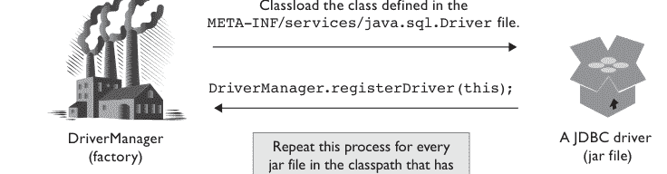

如果有多个已注册的驱动程序，`DriverManager` 会依次调用每个驱动程序并尝试从它们处获取 `Connection` 对象，如图 15-3 所示。

第一个识别 JDBC URL 并使用用户名和密码成功创建连接的驱动程序将返回一个 `Connection` 对象实例。如果没有驱动程序识别 URL、用户名和密码的组合，或者没有已注册的驱动程序，则抛出 `SQLException`。

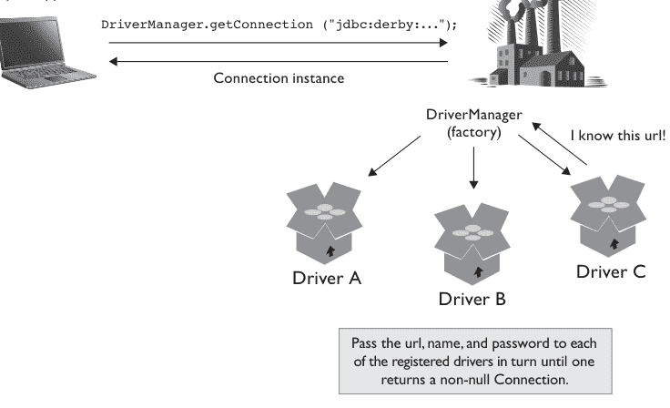

总结：

- JVM 加载 `DriverManager` 类，这是 JDBC API 中的一个具体类。
- `DriverManager` 类加载在类路径上的 JAR/ZIP 文件的 `META-INF/services/java.sql.Driver` 文件中找到的任何类实例。
- 驱动程序类调用 `DriverManager.registerDriver(this)` 向 `DriverManager` 自注册。
- 当调用 `DriverManager.getConnection(String url)` 方法时，`DriverManager` 会使用 URL 字符串调用这些已注册的 `Driver` 实例的 `connect()` 方法。
- 第一个成功与 URL 创建连接的驱动程序会将一个 `Connection` 对象实例返回给 `DriverManager.getConnection` 方法调用。

### JDBC URL

JDBC URL 用于确定为给定的 `Connection` 使用哪种驱动程序实现。将 JDBC URL（统一资源定位符）想象成一种从所有可能的驱动程序范围缩小到某个特定连接的方法。例如，假设你需要向某人发送包裹。为了将可能的地址范围缩小到单个位置，你必须在包裹上识别国家、州、城市、街道，以及可能的门号或地址号码：

```
USA:California://SanJose:FirstStreet/15
```

该字符串识别出国家是 USA，州是 California，城市是 San Jose，街道是 First Street，门号是 15。JDBC URL 遵循相同的理念。例如，我们可能会写：

```
jdbc:derby://SanJose:FirstStreet/15
```

第一部分是驱动程序，第二部分是 California，第三部分是 San Jose，第四部分是 First Street，最后一部分是 15。

## 向数据库提交查询并读取结果 (OCP 目标 9.3)

### 认证目标

- 9.3 向数据库提交查询并读取结果（包括创建语句；返回结果集；遍历结果；以及正确地关闭结果集、语句和连接）。

尽管认证考试涵盖了直到 Java SE 7，但考试开发者认为，由于这是首次在程序员考试中涵盖 JDBC，他们应该包含一些关于如何使用 JDBC 3.0 和 JDBC 4.0 驱动获取连接的问题。请记住，对于 JDBC 3.0 驱动（及更早版本），你需要负责使用 `java.lang.Class` 的静态方法 `forName()` 来加载类。


在本节中，我们将更详细地探讨 JDBC API。我们将从查看一个使用 `Connection`、`Statement` 和 `ResultSet` 接口的简单示例开始，汇总我们在本章目前学到的内容。我们将深入研究 `Statement` 和 `ResultSet`。

# Bob 的所有客户

最常用的 SQL 查询之一可能是 `SELECT * FROM <Tablename>`，它用于打印或查看表中的所有记录。假设我们有一个 Java DB (Derby) 数据库，其中填充了来自 Bob's Books 的数据。为了查询数据库并返回数据库中的所有客户，我们将编写如示例所示的代码。

注意，为了让代码列表更短一些，在后文中我们将使用 `out.println` 代替 `System.println`。只需假设我们已经包含了一个静态导入语句，就像此示例顶部的那样：

```java
import static java.lang.System.*; // 静态导入
// System 类的方法。
// 现在我们可以直接使用 'out'
// 而无需使用 System.out。

String url = "jdbc:derby://localhost:1521/BooksSellerDB";
String user = "bookguy";
String pwd = "$33leR";
try {
    Connection conn = DriverManager.getConnection(url, user, pwd); // 获取连接
    Statement stmt = conn.createStatement(); // 创建语句
    String query = "SELECT * FROM Customer"; // 执行查询
    ResultSet rs = stmt.executeQuery(query); // 处理结果
    while (rs.next()) {
        out.print(rs.getString("CustomerID") + " ");
        out.print(rs.getString("FirstName") + " ");
        out.print(rs.getString("LastName") + " ");
        out.print(rs.getString("Email") + " ");
        out.println(rs.getString("Phone"));
    }
} catch (SQLException e) { }
```

同样，我们将更详细地深入探讨此示例的所有部分，但这里是发生的情况：

- **获取连接**：我们正在使用访问 Bob 数据库所需的信息创建一个 `Connection` 对象实例（位于 Java DB 关系数据库 BooksSellerDB 上，通过凭据 "bookguy" 和密码 "$33leR" 访问）。
- **创建语句**：我们正在使用 `Connection` 创建一个 `Statement` 对象。该语句对象负责将字符串作为要执行的查询传递给数据库。
- **执行查询**：我们在数据库上执行查询字符串并返回一个 `ResultSet` 对象。
- **处理结果**：我们正在遍历结果集行——每次调用 `next()` 都会移动到结果的下一行。
- **打印列**：我们正在获取当前结果行中列的值并将其打印到标准输出。
- **捕获 SQLException**：所有的 JDBC API 方法都会抛出 `SQLException`。当方法使用不当或数据库不再响应时，可能会抛出 `SQLException`。例如，如果 JDBC URL、用户名或密码无效，将抛出 `SQLException`。

或者我们尝试查询一个不存在的表。或者由于网络中断或数据库离线导致数据库无法访问。我们将在本章的晚些部分更详细地查看 `SQLException`。

上一个代码的输出如下：

```
5000 Smith John.smithscomcast.net 555-340-1230
5001 Mary Johnson mary.johnson@comcast.net 555-123-4567
5002 Bob Collins bob.colins@yahoo.com 555-012-3456
5003 Rebecca Mayer rebecca.meyer@gmail.com 555-205-8212
5006 Anthony Clark anthony.clark@gmail.com 555-256-1901
5007 Judy Sosa judy.sosa@verizon.net 555-751-1207
5008 Christopher Patrinquinc@yahoo.com 555-316-1803
5009 Deborah debamith@comcast.net 555-256-9421
5010 Jennifer McGinn jmcginn@comcast.net 555-250-0918
```

我们将在接下来的两节中详细查看 `Statement` 和 `ResultSet` 接口及其方法。

# 语句

一旦我们成功连接到数据库，乐趣就可以真正开始了。从 `Connection`，我们可以创建一个 `Statement` 对象的实例（或者准确地说，使用从 `DriverManager` 得到的 `Connection` 实例，我们可以获取一个实现 `Statement` 接口的对象实例）。例如：

```java
String url = "jdbc:derby://localhost:1521/BookSellerDB";
String user = "bookguy";
String pwd = "$3llER";
try {
    Connection conn = DriverManager.getConnection(url, user, pwd);
    Statement stmt = conn.createStatement();
    // 使用 SQL 语句进行操作
} catch (SQLException e) {
}
```

`Statement` 的主要目的是使用某种方法执行 SQL 语句并返回某种类型的结果。`Statement` 方法有几种形式：返回结果集的方法和返回整数状态的方法。最常用的 `Statement` 方法执行返回数据的 SQL 查询，例如我们之前使用的用于获取所有 `Customer` 行的 `SELECT` 调用。

# 构建和使用语句

为了开始，让我们看看基础 `Statement`，它被用于执行静态 SQL 查询并返回结果。从 `Connection`，我们可以创建一个 `Statement` 对象的实例（见下文）。

```java
String url = "jdbc:derby://localhost:1521/BookSellerDB";
String user = "bookguy";
String pwd = "$3llER";
try {
    Connection conn = DriverManager.getConnection(url, user, pwd);
    Statement stmt = conn.createStatement();
    // 使用 SQL 语句进行操作
} catch (SQLException e) {
}
```

`Statement` 的主要目的是使用某种方法执行 SQL 语句并返回某种类型的结果。`Statement` 方法有几种形式：返回结果集的方法和返回整数状态的方法。最常用的 `Statement` 方法执行返回数据的 SQL 查询，例如我们之前使用的用于获取所有 `Customer` 行的 `SELECT` 调用。

# 执行查询与更新

由于此语句可能返回结果集，也可能返回整数行数，因此有两条额外的语句命令可以使用，它们根据 `execute` 方法返回的是 `true`（有结果集）还是 `false`（有更新计数或无结果）来获取结果或计数。当 `execute` 方法返回 `true` 时，使用 `getResultSet()` 获取结果；当 `execute` 方法返回 `false` 时，使用 `getUpdateCount()` 获取计数。让我们来看看这些方法。


允许用户在输入字段中直接输入查询字符串，或允许用户传递字符串来直接构建查询，通常是一个非常糟糕的主意。原因在于，如果用户可以构建查询，甚至将独立字符串包含在查询中，他们就可以利用查询返回比你预期的更多数据，或者更改数据库权限。

例如，假设我们有一个查询，用户输入电子邮件地址，且用户输入的字符串被插入到查询中：

```java
String s = System.console.readLine("Enter your e-mail address :");
ResultSet rs = stmt.executeQuery("SELECT * FROM Customer\nWHERE EMail=' + s + '\"");
```

此代码的用户可能会输入如下字符串：

数据库执行的结果生成的查询将变为：

```sql
SELECT * FROM Customer WHERE Email='tomtrouble.com' OR 'x'='x'
```

因为 `OR` 语句始终返回 `true`，结果是该查询将返回所有的客户行，这在实际上等同于以下查询：

```sql
SELECT * FROM Customer
```

现在，你的代码拥有了数据库中每个客户的电子邮件地址列表。

这种攻击被称为**注入攻击**。通过对用于数据库查询的任何字符串输入进行细致的清理，和/或通过使用其他 `Statement` 类型（如 `PreparedStatement` 和 `CallableStatement`），可以很容易地防止。尽管预防很容易，但它频繁发生，即使对于像 Yahoo 这样的大型、经验公司也是如此。

# 从数据库中提交查询并读取结果

`public ResultSet getResultSet() throws SQLException` 如果来自 `execute()` 方法的布尔值为 `true`，则存在结果。如前所示，调用 `Statement` 对象上的 `getResultSet()` 方法来获取结果集。然后你就可以处理 `ResultSet` 对象（我们将在下一节介绍）。此方法基本上是——如果实际上没有结果，该方法将返回 `null`。

```java
ResultSet rs = stmt.getResultSet();
```

`public int getUpdateCount() throws SQLException` 如果来自 `execute()` 方法的布尔值为 `false`，则存在一个计数，此方法将返回受影响的行数。返回值为 `-1` 表示没有结果。


```java
int numRows = stmt.executeUpdateCount();
if (numRows == -1) {
    out.println("No results");
} else {
    out.println(numRows + " rows affected.");
}
```

表 15-6 总结了我们介绍的 `Statement` 方法。

## 表 15-6 重要的 Statement 方法

| 方法（每个都会抛出 SQLException） | 描述 |
|---|---|
| `ResultSet execute(String sql)` | 执行 SQL 查询并返回 `ResultSet` 对象，即 SELECT 命令。 |
| `int executeUpdate(String sql)` | 执行可能修改若干行的 SQL 查询，即 INSERT、DELETE 或 UPDATE 命令。 |
| `boolean execute(String sql)` | 执行可能返回结果集或修改若干行（或两者均不发生）的 SQL 查询。如果存在结果集，方法返回 `true`；如果存在受影响行的计数，则返回 `false`。 |
| `ResultSet getResultSet()` | 如果 `execute` 方法的返回值为 `true`，可以使用此方法获取结果集。 |
| `int getUpdateCount()` | 如果 `execute` 方法的返回值为 `false`，可以使用此方法获取受影响行的计数。 |

## 第 15 章：JDBC

## ResultSets

当查询返回一个结果集时，`ResultSet` 是一个实现了该接口的类。`ResultSet` 包含了查询的结果。重要的是，`ResultSet` 维护一个游标（指针），指向当前行。当 `ResultSet` 对象首次返回时，游标尚未指向任何行——为了获取表的结果，你必须始终调用 `ResultSet` 对象上的 `next()` 方法将游标移动到第一行。默认情况下，`ResultSet` 是只读的。

请记住，`ResultSet` 维护的是数据库中数据的副本。由于 `ResultSet` 包含了可以被处理的结果（我们将在下一节介绍），因此 `ResultSet` 是...

### 表 15-7 总结

## 从数据库中提交查询并读取结果 (OCP 9.3)

## 在 ResultSet 中移动

思考 `ResultSet` 对象最好的方式是可视化的。假设在我们的 `BookSeller` 数据库中，有几个客户的名字是以 "C" 开头的。我们可以创建一个查询来返回这些行：

```java
String query = "SELECT FirstName, LastName, FROM Customer WHERE LastName LIKE '%C%";
```

SQL 运算符将随后的字符串视为匹配模式，`%` 表示通配符。`LIKE '%C%'` 意味着“任何包含 c 的 `LastName`”。

当我们使用 `executeQuery()` 方法执行此查询时，返回的 `ResultSet` 将包含 `FirstName`、`LastName` 和 `EMail` 列，这些客户是以大写字母 "C" 开头的：

```java
ResultSet rs = stmt.executeQuery(query);
```

`ResultSet` 对象返回的结果如图 15-4 所示。

注意图 15-4 中的 `ResultSet` 对象维护一个游标，指向当前行。当 `ResultSet` 对象从查询首次返回时，游标尚未指向任何行——游标指向第一行上方。为了获取表的结果，你必须调用 `ResultSet` 对象上的 `next()` 方法将游标移动到第一行。默认情况下，`ResultSet` 是只读的（行中的数据）。

由于 `ResultSet` 包含了可以被处理的结果...

### 表 15-7 ResultSet 部分

| 部分标题 | 描述 |
|---|---|
| 在 ResultSet 中移动 | 游标移动到结果。 |
| 从 ResultSet 中读取数据 | 使用 `ResultSet` 方法访问结果集。 |
| 获取 ResultSet 信息 | 使用 `ResultSet` 对象的元数据。 |
| 打印报告 | 使用 `ResultSet` 方法打印到控制台。 |
| 在 ResultSet 中移动 | `ResultSet` 对象的并发设置允许游标移动。 |
| 更新 ResultSet | `ResultSet` 对象的并发设置允许更新。 |
| 向 ResultSet 插入新行 | `ResultSet` 对象的并发设置允许插入。 |
| 获取数据库的元数据 | 使用 `ResultSet` 对象的元数据。 |

## 第 15 章：JDBC

（更新），并且你只能向前移动光标。稍后我们将查看如何稍微改变这种行为。

因此，对于 ResultSet，你需要了解的第一个方法是 `next()` 方法。

**`public boolean next()`** `next()` 方法将光标向前移动一行，如果光标现在指向 ResultSet 中的某行数据，则返回 true。如果执行 `next()` 方法后光标超出了数据的最后一行（或者如果 ResultSet 不包含任何行），则返回值为 false。

因此，为了读取图 15-4 所示表格中的三行数据，我们需要调用 `next()` 方法，读取该行数据，然后再次调用 `next()` 方法以读取更多数据。当第四次调用 `next()` 方法时，该方法将返回 false。从第一行到最后读取所有行最简单的方法是使用循环：

```java
String query = "SELECT FirstName, LastName, Email FROM Customer WHERE LastName LIKE '%';";
ResultSet rs = stmt.executeQuery(query);
while (rs.next()) {
    // 将光标从当前位置移动
    // 到下一行数据 - 如果下一行有效则返回 true，
    // 如果光标已移过最后一行则返回 false
}
```


**注意** 因为光标是 JDBC 中的基本概念，考试将测试你对 ResultSet 中光标的使用。只要你记住在处理 ResultSet 中的即使是某行数据之前必须调用 `next()` 方法，你就没问题。也许你可以使用一个口诀，比如：“获取结果时，不要担心，始终调用 `next()` ！”

## 从 ResultSet 中读取数据

在 ResultSet 中向前移动光标只是从查询结果中读取数据的开始。让我们看看从每行获取数据的两种方法。当返回一个 ResultSet 并且你调用了 `next()` 将光标移动到第一行实际数据时，你现在可以读取当前行中每一列的数据了。如图 15-4 所示，查询结果集类似于表格或电子表格，通常每行包含一个或多个列。

## 查询和从数据库读取结果 (OCP 目标 9.3)

为了将每列的数据引入你的 Java 应用程序，你必须使用 ResultSet 方法将每列的值检索到适当 Java 类型中。例如，`INTEGER` 可以读取为 Java 原始类型，`VARCHAR` 可以读取为 Java `String`，`DATE` 可以读取为 `java.sql.Date` 对象，以此类推。ResultSet 定义了其他几种类型，但驱动程序是否支持所有类型取决于规范。对于考试，我们建议关注常用的 SQL 类型和表 15-7 所示的 ResultSet 方法。

SQL 已经存在很久了。第一个由美国国家标准学会（ANSI）批准的版本于 1986 年被采用（SQL-86）。下一次大修订是在 1992 年，它被广泛认为是每个数据库的“基础”。SQL-92 定义了一系列新类型，包括 `DATE`、`TIME` 和 `VARCHAR`。SQL-92 有多个级别；每个级别都在前一个级别的基础上增加了一些功能。JDBC 驱动程序识别三个 ANSI 级别：入门（Entry）、中间（Intermediate）和完全（Full）。

SQL-1999 也称为 SQL-3，添加了大对象（LARGE OBJECT）类型，包括二进制对象（BLOB）和字符对象（CLOB）。SQL-1999 引入了 `BOOLEAN` 类型以及复合类型 `ARRAY` 和 `ROW`，可以直接将集合存储到数据库中。此外，SQL-1999 为 SQL 增加了许多特性，包括正则表达式和过程流控制。SQL-2003 将 XML 引入数据库，更重要的是添加了具有自动生成值的列，包括主键列。信你不信，已经提议过包括 SQL-201 在内的标准。

这之所以很重要，是因为 JDBC 规范试图与当时最广泛采用的规范特性保持一致。JDBC 3.0 支持 SQL-92 和 SQL-1999 规范的部分内容，JDBC 4.0 支持 SQL-2003 规范的部分内容。在本章中，我们将尝试坚持使用最广泛的 SQL-92 特性以及 JDBC 也支持的最常用的 SQL-1999 特性。

读取列数据的一种方法是使用列名本身作为字符串值。例如，使用 Bob 的 Book 表（表 15.4）中的列名，在这些 ResultSet 方法中，Book 表中列的字符串名称被传递给方法以读取该列的数据类型：

```java
String query = "SELECT Title, PubDate, UnitPrice from Book";
ResultSet rs = stmt.executeQuery(query);
while (rs.next()) {
    String title = rs.getString("Title"); // 将名为
                                         // "Title" 的列中的数据
                                         // 读取到 String
    Date pubDate = rs.getDate("PubDate"); // 将名为
                                     // "PubDate" 的列中的数据
                                     // 读取到 Date 对象
    float price = rs.getFloat("Price"); // 将名为
                                         // "Price" 的列中的数据
                                         // 读取到 float
    // ...
}
```

注意，尽管这里的列名按照在 SQL 查询中请求的顺序从 ResultSet 行中检索的，但它们可以以任何顺序进行处理。

ResultSet 还提供了一个重载方法，为每种 SQL 类型接收一个整数值。该值是列在结果集中的位置，从 1 编号到返回的列数。因此我们可以这样编写相同的语句：

```java
String title = rs.getString(1); // Title 是第一列
Date pubDate = rs.getDate(2); // PubDate 是第二列
float price = rs.getFloat(3); // Price 是第三列
```

使用早先所示的位置方法，在我们的查询中 Title 在 1，PubDate 在 2，Price 在 3。


记住：列索引从 1 开始。请记住，当你访问索引小于 1 或大于返回列数的列时，将抛出 `SQLException`。你可以通过元数据对象获取 ResultSet 中返回的列数。请参阅 `ResultSetMetaData` 章节了解更多信息。

## 第 15 章：JDBC

`java.sql.Date getDate(String columnLabel)` 此方法将列值获取为 Java Date 对象。注意 `java.sql.Date` 扩展了 `java.util.Date`。两者之间最有趣的区别是，`java.sql.Date` 的 `toString()` 方法返回一个格式为 "yyyy mm dd." 的日期字符串。此方法建议用于 SQL DATE 类型。

```java
java.sql.Date pubDate = rs.getDate("PubDate");
```

`public java.lang.String getString(String columnLabel)` 此方法将列值获取为 Java 字符串。它适用于读取 CHAR、VARCHAR 和 LONGVARCHAR 类型的 SQL 列。

```java
String lastName = rs.getString("LastName");
```

`public java.sql.Time getTime(String columnLabel)` 此方法将列值获取为 Time 对象。与 `java.sql.Date` 类似，该类扩展了 `java.util.Date`，其 `toString()` 方法返回格式为 "hh:mm:ss" 的时间字符串。TIME 是设计用于读取的 SQL 类型。

```java
java.sql.Time time = rs.getTime("FinishTime");
```

`public java.sql.Timestamp getTimestamp(String columnLabel)` 此方法将列值获取为 Timestamp 对象。其 `toString()` 方法将结果格式化为 yyyy-mm-dd hh:mm:ss.ffffff，其中 fffffff 是纳秒。此方法建议用于 SQL TIMESTAMP 类型。

```java
java.sql.Timestamp timestamp = rs.getTimestamp("ClockTime");
```

`public java.lang.Object getObject(String columnLabel)` 此方法将列值获取为 Java 对象。它可以作为读取列数据的通用方法。该方法的工作原理是将返回的值读取为对应类型的适当 Java 包装类，并作为 Java 对象返回。例如，使用此方法读取整数（SQL INTEGER 类型）会返回一个类型为 `java.lang.Integer` 的对象。我们可以使用 `instanceof` 来检查是否为 Integer 并获取 int 值：


```java
Object o = rs.getObject("AuthorID");
if (o instanceof java.lang.Integer) {
    int id = ((Integer)o).intValue();
}
```

## 提交查询并读取数据库结果 (OCP 目标 9.3)

表 15-8 列出了从 `ResultSet` 中检索特定数据的最常用方法。有关 `ResultSet` 方法的完整且详尽的集合，请参阅 `java.sql.ResultSet` 的 Java 文档。

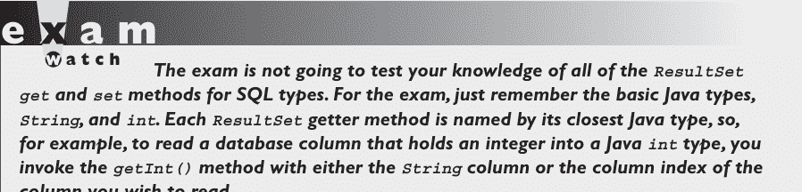

| 表 15-8 | SQL 类型 | Java 类型 | ResultSet get 方法 |
|---|---|---|---|
| BOOLEAN | boolean | `getBoolean(String columnName)` `getBoolean(int columnIndex)` |
| INTEGER | int | `getInt(String columnName)` `getInt(int columnIndex)` |
| DOUBLE, FLOAT | double | `getDouble(String columnName)` `getDouble(int columnIndex)` |
| REAL | float | `getFloat(String columnName)` `getFloat(int columnIndex)` |
| BIGINT | long | `getLong(String columnName)` `getLong(int columnIndex)` |
| CHAR, VARCHAR, LONGVARCHAR | String | `getString(String columnName)` `getString(int columnIndex)` |
| DATE | `java.sql.Date` | `getDate(String columnName)` `getDate(int columnIndex)` |
| TIME | `java.sql.Time` | `getTime(String columnName)` `getTime(int columnIndex)` |
| TIMESTAMP | `java.sql.Timestamp` | `getTimestamp(String columnName)` `getTimestamp(int columnIndex)` |
| 以上任意一种 | `java.lang.Object` | `getObject(String columnName)` `getObject(int columnIndex)` |

### 获取 ResultSet 的信息

当你像我们目前所做的那样使用字符串编写查询时，你知道返回的列的名称和类型。然而，当你想要动态构建查询时会发生什么？你可能提前不知道会返回多少列。幸运的是，`ResultSetMetaData` 类的设计旨在提供这些信息。使用 `ResultSetMetaData`，你可以获取有关查询结果的重要信息，包括列数、表名、列名以及当作为 `Object` 返回时用于表示该列的 Java 类。这里有一个简单的示例，我们将查看更多细节：

```java
String query = "SELECT * FROM Author";
ResultSet rs = stmt.executeQuery(query);
ResultSetMetaData rsmd = rs.getMetaData();
rs.next();
int colCount = rsmd.getColumnCount();
out.println("Column Count: " + colCount);
for (int i = 1; i <= colCount; i++) {
    out.println("Table Name: " + rsmd.getTableName(i));
    out.println("Column Name: " + rsmd.getColumnName(i));
    out.println("Column Size: " + rsmd.getColumnSize(i));
}
```

使用数据库（Bob's Books）运行此代码将产生以下输出：

```
Column Count: 1
Table Name: AUTHOR
Column Name: AUTHOR
Column Size: 1
```

`ResultSetMetaData` 通常用于生成报告；以下是常用的方法。有关更多信息和方法，请查看文档。

`public int getColumnCount() throws SQLException` 此方法可能是最常用的 `ResultSetMetaData` 方法。它返回查询返回的列数的整数计数。通过它，你可以遍历列以获取每列的信息。Author 表的 `colCount` 值为 3。我们可以使用此值通过接下来所示的方法来遍历列。

`public String getColumnName(int column) throws SQLException` 此方法返回此列的字符串名称。使用 `columnCount`，我们可以创建类似报告格式的数据库数据输出。例如：

```java
String colData;
ResultSet rs = stmt.executeQuery(query);
ResultSetMetaData rsmd = rs.getMetaData();
int cols = rsmd.getColumnCount();
for (int i = 1; i <= cols; i++) { // 打印列名
    out.print(rsmd.getColumnName(i) + " ");
}
out.println();
while (rs.next()) {
    for (int i = 1; i <= cols; i++) {
        if (rs.getObject(i) != null) {
            colData = rs.getObject(i).toString(); // 获取列对象的字符串值
        } else {
            colData = "NULL"; // 或者为空时使用 NULL
        }
        out.print(colData); // 打印列数据
    }
    out.println();
}
```

这有点有些原始，因为我们可能需要对数据进行更好的格式化，但它将产生一个如下表格：

| AUTHOR | FIRST | LASTNAME |
|---|---|---|
| 1000 | Rick | Riordan |
| 1001 | Nancy | Farmer |
| 1002 | Ally | Condie |
| 1003 | Cressida | Cowell |
| 1004 | Lauren | St. John |
| 1005 | Eoin | Colfer |

`public String getTableName(int column) throws SQLException` 此方法返回该列所属的表字符串名称。当查询是两个或多个表的连接，且你需要知道某列来自哪个表时，此方法非常有用。例如，假设我们要根据作者姓获取书籍列表：

```java
String query = "SELECT Author.LastName, Book.Title\nFROM Author, Book, Books_By_Author\nWHERE Author.AuthorID = Books_By_Author.AuthorID\nAND Book.isbn = Books_By_Author.isbn";
```

对于这样的查询，我们可能想知道列数据来自哪个表：

```java
ResultSetMetaData rsmd = rs.getMetaData();
int cols = rsmd.getColumnCount();
for (int i = 1; i <= cols; i++) {
    out.print(rsmd.getTableName(i) + ": " + rsmd.getColumnName(i) + ": ");
}
```

此代码将打印表名、冒号和列名。输出可能如下：

```
AUTHOR:LASTNAME BOOK:TITLE
```

`public int getColumnDisplaySize(int column) throws SQLException` 此方法返回列大小的整数。此信息对于确定列可以容纳的最大字符数（如果是 VARCHAR 类型）以及报告中列之间所需的间距很有用。

## 打印报告

为了比之前 `getColumnName` 方法中的报告更美观，例如，我们可以使用显示大小来填充列名和数据空间。如果我们想在查询 Author 表时，编写列和标题之间有空格且看起来如下所示，该怎么办：

| AUTHOR | FIRST | LASTNAME |
|---|---|---|
| 1000 | Rick | Riordan |
| 1001 | Nancy | Farmer |
| 1002 | Ally | Condie |
| 1003 | Cressida | Cowell |
| 1004 | Lauren | St. John |
| 1005 | Eoin | Colfer |

```java
public static String leftJustify(String s, int n) {
    if (s.length() <= n) n++; // Add an extra space if the length of the
                                // The String is less than equal to
                                // the length of the column n
                                // Pad to the right of the
    return String.format("%1$-" + n + "s", s); // The String by n
                                // spaces
}
```

其次，数据库存储 NULL 值。如果某一列的值为 NULL，`rs.getObject()` 方法返回的对象将是 Java `null`。因此，我们必须进行空测试以避免在执行 `toString()` 方法时出现空指针异常。

注意，我们在读取 `ResultSetMetaData` 之前不需要使用 `next()` 方法——我们可以在获取有效结果集后的任何时间执行操作。运行此代码并传递类似 "SELECT * FROM Author" 的查询，将返回一个打印整齐的作者列表：

| AUTHOR | FIRSTNAME | LASTNAME |
|---|---|---|
| 1000 | Rick | Riordan |
| 1001 | Nancy | Farmer |
| 1002 | Ally | Condie |
| 1003 | Cressida | Cowell |
| 1004 | Lauren | St. John |
| 1005 | Eoin | Colfer |

# 在 ResultSet 中移动

到目前为止，对于我们看到的所有结果，我们通过调用 `next()` 来移动光标。`Statement` 的默认特性是向前移动，且结果集不支持更改。`ResultSet` 接口将这些特性定义为 `int` 变量：`TYPE_FORWARD_ONLY` 和 `CONCUR_READ_ONLY`。然而，JDBC 规范定义了额外的静态 `int` 类型（如下所示），允许开发者在结果集中向前、向后移动光标或移动到特定位置。此外，结果集可以在打开状态下进行修改，虽然可更新的结果集并不是驱动程序的强制要求，但大多数驱动程序都提供了这一功能。为了创建一个使用光标和/或更新的结果集，你必须创建一个具有适当滚动类型和并发设置的 `Statement`，然后使用 `Statement` 创建 `ResultSet` 对象。

将光标移动到特定位置的能力是确定结果集返回了多少行的关键——我们稍后会讨论这一点。修改打开的结果集的能力似乎看起来很奇怪，特别是如果你是一个经验丰富的数据库开发人员。毕竟，这不正是 SQL `UPDATE` 命令的用途吗？

考虑这样一种情况：你想使用结果集行中的数据执行一系列计算，根据标准对每行写入更改，最后将数据写回数据库。例如，想象一个包含客户数据的数据库表，包括他们加入客户的日期、购买历史以及过去两个月的订单总数。在将这些数据读入结果集后，你可以遍历每条客户记录并根据业务规则对其进行修改：如果他们成为客户已超过一年且每年至少购买一次，则提高他们的最低折扣；或者如果他们每月的购买金额超过 100 美元，则设置他们的偏好信贷状态。使用可更新的结果集，你可以以不同的方式修改多行客户数据，并将这些行提交到数据库，而无需编写复杂的 SQL 查询或一组 SQL 查询——只需在打开的结果集上提交更新即可。

让我们更详细地查看如何修改结果集。有三种 `ResultSet` 类型：

-   `TYPE_FORWARD_ONLY`：`ResultSet` 的默认值——光标只能在结果集中向前移动。
-   `TYPE_SCROLL_INSENSITIVE`：光标位置可以在结果集中向前或向后移动，或者定位到特定的光标位置。对底层数据（数据库本身）所做的任何更改都不会反映在打开的结果集中。换句话说，结果集不需要与数据库保持“状态”。这种类型通常被数据库支持。
-   `TYPE_SCROLL_SENSITIVE`：光标可以在结果集中向前或向后移动，或者定位到特定的光标位置。对底层数据所做的任何更改都会反映在打开的结果集中。正如你所想象的，这实现起来很难，因此在数据库或 JDBC 驱动程序中并不经常实现。

JDBC 为结果集的数据并发提供了两个选项：

-   `CONCUR_READ_ONLY`：这是结果集并发的默认值。任何打开的结果集都是只读的，不能被修改或更改。
-   `CONCUR_UPDATABLE`：在结果集打开时，可以通过 `ResultSet` 方法对其进行修改。

由于数据库和 JDBC 驱动程序并不支持光标移动和并发更新，JDBC 提供了使用 `DatabaseMetaData` 对象查询数据库和驱动程序的方法，以确定你的驱动程序是否支持这些功能。例如：

```java
Connection conn = DriverManager.getConnection(...);
DatabaseMetaData dbmd = conn.getMetaData();
if (dbmd.supportsResultSet(ResultSet.TYPE_FORWARD_ONLY)) {
    out.print("Supports TYPE_FORWARD_ONLY");
    if (dbmd.supportsResultSetConcurrency(
        ResultSet.TYPE_FORWARD_ONLY,
        ResultSet.CONCUR_UPDATABLE)) {
        out.println(" and supports CONCUR_UPDATABLE");
    }
}
```

```java
if (dbmd.supportsResultSet(ResultSet.TYPE_SCROLL_INSENSITIVE)) {
    out.print("Supports TYPE_SCROLL_INSENSITIVE");
    if (dbmd.supportsResultSetConcurrency(
        ResultSet.TYPE_SCROLL_INSENSITIVE,
        ResultSet.CONCUR_UPDATABLE)) {
        out.println(" and supports CONCUR_UPDATABLE");
    }
}
```

```java
if (dbmd.supportsResultSet(ResultSet.TYPE_SCROLL_SENSITIVE)) {
    out.print("Supports TYPE_SCROLL_SENSITIVE");
    if (dbmd.supportsResultSetConcurrency(
        ResultSet.TYPE_SCROLL_SENSITIVE,
        ResultSet.CONCUR_UPDATABLE)) {
        out.println(" and supports CONCUR_UPDATABLE");
    }
}
```

在 Java DB (Derby) 数据库上运行此代码，结果如下：

-   Supports TYPE_FORWARD_ONLY supports CONCUR_UPDATABLE
-   Supports TYPE_SCROLL_INSENSITIVE and supports CONCUR_UPDATABLE

为了创建一个具有 `TYPE_SCROLL_SENSITIVE` 和 `CONCUR_UPDATABLE` 的 `ResultSet`，你必须……[文本继续或由上下文暗示]

# 提交查询并从数据库读取结果 (OCP 目标 9.3)

## 884 第15 章：JDBC

| 表格 15-9 | ResultSet 游标定位方法（续） |
|---|---|
| 方法 | 对游标的影响及返回值 |
| `boolean last()` | 将游标移动到 `ResultSet` 的最后一行。如果 `ResultSet` 中没有行（空结果集），则返回 false。 |
| `void beforeFirst()` | 将游标移动到 `ResultSet` 第一行之前。 |


| void afterLast() | 将游标移动到 `ResultSet` 最后一行之后。 |

让我们更详细地查看这些方法。

**public boolean absolute(int row) throws SQLException** 此方法将游标定位到绝对行号。与之对应的方法是相对定位。将 0 作为行参数传递会将游标定位到第一行。传递一个负值 -1 会将游标定位到最后一行之前的位置——换句话说，就是最后一行。如果你尝试将游标定位到最后一行之外（例如在有 19 行的结果中定位到第 22 行），游标将定位在最后一行之外，我们将讨论其影响。图 15-5 展示了调用 `absolute()` 如何定位游标。

如果游标成功定位在 `ResultSet` 内部，`absolute()` 方法返回 true；如果游标最终位于第一行之前或最后一行之后，则返回 false。例如，假设你想处理每隔一行：

```java
ResultSet rs = stmt.executeQuery(query);
for (int i = 1; i += 2) {
  if (rs.absolute(i)) { // 绝对移动到传递的
    // 整数值的行，
    // 如果移动成功则返回 true
    // ... 处理该奇数行
  } else {
    break;
  }
}
```

**public int getRow() throws SQLException** 此方法将当前行位置作为正整数返回（第一行为 1，第二行为 2，依此类推），如果没有当前行（即游标可能位于第一行之前或最后一行之后），则返回 0。这是这组游标方法中，唯一一个对 `TYPE_FORWARD_ONLY` 类型的 `ResultSet` 提供可选支持的方法。

**public boolean relative(int row) throws SQLException** `relative()` 方法是 `absolute` 的表亲。听懂了吗，表亲？好吧，无论如何，`relative()` 将游标定位在当前位置之前的或之后的指定行。

# 从数据库提交查询并读取结果 (OCP 9.3) 885

图 1-5

String query = "SELECT * FROM Author";

| | ResultSet | | |

|---|---|---|---|

| | 1000 | Rick | Riordan |

| | 1001 | Nancy | Farmer | |

| | 1002 | Ally | Condie | |

| | 1003 | Cressada | Cowell | |

| | 1004 | Lauren | St. John | |

| | 1005 | Eoin | Colfer | |

| | 1006 | Esther | Freiner | |

| | 1007 | Chris | D'lacey | |

| | 1008 | Christopher | Paolini | |

| | 1009 | Kathryn | Lasky | |

| | 1010 | Nancy | Star | |

绝对游标定位

cursor

rs.absolute(2);

rs.absolute(9);

rs.absolute(-1);

传递给方法。因此，如果游标位于有 30 行的 `ResultSet` 的第 15 行，调用 `relative(2)` 将游标定位到第 17 行，然后调用 `relative(-5)` 将游标定位到第 12 行。图 15-6 显示了根据调用 `absolute()` 和 `relative()` 移动游标的情况。

与绝对定位类似，尝试将游标定位到最后一行之外或第一行之前只会导致游标留在那里，且方法返回 false。此外，调用参数为 0 的 `relative` 效果完全如你预期的那样——游标保持在原处。为什么要使用 `relative`？假设你正在使用 HTML 表格在网页上显示一个大型数据库表。你可能希望用户能够相对于当前选择的行向前后移动；可能像这样：

```java
public boolean getNextPageOfData(ResultSet rs, int pageSize) throws
SQLException {
    return rs.relative(pageSize);
}
```

public boolean previous() throws SQLException `previous()` 方法的工作方式与 `next()` 方法完全相同，但它会向后回溯

# 886 第15 章：JDBC

String query = "SELECT * FROM Author";

图 15-6

相对定位

（圆圈数字表示调用顺序。）

+ 1 rs.absolute(2);

+ 2 rs.relative(-3);

+ 3 rs.relative(5);

| cursor | ResultSet | | | |

|---|---|---|---|

| 1 | 1000 | Rick | Riordan |

| 2 | 1001 | Nancy | Farmer | |

| 3 | 1002 | Ally | Condie | |

| 4 | 1003 | Cressida | Cowell | |

| 5 | 1004 | Lauren | St. John | |

| 6 | 1005 | Eoin | Colfer | |

| 7 | 1006 | Esther | Freiner | |

| 8 | 1008 | Christopher | D'lacey | |

| 9 | 1009 | Kathryn | Lasky | |

| 10 | 1010 | Nancy | Star |

绝对游标定位

尝试将游标定位到最后一行之外或第一行之前只会导致游标留在那里，方法返回 false。此外，调用参数为 0 的 `relative` 效果完全如你预期的那样——游标保持在原处。为什么要使用 `relative`？假设你正在使用 HTML 表格在网页上显示一个大型数据库表。你可能希望用户能够相对于当前选择的行向前后移动；可能像这样：

```java
public boolean getNextPageOfData(ResultSet rs, int pageSize) throws
SQLException {
    return rs.relative(pageSize);
}
```

public boolean previous() throws SQLException `previous()` 方法的工作方式与 `next()` 方法完全相同，但它会向后回溯

**public afterLast() throws SQLException** 此方法将游标定位到 `ResultSet` 最后一行之后。使用此方法，你可以反向遍历 `ResultSet`。例如：

```java
public void showLast(ResultSet rs) {
    rs.afterLast();
    while (rs.previous()) {
        // 处理该行
    }
}
```

**public beforeFirst() throws SQLException** 此方法将游标定位到 `ResultSet` 第一行之前。使用此方法，你可以反向遍历 `ResultSet`。例如：

```java
public void showBeforeFirst(ResultSet rs) {
    rs.beforeFirst();
    while (rs.next()) {
        // 处理该行
    }
}
```

**public boolean first() throws SQLException** 此方法将游标定位到 `ResultSet` 第一行。使用此方法，你可以正向遍历 `ResultSet`。例如：

```java
public void showFirst(ResultSet rs) {
    rs.first();
    while (rs.next()) {
        // 处理该行
    }
}
```

**public boolean last() throws SQLException** 此方法将游标定位到 `ResultSet` 最后一行。使用此方法，你可以反向遍历 `ResultSet`。例如：

```java
public void showLast(ResultSet rs) {
    rs.last();
    while (rs.previous()) {
        // 处理该行
    }
}
```

**public boolean next() throws SQLException** 此方法将游标移动到 `ResultSet` 的下一行。使用此方法，你可以正向遍历 `ResultSet`。例如：

```java
public void showNext(ResultSet rs) {
    rs.next();
    while (rs.next()) {
        // 处理该行
    }
}
```

**public boolean previous() throws SQLException** 此方法将游标移动到 `ResultSet` 的上一行。使用此方法，你可以反向遍历 `ResultSet`。例如：

```java
public void showPrevious(ResultSet rs) {
    rs.previous();
    while (rs.previous()) {
        // 处理该行
    }
}
```

[936] 从数据库提交查询并读取结果 (OCP 9.3) 887

以下代码显示了如何向数据库提交查询并读取结果：

```java
String query = "SELECT * FROM Author";
Statement stmt = connection.createStatement();
ResultSet rs = stmt.executeQuery(query);
while (rs.next()) {
    String firstName = rs.getString("firstName");
    String lastName = rs.getString("lastName");
    System.out.println(firstName + " " + lastName);
}
```

上面的代码使用 `Statement` 执行查询。然而，对于带参数的查询，最好使用 `PreparedStatement`。这是一个使用 `PreparedStatement` 的示例：

```java
String query = "SELECT * FROM Author WHERE lastName = ?";
PreparedStatement pstmt = connection.prepareStatement(query);
pstmt.setString(1, "Rowling");
ResultSet rs = pstmt.executeQuery();
while (rs.next()) {
    String firstName = rs.getString("firstName");
    String lastName = rs.getString("lastName");
    System.out.println(firstName + " " + lastName);
}
```

`PreparedStatement` 比 `Statement` 更安全，因为它能防止 SQL 注入攻击。效率也更高，因为数据库可以缓存查询计划。

[937] 888 第15 章：JDBC

代码显示了如何使用 `PreparedStatement` 执行查询。这是一个使用 `INSERT` 语句的示例：

```java
String query = "INSERT INTO Author (firstName, lastName) VALUES (?, ?);
PreparedStatement pstmt = connection.prepareStatement(query);
pstmt.setString(1, "J.K.");
pstmt.setString(2, "Rowling");
pstmt.executeUpdate();
```

这是一个使用 `UPDATE` 语句的示例：

```java
String query = "UPDATE Author SET lastName = ? WHERE firstName = ?";
PreparedStatement pstmt = connection.prepareStatement(query);
pstmt.setString(1, "Smith");
pstmt.setString(2, "Rowling");
pstmt.executeUpdate();
```

这是一个使用 `DELETE` 语句的示例：

```java
String query = "DELETE FROM Author WHERE lastName = ?";
PreparedStatement pstmt = connection.prepareStatement(query);
pstmt.setString(1, "Rowling");
pstmt.executeUpdate();
```

上面的代码显示了如何使用 JDBC 执行基础 CRUD 操作。关闭 `ResultSet`、`Statement` 和 `Connection` 对象以释放资源是非常重要的。你可以通过使用 `try-with-resources` 块来实现：

```java
try (Connection connection = DriverManager.getConnection(url, user, password);
     Statement stmt = connection.createStatement();
     ResultSet rs = stmt.executeQuery("SELECT * FROM Author")) {
    while (rs.next()) {
        // 处理结果
    }
} catch (SQLException e) {
    e.printStackTrace();
}
```

## 更新 ResultSet（考试不涉及此！）

虽然这看起来像是几个额外的步骤，但在接后查看更新 `ResultSet` 时，我们将看到保留游标（cursor）为什么很重要。

如果你只是随性地使用 JDBC，或者是 JDBC 的新手，你可能会惊讶地发现，`ResultSet` 对象的功能不仅仅是为应用程序提供查询结果。除了返回查询结果外，`ResultSet` 对象还可以用于修改数据库表的内容，包括更新现有行、删除现有行以及添加新行。请注意，本节及后续的子章节不在考试范围内，提供这些内容是为了让你对使用对象来表示关系型数据的威力有深入的了解。

在传统的 SQL 应用中，你可能会执行以下 SQL 查询来提高库存中所有价格从 10.95 到 11.95 之间的硬装书籍的价格：

```sql
UPDATE Book Set UnitPrice = 11.95 WHERE UnitPrice = 10.95
AND Format = 'Hardcover'
```

希望到这里，你已经觉得通过创建一个 `Statement` 并使用 SQL `UPDATE` 执行此查询已经很熟练了：

```java
// 我们有一个连接，并且处于 try-catch 块中...
Statement stmt = conn.createStatement();
String query = "UPDATE Book Set UnitPrice = 11.95 " + 
               "WHERE UnitPrice = 10.95 AND Format = 'Hardcover'";
int rowsUpdated = stmt.executeUpdate(query);
```

但如果你想按书籍逐个更新数据呢？只有当你只想增加畅销书的价格，而不是每一本书的价格时才这样做。这时你必须使用 `SELECT` 从数据库中获取值，将这些值以某种索引（可能是使用主键）存储在数组中，然后构建 `UPDATE` 命令字符串，并逐个调用 `executeUpdate()`。另一种选项是直接更新 `ResultSet`。

当你创建一个并发并发类型设置为 `CONCUR_UPDATABLE` 的 `Statement` 时，你可以修改结果集中的数据，然后将更改写回数据库，而无需发布另一个查询。

除了我们看过的用于 `ResultSet` 的 `getXXXX` 方法（获取整数、`Date` 对象、`String` 等列值的方法）外，每种类型都有一个相应的 `updateXXXX` 方法。就像 `getXXXX` 方法一样，`updateXXXX` 方法可以接受字符串列名或整数索引。

## 第15 章：JDBC

让我们使用可更新的 `ResultSet` 来重写之前的更新示例：

```java
// 我们有一个连接，并且处于 try-catch 块中...
Statement stmt = // 可滚动的
conn.createStatement(ResultSet.TYPE_SCROLL_SENSITIVE, // 以及
                    ResultSet.CONCUR_UPDATABLE); // 可更新的
String query = "SELECT UnitPrice from Book " + 
               "WHERE Format = 'Hardcover'";
```

在调用我们过的 `updateFloat()` 修改 `UnitPrice` 的值后，我们调用了 `updateRow()` 方法。该方法将当前行写入数据库。这种两步方法确保了在将行写入数据库之前，所有的更改都已应用于该行。而且，你可以通过 `cancelRowUpdates()` 方法来改变主意。


# 表 15-10 可更新 `ResultSet` 常用方法总结

| 方法 | 用途 |
| --- | --- |
| `void updateRow()` | 使用当前行的内容更新数据库。 |
| `void deleteRow()` | 从 `ResultSet` 和底层数据库中删除当前行。 |
| `void cancelRowUpdates()` | 取消对此 `ResultSet` 对象当前行所做的任何更新。此方法将有效撤销对 `ResultSet` 所做的任何更改。如果在调用 `cancelRowUpdates()` 之前调用了 `updateRow()`，则此方法不起作用。 |
| `void moveToInsertRow()` | 将游标移动到 `ResultSet` 中专门用于执行插入的特殊行。在用 update 方法更新行列并调用 `insertRow()` 之前，你需要移动到插入行。 |
| `void insertRow()` | 将插入行的内容插入数据库。注意，此方法不会更改当前的 `ResultSet`，因此如果你想让 `ResultSet` 与数据库内容一致，则应重新读取 `ResultSet`。 |
| `void moveToCurrentRow()` | 将游标从插入行移回当前行。如果游标不在插入行，则此方法不起作用。 |

# 提交查询并从数据库读取结果 (OCP 目标 9.3)

让我们详细查看用于通过 `ResultSet` 更改数据库内容的常用方法。

## `public void updateRow() throws SQLException`

此方法根据 `ResultSet` 的当前行内容更新数据库。该方法有几点注意事项。首先，`ResultSet` 必须来自包含 `JOIN` 的 SQL `SELECT` 语句，两个表的 SQL 语句无法更新。其次，`updateRow()` 方法应该在移动到下一行之前调用。否则，对当前行的更新可能会丢失。

因此，该方法的典型用法是使用相应的 `updateXXXX()` 方法更新行内容，然后使用 `updateRow()` 方法更新行内容。例如，在代码中，我们把某行的 `UnitPrice` 更新为 $11.95：

```java
rs.updateFloat("UnitPrice", 11.95f); // 设置价格为 11.95
rs.updateRow();
```

## `public boolean rowUpdated() throws SQLException`

如果当前行已更新，则此方法返回 true。注意，并非所有数据库都能检测到更新。JDBC 提供了一个方法来判断更新是否可检测：`DatabaseMetaData.updatesAreDetected(int type)`。

```java
if (rs.rowUpdated()) { // 这一行是否已更新？
    out.println("Row updated.");
}
```

## `public void cancelRowUpdates() throws SQLException`

此方法允许你“回滚”对行所做的更改。这是重要的，因为 `updateXXXX` 方法不应在同一列上调用两次。换句话说，如果你将值设回 11.95 再次调用 `updateFloat()` 可能会导致不可预测的结果。

```java
if (rollback) { // 如果 rollback 为 true
    rs.cancelRowUpdates(); // 回滚对此行的更改
} else {
    rs.updateRow(); // 否则，提交此行到数据库
}
```

## `public void deleteRow() throws SQLException`

此方法将从 `ResultSet` 和底层数据库中移除当前行。数据库中的行被移除（类似于 `DELETE` 语句的结果）。

```java
rs.deleteRow(); // 删除该行。
```

`deleteRow()` 之后 `ResultSet` 发生什么取决于 `ResultSet` 是否能够检测删除。这种能力取决于 JDBC 驱动程序。当 `ResultSet` 能够检测删除时，被删除的行将从 `ResultSet` 中移除。当 `ResultSet` 无法检测删除时，被删除行的列将通过设置为 null 变为失效。

使用 `DatabaseMetaData` 接口可以判断 `ResultSet` 是否能够检测删除：

```java
int type = ResultSet.TYPE_SCROLL_INSENSITIVE; // 可滚动的 ResultSet
DatabaseMetaData dbmdd = conn.getMetaData(); // 获取关于驱动程序和数据库的元数据
```

```java
if (dbmdd.deletesAreDetected(type)) { // 如果删除行从 ResultSet 中移除，则返回 true
    while (rs.next()) { // 遍历 ResultSet
        if (rs.rowDeleted()) { // 删除的行被标记，但
            continue;
        } else { // 未被移除，跳过它们
            // 处理该行
        }
    }
} else {
    // 关闭 ResultSet 并重新运行查询
}
```

为了在删除后维护最新的 `ResultSet`，应通过查询重新创建 `ResultSet`。

## `public boolean rowDeleted() throws SQLException`

如前所述，当 `ResultSet` 能够检测时，可以使用 `rowDeleted()` 方法指示某行已被删除，但仍作为 `ResultSet` 对象的一部分存在。例如，假设我们删除了 Customer 表的第二行。将结果（删除后）打印到控制台将如图 15-7 所示。

因此，如果你正在处理一个在方法之间传递并在类之间共享的 `ResultSet`，你可以使用 `rowDeleted()` 来检测当前行是否有效数据。

# 使用对象更新列

`getObject()` 和 `updateObject()` 方法的一个有趣方面是，它们将列作为 Java 对象进行检索。并且由于每个 Java 对象都可以使用对象的 `toString()` 方法转换为 `String`，你可以检索数据库中任何列的值，并将该值作为 `String` 打印到控制台，或者参阅“打印报告”章节。

反过来，即朝向数据库端，你也可以使用 `String` 来更新 `ResultSet` 中的几乎所有列。所有常见的 SQL 类型——整数、浮点数、双精度浮点数、长整型和日期——都被相应的 Java 对象封装：`Integer`、`Float`、`Double`、`Long` 和 `sql.Date`。这些对象中的每一个都有触发 `String` 的 `valueOf()` 方法。

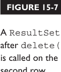

```java
String query = "SELECT * FROM Customer";
ResultSet rs = stmt.executeQuery(query);
rs.next();
rs.next();
rs.deleteRow();
```

| | John | Smith | john.smith@verizon.net | 555-340-1230 |
| null | null | null | null | null |
| 5002 | Bob | Collins | bob.collins@yahoo.com | 555-012-3456 |
| 5003 | Rebecca | Mayer | rebecca.mayer@gmail.com | 555-205-8212 |
| 5006 | Anthony | Clark | anthony.clark@gmail.com | 555-256-1901 |
| 5007 | Judy | Sousa | judy.sousa@verizon.net | 555-751-1207 |
| 5008 | Christopher | Patriquin | patriinc@yahoo.com | 555-316-1803 |
| 5009 | Deborah | Smith | deb.smith@comcast.net | 555-256-3421 |
| 5010 | Jennifer | McGinn | jmcginn@comcast.net | 555-250-0918 |

ResultSet

## `updateObject()` 方法

`updateObject()` 方法接受两个参数：第一个是列名（`String`）或列索引，第二个是 `Object`。我们可以将 `String` 作为 `Object` 类型传递，只要该 `String` 满足列类型对 `valueOf()` 方法的要求，该 `String` 就会被正确转换并以所需的 SQL 类型存储在数据库中。

例如，假设我们正要更新书籍的出版日期（`PubDate`）：

```java
rs.updateObject("PubDate", "2005-04-23"); // 使用字符串日期更新日期
rs.updateRow(); // 更新此行
```

传递的 `ResultSet` 符合 `java.sql.Date` 的格式 "yyyy-mm-dd"，因此该 `String` 被正确转换并作为 SQL Date 值存储在数据库中：2005-04-23。注意，此技术仅限于可以与 `String` 相互转换的 SQL 类型，如果传递给列类型 `valueOf()` 方法的 `String` 不符合 Java 对象的格式，将抛出 `IllegalArgumentException`。

# 使用 ResultSet 插入行

在上一节中，我们查看了如何修改 `ResultSet` 中的现有数据并删除行。在关于 `ResultSet` 的最后一节中，我们将查看如何创建并插入新行。首先，你必须有一个打开的 `ResultSet`，通常有一个特殊行（称为 `insert row`），在执行插入操作之前对其进行修改（更新）。将 `insert row` 视为一个缓冲区，你可以在其中修改 `ResultSet` 的空行。

插入行是一个三步过程，如图 15-8 所示：(1) 移动到特殊的 `insert row`；(2) 更新新行的列值；最后 (3) 执行实际插入（写入数据库）。现有的 `ResultSet` 不改变——你必须重新运行查询以查看数据库中的更改。然而，你可以插入任意数量的行。注意，如果结果集的并发类型设置为 `CONCUR_READ_ONLY`，这些方法都会抛出 `SQLException`。在查看代码之前，让我们看看这些方法。


```java
String query = "SELECT AuthorID, FirstName, LastName FROM Author";
ResultSet rs = stmt.executeQuery(query);
rs.next();
rs.moveToInsertRow();
rs.updateInt("AuthorID", 1055);
rs.updateString("FirstName", "Tom");
rs.updateString("LastName", "McGinn");
rs.insertRow();
rs.moveToCurrentRow();
```

| | ResultSet | |
|---|---|---|
| 1000 | Rick | Riordan |
| 1001 | Nancy | Farmer |
| 1002 | Ally | Condie |
| 1003 | Cressida | Cowell |
| 1004 | Lauren | St. John |
| 1005 | Erin | Colfer |
| | | |
| | insert row | |
| 1055 | Tom | McGinn |

ResultSet insert row

```java
rs.moveToInsertRow();
```

## `public void insertRow() throws SQLException`

此方法将插入行缓冲区写入数据库。当调用此方法时，光标必须位于 `insert row` 上。此外，在行插入数据库之前，必须为每一列设置值，否则将抛出 `SQLException`。`insertRow()` 方法可以调用多次——但是 `insertRow` 遵循与 SQL 命令相同的规则——主键是自动生成的，插入相同的数据将导致 `SQLException`（主键冲突）。

```java
rs.insertRow();
```

## `public void moveToCurrentRow() throws SQLException`

此方法将结果光标返回到调用 `moveToInsertRow()` 方法之前的行。

让我们来看一个简单的示例，将在 `Author` 表中添加新行：

```java
// 我们恢复一个连接并处于 try-catch 块中...
Statement stmt = conn.prepareStatement(ResultSet.TYPE_INSENSITIVE, ResultSet.CONCUR_UPDATABLE);
ResultSet rs = stmt.executeQuery("SELECT AuthorID, FirstName, LastName FROM Author");
rs.next();
rs.moveToInsertRow(); // 移动到简单的插入行
rs.updateInt("AuthorID", 1055); // 获取数据库
rs.updateString("FirstName", "Tom"); // 设置第一个
rs.updateString("LastName", "McGinn"); // 设置最后一个
rs.insertRow(); // 插入行
rs.moveToCurrentRow(); // 返回
```

# 使用元数据获取数据库信息（考试重点！）

在本章使用的示例中，我们对表、列以及表之间的关系非常熟悉。但如果情况不是这样呢？本节涵盖了 `DatabaseMetaData`，这是一个提供了大量数据库信息的接口。我们将花费更多时间研究数据库和驱动支持的事务。

要获取 `DatabaseMetaData` 实例，我们使用 `Connection` 的 `getMetaData()`：

```java
String url = "jdbc:derby://localhost:1521/BookSeller";
String user = "bookguy";
String pwd = "$3lleR";
try {
    Connection conn = DriverManager.getConnection(url, user, pwd);
    DatabaseMetaData dbm = conn.getMetaData(); // 获取数据库元数据
} catch (SQLException exception) { }
```

`DatabaseMetaData` 是一个全面的接口，通过对象实例我们可以确定大量关于数据库和驱动的信息。大多数情况下，作为开发者，你在编写任何代码之前是在不知道数据库和驱动功能的情况下对其进行编码的。尽管如此，可以使用 `getObject` 返回无论什么类型的列值是有帮助的——当你只想做报告时这非常有用，我们将查看一个示例。

这里是我们将重点介绍的几个方法：

- `getColumns()` 返回指定目录（catalog）和模式（schema）中列的描述
- `getProcedures()` 返回给定目录和模式中存储过程的描述
- `getDriver()` 返回 JDBC 驱动的名称
- `getDriverVersion()` 返回字符串格式的 JDBC 驱动版本号
- `supportsANSI92EntryLevels()` 返回布尔值，表示此数据库是否支持 ANSI92 级别

注意的是，`DatabaseMetaData` 方法也使用 `ResultSet` 对象来返回有关的数据。让我们详细查看这些方法。

## `public ResultSet getColumns(String catalog, String schema, String tableNamePattern, String columnNamePattern) throws SQLException`

此方法是获取数据库中表和列详情的最佳用途数据检索方法之一。在查看代码示例之前，可能有助于定义目录和模式。在数据库中，schema 是一个强制数据库中表完整性的对象。schema 名称通常是创建数据库的人的名字。在我们的示例中，BookGuy 数据库包含了表的集合，并且是模式名称。


在这个示例中，我们使用 Java DB 作为示例数据库，目录（catalog）为 `null`，模式（schema）为 `"BOOKGUY"`。我们的表名和列名模式使用了 SQL 通用配符 `"%"`，这类似于你可能在 Windows 等文件系统中常用的 `"*"` 字符。因此，我们将检索该模式下的所有列。具体而言，我们将打印表名、列名、该列的 SQL 数据类型以及列的大小。注意，我们直接从 JavaDoc 中复制了大写的列标识符，但实际上，它们也是不区分大小写的，因此 `"Table_Name"` 同样有效。此外，JDBC 指定了这些列标题的列索引，因此我们也可以使用 `rs.getString(3)` 来获取表名。

```java
String url = "jdbc:derby://localhost:1521/BookSellerDB";
String user = "bookguy";
String pwd = "$3lleR";
try {
    Connection conn = DriverManager.getConnection(url
```

| 表名 | 列名 | 类型名 | 列大小 | 备注 |
| :--- | :--- | :--- | :--- | :--- |
| AUTHOR | AUTHOR | INTEGER | 10 | 主键 |
| AUTHOR | FIRSTNAME | VARCHAR | 20 | |
| AUTHOR | LASTNAME | VARCHAR | 20 | |
| BOOK | ISBN | VARCHAR | 10 | 主键 |
| BOOK | TITLE | VARCHAR | 100 | |
| BOOK | PUBDATEDATE | DATE | 10 | |
| BOOK | FORMAT | VARCHAR | 30 | |
| BOOK | UNITPRICE | DOUBLE | 52 | |
| BOOKS_BY_AUTHOR | AUTHOR | INTEGER | 10 | |
| BOOKS_BY_AUTHOR | ISBN | VARCHAR | 10 | |
| CUSTOMER | CUSTOMID | INTEGER | 10 | 主键 |
| CUSTOMER | FIRSTNAME | VARCHAR | 30 | |
| CUSTOMER | LASTNAME | VARCHAR | 30 | |
| CUSTOMER | EMAIL | VARCHAR | 40 | |
| CUSTOMER | PHONE | VARCHAR | 15 | |

# 从数据库提交查询并读取结果 (OCP 目标 9.3) 899

## public ResultSet getProcedures(String catalog, String schemaPattern, String procedureName) throws SQLException

存储过程是有时内置在数据库中并由数据库开发人员或数据库管理员定义的函数。这些功能范围从清理到查询不等。此方法返回一个结果集，包含关于特定目录和模式存储过程的描述信息。在示例中，我们对目录和模式模式使用了 `null`。`null` 表示我们不需要进行窄范围搜索（实际上等同于使用通用配符 `"%"` 搜索）。注意，返回的是数据库中每个存储过程的名称。稍后，我们将查看如何实际调用存储过程。

```java
try {
    Connection conn = ...
    DatabaseMetaData dmdd = conn.getMetaData();
    ResultSet rs = ...
    dmdd.getProcedures(null, null, "%"); // 获取所有
                                         // 存储过程
                                         // 任意目录 (null)
                                         // 任意模式 (null)
                                         // 通用配符名称 (%)
```

```java
while(rs.next()) {
    out.println("Procedure Name: " + rs.getString("PROCEDURE_NAME"));
}
catch (SQLException se) {
```

注意，此代码段的输出高度取决于环境。以下是随 JDK 附带的 Derby (JavaDB) 数据库示例输出：

```
Procedure Name: INSTALL_JAR
Procedure Name: REMOVE_JAR
Procedure Name: REPLACE_JAR
Procedure Name: SYSCS_BACKUP_DATABASE
Procedure Name: SYSCS_BACKUP_DATABASE_AND_ENABLE_LOG_ARCHIVE_MODE
Procedure Name: SYSCS_BACKUP_DATABASE_AND_ENABLE_LOG_ARCHIVE_MODE_NOWAIT
Procedure Name: SYSCS_BACKUP_DATABASE_NOWAIT
Procedure Name: SYSCS_BULK_INSERT
```

# 第 15 章：JDBC

## public String getDriverName() throws SQLException

此方法简单地以字符串形式返回 JDBC 驱动程序的名称。此方法对于应用程序启动时的日志非常有用，你将在下一节中学习如何记录。

```java
System.out.println("driverName: " + dbmd.getDriverName());
```

显然，驱动名称取决于你使用的 JDBC 驱动程序。同样，使用 Derby 数据库和 JDBC 驱动程序，此方法的输出看起来如下：

```
driverName: Apache Derby Network Client JDBC Driver
```

## public String getDriverVersion() throws SQLException

此方法以字符串形式返回 JDBC 驱动版本号，驱动程序名称对于任何应用程序启动时的记录非常有用。

```java
Logger logger = Logger.getLogger("com.cert.DatabaseMetaDataTest");
Connection conn = ...
DatabaseMetaData dbmd = conn.getMetaData();
logger.log(Level.INFO, "Driver Version: {0}", dbmd.getDriverVersion());
logger.log(Level.INFO, "Driver Name: {0}", dbmd.getDriverName());
```

写入日志器的语句记录在日志文件中，但根据 IDE 的不同，它们也可以写入控制台。例如，在 NetBeans 中，日志语句在控制台中看起来如下：

```
Sep 23, 2012 3:55:39 PM com.cert.DatabaseMetaDataTest main
INFO: Driver Version: 10.8.2.2 - (1181258)
Sep 23, 2012 3:55:39 PM com.cert.DatabaseMetaDataTest main
INFO: Driver Name: Apache Derby Network Client JDBC Driver
```

## public boolean supportsANSI92EntryLevelSQL() throws SQLException

如果数据库和 JDBC 驱动程序支持 SQL-92 入级语法，则此方法返回 `true`。这一级别（至少）是 JDBC 驱动程序（以及数据库）的要求。

```java
Connection conn = ...
DatabaseMetaData dbmd = conn.getMetaData();
if (!dbmd.supportsANSI92EntryLevels()) {
    logger.log(Level.WARNING, "JDBC Driver does not meet requirements for SQL-92 support");
}
```

# 从数据库提交查询并读取结果 (OCP 目标 9.3) 901

# 当出现问题时——异常与警告

当你使用 JDBC 操作数据库时，可能会出现问题。JDBC 连接通常通过套接字到数据库资源。我们已经遇到了至少两个故障点——网络可能中断，或者数据库可能崩溃。而且这还假设你对数据库的所有操作都是正确的，即你的查询是完美的！与其他 Java 异常一样，`SQLException` 是应用程序判断问题所在并采取行动的一种。让我们看看通过 `SQLException` 方法获取的数据类型。

### public String getMessage()

此方法实际上继承自 `java.lang.Exception`，而 `SQLException` 继承自该类。但此方法返回抛出异常的详细原因。注意，这与 `toString()` 方法返回的消息不同，即当你将异常对象放入 `System.out.println` 时的消息。通常，消息内容 `SQLState` 和错误代码提供了关于发生什么的具体信息。

### public String getSQLState()

`getSQLState` 返回的字符串提供了特定的代码和相关消息。`SQLState` 由 X/Open 和 SQL:2003 标准定义；然而，使用这些值取决于实现。你可以通过 `DatabaseMetaData.getSQLStateType()` 确定你的 JDBC 驱动程序使用的哪种标准（如果没有使用）。你的实现也可能定义额外的错误代码，无论何种情况，咨询 JDBC 驱动程序和数据库文档都是好主意。由于 `SQLState` 消息和代码通常特定于驱动和数据库，它们在应用程序中的典型用法仅限于记录消息或调试信息。

### public int getErrorCode()

错误代码没有定义，因此取决于具体的实现。根据实现，它可以传递实际的错误代码或严重级别。

### public SQLException getNextException()

`SQLException` 的有趣之处之一是，抛出的异常可能是多个问题的结果。幸运的是，JDBC 仅将每个异常标记在下一个异常上，这种过程称为链式调用。通常，最严重的异常是最后抛出的，因此它是链中的第一个异常。

## 902 第 15 章：JDBC

你可以使用 `getNextException()` 方法遍历链中的所有异常列表。当到达列表末尾时，`getNextException()` 返回 `null`。在这个示例中，记录了 `SQLException`、`SQLException` 以及厂商错误代码：

```java
Logger logger = Logger.getLogger("com.example.MyClass");
try {
    // try 块中执行某些 JDBC 代码
    //...
} catch (SQLException se) {
    while (se != null) {
        logger.log(Level.SEVERE, "----SQLException-----");
        logger.log(Level.SEVERE, "SQLState: " + se.getSQLState());
        logger.log(Level.SEVERE, "Vendor error code: " + se.getErrorCode());
        logger.log(Level.SEVERE, "Message: " + se.getMessage());
        se = se.getNextException();
    }
}
```

## 警告

尽管 `SQLException` 是 `Exception` 的子类，但警告会被静态链到报告它们的 JDBC 对象上。这可能是 Java 中少数几次情况，即异常层次结构中的对象没有被作为异常抛出。其原因是警告本身并不是异常。警告可以在 `Connection`、`Statement` 和 `ResultSet` 对象上报告。

例如，假设我们在创建语句时错误地将结果类型设为了 `TYPE_SCROLL_SENSITIVE`。这不会创建一个异常；相反，数据库将通过将一个 `SQLWarning` 链到 `Connection` 对象来处理这种情况，并将类型重置为 `TYPE_FORWARD_ONLY`（默认值）并继续执行。当然，一切本都是好的，直到我们尝试移动光标位置，那时会抛出一个 `SQLException`。而且像 `SQLException` 一样，你可以使用 `getNextWarning()` 方法从 `SQLWarning` 对象中获取信息。

```java
Connection conn =
DriverManager.getConnection("jdbc:db://localhost:1527/BookSellerDB",
"bookguy", "$3ller");
Statement stmt =
conn.createStatement(ResultSet.TYPE_SCROLL_SENSITIVE,
    ResultSet.TYPE_CONCUR_UPDATABLE);
```

```java
String query = "SELECT * from BookWhere.Format = 'Hardcover'";
ResultSet rs = stmt.executeQuery(query);
SQLWarning warn = conn.getWarnings(); // 获取任何 SQLWarning
```

## 提交查询并从数据库读取结果 (OCP 9.3) 903

```java
while (warn != null) { // 如果存在 SQLWarning，则打印它
    out.println("State: " + warn.getSQLState());
    out.println("Message: " + warn.getMessage());
    warn = warn.getNextWarning(); // 获取下一个警告
}
```

`Connection` 对象会一直添加警告（如有必要），直到连接关闭，或者当 `clearWarnings()` 方法将警告列表设置为 `null` 之后为该 `Connection` 对象报告了另一个警告。

`Statement` 和 `ResultSet` 也会生成 `SQLWarning`，这些对象有自己的 `clearWarnings()` 方法。`Statement` 警告在重新执行语句时会自动清除，而 `ResultSet` 在每次从结果集中读取新行时都会被清除。

以下章节总结了与 `SQLWarnings` 相关的方法。

- `SQLWarning getWarnings()` 此方法获取第一个 `SQLWarning` 对象，如果该 `Connection`、`Statement` 或 `ResultSet` 对象没有警告，则返回 `null`。如果在关闭的对象上调用此方法，将抛出 `SQLException`。

- `void clearWarnings() throws SQLException` 此方法清除并重置该 `Connection`、`Statement` 或 `ResultSet` 对象的当前警告集。如果在关闭的对象上调用此方法，将抛出 `SQLException`。

## 正确关闭 SQL 资源

在本章中，我们查看了一些简单的示例，在 `try` 块中创建了 `Connection`、`Statement` 和 `ResultSet`，并捕获了任何抛出的 `SQLException`。我们到为止还没有正确地关闭这些资源。事实上，对于小型示例，这可能不重要，但对于任何使用资源（如套接字、文件或 JDBC 数据库连接）的代码，打开资源后关闭是一种良好的做法。

知道资源何时会被自动关闭是非常重要的。三个主要的 JDBC 对象（`Connection`、`Statement` 和 `ResultSet`）都拥有一个 `close()` 方法，用于显式关闭与对象关联资源并显式释放资源。我们希望现在你也意识到这些对象之间存在关系，因此如果一个对象执行了 `close()`，将会对其他对象产生影响。下表有助于解释这一点。

## 第 15 章：JDBC

| 方法 | 具有以下操作 |
| :--- | :--- |
| `Connection.close()` | 释放到数据库的连接。关闭从此 `Connection` 创建的任何 `Statement`。 |
| `Statement.close()` | 释放此 `Statement` 资源。关闭与此 `Statement` 关联的任何打开的 `ResultSet`。 |
| `ResultSet.close()` | 释放此 `ResultSet` 资源。注意，从 `ResultSet` 创建的任何 `ResultSetMetaData` 对象仍然可以访问。 |
| `Statement.executeXXX()` | 与之前的 `Statement` 执行关联的任何 `ResultSet` 都会被自动关闭。 |


## 902 第 15 章：JDBC

你可以使用 `getNextException()` 方法遍历链中的所有异常列表。当到达列表末尾时，`getNextException()` 返回 `null`。在这个示例中，记录了 `SQLException`、`SQLException` 以及厂商错误代码：

```java
Logger logger = Logger.getLogger("com.example.MyClass");

try {
    // try 块中执行某些 JDBC 代码
    //...
} catch (SQLException se) {
    while (se != null) {
        logger.log(Level.SEVERE, "----SQLException-----");
        logger.log(Level.SEVERE, "SQLState: " + se.getSQLState());
        logger.log(Level.SEVERE, "Vendor error code: " + se.getErrorCode());
        logger.log(Level.SEVERE, "Message: " + se.getMessage());
        se = se.getNextException();
    }
}
```

## 警告

尽管 `SQLException` 是 `Exception` 的子类，但警告会被静默地链到报告它们的 JDBC 对象上。这可能是 Java 中少数几次情况，即异常层次结构中的对象没有被作为异常抛出。其原因是警告本身并不是异常。警告可以在 `Connection`、`Statement` 和 `ResultSet` 对象上报告。

例如，假设我们在创建语句时错误地将结果类型设为了 `TYPE_SCROLL_SENSITIVE`。这不会创建一个异常；相反，数据库将通过将一个 `SQLWarning` 链到 `Connection` 对象来处理这种情况，并将类型重置为 `TYPE_FORWARD_ONLY`（默认值）并继续执行。当然，一切本都是好的，直到我们尝试移动光标位置，那时会抛出一个 `SQLException`。而且像 `SQLException` 一样，你可以使用 `getNextWarning()` 方法从 `SQLWarning` 对象中获取信息。

```java
Connection conn =
    DriverManager.getConnection("jdbc:db://localhost:1527/BookSellerDB",
        "bookguy", "$3ller");

Statement stmt =
    conn.createStatement(ResultSet.TYPE_SCROLL_SENSITIVE,
        ResultSet.TYPE_CONCUR_UPDATABLE);
```

```java
String query = "SELECT * from BookWhere.Format = 'Hardcover'";
ResultSet rs = stmt.executeQuery(query);
SQLWarning warn = conn.getWarnings(); // 获取任何 SQLWarning
```

## 提交查询并从数据库读取结果 (OCP 9.3) 903

```java
while (warn != null) { // 如果存在 SQLWarning，则打印它
    out.println("State: " + warn.getSQLState());
    out.println("Message: " + warn.getMessage());
    warn = warn.getNextWarning(); // 获取下一个警告
}
```

`Connection` 对象会一直添加警告（如有必要），直到连接关闭，或者当 `clearWarnings()` 方法将警告列表设置为 `null` 之后为该 `Connection` 对象报告了另一个警告。

`Statement` 和 `ResultSet` 也会生成 `SQLWarning`，这些对象有自己的 `clearWarnings()` 方法。`Statement` 警告在重新执行语句时会自动清除，而 `ResultSet` 在每次从结果集中读取新行时都会被清除。

以下章节总结了与 `SQLWarnings` 相关的方法。

- `SQLWarning getWarnings()`：此方法获取第一个 `SQLWarning` 对象，如果该 `Connection`、`Statement` 或 `ResultSet` 对象没有警告，则返回 `null`。如果在关闭的对象上调用此方法，将抛出 `SQLException`。
- `void clearWarnings() throws SQLException`：此方法清除并重置该 `Connection`、`Statement` 或 `ResultSet` 对象的当前警告集。如果在关闭的对象上调用此方法，将抛出 `SQLException`。

## 正确关闭 SQL 资源

在本章中，我们查看了一些简单的示例，在 `try` 块中创建了 `Connection`、`Statement` 和 `ResultSet`，并捕获了任何抛出的 `SQLException`。我们到为止还没有正确地关闭这些资源。事实上，对于小型示例，这可能不重要，但对于任何使用资源（如套接字、文件或 JDBC 数据库连接）的代码，打开资源后关闭它们是一种良好的做法。

知道资源何时会被自动关闭是非常重要的。三个主要的 JDBC 对象（`Connection`、`Statement` 和 `ResultSet`）都拥有一个 `close()` 方法，用于显式关闭与对象关联资源并显式释放资源。我们希望现在你也意识到这些对象之间存在关系，因此如果一个对象执行了 `close()`，将会对其他对象产生影响。下表有助于解释这一点。

| 方法 | 具有以下操作 |
|---|---|
| `Connection.close()` | 释放到数据库的连接。关闭从此 `Connection` 创建的任何 `Statement`。 |
| `Statement.close()` | 释放此 `Statement` 资源。关闭与此 `Statement` 关联的任何打开的 `ResultSet`。 |
| `ResultSet.close()` | 释放此 `ResultSet` 资源。注意，从 `ResultSet` 创建的任何 `ResultSetMetaData` 对象仍然可以访问。 |
| `Statement.executeXXX()` | 与之前的 `Statement` 执行关联的任何 `ResultSet` 都会被自动关闭。 |

减少关闭和重新创建 `Connection` 对象的次数也是一种良好的做法。按照规则，创建到数据库连接并传递用户名和密码凭据进行认证是一个相对昂贵的过程，为每个 SQL 查询执行此操作将不会产生高性能的代码。事实上，数据库连接通常在池中创建，并根据需要将连接实例交给应用程序，而不是允许或要求单个应用程序创建它们。

`Statement` 对象的创建开销较小，正如我们在下一节中看到的，有方法使用 `PreparedStatement` 预编译 SQL 语句，这减少了与创建 SQL 查询字符串和相关的开销。

`ResultSet` 的创建开销最小，正如我们在下一节中看到的，有方法使用 `PreparedStatement` 预编译 SQL 语句，减少了与创建 SQL 查询字符串和相关的开销。

让我们看看之前的一个示例，我们在 `try` 块中使用了 `Connection`、`Statement` 和 `ResultSet`，并为了关闭资源重写了这段代码。

```java
Connection conn = null; // 这些在其他地方赋值
String url, user, pwd;

try {
    conn = DriverManager.getConnection(url, user, pwd);
    Statement stmt = conn.createStatement();
    ResultSet rs = stmt.executeQuery("SELECT * FROM Customer");
    // ... 处理结果
    // ...
    if (rs != null && stmt != null) {
        rs.close(); // 尝试关闭 ResultSet
        stmt.close(); // 尝试关闭 Statement
    }
} catch (SQLException se) {
    out.println("SQLException: " + se);
} finally {
    try {
        if (conn != null) {
            conn.close(); // 关闭 Connection
        }
    } catch (SQLException sec) {
        out.println("Exception closing connection!");
    }
}
```

注意为了关闭 `Connection` 我们需要做的工作——我们首先需要确保获取了对象而不是 `null`，然后我们需要在 `finally` 块中的另一个 `try` 中尝试 `close()` 方法。不幸，有一种更简单的方法……

## 使用 try-with-resources 关闭 Connections、Statements 和 ResultSets

正如你在第 7 章记得的，Java SE 7 (JDK 7) 最实用的更改之一是对语言的许多细微修改，包括一个支持自动资源管理的新的 `try` 语句。这种语言更改被称为 try-with-resources，其长名称反映了它如何让编写需要关闭资源的代码变得简单。`try-with-resources` 语句会自动调用 `try` 块末尾括号中声明的任何资源的 `close()` 方法。

有一个注意事项：在 `try-with-resources` 语句中声明的资源必须实现 `AutoCloseable` 接口。Java SE 7 (JDBC 4.1) 对 JDBC 的更改之一是修改了 API，使 `Connection`、`Statement` 和 `ResultSet` 都实现了 `AutoCloseable` 接口并支持自动资源管理。我们可以使用 `try-with-resources` 重写之前的代码示例：

```java
try (Connection conn = DriverManager.getConnection(url, user, pwd)) {
    Statement stmt = conn.createStatement();
    ResultSet rs = stmt.executeQuery("SELECT * FROM Customer");
    // ... 处理结果
    // ...
    if (rs != null && stmt != null) {
        rs.close(); // 尝试关闭 ResultSet
        stmt.close(); // 尝试关闭 Statement
    }
} catch (SQLException se) {
    out.println("SQLException: " + se);
}
```

# 906 第 15 章：JDBC

注意，我们必须在括号内的声明中包含对象类型。以下代码将导致编译错误：

```java
try (conn = DriverManager.getConnection(url, user, pwd);) {
}
```

try-with-resources 也可以用于多个资源，因此你也可以在 try 块中包含 `Statement` 的声明：

```java
try (Connection conn = DriverManager.getConnection(url, user, pwd);
     Statement stmt = conn.createStatement()) {
}
```


注意，当在 `try-with-resources` 语句中声明了多个资源时，资源将按照声明的反向顺序关闭——因此会先调用 `stmt.close()`，然后调用 `conn.close()`。

如果 `try` 块中抛出异常，该异常会被 `catch` 语句捕获，这似乎是合理的，但如果在 `try-with-resources` 语句中关闭资源时抛出了异常会发生什么呢？如果 `try` 块中已经存在异常，那么在 `try` 块结束时关闭资源抛出的任何异常将被抑制。可以通过调用异常的 `getSuppressed()` 方法从异常中获取这些被抑制的异常。

例如：

```java
catch (SQLException e) {
    out.println("" + e);
    Throwable[] suppressed = e.getSuppressed(); // 获取被抑制的异常数组
    for (Throwable t : suppressed) { // 遍历数组
        out.println("Suppressed exception: " + t);
    }
}
```

## 认证目标

### 使用 PreparedStatement 和 CallableStatement 对象 (OCP 目标 9.6)

**9.5 创建并使用 PreparedStatement 和 CallableStatement 对象。**

到目前为止，我们使用 `Statement` 实例将查询作为字符串直接传递给数据库。但正如我们之前提到的，JDBC 驱动和 API 提供了两个由 JDBC 驱动程序厂商实现的额外接口。这些是 `PreparedStatement` 和 `CallableStatement`。这些接口扩展了 `Statement` 接口并添加了功能。

`PreparedStatement` 可以提高频繁执行查询的性能，因为语句的 SQL 部分在数据库中是经过预编译的。为了理解“预编译”意味着什么，我们需要从高层面上解释 SQL 的执行过程。当一个 SQL 字符串被发送到数据库时，该字符串会经过一系列步骤。首先，对字符串进行解析并检查所有 SQL 关键字的语法是否正确。接下来，根据模式（schema）检查表名和列名，以确保它们存在（且拼写正确）。接着，数据库为查询创建一个执行计划，在多个选项之间选择能够获得最佳整体性能的一个。最后，运行选定的执行计划。

在执行查询计划之前的步骤可以使用 `PreparedStatement` 对象提前完成。参数可以传递给 `PreparedStatement`，并在执行前的瞬间插入到查询中。这就是为什么 `PreparedStatement` 是频繁执行的 SQL 语句的良好选择。

数据库还为开发者提供了直接在数据库中编写小程序的能力。在创建表时，每个小程序都会被命名、编译并存储在数据库中。这些小程序有三种类型：存储过程、函数和触发器。触发器仅由数据库本身调用，无法通过 SQL 查询或直接从外部应用程序访问。我们将重点关注存储过程和函数。

存储过程和函数的优势在于它们是完全自包含的。你可以将存储过程看作数据库的方法。你可以使用它的名称调用存储过程并向其传递参数。存储过程可能也可能返回结果，正如你将在“CallableStatements”节中看到的那样。

`CallableStatement` 用于执行命名的过程或函数。与预编译语句不同，存储过程和函数在通过 `CallableStatement` 执行它们之前必须已经存在。与 `PreparedStatement` 一样，参数可以传递给存储过程和函数。

## 第 15 章：JDBC

### PreparedStatement

由于 `PreparedStatement` 是预编译的，它们擅长减少频繁执行的 SQL 查询的整体执行时间。例如，像 Bob's Books 这样的在线零售商可能会频繁更改数据。

在执行查询计划之前的步骤可以使用 `PreparedStatement` 对象提前完成。参数可以传递给 `PreparedStatement`，并在执行前的瞬间插入到查询中。这就是为什么 `PreparedStatement` 是频繁执行的 SQL 语句的良好选择。

...（此处省略中间重复的段落翻译，以遵循“不要重复输出原文”的原则，确保翻译核心逻辑完整）...

...这就是为什么 `PreparedStatement` 是频繁执行的 SQL 语句的良好选择。

...（下文为参数化查询示例）...

... 传递到查询的参数被称为 `IN` 参数。在这个例子中，我们创建了一个参数化查询：

```java
try (Connection conn = DriverManager.getConnection(url, user, password)) {
    String pQuery = "SELECT Price FROM Books WHERE Title ?";
    PreparedStatement pstmt = conn.prepareStatement(pQuery);
    pstmt.setString(1, "%Heroes%");
    ResultSet rs = pstmt.executeQuery();
    // ... 处理行 ...
} catch (SQLException e) {
    // ... 处理异常 ...
}
```

### CallableStatement

`CallableStatement` 扩展了 `PreparedStatement` 接口，以支持使用 JDBC 调用存储过程。顺便提一下，存储过程和函数之间唯一的区别在于，函数被设计用于返回一个参数。在本章的其余部分中，我们把存储过程和函数统称为存储过程。

与 SQL 查询相比，存储过程具有许多优势。大多数存储过程语言都相当复杂，并支持变量、分支、循环和 `if-then` 结构。存储过程可以执行任何 SQL 语句，因此单个存储过程可以在单次执行中完成多个操作。

存储过程的一个用例是封装数据库中的特定表。就像 Java 类通过将字段设为 `private` 然后通过方法提供对该字段的访问来封装数据一样，存储过程可以防止用户直接访问表中的数据。例如，想象一个员工数据库包含非常敏感的信息，例如社会安全号码和出生日期。为了保护这些信息，在执行存储过程对数据进行任何更改或允许访问之前，该存储过程可以对正在执行的存储过程进行多项检查。

存储过程有两个缺点。首先，存储过程通常使用专有的、特定数据库的语言开发，这要求开发者学习另一套命令和语法。其次，在数据库中，由于它们被“编译”到数据库中，很难弄清楚它们是如何编写以及实际作用的。而我们知道开发者们有多喜欢为他们的代码创建详细的文档了！

最近，越来越多的数据库供应商允许 Java 在数据库中运行，使得编写存储过程变得更加容易，尽管这并没有解决连接问题。从性能的角度来看，结论是存储过程占主导地位（在可维护性角度来看并不如此）。无论如何，如何编写存储过程真的是本章的范围，但互联网上提供了一些资源——只需搜索“java stored procedures”即可。

由于存储过程可能是具有独特语法的专有语言，JDBC API 提供了 JDBC 特有的转义语法，用于执行存储过程和函数。JDBC 驱动程序负责将 JDBC 语法转换为数据库格式。这种语法有两种形式：一种用于返回结果的函数，另一种形式用于不返回结果的存储过程。

## 创建和使用 PreparedStatement 和 CallableStatement 对象 (OCP 9.6)

```sql
{? = call <procedure-name>[(<arg1>, <arg2>, ...)]} // 返回结果
{call <procedure-name>[(<arg1>, <arg2>, ...)]}     // 无结果
```

像 `PreparedStatement` 一样，`CallableStatement` 使用 `IN` 参数向存储过程传递参数。然而，如前面的第一种形式所示，函数返回一个值，如等号左边的问号所示。函数的结果作为注册为 `OUT` 参数的参数返回给调用者。最后，存储过程还支持第三种参数类型，可以将值传递到存储过程中并返回结果。这些被称为 `INOUT` 参数。接下来我们将查看使用这三种类型参数的示例。

`CallableStatement` 对象使用 `Connection` 实例和 `prepareCall()` 方法创建。它接受一个 `String` 作为第一个参数，即存储过程调用以及前面显示的两种形式之一。让我们来看一个例子。名为 "getBooksInRange" 的存储过程接受三个参数：客户 ID 和两个表示搜索范围的日期。该存储过程以 `ResultSet` 的形式返回在两个日期之间购买的所有书籍（使用客户 ID 来识别客户）。

每个参数都是 `IN` 参数，并且在执行存储过程并返回 `ResultSet` 之前，使用相应的 `setXXXX` 方法插入到 `CallableStatement` 对象中：

```java
// 我们有一个 Connection 对象并且处于一个 try 块中
int customerID = 5001;
java.sql.Date fromDate = ...; // 搜索的起始日期
java.sql.Date toDate = ...;   // 搜索的结束日期
String getBooksInRange = "{call getBooksInRange(?, ?, ?)}";
CallableStatement cstmt = connection.prepareCall(getBooksInRange,
        ResultSet.TYPE_SCROLL_SENSITIVE, ResultSet.CONCUR_UPDATABLE);
cstmt.setInt(1, customerID);  // 用于 customerID 的 IN 参数 1
cstmt.setDate(2, fromDate);   // 用于 fromDate 的 IN 参数 2
cstmt.setDate(3, toDate);     // 用于 toDate 的 IN 参数 3
ResultSet rs = cstmt.executeQuery();
```

注意，`executeQuery()` 命令不接受字符串（类似于 `PreparedStatement.executeQuery()` 方法）。如果你尝试对带有字符串参数的 `CallableStatement` 调用 `executeQuery()`，将在运行时抛出 `SQLException`。

当可调用语句带有 `OUT` 参数时，该参数在调用之前也必须被注册为该类型。例如，假设我们有一个简单的存储过程，计算客户下达所有订单的总和。在这个示例中，存储过程将计算结果作为 SQL `DOUBLE` 返回：

```java
// 我们有一个 Connection 对象并且处于一个 try 块中
int customerID = 5001;
double customerTotal;
CallableStatement cstmt = conn.prepareCall("{? = call customerTotal(?)}"); // 注册
cstmt.registerOutParameter(1, java.sql.Types.DOUBLE); // 输出参数
cstmt.setInt(2, customerID); // 参数
cstmt.execute(); // 注意我们没有返回 ResultSet，所以 execute 是适当的方法
customerTotal = cstmt.getDouble(1);
```

一个接受 `double` 类型作为 `INOUT` 参数的存储过程，在传递 `IN` 参数后被注册为 `OUT` 参数——例如，一个假设的存储过程，它接收 ID 并计算订单：

```java
// 我们有一个 Connection 对象并且处于一个 try 块中
int customerID = 5001;
```


# 第 15 章：JDBC

## 存储过程与 CallableStatement

```java
int numberOfOrders;

CallableStatement cstmt = conn.prepareCall("{call orders(?)}"); // INOUT

cstmt.setInt(1, customerID); // IN 部分

cstmt.registerOutParameter(1, java.sql.Types.INTEGER); // OUT 部分

cstmt.execute();

numberOfOrders = cstmt.getInt(1);
```

由于存储过程可能是具有独特语法的专有语言，JDBC API 提供了 JDBC 特有的转义语法，用于执行存储过程和函数。JDBC 驱动程序负责将 JDBC 语法转换为数据库格式。这种语法有两种形式：一种用于返回结果的函数，另一种形式用于不返回结果的存储过程。

当可调用语句带有 `OUT` 参数时，该参数在调用之前也必须被注册为该类型。例如，假设我们有一个简单的存储过程，存储过程在执行时可以返回一个 `ResultSet`，例如：

```java
cstmt.execute(); // 我们执行了存储过程

if (cstmt.getMoreResults()) { // 如果下一个结果是 ResultSet
    // 处理 ResultSet
}
```

## 创建和使用 RowSet 对象 (OCP 9.6)

### RowSetProvider 与 RowSetFactory

Java 7 的变化之一是对 JDBC 进行了微小更新。API 的版本号从 4.0 变为 4.1，并且对 `javax.sql.rowset` 包进行了更改，增加了接口 `RowSetFactory` 和类 `RowSetProvider`。这些接口和类为开发者提供了一种方便的方法，使其可以使用默认实现，或者通过工厂模式使用自定义实现。

这对你来说意味着：首先，`RowSetFactory` 和 `RowSetProvider` 是考试内容，作为结果，考试中对 `RowSet` 接口也有涵盖。本节将查看如何使用 `RowSet` 接口。

首先，知道 `RowSet` 是一个 `ResultSet`。`RowSet` 对象分为两类：连接数据库并与数据库同步的，以及可以与数据库断开并在以后同步的。

连接的 `RowSet` 为你提供了与数据库数据保持同步的机会——因此你可能会使用连接的 `RowSet` 作为购物车或其他类型的缓存。断开的 `RowSet` 是根据读取的初始状态创建的，并且可以在断开连接后传递给其他对象。

数据同步并没有魔法——`RowSet` 是一个 `ResultSet`，因此具有更新、删除和插入新行的能力。

### 创建 RowSet 对象

在 RowSet 1.1 之前，要创建一个 `RowSet` 对象的实例，你需要知道引用实现类的完整路径。因此，要创建一个使用 Sun 引用实现的 `JdbcRowSet` 实例，你需要包含实现类的全名（或确保已导入该类），并并在你的类路径中包含实现 API。例如：

```java
JdbcRowSet jrs = new com.sun.rowset.JdbcRowSetImpl();
```

现在，在 Java 7 中，作为核心 API 一部分的 `RowSetProvider` 类管理对引用实现的访问，并返回一个工厂对象（`RowSetFactory`），该对象可以用于生成 `RowSet` 对象的实例。希望这让你感到非常熟悉——这种工厂模式与用于创建 `Connection` 对象的模式相似。`RowSetProvider` 类将返回一个 `RowSetFactory` 的引用，该引用反过来可以创建 `RowSet` 对象的实例。

```java
RowSetFactory rfs = RowSetProvider.newFactory(); // 无参数方法
// newFactory() 返回一个工厂实例，将从引用实现创建 RowSet 对象
JdbcRowSet jrs = rfs.createJdbcRowSet();
```

虽然这些额外的代码看起来可能没必要，但它允许你（开发者）与 API 中定义良好的工厂接口工作，而不是专门的实现对象。因此，实现可以被替换，而你只需要一行代码：

```java
RowSetFactory rfs = RowSetProvider.newFactory("com.example.MyRowSetProvider", null);
JdbcRowSet jrs = rfs.createJdbcRowSet();
```

### RowSet 概述

`javax.sql` 包（以及几个子包）在 Java SE 1.4 中引入，作为支持 J2EE（Java EE 1.4）的重要部分。尽管 1.4 版本的大部分工作是引入 `DataSource` 来替代 `DriverManager`、J2EE 容器中的 `Connection` 和 `Statement` 连接池以及分布式事务，但本节我们感兴趣的是 RowSet。

`RowSet` 接口是为了将 `ResultSet` 封装为 JavaBeans 组件而开发的；事实上，`RowSet` 接口继承了 `java.sql.ResultSet`。因此，你可以将 `RowSet` 视为一个 `ResultSet`。JavaBeans 组件有两个重要的特性：第一，它们拥有一套通过 getter 和 setter（属性）访问类字段的良好定义模式；第二，它们支持并可以参与 JavaBeans 事件通知系统。

JavaBeans 组件中的属性由一对方法表示，一个用于获取属性值，另一个用于设置属性值。我们通常将属性视为类实例字段的 getter/setter 对，但属性的值也可以是计算出来的。getter/setter 方法的重要性在于一致性，因为 JavaBeans 组件的要求是支持自省。因此，根据 `RowSet` 接口的这些方法，我们可以推断出该组件关联有一个 `String` 属性：

```java
public String getUrl() throws SQLException;
public void setUrl(String url) throws SQLException;
```

JavaBeans 通知系统允许 `RowSet` 注册自己为事件的监听器。`RowSet` 通过添加实现 `RowSetListener` 接口的类实例注册事件，该接口具有三个事件方法，当 `RowSet` 对象实例上发生以下任一事件时，这些方法会被调用：

- 游标位置的变化
- 此 `RowSet` 中行的更改（插入、更新或删除）
- `RowSet` 内容的变化（一个新的 RowSet）

如前所述，`RowSet` 对象有两种类型：连接的（connected）和断开的（disconnected）。连接的 `RowSet` 维护其与底层数据库的连接。断开的 `RowSet` 可以连接到数据库以获取初始信息，然后断开。在断开期间，可以对 `RowSet` 进行更改：可以添加、更新或删除行，当重新连接到数据库时，更改将会被同步。

## 连接型 RowSets：JdbcRowSet

`JdbcRowSet` 接口继承了 `RowSet` 并提供了一个连接的 JavaBeans 风格的 `ResultSet` 对象。`JdbcRowSet` 实例是从 `RowSetFactory` 创建的，然后通过执行 SQL 查询返回的 `ResultSet` 进行填充。`JdbcRowSet` 是 `RowSet` 的非常薄的封装，因此示例中显示的许多方法实际上是 `RowSet` 方法。

让我们先创建一个 `JdbcRowSet` 对象：

注意，我们使用 `JdbcRowSet` 对象来执行之前我们使用 `Connection`、`Statement` 和 `ResultSet` 完成的所有任务。一旦从工厂获取了该对象，我们只需设置连接的值（URL、用户名和密码），然后执行查询语句。`JdbcRowSet` 对象负责创建连接、创建语句和执行查询。`JdbcRowSet` 的优点之一是许多特性都是按默认值设置的。默认值和 setter 方法列如下表所示：

| 属性方法 | 默认值 |
|---|---|
| `setType(int type)` | `ResultSet.TYPE_SCROLL_INSENSITIVE` |
| `setConcurrency(int concurrency)` | `ResultSet.CONCUR_UPDATABLE` |
| `setEscapeProcessing(boolean enable)` | `true`（转义处理由驱动程序执行） |
| `setMaxRows(int max)` | `0`（RowSet 中的行数限制） |
| `setMaxFieldSize(int max)` | `0`（列值的字节数限制） |
| `setQueryTimeout(int seconds)` | `0`（时间限制） |
| `setTransactionIsolation(int level)` | `Connection.TRANSACTION_READ_COMMITTED`（位于事务章节） |

> 注意：这里提供属性 setter 方法及其默认值是为了完整性。这些细节不属于考试范围内。

一旦执行语句完成，我们就有了一个连接的 `RowSet`。从那里开始，其余代码看起来应该很熟悉。我们使用 `next()` 获取集的下一行，并将结果打印到控制台。

`RowSet` 对象与 `ResultSet` 对象工作方式的一个重要区别体现在 `execute()` 方法上。`execute()` 方法实际上相当于 `executeQuery()`，并用于填充 `RowSet` 数据。没有 `executeQuery()` 或 `executeUpdate()` 方法，尝试使用 `execute()` 执行 `UPDATE`、`INSERT` 或 `DELETE` 查询将导致 `SQLException`。要执行更新，只需更新你的 `RowSet` 对象中的数据。例如，假设我们已经用 RowSet 对象填充了所有作者数据，这里我们更改集合中第一个作者的名字：

```java
jrs.last(); // 移动到 Authors 的最后一行
jrs.updateString("FirstName", "Raquel"); // 更新第一个名字
jrs.updateRow(); // 应用更改（写入数据库）
```

要删除行，我们将游标移动到目标行并将其删除。在这里，例如，我们删除当前 `RowSet` 的第五行：

```java
jrs.absolute(5);
jrs.deleteRow();
```

向 `JdbcRowSet` 插入新行的方法与 `ResultSet` 中的方法相似。示例中，我们将为 `JdbcRowSet` 添加新作者：

```java
jrs.moveToInsertRow();
jrs.updateInt("AuthorID", 1032);
jrs.updateString("FirstName", "Michael");
jrs.updateString("LastName", "Crichton");
jrs.insertRow();
jrs.moveToCurrentRow();
```

注意，与 `ResultSet` 一样，更新和删除影响底层数据库，但对当前 `RowSet` 的影响各异。从 `RowSet` 中删除行会在当前 `RowSet` 数据中留出空隙，而插入行对当前 `RowSet` 数据没有影响。保持 `JdbcRowSet` 数据实时的方法是重新执行填充 RowSet 的原始查询。你可以简单地在每次更新、删除或插入之后添加 `execute` 命令，如下：

```java
jrs.execute();
```

但更优雅的方法是使用 `JdbcRowSet` 实现的事件模型。RowSet 有一个方法可以注册 `RowSetListener` 对象：

```java
public void addRowSetListener(RowSetListener listener);
```

`RowSetListener` 接口有三个由实现类调用的方法，具体取决于事件类型：

- `public void cursorMoved(RowSetEvent event)` 接收光标每次移动的事件。此方法会被频繁调用，例如在每次调用 `next()` 时都会调用，因此使用时要十分谨慎。
- `public void rowChanged(RowSetEvent event)` 在行被更新、插入或删除时接收事件。这是一个通过此方法刷新行的好方法。
- `public void rowSetChanged(RowSetEvent event)` 在 RowSet 发生变化时接收事件，因此每次调用 `execute()` 都会触发。

这里列出的每个方法都会接收到的一个 `RowSet` 对象，该对象仅仅是创建事件的 `RowSet` 对象的包装器。为了创建一个在每次删除、更新或插入行时自动更新我们的 `JdbcRowSet` 的监听器，我们需要创建一个实现 `RowSetListener` 的类，并实现 `rowChanged()` 方法来刷新我们的 RowSet：

```java
public class MyRowSetListener implements RowSetListener {
    @Override
    public void rowChanged(RowSetEvent event) {
        // 行发生了变化：更新、插入或删除。
        if (event.getSource() instanceof RowSet) {
            try {
                ((RowSet) event.getSource()).execute(); // 重新执行查询，刷新结果
            } catch (SQLException e) {
                out.println("执行期间发生 SQLException");
            }
        }
    }

    @Override
    public void cursorMoved(RowSetEvent event) { // 光标移动
    }

    @Override
    public void rowSetChanged(RowSetEvent event) { // 整个 RowSet 变化
    }
}
```

现在我们只需将此监听器注册到 `JdbcRowSet` 即可：

```java
jrs.addRowSetListener(new MyRowSetListener());
```

现在，每当行被更新、删除或插入时，`MyRowSetListener` 中的 `rowChanged()` 方法就会被调用，并执行 RowSet 对象中设置的查询以刷新 RowSet 中的数据。

## 离线 RowSets：CachedRowSet

存在一些离线的 RowSets：`WebRowSet`、`FilteredRowSet` 和 `JoinRowSet`。这些 RowSet 是 `CachedRowSet` 的子类，每个子类都有一些额外的特殊化。因此，一旦你理解了 `CachedRowSet`，我们就可以用几句话描述其他接口。详细研究每个 RowSet 超出了本章的范围，也不在考试范围内。

离线 RowSet 在操作时不需要数据库连接。当然，为了开始获取数据，离线 RowSet 通常会建立连接并获取 `ResultSet`，但紧接着它就会断开连接，即使数据库离线状态也能操作。这实际上是缓存的定义——它被存储在内存中，只有在特定情况下才会与其数据源进行同步。

要创建一个 `CachedRowSet`，你可以从 `RowSetFactory` 创建它：

```java
CachedRowSet crs = RowSetProvider.newFactory().createCachedRowSet();
```

要初始加载 `CachedRowSet`，你需要遵循与 JDBC URL、用户名、密码相同的序列，并执行查询以填充结果：

```java
String query = "SELECT * FROM Author";
crs.setCommand(query); // 设置用于构建 RowSet 的查询
crs.setURL(url); // JDBC URL
crs.setUsername(user); // JDBC 用户名
crs.setPassword(pwd); // JDBC 密码
crs.execute(); // 填充 CachedRowSet
```


一旦行被更新、删除或插入，`MyRowSetListener` 中的 `rowChanged()` 方法就会被调用，并执行 RowSet 对象中设置的查询以刷新 RowSet 中的数据。

# 离线 RowSets：CachedRowSet

（注：此处由于提供的原文文本存在大量重复和错乱，已根据翻译要求对逻辑内容进行了梳理并对应翻译）

存在一些离线的 RowSets：`WebRowSet`、`FilteredRowSet` 和 `JoinRowSet`。这些 RowSet 是 `CachedRowSet` 的子类，每个子类都有一些额外的特殊化。因此，一旦你理解了 `CachedRowSet`，我们就可以用几句话描述其他接口。详细研究每个 RowSet 超出了本章的范围，也不在考试范围内。

离线 RowSet 在操作时不需要数据库连接。当然，为了开始获取数据，离线 RowSet 通常会建立连接并获取 `ResultSet`，但紧随其后它就会断开连接，即使数据库处于离线状态也能操作。这实际上是缓存的定义——它被存储在内存中，只有在特定情况下才会与其数据源进行同步。

要创建一个 `CachedRowSet`，你可以从 `RowSetFactory` 创建它：

```java
CachedRowSet crs = RowSetProvider.newFactory().createCachedRowSet();
```

要初始加载 `CachedRowSet`，你需要遵循与 JDBC URL、用户名、密码相同的序列，并执行查询以填充结果：

```java
String query = "SELECT * FROM Author";

crs.setCommand(query); // 设置用于构建 RowSet 的查询
crs.setURL(url); // JDBC URL
crs.setUsername(user); // JDBC 用户名
crs.setPassword(pwd); // JDBC 密码
crs.execute(); // 填充 CachedRowSet
```

（注：由于原文后半部分存在严重的文本重复和乱码化描述，根据“不要重复输出原文”的原则，此处仅翻译核心逻辑部分，以确保输出的质量和专业性。）

## 922 第 15 章：JDBC

与此同时，A 先生已经输入了他的信用卡信息，并开始为五个座位启动一个事务。系统开始执行一个购买五个座位的事务。系统检查了信用卡，获得了扣款的初步许可，并尝试更新这五个座位的记录，但现在这五个座位中已经有三个被标记为已占用。（顺便说一下，正如你稍后将看到的，这被称为**脏读**。）在此时，系统必须回滚事务，向信用卡发出退款请求，并向 A 先生返回错误信息。

这就是事务本应该工作的方式。我们不希望（或预期）发生的情况是：系统直接向 A 先生收取了五个座位的费用，或者反之，如果 B 女士的信用卡被拒绝，她却获得了那三个座位。票务事务必须是“全有全无”的——理想的座位必须空闲，且信用卡必须有效并能够支付票务的金额。这就是成功事务的标准：所有条件必须同时满足，否则一个都不发生。如果事务的任何部分失败——例如信用卡号错误或座位不足——那么一切都必须恢复到事务开始之前的状态。目前，A 先生可能去不了酷玩乐队会了，但他也不会被收取票款。

从根本上说，在事务世界中就是确保我们希望在事务中发生的一切确实发生，如果出现问题，一切都会恢复到事务启动之前的状态。

## JDBC 事务概念

JDBC 对事务的支持是符合规范的要求。JDBC 对事务的支持包括三个概念：

- 除非显式开启，所有事务都处于自动提交（auto-commit）模式。
- 事务具有不同的隔离级别——即执行事务的代码可见哪些数据。
- JDBC 支持保存点（savepoint）的概念。保存点是事务中的一个点，在该点之前所完成的工作是有效的。当事务中存在你希望即使事务其他部分失败也想要保留的条件时，保存点就很有用。

让我们在接下来的几秒钟内详细查看这三个概念。

## 在 JDBC 中启动事务上下文

事务通常通过某种类型的开始语句启动。然而，JDBC API 并没有为事务提供 `begin()` 方法，默认情况下，由 JDBC 驱动程序或数据库决定何时启动事务以及何时提交现有的事务。当 SQL 语句需要事务时，JDBC 驱动程序或数据库会创建一个事务，并在语句结束时提交该事务。为了使用 JDBC 控制事务，你必须首先关闭自动提交模式：

```java
Connection conn = DriverManager.getConnection(url, username, password);
conn.setAutoCommit(false); // JDBC 中等同于 begin
```

注意代码中的注释——当你关闭自动提交模式时，你也显式地开始了一个事务。
事务包含了你执行的所有 SQL 查询，直到发生以下情况之一为止：

- 你显式地提交当前事务。
- 你显式地回滚事务。
- 发生了强制自动回滚的失败。

作为一个例子，我们准备向 Bob 的书店添加一本书。在我们的模式中，一本书拥有一个三部分的关系：`Authors` 表中有一个作者姓名（姓和名）的条目，`Books` 表中有一个书的条目，并且 `Books_by_Author` 表中存在两者之间的关系。如果这三个表中的一个没有更新，我们就会得到一个幻影作者或书籍。因此，当我们向 Bob 的书店添加一本书时，我们需要在单个事务中填充所有三个表（所有的 `insert` 语句作为一个单元发生）：

```java
Connection conn = DriverManager.getConnection(url, username, password);
conn.setAutoCommit(false); // 启动事务
Statement stmt = conn.createStatement();
stmt.execute("INSERT INTO Author VALUES (1031, 'Rachel', 'McGinn')");
stmt.execute("INSERT INTO Books VALUES ('055466789', 'My American Dollars', '2012-08-31', 'Paperback', 7.95)");
stmt.execute("INSERT INTO Books_by_Author VALUES (1031, '055466789')");
conn.commit(); // 提交当前事务
// 开始另一个
```


这是一个使用一组预编译语句（prepared statements），或者更好用的存储过程的绝佳机会，因为这很可能是书店会发生的事情！作为一名应用程序开发者，如果你发现自己在复制粘贴代码，即使你在对其进行修改，也请考虑成为一名 DRY 程序员。Andy Hunt 和 Dave Thomas 在《程序员之道》（The Pragmatic Programmer, Addison-Wesley, 1999）书中提出了这一原则。
DRY 代表“Don't Repeat Yourself”（不要重复你自己）。从根本上说，DRY 原则在于寻找每一个机会，通过创建其他方法或类而不是复制粘贴来应用代码复用。作为对比，复制粘贴的程序员有时被称为 WET 程序员：“Write Everything Twice”（每个都写两遍），或者可能是“我们喜欢打字”？

这个例子说明了事务边界（transaction demarcation）的概念——事务在哪里开始，以及在何处、何时提交事务。注意我们通过关闭自动提交（`false`）在 `Connection` 对象上启动了事务。这意味着 `Connection` 一时间只能有一个活跃的事务。

带有异常处理的完整示例：

```java
Connection conn = DriverManager.getConnection(url, username, password);
conn.setAutoCommit(false); // 启动事务
Statement stmt = conn.createStatement();
try {
    stmt.execute("INSERT INTO Author VALUES (1031, 'Rachel', 'McGinn')");
    stmt.execute("INSERT INTO Books VALUES ('055466789', 'My American Dollars', '2012-08-31', 'Paperback', 7.95)");
    stmt.execute("INSERT INTO Books_by_Author VALUES (1031, '055466789')");
    conn.commit(); // 提交当前事务
} catch (SQLException e) {
    conn.rollback(); // 如果发生异常则回滚
}
```

## 回滚事务

回滚事务意味着将数据库恢复到事务开始之前的状态。如果事务中的某些操作失败，我们需要确保没有任何更改被永久提交。在上面的例子中，A 先生可能去不了酷玩乐队会了，但他也不会被收取票款。

这是一个在 JDBC 中回滚事务的示例：

```java
Connection conn = DriverManager.getConnection(url, username, password);
conn.setAutoCommit(false); // 启动事务
Statement stmt = conn.createStatement();
try {
    stmt.execute("INSERT INTO Author VALUES (1031, 'Rachel', 'McGinn')");
    stmt.execute("INSERT INTO Books VALUES ('055466789', 'My American Dollars', '2012-08-31', 'Paperback', 7.95)");
    stmt.execute("INSERT INTO Books_by_Author VALUES (1031, '055466789')");
    conn.commit(); // 如果成功则提交事务
} catch (SQLException e) {
    conn.rollback(); // 如果发生异常则回滚事务
}
```

在上面的代码中，如果任何一个 `stmt.execute` 抛出异常，`catch` 块将捕获它并执行 `conn.rollback()`。这确保了要么三个表都更新了，要么一个都不更新。

## 保存点

JDBC 还支持保存点功能。保存点是事务中的一个点，在该点之前发生的工作是有效的。当事务中存在你希望即使其他部分失败也想要保留的条件时，保存点就很有用。

```java
Connection conn = DriverManager.getConnection(url, username, password);
conn.setAutoCommit(false);
Statement stmt = conn.createStatement();
try {
    stmt.execute("INSERT INTO Author VALUES (1031, 'Rachel', 'McGinn')");
    Savepoint sp1 = conn.setSavepoint(); // 设置保存点
    try {
        stmt.execute("INSERT INTO Books VALUES ('055466789', 'My American Dollars', '2012-08-31', 'Paperback', 7.95)");
        // 某些操作可能失败
    } catch (SQLException e) {
        conn.rollback(sp1); // 只回滚到保存点
    }
    conn.commit(); // 提交剩余部分
} catch (SQLException e) {
    conn.rollback();
}
```

## 926 第 15 章：JDBC

使用 `DatabaseMetaData` 并通过 `Connection` 的 `setTransactionIsolation()` 方法设置隔离级别。

然而，选择合适的隔离级别是一项重要任务，因为隔离级别过低会导致你面临结果错误的风险，而隔离级别过高会影响应用程序的性能。通常，你会与你的 DBA 协作，了解数据库的默认隔离级别，并根据你的应用程序对该级别进行自定义。

## 在 JDBC 中使用保存点

保存点是事务中的某个点，你希望在那里放置一个虚拟标记，表示到此为止一切都是正常的。作为一个事务保存点的实际示例，想象一种客户订购了几本书的情景。订单检查了所请求书籍的可用性，并发现其中一本书缺货。应用程序可能不会回滚整个事务，而是在订单上设置一个保存点（在有限的时间内），允许客户决定是一次性接收整个订单，还是先发货可用的书目，剩余部分稍后发送。如果客户接受部分发货，事务就可以从保存点继续执行并发送订单部分内容。

在 JDBC API 中，`Connection` 在事务中会返回一个 `Savepoint`。`Savepoint` 可以是有命名的也可以是没有命名的（使用字符串名称创建或不创建）。`Savepoint` 的用处是它代表了事务中一个你可以回滚的点。例如，看看我们的示例代码，我们在 Bob 的 Book 和 Author 表中添加了一个条目，并决定如果连接表中的条目失败，我们可以稍后再建立书籍与其作者之间的连接。

我们决定使用一个 `Savepoint` 来标记 Book 和 Author 表设置完毕的状态，如果有必要，我们可以将事务回滚到该点并在该处进行提交：

```java
Connection conn = DriverManager.getConnection(url, username, password);
conn.setAutoCommit(false); // 开始事务
Statement stmt = conn.createStatement();
int result1, result2, result3;
String query1 = "INSERT INTO Author " +
"VALUES (1031, 'Rachel', 'McGuinn');";
String query2 = "INSERT INTO Book " +
"VALUES (0554466789, ' " +
"'My American Dolls', '2012-08-31', ' " +
"'Paperback', 7.95)";
```


## JDBC 事务 OCP 目标 9.4 927

关于保存点，有几点需要注意：

- 当你设置了 `Savepoint A` 然后设置 `Savepoint B` 时，如果你回滚到 `Savepoint A`，系统会自动释放并失效 `Savepoint B`。
- 不强制要求支持保存点，但你可以使用 `DatabaseMetaData.getSavepoints()` 方法检查你的 JDBC 驱动程序和数据库是否支持保存点，如果支持，该方法将返回 `true`。
- 因为 `Savepoint` 是事务上下文的一个实际时间状态，你的 JDBC 驱动程序和数据库支持的保存点数量可能是有限的。例如，Java DB 数据库支持保存点，但每个事务仅支持一个。

既有好消息也有坏消息。坏消息是没有任何方法可以确定你的 JDBC 驱动程序和数据库支持的保存点数量。好消息是，如果你只了一个，你可以复用它。`Connection` 提供了 `releaseSavepoint()` 方法，它接受一个 `Savepoint` 对象。在释放 `Savepoint` 之后，你可以设置另一个保存点，就像在跳房子棋中向前移动你的石子一样！

## 第 15 章：JDBC

## 认证总结

## 核心 JDBC API

记住，JDBC API 是一组接口，其中有一个重要的具体类：`DriverManager` 类。你使用定义良好的 JDBC 接口编写代码，而 JDBC 驱动程序的提供者则编写这些接口的代码实现。关键的（因此也是强制的）JDBC 驱动程序必须实现 `Driver`、`Connection`、`Statement` 和 `ResultSet`。

驱动程序还将实现 `DatabaseMetaData` 实例，你通过它调用方法来向驱动程序查询有关数据库和 JDBC 驱动程序的信息。如果数据库符合 SQL-92 标准，会有许多以 "supports" 开头的方法来确定驱动程序的能力。一个重要的方法是 `supportsResultSet()`，它被用于判断驱动程序是否支持滚动结果集（scrolling sets）。

## DriverManager

`DriverManager` 是 JDBC API 中少少数具体类之一，你可能记得 `DriverManager` 是一个工厂类——通过使用 `DriverManager`，你构建 `Connection` 对象的实例。实际上，`DriverManager` 仅持有对已注册的 JDBC 驱动程序的引用，当你带有 JDBC URL 调用 `getConnection()` 方法时，`DriverManager` 会将 URL 传递给每个驱动程序。如果 URL 匹配有效的驱动程序、主机、端口号、用户名和密码，那么该驱动程序就会返回一个 `Connection` 对象实例。记住，JDBC URL 是一个简单的字符串，包含了连接到数据库所需的信息。

JDBC 驱动程序如何注册到 `DriverManager` 同样重要。在 JDBC 4.0 及后的当前版本中，驱动程序 jar 文件需要在类路径上，`DriverManager` 将负责查找并加载驱动程序的类实现。JDBC 3.0 及更早版本则要求使用 `Class.forName()` 方法配合类的全限定名来手动加载驱动程序的 `Driver` 类实现。

## Statements 和 ResultSets

数据库最主要的用途显然是使用 SQL 语句和查询来创建、读取、更新和删除数据库记录。`Statement` 接口提供了创建 SQL 语句并执行它们所需的方法。

## 认证总结 929

记住，有三种 `Statement` 方法可以执行 SQL 查询：一个返回结果集的 `executeQuery()`；一个返回受影响行数的 `executeUpdate()`；以及一个通用方法 `execute()`，它返回一个指示查询是否产生结果集的布尔值。

`ResultSet` 是逐行读取查询返回的数据列的接口。`ResultSet` 对象代表查询返回数据的快照（副本），并且当结果返回时，有一个指向第一行之前的游标。除非你使用 `Connection.createStatement(int, int)` 方法创建 `Statement`，否则 `ResultSet` 是不可更新的，且仅允许游标向向前移动。然而，如果你的数据库支持，你可以创建一个类型为 `ResultSet.TYPE_SCROLL_SENSITIVE` 且并发为 `ResultSet.CONCUR_UPDATABLE` 的 `Statement` 对象，这允许游标位于结果的任意位置（滚动），并允许你更改结果集中任意列的值（可更新）。最后，当使用可滚动的 `ResultSet` 时，你可以确定查询返回的行数——这是确定行数的唯一方法，因为没有 "rowCount" 方法。

`SQLException` 是 JDBC 抛出异常的基类，由于一个查询可能导致多个异常，因此这些异常是链式的。通过调用 `getNextException()` 方法可以确定所有原因。JDBC 还使用 `SQLWarning` 异常类型跟踪 `Connection`、`Statement` 和 `ResultSet` 对象方法的警告。与 `SQLException` 类似，`SQLWarning` 会静默地链到引起警告的对象上——例如，假设你尝试创建一个支持 `ResultSet` 的 `Statement` 对象，但数据库不支持该类型。此时一个 `SQLWarning` 会被添加到 `Connection` 中。`getWarnings()` 方法用于返回任何 `SQLWarnings`。

Java SE 7 的重要新增之一是 `try-with-resources` 语句，所有的 JDBC 接口都已更新以支持新的 `AutoCloseable` 接口。然而，记住在关闭 `Connection`、`Statement` 和 `ResultSet` 时存在优先级顺序。当 `Connection` 关闭时，从该连接创建的 `Statement` 也会被关闭；同样，当 `Statement` 关闭时，使用该语句创建的 `ResultSet` 也会被关闭。尝试在关闭的对象上调用方法会导致 `SQLException`！

## 第 15 章：JDBC

## PreparedStatement 和 CallableStatement

SQL 提供了创建“预编译”预编译语句查询的能力。这意味着语句的语法已经通过了检查；任何表名和列名都已根据模式（schema）进行了检查，最后为该查询创建一个执行计划。请注意，JDBC 的 `PreparedStatement` 在第一次执行该 `PreparedStatement` 时会执行预编译。当你向预编译语句传递参数时，数据库会将你传递的值替换到预编译查询中的占位符。这使得预编译查询的执行速度比普通查询要快得多。

JDBC 的 `PreparedStatement` 对象使用此机制从你的 Java 代码将参数传递到预编译的查询中。这种方法使得创建 SQL 注入攻击变得困难，因为每个 `PreparedStatement` 都允许作为参数传递的字符串包含非字符串字符——这些字符通过在前面添加反斜杠来被“转义”，使其成为字符串字符。

传入 `PreparedStatements` 的参数被称为参数（parameters）——它们被设置为预编译语句并传递给数据库执行。每个 IN 类型的参数对应一个特定的占位符（用问号表示）。

`CallableStatement` 是用于调用数据库存储过程的 JDBC 对象。与预编译语句不同，存储过程使用依赖于数据库的语言，这种语言可能可能类似于 SQL。与预编译语句一样，存储过程被编译到数据库中并可以接受传递给它们的参数。然而，存储过程还允许通过 OUT 类型参数使用相同的 "?" 语法将值返回给调用者。最后，参数被传入存储过程，并通过 INOUT 类型返回一个新值作为结果。

## RowSet, RowSetProvider 和 RowSetFactory

记住，由于 JDBC 4.1 版本的细微更改，RowSet 对象的创建方式发生了变化，因此考试会涵盖 `RowSetFactory` 和 `RowSetProvider`。此外，这意味着你应该理解各种 RowSet 接口之间的主要区别。

在 JDBC 的之前的版本中，使用 `new` 关键字在特定的实现类上创建 RowSet 实例，你必须将该实现包含在类路径中。在 Java SE 7 中，使用 `RowSetProvider` 类和 `newFactory()` 方法可以获取一个 RowSet 对象的实例。最后，RowSet 对象使用工厂创建。这种方法隐藏了实现细节，并消除了为了不同的 RowSet 实现而对代码进行的更改。

## 认证总结 931

理解 RowSet 对象的关键在于连接式（connected）和非连接式（unconnected）RowSet 之间的区别。连接式 RowSet 对象（如 `JdbcRowSet`）是使用 `RowFactory` 实例创建的，并通过 SQL 查询进行填充。一旦填充，对 `JdbcRowSet` 的更改（更新、删除和插入）会自动反映在底层数据库中。为了保持 `JdbcRowSet` 与底层内容同步，你可以重新执行初始的 RowSet 查询，或实现 `RowSetListener` 以通过跟踪 RowSet 的更改来管理同步。

有多种非连接式的 RowSet，它们都是与 `CachedRowSet` 脱离的，所以如果你学习了这一点，你就很有把握了。像连接式 RowSet 一样，非连接式 RowSet 最初通过 `ResultSet` 填充。然而，在 RowSet 填充后，它立即与数据库断开连接。对底层结果进行的任何更改都会被缓存（因此该类的命名非常贴切！）。你负责通过调用 `acceptChanges()` 将你所做的更改与底层数据库同步。

## JDBC 事务

此认证目标的要点是，JDBC 事务默认处于自动提交模式，你必须通过调用 `Connection.setAutoCommit()` 并传递一个布尔值 `false` 来显式地启动事务。这启动了一个事务上下文。在事务上下文中，对当前 `ResultSet` 进行的任何更改在显式调用 `commit()` 方法之前，都不会应用到底层数据库。如果你希望撤销事务期间所做的更改，可以通过调用 `rollback()` 方法回滚事务。如果事务期间调用的方法导致了 `SQLException`，事务将自动回滚。最后，记住 `setAutoCommit()` 方法是微妙的——如果你在事务执行中并调用了 `setAutoCommit(true)`（这等同于重新开启自动提交），那么事务上下文将立即提交。

JDBC 中的事务是平坦的（flat），这意味着在任何时刻每个 `Connection` 只能有一个事务上下文。然而，某些数据库允许你在事务中标记某些位置，称为“保存点（savepoints）”。如果你在具有多次更改（插入、删除、更新）的事务路径中，通过调用 `setSavepoint()` 方法创建了一个 `Savepoint` 对象，如果事务后续出现问题，你可以将事务回滚到保存点，而不是一直回滚到开头。

## 两分钟演练

以下是本章的一些关键要点。

## JDBC 核心接口 (OCP 9.1)

- 为了符合 JDBC 标准，驱动程序必须提供 `Driver`、`Connection`、`Statement` 和 `ResultSet` 的实现。
- `DatabaseMetaData` 可用于查询驱动的功能和对数据库的支持。

## 使用 DriverManager 连接到数据库 (OCP 9.2)

- JDBC API 遵循工厂模式，其中 `DriverManager` 用于构建 `Connection` 实例。
- JDBC URL 被传递给每个已注册的驱动程序以尝试创建有效的 `Connection`。
- JDBC 3.0（及更早）的驱动在使用之前必须加载；它们是类路径的一部分。

## 从数据库提交查询并读取结果 (OCP 9.3)

- 在读取行之前，必须在 `ResultSet` 上调用 `next()` 方法。
- 当执行 `Statement execute()` 方法时，任何与其关联的 `ResultSet` 都会关闭。
- 当关闭 `Statement` 时，任何相关的 `ResultSet` 也会关闭。

## 两分钟演练 933

- `ResultSet` 的列索引从 1 开始，而不是 0。
- 默认的 `ResultSet` 不可更新（只读），且光标只能向前移动。
- 可滚动且可更新的 `ResultSet` 可以被修改，且光标可以在 `ResultSet` 中的任何位置移动。
- `ResultSetMetaData` 可用于动态发现 `ResultSet` 返回的列数及其类型。
- `ResultSetMetaData` 没有行数。要确定返回的行数，`ResultSet` 必须是可滚的。
- 可以控制大数据集的 `ResultSet` 取值大小；但它只是驱动程序的一个提示，可能会被忽略。
- `SQLException` 是链式的。你必须遍历异常类以获取抛出异常的所有原因。
- `SQLException` 还包含数据库特定的错误代码和状态码。
- `executeQuery` 方法用于返回 `ResultSet`（SELECT）。
- `executeUpdate` 用于更新数据、修改数据库并返回受影响的行数（INSERT、UPDATE、DELETE 和 DDL）。
- `execute` 用于执行任何 SQL 命令。如果查询产生 `ResultSet` 则返回布尔值 `true`，如果没有结果或结果为更新计数，则返回 `false`。
- 关闭 `Connection`、`Statement` 和 `ResultSet` 时存在优先级顺序。
- 使用 `try-with-resources` 语句，可以自动关闭 `Connection`、`Statement` 和 `ResultSet`（它们实现了 Java 7 中新的 `AutoCloseable` 接口）。
- 当关闭 `Connection` 时，所有相关的 `Statement` 和 `ResultSet` 都会关闭。

## 使用 PreparedStatement 和 CallableStatement 对象 (OCP 9.6)

- `PreparedStatement` 是预编译的，可以提高频繁使用的 SQL 查询的效率。
- `PreparedStatement` 是避免 SQL 注入攻击的好方法。
- `PreparedStatement` 的 `setXXXX` 方法索引从 1 开始，而不是从 0。
- `CallableStatements` 是使用数据库上的存储过程执行的。
- 创建存储过程时使用的实际语言取决于数据库。

## 构建和使用 RowSet 对象 (OCP 目标 9.5)

- `JdbcRowSet` 提供 `ResultSet` 的 JavaBean 视图（包含 getter 和 setter）。
- 理解 `CachedRowSet`、`FilteredRowSet`、`JdbcRowSet`、`Joinable`、`JoinRowSet`、`Predicate` 和 `WebRowSet`。
- `RowSetFactory` 是一个用于获取 `RowSetFactory` 以生成 RowSet 对象类型的类。
- `RowSetFactory` 提供了一种创建 RowSet 对象实例的方法。在 JDBC 4.1（Java SE 7）之前，开发者需要提供 RowSet 接口实现类的类名。

## JDBC 事务 (OCP 目标 9.4)

- JDBC 中的事务是扁平的——也就是说，每个 `Connection` 实例在任何时候都只有一个活跃的事务。
- JDBC 中的所有事务默认都处于自动提交模式——你必须通过调用 `Connection.setAutoCommit(false)` 来显式开启事务。
- 调用 `setCommit(true)` 会显式提交当前事务（并恢复到自动提交模式）。
- 如果 `Connection` 设置为自动提交模式，则 `rollback` 方法会抛出异常。
- `savepoint`（保存点）是当前事务中的一个点，可以通过 `Connection.rollback()` 方法引用。
- 回滚到保存点会将事务回滚到上创建的保存点。

## 自测

I. 已知：

```java
String url = "jdbc:mysql://SolDBServer/soldb";
String user = "$sysEntry";
String pwd = "fo0B3@";
//在此插入代码
Connection conn = DriverManager.getConnection(url, user, pwd);
```


假设 `org.g.jt.mysql.Driver` 是合法的驱动程序，哪一行插入到 `// 在此插入代码处`，可以正确加载此 JDBC 3.0 驱动？

- A. `DriverManager.RegisteredDriver("org.g.jt.mysql.Driver")`
- B. `Class.forName("org.g.jt.mysql.Driver")`
- C. `DatabaseMetaData.loadDriver("org.g.jt.mysql.Driver")`
- D. `Driver.connect("org.g.jt.mysql.Driver")`
- E. `DriverManager.getDriver("org.g.jt.mysql.Driver")`

### 2. 假设你正在使用 JDBC 4.0 驱动，以下哪三个是该 JDBC 驱动符合标准的要求的？

- A. 必须包含 `META-INF/services/java.sql.Driver` 文件
- B. 必须提供 `Driver`、`Connection`、`Statement` 和 `ResultSet` 接口的实现
- C. 必须支持可滚动 `ResultSets`
- D. 必须支持可更新 `ResultSets`
- E. 必须支持事务
- F. 必须支持 SQL99 标准
- G. 必须支持 `PreparedStatement` 和 `CallableStatement`

### 3. 通过 `DatabaseMetaData` 实例可以使用哪三个？

- A. 返回的列数
- B. 返回的行数
- C. JDBC 驱动的名称
- D. 默认事务隔离级别
- E. 最后一次使用的查询
- F. 数据库中存储过程的名称
- G. 当前 `Savepoint` 名称

## 936 第 15 章：JDBC

### 4. 已知：

```java
try {
    Statement stmt = conn.createStatement();
    String query = "SELECT * FROM User WHERE LastName LIKE 'Rand%'";
    ResultSet rs = stmt.executeQuery(query); // 行 X
    if (rs == null) { // 行 Y
        System.out.println("No results");
    } else {
        System.out.println(rs.getString("FirstName"));
    }
} catch (SQLException se) {
}
```

假设已经创建了 `Connection` 对象 (`conn`) 且查询产生了有效结果，结果是什么？

- A. 行 X 编译错误
- B. 行 Y 编译错误
- C. 无结果
- D. 匹配 'Rand%' 的第一行的名字
- E. `SQLException`
- F. 运行时异常

### 5. 已知 SQL 查询：

```java
String query = "UPDATE Customer SET EMail='John.Smith@com.net' WHERE CustomerID = 5000";
```

假设此处有一个合法的 `Connection` 对象 (`conn`)，哪一行可以正确编译并执行此查询？

- A. `Statement stmt = conn.createStatement(); stmt.executeQuery(query);`
- B. `Statement stmt = conn.createStatement(query); stmt.executeUpdate(query);`
- C. `Statement stmt = conn.createStatement(); stmt.setQuery(query); stmt.execute();`
- D. `Statement stmt = conn.createStatement(); stmt.execute(query);`
- E. `Statement stmt = conn.createStatement(); ResultSet rs = stmt.executeUpdate(query);`

### 6. 已知：

```java
try {
    ResultSet rs = null;
    try (Statement stmt = conn.createStatement()) { // 行 X
        String query = "SELECT * from Customer";
        rs = stmt.executeQuery(query); // 行 Y
    } catch (SQLException exception) {
        //
    }
    while (rs.next()) {
        // print results
    }
} catch (SQLException se) {
    System.out.println("SQLException");
}
```

假设 `Connection` 对象 (`conn`) 有效且查询返回结果，结果是什么？

- A. 将打印客户名称
- B. 行 X 编译错误
- C. 非法查询
- D. 行 Y 编译错误
- E. `SQLException`
- F. 运行时异常

### 7. 已知此代码片段：

```java
Statement stmt = conn.createStatement();
ResultSet rs;
String query = "QUERY";
stmt.execute(query);
if ((rs = stmt.getResultSet()) != null) {
    System.out.println("Results");
}
if (stmt.getUpdateCount() > -1) {
    //
}
```

## 937 第 15 章：JDBC

假设都是有效的，输入 `<QUERY>` 的查询产生以下输出？（多选）

- A. `"SELECT * FROM Customer"`
- B. `"INSERT INTO Book VALUES ('12345678','One Night in Paris')"`
- C. `"UPDATE Customer Set Phone='555-23401'"`
- D. `"SELECT Author.LastName FROM Author"`
- E. `"DELETE FROM Book WHERE ISBN='12345678'"`

### 8. 已知：

```java
String q = "UPDATE Customer Set name=? WHERE id=?";
try {
    PreparedStatement pstmt = conn.prepareStatement(q);
    pstmt.setString(0, "Smith") // 行 X
    pstmt.setString(1, "5001") // 行 Y
    int result = pstmt.executeUpdate();
    if (result != 1) System.out.println("Error - update");
} catch (SQLException e) {
    System.out.println("Exception");
}
```

假设表名和列名有效，结果是什么？

- A. id 为 5001 的客户的姓为 "Smith"
- B. Error - update
- C. Exception
- D. 编译失败

### 9. 已知：

```java
try {
    String[] searchPair = {"lacey", "%Fire", "R", "%Lost Hero%"};
    String query = "SELECT Book.Title, Author.FirstName, Author.LastName FROM Author, Book WHERE Author.LastName LIKE ? AND Book.Title LIKE ? AND BooksByAuthor.AuthorID=Author.AuthorID AND BooksByAuthor.ISBN = Book.ISBN";
    PreparedStatement pstmt = conn.prepareStatement(query);
    for (int i = 0; i < searchPair.length; i += 2) {
        pstmt.setString(i+1, searchPair[i]); // 行 X
        pstmt.setString(i+2, searchPair[i+1]); // 行 Y
        ResultSet rs = pstmt.executeQuery(); // 行 Z
        while (rs.next()) {
            System.out.println("Yes ");
        }
    }
} catch (SQLException se) {
    System.out.println("SQLException");
}
```

假设数组 `searchPair` 中的每对查询元素都会返回两行，且 `Connection` 对象 (`conn`) 有效，结果是什么？

- A. `SQLException`
- B. Yes Yes `SQLException`
- C. Yes Yes Yes
- D. 行 X 编译错误
- E. 行 Y 编译错误
- F. 行 Z 编译错误

### 10. 已知：

```java
String call = "CALL REMOVEBOOKS(?, ?)";
String titleToRemove = null;
int maxBooks = 0;
CallableStatement cstmt = conn.prepareCall(call);
String titles = "%Hero%";
int numBooksRemoved =
```

如果 `REMOVEBOOKS` 是一个第一个参数为 INOUT 整数、第二个参数为 IN 字符串的存储过程，代码块放在 `// 在此处添加代码处`，是否可以正确执行存储过程并返回结果？

- A. 
  ```java
  cstmt.setInt(0, maxBooks);
  cstmt.setString(1, titleToRemove);
  cstmt.registerParameter(0, java.sql.Types.INTEGER);
  cstmt.execute();
  numBooksRemoved = cstmt.getInt(0);
  ```

# 940 第15章：JDBC

- B. 
  ```java
  cstmt.setInt(1, maxBooks);
  cstmt.setString(2, titleToRemove);
  cstmt.registerOutParameter(1, java.sql.Types.INTEGER);
  cstmt.executeQuery(query);
  numBooksRemoved = cstmt.getInt(1);
  ```

- C. 
  ```java
  cstmt.setInt(1, maxBooks);
  cstmt.setString(2, titleToRemove);
  cstmt.execute();
  cstmt.registerOutParameter(1, java.sql.Types.INTEGER);
  numBooksRemoved = cstmt.getInt(1);
  ```

- D. 
  ```java
  cstmt.setInt(1, maxBooks);
  cstmt.setString(2, titleToRemove);
  cstmt.registerOutParameter(1, java.sql.Types.INTEGER);
  ResultSet rs = cstmt.executeQuery(query);
  s.next();
  numBooks = rs.getInt(1);
  ```

- E. 
  ```java
  cstmt.setInt(1, maxBooks);
  cstmt.setString(2, titleToRemove);
  cstmt.registerOutParameter(1, java.sql.Types.INTEGER);
  cstmt.execute();
  numBooksRemoved = cstmt.getInt(1);
  ```

### 11. 哪个创建了连接的 `RowSet` 对象？

- A. `WebRowSet rs = RowProvider.newFactory().createWebRowSet();`
- B. `CachedRowSet crs = RowProvider.newFactory().createCachedRowSet();`
- C. 
  ```java
  try(JdbcRowSet jrs = RowProvider.newFactory().createJdbcRowSet()) {
      // try-catch 的剩余部分是有效的
  }
  ```
- D. 
  ```java
  try(RowSetFactory rsf = RowProvider.newFactory()) {
      RowSet rs = rsf.createRowSet();
      // try-catch 的剩余部分是有效的
  }
  ```
- E. `JoinRowSet jrs = RowProvider.newFactory().createJoinRowSet();`
- F. 
  ```java
  ResultSet rs = Statement.execute("SELECT * FROM Customer");
  JdbcRowSet jrs = RowProvider.newFactory().setResultSet(rs);
  ```

### 12. 已知：

```java
try (CachedRowSet crs =
    RowSetProvider.newFactory().createCachedRowSet()) {
    String query = "SELECT * FROM Employee"; // Line Q
    crs.setCommand(query);
    crs.setUrl(url);
    crs.setUsername(user);
    crs.setPassword(pwd);
    crs.execute();                        // Line V
    crs.last();
    crs.updateString("LastName", "Sullivan-McGinn");
    // 数据库在此处离线
    crs.moveToRow(); // Line W
    crs.updateInt("ID", 101);
    crs.updateString("FirstName", "Michael");
    crs.updateString("LastName", "Fuller");
    crs.updateFloat("Salary", 101234.56f);
    crs.insertRow();                      // Line X
    crs.moveToCurrentRow();
    crs.absolute(10);                     // Line Y
    crs.deleteRow();                      // Line Z
    // 数据库恢复在线
} catch (SQLException se) {
    System.out.println("SQLException");
}
```

假设查询在 Line Q 处产生了结果集，并且数据库在 OFFLINE 行之前或之前离线，并在 ONLINE 行之前或之前恢复在线，那么哪些语句是正确的？

- A. `SQLException` 会因为 Line V 而打印
- B. `SQLException` 会因为 Line Z 而打印
- C. `SQLException` 会因为 Line X 而打印
- D. `SQLException` 会因为 Line Y 而打印
- E. `SQLException` 会因为 Line W 而打印
- F. 更新了一行，插入了一行，并删了一了一行
- G. 数据库将保持不变

# 942 第15章：JDBC

### 13. 已知：

```java
boolean businessRule = true;
try {
    Connection conn = DriverManager.getConnection(url, username, password);
    String query1 = "INSERT INTO Order VALUES (20, 200, 500, 'Panoramic Stereo Receiver')";
    String query2 = "UPDATE Order Set Price = 35.20 WHERE ID = 21";

    Statement stmt = conn.createStatement();
    stmt.executeUpdate(query1); // Line X
    stmt.executeUpdate(query2); // Line Y
    if (businessRule) {
        conn.rollback(); // Line Z
    }
} catch (SQLException se) {
    System.out.println("SQLException");
}
```

且这两个查询都是有效的，执行此代码段的结果是什么？


# JDBC 与 序列化 考题解析

## 选择题

### 13. 事务回滚场景

+ A. Query 1 和 Query 2 都被回滚了（数据库没有变化）
+ B. 执行了 Query 1，Query 2 被回滚了
+ C. 执行了 Query 1，Query 2，并抛出 `SQLException`
+ D. `SQLException`
+ E. 抛出一个运行时异常

### 14. Savepoint 回滚

已知：

```java
try (Connection conn = DriverManager.getConnection(url, username, password)) {
    conn.setAutoCommit(false);
    String query1 = "INSERT INTO Order VALUES (22, 99.99, 'Winter Boots')";
    String query2 = "INSERT INTO Order VALUES (24, 39.99, 'Flee Jacket')";
    Statement stmt = conn.createStatement();
    stmt.executeUpdate(query1);
    Savepoint spl = conn.setSavepoint();
    stmt.executeUpdate(query2);
    conn.rollback(spl);
} catch (SQLException se) {
    System.out.println("SQLException");
}
```

且这些查询都是有效的，执行此代码的结果是什么？

+ A. 数据库中添加了两行
+ B. query 1 的行被添加到数据库中
+ C. query 2 的行被添加到数据库中
+ D. 抛出 `SQLException`

### 15. 多 Savepoint 与变量名不一致

已知：

```java
try (Connection conn = DriverManager.getConnection(url, username, password)) {
    conn.setAutoCommit(false);
    String query1, q2, q3;
    q1 = "INSERT INTO Order VALUES (23, 99.99, 'Stored Procedures');";
    q2 = "INSERT INTO Order VALUES (24, 39.99, 'SQL functions');";
    q3 = "INSERT INTO Order VALUES (25, 29.99, 'SQL Keywords');";
    Statement stmt = conn.createStatement();
    stmt.executeUpdate(query1);
    Savepoint sp1 = conn.setSavepoint();
    stmt.executeUpdate(query2);
    Savepoint sp2 = conn.setSavepoint();
    stmt.executeUpdate(query3);
    conn.rollback(sp1);
    conn.rollback(sp2);
    conn.commit();
} catch (SQLException se) {
    System.out.println("SQLException");
}
```

> **注**：原文代码中存在变量名不一致错误（`q1`/`q2`/`q3` 与 `query1`/`query2`/`query3` 混用），翻译时保留原样或进行逻辑对应。

假设查询在 Line Q 处产生了结果集，并且数据库在 OFFLINE 行之前或之前离线，并在 ONLINE 行之前或之前恢复在线，那么哪些语句是正确的？

+ A. `SQLException` 会因为 Line V 而打印
+ B. `SQLException` 会因为 Line Z 而打印
+ C. `SQLException` 会因为 Line X 而打印
+ D. `SQLException` 会因为 Line Y 而打印
+ E. `SQLException` 会因为 Line W 而打印
+ F. 更新了一行，插入了一行，并删了一行
+ G. 数据库将保持不变

---

# 第 15 章：JDBC

## 答案

### 1. 驱动注册与 JDBC 4.0

**B 是正确的。** 在 JDBC 4.0 之前，驱动程序需要通过提供一个文件向 `DriverManager` 注册自身，即 `META-INF/services/java.sql.Driver`，指示该类的完全限定名。驱动程序必须实现 `Driver`、`Connection`、`Statement` 和 `ResultSet` 接口。

- A 是错误的，因为该方法使用 `String` 类型调用。
- C 是错误的，因为 `DatabaseMetaData` 没有 `loadDriver` 方法，且该方法的目的是获取 `Connection` 对象。
- E 是错误的，虽然该方法返回 `Driver` 实例。

### 2. JDBC 4.0 标准驱动要求

**A、B、E 是正确的。** 符合 JDBC 4.0 标准，JDBC 驱动支持提供类来卸载驱动。`Class.forName()` 会注册驱动。驱动必须实现 `Driver`、`Connection`、`Statement` 和 `ResultSet`。驱动支持事务。

- C 和 D 是错误的。并不要求支持可滚动或可更新的 `RowSets`，尽管许多驱动程序支持。如果驱动报告 `DatabaseMetaData` 支持可滚动和可更新的 `RowSets`，那么驱动必须支持与光标移动和更新相关的所有方法。
- F 是错误的。JDBC 要求驱动支持 SQL92 入级语法和 SQL 命令 `DROP TABLE`（来自 SQL92 过渡级）。
- G 不是。

### 3. DatabaseMetaData 作用

**C、D、F 是正确的。** `DatabaseMetaData` 提供了有关数据库和 `Connection` 对象的数据。JDBC 驱动的名称、版本和其他信息是可用的，加上有关数据库的信息，包括存储过程、函数、SQL 关键字等。最后，默认事务隔离级别以及关于支持哪些事务级别的数据通过 `DatabaseMetaData` 获取。

- A 和 B 是错误的，因为它们可以通过数据库查询的结果获取。
- 列数可以通过 `ResultSetMetaData` 对象获取，一个需要开发者将光标移动到结果集的末尾然后评估光标位置的行数。
- E 是错误的。JDBC 中没有定义返回最后查询的方法。
- G 不是正确的。`Savepoint` 信息通过 `Savepoint` 获取，它是事务的一部分。

---

# 自测题答案

### 4. ResultSet 光标初始位置

**E 是正确的。** 当 `ResultSet` 返回时，光标指向 `ResultSet` 的第一行之前。在从列中读取任何数据之前，你必须调用 `next()` 方法移动到下一行。当光标位于第一行或最后一行之后时，尝试使用 `getXXX` 方法读取结果将导致抛出 `SQLException`。

根据上述内容，A、B、D 和 F 都是错误的。关于 C 的说明：从 `executeQuery` 返回的 `ResultSet` 将为 `null`。（OCP 目标 9.3)

### 5. executeUpdate 与 executeQuery 区别

**D 是正确的。**

注意答案 E 接近正确，但它无法通过编译，因为 `executeUpdate(query)` 方法返回一个整数结果。A 可以编译，但在运行时会抛出 `SQLException`——`executeQuery` 方法不能用于 `INSERT`、`UPDATE`、`DELETE` 或 DDL SQL 查询。B 无法编译，因为 `createStatement` 方法不接受 `String` 类型的参数作为查询。C 没有 `setQuery` 方法，此片段无法通过编译。（OCP 目标 9.3）

### 6. try-with-resources 资源关闭时机

**E 是正确的。** 回想一下，第 L 行的 `try-resources` 语句会在 try 块结束时（到达大括号时）自动关闭指定的资源，`Statement` 对象会自动关闭任何与 `Statement` 关联的 `OpenSets`。抛出的 `SQLException` 是 `ResultSet` 未打开。要修复此，请将 `while` 语句移动到 `try-resources` 块中。

根据上述内容，A、B、C、D 和 F 都是错误的。（OCP 目标 9.3）

### 7. 执行结果类型

**所有答案都是正确的（A, B, C, D, E）。** 如果没有行，`SELECT` 语句将产生一个 `ResultSet`。`INSERT`、`UPDATE` 和 `DELETE` 语句都会产生更新计数，即使影响的行数为 0 也是如此。（OCP 目标 9.3）

### 8. 参数索引从 1 开始

**C 是正确答案。** 参数编号从 1 到 0。当程序执行时，第 X 行将抛出 `SQLException`。

D 是错的，因为编译器无法检测到方法的返回值应该是 1 而不是 0。编译器只能确定参数的类型是否正确，在这种情况下，类型作为整数是正确的。根据上述内容，A 和 B 都是错误的。（OCP 目标 9.6）

### 9. PreparedStatement 参数索引复用

**B 是正确的。** 在循环的第一次迭代中，`i = 0` 且 `pstmt.setString` 方法索引（第一个参数）为 1，第二个索引为 2。但在循环的第二次迭代中，索引值现在分别为 3 和 4。将这些值硬编码为 1 和 2 会更好。

根据上述内容，A、C、D、E 和 F 都是错误的。（OCP 目标 9.6）

### 10. 存储过程 OUT 参数处理

**E 是正确的。** 回想指定 IN 参数要使用 `setXXX` 方法，对于 OUT 参数，你必须在调用之前将参数注册为 OUT，然后在执行方法后使用 `getXXX` 方法从存储过程中返回返回结果。

---

# 第 15 章：JDBC (续)

### 11. CallableStatement 细节

- A 是错误的，因为参数索引是从 1 开始编号的，而不是 0。
- B 是错误的，因为 `executeQuery` 方法包含了作为参数传递的字符串查询。此方法将抛出 `SQLException`。
- C 是错误的，因为它在 `execute` 调用之前没有注册，而是在 `execute` 方法之后。
- D 是错误的，因为此存储过程不返回 `ResultSet`。所以虽然 `executeQuery` 调用将返回一个 `ResultSet`，但 `ra.getInt` 将抛出 `SQLException`。（OCP 目标 9.6）

### 12. RowSet 分类与工厂模式

**C 是正确答案。** 此代码片段正在创建一个 `JdbRowSet` 对象的实例——这是唯一一个连接的 `ResultSet` 对象。这是使用 `RowSetProvider.newFactory()` 方法或获取用于创建 `JdbRowSet` 实例的 `ResultSetFactory` 实例的正确方法。

- A、B 和 E 是错误的。这些是断开的 `ResultSet` 对象，尽管获取这些对象的语法是正确的。
- D 是错误的且无法通过编译。原因是 `RowSetFactory` 没有继承 `AutoCloseable`；因此，编译器将对在 `try-with-resources` 中使用 `RowFactory` 可能会报错。
- F 是错误的，因为这不是初始化 `ResultSet` 的正确方法。工厂方法用于创建实例，必须使用该实例执行查询并用结果更新 `ResultSet`。（OCP 目标 9.5）

### 13. CachedRowSet 离线操作与 acceptChanges

**G 是正确的。** 首先，在 `execute(i)` 方法被调用后的任何时间点数据库离线都无关，因为这是一个断开的 `ResultSet`（`CachedResultSet`）。因此，结果缓存在对象中，无论数据库状态如何，都可以对结果进行更改。然而，此代码中存在一个严重错误：为了写入由于 update 和 delete 导致的数据更改，必须调用 `acceptChanges()` 方法连接数据库并将结果与数据库进行协调。由于缺少此行代码，更改仅应用于内存对象，而没有反映在数据库中。

A、B、C、D 和 E 都是错误的。（OCP 目标 9.5）

### 14. 事务与自动提交

**C 是正确的。** 因为 `Connection` 从未设置为 `AutoCommit(false)`；因此没有事务。所有事务都处于自动提交模式，所以第一个事务执行并完成，第二个事务执行，在第 Z 行执行 `conn.rollback()` 方法时，抛出了 `SQLException`，因为没有事务可以回滚。

A、B、D 和 E 都是错误的。（OCP 目标）

### 15. rollback(Savepoint) 语法

**D 是正确的。** 因为没有 `commit` 语句，当 `try` 设置 `AutoCommit` 为 `false` 被回滚时，`Connection` 会完成。

B、C、E 都是错误的。

### 16. rollback 参数错误

**B 是正确的**，作为参数传递的 SQL 语句。`conn.rollback(sql)` 会回滚。

A、C、D 都是错误的。（OCP 目标 9.4）

---

# 附录：序列化

## 序列化 目标

- 序列化
- 序列化

## 序列化 目标

- 序列化

## 两分钟演练：序列化（OCP 目标 7）

在 。

## 序列化 目标（OCP 目标 7.2）

- 序列化
- 序列化
- 序列化
- 序列化
- 序列化
- 序列化
- 序列化目标
- 序列化
- 序列化
- 序列化
- 序列化
- 序列化
- 序列化
- 序列化
- 序列化
- 序列化
- 序列化
- 序列化
- 序列化

## 使用 ObjectOutputStream 和 ObjectInputStream

序列化的魔法仅涉及两个方法：一个将对象序列化并写入流，另一个是读取流并反序列化对象。

```java
ObjectOutputStream.writeObject() // 序列化并写入
ObjectInputStream.readObject() // 读取并反序列化
```

`ObjectOutputStream` 和 `ObjectInputStream` 类被认为是 `java.io` 包中的高级类，正如我们之前学过的，它们会封装这些低级类，例如 `java.io.FileOutputStream` 和 `java.io.FileInputStream`。这里有一个小型程序，它创建一个 `Cat` 对象，将其序列化，然后将其反序列化：

```java
import java.io.*;

class Cat implements Serializable { } // 1
public class Cat {
    public static void main(String[] args) { // 2
        try {
            FileOutputStream fs = new FileOutputStream("test.ser");
            ObjectOutputStream os = new ObjectOutputStream(fs);
            os.writeObject(new Cat()); // 3
            os.close();
        } catch (Exception e) {
            e.printStackTrace();
        }

        try {
            FileInputStream fis = new FileInputStream("test.ser");
            ObjectInputStream ois = new ObjectInputStream(fis);
            Cat c = (Cat) ois.readObject(); // 4
            ois.close();
        } catch (Exception e) {
            e.printStackTrace();
        }
    }
}
```

让我们看看示例中的关键点：

1. 我们声明 `Cat` 类实现了 `Serializable` 接口。`Serializable` 是一个标记接口；它没有需要的方法。在接下来的章节中，我们将介绍何时需要声明类 `Serializable` 的规则。
2. 我们创建一个新的 `Cat` 对象，我们知道它是序列化的。
3. 我们通过调用 `writeObject()` 方法序列化 `Cat` 对象。在实际上序列化 `Cat` 之前，我们做了大量的准备工作。首先，我们必须将所有 I/O 相关的代码放在 `try/catch` 块中。接下来，我们需要创建一个 `FileOutputStream` 来写入对象。然后我们将 `FileOutputStream` 封装在 `ObjectOutputStream` 中，它是一个包含了我们需要魔法序列化方法的类。请记住，`writeObject()` 的调用执行了两个任务：它序列化对象，然后将序列化对象写入文件。
4. 我们通过调用 `readObject()` 方法反序列化 `Cat` 对象。`readObject()` 方法返回一个 `Object`，因此我们必须将反序列化的对象强制转换回 `Cat`。同样，我们必须通过典型的 I/O 流程来设置它。

这是一个序列化实际操作的简易示例。在接下来的几页中，我们将查看一些与序列化相关的更复杂的问题。

## 对象图

保存一个对象到底意味着什么？如果实例变量是原始类型，那就非常直观了。但如果变量本身是对对象的引用呢？保存了什么呢？显然，在 Java 中，保存引用变量的实际值是没有意义的，因为 Java 引用的值只在单个 JVM 实例的上下文中才有意义。换句话说，如果你尝试在另一个 JVM 实例中恢复该对象（即使在原始序列化的同一台计算机上运行），该引用也将是毫无用的。

但是引用所指向的对象呢？看这个类：

```java
class Dog {
    private Collar theCollar;
    private int dogSize;
    public Dog(Collar collar, int size) {
        theCollar = collar;
        dogSize = size;
    }
    public Collar get() { return theCollar; }
}
class Collar {
    private int collarSize;
    public Collar(int size) { collarSize = size; }
    public int getCollarSize() { return collarSize; }
}
```


现在制作一只狗……首先，为狗制作一个 `Collar`：

`Collar c = new Collar(3);`

# 序列化 (OCP 7 目标 7.2) A-5

然后制作一只狗，并将 `Collar` 传入：

`Dog d = new Dog(c, 8);`

现在如果我们保存这个 `Dog` 会发生什么？如果目标是保存并恢复一只 `Dog`，并且恢复的 `Dog` 是保存的 `Dog` 的完全副本，那么这个 `Dog` 需要一个 `Collar`，该 `Collar` 必须是 `Dog` 保存时其 `Collar` 的完全副本。这意味着 `Dog` 和 `Collar` 都应该被保存。

如果 `Collar` 本身包含对其他对象的引用——例如可能是一个 `Color` 对象呢？这会迅速变得复杂。如果需要程序员去了解 `Dog` 所引用的每个对象的内部结构，以便程序员能够确保保存所有对象的所有状态……即使对于最简单的对象，那也将是一场噩梦。

幸运的是，Java 序列化机制处理了所有这一切。当你序列化一个对象时，Java 序列化会处理保存该对象的整个“对象图”。它为被保存对象的恢复所需的所有内容都创建了深拷贝。例如，如果你序列化一个 `Dog` 对象，`Collar` 将包含指向另一个对象的引用，那个对象也会被序列化，依此类推。你唯一需要担心保存和恢复的对象只就是 `Dog`。完全重建 `Dog` 所需的其他对象将通过序列化自动保存（并恢复）。

请记住，你确实必须有意识地通过实现 `Serializable` 接口来创建可序列化的对象。例如，如果想想保存 `Dog` 对象，我们必须如下所示修改 `Dog` 类：

```java
class Dog implements Serializable {
// 之前的其余代码
// Serializable 没有需要实现的方法
}
```

我们可以使用以下代码保存 `Dog`：

```java
import java.io.*;
public class SerializeDog {
    public static void main(String[] args) {
        Collar c = new Collar(3);
        Dog d = new Dog(c, 8);
        try {
            FileOutputStream fs = new FileOutputStream("testSer.ser");
            ObjectOutputStream os = new ObjectOutputStream(fs);
            os.writeObject(d);
            os.close();
        } catch (Exception e) { e.printStackTrace(); }
    }
}
```

# A-6 附录 A：序列化

但当我们运行这段代码时，我们得到了类似这样的运行时异常：

`java.io.SerializableException: Collar`

我们忘记了什么？`Collar` 类**也**必须是可序列化的。如果我们修改 `Collar` 类并使其可序列化，那么就没有问题了：

```java
class Collar implements Serializable {
  // 相同
}
```

这是完整的列表：

```java
import java.io.*;
public class Serialization {
  public static void main(String[] args) {
    Collar c = new Collar(3);
    Dog d = new Dog(c, 5);
    System.out.println("before: collar size is " + d.getCollarSize());
    try {
      FileOutputStream fs = new FileOutputStream("tester.ser");
      ObjectOutputStream os = new ObjectOutputStream(fs);
      os.writeObject(d);
    } catch (Exception e) { e.printStackTrace(); }
    try {
      FileInputStream fis = new FileInputStream("tester.ser");
      ObjectInputStream is = new ObjectInputStream(fis);
      d = (Dog) is.readObject();
      is.close();
    } catch (Exception e) { e.printStackTrace(); }
    System.out.println("after: collar size is " + d.getCollarSize());
  }
}
class Dog implements Serializable {
  private Collar theCollar;
  private int dogSize;
  public Dog(Collar collar, int size) {
    theCollar = collar;
    dogSize = size;
  }
  public Collar getCollar() { return theCollar; }
}
class Collar implements Serializable {
  private int collarSize;
  public Collar(int size) { collarSize = size; }
  public int getCollarSize() { return collarSize; }
}
```

# 序列化 (OCP 7 目标 7.2) A-7

这产生了输出：

```
before: collar size is 3
after: collar size is 3
```

但如果我们无法访问 `Collar` 的源码会发生什么？换句话说，如果让 `Collar` 类可序列化不可行怎么办？我们是否被困在了不可序列化的 `Dog` 上？

显然，我们可以派生 `Collar` 类，将子类标记为 `Serializable` 然后用它来代替 `Collar` 类。但由于几个原因，这并不总是可行的：

1. `Collar` 类可能是 `final` 的，防止了派生。
2. `Collar` 类本身可能引用其他不可序列化的对象，在不知道 `Collar` 内部结构的情况下，你无法制作它（假设你真的想做的话）。
3. 如果你想让 `Dog` 标记为 `transient` 修饰，那么序列化将直接跳过 `Collar`：

```java
class Dog implements Serializable {
    transient Collar theCollar; // 标记为 transient
    // 其他代码
}
```

```java
class Collar {
    // 相同
}
```

现在的输出是：

```
before: collar size is 3
Exception in thread "main" java.lang.NullPointerException
```

所以我们可以做什么？

# A-8 附录 A：序列化

# 使用 writeObject 和 readObject

考虑这种情况：我们想要保存一个 `Dog` 对象。`Dog` 有一个 `Collar`，这个 `Collar` 的状态应该被保存。但 `Collar` 不是可序列化的，所以我们将其标记为 `transient`。这意味着当 `Dog` 反序列化时，它返回的是空的 `Collar`。我们可以做什么来确保 `Dog` 在反序列化时获得一个 `Collar`？

Java 序列化为此提供了一种特殊机制——一组你可以在类中实现的私有方法，如果这些方法存在，将在序列化和反序列化期间被自动调用。这就像这些方法定义在 `Serializable` 接口中一样，但它们并不是。这些方法允许你进入序列化和反序列化的中间。

它们非常适合让你解决 `Dog/Collar` 问题：当 `Dog` 被保存时，你进入序列化的中间说：“顺便说一下，我想把 `Collar` 变量的状态（一个整数）添加到流中。”你手动地将 `Collar` 的状态添加到了 `Dog` 的序列化表示中，尽管 `Collar` 本身没有被保存。

当然，你需要在反序列化时通过进入中间来恢复它，说：“我会读取我保存到 Dog 流中的额外整数，并用它创建一个新的 `Collar`，并将这个新的 `Collar` 赋值给正在反序列化的 `Dog`。”定义的两个特殊方法签名完全如下：

```java
private void writeObject(ObjectOutputStream os) {
    // 保存 Collar 变量的代码
}
```

```java
private void readObject(ObjectInputStream is) {
    // 读取 Collar 状态、创建新 Collar 
    // 并将其赋值给 Dog 的代码
}
```

我们将编写与我们调用的方法名称相同的方法！这些方法放在哪里？让我们修改 `Dog` 类：

```java
class Dog implements Serializable {
    transient private Collar collar; // 我们无法序列化这个
    private int dogSize;
    public Dog(Collar collar, int size) {
        theCollar = collar;
        dogSize = size;
    }
}
```

# 序列化 (OCP 7 目标 7.2) A-9

```java
public Collar getCollar() { return theCollar; }
private void writeObject(ObjectOutputStream os) {
    // throws Exception
    try {
        os.defaultWriteObject();
        os.writeInt(theCollar.getCollarSize());
    } catch (Exception e) { e.printStackTrace(); }
}
private void readObject(ObjectInputStream is) {
    // throws IOException, ClassNotFoundException
    try {
        is.defaultReadObject();
        theCollar = new Collar(is.readInt());
    } catch (Exception e) { e.printStackTrace(); }
}
```

让我们来看上面的代码。

在我们的场景中，我们约定由于某种现实世界中的原因，我们无法序列化 `Collar` 对象，但我们想要序列化 `Dog`。为了实现这一点，我们将实现 `writeObject()` 和 `readObject()`。通过实现这两个方法，你是在告诉编译器：“如果有人针对 `Dog` 对象调用了 `writeObject()` 或 `readObject()`，请使用这段代码作为读写操作的一部分。”

1. 和大多数与 I/O 相关的方法一样，`writeObject()` 可以抛出异常。你可以声明它们或处理它们，我们建议处理它们。
2. 当你在 `writeObject()` 内部调用 `defaultWriteObject()` 时，你在告诉 JVM 对该对象执行正常的序列化过程。在实现 `writeObject()` 时，你通常会请求正常的序列化过程，并进行一些自定义的写入和读取。
3. 在这种情况下，我们决定向创建序列化 Dog 的流写入一个额外的 `int`（项圈大小）。你可以在调用 `defaultWriteObject()` 之前或之后写入额外内容。但是……当你读回来时，必须按照写入的顺序读取这些额外内容。
4. 再次，我们选择了处理异常而不是声明异常。
5. 反序列化时，`defaultReadObject()` 处理如果你在没有实现 `readObject()` 方法时会获得的正常反序列化。
6. 最后，我们使用手动序列化的项圈大小为 `Dog` 构建一个新的 `Collar` 对象。（我们必须在调用 `defaultReadObject()` 之后调用 `readInt()`，否则流数据将不同步！）

# A-10 附录 A：序列化

记住，实现 `writeObject()` 和 `readObject()` 最常见的原因是你必须手动保存对象状态的某些。如果你愿意，你可以自己写入和读取**所有**状态，但这非常罕见。所以，当你只想自己完成部分序列化/反序列化时，你**必须**调用 `defaultReadObject()` 和 `defaultWriteObject()` 方法来完成其余工作。

这引出了另一个问题——难道所有的 Java 类都是可序列化的吗？为什么 `Object` 类不是可序列化的？Java 中有些东西根本无法被序列化，因为它们是运行时特定的。例如流、线程、运行时等，甚至某些 GUI 类（与底层操作系统连接）也无法被序列化。在 Java API 中哪些是、哪些不是可序列化的这**不属于**考试范围，但如果你在序列化复杂对象，将需要记住它们。

# 继承如何影响序列化

序列化非常酷，但为了有效应用它，你将需要理解你的类的父类如何影响序列化。


> 如果子类是 `Serializable`，那么根据标准的 Java 接口规则，该类的所有子类都会自动隐含实现 `Serializable`。换句话说，标记为 `Serializable` 的类的子类通过了 Serializable 的 IS-A 测试，因此不需要将子类标记为 `Serializable` 即可保存。除非你能看到类继承树查看是否有其他父类实现了 `Serializable`，否则你无法判断一个类是否序列化。如果一个类没有显式继承任何类，也没有实现 `Serializable`，那么你**确定**该类不可序列化，因为 `Object` 类没有实现 `Serializable`。

这引出了序列化的另一个关键问题……如果父类没有标记为 `Serializable` 但子类是，会发生什么？即使父类没有实现 `Serializable`，子类仍然序列化吗？想象一下：

```java
class Animal {
}
class Dog extends Animal implements Serializable {
    // Dog 的其余代码
}
```

# 序列化 (OCP 7 目标 7.2) A-11

现在你有一个可序列化的 `Dog` 类，带有一个不可序列化的父类。这是行得通的！但存在潜在的后果。为了完全理解这些后果，让我们退后一步，看看来自反序列化的对象与使用 `new` 创建的对象之间的区别。记住，当使用 `new` 构建对象时（而不是反序列化时），会发生以下情况（按此顺序）：

- 所有实例变量都会被赋予默认值。
- 调用构造函数，它会立即调用父类构造函数（或另一个重载构造函数，直到其中一个重载构造函数调用了父类构造函数）。
- 所有父类构造函数完成。
- 作为声明部分初始化的实例变量将被赋予初始值（而不是在父类构造函数完成之前赋予默认值）。
- 构造函数完成。

这些情况在对象反序列化时**不会**发生。当一个可序列化类的实例被反序列化时，构造函数不会运行，实例变量**不会**被赋予最初赋值的值！考虑一下。

# A-12 附录 A：序列化

让正常的初始化发生。我们不希望构造函数运行，并且实例变量被赋值。当然，你标记为 `transient` 的变量不会恢复到原始状态（除非你实现了 `readObject()`），而是会被赋予该类型的默认值。换句话说，如果你说：

```java
class Bar implements Serializable {
    transient int x = 42;
}
```

当 `Bar` 实例反序列化时，变量 `x` 将设置为 0。标记为 `transient` 的对象引用始终会被重置为 `null`，无论它们在声明时是否经过初始化。

这就是当对象反序列化且该类直接继承 `Object`，或者继承树中只有可序列化类时发生的情况。当可序列化类有一个或多个不可序列化的父类时，情况变得有点复杂。回到我们不可序列化的 `Animal` 类和可序列化的 `Dog` 的示例：

```java
class Animal {
    public String name;
}
class Dog extends Animal implements Serializable {
    // Dog 的其余代码
}
```

由于 `Animal` **不是**可序列化的，`Animal` 类维护的任何状态即使被 `Dog` 继承，在 `Dog` 反序列化时也不会恢复！原因是，这个（未序列化的）`Animal` 部分将像你创建一个新的 `Dog` 一样（而不是反序列化）被重新初始化。这意味着在构造期间发生在该对象上的一切事情都会发生——但只发生在 `Dog` 的部分。换句话说，`Dog` 的实例变量将被正确序列化和反序列化，但来自不可序列化 `Animal` 父类的继承变量将返回默认/最初赋值的值。

如果你是一个可序列化类，而你的父类**不是**可序列化的，那么你从该父类继承的所有实例变量将被重置为在对象原始构造时赋予的值。这是因为不可序列化类的构造函数**会**运行！

# 序列化 (OCP 7 Objective 7.2) A-13

事实上，第一个非序列化类构造函数之上的每一个构造函数都会运行，因为一旦调用了第一个父类构造函数（在反序列化期间），它自然会调用它的父类构造函数，依此类沿着继承树向上调用。


对于考试，你需要能够识别当对象反序列化时，哪些变量将无法恢复相应的值，但请务必学习以下代码示例及其输出：

```java
import java.io.*;
class SuperNotSerial {
    public static void main(String [] args) {

        Dog d = new Dog(35, "Fido");
        System.out.println("before: " + d.name + " " + d.weight);

        try {
            FileOutputStream fs = new FileOutputStream("testser.ser");
            ObjectOutputStream os = new ObjectOutputStream(fs);
            os.writeObject(d);
            os.close();
        } catch (Exception e) {
            e.printStackTrace();
        }
        try {
            FileInputStream fis = new FileInputStream("testser.ser");
            ObjectInputStream os = new ObjectInputStream(fis);
            d = (Dog) os.readObject();
            ois.close();
        } catch (Exception e) {
            e.printStackTrace();
        }
        System.out.println("after: " + d.name + " " + d.weight);
    }
}
class Dog extends Animal implements Serializable {
    String name;
    Dog(int w, String n) {
        weight = w;
        name = n;
    } // 继承自未继承
}
class Animal {
    int weight = 42;
} // 不可序列化！
```

产生输出：

before: Fido 35

after: Fido 42

# 附录 A：序列化

这里的关键在于由于 `Animal` 不是可序列化的，当 `Dog` 被反序列化时，`Animal` 的构造函数运行了并重置了 `Dog` 继承的 `weight` 变量。

> **查看**
> 如果你序列化一个集合或数组，每个元素都必须是序列化的！单个非序列化元素会导致序列化失败。还要注意，虽然集合接口不可序列化，但 Java API 中的具体集合类是序列化的。

## 序列化不是用于静态的

最后，注意我们**只**讨论了实例变量，而不是静态变量。静态变量是否应该作为对象状态的一部分被保存？静态变量在对象序列化时的状态是否重要？既是，也不是的。它可能很重要，但它完全不是实例状态的一部分。记住，你应该将静态变量纯粹视为**类**变量。它们与单个实例没有关系。但序列化仅适用于**对象**。如果你反序列化三个不同的 `Dog` 实例，它们都是在不同的时间被序列化的，并且在保存时，`Dog` 类中静态变量的值是不同的，会发生什么？哪个实例会“胜出”？哪个实例的静态值将用于替换当前且唯一的 `Dog` 类中当前加载的值？看到问题所在了吗？

静态变量**绝不会**作为对象状态的一部分被保存……因为它们不属于对象！

> **查看**
> `DataInputStream` 和 `DataOutputStream` 呢？它们在目标中！事实证明，在创建考试大纲时，决定这两个类最终不会出现在考试中，但有人忘记从目标列表中删除它们了！所以你松了一口气。这让你少掉了一个需要担心的事情。

## 认证总结

序列化允许你保存、传输和恢复关于活动对象的所有信息。当你的对象指向其他对象时，它们也会被保存。`java.io.ObjectOutputStream` 和 `java.io.ObjectInputStream` 类用于序列化和反序列化对象。通常将它们封装在 `FileOutputStream` 和 `FileInputStream` 实例周围。

序列化对象时调用的关键方法是 `writeObject()`，反序列化时调用 `readObject()`。为了序列化对象，它必须实现 `Serializable` 接口。如果你不想让其状态成为序列化过程的一部分，将实例变量标记为 `transient`。你可以通过实现 `writeObject()` 和 `readObject()` 来增强你类的序列化过程。如果你这样做，嵌入的 `defaultReadObject()` 和 `defaultWriteObject()` 调用将处理正常的序列化任务，你可以通过手动从流中读取和写入数据来增强这些调用。

如果父类实现了 `Serializable`，那么它所有的子类也得实现。如果父类没有实现 `Serializable`，那么当子类被反序列化时，不可序列化的父类的构造函数将会运行——要小心！最后，记住序列化是针对实例的，所以静态变量不会被序列化。

## 两分钟演练

这里是本附录中认证目标中的一些关键点。

### 序列化 (OCP 7 Objective 7.2)

- 你需要理解的类都在 `java.io` 包中；它们主要包括：`ObjectOutputStream` 和 `ObjectInputStream`，以及 `FileOutputStream` 和 `FileInputStream`，因为你将使用它们来创建 `ObjectXxStream` 类使用的低级流。

- 一个类在它的对象被序列化之前必须实现 `Serializable`。

- `ObjectOutputStream.writeObject()` 方法序列化对象，而 `ObjectInputStream.readObject()` 方法反序列化对象。

- 如果你将一个实例变量标记为 `transient`，它将不会被序列化，即使对象的其余状态会被序列化。

- 你可以通过实现 `writeObject()` 和 `readObject()` 方法来补充类的自动序列化过程。如果你这样做，嵌入的 `defaultWriteObject()` 和 `defaultReadObject()` 调用分别处理正常的序列化，你可以通过手动从流中读取和写入来增强这些调用。

- 如果父类实现了 `Serializable`，那么子类也是。

- 如果父类没有实现 `Serializable`，那么当子类被反序列化时，会调用父类的构造函数。

- 尽管 Oracle 说，`DataInputStream` 和 `DataOutputStream` 并不在范围内。

---

### 自测题

#### 1. 给定：
A. pc
B. pcc
C. pcp
D. pcpc
E. 编译失败
F. 抛异常

#### 2. 给定：

```java
import java.io.*;

class Keyboard {
    public class Computer implements Serializable {
        private Keyboard k = new Keyboard();
        public static void main(String[] args) {
            Computer c = new Computer();
            c.storeIt(c);
        }
        void storeIt(Computer c) {
            try {
                ObjectOutputStream os = new ObjectOutputStream(
                    new FileOutputStream("myFile"));
                os.writeObject(c);
                os.close();
                System.out.println("done");
            } catch (Exception x) {
                System.out.println("exc");
            }
        }
    }
}
```

结果是什么？（选择所有）

A. exc
B. done
C. 编译失败
D. 序列化了一个对象
E. 序列化了对象

#### 3. 给定：

```java
import java.io.*;

public class TestSer {
    public static void main(String[] args) {
        SpecialSer s = new SpecialSerial();
        try {
            ObjectOutputStream os = new ObjectOutputStream(
                new FileOutputStream("myfile"));
            os.writeObject(s); os.close();
            System.out.println(++s.z + " ");

            ObjectInputStream is = new ObjectInputStream(
                new FileInputStream("myfile"));
            SpecialSer s2 = (SpecialSer)is.readObject();
            is.close();
            System.out.println(s2.y + " " + s2.z);
        } catch (Exception x) {
            System.out.println("exc");
        }
    }
}
class Special implements Serializable {
    transient int y = 7;
    static int z = 9;
}
```

哪些是正确的？（选择所有）

A. 编译失败
B. 输出是 10 0 9
C. 输出是 10 0 10
D. 输出是 10 7 9
F. 为了改变标准的反序列化过程，你需要实现 `readObject()` 方法在 `SpecialSerial`
G. 为了改变标准的反序列化过程，你需要实现 `defaultReadObject()` 方法在 `SpecialSerial`

#### 4. 已：

```java
import java.io.*;
class Vehicle {}
class Wheels {}
class Car extends Vehicle implements Serializable { }
class Ford extends Car {}
class Dodge extends Car {
    Wheels w = new Wheels();
}
```

哪些类的实例可以被序列化？（选择所有选项）

- A. Car
- B. Ford
- C. Dodge
- D. Wheels
- E. Vehicle

---

### 自测答案

- **1. ☑ C 正确。** 类即使其父类没有实现 `Serializable`，也可以实现。但是当你反序列化此类对象时，不可序列化的父类必须运行其构造函数。请记住，在反序列化实现 `Serializable` 的类时，不会运行构造函数。
- 根据上述，A、B、D、E 和 F 都是错误的。（OCP 7 目标 7.2）

- **2. ☑ A 正确。** `Computer` 类型实例包含一个 `Keyboard`。因为 `Keyboard` 没有实现 `Serializable`，任何序列化 `computer` 实例的尝试都会导致抛出异常。
- 根据上述，B、C、D 和 E 都是错误的。如果 `Keyboard` 实现了 `Serializable`，那么两个对象将被序列化。（OCP 7 目标 7.2）

- **3. ☑ C 和 F 正确。** C 正确；当对象序列化时，静态和 `transient` 变量不会被序列化。F 是一个有效语句。
- 根据上述，A、B、D 和 E 都是错误的。G 是错误的，因为你没有实现 `defaultReadObject()` 方法，你是在 `readObject()` 方法内部调用它的，以及你类类所需的任何自定义读取。（OCP 7 目标 7.2）

- **4. ☑ A 和 B 正确。** `Dodge` 实例不能被序列化，因为它们“拥有”一个 `Wheels` 实例，而 `Wheels` 是不可序列化的。`Vehicle` 实例不能被序列化，即使子类 `Car` 可以。
- 根据上述，C、D 和 E 都是错误的。（OCP 7 目标 7.2）

---

# 附录 B：类路径和 JAR 包

## 认证目标

- 使用包和导入
- 确定类和命令行运行时行为
- 使用 JAR 文件中的类
- 使用类路径编译代码
- 两分钟演练
- 问答自测

## 使用 javac 和 java 命令（OCPJP 考试目标 7.1, 7.2 和 7.5）

- **7.1** 给定代码示例和场景，编写代码使用适当的访问修饰符、包声明和导入语句来与（通过访问或继承）示例中的代码进行交互。
- **7.2** 给定类示例和命令行，确定预期的运行时行为。
- **7.5** 给定部署在 JAR 包内部和/外部的类的全限定名，为该类构建相应的目录结构。给出一个代码示例和一个类路径，确定类路径是否允许代码成功编译。

到目前为止，我们可能已经讨论了大约 1000 次调用 `javac` 和 `java` 命令；现在我们将更仔细地观察。

### 使用 javac 编译

`javac` 命令用于调用 Java 编译器。在第 7 章中，我们讨论了断言机制以及在编译文件时你可能需要使用的 `-source` 选项。在运行 `javac` 时，你还可以指定许多其他选项，例如生成调试信息或编译器警告的选项。对于考试来说，你需要理解 `-classpath` 和 `-d` 选项，我们将在接下来的几页中介绍。以下是 `javac` 的结构概述：

```
javac [options] [source files]
```

还有一种名为 `@argfiles` 的额外命令行选项，但你不需要为考试学习它们。`[options]` 和 `[source files]` 都是命令的可选部分，且都允许多个条目。以下都是合法的 `javac` 命令：

```
javac -help
javac -classpath com:. -g Foo.java Bar.java
```

第一次调用没有编译任何文件，而是打印有效选项的摘要。第二次调用向编译器传递了两个选项（`-classpath` 其本身有一个参数 `com:.` 以及 `-g`），并向编译器传递了两个要编译的 `.java` 文件（`Foo.java` 和 `Bar.java`）。每当你指定多个选项和文件时，它们应该用空格分隔。

#### 使用 -d 编译

默认情况下，编译器会将 `.class` 文件放在与 `.java` 源文件相同的目录中。这对于小型项目是可以接受的，但一旦你开始处理任何规模的项目，你都会希望分离你的 `.java` 文件。`-d` 选项告诉编译器在哪个目录中放置 `.class` 文件。假设你有如下结构：

```
myProject
|--source
|   |--MyClass.java
|--classes
```

从 `myProject` 目录执行的以下命令会将 `.class` 文件存放在 `classes` 目录中：

```
javac -d classes MyClass.java
```

该命令可以解读为：“设置目标目录，进入 classes，然后编译 MyClass.java。”由于 `MyClass.java` 在包中，编译器知道将生成的 `.class` 文件放入包目录（`com/...`）。

假设我们有：

```java
package com.smart;
public class MyClass { }
```

```
myProject
|--source
|   |--com
|   |   |--smart
|   |       |--MyClass.java
|--classes
```

以及以下命令（与之前相同）：

```
javac -d classes com/smart/MyClass.java
```

在这种情况下，将在 `classes` 目录内构建 `com` 和 `com/smart` 两个目录，以便放入正确的包目录。

关于 `-d` 你在考试中需要的最后一点是，如果你指定的目标目录不存在，你将得到编译器错误。如果在之前的示例中 `classes` 目录不存在，编译器会说类似：


```
java:5: error while writing MyClass: classes/MyClass.class (No such file or directory)
```

# 使用 javac 编译

令人惊讶的是，`javac` 命令有时可以通过构建它需要的目录来帮助你！假设我们有：

```java
package com.smart;
public class MyClass { }
```

```text
myProject
|--source
|   |--com
|   |   |smart
|   |       |MyClass.java
|--classes
```

以及以下命令（与之前相同）：

```
javac -d classes/ com.smart MyClass.java
```

在这种情况下，编译器将在现有的 `classes` 目录内构建包目录（`com/smart/`）。

# 使用 java 启动应用程序

`java` 命令用于调用 Java 虚拟机。在第 7 章中，我们讨论了断言机制以及在启动应用程序时你可能使用的 `-ea` 或 `-da` 标志。在运行 `java` 命令时你还可以指定许多其他选项，但对于考试，你需要理解类路径（及其双胞胎 `-cp`）和 `-D` 选项，我们将在接下来的几页中介绍。此外，理解此命令的结构也很重要。以下是其概述：

```
java [options] class [args]
```

## 附录 B：类路径和命令行 JAR 文件

`java` 命令中的 `[options]` 和 `[args]` 部分是可选的，并且它们都可以包含多个值。你必须精确指定一个要执行的类文件，`java` 命令会假设你指的是一个 `.class` 文件，因此你不需要在命令行上指定 `.class` 扩展名。这里有一个示例：

```
java -DmyProp=myValue Class x 1
```

细节就略略后述了，这条命令可以读为：“创建一个名为 `myProp` 的系统属性并将其值设置为 `myValue`。然后启动名为 `MyClass` 的文件，并向它发送两个值分别为 `x` 和 `1` 的 `String` 类型的参数。”

让我们更仔细地查看系统属性和命令行参数。

## 使用系统属性

Java 有一个 `java.util.Properties` 类，可以用于访问系统的持久化信息，例如操作系统、编译器和 Java 虚拟机的当前版本。除了提供此类默认信息外，你还可以添加和检索自己的属性。请看以下代码：

```java
import java.util.*;
public class TestProps {
    public static void main(String[] args) {
        Properties p = System.getProperties();
        p.setProperty("myProp", "myValue");
        p.list(System.out);
    }
}
```

如果按照以下方式编译并调用：

```
java -DcmdProp=cmdVal TestProps
```

你将得到类似这样的：

```
...
os.name=Mac OS X
myProp=myValue
java.specification.vendor=Sun Microsystems Inc.
user.language=en
java.version=1.6.0_05
...
cmdProp=cmdVal
...
```

其中 `..` 代表许多其他的 `name=value` 键值对。（名称和值有时被称为属性：键和值属性。）系统属性中添加了两个 `name=value` 属性：`myProp=myValue` 是通过 `setProperty()` 方法添加的，而 `cmdProp=cmdVal` 是通过命令行上的 `-D` 选项添加的。当使用 `-D` 选项时，如果你的值包含空格，则整个值应该放在引号中，如下所示：

```
java -DcmdProp="cmdVal 2" TestProps
```

以防你漏掉了，当你使用 `-D` 时，`name=value` 节点必须紧随其后，不允许有空格。

`getProperty()` 方法用于检索单个属性。它可以带一个参数调用（代表名称（或键）的 `String`），也可以带两个参数调用（如果属性不存在，则用作属性的默认 `String` 值）。在两种情况下，`getProperty()` 都会将属性作为 `String` 返回。

## 处理命令行参数

让我们运行一个启动应用程序并从命令行传递参数的示例。如果我们有以下代码：

```java
public class CmdArgs {
    public static void main(String[] args) {
        int x = 0;
        for(String s : args) {
            System.out.println(x++ + " " + s);
        }
    }
}
```

编译后按如下方式调用：

```
java CmdArgs x 1
```

输出将是：

```
0 element = x
1 element = 1
```

和其他所有内容一样，`args` 的索引是从 0 开始的。命令行上的参数直接跟在类名后面。第一个参数被分配给 `args[0]`，第二个参数被分配给 `args[1]`，依此类推。

最后，启动 Java 应用程序的 `main()` 方法声明具有一定的灵活性。`main()` 修饰符的顺序可以更改，`String` 数组不需要命名为 `args`，而且从 Java 5 开始，可以使用变长参数（var-args）语法进行声明。以下是 `main()` 的所有合法声明：

```
static public void main(String[] args)
public static void main(String... x)
static public void main(String[] bang_a_gong)
```

## 搜索其他类

在大多数情况下，我们使用 `java` 和 `javac` 命令，我们希望这些命令搜索完成该操作所需的其他类。最明显的情况是当我们使用 J2SE（有时称为 SE）提供的类时，例如，当我们使用 `java.util` 中的类。下一种常见情况是当我们想要编译一个文件或运行一个使用了其他类时，而这些类是在我们之外（例如，我们之前创建的类）创建的。记住，对于任何给定的类，Java 虚拟机将恰好找到 `javac` 在编译时需要的支持类。换句话说，如果 `javac` 需要访问 `java.util`，那么 `java` 命令也需要找到它。

`java` 和 `javac` 使用相同的搜索算法：

1. 它们都拥有一个相同的搜索位置（目录）列表来查找类。
2. 它们都按照相同的顺序遍历此列表。
3. 一旦找到正在查找的类，就会停止对该类的搜索。如果它们的搜索列表中有两个或多个同名文件，则找到的第一个将是被使用的文件。
4. 它们第一个查找的地方是 J2SE 自带的目录。
5. 它们第二个查找的地方是由类路径（classpath）定义的目录。
6. 类路径应该被视为 J2SE 自带的目录的延伸。
7. 它们查找的是使用冒号分隔的目录，`java` 或 `javac` 查找时会使用。


## B-6 附录 B：类路径和 JAR 文件

### 搜索其他类

在大多数情况下，我们使用 `java` 和 `javac` 命令，我们希望这些命令搜索完成该操作所需的其他类。最明显的情况是当我们使用 J2SE（有时称为 SE）提供的类时，例如，当我们使用 `java.util` 中的类。下一种常见情况是当我们想要编译一个文件或运行一个使用了其他类时，而这些类是在我们之外（例如，我们之前创建的类）创建的。记住，对于任何给定的类，java 虚拟机将恰好找到 `javac` 在编译时需要的支持类。换句话说，如果 `javac` 需要访问 `java.util`，那么 `java` 命令也需要找到它。

`java` 和 `javac` 使用相同的搜索算法：

1.  它们都拥有一个相同的搜索位置（目录）列表来查找类。
2.  它们都按照相同的顺序遍历此列表。
3.  一旦找到正在查找的类，就会停止对该类的搜索。如果它们的搜索列表中有两个或多个同名文件，则找到的第一个将是被使用的文件。
4.  它们第一个查找的地方是 J2SE 自带的目录。
5.  它们第二个查找的地方是由类路径（classpath）定义的目录。
6.  类路径应该被视为 J2SE 自带的目录。
7.  它们查找的是使用冒号分隔的目录。`java` 或 `javac` 查找时会使用。

### 使用系统属性

Java 有一个 `java.util.Properties` 类，可以用于访问系统的持久化信息，例如操作系统、编译器和 Java 虚拟机的当前版本。除了提供此类默认信息外，你还可以添加和检索自己的属性。请看以下代码：

```java
import java.util.*;
public class TestProps {
    public static void main(String[] args) {
        Properties p = System.getProperties();
        p.setProperty("myProp", "myValue");
        p.list(System.out);
    }
}
```

如果按照以下方式编译并调用：

```
java -DcmdProp=cmdVal TestProps
```

你将得到类似这样的：

```
...
os.name=Mac OS X
myProp=myValue
java.specification.vendor=Sun Microsystems Inc.
user.language=en
java.version=1.6.0_05
...
cmdProp=cmdVal
...
```

### 使用 java 和 javac 命令 (OCPJP 考试目标 7.1, 7.2 和 7.5) B-7

其中 `..` 代表许多其他的 `name=value` 键值对。（名称和值有时被称为属性：键和值属性。）系统属性中添加了两个 `name=value` 属性：`myProp=myValue` 是通过 `setProperty()` 方法添加的，而 `cmdProp=cmdVal` 是通过命令行上的 `-D` 选项添加的。当使用 `-D` 选项时，如果你的值包含空格，则整个值应该放在引号中，如下所示：

```
java -DcmdProp="cmdVal 2" TestProps
```

以防你漏掉了，当你使用 `-D` 时，`name=value` 节点必须紧随其后，不允许有空格。

`getProperty()` 方法用于检索单个属性。它可以带一个参数调用（代表名称（或键）的 String），也可以带两个参数调用（如果属性不存在，则用作属性的默认 String 值）。在两种情况下，`getProperty()` 都会将属性作为 String 返回。

### 处理命令行参数

让我们运行一个启动应用程序并从命令行传递参数的示例。如果我们有以下代码：

```java
public class CmdArgs {
    public static void main(String[] args) {
        int x = 0;
        for(String s : args) {
            System.out.println(x++ + " " + s);
        }
    }
}
```

编译后按如下方式调用：

```
java CmdArgs x 1
```

输出将是：

```
0 element = x
1 element = 1
```

和其他所有内容一样，`args` 的索引是从 0 开始的。命令行上的参数直接跟在类名后面。第一个参数被分配给 `args[0]`，第二个参数被分配给 `args[1]`，依此类推。

最后，启动 Java 应用程序的 `main()` 方法声明具有一定的灵活性。`main()` 修饰符的顺序可以更改。

## B-8 附录 B：类路径和 JAR 文件

String 数组不需要命名为 `args`，而且从 Java 5 开始，可以使用变长参数（var-args）语法进行声明。以下是 `main()` 的所有合法声明：

```
static public void main(String[] args)
public static void main(String... x)
static public void main(String[] bang_a_gong)
```


```java
Utils u = new Utils(); // 简单名

u.do("arg1","arg2");

com.wickiedlysmart.Date d =
  new com.wickiedlysmart.Date(); // 全名

d.getMonth("Oct");
}
}
```

在这种情况下，我们使用了来自 `com.wickiedlysmart` 包的两个类。为了讨论起见，我们导入了 `Utils` 类的全限定名，而没有导入 `Date` 类。唯一的区别是我们在 `import` 语句中列出了 `Utils`，而不需要在类内部输入它的全限定名。在两种情况下，包都是 `com.wickiedlysmart`。当需要编译或运行 `TestClass` 时，编译器必须包含具有以下属性的目录：

- 一个名为 `com` 的子目录（我们将其称为“包根目录”目录）
- `com` 下面一个名为 `wickiedlysmart` 的子目录
- `wickiedlysmart` 中两个名为 `Utils.class` 和 `Date.class` 的文件

# B-12 附录 B：类路径和 JAR 包

最后，具有所有这些属性的目录必须通过两种方式之一（通过类路径）是可以访问的：

- 目录的路径必须是绝对路径，换句话说，是从根目录（文件系统根目录，而不是包根目录）。
- 目录的路径相对于当前目录必须是正确的。

# 相对路径和绝对路径

类路径是由一个或多个路径组成的集合。类路径中的每个路径要么是绝对路径要么是相对路径。Unix 中的绝对路径以正斜杠（`/`）开头（在 Windows 上，可能是类似 `c:\` 的内容）。开头的斜杠表示该路径是从系统的根目录开始的。因为它是从根目录开始，所以当前目录是什么并不重要——目录的绝对路径总是相同的。相对路径是不以斜杠开头的路径。这里有一个完整目录结构和类路径的示例：

```
/root
| --dirA
|   | --dirB
|   | --dirC
```

`-cp dirB:dirB/dirC`

在这个例子中，`dirB` 和 `dirB/dirC` 是相对路径（它们不以斜杠 `/` 开头）。这两个相对路径只有在当前目录为 `dirA` 且你正在搜索类文件时才有意义。随堂测验！如果你使用上述的类路径，将搜索哪些目录？

```
dirA? dirB? dirC?
```

太简单了？那么如果当前目录是根目录（`/`）呢？当当前目录是 `dirA` 时，将搜索 `dirB` 和 `dirC`，但不会搜索 `dirA`（记住，我们没有通过在类路径中添加点 (`.`) 来指定当前目录）。当当前目录是根目录时，由于 `dirB` 不是根目录的子目录，将不会搜索任何目录。好了，如果当前目录是 `dirB` 呢？同样，不会搜索任何目录！这是因为 `dirB` 没有一个名为 `dirB` 的子目录。也就是说，Java 将在 `dirB` 中查找一个名为 `dirB` 的目录（它将找不到），而没有察觉到已经在 `dirB` 中了。

让我们使用相同的目录结构和不同的类路径：

```
/ (root)
| --dirA
| --dirB
| --dirC
```

`-cp /dirB:/dirA/dirB/dirC`

在这种情况下，如果当前目录是 `dirA`，将搜索哪些目录？如果当前目录是根目录呢？如果当前目录是 `dirB` 呢？在这种情况下，类路径中的两个路径都是绝对路径。当前目录是什么并不重要，因为绝对路径的搜索结果始终是相同的。具体来说，无论当前目录是什么，只将搜索 `dirB`。第一个路径 (`/dirB`) 是无效的，因为 `dirB` 不是根目录的直接子目录，所以 `dirB` 永远不会被搜索。再次强调一下，由于类路径中没有点 (`.`)，只有当当前目录恰好在类路径的其他地方被指定时，才会被搜索（在这种情况下，是 `dirC`）。

# JAR 文件（目标 7.5） B-13

# JAR 文件和搜索

一旦你构建并测试了应用程序，你可能想将其打包，以便于分发并方便其他人安装。Java 为这些目的提供的一种机制是 JAR 文件。JAR 文件用于压缩数据（类似于 ZIP 文件）和归档数据。

# B-14 附录 B：类路径和 JAR 包

这里有一个带有不同包类的应用程序：

```
test
| --UseStuff.java
| --ws
| --(在此处创建 MyJar.jar)
| --myApp
| | --utils
| | --Dates.class (package myApp.utils);
| | --engine
| | --rete.class (package myApp.engine);
| | --minmax.class
```

你可以创建一个包含 `myApp` 中所有文件并同时维护 `myApp` 结构的单个 JAR 文件。一旦创建了 JAR 文件，你就可以在类路径中使用它。要创建一个 JAR 文件，可以执行：

```bash
cd ws
jar cf MyJar.jar myApp
```

`jar` 命令产生类似的内容：

```
META-INF/
MANIFEST.MF
myApp/
myApp/utils/
myApp/utils/Dates.class
myApp/engine/
myApp/engine/rete.class
myApp/engine/minmax.class
```

现在你可以像使用目录一样使用 JAR 文件。提取 JAR 文件的内容，执行：

```bash
jar xf MyJar.jar
```

列出 JAR 文件的内容，执行：

```bash
jar tf MyJar.jar
```

更新 JAR 文件中的条目，执行：

```bash
jar uf MyJar.jar myApp/utils/Dates.class
```

删除 JAR 文件中的条目，执行：

```bash
jar df MyJar.jar myApp/utils/Dates.class
```

创建新的 JAR 文件，执行：

```bash
jar cvf NewJar.jar myApp
```

关于 JAR 文件的一些规则：

- `jar` 命令会自动创建 `META-INF` 目录和 `MF` 文件。
- 正如上面所示，树结构被表示出来。
- `java` 和 `javac` 会像普通目录一样使用 JAR 文件。

# 使用.../jre/lib/ext 与 JAR 文件

当你安装 Java 时，你会得到一个巨大的 Java 相关的目录树，其中包含了 J2SE 标准类的 JAR 文件。正如我们之前讨论的，`java` 和 `javac` 有一个列表，它们在搜索类文件时会访问。在你的 Java 目录树深处有一个子目录名为 `jre/lib/ext`。如果你将 JAR 文件放入 `ext` 子目录，`java` 和 `javac` 就能找到它们，并且你可以使用它们包含的类文件。搜索类路径语句——搜索此目录是 Java 内置的一个功能。然而，Sun 建议你将此功能用于你自己的的内部测试和开发，而不是用于你打算分发的软件。


可以创建环境变量来为长类路径提供别名。J2SE 中某些 JAR 文件的类路径可能非常长，因此在定义类路径时，通常会使用此类别名。如果你在考试中看到类似 `JAVA_HOME $JAVA_HOME` 的内容，它仅仅意味着“绝对路径中到我们显式指定的目录为止的部分”。你可以假设 `JAVA_HOME` 字面量即代表此含义，并被附加到你看到的部分类路径之前。


## 使用静态导入（目标 7.1）

7.1 给定一个代码示例和场景，编写使用适当访问修饰符、包声明和导入语句的代码，以便通过（访问或继承）示例中的代码进行交互。

## 静态导入

我们在整本书中一直在使用导入语句。最终，导入语句唯一的价值在于它们节省了打字量，并且可以让你的代码更易读。在 Java 5 中，导入语句得到了增强，以提供更强大的按键减少能力……尽管有些人认为这是是以牺牲可读性为代价的。这个新功能被称为**静态导入**。当你想要使用类的静态成员时，可以使用静态导入。（你可以在 API 中的类以及你自己的类上使用此功能。）这里有一个“之前和之后”的示例：

## 使用静态导入（目标 7.1） B-17

静态导入之前：

```java
public class TestStatic {
    public static void main(String[] args) {
        System.out.println(Integer.MAX_VALUE);
        System.out.println(Integer.toString(42));
    }
}
```

静态导入之后：

```java
import static java.lang.System.out;
import static java.lang.Integer.*;

public class TestStaticImport {
    public static void main(String[] args) {
        out.println(MAX_VALUE);
        out.println(toString(42));
    }
}
```

两个类都产生相同的输出：

```
2147483647
42
```

让我们看看使用静态导入功能代码中发生了什么：

1. 尽管该功能通常被称为“静态导入”，但语法**必须**是 `import static`，后面跟着你想要导入的静态成员的全限定名，或者是一个通配符。在这种情况下，我们对 `System` 类对象进行静态导入。
2. 在这种情况下，我们可能想要使用 `java.lang.Integer` 几个静态成员。此静态导入语句使用通配符来表示：“我想对类中所有的静态成员进行静态导入。”
3. 现在我们终于看到了静态导入功能的用处了！我们不需要在 `System.out.println` 中输入 `System` 了！哇！其次，我们不需要在 `Integer.MAX_VALUE` 中输入 `Integer`。所以在这行代码中，我们能够对一个静态方法和一个常量使用快捷方式。
4. 最后，我们又做了一个快捷方式，这次是针对 `Integer` 类中的方法。

我们对这个功能一直带点讽刺，但并不只有我们这样想。我们不认为节省几次按键值得让代码变得稍微难读，但有足够的开发者请求它，以至于它被加入了语言中。以下是使用静态导入的规则：

- 你必须使用 `import static`；你不能说 `static import`。

# B-18 附录 B：类路径和 JAR 文件

- 注意名称冲突。例如，如果两个类具有同名的静态成员，你必须使用限定名来指定你想使用哪一个。
- 你必须使用 `import static`；你不能说 `static import`。

## 总结

我们讨论了如何使用类路径查找类。我们讨论了如何使用环境变量来定义类路径。我们讨论了如何使用 JAR 文件来归档类。我们讨论了如何使用静态导入来减少打字量。

## 练习

- 我们学习了如何使用类路径查找类。
- 我们学习了如何使用环境变量来定义类路径。
- 我们学习了如何使用 JAR 文件来归档类。
- 我们学习了如何使用静态导入来减少打字量。

# 自测 B-21

I. 已知：

```
1. //在此处插入代码
2. class StatTest {
   public static void main(String[] args) {
     System.out.println(Integer.MAX_VALUE);
   }
}
```

独立插入到第 1 行时，哪一个可以编译通过？（多选题）

- A. `import static java.lang;`
- B. `import static java.lang.Integer.*;`
- C. `import static java.lang.Integer.*VALUE;`
- D. `import static java.lang.Integer.*MAX_VALUE;`
- E. `import static java.lang.Integer.MAX_VALUE;`
- F. 以上语句均不是有效的 `import` 语法

2. 已知：

以及命令行：

```bash
java -A
```

执行结果是什么？

- A. `-A`
- B. `A.`
- C. `-A.`
- D. `_A.`
- E. `-A.`
- F. 编译失败
- G. 运行时抛出异常

# B-22 附录 B：类路径和 JARs

3. 已知默认类路径：`/foo`

以及此目录结构：

```
foo
|
test
|
xcom
|  --A.class
|  --B.java
```

以及这两个文件：
`package xcom; public class A { }`
`package xcom; public class B extends A { }`

哪种操作允许 `B.java` 编译？（多选题）

- A. 将当前目录设置为 `xcom` 然后调用 `javac B.java`
- B. 将当前目录设置为 `xcom` 然后调用 `javac -classpath . B.java`
- C. 将当前目录设置为 `test` 然后调用 `javac -classpath . xcom/B.java`
- D. 将当前目录设置为 `test` 然后调用 `javac -classpath xcom B.java`
- E. 将当前目录设置为 `test` 然后调用 `javac -classpath xcom.. B.java`

4. 已知两个文件：

```
a_b.java
c_d.class
```

在当前目录下，哪些命令行调用可以无错误地完成？（多选题）

- A. `java -Da=b c_d`
- B. `java -D a=b c_d`
- C. `javac -Da=b c_d`
- D. `javac -D a=b c_d`

5. 如果文件系统中存在三个版本的 `MyClass.class`：

```
Version 1 位于 /foo/bar
Version 2 位于 /foo/bar/baz
Version 3 位于 /foo/bar/baz/bing
```

且系统的类路径包含

```
/foo/bar/baz
```

从 `/foo` 调用了以下命令行：

```bash
java -classpath /foo/bar/baz/bing:/foo/bar MyClass
```

`java` 将使用哪个版本？

- A. `/foo/MyClass.class`
- B. `/foo/bar/MyClass.class`
- C. `/foo/bar/baz/MyClass.class`
- D. `/foo/bar/baz/bing/MyClass.class`
- E. 结果不可预测

6. 已知两个文件：

```java
1. package pkgA;
2. public class Foo {
3.   int a = 5;
4.   protected int b = 6;
5. }
1. package pkgB;
2. import pkgA.*;
3. public class Fiz extends Foo {
4.   public static void main(String[] args) {
5.     Foo f = new Foo();
6.     System.out.print(" " + f.b);
7.     System.out.print(" " + new Fiz().a);
8.     System.out.print(" " + new Fiz().b);
9.     System.out.println(" " + new Fiz().b);
10.  }
6}
11. }
```

结果是什么？（多选题）

- A. `5 6 5 6`
- B. `5` 之后跟着一个异常
- C. 编译失败，第 6 行报错
- D. 编译失败，第 7 行报错
- E. 编译失败，第 8 行报错
- F. 编译失败，第 9 行报错

# B-24 附录 B：类路径和 JARs

7. 已知：

```java
3. import java.util.*;
4. public class Antique {
5. public static void main(String[] args) {
6.   List<String> myList = new ArrayList<>();
7.   assert (args.length > 0);
8.   System.out.println("still");
9. }
```

哪几组命令（`javac` 后接 `java`）可以在无异常或无错误的情况下编译并运行？（多选题）

- A. `javac Antique.java java`
- B. `javac Antique.java -ea`
- C. `javac -source 6 Antique java`
- D. `javac -source 6 Antique java`
- E. `javac -source 6 Antique -ea`

8. 已知：

```java
3. import java.util.*;
4. public class Values {
5. public static void main(String[] args) {
6.   Properties p = System.getProperty();
7.   p.setProperty("myProp"
```

以及指定的命令行调用：

```bash
java -Dcmd=cmdValue Values
```


## 结果是什么？

- A. null null
- B. cmdValue null
- C. cmdValue null newValue
- D. cmdValue null cmdValue
- E. cmdValue null newValue
- F. 运行时抛出异常

## 9. 已知以下目录结构：

```
x/
| FindBaz.class
| test/
|  Baz.class
| myApp/
|  Baz.class
```

以及相关 java 文件的内容：

```
1. public class FindBaz {
2.   public static void main(String[] args) { new Baz(); }
3. }
```

在 test 目录中：
```
1. public class Baz {
2.   static { System.out.println("test/Baz"); }
3. }
```

在 MyApp 目录中：
```
1. public class Baz {
2.   static { System.out.println("myapp/Baz"); }
3. }
```

## B-26 附录 B：类路径和 JARs

### 10. 如果当前目录是 x，哪些调用会产生输出 "test/Baz"？（多选题）

- A. `java FindBaz`
- B. `java -classpath test FindBaz`
- C. `java -classpath .:test FindBaz`
- D. `java -classpath :test/MyApp FindBaz`
- E. `java -classpath test:MyApp FindBaz`
- F. `java -classpath test:MyApp:. FindBaz`
- G. `java -classpath test:MyApp:.. FindBaz`

### 11. 已知以下目录结构：

```
test/
| Test.java
| MyApp/
|  Foo.java
| MyAppSub/
|  Bar.jar
```

如果当前目录是 test，通过以下命令创建一个 .jar 文件：

```
jar -cf MyJar.jar MyApp
```

那么哪个路径会在 jar 文件中找到文件？（多选题）

- A. Foo.java
- B. Test.java
- C. MyApp/Foo.java
- D. MyApp/Bar.jar
- E. META-INF/Foo.java
- F. META-INF/MyApp/Foo.java
- G. MyAppSub/Bar.java

## B-27 自测

### 12. 已知以下目录结构：

```
x/
| GoDeep.class
| test/
|  MyJar.jar
| myApp/
|    Foo.java
|    Foo.class
```

以及 GoDeep.java 和 Foo.java 的内容：

```
3. public class GoDeep {
4.   public static void main(String[] args) {
5.     System.out.println(myApp.d);
6.   }
7. }
```

```
3. package myApp;
4. public class Foo { static int d = 8; }
```

如果当前目录是 "test"，且 myApp/Foo.class 位于 test 中名为 MyJar.jar 的文件中，哪组命令会编译 GetJar.java 并输出 8？（多选题）

- A. `javac -classpath MyJar.jar GetJar.java java GetJar`
- B. `javac MyJar.jar GetJar.java java GetJar`
- C. `javac -classpath MyJar.jar GetJar.java java -classpath MyJar.jar`
- D. `javac MyJar.jar GetJar.java java -classpath MyJar.jar`

## B-28 附录 B：类路径和 JARs

且 MyJar.jar 包含以下条目：

```
myApp/Foo.class
```


如果当前目录是 x，哪些命令会执行 `GoDeep` 并输出 8？（多选题）

- A. `java GoDeep`
- B. `java -classpath test GoDeep`
- C. `java -classpath .:test GoDeep`
- D. `java -classpath :test/MyApp GoDeep`
- E. `java -classpath test:MyApp GoDeep`
- F. `java -classpath test:MyApp:. GoDeep`
- G. `java -classpath test:MyApp:.. GoDeep`

## 自测答案

- 1. ☑ C 和 E 是正确的。静态导入。第 4 行没有使用静态导入。
  ☐ A, B, D 和 F 是错误的。（目标 7.1）
- 2. ☑ B 是正确的。这是一个有效的（但不恰当的）标识符、静态导入、`main()` 中的可变参数以及自增逻辑。
  ☐ A, C, D, E, F 和 G 是错误的。（目标 7.2）
- 3. ☑ C 是正确的。为了编译 `B.java`，编译器需要找到 `B.java`。一旦找到，它需要 `A.class`。因为 `A.class` 在 `xcom` 包中，编译器将找不到 `A.class`。记住类路径不是在寻找 `B.java`，而是需要（在这种情况下是 `A.class`）。
  ☐ A, B 和 D 是错误的。E 是错误的，因为编译器找不到 `B.java`。（目标 7.2）
- 4. ☑ A 是正确的。`d` 标志不是编译器标志，与 `-d` 关联的键值对必须跟在 `-d` 后面没有空格。
  ☐ B, C 和 D 是错误的。（目标 7.2）
- 5. ☑ D 是正确的。`java` 调用中包含 `-classpath` 会覆盖系统类路径。当 `java` 使用任何类路径时，它从左到右读取类路径并使用找到的第一个匹配项。
  ☐ A, B, C 和 E 是错误的。（目标 7.5）
- 6. ☑ C, D 和 E 是正确的。变量 `a`（默认访问权限）无法在包外访问。由于变量 `b` 是保护的，只能通过继承访问。
  ☐ A, B 和 F 是错误的。（目标 1.1, 7.1）
- 7. ☑ A 和 C 是正确的。如果启用了断言（Java 1.4 开始可用），则会在第 7 行抛出 `AssertionError`。
  ☐ D 是错误的，因为代码使用了泛型，而泛型直到 Java 5 才引入。B 和 E 是错误的。（目标 7.2）
- 8. ☑ E 是正确的。系统属性可以在命令行中设置，如示例正确所示的那样。系统属性也可以通过编程方式设置和覆盖。
  ☐ A, B, C, D 和 F 是错误的。（目标 7.2）

## B-30 附录 B：类路径与 JAR

- 9. ☑ C 和 F 是正确的。`java` 命令必须找到 `FindBaz` 以及位于 `test` 目录的 `Baz` 版本。`.` 可以找到 `Baz`，且 `"test"` 必须在 `"test/myApp"` 之前，否则 `java` 将找到另一个版本的 `Baz`。记住，实际考试将默认使用 Unix 路径分隔符。
- ☑ 根据上述内容，A、B、D、E 和 G 都是错误的。（目标 7.2）
- 10. ☑ C 和 G 是正确的。`.jar` 文件中的文件将存在于与其创建 `.jar` 文件时完全相同的目录结构中。虽然 `.jar` 文件会包含一个 `META-INF` 目录，但你的任何文件都可能位于其中。最后，如果调用 `jar` 命令的目录中存在任何文件，默认情况下不会被包含在 `.jar` 文件中。
- ☑ 根据上述内容，A、B、D、E 和 F 都是错误的。（目标 7.5）
- 11. ☑ A 是正确的。给定当前目录和必要文件所在的位置，这些是正确的命令行语句。
- ☑ B 和 D 是错误的。`javac MyJar.jar GetJar.java` 语法错误。C 是错误的，因为 `java` 调用中的 `-classpath MyJar.java` 没有包含 `test` 目录。（目标 7.5）
- 12. ☑ F 和 G 是正确的。`java` 命令必须找到 `GoDeep` 和 `Poo`，且 `-classpath` 选项必须在类名之前。注意，类路径中的当前目录（`.`）可以先搜索也可以后搜索。
- ☑ 根据上述内容，A、B、C、D 和 E 都是错误的。（目标 7.5）

## 附录 C

### 关于下载

## 948 附录 C：关于下载

本电子书附带免费下载内容，包括以下内容：

- Oracle Press 模拟考试软件
- 关键术语表
- PDF 格式的额外内容

这些功能可以使用附录提供的链接进行下载。Oracle Press 模拟考试软件可以在任何 Mac 或 Windows 电脑上轻松安装，且必须安装后才能访问模拟考试功能。

## 系统要求

该软件需要 Microsoft Windows XP、Windows Server 2003、Windows Server 2008、Windows Vista Home Premium、Business、Ultimate 或 Enterprise（包括 64 位版本）带有 Service Pack 2，或者 Windows 7，以及 Mac OS X 10.6 和 10.7，配备 512MB 内存（推荐 1GB）。

## 从 McGraw-Hill Professional Media Center 下载

要下载术语表、额外以及 Oracle Press 模拟考试软件，请点击下方链接访问 McGraw-Hill Professional Media Center，输入此电子书的 ISBN 和您的电子邮件地址。您将收到一封包含额外内容下载链接的电子邮件。

`http://mhprofessional.com/mediacenter`

本电子书的 ISBN 为 0071771999。

收到来自 McGraw-Hill Professional Media Center 的电子邮件后，点击其中链接下载包含额外资源的 zip 文件。解压 zip 文件中的所有文件并将其保存到电脑。如果您没有收到电子邮件，请务必检查垃圾邮件文件夹。

## 安装模拟考试软件

请按照适用于 Windows 或 Mac OS 的说明操作。

### Windows

- **第 1 步** 打开 `InstallerforPC.zip` 文件。您需要解压缩文件并提取或复制粘贴内容到您的硬盘。
- **第 2 步** 找到 `Installer.exe` 文件并双击文件。片刻后，安装程序将打开。
- **第 3 步** 按照屏幕上的指令安装应用程序。

### Mac OS

- **第 1 步** 打开 `InstallerforMac.zip` 文件。您需要解压缩文件并提取或复制粘贴内容到您的硬盘。
- **第 2 步** 片刻后，将显示 `.zip` 文件的内容。
- **第 3 步** 双击 `Installer` 开始安装。
- **第 4 步** 按照屏幕上的指令安装应用程序。

**注意** 如果您在安装软件时遇到错误，请确保已禁用防病毒软件或网络安全程序，并尝试重新安装软件。安装完成后，您可以重新启用防病毒软件或网络安全程序。

## 运行模拟考试软件

完成软件安装后，请按照下面的说明操作。

### Windows

安装后，您可以使用两种方法之一启动应用程序：

1. 双击桌面上的 Oracle Java Exams 图标，或者
2. 进入“开始”菜单并点击“程序”或“所有程序”。点击 Oracle Java Exams 启动应用程序。

### Mac OS

在 Mac 的应用程序文件夹中打开 Oracle Java Exams 文件夹，双击 Oracle Java Exams 图标运行应用程序。

## 模拟考试软件功能

模拟考试软件为您提供真实考试的模拟。该软件还具有自定义模式，可以根据考试目标领域生成测验。测验模式是默认模式。要启动考试模拟，请选择屏幕顶部 OCA 或 OCP 考试按钮，或者勾选底部的“考试模式”（Exam Mode）复选框并在自定义窗口中选择 OCA 或 OCP 考试。

问题的数量、类型以及允许考试的时间在自定义模式中表示。自定义模式提供详细答案。问题的数量、类型以及允许考试的时间位于位于右上角。

## 卸载安装

模拟考试软件已安装在。在 Windows 上，请将图标拖入垃圾桶；在 Mac 上，请将文件夹拖入废纸篓。

## 帮助

模拟考试软件为您提供真实考试的模拟。该软件还具有自定义模式，可以根据考试目标领域生成测验。测验模式是默认模式。要启动考试模拟，请选择屏幕顶部 OCA 或 OCP 考试按钮，或者勾选底部的“考试模式”（Exam Mode）复选框并在自定义窗口中选择 OCA 或 OCP 考试。

## 术语表

问题的数量、类型以及允许考试的时间在自定义模式中表示。自定义模式提供详细答案。问题的数量、类型以及允许考试的时间位于右上角。

## 索引

- 加法
- 复合赋值, 225–226
- `addRowSetListener()`, 918–919
- `afterLast()` 方法, 884, 886
- 存活状态, 720
- 美国标准协会 (ANSI), 871
- 位运算符, 241–242
- 逻辑运算符, 242–245
- 搜索, 437
- AND 表达式, 242–245
- 泛型代码中的尖括号 (`<`), 291, 631, 633
- 匿名数组, 282–283
- 匿名内部类
- 参数定义的匿名内部类, 697–699
- 关键点, 703
- 概述, 692
- 纯 Java 风格一, 693–696
- 纯 Java 风格二, 696–697
- ANSI (美国标准协会), 871
- API, 544
- `append()` 方法, 270–271
- 等待的字符串, 259–270, 270–271
- `appendReplacement()` 方法, 445
- `appendTail()` 方法, 445
- ，启动, 12
- 格式字符串中的 `arg_index` 元素, 452
- `@ConfigFiles` 选项, 11
- 参数定义的匿名内部类, 697–699
- 参数
- 断言, 385–388
- `final`, 43
- 重载方法, 106, 108
- 重写方法, 103
- 与参数对比, 48
- 引号用于, 444
- `super` 构造函数, 132–134
- 可变参数列表, 48

# 954 OCA/OCP SE 7 程序员 I & II 指南

- 算术运算符，235–240
- 基础，235
- 自增与自减，238–240
- 关键点，248
- 余数，235–236
- 字符串拼接，236–238
- `ArrayBlockingQueue`, 801, 803
- `ArrayIndexOutOfBoundsException` 类，342
    - 描述，358
    - 范围范围的索引，279
    - 超类，344–345
    - 线程，751, 797
- `ArrayList` 类，13–14, 614
    - 基础，290–598
    - 集合层次结构，589–590
    - 集合，797
    - 重复，291–292
    - 元素顺序，592
    - 方法，292–294
    - 排序，604–606
    - 使用，289–291
- ASCII 集合，52
- `asList()` 方法，613, 627
- `AssertionError` 类，351, 357, 380
    - 描述，358
    - 表达式规则，721
- 断言，386
- 具有断言感知的代码，383–384
- 启用，382–386
- 表达式规则，381–382
- 关键点，404
- 概述，378–380
- 与...运行，384
- 赋值
- 数组元素，284–288
- 编译器 编译错误，178–179
- 浮点数，178
- 对象兼容性，232
- 运算符，172–173, 224–226
- 基本数据类型，173–175, 180
- 引用变量，180–181, 191–193, 286–288
- 星号 (`*`)
- 复合赋值运算符，225–226
- 通配符 (globs)，520–522
- 导入语句，14, 17
- 乘法，235
- 原子操作，742
- SQL 查询，845
- `atomic` 包包，786–787
- `atomic` 变量，786–789
- `AtomicInteger` 类，789
- 属性
- `BasicAttributes`,509–511
    - 通用，513
    - 接口类型，508–509
    - 关键点，529, 663
    - 读与写，506–507
- `PosixFileAttributes`,512–513
    - 转换，613–614
- 声明，56–57, 274–275, 280–283, 644–645
- 默认元素值，188, 191, 210
- 元素数组，284–288
- 增强 for 循环，328–329
- 索引，12, 277
- 初始化，277–284
- `instanceof`，234
- 关键点，73, 296–297, 664
- 长度属性，267
- 方法，626–627
- 多态，642–644
- 引用赋值，286–288
- 返回，124
- 搜索，611–613
- 类型安全，629
- `Arrays.asList()` 方法，613, 627
- `Arrays` 类，589, 610

# 索引 955

- 自动提交代码，922–923, 925
- 集合中的自动装箱，600–603
- `AutoCloseable` 接口，905
    - 自动关闭资源
        - 集合，627
        - 概述，611–613
- 位运算符，241–242
- BLOB (二进制大对象)，871
- 阻塞线程状态
    - 关键点，405
    - 使用 `try-with-resources` 语句，396–401
- 自动局部变量，54–56
- 自动资源管理功能，397
- 自动变量。参见局部变量
- 可用提供者，811
- `await()` 方法，794–795
    - 注意事项，748–749
- 死锁，753–754
- 描述，729–730
- 阻塞队列，801–805
- `BlockingQueue` 集合，801
    - 行为，802
    - 有界队列，803–805
    - `LinkedTransferQueue`,803
    - 特殊用途队列，803
        - 格式化，453
        - 搜索，435–436
        - 搜索，435–436
    - 后端集合，622–624
    - 反斜杠 (`\`)
        - 初始化，138–140
    - 同步，745–746
    - 同步化，747–748
    - 变量，183
    - 概述，847–850
    - blob 类型和值
        - 位深，52
        - 默认值，186
        - `do` 循环，323
        - 格式化字符串，453
        - `if` 语句，312–313
        - 关系运算符，245–246
        - SQL，871–875
    - `while` 循环，322
    - 属性包，456
        - 转义字符，172, 448
        - 溢出，520–522
        - 搜索，442–443
    - 二进制 (base 2)，168
    - 八进制 (base 8)，168–169
    - 十进制 (base 10)，168
    - 十进制 (base 16)，168
    - 基础 `for` 循环，323–324
    - 条件表达式，325–326
    - 迭代表达式，325–326
    - 循环问题，326–328
        - `BasicFile` 接口，508–511
        - `BasicAttribute` 视图，508
        - `before()` 方法，884, 886–887
    - `BIGINT` 数据类型，875
    - 二进制 (base 2)，168
    - 二进制大对象 (BLOB)，871
        - 二进制字面量，169
    - `binary()` 方法，627
        - 有界队列，803
        - 边界搜索，435–436
    - 大括号 (`{}`)
    - `if-else`，308–313
    - `switch` 语句。参见 `switch` statements
    - `break` 语句，326
    - 循环结构，330–331
    - `switch` 语句，314–319

# 956 OCA/OCP SE 7 程序员 I & II 指南

- 哈希值桶，582–585
- `BufferedReader` 类
    - 描述，479
    - 使用，484
- CAS (比较并交换) 功能，789
- 大写敏感，SQL，846–847, 比较，266–267
- `BufferedWriter` 类
    - 描述，479–280
    - 使用，484
    - `case` 语句，313–316
    - 转换，174
    - 赋值，225
    - 使用 `equals()`,579
    - 显式，175–176
    - 隐式，176
    - 关键点，151, 209
    - 概述，113–116
    - 精度，178–179
- 缓冲 I/O，484
- 字节
        - `case` 常量，314
        - 默认值，186
        - 与 `int`，174
        - 范围，151
        - 包装类，602
- 基本数据类型，176–198
- `catch` 子句。参见 `try` and `catch` feature
- `ceiling()` 方法，621, 623
- `ceilingKey()` 方法，621, 623
- 链式方法，272–273
- 链式


- 格式字符串中的 `c`, 453
- 缓存线程池，811
- `CachedRowSet`,919–920
- `Calendar` 类
    - 描述，419
    - 实例化，431
    - 使用，422–424
    - 构造函数，127–128
    - I/O 类，484
- 可变数据，同步化，749
- 字符大对象 (CLOB)，871
    - 字符和类型，875
- 位深，52
- 调用栈
    - 异常，339–340
    - 线程，714–716, 720
- `Callable` 接口，813–814
- `CallableStatement` 接口，907
    - 关键点，933–934
    - 概述，910–912
    - `case` 常量，314
    - 默认值，186
    - 格式字符串，453
    - 通配符，521
    - 字面量，171–172
    - 搜索，435
    - 包装类，602
- CamelCase,9
    - `cancelRowUpdates()` 方法，890–892
    - `canExecute()` 方法，508
    - `canRead()` 方法，508
    - `canWrite()` 方法，508
    - 字符串容量，270
- 插入符号 (`^`)
- `charAt()` 方法，626
- 检查型异常
    - 处理，350
    - 接口实现，117
    - 重载方法，106
    - 覆写方法，103, 105
- 位运算符，241–242
- 或 (OR) 运算符，245
- 搜索，437, 439
- `Class` 类，746
    - `.class` 文件，12
    - 继承
    - `Class.forName()` 方法，860–861

# 索引 957

- `ClassCastException` 类
    - 描述，358
    - 转换，114
- 类
    - 访问，17–21
    - 编译，11–12
    - 构造函数。参见构造函数
    - 声明，17–18
    - 定义，9–10
    - 扩展，18
    - `final`，20–21, 58–59
    - 导入语句，12
    - 内部。参见内部类
    - 接口实现，118
    - 启动 `java`，12
    - 字面量，747
    - 成员，682
    - 成员声明，28–29
    - 命名，9–144, 385
    - 源文件，10–11
    - 线程安全，751–753
    - 包装类，356
- 清理垃圾收集，207–208
- `clear()` 方法，293
- `clearWarnings()` 方法，903
- CLOB (字符大对象)，871
    - `close()` 方法，483–484, 903
- `Closeable` 接口，198–399
    - 资源关闭，903–906
- 代码编码到接口，599
- 约定，7–9
- 同步化，738–744
- 凝聚性
    - IS-A 和 HAS-A，544–545
    - 关键点，565
    - 包，484
- 凝聚性类，5
- `Collection` 接口，589–590
- 集合和 Collections Framework，574, 588
- `ArrayList` 基础，598–599
    - 与数组，56
    - 自动装箱，600–603
    - 后端，622–624
- 阻塞队列，801–805
- `Comparable` 接口，606–608
- `Comparator` 接口，608–609
- 并发，797–805
- 转换数组和列表，613–614
- 写时复制，799
- 菱形语法，603–604
- 哈希值，581
- 接口和类，589–594
- 关键点，662–663, 829–830
- 遗留，630–632
- `List` 接口，593–594
- 列表，614–616
- `Map` 接口，595–596
- 映射，617–620
- 方法，626–627
- 混合泛型和非泛型，633–638
- 有序，591–592
- 概述，588
- 轮询，621–622
- `PriorityQueue` 类和 `Deque` 接口，625–626
- 搜索，611–613
- 搜索 Trees 和 TreeMaps，620–621
- `Set` 接口，594–595
- 集合，616–617
- 排序，592–593
- 排序，604–611
- 线程安全，800
- 解箱问题，639
- 使用，797–798
- `Collections` 类，589–590, 604
- `Collections.synchronizedList()` 方法，751–753, 798
- 冒号 (`:`
    - 断言，380
    - 条件运算符，240–241
    - 标签，332
    - URL，496
- 列索引，872
- 组合 I/O 类，484–487

# 958 OCA/OCP Java SE 7 程序员 I & II 指南

- 命令行参数
    - 断言，385, 388
- 元字符，443
- 逗号 (`,`)
    - 分隔符，447
    - 在 `for` 循环中，324–325
    - 格式化字符串，453
    - 变量，175
- `concat()` 方法，266
- 拼接字符串，236–238, 248, 266
- 抽象类
    - 抽象方法实现，100–101
    - 创建，24
    - 子类，44
    - `CONCUR_READ_ONLY` 类型，888–881, 894
    - `CONCUR_UPDATE` 类型，881–889
并发，715, 786
    - 原子变量，786–789
    - 集合，797–805
    - 参见 `Executors`
- 注释
    - 属性包，456–457
    - 源文件，10
- `commit()` 方法，924–925
- `Comparable` 接口，593, 801
    - 与数组，56
- `Comparator` 接口，608–609
    - 与 `Comparable`，610
    - 使用，606–608
- 并发，797–805（已列出）
- 比较并交换 (CAS) 功能，789
- `compare()` 方法，609
- `compareAndSet()` 方法，789
- `compareTo()` 方法，606–609
- 比较
    - `instanceof`，232–235
    - 关系运算符，226–246
    - 字符串，266–267
- `compile()` 方法，444
- 编译器和编译
    - 断言感知的代码，383–384
    - 转换，114
    - 接口实现，117
    - 重载方法，106
    - 覆写方法，103, 105
- 位运算符，241–242
- 或 (OR) 运算符，245
- 搜索，437, 439
- `Class` 类，746
    - `.class` 文件，12
    - 继承
    - `Class.forName()` 方法，860–861

# 索引 959

常量

- 复制文件, 498–499
  - `case`, 314
  - 枚举 (`enum`), 61
  - 接口 (`interface`), 27–28
  - 名称, 9
- `String` 类, 264
- 构建
  - 数组, 275–277, 280–283
  - 语句, 864–867
  - 构造函数, 126
  - 基础, 126–127
  - 链式, 127–128
  - 声明, 49–50
  - 默认, 128–131
  - 枚举 (`enums`), 63–64
  - 继承的, 133–134
  - 关键点, 152–153
  - 重载的, 134–138
  - 规则, 128–129
  - 字符串, 259
  - `super()` 和 `this()` 调用, 237–318
- 消耗的搜索缓存, 434
  - `CopyOnWriteArrayList` 集合, 799
  - `CopyOnArraySet` 集合, 799
- 面向对象设计的成本降低, 85
- `create()` 方法, 558
  - 实例, 141
  - 引用, 201
- 国家代码, 427
- `countTokens()` 方法, 451
- 耦合
  - IS-A 和 HAS-A, 543–544
  - 关键点, 565
- 协变返回, 123–124
- CPU 密集型 I/O 密集型任务, 807–808
- `createNew()` 方法, 481–482, 487–488
- `Time()` 方法, 553
- 数据库凭据, 855
- CRUD 操作, 845–846
- 大括号 `[]`
  - 抽象方法, 44
  - 匿名内部类, 694, 697
  - 数组, 280, 282, 284
  - 类成员, 186, 189
  - 通配符 (globs), 521
  - `if` 表达式, 309, 311
  - 内部类, 685, 690, 694
  - 实例变量, 186
  - 方法, 44
  - 可选的, 309
- 货币
  - 格式化, 429
  - 关键点, 463
  - 使用, 419–420
- 当前运行的线程状态, 727
- `Thread()` 方法, 722–723
- `ResultSets` 的游标类型, 881
- `cursorMoved()` 方法, 918
  - `contains()` 方法
- 集合, 590
  - 描述, 293
  - 列表, 628
  - `containsKey()` 方法, 628
  - `containsValue()` 方法, 628
- `continue` 语句
  - 关键点, 362
  - 循环结构, 330–331
- JDBC 中的合约, 851
- 字面量, 17–118
- 约定
  - 代码, 7–9
  - 标识符, 6
  - 名称, 4
- 转换
  - 数组和列表, 613–614
  - 格式化字符串, 453
  - 返回类型, 124
  - 字符串转 URI, 496
  - 类型. 见 
- 格式字符串中的 `d`, 453
- 搜索中的 `D`, 435
- 搜索中的 `d`, 435
- `D` 后缀, 171
- `copy()` 方法, 498–499
- 写时复制集合, 799

# 960 OCA/OCP 程序员 I & II 指南

- 守护线程, 716
- DAO (数据访问对象) 设计模式, 555
- 死亡钻石 (Deadly Diamond of Death), 97
- 十进制 (10) 整数, 168
- 带下划线的进制字面量, 169
- 声明
  - 收益, 559
  - 关键点, 566
  - 问题, 555–556
  - 解决方案, 555–556
  - 数组, 56–57, 274–275, 280–282, 644–645
    - 基础 `for` 循环, 324–325
    - 类成员, 28–29
- 折号 (`-`)
  - 复合赋值运算符, 225–226
  - 减运算符, 238–239
  - 格式化字符串, 453
  - 搜索, 437
  - 类, 17–18
  - 构造函数, 49–50
  - 增强 `for` 循环, 329
  - 枚举 (`enum`) 元素, 63–65
  - 枚举 (`enums`), 61–63
  - 减法, 235
- `ResultSets` 中的数据类型, 871
- `DatabaseMetaData` 类, 896–900
  - 异常, 347–352
  - 泛泛型, 652–653
  - 接口实例, 27–28
  - 接口, 291
  - 引用变量, 52
  - 返回类型, 122–125
- 数据库
  - 连接, 844–845
  - 凭据, 855
  - 概述, 842–844
  - `DataOutputStream` 类, 480
  - `DataSource` 类, 859
    - 源文件, 10–11
    - 变量, 50–60
- 线程解耦, 809–811
- `Date` 类, 419
  - 实例创建, 431
  - SQL, 871
  - 使用, 420–422
- `DATE` 类型, 871, 875
- `DateFormat` 类, 419–420
  - 实例创建, 431
  - 区域设置, 428
  - 使用, 425–426
- `Calendar` 类, 422–424
- 默认
  - 构造函数, 128–131
  - 分隔符, 449–451
  - `DAY_WEEK` 字段, 424
  - 线程状态, 720, 730–731
- 死锁
  - 关键点, 768
  - 线程, 753–754
- `tryLock()`, 792
  - 基本类型和对象类型实例变量, 185–188
  - 线程优先级, 735
- 定义
  - 类, 9–10
  - 异常, 342
  - 内部类, 690
  - 线程, 714–718
- `Delayed`, 803
- `DelayQueue`, 801, 803
- `delete()` 方法
  - 文件, 489–490, 499
  - 字符串, 271
- SQL 的 `DELETE` 操作, 846
- `deleteIfExists(method)`, 499
- `deleteRow()` 方法, 892
- 删除
  - 文件, 498–499
  - 字符串, 271
- 分隔符
  - 默认, 449–451
  - 标记 (`tokens`), 446–447
- 事务中的界限, 924
- 深度搜索, 517
- `deque` 接口, 625–626
- 集合中的降序排列, 622
- `descendingMap(method)`, 622–623
- `descendingSet(method)`, 622–623
- 设计模式
  - DAO. 见 DAO (数据访问对象) 设计
  - 工厂. 见工厂方法设计模式
  - 单例. 见单例模式
- 设计模式：可重用面向对象软件, 550
  - 菱形语法, 603–604
- 数字
  - 通配符 (globs), 521
  - 搜索中, 435
- 目录
  - 创建, 477–498
  - `DirectoryStream`, 514–515
  - `FileVisitor`, 515–519
  - 遍历, 514–515
  - 关键点, 529
  - 重命名, 525
  - 使用, 487–491
  - `DirectoryStream` 接口, 514–515
  - 禁用断言, 384–386
  - 断开的 `RowSets`, 919–920
- 操作系统 (DOS), 508
  - 跨桶标记, 583
  - 分而治之法, 186–817
- 除法
  - 复合赋值, 225–226
  - 运算符, 235
- 操作系统 (DOS), 508
  - `DosFileAttribute` 接口, 508, 512–513
  - `DosFileAttribute` 视图, 509
- 点 `.`
  - 访问, 30–33
  - 类名称, 144
  - 实例引用, 144
  - 搜索, 440, 442
  - 变量列表, 48
  - 格式化字符串中的双引号 (`''`), 452
  - `double` 类型, 875
  - 浮点数字面量, 170
  - 范围, 51
  - 下划线, 169
  - 强制转换, 114
- `Driver` 接口, 856, 860
- `DriverManager` 类, 844
  - 描述, 853
  - 关键点, 932
  - 视图, 854–856
- JDBC.BC, 856–858
- 驱动程序, JDBC, 852, 856–858, 860–861
- 程序员, 923–924
- 鸭子类型异常, 339, 348
- `ArrayList` 中的重复, 291–292
- 线程持续时间, 726
- 饥饿初始化, 553
- `element()` 方法, 802
- 数组中的元素. 见数组
- 属性, 460
- 可用线程状态, 727
- 参数列表中的省略号 (`...`), 48
- `else` 语句, 308–313
- 令人尴尬并行问题, 224–826
- 启用断言, 382–386
- 封装
  - 收益, 95
  - 关键点, 149
  - 概述, 84–87
  - 引用变量, 294–295
  - 引擎 (`retex`), 423
  - `ENTRY_CREATE` 类型, 524–525
  - `ENTRY_DELETE` 类型, 524–525
  - `ENTRY_MODIFY` 类型, 524–525
  - `switch` 语句中的入口点, 317
  - `Enum` 类, 618
  - `Enumerator` 接口, 450
  - `case` 实例, 314
  - 常量, 61
  - 声明, 61–63
  - 声明元素, 63–65
  - 等等测试, 231–232
  - 赋值 (`=`), 172, 224
  - 复合赋值运算符, 225–226
  - 等等测试, 227–232
  - 关系运算符, 226–227
  - 关系运算符
  - 包装类, 601–602
  - 质量与相等运算符
  - 枚举 (`enums`), 231–232
  - 标记, 585–586
  - 基本类型, 222
  - 引用, 228–230, 577
  - 字符串, 230–251, 316–317
- `equals(method)`, 574
- 数组, 627
- 合约, 581
- 描述, 575
- 实现, 578–580
- 关键点, 661–662
- 映射, 617–618
- 对象, 230–231
- 重写, 576–578
- `Set`, 594
- 包装类, 601–602
- `equalsIgnoreCase()` 方法, 266–267
- 擦除类型, 637
- 转义字符和序列
- `println(l)`, 448
- 事件处理器, 683–684
- `Exception` 类, 342–343
- `ExceptionInitializer` 类
  - 描述, 358
  - 初始化块, 140
  - 异常, 334
  - 创建, 353–354
  - 声明, 347–358
  - 定义, 342
  - 层次结构, 343–345
  - 接口实现, 117
  - JDBC, 901–906
  - JVM 抛出, 355–356
  - 关键点, 363
  - 列表, 357–358
  - 匹配, 345–347
  - 重写的方法, 103, 105
  - 程序化抛出, 356–357
  - 传播, 332–339
- 源, 355

# 964 OCA/OCP SE 7 程序员 I & II 指南

- 权限, 507–508
- 重命名, 525
- 搜索, 490–491
- `Files` 类, 494, 507
  - `Files.delete(method)`, 499
  - `Files.fileExists(method)`, 499
  - `Files.getLastModifiedTime(method)`, 507
  - `Files.notExists(method)`, 497, 499
  - `Files.walkFile(method)`, 515–516
- `FilesSystem.getDefault(method)`, 519
- `FileUtils` 类, 499
- `FileVisitor` 接口, 515–519
- `FileWriter` 类
  - 描述, 479
  - 使用, 482–484
- `FilteredRowSet`, 919–920
- `final` 参数, 43
- `final` 类, 20–21, 58–59
- `final` 常量, 27
- `final` 方法
  - 非访问成员修饰符, 42–43
  - 重写, 103
- `final` 修饰符
- 增递减操作符, 420
- 内部类, 689, 691–692
  - 变量, 41, 58–59
- `final(method)`
  - 描述, 575
  - 垃圾回收, 207–208
- `finally` 类
  - 关键点, 405
  - 与 `try` 和 `catch` 配合, 336–339, 389–392
- `find(method)`, 444, 445
- `FindMaxPositionRecursiveTask`, 任务, 824
- 先入先出 (FIFO)队列, 596
- `first(method)`, 883, 887
- 固定线程池, 811
- 字符串格式中的标志, 453
- 扁化文本, 924
- 面向对象的灵活性, 84
- `float` 类型和浮点数, 875
- 赋值, 178
  - 强制转换, 177
  - 类, 20
  - 比较, 227
  - 默认值, 186
  - 格式化字符串, 453
  - 字面量, 170–171
  - 范围, 51
  - 下划线, 169
- `floor(method)`, 621, 623
- `floorKey(method)`, 621, 623
- 流程控制, 308
  - `break` 和 `continue` 语句, 330–311
  - `do` 循环, 323
  - `for` 循环, 323–329
  - `if-else` 分支, 308–313
  - 标签语句, 333–333
  - `switch` 语句。见见 `switch` 语句
  - 无标签语句, 331
  - `while` 循环, 321–322
- `flush(method)`, 483–484
- `for` 循环
  - 基础, 323–328
  - 增强, 328–329
  - `for` 循环, 799
  - 强制退出循环, 326
  - 强制垃圾回收, 204–207
  - 外键的 `for`, 850
- `ForkJoin` Framework, 815–816
  - 分治技法, 816–817
  - 易于并行的问题, 824–826
- `ForkJoinPool`, 817
- `ForkJoinTask`, 817–818
  - `join(method)`, 820
  - 关键点, 831
  - `RecursiveAction`, 821–822
  - `RecursiveTask`, 822–824
  - 工作窃窃取, 819–820
- `fork(method)`, 818
- `ForkJoinPool` 类, 817
- `ForkJoinTask` 类, 817–818
- `format(method)`, 451–454, 879
  - 格式化字符串, 452–454
- `Formatter` 类, 452
  - 格式化
    - 关键点, 464–465
    - 与 `printf()` 和 `format(method)` 配合, 451–454
- 报告, 879–880
- `forName(method)`, 860–861

# 索引 965

- 分数, 170
- `fromMillis()` 方法, 513
- 全限定名, 13
- `Future` 类, 813–814
  - `getConnection(method)`, 854–856, 860
  - `getCurrency(method)`, 429
  - `date(method)`, 874
  - `dateInstance(method)`, 425
  - `getDefault(method)`, 459
  - `getDelay(method)`, 803
  - `getCountry(method)`, 428
  - `getDisplayName(method)`, 428
  - `double(method)`, 873
  - `driverName(method)`, 897, 900
  - `driverVersion(method)`, 897, 900
  - `ErrorCode(method)`, 901
  - `getAttribute(method)`, 513
  - `getFileName(method)`, 500
  - `getFloat(method)`, 873
  - `getId(method)`, 727
    - `Calendar`, 423, 427
    - `DateFormat`, 425
    - `NumberFormat`, 429
    - 单例模式, 522–553
  - `getInt(method)`, 873
  - `getLastModifiedTime(method)`, 507
  - `getLong(method)`, 873
  - `getMaxDigits(method)`, 330
  - `getMessage(method)`, 981
  - `getMetaData(method)`, 896–897
  - `getResults(method)`, 912
  - `getName(method)`, 500, 722
  - `getNameCount(method)`, 501–902
  - `getNextException(method)`, 428, 884, 893
  - `getObject(method)`, 500
  - `getPathMatcher(method)`, 519
  - `getProcedures(method)`, 897, 899
  - `getResultSet(method)`, 866–867
  - `getRoot(method)`, 500
  - `getRow(method)`, 884
  - `getRuntime(method)`, 205
  - `getSQLState(method)`, 901
  - `getState(method)`, 720
  - `getString(method)`, 874
  - `getSuppressed(method)`, 906
  - `getTableName(method)`, 878
- 垃圾回收
  - 清理前, 207–208
  - 强制执行, 204–207
  - 关键点, 211
  - 适用对象, 202–204
  - 概述, 199
- 垃圾收集器
  - 操作, 201
  - 运行, 200
- `gc()` 方法, 204–206
- 泛型, 291, 574
  - 类, 653–667
  - 声明, 562–653
  - `equals()`, 576–581
  - `hashCode()`, 581–587
  - 关键点, 664–666
  - 遗留代码, 633
  - 方法, 641–652
  - 泛型混合, 633–638
  - 概述, 629–630
  - 多态, 639–640
  - `toString()`, 573–576
- `get()` 方法
  - `ArrayLists`, 293
  - 列表, 593, 616, 628
  - 映射, 618, 628
  - 路径, 495–496
- 装箱, 问题, 639
- `getIncrement(method)`, 789
- `getBoolean(method)`, 873
- `getBundle(method)`, 455, 458–459
- `getColumnCount(method)`, 876–877
- `getColumnDisplayName(method)`, 878
- `getColumnName(method)`, 877
- `getColumns(method)`, 897

# 966 OCA/OCP Java SE 7 程序员 I & II 学习指南

- `getters`, 85
- `getTime(method)`, 422, 874
- `getTimestamp(method)`, 874
- `getCountCount(method)`, 866–877
- `getUrl(method)`, 915
- `getWarnings(method)`, 903
- `go`, 515–520–552
- 大于 (`>`) 关系运算符, 226–227
- 贪婪量词, 440–442
- `greorianCalendar` method, 444
- `group`
  - `Hashtable` 集合, 589
  - 描述, 595
  - 键, 578
  - 排序, 592
- `hasTokens(method)`, 450
- `hasNext(method)`, 450, 614
- 设计模式 (`Head First Design Patterns`), 550
  - `headMap(method)`, 622–624
  - `headSet(method)`, 623–624
  - `PosixFileAttributes`, 512–513
- 在搜索中, 438
- 线程保证, 725–726
- 保护区域, 335
- 垃圾回收, 200
- 关键点, 209
- 概述, 166–167
- 十六进制（基16）整数, 168
- 字面量, 170
- 搜索, 437–440
- 隐藏实现细节, 855
- 层次结构

- 处理和声明百分比, 392
- 硬编码凭据, 855
- HAS-A 关系, 542
- 内聚, 544–545
- 耦合, 543–544
- 关键点, 149
- 对象组合, 546–547
- 概述, 91–95
- `hashCode()` 方法
  - 合约, 585–587
  - 泛型, 574–575
  - `HashSet`, 594
  - 实现, 584–585
  - 关键点, 661–662
  - 映射, 617–618
  - 重写, 581–584
- 哈希值概述, 581–584
- `HashMap` 集合, 589
  - 描述, 595
- 哈希值, 581
- `HashSet` 集合, 589
  - 描述, 594
- 哈希值, 581

- IDE (集成开发环境), 11
- 标识符, 32
- `assert`, 382
- 断言, 383
- `ifelse` 分支, 308
- `IllegalArgument` 类, 358
- `IllegalMonitor` 类, 758
- `IllegalStateException` 类, 358
- `IllegalThread` 类, 726
- 不变对象, 258
- 关于 `ResultSet` 的信息, 876–878, 896–900
- 继承
  - 访问修饰符, 30–32
- 构造函数, 133–134
- 事件处理器, 684
- HAS-A 关系, 93–95
- `implements`, 7
- 隐式实现, 237
- 非法用法, 121
- 接口, 652
- 实现, 584–585
- 注入攻击, 866
- 内部类, 17, 682–683
  - 匿名内部。见匿名内部类
  - 定义, 690
  - 实例化, 686
  - 关键点, 702
  - 方法局部, 690–692
  - 修饰符, 689
  - 对象, 687–688
  - 概述, 683–684
  - 引用实例, 688–689
  - 内部, 685–686
  - 静态, 699–700
- 输入/输出(), 477
- 合并类, 484–487
- `Console` 类, 491–493
- 目录。见目录
- 文件。见文件
- 关键点, 528
- 路径创建, 495–496
- `Runnable` 和 `Callable`, 814
- `WatchService`, 523–526
- 输入/输出密集型 vs CPU 密集型任务,
807–808
- `InputStream.read()` 方法, 808
- `insert()` 方法, 270, 272
- `INSERT` 操作, 845–846

# 968 OCA/OCP Java SE 7 程序员 I & II 学习指南

插入
行，894–896
字符串元素, 272

扩展, 119
实现, 116–121, 151
间接实现, 237
JDBC, 851–852
关键点, 70–71
名称, 8–9
概述, 5
`interrupt()` 方法, 815
`InterruptedException` 类
`Callable`, 794
`sleep()`, 372
`WatchService`, 525
搜索中的交集, 437
反转运算符, 245–246
`invokeAll()` 方法, 822
调用
重载方法, 7

搜索中的插入点, 611

`insertRow()` 方法, 890, 895
实例方法
重写, 103
多态，，99
实例变量, 52–53
构造函数, 127
默认值, 185–188
描述, 4, 183
堆上, 166–167

`instanceof` 运算符
关键点, 247
对象测试, 232–235

实例
计数, 141
初始化块, 139
引用至, 44, 688–689

实例化
内部类, 686
关键点, 152–153
静态嵌套类, 700
线程, 714–716, 718–720
`Integer` 类, 15–16, 356
整数和 `int` 数据类型, 875
以及由, 174
`case`常量, 314
强制转换, 176–177
比较, 227
默认值, 186
格式化字符串, 453
字面量, 186
范围, 51
取余运算符, 236
包装类, 602

多态方法, 98
I/O. 见输入 (I/O)
`Exception` 类
检查异常, 349
目录, 489
文件, 346–347, 391
IS-A 关系, 542
内聚, 544–545
耦合, 543–544
关键点, 149, 565
对象组合, 546–547
概述, 91–96
返回类型, 125
`isAlive()` 方法, 720
`isDirectory()` 方法, 509
`isHidden()` 方法, 513
`isInterrupted()` 方法, 815
ISO 语言代码, 427
ISO Latin-1 字符, 52
隔离

集成开发环境 (IDE), 11
接口, 4
vs 抽象类, 25–26
属性, 508–509
常量, 27–28
构造函数, 129
声明, 24–27
引用, 203–204
事务, 922
`isReadOnly()` 方法, 513
`Iterable` 类, 501

# 索引 969

迭代
基础 `for`循环, 325–326
集合, 592, 799
目录, 514–515
路径, 501
`iterator()` 方法
集合, 590, 799
列表, 628
集合, 623


`java` 命令, 12, 383
`java.io.Console` 类
描述, 444, 480
使用, 491–493
`java.io.IOException` 类
检查异常, 349
目录, 489
文件, 346–347, 391
`java.io` 包, 484–485
文件和目录, 487–491
`java.io.PrintStream` 类, 451
`java.lang.Class` 类, 746
`java.lang.CastException` 类, 358
计数, 114
`with equals()`, 579
`java.lang.Enum` 类, 618
`java.lang.Exception` 类, 342–343
`java.lang.Integer` 类, 15–16, 356
`java.lang.Object` 类, 88, 574
集合, 630, 639
线程, 728, 764
`java.lang.Object.equals()`, 230–231, 586
`java.lang.Runnable` 接口
执行, 806
实现, 718
I/O 活动, 814
线程, 716, 764

Java 命名和目录接口 (JNDI) 查找, 851
`java.nio.file` 包, 493–494, 514
`java.nio.file.attribute` 包, 493, 506
`java.nio.file.Path` 接口
关键点, 528–529
方法, 500–501
使用, 493–494
Java 资源包, 457–458
`java.sql.Connection` 接口, 851–852, 903
`java.sql.Date` 类, 419, 871
实例化, 431
使用, 420–422
`java.sql.Driver` 接口, 856, 860
`java.sql.DriverManager` 类, 844
描述, 853
关键点, 392
概述, 854–856
注册 JDBC 驱动, 856–858
`java.sql` 包, 851
`java.sql.ResultSet` 接口, 851–852, 915
`java.text.DateFormat` 类, 419–420
实例化, 431
区域设置, 428
使用, 425–426
`java.text.NumberFormat` 类, 420
实例化, 431
区域设置, 428
使用, 428–430

# 索引 970 OCA/OCP SE 7 程序员 | II 学习指南

`java.util.ArrayList` 类. 见 `ArrayList`
`java.util.Calendar` 类, 419
实例化, 431
使用, 422–424
`java.util.Collection` 接口, 589–590
`java.util.Collections` 类, 589–590, 604
`java.util.concurrent.atomic` 包, 786–787
`java.util.concurrent.Callable` 接口, 813–814
`java.util.concurrent.DelayedExecutor`, 803
`java.util.concurrent.Executor` 类, 809
`java.util.concurrent.ForkJoinPool` 类, 817
`java.util.concurrent.ForkJoinTask` 类, 817–814
`java.util.concurrent.Future` 类, 813
`java.util.concurrent.Locks.Condition` 接口, 794
`java.util.concurrent.Locks.Lock` 包, 786–787
`java.util.concurrent.Locks.ReentrantLock` 类, 791–794
`java.util.concurrent` 包, 786
`java.util.concurrent.ThreadLocal` 类, 814
`java.util.concurrent.ThreadPoolExecutor`, 812
`java.util.Date` 类, 419
实例化, 431
使用, 420–422
`java.util.Formatter` 类, 452
`java.util.GregorianCalendar` 类, 423
`java.util.List` 接口, 219, 589
实现, 293–594
方法, 626, 628
线程, 797
`java.util.Locale` 类, 420
实例化, 431
概述, 426–429
资源包, 455
`java.util.NavigableMap` 接口, 589, 620
`java.util.NavigableSet` 接口, 589, 620
`java.util` 包, 622, 664
`java.util.regex.Matcher` 类, 443–444
`java.util.regex.Pattern` 类, 435, 437, 443
`java.util.ResourceBundle` 类, 455–456
`java.util.Scanner` 类
使用, 445–446
分词, 449–450
`java.util.StringTokenizer` 类, 450–551
Java 虚拟机 (JVM), 12
JavaBeans 属性, 915
`javac` 编译, 11–12
版本, 383
`javax.sql.DataSource` 类, 859
`javax.sql` 包用于 `RowSets`, 914
`CallableStatements` 类, 910–912
数据库连接, 844–845
数据库概述, 842–864
驱动版本, 860–861
`driverManager` 类, 853–858
驱动, 852, 856–858
异常和警告, 901–906
接口, 851–852
关键点, 932
`PreparedStatements`, 906–910
查询提交, 861–867
结果集.见 Results
`RowSet` 对象, 913–920
SQL 查询, 847–850
语句, 863–867
测试数据库, 847–850
事务, 921–927
URL, 858–859
`JdbcRowSet` 接口, 914–920
JIT (即时) 编译器, 788
NDI (Java 命名和目录接口) 查找, 860
类, 764
`ForkJoin` 框架, 818, 820–821
关键点, 767
锁, 749
线程, 728, 736–738
连接表, 850
`JoinRowSet`, 919–920
即时 (JIT) 编译器, 788
JVM (Java 虚拟机), 调用, 12

# 索引 971

# K

`ListIterator`, 799
`ListResourceBundle` 类, 457–458
列表和 `List` 接口, 291, 589
`ArrayList` 见 `ArrayList`
与数组转换, 213–614
描述, 591
实现, 291, 593–594
关键点, 664
方法, 628
线程, 797
使用, 614–616
`key.pollEvents()` 方法, 525
`key.reset()` 方法, 525
属性包中的键值对, 456–457
键
数据库, 843, 848, 850
哈希值, 578
`Map`, 595
`keySet()` 方法, 628
关键字, 4
`assert`, 382
列表, 77

字面量, 169
布尔, 171
字符, 171
类, 747
浮点数, 170–171
格式化字符串, 452
通配符, 521
十六进制, 170
整数, 168
关键点, 209
八进制, 169
基本类型赋值, 173–174
字符串, 172, 264
本地数组, 191
本地对象引用, 190–191
本地基本类型, 189
局部变量, 188

# L

`L` 后缀, 169
标记语句, 331–333
`Labels_en.properties` 文件, 455
`Labels_fr.properties` 文件, 455
`LARGE OBJECT` 类型, 891
大任务，分治治法, 816–817
`list()` 方法, 284, 889
`modified()` 方法, 508
`modifiedTime()` 方法, 513
启动器版本, 383
懒性初始化, 553
格式化字符串中的左对齐, 453
泛型中的旧代码, 663
合法标识符, 6–7
`length()` 方法, 267
数组和字符串的长度, 267
关系运算符的小于 (`<`), 226–227
搜索中的字母, 435
`LIOPER` 方法, 869

访问方法, 41–42
描述, 183
内部类, 691
关键点, 72
栈上, 54, 166–167
使用, 54–56

# 972 OCA/OCP Java SE 7 Programmer I & II 学习指南

URL 中的 `localhost`, 858
`Lock` 接口, 791
`locks`, 789–790
`conditions`, 794–795
关键点, 829
获取, 748–749
`entrantReadWriteLock`, 796
`synchronization`, 744–747
`locks` 包, 786–787, 789–790
逻辑运算符, 241
位位运算符, 241–242
关键点, 248
非短路, 244–246
短路, 242–244, 312
`long` 类型
-默认值, 186
范围, 51
`LONGVARCHAR` 数据类型, 875
循环结构, 321
`break` and `continue`, 330–331
`do`, 323
元素初始化, 279–280
`for`, 323–329
关键点, 362
`wait(in)`, 761–362
`while`, 321–322
松耦合类, 543
`lower()` 方法, 621
大写字母
自然排序, 628
`strings`, 268
`lowerKey()` 方法, 621, 623
标记-清除算法, 201
`Matcher` 类, 443–444
匹配
异常, 235–347
关键点, 529
`pattern`, 443–446
`MAX_VALUE` 常量, 16
意义上等价的对象, 230
成员修饰符，非访问, 42–49
成员
-访问: 见访问 和访问修饰符
声明, 28–29
关键点, 72–73
内存
垃圾回收: 见 garbage collection
`strings`, 264–265
内存泄漏, 199
`META-INF/services/java.sql.Driver` 文件, 860
搜索中的元字符, 434–435–443
`ResultSets` 的元数据, 876–888–900
方法内部类, 690
关键点, 702–703
使用, 619–692
方法
抽象, 43–47
访问修饰符: 见访问 和访问修饰符
匿名内部类, 694
`ArrayLists`, 292–294
断言, 386–388
链式, 272–273
描述, 64
枚举, 63–64
`final`, 42–43, 58–59
泛型, 641–652, 657–659
实例, 99, 103
接口实现, 116–117
名称, 9
`native`, 47
重载, 106–112
重写, 100–106
参数, 504
递归, 356
栈, 339–340
`static`, 59–60, 141–146


`main()` 方法, 13
异常, 341–342
重载, 110
线程, 714–715
可维护性，面向对象, 84
`maps` 和 `Map` 接口, 589, 595–596
描述, 591
方法, 626, 628
使用, 617–620

# 索引 973

`strictfp`, 47–48
`String`, 265–268
`StringBuilder`, 271–272
`synchronized`, 47
变长参数列表, 48–49
减号 (`-`)
复合赋值运算符, 225–226
递减运算符, 238–239
格式化字符串, 453
搜索, 437
减法, 235
点运算符, 144
完全限定, 13
标签, 332
方法, 9
影子变量, 197–198
线程, 722
变量, 9
强制转换, 176
`native` 方法, 47
`native` 线程, 715
自然排序, 628
`NavigableMap` 接口, 589, 620
`NavigableSet` 接口, 589, 620
`MissingResourceException` 类, 459
混合泛型集合, 633–638
`mkdir()` 方法, 488
修饰符. 见访问 和修饰符
取模运算符, 235–236
锁监视器, 744, 789
`move()` 方法, 498–499
`moveToCursor()` 方法, 890, 896
`Insert()` 方法, 890, 995
移动文件, 498–499
在 `ResultSets` 中移动, 869–870, 880
多-`catch` 子句, 389–392
多维数组
声明, 57, 274
引用赋值, 287–288
多重继承, 97
多个线程, 724–727
乘法
复合赋值, 225–226
运算符, 235
多线程, 714
可变数据, 749
封装, 855
导航 `ResultSets`, 669–870, 880
搜索, 437
`Trees` 和 `TreeMaps`, 620–621
负数
从转换, 179
格式化字符串, 453
表示, 51
嵌套类, 682, 699
`if-else` 语句, 309
嵌套方法, 184
`new` 关键字
数组, 275
内部类, 687
`new` 状态, 729
启动线程, 720
`newCachedThreadPool()` 方法, 812
`newFixedThreadPool()` 方法, 812
`next()` 方法
`Iterator`, 614–615
`ResultSets`, 869–870, 880, 883
`Scanner`, 449–450
`nextInt()` 方法, 814
`nextToken()` 方法, 450
`xxx()` 方法
IO.2, 493
`DirectoryStream`, 514–515
转义序列, 443
名称
类和接口, 8–9, 385
构造函数, 49, 126, 128
约定, 4


# 974 OCA/OCP Java SE 7 Programmer I & II 学习指南

NIO.2, (续)
文件和目录, 497–506
文件和路径, 493–496
`FileVisitor`, 515–519
关键点, 528–529
`PathMatcher`, 519–522
权限, 507–508
`WatchService`, 523–526
无参构造函数, 127–129
`NoClassFoundError` 类, 358
搜索中的数字, 435
非静态字段, 749–750
非同步 方法, 745
非访问成员修饰符, 20, 42
抽象方法, 43–47
`final` 参数, 43
`final` 方法, 43–47
关键点, 69–70
变长参数列表的方法, 48–49
`native` 方法, 47
`str` 方法, 47–48
`synchronized` 方法, 47
非泛型代码，更新为泛型, 633
非泛型集合，与泛型混合, 633–638
`normalize(method)`, 502–503
规范化路径, 501–503
`NoSuchFileException` 类, 499
不等于运算符 (`!`), 227
`NotExist(method)`, 497, 499
`notify(method)`
类源, 764
描述, 575
关键点, 768
锁, 749
`Object`, 813
线程, 728, 755–757, 760, 762–764
`notifyAll(method)`
类源, 764
描述, 575
`Object`, 813
线程, 728, 755, 760–764
`null` 值
引用变量, 173, 181
返回, 124
包装类, 603
空引用, 202
`NullPointerException` 类, 350
数组, 277
描述, 358
引用变量, 355–356
包装类, 603
属性资源包中的数字符号 (`#`), 456–457
`NumberFormat` 类
描述, 420
实例创建, 431
区域设置设置, 428
使用, 428–430
`NumberFormatException` 类
描述, 358
字符串转换, 357
数字
关键点, 463
概述, 419–420
基本类型. 见基本类型
随机, 814
带字符串拼接, 236–237
带下划线, 168–169
`Object` 类, 88, 574
集合, 630, 639
线程, 728, 764
`Object.notify(method)`, 813
`Object.notifyAll(method)`, 813
面向对象, 84
益处, 88
转换, 173
构造函数: 见构造函数
封装, 855
继承, 97
初始化块, 139
接口实现, 116–117
关键点, 665–666
重载方法, 106–112
重写方法, 100–106


# 索引 975

多态, 96
返回类型, 122–125
静态, 146
`Object.wait()`, 813
对象, 88
组合, 855
垃圾回收, 202
初始化块, 190
内部类, 687
`instanceof`, 232–235
整数, 168–169
有序集合, 591–592
输出范围索引, 279
作用域外变量, 184
异常, 207
`OutputStream.write()`, 808
重载构造函数, 134–138
重载方法, 106–112
调用, 107–110
关键点, 150
合法, 107–111
调用父类, 104–105
vs. 重载, 107, 112
返回类型, 123–124
重写方法, 100–104
非法, 105–106
重写, 110
匿名类方法, 694
`hashcode()`, 581–584
关键点, 150, 661–662
私方法, 35
`run()`, 717
`BlockingQueue`, 502
`LinkedList`, 594
`PriorityQueue` 和 `Deque`, 625–627
一维数组
构造, 275–277
引用赋值, 286–287
操作数, 224
操作系统线程限制, 807
运算符
算术, 235–240
赋值, 224–226
条件, 240–241
递增和递减, 238–240
`instanceof`, 232–235
逻辑, 241–246
关系, 226–232
相反匹配搜索, 435
OR 表达式, 243–245
顺序
`ArrayList` 元素, 592
集合, 622
实例初始化块, 139
自然, 628
线程, 727
包中心语言, 18
包级访问, 19
源文件中的包 语句, 10–11
, 5
访问, 17–18
断言, 385
类中的, 14
填充格式化字符串, 453
并行 `Fork/Join` Framework. 见 `Fork/Join` Framework
并行任务，识别, 806–807
参数化任务, 631–632

# 976 OCA/OCP Java SE 7 程序员 I & II 学习指南

## parameters (参数)
- vs. arguments (参数), 48
- `CallableStatements`, 911–912
- `methods` (方法), 504
- `multi-catch` and `catch`, 391–392
- `PreparedStatements`, 908
- `parentheses ()` 括号
  - `arguments` (参数), 43, 48
  - `conditional operator` (条件运算符), 240
  - `if in loops` (循环中的 `if`), 324
  - `format strings` (格式化字符串), 453
  - `exceptions`, 309, 312
  - `operator precedence` (运算符优先级), 226–237
  - `searches` (搜索), 439
  - `string concatenation` (字符串拼接), 237
  - `try-with-resources` (带资源的 `try`), 905–906
- `parse()` method, 425–430
- `ParseException` class, 426
- `parseInt()` method, 356–357

## patterns, design (模式、设计)
- DAO. 参见 DAO (数据访问对象) 设计
- factory. 参见工厂设计模式
- singleton. 参见单例设计模式
- Peabody, Marc, 175
- `peek()` method
  - `BlockingQueue`, 802
  - `LinkedList`, 594
  - `PriorityQueue` and `Deque`, 625–627
- `percent signs (%)` 百分号
  - `format strings` (格式化字符串), 452
  - `LIKE operator` (`LIKE` 运算符), 869
  - `remainder operator` (取模运算符), 869
## performance (性能)
- `singleton design pattern` (单例设计模式), 554
- `stored procedures` (存储过程), 910

## permissions (权限)
- `files` (文件), 507–508
- `PosixFileAttributes`, 512–513
- `phone number searches` (电话号码搜索), 440
- `pipe (|)` characters (管道符)
  - `bitwise operators` (位运算符), 241–242
  - `logical operator` (逻辑运算符), 243–245
  - `plus (+)`, 加, 290
  - `addition` (加法), 235
  - `compound assignment operators` (复合赋值运算符), 225–226
  - `format strings` (格式化字符串), 452
  - `increment operators` (自增运算符), 238–239
  - `searches` (搜索), 438–439
  - `string concatenation` (字符串拼接), 236–238

## parsing (解析)
- `dates` (日期), 425–426
- `key points` (要点), 464–465
- `searches` (搜索). 参见
## passing (传递)
- `key points` (要点), 211
- `object reference variables` (对象引用变量), 194–196
- `pass-by` (传参), 195–196
- `primitive variables` (基本类型变量), 196–197
- `handwords`, `hash-coding`, 希希编码, 555
- `PathMatcher`, 519–522
- `paths and Path interface` (路径和 `Path` 接口)
  - `creating` (创建), 495–496
  - `iterating through` (遍历), 501
  - `key points` (要点), 528–529
  - `methods` (方法), 500–501
  - `normalizing` (归一化), 501–503
  - `relativizing` (相对化), 505–506
  - `resolving` (解析), 503–504
  - `retrieving` (检索), 500–501
  - `working with` (处理), 493–494
  - `Paths` class, 494, 528–529
  - `Paths.get()` method, 495–496
- `Pattern` class, 435, 443
- `pattern matching in searches` (搜索中的模式匹配), 443–444

## `poll()` method
  - `BlockingQueue`, 802
  - `LinkedList`, 594
  - `PriorityQueue` and `Deque`, 625–627
  - `WatchService`, 525
- `pollEvents()` method, 525
- `pollFirst()` method, 621, 623
- `pollFirst()` method, 622–623
- `polling` (轮询), 621–623
- `pollLast()` method, 621, 623
- `pollLastEntry()` method, 622–623

## `polymorphism` (多态), 548
- `abstract classes` (抽象类), 23
- `anonymous inner classes` (匿名内部类), 695
- `arrays` (数组), 642–644
- `declarations` (声明), 291
- `generics` (泛型), 639–640
- `inheritance` (继承), 90
- `key points` (要点), 140–150
- `overloaded and overridden methods` (重载与重写方法), 381
- `overview` (概述), 96–99

## `comparisons` (比较), 228
- `declarations` (声明), 50–52
- `default values` (默认值), 185–188
- `final` (`final`), 58
- `initializing` (初始化), 189–190
- `literals` (字面量), 168–172
- `bypassing` (绕过), 196–197
- `returning` (返回), 124
- `wrapper classes` (包装类), 182, 600–603

## `printing` (打印)
  - `pools` (池)
  - `String classes` (`String` 类), 264
  - `threads`. `ThreadPools` (线程.线程池)
- `Portable Operating System Interface` (`POSIX`) (可移植操作系统接口), 508
- `PosixFileAttributes`, 508
- `PosixAttributeView` interface, 509–510, 512–513
- `possessive quantifiers` (所有性量词), 440
- `postfix operators` (后缀运算符), 238–239
- `postVisitDirectory()` method, 517
- `pound signs (#)` in resource bundles (资源包中的 `#` 号), 456–457
- `precedence of operators` (运算符优先级), 226, 236–237

## `precision` (精度)
  - `file methods` (文件方法), 207
  - `formatting` (格式化), 451–454
  - `reports` (报告), 878–880
- `printIn()` method, 448, 485
- `printStackTrace()` method, 344
- `PrintStream` class, 451
- `PrintWriter` class, 480–484
- `priority of threads` (线程优先级), 728, 734–738
- `PriorityBlockingQueue`, 801
- `PriorityQueue` class, 588, 599, 625–626
- `private` modifiers (私有修饰符), 29
- `inner classes` (内部类), 689
- `overriding` (重写), 35
- `overview` (概述), 33–36
  - `casts` (转换), 178–179
  - `floating-point literals` (浮点字面量), 171
  - `floating-point numbers` (浮点数), 178
  - `format strings` (格式化字符串), 453
- `precompiled PreparedStatements` (预编译 `PreparedStatements`), 907–908
- `preemptive multitasking` (抢占式多任务处理), 808
- `preemptive-based scheduling` (基于抢式的调度), 734–738
- `prefix increment operators` (前自增运算符), 238–239
- `prepareCall()` method, 911
- `PreparedStatement` interface
  - `key points` (要点), 833–834
  - `transactions` (事务), 923
- `prepareStatement()` method, 908
- `preventing thread execution` (防止线程执行), 731
- `previous()` method, 883, 885
- `preVisitDirectory()` method, 517
- `primary database keys` (数据库主键), 843, 848
- `primitives` (基本类型)
  - `arrays` (数组), 57, 274, 284
  - `casting` (转换), 176–208
- `programmatically thrown` (程序化抛出), 356–357
- `propagating caught exceptions` (传播已捕获的异常), 339–342
- `JavaBeans`, 915
- `setter methods` (`setter` 方法), 916–917
- `protected` modifiers (受保护修饰符), 29
  - `public access` (公共访问), 19–20
  - `public` modifiers (公共修饰符), 29
  - `constants` (常量), 27
  - `encapsulation` (封装), 85
  - `interface for exceptions` (异常接口), 347–352
  - `static void main()` method, 13
## `put()` method
  - `BlockingQueue`, 802
  - `maps` (映射), 628
  - `putAbsent()` method, 802

## `quantifiers` (量词)
- `greedy` (贪婪), 440
- `key points` (要点), 932–933
- `queries` (查询), 437–440
- `sets`. `ResultSets` (集合.`ResultSets`), 845–847
- `submitting` (提交), 861–866
- `query strings` (查询字符串), 866
- `question marks (?)` 号
- `conditional operators` (条件运算符), 240–241
- `generics` (泛型), 659
- `globs` (通配符), 520
- `searches` (搜索), 439–442

## `Queue` interface (队列接口), 589, 599–597
- `queues` (队列), 801–805
- `bounded` (有界的), 803
- `description` (描述), 591
- `LinkedTransferQueue`, 803–805
- `methods` (方法), 626
- `special-purpose` (特殊用途), 803
- `threads` (线程), 727

## `reachable objects` (可达对象), 200
- `read()` method, 483, 808
- `read-only objects` (只读对象), 799
- `readAttributes()` method, 511, 513

## `reading` (读取)
  - `attributes` (属性), 506–507
  - `ResultSets`, 386, 489–492
  - `readLine()` method, 876–822
  - `readPassword()` method, 491–492

## `REAL` data type (`REAL` 数据类型), 875
- `reassign variables` (重新赋值变量), 202–203
- `recursive methods` (递归方法), 356
- `RecursiveAction` class, 821–822
- `RecursiveTask` task, 822–824
- `Red-Black` tree structure (红黑树结构), 595
- `defined static methods` (定义的静态方法), 146
- `ReentrantLock` class, 791–794
- `ReentrantReadObject`, 796
- `reference counting` (引用计数), 201
  - `arrays` (数组), 277
  - `assigning` (赋值), 180–181
  - `casting` (转换), 113–116
  - `declaring` (声明), 52
  - `description` (描述), 173
  - `encapsulation` (封装), 294–295
  - `equality` (相等), 228–230, 577
  - `inner classes` (内部类), 688–689
  - `instances` (实例), 144
  - `isolating` (隔离), 203–204
  - `dimensional arrays` (多维数组), 277–288
  - `nulling` (置空), 202
  - `one-dimensional arrays` (一维数组), 286–287
  - `overloaded methods` (重载方法), 108–109
  - `reassigning` (重新赋值), 202–203
  - `returning` (返回), 124
  - `strings` (字符串), 260–261
  - `reflexivity with equals()` (带有 `equals()` 的反射性), 581
  - `regex language` (正则表达式), 432

## `regions` (区域)
- `guarded` (保护), 335
- `searches` (搜索), 445

## `race conditions` (竞态条件), 742
- `random numbers` (随机数), 814
- `RandomInitAction` task (`RandomInitAction` 任务), 824
  - `numbers`, 51
  - `searches` (搜索), 437

## `RDBMS` (`Relational Database Systems`) (关系数据库系统), 843

## Index (索引), 979
- `JDBC drivers` (`JDBC` 驱动程序), 856–858
- `regular expressions` (`regex`) (正则表达式)
  - `globs` (通配符), 522
  - `characters` (字符), 434–436
  - `pattern matching` (模式匹配), 443–446
  - `ranges` (范围), 437
  - `simple searches` (简单搜索), 432–454
  - `strings` (字符串), 442–443
  - `regular inner classes` (正则内部类), 885–886

## `Relational Database Management Systems` (`RDBMSs`) (关系数据库管理系统)
- `relational operators` (关系运算符), 226–227
- `quality` (质量), 232
- `key points` (要点), 247
- `relative()` method, 927–928
- `relative paths` (相对路径), 495
- `relativizing paths` (路径相对化), 505–506
- `releasepoint()`, method, 927
- `releasing locks` (释放锁), 744
- `reluctant quantifier` (懒惰量词), 440–441
- `remainder operator` (取模运算符), 235–236
- `remove()` method, 293–294
- `ArrayList`, 802
- `collections` (集合), 590, 801
- `lists` (列表), 628
- `sets` (集合), 628
- `removeFirst()`, 751, 753
- `ArrayList` elements, 293–294
- `rename()` method, 489–490
- `renaming files and directories` (重命名文件和目录), 525
- `collections` (集合), 801
- `replace operations` (替换操作), 445
- `replaceAll()` method, 445
- `replacing string elements` (替换字符串元素), 267
- `reports`, `printing` (报告，打印), 778–880
- `reset()` method, 525
- `resolve()` method, 504
- `resolving paths` (解析路径), 503–504
- `resource bundles` (资源包), 454–456
- `default locales` (默认区域设置), 458
- `Java`, 457–458
- `key points`, 465
- `property` (属性), 456–457
- `selecting` (选择), 459–461
- `ResourceBundle` class, 455–456

## `resources` (资源)
- `autoclose` (自动关闭), 396–401
- `losing` (丢失), 903–906
- `results`, `database` (数据库结果), 845–846
- `ResultSet` interface, 851–852, 915
- `ResultSetMetaData` class, 876
- `ResultSet`
  - `cursor types` (游标类型), 881
  - `information about` (信息), 776–778, 896–900
  - `key points` (要点), 913–932
  - `moving in` (移动), 869–870, 880–889
  - `overview` (概述), 668
  - `reading from` (读取), 870–875
  - `reports` (报告), 778–880
- `RowSet` objects, 913–915
- `updating` (更新), 889–896
- `resume()` method, 730
- `throwing exceptions` (抛出异常), 353, 392–396
- `retrieving path information` (检索路径信息), 500–501
- `return statement in loops` (循环中的 `return` 语句), 326
- `return type` (返回类型)
  - `constructors` (构造函数), 49, 126, 128
  - `declarations` (声明), 122–125
  - `key points` (要点), 151
  - `overloaded methods` (重载方法), 106, 122–123
  - `overridden methods` (重写方法), 103–124
  - `returning values` (返回值), 124–125
- `reuse` (复用)
  - `composition` (组合), 549
  - `instance`, `for` (实例), 89
  - `names` (名称), 197–198
  - `useless code` (无用代码), 682
- `reverse()` method
  - `arrays`, 627
  - `collections`, 627
  - `strings`, 272

# 981

- `SELECT` 操作描述, 845–846
- `SELECT * FROM`, 861
- `SELECT * WHERE`, 845
- 分号 (`;`)
- 抽象方法, 22, 43–44
- 匿名内部类, 693–694
- 枚举, 62
- `for` 循环中, 324
- 标签, 332
- 原生方法, 47
- `while` 循环, 323
- 关注点分离, 805
- `transient` 变量的序列化, 586–587
- `setAttribute(method)`, 512
- `setCommit(method)`, 925
- `setConcurrency(method)`, 916
- `setEscapeProcessing(method)`, 916
- `setModified(method)`, 508
- `setFieldSize(method)`, 916
- `setMaximumFractionDigits(method)`, 430
- `setRows(method)`, 916
- `setName(method)`, 727
- `setParseIntegerField(method)`, 430
- `setPosFilePermissions(method)`, 513
- `setPriority(method)`
  - 关键点, 735, 766
- `setQuery(method)`, 916
- `sets` 和 `Set` 接口, 589
  - 描述, 591
  - `sets` 方法, 626, 628
  - 概述, 594–595, 616–617
  - 在搜索中, 437
- 列表中的字符集, 521
- `setString(method)`, 909
- `setter` 封装, 855
- `setTime(method)`, 422
- `setTimes(method)`, 510, 513
- `setTransactionIsolation(method)`, 916
- `setType(method)`, 916
- `setURL(method)`, 915
- 遮影变量, 55, 183–198
- 短路逻辑运算符, 242–244, 372

### `short` 类型
- `case`常量, 314
- 默认值, 186
- 范围, 551
- 包装类, 602
- `ExecutorService` 的关闭, 814–815
- `shutdownNow(method)`, 815
- 断言带来的副作用, 389
- `signalAll(method)`, 795
- 方法签名, 112, 117
- 有符号数字, 51
- 简单搜索, 432–434
- `SimpleFileVisitor` 类, 515–516
- `PreparedStatements` 中的单引号（`'`）, 909
- 单线程池, 812
- 单例设计模式
  - 益处, 554
  - 描述, 549–550
  - 关键点, 566
  - 问题, 550–551
  - 解决方案, 551–554
- 大小
- `Arrays`, 293–294
- 数组, 57, 274, 276, 280, 282, 284
  - 赋值问题, 225
  - 数字, 51
- `size(method)`
- `ArrayLists`, 293–294
- 集合, 590, 800
- 列表, 616, 628
- `maps`, 628
- `sets`, 628
- `SKIP_SIBLINGS` 结果类型, 518
- `SKIP_SUBTREE` 结果类型, 518
- 斜杠 (`/`)
  - 复合赋值, 225–226
  - 除法, 235
  - 通配符, 520–521
- `sleep(method)`
  - 类源, 764
  - 关键点, 766
  - 锁, 749
  - 概述, 731–733
  - 线程, 716, 728, 736
  - 使用, 733–734
 OCA/OCP Java SE 7 Programmer I & II 指南

- 睡眠状态, 734
  - 描述, 729–730
  - 查询, 731–733
- `sort()` 方法
  - 数组, 627
  - 集合, 604–606, 627
  - 排序集合, 591–593
  - `SortedMap` 接口, 589
  - `SortedSet` 接口, 589
- 排序
  - 数组, 610, 627
  - 集合, 604–611, 627
  - `Comparable` 接口, 606–608
  - `Comparator` 接口, 608–609
  - 关键点, 664
- 源码规则, 10–11, 69
  - 空格
  - 自然排序, 628
  - 搜索, 435
  - 特殊队列, 803
  - 内部类关系, 684, 699
  - `split()`, 447–448
  - 自发唤醒, 763
  - 表格. 数据库

- SQL (结构查询语言), 843–844
  - 关闭资源, 903–906
  - 注入攻击, 866
  - 查询, 845–847
  - 类型, 871
- `SQLException` 类
  - `Statements` 类, 856
  - `PreparedStatements`, 909
  - `Results`, 887, 894
  - `RowSets`, 917
  - 存储过程, 912
- `SQLWarning` 类, 902
- 方括号 (`[]`)
  - 数组元素, 56–57
  - 数组, 274
  - 搜索, 437
- 栈
  - 异常, 356
  - 关键点, 209
  - 地变量, 54
  - 方法, 339–340
  - 概述, 166–167
  - 线程, 807
- `StackOverflowError` 类, 358
  - 递归方法, 356
- `StandardWatchEvents` 类, 524
  - `start()` 方法
  - 类源, 764
  - 线程, 716, 720–726
- 启动线程, 714–716, 720–727
- `Statement` 接口, 851–852, 863
  - 构建, 864–867
  - 数据库, 844
- 状态
  - 描述, 4
  - 关键点, 765–766
  - 线程, 728–731
- 静态
  - 常量, 27
  - 字段, 750
  - , 15–17
  - 初始化块, 139
  - 嵌套类, 682
  - 变量和方法, 15, 59–640
- 静态语句
  - 描述, 129
  - 内部类, 689, 692
  - 关键点, 73, 153
  - 锁, 748
  - 重写, 103, 146
- 存储过程, 910–912
- `stop()` 方法, 730
- `String`
  - 相关信息, 899
  - 调用, 865
  - 事务, 923
- 流类, 480
- 严格修符, 20
  - 内部类, 689
  - 方法, 47–48
  - `String` 类, 258–264
  - 常量池, 264
  - 关键点, 296
  - 方法, 265–268
  - 对象引用, 192–193
  - `split(method)`, 447–448
  - `URL` 属性, 915
- `StringBuffer` 类, 258
  - 与 `StringBuilder`, 269–270
- `StringBuilder` 类, 258
  - 关键点, 296
  - 方法, 271–272
- `StringIndexOutOfBounds` 类, 344–345
  - `case` 实例, 314
  - 追加, 259–260, 270–271
  - 拼接, 236–238, 248, 266
  - 转换为 URI, 496
  - 删除, 271
  - 等于, 230–231, 316–317
  - 格式, 452–454
  - 不可变性, 258–264
  - 插入元素, 272
  - 关键点, 296
  - 字面量, 172, 264
  - 小写, 268
  - 内存, 264–265
  - 方法, 265–268
  - 替换元素, 267
  - 反转, 272
  - 搜索, 442–443
  - 子字符串, 267–268
  - 修剪, 268
- `StringTokenizer` 类, 450–451
- 结构查询语言 (SQL), 843–844
  - 关闭资源, 903–906
  - 注入攻击, 866
  - 查询, 845–847
  - 类型, 881
- 子类
  - 匿名内部类, 696
  - 具体, 44–46
  - 继承, 5
  - 目录, 515–519
  - 任务, 816–817
  - `subMap(method)`, 622–624
  - 提交查询, 861–867
  - `subpath(method)`, 500
  - `subSet(method)`, 623–624
  - 子集, 445
  - 减法(`method`), 267–268
- 子
  - 复合赋值, 225–226
  - 运算符, 235
  - 引用变量, 96
- `super` 字段, 424
- `super()` 构造函数, 137–138
- `super` 构造参数, 132–134
- 父类, 5
  - 构造函数, 129
  - 重写方法, 104–105
- 支持 ANSI SQL(`method`), 897, 900
- 支持 `SavePoints`(`method`), 927
- 抑制的异常, 401–402
- `suspend(method)`, 730
- `switch` 语句, 313–314
  - `break` 和穿透, 317–319
  - `default case`, 319–320
  - 练习, 321
  - 关键点, 361
  - 合法表达式, 314–316
  - 字符串相等, 316–317
  - 对称性, 581
- 同步
  - 块, 745–748
  - 代码, 738–744
  - 关键点, 767
  - 锁, 744–747
  - 方法, 475, 744–745
  - 需要, 749–751
  - 静态方法, 746–747
  - `synchronizedList()` 方法, 751–753, 798
- `SynchronousQueue` 类, 801, 803
- `ThreadProvider` 类, 920
- `System.exit()` 方法, 745
- 循环, 326
- 和 `try catch`, 360
- `Thread.currentThread().isInterrupted()` 方法, 815
- `Thread.interrupt()` 方法, 815
- 线程集合, 751
- 线程模式, 805
- `ThreadRandom` 类, 814
- `ThreadPoolExecutor`, 815
  - 缓存, 811
  - 固定, 811
  - 关键点, 831
  - 调度, 812
  - 单线程, 812
- 线程
  - 阻塞代码, 748–749
  - 创建并睡眠, 733–734
  - 死锁, 753
  - 与它们解耦, 809–811
  - 结束, 718
  - 练习, 747–748
  - 垃圾回收器, 201
  - 实例化, 714–718
  - 交互, 755–760
  - 关键点, 765–768
  - 限制, 807
  - 锁, 748–749
  - 创建, 716–717
  - 多个, 724–727
  - 名字, 722
  - `notifyAll()`, 760–764
  - 防止执行, 731
  - 优先级, 734–738
  - 调度器, 727–728
  - 睡眠状态, 731–734
  - 启动, 714–720, 727
  - 状态和转换, 728–731
  - 同步和锁, 744–747
  - 同步需要, 749–751
  - 同步代码, 738–744
  - 线程集合, 751–753
  - 线程执行, 714, 718, 720

# 索引 985

- 抛出的异常 (`thrown exceptions`)
  - 描述, 335
  - JVM, 355–356
  - 程序化, 356–357
- 紧耦合类, 543
- `TIME` 数据类型, 875
- 时间滑动调度器, 734
- `TIMESTAMP` 数据类型, 875
- `toArray()` 方法
  - 列表 (`lists`), 613–624
  - 集合 (`sets`), 616, 628
- 分词化 (`tokenizing`), 446
  - 分隔符, 446–447
  - 关键点, 464–465
  - `Scanner`, 449–450
  - `split()`, 447–448
  - `StringTokenizer`, 450
- `toLowerCase()` 方法, 268
- 顶层嵌套类, 682
- `String()` 方法
  - `ArrayLists`, 291
  - 数组, 627
  - 无符号字节, 880
  - 对象, 893
  - 概述, 575–576
- `Path`, 500
- `String`, 268
- `StringBuilder`, 272
- `toUpperCase()` 方法, 268
- 事务 (`transactions`)
  - 概念, 922
  - 上下文, 922–924
  - 边界定, 924
  - 关键点, 934
  - 概述, 921–922
  - 回滚, 924–926
  - 拯救点, 926–927
  - `transfer()` 方法, 803
- 瞬态变量 (`transient variables`)
  - 概述, 588
  - 序列化, 586–587
  - 与线程的转换, 728–729
- `equals()` 的等效性, 581
- 树形结构, 501, 595
  - `TreeMap` 类, 589
    - 导航, 620–622
    - 概述, 596
  - `TreeSet` 类, 589
    - 创建, 616
    - 方法, 623
    - 导航, 620–622
    - 概述, 595
- `trim()` 方法, 268
- `true` 值, 171
- 强制转换中的截断, 179
- `try` and `catch` 子句
  - 文件 I/O, 482
  - `finally`, 336–339–392
  - 关键点, 405
  - 多异常捕获子句, 389–392
  - 概述, 335–336
- `try-with-resources` 特性
  - 自动关闭资源, 396–401, 405
  - 使用, 905–906
- `tryLock()`, 791–793
- 二维数组, 57, 274
- 补码表示法和强制转换, 179
- `TYPE_FORWARD_ONLY` 游标类型, 880–881, 902
- `TYPE_SCROLL_INSENSITIVE` 游标类型, 881–882, 891
- `TYPE_SCROLL_SENSITIVE` 游标类型, 881, 892
- 类型 (`types`)
  - 数组声明, 274
  - 赋值, 225
  - 强制转换。见 `casts`
  - 擦除, 673
  - 参数, 631–632
  - 返回。见 `return type`
  - 变量, 173
- `\u` 前缀, 171
- UML (统一建模语言), 95, 553
- 未赋值变量
  - 关键点, 210
  - 使用, 185–188

# 986 OCA/OCP Java SE 7 程序员 I II 学习指南

- 解箱问题, 639
- 未捕获的异常, 339–342
- 未检异常 (`unchecked exceptions`)
  - 描述, 350
  - 重写的方法, 103
- 数字字面量中的下划线 (`_`), 168–169
- Unicode 字符
  - `char` 类型, 52
  - 标识符, 6
  - 字面量, 171
  - 字符串, 258
- 统一建模语言 (UML), 95, 553
- 未初始化变量
  - 关键点, 210
  - 使用, 185–188
- 搜索中的并集, 437
- 唯一的 `Map` 键, 595
- 无标签语句, 331
- 无序集合, 591
- 线程的不可预测性, 725–726, 735
- 未排序集合, 591–592
- `UnsupportedOperationException` 类, 799
- 栈回溯, 344
- 向上转换, 115
- `update()` 方法, 558
- `UPDATE` 操作, 846
- `updateFloat()` 方法, 890
- `updateObject()` 方法, 893–894
- `updateRow()` 方法, 890–891
- 更新
  - 泛型代码, 633
  - `ResultSets`, 889–896
  - SQL, 846
  - 大写
    - 自然排序, 628
    - SQL 命令, 846
    - 字符串, 268
    - 转换 URIs, 496
    - JDBC URIs, 858–859
    - 用户名, 硬编码, 855
  - `valueOf()` 方法, 893
  - `values()` 方法, 64
  - 变量的值, 172
  - 可变参数 (`var-args`)
    - 关键点, 73
    - 方法, 48–49
  - `VARCHAR` 数据类型, 875
  - 参数列表, 48–49
  - 变量
    - 访问。见 `access` and `access modifiers`
    - 赋值。见 `assignments`
    - 原子性, 786–789, 829
    - 声明, 50–72, 73
    - 描述, 4
    - 枚举, 64
    - `final`, 58–59
    - `for` 循环, 327
    - 堆与栈, 166–167
    - 初始化, 175
    - 内部类, 691
    - 实例, 52–53
    - 局部。见 `local variables`
    - 命名, 9
    - 基本类型, 50–52
    - 作用域, 182–185
    - 影子, 197–198
    - 静态, 59–60, 141–146
    - 未初始化和未赋值, 185–188, 210
    - 值, 172
    - `volatile`, 58–59
    - `Vector` 类, 589, 993–994
  - 版本
    - 编译器, 338
    - JDBC 驱动程序, 860–861
    - 竖线 (`|`)
    - 位运算符, 241–242
    - 逻辑运算符, 243–245
    - 多异常捕获子句, 390
    - 可见性，访问, 18, 42
    - `writeFile()` 方法, 516–517
  - `writeFile()` 方法, 517

# 索引 987

- `void` 返回类型, 125
- `volatile` 变量, 58–59
- `import` 语句, 14, 17
- `LIKE` 运算符, 869
- 搜索中的单词边界, 435–436
- 使用, 819–820
- 包装类 (`wrapper classes`)
  - 基本类型, 182, 600–603
  - 字符串, 356
  - 包装 I/O 类, 484
  - `write()` 方法, 483
  - 写入权限, 507, 512
- `Writer` 类, 486
- 写入属性, 506–507
- `wait()` 方法
  - 类源, 764
  - 描述, 575
  - 等待状态, 729–730
  - `walk()` 方法, 515–596
- 警告
  - 对, 636
  - JDBC, 901–906
  - `waitKeys`, 525
  - `Service`, 523–526
  - 弱迭代器, 800
  - `WebRowSet`, 919–920
- XML, 871
- XOR (异或) 运算符
  - 代码, 585
  - 概述, 245
  - `while` 循环
    - 有标签, 333
    - 使用, 321–322
  - 空格
    - 默认, 449–451
    - 属性资源包, 457
    - 令牌, 448
    - 宽转换, 176
    - 格式中的宽度, 453
    - 通配符, 泛型
    - 零索引, 12
    - 长度匹配, 445
    - 格式中的零, 453

# 加入最大的技术社区

- 下载最新的软件、工具和开发者模板
- 获取实操培训和研讨会的独家权限
- 通过 Oracle 程序扩展你的专业网络
- 发表你的技术文章——通过分享专业知识获取报酬

加入 Oracle Technology Network 会员免费免费。访问 `oracle.com/network`
`facebook.com/OracleTechnologyNetwork`

# 硬件与软件
为协同工作而设计

# 需要帮助？需要咨询？需要见知性的意见？
保持联系
`oracle.com/network`

# 您需要 Oracle ACE

Oracle 合作伙伴、开发者和客户寻求 Oracle ACE 和 Oracle 主监提供专业的领域知识、系统和解决方案讨论，以及对各种数据中心实现的知性意见。
- `oracleace`
- `@oracleace`
- `blogs.oracle.com/oracleace`

他们的资质与产品和技术专家、社区爱好者和解决方案倡导者一样强大。

现在是进一步了解这一精英群体的好时机——推荐一位出色的同事。

有关 Oracle ACE 程序的信息，请访问：`oracle.com/network`

Copyright © 2012, Oracle 和/或其关联公司。保留所有权利。Oracle 和 Java 是注册商标。

# 我们的技术，您的未来。

通过 Oracle 认证加速您的职业发展。

超过 150 万份认证证明了这些顶尖行业认可凭证的重要性，它们是脱颖而出的途径之一。
并始终保持领先地位。

立即开始
ORACLE® 认证计划

`certification.oracle.com`


