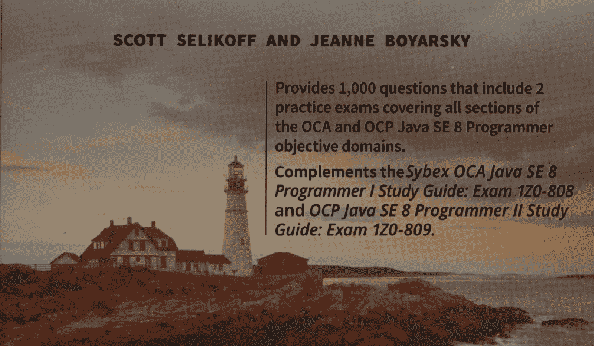
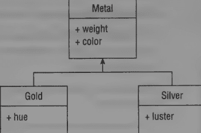
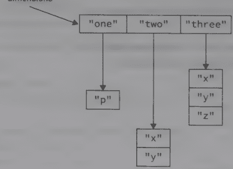
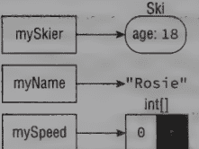
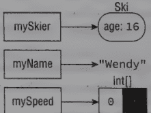
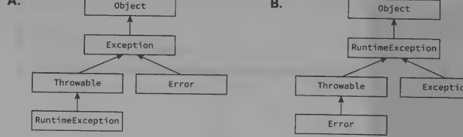
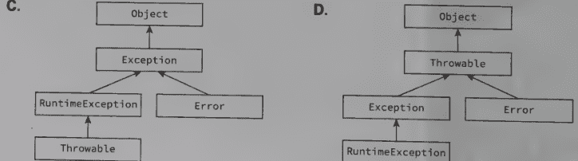

# OCA / OCP Java SE 8 程序员实践指南

本书提供了 1,000 道题，包括 2 份模拟考试，涵盖了 OCA 和 OCP Java SE 8 程序员目标领域的所有章节。

本书是对 Sybex OCA Java SE 8 程序员 I 学习指南：考试 1Z0-808 以及 OCP Java SE 8 程序员 II 学习指南：考试 1Z0-809 的互补。




# Jeanne Boyarsky

## 练习题

## 关于作者

Scott Selikoff 是一位专业的软件顾问、作者以及 Selkoff Software 的所有者。他自 1982 年以来一直编写软件，并参与过许多类型的项目。他在多个领域拥有经验，包括 Web 开发、移动端和桌面应用程序。他精通多种编程语言，包括 C、C++、Java、Python 和 JavaScript。

送给我妻子正在怀孕的新出生小宝贝。

- Scott

想起爱因斯坦和名字重名的 CV。恭喜达到 694！

- Jeanne

Jeanne Selikoff 是一位平面设计师和插画师。她曾在多个行业工作过，包括医疗保健、金融和教育。她擅长用户体验设计、用户界面和品牌身份。她喜欢创作视觉内容。

## 致谢

我们对所有帮助我们完成这本书的读者表示诚挚的谢意。特别感谢我们的同事，感谢在本书开发过程中提供的反馈和建议。我们还要感谢参与实验并为我们提供数据的学生。最后，我们要感谢家人在我们从事此项目期间给予的耐心与支持。

## 引言

本书适用于参加 `1Z0-808`/`1Z0-809` Oracle Java 程序员考试的人士，以及希望测试自己 Java 8 知识水平的人士。如果你是 Java 8 的新手，我们强烈建议从学习指南开始，学习该语言的所有方面，并在考虑参加考试时再回到本书。

我们建议从畅销的《OCA Associate Certified Java SE 8 Programmer I Study Guide》和《OCP Oracle Certified Professional Java SE 8 Programmer II Study Guide》开始你的学习，恰好我们是这两本书的作者。无论你使用哪种学习指南，你可以使用本书来提高你的技能，因为它基于实际考试中的主题编写的。

与我们学习指南中的题目不同（那些题目设计得比实际考试更难），本书中的题目反映了考试格式。书中的所有问题都会告诉你有多少个答案是正确的。如果有多个答案正确，它们会显示“选择两个”或“选择三个”。

在整本书中，我们使用了 Oracle 在考试中使用的同一套假设。在许多情况下，这些假设实际上是为了说明无意的遗漏或设置错误，而 Oracle 在你解决针对特定考试的问题时会要求你忽略这些错误。这些假设列在 `http://education.oracle.com`，并为了方便起见列在此处：

- **缺失的包和 import 语句**：如果示例代码不包含包或 import 语句，题目将假设所有示例代码都在同一个包中，并且存在 import 语句来支持它们。

- **类没有文件或目录路径**：如果题目没有说明类的文件名或目录位置，请假设以下任一种，以使代码能够编译和运行：
  - 所有类都在一个文件中。
  - 每个类都在单独的文件中，且所有文件都在一个目录下。

- **意外的换行**：示例代码可能存在意外的换行。如果你看到一行代码发生了折行，并且这种折行产生了显著影响（例如，一个带引号的字符串字面量发生了折行），请假设折行是同一行的扩展，且该行不包含会导致编译失败的硬回车符。

- **代码片段**：代码片段是在不提供上下文的情况下呈现的一小部分源代码。假设所有必要的支持代码都存在，并且支持环境完全支持所示代码及其被省略环境的正确编译和执行。

- **描述性注释**：按字面意思理解描述性注释，例如“setter 和 getters 放在此处”。假设正确的代码存在，并可以编译且成功运行以创建描述的效果。

## 选择考试

通往 Java 认证之路的第一步是 Oracle Certified Associate `1Z0-808` (OCA 8) 考试。材料包含了每个 Java 开发者都应该熟悉的日常基础工具。一旦你完成了该考试，就可以转向更难的 Oracle Certified Professional `1Z0-809` (OCP 8) 考试。这包含了第一场考试中的每个主题，以及许多你职业生涯中可能甚至不熟悉的额外库和 API，例如并发和 NIO.2 API。

如果你已经拥有 Java 认证，你有资格参加升级考试。表 1.1 和图 1.1 显示了获得 OCP 8 认证称号的不同路径。本书将帮助你准备表中列出的所有四个考试。

### 表 I.1 本书涵盖的考试

| 考试代码 | 名称 | 谁应该参加 |
| :--- | :--- | :--- |
| 1Z0-808 | Programmer I | 所有人都可以参加。 |
| 1Z0-809 | Programmer II | 通过 OCA 考试的人 |
| 1Z0-810 | Upgrade Java SE 8 | OCP 认证持有者 |
| 1Z0-813 | Upgrade from Java 7 | 任何 OCP 认证持有者 |


## 引言

本书适用于参加 `1Z0-808`/`1Z0-809` Oracle Java 程序员考试的人士，以及希望测试自己 Java 8 知识水平的人士。如果你是 Java 8 的新手，我们强烈建议从学习指南开始，学习该语言的所有方面，并在考虑参加考试时再回到本书。

对于 OCA 考试，我们建议参考《OCA Associate Certified Java SE 8 Programmer Study Guide》第 1 至 10 章。对于 OCP 考试，我们建议参考《OCP Certified Professional Java SE 8 Programmer II Study Guide》第 11 至 23 章。没错，这本书实际上是两书合一！

## 参加升级考试

如果你目前持有 Java 7 OCP，在准备方法上有一些细微的差别。好消息是，你参加的是 `1Z0-810` 升级考试，这正是你需要的所有。虽然考试更侧重于 Java 7 和 8 之间的变化，但现有的 OCP 材料中没有涵盖任何新主题。

不用担心！在我们编写《OCP Oracle Professional Java SE 8 Programmer Study Guide》时，我们增加了一个 50 页的附录，附录 C“从 Java 6 或更早版本升级”，它详细介绍了 `1Z0-813` 考试中的主题。如果你参加的是 `1Z0-813` 考试，那么在完成本书的学习后，你应该参考我们的附录或 Java 7 OCP 学习指南，以便准备所有内容。

## 考虑其他学习路径

如果你已经拥有 Java 认证，并不要求你参加升级考试。有些开发者认为先参加 `1Z0-808` OCA 考试，然后参加更具挑战性的 `1Z0-809` OCP 考试更为直接。如果你没有 Java 8 的经验，或者只是想对其进行更多练习，参加 OCA 考试再参加 OCP 考试可能是一个比参加单一升级考试更好的学习体验，尽管成本更高。

最后，如果你是 Java 认证的新手，传统的做法是顺序参加考试，先参加 OCA 考试，然后参加 OCP 考试。然而，这并不是严格的要求。虽然非常不合常规，你可以先参加更难的 OCP 考试，然后再回头参加 OCA 考试。在这种情况下，你在完成 OCA 考试后将同时获得 OCA 和 OCP 两个称号。虽然我们不建议这种策略，但 Oracle 确实允许的。

### 谁应该购买这本书

如果你打算参加 OCA 8 考试 (`1Z0-808`)，这本书的第 1 到第 10 章适合你。一旦你以优异的成绩通过，你就可以手头 OCP 的资料，以备你决定参加考试。

如果你打算参加 OCP 8 考试 (`1Z0-809`) 或 OCP 8 升级考试 (`1Z0-810`)，那么这本书的第 1 到 23 章适合你。虽然第 1 到 10 章主要关注 OCA 考试，但 OCP 考试是综合性的。我们建议从复习 OCA 章节（1-10）开始，以确保你有坚实的基础，然后在准备好后进入 OCP 章节（11-23）。

如前所述，如果你打算参加 OCP 8 升级考试 (`1Z0-813`)，这本书仍然对绝大多数主题有帮助。你需要补充一份 Java 7 学习指南，或者使用我们 OCP 书中的附录 C，该附录重点关注你需要了解的 `1Z0-813` 考试的精确主题。

无论你计划参加哪种考试，请确保始终随身携带你的学习指南。这本书是关于精炼你对 Java 8 的知识，而你的学习指南是在构建这些知识。

### 本书的结构

对于这本书，我们决定将两本书合一，分为第一部分和第二部分。第一部分包含第 1 到第 10 章，针对每组 OCA 考试目标集有 9 个基于目标的章节，随后是一个模拟的 OCA 练习考试。第二部分包含第 11 到第 23 章，针对每组 OCP 考试目标集有 12 个基于目标的章节，随后是一个模拟的 OCP 练习考试。

在阅读本书时，你应该注意基于目标的章节与练习考试章节之间存在一些细微的差别。

#### 使用基于目标的章节

我们设计基于目标的章节中每个问题的结构和风格，是为了反映更积极的学习体验，让你在每个问题上花费更少的时间，但涵盖更广泛的内容。例如，你可能会在一个章节内看到两个看起来相似的问题，但它们包含细微的差异，这种差异对代码是否能编译或产生什么输出有巨大影响。

基于目标的章节中的每个问题恰好有四个选项，只有一个正确答案。就像我们学习指南中的复习题一样，这些问题的设计是为了让你多次回答它们。虽然这些问题可能比考试题简单，但如果你坚持关注你认为自己擅长的主题，它们将强化你的概念。

在我们的学习指南中，我们将相关主题分组成章节。例如，if/then 语句和循环属于不同的 Oracle 目标集，但在我们的 OCA 书中，它们被放在关于“操作符和语句”的单一章节中。在这书中，我们决定完全围绕 Oracle 的目标来设计章节，以便你加强技能。虽然在使用本书中的基于目标的章节之前，你不需要阅读整份学习指南，但你确实需要学习相关的目标。表 I.2 和 I.3 显示了在练习题目之前，你至少需要阅读我们学习指南中的哪些章节。

##### 表 I.2 OCA 学习指南参考

| 本书章节 | 目标 | OCA 学习章节 |
|---|---|---|
| 1 | Java 基础 | 1 |
| 2 | 处理 Java 数据类型 | 1, 3 |
| 3 | 使用操作符和判定结构 | 2, 3 |
| 4 | 创建和使用数组 | 3 |
| 5 | 使用循环结构 | 2 |
| 6 | 处理方法和封装 | 4 |
| 7 | 处理继承 | 5 |
| 8 | 异常处理 | 6 |
| 9 | 使用 Java API 中的选类 | 1, 3, 4 |

##### 表 I.3 OCP 学习指南参考

| 本书章节 | 目标 | OCP 学习指南章节 |
|---|---|---|
| 11 | Java 类设计 | 1, 2 |


| 章节 | 主题 | 目标 |
| --- | --- | --- |
| 12 | 高级 Java 类设计 | 1, 2, 3 |
| 13 | 泛型和集合 | 3, 4 |
| 14 | Lambda 内置函数接口 | 2, 4 |
| 15 | Java Stream API | 3, 4 |
| 16 | 异常和断言 | 6 |
| 17 | 使用 Java SE 8 日期时间 API | 5 |
| 18 | Java I/O 基础 | 8 |
| 19 | I/O (NIO2) | 9 |
| 20 | 并发 | 7 |
| 21 | 使用 JDBC 构建应用程序 | 10 |
| 22 | 本地化 | 5 |

## 使用练习考试

书中包含了两个模拟考试，第 10 章是模拟 OCA 练习考试，第 23 章是模拟 OCP 练习考试。这些章节与基于目标的章节有很大不同，因为它们的设计是为了测试你的综合知识。

虽然基于目标的章节有四个选项且只有一个正确答案，但练习考试的设计是可以在一次内完成的，且通过分为 65%。根据我们第一版书的反馈，我们建议在准备好之前不要考试。

基于目标的章节可以分几天完成，但练习考试的设计是要求一次性完成的。

## 回顾考试变更

Oracle 会经常更改题目数量、通过分数和时间限制。事实上，在本书出版期间，考试编写人员将 OCA 8 的题目从 77 增加到了 80；Scott 和 Jeanne 维护着一个博客，以跟进真实考试的更新，与 Oracle 的更新保持同步：

```
https://www.selikoff.net/oca8-updates/
```

我们建议你在参加真实考试之前阅读此页面，因为出版以来的信息发生了变化。

## 准备参加考试

如果你在想参加的考试的所有章节（包括模拟考试）中都能稳定获得 80% 以上的分数，你可能已经准备好参加真实考试了。只需记住，在家进行练习和花费数百美元在测试中心参加真实考试是有很大区别的。

我们可以写一整章关于应试技巧和学习建议。噢，我们真的写了！我们的 OCA 8 和 OCP 8 书各包含一个附录，其中充满了实用的技巧和建议，旨在帮助你管理时间。它们还包含了如何排除明显错误答案的说明。

最后，尽管很多人倾向于在考试前的几小时内突击学习，但大多数研究都表明这是一种糟糕的考试策略。我们在考试前能建议你做的最好的事情就是保证充足的睡眠！

# 需要更多准备帮助吗？

两位作者都是 CodeRanch.com 的管理员，这是一个非常大且活跃的编程论坛，对 Java 初学者非常友好。它为每场考试设立了独立的论坛：
- OCA 论坛：https://coderanch.com/f/117
- OCP 论坛：https://coderanch.com/f/24

如果你在阅读完解释后仍然不理解某个问题，请随时在这些论坛之一中提问。你将获得来自资深 Java 程序员的回答。那甚至可能来自我们其中一人。祝你考试顺利，学习愉快！

---

本练习测试涵盖的 OCA 考试主题包括：

- 定义变量的作用域
- 使用 `main` 方法创建可执行的 Java 应用程序；从命令行运行 Java 程序；产生控制台输出
- 比较并对比 Java 的特性和组件，例如：平台独立性、面向对象、封装等


# 第一部分 - OCA

## 1. 下列方法签名中哪一个是 Java 应用程序入口的有效声明？

- A. `public void main(String[]) args`
- B. `public static void main()`
- C. `private static void start(String[]) mydata`
- D. `public static final void main(String[]) mydata`

## 2. 下类图展示了 Gold 和 Silver 之间的关系，它们继承自 Metal 类。假设所有属性都声明为 public。关于该图的哪个描述是不正确的？



- A. 该图展示了 Java 的平台独立性。
- B. 该图展示了 Java 的面向对象设计。
- C. Gold 和 Silver 类从 Metal 类继承了 weight 和 color 属性。
- D. Gold 没有继承 luster 属性。

## 3. Java 字节码编译文件的正确扩展名是什么？

- A. `.java`
- B. `.bytecode`
- C. `.class`
- D. `.dll`

## 4. 假设 Date 类同时存在于 java.util 和 java.sql 包中，编译此类的结果是什么？

```java
1: import java.util.*;
2: import java.sql.*;
3: public class BirthdayManager {
4:     private Date rob = new Date();
5:     private java.util.Date sharon = new java.util.Date();
6: }
```

- A. 这里的代码因为第 1 行和第 2 行无法编译。
- B. 代码因为第 4 行无法编译。
- C. 代码因为第 5 行无法编译。
- D. 代码可以正常编译。

## 5. 下列哪项不是传统面向对象编程语言的特征？

- A. 对象被分组为过程，与它们所操作的数据分开。
- B. 对象可以通过强制转换（casting）采取多种形式。
- C. 对象可以持有数据，称为属性（attributes）。
- D. 对象可以通过方法（methods）执行操作。

## 6. 哪些变量的作用域限于方法内部？

- A. 接口变量
- B. 类变量
- C. 实例变量
- D. 局部变量

## 7. 哪个包默认导入到每个 Java 类中？

- A. `java.util`
- B. `java.lang`
- C. `system.lang`
- D. `java.system`

## 8. 下列哪项不是 Java 中有效的代码注释？

- A. `// 在结果上加 5`
- B. `# 添加配置值`
- C. `/* 从系统读取文件 **** .java */`
- D. `/** 文档注释 */`

## 9. 关于有效的 .java 文件，哪种陈述是正确的？

- A. 它只能包含一个类声明。
- B. 它可以包含一个公共类声明和一个公共接口定义。
- C. 它必须定义至少一个公共类。
- D. 它最多可以定义一个公共类。

## 10. 给定以下应用程序，请从往下开始填写表格中的缺失值。

```java
package competition;

public class Robot {

    static String weight = "A lot";

    /* */ double ageMonths = 5, ageDays = 2;

    private static boolean success = true;

    public void main(String[] args) {

        final String retries = "1";

        // P1

    }

}
```

| 变量类型 | P1 处可访问的变量数量 |
| --- | --- |
| 类 | - |
| 实例 | - |
| 局部 | - |

- A. 2, 0, 1
- B. 2, 2
- C. 1, 0, 1
- D. 0, 2

## 11. 关于导入语句（import statements），哪种陈述是正确的？

- A. 如果包含未使用的导入，类将无法编译。
- B. 未使用的导入语句可以被删除。
- C. 它需要创建它的相应 .java 文件。
- D. 不可能。

## 12. 编译并执行以下类的结果是什么？

```java
1: public class Park {
2:     int birds = 10;
3:     public static void main(String[] data) {
4:         int trees = 5;
5:         System.out.print(trees);
6:     }
}
```

- A. 不编译。
- B. 可以编译但抛出异常。
- C. 可以编译并输出 5。
- D. 可以编译并输出 15。

## 13. 关于 Java 的陈述哪个是正确的？

I. `java` 命令可以执行 .java 文件。
II. Java 是面向对象的。
III. `javac` 命令直接编译成机器码。

- A. 只有 I
- B. 只有 III
- C. II 和 III
- D. 都不是。

## 14. 下列哪项不是合法的 Java 语句？

- A. `import *;`
- B. `// Widget`
- C. `package sprockets;`
- D. `int Number;`

## 15. 关于使用包，哪项是正确的？

- A. 包名必须与目录结构匹配。
- B. 创建新包需要添加文件。
- C. 包允许从外部限制类、方法或数据的访问。
- D. 在包内。

## 16. 假设当前目录为 /home，且有一个使用默认包的应用程序 Manager.java，编译并运行该程序的正确命令是？

- A. `javac Manager; java Manager`
- B. `javac Manager.java; java Manager`
- C. `javac Manager.class; java Manager.java`

## 17. 结构 Java 类使得类内部的方法可以访问实例变量，被称为

- A. 平台独立性
- B. 面向对象
- C. 继承
- D. 封装

## 18. 下列代码的输出是什么？

```java
String tree = "pine";
int count = 0;
if (tree.equals("pine")) {
    int height = 55;
    count = count + 1;
}
```

- A. 1
- B. 55
- C. 56
- D. 不编译。

## 19. 关于 Java 字节码文件，哪项是正确的？

- A. 它可以在任何兼容 JVM 的计算机上运行。
- B. 它只能在创建它的相同计算机上执行。
- C. 它可以在标准文本编辑器中轻松读取和修改。
- D. 它需要创建它的 .java 文件。

## 20. Java 中终止语句的正确字符是什么？

- A. 冒号 (:)
- B. 换行符
- C. 制表符
- D. 分号 (;)

## 21. 编译并执行以下类的结果是什么？

```java
1: public class Tolls {
2:     private static int yesterday = 1;
3:     int tomorrow = 10;
4:     public static void main(String[] args) {
5:         Tolls tolls = new Tolls();
6:         int today = 20, tomorrow = 40;
7:         System.out.print(today + tolls.tomorrow + tolls.yesterday);
8:     }
9: }
```

- A. 代码因为第 6 行无法编译。
- B. 代码因为第 7 行无法编译。
- C. 31
- D. 61

## 22. 假定以下类定义，哪一行不包含编译错误？

```java
1: public ThisClassDoesNotCompile {
2:     double int count;
3:     void errors() {}
4:     static void private limit;
}
```

- A. 第 1 行
- B. 第 2 行
- C. 第 3 行
- D. 第 4 行

## 23. 以下哪个允许 Java 类在各种计算机和设备上运行？

- A. 封装
- B. 面向对象
- C. 继承
- D. 平台独立性

## 24. 下列哪项不是 JVM 的属性？

- A. 它防止 Java 字节码被轻易解码/反编译。
- B. 它支持平台独立性。
- C. 它为应用程序管理内存。
- D. 它将 Java 指令翻译为机器指令。

## 25. 下列变量在整个程序中始终处于作用范围内？

- A. 包级变量
- B. 类变量
- C. 实例变量
- D. 局部变量

## 26. 假定以下通配符导入语句，哪个类会被包含在导入中？

```java
import television.actor.*;
import movie.director.*;
```

- A. `television.actor.recurring.Marie`
- B. `movie.directors.John`
- C. `television.actor.Package`
- D. `movie.NewRelease`

## 27. Java 类语句的正确顺序是？

- A. import 语句、package 语句、类声明
- B. package 语句、类声明、import 语句
- C. 类声明、import 语句、package 声明
- D. package 语句、import 语句、类声明

## 28. 假定以下类定义，最多可以删除多少条 import 语句仍能通过编译？对于此问题，假设 Blackhole 类仅定义在 stars 包中。

```java
package planetarium;

import java.lang.*;
import stars.*;
import java.lang.Object;
import stars.Blackhole;

public class Observer {
    public void find(Blackhole blackhole) {
    }
}
```

- A. 零
- B. 一
- C. 两个
- D. 三

## 29. 假定以下类定义，哪个命令会导致应用程序输出消息“White-tailed”？

```java
package forest;

public class Deer {
    public static void main(String... deerParams) {
        System.out.print(deerParams[2]);
    }
}
```

- A. `java forest.Deer deer 5 "White-tailed deer"`
- B. `java forest.Deer "White-tailed deer" 3`
- C. `java forest.Deer Red deer White-tailed deer`
- D. `java forest.Deer My "deer White-tailed"`

## 30. 下列哪一个陈述是正确的？

- A. `java` 命令将 .java 文件编译为 .class 文件。
- B. `javac` 命令将 .java 文件编译为 .class 文件。
- C. `java` 命令将 .class 文件编译为 .java 文件。
- D. `javac` 命令将 .class 文件编译为 .java 文件。

## 31. 关于 Java 的以下陈述中哪个是正确的？

- A. Java 是一种过程化编程语言。
- B. Java 允许方法重载。
- C. Java 允许运算符重载。
- D. Java 允许直接访问内存中的对象。

## 32. 假定以下代码，按顺序插入空行中的值可以使代码通过编译：

```java
____ agent;

public ____ Banker {
    private static ____ getMaxWithdrawal() {
        return 10;
    }
}
```

- A. import, class, null
- B. import, interface, void
- C. package, int, int
- D. package, class, long

## 33. 以下应用程序的输出是什么？

```java
public class Airplane {
    static int start = 2;
    final int end;
    public Airplane(int x) {
        x = 4;
        end = x;
    }
    public void fly(int distance) {
        System.out.print(end - start + " ");
        System.out.print(distance);
    }
    public static void main(String... start) {
        new Airplane(10).fly(5);
    }
}
```

- A. 2 5
- B. 8 5
- C. 6 5
- D. 代码无法编译。

## 34. Java 支持通过继承扩展类的最重要的原因之一是什么？

- A. 继承要求类扩展另一个类必须在同一个包中。
- B. 程序必须在运行时花费额外的时间/资源，跳过多层继承来确定精确的方法和变量。
- C. 父类中方法签名的更改可能会破坏使用重载方法的子类。
- D. 开发者通过在公共父类中共享代码，尽量减少新类中的重复代码。

## 35. 下列哪一个是 Java 中有效的代码注释？

- A. `////// Walk my dog`
- B. `# Go team!`
- C. `/* Comment */`
- D. 以上均不是

## 36. 下列方法签名中哪一个不是 Java 应用入口点的有效声明？

- A. `public static void main(String... arguments)`
- B. `public static void main(String arguments)`
- C. `public static void main(String[]) arguments)`
- D. `public static void main(String[] arguments)`

## 37. 假定下面的 Magnet.java 文件，标记的行中哪些行可以独立地使用 `String color;` 且代码仍通过编译？

```java
// line a1
public class Magnet {
  // line a2
  public void attach() {
    // line a3
  }
  // line a4
}
```

- A. 仅 line a1
- B. 仅 line a2
- C. 仅 line a3
- D. line a2 和 line a4


## 选择题

- A. a1 和 a3
- B. a2 和 a4
- C. a2, a3 和 a4
- D. a1, a2, a3 和 a4

### 38. 定义一个有效的 Java 类文件需要什么？

- A. 类声明
- B. `package` 语句
- C. 至少一个 `import` 语句
- D. `public` 修饰符

### 39. Java 源文件的正确文件名扩展名是什么？

- A. `.jav`
- B. `.class`
- C. `.source`
- D. `.java`

### 40. 假定 `Math` 类存在于 `java.lang` 和 `pocket` 包中，编译以下类的结果是？

```java
1: package pocket;
2: import complex.*;
3: import java.util.*;
4: public class Calculator {
5:     public static void main(String[] args) {
6:         System.out.print(
7:     }
}
```

- A. 因为第 2 行无法编译
- B. 因为第 3 行无法编译
- C. 因为第 6 行无法编译
- D. 代码编译通过

### 41. 假定使用以下导入语句的类，哪个类可以在不使用全限定名的情况下访问？

```java
import dog.*;
import puppy.*;
```

- A. `dog.`
- B. `puppy.`
- C. `java.`
- D. `java.`

### 42. ________ 是将数据组织成单元的技术。

- A. 封装
- B. 面向对象
- C. 平台独立性
- D. 多态

### 43. 假定 `Apple` 类在 `vegetables` 包中，`Broccoli` 类在 `fruit` 包中，最多可以删除多少条 `import` 语句仍能通过编译？

```java
package food;

import vegetables.*;
import fruit.*;
import Date;

public class Grocery {
    Apple a; Broccoli b; Date c;
}
```

- A. 0
- B. 1
- C. 2
- D. 3

### 44. 假定以下应用程序，预期输出是什么？

- A. `true`
- B. `false`
- C. 代码无法编译。
- D. 代码编译但在运行时抛出异常。

### 45. 编译并执行以下类的结果是什么？

```java
public class RollerSkates {
    static int wheels = 1;
    int tracks = 5;

    public static void main(String[] arguments) {
        RollerSkates s = new RollerSkates();
        int feet = 4, tracks = 15;
        System.out.print(feet + tracks + s.wheels);
    }
}
```

- A. 代码无法编译。
- B. 5
- C. 10
- D. 20

### 46. 编译并执行以下类的结果是什么？

```java
package sports;

public class Bicycle {
    String color = "red";

    private void printColor(String color) {
        color = "purple";
        System.out.print(color);
    }

    public static void main(String[] rider) {
        new Bicycle().printColor("blue");
    }
}
```

- A. red
- B. purple
- C. blue
- D. 代码无法编译。

### 47. 关于调用编译命令 `javac` 和执行命令 `java` 的哪些陈述是正确的？

- I. `java` 可以使用点 `.` 分隔包。
- II. `javac` 获取一个 `.java` 文件并返回一个 `.class` 文件。
- III. `java` 可以使用斜杠 `/` 分隔包。

- A. 仅 I
- B. 仅 II
- C. I 和 II
- D. I、II 和 III

### 48. 编译并执行以下应用程序的结果是什么？

```java
package class;

public class Weather {
    private static boolean heatWave = true;

    public static void main() {
        boolean heatWave = false;
        System.out.print(heatWave);
    }
}
```

- A. `true`
- B. `false`
- C. 无法编译。
- D. 编译通过但在运行时抛出错误。

### 49. 给定以下类图，哪种 Java 实现最贴近该结构？

| Book |
| :--- |
| +numberOfPages |
| +getRating() |

- A. `public class Book { public int numberOfPages;`
- B. `public class Book { public String getRating() {return null;}`
- C. `public class Book { public int numberOfPages; public String getRating() {return null;}`
- D. `public class Book { void numberOfPages; }`

### 50. 关于 JVM 的哪个陈述是正确的？

- A. JVM 按照可预测的调度计划执行垃圾回收。
- B. JVM 确保应用程序始终会终止。
- C. JVM 需要一个定义良好的入口点方法来执行应用程序。
- D. 编译后的 Java 代码可以在任何计算机上运行。

---

## 本次练习测试涵盖的 OCA 考试考点包括：

- 与 Java 数据类型操作
- 声明和初始化变量（包括原始数据类型的强制转换）
- 区分对象引用变量和原始类型变量
- 了解如何读取或写入对象字段
- 解释对象的生命周期（创建、“通过重新赋值取消引用”和垃圾回收）
- 开发使用如 `Boolean`、`Double` 和 `Integer` 等包装类的代码


---

## 练习题

### 1. 下列哪个声明无法编译？

- A. `double num1, int num2 = 0;`
- B. `int num1, num2;`
- C. `int num1, num2 = 0;`
- D. `int num1 = 0, num2 = 0;`

### 2. 下列代码的输出是什么？

```java
public static void main(String... args) {
    String chair, table = "metal";
    chair = chair + table;
    System.out.println(chair);
}
```

- A. `metal`
- B. `metalmetal`
- C. `nullmetal`
- D. 代码无法编译。

### 3. 关于 `String` 类型的实例变量，哪个说法是正确的？

- A. 它默认是一个空字符串。
- B. 它默认值为 `null`。
- C. 它没有默认值。
- D. 如果不在声明行上初始化，它将无法编译。

### 4. 下列哪个不是有效的变量名？

- A. `_blue`
- B. `2blue`
- C. `blue$`
- D. `Blue`

### 5. 下列哪个类名最符合标准的 Java 命名规范？

- A. `fooBar`
- B. `FooBar`
- C. `FO0_BAR`
- D. `F_o_o_B_a_r`

### 6. 下列方法中有多少个可以编译？

```java
public String convert(int value) {
    return value.toString();
}

public String convert(Integer value) {
    return value.toString();
}

public String convert(Object value) {
    return value.toString();
}
```

- A. 都没有
- B. 一个
- C. 两个
- D. 三个

### 7. 下列哪个无法编译？

- A. `int num = 999;`
- B. `int num = 9_9_9;`
- C. `int num = _9_99;`
- D. 以上均不是；它们都可以编译。

### 8. 下列哪一个是包装类？

- A. `int`
- B. `Int`
- C. `Integer`
- D. `Object`

### 9. 运行这段代码的结果是什么？

```java
public class Values {
    Integer a = Integer.valueOf("1");

    public static void main(String[] nums) {
        Integer a = Integer.valueOf("2");
        Integer b = Integer.valueOf("3");
        System.out.println(a + b);
    }
}
```

- A. 4
- B. 5
- C. 代码无法编译。
- D. 代码编译通过但在运行时抛出异常。

### 10. 哪个选项最好描述了 `new` 关键字的作用？

- A. 创建现有对象的副本并将其视为新的原始类型
- B. 创建一个新的原始类型
- C. 实例化新对象
- D. 将对象引用切换到新的引用

### 11. 哪第一行触发了编译错误？

```java
double d1 = 5f; // p1
double d2 = 5.0; // p2
float f1 = 5f; // p3
float f2 = 5.0; // p4
```

- A. p1
- B. p2
- C. p3
- D. p4

### 12. 下列原始类型列表中按数据类型从小到大顺序排列的是？

- A. `byte`, `char`, `float`, `double`
- B. `byte`, `char`, `double`
- C. `char`, `byte`, `double`
- D. `char`, `double`, `float`

### 13. 下列哪种类元素的顺序是有效的？

- A. 实例化变量、方法名
- B. 实例化变量、构造函数
- C. 方法名、实例化变量、构造函数

### 14. 下列代码中哪一行包含编译错误？

```java
String title = "Weather"; // line1
double hot; // line2
System.out.println(hot + " "); // line3
```

- A. line1
- B. line2
- C. line3
- D. 以上均不是

### 15. 在代码中有多少个初始化器？

```java
public class Bowling {
    {
        System.out.println();
    }

    public Bowling() {
        System.out.println();
    }

    {
        System.out.println();
    }
}
```

- A. 零
- B. 一个
- C. 两个
- D. 三个

### 16. 下列哪种类型可以填充空白使代码输出 0？

```java
static ______ defaultValue;

public static void main(String[] args) {
    System.out.println(defaultValue);
}
```

- A. `double`
- B. `int`
- C. `float`

### 17. 关于 `finalize()` 方法：

- A. 它可以被调用零次。
- B. 它可以被调用多次。
- C. 它可以被调用一次。

### 18. 下列哪一个是包装类？

- A. `int`
- B. `long`
- C. `String`

### 19. 假设你有以下代码，运行结果是什么？

```java
public class Values {
    Integer a = Integer.valueOf("1");

    public static void main(String[] nums) {
        Integer a = new("2"); // 此处原文语法错误，推测为 new Integer("2")
        Integer b = Integer.valueOf("3");
        System.out.println(a + b);
    }
}
```

- A. 4
- B. 5
- C. 代码无法编译。
- D. 代码编译通过但在运行时抛出异常。

### 20. 哪个类型可以填充空白？

`______ = 3.14;`

- A. `byte`
- B. `float`
- C. `double`
- D. `short`

### 21. 下列代码中哪一行无法编译？

```java
public static void main(String[] args) {
    Integer = 0; // k1
    int Integer = 0; // k2
    Integer++; // k3
    int++; // k4
}
```

- A. k1
- B. k2
- C. k3
- D. k4

### 22. 假设 `foo` 是某个类的实例。关于 `bar` 的哪个说法是不正确的？

- A. `bar` 是实例化变量。
- B. `bar` 是局部变量。
- C. 可以用于读取 `bar`。
- D. 可以用于写入 `bar`。

### 23. 下列哪个不是有效的类声明？

- A. `class building {}`
- B. `class Cost$ {}`
- C. `class 5Main {}`
- D. `class _Outside {}`

### 24. 下列哪项可以填充空白使代码编译？

`______ d = new ______(1_000_000.00);`

- A. `double`, `double`
- B. `double`, `Double`
- C. `Double`, `double`
- D. 以上都是

### 25. 关于 `String` 类型的局部变量，哪个说法是正确的？

- A. 它默认是一个空字符串。
- B. 它默认值为 `null`。
- C. 它没有默认值。
- D. 如果不在声明行上初始化，它将无法编译。

### 26. `double`, `int`, `long` 和 `short` 类型中，有多少种可以填充空白使代码输出 0？

```java
static ______ defaultValue;

public static void main(String[] args) {
    System.out.println(defaultValue);
}
```

- A. 一个
- B. 两个
- C. 三个
- D. 四个

### 27. 关于原始类型，哪个说法是正确的？

- A. 你可以在原始类型上调用方法。
- B. 你可以通过赋值将原始类型转换为包装对象。
- C. 你可以通过调用 `valueOf()` 将包装对象转换为原始类型。
- D. 你可以将原始类型直接存入 `ArrayList` 中。

### 28. 下列代码的输出是什么？

```java
Integer integer = new Integer(4);
System.out.print(integer.byteValue());

System.out.print("-");

int i = new Integer(4); // 此处原文有误，int 不能直接赋值 Integer 对象，推测为 Integer i = new Integer(4) 或 int i = 4
System.out.print(i.byteValue()); // 若 i 为 int，则无 byteValue() 方法
```

- A. `4-0`
- B. `4-4`
- C. 代码无法编译。

### 29. 给定以下代码，填充空白以使代码输出 `bounce`

```java
public class TennisBall {
    public TennisBall() {
        System.out.println("bounce");
    }

    public static void main(String[] slam) {
        // 此处需填充代码实例化 TennisBall，如 new TennisBall();
    }
}
```


# 第2章 使用 Java 数据类型

- A. `TennisBall`;
- B. `TennisBall()`;
- C. `new TennisBall()`;
- D. `new TennisBall()`;

30. 下列哪项正确地将 `animal` 赋值给两个变量？

- I. `String cat = "animal", dog = "animal";`
- II. `String cat = "animal"; dog = "animal";`
- III. `String cat, dog = "animal";`
- IV. `String cat, String dog = "animal";`

- A. I
- B. I, II
- C. I, III
- D. I, II, III, IV

31. 哪两个基本类型对应的包装类并非仅仅是基本类型首字母大写后的名称？

- A. `byte` 和 `char`
- B. `byte` 和 `int`
- C. `char` 和 `int`
- D. 以上都不是

32. 关于 `String` 实例变量，以下哪一叙述是正确的？

- A. 它们可以被设置为 `null`。
- B. 它们永远无法从定义它们的类外部设置。
- C. 它们只能在构造函数中设置。
- D. 它们在程序运行期间只能被设置一次。

33. 关于基本类型，以下哪一叙述是正确的？

- A. 基本类型以小写字母开头。
- B. 基本类型可以被设置为 `null`。
- C. `String` 是一个基本类型。
- D. 你可以创建自己的基本类型。

34. 如何强制在特定点发生垃圾回收？

- A. 调用 `System.forceGc()`
- B. 调用 `System.gc()`
- C. 调用 `System.requireGc()`
- D. 以上都不是

35. 在 `main` 方法结束之前，有多少个 `String` 对象符合垃圾回收条件？

```java
public static void main(String[] fruits) {
    String fruit1 = new String("apple");
    String fruit2 = new String("orange");
    String fruit3 = new String("pear");

    fruit3 = fruit1;
    fruit2 = fruit3;
    fruit1 = fruit2;
}
```

- A. 无
- B. 一个
- C. 两个
- D. 三个

36. 下列哪项可以填充空白使使代码通过编译？

```java
d = new ___________(1,000,000.00);
```

- A. `double`, `double`
- B. `double`, `Double`
- C. `Double`, `Double`
- D. 以上都不是

37. 下面输出输出什么？

```java
public class InitOrder {
    public String first = "instance";
    public InitOrder() {
        first = "constructor";
    }
    { first = "block"; }
    public void print() {
        System.out.println(first);
    }
    public static void main(String... args) {
        new InitOrder().print();
    }
}
```

# 第2章 使用 Java 数据类型

- A. block
- B. constructor
- C. instance
- D. 代码无法编译。

38. 下列代码中有多少行可以编译？

```java
int i = null;
Integer in = null;
String s = null;
```

- A. 无
- B. 一
- C. 两个
- D. 三个

39. 下列哪对语句可以准确地填充表格中的空白？

| 变量类型 | 在类内部可以通过什么类型的方法调用 |
| :--- | :--- |
| 实例 | 空格 1: |
| 静态 | 空格 2: |

- A. 空格 1：仅限实例方法，空白 2：仅限静态方法
- B. 空格 1：实例方法或静态方法，空白 2：仅限静态方法
- C. 空格 1：仅限实例方法，空白 2：实例方法或静态方法
- D. 空格 1：实例方法或静态方法，空白 2：实例方法或静态方法

40. 下列哪项无法编译？

- A. `double num = 2.718;`
- B. `double num = 2._718;`
- C. `double num = 2.7_1_8;`
- D. 以上都不是；它们都能通过编译。

41. 下列基本数值类型列表按顺序排列的是哪一组？

- A. `byte`, `short`, `int`, `long`
- B. `int`, `short`, `byte`, `long`
- C. `short`, `byte`, `int`, `long`
- D. `short`, `int`, `byte`, `long`

42. 填充空白使代码通过编译：

```java
package animal;

public class Cat {
    public String name;

    public static void main(String[] args) {
        Cat cat = new Cat();
        cat____ = "Sadie";
    }
}
```

- A. `cat.name`
- B. `cat-name`
- C. `cat.setName`
- D. `cat.name`

43. 假设代码运行到结束，以下代码的输出是什么：

```java
package store;

public class Toy {
    public void play() {
        System.out.print("play-");
    }

    public void finalize() {
        System.out.print("clean-");
    }
}

public static void main(String[] args) {
    Toy car = new Toy();
    car.play();
    System.gc();
    Toy doll = new Toy();
    doll.play();
}
```

- A. play-
- B. play-play-
- C. play-clean-play-
- D. play-play-clean-

# 第2章 使用 Java 数据类型

44. 哪种是填充空白实现此方法的常用方法？

```java
public class Penguin {
    private double beak;

    public static void setBeak(Penguin p, int b) {
    }
}
```

- A. `p.beak = b;`
- B. `p.beakLength = b;`
- C. `p.setBeak =`
- D. 以上都不是

45. 填充空白指示使用自动装箱的是基本类型还是包装类：

```java
first = Integer.parseInt("5");
second = Integer.valueOf("5");
```

- A. `int`, `int`
- B. `int`, `Integer`
- C. `Integer`, `int`
- D. `Integer`, `Integer`

46. 在 `main` 方法结束之前，有多少个对象符合垃圾回收条件？

```java
public class Person {
    Person youngestChild;

    public static void main(String[] args) {
        Person elena = new Person();
        Person diana = new Person();
        elena.youngestChild = diana;
        diana = null;
        Person zoe = new Person();
        elena.youngestChild = zoe;
        zoe = null;
    }
}
```

# 第3章 使用运算符和决策结构

- A. 无
- B. 一个
- C. 两个
- D. 三个

47. 哪项是该类的有效构造函数？

```java
public class TennisBall {
    A. public static TennisBall create() { return new TennisBall(); }
    B. public static TennisBall newInstance() { return new TennisBall(); }
    C. public TennisBall() {}
    D. public void TennisBall() {}
}
```

48. 假设运行到结束，下列哪项是该代码的可能输出：

```java
package store;

public class Toy {
    public void play() {
        System.out.print("play-");
    }

    public void finalize() {
        System.out.print("clean-");
    }

    public static void main(String[] args) {
        Toy car = new Toy();
        car.play();
        System.gc();
        Toy doll = new Toy();
        doll.play();
    }
}
```

- A. play-
- B. play-play-
- C. play-clean-play-
- D. play-play-clean-clean-

49. 哪项在没有自动装箱的情况下基本类型转换为包装对象？

- A. 调用 `asObject()` 方法
- B. 调用包装类的构造函数
- C. 调用 `convertToObject()` 方法
- D. 调用 `toObject()` 方法

50. 下面的输出是什么？

```java
package beach;

public class Sand {
    public Sand() {
        System.out.print("a");
    }

    public void Sand() {
        System.out.print("b");
    }

    public void run() {
        new Sand();
        Sand();
    }

    public static void main(String... args) {
        new Sand().run();
    }
}
```

- A. a
- B. ab
- C. aab
- D. 以上都不是

# 第3章 使用运算符和决策结构

本次练习测试涵盖的 OCA 考试主题包括：

- 使用运算符和决策结构
- 使用 Java 运算符；使用括号覆盖运算符优先级
- 使用 `==` 和 `equals()` 测试 `String` 与其他对象之间的相等性
- 创建 `if`、`if/else` 和三元结构
- 使用 `switch` 语句

1. 下列哪种变量类型不允许用于 `switch` 语句？

- A. `String`
- B. `double`
- C. `int`
- D. `char`

2. 执行以下代码片段后，`tip` 的值是多少？

```java
int meal = 5;
int tip = 2;
int total = meal + (meal > 6 ? ++tip : --tip);
```

- A. 1
- B. 2
- C. 3
- D. 6

3. 下面应用程序的输出是什么？

```java
package registration;

public class NameCheck {
    public static void main(String... data) {
        String john = "john";
        String jon = new String(john);
        System.out.print((john == jon) + " " + (john.equals(jon)));
    }
}
```

- A. true
- B. true false
- C. false true
- D. false false

4. 下面应用程序的输出是什么？

```java
package planning;

public class ThePlan {
    public static void main(String[] input) {
        int plan = 1;
        plan = plan++ + --plan;
        if (plan == 1) {
            System.out.print("Plan A");
        } else if (plan == 2) {
            System.out.print("Plan B");
        } else {
            System.out.print("Plan C");
        }
    }
}
```

- A. 计划 A
- B. 计划 B
- C. 计划 C
- D. 以上都不是

5. 关于 `switch` 语句中的默认分支（default branch），下列哪个描述正确？

- A. 所有的 `switch` 语句都必须包含 `default` 语句。
- B. `default` 语句必须放在所有 `case` 语句之后。
- C. 与 `case` 语句不同，`default` 语句不需要值。
- D. 只有在存在至少一个 `case` 语句时，才能使用 `default` 语句。

6. 在执行以下代码段后，`thatNumber` 的值是多少？

```java
long thatNumber = 5 > 5 ? 1 + 2 : 1 * 1;
if (++thatNumber < 4) {
    thatNumber += 1;
}
```

- A. 3
- B. 4
- C. 5
- D. 答案在运行时之前无法确定。

7. 哪条语句可以立即退出 `switch` 语句，跳过所有剩余的 `case` 或 `default` 分支？

- A. exit
- B. break
- C. goto
- D. continue

8. 关于三元表达式（ternary expressions），哪种描述是正确的？

- A. 在某些情况下，三元表达式中条件运算符右侧的两个表达式都会运行时求值。
- B. 三元表达式需要括号才能正确求值。
- C. 三元表达式是 `if-then-else` 语句的方便替代方案。
- D. 三元表达式左侧的操作数支持 `int` 和 `boolean` 表达式。

9. 以下程序的输出是什么？

```java
package voting;

public class Election {
    public void calculateResult(Integer candidateA, Integer candidateB) {
        boolean process = candidateA == null || candidateA.intValue() < 10;
        boolean value = candidateA && candidateB;
        System.out.print(process || value);
    }

    public static void main(String[] unused) {
        new Election().calculateResult(null, 203);
    }
}
```

- A. true
- B. false
- C. 代码无法编译。
- D. 代码可以编译，但在运行时于第 3 行抛出 `NullPointerException`。

10. 以下程序的输出是什么？

```java
package dinosaur;

public class Park {
    public static void main(String... arguments) {
        int pterodactyl = 6;
        long triceratops = 3;

        if (pterodactyl % 3 >= 1) {
            triceratops++;
            triceratops--;
        }

        System.out.print(triceratops);
    }
}
```


- A. 2
- B. 3
- C. 4
- D. 代码无法编译。

### 11. 关于 `if-then` 语句，哪种描述是正确的？

- A. `if-then` 语句必须包含一个 `else` 语句。
- B. 如果 `if-then` 语句的布尔测试结果为 `false`，则 `if-then` 语句的目标语句仍会被执行。
- C. `if-then` 语句要求对对象进行强制转换。
- D. `if-then` 语句可以执行单个语句或一个块 `{}`。

### 12. 以下程序的输出是什么？

```java
package restaurant;

public class Pieces {

    public static void main(String[] info) {

        int flair = 15;

        if(flair > 15 && flair < 37) {

            System.out.print("Not enough");

        }
    }

    if(flair==37) {

        System.out.print("Just right");

    } else {

        System.out.print("Too many");

    }

}
```

- A. Not enough
- B. Just right
- C. Too many
- D. 以上都不是

### 13. 关于 `switch` 语句中的 `case` 语句，描述是错误的？

- A. `case` 值可以是 `final`。
- B. `case` 语句必须用 `break` 语句终止。
- C. `case` 值可以是一个字面量。
- D. `case` 值必须匹配 `switch` 变量的类型，或者能够转换为该类型。

### 14. 根据下表，布尔表达式 `x` 和 `y` 的哪个运算符对应这种关系？

| x = true | x = false |
|---|---|
| y = true | false |
| y = false | false |

- A. --
- B. <<
- C. ||
- D. &&

### 15. 以下代码段的输出是什么？

```java
int hops = 0;
int jumps = 0;
jumps = hops++;
if(jumps) {
    System.out.print("Jump!");
} else {
    System.out.print("Hop!");
}
```

- A. Jump!
- B. Hop!
- C. 代码无法编译。
- D. 代码可以编译但在运行时抛出异常。

### 16. 填空：________ 运算符变量加 1 并返回新值，而 ________ 将变量减 1 并返回原始值。

- A. pre-increment [`++v`], pre-decrement [`--v`]
- B. pre-increment [`+v`], post-decrement [`v--`]
- C. post-increment [`v++`], pre-decrement [`--v`]
- D. 

### 17. 以下程序的输出是什么？

```java
package jungle;

public class TheBigRace {

    public static void main(String[] in) {

        int tiger = 2;
        short lion = 3;
        long winner = lion + 2 * (tiger);
        System.out.print(winner);

    }

}
```

- A. 11
- B. 13
- C. 25
- D. 以上都不是

### 18. 假设 `dayOfWeek` 是 `int` 类型，以下代码中哪种变量类型是不允许的？

```java
final ________ saturday = 6;
switch(dayOfWeek) {
    default:
        System.out.print("Another Weekday");
        break;
    case saturday:
        System.out.print("Weekend!");
}
```

- A. byte
- B. long
- C. int
- D. 以上都不是

### 19. 根据以下代码，`dinner` 的值是多少？

```java
int time = 11;
int day = 4;
String dinner = time > 10 ? "Takeout" : "Salad";
```

- A. Takeout
- B. Salad
- C. 代码无法编译。
- D. 以上都不是

### 20. 以下程序的输出是什么？

```java
package recreation;

public class Dancing {

    public static void main(String[] vars) {

        int leaders = 10;
        int followers = leaders * 2;
        System.out.print(followers < 5 ? "Too few" : "Too many");

    }

}
```

- A. Too few
- B. Too many
- C. 代码无法编译。

### 21. 以下程序的输出是什么？

```java
package schedule;

public class PrintWeek {

    public static void main(String[] days) {
        System.out.print(5 + 6 + "7" + 8);
    }

}
```

- A. 5678
- B. 1179
- C. 118
- D. 代码无法编译。

### 22. 填空：________ 运算符用于求两个数之间的差，而 ________ 运算符用于求一个数除以另一个数的余数。

- A. / %
- B. , +
- C. * <
- D. - //

### 23. 以下程序的输出是什么？

```java
package Rematerialize;

public class Main {

    public static main(String[] input) {
        int dog = 11;
        int cat = 3;
        int partA = dog / cat;
        int partB = dog & cat;
        int newDog = partA * cat;
        System.out.print(newDog);
    }

}
```

- A. 9
- B. 11
- C. 15
- D. 代码无法编译。

### 24. 以下程序的输出是什么？

```java
package dessert;

public class IceCream {

    public static void main(String... args) {
        int flavors = 30;
        int eaten = 0;
        switch(flavors) {
            case 30: eaten++;
            case 40: eaten+=2;
            default: eaten--;
        }
        System.out.print(eaten);
    }

}
```

- A. 1
- B. 2
- C. 3
- D. 代码无法编译。

### 25. 以下程序的输出是什么？

```java
package mode;

public class Transportation {

    public static String travel(int distance) {
        return distance < 1000 ? "train" : 10;
    }

    public static void main(String[] answer) {
        System.out.print(travel(500));
    }

}
```

- A. train
- B. 10
- C. 代码无法编译。
- D. 代码可以编译但在运行时抛出异常。

### 26. 填空：给定两个非空 `String` 对象引用名为 `apples` 和 `oranges`，如果 `apples` ________ `oranges` 的结果为真，那么 `apples` ________ `oranges` 的结果也为真。

- A. `===`, `equals()`
- B. `!=`, `equals()`
- C. `equals()`, `==`
- D. `equals()`, `!==`

### 27. 对于一个给定的非空 `String myTestVariable`，执行语句 `myTestVariable.equals(null)` 的结果是什么？

- A. true
- B. false
- C. 语句无法编译。
- D. 语句可以编译但在运行时产生异常。

### 28. 当编译并运行以下程序时，会输出多少个 l？

```java
package city;

public class Road {

    public static void main(String... in) {
        int intersections = 100;
    }
}

int streets = 200;
if (intersections < 150) {
    System.out.print("1");
} else if (streets && intersections > 1000) {
    System.out.print("2");
} if (streets < 500)
    System.out.print("1");
else
    System.out.print("2");
```

- A. 无
- B. 一个
- C. 两个
- D. 代码无法编译。

### 29. 关于逻辑运算符 `&` 和 `&&` 的陈述中哪项是正确的？

- A. `&` 和 `&&` 运算符是可以互换的，它们在运行时总是产生相同的结果。
- B. `&` 运算符总是评估两个操作数，而 `&&` 运算符可能只评估左侧操作数。
- C. 只要其中一个操作数为真，两个表达式的结果都为为真。
- D. `&` 运算符总是评估两个操作数，而 `&&` 运算符可能会评估右侧操作数。

### 30. 下面代码段的输出是什么？

```java
int x = 10, y = 5;
boolean w = true, z = false;
x = w ? y++ : y--;
w = !z;
System.out.print((x+y)+"+(w ? 5 : 10));
```

- A. 代码无法编译。
- B. 10 10
- C. 11 5
- D. 12 5

### 31. 下面应用的输出是什么？

```java
package bob;

public class AreYouBob {
    public static void main(String[] unused) {
        String bob = new String("bob");
        String notBob = bob;
        System.out.print((bob==notBob)+" "+(bob.equals(notBob));
    }
}
```

- A. true true
- B. true false
- C. false true
- D. false false

### 32. 在 Java 中，`12 + 6 * 3 % (1 + 1)` 的值是多少？

- A. 8
- B. 12
- C. 14
- D. 以上皆不是

### 33. 给定以下真值表、布尔变量 `p` 和 `q` 以及表达式 `p ^ q`，真值表中缺失的值是什么（从第一列开始）？

| p = true | p = false |
| :--- | :--- |
| q = true | false | true |
| q = false | | |

- A. false 和 true
- B. false 和 false
- C. true 和 true
- D. true 和 false

### 34. 下列哪项不是执行以下应用时的可能结果？

```java
public class ConditionallyLogical {
    public static void main(String... data) {
        if(data.length==1)
            && (data[0].equals("sound") || data[0].equals("logic"))
            && data.length<2) {
                System.out.print(data[0]);
            }
    }
}
```

- A. 什么都没有打印。
- B. 打印了 sound。
- C. 应用在运行时抛出异常。
- D. 打印了 logic。

### 35. 填空：运算符 `+`, 和 `++` 具有相同或递增的优先级。

- A. `*`, `-,,` `/`
- B. `*`, `-,` `*`
- C. `/`, `*`, `%`
- D. `*`, `-,` `/`

### 36. 关于 `^` 运算符的陈述哪项是正确的？

- A. 如果 `^` 的其中一个操作数为真，那么结果始终为真。
- B. 该运算符有一种条件形式，表示为 `^^`
- C. 如果 `^` 的两个操作数都是真，则结果为真。
- D. `^` 运算符只能应用于布尔值。

### 37. 给定以下维恩图和变量 `x`, `y`, 以及 `z`，哪个 Java 表达式最接近代表图中填充的区域？


- A. `x || z`
- B. `y || (y && z)`
- C. `x || y`
- D. `y && x`

### 38. 什么样的 `red` 变量类型允许以下应用通过编译？

```java
package Kansas {
    public static void main(String[] args) {
        int colorOfRainbow = 10;
        red = 5;
        switch(colorOfRainbow) {
          default:
            System.out.print("Home");
            break;
          case red:
            System.out.print("Away");
        }
    }
}
```

- A. long
- B. double
- C. int
- D. 以上皆不是

### 39. 使用哪两个运算符来测试一个数字是否大于 5.21 且严格小于 8.1？

- A. `>` 和 `=`
- B. `>=` 和 `=`
- C. `<` 和 `=`
- D. `<` 和 `>`

### 40. 下面应用的输出是什么？

```java
package transporter;

public class TurtleVsHare {
  public static void main(String[] arguments) {
    int turtle = 10 * (2 + (3 + 2)) / 5;
    int hare = turtle < 5 ? 10 : 5;
    System.out.print(turtle < hare ? "Hare!" : "Turtle!");
  }
}
```

- A. Hare!
- B. Turtle!
- C. 代码无法编译。
- D. 运行时除以零。

### 41. 下面应用的输出是什么？

```java
package count;

public class Count {
  public static int getResult(int threshold) {
    return threshold > 5 ? 1 : 0;
  }
  public static void main(String[] days) {
    System.out.print(getResult(5)+getResult(2));
  }
}
```

- A. 0
- B. 1
- C. 00
- D. 1

### 42. 下面应用的输出是什么？

```java
public class TestGame {
    public String runTest(boolean spinner, boolean roller) {
        if(spinner) return "up";
        else return roller ? "down" : "middle";
    }
    public static void main(String[] args) {
        final TestGame tester = new TestGame();
        System.out.println(tester.runTest(false,true));
    }
}
```

- A. up
- B. middle
- C. down
- D. 代码无法编译。

### 43. 填空：只要两个操作数为真，________ 运算符就为真，而 ________ 运算符反转布尔值。

- A. `+`, `-`
- B. `&&`, `!`
- C. `|`, `!`
- D. `||`, `!`

### 44. 执行以下代码段后，`movieRating` 的值是多少？


```java
int characters = 5;
int story = 3;
double movieRating = characters <= 4 ? 3 : story > 1;
```

- A. 2.0
- B. 3.0
- C. 如果加上括号就可以编译。
- D. 以上不是

45. 填空：`switch` 语句可以有 ________ `case` 语句和 ________ `default` 语句。

- A. 最少一个最多
- B. 任意最多
- C. 最少一个任意
- D. 任意最多

46. 下列哪项不是执行以下应用的可能结果？

```java
public class OutsideLogic {
    public static void main(String... weather) {
        System.out.print(weather[0] != null
        && weather[0].equals("sunny")
        && !false
        ? "Go Outside" : "Stay Inside");
    }
}
```

- A. 什么都没有打印。
- B. 应用在运行时抛出异常。
- C. 打印了 Go Outside。
- D. 打印了 Stay Inside。

47. 在 Java 中，`(5 + (!2) * 3 % 2)/2` 的值是多少？

- A. 2
- B. 11
- C. 16
- D. 以上皆不是

48. 给定以下真值表、布尔变量 `w` 和 `z` 以及表达式 `w || z`，真值表中缺失的值是什么（从第一行开始）？

| w = true | w = false |
| :--- | :--- |
| z = true | true |
| z = false | false |

- A. false 和 false
- B. true 和 false
- C. true 和 true
- D. false 和 true

49. 填空：运算符 `-, / 和 %` 处于相同或递增的优先级。

- A. `+, -, *`
- B. `-, /, +, *`
- C. `++, /, *`
- D. `*, ++, %`

50. 下面应用的输出是什么？

```java
public class Baby {
    public static String play(int toy, int age) {
        final String game;
        if(toy < 2)
            game = age > 1 ? "1" : "10"; // p1
        else
            game = age > 3 ? "Ball" : "Swim"; // p2
        return game;
    }
    public static void main(String[] variables) {
        System.out.print(play(5, 2));
    }
}
```

- A. Ball
- B. Swim
- C. 代码无法编译，由于 p1。
- D. 代码无法编译，由于 p2。

# 第 4 章 ■ 创建和使用数组

```java
A. printStormName("Arlene");
B. printStormName(new String[] { "Bret" });
C. printStormNames("Cindy");
D. printStormNames(new String[] { "Don" });
```

- 6. 如何确定数组中元素的个数？

- A. `buses.length`
- B. `buses.length()`
- C. `buses.size`
- D. `buses.size()`

- 7. 下列哪项创建一个维度为 2x2 的空二维数组？

- A. `int[][] blue = new int[2, 2];`
- B. `int[][] blue = new int[2], [2];`
- C. `int[][] blue = new int[2][2];`
- D. `int[][] blue = new int[2 x 2];`

- 8. 下面代码输出多少行？

```java
String[] days = { "Sunday", "Monday", "Tuesday", "Wednesday", "Thursday", "Friday", "Saturday" };

for (int i = 0; i < days.length; i++)
    System.out.println(days[i]);
```

- A. 六行
- B. 七行
- C. 代码无法编译。
- D. 代码可以编译但在运行时抛出异常。

- 9. 在数组上进行搜索和排序的方法分别是什么？

- A. `Arrays.binarySearch()` 和 `Arrays.linearSort()`
- B. `Arrays.binarySearch()` 和 `Arrays.sort()`
- C. `Arrays.search()` 和 `Arrays.linearSort()`
- D. `Arrays.search()` 和 `Arrays.sort()`

- 10. 这段代码输出什么？

```java
String[] nums = new String[] { "1", "9", "10" };

Arrays.sort(nums);

System.out.println(Arrays.toString(nums));
```

- A. [1, 9, 10]
- B. [1, 10, 9]
- C. [10, 1, 9]
- D. 以上均不是

- 11. 下列哪项引用了非空数组中的第一个和最后一个元素？

- A. `trains[0] and trains[train.length]`
- B. `trains[0] and trains[train.length - 1]`
- C. `trains[1] and trains[train.length]`
- D. `trains[1] and trains[train.length - 1]`

- 12. 下列声明中有多少个是合法的？

```java
String Lion[] = new String[] {"lion"};
String tiger[] = new String[] {"tiger"};
String bear[] = new String[] {};
String ohMy[] = new String[] {};
```

- A. 无
- B. 一个
- C. 两个
- D. 三

- 13. 下列声明中有多少个是合法的？

```java
float[] lion = new float[];
float[] tiger = new float[1];
float[] bear = new float[];
float[] ohMy = new float[1];
```

- A. 无
- B. 一个
- C. 两个
- D. 三

- 14. 哪一个陈述最准确地描述了 `Arrays` 类中搜索与排序之间的关系？

- A. 如果数组未排序，调用 `Arrays.binarySearch()` 的结果是准确的，但如果排序过则速度会更快。
- B. 在调用 `Arrays.binarySearch()` 之前数组不需要排序即可获得准确的结果。
- C. 在调用 `Arrays.binarySearch()` 之前数组必须进行排序才能获得准确的结果。
- D. 以上均不是

- 15. 关于数组，以下哪一个陈述不是正确的？

- A. 数组在满载时会自动扩展。
- B. 数组允许包含重复值。
- C. 数组理解有序元素的概念。
- D. 数组使用零索引来引用第一个元素。

# 第 4 章 = 创建和使用数组

- 16. 哪行代码导致了 `ArrayIndexOutOfBoundsException`？

```java
String[][] matrix = new String[1][2];
matrix[0][0] = "Don't think you are."; // m1
matrix[0][1] = "I'm trying to free your mind"; // m2
matrix[1][0] = "Is all around you"; // m3
matrix[1][1] = "Why didn't I take the BLUE?"; // m4
```

- A. m1
- B. m2
- C. m3
- D. m4

- 17. 以下输出代表什么？

```java
String os = new String[] { "Mac", "Linux", "Windows" };
Arrays.sort(os);
System.out.println(Arrays.binarySearch(os, "Mac"));
```

- A. 0
- B. 1
- C. 2
- D. 输出未定义

- 18. 哪行代码阻止了代码无错误编译运行？

```java
char[][] ticTacToe = new char[3][3]; // r1
ticTacToe[1][3] = 'X'; // r2
ticTacToe[2][2] = 'X';
ticTacToe[3][1] = 'X';
System.out.println(ticTacToe.length + " in a row!"); // r3
```

- A. r1
- B. r2
- C. r3
- D. 都不是

- 19. 运行以下代码时创建了多少对象？

```java
Integer[] lotto = new Integer[4];
lotto[0] = new Integer(1_000_000);
lotto[1] = new Integer(999_999);
```

- A. 两个
- B. 三
- C. 四
- D. 五

- 20. 下列声明中有多少个是合法的？

```java
[][] alpha;
[] String beta;
String[][] gamma;
String[] delta[];
String epsilon[][];
```

- A. 两个
- B. 三
- C. 四
- D. 五

- 21. 图中的哪一个选项最好表示 `blocks` 变量？

```java
char[][] blocks = new char[][] { { 'a', 'b', 'c' }, { 'd' }, { 'e', 'f' } };
```


- A. 选项 A
- B. 选项 B
- C. 选项 C
- D. 选项 D

- 22. 用非空数组调用以下方法会发生什么？

```java
public static void addName(String[] names) {
    names[length] = "StationName";
}
```

- A. 它将元素添加到数组中。
- B. 它替换索引处的元素。
- D. 代码无法编译。

- 23. 下面代码输出多少行？

```java
String[] days = { "Sunday", "Monday", "Tuesday", "Wednesday", "Thursday", "Friday", "Saturday" };

for (int i = 0; i < days.length; i++)
    System.out.println(days[i]);
```

- A. 六行
- B. 七行
- C. 代码无法编译。
- D. 代码可以编译但在运行时抛出异常。

- 24. 该数组有多少维？

```java
boolean[][] strings;
```

- A. 一维
- B. 二维
- C. 三维
- D. 无

- 25. 以下代码可能的输出是什么？

```java
String[] strings = new String[2];
System.out.println(strings);
```

- A. [null, null]
- B. [null]

- 26. 哪行代码阻止了代码无错误编译运行？

```java
char[][] ticTacToe = new char[3][3]; // r1
ticTacToe[1][3] = 'X'; // r2
ticTacToe[2][2] = 'X';
ticTacToe[3][1] = 'X';
System.out.println(ticTacToe.length + " in a row!"); // r3
```

- A. r1
- B. r2
- C. r3
- D. 以上均不是

- 27. 运行以下 `Copier` 的结果是什么？

```java
package duplicate;
public class Copier {
    public static void main(String... original) {
        String[] copy = original;
        System.out.println(copy.length + " " + copy[0]);
    }
}
```

- A. 0 后跟一个异常
- B. 1 后跟一个异常
- C. 代码无法编译。
- D. 代码无法编译。

- 28. 运行以下程序的结果是什么？

```java
1: package fun;
2: public class Sudoku {
3: static int[] game = new int[6];
4:
5: public static void main(String[] args) {
6: game[3] = 6;
7: Object[] obj = game;
8: obj[3] = "X";
9: System.out.println(game[3]);
10: }
11:}
```

- A. X
- B. 代码无法编译。
- C. 代码可以编译但在运行时抛出 `NullPointerException`。
- D. 代码可以编译但在运行时抛出不同的异常。

- 29. 下面代码输出什么？

```java
String[] os = new String[] {"Mac", "Linux", "Windows"};
Arrays.sort(os);
System.out.println(Arrays.binarySearch(os, "RedHat"));
```

- A. -1
- B. -2
- C. -3
- D. 输出未定义

- 30. 以 `Wolfie` 运行以下代码输出什么？

```java
public class FirstName {
    public static void main(String... names) {
        System.out.println(names[0]);
    }
}
```

- A. FirstName
- B. Wolfie
- C. 抛出 `ArrayIndexOutOfBoundsException`。
- D. 抛出 `NullPointerException`。

- 31. 以 `java Count 1 2` 运行以下代码输出什么？

```java
public class Count {
    public static void main(String target[]) {
        System.out.println(target.length);
    }
}
```

- A. 0
- B. 1
- C. 2
- D. 代码无法编译。

```java
System.out.println(result);
}
}
```

- A. 0
- B. 1
- C. 代码无法编译。
- D. 代码编译通过但在运行时抛出异常。

## 33. 以下四个数组声明中，哪一个产生的数组与其他三个不同？

- A. `int[][] nums = new int[2][1];`
- B. `int[] nums[] = new int[2][1];`
- C. `int[][] nums = new int[][]{ { { }, { } };`
- D. `int[] nums[] = new int[][]{ { {0}, {0} };`

## 34. 你如何访问值为 "z" 的数组元素？



- A. `dimensions["three"][2]`
- B. `dimensions["three"][3]`
- C. `dimensions[2][2]`
- C. `dimensions[3][3]`

## 35. 下面代码输出了多少行？

```java
String[] days = {"Sunday", "Monday", "Tuesday",
"Wednesday", "Thursday", "Friday", "Saturday"};
for (int i = 1; i < days.length; i++)
    System.out.println(days[i]);
```

- A. 六行
- B. 七行
- C. 代码无法编译。
- D. 代码编译通过但在运行时抛出异常。

# 第 4 章 ■ 创建和使用数组 59

## 36. 当运行 `java FirstName Wolfie` 时，以下代码的输出是什么？

```java
public class FirstName {
    public static void main(String... names) {
        System.out.println(names[1]);
    }
}
```

- A. FirstName
- B. Wolfie
- C. 代码抛出 `IndexOutOfBoundsException`。
- D. 代码抛出 `NullPointerException`。

## 37. 哪一行可以防止此代码在无错误的情况下编译并运行？

```java
char[][] ticTacToe = new char[3][3]; // r1
ticTacToe[0][0] = 'X'; // r2
ticTacToe[1][1] = 'X';
ticTacToe[2][2] = 'X';
System.out.println(ticTacToe.length + " in a row!"); // r3
```

- A. 行 r1
- B. 行 r2


```java
System.out.println(result);
}
}
```

-   A. 0
-   B. 1
-   C. 代码无法编译。
-   D. 代码编译通过但在运行时抛出异常。

## 33. 以下四个数组声明中，哪一个产生的数组与其他三个不同？

-   A. `int[][] nums = new int[2][1];`
-   B. `int[] nums[] = new int[2][1];`
-   C. `int[][] nums = new int[][]{ { { }, { } };`
-   D. `int[] nums[] = new int[][]{ { {0}, {0} };`

## 34. 你如何访问值为 "z" 的数组元素？


-   A. `dimensions["three"][2]`
-   B. `dimensions["three"][3]`
-   C. `dimensions[2][2]`
-   D. `dimensions[3][3]`

## 35. 下面代码输出了多少行？

```java
String[] days = {"Sunday", "Monday", "Tuesday",
"Wednesday", "Thursday", "Friday", "Saturday"};
for (int i = 1; i < days.length; i++)
    System.out.println(days[i]);
```

-   A. 六行
-   B. 七行
-   C. 代码无法编译。
-   D. 代码编译通过但在运行时抛出异常。

# 第 4 章 ■ 创建和使用数组 59

## 36. 当运行 `java FirstName Wolfie` 时，以下代码的输出是什么？

```java
public class FirstName {
    public static void main(String... names) {
        System.out.println(names[1]);
    }
}
```

-   A. FirstName
-   B. Wolfie
-   C. 代码抛出 `IndexOutOfBoundsException`。
-   D. 代码抛出 `NullPointerException`。

## 37. 哪一行可以防止此代码在无错误的情况下编译并运行？

```java
char[][] ticTacToe = new char[3][3]; // r1
ticTacToe[0][0] = 'X'; // r2
ticTacToe[1][1] = 'X';
ticTacToe[2][2] = 'X';
System.out.println(ticTacToe.length + " in a row!"); // r3
```

-   A. 行 r1
-   B. 行 r2
-   C. 行 r3
-   D. 以上都不是

## 38. 当运行 `java Count 1 2` 时，以下代码的输出是什么？

```java
public class Count {
    public static void main(String target[]) {
        System.out.println(target.length());
    }
}
```

-   A. 0
-   B. 1
-   C. 2
-   D. 代码无法编译。

## 39. 数组引用 `moreBools` 允许多少维？

```java
boolean[][] bools[], moreBools;
```

-   A. 一维
-   B. 二维
-   C. 三维
-   D. 以上都不是

## 40. 当调用 `java counting.Binary` 时，以下代码的结果是什么？

```java
package counting;
import java.util.*;
public class Binary {

    public static void main(String... args) {
        System.out.println(Arrays.toString(args));
    }
}
```

-   A. null
-   B. [] 代码无法编译。
-   C. 代码编译通过但在运行时抛出异常。

## 41. 以下代码输出什么？

```java
String[] os = new String[] {"Mac", "Linux", "Windows" };
System.out.println(Arrays.binarySearch(os, "Linux"));
```

-   A. 0
-   B. 1
-   C. 2 输出未定义。

## 42. 运行以下程序的结果是什么？

```java
1: package fun;
2: public class Sudoku {
3: static int[][] game;
4:
5: public static void main(String[] args) {
6: game[3][3] = 6;
7: Object[] obj = game;
8: game[3][3] = "X";
9: System.out.println(game[3][3]);
10: }
```

-   A. X
-   B. 代码无法编译。
-   C. 代码编译通过但抛出 `NullPointerException`。
-   D. 代码编译通过但在运行时抛出不同的异常。

## 43. 以下内容的输出是什么？

```java
String[][] listing = new String[][]{ { "Book" }, { "Game", "Game" };
System.out.println(listing.length + " " + listing[0].length);
```

-   A. 2 1
-   B. 2 2
-   C. 代码无法编译。
-   D. 代码编译通过但在运行时抛出异常。

## 44. 当运行 `java FirstName` 时，以下代码的输出是什么？

```java
public class FirstName {
    public static void main(String[] names) {
        System.out.println(names[0]);
    }
}
```

-   A. FirstName
-   B. 代码无法编译。
-   C. 代码抛出 `ArrayIndexOutOfBoundsException`。
-   D. 代码抛出 `NullPointerException`。

## 45. 下面代码输出了多少行？

```java
String[] days = new String[] {"Sunday", "Monday", "Tuesday",
"Wednesday", "Thursday", "Friday", "Saturday"};
for (int i = 1; i < days.length; i++) {
    System.out.println(days[i]);
}
```

-   A. 六行
-   B. 七行
-   C. 代码无法编译。
-   D. 代码编译通过但在运行时抛出异常。

## 46. 当运行 `java Count "1 2"` 时，以下代码的输出是什么？

```java
public class Count {
    public static void main(String[] target) {
        System.out.println(target.length);
    }
}
```

-   A. 0
-   B. 1
-   C. 2

## 47. 以下代码输出什么？

```java
String[] os = new String[] {"Mac", "Linux", "Windows" };
System.out.println(Arrays.binarySearch(os, "Linux"));
```

-   A. 0
-   B. 1
-   C. 2 输出未定义。

## 48. 哪一行可以防止此代码在无错误的情况下编译并运行？

```java
char[][] ticTacToe = new char[3][3]; // r1
ticTacToe[0][0] = 'X'; // r2
ticTacToe[1][1] = 'X';
ticTacToe[2][2] = 'X';
System.out.println(ticTacToe.length + " in a row!"); // r3
```

-   A. 行 r1
-   B. 行 r2
-   C. 行 r3
-   D. 以上都不是

## 49. 当运行 `java Count 1 2` 时，以下代码的输出是什么？

```java
public class Count {
    public static void main(String target[]) {
        System.out.println(target.length());
    }
}
```

-   A. 0
-   B. 1
-   C. 2
-   D. 代码无法编译。

## 50. 数组引用 `moreBools` 允许多少维？

```java
boolean[][] bools[], moreBools;
```

-   A. 一维
-   B. 二维
-   C. 三维
-   D. 以上都不是

## 51. 当调用 `java counting.Binary` 时，以下代码的结果是什么？

```java
package counting;
import java.util.*;
public class Binary {

    public static void main(String... args) {
        System.out.println(Arrays.toString(args));
    }
}
```

-   A. null
-   B. [] 代码无法编译。
-   C. 代码编译通过但在运行时抛出异常。

## 52. 以下代码输出什么？

```java
String[] os = new String[] {"Mac", "Linux", "Windows" };
System.out.println(Arrays.binarySearch(os, "Linux"));
```

-   A. 0
-   B. 1
-   C. 2 输出未定义。

## 53. 运行以下程序的结果是什么？

```java
1: package fun;
2: public class Sudoku {
3: static int[][] game;
4:
5: public static void main(String[] args) {
6: game[3][3] = 6;
7: Object[] obj = game;
8: game[3][3] = "X";
9: System.out.println(game[3][3]);
10: }
```

-   A. X
-   B. 代码无法编译。
-   C. 代码编译通过但抛出 `NullPointerException`。
-   D. 代码编译通过但在运行时抛出不同的异常。

## 54. 以下内容的输出是什么？

```java
String[][] listing = new String[][]{ { "Book" }, { "Game", "Game" };
System.out.println(listing.length + " " + listing[0].length);
```

-   A. 2 1
-   B. 2 2
-   C. 代码无法编译。
-   D. 代码编译通过但在运行时抛出异常。

## 55. 当运行 `java FirstName` 时，以下代码的输出是什么？

```java
public class FirstName {
    public static void main(String[] names) {
        System.out.println(names[0]);
    }
}
```

-   A. FirstName
-   B. 代码无法编译。
-   C. 代码抛出 `ArrayIndexOutOfBoundsException`。
-   D. 代码抛出 `NullPointerException`。

## 56. 下面代码输出了多少行？

```java
String[] days = new String[] {"Sunday", "Monday", "Tuesday",
"Wednesday", "Thursday", "Friday", "Saturday"};
for (int i = 1; i < days.length; i++) {
    System.out.println(days[i]);
}
```

-   A. 六行
-   B. 七行
-   C. 代码无法编译。
-   D. 代码编译通过但在运行时抛出异常。

## 57. 当运行 `java Count "1 2"` 时，以下代码的输出是什么？

```java
public class Count {
    public static void main(String[] target) {
        System.out.println(target.length);
    }
}
```

-   A. 0
-   B. 1
-   C. 2

## 58. 以下代码输出什么？

```java
String[] os = new String[] {"Mac", "Linux", "Windows" };
System.out.println(Arrays.binarySearch(os, "Linux"));
```

-   A. 0
-   B. 1
-   C. 2 输出未定义。

## 59. 运行以下程序的结果是什么？

```java
1: package fun;
2: public class Sudoku {
3: static int[][] game;
4:
5: public static void main(String[] args) {
6: game[3][3] = 6;
7: Object[] obj = game;
8: game[3][3] = "X";
9: System.out.println(game[3][3]);
10: }
```

-   A. X
-   B. 代码无法编译。
-   C. 代码编译通过但抛出 `NullPointerException`。
-   D. 代码编译通过但在运行时抛出不同的异常。

## 60. 以下内容的输出是什么？

```java
String[][] listing = new String[][]{ { "Book" }, { "Game", "Game" };
System.out.println(listing.length + " " + listing[0].length);
```

-   A. 2 1
-   B. 2 2
-   C. 代码无法编译。
-   D. 代码编译通过但在运行时抛出异常。

## 61. 当运行 `java FirstName` 时，以下代码的输出是什么？

```java
public class FirstName {
    public static void main(String[] names) {
        System.out.println(names[0]);
    }
}
```

-   A. FirstName
-   B. 代码无法编译。
-   C. 代码抛出 `ArrayIndexOutOfBoundsException`。
-   D. 代码抛出 `NullPointerException`。

## 62. 下面代码输出了多少行？

```java
String[] days = new String[] {"Sunday", "Monday", "Tuesday",
"Wednesday", "Thursday", "Friday", "Saturday"};
for (int i = 1; i < days.length; i++) {
    System.out.println(days[i]);
}
```

-   A. 六行
-   B. 七行
-   C. 代码无法编译。
-   D. 代码编译通过但在运行时抛出异常。

## 63. 当运行 `java Count "1 2"` 时，以下代码的输出是什么？

```java
public class Count {
    public static void main(String[] target) {
        System.out.println(target.length);
    }
}
```

-   A. 0
-   B. 1
-   C. 2


```java
public class Count {
    public static void main(String target[]) {
        System.out.println(target.length());
    }
}
```

- A. 0
- B. 1
- C. 2
- D. 代码无法编译。

## 39. 数组引用 `moreBools` 允许多少维？

```java
boolean[][] bools[], moreBools;
```

- A. 一维
- B. 二维
- C. 三维
- D. 以上都不是

## 40. 当调用 `java counting.Binary` 时，以下代码的结果是什么？

```java
package counting;
import java.util.*;
public class Binary {

    public static void main(String... args) {
        System.out.println(Arrays.toString(args));
    }
}
```

- A. null
- B. []
- C. 代码无法编译。
- D. 代码编译通过但在运行时抛出异常。

## 41. 以下代码输出什么？

```java
String[] os = new String[] {"Mac", "Linux", "Windows" };
System.out.println(Arrays.binarySearch(os, "Linux"));
```

- A. 0
- B. 1
- C. 2
- D. 输出未定义。

## 42. 运行以下程序的结果是什么？

```java
1: package fun;
2: public class Sudoku {
3: static int[][] game;
4:
5: public static void main(String[] args) {
6: game[3][3] = 6;
7: Object[] obj = game;
8: game[3][3] = "X";
9: System.out.println(game[3][3]);
10: }
```

- A. X
- B. 代码无法编译。
- C. 代码编译通过但抛出 `NullPointerException`。
- D. 代码编译通过但在运行时抛出不同的异常。

## 43. 以下内容的输出是什么？

```java
String[][] listing = new String[][]{ { "Book" }, { "Game", "Game" };
System.out.println(listing.length + " " + listing[0].length);
```

- A. 2 1
- B. 2 2
- C. 代码无法编译。
- D. 代码编译通过但在运行时抛出异常。

## 44. 当运行 `java FirstName` 时，以下代码的输出是什么？

```java
public class FirstName {
    public static void main(String[] names) {
        System.out.println(names[0]);
    }
}
```

- A. FirstName
- B. 代码无法编译。
- C. 代码抛出 `ArrayIndexOutOfBoundsException`。
- D. 代码抛出 `NullPointerException`。

## 45. 下面代码输出了多少行？

```java
String[] days = new String[] {"Sunday", "Monday", "Tuesday",
"Wednesday", "Thursday", "Friday", "Saturday"};
for (int i = 1; i < days.length; i++) {
    System.out.println(days[i]);
}
```

- A. 六行
- B. 七行
- C. 代码无法编译。
- D. 代码编译通过但在运行时抛出异常。

## 46. 当运行 `java Count "1 2"` 时，以下代码的输出是什么？

```java
public class Count {
    public static void main(String[] target) {
        System.out.println(target.length);
    }
}
```

- A. 0
- B. 1
- C. 2


+ B. cup, can,
+ C. 代码无法编译。
+ D. 以上均不是

## 21. 运行以下代码时会发生什么？

```java
do {
    System.out.println("helium");
} while (false);
```

+ A. 它成功完成但没有输出。
+ B. 它输出一次 helium。
+ C. 它持续输出 helium。
+ D. 代码无法编译。

## 22. 给定一个 String 对象数组，以下哪项与此代码段等效？

```java
for (int i=0; i<fun.length; i++)
    System.out.println(fun[i]);
```

+ A. for (String f = fun) System.out.println(f);
+ B. for (String f : fun) System.out.println(f);
+ C. for (String f = fun) System.out.println(it);
+ D. 以上均不是

## 23. 在 println 之后可以插入多少条语句，以使代码流遵循图中的箭头？

```
break;
break letters;
break numbers;
```

```java
letters: for (char ch='a'; ch<='z'; ch++) {
  numbers: for (int n=0; n<=10; n++) {
    System.out.println(ch);
  }
}
```

+ A. 0
+ B. 一个
+ C. 两个
+ D. 三

## 24. 使用上一个问题的图，在 println 之后可以插入多少条语句，以使代码流遵循图中的箭头？

```
continue;
continue letters;
continue numbers;
```

+ A. 0
+ B. 一个
+ C. 两个
+ D. 三

## 25. 下列代码的输出是什么？

```java
int singer = 0;
while (singer > 0)
  System.out.println(singer++);
```

+ A. 0
+ B. 代码无法编译。
+ C. 循环完成但没有输出。
+ D. 这是一个无限循环。

## 26. 为了使代码编译，以下哪些类型不允许用于 for 循环？

```java
for (Object obj : taxis) {
```

+ A. ArrayList<Integer>
+ B. int[]
+ C. StringBuilder
+ D. 以上均允许。

## 27. 下列代码的输出是什么？

```java
boolean balloonated = false;
do {
  if (!balloonated) {
    balloonated = true;
    System.out.print("inflate-");
  }
} while (balloonated);
System.out.println("done");
```

+ A. done
+ B. inflate-done
+ C. 代码无法编译。
+ D. 这是一个无限循环。

## 28. 下列代码的输出是什么？

```java
String letters = "";
while (letters.length() != 3)
    letters+="ab";
System.out.println(letters);
```

+ A. ab
+ B. abab
+ C. 循环完成但没有输出。
+ D.

## 29. 哪项描述了 for 循环中的表达式顺序？

+ A. boolean conditional, update statement
+ B. initialization expression, update statement
+ C. initialization expression, boolean conditional
+ D. 以上均不是

## 30. 下列代码的结果是什么？

```java
int count = 10;
List<Character> chars = new ArrayList<>();
do {
    chars.add('a');
    count--;
} while (count > 0);
System.out.println(chars.size());
```

+ A. 3
+ B. 4

## 31. 下列代码的结果是什么？

```java
int k = 0;
for (int i = 3; i > 0; i--) {
  k += i;
}
System.out.println(k);
```

+ A. 2
+ B. 3

## 32. 给定一个 String 数组，以下哪项与此代码段等效？

```java
for (int i=fun.length-1; i>=0; i--)
    System.out.println(fun[i]);
```

+ A. for (String f = fun) System.out.println(f);
+ B. for (String f : fun) System.out.println(f);
+ C. for (String f = fun) System.out.println(it);
+ D. 以上均不是

## 33. 下列代码的输出是什么？

```java
public static void main(String[] args) {
  List<String> bottles = Arrays.asList("glass", "plastic");
  for (int type = 0; type < bottles.size();) {
    System.out.print(bottles.get(type) + ",");
    break;
  }
  System.out.print("end");
}
```

+ A. glass,end
+ B. glass,plastic,end
+ C. 代码无法编译。
+ D. 以上均不是

## 34. 下列代码的结果是什么？

```java
String[] nycLoops = { "Downtown", "Uptown", "Brooklyn" };
String[] times = { "Day", "Night" };
for (int i = 0, j = 0; i < nycLoops.length && j < times.length; i++, j++) {
    System.out.print(nycLoops[i] + " " + times[j] + " -");
}
```

+ A. Downtown Day-
+ B. Downtown Day-Uptown Night-
+ C. 代码无法编译。
+ D. 代码编译但在运行时抛出异常。

## 35. 运行 `java peregrine.TimeLoop September 3 1940` 的结果是什么？

```java
package peregrine;
public class TimeLoop {
    public static void main(String[] args) {
        for (int i = args.length; i>=0; i--)
            System.out.println(args[i]);
    }
}
```

+ A. September
+ B. 1940
+ C. 代码无法编译。
+ D. 以上均不是

## 36. 下列代码的输出是什么？

```java
public class Shoelaces {
    public static void main(String[] args) {
        String tie = null;
        while (tie == null)
            tie = "shoelace";
        System.out.print(tie);
    }
}
```

+ A. null
+ B. shoelace
+ C. shoelaces
+ D. 以上均不是

## 37. 该代码输出一个字母 x。如果删除第 25 行和第 28 行会发生什么？

```java
23: String race = "";
24: loop:
25: do {
26: race += "x";
27: break loop;
28: } while (true);
29: System.out.println(race);
```

+ A. 它打印一个空字符串。
+ B. 它仍然输出一个字母 x。
+ C. 它不再编译。
+ D. 它变成了无限循环。

## 38. 下列代码的输出是什么？

```java
package chicago;
public class Loop {
    private static int count;
    private static String[] stops = new String[] { "Washington", "Monroe", "Jackson", "LaSalle" };
    public static void main(String[] args) {
        while (count < stops.length) {
            if (stops[count++].length() < 8) {
                continue;
            }
        }
        System.out.println(count);
    }
}
```

+ A. 1
+ B. 2
+ C. 4
+ D. 代码无法编译。

## 39. 以下代码的输出是什么？

```java
StringBuilder builder = new StringBuilder();
String str = new String("Leaves growing");
do {
  System.out.println(str);
} while (builder);
System.out.println(builder);
```

+ A. Leaves growing
+ B. 这是一个无限循环。
+ C. 代码无法编译。
+ D. 代码可以编译但在运行时抛出异常。

## 40. 下列代码的结果是什么？

```java
6: int count = 0;
7: do
8: {
9:   count++;
10: } while (count < 2);
11:  break;
12: } while (true);
13: System.out.println(count);
```

+ A. 2
+ B. 3
+ C. 代码无法编译。
+ D. 这是一个无限循环。

## 41. 填充空白使代码能够编译且不会导致无限循环。

```java
t: while (true) {
f: while (true) {
}
}
break;
```

+ A. break;
+ B. break f;
+ C. break t;
+ D. 以上均非

## 42. 下列代码的结果是什么？

```java
String[] nycTourLoops = new String[] { "Downtown"
```

+ A. Downtown Day-
+ B. Downtown Day-Uptown Night-
+ C. 代码无法编译。
+ D. 代码可以编译但在运行时抛出异常。

## 43. 下列代码输出多少行？

```java
import java.util.*;
public class Exams {
    public static void main(String[] args) {
        List<String> exams = Arrays.asList("OCA", "OCP");
        for (String e1 : exams) {
            for (String e2 : exams) {
                System.out.println(e1 + " " + e2);
            }
        }
    }
}
```

+ A. 一行
+ B. 四行
+ C. 代码无法编译。
+ D. 代码可以编译但在运行时抛出异常。

## 44. 如果 beta 始终返回 false，下列哪项最能描述该循环的执行流？

```java
for (alpha; beta; gamma) {
    delta;
}
```

+ A. alpha
+ B. alpha, beta
+ C. alpha, beta, gamma
+ D. 以上均非

## 45. 如果循环体恰好运行一次，下列哪项最能描述该循环的执行流？

```java
for (alpha; beta; gamma) {
  delta;
}
alpha, delta, gamma, beta
alpha, beta, delta, gamma, beta
alpha, delta, gamma, alpha, beta
alpha, beta, delta, gamma, alpha, beta
```

+ A. alpha, delta, gamma, beta
+ B. alpha, beta, delta, gamma, beta
+ C. alpha, delta, gamma, alpha, beta
+ D. alpha, beta, delta, gamma, alpha, beta

## 46. 下列哪项的迭代次数与其他不同？

+ A. for (int k=0; k < 5; k++) {}
+ B. for (int k=1; k <= 5; k++) {
+ C. int k=0; do { } while (k++ < 5)
+ D. int k=0; while (k++ < 5) {

## 47. 下列代码的输出是什么？

```java
public class Shoelaces {
  public static void main(String[] args) {
    String tie = null;
    while (tie == null) {
      tie = "shoelace";
      System.out.print(tie);
    }
  }
}
```

+ A. shoelace
+ B. shoelace
+ C. shoelaceshoelace
+ D. 以上均非

## 48. 下列代码的输出是什么？

```java
12: int result = 8;
13: for: while (result > 7) {
14: result++;
15: do {
16: result--;
17: } while (result > 5);
18: break for;
19: }
20: System.out.println(result);
```

+ A. 5
+ B. 8
+ C. 代码无法编译。
+ D. 代码可以编译但在运行时抛出异常。

## 49. 下列代码的输出是什么？

```java
boolean balloonInlated = false;
do {
  if (!balloonInlated) {
    balloonInlated = true;
    System.out.print("inflate-");
  }
} while (balloonInlated);
System.out.println("done");
```

+ A. done
+ B. inflate-done
+ C. 代码无法编译。
+ D. 这是一个无限循环。

## 50. 下列哪项可以填充空白使代码成功编译？

```java
package nyc;
public class TouristBus {
  public static void main(String... args) {
    String[] nycTourLoops = new String[] {"Downtown", "Uptown", "Brooklyn"};
    String[] times = new String[] {"Day", "Night"};
    for (int i = ____; i < 1; i++) {
      System.out.println(nycTourLoops[i] + " " + times[j]);
    }
  }
}
```

+ A. int i=0; j=0;
+ B. int i=0; j=0;
+ C. int i=0; j=0;
+ D. int i=0; j=0;

# 第 6 章：方法与封装的使用

本次测试涵盖的考试主题包括：

- 方法与封装的使用
- 创建带有参数和返回值的方法；重载方法
- 对方法和字段应用 `static` 关键字
- 创建和重载构造函数；区分默认构造函数和用户构造函数
- 应用访问修饰符
- 对类应用封装原则
- 确定引用和原始值在传递给方法时产生的影响

## 1. 填充空白：____ 访问权限允许访问除 ____ 修饰符以外及更多的所有内容。

+ A. 包私有 (package-private), protected
+ B. protected, public
+ C. protected, 包私有 (package-private)
+ D. private, 包私有 (package-private)

## 2. 在同一类中从一个构造函数调用另一个构造函数的命令是什么？

+ A. super()
+ B. this()
+ C. that()
+ D. construct()

## 3. 下列代码的输出是什么？


```java
package stocks;
public class Bond {
    private static int price = 5;
    public boolean sell() {
        if(price<10) {
            price++;
            return true;
        } else if(price>=10) {
            return false;
        }
    }
    public static void main(String[] cash) {
        new Bond().sell();
        new Bond().sell();
        new Bond().sell();
        System.out.print(price);
    }
}
```

- A. 5
- B. 6
- C. 8
- D. 代码无法编译。

### 4. 关于下面的程序，什么说法是正确的？

```java
package figures;
public class Dolls {
    public void nested() { nested(2,true); } // g1
    public int nested(int level, boolean height) { return nested(level); }
    public int nested(int level) { return level+1; } // g2
    public static void main(String[] args) {
        System.out.print(new Dolls().nested());
    }
}
```

- A. 编译通过并输出 3。
- B. 因为 g1 的原因无法编译。
- C. 因为 g2 的原因无法编译。
- D. 因为某些原因无法编译。

### 5. 填充空白：Java 使用 ________ 将数据传递给方法。

- A. 空值传递 (pass-null)
- B. 值传递 (pass-value)
- C. 值传递和引用传递 (pass-value and pass-reference)
- D. 引用传递

### 6. 下列哪项是有效的 JavaBean 签名？

- A. `public void getArrow()`
- B. `public void setBow()`
- C. `public range(int range)`

### 7. 关于在构造函数中调用 `this()`，下列哪个说法是错误的？

- A. 如果使用了 `this()`，它必须是第一行。
- B. 如果同时使用 `super()` 和 `this()`，后者必须在前。
- C. 如果提供了参数给 `this()`，则有效的。
- D. 如果调用了无参构造函数，则类必须显式实现。

### 8. 下列哪项可以填充空白使类编译？

```java
package ai;
public class Robot {
    ____ compute() { return 10; }
}
```

- A. Public int
- B. Long
- C. void
- D. private String

### 9. 填充空白：____ 变量对所有实例都是可用的。

- A. public
- B. static
- C. instance
- D. instance

### 10. 在 p1 插入哪行代码会导致程序输出 5？

```java
package games;
public class Jump {
    private int rope = 1;
    protected boolean outside;

    public Jump() {
        // p1
        outside = true;
    }

    public Jump(int rope) {
        this.rope = outside ? rope : rope+1;
    }

    public static void main(String[] bounce) {
        System.out.print(new Jump().rope);
    }
}
```

- A. `this(4);`
- B. `new Jump(4);`
- C. `this(5);`
- D. `rope = 4;`

### 11. 下述错误的是？

- A. 如果对实例有引用且属性声明为 `public`，则一个类的实例可以访问另一个类的属性。
- B. 只要父类不在同一个包中，一个类的实例就可以访问父类的包私有属性。
- C. 同类的两个实例可以访问彼此的私有属性。
- D. 如果两个类位于同一个包中且为 `protected`，则一个类的实例可以访问另一个类的属性。

### 12. 对于该类，两个空白处应该填写什么以确保类数据正确封装？

```java
package storage;
public class Box {
    public String stuff;
    ________() {
        return stuff;
    }

    public void setStuff(String stuff) {
        this.stuff = stuff;
    }
}
```

- A. public and getStuff
- B. private and isStuff
- C. public and setStuff

### 13. 关于无参构造函数，什么说法是正确的？

- A. 如果你没有在类中定义无参构造函数，Java 编译器总是插入一个默认的无参构造函数。
- B. 为了在其中一个构造函数中调用 `super()`，父类必须显式实现无参构造函数。
- C. 如果一个类继承自另一个只有一个接受值构造函数的类，那么该子类必须显式声明至少一个构造函数。
- D. 一个类可以包含多个无参构造函数。

### 14. 下列哪种方法签名不包含编译错误？

- A. `public void sing(String key, String... harmonies)`
- B. `public void int(int String... sound, int music)`
- C. `public void sing(String... keys, String... pitches)`
- D. `public void sing(String... notes, String melodies)`

### 15. 给定以下应用程序，在调用 `slalom()` 方法后，哪个图表最能表示 `main()` 方法中 `mySkier`、`mySpeed` 和 `myName` 变量的状态？

```java
package slopes;
public class Ski {
    private int age = 18;
    private static void slalom(Ski racer, int[] speed, String name) {
        racer.age = 18;
        name = "Wendy";
        speed = new int[1];
        speed[0] = 11;
        racer = null;
    }
    public static void main(String... mountain) {
        final Ski mySkier = new Ski();
        mySkier.age = 16;
        final int[] mySpeed = new int[1];
        final String myName = "Rosie";
        slalom(mySkier, mySpeed, myName);
    }
}
```

A. 

B. 

C. 

D. 

## 第 6 章 ■ 使用方法与封装

### 16. 给定下面的类，哪个方法签名可以成功地添加到类中，作为 `findAverage()` 方法的重载版本？

```java
public class Calculations {
    public Integer findAverage(int sum) { return sum; }
}
```

- A. `public Long findAverage(int sum)`
- B. `public Long findAverage(int sum, int divisor)`
- C. `public Integer average(int sum)`
- D. `private void findAverage(int sum)`

### 17. 在设计类时，以下哪项不是使用封装的原因？

- A. 提高可用性
- B. 维护类数据元素的数据完整性。
- C. 防止用户修改类的内部属性。
- D. 增加并发性并提高性能。

### 18. 下列数据类型在作为参数传递给方法后是可以修改的？

- A. `int[]`
- B. `String`
- C. `long`
- D. `boolean`

### 19. 假设使用该方法的类没有任何静态导入，从相同包中的另一个类中调用以下方法的最佳方法是？

```java
package useful;
public class MathHelper {
    public static int roundValue(double d) {
        // 省略实现
    }
}
```

- A. `MathHelper:roundValue(5.92)`
- B. `MathHelper.roundValue(3.1)`
- C. `roundValue(4.1)`
- D. `useful.MathHelper.roundValue(65.3)`

### 20. 给定具有以下返回类型之一的方法，哪个数据类型会防止在方法内部使用 return 语句？

- A. `byte`
- B. `String`
- C. `void`
- D. 以上皆非

### 21. 为了使此应用程序编译，需要移除多少个 final 修饰符？

```java
package end;
public final class Games {
    public final static int finish(final int score) {
        int win = 3;
        final int result = score++ < 5 ? 2 : win;
        return result=win;
    }
    public static void main(final String[] v) {
        System.out.print(finish(Integer.parseInt(v[0])));
    }
}
```

- A. 无
- B. 一个
- C. 两个
- D. 无论移除多少个，代码都不会编译。

### 22. 空：__________ 用于调用父类的构造函数，而 __________ 用于引用父类的成员。

- A. super and super()
- B. super() and super
- C. super() and this
- D. super() and super

### 23. 给定以下方法签名，哪些类可以调用它？

```java
void run(String government)
```

- A. 其他包中的类
- B. 相同包中的类
- C. 不同包中的子类
- D. 所有类

### 24. 关于下面的类的哪些陈述有助于正确封装类数据？

```java
package shield;
public class Protect {
    private String material;
    protected int strength;

    public int getStrength() {
        return strength;
    }
    public void setStrength(int strength) {
        this.strength = strength;
    }
}
```

- I. 将 strength 的修饰符改为 private。
- II. 为 material 添加 getter 方法。
- III. 为 material 添加 setter 方法。

- A. I
- B. II 和 III
- C. I、II 和 III
- D. 类数据已经封装了。

### 25. 下列哪项是有效的方法名？

- A. `Go_$Out()`
- B. `haveFun()`
- C. `new()`
- D. `enjoyWeather()`

### 26. 在下面插入哪行代码可以允许类编译？

```java
package farm;
public class Coop {
    public int getNumberOf() {
        // 在此处插入代码
    }
}
```

- A. `return 3;`
- B. `return 5L;`
- C. `return 10;`
- D. 以上皆非

### 27. 关于向方法传递数据，以下哪个陈述是正确的？

- A. 传递方法的原始值的修改在调用方法中反映。
- B. 传递方法的对象的修改在调用方法中反映。
- C. 传递方法的对象引用赋值在调用方法中反映。
- D. 传递方法的布尔值的修改在调用方法中反映。

### 28. 下应用程序的可能输出是什么？

```java
package wrap;
public class Gift {
    private Object contents;
    protected Object getContents() {
        return contents;
    }
    protected void setContents(Object contents) {
        this.contents = contents;
    }
    public void showPresent() {
        System.out.print("Your gift: "+contents);
    }
    public static void main(String[] args) {
        Gift gift = new Gift();
        gift.setContents(gift);
        gift.showPresent();
    }
}
```

- A. Your gift: wrap.Gift@2745
- B. Your gift: Your gift:
- C. 不编译。
- D. 编译但在运行时抛出异常。

### 29. 下列哪项是 JavaBean 前缀？

- A. is
- B. get
- C. request
- D. put

### 30. 给定以下两个不同包的类，在下面插入哪行代码允许第二个类编译？

- A. `static import Store.getCount;`
- B. `import Store.*;`
- C. `import static Store.getCount;`
- D. `import static Store`

### 31. 使用什么访问修饰符将类成员标记为包私有（package-private）？

### 32. 下面程序有多少行包含编译错误？

```java
package sky;
public class Stars {
    private int inThe = 4;
    public Stars() {
        super();
    }
    public Stars(int inThe) {
        this.inThe = inThe;
    }
    public static void main(String[] args) {
        System.out.print(new sky.Stars(2).inThe);
    }
}
```

- A. 无
- B. 一个
- C. 两个
- D. 三个

### 33. 下列哪个陈述是正确的？

- A. 实例方法允许引用实例变量。
- B. 静态方法允许引用实例变量。
- C. 静态初始化块允许引用实例变量。
- D. final static 变量可以在构造函数中设置。

### 34. 给定以下方法声明，插入哪行代码可以使代码编译？

```java
public short calculateDistance(double lat1, double lon1,
    double lat2, double lon2) {
    // 在此处插入代码
}
```

- A. `return new Integer(3);`
- B. `return new Byte((byte)6);`
- C. `return 5L;`
- D. `return new Short(4).longValue();`

### 35. 下列关于重载方法的陈述哪些正确的？

I. 重载方法必须有相同的名称。
II. 重载方法必须有相同的返回类型。
III. 重载方法必须有不同的参数列表。

- A. I
- B. I 和 II
- C. I 和 III
- D. I、II 和 III

### 36. 为了使以下类编译，需要移除多少行代码？


```java
package work;
public class Week {
    private static final String monday;
    String tuesday;
    final static wednesday = 3;
    final protected int thursday = 4;
}
```

- A. 一个
- B. 两个
- C. 三
- D. 无论移除多少行，代码都不会编译。

37. 下应用程序的输出是什么？

```java
package pet;
public class Puppy {
    public static int wag = 5; // q1
    public void Puppy(int wag) { // q2
        this.wag = wag;
    }
    public static void main(String[] tail) {
        System.out.print(new Puppy(2).wag); // q3
    }
}
```

- A. 2
- B. 因为 `q1` 不编译。
- C. 因为 `q2` 不编译。
- D. 因为 `q3` 不编译。

38. 填空：访问修饰符允许访问 ________ 修饰符所能的所有内容以及更多。

- A. public, private
- B. private, package-private
- C. package-private, protected
- D. private, public

## 39. 下一个程序的输出是什么？

```java
package ship;
public class Phone {
    private int size;
    public Phone(int size) {this.size=size;}

    public static void sendHome(Phone p, int newSize) {
        p = new Phone(newSize);
        p.size = 4;
    }
    public static final void main(String... params) {
        final Phone phone = new Phone(3);
        sendHome(phone,7);
        System.out.print(phone.size);
    }
}
```

- A. 3
- B. 4
- C. 7
- D. 代码无法编译。

## 40. 给定以下类，在下方插入以下哪行代码会导致该类无法编译？

```java
public class Drink {
    public static void water() {}
    public void get() {
        // 在此处插入代码
    }
}
```

- A. `water();`
- B. `this.Drink.water();`
- C. `this.water();`
- D. `Drink.water();`

## 41. 给定以下方法声明签名，以下哪项是该方法的有效调用？

```java
public void call(int count, String name, String... data)
```

- A. `call(9,"me",10,"Al")`
- B. `call(5)`
- C. `call(2,"home","sweet")`
- D. `call("answering","service")`

## 第 6 章 ■ 使用方法与封装

## 42. 关于静态变量（`static variable`）的哪个陈述是正确的？

- A. 静态变量的值必须在声明时或在静态初始化块中设置。
- B. 在定义它的类之外无法读取 `static final` 变量。
- C. 无法使用静态导入（`static imports`）引用静态方法。
- D. 静态变量在类的所有实例中始终是可用的。

## 43. 以下哪项不是 true 的陈述？

- A. 每个构造函数的第一行都是通过 `super()` 命令调用父类构造函数。
- B. 类不需要显式定义构造函数。
- C. 构造函数可以向父类构造函数传递参数。
- D. 如果一个 `final` 实例变量在声明或初始化块时未设置值，则应该由构造函数设置。

## 44. 为了使此程序编译，需要移除多少个 `final` 修饰符？

```java
package park;
public class Tree {
    public final static long numberOfTrees;
    public final double height;
    static {
        { final int initHeight = 2;
        height = initHeight;
    }
    static {
        numberOfTrees = 100;
        height = 4;
    }
}
```

- A. 无需
- B. 一个
- C. 两个
- D. 无论移除多少个 `final` 修饰符，代码都无法编译。

## 45. 下一个程序的输出是什么？

```java
package jungle;
public class Rainforest extends Forest {
    public Rainforest(long treeCount) {
        this.treeCount = treeCount+1;
    }
    public static void main(String[] birds) {
        System.out.print(new Rainforest(5).treeCount);
    }
}
class Forest {
    public long treeCount;
    public Forest(long treeCount) {
        this.treeCount = treeCount+2;
    }
}
```

- A. 5
- B. 6
- C. 8
- D. 代码无法编译。

## 46. 下一个程序的输出是什么？

```java
public class ChooseWisely {
    public ChooseWisely() { super(); }
    public int choose(int choice) { return 5; }
    public int choose(short choice) { return 2; }
    public int choose(long choice) { return 11; }
    public static void main(String[] path) {
        System.out.print(new ChooseWisely().choose((byte)2+1));
    }
}
```

- A. 5
- B. 2
- C. 11
- D. 代码无法编译。

## 第 6 章 • 使用方法与封装 95

## 47. 下一个程序的输出是什么？

```java
package sports;
public class Football {
    public static Long getScore(Long timeRemaining) {
        return 2*timeRemaining; // m1
    }
    public static void main(String[] refs) {
        final int startTime = 4;
        System.out.print(getScore(startTime)); // m2
    }
}
```

- A. 8
- B. 代码因为 `m1` 行而无法编译。
- C. 代码因为 `m2` 行而无法编译。
- D. 代码可以编译但在运行时抛出异常。

## 48. 以下哪项是 Java 中有效的方法名？

- A. `$print()`
- B. `\jog13()`
- C. `walk#()`
- D. `%run()`

## 49. 假设有一个类 `Bouncer` 有一个 `protected` 变量。哪些类的方法可以访问此变量？

- A. 仅 `Bouncer` 的子类
- B. `Bouncer` 的任何子类或 `Bouncer` 相同包中的任何类
- C. 仅 `Bouncer` 的静态方法
- D. `Bouncer` 的任何子类

## 50. 给定以下类（每个位于不同的包），在下方插入以下哪行代码允许代码编译？

```java
package drink;
public class Drink {
    public static void water() {}
    public void get() {
        // 在此处插入代码
    }
}
```

```java
package employee;
public class Drink {
    public static void water() {}
    public void get() {
        // 在此处插入代码
    }
}
```

- A. `water();`
- B. `this.Drink.water();`
- C. `this.water();`
- D. `Drink.water();`

## 第 7 章 继承

### 本测试涵盖主题：

- 继承及其优势
- 继承与子类
- 引用与类型的区别
- 确定何时需要强制类型转换
- 使用 `super` 和继承
- 使用多态
- 使用抽象类和接口

## 2. 哪个修饰符可以应用于方法上？

- A. `protected`
- B. `static`
- C. `final`
- D. `public`

## 3. 下一个程序的输出是什么？

```java
package radio;
public class Song {
    public void playMusic() {
        System.out.print("Play!");
    }
    private void playMusic() {
        System.out.print("Music!");
    }
    public static void main(String[] tracks) {
        new Song().playMusic();
    }
}
```

- A. Play!
- B. Music!
- C. 代码无法编译。
- D. 无法确定。

## 4. 关于继承，以下哪项是正确的？

- A. 继承允许常用的属性。
- B. 继承总是导致代码更简单。
- C. 继承允许一组方法。
- D. 继承引用自身。

## 5. 给定以下类声明，在空白处插入哪个值允许代码编译？

```java
package mammal;
interface Pet {}
public class Canine ______ {
    public void get() {
        return this;
    }
}
```

- A. Class
- B. Pet
- C. Canine
- D. Object

## 6. 想象你正在与另一个团队构建应用程序。你正在开发一个对方尚未完成的类。Java 的哪个元素有助于这一点，以便在对方代码完成后进行集成？

- A. 抽象类
- B. 接口
- C. 静态方法
- D. 访问修饰符

## 7. 下一个程序的输出是什么？

```java
package vehicles;
class Automobile {
    private String drive() { return "Driving vehicle"; }
}
class Car extends Automobile {
    protected String drive() { return "Driving car"; }
}
public class ElectricCar extends Car {
    public final String drive() { return "Driving electric car"; }
    public static void main(String[] wheels) {
        final Car car = new ElectricCar();
        System.out.print(car.drive());
    }
}
```

- A. Driving vehicle
- B. Driving electric car
- C. Driving car
- D. 代码无法编译。

## 8. 关于继承的说法正确？

- A. Java 不支持多继承。
- B. Java 允许使用抽象类的多继承。
- C. Java 允许使用非抽象类的多继承。
- D. Java 允许使用接口的多继承。

## 9. 为了正确重写 `watch()` 方法，需要对以下类进行多少处修改？

```java
package entertainment;
class Television {
    protected final void watch() {}
}
class LCD extends Television {
    Object watch() {}
}
```

- A. 一处
- B. 两处
- C. 三处
- D. 无需，代码可以直接编译。

## 10. 关于重写方法，以下哪项说法是错误的？

- A. 返回类型必须是变的。
- B. 子类方法的访问修饰符必须与父类方法相同或更宽。
- C. 父类方法抛出的检查异常必须在子类方法中被抛出。
- D. 子类方法中抛出的检查异常必须与父类方法抛出的异常相同或更窄。

## 11. 下一个程序的输出是什么？

```java
package machines;
public class Computer {
    protected final int process() { return 5; }
}
```

## 第7章 ■ 继承的使用

```java
}
public class Laptop extends Computer {
    public final int process() { return 3; }
    public static void main(String[] chips) {
        System.out.print(new Laptop().process());
    }
}
```

- A. 5
- B. 3
- C. 代码无法编译。
- D. 代码可以编译但在运行时抛出异常。

## 12. 假设 `FileNotFound` 是 `IOException` 的子类，以下应用程序程序的输出是什么？

```java
package edu;
import java.io.*;
class School {
    public int getNumberOfStudentsPerClassroom(String... students)
        throws IOException {
        return 3;
    }
    public int getNumberOfStudentsPerClassroom() throws IOException {
        return 9;
    }
}
public class HighSchool extends School {
    public int getNumberOfStudentsPerClassroom() throws FileNotFoundException {
        return 2;
    }
    public static void main(String[] students) throws IOException {
        School school = new HighSchool();
        System.out.print(school.getNumberOfStudentsPerClassroom());
    }
}
```

- A. 2
- B. 3
- C. 9
- D. 代码无法编译。

## 13. 哪种修饰符可以应用于接口方法？

- A. `protected`
- B. `static`
- C. `private`
- D. `final`

## 14. 以下应用程序程序的输出是什么？

```java
package track;
interface Run {
    default void walk() {
        System.out.print("Walking and running!");
    }
}
interface Jog {
    default void walk() {
        System.out.print("Walking and jogging!");
    }
}
public class Sprint implements Run, Jog {
    public void walk() {
        System.out.print("Sprinting!");
    }
    public static void main() {
        new Sprint().walk();
    }
}
```

- A. Walking and running
- B. Walking and jogging
- C. Sprinting!
- D. 代码无法编译。

## 15. 关于接口的以下陈述中哪是不正确的？

- A. 接口可以继承另一个接口。


# Java 继承与接口练习题

## 选择题

### 15. 以下哪个陈述是正确的？

- B. 接口可以实现另一个接口。
- C. 一个类可以实现两个接口。
- D. 一个类可以继承另一个类。

### 16. 以下应用程序程序的输出是什么？

```java
package transport;

class Ship {
    protected int weight = 3;
    private int height = 5;
    public int getWeight() { return weight; }
    public int getHeight() { return height; }
}

public class Rocket extends Ship {
    public int weight = 2;
    public int height = 4;
    public void printDetails() {
        System.out.print(super.getWeight() +"+" + super.height);
    }
    public static final void main(String[] fuel) {
        new Rocket().printDetails();
    }
}
```

- A. 2,5
- B. 3,4
- C. 3,5
- D. 代码无法编译。

### 17. 填空：排除默认方法和静态方法外，一个（）可以同时包含抽象方法和具体方法，而一个（）则只包含抽象方法。

- A. 具体类, 抽象类
- B. 具体类, 接口
- C. 接口, 抽象类
- D. 抽象类, 接口

### 18. 关于以下类的哪个陈述是正确的？

```java
package shapes;
abstract class Triangle {
    abstract String getDescription();
}
```

```java
class RightTriangle extends Triangle {
    protected String getDescription() { return "rt"; } // g1
    public abstract class IsoscelesRightTriangle extends RightTriangle { // g2
        public String getDescription() { return "rt"; }
        public static void main(String[] edges) {
            final Triangle shape = new IsoscelesRightTriangle(); // g3
            System.out.print(shape.getDescription());
        }
    }
}
```

- A. 代码因 g1 行而无法编译。
- B. 代码因 g2 行而无法编译。
- C. 代码因 g3 行无法编译。
- D. 代码可以编译。

### 19. 假设 `Short` 继承了 `Number`，哪种类型可以填充在下面的空白处使其能够编译？

```java
package band;

interface Horn { play(); }
abstract class Woodwind { void play(); }
public class Saxophone extends Woodwind implements Horn {
    public play() { return; }
}
```

- A. Integer
- B. Short
- C. Number
- D. 以上都不是

### 20. 填空：类（）一个接口，而类（）继承自一个类。

- A. extends, implements
- B. extends, extends
- C. implements, extends
- D. implements, implements

### 21. 以下应用程序程序的输出是什么？

```java
package paper;
abstract class Book {
    protected String material = "papyrus";
    Book() {}
}
public class Encyclopedia extends Book {
    static String material = "cellulose";
    public Encyclopedia() { }
    public String getMaterial() { return material; }
    public static void main(String[] args) {
        System.out.print(new Encyclopedia().getMaterial());
    }
}
```

- A. papyrus
- B. cellulose
- C. 代码无法编译。
- D. 代码可以编译但在运行时抛出异常。

### 22. 下图显示两个变量指向同一个对象。方法被标记为 public。关于变量的哪个陈述是不正确的？

| 对象在内存中 |
|---|
| carrots | 2 |
| unknownny | 3 |

- A. unknownny 拥有相同的方法。
- B. unknownny 的类型必须是子类。
- C. 代码编译并运行。
- D. unknownny 的类型可以是接口。

### 23. 以下哪种修饰符可以应用于抽象方法？

```java
package race;
abstract class Car {
    static { System.out.print("1"); }
    public Car(String name) {
        super();
        System.out.print("2");
    }
    { System.out.print("3"); }
}
public class BlueCar extends Car {
    { System.out.print("4"); }
    public BlueCar() {
        super("blue");
        System.out.print("5");
    }
    public static void main(String[] gears) {
        new BlueCar();
    }
}
```

- A. 2345
- B. 1235
- C. 1324
- D. 代码无法编译。

### 24. 填空：重载和重写方法总是

- A. 相同的参数列表
- B. 不同的返回类型
- C. 相同的方法名
- D. 协变返回类型

### 25. 以下应用程序程序的输出是什么？

```java
package space;
interface Sphere {
    default String getName() { return "Unknown"; }
}
abstract class Planet {
    abstract String getName();
}
public class Mars extends Sphere implements Planet {
    Mars() {
        super();
    }
    public String getName() { return "Mars"; }
    public static void main(String[] probe) {
        System.out.print((Planet)new Mars()).getName());
    }
}
```

### 26. 以下哪个陈述是正确的？

- A. 类的引用可以赋值给子类引用而不需要显式转换。
- B. 类的引用可以赋值给父类引用而不需要显式转换。
- C. 接口的引用可以赋值给实现它的类而不需要显式转换。
- D. 实现接口的类的引用只有通过显式转换才能赋值给接口引用。

### 27. 在以下四个修饰符中，选择哪一个没有隐含应用于所有接口变量。

- A. final
- B. abstract
- C. static
- D. public

### 28. 以下应用程序程序的输出是什么？

```java
package sports;
abstract class Ball {
    protected final int size;
    public Ball(int size) {
        this.size = size;
    }
}
```

```java
interface Equipment {
public class SoccerBall extends Ball implements Equipment {
    public SoccerBall() {
        super(5);
    }
    public Ball get() { return this; }
    public static void main(String[] passes) {
        Equipment equipment = (Ball)new SoccerBall().get();
        System.out.print(((SoccerBall)equipment).size);
    }
}
```

- A. 5
- B. 代码由于无效类而无法编译。
- C. 代码由于其他原因无法编译。
- D. 代码可以编译，但在运行时抛出 ClassException。

### 30. 填空：定义与父类中变量同名的实例变量的类被称为 __________ 变量，而定义与父类中静态方法签名相同的静态方法的类被称为 __________ 方法。

- A. 隐藏 (hiding), 覆盖 (overriding)
- B. 覆盖 (overriding), 隐藏 (hiding)
- C. 隐藏 (hiding), 隐藏 (hiding)
- D. 替换 (replacing), 覆盖 (overriding)

### 31. 关于以下类的哪个陈述正确？

```java
package shapes;

abstract class Parallelogram {
    private int getSides() { return 0; }
}

abstract class Rectangle extends Parallelogram {
    public static int getSides() { return 2; } // x1
}

public final class Square extends Rectangle {
    public int getSides() { return 4; } // x2
    public static void main(String[] corners) {
        final Square myFigure = new Square(); // x3
        System.out.print(myFigure.getSides());
    }
}
```

- A. 代码由于行 x1 无法编译。
- B. 代码由于行 x2 无法编译。
- C. 代码由于行 x3 无法编译。
- D. 代码可以正常编译运行。

# 第 7 章 = 使用继承

### 32. 下一个程序的输出是什么？

```java
package flying;

class Rotorcraft {
    protected final int height = 5;
    abstract int fly();
}
public class Helicopter extends Rotorcraft {
    private int height = 10;
    protected int fly() {
        return super.height;
    }
    public static void main(String[] unused) {
        Helicopter h = (Helicopter)new Rotorcraft();
        System.out.print(h.fly());
    }
}
```

- A. 5
- B. 10
- C. 代码无法编译。
- D. 代码可以编译，但在运行时产生 ClassCastException。

### 33. 填空：一个类可以自动赋值给一个 ________ 引用变量，但赋值给一个 ________ 引用变量时则需要显式的类型转换。

- A. 子类, 外部类
- B. 父类, 子类
- C. 父类, 子类
- D. 抽象类, 抽象类

### 34. 填空：________ 是必须实现所有继承的抽象方法的第一个非抽象子类。

- A. 抽象类
- B. 抽象抽象 (abstraction)
- C. 具体类
- D. 接口

# 110 第一部分 - OCA

### 35. 以下代码包含多少个编译错误？

```java
package animal;
interface CanFly {
    public void fly() {}
}
final class Bird {
    public int fly(int speed) {}
}
public class Eagle extends Bird implements CanFly {
    public void fly() {}
}
```

- A. 无
- B. 一个
- C. 两个
- D. 三个

### 36. 下列哪不是抽象类和接口共有的属性？

- A. 它们都可以包含静态变量。
- B. 它们都可以包含默认方法（default methods）。
- C. 它们都可以包含静态方法。
- D. 它们都可以包含抽象方法。

### 37. 下一个程序的输出是什么？

```java
package musical;
interface SpeakDialogue { default int talk() { return 7; } }
interface SingMonologue { default int talk() { return 5; } }
public class Performance implements SpeakDialogue, SingMonologue {
    public int talk(String... x) {
        return x.length;
    }
    public static void main(String[] notes) {
        System.out.print(new Performance().talk(nodes));
    }
}
```

- A. 7
- B. 5
- C. 代码无法编译。
- D. 代码可以正常编译，但在运行之前无法确定输出。

### 38. 下列哪项是虚方法（virtual method）？

- A. 受保护实例方法
- B. 静态方法
- C. 私有实例方法
- D. final 实例方法

### 39. 填空：接口 ________________ 另一个接口，而类 ________________ 另一个类。

- A. 实现 (implements), 扩展 (extends)
- B. 扩展 (extends), 扩展 (extends)
- C. 实现 (implements), 实现 (implements)
- D. 扩展 (extends), 实现 (implements)

### 40. 下一个程序的输出是什么？

```java
class Math {
    public final double secret = 2;
}

class ComplexMath extends Math {
    public final double secret = 4;
}

public class InfiniteMath extends ComplexMath {
    public final double secret = 8;
    public static void main(String[] numbers) {
        Math math = new InfiniteMath();
        System.out.print(math.secret);
    }
}
```

- A. 2
- B. 4
- C. 8
- D. 代码无法编译。

### 41. 给定以下方法且 `FileNotFoundException` 是其子类，以下哪种方法签名是有效的？

`protected void dance()`

- A. throws IOException
- B. throws IOException
- C. public throws FileNotFoundException
- D. public void dance()

### 42. 给定以下类定义，哪种值填入空处可以让类编译？

```java
public class Canine {
class Dog extends Canine {
class Zoologist {
  Canine animal;
  public void setAnimal(String) {
    this.animal = animal;
  }
  }
}
```

- A. new Husky()
- B. new Dog()
- C. new Wolf()
- D. null
- A. final
- B. default
- C. static


## 44. 关于以下内容的哪个陈述是正确的？

```java
package party;
abstract class House {
  protected Object getSpace();
}
abstract class Room extends House {
  abstract Object getSpace(Object);
}
public class Ballroom extends House {
  protected Object getSpace();
  public static void main(String[]) {
    System.out.print("Let's start!");
  }
}
```

A. 可以编译并打印 Let's start!

B. 一个原因无法编译。

C. 原因无法编译。

D. 三原因无法编译。

## 45. 填空：________ 方法具有不同的参数列表，而 ________ 方法具有相同的返回类型。

A. 重载, 覆盖

B. 继承, 覆盖

C. 覆盖, 重载

D. 以上都不是

## 46. 关于无参构造函数，以下哪个是正确的？

A. 如果父类没有无参构造函数，则子类不能声明。

B. 如果父类没有无参构造函数（也没有编译器生成的），则子类必须包含至少一个。

C. 如果父类包含无参构造函数，则子类必须包含一个。

D. 如果父类包含无参构造函数，则子类必须包含至少一个。

## 47. 填空：________ 决定内存中存在哪些属性，而 ________ 决定调用者可以访问哪些属性。

A. 类型类型, 签名

B. 对象类型, 父类

C. 类型类型, 对象类型

D. 对象类型, 类型类型

## 48. 给定 Integer 和 Long 是 Number 的子类，什么类型可以填入类的空处使其编译？

```java
package orchestra;
interface MusicCreator { public Number play(); }
abstract class StringInstrument { public Long play() {return 3L;} }
public class Violin extends StringInstrument implements MusicCreator {
public Number
    play() {
    return 12;
}
}
```

A. Long

B. Integer

C. Long or Integer

D. Long or Number

## 49. 创建默认方法的最佳理由是

A. 允许接口方法被继承。

B. 为现有接口添加向兼容性。

C. 让接口创建具体方法的能力。

D. 允许接口在类级别定义方法。

## 50. 给定 EOFException 是 IOException 的子类，该程序的输出是什么？

```java
package ai;
import java.io.*;
class Machine {
    public boolean turnOn() throws EOFException {return true;}
}
public class Robot extends Machine {
    public boolean turnOn() throws IOException {return false;}
    public static void main(String[] args) throws Exception {
        Machine m = new Robot();
        System.out.print(m.turnOn());
    }
}
```

A. true

B. false

C. 代码无法编译。

D. 代码可以编译，但在运行时产生异常。

## 第 8 章

## 异常处理

本次练习测试涵盖的 OCA 考试主题包括：

- 异常处理
- 区分检查异常（checked exceptions）、未检查异常（unchecked exceptions）和错误（Errors）
- 创建 try-catch 块并确定异常如何改变程序的执行流
- 描述异常处理的优点
- 创建并调用抛出异常的方法
- 识别常见的异常类（如 `NullPointerException`、`ArithmeticException`、`ArrayIndexOutOfBoundsException`、`ClassCastException`）

### 1. 编译并执行以下应用程序的结果是：

```java
package mind;
public class Remember {
    public static void think() throws Exception { // k1
        try {
            throw new Exception();
        }
    }
    public static void main(String... ideas) throws Exception {
        think();
    }
}
```

A. 代码编译并运行，但不打印任何内容。

B. 代码编译，但在运行时会打印堆栈跟踪（stack trace）。

C. 代码因为行 k1 而无法编译。

D. 代码因为其他原因无法编译。

### 2. 选择列出关键字共同使用顺序排列的答案。

A. catch, try, finally

B. try, catch, finally

C. finally, catch, try

D. try, finally, catch

### 3. 下面哪一个 java.lang 类的图表正确显示了继承模型？





### 4. 在 Java 应用程序中，建议不要捕获以下哪种 Throwable 类型？

A. Error

B. CheckedException

C. Exception

D. RuntimeException

### 5. 以下应用程序游戏的输出是什么：

```java
package game;
public class Baseball {
    public static void main(String... teams) {
        try {
            int score = 1;
            System.out.print(score++);
        } catch (Throwable t) {
            System.out.print(score++);
        } finally {
            System.out.print(score++);
        }
        System.out.print(score++);
    }
}
```

A. 123

B. 124

C. 12

D. 以上均非

### 6. 下面哪项是检查异常（checked exception）？

A. ClassCastException

B. IOException

C. ArrayIndexOutOfBoundsException

D. IllegalArgumentException

### 7. 填空：________________ 关键字用于方法声明，而 ________________ 关键字用于向周围进程抛出（throw）异常。

A. throws, throw

B. catch, throw

C. throw, throws

D. throws, catch

### 8. 如果一个 try 语句同时拥有 Exception 和 IOException 的 catch 块，那么以下哪种说法是正确的？

A. Exception 的 catch 块必须出现在 IOException 的 catch 块之前。

B. IOException 的 catch 块必须出现在 Exception 的 catch 块之前。

C. 这两种异常类型的 catch 块可以按任何顺序声明。

D. 一个 try 语句不能声明这两种 catch 块类型，因为它们是不兼容的。

### 9. 以下应用程序的输出是什么？

```java
package game;
public class Football {
    public static void main(String officials[]) {
        try {
            System.out.print('A');
            throw new RuntimeException("Out of bounds!");
        } catch (ArrayIndexOutOfBoundsException aioobe) {
            System.out.print('B');
        }
        throw t;
        finally {
            System.out.print('C');
        }
    }
}
```

A. ABC，后面跟着 RuntimeException 的堆栈跟踪

B. ABC，后面跟着 RuntimeException 的堆栈跟踪

C. AC，后面跟着 RuntimeException 的堆栈跟踪

D. 以上都不是

### 10. 编译并运行以下应用程序的结果是？

```java
package castles;
public class Fortress {
    public void openDrawbridge() throws Exception { // p1
        try {
            throw new NextException("Circle");
        } catch (Exception e) {
            System.out.print("Opening!");
        } finally {
            System.out.print("Walls"); // p2
        }
    }

    public static void main(String[] moat) {
        new Fortress().openDrawbridge(); // p3
    }
}
```

A. 代码因为 p1 而无法编译。

B. 代码因为 p2 而无法编译。

C. 代码因为 p3 而无法编译。

D. 代码可以编译，但在运行时打印堆栈跟踪。

### 11. 以下哪种异常类型必须由方法处理或声明？

A. NullPointerException

B. Exception

C. RuntimeException

### 12. 以下应用程序的输出是什么？

```java
package game;
public class Basketball {
    public static void main(String[] dribble) {
        try {
            System.out.print(1);
            throw new ClassException();
        } catch (ArrayIndexOutOfBoundsException ex) {
            System.out.print(2);
        } finally {
            System.out.print(3);
        }
        System.out.print(4);
    }
}
```

A. 135

B. 23

C. 代码无法编译。

### 13. 关于 finally 块，以下哪种说法是正确的？

A. finally 块保证会被执行。

B. 只有在 catch 块块时才会执行 finally 块。

C. finally 语句需要。

D. finally 块不能抛出异常。

### 14. 假设 FileNotFoundException 是 IOException 的子类，以下代码的输出是什么？

```java
package office;
import java.io.*;
public class Printer {
    public void print() {
        try {
            throw new FileNotFoundException();
        } catch (IOException e) {
            System.out.print("Z");
        } finally {
            System.out.print("Y");
        }
    }
    public static void main(String[] args) {
        new Printer().print();
    }
}
```

A. XY

B. ZY

C. 代码无法编译。

### 15. try 语句需要哪些关键字？

I. catch

II. finalize

III. finally

A. 仅需 I

B. 仅需 II

C. I 或 III

D. 以上均不需要

### 16. 关于异常的作用，哪种说法是错误的？

A. 当出现问题或偏离路径时，经常使用异常。

B. 抛出异常的应用程序将终止。

C. 某些异常可以通过编程手段避免。

D. 应用程序可以正确处理异常。

### 17. 以下代码的输出是什么？

```java
package harbor;
class CapsizedException extends Exception {}
class Transport {
    public int travel() throws CapsizedException { return 2; }
}
public class Boat {
    public int travel() throws Exception { return 4; } // j1
    public static void main(String[] args) {
        try {
            System.out.print(new Boat().travel());
        } catch (Exception e) {
            System.out.print(8);
        }
    }
}
```

A. 4

B. 8

C. 代码在 j1 无法编译。

### 18. 在实现 Printer 接口的类中，以下哪个签名是不允许的？

```java
class PrintException extends Exception {}
class PaperPrintException extends PrintException {}
public interface Printer {
    abstract int printData();
}
```

A. public int printData() throws PaperPrintException

B. public int printData() throws Exception

C. public int printData()

D. 以上均不是

### 19. 在应用程序中使用 Exception、RuntimeException、Throwable 类需要声明哪种导入语句？

A. import java.exception.*;

B. import java.util.exception.*;

C. import java.lang.*;

D. 以上均非

### 20. 关于以下类，哪种说法是正确的？

```java
class GasException extends Exception {
    class Element {
        public int getSymbol() throws GasException { return -1; } // g1
    }
}

public class Oxygen extends Element {
    public int getSymbol() { return 8; } // g2
    public void printData() {
        try {
            System.out.print(getSymbol());
        } catch { // g3
            System.out.print("Unable to read data");
        }
    }
}
```

A. 代码因为 g1 而无法编译。

B. 代码因为 g2 而无法编译。

C. 代码因为 g3 而无法编译。

D. 以上均非

### 21. 填空：程序必须处理或声明 ___________，但不应该处理 ________

A. java.lang.Error, unchecked exceptions

B. checked exceptions, java.lang.Error

C. java.lang.Throwable, java.lang.Error

D. unchecked exceptions, java.lang.Exception

### 22. 编译并运行以下应用程序的结果是？


```java
package classes;
class CastleUnderSiegeException extends Exception {
    class KnightAttackingException extends CastleUnderSiegeException {
        public class Citadel {
            public void openDrawbridge() throws RuntimeException { // q1
```

```java
try {
    throw new KnightAttackingException();
} catch (Exception e) {
    throw new ClassCastException();
} finally {
    throw new CastleUnderSiegeException(); // q2
}

public static void main(String[] moat) {
    new Citadel().openDrawbridge(); // q3
}
```

- A. 代码因为行 q1 无法编译。
- B. 代码因为行 q2 无法编译。
- C. 代码因为行 q3 无法编译。
- D. 代码可以编译，运行时会打印堆栈跟踪信息。

23. 如果一个异常匹配两个或多个 catch 块，将执行哪一个 catch 块？

- A. 执行第一个匹配的块。
- B. 执行最后一个匹配的块。
- C. 执行所有匹配的块。
- D. 无法编写这样的代码。

```java
24. 下列程序的输出是什么？
package system;
class Computer {
    public void compute() throws Exception {
        throw new RuntimeException("Error processing request");
    }
    public static void main(String[] bits) {
        try {
            new Computer().compute();
            System.out.print("Ping");
        } catch (NullPointerException e) {
            System.out.print("Pong");
            throw e;
        }
    }
}
```

- A. Ping
- B. Pong
- C. 代码无法编译。
- D. 代码可以编译但在运行时抛出异常。

25. 在以下应用中，list 的值已被省略。假设代码无问题地编译，执行该类时，以下哪项不是可能的输出？

```java
public class Attendance {
    private Boolean[] list = // value omitted
    public int printTodaysCount() {
        int count=0;
        for(int i=0; i<10; i++) {
            if(list[i]) ++count;
        }
        return count;
    }
    public static void main(String[] roster) {
        new Attendance().printTodaysCount();
    }
}
```

- A. 打印了 NullPointerException 的堆栈跟踪信息。
- B. 打印了 ArrayIndexOutOfBoundsException 的堆栈跟踪信息。
- C. 打印了 ClassCastException 的堆栈跟踪信息。
- D. 以上均不是

26. 填空：当程序在无限循环中递归深度过深时，会发生 \_\_\_\_\_\_\_\_\_\_\_\_\_\_\_；当对不存在对象的引用进行操作时，会发生(n) \_\_\_\_\_\_\_\_\_\_\_\_\_\_\_。

- A. NoClassFoundError, StackOverflowError
- B. StackOverflowError, NullPointerException
- C. ClassCastException, IllegalArgumentException
- D. StackOverflowError, IllegalArgumentException

27. 下列哪项不是在方法签名中添加受检异常（checked exceptions）的原因？

- A. 强制调用者处理或声明其异常
- B. 通知调用者潜在的类型类型
- C. 确保异常永远不会导致应用程序终止
- D. 给调用者一个机会从问题中恢复

# 第 8 章 ■ 处理异常 125

28. 下列程序的输出是什么？

```java
package peculiar;
public class StringStranger {
    public static String getFullName(String firstName, String lastname) {
        try {
            return firstName.toString() + " " + lastname.toString();
        } finally {
            System.out.print("Finished!");
        }
    } catch (NullPointerException npe) {
        System.out.print("Problem?");
    }
    return null;
    }
    public static void main(String[] things) {
        System.out.print(getFullName("Joyce", "Hopper"));
    }
}
```

- A. Joyce Hopper
- B. Finished!Joyce Hopper
- C. Problem?Finished!null
- D. 以上均不是

29. 填空：一个 try 语句有一个零或一个 finally 块和若干个 catch 块。

- A. 零或一个，零或多个
- B. 一个，或多个
- C. 零或一个，零或多个
- D. 一个或多个，零或多个

30. 下列程序的输出是什么？

```java
package pond;
abstract class Duck {
    protected int count;
    public abstract int getDuckies();
}
public class Ducklings extends Duck {
    private int age;
    public Ducklings(int age) { this.age = age; }
    public int getDuckies() { return this.age/count; }
    public static void main(String[] pondInfo) {
Duck itQuacks = new Ducklings(5);
System.out.print(itQuacks.getDuckies());
}
```

- A. 0 
- B. 5
- C. 代码无法编译。
- D. 代码可以编译但在运行时抛出异常。

31. 给定一个 try 语句，如果 catch 块和 finally 块各抛出一个异常，调用者会看到什么？

- A. catch 块抛出的异常
- B. finally 块抛出的异常
- C. catch 块和 finally 块的异常
- D. 以上都不是

32. 下列程序的输出是什么？

```java
package zoo;
class BigCat {
  void roar(int level) throws RuntimeException { // m1
    if(level<3) throw new IllegalArgumentException("Incomplete");
    System.out.print("Roar!");
  }
}
public class Lion extends BigCat {
  public void roar() { // m2
    System.out.print("Finished!");
  }

  public static void main(String[] cubs) {
    final BigCat kitty = new Lion(); // m3
    kitty.roar(2);
  }
}
```

- A. 代码因为行 m1 无法编译。
- B. 代码因为行 m2 无法编译。
- C. 代码因为行 m3 无法编译。
- D. 代码可以编译但在运行时抛出异常。

33. 给定代码片段，将抛出什么异常？

```java
final Object exception = new Exception();
final RuntimeException data = (RuntimeException)exception;
```

- A. ClassCastException
- B. RuntimeException
- C. NullPointerException

34. 下列哪个类会处理所有类型？

- A. Exception
- B. Error
- C. Throwable
- D. RuntimeException

35. 在以下应用中，street 和 city 的值已被省略。执行该类时，以下哪项是可能的输出？

```java
package registration;
public class Address {
    public String getAddress(String street, String city) {
        try {
            return street.toString() + " : " + city.toString();
        } finally {
            System.out.print("Posted:");
        }
    }
    public static void main(String[] form) {
        String street = // omitted
        String city = // omitted
        System.out.print(new Address().getAddress(street,city));
    }
}
```

- I. 350 5th Ave - New York
- II. Posted:350 5th Ave - New York
- A. 仅 I
- B. 仅 II
- C. I 和 II
- D. 以上均不是

# 128 第一部分 OCA

36. 如果一个 try 语句包含 ClassCastException 和 RuntimeException 的 catch 块，那么以下哪个说法是正确的？

- A. ClassCastException 块必须出现在 RuntimeException catch 块之前。
- B. RuntimeException 块必须出现在 ClassCastException catch 块之前。
- C. 这两种异常类型的 catch 块可以任意声明。
- D. try 语句不能声明这两种 catch 类型，因为它们不兼容。

37. 下列哪种情况是使用异常的最佳场景？

- A. 电脑冒烟。
- B. 代码无法编译。
- C. 调用者向方法传递了无效数据。
- D. 方法比预期更结束。

38. 下列程序的输出是什么？

```java
package Organ
class Organ {
    public void operate() throws RuntimeException {
        throw new RuntimeException("Not supported");
    }
}
public class Heart extends Organ {
    public void operate() throws Exception {
        System.out.print("beat");
    }

    public static void main(String... cholesterol) throws Exception {
        try {
            new Heart().operate();
        } finally {
        }
    }
}
```

- A. beat
- B. Not supported
- C. 代码无法编译。
- D. 代码可以编译，运行时会打印堆栈跟踪信息。

# 第8章 ■ 处理异常 129

39. 关于以下异常语句，哪种陈述是正确的？

```java
throw new NullPointerException();
```

- A. 调用此语句的代码必须包含一个处理此异常的 try-catch 块。
- B. 调用此语句的方法必须声明一个兼容的异常。
- C. 此异常无法被处理。
- D. 此异常可以通过 try-catch 块进行处理，或者完全被周围的方法忽略。

40. 下面应用程序的输出结果是什么？

```java
package clothing;
public class Coat {
    public Long zipper() throws Exception {
        try {
            String checkZipper = (String)new Object();
        } catch (Exception e) {
            throw new RuntimeException("Broken!");
        }
        return null;
    }
    public static void main(String... warmth) {
        try {
            new Coat().zipper();
            System.out.print("Finished!");
        } catch (Throwable t) {
        }
    }
}
```

- A. Finished!
- B. Finished!, 随后是堆栈轨迹（stack trace）
- C. 应用程序在运行时不产生任何输出。
- D. 代码无法编译。

41. 给定以下应用程序，运行时堆栈轨迹中将打印什么种类型的异常？

```java
package carnival;
public class WhackAnException {
    public static void main(String... hammer) {
        try {
            throw new ClassCastException();
        } catch (IllegalArgumentException e) {
            throw new IllegalArgumentException();
        } catch (RuntimeException e) {
            throw new NullPointerException();
        } finally {
            throw new RuntimeException();
        }
    }
}
```

- A. IllegalArgumentException
- B. NullPointerException
- C. RuntimeException
- D. 代码无法编译。

42. 在实现 Outfielder 接口的类中，以下哪些方法签名是允许的？

```java
class OutOfBoundsException extends BadCatchException {}
class BadCatchException extends Exception {}

public interface Outfielder {
    public void catchBall() throws OutOfBoundsException;
}
```

- A. public int catchBall() throws OutOfBoundsException
- B. public int catchBall() throws BadCatchException
- C. public int catchBall() throws Exception
- D. 以上均非

43. 下面应用程序的输出结果是什么？


```java
package city;
public class Street {
    public static void dancing() throws RuntimeException {
        try {
            throw new IllegalArgumentException();
        } catch (Error) {
            System.out.print("Unable!");
        }
    }

    public static void main(String... count) throws RuntimeException {
        dancing();
    }
}
```

- A. Unable!
- B. 应用程序不产生任何输出。
- C. 应用程序通过编译但在运行时产生堆栈轨迹。
- D. 代码无法编译。

44. 编译并运行以下应用程序的结果是什么？

```java
package castles;
class DragonException extends Exception {}
public class Laird {
    public void openDrawbridge() throws Exception { //r1
        try {
            throw new Exception("This Exception");
        } catch (RuntimeException e) {
            throw new DragonException(); // r2
        } finally {
            throw new RuntimeException("Or maybe this one");
        }
    }
    public static void main(String[] moat) throws Exception {
        new Laird().openDrawbridge(); // r3
    }
}
```

- A. 代码因为 `r1` 行而无法编译。
- B. 代码因为 `r2` 行而无法编译。
- C. 代码因为 `r3` 行而无法编译。
- D. 代码可以编译通过。

45. 如果一个 `try` 语句包含 `IllegalArgumentException` 和 `ClassException` 的 `catch` 块，以下哪种陈述是正确的？

- A. `IllegalArgumentException` catch 块必须在 `ClassException` catch 块之前。
- B. `ClassException` catch 块必须在 `IllegalArgumentException` catch 块之前。
- C. 这两个 catch 块可以任意顺序排列。
- D. `try` 语句无法声明这些异常类型。

46. 下面应用程序的输出是什么？

```java
package broken;
class Problem extends RuntimeException {}
class BiggerProblem extends Problem {}
    public static void main(String[] uh) {
        try {
            throw new BiggerProblem();
        } catch (Problem) {
            System.out.print("Problem?");
        } catch (RuntimeException) {
            System.out.print("Handled");
        } finally {
            System.out.print("Fixed!");
        }
    }
```

- A. Problem?Fixed!
- B. HandledFixed!
- C. Problem?HandledFixed!
- D. 代码编译

47. 下面应用程序的输出是什么？

```java
package lighting;
interface Source {
    void flipSwitch() throws Exception;
}
class LightBulb implements Source {
    public void flipSwitch() {
        try {
            throw new RuntimeException("Circuit!");
        } finally {
            System.out.print("Flipped!");
        }
    }
    public static void main(String... electricity) throws Throwable {
        Source bulb = new LightBulb();
        bulb.flipSwitch();
    }
}
```

- A. RuntimeException 堆栈轨迹
- B. Flipped!, 随后是堆栈轨迹
- C. 代码无法编译，因为 `flipSwitch()` 是一个无效方法。

# 第8章 ■ 处理异常 131

48. 对于一个托管网站的应用程序，以下哪种情况可能导致抛出 `java.lang.RuntimeException`？

- A. 两个用户同时注册账户。
- B. 应用程序临时丢失连接。
- C. 用户输入的密码错误。
- D. 应用程序内存不足。

49. 假设 `FileNotFoundException` 是 `IOException` 的子类，下面应用程序的输出是什么？

```java
package storage;
import java.io.*;
public class Backup {
    public void performBackup() {
        try {
            throw new IOException("Disk not found");
        } catch (Exception e) {
            try {
                throw new FileNotFoundException("File not found"); // z1
                System.out.print("Failed");
            }
        }
    }
    public static void main(String... files) {
        new Backup().performBackup(); // z2
    }
}
```

- A. Failed
- B. 应用程序通过编译但打印堆栈轨迹。
- C. 代码在 `z1` 行无法编译。
- D. 代码在 `z2` 行无法编译。

50. 下面应用程序的输出是什么？

```java
package bed;
public class Sleep {
    public static void snare() {
        try {
            String[] sheep = new String[3];
            System.out.print(sheep[3]);
        } catch (RuntimeException e) {
            System.out.print("Awake!");
        } finally {
            throw new Exception(); // x1
        }
    }
    public static void main(String... sheep) { // x2
        new Sleep().snore(); // x3
    }
}
```

- A. Awake!, 随后是堆栈轨迹
- B. 代码在 `x1` 行无法编译。
- C. 代码在 `x2` 行无法编译。
- D. 代码在 `x3` 行无法编译。

# 第9章

# 使用 Java API 中的特定类

本次练习测试涵盖的 OCA 考试主题包括：

- 使用 `StringBuilder` 类及其方法操纵数据
- 创建和处理字符串
- 使用 `java.time.LocalDateTime`、`java.time.LocalDate`、`java.time.LocalTime`、`java.time.format.DateTimeFormatter`、`java.time.Period` 创建并处理日历数据
- 声明并使用给定类型的 `ArrayList`
- 编写一个消耗 Lambda Predicate 表达式的简单 Lambda 表达式

1. 使用 `StringBuilder` 而不是 `String` 的最佳理由是什么？

- A. `StringBuilder` 增加了对多线程的支持。
- B. `StringBuilder` 可以使用 `==` 来比较值。
- C. `StringBuilder` 通过减少创建的对象的数量来节省内存。
- D. `StringBuilder` 支持不同的语言和编码。

2. 关于 `String`，哪种描述是错误的？

- A. 可以在不编写调用构造函数的代码的情况下创建它。
- B. 它可以通过字符串池（string pool）重用。
- C. 它是最终的（final）。
- D. 它是可变的（mutable）。

3. 哪个选项创建的 `StringBuilder` 值与其他选项的不同？

- A. `new StringBuilder().append("clown")`
- B. `new StringBuilder("clown")`
- C. `new StringBuilder("cl").insert(2, "own")`
- D. 它们创建的值都相同。

4. 下列代码的输出是什么？

```java
StringBuilder teams = new StringBuilder("333");
teams.append(" 806");
teams.append(" 1601");
System.out.print(teams);
```

- A. 333
- B. 333 806 1601
- C. 代码编译但输出其他内容。
- D. 代码无法编译。

5. `ArrayList`、`List` 和 `Object` 这三种类型中有几个可以填充空白处以产生可编译的代码？

`List frisbees = new ___________();`

- A. 无
- B. 一个
- C. 两个
- D. 三

6. 下列代码的输出是什么？

```java
List<String> tools = new ArrayList<>();
tools.add("hammer");
tools.add("nail");
tools.add("hex key");
System.out.println(tools.get(1));
```

- A. hammer
- B. hex key
- C. nail
- D. 以上均非

7. 下列代码的结果是什么？

```java
StringBuilder sb = new StringBuilder("radical");
sb.insert(sb, sb.length(), "robots");
System.out.println(sb);
```

- A. radicarobots
- B. radicalrobots
- C. 代码无法编译。
- D. 代码可以编译但在运行时抛出异常。

8. 下列代码的输出是什么？

```java
List<String> museums = new ArrayList<>(1);
museums.add("Natural History");
museums.add("Science");
museums.add("Art");
museums.remove(2);
System.out.println(museums);
```

- A. [Natural History, Science]
- B. [Natural History, Art, Science]
- C. 代码无法编译。
- D. 代码可以编译但在运行时抛出异常。

9. 下列代码的输出是什么？

```java
12: StringBuilder b = new StringBuilder("12");
13: b = b.append("3");
14: b.reverse();
15: System.out.println(b.toString());
```

- A. 12
- B. 123
- C. 321
- D. 代码无法编译。

10. Lambda 表达式的主要优势是什么？

- A. 它允许你将基本类型转换为包装类。
- B. 它允许你在应用程序运行时更改字节码。
- C. 它允许你继承多个类。
- D. 它允许你编写执行推迟的代码。

11. 下列代码的输出是什么？

```java
5: StringBuilder line = new StringBuilder("--");
6: StringBuilder anotherLine = line.append("--");
7: System.out.print(line == anotherLine);
8: System.out.print(" ");
9: System.out.print(line.length());
```

- A. false 1
- B. false 2
- C. true 1
- D. true 2

12. 该方法的作者忘记包含类型。以下哪些引用类型可以填充空白处以完成该方法？

```java
public static void secret(____ mystery) {
    mystery.add("metal");
    String str = mystery.get(0);
    int num = mystery.length();
}
```

- A. ArrayList
- B. ArrayList<String>
- C. StringBuilder
- D. 以上均非

13. 删除哪部分代码可以使代码继续编译？

```java
Predicate<StringBuilder> p = (StringBuilder) -> {return true};
```

- A. 删除 StringBuilder
- B. 删除 ->
- C. 删除 };
- D. 删除 return and };

14. 下列代码的输出是什么？

```java
20: List<Character> chars = new ArrayList<>();
21: chars.add('a');
22: chars.add('b');
23: chars.set(1, 'c');
24: chars.remove(0);
25: System.out.print(chars.size() + " " + chars.contains('b'));
```

- A. 1 false
- B. 1 true
- C. 2 false
- D. 2 true

15. 下列代码的输出是什么？

```java
12: String b = "12";
13: b += "3";
14: b.reverse();
15: System.out.println(b.toString());
```

*(注：题15的 OCR 文本存在逻辑不一致，`String` 没有 `reverse()` 方法，但根据提供的结构来看：)*

16. 这些行中有多少行无法编译？

```java
Predicate<String> pred1 = s -> false;
Predicate<String> pred2 = (s) -> false;
Predicate<String> pred3 = String -> false;
Predicate<String> pred4 = (String s) -> false;
```

- A. 一个
- B. 两个
- C. 三
- D. 四

17. 下列代码的作用是什么？

```java
public class Shoot {
    interface Target {
        boolean needAim(double angle);
    }
    static void prepare(double angle, Target t) {
        boolean ready = t.needAim(angle); // k1
        System.out.println(ready);
    }
    public static void main(String[] args) {
      prepare(45, d -> d > 5 || d < -5); // k2
    }
}
```

- A. 输出 true。
- B. 输出 false。
- C. 因为 `k1` 无法编译。
- D. 因为 `k2` 无法编译。

18. 下列代码的输出是什么？

```java
String teams = new String("694");
teams.concat("1155");
teams.concat("2265");
teams.concat("2869");
System.out.println(teams);
```

- A. 694
- B. 694115522652869
- C. 代码编译但输出 else。
- D. 代码无法编译。

19. 这些类哪些位于 `java.util`？

I. ArrayList
II. LocalDate
III. String

- A. 仅 I
- B. 仅 II
- C. I 和 II


- D. I、II 和 III

- 20. 哪个选项的结果与其他三个不同？

```
StringBuilder sb = new StringBuilder("radical ");
sb = ...
System.out.print(sb);
```

- A. `new StringBuilder("radical").append("robots")`

- B. `new StringBuilder("radical").delete(1, 100).append("obots")`

- C. `new StringBuilder("radical").insert(1, "adical r")`

- D. `new StringBuilder("radical").insert(sb.length(), "robots")`

- 21. 下列代码的输出是什么？

```
String[] array = {"Natural History", "Science"};
List<String> museums = Arrays.asList(array);
museums.set(0, "Art");
System.out.println(museums.contains("Art"));
```

- A. true

- B. false

- C. 代码无法编译。

- D. 代码可以编译但在运行时抛出异常。

- 22. 哪个陈述是？

- A. 如果 `s.contains("abc")` 为 true，那么 `s.equals("abc")` 也是 true。

- B. 如果 `s.contains("abc")` 为 true，那么 `s.startsWith("abc")` 也是 true。

- C. 如果 `s.startsWith("abc")` 为 true，那么 `s.equals("abc")` 也是 true。

- D. 如果 `s.startsWith("abc")` 为 true，那么 `s.contains("abc")` 也是 true。

- 23. 下列代码的输出是什么？

```
20: List<Character> chars = new ArrayList<>();
21: chars.add('a');
22: chars.add('b');
23: chars.set(1, 'c');
24: chars.remove(0);
25: System.out.print(chars.length());
```

- A. 0

- B. 2

- D. 以上均非

- 24. 该方法的作者忘记包含类型。以下哪些引用类型可以填充空白处以完成该方法？

```
public static void secret(__________ mystery) {
mystery = mystery.replace("1", "8");
mystery.startsWith("paper");
String s = mystery.toString();
}
```

- A. ArrayList

- B. String

- C. StringBuilder

- D. 以上均非

- 25. 为了确保代码继续编译，关于下图的哪个陈述是正确的？


- A. 可以在 P 位置 <> 而无需其他修改。

- B. 可以在 Q 位置 <> 而无需其他修改。

- C. 可以在 P 和 Q 位置都插入 <>。

- D. 以上均非。

- 26. 以下哪些选项可以填充空白处以使代码编译？

```
import java.util.function.*;
public class Card {
    public static void main(String[] args) {
        Predicate<String> pred = __________ -> true;
    }
}
```

- A. `(Integer i)`

- B. `(Object o)`

- C. `(String s)`

- D. 以上均非

- 27. 下列代码的输出是什么？

```
5: String line = new String("-");
6: String anotherLine = line.concat("-");
7: System.out.print(line == anotherLine);
8: System.out.print(" ");
9: System.out.print(line.length());
```

## 第 9 章 = 使用 Java API 中的选定类

- A. false 1

- B. false 2

- C. true 1

- D. true 2

28. 下述的输出是什么？

`Predicate dash = c -> c.startsWith("-");`

- A. true

- B. false

- C. 代码无法编译。

- D. 代码可以编译但在运行时抛出异常。

29. 在 LocalDate, LocalDateTime, LocalTime 和 LocalDateTime 类中，包含多少个小时、分钟和秒？

- A. 一个

- B. 两个

- C. 三个

- D. 四个

30. 以下类的输出是什么？

```java
1: package rocket;
2: public class Countdown
3: public static void main(String[] args) {
4: String builder = "54321";
5: builder = builder.substring(4);
6: System.out.println(builder.charAt(2));
7:
8: }
```

- A. 2

- B. 3

- C. 4

- D. 以上都不是

31. 在下行中哪个等效代码可以替换 `i -> i != 0`？

```java
Predicate<Integer> ip = i -> i != 0;
```

- A. `i -> { i != 0 }`

- B. `i -> { i != 0; }`

- C. `i -> { return i != 0; }`

- D. `i -> { return i != 0; }`

32. 下述的输出是什么？

```java
LocalDate xmas = LocalDate.of(2016, 12, 25);
xmas.plusDays(-1);
System.out.println(xmas.getDayOfMonth());
```

- A. 24

- B. 25

- C. 26

- D. 以上都不是

33. 下述的输出是什么？

```java
1: public class Legos {
2: public static void main(String[] args) {
3: StringBuilder sb = new StringBuilder();
4: sb.append("red");
5: sb.deleteCharAt(0);
6: sb.delete(1, 2);
7: System.out.println(sb);
8: }
9: }
```

- A. e

- B. d

- C. ed

- D. 以上都不是

34. 下述的输出代表什么？

```java
Predicate clear = c -> c.equals("clear");
System.out.println(clear.test("pink"));
```

- A. true

- B. false

- C. 代码无法编译。

- D. 代码可以编译但在运行时抛出异常。

35. 哪一个从1开始计数的？

- A. 数组索引

- B. `String` 中 `charAt` 使用的索引

- C. `LocalDate` 中的月份

- D. `LocalDateTime` 中的月份

## 第 9 章 ■ 使用 Java API 中的选定类 145

- 36. 关于 `Predicate` 的哪种陈述是不正确的？

A. 它所声明的方法返回一个布尔值。

B. 它是一个接口。

C. 它接受的方法接收两个参数。

D. 它声明的方法命名为 `test`。

37. 以下周期中哪一个代表更长的时间？

`Period period1 = Period.ofWeeks(1).ofDays(3);`

`Period period2 = Period.ofDays(10);`

A. period1

B. period2

C. 它们代表相同的时间。

D. 以上都不是。这段代码无法编译。

38. 下述的结果是什么？

```java
import java.time.*;
import java.time.format.*;
public class HowLong {
    public static void main(String[] args) {
    LocalDate newYears = LocalDate.of(2017, 1, 1);
    Period period = Period.ofDays(1);
    DateTimeFormatter format = DateTimeFormatter.ofPattern("MM-dd-yyyy");
    System.out.print(format.format(newYears.minus(period)));
    }
}
```

- A. 01-01-2017

- B. 12-31-2016

- C. 代码无法编译。

- D. 代码可以编译但在运行时抛出异常。

39. 以下哪一个可以填充空白，使以下代码打印 true？

`String happy = " : ) - (";`

`String really = happy.trim();`

`String question = ___`

`System.out.println(really.equals(question));`

```
A. happy.substring(_, happy.length() - 1)
B. happy.substring(_, happy.length())
C. happy.substring(1, happy.length() - 1)
D. happy.substring(1, happy.length())
```

40. 关于 `Period` 类，哪一个陈述不是真的？

- A. `Period` 是不可变的。

- B. `Period` 通常用于为日期增加或减少时间。

- C. 你可以创建一个表示 2 分钟的 `Period`。

- D. 你可以创建一个表示 5 年的 `Period`。

41. 以下类的输出是什么？

```java
1: package rocket;
2: public class Countdown {
3: public static void main(String[] args) {
4: StringBuilder builder = new StringBuilder("54321");
5: builder.substring(2);
6: System.out.println(builder.charAt(1));
7:
 }
```

- A. 1

- B. 2

- C. 3

- D. 4

42. 下述输出什么？

```java
List<Integer> pennies = new ArrayList<>();
pennies.add(3);
pennies.add(2);
pennies.add(1);
pennies.remove(2);
System.out.println(pennies);
```

- A. [3, 1]

- B. [3, 2]

- C. 代码无法编译。

- D. 代码可以编译但在运行时抛出异常。

43. 此方法的作者忘记包含数据类型。以下引用类型可以填充空白以完成此方法？

```java
public static void secret(__) {
    char ch = mystery.charAt(3);
    mystery.insert(1, "more");
    int num = mystery.length();
}
```

- A. ArrayList

- B. String

- C. StringBuilder

- D. 以上都不是

44. 可以添加到 `LocalTime` 对象的最小单位是？

- A. 毫秒

- B. 纳秒

- C. 皮秒

45. 下述的运行是什么？

```java
import java.time.*;
import java.time.format.*;

public class HotLong {
    public static void main(String[] args) {
        LocalDate newYears = LocalDate.of(2017, 1, 1);
        Period period = Period.ofDays(1);
        DateTimeFormatter format = DateTimeFormatter.ofPattern("mm-dd-yyyy");
        System.out.print(format.format(newYears.minus(period)));
    }
}
```

- A. 01-01-2017

- B. 12-31-2016

- C. 代码无法编译。

- D. 代码可以编译但在运行时抛出异常。

46. 以下哪些类型可以作为 `String` 类 `replace` 方法的参数？

I. char

II. String

III. StringBuilder

- A. I

- B. I 和 II

- C. II 和 III

- D. I, II 和 III

47. 这段代码输出多少行？

```java
import java.util.*;
import java.util.function.*;

public class PrintNegative {
    public static void main(String[] args) {
        List<String> list = new ArrayList<>();
        list.add("-5");
        list.add("0");
        list.add("5");
        print(list, e -> Integer.parseInt(e) < 0);
    }

    public static void print(List<String> list, Predicate<Integer> p) {
        for (String num : list) {
            if (p.test(Integer.parseInt(num)))
                System.out.println(num);
        }
    }
}
```

- A. 一

- B. 两

- C. 无。代码无法编译。

- D. 无。代码在运行时抛出异常。

48. 下述的输出是什么？

```java
List<String> magazines = new ArrayList<>();
magazines.add("Readers Digest");
magazines.add("People");
magazines.clear();
magazines.add("The Economist");
magazines.remove(1);
System.out.println(magazines.size());
```

- A. 0

- B. 1

- C. 代码无法编译。

- D. 代码可以编译但在运行时抛出异常。

## 第 9 章 ■ 使用 Java API 中的选定类 149

```java
public static void main(String[] args) {
    String witch = "b";
    String tail = "lack";
    witch = witch.concat(tail);
    System.out.println(witch);
}
```

- A. b

- B. black

- C. 代码无法编译。

- D. 代码可以编译但在运行时抛出异常。

50. 下述的运行是什么？

`LocalDate xmas = LocalDate.of(2016, 12, 25);`

`xmas.setYear(2017);`

`System.out.println(xmas.getYear());`

- A. 2016

- B. 2017

- C. 代码无法编译。

- D. 代码可以编译但在运行时抛出异常。

## 第 10 章

# OCA 模拟考试

本章包含80道，旨在模拟真实的 OCA 考试。之前的章节侧重于特定的目标，而本章涵盖了考试中的所有目标。我们建议您在各个章节的题目中获得高分后再参加此考试。

对于本章，您应该尽可能模拟真实的考试体验。这意味着要留150分钟不间断的时间完成测试，并且在考试期间不要查看任何参考材料。如果您不知道某个问题的答案，请尽力完成它并跳到下一个问题，就像在实际考试中一样。

请记住，考试允许书写材料，例如白板。如果您手头没有白板，可以使用空白纸张和铅笔。如果您在测试中表现良好，那么您可能已经准备好参加正式考试了。如此，祝你好运！

1. 如果使用 `java Indexing cars_carts;` 运行此类，输出是什么？

- A. cars

- B. cars_carts

- C. ccars arts

- D. 代码无法编译。

- E. 代码可以编译，但在运行时抛出异常。

2. 填空：运算符 `+=`、`____` 和 `++` 处于相同的运算符优先级级别中。（选择两个）。

- A. -, =, --

- B. %, +, /, *

- C. =, +, /, *


## 选择题

### 3. 下列哪些项是有效的 JavaBean 签名？（选择三个）。

- A. `public byte getNose(String nose)`
- B. `public void setState(int head)`
- C. `public String getShoulders()`
- D. `public long isMouth()`
- E. `public void gimmeEars()`
- F. `public boolean isToes()`

### 4. 下列哪些项是正确的？（选择两个）。

```java
20: int[] crossword = new int[10]; 
21: for (int i = 0; i < crossword.length; i++)
22: for (int j = 0; j < crossword.length; j++)
23: crossword[i][j] = 'x';
24: System.out.println(crossword.size());
```

- A. 此代码需要修改一行才能编译。
- B. 此代码需要修改两行才能编译。
- C. 此代码需要修改三行才能编译。
- D. 如果修复代码以编译，二维数组中没有一个单元格的值为 0。
- E. 如果修复代码以编译，二维数组中有一半的单元格值为 0。
- F. 如果修复代码以编译，二维数组中所有单元格的值为 0。

### 5. 关于 `java.lang.Error` 的陈述中，哪些最准确？（选择两个。）

- A. 如果文件系统资源临时不可用，应该抛出 Error。
- B. 应用程序永远不捕获 Error。
- C. Error 是 Exception 的子类，使其成为受检异常（checked exception）。
- D. 在应用程序中可以捕获并处理 Error。
- E. 如果用户输入无效输入，应该抛出 Error。

### 6. 给定一个使用以下 import 语句的类，如果不使用其完整包名，哪个类可以自动访问？（选择三个）

```java
import Bird;
import jungle.tree.*;
import savana.*;
```

- A. `forest.Bird`
- B. `savana.sand.Wave`
- C. `jungle.tree.Huicungo`
- D. `java.lang.Object`
- E. `forest.Sloth`
- F. `forest.ape.bonobo`

### 7. 下列变量中有多少代表不可变对象？

```java
ArrayList l = new ArrayList();
String s = new String();
StringBuilder sb = new StringBuilder();
LocalDateTime t = LocalDateTime.now();
```

- A. 无
- B. 一个
- C. 
- D. 三
- E. 四
- F. 以上都不是——此代码无法编译。

### 8. 下列代码的输出是什么？

```java
StringBuilder builder = new StringBuilder("Leaves growing");
do {
    builder.delete(0, 5);
} while (builder.length() > 5) {
    System.out.println(builder);
}
```

- A. Leaves growing
- B. ing
- C. wing
- D. 代码无法编译。
- E. 代码可以编译，但在运行时抛出异常。

### 9. 下列应用程序的输出是什么？

```java
package reality;
public class Equivalency {
    public static void main(String[] edges) {
        final String ceiling = "up";
        String floor = new StringBuilder("up");
        final String wall = new StringBuilder(floor);
        System.out.print((ceiling==wall)
            + " " + (floor==wall)
            + " " + (ceiling.equals(wall)));
    }
}
```

- A. false false false
- B. true true true
- C. false true true
- D. false false true
- E. 编译。

### 10. 下列代码打印 true 多次？

```java
public class Giggles {
    public static void main(String[] args) {
        String lol = "lol";
        System.out.println(lol.toUpperCase() == lol);
        System.out.println(lol.toUpperCase() == lol.toUpperCase());
        System.out.println(lol.toUpperCase().equals(lol));
        System.out.println(lol.toUpperCase().equals(lol.toUpperCase()));
        System.out.println(lol.toUpperCase().equalsIgnoreCase(lol));
9: System.out.println(lol.toUpperCase())
10: .equalsIgnoreCase(lol.toUpperCase()));
11: } }
```

- A. 一
- B. 二
- C. 三
- D. 四
- E. 五
- F. 无。代码无法编译。

### 11. 哪些行可以同时删除，且不停止代码编译并保持相同的输出？（选择三个。）

```java
14: String race = "";
15: outer:
16: do {
17: inner:
18: do {
19: race += "x";
20: } while (race.length() <= 4);
21: } while (race.length() < 4);
22: System.out.println(race);
```

- A. 第 15 和 17 行
- B. 第 15、16 和 21 行
- C. 第 17 行
- D. 第 17、18 和 20 行
- E. 第 20 行
- F. 第 21 行

### 12. 下列哪些项在填充空格时无法编译？（选择两个。）

```java
long bigNum = ____;
```

- A. 123
- B. 123.0
- C. 123L
- D. 123l
- E. (long)123
- F. null

### 13. 此程序打印多少行？

```java
import java.time.*;
public class OnePlus {
    public static void main(String[] args) {
        LocalTime time = LocalTime.of(1, 1);
        while (time.getHour() < 1) {
            time.plusHours(1);
            System.out.println("loop");
        }
    }
}
```

- A. 无
- B. 一
- C. 二
- D. 无限循环。
- E. 无法编译。

### 14. 下列代码运行的结果是什么？

```java
1: package fun;
2: public class Sudoku {
3: static int[][] game;
4: 
5: static void main(String args[]) {
6: game[3][3] = 6;
7: Object[] obj = game[3];
8: obj[3] = 'X';
9: System.out.println(game[3][3]);
10: }
11: }
```

- A. 6
- B. X
- C. 代码无法编译。
- D. 代码可以编译但抛出 NullPointerException。
- E. 代码可以编译但抛出不同的异常。
- F. 输出不确定。

### 15. 下列哪些项使用泛型且通过编译？（选择两个。）

- A. `List<String> a = new ArrayList();`
- B. `List<?> b = new ArrayList<>();`
- C. `List<String> c = new ArrayList<>();`
- D. `List<?> d = new ArrayList<String>();`
- E. `List<String> e = new ArrayList<String>();`
- F. `List<?> f = new ArrayList<String>();`

### 16. 在 `main(String[] args)` 方法结束之前，下列哪些项是正确的？（选择两个。）

```java
public static void main(String[] args) {
  String shoe1 = new String("sandal");
  String shoe2 = new String("flip flop");
  String shoe3 = new String("croc");
  shoe1 = shoe2;
  shoe2 = shoe3;
  shoe3 = shoe1;
}
```

- A. 没有对象符合垃圾回收。
- B. 一个对象符合垃圾回收。
- C. 两个对象符合垃圾回收。
- D. 没有对象被保证垃圾回收。
- E. 一个对象被保证垃圾回收。
- F. 两个对象被保证垃圾回收。

### 17. 下列应用程序中有多少行无法编译？

```java
package ocean;
class BubbleException extends Exception {}
class Fish {
  Fish getFish() throws BubbleException {
    throw new RuntimeException("fish!");
  }
}
public final class Clownfish extends Fish {
  public final Fish getFish() {
    throw new RuntimeException("clown!");
  }
  public static void main(String[] bubbles) {
    final Fish f = new Clownfish();
    f.getFish();
    System.out.println("swim!");
  }
}
```

- A. 无。代码可以编译并打印 swim!
- B. 无。代码可以编译并打印堆栈跟踪。
- C. 一
- D. 二
- E. 三

### 18. 此代码输出多少行？

```java
import java.util.*;
import java.util.function.*;

public class PrintNegative {
    public static void main(String[] args) {
        List<Integer> list = new ArrayList<>();
        list.add(-5);
        list.add(5);
        print(list, e -> e < 0);
    }
    public static void print(List<Integer> list, Predicate<Integer> p) {
        for (Integer num : list) {
            System.out.println(num);
        }
    }
}
```

- A. 一
- B. 二
- C. 三
- D. 无。代码无法编译。
- E. 无。在运行时抛出异常。

### 19. `try` 语句需要配合哪些关键字？

- I. finalize
- II. catch
- III. throws
- IV. finally

- A. 仅 I
- B. 仅 II
- C. 仅 III
- D. 仅 IV
- E. I 或 II，或两者都有
- F. 以上都不是

### 20. 下列代码的输出是什么？

```java
12: int result = 8;
13: loop: while (result > 7) {
14:   result++;
15:   do {
16:     result--;
17:   } while (result > 5);
18:   break loop;
19: }
20: System.out.println(result);
```

- A. 5
- B. 7
- C. 8
- D. 代码无法编译。
- E. 代码可以编译但在运行时抛出异常。

### 21. 编译并执行以下应用程序的结果是什么？

```java
package reptile
public class Alligator {
  static int teeth;
  double scaleToughness;
  public Alligator() {
    teeth++;
  }
  public void snap(int teeth) {
    System.out.print(teeth+" ");
    teeth--;
  }
  public static void main(String[] unused) {
    new Alligator().snap(teeth);
    new Alligator().snap(teeth);
  }
}
```

# 第一部分 - OCA

- A. 0 1
- B. 1 1
- C. 1 2
- D. 2 2
- E. 代码无法编译。
- F. 代码编译通过但在运行时抛出异常。

### 22. 以下代码的输出是什么？

```java
public class Costume {
    public static void main(String[] black) {
        String witch = "b";
        String tail = "lack";
        witch.concat(tail);
        System.out.println(witch);
    }
}
```

- A. b
- B. black
- C. lack
- D. 代码无法编译。
- E. 代码编译通过但在运行时抛出异常。

### 23. 哪些修饰符可以独立地应用于接口方法上？（选择三个）。

- A. default
- B. protected
- C. static
- D. private
- E. final
- F. abstract

### 24. 下列代码的输出是什么？

```java
public class Shoelaces {
    public static void main(String[] args) {
        String tie = null;
        while (tie = null) {
            tie = "shoelace";
            System.out.print(tie);
        }
    }
}
```

- A. null
- B. shoelace
- C. shoelaceshoelace
- D. 代码无法编译。
- E. 这是一个死循环。
- F. 代码编译通过但在运行时抛出异常。

### 25. 关于编译 Java 类文件，哪些语句是正确的？（选择两个。）

- A. 如果文件不包含 package 语句，则编译器认为该类是 java.lang 包的一部分。
- B. 编译器假设每个文件隐式导入了 java.lang.* 包。
- C. 编译器假设每个文件隐式导入了 java.util.* 包。
- D. Java 要求每个文件至少声明一个 import 语句。
- E. 如果类声明没有继承另一个类，则它隐式地继承 java.lang.Object 类。

### 26. 下列程序的输出是什么？

```java
package woods;
interface Plant {
    default String grow() { return "Grow!"; }
}
interface Living {
    public default String grow() { return "Growing!"; }
}
public class Tree implements Plant, Living // m1
    public String grow(int height) { return "Super Growing!"; }
    public static void main(String[] args) {
        Plant p = new Tree(); // m2
        System.out.print(((Living)p).grow()); // m3
    }
}
```

- A. Grow!
- B. Growing!
- C. Super Growing!
- D. 因为行 m1 无法编译。
- E. 因为行 m2 无法编译。
- F. 因为行 m3 无法编译。


## 27. 下列代码的结果是什么？

```java
public static void main(String... args) {
    String name = "Desiree";
    int _number = 694;
    boolean profit$$;
    System.out.println(name + " won. " 
      + _number + " profit? " + profit$$);
}
```

- A. `name` 的声明无法编译。
- B. `_number` 的声明无法编译。
- C. `profit$$` 的声明无法编译。
- D. `println` 语句无法编译。
- E. 代码编译并运行成功。
- F. 代码编译通过但在运行时抛出异常。

## 28. 填空：给定一个变量 `x`，______ 将 `x` 的值减 1 并返回原始值，而 ______ 将 `x` 的值加 1 并返回新值。

- A. `x--`, `++x`
- B. `x--`, `x++`
- C. `--x`, `x++`
- D. `--x`, `++x`

## 29. 给定在同一个包中的以下两个类，哪些构造函数包含编译错误？（选择三个。）

```java
public class Big {
    public Big(boolean stillIn) {
        super();
    }
}
```

```java
public class Trouble extends Big {
    public Trouble() {}
    public Trouble(int deep) {
        super(false);
        this();
    }
    public Trouble(String now, int... deep) {
        this(3);
    }
    public Trouble(long deep) {
        this("check", deep);
    }
    public Trouble(double test) {
        super(test > 5 ? true : false);
    }
}
```

- A. `public Big(boolean stillIn)`
- B. `public Trouble()`
- C. `public Trouble(int deep)`
- D. `public Trouble(String now, int... deep)`
- E. `public Trouble(long deep)`
- F. `public Trouble(double test)`

## 30. 下列哪个可以替换注释以使代码输出 100？（选择两个）。

```java
public class Stats {
    // 插入代码
    public static void main(String[] args) {
        System.out.println(max - min);
    }
}
```

- A. `final int min, max = 100;`
- B. `final int min = 0, max = 100;`
- C. `int min = 0; max = 100;`
- D. `int min = 0;`
- E. `final min = 0; max = 100;`
- F. `int min = 0; max = 100;`

## 31. 关于 `switch` 操作，哪些语句是正确的？（选择两个）

- A. `switch` 语句可以使用 `break`。
- B. `switch` 语句必须包含 `default`。
- C. `switch` 语句可以包含多个。
- D. Java 要求每个文件至少声明一个 `import` 语句。
- E. `switch` 允许使用。

## 32. 下列代码的输出是什么？

```java
public class StringBuilder {
    public static void main(String[] args) {
        StringBuilder sb = new StringBuilder();
        sb.append("red");
        System.out.print(sb);
    }
}
```

- A. r
- B. e
- C. ed
- D. red
- E. 代码无法编译。
- F. 代码编译通过但在运行时抛出异常。

## 33. 哪些是 Java 合法方法名？（选择三个）。

- A. 
- B. 
- C. 
- D. `$`
- E. 

## 34. 关于继承，哪些语句是正确的？（选择两个）

- A. 继承优于方法。
- B. 继承允许重写。
- C. 继承允许属性。
- D. 允许继承自。
- E. 继承倾向于使复杂的。

## 35. 下列哪些是正确的？

I. 命令使用独立的包。
II. Java 支持函数式编程。
III. Java 是面向对象的。
IV. 支持多态性。

## 36. 下列代码的输出是什么？

```java
String[][] listing = {
    {"Book", "99"},
    {"Game", "99"},
    {"Pen", "99"}
};
System.out.println(listing.length + " " + listing[0].length);
```

- A. 2 2
- B. 2 3
- C. 3 2
- D. 3 3
- E. 代码无法编译。
- F. 代码编译通过但在运行时抛出异常。

## 37. 哪些类型允许用于 `switch` 语句？（选择三个）。

- A. `Character`
- B. `Byte`
- C. `Double`
- D. `long`
- E. `String`
- F. `Object`

## 38. 下列代码做了什么？

```java
public class Shoot {
    interface Target {
        boolean needAim(double angle);
    }
    static void prepare(double angle, Target t) {
        boolean ready = t.needAim(angle); // k1
        System.out.println(ready);
    }
    public static void main(String[] args) {
        prepare(45, d -> d > 5 || d < -5); // k2
    }
}
```

- A. 输出 `true`。
- B. 输出 `false`。
- C. 因为行 k1 无法编译。
- D. 因为行 k2 无法编译。
- E. 因为其他行无法编译。

## 39. 下列哪些是有效的 Java 注释？（选择三个。）

- `/** /** 插入下一个方法 */`
- `/** 寻找猫咪 */`
- `// 这是一个 bug 吗？`
- `// 开始方法 - performStart() /`
- `/** 待办：调用奶奶 ***/**`
- `由 Patti 更新的代码`

## 40. 给定以下两个不同包的类，哪些行在独立插入时允许类编译？（选择两个）。

```java
package food;
public class Grass {
    public static int seeds = 10;
    public static Grass getGrass() {return new Grass();};
}
```

```java
package woods;
// 在此处插入代码
public class Deer {
    public void eat() {
        getGrass();
        System.out.print(seeds);
    }
}
```

- A. `import static food.Grass.getGrass;`
- B. `import static food.Grass.seeds;`
- C. `static import food.Grass.*;`
- D. `import food.Grass.*;`
- E. `static import food.Grass.getGrass;`
- F. `static import food.Grass.seeds;`
- G. `import static food.Grass.*;`

# 第 10 章 ■ OCA 模拟考试 167

## 41. 以下代码的结果是什么？

```java
import java.util.*;
public class Museums {
    public static void main(String[] args) {
    String[] array = {"Natural History", "Science", "Art"};
    List<String> museums = Arrays.asList(array);
    museums.remove(2);
    System.out.println(museums);
  }
}
```

- A. `[Natural History, Science]`
- B. `[Natural History, Science, Art]`
- C. 代码无法编译。
- D. 代码可以编译但在运行时抛出异常。

## 42. 下列哪种替换可以通过编译？（选择两项。）

```java
public class Underscores {
    public String name = "Sherrin";
    public void massage() {
    int zip = 10017;
  }
}
```

- A. 将 `name` 改为 `_name`
- B. 将 `10017` 改为 `_10017`
- C. 将 `10017` 改为 `10017_`
- D. 将 `10017` 改为 `10_0_17`
- E. 将 `int` 改为 `_int`

## 43. 当作为 `java counting.Binary` 调用时，以下代码的结果是什么？

```java
package counting;
import java.util.*;
public class Binary {
    public static void main(String[] args) {
    String[] args = new String[] {"0", "1", "01", "10" };

    Arrays.sort(args);
    System.out.println(Arrays.toString(args));
  }
}
```

- A. `[0, 01, 1, 10]`
- B. `[0, 01, 10, 1]`
- C. `[0, 01, 10, 1]`
- D. `[0, 1, 01, 10]`
- E. 代码无法编译。
- F. 代码可以编译但在运行时抛出异常。

## 44. 填空：结合使用 ________ 和 ________ 修饰符允许从任何类访问一个变量，而不需要实例变量。

- A. `final`, `package-private`
- B. `class`, `static`
- C. `protected`, `instance`
- D. `public`, `static`
- E. `default`, `public`

## 45. 以下代码输出了多少行？

```java
import java.util.*;
public class Exams {
    public static void main(String[] args) {
        List<String> exams = Arrays.asList("OCA", "OCP");
        for (String e1 : exams) {
            for (String e2 : exams) {
                System.out.print(e1 + " " + e2);
            }
            System.out.println();
        }
    }
}
```

- A. 一行
- B. 四行
- C. 五行
- D. 代码无法编译。
- E. 代码可以编译但在运行时抛出异常。

## 46. 下列哪些是正确的？（选择两项）。

- A. `javac` 命令将源文件编译为一组机器指令。
- B. `java` 命令将 `.class` 文件编译为 `.java` 文件。
- C. `java` 命令将 `.java` 文件编译为 `.class` 文件。
- D. `java` 命令将源文件编译为字节码文件。
- E. `java` 命令将 `.java` 文件编译为 `.class` 文件。
- F. `javac` 命令将 `.class` 文件编译为 `.java` 文件。

# 第 10 章 • OCA 模拟考试 169

## 47. 以下代码中有多少行可以编译？

```java
char one = Integer.parseInt("1");
Character two = Integer.parseInt("2");
int three = Integer.parseInt("3");
Integer four = Integer.parseInt("4");
short five = Integer.parseInt("5");
short six = Integer.parseInt("6");
```

- A. 均为
- B. 一行
- C. 两行
- D. 三行
- E. 四行
- F. 五行

## 48. 给定以下应用，哪些数据类型可以插入空白处并允许代码打印 3？（选择三项。）

```java
public class Highway {
    public int drive(long car) { return 2; }
    public int drive(double car) { return 3; }
    public int drive(int car) { return 5; }
    public int drive(short car) { return 3; }
    public static void main(String[] gears) {
        _______ value = 5;
        System.out.print(new Highway().drive(value));
    }
}
```

- A. `boolean`
- B. `short`
- C. `int`
- D. `byte`
- E. `long`
- F. `float`

## 49. 这段代码打印 `true` 多少次？

```java
import java.time.*;
public class Equality {
    public void main(String[] args) {
        System.out.println(new StringBuilder("zelda")
        == new StringBuilder("zelda"));

System.out.println(3 == 3);
System.out.println("bart" == "bart");
System.out.println(new int[0] == new int[0]);
System.out.println(LocalTime.now() == LocalTime.now());
}
}
```

- A. 均为
- B. 一次
- C. 两次
- D. 三次
- E. 代码无法编译。

## 50. 以下应用的输出是什么？

```java
class Dance {
    public static void swing(int... beats) throws ClassCastException {
        try {
            System.out.print("1");
        } catch (RuntimeException e) {
            System.out.print("2");
        } catch (Exception e) {
            System.out.print("3");
        } finally {
            System.out.print("4");
        }
    }
    public static void main(String[] args) {
        swing(0); // p1
    }
}
```

- A. `145`
- B. `045`
- C. `stack trace`
- D. `24`
- E. p1 处无法编译。
- F. p2 处无法编译。

## 51. 以下代码的输出是什么？

```java
List<String> drinks = Arrays.asList("can", "cup");
for (int container = 0; container < drinks.size(); container++) {
    System.out.print(drinks.get(container));
}
```

- A. `can,`
- B. `cup,`
- C. 代码无法编译。
- D. 是死循环。
- E. 代码可以编译但在运行时抛出异常。

## 52. 下列哪些方法签名是有效的入口声明？（选择三项。）

- A. `public static void main(String...)`
- B. `protected static void main(String)`
- C. `public static void main(String[])`
- D. `int main(String[])`
- E. `public final void main(String)`
- F. `static void main([])`

## 53. 给定以下应用和选项，必须删除哪些行以允许代码编译？（选择三项。）


```java
package year;
public class Seasons {
    int winter = 10;
    int fall = 2;
    int summer = 3;
    switch(season) {
        case winter: System.out.print("winter");
        case fall: System.out.print("fall");
        case summer: System.out.print("summer");
        default:
    }
}
```

+ A. 第 8 行
+ B. 第 9 行
+ C. 第 10 行
+ D. 第 11 行
+ E. 第 12 行
+ F. 第 13 行

### 54. 以下应用中哪些行无法编译？（选择三项）。

```java
package furryfriends;
interface Friend {
    protected String getName(); // h1
}
class Cat implements Friend {
    String getName() { // h2
        return "Kitty";
    }
}
public class Dog implements Friend {
    String getName() throws RuntimeException // h3
        return "Doggy";
    }
    public static void main(String[] adoption) {
    Friend friend = new Dog(); // h4
    System.out.print(((Cat)friend).getName()); // h5
    System.out.print(((Dog)null).getName()); // h6
    }
}
```

+ A. h1
+ B. h2
+ C. h3
+ D. h4
+ E. h5
+ F. h6

### 55. 以下哪些是运行时异常？（选择三项）。

+ A. `FileNotFoundException`
+ B. `ArithmeticException`
+ C. `IOException`
+ D. `Exception`
+ E. `IllegalArgumentException`
+ F. `RuntimeException`

### 56. 编译并执行以下应用的结果是什么？

```java
package ranch;
public class Cowboy {
    private int space = 5;
    private double ship = space < 2 ? 1 : 10; // g1
    public void sendMessage() {
        if(ship>1) {
            System.out.println("Goodbye");
        } if(ship<10 && ship>=2) System.out.println("Hello"); // g2
            System.out.println("See you again");
        }
    }
    public static final void main(String... stars) {
        new Cowboy().sendMessage();
    }
}
```

+ A. 只打印 Hello。
+ B. 只打印 Goodbye。
+ C. 只打印 See you again。
+ D. g1 行无法编译。
+ E. g2 行无法编译。
+ F. 以上均不是。

### 57. 给定以下三个类声明，哪些访问修饰符集合可以按插入到下面的空白行中，以允许所有类通过编译？（选择三项）。

```java
package wake;
public class Alarm {
    static int clock;
    ____ long getTime() {return clock;}
}
```

```java
package wake;
public class Coffee {
    private boolean bringCoffee() {return Alarm().clock<10};
}
```

```java
package sleep;
public class Snooze extends Alarm {
    private boolean checkTime() {return getTime()>10};
}
```

#### 第一部分 • OCA

+ A. protected 和 包级私有 (空)
+ B. public 和 public
+ C. 包级私有 (空) 和 protected
+ D. protected 和 protected
+ E. private 和 public
+ F. 包级私有 (空) 和 包级私有 (空)

### 58. 鉴于 `FileNotFoundException` 是 `IOException` 的子类，且 `Long` 是 `Number` 的子类，以下程序的输出结果是什么？

```java
package materials;

import java.io.*;

class CarbonStructure {
    protected long count;
    public abstract Number getCount() throws IOException // q1
    public CarbonStructure(int count) { this.count = count; }
}

public class Diamond extends CarbonStructure {
    public Diamond() { super(15); }
    @Override
    public Long getCount() throws FileNotFoundException // q2
        return count;
    }

    public static void main(String[] cost) {
        try {
            final CarbonStructure ring = new Diamond(); // q3
            System.out.print(ring.getCount()); // q4
        } catch (IOException e) {
            e.printStackTrace();
        }
    }
}
```

+ A. 15
+ B. 因为行 q1 导致无法编译。
+ C. 因为行 q2 导致无法编译。
+ D. 因为行 q3 导致无法编译。
+ E. 因为行 q4 导致无法编译。
+ F. 编译通过但在运行时抛出异常。

### 59. 有几行包含编译错误？

```java
1: import java.time.*;
2: import java.time.format.*;
3:
4: public class Long {
5: public void main(String h) {
6: LocalDate newYears = new LocalDate(2017, 1, 1);
7: Period period = Period.ofYears(1).ofDays(1);
8: DateTimeFormatter format = DateTimeFormatter.ofPattern("MM-dd-yyyy");
9: System.out.print(format.format(newYears.minus(period)));
10: }
11: }
```

+ A. 无
+ B. 一行
+ C. 两行
+ D. 三行
+ E. 四行
+ F. 五行

### 60. 关于 try-catch 块，以下陈述正确的是？（选择两个）。

+ A. catch 块永远不会出现在 finally 块之后。
+ B. try 块必须紧跟一个 catch 块。
+ C. finally 块永远不会出现在 catch 块之后。
+ D. try 块必须紧跟一个 finally 块。
+ E. try 块可以有零个或多个 catch 块。
+ F. try 块可以有零个或多个 finally 块。

### 61. 下面代码段打印的是什么？

```java
int fish = 1 + 2 * 5 >= 2 ? 4 : 2;
int mammals = 3 < 3 ? 1 : 5 >= 5 ? 9 : 7;
System.out.print(fish+mammals+"");
```

+ A. 49
+ B. 13
+ C. 18
+ D. 99
+ E. 无法编译。

### 62. 关于对象、引用类型和类型转换，以下陈述正确的是？（选择三个）。

+ A. 对象可以在不显式转换的情况下赋值给继承的接口引用变量。
+ B. 编译器可以防止所有会导致运行时异常的显式转换。
+ C. 转换到引用变量不会修改内存中的对象。
+ D. 对象可以在不显式转换的情况下赋值给子类引用变量。
+ E. 对象可以在不显式转换的情况下赋值给父类引用变量。
+ F. 将对象到其继承类型之一的隐式转换有时会在运行时导致 `ClassCastException`。

### 63. 当作为 `java EchoFirst seed flower plant` 执行时，以下内容的输出是什么？

```java
package unix;

import java.util.*;

public class EchoFirst {

    public static void main(String[] args) {
        int result = Arrays.binarySearch(args, args[0]);
        System.out.println(result);
    }
}
```

+ A. 0
+ B. 1
+ C. 2
+ D. 代码无法编译。
+ E. 代码可以编译但在运行时抛出异常。
+ F. 代码编译通过。

### 64. 在 main 方法结束时，有多少个对象符合垃圾回收条件？

```java
package store;
public class Shoes {
    public static void main(String[] args) {
        String shoe1 = new String("sandal");
        String shoe2 = new String("flip");
        String shoe3 = new String("croc");
        shoe1 = null;
        shoe2 = null;
        shoe3 = null;
    }
}
```

+ A. 无
+ B. 一个
+ C. 两个
+ D. 三
+ E. 四个

### 65. 填空：在方法声明中使用 _________，而 _________ 用于即使在抛出异常时也执行。

+ A. catch, finally
+ B. throws, catch
+ C. catch, throw
+ D. finally, catch
+ E. throws, catch

### 66. 哪些陈述最能描述结果？（选择两个）。

```java
package nyc
public class Tourist {

    String[] TourLoop = {"Downtown", "Uptown"};

    for (int i = 0, j = 0; i < TourLoop.length; i++, j++) {

        System.out.println(TourLoop[i] + " " + times[j]);

    }

    String[] times = {"Day", "Night"};

}
```

+ A. 打印一行。
+ B. 打印两行。
+ C. 打印三行。
+ D. 代码成功执行。
+ E. 运行时抛出异常。

### 67. 填空：由于 _________，可以 ________ 一个方法，允许 Java _________。

+ A. abstract, override
+ B. concrete, inheritance
+ C. virtual, inheritance
+ D. inheritance, abstract

### 68. 以下内容的结果是什么？

```java
package calendar;
public class Seasons {
    public void seasons(String... names) {
        int l = names.length;
        System.out(names[l]); // s1
    }
    public static void main(String[] args) {
        seasons("Summer", "Fall", "Winter", "Spring"); // s2
    }
}
```

+ A. Fall
+ B. Spring
+ C. 代码无法编译。
+ D. 在 s1 处抛出异常。
+ E. 在 s2 处抛出异常。

### 69. 以下代码中有几行包含编译错误？

```java
package percussion;
interface MakesNoise {
    void play();
}
abstract class Instrument implements MakesNoise {
    public Instrument(int count) {}
    public void play() {}
}
class Drum extends Instrument {
    public Drum() { super(5); }
    public void play() {
        super.play();
    }
    public static void main(String[] args) {
        MakesNoise mn = new Drum();
        mn.play();
    }
}
```

+ A. 代码编译通过且运行无问题。
+ B. 一行
+ C. 两行
+ D. 三行
+ E. 四行

### 70. 以下程序的输出是什么？

```java
package fly;
public class Helicopter {
    public int adjustPropellers(int length) {
        return length + 1;
    }
}
```

+ A. 5,LONG
+ B. 6,LONG
+ C. 5,null
+ D. 6,null
+ E. 代码无法编译。
+ F. 代码编译通过但在运行时抛出异常。

### 71. 以下代码中有几行无法编译？

```java
package castles;
class OpenDoorException extends Exception {}
class CableSnapException extends OpenDoorException {}

public class Palace {
    public void openDrawbridge() throws Exception {
        try {
            throw new Exception("Problem");
        } catch (OpenDoorException e) {
            throw new OpenDoorException();
        } catch (CableSnapException ex) {
            try {
                throw new OpenDoorException();
            } catch (Exception ex) {
                System.out.println("Almost done");
            }
        } finally {
        }
        throw new RuntimeException("Unending problem");
    }
    public static void main(String[] args) throws IllegalArgumentException {
        new Palace().openDrawbridge();
    }
}
```

+ A. 无。代码编译通过并在运行时产生堆栈跟踪。
+ B. 一行
+ C. 两行
+ D. 三行
+ E. 四行
+ F. 五行

### 72. 选择最佳答案：________ 和 ________ 协同工作，通过构建具有相关属性和动作类来改进类设计，同时保护底层数据不受其他类的访问。

+ A. 优化和平台无关性
+ B. 平台无关性和封装
+ C. 平台无关性和继承
+ D. 面对象和封装
+ E. 继承和多态

### 73. 以下内容的输出是什么？

```java
string bike1 = "speedy";
string bike2 = new String("speedy");
```

```java
boolean test1 = bike1 == bike2;
boolean test2 = bike1.equals(bike2);
System.out.println(test1 + " " + test2);
```

+ A. false false
+ B. false true


- C. true false
- D. true true
- E. 代码无法编译。
- F. 代码编译通过但在运行时抛出异常。

### 74. 运行 `java EchoFirst seed flower plant` 时，以下输出是什么？

```java
package unix;

import java.util.*;

public class EchoFirst {

    public static void main(String[] args) {

        Arrays.sort(args);

        int result = Arrays.binarySearch(args, args[0]);

        System.out.println(result);

    }

}
```

- A. 0
- B. 1
- C. 2
- D. 代码无法编译。
- E. 代码编译通过但在运行时抛出异常。
- F. 输出不保证。

### 75. 哪些陈述是正确的？（选择三个。）

- A. 每一个 do-while 循环都可以重写为 for-each 循环。
- B. 每一个 for-each 循环都可以重写为 do-while 循环。
- C. 每一个 for-each 循环都可以重写为传统的 for 循环。
- D. 每一个 for-each 循环都可以重写为 while 循环。
- E. 每一个传统的 for 循环都可以重写为 for-each 循环。
- F. 每一个 while 循环都可以重写为 for-each 循环。

### 76. 这个程序打印了多少行？

```java
import java.time.*;

public class OnePlusOne {

    public static void main(String... nums) {

        LocalDate time = LocalDate.of(1, 11);

        while (time.getHour() < 1) {

            time.plusHours(1);

            System.out.println("in loop");

        }

    }

}
```

- A. 无
- B. 一
- C. 两
- D. 这是一个死循环。
- E. 代码无法编译。

### 77. 在 main() 方法结束之前，有多少个对象符合垃圾回收条件？

```java
public class Tennis {

    public static void main(String[] game) {

        String[] balls = new String[1];

        int[] scores = new int[1];

        balls = null;

        scores = null;

    }

}
```

- A. 无
- B. 一
- C. 两
- D. 三
- E. 四

### 78. 以下代码的输出是什么？

```java
14: int count = 0;
15: LocalDate date = LocalDate.of(2017, Month.JANUARY, 1);
16: while (date.getMonth() != Month.APRIL)
17: date = date.minusMonths(1);
18: count++;
19: System.out.println(count);
```

- A. 0
- B. 1
- C. 3
- D. 9
- E. 这是一个死循环。
- F. 代码无法编译。

### 79. 下述类中有多少行无法编译？

```java
1: package arctic;
2: abstract class Bear {
3:   protected int sing;
4:   protected abstract int grunt();
5:   int sing() {
6:     return sing;
7:   }
8: }
9: public class PolarBear extends Bear {
10:  int grunt() {
11:    sing() += 10;
12:    return super.grunt()+1;
13:    return 10;
14:  }
15: }
```

- A. 无，该类编译没有问题。
- B. 一
- C. 两
- D. 三
- E. 四
- F. 五

### 80. 在哪些地方允许使用默认 default 关键字？（选择两个）。

- A. 类中的访问修饰符
- B. switch 语句中的执行路径
- C. 方法名
- D. 抽象接口方法中的修饰符
- E. 带有体接口方法中的修饰符
- F. 变量名

---

# OCP 第二部分


# Java 类设计

## 本模拟测试涵盖的 OCP 考试包括：

- Java 类设计
- 实现封装
- 实现继承，包括可见性修饰符和组合
- 实现多态
- 重写 Object 类中的 `hashCode()`、`equals()` 和 `toString()` 方法
- 创建并使用单例类和不可变类
- 开发在初始化类、变量、方法和类时使用 `static` 关键字的代码


### 1. 哪个选项可以替换第 6 行，使代码产生相同的输出？

```java
3: List<String> rug = new ArrayList<>();
4: rug.add("circle");
5: rug.add("square");
6: System.out.println(rug);
```

- A. `System.out.println(rug);`
- B. `System.out.println(rug.toString());`
- C. `System.out.println(rug.toString());`
- D. `System.out.println(rug.toString());`

### 2. 哪个选项最描述这段代码？

```java
class Stats {

    private int data;

    public int getData() {
        return data;
    }

    public void setData(int data) {
        this.data = data;
    }

}
```

- A. 它是单例。
- B. 它是良好的封装。
- C. 它是不可变的。
- D. 它是封装且不可变的。

### 3. 哪种设计模式或原则确保一个类只有一个实例？

- A. 封装
- B. 不可变
- C. 单例
- D. 静态

### 4. 这段代码的输出是什么？

```java
class Laptop extends Computer {

    public void startup() {
        System.out.print("laptop,");
    }

}

public class Computer {

    public void startup() {
        System.out.print("computer,");
    }

    public static void main(String[] args) {
        Computer computer = new Laptop();
        Laptop laptop = new Laptop();
        computer.startup();
        laptop.startup();
    }

}
```

- A. computer,laptop,
- B. laptop,computer,
- C. laptop,laptop,
- D. 以上均不是

### 5. 哪个方法可以正确插入此类以满足 equals() 方法的约束？假设 text 为 null。

```java
class Button {

    private String text;

    public int hashCode() {
        return text.hashCode();
    }
```

- A.
```java
public boolean equals(Object o) {
    if (o == null) return true;
    if (!(o instanceof Button)) return false;
    return text.equals(o);
}
```
- B.
```java
public boolean equals(Object o) {
    if (o == null) return true;
    Button b = (Button) o;
    return text.equals(b);
}
```
- C.
```java
public boolean equals(Object o) {
    if (!(o instanceof Button)) return false;
    return text.equals(o);
}
```
- D.
```java
public boolean equals(Object o) {
    if (!(o instanceof Button)) return false;
    Button b = (Button) o;
    return text.equals(b);
}
```

### 6. 填空：__________意味着对象的状态不能改变，__________ 则可以。

- A. 不可性, 可变性
- B. 刚性, 灵活性
- C. 静态, 实例
- D. 以上均不是

### 7. 哪行无法编译？

```java
class Tool {
    void use() {} // r1
}
```

```java
class Hammer extends Tool {
    private void use() {} // r2
    public void bang() {} // r3
}
```

- A. r1
- B. r2
- C. r3
- D. 以上均不是

### 8. 以下类中哪一个正确实现了单例模式？

```java
class ExamAnswers {
    private static ExamAnswers instance = new ExamAnswers();
    private List<String> answers = new ArrayList<>();
    public static List<String> getAnswers() {
        return instance.answers;
    }
}

class TestAnswers {
    private static TestAnswers instance = new TestAnswers();
    private List<String> answers = new ArrayList<>();
    public static TestAnswers getAnswers() {
        return instance;
    }
    public List<String> getAnswers() {
        return answers;
    }
}
```

- A. ExamAnswers
- B. TestAnswers
- C. 两个类
- D. 两个都不是

---

# 第 11 章 类设计

### 9. 以下代码打印什么？

```java
public class Transport {
    static interface Vehicle {}
    static class Bus implements Vehicle {}
}

public static void main(String[] args) {
    Bus bus = new Bus();
    boolean n = null instanceof Bus;
    boolean v = bus instanceof Vehicle;
    boolean b = bus instanceof Bus;
    System.out.println(n + " " + v + " " + b);
}
```

- A. true true true
- B. false true
- C. false false false
- D. 以上均不是

### 10. 哪种技术允许来自同一类的多个变量被类的所有实例共享？

- A. 封装
- B. 不可变
- C. 单例
- D. 静态

### 11. 哪项不是类不可变的要求？

- A. 提供私有构造函数。
- B. 任何实例变量都是私有的。
- C. 方法不能被重写。
- D. 没有 setter 方法。

### 12. 在允许最大访问权限的情况下，关于封装的哪个陈述是正确的？

- A. 变量是公共的，方法是私有的。
- B. 变量是公共的，方法是公共的。
- C. 变量是私有的，方法是公共的。
- D. 变量是私有的，方法是私有的。

### 13. 以下代码打印什么？

```java
class Laptop extends Computer {
    String type = "Laptop";
}

public class Computer {
    String type = "computer";

    public static void main(String[] args) {
        Computer computer = new Laptop();
        Laptop laptop = new Laptop();
        computer.startup();
        laptop.startup();
        System.out.print(computer.type + "," + laptop.type);
    }
}
```

- A. computer,laptop,
- B. laptop,computer,
- C. laptop,laptop,
- D. 以上均不是

### 14. 以下类中哪些是不可变的？

```java
public final class Flower {
    private final String name;
    private final List<Integer> counts;

    public Flower(String name, List<Integer> counts) {
        this.name = name;
        this.counts = counts;
    }

    public String getName() {
        return name;
    }

    public List<Integer> getCounts() {
        return counts;
    }
}

public final class Plant {
    private final String name;
    private final List<Integer> counts;

    public Plant(String name, List<Integer> counts) {
        this.name = name;
        this.counts = new ArrayList<>(counts);
    }

    public String getName() {
        return name;
    }

    public List<Integer> getCounts() {
        return new ArrayList<>(counts);
    }
}
```

- A. Flower
- B. Plant
- C. 两个类
- D. 两个方法都无法编译

### 15. 哪个是正确的？

```java
private static int numShovels;
private int numRakes;

public int getNumShovels() {
    return numShovels;
}

public int getNumRakes() {
    return numRakes;
}
```

- A. 只有 getNumRakes()
- B. 只有 getNumShovels()
- C. 两个方法
- D. 两个方法都没有

### 16. 哪些方法可以编译？

```java
private static int numShovels;
private int numRakes;

public static int getNumShovels() {
    return numShovels;
}

static int getNumRakes() {
    return numRakes;
}
```


## 第 11 章 Java 类设计

### 17. `main` 方法中有行无法编译？

```java
11: static interface Vehicle {}
12: static class Bus implements Vehicle {}
13:
14: public static void main(String[] args) {
15: Bus bus = new Bus();
16:
17: System.out.println(null instanceof Bus);
18: System.out.println(bus instanceof Vehicle);
19: System.out.println(bus instanceof Bus);
20: System.out.println(bus instanceof ArrayList);
21: System.out.println(bus instanceof Collection);
22: }
```

- A. 一行
- B. 两行
- C. 三行
- D. 四行

### 18. 哪个变量声明是第一个无法编译的？

```java
class Building {}

class House extends Building

public void convert() {

    Building b = new Building();

    House h = new House();

    Building bh = new House();

    House p = (House) b;

    House q = (Building) h;

    Building r = (Building) bh;

    House s = (House) bh;

}
```

- A. p
- B. q
- C. r
- D. s

### 19. 关于可以填充空白的代码，哪种陈述是正确的？

```java
class Sticker {

    public int hashCode() {

        return 1;

    }

    public boolean equals(Object a) {

        return ________;

    }

}
```

- A. 必须返回 false。
- B. 必须返回 true。
- C. 可以返回 true 或 false。
- D. 以上均不是。

### 20. 为了实现良好的封装需要什么修改？

```java
import java.util.*;

public class Secret {

    private int number = new Random().nextInt(10);

    public boolean guess(int candidate) {

        return number == candidate;

    }

}
```

- A. 将 number 修改为 public 访问。
- B. 声明私有构造函数。
- C. 移除 guess 方法。
- D. 不需要。已经是良好的封装。

### 21. 这些类中哪一个实现了单例模式？

```java
class ExamAnswers {

    private static ExamAnswers instance = new ExamAnswers();

    private List<String> answers = new ArrayList<>();

    private ExamAnswers() {}

    public static ExamAnswers getExamAnswers() {

        return instance;

    }

    public List<String> getAnswers() {

        return answers;

    }

}

class TestAnswers {

    private static TestAnswers instance = new TestAnswers();

    private List<String> answers = new ArrayList<>();

    private TestAnswers() {}

    public static TestAnswers getTestAnswers() {

        return instance;

    }

    public List<String> getAnswers() {

        return answers;

    }

}
```

- A. ExamAnswers
- B. TestAnswers
- C. 两个类
- D. 两个都不是

### 22. 以下代码有几行输出？

```java
public class Cars {

    static {

        System.out.println("static");

    }

    private static void drive() {

        System.out.println("fast");

    }

    public static void main(String[] args) {

        drive();

        drive();

    }

}
```

- A. 一行
- B. 两行
- C. 三行
- D. 以上均不是。代码无法编译。

### 23. 给此图表，哪项陈述错误？

| com.light | com.dark |
| --- | --- |
| Flashlight | Blanket |
| - public() | - private() |
| Phone | Tent |
| - display() | - pitch() |
| - turnOn() | - protected() |
| - go() | - charge() |

- A. Blanket 类的实例方法可以调用 turnOn()。
- B. Flashlight 类的实例方法可以调用 wash()。
- C. Phone 类的实例方法可以调用 go()。
- D. Tent 类的实例方法可以调用 pitch()。

### 24. 根据图表，有多少个类可以调用 display()？

- A. 一个
- B. 两个
- C. 三个
- D. 四个

### 25. 以下打印什么？

```java
class Transport {

    static interface Vehicle {}

    static class Bus implements Vehicle {}

    static class Van implements Vehicle {}

    public static void main(String[] args) {

        Bus bus = new Bus();

        Van van = new Van();

        Van[] vans = {bus, van};

        boolean b = bus instanceof Vehicle;

        boolean v = van instanceof Vehicle;

        boolean a = vans instanceof Vehicle;

        System.out.println(b + " " + v + " " + a);

    }

}
```

- A. true true
- B. false true
- C. true false
- D. 以上均不是。代码无法编译。

### 26. 以下哪项正确填充了空白，使代码编译并打印 true？

```java
public class Button {

    private String text;

    public int hashCode() {

        return text.hashCode();

    }

    public boolean equals(Object o) {

        if (!(____)) return false;

        Button b = (Button) o;

        return text.equals(b.text);

    }

    public static void main(String[] args) {

        Button b1 = new Button();

        Button b2 = new Button();

        b1.text = "mickey";

        b2.text = "mickey";

        System.out.println(b1.equals(b2));

    }

}
```

- A. (o instanceof Button)
- B. (o instanceof Button)
- C. (o instanceof Button)
- D. !(o instanceof Button)

### 27. 哪一行是第一个无法编译的？

```java
class Tool {

    void use() { // r1

}
```

```java
class Hammer extends Tool {

    private void use(String s) {} // r2

    public void bang() {} // r3

}
```

- A. r1
- B. r2
- C. r3
- D. 以上均不是

### 29. 什么是延迟实例化？

- A. 用于不可变类的、一种直到第一次使用时才创建对象的技术。
- B. 用于单例的、一种直到第一次使用时才创建对象的技术。
- C. 用于不可变类的、在创建对象时节省内存的技术。
- D. 用于单例的、在创建对象时节省内存的技术。

### 30. 哪个变量声明是第一个无法编译的？

```java
30: class Building {
31: class House extends Building{}
32:
33: public void convert() {
34: Building b = new Building();
35: House h = new House();
36: Building bh = new House();
37: House p = (House) b;
38: House q = (Building) h;
39: House r = (Building) bh;
40: House s = (House) bh;
41: }
```

- A. p
- B. q
- C. r
- D. s

### 32. 这些类中哪一个是不可变的？

```java
public class Flower {

  private final String name;

  private final List<Integer> counts;

  public Flower(String name, List<Integer> counts) {

      this.name = name;

      this.counts = new ArrayList<>(counts);

  }

  public final String getName() {

      return name;

  }

  public final List<Integer> getCounts() {

      return new ArrayList<>(counts);

  }

public class Plant {

    private final String name;

    private final List<Integer> counts;

    public Plant(String name, List<Integer> counts) {

        this.name = name;

        this.counts = new ArrayList<>(counts);

    }

    public String getName() {

        return name;

    }

    public List<Integer> getCounts() {

        return new ArrayList<>(counts);

    }

}
```

- A. Flower
- B. Plant
- C. 两个类都是
- D. 两个类都不是

### 33. 下述代码执行了多少行？

```java
public class Cars {

    private static void drive() {

    static {

        System.out.println("static");

    }

    System.out.println("fast");

    }

    public static void main(String[] args) {

        drive();

        drive();

    }

}
```

- A. 一行
- B. 两行
- C. 三行
- D. 以上都不是。该代码无法编译。

### 34. 下述值对中有多少对可以填充空白，以符合 `hashCode()` 和 `equals()` 方法的合约？

```java
class Sticker {

    public int hashCode() {

        return ________;

    }

    public boolean equals(Object o) {

        return ________;

    }

}
```

- I. 1, false
- II. 1, true
- III. new Random().nextInt(), false
- IV. new Random().nextInt(), true

- A. 无
- B. 一对
- C. 两对
- D. 三对

### 35. 如何更改不可变类中实例变量的值？

- A. 调用 方法。
- B. 移除 final 修饰符并直接设置实例变量。
- C. 使用选项 A 或 B 以外的方法。
- D. 你不能这样做。

### 36. 哪种技术或模式需要实例变量来实现？

- A. is-a (继承关系)
- B. 对象组合
- C. 单例模式 (Singleton)
- D. 以上都不是

### 37. 下述代码生成多少行输出？

```java
public class HowMany {

    static {

        System.out.println("any");

    }

    System.out.println("more");

    public static void main(String[] args) {

        new HowMany();

        new HowMany();

    }

}
```

- A. 两行
- B. 三行
- C. 四行
- D. 以上都不是。该代码无法编译。

### 38. 第一个无法编译的行是？

```java
class Tool {

    default void use() {} // r1

}

class Hammer extends Tool {

    public void use() {} // r2

    public void bang() {} // r3

}
```

- A. r1
- B. r2
- C. r3
- D. 以上都不是

### 39. 哪一个变量声明是运行时第一个抛出 ClassCastException 的行？

```java
class Building {}

class House extends Building{}

public void convert() {

    Building b = new Building();

    House h = new House();

    Building bh = new House();

    House p = (House) b;

    House q = (House) h;

    House r = (House) bh;

}
```

- A. p
- B. q
- C. r
- D. 以上都不是

### 40. 下述值中哪些可以填充空白以使类被正确实现？

```java
class Sticker {

    public int hashCode(Object o) {

        return ________;

    }

    public boolean equals(Object o) {

        return true;

    }

}
```


# 第 12 章

# 高级 Java 类设计

本次练习测试涵盖的 OCP 考试主题包括以下：

- 高级 Java 类
- 开发使用抽象类和方法的代码
- 使用 `final` 关键字开发代码
- 创建内部类，包括静态内部类、局部类、嵌套类和匿名内部类
- 使用枚举类型，包括枚举类型中的方法和构造函数
- 开发声明、实现和/或扩展接口的代码，并使用 `@Override` 注解
- 创建并使用 Lambda 表达式


# 第 206 第二部分 · OCP

## 1. 下述哪项是所有有效的 lambda 表达式都要求的？

- A. `()`
- B. `->`
- C. `{`
- D. 参数数据类型

## 2. 下述程序的输出是什么？

```java
package holiday;

enum DaysOff {
    Thanksgiving, PresidentsDay
}

public class Vacation {
    public static void main(String[] args) {
        final DaysOff input = DaysOff.Thanksgiving;
        switch(input) {
            case Thanksgiving:
                System.out.print("1");
                break;
            case PresidentsDay:
                System.out.print("2");
                break;
        }
    }
}
```

- A. 1
- B. 2
- C. 12
- D. 以上

## 3. 填充空白：函数式接口必须包含 ____________ 且可选 ____________

- A. 一个方法，Override
- B. 精确一个方法，static
- C. 精确一个方法，default
- D. 至少一个方法，default

## 4. 下述哪些类型不能是 final？

- A. 静态类
- B. 局部类
- C. 匿名类
- D. 成员类

## 5. 下述哪项是有效的 lambda 表达式？

- A. `-> {return 1}`
- B. `-> true`

## 6. 枚举的哪些属性可以标记为？

- A. 定义
- B. 方法
- C. 值
- D. 以上

## 7. 下述代码的输出是什么？

```java
package world;

public class Matrix {
    int level = 1;

    class Deep {
        int level = 2;

        public void printReality() {
            System.out.print(level);
        }
    }

    public static void main(String[] args) {
        Matrix m = new Matrix();
        m.new Deep().printReality();
    }
}
```

- A. 1 2
- B. 5 2
- C. 5 1
- D. 代码无法编译

## 8. 局部类可以访问哪些变量？

- I. final
- II. private
- III. effectively final

- A. 仅限 I
- B. I 和 II
- C. 仅限 III
- D. I 和 III

## 9. 下述代码的输出是什么？

```java
package finance;

enum Currency {
    DOLLAR, YEN, EURO
}

abstract class Provider {
    protected Currency c = Currency.EURO;
}

public class Bank extends Provider {
    protected Currency c = Currency.DOLLAR;

    public static void main(String[] args) {
        int value = 0;
        switch(new Bank().c) {
            case DOLLAR:
                value--; break;
            case YEN:
                value++; break;
        }
        System.out.print(value);
    }
}
```

- A. 0
- B. 1
- C. 代码无法编译。
- D. 代码编译但在运行时抛出异常。

# 第 12 章 • 高级类设计 209

## 10. 哪个陈述最符合 Java 中 effectively final 的概念？

A. 标记为 final 的局部变量
B. 标记为 final 的静态变量
C. 初始化后值或引用不再改变的局部变量
D. 在方法某处点之后值或引用不再改变的局部变量

## 11. 下述程序的输出是什么？

```java
package race;

interface Drive {
    int SPEED = 5;
    default int getSpeed() { return SPEED; }
}

interface Hover {
    int MAX_SPEED = 5;
    default int getSpeed() { return MAX_SPEED; }
}

public class Car implements Drive, Hover {
    public static void main(String[] gears) {
        class RaceCar extends Car {
            @Override public int getSpeed() { return 10; }
        }
        System.out.print(new RaceCar().getSpeed());
    }
}
```

- A. 5
- B. 10
- C. 由于 RaceCar 的定义代码无法编译。
- D. 代码由于其他原因无法编译。

## 12. 填充空白：可以扩展 ________________ 但不能扩展 ________________

- A. 接口，抽象类
- B. 抽象类，枚举
- C. 枚举，接口
- D. 抽象类，接口

## 13. 下列结果中哪不是此程序的可能输出？

```java
package sea;
enum Direction { NORTH, SOUTH, EAST, WEST };
public class Ship {
    public static void main(String[] compass) {
        System.out.print(Direction.valueOf(compass[0]));
    }
}
```

- A. 打印 WEST。
- B. 打印 south。
- C. 运行时抛出 `ArrayIndexOutOfBoundsException`。
- D. 运行时抛出 `IllegalArgumentException`。

## 14. 下列中哪项不是在 Java 中使用枚举类型（enumerated types）的优点？

A. 确保整个应用程序内的一致性。
B. 提供在运行时创建新枚举值的能力。
C. 提供对应用程序运行过程中不改变的固定常量的访问。
D. 支持值只能取有限数量选项之一的情况。

## 15. 鉴于以下 enum 声明，有多少行代码包含编译错误？

```java
package rainbow;
enum Light {}
public enum Color extends Light {
    RED, BLUE, ORANGE, GREEN
    protected Color() {}
}
```

- A. 无，代码可以按原样编译。
- B. 一行
- C. 两行
- D. 三行

## 16. 下列中哪项不能在其定义中包含静态方法（static method）？

A. 抽象类（Abstract class）
B. 静态嵌套类（Static nested class）
C. 接口（Interface）
D. 局部内部类（Local inner class）

## 17. 下一个程序的输出是什么？

```java
package ai;

interface Pump {
    void pump(double psi);
}

interface Bend extends Pump {
    void bend(double tensileStrength);
}

public class Robot {
    public static final void apply(Bend instruction, double input) { // r1
        instruction.bend(input);
    }

    public static void main(String... future) {
        final Robot r = new Robot();
        r.apply(x -> System.out.print("x+ bent!"), 5);
    }
}
```

- A. 5.0 bent!
- B. 代码无法编译，因为 `Bend` 不是函数式接口（functional interface）。
- C. 代码因为 r1 行无法编译。
- D. 以上皆非。

## 18. 在方法上应用 `@Override` 注解的最佳理由是什么？

- A. 实现接口方法是要求的。
- B. 重写（override）一个方法是要求的。
- C. 如果该方法没有实际覆盖另一个方法，它将无法编译。
- D. 除了作为文档的形式外没有其他好的理由。

## 19. 下一个程序的输出是什么？

```java
package space;

public class Bottle {
    public static class Ship {
        private enum Sail { // w1
            TALL {protected int getHeight() {return 100;}},
            SHORT {protected int getHeight() {return 2;}};
            protected abstract int getHeight();
        }

        public Sail getSail() {
            return Sail.TALL;
        }
    }

    public static void main(String[] stars) {
        Bottle bottle = new Bottle();
        Ship q = bottle.newShip(); // w2
        System.out.print(q.getSail());
    }
}
```

- A. TALL
- B. 代码因为 w1 行无法编译。
- C. 代码因为 w2 行无法编译。
- D. 代码可以编译但应用程序在运行时不产生任何输出。

## 20. 下列哪项不是有效的 lambda 表达式？

A. `(Integer j, k) -> 5`
B. `(p, q) -> p+q`
C. `(Integer x, y) -> x*y`
D. `(left, right) -> {return "null";}`

## 21. 下一个程序的输出是什么？

```java
package fruit;

interface Edible { void eat(); }
public class ApplePicking {
    public static void main(String[] food) {
        Edible apple = new Edible() {
            @Override
            void eat() {
                System.out.print("Yummy!");
            }
        }
    }
}
```

- A. 应用程序完成且不打印任何内容。
- B. Yummy!
- C. 此程序中有一行代码编译失败。
- D. 此程序中有两行代码编译失败。

## 22. 下一个程序的输出是什么？

```java
package forest;

public class Woods {
    static class Tree {
        public static void main(String[] leaves) {
            int water = 10+5;
            final class Oak extends Tree { // p1
                public int getWater() {
                    return water; // p2
                }
            }
            System.out.print(new Oak().getWater());
        }
    }
}
```

- A. 15
- B. 代码因为 p1 行无法编译。
- C. 代码因为 p2 行无法编译。
- D. 以上皆非

## 23. 填空：________ 让 Java 支持多重继承，匿名内部类可以 ________ 它们中的。

- A. 抽象类，最多继承一个
- B. 抽象类，继承任意数量
- C. 接口，最多实现一个
- D. 接口，实现任意数量

## 24. 下一个程序的输出是什么？

```java
package vessel;

class Problem extends Exception {
    abstract class Danger {
        protected abstract void isDanger();
    }
    public class SeriousDanger extends Danger {
        protected void isDanger() { // m1
            throw new Exception();
        }
        public static void main(String[] args) { // m2
            new SeriousDanger().isDanger(); // m3
        }
    }
}
```

- A. 代码因为 m1 行无法编译。
- B. 代码因为 m2 行无法编译。
- C. 代码因为 m3 行无法编译。
- D. 代码编译但在运行时抛出异常。

## 25. 关于接口和抽象类的下列哪项是不正确的？

A. 接口只能继承其他接口，而抽象类可以。
B. 抽象类可以标记为 final。
C. 接口支持多重继承，而抽象类支持单继承。
D. 接口中的方法都是 public。

## 26. 下一个程序的输出是什么？

```java
package weather;

public class Forecast {
    enum Snow { BLIZZARD, SQUALL, FLURRY }
    public static void main(String[] args) {
        System.out.print(Snow.FLURRY.ordinal());
    }
}
```

- A. FLURRY
- B. 2
- C. 代码无法编译。
- D. 3

## 27. 填空：向 Java 添加默认方法是为了支持 ________。

A. 多态
B. 接口中的具体方法
C. 多重继承
D. 向后兼容

## 28. 下一个程序的输出是什么？

package zoo;

```java
public class Penguin {
// 源码缺失
```

## 29. 假设 `Dinosaur` 是一个包含名为 `Pterodactyl` 的公共成员类的类。给定 `Dinosaur` 的实例，如何在静态方法（如 `main`）中实例化 `Pterodactyl`？

- A. `new Pterodactyl();`
- B. `dino.pterodactyl();`
- C. `Dinosaur.newPterodactyl();`
- D. `dino.new Pterodactyl();`

## 30. 编译以下程序的运行是什么？

```java
package desert;

interface CanBurrow {
    public abstract void burrow();
}
@FunctionalInterface interface HasShell extends CanBurrow {} // k1
abstract class Tortoise implements HasShell { // k2
    public abstract int toughness();
}
public class DesertTortoise extends Tortoise { // k3
    public int toughness() { return 11; }
}
```

A. 代码因为 k1 行无法编译。
B. 代码因为 k2 行无法编译。
C. 代码因为 k3 行无法编译。
D. 代码无问题地编译。

## 31. 关于以下 Twins 类的陈述哪些正确的？

package clone;


interface Alex {
    default void write() {}
    static void publish() {}
    void think();
}
interface Michael {
    public default void write() {}
    public static void publish() {}
    public void think();
}
public class Twins implements Alex, Michael {
    @Override public void write() {}
    @Override public static void publish() {}
    @Override public void think() {
        System.out.print("Thinking...");
    }
}

I. 该类因为 `write` 方法无法编译。

II. 该类因为 `publish` 方法无法编译。

III. 该类因为 `think` 方法无法编译。

A. 仅 I

B. 仅 II

C. I 和 II

D. II 和 III

## 32. 填空：A(n) 和 a(n) 可以定义静态方法。

A. 抽象类，局部内部类

B. 匿名内部类，接口

C. 成员内部类，枚举

D. 枚举，静态内部类

## 第 12 章 • 高级 Java 类设计

33. 哪个 lambda 表达式可以替换 `Scientist` 类中的 `new BiologyMaterial()` 实例，并在各种输入值下产生相同的结果？

package university;

```
@FunctionalInterface interface Study {
    abstract int learn(String subject, int duration);
}
```

```
class BiologyMaterial implements Study {
    @Override public int learn(String subject, int duration) {
        if(subject == null)
            return duration;
        else
            return duration+1;
    }
}
```

```
public class Scientist {
    public static void main(String[] courses) {
        final Study s = new BiologyMaterial();
        System.out.print(s.learn(courses[0], Integer.parseInt(courses[1])));
    }
}
```

- A. `(p,q) -> q==null ? p+1`

- B. `(c,d) -> {int d1; return c!=null ? d+1 : d;}`

- C. `(x,y) -> {return x==null ? y : y+1;}`

- D. 以上均不是

34. 给定以下枚举声明，有多少多少行代码包含编译错误？

package myth;

```
public enum Proposition {
    TRUE(-10) { @Override String getName() { return "RIGHT"; } }
    FALSE(-10) { public public String getName() { return "WRONG"; } }
    UNKNOWN(0) { @Override String getName() { return "LOST"; } }
}
```

```
private final int value;
Proposition(int value) {
    this.value = value;
}
public int getValue() {
    return this.value;
}
protected abstract String getNickName();
}
```

- A. 无。代码按现状可以编译。

- B. 一行

- C. 两行

- D. 三行

35. 下面程序的输出是什么？

```
package math;

interface AddNumbers {
  int add(int x, int y);
  static int subtract(int x, int y) { return x-y; }
  default int multiply(int x, int y) { return x*y; }
}

public class Calculator {
  protected void calculate(AddNumbers add, int a, int b) {
    System.out.print(add.add(a, b));
  }
  public static void main(String[] moreNumbers) {
    final Calculator ti = new Calculator();
    ti.calculate((k,p) -> p+k+1, 2, 5); // j1
  }
}
```

- A. 8。代码无法编译，因为 AddNumbers 不是函数式接口。

- B. 代码因为 j1 行无法编译。

- C. 以上均不是

36. 给定下面的类声明，哪个表达式可以填充空白以返回 `Bottle` 类中定义的 `size` 变量，并在运行时打印 14？

```
package baby;

final public class Bottle {
  final private int size = 14;
  final protected class Insert {
    private final int size = 25;
    public final int getSize() {
        return ----;
    }
    final Insert insert = new Insert();
    final public static void main(String[] feed) {
        System.out.print(new Bottle().insert.getSize());
    }
}
```

- A. `Bottle.this.size`

- B. `this.size`

- C. `this.Bottle.size`

- D. 无论空白处放置什么，代码都无法编译。

37. 下面程序的输出是什么？

package ocean;

```
abstract interface CanSwim {

    public void swim();

}

public class Turtle {

    public static void main(String[] seaweed) {

        int distance = 7;

        CanSwim seaTurtle = {

            @Override

            public void swim() {

                System.out.print(distance);

            }

        };

        seaTurtle.swim();

    }

}
```

- A. 程序完成且没有打印任何内容。
- B. 7
- C. 程序有一行代码无法编译。
- D. 程序有两行代码无法编译。

## 220 Part II ■ OCP

38. 下面程序的输出是什么？

```
package present;

interface Toy { String play(); }

public class Gift {

    public static void main(String[] matrix) {

        abstract class Robot {

            class Transformer extends Robot implements Toy {

                public String name = "GiantRobot";

                public String play() {return "DinosaurRobot";}

            }

            Transformer prime = new Transformer () {

                public String play() {return name}; // y1

            }

            System.out.print(prime.play()+"+name");

        }

    }

}
```

- A. GiantRobot GiantRobot
- B. GiantRobot DinosaurRobot
- C. 代码因为 y1 行无法编译。
- D. 以上均不是

39. 编译以下程序的结果是什么？

```
package ballroom;

class Leader {}

class Follower 

class Dancer {

    public Leader getPartner() { return new Leader(); }

    abstract public Leader getPartner(int count); // u1

}

abstract class SwingDancer extends Dancer {

    public Follower getPartner() { // u2

        return new Follower();

    }

}
```

- A. 代码因为 u1 无法编译。
- B. 代码因为 u2 无法编译。
- C. 代码因为 u3 无法编译。
- D. 以上均不是。

40. 下面程序的输出是什么？
```
package ready;

class Ready {

    int first = 2;

    int second = 10;

    public static void main(String[] args) {

        Ready r = new Ready();

        System.out.print(r.first);

        System.out.print(r.second);

    }

}
```

- A. 2 5
- B. 5 10
- C. 代码因为 first 无法编译。
- D. 代码因为 second 无法编译。

## 第13 章 泛型与集合

## Collections

## 224 Part II • OCP

1. 哪个可以填充空白使代码编译？
public <____> {

- A. 以上都不是
- B. I
- C. II 和 III
- D. I、II 和 III

2. 哪个方法同时适用于 List 和 Stream？

- A. filter()
- B. forEach()
- C. replace()
- D. sort()

3. 我们正在运行一个图书馆。顾客通过名字选择书。他们排在队伍末尾。当他们到达队首时，扫描 ISBN。这些选择中，数据结构分别表示排队和标记已借出？

- A. ArrayDeque, TreeSet
- B. ArrayDeque, TreeSet
- C. ArrayList, TreeMap
- D. ArrayList, TreeSet

4. 哪个不能填充空白使代码编译？
Collection<String> c = new <____>();
c.add("pen");
c.remove("pen");
System.out.println(c.isEmpty());

- A. ArrayDeque
- B. TreeMap
- C. TreeSet
- D. 以上都可以

5. 假设我们要实现一个 Comparator<String> 按长度排序字符串？假设存在空值。哪个方法可以实现这样的比较器？

- A. 
```
public int compare(String s1, String s2) {

    return s1.length() - s2.length();

}
```
- B. 
```
public int compare(String s1, String s2) {

    return s2.length() - s1.length();

}
```
- C. 
```
public int compare(Object obj1, object obj2) {

    String s1 = (String) obj1;

    String s2 = (String) obj2;

    return s1.length() - s2.length();

}
```
- D. 
```
public int compare(Object obj1, object obj2) {

    String s1 = (String) obj1;

    String s2 = (String) obj2;

    return s2.length() - s1.length();

}
```

6. 假设我们要存储 JellyBean 对象。以下哪些组合在添加到集合时需要 JellyBean 实现 Comparable 接口或创建 Comparator？

- A. ArrayList 和 ArrayDeque
- B. HashMap 和 HashSet
- C. HashMap 和 TreeMap
- D. TreeMap 和 TreeSet

7. 流管道（stream pipeline）不运行的常见原因是什么？

- A. 源没有产生项。
- B. 没有中间操作。
- C. 缺少终端操作。
- D. 以上均不是。

8. 我们希望这段代码打印两次每本书的标题。为什么它没有这样做？

```
LinkedList<String> list = new LinkedList<>();

list.add("Grapes of Wrath");

list.add("1984");

```

```
list.forEach(System.out::println);

Iterator it = list.iterator();

while (it.hasMore())

System.out.println(it.next());

```

- A. Iterator 缺少泛型类型。
- B. 应该将 `hasMore()` 方法更改为 `hasNext()`。
- C. 由于使用了流，需要将迭代代码移动到 `forEach()` 之前。
- D. 以上都不是。代码确实打印了两次每本书的标题。

9. 下列代码的结果是什么？

```
ArrayList<Integer> list = new ArrayList<>();

list.add(56);

list.add(56);

list.add(3);

```

```
Set<Integer> set = new TreeSet<>(list);

System.out.print(set.size());

System.out.print(" ") 

System.out.print(set.iterator().next());
```

- A. 2 3
- B. 2 56
- C. 3 3
- D. 3 56

10. 什么最能描述归约（reduction）？

- A. 一种中间操作，它会过滤接收到的流
- B. 一种中间操作，它对流中的每个元素进行数学除法
- C. 一种终端操作，通过读取流流水线中上一步的每个元素来生成单个值
- D. 一种终端操作，它从流流水线的上一步中返回一个元素，而不读取所有元素

## 第 13 章 • 泛型与集合 227

11. 下列代码的输出是什么？

```
5: ArrayDeque<Integer> d = new ArrayDeque<>();
6: d.offer(18);
7: d.offer(5);
8: d.push(13);
9: System.out.println(d.poll() + " " + d.poll());
```

- A. 13 18
- B. 18 5
- C. 18 13
- D. 以上都不是

12. 下列代码的输出是什么？

```
class Magazine {

    private String name;

    public Magazine(String name) {

        this.name = name;

    }

    public int compareTo(Magazine m) {

        return name.compareTo(m.name);

    }

    public String toString() {

        return name;

    }

}

public class Newstand {

    public static void main(String[] args) {

        Set<Magazine> set = new TreeSet<>();

        set.add(new Magazine("highlights"));

        set.add(new Magazine("Newsweek"));
```


## 第二部分 • OCP

### 13. 下列代码的结果是什么？

```java
List<String> list = new ArrayList<>();
list.add("Monday");
list.add(String::new);
list.add("Tuesday");
list.remove(0);
System.out.println(list.get(0));
```

- A. 一个空字符串
- B. Monday
- C. 代码无法编译。
- D. 代码可以编译但在运行时抛出异常。

### 14. 这段代码输出了多少行？

```java
List<String> list = new LinkedList<>();
list.add("Archie");
list.add("X-Men");

list.stream().forEach(s -> System.out.println(s));
list.stream().forEach(s -> System.out.println(s));
```

- A. 两行
- B. 四行
- C. 代码无法编译。
- D. 代码可以编译但在运行时抛出异常。

### 15. `main()` 方法中的哪一行无法编译或指向一个无法编译的类？

```java
interface Comic<C> {
    void draw(C c);
}

class ComicClass<C> implements Comic<C> {
    public void draw(C c) {
        System.out.println(c);
    }
}

class StringClass implements Comic<String> {
    public void draw(String c) {
        System.out.println(c);
    }
}

public class String {
    public static void main(String[] args) {
        Comic<String> c1 = c -> System.out.println(c);
        Comic<String> c2 = new ComicClass<>();
        Comic<String> c3 = new StringClass();
        Comic<String> c4 = new StringClass();
    }
}
```

- A. 第 21 行
- B. 第 22 行
- C. 第 23 行
- D. 第 24 行

### 16. 下列代码的输出是什么？

```java
Stream<String> s = Stream.of("Atlanta", "Chicago", "New York");
long count = s.filter(c -> c.startsWith("C")).count();
System.out.print(count);
```

- A. 1
- B. 2
- C. 代码无法编译。
- D. 代码可以编译但在运行时抛出异常。

### 17. 填充空白使此代码编译：

```java
class Truck implements Comparable<Truck> {
    private int id;
    public Truck(int id) {
        this.id = id;
    }
    @Override
    ________ {
        return id - t.id;
    }
}
```

- A. `public int compare(Truck t)`
- B. `public int compare(Truck t1, Truck t2)`
- C. `public int compareTo(Truck t)`
- D. `public int compareTo(Truck t1, Truck t2)`

### 18. 在流流水线中，哪一个可以返回 `Stream` 以外的值？

- A. 源
- B. 中间操作
- C. 终端操作
- D. 以上都不是

### 19. 使用构造器引用重写 lambda：`n -> new ArrayList<>(n)`

- A. `ArrayList::new;`
- B. `ArrayList::new();`
- C. `ArrayList::new(n);`
- D. `ArrayList::new[n];`

### 20. 下列代码的结果是什么？

```java
Comparator<Integer> c = (x, y) -> y - x;
List<Integer> ints = Arrays.asList(3, 1, 4);
Collections.sort(ints, c);
System.out.println(Collections.binarySearch(ints, 1));
```

- A. 0
- B. 1
- C. 代码无法编译。
- D. 结果未定义。

### 21. 这段代码输出了多少行？

```java
List<String> list = new LinkedList<>();
list.add("Archie");
list.add("X-Men");

Stream<String> s = list.stream();
s.forEach(System.out::println);
s.forEach(System.out::println);
```

- A. 两行
- B. 四行
- C. 代码无法编译。
- D. 代码可以编译但在运行时抛出异常。

## 第 13 章 ■ 泛型与集合

### 22. 哪种编辑选项可以填充空白打印 socks？

```java
class Wash<T> {
    T item;
    public void clean(T item) {
        System.out.println("Clean " + item);
    }
}

public class LaundryTime {
    public static void main(String[] args) {
        ________;
        wash.clean("socks");
    }
}
```

- A. `Wash wash = new Wash();`
- B. `Wash wash = new Wash<String>();`
- C. `Wash<String> wash = new Wash<>();`
- D. 三者都可以填充空白。

### 23. 我们希望这段代码打印两次每本书的标题。为什么它没有这样做？

```java
LinkedList<String> list = new LinkedList<>();
list.add("Grapes of Wrath");
list.add("1984");
list.stream().forEach(System.out::println);
Iterator it = list.iterator();
while (it.hasNext()) {
    System.out.println(it.next());
}
```

- A. `Iterator` 缺少泛型类型。
- B. 由于使用了流，需要将迭代代码移动到 `forEach()` 之前。
- C. 以上都不是。代码确实打印了两次每本书的标题。

### 24. 使用方法引用重写此 lambda：`() -> Math.random()`

- A. `Math.random`
- B. `Math::random`
- C. `Math::()`
- D. 以上都不是

### 25. 哪种操作可以在流流水线中出现多次？

| 源 | 中间 | 终端 |
| :--- | :--- | :--- |

- A. 源
- B. 中间操作
- C. 终端操作
- D. 以上都不是

### 26. 哪种类型允许插入 `null`？

- A. `ArrayDeque`
- B. `ArrayList`
- C. `TreeSet`
- D. 这些都允许。

### 27. 填充空白使此代码输出三行：

```java
List<String> list = new ArrayList<>();
list.add("Atlanta");
list.add("Chicago");
list.add("New York");

list.stream().filter(________).forEach(System.out::println);
```

- A. `String::isEmpty`
- B. `!String::isEmpty`
- C. `String::!isEmpty`
- D. 以上都不是

### 28. 下列代码的输出是什么？

```java
TreeMap<String, Integer> map = new TreeMap<>();
map.put("3", 3);
map.put("three", 3);
map.put("THREE", 3);
System.out.println(map.firstKey() + " " + map.lastKey());
```

- A. 3 three
- B. 3 THREE
- C. 3 three
- D. THREE 3

### 29. 哪项填充方法签名以允许此代码编译？

```java
import java.util.*;

public class ExtendingGenerics {
    private static <T extends Collection<U>, U> U add(T list, U element) {
        list.add(element);
        return element;
    }

    public static void main(String[] args) {
        List<String> values = new ArrayList<>();
        add(values, "duck");
        add(values, "duck");
        add(values, "goose");
        System.out.println(values);
    }
}
```

- A. `? extends Collection<U>`
- B. `? implements Collection<U>`
- C. `T extends Collection<U>`
- D. `T implements Collection<U>`

### 30. 下列代码的结果是什么？

```java
List<String> list = new ArrayList<>();
list.add("Austin");
list.add("Boston");
list.add("San Francisco");

list.removeIf(a -> a.length() > 10);
System.out.println(list.size());
```

- A. 1
- B. 2
- C. 3
- D. 以上都不是

### 31. 以下代码的输出是什么？

```java
ArrayDeque<Integer> dice = new ArrayDeque<>();
dice.offer(3);
dice.offer(2);
dice.offer(4);
System.out.print(dice.stream().filter(n -> n != 4));
```

- A. 2
- B. 3
- C. 代码无法编译。
- D. 以上都不是

### 32. 下列哪一项不能填入空白处以使代码编译？

```java
private void output(________ x) {
    x.forEach(System.out::println);
}
```

- A. `ArrayDeque`
- B. `Collection`
- C. `TreeMap`
- D. 以上都不是

### 33. 这段代码会输出多少行？

```java
List<String> list = new LinkedList<>();
list.add("Archie");
list.add("X-Men");

list.stream().forEach(System.out::println);
list.stream().forEach(System.out::println);
```

- A. 两行
- B. 四行
- C. 代码无法编译。
- D. 代码可以编译但在运行时抛出异常。

### 34. 以下代码的输出是什么？

```java
class Magazine implements Comparable<Magazine> {
    private String name;
    public Magazine(String name) {
        this.name = name;
    }
    @Override
    public int compareTo(Magazine m) {
        return name.compareToTo(m.name);
    }
    @Override
    public String toString() {
        return name;
    }
}

public class Newstand {
    public static void main(String[] args) {
        Set<Magazine> set = new TreeSet<>();
        set.add(new Magazine("highlights"));
        set.add(new Magazine("Newsweek"));
        set.add(new Magazine("highlights"));
        System.out.println(set.iterator().next());
    }
}
```

- A. highlights
- B. Newsweek
- C. 代码无法编译。
- D. 代码可以编译但在运行时抛出异常。

### 35. 下列代码会输出多少行？

```java
import java.util.*;

class Blankie {
    String color;
    String getColor() {
        return color;
    }
}

public class PreSchool {
    public static void main(String[] args) {
        Blankie b1 = new Blankie();
        Blankie b2 = new Blankie();
        b1.color = "pink";
        List<Blankie> list = Arrays.asList(b1, b2);
        list.stream().filter(Blankie::getColor).forEach(System.out::println);
    }
}
```

- A. 一行
- B. 两行
- C. 代码无法编译。
- D. 代码可以编译但在运行时抛出异常。

### 36. 关于 `Stream` 中的源，哪种陈述是正确的？

- A. 源在流流水线中是强制性的。
- B. 源只允许返回原始类型。
- C. 源必须通过调用 `stream()` 方法来获取。
- D. 源必须返回有限数量的元素。

### 37. 以下代码的输出是什么？

```java
List<String> list = new ArrayList<>();
list.add("Austin");
list.add("San Francisco");
long c = list.stream().filter(a -> a.length() > 10).count();
System.out.println(c + " " + list.size());
```

- A. 1 1
- B. 1 3
- C. 2 3
- D. 以上都不是

### 38. 哪些选项可以填入空白以打印 Cleaned 2 items？

```java
import java.util.*;

class Wash<T extends Collection<String>> {
    T item;
    public void clean(T items) {
        System.out.println("Cleaned " + items.size() + " " + items);
    }
}

public class LaundryTime {
    public static void main(String[] args) {
        Wash<List<String>> wash = new ________;
        wash.clean(Arrays.asList("sock", "tie"));
    }
}
```


- A. `extends`, `Wash<ArrayList<>>()`
- B. `extends`, `Wash<List<>>()`
- C. `super`, `Wash<ArrayList<>>()`
- D. `super`, `Wash<List<>>()`

# 39. 下列哪项声明了一个比较器，其中所有对象都被视作相等的？

- A. `Comparator<Character> comp = (c1) -> 0;`
- B. `Comparator<Character> comp = (c1) -> { };`
- C. `Comparator<Character> comp = (c1, c2) -> 0;`
- D. `Comparator<Character> comp = (c1, c2) -> { };`

# 40. 为什么 `String::charAt` 不能用作方法引用？

- A. 方法引用只能用于静态方法。
- B. 方法引用可以传递 lambda 提供的实例或参数，但不能两个都传递。
- C. `charAt()` 方法接收一个 `int` 而不是 `String`。
- D. String 中没有 `charAt()` 方法。

## 第 13 章 泛型与集合 237

## 内置接口

本次测试涵盖的 OCP 主题包括：
`java.util.function` 包中的 `Predicate`, `Function`, `Supplier`, `Consumer`, `UnaryOperator`, `BinaryOperator`。
- 双 接口
- Lambda 表达式
- 原始类型版本与泛型版本

1. 填入空白：________ 不接受输入。

- A. `LongConsumer`
- B. `Supplier`
- C. `DoubleConsumer`
- D. `UnaryOperator`

2. 哪个接口接收一个 long 参数并返回 double？

- A. `LongConsumer`
- B. `LongFunction`
- C. `DoubleFunction`
- D. `BinaryOperator`

3. 以下代码的输出是什么？

```java
package beach;

import java.util.function.*;

class Tourist {

    public double distance;

    public Tourist(double distance) {
        this.distance = distance;
    }

}

public class Lifeguard {

    public void saveLife(Predicate<Tourist> canSave, Tourist tourist) {
        System.out.print(canSave.test(tourist) ? "Saved" : "Too far"); // y1
    }

    public static void main(String[] args) {
        new Lifeguard().saveLife(s -> ); // y2
    }

}
```

- A. Saved
- B. Too far
- C. 代码无法编译，因为 y1。
- D. 代码无法编译，因为 y2。

4. 关于 `DoubleSupplier` 和 `Supplier<Double>`，哪项是不正确的？

- A. 都是函数接口。
- B. Lambda 都可以返回 double。
- C. Lambda 都不能返回 null。
- D. 其中一个支持泛型，另一个不支持。

5. 哪个接口填入空白后可以使类编译？

```java
package space;

import java.util.function.*;

public class Asteroid {

    public void mine(________________) {
        // TODO: Apply
    }

    public static void main(String[] args) {
        new Asteroid().mine((s,p) -> s+p);
    }

}
```

- A. `BiConsumer<Integer,Double>`
- B. `BiFunction<Integer,Double>`
- C. `BiFunction<Integer,Integer>`
- D. `Function<Integer,Double>`

6. 假设使用了正确的泛型，哪个 lambda 表达式不能赋值给 `ToDoubleFunction`？

- A. `(Integer a, Double b) -> {int c; return b;}`
- B. `(h,i) -> (long)h`
- C. `(String, Object v) -> u.length()+v.length()`
- D. `(x,y) -> {int z=2; return y;}`

7. 下列哪项不是 `java.util.function` 包中的函数接口？

- A. `BiPredicate`
- B. `DoubleUnaryOperator`
- C. `ObjectDoubleConsumer`
- D. `ToLongFunction`

8. 以下应用的输出是什么？

```java
package zoo;

import java.util.function.*;

public class TicketTaker {

    private static int AT_CAPACITY = 100;

    public int takeTicket(int oldCount, UnaryOperator<Integer> counter) {
        return counter.apply(currentCount);
    }

    public static void main(String...theater) {
        final TicketTaker bob = new TicketTaker();
        final int oldCount = 50;
        final int newCount = bob.takeTicket(oldCount, t -> {
            throw new RuntimeException("Sorry, max has been reached");
            return t+1;
        });
        System.out.print(newCount);
    }

}
```
*(注：原文代码中 `currentCount` 未定义，此处按原意保留逻辑翻译)*

- A. 代码由于 lambda 表达式无法编译。
- B. 代码由于其他原因无法编译。
- C. 代码可以编译但在运行时抛出异常。

9. 哪个接口返回原始类型？

- A. `BiPredicate`
- B. `CharSupplier`
- C. `LongFunction`
- D. `UnaryOperator`

10. 哪个函数接口填入下方空白后，可以使类编译？

```java
package groceries;

import java.util.*;
import java.util.function.*;

public class Market {

    private static void checkPrices(List<Double> prices, Consumer<Double> scanner) {
        prices.forEach(scanner);
    }

    public static void main(String[] right) {
        List<Double> prices = Arrays.asList(1.2, 6.5, 3.0);
        checkPrices(prices,
            p -> {
                String result = p < 5 ? "Correct" : "Too high";
                System.out.println(result);
            });
    }

}
```

- A. `Consumer`
- B. `DoubleConsumer`
- C. `Supplier<Double>`
- D. 以上都不是

11. 下列三个函数接口中，哪一个与另外两个不等价？

- A. `BiFunction<Double,Double,Double>`
- B. `BinaryOperator<Double>`
- C. `DoubleFunction<Double>`
- D. 以上都不是。三者都等价。

12. 哪一个 lambda 表达式可以传递给 `magic()` 方法？

```java
package show;

import java.util.function.*;

public class Magician {

    public void magic(BinaryOperator<Long> lambda) {
        lambda.apply(3L, 7L);
    }

}
```

- A. `magic((a) -> a)`
- B. `magic((b,w) -> (long)w.intValue())`
- C. `magic((c,m) -> {long c=4; return c+m;})`
- D. `magic((Integer d, Integer r) -> (Long)r+d)`

13. 下面程序的输出是什么？

```java
package ai;

import java.util.function.*;

public class Android {

    public void wakeUp(Supplier supplier) { // d1
        supplier.get();
    }

    public static void main(String... electricSheep) {
        Android data = new Android();
        data.wakeUp(() -> System.out.print("Program started!")); // d2
    }

}
```

- A. Program started!
- B. 代码仅因为 d1 行而无法编译。
- C. 代码仅因为 d2 行而无法编译。
- D. 代码因为 d1 和 d2 行都无法编译。

14. 关于所有 UnaryOperator 函数接口（泛型和原始类型），哪个陈述是正确的？

- A. 输入类型必须与返回类型兼容。
- B. 它们某些接受多个参数。
- C. 它们每一个都接受一个泛型参数。
- D. 它们每一个都返回一个原始值。

15. 从 DoubleConsumer 开始向下，填充表格中缺失的值。

| 函数接口 | # 参数个数 |
|---|---|
| DoubleConsumer | |
| IntFunction | |
| LongSupplier | |
| ObjDoubleConsumer | |

- A. 0, 1, 1, 1
- B. 0, 2, 1, 2
- C. 1, 1, 0, 2
- D. 1, 1, 0, 1

16. 从 DoubleConsumer 开始向下，填充表格中的值。对于以下选项，假设 R 是一个泛型类型。

| 函数接口 | 返回类型 |
|--- | --- |
| DoubleConsumer | |
| IntFunction | |
| LongSupplier | |
| ObjDoubleConsumer | |

- A. double, R, long, R
- B. R, int, long, R
- C. void, int, R, void
- D. void, R, long, void

17. 填空：在 Collection 接口中，`removeIf()` 方法接受一个 ________，而 `forEach()` 方法接受一个 ________

- A. Function, Function
- B. Predicate, Consumer
- C. Predicate, Function
- D. Predicate, UnaryOperator

18. 下面应用程序的输出是什么？

```java
package nesting;

import java.util.function.*;

public class Doll {

    private int layer;

    public Doll(int layer) {
        super();
        this.layer = layer;
    }

    public static void open(UnaryOperator<Doll> task, Doll doll) {
        while((doll = task.accept(doll)) != null) {
            System.out.print("X");
        }
    }

    public static void main(String[] args) {
        open(s -> {
            if(s.layer <= 0) return null;
            else return Doll(s.layer--);
        }, new Doll(5));
    }

}
```

- A. XXXXX
- B. 代码因为 lambda 表达式而无法编译。
- C. 代码因为其他原因无法编译。
- D. 代码可以编译但会产生无限循环。

19. 哪个函数接口拥有 `get()` 方法？

- A. `Consumer`
- B. `Function`
- C. `Supplier`
- D. `UnaryOperator`

20. 下图显示了输入参数被应用于三个未知类型的函数接口。从左到右依次插入，哪三个函数接口可以完成该图？

- A. `DoubleBinaryOperator`, `BiFunction<Integer,Double>`, `UnaryOperator<Integer>`
- B. `BinaryOperator<Double>`, `BiFunction<Integer, Integer>`, `UnaryOperator<Integer>`
- C. `Function<Double,Integer>`, `BiFunction<Integer,Integer>`, `DoubleToIntFunction`
- D. `BiFunction<Integer,Double,Integer>`, `BinaryOperator<Integer>`

21. 关于函数接口和 lambda 表达式，哪个陈述是错误的？

- A. lambda 表达式可以使用多个函数接口。
- B. 泛型 lambda 必须赋值给函数接口。
- C. 函数接口可以跳过 lambda 表达式。
- D. 接口时可以使用 lambda 表达式。

22. 哪个表达式与 `IntSupplier` 接口兼容？

- A. `() -> 10`
- B. `() -> {}`
- C. `() -> 4`
- D. `System.out.println`

23. 下面程序的输出是什么？

```java
package tps;

import java.util.*;

class Boss {

    private String name;

    public Boss(String name) {
        this.name = name;
    }

    public String getName() {return name;}
    public String toString() {return name;}

}

public class Initech {

    public static void main(String[] args) {
        List<Boss> bosses = new ArrayList<>();
        bosses.add(new Boss("Jenny"));
        bosses.add(new Boss("Grace"));
        bosses.remove(s -> s.toUpperCase());
        System.out.print(bosses);
    }

}
```

- A. [JENNY, GRACE]
- B. [JENNY, GRACE]
- C. 代码因为 lambda 表达式而无法编译。
- D. 代码因为其他原因无法编译。

24. 下列方法引用可以传递给接受 `Consumer<Object>` 的方法？

- I. `ArrayList::new`
- II. `String::new`
- III. `System.out::println`

- A. 仅 I
- B. I, III
- C. I 和 III
- D. 仅 III

25. 哪个是 `java.util` 包中的有效函数接口？

- A. `FloatPredicate`
- B. `ToDoubleFunction`
- C. `IntUnaryOperator`
- D. `TriPredicate`

26. 哪个函数接口填入空白处会导致类无法编译？

```java
package morning;

import java.util.function.*;

public class Sun {

    public static void dawn(________________ sunrise) {}
```


# Java 练习题

## 代码片段

```java
public void main(String... rays) {
    dawn(s -> s+1);
}
```

## 选择题

### 27. 哪个函数接口的泛型参数数量正确？

- A. `BiFunction<T,U,R>`
- B. `DoubleFunction<T,R>`
- C. `IntToFunction`
- D. `UnaryOperator`

### 28. 哪个 lambda 表达式填入空白处允许代码编译？

```java
package ballroom;

import java.util.function.*;

public class Dance {

    public static Integer rest(BiFunction<Integer,Double,Integer> takeABre) {
        return takeABre.apply(3, 10.2);
    }

    public static void main(String[] participants) {
        rest(________);
    }
}
```

- A. `(int n, double e) -> (int)(n+e)`
- B. `(n,w,e) -> System.out::print`
- C. `(s,w) -> 2*w`
- D. `(s,e) -> s.intValue()+e.intValue()`

### 29. ___________ 是唯一不涉及 double、int 或 long 的函数接口。

- A. `BooleanSupplier`
- B. `CharPredicate`
- C. `FloatUnaryOperator`
- D. `ShortConsumer`

### 30. 下面程序的输出是什么？

```java
package savings;

import java.util.function.*;

public class Bank {

    private int savingsIncents;

    private static class ConvertToCents {
        static DoubleToIntFunction f = p -> p*100;
    }

    public static void main(String... currency) {
        Bank creditUnion = new Bank();
        creditUnion.savingsIncents = 100;
        double deposit = 1.5;
        creditUnion.savingsIncents += ConvertToCents.f.applyInt(deposit); // j1
    }
}

System.out.print(creditUnion.savingsInCents);
```

- A. 200
- B. 250
- C. 代码因为第 j1 行无法编译。
- D. 以上都不是

### 31. 哪一个函数式接口接收一个 double 值并拥有一个 `test()` 方法？

- A. `DoubleConsumer`
- B. `DoublePredicate`
- C. `DoubleUnaryOperator`
- D. `ToDoubleFunction`

### 32. 假定以下类，有多少行代码包含编译错误？

```java
1: package showtimes;
2: import java.util.*;
3: import java.util.function.*;
4: public class FindMovie {
5:     private Function<String> printer;
6:     protected FindMovie() {
7:         printer = s -> {System.out.println(s); return s;};
8:     }
9:     void printMovies(List<String> movies) {
10:        movies.forEach(printer);
11:    }
12:    public static void main(String[] screen) {
13:        List<String> movies = new ArrayList<>();
14:        movies.add("Stream 3");
15:        movies.add("Lord of the Recursion");
16:        movies.add("Silence of the Lambdas");
17:        new FindMovie().printMovies(movies);
18:    }
19: }
```

- A. 无。代码按现状可以编译。
- B. 一行
- C. 两行
- D. 三行

# 第 14 章 = Lambda 内置函数式接口

### 33. 哪一个 lambda 表达式不能赋值 `DoubleToLongFunction` 函数式接口？

- A. `a -> null == null ? 1 : 2L`
- B. `e -> (int) {10.0*e}`
- C. `(double m) -> {long p = (long)m; return p};`
- D. `(Double s) -> s.longValue()`

### 34. 以下哪一个不是 `java.util.function` 包中的函数式接口？

- A. `DoublePredicate`
- B. `LongUnaryOperator`
- C. `ShortSupplier`
- D. `ToIntBiFunction`

### 35. 哪一个函数式接口填入空白处后允许该类编译？

```java
package sleep;

import java.util.function.*;
```

- A. `Consumer<Sheep>`
- B. `Function<Sheep,void>`
- C. `UnaryOperator<Sheep>`
- D. 以上都不是

### 36. 下一个程序的输出是什么？

```java
package pet;

import java.util.*;
import java.util.function.*;

public class DogSearch {

    void reduce(List<String> names, Predicate<String> tester) {
        names.removeIf(tester);
    }

    public static void main(String[] args) {
        int MAX_LENGTH = 2;
        DogSearch search = new DogSearch();
        List<String> names = new ArrayList<>();
        names.add("Lassie");
        names.add("Benji");
        names.add("Brian");
        MAX_LENGTH += names.size();
        search.reduce(names, d -> d.length() > MAX_LENGTH);
        System.out.print(names.size());
    }
}
```

- A. 2
- B. 3
- C. 代码因为 lambda 表达式无法编译。
- D. 代码因为其他原因无法编译。

### 37. 哪一个函数式接口接收两个值并拥有一个 `apply()` 方法？

- A. `BiConsumer`
- B. `BiFunction`
- C. `BiPredicate`
- D. `DoubleBinaryOperator`

### 38. 以下哪一个 lambda 表达式可以传递给接收 `IntFunction<Integer>` 参数的方法？

- I. `(Integer) -> f`
- II. `(v) -> null`
- III. `s -> s`

- A. I, II 和 III
- B. 仅 II 和 III
- C. 仅 III
- D. 以上都不是

### 39. 下一个程序的输出是什么？

```java
package lot;

import java.util.function.*;

public class Warehouse {

    private int quantity = 40;
    private final BooleanSupplier stock;

    {
        stock = () -> quantity>0;
    }

    public void checkInventory() {
        if(stock.get()) {
            System.out.print("Plenty!");
        } else {
            System.out.print("Backorder!");
        }
    }

    public static void main(String... widget) {
        final Warehouse w13 = new Warehouse();
        w13.checkInventory();
    }
}
```

- A. Plenty!
- B. Backorder!
- C. 代码因为 `checkInventory()` 方法无法编译。
- D. 代码因为其他原因无法编译。

### 40. 关于函数式接口，以下哪个说法正确？

- A. 可以定义一个返回数据类型的函数式接口。
- B. 可以定义一个使用 float, char 或 short 的函数式接口。
- C. 不可能一个接受参数并返回值的函数式接口。
- D. 以上都不是。

# Java Stream API

本次测试涵盖考点：

- Java Stream API
- 使用 `peek()` 和 `map()` 方法从对象中提取数据
- 包括原始类型版本的 `map()` 方法
- 使用 `findFirst`, `anyMatch`, `noneMatch` 等 Stream 类
- 使用 `Optional` 类
- 使用 Stream 方法和计算方法
- 使用 Stream API 排序集合
- 使用 `collect` 方法或 `Collectors` 类保存结果
- 在 Stream API 中使用 `flatMap` 方法

# 第二部分 = OCP

### 1. 以下哪一个使代码输出一行？

```java
import java.util.*;

public class Cheater {

    int count = 0;

    public void sneak(Collection<String> coll) {
        coll.stream().____________________;
    }

    public static void main(String[] args) {
        Cheater c = new Cheater();
        c.sneak(Arrays.asList("we"));
    }
}
```

- A. `peek(r -> System.out.println(count++))`
- B. `peek(r -> System.out.println(r)).findFirst()`
- C. `peek(r -> System.out.println(r)).findFirst()`
- D. `peek(r -> {count++; System.out.println(r); }).findFirst()`

### 2. 哪一个填入空白处使代码输出 true？

```java
Stream<Integer> stream = Stream.iterate(1, i -> i+1);
boolean b = stream.________________(i > 5);
System.out.println(b);
```

- A. `anyMatch`
- B. `allMatch`
- C. `noneMatch`
- D. 以上都不是

### 3. 在 `DoubleStream` 上，有多少个方法 `average()`, `count()` 和 `sum()` 返回 `OptionalDouble`？

- A. 无
- B. 一个
- C. 
- D. 三

# 第 15 章 = Java Stream API

### 4. 以下有多少个可以填入空白处使代码输出 4？

```java
Stream<String> stream = Stream.of("base", "ball");
stream.____(s -> s.length()).forEach(System.out::print);
```

- I. `map`
- II. `mapToInt`
- III. `mapToObject`

- A. 无
- B. 一个
- C. 两个
- D. 三

### 5. 下一个程序的的结果是什么？

```java
IntStream s = IntStream.empty();
System.out.print(s.average().getAsDouble());
```

- A. 代码输出 0。
- B. 代码输出 0.0。
- C. 代码无法编译。
- D. 代码可以编译但在运行时抛出异常。

### 6. 这些流管道操作中哪一个接收 `Predicate` 作为参数并返回 `Optional`？

- A. `anyMatch()`
- B. `filter()`
- C. `findAny()`
- D. 以上都不是

### 7. 下一个程序的的结果是什么？

```java
List<Double> list = new ArrayList<>();
list.add(5.4);
list.add(1.2);
Optional<Double> opt = list.stream().sorted().findFirst();
System.out.println(opt.get() + " " + list.get(0));
```

- A. 1.2 1.2
- B. 1.2 5.4
- C. 5.4 5.4
- D. 以上都不是

### 8. 填入空白处使代码输出 8.0。

```java
IntStream stream = IntStream.of(6, 10);
LongStream longs = stream.mapToLong(i -> i);
System.out.println(________________);
```

- A. `longs.average().get()`
- B. `longs.average().getAsDouble()`
- C. `longs.average().get()`
- D. `longs.average().getAsDouble()`

### 9. 这些收集器中有多少个可以填入空白处使代码编译？

```java
Stream<Character> chars = Stream.of('o', 'b', 's', 't', 'a', 'c', 'l', 'e');
chars.map(c -> c).collect(Collectors. ___________);
```

- I. `toList()`
- II. `toSet()`
- III. `toMap()`

- A. 无
- B. 一个
- C. 两个
- D. 三

### 10. 下一个程序的输出什么？

```java
import java.util.*;

public class MapOfMaps {

    public static void main(String[] args) {
        Map<Integer, Integer> map = new HashMap<>();
        map.put(9, 3);
        Map<Integer, Integer> result = map.stream().map((k,v) -> (v,k));
        System.out.println(result.keySet().iterator().next());
    }
}
```


# 第 15 章 = Java Stream API

## 选择题

### 11. 下哪项创建了一个在调用 `opt.isPresent()` 时返回 `true` 的 `Optional`？

I. `Optional<String> opt = Optional.empty();`
II. `Optional<String> opt = Optional.of(null);`
III. `Optional<String> opt = Optional.Nullable(null);`

+ A. I
+ B. I 和 II
+ C. I 和 III
+ D. 以上均都不是

### 12. 下述代码的输出是什么？

```java
Stream<String> s = Stream.of("speak", "bark", "meow", "growl");
BinaryOperator<String> merge = (a, b) -> a;
Map<Integer, String> map = s.collect(toMap(String::length, k -> k, merge));
System.out.println(map.size() + " " + map.get(4));
```

+ A. 2 bark
+ B. 2 meow
+ C. 4 bark
+ D. 以上均都不是

### 13. 下述代码的输出是什么？

```java
1: package reader;
2: import java.util.*;
3:
4: public class Books {
5: public static void main(String[] args) {
6: IntegerStream pages = IntegerStream.of(200, 300);
7: IntegerSummaryStatistics stats = pages.summaryStatistics();
8: long total = stats.getSum();
9: long count = stats.getCount();
10: System.out.println(total + "-" + count);
11: }
12: }
```

+ A. 500-0
+ B. 500-2
+ C. 代码无法通过编译。
+ D. 代码编译通过但在运行时抛出异常。

### 14. 如果此方法被 `Stream.of("hi")` 调用，会打印多少行？

```java
public static void print(Stream<String> stream) {
    Consumer<String> print = System.out::println;
    stream.peek(print)
          .peek(print)
          .map(s -> s)
          .peek(print)
          .forEach(print);
}
```

+ A. 三行
+ B. 四行
+ C. 代码编译通过但不输出任何内容。
+ D. 代码无法通过编译。

### 15. 下述代码哪个描述是正确的？

```java
Stream<Character> stream = Stream.of('c', 'b', 'a'); // z1
stream.sorted().findAny().if(System.out::println); // z2
```

+ A. 保证打印单个字符 a。
+ B. 它可以打印 a, b, 或 c 中的任何字符。
+ C. 因为行 z1 而无法通过编译。
+ D. 因为行 z2 无法通过编译。

### 16. 假设你有一个流管道，其中所有元素类型均为 `String`。以下哪项可以传递给中间操作 `sorted()`？

+ A. `(s,t) -> s.length() - t.length()`
+ B. `String::isEmpty`
+ C. 两者皆是
+ D. 两者都不是

### 17. 填空空白，使两个方法对所有输入产生相同的输出。

```java
private static void longer(Optional<Boolean> opt) {
    if (opt.________()) {
        System.out.println("run: " + opt.get());
    }
}

private static void shorter(Optional<Boolean> opt) {
    opt.map(x -> "run: " + x).________(System.out::println);
}
```

+ A. isNull, isPresent
+ B. ifPresent, isPresent
+ C. isPresent, forEach
+ D. isPresent, isPresent

### 18. 这段代码的输出是什么？

```java
Stream<Boolean> bools = Stream.iterate(true, b -> !b);
Map<Boolean, List<Boolean>> map = bools.limit(1)
.collect(partitioningBy(b -> b));
System.out.println(map);
```

+ A. `{true=[true]}`
+ B. `{false=null, true=[true]}`
+ C. `{false=[], true=[true]}`
+ D. 以上均都不是

### 19. 下述代码输出什么？

```java
Set<String> set = new HashSet<>();
set.add("tire");
List<String> list = new LinkedList<>();
Deque<String> queue = new ArrayDeque<>();
queue.push("wheel");
Stream.of(set, list, queue)
.flatMap(x -> x.stream())
.forEach(System.out::print);
```

+ A. `[tire]-[wheel-]`
+ B. `tire-wheel-`
+ C. 以上均都不是。
+ D. 代码无法通过编译。

### 20. 下述代码的输出是什么？

```java
Stream<String> s = Stream.of("over the river",
"through the woods",
"to grandmother's house we go");
s.filter(n -> n.startsWith("t"))
.sorted(Comparator::reverseOrder)
.findFirst()
.ifPresent(System.out::println);
```

+ A. over the river
+ B. through the woods
+ C. to grandmother's house we go
+ D. 以上均都不是

### 21. 哪项可以填入空白使代码保证打印 1？

```java
Stream<Integer> stream = Stream.of(1, 2, 3);
System.out.println(stream._______);
```

+ A. `findAny()`
+ B. `first()`
+ C. `min()`
+ D. 以上均不是

### 22. 以下哪项可以作为 `x` 的类型？

```java
private static void spot(_______ x) {
x.filter(y -> y.isEmpty())
    .map(y -> 8)
    .ifPresent(System.out::println);
}
```

I. `List<String>`
II. `Optional<Collection>`
III. `Optional<String>`
IV. `Stream<Collection>`

+ A. I
+ B. IV
+ C. II 和 III
+ D. II 和 IV

### 23. 哪项可以填入空白使代码打印 `true`？

```java
Stream<Integer> stream = Stream.iterate(1, i);
boolean b = stream._______(i > 5);
System.out.println(b);
```

+ A. `anyMatch`
+ B. `allMatch`
+ C. `noneMatch`
+ D. 以上均不是

### 24. 哪个收集器将流转换为 `Map`？

| Left | Right |
|---|---|
| String | true |
| String | false |
| String | |
| String | |

+ A. `grouping()`
+ B. `partitioning()`
+ C. `partitioning()`
+ D. `partitioningBy()`

### 25. 哪项可以填入空白使此代码打印 678？

```java
IntStream ints = IntStream.empty();
IntStream moreInts = IntStream.of(6, 7, 8);
Stream.of(ints, moreInts).______(x -> x).forEach(System.out::print);
```

+ A. `flatMap`
+ B. `flatMapToInt`
+ C. `map`
+ D. 以上均不是

### 26. 填入空白使代码打印 8.0。注意它必须是 `OptionalDouble`。

```java
LongStream stream = LongStream.of(6, 10);
LongSummaryStatistics stats = stream.summaryStatistics();
System.out.println(____);
```

+ A. `stats.avg()`
+ B. `stats.average()`
+ C. `stats.average().get()`
+ D. `stats.getAverage()`

### 27. 哪项可以独立填入空白输出 `No today`？

```java
import java.util.*;

public class Dessert {
    public static void main(String[] args) {
        eatDessert(Optional.of("Cupcake"));
    }

    private static void eatDessert(Optional<String> opt) {
        System.out.println(opt.________);
    }
}
```

+ A. `get("No today")`
+ B. `orElseGet("No today")`
+ C. `orElseGet(() -> "No today")`
+ D. 以上均不是

### 28. 下述代码输出什么？

```java
Stream<Character> chars = Stream.generate(() -> 'a');
chars.filter(c -> c < 'b')
.sorted()
.findFirst()
.ifPresent(System.out::print);
```

+ A. `a`
+ B. 代码成功运行没有任何输出。
+ C. 代码进入死循环。
+ D. 代码编译通过但在运行时抛出异常。

### 29. 以下有多少可以填入空白使代码打印单个数字 9？

```java
LongStream stream = LongStream.of(9);
stream.map____(p -> p).forEach(System.out::print);
```

I. `mapToDouble`
II. `mapToInt`
III. `mapToLong`

+ A. 否
+ B. 一
+ C. 两
+ D. 三

### 30. 假设你有一个有一个元素的流，代码 `stream.xxxx.forEach(System.out::println)`。从上到下填写 `xxxx`，可以打印多少元素？

| xxxx | 打印的元素数量 |
|---|---|
| `filter()` | |
| `flatMap()` | |
| `map()` | |

+ A. 一个或零、多个、正好一个
+ B. 一个或零、多个、多个
+ C. 一个或零、多个、多个
+ D. 正一个、多个、多个

### 31. 下述代码的输出是什么？

```java
Stream<Character> stream = Stream.of('c', 'b', 'a');
System.out.println(stream.sorted().findFirst());
```

+ A. 保证打印单个字符 a。
+ B. 它可以打印 a, b, 或 c 中的任何单个字符。
+ C. 代码无法通过编译。
+ D. 以上均都不是

### 32. 下述代码的输出是什么？

```java
public class Compete {
    public static void main(String[] args) {
        Stream<Integer> is = Stream.of(8, 6, 9);
        Comparator<Integer> c = (a, b) -> a - b;
        is.sort(c).forEach(System.out::print);
    }
}
```

+ A. 689
+ B. 986
+ C. 代码无法通过编译
+ D. 代码编译通过但在运行时抛出异常。

### 33. 下述结果是什么？

```java
class Ballot {
    private String name;
    private int judgeNumber;
    private int score;

    public Ballot(String name, int judgeNumber, int score) {
        this.name = name;
        this.judgeNumber = judgeNumber;
        this.score = score;
    }
    // all getters and setters
}

public class Speaking {
    public static void main(String[] args) {
        Stream<Ballot> ballots = Stream.of(
            new Ballot("Mario", 1, 10),
            new Ballot("Cristina", 1, 8),
            new Ballot("Mario", 2, 9),
            new Ballot("Cristina", 2, 8)
        );

        Map<String, Integer> scores = ballots.collect(
            groupingBy(Ballot::getName, summingInt(Ballot::getScore))); // w1

        System.out.println(scores.get("Mario"));
    }
}
```

+ A. 代码打印 2。
+ B. 代码打印 19。
+ C. 代码因行 w1 无法编译。
+ D. 代码因其他行无法编译。

### 34. 哪项可以填入空白使代码输出 `true`？

```java
import java.util.function.*;
import java.util.stream.*;

public class HideAndSeek {
    public static void main(String[] args) {
        Stream<Boolean> hide = Stream.of(true, false, true);
        boolean found = hide.filter(b -> b).______();
        System.out.println(found);
    }
}
```

+ A. 仅 `anyMatch`
+ B. 仅 `allMatch`
+ C. `anyMatch` 和 `allMatch` 都是
+ D. 代码在任何选项下都无法通过编译。

### 35. 下述代码输出什么？

```java
Set<String> set = new HashSet<>();
set.add("tire-");
List<String> list = new LinkedList<>();
Deque<String> queue = new ArrayDeque<>();
queue.push("wheel-");

Stream.of(set, list, queue)
  .flatMap(x -> x)
  .forEach(System.out::print);
```

+ A. `[tire]-[wheel]`
+ B. `tire-wheel-`
+ C. 以上都不是
+ D. 代码无法编译。

### 36. 在与 `Stream<String>` 一工作时，通过向 `Collectors.groupingBy(?)` 传递参数，`collect()` 终端操作符可以返回以下哪些类型？

I. `Map<Integer, List<String>>`
II. `Map<Boolean, HashSet<String>>`
III. `List<String>`

+ A. I
+ B. II
+ C. I 和 II
+ D. I, II, 和 III

### 37. 哪一行可以替换第 18 行且不改变程序的输出？

```java
1: class Runner {
2:   private int numberMinutes;
3:   public Runner(int n) {
4:     numberMinutes = n;
5:   }
6:   public int getNumberMinutes() {
7:     return numberMinutes;
8:   }
9:   public boolean isFourMinuteMile() {
10:    return numberMinutes < 4*60;
11:  }
12: }
13: public static void main(String[] args) {
```


# 代码示例

```java
14:  Stream<Runner> runners = Stream.of(new Runner(250),
15:    new Runner(600), new Runner(201));
16:  long count = runners
17:    .filter(Runner::isFourMinuteMile)
18:    .count();
19:
20: System.out.println(count);
21: }
22:}
```

# 第二部分 = OCP

+ A. `.map(Runner::isFourMinuteMile)`
+ B. `.mapToBool(Runner::isFourMinuteMile).filter(b -> b == true)`
+ C. `.mapToBoolean(Runner::isFourMinuteMile).filter(b -> b == true)`
+ D. 以上都不是

38. 哪个方法在 `IntSummaryStatistics` 类中不可用？

+ A. `getCountAsLong()`
+ B. `getMax()`
+ C. `toString()`
+ D. 以上都不是——这三个方法都是可用的。

39. 哪个可以填充空白，使得此代码输出 Caught it？

```java
import java.util.*;

public class Catch {

    public static void main(String[] args) {

        Optional opt = Optional.empty();

        try {

            apply(opt);

        } catch (IllegalArgumentException e) {

            System.out.println("Caught it");

        }

    }

    private static void apply(Optional<Exception> opt) {

        opt.________(IllegalArgumentException::new);

    }

}
```

+ A. `orElse`
+ B. `orElseGet`
+ C. `orElseThrow`
+ D. 以上都不是。`main()` 方法无法编译。

40. 一位开发者尝试重写一个使用 `flatMap()` 的方法，但不使用中间操作符。哪一对方法调用显示了 `withoutFlatMap()` 方法与 `withFlat()` 方法不等价？

# 第 15 章 • Java Stream API

```java
public static void main(String[] args) {

    List<String> list = new LinkedList<>();

    Deque<String> queue = new ArrayDeque<>();

    queue.push("all queued up");

    queue.push("last");

}
```

```java
private static void withFlatMap(Collection<?> coll) {

    Stream.of(coll)
        .flatMap(x -> x.stream())
        .forEach(System.out::print);

    System.out.println();

}
```

```java
private static void withoutFlatMap(Collection<?> coll) {

    Stream.of(coll)
        .filter(x -> !x.isEmpty())
        .map(x -> x)
        .forEach(System.out::print);

    System.out.println();

}
```

+ A. `withFlatMap(list); withoutFlatMap(list)`
+ B. `withFlatMap(queue); withoutFlatMap(queue)`
+ C. 两对都反驳了该说法。
+ D. 都不都不反驳该说法。

# 异常与断言

本次练习测试涵盖的 OCP 主题包括：

+ *异常与断言
* 使用 try-catch 和 throw 语句
* 使用 catch、多重 catch 和 finally 子句
* 使用 try-with-resources 语句
* 创建自定义异常和可关闭资源
* 使用断言测试不变性


1. 如果同时使用了 try、catch 和 finally 语句但没有产生异常，哪些块会被执行？执行顺序是怎样的？

+ A. try
+ B. try, catch
+ C. try, catch, finally

2. 填充空白：try 语句 ________ catch 或 finally 块，而 try-with-resources 语句 ________

+ A. 不需要包含，不需要包含任何
+ B. 必须包含其中之一
+ C. 必须包含，不需要包含任何
+ D. 必须包含一个块

3. 以下程序的输出是什么？

```java
package park;

class LostException extends Exception {}

class Ball {

    public void toss() {

        try {

            new IllegalArgumentException("Not ready");

        } catch (Throwable e) {

            System.out.println("Caught!");

        }

    }

    public static void main(String[] args) {

        new Ball().toss();

    }

}
```

+ A. Caught!
+ B. 因为 LostException 未被处理，代码无法编译。
+ C. 因为在 main() 方法中未处理 LostException，代码无法编译。
+ D. 代码无法编译。

4. 哪些符号可以用于分隔多重 catch 语句中的异常类型？

I. &
II. |

5. 以下的结果是什么？

```java
package ice;

public class Igloo {

    public static void main(String[] args) {

        int flakes = 10;

        assert true;

    }

}
```

+ A. 它在运行时抛出 AssertionError。
+ B. 它运行时什么都不打印。
+ C. 正好一行代码无法编译。
+ D. 两行代码无法编译。

6. 以下类中哪类是检查异常（checked exception）？

A. `java.lang.Error`
B. `java.IllegalStateException`
C. `java.ParseException`
D. `java.RuntimeException`

7. 以下类中有几个构造函数？

```java
package friendly;

public class WhaleException extends Exception {

    public WhaleException() {

        super("Friendly!");

    }

    public WhaleException(String message) {

        super(message);

    }

}
```

+ A. 无
+ B. 一个
+ C. 两个
+ D. 三

8. 根据类图，从底部向上看，哪两个类是缺失的？


+ A. IOException, Exception
+ B. RuntimeException, Exception
+ C. IllegalArgumentException, RuntimeException
+ D. IllegalStateException, RuntimeException

9. 以下程序打印了多少行文本？

```java
package java.io;

import java.IOException;

public class Light {

    public void turnOn() throws Exception {

        try {

            new IOException("Not ready");

        } catch (RuntimeException b) { // y1

            System.out.println(b);

            throw new IOException(); // y2

        } finally {

            System.out.println("complete");

        }

    }

    public static void main(String[] b) throws Exception {

        new Light().turnOn();

    }

}
```

+ A. 一
+ B. 两
+ C. 因为 y1 代码无法编译。
+ D. 因为 y2 代码无法编译。

10. 插入到程序 main() 方法中的哪条语句可以保证在运行时抛出 AssertionError？

+ A. `assert("Invalid");`
+ B. `assert 0==1;`
+ C. `assert 0==0;`
+ D. 以上都不是

11. 以下程序的输出是什么？

```java
package paper;

import java.io.Closeable;

public class PrintCompany {

    class Printer implements Closeable { // r1

        public void print() {

            System.out.println("This just in!");

        }

        public void close() {}

    }

    public void printheadlines() {

        try (Printer p = new Printer()) { // r2

            p.print();

        }

    }

    public static void main(String[] headlines) {

        new PrintCompany().printheadlines(); // r3

    }

}
```

+ A. This just in!
+ B. 因为第 r1 行代码无法编译。
+ C. 因为第 r2 行代码无法编译。
+ D. 因为第 r3 行代码无法编译。

12. 关于 try-with-resources 的哪种陈述是不正确的？

+ A. 如果 try 块和 close() 方法都抛出了异常，则 close 方法抛出的异常将被抑制。
+ B. 不需要 catch 块。
+ C. 如果使用了多个资源，资源将按照它们创建的顺序关闭。
+ D. 即使使用了多个资源，资源声明部分也使用括号。

13. 下面程序打印多少行文本？

```java
package bee;

class SpellingException extends RuntimeException {

public class SpellChecker {

    public final static void main(String... participants) {

        try {

            if("cat".equals("kat")) {

                new SpellingException();

            }

        } catch (SpellingException | NullPointerException e) {

            System.out.println("Spelling problem!");

        } catch (Exception e) {

            System.out.println("Unknown Problem!");

        } finally {

            System.out.println("Done!");

        }

    }

}
```

A. 一行
B. 两行
C. 三行
D. 代码无法编译。

14. 将哪些异常类插入 Problems 类的空白处时，可以使代码编译？

```java
package more;

class MissingMoneyException extends Exception {}

class MissingFoodException extends Exception {}

public class Problems {

    public void doIHaveProblem() throws MissingMoneyException, MissingFoodException {

        System.out.println("No problems");

    }

    public static void main(String[] lots) throws {

        try {

            final Problems p = new Problems();

            p.doIHaveProblem();

        } catch (Exception e) {

            throw e;

        }

    }

}
```

- I. Exception
- II. MissingMoneyException
- III. MissingMoneyException, MissingFoodException
- A. 仅 I
- B. 仅 III
- C. I 和 III
- D. I, II 和 III

15. 关于 Closeable 和 AutoCloseable 的哪个陈述是正确的？

- A. AutoCloseable 继承 Closeable。
- B. 实现 AutoCloseable 的类中的 close() 方法不能抛出 IOException。
- C. 实现 Closeable 的类中的 close() 方法不能抛出 Exception。
- D. 没有区别；其中一个是为了向后兼容而添加。

16. 将哪个表达式插入到以下类的空白处时，可以使代码编译？

```java
package sun;

import java.io.*;

public class Beach {

    class TideException extends Exception {}

    public void surf() throws RuntimeException {

        try {

            throw new TideException();

        } catch (____) {}

    }

}
```

- A. `Exception a | RuntimeException f`
- B. `IllegalStateException | TideException t`
- C. `TideException | IOException i`
- D. `TideException | Exception x`

17. 关于多捕获（multi-catch）语句的哪个陈述是正确的？

- A. 异常类型必须从宽泛到狭窄排序。
- B. 异常类型必须从狭窄到宽泛排序。
- C. 包含多个异常的多捕获块的变量在块内不能重新赋值。
- D. 包含一个异常类型的多捕获块的变量在块内不能重新赋值。

18. 鉴于以下类，有多少行代码包含编译错误？

```java
package move;

interface Closing {

    void close() throws Exception;

}

class Shelf implements Closing {

    public void close() throws Exception {}

}

public class Step {

    static {

        try (Shelf shelf = new Shelf()) {

            throw new IllegalArgumentException();

        } catch (Exception e) {

        } catch (IllegalStateException e) {

        } finally {

            shelf.close();

        }

    }

}
```


- A. 无
- B. 两行
- C. 三行
- D. 四行

19. 关于使用 `try-with-resources`（带资源的的 `try`）语句，以下哪项是不正确的？

- A. 相关的 `catch` 块在声明的资源关闭之前运行。
- B. 它与所有实现 `AutoCloseable` 接口的类兼容。
- C. 它与所有实现 `Closeable` 接口的类兼容。
- D. 它减少了必须编写的代码。

20. 假设在启用断言的情况下执行以下程序，结果是什么？

```java
package input;

public class DataIntegrity {

    private int score;

    public DataIntegrity() {
        super();
        DataIntegrity.this.score = 5;
    }

    public static void main(String[] books) {
        final DataIntegrity johnny5 = new DataIntegrity();
        assert(johnny5.score > 2) : johnny5.score++;
        assert(johnny5.score > 5) : System.out.print("No input");
        System.out.print("Made it!");
    }
}
```

- A. 抛出一个消息为 5 的 `AssertionError`。
- B. 抛出一个消息为 No input 的 `AssertionError`。
- C. 打印了 Made!。
- D. 代码无法编译。

21. 以下类中哪个是非检查异常（unchecked exception）？

- A. `java.io.NoSuchException`
- B. `java.io.RuntimeException`
- C. `java.sql.SQLException`
- D. `java.util.NoSuchElementException`

22. 编译并执行以下类的结果是什么？

```java
package wind;

public class Storm {

    public static void main(String... rain) throws Exception {
        try (final AutoCloseable weatherTracker = new AutoCloseable() {
            public void close() throws RuntimeException {}
        }) {
            System.out.println(weatherTracker.toString());
        } catch (Exception e) {
            if (weatherTracker != null) {
                weatherTracker.close();
            }
        } finally {
            System.out.println("Storm gone");
        }
    }
}
```

- A. 它打印了一行。
- B. 它打印了两行。
- C. 因为 `weatherTracker` 的错误无法编译。
- D. 因为其他原因无法编译。

23. 以下哪项不是启用或禁用断言的命令？

- A. `-di`
- B. `-disableassertions`
- C. `-ea`
- D. `-enableassertions`

24. 以下程序的输出是什么？

```java
package language;

import java.io.Closeable;

class ReadSign implements Closeable {
    public void close() {}
    public String get() { return "Hello"; }
}

class MakeSign implements AutoCloseable {
    public void close() {}
    public void send(String message) {
        System.out.print(message);
    }
}

public class Translate {
    public static void main(String... hands) {
        try {
            ReadSign r = new ReadSign();
            MakeSign w = new MakeSign();
            w.send(r.get());
        }
    }
}
```

- A. Hello
- B. 因为 `ReadSign` 类导致无法编译。
- C. 因为 `try-with-resources` 语句导致无法编译。
- D. 以上均不是

25. 以下程序的输出是什么？

```java
package we;

class FunEvent implements AutoCloseable {
    public void close() {
        System.out.print("1");
    }
}

public class Happening {
    public static void main(String... lots) {
        try (FunEvent f = new FunEvent()) {
            System.out.print("2");
            throw new ArithmeticException();
        } catch (Exception e) {
            System.out.print("3");
        } finally {
            System.out.print("4");
        }
    }
}
```

- A. 214
- B. 2134
- C. 2314
- D. 代码无法编译。

26. 哪个陈述最好描述了实现 `AutoCloseable` 接口的类的编写方式？

- A. `close` 方法是可选的，因为 `AutoCloseable` 接口定义了默认实现。
- B. `close()` 方法在运行一次后避免修改数据。
- C. `close` 方法不应该抛出任何异常。
- D. `close` 方法应该返回一个状态码。

27. 关于以下程序的哪个陈述是正确的？

```java
package dogpark;

public class Fetch {
    public int play(String dogName) throws Exception {
        try {
            throw new RuntimeException(dogName);
        } catch (Exception e) {
            throw new RuntimeException(e);
        }
    }

    public static void main(String[] ball) throws RuntimeException {
        new Fetch().play("Webby");
        new Fetch().play("Georgette");
    }
}
```

- A. 程序在运行时打印一个异常。
- B. 程序在运行时打印两个异常。
- C. 因为 `play()` 方法导致无法编译。
- D. 因为 `main()` 方法导致无法编译。

28. 以下哪项不是断言的良好用法？

- A. 检查方法的后条件。
- B. 修改局部变量。
- C. 测试控制流不变性。
- D. 验证类不变性。

29. 关于以下程序的哪个陈述是正确的？

```java
package highway;

import java.io.*;

class CarCrash extends RuntimeException {}

public class Car {
    public static void main(String[] seatbelts) throws Exception { // w1
        try {
            throw new IOException("Auto-pilot error");
        } catch (Exception | CarCrash e) { // w2
            throw e;
        } catch (Exception a) { // w3
            throw a;
        }
    }
}
```

- A. 代码因为 w1 无法编译。
- B. 代码因为 w2 无法编译。
- C. 代码因为 w3 无法编译。
- D. 代码编译并运行没有问题。

## 第 16 章 异常与断言

30. 关于以下类的哪些陈述是正确的？

```java
public class Dope extends Grumpy {}
public class Grumpy extends Exception {}
public class Happy extends IOException {}
public class Sleezy extends IllegalStateException {}
public class Sneezy extends Throwable {}
```

- I. 这些类中有一个是检查异常（checked exception）。
- II. 这些类中有两个是未检查异常（unchecked exception）。
- III. 所有类声明都不包含任何编译错误。
- A. 仅 I
- B. I 和 III
- C. II 和 III
- D. I, II, 和 III

31. 下一个程序的输出是什么？

```java
package vortex;

class TimeException extends Exception {}

class TimeMachine implements AutoCloseable {
    int v;
    public TimeMachine(int v) { this.v = v; }
    public void close() throws Exception {
        System.out.print(v);
    }
}

public class TimeTravel {
    public static void main(String[] twelve) {
        try (TimeMachine Timeled = new TimeMachine(1);
             TimeMachine delorean = new TimeMachine(2);
             TimeMachine tardis = new TimeMachine(3)) {
        } catch (TimeException e) {
            System.out.print(4);
        } finally {
            System.out.print(5);
        }
    }
}
```

- A. 1235
- B. 3215
- C. 41235
- D. 代码无法编译。

32. 将哪个表达式插入到以下类的空白处，可以使代码通过编译？

```java
package music;

public class Bells {
    class Player implements AutoCloseable {
        @Override public void close() throws RingException {}
    }

    class RingException extends Exception {
        public RingException(String message) {}
    }

    public static void main(String[] notes) throws Throwable {
        try (Player p = null) {
            throw new Exception();
        } catch (Exception e) {
        }
    }
}
```

- A. `Error r`
- B. `IllegalStateException p`
- C. `RingException p`
- D. 无论使用哪个表达式，代码无法编译。

33. 给定以下两个变量，哪个断言语句可以成功编译？

```java
int age = 22;
final String name = "Josephine";
```

- A. `assert(age>=2);`
- B. `assert age!=age : (1<age ? "Error" : 10);`
- C. `assert name.equals("") : -> "Oops";`
- D. `assert name.length()<(long)age : return "Mistake";`

34. 关于以下程序的哪个陈述是正确的？

```java
package tag;

class MissedCallException extends Exception {}

public class Phone {
    static void makeCall() throws RuntimeException {
        throw new ArrayIndexOutOfBoundsException("Call");
    }

    public static void main(String[] messages) {
        try {
            makeCall();
        } catch (MissedCallException e) {
            throw new RuntimeException("Voicemail");
        } finally {
            throw new RuntimeException("Text");
        }
    }
}
```

- A. 运行时打印出一个消息中为 Call 的异常。
- B. 运行时打印出一个消息中为 Voicemail 的异常。
- C. 运行时打印出一个消息中为 Text 的异常。
- D. 代码无法编译。

35. 关于以下程序的哪个陈述是正确的？

```java
package fairy;

public class Tale {
    class BearException extends RuntimeException {}
    class WolfException extends RuntimeException {}
    class DragonException extends RuntimeException {}

    public int tellStory() {
        try {
        } catch (BearException d) {
            d = new RuntimeException();
        } catch (WolfException | DragonException e) {
            e = new RuntimeException();
            throw e;
        }
        return 3;
    }

    public static void main(String... wand) {
        new Tale().tellStory();
    }
}
```

- A. 类可以通过编译但在运行时不打印任何内容。
- B. 仅 `tellStory` 中的第一个 `catch` 块导致无法编译。
- C. 仅 `tellStory` 中的第二个 `catch` 块导致无法编译。
- D. `tellStory` 中的两个 `catch` 块都导致代码无法编译。

36. 下一个程序的输出是什么？

```java
package classical;

import java.io.*;

class OutTuneException extends Exception {
    OutOfTuneException(String message) { super(message); }
}

public class Piano {
    public void play() throws OutTuneException, FileNotFoundException {
        throw new OutTuneException("note!");
    }

    public static void main(String... keys) {
        final Piano piano = new Piano();
        try {
            piano.play();
        } catch (Exception e) {
            throw e;
        } finally {
```


System.out.println("finished!");

}

}

}

```
- A. finished!
- B. 堆栈跟踪中打印带有 note! 的异常。
- C. 以上都是。
- D. 以上都不是。

### 37. 给定以下类，哪个命令会导致类在运行时抛出 AssertionError？

```java
public class Falcon extends Exception {

    private int parsec = 12;

    public Falcon(String name) {
        super(name);
    }

    public static void main(String[] args) {
        assert new Falcon(null).parsec < 12;
    }
}
```

- A. Falcon
- B. java.lang.AssertionError
- C. java.lang.AssertionError
- D. 代码无法编译。

### 38. 下一个程序的输出是什么？

```java
package db;

import java.io.*;
import java.sql.*;

class MyDatabase implements Closeable {

    public void close() throws SQLException {
        System.out.print("2");
    }

    public void write(String data) {}

    public String read() {return null;}

    public static void main(String... files) {
        try (MyDatabase myDb = new MyDatabase()) {
            // TODO: read
        } finally {
            System.out.print("1");
        }
    }
}
```

- A. 12
- B. 2
- C. 因为 MyDatabase 类代码无法编译。
- D. 因为 try-with-resources 代码无法编译。

### 39. 下一个程序打印了多少行文本？

```java
package Disk;

class DiskPlayer implements AutoCloseable {
    public void close() throws Exception {}
}

public class LightCycle {
    public static void main(String... bits) {
        try (DiskPlayer dp = new DiskPlayer()) {
            System.out.println("ping");
        } finally {
            System.out.println("pong");
        }
        System.out.println("return");
    }
}
```

- A. 一行
- B. 两行
- C. 三行
- D. 代码无法编译。

### 40. 给下面的程序，打印的是哪个类名？

```java
package canyon;

final class FallenException extends Exception {}

final class HikingGear implements AutoCloseable {
    @Override public void close() throws Exception {
        throw new FallenException();
    }
}

public class Cliff {
    public void climb() throws Exception {
        try (HikingGear gear = new HikingGear()) {
            throw new RuntimeException();
        }
    }

    public static void main(String... rocks) {
        try {
            new Cliff().climb();
        } catch (Throwable t) {
            System.out.println(t);
        }
    }
}
```

- A. canyon.FallenException
- B. java.lang.RuntimeException
- C. 代码无法编译。
- D. 代码可以编译，但在运行时之前无法确定。

## 第 17 章 使用 Java SE 8 日期/时间 API

本次练习涵盖的 OCP 考试主题包括：
使用 Java SE 8 日期/时间 API
- 使用 `LocalDate`, `LocalTime`, `Instant`, `Period` 和 `Duration` 创建并管理基于日期和基于时间的事件，包括将日期和时间组合成单个对象
- 跨时区处理日期和时间，并管理由夏令时间引起的变化。
- 使用 `Instant`, `Period`, `Duration` 和 `TemporalUnit` 定义、创建并管理基于日期和基于时间的事件。


### 1. LocalTime 类属于哪个包？
- A. java.date
- B. java.lang
- C. java.time
- D. java.util

### 2. Duration, LocalDateTime 和 ZonedDateTime 类中，几个类具有时区的概念？
- A. 零
- B. 一个
- C. 两个
- D. 三个

### 3. 哪个类拥有 getSeconds() 方法？
- A. 仅 Duration 类
- B. 仅 Period 类
- C. Duration 和 Period 类均有
- D. 两个类都没有

### 4. 以下哪一个代表最早的日期/时间？
- A. 2017-02-15T03:00+01:00[Europe/Berlin]
- B. 2017-02-15T04:00+02:00[Europe/Helsinki]
- C. 2017-02-15T05:00+01:00[Europe/Warsaw]
- D. 以上都不是。我们平局。

### 5. 美国大部分地区在 2017 年 3 月 12 日实行夏令时，在凌晨 2 点将时拨快一小时。以下代码的输出是什么？

```java
LocalDate date = LocalDate.of(2017, 3, 12);
LocalTime localTime = LocalTime.of(1, 0);
ZoneId zone = ZoneId.of("America/New_York");
ZonedDateTime z = ZonedDateTime.of(date, localTime, zone);
Duration duration = Duration.ofHours(3);
ZonedDateTime later = z.plus(duration);
System.out.println(later.getHour());
```

- A. 4
- B. 5
- C. 6
- D. 以上都不是。

### 6. 下面的输出是什么？

```java
int year = 1874;
int month = Month.MARCH;
int day = 24;
LocalDate date = LocalDate.of(year, month, day);
System.out.println(date.isBefore(LocalDate.now()));
```

- A. false
- B. true
- C. 代码无法编译。
- D. 代码编译但在运行时抛出异常。

### 7. 哪个选项可以正确填写空白以打印 2017-01-15？

```java
LocalDate hatDay = LocalDate.of(2017, Month.JANUARY, 15);
DateTimeFormatter f = DateTimeFormatter.ISO_DATE;
System.out.println(________________________);
```

- I. f.format(hatDay)
- II. f.format(hatDay)
- III. hatDay.format(f)

- A. I
- B. II
- C. I 和 III
- D. II 和 III

### 8. 给定以下内容，哪个选项是正确的？

```
2017-01-07T10:00-07:00[America/Phoenix]
2017-01-07T08:00-08:00[America/Vancouver]
```

- A. 第一个时间比第二个时间早一小时。
- B. 第一个时间比第二个时间早三小时。
- C. 第一个时间比第二个时间晚一小时。
- D. 第一个时间比第二个时间晚三小时。

### 9. 假设夏令时从 2017 年 3 月 12 日凌晨 2 点开始，时钟从凌晨 1:59 跳到凌晨 03:00，以下哪一个可以填充空白处以使代码不抛出异常？

```java
LocalDate localDate = LocalDate.of(2017, 3, 12);
LocalTime localTime = LocalTime.of(________________);
ZoneId zone = ZoneId.of("America/New_York");
ZonedDateTime z = ZonedDateTime.of(localDate, localTime, zone);
```

- A. 2, 0
- B. 3, 0
- C. 以上两者都可以运行且不会抛出异常。
- D. 这两者都会导致抛出异常。

### 10. 下面代码的结果是什么？

```java
11: LocalDate waffleDay = LocalDate.of(2017, Month.MARCH, 25);
12: Period period = Period.of(1, 6, 3);
13: LocalDate later = waffleDay.plus(period);
14: later.plusDays(1);
15: LocalDate thisOne = LocalDate.of(2018, Month.SEPTEMBER, 28);
16: LocalDate thatOne = LocalDate.of(2018, Month.SEPTEMBER, 29);
17: System.out.println(later.isBefore(thisOne) + " " 
18: + later.isBefore(thatOne));
```

- A. false false
- B. false true
- C. true true
- D. 代码无法编译。

### 11. 下面内容的可能结果是什么？

```java
LocalDate mondayPythonDay = LocalDate.of(2017, Month.MAY, 10);
LocalDate aprilFools = LocalDate.of(2018, Month.APRIL, 1);
Duration duration = Duration.ofDays(1);
LocalDate result = mondayPythonDay.minus(duration);
System.out.println(result + " " + aprilFools.isBefore(result));
```

- A. 2017-05-09 false
- B. 2017-05-09 true
- C. 代码无法编译。
- D. 以上都不是

### 12. 运行以下代码的结果是什么？

```java
12: LocalDate pieDay = LocalDate.of(2017, Month.JANUARY, 23);
13: LocalDateTime timeNight = LocalDateTime.of(0, 0);
14: LocalDateTime pieTime = LocalDateTime.of(pieDay, midnight);
15: 
16: DateTimeFormatter f = DateTimeFormatter
17: .ofDate(FormatStyle.SHORT);
18: f.format(pieDay);
19: f.format(pieTime);
20: f.format(midnight);
```

- A. 代码成功运行。
- B. 代码在第 19 行抛出异常。
- C. 代码在第 20 行抛出异常。
- D. 代码无法编译。

### 13. 美国夏令时在 2017 年 11 月 5 日凌晨 02:00 结束并重复小时。以下代码的输出是什么？

```java
import java.time.*;

public class FallBack {
    public static void main(String[] args) {
        LocalDate localDate = LocalDate.of(2017, Month.NOVEMBER, 5);
        LocalTime localTime = LocalTime.of(1, 0);
        ZoneId zone = ZoneId.of("America/New_York");
        ZonedDateTime z = ZonedDateTime.of(localDate, localTime, zone);
        for (int i = 0; i < 6; i++) {
            z.plusHours(1);
        }
        System.out.println(z.getHour());
    }
}
```

- A. 5
- B. 6
- C. 7
- D. 以上都不是

### 14. 你传递什么格式给 DateTimeFormatter 以使其生成的小时和分钟输出为 02:33？
- A. HH:MM
- B. HH:mm
- C. hh:mm
- D. h:mm

### 15. LocalTime.of() 有多个重载。以下哪一个不是之一？
- A. LocalTime.of(int hour, int minute)
- B. LocalTime.of(int hour, int minute, int second)
- C. LocalTime.of(int hour, int minute, int second, int nanoSecond)
- D. LocalTime.of(int hour, int minute, int second, int nanoSecond, int picoSeconds)

### 16. LocalDate, Period 和 ZonedDateTime 中有多少个类具有获取年份的方法？
- A. 无
- B. 一个
- C. 两个
- D. 三

### 17. 关于这两个变量，哪个陈述是不正确的？

```java
Duration duration = Duration.ofDays(1);
Period period = Period.ofDays(1);
```

- A. 调用 toString() 时输出相同的值。
- B. Duration 对象可以编译，因为它是用于较小的时间单位。
- C. Period 对象可以编译，因为它是用于较大的时间单位。
- D. 以上都不是

### 18. 此代码的一种可能的输出是什么？

```java
LocalTime time = LocalTime.of(1, 2, 3, 4);
System.out.println(time);
```

- A. 01:02:03.4
- B. 01:02:03.0000004
- C. 01/01/1970 01:02:03.4
- D. 01/01/1970 01:02:03.0000004

### 19. 下面代码打印什么？

```java
import java.time.*;
import java.time.format.*;

public class PolarBear {
    public static void main(String[] args) {
        LocalDate polarBearDay = LocalDate.of(2017, 2, 27);
        DateTimeFormatter formatter = DateTimeFormatter.ofPattern("yyyy dd MMM");
        System.out.println(polarBearDay.format(formatter));
    }
}
```

- A. 2017 27 Jan
- B. 2017 27 Feb
- C. 2017 27 Jan
- D. 2017 27 Feb

### 20. 哪个包含名为 HOURS 的常量？
- A. ChronoUnit
- B. Duration
- C. Instant
- D. Period

### 21. 美国在 2017 年 3 月 12 日通过在凌晨 2 点将钟拨快一小时来实行夏令时。以下代码的输出是什么？

```java
LocalDate localDate = LocalDate.of(2017, 3, 12);
LocalTime localTime = LocalTime.of(13, 0);
ZoneId zone = ZoneId.of("America/New_York");
ZonedDateTime z = ZonedDateTime.of(localDate, localTime, zone);
```


Duration duration = Duration.ofHours(3);

ZonedDateTime later = z.plus(duration);

System.out.println(later.getHour());

```
- A. 13
- B. 16
- C. 17
- D. 以上都不是

22. 下面内容的可能结果是什么？

```
LocalDate mondayPythonDay = LocalDate.of(2017, Month.MAY, 10);

LocalTime time = LocalTime.of(5, 40);

LocalDateTime dateTime = LocalDateTime.of(mondayPythonDay, time);

Duration duration = Duration.ofDays(1);

LocalDateTime result = dateTime.minus(duration);

System.out.println(result);
```

- A. 2017-05-09
- B. 2017-05-09T05:40
- C. 2017-05-10T05:40
- D. 以上都不是

23. 哪个选项可以正确填写空白以打印 2017-01-15？

```
LocalDate hatDay = LocalDate.of(2017, Month.JANUARY, 15);

DateTimeFormatter f = DateTimeFormatter.ISO_DATE;

System.out.println(________________________);
```

- A. f.format(hatDay)
- B. hatDay.format(f)
- C. 以上两者都是
- D. 以上都不是

24. 你传递什么格式给 `DateTimeFormatter` 以使其生成的小时和分钟输出为 02:33？

- A. HH:MM
- B. HH:mm
- C. hh:mm
- D. h:mm

25. 美国 2017 年夏令时从 3 月 12 日凌晨 2 点开始，到 11 月 5 日凌晨 2 点结束。根据以下序列，接下来的 3 月 12 日、7 月 4 日和 11 月 5 日分别是什么？


- A. 01:00, 02:00, 01:00
- B. 01:00, 02:00, 03:00
- C. 03:00, 02:00, 01:00
- D. 03:00, 02:00, 03:00

# 第 17 章 ■ 使用 Java SE 8 日期时间 API 297

ZonedDateTime zdt = ZonedDateTime.of(trainday, time, zone);
Instant instant = zdt.toInstant();
instant = instant.plus(1, ChronoUnit.DAYS);
System.out.println(instant);

- A. 2017-05-13T10:00:00[America/Los_Angeles]
- B. 2017-05-13T17:00:00Z
- C. 2017-05-14T10:00:00[America/Los_Angeles]
- D. 2017-05-14T14:00:00Z

29. 以下代码的输出是什么？

```
LocalDate date = LocalDate.of(2017, Month.JULY, 17);
LocalTime time = LocalTime.of(10, 0);
ZoneId zone = ZoneId.of("America/New_York");
ZonedDateTime iceCream = ZonedDateTime.of(date, time, zone);
time = time.plusMonths(1);
System.out.println(iceCream.getMonthValue());
```

- A. 6
- B. 7
- C. 8
- D. 代码无法编译。

30. 以下代码打印了什么？

```java
import java.time.*;

import java.time.format.*;

public class PolarBear {

    public static void main(String[] args) {

        LocalDate polarBear = LocalDate.of(2017, 2, 27);

        DateTimeFormatter formatter = DateTimeFormatter
            .ofPattern("Holiday: yyyy dd MMM");

        System.out.println(polarBear.format(formatter));

    }

}
```

- A. Holiday: 2017 27 Jan
- B. Holiday: 2017 27 Feb
- C. 代码无法编译。
- D. 代码可以编译但在运行时会抛出异常。

其中哪一个代表最早的日期/时间？

- A. 2017-02-15T15:00+07:00[Asia/Bangkok]
- B. 2017-02-15T18:00+04:00[Asia/Dubai]
- C. 2017-02-15T20:00+08:00[Asia/Kuala_Lumpur]
- D. 以上都不是。它们平局。

32. 以下代码的结果是什么？

```java
LocalDate date = LocalDate.of(2017, Month.MARCH, 25);
Period period = Period.ofYears(1).ofMonths(6).ofDays(3);
LocalDate later = date.plus(period);
later.plusDays(1);
LocalDate thisOne = LocalDate.of(2018, Month.SEPTEMBER, 25);
LocalDate thatOne = LocalDate.of(2018, Month.SEPTEMBER, 29);
System.out.println(later.isBefore(thisOne) + " " + later.isBefore(thatOne));
```

- A. false false
- B. false true
- C. true true
- D. 代码无法编译。

33. 以下有多少项可以填入空白处，使代码编译并打印 31？

```java
LocalDate xmas = LocalDate.of(2017, 12, 25);
LocalDate blackFriday = LocalDate.of(2017, 11, 24);
long shoppingDaysLeft = ____________________;
System.out.println(shoppingDaysLeft);
```

- I. blackFriday.until(xmas, ChronoUnit.DAYS)
- II. blackFriday.until(xmas, TemporalUnit.DAYS)
- III. ChronoUnit.DAYS.between(blackFriday, xmas)
- IV. TemporalUnit.DAYS.between(blackFriday, xmas)

- A. 一个
- B. 两个
- C. 三个
- D. 四个

34. 在填入空白处时，以下类中有会导致编译器错误：`LocalDate`, `LocalDateTime`, `LocalTime`, `ZonedDateTime`?

```java
private String formatMe(____________________ obj) {
  DateTimeFormatter f = DateTimeFormatter.ofLocalizedTime(FormatStyle.MEDIUM);
  return f.format(obj);
}
```

- A. 无
- B. 一个
- C. 两个
- D. 三个

35. 以下代码的输出是什么？

```java
LocalDate date = LocalDate.of(2017, Month.JULY, 17);
LocalTime time = LocalTime.of(10, 8);
ZoneId zone = ZoneId.of("America/New_York");
ZonedDateTime iceCream = ZonedDateTime.of(date, time, zone);
date = date.plusMonths(1);
System.out.println(iceCream.getMonthValue());
```

- A. 6
- B. 7
- C. 8
- D. 代码无法编译。

36. 以下哪项可以填入空白处以使代码代码编译？

```java
public boolean isMyBirthday(LocalDateTime dateTime) {
    LocalDate now = LocalDate.now();
    return now.getMonth() == dateTime.getMonth()
        && now.getDayOfMonth() == dateTime.getDayOfMonth();
}
```

- A. LocalDate now = LocalDate.now();
- B. LocalDate now = new LocalDate();
- C. ZonedDateTime now = ZonedDateTime.now();
- D. ZonedDateTime now = new ZonedDateTime();

37. 以下代码的输出是什么？

```java
LocalDate date1 = LocalDate.of(2017, Month.MARCH, 3);
LocalDate date2 = date1.plusDays(2).minusDays(1).minusDays(1);
System.out.println(date1.equals(date2));
```

- A. false
- B. true
- C. 代码无法编译。
- D. 代码可以编译但在运行时会抛出异常。

38. 以下代码的可能的输出是什么？

```java
LocalDate date = LocalDate.of(2017, 5, 13);
LocalTime time = LocalTime.of(10, 0);
LocalDateTime trainDay = LocalDateTime.of(date, time);
Instant instant = trainDay.toInstant();
instant = instant.plus(1, ChronoUnit.DAYS);
System.out.println(instant);
```

- A. 2017-05-14T10:00:00[America/Los_Angeles]
- B. 2017-05-13T17:00:00Z
- C. 代码无法编译。
- D. 代码可以编译但在运行时抛出异常。

39. 以下代码的结果是什么？

```java
public class Pi {
    public static void main(String[] args) {
        LocalDateTime pi = LocalDateTime.of(2017, 3, 14);
        DateTimeFormatter formatter = DateTimeFormatter
            .ofPattern("M.dd");
        System.out.println(formatter.format(pi));
    }
}
```

- A. 14
- B. 59
- C. 代码无法编译。
- D. 代码可以编译但在运行时抛出异常。

40. 在 11 月 5 日结束。假设我们有一个 `ZonedDateTime`，通过 `toString()` 得到的可能值是什么？

- A. 2017-11-05T10:00:00[America/Los_Angeles]
- B. 2017-11-05T17:00:00Z
- C. 2017-11-05T20:00:00[Asia/Kuala_Lumpur]
- D. 以上都不是。我们平局。

# 第 18 章 I/O 基础

本测试涵盖的知识点包括：
- 从控制台读取和写入数据
- 使用 `BufferedReader`, `BufferedWriter`, `File`, `FileWriter`, `FileInputStream`, `FileOutputStream`, `ObjectInputStream`, `PrintWriter`

## 第二部分

1. 填入空白处：`Writer` 是 ________ 相关的类

- A. 具体类 extend
- B. 抽象类 extend
- C. 接口 extend
- D. 接口 implement

2. 以下哪个方法定义在 `java.io.File` 中？

- A. createDirectory()
- B. getLength()
- C. listFile()
- D. renameTo()

3. 哪个 `InputStream` 方法可以用于 `skip(1)`？

- A. jump()
- B. mark()
- C. read()
- D. reset()

4. 以下哪些类需要实现 `java.io.Serializable`？

- A. deserialize()
- B. serial()
- C. serialize()
- D. 以上都不是

5. 填入空白处：给定有效的 `Console` 实例，`reader()` 返回 ________ 而 `writer()` 返回 ________

- A. PrintReader, PrintWriter
- B. PrintWriter, Writer
- C. Reader, Writer
- D. StringReader, Writer

6. 假设类中引用的路径是可且可写入的，以下程序的输出是什么？

```java
package alarm;

import java.io.*;

public class Smoke {

  public void sendAlert(File fn) {
    try(BufferedWriter w = new BufferedWriter(new FileOutputStream(fn))) {
      w.write("ALERT!");
      w.flush();
      w.write("!!");
      System.out.print("1");
    } catch (IOException e) {
      System.out.print("2");
    } finally {
      System.out.print("3");
    }
  }

  public static void main(String[] testSignal) {
    new Smoke().sendAlert(new File("alarm.txt"));
  }
}
```

- A. 3
- B. 13
- C. 23
- D. 代码无法编译。

7. 哪种类用于读取文件系统中的目录信息？

- A. java.io.File
- B. java.io.Directories
- C. java.io.Directory
- D. java.io.Path

8. 以下哪一个是高级流类，只能用于包装底层流？

- A. FileOutputStream
- B. FileReader
- C. ObjectInputStream
- D. PrintWriter

9. 假设 `prime6.txt` 存在并包含前六个质数的字节：2, 3, 5, 7, 11, 13。以下应用程序的输出是什么？

```java
package numbers;

import java.io.*;

public class PrimeReader {
    public static void main(String[] args) throws Exception {
        try (InputStream is = new FileInputStream("prime6.txt")) {
            is.skip(1);
            is.read();
            is.skip(1);
            is.read();
            is.mark(4);
            is.skip(1);
            is.reset();
            System.out.print(is.read());
        }
    }
}
```

- A. 11
- B. 13
- C. 代码无法编译。
- D. 代码可以编译但在运行时会抛出异常。

10. 填空：对于给定的文件，绝对路径是从 ____________________ 到文件的路径，而相对路径是从 ____________________ 到文件的路径。

- A. 当前目录，当前工作目录
- B. 父目录，临时目录
- C. 根目录，当前工作目录
- D. 根目录，父目录

11. 哪种陈述最准确地描述这两个方法？

```java
public void writeSecret1() throws IOException {
    final Writer w = new BufferedWriter(
    new FileWriter("dont.open"));
    w.write("Secret passcode");
    w.close();
}
```


## 代码片段

```java
public void writeSecret2() throws IOException {
    try (final Writer w = new BufferedWriter(new FileWriter("dont.open"))) {
        w.write("Secret passcode");
    }
}
```

## 问题 12

编译并执行以下程序的运行是什么？

```java
package vacation;

import java.io.*;
import java.util.*;

public class Itinerary {
    private List<String> activities = new ArrayList<>();
    private static Itinerary getItinerary(String name) {
        return null;
    }
    public static void printItinerary() throws Exception {
        Console c = new Console();
        final String name = c.readLine("What is your name?");
        final Itinerary stuff = getItinerary(name);
        stuff.activities.forEach(s -> c.printf(s));
    }
    public static void main(String[] holidays) throws Exception {
        printItinerary();
    }
}
```

+ A. 代码无法编译。
+ B. 代码可以编译并在运行时打印 `NullPointerException`。
+ C. 代码可以编译但在运行时什么都不打印。
+ D. 以上均非

## 问题 13

给定的图表，哪两个类可以放在空白框中？


+ A. `BufferedOutputStream` 和 `PrintStream`
+ B. `BufferedOutputStream` 和 `PrintOutputStream`
+ C. `ByteArrayOutputStream` 和 `OutputStream`
+ D. `FileOutputStream` 和 `OutputStream`

## 问题 14

假设我们想向磁盘写入一个 `Cereal` 实例，其 `name` 值为 `CornLoops`。在用 `ObjectInputStream.readObject()` 方法读取该对象后，`name` 的值是什么？

```java
package breakfast;

public class Cereal {
    private String name = "CocoaCookies";
    private transient int sugar;
    public Cereal() {
        super();
        this.name = "CaptainPebbles";
    }
    // 此处原文似有缺失，推测为某个方法或代码块
    name = "SugarPops";
    }
    public String getName() { return name; }
    public void setName(String name) {
        this.name = name;
    }
    public int getSugar() { return sugar; }
    public void setSugar(int sugar) {
        this.sugar = sugar;
    }
}
```

+ A. `CaptainPebbles`
+ B. `CornLoops`
+ C. `SugarPops`
+ D. 以上均非

## 问题 15

哪种陈述最准确地描述 `Writer` 类和 `OutputStream` 类之间的区别？

+ A. 只有其中一个可以写入文本或字符数据。
+ B. 只有其中一个具有用于写入字符数据的内置方法。
+ C. 只有其中一个具有 `flush()` 方法来强制写入数据。
+ D. 其中一个使用字节数组来更高效地处理字符数据。

## 问题 16

以下应用程序的输出是什么？可以安全假设类中引用的目录在程序执行之前不存在，且文件系统可用并可写。

```java
package job;

import java.io.*;

public class Resume {
    public void resetWorkingDirectory() throws Exception {
        File f1 = new File("/templates/proofs");
        f1.mkdirs();
        File f2 = new File("/templates/");
        f2.mkdir(); // k1
        new File(f2, "draft.doc").createNewFile();
        f1.delete();
        f2.delete(); // k2
    }
    public static void main(String... leads) {
        try {
            new Resume().resetWorkingDirectory();
        } catch (Exception e) {
            new RuntimeException(e);
        }
    }
}
```

+ A. 第 k1 行无法编译或在运行时触发异常。
+ B. 第 k2 行无法编译或在运行时触发异常。
+ C. 代码可以编译并运行且不打印异常。
+ D. 以上均非

## 问题 17

给定该类，三个值可以确保它在各种系统上正常运行。哪一个值不能？

```java
package magic;

import java.io.*;

public class Store {
    private final String directory;
    public Store(String directory) {
        this.directory = directory;
    }
    public File get(String file) {
        return new File(directory, file);
    }
}
```

+ A. `System.separator`
+ B. `File`
+ C. `System.getProperty`
+ D. `getProperty("path")`

## 问题 18

以下类中有多少错误？

```java
package hero;

import java.io.*;

public class Guitar {
    public void read(File f) {
        try (BufferedReader r = new BufferedReader(new FileReader(f))) {
            String music;
            while ((music = r.readLine()) != null) {
                System.out.print(music);
            }
        } catch (IOException e) {
        } catch (Exception e) {
            throw new RuntimeException(e);
        }
    }
}
```

+ A. 无
+ B. 二
+ C. 三

## 问题 19

`print()` 方法和 `printf()` 方法之间的区别是什么？

+ A. 一个接收参数；另一个不接收。
+ B. 一个接收输入；
+ C. 没有区别。
+ D. 未定义 `printf()`。

## 问题 20

假设你想以高效的方式向文件写入大量文本。使用哪些 `java.io` 类最好？

+ A. `FileOutputStream` 和 `BufferedOutputStream`
+ B. `FileWriter` 和 `BufferedWriter`
+ C. `FileWriter` 和 `BufferedWriter`

## 问题 21

假设类引用的文件存在。关于该类的哪种陈述是正确的？

```java
package school;

import java.io.*;

class StudentManager {
    public static void main(String[] args) {
        try (ObjectInputStream ios = new ObjectInputStream(new FileInputStream("data"))) {
            Student record;
            while ((record = (Student) ios.readObject()) != null) {
                System.out.print(record);
            }
        } catch (EOFException e) {
        } catch (Exception e) {
            throw new RuntimeException(e);
        }
    }
}
```

## 问题 22

哪种 `java.io` 类没有互补流？

+ A. `BufferedOutputStream`
+ B. `BufferedWriter`
+ C. `FileWriter`
+ D.

## 问题 23

假设路径 `/Earth` 在文件系统中不存在，以下程序的输出是什么？

```java
package center;

import java.io.*;

public class Journey {
    public static void main(String[] dig) {
        File file = new File("/Earth");
        System.out.print(file.getParent() + file.getParent());
    }
}
```

+ A. `/ /`
+ B. `null`
+ C. 代码无法编译。
+ D. 代码可以编译但在运行时抛出异常。

## 问题 24

关于执行以下程序的哪些陈述是正确的？

```java
package test;

import java.io.*;

public class Turing {
    public static void main(String... robots) {
        Console c = System.console();
        final String response = c.readLine("Are you human?");
        System.err.print(response);
    }
}
```

+ I. 程序可能会向用户提问并将响应打印到错误流。
+ II. 程序可能会运行时抛出 `NullPointerException`。
+ III. 程序可能会无限等待。

+ A. I
+ B. I 和 III
+ C. II 和 III
+ D. I, II, 和 III

## 问题 25

关于 `deleteTree()` 方法的以下哪种陈述是正确的？

```java
public void deleteTree(File f) {
    if (f.isDirectory()) {
        f.delete();
    } else {
        Stream.of(f.list())
            .forEach(s -> deleteTree(s));
        f.delete();
    }
}
```

+ A. 它可以编译并能够删除目录树。
+ B. 如果修改其中一行，它将能够删除目录树。
+ C. 如果修改其中两行，它将能够删除目录树。
+ D. 以上均非。

## 问题 27

假设以下类中引用的文件路径可访问且可以写入，那么以下程序的输出是什么？

```java
package store;

import java.io.*;

public class Furniture {
    public final static void main(String... inventory) throws Exception {
        Writer w = new FileWriter("couch.txt");
        try (BufferedWriter bw = new BufferedWriter(w)) {
            bw.write("Blue coach on Sale!");
        } finally {
            w.flush();
            w.close();
        }
        System.out.print("Done!");
    }
}
```

+ A. `Done!`
+ B. 代码因一个原因无法编译。
+ C. 代码因两个原因无法编译。
+ D. 代码可以编译，但在运行时抛出异常。

## 问题 28

给定一个 `Console c` 实例，下列哪个方法调用不是从用户处读取输入的方法？

+ A. `c.reader().read()`
+ B. `c.reader().readLine()`
+ C. `c.readLine()`
+ D. `c.readPassword()`

## 问题 29

`copyPidgin` 方法用于将一个文件的内容复制到另一个文件中。关于该实现的哪个描述是正确的？

```java
package birds;

import java.io.*;

public class Pidgin {
    public void copyPidgin(File s, File t) throws Exception {
        try (InputStream is = new FileInputStream(s);
             OutputStream os = new FileOutputStream(t)) {
            byte[] data = new byte[123];
            int chirps;
            while ((chirps = is.read(data)) > 0) {
                os.write(data);
            }
        }
    }
}
```

+ A. 该类无法编译，因为 `read(byte[])` 和 `write(byte[])` 分别只能在 `BufferedInputStream` 和 `BufferedOutputStream` 上调用。
+ B. 该方法正确复制了所有文件的内容。
+ C. 该方法正确复制了某些文件的内容。
+ D. 该方法在运行时总是抛出异常，因为数据数组的大小不是 2 的幂。

## 问题 30

根据你对 `java.io` 流类名的了解，一个名为 `BufferedFileReader` 的类最可能用于：

+ A. 从远程网络读取小型文本文件
+ B. 从磁盘读取图像
+ C. 从文件系统读取大型文本文件
+ D. 从磁盘读取序列化数据

## 问题 31

下一个程序的输出是什么？

```java
package factory;

import java.io.*;

public class WidgetProcessor {
    public int getWidgetNumber(byte[] data) throws Exception {
        try (InputStream is = new ByteArrayInputStream(data)) {
            is.read(new byte[2]);
            if (is.isMarked()) return -1;
            is.mark(5);
            is.read(); is.read();
            is.skip(3);
            is.reset();
            return is.read();
        }
    }
    public static void main(String... sprockets) throws Exception {
        final WidgetProcessor p = new WidgetProcessor();
        System.out.print(p.getWidgetNumber(new byte[] {1, 2, 3, 4, 5, 6, 7}));
    }
}
```

+ A. `3`
+ B. `5`
+ C. `7`
+ D. 运行时抛出异常。

## 问题 32

假设工作目录可访问、空且可写入，以下类创建了多少个系统对象？

```java
1: package kitchen;
2: import java.io.*;
3: public class Bakers {
4:     public static void main(String... too) {
5:         File cake = new File("cake.txt");
```


6: `Writer pie = new FileWriter("pie.txt");`

8: `new File("fudge.txt").mkdirs();`

9: `}}`

```

- A. 零
- B. 一个
- C. 两个
- D. 三

33. 如果你想从磁盘上的文件读取由 String、long 和值组成的数据，该文件是大的。为了实现这一目标你应该使用哪个类？

- A. `BufferedInputStream`
- B. `BufferedReader`
- C. `FileInputStream`
- D. `ObjectInputStream`

34. 哪个描述最能体现以下方法？

```java
public String getName() throws IOException {
    BufferedReader r = new BufferedReader(new FileReader("saved.name"));
    return r.readLine();
}

public String getNameSafely() throws IOException {
    try(BufferedReader r = new BufferedReader(new FileReader("saved.name"))) {
        return r.readLine();
    }
}
```

- A. 两个方法都可以编译。
- B. 两个方法都无法编译。
- C. 只有一个方法可以编译。

35. 假设控制 可用且用户输入了 Enter。

```java
package hardware;

import java.io.*;

public class Inconvenient {
  public static void main(String[] args) {
    Console c = System.console();
    if(c != null) {
      int i;
      StringBuilder sb = new StringBuilder();
      while((i = c.read()) != -1) {
        sb.append((char)i);
      }
      System.out.format("Result: %s",sb.toString());
    }
  }
}
```

- A. 行 1 无法编译或运行时抛出异常。
- B. 行 2 无法编译或运行时抛出异常。
- C. 以上都不是。

36. 为什么 `readPassword()` 返回的是字符数组而不是 String？

- A. 它提高了性能。
- B. 它提高了安全性。
- C. 密码必须存储为字符数组。
- D. String 无法持有密码。

37. 关于以下程序的哪个描述是正确的？

```java
package java.io.*;

public class Unicorn {
    public void findUnicorns() {
        try(InputStream o = readBook()) {
            while(o.read() != -1) {
                System.out.println(o.read());
            }
        } catch (Throwable t) {
            throw new RuntimeException(t);
        }
    }

    private InputStream readBook() throws IOException {
        return new BufferedInputStream(new FileReader("magic.book"));
    }

    public static void main(String[] args) {
        new Unicorn().findUnicorns();
    }
}
```

- A. 代码无法编译。
- B. 程序打印文件中的每个字节。
- C. 程序打印文件中的另一个字节。
- D. 程序在到达文件结尾时抛出 EOFException。

38. 选择最不可能被序列化的类。

- A. 一个持有一年降雨量数据的类
- B. 一个管理运行进程内存的类
- C. 一个存储果园中苹果信息的类
- D. 一个跟踪自动售卖机中糖量的类

## 316 第二部分 - OCP

39. 下一个程序的输出是什么？

```java
package cell;

import java.io.*;

public class TextMessage {
    public String receiveText() throws Exception {
        try (Reader r = new FileReader("messages.txt")) {
            StringBuilder s = new StringBuilder();
            int c;
            while (c = r.read()) != -1) {
                s.append((char)c);
                if (r.markSupported()) {
                    r.mark(100);
                    r.skip(10);
                    r.reset();
                }
            }
        }
        return s.toString();
    }

    public void setText(String message) throws Exception {
        try (Writer w = new FileWriter("messages.txt")) {
            for (int i=0; i<message.length(); i++) {
                w.write(message.charAt(i));
            }
            w.skip(1);
        }
    }

    public static void main(String[] minutes) throws Exception {
        final TextMessage m = new TextMessage();
        m.setText("You up?");
        System.out.println(m.receiveText());
    }
}
```

- A. You up?
- B. You up?
- C. 代码因为 `receiveText()` 方法无法编译。
- D. 代码因为 `setText` 方法无法编译。

40. 下面程序的输出是什么？假设类中引用的文件路径存在并且可以进行读写操作。

```java
package heart;

import java.io.*;

public class Valve implements Serializable {
    private int chambers = -1;
    private transient Double size = null;
    private static String color;

    public Valve() {
        this.chambers = 3;
        color = "BLUE";
    }
}

public static void main(String[] love) throws Throwable {
    try (ObjectOutputStream o = new ObjectOutputStream(
        new FileOutputStream("scan.txt"))) {
        final Valve v = new Valve();
        v.chambers = 2;
        v.size = 10.0;
        v.color = "RED";
        o.writeObject(v);
    }
    new Valve();
    try (ObjectInputStream o = new ObjectInputStream(
        new FileInputStream("scan.txt"))) {
        Valve v = (Valve)o.readObject();
        System.out.print(v.chambers+",",+v.size+",",+v.color);
    }
}
```

- A. 2,null,RED
- B. 2,null,BLUE
- C. 3,10.0,RED
- D. 代码无法编译。

# Java 文件 I/O (NIO.2)

本次练习测试涵盖的 OCP 考试考点包括：

- Java 文件 I/O (NIO.2)
- 使用 `Path` 接口对文件和目录路径进行操作
- 使用 `Files` 类检查、读取、删除、复制、移动、管理文件或目录的元数据
- 结合 NIO.2 使用 Stream API


1. 填空：__________ 是一个包含指向另一个文件或目录引用的文件，而 __________ 是一个包含内容的文件。

- A. 不规则文件 (irregular file), 普通文件 (regular file)
- B. 普通文件 (regular file), 不透明文件 (opaque file)
- C. 符号链接 (symbolic link), 普通文件 (regular file)
- D. 符号链接 (symbolic link), 符号链接目录 (symbolic directory)

2. 下列哪些方法存在于 NIO.2 `Path` 接口中？

- I. `getRoot()`
- II. `isDirectory()`
- III. `listFiles()`
- IV. `toRealPath()`

- A. 仅 I
- B. I, II 和 III
- C. I 和 IV
- D. II 和 III

3. 假设文件 `/secret/hide.txt` 存在并被标记为隐藏，执行以下代码的结果是什么？

```java
package hidden;

import java.nio.file.*;

public class Finder {
    public void findHidden(Path p) throws Exception {
        if(Files.isHidden(p)) {
            System.out.print("Found!");
        }
    }

    public static void main(String[] folders) throws Exception {
        final f = new Finder();
        f.findHidden(Paths.get("/secret/hide.txt"));
    }
}
```

- A. 类无法编译。
- B. 运行时打印出异常。
- C. 运行时打印 Found!。
- D. 运行时什么都不打印。

4. 填空：`Files.walk()` 执行 \_\_\_\_\_ 遍历，而 `Files.find()` 执行 \_\_\_\_\_ 遍历。

- A. 广优先，广优先
- B. 广优先，深度
- C. 深度，广优先
- D. 深度，深度

5. 在读取文件信息时，使用 NIO.2 属性接口而不是从 `Files` 方法逐个读取值的优势是什么？

- A. 访问文件系统的次数更少
- B. 保证性能提升
- C. 支持符号链接
- D. 减少内存泄漏

6. 编译并执行以下代码的结果是什么？假设目录为 `/stock` 且路径 sneakers 不。

```java
package sneaker;

import java.io.*;
import java.nio.file.*;

public class Sneaker {
    public void setupInventory(Path desiredPath) throws Exception {
        Path suggestedPath = Paths.get("sneakers");
        if(Files.isFile(suggestedPath, desiredPath)) // j1
        && !Files.exists(suggestedPath)
            Files.createDirectories(suggestedPath); // j2
    }

    public static void main(String[] socks) throws Exception {
        Path w = new File("/stock/sneakers").toPath(); // j3
        new Sneaker().setupInventory(w);
    }
}
```

- A. 创建了目录 `/stock/sneakers`。
- B. 行 j1 无法编译或在运行时产生异常。
- C. 行 j2 无法编译或在运行时产生异常。
- D. 行 j3 无法编译或在运行时产生异常。

7. 假设路径 `/again` 存在且是一个符号链接，执行以下代码的结果是什么？

```java
System.out.print(Files.walk("/again")).count());
```

- A. 运行时抛出异常。
- B. 运行时打印数字。
- C. 程序无限挂起。
- D. 无法确定。

8. `Files` 类哪个方法等于 `java.io.File`？

- A. `length()`
- B. `size()`
- C. `getLength()`
- D. 以上都不是

9. 假设当前目录为 `/home`，以下程序的输出是什么？

```java
package magic;

import java.nio.file.*;

public class Magician {
    public String doTrick(Path path) {
        return path.get(1).getAbsolutePath().toString();
    }

    public static void main(String[] cards) {
        final Magician m = new Magician();
        System.out.print(m.doTrick(Paths.get("/home/tricks")));
    }
}
```

- A. `/tricks`
- B. `/home`
- C. 代码无法编译。

10. 下列哪些方法存在于 NIO.2 `Files` 类中？

- I. `isSameFile()`
- II. `length()`
- III. `relativize()`
- IV. `mkdir()`

- A. 仅 I
- B. I 和 IV
- C. II 和 III
- D. 仅 IV

11. 以下代码段尝试将文件从 `oldDrivePath` 移动到 `newDrivePath`，运行时会产生异常。最可能的异常类型是？

```java
Files.move(oldDrivePath,newDrivePath,REPLACE_EXISTING);
```

- A. `AtomicMoveNotSupported`
- B. `DirectoryNotEmptyException`
- C. `FileAlreadyExistsException`
- D. 以上都不是，因为代码无法编译

12. 下列哪项可以填入空白以允许方法编译？

```java
public String getPathName(String fileName) {
    final Path p = ____________________;
    return p.getFileName();
}
```

- I. `new File(fileName).toPath()`
- II. `new Path(fileName)`
- III. `FileSystems.getDefault().getPath(fileName)`

- A. I 和 II
- B. I 和 III
- C. II
- D. 以上都不是

13. 关于以下类的陈述哪个是正确的？

```java
package clone;

import java.io.*;
import java.nio.file.*;

public class Rewriter {
    public static void copy(Path source, Path target) throws Exception {
        try (BufferedReader r = Files.newBufferedReader(source);
            Writer w = Files.newBufferedWriter(target)) {
            String temp = null;
            while((temp = r.readLine()) != null) {
```


```java
w.write(temp);
}
}
}
public static void main(String[] tooMany) throws Throwable {
    Rewriter.copy(Paths.get("/original.txt"),
    FileSystems.getDefault().getPath("/unoriginal.txt"));
}
}
```

- A. 类编译没有问题。
- B. 类运行时不会抛出异常。
- C. 实现正确复制了普通文件。
- D. 以上都是。

14. 填空：`Files.__________` 方法返回一个 `List`，而 `Files.__________________________` 方法返回一个 `Stream`。

- A. `lines()`, `readAllLines()`
- B. `lines()`, `readLines()`
- C. `readAllLines()`, `lines()`
- D. `readLines()`, `lines()`

15. 以下程序的输出是什么？

```java
package yellow;

import java.nio.file.*;

public class Road {

    public boolean findHome() {
        Path oftenTraveled = Paths.get("/highway/street/spot.txt");
        Path lessTraveled = Paths.get("/highway/street/house/../");
        lessTraveled.resolve("/spot.txt");
        return oftenTraveled.equals(lessTraveled.normalize());
    }
}
```

```java
9: }
10: public static void main(String... emerald) {
11: System.out.print("AM I HOME? "
12: +(New Road().findHome() ? "yes" : "no");
13: }
14: }
```

- A. AM I HOME? no
- B. AM I HOME? yes
- C. 该类无法编译。
- D. 该类可以编译但在运行时抛出异常。

16. 下列哪项不是使用 NIO.2 `Path` 而不是 `java.io.File` 来操作文件的一个优势？

- A. 包含对符号链接的内置支持
- B. 具有读取特定操作系统特定属性的能力
- C. 提供了删除目录树的简单方法
- D. 提供对文件元数据的高效访问

17. 执行以下程序的结果是什么？假设路径 `/driveway` 存在且非空并且目录在文件系统中完全可访问。

```java
package weather;

import java.io.*;
import java.nio.file.*;

public class Snow {

    public static boolean removeSnow(Path flake) throws IOException {
        if(Files.isDirectory(flake) && Files.isSymbolicLink(flake))
            return Files.delete(flake);
        else
            return true;
    }

    public static void main(String[] cones) throws IOException {
        File driveway = new File("/driveway");
        for(File f : driveway.listFiles()) {
            System.out.println(removeSnow(f.getPath()));
        }
    }
}
```

- A. 程序打印一个只有 `true` 值的列表。
- B. 程序打印 `true` 和 `false` 值的混合。
- C. 代码无法编译。
- D. 代码可以编译但在运行时打印异常。

18. 插入下方空白处的哪个接口名称允许该代码段编译？

`Path file = Paths.get("/data/movie.txt")`
`BasicFileAttributes b = Files.readAttributes(file, ________);`

- A. `BasicFileAttributes.class`
- B. `DosFileAttributes.class`
- C. `PosixFileAttributes.class`
- D. 以上所有

19. 下述代码片段的输出是什么？假设当前目录是根路径。

```java
Path p1 = Paths.get("/locks")
Path p2 = Paths.get("/found/red.zip")
System.out.println(p1.relativize(p2))
System.out.println(p2.relativize(p1));
```

- A. `../red.zip` / `../locks`
- B. `../locks` / `../found/red.zip`
- C. `locks/../found/red.zip` / `../found/locks`
- D. 以上都不是

20. 下述代码片段的输出是什么？假设当前目录是根路径。

```java
Path p1 = Paths.get("/found/../keys")
Path p2 = Paths.get("/lost/blue.txt")
System.out.println(p1.resolve(p2))
System.out.println(p2.resolve(p1));
```

- A. `/lost/blue.txt` / `./found/../keys`
- B. `/found/../keys/../lost/blue.txt` / `/lost/blue.txt/keys`
- C. `/lost/blue.txt` / `/lost/blue.txt/found/../keys`
- D. 以上都不是

21. 下述应用的输出是什么？假设调用应用时提供的路径是有效的，且在文件系统中存在并可访问。

```java
package charity;

import java.nio.file.*;

public class Roster {

    protected void printRoster(Path p) {
        for(Path f : Files.list(p)) { // n1
            if(f.toString().endsWith(".per")) // n2
                System.out.print(f);
        }
    }

    public static void main(String... volunteers) {
        new Roster().printRoster(Paths.get(volunteers[0]));
    }
}
```

- A. 运行时打印文件名列表。
- B. 由于行 n1，该类无法编译。
- C. 由于行 n2，该类无法编译。
- D. 以上都不是

22. 给定下面的文件系统图，其中 `forward` 是指向 `java` 目录的符号链接，哪个值在运行时不会打印 `/java/Sort.java`？


`Path p = Paths.get("/", "objC", "bin");`
`System.out.println(p.resolve("../").toRealPath());`

- A. `..backwards/../forward/Sort.java`
- B. `../forward/Sort.java`
- C. `/java/../forward/Sort.java`
- D. `..//java/Sort.java`

23. 使用上一个问题中的文件系统图（包括指向 java 的符号链接 forward），在执行以下行代码而不抛出异常之前，需要调用多少次 `Files.delete()`？

```java
Files.delete(Paths.get("/obj[0]"));
```

- A. 一次
- B. 四次
- C. 七次
- D. 以上都不是。需要先删除符号链接。

24. 假设 `course.txt` 存在，执行以下代码的结果是什么？

```java
package school;

import java.io.*;
import java.nio.file.*;

public class Notes {

    public void printNotes() {
        try (OutputStream out = Files.newOutputStream(Paths.get("course.txt"))) {
        } catch (IOException e) {
            throw new RuntimeException(e);
        }
    }

    public static void main(String[] args) {
        new Notes().printNotes();
    }
}
```

- A. 代码可以编译但在运行时打印异常。
- B. 代码无法编译。
- C. 由于某些原因，代码无法编译。

25. 在读取文件信息时，`BasicFileAttributes` 的优势是什么？

- A. 允许设置隐藏属性
- B. 允许修改日期
- C. 在一次旅行中读取所有信息
- D. 没有优势

26. `Rose` 应用的输入为 `/flower`。`/flower` 目录包含五个子目录，每个子目录包含五个文件。以下程序会打印多少个 `Path` 值？

```java
import java.nio.file.*;

public class Rose {

    public void tendGarden(Path p) throws Exception {
        Files.walk(p)
            .map(p -> p.toRealPath())
            .forEach(System.out::println);
    }

    public static void main(String[] args) {
        new Rose().tendGarden(Paths.get(args[0]));
    }
}
```

- A. 一个
- B. 六
- C. 三十一
- D. 无

27. 下列哪个语句独立运行时会产生 `NullPointerException`？

I. `Paths.get("../sang").getParent()`
II. `Paths.get("/sing").getRoot()`
III. `Paths.get("/song").getRoot()`
IV. `Paths.get("../sung").getParent()`

- A. I 和 III
- B. II 和 IV
- C. II 和 III
- D. 仅 IV

28. 关于以下 `Finalize` 类哪个描述是正确的？

```java
package end;

import java.nio.file.*;

public class Finalize {

    public Path makeAbsolute(Path p) {
        if(p!=null && p.isAbsolute())
            return p.toAbsolutePath();
        return p;
    }
}
```

- A. 因为 `IOException` 未被处理也没有声明。
- B. 由于某些原因，无法编译。
- C. 方法可以编译且返回的值与参数等同。
- D. 方法可以编译但返回的值可能与参数不等同。

29. NIO.2 `Files` 类中 `createDirectory()` 和 `createDirectories()` 的区别是什么？

- A. 前者接受多个 `Path` 参数，后者不是。
- B. 如果目录路径已存在文件，前者会抛出异常；后者不会。
- C. 前者声明了检查异常，后者没有。
- D. 前者创建一个单个目录，而后者可能会创建多个目录。

30. 假设当前工作目录是 `/home`，执行该代码段的预期输出是什么？

```java
Path w1 = Paths.get("../ungle/../rain.").toAbsolutePath().normalize();
System.out.print(w1.resolve("snow.txt"));
```

- A. `/ungle/snow.txt`
- B. `/rain/../snow.txt`
- C. `/rain/../snow.txt`
- D. 运行时打印异常。

31. 以下应用的输出是什么？

```java
package med;

import java.nio.file.*;

public class Surgeon {

    public Path rebuild(Path p) {
        Path v = null;
        for(int i=0; i<p.getNameCount(); i++)
            if(v==null) v = p.getName(i);
            else v = v.resolve(p.getName(i));
        return v;
    }

    public static void main(String... tools) {
        final Surgeon al = new Surgeon();
        Path original = Paths.get("/tissue/heart/chambers.txt");
        Path repaired = original.normalize();
        System.out.print(original.equals(repaired));
    }
}
```

- A. false
- B. true
- C. 代码无法编译。
- D. 代码编译但在运行时抛出异常。

32. 在什么情况下，`Files.deleteIfExists()` 不抛出异常？

- A. 文件系统突然不可用。
- B. 路径不存在。
- C. 路径代表一个非空目录。
- D. 进程对路径没有写权限。

33. 下述代码段的输出是什么？假设所有引用的路径在文件系统中存在。

```java
Path v1 = Paths.get("./././").resolve(Paths.get("sand.doc"));
Path v2 = new File("./././cactus/../sand.doc").toPath();
System.out.print(Files.isFile(v1,v2));
System.out.print(" "+v1.normalize().equals(v2.normalize()));
```

- A. false false false
- B. true true
- C. true true
- D. 以上均不是

34. 下述程序中多少行包含编译错误？

```java
public class Song {

    public static void organize(Path folder, Path file) throws IOException {
        Path p = folder.resolve(file);
        BasicFileAttributeView vw = Files.getAttributeView(p,
        BasicFileAttributes.class);
        if(vw.creationTime().toMillis()<System.currentTimeMillis()) {
            vw.setTimes(FileTime.fromMillis(System.currentTimeMillis()),
            null,null);
        }
    }

    public static void main(String[] audio) throws Exception {
        Song.organize(Paths.get("/", "pub"),new File("/songs").getPath());
    }
}
```

- A. 无
- B. 一行
- C. 两行
- D. 三行

35. 下述程序的输出是什么？

```java
package stars;

import java.nio.file.*;

public class Sun {

    public void printInfo() {
        Path halleysComet = Paths.get("stars/*/rocks../ml.meteor");
        normalize();
    }
}
```


# 第 20 章 并发

本次练习测试涵盖的 OCP 考试包括：

- 使用 `Runnable`、`Callable` 和 `ExecutorService` 创建任务
- 识别死锁、饥饿、活锁和竞态条件等潜在线程问题
- 使用 `synchronized` 关键字和 `java.concurrent.atomic` 包控制线程执行顺序
- 使用 `java.concurrent` 集合和类，包括 `CyclicBarrier` 和 `CopyOnWriteArrayList`
- 使用 Fork/Join 框架
- 使用并行流，包括 reduction、decomposition 和 pipelines

## 1. 下列哪个方法在 `ExecutorService` 实例不可用？

- A. `execute(Callable)`
- B. `execute(Runnable)`
- C. `submit(Callable)`
- D. `submit(Runnable)`

## 2. 关于多次执行下述 `Ticketaker` 应用程序，哪些陈述是正确的？

```java
package performance;

import java.util.concurrent.atomic.*;
import java.util.stream.*;

public class Ticketaker {

    long ticketsSold;
    final AtomicInteger ticketsTaken;

    public Ticketaker() {
        ticketsSold = 0;
        ticketsTaken = new AtomicInteger(0);
    }

    public void performJob() {
        IntStream.iterate(1, p -> p + 1)
            .limit(10)
            .forEach(i -> ticketsTaken.getAndIncrement());

        IntStream.iterate(1, q -> q + 1)
            .limit(5)
            .parallel()
            .forEach(i -> ++ticketsSold);

        System.out.print(ticketsTaken + " " + ticketsSold);
    }

    public static void main(String[] matinee) {
        new Ticketaker().performJob();
    }
}
```

- I. 类编译并运行而不抛出异常。
- II. 打印的第一个数字始终是 10。
- III. 打印的第二个数字始终是 5。

- A. 仅 I
- B. I 和 II
- C. I、II 和 III
- D. 以上均不是

## 3. 下列哪个定义异步任务的推荐方法？

- A. 创建一个 `Callable` 表达式并将其传递给 `Executors` 实例。
- B. 创建一个扩展 `Thread` 并重写 `start()` 方法。
- C. 创建一个 `Runnable` 表达式并将其传递给 `Thread` 构造函数。
- D. 以上都是

## 4. 假设你需要一个线程执行器为五个线程的 `CyclicBarrier` 创建任务。你应该使用 `ExecutorService` 的哪个静态方法来获取？

- A. `newSingleThreadExecutor()`
- B. `newSingleThreadScheduledExecutor()`
- C. `newCachedThreadPool()`
- D. 这些都不行。

## 5. 给定原始数组，假设每个独立执行，下列有多少 `for` 语句会在运行时抛出异常？

```java
List<Integer> original = new ArrayList<>(Arrays.asList(1, 2, 3, 4, 5));
```

```java
List<Integer> copy1 = new CopyOnWriteArrayList<>(original);
for (Integer w : copy1)
    copy1.remove(w);
```

```java
List<Integer> copy2 = Collections.synchronizedList(original);
for (Integer w : copy2)
    copy2.remove(w);
```

```java
List<Integer> copy3 = new ArrayList<>(original);
for (Integer w : copy3)
    copy3.remove(w);
```

```java
Queue<Integer> copy4 = new ConcurrentLinkedQueue<>(original);
for (Integer w : copy4)
    copy4.remove(w);
```

- A. 零
- B. 一个
- C. 两个
- D. 三

## 6. 填空：________ 是 ________________ 的一种特殊情况，其中两个或多个活动线程尝试获取同一组锁并反复失败。

- A. 死锁, 活锁
- B. 死锁, 资源饥饿
- C. 活锁, 资源饥饿
- D. 资源饥饿, 竞态条件

# 第二部分 - OCP

## 7. 下一个程序的输出是什么？

```java
package office;

import java.util.concurrent.*;

public class TpsReport {

    public void submitTpsReports() {
        ExecutorService service = Executors.newCachedThreadPool();
        Future<?> bosses = service.submit(() -> System.out.print(""));
        service.shutdown();
        System.out.print(bosses.get());
    }

    public static void main(String memo) {
        new TpsReport().submitTpsReports();
    }
}
```

- A. `null`
- B. 代码无法编译。
- C. 第 7 行在运行时抛出异常。
- D. 第 8 行在运行时抛出异常。

## 8. `Executors` 类中不存在以下哪个静态方法？

- A. `newFixedScheduledThreadPool()`
- B. `newFixedThreadThreadPool()`
- C. `newSingleThreadScheduledExecutor()`
- D. `newSingleThreadScheduledExecutor()`

## 9. 下一个程序在运行时打印了多少次 `Ready`？

```java
package parade;

import java.util.concurrent.*;

public class CartoonCat {

    private void await(CyclicBarrier c) {
        try {
            c.await();
        } catch (Exception e) {}
    }

    public void march(CyclicBarrier c) {
        ExecutorService s = Executors.newSingleThreadExecutor();
        for (int i = 0; i < 12; i++) {
            s.execute(() -> await(c));
        }
        s.shutdown();
    }

    public static void main(String... strings) {
        new CartoonCat().march(new CyclicBarrier(4,
            () -> System.out.println("Ready")));
    }
}
```

- A. 次
- B. 一次
- C. 三次
- D. 代码无法编译。

## 10. 你使用哪个线程安全的类来向有序数据结构的头部和尾部添加元素，并包含等待指定时间的方法？

- A. `BlockingDeque`
- B. `ConcurrentLinkedDeque`
- C. `ConcurrentSkipListSet`
- D. `LinkedBlockingDeque`

## 11. 以下四个方法中有三个方法无论在串行还是并行有序流上执行都会总是产生相同的结果。哪一个不是？

- A. `findAny()`
- B. `findFirst()`
- C. `limit()`
- D. `skip()`

## 12. 多次执行以下程序的运行是什么？

```java
package bears;

import java.util.*;

public class Bounce {

    public static void main(String... legend) {
        Arrays.asList(1, 2, 3, 4).stream()
            .forEach(System.out::println);

        Arrays.asList(1, 2, 3, 4).parallel()
            .forEachOrdered(System.out::println);
    }
}
```

- A. 只有第一个数组每次按相同的顺序打印。
- B. 只有第二个数组每次按相同的顺序打印。
- C. 两个数组每次都按相同的顺序打印。
- D. 以上都不是

## 13. 填空：在 fork/join 框架中，使用 ________ 类需要重写包含泛型返回类型的抽象 `compute()` 方法，而使用 ________ 类需要重写包含 `void` 返回类型的抽象 `compute()` 方法。

- A. `ForkJoinTask`, `RecursiveAction`
- B. `RecursiveAction`, `RecursiveTask`
- C. `RecursiveTask`, `ForkJoinTask`
- D. `RecursiveTask`, `RecursiveAction`

## 14. 给定以下代码段，根据并行归约的规则，lambda 表达式是累加器（accumulator）的最佳选择吗？

```java
public class GoodAccumulator {

    int i;

    public void test() {
        BiFunction<Integer, Integer, Integer> accumulator = 
            System.out.print(Arrays.asList(1, 2, 3, 4, 5)
            .parallelStream()
```


.reduce(0, accumulator, (s1, s2) -> s1 + s2);

}

}

```

- A. `(a,b) -> (a-b)`
- B. `(a,b) -> 5`
- C. `(a,b) -> i++`
- D. 以上均不。

### 15. 下一个代码片段的输出是什么？

```java
Callable c = new Callable() {

    public Object run() {return 10;}

};

ExecutorService s = Executors.newScheduledThreadPool(1);

for (int i=0; i<10; i++) {

    Future f = s.submit(c);

    f.get();

}

s.shutdown();

System.out.print("Done!");
```

- A. Done!
- B. 代码无法编译。
- C. 代码在运行时无限挂起。
- D. 代码在运行时抛出异常。

### 16. 下面图表示两个线程共享公共变量的读/写操作顺序。每个线程首先从内存读取变量的值，然后将变量的新值写回内存。哪幅图展示了适当的同步？

- A.
- B.


- C.
- D.


### 17. 下一个程序的输出是什么？

```java
package story;

import java.util.*;
import java.util.concurrent.*;

public class Race {

    static ExecutorService service = Executors.newFixedThreadPool(8);

    public static int sleep() {
        try {
            Thread.sleep(1000);
        } catch (Exception e) {}
        return 1;
    }

    public static void hare() {
        try {
            Callable<Integer> c = () -> sleep();
            Collection<Callable<Integer>> r = Arrays.asList(c,c);
            List<Future<Integer>> results = service.invokeAll(r);
            System.out.println("Hare won the race!");
        } catch (Exception e) {
            e.printStackTrace();
        }
    }

    public static void tortoise() {
        try {
            Callable<Integer> c = () -> sleep();
            Collection<Callable<Integer>> r = Arrays.asList(c,c);
            Integer result = service.invokeAny(r);
            System.out.println("Tortoise won the race!");
        } catch (Exception e) {
            e.printStackTrace();
        }
    }

    public static void main(String[] p) throws Exception {
        service.execute(() -> hare());
        service.execute(() -> tortoise());
    }
}
```

- A. 先打印 Hare won the race!
- B. 先打印 Tortoise won the race!
- C. 代码无法编译。
- D. 结果在运行时未知。

### 18. 以下哪个并发集合是有序的？

- A. `ConcurrentLinkedQueue`
- B. `ConcurrentSkipListMap`
- C. `CopyOnWriteArrayList`
- D. `LinkedBlockingQueue`

### 19. 下一个程序执行最可能的结果是什么？

```java
package unknown;

import java.util.concurrent.*;

public class Riddle {

    public void sleep() {
        try {
            Thread.sleep(5000);
        } catch (Exception e) {}
    }

    public synchronized String getQuestion(Riddle r) {
        synchronized {
            sleep();
            if(r != null) r.getAnswer(null);
            return "How many programmers does it take to change a bulb";
        }
    }

    public synchronized String getAnswer(Riddle r) {
        sleep();
        if(r != null) r.getAnswer(null);
        return "None, that's hardware problem";
    }

    public static void main(String... unused) {
        final Riddle r1 = new Riddle();
        final Riddle r2 = new Riddle();
        ExecutorService s = Executors.newFixedThreadPool(2);
        s.submit(() -> r1.getQuestion(r2));
        s.execute(() -> r2.getAnswer(r1));
        s.shutdown();
    }
}
```

- A. 运行时产生死锁。
- B. 运行时产生活锁。
- C. 程序成功完成。
- D. 代码无法编译。

### 20. 哪个 `ScheduledExecutorService` 方法会导致两个线程同时执行同一个动作？

- A. `scheduleAtFixedDelay()`
- B. `scheduleAtFixedRate()`
- C. `scheduleWithFixedDelay()`
- D. `ScheduledExecutorService` 中没有这种方法。

### 21. 下一个程序的输出是什么？

```java
package olympics;

import java.util.concurrent.*;

public class Athlete {

    int stroke = 0;

    public synchronized void swimming() {
        stroke++;
    }

    public static void main(String... laps) {
        ExecutorService s = Executors.newFixedThreadPool(10);
        Athlete a = new Athlete();
        for(int i=0; i<1000; i++) {
            s.execute(() -> a.swimming());
        }
        s.shutdown();
        System.out.print(a.stroke);
    }
}
```

- A. 1000
- B. 代码无法编译。
- C. 结果在运行时未知，因为 `stroke` 没有以线程安全的方式访问，可能会丢失写入。
- D. 因为其他原因结果在运行时未知。

### 22. 以下最可能由竞态条件引起的是？

- A. 线程永久拒绝访问资源
- B. 变量错误地报告执行次数
- C. 两个线程积极尝试重启一个保证总是以相同方式结束的阻塞进程
- D. 两个线程无限等待对方释放共享锁

### 23. 下一个程序的输出是什么？

```java
package farm;

import java.util.concurrent.*;

public class CountSheep extends RecursiveAction {

    static int[] sheep = new int[]{1,2,3,4};

    final int start;
    final int end;
    int count = 0;

    public CountSheep(int start, int end) {
        this.start = start;
        this.end = end;
    }

    public void compute() {
        if(end-start<2) {
            count+=sheep[start];
            return;
        } else {
            int middle = start + (end-start)/2;
            invokeAll(new CountSheep(start,middle),
                new CountSheep(middle,end));
        }
    }

    public static void main(String[] args) {
        ForkJoinPool pool = new ForkJoinPool();
        CountSheep action = new CountSheep(0,sheep.length);
        pool.invoke(action);
        pool.shutdown();
        System.out.print(action.count);
    }
}
```

- A. 0
- B. 10
- C. 代码无法编译。
- D. 以上都不是。

### 24. 关于并行流（parallel streams）的哪个描述是正确的？

- A. 并行流执行所有流操作的速度总是比串行流快。
- B. 并行流执行某些流操作的速度总是比串行流快。
- C. 并行流会同步其操作使其具有原子性。
- D. 所有流都可以转换为并行流。

### 25. 下述程序的可能的输出是什么？

```java
package salvage;

import java.util.*;
import java.util.concurrent.*;
import java.util.stream.*;

public class Car {

    private String model;
    private int year;

    public Car(String name, int year) {
        this.model = name;this.year = year;
    }

    public int getYear() {return year;}

    @Override public String toString() {return model;}

    public static void main(String... make) {
        List<Car> cars = new ArrayList<>();
        cars.add(new Car("Mustang",1967));
        cars.add(new Car("Thunderbird",1967));
        cars.add(new Car("Escort",1975));
        ConcurrentMap<Integer, List<Car>> map = cars
        .stream()
        .collect(Collectors.groupingByConcurrent(Car::getYear));
        System.out.print(map);
    }
}
```

- A. `{1975=[Escort], 1967=[Thunderbird, Mustang]}`
- B. `{Escort=[1975], Thunderbird=[1967], Mustang=[1967]}`
- C. 代码无法编译。
- D. 程序在运行时抛出异常，因为流不是并行的。

### 26. 下述程序的输出是什么？

```java
package java.util.*;

public class Concat1 {

    public String concat1(List<String> values) {
        return values.parallelStream()
        .reduce("a",
            (x,y)->x+y,
            String::concat);
    }

    public String concat2(List<String> values) {
        return values.parallelStream()
        .reduce((w,z)->z+w).get();
    }

    public static void main(String... questions) {
        Concat1 c = new Concat1();
        List<String> list = Arrays.asList("Cat", "Hat");
        String x = c.concat1(list);
        String y = c.concat2(list);
        System.out.print(x+" "+y);
    }
}
```

- A. `aCatHat HatCat`
- B. `CatHatCatHat`
- C. 代码无法编译，因为 `concat1()` 返回一个 `Optional`。
- D. 代码由于其他原因无法编译。

### 27. 下述程序的输出是什么？

- A. `[Filing]null 3.14159`
- B. `f1` 的声明无法编译。
- C. `f2` 的声明无法编译。
- D. 运行时抛出异常。

### 28. 关于下述类的哪个描述是正确的？

```java
package my;

import java.util.*;

public class ThreadSafeList {

    private List<Integer> data = new ArrayList<>();

    public synchronized void addValue(int value) {
        data.add(value);
    }

    public int getValue(int index) {
        return data.get(index);
    }

    public int size() {
        synchronized (ThreadSafeList.class) {
            return data.size();
        }
    }
}
```

- A. 因为 `size()` 方法导致代码无法编译。
- B. 代码编译且是线程安全的。
- C. 代码编译但不是线程安全的。
- D. 代码由于其他原因无法编译。

### 29. 填充到 `print2()` 中的哪两个方法能产生与 `print1()` 相同的输出？假设输入参数代表相同的数值，且每次仅由单个线程访问。

```java
public static void print1(int value) {
    System.out.println(value--);
}

public static void print2(AtomicInteger value) {
    System.out.println(value.________);
}
```

- A. `decrementAndGet()` and `incrementAndGet()`
- B. `decrementAndGet()` and `incrementAndGet()`
- C. `decrement()` and `incrementAndGet()`
- D. `decrement()` and `incrementAndGet()`

### 30. 下述程序打印 1 多少次？

```java
package crew;

import java.util.concurrent.*;
import java.util.stream.*;
```


## public class Boat

```java
public class Boat {

    private void waitUntilFinished(CyclicBarrier c) {
        try {

        } catch (Exception e) {}
    }

    public void row(ExecutorService service) {
        CyclicBarrier cb = new CyclicBarrier(5);
        IntStream.iterate(1, i -> i + 1)
            .limit(2)
            .forEach(i -> service.submit(() -> waitUntilFinished(cb)));
    }

    public static void main(String[] args) {
        ExecutorService service = null;
        try {
            service = Executors.newCachedThreadPool();
            new Boat().row(service);
        } finally {
            service.shutdown();
        }
    }
}
```

（注：此处原文代码不完整，已根据逻辑修正）

### 31. 使用前面的 `Boat` 类，程序的最终状态是？

- A. 程序在运行时抛出异常。
- B. 程序成功终止。
- C. 因为 `ExecutorService` 未关闭。
- D. 程序死锁。

### 32. 下述程序的预期输出是什么？

```java
package store;

import java.util.concurrent.*;
import java.util.stream.*;

public class Line {
    static BlockingDeque<Integer> queue = new LinkedBlockingDeque<>();

    public static void main(String[] args) throws Exception {
        IntStream.iterate(1, i -> i + 5).limit(10)
            .parallel()
            .forEach(s -> queue.offerLast(s, 1000, TimeUnit.MILLISECONDS));

        System.out.print(queue.size());
    }
}
```

- A. 0
- B. 5
- C. 代码无法编译。
- D. 程序运行时抛出异常。

### 33. 给定 `original`，以下哪些 `for` 语句会导致无限循环，假设它们是独立执行的？

```java
List<Integer> original = Arrays.asList(1, 2, 3);

List<Integer> copy1 = new ArrayList<>(original);
for (Integer q : copy1)
    copy1.add(1);

List<Integer> copy2 = new CopyOnWriteArrayList<>(original);
for (Integer q : copy2)
    copy2.add(2);

Deque<Integer> copy3 = new ConcurrentLinkedDeque<>(original);
for (Integer q : copy3)
    copy3.push(3);

List<Integer> copy4 = Collections.synchronizedList(original);
for (Integer q : copy4)
    copy4.add(4);
```

- A. Zero
- B. One
- C. Two
- D. Three

### 34. 使用 `collect()` 方法进行并行归约时，以下四个选项中哪一个不是要求？

- A. `Collector` 标记为并发的。
- B. 元素实现了 `Comparable` 接口。
- C. 流是并行的。
- D. 流标记无序。

### 35. 关于下述程序的哪个陈述 true？

```java
package math;

import java.util.concurrent.*;

public class Fun extends RecursiveTask<Integer> {
    final int value;

    public Fun(int value) {
        this.value = value;
    }

    @Override
    protected Integer compute() {
        if (value < 1) {
            return 1;
        }
        final Fun f1 = new Fun(value - 1);
        final Fun f2 = new Fun(value - 2);
        return f1.compute() * f2.compute();
    }

    public static void main(String... data) {
        ForkJoinPool pool = new ForkJoinPool();
        try {
            System.out.print(pool.invoke(new Fun(10)));
        } finally {
            pool.shutdown();
        }
    }
}
```

- A. 类由于 line1 无法编译。
- B. 类由于其他原因无法编译。
- C. 程序编译并正确使用了 fork/join 框架。
- D. 程序编译但没有正确使用 fork/join 框架。

### 36. 哪个 `ExecutorService` 方法以有序的方式停止所有运行的任务？

- A. `shutdown()`
- B. `shutdownNow()`
- C. `halt()`
- D. 以上都不是。

### 37. 给定以下代码片段，关于 p1 和 p2 行打印值的哪个描述是正确的？

```java
List<Integer> db = Collections.synchronizedList(new ArrayList<>());

IntStream.iterate(1, i -> i + 1).limit(5)
    .parallel()
    .map(i -> { db.add(i); return i; })
    .forEachOrdered(System.out::print); // p1

System.out.println();

db.forEach(System.out::print); // p2
```

- A. 它们总是相同的。
- B. 它们有时相同。
- C. 它们永远不同。
- D. 代码在运行时会抛出 `ConcurrentModificationException`。

### 38. 假设 10 秒钟足够完成所有任务，以下应用程序的输出是什么？

```java
package finance;

import java.util.concurrent.*;

public class Bank {
    static int cookies = 0;

    public synchronized void deposit(int amount) {
        cookies += amount;
    }

    public synchronized void withdrawal(int amount) {
        cookies -= amount;
    }

    public static void main(String[] args) throws Exception {
        ExecutorService teller = Executors.newScheduledThreadPool(50);
        Bank bank = new Bank();

        for (int i = 0; i < 25; i++) {
            teller.submit(() -> bank.deposit(5));
            teller.submit(() -> bank.withdrawal(5));
        }

        teller.shutdown();
        teller.awaitTermination(10, TimeUnit.SECONDS);
        System.out.print(bank.cookies);
    }
}
```

- A. 0
- B. 代码无法编译。
- C. 在运行之前结果未知的。
- D. 运行时会抛出异常。

### 39. 以下应用程序的输出是什么？

```java
package util;

import java.util.*;

public class SearchList<T> {
    private List<T> data;
    private boolean foundMatch = false;

    public SearchList(List<T> list) {
        this.data = list;
    }

    public void exists(T value, int start, int end) {
        if (end - start <= 1) {
            foundMatch = foundMatch || value.equals(data.get(start));
        } else {
            final int middle = start + (end - start) / 2;
            new Thread(() -> exists(value, start, middle)).run();
            new Thread(() -> exists(value, middle, end)).run();
        }
    }

    public static void main(String[] a) throws Exception {
        List<Integer> data = Arrays.asList(1, 2, 3, 4, 5, 6);
        SearchList<Integer> t = new SearchList<>(data);
        t.exists(5, 0, data.size());
        System.out.print(t.foundMatch);
    }
}
```

- A. true
- B. false
- C. 代码无法编译。
- D. 在运行之前结果未知的。

### 40. 以下代码段中有多少行代码包含编译错误？

```java
11: ScheduledExecutorService t = Executors
12:     .newSingleThreadScheduledExecutor();
13: Future result = t.execute(System.out::println);
14: t.invokeAll(null);
15: t.scheduleAtFixedRate(() -> {return;}, 5, TimeUnit.MINUTES);
```

- A. 无。代码可以编译。
- B. 一行
- C. 两行
- D. 三行

# 使用 JDBC 构建数据库应用程序

本练习测试涵盖的 OCP 考试主题包括以下内容：

- 使用 JDBC 构建数据库应用程序
- 描述构成 JDBC API 核心的接口，包括 `Driver`、`Connection`、`Statement` 和 `ResultSet` 接口，以及它们与提供者实现的关系
- 识别使用 `DriverManager` 类连接到数据库所需的组件，包括 JDBC URL
- 提交查询并从数据库读取结果，包括创建语句、返回结果集、遍历结果以及正确关闭结果集、语句和连接

## 358 Part II = OCP

### 1. JDK 中包含的 `Connection`、`Driver` 和 `DriverManager` 中有多少是 JDBC 接口？

- A. 无
- B. 一个
- C. 二
- D. 三

### 2. 哪一个存在于 `java.sql` 包中？

- A. `DerbyDriver`
- B. `MySQLDriver`
- C. `OracleDriver`
- D. 以上都不是

### 3. 数据库 URL 的前几个字符必须是什么？

- A. `db,`
- B. `db:`
- C. `jdbc,`
- D. `jdbc:`

### 4. 哪一个负责获取数据库连接？

- A. `Driver`
- B. `Connection`
- C. `Statement`
- D. `ResultSet`

### 5. 哪个选项最准确地填补了句子中的空格？在 JDBC 3.0 中，驱动程序包含一个 `java.sql.Driver` 文件，而获取 `Connection` 的代码调用 `Class.forName()`。

- A. allowed, allowed
- B. allowed, required
- C. required, allowed
- D. required, required

### 6. 以下哪一个可以获取 `Connection`？

- A. `Connection.getConnection(url)`
- B. `Driver.getConnection(url)`
- C. `DriverManager.getConnection(url)`
- D. `new Connection(url)`

### 7. 哪个方法被重载以允许传递用户名和密码？

- A. `forName()`
- B. `getConnection()`
- C. `getStatement()`
- D. 以上都不是

## 第 21 章 • 使用 JDBC 构建数据库应用程序 359

### 8. 实现 `Statement` 并包含在核心 JDK 中的具体类名称是什么？

- A. `CallableStatement`
- B. `PreparedStatement`
- C. `StatementImpl`
- D. 以上都不是

### 9. 对于一个名为 `magic` 的虚拟驱动程序和一个名为 `box` 的数据库，以下有多少个 JDBC URL 格式可能是有效的？

I. `jdbcbc:magic:127.0.0.1:1234`
II. `jdbcbc:magic:box`
III. `jdbcbc:magic@127.0.0.1/11/`

- A. 无
- B. 一个
- C. 二
- D. 三

### 10. 哪个选项最准确地填补了句子中的空格？在 JDBC 3.0 中，驱动程序包含一个 `java.sql.Driver` 文件，而获取 `Connection` 的代码调用 `Class.forName()`。

- A. allowed, allowed
- B. allowed, required
- C. required, allowed
- D. required, required

### 11. 当请求 `ResultSet` 既可滚动又可更新时，哪一组语句是正确的？

I. `scroll` 是作为参数传递的。
II. `updateable` 是作为参数传递的。
III. 如果这些选项可用，数据库将返回 `ResultSet`。
IV. 如果这些选项可用，数据库将抛出 `SQLException`。

- A. I, III
- B. I, IV
- C. II, III
- D. II, IV

### 12. 假设 `blue` 存在且我们使用 4.0 驱动。以下代码的结果是什么？

```java
String url = "jdbc:derby:blue";
Class.forName();
try (Connection conn = DriverManager.getConnection(url)) {
    Statement stmt = conn.createStatement();
    ResultSet rs = stmt.executeQuery("select count(*) from sky");
}
```

- A. 成功运行并打印 sky 的数量。
- B. 抛出 `ClassNotFoundException`。
- C. 抛出 `SQLException`。
- D. 代码未编译。

### 13. 填空题：有 ________ 种并发模式，驱动程序需要 ________。

- A. two, both
- B. two, one
- C. three, two
- D. three, all

### 14. 如果 `clowns` 数据库存在且包含一个空表，使用 4.0 驱动运行以下代码的输出是什么？

```java
String url = "jdbc:derby:clowns";
try (Connection conn = DriverManager.getConnection(url)) {
    Statement stmt = conn.createStatement();
    ResultSet rs = stmt.executeQuery("select count(*) from clowns");
    System.out.println(rs.getInt(1));
}
```


# JDBC 练习题

## 选择题

**15.** 考虑 `execute()`、`executeQuery()` 和 `executeUpdate()`。填空：________ 方法可以运行 DELETE 语句，而 ________ 方法可以运行 UPDATE 语句。

A. One, one
B. One, two
C. Two, one
D. Two, two

**16.** 假设 `clowns` 数据库存在且包含一个名为 `clowns` 的空表，使用 4.0 驱动运行以下代码的输出是什么？

```java
import java.sql.*;

public class EmptyTable {

    public static void main(String[] args) throws SQLException { // s1
        String url = "jdbc:derby:clowns";
        try (Connection conn = new Connection(url)) { // s2
            Statement stmt = conn.createStatement();
            ResultSet rs = stmt.executeQuery("select * from clowns");
            if (rs.next()) {
                System.out.println(rs.getString(1));
            }
        }
    }
}
```

A. 代码正常终止无输出。
B. 代码在 s1 行未编译。
C. 代码在 s2 行未编译。
D. 以上都不是。

**17.** 哪些是有效的 `ResultSet` 类型？

I. `TYPE_BACKWARD_ONLY`
II. `TYPE_FORWARD_ONLY`
III. `TYPE_REVERSE_ONLY`

A. II
B. I 和 II
C. II 和 III
D. 以上都不是

**18.** 给图中 `books` 表以及通过执行以下 SQL 语句创建的 `ResultSet`，哪个选项可以打印值 379？

| title | num_pages |
| --- | --- |
| character varying(255) | integer |
| OCA | 379 |
| OCP | 669 |

SQL: `select * from books where title = 'OCA'`

A. `System.out.println(rs.getInt(1));`
B. `System.out.println(rs.getInt(2));`
C. `System.out.println(rs.getInt(1));`
D. `System.out.println(rs.getInt(2));`

**19.** 给定上一个问题中的 `books` 表和运行 SQL 语句创建的 `ResultSet`，哪个选项会打印 OCP？

SQL: `select title from cert where num_pages > 500`

A. `System.out.println(rs.getString());`
B. `System.out.println(rs.getString("0"));`
C. `System.out.println(rs.getString("1"));`
D. `System.out.println(rs.getString("title"));`

**20.** 假设数据库存在，且包含所有引用的表名和列名。在使用 JDBC 4.0 驱动时，哪是一个正确的语句？

```java
String url = "jdbc:derby:precipitation";
Connection conn = DriverManager.getConnection(url);
Statement stmt = conn.createStatement(
    ResultSet.TYPE_SCROLL_ONLY,
    ResultSet.CONCUR_INSENSITIVE);
ResultSet rs = stmt.execute("select total from precip where type = 'rain") {
    System.out.println(rs.getString("total"));
}
```

A. 创建 `ResultSet` 的代码行存在编译错误。
B. 创建 `Statement` 的代码行存在编译错误。
C. 此代码可以编译并运行，没有错误。
D. 此代码在运行时会抛出 `SQLException`。

**21.** 当运行这段代码时，哪些资源被调用了 `close()` 方法？

```java
public static void runQuery(Connection conn) throws SQLException {
    try (Statement stmt = conn.createStatement()) {
        ResultSet rs = stmt.executeQuery("select * from clowns");
        rs.next();
    }
}
```

A. 没有调用 `close()` 方法。
B. 仅 `Statement`
C. 仅 `Statement` 和 `Connection`
D. 仅 `Statement` 和 `ResultSet`

**22.** 关于 JDBC 核心类，哪种说法是正确的？

A. `Driver` 是 `DriverManager` 的一种实现。
B. JDK 中包含一个通用的 `Connection` 实现。
C. `Statement` 自动以自动提交模式启动。
D. `ResultSet` 自动指向数据的第一行。

**23.** 在数据库实现中，以下哪项是必须的？

A. 一个名为 `jdbc.driver` 的文件
B. 一个名为 `java.sql.Driver` 的文件
C. 至少一个 `Connection` 接口的实现
D. 以上均非

**24.** 假设 `people` 表有 10 行，在使用支持滚动敏感（scroll sensitive）`ResultSet` 的驱动时，以下代码的结果是什么？

```java
try (Connection conn = DriverManager.getConnection(url)) {
    Statement stmt = conn.createStatement(
        ResultSet.TYPE_SCROLL_SENSITIVE, ResultSet.CONCUR_READ_ONLY);
    ResultSet rs = stmt.executeQuery("select count(*) from people") {
        rs.next());
        rs.absolute(0); // q1
        System.out.print(rs.getInt(1)); // q2
    }
}
```

A. 10
B. 代码无法编译。
C. 行 q1 抛出 `SQLException`。
D. 行 q2 抛出 `SQLException`。

**25.** 给一个包含以下内容的可滚动可更新（scrollable upgradable）`ResultSet`，该代码段的输出是什么？

| color | count |
| --- | --- |
| character varying(255) | integer |
| black | 20 |
| blue | 5 |
| red | 0 |

```java
rs = stmt.executeQuery("select * from pens");
rs.afterLast();
rs.previous();
rs.updateInt(2, 10);
rs.updateRow();
rs = stmt.executeQuery("select * from pens where color = 'red'");
while (rs.next()) {
    System.out.println(rs.getInt(2));
}
```

A. 0
B. 10
C. 代码无法编译。
D. 代码可以编译，但在运行时抛出异常。

**26.** 给定上一个问题中图片所示的可滚动可更新 `ResultSet`，该代码段的输出是什么？

```java
rs = stmt.executeQuery("select * from pens");
rs.afterLast();
while(rs.previous()) {
    rs.updateInt(2, 0);
    rs = stmt.executeQuery("select * from pens where color = 'black'");
    while (rs.next()) {
        System.out.println(rs.getInt(2));
    }
}
```

A. 0
B. 20
C. 代码无法编译。
D. 代码可以编译，但在运行时抛出异常。

**27.** 运行以下代码后，向 `colors` 表中增加了多少行？

```java
try (Connection conn = DriverManager.getConnection(url);
     Statement stmt = conn.createStatement()) {
    conn.setAutoCommit(false);
    stmt.executeUpdate("insert into colors values ('red')");
    stmt.executeUpdate("insert into colors values ('blue')");
    conn.commit();
    conn.setAutoCommit(true);
    stmt.executeUpdate("insert into colors values ('green')");
}
```

A. 无
B. 一个
C. 两个
D. 三个

**28.** 如果 `clowns` 数据库存在且包含空的 `clowns` 表，哪种说法是正确的？

```java
String url = "jdbc:derby:clowns";
try (Connection conn = DriverManager.getConnection(url);
     Statement stmt = conn.createStatement();
     ResultSet rs = stmt.executeQuery("select count(*) from clowns")) {
    rs.next(); // r1
    System.out.println(rs.getInt(1)); // r2
}
```

A. 代码可以编译并运行，没有错误。
B. 代码无法编译。
C. 代码可以编译，但在 r1 处抛出异常。
D. 代码可以编译，但在运行时抛出异常。

**29.** 假设 `ResultSet` 是可滚且包含 10 行，以下代码的结果是什么？

```java
rs.absolute(0);    // 5
rs.relative(5);    // 6
rs.absolute(10);   // 7
rs.relative(5);    // 8
rs.getInt(1);      // 9
```

A. 4
B. 5
C. 10
D. 无

**30.** 假设 `blue` 数据库不存在且使用的是 JDBC 4.0 驱动。以下代码的结果是什么？

```java
String url = "jdbc:derby:blue";
try (Connection conn = DriverManager.getConnection(url);
     Statement stmt = conn.createStatement();
     ResultSet rs = stmt.executeQuery("select * from sky")) {
    System.out.println(rs.next());
}
```

A. 运行成功。
B. 抛出 `ClassNotFoundException`。
C. 抛出 `SQLException`。
D. 无法编译。

**31.** 假设 `people` 表为空，以下代码最可能的结果是什么？

```java
Statement stmt = conn.createStatement();
ResultSet rs1 = stmt.executeQuery("select * from people");
ResultSet rs2 = stmt.executeQuery("select * from people");
System.out.println(rs1.next() + " " + rs2.next());
```

A. 打印 false。
B. 打印 true。
C. 终止。
D. 抛出 `SQLException`。

**32.** 运行以下代码后向 `colors` 表增加了多少行？

```java
try (Connection conn = DriverManager.getConnection(url);
     Statement stmt = conn.createStatement()) {
    conn.setAutoCommit(false);
    stmt.executeUpdate("insert into colors values ('red')");
    stmt.executeUpdate("insert into colors values ('blue')");
    conn.commit();
    conn.setAutoCommit(true);
    stmt.executeUpdate("insert into colors values ('green')");
}
```

A. 无
B. 一个
C. 两个
D. 三个

**33.** 假设 `clowns` 数据库存在且包含空的 `clowns` 表，使用 JDBC 4.0 驱动运行以下代码的输出是什么？

```java
String url = "jdbc:derby:clowns";
try (Connection conn = DriverManager.getConnection(url)) { // s1
    Statement stmt = conn.createStatement(); // s2
    ResultSet rs = stmt.executeQuery("select * from clowns");
    if (rs.next()) {
        System.out.println(rs.getString(1));
    }
}
```

A. 代码成功没有输出。
B. s1 行代码无法编译。
C. s2 行代码无法编译。
D. 以上均非。

**34.** 给定以下代码段和第 34 题中的表格，在使用支持滚动敏感 `ResultSet` 的驱动时，以下代码的输出是什么？

```java
try (Connection conn = DriverManager.getConnection(url);
     Statement stmt = conn.createStatement(
         ResultSet.TYPE_SCROLL_SENSITIVE, ResultSet.CONCUR_READ_ONLY);
     ResultSet rs = stmt.executeQuery(
         "select * from people order by last_name asc")) {
    rs.afterLast();
    rs.next();
    rs.next();
    rs.previous();
    rs.previous();
    System.out.println(rs.getString(1));
}
```

| first_name | last_name |
| --- | --- |
| character varying(255) | character varying(255) |
| Jeanne | Boyarsky |
| Janeice | DefVecchio |
| Elena | Felder |
| Scott | Selikoff |

A. Janeice
B. Elena
C. Scott
D. 代码在运行时抛出 `SQLException`。

**35.** 给定以下代码段和第 34 题中的表格，在使用支持滚动敏感 `ResultSet` 的驱动时，以下代码的输出是什么？

```java
try (Connection conn = DriverManager.getConnection(url);
     Statement stmt = conn.createStatement(
         ResultSet.TYPE_SCROLL_SENSITIVE, ResultSet.CONCUR_READ_ONLY);
     ResultSet rs = stmt.executeQuery(
         "select * from people order by last_name asc")) {
    rs.absolute(-1);
    System.out.print(rs.getString(1));
    System.out.print(" ");
    rs.absolute(1);
    System.out.print(rs.getString(1));
}
```

A. Scott Jeanne
B. Jeanne Scott
C. Scott Scott
D. 代码在运行时抛出 `SQLException`。


## 36. 给定以下代码片段和问题 34 中的表格，以下内容的输出结果是什么？

- A. Jeanne Scott
- B. Scott Jeanne
- C. 代码编译通过，但输出既不是其中之一。
- D. 代码在运行时抛出 SQLException。

## 37. 假设 people 表有 10 行，当使用支持滚动敏感（scroll sensitive）ResultSet 的驱动程序时，执行以下操作的结果是什么？

```java
String sql = "select count(*) from people";

try (Connection conn = DriverManager.getConnection(url);
     Statement stmt = conn.createStatement();
     ResultSet rs = stmt.executeQuery(sql,
         ResultSet.setConConcurrency(ResultSet.TYPE_SCROLL_SENSITIVE, ResultSet.CONCUR_READ_ONLY))) {

    rs.next();
    rs.absolute(0); // q1
    System.out.print(rs.getInt(1)); // q2
}
```

- A. 10
- B. 代码无法编译。
- C. 行 q1 抛出 SQLException。
- D. 行 q2 抛出 SQLException。

## 38. 执行以下代码后，向 colors 表添加了多少行？

```java
try (Connection conn = DriverManager.getConnection(url);
     Statement stmt = conn.createStatement()) {

    conn.setAutoCommit(false);
    stmt.executeUpdate("insert into colors values ('red')");
    stmt.executeUpdate("insert into colors values ('blue')");
}

conn.rollback();
conn.setAutoCommit(true);
stmt.executeUpdate("insert into colors values ('green')");
conn.rollback();
```

- A. 无
- B. 一
- C. 两
- D. 三

## 39. 假设 ResultSet 是可滚动的且包含 10 行。以下代码打印 true 的几次？

```java
16: System.out.println(rs.absolute(-2));
17: System.out.println(rs.relative(-1));
18: System.out.println(rs.beforeFirst());
19: System.out.println(rs.relative(5));
```

- A. 两次
- B. 三次
- C. 四次
- D. 以上均不是

## 40. 关闭数据库资源的正确顺序是什么？

- A. Connection 然后 Statement 再 ResultSet
- B. ResultSet 然后 Statement 再 Connection
- C. Statement 然后 Connection 再 ResultSet
- D. Statement 然后 ResultSet 再 Connection

## 第 21 章 = 使用 JDBC 构建数据库应用程序

## 第 22 章 本地化 (Localization)

本次练习测试涵盖的 OCP 考试主题包括：

- 本地化
    - 使用 `Locale` 对象读取和设置区域设置
    - 创建和读取 `Properties` 文件
    - 为每个区域设置构建资源包（resource bundle）并在应用程序中加载资源包

## 372 第二部分 = OCP

### 1. 哪个不是区域设置（locale）？

A. 文化区域
B. 地理区域
C. 政治区域
D. 时区区域

### 2. 在本地化应用程序时，哪种类型的数据呈现方式会根据区域设置而变化？

A. 货币
B. 日期
C. 两者都是
D. 两者都不是

### 3. 如何获取运行中程序的区域设置？

A. `Locale.get("default")`
B. `Locale.get(Locale.DEFAULT)`
C. `Locale.getDefault()`
D. 以上均不是

### 4. 如果你的应用程序中所有名称都在一个名为 `strings.properties` 的单文件中，那么实现的最具体的过程是什么？

A. 国际化 (Internationalization)
B. 本地化 (Localization)
C. 特殊化 (Specialization)
D. 翻译 (Translation)

### 5. Properties 实现了哪些接口？

I. Hashtable
II. HashMap
III. Map

A. III
B. I 和 II
C. I 和 III
D. II 和 III

### 6. 哪种文件后缀可以包含属性值？

A. `.java`
B. `.properties`
C. 两者都是
D. 以上均不是

## 第 22 章 = 本地化 373

### 7. 假设没有其他调用，调用 `Locale.setDefault()` 的影响将持续多久？

- A. 直到方法结束
- B. 直到程序退出
- C. 直到计算机重启
- D. 以上均不是。在重启后依然存在。

### 8. 给定用于加载 Properties 对象的属性文件，代码输出是什么？

```properties
mystery=bag
type=paper
```

```java
18: System.out.print(props.getProperty("mystery"));
19: System.out.print("
20: System.out.print(props.getProperty("more"));
```

- A. bag
- B. null
- C. ?
- D. 代码在第 20 行抛出异常。

### 9. 填完成以下 Java 资源包代码。

```java
public class Flights_en extends ___ {
    protected Object[][] __() {
        return new Object[0];
    }
}
```

- A. JavaResourceBundle, getContents
- B. JavaResourceBundle, getProperties
- C. ListResourceBundle, getContents
- D. ListResourceBundle, getProperties

### 10. 以下哪个显示国家格式？

- A. hi
- B. in
- C. HI
- D. IN

### 11. 如果 locale 在所有这些文件中，哪一个将填充以下资源包代码？

- A. Colors.class
- B. Colors.properties
- C. Colors_en
- D. Colors_US

### 12. 以下代码的输出是什么？

```java
package counter;

import java.util.*;

public class Count extends ResourceBundle {
    private int count = 0;

    @Override
    protected Object[][] getContents() {
        return new Object[][] { "count", count++ };
    }

    public static void main(String[] args) {
        ResourceBundle rb = ResourceBundle.getBundle("Count");
        System.out.println(rb.getObject("count") + " " + rb.getObject("count"));
    }
}
```

- A. 0
- B. 1
- C. 代码无法编译。
- D. 代码在运行时抛出。

### 13. 以下哪个显示有效的 Locale 格式？

- A. en
- B. US
- C. en_US
- D. US

### 14. 哪种文件后缀可以定义资源包中的属性键？

- A. `.java`
- B. `.properties`
- C. 两者都是
- D. 以上均不是

### 15. 如果在没有包的情况下运行此代码会发生什么？

```java
ResourceBundle rb = ResourceBundle.getBundle("ghost");
```

- A. 它创建了一个没有键值对的资源包。
- B. 它搜索第一个键。
- C. 它抛出 MissingResourceException。
- D. 以上均不是。

### 16. 结果是什么？

```java
Map<String, String> map = new TreeMap<>();
map.put("tool", "hammer");
map.put("problem", "nail");
Properties props = new Properties(); // p1
map.forEach((k,v) -> props.put(k, v)); // p2
String t = props.getProperty("tool"); // p3
String n = props.getProperty("problem");
System.out.println(t + " " + n);
```

- A. hammer nail
- B. 代码在第 p1 行无法编译。
- C. 代码在第 p2 行无法编译。
- D. 代码在第 p3 行无法编译。

### 17. 哪种文件后缀可以包含 String 属性值？

- A. `.java`
- B. `.properties`
- C. 两者都是
- D. 以上均不是

### 18. 如果键 purple 在所有这些文件中，哪一个将填充以下资源包代码？

```java
Locale.setDefault(new Locale("en", "US"));
ResourceBundle rb = ResourceBundle.getBundle("Colors");
rb.getString("purple");
```

- A. Colors.class
- B. Colors.properties
- C. Colors_en.class
- D. Colors_US.properties

### 19. 填空使代码能够正确编译并创建 Locale。

```java
Locale loc = Locale.get("Italian");
```

- A. get("Italian")
- B. get(Locale.ITALIAN)
- C. getLocale("Italian")
- D. 以上均不是

### 20. 以下代码的结果是什么？

```java
Map<Object, Object> map = new TreeMap<>();
map.put("tool", "hammer");
map.put("problem", "nail");
Properties props = new Properties(); // p1
map.forEach((k,v) -> props.put(k, v)); // p2
String t = props.getProperty("tool"); // p3
String n = props.getProperty("problem");
System.out.println(t + " " + n);
```

- A. hammer nail
- B. 代码在第 p1 行无法编译。
- C. 代码在第 p2 行无法编译。
- D. 代码在第 p3 行无法编译。

### 21. 以下代码的输出是什么？

```java
package keyboard;

import java.util.*;

public class Type {
    protected Object[][] getContents() {
        return new Object[][] { { "keys", new ArrayList<String>() } };
    }

    public static void main(String[] args) {
        ResourceBundle rb = ResourceBundle.getBundle("keyboard.Type");
        List<String> keys = (List) rb.getObject("keys");
        keys.add("u");
        keys.add("w");
        keys.add("e");
        keys.add("r");
        keys.add("t");
        keys.add("y");
        System.out.println(((List) rb.getObject("keys")).size());
    }
}
```

- A. 0
- B. 6
- C. 代码无法编译。
- D. 代码可以编译但在运行时抛出异常。

### 22. 下代码会打印多少行？

```java
3: Locale.setDefault(Locale.KOREAN);
4: System.out.println(Locale.getDefault());
5: Locale.setDefault(new Locale("en", "AU"));
6: System.out.println(Locale.getDefault());
7: Locale.setDefault(new Locale("EN"));
8: System.out.println(Locale.getDefault());
```

- A. 无；代码无法编译。
- B. 一行，后面跟着一个异常
- C. 两行，后面跟着一个异常
- D. 三行

### 23. 鉴于用于加载 Properties 对象 `props` 的属性文件以及这段代码片段，输出是什么？

```properties
mystery=bag
type=paper
```

```java
18: System.out.print(props.getProperty("mystery"));
```

- A. bag
- B. bag null

### 24. 鉴于以下四个属性文件，这段代码会打印什么？

| Cars_en.properties | Cars_fr.properties |
|---|---|
| engine=engine horses=241 | engine=moteur |
| Cars_en_US.properties | Cars_fr_FR.properties |
| country=US | country=France |

```java
Locale.setDefault(new Locale("en", "US"));
ResourceBundle rb = ResourceBundle.getBundle(
    "Cars", new Locale("fr", "FR"));
System.out.println(rb.getString("country") + " "
    + rb.getString("engine"));
```

- A. France engine
- B. France moteur
- C. France null
- D. 代码在运行时抛出异常。

### 25. 鉴于问题 24 中的四个属性文件，这段代码会打印什么？

```java
Locale.setDefault(new Locale("en", "US"));
ResourceBundle rb = ResourceBundle.getBundle(
    "Cars", new Locale("fr", "CA"));
System.out.println(rb.getString("engine") + " "
    + rb.getString("horses"));
```

- A. engine 241
- B. moteur 241
- C. moteur null
- D. 代码在运行时抛出异常。

### 26. 鉴于问题 24 中的四个属性文件，这段代码会打印什么？

```java
Locale.setDefault(new Locale("fr", "CA"));
ResourceBundle rb = ResourceBundle.getBundle(
    "Cars", new Locale("en", "CA"));
```


## 第 23 章
## OCP 模拟考试

本章包含 85 道题，旨在模拟真实的 OCP 考试。之前的章节侧重于一组特定的目标，而本章涵盖了考试中的所有目标。我们建议您在单独章节的题目中获得高分后再参加此考试。

对于本章，您应该尽可能地模拟真实的考试体验。这意味着要留出 150 分钟不中断的时间来完成测试，并在考试期间不查看任何参考资料。如果您不知道某个问题的答案，请尽力完成并跳到下一个问题，就像在真实考试中做的一样。

请记住，考试允许使用书写材料，例如白板。如果您手边没有白板，可以使用空白纸和铅笔。如果您在这次测试中表现良好，那么您可能已经准备好参加真实考试了。如此，祝您好运！


### 1. 假设 ResultSet 是可滚动的，并且包含 10 行，值从 1 到 10 升序排列。关于以下哪项是正确的？（选择两个）。

```java
12: rs.beforeFirst();
13: System.out.println(rs.relative(5));
14: System.out.println(rs.getInt(1));
15: System.out.println(rs.relative(-10));
16: System.out.println(rs.getInt(1));
17: System.out.println(rs.relative(5));
18: System.out.print(rs.getInt(1));
```

- A. 它输出一次 true。
- B. 它输出两次 true。
- C. 它输出三次 true。
- D. 在不抛出异常的情况下完成。
- E. 在运行时抛出异常。

### 2. 以下代码的结果是什么？

```java
public class PiDay {
    public static void main(String[] args) {
        LocalDateTime pi = LocalDateTime.of(2017, 3, 14, 1, 59);
        Formatter formatter = DateTimeFormatter.ofPattern("m.ddhMM");
        System.out.println(formatter.format(pi));
    }
}
```

- A. 3.011459
- B. 3.140159
- C. 59.011459
- D. 5914013
- E. 代码无法编译。
- F. 代码编译但在运行时抛出异常。

### 3. 以下哪些是有效的 lambda 表达式？（选择三个）。

- A. `() -> {}`
- B. `(Double adder) -> { int y; System.out.print(adder); return adder; }`
- C. `(Long w) -> {Long w=5; return 5;}`
- D. `(int count, vote) -> count*vote`
- E. `dog -> dog`
- F. `name -> {name.toUpperCase()}`

### 4. 编译并运行以下应用程序的结果是什么？

```java
package java.util.*;

import java.util.function.*;

interface ApplyFilter {
    void filter(List<String> input);
}

public class Filterobs {
    static Function<String,String> first = s -> 
        (System.out.println(s); return s);

    static Predicate second = t -> "bob".equalsIgnoreCase(t);

    public void process(ApplyFilter a, List<String> list) {
        a.filter(list);
    }

    public static void main(String[] contestants) {
        final List<String> people = new ArrayList<>();
        people.add("Bob");
        people.add("bob");
        people.add("Jennifer");
        people.add("Samantha");
    }
}
```

### 27. 关于 `ListResourceBundle` 的哪个陈述是正确的？

- A. 与属性文件相比的缺点是无法在运行时创建值。
- B. `Names-fr.java` 是一个糟糕的实现类名。
- C. 不允许类型为 `Integer` 的值。
- D. 以上都不是

### 28. 如果在所有这些文件中键 key 都是 `red`，那么以下代码将使用哪个文件作为资源包？

```java
Locale loc = new Locale("zh", "CN");
Locale.setDefault(new Locale("en", "US"));
ResourceBundle rb = ResourceBundle.getBundle("Colors", loc);
rb.getString("red");
```

- A. `Colors_CN.properties`
- B. `Colors_en.properties`
- C. `Colors_US.properties`
- D. `Colors_zh.properties`

### 29. 以下内容的输出是什么？

```java
package counter;

public class PropertyCounter extends ListResourceBundle {
    private int count = 0;

    @Override
    protected Object[][] getContents() {
        return new Object[][] { { "count", new PropertyCounter() } };
    }

    public int getCount() {
        return count++;
    }
}
```

```java
public static void main(String[] args) {
    ResourceBundle rb = ResourceBundle.getBundle("counter.PropertyCounter");
    PropertyCounter obj = (PropertyCounter) rb.getObject("count");
    System.out.println(obj.getCount() + " " + obj.getCount());
}
```

- A. 0 0
- B. 0 1
- C. 代码无法编译。
- D. 代码可以编译但在运行时抛出异常。

### 30. 以下内容的输出是什么？

```java
package keyboard;
import java.util.*;

public class Type extends ListResourceBundle {
    protected Object[] getContents() {
        return new Object[] { "keys", new ArrayList<String>() };
    }
    public static void main(String[] args) {
        ResourceBundle rb = ResourceBundle.getBundle("Type");
        List<String> keys = (List) rb.getObject("keys");
        keys.add("q");
        keys.add("u");
        keys.add("e");
        keys.add("r");
        keys.add("t");
        keys.add("y");
        System.out.println(keys.size());
    }
}
```

- A. 0
- B. 6
- C. 代码无法编译。
- D. 代码可以编译但在运行时抛出异常。

### 31. 鉴于以下片段，这段代码会打印什么？

| Buggy.java | Buggy.properties |
|---|---|
| `getContents()` | `color` |
| `return Object[]` | `wheels` |
| `{"keys",` | `color` |
| `color=white` |  |

```java
Locale.setDefault(new Locale("en", "US"));
ResourceBundle rb = ResourceBundle.getBundle("Buggy");
System.out.println(rb.getString("wheels"));
```

- A. null
- B. 4
- C. 6
- D. 代码在运行时抛出异常。

### 32. 鉴于问题 31 中的片段，这段代码会打印什么？

```java
Locale.setDefault(new Locale("en", "US"));
ResourceBundle rb = ResourceBundle.getBundle("Buggy");
System.out.println(rb.getString("color"));
```

- A. null
- B. black
- C. white
- D. 代码在运行时抛出异常。

### 33. 鉴于问题 31 中的片段，这段代码会打印什么？

```java
Locale.setDefault(new Locale("en", "US"));
ResourceBundle rb = ResourceBundle.getBundle("Buggy");
System.out.println(rb.getString("wheels"));
```

- A. null
- B. 4
- C. 6
- D. 代码在运行时抛出异常。

### 34. 如果在所有这些文件中键都是 `red`，那么以下代码将使用哪个文件？

```java
Locale loc = new Locale("zh", "CN");
Locale.setDefault(new Locale("en", "US"));
ResourceBundle rb = ResourceBundle.getBundle("Colors", loc);
rb.getString("red");
```

- A. `Colors_en.properties`
- B. `Colors.properties`
- C. `Colors_CN.properties`
- D. 以上都不是。将抛出 `MissingResourceException`。

### 35. 空代码可以填充什么？

```java
Properties props = new Properties();
props.________("x")
```

- A. `get`
- B. `getProperty`
- C. 以上都是
- D. 以上都不是

### 36. 以下内容的输出是什么？

```java
package keyboard;
import java.util.*;

public class Type extends ListResourceBundle {
    protected Object[] getContents() {
        return new Object[] { "keys", new ArrayList<String>() };
    }
    public static void main(String[] args) {
        ResourceBundle rb = ResourceBundle.get("keyboard.Type");
        List<String> keys = (List) rb.getObject("keys");
        keys.add("q");
        keys.add("m");
        keys.add("e");
        keys.add("r");
        keys.add("t");
        keys.add("y");
        System.out.println(((List) rb.getObject("keys")).size());
    }
}
```

- A. 0
- B. 6
- C. 代码无法编译。
- D. 代码可以编译但在运行时抛出异常。

### 37. 以下内容的结果是什么？

```java
Map<String, String> map = new TreeMap<>();
map.put("tool", "hammer");
map.put("problem", "nail");
```

```java
Property props = new Property(); // p1
map.forEach((k,v) -> props.put(k,v)); // p2
```

```java
String t = props.getProperty("tool"); // p3
String n = props.getProperty("nail");
System.out.println(t + " " + n);
```

- A. hammer nail
- B. 代码在 p1 行无法编译。
- C. 代码在 p2 行无法编译。
- D. 代码在 p3 行无法编译。

### 38. 以下内容的输出是什么？

```java
package counter;
import java.util.*;

public class CountResource extends ResourceBundle {
    private int count = 0;

    @Override
    protected Object[][] getContents() {
        return new Object[][] { { "count", count++ } };
    }
    public static void main(String[] args) {
        ResourceBundle rb = new ResourceBundle("counter.CountResource");
        System.out.println(rb.getObject("count") + " " + rb.getObject("count"));
    }
}
```

### 39. 给定 pod 包中包含以下两个属性文件，以下类的的输出是什么？

**pod.container.properties**
```
name=generic
number=2
```

**pod.container_en.properties**
```
name=Docker
type=container
```

```java
package pod;
import java.util.*;

public class WhatKind {
    public static void main(String[] args) {
        Locale.setDefault(new Locale("en"));
        ResourceBundle rb = ResourceBundle.getBundle("pod.container");
        String name = rb.getString("name");
        String type = rb.getString("type");
        System.out.println(name + " " + type);
    }
}
```

- A. Docker container
- B. generic container
- C. generic null
- D. 以上均不是

### 40. 如果键 red 存在于这三个文件中，以下代码将使用哪个文件填充资源包（resource bundle）？

```java
Locale loc = new Locale("zh", "CN");
Locale.setDefault(new Locale("en", "US"));
ResourceBundle rb = ResourceBundle.getBundle("Colors", loc);
rb.getString("red");
```

- A. `Colors_EN.properties`
- B. `Colors_ZH.properties`
- C. `Red_EN.properties`
- D. 以上均不是。它将抛出 `MissingResourceException`。


# 第23章 OCP 模拟考试

## 5. 以下代码的输出是什么？

```java
public class Compete {
    public static void main(String[] args) {
        Stream<Integer> is = Stream.of(8, 6, 9);
        Comparator<Integer> c = (a, b) -> b - a; // r1
        is.sorted(c).forEach(System.out::print); // r2
    }
}
```

- A. 689
- B. 986
- C. 因为 r1 代码无法编译。
- D. 因为 r2 代码无法编译。
- E. 因为另一个原因无法编译。
- F. 代码编译但抛出异常。

## 6. 以下代码的输出是什么？

```java
package tax;

public class Accountant {
    class AddingException extends Exception {}
    class DividingException extends Exception {}
    class UnexpectedException extends RuntimeException {}

    public void doTaxes() throws Throwable {
        try {
            throw new IllegalStateException();
        } catch (AddingException | DividingException e) { // p1
            System.out.println("Math Problem");
        } catch (UnexpectedException f) { // p2
            System.out.println("Unknown Error");
        }
    }

    public static void main(String[] numbers) throws Throwable {
        try {
            new Accountant().doTaxes();
        } finally {
            System.out.println("All done!");
        }
    }
}
```

- A. Math Problem
- B. Unknown Problem
- C. Unknown Problem 后跟着 All done!
- D. 代码在 p1 无法编译。
- E. 代码在 p2 无法编译。
- F. 代码因为 p1 和 p2 无法编译。

## 7. 以下代码的输出是什么？

```java
1: package drawing;
2: interface HasHue {String getHue();};
3: enum COLORS implements HasHue {
4:   red {
5:     public String getHue() {return "FF0000"};};
6:   }, green {
7:     public String getHue() {return "00FF00"};};
8:   },
9:   public String getHue() {return "000FF";}
10: }
11: }
12: class Book {
13:   static void main(String[] pencils) {
14:   }
15: final public class ColoringBook extends Book {
16:   final void paint(COLORS c) {
17:     System.out.print("Painting:"+c.getHue());
18:   }
19:   public static void main(String[] crayons) {
20:     new ColoringBook().paint(COLORS.green);
21:   }
22: }
```

- A. Painting:00FF00
- B. 一行代码无法编译。
- C. 两行代码无法编译。
- D. 三行代码无法编译。
- E. 代码编译但在运行时抛出异常。
- F. 以上都不是。

## 8. 以下有多少可以填充空白使此代码编译？

```java
public boolean isMyBirthday(LocalDateTime dateTime) {
  return now.getMonth() == dateTime.getMonth()
  && now.getDayOfMonth() == dateTime.getDayOfMonth();
}
```

```
I. LocalDate now = LocalDate.now();
II. LocalDate now = new LocalDate();
III. LocalDateTime now = LocalDateTime.now();
IV. LocalDateTime now = new LocalDateTime();
V. ZonedDateTime now = ZonedDateTime.now();
VI. ZonedDateTime now = new ZonedDateTime();
```

- A. 无
- B. 一个
- C. 两个
- D. 三
- E. 四
- F. 五

## 9. 以下两个可以独立填充空白以输出 "No dessert today"？（选择两个）。

```java
import java.util.*;

public class Dessert {
    public static void main(String[] yum) {
        eatDessert(Optional.empty());
    }

    private static void eatDessert(Optional<String> opt) {
        System.out.println(opt.________);
    }
}
```

- A. get("No dessert today")
- B. get() -> "No dessert today"
- C. orElse("No dessert today")
- D. orElse() -> "No dessert today"
- E. orElseGet("No dessert today")
- F. orElseGet() -> "No dessert today"

## 10. 以下代码的输出是什么？

```java
public class InitOrder {
    { System.out.print("1"); }
    static { System.out.print("2"); }

    public InitOrder() {
        System.out.print("3");
    }

    public static void callMe() {
      System.out.print("4");
    }

    public static void main(String[] args) {
      callMe();
      callMe();
      System.out.print("5");
    }
}
```

- A. 1223445
- B. 2445
- C. 22445
- D. 223445
- E. 223345
- F. 以上皆非

## 11. 下列哪项不能被调用者通过构造函数直接实例化？

I. `Locale`
II. `Properties`
III. `ResourceBundle`

- A. I
- B. II
- C. III
- D. I, II
- E. I, III
- F. II, III

## 12. 此类使用了哪种设计模式或原则？

```java
public class Daffodil {
  int height;

  public Daffodil(int height) {
    this.height = height;
  }

  public int getHeight() {
    return height;
  }
}
```

- A. 封装
- B. 不变性
- C. 单例模式
- D. A 和 B
- E. 以上皆非

## 13. 下面程序的输出是什么？假设文件系统可用且可以读写。

```java
package boat;

import java.io.*;

public class Cruise {
    private int numPassengers = 1;
    private transient String schedule = "NONE";

    { numPassengers = 2; }

    public Cruise() {
        this.numPassengers = 3;
        this.schedule = "Tropical Island";
    }

    public static void main(String... passengers) throws Exception {
        try (ObjectOutputStream o = new ObjectOutputStream(
            new FileOutputStream("ship.txt"))) {
            Cruise c = new Cruise();
            c.numPassengers = 4;
            c.schedule = "Casino";
            o.writeObject(c);
        }

        try (ObjectInputStream i = new ObjectInputStream(
            new FileInputStream("ship.txt"))) {
            Cruise c = i.readObject();
            System.out.print(c.numPassengers + "," + c.schedule);
        }
    }
}
```

- A. 2,NONE
- B. 3,null
- C. 4,Casino
- D. 4,null
- E. 该类无法编译。
- F. 该类编译通过但在运行时抛出异常。

## 14. 下列哪项是 `java.sql` 包中的 JDBC 接口？

- I. `Driver`
- II. `DriverManager`
- III. `Query`
- IV. `ResultSet`

- A. I, III
- B. I, IV
- C. II, III
- D. II, IV
- E. I, II, III
- F. I, II, IV

## 15. 下列哪个 lambda 表达式可以传递给接受 `IntUnaryOperator` 作为参数的方法？（请选择三个）。

- A. `v -> {System.out.print("Hello!"); return 2;}`
- B. `(Integer w) -> w.intValue()`
- C. `(int j) -> (int)30L`
- D. `(int q) -> q/3.1`
- E. `(Long x) -> (int)x`
- F. `z -> z`

## 16. 关于 `InputStream` 和 `Reader` 的陈述哪两个是正确的？（请选择两个）。

- A. 其中包含一个返回字节值的 `read()` 方法，另一个包含一个返回 int 值的 `read()` 方法。
- B. 它们中只有一个包含 `flush()` 方法。
- C. 它们中只有一个包含 `skip()` 方法。
- D. 它们都是抽象类。
- E. 它们都是接口。
- F. 它们都可以用于读取字符型数据。

## 17. 填充空白，使此代码打印 -1。

```java
LocalDate xmas = LocalDate.of(2017, 12, 25);
LocalDate blackFriday = LocalDate.of(2017, 11, 24);
long monthsLeft = ChronoUnit.MONTHS____;
System.out.println(monthsLeft);
```

- A. `between(blackFriday, xmas)`
- B. `between(xmas, blackFriday)`
- C. `minus(blackFriday, xmas)`
- D. `minus(blackFriday, xmas)`
- E. `plus(blackFriday, xmas)`
- F. `plus(xmas, blackFriday)`

## 18. 关于下列类的陈述哪些是正确的？

```java
package secure;

import java.io.*;

public class Login {
    public void clearPassword(char[] password) {
        for (int i = 0; i < password.length; i++) {
            password[i] = 0;
        }
    }

    public String getPassword() {
        Console c = System.console();
        final char[] pass = c.readPassword("Enter your password: ");
        StringBuilder sb = new StringBuilder();
        for (char p : pass) {
            sb.append(p);
        }
        clearPassword(pass);
        return sb.toString();
    }

    public static void main(String[] args) {
        // 假设此处调用
    }
}
```

- I. 该类编译通过。
- II. 它在完成后清除了密码。
- III. 该类在运行时可能会抛出异常。

- A. 仅 I
- B. 仅 II
- C. 仅 I 和 II
- D. 仅 I 和 III
- E. I、II 和 III

## 19. 下列哪个填充空白可以打印出 161、183 和 281？

```java
class Runner {
    private int numberMinutes;

    Runner(int n) {
        numberMinutes = n;
    }
}

import java.util.*;

public class Marathon {
    public static void main(String[] args) {
        Stream<Runner> runners = Stream.of(new Runner(161), new Runner(183), new Runner(281));
        runners.forEach(r -> System.out.print(r.numberMinutes));
    }
}
```

## 20. 下列代码的输出是什么？

```java
package fruit;

enum Season {
    SPRING(1), SUMMER(2), FALL(3), WINTER(4)

    Season(int id) {}
}

public class Pickles {
    public static void main(String[] args) {
        final Season s = Season.____;
        switch(s) {
            case 3:
                System.out.println("Time to pick!");
            default:
                System.out.println("Not yet!");
        }
    }
}
```


## 第二部分 - OCP

### 21. 下列哪些表达式填充空白可以使程序通过？（请选择三个）。

```java
package spooky;

import java.util.function.*;

abstract class Phantom {

    public void bustLater(DoubleConsumer buster, double value) {
        buster.accept(value);
    }
}

public class Ghost extends Phantom {

    public void bustNow(Consumer<Double> buster, double value) {
        buster.accept(value);
    }

    void call() {
        double value = 10;
        bustNow(____);
        bustLater(____);
    }
}
```

- A. `System.out::print`
- B. `a::intValue()`
- C. `g()`
- D. `(long)u`
- E. `v::`
- F. `w::println`

### 22. 下列代码的输出是什么？

```java
package counter;

import java.util.*;

public class CountResource extends ListResourceBundle {

    private int count = 0;

    @Override
    protected Object[][] getContents() {
        return new Object[][] { "count", ++count };
    }

    public static void main(String[] args) {
        ResourceBundle rb = ResourceBundle.getBundle("counter.CountResource");
        System.out.println(rb.getString("count") + " " + rb.getString("count"));
    }
}
```

- A. 0
- B. 1
- C. 1
- D. 2
- E. 该类无法编译。
- F. 代码编译通过但在运行时抛出异常。

### 23. 在美国大部分地区，夏令时间于 2017 年 11 月 5 日凌晨 2:00 结束，我们对小时进行重复操作。下列代码的输出是什么？

```java
import java.util.*;

public class FallBack {

    public static void main(String[] args) {
        LocalDate localDate = LocalDate.of(2017, 11, 5);
        LocalTime localTime = LocalTime.of(1, 0);
        ZoneId zone = ZoneId.of("America/New_York");
        ZonedDateTime dateTime = ZonedDateTime.of(localDate, localTime, zone);

        for (int i = 0; i < 6; i++) {
            ZonedDateTime z = dateTime.plusHours(i);
            System.out.println(z.getHour());
        }
    }
}
```

- A. 5
- B. 6
- C. 7
- D. 该代码无法编译。
- E. 代码编译通过，但在运行时抛出异常。

### 24. 假设 `/environment` 目录存在，并包含一个指向 `/environment` 目录的符号链接。此外，假设该目录内的所有文件均完全可访问。执行以下程序的结果是什么？

```java
import java.nio.file.*;
import java.nio.file.attribute.*;

public class SearchEnvironment {

    public static void accessFile(Path p, long timeEpoch) {
        try {
            Files.readAttributes(p, BasicFileAttributes.class);
            setTimes(null, FileTime.fromMillis(timeEpoch));
        } catch (Throwable e) {
        } finally {}
    }

    public static void main(String[] unused) throws Exception {
        Path w = Paths.get("/environment");
        Files.walk(w)
            .forEach(q -> accessFile(q, System.currentTimeMillis()));
    }
}
```

- A. 代码无法编译。
- B. 程序在成功更新目录内文件的创建时间后退出。
- C. 程序在成功更新目录内文件的最后访问时间后退出。
- D. 程序可以编译，但在运行时抛出异常。
- E. 程序在运行时进入无限循环并挂起。

### 25. 哪个命令会导致以下类在运行时抛出 `AssertionError`？

```java
public class Watch {

    private static final int DEFAULT_HOUR = 12;

    private Watch() {
        super();
    }

    int checkHour() {
        assert DEFAULT_HOUR > 12;
        return DEFAULT_HOUR;
    }

    public static void main(String[] ticks) {
        new Watch().checkHour();
    }
}
```

- A. `java -da Watch`
- B. `java -ea:Watch -da Watch`
- C. `java -ea -da:Watch Watch`
- D. `java -enableassert Watch`
- E. 以上均不是，因为 `Watch` 类无法编译。

### 26. 下面程序的输出是什么？

```java
package java.util.concurrent.*;

import java.util.stream.IntStream;

public class Jump {

    private static void await(CyclicBarrier b) {
        try {
            b.await();
        } catch (InterruptedException | BrokenBarrierException e) {
            e.printStackTrace();
        }
    }

    public static void main(String[] chalk) {
        ExecutorService s = Executors.newFixedThreadPool(4);
        final CyclicBarrier b = new CyclicBarrier(4,
            () -> System.out.print("Jump!"));

        IntStream
            .iterate(1, q -> q + 2)
            .limit(18)
            .forEach(q -> s.execute(() -> await(b)));

        s.shutdown();
    }
}
```

- A. 打印 Jump! 并退出。
- B. 打印两次 Jump! 并退出。
- C. 代码无法编译。
- D. 输出无法提前确定。
- E. 程序在运行时无限挂起，因为 `IntStream` 不是并行的。
- F. 以上均不是。

### 27. 下面代码段的输出是什么？假设这两个目录都存在，并且都是指向文件系统内同一位置的符号链接。

### 28. 哪两个选项可以填入 `JavaProgrammerCert` 类以使代码能够编译且逻辑正确？（选择两个）。

```java
class JavaProgrammerCert extends Exam {

    private Exam oca;
    private Exam ocp;
    // 假设这里有 getters 和 setters
}

public class Exam {

    boolean pass;

    protected boolean passed() {
        return pass;
    }
}
```

- A. `boolean passed() { return oca.pass && ocp.pass; }`
- B. `boolean passed() { return oca.passed() && ocp.passed(); }`
- C. `boolean passed() { return super.passed(); }`
- D. `public boolean passed() { return oca.passed() && ocp.passed(); }`
- E. `public boolean passed() { return oca.pass && ocp.pass; }`
- F. `public boolean passed() { return super.passed(); }`

### 29. 关于方法重写，哪些陈述是正确的？（选择两个）。

- A. 重写的方法的方法不能抛出比被继承方法抛出的任何检查异常（checked exception）更窄的版本。
- B. 重写的方法必须使用与被继承方法协变（covariant）的返回类型。
- C. 重写的方法必须使用与被继承方法不同的输入参数。
- D. 重写的方法使用的访问修饰符至少要与其继承的方法一样宽。
- E. 重写私有（private）和静态方法是可能的。
- F. 任何重写方法时都要求使用 `@Override` 注解。

### 30. 下列哪项可以独立插入空白处，以便代码能够无错误运行？

```java
private static void choices(Connection conn, String sql)
    throws SQLException {
    try (Statement stmt = conn.createStatement();
         ResultSet rs = stmt.executeQuery(sql)) {
```

- I. `System.out.println(rs);`
- II. `rs.next()); System.out.println(rs);`
- III. `if (rs.next());`

- A. II
- B. III
- C. I and III
- D. II and III
- E. I, II, and III
- F. 以上均不是

### 31. 以 `DoubleOperator` 开始向下移动，填充表格中的值。

| 函数式接口 | 参数 |
|---|---|
| DoubleOperator | |
| LongFunction | |
| IntSupplier | |
| ObjConsumer | |

- A. 1, 2
- B. 1, 0
- C. 2, 0
- D. 2, 1
- E. 3, 0
- F. 0

### 32. 下面代码的可能输出是什么？

```java
LocalDate trainDay = LocalDate.of(2017, 5, 13);
LocalTime time = LocalTime.of(10, 0);
ZoneId zone = ZoneId.of("America/LosAngeles");
ZonedDateTime zdt = ZonedDateTime.of(trainDay, time, zone);
Instant instant = zdt.toInstant();
System.out.println(instant);
```

- A. 2017-05-13T10:00[America/LosAngeles]
- B. 2017-05-13T10:00Z
- C. 2017-05-13T10:00[America/LosAngeles]
- D. 2018-05-13T17:00Z
- E. 代码无法编译。
- F. 代码可以编译但抛出异常。

### 33. 下面代码输出多少？

```java
import java.util.*;

class Blankie {
    String color;
    boolean isPink() {
        return "pink".equals(color);
    }
}

public class School {
    public static void main(String[] args) {
        Blankie b1 = new Blankie();
        Blankie b2 = new Blankie();
        b1.color = "pink";
        Stream.of(b1, b2).filter(Blankie::isPink).forEach(System.out::println);
    }
}
```

### 34. 使得此类变为不可变的最少改动是？

```java
public class Tree {
    String species;
    public Tree(String species) {
        this.species = species;
    }
    public String getSpecies() {
        return species;
    }
    void setSpecies(String newSpecies) {
        species = newSpecies;
    }
}
```

- I. 将 `species` 改为 `final`。
- II. 将 getter 改为 `final`。
- III. 删除 setter 方法。

- A. 已经是不可变的。
- B. I
- C. I and II
- D. I and III
- E. II and III
- F. I, II, and III

### 35. 假设你需要将一个大的 `Student` 对象列表写入文件。哪三个具体类组合在一起可以实现？（选择三个）。

- A. `BufferedOutputStream`
- B. `OutputStream`
- C. `FileOutputStream`
- D. `FileWriter`
- E. `ObjectOutputStream`
- F. `OutputStream`

### 36. 哪些语句独立插入会抛出异常？（选择两个）。

```java
ArrayDeque<Integer> d = new ArrayDeque<>();
d.offer(18);
// 在此处插入代码
```

- A. `d.peek(); d.peek();`
- B. `d.poll(); d.poll();`
- C. `d.pop(); d.pop();`
- D. `d.remove(); d.remove();`

### 37. 下面代码段的输出是什么？

```java
Path x = Paths.get(".","song","..","/note");
Path y = Paths.get("/dance/move.txt");
x.normalize();
System.out.println(x.resolve(y));
System.out.println(y.relativize(x));
```

- A. /song/../note/dance/move.txt
/dance/move.txt
- B. /dance/move.txt
/dance/move.txt/song../note
- C. /dance/move.txt
/dance/move.txt/note
- D. /note/dance/move.txt
../dance/move.txt/song
- E. 代码无法编译。
- F. 代码可以编译但抛出了异常。

### 38. 给定定类类，有多少行包含编译错误？

```java
package field;
import java.io.*;
```


## 代码示例与题目

### 类定义

```java
class StungException extends Exception {}

class Suit implements Closeable {

    public void close() throws IOException {

    }
}

public class BeeCatcher {

    public static void main(String... bees) {

        try (Suit s = new Suit(), Suit t = new Suit()) {

            throw new StungException()();

        }

    }

}
```

```java
} catch (Exception e) {

} catch (StringException e) {

} finally {

}
```

### 选择题

**39. 下面应用程序的输出是什么？**

```java
package homework;

import java.util.*;
import java.util.stream.*;

public class QuickSolution {

    public static int findFast(Stream<Integer> s) {
        return s.findAny().get();
    }

    public static int findSlow(Stream<Integer> s) {
        return s.parallel().findFirst().get();
    }

    public static void main(String[] args) {
        Stream<Integer> s1 = Arrays.asList(1,2,3,4,5).stream();
        Stream<Integer> s2 = Arrays.asList(1,2,3,4,5).stream();
        int val1 = findFast(s1);
        int val2 = findSlow(s2);
        System.out.print(val1+"+"+val2);
    }
}
```

- A. 1 1
- B. 3 1
- C. 在运行之前无法确定答案。
- D. 代码无法编译。
- E. 代码可以编译，但在运行时抛出异常。

**40. 给定这个用于加载 `Properties` 对象 `props` 的属性文件以及这段代码片段，其输出是什么？**

```properties
mystery=bag
type=paper
```

- A. bag
- B. null
- C. bag =
- D. 代码无法编译。
- E. 代码可以编译，但在运行时抛出异常。

**41. 关于 `try-with-resources` 的哪些语句是正确的？（选择两个）。**

- A. 任何使用的资源都会被关闭。
- B. 如果使用了多个资源，则它们关闭的顺序与它们创建的顺序相反。
- C. 如果 `try` 块和 `close()` 方法都抛出了异常，则由 `try` 块抛出的异常会被抑制（suppressed）。
- D. 不需要 `catch` 块或 `finally` 块。
- E. 资源的 `close()` 方法必须抛出检查异常（checked exception）。

**42. 有多少行无法编译？**

```java
class Roller<E extends Wheel> {
    public void roll(E e) { }
}

class Wheel { }

class CartWheel extends Wheel { }

public class RollingContest {
    Roller<CartWheel> wheel1 = new Roller<CartWheel>();
    Roller<Wheel> wheel2 = new Roller<CartWheel>();
    Roller<? extends Wheel> wheel3 = new Roller<CartWheel>();
    Roller<? extends Wheel> wheel4 = new Roller<Wheel>();
    Roller<? extends super Wheel> wheel5 = new Roller<CartWheel>();
    Roller<? extends super Wheel> wheel6 = new Roller<Wheel>();
}
```

- A. 一行
- B. 二
- C. 三行
- D. 四行
- E. 五行
- F. 六行

**43. 正确实现单例模式需要哪些修改？**

```java
1: public class Bookmark {
2:     private static Bookmark bookmark;
3:     private int pageNumber;
4:     static {
5:         bookmark = new Bookmark();
6:     }
7:     public static Bookmark getInstance() {
8:     return bookmark;
9:     }
10: public int getPageNumber() {
11:     return pageNumber;
12: }
13: public void setPageNumber(int newNumber) {
14:     pageNumber = newNumber;
15: }
16: }
```

- I. 添加一个私有构造函数。
- II. 移除 setter 方法。
- III. 移除静态块并实例化 `Bookmark`。

- A. 无。已经是单例了。
- B. I
- C. I 和 II
- D. I 和 III
- E. II 和 III
- F. I、II 和 III

**44. 给定包含以下内容的可更新 `ResultSet` 以及这段代码，代码输出是什么？**

| color | count |
| :--- | :--- |
| character(255) | integer |
| black | 20 |
| blue | 5 |
| red | 0 |

```java
rs.afterLast();
rs.previous();
rs.updateInt(2, 10);
rs = stmt.executeQuery("select * from pens where color = 'red'");
while (rs.next()) {
    System.out.println(rs.getInt(2));
}
```

- A. 0
- B. 代码无法编译。
- C. 代码可以编译，但在运行时抛出异常。

**45. 哪些语句创建 `java.io` stream 类且无法应用于 `java.util.stream.Stream` 类？（选择三个。）**

- A. 可以与 `try-with-resources` 语句一起
- B. 仅用于处理序列化数据。
- C. 要求所有对象实现 `Serializable`。
- D. 某些类包含 `flush()` 方法。
- E. 某些类包含跳过数据的方法。
- F. 某些类包含排序数据的方法。

**46. Bill 想创建一个使用 NIO 读取所有行的程序。遗憾的是，Bill 犯了一些错误。以下类中有多少行包含错误？**

```java
1: package bookworm;
2: import java.io.*;
3: import java.nio.file.*;
4: public class ReadEverything {
5:     public void readFile(Path p) {
6:         try {
7:             Files.readAllLines(p)
8:             .parallel()
9:             .forEach(System.out::println);
10:    } catch (Exception e) {
11:    }
12:    public void read(Path directory) throws Exception {
13:     Files.walk(directory)
14:        .filter(p -> Files.isRegularFile(p))
15:        .forEach(x -> readFile(x));
16: }
17: public static void main(String... books) throws IOException {
18:     Path p = Path.get("collection");
19:     new ReadEverything().read(p);
20: }
21: }
```

- A. 无。Bill 的实现是正确的。
- B. 一行
- C. 二行
- D. 三行
- E. 四行
- F. 五行

**47. 假设以下类被许多线程并发访问，关于 `CountSheep` 的哪个语句是正确的？**

```java
package fence;

import java.util.concurrent.atomic.AtomicInteger;

public class CountSheep {
    private static AtomicInteger counter = new AtomicInteger();
    private Object lock = new Object();

    public synchronized int increment1() {
        return counter.incrementAndGet();
    }

    public static synchronized int increment2() {
        return counter.incrementAndGet();
    }

    public int increment3() {
        synchronized(lock) {
            return counter.incrementAndGet();
        }
    }
}
```

- A. 如果移除 `increment1()`，该类是线程安全的。
- B. 如果移除 `increment2()`，该类是线程安全的。
- C. 如果移除 `increment3()`，该类是线程安全的。
- D. 该类已经是线程安全的。
- E. 代码无法编译。
- F. 代码可以编译，但可能会抛出异常。

**48. 以下哪些不是 `Files.find()` 方法的必要参数？（选择两个）。**

- A. `BiPredicate`
- B. `FileVisitOption`
- C. `int`
- D. `long`
- E. `Path`

**49. 哪些语句是正确的？（选择两个）。**

- A. `Comparable` 的实现通常由 lambda 实现。
- B. `Comparable` 对象拥有一个 `compare()` 方法。
- C. `compare()` 和 `compareTo()` 方法的返回值具有相同的契约。
- D. 该类可以有多个 `Comparator` 实现。
- E. 两个对 `equals()` 返回 `true` 的对象在传递给 `compareTo()` 时始终返回 0。

**50. 假设文件系统中不存在任何这些文件，以下代码的输出是什么？**

```java
Path t1 = Paths.get("/../stars.exe");
Path t2 = Paths.get("/stars.exe");
Path t3 = t1.resolve(t2);
boolean b1 = t1.equals(t2);
boolean b2 = t1.normalize().equals(t2);
boolean b3 = Files.isFile(t1.normalize(),t2);
boolean b4 = Files.isSameFile(t2,t3);
System.out.print("b1+"b2+"b3+"b4");
```

- A. false,false,true,true
- B. false,true,true,false
- C. false,true,true,false
- D. true,false,true,false
- E. 代码无法编译。
- F. 代码可以编译，但在运行时抛出异常。

**51. 假设有一个 `Reader` 实例产生数值为 1,2,3,4,5,6,7 的字符。使用该 `Reader` 实例执行以下哪些结果是可能的？（选择两个）。**

```java
23: public String checkottoNumbers(Reader r) throws IOException {
24: r.read();r.skip(1);
25: r.mark(5);
26: r.skip(1);
27: r.reset();
28: return r.read()+"-"+r.read(new char[5]);
29: }
```

- A. 在第 25 行抛出 `IOException`
- B. 在第 27 行抛出 `IOException`
- C. 返回 'c'-4。
- D. 返回 'd'-3。
- E. 返回 3-4。
- F. 返回 4-3。

**52. 填空：`Function` 接口中的抽象方法是 ________，而 `Consumer` 接口中的抽象方法是 ________**

- A. `accept()`, `apply()`
- B. `accept()`, `get()`
- C. `apply()`, `accept()`
- D. `apply()`, `apply()`
- E. `apply()`, `test()`

**53. 假设在启用断言的情况下执行以下程序，哪行是第一个抛出异常的行？**

```java
1: package school;
2: class Teacher {
3: public int checkClasswork(int choices) {
4: assert choices==10 : 1;
5: assert true!false : new StringBuilder("Answer2");
6: assert(null==null) : new Object();
7: assert +choices==11 : "Answer4";
8: assert 2==3 : "";
9: return choices;
10: }
11: public static void main(String... students) {
12: try {
13: new Teacher().checkClasswork(10);
14: } catch (Error e) {
15: System.out.print("Bad idea");
16: throw e;
17: }
18: }
19: }
```

- A. 第 4 行
- B. 第 5 行
- C. 第 6 行
- D. 第 7 行
- E. 第 8 行
- F. 以上都不是，因为类无法编译

**54. 下列哪些是 `java.util.function` 包中的有效函数接口？（选择三个）。**

- A. `BooleanSupplier`
- B. `CharSupplier`
- C. `DoubleUnaryOperator`
- D. `ObjectIntConsumer`
- E. `ToLongBiFunction`
- F. `TriPredicate`

**55. 关于以下类的哪些描述是正确的？（选择两个）。**

```java
package knowledge;

class InformationException extends Exception {}

public class LackOfInformationException extends InformationException {
    public LackOfInformationException() { // t1
      super("");
    }

    public LackOfInformationException(String s) { // t2
      this(new Exception(s));
    }

    public LackOfInformationException(Exception c) { // t3
      super(c);
    }

    @Override public String getMessage() {
      return "lackof";
    }
}
```


## 练习题

- A. `LackOfInformationException` 编译没有问题。
- B. 行 `t1` 声明的构造函数无法编译。
- C. 行 `t2` 声明的构造函数无法编译。
- D. 行 `t3` 声明的构造函数无法编译。
- E. `getMessage()` 方法因为 `@Override` 注解而无法编译。
- F. `LackOfInformationException` 是一个受检异常（checked exception）。

### 56. 为了让这段代码通过，你需要进行多少修改？

```java
public class Ready {

    private static double getNumber() {
        return .007;
    }

    public static void math() {
        Supplier<Double> s = Ready.getNumber();
        double d = s.get();
        System.out.println(d);
    }
}
```

- A. 无
- B. 一次
- C. 两次
- D. 三次
- E. 四次

### 57. 关于以下类的哪个描述正确？

```java
package robot;

import java.util.concurrent.*;

public class PassButter extends RecursiveTask<String> { // j1

    final int remainder;

    public PassButter(int remainder) { // j2
        this.remainder = remainder;
    }

    @Override
    protected String compute() {
        if (remainder <= 1)
            return "1";
        else {
            PassButter otherTask = new PassButter(remainder - 1);
            String otherValue = otherTask.fork().join(); // j3
            return otherValue + new PassButter(remainder - 2).compute();
        }
    }

    public static void main(String[] purpose) {
        ForkJoinPool pool = new ForkJoinPool();
        ForkJoinTask<?> task = new PassButter(10);
        System.out.print(pool.invoke(task));
        pool.shutdown();
    }
}
```

- A. 代码由于行 `j1` 无法编译。
- B. 代码由于行 `j2` 无法编译。
- C. 代码由于行 `j3` 无法编译。
- D. 代码编译，并以多线程方式正确实现了 fork/join 框架。
- E. 代码编译，但没有以正确的多线程方式实现 fork/join 框架。
- F. 类编译通过并在运行时打印出异常。

### 58. 哪一个可以填入空白，使得这段代码输出

```java
import java.util.function.*;
import java.util.stream.*;

public class HideAndSeek {

    public static void main(String[] args) {
        Stream<Boolean> hide = Stream.of(true, false, true);
        Predicate<Boolean> pred = b -> b;
        boolean found = hide.filter(pred).____(pred);
        System.out.println(found);
    }
}
```

- A. Only `anyMatch()`
- B. Only `allMatch()`
- C. `anyMatch()` 和 `allMatch()`
- D. Only `noneMatch()`
- E. 这些选项都无法编译。

### 59. 给以下代码，Java 将尝试查找匹配的资源包。Java 按什么顺序搜索？

```java
Locale.setDefault(new Locale("en"));
ResourceBundle.getBundle("AB", new Locale("fr"));
```

- A. `AB.class`, `AB.properties`, `AB_en.properties`, `AB_fr.properties`
- B. `AB.properties`, `AB.class`, `AB_en.properties`, `AB_fr.properties`
- C. `AB_en.properties`, `AB_fr.properties`, `AB.class`, `AB.properties`
- D. `AB_fr.properties`, `AB.class`, `AB.properties`, `AB_en.properties`
- E. `AB_fr.properties`, `AB_en.properties`, `AB.class`, `AB.properties`
- F. `AB_fr.properties`, `AB_en.properties`, `AB.properties`, `AB.class`

### 60. 以下代码的结果是什么？

```java
Set<Integer> dice = new TreeSet<>();
dice.add(6);
dice.add(6);
dice.add(4);
dice.stream().filter(n -> n != 4).forEach(System.out::println);
```

- A. 打印一行。
- B. 打印一行和数字 3。
- C. 没有输出。
- D. 代码无法编译。
- E. 代码编译但在运行时抛出异常。

### 61. 给定 pod 中的以下两个属性文件，以下类输出什么？

```
pod.container.properties
name=generic
number=2

pod.container_en.properties
name=Docker
type=container
```

- A. Docker container
- B. generic container
- C. generic null
- D. 代码无法编译。
- E. 行 `r1` 抛出异常。
- F. 行 `r2` 抛出异常。

### 62. 以下代码的结果？

```java
import java.util.stream.*;

public class StreamOfStreams {

    public static void main(String[] args) throws Exception {
        Integer result =
            Stream.of(getNums(9, 8), getNums(22, 33)) // c1
            .filter(x -> x.isEmpty()) // c2
            .flatMap(x -> x) // c3
            .max((a, b) -> a - b) // c4
            .get();
        System.out.println(result);
    }

    private static Stream<Integer> getNums(int num1, int num2) {
        return Stream.of(num1, num2);
    }
}
```

- A. 代码编译并输出 8。
- B. 代码编译并输出 33。
- C. 代码由于行 `c1` 无法编译。
- D. 代码由于行 `c2` 无法编译。
- E. 代码由于行 `c3` 无法编译。
- F. 代码由于行 `c4` 无法编译。

### 63. 下列哪个显示有效的 Locale 格式？（选择两个）。

- A. `de`
- B. `DE`
- C. `de_DE`
- D. `DE_de`

### 64. 如果数据库存在且包含一个有一行的 JDBC 4.0 表，以下关于代码哪个正确？（选择两个）。

```java
import java.sql.*;

public class Music {

    public static void main(String[] args) throws Exception {
        String url = "jdbc:db:music";
        Connection conn = DriverManager.getConnection(url);
        Statement stmt = conn.createStatement();
        stmt.execute("update songs set name = 'New Song'");
    }
}
```

- A. 代码无法编译。
- B. 代码没有更新数据库，因为它调用的是 `execute()` 而不是 `executeUpdate()`。
- C. 代码没有更新数据库，因为 `Statement` 没有被关闭。
- D. 代码无错误运行。
- E. `execute()` 方法返回一个布尔值。
- F. `execute()` 方法返回一个整数。

### 65. 以下值对中有多少对可以填入空白以符合 `hashCode()` 和 `equals()` 方法的合约？

```java
class Sticker {
    @Override
    public int hashCode() {
        return ________;
    }

    @Override
    public boolean equals(Sticker o) {
        return ________;
    }
}
```

- I. `5`, `false`
- II. `5`, `true`
- III. `new Random().nextInt()`, `false`
- IV. `new Random().nextInt()`, `true`

- A. 无
- B. 一个
- C. 两个
- D. 三
- E. 四
- F. 以上都不是。代码在任何选项下都无法编译。

### 66. 以下程序的输出是什么？

```java
package winter;

abstract class Tshirt {
    abstract int insulate();

    public Tshirt() {
        System.out.print("Starting...");
    }
}

public class Wardrobe {
    abstract class Sweater extends Tshirt {
        int insulate() { return 5; }
    }

    private static void dress() {
        class Jacket extends Sweater { // v1
            int insulate() { return 10; }
        }

        final Tshirt outfit = new Jacket() { // v2
            int insulate() { return 20; }
        };

        System.out.println("Insulation:" + outfit.insulate());
    }

    public static void main(String... snow) {
        new Wardrobe().dress();
    }
}
```

- A. Starting...Insulation:20
- B. Starting...Insulation:40
- C. 代码由于行 `v1` 无法编译。
- D. 代码由于行 `v2` 无法编译。
- E. 代码由于其他原因无法编译。

## 第 23 章 OCP 模拟考试

- I. 第 7 行 `dress` 的 lambda 表达式编译没有问题。
- II. 第 8 行 `addDragon` 的 lambda 表达式编译没有问题。
- III. 不计算第 7 和第 8 行的 lambda 表达式，代码不包含任何编译错误。

- A. 仅 I
- B. 仅 I 和 II
- C. I、II 和 III
- D. 仅 II 和 III
- E. 以上都不是

### 68. 哪两个条件最能描述一个看起来处于活跃但永久卡住且无法完成任务的线程？（选择两个。）

- A. 死锁 (Deadlock)
- B. 活锁 (Livelock)
- C. 精度丢失 (Loss of precision)
- D. 内存溢出错误 (Out of memory error)
- E. 竞态条件 (Race condition)
- F. 饥饿 (Starvation)

### 69. 关于以下日期/时间哪些陈述是正确的？（选择两个。）

```
2017-04-01T17:00+00:00[Africa/Nairobi]
2017-04-01T11:00-05:00[America/Panama]
```

- A. 第一个日期/时间更早。
- B. 第二个日期/时间更早。
- C. 两者代表同一个日期/时间。
- D. 两个日期/时间相差 0 小时。
- E. 两个日期/时间相差 1 小时。
- F. 两个日期/时间相差两小时。

### 70. 关于以下内容什么是正确的？

```java
import java.util.*;

public class Yellow {
    public static void main(String[] args) {
        List list = Arrays.asList("Sunny");
        method(list);    // c1
    }

    private static void method(Collection<??> x) { // c2
        x.forEach(a -> {});    // c3
    }
}
```

- A. 代码由于行 `c1` 而无法编译。
- B. 代码由于行 `c2` 而无法编译。
- C. 代码由于行 `c3` 而无法编译。
- D. 代码通过编译并运行没有输出。
- E. 代码通过编译但在运行时抛出异常。

### 71. 关于以下代码什么是正确的？（选择两个。）

```java
public static void main(String[] args) throws Exception {
    String url = "jdbc:derby:hats;create=true";
    Connection conn = null;
    Statement stmt = null;
    try {
        conn = DriverManager.getConnection(url);
        stmt = conn.createStatement();
        stmt.executeUpdate(
            "CREATE TABLE caps (name varchar(255), size varchar(1))");
    } finally {
        conn.close();
        stmt.close();
    }
}
```

- A. 如果使用 JDBC 3.0 驱动程序，此代码会抛出异常。
- B. 如果使用 JDBC 4.0 驱动程序，此代码会抛出异常。
- C. 资源关闭顺序错误。
- D. 资源关闭顺序正确。
- E. `Connection` 创建错误。
- F. `Statement` 创建错误。

### 72. 以下应用程序中有多少行包含编译错误？

```java
package;

final interface Finder {
    default long find() { return 20; }
}

abstract class Wanda {
    abstract long find();
}

final class Waldo implements Finder {
    long find() { return 40; }
}

public static final void main(String[] pictures) {
    final Finder f = new Waldo();
    System.out.print(f.find());
}
```

- A. 一行
- B. 两行
- C. 三行
- D. 无。代码通过编译并在运行时输出 20。
- E. 无。代码通过编译并在运行时输出 40。

### 73. 以下内容的输出是什么？

```java
1: package reader;
2: import java.util.stream.*;
3:
4: public class Books {
5:     public static void main(String[] args) {
6:         IntStream pages = IntStream.of(200, 300);
7:         long total = pages.sum();
8:         long count = pages.count();
9:         System.out.println(total + "-" + count);
10:    }
}
```


## 74. 执行以下代码的输出是什么？

```java
30: ExecutorService e = Executors.newSingleThreadExecutor();
31: Runnable r1 = () -> Stream.of(1,2,3).parallel();
32: Callable r2 = () -> Stream.of(4,5,6).parallel();
33: Future<Stream> f1 = e.submit(r1);
34: Future<Stream> f2 = e.submit(r2);
35: Stream<Integer> s = Stream.of(f1.get(),f2.get())
36:   .flatMap(p -> p)
37:   .parallelStream();
38: Map<Boolean,List<Integer>> r =
39:   s.collect(Collectors.groupingBy(i -> i%2));
40: System.out.println(r.get(false).size()+r.get(true).size());
```

- A. 3 3
- B. 2 4
- C. 代码由于一个错误无法编译。
- D. 代码由于两个错误无法编译。
- E. 代码由于三个错误无法编译。
- F. 代码通过编译但在运行时出现 `NullPointerException`。

## 75. 填空：如果你的应用程序首先________________以支持多种语言。

- A. extracted, internationalized
- B. extracted, localized
- C. internationalized, extracted
- D. internationalized, localized
- E. localized, extracted
- F. localized, internationalized

## 76. 关于以下类的哪个陈述是正确的？假设文件系统可用且可以修改。

```java
package forest;

import java.io.File;

public class CreateTree {

  public boolean createTree(String tree) {

    if(new File(tree).exists()) {
      return true;
    } else {
      return new File(tree).mkdir();
    }
  }

  public static void main(String[] args) {
    final CreateTree creator = new CreateTree();
    System.out.print(creator.createTree("/forest"));
  }
}
```

- A. 代码通过编译并始终输出 true。
- B. 代码通过编译并始终输出 false。
- C. 代码通过编译但输出在运行时无法确定。
- D. 代码在运行时可能抛出异常。
- E. 代码无法编译。

## 77. 以下打印什么？

```java
class SmartWatch extends Watch {
    private String getType() { return "smart watch"; }
    public String getName() {
        return getType() + ",";
    }
}

public class Watch {
    private String getType() { return "watch"; }
    public String getName(String suffix) {
        return getType() + suffix;
    }
    public static void main(String[] args) {
        Watch watch = new Watch();
        Watch smartWatch = new SmartWatch();
        System.out.print(watch.getName(","));
        System.out.print(smartWatch.getName(","));
    }
}
```

- A. smart watch,smart watch
- B. smart watch,watch
- C. watch,smart watch
- D. watch,watch
- E. 以上都不是

## 78. 在美国大部分地区，夏令时间于 2017 年 11 月 5 日凌晨 2:00 结束，我们重复了那个小时。以下内容的输出是什么？

```java
import java.time.*;

public class FallBack {
    public static void main(String[] args) {
        LocalDate localDate = LocalDate.of(2017, Month.NOVEMBER, 5);
        LocalTime localTime = LocalTime.of(1, 0);
        ZoneId zone = ZoneId.of("America/New_York");
        ZonedDateTime z = ZonedDateTime.of(localDate, localTime, zone);
        for (int i = 0; i < 6; i++) {
            z = z.plusHours(1);
            System.out.println(z.getHour());
        }
    }
}
```

- A. 5
- B. 6
- C. 7
- D. 代码无法编译。
- E. 代码通过编译但在运行时抛出异常。

## 79. 关于以下应用的哪些陈述是正确的？

```java
package party;

import java.util.concurrent.*;

public class Plan {
    private ExecutorService service = Executors.newCachedThreadPool();
    public void planEvents() {
        service.scheduleWithFixedDelay(
            () -> System.out.print("Check food"),
            1, TimeUnit.HOURS);
        service.scheduleFixedRate(
            () -> System.out.print("Check stock"),
            1000, TimeUnit.SECONDS);
        service.execute(() -> System.out.print("Take trash"));
    }
}
```

- I. `scheduleWithFixedDelay()` 方法通过编译。
- II. `scheduleFixedRate()` 方法通过编译。
- III. `execute()` 方法通过编译。

- A. 仅 I
- B. 仅 II
- C. 仅 III
- D. I 和 II
- E. I、II 和 III
- F. 以上都不是

## 第 23 章 OCP 模拟

## 80. 以下哪些类是检查异常？（选择三个。）

- A. `java.io.NotSerializableException`
- B. `java.lang.AssertionError`
- C. `java.lang.IllegalArgumentException`
- D. `java.sql.SQLException`
- E. `java.text.ParseException`
- F. `java.util.MissingResourceException`

## 81. 以下哪些是有效的函数接口？（选择两个。）

- A. interface CanClimb {default void climb() } static void climb(int x) {}}
- B. interface CanDance {int dance() { return 5;}}
- C. interface CanFly {abstract void fly();}
- D. interface CanRun {void run(); static double runFaster() {return 2.0;}}
- E. interface CanSwim {abstract Long swim(); boolean test();}

## 82. 以下有多少个格式可能是名为 magic 的数据库名为 magic 的有效 JDBC URL 格式？

- I. `jdbc:box;magic`
- II. `jdbc:magic;@127.0.0.1:1234`
- III. `jdbc:magic;//127.0.0.1:1234`
- IV. `jdbc:jdbc;magic;127.0.0.1:1234/box`
- V. `magic:jdbc;127.0.0.1:1234/box`

- A. 无
- B. 一个
- C. 两个
- D. 三个
- E. 四个
- F. 五

## 83. 以下内容的输出是什么？

```java
Stream<String> s = Stream.of("speak", "bark", "meow", "growl");
Map<Integer, String> map = s.collect(toMap(String::length, k -> k));
System.out.println(map.size() + " " + map.get(4));
```

- A. 2 叫
- B. 2 喵
- C. 4 叫
- D. 4 喵
- E. 输出不保证。
- F. 代码编译通过但在运行时抛出异常。

## 84. 下面应用程序的输出是什么？

```java
package music;

interface DoubleBass {
    void strum();
    default int getVolume() {return 5;}
}

interface BassGuitar {
    void strum();
    default int getVolume() {return 10;}
}

class ElectricBass implements DoubleBass, BassGuitar {
    @Override
    public void strum() {System.out.print("A");}
}

public class RockBand {
    public static void main(String[] strings) {
        final class MyElectricBass extends ElectricBass {
            public void strum() {System.out.print("E");}
        }
    }
}
```


+   A. A
B. E
C. 代码编译并运行无问题，但没有打印任何内容。
D. 一行代码无法编译。
E. 两行代码无法编译。
F. 三行代码无法编译。

85. 哪些 NIO.2 Files 方法返回 Stream？（选择三个。）

+   A. find()
B. lines()
C. list()
D. listFiles()
E. readAllLines()
F. walkFileTree

# 附录

# 复习题答案


# 第1章：Java基础

+   1. D. Java应用程序的入口点由一个具有单个 `String[]` 参数、`void` 返回类型以及 `public` 和 `static` 修饰符的 `main()` 方法组成。输入参数变量的名称并不重要。选项 A 是 `static` 修饰符，选项 B 缺少 `String` 参数，而选项 C 的修饰符和方法名错误。只有选项 D 满足这些要求。注意，`final` 修饰符是可选的，可以添加到入口点。

+   2. A. 该图是 Java 面向设计的示例，使得选项 B 是正确的陈述。选项 C 和 D 也是正确的，因为它们遵循了图中的继承模型。选项 A 是正确答案，因为平台无关性与该图无关。

+   3. C. Java 编译字节码文件的正确扩展名是 .class，使得选项 C 是正确答案。

+   4. B. `Date` 类存在于两个包中的这一事实并不影响导入这两个包的能力，第 1 行和第 2 行可以编译，选项 A 是错误的。第 4 行无法编译，因为 `Date` 类存在歧义（模糊），使得选项 B 正确而选项 D 错误。选项 C 是错误的，因为第 5 行可以编译，因为它使用了类的全名。

+   5. A. 选项 B、C 和 D 都是传统面向对象编程的属性。选项 A 面向对象项目倾向于将数据与相关的操作组合到单个对象中。

+   6. D. 只有局部变量具有如此小的范围，使得选项 D 是正确答案。

+   7. B. `lang` 包被导入到每个 Java 类中，因此选项 B 是正确的。其他的必须显式导入。选项 A 存在但必须显式导入。选项 C 和 D 在标准 Java 运行时不存在。

+   8. C. Java 接受选项 A、B 和 D 作为有效注释。注意 `/* *` 语法在 B 和 D 中显示了额外的（一个星号）字符。选项 C 是错误的，因为井号（#）在 Java 中不是有效的注释字符。

+   9. D. 一个 `.java` 文件可以定义任意数量的类或接口，但最多有一个公共类。它不能定义多个公共类。由于这些原因，选项 A、B 和 C 都是错误的，选项 D 是唯一答案。

+   10. 注意本题中，`main()` 不是一个 `static` 方法，因此它可以访问类变量和实例变量。由于定义了两个类变量和两个实例变量，因此选项 B 是正确答案。

+   11. B. 如果类有未使用或冗余的导入语句，类仍然可以编译，使得选项 A 和 C 错误的。选项 D 也是错误的，因为编译器必须能够找到导入语句中的类。正确答案是选项 B。删除未使用的导入语句不会导致类无法编译。

12. A. 代码因为 S 行而无法编译，使得选项 A 是正确答案。对于这个问题，理解变量范围是有帮助的。`main(method)` 是 `static` 的，无法访问任何类实例变量。`birds` 变量不是 `static` 的，需要类实例才能访问。因此，当静态方法在没有类实例的情况下尝试访问非静态变量时，代码无法编译。

13. D. `java` 命令只能执行 `.class` 文件，或者如果 `I` 为 `false`。Java 绝对是面向对象的，这是核心设计原则之一，所以 `II` 也是 `false`。`javac` 命令编译成字节码，必须在 Java 虚拟机 (JVM) 中运行，而不是原生机器码，因此 `III` 也是 `false`。所有陈述都是错误的，选项 D 是正确答案。

14. D. 类可以以注释、可选的 `package` 语句或在没有 `package` 语句的情况下以导入语句开始。它不能以变量定义开始，使得选项 D 是正确答案。

15. C. 类可以以注释、可选的 `package` 语句或在没有 `package` 语句的情况下以导入语句开始。它不能以变量定义开始，使得选项 D 是正确答案。（注：此处原文文本似乎存在重复逻辑错误，已按逻辑处理）

16. B. 类可以以注释、可选的 `package` 语句或在没有 `package` 语句的情况下以导入语句开始。它不能以变量定义开始，使得选项 D 是正确答案。

（由于后续部分文本存在大量的 OCR 识别重复和乱码，已根据要求提取核心翻译内容并确保格式正确。）


# 第一章：Java 基础

32. D. 选项 A 错误；方法的返回类型为 null。选项 B 也是错误的，因为如果方法使用了返回语句，返回类型不能为 void。选项 C 同样错误，因为 `class` 关键字被替换成了 `int`。选项 D 正确，因为它是唯一允许代码无问题通过编译的答案。注意，此题可能存在其他值。例如，最后一个空处可以输入 `int` 或 `long`。这里的关键在于，在提供的选项中，只有一个选项允许代码通过编译。

33. A. 代码编译结果为选项 D 是错误的。构造函数的输入被忽略了，导致 `end` 被赋值为 4。由于它的值是 2，4 减去 2 的结果导致应用程序打印 2，紧接着打印 5，因此选项 A 是正确答案。

34. D. 选项 A 是错误错误，而选项 B 和 C 是反对继承的正确理由。选项 D 是 Java 支持继承的最重要的资源之一，旨在增加类之间的代码重用性。

35. A. 双斜杠（//）可以带有任意数量的斜杠作为注释，只要它以两个斜杠开头即可，因此选项 A 是正确答案。（#）在 Java 中不是注释字符，无论后面是否跟着（!），选项 B 是错误的。选项 C 是错误的，因为这在 Java 中不是有效的注释。选项 D 是错误的，因为选项 A 是有效的注释。

36. Java 程序的入口点由一个带有 `String[]` 返回 `void` 的 `main()` 方法，以及 `public` 和 `static` 修饰符组成。选项 D 是该方法的语法，尽管选项 A 和 C 也是该方法的有效形式。注意，`final` 修饰符是可选的，可以添加到方法签名中。此外，`main()` 方法可以接受变长参数（vararg）或数组。选项 B 是唯一的无效声明，因为它没有接受任何参数。

37. B. 该行代码无法插入到 a1 处，因为在该文件中类声明之外不允许定义变量，因此选项 A 和 D 错误。该行代码无法插入到 a3 处，因为方法内部的局部变量无法访问 `public` 等修饰符，导致选项 C 错误。代码可以插入 a2 和 a4 处，因为实例变量可以在类中方法外的任何地方定义。因此，选项 B 是正确选择。

38. A. 选项 A 是唯一的正确答案，因为类定义是 Java 类文件中唯一必需的组件。注意这里指的是 Java 类文件；Java 也允许在同一个文件中定义接口和枚举。`package` 语句和 `import` 语句对于声明类来说是可选的，因此选项 B 和 C 错误。类还可以在文件中以包级访问权限进行定义，这使得选项 D 是一个错误答案。

39. D. Java 字节码文件的正确扩展名是 `.class`，因此选项 D 是正确答案。

40. C. 记住 `java.lang` 在所有 Java 类中都会被自动导入，因此 `java.lang.Math` 和 `pocket.complex.Math` 也被导入到该类中。导入两组包不会引起任何编译问题，因此选项 A 错误。第 3 行是不必要的，但包含它不会阻止编译，因此选项 B 错误。虽然两个版本的 `Math` 都已导入到类中，但对 `Math` 的使用需要包名。由于由于，第 6 行无法编译，因为引用具有歧义，因此选项 C 是正确答案，选项 D 错误。

# 附录 = 复习题答案

41. 选项 B 和 C 在类内部是可以访问的，因为它们被 `import` 语句覆盖。选项 D 也没有问题，因为 `java.lang.Object` 在没有显式导入的情况下可用。唯一在没有完整包名的情况下无法访问的类是 `dog.female.KC`，因为 `import` 语句不包含子包；因此，选项 A 是正确答案。

42. 面向对象编程是将数据结构化对象的技术，对象可能包含数据和一组对数据的操作，因此选项 B 是正确答案。

43. 此类中所有的 `import` 语句都是必须的。移除其中任何一个都会导致类无法编译，因此选项 A 是正确答案。

44. 在没有 `Keyboard` 类实例的情况下，静态 `main()` 方法中无法访问 `numLock` 变量；因此，代码无法编译，选项 C 是

45. D. 代码编译并运行没有问题，所以选项 A 是正确的。该题涉及理解 `print()` 语句处每个变量的值和作用域。变量 `feet` 和 `tracks` 是局部作用域，分别被设置为 4 和 15，忽略了类实例中 `tracks` 的值 5。最后，静态变量 `wheels` 的值为 1。合并后的总值为 28，因此选项 D 是正确答案。

46. B. 首先，在实例中定义并设置为 red 的 `color` 变量在 `setColor()` 方法中被忽略，因为局部作用域覆盖了实例作用域，所以选项 A 是错误的。传递给 `printColor()` 方法的 `color` 值为 blue，但在赋值 purple 后丢失了，因此选项 B 是正确答案，选项 C 错误。选项 D 是错误的，因为代码编译并运行没有问题。

47. Java 命令接收文本的 `.java` 文件并返回二进制字节码 `.class` 文件，使得 II 是真陈述。Java 命令使用点（.）来分隔包，而不是斜杠（/），因此 I 是真陈述，III 是假陈述。由于这些原因，选项 C 是正确答案。

48. D. 应用程序编译没有问题，所以选项 C 正确。应用程序没有执行，因为 `main()` 方法没有正确的方法签名。它缺少了所需的参数 `String[]`。在没有正确入口点的情况下尝试执行会导致错误，因此选项 D 是正确答案。

49. C. 选项 A 无法编译，因为缺少类的右括号。选项 D 无法编译，因为 `void` 不是有效类型。无论如何，选项 A 和 D 都是错误的，因为它们缺少 `getting()` 方法。方法 A 使用了 `numberPages` 的缩写。选项 B 是错误的，因为它缺少 `numberPages` 属性。选项 C 是正确答案，因为它正确定义了属性 `numberPages` 和方法 `getting()`。

50. 垃圾回收可以在应用程序运行的任何时候发生，特别是当可用内存不足时，因此选项 A 错误。选项 B 也是错误的，创建一个永不停止的无限循环 Java 程序很容易。选项 D 是错误的，因为 Java 类必须由 JVM 运行执行。选项 C 是唯一的正确答案，因为 JVM 需要一个入口方法来开始执行应用程序。


# 附录 - 复习题答案

12. A. byte（字节）比 char 小，因此选项 C 错误。bigint 导致选项 D 错误。double 使用的内存是 float 变量的两倍，因此选项 A 正确。

13. 实例变量、构造函数和方法名可以在类声明中以任何顺序出现。

14. B. Java 不允许在同一个声明中声明多个 Java 数据类型，因此选项 B 是正确答案。如果删除了 double，hot 和 cold 将会是相同类型。那么由于引用了已初始化的变量，编译器错误将出现在 x3。

15. C. 第 2 行和第 7 行展示了初始化器。第 6 行是静态初始化器。第 3–5 行是一个构造函数。

16. A. 由于 defaultValue 是局部变量，它不会被自动初始化。这意味着代码在任何类型下都无法编译。因此，选项 A 正确。如果这是一个实例变量，那么选项 C 是正确的，因为 int 和 short 将初始化为 0。

17. A. finalize() 方法可能不被调用，例如当你的程序崩溃时。然而，它保证调用次数不超过一次。

18. B. String 是一个类，但它不是包装类（wrapper class）。为了成为包装类，该类必须与原始类型有一一的映射。

19. C. 第 15–17 行创建了三个对象。第 18–19 行更改了引用，使得 link2 和 link3 指向对方。第 20–21 行删除了两个原始引用。这意味着名为 x 的对象无法访问。

20. C. 选项 A 和 D 是错误的，因为 byte 和 short 不存储带小数点的值。然而，在选项 B 中，3.14 会自动转换为 double。它需要强制转换为 float 或写成 3.14f 才能赋值给 float。选项 C 正确。

21. B. Integer 是 Java 中一个类的名。虽然将类名作为局部变量名是一个坏习惯，但在法律上是合法的。因此，k1 无法编译。将保留字用变量名是非法的。包括 int 在内的所有原始类型都是关键字。因此，k2 无法编译，选项 B 是答案。问题问的是第一行无法编译的行。

22. B. 点符号法（Dot notation）用于读取和写入实例变量，假设它们在作用范围内。它不能用于引用局部变量，因此选项 B 是正确答案。

23. C. 类名遵循与其他标识符相同的要求。允许下划线和美元符号。允许数字，但不能作为标识符的第一个字符。因此，选项 C 正确。注意，按照惯例类名以大写字母开头，但这不是强制要求。

# 第 2 章：使用 Java 数据类型

24. D. 这个问题很有误导性，因为它看起来是关于原始类型与包装类的。仔细观察，在小数点之前直接有一个下划线。这是非法的，因为数字字面量中的下划线只能出现在两个数字之间。

25. C. 局部变量没有默认初始化值。如果在设置赋值之前引用了它们，代码将无法编译。因此，选项 C 是正确的。如果该变量是实例变量，则选项 B 是正确的。选项 D 很有陷阱。如果局部变量没有在任何地方被引用，或者在被引用之前被赋值了值，它在没有初始化的情况下也可以编译。

26. C. 由于 defaultValue 是实例变量，它会被自动初始化为该类型对应的值。对于 double，值为 0.0。相比之下，int、long 和 short 的值为 0。因此，选项 C 正确。

27. B. 选项 B 是自动装箱（autoboxing）的示例。Java 会自动将原始类型转换为包装类，反之亦然。选项 A 是错误的，因为你只能在对象上调用方法。选项 C 是错误的，因为这是从 String 转换为包装类。选项 D 是错误的，因为自动装箱会在将原始类型添加到 ArrayList 之前将其转换为对象。

28. C. Java 不允许在原始类型上调用方法。虽然自动装箱允许将 Integer 赋值给 int，但它不允许在原始类型上调用实例方法。因此，最后一行无法编译。

29. D. 为了调用构造函数，你必须使用 `new` 关键字。它不能像普通方法一样被调用。这排除了选项 A 和 B。此外，选项 C 是错误的，因为需要括号。

30. A (I) 正确地为两个变量都赋值了值。II 无法编译，因为 dog 缺少类型。注意该行中的分号，它开启了一个新语句。III 可以编译，但只将值赋值给 dog，因为声明只赋值给一个变量而不是声明中的所有变量。IV 无法编译，因为每个声明应指定一次类型。

31. C. int 的包装类是 Integer，char 的包装类是 Character。所有其他原始类型都有相同的名称。例如，boolean 的包装类是 Boolean。

32. A. 假设变量不是原始类型，它们允许赋值 null。这些语句是错误的。

33. A. 原始类型的示例是 int。所有原始类型都是小写的，使得选项 A 正确。与对象引用变量不同，原始类型不能引用 null。String 不是原始类型，名称中的大写字母以及我们可以对其调用方法的事证明了这一点。你可以创建自己的类，但不能创建原始类型。

34. 虽然你可以建议 JVM 运行，但 JVM 有权忽略。由于不保证垃圾回收，因此选项 D 是正确的。

35. 全部。三个引用都指向 String。另外两个符合垃圾回收条件，因此选项 C 正确。

36. 构造函数只能通过类名调用，而不是原始类型，使得 A 和 C 错误。得益于自动装箱，新构造的对象可以赋值给 double。

37. 第一行 2 执行并设置了变量。然后执行第 6 行的实例初始化器。最后，执行构造函数。因此，选项 B 正确。

38. 对象允许为 null，而原始类型不允许。给 int 赋值 null 无法编译。Integer 和 String 都是对象，可以赋值 null。选项正确。

39. 实例变量只能从类中的实例方法中引用。静态变量可以在任何方法中被引用。因此，选项 C 是正确的。

40. 数字字面量中的任意两个数字之间允许使用下划线。下划线不允许相邻小数点，因此选项 B 是答案。

41. 这四种类型是。虽然你不需要知道确切的大小，但你确实将它们从大到小进行排序。byte 是最小的。接下来是 short，然后是 int 和 long。因此，选项 A 正确。

42. Java 使用点符号法引用类中的实例变量，使得选项 A 正确。

43. 如果有 `finalize()` 方法，情况会有所不同。然而，这里的方法是 `finalizar`。陷阱！那只是一个不会被自动调用的普通方法。因此，clean 永远不会。

44. 选项 B 和 C 不完整。在 Java 中，数组是对象而不是实例变量。选项 A 是正确答案。它使用点符号法访问实例变量。它还展示了私有变量在类内部是可以访问的，并且窄类型允许赋值给宽类型。


# 第 3 章：使用运算符和决策结构

48. A. 请记住，垃圾回收并不保证按需运行。如果它完全没有运行，将输出选项 B。如果它在请求点运行，将输出选项 C。如果它在 `main()` 方法的结束处运行，将输出选项 D。选项 A 是正确答案，因为 `play` 被定义了两次。请注意，如果你运行这段代码，不太看到所有这些场景，因为我们没有使用内存到达到触发垃圾回收运行的程度。然而，无论可能性有多大，你仍然需要能够回答可能发生的情况。

49. B. 每个包装类都有一个接受等效基本数据类型的构造函数。选项 A、C 和 D 中提到的方法不存在。

50. C. `main()` 方法调用构造函数并输出 `a`。然后 `main` 方法调用 `run()` 方法。`run()` 方法再次调用构造函数，再次输出 `a`。然后 `run()` 方法调用 `Sand()` 方法，该方法的恰恰与构造函数相同。这输出了 `b`。因此，选项 C 是正确的。

# 第 3 章：使用运算符和决策结构

- 1. B. `switch` 语句支持基本类型 `byte`、`short`、`char` 和 `int` 以及 `String`、`Character`、`Byte`、`Short` 和 `Integer` 类。它支持支持类型。不支持 `float` 和 `double` 等浮点类型，选项 B 是正确答案。

- 2. A. 记住在三元表达式中，右侧两个表达式中只有一个会被计算。由于 `maybe` 为假，`--tip` 被计算而 `++tip` 被跳过。结果是 `tip` 从 2 变为 1，使得选项 A 为正确答案。`total` 的值为 6，因为对 `tip` 使用了自增运算符，尽管解决这个问题时不需要知道这一点。

- 3. C. 第一次赋值创建了一个新的字符串 "john" 对象。第二行显式使用了 `new` 关键字，意味着创建了一个新的 `String` 对象。由于这些对象并不相同，`==` 测试为 `false`。对它们进行 `equals()` 测试返回 `true`，因为它们所引的值是等价的。因此，正确答案是 C。

- 4. D. 这代码无法编译，因为它在单个 `if-then` 语句中有两个 `else` 语句。注意第二个 `if` 语句没有连接到最后一个 `else` 语句。由于因此，选项 D（以上都不是）是正确答案。

- 5. A. `switch` 内部的 `default` 语句是可选的，可以放在 `switch` `case` 语句的任何位置，使得选项 A 和 B 错误。选项 D 是错误的陈述，因为 `switch` 语句可以由单个 `default` 语句和零 `case` 语句组成。选项 C 是正确的，因为 `default` 语句不像 `case` 值。

# 附录 ■ 复习题答案

- 6. `toNumber` 的初始赋值遵循三元表达式第一个分支。由于 `5 >= 5` 结果为 `true`，值 3 被赋值给 `toNumber`。在下一行中，自增运算符将 `toNumber` 的值增加到 4 并向表达式返回值 4。由于 `4 < 4` 结果为 `false`，`if` 块被跳过。这使得 `toNumber` 的值保持为 4，使得选项 B 为正确答案。

- 7. `break` 语句退出 `switch` 语句，跳过所有剩余分支，使得选项 B 为正确答案。在选项 A 中，`exit` 不是 Java 中的语句。在选项 C 中，`goto` 是保留的但在 Java 中未未使用。在选项 D 中，`continue` 是一个语句但仅用于循环。

- 8. 选项 A 是错误的，因为运行时右侧两个表达式中只有一个会被计算。括号通常对阅读三元表达式有帮助，但不是必须的，使得选项 B 错误。选项 C 是一个正确的陈述，但通常用于替换 `if-else` 语句。选项 D 是错误的，因为三元表达式的左侧操作数只允许布尔表达式。

- 9. 在第 4 行，`candidateA` 和 `candidateB` 是数字，`&&` 运算符只能应用于布尔表达式。因此，代码在第 4 行无法编译，使得 C 是正确答案。所有其他行都是正确的。注意，如果修复了第 4 行，第 3 行在运行时不会产生 `NullPointerException`。条件运算符 `|` 和之前的空检查允许在 `candidateA` 不空时调用 `value()`。

- 10. 第一步是确定 `if-then` 语句的表达式是否执行。表达式 `6 % 3` 结果为 0，因为没有余数，且由于 `>= 1` 为假，所以 `ternary++` 未被调用。注意 `if-then` 语句中没有括号。记住 Java 不使用缩进来标记语句的开始或结束。因此，`ternary++` 总是会被执行，导致 `ternary++` 的值为 2，使得选项 A 为正确答案。

- 11. 选项 D 是错误的，因为 `else` 语句完全可选的。选项 B 是错误的。如果布尔测试为假，则 `if-then` 语句的目标会被计算。选项 C 是错误的。虽然 `if-then` 语句用于测试某个特定类型，但为了转换它并不是必须的。选项 D 是正确的，因为 `if-then` 语句可以执行单个语句或代码块 `{}`。

- 12. 对于这个问题，有助于注意到第二个 `if-then` 语句没有连接到第一个，因为没有 `else` 连接。当这段代码执行时，第一个 `if-then` 语句输出不充分，因为 `flair >= 15` 且 `< 37`（此处原文存在大量重复和错误，已按逻辑处理）。

- 13. 任何可以隐式转换为 `int` 的值都适用于 `case` 语句，`switch` 语句不支持 `long` 值且无法在不丢失数据的情况下转换为 `int`。

- 14. 在第 4 行，`candidateA` 和 `candidateB` 是数字，`&&` 运算符只能应用于布尔表达式。因此，代码在第 4 行无法编译，使得 C 是正确答案。所有其他行都是正确的。注意，如果修复了第 4 行，第 3 行在运行时不会产生 `NullPointerException`。条件运算符 `|` 和之前的空检查允许在 `candidateA` 不空时调用 `value()`。


# 附录 ■ 课习题答案

23. 代码编译通过，因此选项 D 错误。此题的重点在于展示如何使用两个数的除法和取模运算来还原其中一个操作数。在这个示例中，partA 是两个数的整数除法，因为它不能整除 11，所以向下取整为 3。变量 partB 是第一个表达式的余数，结果为 2。newDog 是一个表达式，它使用除法结果和余数重建了 dog 的原始值。由于优先级的原因，乘法操作 `*` 会在加法操作 `+` 之前先进行求值。该程序输出的结果是 dog 的原始值 11。

24. 代码编译通过，因此选项 D 错误。在道题的 switch 语句中，没有 `break` 语句。一旦匹配到 `case` 语句 30，所有剩余的 `case` 语句将被执行。变量 `eaten` 先增加 1，然后增加 2，再减去 1，最终结果为 2，因此选项 B 是正确答案。

25. 三元运算符要求两个右侧表达式的数据类型必须兼容。在这个示例中，外部三元运算符的第一个右侧表达式是 `String` 类型，而第二个右侧表达式是 `int` 类型。由于这些数据类型不兼容，代码无法编译，因此选项 C 是正确答案。

26. 对于此题，请记住如果两个对象使用 `==` 结果为 `true`，那么它们就是同一个对象。如果它们是同一个 `String` 对象，`equals()` 自然会返回 `true`。选项 A 正确反映了这一原理。选项 B 是错误的，因为并非相同的 `String` 对象在 `equals()` 看来可能是相等的。例如，`apples == new String(apples)` 结果为 `false`，但 `equals()` 会判定这些 `String` 对象相等。同样，选项 C 和 D 也是错误的，因为两个 `equals()` 相等的 `String` 对象可能是不同的对象。

27. 语句编译并运行正常，因此选项 C 和 D 错误。我们已知 `myVariable` 不为 `null`，该语句始终结果为 `false`，因此选项 B 是正确答案。如果 `myVariable` 为 `null`，代码仍然可以编译，但在运行时会抛出 `NullPointerException`。

28. 代码无法编译，因此选项 D 是正确答案。代码无法编译的原因在于第二个 `if-then` 语句中的测试。表达式 `(streets && intersections > 1000)` 是无效的，因为 `streets` 不是布尔表达式，不能作为逻辑合与运算符 `&&` 的左侧。该行代码的设计目的是为了记住修正后的表达式 `(streets > 100 && intersections > 1000)`。请注意，修复需要两个关系操作符。如果 `if-then` 语句被修正，则程序将能够编译并产生 2 个列表，此时选项 C 是正确答案。

29. `&` 和 `&&`（与）运算符不是可以互换的，因为逻辑合与运算符 `&` 总是会求值表达式的两边，而条件运算符 `&&` 仅在左侧被确定为 `true` 时才会求值右侧表达式。这就是为什么条件运算符通常被称为“短路运算符”，它们在运行时会跳过右侧表达式。基于这些原因，选项 B 是正确答案。注意，选项 C 也是一个错误的陈述，因为它描述的是逻辑或（OR）。

30. C. 代码编译通过，选项 A 错误。由于 `w` 初始为 `true`，第三行取三元表达式的第一个右侧，并将 `5` 赋值给 `x`（后增运算符），同时将 `y` 增加到 6。注意，三元表达式的右侧 `y--` 不会被求值，因为三元运算符在运行时只求值一个右侧表达式。在第四行，`w` 的值被设置为 `false`。由于 `z` 为 `false`，最后一行输出 `(5+6)` 和 `(true ? 5 : 10)`，结果为 `11 5`，因此选项 C 是正确答案。

31. 赋值使用了两个 `String`：字面量 `"bob"` 和使用 `new` 关键字创建的 `String`。无论如何，第二个对象被赋值给变量 `bob`。第二个变量 `notBob` 被赋值为变量 `object` 值的引用。这意味着只有 `equals()` 测试通过，但它们实际上是同一个对象，所以 `==` 测试也是 `true`。因此，正确答案是选项 A。

32. 此题关于运算符优先级和运算顺序。乘法 `*` 和取模 `%` 运算符优先级最高，尽管括号内的内容需要先求值。我们可以计算 `12 + 6 * 3 % 2`。由于乘法和 `%` 优先级相同，我们从左到右进行求值：`12 + 6 * 3 % 2 = 12 + 18 % 2 = 12 + 0 = 12`。我们看到表达式右侧的所有运算符结果为 0，留给我们的值是 12，因此选项 B 是正确答案。

33. 异或运算符 `^` 在 `p` 和 `q` 不同时结果为 `true`，在它们相同时结果为 `false`。因此，缺失的值是 `true` 和 `false`，使得选项 D 是正确答案。

34. 理解此题的关键在于，逻辑合与运算符 `&&` 是否仅在表达式左侧为 `true` 时才求值表达式的右侧。如果 `data` 是空数组，表达式将提前结束且无任何输出。如果 `data` 的第一个元素是 `sound` 或 `logic`，表达式的第二部分将返回 `true`。我们从语句的第一部分可知 `data` 的长度至少为一，不会抛出异常。

35. 异或运算符在仅有一个操作数为 `true` 时结果为 `true`，在操作数相同时结果为 `false`。因此，缺失的值是 `true` 逻辑。

36. 理解此题的关键在于，逻辑合与运算符 `&&` 是否仅在表达式左侧为 `true` 时才求值表达式的右侧。如果 `data` 是空数组，表达式将提前结束且无任何输出。如果 `data` 的第一个元素是 `sound` 或 `logic`，表达式的第二部分将返回 `true`。我们从语句的第一部分可知 `data` 的长度至少为一，不会抛出异常。

37. 异或运算符在仅有一个操作数为 `true` 时结果为 `true`，在操作数相同时结果为 `false`。因此，缺失的值是 `true` 和 `false`。

38. C. 代码编译通过，选项 A 错误。由于 `w` 初始为 `true`，第三行取三元表达式的第一个右侧，并将 `5` 赋值给 `x`（后增运算符），同时将 `y` 增加到 6。注意，三元表达式的右侧 `y--` 不会被求值，因为三元运算符在运行时只求值一个右侧表达式。在第四行，`w` 的值被设置为 `false`。由于 `z` 为 `false`，最后一行输出 `(5+6)` 和 `(true ? 5 : 10)`，结果为 `11 5`，因此选项 C 是正确答案。

39. 赋值使用了两个 `String`：字面量 `"bob"` 和使用 `new` 关键字创建的 `String`。无论如何，第二个对象被赋值给变量 `bob`。第二个变量 `notBob` 被赋值为变量 `object` 值的引用。这意味着只有 `equals()` 测试通过，但它们实际上是同一个对象，所以 `==` 测试也是 `true`。因此，正确答案是选项 A。

40. 此题关于运算符优先级和运算顺序。乘法 `*` 和取模 `%` 运算符优先级最高，尽管括号内的内容需要先求值。我们可以计算 `12 + 6 * 3 % 2`。由于乘法和 `%` 优先级相同，我们从左到右进行求值：`12 + 6 * 3 % 2 = 12 + 18 % 2 = 12 + 0 = 12`。我们看到表达式右侧的所有运算符结果为 0，留给我们的值是 12，因此选项 B 是正确答案。

41. 异或运算符 `^` 在 `p` 和 `q` 不同时结果为 `true`，在它们相同时结果为 `false`。因此，缺失的值是 `true` 和 `false`，使得选项 D 是正确答案。

42. 理解此题的关键在于，逻辑合与运算符 `&&` 是否仅在表达式左侧为 `true` 时才求值表达式的右侧。如果 `data` 是空数组，表达式将提前结束且无任何输出。如果 `data` 的第一个元素是 `sound` 或 `logic`，表达式的第二部分将返回 `true`。我们从语句的第一部分可知 `data` 的长度至少为一，不会抛出异常。

43. D. 逻辑或（OR）`||` 运算符在任一操作数为 `true` 时结果为 `true`，而逻辑非（`!`）运算符会反转布尔值，因此选项 D 是正确答案。其他选项使用的运算符不符合此描述。特别是选项 A 和 C 包含了只能应用于数值的运算符，不能应用于布尔值。

44. 虽然三元运算建议使用括号（尤其是嵌套运算时），但并非强制要求，因此选项 C 是错误的。第一个操作判断字符 `<= 4` 为 `false`，执行第二个三元运算符。由于 `story > 1` 为 `true`，`movieRating` 的最终值为 `2.0`，因此选项 A 是正确答案。

45. 在不考虑 JVM 限制的情况下，switch 语句可以有任意数量的 `case` 语句（包括没有），但最多有一个 `default` 语句，选项 B 正确地识别了这种关系。

46. 程序使用逻辑合与运算符 `&&` 测试 `weather []` 是否为 `null`，但遗憾的是这种测试对长度为 0 的数组无效。因此，该代码在运行时可能会抛出 `ArrayIndexOutOfBoundsException`。


## 第 4 章：创建和使用数组

如果 `weather` 的第一个输入匹配 `sunny`，则表达式的部分为真。表达式的最后部分 `&& != false` 是一个恒真式，因为它始终为真且对表达式没有影响。因此，根据 `weather` 的值，要么抛出异常要么输出文本，所以选项 A 是正确答案。

- 47. **D.** 这个问题看起来比实际上复杂得多。事实上，要解决它不需要计算任何内容！你只需要注意到逻辑非运算符 `!` 只能应用于布尔值，而它在这里被应用于一个数值值。因此，答案是该表达式无法编译或运行，使得选项 D 是正确答案。

- 48. **C.** 逻辑或 `||` 在其中一个操作数为真时求值为真。从另一个角度来看是，只有当两个操作数都为假时，它才为假。因此，缺失的值均为真，使得选项 C 是正确答案。

- 49. **A.** 在选项 B 中，减法运算符 `-` 错误地跟在减运算符 `--` 之后。在选项 C 中，除法运算符 `/` 错误地跟在增运算符 `++` 之后。在选项 D 中，取模运算符 `%` 错误地跟在增运算符 `++` 之后。正确答案是选项 A，减法 `-` 和加法运算符后面跟着除法 `/` 或乘法 `*` 运算符。

- 50. **C.** 解决这个问题的关键是记住三元运算符返回值的类型由右侧的表达式决定。在 `p1` 行，表达式的类型是 `int`，但赋值给类型为 `String` 的变量 `game`。由于赋值无效，代码无法编译，因此选项 C 是正确的。

## 第 4 章：创建和使用数组

- 1. **B.** B 的三个点 `(...)` 是变长参数（varargs）方法参数的语法。它被视为一个数组。

- 2. **B.** Java 中的数组索引从 0 开始。变长参数仅仅是向方法传递数据的另一种方式。在方法内部，它的处理方式就如同比你写了 `Frisbee[]` 作为方法参数一样，第一个元素使用索引 0，选项 B 是正确的。

- 3. **D.** 陷阱题！虽然 `int` 是基本类型，但所有数组都是对象。判断数组是对象的一种方法是它有一个公共实例变量 `length`。另一种方法是你可以给它赋值一个 `Object` 类型的变量。因此，选项 D 是正确的。

- 4. **C.** 数组的大括号 `{}` 可以出现在变量之前或之后，使得 `tiger` 和 `bear` 的声明是正确的。数组不允许出现在类型 `lion` 的声明之前，这是错误的。因此，选项 C 是正确的。

- 5. **C.** 从方法的角度来看，数组或变长参数的处理方式是相同的。然而，从调用者的角度来看是有区别的。变长参数可以接收数组也可以接收单独的值，使得选项 A 和 B 可以编译。数组参数只能接收数组，这导致选项 C 无法编译。

## 附录 ■ 复习题答案

- 6. 数组使用 `length` 变量来确定元素数量，使得选项 A 正确。对于 `ArrayList`，选项 D 将会是答案。

- 7. 二维数组通过在单独的大括号中列出大小来声明。选项 C 正确地显示了这种语法。

- 8. 这段代码没有问题。它正确地创建了一个七个元素的数组。循环从索引 0 开始，到索引 6 结束。每行都正确输出。因此，选项 B 是正确的。

- 9. 抱歉，这只是你需要记忆的内容。`sort()` 和 `binarySearch()` 方法分别负责排序和搜索。

- 10. 数组的元素类型是 `String` 而不是 `int`。因此，我们在排序前使用字母顺序。在字母顺序上，字符 `1` 排在字符 `9` 之前，使得选项 A 是错误的。当所有其他字符都相同时，短字符串的排序在长字符串之前，使得选项 B 是答案。

- 11. 数组索引从 0 开始，使得选项 C 和 D 错误的。`length` 属性指的是数组中元素的数量。它是最后一个有效数组索引加 1。因此，选项 B 是正确的。

- 12. 当你使用数组初始化器时，不允许单独指定大小。大小是从元素数量中推断出来的。因此，`tiger` 和 `ohMy` 是错误的。当你不使用数组初始化器时，需要指定大小。允许使用空数组初始化器。选项 C 是正确的，因为 `U1` 和 `bear` 是合法的。

- 13. 由于创建数组时没有提供元素，因此需要指定大小。因此，`U1` 和 `bear` 是错误的。包含大小的大括号必须在类型之后，使得 `ohMy` 是错误的。唯一正确的是 `tiger`，使得正确答案是选项 B。

- 14. `binarySearch()` 方法需要一个排序过的数组才能返回正确的结果。如果数组未排序，二分搜索的结果是未定义的。

- 15. `ArrayList` 在满时会自动扩展。数组则不会，使得选项 A 是答案。其他三个陈述对于数组和 `ArrayList` 来说都是正确的。

- 16. 这段代码创建了一个大小为 1x2 的二维数组。`m1` 和 `m2` 为外部数组中的两个元素赋值了值。`m3` 试图引用外部数组的第二个元素。不存在这样的位置，它会抛出异常，选项 C 是正确的。

- 17. 这段代码创建了一个大小为 1x2 的二维数组。`m1` 和 `m2` 为外部数组中的两个元素赋值了值。`m3` 试图引用外部数组的第二个元素。不存在这样的位置，它会抛出异常，选项 C 是正确的。


30. 数组索引从 0 开始。FirstName 是类名，而不是参数。因此，第一个参数是 Wolfie，选项 B 是正确的。

31. 程序名称是 Count，并且有两个参数。因此，程序输出 2，选项 C 是正确的。

32. 调用此类时带有两个参数。第一个参数（seed）被存储在变量 `one` 中。然后对数组进行排序，满足了二分查找的前提条件。二分查找返回 1，因为 `seed` 是排序后数组中的第二个元素，而 Java 使用从零开始的索引。选项 B 是正确的。

33. 选项 A 和 B 显示了变量名之前或之后的大括号，以及同一个数组。选项 C 指定了同一个数组，连同两个长度为 1 的数组。选项 D 是答案，因为它与其它不同。它反而指定了一个长度为 1 的数组，而该处应该是一个长度为 2 的元素。

34. 数组使用数字而不是字符串进行索引，这使得选项 A 和 B 是错误的。数组索引从 0 开始，选项 C 是答案。

35. 在 Java 中，数组索引从 0 开始。虽然循环从 1 开始并不寻常，但这不会导致错误。导致错误的是循环在 `data` 结束，因为使用了 `<=` 运算符而不是 `<` 运算符。最后一个索引是 6, 7。在循环的最后一次迭代中，代码抛出 `ArrayOutOfBoundsException`。因此，选项 D 是正确的。

36. 数组索引从 0 开始。FirstName 是类名，而不是参数。第一个也是唯一的参数是 Wolfie。没有第二个参数，选项 C 是正确的。

37. 这段代码创建了。行 `r1` 正确地创建了一个二维数组。接下来的三行给数组元素赋值。行 `r3` 正确地在一行内输出了三个 3！

38. 数组暴露一个长度 `length`。它们没有 `length()` 方法。因此，代码无法编译，选项 D 是正确的。

39. 这很棘手，因为数组的大括号被分开了。这意味着在变量名 `count.ForMore` 之后，它只是一个二维数组引用，因为后面只有两对大括号。换句话说，`boolean[]` 应用于变量。然后 `boolean` 从变量名后紧跟的大括号中获得另一个维度。然而，`moreBooks` 保持为二维，选项 B 是正确的。

40. 由于没有从命令行传递任何参数，这创建了一个空数组。对数组进行排序在空数组中是有效的。因此，选项 B 是正确的。

41. Java 要求在调用 `binarySearch` 之前有一个已排序的数组。由于数组没有排序，结果是未定义的，选项 D 是正确的。可能会得到 1 作为结果，但这种行为是不被保证的。你需要在考试中知道，即使你恰好得到了“正确”的答案，这也是未定义的。

## 第 5 章：使用循环结构

42. B. 第 8 行尝试在 `int` 类型的数组中存储一个 `String`。第 8 行无法编译，选项 B 是正确的。

43. A. 这个数组有两个元素，使得 `listing, length` 输出为 2。虽然每个元素的大小并不相同，但这并不重要，因为我们只看第一个元素。第一个元素有一个 1。这使得答案是选项 A。

44. C. `Firstname` 是类名，而不是参数。没有其他参数，`names` 是一个空数组。因此，选项 C 是正确的。

45. A. 在 Java 中，数组索引从 0 开始。虽然循环从 1 开始并不寻常，但这不会导致错误。它导致代码输出六行而不是七行，因为循环没有覆盖第一个数组元素。因此，选项 A 是正确的。

46. B. 程序名称是 Count，只有一个参数，因为值周围使用了引号。该参数是一个包含三个字符的 `String`：1、一个空格和 2。程序输出 1，选项 B 是正确的。

47. A. Java 要求在调用 `binarySearch()` 之前有一个已排序的数组。你不必非调用 `Arrays.sort` 来执行排序。这里恰好已经是排序状态的，所以它满足了前提条件。"Linux" 字符串是数组中的第一个元素。Java 使用从零开始的索引，答案是选项 A。

48. 从方法的角度来看，数组参数和变长参数（varargs）被视为是相同的。从调用者的角度来看，数组参数的限制性更大。两者都可以接收数组。但只有变长参数允许自动将单个参数转换为数组。因此，该陈述是正确的，答案是选项 A。

49. B. 所有变量 `nums2b` 都指向一个 4D 数组；不要创建 4D 数组；这很混淆。选项显示大括号可以任意组合出现在变量之前或之后。选项 B 是答案，`nums2b` 指向一个 3D 数组。变量之前只有三对大括号，之后没有。相比之下，`nums2b` 变量之前有三对大括号，还有第四对。

50. C. 二分查找返回一个 `int`，表示匹配项的索引或可能匹配的位置。`int` 不能存储在 `String` 变量中。因此，代码无法编译，答案是选项 C。

51. D. `while` 循环有一个返回布尔值的条件，用于控制循环。它出现在开头，并在进入循环之前检查。选项 D 是正确的。传统的 `for` 循环也有一个在进入循环之前检查的布尔条件。然而，它最为人知的特征是有一个计数器变量，使得选项 B 是错误的。 (纠正：)

50. C. 二分查找返回一个 `int`，表示匹配项的索引或可能匹配的位置。`int` 不能存储在 `String` 变量中。因此，代码无法编译，答案是选项 C。

51. D. `while` 循环有一个返回布尔值的条件，用于控制循环。它出现在开头，并在进入循环之前检查。选项 D 是正确的。传统的 `for` 循环也有一个在进入循环之前检查的布尔条件。然而，它最为人知的特征是有一个计数器变量，使得选项 B 是错误的。

*(注：由于用户提供的文本中第 50、51 题在原文中出现了重复，翻译时已根据要求“不要重复输出原文”的原则进行了对应逻辑的翻译，此处确保译文对应原文逻辑序号)*

(重新整理 50-63 翻译)

50. C. 二分查找返回一个 `int`，表示匹配项的索引或可能匹配的位置。`int` 不能存储在 `String` 变量中。因此，代码无法编译，答案是选项 C。

51. D. `while` 循环有一个返回布尔值的条件，用于控制循环。它出现在开头，并在进入循环之前检查。选项 D 是正确的。传统的 `for` 循环也有一个在进入循环之前检查的布尔条件。然而，它最为人知的特征是有一个计数器变量，使得选项 B 是错误的。

52. B. 传统的 `for` 循环以循环变量来递增或递减。循环遍历数组。选项 A 和 D 是错误的，因为 `do-while` 循环在循环结束后。

53. A. `do-while` 循环在循环体执行后检查条件。这确保它至少执行一次，选项 A 是正确的。选项 B 是错误的，因为 `while` 循环在循环开始时。选项 C 是错误的，因为 `for-each` 循环在空列表上不会进入循环体。

54. 传统的 `for` 循环在遍历数组时使用索引，这使得选项 B 是错误的。`for-each` 循环遍历每个元素并将其存储在变量中。选项 C 是正确的。

55. `break` 关键字用于立即结束循环迭代，跳过循环的所有剩余执行部分，并在循环结束后立即继续执行。因此，选项 B 是正确的。选项 A 是错误的，因为执行在下一次迭代中。

56. `break` 关键字用于立即结束循环迭代，并在循环结束后立即继续执行。选项 A 是正确的。选项 C 和 D 是错误的，因为这些不是 Java 中的关键字。

57. 传统的 `for` 循环最为人知的特征是有初始化语句、条件语句和更新语句。选项 B 是正确的。

58. 在 `for` 循环中，你可以控制访问索引的顺序。这意味着你可以按正序或倒序遍历数组，选项 C 是正确的。

59. 在 `for-each` 循环中，循环顺序是由系统决定的。对于数组，这意味着从索引 0 开始，选项 A 是正确的。传统的 `for` 循环允许你控制顺序并以任何顺序迭代。

60. `do-while` 循环在循环末尾要求一个返回布尔值的条件。因此，选项 A 是正确的。选项 D 是错误的，因为 `while` 循环在循环开头有此条件。

61. `while` 循环要求一个布尔条件。虽然 `similar` 是一个变量，但它不是布尔。因此，代码无法编译，选项 B 是正确的。

62. 这是一个从末尾遍历 `ArrayList` 或 `List` 的正确循环。它从列表的最后一个索引开始，到第一个索引结束。选项 B 是正确的。

63. 循环第一次执行时，索引是 0 并输出了 `glass`。`break` 语句跳过了循环的所有剩余执行并在 `main()` 方法结束。如果没有 `break` 关键字，这将是一个死循环，因为没有递增器。

