# OCA/OCP Java SE 7 Programmer I and II 学习指南（考试 1Z0-803 和 1Z0-804）

## 赞助编辑
Timothy Green

## 文字编辑
Lisa McCoy, Theobald

## 排版
Apollo

## 编辑主管
Jody McKenzie

## 校对员
Paul Tyler

## 插图
Howie Severson, Fortuitous

## 出版
### 项目编辑/经理
LeeAnn Pickett

### 索引员
Ted Laux

### 艺术总监，封面
Jeff Weeks

### 收购协调员
Mary Daly, Stephanie Evans

### 制作主管
Jim Kus

# 关于作者

Kathy Sierra 是 Java 5 和 Java 6 SCJP 考试的主开发人员。Kathy 曾担任 Sun 的“大师培训师”，并在 1997 年创立了 JavaRanch.com，这是全球最大的 Java 社区网站。她畅销的 Java 书籍多次获得《软件开发杂志》奖，她是 Oracle Java Champions 计划的创始成员。

如今，Kathy 正在开发各种领域（从听力到计算机编程）的高级培训课程，但将她所有项目联系在一起的线索是帮助学习者减轻认知负载。

Bert Bates 是许多 Sun Java 认证考试的主开发人员，包括 Java 5 和 Java 6 的 SCJP。Bert 还是 Oracle OCA 7 和 OCP 7 考试的主开发人员之一。他是 JavaRanch.com 的论坛版主，开发软件已超过 30 年。Bert 是几本畅销 Java 书籍的合著者，也是 Oracle Java Champions 计划的创始成员。现在书写完了，Bert 计划打几次网球，再次骑上他那漂亮的冰岛马 Eyraros 来自 Gufudal-Fremri。

# 关于技术评审团队

这是我们编写的第四版。我们完成的第一版本是针对 Java 2 的。然后我们为 SCJP 5 更新了书籍，再次针对 SCJP 6，现在是针对 OCA 7 和 OCP 7 考试。在每一步中，我们都幸运地拥有极优秀的、以 JavaRanch.com 为中心的技术评审团队在身边。在过去的 12 年里，我们更多是在“演进”这本书，而不是重写它。我们原始 Java 2 书籍工作中的许多章节仍然完好无损。在接下来的页面中，我们感谢多年来救我们命的各种技术评审团队成员。

## 关于 Java 2 技术评审团队

Johannes de Jong 一直以来一直是我们技术评审团队的负责人。（他比我们认识任何三个人都有耐心。）对于 Java 2 的书籍，他领导了我们有以来最大的团队。我们诚心感谢以下志愿者，他们博学、勤奋、耐心且挑剔、非常非常挑剔！

Rob Ross, Nicholas Cheung, Jane Griscti, Ilja Preuss, Vincent Brabant, Kudret Serin, Bill Seipel, Jing Yi, Ginu George, Radiya LuAnn Mazza, Anshu Mishra, Anandi Navethakrishnan, Didier Varon, Mary McCartney, Harsha Pherwani, Abhishek Misra, 以及 Suman Das。

## 关于 SCJP 5 技术评审团队

我们不知道谁耗的油最多，但我们可以（并且已经）统计每个人的修改意见——所以按修改次数从多到少自豪地介绍我们的超级明星。荣誉属于 Kristin Stromberg——每当你看到正确使用分号，请向她致意。接下来是 Burk Hufnag，次数比我们愿意承认的还要多。Bill Mietski 和 Gian Casula 发现了我们抛给他们的各种错误——干得好，伙计们！Dev Thareja 没有使用太多俚语，Mark Spritzer 则不断产。Mukai Zaikin 和 Seema Mannanan 在每一步中都有伟大的发现，Marilyn de Valentin Cret 都贡献了另一个出色的表现（再次救了我们）。

Valentin Marcelo Ortega, Jeff Cumps（另一位老兵），Andrew Monkhouse 和 Jeroen Ster 组成了我们的超级明星团队——感谢大家。Jim Yeast 是 Sun 考试团队的成员，他帮助我们编写和审查了书中的一些脑筋急弯的题目。

一如既往，每当你读到一个整洁的页面时，请感谢我们的评审人员，如果你发现了错误，那绝对是因为作者搞砸了。最后，我们感谢 Johannes。你太牛了，兄弟！

## 关于 SCJP 6 技术评审团队

Fred, Marc P.

由于升级到 Java 6 就像一次小型的手术打击，Daria 决定书籍更新的技术评审团队也需要类似的构造。为此，我们挑选了 JavaRanch 的顶尖专家来执行 Java 6 考试的评审。

Marc W., Mikalai

我们无限感谢 Mikalai Zaikin。Mikalai 在 Java 5 的书中发挥了巨大作用，他再次回来帮助我们完成这个版本。我们需要感谢 Volha, Anastasia 和 Daria 让 Mikalai 参与。他的意见和修改帮助我们对书籍进行了巨大的改进。感谢，Mikalai！

和我们的评审人员一样，Fred Rosenberg 不仅在 JavaRanch 投入了大量时间担任版主，他还抽空帮助我们这本书。Stacey 和 Olivia，感谢你们借给了我们 Fred 一段时间。

Mark Weber 在 JavaRanch 最活跃的一些论坛运营。Mark 非常懂行，发现了一些隐藏在书中的狡猾问题。虽然我们感谢 Mark 的帮助，但我们需要提醒大家小心——他带了相位器！

最后，我们向 Christophe Verre 表示感谢——如果我们能找到他的话。看来 Christophe 在世界各地执行他的 JavaRanch 版主工作，包括法国、威尔士以及最近的东京。在多次情况下，Christophe 保护我们免受我们缺乏组织的侵害。感谢你的耐心，Christophe！

重要的是，这些家伙将他们的评审稿金捐赠给了 JavaRanch！JavaRanch 社区对你们欠有人情。

# OCA 7 和 OCP 贡献作者及技术评审团队

## 贡献作者

OCA 7 考试主要是对 SCJP 6 考试目标的有效重新整合。另一方面，OCP 7 引入了大量全新的主题。我们聘请了几位才华横溢的 Java 大师来帮助涵盖 OCA 7 考试中的一些新主题。感谢 Tom McGinn 在创建庞大的 JDBC 章节时所付出的卓越工作。几位评审员表示，Tom 在捕捉我们贯穿本书的非正式语气方面做得非常出色。接下来，感谢 Jeanne Boyarski，她在这个项目中简直是真正的“文艺全才女性”。她为多个 OCP 章节贡献了力量，为大师级考试编写了一些问题，执行了项目管理活动，而且不仅如此，她还是我们最有活力的评审员之一。我们对你不胜感激。感谢 Matt Heimer 在并发章节中的出色工作。一个非常棘手的话，处理得非常棒！最后，Roel De Nijs 和 Roberto Perillo 对本书做出了贡献，并在技术评审团队提供了帮助——感谢你们，伙伴们！

## 技术评审团队

Roel，我们还能说什么呢？你作为技术评审员的工作是与伦比的。Roel 发现了如此多的技术错误，简直让我们目眼缭乱。在纸质书和 CD 中的所有材料之间，我们估计这里有超过 1500 页的“内容”！Roel 随后仔细读了每一页，接着又投入了精力，并从无数方面让了这本书变得更好。感谢你，Roel！

除了她的其他贡献，Jeanne 还提供了我们收到的最详尽的技术评审之一。（我们认为她雇佣了自己的杀手机器人团队来帮助她！）

K&B 这本书的完成似乎离不开我们老朋友 Mikalai Zaikin 的帮助。在获得 812 种不同的 Java 认证、成为丈夫和父亲（感谢 Volha、Anastasia、Daria 和 Ivan）以及成为“理论钓鱼佬”之间，Mikalai 为本书的质量做出了实质性贡献；我们荣幸你再次帮助我们，Mikalai。

接下来，我们要感谢 Vijitha Kumara，JavaRanch 的版主和卓越的技术评审员。在编写这本书的漫长过程中，我们有很多评审员提供帮助，但 Vijitha 是少数几个从第 1 章一直坚持到大师级考试再到第 15 章的成员之一。Vijitha，感谢你的帮助和坚持！

最后，感谢评审团队的其他成员：Roberto Perillo（他写写了一些非常出色的考试题）、Jim Yingst（这是你的第四次了吗？）、其他老面孔：Fred Rosenberger、Christophe Verre、Devaka Cooray、Marc Peabody 以及新人 Amit Ghorpade——感谢你们，伙伴们！

致 Andi

致 Bob

---

- 15 JDBC ... 841
- 关于贡献者 ... v
- 前言 ... xxx
- 自测答案 ... 163
- 无标签语句 ... 331
- Map 接口 ... 595

# 致谢

Kathy 和 Bert 想要感谢以下人员：

- McGraw-Hill Education 所有极其辛勤工作的同事们：Tim Green（他已经和我们“斗”了 12 年了）、LeeAnn Pickrell（及团队）以及 Jim Kussov。感谢你们所有的帮助，感谢你们的响应、耐心、灵活和专业，你们是我们希望与之合作的最友好的一群人。

- 我们在 Kraftur 的所有朋友（以及我们其他与马有关的朋友），特别特别感谢 Sherry、Steinar、Stina 和女孩们，Jec、Lucy、Cait 和 Jennifer、Leslie 和 David、Annette 和 Bruce、Kacey、DJ 和 Mary。还要感谢 Pedro 和 Ely，他们无法相信完成一本书竟然需要这么长时间。

- 在早期阶段帮助过我们的一些软件专业人士和朋友：Tom Bender, Peter Loerincs, Craig Matthews, Leonard Coyne, Morgan Porter 和 Mike Kavenaugh。

- Dave Gustafson 感谢他持续的支持、见解和指导。

- 我们在 Oracle 新的、优秀且才华横溢的团队：Linda Brown, Julia Johnson, Peter Fernandez 和 Harold Green。

- Oracle 负责构建这些考试的团队：Tom McGinn, Matt Heimer, Mike Williams, Stuart Marks, Cindy Chung, Kenny Somerville, Raymond Gallardo, Stacy Thurston, Sowmya Kannan, Jim Holmlund, Mikalai Zaikin, Sharon Zakhour, Lawrence Chow 和 Yamuna Santhakumari。

- 我们 Sun Educational Services 旧的优秀且才华横溢的认证团队，主要是我们认识的最执着的执行力强的人 Evelyn Cartagena。

- 我们伟大的朋友和导师：Simon Roberts, Bryan Basham 和 Kathy Collina。

- 感谢 Stu, Steve, Burt 和 Eric 在过程中注入了一些乐趣。

- 感谢 Eeden 和 Skyler，他们对成年人竟然会为一个考试如此努力学习感到震惊。

- 感谢 JavaRanch 领路人 Paul Wheaton，运行了网上最好的 Java 社区网站，感谢所有慷慨且耐心的 JavaRanch 主版。

- 感谢所有过去和现在的 Sun Ed Java 老师，他们让学习 Java 变成一种有趣的体验，包括（仅列举几）Alan Petersen, Jean Tordella, Georgianna Meagher, Anthony Orapallo, Jacqueline Jones, James Cubeta, Teri Cubeta, Rob Weingarter, John Nyquist, Asok Perumainar, Steve Stelting, Kimberly Bobrow, Keith Ratliff，以及地球上最关心且富有启发性的 Java 专家 Jari Paukku。

- 感谢我们有毛皮和羽毛的朋友 Eyra, Kara, Draumur, Vafi, Boi, Niki 和 Bokeh。

- 最后，感谢 Eric Freeman 和 Beth Robson 给你的灵感。

# 前言

这本书的主要目标是帮助你准备并通过 Oracle 的 OCA Java SE 7 和 OCP Java SE 7 程序员 I & II 考试。如果你已经拥有 Java SE 7 和 OCP Java SE 7 程序员 I & II 考试，这本书仍然可以参考。

## 引言

## 体系结构

本书的结构旨在为经验丰富的 Java 专业人士以及处于 Java 技术初级阶段的人员提供 OCA SE 7 程序员 I 和 OCP Java SE 7 程序员 II 考试的深度回顾。每个章节至少涵盖了考试的某个主要方面，并重点关注 Java 语言编程的“为什么”以及“如何做”。书中附带的 CD-ROM 还包含两个章节，以完成 OCPJP 5 和 OCPJP 6 认证所需的覆盖范围，并对 Oracle Java SE 6 开发者考试提交的项目评估的关键要素进行了深度回顾。

最后，CD-ROM 包含练习考试软件，等同于四份模拟考试：两份针对 OCA 考生的 60 题考试和两份针对 OCP 考生的 85 题考试。

## 本书不是

你不会在书中找到学习 Java 的初级指南。本书 1000 多页的内容完全致力于帮助你通过考试。如果你是 Java 的初学者，我们建议你花一点时间学习基础知识。在不知道如何编写、编译和运行简单的 Java 程序之前，你不应该开始阅读本书。我们不假设你对涵盖的各个主题具有任何水平的先验知识。相反，对于任何给定的主题（完全由实际考试目标驱动），我们假设你对该主题是全新的。因此，我们假设你对各个主题是全新的，但我们假设你对 Java 并不陌生。

我们并不假装既在准备考试，又在同时培养一个全面的 Java 人才。这是一本认证考试学习指南，它的使命非常明确。这并不是说准备考试不会帮助你成为一名更优秀的 Java 程序员！相反，即使是经验最丰富的 Java 开发者也经常声称，准备认证考试使他们比在没有这种考试驱动的学习的情况下成为知识更渊博、面面更全的程序员。

## 关于 CD-ROM

有关 CD-ROM 的更多信息，请参阅附录。

## 一些建议

在你读完本书后，请留出时间进行彻底的回习。你可能想多次回到书中，并利用它提供的所有复习方法：

1. 重新阅读所有的“两分钟演练”，或让别人考考你。你也可以将演练作为考前快速突击的方式。你可能想用带有“两分钟演练”内容的 3 × 5 索引卡制作一些闪卡。

2. 重新阅读所有的“考试观察”笔记。记住，这些笔记是由创建考试的作者编写的。他们知道你应该期待什么——你应该警惕什么。

3. 重新进行自测。在读完章节后立即测试是一个好主意，因为问题有助于强化你所学的知识。然而，更好的主意是稍后回来一次性完成书中的所有题目。假装你正在参加考试。（每当你做自测时，请将你的答案写在另一张纸上。这样，你就可以根据需要多次运行题目，直到你对材料感到熟悉为止。）

4. 完成练习。这些练习的设计旨在涵盖考试主题，通过实践没有比更好的方法来了解这些材料了。务必确保你理解为什么要执行每个练习中的每一步。如果有任何不清楚的地方，请重新阅读章节中的该部分。

5. 编写大量的 Java 代码。我们会反复强调这一建议。在我们写这本书时，我们编写了数百个小型 Java 程序来帮助我们进行研究。我们从每个案例的数百名候选人那里得知，在考试中获得极高分的候选人他们在学习期间编写了大量代码。尝试书中的代码样本，创建一堆可怕的编译器错误列表——关掉你的 IDE，调出命令行，写代码！

## 书中材料介绍

OCP 7 考试被认为是 IT 行业中最困难的考试之一，根据我们的经验，我们可以告诉你，大部分候选人在参加考试时是没有做准备的。作为程序员，考虑到我们通常面临着疯狂的截止日期，我们倾向于只学习完成当前项目所需的知识。

这次考试试图证明你对 Java 语言的完整理解，而不仅仅是你在工作中熟悉的部分。


# 引言

仅凭经验很少能让你以及分通过这次考试，因为即使是你认为自己知道的事情，可能也与你想象的略有不同。仅仅能够让代码正确运行是不够的；你必须深入理解核心基本原理，并具备足够的广度来涵盖在使用过程中可能出现的任何情况。

Oracle Java SE 6 开发者考试（包含在 CD-ROM 的章节中）在 IT 认证领域是独特的，因为它实际上评估的是你作为开发者的技能，而不仅仅是你对语言或工具的知识。成为认证 Java 开发者根据定义是一项开发专业技能。

## 谁在乎认证？

雇主在乎。猎头在乎。程序员在乎。通过考试向当前或潜在雇主证明了重要点：你很聪明；你懂得如何学习和准备具有挑战性的测试；最重要的是，你了解 Java 语言。如果雇主在通过考试的候选人和没有通过的候选人之间做出选择，雇主知道 Java 语言。

但这是否意味着准备考试不会帮助你成为一名更优秀的 Java 程序员呢！相反，即使是经验最丰富的 Java 开发者也经常声称，准备认证考试使他们比在没有这种考试驱动的学习的情况下成为知识更渊博、面面更全的程序员。

## 参加考试

对于大多数认证，Oracle 使用 Pearson VUE 运营的计算机测试服务来评估候选人。

## 格式

Oracle 的 Java 考试以多选题的形式提出问题。

## 多选题

在考试的早期版本中，当你遇到多选题时，并不知道有多少个答案是正确的，但随着每个版本的更新，题目变得越来越困难，因此现在每个多选题都会告诉你要选择几个答案。每个章节末尾的自测题与真实考试的格式、措辞和难度非常匹配，但有两个例外：

- 只要可能，我们的题目不会告诉你有多少正确答案（我们会说“选择所有适用项”）。我们这样做是为了帮助你掌握材料。一些聪明的考者在已知正确答案数量时，可以排除错误答案。如果你知道正确答案的个数，选择最可能的答案也是可能的。我们的工作是让你们为实战考试做好准备！
- 实际考试通常会对题目中的代码行进行编号标记。有时我们不会对代码行进行编号——这主要是为了留出空间，在关键位置添加注释。在实际考试中，当代码列表从第 1 行开始时，意味着你正在查看整个源文件。如果代码列表从大于 1 的行号开始，意味着你正在查看部分源文件。在查看部分源文件时，假设你看不见的代码是正确的。例如，除非明确说明，否则你可以假设部分源文件具有正确的导入（`import`）和包（`package`）语句。


当你发现自己在选择题上毫无思路时，请使用草稿纸（或白板）写下你认为最有力的二三个答案，然后下划你认为最可能是正确的答案。以下是你完成测试后，草稿纸可能呈现的样式示例：

- 21. B 或 C
- 33. A 或 C

当你标记好题目并继续做题时，这非常有帮助。然后你可以回到该题目，立即从中断的地方继续你的思考过程。使用这种技术可以避免重新阅读和思考问题。在处理复杂的、基于文本的场景题时，你还需要使用草稿纸来创建视觉图像，以便更好地理解题目。如果你是一个视觉型学习者，这种技术特别有帮助。

## 考试技巧

每场考试的题目数量和通过率可能会变化。在考试之前，请务必在 www.Oracle.com 向 Oracle 确认。

你可以以任何顺序回答问题，并在完成测试后返回检查你的答案。错误答案没有惩罚，因此至少尝试回答一下比完全不回答好。

参加考试的一个良好策略是过一遍并回答所有你快速想出来的题目。然后你可以再回来做其他的。

回答一个问题可能会唤起你对如何回答上一个题目的记忆。

留心代码示例。首先检查语法错误：计算大括号、分号和括号的数量，然后确保左括号和右括号的数量相等。在尝试理解代码功能之前，先寻找大小写错误和其他语法问题。

考试中的许多题目将取决于语法上的细微差别。为了获得成功，你需要对 Java 语言有深入的了解。

考试中心理应向你提供足够的书写工具，以便你能在“纸上”解决问题。在某些情况下，中心提供的记号笔不足，且白板太小、太笨重，无法有效使用。我们建议你提前打电话确认他们将为你提供足够大的白板、足够细的记号笔和好用的擦。我们真正希望鼓励每个人都向 Oracle 和 Pearson VUE 投诉，让他们提供真正的铅笔和至少几张白纸。

## 备考技巧

首先，重要的是，给自己留出充足的学习时间。Java 是一门复杂的编程语言，你不能期望在一个学习阶段中突击完你需要掌握的知识。这是一个最适合通过时间来学习、通过学习学科并应用知识的领域。制定一个学习计划并坚持下去，但要对自己施加合理的压力，特别是如果你是在日常工作之余进行学习的话。

在准备认证考试时使用的一种简单技术是“每天 15 分钟的努力”。每天至少学习 15 分钟。这是一项微小但重要的承诺。如果你某天无法集中精力，在 15 分钟后放弃吧。如果你某天感觉心流不断，就学得更久一点。只要你有足够的“心流日”，你成功的机会就很大。

我们强烈建议你在准备程序员考试时使用闪卡（flash cards）。一张闪卡的大小仅为 3x5。

# 面对挑战

首先，快速浏览一遍考试中的所有问题。“**挑出**出简单的题目，并立即作答。简短阅读每道题，注意题目的类型和学科。作为指导建议，尝试在这一步中花费的时间少于测试总时间的 25%。

这一步可以让你评估考试的范围和复杂性，同时也让你对从哪里找到某些题目的潜在答案心中有数。有时一个题目的措辞可能会为另一个问题提供线索或激发你的思考。

如果你对某个问题的答案没有完全把握，尽管要回答，但请勾选“标记（Mark）”框以便稍后复习。万一时间不够，你至少提供了一个“初次猜测”答案，而不是留白。

其次，利用你获得的洞察力回过整个测试。例如，如果整个测试都非常困难，你就会清楚不应该在每道题上花费超过一或两分钟。创建一个带有小里程碑的节奏——例如，“我需要每 15 分钟回答 10 道题”。

在这一阶段，跳过耗时的问题可能是个好主意，将它们标记为下一次处理。尝试在测试时间过 50% 到 60% 之前完成此阶段。

第三，回到你标记为待复习的所有题目，使用题目复习屏幕中的“查看已标记（Review Marked）”功能。这一步包括再次查看你在之前轮次中不确定的题目，以及处理你推迟到现在的耗时题目。攻克这组题目，直到你回答了所有题目为止。

如果你对之前标记的题目现在更有把握，现在可以取消“已标记”按钮。否则，请保持标记。现在来处理那些耗时题目，特别是那些需要手动计算的题目。当你对答案满意时取消标记。

到这一步结束，你已经回答了测试中的每一个问题，尽管对某些答案仍持有保留。如果你在下一步用完了时间，你不会因为缺少答案而丢分。如果你还有 10% 到 20% 的剩余时间，你的状态非常好。

# 复习你的答案

现在进入状态了！你已经回答了所有问题，准备进行质量检查。再次过一遍整个测试（是的，再一遍）（尽管你可能想跳过对拖放题的复习），简短重读每道题和你的答案。再次仔细检查题目以确认是否有“陷阱”题。特别小心那些包含“无法编译（Does not compile）”线索的题目。留意最后时刻的条款。此时你已经非常熟悉几乎每一道题目，你可能会发现之前错过的几个线索。

# 终章

当你对所有答案都有信心时，提交考试以进行评分。完成考试后，你将收到来自 Oracle 的封邮件，其中包含一个指向考试结果页面的链接。截至本文，你必须专门申请纸质证书，否则将不会寄送给你。

# 重考

如果你没有通过考试，不要气馁。尝试对这次经历保持良好的态度，准备再次尝试。认为自己又学到了东西。你会更熟悉测试的格式，并且对下次可能遇到的题目难度有一个良好的预期。

如果你能迅速振作，你可能会记得你错过的几道题。这将帮助你将学习精力集中在正确的领域。最后，记住 Oracle 认证是有价值的，因为它们很难获得。毕竟，如果任何人都能获得，它还有什么价值呢？最终，需要良好的态度和大量的学习，但你可以做到的！

# 考试就绪清单

以下三张表格——分别针对 OCA Java SE 7 程序员 I 考试、OCP Java SE 7 程序员 II 考试以及升级到 Java SE 7 程序员考试——描述了你将在书中找到的考点目标。

| 使用数据类型 | |
|---|---|
| 编写声明、实现和接口的代码 (3.1) | 第 1 章和第 2 章 |
| 应用内聚、低耦合、IS-A 和 HAS-A 原则 (3.3) | 第 2 章和第 10 章 |
| 使用工厂设计和创建对象并使用 API (3.7) | 第 10 章 |

## 使用 JDBC 构建数据库应用程序

| 提交查询并从数据库读取结果（包括创建语句；返回结果集；遍历结果；以及正确关闭结果集、语句和连接）（9.3) | 第 15 章 |
|---|---|
| 使用 JDBC 事务（包括禁用自动提交模式、回滚事务以及设置和回滚到检查点）（9.4) | 第 15 章 |
| 使用 RowProvider 类和 RowSetFactory 接口构建并使用 RowSet 对象 (9.5) | 第 15 章 |

# 第 1 章：声明与访问控制

## 认证目标

- 创建静态类成员
- 使用枚举 (`enums`)
- 两分钟快速演练
- Q&A 自测

我们假设由于你正计划要获得认证，所以你已经掌握了 Java 的基础知识。如果你对该语言完全陌生，这一章——以及本书的其他部分将让你感到困惑；在深入学习这些内容之前，请确保你至少了解该语言的基础知识。尽管如此，我们将从一个简短的、高层的回顾开始，帮助你重新进入 Java 的状态，以防你已经离开了一段时间。

## Java 复习

Java 程序主要是一系列对象的集合，它们通过调用彼此的方法进行通信。每个对象都具有某种特定类型，该类型由类或接口定义。大多数 Java 程序都会使用许多不同类型的对象集合。以下是这种面向对象 (OO) 语言的一些很有用术语列表：

- **类 (`Class`)**：一种模板，描述了该类型对象所支持的状态和行为类型。
- **对象 (`Object`)**：在运行时，当 Java 虚拟机 (`JVM`) 遇到 `new` 关键字时，它将使用相应的类创建一个对象，该对象是该类的实例。该对象拥有自己的状态，并可以访问其类定义的所有行为。
- **状态 (`State`)**（实例变量）：每个对象（类的实例）在类中都拥有一组独特的实例变量。赋值给实例变量的值共同构成了对象的状态。
- **行为 (`Behavior`)**（方法）：当程序员创建一个类时，她会为该类创建方法。方法是存储类逻辑的地方以及完成实际工作的地方。它们是执行算法和处理数据的地方。

## 标识符与关键字

我们刚刚讨论的所有 Java 组件——类、变量和方法——都需要名称。在 Java 中，这些名称被称为标识符 (`identifiers`)，正如你所预期的，Java 标识符的构成是有规则的。不过，除了合法性外，Java（以及 Oracle）的程序员们还为方法、变量和类创建了命名约定。

与所有编程语言一样，Java 拥有一套内置关键字 (`keywords`)。这些关键字不能作为标识符使用。在本章的稍后部分中，我们将回顾这些命名规则、约定以及 Java 关键字的细节。

## 继承

Java 以及其他面向对象语言的核心是继承 (`inheritance`)，它允许在一个类中定义的代码在其他类中重用。在 Java 中，你可以定义一个通用的（更抽象的）父类，然后用更具体的子类来扩展它。父类对继承它的类一无所知，但所有继承父类的子类必须显式地声明继承关系。继承父类的子类会自动获得父类定义的实例变量和方法，但子类也可以重写父类方法以定义更具体的行为。例如，`Car`（汽车）可以定义所有汽车的通用方法，但 `Ferrari`（法拉利）子类可以重写 `Car` 类定义的 `accelerate()` 方法。

## 接口

继承的强大伙伴是接口 (`interfaces`) 的使用。接口类似于 100% 的抽象类，它定义了子类必须支持的方法，但没有规定必须如何支持。也就是说，例如一个 `Animal`（动物）接口可能会声明所有 `Animal` 实现类都有一个 `eat()` 方法，但 `Animal` 接口并没有为 `eat()` 方法提供任何逻辑。这意味着由实现 `Animal` 接口的类来定义特定动物类型在调用 `eat()` 时如何行为的具体代码。

## 寻找其他类

正如我们在书后面会看到的（对于你的 OCP 候选人来说），以后让你的类具有内聚性 (`cohesive`) 是个好主意。这意味着每个类都应该有特定的职责。

## 标识符与关键字 (OCA 1.2 和 2.1)

1.2 定义 Java 结构
2.1 声明和初始化变量

记住，我们将从 Java 标识符开始。后续涵盖了 Java 的某一部分。

所以，我们将从标识符。

- 标识符：用于判断名称是否合法的规则。
- Oracle 的代码约定：方法、变量和类的命名。

### 标识符

技术上讲，合法的标识符必须由 Unicode 字符、数字、货币符号和连接字符（如划线）组成。标识符不能以数字开头！以下是你需要知道规则：

- 标识符必须以字母、货币字符 (`$`) 或连接字符 (`_`) 开头。
- 在第一个字符之后，标识符可以包含字母、货币字符或数字的任何组合。
- 在实践中，标识符包含的字符数量没有限制。
- 你**不能**使用 Java 关键字作为标识符。表 1-1 列出了所有的 Java 关键字。
- Java 标识符是区分大小写的；`foo` 和 `FOO` 是两个不同的标识符。

### 合法和非法标识符示例

首先是一些合法的标识符：

```
int _a;
int $c;
int _2w;
int $;
int this_is_a_very_detailed_name_for_an_identifier;
```

以下是非合法的（你需要识别原因）：

```
int _b; // 实际合法，原文可能意图展示其他非法情况
int -d;
int e#;
int .f;
int 7;
```

### Oracle 的 Java 代码约定

Oracle 估计标准代码的生命周期中，20% 的精力将用于代码的创建和测试，而 80% 的精力将用于后续的维护和增强。

**表 1-1：Java 关键字完整列表（1.4 中添加了 `assert`，1.5 中添加了 `enum`）**

| abstract | boolean | break | byte | case | catch |
| :--- | :--- | :--- | :--- | :--- | :--- |
| char | class | const | continue | do | double |
| else | extends | final | finally | float | for |
| goto | if | implements | import | instanceof | int |
| interface | long | native | new | package | private |
| protected | public | return | short | static | strictfp |
| super | switch | synchronized | throw | throws | transient |
| try | void | volatile | while | assert | enum |


# 达成一致并编写一套代码标准

达成一致并编写一套代码标准有助于减少测试、维护和增强任何代码时所付精力。Oracle 为 Java 创建了一套编码标准，并将这些标准发表在一份巧妙地命名为《Java 代码规范》（Java Code Conventions）的文档中，如果你从 `java.oracle.com` 开始，就能找到它。这是一份非常出色的文档，短小且易于阅读，我们强烈推荐它。

尽管如此，你会发现考试中的许多题目并没有遵循代码规范，这是因为用于在全球范围内交付考试的测试引擎存在局限性。Oracle 认证的一个大优势是，考试在全球范围内统一管理。为了实现这一点，你在真实考试中看到的代码列表通常非常拥挤，并且不符合 Oracle 的标准。为了让你在考试中更有针对性，我们经常展示视觉上和感受上同样拥挤的代码列表，我们的代码缩进仅使用两个空格，而不是 Oracle 标准的四个空格。

我们还会自然地将你的大括号紧紧挤在一起，有时甚至会将几个语句放在同一行上……噢噢！例如：

```java
1. class Wombat implements Runnable {
2. private int j;
3. public synchronized void run() {
4. if ((i&j)==0) { i++;
5. for (int x=0; x<5; x++) {
6. if (x > 1) Thread.yield(); }
7. System.out.print(" " + ");
8. }
9. public static void main(String[] args) {
10. Wombat n = new Wombat();
11. for (int x=100; x>0; --x) { new Thread(n).start(); }
12. }
```

请首先对自己做好心理准备——你会看到大量的代码列表、模拟题以及非常奇怪扭曲的真题。没有人想要像这样写你的代码——不是你的雇主、不是你的同事、不是 Oracle，也不是出题团队！创建这样的代码是为了在通用测试工具中测试复杂的概念。在真实考试中，尽可能遵循的标准是命名标准。以下是 Oracle 推荐的命名标准，以及我们在考试和书中大部分内容使用的标准：

## 命名标准

### 类和接口

第一个字母应该大写，如果多个单词连接在一起形成名称，则内部单词的第一个字母应大写（这种格式有时被称为“驼峰命名” CamelCase）。对于类，名称通常应该是名词。以下示例：

```
Dog
Account
PrintWriter
```

对于接口，名称通常应该是形容词，如下：

```
Runnable
Serializable
```

### 方法

第一个字母应该小写，然后使用正常的驼峰命名规则。此外，方法名称通常应该是动词-名词组合。例如：

```
getBalance
calculation
setCustomerName
```

### 变量

与方法一样，应该使用驼峰命名格式，但以小写字母开头。Oracle 建议短且有意义的名称，我们也觉得很好。一些示例：

```
buttonWidth
accountBalance
myString
```

### 常量

Java 常量通过将变量标记为 `static` 和 `final` 创建。它们应该使用大写字母并用下划线作为分隔符：

```
MIN_HEIGHT
```

# 认证目标

## 定义类（OCA 目标 1.2, 1.3, 1.4, 6.6 和 7.6）

- 1.2 定义 Java 类的结构。
- 1.3 创建带有 `main` 方法的可执行 Java 应用程序。
- 1.4 导入其他 Java 包以便在代码中访问它们。
- 6.6 访问修饰符。
- 7.6 使用抽象类和接口。

当你编写 Java 代码时，你正在编写类或接口。在这些类内部，正如你所知的，有变量和方法（以及其他一些东西）。你如何声明类、方法和变量会极大地影响代码的行为。例如，一个 `public` 方法可以从应用程序中任何地方的代码被访问。如果将该方法标记为 `private`，它就会从所有人的视线中消失（声明它的类除外）。

对于这个目标，我们将学习声明和修改（或）类的方法。你会发现我们以极其详细的对它们进行修改，尽管我们知道你已经熟悉了它们，但我们仍从头开始。大多数 Java 程序员认为自己知道所有修饰符是如何工作的，但仔细研究后，他们经常发现自己并非如此（至少没有达到考试所需的程度）。细微的区别无处不在，因此在参加考试之前，你需要确保对本节目标中的所有内容都完全掌握。

# 源文件声明规则

在深入类声明之前，让我们快速回顾一下与源文件中声明类、`import` 语句和 `package` 语句相关的规则：

- 每个源代码文件只能有一个 `public` 类。
- 注释可以出现在源代码文件中任何行的开头或结尾；它们独立于此处的任何位置规则。
- 如果文件中有一个 `public` 类，则文件名必须与该 `public` 类的名称匹配。例如，声明为 `public class Dog { }` 的类必须位于名为 `Dog.java` 的源文件中。
- 如果类属于某个包，则 `package` 语句必须是源代码文件的第一行，在任何可能后续的 `import` 语句之前。

## 使用 javac 编译

`javac` 命令用于调用编译器。以下是 `javac` 的结构概述：

```
javac [options] [source files]
```

还有额外的名为 `argfiles` 的选项（很少使用），可以传递多个文件。以下是合法的 `javac` 命令：

```
javac -help
javac -version Foo.java Bar.java
```

## 使用 java 启动应用程序

`java` 命令用于调用 Java 虚拟机 (JVM)。该命令的基本结构如下：

```
java [options] class [args]
```

这是一个示例：

```
java -version MyClass x 1
```

让我们来看这段代码：

```java
public class MyClass {
    public static void main(String[] args) {
        System.out.println(args[0] + " " + args[1]);
    }
}
```

我们稍后会深入研究数组，但现在只需要知道 `args` 与所有数组一样，使用零开始索引。也就是说，第一个命令行参数被分配给 `args[0]`，第二个参数分配给 `args[1]`，以此类推。

# 定义类 (OCA 目标 1.2, 1.3, 1.4, 6.6 和 7.6)

## 使用 public static void main(String[] args)

`main()` 方法的使用在考试的大多数问题中都是隐含的，在 OCA 考试中，它被专门涵盖。对于那 0.01% 不知道的同学，`main()` 是 JVM 用来启动 Java 程序执行的方法。

首先，你们需要知道的是，命名为 `main()` 并不会赋予它我们通常与 `main()` 联系想的超能力。对于编译器和 JVM 来说，只有具有以下签的 `main()` 版本才具有超能力：

```java
public static void main(String[] args)
```

具有其他签的 `main()` 版本是完全合法的，但它们被视为普通方法。在声明“特殊” `main()`（用于启动 Java 应用程序的那个）时具有一定的灵活性：修饰符的顺序可以稍微更改，字符串数组不一定命名为 `args`，而且从 Java 5 开始，它可以使用变长参数（var-args）语法声明。以下都是“特殊” `main()` 的合法声明：

```java
public static void main(String[] args)
public static void main(String... x)
public static void main(String bang_a_gong())
```

对于 OCA 考试，你们唯一需要知道的另一个点是 `main()` 可以被重载。我们将在下一章中介绍重载。

## 导入语句与 Java API

世界上有数以亿计的 Java 类。Java API 拥有数千类，而 Java 社区拥有其余。我们可以列举并声称，各地的 Java 程序员都使用自己编写的类和其他程序员编写的类的组合。假设我们创建了：

```java
class ArrayList {
    public static void main(String[] args) {
        System.out.println("fake ArrayList class");
    }
}
```

这是一个完全合类，但事实证明，Java API 中最常用的类之一也叫 `ArrayList`，或者看起来是这样……API 版本的实际名称是 `java.util.ArrayList`。这是它的全限定名。使用全限定名是 Java 开发者确保像 `ArrayList` 两个版本的类不会混淆的方法。现在假设我想使用 API 中的 `ArrayList` 类：

```java
public class MyClass {
    public static void main(String[] args) {
        java.util.ArrayList<String> a = new java.util.ArrayList<String>();
    }
}
```

（首先，请相信我们关于 `<String>` 语法；我们稍后会介绍。）虽然这是合法的，但这需要大量的按键输入。由于我们程序员本质上是懒的（我们已经直说了），我们喜欢使用他人的类，而且我们讨厌输入它们。如果我们有一个大型程序，我们可能会多次使用 `ArrayList`。使用 `import` 语句代替前面的代码，类看起来像这样：

```java
import java.util.ArrayList;
public class MyClass {
    public static void main(String[] args) {
        ArrayList<String> a = new ArrayList<String>();
    }
}
```

我们将 `import` 语句解释为：“在 Java API 中有一个名为 ‘util’ 的包。每当我们在这个类中看到 ‘ArrayList’ 这个词时，它只是 ‘java.util.ArrayList’ 的缩写。（注意：关于包的内容稍后介绍！）”如果你是一个 C 程序员，你可能会认为 `import` 语句类似于 `#include`。其实不是。一个 Java `import` 语句的作用只是减少你的输入量。仅此而已。

正如我们暗示的，一个包通常包含许多类。`import` 语句提供了另一种节省按键输入的能力。假设我们想使用 `java.util` 包中的几个不同的类：`ArrayList` 和 `TreeSet`。你可以在 `import` 语句中添加通配符 (`*`)，这意味着：“如果你需要一个你不确定的类的引用，你可以在整个包中查找它：”

```java
import java.util.*;
public class MyClass {
    public static void main(String[] args) {
        ArrayList<String> a = new ArrayList<String>();
        TreeSet<String> t = new TreeSet<String>();
    }
}
```

当编译器和 JVM 看到这段代码时，它们知道去 `java.util` 中查找 `ArrayList` 和 `TreeSet`。对于考试，你们在类中关于 `import` 语句需要记住的最后一点是，你可以自由混合使用。这样写是可以的：

```java
ArrayList<String> a = new ArrayList<String>();
java.util.ArrayList<String> a2 = new java.util.ArrayList<String>();
```

## 静态导入语句

亲爱的读者，我们对于在何时包含关于静态导入的讨论感到非常纠结。从学习的角度来看，这可能不是理想的位置，但从参考的角度来看，我们认为是合理的。当你们第一次学习这些材料时，可能会对本节中的某些观点感到困惑。如果是这样，我们深表歉意。在这一页贴一张便利签，在完成第 3 章后再回来。另一方面，一旦你过了静态导入的参考部分，我们认为这样做是合理的。

正如你所见，当使用 `import` 和 `import static` 语句时，有时你可以使用通配符 `*` 来为你进行一些简单的搜索。（你可以在包内或类内搜索静态成员。）正如你之前看到的，如果你想在 `java.util` 包中搜索类名，可以这样写：

```java
import java.util.*; // 可以搜索 java.util 包
```

同样，如果你想在 `java.lang.Integer` 中搜索静态成员，可以这样写：

```java
import static java.lang.Integer.*; // 可以搜索
// java.lang.Integer 类
```

但你不能创建更宽范围的搜索。例如，你**不能**使用 `import` 来搜索整个 Java API：

```java
import java.lang.*; // 合法，但并不会跨包搜索。
```

## 类声明与修饰符

我们在本节中讨论的类声明限于顶层类。虽然嵌套类（通常称为内部类）也包含在 OCP 考试中，但我们将嵌套类声明留到第 12 章。如果你是 OCP 候选人，你会喜欢那一章的。不，真的。认真的。以下代码是一个最基础的类：

```java
class MyClass { }
```

这段代码可以正常编译，但你也可以在类声明之前添加修饰符。通常，修饰符分为两类：

- 访问修饰符（`public`, `protected`, `private`）
- 非访问修饰符（包括 `strict`, `final` 和 `abstract`）

我们将首先查看访问修饰符，这样你将学习如何限制或允许对某个类的访问。Java 中的访问控制有一点复杂，它有四种访问控制（访问级别），但只有三类访问修饰符。第四种访问控制级别（称为默认访问或包级访问）是你在你没有使用上述任何三种访问修饰符时所获得的。换句话说，你声明的每个类、方法和实例变量无论你是否显式地写出一个，都有一种访问控制。虽然所有四种访问控制（这意味着所有三个修饰符）适用于大多数方法和变量声明，但类只能声明为 `public` 或默认访问；另外两个访问级别对于类来说没有意义，你会发现的。

Java 是一种以包为中心的语言；开发者假设为了良好的组织和命名作用域，你会将所有的类都放在包中。他们是对的，你也应该这样做。想象一下这个噩梦：三个不同的程序员在同一家公司工作但负责项目的不同部分，他们写了一个名为 `Utilities` 的类。如果这些 `Utilities` 类没有声明在任何显式包中，并且在类路径中，当你尝试引用它们时，你无法告诉编译器或 JVM 具体。Oracle 建议开发者使用反向域名，并附加部门和或项目名称。例如，如果你的域名是 `geeksanonymous.com`，而你正在为 `TwelvePointSize` 程序编写客户端代码，你会将你的包命名为 `com.geeksanonymous.steps.client`。这本质上改变了你的类名称为 `com.geeksanonymous.steps.client.Utilities`。如果你不设计出自己的命名方案，在公司内部可能仍会有命名冲突，但你保证了不会与公司之外开发的类发生冲突（假设它们遵循 Oracle 的命名规范，而如果它们没有遵循……嗯，可能会发生非常糟糕的事情）。


## 类访问

访问一个类意味着什么？当我们说一个类（类 A）的代码可以访问另一个类（类 B）时，意味着类 A 可以执行三件事之一：

- 创建类类的实例。
- 扩展类 B（换句话说，成为类 B 的子类）。
- 访问类 B 中的某些方法和变量，取决于这些方法和变量的访问控制。

实际上，访问意味着可见性。如果类 A 看不到类 B，那么类 B 内方法和变量的访问级别就无关了；类 A 将没有任何方法访问这些方法。

### 默认访问

不带修饰符的声明就是当你没有使用任何三种访问修饰符时获得的结果。换句话说，你声明的每个类、方法和实例变量无论你是否显式地写出一个，都有一种访问控制。虽然所有四种访问控制（这意味着所有三个修饰符）适用于大多数方法和变量声明，但类只能声明为 `public` 或默认访问；另外两个访问级别对于类来说没有意义，你会发现的。


Java 是一种以包为中心的语言；开发者假设为了良好的组织和命名作用域，你会将所有的类都放在包中。他们是对的，你也应该这样做。想象一下这个噩梦：三个不同的程序员在同一家公司工作但负责项目的不同部分，他们写了一个名为 `Utilities` 的类。如果这些 `Utilities` 类没有声明在任何显式包中，并且在类路径中，当你尝试引用它们时，你无法告诉编译器或 JVM 具体是哪一个。Oracle 建议开发者使用反向域名，并附加部门和或项目名称。例如，如果你的域名是 `geeksanonymous.com`，而你正在为 `TwelvePointSize` 程序编写客户端代码，你会将你的包命名为 `com.geeksanonymous.steps.client`。这本质上改变了你的类名称为 `com.geeksanonymous.steps.client.Utilities`。如果你不设计出自己的命名方案，在公司内部可能仍会有命名冲突，但你保证了不会与公司之外开发的类发生冲突（假设它们遵循 Oracle 的命名规范，而如果它们没有遵循……嗯，可能会发生非常糟糕的事情）。

### 公共访问

`public` 关键字使类对所有类可见。在上一节的示例中，我们可能不想将子类放在与父类相同的包中。为了让代码运行，我们需要在父类（`Beverage`）前面添加关键字，如下：

```java
package cert;
public class Beverage { }
```

这改变了 `Beverage`，使其对所有类可见。

## 其他（非访问）类修饰符

你可以使用 `final`、`abstract` 或 `strictfp` 关键字来修改类。这些修饰符是在类上任何访问控制之外的，例如，你可以将一个类同时声明为 `public` 和 `final`。但你不能总是混合使用非访问修饰符。你可以自由地将 `strictfp` 与 `final` 结合，但你永远不要将一个类同时标记为 `final` 和 `abstract`。你将在接两个章节看到原因。

## final 类

在类声明中使用 `final` 关键字意味着该类不能被子类化。换句话说，没有其他类可以扩展（继承自）`final` 类，任何尝试这样做的行为都会导致编译错误。那么你为什么要把一个类标记为 `final` 呢？毕竟，这难道违反了整个面向对象的继承概念吗？只有当你需要一个时，你才将类设为 `final`。

在实践中，你几乎永远不会创建一个 `final` 类。`final` 类会消灭面向对象（OO）的一个优势——可扩展性。因此，除非你有严重的安全或安全保护问题，否则请假设某天会有另一个程序员需要扩展你的类。如果你不这样做，下一个被迫维护你代码的程序员将会找你算账，并<插入一段非常恐怖的话>。

# 第1章：声明与访问控制

## 抽象类

抽象类永远无法被实例化。它在生命中的唯一目的、存在意义（raison d'être）就是被扩展（子类化）。但请注意，只要你不尝试对其实例化，你就可以编译并执行一个抽象类。如果你不能通过类创建对象，为什么要定义一个类呢？因为这个类可能太过于抽象了。例如，假设你有一个 `Car` 类，它拥有适用于所有车辆的通用方法。但你不希望任何人实际上创建一个通用的、抽象的 `Car` 对象。如何初始化它的状态？它是什么颜色的？几个座位？马力？全驱动？或者更重要的是，它的行为是怎样的？换句话说，方法将如何实现？

不，你们程序员去实例化像 `BMWBoxster` 和 `SubaruOutback` 这样的类类型。我们敢打赌，Boxer 的主人会告诉你，他的车做到了 Subaru 车“只在梦里能做到”。看看下面的抽象类：

```java
abstract class Car {
    private double price;
    private String model;
    private String year;
    public abstract void goFast();
    public abstract void goHill();
    public abstract void impressNeighbors();
    // 额外的、重要的且严肃的代码放在这里
}
```

上述代码可以编译。然而，如果你尝试在另一段代码中实例化 `Car`，你会得到类似这样的编译错误：

```
AnotherClass.java:7: class Car is an abstract
Class. It can't be instantiated.
    Car x = new Car();
```

注意，标记出的方法结尾是分号而不是大括号。

寻找那些方法声明结尾是分号而不是大括号的题目。如果该方法在类中（而不是接口中），那么该方法和类都必须标记为 `abstract`。你可能会遇到这样的问题：询问你如何修复一个包含以分号结尾的方法、但类或方法上没有 `abstract` 修饰符的代码样本。在这种情况下，你可以将方法和类标记为 `abstract`，或者将分号改为代码（如一对大括号）。记住，如果你将一个方法从 `abstract` 更改为非 `abstract`，不要忘记将方法声明结尾的分号改为一对大括号！

## 定义类（OCA 目标 1.2, 1.3, 1.4, 6.6 和 7.6）

我们将在本目标的稍后部分详细讨论抽象方法，但始终要记住，如果单个方法是抽象的，那么整个类都必须声明为 `abstract`。一个抽象方法就坏了一局。不过，你可以在抽象类中放置非抽象方法。例如，你可能拥有某些实现方法，这些方法不应从 `Car` 到类型发生改变，例如 `getColor()` 或 `setPrice()`。通过将非抽象方法放在抽象类中，你为所有子类（具体的抽象子类）提供了继承的方法实现。好消息是，具体的子类可以继承功能，只需要实现定义子类特有行为的方法。

（顺便说一下，如果你认为我们漏掉了 `raison d'être`，请不要发送电子邮件。我们希望看到你写进程序员认证书籍中。）

使用抽象类类型（包括本章稍后讨论的接口）进行编码可以让你利用多态性，并赋予你最大程度的灵活性和可扩展性。你将在第2章学习更多关于多态的知识。你不能将一个类同时标记为 `abstract` 和 `final`，这两者的含义几乎完全相反。抽象类必须被子类化，而 `final` 类不能被子类化。如果你在类或方法声明中使用这种 `abstract` 和 `final` 修饰符的组合，代码将无法编译。

### 练习 I-1：创建抽象父类和具体子类

接下来的练习将测试你对 `public`、`default`、`final` 和 `abstract` 类的理解。创建一个名为 `Fruit` 的抽象父类和一个名为 `Apple` 的具体子类。父类应该属于一个名为 `food` 的包，子类应该属于默认包（意味着它没有显式地放入包中）。将父类设为 `public`，并给子类 `default` 访问权限。

1. 如下所示创建父类：

```java
package food;
public abstract class Fruit { /* 任何你想要 */ }
```

2. 如下所示在单独的文件创建子类：

```java
import food.Fruit;
class Apple extends Fruit { /* 任何你想要 */ }
```

3. 在你的类路径设置中创建一个名为 `food` 的目录。

4. 尝试编译这两个文件。如果你想使用 `Apple` 类，请确保你使用的是 `food` 子目录中的 `Fruit.class` 文件。

## 认证目标：使用接口 (OCA 目标 7.6)

### 声明接口

当你创建一个接口时，你正在定义一个关于类“能做什么”的合约，而不说类将“如何做”。接口就是一个合约。例如，你可以写一个名为 `Bounceable` 的接口，它实际上说：“这是 `Bounceable` 接口。任何实现此接口的类类型都同意编写 `bounce()` 和 `setBounceFactor()` 方法的代码。”

通过为 `Bounceable` 定义接口，任何需要被视为 `Bounceable` 的类都可以实现该接口并为这两个方法提供代码。

接口可以被任何继承树中的类实现。这让你能够例如：你可能希望 `Ball` 和 `Tire` 具有跳跃行为，但 `Ball` 和 `Tire` 之间没有任何继承关系；`Ball` 只继承 `java.lang.Object`。通过让 `Ball` 和 `Tire` 实现 `Bounceable`，你是在说它们是“可以跳跃的东西”，在 Java 中意味着“可以调用 `bounce()` 和 `setBounceFactor()` 方法的东西”。图 1-1 展示了接口与类的关系。

将接口想象成全抽象类。像抽象类一样，接口定义的抽象方法如下：

```java
abstract void bounce(); // 结尾是分号而不是大括号
```

**图 1-1：接口与类的关系**

| interface Bounceable | |
|---|---|
| void bounce(); | 开发者定义的 |
| void setBounceFactor(int bf); | |

| interface Bounceable | |
|---|---|
| public abstract void bounce(); | 编译器看到的 |
| public abstract void setBounceFactor(int bf); | |

| class Tire implements Bounceable | |
|---|---|
| public void bounce() { ... } | |
| public void setBounceFactor(int bf) { } | |

但尽管抽象类可以同时定义抽象方法和非抽象方法，接口只能有抽象方法。接口与抽象类的另一种区别是，接口在方法和变量上的灵活性非常小。这些规则如下：

- 所有接口方法隐含地是 `public` 和 `abstract` 的。也就是说，你不需要在方法声明中输入 `public` 或 `abstract` 修饰符，但该方法总是公共且抽象的。
- 接口中定义的所有变量必须是 `public`、`static` 且 `final` 的——也就是说接口只能声明常量，而不是实例变量。
- 接口方法不能是 `static` 的。
- 因为接口方法是抽象的，它们不能被标记为 `final`、`strictfp` 或 `native`。（本章稍后会讨论这些修饰符。）
- 接口可以扩展一个或多个接口。
- 接口不能扩展接口以外的任何内容。
- 接口不能实现另一个接口或类。
- 接口必须使用 `interface` 关键字进行声明。
- 接口类型可以以后态的形式使用（更多细节请参见第 2 章）。

以下是一个合法的接口声明：

```java
public abstract interface Rollable { }
```

在类型中编写 `abstract` 修饰符被认为是多余的；接口无论类型是否为抽象，都隐式地是抽象的。你只需要知道这两个声明都是合法的且功能等同：

```java
public abstract interface Rollable { }
public interface Rollable { }
```

如果你希望接口具有 `public` 访问权限而不是默认访问权限，则需要 `public` 修饰符。

我们已经查看了接口声明，现在我们来仔细观察接口内部的方法：

```java
public interface Bounceable {
    public abstract void bounce();
    public abstract void setBounceFactor(int bf);
}
```

在方法上同时使用 `public` 和 `abstract` 修饰符是多余的，尽管所有接口方法都隐式地是 `public` 和 `abstract`。根据这条规则，你可以看到以下代码与之前的接口是等价的：

```java
public interface Bounceable {
    void bounce(); // 无修饰符
    void setBounceFactor(int bf); // 无修饰符
}
```

你必须记住，无论你在接口定义中看到什么，所有的接口方法都是 `public` `abstract` 的。

寻找使用 `public`、`abstract` 或修饰符任意组合声明的接口方法。例如，以下五个方法声明如果在各自的接口中声明，它们是合法的且相同的！

```java
void bounce();
public void bounce();
abstract void bounce();
public abstract void bounce();
abstract public void bounce();
```

以下接口方法声明无法编译：

```java
final void bounce();          // final 和 abstract 永远不能同时使用，而且 abstract 是隐式的
static void bounce();         // 接口定义实例方法
private void bounce();        // 接口方法始终是 public
protected void bounce();      // （与上述相同）
```

### 声明接口常量

你可以在接口中放置常量。通过这样做，你保证了任何实现接口的类都将访问相同的常量。通过将常量直接放置在接口中，任何实现接口的类都可以直接访问这些常量，就像该类继承了它们一样。

你需要记住关于接口常量的一个关键规则。它们必须始终是：

`public static final`

所以很简单，对吧？毕竟，接口常量与其他任何公共访问的常量没有区别，因此它们显然必须被声明为 `public`、`static` 和 `final`。但在继续后续讨论之前，请考虑一下其影响：由于接口常量定义在接口中，它们不需要被声明为 `public`、`static` 或 `final`。它们确实必须是 `public`、`static` 和 `final`，但你实际上不需要以那样来声明它们。所以，无论你是否在代码中说明，接口方法总是 `public` `abstract` 的；接口中定义的任何变量必须是——且隐式地是——常量。看看你能否看出以下代码中的问题（假设两个独立的文件）：

```java
interface Foo {
    int BAR = 42;
    void go();
}
```

```java
class Zap implements Foo {
    public void go() {
        BAR = 27;
    }
}
```

你不能更改常量的值！一旦值被赋值，该值就永远无法被修改。赋值发生在接口本身中（即声明常量的地方），因此实现类可以访问并使用它，但作为一个只读值。因此，`BAR = 27` 的赋值无法编译。

寻找定义了常量但没有显式使用所需修饰符的接口定义。例如，以下都是相同的：

```java
public int x = 1;               // 看起来既非 static 也非 final
int x = 1;                      // 但不是
static int x = 1;               // 看起来是默认的、非 final 的
final int x = 1;                // 非 static，但不是！
public static int x = 1;        // 没有显式 final
public final int x = 1;         // 没有显式 static
static final int x = 1;         // 没有显式 public
public static final int x = 1;  // 完整显式声明
```

所需的（但隐式的）修饰符的任何组合都是合法的，完全不使用修饰符也是合法的！在考试中，你可以预期看到一些除非知道就无法正确回答的问题，例如，接口变量是 `final` 的，永远无法由实现类（或任何其他类）赋值。

## 认证目标：声明类成员 (OCA 目标 2.1, 2.2, 2.3, 2.4, 4.1, 6.2 和 6.6)

- 声明并初始化变量。
- 区分对象引用变量和基本类型变量。
- 读取或写入对象字段。
- 解释对象的生命周期。
- 在对象上调用方法。


# 声明类成员 (OCA 目标 2.1, 2.2, 2.3, 2.4, 2.5, 4.1, 6.2 和 6.6)

- 声明并初始化变量。
- 区分对象引用变量和基本类型变量。
- 读取或写入对象字段。
- 解释对象的生命周期。
- 在对象上调用方法。

## 访问修饰符

访问修饰符是 Java 中用于定义类、方法、变量和构造函数的可见性和访问性的关键字。有四种访问修饰符：`public`、`protected`、`private` 和默认（无修饰符）。

- **public**：从任何地方都可以访问。
- **protected**：在同一个包内以及其他包的子类中可见。
- **默认**：仅在同一个包内可见。
- **private**：仅在同一个类内可见。

下表总结了每个修饰符的访问级别：

| 修饰符 | 类 | 包 | 子类 | World |
| :--- | :---: | :---: | :---: | :---: |
| public | 是 | 是 | 是 | 是 |
| protected | 是 | 是 | 是 | 否 |
| default | 是 | 是 | 否 | 否 |
| private | 是 | 否 | 否 | 否 |

访问修饰符放在成员声明之前。例如：

```java
public class MyClass {
    public int publicVariable;
    protected int protectedVariable;
    int defaultVariable;
    private int privateVariable;

    public void publicMethod() { }
    protected void protectedMethod() { }
    void defaultMethod() { }
    private void privateMethod() { }
}
```

理解访问修饰符对于封装至关重要，封装是面向对象编程的核心原则。通过限制对某些字段和方法的访问，你可以防止意外修改并确保对象的完整性。

# 第 1 章：声明与访问控制

你需要理解两个不同的访问问题：

- 一个类中的方法代码是否可以访问另一个类的成员
- 子类是否可以继承一个成员

第一种访问发生在一个类中的方法尝试访问另一个类的成员时，使用点运算符 (`.`) 来调用方法或获取变量。例如：

```java
class Zoo {
    public String coolMethod() {
        return "Wow baby";
    }
}
class Moo {
    public void useZoo() {
        Zoo z = new Zoo();
        // 如果上一行通过编译说明 Moo 拥有
        // Zoo 类的访问
        // 但是... 它能访问 coolMethod() 吗？
        System.out.println("A Zoo says, " + z.coolMethod());
        // 上一行有效是因为 Moo 可以访问该
        // 公有方法
    }
}
```

第二种访问围绕着子类可以通过继承访问父类的哪些成员（如果有的话）。我们关注的不是子类是否可以例如在其父类的实例上调用方法（这只是第一种访问的例子）。相反，我们关注的是子类是否继承了父类的成员。记住，如果一个子类继承了一个成员，就完全好像该子类自己声明了该成员。换句话说，如果子类继承了一个成员，子类就拥有该成员。这里有一个例子：

```java
class Zoo {
    public String coolMethod() {
        return "Wow baby";
    }
}
class Moo extends Zoo {
    public void useCoolMethod() {
        // Moo 的实例继承了 coolMethod() 吗？
        System.out.println("Moo says, " + this.coolMethod());
        // 上一行有效是因为 Moo 可以继承
        // 公有方法
    }
}
```

```java
Zoo z = new Zoo();
System.out.println("Zoo says, " + z.method());
// method 是 public，所以 Moo 可以在 Zoo
// 引用上调用它
}
```

> 图 1-2 比较了使用该类实例的引用来继承另一个类的成员的情况。

大部分访问控制（两种类型）都集中于涉及的两个类是否在同一个包或不同的包中。不要忘记，如果类 A 不能被类 B 访问，那么类 A 中的任何成员都无法被类 B 访问。

你需要了解类和成员访问权限不同组合的效果（例如默认类带有一个 public 变量）。要弄清楚这一点，首先查看类的访问级别。如果类本身对另一个类不可见，那么它的成员也都是不可见的，即使该成员被声明为 public。一旦你确认了该类是可见的，那么查看单个成员的访问级别就有意义了。

## Public Members

当方法或变量成员被声明为 public 时，意味着所有类（无论它们属于哪个包）都可以访问该成员（假设类本身是可见的）。

查看以下源文件：

```java
package book;
import cert.*; // 导入 cert 包中的所有类
class Goo {
  public static void main(String[] args) {
    Sludge o = new Sludge();
    o.testIt();
  }
}
```

现在看第二个文件：

```java
package cert;
class Sludge {
  public void testIt() { System.out.println("sludge"); }
}
```

如你所见，`Goo` 和 `Sludge` 位于不同的包。然而，`Goo` 可以顺利地调用 `Sludge` 中的方法，因为 `Sludge` 类及其 `testIt()` 方法都被标记为 public。

> 图 1-2：继承与点运算符访问成员的比较

访问方法的几种方式：

- 调用相同类中声明的方法
- 使用类的引用调用方法
- 调用继承的方法

对于子类，如果其父类的成员被声明为 public，那么无论这两个类是否在同一个包中，子类都会继承该成员：

```java
package cert;
public class Roo {
  public String doRooThings() {
    // 想象这里是有趣的代码
    return "fun";
  }
}
```

`Roo` 类将 `doRooThings()` 成员声明为 public。因此，如果你创建一个 `Roo` 的子类，该 `Roo` 子类中的任何代码都可以调用其继承的 `doRooThings()` 方法。

注意下面的代码，调用 `doRooThings()` 方法时没有在它前面加缀引用：

```java
package notcert; // 不是 Roo 所在的包
import cert.Roo;
class Cloo extends Roo {
    public void testCloo() {
        System.out.println(doRooThings());
    }
}
```

记住，如果你看到在没有运算符 `()` 的情况下调用方法（或访问变量），意味着该方法或变量属于你看到该代码的类。它也意味着该方法或变量正在隐式地使用 `this` 引用进行访问。因此，在前面的代码中，`Cloo` 类对 `doRooThings()` 的调用也可以写为 `this.doRooThings()`。`this` 引用始终指向当前执行的对象——换句话说，就是运行看到 `this` 引用的代码的对象。由于 `this` 引用是隐式的，你不需要在成员访问代码前加缀它，但这样做也没有坏处。有些程序员包含它是为了让新的（或非）Java 程序员更容易读懂代码。

除了可以在自己身上调用 `doRooThings()` 方法外，来自其他类的代码也可以在 `Cloo` 实例上调用 `doRooThings()`，如下所示：

```java
class Toon {
    public static void main(String[] args) {
        Cloo c = new Cloo();
        System.out.println(c.doRooThings()); // 没有问题；方法
        // 是 public
    }
}
```

## Private Members

标记为 private 的成员不能被声明该成员的类之外任何类访问。让我们对之前示例中的 `Roo` 类进行一点更改：

```java
package cert;
public class Roo {
    private String doRooThings() {
        // 想象这里是有趣的代码，但只有 Roo
        // 类知道
        return "fun";
    }
}
```

`doRooThings()` 方法现在是私有的，所以没有其他类可以使用它。如果我们尝试从任何其他类调用该方法，将会遇到麻烦：

```java
package notcert;
import cert.Roo;
class UseARoo {
    public void testIt() {
        Roo r = new Roo(); // 到目前为止很好；类 Roo 是 public 的
        System.out.println(r.doRooThings()); // 编译错误！
    }
}
```

如果我们尝试编译 `UseARoo`，我们会得到类似这样的编译错误：

```
cannot find symbol
symbol : method doRooThings()
```

就好像 `doRooThings()` 方法不存在一样，对于 `Roo` 类之外的任何代码来说，事实确实如此。私有成员对 `Roo` 类之外的任何代码都是不可见的。

那么尝试继承它的子类呢？正如我们所看到的，子类无法继承私有方法，因此它无法重写该方法——重写依赖于继承。我们稍后将在第 2 章更详细地讨论这些影响，但现在只需记住标记为 private 的方法不能被重写。

> 图 1-3 展示了 public 和 private 修饰符对来自相同包或不同包的类的影响。

## Protected and Default Members

`protected` 和默认访问控制级别几乎相同，但有一个关键区别。默认成员只有当访问该成员的类属于同一个包时才可以被访问，而 `protected` 成员如果子类位于不同的包，则可以（通过继承）访问。查看以下两个类：

```java
package certification;
public class OtherClass {
    void testIt() { // 没有修饰符意味着方法是默认
        // 访问
        System.out.println("OtherClass");
    }
}
```

在另一个源文件中，你有以下内容：

```java
package somethingElse;
import certification.OtherClass;
class AccessClass {
    public static void main(String[] args) {
        OtherClass o = new OtherClass();
        o.testIt();
    }
}
```

如你所见，第一个文件中 `testIt()` 方法具有默认（包级）访问权限。同时注意，`OtherClass` 类与 `AccessClass` 在不同的包中。`AccessClass` 能使用 `testIt()` 方法吗？会导致编译错误吗？

```
No method testIt() found in class
certification.OtherClass. o testIt()
```

从前面的结果可以看出，`AccessClass` 无法使用 `OtherClass` 的 `testIt()` 方法，因为 `testIt()` 是默认访问权限，且 `AccessClass` 与 `OtherClass` 不在同一个包。

默认和受保护（`protected`）的行为仅在讨论子类时有所不同。`protected` 关键字用于定义成员，声明该成员的任何子类都可以通过继承访问它。父类和子类是否在不同的包中并不重要；受保护的父类成员对子类可见（尽管是通过一种非常特定的方式，我们稍后会看到）。这与默认行为形成对比，默认行为不允许子类访问成员，除非该子类与父类在同一个包中。


# 访问权限与 protected 修饰符

访问权限并没有对子类进行任何特殊考虑（你要么在包内，要么不在），但 `protected` 修饰符尊重父子关系，即使类移动了位置（并加入了新包）。所以，当你考虑默认访问时，请考虑包限制。没有例外。但当你考虑 `protected` 时，请考虑包 + 孩子。具有 `protected` 成员的类将该成员标记为对所有子类的包级访问权限，但对包外的子类有一个特殊例外。

但对于包外的子类来说，访问父类（父亲）成员意味着什么？这意味着子类继承了该成员。这**并不意味着**包外的子类可以使用父类实例引用来访问该成员。换句话说，`protected` = 继承。`protected` 并不意味着子类可以将受保护的父类成员像公共成员一样对待。因此，如果包外的子类获得了该类的引用（例如通过在子类的代码某处创建父类的实例），子类无法使用点运算符来访问受保护成员。对于包外的子类来说，当它使用父类引用时，`protected` 成员和默认成员（甚至是私有成员）没有区别。**子类只能通过继承看到受保护的成员。**

# 38 第一章：声明与访问控制

你感到困惑了吗？坚持下去，接下来的代码示例将让一切变得清晰。

## Protected 细节

让我们来看一个父类的受保护实例变量（记住，实例变量也是成员）。

```java
package certification;
public class Parent {
    protected int x = 9; // protected 访问
}
```

前面的代码将变量 `x` 声明为 `protected`。这使得变量对 `certification` 包内的所有其他类都可见，并且可以被包外的任何子类继承。

现在我们在另一个包中创建一个子类，并尝试使用该变量 `x`（子类继承自它的）：

```java
package other;
import certification.Parent;
class Child extends Parent {
    void testIT() {
        System.out.println("x is " + x); // 没有问题，Child
    } // 继承 x
}
```

前面的代码可以正常编译。但注意，`Child` 类是通过继承访问受保护变量的。记住，每当我们谈论子类访问父类成员时，我们说的可能是子类继承了成员，而不仅仅是通过父类实例引用访问成员（就像其他任何子类访问它一样）。如果子类 `Child`（在“superclass”包外）尝试使用 `Parent` 类引用访问受保护变量，会发生什么：

```java
package other;
import certification.Parent;
class Child extends Parent {
    void testIT() {
        System.out.println("x is " + x); // 没有问题，Child
    } // 继承 x

    Parent p = new Parent();
    // 我们可以访问 x 吗？
    System.out.println("x is " + p.x); // 编译错误
}
```

## 声明类成员 (OCA 目标 2.1, 2.2, 2.3, 2.4, 2.5, 4.1, 4.2, 6.2, 和 6.6)

当成员被声明为私有时，编译器会给出相同的错误。子类 `Child`（与父类 `Parent` 在不同的包中）无法查看或使用默认父类成员 `x`！现在，同一个包中的两个类之间的默认访问又是怎样的？

```java
package certification;
public class Parent{
    int x = 9; // 默认访问
}
```

在第二个类中，你有如下代码：

```java
package certification;
class Child extends Parent{
    static public void main(String[] args) {
        Child sc = new Child();
        sc.testIt();
    }

    public void testIt() {
        System.out.println("Variable x is " + x); // 没有问题
    }
}
```

前面的源文件可以编译，且 `Child` 类运行并显示 `x` 的值。请记住，只有当子类与父类在同一个包时，默认成员才对子类可见。

## 局部变量与访问修饰符

局部变量可以修改访问权限吗？不能！永远不存在可以将访问修饰符应用到局部变量的情况，因此请注意如下代码：

```java
class Foo {
    void doStuff() {
        private int x = 7;
        this.doMore(x);
    }
}
```

你可以确定，任何使用访问修饰符声明的局部变量都无法通过编译。事实上，只有一个修饰符可以应用于局部变量——`final`。

我们关于成员访问修饰符的讨论到此结束。表 1-2 显示了所有访问和可见性的组合；你真的应该花点时间研究它。接下来，我们将深入研究可以应用于成员声明的其他（非访问控制）修饰符。

## 表 1-2 确定类成员的访问权限

| 可见性 | Public (公共) | Protected (保护的) | Default (默认) | Private (私有) |
|---|---|---|---|---|
| 同一个类内部 | 是 | 是 | 是 | 是 |
| 同一个包内的任何类 | 是 | 是 | 是 | 否 |
| 同一个包内的子类 | 是 | 是 | 否 | 否 |
| 包外的子类 | 是 | 是（通过继承） | 否 | 否 |
| 包外的任何非子类 | 是 | 否 | 否 | 否 |

## 非访问成员修饰符

我们讨论了成员访问，这指的是一个类的代码是否可以调用另一个类的方法（或访问其实例变量）。这仍然留下了大量其他可以用于成员声明的修饰符。你已经熟悉的其中两个是 `final` 和 `abstract`——因为我们在在本章的早些部分已经将它们应用于类声明了。我们仍然需要快速看一眼 `transient`、`synchronized`、`native`、`strictfp`，然后详细研究那个“大头”——`static`。

我们将首先查看应用于方法的修饰符，然后查看应用于实例变量的修饰符。我们将通过查看 `static` 应用于变量和方法时的工作原理来结束本节。

## Final 方法

`final` 关键字防止方法在子类中被重写，通常用于强制执行方法的 API 功能。例如，`Thread` 类有一个名为 `isAlive()` 的方法，它是静态的。如果你扩展了 `Thread` 类，你真的无法自己实现这个方法（其中之一是因为我们使用原生代码），因此设计者将其标记为 `final`。正如你不能继承 `String` 类一样（因为我们需要能够信任 `String` 对象的行为），你同样不能重写核心类库中的许多方法。这种“无法”的限制提供了安全性和安全性，但你应该非常谨慎地使用它。防止子类重写方法会抑制面向对象的许多优势，包括通过多态实现的扩展性。一个典型的 `final` 方法声明如下：

```java
class SuperClass{
    public final void showSample() {
        System.out.println("One thing.");
    }
}
```

扩展 `SuperClass` 是合法的，因为该类没有标记为 `final`，但我们不能像以下代码尝试的那样重写 `final` 方法 `showSample()`：

```java
class SubClass extends SuperClass{
    public void showSample() { // 尝试重写 final
        // 父类方法
        System.out.println("Another thing.");
    }
}
```

尝试执行上述代码会得到类似下面的内容：

```
@javac FinalTest.java
FinalTest.java:5: The method void showSample() declared in class_SubClass cannot override the final method of the same signature declared in class SuperClass.
    Final methods cannot be overridden.
    public void showSample() { }
```

```
1 error
```

## Final 参数

方法参数是出现在方法声明中括号之间的变量声明。一个带有多个参数的典型方法声明如下：

```java
public Record getRecord(int fileNumber, int recNumber) {
```

方法参数本质上与局部变量相同。在前面的示例中，`fileNumber` 和 `recNumber` 将遵循所有的规则。

## Abstract 方法

抽象方法是没有具体实现的方法。它用 `abstract` 修饰符声明，并以分号结束。如果一个类是抽象的，它可以同时包含抽象方法和具体方法。如果一个类是具体的，它必须为其所有继承的抽象方法提供实现。

在前面的示例中，`goHill()` 在方法中没有实现。但因为 `goHill()` 在父类 `Vehicle` 中是抽象的，且在 `Car` 类中从未被实现（因此它仍然是抽象的），这意味着 `Mini` 类必须实现 `goHill()` 方法。也就是说，`Mini` 类不能将（抽象实现的责任）推给继承树的下一个类，但 `Car` 可以，它像 `Vehicle` 一样是抽象的。

“具体的”意味着非抽象的，所以如果你有一个扩展另一个抽象类的抽象类，该抽象子类不需要为抽象方法提供实现。但迟早，某人会创建一个非抽象的子类（换句话说，一个可以实例化的类），该子类必须实现所有的抽象方法。以下示例展示了一个包含两个抽象类和一个具体类的继承树：

```java
public abstract class Vehicle {
    private String type;
    public abstract void goHill(); // 抽象方法
    public String getType() { // 非抽象方法
        return type;
    }
}
```

```java
public abstract class Car extends Vehicle {
    public abstract void goHill(); // 仍然是抽象
    public void doCarThings() {
        // 特殊代码在这里
    }
}
```

```java
public class Mini extends Car {
    public void goHill() {
        // Mini 特有的上坡逻辑
    }
}
```

`Mini` 类有多少个方法？三个。它继承了 `getType()` 和 `doCarThings()` 方法，因为它们是公共且具体的（非抽象的）。但因为 `goHill()` 在父类 `Vehicle` 中是抽象的，且在 `Car` 类中从未被实现（因此它仍然是抽象的），这意味着 `Mini` 类必须实现 `goHill()` 方法。也就是说，`Mini` 类不能将（抽象实现的责任）推给继承树的下一个类，但 `Car` 可以，它像 `Vehicle` 一样是抽象的。

寻找那些没有为父类的抽象方法提供实现的具体类。以下代码将无法编译：

```java
public abstract class A {
    abstract void foo();
}
class B extends A {
    void foo(int I) { }
}
```

类 B 将无法编译，因为它没有实现继承的抽象方法 `foo()`。尽管类 B 中的 `foo (int I)` 方法可能是父类抽象方法的实现，但它仅仅是一个重载方法（使用相同标识符但参数不同的方法），因此，它不满足实现父类抽象方法的要求。我们将在第 2 章详细查看重载和重写的区别。一个方法永远永远不能既是抽象的又是 final 的，或者既是抽象的又是 private 的。想一想——抽象方法必须被实现（这意味着被子类重写），而 final 和 private 方法不能被子类重写。换句话说，抽象标记意味着父类完全不知道子类在该方法中应该如何表现，而 final 标记意味着父类知道所有子类（无论在继承树中处于多深）在该方法中应该如何表现。这是相反的。由于私有方法甚至无法被子类看到（更不用说继承），它们也无法被重写，因此无法被标记为抽象。

最后，你需要知道——对于顶层类来说——`abstract` 修饰符永远不能与 `static` 修饰符结合。我们将在本目标的后续讨论静态方法，但现在请记住以下写法是非法的：

```java
abstract static void doStuff();
```

它会给你返回一个现在应该很熟悉的错误：

```
MyClass.java:2: illegal combination of modifiers: abstract and static
abstract static void doStuff();
```

## 同步方法

`synchronized` 关键字表示该方法同一时间只能被一个线程访问。我们将在第 13 章把它讨论得要死掉，但现在我们只需要知道 `synchronized` 修饰符可以应用于方法——而不能应用于变量，也不应用于类。一个典型的同步声明如下：

```java
public synchronized Record retrieveUserInfo(int id) { }
```

你还应该知道 `synchronized` 修饰符可以与四种访问控制级别任何一种匹配（这意味着它可以与任何三个访问修饰符关键字配对）。

## Native 方法

`native` 修饰符表示方法是在依赖平台的代码中实现的，通常是 C 语言。考试不需要知道如何使用 native 方法，只需要知道 `native` 是一个修饰符（因此是关键字），且 `native` 只能应用于方法——不能应用于类，不能应用于变量，只是方法。注意，native 方法体必须是一个分号（;)），就像抽象方法一样，表示已经实现。

## Strictfp 方法

我们之前看过使用 `strictfp` 作为类修饰符，即使你没有将类声明为 `strictfp`，也可以将单个方法声明为 `strictfp`。记住，`strictfp` 强制浮点数（以及任何浮点操作）遵守 IEEE 754 标准。使用 `strictfp`，无论 JVM 运行的底层平台上，你都可以预测浮点数的行为。缺点是，如果底层平台支持更高的精度，`strictfp` 方法将无法利用这一点。

如果你需要一些能帮你睡眠的东西，那就去研究 IEEE 754。对于考试，除了 `strictfp` 的用途外，你不需要知道它的任何信息，它可以修改类或方法的声明，而变量永远不能声明为 `strictfp`。

## 变长参数列表 (var-args)

(仅针对 OCP 候选人)

从 Java 5 开始，Java 允许你创建接受可变参数的方法。根据你所在的地方，你可能会听到这种能力被称为“可变参数”、“variable length arguments”、“var-args”、“varargs”或“variable argument lists”。

变长参数的语法是在类型后面紧跟三个点 `...`。例如：

```java
void print(String... names) {
    for (String name : names) {
        System.out.println(name);
    }
}
```


# 第一章：声明与访问控制

## 可变参数

在 `var-args` 方法内部，参数被视为一个数组。因此，你可以像处理数组一样处理这些参数。但是，`var-args` 必须是方法的最后一个参数。例如：

```java
void sum(int initial, int... numbers) {
    // ...
}
```

你也可以在调用时传递 `null` 作为参数。此外，你可以重载多个 `var-args` 方法，只要它们的参数列表类型不同。例如：

```java
void print(int... numbers) { ... }
void print(String... names) { ... }
```

但是，你不能在同一个方法中定义多个 `var-args`。例如：

```java
// 错误
void print(int... numbers, String... names) { ... }
```

## 非法构造函数示例

```java
Foo2(int, x... y) { }
// 非法构造函数
void Foo2() { // 这是一个方法，不是构造函数
  Foo2() { { // 既不是方法也不是构造函数
  Foo2(short s); { // 看起来像抽象方法
    static Foo2(float b) { // 不能是静态的
    final Foo2(long x) { // 不能是 final
    abstract Foo2(char c) { // 不能是抽象的
  Foo2(int... x, int t) { // 错误的可变参数语法
}
```

## 变量声明

Java 中有两种类型的变量：

- **基本数据类型**：基本类型可以是八种类型之一：`char`、`boolean`、`byte`、`short`、`int`、`long`、`double` 或 `float`。一旦声明了基本类型变量，其类型就永远无法改变，尽管在大多数情况下它的值是可以改变的。

- **引用变量**：引用变量用于引用（或访问）对象。引用变量被声明为特定类型，该类型永远无法改变。引用变量可以引用声明类型的任何对象或该声明类型的子类型（兼容类型）。在第 2 章讨论多态时，我们将详细讨论关于使用引用变量引用子类的内容。

## 声明基本类型及其取值范围

基本类型变量可以声明为类变量（静态变量）、实例变量、方法参数或局部变量。你可以在同一行声明一个或多个相同类型的变量。在第 3 章中，我们将讨论初始化它们的各种方式，但现在我们先留给你几个基本类型声明的示例：

```java
byte b;
boolean booleanPrimitive;
int x, y, z; // 声明三个基本类型
```

在之前的考试版本中，你需要知道如何计算所有 Java 基本类型的范围。对于目前的考试，你可以跳过其中一些细节，但理解以下内容仍然重要：对于整数类型，从小到大的顺序是 `byte`、`short`、`int` 和 `long`，而 `double` 比 `float` 大。

## 数字类型的符号位与范围

你还需要知道数字类型（包括整数和浮点类型）都是有符号的，以及这如何影响它们的范围。首先，让我们回顾一下概念。

Java 中的所有六种数字类型都由特定数量的 8 位字节组成并且是有符号的，这意味着它们可以是负数或正数。最左边的位（最高位）用于表示符号，其中 1 表示负，0 表示正，如图 1-6 所示。其余位使用补码表示法表示值。

**图 1-6：byte 的符号位**

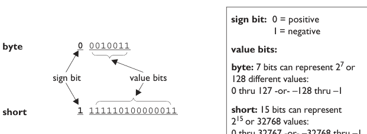

表 1-3 显示了基本类型及其大小和范围。图 1-6 显示，以 `byte` 为例，有 256 个数字（或 2^8）。其中一半是负数，另一半减 1 是正数。正范围比负数范围少一个，因为数字 0 被存储为正二进制。我们使用公式 `-2^(n-1)` 计算负范围，使用 `2^(n-1)-1` 计算正范围。再次强调，如果你知道此表的前两列，你的考试就很有把握了。

浮点数的范围确定起来很复杂，但幸运的是，你不需要在考试中知道这一点（尽管你应该知道 `double` 占用 64 位，而 `float` 占用 32 位）。

**表 1-3：基本类型大小与范围**

| 类型 | 位数 | 字节 | 最小范围 | 最大范围 |
| :--- | :--- | :--- | :--- | :--- |
| `byte` | 8 | 1 | -2^7 | 2^7 - 1 |
| `short` | 16 | 2 | -2^15 | 2^15 - 1 |
| `int` | 32 | 4 | -2^31 | 2^31 - 1 |
| `long` | 64 | 8 | -2^63 | 2^63 - 1 |
| `float` | 32 | 4 | n/a | n/a |
| `double` | 64 | 8 | n/a | n/a |

## boolean 与 char 类型

`boolean` 类型没有范围；`boolean` 只能是 `true`（真）或 `false`（假）。如果有人问你 `boolean` 的位深，直视他们的眼睛说：“这取决于虚拟机。”他们会对你大目相看的。

`char` 类型（字符）包含一个单一的 16 位 Unicode 字符。虽然被称为 Latin-1 的扩展 ASCII 集合只需要 8 位（256 个不同的字符），但表示其他语言中发现的字符需要更大的范围。Unicode 字符实际上由无符号的 16 位整数表示，这意味着有 2^16 种可能的值，范围从 0 到 65535 (2^16-1)。你将在第 3 章学到 `char` 实际上是一个整数类型，它可以赋值给任何足够大容纳 65535 的类型（这意味着任何比 `short` 大的类型；虽然 `char` 和 `short` 都是 16 位类型，但记住 `short` 使用 1 位表示符号，因此 `short` 中允许的正数较少）。

## 声明引用变量

引用变量可以声明为静态变量、实例变量、方法参数或局部变量。你可以在同一行中声明一个或多个相同类型的引用变量。在第 3 章中，我们将讨论初始化它们的各种方式，但现在我们先留给你几个引用变量声明的示例：

```java
Object o;
Dog myDogReferenceVariable;
String s1, s2, s3; // 声明三个 String 变量
```

## 实例变量

实例变量定义在类内部，任何方法之外，并且只有在类实例化时才初始化。实例变量是属于每个唯一对象的字段。例如，以下代码为员工对象定义了名称、职位和经理的字段（实例变量）：

```java
class Employee {
    // 定义字段（实例变量）
    private String name;
    private String title;
    private String manager;
}
```

## 局部（自动/栈）变量

局部变量位于栈上，而不是堆。如果变量是对象引用，对象本身将创建在堆上。你会听到程序员使用“局部对象”，但他们真正指的是“局部声明的变量”。

局部声明不能使用大多数应用于实例变量的修饰符，例如 `public`（或其他访问修饰符）、`transient`、`volatile`、`abstract` 或 `static`，但正如我们之前看到的，局部变量可以标记为 `final`。而且正如你将在第 3 章学到的（但这里有一个预览），在可以使用局部变量之前，必须对其赋值一个值。例如：

```java
class TestServer {
  public void login() {
    int count = 10;
  }
}
```

通常，你会在声明局部变量的同一行初始化它，虽然你可能需要在方法后期对其重新赋值。关键是记住，在尝试使用局部变量之前必须对其进行初始化。编译器将拒绝任何尝试使用未赋值局部变量的代码，因为——与实例变量不同——局部变量不会获得默认值。

局部变量不能在方法之外的任何代码中被引用。在之前的代码示例中，在 `login` 方法范围之外类的任何地方都无法引用变量 `count`。再次，这并不是说 `count` 的值不能传出方法以开启新的生命。但持有该值的变量 `count` 在方法完成后将无法被访问，如下面的非法代码所示：

```java
class TestServer {
    public void login() {
        int count = 10;
    }
    public void doSomething(int i) {
        count = i; // 无法编译！无法在方法外部访问 count
    }
}
```

可以声明一个与实例变量同名的局部变量。这被称为“变量隐藏”，以下代码演示了这一点：

```java
class TestServer {
    int count = 9; // 声明实例变量
    public void login() {
        int count = 10; // 声明局部变量
        System.out.println("local variable is " + count);
    }
    public void count() {
        System.out.println("instance variable is " + count);
    }
    public static void main(String[] args) {
        new TestServer().login();
        new TestServer().count();
    }
}
```

上述代码产生输出：

```text
local variable is 10
instance variable is 9
```

到底为什么要这么做？通常你不会这样做。但更常见的原因之一是将参数命名为与它将要赋值的实例变量相同的名称。以下（错误的）代码试图使用参数来设置实例变量的值：

```java
class Foo {
    int size = 27;
    public void getSize(int size) {
        size = size; // 等于 size
    }
}
```

所以你决定——为了整体的可读性——想给它注定要去的值赋一个与实例变量相同的名称，但你如何解决这种命名冲突呢？使用关键字 `this`。关键字 `this` 总是、总是指向当前正在运行的对象。以下代码展示了这一点：

```java
class Foo {
    int size = 27;
    public void setState(int size) {
        // this.size 表示当前对象的实例变量
        this.size = size; // 右侧的 size 是参数
    }
}
```

## 数组声明

在 Java 中，数组是存储多个相同类型变量或所有都是相同类型子类的变量的对象。数组可以持有基本类型或对象引用，但如果数组被声明为持有基本类型元素，那么数组本身始终是堆上的一个对象。换句话说，不存在所谓的“基本类型数组”，但你可以创建一个“基本类型的数组”。对于考试，你需要了解三件事：

- 如何创建数组引用（声明）
- 如何创建数组对象（构造）
- 如何填充数组元素（初始化）

对于这个目标，你只需要知道如何声明数组；我们将在第 5 章介绍数组的构造和初始化。


数组是高效的，但很多时候你可能想使用 `java.util` 中的一种 Collection 类型（包括 `HashMap`、`ArrayList` 和 `TreeSet`）。Collection 类提供了更灵活的方法来访问数组（用于插入、删除、读取等），并且与数组不同，它们可以随着添加或删除元素动态扩展或收缩。你需要快速排序吗？一组没有重复的对象吗？一种访问键值对的方法吗？对于 OCA 候选人，第 5 章讨论了 `ArrayList`，而对于 OCP 候选人，第二章更详细地介绍了 Collections。

数组通过说明数组的元素类型来声明。

### 声明基本类型数组

```java
int[] key; // 推荐：括号在类型后
int key[]; // 括号在标识符后，可读性差
```

### 声明对象引用数组

```java
Thread[] threads; // 推荐
Thread threads[]; // 可读性差
```

在声明引用时，你应该始终将数组括号放在声明类型之后，而不是标识符之后。我们也可以声明多维数组，其方式如下：

```java
String[][][] occupantName; // 三维数组
String[][] managerName[]; // 二维数组
```

第一个示例是三维数组（数组的数组），第二个是二维数组。注意在第二个示例中我们将括号放在了标识符之后。

> **注意**：永远不要在声明中包含数组的大小。是的，这对于编译器来说是合法的，并不意味着它是对的。

## final 变量

使用 `final` 关键字声明变量会使其在初始化后就无法重新赋值。对于基本类型，这意味着值将永远保持不变。例如，如果你给 `final` 变量赋了一个引用，该引用无法更改。但对于对象，对象内部的数据是可以修改的。

```java
class Roo {
    final int size = 42;
    void change() { size = 16; } // 编译错误
}
```

## transient 变量

如果你将一个实例变量标记为 `transient`，你是在告诉 JVM 在尝试序列化对象时跳过该变量。序列化是 Java 最酷的特性之一；它允许通过将对象的状态（换句话说，实例变量的值）写入特殊的 I/O 流来保存对象。通过序列化，你可以将对象保存到文件中，或通过网络传输，以便在另一端的另一个 JVM 中进行“反填充”（反序列化）。当序列化被添加到 Java 5 考试中时我们很高兴，但我们不得不说对于 Java 7，序列化不再是考试内容。

## volatile 变量

`volatile` 修饰符告诉 JVM，访问变量的线程必须将其自己的副本与内存中的主副本进行同步。对于考试，关于 `volatile` 你只需要知道，和 `transient` 一样，它可以应用于实例变量。不要搞错：多个线程访问实例变量的想法是非常可怕的，这对任何 Java 程序员来说都很重要。但正如你在第 13 章中看到的，你可能会使用同步而不是 `volatile` 修饰符来确保数据的线程安全。

## final 对变量、方法和类的影响

**图 1-8：final 的影响**


- **final 类**：final 类不能被子类化。
- **final 方法**：final 方法不能被子类重写。
- **final 变量**：final 变量一旦初始化就不能被赋新值（值的初始赋值必须在构造函数完成之前完成）。

## 静态变量和方法

`static` 修饰符用于创建独立于类的任何实例的变量和方法。所有静态成员在你创建类的任何新实例之前就已经存在了，并且静态成员只有一个副本。

静态成员与该类的实例数量多少无关。换句话说，给定类的所有实例对于任何给定的静态变量都共享相同的值。我们将在下一章中详细介绍静态成员。

你可以标记为静态的：

- 方法
- 变量
- 嵌套在另一个类中的类，但不能在方法内部（在第 12 章中详细介绍）
- 初始化块


你不能标记为静态的：

- 构造函数（没有意义；构造函数仅用于创建实例）
- 类（除非是嵌套类）
- 接口（除非是嵌套接口）
- 方法的局部内部类（我们将在第 12 章中探索）
- 内部类方法和实例变量
- 局部变量

## 认证目标

# 声明和使用枚举

（OCA 目标 1.2 和 OCP 目标 2.5）

2.5 使用枚举类型。

注意：在本书编写期间，Oracle 调整了 OCA 和 OCP 考试的一些目标。我们不能 100% 确定 OCA 考试中包含枚举主题，但我们认为有备无患胜于后悔，因此我们建议 OCA 候选人学习这一节。无论如何，你很可能在你阅读的 Java 代码中遇到枚举的使用，因此学习它们将是有所回报的。

# 声明和使用枚举 (OCA 目标 1.2 和 OCP 目标 2.5)

## 声明枚举

从 Java 5 开始，Java 允许你限制变量使其仅具有少数几个预定义值之一——换句话说，即来自枚举列表的值。（令人惊讶的是，枚举列表中的项被称为枚举（enums）。）

使用枚举可以帮助减少代码中的错误。例如，在你的咖啡店应用程序中，你可能想限制 `CoffeeSize` 选择为 `BIG`、`HUGE` 和 `OVERWHELMING`。如果你允许 `LARGE` 或 `GRANDE` 订单通过，可能会导致错误。枚举来救急。通过以下简单的声明，你可以保证编译器将阻止你向 `CoffeeSize` 分配除 `BIG`、`HUGE` 或 `OVERWHELMING` 之外的任何内容：

```java
enum CoffeeSize { BIG, HUGE, OVERWHELMING };
```

从那时起，获取 `CoffeeSize` 的唯一方法是通过像这样的语句：

```java
CoffeeSize cs = CoffeeSize.BIG;
```

枚举常量并不要求全大写，但为了借用 Oracle 常量使用大写命名的代码规范，这是一个好主意。

枚举的基本组成部分是它的常量（即 `BIG`、`HUGE` 和 `OVERWHELMING`），尽管稍后你会发现枚举可能还有更多内容。枚举可以声明为独立的类，也可以声明为类的成员；但是，它们不能在类之外进行声明：

```java
enum CoffeeSize { BIG, HUGE, OVERWHELMING } // 这不能这样做
```

```java
class Coffee {
    CoffeeSize size;
}
public class CoffeeTest1 {
    public static void main(String[] args) {
        Coffee drink = new Coffee();
        drink.size = CoffeeSize.BIG; // 类外部的枚举
    }
}
```

前面的代码可以是单个文件的一部分。（记住，文件必须命名为 `CoffeeTest1.java`，因为那是文件中 public 类的名称。）

要记住的关键点是，没有封装在类中的枚举可以仅使用 `public` 或默认（default）修饰符进行声明，就像非内部类一样。这里有一个在类内部声明枚举的示例：

```java
class Coffee2 {
    enum CoffeeSize {BIG, HUGE, OVERWHELMING}
    CoffeeSize size;
}
public class CoffeeTest {
    public static void main(String[] args) {
        Coffee2 drink = new Coffee2();
        drink.size = Coffee2.CoffeeSize.BIG; // 封装类名称所需的
    }
}
```

从这些示例中总结的关键点是：枚举可以声明为自己的类，也可以封装在另一个类中，并且访问枚举成员的语法取决于枚举声明的位置。

# 声明和使用枚举 (OCA 目标 1.2 和 OCP 目标 2.5) 65

构造函数。我们将在第 2 章中详细讨论构造函数。要初始化一个既包含盎司数又包含例如盖子类型的 `CoffeeSize`，你需要向构造函数传递两个参数，例如 `BIG(8, "A")`，这意味着你在 `CoffeeSize` 中有一个可以同时接收一个 `int` 和一个 `String` 的构造函数。

最后，你可以在枚举中定义一些非常特殊的内容，它们看起来像匿名内部类（我们将在第 8 章中讨论）。它被称为常量特定类（constant specific class），当你需要某个特定常量来重写枚举中的方法时就会使用它。

想象这样一个场景：你希望枚举拥有两个方法——一个用于盎司，一个用于盖子（字符串类型）。现在想象大多数咖啡都使用相同的盖子代码 "B"，但 `OVERWHELMING` 尺寸类型使用 "A"。你可以在 `CoffeeSize` 中定义一个 `getLidCode()` 方法返回 "B"，然后你需要一种方法来重写它以适用于 `OVERWHELMING`。你不想在 `getLidCode()` 方法中编写难以维护的代码，所以最好的方法是让 `OVERWHELMING` 常量重写该方法。

这看起来很奇怪，但你需要理解基本的声明规则：

```java
enum CoffeeSize {
    BIG(8),
    HUGE(10),
    OVERWHELMING(16) {
        // 代码块定义了
        // 此常量
        public String getLidCode() {
            // 重写了
            // CoffeeSize 中的方法
            return "A";
        }
    }; // 后面必须跟分号

    CoffeeSize(int ounces) {
        this.ounces = ounces;
    }

    private int ounces;

    public int getOunces() {
        return ounces;
    }
    public String getLidCode() {
        // 此方法被
        // CoffeeSize 常量重写
        return "B";
    }
 // CoffeeSize 的默认值
```

## 第一章：声明与访问控制

## 认证总结

在吸收了本章内容后，你应该已经熟悉 Java 语言的一些细微差别。你可能还会感到困惑，“为什么我想要参加这个考试？”这一章是最难的，从这里开始都会变得容易。

让我们简要回顾一下参加考试需要掌握的内容：

- 将会有很多关于关键字的问题，请务必识别哪些是关键字，哪些不是。
- 你需要理解创建合法标识符的规则，包括 `package` 和 `import` 语句的声明。
- 你学习了 `java` 和 `javac` 命令的语法以及 `main()` 的用法。
- 我们涵盖了 `import` 和 `static` 语句的用法。人们很容易认为它们不仅仅是为了少打字，但事实如此。
- 你对类、方法和变量访问控制有了良好的理解。你查看了访问修饰符（`public`、`protected` 和 `private`）如何定义类或成员的访问控制。
- 你学习了抽象类可以包含抽象方法和非抽象方法，但即使只有一个方法被标记为 `abstract`，该类也必须标记为 `abstract`。不要忘记抽象类的具体（非抽象）子类必须提供父类所有抽象方法的实现，但抽象子类不需要实现其父类的抽象方法。抽象子类可以将责任“推给”第一个具体子类。
- 我们涵盖了接口实现。记住，接口可以扩展另一个接口（甚至是多个接口），任何实现接口的类必须实现该类所在的继承树中所有接口的方法。
- 你还查看了其他修饰符，包括 `static`、`final`、`abstract`、`synchronized`。你学习了修饰符在声明中永远不能组合，例如将 `abstract` 与 `final` 或 `private` 混合。请记住 Java 中没有 final 对象。标记为 `final` 的引用永远无法改变，但它所引用的对象可以修改。

# 认证总结 67

你已经看到 `final` 应用于方法意味着子类**不能**重写它们，而应用于类时，该类不能被子类化。记住从 Java 5 开始，方法可以使用 `var-arg` 参数声明（可以接受零个到多个声明类型的参数），但每个方法只能有一个 `var-arg`，且必须是方法的最后一个参数。

确保你熟悉数值基本类型的相对大小。记住非 `final` 变量的值可以改变，但引用的类型永远无法改变。

你还学习了数组是包含许多相同变量的对象。数组也可以包含其他数组。

记住你学到的关于 `static` 变量和方法的知识，特别是 `static` 成员是类级别的，而不是实例级别的。不要忘记 `static` 方法无法直接访问类的实例变量，因为它没有该类的任何实例显式引用。

最后，我们涵盖了 Java 5 起的一项新特性：枚举（enums）。枚举的实现比 Java 早期版本中可能的要安全、灵活得多。因为它们是特殊的类，枚举的声明可以非常简单，也可以很复杂。

对于考试来说，知道你能用 Java 语言做什么与你知道了什么一样重要。试一下示例题吧！它们的难度与真实考试非常相似，应该能让你意识到考试可能会有多困难。如果你错了很多题，不要担心。如果你发现某个主题是你薄弱的，请花更多时间进行复习和学习。许多程序员需要对一个章节（或一个单独的目标）看两三遍，才能有信心地回答问题。

## 第一章：声明与访问控制

## 两分钟训练

记住，在本章中，当我们谈论类时，指的是非内部类或顶层类。仅针对 OCP 7 候选者，我们将整个第 12 章留给内部类。关于 OCA 7 与 OCP 7 目标的说明：本书的第一部分对于 OCA 7 和 OCP 7 候选者都是必要的。由于你现在必须在参加 OCP 7 考试之前通过 OCA 7 考试，书的第一部分两分钟训练中的引用通常针对 OCA 目标。

# 源文件声明规则 (OCA 目标 1.2)

- 一个源文件只能有一个公共类（`public class`）。
- 如果源文件包含公共类，则文件名必须与公共类名匹配。
- 一个文件只能有一个包声明语句（`package statement`），但可以有多个导入语句（`import statements`）。
- 包声明语句（如果有的话）必须是源文件的第一行（非注释行）。
- 导入语句（如果有的话）必须位于包声明之后，且类声明之前。
- 如果没有包声明语句，则导入语句必须是源文件中的第一个（非注释）语句。
- `package` 和 `import` 语句适用于文件中的所有类。
- 一个文件可以有多个非公共类。
- 没有公共类的文件没有命名限制。

# 类访问修饰符 (OCA 目标 6.6)

- 有三种访问修饰符：`public`（公共）、`protected`（受保护）和 `private`（私有）。
- 有四种访问权限级别：`public`（公共）、`protected`（受保护）、`default`（默认）和 `private`（私有）。
- 类只能有 `public` 或默认访问权限。
- 默认访问权限的类只能被同包内的类可见。
- 具有 `public` 访问权限的类可以被所有包的所有类可见。
- 类可见性围绕一个类中的代码是否能够：
  - 创建另一个类的实例
  - 扩展（或作为子类）另一个类
  - 访问另一个的方法和变量

## 类修饰符（非访问）（OCA 目标 7.6）

- 类也可以用 `final`（最终）、`abstract`（抽象）或 `strictfp`（严格浮点数）进行修饰。
- 类不能既是 `final` 又是 `abstract` 的。
- `final` 类不能被子类化。
- 抽象类不能被实例化。
- 类中的单个抽象方法意味着整个类必须是抽象的。
- 抽象类可以同时拥有抽象方法和非抽象方法。
- 扩展抽象类的第一个具体类必须实现其所有的抽象方法。

# 接口实现 (OCA 目标 7.6)

- 接口是关于类“可以做什么”的契约，但它们没有说明类“必须如何去做”。
- 接口可以由来自任何继承树的任何类实现。
- 接口类似于一个 100% 的抽象类，无论你在声明中是否写了 `abstract` 修饰符，它隐式地都是抽象的。
- 接口只能有抽象方法，不允许有具体方法。
- 接口方法默认是 `public` 和 `abstract` 的——显式写出修饰符是可选的。
- 接口可以拥有常量，这些常量始终隐式地是 `public`、`static` 和 `final`。
- 接口常量声明的 `public`、`static` 和 `final` 组合在任何组合下都是可选的。
- 注意：本节使用了一些尚未涵盖的概念。不要恐慌：一旦你读完本书的第一部分，这一节作为参考将会变得易于理解。

一个合法的非抽象实现类具有以下属性：

- 它为接口的方法提供了具体实现。
- 它必须遵循其实现的方法的所有合法重写规则。
- 它不能为实现方法声明任何新的受检异常（`checked exceptions`）。
- 它不能声明比接口方法中声明的异常更广泛的检查异常。
- 无论接口声明如何，它可以在任何接口方法上声明运行时异常（`runtime exceptions`）。
- 它必须保持其实现的方法的精确签名（允许协变返回）和返回类型（但不需要声明接口的异常）。
- 实现接口的类本身可以是抽象的。
- 抽象实现类不必须实现接口方法（但第一个具体子类必须实现）。
- 类只能扩展一个类（不支持多重继承），但它可以实现许多接口。
- 接口可以扩展一个或多个其他接口。
- 接口不能扩展类，也不能实现一个类或接口。
- 考试时，在验证其他代码逻辑之前，请核实接口和类声明是否是合法的。

# 成员访问修饰符 (OCA 目标 6.6)

- 方法和实例（非本地）变量被称为“成员”（members）。
- 成员可以使用所有四种访问级别：`public`、`protected`、`default` 和 `private`。
- 成员访问有两种形式：
  - 一个类中的代码可以访问另一个类的成员。
  - 子类如果无法被访问，其成员也无法被访问。
- 如果一个类无法被访问，其成员也无法被访问。
- 在确定成员可见性之前先确定类的可见性。
- `public` 成员可以被所有其他类访问，即使在其他包中也是如此。
- 如果父类成员是 `public`，则子类会继承它——无论包关系如何。
- 不使用点运算符（`.`）访问的成员属于同一个类。
- `this` 始终指向当前执行的对象。
- `this.getMethod()` 与直接调用 `getMethod()` 相同。
- `private` 成员只能由同一类中的代码访问。
- `private` 成员对子类不可见，因此私有成员不能被继承。

# 72 第一章：声明与访问控制

对于包外的子类，`protected` 成员只能通过继承来访问；包外的子类不能通过对父类的引用来访问受保护成员。（换句话说，继承是包外子类访问其父类受保护成员的唯一机制。）

- 子类继承的 `protected` 成员对任何包都是不可访问的。

# 局部变量 (OCA 目标 2.1)

- 局部变量（方法、自动或栈变量）不能有访问修饰符。
- `final` 是局部变量唯一可用的修饰符。
- 局部变量没有默认值，因此它们在使用之前必须经过初始化。

# 其他修饰符——成员 (OCA 目标 6.6)

- `final` 方法不能在子类中重写。
- `abstract` 方法用签名、返回类型和可选的 `throws` 子句声明，但它们没有被实现。
- 抽象方法以分号结束；没有大括号。
- 识别非抽象方法的方法：
  - 方法不是抽象的。
  - 方法有大括号。
  - 方法在大括号内有代码。
- 扩展抽象类的第一个非抽象（具体）类必须实现所有的抽象方法。
- `synchronized` 修饰符仅适用于方法和块。
- `synchronized` 方法可以是任何访问权限并标记为 `final`。

# 两分钟演练

- 抽象方法必须由子类实现，因此它们是可继承的。基于此：
  - 抽象方法不能是 `private`。
  - 抽象方法不能是 `final`。
- `native` 修饰符仅适用于方法。
- `strictfp` 修饰符仅适用于类和方法。

# 变参数方法（OCA，OCP 目标 1.3）

- 从 Java 5 开始，方法可以声明一个接受零到多个参数的参数，即所谓的变长参数（var-arg）方法。
- 变长参数使用 `type...name` 语法声明；例如：`doStuff(int... x) { }`。
- 变长方法只能有一个变长参数。
- 在具有普通参数和变长参数的方法中，变长参数必须放在最后。

# 变量声明 (OCA 目标 2.1)

- 实例变量可以：
  - 拥有任何访问权限
  - 被标记为 `final` 或 `transient`
- 实例变量不能是 `abstract`、`synchronized`、`native` 或 `strictfp` 变量；声明一个与实例变量同名的局部变量是合法的；这被称为“遮蔽（shadowing）”。
- `final` 变量具有以下属性：
  - `final` 变量一旦赋值就不能重新赋值。
  - `final` 引用变量一旦分配了某个对象，就不能指向另一个对象。
  - `final` 变量必须在构造函数完成之前完成初始化。
  - 没有所谓的“final 对象”。标记为 `final` 的对象引用并不意味着对象本身不能改变。
- `transient` 修饰符仅适用于实例变量。
- `volatile` 修饰符仅适用于实例变量。

# 74 第一章：声明与访问控制

## 数组声明 (OCA 目标 4.1 和 4.2)

- 数组可以存放基本数据类型或对象，但数组本身始终是一个对象。
- 当声明数组时，方括号可以放在变量名的左侧，也可以放在右侧。
- 在声明中包含数组的大小永远是不合法的。
- 对象数组可以存放任何通过所声明数组类型 IS-A（或 `instanceof`）测试的对象。例如，如果 `Horse`（马）继承自 `Animal`（动物），那么一个 `Horse` 对象可以放入 `Animal` 数组中。

## 静态变量和方法 (OCA 目标 6.2)

- 它们不绑定到类的特定实例。
- 使用类的静态成员不需要类的实例。
- 静态变量/类只有一份拷贝，所有实例共享它。


- 静态方法无法直接访问实例成员。

## 枚举 (OCA 目标 1.2 和 OCA 目标 2.5)

- 枚举指定了分配给类型的常量值列表。
- 枚举**不是**字符串或整数；枚举常量的类型就是该枚举类型。例如，`SUMMER` 和 `FALL` 的类型是枚举 `Season`。
- 枚举可以在类外部或内部声明，但不能在方法内部。
- 在类外部声明的枚举**不能**被标记为 `static`、`final`、`abstract`、`protected` 或 `private`。
- 枚举可以包含构造函数、方法、变量和特定常量的类体。
- 枚举常量向枚举构造函数传递参数，语法使用 `BIG(8)`，其中整字面量 `8` 被传递给枚举构造函数。
- 枚举构造函数可以有参数并可以重载。
- 枚举构造函数**绝不会**在代码中直接调用。它们总是在枚举初始化时自动被调用。
- 枚举声明末尾的分号是可选的。以下是合法的：

```java
enum Foo { ONE, TWO, THREE };
enum Foo { ONE, TWO, THREE };
```

- `MyEnum.values()` 返回一个 `MyEnum` 数组。

## 自测

以下问题将帮助你衡量对本章所介绍内容的理解程度。请仔细阅读所有选项，因为可能有一个多个正确答案。为每个问题选择正确答案。保持专注。如果你觉得这些题很困难，不要太责备自己。保持积极。对自己重复积极的肯定：“我足够聪明可以理解枚举”以及“好吧，即使其他人比我更懂枚举，他们也没有我这么擅长<插入你擅长的东西>”。

### 1. 哪些是正确的？（多选）

- A. "X extends Y" 是正确的，且仅当 X 是类而 Y 是接口时。
- B. "X extends Y" 是正确的，且仅当 X 是接口而 Y 是类时。
- C. 如果 X 和 Y 都是类或接口，则 "X extends Y" 是正确的。
- D. "X extends Y" 对于 X 和 Y 为类或接口的所有组合都是正确的。

```java
class Rocket {
    private void blastOff() { System.out.print("bang"); }
}
public class Shuttle extends Rocket {
    public static void main(String[] args) {
        new Shuttle().go();
    }
    void go() {
        blastOff();
        // Rocket.blastOff(); // line A
    }
    private void blastOff() { System.out.print("sh-bang "); }
}
```

### 2. 给定：哪些是正确的？（多选）

- A. 按照代码现状，输出是 bang
- B. 按照代码现状，输出是 sh-bang
- C. 按照代码现状，编译失败。
- D. 如果取消行 A 的注释，输出是 bang bang
- E. 如果取消行 A 的注释，输出是 sh-bang bang
- F. 如果取消行 A 的注释，编译失败。

### 3. 假设 for 循环语法是正确的，且给定：

- `import static java.lang.System.*;`

```java
class _ {
    static public void main(String[] __A_V_) {
        String $ = "";
        for(int x=0; x< __A_V_.length; ) // for loop
            $ += __A_V_[x];
        out.println($);
    }
}
```

命令行：

```bash
java _ -A
```

结果是什么？

- A. -A
- B. A.
- C. -A.
- D. _A.
- E. _-A.
- F. 编译失败
- G. 运行时抛出异常

### 4. 给定：

```java
1. enum Animals {
2. DOG("woof"), CAT("meow"), FISH("burble")
3. String sound;
4. Animals(String s) { sound = s; }
5. }
6. class TestEnum {
7. static Animals a;
8. public static void main(String[] args) {
9. System.out.println(a.DOG.sound + " " + a.FISH.sound);
10. }
11. }
```

结果是什么？

- A. wolf burble
- B. 多个错误
- C. 第 2 行编译失败
- D. 第 3 行编译失败
- E. 第 4 行编译失败
- F. 第 9 行编译失败

### 5. 给定两个文件：

**文件 1：**

```java
1. package pkgA;
2. public class Foo {
3. int a = 5;
4. protected int b = 6;
5. int c = 7;
6. }
```

**文件 2：**

```java
3. package pkgB;
4. import pkgA.*;
5. public class Baz {
6. public static void main(String[] args) {
7. Foo f = new Foo();
8. System.out.println(f.a);
9. System.out.println(f.c);
10. }
}
```

结果是什么？（多选）

- A. 5 6
- B. 5 之后跟着异常
- C. 第 7 行编译失败
- D. 第 8 行编译失败
- E. 第 9 行编译失败

### 6. 给定：

```java
1. public interface Device { void doit(); }
2.
3. abstract class Electronic { void getPower() { System.out.print("plug in "); } }
4.
5. public class Tablet extends Electronic implements Device {
6. void doStuff() { System.out.print("show book "); }
7. public static void main(String[] args) {
8. new Tablet().getPower();
9. new Tablet().doStuff();
10. }
}
```

结果是什么？（多选）

- A. 类 Tablet 无法编译
- B. 接口 Gadget 无法编译
- C. 输出为 plug in show book
- D. 抽象类 Electronic 无法编译
- E. 类 Tablet 不能继承和实现

### 7. 假设 `Integer` 类在 `java.lang` 包中，且给定：

```java
1. // 插入代码
2. class StatTest {
3. public static void main(String[] args) {
4. System.out.println(Integer.MAX_VALUE);
5. }
6. }
```

哪一个独立插入到第 1 行可以编译？（多选）

- A. `import static java.lang;`
- B. `import static java.lang.Integer;`
- C. `import static java.lang.Integer.*;`
- D. `static import java.lang.Integer.*;`
- E. `import static java.lang.Integer.MAX_VALUE;`
- F. 以上语句均不是有效的 import 语法。

## 自测答案

- **1.** C 正确。A 正确是因为类实现了接口，而不是扩展接口。B 错误是因为接口只能“继承自自”其他接口。根据前面的规则，D 是错误的。（OCA 目标 7.6）
- **2.** B 和 F 正确。由于 `Rocket.blastOff()` 是私有的，它无法被重写，并且对 `Shuttle` 是不可见的。根据上述内容，A、C、D 和 E 都是错误的。（OCA 目标 6.6）
- **3.** B 正确。这个问题涉及有效的（尽管不恰当且奇怪）标识符、静态导入、main() 和预增逻辑。根据上述内容，A、C、D、E 和 G 都是错误的。（OCA 目标 1.2 以及 OCA 目标 1.3、4 和 2.1）
- **4.** A 正确；所有这些都为变量提供了构造函数。B、C、D 和 F 是错误的；这些行代码使用了正确的语法。（OCP 目标 2.5）
- **5.** D 正确。变量具有默认访问权限，因此无法从包外部访问。B 在 pkgA 中具有保护访问权限。根据上述信息，A、B、C 和 F 都是错误的。（OCA 目标 1.4 和 6.6）
- **6.** 根据上述信息，A 正确。根据上述信息，B、C、D、E 和 F 都是错误的。（OCA 目标 7.6）
- **7.** C 和 D 错误。变量名不能以 # 开头，数组声明在没有实例化的情况下包含大小。其余代码是有效的。根据上述内容，A、B 和 E 是错误的。（OCA 目标 2.1）
- **8.** B 正确。每个枚举都带有一个静态 `values()` 方法，返回枚举值的数组，按照它们在枚举中声明的顺序。根据上述信息，A、C、D、E、F 和 G 都是错误的。（OCP 目标 2.5）
- **9.** D 正确。`countGold()` 方法无法在静态上下文中调用。
- **10.** A 正确。默认情况下，接口的方法是公共的，因此 `Tablet.doStuff` 方法也必须是公的。其余代码是有效的。根据上述信息，A、B、C 和 E 都是错误的。（OCA 目标 2.5 和 6.2）
- **11.** 根据上述内容，B、C、D 和 E 都是错误的。（OCA 目标 7.6）
- **12.** C 和 E 是静态导入的正确语法。第 4 行没有使用静态导入，因此代码在没有任何导入也能编译。根据上述内容，A、B、D 和 F 都是错误的。（OCA 目标 1.4）

# 2 面向对象

## 认证目标

- 描述封装
- 实现继承
- 使用 IS-A 和 HAS-A 关系 (OCP)
- 使用多态
- 使用重写和重载
- 理解强制转换
- 使用接口
- 理解并使用返回类型
- 开发构造函数
- 使用静态成员
- 两分钟演练
- Q&A 自测

# 84 第 2 章：面向对象

成为一名 Oracle 认证关联工程师 (OCA) 7 意味着你必须与 Java 的面向对象方面合二为一。你必须梦见继承层级，多态的力量必须流经你的身体，而封装必须成为你的本能。（当你成为 Oracle 认证专家 [OCP] 7 时，内聚、耦合和设计模式将成为你的生存之本。）本章将为你考试中可能遇到的所有面向对象目标和问题做好准备。我们听过许多丰富的 Java 程序员，他们并没有真正熟练掌握 Java 提供的面向对象工具，因此我们将从基础开始。

## 认证目标

## 封装 (OCA 目标 6.1 和 6.7)

- 6.1 创建带有参数和返回值的方法。
- 6.7 将封装原则应用到类。

想象你写了一个类的代码，你公司的其他十几名程序员编写了所有使用该类的程序。现在后来，你不喜欢该类的行为，因为它的某些实例变量被（其他程序员在他们的代码中）设置，导致了你代码中出现错误。（放松，这只是假设的）。嗯，在 Java 程序中，你应该能够直接替换类的新版本，而无需更改他们的任何自己的代码。这种场景凸显了面向对象 (OO) 语言的两个承诺/优势：灵活性和可维护性。但这些优势并不是自动获得的。你必须以支持灵性和可维护性的方式来编写类和代码。那么，如果 Java 支持面向对象会怎样？例如，想象你创建类时使用了公共实例变量，而其他程序员直接设置这些实例变量，如下代码所示：

```java
public class BadOO {
    public int size;
    public int weight;
}

public class ExploitOO {
    public static void main(String[] args) {
        BadOO b = new BadOO();
        b.size = -5; // 合法但糟糕！！
    }
}
```

现在你遇到麻烦了。你将如何更改该类，以便处理当有人将 size 变量更改为导致问题的值时出现的问题？你唯一的选择是回去编写处理 size 的代码，然后用例如 `private` 修饰符隔离 size 变量。但你一旦对你的代码做了该更改，你就破坏了所有人的代码！在不破坏使用你代码的其他代码的情况下更改实现的能力，是封装的一个优势。你可以通过提供公共接口来隐藏实现细节。我所说的接口是指你的代码提供的供其他代码调用的方法集。如果你想要可维护性、灵活性可扩展性（当然，你想要），你的设计必须包含封装。你如何做到这一点？

- 保持实例变量受保护（使用访问修饰符，通常是 `private`）。
- 创建公共访问器方法，并让调用代码使用这些方法而不是直接访问实例变量。这些所谓的访问器方法允许你类的用户设置变量的值或获取变量的值。
- 对于这些访问器方法，使用常用的命名约定 `setProperty` 和 `getProperty`。

图 2-1 说明了这样一个想法：封装强制调用你代码的人通过方法而不是直接访问变量。我们称这些访问方法为 getters 和 setters，尽管有些人更喜欢更高级的术语 accessors（访问器）和 mutators（修改器）（个人而言，我们不喜欢“mutate”这个词）。无论你如何称呼它们，它们都是其他代码调用的方法。

```java
public class Box {
    // 保护实例变量；只有 Box 的实例可以访问它
    private int size;

    // 提供公共 getters 和 setters
    public int getSize() {
        return size;
    }
    public void setSize(int newSize) {
        size = newSize;
    }
}
```

# 86 第 2 章：面向对象

图 2-1 封装的本质

 A 类无法通过 getter 和 setter 方法访问 B 实例数据。数据被标记为私；只有访问方法是公共的。

## 封装 (OCA 目标 6.1 和 6.7)

等等。之前的代码有用吗？它甚至没有任何验证或处理。拥有 getters 和 setters 有什么好处？重点在于你以后可以改变主意并在方法中添加更多代码，而不会破坏 API。即使你真的不需要对数据进行验证或处理，良好的 OO 也考虑到未来。为了安全，强制调用代码通过你的方法而不是直接访问实例变量。始终如此。这样你就可以重构方法实现，而不用担心那些程序员。

注意：在第 5 章，我们将重新讨论适用于引用变量的封装主题。这比你想象的要复杂，所以请期待！（同时，我们将等到第 5 章再用封装的主题挑战你。）


留心那些似乎在询问方法行为的代码，而实际上问题在于缺乏封装。看下面的示例，看看你是否看出发生了什么：

```java
class Foo {
    public int left = 9;
    public int right = 3;
    public void setLeft(int leftNum) {
        left = leftNum;
        right = leftNum/3;
    }
    // 这里有大量的复杂的测试代码
}
```

现在考虑这个问题：right 的值总是 left 值的三分之一吗？看起来是的，直到你意识到 `Foo` 类的用户不需要使用 `setLeft()` 方法！他们可以直接访问实例变量，并将它们更改为任意的 int 值。

## 继承与多态 (OCA 目标 7.1, 7.2 和 7.3)

- 7.1 实现继承。
- 7.2 开发演示多态使用的代码。
- 7.3 区分引用的类型和对象的类型。

继承在 Java 中无处不在。可以说，如果不使用继承，几乎（几乎是吗？）不可能写出哪怕是极微小的 Java 程序。为了探索这个主题，我们将使用 `instanceof` 运算符，我们将在第 5 章详细讨论它。现在，只需记住 `instanceof` 如果被测试的引用变量的类型与所比较的类型，则返回 true。这段代码：

```java
class Test {
    public static void main(String[] args) {
        Test t1 = new Test();
        Test t2 = new Test();
        if (!t1.equals(t2)) {
            System.out.println("they're not equal");
            if (t1 instanceof Object)
                System.out.println("t1's an Object");
        }
    }
}
```

产生以下输出：

```
they're not equal
t1's an Object
```

`equals` 方法是从哪里来的？引用变量 `t1` 的类型是 `Test`，而 `Test` 类中并没有 `equals` 方法。还是有？第二个测试询问 `t1` 是否是 `Object` 类的实例，因为它确实是（稍后详细介绍），所以如果成功则通过。


等一下……当我们刚刚说它是 `Test` 类型时，`t1` 可能是 `Object` 的实例呢？我确定你已经走在我们很前面了，但事实证明 Java 中的每个类都是 `Object` 类的子类（`Object` 类本身除外）。换句话说，你用过的或将使用的每个类都会继承自 `Object` 类。你始终拥有 `equals` 方法、`clone` 方法、`notify`、`wait` 以及其他可用方法。每当你创建一个类时，你都会自动继承 `Object` 类的所有方法。

为什么呢？以这个 `equals` 方法为例。Java 的创建者正确地假设，Java 程序员比较类类的实例以检查相等性是非常常见的。如果一个类没有 `equals` 方法，你就得自己写一个——由你以及每一个其他 Java 程序员来写。那个 `equals` 方法已经被继承了数十亿次。（公平地说，`equals` 也被重写了数十亿次，但我们现在操得太早了）。

对于考试，你需要知道可以通过 `extends` 一个类来在 Java 中创建继承关系。理解使用继承的两个主要原因也同样重要：

- 为了促进代码复用
- 为了使用多态

让我们先从复用开始。一种常见的设计方法是创建一个相当通用的类版本，意图是创建继承自它的更具体化的子类。例如：

```java
class GameShape {
    public void displayShape() {
        System.out.println("displaying shape");
    }
    // more code
}
```

```java
class PlayerPiece extends GameShape {
    public void movePiece() {
        System.out.println("moving game piece");
    }
    // more code
}
```

```java
public class TestShapes {
    public static void main(String[] args) {
        PlayerPiece shape = new PlayerPiece();
        shape.displayShape();
        shape.movePiece();
    }
}
```

输出：

```
displaying shape
moving game piece
```

注意，`PlayerPiece` 类继承了来自不那么具体的类 `GameShape` 的通用 `displayShape()` 方法，并添加了自己的方法 `movePiece()`。通过继承实现代码复用意味着，具有通用功能的方法（例如 `displayShape()`，它可以适用于游戏中的各种形状）——不需要重新实现。这意味着 `GameShape` 的所有特化子类都保证具有更通用子类的能力。你不需要在你的在线游戏的每个特化组件中重写 `displayShape()` 代码。

但你现在已经体会过，当你在一处进行更改时，必须追踪所有其他存在该代码（或非常相似的代码）的地方的痛苦。

继承的第二个（也是相关的）用途是允许你的类以多态的方式被访问——这种功能接口也可以提供，但我们稍后会讨论。假设你有一个 `GameLauncher` 类，它需要遍历不同类型的 `GameShape` 对象列表并在每个对象上调用 `displayShape()`。在你编写这个类时，你并不知道将来会编写任何类型的 `GameShape` 子类。你确实不想因为某人在六个月后决定制作一个骰子而重做你的代码。

多态（“多种形式”）的奇之处在于，你可以将任何 `GameShape` 子类视为 `GameShape`。换句话说，你可以在 `GameLauncher` 中编写这样的代码：“我不在你是什么种对象，只要你继承（扩展）`GameShape`。在我看来，只要你扩展了 `GameShape`，你就一定有一个 `displayShape()` 方法，所以我知道可以调用它。”

假设我们有两个扩展更用的 `GameShape` 类的特化子类，`PlayerPiece` 和 `TilePiece`：

```java
class GameShape {
    public void displayShape() {
        System.out.println("displaying shape");
    }
}
```

```java
class PlayerPiece extends GameShape {
    public void movePiece() {
        System.out.println("moving game piece");
    }
}
```

```java
class TilePiece extends GameShape {
    // TilePiece code
}
```

## 继承与多态（OCA 目标 7.1, 7.2 和 7.3）

回到我们的 IS-A（是）关系，以下语句是正确的：

- “Car extends Vehicle”意味着“Car 是一个 Vehicle”。
- “Subaru extends Car” 意味着“Subaru 是一个 Car”。

我们还可以说：因为一个类被认为是其继承树中更高级的任何类的“一种类型”。如果表达式 `(Foo instanceof Bar)` 为真，那么类 Foo 一个一个 Bar（IS-A Bar），即使 Foo 不是直接继承自 Car，而是继承了另一个作为 Bar 的子类的类。图 2-2 展示了 Vehicle、Car 和 Subaru 的继承树。箭头从子类指向父类。换句话说，一个类的箭头指向它所继承的那个类。

### HAS-A（拥有）

HAS-A 关系基于使用，而不是继承。换句话说，如果类 A 拥有指向类 B 实例的引用，那么类 A 就“拥有”一个 B。例如，你可以这样说：

> 马（Horse）是一只动物（Animal）。马（Horse）有一条缰子（Halter）。

代码可能像这样：

```java
public class Animal { 
    public class Horse extends Animal {
        private Halter myHalter;
    }
}
```

在这段代码中，Horse 类拥有一个 Halter 类型的实例（缰子是你拥有马时可能具有的一种装备），所以你可以说“马有一条缰子”。换句话说，Horse 拥有指向 Halter 的引用。

#### 图 2-2

Vehicle、Car、Subaru 的继承树

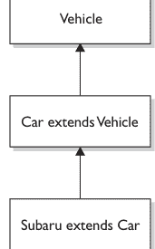

Horse 代码可以使用该 Halter 引用来调用 Halter 的方法，而无需在 Horse 类本身中包含 Halter 相关的代码（方法）的情况下获取 Halter 的行为。

图 2-3 展示了 Horse 和 Halter 之间的 HAS-A 关系。

HAS 关系允许你设计遵循良好 OO 实践的类，而避免拥有那些执行数百万不同事情的巨石类类（类及其产生的对象）应该是专门的。正如我们的朋友 Andrew 所说，“专门化的类可以很容易地减少错误”。类越专门化，你可以在其他应用程序中重用该类的概率就越大。如果你将所有与 Horse 相关的代码直接放入 Horse 类中，你最终会在 Cow 类（牛）、UnpaidIntern 类（无薪实习生）以及任何可能需要 Halter 行为的类中重复代码。通过将 Halter 代码保持在独立的、专门的 Halter 类中，你将有机会在多个应用程序中重用 Halter 类。

该类的用户（调用 Horse 实例方法的人）认为 Horse 类具有 Halter 行为。例如，Horse 类可能有一个 `tie(LeadRope rope)` 方法。Horse 类的用户永远不需要知道当他们调用 `tie()` 方法时，Horse 对象会转过身体并通过调用 `myHalter.tie(rope)` 将调用委托给 Halter 类。描述的场景可能看起来所示：

```java
public class Horse extends Animal {
    private Halter myHalter = new Halter();
    public void tie(LeadRope rope) {
        myHalter.tie(rope); // 将 tie 行为委托给
        // Halter 对象
    }
}
```

```java
public class Halter {
    public void tie(LeadRope arope) {
        // 在此处执行实际的绑定工作
    }
}
```

#### 图 2-3

Horse 和 Halter 之间的 HAS-A 关系

| Horse | Halter |
|---|---|
| Halter h | |
| tie(Rope r) | tie(Rope r) |

* Horse 对象的 Halter 实例变量。

Horse 类有一个 Halter，因为 Horse 声明了一个 Halter 实例变量。当代码在 Horse 实例上调用 `tie()` 时，Horse 在 Horse 对象的 Halter 实例变量上调用 `tie()`。

### 课堂笔记

#### 面向对象设计

涉及到 OO 设计时，IS-A 和 HAS-A 关系以及封装只是冰山一角。许多书籍和研究生论文都致力于这一主题。强调适当设计的原因是：金钱。据估计，交付一个软件应用程序的成本对于设计糟糕的程序要高出十倍。

在不需要先编写代码的情况下修改类，因为 OO 组件是以图形形式表示的。这允许设计人员创建类关系关系的映射，并帮助他们在编码开始之前识别错误。OO 设计模式的另一项创新。设计人员发现许多设计可以一致地应用于各个项目，应用相同的设计是有用的，因为减少了引入新设计的可能性。OO 设计师们随后开始相互分享这些设计。现在，互联网上和书籍形式上都有设计模式目录。

即使是最优秀的 OO 设计师（通常称为架构师）也会犯错。要可视化数百个或数千个类之间的关系是非常的。当在项目实现（编写代码）阶段发现错误时，必须重写的代码有时意味着编程团队必须从头开始。

虽然通过 Java 认证考试不需要你理解 OO 设计，但这些背景信息将帮助你理解为什么出题者选择包含封装、IS-A 和 HAS-A 关系。软件行业已经演进以帮助设计者。视觉建模语言，例如统一建模语言（UML），允许设计者轻松地设计——Jonathan Meeks，Sun 认证程序员

在 OO 中，我们不希望调用者担心究竟是哪个类或对象在执行操作。然而，调用者总是看起来是 Horse 对象在处理自己。Horse 类的用户甚至不知道有 Halter 类这种东西的存在。

## 认证目标

### 多态（OCA 目标 7.2 和 7.3）

- 7.2 开发演示多态使用的代码。
- 7.3 区分引用的类型和对象的类型。

记住，任何通过多一个 IS-A 测试的 Java 对象都被视为多态的。Object 类型的 Java 对象都是多态的，因为它们通过了自身类型以及 Object 类的测试。记住，访问对象的唯一方法是通过引用变量。关于引用有几个关键点：

- 引用变量只能有一种类型，一旦声明，该类型无法更改（尽管它引用的对象可以）。
- 引用是一个变量，它可以重新赋值给其他对象（除非引用声明为 final）。
- 引用变量的类型决定了可以在其引用的对象上调用的方法。
- 引用变量可以引用与声明类型相同的对象，或者——这是最重要的一点——它可以引用声明类型的任何子类型！
- 引用变量可以声明为类类型或接口类型，它可以引用实现该接口的任何类的对象。

之前我们创建了一个 GameShape 类，它被另外两个类 PlayerPiece 和 TilePiece 扩展。现在想象你想对棋板上的任何形状进行动画处理。但并不是所有的形状都能进行动画，那么你如何处理继承呢？

我们可以创建一个带有 `animate()` 方法的类，并只让某些 GameShape 子类继承自该类吗？如果可以，那么例如 PlayerPiece 就可以同时继承 GameShape 类和 Animatable 类，而 TilePiece 只继承 GameShape。但是不，这行不通！Java 只支持单继承！这意味着一个类只能有一个直接的父类。换句话说，如果 PlayerPiece 是一个类，没有办法说像这样的语句：

```java
class PlayerPiece extends GameShape, Animatable { // 不！
// hơn代码
}
```

一个类不能继承多个类：这意味着每个类只能继承一个类。然而，一个类可以有多个祖先，因为类 B 可以继承类 A，而类 C 可以继承类 B，依此类推。因此，任何给定的类在它的继承树上都可能有多个类，但这等同于说一个类直接继承两个类。


某些语言（如 C++）允许一个类继承多个其他类。这种能力被称为“多重继承”。Java 创建者之所以选择不允许多重继承是因为它可能会变得非常混乱。简单来说，问题在于如果一个类继承了两个其他类，而这两个父类都有（例如）`doStuff()` 方法，那么哪一个版本的 `doStuff()`会导致被称为“死亡菱形”（Dead Diamond of Death）的情况，这是由于多重继承设计中可能创建的类图形状。菱形是在类 B 和 C 都继承 A，且 B 和 C 都继承 A 的某个方法时形成的。如果类 D 继承 B 和 C，且 B 和 C 都覆盖了同一个方法的两个不同实现。如果画成类图，这四个类的形状看起来就像一个菱形。

那么如果这行不通，你还能做什么？你可以直接将 `animate()` 代码放在 `GameShape` 中，然后在无法动画的类中禁用该方法。但由于许多原因，这是一个非常糟糕的设计选择——它让 `GameShape` 的内聚性降低（见第10章的内聚性），并且意味着 `GameShape` API “声称”所有形状都可以动画，事实上事实如此，因为只有部分 `GameShape` 的子类能够成功运行 `animate()`。

那么你还能做什么？你已经知道答案了——创建一个 `Animatable` 接口，并让那些可以动画的 `GameShape` 子类实现该接口。这里是接口：

```java
public interface Animatable {
    public void animate();
}
```

这里是实现了接口的修改后的 `PlayerPiece` 类：

```java
class PlayerPiece extends GameShape implements Animatable {
    public void movePiece() {
        System.out.println("moving game piece");
    }
    public void animate() {
        System.out.println("animating...");
    }
    // hơn代码
}
```

现在我们有了一个 `PlayerPiece`，它通过了 `GameShape` 类和 `Animatable` 接口的 IS-A（是一个）测试。这意味着 `PlayerPiece` 在任何时刻都可以被多态地视为四种类型之一，取决于引用变量的类型：

- 一个 Object（因为任何对象都继承自 Object）
- 一个 GameShape（因为 `PlayerPiece` 继承了 `GameShape`）
- 一个 PlayerPiece（因为它本质上就是 PlayerPiece）
- 一个 Animatable（因为 `PlayerPiece` 实现了 `Animatable`）

以下都是合法的声明。仔细看：

```java
PlayerPiece player = new PlayerPiece();
Object o = player;
GameShape shape = player;
Animatable mover = player;
```

这里只有一个对象——类型为 `PlayerPiece` 的实例——但有四种不同类型的引用变量，它们都指向堆上的这一个对象。哪一个引用变量可以调用 `displayShape()` 方法？提示：四个声明中只有两个可以用来调用 `displayShape()` 方法。

记住，编译器允许的方法调用完全基于引用的声明类型，无论该对象实际上是什么。所以，看这四种引用类型——`Object`、`GameShape`、`PlayerPiece` 和 `Animatable`——这其中哪几个知道 `displayShape()` 方法？

你猜对了——`GameShape` 类和 `PlayerPiece` 类都被（编译器）认为拥有 `displayShape()` 方法，因此这两个引用类型中的任何一个都可以用来调用 `displayShape()`。对于编译器来说，`PlayerPiece` 是一个 `GameShape`，所以编译器说：“我看到声明类型是 `PlayerPiece`，由于 `PlayerPiece` 继承了 `GameShape`，这意味着 `PlayerPiece` 继承了 `displayShape()` 方法。因此，可以使用 `PlayerPiece` 来调用 `displayShape()` 方法。”


在使用声明为 `Animatable` 类型的引用引用 `PlayerPiece` 对象时可以调用哪些方法？只有 `animate()` 方法。当然，酷的地方在于，任何继承链中的任何类也可以实现 `Animatable`，这意味着如果你有一个参数类型声明为 `Animatable` 的方法，你可以传递 `PlayerPiece` 对象、`SpinningLogo` 对象以及任何其他实现 `Animatable` 的类的实例。你可以使用该参数（类型为 `Animatable`）来调用 `animate()` 方法，但不能调用 `displayShape()` 方法（它可能根本没有），或者调用除编译器根据引用类型已知的任何其他方法。不过编译器总是知道你可以在任何对象上调用该类对象的方法，无论使用什么方法（类或接口）来引用该对象，这些调用都是安全的。

我们漏掉了这其中的很大一部分，尽管编译器知道声明的引用类型，Java 虚拟机（JVM）知道对象实际上是什么。这意味着即使使用 `GameShape` 引用变量调用了 `PlayerPiece` 对象的 `displayShape()` 方法，如果 `PlayerPiece` 覆盖了 `displayShape()` 方法，JVM 将调用 `PlayerPiece` 的版本！JVM 查看真实的对象。

由于这种定义取决于对覆盖方法和静态方法的清晰理解。

# 覆盖 / 重载

(OCA 目标 6.1, 6.3, 7.2 和 7.3)

- 6.1 创建带有参数和返回值的方法。
- 6.3 创建重载方法。
- 7.2 开发演示多态的代码。
- 7.3 区分对象的类型。

要重申的是，编译器只看引用类型，而不是实例。多态允许你使用一个更抽象的父类型（包括接口）引用来指向它的子类型（包括接口实现者）。

# 第2章：面向对象

重写方法的访问修饰符不能比被重写的方法更严格（例如，你不能将一个标记为 `public` 的方法重写为 `protected`）。想一下：如果 `Animal` 类发布了一个 `public` 的 `eat()` 方法，并且有人有一个 `Animal` 引用（换句话说，声明为 `Animal` 的引用），那么人们会认为无论该 `Animal` 引用指向哪个实际实例，调用其 `eat()` 方法都是安全的。如果允许子类悄悄更改重写方法的访问修饰符，那么在运行时，突然之间——当 JVM 调用真实对象（`Horse`）版本的方法而不是引用类型（`Animal`）版本的方法时——程序就会遭遇惨惨死亡。（更不用说那个被流氓子类背叛的人内心的痛苦了）。

让我们修改一下在本节之前看到过的示例：

```
public class TestAnimals {
    public static void main (String [] args) {
        Animal a = new Animal();
        Animal b = new Horse(); // Animal ref, but a Horse object
        a.eat(); // Runs the Animal version of eat()
        b.eat(); // Runs the Horse version of eat()
    }
}
class Animal {
    public void eat() {
        System.out.println("Generic Eating Generically");
    }
}
class Horse extends Animal {
    private void eat() { // whoa! - it's private!
        System.out.println("Horse eating hay, " + "and horse treats");
    }
}
```

如果这段代码通过编译（实际上并没有），在运行时将发生以下情况：

```
Animal b = new Horse(); // Animal ref, but a
// object, so far good
b.eat(); // Meltdown at runtime!
```

变量 `b` 的类型是 `Animal`，它有一个 `public` 的 `eat()` 方法。但记住，在运行时，Java 使用虚方法调用根据实际实例动态选择将运行的方法实际版本。`Animal` 引用始终可以指向 `Horse` 实例，因为 `Horse` **是一个** `Animal`。让父类引用能够指向子类实例的原因是，子类保证能够做父类所能做的一切事情。无论 `Horse` 实例是重写了继承自 `Animal` 的方法还是简单地继承了它们，任何拥有指向 `Horse` 实例的 `Animal` 引用的人都可以调用所有可见的 `Animal` 方法。因此，重写方法必须履行父类的合约。

注意：在第 6 章中，我们将详细探讨异常处理。一旦你学习了第 6 章，你就会喜欢这个方便的、单一重写规则列表。重写方法的规则如下：

- 参数必须与被重写的方法完全匹配。如果它们不匹配，你可能会得到一个无意之外的重载方法。
- 返回值类型必须与父类中原始被重写方法声明的返回类型相同，或是其子类型。（关于这一点，我们在几页后讨论协变返回时会有详细介绍）。
- 访问级别不能比被重写的方法更严格。
- 访问级别**可以**比被重写的方法更宽松。
- 实例方法只有在被子类继承时才能被重写。与父类在同一个包中的子类可以重写任何未标记为 `private` 或 `final` 的父类方法。不同包中的子类只能重写标记为 `public` 或 `protected` 的非 `final` 方法（因为 `protected` 方法会被子类继承）。
- 重写方法**可以**抛出任何未检查（运行时）异常，无论被重写方法是否声明了该异常。（见第 6 章）。
- 重写方法**不能**抛出比被重写方法声明的更新或更广泛的检查异常。例如，一个声明了 `FileNotFoundException` 的方法不能被声明了 `SQLException`、`Exception` 或任何非运行时异常的方法重写，除非它是 `FileNotFoundException` 的子类。
- 重写方法可以抛出更窄或更少的异常。仅仅因为被重写的方法在“冒险”，并不意味着子类的异常也要承担同样的风险。底线是：重写方法不需要声明它永远不会抛出的异常，无论被重写方法声明了什么。
- 你不能重写标记为 `final` 的方法。
- 你不能重写标记为 `static` 的方法。我们将在几页后详细讨论静态方法时看一个示例。

如果一个方法无法被继承，你就无法重写它。记住，重写意味着你正在重新实现一个你继承的方法！例如，以下代码是不合法的，即使你为 `Horse` 添加了 `eat()` 方法，它也不会是对 `Animal` 的 `eat()` 方法的重写。

```
public class TestAnimals {
    public static void main(String [] args) {
        Horse h = new Horse();
        h.eat(); // Not legal because Horse didn't inherit it
    }
}
class Animal {
    private void eat() {
        System.out.println("Generic Animal Eating Generically");
    }
}
class Horse extends Animal { }
```

## 调用重写方法的父类版本

通常，你希望利用子类中的某些代码来提供额外的特定行为。这就像是在说：“运行子类的父类版本”。

## 考试注意事项

经验较少的 Java 开发者经常会对重载（overloaded）和重写（overridden）方法之间的微妙区别感到困惑。请注意区分何时是重载而非重写。你可能会看到看似违反重写规则的方法，但实际上它是合法的重载，如下：

```java
public class Foo {
  public void doStuff(int y, String s) { }
  public void moreThings(int x) { }
}
class Bar extends Foo {
  public void doStuff(int y, long s) throws IOException {
  }
}
```

人们很容易认为 `IOException` 是问题所在，因为重写的 `doStuff()` 方法没有声明异常，而 `Exception` 是受编译器检查的。`doStuff()` 方法并没有被重写！子类 `Bar` 通过改变参数列表重载了 `doStuff()` 方法。

## 变量重载

让我们来看想要重载的方法：

```java
public void chunkSize(int size, String name, float pattern) { }
```

以下方法都是 `chunkSize()` 方法的合法重载：

```java
public void chunkSize(int size, String name) { }
private int chunkSize(int size, float pattern) {}
public void chunkSize(float pattern, String name)
  throws IOException { }
```

## 调用重载方法

考生的提示：在第 11 章中，我们将讨论装箱（boxing）和可变参数（var-args）如何影响重载。（尽管，你仍然需要注意这里的内容）。

当调用一个方法时，对于你调用的对象类型，可能存在多个同名方法。例如，`Horse` 类有三个同名但参数列表不同的方法，这意味着该方法被重载了。

决定调用哪个匹配的方法取决于参数。如果你使用 `String` 参数调用方法，则会调用接收 `String` 的重载版本。如果你调用同名方法但传递一个 `float`，则将运行接收 `float` 的重载版本。如果你调用同名方法但传递一个 `Foo` 对象，且没有接收 `Foo` 的重载版本，那么编译器会报错找不到匹配项。以下是调用重载方法的示例：

```java
class Adder {
    public int addThe(int x, int y) {
        return x + y;
    }
}
```

```java
// 重载 addThe 方法以相加 double 而替 int
public double addThe(double x, double y) {
    return x + y;
}
```

```java
// 从另一个类，调用 addThe() 方法
public class TestAdder {
    public static void main (String [] args) {
        Adder a = new Adder();
        int b = 27;
        int c = 3;
        int result = a.addThe(b, c); // 调用了哪个 addThe?
        double doubleResult = a.addThe(22.5, 9.3); // 调用了哪个 addThe?
    }
}
```

在这个测试代码中，第一次调用 `a.addThe(b,c)` 向方法传递了两个 `int`，因此调用了第一个版本的 `addThe()`——接收两个参数的重载版本。第二次调用 `a.addThe(22.5, 9.3)` 向方法传递了两个 `double`，因此调用了第二个版本的 `addThe()`——接收两个参数的重载版本。

调用接收对象引用而非基本类型的重载方法要更有趣。假设你有一个重载方法，其中一个版本接收 `Animal`，另一个接收 `Horse`（`Animal` 的子类）。如果你在调用时传递一个 `Horse` 对象，你将调用接收 `Horse` 的重载版本。乍看之下如此：

```java
class Animal {}
class Horse extends Animal { }
class UseAnimals {
    public void doStuff(Animal a) {
        System.out.println("In the Animal version");
    }
    public void doStuff(Horse h) {
      System.out.println("In Horse version");
    }
    public static void main(String[] args) {
      UseAnimals ua = new UseAnimals();
      Animal animalObj = new Animal();
      Horse horseObj = new Horse();
      ua.doStuff(animalObj);
      ua.doStuff(horseObj);
    }
}
```

输出如你所期望的：

In Animal version

In the Horse version

但如果你使用一个 `Animal` 引用指向一个 `Horse` 对象呢？

```java
Animal animalRefToHorse = new Horse();
ua.doStuff(animalRefToHorse);
```

调用了哪一个重载版本？你可能会回答：“接收 `Horse` 的那个，因为运行时传递给方法的是 `Horse` 对象。”但并不是这样工作的。前面的代码实际上会打印：

in the Animal version

尽管运行时的实际对象是 `Horse` 而不是 `Animal`，但调用哪个重载方法是由**编译时的引用类型**决定的。

## 表 2-3 总结了方法重载（overloaded）和方法重写（overridden）方法之间的区别。

| 重载方法 (Overloaded Method) | 重写方法 (Overridden Method) |
| --- | --- |
| 参数 | 可以更改。 | 不得更改。 |
| 返回类型 | 可以更改。 | 除协变返回外不能更改（在本章后面介绍）。 |
| 异常 | 可以更改。 | 可以减少或消除。不能抛出新的或更宽的检查异常（checked exceptions）。 |
| 访问修饰符 | 可以更改。 | 不得更严格（可以更宽松）。 |
| 调用 | 引用类型决定了选择哪个重载版本（基于声明的参数）。发生在编译时。实际调用的方法仍然是发生在运行时的虚拟调用，但编译器已经知道了要调用的方法签名。因此，在运行时，参数已经确定了，只是该方法所属的类尚未确定。 | 对象类型（换句话说，实际实例或堆的类型）决定了选择哪个方法。发生在运行时。 |

我们将在本章稍后介绍构造函数重载，届时我们将涵盖考试中涉及的其他构造函数相关的主题。图 2-4 展示了重载和重写方法在类关系中的呈现方式。

| 重写 (Overriding) | 重载 (Overloading) |
| --- | --- |
| 树 | 树 |
| `showLeaves()` | `setFeatures(String name)` |
| 橡树 | 橡树 |
| `showLeaves()` | `setFeatures(String name, int leafSize)`, `setFeatures(int leafSize)` |

## 强制转换 (OCA 目标 7.3 和 7.4)

### 认证目标

- 7.3 区分引用类型和对象类型。
- 7.4 确定何时需要强制转换。

你已经看到，使用泛型引用变量来引用更具体的对象类型是可行且常见的。这是多态的核心。例如，这行代码现在应该已经熟于心了：

```
Animal animal = new Dog();
```

但当你想要使用该 `animal` 引用变量来调用只有 `Dog` 类才有的方法时，会发生什么？你知道它指向的是一个 `Dog`，并且你想做一些 `Dog` 特有的操作？在接下来的代码中，我们有一个 `Animal` 数组，每当我们在数组中找到一个 `Dog` 时，我们就想做一些特殊操作。我们先同意这些代码都是可以的，只是对调用 `playDead` 方法的那行代码不确定。


```java
class Animal {
    void makeNoise() {System.out.println("generic noise"); }
}
class Dog extends Animal {
    void makeNoise() {System.out.println("bark"); }
    void playDead() {System.out.println("roll over"); }
}
```

```java
class CastTest2 {
    public static void main(String[] args) {
        Animal[] a = {new Animal(), new Dog(), new Animal()};
        for(Animal animal : a) {
            animal.makeNoise();
            if(animal instanceof Dog) {
                animal.playDead();
            }
        }
    }
}
```

当我们尝试编译这段代码时，编译器会给出类似这样的信息：

cannot find symbol（找不到符号）

编译器在说：“嘿，`Animal` 类没有 `playDead()` 方法。”

让我们修改一下代码块：

```java
if (animal instanceof Dog) {
    Dog d = (Dog) animal;      // 引用变量的强制转换
    d.playDead();
}
```

新的改进后的代码块包含了一个强制转换，这种情况下有时被称为**向下转换**（downcast），因为我们正从继承树中向下转换到一个更具体的类。现在编译器很开心了。我们尝试调用 `playDead`，将 `animal` 变量强制转换为 `Dog` 类型。我们对编译器说：“我们知道它实际上指向的是一个 `Dog` 对象，所以创建一个新的 `Dog` 引用来指向该对象是没问题的。”在这种情况下我们是安全的，在尝试强制转换之前，我们先进行了 `instanceof` 测试以确保万无一失。

重要的一点是，当我们进行向下转换时，编译器被强制信任我们，即使我们犯了错：

```java
class Animal {
    class Dog extends Animal {
    class DogTest {
        public static void main(String[] args) {
            Animal animal = new Animal();
            Dog d = (Dog) animal;      // 之后编译失败
        }
    }
}
}
```

这可能会让人抓狂！这段代码可以通过编译！当我们尝试运行它时，会得到这样的异常：

```java
java.lang.ClassCastException
```

为什么我们不能信任编译器来帮助我们呢？它看不出 `animal` 是 `Animal` 类型吗？编译器能做的只是验证这两个类型是否在同一个继承树中，这样在向下转换之前的任何代码中，`animal` 都有可能是 `Dog` 类型。编译器必须允许那些在运行时可能可行的事情。然而，如果编译器确切知道该强制转换绝不可能成功，编译将失败。下面的替换代码块将无法通过编译：

```java
Animal animal = new Animal();
Dog d = (Dog) animal;
String s = (String) animal;      // animal 永远不可能是 String
```

在这种情况下，你将得到类似下方的错误：

## 强制转换 (OCA 目标 7.3 和 7.4)

与向下转换不同，**向上转换**（upcasting，即转换为更通用的类型）是隐式的，因为子类总是其父类的实例。然而，向下转换是显式的，因为编译器不知道该对象是否真的是该子类型。如果你错了，将在运行时得到一个 `ClassCastException`。

## 第 2 章：面向对象编程

所以，不要被一个实现了接口但没有实现接口方法的具体类所欺骗。在判断代码是否合法之前，你必须知道该类的父类声明了什么。如果其继承树中的任何父类已经提供了具体的（即抽象的）方法实现，那么无论子类是否声明实现了该接口，子类都没有义务重新实现（重写）这些方法。

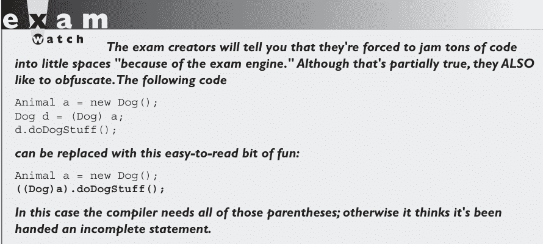

## 实现接口 (OCA 目标 7.6) 117

例如，如果你创建了一个实现 `Runnable` 接口的类（这样你的代码就可以由特定线程执行），那么你必须提供 `public void run()` 方法。否则，那个糟糕的线程可能会执行你 `Runnable` 对象的代码——惊喜吧，惊喜——线程随后会发现该对象没有 `run()` 方法！（在此时，线程将会崩溃，而 JVM 将会在场壮丽而可怕的爆炸中崩溃。）坦率地说，Java 通过对任何声称实现某个接口的类运行编译器检查来防止这种崩溃的发生。如果该类正在实现一个接口，它将为接口中的每个方法提供实现（其中有一些例外我们稍后需要查看）。

假设有一个名为 `Bounceable` 的接口，包含两个方法 `bounce()` 和 `setBounceFactor()`，以下代码可以通过编译：

```java
public class Ball implements Bounceable { // 关键字 'implements'
    public void bounce() {}
    public void setBounceFactor(int bf) {}
}
```

好了，我知道你在想什么：“这一定是实现类历史上最糟糕的实现。”它能编译，也能运行。接口契约保证类将拥有该方法（换句话说，其他人可以在访问控制的范围内调用该方法），但方法体中永远没有任何实际的实现代码。（不过记住，如果接口声明某个方法为 `void`，则你的类实现必须包含返回语句。）编译器永远不会对你说：“不好意思，但你真的想在这些大括号之间什么什么都不放吗？嘿。这毕竟是一个方法，所以它不应该做点什么吗？”

实现类类在方法实现上必须遵循与扩展类相同的规则。为了成为一个合法的实现类，非抽象类必须执行以下操作：

- 为接口中的所有方法提供具体的实现。

- 遵循所有的重写规则，例如：

- 保持接口方法的签名，并保持相同的返回类型（或子类型）。

- 实现方法中不声明接口已声明异常之外的其他受检异常。

## 第 2 章：面向对象 118

等一下，还有更多！实现类本身可以是抽象的！例如，对于实现 `Bounceable` 的类，以下是合法的：

```java
abstract class Ball implements Bounceable { }
```

注意到缺少了什么？我们没有提供任何实现方法。没关系。如果实现类是抽象的，它可以简单将责任推给它的具体子类。例如，如果类 `BeachBall` 扩展了 `Ball` 且不是抽象的，那么 `BeachBall` 将必须提供 `Bounceable` 中的所有方法：

```java
class BeachBall extends Ball {
    // 虽然我们在上面的类声明中没有说
    // 父类 (Ball) 实现了 Bounceable
    public void bounce() {
        // Ball 特有的碰撞代码
    }
    public void setBounceFactor(int bf) {
        // 设置弹性系数的 Ball 特定代码
    }
    // 如果类 Ball 定义了任何抽象方法，
    // 它们也必须在这里实现。
}
```

寻找那些声称实现接口但没有提供正确实现的类。除非实现类是抽象的，否则它必须为接口中定义的所有方法提供实现。你需要了解另外两个规则：

1. 一个类可以实现多个接口。例如，说以下内容是完全合法的：

```java
public class Ball implements Bounceable, Runnable { ... }
```

你只能扩展一个类，但你可以实现许多接口。记住，子类化定义了你是谁以及你是什么，而实现定义了你可以扮演的角色或你可以戴的帽子，尽管你可能与某些实现相同接口的其他类（但来自不同的继承树）有得多么不同。例如，`Person` 扩展了 `Human`（尽管这是有争议的），但 `Person` 也可以实现 `Employee`、`Parent`。

2. 接口本身可以扩展另一个接口，但它永远不能实现任何内容。以下代码是完全合法的：

```java
public interface Bounceable extends Moveable { } // 好的！
```

这意味着什么？`Bounceable` 的第一个具体（非抽象）实现类必须实现 `Bounceable` 的所有方法，加上 `Moveable` 的所有方法！子接口（我们是这样称它的）为父接口的契约增加了更多要求。你将在 Java 的许多领域看到这一概念，特别是 Java EE，在其中你经常需要构建一个扩展某个 Java 接口的自定义接口。

等一下，因为事情变得奇怪了。一个接口可以扩展多个接口！思考一下。你知道当我们谈论类时，以下内容是非法的：

```java
public class Programmer extends Employee, Geek { } // 非法！
```

正如前面提到的，Java 中的类不允许被扩展多个类。接口可以自由地扩展多个接口：

```java
interface Bounceable extends Moveable, Spherical { // 好的！
    void bounce();
    void setBounceFactor(int bf);
}
interface Moveable {
    void moveIt();
}
interface Spherical {
    void doSphericalThing();
}
```

在下一个示例中，`Ball` 被实现 `Bounceable`，加上 `Bounceable` 扩展的所有接口的方法（包括这些接口所扩展的任何接口，一直持续到你到达栈顶——或者说是栈底？）。所以 `Ball` 需要看起来如下所示：

```java
class Ball implements Bounceable {
    public void bounce() {} // 实现 Bounceable 的方法
    public void setBounceFactor(int bf) {}

    public void moveIt() {} // 实现 Moveable 的方法
    public void doSphericalThing() {} // 实现 Spherical
}
```

如果 `Ball` 未能实现 `Bounceable`、`Moveable` 或 `Spherical` 的任何方法，编译器会在你面前疯狂跳动，直到它实现它们为止。除非，如果类 `Ball` 被标记为抽象类。在这种情况下，`Ball` 可以选择实现任何接口的任何一个、全部或一个方法，从而将剩余的实现留给 `Ball` 的具体子类，如下：

```java
abstract class Ball implements Bounceable {
    public void bounce() { ... } // 定义 bounce 行为
    public void setBounceFactor(int bf) { ... }
    // 不要实现剩余部分；留给子类
}

class SoccerBall extends Ball {
    // 类 SoccerBall 必须
    // 实现接口
    // Ball 没有实现的方法
    public void moveIt() { ... }
    public void doSphericalThing() { ... }
    // SoccerBall 可以选择重写由 Ball
    // 实现的 Bounceable 方法
    public void bounce() { ... }
}
```

图 2-5 对了类和接口的 `extends` 和 `implements` 的具体和抽象示例。

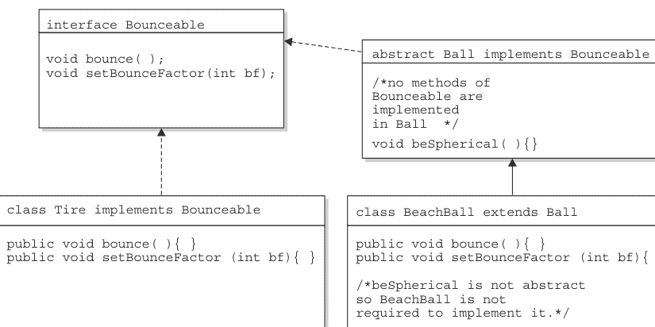

## 实现接口 (OCA 目标 7.6)

留意寻找 `extends` 和 `implements` 的非法用法。以下展示了合法与非法的类和接口声明示例：

```java
class Foo { }
class Bar implements Foo { }
interface Baz { }
interface Fi { }
interface Fee implements Baz { }
interface Zee implements Foo { }
interface Zoom extends Foo { }
interface Boo extends Fi { }
class Toon extends Foo, Button { } // 错误
class Zoom implements Fi, Baz { }
interface Vroom extends Fi, Baz { }
class Yow extends Foo implements Fi, Baz { }
```

```java
// OK
// 不！不能实现一个类
// OK
// 不！接口不能
// 实现一个接口
// 不！接口不能
// 实现一个类，类不能扩展
// 扩展一个类
// OK. 接口可以扩展
// 一个接口
// 不！接口不能扩展
// 多个类
// OK. 类可以实现
// 多个接口
// OK. 接口可以扩展
// 多个接口
// OK. 类可以同时做这两者
// OK. 类可以做到所有这些
// (extends 必须在第一！)
```

把这些记在脑子里，并留意考试题中出现的陷阱。无论题目看起来在测试什么，真正的问题可能出在类或接口的声明上。如果你纠结于追踪一个复杂的线程流，请检查代码是否能通过编译。（光是这一个建议就可能值得你把它写进遗嘱了！）（你会对考试开发者为了让你转移注意力而偏离真实问题所付出的精力感到印象深刻。）（在括号发明之前，人们是如何写出任何东西的？）

## 合法的返回类型

(OCA 目标 2.2, 2.5, 6.1 和 6.3)

- 2.2 区分对象引用变量和基本数据类型变量。

- 2.5 在对象上调用方法。

- 6.1 创建带有参数和返回类型的方法。

- 6.3 创建重载方法。

本节涵盖了返回类型的两个方面：你可以声明为返回类型的类型，以及你实际上可以作为值返回的内容。这非常直观，但取决于你是在重写继承的方法，还是仅仅声明一个新方法（包括重载方法）。我们将快速查看重载方法和重写方法之间返回类型规则的区别，因为我们已经在本章涵盖过这些了。不过，当我们观察多态返回类型以及实际上允许返回与不允许返回的规则时，我们将接触一些新知识。

## 返回类型声明

本节研究你被允许声明为返回类型的类型，这主要取决于你是在重写、重载还是声明一个新方法。

## 重载方法上的返回类型

记住，方法重载无非名称的重用。重载方法与同名的任何其他方法相比都是完全不同的方法。如果你继承了一个方法但在子类中对其进行重载，那么你就不受重写限制的，这意味着你可以声明任何你喜欢的返回类型。你不能做的是只更改返回类型。要重载一个方法，记住，你必须更改参数列表。以下代码展示了一个重载方法：

```java
public class Foo{
  void go() { }
}
public class Bar extends Foo {
  String go(int x) {
    return null;
  }
}
```

注意 Bar 版本的方法使用了不同的返回类型。这完全没问题。只要你更改了参数列表，你就是在重载该方法，因此返回类型不需要与父类版本匹配。是不允许这样做这样的：

```java
public class Foo{
  void go() {}
}
public class Bar extends Foo {
  String go() { // 非法！不能只更改返回类型
  }
}
```

## 重写与返回类型以及协变返回

当子类想要更改继承方法的实现（重写）时，子类必须定义一个与之完全匹配的方法。或者，从 Java 5 开始，允许更改返回类型，只要新的返回类型是父类（超类）方法的子类型。让我们来看协变返回：

```java
class Alpha {
  Alpha doStuff(char c) {
    return new Alpha();
  }
}
```

```java
class Beta extends Alpha {
  Beta doStuff(char c) { // Java 5 合法的重写
    return new Beta();
  }
}
```

在 Java 5 的代码可以编译。如果你在 Java 1.4 下尝试编译这段代码：

```bash
javac -source 1.4 Beta.java
```

你会得到类似这样的编译器错误：

`attempting to use incompatible return type`

（我们将在第8章详细讨论编译器标志。）

其他规则适用于重写，包括访问修饰符，但那些规则与返回类型讨论无关。（img/96d20c2cf157c98b41369_0.png）

对于考试，确保你知道重载方法可以更改返回类型，而重写方法只能在协变返回的范围内这样做。这一知识就能帮助你应对大量的考题。

## 返回值

返回值的六条规则：

- 1. 在对象引用返回类型的方法中返回 `null`。

```java
public Button doStuff() {
  return null;
}
```

- 2. 数组是完全合法的返回类型。

```java
public String[] go() {
  return String[]{"Fred", "Barney", "Wilma"};
}
```


- 3. 在基本类型返回的方法中，你可以返回任何可以隐式转换为返回类型的值或变量。

```java
public int foo() {
  char c = 'c';
  return c; // char 与 int 兼容
}
```

- 4. 在基本类型返回的方法中，你可以返回任何显式转换为返回类型的值或变量。

```java
public int foo() {
  float f = 32.5f;
  return (int) f;
}
```

- 5. 在 `void` 返回类型的方法中不能返回任何内容。

```java
public void bar() {
    return "this is it"; // 非法！！
}
```

（尽管你可以说 `return;`

- 6. 在对象引用返回类型的方法中，你可以返回任何可以隐式转换为返回类型的对象类型。

```java
public Animal getAnimal() {
    return new Horse(); // 假设 Horse extends Animal
}
```

```java
public Object getObject() {
    int[] nums = {1,2,3}; // 返回 int 数组，它仍然是一个
    return nums;
}
```

```java
public interface Chewable {
}
public class Gum implements Chewable {
}
```

```java
public class TestChewable {
    // 接口返回类型的方法
    public Chewable getChewable() {
        return new Gum();
    }
}
```

留意声明抽象类或接口返回类型的方法，并知道任何通过“是一个”测试（也就是说，使用 `instanceof` 测试结果为真）的对象都可以从该方法返回。例如：

```java
public abstract class Animal {
}
public class Bear extends Animal {
}
public class Test {
    public Animal go() {
        return new Bear(); // OK, Bear 是 Animal
    }
}
```

这段代码可以编译，并且返回值是一个子类型。

## 构造函数与实例化

(OCA 目标 6.4, 6.5 和 7.5)

- 6.4 区分默认构造函数和自定义构造函数。
- 6.5 创建和重载构造函数。
- 7.5 使用 `super` 和 `this` 访问对象和构造函数。

对象是被构造的。如果不调用构造函数，你就无法创建新对象。事实上，如果不调用对象实际类类型的构造函数，还要调用其每个父类的构造函数，你就无法创建新对象！构造函数是每当你使用 `new` 关键字时都会运行的代码。（为了更准确地说，当你说 `new` 时也可以有初始化块运行，我们将在讨论构造函数之后介绍 init 块及其静态初始化对应项。）在这里我们有很多可以讨论的——我们将查看构造函数是如何编码、如何调用的以及它们在运行时是如何工作的。所以拿起你的锤和锤子，让我们开始构建对象吧。

## 构造函数基础

每个类（包括抽象类）都必须有一个构造函数。把这刻在脑子里。但由于类必须有构造函数并不意味着程序员必须手动输入它。构造函数看起来如下：

```java
class Foo {
    Foo() { // Foo 类的构造函数
    }
}
```

注意到了什么？没有返回类型！关于构造函数的两个关键点是：它们没有返回类型，并且名称必须与类名完全匹配。通常，构造函数用于初始化实例变量状态，如下：

```java
class Foo {
    int size;
    String name;
    Foo(String name, int size) {
        this.name = name;
        this.size = size;
    }
}
```

## 构造函数与实例化

OCA 目标 6.4, 6.5 和 7.5  第 127 页

在之前的代码示例中，`Foo` 类没有无参数构造函数。这意味着以下代码将无法通过编译：

```java
Foo f = new Foo(); // 无法编译，没有匹配的构造函数
```

但以下代码可以编译通过：

```java
Foo f = new Foo("Fred", 43); // 没有问题。参数与 Foo 的构造函数匹配。
```

一个类拥有无参数构造函数是非常常见的（而且是理想的），无论该类中还有多少个其他重载构造函数（是的，构造函数是可以重载的）。你偶尔会遇到这样一种类：在不向构造函数提供信息的情况下创建实例是没有意义的。例如，一个 `java.awt.Color` 对象无法通过调用无参数构造函数来创建，因为那就像对 JVM 说：“为我创建一个新的 Color 对象，我真的不在乎它是什么颜色……你挑吧。”你真的想让 JVM 来帮你做这种风格决策吗？

## 构造函数链

我们知道，当你对某个类使用 `new` 如下，构造函数会在运行时被调用：

```java
Horse h = new Horse();
```

但当你说 `new Horse()` 时，到底发生了什么？（假设 Horse 继承 Animal 并继承 Object。）

- Horse 构造函数被调用。每个构造函数都会通过（隐式的）调用 `super()` 来调用其父类的构造函数，除非该构造函数调用了同类的某个重载构造函数（稍后会详细说明）。
- Animal 构造函数被调用（Animal 是 Horse 的父类）。
- Object 构造函数被调用（Object 是所有类的终父类，即使你没有在 Animal 类声明中实际输入 "extends Object"，Animal 类也继承了 Object。它是隐式的）。此时我们已经处于栈的顶端。
- Object 的实例变量被赋予了显式值。我们所说的显式值是指在变量声明时赋值的值，例如 `int x = 27`，其中 27 是实例变量的显式值（相对于默认值）。

### 图 2-6

| 步骤 | 描述 |
|---|---|
| 1 | `main()` 调用 new `Horse()` |
| 2 | `Horse()` 调用 `super()` |
| 3 | `Animal()` 调用 `super()` |
| 4 | `Object()` |
| 5 | `Object` 构造函数完成。 |
| 6 | `Animal` 的实例变量被赋予了显式值（如果有）。 |
| 7 | `Animal` 构造函数完成。 |
| 8 | `Horse` 的实例变量被赋予了显式值（如果有）。 |
| 9 | `Horse` 构造函数完成。 |

图 2-6 显示了构造函数在调用栈上是如何工作的。

## 构造函数规则

以下列表总结了考试需要掌握的规则（以及为了理解本节的其余内容）。你**必须**记住这些规则，因此请务必多学习几次。

- 构造函数可以使用任何访问修饰符，包括 `private`。（私有构造函数意味着只有类本身内部的代码可以实例化该类型的对象，因此，如果带有私有构造函数的类想要允许使用该类的实例，则该类必须提供一个静态方法或变量，允许访问从类内部创建的实例。）
- 构造函数的名称必须与类名匹配。
- 构造函数不能有返回类型。
- 拥有一个与类同名的方法是合法的（但很愚蠢），但这并不能使其成为构造函数。如果你看到返回类型，它是一个方法而不是构造函数。事实上，你可以在类中同时拥有一个同名（即类名）的方法和一个构造函数，这对于 Java 来说没有问题。小心不要把方法误认为构造函数——务必寻找返回类型。
- 如果你没有在类代码中编写构造函数，编译器会自动生成一个默认构造函数。

### 如果父类构造函数有参数怎么办？

构造函数可以像方法一样拥有参数。如果你尝试调用一个接收参数（例如 int）的方法，但你没有向该方法传递任何参数，编译器会如下报错：

```java
class Bar {
  void parseInt(int x) {
  }
}
```

```java
class UseBar {
  public static void main(String [] args) {
    Bar b = new Bar();
    b.parseInt(); // 尝试调用无参数的 parseInt()
  }
}
```

编译器会报错说你不能在不传递 int 的情况下调用 `parseInt()`。当然，编译器很喜欢这种谜题，所以它在某些 JVM 版本上（你的情况可能有所不同）抛出的信息并不那么直观易见：

```
UseBar.java: parseInt(int) in Bar cannot be applied to ()
  b.parseInt();
```

你明白意思了。核心问题是方法必须匹配。我们所说的匹配，是指你传递的值或变量，以及你传递它们的顺序。这让我们回到了构造函数上（在这里你可能以为我们永远到不到这里），它们的工作方式完全一样。

所以，如果你的父类构造函数（即你的隐式父类的构造函数）有参数，你必须在调用 `super()` 时输入相应的参数。关键点在于：如果你的父类没有无参数构造函数，你必须在你的类（子类）中写一个构造函数，因为你需要一个地方放置带有相应参数的 `super()` 调用。

以下是该问题的示例：

```java
class Animal {
  Animal(String name) {
  }
}
```

```java
class Horse extends Animal {
  Horse() {
    super(); // 问题！
  }
}
```

再次，编译器以其惊人的清晰度对待了我们：

```
Horse.java:7: cannot resolve symbol
symbol : constructor Animal ()
location: class Animal
super(); // 问题
```

如果你足够幸运（而且正值满月），你的编译器可能会更显式一些。但再次，问题在于我们试图通过 `super()` 调用的内容没有匹配——一个没有参数的 Animal 构造函数。

另一种表达方式是：由于你的父类没有无参数构造函数，在子类中你将无法使用编译器提供的默认构造函数。这很简单。因为编译器只能放入对无参数 `super()` 的调用，所以你甚至无法编译如下代码：

```java
class Clothing {
    Clothing(String s) { }
}
class TShirt extends Clothing { }
```

尝试编译这段代码给我们带来了与我们在子类中放入一个调用无参数版本 `super()` 的构造函数时所得到的完全相同的错误：

```
Clothing.java:4: cannot resolve symbol
symbol : constructor Clothing ()
location: class Clothing
class TShirt extends Clothing { }
```

事实上，前面的 Clothing 和 TShirt 代码在隐式等同于以下代码，在这些代码中我们为 TShirt 提供了一个与编译器提供的默认构造函数相同的构造函数：

```java
class Clothing {
    Clothing(String s) { }
}
class TShirt extends Clothing {
    // 与编译器提供的默认
    // 构造函数完全相同
    TShirt() {
        super();
        // 行不通！
        // 尝试调用无参数的 Clothing 构造函数
        // 但并没有这样的
    }
}
```

关于默认构造函数的整个问题还有最后一点（这可能显而易见，但我们必须说，否则我们会感到内疚多年），构造函数永远不会被继承。它们不是方法。它们可以被重载。它们不能被重写（因为它们不是方法，只有实例方法可以被重写）。因此，你父类拥有的构造函数的类型完全不决定你将获得的默认构造函数的类型。有些人可能误地认为默认构造函数与父类构造函数匹配，要么通过默认构造函数将具有参数（记住，默认构造函数总是无参数的），要么通过编译器提供的 `super()` 调用中使用的参数。

虽然尽管构造函数不能被重写，但你已经看到它们可以被重载，而且通常都是如此的。

## 重载构造函数

重载构造函数意味着编写多个版本的构造函数，每个版本都有不同的参数列表，如下例所示：

```java
class Foo {
  Foo() {}
  Foo(String s) { }
}
```

前面的 `Foo` 类有两个重载的构造函数：一个接收字符串，一个没有参数。因为无参数版本中没有代码，它实际上与编译器提供的默认构造函数完全相同——记住，由于此类中已经有了一个构造函数（接收字符串的那个），编译器就不会再提供默认构造函数了。如果你想要一个无参数构造函数来重载你已有的带参数版本，你必须自己编写它，就像在 `Foo` 示例中一样。

重载构造函数通常用于为客户端提供实例化你的类中对象的替代方法。例如，如果客户端知道动物的名字，他们可以将名字传递给那个接收字符串的 `Animal` 构造函数。如果他们不知道名字，客户端可以调用无参数构造函数。这里是这样的：

```java
class Animal {
    String name;
    Animal(String name) {
        this.name = name;
    }

    Animal() {
        this(makeRandomName());
    }

    static String makeRandomName() {
        int x = (int) (Math.random() * 5);
        String name = new String[] {"Fluffy", "Fido", "Rover", "Spike", "Gigi"}[x];
        return name;
    }

    public static void main(String [] args) {
        Animal a = new Animal();
        System.out.println(a.name);
        Animal b = new Animal("Zeus");
        System.out.println(b.name);
    }
}
```

运行这段代码会产生以下输出：

```
% Animal
Gigi
Zeus

% Animal
Fluffy
Zeus

% Animal
Rover
Zeus

% Animal
Fluffy
Zeus
```

前面的代码中有很多内容。图 2-7 显示了构造函数的调用栈。看一眼调用栈，然后从顶部遍历代码：

- 行 2 声明一个字符串变量，name。
- 行 3 接收 String 的构造函数将其赋值给实例变量 name。
- 行 7 这里很有趣。假设每个动物都需要一个名字，但客户端（调用代码）可能不知道名字应该是什么，所以你分配一个随机名字。无参数构造函数通过调用 `makeRandomName()` 方法生成名字。
- 行 8 无参数构造函数调用它自己的接收 String 的重载构造函数，实际上就像客户端代码使用 new 来实例化对象一样，传递一个 String 作为名字。该重载调用使用了 `this` 关键字，但像使用方法名一样使用了 `this()`。所以行 8 只是调用了行 3 的构造函数，传递了一个随机选择的 String，而不是客户端选择的名字。
- 第 18 行 我们正在调用无参数版本的构造函数（这会导致从列表中随机选择一个名称传递给另一个构造函数）
- 第 20 行 我们正在调用接受一个表示名称的字符串的重载构造函数。

从这段代码示例中获得的关键点在第 8 行。我们没有调用 `super()`，而是调用了 `this()`，而 `this()` 总是意味着对同一个类中另一个构造函数的调用。行吧，但在调用 `this()` 之后会发生什么？早晚父类构造函数会被调用，对吧？确实如此。调用 `this()` 意味着你正在推迟不可避免的事情。构造函数在某处必须对 `super()` 进行调用。

> **核心规则：** 构造函数的第一行必须是对 `super()` 的调用或对 `this()` 的调用。

没有例外。如果你在构造函数中没有这两个调用之一，编译器将插入一个无参数的 `super()` 调用。换句话说，如果构造函数 `A()` 有对 `this()` 的调用，编译器就知道 `A()` 不会是调用 `super` 的那个。

前面的规则意味着构造函数永远不能同时拥有对 `super()` 的调用和 `this()` 的调用。由于这些调用都必须是构造函数的第一个语句，因此你不能在同一个构造函数中合法地使用两者。这意味着编译器也不会在任何包含 `this()` 用的构造函数中放置对 `super()` 的调用。

思考题：你认为如果尝试编译这段代码会发生什么？

```java
class A {
  A() {
    this("foo");
  }
  A(String s) {
    this();
  }
}
```


# 你的编译器可能实际上并不会发现问题

你的编译器可能实际上并不会发现问题（这取决于你的编译器，但大多数都不会发现）。它假设你清楚自己在做什么。你能看出这个缺陷吗？鉴于超构造函数必须始终被调用，`super()` 的调用应该放在哪里呢？记住，如果你在类中已经有一个或多个构造函数，编译器就不会再插入默认构造函数。当编译器不插入默认构造函数时，它仍然会在任何没有显式调用超构造函数的构造函数中插入对 `super()` 的调用——除非，该构造函数已经有了对 `this()` 的调用。因此在前面的代码中，`super()` 可以放在哪里呢？类中的两个构造函数都有对 `this()` 的调用，事实上，你得到的结果与你输入以下方法代码的结果完全一样：

```
public void go() {
  doStuff();
}
```

```
public void doStuff() {
  go();
}
```

现在你能看出问题了吗？你当然能看出。栈溢出了！它变得越来越高，直到破裂，方法代码溢出，飞速冲出 JVM 直接掉在地板上。两个都调用 `this()` 的重载方法实际上是两个相互调用的构造函数。然后一次又一次，导致如下结果：

- `$ java A`
- `Exception in thread "main" java.lang.StackOverflow`

拥有重载构造函数的用处是它为从类中实例化对象提供了灵活的方式。拥有一个重载构造函数的用处是避免代码重复。在 `Animal` 示例中，除了设置名称外没有其他代码，但想象如果第 4 行构造函数中还有更多工作要做。通过将所有其他构造函数的工作放在一个构造函数中，然后让其他构造函数调用它，你就不需要编写和维护多个版本的该重要构造函数代码。基本上，每个其他的“非真实”的重载构造函数都会调用另一个构造函数，传递任何数据。

（注：由于原文中存在大量重复段落，此处已按逻辑合并翻译）

拥有重载构造函数的用处是它为从类中实例化对象提供了灵活的方式。拥有一个重载构造函数的用处是避免代码重复。

## 初始化块

我们讨论了类中可以执行代码的两个地方：构造函数。初始化块是类中可以执行代码的第三种地方。让我们看一个例子：

```
class SmallInit {
    static int x;
    int y;

    static { x = 7; } // 静态块
    { y = 8; } // 实例块
}
```

你可以看到，初始化块的语法非常简洁。它们不接受参数，也不会返回任何值。

## 静态（OCA 目标 6.2）

- 6.2 将静态 关键字应用于方法和字段。

## 静态变量和方法

静态修饰符对方法的影响如此深远，以至于我们将其视为一个完全不同的概念。为了理解静态成员的工作原理，我们首先看看使用它的理由。想象你有一个工具类，其方法总是以相同的方式运行；无论由哪个实例执行，行为都完全一样。换句话说，方法不依赖于对象的状态（实例变量）。那么，既然方法永远不是实例特定的，你为什么还需要对象呢？为什么不直接让类本身运行？

让我们想象另一个场景：假设你想记录某个类的实例总数。你实际上在哪里保留该变量？将其作为要跟踪类中的实例变量是不行的，因为每个新实例都会将计数重置为默认值。工具类始终相同运行场景和记录实例总数场景的答案都是使用静态修饰符。标记为静态的变量和方法属于类，而不是任何特定的实例。事实上，你可以在没有类实例的情况下使用静态方法或变量。你只需要类可用即可调用静态方法或访问静态变量。静态变量可以在没有类实例的情况下访问。如果存在实例，类的静态变量将被所有实例共享。

以下代码声明并使用了一个静态计数器变量：

```
class Frog {
    static int frogCount = 0; // 声明并初始化
    // 静态变量
    public Frog() {
        frogCount++; // 在构造函数修改值
    }
    public static void main(String [] args) {
        new Frog();
        new Frog();
        new Frog();
        System.out.println("Frog count is now " + frogCount);
    }
}
```

在前面的代码中，静态 `frogCount` 在 `Frog` 类首次由 JVM 加载时被设置为零，在创建任何 `Frog` 实例之前！（顺便说一下，你实际上不需要将静态变量初始化为零；静态变量会获得与实例变量相同的默认值。）每当创建一个 `Frog` 实例时，`Frog` 构造函数就会运行并增加静态变量 `frogCount`。当这段代码执行时，`main()` 中创建了三个 `Frog` 实例，结果是：

```
Frog count is now 3
```

现在想象一下如果 `frogCount` 是一个实例变量（换句话说，非静态）会发生什么：

```java
class Frog {
    int frogCount = 0; // 声明并初始化
    // 实例变量
    public Frog() {
        frogCount += 1; // 在构造函数中修改值
    }
    public static void main (String [] args) {
        new Frog();
        new Frog();
        new Frog();
        System.out.println("Frog count is now " + frogCount);
    }
}
```

当这段代码执行时，它应该在 `main()` 中创建三个 `Frog` 实例，但结果是……一个编译错误！我们无法让这段代码通过，更不用说运行了。

```
Frog.java:11: nonstatic variable frogCount cannot be referenced
from a static context
System.out.println("Frog count is " + frogCount);
```

1 error

JVM 并不知道你试图访问哪个 `Frog` 对象的 `frogCount`。问题在于 `main()` 本身是一个静态方法，因此它不是针对该类的任何特定实例运行的；相反，它是运行在类本身上的。静态方法无法访问非静态（实例）变量，因为没有实例！也就是说，堆上没有活跃的类实例，或者说即使有，静态方法也对它们一无所知。这同样适用于实例方法；静态方法不能直接调用非静态方法。记住：`static` = 类，`nonstatic` = 实例。将由 JVM 调用的（`main()`）设为静态方法意味着 JVM 无需为了开始运行代码而创建你类的某个实例。

## 考试

新 Java 程序员经常犯的错误之一是尝试从静态 `main()` 方法访问实例变量（这意味着非静态变量），`main()` 方法对实例一无所知，因此无法访问该变量。下面的代码是一个从静态方法非法访问非静态变量的示例：

```java
class Foo {
    int x = 3;
    public static void main (String [] args) {
        System.out.println("x " + x);
    }
}
```

理解这段代码永远无法通过编译，因为你不能从静态方法访问非静态（实例）变量。只需想编译器在说：“嘿，我完全不知道你想打印哪个 `Foo` 的 `x` 变量！”记住，是类的 `main()` 方法，而不是类的实例。

当然，考试中棘手的部分在于，问题看起来可能并不像前面的代码那样明显。你被测试的问题——从静态方法访问非静态变量——会被埋没在可能看起来是其他内容的代码中。例如，前面的代码更有可能的形式为：

```java
class Foo {
    int x = 3;
    float y = 4.3f;
    public static void main (String [] args) {
        for (int z = x; z < c++; z--, y = y + z)
            // 复杂的循环和分支代码
    }
}
```

当你试图理解逻辑时，真正的问题是 `x` 和 `y` 无法在 `main()` 中使用，因为 `x` 和 `y` 是实例变量而不是静态变量！`static` 应用于从静态方法访问非静态方法。规则是：类的静态方法不能访问其类自身的非静态（实例）方法或变量。

## 访问静态方法和变量

由于调用静态方法或访问静态变量不需要实例，那么你该如何调用或使用静态方法呢？语法是……

语法；我们知道对于普通的实例方法，你可以在实例的引用上使用点操作符：

```java
class Frog {
    int frogSize = 0;
    public int getFrogSize() {
        return frogSize;
    }
    public Frog(int s) {
        frogSize = s;
    }
    public static void main(String [] args) {
        Frog f = new Frog(25);
        System.out.println(f.getFrogSize()); // 访问实例
        // 使用 f 调用方法
    }
}
```

在前面的代码中，我们实例化了一个 `Frog`，将其赋值给引用变量 `f`，然后使用它来调用刚刚创建的 `Frog` 实例的方法。换句话说，`getFrogSize()` 方法是在堆上的一个特定的 `Frog` 对象上被调用的。

但这种方法（使用对象的引用）并不适用于访问静态方法，因为该类可能根本没有实例！所以，我们访问静态方法（或静态变量）的方式是在类名上使用点操作符，而不是在实例引用上使用，如下所示：

```java
class Frog {
    static int frogCount = 0; // 声明并初始化
    // 静态变量

    public Frog() {
        frogCount += 1; // 在构造函数中修改值
    }
}

class TestFrog {
    public static void main(String [] args) {
        new Frog();
        new Frog();
        new Frog();
        System.out.println("Frog count is now " + Frog.frogCount); // 使用类名访问静态变量
    }
}
```

为了增加混淆，Java 语言也允许使用对象引用来访问静态变量：

```java
Frog f = new Frog();
System.out.println(f.frogCount); // 使用 f 访问静态变量
```

### 静态方法的影响

| class Foo | |
| :--- | :--- |
| int size = 42; | 静态方法不能 |
| static void doMore() { | 访问实例 |
| int x = size; | （非静态）变量 |
| class Bar | |
| void go() { | 静态方法不能 |
| static void doMore() { | 访问非静态 |
| x(); | 方法 |
| class Baz | |
| static int count; | 静态方法可以访问 |
| static void woo() { | 静态方法或变量 |

最后，记住静态方法不能被重写！这并不意味着它们不能在子类中重定义，但重定义和重写不是一回事。让我们来看重定义（记住，不是重写）静态方法的示例：

```java
class Animal {
    static void doStuff() {
        System.out.print("a ");
    }
}
class Dog extends Animal {
    static void doStuff() { // 这是重定义而非重写
        System.out.print("d ");
    }
    public static void main(String [] args) {
        Animal[] a = {new Animal(), new Dog(), new Animal()};
        for(int x = 0; x < a.length; x++) { // 调用静态方法
            a[x].doStuff();
        }
        Dog.doStuff(); // 使用类名调用
    }
}
```

运行这段代码产生输出：

```
a aa d
```

记住，`a[x].doStuff()` 只是一个快捷（语法技巧）——编译器将其替换为类似 `Animal.doStuff()`。注意你也可以通过类名调用静态方法。

注意我们没有使用 Java 5 的增强型循环（第 6 章涵盖），尽管我们可以这样做。预计在考试中会看到 Java 1.4 和 Java 5–7 编码风格与实践的混合。

## 认证总结

在本章开始，我们讨论了封装在良好的面向对象（OO）设计中的性，然后讨论了如何实现良好的封装：通过私有实例变量以及公共的 getter 和 setter 方法。

接下来，我们涵盖了继承重要性，以便你能够掌握重写（overriding）、重载（overloading）、多态（polymorphism）、引用转换（reference casting）、返回类型和构造函数。

我们涵盖了 IS-A 和 HAS-A。IS-A 通过继承实现，而 HAS-A 通过使用实例变量引用其他对象来实现。

接下来是多态。虽然引用变量的类型不能改变，但它可以引用一个类型为某个类型子类的对象。我们学习了如何确定给定的引用变量可以调用哪些方法。

我们查看了重写方法和重载方法之间的区别，学习了当子类继承父类的方法，并重新实现该方法以添加更专门的行为时，就会发生方法重写。我们学到在运行时，JVM 会在子类实例上调用子类版本，在父类实例上调用父类版本。抽象方法必须被“重写”（从技术上讲，抽象方法必须被实现，而不是重写，因为实际上没有东西可以重写）。

我们看到重写方法必须声明相同的参数列表和返回类型（或者从 Java 5 开始，它们可以返回父类被重写方法所声明类型的子类型），并且访问修饰符不能更严格。重写方法还可以抛出任何在被重写方法中未声明的新异常或范围更广的异常。你还学习了可以使用 `super.something()` 语法调用重写方法。

重载方法允许你在类中使用相同的名称，但使用不同的参数（可选的，还有不同的返回类型）。重载方法不能更改参数列表，重载方法必须更改。与重写方法不同，重载方法可以根据自己的意愿更改任何返回类型、访问修饰符和声明的异常。

我们学习了引用变量强制转换（主要是向下转型）的机制以及何时有必要这样做。


接下来是实现接口。接口定义了实现类必须遵循的 `contract`（合约）。实现接口的规则与扩展 `abstract`（抽象）类的规则相似。记住，一个类可以实现多个接口，并且接口可以扩展另一个接口。

我们还查看了方法的返回类型，并看到除非正在重写方法，否则你可以声明任何返回类型（假设你有访问用于对象引用类型的类的权限）。除了协变返回外，重写方法的返回类型必须与父类被重写方法的返回类型相同。我们看到，重写方法不能更改返回类型，重载方法可以（只要它们也更改了参数列表）。最后，你学习到返回任何可以隐式转换为声明的返回类型的值或变量都是合法的。例如，当返回类型声明为 `int` 时，可以返回 `short`。（并且假设 `Horse` 扩展 `Animal`），当返回类型声明为 `Animal` 时，可以返回 `Horse` 引用。

我们详细涵盖了构造函数，学习了如果你没有为类提供构造函数，编译器将插入一个。编译器生成的构造函数称为默认构造函数，它始终是一个无参构造函数，并带有对 `super()` 的无参调用。如果你在类中需要多个一个构造函数（无论该构造函数的参数是什么），则永远不会生成默认构造函数，因此如果你在类中需要多个构造函数且想要一个无参构造函数，你必须自己编写它。我们还看到构造函数是不继承的，你可能会被与类名相同的方法（这是合法的）所困惑。返回类型是判断一个方法不是构造函数的线索，因为构造函数没有返回类型。

我们看到当使用 `new` 实例化对象时，对象继承树中的所有构造函数始终会被调用。我们还看到构造函数可以重载，这意味着定义具有不同参数列表的构造函数。构造函数可以使用 `this()` 关键字调用同一类的另一个构造函数，仿佛该构造函数是一个名为 `this()` 的方法一样。我们看到每个构造函数必须以 `this()` 或 `super()` 作为第一条语句（尽管编译器可以为你插入它）。

在构造函数之后，我们讨论了两种初始化块以及代码如何以及何时运行。我们查看了静态方法和变量。静态成员绑定到类而不是实例，因此任何静态成员只有一个拷贝。一个常见的错误是尝试使用点运算符（`.`）通过实例变量来访问静态成员。

你了解到考试包含了一些刁钻的问题，这些问题很大程度上是为了测试你识别问题可能有多刁钻的能力。

# 两分钟演练

以下是本章中每个认证目标的一些关键要点。

# 封装, IS-A, HAS-A (OCA 目标 6.7)

- 封装有助于在接口（或 API）后面隐藏实现。

- 封装的代码具有两个特征：

  - 实例变量被保持保护（通常使用 `private` 修饰符）。

  - Getter 和 setter 方法提供对实例变量的访问。

- IS-A 指继承或实现。

- IS-A 使用 `extends` 或 `implements` 关键字表示。

- IS-A、“inherits from" 和 "is subclass of" 都是等同的。

- HAS-A 意味着一个类的另一个类的引用。

# 继承 (OCA 目标 7.1 和 7.3)

- 继承允许类成为父类的子类，并由此继承公共变量和方法。

- 继承是 IS-A、多态、重写和转换的核心概念。

- 所有类（`Object` 类外）都是 `Object` 类型的子类，因此继承 `Object` 的方法。

# 多态 (OCA 目标 7.2 和 7.3)

- 多态意味着“多种形式”。

- 引用变量始终是单一且不变的类型，但它可以引用子类对象。

- 单个对象可以被许多不同类型的引用变量引用——只要这些类型是相同类型或对象的父类型。

- 引用变量的类型（而不是对象的类型）决定了可以调用哪些方法！

- 多态方法调用适用于重写方法。

# 重写和重载 (OCA 目标 6.3)

- 方法可以被重写或重载；构造函数可以重载但不能重写。

- 相对于它重写的方法，重写方法：

  - 必须具有相同的返回类型，但从 Java 5 开始，返回类型可以是子类，这被称为协变返回。

  - 访问修饰符不能更严格。

  - 可以有更宽松的访问修饰符。

  - 不能抛出新的或范围更广的检查异常。

  - 可以抛出更少或范围更窄的检查异常，或任何未检查异常。

- `final` 方法不能被重写。

- 只有继承的方法可以被重写，记住 `private` 方法是不继承的。

- 子类使用 `super.overriddenMethodName()` 调用重写方法的父类版本。

- 重载意味着在类中使用相同的名称但使用不同的参数。

- 重载方法

  - 必须具有不同的参数类型。

  - 如果参数列表也不同，则可以具有不同的返回类型。

  - 可以有不同的访问修饰符。

  - 可以抛出不同的异常。

- 父类的方法可以在子类中被重载。

- 多态适用于重写，而不适用于重载。

- 对象类型（而不是引用变量的类型）决定了运行时使用哪个重写方法。

- 引用类型决定了在编译时将使用哪个重载方法。

## 引用变量转换 (OCA 目标 7.3 和 7.4)

- 引用变量转换有两种类型：向下转型（downcasting）和向上转型（upcasting）。

- 向下转型：如果你有一个指向子类对象的引用变量，你可以将其赋值给该子类的类型的引用变量。你必须进行显式类型转换才能做到这一点，结果是你可以通过这个新的引用变量访问子类的成员。

- 向上转型：你可以显式或隐式地将一个引用变量赋值给父类引用变量。这是一种在本质上是安全的操作，因为赋值限制了新变量的访问能力。

## 实现接口 (OCA 目标 7.6)

- 当你实现一个接口时，你是在履行它的契约。

- 你通过正确且具体地实现接口定义的所有方法来实例化接口。

- 单个类可以实现多个接口。

## 返回类型 (OCA 目标 6.1 和 6.3)

- 重载方法可以改变返回类型；重写方法则不可以，协变返回（covariant returns）除外。

- 对象引用返回类型可以接受 `null` 作为返回值。

- 数组是一个合法的返回类型，既可以声明也可以作为值返回。

- 对于基本类型返回类型的方法，可以返回任何可以隐式转换为返回类型的值。

- `void` 方法不能返回任何内容，但你可以返回“无”（nothing）。你允许在任何返回类型为 `void` 的方法中写 `return` 以提前跳出方法。但你不能从非 `void` 返回类型的方法中返回空。

- 返回对象引用类型的方法可以返回一个子类。

- 返回接口类型的方法可以返回任何该接口的实现类。

## 第 2 章：面向对象

### 构造函数与实例化：OCA 目标 6.5 和 7.5

- 在创建新对象时，总是会调用构造函数。

- 对象继承树中的每个父类都将被调用其构造函数。

- 每一个类（即使是抽象类）至少有一个构造函数。

- 构造函数的名称必须与类名相同。

- 构造函数没有返回类型。如果你看到带有返回类型，那它是一个与类名相同的方法，而不是构造函数。

- 典型的构造函数执行顺序如下：

    - 构造函数调用其父类的构造函数，其调用其父类的构造函数，以此类推直到 `Object` 构造函数。

    - `Object` 构造函数执行后返回给调用它的构造函数，该函数运行完毕并返回给它的调用者，一直向下直到实际实例的构造函数完成。

- 构造函数可以使用任何修饰符（即使是 `private`！）。

- 如果不在类中创建任何构造函数，编译器将创建一个默认构造函数。

- 默认构造函数是一个无参数构造函数，并包含对 `super()` 的无参数调用。

- 每个构造函数的第一条语句必须是对 `this()`（重载构造函数）或 `super()` 的调用。

- 除非你已经包含了对 `this()` 或 `super()` 的调用，否则编译器会添加对 `super()` 调用。

- 实例成员只有在父类构造函数运行后才可以访问。

- 抽象类拥有构造函数，在实例化具体子类时会被调用。

- 接口没有构造函数。

- 如果你的父类没有无参数构造函数，你必须创建一个构造函数，并插入一个与父类构造函数参数匹配的 `super()` 调用。

- 构造函数永远不会被继承；因此它们不能被重写。

- 构造函数只能通过另一个构造函数直接调用（使用对 `super()` 或 `this()` 的调用）。

## 两分钟演练 153

- 关于调用 `this()` 的问题：

    - 它可能只出现在构造函数的第一条语句。

    - 参数列表决定了调用哪个重载构造函数。

    - 构造函数可以调用构造函数，以此类推，但迟早其中一个最好调用 `super()`，否则栈会溢出。

- `this()` 和 `super()` 的调用不能出现在同一个构造函数中。你可以选择其中一个，但绝不能兼得。

## 初始化块 (OCA 目标 6.5 左右)

- 使用静态初始化块 `static { /* 代码 */ }`——用于你想在类首次加载时运行一次的代码。多个块从上到下执行。

- 使用普通初始化块 `{ /* 代码 */ }`——用于你想在每个新实例中、所有父类构造函数运行后执行的代码。同样，多个块从类的顶部向底部执行。

## 统计数据 (OCA 目标 6.2)

- 使用静态方法来实现不受任何实例状态影响的行为。

- 使用静态变量持有类特定的（而非实例特定的）数据——静态变量只有一个副本。

- 所有静态成员都属于类，而不属于任何实例。

- 使用点运算符 `.` 访问静态成员，但请记住，使用引用变量配合点运算符实际上是一种语法技巧，编译器会用类名替换引用变量；例如：

```
d.doStuff();
```

变为

```
Dog.doStuff();
```

- 静态方法不能被重写，但可以被重定义（redefined）。

## 第 2 章：面向对象

## 自测

I. 给定：

```
public abstract interface Frobnicate { public void twiddle(String s); };
```

哪项是正确的类？（选择所有适用项）

- A. `public abstract class Frob implements Frobnicate { public abstract void twiddle(String s) { } }`

- B. `public abstract class Frob implements Frobnicate { }`

- C. `public class Frob extends Frobnicate { public void twiddle(Integer i) { } }`

- D. `public abstract class Frob implements Frobnicate { public void twiddle(Object s) { } }`

- E. `public class Frob implements Frobnicate { public void twiddle(String s) { } }`

II. 给定：

```
class Top {
    public Top(String s) { System.out.print("B"); }
}
public class Bottom2 extends Top {
    public Bottom2(String s) { System.out.print("D"); }
    public static void main(String[] args) {
        new Bottom2("C");
        System.out.println("");
    }
}
```

结果是什么？

- A. BD

- B. DB

- C. BDC

- D. DBC

- E. 编译失败

3. 给定：

```
class Clidder {
    private void fli() { System.out.println("Clidder"); }
}

public class Clidlet extends Clidder {
    public final void fli() { System.out.println("Clidlet"); }
    public static void main(String [] args) {
        new Clidlet().fli();
    }
}
```

结果是什么？

- A. Clidlet

- B. Clidder

- C. Clidder Clidlet

- D. Clidlet Clidder

- E. 编译失败

> 特别说明：此题模拟了一种被称为“拖拽”的题型。在 SCJP 考试中曾包含此类题目。从 2014 年春季，Oracle 不会在考试中包含此类题目，但为了保险我们在书中保留了一些。

4. 使用下面的片段完成以下代码使其编译。注意你可能不需要填充所有空格。

代码：

```
class AgedP {
    public AgedP(int x) { ________ }
}
public class Kinder extends AgedP {
    public Kinder(int x) { ________ (); }
}
```

片段：零或多次使用以下片段：

| AgedP | super | this |
|---|---|---|
| { | { | } |

5. 给定：

```
class Bird {
    { System.out.print("b1 "); }
    public Bird() { System.out.print("b2 "); };
}
class Raptor extends Bird {
    static { System.out.print("r1 "); };
    public Raptor() { System.out.print("r2 "); };
    { System.out.print("r3 "); }
    static { System.out.print("r4 "); };
}
class Hawk extends Raptor {
    public static void main(String[] args) {
        System.out.print("pre ");
        new Hawk();
        System.out.println("hawk ");
    }
}
```

结果是什么？

- A. pre b1 b2 r3 r2 hawk

- B. pre b2 b1 r2 r3 hawk

- C. pre b2 b1 r2 r3 hawk r1 r4

- D. r1 r4 pre b1 b2 r3 r2 hawk

- E. r1 r4 pre b1 b2 r3 hawk

- F. pre r1 r4 b1 b2 r3 r2 hawk

- G. pre r1 r4 b2 b1 b2 r3 hawk

- H. 输出顺序无法预测

- I. 编译失败

注：你可能永远不会真正的考试中看到这么多选项！

6. 给定以下代码：

```
1. class X { void do1() { } }
2. class Y extends X { void do2() { } }
3. class Chrome
4. public static void main(String[] args) {
5. X x1 = new X();
6. X x2 = new Y();
7. Y y1 = new Y();
8. // 在此处插入代码
9. }
```

在第 9 行插入以下哪些可以通过编译？（选择所有适用项）

- A. `x2.do2();`

- B. `(Y)x2.do2();`

- C. `((Y)x2).do2();`

- D. 以上语句均无法通过编译

7. 给定：

```
public class Locomotive {
    Locomotive() { main("hi"); }

    public static void main(String[] args) {
        System.out.print("2 ");
    }
    public static void main(String[] args) {
        System.out.print("3 " + args);
    }
}
```

结果是什么？（选择所有适用项）

- A. 输出中将包含 2

- B. 输出中将包含 3

- C. 输出中将包含 hi

- D. 编译失败

- E. 运行时抛出异常

# 158 第 2 章：面向对象

8. 给定：

```
3. class Dog {
4.     public void bark() { System.out.print("woof"); };
5. }
6. class Hound extends Dog {
7.     public void sniff() { System.out.print("sniff"); };
8.     public void bark() { System.out.print("howl"); };
9. }
10. public class DogShow {
11.     public static void main(String[] args) { new DogShow().go(); };
12.     void go() {
13.         new Hound().bark();
14.         ((Dog) new Hound()).bark();
15.         ((Dog) new Hound()).sniff();
17.     }
}
```

结果是什么？（选择所有适用项）

- A. howl sniff

- B. howl wo sniff

- C. howl howl 之后跟随异常

- D. howl sniff 之后跟随异常

- E. 在第 14 行因错误编译失败

- F. 在第 15 行因错误编译失败

9. 给定：


# 9. 给定：

```
3. public class Redwood extends Tree {
4. public static void main(String[] args) {
5. new Redwood().go();
6. }
7. void go() {
8. go2(new Tree(), new Redwood());
9. go2((Redwood) new Tree(), new Redwood());
10.}
11. void go2(Tree t1, Redwood r1) {
12. Redwood r2 = (Redwood)t1;
13. Tree t2 = (Tree)r1;
14. }
15. class Tree { }
```

结果是什么？（选择所有适用项）

+   A. 运行时抛出异常
B. 代码通过编译但无输出
C. 在第 8 行因错误编译失败
D. 在第 9 行因错误编译失败
E. 在第 12 行因错误编译失败

# 10. 给定：

```
3. class Tenor extends Singer {
4. static String sing() { return "fa"; }
5. static void main(String[] args) {
6. Tenor t = new Tenor();
7. Singer s = new Tenor();
8. System.out.println(t.sing() + " " + s.sing());
9. }
11. class Singer { public String sing() { return "la"; }}
```

结果是什么？

+   A. fa fa
B. fa la
C. 编译失败
D. 运行时抛出异常

# 11. 给定：

```
3. class Alpha s = " ";
4. static String Alpha() { s += "alpha" }
5. protected Alpha() { s += "sub" }
6. }
7. class SubAlpha extends Alpha {
8. private SubAlpha() { s += "sub" }
9. }
10. public class SubSubAlpha extends Alpha {
11. private SubSubAlpha() { s += "subsub" }
12. public static void main(String[] args) {
13. new SubSubAlpha();
14. System.out.println(s);
15. }
16. }
```

结果是什么？

+   A. subsub
B. sub subsub
C. alpha subsub
D. alpha subsub
E. 编译失败
F. 运行时抛出异常

# 12. 给定：

```
3. class Building {
4. Building() { System.out.print("b "); }
5. Building(String name) {
6. this(); System.out.print("bn " + name);
7. }
8. }
9. class House extends Building {
10. House() { System.out.print("h "); }
11. House(String name) {
12. this(); System.out.print("hn " + name);
13. }
14. public static void main(String[] args) { new House("x "); }
15. }
```

结果是什么？

+   A. h hn x
B. hn x
C. b hn x
D. b hn x x
E. bn x hn x
F. b bn x hn x
G. bn x b hn x
H. 编译失败

# 13. 给定：

```
3. class Mammal {
4. String name = "furry";
5. String makeNoise() { return "generic noise"; }
6. }
7. class Zebra extends Mammal {
8. String name = "stripes";
9. String makeNoise() { return "bray"; }
10. }
11. public class ZooKeeper {
12. public static void main(String[] args) { new ZooKeeper().go(); }
13. void go() {
14. Mammal m = new Zebra;
15. System.out.println(m.name + m.makeNoise());
16. }
17. }
```

结果是什么？

+   A. furry bray
B. stripes bray
C. furry generic noise
D. stripes generic noise
E. 编译失败
F. 运行时抛出异常

# 14. (仅限 OCP) 给定：

你正在设计一种新的在线游戏，其中 `Floozels` 是 `Jammers` 的一种，`Jammers` 可以拥有 `Quizels`，`Quizels` 是 `Klacker` 的一种，而 `Floozels` 可以拥有多个 `Floozels`。以下哪些片段代表这种设计？（选择所有适用项）

```
A. import java.util.*;
interface Klacker { }
class Jammer { Set<Quizel> q; }
class Quizel implements Klacker { }
public class Floozel extends Jammer { List<Flooz> f; }
interface Flooz { }
```

```
B. import java.util.*;
    class Klakker { Set<Quizel> q; }
    class Quizel extends Klakker { }
    class Jammer { List<Floozel> f; }
    class Floozel extends Floozel { }
        public class Floozel { Set<Klakker> }
```

```
C. import java.util.*;
    class Floozel { }
    class Quizel implements Klacker { }
    class Jammer { List<Quizel> q; }
    interface Klacker { }
    class Floozel extends Jammer { List<Flooz> f; }
```

```
D. import java.util*;
    interface Floozel { }
    interface Klakker { }
    class Floozel extends Floozel { }
    interface Jammer { }
    class Quizel extends Klakker { }
```

## 自测答案

+   1. B 和 E 是正确的。B 是因为抽象方法没有方法体。E 是正确的因为类重载了方法。

+   2. E 是正确的。`Bottom()` 中的隐含 `super()` 调用无法满足，因为 `Top` 没有无参构造函数。默认的无参构造函数仅在类没有定义构造函数时生成。

+   3. A 是正确的。虽然 `final` 方法不能被重写，但在这种情况下它是私有的，因此被隐藏了。效果是创建了一个新的可见方法。因此，此示例中没有发生多态，方法是子类的方法。

+   B, C, D 和 E 是错误的。根据先前的 OCA 目标（6.5 和 7.5）。

**特别说明：** 下面的题目创建了一种被称为“拖放”的题型。在 SCPJ 6 考试中，包含了拖放题。从 2014 年春季开始，Oracle 不在 Java 考试中包含任何拖放题，但以防 Oracle 政策发生变化，我们留了一些。

4. 答案如下：

```
class AgedP {
    AgedP() {}
    public AgedP(int x) {
    }
}
public class Kinder extends AgedP {
    public Kinder(int x) {
        super();
    }
}
```

# 第 164 页 第 2 章：面向对象

- 5. D 是正确的。静态初始化块在加载时执行；实例初始化块在构造函数调用 `super()` 之后立即运行。当一个类中出现多个同种类型的初始化块时，它们会按照从上到下的顺序执行。

- A, B, C, E, F, G, H, 和 I 对于上述内容是错误的。注意：在现实生活中你可能不会看到这么多例子！（OCA 目标 1.3 和 7.5）

- 6. C 是正确的。在调用 y 的 `d2` 方法之前，你必须将 `x2` 强制转换为 `Y` 类型。

- A、B 和 D 对于上述内容是错误的。B 看起来是正确的类型转换，但如果没有第二组参数，编译器会认为它是一个不完整的语句。（OCA 目标 7.4）

- 7. A 是正确的。重写 `main()` 是合法的。由于没有创建 `Locomotive` 的实例，构造函数不会运行，被重写的 `main()` 版本也不会运行。

- B, C, D 和 E 对于上述内容是错误的。（OCA 目标 1.3 和 6.3）

- 8. F 是正确的。`Dog` 类没有 `sniff` 方法。

- A, B, C, D 和 E 对于上述信息是错误的。（OCA 目标 7.2 和 7.4）

- 9. A 是正确的。当代码尝试将一个 `Tree` 向下转型为 `Redwood` 时，会抛出 `ClassCastException`。

- B, C, D, E 和 F 对于上述信息是错误的。（OCA 目标 7.4）

- 10. B 是正确的。代码是正确的，但多态不适用于静态方法。

- A, C, D 和 E 对于上述信息是错误的。（OCA 目标 6.2 和 7.8）

- 11. C 是正确的。注意，因为 `SubAlpha` 继承了 `Alpha`！由于代码没有尝试创建 `SubAlpha`，所以 `SubAlpha` 中的私有构造函数是没有问题的。

- A, B, D, E 和 F 对于上述信息是错误的。（OCA 目标 6.5 和 7.5）

- 12. C 是正确的。记住构造函数会调用其父类的构造函数，父类构造先执行，并且是可以重载的。

- A, B, D, E, F, G, 和 H 对于上述信息是错误的。（OCA 目标 6.5 和 7.5）

- 13. A 是正确的。多态仅适用于实例方法，不适用于实例变量。

- B, C, D, E 和 F 对于上述信息是错误的。（OCA 目标 6.2 和 7.2）

- 14. A 和 C 是正确的。“type of”短语表示 IS-A 关系（`extends` `implements`），而“have”词自然表示 HAS-A 关系（通常是实例变量）。

- B 和 D 根据上述信息是错误的。（OCP 目标 3.3）

# # 3 赋值

## 认证目标

- 使用类成员
- 理解基本类型转换
- 理解变量作用域
- 区分基本类型变量和引用变量
- 确定将变量传递方法的影响
- 理解对象生命周期和垃圾回收
- 两分钟演练

## 问答自测

# 栈和堆——快速回顾

对于大多数人来说，理解栈（`stack`）和堆（`heap`）的基础让理解参数传递、多态、线程、异常和垃圾回收等主题变得简单得多。在本节中，我们将保持概述，并在本书书中多次扩展这些主题。

在大多数情况下，Java 程序的各个部分（方法、变量和对象）存在于内存中的两个地方之一：栈或堆。目前，我们只关注三种类型——实例变量、局部变量和对象：

- 实例变量和对象存储在堆上。
- 局部变量存储在栈上。

让我们来看看 Java 程序及其各个部分是如何创建并映射到栈和堆的：

```
1. class Collar { }
2.
3. class Dog {
4.     Collar c;               // 实例变量
5.     String name;           // 实例变量
6.
7.     public static void main(String[] args) {
8.
9.     Dog d;                  // 局部变量: d
10.    d = new Dog();
11.    d.go();
12.}
13.    void go(Dog dog) {      // 局部变量: dog
14
        c = new Collar();
15.        dog.setName("Aiko");
16.    }
17.    void setName(String dogName) { // 局部变量: dogName
18.        name = dogName;
19.        // 执行更多操作
20.    }
21.}
```

图 3-1 显示了运行到第 19 行时的栈和堆。以下是一些关键点：

- 第 7 行——`main()` 栈上。
- 第 9 行——引用变量 `d` 在栈上创建，但还没有 `Dog` 对象。
- 第 10 行——创建了一个新的 `Dog` 对象并赋值给引用变量。
- 第 11 行——引用变量 `d` 的拷贝传递给 `go()` 方法。
- 第 13 行——`go()` 方法在栈上，参数 `dog` 是局部变量。
- 第 14 行——在堆上创建了一个新的 `Collar` 对象并赋值给 `Dog` 的实例变量。
- 第 17 行——`setName()` 在栈上，参数 `dogName` 是局部变量。
- 第 18 行——实例变量 `name` 也指向对象。
- 注意两个不同的局部变量指向同一个对象。
- 注意一个局部变量和一个实例变量指向 Aiko。
- 第 19 行后，`setName()` 完成并从栈中移除。此时局部变量 `dogName` 消失，但所指向的对象仍在堆上。

# 字面量、赋值和变量（OCA 目标 2.1, 2.2 和 2.3）

- 2.1 声明和初始化变量。
- 2.2 区分引用变量。
- 2.3 写入字段。

# 所有基本类型的字面量值

基本类型字面量是基本类型的源码表示——即你在代码中编写的整数、浮点数、布尔或字符。以下是字面量的示例：

```
'b'             // char 字面量
42              // int 字面量
false           // boolean 字面量
254.78934       // double 字面量
```

# 整数字面量

Java语言中有四种表示整数的方法：十进制（10）、八进制（8）、十六进制（16）以及从 Java 7 开始的二进制（2）。大多数考试题使用十进制表示，但少数八进制、十六进制或二进制值得研究。在查看这四种表示数字的方法之前，先讨论 Java 7 添加的新功能：带下划线的字面量。

# 带下划线的数字字面量（升级考试主题 1.2）

从 Java 7 开始，数字字面量可以使用下划线（`_`）声明，这是为了提高可读性。让我们比较 Java 7 之前的声明和 Java 7 的声明：

```
int pre = 1000000; // Java 7 之前 - 我们希望是一百万
int with = 1_000_000; // 清晰得多！
```

必须记住的主要规则是不能在字面量的开头或结尾使用下划线。这里的一个陷阱是你可以在“奇怪”的地方使用下划线：

```
int i1 = _1_000000; // 非法，不能以 "_" 开头
int i2 = 10_000_000; // 合法，但混淆
```

最后记住你可以对任何数字类型（包括双精度浮点数）使用下划线字符，但对于双精度浮点数，不能在小数点旁边添加下划线字符。

# 十进制字面量

十进制整数不需要解释；你从零级或更早就开始使用了。你可能没有记录十六进制（如果有，有匿名小组可以帮助）。在 Java 语言中，它们以本身表示，没有任何前缀，如下：

```
int length = 343;
```

# 二进制字面量（升级考试主题 1.2）

Java 7 也新引入了二进制字面量。二进制字面量可以使用数字 0 和 1。二进制字面量必须以 `0b` 或 `0B` 开头，如下：

```
int b1 = 0B101010; // 将 b1 设置为二进制 101010（十进制 42）
int b2 = 0b000011; // 将 b2 设置为二进制 11（十进制 3）
```

# 八进制字面量

八进制整数只使用数字 0 到 7。在 Java 中，可以通过在数字前放置 0 以八进制格式表示整数如下：

```java
class Octal {
    public static void main(String[] args) {
        int six = 06; // 等于十进制 6
        int seven = 07; // 等于十进制 7
        int eight = 010; // 等于十进制 8
        int nine = 011; // 等于十进制 9
        System.out.println("010 = " + eight);
    }
}
```

八进制数字最多可以有 21 位，不包括领先的零。如果你正在运行程序，它会显示如下：


# 第 3 章：赋值

## 十六进制字面量

十六进制（简写 hex）数字使用 16 个不同的符号构建。由于我们从未为数字 10 到 15 发明过单数字符号，因此我们使用字母字符来表示这些数字。在十六进制中从 0 到 15 计数如下：

```
0 1 2 3 4 5 6 7 8 9 a b c d e f
```

Java 在这些额外的数字上使用大写或小写字母（这是 Java 不区分大小写的极少数地方之一！）。一个十六进制数允许最多包含 16 位数字，但不包括前缀 `0x`（或 `0X`）或可选的后缀 `L`，将在本章稍后解释。以下所有十六进制赋值都是合法的：

```java
class HexTest {
    public static void main(String[] args) {
        int x = 0x0001;
        int y = 0xffffff;
        int z = 0xcafe;
        System.out.println("x = " + x + " y = " + y + " z = " + z);
    }
}
```

`HexTest` 产生输出：

```
x = 1 y = 16777215 z = 51966
```

不要被十六进制数字大小写或前导 x 的变化所误导。`0xCAFE` 和 `0xcafe` 都是合法的且值相同。

所有四个整数字面量（二进制、八进制、十进制和十六进制）默认都定义为 `int`，但可以通过在数字后加上 `L` 或 `l` 将其指定为 `long`：

```java
long jo = 110599L;
long so = 0xFFFFl; // 注意小写的 'l'
```

## 浮点数字面量

浮点数定义为一个数字、一个小数点符号以及更多表示小数部分的数字。在下面的示例中，数字 `11301874.98810224` 是字面量值：

```java
double d = 11301874.98810224;
```

浮点数字面量默认定义为 `double`（64 位），因此如果你想将浮点字面量赋值给类型为 `float`（32 位）的变量，必须在数字后加上后缀 `F` 或 `f`。如果你不这样做，编译器将会报错：

```java
float f = 23467890; // 编译器错误，可能丢失精度
float g = 49837849.029847F; // 没问题；带有后缀 "F"
```

你也可以给 `double` 字面量加上 `D` 或 `d`，但没有必要，因为这是默认行为。

```java
double d = 110599.995011D; // 可选的，不是强制的
double g = 987.897; // 没有 'D' 后缀，但正常，因为字面量默认是 double
```

寻找包含逗号的数字字面量；这里有一个例子：

```java
int x = 25,343; // 因为有逗号而无法编译
```

## 布尔字面量

布尔字面量是布尔值的源码表示。布尔值只能定义为 `true` 或 `false`。虽然在 C 语言（以及其他一些语言）中常用数字来表示真或假，但在 Java 中这是行不通的。再次，跟我读一遍：“Java 不是 C++。”

```java
boolean t = true; // 合法
boolean f = 0; // 编译器错误！
```

留意那些在需要布尔值的地方使用数字的问题。你可能会看到使用数字的 `if`，如下所示：

```java
int x = 1;
if (x) { } // 编译器错误！
```

## 字符字面量

`char` 用单引号括起的单个字符表示：

```java
char a = 'a';
char b = '@';
```

你也可以输入字符的 Unicode 值，使用 Unicode 记法，在值前加上前缀 `\u`：

```java
char letter = '\u004E'; // 字符 'N'
```

记住，字符在底层只是 16 位无符号整数。这意味着你可以赋值一个数字，只要它在 16 位的范围内（0 到 65535）。例如，以下是合法的：

```java
char a = 0x892; // 十六进制字面量
char b = 98;      // int 字面量
char c = (char)70; // 需要强制转换
char d = (char)-98; // 荒谬，但合法的
```

而以下是不合法的并产生编译器错误：

```java
char e = -29; // 可能丢失精度
char f = 70000; // 超范围
```

你还可以使用转义码来表示无法在代码中直接输入的字符，包括换行符、回车符、制表符和引号：

```java
char c = '\\'; // 反斜杠
char d = '\n'; // 换行符
char tab = '\t'; // 制表符
```

## String 字面量值

字符串是 `String` 对象的源码表示。以下是表示字符串字面量的方式：

```java
String s = "Hello";
System.out.println(s + " World");
```

虽然字符串不是基本类型，但它们被包含在这里，因为它们可以作为字面量表示——也就是说，可以直接写在代码中。唯一没有字面量的基本类型是数组，我们将在本章后面学习。

```java
int[] t = // 这里可以放什么字面量？
```

## 赋值运算符

给变量赋值看起来很简单；只需将右侧的值赋给左侧的变量。固然，但不要期望会被测试像这样的赋值：

```java
x = 6;
```

你不会被测试这种显而易见的赋值。然而，你会被测试涉及复杂表达式和强制转换的赋值。我们将查看基本类型赋值和引用变量的赋值。但在开始之前，让我们回头看看变量内部。变量是什么？变量和它的值之间有什么关系？

变量只是带有指定类型的位容器。你可以有 `int` 容器、`double` 容器、`char` 容器，甚至 `String` 容器。在该容器内部是一组表示值的位。对于基本类型，这代表一个数值（尽管我们不知道位模式是什么样的）。例如，一个值为 6 的 `byte` 变量（byte 容器）中的位模式是 `00000110`。

所以基本变量的值是清晰的，但对象是什么？如果你说

```java
String b = new String();
```

`String` 容器内部是什么？是对象吗？不是！引用对象的变量只是引用变量。引用位容器包含获取对象的方法。我们不知道格式。存储对象引用的方式取决于虚拟机（它是指向某些东西的指针，我们不知道具体是什么）。我们只能说变量的值不是对象，而是代表堆上某个特定对象的值。如果引用变量没有被赋值或被显式赋值为 `null`，该变量持有代表 `null` 的位。你可以将

```java
String b = null;
```

读为“变量 b 没有引用任何对象。”

现在我们知道变量只是一个小位框，就可以开始改变这些位的工作了。我们将首先查看给基本类型赋值，最后以引用变量赋值结束。

## 基本类型赋值

等号 (`=`) 用于给变量赋值，它被巧妙地命名为赋值运算符。实际上有 12 种赋值运算符；考试中最常用的赋值运算符在第 4 章中会介绍。

你可以使用字面量或表达式的结果为基本类型变量赋值。

```java
int x = 7; // 字面量赋值
int y = x + 2; // 表达式赋值（包括字面量）
int z = x * y; // 表达式赋值
```

最重要的记忆点是，字面量整数（如 7）始终是一个隐式的 `int`。回想第 1 章，你会记得 `int` 是一个 32 位的值。如果你给 `int` 或 `long` 变量赋值，没关系，但如果你赋值给 `byte` 变量呢？毕竟，`byte` 大小的容器不能像 `int` 大小的容器那样容纳很多位。这里变得奇怪了。以下是合法的：

```java
byte b = 27;
```

但仅仅是因为编译器自动将字面量值缩小为 `byte`。换句话说，编译器加上了强制转换。之前的代码与以下相同：

```java
byte b = (byte)27; // 显式将 int 字面量转换为 byte
```

看起来编译器宽了你的情，让你对比 `int` 小的整数变量赋值采取捷径。（我们关于 `byte` 的话同样适用于 `char` 和 `short`，它们都比 `int` 小。）顺便说一下，字面量整数总是 `int`，但更重要的是，涉及 `int` 类型或更小类型的表达式的结果总是 `int`。也就是说，将两个 `byte` 相加得到的是 `int`——即使这些字节是 `byte`。将一个 `int` 和一个 `short` 相乘得到的是 `int`。将一个 `byte` 除以一个 `byte` 的是……一个 `int`。好了，现在我们到了奇怪的部分。看这个：

```java
byte a = 3; // 没问题，3 适合 byte
byte b = 8; // 没问题，8 适合 byte
byte c = a + b; // 应该没问题，两个字节之和适合 byte
```

最后一行将无法编译！你会得到类似的错误：

```
TestBytes.java:5: possible loss of precision
found: int
required: byte
byte c = a + b;
```

我们曾尝试将两个字节（`byte`）之和赋值给一个字节变量，算式结果（11）显然足够小，可以放入一个字节，但编译器并没有这样做。它知道“比 `int` 小的表达式会产生 `int`”的规则。如果我们进行显式类型转换，就可以通过编译：

```java
byte c = (byte) (a + b);
```

### 多变量声明

通过在每个变量之间放置逗号，用单行声明多个相同类型的变量是完全合法的：

```java
int a, b, c;
```

你还可以选择直接在原地初始化这些任意数量的变量：

```java
int j, k=1, l, m=3;
```

而且这些变量是按照你阅读它们的顺序（从左到右）逐一求值的。就像你将每一个变量写在单独一行一样：

```java
int j;
int k=1;
int l;
int m=3;
```

但顺序是非常重要的。以下代码是合法的：

```java
int j, k=1, l, m=k+3; // 合法：k 在被 m 使用之前已经初始化
```

但以下代码是不合法的：

```java
int j, k=m+3, l, m=1; // 非法：m 在被 k 使用之前未初始化
int x, y=x+1, z;     // 非法：x 在被 y 使用之前未初始化
```

## 基本类型转换

类型转换（Casting）允许你将基本类型的值从一种类型转换为另一种类型。我们在上一节中提到过基本类型转换，但现在我们将深入探讨（对象转换在第 2 章介绍过）。

转换可以是隐式的也可以是显式的。隐式转换意味着你不需要为转换编写代码；转换会自动发生。通常，当你进行宽化转换（widening conversion）时会发生隐式转换——换句话说，就是将一个较小的东西（例如 `byte`）放入一个更大的容器（如 `int`）。你还记得我们在赋值章节看到的那些“可能丢失精度”的编译器错误吗？那些是在尝试将一个较大的东西（例如 `long`）放入一个较小的东西（如 `short`）时发生的。这种“大值转小值”的转换被称为窄化（narrowing），它需要显式类型转换，即你告诉编译器你意识到了这种危险并愿意承担全部责任。

我们先看一个隐式转换：

```java
int a = 100;
long b = a;      // 隐式转换，int 值总能放入 long 中
```

显式转换看起来如下：

```java
float a = 100.001f;
int b = (int)a;   // 显式转换，float 可能会丢失信息
```

整数值可以在不需要显式转换的情况下赋值给 `double` 变量，因为任何整数值都可以放入 64 位的 `double`。下一行代码演示了这一点：

```java
double d = 100L;   // 隐式转换
```

在前面的语句中，`double` 被一个 `long` 值初始化（由数值值后的 `L` 表示）。在这种情况下不需要转换，因为 `double` 可以包含 `long` 能够包含的所有信息。然而，如果我们想将一个 `double` 值赋值给整数类型，我们就是在尝试进行窄化转换，编译器也知道这一点：

```java
class Casting {
    public static void main(String[] args) {
        int x = 3957.229; // 非法
    }
}
```

如果我们尝试编译上述代码，会得到如下错误：

```
Casting.java:3: 声明类型不兼容。需要显式转换将 double 转换为 int。
    int x = 3957.229; // 非法
```

在前面的代码中，一个浮点值被赋值给整数变量。由于整数无法存储小数位，因此发生了错误。为了让它能够工作，我们将浮点数转换为 `int`：

```java
class Casting {
    public static void main(String[] args) {
        int x = (int)3957.229; // 合法
        System.out.println("int x = " + x);
    }
}
```

当你将浮点数转换为整数类型时，值会丢失小数点后的数字。上面的代码将产生以下结果：

```
int x = 3957
```

我们还可以将一个较大的数字类型（如 `long`）转换为较小的数字类型（如 `byte`）。看下面：

```java
class Casting {
    public static void main(String[] args) {
        long l = 56L;
        byte b = (byte)l;
        System.out.println("The byte is " + b);
    }
}
```

上面的代码可以正常编译并运行。但如果 `long` 值大于 127（`byte` 能够存储的最大数值）会发生什么？让我们修改代码：

```java
class Casting {
    public static void main(String[] args) {
        long l = 130L;
        byte b = (byte)l;
        System.out.println("The byte is " + b);
    }
}
```

代码可以正常编译并运行，输出结果为 `-126`（由于溢出截断高位导致）。


# 变量初始化顺序

但顺序是非常重要的。以下代码是合法的：

```java
int j, k=1, l, m=k+3; // 合法：k 在被 m 使用之前已经初始化
```

但以下代码是不合法的：

```java
int j, k=m+3, l, m=1; // 非法：m 在被 k 使用之前未初始化
int x, y=x+1, z;     // 非法：x 在被 y 使用之前未初始化
```

# 第 3 章：赋值

## 基本类型转换

类型转换允许你将基本类型的值从一种类型转换为另一种类型。我们在上一节中提到过基本类型转换，但现在我们将深入探讨（对象转换在第 2 章介绍过）。

转换可以是隐式的也可以是显式的。隐式转换意味着你不需要为转换编写代码；转换会自动发生。通常，当你进行宽化转换（`widening conversion`）时会发生隐式转换——换句话说，就是将一个较小的东西（例如 `byte`）放入一个更大的容器（如 `int`）。你还记得我们在赋值章节看到的那些“可能丢失精度”的编译器错误吗？那些是在尝试将一个较大的东西（例如 `long`）放入一个较小的东西（如 `short`）时发生的。这种“大值转小值”的转换被称为窄化（`narrowing`），它需要显式类型转换，即你告诉编译器你意识到了这种危险并愿意承担全部责任。

我们先看一个隐式转换：

```java
int a = 100;
long b = a;      // 隐式转换，int 值总能放入 long 中
```

显式转换看起来如下：

```java
float a = 100.001;
int b = (int)a;   // 显式转换，float 可能会丢失信息
```

整数值可以在不需要显式转换的情况下赋值给 `double` 变量，因为任何整数值都可以放入 64 位的 `double`。下一行代码演示了这一点：

```java
double d = 100L;   // 隐式转换
```

在前面的语句中，`double` 被一个 `long` 值初始化（由数值值后的 `L` 表示）。在这种情况下不需要转换，因为 `double` 可以包含 `long` 能够包含的所有信息。然而，如果我们想将一个 `double` 值赋值给整数类型，我们就是在尝试进行窄化转换，编译器也知道这一点：

```java
class Casting {
    public static void main(String [] args) {
        int x = 3957.229; // 非法
    }
}
```

如果我们尝试编译上述代码，会得到如下错误：

```
%javac Casting.java
Casting.java:3: 声明类型不兼容。需要显式转换将 double 转换为 int。
    int x = 3957.229; // 非法
```

在前面的代码中，一个浮点值被赋值给整数变量。由于整数无法存储小数位，因此发生了错误。为了让它能够工作，我们将浮点数转换为 `int`：

```java
class Casting {
    public static void main(String [] args) {
        int x = (int)3957.229; // 合法
        System.out.println("int x = " + x);
    }
}
```

当你将浮点数转换为整数类型时，值会丢失小数点后的数字。上面的代码将产生以下结果：

```
int x = 3957
```

我们还可以将一个较大的数字类型（如 `long`）转换为较小的数字类型（如 `byte`）。看下面：

```java
class Casting {
    public static void main(String [] args) {
        long l = 56L;
        byte b = (byte)l;
        System.out.println("The byte is " + b);
    }
}
```

上面的代码可以正常编译并运行，但如果 `long` 值大于 127（`byte` 能够存储的最大数值）会发生什么？让我们修改代码：

```java
class Casting {
    public static void main(String [] args) {
        long l = 130L;
        byte b = (byte)l;
        System.out.println("The byte is " + b);
    }
}
```

## 将一个基本变量赋值给另一个基本变量

当你将一个基本变量赋值给另一个基本变量时，右侧变量的内容会被复制。例如：

```java
int a = 6;
int b = a;
```

这段代码可以读为：“将数字 6 的位模式赋值给 `int` 变量 `a`。然后复制 `a` 中的位模式，并将该副本放入变量 `b` 中。”

因此，两个变量现在都持有数字 6 的位模式，但这两个变量之间没有关系。我们使用一个值*仅*是为了复制它的内容。此时，`a` 和 `b` 具有完全相同的内容（换句话说，值也相同），但如果我们更改了 *a* 或 *b* 的任何一个的内容，另一个变量都不会受到影响。

看下面的示例：

```java
class ValueTest {
    public static void main (String [] args) {
        int a = 10; // 给 a 赋值
        System.out.println("a = " + a);
        int b = a;
        b = 10;
        System.out.println("a = " + a + " after change to b");
    }
}
```

该程序的输出是：

```
%ValueTest
a = 10
a = 10 after change to b
```

注意 `a` 的值保持为 10。要记住的关键点是，即使将 `a` 赋值给 `b`，`a` 和 `b` 也没有引用内存中的同一个地方。变量 `a` 和 `b` 共享同一个值；它们拥有相同的副本。

## 引用变量赋值

你可以如下所示将新创建的对象赋值给对象引用变量：

```java
Button b = new Button();
```

上一行代码做了三件关键的事：

- 创建了一个类型为 `Button` 的引用变量 `b`
- 在堆上创建一个新的 `Button` 对象
- 将新创建的 `Button` 对象赋值给引用变量 `b`

你可以给对象引用变量赋值 `null`，这仅仅意味着该变量没有引用任何对象：

```java
Button c = null;
```

上一行为 `Button` 引用变量（存储引用值的位持有者）创建了空间，但并没有创建一个实际的 `Button` 对象。

正如上一章讨论的，你也可以使用引用来指向任何声明引用类型的子类的对象，如下：

```java
public class Foo {
    public void doFooStuff() { }
}
public class Bar extends Foo {
    public void doBarStuff() { }
}
class Test {
    public static void main(String[] args) {
        Foo reallyBar = new Bar(); // 合法，因为 Bar 是 Foo 的子类
        Bar reallyAFoo = new Foo(); // 非法！Foo 不是 Bar 的子类
    }
}
```

规则是：你可以为声明类型的子类赋值，但不能为声明类型的父类赋值。记住，`Bar` 对象保证能够做 `Foo` 能做的任何事情，因此任何拥有 `Foo` 引用的人都可以调用 `Foo` 方法，即使该对象实际上是 `Bar`。

在先前的代码中，我们看到 `Foo` 有一个方法 `doFooStuff()`，拥有 `Foo` 引用的人可能会尝试调用它。如果 `Foo` 变量引用的对象真的是 `Foo`，那没问题。但如果对象是 `Bar` 也没问题，因为 `Bar` 继承了 `doFooStuff()` 方法。然而，你不能反过来操作。如果有人拥有 `Bar` 引用，他们将调用 `doBarStuff()`，但如果对象是 `Foo`，它将不知道如何响应。

## 考试

> 你可能会在考试中看到类似这样使用“包装”对象的题目：

```java
Long x = new Long(42); // 创建一个值为 42 的 Long 实例
Short s = new Short("57"); // 创建一个值为 57 的 Short 实例
```

OCA 7 考试对包装类的涉及非常浅，因此并不是你需要了解的所有包装类知识都包含在这里：

包装对象是一个持有基本类型值的对象。每种基本类型都有一个关联的包装类：`Boolean`, `Byte`, `Character`, `Double`, `Float`, `Integer`, `Long` 和 `Short`。打印包装类的值：

```java
System.out.println(x + " " + s);
```

产生以下输出：

```
42 57
```

我们将在第二章中深入探讨包装类。

## 作用域（OCA 目标 1.1 和 2.5）

- 1.1 确定变量的作用域。
- 2.5 在对象上调用方法。

### 变量作用域

一旦声明并初始化了一个变量，一个自然的问题是：“这个变量将在什么范围内存在？”这是一个关于变量作用域的问题。作用域不仅在通范围内是一个重要的理解概念，在考试中也占有重要地位。让我们从看一个类开始：

```java
class Layout {             // 类
  static int s = 343;      // 静态变量
  int x;                   // 实例变量
  { x = 7; int x2 = 5; }   // 初始化块
  Layout() { x += 8; int x3 = 6; } // 构造函数
}

void doStuff() {          // 方法
  int y = 0;              // 局部变量
  for (int z = 0; z < 4; z++) { // for 块
    y += z;               // 块变量
  }
}
```

在 Java 程序中，`s`, `x`, `y`, `z` 的作用域如下：

- `s` 是静态变量。
- `x` 是实例变量。
- `y` 是局部变量。
- `z` 是块变量。
- `x2` 是块变量。
- `x3` 是构造函数变量。（注：此部分原文逻辑略有混乱，已按意翻译）

实际上，为了讨论变量的作用域，我们可以说有四个作用域：

- 静态变量作用域最长；它们在类加载时创建，直到类卸载。
- 实例变量次之；它们在创建实例时创建，直到实例被移除。
- 局部变量次之；它们在方法执行期间存在。
- 块变量只在代码块内存在。

作用域错误发生在多种形式中。作用域错误常见的原因是尝试访问不在作用域内的变量。让我们看看这种类型的示例。

**尝试从静态上下文访问实例变量（通常是从 `main()` 方法）：**

```java
class ScopeErrors {
  int x = 5;

  public static void main(String[] args) {
    x++;    // 无法编译，x 是实例变量
  }
}
```

**从嵌套方法访问局部变量。**

当一个方法（例如 `go()`）调用另一个方法（例如 `go2()`）时，`go2()` 无法访问 `go()` 的局部变量。当 `go2()` 执行时，`go()` 的局部变量仍然存在，但不在作用域内。当 `go2()` 完成并从栈中移除，`go()` 继续执行。此时，`go()` 之前声明的所有变量都回到了作用域。例如：

```java
class ScopeErrors {
    public static void main(String[] args) {
        ScopeErrors s = new ScopeErrors();
        go();
    }
    void go() {
        int y = 5;
        go2();    // 一旦 go2() 完成，y 回到了作用域
    }
    void go2() {
        y++;    // 无法编译，y 局部于 go()
    }
}
```

**尝试在代码块完成后使用块变量。**

在代码块内声明并使用变量非常常见，但要小心不要在块完成后尝试使用该变量：

```java
void go3() {
    for (int z = 0; z < 5; z++) {
        boolean test = false;
        if(z == 3) {
            test = true;
            break;
        }
        System.out.print(test);    // 'test' 是一个失效的变量，
    // 它已经停止存在了...
}
```

特别注意代码块的作用域错误。你可能会在 `switch`、`try-catch`、`for`、`do` 和 `while` 循环中遇到它们。

## 变量初始化 (OCA 目标 2.1)

### 认证目标

- 2.1 声明并初始化变量。

### 使用未初始化且未赋值的变量或数组元素

Java不对声明的变量进行初始化或保持未初始化。当我们尝试使用未初始化的变量时，取决于我们处理的变量或数组类型（基本类型或对象），可能会得到不同的行为。这种行为还取决于声明变量的级别（作用域）。实例变量声明在类内部但在任何方法或构造函数之外，而局部变量声明在方法内部（或方法的参数列表中）。

局部变量有时被称为栈变量、临时变量、自动变量或方法变量，但无论你如何称呼它们，这些变量遵循的规则是相同的。尽管你可以让局部变量保持未初始化，但正如我们看到的，如果你尝试在给局部变量赋值之前使用它，编译器会报错。

### 基本类型和对象类型的实例变量

实例变量（也称为成员变量）是在类级别定义的变量。这意味着变量声明不是在方法、构造函数或任何其他初始化块内进行的。每当创建一个新实例时，实例变量都会初始化为默认值，尽管在对象构造函数完成后也可以给它们赋予一个显式值。表 3-1 列出了基本类型和对象类型的默认值。

| 变量类型 | 默认值 |
|---|---|
| 对象引用 | `null`（不引用任何对象） |
| `byte`, `short`, `int`, `long` | `0` |
| `float`, `double` | `0.0` |
| `boolean` | `false` |
| `char` | `'\u0000'` |

#### 基本类型实例变量

在接下来的示例中，整数 `year` 被定义为类成员，因为它位于类的初始大括号内，而不是方法的大括号内：

```java
public class BirthDate {
    int year; // Instance variable
    public static void main(String [] args) {
        BirthDate bd = new BirthDate();
        bd.showYear();
    }
    public void showYear() {
        System.out.println("The year is " + year);
    }
}
```

当程序启动时，它会给 `year` 赋值为零，这是基本类型数值实例变量的默认值。

> 初始化所有变量是一个好习惯，即使你给它们赋值的是默认值。你的代码会更容易读；那些必须维护你代码的程序员（在你中彩票并搬到塔提岛之后）会感激你的。

#### 对象引用实例变量

与未初始的基本类型变量相比，未初始化的对象引用完全是另一回事。让我们来看下面的代码：

```java
public class Book {
    private String title; // instance reference variable
    public String getTitle() {
        return title;
    }
    public static void main(String [] args) {
        Book b = new Book();
        System.out.println("The title is " + b.getTitle());
    }
}
```

这段代码可以正常编译。当我们运行时它，输出是：

```
The title is null
```


`title` 变量没有通过 `String` 赋值进行显式初始化，因此实例变量的值为 `null`。记住，`null` 不同于空字符串 (`""`)。`null` 值意味着引用变量没有指向堆上的任何对象。对 `Book` 代码的以下修改会遇到问题：

```java
public class Book {
  private String title; // instance reference variable
  public String getTitle() {
    return title;
  }
  public static void main(String [] args) {
    Book b = new Book();
    String s = b.getTitle(); // Compiles and runs
    String t = s.toLowerCase(); // Runtime Exception!
  }
}
```

当我们尝试运行 `Book` 类时，JVM 会产生类似下面的内容：

> Exception in thread "main" java.lang.NullPointerException
>
> at Book.main(Book.java:9)

我们得到这个错误是因为引用变量 `title` 没有指向（引用）对象。我们可以通过关键字 `null` 来检查对象是否已经实例化，如下修改后的代码所示：

```java
public class Book {
  private String title;
  public String getTitle() {
    return title;
  }
  public static void main(String [] args) {
    Book b = new Book();
    String s = b.getTitle(); // Compiles and runs
    if (s != null) {
      String t = s.toLowerCase();
    }
  }
}
```

前面的代码在尝试使用变量 `s` 所引用的对象之前，确保了该对象不是 `null`。请注意考试中的场景，你可能需要回溯代码以发现某个对象引用的值为 `null`。在前面的代码中，我们在尝试使用变量 `s` 所引用的对象之前，确保了该对象不是 `null`。

# 190 第 3 章：赋值

编译器并不总是能判断局部变量在使用之前是否已经初始化。例如，如果你在逻辑条件块内进行初始化（换句话说，即一个可能不会执行的代码块，例如在测试条件中没有使用字面值 `true` 或 `false` 的 `if` 或 `for` 循环），编译器知道初始化可能不会发生，并产生错误。以下代码会让编译器报错：

```java
public class TestLocal {
    public static void main(String [] args) {
    int x;
    if (args[0] != null) { // 假设你知道这里是 true
        // 编译器无法判断这
        x = 7;
        // 语句将会执行
    }
    int y = x; // 编译器会在此处报错
    }
}
```

编译器会产生类似下面的错误：

```
TestLocal.java:9: variable x might not have been initialized
```

由于这种“编译器无法确定”的问题，你有时需要在条件块之外初始化变量，仅仅是为了让编译器满意。如果你见过那句汽车贴纸——“当编译器不开心时，谁也不开心”，你就知道为什么这很重要。

## 局部对象引用

对象引用在方法内部声明与在实例变量中声明的行为有所不同。对于实例对象引用，只要代码在在使用前检查引用不为 `null`，你就可以让对象引用保持未初始化。记住，对于编译器来说，在 `null` 引用上使用点运算符 `.` 是允许的，因为另一端没有对象；`null` 引用不等同于未初始化的引用。局部声明的引用不能在使用前检查 `null`，除非你显式地将局部变量初始化为 `null`。编译器会对以下代码抱怨：

```java
import java.util.Date;
public class TimeTravel {
    public static void main(String [] args) {
    Date date;
    if (date == null) {
        System.out.println("date is null");
    }
}
```

## 变量初始化 (OCA 目标 2.1)

编译 `TimeTravel.java` 会导致类似于下面的错误：

```
%javac TimeTravel.java
TimeTravel.java:5: Variable date may not have been initialized.
  if (date == null)
```

实例变量引用总是被赋予默认值 `null`，直到它们被显式初始化为其他值。但局部引用不被赋予默认值；换句话说，它们不是 `null`。如果你不初始化局部引用变量，默认情况下，它的值是——好吧，重点就在于：它没有任何值！所以我们把问题简单化：显式地设置那个该的东西，直到你准备好将其初始化为其他值。以下局部变量可以通过编译：

```java
Date date = null; // 显式设置局部引用
// 变量为 null
```

## 局部数组

与任何其他对象引用一样，在方法内部声明的数组引用在使用之前必须赋值。然而，你不需要显式地初始化数组的元素。我们之前提到过，但这一点足够重要重复：数组元素会被赋予它们的默认值（`0`、`false`、`null`、`'\u0000'` 等），无论数组是被声明为实例变量还是局部变量。数组对象本身如果是在局部声明的则不会被初始化。换句话说，如果数组在方法内部声明并使用，你必须显式初始化数组引用，但在你构造数组对象的瞬间，它的所有元素都已经被赋予了它们的默认值。

## 将一个引用变量赋值给另一个

对于基本类型变量，将一个变量赋值给另一个意味着将一个变量的内容（位模式）复制到另一个变量中。对象引用的工作方式完全相同。引用变量的内容是一个位模式，因此如果你将引用变量 `a1` 赋值给引用变量 `b1`，`a1` 中的位模式会被复制，新副本被放置在 `b1` 中。（有些人创建了一个游戏，数数我们在这一章中使用了多少次“拷贝”这个词……这个“拷贝”概念是个大问题！）如果我们将一个现有对象的实例赋值给一个新的引用变量，那么两个引用变量将持有相同的模式——指向堆上特定对象的位模式。看以下代码：

```java
import java.awt.Dimension;
class ReferenceTest {
    public static void main(String [] args) {
        Dimension a1 = new Dimension(5,10);
        System.out.println("a1.height = " + a1.height);
        Dimension b1 = a1;
        b1.height = 30;
        System.out.println("a1.height = " + a1.height + 
                           " after change to b");
    }
}
```

在前面的示例中，声明并初始化了一个宽度为 5、高度为 10 的 `Dimension` 对象 `a1`。接着，声明了 `Dimension b1` 并给其赋值了 `a1` 的值。此时，两个变量（`a1` 和 `b1`）持有相同的值，`a1` 的内容被复制到了 `b1` 中。仍然只有一个 `Dimension` 对象——`a1` 和 `b1` 所指向的那一个。最后，使用 `b1` 引用更改了高度。思考一下：这会改变 `a1` 的高度吗？让我们看看输出是什么：

```
@java ReferenceTest
a1.height = 10
a1.height = 30 after change to b
```

## String 对象的不可变性

在 Java 中，`String` 对象是不可变的。观察以下代码：

```java
class StringTest {
    public static void main(String [] args) {
        String x = "Java"; // 将值赋值给 x
        String y = x; // 现在 y 和 x 指向同一个对象

        System.out.println("y string = " + y);
        x = x + " Bean"; // 修改 x
        System.out.println("y string = " + y);
    }
}
```

你可能认为 x 改变后 y 会包含 Bean，因为 `String` 是对象。让我们看看输出是什么：

```
java StringTest
y string = Java
y string = Java
```

你需要理解当使用引用变量修改字符串时发生了什么：

- 创建一个新字符串（或在字符串池中找到匹配的字符串），让原始 `String` 对象不受影响。用于修改字符串的引用（或者说，通过修改原始副本创建新字符串）随后会被赋值新的 `String` 对象。

所以当你说：

1. `String s = "Fred";` // 现在 s 和 s 指向同一个（此处原文有误，应为 s 和 s）
2. `String t = s;`
3. `t.toUpperCase();` // 调用一个修改字符串的方法

都没有改变第 1 行创建的原始 `String` 对象。当第 2 行完成后，`t` 和 `s` 指向同一个 `String` 对象。当第 3 行运行时，并不是修改 `t` 和 `s` 指向的对象（这是到为止唯一的 `String` 对象），而是创建了一个新的 `String` 对象。并且它被丢弃了。因为新 `String` 没有赋值给 `String` 变量，新创建的 `String`（持有 `"FRED"`）就作废了。

# 第 3 章：赋值

## 认证目标

## 将变量传入方法

(OCA 目标 6.8)

6.8 确定当值传递到会改变值的方法时，对对象引用和基本类型值产生的影响。


# 第 3 章：赋值

## 认证目标

### 将变量传入方法 (OCA 目标 6.8)

**6.8 确定当值传递到会改变值的方法时，对对象引用和基本类型值产生的影响。**

方法可以声明为接收基本类型和/或对象引用。你需要了解调用者的变量如何（或是否）会被被调用的方法影响。引用变量和基本类型变量在传递到方法时的区别是巨大且重要的。为了理解这一节，你需要熟悉本章开头部分“字面量、赋值和变量”章节中涵盖的内容。

## 传递对象引用变量

当你将一个对象变量传递到方法时，你必须记住你传递的是对象的引用，而不是对象本身。记住，引用变量持有的是位，这些位（对于底层虚拟机而言）表示访问内存（堆）中特定对象的方法。更重要的是，你必须记住你传递的甚至不是引用变量本身，而是引用变量的拷贝。变量的拷贝意味着你传递的是该变量中位的拷贝；当你传递一个引用变量时，你传递的是表示如何访问特定对象的位拷贝。换句话说，调用者和被调用的方法将拥有相同的引用拷贝；因此，它们将指向堆上的同一个相同（而不是拷贝的）对象。

对于此示例，我们使用来自 `java.awt` 包的 `Dimension` 类：

```java
1. import java.awt.Dimension;
2. class ReferenceTest {
3.   public static void main(String[] args) {
4.     Dimension d = new Dimension(5,10);
5.     ReferenceTest rt = new ReferenceTest();
6.     System.out.println("Before modify() " + d.height);
7.     rt.modify(d);
8.     System.out.println("After modify() " + d.height);
9.   }
```

```java
10.  void modify(Dimension dim) {
11.     dim.height = dim.height + 1;
12.     System.out.println("dim = " + dim.height);
13.  }
14. }
```

当我们运行这个类时，可以看到 `modify()` 方法确实能够修改第 4 行创建的原始（也是唯一的）`Dimension` 对象。

```
C:\Projects\java ReferenceTest
Before modify() d.height = 10
dim = 11
After modify() d.height = 11
```

注意，当第 4 行的 `Dimension` 对象传递给 `modify()` 方法时，方法内部对对象的任何更改都是在传递进去的引用所指向的对象上进行的。在前面的示例中，引用变量 `d` 和 `dim` 都指向同一个对象。

## Java 使用的是值传递语义吗？

如果 Java 是通过传递引用来传递对象的，这是否意味着 Java 对对象使用了**按引用传递**？并不完全如此，尽管你经常听到或读到它是这样的。Java 实际上对于运行在单个虚拟机中的所有变量都是**按值传递**。值传递意味着**按变量的值进行传递**！

传递基本类型变量还是引用变量没有区别；你传递的始终是变量中位的拷贝。对于基本类型变量，你传递的是表示该变量的位拷贝。例如，如果你传递一个值值为 3 的 `int` 变量，你传递的是表示 3 的位拷贝。被调用的方法随后获得它自己的值拷贝，并可以随心所欲地处理。

如果你传递的是一个对象引用，你传递的是表示对象引用的位拷贝。被调用的方法随后获得它自己的引用变量拷贝，并可以随心所欲地处理。但由于两个相同的引用指向完全相同的对象，如果被调用的方法修改了对象（例如调用 setter 方法），调用者将看到其原始变量所指向的对象发生了变化。在下一节中，我们将观察当谈论基本类型时情况会发生什么变化。

值传递的结论：被调用的方法不能改变调用者的变量，但对于对象引用变量，被调用的方法可以改变所指向的对象。改变变量和改变对象之间有什么区别？对于对象引用，这意味着被调用的方法不能重新赋值调用者的原始引用变量并使其指向不同的对象。例如，在以下代码中，

```java
void bar() {
    Foo f = new Foo();
    doStuff(f);
}
void doStuff(Foo g) {
    g.setName("Boo");
    g = new Foo();
}
```

在 `bar()` 结束时，存在两个对象：一个由局部变量 `f` 引用，另一个由参数变量 `g` 引用。因为 `doStuff()` 方法拥有引用变量的拷贝，它有一种访问原始 `Foo` 对象的方法，例如调用 `setName()`。

## 传递基本类型变量

让我们看看当谈论基本类型时情况如何发生变化。当基本类型变量传递到方法时发生了什么：

```java
class ReferenceTest {
    static int size = 7;
    static void change(int size) {
        size = size + 20;
        System.out.println("size in change " + size);
    }
    public static void main(String[] args) {
        System.out.println("size = " + size);
        change(size);
        System.out.println("size after change " + size);
    }
}
```

在上面的程序中，当基本类型变量传递到方法时，并没有改变静态变量。输出如下：

```
size = 7
size in change 27
size after change 7
```

---

## 认证目标

### 垃圾回收 (OCA 目标 2.4)

**2.4 解释对象的生命周期。**

从 2014 年 Spring 版开始，官方考试目标不再使用“垃圾回收”（garbage collection）或“内存管理”这些术语。当目标使用“对象的生命周期”这一短语时，这两个概念是包含其中的。

## 内存管理与垃圾回收概述

这是你期待已久的章节！终于是时候深入内存管理和垃圾回收的奇妙世界了。

内存管理是许多类型应用程序中至关重要的元素。考虑一个程序，它读取大量数据（例如从网络上的其他地方），并将这些数据写入硬盘上的数据库中。一个典型的设计是将数据读取到内存中的某种集合中，对数据执行某些操作，然后将数据写入数据库。在数据写入数据库后，存储这些数据的集合必须在处理下一批数据之前清空旧数据，或者将其删除并重新创建。这种操作可能会被执行成千上万，而在 C 或 C++ 这样不提供自动垃圾回收的语言中，手动清空或删除数据结构的逻辑中的一个微小缺陷可能导致小部分内存无法被正确回收或丢失。这种小小的损失被称为内存泄漏，在数千次迭代后，它们可能导致足够的内存无法访问，最终使程序崩溃。编写既整洁又彻底执行手动内存管理的代码是一项非易事且复杂的任务，虽然估计值不一，但人们认为手动内存管理可能会使复杂程序的开发工作量翻倍。

Java 的垃圾回收器为内存管理提供了一种自动解决方案。在大多数情况下，它免去了你需要在应用程序中添加内存管理逻辑的麻烦。自动垃圾回收的缺点是，你无法完全控制它何时运行以及何时不运行。

## Java 垃圾回收器概述

让我们看看在 Java 世界里，谈论垃圾回收时意味着什么。从 30,000 英尺的高度来看，垃圾回收是描述 Java 中自动内存管理的术语。每当软件程序执行（在 Java、C、C++、Lisp、Ruby 等语言中），它都会以不同的方式使用内存。我们在这里不会深入探讨计算机科学 101，但内存通常用于创建栈、堆，在 Java 的情况下，还有常量方法和其他区域。堆是 Java 对象生存的地方，它是内存中唯一与垃圾回收过程有任何方式相关的部分。

堆就是堆。例如，重要的是你知道你可以称它为堆，称它为可收集堆，或者叫它为 Johnson，但它只有一个堆。

所以，所有的垃圾回收都围绕着确保堆有空闲空间展开。对于考试而言，这归结为删除任何正在运行的 Java 程序无法访问的对象。我们稍后会详细讨论“可访问”的含义，让我们先记住这一点。当垃圾回收器运行时，它的目的是找到并删除无法访问的对象。如果你把一个 Java 程序看作是一个持续的循环：创建它需要的对象（这些对象占据堆上的空间），然后在它们不再需要时将其丢弃，创建新对象，再丢弃它们，以此类推，那么拼图中缺失的最后一块就是垃圾回收器。当它运行时，它会寻找那些被丢弃的对象并将它们从内存中删除，这样使用和释放的循环就可以继续下去。啊，伟大的生命轮回。

## 垃圾回收器何时运行？


# 垃圾回收 (OCA 目标 2.4)

垃圾回收器受 `JVM` 控制；`JVM` 决定何时运行垃圾回收器。在你的 Java 程序中，你可以请求 `JVM` 运行垃圾回收器，但在任何情况下都没有保证 `JVM` 会遵从。如果听之任之，`JVM` 通常会在感知到内存不足时运行垃圾回收器。

## 垃圾回收器是如何工作的？

当垃圾回收器运行时，它的目的是找到并删除无法访问的对象。如果你把一个 Java 程序看作是一个持续的循环：创建它需要的对象（这些对象占据堆上的空间），然后在它们不再需要时将其丢弃，创建新对象，再丢弃它们，以此类推，那么拼图中缺失的最后一块就是垃圾回收器。当它运行时，它会寻找那些被丢弃的对象并将它们从内存中删除，这样使用和释放的循环就可以继续下去。啊，伟大的生命轮回。

## 垃圾回收器是如何运行的？

垃圾回收器受 `JVM` 控制；`JVM` 决定何时运行垃圾回收器。在你的 Java 程序中，你可以请求 `JVM` 运行垃圾回收器，但在任何情况下都没有保证 `JVM` 会遵从。如果听之任之，`JVM` 通常会在感知到内存不足时运行垃圾回收器。

## 在方法中创建的对象

在方法中创建的对象也需要被考虑。当一个方法被调用时，创建的任何局部变量仅在方法的执行持续期间存在。一旦方法返回，在方法中创建的对象就可以进行垃圾回收了。然而，这里有一个明显的异常：如果一个对象从方法返回，它的引用可能会被赋值给调用它的方法中的引用变量；因此，它将不符合回收条件。查看以下代码：

```java
import java.util.Date;

public class GarbageFactory {
    public static void main(String[] args) {
        Date d = getDate();
        doComplicatedStuff();
        System.out.println("* = " + d);
    }

    public static Date getDate() {
        Date d2 = new Date();
        StringBuilder now = new StringBuilder(d2.toString());
        System.out.println(now);
        return d2;
    }
}
```

在前面的示例中，`getDate()` 方法返回了一个 `Date` 对象。该方法创建了两个对象：一个 `Date` 和一个包含数据信息的 `StringBuilder`。由于该方法返回了 `Date` 对象的引用，并且该引用被赋值给一个局部变量，即使在 `getDate()` 方法完成后，它也不会符合回收条件。然而，`StringBuilder` 对象将符合回收条件，尽管我们没有显式地将新变量设为 `null`。

## 隔离引用

一个简单的例子是，某个类有一个实例变量，该变量是指向同一类另一个实例的引用变量。假设存在两个这样的实例并且它们相互引用。如果删除了指向这两个对象的所有其他引用，尽管每个对象仍然有一个有效的引用，但没有任何存活线程可以访问其中任何一个对象。当垃圾回收器运行时，它通常可以发现这样的“孤岛”并将其移除。正如你所想象的，这样的孤岛可能会变得很大，理论上可能包含几百个对象。查看以下代码：

```java
public class Island {
    Island i;

    public static void main(String[] args) {
        Island i2 = new Island();
        Island i3 = new Island();
        Island i4 = new Island();

        i2.i = i3; // i2 指向 i3
        i3.i = i4; // i3 指向 i4
        i4.i = i2; // i4 指向 i2

        i2 = null;
        i3 = null;
        i4 = null;

        // 执行复杂的、内存密集型操作
    }
}
```

当代码执行 `// do complicated` 时，三个 `Island` 对象（之前称为 `i2`、`i3` 和 `i4`）拥有实例变量，使得它们相互引用，但它们指向外部（`i2`、`i3` 和 `i4`）的引用被置空了。这些对象符合垃圾回收条件。

这涵盖了你关于让对象符合垃圾回收条件所需要的所有知识。请参考图 3-2 以加强对无引用对象和隔离岛概念的理解。

## 强制垃圾回收（仅限 OCP 5 候选人）

我们在这里应该提到的第一点是，与本节标题相反，垃圾回收是无法强制的。然而，Java 提供了一些方法允许你请求 `JVM` 执行垃圾回收。

> **注意**：从 Java 6 开始，使用 `System.gc()` 的主题已从考试中移除。垃圾回收器已经进化到如此先进的状态，建议你永远不要在代码中调用 `System.gc()`——将其留给 `JVM` 处理。我们在书中保留这一节是为了以防你正在准备 OCP 5 考试。

事实上，你只能向 `JVM` 建议它执行垃圾回收。然而，并没有保证 `JVM` 实际上会移除内存中所有未使用的对象（即使运行了垃圾回收）。对于考试来说，理解这个概念至关重要。Java 提供的垃圾回收程序是 `Runtime` 类的成员。`Runtime` 类是一个特殊类，它有一个对象（单例），你可以在每个程序中使用它。`Runtime` 对象提供了一种与虚拟机直接通信的机制。要获取 `Runtime` 实例，可以使用 `getRuntime()` 方法，它返回该单例。一旦你有了单例，就可以使用 `gc()` 方法调用垃圾回收器。或者，你可以在 `System` 类上调用相同的方法，`System` 类拥有静态方法可以为你完成获取单例的工作。请求垃圾回收最简单的方法（记住——这只是一个请求）是：

```java
System.gc();
```

理论上，在调用 `System.gc()` 后，你将拥有尽可能多的可用内存。我们说“理论上”，是因为该程序并不总是那样工作的。首先，你的 `JVM` 可能没有实现此程序；语言规范允许该程序什么都不做。其次，另一个线程（见第 13 章）可能在你调用垃圾回收器后立即获取大量内存。

这并不是说 `System.gc()` 是一个没用的方法——它比什么都没有要好得多。你不能仅仅依靠 `System.gc()` 来释放足够的内存，以至于不需要担心内存耗尽。认证考试感兴趣的是有保证的行为，而不是可能的行为。

既然你已经对这种工作原理有了一定的了解，让我们来做一个小实验来观察垃圾回收的效果。以下程序让我们知道 `JVM` 有多少可用内存以及多少空闲内存。然后它创建了 10000 个 `Date` 对象。之后，它告诉我们剩余多少内存并调用垃圾回收器（如果运行，则会移除内存中未使用的对象）。看看这个程序：

```java
import java.util.Date;

public class CheckGC {
    public static void main(String[] args) {
        Runtime rt = Runtime.getRuntime();
        System.out.println("Total memory: " + rt.totalMemory());
        System.out.println("Before Memory = " + rt.freeMemory());
        Date d = null;
        for (int i = 0; i < 10000; i++) {
            d = new Date();
        }
        d = null;
        System.out.println("After Memory = " + rt.freeMemory());
        rt.gc(); // System.gc() 的替代方案
        System.out.println("After GC Memory = " + rt.freeMemory());
    }
}
```

现在让我们运行程序并检查结果：

```
Total memory: 1048568
Before Memory = 703008
After Memory = 458084
After GC Memory = 818272
```

正如你看到的，`JVM` 确实决定了（即回收）对象。在前面的示例中，我们在剩余 458048 字节内存时建议进行垃圾回收，它遵循了我们的请求。这个程序只有一个线程在运行，所以当我们调用 `rt.gc()` 时没有其他的操作。请记住，调用 `gc()` 的行为在不同的 `JVM` 中可能会不同，因此无法保证对象会被移除。你唯一能保证的是，如果内存非常紧张，垃圾回收会在抛出 `OutOfMemoryException` 之前运行。

### 练习 3-2：垃圾回收实验

尝试修改 `CheckGC` 程序，将第 13 行和第 14 行放入循环中。你可能会发现每次运行 GC 并不是所有的内存都被释放了。

## 在垃圾回收之前清理——`finalize()` 方法

Java 提供了一种机制，可以在对象被垃圾回收器删除之前运行某些代码。这些代码位于名为 `finalize()` 的方法中，所有类都继承自 `Object`。从表面上看，这似乎是一个很棒的主意；可能你的对象开启了一些资源，你想在对象删除之前关闭它们。问题在于，正如你可能收集到的，你永远无法保证垃圾回收机会删除对象。因此，你放入类重写的 `finalize()` 方法中的任何代码都不保证执行。由于任何给定对象的 `finalize()` 方法可能会运行，但你不能依靠它，所以不要在你的 `finalize()` 方法中放入任何代码。事实上，建议通常情况下不要重写 `finalize()`。

## 棘手的 `finalize()` 小陷阱

关于 `finalize()` 有几个概念你需要记住：

- 对于任何给定的对象，垃圾回收器只会调用 `finalize()` 一次（最多）。
- 调用 `finalize()` 实际上可能会导致一个对象免于被删除。

让我们进一步研究这些语句。首先，请记住，任何你可以放入普通方法中的代码，你都可以放入 `finalize()` 中。例如，在 `finalize()` 方法中，你可以编写代码，将相关对象的引用传回另一个对象，从而有效地使该对象不再符合垃圾回收条件。如果该对象在之后的某个时刻再次符合垃圾回收条件，垃圾收集器仍然可以处理该对象并将其删除。然而，垃圾收集器会记住对于该对象 `finalize()` 已经运行过，它将不会再次运行 `finalize()`。

# 认证总结

本章涵盖了广泛的话题。如果你在学习后续章节时需要复习某些内容，不要担心。本章包含了许多以后会用到的基础知识。

我们从回顾栈和堆开始本章：请记住栈上的局部变量和堆上的实例变量及其对应的对象。我们回顾了基本类型和字符串的合法字面量，然后讨论了给基本类型和引用变量赋值的基本知识，以及基本类型强制转换的规则。

接下来，我们讨论了作用域的概念，或者说“这个变量将生存多久？”记住四个基本作用域，按寿命从长到短排序为：静态、实例、局部和块。

最后，我们深入了垃圾回收——这是 Java 的自动内存管理功能。我们学到堆是对象所在地，也是所有垃圾回收发生的地方。我们了解到，最终 `JVM` 会在它认为合适的任何时候执行垃圾回收。（程序员）可以请求运行垃圾回收，但你不能强制它。我们讨论了垃圾回收仅适用于符合条件的对象，而“符合条件”意味着“从任何存活线程都不可访问”。最后，我们讨论了用处不大的 `finalize()` 方法以及你在考试中需要了解关于它的什么。总的来说，这是一个引人入胜的章节。

## 两分钟训练

以下是本章的一些要点。

### 栈与堆

- 局部变量（方法变量）位于栈上。
- 对象及其实例变量存在于堆上。

### 字面量与基本类型强制转换 (OCA 目标 2.1)

- 整数字面量可以是二进制、十进制、八进制（如 `013`）或十六进制（如 `0x3d`）。
- `long` 字面量以 `L` 或 `l` 结尾。
- `float` 字面量以 `F` 或 `f` 结尾，`double` 字面量以数字 `D` 或 `d` 结尾。
- 布尔字面量为 `true` 和 `false`。
- `char` 字面量是单引号内的单个字符：`'d'`

### 作用域 (OCA 目标 1.1)

- 作用域指的是变量的生命周期。
- 有四个基本作用域：
  - 静态变量的寿命与其类等长。
  - 实例变量的寿命与其对象等长。
  - 局部变量的寿命与其方法在栈上的时间相等；然而，如果它们的方法调用了另一个方法，它们将暂时不可用。
  - 块变量（例如在 `for` 或 `if` 中）的寿命持续到块完成。

### 基本赋值 (OCA 目标 2.1, 2.2 和 2.3)

- 整数字面量隐式为 `int`。
- 整数表达式的结果总是产生 `int` 大小的结果，绝不会更小。
- 浮点数隐式为 `double`（64 位）。
- 基本类型的收窄转换会截断高位。
- 复合赋值（如 `+=`）会执行自动强制转换。
- 引用变量持有用于引用对象的位。
- 引用变量可以指向声明类型的子类，但不能指向父类。

当你创建一个新对象时，例如 `Button b = new Button();`，`JVM` 会执行三件事：

- 创建一个类型为 `Button`、名为 `b` 的引用变量。


- 创建一个新的 `Button` 对象。

- 将 `Button` 对象分配给引用变量 `b`。

## 使用未初始化且未赋值变量或数组元素 (OCA 目标 4.1 和 4.2)

- 当实例化对象数组时，数组内的对象不会自动实例化，但所有引用都将获得默认值 `null`。

- 当实例化基本类型数组时，元素将获得默认值。

- 实例变量总是用默认值初始化。

- 局部/自动/方法变量从不被赋予默认值。如果你尝试在初始化之前使用它们，将得到编译器错误。

## 将变量传递到方法 (OCA 目标 6.8)

- 方法可以接受基本类型和/或对象引用作为参数。

- 方法参数总是副本。

- 方法参数永远不是实际对象（它们可以是对象的引用）。

- 基本类型参数是原始基本类型的未关联副本。

- 引用参数是原始对象引用的另一个副本。

- 当两个不同作用域的变量共享相同名称时，会发生遮蔽。这会导致难以发现的 Bug 和难以回答的考试题。

## 垃圾回收 (OCA 目标 2.4)

- 在 Java 中，垃圾回收 (GC) 提供了自动内存管理。

- GC 的目的是删除无法到达的对象。

- 只有 JVM 决定何时运行 GC；你只能建议它运行。

- 你无法确定 GC 算法。

- 对象在被垃圾回收之前必须被认为是符合条件的。

- 当没有存活线程可以到达它时，该对象即符合条件。

- 要到达一个对象，你必须拥有该对象的存活且可达的引用。

- Java 可能会耗尽内存。

- 对象岛即使相互引用，也可以被垃圾回收。

- 使用 `system.gc()` 请求垃圾回收（仅针对 OCP 5 候选人）。

- `Class` 对象有一个 `finalize()` 方法。

- `finalize()` 方法保证在垃圾收集器删除对象之前运行且仅运行一次。

- 垃圾收集器不做任何保证；`finalize()` 可能永远不运行。

- 你可以在 `finalize()` 内部使对象不符合 GC 的条件。

# 212 第 3 章：赋值

## 自测

1. 已：

```java
class CardBoard {
    Short story = 200;
    CardBoard go(CardBoard cb) {
        cb = null;
        return cb;
    }
    public static void main(String[] args) {
        CardBoard c1 = new CardBoard();
        CardBoard c2 = new CardBoard();
        CardBoard c3 = c1.go(c2);
        c1 = null;
        // do Stuff
    }
}
```

当执行 `// do stuff` 时，有多少个对象符合垃圾回收？

- A. 0
- B. 1
- C. 2
- D. 编译失败
- E. 不可能
- F. 运行时抛出异常

2. 已：

```java
public class Fishing {
    byte b1 = 4;
    int i1 = 123456;
    long L1 = (long)i1; // line A
    short s2 = (short)i1; // line B
    byte b2 = (byte)i1; // line C
    int i2 = (int)123.456; // line D
    byte b3 = b1 + 7; // line E
}
```

哪些行无法编译？（多选）

- A. Line A
- B. Line B
- C. Line C
- D. Line D
- E. Line E

## 自测 213

3. 已：

```java
public class Literally {
    public static void main(String[] args) {
        int i1 = 1_000; // line A
        int i2 = 10_000; // line B
        int i3 = _10_000; // line C
        int i4 = 0b01011; // line D
        int i5 = 0B10_110; // line E
        int i6 = 0x2_a; // line F
    }
}
```

哪些行可以编译？（多选）

- A. Line A
- B. Line B
- C. Line C
- D. Line D
- E. Line E
- F. Line F

4. 已：

```java
class Mixer {
    Mixer() { }
    Mixer(Mixer m) { m = m; }
    int m1;
    public static void main(String[] args) {
        Mixer m2 = new Mixer();
        Mixer m3 = new Mixer(m2); m3.go();
        Mixer m4 = m3.m1; m4.go();
        Mixer m5 = m2.m1; m5.go();
    }
    void go() { System.out.print("hi "); }
}
```

结果是什么？

- A. hi
- B. hi hi
- C. hi hi hi
- D. 编译失败
- E. hi，后面跟着异常
- F. hi hi，后面跟着异常

## 结果是什么？

- A. 7 10
- B. 8 10
- C. 7 12
- D. 8 12
- E. 编译失败
- F. 在运行时抛出异常

### 7. 给定：

```java
public class Wind {
  int id;
  Wind(int i) { id = i; }
  public static void main(String[] args) {
    new Wind(3).go();
    // commented line
  }
  void go() {
    Wind w1 = new Wind(1);
    Wind w2 = new Wind(2);
    System.out.println(w1.id + " " + w2.id);
  }
}
```

当执行到注释行时，哪些是正确的？（选择所有适用项）

- A. 输出包含 1
- B. 输出包含 2
- C. 输出包含 3
- D. 没有对象符合垃圾回收条件
- E. 有对象符合垃圾回收条件
- F. 有两个对象符合垃圾回收条件
- G. 有三个对象符合垃圾回收条件

## 216 第3章：赋值

### 8. 给定：

结果是什么？

- A. 5 7
- B. 5 8
- C. 8 7
- D. 8 8
- E. 编译失败
- F. 在运行时抛出异常

### 9. 给定：

```java
public class Happy {
  int id;
  Happy(int i) { id = i; }
  public static void main(String[] args) {
    Happy h1 = new Happy(1);
    Happy h2 = h1.go(h1);
    System.out.println(h2.id);
  }
  void go(Happy h) {
    Happy h3 = h;
    h3.id = 2;
    h1.id = 3;
    return h1;
  }
}
```

结果是什么？

- A. 1
- B. 2
- C. 3
- D. 编译失败
- E. 在运行时抛出异常

### 10. 给定：

```java
public class Network {
  Network(int x, Network n) {
    id = x;
    p = this;
    if(n != null) p = n;
  }
  int id;
  Network p;
  public static void main(String[] args) {
    Network n1 = new Network(1, null);
    n1.go(n1);
  }
  void go(Network n1) {
    Network n2 = new Network(2, n1);
    Network n3 = new Network(3, n2);
    System.out.println(n3.p.p.id);
  }
}
```

结果是什么？

- A. 1
- B. 2
- C. 3
- D. null
- E. 编译失败

### 11. 给定：

```java
3. class Beta { }
4. class Alpha {
  5. static Beta b1;
  6. Beta b2;
7. }
8. public class Tester {
  9. public static void main(String[] args) {
  10. Beta b1 = new Beta(); Beta b2 = new Beta();
  11. Alpha a1 = new Alpha(); Alpha a2 = new Alpha();
  12. a1.b1 = b1;
  13. a1.b2 = b2;
  14. a2.b2 = b2;
  15. a1 = null; b2 = null;
  16. // do stuff
  17. }
  18. }
```

当执行到第16行时，有多少个对象符合垃圾回收条件？

- A. 0
- B. 1
- C. 2
- D. 3
- E. 4
- F. 5

### 12. 给定：

```java
public class Telescope {
    static int magnify = 2;
    public static void main(String[] args) {
        go();
    }
    static void go() {
        int magnify = 3;
        zoomIn();
    }
    static void zoomIn() {
        magnify *= 5;
        zoomMore(magnify);
        System.out.println(magnify);
    }
    static void zoomMore(int magnify) {
        magnify *= 7;
    }
}
```

结果是什么？

- A. 2
- B. 10
- C. 15
- D. 30
- E. 70
- G. 编译失败

### 13. 给定：

```java
3. public class Dark {
  4. int x = 3;
  5. public static void main(String[] args) {
  6. new Dark().gol();
  7. }
  8. void gol() {
  9. int x;
  10. go2(++x);
  11. }
  12. void go2(int y) {
  13. int x = ++y;
  14. System.out.println(x);
  15. }
  16. }
```

结果是什么？

- A. 2
- B. 3
- C. 4
- D. 5
- E. 在运行时抛出异常

## 220 第3章：赋值

## 自测答案

- 1. C 正确。只有一个对象 (c1) 符合垃圾回收条件，但它关联的对象也符合条件。A、B、D 是错误的。

- 2. E 正确；第 E 行编译失败。当对小于 int 的基本类型进行数学运算时，结果会自动转换为 int。A、B、C 都是基本类型。

- 3. C 正确；第 C 行无法编译。在 Java 中，字面量可以包含下划线，但不能位于开头或结尾。A、B、D、E 是正确的。A 和 B 是字面量的例子。

- 4. F 正确。m2 对象的变量从未初始化，所以当 m 使用它时会抛出 NullPointerException。A、B、D 是错误的。

- 5. A 正确。引用 f1、z 和 f 都指向同一个实例。final 修饰符确保不能引用不同的对象，但不会阻止对象的状态改变。B、C、D 是错误的。

- 6. B 正确。在 go() 方法中，h 指向实例，但 int i 是 i 的一个副本。A、C、D、E 是错误的。

- 7. A、B、G 正确。构造函数设置了 w1 和 w2 的 id。当执行到该行时，三个对象都无法访问；它们符合垃圾回收条件。C、D、F 是错误的。

- 8. D 正确。第 9 行定义的参数是有效的（尽管第11 行不能在与第9 行的作用域内再次声明）。A、B、C 是错误的。

- 9. D 正确。在 go() 方法内部，h1 超出了作用域。A、B、C 是错误的。

- 10. A 正确。创建了三个 Network 对象。n2 对象引用 n1，n3 对象引用 n2。S.O.P 可以读取：“使用 n3 对象引用（第一个 p）找到该对象的引用（n2），然后使用该对象的引用（第二个 p）找到该对象的（n1 的）id。”B、C、D、E 是错误的。

## 221 自测答案

- 11. B 正确。应该很清楚仍然存在 a2 指向的对象以及 a2.b2 指向的对象。可能不太清楚的是你仍然可以通过静态变量 a2.b1 访问另一个 Beta 对象——因为它是静态的。

- 12. A、C、D、E、F 是错误的。

- 13. B 正确。在 Telescope 类中有三个名为 magnify 的不同变量。go() 方法的版本和 zoomMore() 方法的版本没有在 zoomIn() 方法中使用。zoomIn() 方法将类变量乘以5。结果（10）被发送到 zoomMore()，但在 zoomMore() 中发生的情况留在 zoomMore() 中。S.O.P 打印的是 zoomIn() 的 magnify 值。A、C、D、E、G 是错误的。

- 14. E 正确。在 go1() 中，局部变量 x 未初始化。A、B、C、D、F 是错误的。

# #4 运算符

## 目标

- 使用 Java 运算符

- 使用括号覆盖运算符优先级

- 使用 == 和 equals() 测试字符串与其他对象之间的相等性

- 两分钟训练

问与自测

## 224 第4章 运算符

如果你有变量，你就会修改它们。你会递增它们，将它们相加，并将一个与另一个进行比较（大约十种方式）。在本章中，你将学习如何在 Java 中这样做。作为额外奖励，你将学习如何处理你在现实世界中可能永远用不到，但几乎会出现在考试中的事情。

# 目标

# Java 运算符 (OCA 目标 3.1、3.2 和 3.3)

- 3.1 使用 Java 运算符
- 3.2 使用括号覆盖运算符优先级
- 3.3 使用 == 和 equals() 测试字符串与其他对象之间的相等性

# 赋值运算符

我们在第3章中涵盖了等号 (=)运算符的大部分功能。总结如下：

# Java 运算符 OCA 目标 3.1, 3.2 和 3.3 225

- 在给基本类型赋值值时，大小至关重要。确保你了解何时会发生隐式转换、何时需要显式转换，以及何时可能会发生截断。

- 记住引用变量不是对象；它是获取对象的方法。（我们知道所有 C++ 程序员都想听我们说“它是一个指针”，但我们不会那样说的。）

- 在给引用变量赋值值时，类型至关重要。记住超类型、子类型和数组的规则。

接下来将介绍考试中涉及的更多关于赋值运算符的细节，当我们进入下一章时，我们将查看赋值运算符 `=` 是如何处理字符串（字符串是不可变的）的。


| 不要不再出现在考试中的主题上浪费时间准备！以下主题自 Java 1.4 以来就未出现在过考试中： |
| :--- |
| 位移运算符 |
| 按位运算符 |
| 进补码 |
| 除以零的相关内容 |

并不是说这些不是重要的主题；只是它们不再出现在考试中了，而我们正重点关注考试。（注意：我们之所以提到这些，是因为你可能会遇到关于这些主题的模拟考试题——你可以忽略它们！）

# 复合赋值运算符

实际上有 11 个左右的复合赋值运算符，但只有常用的 4 个（`+=`、`-=`、`*=`、`/=`）出现在考试中。复合赋值运算符让偷懒的打字员可以减少几次击键操作的工作量。

以下是几个赋值示例，首先是不使用复合运算符：

```
y = y - 6;
x = x + 2 * 5;
```

# 第 4 章：运算符 226

现在，使用复合运算符：

```
y = 6;
x += 2 * 5;
```

最后两个赋值产生的结果与前两个相同。

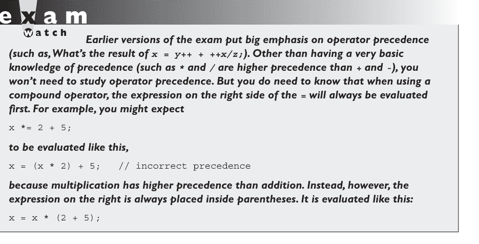

早版本的考试非常强调运算符优先级（例如，`x = y++ ++ x/z` 的结果是什么）。其他版本对优先级有非常基础的了解（例如 `/` 和 `/` 的优先级高于 `+` 和 `-`），你不需要学习运算符优先级。但你需要知道，当使用复合运算符时，`=` 右侧的表达式总是先求值。例如，你可能会认为

```
x *= 2 + 5;
```

像这样求值：

```
x = (x * 2) + 5; // 错误
```

因为乘法的优先级高于加法。然而，右侧的表达式总是放在括号内。它是这样求值的：

```
x = x * (2 + 5);
```

# 关系运算符

考试涵盖六个关系运算符（`<` `<=` `>` 以及 `!=`）。关系运算符总是产生布尔值（真或假）。这个布尔值常用于 `if` 测试，如下：

```java
int x = 8;
if (x < 9) {
  // 执行某些操作
}
```

结果值也可以直接赋值给布尔类型：


```java
class CompareTest {
  public static void main(String[] args) {
    boolean b = 100 > 99;
    System.out.println("The value of b is " + b);
  }
}
```

# Java 运算符 OCA 目标 3.1, 3.2 和 3.3

Java 有四个关系运算符可以比较整数、浮点数或字符：

- 大于
- 大于等于
- 小于
- 小于等于

让我们来看一些合法的比较：

```java
class GuessAnimal {
  public static void main(String[] args) {
    String animal = "unknown";
    int weight = 700;
    char sex = 'm';
    double colorWavelength = 1.630;
    if (weight >= 500) { animal = "elephant"; }
    if (colorWavelength > 1.621) { animal = "gray " + animal; }
    if (sex < 'f') { animal = "female " + animal; }
    System.out.println("The animal is a " + animal);
  }
}
```

在前面的代码中，我们正在使用字符之间的比较。将字符类型与任何数字比较也是合法的（尽管这不是良好的编程风格）。运行前面的类将输出：

The animal is a gray

我们提到字符可以用于比较运算符。在比较字符与字符或字符与数字时，Java 将使用字符的 Unicode 值作为数值进行比较。

# 相等运算符

Java 还有两个关系运算符（有时被称为相等运算符），它们比较两个相似的“事物”并返回布尔值（真或假）。这个布尔值常用于 `if` 测试，如下：

```java
int x = 8;
if (x < 9) {
  // 执行某些操作
}
```

*（注：提供的 OCR 文本在此点之后变得高度重复/损坏；我已经处理了上述连贯的部分。）*

# 第 4 章：运算符

这段代码创建了三个引用变量。前两个变量 `a` 和 `b` 是独立的 `JButton` 对象，它们恰好具有相同的标签。第三个引用变量 `c` 被初始化为引用 `a` 所指向的同一个对象。当此程序运行时，会产生以下输出：

```
Is reference a == b? false
Is reference a == c? true
```

这向我们表明 `a` 和 `c` 引用同一个 `JButton` 实例。`==` 运算符不会测试对象是否在“意义上等价”，这个概念将在第 11 章中详细介绍，届时我们将查看 `equals()` 方法（我们在这里查看的是与 equals 运算符类似的方法）。

# 字符串的相等性和 java.lang.Object.equals()

我们使用 `==` 来判断两个引用变量是否引用同一个对象。对象是 Java 的核心，Java 中的每个类都从 `Object` 类继承了一个方法，该方法用于测试该类的两个对象是否“相等”。令人惊讶的是，这个方法被称为 `equals()`。在 `equals()` 方法的情况下，应该使用短语“意义上等价”而不是单词“相等”。因此，`equals()` 方法被用于判断同类的两个对象是否“意义上等价”。对于你创建的类，你可以选择重写从 `Object` 继承的 `equals()` 方法，并为该类的实例创建你自己的“意义上等价”定义。（第 11 章将有更多关于重写 `equals()` 的内容。）

对于 OCA 考试所需的 `equals()` 方法，你需要理解 `equals()` 方法的两个方面：

- `equals()` 在 `Object` 类中的含义
- `equals()` 在 `String` 类中的含义

**Object 类中的 equals() 方法**工作原理与 `==` 运算符的工作原理相同。如果两个引用指向同一个对象，`equals()` 方法将返回 `true`。如果两个引用指向不同的对象，即使它们具有相同的值，该方法也将返回 `false`。

**String 类中的 equals() 方法** `String` 类中的 `equals()` 方法被重写了。当使用 `equals()` 方法比较两个字符串时，如果字符串值相同，它将返回 `true`；如果字符串值不同，它将返回 `false`。对于 `String` 的 `equals()` 方法，值是区分大小写的。

# Java 运算符（OCA 目标 3.1, 3.2 和 3.3）

让我们来看看 `equals()` 方法的实际运行情况（注意 `Budget` 类**没有**重写 `Object.equals(Object)`）：

```java
class Budget {
    public static void main(String[] args) {
        Budget b1 = new Budget();
        Budget b2 = new Budget();
        Budget b3 = b1;

        String s1 = "Bob";
        String s2 = "Bob";      // 小写 "b"
        String s3 = "bob";

        System.out.println(b1.equals(b2)); // false,不同的对象
        System.out.println(b1.equals(b3)); // true, 同一个对象
        System.out.println(s1.equals(s2)); // true, 相同的值
        System.out.println(s1.equals(s3)); // false, 值区分大小写
    }
}
```

产生输出：

```
false
true
true
false
```

如之前提到的，当我们学习第 11 章时，我们将深入研究重写 `equals()` 及其同伴 `hashCode()`——但对于 OCA 来说，这就是你需要知道的。

# 枚举的相等性（仅限 OCP）

一旦你声明了枚举（enum），它就不可再扩展了。在运行时，没有办法创建额外的枚举常量。当然，你可以拥有任意数量的变量来引用给定的枚举常量，因此能够比较两个枚举引用以判断它们是否“相等”是非常重要的——即，它们是否引用同一个枚举常量。你可以使用 `==` 运算符或 `equals()` 方法来判断两个变量是否引用同一个常量：

```java
class EnumEqual {
    enum Color {RED, BLUE}; // 分号是可选的
    public static void main(String[] args) {
        Color c1 = Color.RED; Color c2 = Color.RED;
        if(c1 == c2) { System.out.println("==="); }
        if(c1.equals(c2)) { System.out.println(".dot equals"); }
    }
}
```

（我们知道这很丑；我们正在为你做准备。）这产生了输出：

```
===
.dot equals
```

# instanceof 比较

`instanceof` 运算符仅用于对象引用变量，你可以用它来检查一个对象是否属于特定类型。我们所说的“类型”是指类或接口类型——换句话说，左侧变量引用的对象是否通过了右侧类或接口类型的 IS-A 测试。（第 2 章详细涵盖了 IS-A 关系）。下面的简单示例：

```java
public static void main(String[] args) {
    String s = new String("foo");
    if (s instanceof String) {
        System.out.print("s is a String");
    }
}
```

打印此内容：

s is a String

即使被测试的对象不是运算符右侧类类型的实际实例化，如果被比较的对象可以赋值给右侧类型（赋值兼容），`instanceof` 仍将返回 `true`。

下面的示例展示了 `instanceof` 的常见用法：在尝试向下转型之前，测试一个对象以查看它是否是其子类的实例：

```java
class A {
    class B extends A {
        public static void main(String[] args) {
            A myA = new B();
            m2(myA);
        }
        public static void m2(A a) {
            if (a instanceof B) // 向 A 引用向下
                ((B)a).doBStuff(); // 到 B 引用
        }
        public static void doBStuff() {
            System.out.println("'a' refers to a B");
        }
    }
}
```

代码编译并产生此输出：

'a' refers to a B

在这样的示例中，尝试使用 `instanceof` 运算符可以保护程序防止尝试非法的向下转型。

你可以针对对象与其自身的类类型或其任何父类进行测试。这意味着如果你使用 `instanceof` 运算符类型为 `Object`，则任何对象引用都将求值为 `true`，如下：

```java
B b = new B();
if (b instanceof Object) {
    System.out.print("b is definitely an Object");
}
```

这打印出

b is definitely an Object

寻找测试对象是否为接口实例的 `instanceof` 题目，当对象的父类实现了接口时。间接实现发生在对象的某个父类实现了接口时，而其实际类本身没有。在以下示例中：

```java
interface Foo { }
class A implements Foo { }
class B extends A { }
...
A a = new A();
B b = new B();
```

以下结果为真：

```java
a instanceof Foo
a instanceof A
b instanceof Foo // 间接
```

如果对象的任何父类实现了接口，则认为该对象属于该接口类型（意味着将通过 `instanceof` 测试）。

此外，测试 `null` 引用是否为类的实例是合法的。这始终结果为 `false`。此示例：

```java
class InstanceTest {
    public static void main(String[] args) {
        String a = null;
        boolean b = null instanceof String;
        boolean c = a instanceof String;
        System.out.println(b + " " + c);
    }
}
```

打印

false false

# instanceof 编译错误

你不能使用 `instanceof` 运算符在两个不同的类体系之间进行测试。

例如，以下代码**不会**编译：

```java
class Cat {
class Dog {
    public static void main(String [] args) {
        Dog d = new Dog();
        System.out.println(d instanceof Cat);
    }
}
}
```

编译失败——`d` 不可能引用 `Cat` 或 `Cat` 的子类。


记住数组是对象，即使是基本类型的数组。注意类似的题目：

```java
int[] nums = new int[3];
if (nums instanceof Object) { } // 结果为 true
```

数组总是 `Object` 的实例。任何数组都是。

表 4-1 在给定情况下总结了 `instanceof` 运算符的使用：

```java
interface Face {
class Bar implements Face { }
class Foo extends Bar { }
```

# Java 运算符 OCA 目标 3.1, 3.2 和 3.3

| 表格 4-1 | | |
|---|---|---|
| 第一个操作数（被测试的引用） | instanceof 操作数（与引用比较的类型） | 结果 |
| 使用 instanceof 运算符的操作数和结果 | null | 任何类或接口类型 | false |
| | Foo 实例 | Foo, Bar, Face, Object | true |
| | Bar 实例 | Bar, Face, Object | true |
| | Bar 实例 | Foo | false |
| | Foo[] | Foo, Bar, Face | false |
| | Foo[] | Object | true |
| | Foo[1] | Foo, Bar, Face, Object | true |

# 算术运算符

我们相信你已经熟悉基本的算术运算符：

- `+` 加法
- `-` 减法
- `*` 乘法
- `/` 除法

这些可以用标准方式使用：

```java
int x = 5 * 3;
int y = x - 4;
System.out.println("x - 4 is " + y); // 输出 1
```

# 取余数 (%) 运算符（也称为模运算符）

你可能对取余运算符 `%` 不熟悉。取余运算符将左操作数除以右操作数，结果为余数，如下代码所示：

```java
class MathTest {
  public static void main(String[] args) {
    int x = 15;
    int y = x % 4;
    System.out.println("The result of 15 % 4 is the " + "remainder of 15 divided by 4. The remainder is " + y);
  }
}
```

# 236 第 4 章：运算符

运行 `MathTest` 类输出以下内容：

The result of 15 % 4 is the remainder of 15 divided by 4. The remainder is 3

（记住：表达式默认从左到右求值。你可以通过添加括号来改变这种顺序或优先级。还要记住 `*`、`/` 和 `%` 运算符的优先级高于 `+` 和 `-` 运算符。）

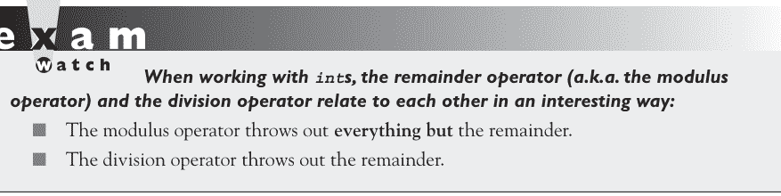

在处理 `int` 类型时，取余运算符（也称为模运算符）和除法运算符之间存在着有趣的关系：

- 模运算符丢弃余数。
- 除法运算符丢弃余数。

# 字符串拼接运算符

加号也可以用于连接两个字符串，正如我们之前看到的（稍后肯定还会看到）：

```java
String animal = "Gray " + "elephant";
```

当将数字与字符串结合时，字符串拼接变得有趣起来。查看以下内容：

```java
String a = "String";
int b = 3;
int c = 7;
System.out.println(a + b + c);
```

`+` 运算符在相变量 `b` 和 `c` 时会作为加号作用吗？还是 `+` 运算符会将 3 和 7 视为字符并分别进行拼接？

结果是 `String10` 还是 `String37`？好了，你已经思考了足够久了。

`int` 值被简单地视为字符并粘合在字符串的右侧，结果如下：

```java
String37
```

所以我们可以这样理解之前的代码：

“从值 String 开始，在其后拼接字符 3 (`b` 的值)，产生一个新的字符串 `String3`，然后在其后再拼接字符 7 (`c` 的值)，产生一个新的字符串 `String37`。然后将其打印出来。”

然而，如果你在 2 个 `int` 变量周围加上操作数，如下文所示：

```java
System.out.println(a + (b + c));
```

你将得到：

```java
String10
```

使用括号会导致 `(b + c)` 先求值，由于两个操作数都是 `int` 值，最右侧的 `+` 运算符充当加法运算符。这里的关键点在于，在内部，左侧操作数不是 `String`。如果是的话，`+` 运算符将执行字符串拼接。之前的代码可以理解为：

> “将 `b` 和 `c` 的值相加，然后将和转换为字符串，并与变量 `a` 的字符串拼接。”

需要记住的规则是：

> 如果任一操作数是 `String`，`+` 运算符就会变成字符串拼接运算符。如果两个操作数都是数字，`+` 运算符就是加法运算符。

你会发现，有时你可能很难判断（例如）左侧操作数是否为 `String`。在考试中，不要期望它总是显而易见的（实际上，按照我们现在的思考，也不要期望它显而易见）。看下面的代码：

```java
System.out.println(x.foo() + 7);
```

在发现 `foo()` 返回什么之前，你不知道 `+` 运算符是如何使用的。如果 `foo()` 返回 `String`，那么 7 将被拼接到返回值上。但如果 `foo()` 返回数字，那么 `+` 运算符会将 7 加到 `foo()` 的返回值。最后，你需要知道复合赋值运算符是合法的，例如：


```java
String s = "123";
s += "45";
System.out.println(s);
```

结果是 `12345`。

# 增减运算符

增减运算符用于增加或减少一个值。它们有两种类型：前置和后置。前置版本在表达式求值之前改变值，而后置版本在表达式求值之后改变值。示例：

```java
int x = 5;
System.out.println(++x); // 输出 6
System.out.println(x++); // 输出 6
```

减运算符原理类似，减少一个值：

```java
int x = 5;
System.out.println(--x); // 输出 4
System.out.println(x--); // 输出 4
```

## Java 运算符 (OCA 3.1, 3.2, 和 3.3) 241

```java
class Salary {
    public static void main(String [] args) {
        int numOfPets = 3;
        String status = (numOfPets < 4) ? "Pet limit not exceeded" 
                        : "too many pets";
        System.out.println("This status is " + status);
    }
}
```

你可以将上述代码读为“将 `numOfPets` 设置为 3”。接下来我们将把一个字符串赋值给 `status` 变量。如果 `numOfPets` 小于 4，则将 `"Limit not exceeded"` 赋值给 `status` 变量；否则，将 `"too many pets"` 赋值给 `status` 变量。

条件运算符以布尔操作符 (`=`) 运算符开头，后面跟着两个值：如果条件（布尔）测试为真，则将赋值运算符左侧变量的值（即冒号左侧的值）；如果条件测试为假，则赋值第二个值。你甚至可以将运算符嵌套在一个语句中：

```java
class AssignmentOps {
    public static void main(String [] args) {
        int sizeOfYard = 10;
        int numOfPets = 3;
        String status = (numOfPets < 4) ? "Pet count OK" 
                        : (sizeOfYard > 8) ? "Pet limit on the edge" 
                        : "too many pets";
        System.out.println("This status is " + status);
    }
}
```

不要预期有很多关于条件运算符的题目，但请记住条件运算符有时会与断言语句混淆，但你可以看出区别。第 7 章将详细介绍断言。

## 逻辑运算符

考试目标指定了六个“逻辑”运算符 (`&`, `|`, `^`, `&&`, `||`, `!`)。某些 Oracle 文档对这些运算符使用其他术语，但对于我们的目的以及考试目标来说，这些就是逻辑运算符。

## 位运算符（仅针对 OCJP 5 候选者！）

好了，这将让人很困惑。在列出的六个逻辑运算符中，有三个 (`&`, `|`, `^`) 也可以作为“位”运算符。位运算符包含在之前的考试版本中，但它们并不在 Java 6 或 Java 7 考试中。有几个合法的语句使用了位运算符：

## 第 4 章：运算符

```java
byte b1 = 6 & 8;
byte b2 = 7 | 9;
byte b3 = 5 ^ 4;
System.out.println(b1 + " " + b2 + " " + b3);
```

位运算符逐位比较两个变量，并返回一个变量，该变量的位取决于所比较的两个变量对应的位是否都是“开启”、或者其中一个“开启” (`||`)，或者恰好有一个“开启” (`^`)。顺便说一下，当我们运行上述代码时，我们得到：

```
0 15 1
```


在介绍了所有位运算符后，需要记住的关键是：
位运算符不在 Java 6 或 Java 7 考试中！

## 短路逻辑运算符

考试中的五个逻辑运算符用于评估包含多个一个布尔表达式的语句。这五个运算符中最常用的是两个短路逻辑运算符：

- `&&` 短路与 (AND)
- `||` 短路或 (OR)

它们用于将小的布尔表达式连接起来形成更大的布尔表达式。`&&` 和 `||` 运算符只评估布尔值。对于与 (`&&`) 为真，两个操作数都必须为真。例如：

```java
if ((2 < 3) && (3 < 4)) { }
```

上述表达式求值为真，因为两个操作数 `(2 < 3)` 和 `(3 < 4)` 都为真。
`&&` 运算符的短路特性之所以命名，是因为它不在无意义的评估上浪费时间。短路 `&&` 运算符评估操作的左侧（操作一），如果其结果为假，`&&` 运算符就不会查看表达式的右侧（操作二），因为 `&&` 运算符已经知道整个表达式不可能为真。

## Java 运算符 (OCA 目标 3.1, 3.2, 和 3.3) 243

```java
class Logical {
    public static void main(String [] args) {
        boolean b1 = false, b2 = false;
        boolean b3 = (b1 == true) && (b2 = true); // b2 会被设置为 true 吗？
        System.out.println(b3 + " " + b2);
    }
}
```

当我们运行上述代码时，由于短路运算符的存在，赋值 `b2 = true` 永不执行，因此输出是：

```
java Logical
false false
```

`||` 运算符与 `&&` 运算符类似，不同之处只要任意一个操作数为真，它就为真。如果 OR 操作中的第一个操作数为真，结果将为真，因此短路 `||` 不会浪费时间查看等式的右侧。如果第一个操作数为假，短路 `||` 必须评估第二个操作数，以判断 OR 操作的结果是真是假。请注意以下示例，你会在其中看到相关的几个题目：

## 246 第 4 章：运算符

可以读作“如果 `7 == 5` 不真”，该语句产生此输出：

not equal（不等）

这里是另一个使用布尔值的例子：

```java
boolean t = true;
boolean f = false;
System.out.println("!" + (t & !f) + " " + f);
```

它产生此输出：

```
+ - true false
```

在前面的示例中，注意到 `&&` 测试通过了（打印出 true），并且布尔变量的值没有改变，所以它打印了 false。

## 认证总结

如果你勤奋地学习了这一章，你应该已经牢牢掌握了 Java 运算符，并且应该理解在使用 `==` 运算符进行测试时，相等意味着什么。让我们回顾一下你在本章中学到的重点。

逻辑运算符（`&&`, `||`, `&`, `^`）只能用于评估布尔表达式。`&&` 和 `&` 的区别在于，如果左侧的结果为 false，`&&` 运算符将不会处理右操作数，因为 `&&` 表达式的结果永远为 false。`||` 和 `|` 的区别在于，如果左侧的结果为 true，`||` 运算符将不会处理右操作数，因为此时结果已经确定为 true。

`==` 运算符用于比较原始类型的值，但也可以用于确定引用变量是否指向同一个对象。`instanceof` 运算符用于判断引用所指向的对象是否通过了指定类型的 IS-A 测试。

`+` 运算符被重载以执行字符串拼接，也可以拼接字符串和原始类型，但要加小心——拼接可能会很复杂。条件运算符（又称“三元运算符”）具有一种不寻常的三操作数语法——不要把它误认为是复杂的赋值语句。

`++` 和 `--` 运算符在整个考试中都会被使用，你必须注意它们是作为被更新变量的前缀还是后缀。

做好准备，考试中会有许多涉及本章主题的考题。即使在测试你其他目标知识的题目中，代码也会频繁使用运算符、赋值和原始类型传递等。

## 两分钟演练

以下是本章每个章节的一些关键点。

### 关系运算符 (OCA 目标 3.1 和 3.3)

- 关系运算符始终产生一个布尔值（true 或 false）。
- 有六个关系运算符：`>`, `>=`, `<`, `<=`, `==` 和 `!=`。最后两个（`==` 和 `!=`）有时被称为相等运算符。
- 在比较字符时，Java 使用字符的 Unicode 值作为数值。
- 有两个相等运算符：`==` 和 `!=`。
- 可以测试四种类型的内容：数字、字符、布尔值和引用变量。
- 在比较引用变量时，只有当两者都指向同一个对象时，`==` 才会返回 true。

### instanceof 运算符 (OCA 目标 3.1)

- `instanceof` 仅用于引用变量；它检查对象是否为特定类型。
- `instanceof` 运算符仅用于测试对象（或 null）是否与处于同一类级结构中的类类型匹配。
- 对于接口，如果对象的任何一个父类实现了实例右侧的接口，则该对象通过了 `instanceof` 测试。

### 算术运算符 (OCA 目标 3.1 和 3.2)

- 四个主要运算符是加 (`+`)、减 (`-`)、乘 (`*`) 和除 (`/`)。
- 模数运算符（又称取模）`%` 返回除法的余数。
- 表达式从左到右评估，除非你添加了括号，或者表达式中的某些运算符优先级高于其他运算符。
- `*`、`/` 和 `%` 运算符的优先级高于 `+` 和 `-`。

### 字符串拼接运算符 (OCA 目标 3.1)

- 如果任一操作数是字符串，`+` 运算符将拼接这两个操作数。
- 如果两个操作数都是数字，`+` 运算符将相加操作数。

### 加/减运算符 (OCA 目标 3.1 和 3.2)

- 前缀运算符（例如 `++x` 和 `--x`）在值在表达式中使用之前运行。
- 后缀运算符（例如 `x++` 和 `x--`）在值在表达式中使用之后运行。
- 在任何表达式中，应用运算符之前，两个操作数都会被完全评估。
- 标记为 `final` 的变量不能被加或减。

### 三元（条件）运算符 (OCA 目标 3.1)

- 根据其布尔表达式为真还是假，返回两个值中的一个。
- 如果表达式为真，返回 `?` 之后的值。
- 如果表达式为假，返回 `:` 之后的值。

### 逻辑运算符 (OCA 目标 3.1)

- 考试涵盖了六种“逻辑”运算符：`&`, `^`, `|`, `&&`, `||`, `!`。
- 逻辑运算符与两个表达式工作，`!` 必须返回布尔值。
- `&&` 和 `&` 只有当两个操作数都为真时返回 true。
- `||` 和 `|` 在任一操作数为真时返回 true。
- `&&` 在左侧为假时不评估右侧操作数。
- `||` 在左侧为真时不评估右侧操作数。
- `&` 和 `|` 总是评估两个操作数。
- `^` 运算符（称为异或）在仅有一个操作数为真时返回 true。
- `!` 运算符（称为取反）返回操作数的相反值。

## 自测

I. 给定：

```java
class Test {
    public static void main(String[] args) {
        int i = 42;
        String s = (i < 40) ? "life" : "universe";
        System.out.println(s);
    }
}
```

结果是什么？

A. null
B. life
C. universe
D. 编译错误
E. 运行时异常

II. 给定：

```java
class Dog {
    String name;
    Dog(String s) { name = s; }
    public static void main(String[] args) {
        Dog d1 = new Dog("Dog");
        Dog d2 = new Dog("Dog");
        System.out.print((d1 == d2) + " ");
        Dog d3 = new Dog("Dog");
        d2 = d1;
        System.out.print((d1 == d3) + " ");
    }
}
```

结果是什么？

A. true true
B. true false
C. false true
D. false false

3. 给定：

命令行调用：

```bash
java Test
```

结果是什么？

A. test case
B. production error
C. test case error
D. 编译失败
E. 运行时异常

4. 给定：

```java
class Feline {
    public static void main(String[] args) {
        long x = 42L;
        long y = 44L;
        System.out.print(" " + x + 2 + " ");
        System.out.print(foo() + 5 + " ");
        System.out.println(x + y);
    }
    static String foo() { return "foo"; }
}
```

结果是什么？

A. 4786
B. 47foo42
C. 42foo86
D. 42foo44
E. 47foo86
F. 47foo42
G. 42foo86
H. 编译失败4

5. 注意：这是一个旧式的填空题。将片段放入代码以输出 33。

```java
class Inc {
    public static void main(String[] args) {
        Integer x = 7;
        int y = 2;
        ---
        ---
        ---
        System.out.println(x);
    }
}
```

片段：

- `y++`
- `x = y`
- `x += y`
- `y *= x`

6. 给定：

```java
class Cowboys {
    public static void main(String[] args) {
        int x = 12;
        int a = 5;
        int b = 7;
        System.out.println(x/a + " " + x/b);
    }
}
```

结果是什么？（选择所有适用）

A. 2 1
B. 2 2
C. 3 1
D. 3 2
E. 运行时异常

7. （仅限 OCP）给定：

```java
public class McGee {
    public static void main(String[] args) {
        Days d1 = Days.TH;
        Days d2 = Days.M;
        for(Days d : Days.values()) {
            if(d.equals(Days.F)) break;
            d2 = d;
        }
        System.out.println((d1 == d2) ? "same old" : "newly new");
    }
    enum Days {M, T, W, TH, F, SA, SU};
}
```

结果是什么？

A. same old
B. new new
C. 编译存在多个错误
D. 编译错误仅位于第 7 行
E. 编译错误仅位于第 8 行
F. 编译错误仅位于第 11 行
G. 编译错误仅位于第 13 行

# 自测 253

哪些是正确的？（多项选择）

- A. 编译失败
- B. x 将包含在输出中
- C. y 将包含在输出中
- D. z 将包含在输出中
- E. 运行时抛出异常

9. 给定代码：

```java
3. public class Spock {
4.     public static void main(String[] args) {
5.         int mask = 0;
6.         int count = 0;
7.         if ((5<7) || ((count < 10)) | mask++ < 10 ) mask = mask + 1;
8.         if ((6 > 8) ^ false ) mask = mask + 10;
9.         if (!mask > 1) && (count > 1 ) mask = mask + 100;
10.        System.out.println(mask + " " + count);
11.    }
12. }
```

关于第 10 行时 `mask` 的值和 `count` 的值，哪两项是正确的？（双选）

- A. mask 是 0
- B. mask 是 1
- C. mask 是 2
- D. mask 是 10
- E. mask 大于 10
- F. count 是 0
- G. count 大于 0

10. 给定代码：

```java
3. interface Vessel {
4.     interface Toy {
5.         class Boat implements Vessel {
```


## 第 4 章：运算符

### 代码示例

```java
class Speedboat extends Boat implements Toy {

    public class Tree {

        public static void main(String[] args) {

            String s = "0";

            Boat b = new Boat();

            Boat b2 = new Speedboat();

            Speedboat s2 = new Speedboat();

            if ((b instanceof Vessel) && (b2 instanceof Toy)) s += "1";

            if ((s2 instanceof Vessel) && (s2 instanceof Toy)) s += "2";

            System.out.println(s);

        }

    }

}
```

结果是什么？

- A. 0
- B. 01
- C. 02
- D. 012
- E. 编译失败
- F. 运行时抛出异常

### 自测答案

#### 1. ☑ D 正确
这是一个嵌套在三元运算符中的三元运算符。两个三元表达式均为假。
根据以上内容，A、B、C、E 和 F 都是错误的。（OCA 目标 3.1）

#### 2. ☑ C 正确
`==` 运算符测试的是引用变量的相等性，而不是对象的相等性。
根据以上内容，A、B、D、E 和 F 都是错误的。（OCA 目标 3.1 和 3.3）

#### 3. ☑ E 正确
没有使用短路 (`||`)，两个操作数都会被求值。由于 `args[1]` 越出了数组边界，因此抛出 `ArrayIndexOutOfBoundsException`。
根据以上内容，A、B、C 和 D 都是错误的。（OCA 目标 3.1 和 3.3）

#### 4. ☑ G 正确
拼接从左到右运行，如果任一操作数是 `String`，则操作数会被拼接。
根据以上内容，A、B、C、D、E、F 和 I 都是错误的。（OCA 目标 3.1）

#### 5. 答案

```java
class Incr {

    public static void main(String[] args) {

        Integer x = 7;

        int y = 2;

        x *= x;

        y *= y;

        y *= y;

        x -= y;

        System.out.println(x);

    }

}
```
是的，这有点像谜题，但如果 Oracle 恢复这类题目，你可能会遇到它。（OCA 目标 3.1）

#### 6. ☑ A 正确
整数整数除法时，余数总是向下取整。
根据以上内容，B、C、D 和 E 都是错误的。（OCA 目标 3.1）

#### 7. ☑ A 正确
语法是正确的。for-each 循环使用 `values()` 方法遍历数组。枚举可以使用 `equals()` 或 `==` 进行比较。
根据以上内容，B、C、D、E 和 G 都是错误的。（OCA 目标 3.1 和 3.3）

#### 8. ☑ C 正确
第 9 行使用了模运算符，它返回除法的余数，在这种情况下是 1。此外，第 9 行将 `b2` 设为 `false`，短路运算符阻止了表达式 `b2 = true` 的执行。第 10 行设置了 `b2` 为 `true`。

#### 9. ☑ C 和 F 正确
在第 7 行，`||` 阻止了 `count` 的增加，但 `|` 允许 `mask` 增加。在第 8 行，只有当其中一个操作数为真时，`^` 才会返回真。在第 9 行，如果其中一个操作数为真，`mask` 是 2，且 `&&` 阻止了 `count` 的增加。
根据以上内容，A、D 和 E 都是错误的。（OCA 目标 3.1, 3.2）

#### 10. ☑ D 正确
首先，记住 `instanceof` 可以向上查找多层继承。此外，记住 `instanceof` 通常在尝试向下强制转换之前使用，在这种情况下，第 15 行之后可以说 `Speedboat s = (Speedboat) b2;`。
根据以上内容，A、B、C、E 和 F 都是错误的。（OCA 目标 3.1 和 3.2）

---

# 第 5 章：处理字符串、数组和 ArrayList

## 目标

- 创建和操作字符串
- 使用 `String` 类及其方法处理数据
- 声明、初始化和使用一维数组
- 声明、初始化和使用多维数组
- 声明和使用 `ArrayList`
- 使用封装引用变量
- 两分钟练习

## 使用 String 和 StringBuilder (OCA 目标 2.7 和 2.6)

### 2.7 创建并操作字符串
### 2.6 使用 StringBuilder 类及其方法处理数据

旧的 OCJP 考试中关于字符串的所有知识，你在 OCA 和 OCP 考试中都需要知道。与 `String` 类密切相关的是 `StringBuilder` 类和 `StringBuffer` 类。（对于考试，你只需要知道关于 `StringBuffer` 类的是，它的方法与 `StringBuilder` 类完全相同，但 `StringBuilder` 更快，因为它的方法不是同步的。）`StringBuilder` 和 `StringBuffer` 类都提供了类似 `String` 的对象，处理 `String` 类的一些快捷方式（如不可变性）。

## String 类

本节涵盖了 `String` 类，以及一个让你理解的关键概念：一旦创建了 `String` 对象，就无法更改。那么，当 `String` 对象似乎在变化时，发生了什么？让我们来看看。

### 字符串是不可变对象

我们将从关于字符串的背景信息开始。测试可能不需要这些，但一些背景会有帮助。处理字符“字符串”是大多数编程语言的基本方面。在 Java 中，字符串中的每个字符都是 16 或 8 位 Unicode 字符。由于 Unicode 字符是 16 位（而不是 ASCII 提供的 7 或 8 位），丰富的国际字符在 Unicode 中很容易表示。

在 Java 中，字符串是对象。你可以使用 `new` 关键字创建一个字符串实例：

```java
String s = new String();
```

这行代码创建了一个 `String` 类的新对象并将其赋值给引用变量 `s`。

到为止，`String` 对象看起来就像其他对象。现在，让我们给字符串赋值：

```java
s = "abcdef";
```

（你很快就会发现，这两行代码并不像它们看起来那样，所以请关注。）

事实证明 `String` 类有无数个构造函数，所以你可以使用更高效的快捷方式：

```java
String s = new String("abcdef");
```

这种更加简洁：

```java
String s = "abcdef";
```

这些选项之间存在一些细微的差别，我们稍后会讨论，但它们的共同点是创建了一个值为 `"abcdef"` 的新 `String` 对象，并将其赋值给引用变量 `s`。现在，假设你想获得指向该 `String` 对象的第二个引用：

```java
String s2 = s; // 让 s2 指向与 s 相同的 String
```

到为止，良好的 `String` 对象表现就像其他对象一样，那么为什么对不可变性大惊其怪呢？（到底什么是不可变性？一旦分配了 `String` 值，该值就永远无法改变——它是不可变的、冻结的、不会移动的、结束的、完成了。（我们会告诉你为什么；不要忘记它。））好消息是，虽然 `String` 对象是不可变的，但它的引用变量不是。继续我们之前的示例，考虑这个：

```java
s = s.concat("more stuff"); // concat() 方法“追加”一个字面量到末尾
```

等一下，你不是刚看到 `String` 对象是不可变的吗？那么这些“向字符串末尾追加”的说法是怎么回事？很好的问题：让我们看看发生了什么。

Java 虚拟机（JVM）获取 `s` 的值 `"abcdef"`，并在末尾加上 `"more stuff"`，得到了 `"abcdef more stuff"` 的值。由于字符串是不可变的，JVM 无法将这个新值放入 `s` 所引用的旧 `String` 中，因此它创建了一个新的 `String` 对象，赋予值 `"abcdef more stuff"`，并让 `s` 指向它。在我们的示例的这一点，我们有两个 `String` 对象：第一个创建的（值为 `"abcdef"`），第二个（值为 `"abcdef more stuff"`）。技术上说有三个 `String` 对象，因为 `concat` 的字面量参数 `"more stuff"` 本身是一个新的 `String` 对象。但我们只对 `"abcdef"`（由 `s2` 引用）和 `"abcdef more stuff"`（由 `s` 引用）拥有引用。

如果在调用 `s = s.concat("more stuff");` 之前，我们没有先见之明或运气为 `"abcdef"` 字符串创建一个第二个引用变量，会怎样？在这种情况下，包含 `"abcdef"` 的原始且未改变的字符串仍然存在于内存中，但它被认为“丢失”了。我们程序中的代码没有办法可以引用它——它对我们来说丢失了。不过，请注意，原始的 `"abcdef"` 字符串并没有改变（记住，它是不可变的）；改变的只是引用变量 `s`，使其指向了不同的字符串。

图 5-1 显示了当您重新给引用变量赋值时，堆上发生的情况。注意，虚线表示被删除的引用。

回顾我们的第一个示例：

```java
String s = "abcdef"; // 创建一个新的 String 对象，值为 "abcdef"，并指向它
String s2 = s;       // 创建第二个引用变量指向同一个 String
// 创建一个新的 String 对象，值为 "abcdef more stuff"，指向它。
// 将 s 的引用从旧 String 改为新 String。（记住 s2 仍然指向原始的 "abcdef" String.）
s = s.concat("more stuff");
```

让我们来看另一个示例：

```java
String x = "Java";
x.concat("Rules!");
System.out.println("x = " + x); // 输出是 "x = Java"
```

第一行显而易见：创建一个新的 `String` 对象，赋予它 `"Java"` 的值，然后让 `x` 指向它。JVM 创建了一个值为 `"Java Rules!"` 的第二个 `String` 对象，但没有任何引用指向它。第二个 `String` 对象立即丢失了；你无法访问它。变量 `x` 仍然指向值为 `"Java"` 的原始字符串。图 5-2 显示了创建了一个 `String` 但没有为其分配引用的情况。

让我们扩展这个当前的示例。我们从这里开始：

```java
String x = "Java";
x.concat("Rules!");
System.out.println("x = " + x); // 输出是: x = Java
```

现在加上：

```java
x.toUpperCase();
System.out.println("x = " + x); // 输出仍然是：x = Java
```

（我们实际上确实创建了一个值为 `"JAVA"` 的新 `String` 对象，但它丢失了，且 `x` 仍然指向原始的未改变的 `"Java"`。）如果加上这个会怎样：

```java
x.replace('a', 'X'); // 输出仍然是：
System.out.println("x = " + x); // x = Java
```

> **注意**：你能确定发生了什么吗？JVM 创建了一个值为 `"Java Rules!"` 的第二个 `String` 对象，但没有任何引用指向它。第二个 `String` 对象立即丢失了。变量 `x` 仍然指向值为 `"Java"` 的原始字符串。在所有这些情况下，我们都尝试通过各种 `String` 方法创建一个新的 `String`，但从未将新 `String` 赋值给引用变量。

我们可以在这个完美的示例上再进一步：

```java
String x = "Java";
x = x.concat("Rules!");
System.out.println("x = " + x); // 输出是：x = Java Rules!
```

这一次，当 JVM 运行第二行时，创建了一个值为 `"Java Rules!"` 的新 `String` 对象，并将 `x` 设置指向它。

在这两个示例中，我们创建了两个 `String` 对象但只有一个引用变量，所以其中一个 `String` 对象被冷落了。看图 5-3 关于这个悲剧故事的描述。让这个示例再往前走一点：

```java
String x = "Java";
x = x.concat("Rules!");
System.out.println("x = " + x); // 输出是：x = Java Rules!
x.toUpperCase(); // 没有赋值，创建一个新的、丢弃的 String
System.out.println("x = " + x); // 没有赋值，输出仍然是：x = Java Rules!
```

```java
x = x.toUpperCase();
System.out.println("x = " + x); // 输出是：x = JAVA RULES!
```

## 重要的 String 方法

以下是考试中需要了解的 `String` 类的重要方法：

- `charAt(int index)` 返回位于指定索引处的字符
- `concat(String s)` 将指定字符串连接到此字符串的末尾
- `equals(Object anObject)` 将此字符串与指定对象比较
- `equalsIgnoreCase(String anotherString)` 忽略大小写比较字符串
- `length()` 返回此字符串的长度
- `replace(char oldChar, char newChar)` 返回一个新字符串，将所有出现的 oldChar 替换为 newChar
- `substring(int beginIndex)` 返回一个新字符串，它是此字符串的一个子字符串
- `substring(int beginIndex, int endIndex)` 返回一个新字符串，它是此字符串的一个子字符串
- `toLowerCase()` 将所有字符转换为小写
- `toString()` 返回字符串的值
- `toUpperCase()` 返回一个字符串，将小写字母转换为大写字母
- `trim()` 移除字符串两端的空白字符

让我们详细地查看这些方法。

`public char charAt(int index)` 此方法返回位于字符串指定索引处的字符。请记住，字符串索引是从 0 开始的——这里有一个示例：

```java
String x = "airplane";
System.out.println(x.charAt(2)); // 输出为 'r'
```

`public String concat(String s)` 此方法返回一个字符串，其值是将传递给方法的字符串附加到调用方法的字符串的末尾——这里有一个示例：

```java
String x = "taxi";
System.out.println(x.concat("cab")); // 输出为 "taxi cab"
```

重载的 `+` 和 `+=` 运算符执行的功能与 `concat()` 相似——这里有一个示例：

```java
String x = "library";
x += " card";
System.out.println(x); // 输出为 "library card"
```

```java
String x = "Atlantic";
x = x.concat(" ocean");
System.out.println(x); // 输出为 "Atlantic ocean"
```


在前面的 "Atlantic ocean" 示例中，注意 x 的值确实发生了变化！请记住 `+` 运算符是一个赋值运算符，因此第 2 行实际上创建了一个新字符串 "Atlantic ocean"，并将其赋值给变量 x。在第 2 行执行后，原来的 x 所指向的 "Atlantic" 就会被丢弃了。

`public boolean equals(String s)` 此方法返回一个布尔值（true 或 false），取决于参数中的字符串值是否与调用方法的字符串相同。即使所比较的字符串对象中的字符大小写不同，此方法也会返回 true——这里有一个示例：

## 使用 String 和 StringBuilder (OCA 考试目标 2.7 和 2.6)

```java
String x = "Exit";

System.out.println(x.equalsIgnoreCase("EXIT")); // 为 "true"

System.out.println(x.equalsIgnoreCase("tixe")); // 为 "false"
```

`public int length()` 此方法返回调用方法的字符串的长度——这里有一个示例：

```java
String x = "01234567";

System.out.println(x.length()); // 返回 "8"
```

注意数组有一个名为 `length` 的属性（而不是方法）。你可能会在考试中遇到尝试在数组上使用 `length()` 方法，或者尝试在字符串上使用 `length` 属性的题目。这两种情况会导致编译错误——例如考虑这些情况：

```java
String x = "test";

System.out.println(x.length()); // 编译错误
```

以及

```java
String[] x = new String[3];

System.out.println(x.length()); // 编译错误
```

`public String replace(char oldChar, char newChar)` 此方法返回一个字符串，其值为调用方法的字符串的值，通过更新使得第一个参数中字符的任何出现处都被第二个参数中的字符替换——这里有一个示例：

```java
String x = "oxoxoxox";

System.out.println(x.replace('x', 'X')); // 输出为 "oXoXoXoX"
```

`public String substring(int begin)` 和 `public String substring(int begin, int end)` `substring()` 方法用于返回调用方法的字符串的一部分（子字符串）。第一个参数代表子字符串的起始位置（从 0 开始）。如果调用仅有一个参数，返回的子字符串将包含原始字符串末尾的字符。如果调用有两个参数，返回的子字符串将以原始字符串第 n 个位置的字符结束。

## 第 5 章：处理字符串、数组和 ArrayList

不幸的是，结束参数不是从 0 开始的，所以如果第二个参数是 7，返回的子字符串将到索引 7 处结束。让我们来看一些示例：

```java
String x = "0123456789"; // 魔法一样，返回的值是

System.out.println(x.substring(5)); // 输出为 "56789"

System.out.println(x.substring(5, 8)); // 输出为 "567"
```

第一个示例应该是从索引 5 开始并返回字符串的剩余部分。第二个示例应该是：从索引 5 开始并返回到索引 7 之前的字符。

`toLowerCase()` 将字符串中的所有字母转换为小写——这里有一个示例：

```java
String x = "A New Moon";

System.out.println(x.toLowerCase()); // 输出为 "a new moon"
```

`toUpperCase()` 将字符串中的所有字母转换为大写字母——这里有一个示例：

```java
String x = "A New Moon";

System.out.println(x.toUpperCase()); // 输出为 "A NEW MOON"
```

# 使用 String 和 StringBuilder (OCA 考试目标 2.7 和 2.6)

## StringBuilder 类中的重要方法

StringBuilder 类拥有数以计的方法。以下是你在现实世界中最可能用到的方法，幸运的是，它们也是你在考试中最可能用到的方法。

`public StringBuilder append(String s)` 正如你之前看到的，此方法将更新调用方法的对象的值，无论返回的值是否赋值给变量。此方法可以接受许多不同的参数，包括 boolean、char、double、float、int、long 等，但在考试中最可能用的是 String 参数——例如：

```java
StringBuilder sb = new StringBuilder("set ");

sb.append("point");

System.out.println(sb); // 输出为 "set point"

StringBuilder sb2 = new StringBuilder("pi = ");

sb2.append(3.14159);

System.out.println(sb2); // 输出为 "pi = 3.14159"
```

`public StringBuilder delete(int start, int end)` 此方法修改用于调用 StringBuilder 对象的值。要删除的子字符串的起始索引由第一个参数定义（从 0 开始），要删除的子字符串的结束索引由第二个参数定义（但是是从 1 开始的！）仔细研究以下示例：

```java
StringBuilder sb = new StringBuilder("0123456789");

System.out.println(sb.delete(4,6)); // 输出为 "01236789"
```


考试可能会测试你对 String 和 StringBuilder 对象区别的理解。因为 StringBuilder 对象是可变的，以下代码片段的行为与使用 String 对象的相似片段不同：

```java
StringBuilder sb = new StringBuilder("abc");

sb.append("def");

System.out.println(sb );
```

在这种情况下，输出将是："abcdef"

`public StringBuilder insert(int offset, String s)` 此方法更新调用调用的 StringBuilder 对象的值。作为第二个参数的 String 被插入到 StringBuilder 中，位置从第一个参数表示的 offset 位置开始（offset 是从 0 开始的）。再次，其他类型的数据可以通过第二个参数传递（boolean、char、double、float、int、long 等），但 String 参数是你最可能看到的那个：

```java
StringBuilder sb = new StringBuilder("01234567");

sb.insert(4, "--");

System.out.println(sb ); // 输出为 "0123--4567"
```

`public StringBuilder reverse()` 此方法更新调用方法用的 StringBuilder 的值。当 StringBuilder 中的字符被反转时——第一个字符变成最后一个，第二个字符变成倒数第二个，依此类推：

```java
StringBuilder s = new StringBuilder("A man a plan a canal Panama");

s.reverse();

System.out.println(sb); // 输出："amanP lanac a nam a A"
```

`public String toString()` 此方法将调用方法用的 StringBuilder 对象的值作为 String 返回：

```java
StringBuilder sb = new StringBuilder("test string");

System.out.println(sb.toString()); // 输出为 "test string"
```

StringBuilder 就此结束。如果你从这一节只学到一点，那就是：与 String 对象不同，StringBuilder 对象是可以改变的。


许多涵盖本章主题的考试题使用了一种巧妙的 Java 语法，被称为“链式方法”。具有链式方法的语句具有以下通用形式：

```java
result = method1().method2().method3();
```

任何数量的方法都可以以这种方式链式，尽管你通常不会看到超过三个。以下是当你遇到这些“实手的 Java 捷径”时，该如何破译它们的：

# 使用数组 (OCA 目标 4.1 和 4.2)

- 确定最左侧的方法返回什么（我们称之为 x）。
- 使用 x 作为调用第二个（从左侧起）方法的对象。如果只有两个链式方法，则第二个方法调用的结果就是表达式的结果。
- 如果有第三个方法，则第二个方法调用的结果将用于调用第三个方法，第三个方法的结果就是表达式的结果——例如，

```java
String x = "abc";

String y = x.concat("def").toUpperCase().replace('c', 'x'); // 链式方法

System.out.println("y = " + y); // 结果为 y = ABDEF
```

让我们看看发生了什么。字量 def 被连接到 abc 上，创建了一个临时的中间 String（很快就会丢失），其值为 abcdef。在这个字符串上调用了 `toUpperCase()` 方法，它创建了一个新的（很快就会丢失）的临时 String，其值为 ABCDEF。然后在这个第二个 String 上调用了 `replace()` 方法，它创建了一个值为 ABDEF 的最终 String 并引用了它。

## 认证目标

# 使用数组 (OCA 目标 4.1 和 4.2)

- 4.1 声明、实例化并使用一维数组。
- 4.2 声明、实例化并使用多维数组。

数组是存储相同类型的多个变量，可以是对象也可以是原始类型。数组始终是堆上的对象，即使它们是原始类型数组。对于这个目标，你需要了解以下三点：

- 如何声明数组引用（声明）
- 如何构造数组（构造/实例化）
- 如何用元素填充数组（初始化）

数组是高效的（包括 java.util 中的 HashMap, ArrayList），它们可以在添加或删除元素时动态扩展或收缩（因为它们内部使用数组）。你需要快速排序吗？不重复对象的组吗？访问键值对的方法？链表？第二章将介绍更多细节。


## 声明数组

数组的声明是通过说明数组将持元素类型（可以是对象也可以是原始类型），然后在标识符的左侧或右侧加上方括号。

声明原始数组：

```java
int key; // 括号在名称之前（推荐）

int key []; 括号在名称之后（合法但可读性差）

// 名称与 [] 之间有空格合法，但不好
```

声明对象数组：

```java
Thread[] threads; // 推荐

Thread threads[]; // 括号在名称之后（合法但可读性差）
```

在声明数组引用时，你应该始终将数组括号紧跟在声明类型之后，而不是标识符（变量名）之后。这样，阅读代码就可以很容易看出，例如 key 是 int 数组对象的引用，而不是 int 原始类型。
我们还可以声明多维数组，即数组的数组。可以通过以下方式实现：

```java
String[] occupantName; // 推荐

String[] managerName []; // 糟糕但合法
```

第一个示例是三维数组（数组的数组的数组），第二个是二维数组。注意第二个示例在变量名之前有一个方括号，后面也有一个。这对于编译器来说是完全合法的，再次证明了仅仅合法并不意味着它是正确的。

前面的代码并不会通过编译。记住，只有在你实际实例化数组对象时，JVM 才会分配空间。那才是大小变得重要的时候。

## 构建数组

构造数组意味着在堆上（所有对象都存在的地方）创建数组对象——即在数组类型上执行 `new` 操作。为了创建一个数组对象，Java 必须知道要在堆上分配多大的空间，因此你必须在创建时指定数组的大小。数组的大小是数组将包含的元素数量。

## 构建一维数组

构造数组最直接的方法是使用关键字 `new` 后紧跟数组类型，并用括号指定将包含多少该类型的元素。以下是构造一个 `int` 类型数组的示例：

```java
int [] testScores; // 声明 int 数组

testScores = new int[4]; // 构建数组并将其赋值

// 给 testScores 变量
```

前面的代码在堆上开辟了一个新对象——一个包含四个元素的数组对象——其中每个元素都包含一个默认值为 0 的 `int`。你可以把这段代码看作是对编译器说：“创建一个包含四个 `int` 的数组对象，并将其赋值给引用变量 `testScores`。此外，请将每个元素都设零。谢谢。”（编译器很欣赏良好的礼貌。）

图 5-4 显示了构造后堆上的 `testScores` 数组。

图 5-4

堆上的一维数组

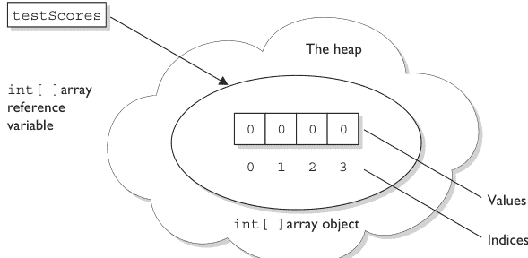

你也可以在一条语句中声明并构造数组，如下所示：

```java
int[] testScores = new int[4];
```

这一个单独语句产生的结果与之前的两个语句相同。对象类型的数组也可以以相同的方式构造：

```java
Thread[] threads = new Thread[5]; // 没有创建 Thread 对象！

// 一个 Thread 数组
```

记住，尽管代码看起来是如此，但 `Thread` 构造函数并没有被调用。我们并不是在创建一个 `Thread` 实例，而是创建一个 `Thread` 数组对象。在前面的语句之后，仍然没有任何真实的 `Thread` 对象！


仔细思考代码块执行后堆上有多少个对象。考试会要求你了解，例如，前面的代码只产生了一个对象（赋值给名为 `threads` 的引用变量的数组）。由 `threads` 引用的单个对象包含五个 `Thread` 引用变量，但还没有 `Thread` 对象被创建或赋值给这些引用。

记住，数组在构造时必须始终给出一个大小。JVM 需要在堆上为新的数组对象分配适当的空间。例如，执行以下操作永远是不合法的：

```java
int[] carList = new int[]; // 无法编译；需要大小
```

不要这样做，如果你在考试中看到它，就尖叫着向最近标记为“编译失败”（Compilation fails）的地方跑吧。


你可能会看到“construct”（构造）、“create”（创建）和“instantiate”（实例化）这些词交替使用。它们的意思都是“在堆上构建了一个对象”。这也暗示了由于构造/创建/实例化代码的执行，对象的构造函数会运行。你可以肯定地说，例如，任何使用 `new` 关键字的代码（如果成功运行）都会导致类构造函数和所有父类构造函数的运行。

## 使用数组 (OCA 目标 4.1 和 4.2)

除了用 `new` 构建外，数组还可以通过其他方式创建。

## 第 5 章：处理字符串、数组和 ArrayList

例如，如果一个数组的长度为 4，则索引值为 0 到 3。你通常会看到在循环中初始化数组元素，如下：

```java
Dog[] myDogs = new Dog[6]; // 创建一个包含 6 个引用的数组

for(int x = 0; x < myDogs.length; x++) {

    myDogs[x] = new Dog(); //为索引 x 分配一个新的 Dog 对象

}
```

`length` 变量告诉我们数组包含多少个元素，但它并没有告诉我们这些元素是否已经初始化。

### 在内声明、构造和初始化

你可以使用两种不同的数组特定快捷方式在单条语句中完成初始化（将值放入数组元素）和构造（实例化数组对象）。第一种用于在一个语句中声明、创建并初始化，如下：

```java
int x = 9;

int[] dots = {6, x, 8};
```

上述代码中的行执行了四件事：
- 声明了一个名为 `dots` 的 int 数组变量。
- 创建了一个长度为三个元素的 int 数组。
- 用值 6、 9 和 8 填充数组元素。
- 将新数组赋值给引用变量。

尺寸（数组的长度）由大括号之间用逗号分隔的项目数量决定。这段代码在功能上等同于较长的代码：

```java
int[] dots;

dots = new int[3];

dots[0] = 6;

dots[1] = x;

dots[2] = 8;
```


# 为什么有人使用较长的写法？

我想到了一个原因是：在你创建数组时，你可能并不知道要赋值给数组元素的数值。

## 使用数组（OCA 目标 4.1 和 4.2）

### 图 5-6 声明、构造和初始化对象数组


图片展示了以下代码的结果：

```java
Dog puppy = new Dog("Frodo");

Dog[] myDogs = {puppy, new Dog("Clover"), new Dog("Aiko")};
```

创建了四个对象：
- 被 `puppy` 和 `myDogs[0]` 引用的 `Dog` 对象
- 被 `myDogs` 引用的 `Dog` 数组
- 被 `myDogs[1]` 和 `myDogs[2]` 引用的 `Dog` 对象

## 处理多维数组

你可以使用多维数组的快捷语法，如下：

```java
int[][] scores = {{5, 2, 4}, {7, 9, 2}, {3}};
```

这段代码在堆上总共创建了四个对象。例如，`int` 数组的长度为 4（将被赋值给 `scores` 变量的对象）。`scores` 数组的长度为 3，由大括号之间的项目数量得出。`scores` 数组中的每个元素都是一个 `int` 数组的引用，因此这三个数组被构造并赋值给这些元素。

到目前为止，我们有四个对象：一个 `int` 数组（每个元素都是 `int` 数组的引用）和三个 `int` 数组（每个元素都是一个 `int` 数组）。最后，这三个 `int` 数组用内层括号内的实际值进行了初始化。因此，第一个数组包含值 5、2、7。以下代码显示了该多维数组中的部分元素：

```java
scores[0] // 一个包含 4 个 int 的数组

scores[1] // 一个包含 2 个 int 的数组

scores[2] // 一个包含 2 个 int 的数组
```

图 5-7 显示了在一个语句中声明、构造和初始化多维数组的结果。

### 图 5-7 声明、构造和初始化多维数组


图片展示了以下代码的结果：

```java
Cat[][] myCats = {{new Cat("Fluffy"), new Cat("Zeus"), new Cat("Bilbo"), new Cat("Legolas"), new Cat("Bert")};
```

创建了四个对象：
- 被 `myCats[0]` 引用的对象
- 被 `myCats` 引用的 `Cat` 数组
- 被 `myCats[1]` 和 `myCats[2]` 引用的对象
（注：此处原文似乎存在多处引用逻辑的描述，已按原意翻译）

（注：由于原文文本在结尾处存在一些格式断裂或逻辑混乱，译文已尽可能遵循原文结构进行还原。）

## 一维数组的数组引用赋值

在考试中，你需要识别数组引用变量的合法和非合法赋值。我们讨论的不是数组内部的引用（换句话说，数组元素），而是指向数组对象的引用。例如，如果你声明了一个 `int` 数组，你声明的引用变量可以重新赋值为任何不是 `int` 数组的类型，包括一个 `int` 值。记住，所有数组都是对象，因此 `int` 数组引用不能指向 `int` 原类型类型。以下代码演示了基本类型数组的合法和非合法赋值：

```java
int[] splats;

int[] dats = new int[4];

char[] letters = new char[5];

splats = dats; // OK，dats 指向一个 int 数组

splats = letters; // NOT OK，letters 指向一个 char 数组
```

人们往往想给一个 `short` 或 `char` 类型的变量赋值（它们可以被显式提升并赋值给 `int`），任何这些类型的数组都可能让开发者感到残忍、心碎（但其他方面代价昂贵），在考试中出刁刁的数组赋值题。

存储对象的数组（相对于基本类型数组）并没有限制。就像你可以把一个 `Honda` 对象放入 `Car` 数组中（因为 `Honda` 继承了 `Car`），你也可以如下所示将 `Honda` 类型的数组赋值给 `Car` 引用变量：

```java
Car[] cars;

Honda[] cuteCars = new Honda[5];

Car[] cars = cuteCars; // OK，因为 Honda 是一种 Car

Beer[] beers = new Beer[99];

Car[] cars = beers; // NOT OK，Beer 并不是一种 Car
```

应用 IS-A 测试来帮助区分合法和非合法。`Honda IS-A Car`，因此 `Honda` 数组可以赋值给 `Car` 数组。`Beer IS-A` 是错误的；`Beer` 并没有继承 `Car`（这没有意义，除非你已经喝太多了）。

数组赋值的规则也适用于接口和类。声明为接口类型的数组可以引用实现该接口的任何类型的数组。记住，实现特定接口的类的任何对象都会通过该接口的 IS-A (`instanceof`) 测试。例如，如果 `Box` 实现了 `Foldable`，以下操作是合法的：

```java
Foldable[] foldingThings;

Box[] boxThings = new Box[3];

foldingThings = boxThings;

// OK，Box 实现了 Foldable，所以 Box IS-A Foldable
```


你不能反转合法赋值。`Car` 不能被赋值给 `Honda` 数组。`Car` 不一定是 `Honda`，所以如果你声明了一个 `Honda` 数组，如果你将 `Car` 数组赋值给 `Honda` 变量，程序可能会崩溃。想一下：一个 `Car` 可能包含一个 `Ferrari` 的引用，所以一个认为自己拥有一个 `Honda` 数组的人可能会突然发现自己有了一辆 `Ferrari`。记住，可以使用 `instanceof` 运算符在代码中检查 IS-A 测试。

## 多维数组的数组引用赋值

当你将数组赋值给之前声明的数组引用时，你所赋值的数组必须与你赋值的目标引用具有相同的维度。例如，一个 `int` 数组的二维数组不能赋值给一个普通的 `int` 引用，如下：

```java
int[] blots;

int[] squeegee = new int[3];

blots = squeegee;

  // NOT OK，squeegee 是一个

  // int 数组的二维数组
```

```java
int[] blocks = new int[6];

blots = blocks;

  // OK，blocks 是一个 int 数组
```

特别注意使用不同维度的数组赋值。例如，你可能会被问及将 `int` 数组赋值给数组数组中的第一个元素是否合法，如下所示：

```java
int[] books = new int[3];

int[] numbers = new int[6];

aNumber = 7;

books[0] = aNumber;  // NO，期望的是 int 数组而不是 int

books[0] = numbers;  // OK，numbers 是一个 int 数组
```

图 5-8 显示了数组引用合法和非合法赋值的示例。

### 图 5-8 合法和非法的赋值

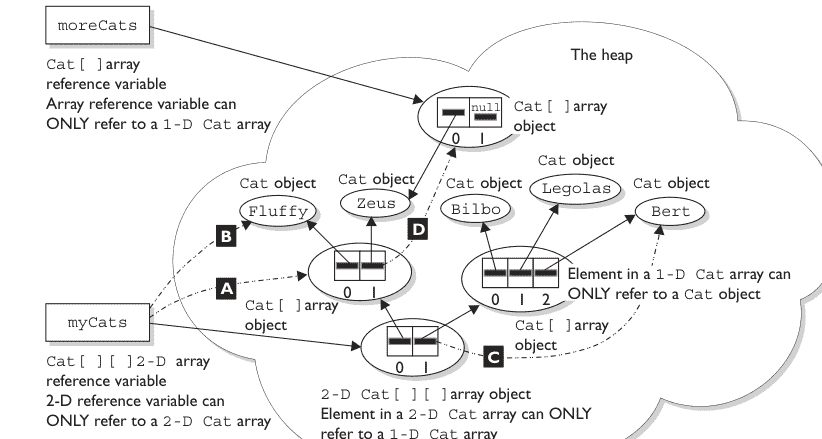

| 非法 | 合法 |
| :--- | :--- |
| **A** `myCars = boxThings;` // 不能将 1D 数组赋值给 2D 数组 | **B** `myCars[0] = new int[3];` // OK |
| **C** `myCars = cuteCars;` // 不能将 1D 数组赋值给 2D 数组 | **D** `myCars = cuteCars;` // OK |
| **E** `myCars = cuteCars[0];` // 不能将 1D 数组赋值给 2D 数组 | **F** `new int[6];` // OK |

## 什么时候使用 ArrayList

我们已经讨论过数组了。数组看起来相当灵活。我们为什么还需要更多功能？考虑以下情况：

- 你需要增加和减少列表的大小。
- 列表中的顺序很重要并且可能会改变。

假设你想去欧洲旅游？你有几个目的地，假设你的列表如下：

```java
String[] cities = {"Oslo", "Paris", "Rome"};
```

但现在想象你真的也想伦敦！你有两个问题：

- 你的 `cities` 数组已经满了。
- 如果你从北向南，你需要在 Paris 之前插入伦敦。

## 使用 ArrayList (OCA 目标 4.3)

当然，你可以设法如何做到。也许你创建一个新数组，从一个数组复制到另一个，然后在正确的时刻添加伦敦。可行，但很困难。

现在让我们看看如何使用 `ArrayList` 实现相同的操作：

```java
import java.util.*;

public class Cities {

    public static void main(String[] args) {

        List<String> c = new ArrayList<String>();

        c.add("Oslo");

        c.add("Paris");

        c.add("Rome");

        int index = c.indexOf("Paris");

        System.out.println(c + " : " + index);

        c.add(index, "London");

        System.out.println(c);

    }

}
```

输出将是：

```
[Oslo, Paris, Rome] : 1

[Oslo, London, Paris, Rome]
```

通过回顾代码，我们可以学习到关于 `ArrayList` 的重要事实：

- `ArrayList` 类位于 `java.util` 包中。
- 与数组类似，当你构建 `ArrayList` 时，必须声明它可以包含的对象类型。在这种情况下，我们正在构建一个包含 `String` 对象的 `ArrayList`（稍后我们将更详细地查看创建 ArrayList 的行代码）。
- `ArrayList` 实现了 `List` 接口。
- 我们使用 `ArrayList` 方法。在这种情况下，我们使用了多个版本的 `add()`，使用了 `indexOf()`，并且间接使用了 `toString()` 来显示 ArrayList 的内容。（稍后将详细介绍 `toString()`。）
- 像数组一样，ArrayList 的索引从 0 开始。
- 我们在构建 `ArrayList` 时没有声明它的大小。
- 我们能够动态向 `ArrayList` 中添加新元素。
- 我们能够在列表的中间添加新元素。
- ArrayList 保持了它的顺序。

# 使用 ArrayList (OCA 目标 4.3)

正如所承诺，我们需要更仔细地观察这行代码：

```java
List<String> c = new ArrayList<String>();
```

首先，我们看到这是一个多态声明。正如我们之前说的，`ArrayList` 实现了 `List` 接口（在 `java.util` 包中）。如果你计划在通过 OCA 7 考试后参加 OCP 7 考试，我们将在书的 OCP 部分更多地讨论为什么我们可能想要多态声明。现在，想象某天你可能想要创建一个包含数组的 List。

接下来，我们看到了这种带有 `< >` 字符的奇怪语法。这种语法是在 Java 5 中引入语言的，与“泛型”（generics）有关。泛型并不在 OCA 考试范围内，所以我们不想在它们上花费太多时间，但重要的是，这是你告诉编译器和 JVM，对于这个特定的 `ArrayList`，你只允许使用 `String` 类型。这意味着，如果编译器能告诉你你正尝试向这个 `ArrayList` 添加一个“非字符串”对象，你的代码将无法编译。此外，正如所承诺的，让我们来看这一行代码：

```java
System.out.println(c);
```

记住，所有类最终继承自 `Object` 类。`Object` 类包含一个名为 `toString()` 的方法。再次，`toString()` 没有“正式”出现在 OCA 考试中（当然它在 OCP 考试中！），但你现在需要理解它。当你将对象引用传递给 `System.out.print()` 或 `System.out.println()` 时，你是在告诉它们调用该对象的 `toString()` 方法。（当你创建一个新类时，可以选择重写从 Object 继承的 `toString()` 方法，以显示关于该类对象的有用信息。）API 开发者非常心地重写了 `ArrayList` 的 `toString()` 方法，向你显示 `ArrayList` 的内容，正如你在程序输出看到的那样。太！

# ArrayList 与重复项

当你计划欧洲旅行时，你发现罗马之行途中，那不勒斯将举办一场精彩的音乐节！那不勒斯就在罗马的海岸边！你必须把那次外游加入你的行程。问题是，`ArrayList` 可以有重复条目吗？这样写是合吗：

```java
c.add("Rome");

c.add("Naples");

c.add("Rome");
```

简短的回答是：是的，`ArrayList` 可以有重复项。现在如果你停下来想一下，“重复 Java 对象”的概念其实有点复杂。放松吧，因为你直到学习 OCP 7 的时候才需要接触这个问题。


从技术上说，`ArrayList` 只持有对象引用，而不是基本数据类型。如果你看到这样的代码：

```java
myList.add(7);
```

实际发生的情况是 `int` 被自动装箱（转换）成一个 `Integer` 对象并添加到 `ArrayList` 中。我们将在书的 OCP 部分详细讨论自动装箱。

# 实战中的 ArrayList 方法

让我们来看另一个代码，它展示了考试中需要知道的大部分 `ArrayList` 方法：

```java
import java.util.*;

public class Tweaklists {

    public static void main(String[] args) {

        List<String> myList = new ArrayList<String>();

        myList.add("z");

        myList.add("x");

        myList.add(1, "y");

        myList.add("w");

        System.out.println(myList);

        myList.clear(); // 删除全部

        myList.add("b");

        myList.add("a");

        myList.add("c");

        System.out.println(myList); // [b, a, c]

        System.out.println(myList.contains("a") + " " + myList.contains("x"));

        System.out.println("get 1: " + myList.get(1));

        System.out.println("index of c: " + myList.indexOf("c"));

        myList.remove(1); // 删除 "a"

        System.out.println("size: " + myList.size() + " contents: " + myList);

    }

}
```

它应该产生类似这样的输出：

```
[w, z, y, x]

[b, a, c]

true false

get 1: 1

index of c: 2
```


size: 2 contents: [b, c]

关于这段代码的几点说明：首先，注意 `contains()` 返回的是一个布尔值。这使得 `contains()` 非常适合用于“if” 测试。注意 ArrayList 有一个 `size()` 方法。重要的是记住，数组（arrays）有 `length` 属性，而 Arrays 工具类有 `size()` 方法。

# ArrayList 类中的重要方法

以下方法是 ArrayList 类中常用的方法，也是你最可能在考试中遇到的方法：

- `add(element)`：将此元素添加到 ArrayList 的末尾
- `add(index, element)`：在指定的索引处添加此元素
- `clear()`：从 ArrayList 中移除所有元素
- `contains(element)`：返回该列表中是否包含该元素
- `get(index)`：返回指定索引处的对象
- `indexOf(Object)`：返回指定元素的索引，如果未找到则返回 -1
- `remove(index)`：删除指定索引处的元素
- `size()`：返回 ArrayList 中的元素数量

## 第 5 章：字符串、数组和 ArrayList

## 两分钟快速演练

以下是本章认证目标中的一些关键点。

### 使用 String 和 StringBuilder (OCA 目标 2.6 和 2.7)

- String 对象是不可变的，但 String 引用变量是可变的。
- 如果你创建了一个新的 String 但没有赋值给它，它将从你的程序中丢失。
- 如果将一个 String 引用重指向一个新的字符串，旧的 String 可能会丢失。
- String 方法使用从零开始的索引，但 `substring()` 的第二个参数除外。
- String 类是 `final` 的——它不能被扩展。
- 当 JVM 找到字符串字面量时，它会被添加到字符串字面量池（String literal pool）。
- String 拥有一个名为 `length()` 的方法——数组拥有一个名为 `length` 的属性。
- StringBuilder 对象是可变的——它们可以在不创建新对象的情况下发生更改。
- StringBuilder 方法作用于调用者对象，对象可以在语句中没有显式赋值的情况下发生更改。
- 需要记住的 String 方法：`charAt()`、`concat()`、`equalsIgnoreCase()`、`length()`、`replace()`、`substring()`、`toLowerCase()`、`toUpperCase()` 和 `trim()`。
- 需要记住的 StringBuilder 方法：`append()`、`delete()`、`insert()`、`reverse()` 和 `toString()`。

### 使用数组 (OCA 目标 4.1 和 4.2)

- 数组可以持有基本类型或对象，但数组本身始终是一个对象。
- 声明数组时，括号可以位于名称的左侧或右侧。
- 在声明中包含数组的大小永远是不合法的。
- 在构造数组时（使用 `new`）必须包含数组的大小，除非你正在创建一个匿名数组。
- 对象数组中的元素不会自动创建，尽管基本类型数组的元素会被赋予默认值。
- 如果你尝试在对象数组中使用数组元素，而该元素没有引用真实的对象，你将得到 `NullPointerException`。
- 数组索引从零开始。
- 如果你使用了无效的索引值，会抛出 `ArrayIndexOutOfBoundsException`。
- 数组有一个 `length` 属性，其值是数组元素的数量。
- 你访问的最后一个索引总是比数组长度少 1。
- 多维数组只是数组的数组。
- 多维数组中的各个维度可以有不同的长度。
- 基本类型数组可以接受任何可以隐式提升为数组声明类型的值——例如，一个 `byte` 变量可以放入 `int` 数组中。
- 对象数组可以持有任何通过数组声明类型 IS-A（或 `instanceof`）测试的对象。例如，如果 `Horse` 继承自 `Animal`，那么一个 `Horse` 对象可以放入 `Animal` 数组。
- 如果你将数组赋值给之前声明的数组引用，你所赋值的数组必须与你所赋值的引用维度相同。
- 你可以将一种类型的数组赋值给之前声明的其一个父类型的数组引用。例如，一个 `Honda` 数组可以赋值给 `Car` 数组（假设 `Honda` 继承自 `Car`）。

### 使用 ArrayList OCA 目标 4.3

- ArrayList 允许你调整列表的大小，并比数组更容易对列表进行插入和删除。
- 对于 OCA 7 考试，你只需要知道这种类型的 ArrayList 声明：

```java
ArrayList<type> myList = new ArrayList<type>();

List<type> myList2 = new ArrayList<type>(); // 多态
```

- ArrayList 只能持有对象，不能持有基本类型，但记住自动装箱（autoboxing）可以让你看起来像是在向 ArrayList 添加基本类型，而实际上你添加的是基本类型的包装类。
- ArrayList 的索引从 0 开始。
- ArrayList 可以有重复条目。注意：判断两个元素是否重复比看起来要复杂，而且在 OCP 7 考试中才会出现。
- 需要记住的 ArrayList 方法：`add(element)`、`add(index, element)`、`clear()`、`contains()`、`get(index)`、`indexOf()`、`remove(index)`、`remove(object)` 和 `size()`。

## 自测

I. 给定：

```java
public class Mutant {

    public static void main(String[] args) {

        StringBuilder sb = new StringBuilder("abc");

        String s = "abc";

        sb.reverse().append("d");

        s.toUpperCase().concat("d");

        System.out.println("" + sb + " " + s + ".");

    }

}
```

将包含哪两个子字符串？（选择两个。）

A. abc.
B. ABCD.
C. ABCD.
D. bad.
E. dcba.

II. 给定：

```java
public class Hilltop {

    public static void main(String[] args) {

        String[] horses = new String[5];

        horses[4] = null;

        for (int i = 0; i < horses.length; i++) {

            if (i < args.length) {

                horses[i] = args[i];

            }

            System.out.print(horses[i].toUpperCase() + " ");

        }

    }

}
```

并且，如果代码编译通过，命令：
`java Hilltop`
结果是什么？

A. Hilltop
B. Hilltop null
C. 抛出异常且无输出
D. Hilltop，然后是 NullPointerException
E. Hilltop，然后是 ArrayIndexOutOfBoundsException
F. 编译失败。

III. 给定：

```java
public class Actors {

    public static void main(String[] args) {

        char[] ca = {'a', 'b', 'c'};

        System.out.println((ca[0] == ca[1]) + " " + (ca[0] == ca[2]));

    }

}
```

结果是什么？

A. true true
B. true false
C. false true
D. false false
E. 编译失败。

IV. 给定：

```java
public class Dims {

    public static void main(String[] args) {

        int[][] a = {{1, 2}, {3, 4}};

        int[] b = (int[]) a[1];

        Object o1 = b;

        int[] b2 = (int[]) o1;

        System.out.println(b2[1]);

    }

}
```

结果是什么？（选择所有可能的）

A. 2
B. 4
C. 运行时抛出异常
D. 第 4 行错误
E. 第 5 行错误
F. 第 6 行错误

V. 给定：

```java
import java.util.*;

public class Sequence {

    public static void main(String[] args) {

        ArrayList<String> myList = new ArrayList<String>();

        myList.add("apple");

        myList.add("carrot");

        myList.add("banana");

        myList.add(1, "plum");

        System.out.print(myList);

    }

}
```

结果是什么？

A. [apple, banana, plum]
B. [apple, plum, carrot]
C. [apple, plum, banana]
D. [plum, apple, carrot]
E. [banana, plum, apple]
F. 编译失败。

VI. 给定：

```java
class Dozens {

    int[] dz = {1, 2, 3, 4, 5, 6, 7, 8, 9, 10, 11, 12};

}

public class Eggs {

    public static void main(String[] args) {

        Dozens[] da = new Dozens[3];

        da[0] = new Dozens();

        Dozens d = new Dozens();

        da[1] = d;

        d = null;

        da[1] = null;

        // do stuff

    }

}
```

哪两项是正确的：main() 中创建了哪些对象，到达第14 行时哪些对象可以垃圾回收？

A. 创建了三个对象
B. 创建了四个对象
C. 创建了五个对象
D. 没有对象可以垃圾回收
E. 一个对象可以垃圾回收
F. 两个对象可以垃圾回收
G. 三个对象可以垃圾回收。

VII. 给定：

```java
public class Tailor {

    public static void main(String[] args) {

        byte[][] ba = {{1, 2, 3, 4}, {1, 2, 3}};

        System.out.println(ba[1].length + " " + ba.length);

    }

}
```

结果是什么？

A. 2 4
B. 2 7
C. 3 2
D. 3 7
E. 4 2
F. 4 7
G. 编译失败。

VIII. 给定：

```java
public class Theory {

    public static void main(String[] args) {

        String s1 = "abc";

        String s2 = s1;

        s1 += "d";

        System.out.println(s1 + " " + s2 + " " + (s1 == s2));

        StringBuilder sb1 = new StringBuilder("abc");

        StringBuilder sb2 = sb1;

        sb1.append("d");

        System.out.println(sb1 + " " + sb2 + " " + (sb1 == sb2));

    }

}
```

以下哪些选项是正确的？（选择所有适用项。）

- A. 编译失败
- B. 第一行输出是 abc abc true
- C. 第一行输出是 abc abc false
- D. 第一行输出是 abc abc false
- E. 第二行输出是 abcd abc false
- F. 第二行输出是 abcd abc true
- G. 第二行输出是 abcd abcd false

9. 给定代码：

```java
public class Mounds {

    public static void main(String[] args) {

        StringBuilder sb = new StringBuilder();

        String s = new String();

        for (int i = 0; i < 1000; i++) {

            s = " " + i;

            sb.append(s);

        }

        // 循环结束

    }

}
```

如果在执行这段代码期间垃圾回收器没有运行运行，那么在循环结束时，内存中大约会有多少个对象？

- A. 少于 10 个
- B. 大约 1000 个
- C. 大约 2000 个
- D. 大约 3000 个
- E. 大约 4000 个

10. 给定代码：

```java
class Box {

    int size;

    Box(int s) { size = s; }

}

public class Laser {

    public static void main(String[] args) {

        Box b1 = new Box(5);

        Box[] ba = go(b1, new Box(6));

        ba[0] = b1;

        for(Box b : ba) System.out.print(b.size + " ");

    }

    static Box[] go(Box b1, Box b2) {

        b1.size = 4;

        Box[] ma = {b2, b1};

        return ma;

    }

}
```

结果是什么？

- A. 4 4
- B. 5 4
- C. 6 4
- D. 4 5
- E. 5 5
- F. 编译失败

11. 给定代码：

```java
public class Hedges {

    public static void main(String[] args) {

        String s = "JAVA";

        s = s + "rocks";

        s = s.substring(4,8);

        s.toUpperCase();

        System.out.println(s);

    }

}
```

结果是什么？

- A. JAVA
- B. JAVAROCKS
- C. rocks
- D. rock
- E. ROCKS
- F. ROCK
- G. 编译失败

12. 给定代码：

```java
import java.util.*;

class Fortress {

    private String name;

    private ArrayList<Integer> list;

    Fortress() { list = new ArrayList<Integer>(); }

    String getName() { return name; }

    void addToList(int x) { list.add(x); }

    ArrayList getList() { return list; }

}
```


哪些代码行（如果有）破坏了封装性？（选择所有适用项）。

- A. 第 3 行
- B. 第 4 行
- C. 第 5 行
- D. 第 7 行
- E. 第 8 行
- F. 第 9 行
- G. 该类已经很好地封装了

## 自测答案

- 1. A 和 D 正确。`String` 操作是在一个新的（丢失的）`String` 上进行的，而不是 `s` 上。`StringBuilder` 的操作是从左到右的。
☑ 根据以上内容，B、C 和 E 是错误的。（OCA 目标 2.6 和 2.7）

- 2. D 正确。`horses` 数组的前四个元素包含 `String`，但第五个元素是 `null`，因此对第五个元素调用 `toUpperCase()` 会抛出 `NullPointerException`。
☑ 根据以上内容，A、B、C、E 和 F 是错误的。（OCA 目标 2.7 和 4.1）

- 3. E 正确。Unicode 声明被列在单引号中：`'\u0041'`。如果是这样做的，答案将是 A，但由于等性判断不在 OCA 考试中。
☑ 根据以上内容，A、B 和 D 是错误的。（OCA 目标 2.1 和 4.1）

- 4. C 正确。在第 7 行抛出了 `ClassCastException`，因为它引用的是 `int []`，而不是 `int[]`。如果删除第 7 行，输出将是 4。
☑ 根据以上内容，A、B、D、E 和 G 是错误的。（OCA 目标 4.2 和 7.4）

- 5. B 正确。`ArrayList` 元素按照输入顺序手动插入的；它们不会自动排序。`ArrayList` 使用从 0 开始的索引，`add()` 会插入新元素并移动剩余元素
☑ 根据以上内容，A、C、D、E 和 G 是错误的。（OCA 目标 4.3）

- 6. C 和 F 正确。`a` 指向一个类型为 "Doz 数组"的对象，每个创建的 `Dozens` 对象都带有自己的 "int 数组"。当运行到第 14 行时，第二个 `Dozens` 对象及其 "int 数组" 变得不可达了。
☑ 根据以上内容，A、B、D、E 和 G 是错误的。（OCA 目标 4.1 和 2.4）

- 7. C 正确。二维数组是“数组的数组”。`ba` 的长度为 2，是因为它包含了两个一维数组。数组索引是从 0 开始的，所以 `ba[1]` 引用的是第二个数组。
☑ 根据以上内容，A、B、D、E 和 G 是错误的。（OCA 目标 4.2）

- 8. D 和 F 正确。`String` 对象是不可变的，而 `String` 的引用是可变的。代码 `s == ""` 创建了一个新的 `String`。`StringBuilder` 对象是可变的，所以 `append()` 正在改变两个者都引用的同一个 `StringBuilder` 对象。
☑ 根据以上内容，A、B、C、E 和 G 是错误的。（OCA 目标 2.6 和 2.7）

- 9. B 正确。所有的 `append()` 调用都作用于同一个 `StringBuilder` 对象。然而，`String` 是不可变的，因此每次拼接都会产生一个新的 `String`。此外，字符串被创建一次并在迭代中复用。
☑ 根据以上内容，A、C、D 和 E 是错误的。（OCA 目标 2.6 和 2.7）

# 第 5 章：处理字符串、数组和 ArrayList

- 10. A 正确。虽然 `main()` 中的 `b1` 与 `go()` 中的 `b1` 是不同的变量，但它们引用同一个对象。
☑ 根据以上内容，B、C、D、E 和 F 是错误的。（OCA 目标 4.1, 6.1 和 6.8）

- 11. D 正确。`substring()` 调用使用了从 0 开始的索引，第二个参数是排他的，所以索引 8 处的字符被包含在内。`toString()` 调用创建了一个新的 `String` 对象并立即丢失。
☑ 根据以上内容，A、B、C、E 是错误的。（OCA 目标 2.6）

- 12. F 正确。`else` 块是可选的，所以你也可以使用如下：设置一个 `ArrayList`。
☑ 根据以上内容，A、B、C、D、E 是错误的。（OCA 目标 2.7）

# 第 6 章：控制流与异常

- 使用 `if` 和 `switch` 语句
- 使用 `for`, `do`, `while`
- 使用 `break`, `continue` 语句
- 使用 `try`, `catch`, `finally`
- 描述异常的影响
- 识别常见异常
- Drill

## if-else 分支

`if` 语句的基本格式如下：

```java
if (booleanExpression) {
    System.out.println("在 if 语句内部");
}
```

括号中的表达式必须求值为布尔值（真或假）。通常你会测试某些内容是否为真，如果是运行代码块（一个或多个语句），并在不是时（可选）运行另一个代码块。下面的代码展示了一个标准的 `if-else` 语句：

```java
if (x > 3) {
    System.out.println("x大于3");
} else {
    System.out.println("x不大于3");
}
```

`else` 是可选的，所以你也可以使用：

```java
if (x > 3) {
    y = 2;
}
z += x;
y = y + x;
```

前面的代码在测试通过时（意味着 `x` 确实大于 3）会将 2 赋值给 `y`，但另外两行无论如何都会执行。即使大括号也是可选的，如果条件语句块内只有一个语句。下面的代码示例是合法的（尽管为了可读性并不推荐）：

```java
if (x > 3) // 习惯，但在考试中会出现
    y = 2;
z += x;
y = y + x;
```

你可以设置一个 `if-else` 语句来测试多个条件。后续示例使用了两个条件，以便当第一个测试失败时，我们想在决定做什么之前进行第二次测试：

```java
if (price < 300) {
    buyProduct();
} else {
    if (price < 400) {
        getApproval();
    } else {
        dontBuyProduct();
    }
}
```

这引入了另一种 `if-else` 结构，即 `if, else if, else`。之前的代码可以（并且应该）重写如下：

```java
if (price < 300) {
    buyProduct();
} else if (price < 400) {
    getApproval();
} else {
    dontBuyProduct();
}
```

使用 `else` 和 `else if` 有几条规则：

- 一个给定的语句可以零或一个 `else`，它必须位于任何 `else if` 之后。
- 一个给定的语句可以有零到多个 `else if`，它们必须位于（可选的）`else` 之前。
- 一旦某个 `else if` 执行成功，剩余的 `else if` 和 `else` 都不会再被测试。

下面的示例展示了在现实世界中格式极其糟糕的代码。正如你可能猜到的那样，在示例中很有可能会遇到这样的格式。在这种情况下，代码演示了多个 `else if` 的用法：

```java
int x = 1;
if (x == 3) {}
else if (x < 4) {System.out.println("<4"); }
else if (x < 2) {System.out.println("<2"); }
else {System.out.println("else"); }
```

它产生以下输出：

<4

（注意，尽管第二个 `else if` 为真，它也永远不会被执行。）

有时你可能无法确定 `else` 应该与哪个语句配对，如下所示：

```java
if (exam.done())
    if (exam.getScore() < 0.61)
        System.out.println("Try again.");
// 这个 属于哪一个？
else
    System.out.println("Java master!");
```

我们特意去掉了这段代码的缩进，这样它就不会提供关于 `else` 属于哪个语句的提示。你弄出来了吗？Java 规定 `else` 子句属于它可能所属的最内层 `if` 语句（换句话说，就是最近的且没有 `else` 的那一个）。在前面的例子中，`else` 属于列表中的第二个 `if` 语句。如果使用正确的缩进，它看起来应该是这样：

```java
if (exam.done())
    if (exam.getScore() < 0.61)
        System.out.println("Try again.");
// 这个 属于哪一个？
else
    System.out.println("Java master!");
```

按照我们使用大括号的编码习惯，它会更易读：

```java
if (exam.done()) {
    if (exam.getScore() < 0.61)
        System.out.println("Try again.");
    // 这个 属于哪一个？
    else {
        System.out.println("Java master!");
    }
}
```

不要指望考试题会很友好且缩进得当。任何可以变得更混乱的东西，都会变得更混乱。准备好应对那些不仅缩进不整齐，而且故意以误导性方式缩进的题目。密切关注类似下面的误导：

```java
if (exam.done())
    if (exam.getScore() < 0.61)
        System.out.println("Try again.");
else
    System.out.println("Java master!"); // 嗯，现在它
// 属于哪一个？
```

当然，上面的代码与之前的两个示例完全相同，只是外观看起来不同。

## if 语句的合法表达式

`if` 语句中的表达式必须是一个布尔表达式。任何解析为布尔值的表达式都是可以的，其中某些表达式可能是复杂的。假设 `doStuff()` 返回 `true`，

```java
int y = 5;
int x = 2;
if ((x > 3) && (y < 2) || doStuff()) {
    System.out.println("true");
}
```

打印输出 true

你可以将前面的代码读为：“如果 `(x > 3)` 且 `(y < 2)` 为真，或者 `doStuff()` 的结果为真，则打印 'true'。”所以，基本上只要 `doStuff()` 本身为真，我们就会得到真。如果 `doStuff()` 为假，那么 `(x > 3)` 和 `(y < 2)` 都必须为真才能打印 "true"。如果漏掉一组括号，前面的代码会更复杂：

```java
int y = 5;
int x = 2;
if ((x > 3) && (y < 2) || doStuff()) {
    System.out.println("true");
}
```

这打印了……什么都没有！因为前面的代码（少了一组括号）评估结果就像你在说：“如果 `(x > 3)` 为真，且 `(y < 2)` 或 `doStuff()` 的结果为真，则打印 'true'。”由于 `(x > 3)` 为假，没必要看表达式的剩余部分。由于短路运算符 `&&`，该表达式的评估方式就像在 `(y < 2)` 周围有一对括号，在 `&&` 之前有一个单一表达式，在 `&&` 之后有一个单一表达式一样。记住，`if` 测试中唯一的合法是布尔。在某些语言中，0=false，1=true。在 Java 中不是！下面的代码显示了看起来很有吸引力但根据替换是非法的语句：

```java
int trueInt = 1;
int falseInt = 0;
if (trueInt) // 非法
if (trueInt == true) // 非法
if (1) // 非法
if (falseInt == false) // 非法
if (trueInt == 1) // 合法
if (falseInt == 0) // 合法
```

程序员犯的一个常见错误（而且很难发现）是在你想测试布尔变量时给布尔变量赋值。请注意如下代码：

```java
boolean boo = false;
if (boo = true) { }
```

你可能会有三种想法：

1. 代码正常编译并运行，但测试失败了，因为 `boo` 是 false。
2. 代码无法编译，因为你使用的是赋值 (`=`) 而不是等值测试 (`==`)。
3. 代码编译并运行，且测试成功了，因为 `boo` 在 `if` 参数中被**设置为** true（而不是**测试**为 true）。

嗯，第 3 点是正确的——虽然毫无意义，因为任何赋值的结果都是赋值后变量的值，表达式 `(boo = true)` 的结果是 true。因此，测试成功了。但可以被赋值（而不是与 else 比较）的变量是布尔型的；所有其他赋值都将导致非布尔结果，所以它们是非法的，如下所示：

```java
int x = 3;
if (x = 5) { // 无法编译，因为 x 不是布尔值！
}
```

因为 `if` 测试需要布尔表达式，你需要对逻辑运算符和 `if` 测试的语法及语义都非常扎实。

## switch 语句 (OCA, OCP, 升级)

你已经看到 `if` 和 `else-if` 语句如何支持简单和复杂的决策逻辑。在很多情况下，`switch` 语句提供了一种更清晰的方法来处理复杂的逻辑。让我们把下面的 `if-else` 语句与等效的 `switch` 语句进行比较：

```java
int x = 3;
if(x == 1) {
    System.out.println("x equals 1");
} else if(x == 2) {
    System.out.println("x equals 2");
} else {
    System.out.println("No idea what is");
}
```

现在让我们看看 `switch` 结构表示相同的功能：

```java
int x = 3;
switch (x) {
    case 1:
        System.out.println("x equals 1");
        break;
    case 2:
        System.out.println("x equals 2");
        break;
    default:
        System.out.println("No idea what is");
}
```

这个 `switch` 语句之所以能模拟 `if`，是因为在内部放置了 `break` 语句。通常情况下，`break` 语句是可选的，正如你几页后会看到的，包含或排除它们会改变 `switch` 语句的执行方式。

## switch 和 case 的合法表达式

`switch` 语句的一般形式是：

```java
switch (expression) {
    case constant1: 代码块
    case constant2: 代码块
    default: 代码块
}
```

`switch` 表达式必须评估为 `char`、`byte`、`short`、`int`、`enum`（Java 5 起）以及 `String`（Java 7 起）。这意味着你不需要枚举或字符串，只有值以及可以自动提升（换句话说，隐式转换）为 `int` 的值是可以接受的。如果你使用其他任何类型，包括剩余的数值类型 `long`、`float` 和 `double`，你将无法编译。

> **注意**：对于 OCA 考生，考试不涵盖枚举，你不会遇到任何与使用枚举的 `switch` 语句相关的问题。

case 评估的结果类型与 `switch` 表达式可以使用的类型相同，但还有一个巨大的限制：case 必须是常量！由于 case 参数必须在编译时解析，你只能使用常量或立即用字面量初始化的 `final` 变量。仅仅是 `final` 是不够的；它必须是一个编译时常量。这里有一个例子：

此外，`switch` 只能检查相等性。这意味着其他关系运算符（如大于）在 `case` 中是不可用的。以下是一个在 `switch` 语句中使用方法调用的有效表达式示例。请注意，为了使此代码合法，在对象引用上调用的方法必须返回一个与 `int` 兼容的值。

```java
String s = "xyz";
switch (s.length()) {
    case 1:
        System.out.println("length is one");
        break;
    case 2:
        System.out.println("length is two");
        break;
    case 3:
        System.out.println("length is three");
        break;
    default:
        System.out.println("no match");
}
```

你可能会涉及的另一个问题是：“如果我对一个比 `int` 小的变量进行 `switch` 会发生什么？”看下面的 `switch`：

```java
byte g = 2;
switch(g) {
    case 23:
    case 128:
}
```


这段代码将无法编译。虽然 `switch` 参数是合法的——`byte` 被隐式地转换为 `int`——但第二个 `case` 参数 (128) 对于 `byte` 来说太大了，而且编译器知道这一点！尝试编译前面的示例会得到类似这样的错误：

```
Test.java:6: possible loss of precision
found : int
required: byte
case 128:
```

## 316 第 6 章：流程控制与异常

使用具有相同值的多个 `case` 标签也是非法的。例如，下面的代码块将无法编译，因为它使用了两个值均为 80 的 `case`：

```java
int temp = 90;

switch(temp) {
  case 80: System.out.println("80");
  case 80: System.out.println("80"); // 无法编译！
  case 90: System.out.println("90");
  default: System.out.println("default");
}
```

在 `switch` 表达式中利用装箱（boxing）的力量是合法的。例如，下面是合法的：

```java
switch(new Integer(4)) {
  case 4: System.out.println("boxing is OK");
}
```


寻找任何违反 `switch` 和 `case` 参数规则的地方。例如，你可能会发现类似下面片段的非法示例：

```java
switch(x) {
  case 0 {
    y = 7;
  }
}
```

```java
switch(x) {
  0: { }
  1: { }
}
```

在第一个示例中，`case` 使用了大括号并省略了冒号。第二个示例省略了关键字 `case`。

### String “等价性”引论

正如我们所讨论的，`switch` 语句的操作取决于表达式是否“匹配”或与某个 `case` 之一“相等”。我们已经讨论过如何判断基本类型何时相等，但对象相等意味着什么呢？这是另一个出人意料的难题，对于那些打算参加 OCP 考试的同学，我们将在第二部分花费大量讨论“对象相等”。对于 OCA 候选人，你只需要知道，对于 `switch` 语句，如果两个 `String` 具有相同的区分大小写的字符序列，它们将被认为是“相等”的。例如，在下面的部分 `switch` 语句中，表达式 `s` 将匹配 `case`：

```java
String s = "Monday";

switch(s) {
case "Monday": // 匹配；
}
```

但下面的**不会**匹配：

```java
String s = "MONDAY";

switch(s) {
case "Monday": // String 区分大小写，不匹配
}
```

### switch 块中的 break 和穿透（Fall-Through）

我们终于准备好讨论 `break` 语句并提供关于 `switch` 语句内部流程控制的更多细节。关于通过 `switch` 语句执行流程最重要的点是：

`case` 常量从上到下评估，第一个匹配 `switch` 表达式的 `case` 常量就是执行点。

换句话说，一旦匹配到 `case`，Java 虚拟机 (JVM) 将执行关联的代码块以及所有后续代码块（除非有 `break` 语句）！下面的示例在 `case` 语句中使用了一个 `String`：

```java
class SwitchString {
  public static void main(String [] args) {
    String s = "green";
    switch(s) {
      case "red": System.out.print("red ");
      case "green": System.out.print("green ");
      case "blue": System.out.print("blue ");
      default: System.out.println("done");
    }
  }
}
```

在这个示例中，`case "green"` 匹配了，JVM 执行了该代码块和所有后续代码块，产生了输出：

```
green blue done
```

再次，当程序在执行 `switch` 语句期间遇到关键字 `break` 时，执行将立即跳出 `switch` 块，到 `switch` 之后的语句。如果省略了 `break`，程序将继续执行剩余的 `case` 直到 `switch` 结束。

```java
String s = "green";

switch(s) {
  case "red": System.out.print("red ");
  case "green": System.out.print("green ");
  case "blue": System.out.print("blue ");
  default: System.out.println("done");
}
```

在这个示例中，`case "green"` 匹配了，JVM 执行了该代码块和所有后续代码块，产生了输出：

```
green blue done
```

### 使用 if 和 switch 语句 (OCA 3.4 和 3.5—以及升级目标 1.1) 317

### 316 第 6 章：流程控制与异常

### 使用 if 和 switch 语句 (OCA 3.4 和 3.5—以及升级目标 I.1) 319

### default Case

### 练习 6-1

### 创建 switch-case 语句

## 创建循环结构（OCA 目标 5.1, 5.2, 5.3, 5.4 和 5.5）

- 5.1 创建并使用 `while` 循环。
- 5.2 创建并使用 `for` 循环，包括增强型 `for` 循环。
- 5.3 创建并使用 `do/while` 循环。
- 5.4 比较循环结构。
- 5.5 使用 `break` 和 `continue`。

Java 循环有三种类型：`while`、`do` 和 `for`（从 Java 5 开始，`for` 循环有两种变体）。这三种循环都允许你在只要某个条件为真，或者为了达到特定的迭代次数，就重复一段代码块。你可能已经熟悉其他语言中的循环，即使你对 Java 来说比较新，学习这些内容也不会有问题。

### 使用 while 循环

当你不知道一个代码块或语句应该重复多少次，但希望在某个条件为真时继续循环时，`while` 循环非常好用。`while` 语句看起来如下：

```
while (expression) {
  // do stuff
}
```

或者这样：

```java
int x = 2;

while(x == 2) {
  System.out.println(x);
  x++;
}
```

在这种情况下，与所有循环一样，表达式（测试）必须求出一个布尔值结果。只有当表达式（有时称为“条件”）的结果为 `true` 时，`while` 循环体才会被执行。一旦进入循环，循环将一直重复，直到条件不再满足（即求值结果为 `false`）为止。在上一个例子中，程序控制流将进入循环体，因为 `x` 等于 2。然而，`x` 在循环中不断增加，所以当再次检查条件时，它将求得为 `false` 并退出循环。

`while` 循环表达式中的任何变量必须在表达式求值之前声明。换句话说，你不能这样写：

```
while (int x = 2) { } // 非法
```

话虽如此，你为什么要这样做呢？你不是在测试变量，而是在声明并初始化它，因此它始终具有完全相同的值。这算不上是一个测试条件！

关于 `while` 循环需要记住的关键点是，它可能永远不会运行。如果在第一次检查 `while` 表达式时测试表达式为 `false`，循环体将被跳过，程序将从 `while` 循环后的第一个语句开始。看下面的示例：

```java
int x = 8;

while (x > 8) {
  System.out.println("in the loop");
  x = 10;
}

System.out.println("past the loop");
```

运行这段代码产生：

```
past the loop
```

因为表达式 `(x > 8)` 求值为 `false`，所以 `while` 循环内的任何代码从未执行过。

### 使用 do 循环

`do` 循环与 `while` 循环类似，不同在于表达式在 `do` 循环代码执行后才会求值。因此，`do` 循环中的代码保证至少执行一次。以下展示了 `do` 循环的用法：

```
do {
  System.out.println("Inside loop");
} while (false);
```

即使表达式求值为 `false`，`System.out.println()` 语句也会打印一次。记住，`do` 循环始终至少运行一次循环中的代码。请注意 `while` 表达式末尾的分号使用。

> 就像 `if` 测试一样，寻找表达式没有解析为布尔值的 `while` 循环（以及 `do` 循环中的 `while` 测试）。查看以下合法和非法的 `while` 表达式示例：

```java
int x = 1; // 无法编译；x 不是布尔值
while (x) { } // 无法编译；解析为 5
while (x = 5) { } // (作为赋值的结果)
while (x == 5) { } // 合法
while (true) { } //
```

### 使用 for 循环

从 Java 5 开始，`for` 循环引入了第二种结构。我们将旧式的 `for` 循环称为“基础 `for` 循环”（basic for loop），将新式的 `for` 循环称为“增强 `for` 循环”（enhanced for loop）。根据使用的不同，`for-in`、`for-each` 和 "enhanced for" 都指的是同一种结构。

基础 `for` 循环比增强 `for` 循环更灵活，但增强 `for` 循环是为了更容易遍历数组和集合。

#### 基础 for 循环

`for` 循环对于已经知道需要执行多少次语句的流控制特别有用。除了循环体，`for` 声明有三个主要部分：

- 变量的声明和初始化
- 布尔表达式（条件测试）
- 迭代表达式

`for` 声明的三个部分由分号隔开。以下两个示例展示了 `for` 循环。第一个示例以伪代码格式展示了 `for` 循环的部分，第二个示例展示了典型的 `for` 循环：

```
for /*Initialization*/; /*Condition*/; /*Iteration */ {
  /* loop body */
}
```

```java
for (int i = 0; i < 10; i++) {
  System.out.println("is " + i);
}
```

#### 基础 for 循环：声明和初始化

`for` 语句的第一部分允许你在 `for` 关键字后的括号内声明和初始化零、一个或多个相同类型的变量。如果你声明了多个相同类型的变量，你需要用逗号将它们分开，如下：

```
for (int x = 10, y = 3; 
```

声明和初始化发生在 `for` 循环的最开始。另外两个部分——布尔测试和迭代表达式——会在每次迭代时运行。你必须知道变量的作用域在 `for` 循环结束结束！以下演示了这一点：

```java
for (int x = 1; x < 2; x++) {
  System.out.println(x); // 合法
} // 非法！x 现在超出了作用域
System.out.println(x); // 无法访问。
```

如果你尝试编译这个，你会得到类似的内容：

```
Test.java:19: cannot resolve symbol
symbol : x
location: class Test
```

#### 基础 for 循环：条件（布尔）表达式

下一部分执行条件表达式，该表达式（与所有条件测试一样）必须求出一个布尔值。你只能有一个逻辑表达式，但它可以非常复杂。注意使用如下逻辑表达式的代码：

```
for (int x = 0; (((x < 10) && (y-- > 2)) | x == 3)); x++) {
```

前面的代码是合法的，但后面不是：

```
for (int x = 0; (x > 5), (y < 2); x++) { // 表达式过多
```

编译器会告诉你问题所在：

```
Test.java:20: ';' expected
for (int x = 0; (x > 5), (y < 2); x++) {
```

换句话说，尽管 `for` 语句可以有多个部分，但你不能使用逗号隔开多个测试。

#### 基础 for 循环：迭代表达式

在循环体每次执行后，迭代表达式都会执行。看下面：

```java
for (int x = 0; x < 1; x++) {
  // 不改变 x 的循环体代码
}
```

这个循环只执行一次。第一次进入循环时，`x` 被设置为 0，然后测试 `x` 是否小于 1（是的），然后执行循环体。在循环体之后，迭代表达式运行，将 `x` 加 1。

接下来检查条件测试，由于现在结果为 `false`，执行跳转到 `for` 循环下方并继续。记住，除非发生强制退出，求值迭代表达式和求值条件总是 `for` 循环中最后两件事！

强制退出的示例包括 `break`、`return`、`System.exit()` 和异常，它们都会导致循环突然终止而不运行迭代表达式。看下面的代码：

```java
static boolean doStuff() {
  for (int x = 0; x < 3; x++) {
    System.out.println("in for loop");
  }
  return true;
}
```

运行这段代码产生：

```
for loop
```

语句只打印一次，因为 `return` 导致执行离开循环的当前迭代，而是离开整个方法。在这种情况下，迭代表达式永远不会运行。表 6-1 列出了循环突然终止的情况和结果。

#### 基础 for 循环：for 循环问题

`for` 声明的三个部分都不是必须！下面的示例是完全合法的（尽管不是好的做法）：

```
for(;;) {
  System.out.println("inside an endless loop");
}
```

在这个示例中，所有的声明部分都被省略了，所以 `for` 循环将像死循环。

| 表 6-1 | 循环中的代码 | 发生了什么 |
|---|---|---|
| 提前终止循环的原因 | `break` | 执行立即跳转到循环后的第一个语句。 |
| | `return` | 执行立即跳回调用方法。 |
| | `System.exit()` | 所有程序执行停止；虚拟机关闭。 |

### 创建循环结构 (OCA 目标 5.1, 5.2, 5.3, 5.4 和 5.5) 327

对于考试来说，重要的一点是知道在初始化和更新部分，循环的行为将像一个 `while` 循环。下面的示例演示了如何实现这一点：

```java
int i = 0;
for (; i < 10; ) {
  i++;
  // do some other work
}
```

下一个示例演示了带有多个变量的 `for` 循环。变量用逗号分隔，并且它们必须是相同类型。记住，在 `for` 语句中声明的变量都是 `for` 循环的局部变量，不能在循环范围之外使用。

```java
for (int i = 0
```


变量范围在考试中起着重要作用。你需要知道，在 `for` 循环中声明的变量不能在 `for` 循环之外使用。但仅在 `for` 语句中初始化（但早已声明）的变量可以在 `for` 循环之外使用。例如，以下是合法的：

```java
int x = 3;
for (x = 12; x < 20; x++) {
  System.out.println(x);
}
```

但这是不行的：

```java
for (int x = 3; x < 20; x++) { System.out.println(x); }
```

最后一点需要注意的是，`for` 循环的所有部分都是相互独立的。`for` 语句中的三个表达式不需要作用在相同的变量上，尽管它们通常是这样。但即使是迭代器表达式（许多人错误地称为“增量表达式”），也不需要增加或设置任何内容：你可以放入几乎任何任意的任意语句，让它们在循环的每次迭代时执行。看以下内容：

之前的代码打印出：

```
iterate
iterate
```

在 Java 7 考试中，许多题目将“编译失败”和“运行时发生异常”列为可能的答案。这使得它们变得更加困难，因为你不能简单地推导代码的行为。你必须首先确保代码没有违反任何导致编译器错误的基本规则，然后寻找可能的异常。只有在满足了这两个条件后，你才应该研究问题中代码的逻辑和流程。

### 增强型 for 循环（数组）

增强型 `for` 循环是 Java 5 新引入的特殊循环，它简化了对数组或集合的遍历。在本章中，我们将重点关注使用增强型 `for` 循环遍历数组。在第 11 章中，我们在讨论集合时将再次回到增强型循环上——那里才是增强型循环大显威力的地方。

与三个组件相比，增强型 `for` 只有两个组件。让我们先用（旧的方式遍历数组，然后使用增强型 `for`：

```java
int [] a = {1, 2, 3, 4};
for (int x = 0; x < a.length; x++) // basic for loop
System.out.print(a[x]);
for (int n : a) // enhanced for loop
System.out.print(n);
```

这产生了以下输出：

```
12341234
```

### 创建循环结构 (OCA 目标 5.1, 5.2, 5.3, 5.4 和 5.5) 329

更正式地说，让我们如下描述增强型 `for`：

```
for(declaration : expression)
```

`for` 语句的两个部分是：


- **declaration**：新声明的块级变量，其类型必须与你访问的数组元素的类型兼容。该变量在 `for` 块内部可用，其值将与当前数组元素相同。

- **expression**：这必须求值为你想要遍历的数组。这可以是一个数组变量，也可以是一个返回数组的方法。数组可以是任何类型：基本类型、对象，甚至是数组的数组。

使用上述定义，让我们来看一些合法和非法的增强型 `for` 声明：

```java
int x;
long x2;
long[] la = {7L, 8L, 9L};
int[][] twoDee = {{1,2,3}, {4,5,6}, {7,8,9}};
String[] sNames = {"one","two","three"};
Animal[] animals = {new Dog(), new Cat()};
```

```java
// legal 'for' declarations
for(long y : la) { // 遍历一个 long 数组
  for(int[] n : twoDee) { // 遍历数组的数组
    for(int n2 : twoDee[2]) { // 遍历第 3 个子数组
      for(String s : sNames) { // 遍历 String 数组
        for(Object o : animals) { // 将 Object 引用设置为 String
          // 对每个元素的 Animal 引用
          // ...
```

```java
// ILLEGAL 'for' declarations
for(x2 : la) { // x2 已经声明过了
for(int : twoDee) { // 不能将数组放入 int
for(int x3 : la) { // 不能将 long 放入 int
for(Dog d : animals) { // 将 Dog 引用设置为每个元素
```

增强型 `for` 循环假设，在不发生异常的情况下，它将遍历每一个元素。增强型 `for` 循环提供了一种不使用索引变量遍历数组的方法。以下是增强型 `for` 循环的示例：

# 第 6 章：流程控制与异常

## 创建循环结构 (OCA 目标 5.1, 5.2, 5.3, 5.4 和 5.5)

### 使用 break 和 continue

`break` 和 `continue` 关键字用于停止整个循环（`break`）或仅停止当前迭代（`continue`）。大多数情况下，`continue` 用在 `if` 语句内部，以跳过剩余代码并返回循环的开头。检查以下代码：

```java
for (int i = 0; i < 10; i++) {
    System.out.println("Inside loop");
    continue;
}
```

问题是，这是一个死循环吗？答案是否。当遇到 `continue` 语句时，迭代表达式在检查条件（`i < 10`）之前仍然运行。因此，在之前的示例中，`i` 仍然会增加。

```java
for (int i = 0; i < 10; i++) {
    System.out.println("Inside loop");
    if (foo.doStuff() == 5) {
        continue;
    }
} // 如果上述 if 为真，则不会执行后续代码
```

### 无标签语句

`break` 语句和 `continue` 语句可以是无标签的或带标签的。虽然通常使用无标签的 `break` 和 `continue`，但考试要求你了解带标签 `break` 和 `continue` 的工作原理。正如之前提到的，无标签 `break` 语句将退出内层循环并继续执行块之外的代码。以下示例演示了 `break` 语句：

```java
boolean problem = true;
while (true) {
    if (problem) {
        System.out.println("There was a problem");
        break;
    }
} // 下一行代码
```

在之前的示例中，`break` 语句是没有标签的。以下是无标签 `continue` 语句的示例：

```java
while (!BOF) {
    if (wrongField) {
        // 读取文件字段
        // 移动到文件的下一个字段
        continue;
    }
    // 否则对字段进行其他操作
}
```

在这个示例中，程序正在读取一个文件。当遇到错误时，程序移动到文件的下一个字段并使用 `continue` 语句返回循环（如果尚未到达文件末尾），继续读取各个字段。如果使用 `break` 命令，程序将在发生错误时停止读取文件并跳转到循环后的下一行代码。`continue` 为你提供了一种方式来表示：“这次迭代需要停止，但循环本身不需要。我不想让这次迭代的其余代码执行，所以执行迭代表达式并重新开始测试，不要管 `continue` 语句下方的内容。”

### 带标签的语句

虽然 Java 程序中的许多语句都可以带标签，但最常见的用法是将标签与 `for` 或 `while` 等循环语句结合，配合 `break` 和 `continue` 语句。标签语句必须放置在被标记的语句正之前，它由一个以冒号（`:`）结尾的有效标识符组成。

你需要理解带标签和不带标签的 `break` 以及 `continue` 之间的区别。带标签的版本只有在嵌套循环的情况下才需要，它们需要指示你想要跳出哪一个嵌套循环，或者想要让哪一个嵌套循环继续下一次迭代。如果 `break` 关键字与标签结合，它将跳出被标记的循环，而不是最内层的循环。

这里是标签形式的示例：

```java
foo:
for (int x = 3; x < 20; x++) {
  while(y > 7) {
    y--;
  }
}
```

标签必须遵守有效变量名的规则，并应符合 Java 命名规范。结合 `break` 语句使用标签名称的语法是：`break` 关键字，然后是标签名，最后是分号。使用带标签 `break` 语句的更完整示例如下：

```java
boolean isTrue = true;
outer:
for (int i=0; i<5; i++) {
  while (isTrue) {
    System.out.println("Hello");
    break outer;
    // inner while 循环结束
  }
  System.out.println("Outer loop."); // 不打印
  // outer for 循环结束
}
System.out.println("Good-Bye");
```

运行这段代码产生：

```
Hello
Good-Bye
```

在这个示例中，单词 Hello 将打印一次。然后将执行带标签的 `break` 语句，流程将跳出标记为 `outer` 的循环。下一行代码将打印 Good-Bye。

让我们看看如果使用 `continue` 语句代替 `break` 语句会发生什么。以下代码示例与上一个相似，区别是将 `break` 替换为 `continue`：

```java
outer:
for (int i=0; i<5; i++) {
  for (int j=0; j<5; j++) {
    System.out.println("Hello");
    continue outer;
  } // inner loop 结束
  System.out.println("outer"); // 永远不打印
}
System.out.println("Good-Bye");
```

运行这段代码产生：

- Hello
- Hello
- Hello
- Hello
- Hello
- Good-Bye

在这个示例中，Hello 将打印五次。执行 `continue` 语句后，流程将继续执行由标签标识的循环的下一次迭代。最后，当外层循环中的条件求为假时，该循环将结束并打印 Good-Bye。

### 练习 6-2：创建带标签的 while 循环

- 外层标签应该出现在 `while` 循环开始之前。
- 确保 `age` 在 `while` 循环之外声明。


## 异常

OCA 目标 8.1, 8.2, 8.3 和 8.4

- 8.1 区分检查异常（checked exceptions）、运行时异常（`RuntimeException`）和错误（errors）。
- 8.2 创建 `try-catch` 块并确定异常如何改变正常的程序流。
- 8.3 描述 Java 中异常的用途。
- 8.4 调用一个会抛出异常的方法。

软件开发中有一句老格言说，80% 的工作只在 20% 的时间里使用。这 80% 指的是投入。在许多语言中，检查和处理错误的代码是枯燥的，并且会让应用程序变得臃肿混乱。然而，对错误的检测和处理可能是任何健壮应用程序最重要的成分之一。异常处理为开发者提供了一种优雅的机制来处理错误，产生高效的代码：异常处理允许开发者在不编写返回代码的情况下轻松检测错误。此外，它让异常处理代码与产生异常的代码分离。它允许我们使用相同的异常处理代码来处理范围内的异常。Java 7 添加了若干新的异常处理能力。为了我们的目的，Oracle 将异常处理分为两个部分：

1. OCA 涵盖 Java 6 版本的异常处理。
2. OCP 添加了 Java 7 中新增的特性。

为了镜像 Oracle 的目标，我们将异常处理分为两个章节。本章将给你基础知识——OCA。第 7 章（也是 OCP 部分的开始）将继续 Java 7 的异常处理特性。

### 处理异常（OCA 目标 8.1, 8.2, 8.3 和 8.4）

#### 捕捉异常

在我们开始之前，让我们介绍一些术语。“异常”（exception）意味着“异常情况”，是一种改变程序流的事件。许多事情都会导致异常，包括硬件故障、资源耗尽和错误。当 Java 中发生异常事件时，异常被称为被“抛出”（thrown）。负责处理异常的代码被称为“异常处理器”（exception handler），它“捕获”（catches）抛出的异常。

异常处理通过在发生异常时将程序的执行转移到相应的异常处理器来实现。例如，如果你调用一个打开文件的方法但文件无法打开，你编写的处理这种情况的 `catch` 将运行。因此，我们需要一种方法告诉 JVM 在发生异常时执行什么。为了实现这一点，我们使用 `try` 和 `catch` 关键字。`try` 语句定义了一个可能发生异常的代码块。这段代码被称为“受保护区域”（guarded region），意味着“风险代码放在这里”。一个或多个 `catch` 子句匹配特定的异常（或异常组）到处理它的代码块。以下是伪代码表示的形式：

```java
1. try {
2. // 这是受保护区域的第一行
3. // 由 try 关键字管理。
4. // 可能会导致某种异常的代码。
5. // 这里可能有很多行，也可能只有一行。
6. }
7. catch (MyFirstException) {
8. // 处理此异常的代码。
9. // 这是异常处理器的下一行。
10. // 这是异常处理器的最后一行。
11. }
12. catch (MySecondException) {
13. // 处理此异常的代码
14. }
15. // 其他非受保护代码开始
```

在这个伪代码示例中，第 2 到 5 行构成了由 `try` 子句管理的受保护区域。第 7 行是 `MyFirstException` 类型异常的异常处理器。第 12 行是 `MySecondException` 类型异常的异常处理器。注意 `catch` 块紧跟在 `try` 块之后。这是一个要求；如果你有一个或多个 `catch` 块，它们必须紧跟在 `try` 块之后。此外，`catch` 块必须相互后续，中间不能有其他语句或块。此外，我们稍后会看到 `catch` 块出现的顺序。

受保护区域的执行从第 2 行开始。如果程序执行到第 5 行都没有抛出异常，执行将转移到第 15 行并继续。然而，如果在第 2 到 5 行（`try` 块）中抛出了 `MyFirstException` 异常，执行将立即转移到第 7 行。随后将执行第 8 到 10 行以便运行 catch 块，然后执行将转移到第 15 行并继续。

注意，如果在 `try` 块的第 3 行发生异常，`try` 块中的剩余行（4 和 5）将永远不会执行。一旦控制跳转到 `catch` 块，它就不会返回完成 `try` 块的剩余部分。但这正是你想要的。假设你的代码看起来像下面的伪代码：

```java
try {
  FromFileNetwork
  readFromFileAndPopulateTable
} catch(CantGetFromFileNetwork) {
  displayNetworkErrorMessage
}
```

这段伪代码演示了你通常如何处理异常。依赖于风险操作的代码（用文件数据填充表格依赖于从网络获取文件）被分组放在一个 `try` 块中，这样如果第一次操作失败，你就不会继续尝试运行其他注定也会失败的代码。在伪代码示例中，如果你根本无法从网络获取文件，你就无法从文件中读取内容。

使用异常处理的好处之一是，处理受保护区域可能发生的任何特定异常的代码只需要编写一次。回到我们之前的代码示例，我们的 `try` 块中可能有三个不同的地方可以生成 `MyFirstException`，但无论在何处发生，都将由同一个 `catch` 块（第 7 行）处理。我们将在本章结束讨论更多异常处理的好处。

#### 使用 finally

尽管 `try` 和 `catch` 提供了一个捕获和处理异常的极佳机制，我们仍然面临在发生异常时如何进行清理的问题。因为一旦抛出异常，执行就会离开 `try` 块，所以我们无法将清理代码放在 `try` 块的底部。并且在发生异常时预期的它将被执行。同样糟糕的主意是在每个 `catch` 块中放置你的清理代码——让我们看看为什么。异常处理程序并不是 `try` 块之后进行清理工作的好地方，因为每个处理程序都需要清理代码的副本。例如，如果你在受保护区域的某处分配了一个网络套接字或打开了一个文件，那么每个异常处理程序都必须关闭该文件或释放该套接字。这会非常容易忘记清理，并导致大量的冗余代码。为了解决这个问题，Java 提供了 `finally` 块。

`finally` 块封装了在 `try` 块中某个点之后始终执行的代码，无论是否抛出了异常。即使 `try` 块中有 `return` 语句，`finally` 也会在遇到 `return` 语句之后、`return` 执行之前执行！这是关闭文件、释放网络套接字以及执行代码所需的任何其他清理工作的正确位置。如果 `try` 块在没有异常的情况下执行，则在 `try` 块完成后立即执行 `finally` 块。如果抛出了异常，则在适当的 `catch` 块执行后立即执行 `finally` 块。让我们来看另一个伪代码示例：

```java
1: try {
2: // 这是“受保护区域”的第一行
4: catch (MyFirstException) {
5: 在此处放置处理此异常的代码
6: }
7: catch (MySecondException) {
8: 在此处放置处理此异常的代码
9: }
10: finally {
11: // 在此处放置代码以释放我们在
12: // try 子句中分配的任何资源
13: }
15: // 此处有更多代码
```

和之前一样，执行从 `try` 块的第一行（第 2 行）开始。如果 `try` 块中没有抛出异常，执行将转移到第 11 行，即 `finally` 块的第一行。相反，如果在执行 `try` 块中的代码时，抛出了 `MySecondException`，执行将转移到该异常处理程序的第一行，即 `catch` 子句中的第 8 行。在执行完 `catch` 子句中的所有代码后，程序移动到第 11 行，即 `finally` 子句的第一行。

跟我重复一遍：`finally` 总是运行！好的，我们必须稍微完善一下，但现在，请记住“`finally` 总是运行”这个观点。如果抛出了异常，`finally` 运行。如果没有抛出异常，`finally` 运行。被捕获后，`finally` 运行。如果异常未被捕获，`finally` 也会运行。稍后我们将查看 `finally` 可能不运行或不完成的少数场景。

记住，`finally` 子句不是必须的。如果你不写它，你的代码也可以正常编译和运行。事实上，如果你在 `try` 块完成后没有需要清理的资源，可能不需要 `finally` 子句。此外，由于编译器甚至不需要 `catch` 子句，有时你会遇到一个 `try` 块后紧跟一个 `finally` 块的情况。当异常需要传递回给调用方法时，这种代码非常有用，正如下一节所解释。使用 `finally` 块允许在没有 `catch` 子句时执行清理代码。

以下合法的代码演示了带有 `finally` 但没有 `catch` 的 `try`：

```java
try {
    // 做一些事情
} finally {
    // 清理
}
```

以下合法的代码演示了 `try`、`catch` 和 `finally`：

```java
try {
    // 做一些事情
} catch (SomeException ex) {
    // 异常处理
} finally {
    // 清理
}
```


以下非法的代码演示了没有 `catch` 也没有 `finally` 的 `try`：

```java
try {
    // 做一些事情
    // 这里需要一个 catch 或 finally
    System.out.println("out of block");
}
```

以下非法的代码演示了位置错误的 `catch` 块：

```java
try {
    // 做一些事情
    // 不能在 try/catch 之间放置代码
    System.out.println("out of block");
catch(Exception ex) { }
}
```

# 处理异常 (OCA 目标 8.1, 8.2, 8.3, 和 8.4)

> 注意：`try` 块如果不带 `catch` 或 `finally` 是非法的。`catch` 块必须跟在 `try` 块之后。`finally` 子句必须跟在 `try` 块之后。`catch` 子句必须跟在 `catch` 之后。`finally` 必须跟在 `catch` 之后。

# 传播未捕获的异常

> 注意：为什么不需要 `catch` 子句？当异常未被捕获时会发生什么？

那么未捕获异常如何？在讨论此之前，我们需要回顾栈的概念。大多数语言都有栈的概念。栈是执行方法的链。如果你的程序从 `main()` 开始，`main()` 调用 `a()`，`a()` 调用 `b()`：

```
c
b
a
main
```

我们将栈表示为向上增长（尽管可以可视化为向上增长）。如你所示，最后一个方法在顶部，第一个方法在底部。如果我们沿着栈向下移动，就得到了当前方法。现在让我们检查未捕获异常会发生什么。想象一座大楼，假设五层楼，每层都有一个人。异常就像从屋顶掉到每个人的球。图 6-1 描述了一种思考栈的方式。

## 调用栈示例

1) `method3()` 运行时的调用栈。

| 层级 | 方法 | 说明 |
| :--- | :--- | :--- |
| 4 | `method3()` | `method2` 调用 `method3` |
| 3 | `method2()` | `method1` 调用 `method2` |
| 2 | `method1()` | `main` 调用 `method1` |
| 1 | `main()` | `main` 开始 |

方法放入栈的顺序

2) `method3()` 完成后的调用栈，执行返回到 `method2()`。

| 层级 | 方法 | 说明 |
| :--- | :--- | :--- |
| 1 | `method2()` | 将完成 |
| 2 | `method1()` | 将完成 |
| 3 | `main()` | 将完成且 JVM 将退出 |

方法完成的顺序

```java
class TestEx {
    public static void main(String[] args) {
        doStuff();
    }

    static void doStuff() {
        doMoreStuff();
    }

    static void doMoreStuff() {
        int x = 5 / 0; // 不能除以零！
        // 此抛出了 ArithmeticException
    }
}
```

它会打印出类似下面的堆栈跟踪：

```
java TestEx
Exception in thread "main" java.lang.ArithmeticException: / by zero
    at TestEx.doMoreStuff(TestEx.java:10)
    at TestEx.doStuff(TestEx.java:7)
    at TestEx.main(TestEx.java:3)
```

## 练习 6-3：异常的传播与捕获

在本次练习中，你将创建两个处理异常的方法。其中一个方法是 `main()` 方法，它将调用另一个方法。如果另一个方法中抛出了异常，`main()` 必须处理它。将包含一个 `finally` 语句以表示程序已完成。`main()` 方法将调用名为 `reverse` 的方法，它将反转字符串中字符的顺序。如果字符串不包含任何字符，`reverse` 将异常传播到 `main()` 方法。

1. 创建名为 `Propagate` 的类和一个 `main()` 方法，该方法目前保持为空。
2. 创建名为 `reverse` 的方法。它接受一个 `String` 参数并返回一个 `String`。
3. 在 `reverse` 中，使用 `String.length()` 方法检查字符串长度是否为 0。如果长度为 0，`reverse` 方法将抛出一个异常。
4. 现在包含反转字符串顺序的代码。由于这并不是本章的主题，已经提供了反转代码，但你可以自己尝试。

```java
String reverseStr = "";
for (int i = s.length() - 1; i >= 0; i--) {
    reverseStr += s.charAt(i);
}
return reverseStr;
```

5. 现在在 `main()` 方法中，你将尝试调用此方法并处理任何潜在异常。此外，你将包含一个 `finally` 语句来显示 `main()` 已完成。

## 定义异常

我们一直在讨论异常这一概念。我们知道当发生某种类型的问题时会抛出异常，并且知道它们对程序流产生的影响。在本节中，我们将进一步开发这些概念，并在功能性 Java 代码中使用异常。

早些时候我们说异常是改变正常程序流的事件。但因为是 Java，任何非基本类型的内容必须是……一个对象。异常也不例外这一规则。每个异常都是继承层次结构中包含 `Exception` 的类的实例。换句话说，异常总是 `java.lang.Exception` 的某个子类。

当抛出异常时，会实例化特定异常子类型的对象，并作为子句传递给异常处理程序。实际的 `catch` 子句如下：

```java
try {
    // 此处为某些代码
} catch (ArrayIndexOutOfBoundsException e) {
    e.printStackTrace();
}
```

在这个示例中，`e` 是 `ArrayIndexOutOfBoundsException` 类的实例。对于任何其他对象，都可以调用它的方法。

## 异常层次结构

所有异常类都是 `Exception` 类的子类。该类派自 `Throwable` 类（该类又派自 `Object` 类）。图 6-2 显示了异常类的层次结构。

如你所见，有两个派自 `Throwable` 的子类：`Exception` 和 `Error`。派自 `Error` 的类表示并非由程序错误引起的异常情况，表示在程序执行期间通常不会发生的情况，例如 JVM 内存耗尽。通常，你的应用程序无法从 `Error` 中恢复，因此你不需要处理它们。如果你的代码没有处理它们（而且通常不会），它仍然可以无问题地编译。虽然 `Error` 通常被认为是异常情况，但技术上它们不是异常，因为它们没有派自 `Exception` 类。

通常，异常代表某些事情不是由于编程错误，而是因为某些资源不可用或正确执行所需的某些条件不存在。如果你的应用程序应该与另一个没有响应的应用程序或计算机通信，这是一个不是 Bug 引起的异常。图 6-2 还显示了 `Exception` 的一个子类型 `RuntimeException`。这些异常是一个特殊情况，因为有时确实指示程序错误。它们也可以代表罕见的、难以处理的异常情况。运行时异常将在本章稍后的部分进行详细讨论。

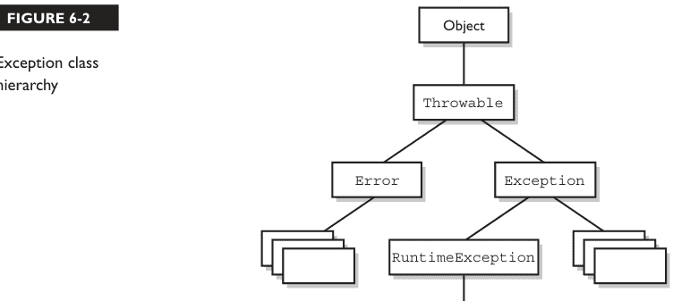

Java 提供了许多异常类，大多数都有非常有描述性的名称。获取异常信息有两种方法。第一种是通过异常类型本身。其次是从异常对象可以获取的信息。`Throwable` 类（位于异常继承树的顶端）为其后代提供了一些在异常处理程序中非常有用的方法。其中之一就是 `printStackTrace()`。正如你预期的那样，如果你调用对象的 `printStackTrace()` 方法（如前面的示例所示），将打印出发生异常的堆栈跟踪。

我们讨论过调用栈的构建方式是最近调用的方法位于顶部。你会发现 `printStackTrace()` 方法将最近调用的方法打印在顶部。


在这个示例中，`e` 是 `ArrayIndexOutOfBoundsException` 类的实例。对于任何其他对象，都可以调用它的方法。

## 异常层次结构

所有异常类都是 `Exception` 类的子类。该类派自 `Throwable` 类（该类又派自 `Object` 类）。图 6-2 显示了异常类的层次结构。

如你所见，有两个派自 `Throwable` 的子类：`Exception` 和 `Error`。派自 `Error` 的类表示并非由程序错误引起的异常情况，表示在程序执行期间通常不会发生的情况，例如 JVM 内存耗尽。通常，你的应用程序无法从 `Error` 中恢复，因此你不需要处理它们。如果你的代码没有处理它们（而且通常不会），它仍然可以无问题地编译。虽然 `Error` 通常被认为是异常情况，但技术上它们不是异常，因为它们没有派自 `Exception` 类。

通常，异常代表某些事情不是由于编程错误，而是因为某些资源不可用或正确执行所需的某些条件不存在。如果你的应用程序应该与另一个没有响应的应用程序或计算机通信，这是一个不是 Bug 引起的异常。图 6-2 还显示了 `Exception` 的一个子类型 `RuntimeException`。这些异常是一个特殊情况，因为有时确实指示程序错误。它们也可以代表罕见的、难以处理的异常情况。运行时异常将在本章稍后的部分进行详细讨论。


Java 提供了许多异常类，大多数都有非常有描述性的名称。获取异常信息有两种方法。第一种是通过异常类型本身。其次是从异常对象可以获取的信息。`Throwable` 类（位于异常继承树的顶端）为其后代提供了一些在异常处理程序中非常有用的方法。其中之一就是 `printStackTrace()`。正如你预期的那样，如果你调用对象的 `printStackTrace()` 方法（如前面的示例所示），将打印出发生异常的堆栈跟踪。

我们讨论过调用栈的构建方式是最近调用的方法位于顶部。你会发现 `printStackTrace()` 方法将最近调用的方法打印在顶部。


## 处理整个类

如果你有一个由父类异常和许多子类组成的异常层次结构，并且你想以特殊方式处理一个子类，但想处理剩余部分，只需要两个 `catch` 子句。当抛出异常时，Java 将尝试查找（通过从上到下的可用 `catch` 子句）匹配异常类型的 `catch` 子句。如果没有找到，它会搜索异常父类型的处理程序。如果没有找到匹配子类型的 `catch` 子句，那么异常将向下到调用栈。这个过程被称为“异常匹配”。

```java
class TestEx {
    public static void main(String[] args) {
        doStuff();
    }
    static void doStuff() {
        doMoreStuff();
    }
    static void doMoreStuff() {
        int x = 5 / 0; // 不能除以零！
        // 此抛出了 ArithmeticException
    }
}
```

它会打印出类似下面的堆栈跟踪：

```
# java TestEx
Exception in thread "main" java.lang.ArithmeticException: / by zero
    at TestEx.doMoreStuff(TestEx.java:10)
    at TestEx.doStuff(TestEx.java:7)
    at TestEx.main(TestEx.java:3)
```

```java
import java.io.*;

public class ReadData {
    public static void main(String[] args) {
        try {
            RandomAccessFile raf = new RandomAccessFile("myfile.txt", "r");
            byte b[] = new byte[1000];
            raf.readFully(b, 0, 1000);
        } catch (FileNotFoundException e) {
            System.err.println("File not found");
            System.err.println(e.getMessage());
            e.printStackTrace();
        } catch (IOException e) {
            System.err.println("IO Error");
            System.err.println(e.toString());
            e.printStackTrace();
        }
    }
}
```

这个短程序尝试打开一个文件并从中读取一些数据。打开和读取文件可能会产生许多异常，其中大多数是某种类型的 `IOException`。假设在这个程序中，我们感兴趣的是知道精确异常是否是 `FileNotFoundException`。否则，我们并不关心具体问题是什么。

`FileNotFoundException` 是 `IOException` 的子类。因此，我们可以在捕获所有 `IOException` 子类的 `catch` 句中处理它，但那时我们需要测试异常以确定它是否是 `FileNotFoundException`。相反，我们为 `FileNotFoundException` 编写了一个特殊的处理器，并为所有其他 `IOException` 子类编写了单独的处理器。

如果这段代码生成了 `FileNotFoundException`，它将由第 10 行开始的 `catch` 句处理。如果它生成另一个 `IOException`——例如 `EOFException`——它将由第 15 行开始的 `catch` 句处理。如果生成了其他异常（例如某种类型的运行时异常），则两个 `catch` 句都不会执行，异常将向下沿调用栈传递。

注意，`FileNotFoundException` 的 `catch` 句被放置在 `IOException` 处理器的上方。这非常重要！如果我们反过来这么做，程序将无法编译。最特定异常的处理器必须始终放在更通用异常的处理器之上。以下代码将无法编译：

```java
try {
    // 执行危险的 IO 操作
} catch (IOException e) {
    // 处理通用的 IOException
    catch (FileNotFoundException ex) {
        // 仅处理 FileNotFoundException
    }
}
```

你将得到类似下面的编译器错误：

```
TestEx.java:15: exception java.io.FileNotFoundException has already been caught
} catch (FileNotFoundException ex) {
```

如果你考虑到那些拿着棒球手套的人（在“传播未捕获的异常”章节中），想象一下最通用的手套最大，可以接住许多不同类型的球。`IOException` 足够大且灵活，可以捕获任何类型的 `IOException`。如果五楼的人（Fred）只有只小小的 `IOException` 手套，他就无法用它接住 `FileNotFoundException` 球。如果二楼的家伙（Jimmy）拿着一个 `FileNotFoundException` 手套，那么那个 `FileNotFoundException` 永远无法到达那里，因为它一直会被站在五楼的 Fred 挡住，他正站在那里，拿着他足够应对任何 `IOException` 的大手套。

那么，对于类层次结构中是兄弟关系的异常，你该怎么办？如果一个 `Exception` 不是另一个的子类型或超类型，那么 `catch` 句的顺序就无关了。

## 异常声明与公共接口

那么，我们如何知道某个方法抛出了我们必须捕获的异常呢？就像方法必须指定它接受什么类型、多少个参数以及返回值一样，方法可以抛出的异常也必须声明（除非这些异常是 `RuntimeException` 的子类）。这是方法公共接口的一部分。`throws` 关键字用法如下，用于列出方法可以抛出的异常：

```java
void myFunction() throws MyException1, MyException2 {
    // 此处是方法的代码
}
```

该方法具有 `void` 返回类型，不接受任何参数，并声明它可以抛出两种类型异常之一：`MyException1` 类型或 `MyException2` 类型。

（因为方法声明它会抛出异常并不意味着它总是会抛出。它只是告诉世界它可能会。）

假设你的方法没有直接抛出异常，而是调用了一个抛出异常的方法。你可以选择不自己处理该异常而只需声明它，仿佛你是那个实际抛出异常的方法。如果你确实声明了方法可能从另一个方法获取的异常，并且没有为它提供 `try/catch`，那么该方法将传回调用你方法的方法，并在那里被捕获，或继续由栈更深处的方法处理。

任何可能抛出异常的方法（除非它是 `RuntimeException` 的子类）都必须声明该异常。这包括那些并没有实际抛出异常，但正在“躲避”（ducking）并让异常传递给栈中下一个方法的方法。如果你“躲避”了一个异常，就好像是你自己实际抛出异常一样。`RuntimeException` 子类是豁免的，所以编译器不会检查你是否声明了它们。但所有非 `RuntimeException` 异常都被视为“检查异常”（checked exceptions），因为编译器会检查以确保你已经声明了它们。

## 考试

当抛出一个 `Exception` 的子类对象时，它必须被处理或声明。这些对象被称为“受检查异常”（checked exceptions），包含了除 `RuntimeException` 的子类以外的所有异常，而后者属于未检查异常（unchecked exceptions）。准备好识别那些没有遵循“处理或声明”规则的方法，例如这个：

```java
class MyException extends Exception {
    void someMethod() {
        doStuff();
    }
    void doStuff() throws MyException {
        try {
            throw new MyException();
        } catch (MyException me) {
            throw me;
        }
    }
}
```

你需要识别出这段代码无法编译。如果你尝试这样做，你会得到如下信息：

```
MyException.java:3: unreported exception MyException; must be caught or declared to be thrown
    doStuff();
```

注意，`someMethod()` 既没有处理也没有声明 `doStuff()` 可能抛出的异常。

你可能会抛出一个 `Error`（尽管除了 `AssertionError` 之外，你可能永远不想这样做），而且你可以捕获它，但同样，你可能不会这样做。例如，如果你遇到了 `OutOfMemoryError`，你实际上会做什么？你不能让垃圾回收器运行；你可以相信，在你获取错误时，JVM 已经拼命自救了（并回收了它所能全部内存）。换句话说，不要期望 JVM 在那个时候说：“运行垃圾回收器？哦，非常感谢你告诉我。我从来没想过这一点。我这就去办。”更好的是，如果发生了 `VirtualMachineError`，你会做什么？在你捕获到错误时，你的程序已经完蛋了，所以尝试捕获这些东西其实没有意义。

但请记住，你确实可以这么做！以下代码可以正常编译：

```java
class TestEx {
    public static void main(String[] args) {
        badMethod();
    }
    static void badMethod() { // 不需要声明 Error
        doStuff();
    }
    static void doStuff() { // 不需要声明 Error
        try {
            throw new Error();
        } catch (Error me) {
            throw me; // 我们捕获了它，然后重新抛出它
        }
    }
}
```

如果我们抛出的是受检查异常而不是 `Error`，那么 `doStuff` 方法就需要声明该异常。但请记住，由于 `Error` 不是 `Exception` 的子类，它不需要被声明。如果你喜欢，你可以自由声明它，但编译器不在乎 `Error` 何时何种如何被抛出，或者由谁抛出。

由于 Java 有受检查异常，人们常说 Java 强制开发者处理异常。是的，Java 强制我们为正常运行期间可能发生的每个异常编写异常处理程序，但让异常处理程序实际做一些有用事情取决于我们。我们认识有些软件经理看到程序员写出这样的代码会崩溃：

```java
try {
    callBadMethod();
} catch (Exception ex) { }
```


注意到缺少了什么吗？不要在捕获异常而不对其进行实际处理的情况下将其“吞掉”。否则，你甚至无法知道异常是否发生过，因为你永远看不到堆栈跟踪。


# 重新抛出相同的异常

就像你可以在 `catch` 块中抛出新异常一样，你也可以抛出刚刚捕到的同一个异常。这里有一个执行此操作的 `catch` 块：

```java
catch(IOException e) {
    // 做一些事情，如果你觉得无法处理它...
    throw e;
}
```

与同一个 `try` 相关的所有其他 `catch` 块将被忽略；如果存在 `finally` 块，它会执行，异常会被抛回给调用方法（调用栈中的下一个方法）。如果你在 `catch` 块中抛出一个受检查异常，你也必须声明它！也就是说，你必须处理并声明，而不是处理或声明。以下示例是非法的：

```java
public void doStuff() {
    try {
        // 有风险的 IO 操作
    } catch(IOException ex) {
        // 无法处理它
        throw ex; // 除非声明，否则无法抛出
    }
}
```

在前面的代码中，`doStuff()` 方法显然能够抛出一个受检查异常——在本例中是 `IOException`——所以编译器说：“太棒了——虽然你在里面写了 `try/catch`，但这还不够。如果你重新抛出你捕获的 `IOException`，那么你必须（在方法签名中）声明它！”

# 练习题 6-4

# 创建异常

在本次练习中，我们尝试创建一个自定义异常。我们不会把它放在新方法中（它将仅包含继承自 `Exception` 的方法），并且因为它扩展了 `Exception`，编译器将其视为一个受检查异常。程序的目标是判断代表特定食物（字符串形式）的命令行参数是否被认为是坏的还是好的。

1. 首先让我们创建异常。我们将其命名为 `BadFoodException`。当遇到糟糕的食物时，将抛出此异常。
2. 创建一个名为 `MyException` 的包装类和一个 `main()` 方法，该方法目前保持为空。
3. 创建一个名为 `checkFood()` 的方法。它接收一个 `String`，如果不喜欢该食物，则抛出我们的异常。
4. 现在在 `main()` 方法中，从命令行数组中获取参数并传递给 `checkFood()`。由于它是受检查异常，`checkFood()` 方法必须声明它。否则，`main()` 方法必须处理它（使用 `try/catch`）。……实际上，在这个练习中。异常处理让代码组织和信号传递变得容易，但异常处理程序必须编写。你会发现代码变得可复用、易读且易于维护。

## 认证目标

# 常见异常与错误 (OCA 目标 8.5)

8.5 识别常见的异常类和类别。

异常处理是另一个决定在 OCJP 5、OCJP 6 以及 Java 7 考试中扩展的领域。此目标的目的是确保你熟悉一些常见的异常和错误。

# 异常与错误 (OCA 目标 8.5) 355

来自此部分的题目很可能是：“这里有一段糟糕的代码，会抛出什么异常？”在考试过程中，题目会给出一些代码并让你判断代码是否会运行，或者是否会抛出异常。由于这些非常常见，理解异常的原因对你的成功至关重要。

这是另一个在真实考试中反复出现的目标之一（“在运行时抛出异常”听起来熟悉吗？），所以请对该部分给予足够的关注。

# 异常的来源

回到上一页看最后句话。理解异常和错误的产生原因以及它们的来源是非常重要的。为了准备考试，让我们定义两个大类异常和错误：

- **JVM 异常** 这些异常或错误完全或在逻辑上由 JVM 抛出
- **程序化异常** 这些异常由应用程序和/或 API 程序员显式抛出

# JVM 抛出的异常

让我们从一个非常常见的异常 `NullPointerException` 开始。正如我们在前面的章节中看到的，当你尝试使用当前值为 `null` 的引用变量访问对象时，就会发生此异常。编译器无法希望在运行时发现这些问题。看以下代码：

```java
class NPE {
    static String s;
    public static void main(String[] args) {
        System.out.println(s.length());
    }
}
```

编译器一定能发现那个微小程序中的问题吗？不，你得自力更生。代码可以正常编译，当 JVM 尝试调用 `length()` 时会抛出 `NullPointerException`。

在本章前面的部分，我们讨论了调用栈。你还记得，我们使用了一种约定：`main()` 方法位于调用栈的底部，随着 `main()` 调用另一个方法，该方法再调用另一个方法，依此类推，栈会向上增长。当然，栈为你的程序提供了 1GB 的内存，但它仍然是有限的。栈可能会增长得太大，以至于操作系统没有空间存储调用栈。当这种情况发生时，你就会得到（等一下……）`StackOverflowError`。发生这种情况最常见的方法是创建一个递归方法。递归方法在方法体内部调用自己。虽然这听起来很奇怪，但对于搜索和排序算法等任务，是一种非常常见且实用的技术。看看这段代码：

```java
void go() {
    // 出错
}
```

如你所见，如果你犯了调用 `go()` 方法的错误，你的程序将掉入黑洞——`go()` 调用 `go()` 调用 `go()`，直到无论你有多少内存，你都会得到一个 `StackOverflowError`。再次，JVM 知道这种情况何时发生，并且 JVM 将是该错误的错误源头。

# 程序化抛出的异常

现在让我们来看程序化抛出的异常。记住，我们把“程序化”定义为如下含义：

由应用程序和/或 API 开发者创建。

例如，Java API 中的许多类都拥有接收 `String` 参数并将这些 `String` 转换为数值类型的方法。这些类的一个很好的例子是所谓的“包装类”，OCP 候选人将在第 8 章学习这些类。尽管我们还没有讨论过包装类，但下面的示例应该是可以理解的。

在很久以前的某个时刻，某个程序员编写了 `java.lang.Integer` 类并创建了如 `parseInt()` 和 `valueOf()` 等方法。该程序员明智地决定，如果其中一个方法传递了一个无法转换为数字的字符串，该方法应该抛出 `NumberFormatException`。

部分实现的代码可能看起来如下：

```java
int parseInt(String s) throws NumberFormatException {
    boolean parseSuccess = false;
    int result = 0;
    // 复杂的解析
    if (!parseSuccess) // 如果解析失败
        throw new NumberFormatException();
    return result;
}
```

异常的其他示例包括 `AssertionError`（好吧，它不是异常，但它是被程序化抛出的），以及抛出 `IllegalArgumentException`。事实上，我们的神话 API 开发者可以为她的 `parseInt()` 方法使用 `IllegalArgumentException`。但事实证明 `NumberFormatException` 继承自 `IllegalArgumentException` 更加精确，因此在这种情况下，使用 `NumberFormatException` 支持我们之前讨论的概念：当你有一个异常层次结构时，你应该使用尽可能精确的异常。

当然，正如我们之前讨论的，你也可以创建自己的自定义异常并随地抛出它们。这些自定义异常也属于“程序化抛出的异常”的范畴。

# 考试异常与错误的总结

OCA 目标 8.5 没有列出特定的异常和错误；它说是“识别常见的异常……”。表 6-2 总结了 SCJP 6 考试部分的十个异常和错误；它也将涵盖 OCA 目标 8.5。

# 第一部分结束——OCA

除了我们标准的章节末内容（如模拟考试题）外，你已经到达了书中 OCA 部分的结束。如果你仔细学习了这六章，然后参加并复习了章末的模拟考试和 OCA 强化考试并取得了良好成绩，我们相信你对官方 Oracle OCA 考试的准备已经稍微过度了（不是“非常”过度——仅仅是一点）。祝你好运，我们希望你在第二部分第 7 章再次回归，届时我们将探索 Java 7 添加的异常功能。

# 358 第6章：流程控制与异常

表 6-2 常见异常的描述与来源

| 异常 | 描述 | 通常抛出者 |
|---|---|---|
| ArrayIndexOutOfBounds (第5章) | 当数组索引超出范围时抛出 | JVM |
| ClassCastException (第2章) | 当尝试对对象进行转换时抛出 | JVM |
| IllegalArgumentException | 当向方法传递不恰当参数时抛出 | 程序化 |
| IllegalStateException | 当对象处于不适合方法的状态时抛出 | 程序化 |
| NullPointerException | 当尝试使用空对象引用时抛出 | JVM |
| NumberFormatException | 当字符串无法转换为数字时抛出 | 程序化 |
| AssertionError | 当断言测试失败时抛出 | 程序化 |
| ExceptionInInitializerError | 在对象构造期间抛出异常时抛出 | JVM |
| StackOverflowError | 当栈增长过深时抛出 | JVM |
| NoClassDefFoundError | 当 JVM 找不到指定的类时抛出 | JVM |

# 认证总结

## 总结

本章涵盖了大量内容，都涉及基于条件的控制程序流的方法。首先，你学习了 `if` 和 `switch` 语句。`if` 语句评估一个布尔结果。如果结果为真，程序执行该块。如果使用了 `else` 语句且 `if` 表达式评估为假，则执行 `else` 之后的代码。如果没有定义 `else`，则什么都不会发生。

你还学习了 `switch` 语句可以替换多个 `else` 语句。`switch` 语句可以评估可以隐式转换为 `int` 的整数原始类型（即 `byte`、`short`、`int` 和 `char`），从 Java 7 开始，它还可以评估枚举和 `String`。在运行时，JVM 会尝试寻找 `switch` 表达式与 `case` 常量之间的匹配。如果找到匹配项，执行将从匹配的 `case` 开始，直到找到 `break` 语句或到达 `switch` 语句结束。如果没有匹配，将执行 `default` 情况。

你学习了 Java 语言中提供的三种循环结构。这些是 `for` 循环（包括基础 `for` 和 Java 5 的增强型 `for`）、`while` 循环和 `do` 循环。通常，`for` 循环用于在你知道循环多少次的情况下。`while` 循环用于你需要至少循环一次的情况。在 `for` 循环和 `while` 循环中，表达式被评估以进入块，并在每次迭代后进行检查。`do` 循环在执行循环一次之前不检查条件。`for` 循环的主要优点可以在循环定义中初始化一个或多个变量，并对变量进行加或减。

`break` 和 `continue` 语句可以用带标签或无标签的形式使用。在无标签的情况下，`break` 语句将强制程序停止处理最内层的循环结构，并从循环后的代码行开始。使用无标签的 `continue` 命令将导致程序停止执行当前内层循环的迭代，并进入下一次迭代。当以标签的方式使用 `break` 或 `continue` 语句时，它们将以相同的方式运行，唯一的例外是：语句不适用于最内层循环；而是适用于带有标签的循环。

## 第6 章：流程控制与异常

你已经看到 Java 如何在异常处理方面提供一种优雅的机制。异常处理允许你将错误纠正代码隔离到单独块中，这样主程序代码就不会被错误检查代码所弄乱。另一个优雅的特性允许你通过单个处理块来处理相似的错误，而无需代码重复。此外，错误处理可以推迟到调用栈中更靠后的方法执行。

你已经学到 Java 的 `try` 关键字用于指定一个受保护区域——即可能检测到问题的代码块。异常处理程序是在发生异常时执行的代码。处理程序由 Java 的 `catch` 关键字定义。所有的 `catch` 子句必须紧跟在相关的 `try` 块之后。

Java 还提供了 `finally` 关键字。它用于定义一个始终会被执行的代码块，无论是在 `catch` 块完成后立即执行，要么在没有抛出异常（或有 try 但没有 catch）的情况下在相关的 `try` 块之后立即执行。使用 `finally` 块来释放系统资源并执行 `try` 块中代码所需的任何清理工作。`finally` 块不是必须的，但如果存在，它必须紧跟在最后一个 `catch` 之后。（如果没有 `catch`，则 `finally` 块必须紧跟在 `try` 块之后）。当 `try` 或 `catch` 触发 `System.exit()` 时，`finally` 不保证会被调用。

异常对象是 `Exception` 类或其一个子类的实例。`catch` 子句的参数接收一个派生自 `Exception` 类类型的对象实例。Java 要求每个方法都必须捕获它可能抛出的任何已检查异常，或者声明它抛出了该异常。异常声明是方法签名的一部分。要声明可能抛出异常，在方法定义中使用 `throws` 关键字，并列出所有可能抛出的已检查异常。

运行时异常是 `RuntimeException` 类型（或其子类）。这些异常是一个特殊情况，因为它们不需要被处理或声明，因此被称为“未检查”异常。错误是 `Error` 类型或子类，与异常一样，它们不需要被处理或声明。已检查异常包括任何不是 `RuntimeException` 或 `Error` 异常类型。如果你的代码未能处理已检查异常或声明其被抛出，你的代码将无法编译。对于未检查异常或 `Error` 类型的对象，编译器无论你是声明它们、处理它们、什么都不做，还是将声明与处理结合起来，都无所谓。换句话说，你可以自由地声明和处理它们，但编译器并不关心。不过，处理 `Error` 不是一个好习惯，因为你很少能从中恢复。

最后，请记住，异常可以由 JVM 生成，也可以由程序员生成。

## 两分钟演练

这里是本章中每个认证目标的关键要点。你可能想反复循环学习几次。

## 使用 if 和 switch 语句编写代码 (OCA 目标 3.4 和 3.5)

- `if` 语句中唯一合法的表达式是布尔表达式——换句话说，一个解析为布尔值或 `Boolean` 引用的表达式。
- 注意布尔赋值 (`=`)，它可能被误认为是布尔相等 (`==`) 测试：

```java
boolean x = false;
if (x = true) { // 这是一个赋值，所以 x 将始终为 true;
```

- 对于只有一个条件语句的块，大括号是可选的。注意那些具有误导性的缩进。
- `switch` 语句只能求值为枚举或 `byte`、`short`、`int`、`char` 以及从 Java 7 开始的 `String` 数据类型。你不能这样做：

```java
long s = 30;
switch(s) { }
```


- 常量必须是字面量、`final` 变量或常量表达式，包括枚举或 `String`。你不能有一个包含非 `final` 变量或值范围的 `case`。

- 如果 `switch` 语句中的条件匹配 `switch` 常量，执行将运行 `switch` 中匹配 `case` 之后的所有代码。 (OCA Objectives 3.4 and 3.5)

- `switch` 语句只能计算枚举或 `byte`、`short`、`int`、`char` 类型，以及 Java 7 引入的 `String` 数据类型。你不能这样写：

```java
```


# 第 6 章：流程控制与异常

## 关键点

- The constant must be a literal or final variable, or a constant expression, including an enum or a String. You cannot have a case that includes a non-final variable or a range of values.
- If the condition in a switch statement matches a switch constant, execution will run through all code in the switch following the matching case.
- Finally, remember that exceptions can be generated by the JVM, or by a programmer.

## TWO-MINUTE DRILL

Here are some of the key points from each certification objective in this chapter. You might want to loop through them several times.

## 自测

### 1. （也是一个升级相关题）给定：

```java
public class Flipper {
    public static void main(String[] args) {
        String s = "-";
        switch ("FRED".toLowerCase().substring(1,3)) {
            case "yellow":
                s += "y";
            case "red":
                s += "r";
            case "green":
                s += "g";
        }
        System.out.println(s);
    }
}
```

结果是什么？

- A. -
- B. -r
- C. -rg
- D. 编译失败
- E. 运行时抛出异常

### 2. 给定：

```java
class Plane {
    static String s = "-";
    public static void main(String[] args) {
        new Plane().s1();
        System.out.println(s);
    }
    void s1() {
        try {
            s2();
        } catch (Exception e) { s += "c"; }
    }
    void s2() throws Exception {
        s3();
        s += "2";
        s3();
        s += "2b";
    }
    void s3() throws Exception {
        throw new Exception();
    }
}
```

结果是什么？

- A. -
- B. -c
- C. -c2
- D. -2c
- E. -2c2b
- F. -2c2b
- G. -2c2bc
- H. 编译失败

### 3. 给定：`{ int x = Integer.parseInt("two"); }`

哪些可以用于创建合适的 catch 块？（选择所有适用项）

- A. ClassCastException
- B. IllegalStateException
- C. NumberFormatException
- D. IllegalArgumentException
- E. ExceptionInInitializerError
- F. ArrayIndexOutOfBoundsException

### 4. 给定：

```java
public class Flip2 {
    public static void main(String[] args) {
        String o = "-";
        String[] sa = new String[4];
        for (int i = 0; i < args.length; i++)
            sa[i] = args[i];
        for (String n: sa) {
            switch (n.toLowerCase()) {
                case "yellow": o += "y";
                case "red": o += "r";
                case "green": o += "g";
            }
        }
        System.out.print(o);
    }
}
```

并且给定命令行调用：`Java Flip2 RED Green YeLLow`

哪些是正确的？（选择所有适用项。）

- A. 字符串 "rgy" 会出现在输出的某处
- B. 字符串 "rgg" 会出现在输出的某处
- C. 字符串 "gyr" 会出现在输出的某处
- D. 编译失败
- E. 运行时抛出异常

### 5. 给定：

```java
class Loopy {
    public static void main(String[] args) {
        int[] x = {7,6,5,4,3,2,1};
        //在此处插入代码
        System.out.print(y + " ");
    }
}
```

哪些独立插入在第 4 行的代码可以通过编译？（选择所有适用项）

- A. `for(int y : x)`
- B. `for(x : int y)`
- C. `int y = 0; for(y : x)`
- D. `for (int z=0; z<x.length; z++) { y = x[z]; }`
- E. `for (int y=0, z=0; z<x.length; z++) { y = x[z]; }`
- F. `int y = 0; for(int z=0; z<x.length; z++) { y = x[z]; }`

### 6. 给定：

```java
class Emu {
    static String s = "-";
    public static void main(String[] args) {
        try {
            throw new Exception();
        } catch (Exception e) {
            try {
                try { throw new Exception(); }
                catch (Exception ex) { s += "ic "; }
                throw new Exception();
            } catch (Exception x) { s += "mc "; }
            finally { s += "mf "; }
        }
        finally { s += "of "; }
        System.out.println(s);
    }
}
```

结果是什么？

- A. -ic of
- B. -mf of
- C. -mc mf
- D. -ic mc mf of
- E. -ic mc mf of
- F. -ic mc mf of
- G. 编译失败

### 7. 给定：

```java
class SubException extends Exception { }
class SubSubException extends SubException { }

public class CC { void doStuff() throws SubException { } }

class CC2 extends CC { void doStuff() throws SubException { } }
class CC3 extends CC { void doStuff() throws Exception { } }
class CC4 extends CC { void doStuff(int x) throws Exception { } }
class CC5 extends CC { void doStuff() { } }
```

结果是什么？（选择所有适用项）

- A. 编译成功
- B. 第 8 行错误编译失败
- C. 第 10 行错误编译失败
- D. 第 12 行错误编译失败
- E. 第 14 行错误编译失败

### 8. 给定：

```java
class Eb {
    static int x = 7;
    public void main(String[] args) {
        String s = "";
        for (int y = 0; y < 3; y++) {
            x++;
            switch(x) {
                case 8: s += "8";
                case 9: s += "9";
                case 10: s += "10"; break;
                default: s += "d";
                case 13: s+= "13";
            }
        }
        System.out.println(s);
    }
    static { x++; };
}
```

结果是什么？

- A. 9 10 d
- B. 8 9 10 d
- C. 9 1010
- D. 9 10 13
- E. 8 9 10 13
- F. 编译失败

### 9. 给定：

```java
class Infinity {
    class Beyond extends Infinity {
        Integer i;
        public static main(String[] args) {
            int sw = (int)(Math.random() * 3);
            switch(sw) {
                case 0: { for(int x = 10; x > 5; x++)
                    if(x > 10000) x = 10;
                    break; }
                case 1: { int y = i; break; };
                case 2: { inf = new Beyond();
                    int b = (int)inf;
                }
            }
        }
    }
}
```

假设第 7 行将 0、1 或 2 赋值给 sw，哪些是正确的？（选择所有适用项。）

- A. 编译失败
- B. 可能会抛出 ClassCastException
- C. 可能会抛出 StackOverflowError
- D. 可能会抛出 NullPointerException
- E. 可能会抛出 IllegalStateException
- F. 程序可能会挂死
- G. 程序会完成

### 10. 给定：

```java
class Circles {
    public static main(String[] args) {
        int[] ia = {1,3,5,7,9};
        for(int x : ia) {
            for(int j = 0; j < 3; j++) {
                System.out.print(" " + x);
                if (x > 4 && x < 8) continue;
                if (j == 1) break;
                continue;
            }
            continue;
        }
    }
}
```

结果是什么？

- A. 1 3 9
- B. 5 5 7
- C. 1 3 9 9
- D. 1 1 3 9 9
- E. 1 1 3 3 9 9
- F. 编译失败

### 11. 给定：

```java
class OverAndOver {
    static String s = "";
    public static main(String[] args) {
        try {
            s += "1";
            throw new Exception();
            catch (Exception e) { s += "2"; }
            finally { s += "3"; doStuff(); s += "4"; }
        }
        System.out.println(s);
    }
    static void doStuff() { int x = 0; int y = 7/x; }
}
```

结果是什么？

- A. 12
- B. 13
- C. 123
- D. 1234
- E. 编译失败
- F. 123 后跟一个异常
- G. 1234 后跟一个异常
- H. 抛出异常且没有其他输出

### 12. 给定：

```java
class Wind {
    static main(String[] args) {
        foreach:
        for (int j=0; j<5; j++) {
            for (int k=0; k<3; k++) {
                System.out.print(" " + j);
                if (j==3 && k==1) break foreach;
                if (j==0 || j==2) break;
            }
        }
    }
}
```

结果是什么？

- A. 0 1 2 3
- B. 1 1 3 3
- C. 0 1 1 2 3 3
- D. 1 1 1 3 4 4 4
- E. 0 1 1 1 2 3 4 4 4
- F. 编译失败

### 13. 给定：

```java
class Gotcha {
    public static main(String[] args) {
        //在此处插入代码
    }
    void go() {
        go();
    }
}
```

给出以下三个代码片段：

I. `new Gotcha().go();`

II. `try { new Gotcha().go(); System.out.println("ouch"); } catch (Error e) { System.out.println("ouch"); }`

III. `try { new Gotcha().go(); } catch (Exception e) { System.out.println("ouch"); }`

当片段 I–III 独立添加在第 5 行时，哪些是正确的？（选择所有适用项）

- A. 部分无法编译
- B. 它们都可以编译
- C. 都会正常完成
- D. 都不会正常完成
- E. 只有一个会正常完成
- F. 两个会正常完成

### 14. 给定以下代码段：

```java
String s = "bob";
String[] sa = {"a", "bob"};
final String s2 = "bob";
StringBuilder sb = new StringBuilder("bob");

// switch(sa[1]) { // 第 1 行
// switch("b" + sb.toString()) { // 第 2 行
// switch(sb.toString()) { // 第 3 行
// case "ann":     // 第 4 行
// case s:          // 第 5 行
// case s2:         // 第 6 行
// }
```

并且假设通过取消注释一个 switch 语句和一个 case 语句来测试这些行，哪些行会编译失败？（选择所有适用项）。

- A. 第 1 行
- B. 第 2 行
- C. 第 3 行
- D. 第 4 行
- E. 第 5 行
- F. 第 6 行
- G. 所有六行代码都可以编译

### 15. 给定：

```java
public class Frisbee {
    //在此处插入代码
    int x = 0;
    System.out.println(7/x);
}
```

给定以下四个代码片段：

I. `public static void main(String[] args) {`

II. `public static void main(String[] args) throws Exception {`

III. `public static void main(String[] args) throws IOException {`

IV. `public static void main(String[] args) throws RuntimeException {`


如果将这些片段独立地插入第 2 行，哪些是正确的？（选择所有适用项）。

- A. 四个片段都能编译并执行且无异常
- B. 四个片段都能编译、执行并抛出异常
- C. 部分（并非全部）可以编译并执行且无异常
- D. 部分（并非全部）可以编译并执行且无异常
- E. 在考虑片段 II、III 和 IV 时，在可以编译的片段中，第 4 行周围添加 try/catch 块将导致编译失败

16.

```java
2. class MyException extends Exception { }
3. class Tire {
4. void doStuff() { 
5. }
6. public class Retread extends Tire {
7. public static void main(String[] args) {
8. new Retread().doStuff();
9. }
10. //在此插入代码
11. System.out.println(7/0);
12. }
13. }
```

给定以下代码片段：

I. `void doStuff() {`
II. `void doStuff() throws MyException {`
III. `void doStuff() throws RuntimeException {`
IV. `void doStuff() throws ArithmeticException`

当片段 I-IV 独立地添加到第 10 行时，哪些是正确的？（选择所有适用项）。

- A. 均无法编译
- B. 它们都能编译
- C. 部分（并非全部）可以编译
- D. 所有通过的片段在运行时都会抛出异常
- E. 所有通过的片段在运行时都不会抛出异常
- F. 只有部分通过的片段会在运行时抛出异常

## 自测答案

- 1. ☑ A 正确。从 Java 7 开始，该代码是合法的，`substring()` 方法的第二个参数是排外的。如果调用的是 `substring(1,4)`，输出将是 "rg"。注意：我们希望你不会有许多关注此类 API 冷门知识的考试题。如果你知道 switch 是合法的，请给自己“最高满分”。
- ☑ B、C、D 和 E 根据上述内容是错误的。（OCA 目标 2.7 和 3.5，以及升级目标 1.1）
- 2. ☑ B 正确。由于 `s3()` 将异常抛出给 `s2()`，`s2()` 将其抛出给 `s1()`，且 `s2()` 的后续代码将不再执行。
- ☑ A、C、D、E、F 和 G 根据上述内容是错误的。（OCA 目标 8.2 和 8.4）
- 3. ☑ C 和 D 是错误的。`Integer.parseInt()` 可能会抛出 `NumberFormatException`，而 `IllegalArgumentException` 是它的父类（即更广泛的异常）。A、B 和 F 不在 `NumberFormatException` 的类层次结构中。（OCA 目标 8.5）
- 4. ☑ E 正确。从 Java 7 开始，该语法是合法的。`sa[]` 数组从命令行接收三个参数，因此在最后一次迭代中，`sa[]` 会抛出 `NullPointerException`。
- ☑ A、B、C 和 D 根据上述内容是错误的。D 正确。A 是增强型 for 循环的示例。D 和 F 是基础循环的示例。（OCA 目标 3.5、5.2 和 8.5，以及升级目标 1.1）
- ☑ B、C 和 E 是错误的。B 错误是因为它的操作数反反了。C 正确，因为增强型 for 必须声明其第一个操作数。E 错误是因为在 for 语句中声明了两个变量。（OCA 目标 5.2）
- 6. ☑ E 正确。没有嵌套的 try/catch 块。正常情况下，当抛出异常时，执行 catch 块中的代码，然后执行 finally 块中的代码。
- ☑ A、B、C 和 D 根据上述内容是错误的。（OCA 目标 8.2 和 8.4）
- 7. ☑ C 正确。重写的方法不能抛出比它重写的方法更广泛的异常。类 `CC4` 的方法是重载而非重写。
- ☑ A、B、D 和 E 根据上述内容是错误的。（OCA 目标 8.2 和 8.4）
- 8. ☑ D 正确。你捕捉到静态初始化块了吗？记住 switch 是基于“穿透”（fall-through）逻辑运行的，且穿透逻辑也适用于 default case，即在没有其他 case 匹配时使用的分支。
- ☑ A、B、C、E、F 和 G 根据上述内容是错误的。（OCA 目标 3.5）

# 374 第 6 章：流程控制与异常

- 9. D 和 F 是正确的。因为 `i` 未被初始化，case 1 将抛出 `NullPointerException`。case 0 将引发一个无限循环，而不是栈溢出。case 2 的向下类型转换不会导致异常。A、B、C、E 和 G 根据上述内容是错误的。（OCA 目标 3.5 和 8.4）
- 10. D 正确。无标签 `continue` 的基本规则是它继续到下一次迭代。多捕获（Multi-catches）为你提供了一次处理两个或多个异常的方法。try-with-resources 让你能够轻松地管理资源。A、B、C、E 和 F 根据上述内容是错误的。

# 374 第 6 章：流程控制与异常

# II OCP

# 章节

7 断言与 Java 7 异常
8 字符串处理、数据格式化、资源包
9 I/O 与 NIO
10 高级面向与设计模式
11 泛型与集合
12 内部类
13 线程
14 JDBC

# 7
断言与
Java 7 异常

## 认证目标

- 使用断言测试不变性
- 开发在 catch 块中处理多个类型的代码
- 使用 try-with-resources 语句的代码（包括实现 `AutoCloseable` 类）

- 两分钟训练
- 问答自测

## 使用断言机制 (OCP 目标 6.5)

Java 语言从 1.4 版本开始引入断言（assertions），允许你在开发过程中测试自己的假设，而无需花费时间或程序开销来为那些你认为在程序离开开发阶段并完全部署后永远不会发生的异常编写异常处理程序。

从 310-035 考试（Sun 认证 Java 程序员考试的 1.4 版本）开始到现在的 IZO-804 考试（OCPJP 7），你应该了解断言工作的基本原理、如何启用它们、如何使用它们以及不如何使用它们。

## 断言概述

假设你传入方法（例如 `methodA()`）的数字永远不会为负数。在测试和调试期间，你想验证你的假设，但你不希望在开发完成后删除语句、运行时异常处理程序或 `if/else` 测试。留下其中任何一个，至少都会影响性能。断言来救急了！请看以下代码：

```java
private void methodA(int num) {
  if (num >= 0) {
    useNum(num + x);
  } else { // num < 0 (这不应该发生！)
    System.out.println("Yikes! num is a negative number! " + num);
  }
}
```

因为你确定自己的假设，所以你不想花时间（或产生性能影响）来编写异常处理代码。在运行时，你也不想要 `if/else`，因为如果你进入了 `else` 条件，意味着你之前的逻辑（在调用此方法之前运行任何内容）是有缺陷的。

断言允许你在开发期间测试假设，代码在程序部署时基本上会消失，不会留下任何开销或需要追踪和删除的调试代码。让我们重新重写 `methodA()` 来验证参数不是负数：

```java
private void methodA(int num) {
  assert (num>=0); // 抛出 AssertionError
  // 如果这个测试未满足
  useNum(num + x);
}
```

## 380 第 7 章：断言与 Java 7 异常

断言不仅让你的代码保持更简洁、紧凑，而且断言除非被专门“开启”（启用），否则处于非活动状态，代码的运行就像是这样写的一样：

```java
private void methodA(int num) {
    useNum(num + x); // 我们已经测试过这个；
    // 我们现在知道这里没问题
}
```

断言的工作原理非常简单。你总是断言某事是真实的。如果是，就没问题。代码继续运行。但如果你的断言证明是错误的（假的），则会立即抛出一个停止整个世界的 `AssertionError`（你永远、永远不应该处理它！），这样你就可以修复导致问题的任何逻辑缺陷。断言有两种形式：非常简单（really simple）和简单（simple），如下所示：

```java
private void doStuff() {
    assert (y > x);
    // 假设 y 大于 x 的更多代码
}
```

简单形式的：

```java
private void doStuff() {
    assert (y > x): "y is " + y + " x is " + x;
    // 假设 y 大于 x 的更多代码
}
```

两者的区别在于简单版本（布尔表达式）在第一个表达式之后增加了第二个表达式（一个冒号——此断言的字符串值会被添加到堆栈轨迹中）。两个版本都会立即抛出 `AssertionError`，但简单版本为你提供了更多的调试帮助，而非常简单的版本只告诉你你的假设是假的。


断言通常在应用程序进行测试和调试时启用，在应用程序部署时禁用。断言留在代码中，尽管被 JVM 忽略，但如果你部署的应用程序开始出现异常，你始终可以选择在现场启用断言进行额外测试。

## 使用断言机制 (OCP 目标 6.5)

## 断言表达式规则

断言可以有一个或两个表达式，取决于你使用的是“简单”形式还是“非常简单”形式。第一个表达式必须产生布尔值！遵循与你用于 `if` 和 `while` 测试相同的规则。整个核心在于断言，意味着你断言测试是真实的。如果是真的，就没问题。但如果不是真的，那么你的假设就是错误的，你会得到一个 `AssertionError`。

第二个表达式仅用于 `assert` 语句的简单版本，可以是任何产生值的内容。记住，第二个表达式用于生成显示在堆栈轨迹中的字符串消息。

## 382 第 7 章：断言与 Java 7 异常


## 启用断言

# 标识符与关键字

## 384 第 7 章：断言与 Java 7 异常

| 命令行 | 如果 assert 是标识符 | 如果 assert 是关键字 |
| --- | --- | --- |
| 使用不同的 Java 版本编译将 assert 作为标识符或关键字的代码 | `javac -source 1.3 TestAsserts.java` | 带有警告通过编译 | 编译失败 |
| | `javac -source 1.4 TestAsserts.java` | 编译失败 | 代码通过 |
| | `javac -source 1.5 TestAsserts.java` | 编译失败 | 代码通过 |
| | `javac -source 5 TestAsserts.java` | | |
| | `javac -source 1.6 TestAsserts.java` | 编译失败 | 代码通过 |
| | `javac -source 6 TestAsserts.java` | | |
| | `javac -source 1.7 TestAsserts.java` | 编译失败 | 代码通过 |
| | `javac -source 7 TestAsserts.java` | | |
| | `javac TestAsserts.java` | 编译失败 | 代码通过 |

## 带有断言运行

Implementation 酷的地方在这里。一旦你编写了感知断言的代码（换句话说，即使用 `assert` 作为关键字在运行时实际执行断言的代码），你就可以选择在运行时启用或禁用断言！记住，断言默认是禁用的。

## 在运行时启用断言

你可以在运行时启用断言：

```
java -ea com.geeksanonymous.TestClass
```

或者

```
java -enableassertions com.geeksanonymous.TestClass
```

上述命令行开关告诉 JVM 在启用断言的情况下运行。

## 在运行时禁用断言

你也必须知道知道用于禁用断言的命令行开关：

```
java -da com.geeksanonymous.TestClass
```

或者

```
java -disableassertions com.geeksanonymous.TestClass
```

## 使用断言机制 (OCP 目标 6.5)

由于断言默认是禁用的，使用禁用开关似乎是没必要的。事实上，按照我们在上一个示例中的方法使用开关，得到的是默认行为（也就是说，无论你是否使用禁用开关，结果都是那样的）。但是……你可以选择性地启用和禁用断言，使得在特定程序运行时，对某些类和/或包启用断言，而对其他包禁用。

## 选择性启用和禁用

断言的命令行开关可以以多种方式使用：

- **不带参数（如上例所示）**：在所有类中启用或禁用断言。
- **带包名**：在指定的包以及同一目录层级中该包之下的任何包中启用或禁用断言（稍后详细介绍）。
- **带类名**：在指定的类中启用或禁用断言。

你可以组合开关，例如，禁用单个类的断言，但对所有其他类启用，如下所示：

```
java -ea -da:com.geeksanonymous.Foo
```

上述命令行告诉 JVM 通用启用断言，但在 `com.geeksanonymous.Foo` 类中禁用。你可以按照如下方式对包进行同样的选择性操作：

```
java -ea -da:com.geeksanonymous...
```

上述命令行告诉 JVM 通用启用断言，但在 `com.geeksanonymous` 包及其所有子包中禁用！你可能并不熟悉“子包（subpackages）”这个术语，因为在断言出现之前，这个术语并没有怎么使用。子包是命名包的子目录中的任何包。例如，查看以下目录树：

```
com
|geeksanonymous
  |Foo.class
  |_twelvesteeps
    |_StepOne.class
    |_StepTwo.class
```

## 386 第 7 章：断言与 Java 7 异常

此树列出了目录：

```
com
geeksanonymous
twelvesteps
```

以及三个类：
`com.geeksanonymous.Foo`
`com.geeksanonymous.twelvesteps.StepOne`
`com.geeksanonymous.twelvesteps.StepTwo`

`com.geeksanonymous.twelvesteps` 包的子包。记住，在 Java 中，`com.geeksanonymous.twelvesteps` 包被视为一个完全独立的包，与上面的包（在本例中为 `com.geeksanonymous` 包）没有任何关系，它们只是恰好共享几个目录。表 7-2 列出了启用和禁用断言的命令行开关示例。

## 恰当地使用断言

并不是所有合法的断言用法都被认为是恰当的。与 Java 的许多部分一样，尽管 Oracle 的 Java 工程师尽力劝阻你这样做，你仍然可能滥用断言的意图。例如，你不永远应该去处理断言失败。这意味着你不应该用 `catch` 语句捕获它并尝试恢复。然而，从法律上讲，`AssertionError` 是 `Throwable` 的子类，因此它可以被捕获。但不要这样做！如果你要从某些事中恢复，那应该是一个异常。为了阻止你尝试用断言代替异常，`AssertionError` 不提供对生成它的对象的访问。你只能得到字符串消息。

那么是谁来决定什么是恰当的？Oracle。考试使用 Oracle 的“官方”断言文档来定义恰当和不恰当的用法。

## 不要使用断言来验证公共方法的参数

以下是断言的不恰当用法：

```
public void doStuff(int x) {
    assert x > 0; // 不恰当
    // 对 x 进行操作
}
```

## 使用断言机制 (OCP 目标 6.5)

| 表 7-2 | 断言命令行开关 | 示例 | 含义 |
| --- | --- | --- | --- |
| 断言命令行开关 | `-ea` | 启用断言 |
| | `-enableassertions` | 启用断言 |
| | `-da` | 禁用断言（默认） |
| | `-ea:foo.Bar` | 在 foo.Bar 类中启用断言 |
| | `-ea:foo...` | 在 foo 及其包及其所有子包中启用断言 |
| | `-ea -da:foo` | 通用启用断言，但在 foo.Bar 类中禁用 |
| | `-ea -da:foo...` | 通用启用断言，但在 foo 及其包及其所有子包中禁用 |

**注意** 如果你在考试中看到“恰当（appropriate）”一词，它总是指的是合法的用法。如果你在断言的语文中看到“正确（correct）”，你也应该假设它指的是断言应该如何使用。由于公共方法是与外部世界的接口，你不希望发布取决于断言是否启用的条件代码。如果你需要验证公共参数，你可能会使用异常来，例如抛出 `IllegalArgumentException`。

## 使用断言验证私有方法的参数

如果你写了一个私有方法，你几乎肯定编写（或控制）了调用它的代码。当你假设私有方法的逻辑是正确的，你可以用断言来测试：

```
private void doMore(int x) {
    assert x > 0;
    // 对 x 进行操作
}
```


前一个示例与上一个唯一的区别在于访问修饰符。因此，对私有方法的参数进行强制约束，但不要对公共方法进行强制约束。你可以完全编译带有不恰当公共验证的断言代码，对于考试（以及现实生活），你需要知道你不应该这样做。

## 不要使用断言来验证命令行参数

这只是“不要使用断言验证公共方法的参数”规则的一个特例。如果你的程序需要命令行参数，你可能会使用异常机制来强制执行它们。

## 即使在公共方法中也使用断言来检查已知永远不会发生的情况

这可以包括不应该到达的代码块，包括 `switch` 语句的 `default` 情况：

```java
switch(x) {
    case 1: y = 3; break;
    case 2: y = 9; break;
    case 3: y = 27; break;
    default: assert false; // 我们永远不应该到这里！
}
```

如果你假设某个代码块不会被到达，在前一个示例中你断言 `x` 必须是 1、2 或 3，那么如果你确实到达了该代码，就可以可以使用 `assert false` 来抛出一个 `AssertionError`。因此在 `switch` 示例中，我们并不是在进行布尔测试——我们已经断言了我们不应该在那里，所以仅仅到达那个点就是断言/假设的自动失败。

# 使用 Java 7 异常处理 OCP 目标 6.2 和 6.3

## 不要使用可能产生副作用的 assert 表达式！

以下做法是一个非常糟糕的主意：

```java
public void doStuff() {
    assert (modifyThings());
    // 继续执行
}

public boolean modifyThings() {
    Y = X++;
    return true;
}
```

规则是：`assert` 表达式应该让程序保持在执行该表达式之前的相同状态！想一想，`assert` 表达式并不保证会保持状态不变，因此你不希望你的代码行为根据是否启用了断言而发生变化。断言不能引起任何副作用。如果启用了断言，你的程序运行方式的唯一变化是：如果你的某个断言（即你的假设）被证明为假，可能会抛出一个 `AssertionError`。

使用产生副作用的断言会导致人类已知的最令人疯狂且难以发现的 bug！当一个脾气火爆的 QA 分析师对着你大叫你的代码不起用时，搬出“它在我的机器上运行得好的”这种老借口是解决不了问题的。

## 认证目标

### 使用 Java 7 异常处理 OCP 目标 6.2 和 6.3

- 6.2 开发在单个 catch 块中处理多种异常类型的代码。
- 6.3 开发使用 try-with-resources 语句的代码（包括使用实现 `AutoCloseable` 接口的类）。

## 使用带有多异常 catch 和 finally 子句的 try 语句

有时我们想要相同的方式处理不同类型的异常。特别是当我们唯一能做的记录异常并承认失败时。但我们不想重复代码。那么该怎么办？在上一章的“处理整个类层次结构的异常”节中，我们已经看到一个单一的通捕处理器是一个糟糕的主意。在 Java 7 之前，我们能做的最好：

```java
try {
    // 访问数据库并写入文件
} catch (SQLException e) {
    handleErrorCase(e);
} catch (IOException e) {
    handleErrorCase(e);
}
```

你可能认为这只是一行重复的代码。但当你正在捕获六种不同的异常类型时会怎样？那是大量的重复。幸运的是，Java 7 让这一切变得优雅——引入了一个名为“多异常 catch”（multi-catch）的功能：

```java
try {
    // 访问数据库并写入文件
} catch (SQLException | IOException e) {
    handleErrorCase(e);
}
```

不再有重复了。这太棒了。正如你想象到的，multi-catch 是“multiple catch”的缩写。你只需要列出你想让多异常 catch 处理的类型，并用管道符号 (`|`) 进行分隔。这很容易记忆，因为 `|` 是 Java 中的“或”逻辑运算符。这意味着 catch 可以读作“SQLException 或 IOException e”。

你不能在多异常 catch 中多次使用同一个变量名。以下代码将无法编译：

```java
catch(Exception1 e | Exception2 e2)
```

这个例子无法编译是有道理的。毕竟，异常处理器中的代码需要知道引用哪一个变量名。

```java
catch(Exception1 e | Exception2 e)
```

这很有诱惑力。当我们声明变量时，通常将变量名直接放在类型后面。尝试将其看作一个类型列表。我们正在声明变量 `e` 用于被捕获，它必须是其中之一。

在多异常 catch 中，顺序并不重要。以下两个代码段是等价的：

```java
catch(SQLException | IOException e) // 这两个语句等价
catch(IOException | SQLException e)
```

就像普通的 catch 块一样，你不能同时匹配异常。在多异常 catch 中，你必须确保异常只能匹配一种类型。以下代码无法编译：

```java
catch(FileNotFoundException | IOException e)
catch(IOException | FileNotFoundException e)
```

你会得到这样的编译器错误：
> FileNotFoundException 被 IOException 捕获

由于 `FileNotFoundException` 是 `IOException` 的子类，我们一开始可以直接那样写！没必要使用多异常 catch。简化后的版本是：

```java
catch(IOException e)
```

记住，多异常 catch 仅用于不同层次结构的异常。为了说清楚，你认为以下代码会发生什么：

```java
catch(IOException | Exception e)
```

没错，无法编译，因为 `IOException` 是 `Exception` 的子类。这意味着它是冗余的，编译器不会接受。总结一下，当我们想要复用异常处理器时，我们使用多异常 catch，前提是这些类型之间没有父类/子类关系。

## 多异常 catch 与赋值

多异常 catch 有一个棘手的地方。以下合法的代码演示了为 catch 赋值新值：

```java
try {
  // 访问数据库并写入文件
} catch (IOException e) {
  e = new IOException();
}
```

不要为 catch 参数赋值新值。这是一种糟糕的做法，会产生混乱且难以维护的代码。但当只列出一种类型时，为 catch 块的赋值是合法的，并且它可以编译。

```java
try {
  // 访问数据库并写入文件
} catch (IOException e) {
  // 在这里做些什么
}
```

以下非法代码演示了尝试为多异常 catch 参数赋值：

```java
try {
  // 访问数据库并写入文件
} catch (SQLException | IOException e) {
  e = new IOException();
}
```

至少如果你尝试这样做，会得到清晰的编译器错误。编译器告诉你：
> 多异常 catch 块的参数 e 不能赋值

由于多异常 catch 使用了多种类型，对于变量来说没有明确定义的类型。Java 通过将 catch 参数设为 `final` 解决了这个问题。然后代码无法编译，因为你不能给 final 变量赋值。

## 重新抛出异常

有时我们会在重新抛出异常之前对它们进行某些处理：

```java
public void couldThrowException() throws IOException {}

public void rethrow() throws SQLException, IOException {
  try {
    couldThrowException();
  } catch (SQLException | IOException e) {
    log(e);
    throw e;
  }
}
```

这是一个常见的模式，被称为“处理并声明”（handle and declare）。我们想要对异常做些什么——记录它。我们也想要承认我们无法完全处理它，所以将其声明并让调用者去处理。（此外，许多程序员认为记录并重新抛出异常是糟糕的做法，但你可能会在考试中看到这种代码。）

你可能注意到 `couldThrowException()` 并没有实际抛出异常。方法签名对编译器是关键。它不能假设没有异常抛出；子类可能会重写该方法并抛出异常。

这里有一些重复代码。我们通过调用两次方法得到了异常列表。引入多异常 catch是为了避免重复代码，但在这里我们还是有重复代码。

幸运的是，Java 7 也通过一个新功能帮助了我们。编写之前代码更好的方法：

```java
1. public void rethrow() throws SQLException, IOException {
2.   try {
3.     couldThrowException();
4.   } catch (Exception e) {
5.     // 注意：这并没有
6.     // 捕获所有的异常子类
7.     log(e);
8.     throw e;
9.     // 注意：在 Java 6 中无法编译
10. }
```

注意多异常 catch 消失了，并被 `catch (Exception e)` 取代。不过，在这里并不是糟糕的做法，因为我们并不是在捕获所有异常。编译器将 `Exception` 视为“调用方法帮助抛出的任何异常”。（当你学习泛型时，你会再次看到这种使用菱操作符的写法。）

这与捕获 `Exception` 的 Java 6 代码非常不同。在 Java 6 中，我们需要 `rethrow()` 方法签名变为 `throws Exception` 才能让这段代码编译。

在 Java 7 中，`catch (Exception e)` 并不真的捕获任何 `Exception` 子类。代码可能是这么说的，但编译器在为你翻译。编译器说：“好吧，我知道这不仅仅任意异常，因为 `throws` 子句不允许我这样做。我假装开发者是想捕获 `SQLException` 和 `IOException`。毕竟，如果出现了其他的，我只需在 `throw e;` 处让编译失败——就像我以前在 Java 6 中用的一样。”

冒着重复的风险，记住 `catch (Exception e)` 并不意味着捕获所有的 `Exception` 子类。在 Java 7 中，它意味着所有允许该方法编译的异常子类。

假设 `couldThrowException()` 决定该方法永远不会抛出 `SQLException`，并从签名中移除 `SQLException` 以反映这一点。

假设我们正在使用 Java 6 风格，即为异常编写一个 catch 块，甚至使用多捕获风格：

```java
} catch (SQLException | IOException e) {
```

我们的代码将停止编译并报如下错误：
> Unreachable catch block for SQLException

如果我们在方法中添加异常，代码停止编译是合理的。我们不希望当方法的实现变得**不那么脆弱**时，代码就会崩溃。而这就是使用以下代码的优势：

```java
} catch (Exception e) {
```

Java 推断出我们的意图，并且当我们调用的 API 移除了异常时，它不会报错。

> 不要随心所欲地更改 API 签名。大部分代码是在 Java 7 之前编写的，如果你更改签名，它们将会崩溃。当你的调用者因为尝试使用你新的、更“干净”的 API 而导致代码突然编译失败时，他们不会感谢你的。

你可能已经注意到，Oracle 重视后兼容，不会改变旧版本 Java 代码的行为或“编译器兼容性”。在 Java 6 中，我们不能编写 `catch (Exception e)` 而仅抛出特定异常。如果我们尝试这样做，它仍然会抱怨：
> Unhandled exception type.

向后兼容只需要适用于可以编译的代码！编译器随着时间的推移变得不那么严格是可以接受的。

为了确保你理解这里发生了什么，请思考这个例子发生的情况：

### 表 7-3 异常与签名

| 如果 rain() 添加了一个新的受检异常会怎样？ | 如果 rain() 从签名中移除了一个受检异常会怎样？ |
|---|---|
| Java 6 风格：添加另一个 catch 块来处理新异常。 | 移除 catch 块以避免关于不可达代码的编译器错误。 |
| ```java<br>public void ahhh() throws A, B {<br>    rain();<br>    catch (A e) {<br>        throw e;<br>    }<br>    catch (B e) {<br>        throw e;<br>    }<br>}``` |  |
| 带重复的 Java 7：在多捕获块中添加另一个异常来处理新异常。 | 从多捕获块中移除一个表达式以避免关于不可达代码的编译器错误。 |
| ```java<br>public void ahhh() throws A, B {<br>    rain();<br>    catch (A \| B e) {<br>        throw e;<br>    }<br>}``` |  |
| 不带重复的 Java 7：在方法签名中添加另一个异常来处理可能抛出的新异常。 | 不需要更改代码。 |
| ```java<br>public void ahhh() throws A, B {<br>    rain();<br>    catch (Exception e) {<br>        throw e;<br>    }<br>}``` |  |

还有一个小技巧。如果你给 catch 参数赋值一个值，代码将不再能够编译：

```java
public void rethrow() throws SQLException, IOException {
    try {
        couldThrowAnException();
    } catch (Exception e) {
        e = new IOException();
        throw e;
    }
}
```

与多捕获一样，在现实生活中，你也不应该给 catch 参数分配新值。这与多捕获的区别在于编译器错误发生的位置。对于多捕获，编译器错误发生在我们尝试为参数赋值新值的行；而这里，编译器错误发生在我们 `throw e` 的那行。这是因为在 Java 7 之前编写的代码仍然需要编译。由于多捕获语法是全新的，所以没有遗留代码需要担心。

## 使用 try-with-resources 语句的 Autocloseable 资源

我们在第 6 章学习了 `finally`，看到 `finally` 块是关闭文件和各种资源的好地方。示例让 `finally` 块中的这些清理代码看起来既整洁又简洁。遗憾的是，现实世界的清理代码很容易出错。而且即使正确，它也很冗长。让我们看看关闭文件时关闭一个资源的代码：

```java
1: Reader reader = null;
2: try {
3:   // read from file
4: catch (IOException e) {
5:   log(); throw e;
6: finally {
7:   if (reader != null) {
8:     try {
9:       reader.close();
10: } catch (IOException e) {
11:   // ignore exceptions
12: }
13: }
14: }
```

仅仅关闭一个文件就需要这么多代码！首先，我们需要检查 `reader` 是否为 `null`。`try` 块可能在创建 `reader` 之前抛出了异常，或者它不存在。直到第 9 行，我们才到达整个块中真正关心的行——第8行和第10行显示了更多。我们可以处理那个异常，但无能为力，因此直接忽略异常是很常见的。这给了我们九行代码（第 6-14 行）来关闭资源。

开发者通常会编写一个辅助类来关闭资源，或者使用辅助类将此混乱简化到三行：

```java
6: finally {
7: HelperClass.close(reader);
8: }
```

这仍然是三行了。幸运的是，Java 7 引入了一项名为“自动资源管理（try-with-resources）”的新功能来消除这些行代码。以下代码与之前的示例等效：


# 使用 Java 异常处理 (OCP 目标 6.2 和 6.3)

```java
try (reader = new BufferedReader(new FileReader(file))) { // 注意新语法
    // read from file
} catch (IOException e) {
    log(e);
    throw e;
}
```

完全没有 `finally`！我们提到了关闭 `reader`。自动资源管理会处理。让我们看看发生了什么。我们首先在 `try` 内部声明 `reader`。括号是新的。把它们想象成一个循环，我们在其中声明了一个作用限于循环的变量。在这里，`reader` 的作用限于 `try` 块。而不是 `catch` 块；仅是 `try` 块。

实际的 `try` 块执行与之前相同。它从文件中读取。或者至少，它注释说它将从文件中读取。`catch` 块也和之前一样。而且就像我们的传统语句一样，`catch` 是可选的。

回想起第 6 章中的“使用 finally”部分，我们了解到 `try` 必须有 `finally`。现在是时候学习这是**非法**代码了，因为它演示了没有 `finally` 的 `try`：

```java
try {
    // stuff
}
```

以下合法代码演示了没有 `finally` 的 try-with-resources：

```java
try (reader = new BufferedReader(new FileReader(file))) {
    // do stuff
}
```

## 398 第 7 章：断言与 Java 7 异常

有什么区别？合法示例确实有一个 `finally` 块；你只是没看到。`try-with-resources` 语句在逻辑上调用了一个 `finally` 块来关闭 `reader`。为了让这更加复杂，你也可以为 `try-with-resources` 添加你自己的 `finally` 块。两者都会被调用。我们稍后来看它是如何工作的。

由于该语法灵感来自 `for` 循环，我们在声明多个资源时可以使用分号。例如：

```java
try (MyResource mr = MyResource.createResource(); // 第一资源
     MyThing mt = mr.createThing()) { // 第二资源
     do stuff
}
```

这里没有任何。我们的声明调用了方法。记住 `try-with-resources` 只是 Java 代码。这意味着如果你想执行超过一个语句的操作，你需要将其放入方法中。

回顾一下，表 7-4 列出了 `try-with-resources` 的主要区别。

### 表 7-4 传统 try 语句与 try-with-resources 对比

| 声明的资源 | try-catch-finally | try-with-resources |
|---|---|---|
| 资源初始化 | 在 try 关键字之前 | 在 try 声明的括号内 |
| 资源关闭 | 在 finally 块中 | 无处——自动发生 |
| 必需的关键字 | try、catch 或 finally 之一 | try |

## AutoCloseable 和 Closeable

由于 Java 是一种静态类型语言，它不允许在 `try-with-resources` 语句中声明任何类型。以下代码无法编译：

```java
try (String s = "hi") {}
```

你会得到一个类似的错误：

> The resource type String does not implement java.lang.AutoCloseable

`AutoCloseable` 只有一个方法需要实现。让我们看看使用此接口的最简单代码：

```java
public class MyResource implements AutoCloseable {
    public void close() {
        // 负责关闭资源
    }
}
```

还有一个名为 `Closeable` 的接口，它与 `AutoCloseable` 相似，但有一些关键区别。为什么会有两个相似的接口，你可能会问？`Closeable` 接口是在 Java 5 中引入的。当 `try-resources` 在 Java 7 被发明时，语言设计者想要改变某些事情，但需要与所有现有代码保持向后兼容。他们根据自己想要的规则创建了一个超级接口。设计者想要做的一件事是让签名更具通用性。`Closeable` 允许实现者抛出一个 `IOException` 或 `RuntimeException`。而 `AutoCloseable` 允许抛出任何 `Exception`。看一些示例：

```java
// ok，因为 AutoCloseable 允许抛出 Exception
class A implements AutoCloseable { public void close() throws Exception {} }
```

```java
// ok，因为子类或实现方法可以抛出
// Exception 的子类或完全不抛出
class B implements AutoCloseable { public void close() {} }

class C implements AutoCloseable { public void close() throws IOException {} }
```

```java
// 非法 - Closeable 只允许抛出 IOException 或子类
class D implements Closeable { public void close() throws Exception() }
```

```java
// ok，因为 Closeable 允许抛出 IOException
class E implements Closeable { public void close() throws IOException() }
```

在你的代码中，Oracle 建议抛出可以通过编译的最窄子类。然而，他们确实将 `Closeable` 限制在 `IOException`，对于任何其他情况你必须使用 `AutoCloseable`。

区别甚至更加棘手。如果我们多次调用 `close()` 会发生什么？这取决于情况。对于实现 `AutoCloseable` 的类，要求实现必须是幂等的。这意味着你可以整天调用 `close()`，但从第二次开始及之后都不会发生任何事情。它不会尝试再次关闭资源，也不会崩溃。对于实现 `Closeable` 的类，没有这种保证。

如果你查看 JavaDoc，你会注意到许多类同时实现了 `AutoCloseable` 和 `Closeable`。这些类使用了更严格的签名规则并且是幂等的。为了向后兼容，它们仍然需要实现 `Closeable`，但为了新合约增加了 `AutoCloseable`。

回顾一下，表 7-5 显示了 `AutoCloseable` 和 `Closeable` 之间的区别。记住，考试命题者喜欢问关于“相似但并不完全相同”的问题！

### 表 7-5 比较 AutoCloseable 和 Closeable

| 特性 | AutoCloseable | Closeable |
|---|---|---|
| close 方法抛出 | Exception | IOException |
| 必须是幂等的（可以调用多次而不产生副作用） | 是 | 否，但鼓励这样做 |

## 一个复杂的 try-with-resources 示例

以下示例比较复杂，因为 try-with-resources 的工作方式如下：

```java
class One implements AutoCloseable {
    public void close() {
        System.out.println("Close");
    }
}

class Two implements AutoCloseable {
    public void close() {
        System.out.println("Close Two");
    }
}

class TryWithResources {
    public static void main(String[] args) {
        try (One one = new One(); Two two = new Two()) {
            System.out.println("Try");
        } throw new RuntimeException();
    } catch (Exception e) {
        System.out.println("Catch");
    } finally {
        System.out.println("Finally");
    }
}
```

运行前面的代码将打印：

```
Try
Close Two
Close One
Catch
Finally
```

它实际上比乍看之下更有逻辑。我们首先在第 11 行进入 try 块，Java 创建了我们的两个资源。第 12 行打印 Try。当我们在第 13 行抛出异常时，发生了第一件有趣的事情。try 块“结束”了，自动资源管理（ARM）在移动到 catch 或 finally 之前自动清理资源。资源被清理，“反向”打印 Close — Two，然后是 Close — One。`close()` 方法按资源声明的相反顺序被调用，以防资源之间可能相互依赖。然后我们回到了普通的 try 块顺序，在第 15 行和第 17 行打印 Catch 和 Finally。

如果你从这个示例中只记住两件事，请记住 try-with-resources 是 try 块的一部分，并且资源是按照它们创建的相反顺序进行清理的。

## 抑制异常

我们几乎处理完异常了。Java 7 异常处理中最后一个需要涵盖的细节。现在我们多了一个在 try 中关闭资源的额外步骤，可能会抛出多个异常。每个 `close()` 方法都可以在 try 块内部抛出异常。

```java
public class Suppressed {
    public static void main(String[] args) {
        try (One one = new One()) {
            throw new Exception("Try");
        } catch (Exception e) {
            System.err.println(e.getMessage());
            for (Throwable t : e.getSuppressed()) {
                System.err.println("suppressed: " + t);
            }
        }
    }
}

class One implements AutoCloseable {
    public void close() throws IOException {
        throw new IOException("Closing");
    }
}
```

我们知道 try 块中的异常在第 4 行被抛出，try-with-resources 在第 3 行调用 `close()`，而第 5 行的 catch 块捕到了其中一个异常。运行代码打印：

```
Try
suppressed: java.io.IOException: Closing
```

这告诉我们，我们抛出的异常仍然被视为最重要的。Java 还会将 `close()` 方法抛出的任何异常添加到该主异常的抑制数组中。catch 块或调用者可以处理其中任何或所有异常。如果我们删除第 4 行，代码将直接打印。

换句话说，在 `close()` 中抛出的异常并不总是被抑制的。如果已经不存在异常，它将成为该异常。再举例，考虑以下内容：

```java
class Bad implements AutoCloseable {
    String name;

    Bad(String n) {
        name = n;
    }

    public void close() throws Exception {
        throw new IOException("Closing " + name);
    }
}

public class Suppressed {
    public static void main(String[] args) {
        try (Bad b1 = new Bad("1"); Bad b2 = new Bad("2")) {
            // do
            throw new Exception("Try");
        }
    }
}
```


答案是：

Closing - 2
suppressed:java.io.IOException: Closing
Try

## 450 认证总结

断言是在 1.4 版本添加到语言中的，是很有用的调试工具。你学习了如何通过启用它们来用于测试，但在部署应用程序时保持禁用。如果你有旧的 Java 代码使用了 `assert` 作为标识符，你将无法使用断言，并且必须使用 `-source 1.3` 标志重新编译代码。记住，对于 Java 7，断言默认是编译的，但必须显式启用。

你学习了断言语句始终包含一个布尔表达式，如果表达式为真，代码继续执行；但如果表达式为假，则抛出 `AssertionError`。如果你使用双表达式断言语句，第二个表达式将被评估、转换为字符串表示并插入堆栈跟踪中，以提供更多信息。最后，你看到了为什么断言不能用于强制公共方法，以及为什么断言不能包含副作用！

你学习了可以通过多异常 catch 语法指定多个异常类型以共享 catch 块。优点是允许多个异常类型共享同一个异常处理程序来减少代码重复。变量名只列出一次，但可以列出多个类型。你不能在 catch 块中为变量赋值新异常。然后你看到了“处理并声明”模式，其中多异常 catch 中的异常类型列在方法签名中，Java 将 `catch E` 转换为该异常类型。

- 断言（Assertions）允许你在开发和调试期间测试你的假设。
  断言通常在测试期间启用，但在部署期间禁用。
  你可以将 `assert` 作为关键字使用（从 1.4 版本开始）或作为标识符，但不能两者同时使用。要编译使用 `assert` 作为标识符的旧代码（例如方法名），请使用 `-source 1.3` 命令行标记来指示 `javac`。
  断言在运行时是禁用的。要启用它们，请使用命令行标记：`-ea` 或 `-enableassertions`。
  使用 `-da` 或 `-disableassertions` 选择性地禁用断言。
  如果你在不带任何参数的情况下使用标记启用或禁用断言，你将通用地启用或禁用断言。你可以组合启用和禁用开关，对某些类和/或包启用断言，而对其他包禁用。
  你可以使用以下语法按类启用和禁用断言：
  `java -da:MyClass TestClass`
  你可以按包启用和禁用断言，并且你指定的任何包都包含任何子包（目录层次结构中更深层的包）。
  不要使用断言来验证公共方法的参数。
  不要使用会产生副作用的 `assert` 表达式。断言不能保证总是运行，而且你不希望行为取决于断言是否启用而改变。
  要使用断言——即使在公共方法中也是如此——来验证特定的代码块永远不会被到达。你可以使用 `assert false;` 对于永远不应该到达的代码，这样如果执行了断言语句，就会立即抛出断言错误。

## 使用带有多捕获和 finally 子句的 try 语句
(OCP 目标 6.2)

- 如果两个 `catch` 块具有相同的异常处理代码，你可以使用多捕获 `catch (Exception1 | Exception2)` 将它们合并。
- 多捕获列表中的类型之间不能相互扩展。
- 使用多捕获时，`catch` 块的参数是 `final` 的，不能在 `catch` 块中为其分配新值。
- 如果你捕获通用异常作为子类异常的简写并重新抛出捕获的异常，你仍然可以在方法签名中列出具体的子类。编译器将将其处理为你已经在 `catch` 中列出了它们。

## 使用 try-with-resources 语句的自动关闭资源
(OCP 目标 6.3)

- `try-with-resources` 会自动对 `try` 中声明的任何资源调用 `close()`，如 `try (Resource r = new Foo())`。
- 除非是 `try-with-resources`，否则 `try` 必须至少有一个 `catch` 或 `finally`。对于后者，可以没有、一个或两者都有。
- `AutoCloseable` 的 `close()` 方法抛出 `Exception` 且必须是幂等的。`Closeable` 的 `close()` 抛出 `IOException` 且不需要是幂等的。
- `try-with-resources` 按创建的反向顺序关闭，并在进入 `catch` 或 `finally` 之前关闭。
- 如果在 `try-with-resources` 块中抛出了多个异常，它将作为被抑制异常（suppressed exception）添加。
- `try-with-resources` 语句中的类型必须实现 `AutoCloseable`。

## 406 第 7 章：断言与 Java 7 异常
自测

以下问题将帮助你衡量对本章介绍内容的理解程度。请仔细阅读所有选项，因为可能有多个正确答案。为每个问题选择所有正确答案。请保持专注。

### 1. 给定两个文件：

```java
1. class One {
2.    public static void main(String[] args) {
3.     int assert = 0;
4.    }
5. }
```

```java
1. class Two {
2.    public static void main(String[] args) {
3.     assert(false);
4.    }
5. }
```

以及四个命令行调用：

```
javac -source 1.3 One.java
javac -source 1.4 One.java
javac -source 1.3 Two.java
javac -source 1.4 Two.java
```

结果是什么？（选择所有可能的。）

A. 只有一个编译成功
B. 正好有两个编译将成功
C. 正好有三个编译将成功
D. 四个编译都将成功
E. 不产生编译器警告
F. 将产生至少一个编译器警告

### 2. 哪些是正确的？（选择所有可能的。）

A. 使用断言来验证标记为 public 的方法的参数是合适的
B. 捕获并处理断言错误（assertion errors）是合适的
C. 使用断言来验证命令行参数是不合适的
D. 在到达不应该到达的代码时使用断言生成警告是合适的
E. 断言改变程序状态是不合适的

### 3. 给定：

```java
3. public class Clumsy {
4.    public static void main(String[] args) {
5.    int j = 7;
6.    assert(++j > 7); "hi";
7.    assert(++j > 8);
8.    assert(j > 10); j=12;
9.    assert(j=12): doStuff();
10.   assert(j=12): new Clumsy();
11.   }
12.   static void doStuff() {}
13. }
```

哪些是正确的？

A. 编译成功
B. 因为第 6 行错误导致编译失败
C. 因为第 7 行错误导致编译失败
D. 因为第 8 行错误导致编译失败
E. 因为第 9 行错误导致编译失败
F. 因为第 10 行错误导致编译失败

### 4. 给定：

```java
class AllGoes {
    public static void main(String[] args) {
        AllGoes a = new AllGoes();
        try {
            a.blowUp();
        } catch (IOException | SQLException) {
            System.out.println("c");
        } finally {
            System.out.println("d");
        }
    }
    void blowUp() throws IOException {
        throw new SQLException();
    }
}
```

结果是什么？

A. ad
B. ac
C. cd
D. d
E. 编译失败
F. 抛出了异常

### 5. 给定：

```java
class BadIO {
    public static void main(String[] args) {
        BadIO a = new BadIO();
        try {
            a.fileUp();
            a.databaseUp();
        } catch (IOException | SQLException) {
            System.out.println("c");
        }
    }
    void fileUp() throws IOException {
        throw new IOException();
    }
    void databaseUp() throws SQLException {
        throw new SQLException();
    }
}
```

在代码此处插入什么内容可以编译并输出 b？（选择所有可能的。）

A. catch(Exception) {
B. catch(FileNotFoundException) {
C. catch(IOException) {
D. catch(SQLException) {
E. catch(IOException | SQLException) {
F. catch(Exception | SQLException) {
G. catch(IOException) {

### 6. 给定：

```java
class Train {
    class RunnableTrack extends Exception { }
    class AnotherTrain extends Exception { }
    public static void main(String[] args) {
        Train a = new Train();
        try {
            a.drive();
            System.out.println("honk!");
        } // 代码此处
        System.out.println("error driving");
    }
    void drive() throws RunnableTrack, AnotherTrain {
        throw new RunnableTrack();
    }
}
```

在代码此处插入什么内容可以编译并在抛出异常前输出 error driving？（选择所有可能的。）

A. catch(AnotherTrain) {
B. catch(AnotherTrain | RunnableTrack) {
C. catch(RunnableTrack) {
D. catch(Exception) {
E. catch(IllegalArgumentException) {
F. catch(RunnableTrack) {

### 7. 给定：

```java
class Constructor {
    static String s = "-";
    class Whistle implements AutoCloseable {
        public void toot() {
            s += "t";
        }
        public void close() {
            s += "c";
        }
    }
    public static void main(String[] args) {
        new Constructor().run();
        System.out.println(s);
    }
}
```

```java
public void run() {
  try (Whistle w = new Whistle()) {
    w.toot();
    s += "1";
    throw new Exception();
  } catch (Exception e) { s += "2";
  finally { s += "3"; }
}
```

结果是什么？

A. -t12t
B. -t12c3
C. -t123
D. -t1c3
E. -t2ic3
F. 以上都不是；main() 抛出了异常
G. 编译失败

### 8. 给定：

```java
public class MultipleResources {
  class Lamb implements AutoCloseable {
    public void close() throws Exception {
      System.out.print("1");
    }
  }
  class Goat implements AutoCloseable {
    public void close() throws Exception {
      System.out.print("g");
    }
  }
  public static void main(String[] args) throws Exception {
    new MultipleResources().run();
  }
  public void run() throws Exception {
    try (Lamb l = new Lamb()) {
      System.out.print("t");
      Goat g = new Goat(); {
        System.out.print("2");
      }
    } finally {
      System.out.print("f");
    }
  }
}
```

结果是什么？

- A. 2glf
- B. 2lgf
- C. tglf
- D. t2lgf
- E. t2l1gf
- F. 以上均不是；main() 抛出异常
- G. 编译失败

### 9. 已知：

```java
1: public class Class Animals {
2:   class Lamb {
3:     public void close() throws Exception {
4:   }
5:   public static void main(String[] args) throws Exception {
6:     new Animals().run();
7:   }
8:
9:   public void run() throws Exception {
10:    try (Lamb l = new Lamb()); {
11:    }
12:  }
13: }
```

以及以下可能的修改：

- C1. 将第 2 行替换为 `class implements AutoCloseable`
- C2. 将第 2 行替换为 `class implements Closeable`
- C3. 将第 11 行替换为 `} finally`

哪些修改允许代码通过编译？（多选）

- A. 仅 C1 足够
- B. 仅 C2 足够
- C. 仅 C3 足够
- D. C1 和 C3 都足够
- E. C2 和 C3 都足够
- F. 代码无需任何修改即可可编译

### 10. 已知：

```java
public class Animals {
    class Lamb implements Closeable {
        public void close() {
            throw new RuntimeException("a");
        }
    }
    public static void main(String[] args) {
        new Animals().run();
    }
    public void run() {
        try (Lamb l = new Lamb()); {
            throw new IOException();
        } catch (Exception e) {
            throw new RuntimeException("c");
        }
    }
}
```

代码将抛出哪些异常？

- A. 带有抑制 RuntimeException a 的 IOException
- B. 带有抑制 RuntimeException c 的 IOException
- C. RuntimeException a，没有抑制异常
- D. RuntimeException c，没有抑制异常
- E. 带有抑制 RuntimeException c 的 RuntimeException
- F. 带有抑制 RuntimeException a 的 RuntimeException c
- G. 编译失败

### 11. 已知：

```java
public class Animals {
    class Lamb implements AutoCloseable {
        public void close() {
            throw new RuntimeException("a");
        }
    }
```


```java
public static void main(String[] args) throws IOException {

    new Animals().run();

}

public void run() throws IOException {

    try (Lamb l = new Lamb()); {

        throw new IOException();

    } catch (Exception e) {

        throw e;

    }

}
```

代码将抛出什么？

- A. 带有抑制 `RuntimeException a` 的 `IOException`
- B. 带有抑制 `RuntimeException c` 的 `IOException`
- C. `RuntimeException a`，没有抑制异常
- D. `RuntimeException c`，没有抑制异常
- E. 带有抑制 `RuntimeException c` 的 `RuntimeException a`
- F. 带有抑制 `RuntimeException a` 的 `RuntimeException c`
- G. 编译失败

---

### 12. 已知：

```java
public class Concert {

    static class PowerOutage extends Exception {}

    static class Thunderstorm extends Exception {}

    public static void main(String[] args) {

        try {

            new Concert().listen();

            System.out.println("a");

        } catch (PowerOutage | Thunderstorm e) {

            e = new PowerOutage();

            System.out.println("b");

        } finally { System.out.println("c"); }

    }

    public void listen() throws PowerOutage, Thunderstorm { }

}
```

这段代码将打印什么？

- A. a
- B. ab
- C. ac
- D. abc
- E. bc
- F. 编译失败

---

## 自测答案

- B 和 F 是正确的。类一使用 1.3 标志可以编译（会有警告），类二使用 1.4 标志可以编译。
- A, C, D, E 是正确的。（OCP 6.5）
- 2. C, D, E 是正确的。A 是错误的。错误的。错误的。错误的。
- 3. E 是正确的。catch 块捕获了异常。错误的。错误的。错误的。错误的。
- 4. E 是正确的。catch 块捕获了异常。错误的。错误的。错误的。错误的。
- 5. C 和 G 是正确的。catch 块捕获了异常。错误的。错误的。错误的。错误的。
- 6. B, D, F 是正确的。catch 块捕获了异常。错误的。错误的。错误的。错误的。
- 7. E 是正确的。catch 块捕获了异常。错误的。错误的。错误的。错误的。
- 8. G 是正确的。catch 块捕获了异常。错误的。错误的。错误的。错误的。
- 9. A 和 D 是正确的。catch 块捕获了异常。错误的。错误的。错误的。错误的。
- 10. D 是正确的。catch 块捕获了异常。错误的。错误的。错误的。错误的。
- 11. A 是正确的。catch 块捕获了异常。错误的。错误的。错误的。错误的。
- 12. F 是正确的。catch 块捕获了异常。错误的。错误的。错误的。错误的。

---

本页为了与打印书籍保持一致，特留空。

# 字符串处理、数据格式化、资源包

## 认证目标

- 搜索、解析和构建字符串（包括 `Scanner`, `StringTokenizer`, `StringBuilder`, `String` 和 `Formatter`）
- 使用正则表达式搜索、解析和替换字符串，使用的匹配模式限于 `.` (点)、`*` (星号)、`+` (加号)、`?` (问号)、`\d`, `\D`, `\s`, `\w`, `\W`, `\b`, `\B` 以及 `()`
- 使用格式化字符串中的格式化参数 `%b`、`%c`、`%d` 和 `%s` 对字符串进行格式化
- 使用 `Locale` 对象读取和设置区域（Locale）
- 为每个区域构建资源包（Resource Bundle）
- 从应用程序中调用资源包
- 使用 `NumberFormat` 和 `DateFormat` 类对日期、数字和货币值进行本地化格式化（包括数字格式模式）
- 描述应用程序本地化的优势
- 使用语言代码和国家代码定义区域
- 两分钟突击

Q&A 自测

# 第 8 章：字符串处理、数据格式化、资源包

本章重点关注与字符串搜索、格式化和解析；日期、数字和货币值格式化；使用资源包进行本地化和国际化任务相关的考试目标。这些主题中的许多可以写满一整本书。坦白说，你不需要成为正则表达式的专家就能在考试中取得良好成绩。团队的意图是仅包含这些技术的基础方面，在本章中我们涵盖比你通过考试中相关目标所需的更多内容。

# String, StringBuilder 和 StringBuffer (OCP 目标 5.1)

### 5.1 搜索、解析和构建字符串（包括 `Scanner`, `StringTokenizer`, `StringBuilder`, `String` 和 `Formatter`）。

OCA 7 考试涵盖了构建和使用 `String` 以及 `StringBuilder` 的基础。虽然大多数 OCP 7 关于 `String` 和 `StringBuilder` 的问题将集中在搜索和解析上，但你可能会遇到与 OCA 7 考试中类似的基础问题。我们建议你在参加 OCP 7 考试之前，复习你对 `String` 和 `StringBuilder` 的知识（我们在第 5 章涵盖的内容）。

我们将从日期和数字格式化等内容开始本章，并在章稍后的部分回到解析和分词。

# 日期、数字、货币和区域 (OCP 目标 12.1, 12.4, 12.5 和 12.6)

### 12.1 使用 `Locale` 对象读取和设置区域（Locale）。

### 12.4 使用 `NumberFormat` 和 `DateFormat` 类对日期、数字和货币值进行本地化格式化（包括数字格式模式）。

### 12.5 描述应用程序本地化的优势。

### 12.6 使用语言代码和国家代码定义区域。

Java API 提供了一系列广泛（可能有点过度）的类来帮助你处理日期、数字和货币。考试将测试你对用于日期等内容的常用类和方法的了解。当你完成本节内容后，你应该在这些任务上拥有坚实的基础，例如创建 `Date` 和 `DateFormat` 对象、将 `String` 转换为 `Date` 并反之、打印日历功能、打印格式正确的货币值，以及为全球各个区域执行所有这些操作。事实上，本节加入考试的很大程度上是为了测试你是否能进行基础的国际化（通常缩写 "i18n"）。

> **注意**：在本节中，我们将引入 `Locale` 类。在章的稍后部分，我们将讨论资源包，届时你将学习更多 `Locale` 的知识。

# 处理日期、数字和货币

如果你想处理世界各地的日期（谁不想呢？），你需要熟悉来自 `java.text` 和 `java.util` 包的至少四个类。事实上，我们直说：你可能会在考试中遇到 Oracle 目标中没有特别提到的问题。以下是你理解的五个与日期相关的类：

- `java.util.Date`：它的大部分方法已弃用，你可以使用此类作为 `Calendar` 和 `DateFormat` 类之间的桥梁。`Date` 的实例表示一个可变的日期和时间，精确到毫秒。
- `java.util.Calendar`：此类提供了大量的方法，帮助你转换和操作日期与时间。例如，如果你想在某一天上增加一个月，或者找出 3000 年 1 月 1 日是星期几，`Calendar` 类中的方法将大有帮助。
- `java.text.DateFormat`：此类用于格式化日期，不仅提供了诸如 "01/01/70" 或 "January 1, 1970" 等各种样式，还提供了世界许多区域的日期。
- `java.text.NumberFormat`：此类用于为世界许多区域格式化数字和货币。
- `java.util.Locale`：此类结合 `DateFormat` 和 `NumberFormat` 使用，为特定区域格式化日期、数字和货币。在 `Locale` 类的帮助下，你可以很快地将像 "10/10/2005" 的日期转换为 "Segunda-feira, 10 de Outubro de 2005"。如果你想在产生格式化输出的情况下操作日期，可以直接配合 `Calendar` 类使用 `Locale` 类。

# 编排日期和数字相关的类

当你处理日期和数字时，通常会使用几个类进行操作。理解我们之前描述的类之间如何相互关联以及何时组合使用这些类非常重要。例如，你需要知道当你要为特定区域进行日期格式化时，需要创建一个 `Locale` 对象并将其作为 `DateFormat` 方法的参数。表 8-1 提供了这些类的快速概述。使用这些类的用例无疑会带来关于类的具体问题。当你完成了类内部的讨论后，表 8-1 提供了一个很好的总结。

| 表 8-1 | 用例 | 步骤 |
| :--- | :--- | :--- |
| 常用 | 获取当前日期和时间。 | 1. 创建 `Date`：`Date d = new Date();` 2. 获取其值：`String s = d.toString();` |
| 处理日期和数字 | 获取一个可以在你的区域内进行日期和时间计算的对象。 | 1. 创建 `Calendar`：`Calendar c = Calendar.getInstance();` 2. 使用 `c.add(...)` 和 `c.roll(...)` 操作日期与时间。 |
| | 获取一个可以在不同区域内进行日期和时间计算的对象。 | 1. 创建 `Locale`：`Locale loc = new Locale(language);` 或 `Locale loc = new Locale(language, country);` 2. 为该区域创建 `Calendar`：`Calendar c = Calendar.getInstance(loc);` 3. 使用 `c.add(...)` 和 `c.roll(...)` 操作日期与时间。 |
| | 获取一个可以进行日期和时间计算的对象，然后以日期样式在不同区域进行输出。 | 1. 创建 `Calendar`：`Calendar c = Calendar.getInstance();` 2. 为每个位置创建 `Locale`：`Locale loc = new Locale(...);` 3. 将你的 `Calendar` 转换为 `Date`：`Date d = c.getTime();` 4. 为每个 `Locale` 创建 `DateFormat`：`DateFormat df = DateFormat.getDateInstance(style, loc);` 5. 使用 `format()` 方法创建格式化日期：`String s = df.format(d);` |
| | 获取可以在许多不同区域格式化数字或货币的对象。 | 1. 为每个位置创建 `Locale`：`Locale loc = new Locale(...);` 2. 创建 `NumberFormat`：`NumberFormat nf = NumberFormat.getInstance(loc);` -或- `NumberFormat nf = NumberFormat.getCurrencyInstance(loc);` 3. 使用 `format()` 方法创建格式化输出：`String s = nf.format(someNumber);` |

---

## 422 第8章：字符串处理、数据格式化、资源包

在具有美国区域（locale）的 JVM 上，输出为：
1st Date Sep 08 19:46:40 MDT 2001

好了，为了以后参考，请记住 31 又 2/3 年有一万亿毫秒。`Date` 的大部分方法都已弃用，尽管使用 `getTime()` 和 `setTime()` 方法仍然是可以接受的，但正如我们很快看到的，这有点痛苦。让我们为上一个示例中的 `Date` 实例 `d1` 增加小时：

```java
import java.util.*;

class TestDates {

    public static void main(String[] args) {

        Date d1 = new Date(1_000_000_000_000L); // 一万亿！

        System.out.println("1st date " + d1.toString());

        d1.setTime(d1.getTime() + 3600000); // 3600000 毫秒 / 小时

        System.out.println("new time " + d1.toString());

    }

}
```

产生输出（再次，在我们的 JVM 上）：
1st Date Sep 08 19:46:40 MDT 2001
new time Date Sep 08 20:46:40 MDT 2001

注意，`setTime()` 和 `getTime()` 都使用了方便的毫秒级。如果你想使用 `Date` 类来操作日期，这是你唯一的选择。这并不痛苦，想象一下如果给给定的日期增加（比如）一年，会有多么痛苦。

> 我们稍后会重新讨论 `Date` 类，你唯一需要知道的另一个事情是，如果你想创建一个 `Date` 实例来表示“现在”，你可以使用 `Date` 的无参数构造函数：
>
> ```java
> Date now = new Date();
> ```
>
> （我们推测如果你调用 `now.getTime()`，你将得到一个在一万亿到两万亿之间的数字。）

## Calendar 类

我们刚刚看到使用 `Date` 类操作日期是复杂的。`Calendar` 类的设计就是为了让日期操作变得简单！（好吧，是更简单一点。）虽然 `Calendar` 类有大约百万个字段和方法，但一旦你掌握了其中几个，其余的运行方式也类似。

当你第一次尝试使用 `Calendar` 类时，可能会发现它是一个抽象类。你不能说：

```java
Calendar c = new Calendar(); // 非法，Calendar 是抽象类
```

为了创建一个 `Calendar` 实例，你必须使用重载的 `getInstance()` 静态工厂方法之一：

```java
Calendar cal = Calendar.getInstance();
```

当你获得一个像 `cal` 这样的 `Calendar` 引用时，你的 `Calendar` 引用变量实际上指向的是 `Calendar` 的一个具体子类的实例。你无法确定会得到哪个子类（你几乎肯定会得到 `java.util.GregorianCalendar`），但这对你来说并不重要。你将使用 `Calendar` 的 API（随着 Java 继续在世界范围内传播，为了保持内聚性，你可能会发现额外的、特定区域的 `Calendar` 子类）。

好了，现在我们已经有了一个 `Calendar` 实例，让我们回到之前的示例，看看我们的一万亿毫秒落在星期几，然后让我们给该日期增加一个月：

```java
import java.util.*;

class Class2 {

    public static void main(String[] args) {

        Date d1 = new Date(1_000_000_000_000L);

        System.out.println("last date " + d1.toString());

        Calendar c = Calendar.getInstance(); // #1

        c.setTime(d1);

        if(Calendar.SUNDAY == c.getFirstDayOfWeek()) { // #2

            System.out.println("Sunday is the first day of the week");

            System.out.println("trillion milli day of week is " + c.get(Calendar.DAY_OF_WEEK)); // #3

        }

        c.add(Calendar.MONTH, 1); // #4

        Date d2 = c.getTime(); // #5

        System.out.println("new date " + d2.toString());

    }

}
```


1st date Sep 08 19:46:40 MDT 2001
Sunday is the first day of the week
trillion milli day of week is 7
new date Oct 08 19:46:40 MDT 2001

让我们看看这个程序，关注这五行：

- I. 我们将 `Date` `d1` 赋值给 `Calendar` 实例 `c`。
- 2. 我们使用 `Calendar` 的 `SUNDAY` 字段来确定对于我们的 JVM 来说，星期日是否被视为周的第一天。（在某些区域，星期一是周的第一天。）`Calendar` 类提供了类似的星期、月份、年份等字段。
- 3. 我们使用 `DAY_OF_WEEK` 字段来找出一万亿毫秒落在星期几。
- 4. 到此，我们使用的都是直观的“setter”和“getter”方法。现在我们将使用 `Calendar` 的 `add()` 方法。这个非常强大的方法允许你增加或减少指定字段的时间单位。例如：

```java
c.add(Calendar.HOUR, -4);               // 从 c 的值中减去 4 小时
c.add(Calendar.YEAR, 2);                // 为 c 的值增加 2 年
c.add(Calendar.DAY_OF_WEEK, -2);        // 从 c 的值中减去 2 天
```

- 5. 将 `c` 的值转换回 `Date` 实例。你应该知道的另一个方法是 `roll()`。`roll()` 方法的作用类似于 `add()` 方法，但当 `Date` 的某部分增加时，其他部分不会增减。例如：

```java
// 假设 c 是 10 月 8 日
c.roll(Calendar.MONTH, 9);      // 注意输出中的年份
Date d4 = c.getTime();
System.out.println("new date " + d4.toString());
```

输出将类似于：
Fri Jul 08 19:46:40 MDT 2001

注意尽管我们给日期增加了月份，但日期并没有改变。同样，调用 `roll()` 不改变日期、月份或年份。对于考试，你不需要记忆 `Calendar` 类的字段。如果你需要它们，它们将作为题目的一部分。

## 日期、数字、货币和区域（OCP 目标 12.1, 12.4, 12.5 和 12.6）

## `DateFormat` 类

学会了创建日期和操作日期后，让我们看看如何格式化它们。为了让我们达成共识，这里有一个如何以不同格式格式化的示例：

```java
import java.text.*;
import java.util.*;

class Dates3 {
    public static void main(String[] args) {
        Date di = new Date(1_000_000_000L); // 项目运行中！
        DateFormat dfa = new DateFormat[6];
        dfa[0] = DateFormat.getInstance();
        dfa[1] = DateFormat.getInstance();
        dfa[2] = DateFormat.getInstance(DateFormat.SHORT);
        dfa[3] = DateFormat.getInstance(DateFormat.MEDIUM);
        dfa[4] = DateFormat.getInstance(DateFormat.LONG);
        dfa[5] = DateFormat.getInstance(DateFormat.FULL);
        for (DateFormat df : dfa) {
            System.out.println(df.format(di));
        }
    }
}
```

在我们的 JVM 上产生：

9/8/01 7:46 PM
Sep 8, 2001
9/8/01
Sep 8, 2001
September 8, 2001
Saturday, September 8, 2001

检查这段代码，我们立即看到了几点。首先，`DateFormat` 是另一个抽象类，所以我们不能使用 `new` 创建 `DateFormat` 实例。在这种情况下，我们使用了两个工厂方法：`getInstance()`。注意 `getInstance()` 是重载的；当我们讨论区域时，我们将查看你需要理解的 `getInstance()` 版本。

接下来，我们使用了 `DateFormat` 类的静态字段来自定义我们的 `DateFormat` 实例。这些静态字段每一个代表一种格式化样式。在这种情况下，看起来 `getInstance()` 的无参数版本给了我们 `MEDIUM` 版本的样式，但这不是一条硬性规定。（在我们讨论区域时会有更多。）最后，我们使用 `format()` 方法创建表示我们正在处理的 `Date` 版本的字符串。

你应该熟悉的最后一个方法是 `parse()` 方法。`parse()` 方法接收与使用的 `DateFormat` 实例风格的格式化字符串，并将其转换为 `Date` 对象。正如你可能想象的，这是一项风险操作，因为 `parse()` 方法很容易接收到格式不正确的字符串。因此，`parse()` 可能会抛出 `ParseException`。以下代码创建一个 `Date` 实例，使用 `Date.format()` 将其转换为字符串，然后使用 `Date.parse()` 将其变回 `Date`：

```java
Date d1 = new Date(1000000000000L);
System.out.println("d1 = " + d1.toString());
DateFormat df = DateFormat.getInstance(DateFormat.SHORT);
String s = df.format(d1);
System.out.println(s);
```

```java
try {
    Date d2 = df.parse(s);
    System.out.println("parsed = " + d2.toString());
} catch (ParseException pe) {
    System.out.println("parse exc");
}
```

## 日期、数字、货币和区域设置 (OCP 目标 12.1, 12.4, 12.5 和 12.6)

语言参数代表一个 ISO 639 语言代码，因此，例如，如果你想用瓦隆隆语（有时在比利时南部使用的语言）格式化你的日期或数字，你需要使用 "wa" 作为你的语言字符串。有 500 多个 ISO 语言代码，包括克林贡语代码（"klh"），尽管遗憾的是，Java 不支持克林贡语区域化。我们曾想过告诉你在考试中必须背下所有代码……但我们并不不想导致任何心脏病发作。所以请放心，你不需要为考试背诵任何 ISO 语言代码或 ISO 国家代码（约有 240 个）。

让我们回到你可能如何使用这些代码。如果你想在应用程序中表示基础的意大利语，你需要语言代码。另一方面，如果你想表示瑞士使用的意大利语，你需要指示该国家是瑞士（是的，瑞士的代码是 "CH"），但语言是意大利语：

```java
Locale locIT = new Locale("it");      // 意大利
Locale locCH = new Locale("it", "CH"); // 瑞士
```

在日期上使用这些区域设置可以得到这样的输出：
sabato 1 ottobre 2005
sabato, 1, ottobre 2005

现在让我们将所有内容整合到代码中，创建一个 `Calendar` 对象，设置其日期并将其转换为 `Date`。之后，我们将获取该 `Date` 对象并从世界各地打印出来：

```java
Calendar c = Calendar.getInstance();
c.set(2010, 11, 14);
Date d2 = c.getTime();
Locale locIT = new Locale("it", "IT"); // 意大利
Locale locPT = new Locale("pt");      // 葡萄牙
Locale locBR = new Locale("br", "BR"); // 巴西
Locale locIN = new Locale("hi", "IN");   // 印度
Locale locJA = new Locale("ja");      // 日本
```

```java
DateFormat dfUS = DateFormat.getInstance();
System.out.println("US: " + dfUS.format(d2));
```

```java
DateFormat dfFull = DateFormat.getInstance(DateFormat.FULL);
System.out.println("US: " + dfFull.format(d2));
```

```java
DateFormat dfIT = DateFormat.getInstance(DateFormat.FULL, locIT);
System.out.println("IT: " + dfIT.format(d2));
```

```java
DateFormat dfPT = DateFormat.getInstance(DateFormat.FULL, locPT);
System.out.println("Portugal" + dfPT.format(d2));
```

```java
DateFormat dfBR = DateFormat.getInstance(DateFormat.FULL, locBR);
System.out.println("Brazil" + dfBR.format(d2));
```

```java
DateFormat dfIN = DateFormat.getInstance(DateFormat.FULL, locIN);
System.out.println("India" + dfIN.format(d2));
```

```java
DateFormat dfJA = DateFormat.getInstance(DateFormat.FULL, locJA);
System.out.println("Japan" + dfJA.format(d2));
```

这在我们的 JVM 上产生：

| US 12/14/10 3:32 PM |
| Sunday, December 14, 2010 |
| Italy domenica de 14 dicembre 2010 |
| Portugal Domingo, 14 de Dezembro 2010 |
| Brazil Domingo, 14 de Dezembro 2010 |
| India ????, ????, ??? |
| Japan 2010?14? |

哎！我们的机器没有配置印度或日本的区域设置，但你可以看到一个 `Date` 对象如何为许多区域设置进行格式化。(img/96d20c2cf157c98b369475_0.png)

> 记住，`DateFormat` 和 `NumberFormat` 对象只能在实例化时设置区域设置。更改现有实例的区域设置——没有这样的方法！

还有两个方法（`getDisplayCountry()` 和 `getDisplayLanguage()`）是考试需要的。这些方法允许你根据默认和其他区域设置创建给定区域的国家和语言：

```java
Locale locBR = new Locale("pt", "BR"); // 巴西
Locale locDK = new Locale("da", "DK"); // 丹麦
Locale locIT = new Locale("it", "IT"); // 意大利
```

```java
System.out.println("def " + locBR.getDisplayCountry());
```

```java
System.out.println("loc " + locBR.getDisplayCountry(locBR));
System.out.println("def " + locDK.getDisplayLanguage());
System.out.println("loc " + locDK.getDisplayLanguage(locDK));
System.out.println("def " + locIT.getDisplayLanguage(locIT));
```

这在我们的 JVM 上产生：

- def Brazil
- loc Brasil
- def Danish
- loc dansk

考虑到我们的 JVM 区域设置（默认是 us），默认的国家是 Brazil，默认语言是 Danish。在巴西，国家被称为 Brazil；在丹麦，语言被称为 dansk。最后，为了好玩，我们发现在意大利，语言被称为 danske。

## `NumberFormat` 类

我们将通过讨论 `NumberFormat` 来结束这个目标。像 `Date` 类一样，`NumberFormat` 是抽象的，所以你通常使用 `getInstance()` 或 `getCurrencyInstance()` 的某些版本来创建 `NumberFormat`。惊讶的是，你用这个类处理数字或货币值：

```java
float f1 = 1234.567f;
Locale locFR = new Locale("fr"); // 法
NumberFormat nfa = new NumberFormat[4];
nfa[0] = NumberFormat.getInstance();
nfa[1] = NumberFormat.getInstance(locFR);
nfa[2] = NumberFormat.getCurrencyInstance();
nfa[3] = NumberFormat.getCurrencyInstance(locFR);
for (NumberFormat nf : nfa) {
    System.out.println(nf.format(f1));
}
```

这在 JVM 上产生：

```
123.457
123,457
$123.46
123,46
```

如果你没有设置好显示法郎、镑、卢比、泰铢或德拉马的符号，不要担心。如果需要货币，会在题目中指定。你在考试中可能会遇到比 `format()` 方法的其他方法。这里有一个使用 `getMaximumDigits()`、`setFractionDigits()`、`parse()` 和 `setParseIntegerOnly()` 的少量代码：

```java
float f1 = 123.45678f;
NumberFormat nf = NumberFormat.getInstance();
System.out.print(nf.getMaximumDigits() + " ");
System.out.println(nf.format(f1) + " ");
nf.setMaximumFractionDigits(5);
System.out.println(nf.format(f1) + " ");
try {
    System.out.println(nf.parse("1234.567"));
    nf.setParseIntegerOnly(true);
    System.out.println(nf.parse("1234.567"));
} catch (ParseException e) {
    System.out.println("parse exc");
}
```


这在我们的 JVM 上产生：

```
3 123.457
123,457
FormatException
1234
1234
```

注意，在这种情况下，默认的初始小数位三个，并且 `format()` 方法对 `f1` 的值进行了四舍五入——而不是截断。在更改 `nf` 的小数后，显示了 `f1` 的整个值。注意 `parse()` 方法必须在 `try/catch` 块中运行，`setParseIntegerOnly()` 方法接受一个布尔值，在这种情况下，会导致随后的 `parse()` 调用仅返回格式化浮点数字符串的整数部分。

正如我们所看到的，此目标涵盖的几个类都是抽象的。此外，对于所有这些类，每个实例的功能在创建时就已经确定了。表 8-2 总结了用于创建本节讨论的所有类的实例构造函数或方法。

# 解析、分词和格式化 (OCP 目标 5.1, 5.2 和 5.3)

| 类 | 关键实例创建选项 |
|---|---|
| `java.util.Date` | `new Date(); new Date(long millisecondsSinceEpoch11970);` |
| `java.util.Calendar` | `Calendar.getInstance(); Calendar.getInstance(Locale);` |
| `java.util.Locale` | `Locale.getDefault(); new Locale(String language); new Locale(String language, String country);` |
| `java.text.DateFormat` | `DateFormat.getInstance(); DateFormat.getDateInstance(); DateFormat.getDateInstance(style); DateFormat.getDateInstance(style, Locale);` |
| `java.text.NumberFormat` | `NumberFormat.getInstance(); NumberFormat.getInstance(Locale); NumberFormat.getNumberInstance(); NumberFormat.getNumberInstance(Locale); NumberFormat.getCurrencyInstance(); NumberFormat.getCurrencyInstance(Locale)` |

## 认证目标

+ 5.1 搜索、解析和构建字符串（包括 `Scanner`, `StringTokenizer`, `StringBuilder`, `String` 和 `Formatter`）。
+ 5.2 使用正则表达式搜索、解析和替换字符串，匹配模式限制为 `.` (点), `*` (星号), `+` (加号), `?` (问号), `\d`, `\D`, `\s`, `\S`, `\W`, `\b`, `\B`, `[]`, 和 `()`.
+ 5.3 使用格式化字符串参数 `%b`, `%c`, `%d` 和 `%s` 格式化字符串。

我们将从另一个免责声明再次开始：本节不会让你从正则表达式新手蜕变为大师。在本节中，我们将涵盖三个基本概念：

* **寻找东西**：你有一大堆文本要查找。你可能正在进行屏幕爬取；可能你正在从文件中读取。无论如何，你需要简单的方法在文本的“大海”中寻找文本的“针”。我们将使用 `java.util.regex.Pattern`、`java.util.regex.Matcher` 和 `java.util.Scanner` 类来帮助查找内容。
* **分词内容**：你有一个由分隔符的文件，想要从中提取有用数据。你想将一个看起来像 `1500.00.343.77,123.4*` 的文本文件片段转换为一些独立的 `float` 变量。我们将向你展示使用 `String.split()` 方法和 `java.util.Scanner` 类对你的数据进行分词。
* **格式化内容**：你需要创建一个报告，并需要创建一个值为 `32500.00F` 的 `float` 变量，并将其转换为值为 `32,500.00` 的字符串。我们将向你介绍 `java.util.Formatter` 类以及 `printf()` 和 `format()` 方法。

# 搜索教程

如果你正在寻找内容或进行分词，其中许多概念是相同的，所以让我们从一些基础知识开始。无论你使用哪种语言，早晚都会面对搜索大量文本数据并寻找某些特定内容的需求。

正则表达式（简称 **regex**）是语言中的一种语言，旨在帮助程序员完成这些搜索任务。今天使用的每种语言都使用一个或多个正则表达式引擎。正则表达式引擎会搜索编码在表达式中的文本数据指令。正则表达式表达式就像一个非常短的程序或脚本。当你调用正则表达式引擎时，你会向它传递想要处理的文本数据块（在 Java 中，这通常是一个字符串或流），并传递你想要在数据中搜索的表达式。

将正则视为一种语言是合理的，我们在本节中将这样称呼它。正则表达式语言用于创建表达式，在我们学习本节时，每当我们提到表达式或表达式语法时，我们说的都是正则表达式“语言”的语法。噢，还有一点免责声明……我们知道你的正则表达式可能会写出比我们大多数时候创建的更好的表达式，在这里，我们创建这些表达式仅使用了总正则表达式指令集的一部分。

# 简单搜索

在我们的第一个示例中，我们想要搜索以下源字符串：

```
abaaa
```

寻找表达式 `ab` 的所有出现处（或匹配项）。

在所有这些讨论中，我们都假设数据源使用从零开始的索引，因此如果我们在源字符串下方显示索引，我们得到：

```
source: abaaaba
index:  0123456
```

我们可以看到表达式 `ab` 出现了两次：一个从位置 0 开始，第二个从位置 4 开始。如果我们将源数据发送到正则表达式引擎，它将通过告诉我们它在位置 0 和 4 处匹配来回复。下面是一个程序（我们将在几页后进行解释），你可以用它来执行尽可能多的正则表达式实验，以感受正则表达式的工作原理。我们将使用这个程序向你展示一些涵盖考试内容的基础知识代码：

```java
import java.util.regex.*;

class RegTest {

    public static void main(String [] args) {

        Pattern p = Pattern.compile(args[0]);

        Matcher m = p.matcher(args[1]);

        System.out.println("source: " + args[1]); // 要搜索的字符串

        System.out.println("index: " + "01234567890123456" + "\n"); // 索引
    }
}
```

# 使用范围进行搜索

你也可以使用方括号指定一组字符集进行搜索，并使用方括号和连字符来指定一个字符范围进行搜索：

- `[abc]` 仅搜索 a、b 或 c
- `[a-f]` 仅搜索 a, b, c, d, e 或 f 字符

此外，你还可以同时跨多个范围。以下表达式正在查找字母 a-f 或 A-F 的出现情况；它**不是**在查找 fa 这种组合：

- `[a-fA-F]` 搜索字母表中的前六个字母，不区分大小写。例如，

```
source: "cafeBABE"
index:  01234567
pattern: [a-cA-C]
```

返回位置 0, 1, 4, 5, 6。

除了考试中描述的功能外，你还可以对方括号内的集合和范围应用以下属性：`"^"` 用于取反指定的字符，嵌套括号用于创建集合的并集，以及 `"&&"` 用于指定集合的交集。虽然这些结构不在考试范围之内，但它们非常有用，可以在 `java.util.regex.Pattern` 类的 API 中找到很好的示例。

# 使用量词进行搜索

假设我们想创建一个正则表达式模式来搜索十六进制字面量。第一步，解决单位十六进制数的问题：

```
[0XX][0-9a-F]
```

前面的表达式可以表述为：

找到一组字符，其中第一个字符是 `0`，第二个字符是 `x` 或 `X`，第三个字符是 `0` 到 `9` 之间的数字、`a` 到 `f` 之间的字母，或者是 `A` 到 `F` 之间的大写字母。

使用前面的表达式和以下数据：

```
source: 12 0x12 0Xf 0xg
index:  0123456789012345678
```

正则将返回 6 和 11。（注意：`0x` 和 `0xg` 不是合法的十六进制数。）

作为第二步，另一个问题是，当我们搜索某个长度的内容时，只获取起始位置作为返回值用处有限。因此，除了返回位置外，正则引擎可以返回的另一个信息是整个匹配项（或分组）。我们将通过让每个返回结果独占一行，来改变我们讨论正则表达式的方式，因为现在我们将同时获取**起始位置**和**分组**。这里是修改后的代码：

```java
import java.util.regex.*;

class GroupTest {

    public static void main(String [] args) {

        Pattern p = Pattern.compile(args[0]);

        Matcher m = p.matcher(args[1]);

        System.out.println("source: " + args[1]);

        System.out.println("index: " + "01234567890123456" + "\n");

        System.out.println("pattern: " + m.pattern());

        while (m.find()) {

            System.out.println(m.start() + " - " + m.group());

        }

    }

}
```

所以，如果你这样调用 `GroupTest`：

```
java GroupTest "\d+" "1 a12 234b"
```

你可以将这个表达式理解为：“找到连续的一个或多个数字。”该表达式会产生如下正则输出：

```
source: 1 a12 234b
index:  0123456789
pattern: \d+
0 - 1
3 - 12
6 - 234
```

你可以将其读为“在位置 0 处，有一个值为 1 的整数；然后在位置 3 处，有一个值为 12 的整数；接着在位置 6 处，有一个值为 234 的整数。”回到我们的十六进制问题，我们最后需要的是如何仅针对十六进制数字指定量词。在这种情况下，我们必须恰好出现一次 `0x` 或 `0X`，但我们可以找到其后一个到多个十六进制数字。注意 `+` 增强了它们前面的表达式部分。我们将看到的另外两个量词是：

- `*` 零或多个
- `?` 零或一个

假设你有一个文本文件，其中包含一个逗号分隔的列表，列出了包含多个项目的目录中的所有文件名。顺便说，这不是我们组织目录的方式。你想创建一个所有名为 `.txt`、`.java`、`.pdf` 的文件的列表。我们可以创建一个什么样的正则表达式来查找这些不同的文件？首先，让我们看看你的文本可能像这样：

```
...project.txt,project.pdf,project.java
```

为了解决这个问题，我们可以使用反斜杠字符来匹配点字符（即 `\.`）。

# 点的预定义

```
source: "abc c"
pattern: a.
```

将产生输出：

```
0 - abc
3 - a
```

# 贪婪量词

当你使用 `*`、`+` 和 `?` 时，你可以对它们进行微调，产生所谓的“贪婪”、“懒惰”或“独占”行为。虽然考试时只需要理解贪婪量词，但我们也将讨论懒惰量词作为对比。首先是语法：

- `?` 是贪婪的，`??` 是懒惰的，零次
- `*` 是贪婪的，`*?` 是懒惰的，零或多个
- `+` 是贪婪的，`+?` 是懒惰的，一个或多个

当我们有以下源和模式时会发生什么：

```
source: yyyxxxx
pattern: .*xx
```

首先，我们通过查找……我们认为这类似于：“找到以 xx 结尾的字符集”。在告诉结果之前，至少想知道有两个可能的结果……你能找到它们吗？记得我们说过，通常正则引擎从左到右工作，并随着移动消耗字符。所以，从左到右工作，我们可能会预测引擎会搜索前四个字符（0–3），在位置 2 处找到 xx，并完成第一次匹配。然后它会继续在位置 6 处找到第二个 xx。这将导致如下结果：

```
0 - yyy
4 - xxxx
```

另一个可能的参数是，由于我们请求的是以 xx 结尾的字符集，我们得到了这样的结果：

```
0 - yyyxxxx
```

思考这个问题的方法是考虑“贪婪”这个名字。为了让第二个答案正确，正则引擎必须（贪婪地）查看整个数据，才能确定结尾有 xx。所以，实际上第二个是正确的结果，因为在原始示例中使用了贪婪量词 `*`。找到两个不同集合的结果可以通过懒惰量词 `*?` 生成。

如果我们把模式更改为：

```
source: yyyxxxx
pattern: .*?xx
```

我们现在使用了懒惰修饰符 `*?`，得到如下结果：

```
0 - yyyx
4 - xxxx
```

事实上，贪婪修饰符读取了整个源数据，然后向后（从右侧）回溯，直到找到最右侧的匹配项。在那个点，它包含了从源数据较早位置的所有内容，直到包含作为右侧匹配项一部分的数据。

正则表达式量词的方面比我们在这里讨论的要多得多，但我们涵盖的内容已经足够应对考试了。Oracle 提供了几个教程可以帮助你学习更多关于量词的知识，并让你成为工作中的专家。

# 当元字符与字符串冲突时

到目前为止，我们一直在从理论角度讨论正则表达式。在将正则表达式投入实际工作之前，我们还必须讨论最后一个“坑”。在代码中实现正则表达式时，我们的源数据和/或表达式存储在字符串中是非常常见的现象。问题是，元字符和字符串的兼容性并不完美。例如，假设我们想写一个查找数字的简单正则表达式模式。我们可能会尝试：

```java
String pattern = "\d"; // 编译错误！
```

这行代码无法编译！编译器看到 `\` 并认为：“好的，这里有一个转义序列；可能它是一个换行符！但不是，紧接着是 `d`，编译器说：“我从没听过 `\d` 这个转义序列。”要满足编译器的方法是在 `\d` 前面再添加一个反斜杠：

```java
String pattern = "\\d"; // 一个可以编译的元字符
```

第一个反斜杠告诉编译器，随其后的任何内容都应该被视为字面量，而不是转义序列。那么 `.` 元字符呢？如果我们想让表达式中的点作为元字符使用，那没问题；但如果我们读取的某些源数据恰好使用点作为分隔符呢？这里是查看我们选项的几种方法：

```java
String p = ".";       // 正则表达式将其识别为 . 元字符
String p = "\.";      // 编译器将其识别为非法的 Java 转义序列
String p = "\\.";     // 编译器很满意，正则表达式将其识别为点，而不是元字符
```

当你通过命令行参数向 Java 程序传递元字符时，也会出现类似的问题。如果我们想向 Java 程序传递 `\d` 元字符，当我们输入如下命令时，我们的 JVM 会执行正确的操作：

```bash
java DoreRegex "\d"
```

但你的 JVM 可能不会这样做。如果你在运行以下示例时遇到问题，可以尝试在你的命令行元字符中添加反斜杠（即 `\\d`）。别担心——考试中你不会看到任何元字符的转义问题！

Java 语言定义了几个转义序列，包括：

- `\n` = 换行符（你可能会在考试中看到）
- `\b` = 退格符
- `\t` = 制表符

以及其他，你可以在 Java 语言规范中找到。其他你可能在字符串内部看到 `\n`，由于我们已经讨论了足够的内容，对于考试来说已经足够了。


## 442 第 8 章：字符串处理、数据格式化、资源捆包

如果我们把模式更改为

```
source: yyxxxxxx
pattern: .*xx
```

我们现在使用了懒惰修饰符 `*?`，得到如下结果：

```
0 yyyx
4xxxx
```

事实上，贪婪修饰符读取了整个源数据，然后向后（从右侧）回溯，直到找到最右侧的匹配项。在那个点，它包含了从源数据较早位置的所有内容，直到包含作为右侧匹配项一部分的数据。

正则表达式量词的方面比我们在这里讨论的要多得多，但我们涵盖的内容已经足够应对考试了。Oracle 提供了几个教程可以帮助你学习更多关于量词的知识，并让你成为工作中的专家。

## 当元字符与字符串冲突时

到目前为止，我们一直在从理论角度讨论正则表达式。在将正则表达式投入实际工作之前，我们还必须讨论最后一个“坑”。在代码中实现正则表达式时，我们的源数据和/或表达式存储在字符串中是非常常见的现象。问题是，元字符和字符串的兼容性并不完美。例如，假设我们想写一个查找数字的简单正则表达式模式。我们可能会尝试：

```
String pattern = "\d"; // 编译错误！
```

这行代码无法编译！编译器看到 `\` 并认为：“好的，这里有一个转义序列；可能它是一个换行符！但不是，紧接着是 `d`，编译器说：“我从没听过 `\d` 这个转义序列。”要满足编译器的方法是在 `\d` 前面再添加一个反斜杠：

```
String pattern = "\\d"; // 一个可以编译的元字符
```

第一个反斜杠告诉编译器，随其后的任何内容都应该被视为字面量，而不是转义序列。那么 `.` 元字符呢？如果我们想让表达式中的点作为元字符使用，那没问题；但如果我们读取的某些源数据恰好使用点作为分隔符呢？这里是查看我们选项的几种方法：

## 解析、分词与格式化（OCP 备考目标 5.1, 5.2 和 5.3） 443

```
String p = "\."; // 正则表达式将其识别为 \. 元字符
String p = "\."; // 编译器将其识别为非法的
// Java 转义序列
String p = "\\."; // 编译器很满意，正则表达式将其识别为
// 点，而不是元字符
```

当你通过命令行参数向 Java 程序传递元字符时，也会出现类似的问题。如果我们想向 Java 程序传递 `\d` 元字符，当我们输入如下命令时，我们的 JVM 会执行正确的操作：

```bash
java DoreRegex "\d"
```

但你的 JVM 可能不会这样做。如果你在运行以下示例时遇到问题，可以尝试在你的命令行元字符中添加反斜杠（即 `\\d`）。别担心——考试中你不会看到任何元字符的！

## Java 语言定义了几个转义序列，包括

- `\n` = 换行符（你可能会在考试中看到）
- `\b` = 退格符
- `\t` = 制表符

以及其他，你可以在 Java 语言规范中找到。其他你可能在字符串内部看到 `\n`，由于我们已经讨论了足够的内容，对于考试来说已经足够了。

在这个点上，我们已经学习了足够的正则表达式知识来开始让它工作。在开始让它工作之前，我们必须再讨论最后一个“坑”。在代码中实现正则表达式时，我们的源数据和/或表达式存储在字符串中是非常常见的现象。问题是，元字符和字符串的兼容性并不完美。例如，假设我们想写一个查找数字的简单正则表达式模式。我们可能会尝试：

```
String pattern = "\d"; // 编译错误！
```

这行代码无法编译！编译器看到 `\` 并认为：“好的，这里有一个转义序列；可能它是一个换行符！但不是，紧接着是 `d`，编译器说：“我从没听过 `\d` 这个转义序列。”要满足编译器的方法是在 `\d` 前面再添加一个反斜杠：

```
String pattern = "\\d"; // 一个可以编译的元字符
```

第一个反斜杠告诉编译器，随其后的任何内容都应该被视为字面量，而不是转义序列。那么 `.` 元字符呢？如果我们想让表达式中的点作为元字符使用，那没问题；但如果我们读取的某些源数据恰好使用点作为分隔符呢？这里是查看我们选项的几种方法：

## 解析、分词与格式化（OCP 备考目标 5.1, 5.2 和 5.3） 443

```
String p = "\."; // 正则表达式将其识别为 \. 元字符
String p = "\."; // 编译器将其识别为非法的
// Java 转义序列
String p = "\\."; // 编译器很满意，正则表达式将其识别为
// 点，而不是元字符
```

当你通过命令行参数向 Java 程序传递元字符时，也会出现类似的问题。如果我们想向 Java 程序传递 `\d` 元字符，当我们输入如下命令时，我们的 JVM 会执行正确的操作：

```bash
java DoreRegex "\d"
```

但你的 JVM 可能不会这样做。如果你在运行以下示例时遇到问题，可以尝试在你的命令行元字符中添加反斜杠（即 `\\d`）。别担心——考试中你不会看到任何元字符的！

## Java 语言定义了几个转义序列，包括

- `\n` = 换行符（你可能会在考试中看到）
- `\b` = 退格符
- `\t` = 制表符

以及其他，你可以在 Java 语言规范中找到。其他你可能在字符串内部看到 `\n`，由于我们已经讨论了足够的内容，对于考试来说已经足够了。

在这个点上，我们已经学习了足够的正则表达式知识来开始让它工作。在开始让它工作之前，我们必须再讨论最后一个“坑”。在代码中实现正则表达式时，我们的源数据和/或表达式存储在字符串中是非常常见的现象。问题是，元字符和字符串的兼容性并不完美。例如，假设我们想写一个查找数字的简单正则表达式模式。我们可能会尝试：

```
String pattern = "\d"; // 编译错误！
```

这行代码无法编译！编译器看到 `\` 并认为：“好的，这里有一个转义序列；可能它是一个换行符！但不是，紧接着是 `d`，编译器说：“我从没听过 `\d` 这个转义序列。”要满足编译器的方法是在 `\d` 前面再添加一个反斜杠：

```
String pattern = "\\d"; // 一个可以编译的元字符
```

第一个反斜杠告诉编译器，随其后的任何内容都应该被视为字面量，而不是转义序列。那么 `.` 元字符呢？如果我们想让表达式中的点作为元字符使用，那没问题；但如果我们读取的某些源数据恰好使用点作为分隔符呢？这里是查看我们选项的几种方法：

## 解析、分词与格式化（OCP 备考目标 5.1, 5.2 和 5.3） 443

```
String p = "\."; // 正则表达式将其识别为 \. 元字符
String p = "\."; // 编译器将其识别为非法的
// Java 转义序列
String p = "\\."; // 编译器很满意，正则表达式将其识别为
// 点，而不是元字符
```

当你通过命令行参数向 Java 程序传递元字符时，也会出现类似的问题。如果我们想向 Java 程序传递 `\d` 元字符，当我们输入如下命令时，我们的 JVM 会执行正确的操作：

```bash
java DoreRegex "\d"
```

但你的 JVM 可能不会这样做。如果你在运行以下示例时遇到问题，可以尝试在你的命令行元字符中添加反斜杠（即 `\\d`）。别担心——考试中你不会看到任何元字符的！

## Java 语言定义了几个转义序列，包括

- `\n` = 换行符（你可能会在考试中看到）
- `\b` = 退格符
- `\t` = 制表符

以及其他，你可以在 Java 语言规范中找到。其他你可能在字符串内部看到 `\n`，由于我们已经讨论了足够的内容，对于考试来说已经足够了。

## 444 第 8 章：字符串处理、数据格式化、资源捆包

为了提供最大的灵活性，`Matcher.find()` 配合贪婪量词或 `*` 允许了零长度匹配的概念。作为一个实验，修改之前的 `Regex` 类并添加对 `m.end()` 的调用到 `System.out.print(S.O.P.)` 在循环中。有了该修改，调用

```bash
java Regex "a?" "aba"
```

应该产生类似于的内容：

```
Pattern is a?
0 1 a
1 1
2 3 a
3 3
```

```
import java.util.regex.*;

class Regex {

    public static void main(String[] args) {

        Pattern p = Pattern.compile(args[0]);

        Matcher m = p.matcher(args[1]);

        System.out.println("Pattern is " + m.pattern());

        while (m.find()) {

            System.out.println(m.start() + " " + m.group());

        }

    }

}
```

输出行 `1 1` 和 `3 3` 是零长度匹配的示例。零长度匹配可以发生在几个地方：

- 源数据的最后一个字符之后（`3 3` 示例）
- 在找到匹配项的字符之间（`1 1` 示例）
- 源数据的开头（尝试 `java Regex "a?" "baba"`）
- 零长度源数据的开头

使用正则表达式的一个常见原因是执行搜索和替换操作。虽然替换操作不在考试范围内，但你应该知道 `Matcher` 类提供了几个执行搜索和替换的方法。请查看 `Matcher` API 中的 `appendReplacement()`、`appendTail()` 和 `replaceAll()` 方法。

`Matcher` 类允许通过区域（regions）的概念来查看源数据的子集。在现实生活中，区域可以极大提高性能，你不需要在考试中了解这方面的知识。

## 使用 Scanner 类进行搜索

尽管 `java.util.Scanner` 类主要用于分词数据（我们将在后续讨论），它也可以被用于查找内容，就像 `Pattern` 和 `Matcher` 类一样。虽然 Scanner


## 442 第 8 章：字符串处理、数据格式化、资源捆包

如果我们把模式更改为

```
source: yyxxxxxx
pattern: .*?xx
```

我们现在使用了懒惰修饰符 `*?`，并得到如下结果：

```
0 yyyx
4 xx
```

事实上，贪婪修饰符读取了整个源数据，然后向后（从右侧）回溯，直到找到最右侧的匹配项。在那个点，它包含了从源数据较早位置的所有内容，直到包含作为右侧匹配项一部分的数据。

正则表达式量词的方面比我们在这里讨论的要多得多，但我们涵盖的内容已经足够应对考试了。Oracle 提供了几个教程可以帮助你学习更多关于量词的知识，并让你成为工作中的专家。

## 当元字符与字符串冲突时

到目前为止，我们一直在从理论角度讨论正则表达式。在将正则表达式投入实际工作之前，我们还必须讨论最后一个“坑”。在代码中实现正则表达式时，我们的源数据和/或表达式存储在字符串中是非常常见的现象。问题是，元字符和字符串的兼容性并不完美。例如，假设我们想写一个查找数字的简单正则表达式模式。我们可能会尝试：

```
String pattern = "\d"; // 编译错误！
```

这行代码无法编译！编译器看到 `\` 并认为：“好的，这里有一个转义序列；可能它是一个换行符！但不是，紧接着是 `d`，编译器说：“我从没听过 `\d` 这个转义序列。”要满足编译器的方法是在 `\d` 前面再添加一个反斜杠：

```
String pattern = "\\d"; // 一个可以编译的元字符
```

第一个反斜杠告诉编译器，随其后的任何内容都应该被视为字面量，而不是转义序列。那么 `.` 元字符呢？如果我们想让表达式中的点作为元字符使用，那没问题；但如果我们读取的某些源数据恰好使用点作为分隔符呢？这里是查看我们选项的几种方法：

```
String p = "\."; // 正则表达式将其识别为 \. 元字符
String p = "\."; // 编译器将其识别为非法的 Java 转义序列
String p = "\\."; // 编译器很满意，正则表达式将其识别为点，而不是元字符
```

当你通过命令行参数向 Java 程序传递元字符时，也会出现类似的问题。如果我们想向 Java 程序传递 `\d` 元字符，当我们输入如下命令时，我们的 JVM 会执行正确的操作：

```bash
java DoreRegex "\d"
```

但你的 JVM 可能不会这样做。如果你在运行以下示例时遇到问题，可以尝试在你的命令行元字符中添加反斜杠（即 `\\d`）。别担心——考试中你不会看到任何元字符的！

Java 语言定义了几个转义序列，包括：

- `\n` = 换行符（你可能会在考试中看到）
- `\b` = 退格符
- `\t` = 制表符

以及其他，你可以在 Java 语言规范中找到。其他你可能在字符串内部看到 `\n`，由于我们已经讨论了足够的内容，对于考试来说已经足够了。

## 解析、分词与格式化（OCP 备考目标 5.1, 5.2 和 5.3） 443

在这个点上，我们已经学习了足够的正则表达式知识来开始让它工作。在开始让它工作之前，我们必须再讨论最后一个“坑”。在代码中实现正则表达式时，我们的源数据和/或表达式存储在字符串中是非常常见的现象。问题是，元字符和字符串的兼容性并不完美。例如，假设我们想写一个查找数字的简单正则表达式模式。我们可能会尝试：

```
String pattern = "\d"; // 编译错误！
```

## 446 第 8 章：字符串处理、数据格式化、资源包

它不提供位置信息或搜索与替换功能，但你可以使用它将正则表达式应用于源数据，以告诉你在给定的源数据中某个表达式出现了多少次。下面的程序使用第一个命令行参数作为正则表达式，然后要求从 `System.in` 输入。每当找到匹配项时，它都会输出一条消息：

```java
import java.util.*;

class ScanIn {
    public static void main(String[] args) {
        System.out.print("input: ");
        System.out.flush();
        try {
            Scanner s = new Scanner(System.in);
            String token;
            do {
                token = s.nextLine(args[0]);
                System.out.println("found " + token);
            } while (token != null);
        } catch (Exception e) {
            System.out.println("scan exc");
        }
    }
}
```

调用和输入
`java ScanIn "\d\d"`
`input: 1b2c335f456`

产生以下结果：
found 33
found 45
found null

### 分词 (Tokenizing)

分词是将大段源数据拆分成许多小片段，并将这些小片段存储在变量中的过程。最常用的分词策略可能是读取带分隔符的文件，以便将文件内容移动到有用的地方，如对象、数组或集合。我们将查看 API 中两个提供分词能力的类：`String`（使用 `split()`）和 `Scanner`，后者具有许多对分词非常有用的方法。

### 标记与分隔符 (Tokens and Delimiters)

当我们谈论分词时，我们说的是由两种事物产生的数据：标记（tokens）和分隔符（delimiters）。标记是实际的数据片段，而分隔符是分隔各个标记的表达式。当大多数人想到分隔符时，他们想的是单个字符，如逗号、反斜杠或单个空格。这些确实是非常常见的分隔符，但严格来说，分隔符可以更具动态。事实上，正如我们几句前暗示的那样，分隔符可以是任何符合正则表达式定义的内容。让我们取一段源数据并使用几个不同的分隔符对其进行分词：

源数据: `"ab, cd5b, 6x, z24"`

如果我们说分隔符是逗号，那么我们的四个标记就是：

- ab
- cd5b
- 6x
- z24

如果我们使用相同的源数据但声明分隔符为 `\d`，我们将得到三个标记：

- ab, cd
- b,
- x,z

通常，当我们对源数据进行分词时，分隔符本身会被丢弃，我们只剩下标记。在第二个例子中，我们将数字定义为分隔符，因此 5、6 和 4 不会出现在最终的标记中。

### 使用 String.split() 分词

该类的 `split()` 方法接收正则表达式作为参数，并返回一个 String 数组，该数组由 `split`（或分词）过程产生的标记填充。这是分词较小片段数据的方便方法。下面的程序使用 `args[0]` 存储源字符串，使用 `args[1]` 存储作为分隔符的正则表达式模式：

```java
import java.util.*;

class Test {
    public static void main(String[] args) {
        String[] tokens = args[0].split(args[1]);
        System.out.println("count " + tokens.length);
        for (String s : tokens) {
            System.out.println(">" + s + "<");
        }
    }
}
```

调用
`java Test "apple,banana,cherry" ","`
产生：
count 3
>apple<
>banana<
>cherry<

## 解析、分词与格式化 OCP 目标 5.1, 5.2 和 5.3 45

```java
System.out.println("\n" + st.countTokens());
while (st.hasMoreTokens()) {
    System.out.print(">" + st.nextToken() + " <<");
    System.out.println("\n" + st.countTokens());
}

// 第二个参数 "a" 是此 StringTokenizer 的分隔符
StringTokenizer st2 = new StringTokenizer("a ba", "a");
while (st2.hasMoreTokens()) {
    System.out.print(">" + st2.nextToken() + " <<");
    System.out.println("\n" + st2.countTokens());
}
```

产生以下输出：

- 4
- b
- c
- 0

总结一下，第一个 `StringTokenizer` (st) 使用空白字符作为分隔符，第二个 `StringTokenizer` (st2) 使用 "a" 作为分隔符。在两种情况下，我们都用 "< " 包围了标记，以显示标记中包含的空白字符。我们还使用了 `countTokens()` 方法来显示每个循环前后的标记数量。`StringTokenizer` 类中还有一些细节，但这些就是你考试所需的全部内容。

## 使用 printf() 和 format() 进行格式化

如果小数点不对齐，账户会变成什么样？如果不能把负数放在括号内，它会在哪里？就像这些方法一样，`format()` 和 `printf()` 方法在 Java 5 中被添加到 `java.io.PrintStream` 中。这两个方法的行为完全相同，因此我们对其中一个的任何描述都适用于两者（传闻 `printf()` 的加入只是为了让老程序员们开心）。

在后台，`format()` 方法使用 `java.util.Formatter` 类来执行繁重的工作。如果你愿意，可以直接使用 `Formatter` 类，但对于考试，你必须知道传递给 `format()` 方法的参数的语法。这些格式化参数的文档可以在 `java.util.Formatter` API 中找到。

我们将对格式化语法进行“游览”，这足够你完成许多基础格式化工作并回答考试中的所有问题。让我们来解析格式字符串的 API 文档：

```
printf("format string", arguments);
```

格式字符串可以包含不与任何参数相关的普通字符串字面量信息以及特定参数的格式化数据。判断你查看的是否格式化数据的线索是：格式化数据始终以百分号 (`%`) 开始。让我们来看一个 `%` 后面跟着所有内容的例子：

```java
System.out.printf("%2$d + %1$d", 123, 456);
```

产生结果

456 + 123

让我们看看发生了什么。双引号内部有一个格式字符串，然后是第二个格式字符串。注意，我们将字面量与格式字符串混合在了一起。我们再深入一点，查看格式字符串的构造：

```
%[arg_index$][flags][.precision]conversion char
```


`[]` 中的值是可选的。换句话说，格式字符串的唯一强制元素是 `%` 和一个转换字符。在上一个例子中，我们使用的用于参数索引的唯一可选值：`2$` 代表第二个参数，`1$` 代表第一个参数。（注意交换参数顺序没有问题。）参数后的 `d` 是转换字符（某种程度上参数的类型）。以下是你考试需要知道的格式字符串元素摘要：

- `arg_index`: 紧跟 `$` 后的整数，表示在此位置打印哪个参数。

## 解析、分词与格式化 OCP 目标 5.1, 5.2 和 5.3 453

- `flags`: 虽然有很多标志可用，但对于考试，你需要知道：
    - `-`：左对齐此参数
    - `+`：在此参数中包含符号 (+ 或 -)
    - `0`：用零填充此参数
    - `,`：使用特定区域的分组分隔符（例如 123,456 中的逗号）
    - `(`：将负数括在括号内
- `width`: 此值表示打印的最小字符数（如果你想要整齐均匀的列，将大量使用此值）。
- `precision`: 对于考试，你只有在格式化浮点数时才需要它，在浮点数的情况下，精度表示小数点后的数字位数。
- `conversion`: 你正在格式化的参数类型。你需要了解：
    - `boolean`（布尔值）
    - `char`（字符）
    - `integer`（整数）
    - `floating point`（浮点数）
    - `string`（字符串）

让我们来看一些格式字符串的实际运行：

```java
int i1 = -123;
int i2 = 12345;
System.out.printf("%07d\n", i1);
System.out.printf("%07d\n", i2);
```

产生结果

```
-000123
0012345
```

等待，让我们重新检查上述代码的输出。`%07d` 意味着输出宽度为 7，并用零填充。对于 `-123`，负号占用一个字符，所以添加了 3 个零以达到 7 的宽度。对于 `12345`，添加了 2 个零。

实际上，再次看代码：

```java
int i1 = -123;
int i2 = 12345;
System.out.printf("%07d\n", i1);
System.out.printf("%07d\n", i2);
```

输出是：

```
-000123
0012345
```

等等，重新数字符。`-000123` 是 7 个字符。`0012345` 是 7 个字符。正确。

现在来看带有参数索引的例子：

```java
System.out.printf("%2$d + %1$d", 123, 456);
```

产生

```
456 + 123
```

`%2$` 指第二个参数 (456)，`%1$` 指第一个参数 (123)。这显示你可以在不改变参数的情况下交换顺序。

来看带有精度的例子：

```java
System.out.printf("%.2f\n", 3.14159);
```

产生

```
3.14
```

`%.2f` 意味着小数点后有两个数字。

现在来看带有标志的例子：

```java
System.out.printf("%+d\n", 123);
```

产生

```
+123
```

`+` 标志强制显示符号。

来看带有填充的例子：

```java
System.out.printf("%06d\n", 123);
```

产生

```
000123
```

`0` 标志用零填充输出。

来看带有宽度的例子：

```java
System.out.printf("%-5d\n", 123);
```

产生

```
123   
```

`-5` 表示宽度为 5。

来看带有分组分隔符的例子：

```java
System.out.printf("%,d\n", 1234567);
```

产生

```
1,234,567
```

`,` 标志添加分组分隔符。

最后，来看带有负数括号例子：

```java
System.out.printf("%(d\n", -123);
```

产生

```
(123)
```

`()` 标志将负数括在括号内。

## 格式元素总结

| 元素 | 描述 |
| :--- | :--- |
| `arg_index$` | 紧跟 `$` 的整数，表示在此位置打印哪个参数。 |
| `flags` | 修改输出（例如 `+`, `-`, `0`, `,`, `(`, `)`）。 |
| `width` | 打印的最小字符数。 |
| `.precision` | 浮点数小数点后的数字位数。 |
| `conversion char` | 参数类型（例如 `d`, `f`, `s`, `b`）。 |

## 资源包 (Resource Bundles)

资源包是应用程序中字符串外部的方法。它允许你在不更改代码的情况下支持多种语言。资源包是一组属性文件，每个对应特定的区域。

资源包文件名遵循模式：`Basename_language_country.properties`。例如，`Messages_en_US.properties` 用于美国的英语，`Messages_fr_FR.properties` 用于法国法语。

这是资源包文件的示例：

**Messages_en.properties**
```properties
greeting=Hello!
fare=Goodbye!
```

**Messages_fr.properties**
```properties
greeting=Bonjour!
fare=Au re!
```

使用资源包时，使用 `ResourceBundle` 类。

```java
import java.util.Locale;
import java.util.ResourceBundle;

public class Main {
    public static void main(String[] args) {
        Locale locale = new Locale("en", "US");
        ResourceBundle bundle = ResourceBundle.getBundle("Messages", locale);
        String greeting = bundle.getString("greeting");
        System.out.println(greeting);
    }
}
```

如果你用 `en_US` 区域运行此代码，它将输出 "Hello!"。如果你将区域改为 `fr_FR`，它将输出 "Bonjour!"。

这就是资源包的力量：你可以通过添加新的属性文件来添加新语言。

## 资源包的问题

如果在资源包中没有找到键怎么办？`getString()` 方法将抛出 `MissingResourceException`。

```java
try {
    String unknown = bundle.getString("unknown");
} catch (MissingResourceException e) {
    System.out.println("Key not found!");
}
```

如果没有找到区域怎么办？`ResourceBundle.getBundle()` 方法将查找默认区域。仍然找不到，它将抛出 `MissingResourceException`。

## 自定义资源包

你也可以通过扩展 `ResourceBundle` 类来创建自己的资源包。如果你想从其他源（如数据库或 API）加载字符串，这非常有用。

```java
import java.util.Locale;
import java.util.ResourceBundle;
import java.util.Map;

public class MyResourceBundle extends ResourceBundle {
    @Override
    protected Object handleGetObject(String key) {
        if (key.equals("greeting")) {
            return "Hello from my custom bundle!";
        }
        return null;
    }

    @Override
    protected Enumeration<String> getKeys() {
        return null;
    }
}
```

要使用你的自定义资源包，你将使用 `ResourceBundle.Control` 类。

```java
ResourceBundle bundle = ResourceBundle.getBundle("MyBundle", new Locale("en", "US"), new ResourceBundle.Control() {
    @Override
    public ResourceBundle newBundle(String baseName, Locale locale, String format, ClassLoader loader, boolean reload)
            throws IllegalAccessException, InstantiationException, IOException {
        return new MyResourceBundle();
    }
});
```

# 456 第 8 章：字符串处理、数据格式化、资源包

`java.util.ResourceBundle` 的 Java API 列出了使用资源包的三个充分理由。使用资源包“允许”你编写能够内容的程序：

- 容易地本地化或翻译成不同的语言
- 同时处理多个本地区域
- 之后可以轻松修改以支持更多的本地区域

如果你在考试中遇到任何关于使用资源包优势的问题，这段 API 引用将对你非常有帮助。

Java 中本地化最常用的场景是 Web 应用程序。你可以从请求传递的信息中获取用户的本地区域，而不是硬编码。

## 属性资源包 (Property Resource Bundles)

让我们仔细查看属性文件。除了注释之外，属性文件包含键/值对：

```properties
# this file contains a single key/value
hello=Hello Java
```

如你所见，注释是以 `#` 开头的行。键（key）是行中的第一个字符串。键和值用等号分隔。如果你想将一行拆分为多行，请使用反斜杠：

```properties
hello1 = Hello \
World!

System.out.println(rb.getString("hello1"));
```

如果你实际上想要换行，请使用标准的 `\n` 转义序列：

```properties
hello2 = Hello \nWorld

System.out.println(rb.getString("hello2"));
```

你可以随心所欲地组合这些内容。Java 会乐意忽略多行属性行之前的任何空白。这样做是为了你可以使用缩进来提高清晰度：

```properties
hello3 = Hello
    World

System.out.println(rb.getString("hello3"));
```

几乎所有人都使用 `#` 作为注释，使用 `=` 分隔键/值对。不过，还有其他可选的语法选择，你应该理解它们。属性文件使用两种风格的注释：

```properties
# comment
! comment
```

属性文件可以用以下任何一种格式定义键/值对：

```properties
key=value
key:value
key value
```

虽然属性文件是资源包最常见的格式，但如果我们想表示 `String` 以外的类型怎么办？或者如果我们想从数据库加载资源包该怎么办？

## Java 束 (Java Bundles)

当我们需要超越简单的属性文件键到值的映射时，可以使用 Java 类。编写扩展 `ListResourceBundle` 的 Java 类。类名与属性文件的文件名相似，只是扩展名不同。

```java
import java.util.ListResourceBundle;

public class Labels_en extends ListResourceBundle {
    @Override
    protected Object[][] getContents() {
        return new Object[][] {{"hello", "Hello"}};
    }
}
```

我们实现了 `ListResourceBundle` 需要的返回数组数组的方法。内层数组是键/值对。外层数组累积了这些对。注意，现在我们不再限于 `String` 值了。我们可以调用 `getObject()` 来获取非 `String` 值：

```java
Locale locale = new Locale("en", "CA");
ResourceBundle rb = ResourceBundle.getBundle("Labels", locale);
System.out.println(rb.getObject("hello"));
```

这会打印 "Hello"。

## 默认本地区域 (Default Locale)

你认为如果在没有任何任何本地区域的情况下调用 `ResourceBundle.getBundle("Labels")` 会发生什么？这取决于情况。Java 将选择与 JVM 所在本地区域匹配的资源包。通常情况下，这与运行程序的机器本地区域匹配，但并非如此。你可以在运行时更改默认本地区域，如果你正在与不同本地区域的人工作，这可能很有用，因为你可以在所有机器上获得相同的行为。

探索获取和设置默认本地区域的 API：

```java
// store locale to put it back at end
Locale initial = Locale.getDefault();
System.out.println(initial);
```

```java
// set locale to Germany
Locale.setDefault(Locale.GERMANY);
System.out.println(Locale.getDefault());
```

```java
// put original locale back
Locale.setDefault(initial);
System.out.println(Locale.getDefault());
```

这在我们的电脑上打印：

```
en_US
de_DE
en_US
```

对于第一行和最后一行，你可能会根据你居住的地方得到不同的输出。关键在于程序的中间部分执行时就像在德国一样，无论实际运行在何处。除非程序立即结束，否则恢复默认设置是一个良好的习惯。这样，你代码的其他部分就能正常工作——它们并不期望在德国。

## 选择正确的资源包

获取资源包有两种主要方法：

```java
ResourceBundle.getBundle(baseName)
ResourceBundle.getBundle(baseName, locale)
```

幸运的是，`ResourceBundle.getBundle(baseName)` 只是 `ResourceBundle.getBundle(baseName, Locale.getDefault())` 的简写，你只需要记住一组规则。`getBundle()` 还有其他重载签名，例如接受一个 `ClassLoader`。但不用担心——这些不会出现在考试中。

现在来看规则。Java 如何选择正确的资源包来使用？简而言之，Java 在尽可能选择最具体的资源包的同时，优先考虑 `ListResourceBundle`。

回到我们的加拿大应用程序，我们决定请求加拿大资源包：

```java
Locale locale = new Locale("fr", "CA");
ResourceBundle rb = ResourceBundle.getBundle("RB", locale);
```

Java 将在类路径中查找以下文件，顺序如下：

```
RB_fr_CA.class
RB_fr_CA.properties
RB_fr.class
RB_fr.properties
RB_en_US.class
RB_en_US.properties
RB.class
RB.properties
```

如果这些文件都不存在，Java 将放弃并抛出 `MissingResourceException`。虽然 Java 要尝试的东西很多，但很容易记忆：从完整的本地区域开始。退回到语言版本。最后退回到默认包。确保你理解这一点，因为接下来将变得复杂。

## 第 8 章：字符串处理、数据格式化、资源包

你不需要在所有属性文件中指定所有的键。它们可以互相继承。这是一好事，减少了重复。

**RB_en.properties**
```properties
ride.in=Take a ride in
```

**RB_en_US.properties**
```properties
elevator=elevator
```

**RB_en_UK.properties**
```properties
elevator=lift
```

```java
Locale locale = new Locale("en", "UK");
ResourceBundle rb = ResourceBundle.getBundle("RB", locale);
```


System.out.println(rb.getString("ride.in") + rb.getString("elevator"));

```
输出：
Take a ride in the lift
```

通用的 "ride.in" 属性来自父级非国家包 `RB_en.properties`。"elevator" 属性随国家不同，来自我们专门请求的 UK 版本。

父层次结构比搜索顺序更具体。包的父级总是比子包短。如果父级缺失，Java 直接跳过该层次结构。`ListResourceBundle` 和 `PropertyResourceBundle` 不共享层次结构。同样，默认本地区域的资源包与本地区域的资源包不共享层次结构。表 8-3 显示了请求层次结构的示例。

| TABLE 8-3 | 资源包名称 | 层次结构 |
|---|---|---|
| 资源包查找 | RB_fr_CA.java | RB.java<br>RB_fr.java<br>RB_fr_CA.java |
| | RB_fr_CA.properties | RB.properties<br>RB_fr.properties<br>RB_fr_CA.properties |
| | RB_en_US.java | RB.java<br>RB_en.java<br>RB_en_US.java |
| | RB_en_US.properties | RB.properties<br>RB_en.properties<br>RB_en_US.properties |

请记住，搜索属性文件使用的是线性列表。然而，一旦找到了匹配的资源包，键只能来自该资源包的层级结构。
再举一个例子来明确这一点。考虑一下如果我按照之前的代码创建一个资源包，将会使用哪些资源包：

```
Locale locale = new Locale("fr", "FR");

ResourceBundle rb = ResourceBundle.getBundle("RB", locale);
```

首先，Java 查找 `RB_FR.java` 和 `RB_FR.properties`。由于这两者都没有找到，Java 回退到使用 `RB_fr.java`。然后，当我们从 rb 中请求键时，Java 开始在 `RB_fr.java` 中查找，并额外查找 `RB_ja.java`。Java 最初开始查找匹配的文件，然后切换到该文件的层级结构。

## 认证摘要

### 日期、数字和货币

请记住，这个目标描述稍微有点误导性，你必须理解五个类的基础知识：`java.util.Date`、`java.util.Calendar`、`java.util.Locale`、`java.text.DateFormat`、`java.text.NumberFormat`。`Date` 是自 1970 年 1 月 1 日以来的毫秒数，存储在 `long` 中。`Date` 的大部分方法都已弃用，你使用 `Calendar` 类进行日期处理任务。记住，为了创建 `Calendar`、`DateFormat` 和 `NumberFormat` 的实例，你必须使用像 `getInstance()` 这样的静态工厂方法。`Locale` 类与 `DateFormat` 和 `NumberFormat` 配合使用，用于生成特定语言和/或国家的输出样式。

### 解析、分词和格式化

为了在大型数据源中寻找特定数据段，Java 提供了几种使用正则表达式（regex）概念的机制。可以使用 `java.util.regex` 包中的 `Pattern` 和 `Matcher` 类，以及 `String.split()` 方法来创建正则表达式。在创建正则表达式时，你可以使用字面字符进行匹配，也可以使用元字符，元字符允许你根据“查找数字”或“查找空格”等概念进行匹配。正则表达式提供了量词，允许你表达诸如“连续查找一个或多个这些内容”之类。你不需要理解用于替换数据中字符串的 `Matcher` 方法。

分词，将由分隔符的数据拆分成碎片。分隔符通常像逗号一样简单，但也可以像任何其他正则表达式模式一样复杂。`java.util.Scanner` 类提供了使用正则表达式的完整分词功能，并允许你在循环中进行分词，以便在任何点停止分词过程。`String.split()` 允许使用正则表达式进行分词，但分词是一步完成的；因此，大型数据源可能需要很长时间来处理。`java.util.StringTokenizer` 类几乎被弃用，但你可能会在旧代码中发现它。它与 `Scanner` 类似。

输出数据的格式化可以使用 `Formatter` 类处理，或者更常用的是使用 `PrintStream` 的方法 `format()` 和 `printf()`。记住 `format()` 和 `printf()` 的行为相同。要使用这些方法，你需要创建一个与要格式化的每个数据段相关的格式字符串。

### 资源包

最后，资源包允许你将特定区域的信息（通常是字符串）从代码中移到外部文件中，可以在那里方便地进行修改。这为你跨多个区域本地化你的应用程序提供了一种方便的方法。

## 两分钟训练

以下是本章认证目标中的一些关键点。

### 日期、数字和货币

OCP 目标 12.1、12.4 和 12.5

- 你需要理解的类有 `java.util.Date`、`java.util.Calendar`、`java.text.DateFormat`、`java.text.NumberFormat`、`java.util.Locale`。
- `Date` 类的大部分方法已弃用。
- `Date` 存储为 `long`，即自 1970 年 1 月 1 日以来的毫秒数。
- `Date` 对象是 `Calendar` 和 `DateFormat` 类之间的中间桥。
- `Calendar` 提供了一组强大的方法来处理日期，执行诸如获取星期几或向日期增加某些月份或年份（或其他增量）等任务。
- 使用静态工厂方法 `getInstance()` 创建 `Calendar` 实例。
- 你应该理解的 `Calendar` 方法包括 `add()`，它允许你增加或减少日期的各个部分（分钟、天、年等），以及 `roll()`，它的工作原理类似于 `add()` 但不会增加日期的较大部分（例如，向十月份的日期增加十个月，会将月份变为八月，但不会增加 `Calendar` 的年份值）。
- `DateFormat` 实例使用静态工厂方法 `getInstance()` 和 `getDateInstance()` 创建。
- `DateFormat` 类中有几种格式化“样式”可用。
- `DateFormat` 样式可以应用于不同的 `Locale`，为任何给日期创建广泛的输出。
- `DateFormat.format()` 方法用于创建包含正确日期的字符串。
- `Locale` 类与 `DateFormat` 和 `NumberFormat` 配合使用。
- `DateFormat` 和 `NumberFormat` 对象都可以用特定的、不可变的 `Locale` 进行构造。
- 对于考试，你应该理解如何使用语言或语言与国家的组合来创建 `Locale`。

### 解析、分词和格式化

（OCP 目标 5.1、5.2、5.3、12.4）

- Regex 是正则表达式的缩写，是用于在大型数据源中搜索数据的模式。
- 可以使用 `java.util.regex` 包中的 `Pattern` 和 `Matcher` 类，以及 `String.split()` 方法来创建正则表达式。在创建正则表达式时，你可以使用字面字符进行匹配，也可以使用元字符，元字符允许你根据“查找数字”或“查找空格”等概念进行匹配。正则表达式提供了量词，允许你表达诸如“连续查找一个或多个这些内容”之类。你不需要理解用于替换数据中字符串的 `Matcher` 方法。
- 分词，将由分隔符的数据拆分成碎片。分隔符通常像逗号一样简单，但也可以像任何其他正则表达式模式一样复杂。`java.util.Scanner` 类提供了使用正则表达式的完整分词功能，并允许你在循环中进行分词，以便在任何点停止分词过程。`String.split()` 允许使用正则表达式进行分词，但分词是一步完成的；因此，大型数据源可能需要很长时间来处理。`java.util.StringTokenizer` 类几乎被弃用，但你可能会在旧代码中发现它。它与 `Scanner` 类似。
- 输出数据的格式化可以使用 `Formatter` 类处理，或者更常用的是使用 `PrintStream` 的方法 `format()` 和 `printf()`。记住 `format()` 和 `printf()` 的行为相同。要使用这些方法，你需要创建一个与要格式化的每个数据段相关的格式字符串。

## 第 8 章：字符串处理、数据格式化、资源包

## 自测

注意：OCA 和 OCP 考试都包含关于 Strings 和 StringBuilder 的目标。在第 5 章中，我们讨论了这两个类。本章的自测包含了关于 Strings 和 StringBuilder 的问题，以便为你参加 OCP 考试做准备。如果你需要复习 Strings 和 StringBuilder，请回到第 5 章。

### 1. 给定：

```java
import java.util.regex.*;

class Regex2 {

    public static void main(String[] args) {

        Pattern p = Pattern.compile(args[0]);

        Matcher m = p.matcher(args[1]);

        boolean b = false;

        while (b = m.find()) {

            System.out.print(m.start() + m.group());

        }

    }

}
```

以及命令行：

```
java Regex2 "\d*" ab34ef
```

结果是什么？

- A. 234
- B. 334
- C. 2334
- D. 0123456
- E. 01234456
- F. 1234567
- G. 编译失败

### 2. 给定：

```java
public class Canada {

    public static void main(String[] args) {

        ResourceBundle rb = ResourceBundle.getBundle("Flag",
        new Locale("en_CA"));

        System.out.println(rb.getString("key"));

    }

}
```

假设默认 Locale 是意大利语。如果以下每个项都是类路径上的唯一资源包并包含 key=value，哪一个会被使用？（选择所有适用项。）

- A. Flag.java
- B. Flag_CA.properties
- C. Flag_en.java
- D. Flag_en.properties
- E. Flag_en_CA.properties
- F. Flag_fr_CA.properties

### 3. 给定：

```java
import java.util.regex.*;

class Quetic {

    public static void main(String[] args) {

        Pattern p = Pattern.compile(args[0]);

        Matcher m = p.matcher(args[1]);

        System.out.print("match positions: ");

        while (m.find()) {

            System.out.print(m.start() + " ");

        }

        System.out.println("");

    }

}
```

哪种调用将产生输出：0 2 4 8？（选择所有适用项。）

- A. java Quetic "1b" "^23 $76 bc"
- B. java Quetic "\B" "^23 $76 bc"
- C. java Quetic "\S" "^23 $76 bc"
- D. java Quetic "\W" "^23 $76 bc"
- E. 以上都不是
- F. 编译失败
- G. 运行时抛出异常

### 4. 给定：

```java
import java.util.regex.*;

class Banana {

    public static void main(String[] args) {

        Pattern p = Pattern.compile(args[0]);

        Matcher m = p.matcher(args[1]);

        int count = 0;

        while (m.find()) count++;

        System.out.println(count);

    }

}
```

以及两次调用：

```
java Banana " "
java Banana "\d"
```

结果是什么？（选择所有适用项）

- A. 在两种情况下，计数都为 5
- B. 在两种情况下，计数都为 6
- C. 在一种情况下，计数为 5，在另一种情况下为 6
- D. Banana 无法调用，因为它无法编译
- E. 至少有一个调用将抛出异常

### 5. 给定三个资源包和一个 Java 类：

```
Train_en.properties: train=subway
Train_en_UK.properties: train=underground
Train_en.properties: ride = ride
```

```java
1: public class Choice(String[] args) {
    2: Locale.setDefault(new Locale("en", "US"));
    3: ResourceBundle rb = ResourceBundle.getBundle("Train",
    4: new Locale("en", "US"));
    5: System.out.print(rb.getString("ride")
    6: + " * * + + rb.getString("train"));
    7: }
```

以下哪项在独立执行时，会将输出改为 "ride underground"（选择所有适用项。）

- A. 在 Train_en.properties 中添加 train=underground
- B. 将第 1 行改为 Locale.setDefault(new Locale("en", "UK"));
- C. 将第 5 行改为 Locale.ENGLISH;
- D. 将第 5 行改为 new Locale("en", "UK");
- E. 删除文件 Train_en_US.properties

### 6. 给定 111928000000L 大约是从 1970 年 1 月 1 日到 2005 年 6 月 20 日的毫秒数，你想用德语打印该日期，使用 LONG 样式使得 "June" 显示为 "Juni,"，请使用以下片段完成代码。注意：你可以使用每个零或一次一次，可能不需要填充所有的槽位。

代码：

```java
import java.text.*;
import java.util.*;

class DateTwo {

    public static void main(String[] args) {

        Date d = new Date(111928000000L);

        DateFormat df = DateFormat.getDateInstance(DateFormat.LONG, Locale.GERMANY);

        System.out.println(df.format(d));

    }

}
```

片段：
util.*; new DateFormat(LONG);
text.*; DateFormat.getInstance(Locale.GERMANY);
DateFormat(Locale.GERMANY);
df.format(d);

### 7. 给定：

```java
public class Legos {

    public static void main(String[] args) {

    StringBuilder sb = new StringBuilder(8);

    System.out.print(sb.length() + " " + sb);

    sb.insert(0, "abcdef");

    sb.append("789");

    System.out.println(sb.length() + " " + sb);

    }

}
```

结果是什么？

- A. 0 abcdef78
- B. 0789abc
- C. 0 abcdef89
- D. 0789abcdef
- E. 编译失败
- F. 0 后跟着异常

### 8. 给定两个文件：

```java
package rb;

public class Bundle extends java.util.ListResourceBundle {

    protected Object[][] getContents() {

        return new Object[][] {{"123", 456 }};

    }

}
```

```java
package rb;

import java.util.*;

public class KeyValue {

    public static void main(String[] args) {

        ResourceBundle rb = ResourceBundle.getBundle("Bundle",
        Locale.getDefault());

        // 插入代码

    }

}
```


哪些代码可以编译？（选择所有适用项。）

- A. `Object obj = rb.get("123");`
- B. `Object obj = rb.get(123);`
- C. `Object obj = rb.getObject("123");`
- D. `Object obj = rb.getObject(123);`
- E. `Object obj = rb.getString("123");`
- F. `Object obj = rb.getString(123);`

### 9. 给定：

```java
public class Theory {

    public static void main(String[] args) {

      String s1 = "abc";

      String s2 = s1;

      s1 += "d";

      System.out.println(s1 + " " + s2 + " " + (s1==s2));

      StringBuilder sb1 = new StringBuilder("abc");

      StringBuilder sb2 = s1;

      sb1.append("d");

      System.out.println(sb1 + " " + sb2 + " " + (sb1==sb2));

    }

}
```

哪些是正确的？（选择所有适用项。）

- A. 编译失败
- B. 第一行输出是 abc true
- C. 第一行输出是 abc false
- D. 第一行输出是 abcd false
- E. 第二行输出是 abcd false
- F. 第二行输出是 abcd true
- G. 第二行输出是 abcd false

## 第 8 章：字符串处理、数据格式化、资源包

### 10. 给定：

结果是什么？

- A. abcefh
- B. efabc
- C. abc ef h
- D. ef h abc
- E. abc ef h

### 11. 给定：

```java
import java.text.*;

public class Slice {

    public static void main(String[] args) {

      String s = "987.123456";

      double d = 987.123456;

      NumberFormat nf = NumberFormat.getInstance();

      nf.setMaximumFractionDigits(5);

      System.out.println(nf.format(d) + " ");

      try {

          System.out.println(nf.parse(s));

      } catch (Exception e) { System.out.println("got exc"); }

    }

}
```

哪些是正确的？（选择所有适用项。）

- A. 输出是 987.12345 987.12345
- B. 输出是 987.12345 987.12
- C. 输出是 987.12345 987.123456
- D. 输出是 987.12346 987.123456
- E. try/catch 块是不必要的
- F. 代码编译并运行没有异常
- G. parse() 的调用必须放在 try/catch 块中

### 12. 给定：

```java
import java.util.regex.*;

class Archie {

    public static void main(String[] args) {

        Pattern p = Pattern.compile(args[0]);

        Matcher m = p.matcher(args[1]);

        int count = 0;

        while (m.find())

        count++;

        System.out.print(count);

    }

}
```

以及命令行：

```
java Archie "\d*" ab34ef
```

结果是什么？

- A. 0
- B. 3
- C. 4
- D. 5
- E. 编译失败

### 13. 给定：

```java
import java.util.*;

public class KeyValue {

    public static void main(String[] args) {

        ResourceBundle rb = ResourceBundle.get("Bundle",

        Locale.getDefault());

        // 插入代码

    }

}
```

---

```java
public static void main(String[] args) {

    Date d = new Date(1119280000000L);

    DateFormat df = DateFormat.getInstance(

        DateFormat.LONG, Locale.GERMANY);

    System.out.println(df.format(d));

}
```

注意：记住你可以使用静态方法构建 `DateFormat` 对象。同时，记住在实例化时必须为 `dateFormat` 对象指定 `Locale`。`getInstance()` 方法不接受 `Locale`。OCP 目标 12.4

- ☑ C 正确。`append()` 方法将内容附加到 `StringBuilder` 当前值的末尾，如果你传递了当前容量，容量会自动增加。注意：超过当前容量调用会导致抛出异常。
- ☑ A, B, D, E, 和 F 根据上述内容均错误。（OCP 目标 5.1）

- ☑ C 和 E 正确。当从资源包（resource bundle）获取内容时，键必须是字符串。返回的结果必须是字符串或对象。虽然该对象恰好是一个整数，API 仍然调用的是 `getObject()`。E 会抛出 `ClassCastException`，因为 456 不是字符串，但代码可以通过编译。
- ☑ A, B, D, 和 F 因为上述原因错误。（OCP 目标 12.2 和 12.3）

- ☑ D 和 F 正确。虽然 `String` 是不可变的，但 `String` 变量是可变的。`String s += "d";` 创建了一个新的 `String` 对象。`StringBuffer` 对象是可变的，`append()` 改变了两个 `StringBuffer` 引用的同一个 `StringBuilder` 对象。
- ☑ A, B, C, E, 和 G 根据上述内容均错误。（OCP 目标 5.1）

- ☑ C 正确。`concat()` 方法将内容添加到字符串的末尾，而不是开头。更复杂的部分是返回值。记住 `String` 是不可变的。变量 "s" 指向的字符串不会被 `trim()` 方法改变。相反，`trim()` 方法创建了一个新字符串，并将该新字符串的引用返回给 `main()`。
- ☑ A, B, D, 和 E 根据上述内容错误。（OCP 目标 5.1）

- ☑ D, F, 和 G 正确。`setMaximumFractionDigits()` 应用于格式化，但不适用于解析。`try/catch` 块位置恰当。可能会让你误以为需要记忆比实际多得多的内容。只要你记住你正在对数字格式化和解析字符串，考试就没问题了。
- ☑ A, B, C, 和 E 根据上述内容均错误。（OCP 目标 12.4）

- ☑ B 正确。元字符 `\d` 查找数字，`*` 量词表示“零次或多次”。`find()` 方法将找到四组零次或多次连续的数字。
- ☑ A, C, D, E, 和 F 根据上述内容均错误。（OCP 目标 5.2）

- ☑ F 正确。`nextXxx()` 方法通常在调用 `hasNextXxx()` 之后执行，后者用于判断下一个标记是否为正确类型。
- ☑ A, B, C, D, 和 E 根据上述内容均错误。（OCP 目标 5.1）

## Q&A 自测

# 第 9 章：I/O 和 NIO

I/O（输入/输出）自 Java 诞生一直存在。你可以通过其他常用操作来读写文件。随着 Java 1.4 的发布，Java 增加了更多 I/O 功能并巧妙地将其命名为 NIO，代表“新 I/O”。别担心——考试中会问到这些 Java 1.4 的新增内容。

在 Java 7 之前的 API 当你需要编写侧重于文件和文件操作的应用时仍然存在一些局限性。尝试编写一个简单的例程来列出目录树中过去一天内创建的所有文件会让你非常头疼。当时它不支持遍历目录树，仅仅读取文件属性也相当困难。在 Java 7 中，这个例程少于 15 行代码！

现在来创建另一个 I/O API：“new I/O”已经被占用了，再叫 "new I/O" 听起来很傻。由于 Java 7 的功能被添加到以 `java.nio` 开头的包名中，新名字是 NIO。在本章和考试中，NIO 是 NIO.2 的缩写。

由于 NIO（或者如果你喜欢的 NIO.2）构建在原始 I/O 之上，除了新部分外，某些概念仍然会在考试中出现。幸运的是，你不需要成为全面的 I/O 或 NIO 大师就能取得良好成绩。考试的意图是包含这些技术的基础方面，在本章涵盖的内容超过了通过这些目标所需。

## 认证目标

### 文件导航与 I/O (OCP 目标 7.1 和 7.2)

- 7.1 从控制台读写数据。
- 7.2 使用 `java.io` 包中的类读写文件，包括 `BufferedReader`、`BufferedWriter`、`FileReader`、`FileWriter`、`DataInputStream` 和 `DataOutputStream`。

---

## 文件导航与 I/O (OCP 示例 7.1 和 7.2)

如果你编译并运行此程序，当你查看当前目录的内容时，你会发现完全没有名为 `fileWrite.txt` 的文件的迹象。当你创建一个 `File` 类的新实例时，你还没有创建一个实际的文件；你只是创建一个文件名。一旦你有了一个 `File` 对象，就有几种方法可以创建实际的文件。让我们看看刚创建的 `File` 对象可以做什么：

```java
import java.io.*;

class Writer {

    public static void main(String[] args) { // warning：可能会发生异常

        try {

            boolean newFile = false;

            File file = new File("fileWrite.txt"); // 这只是一个对象

            System.out.println(file.exists()); // 查找真实文件

            newFile = file.createNewFile(); // 可能会创建一个文件！

            System.out.println(newFile); // 已经存在了？

            System.out.println(file.exists()); // 再次查找

        } catch (IOException e) {

        }

    }

}
```

这产生了以下输出：

```
false
true
true
```

并且在你的当前目录下产生了一个空文件。如果你再次运行代码，将得到输出：

```
true
false
true
```

让我们检查这些输出结果：

- **第一次执行**：第一次调用 `exists()` 返回 `false`，这是我们预料到的……记住，`new File()` 不会在磁盘上创建文件！`createNewFile()` 方法创建了一个实际的文件并返回 `true`，表示创建了新文件且该文件之前并不存在。最后，我们再次调用了 `exists()`，这次它返回 `true`，表示文件已存在于磁盘上。
- **第二次执行**：第一次调用 `exists()` 返回 `true`，因为我们在第一次运行期间构建了该文件。然后调用 `createNewFile()` 返回 `false`，因为该方法这次没有创建文件。当然，最后一次调用 `exists()` 返回 `true`。

这段代码中发生了几个新情况。首先，注意我们必须将文件创建代码放在 `try/catch` 块中。对于你将编写几乎所有的文件 I/O 代码都是如此。I/O 是那些具有固有风险的操作之一。我们目前保持简单并忽略了异常，但我们仍然需要处理声明的规则，因为大多数 I/O 方法都声明了检查异常。稍后我们会为你介绍 I/O 异常。我们在这段代码中使用了 `File` 的几个方法：

- `exists()`：如果能找到实际文件，该方法返回 `true`。
- `createNewFile()`：如果文件不存在，该方法会创建一个新文件。

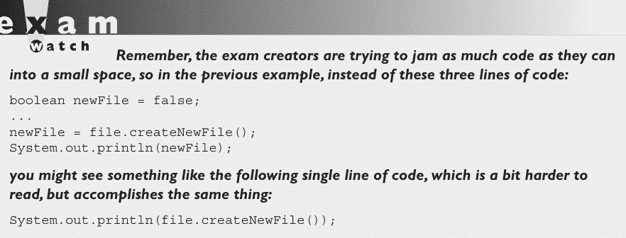

> 记住，出题者试图在很小的空间内挤尽可能多的代码，因此在上一个示例中，而不是使用这三行代码：
>
> ```java
> boolean newFile = false;
> newFile = file.createNewFile();
> System.out.println(newFile);
> ```
>
> 你可能会看到类似下面的单行代码，它读起来稍微难一点，但实现了相同的功能：
>
> ```java
> System.out.println(file.createNewFile());
> ```

### 使用 FileWriter 和 FileReader

在实践中，你可能不会在不进行封装的情况下使用 `FileWriter` 和 `FileReader` 类（很快就会有关于“封装”的介绍）。尽管如此，让我们来做一点“裸写”文件 I/O：

```java
import java.io.*;

class Writer2 {

    public static void main(String [] args) {

        char[] in = new char[50]; // 用于存储输入

        int size = 0;

        try {

            File file = new File(
                // 只是一个对象
                "fileWrite2.txt");

            FileWriter fw = new FileWriter(file); // 创建实际文件
                // 以及一个 FileWriter 对象

            fw.write("howdy\nfolks\n"); // 向文件写入字符

            fw.flush(); // 刷新

            fw.close(); // 完成后关闭文件

            FileReader fr = new FileReader(file); // 创建 FileReader
            // 对象

            size = fr.read(in); // 读取整个文件！

            System.out.print(size + " "); // 读取了多少字节

            for(char c : in)
                System.out.print(c); // 打印数组

            fr.close();

        } catch (IOException e) {

            // 再次，始终关闭

        }

    }

}
```

产生了以下输出：

```
12 howdy
folks
```

这里刚刚发生了什么：

1. `FileWriter fw = new FileWriter(file)` 做了三件事：
    a. 它创建了一个 `FileWriter` 引用变量 `fw`。
    b. 它创建了一个 `FileWriter` 对象并将其赋值给 `fw`。
    c. 它在磁盘上创建了一个实际的空文件（你可以证明这一点）。
2. 我们使用 `write()` 方法向文件写入12个字符，并执行了 `flush()` 和 `close()`。
3. 我们创建了一个新的 `FileReader` 对象，它也打开了文件。

---

## 第9章：I/O 和 NIO

在继续之前，让我们讨论 `flush()` 和 `close()`。在现实需要需要 I/O 时，你会发现自己正在钻研 java.io API，试图弄清楚哪些类以及如何将它们连接起来。对于准备 7.2 考试，我们可以想象整个 `java.io` 包（由表 9-1 列出的类组成）就是我们的微型 I/O。

---

### 使用 PrintWriter

3. 当我们观察 `PrintWriter` 的构造函数时，发现如果有 `File` 类型的对象，就可以构建一个 `PrintWriter` 对象，因此我们只需要创建一个 `PrintWriter` 对象：

```java
File file = new File("fileWriter2.txt"); // 创建一个 File
PrintWriter pw = new PrintWriter(file); // 将 file 传递给 PrintWriter
// 构造函数
```


好了，测试一下。在 Java 5 中，`PrintWriter` 还没有接受 `String` 或 `File` 的构造函数。如果你在 Java 1.4 中编写某些 I/O 代码，如何让 `PrintWriter` 将数据写入文件？提示：你可以通过学习表 9-1 中的简易 I/O API 找到答案。

这是解决这个谜题的一种方法：首先，我们知道在链的一端创建一个 `File` 对象，而在另一端我们需要一个 `PrintWriter` 对象。我们从表 9-1 中看到 `PrintWriter` 也可以使用 `Writer` 对象来构建。虽然 `Writer` 不是我们在表中看到的类，但我们可以看到其他几个类都继承了 `Writer`，这对我们来说也是一样好的；任何继承自 `Writer` 的类都是候选者。进一步观察，我们可以发现 `FileWriter` 具有我们寻找的两个属性：

- 它可以使用 `File` 进行构造。
- 它继承了 `Writer`。

基于这些信息，我们可以组合如下代码（记住，这是一个 Java 1.4 的示例）：

```java
File file = new File("fileWriter2.txt"); // 创建一个 File 对象
FileWriter fw = new FileWriter(file); // 创建一个将输出发送到 File 的 FileWriter
PrintWriter pw = new PrintWriter(fw); // 创建一个将输出发送到 Writer 的 PrintWriter
pw.println("howdy");
pw.println("folks"); // 写入数据
```

此时，组合代码以便更容易地将数据从文件读回内存应该是相当容易的。再次查看表格，我们看到一个名为 `readLine()` 的方法听起来是读取数据的更好方式。通过类似的过程，我们得到了以下代码：

## 文件导航与 I/O (OCP 目标 7.1 和 7.2)

```java
File file = new File("fileWrite2.txt"); // 创建 File 对象并打开 "fileWrite2.txt"
FileReader fr = new FileReader(file); // 创建 FileReader 以从 'file' 获取数据
BufferedReader br = new BufferedReader(fr); // 创建 BufferedReader 以从 Reader 获取数据
String data = br.readLine(); // 读取一些数据
```


## 操作文件和目录

早些时候，我们提到了 `File` 类被用于创建文件和目录。此外，`File` 的方法还用于删除文件、重命名文件、判断文件是否存在、创建临时文件、更改文件属性以及区分文件和目录。一个经常让人困惑点是，`File` 类型的对象既可以表示文件也可以表示目录。接下来我们将讨论这两种情况。

我们之前看到过语句：

```java
File file = new File("foo");
```

它总是创建一个 `File` 对象，然后执行以下两种操作之一：
1. 如果 "foo" 不存在，则不会创建实际的文件。
2. 如果 "foo" 存在，则新的 `File` 对象指向现有的文件。

注意，`File file = new File("foo");` **永远不会**创建实际的文件。创建文件有两种方法：

1. 在 `File` 对象上调用 `createNewFile()` 方法。例如：

```java
File file = new File("foo"); // 还没有文件
file.createNewFile(); // 创建一个名为 "foo" 的文件并赋值给 'file'
```

2. 创建一个 `Writer` 或流（Stream）。具体来说，创建一个 `FileWriter`、`PrintWriter` 或 `FileOutputStream`。每当你创建这些类之一的实例时，你都会自动创建一个文件，除非它已经存在；例如：

```java
File file = new File("foo"); // 还没有文件
PrintWriter pw = new PrintWriter(file); // 创建一个 PrintWriter 对象并创建一个名为 "foo" 的文件，将其赋值给 'file'并将 'pw' 赋值给 PrintWriter
```

创建目录与创建文件类似。我们再次使用惯例，将表示实际目录的 `File` 类型对象称为 **Directory** 对象（大写 D，尽管它的类型是 `File`）。我们将计算机上的实际目录称为小写的 d。呼！与创建文件一样，创建目录是一个两步过程；首先我们创建一个 Directory (File) 对象；然后使用以下 `mkdir()` 创建实际目录：

```java
File myDir = new File("mydir"); // 创建一个对象
myDir.mkdir(); // 创建一个实际的目录
```

一旦你创建了目录，就可以将文件放入其中并操作这些文件：

```java
File myFile = new File(myDir, "myFile.txt");
myFile.createNewFile();
```

这段代码在子目录中创建新文件。由于你在构造函数中提供了子目录，从以后，你只需要通过它的引用变量引用文件即可。在这种情况下，你可以这样...

# 文件导航与 I/O OCP 目标 7.1 和 7.2

在我们的系统上，我们得到了以下输出：

```
found dir1
found dir2
found dir3
found file1.txt
found file2.txt
```

你的结果几乎会有所不同 :)

在本节中，我们仅仅接触了 `java.io` 包中可用内容的皮毛。关于这个包已经写了整整几本书，因此我们显然只涵盖了 API 中一小非常小（但频繁使用）的部分。另一方面，如果你理解了本节涵盖的所有内容，你将能够很好地应对考试中可能遇到的任何 `java.io` 问题，但我们将要介绍的 `Console` 类除外。（注意：序列化将在随光盘的“序列化”章节中介绍。）

# java.io.Console 类

Java 6 新引入了 `java.io.Console` 类。在此时种语境下，控制台是指带有键盘和显示器的物理设备（如你的 Mac 或 PC）。如果你从命令行运行 Java SE 6，通常可以访问一个控制台对象，通过调用 `System.console()` 获取该对象的引用。请记住，你的 Java 程序可能运行在一个无法访问控制台对象的环境中，因此请确保对 `System.console()` 的调用返回返回有效的控制台引用而不是 `null`。

`Console` 类可以方便地从命令行接受输入，包括回显和不回显（如密码），并且可以方便地向命令行写入格式化输出。这在为单元测试编写测试引擎，或者当你想要支持简单但安全的用户交互且不需要 GUI 时，这是一种非常方便的方法。

在输入方面，你必须理解的方法是 `readLine` 和 `readPassword`。`readLine` 方法返回一个包含用户输入的任何内容的字符串——这非常直观。然而，`readPassword` 方法返回的不是字符串；而是一个字符数组。其原因如下：一旦你获取了密码，就可以验证它，然后彻底从内存中删除它。如果返回的是字符串，它可能存在于内存中的某个池中，也许某些恶意的黑客可以找到它。

让我们来看一个使用控制台支持另一个类测试的小程序：

```java
import java.io.Console;

public class NewConsole {

    public static void main(String[] args) {

        String name = "";

        Console c = System.console(); // #1: 获取一个 Console

        char[] pw;

        pw = c.readPassword("%s", "pw:"); // #2: 返回一个 char[]

        for(char ch : pw) {

            c.format("%c ", ch); // #3: 格式化输出

            c.format("\n");

        }

        MyUtility mu = new MyUtility();

        while(true) {

            name = c.readLine("%s", "input:"); // #4: 返回一个 String

            c.format("output: %s \n", mu.doStuff(name));

        }

    }

}

class MyUtility {

    String doStuff(String arg) { // #5: 测试的类

        // 存根代码

        return "result is " + arg;

    }

}
```

让我们回顾这段代码：

- 在第一行，我们获取了一个新的 `Console` 对象。记住我们不能这样做：`Console c = new Console();`
- 在第2行，我们调用了 `readPassword()`，它返回一个 `char[]` 而不是字符串。当你测试这段代码时，你会发现你输入的密码没有被回显。
- 在第3行，我们手动显示你输入的密码，每个字符之间用空格隔开。在本章稍后的部分，你将读到 `format()` 方法。
- 在第4行，我们调用了 `readLine()`，它返回一个字符串。
- 在第5行，这是我们要测试的类。在本章的晚些时候，当你学习正则表达式和格式化时，我们建议使用像 `NewConsole` 的东西来测试你学习的概念。`Console` 类的功能比这里涵盖的要多，但如果你理解了目前的所有内容，你就能应对考试。

## 认证目标

# Files, Path 和 Paths (OCP 目标 8.1 和 8.2)

- 8.1 使用 `Path` 类处理文件和目录路径。
- 8.2 使用 `Files` 类检查、删除、移动文件或目录。

> 注意：关于序列化的内容，请参阅随书的光盘。

OCP 7 考试有两个章节专门介绍 I/O。上一节 Oracle 指的“Java I/O 基础”（我们称之为 `7.x` 对象），它关注的是 `java.io` 包。现在我们将查看 Oracle 调用的“Java I/O (NIO.2)”系列，我们将这些特定对象称为 `8.x`。`NIO.2` 术语的定义有点模糊，但大多数人（考试设计者）将 NIO.2 定义为 Java 7 引入的位于两个包中的关键新功能。

```java
java.nio.file
```

```java
java.nio.file.attribute
```

我们将从 `java.nio.file` 包开始，然后移动到 `java.nio.file.attribute`。`Console` 类的功能比这里涵盖的要多，但如果你理解了目前的所有内容，你就能应对考试。

还有一点需要注意。如果你在 Windows 上，可能会处理一个看起来像 `file:///c:/temp` 的 URL。`file://` 就像 `http://` 一样的协议。这种语法允许你在 Internet Explorer 中浏览到文件夹。你的程序可能需要处理用户从浏览器复制/粘贴的此类字符串。没问题，对吧？我们学过编写代码：

```java
Path p = Paths.get("file:///c:/temp/test");
```

遗憾的是，这不起作用，你会得到一个关于冒号无效的异常，看起来像这样：

```
Exception in thread "main" java.nio.file.InvalidPathException:
Illegal char name :->

at index 4: file:///c:/temp
```

`Paths` 提供了另一个解决此问题的方法。`Paths.get(URI uri)` 让你（间接地）在尝试创建 `Path` 之前，将字符串转换为 URI（统一资源标识符）。

你最后知道的是，我们一直在讨论的 `Paths.get()` 方法实际上是一个快捷方式。你不需要编写较长的版本，但为了理解底层发生了什么是非常重要的。首先，Java 会找到默认的文件系统是什么。例如，它可能是 `WindowsFileSystemProvider`。然后 Java 使用文件系统的自定义逻辑获取路径。幸运的是，这一切都会自动完成，我们不需要使用任何特殊代码，甚至不需要考虑它。

```java
Path short = Paths.get("c:\\");
```

现在你已经知道如何创建一个 `Path` 实例，你可以以各种方式对它进行操作。我们需要回到这一点继续讨论。

> 就考试而言，`Paths.get()` 是初始创建 `Path` 的方法。还有另一种方法，当你在处理为 Java 7 之前编写的代码时，这种方法非常有用：

```java
Path convertedPath = file.toPath();
File convertedFile = path.toFile();
```

如果你正在更新使用 `File` 的旧代码，可以将其转换为 `Path` 并开始调用新类。如果你的代码需要调用旧代码，它可以将其转换回 `File`。


# 创建文件和目录

通过 I/O，我们看到仅仅因为有一个 `File` 对象，文件并不一定存在。你必须调用 `createNewFile()` 让文件产生，并调用 `exists()` 检查它是否存在。将本章之前的示例重写为 NIO2，我们现在有了：

```java
Path path = Paths.get("file1.txt"); // 它只是一个对象
System.out.println(Files.exists(path)); // 查找真实文件
Files.createFile(path); // 创建文件！
System.out.println(Files.exists(path)); // 再次查找
```

NIO2 具有对应的方法，但有两个不同：

- 你调用 `Files` 上的静态方法，而不是 `File` 上的实例方法。
- 方法名称略有不同。

请参表 9-3 查看旧类/方法名称与新名称之间的映射。如果你正在处理 `File` 对象，仍然可以继续使用旧的 I/O 方法。

有一个新方法 `Files.notExists()` 来补充 `Files.exists()`。在某些极罕的情况下，Java 没有足够的权限来确定文件是否存在。当发生这种情况时，两个方法都会返回 `false`。

你还可以在 Java 中创建目录。假设我们有一个名为 `/java` 的目录，并且想要创建文件 `/java/source/directory/Program.java`。我们可以通过一种方式实现：

```java
Path path1 = Paths.get("/java/source");
Path path2 = Paths.get("/java/source/directory");
Path file = Paths.get("/java/source/directory/Program.java");
Files.createDirectory(path1); // 创建第一级目录
Files.createDirectory(path2); // 创建第二级目录
Files.createFile(file); // 创建文件
```

或者，我们可以一次性创建所有目录：

```java
Files.createDirectories(path2); // 创建所有层级的目录
Files.createFile(file); // 创建文件
```


虽然两种方法都有效，但如果你有很多目录要创建，第二种显然更好。记住，在创建文件时，目录必须存在。


# 第 9 章：I/O 和 NIO

## 表 9-3 I/O vs. NIO.2

| 说明 | I/O 方法 | NIO.2 方法 |
|---|---|---|
| 创建空文件 | `File file = new File("test"); file.createNewFile();` | `Path path = Paths.get("test"); Files.createFile(path);` |
| 创建空目录 | `File file = new File("dir"); file.mkdir();` | `Path path = Paths.get("dir"); Files.createDirectory(path);` |
| 创建目录（包括任何缺失的父目录） | `File file = new File("/a/b/c"); file.mkdirs();` | `Path path = Paths.get("/a/b/c"); Files.createDirectories(path);` |
| 检查文件或目录是否存在 | `File file = new File("test"); file.exists();` | `Path path = Paths.get("test"); Files.exists(path);` |

## 复制、移动和删除文件

在处理文件时，我们经常会复制、移动或删除文件。在 Java 7 之前的工作时，我们经常需要这样做。在 Java 7 中，让我们看看这些例子：

```
Path source = Paths.get("/temp/test1"); // 存在
Path target = Paths.get("/temp/test2.txt"); // 存在
Path targ = Paths.get("/temp/test3.txt"); // 不存在
```

在 Java 7 之前，我们可能需要这样做：

```
Path p = Paths.get("file:///c:/temp/test");
```

遗憾的是，这不起作用，你会得到一个关于冒号无效的异常，看起来像这样：

```
Exception in thread "main" java.nio.file.InvalidPathException:
Illegal char name :->

at index 4: file:///c:/temp
```

`Paths` 提供了另一个解决此问题的方法。`Paths.get(URI uri)` 让你（间接地）在尝试创建 `Path` 之前，将字符串转换为 URI（统一资源标识符）。

你最后知道的是，我们一直在讨论的 `Paths.get()` 方法实际上是一个快捷方式。你不需要编写较长的版本，但为了理解底层发生了什么是非常重要的。首先，Java 会找到默认的文件系统是什么。例如，它可能是 `WindowsFileSystemProvider`。然后 Java 使用文件系统的自定义逻辑获取路径。幸运的是，这一切都会自动完成，我们不需要使用任何特殊代码，甚至不需要考虑它。

```
Path short = Paths.get("c:\
```

现在你已经知道如何创建一个 `Path` 实例，你可以以各种方式对它进行操作。我们需要回到这一点继续讨论。

> 就考试而言，`Paths.get()` 是初始创建 `Path` 的方法。还有另一种方法，当你在处理为 Java 7 之前编写的代码时，这种方法非常有用：

```
Path convertedPath = file.toPath();
File convertedFile = path.toFile();
```

如果你正在更新使用 `File` 的旧代码，可以将其转换为 `Path` 并开始调用新类。如果你的代码需要调用旧代码，它可以将其转换回 `File`。


## 创建文件和目录

通过 I/O，我们看到仅仅因为有一个 `File` 对象，文件并不一定存在。你必须调用 `createNewFile()` 让文件产生，并调用 `exists()` 检查它是否存在。将本章之前的示例重写为 NIO2，我们现在有了：

```
Path path = Paths.get("file1.txt"); // 它只是一个对象
System.out.println(Files.exists(path)); // 查找真实文件
Files.createFile(path); // 创建文件！
System.out.println(Files.exists(path)); // 再次查找
```

NIO2 具有对应的方法，但有两个不同：

- 你调用 `Files` 上的静态方法，而不是 `File` 上的实例方法。
- 方法名称略有不同。

请参表 9-3 查看旧类/方法名称与新名称之间的映射。如果你正在处理 `File` 对象，仍然可以使用旧的 I/O 方法。

有一个新方法 `Files.notExists()` 来补充 `Files.exists()`。在某些极罕见的情况下，Java 没有足够的权限来确定文件是否存在。当发生这种情况时，两个方法都会返回 `false`。

你还可以在 Java 中创建目录。假设我们有一个名为 `/java` 的目录，并且想要创建文件 `/java/source/directory/Program.java`。我们可以通过一种方式实现：

```
Path path1 = Paths.get("/java/source");
Path path2 = Paths.get("/java/source/directory");
Path file = Paths.get("/java/source/directory/Program.java");
Files.createDirectory(path1); // 创建第一级目录
Files.createDirectory(path2); // 创建第二级目录
Files.createFile(file); // 创建文件
```

或者，我们可以一次性创建所有目录：

```
Files.createDirectories(path2); // 创建所有层级的目录
Files.createFile(file); // 创建文件
```

虽然两种方法都有效，但如果你有很多目录要创建，第二种显然更好。记住，在创建文件时，目录必须存在。


## 表 9-3 I/O vs. NIO.2

| 说明 | I/O 方法 | NIO.2 方法 |
|---|---|---|
| 创建空文件 | `File file = new File("test"); file.createNewFile();` | `Path path = Paths.get("test"); Files.createFile(path);` |
| 创建空目录 | `File file = new File("dir"); file.mkdir();` | `Path path = Paths.get("dir"); Files.createDirectory(path);` |
| 创建目录（包括任何缺失的父目录） | `File file = new File("/a/b/c"); file.mkdirs();` | `Path path = Paths.get("/a/b/c"); Files.createDirectories(path);` |
| 检查文件或目录是否存在 | `File file = new File("test"); file.exists();` | `Path path = Paths.get("test"); Files.exists(path);` |

## 复制、移动和删除文件

在处理文件时，我们经常会复制、移动或删除文件。在 Java 7 之前的工作时，我们经常需要这样做。在 Java 7 中，让我们看看这些例子：

```
Path source = Paths.get("/temp/test1"); // 存在
Path target = Paths.get("/temp/test2.txt"); // 存在
Path targ = Paths.get("/temp/test3.txt"); // 不存在
```

## 表 9-5 Path 方法

| 方法 | 说明 |
|---|---|
| `String getFileName()` | 返回文件名或元素序列的最后一个元素 |
| `getName(int index)` | 返回对应指定索引的路径元素。第 0 个元素离根最近。（在 Windows 上，根通常是 `C:\`，在 UNIX 上，根是 `/`） |
| `int getNameCount()` | 返回此路径中的元素数量，不包括根。 |
| `getParent()` | 返回父路径，如果此路径没有父路径则返回 `null`。 |
| `getRoot()` | 返回此路径的根，如果此路径没有根则返回 `null`。 |
| `Path subpath` | 根据指定的起始索引（包含）和结束索引（不包含）返回此路径的子序列（不包括根元素）。 |
| `String toString()` | 返回路径的字符串表示。 |

# 文件、路径与 Paths (OCP 目标 8.1 和 8.2) 501

这里有一个关于 `Path` 接口的另一个有趣事实：它继承自 `Iterable<Path>`。初看之下，这似乎并不有趣。但每个类都（正确地）在增强 for 循环中实现了 `Iterable<?>` 表达式。因此，你可以遍历数组或 `List`，也可以遍历 `Path`。这非常酷！利用此功能，可以轻松地打印文件（目录）的层级树结构，如下例所示：

```
int spaces = 1;
Path myPath = Paths.get("tmp", "dir1", "dir2", "dir3", "file.txt");
for (Path subPath : myPath) {
    System.out.format("%" + spaces + "%s%s\n", "", subPath);
    spaces += 2;
}
```

当你运行这个示例时，会打印出一个（简单的）树。得益于变量空格（每次迭代增加 2），不同的子路径打印出来像一棵树。

```
tmp
  dir1
    dir2
      dir3
        file.txt
```

## 路径归一化

通常情况下（这并非双关语），当你创建一个 `Path` 时，你是直接创建创建的。然而，所有这些路径都返回相同的逻辑 `Path`：

p1 可能是你编写代码时需要的。p2 纯粹是多余的。p3 则更有趣。这两个目录——anotherDirectory 和 myDirectory——处于同一层，但我们必须向上移动一级才能得到

```
/root
| anotherDirectory
|-- myDirectory
```

你可能在想，为什么我们一开始不直接输入 myDirectory 呢？如果你可以的话。有时候这样做行不通。让我们来看一个真实的例子，说明为什么会。

# 502 第 9 章：I/O 和 NIO

```
/ (root)
 |-- Build_Project
 |-- scripts
 |   |-- buildScript.sh
 |-- My_Project
    |-- MyClass.java
```

如果你想编译 MyClass，切换到 `/My_Project/source` 并运行 `javac MyClass.java` 要简单得多。一旦你的程序变大，它可能包含数千个类和数百个 jar 文件。你不想为了编译就去挑选所有这些文件，所以有人写了一个脚本来构建你的程序。`buildScript.sh` 会找到编译所需的所有内容并为你运行 `javac` 命令。问题是，现在的当前目录是 `/Build_Project/scripts` 而不是 `/My_Project/source`。构建脚本通过类似下面的操作为你构建了一个路径：

```
String buildProject = "/Build_Project/scripts";
String upTwoDirectories = "../";
// remember 意味着路径自身之间的关系
String myProject = "/My_Project/source"
Path path = Paths.get(buildProject, upTwoDirectories, myProject); // 使用变量构建路径
System.out.println("Original: " + path);
System.out.println("Normalized: " + path.normalize());
```

输出结果：

```
Original:/Build_Project/scripts/../My_Project/source
Normalized:/My_Project/source
```

后者更容易读。`normalize()` 方法会忽略单个点 `.`。它还可以从路径中移除双点 `..`。

使用此 `normalize()` 时要小心！它查看路径的字符串等价，而不检查文件系统以判断目录或文件是否存在。

让我们练习一下，看看这些路径 normalize 返回什么。这次，我们没有提供目录结构来证明目录和文件必须存在于计算机上。你认为这张图指出了什么？

```
System.out.println(Paths.get("a/../b/").normalize());
System.out.println(Paths.get("./classpath").normalize());
System.out.println(Paths.get("a/b/c/..").normalize());
System.out.println(Paths.get("../a/b/c").normalize());
```

## 解析路径

到为止，你已经了解了单个 `Path` 上调用的方法，但如果你想组合两个路径呢？回顾一下，`resolve()` 告诉你如何在路径内部解析路径。

```
Path dir = Paths.get("/home/java");
Path relative = Paths.get("dir");
Path file = Paths.get("/Model.pdf");
System.out.println("1: " + dir.resolve(relative));
System.out.println("2: " + dir.resolve(file));
System.out.println("3: " + file.resolve(relative));
System.out.println("4: " + relative.resolve(dir));
System.out.println("5: " + relative.resolve(file));
System.out.println("6: " + file.resolve(relative));
```

输出结果：

```
1: /home/java/dir
2: /home/Model.pdf
3: /Model.pdf/dir
4: /home/java
5: dir/Model.pdf
6: /Model.pdf
```

## 路径的相对化

现在假设我们想执行 `resolve` 的相反操作。我们有一个主目录的绝对路径以及该主目录下某个音乐文件的绝对路径。我们只想知道该音乐文件的目录和名称。

```java
Path dir = Paths.get("/home/java");
Path music = Paths.get("/home/java/country/Swift.mp3");
Path mp3 = dir.relativize(music);
System.out.println(mp3);
```


# 第 9 章：I/O 和 NIO

输出是：`country/Swift.mp3`。Java 识别 `/home/java` 部分是相同的，并返回了剩余部分的路径。
`path1.relativize(path2)` 应该理解为“给我一个显示从 path1 到 path2 所需的路径”。在这个例子中，我们确定了 `music` 是名为 `dir` 的目录中的一个文件。

记住这一点，让我们来看一些更复杂的例子：

```java
Path absolute1 = Paths.get("/home/java");
Path absolute2 = Paths.get("/usr/local");
Path absolute3 = Paths.get("/home/java/temp/music.mp3");
Path relative = Paths.get("/temp");
Path relative2 = Paths.get("/temp/music.pdf");

System.out.println("1: " + absolute1.relativize(absolute3));
System.out.println("2: " + absolute2.relativize(absolute1));
System.out.println("3: " + absolute1.relativize(absolute2));
System.out.println("4: " + relative.relativize(relative2));
System.out.println("5: " + absolute1.relativize(relative)); // BAD
```

输出是：

```
1: temp/music.mp3
2: ../
3: /usr/local
4: music.pdf
Exception in thread "main" java.lang.IllegalArgumentException: 'other' is a different type of Path
```

在你抓耳挠腮之前，让我们来看看这里的目录结构。记住，目录并不真的需要存在；这只是为了可视化。

```
/root
| - local
  | - usr
    | - home
      | - java
      | - temp
        | - music.mp3
```

现在我们可以追踪整个过程。第一个例子是直观的。它告诉我们如何通过向下进入两个目录到达 `absolute3`。第二个也类似。我们通过相反的操作——向上移动两个目录到达 `absolute1`。记住在 `normalize()` 中双点 `..` 意味着向上移动一个目录。

第三个输出语句说，要从 `absolute1` 到 `absolute2`，我们需要向上两个目录再向下进入两个目录。Java 知道这一点，因为我们提供了绝对路径。最糟糕的情况是像我们这里这样一直回到根目录。

第四个输出语句是好的。尽管它们是相对路径，但有足够的共同部分让 Java 能够判断路径的差异。

第五个例子抛出了异常。Java 无法通过由一个绝对路径和一个相对路径构造出一个相对路径。

记住，`relativize()` 和 `resolve()` 是相反的。就像 `resolve()` 一样，`relativize()` 不检查路径是否实际存在。复习一下，`relativize()` 告诉你如何获取两个路径之间的相对路径。

## 认证目标

## 文件和目录属性 (OCP 目标 8.3)

8.3 读取和更改文件及目录属性，重点关注 `BasicFileAttributes`、`DosFileAttributes` 和 `PosixFileAttributes` 接口。

## 轻松读写属性

在本节中，我们将把 `java.nio.file.attribute` 包中的类和接口引入讨论。在 NIO.2 之前，你只能读取和写入少数属性。就像创建文件一样，现在有一种新方法，使用 `Files` 而不是 `File` 来这样做。Oracle 也借此机会稍微清理了签名。以下示例创建了一个文件，更改了最后修改日期，打印出来并使用新旧方法删除文件。如果我们想让一个文件看起来像是在过去创建的，就可以这样做。（正如你所见，这里有一个关于依赖文件戳的课程！）

```java
Date januaryFirst = new GregorianCalendar(
    2013, Calendar.JANUARY, 1).getTime(); // 创建一个日期

// 旧方法
File file = new File("c:/temp/file");
file.createNewFile(); // 创建文件
file.setLastModified(januaryFirst.getTime()); // 设置时间
System.out.println(file.lastModified()); // 获取时间
file.delete(); // 删除文件

// 新方法
Path path = Paths.get("c:/temp/file2"); // 创建另一个文件
Files.createFile(path);
FileTime last = FileTime.fromMillis(
    januaryFirst.getTime()); // 转换为新的
Files.setLastModifiedTime(path, last); // 设置时间
System.out.println(Files.getLastModifiedTime(path)); // 获取时间
Files.delete(path); // 删除文件
```

正如你所看到的，功能上的唯一变化是我们设置了文件权限。`Files.getLastModifiedTime()` 使用了易读的日期格式。

```
1357014000000
2013-01-01T00:00:00Z
```

另一种常见的属性类型是可以设置文件权限。Windows 和 UNIX 都有三种权限的概念：

- **读取** (Read)：可以打开该文件。
- **写入** (Write)：可以修改该文件。
- **执行** (Execute)：可以运行该文件。

## 属性类型

在这个示例中，我们演示了如何获取所有三个时间。在实践中，调用 `setTimes()` 时，对于任何不想更改的时间，你应该传递 `null` 值，仅对你想要更改的时间传递 `FileTime`。

关键点在于：“XXXFileAttributes”类是只读的，而“XXXFileAttribute”类允许更新。

# 备忘
`BasicFileAttributes` 和 `BasicFileAttributeView` 接口有点让人困惑。它们的名称相似，但功能不同，且获取它们的方式也不同。尝试记住这三点：

- `BasicFileAttributeView` 是单数，而 `BasicFileAttributes` 是复数。
- 你通过 `Files.getFileAttributeView` 获取 `BasicFileAttributeView`，通过 `Files.readAttributes` 获取 `BasicFileAttributes`。
- 你**只能**在 `BasicFileAttributeView` 中更新属性，而不能在 `BasicFileAttributes` 中更新。记住，视图（view）是为了更新的。

`PosixFileAttributes` 和 `DosFileAttributes` 继承自 `BasicFileAttributes`。这意味着你可以在 POSIX 或 DOS 子接口上调用基础方法（Basic methods）。

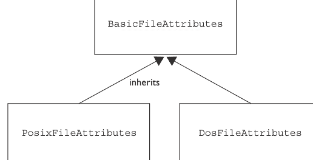

如果可能，尝试使用更通用的类型。例如，如果你只需要使用基础属性，只需获取 `BasicFileAttributes` 即可。这让你的代码保持与操作系统无关。如果你正混合使用基础属性和 POSIX 属性，可以直接使用 `PosixFileAttributes`，而不是调用两次 `readAttributes()` 来获取不同的属性。

## 使用 DosFileAttributes

`DosFileAttributes` 在基础属性的基础上增加了四个属性。我们将查看最常见的几个——隐藏文件和只读文件。隐藏文件通常以点开头，并且当你输入 `dir` 列出目录内容时，它们不会显示。只读文件顾名思义——无法更新的文件。（这里的其他属性是“归档”和“系统”，它们极不可能被用到。）

```java
Path path = Paths.get("C:/test");
Files.createFile(path);
Files.setAttribute(path, "dos:hidden", true); // 创建文件
Files.setAttribute(path, "dos:readonly", true); // 设置属性
DosFileAttributes dos = Files.readAttributes(path, DosFileAttributes.class); // 另一个
System.out.println(dos.isHidden()); // dos 属性
System.out.println(dos.isReadOnly());
Files.setAttribute(path, "dos:hidden", false);
Files.setAttribute(path, "dos:readonly", false);
dos = Files.readAttributes(path, DosFileAttributes.class); // 再次获取属性
System.out.println(dos.isHidden());
System.out.println(dos.isReadOnly());
Files.delete(path);
```

输出是：
```
true
false
false
```

这段代码中第一个棘手的地方是，字符串 `"readonly"` 是小写的，尽管方法名是混合大小写的。如果你忘记并使用了字符串 `"readonly"`，Java 将静默地忽略该语句，文件将仍然允许任何人写入。

另一个棘手的地方是，你无法删除只读文件。这就是为什么代码第二次调用 `setAttribute` 并将 `false` 作为参数，以使其不再是“只读”，以便代码可以进行自我清理。你可以再次通过 `readAttributes` 来查看这些更新后的值。设置这些属性还有另一种替代方法，你不需要担心字符串。然而，了解这两种方法都是好的。

```java
DosFileAttributeView view = Files.getFileAttributeView(path, DosFileAttributeView.class);
view.setHidden(true);
view.setReadOnly(true);
```

## 使用 PosixFileAttributes

`PosixFileAttributes` 在基础属性上增加了两个属性——组和权限。在 UNIX 上，每个文件或目录都有所有者和组名。UNIX 权限也比基础权限更复杂。每个文件或目录都有九个权限，格式类似于 `"rwx-r----"`。这些权限对应于谁拥有它们。在示例中，“用户”（user，所有者）具有读、写、执行权限。“组”（group）只有读和写权限。“其他”（other）只有访问权限。现在让我们来看一些代码，来设置权限并以易读的格式输出它们：

```java
Path path = Paths.get("/tmp/file2");
Files.createFile(path);
PosixFileAttributes posix = Files.readAttributes(path, PosixFileAttributes.class);
```

输出看起来如下：
```
[OWNER_WRITE, GROUP_READ, OTHERS_READ]
```

它并不是对称的。我们以晦涩的格式给 Java 权限，却以纯英语的形式返回。你也可以输出组名：

```java
System.out.println(posix.group()); // 获取组
```

让我们复习表 9-7 中常见的属性。

| 表格 9-7 | 常见属性 | 读写属性 |
| :--- | :--- | :--- |
| Basic | read | `BasicFileAttributes basic = Files.readAttributes(path, BasicFileAttributes.class);`<br>`FileTime lastUpdated = basic.lastModifiedTime();`<br>`FileTime created = basic.creationTime();`<br>`FileTime now = FileTime.fromMillis(System.currentTimeMillis());` |
| | write | `BasicFileAttributeView basicView = Files.getFileAttributeView(path, BasicFileAttributeView.class);`<br>`basicView.setTimes(now, created);` |
| Posix (UNIX/Linux) | | `PosixFileAttributes posix = Files.readAttributes(path, PosixFileAttributes.class);`<br>`Set<PosixFilePermission> permissions = PosixFilePermissions.fromString("rw-r---");`<br>`Files.setPosixFilePermissions(path, permissions);`<br>`System.out.println(posix.permissions());` |
| Dos (Windows) | | `DosFileAttributes dos = Files.readAttributes(path, DosFileAttributes.class);`<br>`System.out.println(dos.isHidden());`<br>`System.out.println(dos.isReadOnly());`<br>`Files.setAttribute(path, "dos:hidden", false);`<br>`Files.setAttribute(path, "dos:readonly", false);` |

## 认证目标

# DirectoryStream (OCP 目标 8.4)

8.4 使用 `DirectoryStream` 和 `FileVisitor` 接口递归访问目录树。

现在让我们回到 `java.nio.file` 包中的 NIO.2 能力。你可能需要遍历一个目录。假设你要求列出所有具有主目录的用户。让我们说你正在遍历一个目录。

```
/home
  - users
    - vafi
    - eyra
```

```java
Path dir = Paths.get("/home");
try (DirectoryStream<Path> stream = // 使用 try with resources
    Files.newDirectoryStream(dir)) { // 所以我们不需要关闭
    for (Path path : stream) // 遍历流
        System.out.println(path.getFileName());
}
```

正如预期的那样，这输出：
```
vafi
eyra
```

`DirectoryStream` 接口让你遍历目录。但这只是冰山一角。假设我们有数百个用户，并且想要报告以 v 或 w 开头的家目录。

```java
Path dir = Paths.get("/home/users");
try (DirectoryStream<Path> stream = Files.newDirectoryStream(dir, "[vw]*")) { // "v" 或 "w" 跟任意字符
    for (Path path : stream)
        System.out.println(path.getFileName());
}
```


这次输出是 `true`。

让我们检查表达式 `[vw]*`。`[vw]` 表示 `v` 或 `w` 中的任意一个。`*` 是一个通配符，表示零或多个字符。这不是正则表达式。（如果是的话，语法将是 `[vw].`——注意那里的点。）

# FileVisitor (OCP 目标 8.4)

`DirectoryStream` 使用了一种称为 glob 的新特性。我们将在本章后面的部分详细介绍 glob。

`DirectoryStream` 有一个局限性。它只能查看单个目录。记住这一点的方法是它类似于 DOS 中的 `dir` 命令或 UNIX 中的 `ls` 命令。或者你可以记住 `DirectoryStream` 流单个目录：

## 认证目标

8.4 使用 `DirectoryStream` 和 `FileVisitor` 接口递归访问目录树。

幸运的是，还有另一个类可以查看子目录。假设你想删除所有的 `.class` 文件以便压缩并提交作业。你可以手动遍历每个目录，但很快就会变得繁琐。你可以在 Windows 中编写复杂的命令，在 UNIX 中编写另一个，但那样就会有两个功能相同的程序。同样，你可以使用 Java 并编写代码。

Java 提供了 `SimpleFileVisitor`。你扩展它并重写一个或多个方法。然后你可以调用 `Files.walkFileTree`，它知道如何递归遍历目录结构以及你的访问器子类。让我们尝试这个示例：

```java
public class RemoveClassFiles extends SimpleFileVisitor<Path> {

    // 被“自动”调用
    public FileVisitResult visitFile(Path file, BasicFileAttributes attrs) throws IOException {
        if (file.getName().endsWith(".class")) { // 删除文件
            Files.delete(file);
        }
        return FileVisitResult.CONTINUE; // 继续下一个文件
    }

    public static void main(String[] args) throws Exception {
        // ...
    }
}
```

# 第 9 节：I/O 和 NIO

这是一个简单的文件访问器。它只实现了一个方法：`visitFile`。该方法会在目录结构中的每个文件被调用。它会检查文件的扩展名，并在适当的情况下将其删除。在我们的案例中，两个 `.class` 文件被删除了。

`visitFile()` 有两个参数。第一个是代表当前文件的 `Path` 对象。另一个是 `BasicFileAttributes` 接口。你还记得它吗？没错——它能让你查找到当前文件是否为目录、它是何时创建的，以及许多其他数据。

最后，`visitFile()` 返回 `FileVisitResult.CONTINUE`。这告诉 `walkFileTree()` 应该继续遍历目录结构以寻找更多文件。

既然我们已经体会到了这种方法的威力，让我们通过另一个示例来看我们可以使用的所有方法吧：

```
/home
- a.txt
- emptyChild
- child
  - b.txt
  - grandchild
    - c.txt
```

```java
public FileVisitResult preVisitDirectory(Path dir, BasicFileAttributes attrs) {
    System.out.println("pre: " + dir);
    return FileVisitResult.CONTINUE;
}

public FileVisitResult visitFile(Path file, BasicFileAttributes attrs) {
    System.out.println("file: " + file);
    return FileVisitResult.CONTINUE;
}

public FileVisitResult visitFileFailed(Path file, IOException exc) {
    return FileVisitResult.CONTINUE;
}

public FileVisitResult postVisitDirectory(Path dir, IOException exc) {
    System.out.println("post: " + dir);
    return FileVisitResult.CONTINUE;
}

public static void main(String[] args) throws Exception {
    PrintDirs dirs = new PrintDirs();
    Files.walkFileTree(Paths.get("/home"), dirs);
}
```

你可能会得到以下输出：

```
pre: /home
file: /home/a.txt
pre: /home/child
file: /home/child/b.txt
pre: /home/child/grandchild
file: /home/child/grandchild/c.txt
post: /home/child/grandchild
post: /home/child
pre: /home/emptyChild
post: /home/emptyChild
post: /home
```

注意，Java 在返回树的上层之前会尽可能深地遍历。这被称为深度优先搜索。我们之所以说“可能”，是因为同一层级的文件和目录可以以任何顺序被访问。

你可以根据意愿重写这四个方法中的任意一个或多个。注意，方法的后半部分带有一个 `IOException` 作为参数。这允许这些方法处理在遍历树过程中早期出现的问题。

尽管如此，通过这些 `FileVisitor` 构造结构，你实际上进行了一些控制。假设我们将 `preVisitDirectory` 方法更改为如下：

```java
public FileVisitResult preVisitDirectory(Path dir, BasicFileAttributes attrs) {
    System.out.println("pre: " + dir);
    String name = dir.getFileName().toString();
    if (name.equals("child"))
        return FileVisitResult.SKIP_SUBTREE;
    return FileVisitResult.CONTINUE;
}
```

现在的输出是：

```
pre: /home
file: /home/a.txt
pre: /home/child
pre: /home/emptyChild
post: /home/emptyChild
post: /home
```

| 表 9-8 FileVisitor 方法 | 说明 | 包含 IOException 参数？ |
|---|---|---|
| preVisitDirectory | 在进入目录之前调用 | 否 |
| visitFile | 每个文件调用一次（但不包括目录） | 否 |
| visitFileFailed | 仅在访问文件时发生错误时调用，通常是权限问题 | 是 |
| postVisitDirectory | 在返回目录时完成后调用 | 是 |

由于我们指示程序跳过整个子树——即我们没有看到文件 `b.txt` 或子目录 `grandchild`——我们也没有看到访问调用。

现在，如果我们把 `FileVisitResult.SKIP_SUBTREE` 改为 `TERMINATE`，会发生什么？输出可能是：

```
pre: /home
file: /home/a.txt
pre: /home/child
```

我们看到一旦出现了“child”目录，程序就停止了树的遍历。再次，我们在输出上使用的是“可能”。`emptyChild` 也可能先出现，在这种情况下，输出的最后一行将是 `/home/emptyChild`。

还有一种结果类型。如果我们把 `FileVisitResult.TERMINATE` 改为 `FileVisitResult.SKIP_SIBLINGS`，会发生什么？输出与之前的示例相同：

```
pre: /home
file: /home/a.txt
pre: /home/child
```

`SKIP_SIBLINGS` 是 `SKIP_SUBTREE` 和“不要查看同一层级的任何文件夹”的结合。这意味着我们跳过了 `child`，同时也跳过了 `emptyChild`。

为了确保你真的理解了发生了什么。如果我们使用这个方法，你认为会怎样？

假设 `child` 在 `emptyChild` 之前被遇到，输出是：

```
pre: /home
file: /home/a.txt
pre: /home/child
pre: /home/emptyChild
post: /home/emptyChild
post: /home
```

# PathMatcher (OCP 目标 8.5)

```java
Path path1 = Paths.get("One.java");
Path path2 = Paths.get("One.ja*a");

matches(path1, "glob:????"); // true
matches(path1, "glob:**");   // false
matches(path2, "glob:????"); // true
matches(path2, "glob:????"); // false
```

Globs 还提供了一种匹配多个模式的方便方法。假设我们想匹配以 Kathy 和 Bert 开头的任何内容：

```java
Path path1 = Paths.get("Bert-book");
Path path2 = Paths.get("Kathy-horse");

matches(path1, "glob:{Bert,Kathy}*"); // true
matches(path2, "glob:{Bert,Kathy}*"); // true
matches(path2, "glob:{Bert,Kathy}*"); // false
```

你也可以像在正则表达式一样，在 glob 中转义 `[a-z]` 或 `[#]` 等特殊字符。你也可以使用反斜杠来转义特殊字符。让我们把这些结合到一个典型的示例中：

```java
Path path1 = Paths.get("*test/3");
Path path2 = Paths.get("\\*test/1");
Path path3 = Paths.get("0/test/1");
Path path4 = Paths.get("0*/1");

String glob = "[0-9]\\*{A,b}\\**"; // 修正后的 glob 模式
matches(path1, glob); // false
matches(path2, glob); // true
matches(path3, glob); // false
matches(path4, glob); // false
```

详细列出 glob 的作用，我们得到：

- `[0-9]` 一位数字。也可以读为 0 到 9 之间的任何字符。
- `\\*` 字面量字符星号，而不是表示匹配的星号。在 `*` 前加一个单反斜杠即可转义它。然而，Java 不允许你输入单个反斜杠，所以你必须用另一个反斜杠来转义反斜杠本身。
- `{A,b}` 大写字母 `A` 后跟任何内容，或者单个字符 `b`。
- `**` 一个或多个任意名称的目录。
- 单个字符 `1`。

第二个路径没有匹配，因为它包含字面量反斜杠后跟字面量星号。glob 寻找的是字面量星号。第三个路径也没有匹配，因为没有字面量星号。第四个路径没有匹配，因为在 `""` 和 `"1"` 之间没有用于匹配 `**` 的目录。幸运的是，没有人会写这样疯狂、无意义的 glob。但如果你能理解这一个，你就没问题了。在真实世界中，glob 倾向于像 `*.txt`、`*.html` 这样的简单表达式，与正则表达式相似，回顾一下常用表达式的异同之处。正则表达式更强大，但 glob 关注你在匹配文件名时可能需要的内容。

现在，你可能已经注意到我们处理的是 `Path` 对象，这意味着它们实际上并不存在文件系统中。但我们想打印出 password 子目录中存在的所有文件。幸运的是，我们可以将 `PathMatcher` 的功能与我们已经熟悉的遍历文件树的方法结合起来。

```java
public class MyPathMatcher extends SimpleFileVisitor<Path> {

    private PathMatcher matcher = FileSystems.getDefault().getPathMatcher("glob:**/*.txt"); // 表示任何子目录

    public FileVisitResult visitFile(Path file, BasicFileAttributes attrs) throws IOException {
        if (matcher.matches(file)) {
            System.out.println(file);
        }
        return FileVisitResult.CONTINUE;
    }

    public static void main(String[] args) throws Exception {
        MyPathMatcher dirs = new MyPathMatcher();
        Files.walkFileTree(Paths.get("/"), dirs); // 从根目录开始
    }
}
```

无论你想做什么，代码看起来都很相似。你只需要将 glob 模式更改为你实际想要匹配的内容。

| 匹配什么 | 在 Glob 中 | 在正则表达式中 |
| --- | --- | --- |
| 任意字符的零或多个，包括目录边界 | `**` | `.*` |
| 任意字符的零或多个，不包括目录边界 | `*` | N/A - 无特殊语法 |
| 恰好一个字符 | `?` | `.` |
| 任意数字 | `[0-9]` | `[0-9]` |
| 以 cat 或 dog 开头 | `{cat,dog}*` | `(cat|dog).*` |

# WatchService (OCP 目标 8.6)

## 认证目标

8.6 使用 `WatchService` 接口监控目录的变化。

关于 NIO.2 你需要知道的最后一件事是 `WatchService`。假设你正在编写一个安装程序。你检查要安装到的目录是否为空。如果不是，你想等待直到用户手动删除该目录后再继续。幸运的是，你不需要从头开始写代码，但你应该熟悉这些概念。这里是树形结构：

```
/dir
|-- directoryToDelete
|-- other
```

这里是代码片段：

```java
Path dir = Paths.get("/dir"); // 获取包含我们关心的文件/目录的目录
WatchService watcher = FileSystems.getDefault().newWatchService(); // 创建空的监听服务
dir.register(watcher, StandardWatchEventKinds.ENTRY_DELETE); // 需要静态导入！开始监听删除操作

while (true) {
    WatchKey key;
    try {
        key = watcher.take(); // 等待事件
    } catch (InterruptedException x) {
        return; // 中断返回
    }

    for (WatchEvent<?> event : key.pollEvents()) {
        WatchEvent.Kind<?> kind = event.kind(); // 获取类型
        Path name = (Path) event.context(); // 获取路径

        if (kind == StandardWatchEventKinds.OVERFLOW) {
            continue;
        }

        System.out.println(kind + ": " + name); // 打印
    }

    if (!key.reset()) { // 重置
        break;
    }
}
```


第二个路径没有匹配，因为它包含字面量反斜杠后跟字面量星号。glob 寻找的是字面量星号本身。第三个路径也没有匹配，因为没有字面量星号。第四个路径没有匹配，因为在 "" 和 "1" 之间没有用于匹配 `**` 的目录。幸运的是，没有人会写这样疯狂、无意义的 glob。但如果你能理解这一个，你就没问题了。在真实世界中，glob 倾向于像 `*.txt`、`*.html` 这样的简单表达式，与正则表达式相似，回顾一下常用表达式的异同之处。正则表达式更强大，但 glob 关注你在匹配文件名时可能需要的内容。

现在，你可能已经注意到我们处理的是 `Path` 对象，这意味着它们实际上并不存在文件系统中。但我们想打印出 password 子目录中存在的所有文件。幸运的是，我们可以将 `PathMatcher` 的功能与我们已经熟悉的遍历文件树的方法结合起来。

```java
public class MyPathMatcher extends SimpleVisitor<Path> {
    private PathMatcher matcher = FileSystems.getDefault().getPathMatcher("glob:**txt"); // 表示任何子目录
    public FileVisitResult visitFile(Path file, BasicFileAttributes attrs) 
        throws IOException {
        if (matcher.matches(file)) {
            System.out.println(file);
        }

        return FileVisitResult.CONTINUE;
    }

    public static void main(String[] args) throws Exception {
        MyPathMatcher dirs = new MyPathMatcher();
        Files.walkFileTree(Paths.get("*"), dirs); // 从根目录开始
    }
}
```

无论你想做什么，代码看起来都很相似。你只需要将 glob 模式更改为你实际想要匹配的内容。

| 匹配什么 | 在 Glob 中 | 在正则表达式中 |
| --- | --- | --- |
| 任意字符的零或多个，包括目录边界 | `**` | `*` |
| 任意字符的零或多个，不包括目录边界 | `*` | N/A - 无特殊语法 |
| 恰好一个字符 | `?` | `.` |
| 任意数字 | `[0-9]` | `[0-9]` |
| 以 cat 或 dog 开头 | `{cat,dog)*` | `(cat|dog).*` |

# WatchService (OCP Objective 8.6)

## 认证目标

8.6 使用 `WatchService` 接口监控目录的变化。

关于 NIO.2 你需要知道的最后一件事是 `WatchService`。假设你正在编写一个安装程序。你检查要安装到的目录是否为空。如果不是，你想等待直到用户手动删除该目录后再继续。幸运的是，你不需要从头开始写代码，但你应该熟悉这些概念。这里是树形结构：

- /dir
  | directoryToDelete
  | other

这里是代码片段：

```java
Path dir = Paths.get("/dir"); // 获取包含
                              // 我们关心的文件/目录的目录
WatchService watcher = FileSystems.getDefault() // 文件系统特定的代码
    .newWatchService(); // 创建空的监听服务
dir.register(watcher, ENTRY_DELETE); // 需要静态导入！
                                     // 开始监听
                                     // 删除操作

while (true) {
    WatchKey key;
    try {
        key = watcher.take(); // 等待事件
    } catch (InterruptedException x) {
        return; // 中断返回
    }

    for (WatchEvent<?> event : key.pollEvents()) {
        WatchEvent.Kind<?> kind = event.kind(); // 获取类型
        Path name = event.context(); // 获取路径

        if (kind == StandardWatchEvent.Kind.OVERFLOW) {
            continue;
        }

        System.out.println(kind + ": " + name); // 打印
    }

    if (!key.reset()) { // 重置
        break;
    }
}
```

# 526 第 9 章：I/O 和 NIO

`WatchService` 仅监控其直接所在的文件和目录。如果我们想监控 `p.txt` 或 `c.txt` 其中任意一个被修改了该怎么办？

```
/dir
 | - parent
 |     | - p.txt
 |     child
 |         | - c.txt
```

一种方法是监控这两个目录：

```java
WatchService watcher = FileSystems.getDefault().newWatchService();
Path dir = Paths.get("/dir/parent");
dir.register(watcher, ENTRY_MODIFY);
Path child = Paths.get("/dir/parent/child");
child.register(watcher, ENTRY_MODIFY);
```

这种方法可行的。你可以连接所有想要监控的目录。如果我们有很多子目录，这很快就会变得无法负担。相反，我们可以让 Java 为我们完成工作：

```java
Path myDir = Paths.get("/dir/parent");
final WatchService watcher = FileSystems.getDefault().newWatchService();
FileVisitor<Path> visitor = FileSystems.walkFileTree(myDir, new SimpleFileVisitor<Path>() {
    public FileVisitResult preVisitDirectory(Path dir, BasicFileAttributes attrs) throws IOException {
        dir.register(watcher, ENTRY_MODIFY); // 监控每个目录
        return FileVisitResult.CONTINUE;
    }
});
```

这段代码通过递归遍历文件树并将每个目录注册到 watcher 中。NIO.2 类的设计旨在协同工作。例如，我们可以向上一个示例中添加 `PathMatcher`，以只监控路径中包含特定模式的目录。

## 认证目标

# 序列化（目标 7.2）

- 7.2 使用 `java.io` 包中的类通过流从文件读取和写入数据，包括 `BufferedReader`、`BufferedWriter`、`File`、`FileReader`、`FileWriter`、`DataInputStream`、`OutputStream`、`ObjectInputStream`、`ObjectOutputStream` 和 `PrintWriter`。

## 认证总结

随着时间的推移，Oracle 调整了 OCP 7 考试。序列化是旧版 SCJP 5 和 SCJP 6 考试中的一个主题，最近（截至 2014 年夏天），Oracle 在 OCP 7 考试中重新引入了序列化。请参阅书中附带的 CD 获取关于序列化的深度完整章节，甚至包含自测。

## 认证总结

文件 I/O：记住，`File` 类型的对象可以代表文件或目录，但在调用 `createFile()` 或 `mkdir()` 时，你并没有在硬盘上创建任何东西。`java.io` 包中的类被设计为链式使用。你很少会在不用 `BufferedReader` 或 `BufferedWriter` 对象封装它们的情况下使用 `FileReader` 或 `FileWriter`，这可以让你访问更强大、更高层次的方法。从 Java 5 开始，`PrintWriter` 类已增强了高级的 `append()`、`format()` 和 `printf()` 方法，结合允许你直接从字符串名称或 `File` 对象创建 `BufferedWriter` 的新构造函数，你可能更少地使用 `BufferedWriter` 了。`Console` 类允许你读取不回显的输入（以 `char[]` 形式返回），并使用 `System.console()` 进行实例化。

NIO.2：`Path` 类型的对象是文件或目录，是 `File` 类型的替代品。`Paths` 通过 `Paths.get()` 创建。`Files` 中的实用方法允许你创建、删除、移动、复制或检查有关 `Path` 的信息。`BasicFileAttributes`、`DosFileAttributes` (Windows)、`PosixFileAttributes` (Unix/Linux/Mac) 允许你检查更多关于 `Path` 的信息。`BasicFileAttributeView`、`DosFileAttributeView` 和 `PosixFileAttributeView` 允许你更新高级的 `Path` 属性。

使用 `DirectoryStream` 允许你遍历目录。扩展 `SimpleFileVisitor` 让你能够递归遍历目录树以寻找文件和/目录。通过 `PathMatcher`，你可以使用类似正则表达式的 glob 表达式在目录中搜索文件。

# 528 第 9 章：I/O 和 NIO

# 两分钟演练

这里是本章认证目标的一些要点。

# 文件 I/O（目标 7.1 和 7.2）

- 理解 `java.io` 包中的类：`File`、`BufferedReader`、`FileWriter`、`BufferedWriter`、`PrintWriter` 和 `Console`。
- 记住调用 `createFile()` 或 `mkdir()` 时，你并没有在硬盘上创建任何东西。
- `File` 对象并不在硬盘上创建任何条目。
- `File` 对象可以代表文件或目录。
- 使用 `File` 让你管理文件（移动、重命名和删除）。
- `createFile()` 和 `mkdir()` 方法在硬盘上创建条目。
- `java.io` 中的类被设计为链式使用。
- 你很少会在不用 `BufferedReader` 或 `BufferedWriter` 对象封装它们的情况下使用 `FileReader` 或 `FileWriter`，这可以让你访问更强大、更高层次的方法。
- 从 Java 5 开始，`PrintWriter` 类已增强了高级的 `append()`、`format()` 和 `printf()` 方法，结合允许你直接从字符串名称或 `File` 对象创建 `BufferedWriter` 的新构造函数，你可能更少地使用 `BufferedWriter` 了。
- `Console` 类允许你读取不回显的输入（以 `char[]` 形式返回），并使用 `System.console()` 进行实例化。

# Path, Paths 和 File（目标 8.1 和 8.2）

- NIO.2 是 Java 7 中引入的。
- `Path` 替换了 `File`。
- `Paths` 通过 `Paths.get()` 创建。
- `Files` 中的静态方法让你创建 `Path`。
- `createFile()` 和 `createDirectory()` 方法在硬盘上创建。
- `Files` 类提供了移动、复制和删除 `Path` 方法。


- `delete()` 如果文件不存在则返回 false。
- 在 Path 上，`normalize()` 简化了路径。
- 在 Path 上，`resolve()` 和 `relativize()` 处理路径之间的关系。

## 属性（目标 8.3）

- Files 类提供了常用的属性，如文件是否可执行以及何时被修改。
- 对于不常用的属性：`BasicFileAttributes`, `DosFileAttributes` 和 `PosixFileAttributes`。
- `DosFileAttributes` 用于 Windows 系统。
- `PosixFileAttributes` 用于 UNIX、Linux 和 Mac 系统。
- 属性可以通过 `BasicAttributeView`, `DosFileAttributeView`, `FileOwnerAttributeView` 和 `AclFileAttributeView` 更新。

# 目录树、匹配和监听变化（目标 8.4、8.5 和 8.6）

- `DirectoryStream` 使用 glob 模式遍历目录。
- `FileVisitor` 递归遍历目录树。
- 你可以覆盖 `SimpleFileVisitor` 的所有方法：`preVisitDirectory`, `visitFile`, `visitFailed` 和 `postVisitDirectory`。
- 通过返回 `FileVisitResult` 常量来更改访问器的流：`CONTINUE`, `SKIP_SUBTREE` 等。
- `PathMatcher` 检查路径是否匹配 glob 模式。
- 了解 glob 含义：`*`, `?`, 以及 `{a,b}`。
- 目录注册 `WatchService` 以获取文件或直接子目录的创建、删除和修改通知。
- `WatchService` 使用特定文件系统的实现。

# 第 9 章：I/O 和 NIO

## 自测

以下问题将帮助你衡量对本章内容的理解程度。请仔细阅读所有选项，因为可能有多个正确答案。为每个问题选择所有正确答案。保持专注。

- 注意：拖拽式题目在多年来出现又消失。为了防止 Oracle 再次推行这种风格，我们在书中加入了几个。

使用最少的片段（并填充最少的槽），完成以下代码，使类构建一个名为 "dir3" 的目录并在其中创建一个名为 "file3" 的文件。注意每个片段可以使用零次或一次。

```java
import java.io.*;

class Maker {
    public static void main(String[] args) {
    }
}
```

片段：

| File; | FileDescriptor; | FileWriter; | Directory; |
| --- | --- | --- | --- |
| try { | .createNewDir(); | File dir | File |
| } | (Exception x) | ("dir3") | = new File |
| file | .createNewFile(); | = new File | .createFile(); |
| dir | ("dir", "file3"); | (dir, file); | File file |
| catch | ("dir3", "file3"); | .mkdir(); | |

### 自测 531

2. 给定：

```java
import java.io.*;
class Directories {
    static String [] dirs = {"dir1", "dir2"};
    public static void main(String [] args) {
        for (String d : dirs) {
            // 在此处插入代码 1
            File file = new File(path, args[0]);
            // 在此处插入代码 2
        }
    }
}
```

假设调用 `Directories file2.txt` 是从一个包含两个子目录 "dir1" 和 "dir2" 的目录发出的，且 "dir1" 拥有文件 "file1.txt" 而 "dir2" 拥有文件 "file2.txt"，且输出为 "false true"，则必须插入哪些代码片段？（选择多项）。

- A. String path = d;
  System.out.print(file.exists() + " ");
- B. String path = d;
  System.out.print(file.isFile() + " ");
- C. String path = d;
  System.out.print(file.exists() + " ");
- D. String path = File.separator + d;
  System.out.print(file.isFile() + " ");

3. 给定：

```java
import java.io.*;
public class ReadingFor {
    public static void main(String[] args) {
        String s;
        try {
            FileReader fr = new FileReader("myfile.txt");
            BufferedReader br = new BufferedReader(fr);
            while((s = br.readLine()) != null) {
                System.out.println(s);
                br.flush();
            }
        } catch (IOException e) {
            System.out.println("io error");
        }
    }
}
```

假设 myfile.txt 包含以下两行数据：

```
ab
cd
```

结果是什么？

4. 给定：

```java
class Talker {
    public static void main(String[] args) {
        public static void console() {
            Console c = System.console();
            String u = c.readLine("%s", "username:");
            System.out.println("hello " + u);
            String pw;
            if(c != null && (pw = c.readPassword("%s", "password: ")) != null) {
                // 检查有效密码
            }
        }
    }
}
```

如果第 6 行创建了一个有效的 Console 对象，且用户输入 fred 作为用户名并将 1234 作为密码，结果是什么？（选择多项）。

- A. username:
  password:
- B. username: fred
  password:
- C. username: fred
  password: 1234
- D. 编译失败
- E. 运行时抛出异常

5. 此题关于序列化，Oracle 将其重新引入了 OCP 7 考试，这是 CD 磁盘中“序列化”章节涵盖的主题。

给定：

```java
import java.io.*;
class Vehicle { }
class Wheels { }
class Car extends Vehicle implements Serializable { }
class Ford extends Car { }
class Dodge extends Car { }
Wheels w = new Wheels();
```

哪些类的实例可以被序列化？（选择多项）。

- A. Car
- B. Ford
- C. Dodge
- D. Wheels
- E. Vehicle

6. 下列哪项创建了指向 c:/temp/exam 的 Path 对象？（选择多项）。

- A. new Path("c:/temp/exam")
- B. new Path("c:/temp", "exam")
- C. Files.get("c:/temp", "exam")
- D. Files.get("c:/temp", "exam")
- E. Paths.get("c:/temp", "exam")
- F. Paths.get("c:/temp", "exam")

7. 给定 C 盘根目录下的一个目录树，且事实上不存在其他文件：

```
dir x - |
  |    - dir y a
  |    - file a
```

以及这两个路径：

```java
Path one = Paths.get("c:/x")
Path two = Paths.get("c:/x/y/a")
```

以下哪条语句打印出：y/a ?

- A. System.out.println(one.relativize(two));
- B. System.out.println(two.relativize(one));
- C. System.out.println(one.resolve(two));
- D. System.out.println(two.resolve(one));
- E. System.out.println(two.resolve(two));
- F. 以上均不是

8. 给定以下语句：

I. 非空目录通常可以使用 Files.delete 删除
II. 非空目录通常可以使用 Files.move 移动
III. 非空目录通常可以使用 Files.copy 拷贝

以下哪项是正确的？

- A. 仅 I
- B. 仅 II
- C. 仅 III
- D. 仅 I 和 II
- E. 仅 II 和 III
- F. 仅 I 和 III
- G. I, II, 和 III

9. 给定：你将如何使用 Java 7 API 编写这行代码？

- A. Files.delete(Paths.get("c:/temp/test.txt")).delete();
- B. Files.deleteIfExists(Paths.get("c:/temp/test.txt"));
- C. Files.deleteOnExit(Paths.get("c:/temp/test.txt"));
- D. Paths.get("c:/temp/test.txt").delete();
- E. Paths.get("c:/temp/test.txt").deleteIfExists();
- F. Paths.get("c:/temp/test.txt").deleteExit();

10. 给定：

```java
public void read(Path dir) throws IOException {
    // 在此处插入代码
    System.out.println(attr.creationTime());
}
```

在 // CODE HERE 处插入哪些代码可以在 Windows 上编译并运行且无错误？（选择多项）。

- A. BasicFileAttributes attr = Files.readAttributes(dir, BasicFileAttributes.class)
- B. BasicFileAttributes attr = Files.readAttributes(dir, DosFileAttributes.class)
- C. BasicFileAttributes attr = Files.readAttributes(dir, BasicFileAttributes.class)
- D. BasicFileAttributes attr = Files.readAttributes(dir, DosFileAttributes.class)
- E. BasicFileAttributes attr = Files.readAttributes(dir, PosixFileAttributes.class)
- F. BasicFileAttributes attr = Files.readAttributes(dir, DosFileAttributes.class)
- G. BasicFileAttributes attr = Files.readAttributes(dir, PosixFileAttributes.class)

11. 以下哪些选项是正确的？（选择多项）。

- A. 适用于 Windows
- B. 适用于所有系统
- C. 适用于 Windows
- D. 适用于 Windows
- E. 适用于 Linux
- F. 适用于 Linux

12. 给定 C 盘根目录下的目录树：

```
dir x - |
  |    - dir y
  | - file a
```

以及这两个路径：

```java
Path one = Paths.get("c:/x")
Path two = Paths.get("c:/x/y/a")
```

以下哪条语句打印出：y/a ?

- A. System.out.println(one.relativize(two));
- B. System.out.println(two.relativize(one));
- C. System.out.println(one.resolve(two));
- D. System.out.println(two.resolve(one));
- E. System.out.println(two.resolve(two));
- F. 以上均不是

13. 给定：

```java
public class MyVisitor extends SimpleFileVisitor<Path> {
    // 代码
    public FileVisitResult visitFile(Path path, BasicFileAttributes attrs) throws IOException {
        System.out.println("File " + path);
        if (path.getFileName().toString().endsWith("Test.java")) {
            // 在此处插入代码
        }
        return FileVisitResult.CONTINUE;
    }
}
```

在 CODE HERE 处插入哪些代码会让 FileVisitor 在看到 Test.java 后停止？

- A. return FileVisitResult.CONTINUE;
- B. return FileVisitResult.END;
- C. return FileVisitResult.SKIP_SIINGS;
- D. return FileVisitResult.SKIP_SUBTREE;
- E. return FileVisitResult.TERMINATE;
- F. return null;

14. 假设这些路径的文件的文件：

```java
Path a = Paths.get("c:/temp/dir/a.txt");
Path b = Paths.get("c:/temp/dir/b.txt");
```

传递给 PathMatcher 以匹配这两个文件的正确字符串是什么？

- A. "glob:**.txt"
- B. "glob:***.txt"
- C. "glob:*.txt"
- D. "glob:/*..txt"
- E. "glob:**/*.txt"
- F. "glob:*.txt"
- G. 以上都不是

15. 给定驱动器根目录下的目录树：

```
dir x - |
. . . file a.txt
. . . - dir y
      - b.txt
      - c.txt
```

以及以下片段：

```java
Path dir = Paths.get("c:/x");
try (DirectoryStream<Path> stream = Files.newDirectoryStream(dir, "*.txt")) {
  for (Path path : stream) {
    System.out.println(path);
  }
}
```

结果是什么？

- A. c:/x/a.txt
- B. c:/x/a.txt
   c:/x/y/b.txt
   c:/x/y/z/c.txt
- C. 代码编译但无输出
- D. 编译失败，因为 DirectoryStream 来自 FileSystems 而非 Files
- E. 因其他原因编译失败

16. 给定部分目录树：

```
dir x - |
. . . . dir y
. . . -file a
```

假设有一个有效的 Path 对象 dir 指向 x，且给定片段：

  WatchKey key = dir.register(watcher, ENTRY_CREATE);

如果使用给定的 WatchKey 设置了 WatchService，当向 dir y 添加文件时结果将是什么？

- A. 没有给出通知
- B. 出了关于 x 的通知
- C. 出了关于 y 的通知
- D. 出了关于 x 和 y 的通知
- E. 抛出异常
- F. 行为取决于底层操作系统

## 538 第9章：I/O 和 NIO


## 自测答案

+   **I. ☐ 答案：**

```java
import java.io.File;
class Maker {
    public static void main(String[] args) {
        try {
            File dir = new File("dir3");
            dir.mkdir();
            File file = new File(dir, "file3");
            file.createNewFile();
        } catch (Exception x) {
        }
    }
}
```

说明：`File` 语句并没有创建文件或目录，只是创建对象。你需要 `mkdir()` 和 `createNewFile()` 方法来实际创建目录和文件。拖放操作不再是考试范围内的，但能够完成这些操作仍然是有好处的。（OCP 目标 7.2）

+   **2. ☐ A 和 B 正确。** 因为你是在要搜索直接子目录的目录中运行程序的，所以你的路径没有以 `File.separator` 字符开头。`exists()` 方法可以测试文件或目录；`isFile()` 方法仅测试文件。由于我们正在寻找文件，所以两种方法都有效。

+   ☐ 根据上述内容，C 和 D 是错误的。（OCP 目标 7.2）

+   **3. ☐ E 正确。** 只有在你写写数据时才需要调用 `flush()`。读取器没有 `flush()` 方法。如果你不调用 `flush()`，则答案 C 是正确的。

根据上述内容，A、B、C 和 D 都是错误的。（OCP 目标 7.1）

+   **4. ☐ D 正确。** `readPassword()` 方法返回一个 `char[]`。如果使用的是 `char[]`，则答案 B 是正确的。

根据上述内容，A、B、C 和 E 都是错误的。（OCP 目标 7.1）

+   **5. ☐ A 和 B 正确。** Dodge 无法被序列化，因为它们有一个 `Wheels` 的“实例”，而 `Wheels` 是不可序列化的。即使子类可以序列化，`Vehicle` 实例也无法序列化。

☐ 根据上述内容，C、D 和 E 是错误的。（仅适用于 Pre-OCJP 7）

+   **6. ☐ E 和 F 是错误的**，因为 `Paths` 必须使用 `Paths.get()` 方法创建。该方法接受一个变长 `String` 参数，所以你可以向它传递任意数量的路径段。A 和 B 是错误的，因为你不能直接构造 `Path`。C 和 D 是错误的，因为 `Files` 类与 `Path` 对象配合，但不会从 `String` 创建它们。（目标 8.1）

## 自测答案 539

+   **A 正确**，因为它打印了从一个到两个的路径路径。

B 是错误的，因为它打印了 `../..`，这是导航到一个到二的路径。这与我们想要的相反。C、D 和 E 是错误的，因为使用绝对路径进行解析没有意义。它们可能会分别打印 `c:/x/c:/x/y/a`、`c:/x/y/a/c:/x` 和 `c:/x/y/a/c:/x`。F 是错误的，由于上述原因。注意目录结构是冗余的。`relative()` 或 `resolve()` 都不要求路径实际存在。（OCP 目标 8.1）

+   **E 正确**，因为包含文件或子目录的目录被复制或移动了其条目。只有当目录为空时，才能删除目录。尝试删除目录将抛出 `DirectoryNotEmptyException`。问题说“通常”是因为复制和移动取决于文件权限的成功。考虑一下在考试中遇到此类“通常”时最常见的情况。

A、B、C、D、F 和 G 是由于上述原因而错误的。（OCP 目标 8.2）

+   **B 正确**，与 Java 代码一样，如果文件不存在，它返回 `false`。

A 是错误的，如果文件不存在它会抛出 `Exception`。

C、D 和 F 是错误的，因为它们无法编译。没有 `onDelete()` 方法，且文件操作是使用 `File` 类而不是直接使用 `path` 对象进行的。（OCP 目标 8.2）

+   **A、B 和 D 正确。** 创建时间是一个基本属性，这意味着你可以读取 `BasicFileAttributes` 或其任何子类来读取。`DosFileAttributes` 是其中一个一个子类。

C 是错误的，因为你不能将通用类型转换为更具体的类型。E 是错误的，因为此示例指定它运行在 Windows 上。而在 Unix 上，它会通过请求 `WindowsFileSystemProvider` 提供 POSIX 类在 Windows 上抛出 `UnsupportedOperationException`。F 和 G 是错误的，因为这些方法不存在。你必须使用 `Files` 类来获取属性。（OCP.3）

+   **B、C 和 E 正确。** `BasicFileAttributes` 是通用接口。

`DosFileAttributes` 是 Windows 操作系统的 `BasicFileAttributes` 子类。

`PosixFileAttributes` 是 UNIX/Linux/Mac 操作系统系统的 `BasicFileAttributes` 子类。

A、D 和 F 是错误的，因为不存在这样的类。（目标 8.3）

+   **B 和 C 正确**，因为文件访问器访问文件树中同一级的文件和目录，它们可以以任何顺序被访问。因此，“y”和“a”可能会颠换。在对目录调用 `postVisit` 之前，所有的子目录和文件都会被访问。

A、D 和 E 是由于上述原因而错误的。（目标 8.4）

## 540 第9章：I/O 和 NIO

+   **13. E 是确的**，因为它是结束 `FileVisitor` 的正确常量。

B 是错误的，因为 `END` 没有被定义为结果常量。A、C 和 D 是错误的。虽然它们是有效的常量，但它们不会结束文件访问。`CONTINUE` 像没有发生特殊情况一样继续。`SKIP_SUBTREE` 跳过子目录，这对于 Java 文件没有意义。`SKIP_SIBLINGS` 跳过同一目录中的任何文件。由于我们没有被告知文件结构是什么，所以没有其他目录或子目录。因此，我们必须选择最通用的答案 `TERMINATE`。F 是错误的，如果结果返回 `null`，文件访问器将抛出 `NullPointerException`。（OCP 目标 8.4）

+   **14. B 正确。** `*` 匹配零或多个字符，包括多个目录。

A 是错误的，因为 `*` 仅匹配一个目录。它会匹配 "temp" 但不会匹配 "c:/temp"，更不用说 `*c:/temp/dir`。C 是错误的，因为 `*.txt` 只匹配文件名而不匹配目录路径。D、E 和 F 是错误的，因为我们想要匹配的路径不是以斜杠开头。G 是由于上述原因而错误的。（OCP 目标 8.5）

+   **15. C 正确**，因为 `DirectoryStream` 只查看文件或子目录。（等等，文本说“DirectoryStream 只查看文件或子目录”——此处纠正“DirectoryStream 只查看文件或子目录”）。

# IS-A 和 HAS-A OCP 目标 (3.3 和 3.4) 543

## 耦合与内聚

我们必须直言：Oracle 考试对内聚和耦合的定义带有某种主观性，因此我们在本章中讨论的内容是从考试的角度出发，绝非关于这两个面向对象（OO）设计原则的“唯一真理”。它可能与你学习的方式不完全相同，但它是你回答问题时需要理解的内容。在实际考试中，关于耦合和内聚的题目会很少。

这两个主题——耦合和内聚——关系到面向对象设计的质量。通常，良好的面向对象设计要求松耦合并避免紧耦合，良好的面向对象设计要求高内聚并避免低内聚。

- 易于创建
- 易于维护
- 易于增强

## 耦合

让我们尝试定义耦合。耦合是指一个类对另一个类的了解程度程度。如果类 A 对类 B 的唯一了解是类 B 通过其接口暴露的内容，那么就说类 A 和类 B 是松耦合的……这是一件好事。另一方面，如果类 A 依赖于类 B 中不属于其接口的部分，那么这些类之间的耦合就更紧密……这不是好事。换句话说，如果 A 对 B 的实现方式了解超过了所需的范围，那么 A 和 B 就是紧耦合的。

使用这第二个场景，想象一下当类 B 被增强时会发生什么。增强类 B 的开发者可能根本不知道类 A——而且她为什么要知道呢？类 B 的开发者应该认为，任何不破坏类接口的增强都是安全的，因此她可能会更改类中的某些非接口部分，从而导致类 A 崩溃。

耦合谱的极端是非常糟糕的情况：类 A 了解类 B 的非 API 内容，而类 B 也了解类 A 的非 API 内容——这**非常糟糕**。如果任何一个类发生变化，另一个类都有可能崩溃。让我们来看一个由于封装不当导致紧耦合的明显例子：

```java
class DoTaxes {
    float rate;
    float doColorado() {
        SalesTaxRates str = new SalesTaxRates();
        rate = str.salesRate; // 噢，这应该是一个像这样的方法调用：
        // rate = str.getSalesRate("CO"); // 对 rate 进行操作
    }
}
```

```java
class SalesTaxRates {
    public float salesRate; // 应该是私有的
    public float adjustedSalesRate; // 应该是私有的
}
```

```java
public float getSalesRate(String region) {
    salesRate = new DoTaxes(region).doColorado(); // 又碰了！
    // 基于区域的计算
    return adjustedSalesRate;
}
```

所有非复杂的面向对象应用都是类和接口共同工作的混合。理想情况下，面向对象系统中对象之间的交互应该使用 API——或者说，使用对象各自 API 的约定。理论上，如果应用程序中的所有类都有设计良好的 API，那么所有类交互都可能完全使用这些 API。

正如我们在第 2 章中讨论的，良好的类和 API 设计的一个方面是类应该是封装的。

底线是，耦合是一个相当主观的概念。因此，考试将测试你非常明显的紧耦合例子；而不会要求你做出细微的判断。

## 内聚

耦合关乎类之间如何相互交互，而内聚完全关乎类是如何设计的。“内聚”一词用于表示一个类具有单一且重点明确目标的程度。请记住，内聚是一个主观的概念。类越聚焦，它的内聚性越高——这是一件好事。高内聚的益处是，此类类通常比低内聚的类更容易维护（且更改频率较低）。高内聚的另一个优点是，目标明确的类比其他类更具可用性。让我们来看一个伪代码示例：

```java
class BudgetReport {
    void connectToRDBMS() {}
    void generateBudgetReport() {}
    void saveToFile() {}
    void print() { }
}
```

## 对象组合原则 (OCP 目标 3.4) 545

现在想象你的经理走过来说：“嘿，你知道我们正在做的那个会计应用程序吗？客户刚刚决定他们还想生成收入预测报告，他们还想做一些库存报告。他们确实喜欢我们的报告功能，但为了确保所有这些报告都能让他们选择数据库、选择打印机，并将生成的内容保存到数据文件中……噢！

与其将所有的打印代码都放在一个报告类中，我们可能从一开始就采用以下设计会更好：

```java
class BudgetReport {
    Options getReportingOptions() { }
    void generateBudgetReport(Options o) {}
}

class RDBMSmanager {
    DBconnection getRDBMS() {}
}

class PrintStuff {
    PrintOptions getPrintOptions() {}
}

class FileSaver {
    SaveOptions getFileSaveOptions() {}
}
```

这种设计内聚性得多。我们没有使用一个类所有类，而是将系统分成了四个主要的类，每个类都有非常特定的、即内聚的角色。因为我们构建了这些专门的、可重用的类，这将变得容易得多。

## 对象组合原则 (OCP 目标 3.4) 546

看到任何问题了吗？没错，我们重复了打包和密封的逻辑。虽然只有两行。我们的 Box 逻辑会变得长得多，而且当我们开始处理不同的盒子时，到处都是 Mailer。

一种解决此问题的方法是让 MailerBox 扩展 GiftBox。很快看出这里的问题。我们需要 MailerGiftBox、MailerSmallBox、MailerMediumBox 等。这会产生非常多类！而且这种技术会在我们创建其他功能类型时重复。这意味着我们还需要 WrappedGiftBox、MailerWrappedBox。噢，在 Java 中我们只能继承一个类。我们无法同时继承 Mailer 和功能。显然，IS-A 对我们无效。

相反，我们使用 HAS-A。首先，我们为所需的功能创建一个接口：

```java
public interface Mailer {
    void addPostage();
    void ship();
}
```

然后我们可以创建一个既是 Box 又是 Mailer 的对象：

```java
public class MailerBox implements Box, Mailer {
    private Box box;
    public MailerBox(Box box) { // 传入 Box
        this.box = box;
    }
    public void pack() { // 来自 Box
        box.pack(); // 委托给 box
    }
    public void seal() { // 来自 Box
        box.seal(); // 委托给 box
    }
    public void addPostage() { // 来自 Mailer
        System.out.println("贴邮票");
    }
    public void ship() { // 来自 Mailer
        System.out.println("放入邮箱");
    }
}
```

首先注意到，打包和密封盒子的逻辑只出现在一个地方——在属于它的 Box 层次结构中。事实上，MailerBox 甚至不知道它持有的是哪种类型的 Box。这允许我们非常灵活。

# 548 第 10 章：高级面向对象与设计模式

接下来，注意 `pack()` 和 `seal()` 的实现。没错——它们都只有一行。我们将工作委托给 `Box` 来实际执行。这被称为方法转发（method forwarding）或方法委托（method delegation）。这两个术语的意思相同。

最后，注意 `MailerBox` 既是一个 `Box` 也是一个 `Mailer`。这允许我们将其传递给任何需要 `Box` 或 `Mailer` 的方法。

## 多态

从图形化观察这些类，我们得到如下：

| Box | Mailer |
| :--- | :--- |
| pack() | addPostage() |
| seal() | ship() |
| | implements | implements |
| GiftBox | MailerBox |
| pack() | pack() |
| seal() | seal() |
| | addPostage() |
| | ship() |

```
public void load(Box b) {
  b.pack();
}
```

考虑一下哪些对象可以传递给这个方法：

`GiftBox` 可以，因为它实现了 `Box`。`MailerBox` 也是同样的原因可以。`MailerBox` 知道如何打包——通过委托给 `Box` 实例。这就是为什么组合类既包含又实现同一个接口是非常重要的。在这里重复相关部分，我们有：

```
public class MailerBox implements Box, Mailer {
  private Box box;
}
```

你可以看到组合部分。`MailerBox` 既是一个 `Box` (IS-A)，又有一个 `Box` (HAS-A)。`MailerBox` 由一个 `Box` 组成，并将逻辑委托给 `Box`。这就是对象组合的术语。

## 组合的优势

组合的用处包括

- 重用：对象可以委托给另一个对象，而不是重复代码。
- 防止子类泛滥：我们可以拥有一个类的功能，而不需要为每种功能的组合创建一个类。

## 认证目标

## 单例设计模式 (OCP 目标 3.5)

3.5 使用设计模式设计类。

简而言之，单例设计模式确保应用程序中某类对象只有一个有一个实例。它被称为创建型设计模式，因为它处理对象的创建。但等一下，什么是“设计模式”？

## 什么是设计模式？

维基百科目前将设计模式定义为“针对特定范围内常见出现问题的通用重用解决方案”。这意味着什么？作为程序员，我们经常需要反复解决相同的问题，例如如何确保应用程序中某类对象只有一个实例。与其让每个人都提出自己的解决方案，我们不如使用已经记录并被证明是有效的“最佳实践”类型解决方案。“通用”（general）这个词很重要。我们不能简单地将一个设计模式复制粘贴到我们的代码中。它是一个想法。我们可以为它编写一个实现并将其写在我们的代码中。

使用设计模式有几个优点。我们可以使用已知证明有效的解决方案。权衡（如果有的话）都有详尽的记录，这样我们就不会在已经解决的问题上碰钉头。设计模式还作为通信工具。你的老板可以说：“我们将使用单例”，这一个词就足以告诉你预期是什么了。

## 550 第 10 章：高级面向对象与设计模式


当书籍或网页记录模式时，它们会以一致的章节形式呈现。在本书中，我们有“问题”、“解决方案”和“优势”部分。“问题”部分解释了我们为什么需要这种模式——我们试图解决什么问题。“解决方案”部分解释了如何实现这种模式。“优势”部分回顾了我们为什么需要这种模式以及它如何帮助我们解决问题。某些优势在“问题”部分有所暗示。其他额外的优势来自于模式本身。


虽然考试只涵盖三种模式，但这只是为了让你入门。有整本书都是关于设计模式主题的。《Head First Design Patterns》（O'Reilly Media, 2004）涵盖了更多模式。而关于模式最著名的书籍《Design Patterns: Elements of Reusable Object-Oriented Software》（Addison-Wesley Professional, 1994）——也被称为“四人组”——涵盖了 23 种模式。你可能会注意到这些书已经超过 10 年历史了。这是因为经典模式没有改变。

虽然每本书使用一组一致的章节，但并没有一套通用的名称。你会看到“问题”（Problem）与“动机”（Motivation）作为同义词使用。你还会看到额外的“后果”（Consequences）章节。考试选择了较简单的模式，以便你可以使用这些简单的模式。

在谈论模式时，它们通常以问题/解决方案的格式呈现。然后，根据详细程度，会添加其他章节。在本书中，每个模式将涵盖问题、解决方案和优势。

## 问题

假设我们要去参加一场演出。这场演出只有一场表演，而剧院只有几个座位。

```java
import java.util.*;

public class Show {
    private Set<String> availableSeats;

    public Show() {
        availableSeats = new HashSet<String>();
        availableSeats.add("1A");
        availableSeats.add("1B");
    }
    public boolean bookSeat(String seat) {
        return availableSeats.remove(seat);
    }
}
```

## 单例设计模式 (OCP 目标 3.5)

实现单例有几种方法。最简单的是：

```java
import java.util.*;

public class Show {
    private static final Show INSTANCE = new Show();
    private Set<String> availableSeats;

    private Show() {
        availableSeats = new HashSet<String>();
        availableSeats.add("1A");
        availableSeats.add("1B");
    }

    public static Show getInstance() {
        return INSTANCE;
    }

    public boolean bookSeat(String seat) {
        return availableSeats.remove(seat);
    }
}

public class TicketAgent {
    public static void main(String[] args) {
        Show show = Show.getInstance();
        System.out.println(show.bookSeat("1A"));
        System.out.println(show.bookSeat("1B"));
    }
}
```

现在代码打印出 `true` 和 `false`。好多了！我们不会再让两个人坐在同一个座位上了。代码中的关键部分强调了单例模式的实现。

单例模式的关键点是：

- 一个用于存储单个实例的私有静态变量。该变量通常是 `final`，以防止开发者意外修改它。
- 一个供调用者获取实例的公共静态方法。
- 一个私有构造函数，以便调用者无法直接实例化对象。

记住，代码并没有每次都创建一个新的 `Show`，而是在每次调用 `getInstance()` 时返回 `Show` 的单例实例。

为了更好地理解这一点，考虑如果我们修改代码部分会发生什么。

如果构造函数不是私有的，我们就没有单例了。调用者可以自由忽略 `getInstance()` 并实例化自己的实例。这会导致程序中出现多个实例，并完全失去了意义。

如果 `getInstance()` 不是公共的，我们仍然拥有单例。但它将不再那么有用，因为只有 `Show` 类的静态方法才能使用单例。

如果 `getInstance()` 不是静态的，我们将面临更大的问题。调用者无法直接实例化类，这意味着他们根本无法调用 `getInstance()`。

如果 `INSTANCE` 不是静态且最终，我们可能会在不同时间拥有多个实例。这些关键字信号我们只赋值一次字段，并且在程序的生命周期内保持不变。

在谈论设计模式时，通常还会以图表的形式交流模式，如下所示：

| Show |
| :--- |
| private static Show INSTANCE |
| private Show() |
| public static Show getInstance() |

使用了一种名为 UML（统一建模语言）的格式。书中的图表使用了 UML 的某些方面，例如用带有三个部分的框表示每个类。实际 UML 使用了更多符号，例如显示公共与私有的可见性。你可以将其看作“伪 UML”。

只要图表中的方法保持签名不变，我们就可以将逻辑改为单例模式的其他实现。上述实现的一个“特性”是我们在我们需要它之前就创建了 `Show` 对象。这被称为**饿汉式初始化**（eager initialization），如果对象的创建开销很大，或者我们希望在程序的每次运行中都需要它，那么这样做是好的。有时，我们只想在第一次使用时创建对象。这被称为**懒汉式初始化**（lazy initialization）。

```java
private static Show INSTANCE;
private Set<String> availableSeats;
public static Show getInstance() {
    if (INSTANCE == null) {
        INSTANCE = new Show();
    }
    return INSTANCE;
}
```

在这种情况下，在第一次调用 `getInstance()` 之前，`INSTANCE` 不会被设置为 `Show`。执行过程如下：第一次调用 `getInstance()` 时，Java 发现 `INSTANCE` 仍为 `null` 并创建单例。第二次调用 `getInstance()` 时，Java 发现 `INSTANCE` 已经设置过并返回它。在这个示例中，`INSTANCE` 不是 `final` 的，因为那会导致代码无法编译。

单例代码假设你一次只运行一个。它**不是线程安全的**。想一想如果这是一个网站，并且用户恰好同时预订座位。如果 `getInstance()` 在完全相同的时间运行，可能他们两个都会看到 `INSTANCE` 为 `null` 并同时创建了一个新的 `Show` 对象。解决这个问题有几种方法。一种是在 `getInstance()` 方法上添加 `synchronized`。这可以运行，但会带来轻微的性能影响。这已经远远超出了考试范围，但你可以在 Google 上搜索“双重检查锁定模式”（double-checked locking pattern）以获取更多信息。

你可能注意到 `getInstance()` 的代码变得有点复杂。在 Java 5 中，有了一种更短的创建单例的方法：

```java
public enum ShowEnum {
    INSTANCE; // 这是一个枚举常量，代替类

    private Set<String> availableSeats;

    private ShowEnum() {
        availableSeats = new HashSet<String>();
        availableSeats.add("1A");
        availableSeats.add("1B");
    }

    public boolean bookSeat(String seat) {
        return availableSeats.remove(seat);
    }

    public static void main(String[] args) {
        ticketAgentBooks("1A");
        ticketAgentBooks("1B");
    }

    private static void ticketAgentBooks(String seat) {
        ShowEnum show = ShowEnum.INSTANCE; // 我们甚至不需要方法来获取实例
        System.out.println(show.bookSeat(seat));
    }
}
```

简洁明了。根据定义，枚举常量只有一个实例。你可能在想，既然单例可以写得这么简单，我们为什么还要讨论这么多关于单例模式的内容？主要原因是枚举是在 Java 5 中引入的，而且有大量的旧代码是你能够理解的。另一个原因是，有时仍然需要旧版本的模式。

## 优势

单例模式的优点包括：

- 主要优点是程序中只有一个对象实例。当对象的实例变量在跟踪跨程序使用的信息时，这就变得非常有用。例如，考虑一个网站访问计数器。你只需要一个共享的计数器。
- 另一个优点是性能。某些对象的创建开销很大。例如，可能我们需要进行数据库调用来查找对象的状态。

## DAO 设计模式 (OCP 目标 3.6)

### 认证目标

**3.6 写代码实现 DAO 模式。**

DAO 代表“数据访问对象”（Data Access Object）。DAO 只负责存储数据。别无他事。你可能会问，为什么我们不能把所有其他功能都放在一个对象里呢？

假设我们在程序中有三个对象，如表 10-1 所示。

| 对象 | 职责 |
| :--- | :--- |
| Book | 存储和搜索 |
| CD | 存储和搜索 |
| DVD | 存储和搜索 |

已经有一个问题了。这些类不具有**内聚性**（cohesive）。还记得内聚性吗？我们希望每个类都有单一目的。在数据库中存储和搜索对象**不是**那个目的，这种代码使得我们难以关注类存在的核心目的。处理数据库非常常见，将该责任分离出来——即 DAO。

### 问题

让我们深入研究 `Book` 类。这是一个编写得很糟糕、不内聚的版本。特别注意这两个职责。

```java
import java.util.*;

public class Book {
    private static Map<String, Book> bookstore // 存储：额外的
        = new HashMap<String, Book>(); // 职责

    private String isbn; // 职责：
    private String title; // 书籍实例
    private String author; // 变量

    public Collection<Book> findAllBooks() { // 存储
        return bookstore.values();
    }

    public Book findByIsbn(String isbn) { // 存储
        return bookstore.get(isbn);
    }

    public void create() {
        bookstore.put(isbn, this);
    }

    public void delete() { // 存储
        bookstore.remove(isbn);
    }

    public void update() { // 存储
        bookstore.put(isbn, this);
    }
}
```

问题是我们的类有很多字段。DAO 也需要跟踪这些字段。

### 解决方案

DAO 模式分离了这两个职责。我们首先让代码专注于核心职责：

```java
public class Book {
    private String isbn; // 核心职责
    private String title; // 书籍实例
    private String author; // 变量

    // getter 和 setter
}
```

`Book` 类中还可以有其他方法，如 `toString()`、`hashCode()` 和 `equals()`。这些方法与 `Book` 对象有关。好多了。现在我们来看数据访问代码：

```java
import java.util.*;

public class InMemoryBookDao {
    private static Map<String, Book> bookstore // 存储：
        = new HashMap<String, Book>(); // 核心职责

    public Collection<Book> findAllBooks() {
        return bookstore.values();
    }

    public Book findByIsbn(Book book) {
        return bookstore.get(book.getIsbn());
    }

    public void create(Book book) {
        bookstore.put(book.getIsbn(), book);
    }

    public void delete(Book book) {
        bookstore.remove(book.getIsbn());
    }

    public void update(Book book) {
        // 无操作 - 对于内存数据库；
        // 我们实时自动更新
    }
}
```

新的 `InMemoryBookDao` 类只知道做一件事——处理数据存储。这是一种非常常见的技术，符合单一职责原则。DAO 中的方法名实际上是标准的。当你读到第 15 章会再次看到它们。

当所有内容都在 `Book` 对象中时，我们只需创建 `Book` 并调用方法。现在 `Book` 和 DAO 是分离的对象了，调用者与对象交互：

```java
public class Student {
    public static void main(String[] args) {
        BookDAO dao = new InMemoryBookDao(); // dao
        Book book = new Book();
        // setter
        dao.create(book); // dao - 存储
        book.setTitle("Updated");
        dao.update(book); // dao - 存储
        dao.delete(book); // dao - 存储
    }
}
```

新的 DAO 对象接收了所有需要与数据存储相关的调用。表 10-2 显示了为什么每个方法调用与每个类相关。

| 表 10-2 | Book | DAO |
| :--- | :--- | :--- |
| DAO 方法调用关联 | `dao.create(book)` | 处理数据存储 |
| | `book.setTitle("updated")` | 修改 Book 实例 |
| | `dao.update(book)` | 处理数据存储 |
| | `dao.delete(book)` | 处理数据存储 |

目前为止还好吗？DAO 模式只剩下最后一部分了。我们的数据存储现在非常薄弱。每次我们重启程序，它都会忘记我们拥有哪些书。在某个时候，我们将改变这一点。但当我们这样做时，我们希望让调用者的更改变得容易。

是时候添加接口了！

```java
import java.util.*;

public interface BookDAO {
    Collection<Book> findAllBooks();
    Book findByIsbn(Book book);
    void create(Book book);
    void delete(Book book);
    void update(Book book);
}
```

由于接口中的所有方法名与我们现有的 DAO 匹配，我们只需要实现这个新接口即可：

```java
public class InMemoryBookDao implements BookDAO
```


等一下。在实例化 DAO 的代码行中仍然存在 `InMemoryBookDao`。这有点像编写 `Collection c = new ArrayList();`。它现在恰好是一个 `ArrayList`，但我们可以随时更改它。这在表明周围代码不应该与任何特定的实现变得过于亲密。我们以后随时可以在不改变接口的情况下更改特定的 DAO 实现。在下一节中，我们将学习如何彻底消除对 `InMemoryBookDao` 的引用。

为了回顾涉及 DAO 模式的类，我们有下面的插图：

# DAO 设计模式 (OCP 目标 3.6)

```
BookDao
findAllBooks()
findByIsbn()
create()
delete()
update()
```

```
InMemoryDao
findAllBooks()
findByIsbn()
create()
delete()
update()
```

```
Book
各种 getter 和 setter
```

我们有三个对象，每个对象负责一件事。我们有公共接口 `BookDao`，它规定了合约。接下来，我们有该接口的实现 `InMemoryDao`。最后，我们有 `Book` 类本身，它关注对象状态和任何与 `Book` 相关的方法。


除了让代码更易读之外，这种模式便于我们组织代码。我们可以将所有的 JavaBeans 放在一个包，接口放在另一个包，实现放在另一个包。这种方法允许我们拥有一个用于内存实现的包和另一个用于 JDBC 实现的包。

# 收益

回顾一下，DAO 模式的益处如下：

- 主对象（在本例中为 `Book`）是内聚的，没有被数据库代码充斥。
- 所有的数据库代码都在程序的一个部分，易于找到。
- 可以在不更改业务对象的情况下更改数据库实现。
- 更容易复用。随着数据库代码的增长，我们可以创建辅助类，甚至是辅助父类。

# 工厂设计模式 (OCP 目标 3.7)

3.7 使用工厂设计并创建对象，并使用 API 中的工厂。

与单例设计模式一样，工厂设计模式是一种创建模式。与单例不同，它并不限制你只能有一个对象副本。工厂设计模式创建它所选择的任何实现的新对象。

# 问题

到目前为止，我们的 `BookDAO` 只有一个实现，叫做 `InMemoryBookDAO`。它并不很健壮，因为它只在内存中存储对象。我们需要创建一个使用 JDBC 或写入文件或其他可以保存状态的版本。我们将能够在不更改调用者代码（`Student`）的情况下更改 DAO 实现。还记得耦合吗？这就是松耦合。接口是松耦合的一部分，但我们还想更进一步。

# 解决方案

在实现该模式时，我们能编写的最简单的工厂是一个带有一个方法的抽象类：

```java
public abstract class Factory {
    public abstract BookDAO createDAO();
}
public class FactoryImpl extends Factory {
    public BookDAO createDAO() {
        return new InMemoryBookDAO();
    }
}
public class Student {
    public static void main(String[] args) {
        Factory factory = new FactoryImpl();
        BookDAO dao = factory.createDAO();
    }
}
```

这非常简单。`Factory` 是一个带有一个方法的抽象类。它的实现简单地返回一个内存 DAO。从 `Student` 的角度来看，这就是全部——`Factory` 类和 `BookDAO` 接口。

# 工厂设计模式 OCP (目标 3.7)

在图表形式下，我们的类是如何在一起的：


回顾一下，`Student` 只与两个抽象类 `Factory` 和 `BookDao` 交互。所有的实现都在具体的子类中。这种设置允许我们在不影响调用者的情况下更改实现。

# 第 10 章：高级面向对象与设计模式

了解另一个类的内部细节，这些细节在类的 API 中是未公开的。高内聚是单一类的理想状态，其目的和职责应该是有限且集中的。

我们在这些概念的基础上构建了内容，并学习了对象组合的原则。特别是，我们学习了如何通过其他对象来构建对象。我们看到了委托和方法转发如何避免代码重复的需求。例如：

```java
public class MailerBox implements Box {
    private Box box;

    public void pack() { box.pack(); }
}
```

接下来，我们进入了设计模式。我们学习到设计模式是解决常见问题的可复用解决方案。

我们看到了单例模式，以确保在应用程序中给定类只有一个实例。我们创建了一个静态变量来存储该实例，并称之为单例。然后，我们创建了一个公共静态方法，让调用者能够获取该实例的引用。最后，我们将构造函数设为私有，从而使任何调用者都无法直接实例化该对象。

我们还查看了 DAO 设计模式。DAO 代表数据访问对象（Data Access Object），提供了一种将数据库功能与主业务对象分离的方法。我们看到使用接口如何让我们轻松地更改数据访问实现。一个 DAO 接口通常看起来如下：

```java
public interface BookDao {
    void create(Book book);
    void delete(Book book);
}
```

最后，我们查看了工厂模式，作为创建对象的另一种方式。我们学习了如何创建抽象工厂和具体工厂对象。我们看到可以在抽象类中包含通用逻辑。例如：

```java
public abstract class Factory {
    public BookDao createDao() {
        BookDao dao = createDatabaseBookDao();
        // 对 DAO 进行的更多设置
        return dao;
    }
    public abstract BookDao createDatabaseBookDao();
}
public class FactoryImpl extends Factory {
    public BookDao createDatabaseBookDao() {
        return new OracleBookDao();
    }
}
```

# 两分钟演练

以下是本章每个认证目标的一些要点。

# IS-A/HAS-A (OCP 目标 3.3)

- IS-A 指继承。
- IS-A 通过 `extends` 或 `implements` 关键字表示。
- IS-A、“继承自”（inherits from）和“是……的子类型”（is a subtype of）都是等效的。
- HAS-A 意味着一个类的实例“拥有”另一个类实例或同一类实例的引用。

# 耦合与内聚

- 耦合（Coupling）指的是一个类了解另一个类使用成员的程度。
- 松散耦合（Loose coupling）是理想状态，即类封装良好、最小化相互引用并限制 API 使用范围的类。
- 紧耦合（Tight coupling）是类违反松散耦合规则的不良状态。
- 内聚（Cohesion）指的是类具有单一良好定义的角色或职责的程度。
- 高内聚（High cohesion）是类的理想状态，其成员支持一个集中的角色或职责。
- 低内聚（Low cohesion）是类具有多个不集中角色或职责的不良状态。

# 对象组合原则 (OCP 目标 3.4)

- 对象组合利用了 IS-A、HAS-A 和多态。
- 对象组合通过让每个类负责一件事，防止了子类的泛滥。
- 对象组合将功能委托给它“拥有”的对象来实现。
- 方法转发（method forwarding）和方法委托（method delegation）这两个术语互换使用。

# 单例设计模式 (OCP 目标 3.5)

- 设计模式是“针对给定上下文中常见问题的通用可复用解决方案”。
- 对象的唯一实例允许程序共享其状态。
- 该模式可能通过不重复相同的工作来提高性能。
- 该模式通常将单个实例存储在静态变量中。
- 我们可以立即实例化（饿性加载），也可以在需要时实例化（懒加载）。

# DAO 设计模式 (OCP 目标 3.6)

- DAO 代表数据访问对象（Data Access Object）。
- DAO 将数据存储职责与对象的核心职责分离。
- DAO 使用接口以便我们可以更改实现。
- DAO 仅负责数据库操作。主对象保持内聚性。
- DAO 促进了重用。

# 工厂设计模式 (OCP 目标 3.7)

- 工厂是一种创建设计模式。
- 工厂可以创建接口或抽象类的任何子类。
- 工厂是一个抽象类。
- 工厂子类允许存在多个工厂。
- 工厂方法的返回类型是接口或抽象类。
- 工厂方法的实现返回目标类的子类。
- 抽象类中可能存在所有工厂子类都共享的通用逻辑。

## 自测

以下问题将帮助你衡量对本章所介绍内容的理解。请仔细阅读所有选项，因为可能有多个正确答案。为每个问题选择所有正确答案。请专注。

I. 已知：

```java
class A extends B {
    C tail;
}
```

哪个是正确的？

- A. a HAS-A B 且 a HAS-A c
- B. a HAS-A B 且 a IS-A c
- C. a IS-A B 且 a HAS-A c
- D. a IS-A B 且 a IS-A c
- E. b IS-A A 且 a HAS-A c
- F. b IS-A A 且 a IS-A c

2. 哪些陈述是正确的？（选择所有适用项）。

- A. 方法委托依赖 IS-A 关系
- B. 方法转发依赖 HAS-A 关系
- C. DAO 模式将你限制为一个实例
- D. 单例模式依赖 IS-A 关系
- E. 对象组合

3. 已知：

```java
public class F {
    static final f = new F();
    public F c() {
        return f;
    }
    public void update(a) {
    }
}
```

哪些陈述是正确的？

- A. 耦合
- B. DAO
- C. 工厂
- D. IS-A 关系
- E. 对象组合

4. 已知：

```java
class E {
    private d;
    public void m() {
        d.m();
    }
    public static E getInstance() {
        return new E();
    }
}
class D {}
```

实现了什么模式？

- A. DAO
- B. .--..-
- D. 对象组合
- E. 单例

5. 已知：

```java
abstract class G {
    m() { return n(); }
}
class A {}
```

模式或模式？

- A. DAO
- B. 工厂
- C. IS-A 关系
- D. 对象组合

6. 哪些设计模式属于创建模式？（选择所有适用项。）

- A. 耦合
- B. DAO
- C. 工厂
- D. IS-A 关系
- E. 对象组合
- F. 单例

7. 哪些陈述表明需要工厂模式？（选择所有适用项。）

- A. 你希望依赖特定的实现
- B. 你有两个类做相同的事情
- C. 你希望只有一个实例
- D. 你希望一个类负责数据库操作
- E. 你希望构建链

8. 已知：

```java
public class Dao {
    Collection<String> findAll() { return null; }
    void create(a) {}
    void delete(a) {}
    void update(a) {}
}
```


## 自测题

### 8. 关于 DAO 模式的以下陈述：
I – 这是 DAO 模式的用法
II – Dao 需要接口
III – Dao 缺少方法
IV – Dao 必须使用 String

哪些陈述是正确的？

- A. 只有 I
- B. 只有 II
- C. 只有 III
- D. 只有 IV
- E. II 和 III
- F. III 和 IV

### 9. DAO 模式的用处是什么？（选择所有适用项。）

- A. 更容易重用
- B. 数据库代码自动生成
- C. 我们可以独立更改实现
- D. 业务对象扩展 DAO 模式以减少代码
- E. 受限于一个 对象

### 10. 关于设计模式哪些正确？（选择所有适用项。）

- A. 设计模式是可以复制到应用程序中的代码块
- B. 设计模式是概念性的可复用解决方案
- C. 设计模式是讨论代码的快捷方式
- D. Java 定义了三种设计模式
- E. 每个应用程序只能使用一种设计模式
- F. 设计模式是可以调用的库

### 11. 哪个陈述是正确的？（选择所有适用项）

- A. 内聚是隐藏实现相关的 OO 原则
- B. 内聚是确保类仅通过其 API 了解其他类的 OO 原则
- C. 内聚是确保类设计具有单一关注目的的 OO 原则
- D. 内聚是允许单个对象被视为多种类型的 OO 原则

### 12. 已知：

1. 类A 拥有一个类D
2. 类A 使用类B 的公共方法
3. 类C 使用类A 的公共方法
4. 类A 使用类B 的公共变量

哪个最可能是？（只选一项）

- A. 类D 内聚性低
- B. 类A 封装不良
- C. 类B 封装不良
- D. 类B 封装良好
- E. 类C 与类A 紧耦合

## 自测答案

### 1. 
C 是正确的。由于 A 扩展了 B，因此它 IS-A B（是一个 B）。由于 c 是 A 中的一个实例变量，因此 A HAS-A c（拥有一个 c）。
A, B, D, E 和 F 因为上述原因是错误的。（OCP 目标 3.3）

### 2. 
B 是正确的。方法转发（`Method forwarding`）是一种对象组合，并在一个对象的实例变量上调用方法。
A 是错误的，因为方法委托和方法转发是同一件事。C 是错误的，因为单例模式限制了你只能有一个对象。D 是错误的，因为单例类通常没有超类（`Object` 类除外）。E 是错误的，因为没有此类要求。（OCP 目标 3.4）

### 3. 
F 是正确的。单例模式可以通过用于单个实例的静态变量和顺序来识别。
错误，因为没有接口。该类仅有 `update()` 和 `delete()` 方法，这些与 DAO 中发现的方法相似。A, C, D 和 E 因为上述原因是错误的。（OCP 目标 3.5）

### 4. 
D 是正确的。展示了方法转发的对象组合原则。
具有误导性，但错误的。虽然 `getInstance()` 是单例中方法的常用名称，但该方法并没有返回静态对象。虽然它确实创建了一个对象，但它也不是工厂，且没有超类。A, B 和 C 因为上述原因是错误的。（OCP 目标 3.4）

### 5. 
B 是正确的。类 A 是我们使用工厂方法正在创建的对象。类 G 是工厂的抽象子类。未显示的是一个实现 G 的类，该类实际上创建了对象。
A, C, D 和 E 因为上述原因是错误的。（OCP 目标 3.7）

### 6. 
C 和 F 是正确的。工厂设计为每次调用创建新对象，而单例设计模式创建一个对象，并在每次返回它。
A, B, D 和 E 因为上述原因是错误的。（OCP 目标 3.5 和 3.7）

### 7. 
A 是正确的。工厂设计模式将实现与类名解耦。
B 是错误的，那将是糟糕的设计。C 是错误的，因为它描述的是单例模式。D 是错误的，因为它描述的是 DAO 模式。E 是错误的，因为它描述的是上述内容。（OCP 目标 3.7）

### 8. 
B 是正确的。数据访问对象（DAO）模式使用接口，因此调用者不依赖于特定的实现类。
A, C, D, E 和 F 因为上述原因是错误的。（OCP 目标 3.6）

### 9. 
A 和 C 是正确的。DAO 模式使数据访问代码逻辑集中，使得复用更容易并允许你切换实现。
B 是错误的，因为你仍然必须编写 DAO。D 是错误的，因为你从业务对象中调用 DAO；而不是继承它。E 是错误的，因为你可以有很多 DAO 对象。（OCP 目标 3.6）

### 10. 
B 和 C 是正确的。设计模式是概念和设计层面的。你必须为每种用例编写实现。
D 是错误的，因为 Java 定义了数十种模式。其中只有三种模式在重用相同模式时是有意义的。例如，你可能有多个 DAO 对象。A 和 F 因为上述原因是错误的。（OCP 目标 3.5, 3.6 和 3.7）

### 11. 
C 是正确的。
A, B 和 D 是错误的。A 指封装，B 指耦合，D 指多态。（OCP 目标 3.3）

### 12. 
C 是正确的。通常来说，公共变量是封装薄弱的标志。
A, B, D 和 E 是错误的，因为根据提供的信息，没有任何陈述是可以的。（OCP 目标 3.3）

# 泛型和集合

# 目标

- 创建泛型类
- 使用菱形语法创建集合
- 分析集合的互操作性
- 使用原始类型和泛型类型
- 使用包装类和自动装箱
- 创建 `List`、`Set` 和 `Deque`
- 创建 `Map`
- 使用 `java.util.Comparator` 和 `java.lang.Comparable`
- 排序数组和列表
- 分钟练习

# 问答 自测

# 574 第二部分：泛型和集合

泛型是 Java 中被讨论最多的特性之一。有些人喜欢它们，有些人则讨厌它们，但它们一直存在。在最简单的情况下，它们可以帮助代码更容易编写且更健壮。在最复杂的情况下，它们可能非常难以创建和维护。坦率地说，泛型涵盖了最常用且实用的功能，留下了最棘手的部分。

# 目标

`toString()`, `hashCode()`, 和 `equals()` (OCP 目标 4.7 和 4.8)

- `toString()` 将出现在考试的多个地方。
- 4.7 使用 `java.util.Comparator` 和 `java.lang.Comparable`。
- 4.8 排序数组和列表。

这可能并不显而易见，但理解 `hashCode()` 和 `equals()` 对于操作集合至关重要，特别是使用 Maps 进行搜索和排序时。你是一个对象。你拥有状态，拥有行为，你有一个工作（或者通过考试的机会）。如果不排除基本类型，Java 中的一切都是对象。每一个异常都继承自 `java.lang.Object`。第 1-1 章涵盖了 `wait()`、`notify()` 和 `notifyAll()`。`finalize()` 方法在第 3 章介绍过。在本节中我们将查看 `hashCode()` 和 `equals()` 方法，因为它们在使用集合时非常关键。噢，这留下了 `toString()` 不是吗？好吧，我们现在涵盖它，因为它只需要两秒钟。

# `toString()`, `hashCode()`, 和 `equals()` OCP 目标 4.7 和 4.8 575

| 类方法 | 方法 | 说明 |
| --- | --- | --- |
| 考试涵盖 | `boolean equals(Object obj)` | 判断两个对象在逻辑上是否相等 |
| | `void finalize()` | 当垃圾回收器看到对象无法被引用时调用 |
| | `int hashCode()` | 返回对象的哈希码，以便用于 `Hashtable`、`HashMap` 和 `HashSet` 等 |
| | `final notify()` | 唤醒等待此对象的线程 |
| | `final notifyAll()` | 唤醒所有等待此对象的线程 |
| | `final wait()` | 使当前线程等待 |
| | `String toString()` | 返回对象的“文本表示” |

# `toString()` 方法

当你想要关于类的有意义的信息时，重写 `toString()`。例如，当你将一个对象传递给 `System.out()` 方法时，对象的 `toString()` 被调用，输出如下：

```
public class HardToRead {

    public static void main (String[] args) {

        HardToRead h = new HardToRead();

        System.out.println(h);

    }

}
```

运行 `HardToRead` 类给了我们漂亮的：

```
% java HardToRead
HardToRead@47e0
```

前面的输出在你没有重写 `Object` 的 `toString()` 方法时得到的。它给出了类名（至少是有意义的），后面是 `@` 符号，然后是对象的十六进制表示。

# 576 第二部分：泛型和集合

尝试读取此输出可能会激励你在类中重写 `toString()` 方法，例如：

```
public class BobTest {

    public static void main (String[] args) {

        Bob f = new Bob("GoBobo", 19);

        System.out.println(f);

    }

}

class Bob {

    int shoeSize;

    String nickname;

    Bob(String nickname, int shoeSize) {

        this.shoeSize = shoeSize;

        this.nickname = nickname;

    }

    public String toString() {

        return ("I am a Bob, but you can call me " + nickname + 
               ". My shoe size is " + shoeSize);

    }

}
```

这应该更可读：

```
% java BobTest
I am a Bob, but you can call me GoBobo. My shoe size is 19
```

有些人亲切地将 `toString()` 称为“吐露肠子方法”，因为 `toString` 最常见的实现只是吐出对象的状态（换句话说，就是重要变量的当前值）。`toString` 就到此。现在我们来处理 `equals()` 和 `hashCode()`。

# 重写 `equals()`

正如我们之前提到的，你可能奇怪我们为什么选择在集合章节的开头讨论 `Object.equals()`。我们将在接下来的页面中花费大量时间来回答这个问题，但现在，只需要知道每我们需要排序或搜索对象集合时，`equals()` 和 `hashCode()` 方法是必不可少的。

# `toString()`, `hashCode()`, and `equals()` OCP 目标 4.7 和 4.8 577

可以比较不同的 `String` 对象以查看它们的内容在意义上是否等价的。在本章的后半部分，当我们需要将基本类型值放入集合时，我们将讨论所谓的包装类。现在，请记住，每种基本数据类型都有对应的包装类。创建 `Integer` 类（用于支持基本类型）的人们决定，如果两个 `Integer` 实例都持有 `int` 值 5，对你来说，它们就是相等的。值 5 存在于两个独立对象中的这一事实并不重要。

当你需要知道两个引用是否完全相同时，请使用 `==`。当你需要知道对象本身（而不是引用）是否相等时，请使用 `equals()` 方法。对于你写的每一个类，你必须决定将两个不同的实例被视为相等是否有意义。对于某些类，你可能会决定两个对象永远不会相等。例如，想象一个拥有模型、年份、配置等变量的类——你显然不希望你的车被认为和别人的车具有相同属性的车是同一辆车。你的车是你私有的，你不希望邻居比利（Billy）仅仅因为“嘿，这是同一辆车；`equals()` 方法是这么说的”就开它走。没有任何两辆车应该被认为是相等的。如果两个引用指向同一辆车，那么你知道你讨论的是一辆车，而不是两辆具有相同属性的车。在 `Car` 类的情况下，你可能不需要、也不想重写 `equals()` 方法。当然，你并不知道故事就此结束。

# 如果你不重写 `equals()` 意味着什么

这里隐藏着潜在的风险：如果你不重写一个类的 `equals()` 方法，你将无法将这些对象作为哈希表（hashtag）的键，并且可能无法获得没有重复元素的准确集合（Sets）。

`Object` 类中的 `equals()` 方法仅使用 `==` 运算符进行比较，除非重写了 `equals()`，否则只有当两个引用指向同一个对象时，两个对象才被认为是相等的。

让我们看看无法将对象作为哈希表键意味着什么。假设你有一辆车，一辆特定的车（约翰的 Subaru Outback，而不是玛丽的紫色 Mini），你想把它放入 `HashMap`（我们将在在本章稍后用用的一种哈希表）中，以便你可以对特定车辆进行搜索并检索代表所有者的相应 `Person` 对象。因此，你将车作为键添加到 `HashMap` 中（以及相应的 `Person` 对象作为值）。但当你想要进行搜索时会发生什么？你想对 `HashMap` 集合说：“这是那辆车；给我与这辆车对应的 `Person` 对象。”但现在除非你有将它添加到集合时用作键的精确对象的引用，否则你就遇到麻烦了。换句话说，你无法创建一个相同的 `Car` 对象并用它来进行搜索。

# 578 第二章：泛型与集合

核心结论是：如果你希望你类的对象被用作哈希表的键（或任何使用等效性进行搜索——/或检索对象的数据结构中的元素），那么你必须重写 `equals()`，以便两个不同的实例可以被视为同一个。那么我们该如何修复车类的问题呢？你可以重写 `equals()` 方法，使其比较唯一的 VIN（车辆识别码）作为比较的基础。这样，你可以在将一个实例添加到集合时使用它，并在想要对该对象作为键进行搜索时，本质上重新创建一个相同的实例。当然，为搜索重写 `equals()` 方法也允许存在多个代表单辆唯一车的对象，这在你的设计中可能是不安全的。坦率地说，`String` 和包装类作为哈希表的键运行良好——与其使用实际的汽车实例作为汽车/所有者对的键，你只需要使用一个代表汽车唯一标识符的 `String`。这样，你永远不会有多于一个代表特定车的实例，但你仍然可以使用车——或者说，使用车的一个属性——作为搜索键。

# 实现 `equals()` 方法

假设你决定在你的类中重写 `equals()`。它看起来像这样：

```
public class EqualsTest {

    public static void main (String [] args) {

        Moof one = new Moof(8);

        Moof two = new Moof(8);

        if (one.equals(two)) {

            System.out.println("one and two are equal");

        }

    }

    class Moof {

        private int movValue;

        Moof(int val) {

            movValue = val;

        }

        public int getMovValue() {

            return movValue;

        }

        public boolean equals(Object o) {

            if ((o instanceof Moof) && ((Moof)o).getMovValue()) {

                return this.movValue;

            } else {

                return false;

            }

        }

    }

}
```

# `toString()`, `hashCode()`, and `equals()` OCP 目标 4.7 和 4.8 579

让我们看看代码细节。在 `equalsTest` 的 `main()` 方法中，我们创建了两个 `Moof` 实例，向 `Moof` 构造函数传递了相同的值 8。现在看 `Moof` 类，它是如何处理构造参数的——它将该值赋值给实例变量 `movValue`。假设你决定如果两个 `Moof` 对象的 `movValue` 相同，则它们是相同的。让我们拆解 `equals()` 方法中发生了什么：

```
public boolean equals(Object o) {
    if ((o instanceof Moof) && ((Moof)o).getMovValue()) {
        return this.movValue;
    } else {
        return false;
    }
}
```


（注：此处代码逻辑中 `getMovValue()` 返回 `int` 在 `if` 条件中使用在 Java 中会导致编译错误，但此处遵循原文逻辑翻译）

首先，在 `equals()` 方法中，如果你不重写该类的方法，你可能无法将这些对象作为哈希表的键，并且无法获得没有重复元素的准确集合。`Object` 类中的 `equals()` 方法仅使用 `==` 运算符进行比较，除非重写了 `equals()`，否则只有当两个引用指向同一个对象时，两个对象才被认为是相等的。

让我们看看无法将对象作为哈希表键意味着什么。假设你有一辆车，一辆特定的车（约翰的 Subaru Outback，而不是玛丽的紫色 Mini），你想把它放入 `HashMap`（我们将在在本章稍后用用的一种哈希表）中，以便你可以对特定车辆进行搜索并检索代表所有者的 `Person` 对象。因此，你将车作为键添加到 `HashMap` 中（以及相应的 `Person` 对象作为值）。但当你想要进行搜索时会发生什么？你想对 `HashMap` 集合说：“这是那辆车；给我与这辆车对应的 `Person` 对象。”但现在除非你有将它添加到集合时用作键的精确对象的引用，否则你就遇到麻烦了。换句话说，你无法创建一个相同的 `Car` 对象并用它来进行搜索。

核心结论是：如果你希望你类的对象被用作哈希表的键（或任何使用等效性进行搜索——/或检索对象的数据结构中的元素），那么你必须重写 `equals()`，以便两个不同的实例可以被视为同一个。

那么我们该如何修复车类的问题呢？你可以重写 `equals()` 方法，使其比较唯一的 VIN（车辆识别码）作为比较的基础。这样，你可以在将一个实例添加到集合时使用它，并在想要对该对象作为键进行搜索时，本质上重新创建一个相同的实例。当然，为搜索重写 `equals()` 方法也允许存在多个代表单辆唯一车的对象，这在你的设计中可能是不安全的。坦白说，`String` 和包装类作为哈希表的键运行良好——与其使用实际的汽车实例作为汽车/所有者对的键，你只需要使用一个代表汽车唯一标识符的 `String`。这样，你永远不会有多于一个代表特定车的实例，但你仍然可以使用车——或者说，使用车的一个属性——作为搜索键。

假设你决定在你的类中重写 `equals()`。它看起来像这样：

```
public class EqualsTest {

    public static void main (String [] args) {

        Moof one = new Moof(8);

        Moof two = new Moof(8);

        if (one.equals(two)) {

            System.out.println("one and two are equal");

        }

    }

    class Moof {

        private int movValue;

        Moof(int val) {

            movValue = val;

        }

        public int getMovValue() {

            return movValue;

        }

        public boolean equals(Object o) {

            if ((o instanceof Moof) && ((Moof)o).getMovValue()) {

                return this.movValue;

            } else {

                return false;

            }

        }

    }

}
```

让我们看看代码细节。在 `EqualsTest` 的 `main()` 方法中，我们创建了两个 `Moof` 实例，向 `Moof` 构造函数传递了相同的值 8。现在看 `Moof` 类，它是如何处理构造参数的——它将该值赋值给实例变量 `movValue`。假设你决定如果两个 `Moof` 对象的 `movValue` 相同，则它们是相同的。让我们拆解 `equals()` 方法中发生了什么：

```
1. public boolean equals(Object o) {
2.   if ((o instanceof Moof) && ((Moof)o).getMovValue()) {
3.       return this.movValue;
4.   } else {
5.       return false;
6.   }
7. }
```


## toString(), hashCode(), and equals() OCP 目标 4.7 和 4.8

### equals() 约定

直接摘自 Java 文档的 `equals()` 约定规定：

- 它是自反的（reflexive）。对于任何引用值 `x`，`x.equals(x)` 应该返回 `true`。
- 它是对称的（symmetric）。对于任何引用值 `x` 和 `y`，当 `y.equals(x)` 返回 `true` 时，`x.equals(y)` 必须且仅返回 `true`。
- 它是传递的（transitive）。对于任何引用值 `x`、`y` 和 `z`，如果 `x.equals(y)` 返回 `true` 且 `y.equals(z)` 返回 `true`，那么 `x.equals(z)` 必须返回 `true`。
- 它是一致的（consistent）。对于任何引用值 `x` 和 `y`，只要对象中在 `equals()` 比较中使用的任何信息没有被修改，`x.equals(y)` 就会始终返回 `true` 或始终返回 `false`。
- 对于任何非空引用值 `x`，`x.equals(null)` 应该返回 `false`。

你现在还没有逃脱。我们还没有看 `hashCode()` 方法，而 `hashCode()` 受一个共同约定的约束，该约定规定：如果两个对象使用 `equals()` 方法被认为是相等，那么它们必须具有相同的 hashCode 值。因此，为了真正的安全，经验法则应该是：如果你重写了 `equals()`，也请重写 `hashCode()`。让我们转向 `hashCode()` 看看它是如何与 `equals()` 关联的。

### 重写 hashCode()

Hashcode 通常用于提高大型数据集合的性能。对象的 hashcode 值会被某些集合类使用（我们将在本章稍后的部分介绍这些集合）。尽管你可以将其看作某种对象 ID 数字，但它并不一定是唯一的。像 `HashMap` 和 `HashSet` 这样的集合使用对象的 hashcode 值来确定对象如何存储在集合中，而 hashcode 再次用于帮助在集合中定位该对象。对于考试，你不需要理解使用哈希的集合是如何实现的深层细节，但你需要知道哪些集合使用了它们（不过，它们在名称中都包含 "hash"，所以你应该能找到它们）。你还必须能够识别 `hashCode()` 的适当或正确的实现。这并不意味着合法，也不意味着高效。在你的类中拥有一个极其低效的 hashcode 方法是完全合法的，只要它不违反 `Object` 类文档中指定的约定（我们稍后会看那个约定）。因此在考试中，如果你被要求选出 `hashCode` 的适当或正确的用法，不要把“适当”误认为“合法”或“高效”。

### 理解 Hashcode

为了理解什么是适当且正确的，我们必须查看某些集合是如何使用 hashcode 的。

想象地板上排列着一排桶。有人递给你一张写有名字的纸条。你拿到名字，并通过 A 是 1、B 是 2 等以此类推的方法从其计算出一个整数代码，将名字中所有字母的数值相加。一个特定的名字总是产生相同的代码；参见图 11-1。我们没有引入任何随机因素；我们简化了一个算法，该算法在给定特定输入运行时运行方式相同，对于任何相同的输入，输出将始终相同。到目前为止，一切正常！我们使用代码（并称之为 hashcode）的方法是确定将纸条放入哪个桶中（想象每个桶代表你可能得到的不同代码）。现在想象有人走过来说：“请取出与这个名字匹配的纸条。”这时你看着他给你的名字，运行相同的 hashcode 生成算法。hashcode 告诉你应该在哪个桶中查找该名字。

不过，你可能注意到我们的系统有一个小缺陷。两个不同的名字可能会产生相同的值。例如，Amy 和 May 具有相同的字母，所以它们的 hashcode 将是相同的。这是可以的，但这意味着当有人向你（桶管理员）索要纸条时，你仍然必须搜索目标桶，读取每个名字直到找到 Amy 而不是 May。hashcode 仅告诉你应该进入哪个桶，而不是如何找到我们在该桶中的定位名字。

**图 11-1**

| 键 | Hashcode 算法 | Hashcode |
| :--- | :--- | :--- |
| Alex | A(1)+L(12)+E(5)+X(24) | 42 |
| Bob | B(2)+O(15)+B(2) | 19 |
| Fred | F(6)+R(18)+E(5)+D(4) | 33 |
| Dirk | D(4)+I(9)+R(18)+K(11) | 42 |
| Amy/May | A(1)+M(13)+Y(25) | 39 |

> **注意**
> 在现实生活中，桶里有多个条目并不常见。哈希是一个两步过程：
> 1. 找到桶（使用 `hashCode()`）。
> 2. 搜索桶（使用 `equals()`）。
>
> 因此，为了效率，你的目标是尽可能均匀地分布。理想情况下，我们每个桶一个，这样当有人向你（桶管理员）索要纸条时，你不需要在桶里搜索多个条目。

### hashCode() 契约

现在直接来自 `Object` 类的精彩 Java API 文档，我们向大家展示（鼓掌）`hashCode()` 契约：

- 在 Java 程序的执行期间，只要在同一个对象上多次调用，则 `hashCode()` 方法必须一致地返回相同的整数，前提是用于该对象的 `equals()` 比较的信息没有被修改。该整数不需要从应用程序的一次执行到同一应用程序的另一次执行保持一致。
- 如果两个对象根据 `equals(Object)` 方法是相等的，那么在两个对象上分别调用 `hashCode()` 方法必须产生相同的整数结果。
- 并不要求如果两个对象根据 `equals(java.lang.Object)` 方法是不等的，那么在两个对象上分别调用 `hashCode()` 方法必须产生不同的整数结果。然而，程序员应该意识到，为不相等的对象产生不同的整数结果可能会提高哈希表的性能。

这对你来说意味着……

| 条件 | 必须满足 | 不需要（但允许） |
| :--- | :--- | :--- |
| `x.equals(y) == true` | `x.hashCode() == y.hashCode()` | |
| `x.hashCode() == y.hashCode()` | | `x.equals(y) == true` |
| `x.equals(y) == false` | | 无 `hashCode()` 要求 |
| `x.hashCode() != y.hashCode()` | `x.equals(y) == false` | |

所以，让我们看看什么可能导致 `hashCode()` 方法失败。如果你在 `hashCode()` 方法中包含一个 `transient` 变量会发生什么？虽然这是合法的（编译器不会抱怨），但在某些情况下，你放入集合的对象可能无法被找到。正如你可能知道的，序列化会保存对象，以便通过将其反序列化还原为完整对象来“复活”。但危险，罗宾逊——当对象被序列化时，`transient` 变量不会被保存。一个糟糕的场景如下：

```java
class SaveMe implements Serializable {

    transient int x;

    int y;

    SaveMe(int xVal, int yVal) {
        x = xVal;
        y = yVal;
    }

    public int hashCode() {
        return (x ^ y); // 合法，但不正确地使用 transient 变量
    }

    public boolean equals(Object o) {
        SaveMe test = (SaveMe) o;
        if (test.y == y && test.x == x) { // 合法，但不正确
            return true;
        } else {
            return false;
        }
    }
}
```


使用像上述示例代码可能会发生这种情况：

- 1. 给对象一些状态（为其实例变量赋值）。
- 2. 将对象放入 `HashMap`，并将该对象作为键。
- 3. 使用序列化将对象保存到文件中，且不更改其任何状态。
- 4. 通过反序列化从文件中检索对象。
- 5. 使用反序列化的（带回堆的）对象从 `HashMap` 中取出对象。

哎。集合中的对象和所谓的被复活的相同对象不再相同了。对象的 `transient` 变量将返回默认值，而不是该变量在保存时（或放入 `HashMap` 时）的值。因此，使用上述 `SaveMe` 对象，如果 x 的值在实例实例化时是

# toString(), hashCode(), and equals() (OCP Objectives 4.7 and 4.8) 587

# 第二章：泛型与集合

588 第二章：泛型与集合

## 认证目标

# 集合概览
OCP Objectives 4.5 和 4.6

# 所以你对集合做了什么？

- 向集合添加对象。
- 从集合中移除对象。
- 检查集合中是否包含某个对象（或一组对象）。
- 从集合中检索对象而不将其移除。
- 遍历集合，查看每个元素。

# 集合框架的关键接口和类

| Collection | Set | SortedSet |
| :--- | :--- | :--- |
| List | Map | SortedMap |
| Queue | NavigableSet | NavigableMap |

| Maps | Sets | Lists | Queues | 工具类 |
| :--- | :--- | :--- | :--- | :--- |
| HashMap | HashSet | ArrayList | PriorityQueue | Collections |
| Hashtable | LinkedHashSet | Vector | | Arrays |
| TreeMap | TreeSet | LinkedList | | |
| LinkedHashMap | | | | |

集合框架中的所有集合都实现了 `Collection` 接口。换句话说，并不是所有集合都通过了 `Collection` 的 IS-A 测试。具体来说，没有任何类或接口扩展自 `Collection`。虽然 SortedMap、Hashtable、HashMap、TreeMap 和 LinkedHashMap 都认为是集合，但没有一个是扩展自大写字母的 `Collection`。“collections”这个词实际上有三种重载用法：

- Collection（小写 c），表示任何存储和迭代对象的数据结构。
- Collection（大写 C），实际上是 `java.util.Collection` 接口，Set、List 和 Queue 扩展自它。（没错，是扩展，而不是实现。没有直接实现 `Collection` 类。）
- Collections（大写 C 并以 s 结尾）是 `java.util.Collections` 类，包含系列用于集合的静态工具方法。

# 590 第二章：泛型与集合

图 7-2 集合的接口与类层次结构

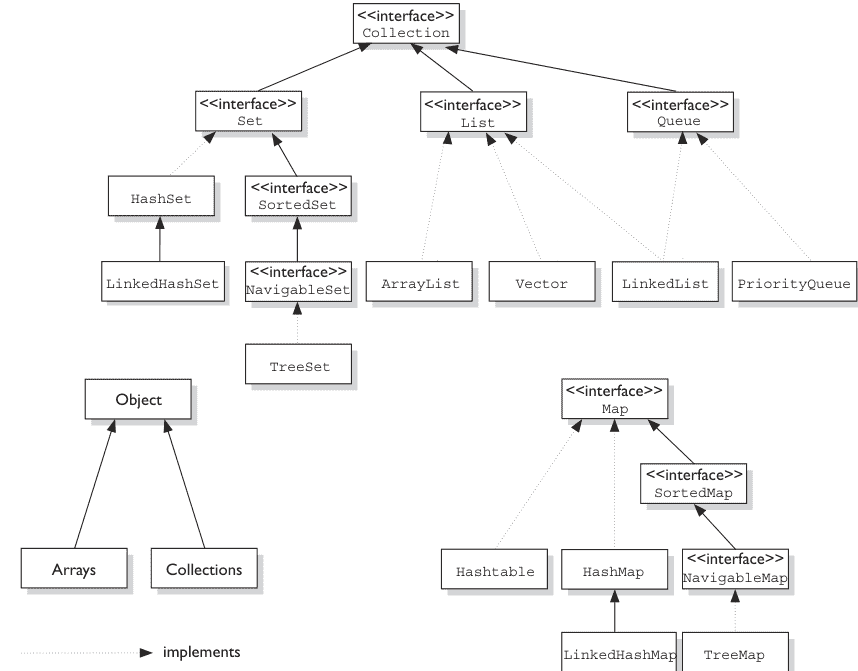

# exam

观看你可以很容易把“Collections”（集合类）误认为“Collection”（集合接口）——要小心。记住 `Collections` 是一个类，拥有静态工具方法；而 `Collection` 是一个接口，声明了大多数集合通用的方法，包括 `add()`、`remove()`、`contains()`、`size()` 和 `iterator()`。

HashMap：推销员的产品（根据产品 ID 生成的 Key）

# 第二章：泛型与集合

也许我们应该明确区分“排序（sorted）”和“有序（ordered）”之间的区别，但首先我们必须讨论迭代的概念。当你考虑迭代时，你可能会想到使用例如 for 循环来遍历数组，以访问数组中的每个元素（顺序为 `[0]`、`[1]`、`[2]` 等）。遍历集合意味着从第一个元素开始，一个接一个地遍历所有元素。但是，有时“第一个”的概念有点奇怪——在 `Hashtable` 中，并没有真正的第一、第二、第三等概念。在 `Hashtable` 中，元素是根据键的 hashcode 放置在一个（看似）混乱的顺序中的。但当你进行迭代时，必须有一个顺序；尽管如此，当你遍历它时，会出现一个顺序。但就你所能看到的，它是完全任意的，并且会随着集合的变化以看似随机的方式发生变化。

当一个集合是**有序的**时，意味着你可以按照特定的（而非随机的）顺序遍历集合。`Hashtable` 集合不是有序的。虽然 `Hashtable` 拥有内部逻辑来确定顺序（基于 hashcode 和集合本身的实现），但你在遍历 `Hashtable` 时不会发现任何顺序。然而，`ArrayList` 保持了由元素索引位置建立的顺序（就像数组一样）。`LinkedHashSet` 按照插入顺序保持顺序，因此最后一个插入的元素是集合中的最后一个元素（与 `ArrayList` 相比，你可以在特定的索引位置插入元素）。最后，还有一些集合保持一种被称为“自然顺序（natural order）”的顺序，这些集合不仅是有序的，还是**排序的（sorted）**。让我们来看看自然顺序在排序集合中是如何工作的。

对集合进行排序意味着集合中的顺序是根据某些规则作为“排序顺序”来确定的。排序顺序与对象何时添加到集合中、上一次被访问的时间，或添加时的“位置”完全无关。排序是基于对象本身的属性。你将对象放入集合中，集合将根据排序顺序计算出将它们放在什么种顺序中。一个保持顺序的集合（如任何 List，它使用插入顺序）并不是真正排序的，除非它使用了某种排序顺序。最常见的排序顺序是被称为“自然顺序”的东西。这意味着什么呢？

你知道如何按字母顺序排序——A 在 B 之前，F 在 G 之前，依此类推。对于 `String` 对象集合，自然顺序是字母顺序。对于 `Integer` 对象，自然顺序是数值大小——1 在 2 之前，依此类推。而对于 `Foo` 对象，自然顺序是……嗯……我们不知道。没有自然

# Collections概览 OCP 目标 4.5 和 4.6 593

顺序，除非 `Foo` 开发者通过接口（`Comparable`）提供一个自然顺序，该接口定义了类实例之间如何进行比较（实例 a 是否在实例 b 之前，还是实例 b 在实例 a 之前？）。如果开发者决定 `Foo` 对象应该使用某个实例变量的值（假设有一个名为 bar）进行比较，那么排序集合将根据 `Foo` 类中关于使用 bar 变量确定顺序的规则对 `Foo` 对象进行排序。当然，在某些情况下，`Foo` 类也可能从父类继承自然顺序，而不是定义自己的顺序。

除了 `Comparable` 接口指定的自然顺序外，还可以使用另一个接口：`Comparator` 来定义其他不同的排序方式。我们将在本章稍后的部分讨论如何使用 `Comparable` 和 `Comparator` 来定义排序顺序。但现在，只需记住排序顺序（包括自然顺序）与插入顺序、访问顺序或索引顺序不同。

现在我们已经了解了有序和排序，我们将查看这四个接口中的每一个，并深入它们的具体实现。

# List 接口

List 关注索引。List 与非 List 区别的唯一一点在于拥有一组与索引相关的方法。这些关键方法包括如 `get(int index)`、`add(int index, Object obj)` 等。所有三个 List 实现都是通过在特定索引处设置对象或在不指定位置的情况下添加对象（在这种情况下对象被添加到末尾）来保持顺序的。接下来的章节将描述这三个 List 实现。

**ArrayList** 将其想象为一个可增长的数组。它提供了快速的迭代和快速的随机访问。显而易见的是：它是有序集合（按索引），但不是排序的。你可能想知道，从 1.4 版本开始，`ArrayList` 实现了新的 `RandomAccess` 接口——这是一个标记接口（意味着它没有方法），表示“此列表支持快速（通常是常数时间）的随机访问”。当你需要快速迭代但可能不会大量插入和删除时，选择它而不是 `LinkedList`。

**Vector** `Vector` 是 Java 最早期的遗留；`Vector` 和 `Hashtable` 是两个原始集合——其余是随着 Java 2 版本 1.2 和 1.4 添加的。`Vector` 基本与 `ArrayList` 相同，但 `Vector` 方法是同步的以确保线程安全。你通常希望使用 `ArrayList` 而不是

# 594 第二章：泛型与集合

`Vector`，因为同步方法会带来你可能需要的性能开销。如果你确实需要安全性，`Collections` 类中的工具方法可以提供帮助。`Vector` 是 `ArrayList` 之外唯一实现 `RandomAccess` 的类。

**LinkedList** `LinkedList` 按照索引位置排序，与 `ArrayList` 类似，但元素之间是双向链接的。这种链接为你提供了新方法（除了从 `List` 接口获得之外），用于从开头或末尾添加和删除，这使其成为实现栈或队列的简单选择。记住，`LinkedList` 的迭代可能比 `ArrayList` 慢，但你需要快速插入和删除时，它是一个很好的选择。从 Java 5 开始，`LinkedList` 类被增强以实现 `java.util.Queue` 接口。因此，它现在支持常用的队列方法 `peek()`、`poll()` 和 `offer()`。

# Set 接口

Set 关注唯一性——它不允许重复项。你友好的 `equals()` 方法决定了两个对象是否相同（在这种情况下，集合中只能有一个）。接下来的章节将描述这三个 Set 实现。

**HashSet** `HashSet` 是一个无排序的、无序的集合。它使用被插入对象的 `hashCode`，因此你的 `hashCode()` 实现越高效，获得的访问性能就越。。你需要一个没有重复项的集合且不在意遍历时的顺序时，请使用它。

**LinkedHashSet** `LinkedHashSet` 是 `HashSet` 的有序版本，它在所有元素之间维护了一个双向链表。当你在意迭代顺序时，用它代替 `HashSet`。当你遍历 `HashSet` 时，顺序是不可预测的，而 `LinkedHashSet` 让你按照插入顺序遍历元素。

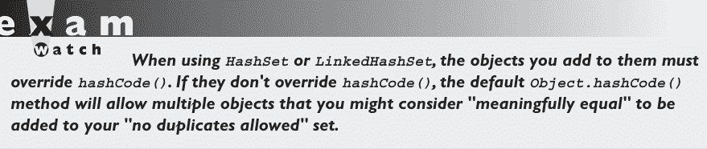

在使用 `HashSet` 或 `LinkedHashSet` 时，添加到集合中的对象必须重写 `hashCode`。如果它们没有重写 `hashCode`，默认的 `Object.hashCode()` 方法将允许多个你可能认为“意义上相等”的对象被添加到你那个“不允许重复”的集合中。

# 集合概览 (OCP 目标 4.5 和 4.6) 595

`TreeSet` 是两个排序集合之一（另一个是 `TreeMap`）。它使用红黑树结构（不过你已经知道了），并保证元素按照自然顺序升序排列。可选情况下，你可以使用 `Comparator` 通过一个构造函数来构建 `TreeSet`，这允许你为集合定义关于排序顺序的规则（而不是依赖于元素类定义的排序）。从 Java 6 开始，`TreeSet` 实现了 `NavigableSet`。

# Map 接口

Map 关注的是唯一标识符。你将一个唯一的键（ID）映射到一个特定的值，其中键和值当然都是对象。你对 Map 非常熟悉，因为许多语言都支持使用键/值对或名/值对的数据结构。Map 的实现允许你根据键搜索值、请求只包含值的集合，或请求只包含键的集合。像 Set 一样，Map 依赖 `equals()` 方法来判断两个键是否相同。

**HashMap** 提供了一个未排序的、无序的 Map。当你需要一个 Map 且不在乎遍历它时的顺序时，`HashMap` 是最佳选择；其他 Map 则增加了一定的顺序性。键在 Map 中的位置取决于键的哈code，就像 `HashSet` 一样，哈code 越高效，性能越高。`HashMap` 允许集合中存在一个 `null` 键和多个 `null` 值。

**Hashtable** 像 `Vector` 一样，`Hashtable` 存在于 Java 的史前时代。为了好起见，别忘了注意这种不一致性：`HashMap` 与 `Hashtable`。`i` 的大写在哪里？哦，并不会要求你拼写它。总之，由于 `Vector` 是更简洁、更现代的 `ArrayList` 的同步对应类，`Hashtable` 也是 `HashMap` 的同步对应类。记住，你不是对一个类进行同步，所以当我们说 `Vector` 和 `Hashtable` 是同步的，我们指的是该类的关键方法是同步的。另一个区别是，`HashMap` 允许你拥有 `null` 值以及一个 `null` 键，而 `Hashtable` 不允许任何为 `null` 的内容。

**LinkedHashMap** 像其 Set 对应类 `LinkedHashSet` 一样，`LinkedHashMap` 集合维护了插入顺序（或可选的访问顺序）。虽然它在添加和删除元素时会比 `HashMap` 慢一些，但你可以预期 `LinkedHashMap` 有更快的迭代速度。

**TreeMap** 你现在可能已经猜到了，`TreeMap` 是一个排序后的 Map。你已经知道了这一点，默认情况下，这意味着“按元素的自然顺序排序”。像 `TreeSet` 一样，在构建 `TreeMap` 时，你可以通过 `Comparator` 定义自定义的排序顺序，以指定元素在排序时应如何相互比较。从 Java 6 开始，`TreeMap` 实现了 `NavigableMap`。

# Queue 接口

Queue（队列）设计用于存放一组“待办事项”或需要以某种方式处理的项目。虽然可能存在其他顺序，但队列通常被认为是 FIFO（先进先出）。队列支持所有标准集合方法，并且具有添加、减去元素以及查看队列元素的方法。

**PriorityQueue** 该类是 Java 5 新引入的。由于 `LinkedList` 类已经增强以实现 `Queue` 接口，基础队列可以用 `LinkedList` 处理。`PriorityQueue` 的目的是创建一个“优先级入，优先级出”的队列，而不是典型的 FIFO 队列。`PriorityQueue` 的元素按自然顺序排序（在这种情况下元素会在最后排序）或根据 `Comparator` 排序。无论哪种情况，元素的顺序代表了它们的相对优先级。


如果你能识别出某些答案，可以轻松排除，例如，当你需要名/值对集合时，`Map` 不能作为选择的类，因为 `Map` 是一个接口而不是具体的实现类。考试中的措辞在关键时刻是明确的，所以如果被要求选择接口，请选择接口而不是实现该接口的类。反之亦然，如果被要求选择一个类，不要选择接口类型。

表 11-2 总结了考试需要理解的 13 个具体面向的类中的 11 个（Arrays 和 Collections 紧接着就会！）

# 集合概览 (OCP 目标 4.5 和 4.6) 597

| 表 1-2 | 类 | Map | Set | List | 有序 | 排序 |
|---|---|---|---|---|---|---|
| Collection | HashMap | X | | | 否 | 否 |
| Interface | Hashtable | X | | | 否 | 否 |
| Concrete | TreeMap | X | | | 是 | 自然顺序或自定义比较规则 |
| Implementation | LinkedHashMap | X | | | 按插入顺序或最后访问顺序 | 否 |
| Classes | HashSet | | X | | | 否 |
| | TreeSet | | X | | 是 | 自然顺序或自定义比较规则 |
| | LinkedHashSet | | | X | 按插入顺序 | 否 |
| | ArrayList | | | | 是 | 按索引 | 否 |
| | Vector | | | | 是 | 按索引 | 否 |
| | LinkedList | | | | 是 | 按索引 | 否 |
| | PriorityQueue | | | | | 是 | 按待办顺序 |


请确保你熟悉表 1-2。

# 600 第二章：泛型与集合

## 集合的自动装箱

通常情况下，集合可以存储对象，但不能存储基本类型。在 Java 5 之前，所谓的“包装类”（例如 `Integer`、`Float`、`Boolean` 等）的一个常见用途是作为基本类型进入集合和从集合中出的的方法。在 Java 5 之前，你需要在将基本类型放入集合之前，手动地对其进行“包装”。在 Java 5 中，基本类型仍然需要被包装，但自动装箱（autoboxing）会帮你处理这一切。

```java
myInts = new ArrayList(); // Java 5 之前的声明
myInts.add(new Integer(42)); // 使用 Integer 来“包装”一个 int
```

在上一个示例中，我们创建了一个值为 42 的 `Integer` 实例。我们创建了一个对象来“包装”一个基本类型值。从 Java 5 开始，我们可以说：

```java
myInts.add(42); // 自动装箱处理了！
```

在这个示例中，我们仍然是向 `myInts` 添加一个 `Integer` 对象（而不是 int 基本类型）；只是自动装箱为我们处理了包装。当我们需要使用包装对象时，存在一些微妙的含义；让我们仔细观察一下……

在 Java 5 之前的旧时代，如果你想创建一个包装类、解箱它、使用它，然后包装它，你可能会这样做：

```java
Integer y = new Integer(567); // 创建
int x = y.intValue(); // 解箱
x++; // 使用
y = new Integer(x); // 包装
System.out.println("y = " + y); // 打印
```

现在，有了改进后的 Java 5，你可以这样写：

```java
Integer y = new Integer(567); // 创建
y++; // 解箱，递增
// 包装
```


System.out.println("y = " + y); // 打印

两个示例都会产生以下输出：

```
y = 568
```

是的，你读得没错。这段代码似乎在对象引用变量上使用了后自增运算符！但这仅仅是为了方便。在背后，编译器为你完成了拆箱和重新赋值。早些时候我们提到包装对象是不可变的……这个示例似乎与该陈述矛盾。看起来 `y` 的值从 567 变到了 568。然而，实际发生的情况是创建了第二个包装对象，并将其值设置为 568。如果我们能访问第一个包装对象，我们就能证明这一点……
让我们尝试：

```java
Integer y = 567;

Integer x = y;

// 创建一个包装

// 分配第二个引用

// 变量指向那个包装

System.out.println(y==x);

// 验证它们是否指向

// 同一个对象

y++;

System.out.println(x + " " + y);

// 解箱，使用，“重新包装”

// 打印值

System.out.println(y==x);

// 验证它们是否指向

// 不同对象
```

产生输出：

```
true
567 568
false
```

所以，底层，当编译器运行到 `y++;` 这一行时，它必须替换如下内容：

```java
int x2 = y.intValue();

// 解箱

x2++;

// 使用

y = new Integer(x2);

// 重新包装
```

正如我们所料的样，某个地方一定调用了 `new`。

## 装箱、== 与 equals()

我们使用 `==` 对包装类进行了一些探索。让我们更深入地观察包装类是如何与 `==`、`!=` 和 `equals()` 工作的。API 开发者决定，所有的包装类对象，如果类型相同且值相同，它们就是相等的。这并不意外：

```java
Integer i1 = 1000;

Integer i2 = 1000;

if (i1 != i2) System.out.println("different objects");

if (i1.equals(i2)) System.out.println("meaningfully equal");
```

产生了输出

```
different objects
meaningfully equal
```

这只是两个恰好具有相同值的包装对象。因为它们具有相同的 int 值，`equals()` 方法认为它们是“意义上等价的”，因此返回 true。这一个呢：

```java
Integer i3 = 10;

Integer i4 = 10;

if (i3 == i4) System.out.println("same object");

if (i3.equals(i4)) System.out.println("meaningfully equal");
```

这个示例产生了输出：

```
same object
meaningfully equal
```

糟糕！`equals()` 方法似乎在工作，但 `==` 和 `!=` 的结果告诉我们 `i1` 和 `i2` 是不同的对象，而 `==` 却说 `i3` 和 `i4` 是同一个对象？为了节省内存，以下包装对象的两个实例（通过装箱创建）当它们的基本值相同时始终是 `==`：

- Boolean
- Byte
- Character \u0000 到 \u007f (7f 是 127)

## 使用集合（目标 4.2, 4.4, 4.5, 4.6, 4.7 和 4.8）

### 使用装箱的地方

如之前讨论的，使用包装类是常见的。每当你想要集合时，以下演示了：

```java
class UseBoxing {

    public static void main(String[] args) {

        Integer y = 567;

        Integer x = y;

        // 创建一个包装

        // 分配第二个引用

        // 变量指向那个包装

        System.out.println(y==x); // 验证它们是否指向

        // 同一个对象

        y++;

        System.out.println(x + " " + y); // 解箱，使用，“重新包装”

        // 打印值

        System.out.println(y==x); // 验证它们是否指向

        // 不同对象

    }

}
```

### Java 7 菱形语法

在书中，我们看到了几个菱形语法的示例，它通常与包装类配合使用。从 Java 7 开始，这些声明简化为：

```java
ArrayList<String> stuff = new ArrayList<>();

List<Dog> myDogs = new ArrayList<>();

Map<String, Dog> dogMap = new HashMap<>();
```

### 集合与数组排序

排序和搜索主题从 Java 5 开始加入考试。集合和数组都可以使用 API 中的方法进行排序和搜索。

### 集合排序

让我们简单的开始，比如对一个字符串 `ArrayList` 进行排序。还有什么更简单的吗？好吧，等你们找到 `Array sort()` 再说。明白了吗？当然，`ArrayList` 并没有提供任何排序其内容的方法，`java.util.Collections` 类

```java
import java.util.*;

class TestSort {

    public static void main(String[] args) {

        ArrayList<String> stuff = new ArrayList<String>(); // #1

        stuff.add("Denver");

        stuff.add("Boulder");

        stuff.add("Vail");

        stuff.add("Aspen");

        stuff.add("Terruride");

        System.out.println("unsorted " + stuff);

        Collections.sort(stuff); // #2

        System.out.println("sorted " + stuff);

    }

}
```

这产生了类似的内容：

```
unsorted [Denver, Boulder, Vail, Aspen, Terruride]
sorted [Aspen, Denver, Terruride, Vail]
```

### 使用集合（目标 4.2, 4.4, 4.5, 4.6, 4.7, 和 4.8） 605

让我们想象我们正在构建一个终极的家庭自动化应用程序。今天我们关注的是家庭娱乐中心，具体来说是 DVD 控制中心。我们已经准备好了文件 I/O 软件，用于在 `dvdInfo.txt` 文件和 `DVDInfo` 类的实例之间读写数据。以下是该类的关键部分：

```java
class DVDInfo {

  String title;

  String genre;

  String leadActor;

  DVDInfo(String t, String g, String a) {

    title = t; genre = g; leadActor = a;

  }

  public String toString() {

    return title + " * " + genre + " * " + leadActor + "\n";

  }

  // 此处有 getters 和 setter

}
```

以下是 `dvdinfo.txt` 文件中的 DVD 数据：

- Donnie Darko/sci-fi/Gyllenberg, Jake
- Raiders of the Lost Ark/action/Ford, Harrison
- 2001/sci-fi??
- CaddyShack/comedy/Murray, Bill
- Star Wars/sci-fi/Ford, Harrison
- Lost in Translation/comedy/Murray, Bill
- Patriot Games/action/Ford, Harrison

在我们的家庭自动化应用程序中，我们想为 `dvdinfo.txt` 文件中读取的每行数据创建一个 `DVDInfo` 实例。对于每个实例，我们将解析该行数据（记得使用 `String.split()`）并填充 `DVDInfo` 的实例变量。最后，我们希望将所有的 `DVDInfo` 实例放入一个 `ArrayList` 中。假设 `populateList()` 方法完成了所有这一切。这里是来自应用程序中的一小段代码：

```java
ArrayList<DVDInfo> dvdList = new ArrayList<DVDInfo>();

populateList(); // 将文件数据添加到 ArrayList

System.out.println(dvdList);
```

你可能会得到如下输出：

- Donnie Dark sci-fi Gyllenhall, Jake
- Raiders of the Lost Ark action Ford, Harrison
- 2001 sci-fi ??
- CaddyShack comedy Murray, Bill
- Star Wars sci-fi Ford, Harrison
- Lost in Translation comedy Murray, Bill
- Patriot Games action Ford, Harrison

### 606 第二章：泛型与集合

（我们：我们重写了 `DVDInfo` 的 `toString()` 方法，因此当我们在 `ArrayList` 上调用 `println()` 时，它会调用每个实例的 `toString()`。现在我们有一个填充好的 `ArrayList`，让我们对其进行排序：

```java
Collections.sort(dvdlist);
```

哎！你得到了类似这样的错误：

```
TestDVD.java:13: cannot find symbol
symbol : method sort (java.util.ArrayList<DVDInfo>)
location: class java.util.Collections
Collections.sort(dvdlist);
```

发生了什么？我们知道 `Collections` 类有一个 `sort()` 方法，这个错误证明 `Collections` 并没有一个可以接受 `dvdlist` 的 `sort` 方法。这意味着我们传递的参数（`dvdlist`）一定有问题。如果你已经发现了问题，我们的猜测是你没有借助之前显示的晦涩错误信息就解决它了……你如何对 `DVDInfo` 实例进行排序？为什么我们能够对 `String` 实例进行排序？当你查询 API 中的 `Collections.sort()` 时，你的第一反应会是恐慌。别担心——再次强调，泛型将帮助你阅读看起来很奇怪的方法签名。如果你阅读单参数 `sort()` 方法的描述，你会发现 `sort()` 方法接受一个 `List` 参数，并且 `List` 中的对象必须实现一个名为 `Comparable` 的接口。事实证明 `String` 实现了 `Comparable`，这就是为什么我们能够使用 `Collections.sort()` 方法对 `String` 列表进行排序的原因。

### Comparable 接口

`Comparable` 接口被 `Collections.sort()` 方法和 `java.util.Arrays.sort()` 方法分别用于对 `List` 和对象数组进行排序。要实现 `Comparable`，类必须实现单一方法 `compareTo()`。以下是 `compareTo()` 的调用示例：

```java
int x = thisObject.compareTo(anotherObject);
```

`compareTo()` 方法返回一个具有以下特征的 `int`：

- 如果 `thisObject < anotherObject`，则返回负数
- 如果 `thisObject == anotherObject`，则返回零
- 如果 `thisObject > anotherObject`，则返回正数

### 使用集合（目标 4.2, 4.4, 4.5, 4.6, 4.7, 和 4.8） 607

`sort()` 方法使用 `compareTo()` 来决定 `List` 或对象数组应该如何排序。由于你可以为自己的类实现 `compareTo()`，因此你可以对你的类实例使用任何你喜欢的奇标准。回到我们早的 `DVDInfo` 类示例，我们可以采取简单的方法，使用 `String` 类对 `compareTo()` 的实现：

```java
class DVDInfo implements Comparable<DVDInfo> {

    // 现有代码

    public int compareTo(DVDInfo d) {

        return title.compareTo(d.getTitle()); // #2

    }

}
```

在第 1 行，我们声明类 `DVDInfo` 实现了 `Comparable`，这使得 `DVDInfo` 对象可以与其他 `DVDInfo` 对象进行比较。在第 2 行，我们通过比较两个 `DVDInfo` 对象的标题来实现 `compareTo()`。由于我们知道标题是字符串且 `String` 实现了 `Comparable`，这是一个简单的方法。在 Java 5 引入泛型之前，你必须这样做：

```java
class DVDInfo implements Comparable {

    // 现有代码

    public int compareTo(Object o) { // 接受一个 Object

        DVDInfo d = (DVDInfo)o;

        return title.compareTo(d.getTitle());

    }

}
```

这仍然是合法的，但由于你在尝试之前将对象强制转换为 `DVDInfo`。将所有内容整合，我们的 `DVDInfo` 现在看起来应该是这样的：

```java
class DVDInfo implements Comparable<DVDInfo> {

    String title;

    String genre;

    String leadActor;

    DVDInfo(String t, String g, String a) {

        title = t; genre = g; leadActor = a;

    }

    public String toString() {

        return title + " * " + genre + " * " + leadActor + "\n";

    }

    public int compareTo(DVDInfo d) {

        return title.compareTo(d.getTitle());

    }

    // getters 和 setter

    public String getTitle() { return title; }

    public String getGenre() { return genre; }

    public String getLeadActor() { return leadActor; }

}
```

当查询 `Collections.sort()` 方法时，你可能注意到有一个重载版本的 `sort()` 接受 `List` 和 `Comparator`。`Comparator` 接口提供了以不同方式进行排序的能力——而 `Comparable` 接口则强制你修改想要排序的类。

### 使用 Comparator 排序

`Comparator` 接口同样很容易实现，只有一个方法 `compare()`。这里有一个可以按类型对 `DVDInfo` 列表进行排序的小类：

```java
import java.util.*;

class GenreSort implements Comparator<DVDInfo> {

    public int compare(DVDInfo one, DVDInfo two) {

        return one.getGenre().compareTo(two.getGenre());

    }

}
```

`Comparator.compare()` 方法返回的 `int` 与 `Comparable.compareTo()` 的返回值相同。在这种情况下，我们通过让 `compare()` 执行实际的比较工作来利用这一点。这里有一个让我们测试 `Comparable` 和新 `Comparator` 代码的测试程序：

```java
import java.util.*;

import java.io.*;

class TestDVD {

    ArrayList<DVDInfo> dvlist = new ArrayList<DVDInfo>();

    public static void main(String[] args) {

        new TestDVD().go();

    }

    void go() {

        populateList(dvlist);
    }
}
```


System.out.println(dvlist); // 从文件中读取的输出

Collections.sort(dvlist);

System.out.println(dvlist); // 按标题排序

GenreSort gs = new GenreSort();

Collections.sort(dvlist, gs);

System.out.println(dvlist); // 按类型排序

}

void populateList() {

    // 读取文件，创建 DVDInfo 实例，并

    // 使用这些实例填充 ArrayList dvlist

}

}

由于 `Comparable` 和 `Comparator` 接口非常相似，请做好应对考试混淆你的准备。例如，你可能会被要求在 `Comparator` 接口中实现 `compareTo()` 方法。请学习表 11-3，将这些接口之间的差异深记脑海。

## 使用 Arrays 类进行排序

我们一直在使用 `java.util.Collections` 类来对集合进行排序；现在让我们看看 `java.util.Arrays` 类如何对数组进行排序。好消息是，排序对象数组就像排序对象集合一样。`Arrays.sort()` 方法重载方式与 `Collections.sort()` 方法相同：

- `Arrays.sort(arrayToSort)`
- `Arrays.sort(arrayToSort, Comparator)`

此外，`Arrays.sort()` 方法（单参数版本）被重载了数亿次，为每种原始数据类型提供了几种排序方法。`Arrays.sort(myArray)` 方法始终根据自然顺序进行排序。不要被那些试图使用 `Comparator` 排序原始类型数组的考试题所误导。

最后，记住 `Collections` 类和 `Arrays` 类的 `sort()` 方法都是静态方法，它们会改变正在排序的对象并返回一个不同的排序后的对象。

| java.lang.Comparable | java.util.Comparator |
|---|---|
| int objOne.compareTo(objTwo) | int compare(objOne, objTwo) |
| 返回 | 与 Comparable 相同 |
| objOne < objTwo 返回负数 | |
| objOne == objTwo 返回零 | |
| objOne > objTwo 返回正数 | |
| 你必须修改想要排序的实例所属的类。 | 你必须构建一个与想要排序的实例类不同的类。 |
| 只能创建一个排序序列。 | 可以创建多个排序序列。 |
| 在 API 中频繁实现的类有：String、包装类、Date、Calendar... | 用于对第三方类的实例排序。 |

## 使用 Collections (目标 4.2, 4.4, 4.5, 4.6, 4.7, 和 4.8) 613

我们已经讨论了很多关于自然顺序排序和使用 `Comparator` 排序的内容。你需要深记脑海的最后一个规则是：每当你想要对数组或集合排序时，内部的元素必须都是相互可比较的。换句话说，如果你有一个 `Object[]` 并在里面放入了 `Cat` 和 `Dog` 对象，你将无法对其进行排序。通常情况下，除非特别说明，否则不同类型的对象被认为不是相互可比较的。

## 搜索数组和集合

`Collections` 类和 `Arrays` 类都提供了允许搜索特定元素的方法。在搜索集合或数组时，适用以下规则：

- 使用 `binarySearch()` 方法进行搜索。
- 搜索成功返回所搜索元素的 `int` 索引。
- 搜索失败返回一个表示插入点的 `int`。插入点是集合/数组中本应插入元素以保持集合/数组正确排序的位置。由于正值和 0 表示搜索成功，`binarySearch()` 方法使用负数表示插入点。由于 0 是成功搜索的有效结果，实际插入点表示为 `-(插入点) - 1`。例如，如果搜索的插入点在元素 2 处，返回的实际插入点将是 -3。
- 在搜索之前，必须对集合/数组进行排序。
- 如果你尝试搜索尚未排序的数组或集合，搜索结果将是可预测的。
- 如果要搜索的集合/数组是按自然顺序排序的。（通常通过不向 `binarySearch()` 方法传递 `Comparator` 参数来实现。）
- 如果要搜索的集合/数组是使用 `Comparator` 排序的，则必须使用相同的 `Comparator` 进行搜索，该参数作为参数传递给 `binarySearch()` 方法。记住，在搜索原始类型数组时不能使用 `Comparator`。

让我们来看一个练习 `binarySearch()` 方法的代码示例：

```java
import java.util.*;

class SearchObjData {

    public static void main(String [] args) {

        String[] sa = {"one", "two", "three", "four"};

        Arrays.sort(sa); // #1

        for(String s : sa) {

            System.out.print(s + " ");

        }

        System.out.println("\none = " + Arrays.binarySearch(sa, "one")); // #2

        System.out.println("\nreverse sort");

        ResortComparator rs = new ResortComparator(); // #3

        rs.sort(sa,rs);

        for (String s : sa) {

            System.out.print(s + " ");

        }

        System.out.println("\one = " + Arrays.binarySearch(sa, "one")); // #4

        System.out.println("\one = " + Arrays.binarySearch(sa, "one",rs)); // #5

    }

}

static class ResortComparator
    implements Comparator<String> { // #6

    public int compare(String a, String b) { // #7

        return b.compareTo(a);

    }

}
```

产生类似以下的内容：

```
four one two three

one = 1

now reverse sort

two three one four

one = -1

one = 2
```

发生了什么：

- #1 按字母顺序（自然顺序）排序 sa 数组。
- #2 搜索元素 "one" 的位置，结果为 1。
- #3 创建一个 Comparator 实例。在下一行，我们使用 `Comparator` 重新排序数组。
- #4 尝试搜索数组。我们没有向 `binarySearch()` 方法传递排序数组时使用的 `Comparator`，所以得到了错误的（未定义的）答案。
- #5 再次搜索，并将 `Comparator` 传递给 `binarySearch()`。这次我们得到了正确的答案，2。
- #6 定义 `Comparator`；它可以是一个内部类。（我们将在第 12 章讨论内部类。）
- #7 通过交换调用 `compareTo()` 方法时参数的使用，我们得到了反向排序。

## 使用集合（目标 4.2, 4.4, 4.5, 4.6, 4.7 和 4.8） 15

让我们来看一段使用 `List` 和 `Iterator` 的代码：

```java
import java.util.*;

class Dog {

    public String name;

    Dog(String n) { name = n; }

}

class Test {

    public static void main(String[] args) {

        List<Dog> d = new ArrayList<>();

        Dog dog = new Dog("aiko");

        d.add(dog);

        d.add(new Dog("clover"));

        d.add(new Dog("magnolia"));

        Iterator<Dog> i3 = d.iterator(); // 创建迭代器

        while (i3.hasNext()) {

            Dog d2 = i3.next(); // 需要强制转换

            System.out.println("size " + d.size());

            System.out.println("get " + d.get(1).name);

            System.out.println("indexOf " + d.indexOf(dog));

            d.remove(2);

            Object[] oa = d.toArray();

            for (Object o : oa) {

                Dog d2 = (Dog)o;

                System.out.println("oa " + d2.name);

            }

        }

    }

}
```

产生输出如下：

```
size 3

get clover

indexOf 0

oa aiko

oa magnolia

oa a
```

首先，我们使用了泛型语法来创建一个 `Dog` 类型的 `Iterator`。正因为如此，当我们使用 `next()` 方法时，不需要将返回的对象强制转换为 `Dog`。我们可以这样声明 `Iterator`：

```java
Iterator i3 = d.iterator(); // 创建迭代器
```

但那样的话我们就必须对返回的值进行强制转换：

```java
Dog d2 = (Dog)i3.next();
```

## 第二章：泛型与集合 16

其余的代码演示了如何使用 `size()`、`get()` 和 `toArray()` 方法。这些方法不应该有任何意外。在章节的后部分，我们将列出你应该熟悉的所有 `List`、`Set` 和 `Map` 方法。作为最后的警告，记住 `List` 是一个接口！

## 使用 Set

记住，当你不希望集合中任何重复元素时，请使用 `Set`。如果你尝试向已经存在的集合添加重复元素，该元素元素不会被添加，且 `add()` 方法将返回 `false`。记住，`HashSet` 往往非常快，因为正如我们之前讨论的，它们使用了哈希码值（hashcodes）。

你还可以创建一个 `TreeSet`，它是一个元素经过排序的 `Set`。在使用 `TreeSet` 时必须小心（我们稍后解释原因）：

如果你插入以下代码，你将得到类似这样的输出：

```java
Set s = new HashSet(); // 插入这段代码
```

```
true false

true

java.lang.Object@...
```

重要的是，在第二个 for 循环中打印的对象顺序是不可预测的：`HashSet` 不保证任何顺序。此外，注意第四次调用 `add()` 失败了，因为它尝试向 `Set` 中插入一个重复条目（值为 "aiko" 的 `String`）。

如果你插入这行代码，你将得到类似的内容：

```java
Set s = new TreeSet(); // 插入这段代码
```

```
Exception in thread "main" java.lang.ClassCastException: java.lang.String
    at java.lang.Integer.compareTo(Integer.java:35)
    at java.util.TreeMap.compare(TreeMap.java:103)
    at java.util.TreeMap.put(TreeMap.java:465)
    at java.util.TreeSet.add(TreeSet.java:210)
```

问题在于，每当你想要集合排序时，它的元素必须是可比较的（comparable）。记住，除非另有指定，否则不同类型的对象是不可比较的。

## Map

记住，当你使用实现 `Map` 的类作为键时，必须重写 `hashCode()` 和 `equals()` 方法。如果你对从 `Map` 中检索数据感兴趣，你只需要重写它们。说真的，使用没有重写这些方法的类作为键是合法的，但你将无法找到它们。这里有一些演示 `HashMap` 使用的代码：

```java
import java.util.*;

class Dog {

    public Dog(String n) { name = n; }

    public String name;

    public boolean equals(Object o) {

        if ((o instanceof Dog) &&

            ((Dog)o).name == name) {

            return true;

        } else {

            return false;

        }

    }

    public int hashCode() { return name.length(); }

}

class Cat { }

enum Pets { DOG, CAT, HORSE }

class MapTest {

    public static void main(String[] args) {

        Map<Object, Object> m = new HashMap<Object, Object>();

        m.put("k1", new Dog("aiko")); // 添加一些键值对

        m.put("k2", Pets.DOG);

    }

}
```

# 620 第二章：泛型与集合

在第一次调用 `get()` 时，hashcode 为 8 (magnolia)，而应该是 6 (clover)，因此检索在第 1 步失败，我们得到了 null。在第二次调用 `get()` 时，hashcode 为 6，因此第 1 步成功。在正确的桶（“名称长度 = 6”的桶）中，调用了 `equals()` 方法，由于 Dog 的 `equals()` 方法比较的是名称，`equals()` 成功，输出是 Dog 键。在第三次调用 `get()` 时，hashcode 测试成功，但 `equals()` 测试失败，因为 arthur 不等于 clover。

# 导航（搜索）TreeSets 和 TreeMaps 仅适用于 OCPJP 6！

OCP 7 的候选者“可能不会”遇到任何关于导航集合（Navigable Collections）或底层支持集合（Backed Collections）的问题（本主题及下一个主题）。如果你正在为 OCPJP 6 考试准备，请继续读下去。如果你正在为 OCP 7 考试准备，可以跳过这一节，尽管它在现实生活中可能有用。

我们已经讨论过搜索列表和数组。让我们关注搜索 TreeSets 和 TreeMaps。Java 6 引入了（其他内容外）两个新接口：`java.util.NavigableSet` 和 `java.util.NavigableMap`。为了考试，你感兴趣的是 TreeSet 和 TreeMap 如何实现这些接口的。

想象一下从圣克鲁斯到蒙特雷的渡轮时间表是不规律的。假设我们将每天从圣克鲁斯出发的时间以军事时间制存储在在 TreeSet 中。让我们看看定义其中两个时间点的代码：

- 1. 下午 4 点（1600 小时）之前出发的第一班渡轮
- 2. 晚上 8 点（2000 小时）之后出发的第一班渡轮

```java
// Java 5 版本

TreeSet<Integer> subset = new TreeSet<Integer>();

subset = (TreeSet)times.headSet(1600);

System.out.println("J5 - last before 4pm is: " + subset.last());
```

```java
TreeSet<Integer> sub2 = new TreeSet<Integer>();

sub2 = (TreeSet)times.tailSet(2000);

System.out.println("J5 - first after 8pm is: " + sub2.first());
```

```java
// 使用新的 lower() 和 higher() 的 Java 6 版本

System.out.println("J6 - last before 4pm is: " + times.lower(1600));
```

# 使用集合 (目标 4.2, 4.4, 4.5, 4.6, 4.7, 和 4.8) 621


System.out.println("J6 - first after 8pm is: " + times.higher(2000));

这产生了以下结果：

- J5 - last before 4pm is: 1545
- J5 - first after 8pm is: 2010
- J6 - last before 4pm is: 1545
- J6 - first after 8pm is: 2010

正如你从前面的代码所示，在添加 `NavigableSet` 接口之前，依赖 `Set` 中的任何任意排序（使用 Java 5 可用方法）是一种计算开销大且笨拙的操作。另一方面，使用新的 Java 6 方法 `lower()` 和 `higher()`，代码变得更加简洁。

出于考试之目的，与此类导航相关的 `NavigableSet` 方法有 `lower()`、`floor()`、`higher()` 和 `ceiling()`，而与之大部分平行的 `NavigableMap` 方法有 `lowerKey()`、`floorKey()`、`ceilingKey()` 和 `higherKey()`。`lower()` 和 `floor()` 的区别在于 `lower()` 返回小于给定元素的元素，而 `floor()` 返回小于或等于元素的元素。同样，`higher()` 返回大于给定元素的元素，而 `ceiling()` 返回大于或等于给定元素的元素。表 11-4 总结了你考试需要知道的方法。

# 其他导航方法

除了我们讨论的方法外，还有几个新的 Java 6 方法可以被认为是“导航”方法（好吧，把这些称为“导航”方法有一点牵强，但只需配合我的逻辑就好吧）。

## 轮询 (Polling)

虽然轮询（polling）的想法对 Java 6 来说并不新鲜（正如你稍后看到的，`PriorityQueue` 在 Java 6 之前就有了 `poll()` 方法），但对于 `TreeSet` 和 `TreeMap` 来说是新的。轮询的想法是我们想要从集合的开头或末尾检索并移除元素。在 `TreeSet` 的情况下，`pollFirst()` 返回并移除集合中的第一个条目，`pollLast()` 返回并移除最后一个。

## 降序排序 (Descending Order)

`TreeSet` 和 `TreeMap` 的新 Java 6 方法提供了反向排列。对于考试，重要的方法是 `descendingSet()` 和 `descendingMap()`。

## 底层支持集合 (Backed Collections)

某些类支持“底层支持集合”的概念。我们将使用一些代码来解释：

```java
TreeMap<String, String> map = new TreeMap<>();

map.put("ant", "null");
map.put("dog", "null");
map.put("horse", "null");

SortedMap<String, String> subMap = map.subMap("a", true, "h", true);

System.out.println(subMap);
```

这应该产生：

```java
{ant=null, dog=null}
```

这会产生：

```java
{ant=null, dog=null, horse=null}
```

当向 `subMap` 添加键/值对时，它们会被添加到原始集合中。我们可以通过查看第一行输出来验证：

```java
subMap.put("b", "null");

System.out.println(subMap);
```

这产生了：

```java
{ant=null, b=null, dog=null}
```

对于新的集合，`subMap` 的范围定义了哪些应该被包含。在这种情况下，如果你尝试向复制的集合添加范围外的键，将抛出异常。

对于考试，你需要理解上述解释的基础知识，加上关于 `TreeSet` 的更多方法：`headSet()`、`subSet()` 和 `tailSet()` —— 以及 `TreeMap` 的三个方法：`headMap()`、`subMap()` 和 `tailMap()`。正如我们讨论的，`TreeSet` 和 `TreeMap` 方法之间存在许多并行关系。`headSet()` / `headMap()` 方法创建从原始集合开始到方法参数指定的终点的子集。`tailSet()` / `tailMap()` 方法创建从方法参数指定的起点到原始集合结束的子集。最后，是 `subSet()` / `subMap()`。

# 624 第二章：泛型与集合

方法允许你为你正在创建的子集集合指定起点和终点。

正如你所料的那样，子集集合的节点是包含（inclusive）还是排除（exclusive）的问题有点复杂。好消息是，对于考试，你只需要记住，当这些方法带有终点和布尔参数被调用时，该布尔值表示“包含”。再给你一点好消息是，考试中你只需要知道，除非由布尔参数显式指定，否则子集的起点将始终是包含的。最后，你在学习 API 时会发现，我们一直讨论的所有方法都有一个 Java 6 新增的重载版本。旧版本的方法返回 `SortedSet` 或 `SortedMap`；新的 Java 6 方法返回 `NavigableMap`（或相关类型）。表 11-5 总结了这些方法。


假设你使用 `tailXxx()` 或 `subXxx` 方法创建了一个受支持的集合。通常在这种情况下，原始集合和副本集合具有不同的“第一个”元素。对于考试来说，重要的是记住 `pollFirstXxx()` 方法始终会从其调用的集合中移除第一个条目，并且只有当另一个集合中存在相同值时，它才会从另一个集合中移除该元素。因此，在副本上调用 `pollFirstXxx()` 可能会从两个集合中都移除条目，而在原始集合上调用 `pollFirstXxx()` 只会从原始集合中移除该条目。

| 表 11-5 | 方法 | 说明 |
|---|---|---|
| TreeSet 和 TreeMap 的“受支持”集合方法 | headSet(e, b*) | 返回一个以元素 e 结束且排除 e 的子集 |
| | headMap(k, b*) | 返回一个从键 k 开始且排除键 k 的子映射 |
| | tailSet(e, b*) | 返回一个从元素 e 开始且*包含*元素 e 的子集 |
| | tailMap(k, b*) | 返回一个从键 k 开始且*包含*键 k 的子映射 |
| | subSet(s, b*, e, b*) | 返回一个从元素 s 开始并在元素 e 之前结束的子集 |
| | subMap(s, b*, e, b*) | 返回一个从键 s 开始并在键 e 之前结束的子映射 |

* 注意：这些布尔参数是可选的。如果存在，则是一个 Java 6 方法，允许你指定起点和/或终点是否为排除的，且这些方法返回 `NavigableXxx`。如果不存在，该方法返回 `SortedSet` 或 `SortedMap`。

# 使用 Collections（目标 4.2, 4.4, 4.5, 4.6, 4.7 和 8） 625

# 使用 PriorityQueue 类和 Deque 接口

注意：完成对导航集合（Navigable Collections）和受支持集合（Backed Collections）的讨论后，我们现在回到所有候选人（OCPJ 5、6 和 OCP 7）可能被测试的主题。

对于考试，你需要理解实现 `Deque` 接口的几个类。这些类将在第 14 章并发章节中讨论。

除了这些与并发相关的类外，考试中需要理解的最后一个类是 `PriorityQueue`。与默认先进先出的基本队列结构不同，`PriorityQueue` 使用用户定义的优先级对元素进行排序。优先级可以简单到使用自然排序（例如，条目 1 的优先级可能比条目 2 高）。此外，`PriorityQueue` 可以使用 `Comparator` 进行排序，这允许你定义自己的排序规则。你拥有几个在其他接口中没有找到的方法：`peek()`、`poll()` 和 `offer()`。

```java
import java.util.*;

class PQSort {

    static class Comparator<Integer> {

        public int compare(Integer one, Integer two) {

            return two - one; // unboxing

        }

    }

    public static void main(String[] args) {

        int[] ia = {1,5,3,7,6,9,8}; // 无序数据

        PriorityQueue<Integer> pq1 = new PriorityQueue<Integer>(); // 使用自然排序

        for (int x : ia) {

            pq1.offer(x);

        }

        System.out.println(pq1.poll() + " " + pq1.peek()); // 加载队列

        PQSort pqs = new PQSort();

        PriorityQueue<Integer> pq2 = new PriorityQueue<Integer>(10, new Comparator<>()); // 使用 Comparator

        for (int x : ia) {

            pq2.offer(x);

        }

        System.out.println("size " + pq2.size());

        System.out.println("peek " + pq2.peek());

        System.out.println("size " + pq2.size());

        System.out.println("poll " + pq2.poll());

        System.out.println("size " + pq2.size());

        for (int x : ia) {

            System.out.print(pq2.poll() + " "); // 检查队列

        }

    }

}
```

# 626 第二章：泛型与集合

这段代码产生如下输出：

```
1 3 5 6 7 8 9

size 7
peek 9
size 7
poll 9
size 6
8 7 6 5 3
```

让我们详细查看这个。第一个循环遍历 `pq1` 并使用 `offer()` 方法将元素添加到 `PriorityQueue`。第二个循环使用这个 `Comparator` 构建第二个 `PriorityQueue`，即 `pq2`，这与自然排序相反。在调用 `peek()` 和 `poll()` 之前检查 `pq2` 的大小。确认了 `peek()` 返回队列中优先级最高的元素而不移除它，而 `poll()` 返回并移除优先级最高的元素。最后，我们检查 `pq2` 中的剩余元素。

# 数组与集合方法概述

对于这些类，我们已经涵盖了考试中可能遇到的复杂方法。表 11-6 总结了你应该掌握的方法。（注意：`T[]` 语法将在本章后面解释，现在可以将其理解为“任何非基本数组”）。

# List、Set、Map 和队列方法概述

对于这四个接口，我们已经涵盖了考试中可能遇到的复杂方法。表 11-7 总结了你应该掌握的 List、Set 和 Map 方法，如果你是 OCPJP 6 候选人，别忘记几页前讨论过的新的“导航”方法 `floor`、`lower`、`ceiling` 和 `higher`。

# 使用 Collections（目标 4.2, 4.4, 4.5, 4.6, 4.7 和 8） 627

## 表 11-6 数组与集合的关键方法

| java.util.Arrays 中的关键方法 | 说明 |
| --- | --- |
| static List asList(T[] a) | 将数组转换为 List 并绑定它们 |
| static int binarySearch(Object [], Object key) | 在排序数组中搜索给定值；返回索引或插入点 |
| static int binarySearch(T[] a, T key, Comparator c) | 在 Comparator 排序的数组中搜索值 |
| static boolean equals(Object a, Object b) | 比较两个数组以判断内容是否相等 |
| static boolean equals(primitive[] a, primitive[] b) | 比较两个数组以判断内容是否相等 |
| static void sort(Object a[]) | 按自然排序对元素进行排序 |
| static void sort(primitive a[]) | 按自然排序对元素进行排序 |
| static void sort(T[] a, Comparator c) | 使用 Comparator 对元素进行排序 |
| static String toString(Object a) | 创建一个包含数组内容的字符串 |
| static String toString(primitive[] a) | 创建一个包含数组内容的字符串 |

## 628 第二章：泛型与集合

## 表格 11-7 List、Set 和 Map 中的关键方法

| 关键接口方法 | List | Set | Map | 说明 |
| --- | --- | --- | --- | --- |
| boolean add(element) | X | X | | 添加一个元素。对于 List，可以选择地在索引点处添加元素。 |
| boolean add(index, element) | X | | |  |
| boolean contains(object) | X | X | X | 查找一个对象，对于 Maps 可选地查找键（key）；返回布尔值作为结果。 |
| boolean containsKey(object value) | | | X |  |
| object get(index) | X | | | 通过索引或键从集合中获取对象。 |
| object get(key) | | | X |  |
| int indexOf(object) | X | | | 获取对象在 List 中的位置。 |
| Iterator iterator() | X | X | | 获取 List 或 Set 的迭代器。 |
| Set keySet() | | | X | 返回一个包含 Map 键的 Set。 |
| put(key, value) | | | X | 向 Map 添加键/值对。 |
| element remove(index) | X | | | 通过索引、通过元素的值或通过键移除元素。 |
| element remove(object) | X | X | |  |
| int size() | X | X | X | 返回集合中的元素数量。 |
| Object[] toArray() | X | X | | 返回一个包含集合的数组。 |


看这里：了解自然排序的某些细节非常重要。以下代码将帮助你理解大写字母、小写字母和空格在自然排序中的相对位置：

```java
String[] sa = {"ff", " f", " <", "FF"}; // 排序了吗？

PriorityQueue<String> pq3 = new PriorityQueue<String>();

for (String s : sa) {

    pq3.offer(s);

}

for (String s : sa) {

    System.out.print(pq3.poll() + " ");

}
```

产生的结果是
> f <FF > f < <<ff
如果你记得空格在字符之前排序，大写字母在小写字母之前排序，那么考试就没问题了。

## 泛型类型（目标 4.1 和 4.3）

4.1 创建泛型类。

4.3 分析使用泛型类型的集合的互操作性。

现在是休息一下的好时机。这两个听起来很无害的目标实际上揭示了一个极其复杂的世界。当你休息充足后，回来系好安全带——接下来的几页可能会有些颠簸。

Java 中的数组 `[]` 一直是类型安全的——声明为 String (`String[]`) 的数组无法接受 Integer（或 `int`）、Dog 或除 String 以外的任何内容。记住，在 Java 5 之前，没有语法可以声明类型安全的集合。创建一个 String 的 `ArrayList`，你需要写：

```java
ArrayList myList = new ArrayList();
```

或者多态等效形式

```java
List myList = new ArrayList();
```


# 泛型与集合

## 630 第二章：泛型与集合

没有语法可以让你指定 `myList` 将接受且仅接受 String。由于无法为 `ArrayList` 指定类型，编译器无法强制你只向 List 中放入指定类型的内容以构建类型安全的集合。从 Java 5 开始，我们就可以使用泛型了，虽然泛型不仅限于集合，但请将集合视为向该语言引入泛型最主要的原因和动力。

这并不是一个易的决定，因为它完全是一个全新的新增。因为在所有美妙、完美的类型安全之后，泛型还带有许多包袱——你们中的大多数人永远不会看到或关心——而且存在一些陷阱。我们将涵盖最可能出现在你代码中的那些问题，这些也是你在考试中需要知道的问题。

Java 工程师在语言中引入泛型面临的最大挑战（也是花费如此长时间的主要原因）是如何处理在未使用泛型构建的遗留代码。Java 工程师显然不想破坏大家现有的 Java 代码，因此他们必须找到一种方法，让同时具有类型安全（泛型）和非类型安全（非泛型/Java 5 之前）集合的 Java 类能够共同工作。

他们的解决方案并不友好，但它允许你使用旧的非泛型代码，以及与非泛型代码交互的泛型代码。但注意，是“交互”而不是“良好地交互”。

虽然你可以将 Java 5 及以后的泛型代码与遗留的非泛型代码集成，但后果可能是灾难性的，不幸的是，大多数灾难发生在运行时，而不是编译时。幸运的是，大多数编译器会生成警告，在你在使用不安全的（即非泛型的）集合时提醒你。

Java 7 考试涵盖了 Java 5（非泛型）和泛型风格的集合，你会发现考试要求你理解混合非泛型和泛型代码时可能出现的棘手问题。就像书中的其他主题一样，如果你真的想涵盖泛型的每一个细节，可以写满一整本书，但考试（以及本本书）涵盖的内容超过了大多数开发者永远用需要的范围。

## 集合的遗留做法

```java
List myList = new ArrayList(); // 无法声明类型

myList.add("Fred"); // OK，它将包含 String

myList.add(new Dog()); // 它也会包含 Dog

myList.add(new Integer(42)); // 还会包含 Integer...
```

非泛型集合可以包含任何类型的对象！非泛型集合非常乐意包含任何非原始类型。这意味着完全取决于程序员是否……小心。对于强类型语言来说缺乏程序员友好的类型。我们习惯于编译器阻止我们将 `int` 赋值给 `boolean` 或将 `String` 赋值给 `Dog` 引用，但在集合中，却是：“来吧！大门永远敞！欢迎任何对象！”由于集合可以包含任何内容，从集合中获取对象的方法只能有一种返回类型——`java.lang.Object`。这意味着从我们本打算存放 String 的列表中获取一个 `String s` 需要进行强制类型转换：

```java
String s = (String) back;
```

## 泛型与遗留代码

关于泛型，你只需要掌握的最简单点就是如何将非泛型代码更新为泛型。你只需要在变量声明和构造函数调用的集合类型之后紧跟着添加方括号内的类型 (`<>`)（或者使用 Java 7 的菱形语法），包括任何声明变量的地方（这意味着也包括参数和返回值）。一个存储 Integer 的 Java 5 之前的 List：

```java
List myList = new ArrayList();
```

变为：

```java
List<Integer> myList = new ArrayList<Integer>();
```

而一个只存储 `String` 的列表从：

```java
public List changeStrings(ArrayList s) { }
```

变为：

```java
public List<String> changeStrings(ArrayList<String> s) { }
```

很简单。如果某些代码使用了早期的非泛型版本并执行强制转换来获取内容，那么这不会破坏任何人的代码：

```java
Integer i = (Integer) list.get(0); // 不再需要转换，但这样做也没有害处
```

## 混合泛型与非泛型集合

现在开始有趣了……假设我们有一个 `Integer` 类型的 `ArrayList`，并将其传递一个我们无法访问源代码的类的方法。这能行通吗？

```java
// Java 5 或以后使用泛型集合的代码
import java.util.*;

public class TestLegacy {

    public static void main(String[] args) {
        List<Integer> myList = new ArrayList<Integer>(); // 类型安全的集合
        myList.add(4);
        myList.add(6);
        Adder adder = new Adder();
        int total = adder.addAll(myList); // 传递给无类型参数
        System.out.println(total);
    }
}
```

我们想要使用的旧版类：

```java
import java.util.*;

class Adder {
    int addAll(List list) { // 使用非泛型的 List 参数
        // 但假设（并没有保证）它将是 Integer
        Iterator it = list.iterator();
        int total = 0;
        while (it.hasNext()) {
            int i = ((Integer)it.next()).intValue();
            total += i;
        }
        return total;
    }
}
```

是的，这可以正常工作。你可以将正确的泛型代码与旧的非泛型代码混合，大家都很满意。

在上一个例子中，`addAll` 方法假设（信任？希望？）传递的列表确实是 `Integer`，尽管代码是这样写的，但并没有保证。这需要程序员自己小心。由于 `addAll()` 方法除了从列表中获取 `Integer`（使用转换）并访问其值之外没有做任何事情，因此调用者的代码没有风险。它编译并运行良好。但在第二个版本中，由于遗留的 `insert()` 方法添加了一个 `String`，如果传递的列表包含 `Integer` 以外的任何内容，它可能会崩溃（这会导致 `ClassCastException`）。但现在你调用了一个不仅仅是读取值而是向 `ArrayList` 添加内容的遗留方法。这能行通吗？

```java
import java.util.*;

public class TestBadLegacy {
    public static void main(String[] args) {
        List<Integer> myList = new ArrayList<Integer>();
        myList.add(4);
        myList.add(6);
        Inserter in = new Inserter();
        in.insert(myList); // 将 List<Integer> 传递给遗留代码
    }
}

class Inserter {
    // 使用非泛型的 List 参数
    void insert(List list) {
        list.add(new Integer(42)); // 向传入的列表添加
    }
}
```

当然，这段代码可以工作。它可以编译并运行。`insert()` 方法将一个 `Integer` 放入原始类型为 `<Integer>` 的列表中，所以没有问题。但是……如果我们这样修改 `insert()` 方法呢：

```java
void insert(List list) {
    list.add(new String("42")); // 在列表中放入一个 String
}
```

当你调用上一个例子中的 `addAll()` 方法时，它没有向列表插入任何内容（它只是添加了集合中的值），因此调用者不需要担心列表会被某种方式修改。它编译并运行良好。但在第二个版本中，由于遗留的 `insert()` 方法添加了一个 `String`，编译器产生了警告。

记住，编译器警告**没有**被视为编译失败。编译器从编译中生成了一个完全有效的类文件，但它已经足够通过向你传达大意来告诉你：“我希望你知道自己在做什么，这段旧代码对你的 `<Integer>` 类型毫无尊重（甚至不知道），并且对你那宝贵的 `ArrayList<Integer>` 想怎么做就怎么做。”

> **注意** 确保你理解“编译失败”、“无错误编译”、“无警告编译”和“带警告编译”之间的区别。在考试的大多数问题中，你只需要关心“编译失败”——编译器警告对于考试大部分内容并不重要。当你使用泛型并混合有类型和无类型代码时，警告是重要的。

这个编译警告描述并不详细，但第二条注释建议你使用 `-xlint:unchecked` 重新编译。如果你这样做，你会得到类似下面的输出：

```text
javac -xlint:unchecked TestBadLegacy.java
TestBadLegacy.java:17: warning: [unchecked] unchecked call to add(E)
    as a member of the raw type java.util.List
    list.add(new String("42"));
```

当你使用 `-xlint:unchecked` 标志编译时，编译器会准确地显示哪些方法可能正在执行危险操作。在这个例中，由于列表参数没有声明类型，编译器将其视为遗留类型，并假设该方法放入“原始”列表中的内容没有风险。

在考试中，你必须能够识别出何时你正在编译会产生警告但仍能通过的代码。而且任何可以通过编译的代码（即使有警告！）都能运行良好。JVM 不会在运行时捕获到任何类型违规，直到向 `<Integer>` 列表添加 `String` 这种类型违规——直到你尝试将那个你*以为是* Integer 的 String 视为 Integer 时才会失败。

例如，假设你想让代码从一个所谓的类型安全的 `ArrayList<Integer>` 中取出某个东西，但旧代码向里面放入了一个 `String`。它通过编译（带有警告）。它运行了……或者至少将 `String` 添加到列表的代码运行了。但当你从列表中取出这个本该不在那里的 `String` 并尝试将其赋值给 `Integer` 引用或调用 `Integer` 方法时，你就完蛋了。

请记住，向类型化（泛型）集合中放入错误对象的问题**不**在你实际上对集合执行 `add()` 操作时出现。它只会在之后当你尝试使用列表中的某个元素而它与你的预期不符时才会出现。在旧时代（Java 5 之前），你总是假设可能会从集合中取出错误的对象（因为它们都是非类型安全的），因此你在代码中采取了适当的防御性措施。通过混合泛型和非泛型代码，如果你因为编写了类型安全的代码而产生了虚假的安全感，就不会预料到这些问题。请记住，一旦你将那个类型安全的集合交给旧的非类型安全代码，你的保护就消失了。

再次，请密切关注编译警告，并准备好在考试中遇到此类问题。

## 泛型类型（目标 4.1 和 4.3）

使用遗留（非类型安全）集合时，注意拆箱问题！如果你声明了一个非泛型集合，`get()` 方法**始终**返回 `java.lang.Object` 类型的引用。记住，拆箱不能将普通的 `Object` 转换为原始类型，即使该 `Object` 引用指向堆上的 `Integer`（或其他包装后的原始类型）。拆箱仅能从包装类引用（如 `Integer` 或 `Long`）转换为原始类型。

```java
List test = new ArrayList();
test.add(43);
int x = (Integer)test.get(0); // 你必须强制转换 !!

List<Integer> test2 = new ArrayList<Integer>();
test2.add(343);
int x2 = test2.get(0); // 不需要强制转换
```

注意与 Java 5 之前的非泛型集合相关的缺失强制转换的情况。

## 多态与泛型

泛型集合带给你的与数组一直拥有的类型安全优势是一样的，但如果你没有准备，某些关键差异可能会让你吃亏。这些大部分与多态有关。

你已经看到多态适用于集合的“基础”类型：

```java
List<Integer> myList = new ArrayList<Integer>();
```

换句话说，我们能够将 `ArrayList` 赋值给 `List` 引用，因为 `List` 是 `ArrayList` 的父类型。这没什么特殊的——这种多态赋值以 Java 一如既往的方式运行，无论泛型类型如何。但这个呢？

```java
class Parent { }
class Child extends Parent { }
List<Parent> myList = new ArrayList<Child>();
```

思考一分钟。

继续思考……

不，它行不通。这里有一个非常简单的规则——变量声明的类型必须与传递给实际对象的类型匹配。如果你声明 `List<Foo> foo`，那么赋值给 `foo` 引用的任何内容**必须**是泛型类型 `<Foo>`。不是 `<Foo>` 的子类型。不是 `<Foo>` 的父类型。就是 `<Foo>`。这些是不行的：

```java
List<Object> myList = new ArrayList<JButton>(); // 不！
List<Number> numbers = new ArrayList<Integer>(); // 不！
// 记住 Integer 是 Number 的子类型
```

但这些是可以的：

```java
List<JButton> bList = new ArrayList<JButton>(); // 是
List<Object> oList = new ArrayList<Object>(); // 是
List<Integer> iList = new ArrayList<Integer>(); // 是
```

到目前为止看起来良好。只需引用的泛型类型和它所引用对象的泛型类型。换句话说，多态在这里仅适用于“基础”类型。我们所说的“基础”是指集合本身的类型——即可以自定义类型的类。在这一段代码中：

```java
List<JButton> myList = new ArrayList<JButton>();
```

`List` 和 `ArrayList` 是基础类型，`JButton` 是泛型类型。因此 `ArrayList` 可以赋值给 `List`，但 `<JButton>` 不能赋值给 `<Object>`，尽管 `JButton` 是 `Object` 的子类型。让大多数开发者感到奇怪的地方是，在数组上不是这样工作的，数组允许这样做：

```java
import java.util.*;

class Parent {}
class Child extends Parent {}

public class TestPoly {
    public static void main(String[] args) { // 是
        Parent[] myArray = new Child[3];
    }
}
```

这意味着你允许这样做：

```java
Object[] myArray = new JButton[3]; // 是
```

但不允许这样做：

```java
List<Object> list = new ArrayList<JButton>(); // 不！
```

为什么数组的类型规则与泛型的规则不同？我们稍后会讨论。现在只需记住多态在泛型中的工作方式与数组不同。

## 泛型方法

如果你之前不熟悉泛型，可能对之前“泛型类型多态赋值”的影响感到非常不安。而且为什么不应该呢？多态最大的优势之一是，你可以声明（例如）一个特定类型的方法参数，并在运行时允许该参数指向任何子类型——包括你在编写该方法时从未见过的类型。

例如，想象一个经典的（简化的）多态示例：一个医生（`AnimalDoctor`）类有一个 `checkout()` 方法。现在，你有三个 `Animal` 子类型——Dog、Cat 和 Bird——每个都实现了 `Animal` 的抽象 `checkout()`：

```java
abstract class Animal {
    public void checkout();
}

class Dog extends Animal {
    public void checkout() { // 实现 Dog 特有的代码
        System.out.println("Dog checkout");
    }
}

class Cat extends Animal {
    public void checkout() { // 实现 Cat 特有的代码
        System.out.println("Cat checkout");
    }
}

class Bird extends Animal {
    public void checkout() { // 实现 Bird 特有的代码
        System.out.println("Bird checkout");
    }
}
```


# 第二章：泛型与集合

暂时忘记集合/数组，想象 `Animal` 类需要变成什么样，以便能够接收任何类型的 `Animal` 并调用 `Animal.checkout()` 方法。尝试为 `AnimalDoctor` 类重载每个可能的动物类型的 `checkout()` 方法是荒谬的，而且显然不可扩展。每当有人添加新的 `Animal` 子类型时，你都必须修改 `AnimalDoctor` 类。

在 `AnimalDoctor` 类中，你可能会有一个多态方法：

```java
public void checkAnimal(Animal a) {
    a.checkout(); // 不论哪种动物子类型
    // 运行重写的 checkout() 方法
}
```

当然，我们也希望 `AnimalDoctor` 拥有能够接收 `Dog`、`Cat` 或 `Bird` 数组的代码，因为兽医可能需要处理狗、猫或鸟的内科逻辑。再次，我们不想为每个潜在的 `Animal` 子类型都编写带有数组的重载方法，因此我们在 `AnimalDoctor` 类中使用了多态：

```java
public void checkAnimals(Animal[] animals) {
    for (Animal a : animals) {
        a.checkup();
    }
}
```

以下是完整的示例，包含一个对数组多态的测试，该测试可以接收任何类型的动物（`Dog[]`、`Cat[]`、`Bird[]`）：

```java
import java.util.*;

abstract class Animal {
    public abstract void checkup();
}

class Dog extends Animal {
    public void checkup() { // 实现 Dog 特有的代码
        System.out.println("Dog checkup");
    }
}

class Cat extends Animal {
    public void checkup() { // 实现 Cat 特有的代码
        System.out.println("Cat checkup");
    }
}

class Bird extends Animal {
    public void checkup() { // 实现 Bird 特有的代码
        System.out.println("Bird checkup");
    }
}

public class AnimalDoctor {
    // 方法接收任何动物子类型的数组
    public void checkAnimals(Animal[] animals) {
        for (Animal a : animals) {
            a.checkup();
        }
    }

    public static void main(String[] args) {
        // 测试它
        Dog[] dogs = {new Dog(), new Dog()};
        Cat[] cats = {new Cat(), new Cat(), new Cat()};
        Bird[] birds = {new Bird()};
        AnimalDoctor doc = new AnimalDoctor();
        doc.checkAnimals(dogs); // 传递 Dog[]
        doc.checkAnimals(cats); // 传递 Cat[]
        doc.checkAnimals(birds); // 传递 Bird[]
    }
}
```

## 泛型类型（目标 4.1 和 4.3）

这当然运行得良好（我们知道，我们知道，这是老掉牙的事了）。但这就是我们引入它作为复习的原因——这种方法在类型安全的集合中**并不起作用**！

换句话说，一个接收例如 `ArrayList<Animal>` 的方法将**无法**接收任何 `Animal` 子类型的集合！这意味着 `ArrayList<Dog>` 无法传递给参数为 `ArrayList<Animal>` 的方法，尽管我们已经知道旧数组在处理这种情况时运行良好。

显然，数组与 `ArrayList` 之间的这种差异与我们已经看过的多态赋值规则是一致的——即你不能将 `ArrayList<JButton>` 类型的对象赋值给 `List<Object>`。但这你真正开始感受到泛型数组和集合之间区别的痛苦之处。

我们知道它无法正常工作，但让我们尝试修改 `AnimalDoctor` 的代码，使用泛型而不是数组：

```java
public class AnimalDoctorGeneric {
    // 将参数从 Animal[] 更改为 ArrayList<Animal>
    public void checkAnimals(ArrayList<Animal> animals) {
        for (Animal a : animals) {
            a.checkup();
        }
    }

    public static void main(String[] args) {
        // 对于 Dog, Cat, Bird 使用 List 而不是数组
        List<Dog> dogs = new ArrayList<Dog>();
        dogs.add(new Dog());
        dogs.add(new Dog());

        List<Cat> cats = new ArrayList<Cat>();
        cats.add(new Cat());
        cats.add(new Cat());

        List<Bird> birds = new ArrayList<Bird>();
        birds.add(new Bird());

        // 这部分代码与数组版本相同
        AnimalDoctorGeneric doc = new AnimalDoctorGeneric();

        // 当我们使用 List 而不是数组时，这里不起了
        doc.checkAnimals(dogs); // 发送 List<Dog>
        doc.checkAnimals(cats); // 发送 List<Cat>
        doc.checkAnimals(birds); // 发送 List<Bird>
    }
}
```

发生了什么？

```
javac AnimalDoctorGeneric.java
AnimalDoctorGeneric.java:51: checkAnimals(java.util.ArrayList<Animal>)
in AnimalDoctorGeneric cannot be applied to (java.util.List<Dog>)
doc.checkAnimals(dogs);
```

```
AnimalDoctorGeneric.java:52: checkAnimals(java.util.ArrayList<Animal>)
in AnimalDoctorGeneric cannot be applied to (java.util.List<Cat>)
doc.checkAnimals(cats);
```

```
AnimalDoctorGeneric.java:53: checkAnimals(java.util.ArrayList<Animal>)
in AnimalDoctorGeneric cannot be applied to (java.util.List<Bird>)
doc.checkAnimals(birds);
```

3 个错误

编译器用错误阻止了我们，而不是警告。为什么我不能将子类型的各个 `ArrayList`（`<Dog>`、`<Cat>` 或 `<Bird>`）赋值给父类型的 `ArrayList<Animal>`（它是参数的声明类型）。这是对于熟悉数组多态的 Java 程序员来说最大的陷阱之一，在那种情况下，相同的情况（`Animal[]`）可以引用 `Dog[]`、`Cat[]` 或 `Bird[]` 且正如你预期那样工作。我们有两个真正的问题：

1. 为什么这行不通？
2. 如何解决？

如果我们告诉你有办法解决，你会恨死我们和所有的 Java 工程师的——即你必须接受并编写极其不灵活的代码，试图去预判并创建它。但是有办法，但首先让我们看看为什么它行不通。

这没有问题。我们向方法传递了一个 `Dog[]`，并向数组中添加了一个 `Dog`（这是允许的，因为方法参数的类型是 `Animal[]`，它可以持有任何 `Animal` 的子类型）。但如果我们把调用代码更改为：

```java
public void foo() {
    Cat[] cats = {new Cat(), new Cat()};
    addAnimal(cats);      // 没有问题，将 Cat[] 发送到方法
}
```

而原始方法保持不变：

```java
public void addAnimal(Animal[] animals) {
    animals[0] = new Dog(); // 哎呀！我们刚刚把一个 Dog
                          // 放进 Cat 数组里！
}
```

编译器认为向 `Animal[]` 数组中添加一个 `Dog` 是完全没问题的，因为 `Dog` 可以赋值给 `Animal` 引用。问题在于，如果你传入了一个 `Animal` 子类（`Cat`、`Dog` 或 `Bird`）的数组，编译器并不知道。编译器没有意识到在堆的某个地方其实是一个 `Cat[]` 类型的数组，而不是 `Animal[]`，而你正试图向它中添加一个 `Dog`。对于编译器来说，你传递的是一个 `Animal` 类型的数组，它无法识别这个问题。

这**正是**我们试图防止的场景，无论数组还是 `ArrayList`。区别在于，编译器允许你在数组上逃过一劫，但对于泛型集合则不行。

编译器不让你将 `ArrayList<Dog>` 传递给一个返回 `ArrayList<Animal>` 的方法，是因为在方法内部，你可以将其放入任何种类的 `Animal`。编译器没有办法阻止你将一个 `Dog` 放入一个最初声明为 `<Cat>` 但现在通过 `<Animal>` 参数引用的 List 中。

我们仍然有两个问题……你如何绕过它，以及为什么编译器偏偏允许你在数组上承担这种风险，却在 `ArrayList`（或任何其他泛型集合）上不允许呢？

你之所以可以让数组代码通过编译，是因为有一个运行时异常（`ArrayStoreException`），它会防止你向数组中放入错误类型的对象。如果你将一个 `Dog` 数组发送到接收 `Animal` 数组的方法中，并且现在向这个被 `Animal` 引用的数组中只添加 `Dog`（当然包括 `Dog` 的子类型），那是没问题的。但如果你**确实**尝试向实际上是 `Dog` 的对象添加一个 `cat`，就会得到该异常。

但由于**类型擦除**（type erasure），泛型没有相应的异常！换句话说，在运行时，JVM **知道**数组的类型，但**不知道**集合的类型。所有的泛型类型信息在编译期间都被删除了，所以当它到达 JVM 时，根本无法识别将 `Cat` 放入 `ArrayList<Dog>` 以及反之的灾难（这变得与你使用旧的非类型安全代码时遇到的问题完全一样）。

所以这段代码实际上**是**合法的：

```java
public void addAnimal(List<Animal> animals) {
    animals.add(new Dog()); // 这总是合法的，
    // 因为 Dog 可以
    // 被赋值给 Animal
}
```

```java
public static void main(String[] args) {
    List<Animal> animals = new ArrayList<Animal>();
    animals.add(new Dog());
    animals.add(new Dog());
    AnimalDoctorGeneric doc = new AnimalDoctorGeneric();
    doc.addAnimal(animals); // OK，因为 animals 匹配等等等等
    // 方法参数
}
```

只要你传递给 `addAnimal(List<Animal>)` 的唯一东西是 `ArrayList<Animal>`，编译器就会满意——因为它知道你添加的任何 `Animal` 子类型都是有效的（你总是可以向 `Animal` 集合添加 `Dog`，等等等等）。但如果你尝试用**任何其他** `ArrayList` 的参数调用 `addAnimal()`，编译器会阻止你，因为 JVM 无法阻止你向一个被创建为 `Cat` 集合的对象中添加 `Dog`。

例如，这段在不更改 `addAnimal()` 方法的情况下将泛型类型更改为 `<Dog>` 代码将无法编译：

```java
public void addAnimal(List<Animal> animals) {
    animals.add(new Dog()); // 像既往一样 OK
}
```

```java
public static void main(String[] args) {
    List<Dog> animals = new ArrayList<Dog>();
    animals.add(new Dog());
    animals.add(new Dog());
    AnimalDoctorGeneric doc = new AnimalDoctorGeneric();
    doc.addAnimal(animals); // 这就是崩溃的地方！
}
```

编译器会说类似的信息：

```bash
javac AnimalDoctorGeneric.java
AnimalDoctorGeneric.java:49: addAnimal(java.util.List<Animal>) in
AnimalDoctorGeneric cannot be applied to (java.util.List<Dog>)
doc.addAnimal(animals);
```
error

注意，那个信息与你调用任何带有错误参数的方法时收到的信息几乎相同。它是说你不能使用一个引用声明为 `List<Dog>` 的东西来调用 `addAnimal(List<Animal>)`。（重要的是引用类型，而不是实际类型——记住：对象的泛型类型**始终**与引用上声明的泛型类型相同。`List<Dog>` **只能**引用作为 `List` 的子类但被实例化为泛型类型 `<Dog>` 的集合。）

再次记住，一旦进入 `addAnimals()` 方法，`addAnimal()` **只能**引用作为 `List` 的子类但被实例化为泛型类型 `<Dog>` 的集合。

所以这段代码实际上**是**合法的：

```java
public void addAnimal(List<Animal> animals) {
    animals.add(new Dog()); // 这总是合法的，
    // 因为 Dog 可以
    // 被赋值给 Animal
}
```

```java
public static void main(String[] args) {
    List<Animal> animals = new ArrayList<Animal>();
    animals.add(new Dog());
    animals.add(new Dog());
    AnimalDoctorGeneric doc = new AnimalDoctorGeneric();
    doc.addAnimal(animals); // OK，因为 animals 匹配等等等等
    // 方法参数
}
```

只要你传递给 `addAnimal(List<Animal>)` 的唯一东西是 `ArrayList<Animal>`，编译器就会满意——因为它知道你添加的任何 `Animal` 子类型都是有效的（你总是可以向 `Animal` 集合添加 `Dog`，等等等等）。但如果你尝试用**任何其他** `ArrayList` 的参数调用 `addAnimal()`，编译器会阻止你，因为 JVM 无法阻止你向一个被创建为 `Cat` 集合的对象中添加 `Dog`。

例如，这段在不更改 `addAnimal()` 方法的情况下将泛型类型更改为 `<Dog>` 代码将无法编译：

```java
public void addAnimal(List<Animal> animals) {
    animals.add(new Dog()); // 像既往一样 OK
}
```

```java
public static void main(String[] args) {
    List<Dog> animals = new ArrayList<Dog>();
    animals.add(new Dog());


```java
animals.add(new Dog());

AnimalDoctorGeneric doc = new AnimalDoctorGeneric();

doc.addAnimal(animals); // 这就是崩溃的地方！

}
```

编译器会说类似的信息：

```bash
javac AnimalDoctorGeneric.java

AnimalDoctorGeneric.java:49: addAnimal(java.util.List<Animal>) in

AnimalDoctorGeneric cannot be applied to (java.util.List<Dog>)

doc.addAnimal(animals);
```
error

注意，那个信息与你调用任何带有错误参数的方法时收到的信息几乎相同。它是说你不能使用一个引用声明为 `List<Dog>` 的东西来调用 `addAnimal(List<Animal>)`。（重要的是引用类型，而不是实际类型——记住：对象的泛型类型**始终**与引用上声明的泛型类型相同。`List<Dog>` **只能**引用作为 `List` 的子类但被实例化为泛型类型 `<Dog>` 的集合。）

再次记住，一旦进入 `addAnimals()` 方法，`addAnimal()` **只能**引用作为 `List` 的子类但被实例化为泛型类型 `<Dog>` 的集合。）

## 649 泛型类型（目标 4.1 和 4.3）

首先，`<? extends Animal` 意味着你可以接受任何 `Animal` 的子类型；然而，该子类型**要么**是类的子类（抽象或具体的），**或者是**实现了接口的类型。换句话说，`extends` 关键字在通配符文中同时代表子类和接口实现。没有 `<? implements>` 语法。如果你想声明一个接受任何实现了 `Serializable` 类型的方法，你仍然会这样使用 `extends`：

```java
void foo(List<? extends Serializable> list) // 奇怪但正确的
                                // 使用 "extends",
```

这看起来很奇怪，因为在类声明中你不会这样说，因为 `Serializable` 是一个接口，而不是一个类。但这就是语法，所以把它刻在脑子里！

还有一点——只有**一个**通配符同时代表接口实现和子类，那就是 `extends` 关键字。但当你看到它时，“IS-A”是指通过 `instanceof` 测试的某种东西。

然而，还有另一种场景你可以使用通配符并向集合添加内容，而且是安全的方式——`super` 关键字。例如，假设你这样声明：

```java
public void addAnimal(List<? super Dog> animals) {

    animals.add(new Dog()); // 使用 super 有时是 OK

}

public static void main(String[] args) {

    List<Animal> animals = new ArrayList<Animal>();

    animals.add(new Dog());

    animals.add(new Dog());

    AnimalDoctorGeneric doc = new AnimalDoctorGeneric();

    doc.addAnimal(animals); // 传递 Animal List

}

```

## 650 第二章：泛型与集合

现在你在这一行代码中所说的内容：

```java
public void addAnimal(List<? super Dog> animals)
```

本质上是：“嘿，编译器，请接受任何泛型类型为 `Dog` 或其父类的 `List`。继承树中任何更低的类型都不能进来，但任何比 `Dog` 高的类型都可以。”

你可能已经意识到为什么这样做行通了。如果你传入一个 `Animal` 类型的列表，向其中添加一个 `Dog` 是完全没问题的。如果你传入一个 `Dog` 类型的列表，向其中添加一个 `Dog` 也是完全没问题的。如果你传入一个 `Object` 类型的列表，向其中添加一个 `Dog` 仍然是没有问题的。如果你使用 `? super ...` 语法，你是在告诉编译器你可以接受 `super` 右侧的任何类型或其任何一个父类——这是起作用的关键部分——一个声明为 `Dog` 的任何父类的集合都能接受一个 `Dog`。`List<Object>` 可以接收 `Dog`。`List<Animal>` 可以接收 `Dog`。`List<Dog>` 也可以接收 `Dog`。所以传入其中任何一个都是可行的。通配符中的 `super` 关键字让你以一种受限但仍然可行的方式向集合添加元素。

所以，通配符赋予了你多态性，但带有你在数组中不具备的某些限制。问个问题：这两个是完全相同的吗？

```java
public void foo(List<?> list) { }

public void foo(List<Object> list) { }
```

如果存在差异（我们并不是说有差异），差异是什么？
存在巨大的差异。`List<?>` 是不带 `extends` 或 `super` 关键字的通配符 `<?>`，意味着“任何类型”。那么什么种类型的 `List` 可以赋值给这个参数？那可以是 `List<Dog>`、`<Integer>`、`<JButton>`、`<Socket>` 等任何一种。而使用通配符而不带 `super` 关键字（后跟类型），意味着你不能向名为 `List<?>` 的引用的列表添加添加任何内容。

`List<Object>` 与 `List<?>` 完全不同。`List<Object>` 意味着方法**只能**接收 `List<Object>`。而不是 `List<Dog>` 或 `List<Cat>`。不过，它意味着你可以向列表添加内容，因为编译器已经确保你只向方法传递了有效的 `List<Object>`。
根据之前的解释，判断以下代码是否可以通过：

```java
import java.util.*;

public class TestWildcards {

  public static void main(String[] args) {

    List<Integer> myList = new ArrayList<Integer>();

    Bar bar = new ArrayList<>();

    bar.insert(myList);

  }

}

```

## 泛型类型（目标 4.1 和 4.3） 651

```java
class Bar {

    void doInsert(List<?> list) {

        list.add(new Dog());

    }

}

```

如果没有，问题在哪里？
问题在 `doInsert()` 方法中的 `list.add()` 方法上。通配符允许将**任何**类型的**列表**传递给方法，但 `add()` 方法是无效的，正如我们之前探索的原因（你不能把那种东西放入集合中）。所以这次 `TestWildcards` 类是没问题的，但 `Bar` 将无法编译，因为它在一个使用了通配符（不带 `super`）的方法中调用了 `add()`。如果我们把 `doInsert()` 方法改为这样：

```java
import java.util.*;

public class TestWildcards {

    public static void main(String[] args) {

        List<Integer> myList = new ArrayList<Integer>();

        Bar bar = new Bar();

        bar.doInsert(myList);

    }

}

class Bar {

    void doInsert(List<Object> list) {

        list.add(new Dog());

    }

}

```

现在可以运行了！如果没有，为什么？
这次，带有 `doInsert()` 方法的 `Bar` 类可以正常编译。问题在于 `TestWildcards` 代码试图将一个 `List<Integer>` 传递给一个**只能**接收 `List<Object>` 的方法。没有其他东西可以替换 `<Object>`。
顺便说一下，`List<?>` 继承自 `Object` 且它们是完全相同的！
它们都表示“我可以引用任何类型的对象”。但正如你所看到的，它们任何一个都不等于 `List<Object>`。记住这一点的一种方法是：如果你看到通配符符号（问号 `?`），但你**没有**看到问号，那么意味着括号中的 `<type>` 仅代表本身，绝对没有别的。`List<Dog>` 意味着 `List<Dog>`，而不是 `List<Beagle>`、`List<Poodle>` 或 `Dog` 的任何其他子类。但 `List<? extends Dog>` 可以是 `List<Beagle>`、`List<Poodle>` 等。当然，`List<?>` 可以是……任何东西。

## 第二章：泛型与集合

请记住，通配符只能用于引用声明（包括参数、变量、返回类型等）。在创建新的泛型集合时，它们不能作为类型参数使用。考虑一下——虽然引用可以是抽象且多态的，但创建的实际对象必须是特定类型。当你使用 `new` 创建对象时，必须锁定类型。在继续泛型之前进行简单的回顾，请看以下语句并判断哪些可以编译：

- 1) `List<?> list = new ArrayList<Dog>();`
- 2) `List<? extends Animal> aList = new ArrayList<Dog>();`
- 3) `List<?> foo = new ArrayList<Dog>();`
- 4) `List<? extends Animal> cList = new ArrayList<Dog>();`
- 5) `List<? super Animal> bList = new ArrayList<Dog>();`
- 6) `List<? super Animal> dList = new ArrayList<Dog>();`

正确的答案（可以编译的）是 1、2 和 5。不能编译的三个：
- `List<?> foo = new ArrayList<Dog>();`（问题：在创建对象中使用通配符）
- `List<? extends Animal> cList = new ArrayList<Dog>();`（问题：类型不匹配）
- `List<? super Animal> dList = new ArrayList<Dog>();`（问题：类型不匹配）

## 泛型声明

到为止，我们讨论了如何使用泛型语法来声明引用（包括参数、变量、返回类型等）。但这里我们有几个问题：我们如何知道可以指定类型？最后，我们可以声明自己的类吗？

## 泛型类型（目标 4.1 和 4.3） 653

首先，你显然知道答案——API 告诉你需要一个参数化类型。例如，这是 `java.util.List` 的声明：

```java
public interface List<E>
```

`<E>` 是你传入的类型的占位符。`List` 接口表现就像泛型“模板”，当你编写代码时，将其变为 `List<Integer>` 等。
顺便说，E 仅仅是一种约定。任何有效的标识符都可以，这里 `E` 代表“元素”（Element），用于模板是集合的情况。另一个主要的约定是 `T`（代表“类型”Type），用于非集合。

现在你看到了 `List` 的接口，你认为 `add()` 方法长什么样？

```java
boolean add(E o)
```

换句话说，当你声明 `List` 时 `E` 是什么，你就可以添加什么。想象这段代码：

```java
List<Animal> list = new ArrayList<Animal>();
```

# 654 第二章：泛型与集合

```java
}

public Object getRental() {

    // 阻塞直到有可用资源

    return rentalPool.get(0);

}

public void returnRental(Object o) {

    rentalPool.add(o);

}

```

现在，想象你想为 `Rental` 类创建一个子类，专门用于租赁汽车。你可能会从这样的代码开始：

```java
import java.util.*;

public class CarRental extends Rental {

    public CarRental(int numArray, List<Car> rentalPool) {

        super(numArray, rentalPool);

    }

    public Car getRental() {

        return (Car) super.getRental();

    }

    public void returnRental(Car c) {

        super.returnRental(c);

    }

    public void returnRental(Object o) {

        if (o instanceof Car) {

            super.returnRental(o);

        } else {

            System.out.println("无法添加非 Car 对象");

            // 可能应该抛出异常

        }

    }

}

```

但随后，你审视了它并发现：

- 1. 你在 `returnRental()` 方法中手动进行类型检查。你无法将 `returnRental()` 的参数类型改为 `Car`，因为它是对 `Rental` 类中方法的重写（或重载）（重载让你丧失了对 `Rental` 的多态灵活性）。
- 2. 你不想为每种可能的租赁物品（汽车、电脑、保龄球鞋、孩子等）都创建一个单独的子类。

但凭借你过人的天赋（在这种刻意的情境下烘托下），你很快意识到你可以将 `Rental` 类设计为一个泛型类型——任何类型可租赁物品的模板——这样就大功告成了。

# 泛型类型（目标 4.1 和 4.3） 655

（我们确实说是了刻意的……因为在现实中，你可能确实想让不同的可租赁物品有不同的行为，但即使这些也可以通过某种行为组合而不是继承（例如使用策略设计模式）来优雅地解决。而且，策略设计模式不在考试范围内，但我们仍然认为你应该读读我们的设计模式书籍。想想那些小猫）。所以，这是你全新的改进后的泛型租赁：

```java
import java.util.*;

public class RentalGeneric<T> {

    // "T" 代表类型参数

    private List<T> rentalPool;    // 使用该类来

    private int maxNum;

    public RentalGeneric(List<T> rentalPool) {  // 构造函数接收一个类类型的 List

        this.maxNum = maxNum;        

        this.rentalPool = rentalPool;

    }

    public T getRental() {                      // 我们阻塞直到有可用资源

        return rentalPool.get(0);

    }

    public void returnRental(T returnedThing) { // 我们和租用者返回一个 T

        rentalPool.add(returnedThing); 

    }

}

```

让我们来测试一下：

```java
class TestRental {

    public static void main(String[] args) {

        // 为池创建一些小汽车

        Car c1 = new Car();

        Car c2 = new Car();

        List<Car> carList = new ArrayList<Car>();

        carList.add(c1);

        carList.add(c2);

        RentalGeneric<Car> carRental = new

            RentalGeneric<Car>(2, carList);

        // 取出一辆汽车，不需要强制类型转换

        Car carToRent = carRental.getRental();

        carRental.returnRental(carToRent);

        // 我们可以在原始的 carList 中放入其他东西

        carList.add(new Cat("Fluffy"));

    }

}

```

# 656 第二章：泛型与集合

我们得到了一个错误：

```
kathy% javacl.5 RentalGeneric.java

RentalGeneric.java:38: cannot find symbol

symbol : method add(Cat)

location : interface java.util.List<Car>

carList.add(new Cat("Fluffy"));

error
```


现在，我们有了一个可以由程序员选择任意泛的 `Rental` 类，并且编译器会强制执行。换句话说，它的工作方式与 `Collections` 类完全一样。让我们来看更多你可能会在 API 或源码中看到的泛型语法示例。这里有另一个以多种方式使用类参数化类型的类：

```java
public class TestGenerics<T> { // 作为类类型

    T anInstance; // 作为实例变量类型

    T[] anArrayOfT; // 作为数组类型

    TestGenerics(T anInstance) { // 作为参数类型

        this.anInstance = anInstance;

    }

    T getT() { // 作为返回类型

        return anInstance;

    }

}
```

显然，这是泛型的一种荒谬用法，而且事实上，你会在集合之外很少看到泛型。但你确实需要理解可能遇到的不同类型的泛型语法，所以我们将继续使用这些示例，直到涵盖它们所有内容。

你可以在单个类定义中使用多一个参数化类型：

```java
public class UseTwo<T, X> {

    T one;

    X two;

    UseTwo(T one, X two) {

        this.one = one;

        this.two = two;

    }

    T getT() { return one; }

    X getX() { return two; }

}
```

```java
// 使用参数化类型

UseTwo<String, Integer> twos = new UseTwo<>("foo", 42);

String theT = twos.getT(); // 返回 String

Integer theX = twos.getX(); // 返回 Integer
```

你可以使用通配符表示来指定类型范围：

```java
public class AnimalHolder<T extends Animal> { // 使用

    T animal;

}
```

# 创建泛型方法

到为止我们看到的每个示例都使用了泛型方法，不需要类本身是泛型的。例如，你想创建一个接收任意类型的 `makeArrayList`：

```java
import java.util.*;

public class CreateArrayList {

    public <T> makeArrayList(T t) { // 获取未知类型的对象

        List<T> list = new ArrayList<>(); // 现在我们创建列表

        list.add(t);

    }

}
```

在前面的代码中，如果你调用 `makeArrayList()` 方法并传入一个 `Dog` 实例，它的行为将就像：

```java
public void makeArrayList(Dog t) {

    List<Dog> list = new ArrayList<>();

    list.add(t);

}
```

# 705 第二章：泛型与集合

当然，如果你用 `Integer` 调用该方法，那么 `T` 将被替换为 `Integer`（不是在字节码中——我们描述的是它的外观，而不是实现）。

泛型方法最奇怪的地方在于，你必须在方法的返回类型之前声明类型变量：

```java
public <T> void makeArrayList(T t)
```

`<T>` 简单地定义了 T 是什么。你可以为为声明的类型设置边界。例如，如果你想将 `makeArrayList()` 限制为 `Number`（Integer、Float 等），你会说：

```java
public <T extends Number> void makeArrayList(T t)
```

### 注意

你很容易忘记方法参数并不是声明类型参数 `T` 的地方。为了使用类型变量 `T`，你必须在类类型参数中或方法中（返回类型之前）声明它。以下代码看起来是正确的：

```java
public void makeList(T t) { }
```

但这种唯一的合法方法是实际上有一个名为 `T` 的类，在这种情况下，参数就像任何其他类型声明一样。那么构造函数参数呢？它们也可以用泛型类型声明，但这样看起来更奇怪了，因为构造函数没有返回类型：

```java
public class Radio {

    public <T> Radio(T t) { // 合法的构造函数

}
```

# 泛型（目标 4.1 和 4.3）

# 考试

如果你**真的**想搞得不可（或者被开除），你可以声明一个名称与类型参数占位符相同的类：

```java
class X { public <X> X(X x) { }
```

是的，这行得通。作为构造函数名称的 x 与 `<X>` 类型声明没有关系，而 `<X>` 与构造函数参数标识符也没有关系，当然，该标识符也是 x。编译器能够解析这些内容，并独立地处理 x 的每种不同使用情况。因此，类名、类型占位符和变量标识符之间没有命名冲突。

# 考试

程序员在创建泛型类或方法时，最常见的错误之一是在通配符语法中使用 `<?>` 而不是使用变量 `<T>`、`<E>`，尽管这看起来可能是正确的，但实际上并非如此：

```java
public class NumberHolder<?T> extends Number<T> { }
```

问号在声明变量引用时可以工作，但在泛型类和方法声明中它不起作用。这段代码是不合法的：

```java
public class NumberHolder<?> { ? aNum; } // 不！
```

但如果你将 `<?>` 替换为合法的标识符，就没了：

```java
public class NumberHolder<T> { T aNum; } // 可以
```

你对泛型可能 98% 的仅仅是声明和使用类型安全的集合，包括使用（以及传递）参数。但你对泛型的工作原理了解要多得多（尽管并非全部）。如果这对你来说清晰而简单，那太棒了。如果你觉得这很痛苦……只要知道在 Java 语言中引入泛型极少引起一些最经验丰富的 Java 开发者的反抗。大多数直言不讳的批评者只是对复杂性感到不满，或者不认为获得类型安全的集合值得他们现在要学习的千万条规则。确实，随着 Java 5 的出现，学习 Java 变得更难了。但对我们来说……我们看到“搞懂”泛型从未超过两天。那是连续的 48 小时。

## 认证总结

我们首先快速回顾了 `toString()` 方法。当你要求 `System.out.println()` 打印对象时，`toString()` 方法会被自动调用——你重写它是为了返回一个包含关于对象意义数据的 `String`。

接下来，我们回顾了 `==` 的用途（检查两个变量是否引用同一个对象）以及 `equals()` 方法（检查两个对象在意义上是否等效）。你学习了不重写 `equals()` 的缺点——你可能无法在集合中找到该对象。我们讨论了关于如何编写一个良好的 `equals()` 方法——不要忘记使用 `instanceof` 和对象的显著属性。我们回顾了重写 `equals()` 和 `hashCode()` 的约定。我们学习了哈希码（hashcodes）背后的理论，合法、适当和高效哈希编码之间的区别。我们还看到，尽管极其低下，但 `hashCode()` 方法始终返回相同的值是合法的。

接下来，我们转向集合，在那里我们学习了 `List`、`Set` 和 `Map`，以及有序集合与排序集合之间的区别。我们学习了常用集合类的关键属性以及何时使用它们。在此过程中，我们引入了 Java 7 新增的“菱形”语法，并讨论了基本类型在包装类内部的自动装箱和拆箱。

我们涵盖了 `Collections` 和 `Arrays` 类的细节：如何排序以及如何搜索。我们学习了将数组转换为 `List` 并反转回来。

最后，我们攻克了泛型。泛型允许你在集合或其他泛型上强制执行编译类型安全。泛型有助于确保当你从集合中获取一个项时，它将是你所预期的类型，而无需强制转换。你可以将遗留代码与泛型混合，但这可能会导致异常。当你使用通配符时，多态的规则会发生变化，这一切都在非常有趣的章节中。

## 两分钟训练

这里是本章的一些要点。

# 重写 `hashCode()` 和 `equals()` OCP 目标 4.7 和 4.8

- `equals()`、`hashCode()` 和 `toString()` 是公共的。
- 重写的 `equals()` 精度至少要与它的 `toString()` 一致，这样 `System.out.println()` 或方法才能看到某些内容，例如你的对象状态。
- 使用 `==` 来确定两个变量是否引用同一个对象。
- 使用 `equals()` 来确定两个对象在意义上是否等效。
- 如果你不重写 `equals()`，你的对象将无用武处。
- 如果你不重写 `equals()`，不同的对象可能被认为是相等的。
- 字符串和包装类重写了 `equals()` 并是良好的哈希键。
- 重写 `equals()` 时，使用 `instanceof` 比较对象的显著属性。
- `equals()` 约定的要点：
  - 反射性：`x.equals(x)` 为真。
  - 对称性：如果 `x.equals(y)` 为真，那么 `y.equals(x)` 必须为真。
  - 传递性：如果 `x.equals(y)` 为真且 `y.equals(z)` 为真，那么 `x.equals(z)` 为真。
  - 一致性：多次调用 `x.equals(y)` 返回相同的结果。
  - 空值：如果 `x` 不为空，那么 `x.equals(null)` 为假。
- 如果 `x.equals(y)` 为真，那么 `x.hashCode() == y.hashCode()` 为真。
- `HashMap`、`HashSet`、`Hashtable`、`LinkedHashMap` 和 `LinkedHashSet` 使用哈希。
- 适当的 `hashCode()` 遵循 `hashCode()` 约定。
- 高效的 `hashCode()` 将键均匀地分布到各个桶中。

# 第二章：泛型与集合

- 如果两个对象相等，它们的哈希码必须相等。
- `hashCode()` 方法为所有实例返回相同的值是合法的（尽管效率极低）。
- `hashCode` 约定的要点：
  - 一致性：多次调用 `x.hashCode()` 返回相同的整数。
  - 如果 `x.equals(y)` 为真，则 `x.hashCode() == y.hashCode()`。
  - 如果 `x.equals(y)` 为假，则 `x.hashCode()` 可以为真也可以为假，但为假更倾向于产生更高的效率。
- 变量不适用于 `equals()` 和 `hashCode()`。

# 集合（OCP 目标 4.5 和 4.6）

- 常用的集合活动包括添加对象、移除对象、验证对象包含以及迭代。
- “集合”的三个含义：
  - collection（小写）：存储对象的数据结构
  - Collection（大写）：`java.util` 接口， `Set` 和 `List` 继承自它
  - Collections（复数）：一个持有静态工具方法的类
- 集合的四种基本类型包括 `List`、`Set`、`Map` 和 `Queue`：
  - 列表（Lists）：有序、允许重复、具有索引
  - 元素集合（Sets）：可能有序和/或已排序；不允许重复
  - 元素映射（Maps）：可能有序和/或已排序；不允许键重复
  - 元素队列（Queues）：待处理的元素
- 集合的四种基本子类：排序、无序、有序和无序：
  - 有序（Ordered）：按特定顺序遍历集合的集合
  - 排序（Sorted）：按排序顺序遍历集合的集合
- 排序可以按字母、数字或程序员定义。

# 常用集合类的关键属性 OCP 目标 4.5 和 4.6

- `ArrayList`：快速迭代和快速随机访问。
- `Vector`：它是较慢的 `ArrayList`，但具有同步方法。
- `LinkedList`：适用于在端添加元素，即栈和队列。
- `HashSet`：快速访问，确保不重复，无顺序。
- `LinkedHashSet`：不允许重复；按插入顺序迭代。
- `TreeSet`：不允许重复；按排序顺序迭代。
- `HashMap`：快速更新（键值）；允许一个空键，多个空值。
- `Hashtable`：类似于较慢的 `HashMap`（由于其同步方法类似于 `Vector`）。不允许空值或空键。
- `LinkedHashMap`：更快的迭代；按插入顺序或访问顺序迭代；允许一个空键，多个空值。
- `SortedMap`：排序映射。
- `PriorityQueue`：按元素优先级排序的任务列表。

# 使用集合类（OCP 目标 4.2、4.5 和 4.6）

- 集合只持有对象，但基本类型可以自动装箱。
- Java 7 允许“菱形”语法：`List<Dog> d = new ArrayList<>();` 使用增强 for 或使用具有 `hasNext()` 和 `next()` 的迭代器进行迭代。
- `hasNext()` 确定是否存在更多元素；迭代器不会移动。
- `next()` 返回下一个元素并移动迭代器。
- 为了正确工作，`Map` 的键必须重写 `equals()` 和 `hashCode()`。
- 队列使用 `offer()` 添加元素，使用 `poll()` 移除队列头部，使用 `peek()` 查看队列头部。

- 对于 OCPJP 6：`Set` 和 `TreeMap` 具有导航方法如 `floor()` 和 `higher()`。

- 对于 OCPJP 6：你可以创建/扩展“支持的” `Set` 和 `TreeMap` 子集。

# 数组和列表的排序与搜索
OCP 目标 4.7 和 4.8

- 排序可以是自然顺序，也可以通过 Comparable 或多个 Comparator 实现。
- 使用 `compareTo()` 实现 Comparable；这仅提供一种排序顺序。
- 创建多个 Comparator 以以多种方式对类进行排序；实现 `compare()`。
- 要进行排序和搜索，数组或 List 的元素必须是可比较的。
- 要进行搜索，数组或 List 必须先进行排序。

# 工具类：Collections 和 Arrays
OCP 目标 4.7 和 4.8

- 这些 `java.util` 类提供了：
- 一个 `sort()` 方法。使用 Comparator 排序，或使用自然顺序 排序。
- 一个 `binarySearch()` 方法。对已排序的数组或 List 进行搜索。
- `Arrays.asList()` 从数组创建一个 List 并将其连接起来。
- `Collections.reverse()` 反转 List 中元素的顺序。
- `Collections.reverseOrder()` 返回一个按反序排序的 Comparator。
- Lists 和 Sets 有一个 `toArray()` 方法来创建数组。

# 泛型 OCP 目标 4.1 和 4.3

- 泛型允许你在 Collections（或其他声明了泛型类型参数的类和方法）中强制执行编译类型安全。
- `ArrayList<Animal>` 可以接受 `Dog`、`Cat` 或 Animal 的任何子类型的引用（子类，或者如果 Animal 是接口，则是实现类）。
- 使用泛型集合时，不需要强制转换即可从集合取出（声明类型的）元素。对于非泛型集合，则需要强制转换。

```java
List<String> gList = new ArrayList<String>();

List list = new ArrayList();

// 更多代码

String s = gList.get(0); // 不需要强制转换

String s = (String)list.get(0); // 需要强制转换
```

# 两分钟演练 665

- 你可以将泛型集合传递给接收非泛型集合的方法，但结果可能是灾难性的。编译器无法阻止该方法向之前类型安全的集合中插入错误的类型。

- 如果编译器能够识别非类型安全的代码可能会危及你最初声明为类型安全的某个，你将获得编译器警告。例如，如果你将 `List<String>` 传递给声明为如下的方法：

```java
void foo(List aList) { aList.add(anInteger); }
```

- “编译无错误”并不等同于“编译无警告”。编译警告不被视为编译错误或失败。

- 泛型类型信息在运行时并不存在——它只是编译时的安全。将泛型与遗留代码混合可能会创建在运行时抛出异常的编译后代码。

- 多态赋值仅适用于基类型，而不适用于泛型类型参数。你可以说：

```java
List<Animal> aList = new ArrayList<Animal>(); // 可以
```

你不能说：

```java
List<Animal> aList = new ArrayList<Dog>(); // 不
```

- 多态赋值规则适用于任何进行赋值的地方。以下是不允许的：

```java
void foo(List<Animal> aList) { // 无法接收 List<Dog>

List<Animal> bar() { // 不能返回 List<Dog>
```

- 通配符语法允许泛型方法接受方法声明的类型的子类（或超类）：

```java
void addB(List<Dog> d) {} // 只能接受 <Dog>

void addB(List<? extends Dog> g) {} // 接受 <Dog> 或 Beagle
```


# 第二章：泛型与集合

- 通配符关键字用于表示“extends”或“实现”。因此在 `<? extends Dog>` 中，`Dog` 可以是一个类，也可以是一个接口。

- 使用通配符 `List<? extends Dog>` 时，可以访问集合但不能修改它。
- 使用通配符 `List<?>` 时，任何泛型类型都可以赋值给该引用，但仅用于访问。
- `List<Object>` 仅指 `List<Object>`，而 `List<?>` 或 `List<? extends Object>` 可以包含任何类型，但仅用于访问。
- 泛型的声明约定，用 `T` 表示类型，`E` 表示元素：

```java
public interface List<E> // List 的 API 声明

boolean add(E o) // List.add(e)
```

- 泛型标识符可用于类、方法和变量声明：

```java
class Foo<T> { } // 一个类

T instance;               // 实例变量

Foo(T aRef) {}                // 构造函数参数

void bar(T aRef) {}          // 方法参数

T baz() {}                   // 返回类型
```

编译器将替换实际类型。

- 你可以在声明中使用多个一个参数化类型：

```java
public class Two<T, X> { }
```

- 你可以使用类中未定义的类型来声明泛型方法：

```java
public <T> void make(T t) { }
```

这**不是**将 `T` 作为返回类型。该方法的返回类型为 `void`，若要在参数中使用 `T`，必须声明 `<T>`，它出现在返回类型之前。

## 自测

以下问题将帮助你衡量对本章所呈现材料的理解。请仔细阅读所有选项，因为可能有多个正确答案。请保持专注。

### I. 给定：

```java
public static void main(String[] args) {

    // 在此处插入声明

    for (int i = 0; i < 10; i++) {

        List<Integer> row = new ArrayList<Integer>();

        for (int j = 0; j < 10; j++) {

            row.add(j);

        }

        table.add(row);

    }

    for (List<Integer> row : table) {

        System.out.println(row);

    }

}
```

在 `// DECLARATION HERE` 处插入哪些语句允许此代码运行？（选择所有适用项）。

- A. `List<Integer> table = new List<Integer>();`
- B. `List<Integer> table = new ArrayList<Integer>();`
- C. `List<Integer> table = new ArrayList<ArrayList<Integer>>();`
- D. `List<Integer, Integer> table = new List<Integer>();`
- E. `List<Integer, Integer> table = new ArrayList<Integer>();`
- F. `List<Integer> table = new ArrayList<ArrayList<>>();`
- G. 以上都不是

### 2. 在假定 `equals()` 和 `hashCode()` 方法已正确重写的情况下，关于同一类的两个实例的描述哪些正确的？（选择所有适用项）。

- A. 如果 `equals()` 方法返回 `true`，`hashCode` 比较可能返回 `false`
- B. 如果 `equals()` 方法返回 `false`，`hashCode` 比较可能返回 `true`
- C. 如果 `hashCode()` 比较返回 `true`，则 `equals()` 方法必须返回 `true`
- D. 如果 `hashCode()` 比较返回 `true`，则 `equals()` 方法可能返回 `true`
- E. 如果 `hashCode()` 比较返回 `false`，则 `equals()` 方法可能返回 `true`

### 3. 给定：

```java
public static void before() {

    Set set = new TreeSet();

    set.add("2");

    set.add(3);

    Iterator it = set.iterator();

    while (it.hasNext()) {

        System.out.print(it.next() + " ");

    }

}
```

哪些语句是正确的？

- A. `before()` 方法打印 `2`
- B. `before()` 方法打印 `1 2`
- C. `before()` 方法将打印数字，但无法确定
- D. `before()` 方法无法编译
- E. `before()` 方法将在运行时抛出异常

### 4. 给定：

```java
import java.util.*;

class Map {

    public static void main(String[] args) {

        Map<Todos, String> m = new HashMap<>();

        Todos t1 = new Todos("Monday");

        Todos t2 = new Todos("Monday");

        Todos t3 = new Todos("Tuesday");

        m.put(t1, "doLaundry");

        m.put(t2, "payBills");

        m.put(t3, "cleanAttic");

        System.out.println(m.size());

    }

}

class Todos {

    String day;

    Todos(String d) { day = d; }

    public boolean equals(Object o) {

        return ((Todos)o).day.equals(day);

    }

    // public int hashCode() { return 9; }

}
```

哪些正确？（选择所有适用项。）

- A. 按照代码，无法编译
- B. 按照代码，输出为 `2`
- C. 按照代码，输出为 `3`
- D. 如果取消 `hashCode()` 方法注释，输出为 `2`
- E. 如果取消 `hashCode()` 方法注释，输出为 `3`
- F. 如果取消 `hashCode()` 方法注释，无法编译

### 5. 给定：

```java
12. public class AccountManager {

13.     private Map accountTotals = new HashMap();

14.     private int retirementFund;

15.

16.     public int getBalance(String accountName) {

17.         Integer total = (Integer) accountTotals.get(accountName);

18.         if (total == null)

19.             total = Integer.valueOf(0);

20.         return total.intValue();

21.     }

23.     public void setBalance(String accountName, int amount) {

24.         accountTotals.put(accountName, Integer.valueOf(amount));

25.     }

26. }
```

要更新为使用合适的泛型类型，而不改变行为（无论好坏）。哪些步骤可以执行？（选择三项。）

- A. 替换第 13 行：
  `private Map<String, int> accountTotals = new HashMap<String, int>();`
- B. 替换第 13 行：
  `private Map<String, Integer> accountTotals = new HashMap<String, Integer>();`
- C. 替换第 13 行：
  `private Map<String<Integer>> accountTotals = new HashMap<String<Integer>>();`
- D. 替换第 17–20 行：
  `int total = accountTotals.get(accountName);`
  `if (total == null)`
  `total = 0;`
  `return total;`
- E. 替换第 17–20 行：
  `Integer total = accountTotals.get(accountName);`
  `if (total == null)`
  `total = 0;`
  `return total;`
- F. 将第 17–20 行替换为
  `return accountTotals.get(accountName);`
- G. 将第 24 行替换为
  `accountTotals.put(accountName, amount);`
- H. 将第 24 行替换为
  `accountTotals.put(accountName, amount.intValue());`

### 6. 给定：

```java
interface Hunger<E> { void munch(E x); }

interface Carnivore<E> extends Animal, Hunger<E> { }

interface Herbivore<E> extends Plant, Hunger<E> {

abstract class Plant {

class Grass extends Plant { }

abstract class Animal {

class Sheep extends Animal implements Herbivore<Sheep> {

    public void munch(Sheep x) { }

}

class Wolf extends Animal implements Carnivore<Sheep> {

    public void munch(Sheep x) { }

}

}
```

以下哪些修改（分别考虑）可以使代码通过编译？
（选择所有正确项。）

- A. 将 `Carnivore` 接口更改为 `interface Carnivore<E> extends Plant, Hunger<E>;`
- B. 将 `Herbivore` 接口更改为 `interface Herbivore<E> extends Animal, Hunger<E>;`
- C. 将 `Sheep` 类更改为：
  ```java
  class Sheep extends Animal implements Herbivore<Plant> {

      public void munch(Grass x) { }

  }
  ```
- D. 将 `Sheep` 类更改为：
  ```java
  class Sheep extends Plant implements Carnivore<Wolf> {

      public void munch(Wolf x) { }

  }
  ```
- E. 将 `Wolf` 类更改为：
  ```java
  class Wolf extends Animal implements Herbivore<Grass> {

      public void munch(Grass x) { }

  }
  ```
- F. 不需要任何更改

### 7. 哪种集合允许你增长或缩小其大小，并对对其元素提供索引访问，但其方法不是同步的？（选择所有正确项。）

- A. `java.util.HashSet`
- B. `java.util.LinkedHashSet`
- C. `java.util.List`
- D. `java.util.ArrayList`
- E. `java.util.Vector`
- F. `java.util.PriorityQueue`

### 8. 假设有一个声明为

```java
public static <E extends Number> List<E> process(List<E> nums)
```

的方法，程序员想这样使用该方法：

```java
// 在此处插入声明

output = process(input);
```

哪些声明对可以放在 `// 在此处插入声明` 以使代码通过编译？（选择所有正确项。）

- A. `ArrayList<Integer> input = null; ArrayList<Integer> output = null;`
- B. `ArrayList<Integer> input = null; List<Integer> output = null;`
- C. `ArrayList<Integer> input = null; List<Number> output = null;`
- D. `List<Number> input = null; ArrayList<Integer> output = null;`
- E. `List<Number> input = null; List<Number> output = null;`
- F. `List<Integer> input = null; List<Integer> output = null;`
- G. 以上都不是

### 9. 给定适当的导入语句和：

```java
13. PriorityQueue<String> pq = new PriorityQueue<String>();

14. pq.add("2");

15. pq.add("4");

16. System.out.print(pq.peek() + " ");

17. pq.offer("1");

18. pq.add("3");

19. pq.remove("1");

20. System.out.print(pq.poll() + " ");

21. if (pq.remove("2")) System.out.print(pq.poll() + " ");

22. System.out.println(pq.poll() + " ") + pq.peek());
```

结果是什么？

- A. `2 2 3 3`
- B. `2 2 3 4`
- C. `4 3 3 4`
- D. `2 2 3 3 3`
- E. `4 3 3 3`
- F. `2 2 3 3 4`
- G. 编译失败
- H. 运行时抛出异常

### 10. 给定：

```java
3. import java.util.*;

4. public class Mixup {

5. public static void main(String[] args) {

6. Object o = new Object();

7. //在此插入代码

8. s.add("o");

9. s.add("o");

10. }

11. }
```

以及这三个片段：

- I. `Set s = new HashSet();`
- II. `TreeSet s = new TreeSet();`
- III. `LinkedHashSet s = new LinkedHashSet();`

当片段 I、II 或 III 独立插入到第 7 行时，哪些是正确的？（选择所有正确项。）

- A. 片段 I 编译
- B. 片段 II 编译
- C. 片段 III 编译
- D. 片段 I 执行无异常
- E. 片段 II 执行无异常
- F. 片段 III 执行无异常

### II. 给定：

```java
3. import java.util.*;

4. class Turtle {

5. int size;

6. public Turtle(int s) { size = s; }

7. public boolean equals(Object o) { return (this.size == ((Turtle)o).size); }

8. //在此插入代码

9. }

10. public class TurtleTest {

11. public static void main(String[] args) {

12. LinkedHashSet<Turtle> t = new LinkedHashSet<Turtle>();

13. t.add(new Turtle(1)); t.add(new Turtle(2)); t.add(new Turtle(1));

14. System.out.println(t.size());

15. }
```


以及这两个片段：

- I. `public int hashCode() { return size; }`
- II. `// 未声明 hashCode`

如果片段 I 或 II 独立插入到第 8 行，哪些是正确的？（选择所有正确项。）

- A. 如果插入片段 I，输出为 2
- B. 如果插入片段 I，输出为 3
- C. 如果插入片段 II，输出为 2
- D. 如果插入片段 II，输出为 3
- E. 如果插入片段 I，编译失败
- F. 如果插入片段 II，编译失败

## 674 第二章：泛型与集合

12. 给定适当的导入语句和：
```java
13. TreeSet<String> s = new TreeSet<String>();
14. TreeSet<String> subs = new TreeSet<String>();
15. s.add("a"); s.add("b"); s.add("c");
16. subs = ((TreeSet)s).subSet("b", true, "d", true);
17. s.add("g");
18. s.firstKey();
19.
20. s.add("c");
21. System.out.println(s.size() + " " + subs.size());
```
哪些是正确的？（选择所有正确项。）

- A. s 的大小为 4
- B. s 的大小为 5
- C. s 的大小为 7
- D. subs 的大小为 1
- E. subs 的大小为 2
- F. subs 的大小为 3
- G. s 的大小为 4
- H. 运行时抛出异常

13. 给定：
```java
3. import java.util.*;
4. public static void main(String[] args) {
5. TreeMap<String, String> myMap = new TreeMap<String, String>();
6. myMap.put("a", "apple"); myMap.put("d", "date");
7. myMap.put("f", "fig"); myMap.put("p", "pear");
8. System.out.println("after mango: " + myMap.lastKey());
9. System.out.println("1st mango: " + myMap.ceilingKey("f"));
10. System.out.println("1st mango: " + myMap.floorKey("f"));
11. SortedMap<String, String> sub = myMap.tailMap("f");
12. System.out.println("1st mango: " + sub.firstKey());
13. }
```
哪些 System.out.println 语句会输出 1st mango: p？（选择所有正确项。）

- A. sop 1
- B. sop 2
- C. sop 3
- D. 编译失败
- E. 运行时抛出异常

14. 给定：
```java
3. import java.util.*;
4. class Business { }
5. class Hotel extends Business { }
6. class Inn extends Hotel { }
7. public class Travel {
8. ArrayList<Hotel> go() {
9. //在此代码
10. }
11. }
```
独立插入第 9 行的语句可以编译？（选择所有正确项。）

- A. `return ArrayList<Inn>();`
- B. `return ArrayList<Hotel>();`
- C. `return ArrayList<Object>();`
- D. `return ArrayList<Business>();`

## 676 第二章：泛型与集合

15. 给定：
```java
3. import java.util.*;
4. class Dog { int size; Dog(int s) { size = s; }
5. public class FirstGrade {
6. public static void main(String[] args) {
7. TreeSet<Integer> i = new TreeSet<Integer>();
8. TreeSet<Dog> d = new TreeSet<Dog>();
9.
10. d.add(new Dog(1)); d.add(new Dog(2)); d.add(new Dog(1));
11. i.add(1); i.add(2); i.add(1);
12. System.out.println(d.size() + " " + i.size());
13. }
14. }
```
结果是什么？

- A. 1 2
- B. 2 2
- C. 2 3
- D. 3 2
- E. 3 3
- F. 编译失败
- G. 运行时抛出异常

## 678 第二章：泛型与集合

16. 给定：
```java
3. import java.util.*;
4. public class GeoCache {
5. public static void main(String[] args) {
6. String[] s = {"map"
```
哪些是正确的？（选择所有正确项。）

- A. 编译失败
- B. 输出将为 1
- C. 输出将为 2
- D. 运行时抛出异常
- E. 输出将包含 "map pen"
- G. 输出将包含 "pen key"

## 自测答案 679

- 6. B 正确。原始代码的问题是 `Sheep` 尝试实现 `Herbivore<Sheep>`，而 `Herbivore` 声明其类型 `E` 可以是任何扩展 `Plant` 的类型。

- 由于 `Sheep` 不是 `Plant`，因此 `Herbivore<Sheep>` 没有意义——`Sheep` 超出了 `Herbivore` 参数 `E` 的允许范围。只有通过修改 `Sheep` 的定义或修改 `Herbivore` 的定义才能解决这个问题。因此 A、E 和 F 是错误的。B——更改 `Herbivore` 的定义让它吃那种 `Sheep` 解决了问题。C 不行，因为 `Herbivore<Plant>` 必须有一个 `(Plant)` 方法，而不是很多 `(Grass)` 方法。D 也不行，在 D 中我们让 `Sheep` 扩展 `Plant`——现在 `Wolf` 类崩溃了，因为它的 `(Sheep)` 方法不再满足 `Carnivore` 的合约。（OCP 目标 4.1）

- 7. D 正确。所有的集合（Collection of all collections）允许你增长或缩小集合的大小。`ArrayList` 为元素提供了索引。较新的集合类没有同步方法；`Vector` 是 `ArrayList` 功能的旧实现，并具有同步方法；它比 `ArrayList` 慢。

- 根据描述的逻辑，A、B、C、E 和 F 都是错误的。C 是一个接口，F（`PriorityQueue`）不提供按索引访问。（OCP 目标 4.5 和 4.6）

- 8. B 和 F 正确。

- 属性的返回类型定义为 `List` 而不是 `ArrayList`，所以 A 和 D 是错误的。C 是错误的，因为返回类型评估为 `List<Integer>`，这不能赋值给 `List<Number>` 类型的变量。当然，所有这些可能都会导致 `NullPointerException`，因为变量仍然为 `null`——但问题要求我们让代码通过。（OCP 目标 4.1）

- 9. B 正确。在本例中，`add()` 和 `offer()` 都被添加到这个（在这种情况下）自然排序的队列中。`poll()` 的调用返回并移除队列中的第一个元素，因此测试失败。

- 根据上述内容，A、C、D、E、F 和 H 都是错误的。（OCP 目标 4.5）

- 10. A、B、C、D 和 F 都是正确的。

- 只有 E 是错误的。`TreeSet` 的元素必须以某种方式实现 `Comparable`。（OCP 目标 4.7）

- 11. A 和 D 正确。虽然片段 II 没有履行 `hashCode()` 合约（如结果所示），但它是合法的 Java 语法。对于考试而言，如果你重写了 `hashCode()`，每个对象都将有一个唯一的 `hashcode`。

- 根据上述内容，B、C、E 和 F 都是错误的。（OCP 目标 4.7 和 4.8）

## 680 第二章：泛型与集合

- 12. ☑ B 和 F 正确。添加 "g" 后，`TreeSet` 包含六个元素，而 `TreeSet subs` 包含 (b, c, d)，因为 "g" 超出了 `subs` 的范围。第一次 `pollFirst()` 找到并移除 "a"。第二次 `pollFirst()` 从两个 `TreeSet` 中都移除 "b"（记住它们是有底层支持的）。最后的 `add(i)` 在两个 `TreeSet` 的范围内。最终内容为 [c, c2, d, e] 和 [c, c2, d]。
☑ 根据上述内容，A、C、D、E、G 和 H 都是错误的。（OCP 目标 4.5）

- 13. ☑ A 正确。`ceiling()` 方法的参数是包含的。`floorKey()` 方法用于查找指定键之前的键。`firstKey()` 方法的参数也是包含的。
☑ 根据上述内容，B、C、D、E 和 F 都是错误的。（OCP 目标 4.6）

- 14. ☑ B 是错误的。
☑ A 是错误的，因为多态赋值不适用于泛型类型参数。C 和 D 是错误的，因为它们没有遵循基本的多态规则。（OCP 目标 4.1）

- 15. ☑ G 正确。`Dog` 没有实现 `Comparable`，以便 `TreeSet` 能够保持其元素排序并包含 `Dog` 对象。
☑ 根据上述内容，A、B、C、D、E 和 F 都是错误的。（OCP 目标 4.5 和 4.7）

- 16. ☑ D 和 G 正确。首先，`compareTo()` 方法将反转正常排序。其次，`sort()` 是有效的。第三，`binarySearch()` 返回 -1，因为它需要使用与排序数组时相同的 `Comparator (o)` 来调用。注意，当 `binarySearch()` 返回“未定义结果”时，它正式不必是 -1，但通常是，所以如果你只选了 G，就能获得满分！
☑ 根据上述内容，A、B、C、E 和 F 都是错误的。（OCP 目标 4.7 和 4.8）

## 12 内部类

## 认证目标

- 创建顶类和嵌套类
- 内部类
- 方法局部内部类
- 匿名内部类
- 静态嵌套类
- 两分钟演练
- 问答自测

## 682 第12 章：内部类

内部类（包括静态嵌套类）贯穿整个考试。虽然没有专门针对内部类的官方考试目标，但 OCP 2.4 包含了内部类。考试中大多数使用内部类的问题都集中于其他主题。因此，对于本章，下列表中的目标标题代表本章中讨论的内部类，而不是官方考试目标：

- 内部类
- 方法局部内部类
- 匿名内部类
- 静态嵌套类

## 嵌套类 (OCP 目标 2.4) 683

## 认证目标

2.4 创建顶类和嵌套类。

注意：正如我们提到的，将目标 2.4 映射到这一章虽然相当准确，但也带有一误导性。你会发现内部类被用于许多不同的考试主题。因此，我们不会一直说这一章是为了目标 2.4 的。

你是一个面向对象的程序员，所以你知道为了代码的复用和灵活性/扩展性，你需要保持类的专业化。换句话说，一个类应该只包含该特定类型需要执行的代码；任何其他行为都应该属于另一个更适合该工作的类。然而，有时你会发现自己在设计一个类时，在另一个单独的类中发现了新行为，但该行为又与你正在设计的类密不可分。

事件处理器可能是这种现象最好的例子（事实上，语言最初添加内部类的主要原因之一就是此）。如果你有一个执行某些任务的 GUI 类，比如聊天程序，你需要将特定的聊天客户端方法（接受输入、从服务器读取新消息、向服务器发送用户输入等）放在该类中。但这些方法最初是如何调用的呢？用户点击了按钮。或者在输入框中使用某些文本。来自另一个线程，从服务器获取消息的 I/O 工作有消息需要显示在 GUI 中。因此，你有特定的聊天客户端方法，但你还需要处理“事件”（按钮按下、键盘输入、I/O 可用等）的方法，这些事件驱动了对聊天客户端方法的调用。从面向对象的角度来看，理想的情况是保持聊天客户端-

## 684 第 12 章：内部类

在 `ChatClient` 类中使用特定方法，并将事件处理代码放在单独的事件处理类中。

到目前为止这没什么异常；毕竟，这本就是设计面向对象（OO）类的方式。作为专家是如此。但聊天客户端场景中的问题在于：事件处理代码与聊天客户端特定的代码紧密结合在一起！想一想：当用户点击“发送”按钮时（表示他们想将输入的消息发送到服务器聊天室），`chat-client` 代码需要从某个特定的文本字段读取消息。换句话说，如果用户点击按钮，程序应该从某个特定 `ChatClient` 实例的 `TextField` 中提取文本，而不是从其他对象的其他文本字段，具体说是 `ChatClient` 类引用的那个字段。因此，事件处理代码需要访问 `ChatClient` 对象的成员，才能作为一个特定 `ChatClient` 实例的“助手”发挥作用。

如果 `ChatClient` 类需要继承一个类，但不继承另一个类呢？你不能让一个类继承多个类，将所有代码（聊天客户端特定的代码和事件处理代码）都放在一个类中是行不通的。所以你真正想要的是既能获得将事件处理代码放在单独类中带来的好处（更好的面向对象设计、封装，以及扩展除 `ChatClient` 所继承的类之外的其他类的能力），又能允许事件处理代码轻松访问 `ChatClient` 私有实例变量的成员）。这样事件处理代码就可以更新 `ChatClient` 的实例变量了。你可以通过将 `ChatClient` 的成员标记为 `public`，让事件处理类可以访问这些成员来管理它。但显然——这不是一个好方案。

你已经知道这会走向哪里了——内部类的主要优势之一是内部类实例与外部类实例之间共享的“特殊关系”。这种“特殊关系”使得如果内部类是外部类的一部分，那么内部类就可以访问包围（外部）类的成员。事实上，这正是它的确切含义：内部类是外部类的一部分。它不仅仅是一个“部分”，而是外部类的一个完全合格的、正式的成员。内部类实例可以访问外部类的所有成员，即使是那些标记为 `private` 的成员。（放松，这正是重点所在，记得吗？）我们将这个内部类实例与外部类实例分离开，但我们仍然想把其他人排除在之外。而且，如果你写了外部类，那么你也写了内部类！所以你并没有违反封装性；你本就是这样设计的。）

## 编写“普通”内部类

我们在这里使用“普通”一词来表示不是以下类型的内部类：

- 静态（Static）
- 方法局部（Method-local）
- 匿名（Anonymous）

在本节的剩余部分中，我们将直接使用“内部类”一词并去掉“普通”（当我们切换到上述列表中其他三种类型之一时，你会知道的）。你在外部类的大括号内定义内部类：

```java
class MyOuter {

    class MyInner { }

}
```

这轻而易举。如果你对其进行编译：

```bash
$javac MyOuter.java
```

你将得到两个 java 类文件：

```
MyOuter.class
MyOuter$MyInner.class
```

内部类终底仍然是一个独立的类，因此会为它生成一个独立的类文件。但你无法通过通常的方式访问内部类。你不能说：

```bash
#java MyOuter$MyInner
```

并希望运行内部类的 `main()` 方法，因为普通内部类不能有任何种的静态声明。你访问内部类的唯一方法是通过外部类的存活实例！换句话说，只有在运行时，当已经有一个外部类实例可以与内部类实例绑定时才可以。你稍后会看到这一切。首先，让我们稍微加强一下这些类：

```java
class MyOuter {

    private int x = 7;

    // 内部类定义

    class MyInner {

        public void seeOuter() {

            System.out.println("Outer x is " + x);

        }

    } // 结束内部类定义

} // 结束外部类
```

## 第 12 章：内部类

前面的代码是完全合法的。注意，内部类确实访问了外部类的私有成员。这没关系，因为内部类也是外部类的一个成员。所以，就像外部类的任何成员（例如实例方法）都可以访问外部类的任何其他成员（无论是否为私有）一样，内部类——作为成员——也可以执行同样的操作。

好了，既然我们已经知道如何编写代码让内部类访问外部类的成员，那么你实际上如何使用它呢？

## 实例化内部类

要创建内部类的实例，你必须有一个外部类的实例来与内部类绑定。这条规则没有例外：内部类永远无法在没有与外部类实例建立直接关系的情况下孤立存在。

## 在外部类内部实例化内部类

通常情况下，是外部类创建内部类的实例，因为通常是外部类想要将内部类作为其个人使用的助手。我们将修改 `MyOuter` 来创建一个 `MyInner` 实例：

```java
class MyOuter {

    private int x = 7;

    public void makeInner() {

        MyInner inner = new MyInner();

        inner.seeOuter();

    }

}

class MyInner {

    public void seeOuter() {
```


```java
System.out.println("Outer x is " + x);
}
}
```

前面的代码是一致的，无论 `main()` 方法是在 `MyOuter` 内部还是另一个类中（假设另一个类有访问 `MyOuter` 的权限，由于 `MyOuter` 是默认访问权限，代码必须与 `MyOuter` 相同的包中）。

那么，如何从外部类外部实例化 `MyInner` 呢？这可能吗？（嗯，既然我们都费力专门为它写了一个小标题，你会发现这里没什么神秘的。）[等一下，让我重读一下 OCR，它说“那么，如何从外部类外部实例化 MyInner……这里没什么神秘的。”]

## 嵌套类 (OCP 2.4) 687

### 从外部类外部创建内部类对象

呼。那个小标题很长，但它解释了我们正在尝试做的。如果我们想创建一个内部类的实例，我们必须有一个外部类的实例。你已经知道这一点，但请想想它的影响——这意味着没有外部类引用的情况下，你无法从外部类的静态方法中实例化内部类（因为别忘了，在静态代码中没有 `this` 引用），或者从任何其他类中实例化。内部类实例总是通过外部类的隐式引用来处理。编译器会处理它，你只会看到结果——内部类访问外部类成员的能力。在外部类的任何地方创建实例的代码非常简单，但你必须为考试记住这一点！

```java
public static void main(String[] args) {
    MyOuter mo = new MyOuter(); // 得先有一个实例！
    MyOuter.MyInner inner = mo.new MyInner();
    inner.seeOuter();
}
```

前面的代码是一致的，无论 `main()` 方法是在 `MyOuter` 内部还是另一个类中（假设另一个类有访问 `MyOuter` 的权限，由于 `MyOuter` 是默认访问权限，代码必须与 `MyOuter` 相同的包中）。

如果你喜欢单行代码，可以这样做：

```java
public static void main(String[] args) {
    MyOuter.MyInner inner = new MyOuter().new MyInner();
    inner.seeOuter();
}
```

你可以将其理解为你正在实例上调用一个方法，但这个方法恰好是一个特殊的内部类实例化方法，并且它是通过 `new` 关键字调用的。实例化内部类是你唯一在实例上调用 `new` 而不是调用 `new` 来构造实例的情况。

这里是外部类内部（非静态）的内部类实例化代码与外部类外部的内部类实例化代码之间的简要总结：

- 在外部类实例代码内部，以正常方式使用内部类名：
```java
MyInner mi = new MyInner();
```

- 在外部类实例代码之外（包括外部类内部的静态方法代码），内部类现在必须包含外部类的名称：`MyOuter.MyInner`。要实例化它，你必须使用外部类的引用：`new MyOuter().new MyInner();` 或者如果你已经有外部类的实例，则使用 `outerObjRef.new MyInner();`。

## 在内部类内部引用内部实例或外部实例

对象通常是如何引用它自身的？通过使用 `this` 引用。这里是对此的快速回顾：

- 该关键字只能在实例代码内部使用。也就是说，不能在静态代码中使用。
- 该引用是对当前正在执行的对象的引用。也就是说，是使用该引用来调用当前运行方法的对象。
- 该引用是对象将自身的引用作为方法参数传递给其他代码的方式：

```java
public void myMethod() {
    MyClass mc = new MyClass();
    mc.doStuff(this); // 传递正在运行 myMethod 的对象的引用
}
```

在内部类中，`this` 引用正如你可能预期的那样，指的是内部类的实例，因为它始终指向正在执行的对象。但如果内部类想要一个内部实例所绑定的外部类的显式引用呢？也就是说，如何引用“外部的”？虽然通常情况下内部类代码不需要外部类的引用，因为它们已经有一个隐式的引用用于访问外部类的成员，但如果它需要将该引用传递给其他代码，它就需要外部类的引用，如下：

```java
class MyInner {
    public void seeOuter() {
        System.out.println("Outer is " + x);
        System.out.println("Inner class ref is " + this);
        System.out.println("Outer class ref is " + MyOuter.this);
    }
}
```

如果我们运行如下完整代码：

```java
class MyOuter {
    private int x = 7;

    public void makeInner() {
        MyInner in = new MyInner();
        in.seeOuter();
    }

    class MyInner {
        public void seeOuter() {
            System.out.println("Outer is " + x);
            System.out.println("Inner class ref is " + this);
            System.out.println("Outer class ref is " + MyOuter.this);
        }
    }

    public static void main(String[] args) {
        MyOuter.MyInner inner = new MyOuter().new MyInner();
        inner.seeOuter();
    }
}
```

输出类似于此：

```text
Outer x is 7
Inner ref is MyOuter$MyInner@113708
Outer class ref is MyOuter@33fd6d
```

内部类引用自身或外部实例的规则如下：

- 在内部类内部引用内部类实例本身时使用 `this`。
- 在内部类代码内部引用“this”（外部实例）时使用 `外部类名.this`（例如，`MyOuter.this`）。

## 应用于内部类的成员修饰符

普通内部类是外部类的成员，就像实例变量和方法是成员一样，因此以下修饰符可以应用于内部类：

- `final`
- `abstract`
- `public`
- `private`
- `protected`
- `static`——但 `static` 会将其变为静态嵌套类，而不是内部类
- `strictfp`

## 方法局部内部类

普通内部类的作用域限制在另一个类的大括号内部，但在任何方法代码之外（也就是说，与声明实例变量处于同一级别）。你也可以在方法内部定义内部类：

```java
class MyOuter2 {
    private String x = "Outer2";

    void doStuff() {
        class MyInner {
            public void seeOuter() {
                System.out.println("Outer is " + x);
            } // 结束内部类方法
            // 结束内部类定义
        } // 结束外部类方法 doStuff()
    }
    // 结束外部类
}
```

前面的代码声明了一个类 `MyOuter2`，它包含一个方法 `doStuff()`。但在 `doStuff()` 内部，声明了另一个类 `MyInner`，它有自己的方法 `seeOuter()`。然而，之前的代码完全没用，因为它从未实例化该内部类！仅仅声明了该类并不意味着你创建了它的实例。要使用该内部类，你必须在方法内部某个地方创建一个实例，但必须在内部类定义之后（否则编译器将找不到该内部类）。以下合法代码展示了如何实例化方法局部内部类：

```java
class MyOuter2 {
    private String x = "Outer2";

    void doStuff() {
        class MyInner {
            public void seeOuter() {
                System.out.println("Outer is " + x);
            } // 结束内部类方法
            // 结束内部类定义
        }

        MyInner mi = new MyInner(); // 这一行必须在类定义之后之后
        mi.seeOuter();
    } // 结束外部方法 doStuff()
} // 结束外部类
```

### 方法局部内部对象可以做和不能做的事

方法局部内部类只能在定义它的方法内部进行实例化。也就是说，运行在外部类内部或外部的任何其他代码都永远无法实例化该方法局部内部类。像普通类对象一样，方法局部内部类与闭包（外部）类对象共享特殊关系，并可以访问其私有（或任何）成员。然而，内部类对象无法使用其所在方法的局部变量。为什么呢？

思考一下。方法的局部变量存储在栈上，其生命周期仅限于方法的执行。你已经知道局部变量的作用范围局限于它所在的方法。当方法结束时，栈帧会被销毁，变量也就消失了。但即使在方法完成后，如果该内部类对象的引用被传递给其他代码并存储在实例变量中，它可能仍然存在于堆上。由于无法保证局部变量与方法局部内部类对象一样持久存活，因此内部类无法使用它们。局部变量必须被标记为 `final`！以下代码尝试从方法局部内部类内部访问局部变量：

```java
class Outer2 {
    private String x = "Outer2";

    void doStuff() {
        String z = "local variable";

        class Inner {
            public void getOuter() {
                System.out.println("Outer is " + x);
                System.out.println("local var is " + z); // 无法编译！
            } // 结束内部类方法
        } // 结束内部类定义
    } // 结束外部类方法 doStuff()
}
```

编译前面的代码会让编译器非常生气：

```text
Outer2.java:8: 局部变量 z 在内部类内部被访问;
需要声明为 final
System.out.println("local var is " + z);
```

将局部变量标记为 `final` 可以解决该问题：

```java
final String z = "local var"; // 现在内部对象可以使用它了
```

## 简单的匿名内部类，其一

请看这段虽然合法但第一次看会很奇怪的代码：

```java
class Popcorn {
    public void pop() {
        System.out.println("popcorn");
    }
}

class Food {
    Popcorn p = new Popcorn(){
        public void pop() {
            System.out.println("anonymous popcorn");
        }
    };
}
```

让我们来看看上述代码的内容：

- 我们定义了两个类：`Popcorn` 和 `Food`。
- `Popcorn` 有一个方法：`pop()`。
- `Food` 有一个实例变量，声明为 `Popcorn` 类型。这是 `Food` 的。
- `Food` 没有方法。

这里需要理解的关键是：`Popcorn` 引用指向的不是 `Popcorn` 的实例，而是 `Popcorn` 的一个匿名（未命名）子类的实例。

让我们只看这个匿名类：

```java
Popcorn p = new Popcorn() {
    public void pop() {
        System.out.println("anonymous popcorn");
    }
};
```

**第 2 行** 第 2 行开头是一个 `Popcorn` 类型的实例变量声明。而不是看起来像这样：
```java
Popcorn p = new Popcorn(); // 注意末尾的分号
```
在第 2 行的末尾有一个大括号，而通常这里应该是一个分号。
```java
Popcorn p = new Popcorn() { // 是一个大括号，而不是分号
```

你可以将第 2 行读为：声明一个类型为 `Popcorn` 的引用变量 `p`。然后声明一个没有名称但是 `Popcorn` 子类的新类。这里是开启类定义的大括号……

**第 3 行** 那么，第 3 行实际上是新类定义中的第一条语句。它是什么呢？重写了父类 `Popcorn` 的 `pop()` 方法。这就是创建匿名内部类的全部意义——重写接口的又一个方法（我们稍后会细说）。（或者实现接口的方法，

**第 4 行** 第 4 行是第一个（在本例中也是唯一的）重写 `pop()` 方法的语句。没什么特别的。

**第 5 行** 第 5 行是 `pop()` 方法的结束大括号。没什么特别的。

**第 6 行** 这里是你需要的地方：第 6 行包含一个结束匿名类定义的大括号（它是与第 2 行类对应的大括号），但远不止如此！第 6 行还带有结束第 2 行开始的语句的分号——这才是一切开始的语句——声明并初始化 `Popcorn` 引用变量的语句。最后你得到的是一个 `Popcorn` 引用，指向一个全新的、即时的、匿名（无名）`Popcorn` 子类的全新实例。


> 结尾的分号很难发现。注意类似这样的代码：
> ```java
> Popcorn p = new Popcorn() {
>   public void pop() {
>     System.out.println("anonymous popcorn");
>   }
>   } // 缺少结束从 2 行开始的语句的分号！
> Foo f = new Foo();
> ```
> 当涉及内部类时，你必须格外小心语法，因为第 6 行的代码看起来很自然。

## 匿名内部类

涉及内部类时，多态会发挥作用。记住这一点，正如前面的示例所示，我们正在使用父类变量来引用子类对象。这意味着什么？你只能在内部类引用上调用在引用类型中定义的方法！这与任何其他多态引用没有区别——例如，

```java
class Horse extends Animal {
    void buck() { }
}

class Animal {
    void eat() { }
}

class Test {
    public static void main (String[] args) {
        Animal h = new Horse(); // 合法，Animal 有 eat() 方法
        h.buck(); // 不合法！Animal 没有 buck()
    }
}
```

因此，你必须能够识别出某个匿名内部类——它并没有在重写父类的方法，而是定义了一个新方法。方法的定义没有问题；真正的问题在于如何调用该方法。引用类型（父类）并不知道该方法（定义在匿名子类中）。查看以下非法的代码：

```java
class Popcorn {
    public void pop() {
        System.out.println("popcorn");
    }
}

class Food {
    Popcorn p = new Popcorn(){
        public void sizzle() {
            System.out.println("anonymous sizzling");
        }

        public void pop() {
            System.out.println("anonymous popcorn");
        }
    };

    p.pop(); // OK，Popcorn 有 pop() 方法
    p.sizzle(); // 不合法！Popcorn 没有 sizzle()
}
```

编译上面的代码，我们会得到类似下面的信息：

```text
Anon.java:19: cannot resolve symbol : method sizzle
location: class Popcorn
p.sizzle();
```

这是编译器的方式，表示：“我在 Popcorn 类中找不到方法 sizzle()”，接着是“你自己去琢磨吧”。

## 简单的匿名内部类，其二

第一种和第二种口味的区别在于，第一种口味创建了类类型的匿名子类，而第二种口味创建了指定接口类型的实现者。在之前的示例中，我们定义了一个类型为 `Popcorn` 的新匿名子类：
```java
Popcorn p = new Popcorn() { ... }
```
但如果 `Popcorn` 是接口类型而不是类类型，那么新的匿名类将是接口的实现者，而不是类的子类。看下面的示例：

```java
interface Cookable {
    public void cook();
}

class Food {
    Cookable c = new Cookable() {
        public void cook() {
```


System.out.println("anonymous cookable implementer");

}

}

}

之前的代码（Popcorn 示例）仍然创建了一个匿名内部类的实例，但这次，新生成的类是 `Cookable` 接口的实现者。注意这种语法：

```java
Cookable()
```

在 `Cookable` 是接口而不是类类型的情况下。思考一下：它看起来像是在实例化接口，但当然，它并不是在实例化 `Cookable` 对象——它是在创建一个 `Cookable` 的实例。你可以将这一行读为：

```java
Cookable c = new Cookable() {
```

声明一个类型为 `Cookable` 的引用变量 `c`，它将指向一个实现 `Cookable` 的类的对象。但是，是的，我们还没有实现 `Cookable` 的类，所以我们现在就创建一个。大括号开始了实现的定义。

还需要记住一点匿名接口实现者——它们只能实现一个接口。根本没有机制让你的匿名内部类实现多个接口。事实上，匿名内部类不能既扩展一个类又实现一个接口。内部类必须选择要么是类的子类（完全不直接实现任何接口），要么实现单个接口。所谓直接，是指在类声明中实际使用了 `implements` 关键字。


## 参数匿名内部类

如果你理解了本章到为止的内容，最后一部分将会很简单。然而，如果你对匿名类仍然感到模糊，那么你应该重新阅读之前的章节。如果它们还不完全清晰，我们愿意承担全部责任。我们会乐意解释。

好了，如果你读到了这一节，那么我们就假设你已经理解了前面的部分，现在我们只增加一个新转折。想象一下前面的场景。当你正在输入代码创建一个完美的类时，

# 698 第 12 章：内部类

你编写代码调用一个 `Bar` 对象上的方法，而该方法接收一个 `Foo` 类型的对象（一个接口）。

```java
class MyWonderfulClass {

    void go() {

        Bar b = new Bar();

        b.doStuff(ackWeDoNotHaveFoo()); // 不要自己在家里尝试编译这段代码

    }

    interface Foo {

        void foo();

    }

    class Bar {

        void doStuff(Foo f) { }

    }

}
```

没问题，问题是你没有一个实现 `Foo` 的类的对象，你甚至无法实例化实现 `Foo` 的类，更不用说它的实例了。所以你首先需要一个实现 `Foo` 的类，然后你需要该类的实例传递给 `Bar` 的 `doStuff(method)`。作为一名 Java 程序员，你直接在参数内部定义一个匿名内部类，对吧？没错，就在你预期找到类的地方。它的样子像是这样：

1. class MyWonderfulClass {
2. void go() {
3. Bar b = new Bar();
4. b.doStuff(new Foo()) {
5. public void foo() {
6. System.out.println("foofy");
7. } // foo 方法结束
8. }; // 内部类定义、参数、以及 b.doStuff 语句结束
9. } // go() 方法结束
10. // 类定义结束
11. interface Foo {
12. void foo();
13. }
14. class Bar {
15. void doStuff(Foo f) { }
16. }

所有的动作都在第 4 行。我们在 `Bar` 对象上调用 `doStuff()`，但该方法接收的是一个**是** `Foo` 的实例，而 `Foo` 是一个接口。因此，我们必须在 `doStuff()` 的参数参数中同时创建一个实现类和该类的实例。我们就是这样写的：

```java
new Foo() {
```

以此开始实现 `Foo` 接口的匿名内部类的定义。`Foo` 只有一个方法需要实现，即 `foo()`，因此在第 5、6 和 7 行，我们实现了 `foo()` 方法。然后在第 8 行——哇！——出现了奇怪的语法。第一个大括号关闭了新匿名类的定义。别忘记这一切都是作为方法调用的一部分发生的，所以右括号 `)` 完成了方法调用，然后我们必须结束从第 4 行开始的语句，因此以分号结尾。你会在考试中遇到匿名内部类，你必须对它们的结束方式变得非常、非常挑剔。如果它们是参数局部的，它们的结束方式如下：

```java
)) ;
```

但如果它们仅仅是普通的匿名类，那么它们的结束方式如下：

```java
} ;
```

无论如何，这种语法很罕见，所以务必小心。考试中任何部分的任何问题都可能涉及匿名内部类作为代码的一部分。

# 静态嵌套类

## 认证目标

我们把最简单的留到了最后，作为一种奖励。 :)

你有时会听到将静态嵌套类称为静态内部类，但根据内部类的定义，它们实际上根本就不是内部类。虽然内部类（无论何种类型）与外层类之间享有那种特殊关系（或者说，两个类的实例共享某种关系），但静态嵌套类没有。它仅仅是一个作用域在另一个类内部的非内部类（也称为“顶层”类）。因此，它实际上关乎命名空间解析，而不是两个类之间的隐式关系。

静态嵌套类仅仅是其包含类的一个静态成员的类：

```java
class BigOuter {

    static class Nested { }

}
```

# 700 第 12 章：内部类

类本身并不是真正的“静态”；不存在静态类这种东西。在这种情况下，`static` 修饰符表示嵌套类是外层类的静态成员。这意味着它可以像其他静态成员一样，在没有外层类实例的情况下被访问。

# 实例化和使用静态嵌套类

你使用标准语法从其包含类访问静态嵌套类。从非包含类中实例化静态嵌套类的语法与普通内部类略有不同，如下：

```java
class BigOuter {

    static class Nest {void go() { System.out.println("hi"); }}

    class Broom {

        static class B2 {void goB2() { System.out.println("hi 2"); }}

        public static void main(String[] args) {

            Nest n = new BigOuter.Nest(); // 两个类名

            n.go();

            B2 b2 = new B2();             // 访问内部类

            b2.goB2();

        }

    }

}
```

输出
hi
hi 2

> 注意：就像静态方法无法访问类的实例变量和非静态方法一样，静态嵌套类无法访问外层类的实例变量和非静态方法。请留意行为上像非静态（普通内部）类的静态嵌套类代码。

## 认证总结

内部类将贯穿整个考试，出现在任何主题中，而且这些是考试中一些最难的问题。你应该熟悉那些有时很怪异的语法，并知道如何识别合法和非法的内部类定义。

我们查看了“普通”内部类，即一个类是另一个类的成员。你学到编写内部类意味着将类定义放在另一个类内部。你应该熟悉那些有时很怪异的语法，并知道如何识别合法和非法的内部类定义。

（注：此处后续部分原文存在大量重复描述，已根据指令要求仅翻译核心逻辑并确保不重复输出原文）
[此处省略重复翻译，保留核心逻辑翻译]
...请留意行为上像非静态（普通内部）类的静态嵌套类代码。

# 749

## 两分钟训练

这里是本章的一些要点。

# 内部类

- “普通”内部类定义在另一个类的大括号内部，但在任何方法或代码块之外。
- 内部类是包含（外层）类的完整成员，因此它可以带有访问修饰符，也可以带有 `abstract` 和 `final` 修饰符。（不要同时使用 *abstract* 和 *final*——记住 *abstract* 必须被子类，而 *final* 不能被子类。）
- 内部类实例与外层类的实例共享特殊关系。这种关系使得内部类可以访问外层类的所有成员，包括标记为私有的成员。
- 要实例化内部类，你需要一个外层类的实例引用。
- 在包含类内部，你可以仅使用内部类名来实例化内部类，如下：

```java
MyInner mi = new MyInner();
```

- 在包含类方法之外，你可以通过同时使用内部类和外类名以及外层类的引用来实例化内部类，如下：

```java
MyOuter mo = new MyOuter();
Outer.MyInner inner = mo.new MyInner();
```

- 在内部类内部，`this` 关键字持有内部类实例的引用。要引用*外部*的（即与该内部实例绑定的外层类实例），在关键字前加上外层类名，如下：`MyOuter.this`。

# 方法局部内部类

- 方法局部内部类定义在包含类的方法内部。
- 要使用方法局部内部类，你必须实例化它，且实例化必须在同一个方法内，但在类定义代码之后。
- 方法局部内部类无法使用方法内部声明的变量（包括参数），除非这些变量被标记为 `final`。
- 你可以应用于方法局部内部类的唯一修饰符是 `abstract` 和 `final`。（尽管，永远不能同时使用两者。）

## 匿名内部类

- 匿名内部类没有名称，它们的类型必须是命名类型的子类或命名接口的实现类。
- 匿名内部类总是作为赋值语句的一部分被创建的；不要忘记在类定义后用大括号关闭该语句。这在 Java 中是一个罕见的情况，即大括号后紧跟一个分号。
- 由于多态性，在匿名内部类引用上调用的唯一方法是在引用变量类（或接口）中定义的，尽管匿名类实际上是引用变量类型的子类或实现类。
- 匿名内部类可以扩展一个子类或实现一个接口。与非匿名内部类（无论内部类还是其他类型）不同，匿名内部类不能兼者兼顾。换句话说，它不能既扩展一个类又实现一个接口，也不能实现多个接口。
- 参数定义的内部类是作为方法调用的一部分被声明、定义并自动实例化的。需要记忆的关键是，该类是在方法参数内定义的，语法将用大括号结束类定义，随后是一个圆括号结束方法调用，最后是一个分号结束语句：`} ) ;`

## 静态嵌套类

- 静态嵌套类是标记了 `static` 修饰符的内部类。
- 静态嵌套类不是内部类；它是一个顶层嵌套类。
- 由于嵌套类是静态的，它与外部类的实例不共享任何特殊关系。事实上，你不需要外部类的实例就可以实例化静态嵌套类。
- 为了考试之目的，实例化静态嵌套类需要同时使用外部类和嵌套类的类名，如下：

```java
BigOuter.Nested n = new BigOuter.Nested();
```

- 静态嵌套类无法访问外部类的实例成员，因为它没有对任何外部实例的隐式引用（换句话说，嵌套类实例不会获得外部的 `this` 引用）。

## 704 第12章：内部类

## 自测

以下问题将帮助你衡量对本章介绍的动态且改变生活的内容的理解程度。请仔细阅读所有选项。花些时间。呼吸。

1. 关于静态嵌套类，哪些描述是正确的？（选择所有适用项）
   A. 为了实例化它，你必须拥有包含类实例的引用
   B. 它无法访问包含类的成员
   C. 它的变量和方法必须是静态的
   D. 如果外部类名为 `MyOuter` 且嵌套类名为 `MyInner`，可以使用 `new MyOuter.MyInner();` 实例化
   E. 它必须扩展包含类

2. 给定：
```java
class Boo {

    Boo(String s) {}

    Boo() {}

}

class Bar extends Boo {

    Bar() {}

    Bar(String s) {super(s);}

    void zoo() {

        // 在此处插入代码

    }

}
```
哪些语句从 `Bar` 类内部创建了匿名内部类？（选择所有适用项）。
  A. `Boo f = new Boo(24) { };`
  B. `Boo f = new Bar() { };`
  C. `Boo f = new Boo() {String s; { };`
  D. `Bar f = new Boo(String s) { };`
  E. `Boo f = new Boo.Bar(String s) { };`

3. 关于方法局部内部类，哪些描述是正确的？（选择所有适用项）
  A. 它必须被标记为 `final`
  B. 它可以被标记为 `abstract`
  C. 它可以被标记为 `public`
  D. 它可以被标记为 `static`
  E. 它可以访问包含类的私有成员

给定：

```java
1. public class TestObj {

2. public static void main(String[] args) {

3. Object o = new Object();

4. public boolean equals(Object obj) {

5. return true;

6. }

7. }
8. System.out.println(o.equals("Fred"));

9. }
10. }
```

结果是什么？

  A. 运行时发生异常
  B. true
  C. Fred
  D. 因为第 3 行错误导致编译失败
  E. 因为第 4 行错误导致编译失败
  F. 因为第 8 行错误导致编译失败
  G. 因为除 3、4、8 行以外的行错误导致编译失败

给定：

```java
1. public class HorseTest {

2. public static void main(String[] args) {

3. class Horse {

4. public String Name;

5. public Horse(String s) {

6. name = s;

7. }

8. Object obj = new Horse("Zippo");

9. System.out.println(obj.name);

10. }

11. }
```

结果是什么？

  A. 第 10 行运行时发生异常
  B. Zippo
  C. 因为第 3 行错误导致编译失败
  D. 因为第 9 行错误导致编译失败
  E. 因为第 10 行错误导致编译失败

## 706 第12章：内部类

6. 给定：

```java
public abstract class AbstractTest {

    public int getNum() {

        return 45;

    }

public abstract class Bar {

    public int getNum() {

        return 38;

    }

    public static void main(String[] args) {

        AbstractTest t = new AbstractTest() {

            public int getNum() {

                return 22;

            }

        };

        AbstractTest.Bar f = new Bar() {

            public int getNum() {

                return 57;

            }

        };

        System.out.println(f.getNum() + " " + t.getNum());

    }

}
```

结果是什么？

  A. 57 22
  B. 45 38
  C. 45 57
  D. 运行时发生异常
  E. 编译失败

7. 给定：

```java
3. public class Tour {

4. public static void main(String[] args) {

5. Cathedral c = new Cathedral();

6. // 在此处插入代码

7. s.go();

8. }

9. }

10. class Cathedral {

11. class Sanctum {

12. void go() { System.out.println("spooky"); }

13. }

14. }
```

在第 6 行，哪些语句可以编译并输出 "spooky"？（选择所有适用项。）

  A. `Sanctum s = c.new Sanctum();`
  B. `Sanctum s = new Sanctum();`
  C. `Sanctum s = Cathedral.new Sanctum();`
  D. `Sanctum s = c.new Sanctum();`
  E. `Sanctum s = Cathedral.new Sanctum();`

6. 给定：

```java
5. class A { void m() { System.out.println("outer"); }

6.

7. public class Testners

8. public static void main(String[] args) {

9. new Testners().go();

10. }

11. void go() {

12. new A().m();

13. class A { void m() { System.out.println("inner"); }

14. }

15. class A { void m() { System.out.println("middle"); } }

16. }
```


# 线程

## 认证目标

- 创建和使用 `Thread` 类和 `Runnable` 接口
- 管理和控制线程生命周期
- 同步线程对共享数据的访问
- 识别多线程环境中可能无法正确执行的代码

## 定义、实例化和启动线程 (OCP 目标 10.1)

### 10.1 创建并使用 Thread 类和 Runnable 接口

想象有一个许多功能的股票经纪应用程序。它的功能之一是“下载股票价格”，另一个是“检查警告”，第三个耗时较长的操作是“分析历史数据”。在单线程运行时，这些动作一个接一个执行。下一个动作只有在前一个动作完成后才能发生。如果分析花费了半小时，而用户选择在之后执行下载和检查，结果警告可能来得太晚，无法买卖股票。这迫切需要多线程。理想情况下，下载应该在后台进行（即在另一个线程中）。这样一来，其他过程就可以同时发生，例如，当用户与应用程序的其他部分交互时，可以立即传递警告。分析也可以在单独的线程中进行，这样用户在计算结果时可以在应用程序的其他部分工作。

那么线程到底是什么？在 Java 中，“线程”意味着两点：

- `Thread` 类的实例
- 执行流

一个 `Thread` 实例只是一个对象。就像任何其他对象一样，它有变量和方法，并存在于堆中。执行流是一个独立的进程（轻量级进程），它有自己的栈。在 Java 中，一个线程有一个调用栈——或者反过来想，一个调用栈有一个线程。即使你没有创建任何线程，线程也是运行的。启动这一切的 `main()` 方法位于主线程中。如果你查看堆栈（在任何发生栈跟踪时你都可以这样做），你会看到 `main()` 是栈上的第一个方法。但当你创建一个新线程时，一个新的栈就会出现。这个新栈被认为与 main 栈并发运行，我们在本章中会完善这一概念。

你可能会发现我们正在讨论并发感到困惑——这是为什么呢？JVM 通过底层操作系统使用的任何调度机制获取 CPU 权限，它的运行就像一个微操作系统并调度自己的线程。在 JVM 中，Java 线程实际上映射到原生操作系统线程，但我们在这里不讨论；原生线程不在考试范围内。

> **注意**：守护线程的主题不在考试范围内。本章中讨论的所有线程都是“用户”线程。你和操作系统可以创建第二种被称为守护线程的线程。这两种线程（用户线程和守护线程）之间的区别是，只有当所有用户线程完成后，JVM 才会退出应用程序——JVM 不关心守护线程是否完成，因此一旦所有用户线程完成，JVM 就会关闭，无论任何守护线程的状态如何。再次，此主题不在考试范围内。

## 创建线程

Java 中的线程始于 `java.lang.Thread` 的一个实例。你会在 `Thread` 类中找到用于管理线程的方法，包括创建、启动和暂停它们。对于考试，你至少需要知道以下方法：

```
start()
yield()
sleep()
run()
```

动作在 `run()` 方法中发生。将你想要在独立线程中执行的代码看作是要执行的任务。换句话说，你有一些工作需要完成——例如，在程序运行其他内容的同时，在后台下载股票价格——所以如果你想完成的工作是任务，那么执行工作的（实际执行任务代码的）就是线程。而任务总是从 `run()` 方法开始，如下所示：

```java
public void run() {
  // 你的任务代码放在这里
}
```

你在 `run()` 方法中编写需要在独立线程中运行的代码。当然，`run()` 方法会调用其他方法，但执行线程（新的调用栈）总是通过调用 `run()` 开始的。那么你的 `job.run()` 应该放在哪里呢？在你可以用于定义和实例化线程的类中，可以通过两种方式之一：

- 继承 `java.lang.Thread` 类。
- 实现 `Runnable` 接口。

考试时你在这两者都需要，尽管在现实世界中，实现 `Runnable` 的可能性比继承 `Thread` 要大得多。

### 继承 Thread 类

```java
class MyThread extends Thread {
  public void run() {
    System.out.println("Important job running in MyThread");
  }

  public void run(String s) {
    System.out.println("String in run is " + s);
  }
}
```

但记住：除非你亲自调用，否则重载的 `run(String s)` 方法会被 `Thread` 类忽略。`Thread` 类期望一个没有参数的 `run()` 方法，并且在线程启动后，它将在一个独立的调用栈中为你执行该方法。如果有一个 `run(String s)` 方法，`Thread` 类不会为你调用该方法，即使你直接调用该方法，执行也不会发生在一个具有独立调用栈的新执行线程中。它只会跳到你调用该方法的代码所在的同一个调用栈中，就像任何其他方法一样。

### 实现 java.lang.Runnable

实现 `Runnable` 接口使你有了一种扩展任何类的方法，同时定义了将由独立线程运行的行为。它看起来如下：

```java
class MyRunnable implements Runnable {
    public void run() {
        System.out.println("Important job running in MyRunnable");
    }
}
```

无论你选择哪种机制，你都拥有了一些可以由执行线程运行的代码。现在让我们来看如何实例化你的线程，我们将弄清楚如何让它实际运行。

## 实例化线程

记住，每个执行线程都始于 `Thread` 类的一个实例。无论你的 `run()` 方法是在子类中还是在 `Runnable` 实现中，你仍然需要一个 `Thread` 对象来完成工作。

如果你继承了 `Thread` 类，实例化非常简单（稍后我们将查看一些重载构造函数）：

```java
Thread t = new MyThread();
```

如果你实现了 `Runnable`，实例化稍微复杂一点。为了让代码由独立线程运行，你仍然需要一个 `Thread` 实例。与其将线程和任务合并到一个方法中，不如将它们拆分为两个类——用于线程的 `Thread` 类和用于“应该由线程运行的任务”代码的 `Runnable` 实现。思考此问题的另一种常见方式是 `Thread` 是“工人”，而 `Runnable` 是“任务”。

首先，你实例化你的 `Runnable` 类：

```java
MyRunnable r = new MyRunnable();
```

接下来，你获取一个 `java.lang.Thread` 实例，并将你的任务交给它！

```java
Thread t = new Thread(r); // 将你的 Runnable 传递给 Thread
```

如果你使用无参构造函数创建线程，线程在需要启动时会调用它自己的 `run()` 方法。这正是你继承 `Thread` 时所想要的，但当你使用 `Runnable` 时，你需要告诉新线程使用你的 `run()` 方法而不是它自己的。传递给 `Thread` 构造函数的 `Runnable` 称为目标（target）。你可以将单个 `Runnable` 实例传递给多个对象，使得同一个 `Runnable` 成为多个线程的目标，如下所示：

```java
public class Threads {
    public static void main(String[] args) {
        MyRunnable r = new MyRunnable();
        Thread foo = new Thread(r);
        Thread bar = new Thread(r);
        Thread bat = new Thread(r);
    }
}
```

给多个线程提供相同的目标意味着多个执行线程将运行同一个任务（该同一个任务将被执行多次）。`Thread` 类本身实现了 `Runnable`（毕竟，它有一个我们正在覆盖的 `run()` 方法）。这意味着你可以将一个 `Thread` 传递给另一个 `Thread` 的构造函数：


Thread t = new Thread(new MyThread());

这有点愚蠢，但它是合法的。在这种情况下，你只需要一个 `Runnable`，创建一个整个 `Thread` 是多此一举。除了无参构造函数和接收 `Runnable` 的构造函数（目标，即具有执行任务的实例），`Thread` 类中我们关心的其他重载构造函数还有：

- `Thread()`
- `Thread(Runnable target)`
- `Thread(Runnable target, String name)`
- `Thread(String name)`


# 第13 章：线程

你需要识别它们所有的形式！稍后，我们将讨论前面列表中的其他构造函数。

现在你有了一个 `Thread` 实例，它知道要调用哪个 `run()` 方法。但现在还没有发生什么。此时，我们拥有的只是普通的 `Thread` 类型对象。它还不是一个执行线程。为了获得真正的线程——一个新的调用栈——我们仍然需要启动。

当线程被实例化但尚未启动时（换句话说，尚未在该 `Thread` 实例上调用 `start()` 方法），该线程认为处于新状态。在此阶段，线程尚未存活。一旦调用了 `start()` 方法，线程就被认为是存活的（即使 `run()` 方法尚未实际执行）。线程在 `run()` 方法完成后被认为死亡（不再存活）。`isAlive()` 方法是判断线程已启动但尚未完成 `run()` 方法的最佳方法。（注意：`getState()` 方法对调试非常有用，但考试中不需要它。）

## 启动线程

你创建了一个 `Thread` 对象，它知道它的目标（传递的 `Runnable` 或者如果你继承了 `Thread` 则自身）。现在是时候让整个线程运行起来——启动一个新的调用栈。它非常简单，甚至不需要专门的小标题：

```java
t.start();
```

在对 `Thread` 调用 `start()` 之前，线程（当我们使用小写 t 时，指的是执行线程而不是 `Thread` 类）认为处于新状态；新状态意味着你有一个 `Thread` 对象，但还没有真正的线程。那么在调用 `start()` 后会发生什么？好事发生了：

- 一个新的执行线程启动（带有新的调用栈）。
- 线程从新状态变为可运行状态。
- 当线程获得执行机会时，它的目标 `run()` 方法将运行。

## 定义、实例化和启动线程 (OCP 目标 10.1)

```java
class FooRunnable implements Runnable {

    public void run() {

        for(int x = 1; x < 6; x++) {

            System.out.println("Runnable running");

        }

    }

}
```

```java
public class TestThreads {

    public static void main (String [] args) {

        FooRunnable r = new FooRunnable();

        Thread t = new Thread(r);

        t.start();

    }

}
```

上述代码输出的内容完全如你所期望的：

```
% java TestThreads
Runnable running
Runnable running
Runnable running
Runnable running
Runnable running
```

（如果这并不是你预期的，请返回并重读本目标中的内容。）


> 就 Java 而言，`run()` 方法并没有特别之处。和 `main()` 方法一样，它只是新线程知道要调用的方法名称（以及签名）。因此，如果你看到代码在 `Runnable`（甚至是 `Thread` 实例）上调用 `run()` 方法，这是完全合法的。但并不意味着 `run()` 方法会在单独线程中运行！直接调用 `run()` 方法意味着你从当前正在执行的线程调用了它，而 `run()` 方法将进入当前的调用栈，而不是在新调用栈的开始处。以下代码并没有启动一个新的执行线程：

```java
Thread t = new Thread();
t.run(); // 合法，但不会启动新线程
```

那么，如果我们启动了多个线程，会发生什么呢？我们稍后会运行一个简单的示例，但首先我们需要知道如何打印出是哪个线程在执行。我们可以使用 `Thread` 的 `getName()` 方法，让每个 `Runnable` 打印出执行该 `Runnable` 对象 `run()` 方法的线程名称。接下来的示例实例化了一个线程并给它命名，然后从 `run()` 方法中打印出该名称：

```java
class NameRunnable implements Runnable {

    public void run() {

        System.out.println("NameRunnable running");

        System.out.println("Run by " + Thread.currentThread().getName());

    }

}

public class NameThread {

    public static void main (String [] args) {

        NameRunnable nr = new NameRunnable();

        Thread t = new Thread(nr);

        t.setName("Fred");

        t.start();

    }

}
```

运行这段代码会产生以下特殊的输出：

```
% java NameThread
NameRunnable running
Run by Fred
```

要获取线程名称，你只需要——谁能猜到呢——在 `Thread` 实例上调用 `getName()`。但目标 `Runnable` 实例甚至没有 `Thread` 实例的引用，因此我们首先调用了静态方法 `Thread.currentThread()`，它返回当前执行线程的引用，然后在返回的引用上调用 `getName()`。

即使你没有显式地命名线程，它仍然有一个名称。让我们看看之前的代码，注释掉设置线程名称的语句：

```java
class NameThread {

    public static void main (String [] args) {

        NameRunnable nr = new NameRunnable();

        Thread t = new Thread(nr);

        // t.setName("Fred");

        t.start();

    }

}
```

运行上述代码得到：

```
% java NameThread
NameRunnable running
Run by Thread-0
```

由于我们通过使用静态方法 `Thread.currentThread()` 获取当前线程的名称，我们甚至可以获取运行我们主代码的线程名称：

```java
public class NameThreadTwo {

    public static void main(String [] args) {

        System.out.println("thread is " + Thread.currentThread().getName());

    }

}
```

输出为：

```
// java NameThreadTwo
thread is main
```

没错，主线程已经有一个名字了——main。（再次问，这概率有多大？）图 13-1 显示了启动线程的过程。

### 图 13-1：启动线程

```java
public static void main(String [] args) {
    // 执行
    // 一些代码
    // 在 main()
    method2();
    // 执行
    // 更多代码
}
```

```java
static void method2() {
    Runnable r = new MyRunnable();
    Thread t = new Thread(r);
    t.start();
    // 执行更多事情
}
```

| 1) main() |
| --- |
| main |
| stack A |
| 2) main() 运行 method2() |
| method2 |
| main |
| stack A |

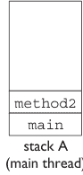

3) method2() 启动了一个新线程

## 启动和运行多个线程

在这里玩够了；让我们实际获取多个线程。现在我们要做的比两个多：以下代码创建了一个的 `Runnable` 并启动了三个线程。所有线程按顺序启动，并且每个线程都被赋予了唯一的名称。

```java
class NameRunnable implements Runnable {

    public void run() {

        for (int x = 1; x <= 3; x++) {

            System.out.println("Run by " + Thread.currentThread().getName());

        }

    }

}

public class ManyNames {

    public static void main(String[] args) {

        NameRunnable nr = new NameRunnable();

        Thread one = new Thread(nr);
        Thread two = new Thread(nr);
        Thread three = new Thread(nr);

        one.setName("Fred");
        two.setName("Lucy");
        three.setName("Ricky");

        one.start();
        two.start();
        three.start();

    }

}
```

运行这段代码可能会产生如下：

```
java ManyNames
Run by Fred
Run by Lucy
Run by Ricky
Run by Fred
Run by Lucy
Run by Ricky
Run by Fred
Run by Lucy
Run by Ricky
Run by Fred
Run by Lucy
Run by Ricky
Run by Fred
Run by Lucy
Run by Ricky
```

注意，没有任何明显的模式。如果我们只看 Fred，我们会看到数字按一个增加，正如预期那样：

```
Run by Fred
Run by Fred
Run by Fred
```

同样，如果我们只看 Lucy，我们会看到它以良好秩序的方式运行：

```
Run by Lucy
Run by Lucy
Run by Lucy
```

但合在一起——混乱！在之前的片段中，我们看到 Fred，然后是 Ricky，最后是 Lucy。尽管 Ricky 是第三启动的，但他第二个完成的。如果我们再次运行，将会得到不同的结果。为什么？取决于调度器，而我们并不控制调度器。这引出了另一个需要记住的点：仅仅因为一组线程按特定顺序启动的，并不意味着它们会按顺序运行。对于任何一组启动的线程，调度器都不保证顺序。持续时间也不保证。例如，你不知道一个线程是否会在其他线程获得机会之前运行完毕，还是它们会轮流执行，或者是两者的结合。然而，有一种方法可以启动一个线程但告诉它在另一个线程完成之前不要运行。你可以使用我们稍后会看到的 `join()` 方法来实现这一点。

# 定义、实例化和启动线程 OCP 目标 10.1

类型。无论第一次 `start()` 调用时的 `run()` 方法是否完成，这种情况都会发生。只能启动新线程，且只能启动一次。可运行（runnable）线程或已死亡线程不能重新启动。

到为止，我们看到了三种线程状态：新建（new）、可运行（runnable）和已死亡（dead）。在本章结束之前，我们将查看线程状态。


除了使用 `setName()` 和 `getName()` 来识别线程外，你可能会看到 `getId()`。`getId()` 方法返回一个正的、唯一的 long 类型数字，该数字是线程整个生命周期内唯一的 ID。

## 线程调度器

线程调度器是 JVM 的一部分（尽管大多数 JVM 将 Java 线程直接映射到底层操作系统的原生线程），它决定在任何给定时刻哪个线程应该运行，并将其移出运行状态。假设是单处理器机器，一次实际上只能有一个线程运行。一次只能有一个栈在执行。是线程调度器决定在所有符合条件的线程中，哪一个将运行。当我们说“符合条件”时，实际上指的是处于可运行（runnable）状态。

处于可运行状态的任何线程都可以被调度器选择为唯一的运行线程。如果线程不在可运行状态，它就无法被选为当前运行的线程。为了明确这种保证的程度是之小：

> 可运行线程被选择运行的顺序是不保证的。

队列行为是典型的，但不是保证的。队列行为意味着当线程完成它的“轮次”后，它会移动到可运行池的末尾，并等待它最终到达队首，然后在那里它可以再次被选择。事实上，我们称之为可运行池（runnable pool）而不是可运行队列（runnable queue），以强调线程并不是按照某种保证的顺序排列的。

虽然我们不控制线程调度器（例如，我们可以告诉特定线程运行），但我们有时可以影响它。以下方法为我们提供了影响调度器的某些工具。千万不要将影响误认为是控制。

# 第 13 章：线程

> 预计会看到一些考试题，考察你对哪些是有保证、哪些是不保证的理解！你必须能够查看线程代码，并确定输出是保证以特定方式运行，还是不定的。

来自 `java.lang.Thread` 类。一些可以帮助我们影响线程调度的方法如下：

```java
public static void sleep(long millis) throws InterruptedException
public static void yield()
public final void join() throws InterruptedException
public final void setPriority(int newPriority)
```

注意，`sleep()` 和 `join()` 都有此处未列出的重载版本。

来自 `java.lang.Object` 类的方法。Java 中的每个类都继承了以下三个相关方法：

```java
public final void wait() throws InterruptedException
public final void notify()
public final void notifyAll()
```


`wait()` 方法有三个重载版本（包括此处列出的一个）。我们将在本章查看这些每个方法的行为。首先，我们将查看线程可能处于的不同状态。

## 认证目标

### 线程状态与转换 (OCP 目标 10.2)

**10.2 管理和控制线程生命周期。**

我们已经看到了三种线程状态——新建、可运行和已死亡——但等一下！还有！线程调度器的工作是让线程进入和离开运行状态。

虽然线程调度器可以将线程从运行状态移回可运行状态，但其他因素可能导致线程离开运行状态但不返回可运行状态。其中之一是线程的 `run()` 方法完成，在这种情况下，线程直接从运行状态移动到死亡状态。我们将查看线程离开运行状态的其他一些方式以及线程去向何处。

### 线程状态

线程只能处于五种状态之一（见图 13-2）：

- **新建 (New)**：这是线程在 `Thread` 实例创建后但尚未在线程上调用 `start()` 方法时所处的状态。它是一个活跃的 `Thread` 对象，但还不是一个执行线程。此时，线程被认为是不存活的。

- **可运行 (Runnable)**：这是线程在符合运行条件但调度器尚未选择其作为运行线程时所处的状态。当调用 `start()` 方法时，线程进入可运行状态，但线程在运行或从阻塞、等待或睡眠状态返回后，也可以回到可运行状态。当线程处于可运行状态时，被认为是存活的。

- **运行 (Running)**：这就是了。“大时刻。”动作发生的地方。这是线程调度器从可运行池中选择它作为当前执行进程时，线程所处的状态。线程可能由于多种原因转换出可运行状态，包括“线程调度器想这样做”。我们很快会查看其他原因。注意图 13-2，有许多进入可运行状态的方法，但进入运行状态的方法只有一种：调度器从可运行池中选择一个线程。

- **等待/阻塞/睡眠 (Waiting/blocked/sleeping)**：这是线程在不符合运行条件时所处的状态。好吧，实际上是这三个状态合并为一个，它们都有一个共同点：线程仍然存活，但不符合运行条件。换句话说，它是不可运行的，但如果发生特定事件，它可能会返回可运行状态。线程可能在等待资源（如 I/O 或对象的锁），在这种情况下，当数据通过线程读取的输入流传入时，事件将其送回可运行状态，或者对象的锁突然变得可用。线程可能在睡眠，因为线程的 run 代码告诉它睡眠一段时间，在这种情况下，将它送回可运行状态的事件是因为睡眠时间到期使其唤醒。或者线程可能在等待，因为线程的 run 代码导致它等待，在这种情况下，将其送回可运行状态的事件是因为另一个线程发送了通知，该线程可能不再需要等待。重点是线程没有告诉另一个线程阻塞，而是自己阻塞了。某些方法看起来像告诉另一个线程阻塞，它们并没有。如果你有另一个线程的引用 `t`，你可以这样写：

```
t.sleep(); 或 t.yield();
```

但这些实际上是 `Thread` 的静态方法——它们不影响实例 `t`；相反，它们被定义为始终影响当前执行线程。这是一个说明使用实例变量访问静态方法是一个坏主意的良例。`Thread` 类中有一个 `suspend()` 方法可以让线程挂起，`suspend()` 方法已被废弃，不会在考试中出现，其对应的 `resume()` 也是如此。还有一个 `stop()` 方法，但它也被废弃了，甚至不会出现在那里。`suspend()` 和 `stop()` 都被证明非常危险，所以你不应该使用它们，由于它们被废弃了，它们不会出现在考试中。不要学习它们；不要使用它们。另外注意，阻塞状态的线程仍然被认为是活跃的。

- **死亡 (Dead)**：线程在 `run()` 方法完成时被认为是死亡的。它可能仍然是一个有效的 `Thread` 对象，但不再是一个独立的执行线程。一旦线程死亡，就永远无法复活了！（整个“我看到了死线程”）。如果你在死亡的 `Thread` 实例上调用 `start()`，你将得到一个运行时（而非编译时）异常。它可能不需要火箭科学家也能告诉你，如果一个线程已经死亡，它就不再被视为存活状态。

### 防止线程执行

被停止的线程通常意味着该线程移动到了死亡（dead）状态。但目标 4.2 也在考察你识别线程何时会被移出运行（running）状态但被发送回可运行（runnable）或死亡（dead）状态的能力。

对于考试而言，我们不关心线程在 I/O 上阻塞（例如，等待来自服务器输入流到达的数据）。我们关注的是以下情况：

- 睡眠（Sleeping）
- 等待（Waiting）
- 因为需要对象锁而阻塞（Blocked）

### 睡眠 (Sleeping)

`sleep()` 方法是 `Thread` 类的一个静态方法。你在代码中使用它来“减慢线程”，强制它在回到可运行状态（此时它仍然是当前运行的线程）之前进入睡眠模式。当线程睡眠时，它会飘到某处，直到唤醒后才会回到可运行状态。

你为什么要让线程睡眠呢？嗯，你可能认为线程执行代码的速度太快了。或者你可能需要强制线程轮流执行，因为 Java 规范并不保证合理的轮流。想象一个在循环中运行的线程，下载最新的股票价格并对其进行分析。一个接一个下载价格将浪费时间，因为大多数价格是非常相似的——更重要的是，这将是对宝贵带宽的极大浪费。解决此问题的最简单方法是在每次下载后让线程暂停（睡眠）五分钟。

你通过调用静态的 `Thread.sleep()` 方法来实现这一点，并传入如下毫秒级的时间：

```java
try {
  Thread.sleep(5*60*1000); // 睡眠 5 分钟
} catch (InterruptedException ex) { }
```

注意 `sleep()` 方法可能会抛出一个受检的 `InterruptedException`（你通常知道会有这种可能，因为另一个线程必须显式地执行中断），所以你必须通过处理或声明来确认异常。通常，你会像前面的代码一样将 `sleep()` 的调用封装在 `try/catch` 中。

让我们通过使用 `sleep()` 修改我们的 Fred、Lucy、Ricky 代码，尝试强制线程交替执行，而不是让一个线程在任何时间段占据主导。我们把 `sleep()` 方法放在哪里？

```java
class NameRunnable implements Runnable {
    public void run() {
        for (int x = 1; x < 4; x++) {
            System.out.println("Run by " 
                + Thread.currentThread().getName());
            try {
                Thread.sleep(1000);
            } catch (InterruptedException ex) { }
        }
    }
}

public class ManyNames {
    public static void main(String [] args) {
        // 创建一个 Runnable
        NameRunnable nr = new NameRunnable();
        Thread one = new Thread(nr);
        one.setName("Fred");
        Thread two = new Thread(nr);
        two.setName("Lucy");
        Thread three = new Thread(nr);
        three.setName("Ricky");
        one.start();
        two.start();
        three.start();
    }
}
```

这段代码显示了 Fred、Lucy 和 Ricky 正在很好地交替运行：

```
% java ManyNames
Run by Fred
Run by Lucy
Run by Ricky
Run by Fred
Run by Lucy
Run by Ricky
Run by Fred
Run by Lucy
Run by Ricky
```

只需记住，上述输出中的行为仍然无法保证。你无法确定一个线程在被置于睡眠之前实际上会运行多久，因此你无法确定在当运行线程进入睡眠时，三个线程中是否只有一个处于可运行状态。换句话说，如果两个线程已唤醒并处于可运行池中，你无法确定最近最少使用的那个是否会被选为运行的线程。尽管如此，使用 `sleep()` 是帮助所有线程获得运行机会的最佳方法！至少可以保证一个线程不会进入并一直停留直到完成。当线程遇到 `sleep` 调用时，它必须睡眠至少指定的毫秒数（除非在唤醒时间之前被中断，如果是那种情况，它会立即抛出 `InterruptedException`）。

仅仅因为线程的 `sleep()` 到期且它唤醒，并不意味着它会进入运行（running）状态！当线程唤醒时，它只是回到可运行（runnable）状态。因此，`sleep()` 中指定的时间是线程不运行的最小持续时间，而不是线程不运行的精确持续时间。例如，你不能依靠 `sleep()` 方法给你一个完全精确的计时器。在许多使用 `sleep()` 作为计时器的应用程序中，这无疑足够了，但你必须知道 `sleep()` 时间并不保证线程在时间到期并唤醒后会立即重新运行。

记住 `sleep()` 是一个静态方法，所以不要被骗认为一个线程可以把另一个线程放入睡眠。你可以在任何地方放置 `sleep()` 代码，因为所有代码都是由某个线程运行的。当执行代码（意味着当前运行线程的代码）遇到 sleep 调用时，它会让当前线程进入睡眠。

### 练习 1-1：创建线程并使其睡眠

在这个练习中，我们将创建一个简单的计数线程。它将计数到 100，并在数字之间暂停一秒。此外，为了符合计数主题，它每十个数字输出一次字符串。

1. 创建一个类并扩展 `Thread` 类。作为选项，你可以实现 `Runnable` 接口。
2. 重写 `Thread` 的 `run()` 方法。这是输出数字的地方。
3. 创建一个循环 100 次的 for 循环。使用模运算检查除以 10 的余数。
4. 使用静态方法 `Thread.sleep()` 来暂停。（记住，`sleep()` 的单参数版本指定的是毫秒）。

### 线程优先级与 yield()

要理解 `yield()`，你必须理解线程优先级的概念。线程始终带有优先级运行，通常为 1 到 10 之间的数字（尽管在某些情况下范围小于 10）。大多数 JVM 的调度器使用抢占式优先级调度（这意味着某种切片）。这并不意味着所有的 JVM 都使用时间切片。JVM 规范并不要求虚拟机实现时间切片调度器（为每个线程分配公平的时间然后返回可运行状态以给另一个线程机会）。尽管许多 JVM 使用时间切片，但某些可能使用让线程一直运行直到完成 `run()` 方法的调度器。

然而，大多数 JVM 的调度器在一个重要方面使用优先级：如果一个线程进入可运行状态，并且其优先级高于池中的任何线程，且优先级高于当前运行的线程，那么低优先级的运行线程将被推回可运行状态，高优先级的线程将被选择运行。换句话说，在任何时刻，当前运行线程的优先级都不会低于池中的任何线程。大多数情况下，运行线程的优先级与池中最高优先级的线程相等或更高。这是从 JVM 规范中获得的关于调度的最接近的保证，因此你绝不能依赖线程优先级来保证程序的正确行为。

在设计多线程应用程序时，不要依赖线程优先级。因为线程调度优先级行为无法保证，请将线程优先级作为提高程序效率的方法，但只需确保你的程序正确性不依赖于该行为。

同样无法保证的是，当池中的线程优先级相同，或者当前运行的线程与池中线程优先级相同时行为。在所有优先级都相等的情况下，JVM 的调度器实现可以自由执行任何它想做的事情。这意味着调度器可能会执行以下操作之一（但不限于此）：

- 选择一个线程运行，并一直运行它，直到它阻塞或完成。
- 对池中的线程进行时间片划分，让每个人都有平等的机会。

#### 设置线程优先级

线程获得一个默认优先级，该优先级是创建它的执行线程的优先级。例如，在下面的代码中：

```java
public class TestThreads {
    public static void main (String [] args) {
        MyThread t = new MyThread();
    }
}
```

由 `t` 引用的线程将与主线程相同的优先级，因为主线程正在执行创建 `MyThread` 实例的代码。

你也可以通过对 `Thread` 实例调用 `setPriority()` 方法来直接设置线程优先级，如下：

```java
FooRunnable r = new FooRunnable();
Thread t = new Thread(r);
t.start();
```

优先级使用正整数，通常在 1 到 10 之间，且 JVM 永远不会更改线程的优先级。然而，值 10 并不是有保证的。某些 JVM 可能无法识别十个不同的值。如果你有（例如）十个不同优先级的线程，而当前应用程序运行在一个只分配了五个优先级范围的 JVM 中，这样的 JVM 可能会将 1 到 10 的值合并为 1 到 5 的值，此时两个或多个线程可能会映射到同一个优先级。

尽管默认优先级是 5，但 `Thread` 类有以下三个常量（静态变量），定义了线程优先级的范围：

```
Thread.MIN_PRIORITY (1)
Thread.NORM_PRIORITY (5)
Thread.MAX_PRIORITY (10)
```

#### yield() 方法

那么，静态的 `Thread.yield()` 与这一切有什么关系呢？在实践中关系不大。`yield()` 预期的作用是让当前线程返回可运行（runnable）状态，以便其他相同优先级的线程获得机会。因此，其意图是使用 `yield()` 来促进等优先级线程之间的优雅轮换。但实际上，`yield()` 方法并不保证能做到它声称的功能，即使它确实让一个线程退出运行状态并回到可运行状态，也不能保证让出位的线程不会被其他所有线程选中！所以，虽然 `yield()`——而且经常会——让运行中的线程让出位置给另一个相同优先级的可运行线程，但并没有保证。

一个 `yield()`，无论多少 `yield()`，永远不会导致线程进入等待/睡眠/阻塞状态。最多情况下，它只会导致线程从运行（running）状态转到可运行（runnable）状态，但再次强调，它可能完全没有作用。

#### join() 方法

`Thread` 类的非静态 `join()` 方法允许一个线程“加入（join）”到另一个线程的末尾上。如果你有一个线程 B，它在另一个线程 A 完成工作之前无法完成自己的工作，那么你就等待线程 B “加入”线程 A。这意味着在 A 完成（进入死亡状态）之前，线程 B 将不会变为可运行状态。

```java
Thread t = new Thread();
t.start();
t.join();
```

前面的代码获取了当前运行的线程（如果这是在 `main()` 方法中，那么它就是主线程），并将其连接到 `t` 引用的线程的末尾。这会阻塞当前线程使其变为可运行，直到 `t` 引用的线程不再存活。换句话说，代码 `t.join()` 意味着“我（当前线程）加入到 t 的末尾，因此 t 必须在我之前完成”。你还可能调用 `join()` 的重载版本之一，接收一个超时持续时间，这样你就说：“等待 t 完成，但如果时间超过了 5,000 毫秒，就停止等待并变为可运行状态。”图 13-3 显示了 `join()` 方法的效果。

到目前为止，我们查看了运行线程离开运行状态的三种方式：

- 调用 `sleep()`：保证会导致当前线程停止执行至少指定的睡眠持续时间（尽管它可能在达到指定时间之前被中断）。


# 第13章：线程

## 线程状态对比：`yield()` 与 `sleep()`

- 一个 `yield()`，无论多少 `yield()`，永远不会导致线程进入等待/睡眠/阻塞状态。最多情况下，它只会导致线程从运行状态转到可运行状态，但再次强调，它可能完全没有作用。
- 调用 `sleep()`：保证会导致当前线程停止执行至少指定的睡眠持续时间（尽管它可能在达到指定时间之前被中断）。
- 并没有保证。虽然 `yield()`——而且经常会——让运行中的线程让出位置给另一个相同优先级的可运行线程，但并没有保证。

## 同步代码、线程问题（OCP 目标 10.3 和 10.4）

### 场景描述

3. 账户初始余额为 50，每次取款恰好为 10。

4. 在 `run()` 方法中，我们循环五次，在每次循环中我们：
   - 执行取款（如果账户余额足够）。
   - 如果账户透支，则打印一条语句（这不应该发生，因为我们在取款前已经检查了余额）。

5. 测试类中的 `makeWithWithdrawal()` 方法（代表 Fred 或 Lucy 的行为）将执行以下操作：
   - 检查余额以查看是否有足够的资金取款。
   - 如果足够，打印取款者的名字。
   - 睡眠 500 毫秒——这段时间恰好让另一个伙伴在你实际执行取款之前有机会进入。
   - 醒来后，完成取款并打印该事实。
   - 如果最初余额不足，打印一条语句显示你的身份以及余额不足的事实。

我们真正想要发现的是以下情况是否可能：一个伙伴检查账户并发现余额足够，但在执行实际取款之前，另一个伙伴也检查账户并发现余额足够。当账户余额变为 10 时，如果两个伙伴在取款前都进行了检查，他们都会认为取款是安全的，结果账户余额增加了 10！

### 代码示例

**AccountDanger.java**

```java
public class AccountDanger implements Runnable {

    private Account acct = new Account();

    public static void main(String[] args) {
        AccountDanger r = new AccountDanger();
        Thread one = new Thread(r);
        Thread two = new Thread(r);
        one.setName("Fred");
        two.setName("Lucy");
        one.start();
        two.start();
    }

    public void run() {
        for (int x = 0; x < 5; x++) {
            makeWithWithdrawal(10);
            if (acct.getBalance() < 0) {
                System.out.println("account is overdrafted!");
            }
        }
    }

    private void makeWithWithdrawal(int amt) {
        if (acct.getBalance() >= amt) {
            System.out.println(Thread.currentThread().getName() + " is going to withdraw");
            try {
                Thread.sleep(500);
            } catch (InterruptedException ex) {}
            acct.withdraw(amt);
            System.out.println(Thread.currentThread().getName() + " completes the withdrawal");
        } else {
            System.out.println("Not enough in account for " + Thread.currentThread().getName() + " to withdraw " + acct.getBalance());
        }
    }
}
```

> **注**：你可能需要在你机器上对这段代码进行微调，以获得“账户透支”的行为。你可以尝试在 `run()` 方法中添加 `sleep`……无论如何，实验将帮助你巩固概念。

### 运行输出示例

```
% java AccountDanger
1. Fred is going to withdraw
2. Lucy is going to withdraw
3. Fred completes the withdrawal
4. Fred is going to withdraw
5. Lucy completes the withdrawal
6. Lucy is going to withdraw
7. Fred completes the withdrawal
8. Fred is going to withdraw
9. Lucy completes the withdrawal
10. Lucy is going to withdraw
11. Fred completes the withdrawal
12. Not enough in account for Fred to withdraw 0
13. Not enough in account for Fred to withdraw 0
14. Lucy completes the withdrawal
15. account is overdraft!
16. Not enough in account for Lucy to withdraw -10
17. account is overdraft!
18. Not enough in account for Lucy to withdraw -10
19. account is overdraft!
```


虽然每次运行此代码时的输出可能略有不同，但让我们通过带编号的输出行来分析这个特定的例子。在前四次尝试中，一切都是正常的。Fred 在第 1 行检查余额并发现是足够的。

## 第13章：线程

在第 2 行，Lucy 检查了余额并发现了它。在第 3 行，Fred 完成了取款。此时，Lucy 检查的（并认为是准确的）余额实际上自她上次检查以来已经发生了变化。现在 Fred 在 Lucy 完成她的第一次取款之前再次检查了余额。到这一为止，即使是 Fred 看到的也是一个可能不准确的余额，因为我们知道 Lucy 将完成她的取款。当然，Fred 可能会在 Lucy 之前完成，但实际情况并非如此。

在第 5 行，Lucy 完成了她的取款，随后 Fred 完成了自己的取款，Lucy 在第 6 行对账户进行了另一次检查。就这样持续下去，直到我们到达第 8 行，Fred 检查余额发现余额是 20。在第 9 行，Lucy 完成了她早些检查过的取款，这使得余额降到了 10。在第 10 行，Lucy 再次检查，看到余额为 10，所以她知道自己可以取款。但她不知道 Fred 已经在第 8 行检查过余额并认为取款是安全的。在第 11 行，Fred 完成了取款。这使得余额变为 0。在第 12 行，Fred 检查余额发现账户余额不足。在第 13 行，Fred 再次检查发现发现不足。在第 14 行，Lucy 完成了她的取款，砰！在第 15 行：账户透支了！在第 16 行：账户不足以供 Lucy 取 -10。在第 17 行：账户透支了！在第 18 行：账户不足以供 Lucy 取 -10。在第 19 行：账户透支了！

这个问题被称为**竞态条件**（race condition），即多个线程访问同一个资源（通常是实例变量），如果一个线程“抢先进入”，就会产生损坏的数据。

图 13-4 显示了两个线程并发访问同一个对象时可能发生的时间线。那么可以做什么呢？解决方案非常简单。我们必须保证取款的两个步骤——检查余额和执行取款永远不会被分开。我们称之为**原子性**（atomic）操作。

我们需要它们作为一个整体操作执行，即使线程在步骤 1 和步骤 2 之间进入了睡眠。你无法保证单个线程在整个原子操作期间保持运行。但你可以保证，即使执行操作的线程在运行和非运行状态之间切换，其他运行线程也无法对相同的数据采取操作。

# 第 13 章：线程

直到第一个线程通过退出方法完成进程。新的输出显示了同步 `makeWithWithdrawal()` 方法的好处：

```
% java AccountDanger

Fred is going to withdraw
Fred completes the withdrawal
Lucy is going to withdraw
Lucy completes the withdrawal
Fred is going to withdraw
Fred completes the withdrawal
Lucy is going to withdraw
Lucy completes the withdrawal
Fred is going to withdraw
Fred completes the withdrawal
Not enough in account for Lucy to withdraw 0
Not enough in account for Fred to withdraw 0
Not enough in account for Lucy to withdraw 0
Not enough in account for Fred to withdraw 0
Not enough in account for Lucy to withdraw 0
```

注意，Lucy 和 Fred 两个线程总会在另一个线程检查余额之前检查账户余额并完成取款。

# 同步与锁

同步是如何工作的？通过锁来实现。Java 中的每个对象都有一个内置锁，只有当对象拥有同步方法代码时，锁才会起作用。当我们进入一个 `synchronized` 非静态方法时，我们会自动获取与我们正在执行的类实例（`this`实例）关联的锁。获取对象的锁也称为获取锁（getting the lock）、锁定对象（locking the object）、在对象上锁定（locking on the object）或在对象上同步（synchronizing on the object）。我们可以使用监视器（monitor）术语来引用我们获取的对象。从技术上讲，锁和监视器是两个不同的东西，但大多数人互换使用，我们也是如此。由于每个对象只有一个锁，如果一个线程获取了锁，在第一个线程释放（或返回）锁之前，没有其他线程可以获取该锁。这意味着在锁释放之前，其他线程无法进入同步代码（这意味着它无法进入该对象的任何同步方法）。通常，释放锁意味着持有锁的线程（换句话说，当前处于同步方法中的线程）退出了同步方法。此时，锁处于空闲状态，直到某个其他线程进入该对象的同步方法。请记住关于锁定和同步的关键点：

# 同步代码，线程问题 OCP 目标 10.3 和 10.4

- 只有方法（或块）可以同步，而变量或类不能同步。
- 每个对象只有一个锁。
- 类中的并非所有方法都需要同步。一个类可以同时拥有同步方法和非同步方法。
- 如果两个线程正准备执行类中的一个同步方法，且两个线程都使用类的同一个实例来调用该方法，那么一次只有一个线程能够执行该方法。换句话说，一个线程需要等待直到第一个线程完成它的方法。换句话说，一旦线程获取了对象的锁，其他任何线程都无法进入该类中的任何同步方法（针对该对象）。
- 如果一个类同时拥有同步方法和非同步方法，多个线程仍然可以访问类的非同步方法！例如，如果一个线程可以进入一个不访问你试图保护的数据的方法，那么你就不需要对它们进行同步。同步在某些情况下会导致性能下降（如果使用不当，甚至可能导致死锁），所以你应该小心不要覆盖它。
- 如果线程进入睡眠状态，它将持有它所拥有的锁——它不会释放这些锁。
- 线程可以为同步方法获取多个锁，即获取一个锁，然后立即调用另一个对象上的同步方法，从而也获取了该锁。随着栈的回退，锁会被再次释放。此外，如果一个线程获取了锁，然后尝试调用同一对象上的同步方法，没有问题——JVM 知道该线程已经拥有该对象的锁，因此该线程可以使用已拥有的锁调用同一对象上的其他同步方法。
- 你可以同步一个代码块而不是方法。

由于同步确实会产生并发开销，因此你不想同步比保护数据所需的余的任何代码。所以，如果一个方法的范围超过了需要，你可以将同步部分的范围缩小到小于整个方法的范围——我们奇怪地将其称为**同步块**（synchronized block），它看起来如下：

```java
class SyncTest {

  public void doStuff() {

    System.out.println("not synchronized");

    synchronized(this) {

      System.out.println("synchronized");

    }

  }

}
```

# 第 13 章：线程

当线程从同步块内部执行代码时（包括从该同步块调用的任何方法代码），该代码在同步上下文中执行。真正的问题是，在什么地方？或者说，在哪个对象的锁上同步？

当你同步一个方法时，调用该方法的对象将被获取其锁。但当你同步一个代码块时，你指定了想要使用哪个对象的锁作为锁，例如，你使用某个第三方对象作为该段代码的锁。这让你能够在单个对象内为代码同步拥有多个锁。

或者你也可以像之前的代码那样对当前实例（`this`）进行同步。由于这与同步方法锁定的实例是同一个实例，这意味着你始终可以用包含同步块的非同步方法替换同步方法。换句话说，这：

```java
public synchronized void doStuff() {

  System.out.println("synchronized");

}
```

等同于：

```java
public void doStuff() {

  synchronized (this) {

    System.out.println("synchronized");

  }

}
```

# 如果线程无法获取锁会发生什么？

如果一个线程尝试进入同步方法而锁已被占用，则该线程被阻塞在对象的锁上（blocked on the object's lock）。本质上，线程进入了该特定对象的池，必须一直等待直到锁释放且线程再次变为可运行/运行状态。因为锁释放并不意味着任何特定线程都会获得它。例如，可能有三个线程在等待同一个锁，无法保证等待最长的线程会首先获得它。

在考虑阻塞时，注意用于锁定的对象非常重要：

- 在同一个类中调用非同步方法的线程只有在使用同一个实例调用时才会互相阻塞。这是因为它们各自锁定该实例，而如果使用两个实例，它们将获得两个锁，互不干扰。
- 在同一个类中调用静态同步方法的线程始终会互相阻塞——因为它们都锁定同一个 `Class` 实例。
- 静态方法和非静态同步方法之间永远不会互相阻塞。静态方法锁定 `Class` 实例，而非静态方法锁定 `this` 实例——这些操作完全互不干扰。
- 对于同步块，你必须查看具体使用了哪个对象进行锁定。`synchronized` 关键字括号内的内容

# 静态方法可以同步吗？

静态方法是可以同步的。每个类只有一个锁，用于保护静态数据。整个类有一个锁，你需要它来同步静态方法。这是因为有一个代表类的 `lang.Class`。同步静态方法不需要特殊操作：

```java
public static synchronized int getCount() {

  return count;

}
```

# 线程创建步骤

- 1. 创建一个类并扩展 `Thread` 类。
- 2. 重写 `Thread` 的 `run()` 方法。同步块将放在这里。
- 3. 为了让线程对象共享同一个对象，我们需要创建一个接收对象的构造函数。
- 4. 同步代码块将获取步骤 3 中对象的锁。
- 5. 在块内，输出 `StringBuilder` 100 次并递增 `StringBuilder` 中的字母。你可以查看第 5 章中有助于此操作的 `StringBuilder` 方法。
- 6. 最后，在 `main()` 方法中，使用字母 A 创建单个 `StringBuilder`，然后创建三个该类的实例并启动所有实例。

## 代码同步、线程问题 (OCP 目标 10.3 和 10.4)

`synchronized?` 在同一个对象上进行同步的线程会互相阻塞。在不同对象上进行同步的线程则不会。

表 13-1 列出了与线程相关的方法，以及调用这些方法后线程是否会释放锁。

### 表 13-1 方法和锁状态

| 方法 | 释放锁 | 保留锁 | 定义方法的类 |
|---|---|---|---|
| `wait()` | ✓ | | `java.lang.Object` |
| `notify()` | | ✓ (尽管线程很可能在此调用后不久就会退出同步代码块，从而释放其锁。) | `java.lang.Object` |
| `join()` | | ✓ | `java.lang.Thread` |
| `sleep()` | | ✓ | `java.lang.Thread` |
| `yield()` | | ✓ | `java.lang.Thread` |

## 我什么时候需要同步？

同步可能会变得非常复杂，你可能在想，如果可以避免的话，为什么还要这么做呢？回想一下之前关于 Lucy 和 Fred 从账户中取款的“竞态条件”示例。当我们使用线程时，我们需要使用一些同步机制，以确保我们的方法在执行时不会互相干扰，从而不会弄乱我们的数据。通常情况下，每当有多个线程在访问可变（可更改）数据时，你就进行同步来保护该数据，以确保其他线程不会同时修改它（或者在你读取它时它没有在被修改，这同样令人困惑）。你不需要担心局部变量——每个线程都有它自己的局部变量副本。两个同时执行该方法的线程将使用不同的局部变量副本，彼此互不干扰。然而，你需要担心静态和非静态字段中的非静态可变数据，你通常使用非静态方法来访问它。通过同步该方法，你将确保任何尝试使用相同实例运行该方法的线程都将无法同时访问。但使用不同实例的操作不会受到影响，因为它正在获取另一个实例的锁。这就是为什么我们——处理相同数据的线程——需要一个接一个运行，而处理不同数据的线程可以互相忽略，并随所欲地运行；这并不重要。

对于静态字段中的可变数据，你通常使用静态方法来访问它。同样，通过同步方法，你确保了任何试图访问数据的两个线程都会被防止同时访问，因为两个线程都必须获取在该类定义的静态方法的 `Class` 对象锁。这正是我们想要的。

然而——如果我们使用一个非静态方法来访问静态字段呢？或者使用一个静态方法来访问非静态字段（使用实例）呢？在这些情况下，情况会迅速变得混乱，并且极有可能结果不会按照你想要的方式运行。如果你有一个静态方法访问非静态字段，并且你同步了该方法，你获取了 `Class` 对象的锁。但如果另一个方法也访问该非静态字段，只是这次它使用的是当前实例（`this`）呢？记住，静态同步方法和非静态同步方法是不会互相阻塞的——它们可以同时运行。同样，如果你使用非静态方法访问静态字段，两个线程可能会使用两个不同的实例调用该方法。这意味着它们不会互相阻塞，因为它们使用了不同的锁。这意味着两个线程正在同时访问同一个静态字段——这正是我们试图防止的类型。

对静态字段的访问应该使用静态同步方法。对非静态字段的访问应该使用非静态同步方法。例如：

```java
public class Thing {

    private static int staticField;

    private int nonstaticField;

    public static synchronized int getStaticField() {

        return staticField;

    }

    public static synchronized void setStaticField(int staticField) {

        Thing.staticField = staticField;

    }

}
```


# 代码同步、线程问题 (OCP 目标 10.3 和 10.4)

`synchronized` 在同一个对象上进行同步的线程会互相阻塞。在不同对象上进行同步的线程则不会。

表 13-1 列出了与线程相关的方法，以及调用这些方法后线程是否会释放锁。

| 方法和锁状态 | 释放 | 保留锁 | 定义方法的类 |
|---|---|---|---|
| | `wait()` | `notify()` (尽管线程很可能在此调用后不久就会退出同步代码块，从而释放其锁。) | `java.lang.Object` |
| | `join()` | | `java.lang.Thread` |
| | `sleep()` | | `java.lang.Thread` |
| | `yield()` | | `java.lang.Thread` |

## 我什么时候需要同步？

同步可能会变得非常复杂，你可能在想，如果可以避免的话，为什么还要这么做呢？回想一下之前关于 Lucy 和 Fred 从账户中取款的“竞态条件”示例。当我们使用线程时，我们需要使用一些同步机制，以确保我们的方法在执行时不会互相干扰，从而不会弄乱我们的数据。通常情况下，每当有多个线程在访问可变（可更改）数据时，你就进行同步来保护该数据，以确保其他线程不会同时修改它（或者在你读取它时它没有在被修改，这同样令人困惑）。你不需要担心局部变量——每个线程都有它自己的局部变量副本。两个同时执行该方法的线程将使用不同的局部变量副本，彼此互不干扰。然而，你需要担心静态和非静态字段中的非静态可变数据，你通常使用非静态方法来访问它。通过同步该方法，你将确保任何尝试使用相同实例运行该方法的线程都将无法同时访问。但使用不同实例的操作不会受到影响，因为它正在获取另一个实例的锁。这就是为什么我们——处理相同数据的线程——需要一个接一个运行，而处理不同数据的线程可以互相忽略，并随所欲地运行；这并不重要。

对于静态字段中的可变数据，你通常使用静态方法来访问它。同样，通过同步方法，你确保了任何试图访问数据的两个线程都会被防止同时访问，因为两个线程都必须获取在该类定义的静态方法的 `Class` 对象锁。这正是我们想要的。

然而——如果我们使用一个非静态方法来访问静态字段呢？或者使用一个静态方法来访问非静态字段（使用实例）呢？在这些情况下，情况会迅速变得混乱，并且极有可能结果不会按照你想要的方式运行。如果你有一个静态方法访问非静态字段，并且你同步了该方法，你获取了 `Class` 对象的锁。但如果另一个方法也访问该非静态字段，只是这次它使用的是当前实例（`this`）呢？记住，静态同步方法和非静态同步方法是不会互相阻塞的——它们可以同时运行。同样，如果你使用非静态方法访问静态字段，两个线程可能会使用两个不同的实例调用该方法。这意味着它们不会互相阻塞，因为它们使用了不同的锁。这意味着两个线程正在同时访问同一个静态字段——这正是我们试图防止的类型。

对静态字段的访问应该使用静态同步方法。对非静态字段的访问应该使用非静态同步方法。例如：

```java
public class Thing {

    private static int staticField;

    private int nonstaticField;

    public static synchronized int getStaticField() {
        return staticField;
    }

    public static synchronized void setStaticField(int staticField) {
        Thing.staticField = staticField;
    }
}
```

## 线程问题 (OCP 目标 10.3 和 10.4)

同步的需求不仅仅在于单个方法是否同步。考虑以下示例：

```java
import java.util.*;

public class NameList {

    private List<String> names = Collections.synchronizedList(new LinkedList<>());

    public void add(String name) {
        names.add(name);
    }

    public String removeFirst() {
        if (names.size() > 0) {
            return names.remove(0);
        } else {
            return null;
        }
    }

    public static void main(String[] args) {
        final NameList nl = new NameList();
        nl.add("Ozymandias");

        class NameDropper extends Thread {
            public void run() {
                String name = nl.removeFirst();
                System.out.println(name);
            }
        }

        Thread t1 = new NameDropper();
        Thread t2 = new NameDropper();
        t1.start();
        t2.start();
    }
}
```

输出可能是：
```
Ozymandias
null
```

然而，如果我们再次运行程序，可能会发生不同的情况：
- 线程 t1 执行 `names.size()`，返回 1。
- 线程 t2 执行 `names.size()`，返回 1。
- 线程 t1 执行 `names.remove(0)`，返回 Ozymandias。
- 线程 t2 执行 `names.remove(0)`，抛出异常，因为列表现在为空。

这里的关键在于，在一个“线程安全”的类（由 `synchronizedList()` 返回）中，每个单独的方法都是同步的。所以 `names.size()` 是同步的，`names.remove(0)` 也是同步的。但没有任何东西能阻止另一个线程在这两次调用之间对列表做其他事情。这就是问题发生的地方。

# 同步代码、线程问题 OCP 目标 10.3 和 10.4

这里有一个解决方案：不要依赖 `Collections.synchronizedList()`。相反，自己来同步代码：

```java
import java.util.*;

public class NameList {

    private List<String> names = new LinkedList<>();

    public synchronized void add(String name) {
        names.add(name);
    }

    public synchronized String removeFirst() {
        if (names.size() > 0)
            return names.remove(0);
        else
            return null;
    }
}
```

现在，整个 `removeFirst()` 方法都是同步的，一旦一个线程调用了 `names.size()`，就不会有其他线程插进来并抢走最后一个名称。另一个线程将一直等待第一个线程完成 `removeFirst()`。

这里的道理是，并不仅仅因为一个类被描述为“线程安全的”，它并不意味着它总是线程安全的。如果单个方法是同步的，这可能是不够的——你可能需要在更高层上进行同步（例如，在调用其他方法的块或方法中进行同步）。一旦你这样做了，原始的同步（在本例中，`Collections.synchronizedList()` 返回的对象内部的同步）可能会变成多余的。

# 线程死锁

对 Java 程序可能发生的最可怕的事情可能是死锁。死锁发生在两个线程都被阻塞时，每个线程都在等待对方的锁。在对方放弃锁之前，它们都无法运行，因此它们将永远等下去。

这种情况可能会发生，例如，当线程 A 遇到同步代码并获取锁 B，然后进入另一个方法（仍在它拥有锁的同步代码内），而该方法也是同步的。但线程 A 无法获取锁来进入这个同步代码——锁 B——因为另一个线程 D 已经拥有该锁。因此，线程 A 进入了等待锁池，希望 D 能快点释放锁（通过完成同步方法）。但线程 A 确实会等待非常长一段时间，而线程 D 拿到了锁 C，然后它进入了一个在锁 B 上进行同步的方法。显然，线程 D 无法获取锁 B，因为线程 A 持有它。而在线程 D 释放锁 C 之前，线程 A 不会释放它。但线程 D 在获取锁 B 并继续执行之前，不会释放锁 C。于是它们就那样等下去。下面的示例演示了死锁：

```java
public class DeadlockRisk {

    private static class Resource {
        public int value;
    }

    private Resource resourceA = new Resource();
    private Resource resourceB = new Resource();

    public int read() {
        synchronized(resourceA) { // 可能死锁
            synchronized(resourceB) {
                return resourceB.value + resourceA.value;
            }
        }
    }

    public void write(int a, int b) {
        synchronized(resourceB) { // 可能死锁
            synchronized(resourceA) {
                resourceA.value = a;
                resourceB.value = b;
            }
        }
    }
}
```

假设 `read()` 由一个线程启动，而 `write()` 由另一个线程启动。如果有不同的线程可以独立地读取和写入，那么在第 8 行或第 15 行存在死锁的风险。读取线程将拥有 `resourceA`，写入线程将拥有 `resourceB`，两者都将在等待对方而被卡住。

这样的代码几乎不会导致死锁，因为 CPU 必须在代码的特定点从读取线程切换到写入线程，发生死锁的概率非常小。应用程序在 99.9% 的情况下都能正常工作。

前面的示例很容易修复；只需交换第 15 行和第 16 行（或第 8 行和第 9 行）读取器或写入器的加锁顺序即可。更复杂的情况可能需要长时间才能解决。

无论你的代码死锁的概率有多小，底线是：如果你死锁了，你就完蛋了。有一些设计方法可以帮助避免死锁，包括始终按照预定顺序获取锁的策略。

那是你需要自己学习的内容，超出了本书的范围。我们只是为了让你通过考试。如果你学会了本章中的所有内容，你对线程的了解将超过大多数经验丰富的 Java 程序员。

# 线程交互 OCP 目标 10.3 和 10.4

## 认证目标

- 10.3 同步线程对共享数据的访问。
- 10.4 识别潜在的线程问题。

我们最后需要看的是线程如何相互交互以通信其他等方面——它们的锁定状态。`Object` 类有三个方法：`wait()`、`notify()` 和 `notifyAll()`，它们帮助线程通信它们感兴趣事件的状态。例如，如果一个线程是邮件投递线程，另一个是邮件处理器线程，邮件处理器必须不断检查是否有邮件需要处理。使用 `wait` 和 `notify` 机制，邮件处理器会检查邮件，如果没有找到，它就可以说：“嘿，我不会浪费时间每两秒检查一次邮件。我要出去，等邮件投递员把东西放进邮箱时（通知我）。”使用 `wait` 和 `notify` 让线程进入等待状态，直到有其他线程通知它可以返回。

记住（考试要点）关于 `wait/notify` 的关键点是：这些方法必须在同步上下文中调用！线程在没有拥有该锁的情况下无法调用 `wait` 或 `notify`。

考虑两个依赖对方以继续执行的线程的示例，我们将展示如何使用 `wait()` 和 `notify()` 让它们安全且在适当时刻进行交互。想象一个计算机控制的机器，将织物分成不同的形状，以及一个使用用户指定形状的应用程序。当前版本如下：

```java
public void run() {
    while(true) {
        // 从用户处获取形状
        // 计算步骤
        // 将步骤发送到硬件
    }
}
```

设计并不是理想的，因为当机器忙时用户无法进行任何操作。我们需要改进这种情况。一种简单的解决方案是将进程分为两个不同的线程，一个与用户交互，另一个管理硬件。用户线程向硬件线程发送指令，然后返回与用户交互。硬件线程接收用户的指令并立即开始设计。两个线程使用一个公共对象进行通信，该对象持有当前的设计。下面的伪代码 `userLoop()` 显示了这一点：

```java
public void userLoop() {
    while(true) {
        // 从用户处获取形状
        // 计算步骤
        // 修改公共对象中的机器步骤
    }
}

public void hardwareLoop() {
    while(true) {
        // 从公共对象获取步骤
        // 将步骤发送到硬件
    }
}
```

现在的问题是如何让硬件线程在机器步骤可用时立即处理。同时，用户线程在所有步骤发送到硬件之前不应修改它们。解决方案是使用 `wait()` 和 `notify()` 并同步部分代码。

记住，`wait()` 和 `notify()` 是 `Object` 的实例方法。就像每个对象都有锁一样，每个对象都可以有一个等待来自线程信号（通知）的线程列表。线程通过调用目标对象的 `wait()` 方法进入该等待列表。从那时起，直到目标对象的 `notify()` 方法被调用，否则它不会执行任何指令。如果有多个线程在同一个对象上等待，将选择一个（不保证顺序）继续执行。如果没有线程在等待，则不采取任何特定行动。让我们来看一个对象等待另一个对象通知它的真实代码（注意，这相当复杂）：

```java
class ThreadA {
    public static void main(String[] args) {
        ThreadB b = new ThreadB();
        b.start();

        synchronized(b) {
            try {
                System.out.println("Waiting for b to complete...");
                b.wait();
            } catch (InterruptedException e) {
                e.printStackTrace();
            }
            System.out.println("Total is: " + b.total);
        }
    }
}

class ThreadB extends Thread {
    int total;

    public void run() {
        synchronized(this) {
            for(int i=0; i<100; i++) {
                total += i;
            }
            notify();
        }
    }
}
```


程序包含两个对象：`ThreadA` 包含主线程，`ThreadB` 计算从 0 到 99 所有数字之和。一旦第 4 行调用了 `start()` 方法，`ThreadA` 将继续执行其所在类中的下一行代码，这意味着它可能在 `ThreadB` 完成计算之前就到达第 11 行。为了防止这种情况，我们在第 9 行使用了 `wait()` 方法。

注意第 6 行中的代码对对象 `b` 进行了同步——这是因为为了在该对象上调用 `wait()`，`ThreadA` 必须拥有 `b` 的锁。要让一个线程调用 `wait()` 或 `notify()`，该线程必须是该对象锁的所有者。当线程等待时，它会临时释放锁供其他线程使用，但它继续执行时仍然需要该锁。通常会发现这样的代码：

```java
synchronized(anotherObject) { // 拥有 anotherObject 的锁
    try {
        anotherObject.wait();
        // 线程释放锁并等待
        // 为了继续执行，线程需要锁，
        // 所以它可能会被阻塞直到获取锁。
    } catch(InterruptedException e) {
    }
}
```

前面的代码会等待直到在 `anotherObject` 上调用了 `notify()`。

```java
synchronized(this) { notify(); }
```

# 第 13 章：线程

这段代码通知当前正在等待 `this` 对象的单个线程。锁可以在代码中更早的时候获取，例如在调用方法中。注意，如果调用 `wait()` 的线程没有锁，它将抛出 `IllegalMonitorStateException`。此异常不是检查异常，你不需要显式地捕获它。在任何代码块中，你应该清楚线程是否拥有某个对象的锁。

注意第 7–10 行中在等待线程周围有一个 `try/catch` 块，线程可能会像睡眠线程一样被中断，因此你必须处理：

```java
try {
    wait();
} catch (InterruptedException e) {
    // 对相应的处理
}
```

在织料示例中，使用这些方法的方法是让硬件等待形状就绪，并让用户线程在写完步骤后进行通知。机器步骤可能包括全局步骤（例如将所需的织料移动到切割区域）以及若干个子步骤（例如切割的方向和长度）。例如，它们可以是：

```java
class fabricRoll;
int cuttingSpeed;
Point startingPoint;
float[] directions;
float[] lengths;
etc..
```

用户线程在硬件线程使用这些机器步骤时不要修改它们，这一点非常重要，因此这种读写操作应该是同步的。结果代码看起来如下：

```java
class Operator extends Thread {
    public void run() {
        while(true) {
            // 从用户获取形状
            synchronized(this) {
                // 根据形状计算新的机器步骤
                notify();
            }
        }
    }
}

class Machine extends Thread {
    Operator operator; // 假设已初始化
    public void run() {
        while(true) {
            synchronized(operator) {
                try {
                    operator.wait();
                } catch (InterruptedException ie) {
                    // 将步骤发送给硬件
                }
            }
        }
    }
}
```

机器线程一旦启动将立即进入等待状态，直到收到通知。在该点，是 `operator` 线程拥有该对象的锁，因此硬件会阻塞一段时间。当硬件正在处理形状时，用户可以与系统交互并指定另一个形状进行切割。当用户完成形状处理并切割时，`operator` 线程进入同步块，阻塞直到机器完成步骤。当机器线程完成后，它重复循环，再次进入等待状态（因此释放了锁）。只有这样，`operator` 线程才能进入同步块并覆盖机器步骤。使用两个线程显然比一个好，尽管在这种实现中，还有一个 `wait(timeout)` 接受毫秒作为最大等待时间。如果线程没有被中断，每当收到通知或指定的超时到达时，它都会继续。这种持续意味着离开等待状态需要获取对象的锁：

```java
synchronized(a) {
    // 线程获取 'a' 的锁
    a.wait(2000);
    // 线程释放锁并等待通知
    // 最多两秒，然后回到 Runnable
    // 更多指令
}
```

# 第 13 章：线程


在对象上调用 `wait()` 方法时，执行代码的线程立即放弃对该对象的锁。然而，调用 `notify()` 并不意味着线程在该刻放弃锁。如果线程仍在同步代码中，锁在线程离开同步块之前不会释放。因此，仅仅因为调用了 `notify()` 并不意味着锁在该刻可用。

# 当多个线程在等待时使用 notifyAll()

在许多情况下，通知所有等待特定对象的线程是更好的。如果是这样，你可以在对象上使用 `notifyAll()` 让线程离开等待区域并变为可运行状态。如果有几个线程由于不同的原因等待同一个对象，并且你想确保正确的线程（以及所有其他线程）被通知，这尤其重要。

```java
notifyAll(); // 通知所有等待线程
```

所有线程都将被通知并开始获取锁。由于每个线程使用并释放锁，它们无需进一步通知即可进入操作。如前面，一个对象有很多线程在等待，使用 `notify()` 只会影响其中一个。具体是哪一个是不指定的，取决于 JVM 的实现，所以你不应该依赖于特定的线程。

在可能有大量等待的情况下，最好的方法是使用 `notifyAll()`。让我们通过代码来看。在这个示例中，有一个类执行计算，许多读者等待接收完成的计算。在任何时刻，都可能有许多读者在等待。

```java
class Reader extends Thread {
    Calculator c;

    public Reader(Calculator calc) {
        c = calc;
    }

    public void run() {
        synchronized(c) {
            try {
                System.out.println("Waiting for calculation...");
                c.wait();
            } catch (InterruptedException e) {
                System.out.println("Total is: " + c.total);
            }
        }
    }

    public static void main(String [] args) {
        Calculator calculator = new Calculator();
        new Reader(calculator).start();
        new Reader(calculator).start();
        new Reader(calculator).start();
        new Thread(calculator).start();
    }
}

class Calculator implements Runnable {
    int total;

    public void run() {
        synchronized(this) {
            for (int i = 0; i < 100; i++) {
                total += i;
            }
            notifyAll();
        }
    }
}
```

程序启动了三个都在等待接收完成计算的线程（第 18–24 行），然后启动计算器进行计算。注意，如果第 30 行的 `run()` 方法使用 `notify()` 而不是 `notifyAll()`，则只会通知一个读者，而不是所有的读者。

# 在循环中等待()

实际上，之前的两个示例（Machine/Operator 和 Reader/Calculator）都有一个共同的问题。在每个例子中，都至少有一个线程调用 `wait()`，另一个线程调用 `notify()` 或 `notifyAll()`。只要线程在实际开始等待之前另一个线程执行 `notify()` 或 `notifyAll()`，这种方法就运行得很好。但如果例如，计算器先运行并在读者开始等待之前调用了 `notify()`，会发生什么？这种情况可能会发生，因为我们无法保证线程不同部分的执行顺序。不幸的是，当读者运行时，它们开始等待。它们没有进行任何检查来查看它们等待的内容是否已经发生。所以，如果计算器已经调用了 `notifyAll()`，它不会再次调用 `notifyAll()`——等待的读者将一直等下去。这可能不是程序员希望发生的。通常，当你想等待某事时，你还需要能够检查它是否已经发生。通常，解决问题的最佳方法是放入某种循环。

# 第 13 章：线程

该方法会检查某些条件表达式，并且只有在你要等待的事情尚未发生时才会进行等待。这里是之前“公平切割”线程示例的一个修改后的、更安全的版本：

```java
class Operator extends Thread {
    Machine machine; // 假设此对象已初始化
    public void run() {
        while (true) {
            Shape shape = getShapeFromUser();
            MachineInstructions job = calculateNewInstructionsFor(shape);
            machine.addJob(job);
        }
    }
}
```

操作员仍然会无限循环，不断从用户那里获取更多形状，为这些形状计算新指令，并将它们发送到机器。但现在，`notify()` 的逻辑已经移动到了 `Machine` 类的 `addJob()` 方法中：

```java
class Machine extends Thread {
    List<MachineInstructions> jobs = new ArrayList<MachineInstructions>();

    public void addJob(MachineInstructions job) {
        synchronized (jobs) {
            jobs.add(job);
            jobs.notify();
        }
    }

    public void run() {
        while (true) {
            synchronized (jobs) {
                // 等待直到至少有一个任务可用
                while (jobs.isEmpty()) {
                    try {
                        jobs.wait();
                    } catch (InterruptedException ie) {
                    }
                }
                // 如果我们到达这里，就说明 jobs 不为空
                MachineInstructions instructions = jobs.remove(0);
                // 将机器步骤发送到硬件
            }
        }
    }
}
```

机器维护着一个它计划执行的任务列表。每当操作员向列表添加新任务时，它就会调用 `addJob()` 方法并将新任务添加到列表中。

与此同时，`run()` 方法会一直保持循环，在列表中查找任务。如果没有任务，它将开始等待。如果它收到通知，它将停止等待，然后检查循环条件：列表是否为空？在实践中，这种双重检查并不是必须的，因为发送 `notify()` 的唯一时刻是可能向列表添加新任务时。然而，要求线程在被唤醒后重新检查 `isEmpty()` 条件是一个好习惯；因为可能某个线程意外发送了一个额外的通知，但并没有被实际响应。某些情况下也可能存在自发唤醒的情况——即使没有代码调用 `notify()` 或 `notifyAll()`，线程也会唤醒。（至少，你不知道有代码调用过这些方法。JVM 可能会出于自己的原因调用 `notify()`，或者其他调用中的代码由于你不知道的原因调用了它。这意味着当你的线程从 `wait()` 唤醒时，你并不知道它是为什么被唤醒的。通过将 `wait()` 方法放在 `while` 循环中并重新检查代表我们等待内容的条件，确保我们等待的是被唤醒的内容，我们将重新进入 `wait()`（前提是我们正在等待的事情尚未发生。在 `Machine` 类中，我们等待的是 `jobs` 列表为空。如果是空的，如果不为空，我们就不等待。）

还要注意，`run()` 方法和 `addJob()` 方法对对象——即 `jobs` 列表进行了同步。原因有两个。首先是因为我们在该实例上调用了 `wait()` 和 `notify()`，所以我们需要 `synchronized` 以避免出现 `IllegalMonitorStateException`。另一个原因是 `jobs` 列表中的数据是会被两个线程访问的可变数据。我们需要 `synchronized` 才能访问可变数据。幸运的是，允许我们进行 `wait()` 和 `notify()` 的许多 `synchronized` 块为我们对可变数据的其他访问提供了所需的线程安全。这是最初要求对 `wait()` 和 `notify()` 使用同步的主要原因——你总是需要在线程之间同时共享某些可变数据，这意味着你需要同步。

# 第 13 章：线程

- 无法保证线程会以任何公平的方式轮流执行。这取决于特定虚拟机实现的线程调度器。如果你想保证你的线程无论底层 JVM 如何都能轮流执行，可以使用 `sleep()` 方法。这可以防止一个线程独占运行进程而导致另一个线程饥饿。（尽管在大多数情况下，`yield()` 的效果已经足够好，可以鼓励你的线程良好地协作。）
- 运行中的线程在调用 `wait()`、`sleep()` 或 `join()` 后，可能会进入阻塞/等待状态。
- 运行中的线程可能因为无法获取 `synchronized` 代码块的锁而进入阻塞/等待状态。
- 当睡眠结束或对象的锁变得可用时，线程只能重新进入可运行状态。它将直接从等待状态转到运行状态（嗯，从实际角度来说确实如此）。
- 死亡的线程无法被启动。

# Sleep, Yield 和 Join (OCP 目标 10.2)

- 睡眠用于延迟执行一段时间，且当线程进入睡眠时不会释放任何锁。
- 睡眠的线程保证睡眠时间至少为 `sleep()` 方法参数中指定的时长（除非被中断），但无法保证新唤醒的线程何时会真正返回运行状态。
- `sleep()` 方法是一个静态方法，用于让当前线程进入睡眠状态。一个线程不能让另一个线程睡眠。
- `setPriority()` 方法用于 `Thread` 对象，为线程提供优先级 1（低）和 10（高），尽管优先级是不保证的，而且并不是所有的 JVM 都能识别 10 个不同的优先级级别——某些级别可能被视为等效相等。
- 如果不显式设置，线程的优先级将与创建它的线程优先级相同。
- 如果存在相同优先级的可运行线程，`yield()` 方法可能会导致运行中的线程让出。无法保证这种情况一定会发生，也无法保证在线程让出时会选择另一个线程来运行。线程可能会让出后立即重新进入运行状态。
- 最接近保证的说法是：在任何给定的时刻，当一个线程在运行时，它的优先级通常不会低于任何处于运行状态的线程。如果当高优先级线程进入可运行状态时，低优先级线程正在运行，JVM 将故意抢占正在运行的低优先级线程并将高优先级线程放入其中。
- 当调用另一个线程的 `join()` 方法时，当前运行的线程将等待该被调用的线程完成。将 `join()` 方法想象为：“嘿，线程，我想等你执行到末尾。你完成后请告诉我，这样我就可以进入可运行状态了。”

# 并发访问问题与同步线程 (OCP 目标 10.3 和 10.4)

- `synchronized` 方法可以防止多个线程同时访问同一个对象的关键方法代码。
- 你可以使用 `synchronized` 关键字作为方法修饰符，或者启动一个同步代码块。
- 要同步一个代码块（换句话说，比方法更小的范围），你必须指定一个参数，该参数是你想要进行同步的对象。
- 虽然只有一个线程可以访问特定实例的同步代码，但多个线程仍然可以访问同一个对象的非同步代码。
- 当线程进入睡眠时，它持有的锁将对其他线程不可用。
- 静态方法可以使用代表该类的 `java.lang.Class` 实例锁进行同步。

# 通过等待和通知与对象通信

### OCP 目标 10.3 和 10.4

- `wait()` 方法让线程说：“我现在没什么要做的，所以把我放在你们的等待池中，当发生我关心的事情时通知我。”基本上，`wait()` 调用意味着“让我在你们的池中等待”或“将我加入你们的等待列表”。
- `notify()` 方法用于在该对象等待池中等待的其中且仅一个线程发送信号。
- `notify()` 方法**不能**指定通知哪一个等待线程。
- `notifyAll()` 的工作方式与 `notify()` 相同，只是它向所有等待该对象的所有线程发送信号。


- 所有三个方法——`wait()`、`notify()` 和 `notifyAll()`——必须在 `synchronized` 上下文中调用！线程在特定对象上调用 `wait()` 或 `notify()` 时，该线程必须当前持有该对象的锁。

# 死锁的线程 (OCP 目标 10.4)

- 死锁是指线程执行停滞，因为代码正在等待从对象中移除锁。
- 当一个被锁的对象尝试访问另一个被锁的对象，而该后者又正尝试访问第一个被锁的对象时，就会发生死锁。换句话说，两个线程都在等待对方的锁释放；因此，锁将永远不会释放！
- 死锁是很糟糕的。不要这样做。

## 自测

以下问题将帮助你衡量对本章所介绍内容的理解程度。如果你起初处理某些问题时很困难，不要自责。其中一些问题很长且复杂。预计在实际考试中会出现长且复杂的问题。

1. 下述代码块使用以下方式创建一个线程：

```java
Runnable target = new MyRunnable();
Thread x = new Thread(target);
```

下列哪一类可以用于创建 target 以便前面的代码通过编译？

A. public class MyRunnable extends { public void run() }

B. public class MyRunnable extends Object { public void run() }

C. public class MyRunnable implements Runnable { public void run() }

D. public class MyRunnable implements Runnable { public void start() }

2. 给定代码：

```java
class MyThread extends Thread {
    public static void main(String[] args) {
        MyThread t = new MyThread();
        t.start();
    }
    public void run() {
        for(int i=0;i<3;++i) {
            System.out.print(i + ".");
        }
    }
}
```

这段代码的结果是什么？

A. 编译失败

B. 0.1.2.

C. 0.1.

D. 2.

E. 发生异常

3. 给定代码：

```java
class Test {
  public static void main(String [] args) {
    printAll(args);
  }
  public static void printAll(String[] lines) {
    for(int i=0; i<lines.length; i++) {
      System.out.println(lines[i]);
      currentThread().sleep(1000);
    }
  }
}
```

静态方法 `currentThread()` 返回当前执行线程的引用。这段代码的结果是什么？

A. 数组中的每个字符串输出之间暂停一秒

B. 数组中的每个字符串输出，但在执行之间没有暂停

C. 数组中的每个字符串输出，且不保证会有暂停，因为 `currentThread()` 可能没有获取此线程

D. 此代码无法编译

E. 数组中的每个字符串打印之间至少有一秒的暂停

4. 假设你有一个持有两个变量 a 和 b 的类。下列哪些组合可以防止该类中的访问问题？（选择所有项）

A. public int read() {return a;}

public void set(int a, int b){this.a=a;this.b=b;}

B. public synchronized read() {return a+b;}

public synchronized void set(int a, int b){this.a=a;this.b=b;}

C. public int read() {synchronized(a){return a+b;}

public void set(int a, int b){synchronized(a){this.a=a;this.b=b;}}

D. public int read() {synchronized(a){return a+b;}

public void set(int a, int b){synchronized(b){this.a=a;this.b=b;}}

E. public synchronized(this) int read() {return a+b;}

public synchronized(this) void set(int a, int b){this.a=a;this.b=b;}

F. public int read() {synchronized(this){return a+b;}

public void set(int a, int b){synchronized(this){this.a=a;this.b=b;}}

5. 给定：

```java
1. public class waitTest {
2.   public static void main(String [] args) {
3.     System.out.print("1 ");
4.     synchronized(args) {
5.       System.out.print("2 ");
6.       try {
7.         args.wait();
8.       }
9.       catch (InterruptedException e) {
10.    }
11.    System.out.print("3 ");
12.  }
13. }
```

编译并运行此程序的结果是什么？

- A. 编译失败，因为第 7 行没有处理 `wait()` 抛出的 `IllegalMonitorStateException`
- B. 1 2 3
- C. 1 3
- D. 1 2
- E. 在运行时，尝试等待时会抛出 `IllegalMonitorStateException`
- F. 编译失败，因为它没有在该对象上进行同步

6. 假设以下方法已正确同步，并从线程 A 在对象 B 上调用：

`wait(2000);`

调用此方法后，线程 A 何时会成为再次获得 CPU 的候选者？

- A. 在对象 B 被通知后，或两秒后
- B. 在释放 B 的锁后，或两秒后
- C. 在对象 B 被通知两秒后
- D. 在释放锁 B 两秒后

7. 哪些是正确的？（选择所有适用项）。

- A. `notifyAll()` 方法必须在同步上下文中调用
- B. 要调用 `wait()`，对象必须拥有该线程的锁
- C. `notify()` 方法定义在 `java.lang.Thread` 类中
- D. 当线程由于 `wait()` 处于等待状态时，它会释放它的锁
- E. `notify()` 方法会导致线程立即释放锁
- F. `notify()` 和 `notifyAll()` 的区别在于 `notifyAll()` 会通知所有等待的线程，无论它们正在等待哪个对象

8. 给定以下场景：此类旨在允许用户编写系列消息，以便每条消息都用时间戳和写入该消息的线程名称进行标识：

```java
public class Logger {
    private StringBuilder contents = new StringBuilder();
    public void log(String message) {
        contents.append(System.currentTimeMillis());
        contents.append(": ");
        contents.append(Thread.currentThread().getName());
        contents.append(message);
        contents.append("\n");
    }
    public String getContents() { return contents.toString(); }
}
```

我们如何确保此类的实例可以被多个线程安全地使用？

- A. 该类已经是线程安全的
- B. 将 `StringBuilder` 替换为 `StringBuffer` 将使该类线程安全
- C. 仅同步 `log()` 方法
- D. 仅同步 `getContents()` 方法
- E. 同时同步 `log` 和 `getContents()`
- F. 该类无法变为线程安全的

9. 给定：

```java
public static synchronized void main(String[] args) throws InterruptedException {
    Thread t = new Thread();
    t.start();
    System.out.print("X");
    t.wait(10000);
    System.out.print("Y");
}
```

此代码的结果是什么？

- A. 打印 x 并退出
- B. 打印 x 永不退出
- C. 打印 XY 并几乎立即退出
- D. 打印 XY，x 和 y 之间有 10 秒的延迟
- E. 打印 XY，x 和 y 之间有 10,000 秒的延迟
- F. 代码无法编译
- G. 运行时抛出异常

10. 给定：

```java
class MyThread extends Thread {
    MyThread() {
        System.out.print("Thread ");
    }
    public void run() {
        System.out.print("bar ");
    }
    public void run(String s) {
        System.out.print("baz ");
    }
}
public class TestThreads {
    public static void main(String [] args) {
        Thread t = new MyThread() {
            public void run() {
                System.out.print("foo ");
            }
        };
        t.start();
    }
}
```

结果是什么？

- A. foo
- B. MyThread foo
- C. MyThread bar
- D. foo bar
- E. foo bar baz
- F. bar foo
- G. 编译失败
- H. 运行时抛出异常

## II. 给定：

```java
public class ThreadDemo {
    synchronized void a() { actBusy(); }
    static synchronized void b() { actBusy(); }
    static void actBusy() {
        try {
            Thread.sleep(1000);
        } catch (InterruptedException e) {}
    }
    public static void main(String[] args) {
        final ThreadDemo x = new ThreadDemo();
        final ThreadDemo y = new ThreadDemo();
        Runnable runnable = new Runnable() {
            public void run() {
                int option = (int)(Math.random() * 4);
                switch (option) {
                    case 0: x.a();
                    case 1: x.b();
                    case 2: y.a();
                    case 3: y.b();
                }
            }
        };
        Thread thread1 = new Thread(runnable);
        Thread thread2 = new Thread(runnable);
        thread1.start();
        thread2.start();
    }
}
```

以下哪些方法调用对**永远不会**同时执行？（选择所有适用项）。

- A. thread1 中的 `x.a()`，和 thread2 中的 `y.a()`
- B. thread1 中的 `x.a()`，和 thread2 中的 `x.b()`
- C. thread1 中的 `x.a()`，和 thread2 中的 `y.b()`
- D. thread1 中的 `x.a()`，和 thread2 中的 `y.b()`
- E. thread1 中的 `x.b()`，和 thread2 中的 `x.a()`
- F. thread1 中的 `x.b()`，和 thread2 中的 `y.b()`
- G. thread1 中的 `x.b()`，和 thread2 中的 `y.a()`
- H. `x.b()` in thread1

12. 给定：

```java
public class TwoThreads {
    static Thread laurel, hardy;
    public static void main(String[] args) {
        laurel = new Thread(){
            public void run() {
                System.out.println("A");
                try {
                    Thread.sleep(1000);
                } catch (Exception e) {}
                System.out.println("B");
            }
        };
        laurel.start();
        hardy = new Thread(){
            public void run() {
                System.out.println("D");
                try {
                    laurel.join();
                } catch (Exception e) {}
                System.out.println("E");
            }
        };
    }
}
```

哪些字母**最终**出现在输出中？（选择所有适用项）。

- A. A
- B. B
- C. C
- D. D
- E. E
- F. F
- G. 无法确定
- H. 代码无法编译

13. 给定：

```java
public class Starter implements Runnable {
    void go(long id) {
        System.out.println(id);
    }
    public static void main(String[] args) {
        System.out.print(Thread.currentThread().getId() + " ");
        // 插入代码
    }
    public void run() { go(Thread.currentThread().getId()); }
}
```

以及给定片段：

- I. `new Starter().run();`
- II. `new Starter().start();`
- III. `new Thread(new Starter()).run();`
- IV. `new Thread(new Starter()).run();`
- V. `new Thread(new Starter()).start();`

当这五个片段插入第 9 行时，哪些是正确的？（选择所有适用项）。

- A. 所有五个都能编译
- B. 只有一个输出 4
- C. 只有一个输出 2
- D. 恰好两个输出 4
- E. 恰好两个输出 2
- F. 恰好三个输出 4
- G. 恰好三个输出 2

14. 给定：


```java
public class Leader implements Runnable {
  public static void main(String[] args) {
    Thread t = new Thread(new Leader());
    t.start();
    System.out.print("m1 ");
    t.join();
    System.out.print("m2 ");
  }
  public void run() {
    System.out.print("r1 ");
    System.out.print("r2 ");
  }
}
```

哪些是正确的？（选择所有适用项）。

- A. 编译失败
- B. 输出可能是 r1 r2 m1 m2
- C. 输出可能是 m1 m2 r1 r2
- D. 输出可能是 m1 r1 m2 r2
- E. 输出可能是 m1 m2 r1 r2
- F. 运行时抛出异常

# 778 第 13 章：线程

15. 给定：

以及给定这两个片段：

- I. `synchronized void chat(long id) {`
- II. `void chat(long id) {`

当将片段 I 或 II 插入第 5 行时，哪些是正确的？（选择所有适用项）。

- A. 运行时抛出异常
- B. 使用片段 I 时编译失败
- C. 使用片段 II 时编译失败
- D. 使用片段 I，输出可能是 yo dude dude yo
- E. 使用片段 I，输出可能是 dude dude yo yo
- F. 使用片段 II，输出可能是 yo dude dude yo

# 16. 给定：

```java
class Chicks {
  synchronized void yack(long id) {
    for(int x = 1; x < 3; x++) {
      System.out.print(id + " ");
      Thread.yield();
    }
  }
}
public class ChicksYack implements Runnable {
  Chicks c;
  public static void main(String[] args) {
    new ChicksYack().go();
  }
  void go() {
    c = new Chicks();
    new Thread(new ChicksYack()).start();
    new Thread(new ChicksYack()).start();
  }
  public void run() {
    c.yack(Thread.currentThread().getId());
  }
}
```

哪些是正确的？（多选）

- A. 编译失败
- B. 输出可能是 4 4 2 3
- C. 输出可能是 4 4 2 2
- D. 输出可能是 4 4 4 2
- E. 输出可能是 2 2 4 4
- F. 运行时抛出异常

## 第 13 章：线程

17. 给定：

```java
public class Chess implements Runnable {
  public void run() {
    move(Thread.currentThread().getId());
  }
  // 在此处插入代码
  System.out.print(id + " ");
  System.out.print(id + " ");
  public static void main(String[] args) {
    Chess ch = new Chess();
    new Thread(ch).start();
    new Thread(new Chess()).start();
  }
}
```

并且给定这两个片段：

I. `synchronized void move(long id) {`
II. `void move(long id) {`

当将片段 I 或片段 II 插入第 7 行时，哪些是正确的？（多选）：

- A. 编译失败
- B. 使用片段 I，会抛出异常
- C. 使用片段 I，输出可能是 4 4 2 2
- D. 使用片段 I，输出可能是 4 4 2 3
- E. 使用片段 II，输出可能是 2 4 2 4

## 自测答案

- 1. C 正确。该类实现了 `Runnable` 接口，并有一个合法的 `run()` 方法。A 是错误的，因为接口是被实现的而不是扩展的。B 是错误的，因为尽管该类有一个有效的 `void run()` 方法，但它没有实现 `Runnable` 接口。D 是错误的，因为 `run()` 方法必须是公的（public）。E 是错误的，因为要实现的方法是 `run()`，不是 `start()`。（OCP 目标 10.1）

- 4. B 和 F 正确。通过将方法标记为 `synchronized`，线程在继续执行之前将获取对象的锁。在任何时刻，都只有一个线程在进行设置或读取，从而确保 `read()` 始终返回一个已支付的值。A 是错误的，因为它没有同步；因此，无法保证由 `read()` 方法相加的值属于同一对。C 和 D 是错误的；只有对象可以用于同步（synchronized）。E 是错误的，因为在声明方法为 `synchronized` 时，无法选择其他对象（即使是对象本身）来同步。（OCP 目标 10.3 和 10.4）

- 5. D 正确。1 和 2 将被打印，但 `wait` 调用不会返回，因为没有线程会通知监视器，所以 3 永远不会被打印。它冻在了第 7 行。A 是错误的；`IllegalMonitorStateException` 是一个未检查异常。B 和 C 是错误的，永远不会抛出 `IllegalMonitorStateException`，因为它在对 `args` 同步的代码块内的 `args` 上。F 是错误的，因为任何对象都可以用于同步，而 `static` 不行。（OCP 目标 10.4）

- 6. A 正确。这两个事件中的任何一个都会使线程成为候选者。B 是错误的，除非释放锁，否则等待的线程不会返回。C 是错误的，因为线程在收到通知后立即成为候选者。D 也是错误的，因为线程不会仅仅因为锁已释放就从等待中出来。（OCP 目标 10.4）

- 7. A 正确，因为 `notifyAll()` 必须在 `synchronized` 上下文中调用。D 是正确的陈述。B 调用 `wait()` 是错误的，线程必须拥有调用 `wait()` 时所调用的对象的锁，而不是另一个。C 是错误的，因为 `notify()` 定义在 `java.lang.Object` 中。E 是正确的，因为 `notify()` 不会导致线程释放其锁。F 是错误的，因为 `notifyAll()` 通知所有等待在锁定对象的线程，而不是任何对象。（OCP 目标 10.3 和 10.4）

- 8. E 正确。对公共方法进行同步足以确保其安全性，F 是错误的。该类不是线程安全的。B 是错误的，因为尽管 `StringBuffer` 内部是同步的，但我们调用了多次 `append()`，C 和 D 是错误的；只有对象可以用于同步。E 是错误的，因为在声明方法为 `synchronized` 时，无法选择其他对象（即使是此对象）来同步。

- 9. D 正确。1 和 2 将被打印，但 `wait` 调用不会返回，因为没有线程会通知监视器，所以 3 永远不会被打印。A 是错误的；`IllegalMonitorStateException` 是未检查异常。B 和 C 是错误的，永远不会抛出 `IllegalMonitorStateException`，因为它在对 `args` 同步的代码块内的 `args` 上。F 是错误的，因为任何对象都可以用于同步，而 `static` 不行。（OCP 目标 10.4）

# 784 第 13 章：线程

## 练习答案

### 练习 13-1：创建线程并让其休眠

最终代码应该如下：

```java
class TheCount extends Thread {
    public void run() {
        for(int i = 1;i<100;++i) {
            System.out.print(i + " ");
            if (i % 10 == 0) System.out.println("Hahaha");
            try { Thread.sleep(1000); }
            catch(InterruptedException e) { }
        }
    }
    public static void main(String [] args) {
        new TheCount().start();
    }
}
```

### 练习 13-2：同步代码块

完成后，你的代码可能看起来所示：

```java
class InSync extends Thread {
    StringBuffer letter;
    public InSync(StringBuffer letter) { this.letter = letter; }
    public void run() {
        synchronized (letter) { // #1
            for (int i = 1;i<100;++i) System.out.print(letter);
            System.out.println();
            char temp = letter.charAt(0);
            temp++; // 增加 StringBuilder 中的字符
            letter.setCharAt(0, temp);
        } // #2
    }
    public static void main(String [] args) {
        StringBuilder sb = new StringBuffer("A");
        new InSync(sb).start(); new InSync(sb).start();
        new InSync(sb).start();
    }
}
```

为了好玩，尝试删除第 1 和第 2 行然后再次运行程序。它将变成非同步的——观察发生了什么。

# 14 并发

## 认证目标

- 使用 `java.util.concurrent` 包中的集合，重点关注其与传统 `java.util.Collections` 相比的优势和区别
- 使用 `java.util.concurrent.locks` 包中的 `Lock`、`ReadWriteLock` 和 `ReentrantLock` 类支持单变量无锁线程安全编程
- 使用 `Executor`、`ExecutorService`、`Executors`、`Callable` 和 `Future` 使用线程池执行任务
- 使用并行 `Fork/Join` 框架
- 两分钟演练

问答与自测

# 786 第 14 章：并发

## 使用 java.util.concurrent 包进行并发

正如你在上一章关于线程的节中学到的那样，Java 平台支持多线程编程。支持多线程编程对于任何现代编程语言服务器、桌面计算机、笔记本电脑以及大多数移动设备都是至关重要的，因为它们都包含多个 CPU。如果你想让应用程序能够利用现代系统中所有的处理能力，你就必须创建多线程应用程序。

遗憾的是，创建高效且无错误的多线程应用程序是一个挑战。`Thread`、`Runnable`、`wait()`、`notify()` 和 `synchronized` 块等低级线程结构对于许多需求和开发者创建自己的高层线程库来说是过于原始的。自定义线程库的创建既容易出错又耗时。

`java.util.concurrent` 包提供了支持许多并发编程用例的高级 API。在可能的情况下，你应该使用这些高级 API 代替低级线程结构（`synchronized`、`wait`）。某些功能（例如新的锁 API）提供了已存在的功能，但以略显尴尬的语法为代价提供了更大的灵活性。使用 `java.util.concurrent` 类需要对传统的 Java 线程类型（`Thread` 和 `Runnable`）及其用法（`start`、`run`、`synchronized`、`wait`、`notify`、`join`、`sleep` 等）有深入理解。如果你不熟悉 Java 线程，在继续学习这些高级并发 API 之前回到上一章。

## 认证目标

### 应用原子变量和锁 (OCP 目标 11.2)

11.2 使用 `java.util.concurrent.locks` 包中的 `Lock`、`ReadWriteLock` 和 `ReentrantLock` 支持对简单变量进行无锁线程安全编程。

`java.util.concurrent.atomic` 和 `java.util.concurrent.locks` 解决了两个不同的问题。它们被归类在一个考试目标下，仅仅是因为它们是 `java.util.concurrent` 中唯一的两个包，且需要学习的类和接口数量很少。`java.util.concurrent.atomic` 包允许多线程应用程序在不锁的情况下安全地访问单个变量，而 `java.util.concurrent.locks` 包提供了一个框架，可以创建与 Java 的 `synchronized` 关键字相同或优于锁定行为。

### 应用原子变量和锁 (OCP 目标 11.2) 787

## 原子变量

想象一个包含必须被摧毁怪物的多玩家视频游戏。游戏的玩家（线程）是消失的怪物，与此同时，一个怪物生成线程正在重新填充世界，以确保玩家始终有新的挑战要面对。为了保持难度的一致性，你需要跟踪怪物数量并确保人口保持不变（英雄的工作永远做不完）。为了保持难度的持续性，你需要跟踪计数并确保人口保持不变。

由于竞争条件，计数可能会出现错误的。以下示例显示了即使是简单的代码如何导致意外的结果：


# 第 14 章：并发

## 线程安全与原子变量

```java
public class Counter {
    private int count;
    public void increment() {
        count++; // 并不是原子的
    }
    public int getValue() {
        return count;
    }
}
```

一个将增加计数器 10,000 次的线程：

```java
public class IncrementorThread extends Thread {
    private Counter counter;
    // 传递相同的计数器
    public IncrementorThread(Counter counter) {
        this.counter = counter;
    }
    public void run() {
        // i 是本地
        for (int i = 0; i < 10000; i++) {
            counter.increment();
        }
    }
}
```

此应用程序中的代码：

```java
Counter counter = new Counter(); // 共享对象
IncrementerThread it1 = new IncrementerThread(counter);
IncrementerThread it2 = new IncrementerThread(counter);
it1.start(); // 线程 1 增加 10000
it2.start(); // 线程 2 增加 10000
it1.join(); // 等待线程 1 完成
it2.join(); // 等待线程 2 完成
System.out.println(counter.getValue()); // 20000
```

示例中的陷阱是 `count++` 看起来是一个单一操作，但实际上它并不是。在增加字段时，*可能*发生以下序列：

1. 将存储在 `counter` 中的值复制到临时变量中。
2. 增加临时变量。
3. 将临时变量的值复制回 `count` 字段。

我们之所以说“可能”，是因为 Java 编译器会将 `count++` 语句翻译成多个 Java 指令，你实际上无法控制执行哪些原生指令。Java 运行环境基于 JIT（即时编译）的特性意味着你无法确定 `count++` 语句是否会被翻译成原生指令，以及它最终是单条指令还是多条指令。你应该始终假设单行 Java 代码需要多个步骤才能完成。

虽然你可以使用 `synchronized` 块使这段代码变为线程安全，但获取和保留锁标志的行为可能比执行的工作要耗时得多。这就是 `java.util.atomic` 包大显用场的地方。它提供了可以以原子方式修改的变量。`java.util.atomic` 包为不同数据类型提供了多个类，例如 `AtomicInteger`、`AtomicLong`、`AtomicBoolean` 和 `AtomicReference` 等。

这是之前示例 `Counter` 类的线程安全替代方案：

```java
public class Counter {
    private AtomicInteger count = new AtomicInteger();
    public void increment() {
        count.getAndIncrement(); // 原子操作
    }
    public int getValue() {
        return count.get();
    }
}
```

```java
public int getValue() {
    return count.intValue();
}
```

现实中，像 `getAndIncrement()` 这样的方法仍然需要几个步骤才能执行。这种实现之所以是线程安全的，是因为 CAS。CAS 代表比较并交换（Compare And Swap）。大多数 CPU 都拥有 CAS 指令。现在发生的操作的基本概述如下：

- 将存储在 `count` 中的值复制到一个临时变量中。
- 对该临时变量进行加 1。
- 将 `count` 中当前的值与原始值进行比较。如果没有变化，则将旧值交换为新值。

步骤 3 是原子执行的。如果步骤 3 发现其他线程已经修改了 `count` 的值，则重复步骤 1-3 直到没有干扰。

`AtomicInteger` 类中的中心方法是布尔型的 `compareAndSet(int expect, int update)`，它提供了 CAS 行为。`getAndIncrement` 方法的实现如下：

```java
public int getAndIncrement() {
    for (;;) {
        int current = get();
        int next = current + 1;
        if (compareAndSet(current, next)) {
            return current;
        }
    }
}
```

## 锁

`java.util.concurrent.locks` 包是关于创建（令人惊讶的）锁。当 `java.util.concurrent` 似乎旨在避免锁定时，你为什么想要使用锁？使用 `java.util.concurrent.locks` 类和传统的同步锁（`synchronized` 关键字）是为了相同的目的：创建需要排斥执行（一次一个线程）的代码段。

你为什么要创建一个限制执行线程数量的代码？虽然原子变量在使单个变量线程安全方面效果良好，但想象如果你有两个或多个相关的变量。视频游戏角色可能背包中携带一些金币，并在游戏金库中存放一些金币。存入银行只需从背包中减去并添加到金库。如果我们背包中有 10 个金币，金库中有 90 个，我们的角色共有 100 个。如果我们想将所有 10 个全部转移到金库，我们可以先向金库添加 10 个再从背包减去 10 个，或者先从背包减去 10 个再向金库添加 10 个。如果另一个线程尝试在我们的转移过程中评估角色的财富，它可能会看到 90 个或 110 个，取决于我们的操作顺序，而不是 100 个的正确数量。

尝试读取角色总财富的线程可能会执行各种事情，例如增加角色被抢劫的概率，或控制游戏经济的其他操作。在正在转移时，所有游戏线程能够正确衡量角色的财富变得非常重要。

余额查询问题的解决方案是使用锁。创建一个方法来获取角色的财富，另一个方法执行转移。在金币转移过程中，你不应该能够检查角色的总财富。拥有一个获取角色总财富的单一方法也很重要，因为你不希望线程在转移前后读取角色的金币数和金库的金币数。那在转移期间计算总数时会导致相同的错误结果。

`java.util.concurrent.locks` 包中的类和接口提供的许多功能复制了传统的同步锁。事实上，之前概述的假设金币转移可以使用 `synchronized` 关键字或 `java.util.concurrent.locks` 包中的类解决。自从 `java.util.concurrent` 首次引入，新的锁类性能优于 `synchronized` 关键字，但性能上已不再有巨大差异。那么，为什么要使用这些较新的锁类呢？`java.util.concurrent.locks` 包提供了：

- 复制传统的同步块的能力。
- 非阻塞锁——在一个方法中获取锁并在另一个方法中释放它（尽管这可能是危险的）。
- 每个锁对应多个等待/通知池——线程可以选择它们等待的哪个池（`Condition`）。
- 尝试获取锁并在锁定失败时采取替代方案的能力。
- 多读单写锁的实现。

## 应用原子变量和锁 (OCP 目标 11.2)

### ReentrantLock

`java.util.concurrent.locks.Lock` 接口提供了 `java.util.concurrent.locks` 包提供的新形式锁的概述。像任何接口一样，`Lock` 接口需要实现才能具有实际用途。`java.util.concurrent.locks.ReentrantLock` 类提供了该实现。为了演示 `Lock` 的用法，我们将首先复制基本同步锁的功能。

```java
Object obj = new Object();
synchronized(obj) { // 传统锁定，阻塞直到获取
    // 工作
    // 自动释放锁
}
```

这里是使用 `java.util.concurrent` 的等效代码。使用 `java.util.concurrent.locks` 包。注意到 `ReentrantLock` 可以实现 `Lock` 接口，就像传统的同步一样。这个示例会阻塞直到获取：

```java
Lock lock = new ReentrantLock();
lock.lock();
try {
    // 工作
} finally {
    // 释放锁
    lock.unlock();
}
```

建议 `lock()` 方法跟随 `try-finally` 块，以释放锁。一个非常强大的特性是尝试（并失败）获取锁。

```java
Lock lock = new ReentrantLock();
boolean locked = lock.tryLock(); // 无等待尝试
if (locked) {
    // ...
}
```

快速失败获取锁的能力被证明是非常强大的。你可以处理不同的资源（锁）而不是仅仅等待锁被释放，从而更有效地利用资源。还有 `tryLock` 方法的变体，允许你指定愿意等待获取锁的时间：

```java
Lock lock = new ReentrantLock();
try {
    boolean locked = lock.tryLock(3, TimeUnit.SECONDS);
    if (locked) {
        try {
            // 工作
        } finally {
            // 释放锁
            lock.unlock();
        }
    }
} catch (InterruptedException ex) {
    // 处理
}
```

`tryLock` 方法的另一个好处是避免死锁。在传统的同步中，所有线程必须以相同的顺序获取锁。例如，如果你有两个要锁的对象：

```java
Object o1 = new Object();
Object o2 = new Object();
```

并且你使用这两个对象的内部标记进行同步：

```java
synchronized(o1) {
    // 线程 A 在此处暂停
    synchronized(o2) {
        // 工作
    }
}
```

你不应该以相反顺序获取锁，因为这会导致死锁。当线程 A 只拥有 `o1` 锁时，线程 B 获取了 `o2` 锁。现在我们处于僵局，因为没有线程可以获得继续执行所需的第二个锁。

```java
synchronized(o2) {
    // 线程 B 在此处卡住
    synchronized(o1) {
        // 工作
    }
}
```

接下来，你在线程 A 中获取了两个锁：

```java
Lock lock11 = new ReentrantLock();
Lock lock12 = new ReentrantLock();

boolean aq1 = lock11.tryLock();
boolean aq2 = lock12.tryLock();
try {
    if (aq1 && aq2) {
        // 工作
    }
} finally {
    if (aq2) lock12.unlock(); // 如果未锁定则不解锁
    if (aq1) lock11.unlock();
}
```

注意，这个示例非常谨慎地总是释放任何已获取的锁，但**仅**释放已获取的锁。`ReentrantLock` 有一个内部计数器，用于跟踪它被锁定/解锁的次数，在没有成功锁定操作的情况下进行解锁是一个错误。如果一个线程尝试释放它不拥有的锁，将抛出 `IllegalStateException`。现在在线程 B 中，获取锁的顺序与线程 A 获取的顺序相反。在传统的排序下，使用 `synchronized` 代码块并尝试以相反顺序获取锁可能会导致死锁。

```java
boolean aq2 = lock12.tryLock();
boolean aq1 = lock11.tryLock();
try {
    if (aq1 && aq2) {
        // 工作
    }
} finally {
    if (aq1) lock11.unlock();
    if (aq2) lock12.unlock();
}
```

现在，如果线程 A 仅持有 `lock11` 锁，那么线程 B 不可能被阻塞，因为我们使用了非阻塞的 `tryLock`。使用这种技术，你可以避免死锁场景，但你必须处理两个锁都无法获取的可能性。使用一个简单的循环，你可以反复尝试获取两个锁，直到成功（注意：这种方法是消耗 CPU 资源的；接下来我们将看一个更好的解决方案）：

```java
while (true) {
    boolean aq2 = lock12.tryLock();
    boolean aq1 = lock11.tryLock();
    try {
        if (aq1 && aq2) {
            // 工作
            break;
        }
    } finally {
        if (aq2) lock12.unlock();
        if (aq1) lock11.unlock();
    }
}
```

这个示例极有可能导致活锁（livelock）。想象如果线程 A 在获取 `lock11` 的同时，线程 B 获取了 `lock12`。每个线程获取第二个锁的尝试将始终失败，你将永远重复，或者直到你足够幸运让一个线程在另一个之后失败。在这种情况下，你可以通过在任何未能获取两个锁时引入短暂的 `sleep(int)` 延迟来避免活锁。

### Condition 条件

`Condition` 提供了相当于传统的 `wait`、`notify` 和 `notifyAll` 方法的机制。传统的 `wait` 和 `notify` 方法允许开发者实现 `await/signal` 模式。当你使用锁时，使用 `await/signal` 模式，但额外条件是尽量避免自旋（无限地检查是否可以执行某事）。想象一个视频游戏角色想从商店买东西，但商店现在缺货。该角色的线程可以反复锁定商店对象并检查所需的物品，但这会导致不必要的系统资源消耗。该角色可以说：“我去睡一觉，等新货到货时叫醒我。”

`java.util.concurrent.locks.Condition` 接口是 `wait` 和 `notify` 方法的现代替代方案。三部分的代码示例展示了如何使用 `Condition`。第一部分显示如何从 `Lock` 对象创建 `Condition`：

```java
Lock lock = new ReentrantLock();
Condition blockingA = lock.newCondition();
```

当你的线程到达必须等待另一个线程执行某项活动的点时，你就在“等待”（await）该其他活动的完成。在调用 `await` 之前，你必须锁定 Lock 以产生 `Condition`。正在等待的线程可能会被中断，你必须处理 `InterruptedException`。当你调用 `await` 方法时，与 `Condition` 关联的锁会被释放。在 `await` 方法返回之前，锁将被重新获取。要使用 `Condition`，线程必须首先获取 `Lock`。第二部分显示了如何使用 `Condition` 暂停或等待某些事件：

```java
lock.lock();
try {
    blockingA.await(); // 在这里“等待”
    // 锁将被重新获取
    // 工作
} catch (InterruptedException exception) {
    // 在 await() 期间中断
} finally {
    // 确保我们解锁
    lock.unlock();
    // 必须手动释放
}
```

在另一个线程中，你执行第一个线程正在等待的活动，然后通知该线程恢复（从 `await` 方法返回）。`Condition` 示例的第三部分在与第二部分不同的线程中运行。这导致第二部分的线程唤醒：

```java
lock.lock();
try {
    // 工作
    blockingA.signalAll(); // 唤醒所有等待线程
} finally {
    lock.unlock();
}
// 现在唤醒的线程可以运行
```

`signalAll()` 方法导致所有在同一个 `Condition` 上等待的线程唤醒。你也可以使用 `signal()` 方法来唤醒单个等待的线程。记住，“唤醒”不等同于继续。每个被唤醒的线程在继续之前必须重新获取 `Lock`。


`Condition` 相比于传统的 `wait/notify` 的优势是可以存在多个条件。当你使用锁时，使用 `await/signal` 模式，但额外条件是尽量避免自旋（无限地检查是否可以执行某事）。想象一个视频游戏角色想从商店买东西，但商店现在缺货。该角色的线程可以反复锁定商店对象并检查所需的物品，但这会导致不必要的系统资源消耗。该角色可以说：“我去睡一觉，等新货到货时叫醒我。” `java.util.concurrent.locks.Condition` 接口是 `wait` 和 `notify` 方法的现代替代方案。三个部分的代码示例展示了如何使用 `Condition`。第一部分显示如何从 `Lock` 对象创建 `Condition`：

```java
Lock lock = new ReentrantLock();
Condition blockingA = lock.newCondition();
```

当你的线程到达必须等待另一个线程执行某项活动的点时，你就在“等待”该其他活动的完成。在调用 `await` 之前，你必须锁定 Lock 以产生 `Condition`。正在等待的线程可能会被中断，你必须处理 `InterruptedException`。当你调用 `await` 方法时，与 `Condition` 关联的锁会被释放。在 `await` 方法返回之前，锁将被重新获取。要使用 `Condition`，线程必须首先获取 `Lock`。

# ReentrantLock 重入锁

传统的 `java.util.List` 实现（如 `ArrayList`）不是安全的。并发线程可以安全地读取 `ArrayList` 甚至可以修改存储的元素，但如果任何线程修改列表的结构（添加或删除操作），就会导致不可预测的行为。

查看示例中的 `ArrayListRunnable` 类。如果多个线程执行该类的同一个实例会发生什么？可能会遇到多个问题，包括 `ArrayIndexOutOfBoundsException`、重复值、跳过的值和空值。并不是所有的线程问题都会立即出现。为了观察这些行为，你可能需要多次执行错误代码或者在不同的系统负载下执行。能够识别线程安全不安全的代码很重要，因为编译器不会检测这些代码。

# 使用 java.util.concurrent Collections (OCP 目标 II.I) 和 Deque (OCP 目标 4.5)

## 认证目标

11.1 使用 `java.util.concurrent` 包中的集合，重点关注与传统的 `java.util` 集合相比的优势和区别。

4.5 创建并使用 `List`、`Set` 和 `Deque` 实现。

想象一个在线视频游戏，列有过去 30 天的前 20 高分。你可以使用 `java.util.ArrayList` 来建模高分列表。随着分数过期，它们从列表中移除；随着新分数取代现有分数，会执行删除和插入操作。在每个游戏结束时，显示高分列表。如果游戏很受欢迎，会有大量人（线程）同时读取该列表。偶尔，列表会被修改——有时是由多个线程修改——可能是在它被大量线程读取的同时。

```java
public class ArrayListRunnable implements Runnable {
    // 所有线程共享
    private List<Integer> list = new ArrayList<>();
}
```

```java
public ArrayListRunnable() {
  // 添加一些元素
  for (int i = 0; i < 100000; i++) {
    list.add(i);
  }
}
```

```java
// 可能会并发运行，你无法确定
// 为了起见，你必须假设它会这样做
public void run() {
  String tName = Thread.currentThread().getName();
  while (!list.isEmpty()) {
    System.out.println(tName + " removed " + list.remove(0));
  }
}
```

```java
public static void main(String[] args) {
  ArrayListRunnable al = new ArrayListRunnable();
  Thread t1 = new Thread(al);
  Thread t2 = new Thread(al); // 共享 Runnable
  t1.start();
  t2.start();
}
```

要使一个集合线程安全，你可以将所有访问集合的代码封装在 `synchronized` 块中，或者使用如 `Collections.synchronizedList(new ArrayList())` 的方法。使用同步来保护集合会产生瓶颈并降低应用程序的活跃性。`java.util.concurrent` 包提供了几种类型的线程安全集合，但它们没有使用粗粒度同步。当你正在开发的应用程序中，当一个集合会被并发访问时，你应该始终考虑使用后续章节中列出的集合。

多线程应用程序中的问题并不总是表现出来——这在很大程度上取决于操作系统以及其他应用程序如何影响有问题的应用程序的线程调度。在考试中，你可能会被问及“可能的”或“最可能的”结果。除非你被要求识别代码示例中所有可能的结果，否则如果代码示例使用了 `sleep(1000)` 且没有任何迹象表明线程在睡眠期间会被中断，那么可以安全地假设线程将在调用 `sleep` 大约一秒后恢复执行。

# 写时复制集合 (Copy-on-Write Collections)

`java.util.concurrent` 包中的写时复制集合实现了多种机制之一，以使集合线程安全。通过使用写时复制集合，当你使用多个线程操作集合时，就不需要实现同步或锁了。

`CopyOnWriteArrayList` 是 `List` 的一种实现，可以在不使用传统同步语义的情况下被并发使用。正如其名称所示，`CopyOnWriteArrayList` 永远不会修改其内部数据数组。`List` 上的任何变异操作（`add`, `set`, `remove`, `except`）都会导致创建一个数组的新副本，并替换掉原始的只读数组。`CopyOnWriteArrayList` 底层数组的只读性质允许它安全地与多个线程共享。记住，只读（不可变）对象是线程安全的。

使用写时复制集合需要记住的核心的一点是：循环集合中元素的线程在整个循环期间必须保持对相同且未改变元素的引用；这是通过使用 `Iterator` 实现的。基本上，你希望保留开始循环时所持有的那个旧的、未改变的集合。当使用使用 `list.iterator()` 时，返回的 `Iterator` 将始终引用调用 `list.iterator()` 时的元素集合，即使另一个线程修改了该集合。在基于写时复制的 `Iterator` 或 `ListIterator` 上调用的任何变异方法（如 `add`, `set` 或 `remove`）都将抛出 `UnsupportedOperationException`。

> `for-each` 循环在执行时使用 `Iterator`，因此与写时复制集合配合是安全的，与传统的 `for` 循环不同。

```java
for(Object o : collection()) { // 使用这个
for(int i = 0; i < collection.size(); i++) { } // 不要用这个
```

`java.util.concurrent` 包提供了两种基于写时复制的集合：`CopyOnWriteArrayList` 和 `CopyOnWriteArraySet`。当你的数据集保持较小，且读取操作和遍历的次数远大于对集合的修改时，请使用写时复制集合。对集合的修改（而非内部元素的修改）是开销的，因为每次修改都必须复制整个内部数组。


> 线程安全的集合并不能使其存储在集合中的元素线程安全的。仅仅因为包含元素的集合是线程安全的，并不意味着元素本身可以被多个线程安全地修改。你可能需要使用原子变量、锁、同步代码块或不可变（只读）对象来使集合引用的对象线程安全。

# 并发集合 (Concurrent Collections)

`java.util.concurrent` 包还包含几种并发集合，可以被多个线程并发读取和修改，但没有写时复制集合中可见的写时复制行为。并发集合包括：

- `ConcurrentHashMap`
- `ConcurrentLinkedDeque`
- `ConcurrentLinkedQueue`
- `ConcurrentSkipListSet`

注意，并发集合的 `Iterator` 是弱一致的（weakly consistent）。

# 通用行为

阻塞集合根据调用的方法，可能会导致线程阻塞直到另一个线程插入元素。例如，如果对空的 `BlockingQueue` 移除元素，操作将阻塞直到另一个线程插入。`BlockingQueue` 的常用方法如下所示。

| 方法 | 通用用途 | 独特行为 |
| --- | --- | --- |
| `add(E e)` | 添加对象 | 如果添加成功则返回 true，如果不允许重复对象。如果队列已满则抛出 `IllegalStateException`。 |
| `offer(E e)` | 添加对象 | 如果添加成功则返回 true，如果队列已满则返回 false。 |
| `put(E e)` | 添加对象 | 返回 void。如果需要，将阻塞直到空间可用。 |
| `offer(E e, long timeout, TimeUnit unit)` | 添加对象 | 如果对象在第二和第三参数指定的时间内无法插入则返回 false。 |
| `remove(Object o)` | 移除对象 | 如果在队列中找到并移除对象则返回 true；否则返回 false。 |
| `poll(long timeout, TimeUnit unit)` | 移除对象 | 移除第一个对象并返回。如果在队列为空的情况下移除对象之前超时，将返回 `null`。 |
| `take()` | 移除对象 | 移除队列中的第一个对象（头部）并返回，如果需要，将阻塞直到对象可用。 |
| `poll()` | 移除对象 | 移除队列中的第一个对象（头部）并返回，如果队列为空则返回 `null`。 |
| `element()` | 获取对象 | 获取队列头部元素但不移除。如果队列为空则抛出 `NoSuchElementException`。 |
| `peek()` | 获取对象 | 获取队列头部元素但不移除。如果队列为空则返回 `null`。 |

`java.util.concurrent` 包提供了多个 `BlockingQueue` 实现：

- `ArrayBlockingQueue`
- `LinkedBlockingDeque`
- `LinkedBlockingQueue`
- `PriorityBlockingQueue`
- `DelayQueue`
- `LinkedTransferQueue`
- `SynchronousQueue`

## 有界队列 (BoundedQueues)

`ArrayBlockingQueue`、`LinkedBlockingDeque` 和 `LinkedBlockingQueue` 支持有界容量，当队列满时，`put (e)` 和类似的操作将发生阻塞。`LinkedBlockingQueue` 是可选有界的，取决于你使用的构造函数。

```java
BlockingQueue<Integer> bq = new ArrayBlockingQueue<>(1);
try {
  bq.put(42);
  bq.put(43); // 阻塞直到上一个值被移除
} catch (InterruptedException ex) {
  // 记录并处理
}
```

## 特殊用途队列 (Special-Purpose Queues)

`SynchronousQueue` 是一种特殊的有界阻塞队列；它的容量为零。第一个尝试在 `SynchronousQueue` 上执行插入或删除操作的线程将被阻塞。由于容量为零，`SynchronousQueue` 将阻塞直到另一个线程执行相反的操作。当你需要会合并交换对象时，请使用 `SynchronousQueue`。

当你有对象在特定时间之前不应被消费时，`DelayQueue` 非常好用。添加到 `DelayQueue` 的元素将实现 `java.util.concurrent.Delayed` 接口，该接口定义了一个单元方法：`public long get(TimeUnit unit)`。`DelayQueue` 的元素只有在延迟过期后才能被取出。

## 链式传输队列 (The LinkedTransferQueue)

`LinkedTransferQueue`（Java 7 新增）是 `ConcurrentLinkedQueue`、`SynchronousQueue` 和 `LinkedBlockingQueue` 的超集。它还通过 `take()` 方法支持类似于 `LinkedBlockingQueue` 的无界阻塞（消费阻塞）。与 `SynchronousQueue` 类似，`LinkedTransferQueue` 可用于让两个线程会合交换对象。与 `SynchronousQueue` 类似，`LinkedTransferQueue` 具有内部容量，因此使用 `transfer (E)` 方法来阻塞直到插入的对象（以及任何之前插入的对象）被另一个线程消费。

换句话说，`LinkedTransferQueue` 几乎可以完成你对队列所需要的几乎所有功能。

由于 `LinkedTransferQueue` 实现了 `BlockingQueue`、`TransferQueue` 和 `Queue` 接口，因此它可以展示使用各种类型队列来添加和删除元素的所有方法。创建 `LinkedTransferQueue` 非常简单。由于 `LinkedTransferQueue` 不受大小限制，因此无法向构造函数提供元素数量的限制。

```java
TransferQueue<Integer> tq =
    new LinkedTransferQueue<>(); // 无界
```

有许多方法向 `LinkedTransferQueue` 添加单个元素。注意，任何阻塞或等待一段时间的方法都可能抛出 `InterruptedException`。

```java
boolean b1 = tq.add(1); // 如果添加则返回 true 或抛出异常
tq.put(2); // 如果满则抛出 IllegalStateException
           // 如果有界且满则阻塞
boolean b3 = tq.offer(3); // 如果添加则返回 true，或者
                          // 有界且满则返回 false
                          // 优于 add

boolean b4 = 
tq.offer(4, 10, MILLISECONDS); // 如果在给定时间内
                               // 添加则返回 true
                               // 如果有界且满则返回 false

tq.transfer(5); // 阻塞直到此元素被消费
boolean b6 = tq.transfer(6); // 如果被等待的线程
                             // 消费则返回 true，或者如果没有
                             // 等待的消费者
                             // 不添加并返回 false

boolean b7 = 
tq.transfer(7, 10, MILLISECONDS); // 为消费者
                               // 等待指定的
                               // 时间
```

图中显示了在 `LinkedTransferQueue` 中访问单个值的各种方法。再次，任何阻塞或等待一段时间的方法都可能抛出 `InterruptedException`。

```java
Integer i1 = tq.element(); // 获取但不移除
             // 如果为空则抛出
             // NoSuchElementException
Integer i2 = tq.peek(); // 获取但不移除
             // 如果为空则返回 null
Integer i3 = tq.poll(); // 移除队列头部
             // 如果为空则返回 null

Integer i4 =
tq.poll(10, MILLISECONDS); // 移除队列头部
// 在返回 null 前
// 最多等待指定的时间
// 如果为空则返回 null
// 移除队列头部
// 如果为空则抛出
// NoSuchElementException
// 移除队列头部
// 直到元素准备就绪才阻塞
```

```java
Integer i5 = tq.remove();
```

```java
Integer i6 = tq.take();
```

使用 `LinkedTransferQueue`（Java 7 新增）而不是另一种类似的队列类型。其他的 `java.concurrent` 队列（Java 5 引入）效率低于 `LinkedTransferQueue`。


## 认证目标

## 使用 Executors 和线程池 (OCP 目标 11.3)

11.3 使用 `Executor`、`ExecutorService`、`Executors`、`Callable` 和 `Future` 使用线程池执行任务。

`Executors`（以及它们使用的线程池）有助于满足与 `Threads` 相同的两个相同需求：

1. 创建并调度某些 Java 代码进行执行，以及
2. 针对你所可用的硬件资源优化该代码的执行（例如，使用所有 CPU）

使用传统的线程时，你亲自处理需求 1 和 2。使用 `Executors` 时，你处理需求 1，但你可以使用现成的解决方案来处理需求 2。`java.util.concurrent` 包提供了几种不同的现成解决方案（`Executors` 和线程池），你将在本章中学习。

当你有多个需要时， 将每个需要的代码分离到不同的类中。这使得你的应用程序更加模块化且灵活。这种编程原则被称为“关注点分离”。

# 第 14 章：并发

在某种程度上，`Executor` 是线程的替代方案。直接使用 `Threads` 可以被认为是低级并发，而使用 `Executors` 可以被认为是高级并发。为了理解 `Executor` 如何取代手动创建线程，让我们分析启动新线程时发生了什么。

1. 首先，你必须识别出某种形成自包含单元的任务。你通常会将此任务编码为实现 `Runnable` 的类。
2. 创建 `Runnable` 后，下一步是执行它。你有两种方法执行 `Runnable`：

**选项一** 同步调用 `run()` 方法（即不启动线程）。

```java
Runnable r = new RunnableTask();
r.run(); // 由调用线程执行
```

**选项二** 间接调用该方法，最可能是通过新线程。

```java
Runnable r = new RunnableTask();
Thread t1 = new Thread(r);
t1.start();
```

异步执行任务的第二个好处是，你的程序主执行流可以继续执行，而无需等待任务完成。

## 使用 Executor 和线程池 (OCP 目标 11.3)

来自客户端的连接，并为每个玩家执行 `Thread.start()`。玩家线程将负责读取玩家的移动、计算计算机的移动并做出响应。

## 你能运行多少线程？

你是否拥有一台可以同时运行 10,000 个、1,000 个甚至 100 个线程的计算机？可能没有——这是一个陷阱题。一个四核 CPU 可能无法为每个核心执行两个线程，从而总共八个并发执行的线程。你可以启动 10,000 个线程，但并非所有线程都会同时运行。底层操作系统的调度器会轮换线程，以便每个线程都能获得处理器的分片时间。万个线程在处理器上争夺执行机会不会让系统变得非常响应。线程要么必须等待，或者由于线程太小（或两者兼有）导致性能受损。

此外，每个线程都会消耗系统资源。它消耗周期以执行上下文切换（保存线程状态并恢复另一个线程），并且每个线程都会消耗系统内存作为其栈空间。栈空间用于临时存储以及跟踪线程在完成方法后返回的位置。根据线程的行为，可能通过减小线程栈的大小来降低创建线程的成本（内存方面）。


> 为了减小线程的栈大小，JVM 支持在 `java` 命令中使用非标准的选项 `-Xss1024k`。注意，将值减得过小会导致某些线程在执行特定任务（例如大量的递归方法调用）时抛出异常。

在应用程序中运行 10,000 个线程的另一个限制因素是操作系统的底层限制。操作系统通常对应用程序可以创建的线程数量有限制。这些限制可以防止有错误的应用程序产生无数线程并导致系统无响应。如果你有运行 10,000 个线程的实际需求，你可能需要咨询操作系统的文档以发现可能的限制和配置选项。

## CPU 密集型 vs I/O 密集型任务

如果你正确配置了操作系统，并且有足够的内存用于每个线程的栈空间加上应用程序的主内存（堆），你将能够运行一个拥有 10,000 个线程的应用程序吗？这取决于……记住，你的处理器只能运行少量的并发线程（大约 8 到 16 个线程）。然而，许多网络服务器应用程序（例如我们的在线象棋游戏）传统上会为每个连接的客户端启动一个新线程。系统可能可以运行具有如此数量线程的应用程序，因为大多数线程并没有执行任何操作。更准确地说，在像我们的在线服务器这样的应用程序中，大多数线程将被阻塞，等待 I/O 操作，如 `InputStream.read()` 或 `OutputStream.write()` 方法调用。

当线程使用 `InputStream.read()` 发起 I/O 请求且要读取的数据已不在内存中时，调用线程将被系统置睡眠（“阻塞”），直到请求的数据被加载。这比在处理器无事可做时将数据保留在处理器上要高效得多。与计算操作相比，I/O 操作极其缓慢——从硬盘读取一个扇区的时间比相加数百个数字要长得多。在等待 I/O 请求完成期间，处理器可能执行数十万或数百万条指令。在考虑应用程序可以运行多少线程时，线程将执行的工作类型（是 CPU 密集型还是 I/O 密集型）非常重要。想象你的世界级象棋程序需要一分钟时间（完全没有 I/O）来计算每一步。在这种情况下，仅需 16 个并发玩家就会导致你的系统进入 CPU 利用率的时期。


如果你的任务正在执行 I/O 操作，你应该担心负载的增加（用户）可能会如何影响可扩展性。如果你的任务被 I/O 阻塞，那么你可能需要利用每个任务一个线程的模型。如果不这样做，所有的线程都将阻塞在 I/O 操作中，没有剩余线程来支持额外的用户。另一个选项是研究你是否可以使用非阻塞 I/O 代替阻塞 I/O。

## 争夺执行机会

如果计算机玩家计算回合需要一分钟，而人类玩家花费的时间相似，那么每个玩家在每两分钟的真实时间内就会使用一分钟的 CPU 时间。对于一个能够执行 16 个并发游戏线程的系统，这意味着我们可以处理 32 个连接的玩家。但如果所有 32 个玩家同时出招，计算机将卡在尝试同时计算 32 步移动上。如果系统使用抢占式多任务（最常见的类型），那么每个线程在运行时都会被抢占（暂停并移出 CPU），以便不同的线程可以接管（时间切片）。在大多数 JVM 实现中，这由底层操作系统的任务调度器处理。任务调度器本身是一个程序。花在调度和抢占线程上的 CPU 周期越多，性能就越低。

## 将任务与线程解耦

通过面向 `Executor` 接口进行编码，任务的提交与任务的执行解耦了。结果是你可以轻松修改应用程序中使用线程执行任务的方式。这也是分离任务提交与任务执行的重要的原因之一。

你可以轻松创建具有自定义行为的 `Executor` 实现。正如你很快就会看到的，标准库提供了许多实现。查看示例 `Executor` 实现可以帮助你理解。这个示例没有启动任何新线程；而是使用调用者线程执行 `Runnable`：

```java
import java.util.concurrent.Executor;

public class SameThreadExecutor implements Executor {
    @Override
    public void execute(Runnable command) {
        command.run(); // 调用者等待
    }
}
```

接下来的 `Executor` 实现将为任务使用新线程：

```java
import java.util.concurrent.Executor;

public class NewThreadExecutor implements Executor {
    @Override
    public void execute(Runnable command) {
        Thread t = new Thread(command);
        t.start();
    }
}
```

这个示例展示了如何使用一个 `Executor` 实现：

```java
Runnable r = new MyRunnableTask();
Executor ex = new NewThreadExecutor(); // 选择 Executor
ex.execute(r);
```

对于任务执行，并没有所谓的“正确的线程数量”。任务类型（CPU 密集型还是 I/O 密集型）、任务数量、I/O 延迟以及系统资源都影响着理想线程数量的确定。你应该对你的应用程序进行测试以确定理想的线程模型。标准 Java 库提供了若干 `Executor` 实现。`Executors` 类（结尾带 "s"）是 `Executor` 实现的工厂。

```java
Runnable r = new MyRunnableTask();
Executor ex = Executors.newCachedThreadPool(); // 选择 Executor
ex.execute(r);
```

`Executors` 返回的 `Executor` 实例实际上是 `ExecutorService` 类型（继承自 `Executor`）。`ExecutorService` 提供了管理能力并可以返回用于获取结果的 `Future` 引用。

## 使用 Executors 和线程池 (OCP 目标 11.3)

异步执行任务的结果。我们将在几页后详细介绍 `Future`！

```java
Runnable r = new MyRunnableTask();
ExecutorService ex = Executors.newCachedThreadPool(); // Executor 的子类型
ex.execute(r);
```

通过 `Executors` 类中的工厂方法可以创建三种类型的 `ExecutorService` 实例：缓存线程池执行器、固定线程池执行器和单线程池执行器。

### 缓存线程池

```java
ExecutorService ex = Executors.newCachedThreadPool();
```

线程池会在需要时创建新线程，并复用已释放的线程。空闲超过 60 秒的线程将从池中移除。

> 注意！如果没有某种类型的外部限制，缓存线程池可能被用于创建超过系统能够处理数量的线程。

### 固定线程池——最常用

```java
ExecutorService ex = Executors.newFixedThreadPool(4);
```

线程池使用一个数字参数（上例中的 4）构建，该参数指定了用于执行任务的线程数量。这种类型的池将是你使用得最频繁的，因为它防止了应用程序因线程过多而导致系统过载。无法立即执行的任务会被放置在无界队列中稍后执行。


> 你可以根据执行应用程序的系统的某些属性来确定固定线程池中的线程数。通过将线程数与系统资源绑定，你可以创建一个随系统硬件变化而扩展的应用程序。要查询可用处理器的数量，可以使用 `java.lang.Runtime` 类。

```java
Runtime rt = Runtime.getRuntime();
int cpus = rt.availableProcessors();
```

### ThreadPoolExecutor

`Executors.newCachedThreadPool()` 和 `Executors.newFixedThreadPool(4)` 都返回 `java.util.concurrent.ThreadPoolExecutor` 类型的对象（实现了 `ExecutorService` 和 `Executor`）。

你通常会使用 `Executors` 工厂方法而不是直接创建 `ThreadPoolExecutor` 实例，但如果你需要访问额外的方法，可以对缓存的 `ThreadPoolExecutor` 引用进行强制转换。下面的示例展示了你如何在运行时动态调整池的线程数：

```java
ThreadPoolExecutor tpe = (ThreadPoolExecutor) Executors.newFixedThreadPool(4);
tpe.setCorePoolSize(8);
tpe.setMaximumPoolSize(8);
```

### 单线程池

```java
ExecutorService ex = Executors.newSingleThreadExecutor();
```

单线程池使用单个线程来执行任务。无法立即执行的任务会被放置在无界队列中稍后执行。与大小为 1 的固定线程池执行器不同，单线程执行器防止对池中线程数的调整。

### 定时线程池

除了已经出的三个基本 `ExecutorService` 行为外，`Executors` 还有工厂方法来产生 `ScheduledThreadPoolExecutor`。`ScheduledThreadPoolExecutor` 允许任务在延迟后或以重复间隔执行。在这里，我们看到线程调度的操作：

```java
ScheduledExecutorService ftses =
    Executors.newScheduledThreadPool(4);      // 多线程
ftses.schedule(r, 5, TimeUnit.SECONDS);     // 延迟5秒后
                                               // 执行一次
ftses.scheduleAtFixedRate(r, 2, 5, TimeUnit.SECONDS); // 在2秒
                                               // 延迟后开始
                                               // 并每5秒开始一次
ftses.scheduleWithFixedDelay(r, 2, 5, TimeUnit.SECONDS); // 在2秒
                                               // 延迟后开始
                                               // 并在上一次执行
                                               // 完成5秒后再次开始
```

## Callable 接口

到为止，`Executors` 示例使用了 `Runnable` 实例来表示要执行的任务。`java.util.concurrent.Callable` 接口与 `Runnable` 目的相同，但提供了更大的灵活性。与 `Runnable` 不同，`Callable` 可以在执行完成后返回结果。提交 `Callable` 给 `ExecutorService` 会返回 `Future`。

 线程池可能被用于创建超过系统能够处理数量的线程。避免在 `Callable` 实例中使用 `wait()`、`notify()` 和 `notifyAll()` 等方法。使用 `Callable` 的主要好处是可以返回结果。这里有一个简单的示例，它循环多次并返回：

```java
import java.util.concurrent.Callable;
import java.util.concurrent.ThreadLocalRandom;

public class MyCallable implements Callable<Integer> {

    @Override
    public Integer call() {
        // 获取 1 到 10 之间的随机数
        int count = ThreadLocalRandom.current().nextInt(1, 11);
        for (int i = 1; i <= count; i++) {
            System.out.println("Running..." + i);
        }
        return count;
    }
}
```

你需要处理两种可能的异常：

- `InterruptedException`：调用 `get()` 方法的线程在结果返回之前被中断
- `ExecutionException`：执行 `Callable` 的 `call()` 方法期间抛出了异常

```java
Callable<Integer> c = new MyCallable();
ExecutorService ex = Executors.newCachedThreadPool();
Future<Integer> f = ex.submit(c); // 完成后结束
try {
    Integer v = f.get(); // 阻塞直到完成
    System.out.println("Ran: " + v);
} catch (InterruptedException | ExecutionException ie) {
    System.out.println("Failed");
}
```


`Runnable` 和 `Callable` 实例中的 I/O 活动是严重的瓶颈。在之前的示例中，使用 `System.out.println()` 会导致 I/O 活动。如果这不是一个用于演示 `Callable` 和 `ExecutorService` 的简单示例，你可能希望避免在 `Callable` 中重复调用 `println()`。一种可能是使用 `StringBuilder` 拼接所有的输出字符串，并在 `call()` 方法返回之前调用一次 `println()`。另一种可能是使用日志框架（参见 `java.util.logging`）代替 `println()` 调用。

# ThreadLocalRandom

第一个 `Callable` 示例使用了 `java.util.concurrent.ThreadLocalRandom`。`ThreadLocalRandom` 是 Java 7 创建随机数的新方式。`random()` 和共享的 `Random` 实例是线程安全的，但在多线程中使用时会产生竞争。`ThreadLocalRandom` 对每个线程都是唯一的，由于避免了竞争，性能更好。`ThreadLocalRandom` 提供了许多方便的方法，如 `nextInt(int, int)`，允许你指定返回可能值的范围。

# ExecutorService 关闭

你已经了解了如何创建 `Executor` 以及如何向它们提交 `Runnable` 和 `Callable` 任务。使用 `Executor` 的最后一个部分是在完成任务处理后将其关闭。`ExecutorService` 应该在不再需要时关闭，以释放系统资源并允许应用程序优雅地关闭。由于 `ExecutorService` 中的线程可能是守护线程，它们可能会阻止应用程序的正常终止。也就是说，你的应用程序在完成 `main` 方法后仍保持运行。你可以执行 `System.exit(0)` 调用，但最好允许你的线程完成当前的活动（特别是当它们正在写入数据时）。

```
ExecutorService ex = ...
ex.shutdown(); // 不再接受任务
// 但完成已存在的任务
try {
    boolean term = ex.awaitTermination(2, TimeUnit.SECONDS);
    // 等待2 秒让运行中的任务完成
} catch (InterruptedException ex) {
    // 没有等满 2 秒
} finally {
    if (!ex.isTerminated()) { // 是否所有任务都已完成
        List<Runnable> unfinished = ex.shutdownNow();
        // 未完成任务的集合
    }
}
```

对于正在运行的任务（尤其是那些带有循环结构的任务），请考虑使用 `Thread.currentThread().isInterrupted()` 来判断 `Runnable` 或 `Callable` 是否应该提前返回。`ExecutorService.shutdownNow()` 方法通常会调用 `Thread.interrupt()` 来尝试终止任何未完成的任务。

# 使用并行 Fork/Join 框架 (OCP Objective 11.4)

## 认证目标

11.4 使用并行 Fork/Join 框架。

Fork-Join 框架提供了一个高度特殊的 `ExecutorService`。你到为止看到的其他 `ExecutorService` 实例都集中于向 `ExecutorService` 提交多个任务的概念。通过这种方式，你为 `ExecutorService` 提供了一种便捷的方法，使其通过线程完成任务来利用系统中所有的 CPU。有时，你并没有多个任务；而是有一个巨大的任务。

在你的应用程序中，你可能需要解决许多大型任务或问题。例如，你可能需要用值初始化大型数组的元素。你可能认为初始化数组听起来不像需要框架的大型复杂任务。关键在于它必须是一个大任务。如果你需要向一个拥有 100,000,000 个元素的数组填充随机生成的值怎么办？Fork-Join 框架使得处理此类大任务变得更容易，利用系统中所有的 CPU。

## 分治法

某些类型的大任务可以被拆分为更小的子任务；这些子任务随后可以进一步拆分成更小的任务。细分任务的次数没有限制。例如，想象有一条边界是几栋房子的单长围栏。“漆围栏”可以被拆分，使得每个住户负责漆围栏的一部分。然后，每个家庭可以将其自己的部分进一步细分为子部分，由家庭成员个人负责。在这个例子中，有三层递归调用。这些调用被认为是递归的，因为我们每一步都在尝试做同样的事情：漆墙。换句话说，业主 Joe 被妻子告诉：“漆那道（巨大的）围栏，它看起来旧了。”Joe 决定漆整个围栏工作量太大，于是说服围栏沿所有的家庭各承担一个部分。现在 Joe 对自己说：“漆那道（子部分的）围栏，它看起来旧了。”Joe 再次认为工作仍然太量，并将他的部分细分为每个每个家庭成员的更小部分。Joe 对自己说：“漆那道（子部分的）围栏，它看起来旧了，”但这次他决定工作量是可以接受的，并开始漆他那部分的围栏。假设每个人都漆了自己的子部分（希望是及时完成），结果就是整个围栏都被漆完了。


在使用 Fork-Join 框架时，你的任务将编写代码以决定多少层递归（细分次数）是合适的。你会希望将事物拆分成足够的子任务，以便你有足够的子任务来保持所有 CPU 的利用状态。有时，由于我们稍将讨论的因素，最佳任务数量可能很难确定。你可能需要对不同数量的任务划分进行基准测试，以找到应该创建的最优子任务数量。

仅仅因为你可以使用 Fork-Join 来解决问题并不总是意味着你应该这样做。如果我们的初始任务是漆八块围栏板，那么 Joe 可能直接决定自己去漆。拆分问题并将这些任务分配给工作者（线程）的精力有时可能超过你想要执行的实际工作。元素（或围栏板）的数量不是唯一考虑的因素——在每个元素上执行的工作量同样重要。想象如果 Joe 被要求在每块围栏板上画一幅壁画。由于处理每个元素（围栏板）非常耗时，在这种情况下，即使元素有很多，采用分治解决方案可能是有益的。

## ForkJoinPool

Fork-Join ExecutorService 的实现是 `java.util.concurrent.ForkJoinPool`。你通常向 `ForkJoinPool` 提交任务并等待其完成。ForkJoinPool 和任务本身共同进行分并解决问题。任何可以使用 Fork-Join 递归划分的问题。如果你想对一组元素执行某种操作（漆数千块围栏板或初始化 100,000,000 个数组元素），请考虑使用 Fork-Join。

要创建一个 `ForkJoinPool`，只需调用它的无参数构造函数：

```
ForkJoinPool fPool = new ForkJoinPool();
```

无参数 ForkJoinPool 构造函数创建一个实例，该实例将使用 `Runtime.availableProcessors()` 方法来确定并行级别。并行级别决定了 ForkJoinPool 将使用的线程数量。

还有一个 `ForkJoinPool(int parallelism)` 构造函数，允许你覆盖将使用的线程数量。

## ForkJoinTask

与 Executors 一样，你必须将要执行的任务捕获为 Java 代码。在 Fork-Join 框架中，会创建一个 `java.util.concurrent.ForkJoinTask` 实例（实际上是一个子类——稍后详细介绍）来表示应该完成的任务。这与主要使用 `Runnable` 或 `Callable` 的其他执行服务不同。`ForkJoinTask` 有许多方法（其中大部分你永远不会用到），但以下方法是重要的：`compute()`、`fork()` 和 `join()`。

`ForkTask` 子类是你执行完成 Fork-Join 任务所需大部分工作的地方。ForkJoinTask 是一个抽象基类；我们稍后将讨论两个子类：`RecursiveTask` 和 `RecursiveAction`。任何 ForkJoinTask 的基本结构如伪代码所示：

```
class ForkJoinTask {
  compute() {
    if(isSectionSmall()) { // 它是可以处理的数量吗
      paintFenceSection();
      // 执行任务
    } else {
      // 太大了，拆分它
      ForkJoinTask leftHalf = getLeftHalfOffense();
      leftHalf.fork(); // 队列任务的左半
      ForkJoinTask rightHalf = getRightHalfOffense();
      rightHalf.compute(); // 处理任务的右半
      leftHalf.join(); // 等待队列中的任务
    }
  }
}
```

## Fork

使用 Fork-Join 框架，`ForkJoinPool` 中的每个线程都有一个它正在处理的任务的队列；这与具有单个共享任务队列的 Executor 实现不同。`fork()` 方法将 `ForkJoinTask` 放置在当前线程的任务队列中。普通线程没有任务队列——只有 `ForkJoinPool` 中的特殊线程才有。这意味着除非你处于由 `ForkJoinPool` 执行的 `ForkJoinTask` 内部，否则你无法调用 `fork()`。

当你提交任务时，`ForkJoinPool` 中的单个线程将处于忙状态。该线程将开始将任务细分为更小的任务。每当任务细分为两个子任务时，你就 fork（或队列）第一个任务，并计算第二个任务。在需要将一个任务细分为两个以上子任务的情况下，每当你拆分任务时，你 fork 每个新的子任务（除了将要计算的那个）。

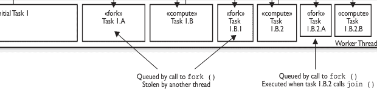

## 工作窃取 (Work Stealing)

请注意 `fork()` 调用是如何放置在 `compute()` 或 `join()` 调用之前的。Fork-Join 框架的一个关键特性是工作窃取。工作窃取是 ForkJoinPool 中的其他线程获取任务的方式。在最初提交 ForkJoin 任务进行执行时，ForkJoinPool 中的单个线程会开始执行（并细分）该任务。每次对 `fork()` 的调用都会将一个新任务放入调用线程的任务队列中。任务入队列的顺序非常重要。队列中最老的任务代表了较大的工作量。在 `ForkJoinPaintTask` 示例中，代表 100% 工作量的任务将开始执行，它的第一个入队（forked）的任务将代表 50% 的栅栏，接下来的是 25%、12.5% 等以此类推。当然，这可能会有所不同，取决于任务会被细分多少次，以及我们将任务分成二分之一、四分之一还是其他的划分，但在本示例中，我们将每个任务一分为两部分：队列一部分并执行第二部分。ForkJoinPool 中的非空线程将尝试从任何带有队列任务的 ForkJoin 线程窃取最旧（也是最大）的任务。假设有一个包含四个线程的 ForkJoinPool，一种可能的事件序列是：初始线程队列了代表工作 50% 和 25% 的任务，这些任务被两个不同的线程窃取。窃取了 50% 任务的线程随后细分该任务，并将 25% 的任务放在其队列中，该任务又被第四个线程窃取，导致四个线程每个处理 25% 的工作。

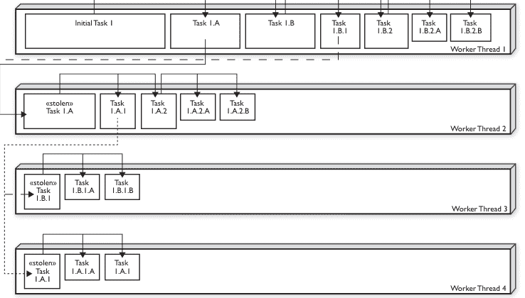

当然，如果一切总是这样分布得如此均匀，你可能就不太需要 Fork-Join。你只需要将工作预先分成与系统中的线程数相等的任务，并使用普通的 `ExecutorService` 即可。在实践中，每个线程不会同时完成它们 25% 的工作——其中一个线程将成为慢线程，完成的工作较少。这有许多原因：正在处理的数据可能会影响计算量（数组的 25% 可能并不意味着工作负载的 25%），或者某个线程的执行时间可能没有其他线程那么多。操作系统和其他运行的应用程序也会消耗 CPU 时间。为了尽快完成 Fork-Join 任务，先完成其部分工作的线程将开始从慢线程那里窃取——通过这样，你将保持所有 CPU 都参与进来。如果你将任务分成 25 份（对应四个线程），那么当快的线程过早结束时，就没有东西可供它们窃取了。在开始，如果慢线程承担了 25% 的工作并开始处理而没有进一步的细分和入队，那么慢线程的队列中就没有任务可供窃取。你应该将任务细分成比需要更多的几部分，以便在 ForkJoinPool 的线程数之间均匀地分配工作，因为任务的执行性能很可能并不完全相同。充分细分任务是额外的工作——如果你不这样做，可能会损害你的性能。要充分细分任务以保持所有 CPU 忙碌，但要超过所需的量。遗憾的是，并没有一个神奇数字来划分你的任务——它取决于任务的复杂性、数据的大小，甚至是你 CPU 的性能特征。

回到栅栏绘制，让 `FenceSectionSmall()` 尽可能简单（低开销）且易于更改。你应该在你预计代码通常运行的硬件上进行基准测试，并找到一种有效的任务细分量。它不需要是完美的；一旦你接近理想范围，除非其他因素介入（不同的 CPU 等），否则你可能看不到性能上的太大变动。

## Join

当你在（左侧）任务上调用 `join()` 时，它将是 `compute` 方法的最后步骤之一，位于调用了 `fork()` 和 `compute()` 之后。调用 `join()` 表示“除非这个（左侧）任务完成，否则我无法继续”。当你调用 `join()` 时可能会发生几种情况：

- 你调用 `join()` 的任务可能已经完成了。记住，你调用的是一个已经调用过 `fork()` 的任务。该任务可能已经被另一个线程窃取并完成。在这种情况下，调用 `join()` 只是验证任务已完成，你就可以继续了。
- 你调用 `join()` 的任务可能正在处理中。另一个线程可能窃取了该任务，你必须等待被连接的任务完成后才能继续。
- 你调用 `join()` 的任务可能仍在队列中（未被窃取）。在这种情况下，调用 `join()` 的线程将执行该任务。

## RecursiveAction

ForkJoinTask 是一个抽象类，它概述了 Fork-Join 任务中的大部分方法，例如 `fork()` 和 `join()`。如果你需要创建一个不返回结果的 ForkJoinTask，那么你应该子类 `RecursiveAction`。`RecursiveAction` 继承自 `ForkJoinTask` 并有一个必须实现的单一抽象 `compute` 方法：

```java
protected abstract void compute();
```

不返回结果的任务示例可以是任何初始化数组的任务。接下来的示例将初始化一个包含随机值的数组。注意，在整个过程中只有一个数组。在细分数组时，应避免创建新对象。

```java
public class RandomInitAction extends RecursiveAction {
    private final int THRESHOLD = 10000;
    private int[] data;
    private int start;
    private int end;

    public RandomInitAction(int[] data, int start, int end) {
        this.data = data;
        this.start = start;
        this.end = end;
    }

    @Override
    protected void compute() {
        if (end - start <= THRESHOLD) {
            for (int i = start; i < end; i++) {
                data[i] = ThreadLocalRandom.current().nextInt();
            }
        } else {
            int halfWay = (end - start) / 2 + start;
            RandomInitAction a1 = new RandomInitAction(data, start, halfWay);
            a1.fork(); // 队列左半任务
            RandomInitAction a2 = new RandomInitAction(data, halfWay, end);
            a2.compute(); // 处理右半任务
            a1.join(); // 等待队列任务完成
        }
    }
}
```

有时，你会看到使用 ForkJoinTask 的 `invokeAll` 方法来代替 `fork/compute/join` 方法。`invokeAll` 方法是某些节省时间的便利方法。使用它们可以帮助你避免 Bug！传递给 `invokeAll` 的第一个任务将执行（调用 `compute`），而所有其他任务将被 fork 和 join。在前面的示例中，你可以消除那三行 `fork/compute/join` 并替换为一行：

```java
invokeAll(a2, a1);
```


在启动应用程序时，我们创建一个大数组并使用 Fork-Join 初始化它：

```java
public static void main(String[] args) {
    int[] data = new int[10_000_000];
    ForkJoinPool pool = new ForkJoinPool();
    RandomInitAction action = new RandomInitAction(data, 0, data.length);
    pool.invoke(action);
}
```

注意，调用 `invoke` 时我们不期望任何返回值。`RecursiveAction` 不返回任何内容。

## Recursive Task

如果你需要一个返回结果的 `ForkJoinTask`，那么你应该子类 `RecursiveTask`。`RecursiveTask` 继承自 `ForkJoinTask` 并有一个你必须实现的单一抽象 `compute` 方法：

```java
protected abstract V compute(); // V 是一个泛型
```

## 使用并行 Fork/Join 框架

```java
public class FindMaxPositionRecursiveTask extends RecursiveTask<Integer> {
    private static final int THRESHOLD = 10000;
    private int[] data;
    private int start;
    private int end;

    public FindMaxPositionRecursiveTask(int[] data, int start, int end) {
        this.data = data;
        this.start = start;
        this.end = end;
    }

    @Override
    protected Integer compute() { // 返回类型匹配 <generic> 类型
        if (end - start < THRESHOLD) { // 工作量在可管理范围内吗？
            int position = 0;
            for (int i = start; i < end; i++) { // 如果所有值都相等，返回位置
                if (data[i] > data[position]) {
                    position = i;
                }
            }
            return position;
        } else { // 任务过大，进行拆分
            int halfway = (end - start) / 2 + start;
            FindMaxPositionRecursiveTask t1 = new FindMaxPositionRecursiveTask(data, start, halfway); // 任务的左半
            FindMaxPositionRecursiveTask t2 = new FindMaxPositionRecursiveTask(data, halfway, end); // 任务的右半
            t1.fork(); // 将 t1 入队并执行 t2
            int position2 = t2.compute(); // 处理任务的右半
            int position1 = t1.join(); // 等待子部分中队列任务哪个更大？
            if (data[position1] > data[position2]) {
                return position1;
            } else if (data[position1] < data[position2]) {
                return position2;
            } else {
                return position1 < position2 ? position1 : position2;
            }
        }
    }
}
```

启动应用程序，我们重用 `RecursiveAction` 示例创建一个大数组并使用 Fork-Join 进行初始化。在用随机值初始化数组后，我们重用 `ForkJoinPool` 配合我们的 `RecursiveTask` 来寻找最大值的位置：

```java
public static void main(String[] args) {
    int[] data = new int[10_000_000];
    ForkJoinPool fjPool = new ForkJoinPool();
    RandomInitRecursiveAction action = new RandomInitRecursiveAction(data, 0, data.length);
    fjPool.invoke(action);
```

```java
// 新代码开始此处
FindMaxPositionRecursiveTask task = new FindMaxPositionRecursiveTask(data, 0, data.length);
Integer position = fjPool.invoke(task);
System.out.println("Position: " + position + ", value: " + data[position]);
```

注意，在使用 `RecursiveTask` 时，调用 `invoke` 方法会返回一个值。


如果你的应用程序将反复向 `ForkJoinPool` 提交任务，你应该使用单个 `ForkJoinPool` 实例，并避免创建新实例的开销。

## 尴尬并行

如果以并行方式解决问题时很少或不需要额外的额外工作，则该问题被称为“尴尬并行”。有时候，并行解决问题增加的开销非常大，以至于通过串行解决问题更快。`RandomInitRecursiveAction` 示例将数组初始化为随机值，它没有额外的开销，因为处理数组的一个子部分时发生的情况与另一个子部分的处理无关。从技术上讲，即使在 `RandomInitRecursiveAction` 中也存在少量开销；Fork-Join 框架以及确定是否应该细分问题的 `if` 语句引入了一些开销。请注意，要获得随 CPU 数量比例扩展的性能提升可能是困难的。从串行解决方案转向并行解决方案时，四个 CPU 将带来 4 倍的速度提升。

`FindMaxPositionRecursiveTask` 示例寻找数组中的最大值，它引入了少量的开销，因为你需要比较每个子部分的结果并判断哪个更大。然而，这只是很小的一部分，增加的开销很小。某些任务可能会引入大量的额外开销，导致消除并行处理的任何优势（任务运行速度比串行执行慢）。如果你发现自己在调用 `join()` 后执行了大量处理，那么你应该对应用程序进行基准测试，以确定使用并行处理是否有性能收益。请注意，性能收益可能仅在特定数量的 CPU 上才能看到。一个任务在一个 CPU 上运行需要 5 秒，在两个 CPU 上需要 6 秒，在四个 CPU 上需要 3.5 秒。

Fork-Join 框架的设计初衷是保持最小开销，只要你不过度地细分任务，并且合并结果所需的工作量可以保持较小即可。一个产生额外开销但仍能从 Fork-Join 中受益的任务良好示例是排序。当你将一个数组分为两部分并单独排序每部分时，你必须合并这两个已排序的数组，如下例：

```java
public class SortRecursiveAction extends RecursiveAction {
    private static final int THRESHOLD = 1000;
    private int[] data;
    private int start;
    private int end;

    public SortRecursiveAction(int[] data, int start, int end) {
        this.data = data;
        this.start = start;
        this.end = end;
    }

    @Override
    protected void compute() {
        if (end - start < THRESHOLD) {
            Arrays.sort(data, start, end);
        } else {
            int halfWay = (end - start) / 2;
            SortRecursiveAction a1 = new SortRecursiveAction(data, start, halfWay);
            SortRecursiveAction a2 = new SortRecursiveAction(data, halfWay, end);
            invokeAll(a1, a2);
            if (data[halfWay-1] <= data[halfWay]) {
                return; // 已排序
            }
        }
        // 排序子数组合并此处
        int[] temp = new int[end - start];
        int s1 = start, s2 = halfWay, d = 0;
        while (s1 < halfWay && s2 < end) {
            if (data[s1] < data[s2]) {
                temp[d++] = data[s1++];
            } else {
                temp[d++] = data[s2++];
            }
        }
        while (s1 < halfWay) {
            temp[d++] = data[s1++];
        }
        while (s2 < end) {
            temp[d++] = data[s2++];
        }
        System.arraycopy(temp, 0, data, start, temp.length);
    }
}
```

在前面的示例中，调用 `invokeAll` 之后的所有内容与将数组子部分合并为单个排序部分。

由于 Java 应用程序是移植的，运行应用程序的系统可能没有足够的硬件资源来实现性能收益。始终进行测试以确定哪些问题和硬件组合可以使用 Fork-Join。

## 总结

本章涵盖了认证所需的并发知识。`java.util.concurrent` 包及其子包构成了 Java 的高级多线程框架。在尝试应用并发库之前，你应该熟悉线程基础，但一旦学会了 `java.util.concurrent`，你可能再也不需要扩展 `Thread` 了。

`Callable` 和 `Executor`（及其底层线程池）是创建新 `Thread` 的高级架构基础。随着增加 CPU 核心的趋势，让 Java 利用并发将让你如鱼得水。`.concurrent` 提供的高级 API 帮助你创建高效的多线程应用程序，同时消除了使用 `wait()`、`notify()` 和 `synchronized` 等低级线程 API 的需求。

使用 `Executor` 时，你通常会创建一个 `Callable` 实现来表示需要执行的工作。`Runnable` 也可以用于相同的目的，但 `Callable` 利用泛型允许其 `call` 方法返回泛型类型。可以通过调用 `Executors` 类中的任一工厂方法获取具有定义行为的 `Executor` 或 `ExecutorService` 实例，如：`ExecutorService es = Executors.newFixedThreadPool(100);`

## 认证总结

我们研究了 Fork-Join 框架，它提供了一种高度特化的执行器（Executor）。当你通常放入 `Callable` 中的工作可以被拆分为多个工作单元时，请使用 Fork-Join 框架。Fork-Join 框架的目的是通过利用系统中额外的 CPU 来减少解决问题所需的时间。在应用程序中一次应只运行一个 Fork-Join 任务，因为该框架的目标是允许单个任务消耗所有可用 CPU 资源，以便尽可能快地解决。在大多数情况下，将任务拆分为可由底层 Fork-Join 线程操作的多个任务会引入额外的开销。不要假设应用 Fork-Join 会为所有问题带来性能收益。其中涉及的开销可能大到足以抵消应用该框架带来的任何收益。

在应用 Fork-Join 框架时，首先要派生 `RecursiveTask`（如果需要返回值）或 `RecursiveAction`。在这些 `ForkJoinTask` 子类的其中一个中，你必须实现 `compute` 方法。`compute()` 方法用于将任务的工作拆分为若干部分，然后调用 `fork` 和 `join` 方法或 `invokeAll` 方法。要执行任务，请通过 `ForkJoinPool pool = new ForkJoinPool();` 创建实例，并将 `RecursiveTask` 或 `RecursiveAction` 提交到池中调用 `invoke(task)` 方法。虽然 Fork-Join API 本身并不大，但创建一个正确且高效的 `ForkJoinTask` 实现可能是挑战性的。

我们学习了 `java.util.concurrent` 集合。集合分为三类：写时复制（copy-on-write）、并发（concurrent）和并发集合类。写时复制集合和并发集合在用法上与传统的 `java.util` 集合相似，它们设计用于以线程安全的方式高效使用。写时复制集合（`CopyOnWriteArrayList` 和 `CopyOnWriteArraySet`）应用于读密集型场景。在尝试遍历写时复制集合中的所有元素时，请始终使用 `Iterator`。包含的并发集合包括：

- `ConcurrentHashMap`
- `ConcurrentLinkedDeque`
- `ConcurrentLinkedQueue`
- `ConcurrentSkipListMap`
- `ConcurrentSkipListSet`

这些集合旨在可以在不需要锁的情况下进行并发使用。请记住，这五个并发集合的迭代器（iterators）是弱一致的（weakly inconsistent）。`ConcurrentHashMap` 和 `ConcurrentSkipListMap` 是 `ConcurrentMap` 的实现，它们为 Map 接口添加了原子的 `putIfAbsent`、`remove` 和 `replace` 方法。`java.util.concurrent` 包提供了七种阻塞队列实现：

- `ArrayBlockingQueue`
- `LinkedBlockingDeque`
- `LinkedBlockingQueue`
- `PriorityBlockingQueue`
- `DelayQueue`
- `LinkedTransferQueue`
- `SynchronousQueue`

这些阻塞队列用于在线程之间交换对象——一个线程存放对象，另一个线程检索该对象。根据所使用的队列类型、创建队列的参数以及调用的方法，插入或移除操作可能会阻塞，直到能够成功完成。在 Java 7 中，添加了 `LinkedTransferQueue` 类，它作为几种阻塞队列类型的超集；如果可能，应优先使用它。

`java.util.concurrent.atomic` 和 `java.util.concurrent.locks` 包包含了你可能考虑在并发应用程序中使用的额外实用程序类。`java.util.concurrent.atomic` 提供了与传统包装类（如 `java.lang.Integer`）相似的线程安全类，但它们拥有支持原子化修改的方法。`java.util.concurrent.locks` 接口及其支持类使你能够创建高度自定义的锁定行为，这种行为比传统的对象监视器（`synchronized` 关键字）更灵活。

## 两分钟训练

以下是本章认证目标中的一些关键点。

### 应用原子变量和锁

- `java.util.concurrent.atomic` 包提供了与 `volatile` 字段类似的类（对原子对象值的更改将由其他线程正确读取，而无需在代码中使用 `synchronized` 块）。
- 原子类类提供了 `compareAndSet` 方法，用于用于验证原子变量的值：只有当它与预期值匹配时，值才会被更改。
- 原子类类提供了许多便利方法，例如 `addAndGet`，它会不断循环执行，直到 `compareAndSet` 成功为止。


- `java.util.concurrent.locks` 包包含一种锁定机制，它是 `synchronized` 方法和块的替代方案。你以更冗长的语法为代价换取了更大的灵活性（例如，必须手动调用 `lock.unlock()`，而不是在 `synchronized` 代码块结束时自动释放同步监视器）。

- `ReentrantLock` 类提供了基本的锁实现。常用的方法有 `lock()`、`unlock()`、`isLocked()` 和 `tryLock()`。调用 `lock()` 会增加计数器，`unlock()` 会减少计数器。当计数器为零时，线程可以获取锁。

- `ReentrantReadWriteLock` 类提供了 `ReadWriteLock` 实现，支持读锁（通过调用获取）和写锁（通过调用获取）。

# 应用 java.util.concurrent 集合 (OCP 目标 11.1)

- 写时复制集合在读操作多于写操作时非常有效，因为它们为每次写操作都创建一个集合的新副本。在遍历写时复制集合时，使用迭代器。

- 没有任何并发集合能让存储在集合中的元素变成线程安全的——只是集合本身是。

- `ConcurrentHashMap`、`ConcurrentSkipListMap` 和 `ConcurrentSkipListSet` 优于使用同步集合。

`ConcurrentHashMap` 和 `ConcurrentSkipListMap` 是并发实现，它们通过添加原子操作来增强标准 Map，这些操作在执行前会验证元素的存在和值：`putIfAbsent(K key, V value)`、`remove(Object key, Object value)`、`replace(K key, V value)` 以及 `replace(K key, V oldValue, V newValue)`。

- 阻塞队列用于在线程之间交换对象。当调用某些操作时（例如在没有元素可取时调用 `take()`），阻塞队列会阻塞。有七种阻塞队列具有不同的行为；你应该能够识别每种类型的行为。

| 阻塞队列 | 描述 |
|---|---|
| ArrayBlockingQueue | 一种 FIFO（先进先出）队列，其头部是旧元素，尾部是新元素。构造函数的 int 参数限制队列的大小（它是有界队列）。 |
| LinkedBlockingDeque | 与 `LinkedBlockingQueue` 相似，但它是一个双端队列（deque）。除了 FIFO 操作外，你还可以从队列的头部或尾部移除元素。 |
| LinkedBlockingQueue | 一种 FIFO 队列，头部是旧元素，尾部是新元素。构造函数的可选 int 参数限制队列的大小（它可以是有界的或无界的）。 |
| PriorityBlockingQueue | 一种使用 `Comparable` 或 `Comparator` 对元素排序的无界队列。队列头部是最小值。 |
| DelayQueue | 一种包含 `java.util.concurrent.Delayed` 实例的无界队列。只有延迟过期后才能获取对象。队列头部是先过期的对象。 |
| LinkedTransferQueue | Java 7 新增。一种支持 `ConcurrentLinkedQueue`、`SynchronousQueue` 和 `LinkedBlockingQueue` 特性的无界 FIFO 队列。 |
| SynchronousQueue | 一种没有容量的阻塞队列。插入操作阻塞直到另一个线程执行移除操作。移除操作阻塞直到另一个线程执行插入操作。 |

- 队列是有界的，这意味着它们对可以添加的元素数量有上限，调用 `put` 的线程可能会阻塞，直到空间可用。

# 使用 Executors 和 ThreadPools (OCP 目标 11.3)

- Executor 用于提交任务以供执行，而不会与任务的执行方式或时机耦合。基本上，它创建了一个抽象，可以用来替代显式的线程创建和执行。

- ExecutorService 是 Executor 的增强版，它提供了额外的功能，例如执行 `Callable` 实例的能力以及关闭功能（Executor 中的非守护线程在你的主方法返回后可能会保持 JVM 运行）。

- Callable 接口类似于 `Runnable` 接口，但增加了从其 `call` 方法返回结果的能力，并且可以选择地抛出异常。

- Executors（复数）是工厂方法，这些方法可以用于构造 `ExecutorService` 实例，例如：

```
ExecutorService ex = Executors.newFixedThreadPool(4);
```

# 使用并行 Fork/join 框架 (OCP 目标 11.4)

- Fork-Join 允许工作线程之间进行“工作窃取”（work stealing），以保持所有 CPU 处于利用状态，并提高高度并行化任务的性能。

- 当你创建一个新的 `ForkJoinPool()` 时，会创建一个 `ForkJoinWorkerThread` 类型的工作线程池。默认情况下，每个 CPU 创建一个线程。

- 为了最小化创建新线程的开销，你应该在应用程序中创建一个单一的 Fork-Join 池，并将其复用于所有的递归任务。

- Fork-Join 任务代表一个需要解决的大型问题（通常涉及集合或数组）。

- 当由 `ForkJoinPool` 执行时，Fork-Join 任务将自身细分为多个代表问题较小部分的 Fork-Join 任务。

- Fork-Join 任务是 `ForkJoinTask` 类的子类，具体为 `RecursiveAction` 或 `RecursiveTask`。

- 当 `compute()` 方法返回值时，扩展 `RecursiveTask`；当返回类型为 `void` 时，扩展 `RecursiveAction`。

- 在编写 `ForkJoinTask` 的 `compute()` 方法时，始终在调用 `join()` 之前调用 `fork()`，或者使用 `invokeAll()` 方法之一来代替分别调用 `fork()` 和 `join()`。

- 你在退出应用程序之前不需要关闭 Fork-Join 池，因为 Fork-Join 池中的线程通常以守护模式（daemon mode）运行。

## 自测

以下问题可能是书中最难的题目。这只是一个困难的话题，所以不要慌。（我们知道有些 Java 书的作者在这些主题上表现并不理想，仍然通过了考试。）

1. 下述代码块创建了一个 `CopyOnWriteArrayList`，向其添加元素并打印内容：

```
CopyOnWriteArrayList<Integer> cowList = new CopyOnWriteArrayList<>();
cowList.add(4);
cowList.add(2);
Iterator<Integer> it = cowList.iterator();
cowList.add(6);
while (it.hasNext()) {
  System.out.print(it.next() + " ");
}
```

结果是什么？

- A. 6
- B. 12
- C. 4 2
- D. 4 2 6
- E. 编译失败
- F. 运行时抛出异常

2. 已知：

```
CopyOnWriteArrayList<Integer> cowList = new CopyOnWriteArrayList<>();
cowList.add(4);
cowList.add(2);
cowList.add(6);
Iterator<Integer> it = cowList.iterator();
cowList.remove(2);
while (it.hasNext()) {
  System.out.print(it.next() + " ");
}
```

哪个显示将产生的输出？

- A. 12
- B. 10
- C. 4 2 6
- D. 4 6
- E. 编译失败
- F. 运行时抛出异常

3. `CopyOnWriteArrayList` 的哪些方法会导致内部数组创建副本？（选择所有适用项。）

- A. add
- B. get
- C. iterator
- D. remove

4. 已知：

```
ArrayBlockingQueue<Integer> abq = new ArrayBlockingQueue<>(10);
```

哪些操作可以无限阻塞？（选择所有适用项。）

- A. abq.add(1)
- B. abq.offer(1)
- C. abq.put(1)
- D. abq.offer(1, 5, TimeUnit.SECONDS)

5. 已知：

```
ConcurrentMap<String, Integer> ages = new ConcurrentHashMap<>();
ages.put("John", 23);
```

哪个方法只有当 John 的值仍等于 23 时才会从映射中删除 John？

- A. ages.delete("John", 23)
- B. ages.deleteIfExists("John", 23)
- C. ages.remove("John", 23)
- D. ages.removeIfEquals("John", 23)

6. 如果该方法被多个线程并发且反复调用，哪个方法代表生成 1 到 10 之间随机数的最佳方法？

- A. public static int random() {
    Random r = new Random();
    return r.nextInt(10) + 1;
  }
- B. private static int sr = new Random();
  public static int randomB() {
    return sr.nextInt(10) + 1;
  }
- C. public static int randomC() {
    int i = (int)Math.random() * 10 + 1);
    return i;
  }
- D. public static int randomD() {
    ThreadLocalRandom lr = ThreadLocalRandom.current();
    return lr.nextInt(10) + 1;
  }

7. 已知：

```
AtomicInteger i = new AtomicInteger();
```

哪些操作可以原子地增加 i？（选择所有适用项。）

- A. i.add(9);
- B. i.getAndAdd(9);
- C. i += 9;
- D. i = 9;

8. 已知：

```
public class LeaderBoard {
    private ReentrantWriteLock lock = new ReentrantWriteLock();
    private List<Integer> highScores = new ArrayList<>();

    public void add(Integer score) {
        lock.lock();
        try {
            if (highScores.size() < 10) {
                highScores.add(score);
            } else {
            }
        } finally {
            lock.unlock();
        }
    }

    public List<Integer> getScores() {
        lock.lock();
        try {
            return highScores;
        } finally {
            lock.unlock();
        }
    }
}
```

哪些代码块匹配 LeaderBoard 的行为？（选择所有适用项。）

- A. lock.lock(); // 位置 A
- B. lock.lock(); // 位置 B
- C. lock.lock(); // 位置 C
- D. lock.unlock();
- E. lock.lock(); // 位置 E
- F. lock.unlock();

9. 已知：

```
ReentrantWriteLock rwl = new ReentrantWriteLock();
rwl.lock();
System.out.println("READ-1");
rwl.lock();
System.out.println("LOCK-1");
rwl.lock();
System.out.println("READ-2");
rwl.unlock();
System.out.println("READ-2");
rwl.lock();
System.out.println("WRITE-1");
rwl.unlock();
System.out.println("WRITE-1");
```

结果是什么？

- A. 代码无法编译
- B. 代码编译并输出：
  ```
  READ-1
  READ-2
  ```
- C. 代码编译并输出：
  ```
  READ-1
  LOCK-1
  READ-2
  READ-2
  WRITE-1
  WRITE-1
  ```
- D. 抛出 java.lang.IllegalMonitorStateException

10. 哪个类包含产生预配置 ExecutorService 实例的工厂方法？

- A. Executor
- B. Executors
- C. ExecutorService
- D. ExecutorServiceFactory

11. 已知：

```
private Integer executeTask(ExecutorService service, Callable<Integer> task) {
  // 在此处
}
```

哪些行的插入后可以正确使用 ExecutorService 参数执行 Callable 并返回 Callable 的结果？（选择所有适用项。）

- A. try {
    return service.submit(task);
  } catch (Exception e) {
    return null;
  }
- B. try {
    return service.execute(task);
  } catch (Exception e) {
    return null;
  }
- C. try {
    Future<Integer> future = service.submit(task);
    return future.get();
  } catch (Exception e) {
    return null;
  }
- D. try {
    Result<Integer> result = service.submit(task);
    return result.get();
  } catch (Exception e) {
    return null;
  }

12. 哪些是正确的？（选择所有适用项。）

- A. Runnable 可能会返回结果，但不能抛出异常
- B. Runnable 既不返回结果也不抛出异常
- C. Runnable 不返回结果，但可以抛出异常
- D. Runnable 可能会返回结果并抛出异常
- E. Callable 可能会返回结果，但不能抛出异常
- F. Callable 既不返回结果也不抛出异常
- G. Callable 不得返回结果，但可以抛出异常（Exception）
- H. Callable 可以返回结果并抛出异常（Exception）

13. 给定：

```java
public class IncrementAction extends RecursiveAction {
    private final int threshold;
    private final int[] myArray;
    private int start;
    private int end;
    public IncrementAction(int[] myArray, int start, int end, int threshold) {
        this.threshold = threshold;
        this.myArray = myArray;
        this.start = start;
        this.end = end;
    }
    @Override
    protected void compute() {
        if (start < threshold) {
            for (int i = start; i <= end; i++) {
                myArray[i]++;
            }
        } else {
            int midway = (end - start) / 2 + start;
            IncrementAction al = new IncrementAction(myArray, midway, threshold);
            IncrementAction a2 = new IncrementAction(myArray, midway + 1, end);
            //在此插入答案
        }
    }
}
```

在 `compute` 方法末尾插入哪行代码可以正确替代单独调用 `fork()` 和 `join()`？（选择所有适用项）。

- A. compute();
- B. forkAndJoin(al, a2);


- C. `computeAll(al1, a2);`

- D. `invokeAll(al1, a2);`

- 14. 在编写 `RecursiveTask` 子类时，哪些是正确的？（选择所有适用项）。

- A. 应该在同一个任务上调用 `fork()` 和 `join()`

- B. 应该在同一个任务上调用 `fork()` 和 `compute()`

- C. 应该在同一个任务上调用 `compute()` 和 `join()`

- D. 应该在 `fork()` 之前调用 `compute()`

- E. 应该在 `compute()` 之前调用 `fork()`

- F. `join()` 应该在 `fork()` 之后但在 `compute` 之前

838 第14 章：并发

## 自测答案

- 1. C 正确。在添加 6 之前获取了迭代器（`Iterator`）。只要维持迭代器的引用，它就只会提供值 4 和 2。

根据上述内容，A B、D、E 和 F 是错误的。（OCP 目标 11.1）

- 2. C 正确。因为在移除数字 2 之前获取了迭代器，它将反映已添加到集合中的所有元素。

根据上述内容，A B、D、E 和 F 是错误的。（OCP 目标 11.1）

- 3. A 和 D 正确。在出的方法中，只有 `add` 和 `remove` 会修改列表并创建新数组。

根据上述内容，B 和 C 是错误的。（OCP 目标 11.1）

- 4. C 正确。如果队列满，`add` 方法将抛出非法状态异常（`IllegalStateException`）。两个 `offers` 方法在队列满时将返回 `false`。`put` 方法将阻塞直到空间可用。

根据上述内容，A、B 和 D 是错误的。（OCP 目标 11.1）

- 5. C 正确；它使用了该语法。

`ConcurrentHashMap` 中不存在方法 A、B 和 D。传统的 `Map` 包含一个单参数的 `remove` 方法，它根据键移除元素。`ConcurrentMap` 接口（`ConcurrentHashMap` 实现的）拥有两个参数的 `remove` 方法，接收一个键和一个值。只有当值与第二个参数匹配时，元素才会从 `Map` 中移除。如果删除了元素，则返回布尔值。（OCP 目标 11.1）

- 6. D 正确。`ThreadLocalRandom` 创建并检索特定于线程的 `Random` 实例。对于 Java 7，可以使用 `java.lang.ThreadLocal` 和 `java.util.Random` 类来实现相同的效果，但这需要几行代码。`.random` 是线程安全的，但它使用共享的 `java.util.Random` 实例，可能会产生竞争问题。

根据上述内容，A、B 和 C 是错误的。（OCP 目标 11.3）

- 7. A 和 B 正确。`addGet` 和 `getAdd` 都会增加 `AtomicInteger` 中存储的值。

答案 C 不是原子的，因为在调用 `get` 和 `i` 存储值之间值可能发生了变化。答案 D 是无效的，因为 `atomicIncrement` 方法是虚构的，答案 E 是无效的，因为 `atomic` 不支持自动装箱。`addGet` 和 `getAdd` 的区别在于前者是前方法（`++`），后者是后置方法（`x++`）。（OCP 目标 11.2）

## 自测答案

- 8 D 和 E 正确。`addScore` 方法修改了集合，因此应该使用写锁（`write lock`），而 `getHighScores` 方法只读取集合，应该使用读锁（`read lock`）。

- ☑ A、B、C 和 F 是错误的，它们的行为不会正确。（目标 11.2）

- 9 D 正确。锁会计算它被锁定的次数。调用 `lock` 会增加计数，调用 `unlock` 会减少计数。如果调用 `unlock` 导致计数减到零以下，则抛出异常。

- ☑ 根据上述内容，A、B 和 C 是错误的。（OCP 目标 11.2）

- 10 B 正确。`Executor` 是 `ExecutorService` 的父接口。你使用 `Executors` 轻松获取具有预定义线程的 `ExecutorService` 实例。如果接口没有提供你所需的行为的 `ExecutorService` 实例，你始终可以直接调用 `java.util.concurrent.ThreadPoolExecutor` 或 `java.util.concurrent.ThreadPoolExecutor`。

- ☑ 根据上述内容，A、C 和 D 是错误的。（OCP 目标 11.3）

- 11 C 正确。当你将 `Callable` 提交给 `ExecutorService` 执行时，你将收到一个 `Future` 作为结果。你可以使用 `Future` 检查 `Callable` 结果的状态，或使用 `get` 方法阻塞直到结果可用。

- ☑ 根据上述内容，A、B 和 D 是错误的。（OCP 目标 11.3）

- 12 B 和 H 正确。`Runnable` 和 `Callable` 的用途相似。`Runnable` 从 Java 1 版本起就一直可用。`Callable` 在 Java 5 中引入，并作为 `Runnable` 更灵活的替代方案。`Callable` 允许泛型返回类型并允许抛出异常，而 `Runnable` 不具备这些。

- ☑ A、D、E 和 G 是错误的描述。（目标 11.3）

- 13 D 正确。`invokeAll` 方法是一个变长方法，它会 fork 所有的 Fork-Join 任务，除了直接调用的那个。

- ☑ A、B 和 C 是错误的，它们

- 14 A 和 E 正确。`addScore` 方法修改了集合，因此应该使用写锁，而 `getHighScores` 方法只读取集合，应该使用读锁。

- ☑ 根据上述内容、B、D 是错误的。

# 15 JDBC

## 认证目标

- 描述构成 JDBC 核心的接口（包括 `Connection`、`Statement` 等）

- 使用 `DriverManager` 连接数据库（包括 `Driver`）

- 提交查询并从数据库读取结果（包括 `Statements` 和 `ResultSet`）

- 使用 JDBC 事务（包括禁用自动提交模式、提交和回滚保存点）

- 构建并使用 `PreparedStatement` 和 `CallableStatement`

- 两分钟演练

Q&A 自测

# 842 第15 章：JDBC

本章涵盖了 Java SE 7 添加的 JDBC API。开发人员长期以来认为该 API 是语言的核心部分，精通 JDBC 有助于充分展示你作为 Java 程序员的技能。

有趣的是，JDBC 自 1997 年 JDK 1.1 版本发布以来就一直是语言的一部分，当时 JDBC 1.0 被引入。从那时起，该 API 经历了持续的更新，大约每个偶数版本发布一次重大更新，最近一次重大更新是 Java SE 6 发布的 JDBC 4。在 Java SE 7 中，JDBC 有了一些小型更新，现在版本为 4.1，我们将在稍后部分讨论。考试的重点是 JDBC 4.x，还有一些关于使用 JDBC 3.0 加载驱动器的题目，因此我们将讨论这些。

好消息是，考试不会测试你编写 SQL 语句的能力。考试将完全专注于（可能更多——SQL 是一个大话题）。因此，我们将首先花时间涵盖关系型数据库系统的基础知识以及足以让你在数据库聚会上流行的 SQL。如果你对 SQL 熟悉并理解数据库概念，可以浏览第一节或直接跳到第一个考试目标。

## 开始：数据库与 JDBC 简介

当你思考如何组织信息并将其存储在某种易理解的方式时，表格通常是你考虑的第一种方法。表格或表格是分类信息的自然方式：表格的第一行定义了信息的类型，随后的每行包含与左侧键相关的组数据。例如，假设你想为几种类型的每月支出制作图表（表 15-1）。

| 表 15-1 | 月份 | 油费 | 外食 | 公用事业 | 手机 |

|---|---|---|---|---|---|

| 支出图 | 1月 | $200.25 | $109.87 | $97.00 | $45.08 |

| | 2月 | $225.34 | $121.08 | $97.00 | $23.36 |

| | 3月 | $254.78 | $130.45 | $97.00 | $56.09 |

## 入门：数据库与 JDBC 简介 843

从图表中的数据，我们可以确定你的总支出在今年前三个月内逐月增加。但请注意，如果没有表格，如果没有月份与列数据之间存在关系，你将只有一堆收据，而无法得出任何结论，例如：

- 假设你每个月的行驶里程相同，那么油价变得越来越贵——也许是时候买一辆普锐斯（Prius）了。

- 你一直在外食（或者外食的价格在上涨）——也许是时候开始做饮食计划了。

- 而且你可能需要少社交一点——那个话费太高了。

要点在于，这组小样本数据是理解关系型数据库系统的关键。关系型数据库只是一个用于在表中存储和处理数据的软件应用程序。软件本身实际上被称为关系型数据库管理系统（RDBMS），但许多人选择直接称之为“数据库”——所以请记住，以后当我们谈论数据库时，我们实际上是在讨论 RDBMS（整个系统）。关系管理系统为数据库增加的是定义表与表之间关系的能力。它还提供了一种语言，以有意义的方式输入和输出数据。

查看表 15-1 中的简单表格，我们知道 Gas（油费）、EatingOut（外食）、Utilities（公用事业）和 Phone（电话费）列的数据是按一 月、二 月等月份分组的。月份是唯一的，并标识了这一行数据。在数据库术语中，月份被称为“主键”（primary key）。数据库通常需要主键来标识你想要表中的某一行，并确保没有重复的行。

进一步扩展一下，如果表 15-1 中的数据存储在数据库中，我可以询问数据库（编写查询）来获取 1 月份的所有数据（再次，我的该表的主键是“月份”）。我可能会写类似如下的内容：

“给我 1 月份的所有支出”

结果将类似于：

```
January: Gas: $200.25, EatingOut: $109.87, Utilities: $97.00, Phone: $45.08
```

这种查询让数据库变得如此强大。通过一种相对简单的语言，你可以构建一些非常强大的查询，以此处理你的数据并讲述一个故事。在大多数 RDBMS 中，这种语言被称为结构化查询语言（SQL）。

## 844 第 15 章：JDBC

我们之前用句子写出的相同查询，可以用如下 SQL 表达式：

```sql
SELECT * FROM Expenses WHERE Month = 'January'
```

它可以被翻译为“从我的名为 'Expenses' 的表中选择所有列 (*)，其中月份列等于字符串 'January'。”让我们更详细地查看我们如何与数据库“交谈”，以及在关系型数据库中使用表可以进行哪些其他类型的查询。

## 与数据库通信

在操作数据库时，有三个重要的概念：

- 创建到数据库的连接

- 在数据库中创建执行的语句（`statement`）

- 获取表示结果的数据集

让我们更详细地查看这些概念的通信。

在我们与管理数据库的软件通信之前，在向其发送查询之前，我们需要与 RDBMS 本身建立连接。有许多类型的连接，以及许多描述连接本身的底层技术，但通常，为了与 RDBMS 通信，我们需要使用 IP 地址和端口号打开数据库的连接。一旦建立了连接，我们需要向其发送参数（如用户名和密码）以验证我们是 RDBMS 的有效用户。最后，我们可以通过连接发送查询。这就像登录你的银行在线账户一样。我们提供一些凭据（用户名和密码），你和银行之间就建立并打开了连接。在章节后面，当我们开始编写代码时，我们将使用名为 `DriverManager` 的 Java 类打开连接，并在一次请求中传入数据库名称、用户名和密码。

一旦建立了连接，我们就可以使用某种应用程序（通常由数据库供应商提供）向数据库发送查询语句，让它们在数据库中执行并返回结果集。结果集可以行（正如我们之前请求 1 月份数据时看到的那样），也可以多行。例如，假设我们想查看 Expenses 表中所有的 Gas（油费）支出。我们可能会这样查询数据库：

“显示我所有的油费支出”

## 入门：数据库与 JDBC 简介 845

或者用 SQL 查询：

```sql
SELECT Gas FROM Expenses
```

从我的查询中“返回”的结果集将是三行，每行将包含一列。

| Gas |

| :--- |

| $200.25 |

| $225.34 |

| $254.78 |

数据库的一个重要方面是，数据的呈现方式与其存储的方式完全相同。由于 Gas 支出是一个缩写，它意味着创建三行（分别对应 1 月、2 月和3 月）。注意，由于我们没有要求数据库在结果中包含 Month 列，所以我们得到了 Gas 列。结果保留了 Gas 是一列而不是一行的事实，并且通常以相同的行顺序呈现数据。

## SQL 查询

让我们更详细地查看我们如何与数据库“交谈”，以及在关系型数据库中使用表可以进行哪些其他类型的查询。

实际上，这就是本章你需要的所有 SQL。还有许多其他 SQL 命令，但这是核心集合。如果本章需要超出这四个命令，我们将在它们出现时进行介绍。CRUD 是创建（Create）、读取（Read）、更新（Update）、删除（Delete）的缩写。

## 846 第 15 章：JDBC

### 表 15-2 CRUD 命令示例

| "CRUD" | SQL 命令 | 示例 SQL | 英语表达 |

| :--- | :--- | :--- | :--- |

| Create | INSERT | `INSERT INTO Expenses VALUES ('April', 231.25, 29.87, 97.00, 45.08)` | 向支出添加带有以下值的新行（4 月）。 |

| Read (or Find) | SELECT | `SELECT * FROM Expenses WHERE Month="February"` | 获取 Expenses 表中 2 月的所有列。 |

| Read All | SELECT | `SELECT * FROM Expenses` | 获取 Expenses 表的所有列。 |

| Update | UPDATE | `UPDATE Expenses Set Phone=32.36, EatingOut=11.08 WHERE Month='February'` | 修改 2 月的电话费和外食费。 |

| Delete | DELETE | `DELETE FROM Expenses WHERE Month='April'` | 删除 4 月的支出行。 |

SQL 命令（如 `SELECT`、`INSERT`、`UPDATE` 等）是不区分大小写的。因此，很大程度上出于习惯（我们在本章中使用的），使用全大写字母表示 SQL 命令和关键字。SQL 表名和列名（标识符）取决于数据库，可能是区分大小写的写的。本章所示的示例代码使用不区分大小写的数据库，再次，仅出于习惯，我们将使用大驼峰命名法，即每个名词的首字母大写，其余小写。

现在，让我们来看一个更详细的数据库示例，我们将使用本章的示例表集，满足一个小型簿记员 Bob's Books 的需求。

# 入门：数据库与 JDBC 简介

关于大小写的最后一点说明——所有数据库在字符串被界定时都会保留大小写——即当它们被引号时。因此，使用单引号或双引号界定标识符的 SQL 子句将保留标识符的大小写。

# Bob 的书店（Bob's Books），我们的测试数据库

在本节中我们将描述一个包含几张表和几行数据的小数据库。在学习本章的各种 JDBC 主题时，我们将使用这个数据库。

Bob 是一个专门经营儿童书籍的小书商。Bob 设计数据是为了通过数据库（哪种数据库并不重要）和 Java 程序在线销售他的书籍。Bob 决定连接数据库并通过 Java 程序执行查询。首先，让我们看看 Bob 数据的结构。在数据库中，表的结构和规范被称为数据库架构（Schema）（图 1-5）。Bob 的架构相对简单，为了本章的目的，我们将关注 Bob 架构中的四张表。

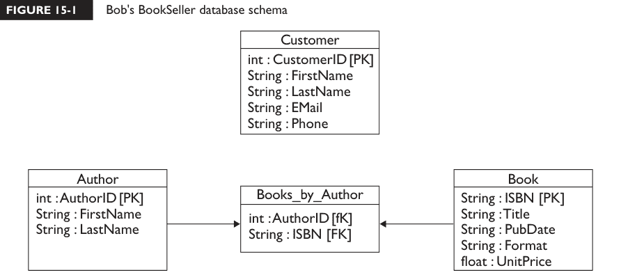

| 客户 (Customer) |

| :--- |

| int : CustomerID [PK] |

| String : FirstName |

| String : LastName |

| String : EMail |

| String : Phone |

| 作者 (Author) |

| :--- |

| int : AuthorID [PK] |

| String : FirstName |

| String : LastName |

| 按作者分类的书 (Books_by_Author) |

| :--- |

| int : AuthorID [fk] |

| String : ISBN [FK] |

| 书籍 (Book) |

| :--- |

| String : ISBN [PK] |

| String : Title |

| String : PubDate |

| String : Format |

| float : UnitPrice |

## 第 15 章：JDBC

| 表 15-3 | CustomerID | FirstName | LastName | Email | Phone |

| :--- | :--- | :--- | :--- | :--- | :--- |

| Bob's Books 客户数据 | 5000 | John | Smith | john.smith@verizon.net | 555-340-1230 |

| | 5001 | Mary | Johnson | mary.johnson@comcast.net | 555-123-4567 |

| | 5002 | Bob | Collins | bob.collins@yahoo.com | 555-012-3456 |

| | 5003 | Rebecca | Mayer | rebecca.mayer@gmail.com | 555-205-8212 |

| | 5006 | Anthony | Clark | anthony.clark@gmail.com | 555-256-1901 |

| | 5007 | Judy | Sousa | judy.susa@verizon.net | 555-751-1207 |


# 第15 章：JDBC

| | 5008 | Christopher | Patriniqu | patrique@yahoo.com | 555-316-1803 |
| | 5009 | Deborah | Smith | demsmith@comcast.net | 555-256-3421 |
| | 5010 | Jennifer | McGinn | jmcginn@comcast.net | 555-250-0918 |

这是一个相对简单的架构，代表了一个小型书店的数据库。在架构中，有一张客户表（`Customer`，表 15-3）。该表存储了关于 Bob 客户的数据——客户 ID、名、姓、电子邮件地址和电话号码。接下来的三张表将表示存储书籍所需的数据。因为书籍的数据集比客户复杂，我们需要一张表来存储书籍信息，一张表存储作者信息，第三张表来建立书籍和作者之间的关系。假设你尝试在一个表中存储书籍的 ISBN（国际标准书号）、标题和作者姓名。对于许多书籍，这样做是可以的。但如果一本书有两个作者或三个作者怎么办？记住，数据库设计中一个键是唯一的，因此你不能在表中重复 ISBN。事实上，具有两个相同的主键将违反关系数据库的设计：每行的主键必须是唯一的。

| ISBN | Title | Author |
| :--- | :--- | :--- |
| ABCD | The Wonderful Life | Fred Smith |
| ABCD | The Wonderful Life | Tom Jones |
| 1234 | Some Enchanted | Paula Fredrick |

| 表 15-4 | ISBN | Title | PubDate | Format | Price |
| :--- | :--- | :--- | :--- | :--- | :--- |
| Bob's Books 示例数据 | 14231139X | The Lost Hero (Heroes of Olympus, Book 1) | 2010-10-12 | Hardcover | 10.95 |
| | 0689852223 | House of the Scorpion | 2002-01-01 | Hardcover | 16.95 |
| | 0525423656 | Crossed (Matched Trilogy, Book 2) | 2011-01-01 | Hardcover | 12.95 |
| | 1423153627 | The Kane Chronicles Survival Guide | 2012-03-01 | Hardcover | 13.95 |
| | 043937112 | Howiday Inn | 2001-01-01 | Paperback | 14.95 |
| | 0439861306 | The Lightning Thief | 2006-03-12 | Paperback | 11.95 |
| | 03163737X | How to Train Your Dragon | 2010-02-01 | Hardcover | 10.95 |
| | 0545078059 | The White Giraffe | 2008-05-01 | Paperback | 6.95 |
| | 0803333428 | The Last Leopard | 2009-03-05 | Hardcover | 13.95 |
| | 9780545236 | Freaky Monday | 2010-01-15 | Paperback | 12.95 |

| 表 15-5 | AuthorID | FirstName | LastName |
| :--- | :--- | :--- | :--- |
| Bob's Books 作者示例数据 | 1000 | Rick | Riordan |
| | 1001 | Nancy | Farmer |
| | 1002 | Ally | Condie |
| | 1003 | Cressida | Cowell |
| | 1004 | Lauren | St. John |
| | 1005 | Eoin | Colfer |
| | 1006 | Esther | Freiner |
| | 1007 | Chris | D'Leary |
| | 1008 | Mary | Rogers |
| | 1009 | Heather | Hatch |

为了将作者与书籍、书籍与作者联系起来，Bob 创建了第三张名为 `Books_by_Author` 的表。这是关系数据库中一种特殊的表类型。这种表被称为连接表（join table）。在连接表中，没有主键——相反，所有列都代表供其他表用于创建关系的数据。这些列被称为外键（foreign keys）——它们代表另一个表中的键。查看此表的最后两行，你可以看到 ISBN 为 `9780545236` 的书籍有两个作者：作者 ID `1008` (Mary Rogers) 和 `1009` (Heather Hatch)。使用这张连接表，我们可以合并这两组数据，而不需要在任何表中创建重复条目。我们将在本章后面回到连接表的概念。

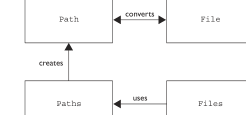

完整的 Bob's Books 数据库架构将包括出版商、地址、库存、采购订单以及商店经营所需的其他数据。但对于我们的目的来说，架构的这部分已经足够。使用该架构，我们可以使用之前提到的 SQL CRUD 编写 SQL 查询。

总结一下，在查看 JDBC 之前，你现在应该了解连接、语句和结果集：

- 连接（connection）是应用程序与数据库通信的方式。
- 语句（statement）是在数据库上执行的 SQL 查询。
- 结果集（result set）是从 `SELECT` 语句中返回的数据。

掌握了这些概念，我们就可以利用 Bob's Books 的简单架构来构建 JDBC API 的常见用途。

## JDBC API 的核心接口 (OCP Objective 9.1)

### 认证目标

#### JDBC API 的接口 (OCP Objective 9.1)

9.1 描述组成 JDBC API 核心的接口（包括 `Driver`、`Connection`、`Statement` 和 `ResultSet` 接口及其与实现的关系）。

如前节所述，关系数据库的目的真正有三点：

- 在表中存储数据
- 提供创建数据间关系的方法——正如 Bob 对 `Authors`、`Books` 和 `Books_by_Author` 表所做的那样
- 提供一种用于获取数据、更新数据和创建新数据的语言

JDBC 的目的是为 Java 开发者提供应用程序编程接口 (API)，用于编写访问和操作关系数据库并使用 SQL 执行 CRUD 操作的 Java 程序。

一旦你理解了 JDBC API 的基础，你就可以访问数据库列表。JDBC 之前的驱动力是提供一种访问关系数据库的标准方法，但 JDBC 也可以访问文件系统和对象数据源。关键在于 API 提供了数据库连接、语句和结果集的抽象视图。这些概念在 API 中分别表示为 `java.sql` 包中的接口：`Connection`、`Statement` 和 `ResultSet`。

`java.sql.Connection` 接口定义了代表关系数据库系统连接的对象的约定。稍后，我们将查看该约定的方法，但现在，对于 `Connection` 的实例，我们需要与数据库进行通信。`Connection` 接口的实现取决于供应商，而且同样，我们并不太担心具体的实现方式——只要供应商遵循约定，我们就可以确保代表 `Connection` 的对象允许我们与数据库连接进行工作。

`Statement` 接口提供了在数据库上执行 SQL 语句所需的功能抽象，而 `ResultSet` 接口是处理从 SQL 查询（涉及 SQL `SELECT` 语句）中返回的结果集（数据表）所需的功能抽象。

`Connection`、`Statement`、`ResultSet` 以及其他若干实现类，我们稍后将根据所使用的数据库供应商进行介绍。供应商比任何人都更了解他们的数据库产品，因此由他们创建这些类是合理的。而且，这允许供应商优化或隐藏其产品的任何特殊特性。这些实现类的集合被称为 JDBC 驱动程序（JDBC driver）。JDBC 驱动（小写 "d"）是支持 API 所需的类之一，而 `Driver`（大写 "D"）是驱动程序所需的实现类之一。

JDBC 驱动程序通常由供应商以 JAR 或 ZIP 文件的形式提供。驱动程序的实现类必须满足一组最低要求才能符合 JDBC 标准。JDBC 规范提供了供应商必须支持的功能列表以及供应商可以可选支持的功能。

以下是 JDBC 驱动程序要求的部分列表。更多详细信息，请阅读规范（JSR-221）。注意，实现 JDBC 驱动的细节不在考试范围内。

- 完整实现接口：`java.sql.Driver`、`java.sql.DatabaseMetaData`、`java.sql.ResultSetMetaData`。
- 实现 `java.sql.Connection` 接口。（注意，某些方法取决于数据库支持的 SQL 版本——关于 SQL 版本的内容将在章节稍后介绍）。
- 实现 `java.sql.Statement`、`java.sql.PreparedStatement`。
- 如果数据库支持存储过程，实现 `java.sql.CallableStatement` 接口。同样，关于该接口将在章节稍后介绍。
- 实现 `java.sql.ResultSet` 接口。

## 使用 DriverManager 连接数据库 (OCP 目标 9.2)

9.2 识别使用 `DriverManager` 类连接到数据库所需的组件（包括 JDBC URL）

JDBC API 中定义的所有类型并不是接口。JDBC 的一个重要类是 `java.sql.DriverManager` 类。这个具体类用于与 JDBC 驱动程序交互并返回 `Connection` 对象的实例。从概念上说，它的工作原理是使用名为工厂（Factory）的设计模式。接下来，我们将详细查看 `DriverManager`。


观看 让我们利用这个机会看看我们在第 10 章中讨论过的工厂模式的应用。

正如你记得的，在工厂模式中，具有静态方法的具体类被用于创建实现接口的对象实例。例如，假设我们想创建一个 `Vehicle` 对象的实例：

```java
public interface Vehicle {
    public void start(); // 我们认为所有车辆都应该支持
    public void stop(); // 方法。
}
```

为了使用这个约定，我们需要 `Vehicle` 的实现。因此，我们设计了一个 `Car`：

```java
package com.us.automobile;
public class Car implements Vehicle {
    public void start() {} // ... 执行启动操作
    public void stop() {} // ... 执行停止操作
}
```

为了使用 `Car`，我们可以创建一个：

```java
public class MyClass {
    public static void main(String args[]) {
        Vehicle ferrari =
        new com.us.automobile.Car(); // 创建一辆法拉利
        ferrari.start();
    }
}
```

然而，在这里使用工厂会更好——这样我们不需要了解实际实现的任何信息，正如我们稍后通过 `DriverManager` 看到的，我们可以使用工厂的方法在运行时动态决定使用哪种实现。

```java
public class MyClass {
    public static void main(String args[]) {
        Vehicle ferrari =
        CarFactory.getVehicle("Ferrari"); // 使用工厂
        ferrari.start(); // 创建一辆法拉利
    }
}
```

在这种情况下，工厂可以根据传递给静态 `getVehicle()` 方法的字符串来创建不同的汽车，类似于：

```java
public class CarFactory {
    public static Vehicle getVehicle(String type) {
        // ... 创建一个代表作为参数传递的
        // 类型的对象实例
    }
}
```

`DriverManager` 使用这种模式，通过向其 `getConnection()` 方法传递字符串来“构造” `Connection` 对象的实例。

### DriverManager 类

`DriverManager` 类是 JDBC API 中的一个带有静态方法的具体类。你会记得静态或类方法可以通过其他类使用类名来调用。其中一个方法是 `getConnection()`，我们接下来查看它。

`DriverManager` 类之所以这样命名，是因为它管理当你通过 `getConnection()` 方法请求 `Connection` 实例时获取哪种 JDBC 驱动实现。

有几个重载的 `getConnection` 方法，但它们都共享一个公共参数：URL。例如：

```java
String url = "jdbc:mysql://localhost:3306/mydb";
String user = "username";
String password = "dbpassword";
Connection conn = DriverManager.getConnection(url, user, password);
```

当你调用 `DriverManager` 的 `getConnection()` 方法时，你是在要求 `DriverManager` 尝试将 URL 以及用户名和密码传递给每个注册的驱动程序。如果某个驱动类识别了 URL，并且用户名和密码被接受，该驱动将返回一个 `Connection` 对象实例给 `DriverManager`，随后返回给你。然而，如果 URL 不正确，方法将抛出 `SQLException`。我们将在章节稍后花时间研究 `SQLException`。

## JDBC 驱动如何向 DriverManager 注册

由于 JDBC 过程的这部分很重要，并且涉及到一些 Java 的魔术，让我们花时间画出驱动类是如何“注册”到 `DriverManager` 的，如图 15-2 所示。

首先，一个或多个 JDBC 驱动程序以 JAR 或 ZIP 文件的形式包含在应用程序的类路径中。`DriverManager` 使用服务提供者机制搜索在驱动或压缩包的 `META-INF/services` 文件夹中包含 `java.sql.Driver` 文件的 JAR 或 ZIP 文件。这是一个文本文件，包含了供应商想要实现 `java.sql.Driver` 接口的类名。例如，对于 Derby 驱动，全名是 `org.apache.derby.jdbc.ClientDriver`。

随后 `DriverManager` 将使用类加载器加载在 `java.sql.Driver` 文件中找到的类：

```java
Class.forName("org.apache.derby.jdbc.ClientDriver");
```

当驱动被加载时，它的静态初始化块会被执行。根据 JDBC 规范，驱动实例的首要活动之一是通过调用 `DriverManager` 的静态方法向 `DriverManager` 进行“自注册”。代码（省略错误处理）看起来如下：

```java
public class ClientDriver implements java.sql.Driver {
  static {
    ClientDriver driver = new ClientDriver();
    DriverManager.registerDriver(driver);
  }
  //...
}
```

## 使用 DriverManager 类连接到数据库所需的组件识别 857

### 图 15-2

启动你的应用程序：

`java -classpath ... MyDBApp`

JDBC 驱动程序如何向 DriverManager 自注册


加载定义在 `META-INF/services/java.sql.Driver` 文件中的类。

`DriverManager.registerDriver(this);`


一个 JDBC 驱动程序 (jar 文件)

对类路径中每个包含 `java.sql.Driver` 文件的 jar 文件重复此过程。

如果注册了多个驱动程序，`DriverManager` 会按顺序调用所有驱动程序，并尝试从它们处获取 `Connection` 对象，如图 15-3 所示。

第一个识别 JDBC URL 并使用用户名和密码成功创建连接的驱动程序将返回 `Connection` 对象的实例。如果

### 图 15-3

DriverManager 如何获取 Connection

MyDBApp

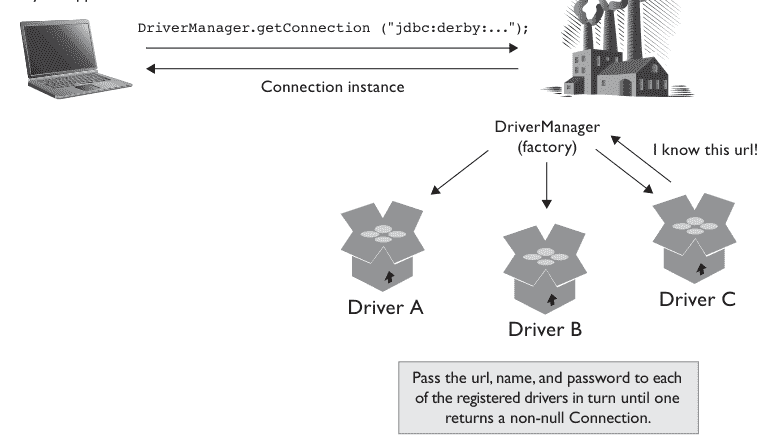

`DriverManager.getConnection("jdbc:derby...");`

Connection 实例

DriverManager (工厂)

我知道这个 URL！

Driver A

Driver B

Driver C


将 URL、名称和密码按顺序传递给每个已注册的驱动程序，直到其中一个返回了非空的 `Connection` 为止。

如果没有驱动程序识别 URL、用户名和密码组合，或者没有注册的驱动程序，则会抛出 `SQLException`。

总结：

- JVM 加载 `DriverManager` 类，这是 JDBC API 中的一个具体类。
- `DriverManager` 类加载类路径上 JAR/ZIP 文件中 `META-INF/services/java.sql.Driver` 文件中找到的所有类实例。
- 驱动程序类调用 `DriverManager.register(this)` 向 DriverManager 自注册。
- 当调用 `DriverManager.getConnection(String url)` 方法时，`DriverManager` 会使用 URL 字符串调用这些已注册 Driver 实例的 `connect()` 方法。
- 第一个成功与 URL 创建连接的 `Driver` 将一个 `Connection` 对象的实例返回给 `DriverManager.getConnection` 调用处。

接下来让我们来看 JDBC URL 语法。

## JDBC URL

JDBC URL 用于确定为给定的 `Connection` 使用哪种驱动程序实现。可以将 JDBC URL（统一资源定位符）看作是某种将所有可能的驱动程序范围缩小到某个特定连接的方法。例如，假设你需要给某人寄一个包裹。为了将可能的地址范围缩小到唯一位置，你必须在包裹上识别国家、州、城市、街道，可能还有房屋或门牌号：

```
California://SanJose:FirstStreet/15
```

此字符串表示你使用的地址位于美国，加利福尼亚州，圣何塞市，First 街，15 号门牌。

JDBC URL 遵循相同的理念。为了访问 Bob's Books，我们可能会这样写 URL：

```
derby://localhost:1521/BookSellerDB
```

第一部分 `jdbc` 仅标识这是一个 JDBC URL（而不是 HTTP 或其他）。第二部分表明驱动程序供应商是 derby 驱动程序。第三部分表明数据库位于此台机器的本地主机（IP 地址 127.0.0.1），端口为 1521，最后部分表明我们对 BookSellerDB 数据库感兴趣。

与街道地址一样，我们需要这个字符串的原因是 JDBC 设计时是为了同时与多个数据库工作。每个 JDBC 数据库驱动程序都有不同的 URL，因此我们需要能够将 JDBC URL 字符串传递给 DriverManager，并确保返回的 `Connection` 是针对预期的数据库实例的。

遗憾的是，除了 JDBC URL 必须以 "jdbc" 开头外，关于 JDBC URL 几乎没有标准。供应商可能会修改 URL 以为特定的驱动程序实现定义任何特性。格式为：

```
jdbc:<subprotocol>:<address>[:port][<subname>]
```

## 使用 DriverManager 类连接到数据库所需的组件识别

### 第 15 章：JDBC

```java
import static java.lang.System.*; // 静态导入
// System 类方法。
// 现在我们可以直接使用 'out'
// 而不是 System.out。
```

```java
String url = "jdbc:derby://localhost:1521/BookSellerDB";
String user = "bookguy";
String pwd = "$3illeR";
try {
    Connection conn = 
        DriverManager.getConnection(url, user, pwd); // 获取连接
    Statement stmt = conn.createStatement(); // 创建 Statement
    String query = "SELECT * FROM Customer";
    ResultSet rs = stmt.executeQuery(query); // 执行查询
    while (rs.next()) { // 处理结果
        out.print(rs.getString("CustomerID") + " ");
        out.print(rs.getString("FirstName") + " ");
        out.print(rs.getString("LastName") + " ");
        out.println(rs.getString("EMAIL") + " ");
    }
} catch (SQLException e) { // 捕获 SQLException
```

再次，我们将更详细地深入此示例的每个部分，但这里是发生的情况：

- **获取连接**：我们正在使用访问 Bob's Books 数据库所需创建一个 `Connection` 实例（该数据库存储在 Java DB 关系数据库 BookSellerDB 中，通过凭据 "bookguy" 和密码 "3illeR" 访问）。
- **创建语句**：我们正在使用 `Connection` 创建一个 `Statement` 对象。`Statement` 对象负责将字符串作为数据库查询传递给数据库。
- **执行查询**：我们在数据库上执行查询字符串并返回一个 `ResultSet` 对象。
- **处理结果**：我们正在遍历结果集行——每次调用 `next()` 都会带我们移动到下一行结果。
- **打印列**：我们正在获取当前结果集中各列的值，并将它们打印到标准输出中。
- **捕获 SQLException**：所有的 JDBC API 方法调用都会抛出 `SQLException`。当方法使用不当或数据库不再响应时，可能会抛出 `SQLException`。例如，如果 JDBC URL、用户名或密码无效的，则会抛出 `SQLException`。

### 提交查询并从数据库读取结果 (OCP 9.3)

或者我们尝试查询一个不存在的表。或者由于网络故障或数据库离线导致无法访问数据库。我们将在本章后面的部分详细介绍 `SQLException`。

上一个代码的输出看起来如下：

```
5000 John Smith Smith@comcast.net 555-340-1230
5001 Mary Johnson mary.johnson@comcast.net 555-123-4567
5002 Bob Collins bob.collins@yahoo.com 555-012-3456
5003 Rebecca Mayer rebecca@gmail.com 555-205-8212
5006 Anthony Clark anthony.clark@gmail.com 555-256-1901
5007 Judy Sousa judy@verizon.net 555-751-1207
5008 Christopher Patrequin patrequin@yahoo.com 555-316-1803
5009 Deborah Smith debsmith@comcast.net 555-256-3421
5010 Jennifer Mcdidlin jmcginson@comcast.net 555-250-0918
```

我们将在接下来两个节中详细查看 `Statement` 和 `ResultSet` 接口。

## Statements (语句)

一旦我们成功连接到数据库，乐趣就可以开始了。从一个 `Connection` 对象，我们可以创建一个 `Statement` 对象的实例（更准确地说，使用我们从 `DriverManager` 接收到的 `Connection` 实例），我们可以获取一个实现 `Statement` 接口的对象实例。

```java
String url = "jdbc:derby:localhost:1521/BookSellerDB";
String user = "bookguy";
String pwd = "$31lerR";
try {
    Connection conn = DriverManager.getConnection(url, user, pwd);
    Statement stmt = conn.createStatement();
    // 使用 SQL 语句进行操作
} catch (SQLException se) { }
```

`Statement` 的主要目的是使用某种方法执行 SQL 语句并返回某种类型的结果。`Statement` 方法有几种形式：返回结果集的方法和返回整数状态的方法。最常用的 `Statement` 方法是执行返回某些数据的 SQL 查询，例如我们之前使用的用于获取所有 Customer 行的 `SELECT` 调用。

### 构建和使用语句

首先，让我们来看基础 `Statement`，它用于执行静态 SQL 查询并返回结果。你可能记得我们从 `Connection` 获取一个 `Statement`，然后使用该 `Statement` 对象执行 SQL 语句，例如对数据库进行查询。例如：

```java
Connection conn = DriverManager.getConnection(url, user, pwd);
Statement stmt = conn.createStatement();
ResultSet rs = stmt.executeQuery("SELECT * FROM Customer");
```

由于所有 SQL 语句都会返回结果，因此 `Statement` 对象提供了若干种不同的方法来执行 SQL 命令。某些 SQL 命令不返回结果，而是返回整数状态。例如，SQL `INSERT`、`UPDATE` 和 `DELETE` 命令，或者任何 SQL 数据定义语言 (DDL) 语句（如 `CREATE TABLE`），会返回受查询影响的行数或……。

让我们详细查看每个 execute 方法。

**`public ResultSet executeQuery(String sql) throws SQLException`** 这是最常用的 `Statement` 方法。当我们知道想要返回结果时，就会使用此方法——我们正在数据库中查询单行或多行数据。

```java
ResultSet rs = stmt.executeQuery("SELECT * from Customer");
```

假设 Customer 表中有数据，此语句应将 Customer 表中的所有行返回到 `ResultSet` 对象中——我们将在下一节查看 `ResultSet`。注意，方法声明包含 "throws SQLException"。这意味着该方法必须在 try-catch 块中调用，或者必须在同样抛出 `SQLException` 的方法中调用。再次，这些方法抛出 `SQLException` 的原因之一是连接的可能是网络上的数据库。对于网络上的所有事物，可用性都无法保证，因此 `SQLException` 的原因之一是数据库本身的不可用。

**`public int executeUpdate(String sql) throws SQLException`** 此方法用于影响一个或多个行且不返回结果的 SQL 操作——例如 SQL `INSERT`、`UPDATE`、`DELETE` 以及 DDL 语句。这些语句不返回结果，但返回受查询影响的行数。例如，这里有一个调用调用的示例：

### 提交查询并从数据库读取结果 (OCP 9.3)

当我们想要更新 Book 表，增加当前小于 8.95 且为硬装的书的价格时：

```java
String q = "UPDATE Book Set UnitPrice=8.95
WHERE UnitPrice < 8.95 AND Format='Hardcover";
int numRows = stmt.executeUpdate(q);
```

当查询返回时，我们预计某些行会受到影响。返回的整数是受更新的行数。

注意，此语句方法也可以执行不返回行数的 SQL 查询，如 `CREATE TABLE` 或 `DROP TABLE` 等其他 DDL 查询。对于 DDL 查询，返回值为 0。

**`public boolean execute(String sql) throws SQLException`** 当你不确定结果将会是什么时，使用此方法——查询可能会返回结果集，也可能不会。此方法可用于执行运行时可能未知的查询——例如在后面构造的查询。如果查询产生了结果集，则返回 `true`；如果查询产生了更新计数或无结果，则返回 `false`。

然而，通常此方法用于调用存储过程（使用 `CallableStatement`，我们将在本章稍后部分讨论）。存储过程可以返回单个结果集或行计数，也可以返回多个结果集和行计数；此方法的设计是为了处理单个数据库调用产生多个结果集或行计数的情况。

如果你编写了一个测试查询的应用程序——一个接收命令行字符串并在数据库中运行该查询的程序——你也可以使用此方法。例如：

```java
ResultSet rs;
int numRows;
boolean status = stmt.execute(""); // 如果存在 ResultSet
rs = stmt.getResultSet(); // 获取 ResultSet
// 处理结果集...
if (!status) { // 如果为 false
    numRows = stmt.getUpdateCount(); // 获取更新计数
    if (numRows == -1) { // 如果为 -1，则没有结果
        out.println("No results");
    } else { // 否则，打印受影响的行数
        out.println(numRows + " rows affected.");
    }
}
```

### 第 15 章：JDBC

由于此语句可能返回结果集，也可能仅返回一个整数计数，因此可以使用两个额外的语句命令，根据 `execute` 方法返回 `true`（有结果集）还是 `false`（有更新计数或无结果）来获取结果或计数。`getResultSet` 用于在 `execute` 方法返回 `true` 时检索结果，`getUpdateCount` 用于在 `execute` 方法返回 `false` 时检索计数。让我们来看这些方法。


允许用户直接在输入字段中输入查询字符串，或允许用户直接构建查询，通常是一个非常糟糕的主意。原因是，如果用户可以构建查询，甚至将自由字符串包含在查询中，他们就可以利用该查询获取比你预想的更多数据，或者修改数据库表的权限。

例如，假设我们有一个查询，用户输入电子邮件地址，并且用户输入的字符串被插入到查询中：

```
String s = System.console().readLine("Enter your e-mail address: ");
ResultSet rs = stmt.executeQuery("SELECT * FROM Customer WHERE Email='" + s + "'");"
```

此代码的用户可能会输入如下内容：

```
tom@trouble.com' OR 'x'='x
```

数据库执行的最终查询变为：

```
SELECT * FROM Customer WHERE Email='tom@trouble.com' OR 'x'='x'
```

`OR` 语句将始终返回 `true`，这意味着查询将返回所有的客户行，实际上等同于查询：

```
SELECT * FROM Customer
```

现在，这段代码拥有了数据库中每个客户的电子邮件地址列表。

这种攻击被称为 **SQL 注入攻击**。通过对用于数据库查询的任何输入进行仔细的清理，并使用其他 `Statement` 类型（`PreparedStatement` 和 `CallableStatement`），可以很容易防止。尽管预防非常容易，它仍然频繁发生，即使对于像 Yahoo! 这样大型且经验丰富的公司也是如此！

## 提交查询并从数据库读取结果 (OCP 目标 9.3)

`public ResultSet getResultSet() throws SQLException` 如果来自 `execute()` 方法的布尔值返回 `true`，则存在结果集。要获取结果集，如之前所示，在 `Statement` 对象上调用 `getResultSet()` 方法。然后你就可以处理 `ResultSet` 对象（我们将在下一节中介绍）。该方法基本上是无一失的——如果实际上没有结果，该方法将返回 `null`。

```java
ResultSet rs = stmt.getResultSet();
```

`public int updateCount() throws SQLException` 如果来自 `execute()` 方法的布尔值返回 `false`，则存在行计数，此方法将返回受影响的行数。值 `-1` 表示没有结果。

```java
int numRows = stmt.updateCount();
if (numRows == -1) {
    out.out.println("No results");
} else {
    out.out.println(numRows + " rows affected.");
}
```

表 15-6 总结了我们刚刚涵盖的 `Statement` 方法。

| 方法（均抛出 SQLException） | 描述 |
|---|---|
| `ResultSet executeQuery(String sql)` | 执行 SQL 查询并返回 `ResultSet` 对象，即 SELECT 命令。 |
| `int executeUpdate(String sql)` | 执行 SQL 查询，该查询可能修改若干行，即 INSERT、DELETE 或 UPDATE 命令。 |


# 第 15 章：JDBC

## 结果集 (ResultSets)

当查询返回结果集时，会返回一个实现 `ResultSet` 接口的类实例。`ResultSet` 对象代表查询结果——每行中所有数据按列为基的表示。再次提醒一下，`ResultSet` 中数据的存储方式完全取决于 JDBC 驱动程序。JDBC 驱动程序可能会一次性将整个结果集缓存在内存中，也可能使用内部缓冲区每次处理几行。从你处理数据的角度来看，这并不重要。通过 `ResultSet` 接口中定义的方法，你可以读取并操作数据，这才是最重要的。

需要记住的一点重要性是，`ResultSet` 是查询执行时刻实例数据的副本。除非你是唯一使用数据库的人，否则你必须始终假设 `ResultSet` 来源的底层数据库表或表可能会被其他用户或应用程序更改。

由于 `ResultSet` 是 JDBC API 中一个非常全面的部分，我们将分节处理它。表 15-7 总结了每个章节，供你参考。

| 表 15-7 ResultSet 章节 | 描述 |
|---|---|
| "在 ResultSet 中向前移动" | 如何访问查询结果的“行”。 |
| "从 ResultSet 中读取数据" | 如何使用 `ResultSet` 方法读取数据。 |
| "获取 ResultSet 的信息" | 如何使用 `ResultSetMetaData` 获取结果集的信息。 |
| "打印报告" | 如何将 `ResultSet` 格式化结果集打印到控制台。 |
| "在 ResultSet 中移动" | 如何更改 `Statement` 对象的类型和并发设置以允许移动行。 |
| "更新 ResultSet" | 如何使用 `Statement` 对象的并发设置以允许更新返回的结果。 |
| "向 ResultSet 插入新行" | 如何通过删除和插入行进一步操作 `ResultSet`。 |
| "使用 DatabaseMetaData 获取数据库信息" | 如何使用 `DatabaseMetaData` 对象获取数据库信息。 |

## 提交查询并从数据库读取结果 (OCP 目标 9.3)

### 在 ResultSet 中向前移动

最好的方式是可视化 `ResultSet` 对象。假设在我们的 BookSeller 数据库中有许多以字母 "C" 开头的客户。我们创建一个查询来返回如下行：

```sql
SELECT FirstName, LastName, Email from Customer
WHERE LastName LIKE '%C%';
```

SQL 运算符 `LIKE` 处理匹配模式的字符串，其中 `%` 表示通配符。因此，`LastName LIKE '%C%'` 意味着“任何以 c 开头的带有任意字符的 LastName”。

当我们执行 `executeQuery()` 方法时，返回的 `ResultSet` 将包含 `LastName` 以大写字母 "C" 开头的 `FirstName`、`LastName` 和 `Email` 列：

```java
ResultSet rs = stmt.executeQuery(query);
```

`ResultSet` 对象返回了如图 15-4 所示查询数据。

注意图 15-4，`ResultSet` 对象维护了一个游标，即指向结果当前行的指针。当 `ResultSet` 对象首次返回在上方时，游标尚未指向结果行——游标指向第一行上方。为了获取表的结果，你必须始终在 `ResultSet` 对象上调用 `next()` 方法将游标移动到第一行数据。默认情况下，`ResultSet` 对象是只读的（行中的数据不可更新），并且你只能向前移动光标。稍后我们将会介绍如何改变这种行为。

对于 `ResultSet`，你需要知道的第一个方法是 `next()` 方法。

```java
public boolean next()
```

`next()` 方法将光标向前移动一行，如果光标现在指向 `ResultSet` 中的某行数据，则返回 `true`。如果由于 `next()` 方法导致光标指向最后一行数据之后（或者如果 `ResultSet` 不包含任何行），则返回值为 `false`。

为了读取图 15-4 所示表格中的三行数据，我们需要调用 `next()` 方法，读取数据行，然后再次调用两次 `next()`。当 `next()` 方法被调用时，该方法将提前返回 `false`。从第一个到最后一个读取所有行的简单方法是使用 `while` 循环：

```java
String query = "SELECT FirstName, LastName, EMail FROM Customer WHERE LastName LIKE '%C%'";
ResultSet rs = stmt.executeQuery(query);
while (rs.next()) { // 将光标从当前位置
    // 移动到下一行数据 - 如果下一行
    // 是有效数据则返回 true，如果光标
    // 移过了最后一行则返回 false
}
// ...
```

> **注意**：由于光标是 JDBC 中一个非常基础的概念，考试将测试你对 `ResultSet` 中光标的控制。只要你记住在处理 `ResultSet` 中的即使是一行数据之前必须调用 `next()` 方法，你就没问题。也许你可以使用一个助记工具，比如这一个：“获取结果时，不要纠结，始终调用 next！” 好吧，也许不。。

### 从 ResultSet 读取数据

在 `ResultSet` 中向前移动光标只是从查询结果中读取数据的开始。让我们看看从结果集中获取数据的两种方法。

当返回 `ResultSet` 且你尽职调用了 `next()` 将光标移动到第一行实际数据时，你现在就可以读取当前行每列的数据了。如图 15-4 所示，数据库查询的结果集就像表格或电子表格。每行包含（通常）一个或多个列，每列中的数据是 SQL 数据类型之一。为了将每列中的数据引入你的 Java 应用程序，你必须使用 `ResultSet` 方法将每个 SQL 列值检索到相应的 Java 类型。例如，SQL INTEGER 可以被读取为 Java 基本类型，SQL VARCHAR 可以被读取为 Java `String`，SQL DATE 可以被读取为 `java.sql.Date` 对象，以此此类推。`ResultSet` 还定义了其他几种类型，数据库或驱动程序是否支持规范中定义的所有类型取决于数据库供应商。对于考试，我们建议使用表 15-7 所示的最常用的 SQL 数据类型和 `ResultSet` 方法。

SQL 已经存在了很久。第一个形式化的、经美国标准协会（ANSI）批准的版本于 1986 年被采用（SQL-86）。下一次重大修订是 1992 年的 SQL-92，它被广泛认为是每个数据库的“基础”发布。SQL-92 定义了一系列新数据类型，包括 DATE、TIME、TIMESTAMP、BIT 和 VARCHAR 字符串。SQL-92 有多个级别；每个级别都比前一个级别增加了一些功能。JDBC 驱动程序识别 ANSI SQL-92 级别：Entry（基础）、Intermediate（中间）和 Full（完全）。

SQL-1999 也称为 SQL-3，引入了 BLOB 和 CLOB。SQL-1999 引入了 BOOLEAN 和复合类型。SQL-2003 引入了 XML 和 ROW。SQL-2006 引入了触发器。SQL-2008 引入了标识符。SQL-2011 引入了列。SQL-2014 引入了 JSON。SQL-2016 引入了 JSON。SQL-2019 引入了窗口函数。

#### 常用 ResultSet getter 方法

```java
public java.sql.Date getDate(String columnName)
```
此方法将列的值获取为 Java Date 对象。注意 `java.sql.Date` 继承自 `java.util.Date`。两者之间最有趣的区别是，`java.sql.Date` 的 `toString()` 方法返回格式为 "yyyy-mm-dd" 的日期字符串。此方法被推荐用于 SQL DATE 类型。

```java
java.sql.Date pubDate = rs.getDate("PubDate");
```

```java
public java.lang.String getString(String columnName)
```
此方法将列的值获取为 Java String 对象。它非常适用于读取 CHAR、VARCHAR 和 LONGVARCHAR 类型的 SQL 列。

```java
String lastName = rs.getString("LastName");
```

```java
public java.sql.Time getTime(String columnName)
```
此方法将列的值获取为 Java Time 对象。与 `java.sql.Date` 类似，该类继承自 `java.util.Date`，其 `getTime()` 方法返回格式为 "hh:mm:ss" 的时间字符串。TIME 是设计用于读取的 SQL 类型。

```java
java.sql.Time time = rs.getTime("FinishTime");
```

```java
public java.sql.Timestamp getTimestamp(String columnName)
```
此方法将列的值获取为 Timestamp 对象。其 `toString()` 方法将结果格式化为：yyyy-mm-dd hh:mm:ss.fffffffffff（后者是纳秒）。此方法被推荐用于 SQL TIMESTAMP 类型。

```java
java.sql.Timestamp timestamp = rs.getTimestamp("ClockTime");
```

```java
public java.lang.Object getObject(String columnName)
```
此方法将列的值获取为 Java 对象。它可以作为一种通用方法来读取列中的数据。该方法的工作原理是将返回的值读取为对应整数的适当 Java 包装类，并将其作为 Java 对象返回。例如，使用此方法读取整数（SQL INTEGER 类型）会返回一个 `java.lang.Integer` 类型的对象。我们可以使用 `instanceof` 来检查是否为 Integer 并获取 int 标值：

```java
Object o = rs.getObject("AuthorID");
if (o instanceof java.lang.Integer) {
    int id = ((Integer)o).intValue();
}
```

表 15-8 列出了从 `ResultSet` 中检索特定数据最常用的方法。有关 `ResultSet` get 方法的完整详细集合，请参阅 `java.sql.ResultSet` 的 Java 文档。

考试不会测试你对所有 SQL 类型 `ResultSet` get 和 set 方法的记忆。对于考试，只需记住基本类型 `String` 和 `int` 即可。每个 `ResultSet` getter 方法都以其最接近的 Java 类型命名，例如，要读取存储整数作为 `int` 类型的数据库列，可以对你想要读取的列名（`String`）或列索引调用 `getInt()` 方法。

| TABLE 15-8 | SQL 类型 | Java 类型 | ResultSet get 方法 |
|---|---|---|---|
| SQL 类型和 JDBC 类型 | BOOLEAN | boolean | `getBoolean(String columnName)`<br>`getBoolean(int columnIndex)` |
| | INTEGER | int | `getInt(String columnName)`<br>`getInt(int columnIndex)` |
| | DOUBLE, FLOAT | double | `getDouble(String columnName)`<br>`getDouble(int columnIndex)` |
| | REAL | float | `getFloat(String columnName)`<br>`getFloat(int columnIndex)` |
| | BIGINT | long | `getLong(String columnName)`<br>`getLong(int columnIndex)` |
| | CHAR, VARCHAR, LONGVARCHAR | String | `getString(String columnName)`<br>`getString(int columnIndex)` |
| | DATE | `java.sql.Date` | `getDate(String columnName)`<br>`getDate(int columnIndex)` |
| | TIME | `java.sql.Time` | `getTime(String columnName)`<br>`getTime(int columnIndex)` |
| | TIMESTAMP | `java.sql.Timestamp` | `getTimestamp(String columnName)`<br>`getTimestamp(int columnIndex)` |
| | 以上任意类型 | `java.lang.Object` | `getObject(String columnName)`<br>`getObject(int columnIndex)` |

### 获取 ResultSet 的信息

当你使用字符串运行查询时（如我们目前示例所示），你知道返回的列的名称和类型。然而，当你想要允许用户动态构建查询时会发生什么呢？你可能并不知道返回了多少列，以及返回列的类型和名称。

幸运的是，`ResultSetMetaData` 类的设计旨在为你提供这些信息。使用 `ResultSetMetaData`，你可以获取有关查询返回结果的重要信息，包括列数、表名、列名以及列名——当查询作为 Object 返回时用于表示该列的 Java 类。这里有一个简单的示例，我们将详细查看这些方法：

```java
String query = "SELECT AuthorID FROM Author";
ResultSet rs = stmt.executeQuery(query);
ResultSetMetaData rsmd = rs.getMetaData();
rs.next();
int count = rsmd.getColumnCount(); // 此处有多少多少列
out.println("Column Count: " + count);
for (int i = 1; i <= count; i++) {
    out.println("Column Name: " + rsmd.getColumnName(i));
    out.println("Column Type: " + rsmd.getColumnTypeName(i));
    out.println("Column Size: " + rsmd.getColumnDisplaySize(i));
}
```

使用 BookSeller 数据库（Bob's Books）运行此代码会产生以下结果：

| Column Count | 1 |
|---|---|
| Table Name | AUTHOR |
| Column Name | AUTHORID |
| Column Size | 11 |

`ResultSetMetaData` 通常用于生成报告，因此这里是最常用的方法。欲了解更多信息和方法，请查看 JavaDocs。

```java
public int getColumnCount() throws SQLException
```
此方法可能是最常用的 `ResultSetMetaData` 方法。它返回查询返回的列数的整数计数。通过此方法，你可以遍历列以获取每列的信息。


```java
try {
    conn = DriverManager.getConnection(...);
    stmt = conn.createStatement();
    String query = "SELECT * FROM Author";
    ResultSet rs = stmt.executeQuery(query);
    ResultSetMetaData rsmd = rs.getMetaData(); // 获取此
                                                // ResultSet 的元数据
    int columnCount = rsmd.getColumnCount(); // 获取此
                                                // ResultSet 中的
                                                // 列数

} catch (SQLException se) { 
}
```

`Author` 表的 `columnCount` 值为 3。我们可以使用此值通过接下来的示例方法遍历列。

`public String getName(int col) throws SQLException` 此方法返回该列的字符串名称。使用 `columnCount`，我们可以创建类似报告格式的数据输出。例如：

这有些原始，因为我们可能需要对数据进行更好的格式化，但它将产生：

+ AUTHOR FIRSTNAME LAST

1000 Rick Riordan

1001 Nancy Farmer

1002 Ally Condie

1003 Cressida Cowell

1004 Lauren St. John

1005 Eoin Colfer

# 第15章：JDBC

`public String getTableName(int column) throws SQLException` 此方法返回列所属的表字符串名称。当查询是两个或多个表的连接且我们需要知道数据来自哪个表时，此方法非常有用。例如，假设我们要按姓获取书籍列表：

```java
String query = "SELECT Author.LastName, Book.Title
FROM Author, Book, Books_Author
WHERE Author.AuthorID = Books_Author.AuthorID
AND Book.isbn = Books_Author.isbn";
```

对于这样的查询，我们可能想知道数据来自哪个表：

```java
ResultSetMetaData rsmd = rs.getMetaData();
int cols = rsmd.getColumnCount();
for (int i = 1; i <= cols; i++) {
    out.print(rsmd.getTableName(i) + ": " + 
    rsmd.getColumnName(i) + ": ");
}
```

这段代码将打印表名、冒号和列名。输出可能如下：

```
AUTHOR:LAST BOOK:TITLE
```

`public int getColumnDisplaySize(int column) throws SQLException` 此方法返回列大小的索引。此信息有助于确定列可以包含的最大字符数（如果它是 `VARCHAR` 类型）以及报告中列之间所需的间距。

# 打印报告

为了制作比之前 `getColumnName` 方法更漂亮的的报告，我们可以使用显示大小对列名和数据空间进行填充。我们想要一个列与列之间有空格，且在查询 `Author` 表时看起来像这样的这样的表格：

| AUTHOR | FIRSTNAME | LASTNAME |
|---|---|---|
| 1000 | Rick | Riordan |
| 1001 | Nancy | Farmer |
| 1002 | Ally | Condie |
| 1003 | Cressida | Cowell |
| 1004 | Lauren | St. John |
| 1005 | Eoin | Colfer |

# 提交查询并读取数据库结果 (OCP 版本 9.3)

使用我们到为止讨论的方法，以下代码可以根据查询生成一份精美的报告：

```java
ResultSet rs = stmt.executeQuery(query);
ResultSetMetaData rsmd = rs.getMetaData();
int cols = rsmd.getColumnCount();
String col, colData;
for (int i = 1; i <= cols; i++) { // 左对齐
    col = leftJustify(rsmd.getColumnName(i), // 列名
                      rsmd.getColumnDisplaySize(i)); // 填充
    out.print(col);
}
out.println(); // 打印换行符
for (int i = 1; i <= cols; i++) {
    if (rs.getObject(i) != null) { // 获取数据
        colData = rs.getObject(i).toString(); // 将列转换为字符串
    } else { // 如果列为空
        colData = "NULL"; // 使用 "NULL"
    }
    col = leftJustify(colData,
                      rsmd.getColumnDisplaySize(i));
    out.print(col);
}
out.println();
```

注意，如果传入的字符串长度与字段长度 (n) 相同，则为长度增加一个空格使其看起来更美观：

```java
public static String leftJustify(String s, int n) { // 添加一个额外空格
    if (s.length() <= n) n++; // 如果字符串的
                                // 长度小于或等于
                                // 列长度 n
    return String.format("%1$-" + n + "s", s); // 在字符串右侧
                                     // 填充 n 个
                               // 格
}
```

其次，数据库存储 `NULL` 值。如果列的值为 `NULL`，则 `rs.getObject()` 方法返回的对象是 Java `null`。我们必须进行空值检查，以避免在执行 `toString()` 方法时出现空指针异常。

注意，我们在读取 `ResultSetMetaData` 之前不需要使用 `next()` 方法——我们可以在获取有效结果集后的任何时间执行。运行此代码并传递如 `"SELECT * FROM Author"` 的查询将返回一组打印整齐的作者列表：

| AUTHORID | FIRSTNAME | LASTNAME |
| --- | --- | --- |
| 1000 | Rick | Riordan |
| 101 | Nancy | Farmer |
| 1002 | Ally | Condie |
| 1003 | Cressida | Cowell |
| 1004 | Lauren | St. John |
| 1005 | Erin | Colfer |

## 在 ResultSet 中移动

因此，对于我们看过的所有结果集，我们只需通过调用 `next()` 来移动游标。`Statement` 的默认特性是游标只能向前移动，且结果集不支持更改。`ResultSet` 接口将这些特性定义为静态变量：`TYPE_FORWARD_READ_ONLY` 和 `CONCUR_READ_ONLY`。然而，JDBC 规范定义了额外的静态类型（所示），允许开发者将游标向前、向后或移动到结果中的特定位置。此外，结果集可以在打开时进行修改，并且更改将写入数据库。注意，大多数驱动程序都提供这种能力。为了创建一个使用位置游标并支持更新的结果集，你必须创建一个具有适当滚动类型和并发设置的 `Statement`，然后使用该 `Statement` 创建 `ResultSet`。

将游标移动到特定位置的能力是确定从结果集中修改了多少行的关键——我们稍后将查看这一点。修改已打开的结果集的能力可能看起来很奇怪，特别是如果你是一个经验丰富的数据库开发者。毕竟，这不正是 SQL `UPDATE` 命令的用处吗？

考虑这样一种情况：你想使用来自结果集的数据执行一系列计算，然后根据某些标准对每行写入更改，并最后将数据写回数据库。例如，想象一个包含客户数据的数据库表，包括他们成为客户的日期、购买历史以及过去两个月内的订单总数。在将这些数据读入结果集后，你可以遍历每个客户记录并根据业务规则对其进行修改：如果他们成为客户超过一年且每年至少购买一次，则提高他们的最低折扣率；或者如果他们每月购买金额超过 100 美元，则设置他们的偏好信贷状态。使用可更新的结果集，你可以以不同的方式修改多行客户记录，并将这些行提交到数据库，而无需编写复杂的 SQL 查询或一组 SQL 查询——只需在打开的结果集上提交（commit）更新即可。

让我们详细查看如何修改结果集。共有三种 `ResultSet` 类型：

- `TYPE_FORWARD_ONLY`：`ResultSet` 的默认值——游标仅在结果集中向前移动。
- `TYPE_SCROLL_INSENSITIVE`：游标位置可以在结果中向前或向后移动，或定位到特定的游标位置。底层数据（即数据库本身）的任何更改都不会反映在结果集中。换句话说，结果集不需要与数据库保持“状态同步”。这种类型通常被数据库支持。
- `TYPE_SCROLL_SENSITIVE`：游标可以在结果中向前或向后移动，或定位到特定的游标位置。底层数据所做的任何更改都会反映在打开的结果集中。正如你所想象的，这很难实现，因此在数据库或 JDBC 驱动程序中并不经常实现。

JDBC 为结果集的数据并发提供了两个选项：

- `CONCUR_READ_ONLY`：这是结果集并发设置的默认值。任何已打开的结果集都是只读的，不能被修改或更改。
- `CONCUR_UPDATABLE`：结果集在打开期间可以通过 `ResultSet` 方法进行修改。

由于数据库和 JDBC 驱动程序并不要求支持游标移动和并发更新，JDBC 提供了使用 `DatabaseMetaData` 对象来查询数据库和驱动程序的方法，以确定你的驱动程序是否支持这些功能。例如：

```java
Connection conn = DriverManager.getConnection(...);
DatabaseMetaData dmbd = conn.getMetaData();
if (dmbd.supportsResultSetType(ResultSet.TYPE_FORWARD_ONLY)) {
    out.print("Supports TYPE_FORWARD_ONLY");
    if (dmbd.supportsResultSetConcurrency(
        ResultSet.TYPE_CONCUR_UPDATABLE) {
            out.println(" and supports CONCUR_UPDATABLE");
    }
}

if (dmbd.supportsResultSetType(ResultSet.TYPE_SCROLL_INSENSITIVE)) {
    out.print("Supports TYPE_SCROLL_INSENSITIVE");
    if (dmbd.supportsResultSetConcurrency(
        ResultSet.TYPE_SCROLL_INSENSITIVE,
        ResultSet.TYPE_CONCUR_UPDATABLE) {
            out.println(" and supports CONCUR_UPDATABLE");
        }
}

if (dmbd.supportsResultSetType(ResultSet.TYPE_SCROLL_SENSITIVE)) {
    out.print("Supports TYPE_SCROLL_SENSITIVE");
    if (dmbd.supportsResultSetConcurrency(
        ResultSet.TYPE_CONCUR_UPDATABLE) {
            out.println("Supports CONCUR_UPDATABLE");
        }
}
}
```

在 Java DB (Derby) 数据库上运行此代码，结果如下：

```
Supports TYPE_FORWARD_ONLY and supports CONCUR_UPDATABLE
Supports TYPE_SCROLL_INSENSITIVE and supports CONCUR_UPDATABLE
```

为了创建一个具有 `TYPE_SCROLL_INSENSITIVE` 和 `CONCUR_UPDATABLE` 的 `ResultSet`，用于创建它的 `Statement` 必须在从 `Connection` 创建时就带有你想要的游标类型和并发设置。你可以确定 `Statement` 创建时使用的游标类型和并发设置，但一旦创建，你就无法更改现有 `Statement` 对象的游标类型或并发设置。此外，注意由于你设置了游标类型或并发设置并不意味着你一定能获得它们。正如我们在异常章节中将看到的，驱动程序可以检测到数据库不支持你选择的一个或两个设置，此时它会抛出一个警告，并在不支持的情况下（静默地）退回到默认设置。你将看到如何在异常和警告中检测这些 JDBC 警告。

```java
Connection conn = DriverManager.getConnection(...);
Statement stmt =
conn.createStatement(ResultSet.TYPE_SCROLL_INSENSITIVE,
    ResultSet.TYPE_CONCUR_UPDATABLE);
```

# 从数据库提交查询并读取结果 (OCP 9.3)

除了能够使用 `ResultSet` 对象来更新结果（我们将在下文中介绍）之外，能够操作游标（cursor）还提供了一个额外好处——我们可以使用游标来确定查询返回的行数。虽然在 `ResultSet` 或 `ResultSetMetaData` 中似乎有一个方法可以做到这一点，但该方法并不存在。

通常情况下，你不应该知道返回了多少行，但在调试期间，你可能想使用独立数据库对你的查询进行诊断，并使用游标来读取返回的行数。

像这样的代码可以工作：

```java
ResultSet rs = stmt.executeQuery(query); // 获取一个 ResultSet
if (rs.last()) { // 移动到最后一行
    int rowCount = rs.getRow(); // 获取行数（计数）
    rs.beforeFirst(); // 移动到第1行之前
}
```

当然，你可能还想要一种更复杂的方法，它可以保留当前的游标位置并将游标返回到该位置，无论何时调用该方法。在查看该代码之前，让我们先看看 `ResultSet` 中其他的游标移动方法和测试方法（`next` 之外）。简单来说，表 15-9 列出了你用于在 `ResultSet` 中更改游标位置的方法。

### 表 15-9 ResultSet 游标定位方法

| 方法 | 对游标的影响和返回值 |
|---|---|
| `boolean next()` | 将游标移动到 `ResultSet` 中的下一行。如果游标位置超出最后一行，则返回 false。 |
| `boolean previous()` | 将游标向后移动一行。如果游标位置在第一行之前，则返回 false。 |
| `boolean absolute(int row)` | 将游标移动到 `ResultSet` 中的绝对位置。行从 1 开始编号。移动到 0 将游标移动到第一行。移动到负行号则从最后一行开始向后移动。如果游标位置超出最后一行或在第一行之前，则返回 false。 |
| `boolean relative(int row)` | 将游标移动到相对于当前位置的相对位置。调用 `relative(1)` 向前移动一行；调用 `relative(-1)` 向后移动一行。如果游标位置超出最后一行或在第一行之前，则返回 false。 |
| `boolean first()` | 将游标移动到 `ResultSet` 中的第一行。如果 `ResultSet` 中没有行（空结果集），则返回 false。 |
| `boolean last()` | 将游标移动到 `ResultSet` 中的最后一行。如果 `ResultSet` 中没有行（空结果集），则返回 false。 |
| `void beforeFirst()` | 将游标移动到 `ResultSet` 中的第一行。 |
| `void afterLast()` | 将游标移动到 `ResultSet` 中最后行的之后。 |

让我们更详细地查看这些每一个方法。


# 游标定位方法

## `absolute(int row)`

**public boolean absolute(int row) throws SQLException**

此方法将游标定位到一个绝对数值。与之相反的方法是 `relative`。将 `0` 作为行参数传递会将游标定位到第一行。传递一个负值 `-1` 将游标定位到最后一行之后的位置——换句话说，就是最后一行。如果你尝试将游标定位到最后一行之外（例如在有 19 行的结果集中定位到第 22 位），游标将定位到最后一行之外，我们将在讨论其影响。图 15-5 展示了 `absolute()` 的调用是如何定位游标的。

如果游标成功定位在 `ResultSet` 内部，`absolute()` 返回 `true`；如果游标在第一行之前或最后一行之后结束，则返回 `false`。假设你只想处理其他行：

```java
ResultSet rs = stm.executeQuery(query);
for (int i = 1; i += 2) {
    // absolute 方法移动到
    // 传递的整数值所在的行，并在
    // 成功时返回 true
    // ... 处理奇数行
} else {
    break;
}
```

## `getRow()`

**public int getRow() throws SQLException**

此方法将当前行作为正整数返回（第一行为 1，第二行为 2，依此类推），如果当前没有行，则返回 0——此时游标要么在第一行之前，要么在最后一行之后。这是这组游标方法中唯一可选支持 `TYPE_FORWARD_ONLY` 类型的 `ResultSet` 的方法。

## `relative(int row)`

**public boolean relative(int row) throws SQLException**

`relative` 方法是 `absolute` 的表兄弟。懂了吗，表兄弟？好吧，反正，`relative()` 将游标定位在传递给方法的行数的当前位置之前或之后。

如果游标在 30 行的 `ResultSet` 中，调用 `relative(2)` 将游标定位到第 17 行，然后调用 `relative(-5)` 将游标定位到第 12 行。图 15-6 显示了基于 `absolute()` 和 `relative()` 的调用游标是如何移动的。

与绝对定位相同，将游标定位到最后一行之外或第一行之前会导致游标分别位于最后一行之后或第一行之前，并且方法返回 `false`。此外，调用 `relative(0)` 的结果正如预期的——游标保持原样。为什么要使用 `relative`？假设你正在使用 HTML 表格显示数据库表。你可能希望用户能够相对于当前行向前向后分页；可能如下：

```java
public boolean getDetailPage(ResultSet rs, int pageSize) throws SQLException {
    return rs.relative(pageSize);
}
```

## `previous()`

**public boolean previous() throws SQLException**

`previous()` 方法与 `next()` 方法完全相同，只是向后遍历 `ResultSet`。使用此方法和下一个描述的 `afterLast()` 方法，你可以反序遍历 `ResultSet`（从最后一行到第一行）。例如：

```java
public void showFlippedResultSet(ResultSet rs) throws SQLException {
    rs.afterLast();
    // 将游标定位到最后一行之后
    while (rs.previous()) { // 向后遍历 ResultSet
        // 处理结果集
    }
}
```

与 `next()` 一样，当 `previous()` 一直退到第一行之前时，方法返回 `false`。

## `first()`

**public boolean first() throws SQLException**

`first()` 方法将游标置于第一行。它等同于调用 `absolute(1)`。如果游标移动到了有效行，该方法返回 `true`；如果 `ResultSet` 没有行数据，则返回 `false`。

```java
if (!rs.first()) {
    out.println("No rows in this result set");
}
```

## `last()`

**public boolean last() throws SQLException**

`last()` 方法将游标置于最后一行。它等同于调用 `absolute(-1)`。如果游标移动到了有效行，该方法返回 `true`；如果 `ResultSet` 没有行数据，则返回 `false`。

```java
if (!rs.last()) {
    out.println("No rows in this result set");
}
```

## 异常说明

关于这些方法抛出的异常，有几点说明：

- 如果 `ResultSet` 的类型为 `TYPE_FORWARD_ONLY`、`ResultSet` 已关闭（我们将在后续章节中讨论如何关闭结果集），或者发生了数据库错误，这些方法将抛出 `SQLException`。
- 如果 JDBC 驱动程序不支持该方法，这些方法将抛出 `SQLFeatureNotSupportedException`。该异常是 `SQLException` 的子类。
- 如果 `ResultSet` 没有行数据，这些大多数方法将不起作用——例如，一个返回空结果的查询的 `ResultSet`。

## 游标位置测试方法（不在考试范围内）

以下方法返回布尔值，允许你在不移动游标的情况下“测试”当前游标位置。请注意，这些不在考试范围内，但提供它们是为了保证内容的完整性：

- **`isBeforeFirst()`** 如果游标位于第一行之前，则返回 `true`
- **`isAfterLast()`** 如果游标位于最后一行之后，则返回 `true`
- **`isFirst()`** 如果游标位于第一行上，则返回 `true`
- **`isLast()`** 如果游标位于最后一行上，则返回 `true`

## 计算行数的通用方法

现在我们已经查看了游标定位方法，让我们重新审视计算行数的代码。我们将创建一个通用方法，允许在任何时间、任何当前游标位置计算行数。代码如下：

```java
public static int getRowCount(ResultSet rs) throws SQLException {
    int row = -1;
    int currRow = 0;

    if (rs == null) {
        return 0;
    }

    currRow = rs.getRow();
    // 保存当前行位置；
    // 0 表示没有当前行位置 可能是
    // beforeFirst 之前或 afterLast 之后
    // 所以，将 currRow 设置为负数

    if (rs.afterLast()) {
        currRow = -1;
    }

    int rowCount = 0;
    if (rs.last()) {
        // 移动到最后一行获取位置
        // 如果此方法返回 false，说明没有结果
        rowCount = rs.getRow();
        // 获取行数
    }

    // 将游标移动到调用方法前所的位置。
    // 如果 currRow 为负数，游标位置在最后一行之后，所以将游标返回到最后一行
    if (currRow == -1) {
        rs.afterLast();
    } else if (currRow == 0) { // 如果游标为 0，则移动游标到第一行之前
        rs.beforeFirst();
    } else {
        rs.absolute(currRow);
        // 将游标返回到其最后位置
    }
    return rowCount;
}
```

通过查看代码，你会注意到我们特别注意保留了 `ResultSet` 的当前位置。我们调用 `getRow()` 来获取当前位置，如果返回的值为 0，则当前位置可能是第一行也可能是最后一行，因此我们使用 `isAfterLast()` 方法来确定游标的位置。如果游标在最后一行之后，我们就在 `currRow` 整数变量中存储了 -1。

然后，我们将游标移动到 `ResultSet` 的最后位置，如果移动成功，我们就获取当前位置并将其保存为 `rowCount`（即最后一行，因此是 `ResultSet` 中的行数）。最后，我们使用 `currRow` 的值来决定将游标返回到哪里。如果游标值为 -1，我们需要将游标置于最后一行之后。否则，我们简单地使用 `absolute()` 将游标返回到 `ResultSet` 中适当的位置。

虽然这看起来是几个额外的步骤，但在接下来查看更新 `ResultSet` 时，我们将看到保留游标的重要性。

# 更新 ResultSets（不在考试范围内！）

如果你只是随性地使用 JDBC，或者是 JDBC 的新手，你可能会惊讶地发现，`ResultSet` 对象的功能不仅仅是为应用程序提供查询结果。除了返回查询结果外，`ResultSet` 对象还可以用于修改数据库表的内容，包括更新行、删除现有行和添加新行。请注意，此部分及后续章节不在考试范围内，提供这些是为了让你深入了解使用对象表示关系型数据的威力。

在传统的 SQL 应用中，你可能需要执行以下 SQL 查询来将 `UnitPrice = 10.95` 的所有硬装书的价格调到 `11.95`：

```sql
UPDATE Book SET UnitPrice = 11.95 WHERE UnitPrice = 10.95;
```

但如果你想按行增加价格呢？你将必须从 `ResultSet` 中获取值，然后构建 `UPDATE` 命令并在数据库中执行它。除了 `getXXXX` 方法外，每种类型都有相应的更新方法。

让我们使用可更新的 `ResultSet` 重写之前的示例：

```java
// 我们有一个连接，并且处于 try-catch 块中
Statement stmt = conn.createStatement(ResultSet.TYPE_SCROLL_SENSITIVE, ResultSet.CONCUR_UPDATABLE);
String query = "SELECT UnitPrice FROM Book WHERE Format = 'Hardcover'";
ResultSet rs = stmt.executeQuery(query);
while (rs.next()) {
    if (rs.getFloat("UnitPrice") == 10.95f) { // 如果价格为 10.95
        rs.updateFloat("UnitPrice", 11.95f); // 更新行
        rs.updateRow(); // 在数据库中更新
    }
}
```

在使用 `updateFloat()` 方法修改 `UnitPrice` 的值后，我们调用了 `updateRow()`。该方法将当前行写入数据库。这种两步方法确保了在写入数据库之前对行进行了所有更改。而且，你可以使用 `cancelRowUpdates()` 方法改变主意。

表 15-10 总结了与可更新 `ResultSet`（并发类型设置为 `CONCUR_UPDATABLE`）常用的方法。

| 方法 | 目的 |
| :--- | :--- |
| `void updateRow()` | 使用 `ResultSet` 当前行的内容更新数据库。 |
| `void deleteRow()` | 从 `ResultSet` 和底层数据库中删除当前行。 |
| `void cancelRowUpdates()` | 取消对 `ResultSet` 对象当前行的所有更新。此方法将有效撤销对 `ResultSet` 产生的所有更改。如果在调用 `cancelRowUpdates()` 之前调用了 `updateRow()` 方法，则该方法将不起作用。 |
| `void moveToInsertRow()` | 将游标移动到 `ResultSet` 中专门用于执行插入的行。你需要在使用更新方法更新行列并调用 `insertRow()` 之前移动到插入行。 |
| `void insertRow()` | 将行内容插入数据库。请注意，此方法不会更改当前的 `ResultSet`，因此如果你想让 `ResultSet` 与数据库内容保持一致，应重新读取 `ResultSet`。 |
| `void moveToCurrentRow()` | 将游标从插入行移回当前行。如果游标不在插入行上，则此方法不起作用。 |

# 向数据库提交查询并读取结果 (OCP 目标 9.3)

让我们详细查看通过 `ResultSet` 更改数据库内容的常用方法。

## `updateRow()`

**public void updateRow() throws SQLException**

此方法使用 `ResultSet` 的当前行内容更新数据库。该方法有几点注意事项。首先，`ResultSet` 必须来自对单张表的 SQL SELECT 语句——包含 JOIN 的 SQL 语句或涉及两个表的 SQL 语句是无法更新的。其次，在移动到下一行之前应该调用 `updateRow()` 方法。否则，对该行的更新可能会丢失。

该方法的典型用途是使用适当的 `updateXXXX()` 方法更新行内容，然后使用 `updateRow()` 方法使用该行的内容更新数据库。在代码段中，我们正在将 `UnitPrice`（单元价）更新为 $11.95：

```java
rs.updateFloat("UnitPrice", 11.95f); // 将价格设为 11.95
rs.updateRow(); // 更新数据库中的行
```

## `rowUpdated()`

**public boolean rowUpdated() throws SQLException**

如果当前行已更新，则该方法返回 `true`。注意，并非所有数据库都能检测到更新。JDBC 在 `DatabaseMetaData` 中提供了一个方法来确定更新是否可检测，`DatabaseMetaData.updatesAreDetected(int type)`，其中 type 是 `ResultSet` 类型之一——例如 `TYPE_SCROLL_INSENSITIVE`。我们将在本节稍后介绍 `DatabaseMetaData` 接口及其方法。

```java
if (rs.rowUpdated()) { // 此行是否被修改？
    out.println("Row " + rs.getRow() + " was updated.");
}
```

## `cancelRowUpdates()`

**public void cancelRowUpdates() throws SQLException**

此方法允许你“撤销”对行所做更改。此方法很重要，因为不应该在同一列上调用两次 `updateXXXX` 方法。换句话说，如果你在上一个例中将 `UnitPrice` 的值设为 11.95，然后决定将价格改回 10.95，那么再次调用 `updateFloat()` 方法可能会导致不可预测的结果。更好的方法是在第二次更改列值之前调用 `cancelRowUpdates()`。


```java
boolean priceRollback = ...; // 其他地方的价格回滚
while (rs.next()) {
    if (rs.getFloat("UnitPrice") == 10.95f) {
        rs.updateFloat("UnitPrice", 11.95f);
```

```java
if (priceRollback) { // 如果 priceRollback 为 true
    rs.cancelRowUpdates(); // 回滚对此行的更改
} else {
    rs.updateRow(); // 否则，将此行提交到数据库
}
```

`public void deleteRow() throws SQLException` 此方法将当前行从 `ResultSet` 和底层数据库中删除。数据库中的行被删除（类似于 `DELETE` 语句的结果）。

```java
rs.last();
rs.deleteRow(); // 删除最后一行。
```

执行 `deleteRow()` 方法后 `ResultSet` 发生的情况取决于 `ResultSet` 是否能够检测删除。这种能力取决于 JDBC 驱动程序。当 `ResultSet` 能够检测删除时，删除的行将从 `ResultSet` 中移除。当 `ResultSet` 无法检测删除时，通过将每个列置为 `null` 使被删除的 `ResultSet` 行失效。

可以使用 `DatabaseMetaData` 接口来判断 `ResultSet` 是否能够检测删除：

```java
int type = ResultSet.TYPE_SCROLL_SENSITIVE; // 可滚动的 ResultSet
DatabaseMetaData dbmd = conn.getMetaData(); // 获取关于驱动程序和数据库的元数据
if (dbmd.areDeletionsDetected(type)) { // 如果删除的行从 ResultSet 中移除
    while (rs.next()) { // 遍历 ResultSet
        if (rs.rowDeleted()) { // 遍历 ResultSet
            continue; // 删除的行被标记了，但未被移除，因此跳过它们
        } else {
            // 处理该行
        }
    }
} else {
// 关闭 ResultSet 并重新运行查询
```

通常，为了在删除后保持 `ResultSet` 更新，应该通过查询重新创建 `ResultSet`。删除当前行不会移动光标——它仍停留在当前行——所以如果你删除第 1 行，光标仍然位于第 1 行。然而，如果被删除的行是最后一行，则光标位于最后一行之后。注意，`deleteRow()` 没有撤销操作，至少默认情况下没有。正如你稍后将看到的，如果我们使用事务，就可以“撤销”删除操作。

`public boolean rowDeleted() throws SQLException` 正如前所述，当 `ResultSet` 能够检测删除时，`rowDeleted()` 方法用于指示某行已被删除，但作为 `ResultSet` 对象的一部分保留。例如，假设我们获取了 `Customer` 表的第二行。将结果（删除后）打印到控制台将如图 15-7 所示。

因此，如果你正在处理在方法和共享类之间传递的 `ResultSet`，你可能使用 `rowDeleted()` 来检测当前行是否包含有效数据。

### 使用对象更新列

`getObject()` 和 `updateObject()` 方法的一个有趣方面是，它们将列作为 Java 对象进行取回。由于每个 Java 对象都可以使用其 `toString()` 方法转换为 `String`，因此你可以以 Java 对象的形式检索列的值。

反过来，向数据库方向，我们也可以使用 `String` 来更新任何列。大多数可以与 `String` 相互转换的 SQL 类型——整数、浮点、长整数、日期——都由它们的表示对象封装。`updateObject` 方法接收两个参数：第一个是列名（`String`）或列索引，第二个是 `Object`。只要 `String` 符合 `valueOf()` 的要求，`String` 就会被正确转换。

例如，假设我们要更新其中一本书的出版日期（`PubDate`）：

```java
// 我们有一个连接，并在 try-catch 块中
Statement stmt = conn.prepareStatement(ResultSet.TYPE_SCROLL_INSENSITIVE,
                         ResultSet.CONCUR_UPDATABLE);
String query = "SELECT * FROM BOOK WHERE ISBN='1423139X'";
ResultSet rs = stmt.executeQuery(query);
rs.next();
rs.updateObject("PubDate", "2005-04-23"); // 使用 String 更新日期
rs.updateRow(); // 更新此行
```

该 `String` 符合 `java.sql.Date` 的要求 `"yyyy-mm-dd"`，SQL 被正确转换并存储在数据库中作为日期：2005-04-23。

| 名称 | 方法 |
|---|---|
| 2501 | John | Smith |
| 5002 | Bob | Collins |
| 5003 | Rebecca | Mayer |
| 5006 | Anthony | Clark |
| 5007 | Judy | Sousa |
| 5008 | Christopher | Patrin |
| 5009 | Deborah | Smith |
| 5010 | Jennifer | McGinn |

## 使用 ResultSet 插入新行

在上一节中，我们查看了修改 `ResultSet` 中的现有数据和删除现有行。在 `ResultSet` 的最后部分中，我们将介绍如何创建并插入新行。首先，你必须有一个打开的 `ResultSet`，通常是你执行了某些查询。`ResultSet` 提供了一个特殊行，称为插入行，你在执行插入之前实际上对其进行修改（更新）。将插入行想象成一个缓冲区，你可以在其中用值修改 `ResultSet` 的空行。

插入行是一个三步骤的过程，如图 15-8 所示：首先移动到特殊行，然后 (2) 更新新行的列值，最后 (3) 执行实际的插入（写入底层数据库）。现有的 `ResultSet` 不会改变——你必须重新运行查询以查看底层数据库中的更改。然而，你可以插入任意数量的行。注意，如果结果集的并发类型为 `CONCUR_READ_ONLY`，则这些每个方法都会抛出 `SQLException`。

### 从数据库提交查询并读取结果 (OCP 目标 9.3) 895

图 15-8

```java
String query = "SELECT AuthorID, FirstName, LastName FROM Author";
ResultSet rs = stmt.executeQuery(query);
rs.next();
rs.moveToInsertRow();
rs.updateInt("AuthorID", 1055);
rs.updateString("FirstName", "Tom");
rs.updateString("LastName", "McGinn");
rs.insertRow();
rs.moveToCurrentRow();
```

ResultSet 插入行

| AuthorID | FirstName | LastName |
|---|---|---|
| 1000 | Rick | Riordan |
| 1001 | Nancy | |
| 1002 | Ally | Condie |
| 1003 | Cressida | Cowell |
| 1004 | Lauren | St. John |
| 1005 | Erin | Colfer |
| | | |
| | | |
| | 插入行 | |
| | Tom | McGinn |

`public void moveToInsertRow() throws SQLException` 此方法将游标移动到插入行缓冲区。当此方法被调用时，游标所在的位置会被记录。在调用此方法后，将调用相应的更新方法来更新列的值。

```java
rs.moveToInsertRow();
```

`public void insertRow() throws SQLException` 此方法将行缓冲区插入数据库。请注意，在调用此方法时，游标必须位于插入行上。此外，注意在将行插入数据库之前，必须为每一列设置一个值，否则将抛出 `SQLException`。`insertRow` 方法可以调用多次——但是，`insertRow` 遵循与 SQL `INSERT` 命令相同的规则——除非主键是自动生成的，否则，两次插入相同的数据将导致 `SQLException`（主键冲突）。

```java
rs.insertRow();
```

### 896 第 15 章：JDBC

`public void moveToCurrentRow() throws SQLException` 此方法将结果游标返回到调用 `moveToInsertRow()` 方法之前游标所处的行。

看一个简单的示例，我们将在 `Author` 表中有一行新数据：

```java
// 我们有一个连接，并且处于一个 try-catch 块中 ...
Statement stmt = conn.createStatement(ResultSet.TYPE_SCROLL_INSENSITIVE,
                                     ResultSet.CONCUR_UPDATABLE);
ResultSet rs = stmt.executeQuery("SELECT AuthorID, FirstName, LastName FROM Author");
rs.next();
rs.moveToInsertRow();
rs.updateInt("AuthorID", 1055); // 移动插入行
rs.updateString("FirstName", "Tom"); // 设置名字
rs.updateString("LastName", "McGinn"); // 设置姓
rs.insertRow(); // 将行插入数据库
rs.moveToCurrentRow(); // 返回到当前行
```

## 使用 DatabaseMetaData 获取数据库信息（不包含在考试范围内！）

在这一章使用的示例中，我们已经熟悉了之前提到的许多表、列以及表之间的关系。但如果情况并非如此呢？本节涵盖了 `DatabaseMetaData`，这是一个提供关于数据库本身的大量信息的接口。这个话题相当高级，不包含在考试中，但在这里提供它是为了让你了解如何在不预先了解任何数据库信息的情况下，使用元数据来构建你的数据模型。

回想一下，从 `DriverManager` 获取的 `Connection` 对象是一个表示与数据库实际连接的对象。虽然 `Connection` 对象主要用于创建 `Statement` 对象，但 `Connection` 接口中还有几个重要的方法需要学习。一个 `Connection` 返回一个 `DatabaseMetaData` 实例，通过它我们可以获取有关数据库、驱动程序以及数据库和 JDBC 支持的事务的信息。我们将在另一部分花更多时间查看事务。获取 `DatabaseMetaData` 的实例，我们使用 `Connection` 的 `getMetaData()` 方法：

### 从数据库提交查询并读取结果 (OCP 目标 9.3) 897

```java
String url = "jdbc:derby://localhost:1521/BookSellerDB";
String user = "bookguy";
String pwd = "";
try {
    Connection conn = DriverManager.getConnection(url, user, pwd);
    DatabaseMetaData dmd = conn.getMetaData(); // 获取数据库元数据
} catch (SQLException e) {
}
```

`DatabaseMetaData` 是一个综合接口，通过此对象我们可以确定关于数据库和支持的驱动程序的很多。大多数情况下，作为开发者，你并不是盲目地针对数据库进行编码，并在编写任何代码之前就已经知道了数据库的能力。尽管如此，知道可以使用 `getObject()` 返回列的值，无论其类型是什么——当你只是想创建一个报告时，这非常有用。以下是一些方法：

- `getColumns()` 返回指定目录和模式下列的描述
- `getProcedures()` 返回给定目录和模式下存储过程的描述
- `getDriverName()` 返回 JDBC 驱动的名称
- `getDriverVersion()` 返回 JDBC 驱动的版本
- `supportsANSI92Entry()` 如果此数据库支持 ANSI92 级别，返回布尔值 `true`

有趣的是，`DatabaseMetaData` 方法也使用 `ResultSet` 对象来返回有关数据库的数据。让我们详细查看这些。

`public ResultSet getColumns(String catalog, String schemaPattern, String tableNamePattern, String columnNamePattern) throws SQLException`

此方法是获取数据库中表和列详情的最佳检索方法之一。在查看代码示例之前，定义目录（catalogs）和模式（schemas）可能会有帮助。在数据库中，schema 是强制数据库表完整性的对象。schema 名称通常是创建数据库的人员。在我们的示例中，`BookGuy` 数据库包含了表的集合。

### 898 第 15 章：JDBC

在这个示例中，使用 Java 作为示例数据库，目录是 `null`，模式是 `"BOOKGUY"`，并且我们使用通配符 `"*"` 像文件系统一样工作。因此，我们将获取 `BOOKGUY` 模式下的所有表和列。具体来说，我们将打印表名、列名、列的数据类型和大小。注意我们使用了大写的列标识符。这些是 JavaDoc 中的原始列名，但实际上它们是不区分大小写的，所以 `"TABLE_NAME"` 同样有效。此外，JavaDoc 指定了这些列标题的索引，因此我们也可以使用 `rs.getString(3)` 来获取表名。

```java
String url = "jdbc:derby:localhost:1521/BookSellerDB";
String user = "BOOKGUY";
String pwd = "driver";
try {
    Connection conn = DriverManager.getConnection(url, user, pwd);
    DatabaseMetaData dbmd = conn.getMetaData();
    ResultSet rs = dbmd.getColumns(null, "BOOKGUY", "*", "*"); // 获取 ResultSet
    // 任何目录 (null)
    // 在 BOOKGUY 模式下
    // 所有的表
    // 所有的列
    while (rs.next()) {
        out.print("Table Name: " + rs.getString("TABLE_NAME") + " ");
        out.print("Column Name: " + rs.getString("COLUMN_NAME") + " ");
        out.print("Type Name: " + rs.getString("TYPE_NAME") + " ");
        out.println("Column Size: " + rs.getString("COLUMN_SIZE") + " ");
    }
} catch (SQLException se) {
    out.print("SQLException: " + se + ");
}
```

运行此代码产生如下输出：

| Table Name | Column Name | Type Name | Column Size |
|---|---|---|---|
| AUTHOR | AUTHORID | INTEGER | 10 |
| AUTHOR | FIRSTNAME | VARCHAR | 20 |
| AUTHOR | LASTNAME | VARCHAR | 20 |
| BOOK | ISBN | VARCHAR | 10 |
| BOOK | TITLE | VARCHAR | 100 |
| BOOK | PUBDATE | DATE | 10 |
| BOOK | FORMAT | VARCHAR | 30 |
| BOOK | UNITPRICE | DOUBLE | 52 |
| BOOKS_BY_AUTHOR | AUTHORID | INTEGER | 10 |

### 从数据库提交查询并读取结果 (OCP 9.3) 899

| 表名 | 列名 | 类型名 | 列大小 | 键/索引 |
| :--- | :--- | :--- | :--- | :--- |
| BOOKS_BY_AUTHOR | ISBN | VARCHAR | 10 | |
| CUSTOMER | CUSTOMERID | INTEGER | 10 | 主键 |
| CUSTOMER | FIRSTNAME | VARCHAR | 30 | |
| CUSTOMER | LASTNAME | VARCHAR | 30 | |
| CUSTOMER | EMAIL | VARCHAR | 40 | |
| CUSTOMER | PHONE | VARCHAR | 15 | |


# 存储过程与数据库元数据

## 获取存储过程信息

`public ResultSet getProcedures(String catalog, String schemaPattern, String procedureName) throws SQLException`

存储过程是内置在数据库中的，由数据库开发者或数据库管理员定义的函数。这些函数的范围从简单数据到复杂查询不等。此方法返回一个结果集，包含关于特定目录（catalog）和模式（schema）存储过程的描述性信息。我们在代码中对目录和模式使用了 `null`，`null` 表示我们不缩小搜索范围（实际上等同于使用通配符 `"%"`）。注意，此示例返回了数据库中每个存储过程的名称。稍后我们将介绍如何调用存储过程。

```java
try {
    conn = ...
    DatabaseMetadata dmd = conn.getMetadata();
    ResultSet rs = // 获取所有存储过程的结果集
                   dmd.getProcedures(null, null, "%"); // 任意目录 (null)
                                                 // 任意模式 (null)
                                                 // 通配符名称
}
```

```java
while (rs.next()) {
    out.println("Procedure Name: " + rs.getString("PROCEDURE_NAME"));
}
} catch (SQLException e) {
```

注意这段代码片段高度取决于 JDK：这是来自 Derby (JavaDB) 数据库的示例输出：

存储过程名: INSTALL

存储过程名: REMOVE_JAR

存储过程名: REPLACE_JAR

存储过程名: SYSCS_BACKUP_DATABASE

存储过程名: SYSCS_BACKUP_DATABASE_AND_ENABLE_LOG

存储过程名: ARCHIVE_MODE

存储过程名: SYSCS_BACKUP_DATABASE_AND_ENABLE_LOG_NOWAIT

存储过程名: SYSCS_BACKUP_DATABASE_AND_ENABLE_LOG_NOWAIT

存储过程名: SYSCS_BULK_INSERT

---

# 第 15 章：JDBC

## 驱动元数据

### `getDriverName()`

`public String getDriverName() throws SQLException`

此方法简单地返回 JDBC 驱动的名称。在应用程序启动时记录此方法非常有用，正如你在下一节中看到的。

```java
System.out.println("DriverName: " + dbmd.getDriverName());
```

显然，驱动名称取决于你使用的 JDBC 驱动。同样，使用 Derby 数据库和 JDBC 驱动时，此方法的输出如下：

```
DriverName: Apache Derby Network Client Driver
```

### `getDriverVersion()`

`public String getDriverVersion() throws SQLException`

此方法以字符串形式返回 JDBC 驱动版本。在应用程序启动时记录这些信息是有益的。

```java
Logger logger = Logger.getLogger("com.cert.DatabaseMetaDataTest");
Connection conn = ...
DatabaseMetadata dbmd = conn.getMetaData();
logger.log(Level.INFO, "Driver Version: {0}", dbmd.getDriverVersion());
logger.log(Level.INFO, "Driver Name: {0}", dbmd.getDriverName());
```

写入日志的语句通常记录在日志文件中，取决于 IDE，它们也可以写入控制台。例如，在 NetBeans 中，控制台的日志语句如下：

```
2012年9月23日 下午5:55:39 com.cert.DatabaseMetaDataTest main INFO: Version: 10.8.2.2 - (118258)
2012年9月23日 下午5:55:39 com.cert.DatabaseMetaDataTest main INFO: Driver Name: Apache Derby Network Client Driver
```

### `supportsANSI92SQL()`

`public boolean supportsANSI92SQL() throws SQLException`

如果数据库和 JDBC 驱动支持 SQL-92 语法，此方法返回 `true`。对于 JDBC 驱动（和其他），支持这一级别是基本要求。

```java
Connection conn = ...
DatabaseMetadata dbmd = conn.getMetaData();
if (!dbmd.supportsANSI92SQL()) {
  logger.log(Level.WARNING, "JDBC Driver 不符合 SQL-92 的最低要求");
}
```

---

## 问题出现时——异常与警告

当你使用 JDBC 操作数据库时，随时可能出现问题。JDBC 连接通常通过套接字连接网络上的数据库资源。因此，我们至少有两个故障点——网络可能中断，或者数据库可能崩溃。这还假设你对数据库进行的所有操作都是正确的，你所有的查询都是完美的！与其他异常一样，`SQLException` 是应用程序确定问题所在并采取行动的一种。

让我们看看通过 `SQLException` 的方法获得的数据类型。

### `getMessage()`

`public String getMessage()`

此方法实际上继承自 `java.lang`（`SQLException` 扩展自）。此方法返回抛出异常的详细原因。注意，这与 `toString()` 方法返回的消息不同（即当你将异常对象放入 `System.out.println` 方法时调用的方法）。通常，消息内容、SQLState 和错误代码提供了关于发生了什么的具体信息。

### `getSQLState()`

`public String getSQLState()`

`getSQLState` 返回的字符串提供了特定的代码和相关消息。SQLState 消息由 X/Open 和 SQL2003 标准定义；但使用这些值取决于实现。你可以通过 `DatabaseMetadata.getSQLStateType()` 方法确定你的 JDBC 驱动使用哪种标准（或者如果没有使用）。你的实现可能还会定义特定实现的额外代码，无论何种，咨询你的 JDBC 驱动和数据库文档都是好主意。由于 SQLState 消息和代码仅限于特定驱动和数据库，它们在应用程序中的典型用途仅限于记录消息或调试信息。

### `getErrorCode()`

`public int getErrorCode()`

错误代码没有标准定义，而是特定的实现。取决于实现，它们可以用于传递实际的错误代码或严重级别。

### `getNextException()`

`public SQLException getNextException()`

`SQLException` 的有趣方面之一是，抛出的异常可能是多个问题的结果。幸运的是，JDBC 简单地通过称为“链”的过程将每个异常附加到下一个异常上。通常，最严重的异常是最后抛出的，因此它是链中的第一个异常。

你可以使用 `getNextException()` 方法遍历链中的所有异常。当到达列表结束时，`getNextException()` 返回 `null`。在此示例中，记录了 `SQLException`、SQLState 和厂商错误代码：

```java
Logger logger = Logger.getLogger("com.example.MyClass");
try {
    // try 块中的 JDBC 代码
} catch (SQLException se) {
    while (se != null) {
        logger.log(Level.SEVERE, "------ SQLException -------");
        logger.log(Level.SEVERE, "SQLState: " + se.getSQLState());
        logger.log(Level.SEVERE, "Vendor error code: " + se.getErrorCode());
        logger.log(Level.SEVERE, "Message: " + se.getMessage());
        se = se.getNextException();
    }
}
```

---

## 警告

虽然 `SQLWarning` 是 `SQLException` 的子类，但警告被静默地链到报告它们的 JDBC 对象上。这可能是 Java 中少数几个属于异常层次的对象没有以异常形式呈现的情况之一。原因是警告本身并不是异常。警告可以在 `Connection` 和 `ResultSet` 对象上报告。

例如，假设我们在创建 `Statement` 对象时错误地将结果类型设置为 `TYPE_SCROLL_SENS`。这不会创建异常；相反，数据库将通过将 `SQLWarning` 链到 `Connection` 对象并将类型重置为 `TYPE_FORWARD_ONLY`（默认值）来处理这种情况。当然，如果我们想要移动光标，那时就会抛出 `SQLException`。并且和 `SQLException` 一样，你可以使用 `getNextWarning()` 方法从 SQL 对象检索警告。

```java
Connection conn =
    DriverManager.getConnection("jdbc:derby://localhost:1527/BookSellerDB", "user", "pass");
Statement stmt =
    conn.createStatement(ResultSet.TYPE_SCROLL_SENSITIVE,
                       ResultSet.CONCUR_UPDATABLE);
String query = "SELECT * from Book WHERE Book.Format = 'Hardcover*'";
ResultSet rs = stmt.executeQuery(query);
SQLWarning warn = conn.getWarnings(); // 获取任何 SQLWarning
```

---

# 向数据库提交查询并读取结果 (OCP 9.3)

连接对象在 `Connection` 关闭之前会添加警告（如果需要的话），直到在 `Connection` 实例上调用了 `clearWarnings()` 方法为止。`clearWarnings()` 方法会将警告列表设置为 `null`，直到为该 `Connection` 对象报告了另一个警告为止。

`Statement` 和 `ResultSet` 会生成 `SQLWarnings`，这些对象有它们自己的 `clearWarnings()` 方法。`Statement` 警告在重新执行语句时会自动清除，而 `ResultSet` 警告则在每次从结果集中读取新行时都会被清除。

接下来的章节总结了与 `SQLWarnings` 关联的方法。

### `getWarnings()`

`SQLWarning getWarnings() throws SQLException`

此方法获取第一个 `SQLWarning` 对象，如果此 `Connection`、`Statement` 或 `ResultSet` 对象没有警告，则返回 `null`。如果在已关闭的对象上调用此方法，则会抛出 `SQLException`。

### `clearWarnings()`

`clearWarnings() throws SQLException`

此方法清除并重置此 `Connection`、`Statement` 或 `ResultSet` 对象当前的警告集。如果在已关闭的对象上调用此方法，则会抛出 `SQLException`。

---

## 正确关闭 SQL 资源

在本章中，我们查看了一些非常简单的示例，我们在一个 `try` 块中创建了 `Connection`、`Statement` 和 `ResultSet`，并捕获了任何抛出的 `SQLException`。我们没有做的是正确地关闭这些资源。现实情况是，对于小型示例来说这可能不重要，但对于任何使用资源（如 socket、文件或 JDBC 数据库连接）的代码，关闭已打开的资源是一个良好的做法。

了解资源何时自动关闭也是重要的。每个主要的 JDBC 对象（`Connection`、`Statement` 和 `ResultSet`）都有一个 `close()` 方法，用于显式地关闭与对象关联的资源并显式地释放资源。我们希望借此意识到这些对象之间存在相互关系，因此如果一个对象执行了 `close()`，它将对其他对象产生影响。下表应该有助于解释这一点。

### 方法调用与操作对照表

| 方法 | 具有以下操作 |
| --- | --- |
| `Connection.close()` | 释放到数据库的连接。关闭从此 `Connection` 创建的任何 `Statement`。 |
| `Statement.close()` | 释放此 `Statement` 资源。关闭与此 `Statement` 关联的任何已打开 `ResultSet`。 |
| `ResultSet.close()` | 释放此 `ResultSet` 资源。注意，从 `ResultSet` 创建的任何 `ResultSetMetaData` 对象仍然是可以访问的。 |
| `Statement.executeXXX()` | 与之前的 `Statement` 执行关联的任何 `ResultSet` 都会被自动关闭。 |

减少关闭和重新创建 `Connection` 对象的次数也是一种良好的做法。按照规则，创建数据库连接并传递用户名和密码凭据进行认证是一个相对昂贵的过程，因此对每个 SQL 查询执行此操作不会产生高性能的代码。事实上，数据库连接通常在池中创建，并根据需要将连接实例交给应用程序，而不是允许或要求单个应用程序创建它们。

`Statement` 的创建开销较低，正如我们在下一节中将看到的，我们使用 `PreparedStatement` 预编译 SQL 语句，这减少了与创建 SQL 查询字符串以及将这些字符串发送到数据库执行相关的开销。

`ResultSet` 是创建成本最低的对象，正如我们在 `ResultSet` 节中查看的那样，对于单表的结果，你可以使用 `ResultSet` 来更新、插入和删除行，因此使用 `ResultSet` 可以非常高效。

让我们看看之前的示例之一，在其中我们使用了 `Connection` 和 `ResultSet`，并重写这段代码以关闭资源。

```java
Connection conn = null;
String url, user, pwd; // 这些在其他地方赋值
try {
    conn = DriverManager.getConnection(url, user, pwd);
    Statement stmt = conn.createStatement();
    ResultSet rs = stmt.executeQuery("SELECT * FROM Customer");
    // 处理结果
    ...
    if (rs != null && stmt != null) {
        rs.close(); // 尝试关闭 ResultSet
        stmt.close(); // 尝试关闭 Statement
    }
} catch (SQLException se) {
    out.println("SQLException: " + se);
} finally {
    try {
        if (conn != null) {
            conn.close(); // 关闭连接
        }
    } catch (SQLException sec) {
        out.println("Exception closing connection!");
    }
}
```

注意我们为了关闭 `Connection` 必须经过的所有工作——我们首先需要确保我们确实获取了一个对象而不是 `null`，然后我们需要在 `finally` 块中的另一个 `try` 块内尝试调用 `close()` 方法！的是，有一种更简单的方法……

---

## 使用 try-with-resources 关闭 Connections、Statements 和 ResultSets

正如你从第 7 章回想到的，Java SE 7 (JDK 7) 最重要的变化之一是对语言的一些小修改，包括一个支持自动资源管理的新语句。这种语言变化被称为 `try-with-resources`，它的全称表明这让编写需要关闭资源的代码变得多么简单。`try-with-resources` 语句会在块结束时自动对括号中声明的任何资源调用 `close()` 方法。

有一个限制：`try-with-resources` 中声明的资源必须实现 `AutoCloseable` 接口。Java SE 7 (JDBC 4.1) JDBC 的变化之一是修改 API，使得 `Connection`、`Statement` 和 `ResultSet` 都实现了 `AutoCloseable` 接口并支持自动资源管理。我们可以使用 `try-with-resources` 重写我们之前的代码示例：


# 906 第 15 章：JDBC

```java
String url, user, pwd; // 这些在其他地方赋值
try (Connection conn = DriverManager.getConnection(url, user, pwd)) {
    Statement stmt = conn.createStatement();
    ResultSet rs = stmt.executeQuery("SELECT * FROM Customer");
    // 处理结果
    ...
    if (rs != null && stmt != null) {
        rs.close(); // 尝试关闭 ResultSet
        stmt.close(); // 尝试关闭 Statement
    }
} catch (SQLException se) {
    out.println("SQLException: " + se);
}
```

注意我们必须在括号内包含对象类型。以下代码将抛出编译错误：

```java
try (conn = DriverManager.getConnection(url, user, pwd)) {
}
```

`try-with-resources` 还可以用于多个资源，所以你可以将 `Statement` 声明放在 `try` 块中：

```java
try (Connection conn = DriverManager.getConnection(url, user, pwd);
     Statement stmt = conn.createStatement()) {
}
```

注意 `try-with-resources` 中声明了多个资源，资源将按照声明的反向顺序关闭——因此会先调用 `stmt.close()`，然后是 `conn.close()`。

如果 `try` 块抛出异常是合理的，该异常会被 `catch` 语句捕获，但在 `try-with-resources` 语句关闭资源时抛出的异常将会怎样？如果 `try` 块中也抛出了异常，则在 `try` 块结束关闭资源时抛出的任何异常将被抑制。可以通过对抛出的异常调用 `getSuppressed()` 方法从异常中获取这些异常。

例如：

```java
catch (SQLException e) {
    out.println("SQLException: " + e);
    Throwable[] suppressed = e.getSuppressed(); // 获取抑制异常的数组
}
```

```java
for (Throwable t : suppressed) { // 遍历数组
    out.println("Suppressed exception: " + t);
}
```

## 认证目标

# 使用 PreparedStatement 和 CallableStatement 对象 (OCP 目标 9.6)

9.5 创建并使用 `PreparedStatement` 和 `CallableStatement` 对象。

到目前为止，我们使用 `Statement` 对象实例将查询作为字符串传递给 JDBC 驱动程序并传递给数据库。但正如我们之前提到的，JDBC API 提供了两个由 JDBC 驱动程序供应商实现的额外接口。这些是 `PreparedStatement` 和 `CallableStatement`。这些接口扩展了 `Statement` 接口并增加了功能。

`PreparedStatement` 可以提高频繁执行的查询的性能，因为语句的 SQL 部分在数据库中经过预编译。为了理解“预编译”意味着什么，我们需要从高层面上解释 SQL 的执行过程。当一个 SQL 字符串被发送到数据库时，该字符串会经过多个处理步骤。首先，对字符串进行解析，并检查所有 SQL 关键字的语法是否正确。接下来，根据模式创建表和列名，以确保它们都存在（且拼写正确）。接着，数据库为查询创建一个执行计划，在多个选项中进行选择以获得最佳的整体性能。最后，运行选定的执行计划。

在执行查询计划之前的这些步骤可以使用 `PreparedStatement` 对象提前完成。参数可以传递给 `PreparedStatement` 并在执行之前被插入到查询中。这就是为什么 `PreparedStatement` 是频繁执行的 SQL 语句的好选择。

数据库还允许开发者直接在数据库中编写小型程序。每个程序都被命名、编译并存储在数据库本身中。这些命名的程序通常在创建表时开发并添加到数据库中。小型程序有三种类型：过程、函数和触发器。由于触发器仅由数据库本身调用，无法通过 SQL 查询或直接从外部应用程序访问，我们将不介绍触发器。我们将重点关注存储过程和函数。

存储过程和函数的优势是它们是完全自包含的。你可以将存储过程看作数据库的一个方法。你可以使用它的名称调用存储过程并传递参数。存储过程可能返回也可能不返回结果，你在 `CallableStatement` 节中看到的这些。

`CallableStatement` 用于执行命名的存储过程或函数。与预编译语句不同，存储过程和函数在对 `CallableStatement` 执行之前必须已经存在。与 `PreparedStatement` 类似，参数可以传递给存储过程和函数。

## PreparedStatement

由于 `PreparedStatement` 是预编译的，它们擅长减少频繁执行的 SQL 查询的整体执行时间。例如，一家在线零售商 Bob's Books 可能根据季节性需求和现有库存频繁更改库存的价格和数量。当每天对数据库的更新操作达到数千次时，预编译 SQL 语句所节省的时间是非常巨大的。

`PreparedStatement` 对象从 `Connection` 对象获取的方式与获取 `Statement` 对象的方法相同，但它是通过 `prepareStatement()` 方法而不是 `createStatement()` 方法的。`prepareStatement` 方法有几种形式，包括接收结果类型和结果并发的类型，就像 `Statement` 一样，因此从 `PreparedStatement` 返回的 `ResultSet` 也可以是滚动和可更新的。

`Statement` 和 `PreparedStatement` 之间的区别之一是执行顺序。记住，对于 `Statement` 对象，你先创建一个 `Statement`，然后向它传递一个字符串查询以获取结果、执行更新或执行通用查询。为了使用 `Statement` 构造动态查询，我们必须小心地将字符串连接到 SQL 查询中。你的参数在字符串作为参数传递给 `Statement` 的 `execute` 方法之前，就已经添加到了查询中。

要创建一个 `PreparedStatement` 对象实例，你将一个字符串查询传递给 `prepareStatement()` 方法。作为参数传递的字符串是一个参数化查询。参数化查询看起来像一个标准的 SQL 查询，不同在于在 `WHERE` 子句中，我们添加了一个占位符字符——问号（`?`），作为一个在执行查询之前将填充的参数。因此，`PreparedStatement` 对象实例在最终查询执行之前构造完成，允许你修改查询的参数，而无需每次都构造一个新的 `Statement`。

传递到查询中的参数被称为 IN 参数。在这个示例中，我们创建了一个参数化查询来返回所有具有标题的书的价格，就像我们作为参数传递到查询中的字符串一样：

```java
try (Connection conn = DriverManager.getConnection(url, user, pwd)){
    String pquery = "SELECT Unitprice FROM Book WHERE TITLE LIKE ?";
    PreparedStatement pstmt = conn.prepareStatement(pquery);
    pstmt.setString(1, "%s%"); // 用此字符串替换
    ResultSet rs = pstmt.executeQuery(); // 第一个参数 (?)
    // ... process rows ...
} catch (SQLException se) {
}
```

## 创建和使用 PreparedStatement 和 CallableStatement 对象 (OCP 9.6)

让我们来拆解它。首先，我们使用一个包含参数的字符串创建了 `PreparedStatement`，参数由字符串中的问号指示。问号代表该查询预期的参数。尝试在不设置参数的情况下执行查询将导致 `SQLException`。

参数的 Java 类型（`String`、`int`、`float` 等）完全取决于你。对于此查询，预期的参数类型是 `String`，因此用于将字符串值插入查询的 `PreparedStatement` 方法是 `setString()` 方法。注意，我们不需要用单引号来构造字符串，而你通常在传递给 `Statement` 的查询中必须这样做：

```sql
SELECT UnitPrice FROM Book WHERE Title LIKE '%Heros%'
```

这是 `PreparedStatement` 的另一个额外好处。由于 `setString()` 方法预期的类型是 `String`，该方法通过“转义”替换非字符串字符。诸如 `'`（单引号）之类的字符在字符串中会被转换为 `\'`（斜杠单引号）。可能在 SQL 中作为命令执行的字符串会被转换为单个 SQL 字符串。

`setString()` 方法接收两个参数：占位符的索引和预期的值。


# PreparedStatement 和 CallableStatement

## 创建和使用 PreparedStatement 和 CallableStatement 对象 (OCP 9.6)

`set()` 方法接收两个参数：占位符的索引和预期的类型。（注意：在现代 JDBC 中，它通常接收索引和值）。`set()` 方法预期的类型是 `String`，该方法通过“转义”替换非字符串字符。诸如 `'`（单引号）之类的字符在字符串中会被转换为 `\'`（斜杠单引号）。可能在 SQL 中作为命令执行的字符串会被转换为单个 SQL 字符串。

这里的参数，在这个示例中，我们创建了一个参数化查询来返回所有具有标题的书的价格，就像我们作为参数传递到查询中的字符串一样：

```java
try (Connection conn = DriverManager.getConnection(url, user, pwd)){
    String pquery = "SELECT Unitprice FROM Book WHERE TITLE LIKE ?";
    PreparedStatement pstmt = conn.prepareStatement(pquery);
    pstmt.setString(1, "%s%"); // 用此字符串替换
    ResultSet rs = pstmt.executeQuery(); // 第一个参数 (?)
    // ... process rows ...
} catch (SQLException se) {
}
```

让我们来拆解它。首先，我们使用一个包含参数的字符串创建了 `PreparedStatement`，参数由字符串中的问号指示。问号代表该查询预期的参数。尝试在不设置参数的情况下执行查询将导致 `SQLException`。

参数的 Java 类型（`String`、`int`、`float` 等）完全取决于你。对于此查询，预期的参数类型是 `String`，因此用于将字符串值插入查询的 `PreparedStatement` 方法是 `set()` 方法。注意，我们不需要用单引号来构造字符串，而你通常在传递给 `Statement` 的查询中必须这样做：

```sql
SELECT UnitPrice FROM Book WHERE Title LIKE '%Heros%'
```

这是 `PreparedStatement` 的另一个额外好处。由于 `set()` 方法预期的类型是 `String`，该方法通过“转义”替换非字符串字符。诸如 `'`（单引号）之类的字符在字符串中会被转换为 `\'`（斜杠单引号）。可能在 SQL 中作为命令执行的字符串会被转换为单个 SQL 字符串。

The steps leading up to the execution of a query plan can be done in advance using a `PreparedStatement` object. Parameters can be passed to a `PreparedStatement` and are inserted into the query just before execution. This is why `PreparedStatement` is a good choice for a frequently executed SQL statement.

Databases also provide the capability for developers to write small programs directly to the database. Each program is named, compiled, and stored in the database itself. These named programs are generally developed and added to the database when the tables are created. There are three types of small programs: procedures, functions, and triggers. Because triggers are only invoked by the database itself and are not accessible by SQL queries or directly from an external application, we will not cover triggers. We will focus on stored procedures and functions.

The advantage of stored procedures and functions is that they are completely self-contained. You can think of a stored procedure as a method for a database. You can call the stored procedure using its name and pass arguments. The stored procedure may or may not return results, as you will see in the section on `CallableStatement`s.

The `CallableStatement` is used to execute a named stored procedure or function. Unlike prepared statements, stored procedures and functions must exist before a `CallableStatement` can be executed on them. Like `PreparedStatement`s, parameters can be passed to stored procedures and functions.

## PreparedStatement

Because `PreparedStatement`s are precompiled, they excel at reducing overall execution time for frequently executed SQL queries. For example, an online retailer Bob's Books may make frequent changes to price and quantity of the inventory based on seasonal demand and stock on hand. When the update operations with the database is in the thousands per day, the savings that a precompiled SQL statement affords is significant.

`PreparedStatement` objects are obtained from a `Connection` object in the same way `Statement` objects are obtained, but through the `prepareStatement()` method instead of the `createStatement()` method. There are several forms of the `prepareStatement` method, including those that take the result type and result concurrency, just like `Statement`, so a `ResultSet` returned from a `PreparedStatement` can be scrollable and updateable as well.

One difference between the `Statement` and `PreparedStatement` is the execution sequence. Recall that for a `Statement` object, you created a `Statement` and then passed a `String` query to it to obtain a result, perform update, or perform a general-purpose query. In order to construct a dynamic query using `Statement`, we had to carefully concatenate `String`s to the SQL query. Your parameters were added to the query before the `String` was passed as an argument to `Statement`'s `execute` method.

To create a `PreparedStatement` object instance, you pass a `String` query to the `prepareStatement()` method. The `String` passed as an argument is a parameterized query. A parameterized query looks like a standard SQL query, except that in the `WHERE` clause, we add a placeholder character, a question mark (`?`), as a parameter that will be filled in before we execute the query. Thus, the `PreparedStatement` object instance is constructed before the final query is executed, allowing you to modify the parameters of the query without constructing a new `Statement` every time.

Parameters passed into the query are referred to as IN parameters. In this example, we create a parameterized query to return the price of all books that have a title, such as the string we pass into the query as parameter:

```java
try (Connection conn = DriverManager.getConnection(url, user, pwd)){
    String pquery = "SELECT Unitprice FROM Book WHERE TITLE LIKE ?";
    PreparedStatement pstmt = conn.prepareStatement(pquery);
    pstmt.setString(1, "%s%"); // Substitute this String for the
    ResultSet rs = pstmt.executeQuery(); // first parameter (?)
    // ... process rows ...
} catch (SQLException se) {
}
```

## Create and Use PreparedStatement and CallableStatement Objects (OCP 9.6)

Let's take this apart. First, we created the `PreparedStatement` with a string that contained a parameter, indicated by the question mark in the string. The question mark represents a parameter that this query is expecting. Attempting to execute a query without setting a parameter will result in a `SQLException`.

The Java type of the parameter, `String`, `int`, `float`, etc., is entirely up to you. For this query, the type of the parameter expected is a `String`, so the `PreparedStatement` method used to insert a string value into the query is the `set()` method. Note that we did not have to construct the string with single quotes, as you would typically have to do for a query passed to a `Statement`:

```sql
SELECT UnitPrice FROM Book WHERE Title LIKE '%Heros%'
```

This is an additional benefit of a `PreparedStatement`. Since the type expected by the `set()` method is a `String`, the method replaces non-string characters by "escaping". Characters like `'` (single quote) are converted to `\'` (slash-single quote) in the string. Strings that could be executed as commands in SQL are converted to a single SQL string.

The `set()` method takes two parameters: the index of the placeholder and the type expected. (Note: in modern JDBC, it usually takes the index and the value). The type expected by the `set()` method is a `String`, the method replaces non-string characters by "escaping". Characters like `'` (single quote) are converted to `\'` (slash-single quote) in the string. Strings that could be executed as commands in SQL are converted to a single SQL string.


# 使用 PreparedStatement 和 CallableStatement 对象 (OCP JDBC 9.6)

JDBC API 提供了两个由 JDBC 驱动程序供应商实现的额外接口：`PreparedStatement` 和 `CallableStatement`。这些接口扩展了 `Statement` 接口并增加了功能。

`PreparedStatement` 可以提高频繁执行的查询的性能，因为语句的 SQL 部分在数据库中经过了预编译。为了理解“预编译”意味着什么，我们需要从高层面上解释 SQL 的执行过程。当一个 SQL 字符串被发送到数据库时，该字符串会经过多个处理步骤。首先，对字符串进行解析，并检查所有 SQL 关键字的语法是否正确。接下来，根据模式创建表和列名，以确保它们都存在（且拼写正确）。接着，数据库为查询创建一个执行计划，在多个选项中进行选择以获得最佳的整体性能。最后，运行选定的执行计划。

在执行查询计划之前的这些步骤可以使用 `PreparedStatement` 对象提前完成。参数可以传递给 `PreparedStatement` 并在执行之前被插入到查询中。这就是为什么 `PreparedStatement` 是频繁执行的 SQL 语句的好选择。

数据库还允许开发者直接在数据库中编写小型程序。每个程序都被命名、编译并存储在数据库本身中。这些命名的程序通常在创建表时开发并添加到数据库中。小型程序有三种类型：过程、函数和触发器。由于触发器仅由数据库本身调用，无法通过 SQL 查询或直接从外部应用程序访问，我们将不介绍触发器。我们将重点关注存储过程和函数。

存储过程和函数的优势是它们是完全自包含的。你可以将存储过程看作数据库的一个方法。你可以使用它的名称调用存储过程并传递参数。存储过程可能返回结果，也可能不返回结果。

`CallableStatement` 用于执行命名的存储过程或函数。与预编译语句不同，存储过程和函数在对 `CallableStatement` 执行之前必须已经存在。与 `PreparedStatement` 类似，参数可以传递给存储过程和函数。

## PreparedStatement

由于 `PreparedStatement` 是预编译的，它们擅长减少频繁执行的 SQL 查询的整体执行时间。例如，一家在线零售商 Bob's Books 可能根据季节性需求和现有库存频繁更改库存的价格和数量。当每天对数据库的更新操作达到数千次时，预编译 SQL 语句所节省的时间是非常巨大的。

`PreparedStatement` 对象从 `Connection` 对象获取的方式与获取 `Statement` 对象的方法相同，但它是通过 `prepareStatement()` 方法而不是 `createStatement()` 方法的。`prepareStatement` 方法有几种形式，包括接收结果类型和结果并发的类型，就像 `Statement` 一样，因此从 `PreparedStatement` 返回的 `ResultSet` 也可以是滚动和可更新的。

`Statement` 和 `PreparedStatement` 的区别之一是执行顺序。记住，对于 `Statement` 对象，你先创建一个 `Statement`，然后向它传递一个字符串查询以获取结果、执行更新或执行通用查询。为了使用 `Statement` 构造动态查询，我们必须小心地将字符串连接到 SQL 查询中。你的参数在字符串作为参数传递给 `Statement` 的 `execute` 方法之前，就已经添加到了查询中。

要创建一个 `PreparedStatement` 对象实例，你将一个字符串查询传递给 `prepareStatement()` 方法。作为参数传递的字符串是一个参数化查询。参数化查询看起来像一个标准的 SQL 查询，不同在于在 `WHERE` 子句中，我们添加了一个占位符字符——问号（`?`），作为一个在执行查询之前将填充的参数。因此，`PreparedStatement` 对象实例在最终查询执行之前构造完成，允许你修改查询的参数，而无需每次都构造一个新的 `Statement`。

传递到查询中的参数被称为 IN 参数。在这个示例中，我们创建了一个参数化查询来返回所有具有标题的书的价格，就像我们作为参数传递到查询中的字符串一样：

```java
try (Connection conn = DriverManager.getConnection(url, user, pwd)){
    String pquery = "SELECT Unitprice FROM Book WHERE TITLE LIKE ?";
    PreparedStatement pstmt = conn.prepareStatement(pquery);
    pstmt.setString(1, "%s%"); // 用此字符串替换第一个参数 (?)
    ResultSet rs = pstmt.executeQuery();
    // ... process rows ...
} catch (SQLException se) {
}
```

### 创建和使用 PreparedStatement 和 CallableStatement 对象 (OCP 9.6)

让我们来拆解它。首先，我们使用一个包含参数的字符串创建了 `PreparedStatement`，参数由字符串中的问号指示。问号代表该查询预期的参数。尝试在不设置参数的情况下执行查询将导致 `SQLException`。

参数的 Java 类型（`String`、`int`、`float` 等）完全取决于你。对于此查询，预期的参数类型是 `String`，因此用于将字符串值插入查询的 `PreparedStatement` 方法是 `setString()` 方法。注意，我们不需要用单引号来构造字符串，而你通常在传递给 `Statement` 的查询中必须这样做：

```sql
SELECT UnitPrice FROM Book WHERE Title LIKE '%Heros%'
```

这是 `PreparedStatement` 的另一个额外好处。由于 `setString()` 方法预期的类型是 `String`，该方法通过“转义”替换非字符串字符。诸如 `'`（单引号）之类的字符在字符串中会被转换为 `\'`（斜杠单引号）。可能在 SQL 中作为命令执行的字符串会被转换为单个 SQL 字符串。

`setString()` 方法接收两个参数：占位符的索引和预期的类型（值）。（注意：在现代 JDBC 中，它通常接收索引和值）。该方法预期的类型是 `String`，该方法通过“转义”替换非字符串字符。诸如 `'`（单引号）之类的字符在字符串中会被转换为 `\'`（斜杠单引号）。可能在 SQL 中作为命令执行的字符串会被转换为单个 SQL 字符串。

## CallableStatement

```sql
? = call <procedure-name>({<arg1>, <arg2>, ...}) -- 返回结果
call <procedure-name>({<arg1>, <arg2>, ...}) -- 无结果
```

与 `PreparedStatement` 类似，`CallableStatement` 可以使用 IN 参数将参数传递给存储过程。然而，如前文第一种形式所示，函数会返回一个值，如等号左侧的问号所示。函数的结果将作为注册为 OUT 参数的参数返回给调用者。最后，存储过程还支持第三类型的参数，可以用于值传递到存储过程中并返回结果。这些被称为 INOUT 参数。接下来，我们将查看使用这三种类型参数的示例。

`CallableStatement` 对象是使用 `Connection` 对象的实例和 `prepareCall()` 方法创建的。与 `PreparedStatement` 类似，`prepareCall()` 方法接受一个字符串作为第一个参数，并使用所示两种形式之一。让我们来看一个例子。一个名为 "getBooksInRange" 的存储过程接受三个参数：客户 ID 和两个表示搜索范围的日期。该存储过程将客户在两个日期之间购买的所有书籍以 `ResultSet` 的形式返回（客户 ID 用于识别客户）。

每个参数都是 IN 参数，并在执行存储过程并返回 `ResultSet` 之前，使用适当的 `setXxx` 方法插入到 `CallableStatement` `cstmt` 对象中：

```java
// 我们有一个 Connection 对象并且处于 try 块中
int customerID = 500;
java.sql.Date startDate = ...; // 搜索的开始日期
java.sql.Date endDate = ...; // 搜索的结束日期
String getBooksInRange = "call getBooksDateRange(?, ?, ?)";
CallableStatement cstmt = conn.prepareCall(getBooksInRange);
cstmt.setInt(1, customerID); // customerID 的 IN 参数 1
cstmt.setDate(2, startDate); // startDate 的 IN 参数 2
cstmt.setDate(3, endDate); // endDate 的 IN 参数 3
ResultSet rs = cstmt.executeQuery();
```

注意 `executeQuery()` 命令不接受字符串（就像 `PreparedStatement` 的 `executeQuery()` 方法）。如果你尝试对带有字符串参数的 `CallableStatement` 调用 `executeQuery()`，将在运行时抛出 `SQLException`。

当可调用语句带有 OUT 参数时，在调用之前必须将该参数注册为 OUT 参数。例如，假设我们有一个简单的存储过程，用于计算客户提交的所有订单的总和。在这个示例中，存储过程将把计算结果作为 SQL `DOUBLE` 类型返回：

```java
// 我们有一个 Connection 对象并且处于 try 块中
int customerID = 5001;
double customerTotal;
CallableStatement cstmt = conn.prepareCall("{? = call customerTotal(?)}"); // 注册
cstmt.registerOutParameter(1, java.sql.Types.DOUBLE); // OUT 参数
cstmt.setInt(2, customerID);
cstmt.execute(); // 注意我们没有返回 ResultSet，所以 execute 是合适的方法
customerTotal = cstmt.getDouble(1);
```

存储过程接受一个兼作 INOUT 参数的参数，它先传递 IN 参数，然后注册为 OUT 参数——例如，一个假设的存储过程，它接受客户 ID 并统计订单并在同一个参数中返回它们。

```java
// 我们有一个 Connection 对象并且处于 try 块中
int customerID = 5001;
int numberOrders;
CallableStatement cstmt = conn.prepareCall("{? = call customerOrderCount(?)}"); // INOUT
cstmt.setInt(1, customerID); // 设置参数的 IN 部分
cstmt.registerOutParameter(1, java.sql.Types.INTEGER); // OUT 部分
cstmt.execute();
numberOrders = cstmt.getInt(1);
```

由于存储过程是你作为 JDBC 开发者可能对其没有深入洞察或控制的代码，因此你可能不知道存储过程是否返回了 `ResultSet`。事实上，在不返回 `ResultSet` 对象的存储过程上调用 `executeQuery()` 将抛出 `SQLException`。如果你不确定，良好的做法是使用 `execute()` 方法，并在执行存储过程后通过 `getMoreResults()` 方法测试是否为 `ResultSet`；例如：

```java
cstmt.execute();
if (cstmt.getMoreResults()) { // 我们执行了某些存储过程
    // 如果下一个结果是 ResultSet 则返回 true
    // ... 处理 ResultSet
}
```

# 构建和使用 RowSet 对象 (OCP 目标 9.5)

## 认证目标

**9.5 构建并使用 RowSet 对象**

`javax.sql` 包（及其多个子类）在 Java SE 1.4 中引入，作为支持 J2EE (Java EE 1.4) 的重要部分。尽管 1.4 的大部分工作是引入 `DataSource` 作为替代方案

### 构建和使用 RowSet 对象 (OCP 目标 9.5)

J2EE 容器中的 `DriverManager`、`Connection` 和 `Statement` 池，以及分布式事务，我们在本节中关注的是 `RowSet`。

`RowSet` 接口是为了将 `ResultSet` 封装成一个 JavaBeans 组件而开发的；事实上，`RowSet` 接口扩展了 `java.sql.ResultSet`。因此，你可以将 `RowSet` 视为 JavaBeans 版本的 `ResultSet`。JavaBeans 组件有两个重要特性：第一，它们拥有一套定义的模式，通过 getter 和 setter（属性）访问类中的字段，并且它们支持参与 JavaBeans 事件通知系统。

JavaBeans 组件中的属性由一对方法表示，其中一个用于获取属性值，另一个用于设置属性值。我们通常将属性认为是类实例的 getter/setter 对，但属性值也可以是计算出来的。getter/setter 方法对于一致性很重要，而一致性是 JavaBeans 组件用于内省的一项要求。因此，给定了 `RowSet` 接口的这些方法，我们可以推断出该组件关联了一个 URL 属性：

- `public String getUrl() throws SQLException`
- `void setUrl(String url) throws SQLException`

JavaBeans 通知系统允许 `RowSet` 将自身注册为事件的监听器。`RowSet` 通过添加一个实现 `RowSetListener` 接口的类实例来注册事件，当 `RowSet` 对象实例发生以下任一事件时，该接口的三个事件方法会被调用：

- 游标位置的改变
- 此 `RowSet` 中某行的更改（插入、更新或删除）
- `RowSet` 内容的更改（一个新的 `RowSet`）

我们之前提到过，`RowSet` 对象有两种类型：连接型和离线型。连接型 `RowSet` 维持着与底层数据库的连接。离线型 `RowSet` 可以连接到数据库以获取初始信息，然后断开连接。在离线期间，可以对 `RowSet` 进行更改：可以添加、更新或删除行，当重新连接到数据库时，这些更改将会被同步。让我们来看这两种 `RowSet` 类型。

## 连接型 RowSets：JdbcRowSet

`JdbcRowSet` 接口扩展了 `RowSet` 并提供了一个连接的、 JavaBeans 风格的 `ResultSet` 对象。`JdbcRowSet` 实例由 `RowSetFactory` 创建，并用执行 SQL 查询返回的 `ResultSet` 填充。`JdbcRowSet` 很大程度上是 `RowSet` 的包装器，因此示例中显示的许多方法实际上都是 `RowSet` 的方法。让我们先开始创建一个 `JdbcRowSet`：

```java
String url = "jdbc:derby://localhost:1527/BookSellerDB";
String user = "bookguy";
String pwd = "$iller";
// 在 try-with-resources 语句中创建一个 JdbcRowSet 对象
try (JdbcRowSet rs = RowSetProvider.newFactory().createJdbcRowSet()) {
    String query = "SELECT * FROM AUTHOR";
    rs.setCommand(query); // 设置用于构建 RowSet 的查询
    rs.setUrl(url); // JDBC URL
    rs.setUsername(user); // JDBC 用户名
    rs.setPassword(pwd); // JDBC 密码
    rs.execute(); // 执行存储在 setCommand 中的查询
    while (rs.next()) { // 获取下一行
        // ... 处理行数据 ...
    }
} catch (SQLException e) {
}
```


注意，我们使用 `JdbcRowSet` 对象来完成之前通过 `Connection`、`Statement` 和 `RowSet` 完成的所有任务。一旦我们从工厂获取了该对象，我们就设置连接的值（URL、用户名和密码），然后执行查询语句。`JdbcRowSet` 对象负责创建连接、创建语句和执行查询。`JdbcRowSet` 的优点之一是，许多特性可以通过某些方法来设置。默认值和 setter 方法列如下表所示：

| 属性 | 默认值 |
|---|---|
| `setType(int type)` | `ResultSet.TYPE_SCROLL_INSENSITIVE` |
| `setConcurrency(int concurrency)` | `ResultSet.CONCUR_UPDATABLE` |
| `setEscapeProcessing(boolean enable)` | `true` (转义处理由驱动程序执行) |
| `setMaxRows(int max)` | `0` (RowSet 中的行数无限制) |
| `setMaxFieldSize(int max)` | `0` (`BINARY`、`VARBINARY`、`LONGVARBINARY`、`CHAR`、`VARCHAR`、`LONGVARCHAR`、`NCHAR` 和 `NVARCHAR` 列的列值的字节数无限制) |
| `setQueryTimeout(int seconds)` | `0` (无时间限制) |
| `setTransactionIsolation(int level)` | `Connection.TRANSACTION_READ_COMMITTED` (这在事务章节中) |

## 构建和使用 RowSet 对象 (OCP 精进 9.5) 917

### 考试关注

注意，提供属性 setter 方法及其默认值是为了完整性。这种程度的细节不会出现在考试中。

一旦 `execute` 语句完成，我们就已经连接到了 `JdbcRowSet`。从那里开始，其余部分看起来很熟悉。RowSet 的数据应该通过 `execute()` 方法来刷新。

RowSet 对象工作与 ResultSet 对象工作的一个重要区别在于 `execute()` 方法。`execute()` 方法用于填充结果。当整个 RowSet 更改，在每次调用 `execute()` 时都会触发。

为了执行更新、插入或删除查询，我们需要使用 `execute()` 方法。`RowSet` 方法与 `ResultSet` 相似这一点显而易见。为了执行更新、插入或删除查询，我们需要使用 `execute()` 方法来更新 RowSet。例如，我们要更新第一行：

```java
rs.updateString("Raquel");
```

要删除行，我们需要移动游标并删除它。在这里，我们将删除第五行：

```java
rs.absolute(5);
rs.delete();
```

向 RowSet 插入新行，方法与 ResultSet 类似。在这个示例中，我们将为 RowSet 添加一个新的作者：

```java
rs.moveToInsertRow();
rs.updateInt("AuthorID", 1032);
rs.updateString("FirstName", "Michael");
rs.updateString("LastName", "Crichton");
rs.insertRow();
```

注意，像 `ResultSet` 一样，更新、删除和插入影响底层数据库，但对当前 RowSet 的影响不同。从 RowSet 删除行会留下空隙，而插入行对当前 RowSet 没有影响。保持 RowSet 当前数据的方法是重新执行填充 RowSet 的原始查询。你可以在每次更新、删除或插入后简单地添加执行：

```java
rs.execute();
```

但更优雅的方法是使用 RowSet 实现的事件模型。RowSet 有一个方法可以注册 `RowSetListener`：

```java
public void addRowSetListener(RowSetListener listener);
```

`RowSetListener` 接口有三个根据事件调用的方法：

- `public void cursorMoved(RowSet event)`：每次游标移动时都会接收到事件。此方法会被频繁调用，例如每次调用 `next()` 时，因此要谨慎使用。
- `public void rowChanged(RowSet event)`：当行被更新、插入或删除时接收到事件。这是一个用于刷新 RowSet 的良好方法。
- `public void rowSetChanged(RowSet event)`：当整个 RowSet 发生变化时接收到事件，每次调用 `execute()` 都会触发。

这里列出的每个方法都传递了一个 `RowSet` 对象，它仅仅是创建事件的 `RowSet` 对象的包装器。为了创建一个每次在我们删除、更新或插入行时自动更新你的 `JdbcRowSet` 的监听器，我们需要创建一个实现 `RowSetListener` 的类并实现 `rowChanged()` 方法来刷新 RowSet：

```java
public class MyRowSetListener implements RowSetListener {
    @Override
    public void rowChanged(RowSet event) { // 行更改：更新、插入或删除。
        if (event.getSource() instanceof RowSet) {
            try {
                ((RowSet) event.getSource()).execute(); // 重新执行查询，刷新结果
            } catch (SQLException e) {
                out.println("execute 出现 SQLException");
            }
        }
    }

    @Override
    public void cursorMoved(RowSet event) { // 游标移动
    }

    @Override
    public void rowSetChanged(RowSet event) { // 整个 RowSet 改变
    }
}
```

现在，我们只需要为我们的 `JdbcRowSet` 注册这个监听器：

```java
jrs.addRowSetListener(new MyRowSetListener());
```

现在，每当有一行被更新、删除或插入时，`MyRowSetListener` 中的 `rowChanged()` 方法就会被调用，并执行 RowSet 对象中当前的查询集，以刷新 RowSet 中的数据。

## 离线型 RowSets: CachedRowSet

有若干类离线 RowSet：`WebRowSet`、`FilteredRowSet` 和 `JoinRowSet`。这些 RowSet 是 `CachedRowSet` 的子类，每种类都有一些额外的特殊化处理。因此，一旦你理解了 `CachedRowSet`，我们就可以用几句话描述其他接口。详细研究每个 RowSet 实际上超出了本章的范围，而且考试中也不涵盖这些。离线 RowSet 的运行不需要连接数据库。当然，为了开始获取数据，离线 RowSet 通常会建立连接，即使数据库离线也可以操作。这终究确实是缓存的定义——它被保留在内存中，并在需要时与其数据源同步。

要创建一个 `CachedRowSet`，你可以从 `RowSetFactory` 创建它：

```java
CachedRowSet crs = RowSetProvider.newFactory().createCachedRowSet();
```

要初始加载 `CachedRowSet`，你遵循与 `JdbcRowSet` 相同的序列，设置 JDBC URL、用户名、密码，并执行查询以产生结果：

```java
String query = "SELECT * FROM Author";
crs.setCommand(query); // 设置用于构建 RowSet 的查询
crs.setURL(url); // JDBC URL
crs.setUsername(user); // JDBC 用户名
crs.setPassword(pwd); // JDBC 密码
crs.execute(); // 为 CachedRowSet 填充数据
```

一旦你进行了一些更改（更新、插入或删除）并准备将这些更改推送到数据库，你需要调用 `acceptChanges()` 方法：

```java
crs.acceptChanges();
```

## 第 15 章：JDBC

连接型 RowSet、`JdbcRowSet` 和离线 RowSet 之间的区别在于 `execute()` 和 `acceptChanges()` 方法在后台发生了什么。`CachedRowSet` 依赖另一个类 `SyncProvider` 来执行与底层数据库的同步。在参考实现中，`SyncProvider` 是为你实现的。`SyncProvider` 拥有两个额外的接口用于执行读取（`RowReader`）和写入（`RowWriter`）。这些类实现了以下功能：

- `RowReader`：与数据库建立连接，执行 RowSet 中的查询集，为 `CachedRowSet` 对象填充数据，并关闭连接。
- `RowWriter`：建立连接，使用 `CachedRowSet` 对象上所做的更改更新数据库，并关闭连接。

如果离线 RowSet 对象上所做的更改之间存在冲突（例如，当 `CachedRowSet` 离线状态时，其他人更改了数据库），那么 `SyncProvider` 将抛出 `SyncException`。你可以使用该异常获取一个名为 `Resolver` 的类实例来管理冲突。你现在头可能已经晕得发胀了，别担心——这不在考试范围内，而且并不是本章旨在涵盖的实际范围。

为了结束我们对剩余 RowSet 对象的讨论，这里是 RowSet 1.1 中 RowSet 对象的总结以及每种对象的优点。

| RowSet 对象 | 描述 |
|---|---|
| `JdbcRowSet` | 连接型 RowSet；通过提供对 `ResultSet` 的薄封装来充当 Beans 组件；适用于受益于 `JdbcRowSet` 支持的事件模型的应用程序。 |
| `CachedRowSet` | 离线型 RowSet；提供 RowSet 的离线表示；适用于在数据库不可用时仍需要数据的应用程序（例如，在便携设备中）。 |
| `WebRowSet` | 离线型 RowSet；一种可以读写 XML 的 RowSet；适用于在数据库不可用时需要数据的应用程序。 |
| `FilteredRowSet` | 离线型 RowSet；一种可以进行过滤的 RowSet；适用于在需要过滤数据的应用程序。 |
| `JoinRowSet` | 离线型 RowSet；一种可以从多个 RowSet 连接数据的 RowSet。 |

## JDBC 事务 (OCP Elite 9.5) 919

### 图 15-9


### 15 章

与此同时，A 已经输入了信用卡信息并启动了门票的事务。系统检查了信用卡，获得了扣费的初步许可，并尝试更新门票记录，但现在五张门票已被标记。（顺便说一下，正如稍后你会看到的，这被称为脏读。）在此时，系统必须回滚整个事务，向信用卡发出撤回请求，并向 A 返回错误信息。

这就是事务本应该工作的方式。我们不（或不预期）会发生的是系统仍然为 A 收取了五张门票的费用，或者相反即使 B 的信用卡被拒绝，她仍然得到了三张门票。门票事务要么全有要么全无——所有的门票必须一起发生。如果事务的任何部分失败——信用卡无效或票量不足——一切都必须回到事务开始之前的状态。目前，A 可能看不了演唱了，B 也没有被扣费。

## JDBC 事务概念

JDBC 对事务的支持是符合规范的要求。JDBC 对事务的支持包括三个概念：

- 除非显式禁用，否则所有事务都是自动提交模式。
- 事务具有不同的隔离级别——即在事务中执行的代码所可见的数据。
- JDBC 支持保存点（savepoint）。保存点是事务中的一个点，在该点为止的工作是有效的。当你希望在事务的其他部分失败时仍保留事务中的某些条件，保存点非常有用。

让我们在接下来的几节中详细查看这三个概念。

## 在 JDBC 中启动事务上下文

事务通常通过某种类型的 begin 语句启动。然而，JDBC API 没有为事务提供 `begin()` 方法，并且默认情况下，

## JDBC 事务 (OCP Objective 9.4) 923


JDBC 驱动程序或数据库决定了何时启动事务以及何时提交现有的事务。当 SQL 语句需要事务时，JDBC 驱动程序或数据库会创建一个事务，并在语句结束时提交事务。为了让你能够使用 JDBC 控制事务，你必须先关闭自动提交模式：

```java
Connection conn = DriverManager.getConnection(url, username, password);
conn.setAutoCommit(false); // JDBC 中等同于
// begin transaction
```

请注意代码中的注释——当你关闭自动提交模式时，你也同时显式地开始了一个事务。

- 你显式地提交当前事务。
- 你显式地回滚当前事务。
- 发生了某个强制自动回滚的错误。

例如，我们将为 Bob 的书店添加一本书。在我们的模式中，一本书具有一个三方关系：`Authors` 表中有一个作者姓名（姓和名）的条目，`Books` 表中有一个该书的条目，而 `Books_by_Author` 表中存在两者之间的关系。如果其中一张表没有更新，我们就会导致产生幻影作者或书籍。因此，当我们为 Bob 的书店添加一本书时，我们需要在单个事务中填充所有三张表（所有的插入语句都作为一个单元执行）：

```java
Connection conn = DriverManager.getConnection(url, username, password);
conn.setAutoCommit(false); // 启动事务
Statement stmt = conn.createStatement();
stmt.execute("INSERT INTO AUTHOR VALUES (1031, 'Rachel', 'McGinn')");
stmt.execute("INSERT INTO BOOK VALUES ('0554466789', \n'My American Dollars', '2012-08-31', 'Paperback', 7.95)");
stmt.execute("INSERT INTO BOOK_AUTHOR VALUES (BOOK_ID, AUTHOR_ID)\nVALUES (1031, '0554466789')");
conn.commit(); // 提交当前事务并
// 启动另一个
```

这是一个使用一组预编译语句（`PreparedStatement`）或者更好使用存储过程的绝佳机会，因为这在书店中很可能会发生！作为应用开发人员，如果你发现自己在复制粘贴代码，即使是在对其进行修改，也要思考成为一个 DRY（不要重复自己）程序员。Andy Hunt 和 Dave Thomas 在他们的书中制定了这一原则：


## 第 15 章：JDBC

他们的著作《实战 Java 程序》（Addison-Wesley Professional, 1999）。DRY 代表 "Don't Repeat Yourself"（不要重复自己）。什么？我是说，不要……啊，你难倒我——很有趣。从根本上说，DRY 原则是寻找每一个机会，通过创建其他方法或类来应用代码复用，而不是复制粘贴。（作为对比，复制粘贴的程序员有时被称为 WET 程序员："Write Everything Twice"（每写两次），或者可能是“我们喜欢打字”）

这个示例说明了事务边界（transaction demarcation）的概念——即何时启动事务，以及在何地提交事务。注意，我们通过关闭自动提交（`false`）在 `Connection` 对象上启动了一个事务。这意味着 `Connection` 一时间只能有一个活跃的事务。在不详细讨论不同事务模型的情况下，这意味着 JDBC 中的事务是扁平的。扁平事务可以包含多个不同的 SQL 语句，但只有一个事务，并且它有一个开始和一个结束（在 `commit` 处）。

另一点是，一旦 `commit()` 方法返回，我们就启动了另一个事务。如果我们不调用 `commit()` 方法，我们的数据库会发生什么？例如，在前面的代码段中，如果我们省略了 `conn.commit()` 并直接关闭了 `Connection`？嗯，调用 `commit()` 会更改数据库，由于 JDBC 要求确保任何语句都完全执行，驱动程序不会执行隐式提交，驱动程序和数据库简单地回滚事务，仿佛什么都没有发生过。

## 回滚事务

在我们用于开启此事务章节示例中，我们提到当 A 某尝试为 Coldplay 购买五个座位时失败了，信用卡交易被回滚了——事实上，除非记得他尝试买过票，否则没有信用卡交易的记录，除非它发生过。

回滚仅仅指示一切不顺利的方法。作为回滚的一个示例，在我们向 Bob 的书店添加书籍的代码中，我们想要确保每个操作都成功。如果出现问题，我们就回滚整个事务。代码看起来如下：

## JDBC 事务 (OCP Objective 9.4) 925

```java
Connection conn = DriverManager.getConnection(url, username, password);
conn.setAutoCommit(false); // 启动事务
Statement stmt = conn.createStatement();
int result1, result2, result3;
try {
    result1 = stmt.executeUpdate("INSERT INTO Author " + 
    "VALUES (1031, 'Rachel', 'McGinn');");
    result2 = stmt.executeUpdate("INSERT INTO Book " + 
    "VALUES ('0554466789', ' + + 
    'My American Dollars', '2012-08-31', ' + + 
    'Paperback', 7.95);");
    result3 = stmt.executeUpdate("INSERT INTO BOOK_AUTHOR (BOOK_ID, AUTHOR_ID) " + 
    "VALUES (1031, '0554466789');");
    conn.commit();
} catch (SQLException e) {
    conn.rollback();
}
```

注意 `commit()` 和 `rollback()` 都是方法，如果关闭了自动提交，任何这些方法都会抛出 `SQLException`。

使用事务时需要记住的一点是，两个用户同时访问相同数据是非常罕见的。事务的一个方面是隔离性（isolation）——另一个用户所更改内容的可见性。


## 第 15 章：JDBC

使用 `DatabaseMetaData` 和 `setTransactionIsolation()`。然而，选择合适的隔离级别是一项任务。隔离性过低会导致结果风险，而隔离性过高则会影响性能。通常，你需要与 DBA 协作以了解数据库的默认隔离级别。

## 在 JDBC 中使用保存点

保存点（savepoint）是事务中的某个点，你想在那里放置一个标记，指示在此之前一切都是好的。作为事务的一个实际示例，想象一个客户订购了几本书。订单应用程序发现其中一本书缺货了。与其回滚整个事务，应用程序可以在订单上放置一个保存点（在有限的时间内），允许客户决定是想要一次完成订单，还是先发有货的书，剩下的稍后发送。如果客户同意部分发货，事务可以从保存点继续。

在 JDBC API 中，`Savepoint` 是事务中由 `Connection` 返回的对象。保存点可以是有名的，也可以是未命名的（带字符串名称创建或不带）。保存点的用处是它代表了你可以回滚的事务位置。例如，让我们看看为 Bob 的书店添加书籍的示例代码。假设我们在 `Book` 和 `Author` 表中有条目，即使连接表中的条目失败也没关系，因为我们可以重新建立书籍与作者之间的连接。

我们决定使用保存点来识别 `Book` 和 `Author` 表设置好的时刻，我们可以回滚到该点并在此处提交，这是必要的：

## JDBC 事务 (OCP 目标 9.4) 927

```java
try {
    result1 = stmt.executeUpdate(query1);
    result2 = stmt.executeUpdate(query2);
    Savepoint spl = null;

    spl = conn.setSavepoint(); // 为目前的两个插入操作
                                     // 创建保存点 (Savepoint)
} catch (SQLException ex) {
    // 如果我们没有成功插入
    conn.rollback(); // 回滚 author 和 book 表中的一条记录
    throw new SQLException("fail"); // 回滚事务并
                                // 抛异常
}

String query3 = "INSERT INTO Books_by_Author " + 
               "VALUES (1031, '0554466789')";

try {
    result3 = stmt.executeUpdate(query3);
    conn.commit(); // 如果全部执行成功，则提交
} catch (SQLException ex) {
    conn.rollback(spl); // 如果连接插入失败，没
                        // 关系，回滚到保存点（回滚
                        // 向 Books_by_Author 的插入）
                        // 并从此处提交。
}
```

关于保存点（Savepoints）有几点需要注意：

- 当你设置了保存点 A 随后又设置了保存点 B，如果你回滚到保存点 A，保存点 B 将自动失效。
- 不要求支持保存点，但你可以使用 `DatabaseMetaData.supportsSavePoints()` 方法检查你的 JDBC 驱动和数据库是否支持保存点，如果支持，该方法将返回 `true`。
- 因为保存点是事务上下文的一个实际时间点，你的 JDBC 驱动和数据库支持的保存点数量可能是有限的。例如，Java DB 数据库支持保存点，但每个事务仅支持一个。

也有好坏消息。坏消息是没有方法可以确定你的 JDBC 驱动和数据库支持多少保存点。好消息是，如果你只有一个，你可以复用它。`Connection` 提供了 `releaseSavepoint()` 方法，它接受一个 `Savepoint` 对象。释放保存点后，你可以设置另一个保存点，就像在跳房子游戏中向前移动你的石子一样！

## 第 15 章：JDBC

## 认证总结

## 核心 JDBC API

记住，JDBC API 是一组接口，其中包含一个重要的具体类 `DriverManager` 类。你使用定义良好的 JDBC 接口编写代码，而 JDBC 驱动的提供者则编写这些接口的代码实现。关键（也是必须的）JDBC 驱动必须实现 `Driver`、`Connection`、`Statement` 和 `ResultSet`。

驱动还会实现 `DatabaseMetaData` 实例，你用它调用方法来查询驱动程序关于数据库和 JDBC 驱动的信息。一个重要信息是数据库是否符合 SQL-92 标准，有许多以 "supports" 开头的方法来确定驱动的能力。一个重要的方法是 `supportsResultSet()`，它用于确定驱动程序是否支持可滚动的结果集。

## DriverManager

`DriverManager` 是 JDBC API 中少有的具体类之一，你可能记得 `DriverManager` 是一个工厂类——使用 `DriverManager`，你可以构造 `Connection` 对象的实例。实际上，`DriverManager` 仅持有对已注册 JDBC 驱动的引用，当你使用 JDBC URL 调用 `getConnection()` 方法时，`DriverManager` 将 URL 传递给每个驱动程序。如果 URL 与驱动、主机、端口号、用户名和密码匹配，则驱动程序将返回一个连接数据库所需的 `Connection` 实例实例。

JDBC 驱动如何注册到 `DriverManager` 同样重要。在 JDBC 4.0 及以后的 JDBC 版本中，驱动 jar 包需要在类路径（classpath）上，`DriverManager` 会负责查找并加载驱动的 `Driver` 实现。JDBC 3.0 及更早版本要求手动使用 `Class.forName()` 加载驱动的类实现。

## Statements 和 ResultSets

关于 语句（Statements）和结果集（ResultSets）有几点重要说明：

- 语句用于创建、更新、删除 SQL 语句并执行。
- 语句提供了执行 SQL 语句的查询，有三种方法：一个是 `executeQuery()`，返回 `ResultSet`；另一个是 `executeUpdate()`，返回影响的行数；还有一个是通用方法 `execute()`，返回布尔值。
- `ResultSet` 是用于查询的，它是结果的快照。
- `ResultSet` 允许通过 `next()` 方法移动到返回的 `ResultSet`。
- `ResultSet` 允许向前移动游标。
- `ResultSet` 允许向后移动游标。
- `ResultSet` 允许绝对移动游标。
- `ResultSet` 允许最后到游标。
- `ResultSet` 允许通过 `updateRow()` 方法更新行。
- `ResultSet` 允许通过 `updateColumn()` 方法更新列。
- `ResultSet` 允许通过 `insertRow()` 方法插入行。
- `ResultSet` 允许通过 `deleteRow()` 方法删除行。
- `ResultSet` 允许通过 `isFirst()` 方法检查位置。
- `ResultSet` 允许通过 `isLast()` 方法检查位置。
- `ResultSet` 允许通过 `isBefore()` 方法检查位置。
- `ResultSet` 允许通过 `isAfter()` 方法检查位置。
- `ResultSet` 允许通过 `isCurrent()` 方法检查位置。
- `ResultSet` 允许通过 `getRow()` 方法获取行数据。
- `ResultSet` 允许通过 `getMetaData()` 获取元数据。
- `ResultSet` 允许通过 `getObject()` 方法获取列数据。
- `ResultSet` 允许通过 `getInt()` 方法获取列数据。
- `ResultSet` 允许通过 `getString()` 方法获取列数据。
- `ResultSet` 允许通过 `getDouble()` 方法获取列数据。
- `ResultSet` 允许通过 `getLong()` 方法获取列数据。
- `ResultSet` 允许通过 `getFloat()` 方法获取列数据。
- `ResultSet` 允许通过 `getShort()` 方法获取列数据。
- `ResultSet` 允许通过 `getByte()` 方法获取列数据。
- `ResultSet` 允许通过 `getTimestamp()` 方法获取列数据。
- `ResultSet` 允许通过 `getBigDecimal()` 方法获取列数据。
- `ResultSet` 允许通过 `getArray()` 方法获取列数据。
- `ResultSet` 允许通过 `getClob()` 方法获取列数据。
- `ResultSet` 允许通过 `setObject()` 方法更新列数据。
- `ResultSet` 允许通过 `setInt()` 方法更新列数据。
- `ResultSet` 允许通过 `setString()` 方法更新列数据。
- `ResultSet` 允许通过 `setDouble()` 方法更新列数据。
- `ResultSet` 允许通过 `setLong()` 方法更新列数据。
- `ResultSet` 允许通过 `setFloat()` 方法更新列数据。
- `ResultSet` 允许通过 `setShort()` 方法更新列数据。
- `ResultSet` 允许通过 `setByte()` 方法更新列数据。
- `ResultSet` 允许通过 `setTimestamp()` 方法更新列数据。
- `ResultSet` 允许通过 `setBigDecimal()` 方法更新列数据。
- `ResultSet` 允许通过 `setArray()` 方法更新列数据。
- `ResultSet` 允许通过 `setClob()` 方法更新列数据。
- `ResultSet` 允许通过 `close()` 方法关闭。
- `Statement` 允许通过 `setSQL()` 设置 SQL。
- `Statement` 允许通过 `addBatch()` 方法添加批。
- `Statement` 允许通过 `executeBatch()` 方法执行批。
- `Statement` 允许通过 `setFetchSize()` 方法设置获取大小。
- `Statement` 允许通过 `setQueryTimeout()` 方法设置超时。
- `Statement` 允许通过 `execute()` 方法执行查询。
- `Statement` 允许通过 `executeQuery()` 方法执行查询。


# 第 15 章：JDBC

## 认证总结

### 核心 JDBC API

记住，JDBC API 是一组接口，其中包含一个重要的具体类 `DriverManager`。你使用定义良好的 JDBC 接口编写代码，而 JDBC 驱动的提供者则编写这些接口的代码实现。关键（也是必须的）JDBC 驱动必须实现 `Driver`、`Connection`、`Statement` 和 `ResultSet`。

驱动还会实现 `DatabaseMetaData` 实例，你用它调用方法来查询驱动程序关于数据库和 JDBC 驱动的信息。一个重要信息是数据库是否符合 SQL-92 标准，有许多以 "supports" 开头的方法来确定驱动的能力。一个重要的方法是 `supportsResultSet()`，它用于确定驱动程序是否支持可滚动的结果集。

### DriverManager

`DriverManager` 是 JDBC API 中少有的具体类之一，你可能记得 `DriverManager` 是一个工厂类——使用 `DriverManager`，你可以构造 `Connection` 对象的实例。实际上，`DriverManager` 仅持有对已注册 JDBC 驱动的引用，当你使用 JDBC URL 调用 `getConnection()` 方法时，`DriverManager` 将 URL 传递给每个驱动程序。如果 URL 与驱动、主机、端口号、用户名和密码匹配，则驱动程序将返回一个连接数据库所需的 `Connection` 实例。

JDBC 驱动如何注册到 `DriverManager` 同样重要。在 JDBC 4.0 及以后的 JDBC 版本中，驱动 jar 包需要在类路径（classpath）上，`DriverManager` 会负责查找并加载驱动的 `Driver` 实现。JDBC 3.0 及更早版本要求手动使用 `Class.forName()` 加载驱动的类实现。

### Statements 和 ResultSets

关于语句（Statements）和结果集（ResultSets）有几点重要说明：

- 语句用于创建、更新、删除 SQL 语句并执行。
- 语句提供了执行 SQL 语句的查询，有三种方法：一个是 `executeQuery()`，返回 `ResultSet`；另一个是 `executeUpdate()`，返回影响的行数；还有一个是通用方法 `execute()`，返回布尔值。
- `ResultSet` 是用于查询的，它是结果的快照。
- `ResultSet` 允许通过 `next()` 方法移动到返回的 `ResultSet`。
- `ResultSet` 允许向前移动游标。
- `ResultSet` 允许向后移动游标。
- `ResultSet` 允许绝对移动游标。
- `ResultSet` 允许最后到游标。
- `ResultSet` 允许通过 `updateRow()` 方法更新行。
- `ResultSet` 允许通过 `updateColumn()` 方法更新列。
- `ResultSet` 允许通过 `insertRow()` 方法插入行。
- `ResultSet` 允许通过 `deleteRow()` 方法删除行。
- `ResultSet` 允许通过 `isFirst()` 方法检查位置。
- `ResultSet` 允许通过 `isLast()` 方法检查位置。
- `ResultSet` 允许通过 `isBefore()` 方法检查位置。
- `ResultSet` 允许通过 `isAfter()` 方法检查位置。
- `ResultSet` 允许通过 `isCurrent()` 方法检查位置。
- `ResultSet` 允许通过 `getRow()` 方法获取行数据。
- `ResultSet` 允许通过 `getMetaData()` 方法获取元数据。
- `ResultSet` 允许通过 `getObject()` 方法获取列数据。
- `ResultSet` 允许通过 `getInt()` 方法获取列数据。
- `ResultSet` 允许通过 `getString()` 方法获取列数据。
- `ResultSet` 允许通过 `getDouble()` 方法获取列数据。
- `ResultSet` 允许通过 `getLong()` 方法获取列数据。
- `ResultSet` 允许通过 `getFloat()` 方法获取列数据。
- `ResultSet` 允许通过 `getShort()` 方法获取列数据。
- `ResultSet` 允许通过 `getByte()` 方法获取列数据。
- `ResultSet` 允许通过 `getTimestamp()` 方法获取列数据。
- `ResultSet` 允许通过 `getBigDecimal()` 方法获取列数据。
- `ResultSet` 允许通过 `getArray()` 方法获取列数据。
- `ResultSet` 允许通过 `getClob()` 方法获取列数据。
- `ResultSet` 允许通过 `setObject()` 方法更新列数据。
- `ResultSet` 允许通过 `setInt()` 方法更新列数据。
- `ResultSet` 允许通过 `setString()` 方法更新列数据。
- `ResultSet` 允许通过 `setDouble()` 方法更新列数据。
- `ResultSet` 允许通过 `setLong()` 方法更新列数据。
- `ResultSet` 允许通过 `setFloat()` 方法更新列数据。
- `ResultSet` 允许通过 `setShort()` 方法更新列数据。
- `ResultSet` 允许通过 `setByte()` 方法更新列数据。
- `ResultSet` 允许通过 `setTimestamp()` 方法更新列数据。
- `ResultSet` 允许通过 `setBigDecimal()` 方法更新列数据。
- `ResultSet` 允许通过 `setArray()` 方法更新列数据。
- `ResultSet` 允许通过 `setClob()` 方法更新列数据。
- `ResultSet` 允许通过 `close()` 方法关闭。
- `Statement` 允许通过 `setSQL()` 设置 SQL。
- `Statement` 允许通过 `addBatch()` 方法添加批。
- `Statement` 允许通过 `executeBatch()` 方法执行批。
- `Statement` 允许通过 `setFetchSize()` 方法设置获取大小。
- `Statement` 允许通过 `setQueryTimeout()` 方法设置超时。
- `Statement` 允许通过 `execute()` 方法执行查询。
- `Statement` 允许通过 `executeQuery()` 方法执行查询。
- `Statement` 允许通过 `executeUpdate()` 方法执行查询。
- `Statement` 允许通过 `close()` 方法关闭。
- `PreparedStatement` 允许通过 `setObject()` 方法设置参数。
- `PreparedStatement` 允许通过 `setInt()` 方法设置参数。
- `PreparedStatement` 允许通过 `setString()` 方法设置参数。
- `PreparedStatement` 允许通过 `setDouble()` 方法设置参数。
- `PreparedStatement` 允许通过 `setLong()` 方法设置参数。
- `PreparedStatement` 允许通过 `setFloat()` 方法设置参数。
- `PreparedStatement` 允许通过 `setShort()` 方法设置参数。
- `PreparedStatement` 允许通过 `setByte()` 方法设置参数。
- `PreparedStatement` 允许通过 `setTimestamp()` 方法设置参数。
- `PreparedStatement` 允许通过 `setBigDecimal()` 方法设置参数。
- `PreparedStatement` 允许通过 `setArray()` 方法设置参数。
- `PreparedStatement` 允许通过 `setClob()` 方法设置参数。
- `PreparedStatement` 允许通过 `close()` 方法关闭。
- `CallableStatement` 允许通过 `registerOutParameter()` 方法注册输出参数。
- `CallableStatement` 允许通过 `executeCallable()` 方法执行存储过程。
- `CallableStatement` 允许通过 `close()` 方法关闭。
- `Connection` 允许通过 `createStatement()` 方法创建语句。
- `Connection` 允许通过 `prepareStatement()` 方法创建语句。
- `Connection` 允许通过 `prepareCall()` 方法创建可调用语句。
- `Connection` 允许通过 `commit()` 方法提交事务。
- `Connection` 允许通过 `rollback()` 方法回滚事务。
- `Connection` 允许通过 `setSavepoint()` 方法创建保存点。
- `Connection` 允许通过 `rollback(Savepoint)` 方法回滚到保存点。
- `Connection` 允许通过 `releaseSavepoint(Savepoint)` 方法释放保存点。
- `Connection` 允许通过 `close()` 方法关闭。
- `Connection` 允许通过 `setAutoCommit()` 方法设置自动提交。
- `Connection` 允许通过 `getAutoCommit()` 方法获取自动提交。
- `Connection` 允许通过 `setTransactionIsolation()` 方法设置隔离级别。
- `Connection` 允许通过 `getTransactionIsolation()` 方法获取隔离级别。
- `Connection` 允许通过 `getMetaData()` 方法获取元数据。
- `Connection` 允许通过 `getWarnings()` 方法获取警告。
- `Connection` 允许通过 `clearWarnings()` 方法清除警告。
- `Connection` 允许通过 `getDatabaseMetaData()` 方法获取数据库元数据。
- `Connection` 允许通过 `createSchema()` 方法创建模式。
- `Connection` 允许通过 `getSchemas()` 方法获取模式。
- `Connection` 允许通过 `setSchema()` 方法设置模式。
- `Connection` 允许通过 `getCatalog()` 方法获取目录。
- `Connection` 允许通过 `setCatalog()` 方法设置目录。
- `Connection` 允许通过 `getURL()` 方法获取 URL。
- `Connection` 允许通过 `isNativeOnly()` 方法检查是否为原生。
- `Connection` 允许通过 `isValid(int)` 方法检查是否有效。
- `Connection` 允许通过 `createDatabase()` 方法创建数据库。
- `Connection` 允许通过 `checkDatabase()` 方法检查数据库是否存在。
- `Connection` 允许通过 `dropDatabase()` 方法删除数据库。
- `Connection` 允许通过 `getTables()` 方法获取表信息。
- `Connection` 允许通过 `createTable()` 方法创建表。
- `Connection` 允许通过 `dropTable()` 方法删除表。

由于 Java 7 引入了 try-with-resources 语句，所有的 JDBC 接口都已更新支持 `AutoCloseable` 接口。然而，请记住，当 `Connection` 关闭时，任何 `Statement` 也会关闭；同样，当 `Statement` 关闭时，任何 `ResultSet` 也会关闭。

`Warning` 是 JDBC 异常的基类，用于处理数据库的警告。

`SQLWarning` 是 JDBC 异常的子类，用于处理 SQL 相关的警告。

`SQLException` 是 JDBC 异常的基类，用于处理数据库错误。

也有好消息和坏消息。坏消息是没有方法可以确定你的 JDBC 驱动和数据库支持多少保存点。好消息是，如果你只有一个，你可以复用它。`Connection` 提供了一个 `releaseSavepoint()` 方法，它接受一个 `Savepoint` 对象。释放保存点后，你可以设置另一个保存点，就像在跳房子游戏中向前移动你的石子一样！


# 第 15 章：JDBC

## Connection 接口方法

`Connection` 允许通过以下方法操作：

- `releaseSavepoint(Savepoint)` 释放保存点
- `close()` 关闭连接
- `setAutoCommit()` 设置自动提交
- `getAutoCommit()` 获取自动提交状态
- `setTransactionIsolation()` 设置隔离级别
- `getTransactionIsolation()` 获取隔离级别
- `getMetaData()` 获取元数据
- `getWarnings()` 获取警告
- `clearWarnings()` 清除警告
- `getDatabaseMetaData()` 获取数据库元数据
- `createSchema()` 创建模式
- `getSchemas()` 获取模式
- `setSchema()` 设置模式
- `getCatalog()` 获取目录
- `setCatalog()` 设置目录
- `getURL()` 获取 URL
- `isNativeOnly()` 检查是否为原生
- `isValid(int)` 检查是否有效

... (省略重复部分) ...

由于 Java 7 引入了 try-with-resources 语句，所有的 JDBC 接口都已更新支持 `AutoCloseable` 接口。然而，请记住，当 `Connection` 关闭时，任何 `Statement` 也会关闭；同样，当 `Statement` 关闭时，任何 `ResultSet` 也会关闭。

## 异常体系

- `SQLWarning` 是 JDBC 异常的基类，用于处理数据库的警告。
- `SQLException` 是 JDBC 异常的基类，用于处理数据库错误。

## PreparedStatement 和 CallableStatement

SQL 提供了创建“预编译”语句的能力。这意味着语句的语法已经过检查；任何表名和列名都根据模式进行了检查，最后为查询创建了执行计划。注意 JDBC 的 `PreparedStatement` 在第一次执行语句时执行此预编译。当你向预编译语句传递参数时，数据库会将传递的值替换占位符。这使得查询执行比普通查询快得多。

JDBC 的 `PreparedStatement` 使 SQL 注入攻击变得困难，因为 `PreparedStatement` 不允许作为参数的字符串包含非字符串字符——这些会被转义为字符串字符。

传递给 `PreparedStatement` 的参数被称为 IN 参数——它们被设置为语句并传递给数据库。每个 IN 类型参数对应一个占位符（用问号表示）。

`CallableStatement` 是用于调用数据库存储过程的 JDBC 对象。与准备语句不同，存储过程使用依赖数据库的语言，可能不是 SQL。与准备语句一样，存储过程被编译进数据库并可以接受传递它们的参数。然而，存储过程还允许通过 OUT 类型参数将值返回给调用者，使用相同的 "?" 语法。最后，参数可以传递到存储过程中并通过 INOUT 类型参数作为结果返回新值。

## RowSet, RowSetProvider 和 RowSetFactory

记住，这是 JDBC 4.1 版本的一个细微调整结果，`RowSet` 的创建方式被改变，因此 `RowSetFactory` 和 `RowSetProvider` 都在考试范围内。此外，这意味着你应该理解各种 `RowSet` 接口之间的主要区别。

在之前的 JDBC 版本中，使用 `new` 关键字在特定实现上创建 `RowSet`，并且你需要将该实现包含在类路径中。在 Java SE 中，使用 `RowSetProvider` 类和 `newFactory()` 方法，你可以获得 `RowSetFactory` 对象的实例。最后，使用工厂创建 `RowSet`。这种方法隐藏了实现细节，避免了为了不同的 `RowSet` 实现而修改代码。

### 认证总结

理解 `RowSet` 对象的关键在于连接型和未连接型 `RowSet` 之间的区别。连接型 `RowSet` 对象（如 `JdbcRowSet`）是使用 `RowSetFactory` 实例创建的，并通过 SQL 查询进行填充。一旦填充完成，对 `JdbcRowSet` 的更改（更新、删除和插入）会自动反映到底层数据库中。为了保持 `JdbcRowSet` 与底层数据库的内容同步，你可以重新执行初始的 `JdbcRowSet` 查询，或实现 `RowSetListener` 以通过 `RowSet` 的更改来管理同步。

有多种未连接的 `RowSet`，它们都是 `CachedRowSet` 的子类，因此如果你学习了这一个，你就掌握了要点。与连接型 `RowSet` 类似，未连接的 `RowSet` 最初通过 `RowSet` 进行填充。然而，在 `RowSet` 填充后，它会立即与数据库断开连接。对底层结果进行的任何更改都会被缓存（因此该类的命名非常贴切！）。你有责任通过调用 `acceptChanges()` 方法将你所做的更改与底层数据库同步。

## JDBC 事务

此认证目标的重点是：JDBC 事务默认是自动提交的，你必须通过调用 `Connection.setAutoCommit(false)` 显式启动事务。这会启动一个事务上下文。在事务上下文中，对当前 `ResultSet` 进行的任何更改在未显式调用 `commit()` 方法之前，都不会应用到底层数据库。如果你想撤销事务期间完成的更改，可以通过调用 `rollback()` 方法回滚事务。如果事务期间调用的方法导致了 `SQLException`，事务将自动回滚。最后，记住，如果你在事务执行期间调用了 `setAutoCommit(true)`（这等同于重新开启自动提交），当前的事务上下文将立即提交。

JDBC 中的事务是平坦的，这意味着在任何时候，每个 `Connection` 只能有一个事务上下文。然而，某些数据库允许你在事务中标记某些点，这些点被称为保存点（savepoints）。如果在一个包含多个更改（插入、删除、更新）的事务执行过程中，你通过调用 `setSavepoint()` 方法创建了一个 `Savepoint` 对象，当事务中出现进一步的问题时，你可以将事务回滚到保存点，而不是一直回滚到开头。

## 两分钟演练

以下是本章认证目标中的一些关键点。

### 描述构成 JDBC API 核心的接口 (OCP 目标 9.1)

- 为了符合 JDBC 标准，驱动程序供应商必须为 JDBC 接口提供实现：`Driver`、`Connection`、`Statement` 和 `ResultSet`。
- `DatabaseMetaData` 可用于判断你的驱动程序和数据库支持什么种 SQL-92。
- `DatabaseMetaData` 提供了用于查询驱动能力和特性的方法。

### 识别使用 DriverManager 类连接到数据库所需的组件 (OCP 目标 9.2)

- JDBC API 遵循工厂模式，使用 `DriverManager` 类来构建 `Connection` 对象的实例。
- JDBC URL 会依次传递给每个已注册的驱动程序，以尝试创建一个有效的 `Connection`。
- 识别使用 JDBC 连接到数据库所需的 Java 语句。
- JDBC 3.0（及更早版本）驱动程序必须在使用之前加载。
- JDBC 4.0 驱动程序只需要位于 classpath 中，它们将由 `DriverManager` 自动加载。

### 提交查询并从数据库读取结果 (OCP 目标 9.3)

- 在读取第一行结果之前，必须在 `ResultSet` 上调用 `next()` 方法。
- 当执行 `Statement` 的 `execute()` 方法时，任何与该 `Statement` 绑定的打开 `ResultSet` 自动关闭。
- 当 `Statement` 关闭时，任何相关的 `ResultSet` 也会关闭。
- `ResultSet` 的列索引从 1 开始计数，而不是 0。
- 默认的 `ResultSet` 是不可更新的（只读），且光标只能向前移动。
- 可滚动且可更新的 `ResultSet` 可以被修改，光标可以位于 `ResultSet` 内的任何位置。
- `ResultSetMetaData` 可用于动态发现 `ResultSet` 返回的列数及其类型。
- `ResultSetMetaData` 没有行数方法。要确定返回的行数，`ResultSet` 必须是可滚动的。
- 可以控制大型数据集的 `ResultSet` `fetch size`；但这只是给驱动程序的一个提示，可能会被忽略。
- `SQLException` 是链式的。你必须遍历异常类以获取抛出异常的所有原因。
- `SQLException` 还包含特定数据库的信息。
- `executeQuery()` 方法用于返回 `ResultSet`。
- `executeUpdate()` 方法用于更新并返回受影响的行数。
- 使用 `try-with-resources`，`Connection`、`Statement` 和 `ResultSet` 会自动关闭。
- 在 Java 7 中，它们实现了 `AutoCloseable` 接口。
- 当 `Connection` 关闭时，所有对象都会关闭。

### PreparedStatement 和 Callable 对象 (OCP 目标 9.6)

- `PreparedStatement` 是预编译的，可以提高频繁使用查询的效率。
- `PreparedStatement` 是避免 SQL 注入的好方法。
- `Statement` 的索引从 1 开始，而不是 0。
- `CallableStatement` 用于存储过程。
- 实际的语言取决于数据库。

### 构建和使用 RowSet 对象 (OCP 目标 9.5)

- `JdbcRowSet` 提供了数据视图。
- 包括 `CachedRowSet`、`FilteredRowSet`、`JdbcRowSet`、`Joinable`、`JoinRowSet`、`Predicate` 和 `WebRowSet`。
- `RowSetFactory` 是用于获取 `RowSet` 实例的工厂类。
- 在 JDBC 4 之前，开发者需要提供实现类的类名。

### JDBC 事务 (OCP 目标 9.4)

- JDBC 事务是平坦的——也就是说，在任何时刻每个 `Connection` 只能有一个活跃的事务。
- JDBC 中的事务默认处于自动提交模式——你必须通过调用 `Connection.setAutoCommit(false)` 显式开启事务。
- 调用 `setAutoCommit(true)` 会显式提交当前事务并恢复到自动提交模式。
- 如果 `Connection` 设置为自动提交，回滚方法将抛出异常。
- 保存点是当前事务中的一个点，可以通过 `Connection.rollback()` 方法引用。
- 回滚到保存点只会回滚事务到该点。

## 自测

**I. 给定：**

```java
String url = "jdbc:mysql://SoldDBServer/soldb";
String user = "sysEntry";
String pwd = "f00B3@";
// INSERT CODE HERE
Connection conn = DriverManager.getConnection(url, user, pwd);
```

假设 `org.gjt.mm.mysql.Driver` 是一个有效类，插入 INSERT CODE HERE 的一行可以正确加载此 JDBC 3.0 驱动？

**2. 假设你正在使用 JDBC 4.0 驱动，以下哪三项是该 JDBC 驱动要求的：**

A. 必须包含 `META-INF/services/java.sql.Driver` 文件
B. 必须提供 `Driver`、`Connection`、`Statement` 和 `ResultSet` 接口的实现
C. 支持可滚动 `ResultSet`
D. 支持可更新 `ResultSet`
E. 支持本地事务
F. 支持 SQL99 标准
G. 支持 `PreparedStatement` 和 `CallableStatement`

**3. 哪三项可以通过 `DatabaseMetaData` 实例可用？**

A. 返回的列数
B. 返回的行数
C. JDBC 驱动名称
D. 默认事务隔离级别
E. 最后使用的查询
F. 数据库中存储过程的名称
G. 当前保存点名称

**4. 给定代码片段：**

```java
// 选项 A
Statement stmt = conn.createStatement();
stmt.executeQuery(query);

// 选项 B
Statement stmt = conn.createStatement(query);
stmt.executeUpdate();

// 选项 C
Statement stmt = conn.createStatement();
stmt.setQuery(query);
stmt.execute();

// 选项 D
Statement stmt = conn.createStatement();
stmt.execute(query);

// 选项 E
Statement stmt = conn.createStatement();
ResultSet rs = stmt.executeUpdate(query);
```

**5. 给定：**

```java
try {
  ResultSet rs = null;
  try (Statement stmt = conn.createStatement()) { // line X
    String query = "SELECT * from Customer";
    rs = stmt.executeQuery(query); // line Y
  } catch (SQLException se) {
    System.out.println("Illegal query");
  }
  while (rs.next()) {
    print customer names
  }
} catch (SQLException se) {
  System.out.println("SQLException");
}
```

假设有一个有效的 `Connection` 对象 (`conn`) 且查询将返回结果，那么结果是？

A. 客户名称将被打印出来
B. line X 处编译错误
C. 非法查询
D. line Y 处编译错误
E. SQLException
F. 运行时异常

**6. 给定代码片段：**

```java
Statement stmt = conn.createStatement();
ResultSet rs;
String query = "<QUERY HERE>";
stmt.execute(query);
if ((rs = stmt.getResultSet()) != null) {
  System.out.println("Results");
}
if (stmt.getUpdateCount() > -1) {
  System.out.println("Update");
}
```

假设每个查询都是有效的，在 `<QUERY HERE>` 中输入哪些查询语句会产生后续查询字符串（见下文）的输出？（选择所有适用项。）

- `"SELECT * FROM Customer"` → Results
- `"INSERT INTO BOOK VALUES ('1023456789', 'One Night in Paris', '1984-10-20', 'Hardcover', 13.95)"` → Update
- `"UPDATE Customer SET Phone = '555-234-1021' WHERE CustomerID = 101"` → Update
- `"SELECT Author.LastName FROM Author"` → Results
- `"DELETE FROM BOOK WHERE ISBN = '1023456789'"` → Update

**7. 给定：**

```java
String q = "UPDATE Customer Set Last_name=? WHERE Customer_id=?";

try {
  PreparedStatement pststmt = conn.prepareStatement(q);
  pststmt.setString(1, "Smith"); // Line X
  pststmt.setString(2, "5001"); // Line Y
  int result = pststmt.executeUpdate();
  if (result == -1) System.out.println("Error - update failed");
} catch (SQLException se) {
  System.out.println("Exception");
}
```

假设表名和列名是有效的，结果是？

- id 为 5001 的客户的姓氏为 "Smith"
- 错误 – 更新失败
- Exception
- 编译失败


## 给定

```java
try {
    String[] searchPair = {"lacey", "Fire", "RR", "Lost Hero%"};
    String query = "SELECT Book.Title, Author.FirstName, " +
            "Author.LastName FROM Author, Book, " +
            "Books_by_Author WHERE Author.LastName LIKE ? " +
            "AND Book.Title LIKE ? " +
            "AND Books_by_Author.AuthorID=Author.AuthorID " +
            "AND Books_by_Author.ISBN = Book.ISBN";
    PreparedStatement pststmt = conn.prepareStatement(query);
```

# 自测 939

```java
for (int i = 0; i < searchPair.length; i += 2) {
    pstmt.setString(i+1, searchPair[i]); // line X
    pstmt.setString(i+2, searchPair[i+1]); // line Y
    ResultSet rs = pstmt.executeQuery(); // line Z
    while (rs.next()) {
        System.out.print("Yes ");
    }
}
catch (SQLException e) {
    System.out.println("SQLException");
}
```

假设数组 `searchPair` 中的每对查询元素都会返回两行，且假设有一个有效的 `Connection` 对象 (`conn`)，那么结果是？

+ A. SQLException
+ B. Yes Yes Yes Yes
+ C. Yes Yes Yes Yes
+ D. line X 处编译错误
+ E. line Y 处编译错误
+ F. line Z 处编译错误

```java
String call = "{CALL REMOVEBOOKS(?, ?)}";
String titleToRemove = null;
int maxBooks = 0;
CallableStatement cstmt = conn.prepareCall(call);
String titles = "%s%";
int numBooksRemoved;
// 在此处添加代码
```

如果 `REMOVEBOOKS` 是一个存储过程，其第一个参数接收 `INOUT` 整数，第二个参数接收 `IN` 字符串，那么哪个代码块放在 `// Code added here` 处时可以正确执行该存储过程并返回结果？

+ A. 
```java
cstmt.setInt(0, maxBooks);
cstmt.setString(1, titleToRemove);
cstmt.registerOutParameter(0, java.sql.Types.INTEGER);
cstmt.execute();
numBooksRemoved = cstmt.getInt(0);
```

# 940 第 15 章：JDBC

+ B. 
```java
cstmt.setInt(1, maxBooks);
cstmt.setString(2, titleToRemove);
cstmt.registerOutParameter(1, java.sql.Types.INTEGER);
cstmt.executeQuery(query);
numBooksRemoved = cstmt.getInt(1);
```

+ C. 
```java
cstmt.setInt(1, maxBooks);
cstmt.setString(2, titleToRemove);
cstmt.execute();
cstmt.registerOutParameter(1, java.sql.Types.INTEGER);
numBooksRemoved = cstmt.getInt(1);
```

+ D. 
```java
cstmt.setInt(1, maxBooks);
cstmt.setString(2, titleToRemove);
cstmt.registerOutParameter(1, java.sql.Types.INTEGER);
ResultSet rs = cstmt.executeQuery(query);
rs.next();
numBooksRemoved = rs.getInt(1);
```

+ E. 
```java
cstmt.setInt(1, maxBooks);
cstmt.setString(2, titleToRemove);
cstmt.registerOutParameter(1, java.sql.Types.INTEGER);
cstmt.execute();
numBooksRemoved = cstmt.getInt(1);
```

# II. 哪个创建了连接 RowSet？

+ A. `ResultSet rs = RowProvider.newFactory().createWebSet();`
+ B. `CachedSet rs = RowProvider.newFactory().createCachedSet();`
+ C. 
```java
try (JdbcSet jrs = RowProvider.newFactory().createJdbcSet()) {
    // 假设 try-catch 部分是有效的
}
```
+ D. 
```java
try (RowSet rsf = RowProvider.newFactory()) {
    rsf.executeQuery();
    // 假设 try-catch 部分是有效的
}
```
+ E. `JoinSet jrs = RowProvider.newFactory().createJoinSet();`
+ F. `ResultSet rs = Statement.execute("SELECT * FROM");`

# 12. 给定

```java
try (CachedSet crs =
        RowProvider.newFactory().createCachedSet()) {
    String query = "SELECT * FROM Employee";
    crs.setCommand(query);
    crs.setUrl(url);
    crs.setUsername(user);
    crs.setPassword(pwd);
    crs.execute();
    crs.last(); // Line V
    crs.updateString("LastName", "Sullivan-McGinn");
    // 此处数据库离线
    crs.moveToInsertRow(); // Line W
    crs.updateInt("ID", 1011);
    crs.updateString("FirstName", "Michael");
    crs.updateString("LastName", "Fuller");
    crs.updateFloat("Salary", 10234.56f);
    crs.insertRow(); // Line X
    crs.moveToCurrentRow();
    crs.absolute(10); // Line Y
    crs.deleteRow(); // Line Z
    // 数据库上线
} catch (SQLException exception) {
    System.out.println("SQLException");
}
```

假设查询发生在 Line Q，数据库在 OFFLINE 行之前离线并在 ONLINE 行之前上线，哪些语句是正确的？

+ A. line V 处打印 SQLException
+ B. line X 处打印 SQLException
+ C. line X 处打印 SQLException
+ D. line Y 处打印 SQLException
+ E. line W 处打印 SQLException
+ F. 更新了一行，插入了一行，删除了一行
+ G. 数据库保持不变

# 942 第 15 章：JDBC

## 13. 给定

```java
boolean businessRule = true;
try {
    Connection conn = DriverManager.getConnection(url, username, password);
    String query1 = "INSERT INTO Order VALUES(20, 200.50, 'Panasonic Stereo Receiver')";
    String query2 = "UPDATE Order Set Price = 35.20 WHERE ID = 21";

    Statement stmt = conn.createStatement();
    stmt.executeUpdate(query1); // Line X
    stmt.executeUpdate(query2); // Line Y
    if (businessRule) {
        conn.rollback(); // Line Z
    }
} catch (SQLException se) {
    System.out.println("SQLException");
}
```

假设两个查询都是有效的，执行此片段的结果是？

+ A. 查询 1 和查询 2 被回滚（数据库无变化）
+ B. 查询 1 执行，查询 2 被回滚
+ C. 查询 1 执行，查询 2 执行，并产生 SQLException
+ D. SQLException
+ E. 抛出运行时异常

## 14. 给定

```java
try (Connection conn = DriverManager.getConnection(url, username, password)) {
    conn.setAutoCommit(false);
    String query1 = "INSERT INTO Order VALUES(22, 99.99, 'Winter Boots')";
    String query2 = "INSERT INTO Order VALUES(24, 39.99, 'Fleece Jacket')";
    Statement stmt = conn.createStatement();
    stmt.executeUpdate(query1);
    Savepoint sp1 = conn.setSavepoint();
    stmt.executeUpdate(query2);
    conn.rollback(sp1);
} catch (SQLException se) {
    System.out.println("SQLException");
}
```

# 自测 943

在假设查询均有效的情况下，执行此代码段的结果是什么？

- A. 数据库中添加了两行新数据
- B. 查询 1 中的行被添加到数据库
- C. 查询 2 中的行被添加到数据库
- D. 数据库未添加任何行
- E. 抛出一个 SQLException

## 15. 已知

```java
try (Connection conn = DriverManager.getConnection(url, username, password)) {
    conn.setAutoCommit(false);
    String q1, q2, q3;
    q1 = "INSERT INTO ORDER VALUES (23, 99.99, 'Winter Boots');";
    q2 = "INSERT INTO ORDER VALUES (24, 39.99, 'Fleece Jacket');";
    q3 = "INSERT INTO ORDER VALUES (25, 39.99, 'Wool Scarf');";
    PreparedStatement stmt = conn.prepareStatement();
    stmt.executeUpdate(q1);
    Savepoint sp1 = conn.setSavepoint("item1");
    stmt.executeUpdate(q2);
    Savepoint sp2 = conn.setSavepoint("item2");
    conn.rollback(sp1);
    stmt.executeUpdate(q3);
    Savepoint sp3 = conn.setSavepoint("item3");
    conn.commit();
} catch (SQLException se) {
    System.out.println(se);
}
```


假设在执行此代码之前 `Order` 表是空的，且所有查询均有效，数据库中包含哪些行？

- A. 23, 99.99, 'Winter Boots'
- B. 23, 99.99, 'Winter Boots'
  25, 29.99, 'Wool Scarf'
- C. 23, 99.99, 'Winter Boots'
  24, 39.99, 'Fleece Jacket'
- D. 24, 39.99, 'Fleece Jacket'
  25, 29.99, 'Wool Scarf'
- E. 无行

# 944 第 15 章：JDBC

## 自测答案

- **1. B 正确。** 在 JDBC 4.0 之前，JDBC 驱动在通过类加载器实例化后，需要通过调用 `DriverManager.register(this)` 向 `DriverManager` 类注册自身。`Class.forName()` 方法调用数据库，数据库反过来创建作为字符串传递给该方法的类实例。A 错误，因为该方法应该由驱动程序的实例调用。C 错误，因为 `DatabaseMetadata` 没有 `loadDriver` 方法，且 `DatabaseMetadata` 的目的是返回有关数据库连接的信息。D 错误，虽然该方法听起来没错，但参数类型不正确，且该方法实际上是 `DriverManager.getConnection` 用来获取 `Connection` 对象的。E 错误，因为该方法返回 `Driver` 实例，必须加载并注册到 `DriverManager`。9.2 (OCP 目标 9.2)

- **2. A、B 和 E 正确。** 为了符合 JDBC 4.0 标准，JDBC 驱动程序必须支持通过提供文件 `META-INF/services/java.Driver` 来自动加载驱动程序，该文件指示了 `DriverManager` 在启动时应加载的 Driver 类的全类名。JDBC 驱动程序必须实现 `Driver`、`Connection`、`Statement`、`ResultSet` 等接口。驱动程序还必须支持事务。C 和 D 错误。支持可滚动或可更新的 `ResultSet` 并非强制要求，尽管许多驱动都支持。但是，如果驱动通过 `DatabaseMetadata` 报告其支持可滚动和可更新的 `ResultSet`，那么该驱动必须支持所有带有光标移动和更新的方法。F 错误。JDBC 要求驱动程序支持 SQL92 语法和 `DROP TABLE` 命令。JDBC 4.0 驱动必须支持 `PreparedStatement`，`CallableStatement` 是可选的，且仅当 `DatabaseMetadata.supportsStoredProcedures` 返回 `true` 时才需要。OCP 目标 9.3

- **3. C、D 和 F 正确。** `DatabaseMetadata` 提供了有关数据库的信息、名称、版本以及其他 JDBC 驱动信息，包括存储过程、函数、SQL 关键字，以及默认隔离级别。通过 `DatabaseMetadata` 还可以获取事务级别的信息。A 和 B 错误，因为它们是关于 `query` 结果的 `ResultSet` 对象的可用的计数以及光标位置。E 错误，因为没有定义返回 `Savepoint` 实例的方法。G 不正确，因为 `Savepoint` 信息是事务的一部分。OCP 目标 9.1

# 自测答案 945

- **4. E 正确。** 当 `ResultSet` 返回时，光标指向第一行之前。你必须调用 `next()` 方法移动到下一行才能从列中读取任何数据。使用 `getXXX` 方法读取结果在光标位于第一行之前会抛出 `SQLException`。A、B、D 和 F 错误。关于 C：`executeQuery` 返回的是 `null`。OCP 目标 9.3

- **5. D 正确。** 注意 `executeQuery` 方法不能用于 `INSERT`、`UPDATE` 或 DDL 查询。B 无法编译，因为 `createStatement` 不接受用于查询的字符串参数。C 错误，因为 `statement` 没有 `setQuery` 方法且无法编译。OCP 目标 9.3

- **6. E 正确。** 注意行 X 上的 `try-with-resources` 在块结束时（遇到大括号时）会自动关闭与之关联的打开的 `ResultSet`。如果 `ResultSet` 不是打开的，则会抛出 `SQLException`。要修复此问题，将 `while` 循环移动到 `try-with-resources` 块中。A、B、C、D 和 F 错误。

- **7. 所有答案正确（A、B、C、D、E）。** 如果没有行，`SELECT` 语句将产生 `ResultSet`。`INSERT`、`UPDATE` 和 `DELETE` 语句产生受影响行数。OCP 目标 9.3

- **8. C 正确。** 参数从 1 开始编号。程序执行时，X 行抛出 `SQLException`。D 错误，因为编译器无法检测方法应该是 1 而不是 0。编译器只能判断参数类型是正确的，在这种情况下，类型是整数。A 和 B 错误。OCP 目标 9.6

- **9. B 正确。** 在循环的第一次迭代中，`i = 0`，`pstmt.setString` 方法索引为 1；在循环的第二次迭代中，索引值为 3 和 4。最好将这些值硬编码为 1 和 2。A、C、D、E 和 F 错误。OCP 目标 9.6

- **10. E 正确。** 记住，指定 `IN` 参数使用 `setXXXX` 方法，对于 `OUT` 参数，必须在调用之前将其注册为 `OUT`，然后在执行方法后使用 `getXXXX` 方法返回存储过程的结果。

# 946 第 15 章：JDBC

- A 错误，因为参数索引从 1 开始，而不是从 0。B 错误，因为 `executeQuery` 包含了作为参数的字符串查询，此方法会抛出 `SQLException`。C 错误，`OUT` 参数不是在 `execute` 调用之前注册的，而是在 `execute` 方法之后。D 错误，因为此存储过程不返回 `ResultSet`。因此，当 `executeQuery` 返回结果时，调用 `rs.getInt` 将抛出 `SQLException`。OCP 目标 9.6

- **C 正确。** 此代码段创建一个 `JdbcRowSet` 实例——这是唯一的连接的 `ResultSet` 对象。使用 `Provider` 静态方法或另一个 `RowFactory` 实例创建 `JdbcRowSet` 实例正确方法。

- A、B 和 E 错误。这些断开的 `ResultSet` 对象虽然有获取它们的语法，但 D 错误无法编译。原因是 `RowSetFactory` 没有实现 `AutoCloseable`；因此编译器会报错在 `try-resources` 块中使用 `RowFactory`。F 错误，因为这不是初始化 `ResultSet` 对象的正确方法。工厂方法用于创建实例，必须使用该实例执行查询并用结果填充 `ResultSet`。OCP 目标 9.5

- **G 正确。** 在调用 `execute()` 方法后数据库任何时候离线都无关，因为这是一个断开的 `ResultSet` (`CachedResultSet`)。因此，结果缓存在对象中，无论数据库状态如何都可以对结果进行更改。此代码中有一个致命错误：为了写入由于 `update`、`insert` 和 `delete` 引起的数据更改，必须调用 `acceptChanges()` 方法连接数据库并将 `CachedResultSet` 中的结果与数据库协调。由于缺少此行代码，更改仅应用于内存对象，而未反映在数据库中。

- A、B、C、D、E 和 F 错误。OCP 目标 9.5
