# OCA/OCP Java SE 7 程序员 I & II 学习指南（考试 1Z0-803 & 1Z0-804）(Certification Press)

Kathy Sierra, SCJP  
Bert Bates, SCJP, OCA, OCP

## 访问 OraclePressBooks.com 加入 Oracle Press 社区

获取 Oracle 产品和技术的最新信息。获取 Oracle Press 书籍的专属折扣。与 Oracle Press 社区的专家互动。阅读博客文章、下载内容和多媒体文件等。立即加入吧！

## 立即加入 Oracle Press 社区并享受以下福利：

- 专属会员折扣和优惠
- 完整访问网站上的所有功能：示例章节、免费代码和下载内容、作者博客、播客、视频等
- 与作者和 Oracle 爱好者互动
- 关注你喜欢的作者和主题并接收更新
- 包含专属优惠、折扣、提前预告和作者播客的通讯邮件


https://archive.org/details/ocaocpjavase7pro0000sier

Kathy Sierra  
Bert Bates


编辑：Lisa McCoy, Lisa Theobald

# 贡献者

Kathy Sierra 曾是 Java 5 和 Java 6 的首席开发人员，“大师培训师”，并在 1997 年创立了 JavaRanch.com，全球最大的社区网站。她的畅销书籍多次获得软件开发奖，她是 Oracle Java Champions 计划的创始成员。如今，Kathy 在各个领域（从主席到计算机编程）开发高级培训课程，她是连接所有项目的纽带，帮助学习者减轻认知负担。

Bert Bates 曾是许多考试（包括 SCJP 5 和 6）的首席开发人员。他也是 OCA 7 和 OCP 7 考试的首席开发人员。他在 JavaRanch 担任版主超过 30 年。他是本畅销书籍的合著者，也是 Java Champions 计划的创始成员。现在书完成了，Bert 计划去度假一段时间。

# 关于技术评审团队

这是本书的第四版。我们做的第一个版本是 Java 2。然后我们更新了 SCJP 5，再次更新了 SCJP 6，现在是 OCA 7 和 OCP 7。在每一步中，我们非常幸运有以 JavaRanch 为中心的技术评审团队。在过去的 12 年里，我们“演进”这本书远多于重写。Java 2 书中的许多章节仍然完好。在接下来的页面中，我们要感谢多年帮助我们的各种技术评审团队成员。

# 关于 Java 2 技术评审团队

Johannes de Jong 一直是我们技术评审团队的领导（他比我们认识任何三个人都有耐心）。对于 Java 2 书，我们拥有了史上最大的团队。衷心感谢以下博学、勤奋、耐心且挑剔的志愿者们！

- Rob Ross, Nicholas Cheung, Jane Grisci, Illa Preuss, Vincent Brabant, Kudret Serin, Bill Seipel, Jing Yi, Sonu Jacob George, Radiya, LuAnn Mazza, Anshu Mishra, Anandi Navaneethakrishnan, Didier Varon, Mary McCartney, Harsha Pherwani, Abhishek Misra, 以及 Suman Das。

# 关于 SCJP 5 技术评审团队


Andrew


Bill M.


Burk


Devender

我们不知道谁熬夜最晚，但我们可以（并且已经）统计每个人的编辑次数——因此按编辑次数最多的排序，我们自豪地介绍我们的超级明星。

最高荣誉属于 Kristin Sandberg——每当你看到一个提示被正确使用时，就请向 Kristin 致意。接下来是 Burk Huffmanagel，他修复的代码比我们愿意承认的要多。Bill Mietoski 和 GianFranco Casula 捕捉到了我们抛给他们的各种错误——干得好，伙伴们！

Devender Thareja 确保我们没有使用过多的俚语，Mikalai Zaikin 和 Seema Manannan 在每一步都有出色的发现，Marilyn de Queiroz 和 Valentin Schatz 都再次贡献了出色的表现。


Gian


Jef


Jeoren


Jim


Johannes


Kristin


Marcelo


Marilyn


Mark


Mikalai


Seema


Valentin

Marcelo Ortega, Jef Cumps（另一位老兵）、Andrew Monkhouse 和 Jerioen Sterling 完善了我们的超级明星阵容——感谢大家。Jim Ying 是 Sun 考试团队的成员，他帮助我们编写和评审了书中一些棘手的问题（哈哈哈哈）。一如既往，每当你读到一个整洁的页面时，请感谢我们的评审人员，如果你真的发现了错误，那绝对是因为你的作者搞砸了。噢，最后再次感谢 Johannes。你太棒了！

# 关于 SCJP 6 技术评审团队


由于升级到 Java 6 考试的过程像是一次精确的外科手术打击，我们决定这次更新的技术评审团队也采用类似的风格。为此，我们从 JavaRanch 选拔了一支顶尖精英导师来对 Java 6 考试进行评审。

Fred  
Marc P.  
Marc W.


我们向 Mikalai Zikin 表示无尽的感谢。Mikalai 在 Java 5 的书中发挥了巨大的作用，在这次 Java 6 版本中，他再次回来帮助我们。我们需要感谢 Volha、Anastasia 和 Daria 让我们借用了 Mikalai。他的评论和编辑帮助我们对书进行了巨大的改进。感谢你，Mikalai！

Mikalai  
Christophe

Marc Peabody 因帮助我们完成这项“双重任务”而获得了特别的赞誉！除了帮助我们处理 Sun 的新 SCWCD 考试外，Marc 还为这本书提供了一系列非常出色的修改意见——你在这个冬天救了我们于水火（顺便提一下，我们直到最后阶段才发现 Marc、Bryan Basham 和 Bert 竟然都热爱飞盘运动！）

和我们的几位评审员一样，Fred Rosenberg 不仅在 JavaRanch 投入了大量时间担任管理员，他还抽空时间帮助我们编写这本书。Stacey 和 Olivia，感谢你们让我们借用了 Fred 一段时间。

Marc Weber 在 JavaRanch 一些最繁忙的论坛担任管理员。Marc 非常懂行，他发现了一些埋藏在书中的非常狡猾的问题。虽然我们非常感谢 Marc 的帮助，但我们需要提醒你们留留神——他是个“Phaser”！

最后，我们向 Christophe Verre 表示感谢——如果我们能找到他的话。Christophe 似乎在世界各地履行他的 JavaRanch 管理职责，包括法国、威尔士以及最近的东京。在多次情况下，Christophe 保护我们免受自己组织混乱的侵害。感谢你的耐心，Christophe！最重要的是，这些人将他们的评审报酬全部捐给了 JavaRanch！JavaRanch 社区对你们非常感激。

OCA 7 考试主要是对 SCJP 6 考试某些目标的有效重新整合。另一方面，OCP 7 考试引入了大量全新的主题。我们聘请了几位才华横溢的 Java 导师来涵盖 OCP 7 考试的新主题。感谢 Tom McGinn 在创建巨大的 JDBC 章节方面付出的卓越工作。多位评审员告诉我们，Tom 在贯穿全书章节连接方面做得非常好。

# 贡献作者


Jeanne Boarsky。Jeanne 在这个项目中简直是一个全才型人物。她为多个 OCP 章节做出了贡献，为大师考试编写了一些问题，执行了一些项目管理活动，而且这还不够，她还是我们最有活力的评审员之一。感谢 Matt Heimer 在并发章节中付出的出色工作。一个非常棘手的题，处理得很好！Roel Nijs 和 Roberto Perillo 对书做了一些贡献，并在技术评审团队提供了帮助——感谢你们，伙伴们！

Tom  
Jeanne

Roel，我们还能说什么呢？你作为技术评审员的工作是无可比拟的。Roel 发现了这么多技术错误，到让我们头疼。在纸质书和 CD 上所有的材料之间，我们估计这里有超过 1500 页的“内容”。太巨大了！Roel 一页一页地钻研，从未失去专注，并从无数方面让了这本书变得更好。感谢你，Roel！


除了她的其他贡献外，Jeanne 我们收到的最详尽的技术评审之一。（我们认为她招集了她的精英评审员团队来帮助她！）

Roel  
Mikalai

似乎任何一本 KB 书如果没有我们老朋友 Mikalai Zaikin 的帮助都是不完整的。在赚取 812 个 Java 章节、作为一名丈夫和父亲（感谢 Volha、Anastasia、Daria 和 Ivan）之间，Mikalai 对书的质量做出了实质性的贡献；我们深感荣幸。


- 自测答案 83
- 使用未初始化且赋值的变量或数组元素 188
- StringBuilder 类 269
- 初始化数组 277
- 两分钟训练 296
- 创建循环结构 (OCA 目标 5.1, 5.2, 5.3, 5.4 和 5.5) 321
- 使用 break 和 continue 330

# 目录 xxi

- 使用 DosAttributes 511
- 属性复习 513
- FileVisitor (OCP 目标 8.4) 515
- PathMatcher (OCP 目标 8.5) 519
- WatchService (OCP 目标 8.6) 523
- 多态 548
- 问题 550
- 好处 559
- 问题 560
  - 多态与泛型 639
  - 泛型声明 652
- 方法局部内部类 690

# 致谢

Kathy 和 Bert 感谢以下人员：

- McGraw-Hill Education 所有极其辛勤工作的同仁：Tim Green（他已经与我们共事了 12 年）、LeeAnn Pickrell（及其团队）以及 Jim Kusow。感谢你们所有的帮助，也感谢你们的快速响应、耐心、灵活和专业，你们是我们最希望合作的一群人。
- 我们 Kraftur 的所有朋友（以及我们其他与马有关的朋友），特别感谢 Sherry、Steinar、Stina 和女孩们，Jec、Lucy、Cait 和 Jennifer，Leslie 和 David，Annette 和 Bruce、Kacey、Dj、Gabrielle 和 Mary。感谢 Pedro 和 Ely，他们无法相信完成一本书竟然需要这么长时间。
- 在早期帮助过我们的一些软件专业人士和朋友：Tom Bender、Peter Loerincs、Craig Matthews、Leonard Coyne、Morgan Porter 和 Mike Kavenaugh。
- Dave Gustafson 的持续支持、见解和指导。
- Oracle 致力于编写这些考试的团队：Tom McGinn、Matt Heimer、Mike Williams、Stuart Marks、Cindy Church、Kenny Somerville、Raymond Gallardo、Stacy Thurston、Sowmya Kannan、Jim Holmlund、Mikalai Zaikin、Sharon Zakhour、Lawrence Chow 和 Yamuna Santhakumari。
- 我们在 Sun Educational Services 优秀且才华横溢的认证团队，主要是我们认识的最执着的、执行力极强的人 Evelyn Cartagena。


我们伟大的朋友和导师们：`Simon Roberts`、`Bryan Basham` 和 `Kathy Collina`。

感谢 `Steve`、`Burt` 和 `Eric` 为过程注入了乐趣。

感谢 `Eden` 和 `Skyler`，他们惊讶于离开学校的成年人竟然为了一个考试如此努力。

感谢 `JavaRanch` 的领路人 `Paul Wheaton`，他运营了最好的 Java 社区网站。

感谢所有让 Java 变得有趣的 Java 老师。

感谢所有让 Java 变得有趣的且耐心的 Java 审核员。

最后，感谢所有让 Java 变得有趣的 Java 朋友。

# 前言

此书的主要目标是帮助你准备并通过 Oracle Java 7 考试。如果你已经通过了 SCJP 认证，此书也涵盖了 OCP 7 的考试内容。

# 本书结构

本书分为两个部分：OCA 7 第一部分和 OCP 7 第二部分。

# 章节内容

我们创建了一系列章节组件，引起你对重要事项、强化要点并提供实用的考试技巧：

- 每个章节都以“认证目标”开始——这是通过考试所需的知识。认证目标标题标识了章节中的目标，因此你总能识别出目标。

- “考试关注”（Exam Watch）注意考试中的信息和潜在陷阱。由于我们是这些考试的团队，我们了解你即将面对的内容。

- “工作中”（On the Job）讨论认证主题的实际应用，这些内容可能不在考试中，但在现实世界中有用。

- 练习穿插在各个章节中。它们帮助你掌握可能是考试重点的技能。不要只是阅读练习；它们是应该完成的实践，提高产品能力的有效方法。

- “来自课堂”（From the Classroom）侧栏描述了培训教室中最常见的问题。这些侧栏为你提供了认证和产品主题的价值视角。它们指出了常见的错误并回答了课堂讨论产生的问题。

- “认证总结”（Certification Summary）是对章节的简要回顾，并对考试要点重述。

- 每个章节末尾的“两分钟演练”（Two-Minute Drill）是章节要点的清单。最后的复习。

- 自测（Self Test）提供了与认证考试相似的问题，包括多选题和拖放题。这些问题的答案以及解释可以在每个章节的末尾找到。通过完成每个章节后进行自测，你将加强在该中学到的知识，熟悉考试题的结构。

# 引言

## 体系结构

本书的结构旨在为经验丰富的专业人士以及 Java 初级学习者提供 OCA Java 7 程序员 I 和 OCP Java 7 II 考试的深度复习。每个章节至少涵盖了考试的一个主要方面，并重点关注 Java 语言编程的“为什么”以及“如何做”。书中附带的 CD-ROM 还通过 OCA 7、OCP 6 和 OCP 5 认证所需的完整内容，并对通过 Java SE 6 开发者认证的关键要素进行了深度复习。在整本书和 CD-ROM 中，你将找到针对六项考试的支持：

- OCA 7 程序员 I

- OCP 7 程序员 II

- 升级到 Java 7

- OCP 6 程序员

- OCP 5 程序员

最后，CD-ROM 包含练习软件，等同于四份模拟考试：两份针对 OCA 考生的 60 题考试和两份针对 OCP 考生的 85 题考试。

## 本书不包含什么

你不会在书中找到学习 Java 的初学者指南。书中所有的 1000 多页内容完全致力于帮助你通过考试。如果你是 Java 纯新手，我们建议你花一点时间学习基础知识。在不知道如何编写、编译和运行简单程序之前，你不应该开始学习本书。然而，我们并不假设你对所涵盖的主题具有任何先验知识。换句话说，对于任何给定的主题（完全由实际目标驱动），我们的出发点是你对该主题是全新的。因此，我们假设你对单个主题是全新的，但假设你对 Java 并不陌生。我们并不假装既在帮你准备考试，又同时让你成为全面的 Java 程序员。这是一本认证考试学习指南，它的使命非常明确。这并不是说准备考试不会帮助你成为一名更优秀的程序员！相反，即使是最经验丰富的 Java 开发者也声称，准备认证考试让他们变得比不参加考试复习时学得更博学、更全面。

## 关于 CD-ROM

有关 CD-ROM 的更多信息，请参阅附录。

## 一些建议

读完本书后，请留出时间进行彻底的复习。你可能需要多次返回书籍，并利用提供的所有方法来复习材料：

1. 重新阅读“两分钟演练”（Two-Minute Drills），或让别人考考你。你也可以将这些演练作为考前的快速冲刺。你可能想用印有“两分钟演练”材料的索引卡做成抽闪卡。

2. 重新阅读考试笔记。记住，这些笔记是由创建考试的作者编写的。他们知道你应该期待什么——你应该留心什么。

3. 重新进行自我测试（Self Tests）。在读完章节后立即进行测试是一个好主意，因为问题有助于强化你所学的知识。然而，更好的主意是以后回去，一次性完成书中的所有题目。假装你正在参加考试。（每当你进行自我测试时，请在另一张纸上记下答案。这样，你就可以根据需要多次练习题目，直到你对材料感到熟悉为止。）

4. 完成练习题。练习题旨在涵盖考试主题，没有比练习更好的方法来让你熟悉这些材料了。务必理解你为什么要执行每个练习中的每一步。如果你对某些地方不清楚，请重新阅读章节中的该部分。

5. 编写大量的 Java 代码。我们会反复重复这一建议。在我们写这本书时，我们编写了数百个小型 Java 程序来帮助我们研究。我们从数百名通过考试的考生那里听到了反馈，在几乎每种情况下，考试中得分极高的考生在学习期间都编写了大量代码。尝试书中的代码示例，创建一堆可怕的编译器错误列表——关掉你的 IDE，调出命令行，编写代码。

## 书中材料简介

OCP 7 考试被认为是 IT 行业中最困难的考试之一，根据我们的经验，我们可以告诉你，很大一部分考生在进入测试时是没有做好准备的。作为程序员，由于通常面临着疯狂的截止日期，我们倾向于只学习完成当前项目所需的知识。

但这次考试试图证明你对 Java 语言有完全的理解，而不仅仅是你通过工作所熟悉的部分。仅凭经验很难让你以及格分通过这项考试，即使你认为自己对某些知识与你想象的略有不同。仅仅能够让你的代码正确运行是不够的；你必须从深层次上理解核心原理，并具备足够的广度来涵盖在使用语言过程中可能出现的任何情况。

Oracle Java SE 6 开发者考试（涵盖在 CD-ROM 的章节中）在认证领域是独特的，因为它实际上评估的是你作为开发者的技能，而不仅仅是对语言或工具的知识。成为认证 Java 开发者从定义上是一种开发经验。

## 谁在乎认证？

雇主在乎。猎头在乎。程序员在乎。通过这项考试向当前或潜在雇主证明了事情：你很聪明；你了解 Java 语言。但这意味着你真的能开发 Java 吗？未必。

## 参加程序员考试

只要可能，我们的题目不会告诉你有多少个正确答案（我们会说“选择所有适用项”）。我们这样做是为了帮助你掌握材料。精明的答考者在已知正确答案数量时，可以排除错误答案。如果你知道有多少个答案是正确的，选择最可能的答案也是可能的。我们的工作是让你为应对真实考试做好准备！

真实考试通常会对题目中的代码行进行编号。有时我们不会对代码行进行编号——这主要是为了留出空间在关键位置添加注释。在真实考试中，当代码列表从第 1 行开始时，意味着你正在查看整个源文件。如果代码列表从大于 1 的行号开始，意味着你正在查看部分源文件。在查看部分源文件时，请假设你看不到的代码是正确的。（例如，除非另有说明，否则你可以假设源文件具有正确的导入语句和包声明。）

## 考试注意事项

当你发现自己在做多选题时毫无头绪，请使用你的草稿纸（或白板）写下你认为最强的二三个答案，然后下划你认为最可能是正确的答案。以下是你完成测试后草稿纸可能的样子示例：

- 21. B 或 C

- 33. A 或 C

当你标记该题目并继续做题时，这非常有帮助。然后你可以回到题目，立即从你离开的地方继续你的思考过程。使用这种技术可以避免重新阅读和思考问题。在处理复杂的、基于文本的场景题时，你也需要使用草稿纸来更好地理解题目。如果你是视觉型学习者，这种技术特别有帮助。

## 考试技巧

每场考试的题目数量和通过百分可能会发生变化。在考试之前，请务必通过 `www.Oracle.com` 向 Oracle 查询。

你允许以任何顺序回答问题，并在完成测试后返回检查你的答案。错误答案没有惩罚，因此至少尝试回答一个比完全不答要好。

考试的一个良好策略是过一遍，并回答所有你迅速想出来的问题。然后你可以回来处理其他问题。回答一个问题可能会唤起你如何回答上一个题目的记忆。

请务必仔细检查代码示例。首先检查语法错误：计算大括号、分号和括号，确保左侧的数量与右侧相等。在尝试弄懂代码的功能之前，寻找大小写错误和其他此类语法问题。

许多题目取决于语法的细微差别。你需要对 Java 语言有深入的才能成功。这引出了另一个某些候选人报告的问题。考试中心本应为你提供足够的书写工具，以便你在“纸面上”解决问题。在某些情况下，中心的记号笔不足，白板太小且太笨，无法有效使用。我们建议你提前打电话确认他们将为你提供足够大的白板、足够细的记号笔和一个好擦的。我们真正希望鼓励每个人向 Oracle 和 Pearson VUE 投诉，让他们提供铅笔和至少几张白纸。

## 备考技巧

首先，重要的是，给自己留出足够的学习时间。Java 是一种复杂的编程语言，你不能指望在单次学习中挤入所需的知识。这是一个最好随着时间推移学习的领域，通过学习某个主题并应用你的知识。制定学习计划并坚持下去，但对对自己施加的压力要合理，特别是如果你在完成日常工作职责的同时进行学习。

准备认证考试时使用的一种技术是“每天努力 15 分钟”。只需每天至少学习 15 分钟即可。这是一个虽小但意义重承诺。如果你某天无法集中注意力，那么 15 分钟后放弃。如果你某天状态非常顺，就学得久一点。只要你的“心流日”多，你成功的几率就很大。

我们强烈建议你在准备程序员考试时使用抽闪卡（flash cards）。抽闪卡仅仅是 3 x 5 或 4 x 6 的索引卡，正面是问题，背面是答案。你在阅读章节时可以自己制作这些卡片。

在过程中，捕捉任何你认为可能需要更多记忆或练习时间的主题。你可以通过阅读问题、思考答案，然后翻转卡片查看你是否正确来训练自己。或者你也可以让另一个人帮助你，让他们拿着朝向你的、有问题的卡片并验证你的答案。我们的大多数学生发现这些工具非常有帮助，特别是因为它们在学习模式下非常便携，你可以随身携带。最好不要在开车时使用它们，红灯路口除外。我们把卡片带到任何地方——诊所、餐厅、剧院，任何你想到的地方。

# 应对挑战

首先，快速浏览一遍考试中的所有问题。“挑出”较易的题目，并立即作答。简短阅读每道题，注意题目的类型和学科。作为准则，请尝试在这一轮浏览中花费少于测试时间 25% 的。

这一步可以让你评估考试的范围和复杂性，并帮助你确定如何分配时间。它还让你对哪里找到某些问题的潜在答案心中有底。有时，一个题目的措辞可能会为另一个问题提供线索或引发你的思考。

如果你对某个问题的答案没有完全把握，尽管如此回答，但请检查“标记框（Mark Box）”将其标记以便稍后复习。如果时间不够，你至少提供了一个“初次猜测”答案，而不是留白。

其次，返回整个测试，利用你从第一遍中获得的洞察力。例如，如果整个测试看起来很困难，你会知道最好在每道题上花费超过一或两分钟。建立一个带有小里程碑的节奏——例如，“我需要每 15 分钟回答 10 道题”。

在这个阶段，跳过耗时的题目并将其标记为下次复习可能是一个好主意。在花费测试时间 50 到 60% 之前完成这一阶段。

第三，返回你标记为复习的所有题目，使用题目复习屏幕中的“已标记（Review Marked）”按钮。这一步包括再次查看你在之前几轮中不确定的题目，以及处理推迟到现在的耗时题目。攻克这组题目，直到你回答了所有题目。

如果你对之前标记的题目现在更有把握了，现在取消“已标记”状态。否则，保持标记。现在来处理那些耗时的题目，特别是那些需要手动计算的题目。当你对答案满意时，取消标记。

到这一步结束，你已经回答了测试中的每道题目，尽管你对某些答案仍持有保留。如果在下一步中用完时间，你至少不会因为缺少答案而丢分。如果你仍然剩余 10% 到 20% 的时间，你的状态就非常好。

# 复习你的答案

现在你进展得很顺利！你已经回答了所有问题，准备好进行质量检查。再次对整个测试进行一遍（是的，再来一遍）（尽管你可能想跳过对拖放题的复习！），简短阅读每道题和你的答案。

再次仔细查看题目以检查是否有“陷阱”题。特别小心那些包含“无法编译（Does not compile）”选项的题目。对最后的线索保持警惕。此时你已经非常熟悉几乎每道题目，你可能会发现之前错过的几个线索。

# 最后的终章

当你对所有答案都有信心时，通过提交评分来完成考试。完成考试后，你将收到一封 Oracle 的邮件，其中包含一个指向考试结果页面的链接。截至本文写作，你必须专门索要纸质证书，否则不会寄给你。

# 重考

如果你没有通过考试，不要气馁。尝试对这段经历持有积极的态度，并准备再次尝试。认为自己又学到了一些东西。你会更了解测试格式，并且对下一次遇到的题目难度水平有一个良好的预期。

如果你能迅速振作起来，可能会可能会你错过的几道题目。这将帮助你将学习精力集中在正确的领域。

最终，请记住，Oracle 认证之所以有价值是因为它们很难获得。毕竟，如果任何人都能获得它，它还有什么价值呢？最后，需要良好的态度和大量的学习，但你可以做到的！

# 目标映射

以下四张表格——分别对应 OCA Java SE 7 Programmer I 考试、OCP Java SE 7 Programmer II 考试、Upgrade to Java SE 7 Programmer 升级考试，以及 OCP Java Programmer 5 和 OCP Java 6 考试——描述了考试目标以及它们在书中的对应位置。

# Oracle Certified Associate Java SE 7 Programmer (考试 1Z0-803)

| --- | --- |

| Java 基础 | |

| 定义变量的作用范围 (1.1) | 第 3 章 |

| 定义 类 类结构 (1.2) | 第 1 章 |

| 使用 main 方法创建可执行的 Java 程序 (1.3) | 第 1 章 |

| 导入其他 Java 包以便在代码中可以访问 (1.4) | 第 1 章 |

| 使用 Java 数据类型 | |

| 声明并初始化变量 (2.1) | 第 1 章和第 3 章 |

| 区分对象引用变量和原始类型变量 (2.1) | |

| 读取或写入对象字段 (2.3) | 第 2 章 |

| 说明对象的生命周期（创建、引用、垃圾回收）(2.4) | 第 2 章和第 3 章 |

| 调用对象的方法 (2.5) | 全书 |

| 使用 StringBuilder 类及其方法处理数据 (2.6) | 第 5 章 |

| 创建并处理字符串 (2.7) | 第 5 章 |

| 运算符与结构 | |

| 使用 Java 运算符 (3.1) | 第 4 章 |

| 使用运算符优先级 (3.2) | 第 4 章 |

| 使用 == 和 equals() 测试字符串之间的相等性 (3.3) | 第 4 章 |

| 创建 if/else 结构 (3.4) | 第 6 章 |

| 使用 switch 语句 (3.5) | 第 6 章 |

| 创建数组 | |

| 声明、实例化并使用一维数组 (4.1) | 第 5 章 |

| 声明、实例化并使用二维数组 (4.2) | 第 5 章 |

| 声明、实例化并使用 ArrayList (4.3) | 第 5 章 |

| --- | --- |

| 使用包和导入语句 (1.7) | 第 1 章 |

| 何时以及应用抽象类 (2.1) | 第 1 章 |

| 异常和断言 使用 和 throw 语句 (6.1) | 第 6 和 7 章 |

| 使用 PathMatcher 接口查找文件 (8.5) | 第 9 章 |

| 使用 WatchService 接口监控目录更改 (8.6) | 第 9 章 |

|---|---|

|---|---|

|---|---|

| 创建并使用 PreparedStatement 和 CallableStatement 对象 (9.6) | 第 15 章 |

# 线程

| 创建并使用 Thread 类和 Runnable 接口 (10.1) | 第 13 章 |

| 多线程环境中同步线程对共享数据的访问 (10.3) | 第 13 章 |

# 并发

| 使用 java.util.concurrent 包中的 collections 与传统的 java.util.collections 的优势 (11.1) | 第 14 章 |

| 使用 Executor, ExecutorService, Executors, Callable 和 Future 使用线程池执行任务 (11.3) | 第 14 章 |

| 使用 Locale 对象读取设置 locale (12.1) | 第 8 章 |

| 为每个 locale 构建 resource bundle (12.2) | 第 8 章 |

| 使用语言和国家代码定义 locale (12.6) | 第 8 章 |

| 官方目标 | 学习指南覆盖范围 |

|---|---|

| 本地化 | |

| 使用语言和国家代码定义 locale (5.2) | 第 8 章 |

| 为每个 locale 构建 resource bundle (5.4) | 第 8 章 |

| 使用 NumberFormat 和 DateFormat 类对日期、数字和货币值进行本地化格式化包括格式模式）（5.6) | 第 8 章 |

| | 学习指南覆盖范围 |

|---||---|

| 使用 Path 类对文件和目录路径进行操作 (6.1) | 第 9 章 |

| 使用 File 类检查、删除、复制或移动文件或目录 (6.2) | 第 9 章 |

| (6.3) | 第 9 章 |

| 使用 DirectoryStream 和 FileVisitor 接口递归访问目录树 (6.4) | 第 9 章 |

| 使用 PathMatcher 接口查找文件 (6.5) | 第 9 章 |

| 使用 WatchService 接口监控目录更改 (6.6) | 第 9 章 |

# Java SE 5 Programmer 和 OCP Java 6


| 官方目标 | 学习指南覆盖范围 |
|---|---|
| 1. 声明、初始化和作用域 | 第 1, 3, 5 和 12 章 |
| 2. 流程控制 | 第 6 和 7 章 |
| 3. API 内容 | 第 5, 8, 9 和 11 章 |
| 4. 并发 | 第 13 章 |
| 5. 面概念 | 第 2 和 10 章 |
| 6. 集合/泛型 | 第 11 章 |
| 7. 基础 | 第 1–4 章，光盘上的 Classpaths 和 JARs 章节 |

# 第一部分

OCA 与 OCP

## 目录

- 1 声明与资源 4 运算符
- 2 面向对象 5 处理字符串、数组和 ArrayList
- 3 赋值 6 流程控制与异常

## 声明与访问控制

### 认证目标

- 标识符与关键字
- `javac`, `java`, `main()` 和导入 (Imports)
- 声明类和接口
- 声明类成员
- 声明构造函数和数组
- 创建静态类成员
- 使用枚举 (enums)
- 两分钟演习训练
- Q&A 自测

# 第一章：声明与访问控制

我们假设由于你计划获得认证，因此你已经掌握了 Java 的基础知识。如果你对这种语言完全是新手，这一章——以及本书的其他部分将让你感到困惑；因此，在深入阅读本书之前，请确保你至少了解该语言的基础知识。尽管如此，我们将从一个简短的、高层回顾开始，帮助你找 Java 的状态，以防你已经离开了一段时间。

## Java 快速回顾

一个 Java 程序大部分是对象的集合，它们通过调用彼此的方法进行通信。每个对象都有某种特定类型，而类型由类或接口定义。大多数 Java 程序使用许多不同类型的对象集合。以下是这种面向对象（OO）语言的一些有用术语的列表：

- 类 (Class)：一个模板，描述了该类型对象所支持的状态和行为种类。
- 对象 (Object)：在运行时，当 Java 虚拟机（JVM）遇到 `new` 关键字时，它将使用相应的类创建一个该类的对象。该对象将拥有它自己的状态，并可以访问其类定义的所有行为。
- 状态（实例变量）：每个对象（类的实例）都根据类中的定义拥有一套自己独特的实例变量。赋值给对象实例变量的值共同组成了对象的状态。
- 行为（方法）：当程序员创建一个类时，她/他会为该类创建方法。方法是存储类逻辑以及完成实际工作的地方。它们是执行算法和操纵数据的地方。

### 标识符与关键字

我们恰才讨论的所有 Java 组件——类、变量和方法——都需要名称。在 Java 中，这些名称被称为标识符（identifiers），正如你所预期的，对于什么构成合法的 Java 标识符是有规则的。不过，Java（以及 Oracle）的程序员已经为方法、变量和类创建了命名规范。

与所有编程语言一样，Java 有一套内置关键字。这些关键字不能被用作标识符。在本章的稍后部分，我们将回顾这些命名规则、规范和 Java 关键字的细节。

## 继承

Java 和其他面向对象语言的核心是继承概念，它允许在一个类中定义的代码在其他类中被重用。在 Java 中，你可以定义一个通用的（更抽象的）父类，然后用更具体的子类来扩展它。父类对继承自它的类一无所知，但所有继承自父类的子类必须显式地声明继承关系。继承父类的子类会自动获得父类定义的可访问实例变量和方法，但子类可以自由重写（override）父方法以定义更具体的行为。例如，一个 `Car` 父类可以定义所有汽车通用的通用方法，但 `Ferrari` 子类可以重写 `Car` 类中已定义的 `accelerate()` 方法。

## 接口

接口是继承强大伴侣。接口就像一个 100% 抽象的子类，定义了子类必须支持的方法，但没有规定必须如何被支持。换句话说，例如，`Animal` 的实现类有一个 `eat()` 方法，但 `Animal` 接口没有为 `eat()` 方法提供任何逻辑。这意味着，由实现 `Animal` 接口的类来定义特定 `Animal` 类型在调用其 `eat()` 方法时的具体代码。

## 寻找其他类

正如我们在书后面将看到的（对于 OCP 候选人来说），让你的类具有内聚性（cohesive）是一个好主意。这意味着每个类都应该有一组专注职责。例如，如果你正在创建一个动物园模拟程序，你可能希望用一个类来表示土懒蚁，用另一个类来表示 200 个游客。此外，你可能有一个 `Zookeeper` 类和一个 `PopcornVendor` 类。点在于，你不希望一个类既有土懒蚁的行为又有爆米花供应商的行为（更多细节请见第 10 章）。

即使是一个简单的 Java 程序也使用许多不同类的对象：一些是你创建的，另一些是由他人构建的（例如 Oracle 的 Java API 类）。Java 将类组织到包（packages）中，并使用 `import` 语句为程序员提供了一种一致的方法来管理他们所需的类的命名和访问。考试涵盖了许多与包和类访问相关的概念；我们将在整本书中探索这些细节。

## 认证目标

### 标识符与关键字

(OCA 目标 1.2 和 2.1)

- 1.2 定义 Java 类的结构。
- 2.1 声明并初始化变量。

请记住，当我们在书中列出一个或多个认证目标时（正如我们刚刚做的那样），意味着接下来的章节至少涵盖了该目标的部分。某些目标会在几个不同的章节中涵盖，因此你会在书的多个地方看到同一个目标。例如，本节涵盖了声明和标识符。

所以，我们将从标识符开始。

- 合法标识符 (Legal Identifiers)：编译器用它来确定一个名称是否合法。
- Oracle 的 Java 规范 (Oracle's Java Conventions)：对类、变量和方法命名的建议。我们在整个书中通常遵循这些标准，除非我们正在尝试展示如何编写可能会的问题。

## 合法标识符

技术上讲，合法的标识符必须由 Unicode 字符、数字、货币符号和连接字符（如下划线）组成。考试不需要知道哪些字符范围被认为是字母和数字。以下是你需要知道的规则：

- 标识符必须以字母、货币字符（`$`）或连接字符（下划线 `_`）开头。标识符不能以数字开头。
- 在第一个字符之后，标识符可以包含字母、货币字符或数字的任意组合。
- 实际上，标识符包含字符的数量没有限制。
- 你不能将 Java 关键字用作标识符。表 I-1 列出了所有的 Java 关键字。
- Java 中的标识符对大小写敏感；`foo` 和 `FOO` 是两个不同的标识符。

合法和非法标识符的示例如下。首先是一些合法的标识符：

```
int a;
int sc;
int _2_w;
int _$
int this_is_a_very_detailed_name_for_identifier;
```

以下是非法的（你需要识别出为什么）：

```
int :b;
int -d;
int e#;
int f;
int 7g;
```

## Oracle Java 代码规范

Oracle 估计在标准代码的整个周期内，20% 的精力将用于代码的原始创建和测试，80% 的精力将用于代码随后的维护和增强。

| 表 I-I Java 关键字完整列表（assert 在 1.4 中添加，enum 在 1.5 中添加） |
| :--- | :--- | :--- | :--- | :--- | :--- |
| abstract | boolean | break | byte | case | catch |
| char | class | const | continue | default | do |
| double | else | extends | final | finally | float |
| for | goto | if | implements | import | instanceof |
| int | interface | long | native | new | package |
| private | protected | public | return | short | static |
| strictfp | super | switch | synchronized | this | throw |
| throws | transient | try | void | volatile | while |
| assert | enum | | | | |

# 第一章：声明与访问控制

达成共识并遵循一套代码标准有助于减少测试、维护和增强任何代码时所需的工作量。Oracle 为 Java 创建了一套编码标准，并将这些标准发布在一份巧妙命名为《Java 代码规范》（Java Code Conventions）的文档中，你可以在 `java.oracle.com` 找到它。这是一份非常出色的文档，简短且易于阅读，我们强烈推荐它。

尽管如此，你会发现考试中的许多问题并没有遵循代码规范，因为用于在全球范围内交付考试的测试引擎存在局限性。Oracle 认证的优点之一是考试在全球范围内统一管理。为了实现这一点，你在真实考试中看到的代码列表通常非常紧凑，并不遵循 Oracle 的代码标准。为了让你对考试做好准备，我们经常展示具有类似紧凑视觉效果的代码列表，代码缩进仅为两个空格，而不是 Oracle 标准的四个空格。

我们还会自然地将你的大括号连在一起，并且有时会将语句放在同一行……噢噢！例如：

```
1. class Wombat implements Runnable {
2. private int i;
3. public synchronized void run() {
4. if (i <= 0) { i++; }
5. for (int x=0; x<5; x++) {
6. if (x > 1) Thread.yield(); }
7. System.out.print(i + " ");
8. }
9. public static void main(String[] args) {
10. Wombat n = new Wombat();
11. for(int x=100; x>=0; x--) { new Thread(n).start(); }
12.}
```

请提前做好准备——你会看到大量的代码列表，那些模拟题和真实考试让你精疲不堪。没有人希望像这样写你的代码——不是你的雇主、不是你的同事、不是 Oracle，也不是出题团队！创建这样的代码仅仅是为了为了在通用测试工具中测试复杂的概念。在真实考试中，尽可能遵循的唯一标准是命名标准。以下是 Oracle 推荐以及我们在考试和书中使用的命名标准：

- *类和接口*：首字母应该大写，如果多个单词连接在一起形成一个名称，则内部单词的首字母也应该大写（这种格式有时被称为“驼峰命名法” CamelCase）

```
Dog
Account
PrintWriter
```

对于接口，名称通常应该是形容词，例如这些：

```
Runnable
Serializable
```

- *方法*：首字母应该小写，然后使用正常的驼峰命名法规则。此外，名称通常应该是动词-名词的组合。例如：

```
getBalance
doCalculation
setCustomerName
```

- *变量*：像方法一样，使用驼峰命名法，但以小写字母开头。Oracle 推荐短而有意义的名称，在我们听起来很好。一些示例：

```
buttonWidth
accountBalance
myString
```

- *常量*：Java 常量通过将变量标记为 `static` 和 `final` 创建。它们应该使用大写字母并用下划线分隔：

```
MIN_HEIGHT
```

## 认证目标

### 定义类（OCA 目标 1.2, 1.3, 1.4, 6.6 和 7.6）

- 1.2 定义 Java 类的结构。
- 1.3 创建带有 main 方法的可执行 Java 应用程序。
- 1.4 导入其他 Java 包以便在你的代码中访问它们。
- 6.6 应用访问修饰符。
- 7.6 使用抽象类和接口。

当你编写 Java 代码时，你正在编写类或接口。在这些类内部，正如你所知的，有变量和方法（以及其他一些东西）。你声明类、方法和变量的方式会极大影响代码的行为。例如，一个公共方法可以在应用程序的任何地方访问。但如果该方法标记为私有，它就会从所有视线中消失（声明它的类除外）。

对于这个目标，我们将学习声明（或修改）类的方法。你会发现我们涵盖了极其细节，尽管你对它们已经熟悉，但我们将从头开始。大多数 Java 程序员认为自己知道所有修饰符是如何工作的，但仔细研究后他们发现自己并不了解（达到所需的程度）。区别无处不在，因此在考试之前你需要对本节的内容完全确定。

## 源文件声明规则

在深入类声明之前，让我们快速回顾与源文件中类声明、导入语句和包语句相关的规则：

- 每个源代码只能有一个公共类。
- 注释可以出现在源代码文件中任何行的开头或结尾；它们独立于这里讨论的任何位置规则。
- 如果有一个公共类，文件名必须与公共类的名称相同。例如，声明为 `public class Dog {}` 的类必须位于名为 `Dog.java` 的源文件中。
- 如果类是包的一部分，`package` 语句必须是源文件的第一行，位于任何导入语句之前。

（注：由于原文后续存在大量重复的无效文本，已根据指令要求过滤，仅保留核心逻辑结构进行翻译）

## 与 java 使用

`javac` 命令用于调用编译器。以下是结构概览：

```
javac [options] [source files]
```

第一次调用打印编译器的版本，第二次调用传递 `.java` 文件。以下是合法的命令：

```
javac -help
javac -version Foo.java Bar.java
```

第一次调用不编译任何文件，而是打印选项摘要。第二次调用传递...

## 使用 java 启动应用程序

`java` 命令用于调用 Java 虚拟机 (JVM)。以下是命令的基本结构：

```
java [options] class [args]
```

`java` 命令的 `[options]` 和 `[args]` 部分是可选的，它们都可以有值。你必须指定一个要执行的类，`java` 命令假设你谈论的是 `.class` 文件，因此你不需要在命令行上指定 `.class` 扩展。这是一个示例：

```
java -version MyClass x 1
```

此命令可以解释为“显示 JVM 的版本，然后加载名为 `MyClass.class` 的文件并向它传递两个值为 `x` 和 `1` 的字符串参数。”让我们看看下面的代码：

```java
public class MyClass {
    public static void main(String[] args) {
        System.out.println(args[0] + " " + args[1]);
    }
}
```

它的编译和调用如下：

```
java MyClass x 1
```

输出将是：

```
x 1
```

## 使用 public static void main(String[]) args

`main()` 方法的使用在考试的许多问题中都是隐含的，在 OCA 考试中它被专门涵盖了。对于那 0.001% 不知道这一点的人，`main()` 是 JVM 用于启动 Java 程序执行的方法。

首先，对你来说的一点是，将一个方法命名为 `main()` 并不会赋予它我们通常与 `main()` 联系的“超能力”。对于编译器和 JVM 来说，唯一具有超能力的 `main()` 版本是具有以下签名的版本：

```java
public static void main(String[]) args
```

具有其他签名的 `main()` 版本是完全合法的，但它们被视为普通方法。在“特殊”`main()` 方法（用于启动 Java 应用的方法）的声明上具有一定的灵活性：修饰符的顺序可以更改，`String` 数组不需要命名为 `args`，而且从 Java 5 开始，可以使用变长参数（var-args）语法来声明。以下都是“特殊”`main()` 的合法声明：

```java
static static void main(String[]) args
static public void main(String... x)
static public void main(String bang_a_gong[])
```

对于 OCA 考试，你唯一需要知道的其他点是 `main()` 可以被重载。我们将在下一章详细介绍重载。

# 导入语句与 Java API

世界上有数以亿计的 Java 类。Java API 有数千个类，而 Java 社区编写了其余部分。我们大胆地认为，各地的 Java 程序员都在使用自己编写的类和其他程序员编写的类的组合。假设我们创建了如下：

```java
public class ArrayList {
    public static void main(String[] args) {
        System.out.println("fake ArrayList class");
    }
}
```

这是一个完全合法的类，但事实证明，Java API 中常用的类之一也是 `ArrayList`，或者说看起来是这样……API 版本的实际名称是 `java.util.ArrayList`。这是它的全限定名。使用全限定名有助于 Java 开发者确保像 `ArrayList` 这样的两个版本的类不会产生混淆。现在假设我想使用 API 中的 `ArrayList` 类：

```java
public class MyClass {
    public static void main(String[] args) {
        java.util.ArrayList<String> a = new java.util.ArrayList<String>();
    }
}
```


（首先，让我们跳过 `<String>` 语法；我们稍后会讨论）。虽然这是合法的，但也需要大量的击键。由于程序员本质上是懒的（没错，我们直说了），我们非常喜欢使用他人的类，而且我们讨厌打字。如果我们有一个大型程序，我们可能会多次使用 `ArrayList`。导入语句来救急！与之前的代码相比，我们的类可以像这样：

```java
import java.util.ArrayList;
public class MyClass {
    public static void main(String[] args) {
        ArrayList<String> a = new ArrayList<String>();
    }
}
```

我们可以将导入语句解释为：“在 Java API 中有一个名为 `util` 的包，每当我们在这个类中看到 `ArrayList` 这个词时，它都是 `java.util.ArrayList` 的缩写。（注意：稍后会有很多关于包的内容！）”。如果你是一个 C++ 程序员，你可能会认为 `import` 语句类似于 `#include`。其实并不如此。Java 导入语句所做的仅仅是你正在输入的内容。此就已。正如我们所暗示的，一个包通常包含许多类。它提供了另一种节省击键的能力。假设你想使用 `java.util` 包中的几个不同的类：`ArrayList` 和 `TreeSet`。你可以在导入语句中添加通配符字符 `*`，它的意思是：“如果你看到一个你不确定的类引用，你可以遍历整个包来查找该类”，如下所示：

```java
import java.util.*;
public class MyClass {
    public static void main(String[] args) {
        ArrayList<String> a = new ArrayList<String>();
        TreeSet<String> t = new TreeSet<String>();
    }
}
```

当编译器和 JVM 看到这段代码时，它们将知道去 `java.util` 中查找 `ArrayList` 和 `TreeSet`。对于考试，关于类中的导入语句你只需要记住的最后一点是，你可以自由地混合使用。这样写是可以的：

```java
ArrayList<String> a = new ArrayList<String>();
java.util.ArrayList<String> a2 = new java.util.ArrayList<String>();
```

## 静态导入语句

亲爱的读者，我们确实在纠结何时包含关于静态导入的讨论。从学习的角度来看，这可能不是作为参考视角的理想位置，但我们认为这样做是有意义的。当你第一次学习这些材料时，你可能会对其中的一些观点感到困惑。如果是这样，我们深表歉意。请在这一页上贴一张便利签，在读完第 3 章后再回来。另一方面，一旦你过了学习阶段并把本书作为参考书使用，我们并不确定为了节省几次击键是否值得以可能让代码变得那么难以读为代价，但有足够的开发者要求将其添加到语言中。这里有一个使用静态导入的“之前”和“之后”示例。

使用静态导入之前：

```java
public class TestStatic {
    public static void main(String[] args) {
        System.out.println(Integer.MAX_VALUE);
        System.out.println(Integer.toString(42));
    }
}
```

使用静态导入之后：

```java
import static java.lang.System.out;
import static java.lang.Integer.*;
public class TestStatic {
    public static void main(String[] args) {
        out.println(MAX_VALUE);
        out.println(toString(42));
    }
}
```

两个类产生相同的输出：

```
2147483647
```

让我们看看使用静态导入的代码中发生了什么：

- 1 尽管该功能通常被称为“静态导入”，但语法**必须**是 `import static` 后跟着你想要导入的静态成员的全限定名，或者通配符。在这种情况下，我们正在对 `System` 类进行静态导入。

- 2 在这种情况下，我们可能想使用 `java.lang` 类的几个静态成员。这个静态导入语句使用通配符来表示：“我想对该类中的所有静态成员进行静态导入。”

- 3 现在我们终于看到了静态导入功能的好处！我们不需要在 `System.println` 中输入 `System`；哇！其次，我们不需要在 `Integer.MAX_VALUE` 中输入 `Integer`。在这行代码中，我们能够对一个静态方法和一个常量使用快捷方法。

- 4 最后，我们又做了一个快捷方法，这次是针对 `Integer` 类的一个方法。

# 定义类 (OCA 目标 1.2, 1.3, 1.4, 6.6 和 7.6) 17

# 考试

正如你所见，使用 `import` 和 `import static` 语句，有时你可以使用通配符字符 `*` 来为你执行一些简单的搜索。（你可以在包内或类内部进行搜索。）正如你之前看到的，如果你想“在 java.util 包中搜索类名”，你可以这样写：

```java
import java.util.*; // 允许搜索 java.util 包
```

同样地，如果你想“在 java.lang.Integer 类中搜索静态成员”，你可以这样写：

```java
import static java.lang.Integer.*; // 允许搜索
// java.lang.Integer 类
```

但你不能创建更广泛的搜索。例如，你**不能**使用 `import` 来搜索整个 java API：

```java
import java.*; // 合法，但这**不会**跨包搜索。
```

## 类声明与修饰符

我们在本节中讨论的类声明仅限于顶层类。虽然嵌套类（通常称为内部类）包含在 OCP 考试中，但我们将嵌套类声明留到第 12 章。如果你是 OCP 候选人，你会喜欢那个章节的。不，真的。认真的。以下代码是一个最基础的类声明：

```java
class MyClass { }
```

这段代码可以正常编译，但你也可以在类声明之前添加修饰符。通常，修饰符分为两类：

- 访问修饰符（`public`, `protected`, `private`）

- 非访问修饰符（包括 `strict`, `final` 和 `abstract`）

我们将先访问修饰符，这样你将学习如何限制或允许对你创建的类的访问。Java 中的访问控制有点复杂，因为有四种访问控制方式（称为访问级别），但只有三个修饰符。第四种访问控制级别（称为默认或包级访问）是你不使用三个访问修饰符中的任何一个时获得的。换句话说，你声明的每个类、方法和实例变量都有访问控制，无论你是否显式地输入。虽然所有四种访问控制（这意味着三个修饰符）都适用于方法和变量声明，但类只能声明为 `public` 或默认（`default`）；其他两个访问级别对于类来说没有意义，正如你将看到的。

Java 是一种以包为中心的语言；开发者假设你会将所有的类都放在包中。他们是正确的，你也应该这样做。想象一下这个噩梦：三个不同的程序员，在同一家公司但负责项目的不同部分，都写了一个名为 `Utilities` 的类。如果这三个 `Utilities` 类没有在任何显式包中声明，并且在类路径中，你无法告诉编译器或 JVM 你正尝试引用这三个中的哪一个。建议开发者使用反向域名。例如，如果你的域名是 `geeksanonymous.com`，而你正在为 `TwelvePointSteps` 程序编写客户端代码，你会将包命名为 `com.geeksanonymous.steps`。这会将名称变为 `com.geeksanonymous.steps`。如果你不遵循 Oracle 的命名规范，你可能在公司内部仍然会发生冲突。

# 18 第一章：声明与访问控制

## 访问

访问一个类意味着什么？当我们说类 A（实质上）可以访问类 B 时，意味着类 A 可以执行以下操作之一：

- 创建类 B 的实例。

- 扩展（子类）类 B。

- 访问类 B 内的方法和变量。

# 定义类 (OCA 目标1.2, 1.3, 1.4, 6.6 和 7.6) 19

## 默认访问

第四种访问控制级别（称为默认或包级访问）是你不使用三个访问修饰符中的任何一个时获得的。换句话说，你声明的每个类、方法和实例变量都有访问控制，无论你是否显式地输入。虽然所有四种访问控制（这意味着三个修饰符）都适用于方法和变量声明，但类只能声明为 `public` 或默认（`default`）；其他两个访问级别对于类来说没有意义，正如你将看到的。

Java 是一种以包为中心的语言；开发者假设你会将所有的类都放在包中。他们是正确的，你也应该这样做。想象一下这个噩梦：三个不同的程序员，在同一家公司但负责项目的不同部分，都写了一个名为 `Utilities` 的类。如果这三个 `Utilities` 类没有在任何显式包中声明，并且在类路径中，你无法告诉编译器或 JVM 你正尝试引用这三个中的哪一个。建议开发者使用反向域名。例如，如果你的域名是 `geeksanonymous.com`，而你正在为 `TwelvePointSteps` 程序编写客户端代码，你会将包命名为 `com.geeksanonymous.steps`。这会将名称变为 `com.geeksanonymous.steps`。如果你不遵循 Oracle 的命名规范，你可能在公司内部仍然会发生冲突。

## 公有访问

`public` 关键字赋予所有类访问它的权限。换句话说，它对所有包可见。为了让代码工作，我们需要在超类前面添加 `public` 关键字，如下：

```java
package cert;
public class Beverage { }
```

这改变了类，使其对所有类可见。

# 20 第一章：声明与访问控制

## 其他（非访问）类修饰符

你可以使用 `final`、`abstract` 或 `strictfp` 关键字来修改类声明。这些修饰符是类上任何访问控制的补充，因此例如你可以将类声明为 `public` 和 `final`。但你不能混合使用非访问修饰符。你可以自由地将 `strictfp` 与 `final` 结合使用，例如，但你绝对、绝对、绝对不要将一个类标记为 `final` 和 `abstract`。你将在接下来的两个部分看到原因。

## final 类

在类声明中使用时，`final` 关键字意味着该类不能被子类化。换句话说，没有其他类可以扩展（继承自）`final` 类，任何尝试这样做都会导致编译错误。

那么，你为什么要将一个类标记为 `final` 呢？毕竟，这难道不违反继承的理念吗？只有当你需要一个时，才应该将类标记为 `final`。

# 定义类（OCA 目标 1.2, 1.3, 1.4, 6.6 和 7.6） 21

绝对保证该类中的任何方法都将永远不会被重写。如果你深度依赖某些方法的实现，那么使用 `final` 就可以给你提供安全感，确保没有人可以从你那里更改这些实现。

你会发现 Java 核心库中的许多类都是 `final` 的。例如，`String` 类不能被子类化。想象一下，如果你无法保证你的应用程序运行的任何系统上的 `String` 对象将如何工作，将会造成多大的混乱！如果程序员可以自由扩展 `String` 类（从而在期望 `java.lang.String` 实例的地方替换为他们新的 `String` 实例），我们所认知的文明将会崩溃。只有当你确定你的 `final` 类确实已经在其方法中表达了所有需要表达的内容时，才为了安全起见使用 `final`。将一个类标记为 `final` 本质上意味着另一个程序员永远无法对其进行改进，甚至无法对其进行特化处理。

在这种情况下，拥有非 `final` 类也有一个用处：假设你发现正在使用的某个类中的某个方法存在问题，但你没有源代码。因此，你无法修改源码来改进该方法，但你可以扩展该类并在你的新子类中重写该方法，然后在所有预期原始父类的地方替换子类。然而，如果该类是 `final` 的，你就无能为了。

让我们通过在声明中放置 `final` 关键字来修改我们的 `Beverage` 示例：

```java
package cert;
public final class Beverage {
public void importantMethod() { }
}
```

现在让我们尝试编译 `Tea` 子类：

```java
package example.staff;
import cert.Beverage;
class Tea extends Beverage { }
```

我们得到了一个错误——类似这样的错误：

```
Can't subclass final classes: class cert.Beverage class extends Beverage
1 error
```

在实践中，你几乎永远不会创建一个 `final` 类。`final` 类消除了面向对象编程的一个核心优势——可扩展性。除非你有严重的安全或安全保护问题，否则请假设某天另一个程序员需要扩展你的类。如果你这样做，下一个被迫维护你代码的程序员将会追杀你并<插入非常可怕的事情>。

# 第一章：声明与访问控制

## 抽象类

抽象类永远无法被实例化。它的唯一目的、人生的使命、存在的意义就是被扩展（子类化）。但请注意，只要你不尝试创建它的实例，你就可以编译并执行一个抽象类。如果你不能从类创建对象，为什么要定义一个类呢？因为这个类可能只是……嗯，抽象的。例如，假设你有一辆拥有所有车辆通用汽车。但你不希望任何人实际上创建一个通用的、抽象的汽车。你该如何初始化它的状态？它是什么颜色的？几个座位？马力？全驱？或者它的行为怎样的？换句话说，方法将如何实现？

不，你需要程序员来实例化像 `BMWBoxster` 和 `Subaruoutback` 这样的抽象汽车类型。我们打赌 Boxer 的所有者会告诉你，他的车能做一些 Subaru “只有在梦里”才能做的事。看下面的抽象类：

```java
abstract class Car {
    private double price;
    private String model;
    private String year;
    public abstract void goFast();
    public abstract void goHill();
    public abstract void impressNeighbors();
    // 额外的、重要的且严重的代码放在这里
}
```

前面的代码可以正常编译。然而，如果你尝试在另一个代码部分实例化 `Car`，你将得到一个类似下面的编译器错误：

```
AnotherClass.java:7: class Car is an abstract class. It can't be instantiated.
Car x = new Car();
error
```

注意，标记为 `abstract` 的方法以分号结尾，而不是大括号。注意到标记为 `abstract` 的方法以分号结尾，而不是大括号。注意到标记为 `abstract` 的方法以分号结尾，而不是大括号。注意到标记为 `abstract` 的方法以分号结尾，而不是大括号。注意到标记为 `abstract` 的方法以分号结尾，而不是大括号。注意到标记为 `abstract` 的方法以分号结尾，而不是大括号。注意到标记为 `abstract` 的方法以分号结尾，而不是大括号。注意到标记为 `abstract` 的方法以分号结尾，而不是大括号。注意到标记为 `abstract` 的方法以分号结尾，而不是大括号。（注：此处原文存在重复重复）

不，你需要程序员来实例化像 `BMWBoxster` 和 `Subaruoutback` 这样的抽象汽车类型。我们打赌 Boxer 的所有者会告诉你，他的车能做一些 Subaru “只有在梦里”才能做的事。看下面的抽象类：

```java
abstract class Car {
    private double price;
    private String model;
    private String year;
    public abstract void goFast();
    public abstract void goHill();
    public abstract void impressNeighbors();
    // 额外的、重要的且严重的代码放在这里
}
```

前面的代码可以正常编译。然而，如果你尝试在其他代码部分实例化 `Car`，你将得到一个类似下面的编译器错误：

```
AnotherClass.java:7: class Car is an abstract class. It can't be instantiated.
Car x = new Car();
error
```

注意到，标记为 `abstract` 的方法以分号结尾，而不是大括号。注意到标记为 `abstract` 的方法以分号结尾，而不是大括号。注意到标记为 `abstract` 的方法以分号结尾，而不是大括号。（注：此处原文存在重复重复）

不，你需要程序员来实例化像 `BMWBoxster` 和 `Subaruoutback` 这样的抽象汽车类型。我们打赌 Boxer 的所有者会告诉你，他的车能做一些 Subaru “只有在梦里”才能做的事。看下面的抽象类：


# 定义类（OCA 目标 1.2, 1.3, 1.4, 6.6 和 7.6）

绝对保证该类中的任何方法都将永远不会被重写。如果你深度依赖某些方法的实现，那么使用`final`就可以给你提供安全感，确保没有人可以从你那里更改这些实现。

你会发现 Java 核心库中的许多类都是`final`的。例如，`String`类不能被子类化。想象一下，如果你无法保证你的应用程序运行的任何系统上的`String`对象将如何工作，将会造成多大的混乱！如果程序员可以自由扩展`String`类（从而在期望`java.lang.String`实例的地方替换为他们新的`String`实例），我们所认知的文明将会崩溃。只有当你确定你的`final`类确实已经在其方法中表达了所有需要表达的内容时，才为了安全起见使用`final`。将一个类标记为`final`本质上意味着另一个程序员永远无法对其进行改进，甚至无法对其进行特化处理。

在这种情况下，拥有非`final`类也有一个用处：假设你发现正在使用的某个类中的某个方法存在问题，但你没有源代码。因此，你无法修改源码来改进该方法，但你可以扩展该类并在你的新子类中重写该方法，然后在所有预期原始父类的地方替换子类。然而，如果该类是`final`的，你就无能为力。

让我们通过在声明中放置`final`关键字来修改我们的`Beverage`示例：

```java
package cert;
public final class Beverage {
public void importantMethod() { }
}
```

现在让我们尝试编译`Tea`子类：

```java
package example.staff;
import cert.Beverage;
class Tea extends Beverage { }
```

我们得到了一个错误——类似这样的错误：

```
Can't subclass final classes: class cert.Beverage class extends Beverage
1 error
```

在实践中，你几乎永远不会创建一个`final`类。`final`类消除了面向对象编程的一个核心优势——可扩展性。除非你有严重的安全或安全保护问题，否则请假设某天另一个程序员需要扩展你的类。如果你这样做，下一个被迫维护你代码的程序员将会追杀你并<插入非常可怕的事情>。

# 第一章：声明与访问控制

## 抽象类

抽象类永远无法被实例化。它的唯一目的、人生的使命、存在的意义就是被扩展（子类化）。但请注意，只要你不尝试创建它的实例，你就可以编译并执行一个抽象类。如果你不能从类创建对象，为什么要定义一个类呢？因为这个类可能只是……嗯，抽象的。例如，假设你有一辆拥有所有车辆通用汽车的抽象概念。但你不希望任何人实际上创建一个通用的、抽象的汽车。你该如何初始化它的状态？它是什么颜色的？几个座位？马力？全驱？或者它的行为是怎样的？换句话说，方法将如何实现？

不，你需要程序员来实例化像`BMWBoxster`和`Subaruoutback`这样的抽象汽车类型。我们打赌 Boxer 的所有者会告诉你，他的车能做一些 Subaru "只有在梦里"才能做的事。看下面的抽象类：

```java
abstract class Car {
    private double price;
    private String model;
    private String year;
    public abstract void goFast();
    public abstract void goHill();
    public abstract void impressNeighbors();
    // 额外的、重要的且严重的代码放在这里
}
```

前面的代码可以正常编译。然而，如果你尝试在其他代码部分实例化`Car`，你将得到一个类似下面的编译器错误：

```
AnotherClass.java:7: class Car is an abstract class. It can't be instantiated.
Car x = new Car();
error
```

注意到，标记为`abstract`的方法以分号结尾，而不是大括号。

## 图 1-1 接口与类之间的关系

| interface Bounceable | |
| :--- | :--- |
| `void bounce();` | |
| `void setBounceFactor(int bf);` | 你声明的内容。 |
| `interface Bounceable { public abstract void bounce(); public abstract void setBounceFactor(int bf); }` | 编译器看到的。 |

```java
Class Tire implements Bounceable
    public void bounce() { }
    public void setBounceFactor(int bf) { }
```

虽然抽象类可以同时定义抽象方法和非抽象方法，但接口可以只有抽象方法。接口与抽象类的另一种不同之处是，接口在定义方法和变量的声明方面灵活性非常小。这些规则如下：

- 所有的接口方法都是隐式的`public`（公共）和`abstract`（抽象）。换句话说，你不需要在方法声明中实际输入`public`或`abstract`修饰符，但该方法始终是公共且抽象的。

- 接口中定义的所有变量必须是`public`、`static`和`final`——换句话说，接口只能声明常量，不能声明实例变量。

- 接口方法不能是`static`的。

- 因为接口方法是抽象的，它们不能被标记为`final`、`strictfp`或`native`。（本章稍后将更详细介绍这些修饰符。）

- 接口可以扩展一个或多个其他接口。

- 接口不能扩展接口以外的任何内容。

- 接口不能实现另一个接口或类。

- 接口必须用`interface`关键字声明。

- 接口类型可以多态地使用（更多细节请参见第 2 章）。

以下是一个合法的接口声明：

```java
public abstract interface Rollable { }
```

输入`abstract`修饰符被认为是冗余的；无论你是否输入`abstract`，接口都是隐式抽象的。你只需要知道这两个声明都是合法的且功能上等价的：

```java
public abstract interface Rollable { }
public interface Rollable { }
```

如果你希望接口具有`public`访问权限而不是默认（default）访问权限，则需要`public`修饰符。

我们已经查看了接口声明，但现在我们将仔细查看接口内部的方法：

```java
public interface Bounceable {
    public abstract void bounce();
    public abstract void setBounceFactor(int bf);
}
```

尽管在方法上手动输入`public`和`abstract`修饰符是冗余的，但所有的接口方法都是隐式公共且抽象的。基于该规则，你可以看到以下代码与之前的接口完全等价：

```java
public interface Bounceable {
    void bounce(); // 无修饰符
    void setBounceFactor(int bf); // 无修饰符
}
```

你必须记住，无论你在接口定义中看到什么，所有的接口方法都是公共且抽象的。

寻找使用`public`、`abstract`或无修饰符的任意组合声明的接口方法。例如，以下五个方法声明如果在它们各自的接口中声明，是合法的且等价的：

```java
void bounce();
public void bounce();
abstract void bounce();
public abstract void bounce();
abstract public void bounce();
```

以下接口方法声明将无法编译：

```java
final void bounce(); // final 和 abstract 永远不能一起
static void bounce(); // 两者结合时，abstract 是隐式的
private void bounce(); // 接口定义实例方法
protected void bounce(); // 接口方法始终是公共的
                         // （与上面相同）
```

## 声明接口常量

你可以在接口中放置常量。这样做，你保证了任何实现接口的类都能访问相同的常量。通过将常量放在接口中，任何实现接口的类都可以直接访问这些常量，就像该类继承了它们一样。

你需要记住关于接口常量的一个关键规则。它们必须始终是：

```java
public static final
```

这听起来很简单，对吧？毕竟，接口常量与任何其他公共可访问的`static`和`final`常量没有区别。但在你快速读完剩下的讨论之前，请考虑一下其影响：由于接口常量定义在接口中，它们不需要被声明为`public`、`static`或`final`。它们必须是`public`、`static`和`final`，但你实际上不需要以那样来声明它们。正如接口方法无论你是否在代码中说明始终是公共且抽象的一样，接口中定义的任何变量必须是——并且隐式是——一个公共常量。看看你能否发现以下代码中的问题（假设是两个独立的文件）：

```java
interface Foo {
  int BAR = 42;
  void go();
}

class Zap implements Foo {
  public void go() {
    BAR = 27;
  }
}
```

你不能更改常量的值！一旦分配了值，该值就永远无法修改。赋值发生在接口本身（即声明常量的地方），因此实现类可以访问并使用它，但它是作为一个只读值。所以，`BAR = 27`的赋值将无法编译。

寻找定义了常量但没有显式使用所需修饰符的接口定义。例如，以下都是等价的：

```java
public int x = 1;      // 看起来不是静态的非 final，
int x = 1;               // 但并非如此！
static int x = 1;        // 看起来是默认、非 final，
final int x = 1;          // 非静态，但并非如此！
public static int x = 1;  // 没有显示 final 或 public
```

所需（隐式）修饰符的任意组合都是合法的，完全不使用也是合法的！在考试中，你可能会遇到除非你知道否则无法回答的问题，例如，接口变量是`final`的，永远不能由实现类（或任何其他类）赋值。

## 使用接口（OCA 目标 7.6）

## 声明类成员（OCA 目标 2.1, 2.2, 2.3, 2.4, 2.5, 4.1, 4.2, 6.2, 6.6）

- 2.1 声明并初始化变量。
- 2.2 区分对象引用和基本类型变量。
- 2.3 读取或写入字段。
- 2.4 解释对象的生命周期。
- 2.5 在对象上调用方法。
- 4.1 声明、初始化和使用一维数组。
- 4.2 声明、初始化和使用多维数组。
- 6.2 将`static`关键字应用于方法和字段。
- 6.6 应用访问修饰符。

## 访问修饰符

由于方法和变量成员通常以完全相同的方式赋予访问控制，我们将在本节中涵盖这两者。

虽然类可以使用四种访问控制级别中的两种（默认或公共），而成员可以使用全部四种：

- `public`
- `protected`
- `default`
- `private`

默认保护是在你在成员声明中没有输入访问修饰符时获得的。默认（default）和受保护（protected）访问控制类型的行为几乎完全相同，除了我们稍后将提到的一个区别。

对于考试来说，彻彻底了解访问控制至关重要。会有很多问题中访问控制起着作用。有些问题会同时测试访问控制的多个概念，因此，不知道访问控制的一个小部分可能意味着你会丢掉一整道题。

一个类中的代码访问另一个类的成员意味着什么？目前，忽略方法和变量之间的任何差异。如果类 A 有权访问类 B 的成员，意味着类 B 的成员对类 A 是可见的。

当一个类无法访问另一个成员时，编译器会因为你尝试访问你甚至不应该知道它存在的东西而责备你！

你需要理解两种不同的访问问题：

- 一个类中的方法代码是否可以访问另一个类的成员
- 子类是否可以继承其父类的成员

第一种访问发生在当一个类中的方法尝试访问另一个类的方法或变量时，它使用点运算符 (.) 来调用方法或获取变量。例如：

```java
class Zoo {
    public String coolMethod() {
        return "Wow baby";
    }
}
class Moo {
    public void useAoo() {
        Zoo z = new Zoo();
        // 如果前一行代码编译通过，Moo 就拥有了访问
        // Zoo 类的权限
        // 但是... 它能访问 coolMethod() 吗？
        System.out.println("A Zoo says, " + z.coolMethod());
        // 前一行代码可以运行，因为 Moo 可以访问
        // public 方法
    }
}
```

第二种访问围绕着子类可以通过继承访问父类的哪些成员（如果有的话）。我们关注的不是子类是否可以（例如）调用父类实例的方法（这仅仅是第一种访问的示例）。相反，我们关注的是子类是否继承了其父类的成员。记住，如果子类继承了一个成员，就等同于子类实际上自己声明了该成员。换句话说，如果子类继承了一个成员，子类就拥有该成员。这里有一个示例：

```java
class Zoo {
    public String coolMethod() {
        return "Wow baby";
    }
}
class Moo extends Zoo {
    public void useMooCoolMethod() {
        // Moo 的实例继承了 coolMethod() 吗
        System.out.println("Moo says, " + this.coolMethod());
        // 前一行代码可以运行，因为 Moo 可以继承
        // public 方法
        // Moo 的实例可以在 Zoo 
        // 上调用 coolMethod() 吗？
    }
}
```

```java
Zoo z = new Zoo();
System.out.println("Zoo says, " + z.cooLMethod());
// cooLMethod() 是 public 的，所以 Moo 可以在 Zoo
// 上调用它
```

图 1-2 比较了使用该类实例引用访问另一个类的成员。

大部分访问控制（两种类型）都取决于这两个类是否在同一个包或不同的包中。不要忘记，如果类 A 无法被类 B 访问，那么类 B 也无法访问类 A 内的任何成员。

你需要了解类访问和成员访问不同组合的效果（例如默认类带有一个`public`变量）。要弄清楚这一点，首先查看类的访问级别。如果类本身对另一个类不可见，那么即使成员被声明为`public`，这些成员也都是不可见的。一旦你确认了类是可见的，那么查看单个成员的访问级别才有意义。

## public 成员

当方法或变量成员被声明为`public`时，意味着所有其他类（无论它们属于哪个包）都可以访问该成员（假设类本身是可见的）。

查看以下源文件：


# 包与访问控制

```java
package book;
import cert.*; // 导入 cert 包中的所有类
class Goo {
    public static void main(String[] args) {
        Sludge o = new Sludge();
        o.testIt();
    }
}
```

现在看第二个文件：

```java
package cert;
class Sludge {
    public void testIt() { System.out.println("sludge"); }
}
```

如你所示，`Goo` 和 `Sludge` 位于不同的包中。然而，`Goo` 可以顺利地调用 `Sludge` 中的方法，因为 `Sludge` 类及其 `testIt()` 方法都是 `public` 的。

## 图 1-2 继承与点运算符访问成员的比较

| 点运算符 | 继承 |
| :--- | :--- |
| 父类 { goFast() {} } | 子类 { doStuff() { SportsCar sc = new SportsCar(); sc.goFast(); } } |
| 引用 { doThings() { SportsCar car = new SportsCar(); car.goFast(); } } | 子类 { doMore() { Convertible con = new Convertible(); con.goFast(); } } |
| 引用 { doFast() { Convertible = new Convertible(); con.goFast(); } } | |

访问方法的几种方式：

- 调用在同类中声明的方法
- 使用类的引用调用方法
- 调用继承的方法

对于子类，如果其父类的成员被声明为 `public`，那么无论两个类是否在同一个包中，子类都会继承：

```java
package cert;
public class Roo {
    public String doThings() {
        // 想象这里是代码
        return "fun";
    }
}
```

如果其父类的成员被声明为 `public`，那么无论两个类是否在同一个包中，子类都会继承：

```java
package cert;
public class Roo {
    public String doThings() {
        // 想象这里是代码
        return "fun";
    }
}
```

如果其父类的成员被声明为 `public`，那么无论两个类是否在同一个包中，子类都会继承：

```java
package notcert;

doThings()  方法是 `public` 的，所以它即使在 `Roo` 中声明的。作为 `Roo` 的子类，任何类都可以调用它，如下代码所示：

```java
package cert;

public class Roo {

    public String doThings() {

        // 想象这里是代码

        return "fun";

    }

}
```

如果其父类的成员被声明为 `public`，那么无论两个类是否在同一个包中，子类都会继承：

```java
package notcert;

import cert.Roo;

class Cloo extends Roo {

    public void testCoo() {

        System.out.println(doThings()); // 没问题

    }

}
```

## private 成员

被标记为 `private` 的成员无法被声明该类以外的其他类访问。让我们对之前的 `Roo` 类进行微小修改：

```java
package cert;

public class Roo {

    private String doThings() {

        // 想象这里是代码

        return "fun";

    }

}
```

`doThings()` 方法现在是 `private` 的，所以任何其他类都无法使用它。如果我们尝试从任何其他类调用它，将会遇到麻烦：

```java
package notcert;

import cert.Roo;

class UseRoo {

    public void testIt() {

        Roo r = new Roo(); // 到这里为止很好；类 Roo 是 public 的

        System.out.println(r.doThings()); // 编译错误！

    }

}
```

如果我们尝试编译 `UseRoo`，会得到类似下面的编译错误：

```
cannot find symbol
symbol : method doThings
```

就好像 `doThings()` 方法不存在，对于 `Roo` 类之外的任何代码来说确实如此。私有成员对于其所属类之外的任何代码都是不可见的。

尝试继承父类私有的子类如何？当成员被声明为 `private` 时，子类无法继承它。对于考试，你需要识别出子类无法查看、使用或甚至考虑其父类的私有成员。然而，你可以在子类中声明一个匹配的方法。但无论它看起来像如何，**它都不是一个重写方法！** 它仅仅是一个恰好与父类中私有方法（你是不应该知道它的）同名的方法。重写规则不起，因此你可以让这个新声明但恰好匹配的方法声明新的异常，或者更改返回类型，或者执行任何你想让它做的事情。

## 声明类成员 (OCA 2.1,2.2,2.3,2.4,2.5,4.1,4.2,6.2, 和 6.6) 35

`doROThings()` 方法现在对所有子类都是禁止的，即使是与父类在同一个包中的类：

```java
package cert; // Coo 和 Roo 在同一个包中

class Coo extends Roo { // 仍然可以，父类 Roo 是 public

    public void testCoo() {

        System.out.println(doROThings()); // 编译错误！

    }

}
```

如果我们尝试编译子类 `Coo`，编译器会高兴地抛出类似这样的错误：

```
% javac Coo.java
Coo.java:4: Undefined method: doROThings()
    System.out.println(doROThings());
1 error
```

私有方法可以被子类重写吗？这是一个有趣的问题，但从技术上来说，答案是否定的。正如我们所看到的，子类无法继承私有方法，因此它无法重写该方法——重写依赖于继承。我们将在本节稍后部分以及第 2 章中详细介绍其影响，但现在只需记住，标记为 `private` 的方法不能被重写。图 1-3 展示了 `public` 和 `private` 修饰符对相同包或不同包类的影响。

## Protected 和默认成员

`protected` 和默认（default）访问控制级别几乎相同，但有一个关键区别。只有当访问成员的类属于同一个包时，才能访问默认成员；而即使子类在不同的包中，子类也可以（通过继承）访问受保护的 `protected` 成员。请看以下两个类：

```java
package certification;

public class OtherClass {

    void testIt() { // 没有修饰符意味着方法具有默认访问权限

        System.out.println("OtherClass"); // 访问

    }

}
```

# 36 第 I 章：声明与访问控制

私有访问控制的影响


| private | 父类 |
| :--- | :--- |
| goFast() {--}<br>dooStuff() {br>goFast();} |  |

| 可转换类 (Convertible) | 子类 |
| doThings() {br>SportsCar sc = new SportsCar();<br>sc.goFast();}<br>doMore() {br>goFast();} | ☒ |
|  Driver (Driver) | |
| doDriverStuff() {br>SportsCar car = new SportsCar();<br>car.goFast();<br>Convertible con = new Convertible();<br>con.goFast();} | ☒ |

访问方法的种方式：

- 调用在同一类中声明的方法
- 使用类的引用调用方法
- 调用被继承的方法

在另一个源代码文件中，你有以下内容：

```java
package somethingElse;

import certification.OtherClass;

class AccessClass {

    public static void main(String[] args) {

        OtherClass o = new OtherClass();

        o.testIt();

    }

}
```

## 声明类成员 (OCA 2.1,2.2,2.3,2.4,2.5,4.1,4.2,6.2, 和 6.6) 37

如你所示，第一个文件中的 `testIt()` 方法具有默认（认为是包级）访问权限。同时注意，`OtherClass` 类与 `AccessClass` 在不同的包中。`AccessClass` 能使用 `testIt()` 方法吗？它会导致编译错误吗？Daniel 最终会和 Francesca 结婚吗？请关注。

`No method matching testIt() found in class certification.OtherClass. o.testIt();`

从前面的结果可以看出，`AccessClass` 无法使用 `OtherClass` 的 `testIt()` 方法，因为 `testIt()` 是默认访问权限，且 `AccessClass` 与 `OtherClass` 不在同一个包中。所以 `AccessClass` 看不到，编译器报错，而我们完全不知道 Daniel 和 Francesca 是谁……

默认和受保护的区别仅在于讨论子类时。`protected` 关键字用于定义修饰符，声明成员的类的任何子类都可以通过继承访问它。父类和子类是否在不同的包中并不重要；受保护的 `protected` 父类类对子类仍然可见（尽管正如我们以后看到的，仅以一种非常特定的方式）。这与默认行为形成对比，默认行为不允许子类访问父类，除非该子类与父类不在同一个包中。

默认访问权限并不对子类提供任何特殊考虑（你要么在包内，要么不在），而 `protected` 修饰符修改了父子关系，即使子类离开了（并加入了一个新包）。当你考虑默认访问权限时，请考虑包的限制。没有例外。当你考虑 `protected` 时，请考虑“包 + 孩子”。一个带有 `protected` 成员的类标记该成员对所有类具有包级访问权限，但对包外的子类有一个特殊例外。

但对于包外的子类来说，访问父类（parent类）成员意味着什么？意味着子类继承了该成员。然而，包外的子类不能通过父类的实例引用来访问该成员。换句话说，`protected` = 继承。`protected` 并不意味着子类可以像对待 `public` 成员一样对待 `protected` 父类成员。所以，如果包外的子类通过父类的实例引用（例如在子类代码中创建一个父类实例）来获取父类引用，那么子类无法通过点操作符访问父类成员。对于包外的子类来说，`protected` 成员可能和默认（或 `private`）一样，因为它只能通过继承访问。

# 38 第 I 章：声明与访问控制

你感到困惑吗？坚持一下，接下来的代码示例会让一切变得清晰。

## Protected 细节

让我们从父类成员的默认行为开始。我们将修改父类的成员 `x` 使其变为默认。

```java
package certification;

public class Parent {

    int x = 9; // 没有访问修饰符，意味着默认

    //（包）访问

}
```

前面的代码将 `x` 声明为 `protected`。这意味着该变量对 `certification` 包内的所有类都可见，并且被包外的任何子类继承。

现在我们在不同的包中创建一个子类，并尝试使用该变量（子类继承的）：

```java
package other;

import certification.*;

class Child extends Parent {

    public void testIt() {

        System.out.println("x is " + x); // 没有问题；Child

        // 继承了 x

    }

}
```

前面的代码编译通过。注意，`Child` 类是通过继承访问 `protected` 变量的。观察如果子类 `Child`（在“父类”包之外）尝试使用 `Parent` 类引用访问该变量会发生什么：

```java
package other;

import certification.*;

class Child extends Parent {

    public void testIt() {

        System.out.println("x is " + x); // 没有问题；Child

        // 继承了 x

        Parent p = new Parent();

        // 我们可以使用 p 引用

        //  x 吗？

        System.out.println("X is in parent is " + p.x); // 编译错误！

    }

}
```

编译器乐意向我们展示问题：

```
%javac -d . Child.java
other/Child.java:9: x has protected access in certification.Parent
```

## 默认细节

让我们从父类成员的默认行为开始。我们将修改父类的成员 `x` 使其变为默认。

```java
package certification;

public class Parent {

    int x = 9; // 没有访问修饰符，意味着默认

    //（包）访问

}
```

# 40 第1章：声明与访问控制

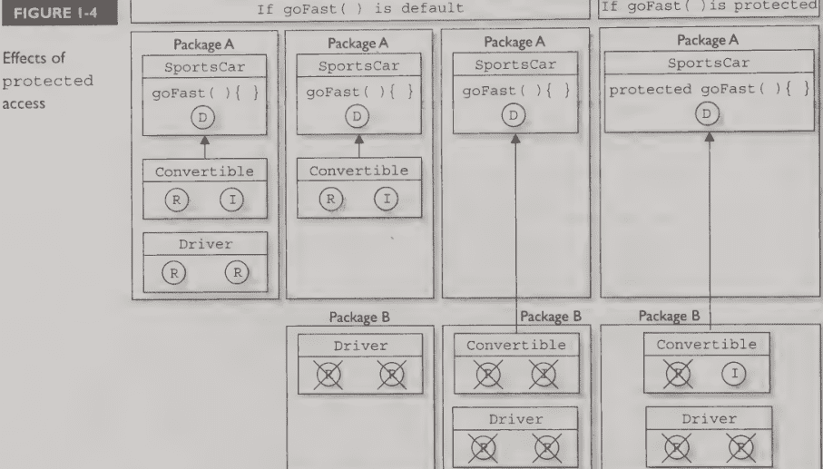

关键点：

```go
goFast() {
dostuff() {
gofast();
}
}
```

```
doThings() {
SportsCar sc = new SportsCar;
sc.goFast();
}
```

```
doMore() {
gofast();
}
```

其中 `goFast` 在同一个类中声明。

使用声明 `goFast()` 的类的类的引用来调用 `goFast()`。

调用 `goFast()` 方法
继承自父类的 `goFast()` 方法。

注意，我们没有在变量 `x` 前放置访问修饰符。请记住，如果你在类或成员声明之前没有输入访问修饰符，访问控制将是默认的，这意味着包级别（package level）。现在我们尝试从之前看到的 `Child` 类中访问该默认成员。

当我们尝试编译 `Child.java` 文件时，会得到类似下面的错误：

```
Child.java:4: Undefined variable: x
System.out.println("Variable x is " + x);
```

1 个错误

# 声明类成员（OCA 目标 2.1, 2.2, 2.3, 2.4, 2.5, 4.1, 4.2, 6.2 和 6.6） 41

编译器给出的与成员声明为 `private` 时相同的错误。子类 `Child`（与父类 `Parent` 不在同一个包）无法看到或使用默认父类成员 `x`！那么，对于同一个包中的两个类的默认访问又是呢？

```java
package certification;

public class Parent{

int x = 9; // 默认访问

}
```

在第二个类中，你有以下内容：

```java
package certification;

class Child extends Parent{

  static public void main(String[] args) {

    Child sc = new Child();

    sc.testIt();

  }

  public void testIt() {

    System.out.println("Variable x is " + x); // 没有问题；

  }

}
```

前面的源文件编译正常，类 `Child` 运行并显示 `x` 的值。只需记住，只有当这些子类与父类位于同一个包时，默认成员才是可见的。

## 局部变量与访问修饰符

访问修饰符可以应用于局部变量吗？不能！
在任何情况下，访问修饰符无法应用于局部变量，所以请注意如下代码：

```java
class Foo {

  void dostuff(){

    private int x = 7;

    this.doMore(x);

  }

}
```


你可以确定，任何使用访问修饰符声明的局部变量都无法通过编译。事实上，只有一个修饰符可以应用于局部变量——即`final`。

我们关于成员访问修饰符的讨论到此结束。表 1-2 显示了访问权限和可见性的所有组合；你真的应该花点时间研究它。接下来，我们将深入探讨可以应用于成员声明的其他（非访问类）修饰符。

# 42 第1章：声明与访问控制

表 1-2 确定类成员的访问权限

| 可见性 | Public | Protected | Default | Private |
| --- | --- | --- | --- | --- |
| 同一个类中 | 是 | 是 | 是 | 是 |
| 同一个包中的任何类 | 是 | 是 | 是 | 否 |
| 同一个包中的子类 | 是 | 是 | 是 | 否 |
| 包外的子类 | 是 | 是，通过继承 | 否 | 否 |
| 包外的任何非子类类 | 是 | 否 | 否 | 否 |

## 非成员修饰符

我们讨论了成员访问，这指的是一个类中的代码是否可以调用另一个类的方法（或访问实例变量）。这仍然留下了大量可以在成员声明上使用的其他修饰符。你已经熟悉`final`和`abstract`了——因为在本章稍早我们已经将它们应用于类声明。但我们仍然需要快速查看一下`transient`、`synchronized`、`native`、`strictfp`，然后详细查看那个大头——

我们将首先查看应用于方法的修饰符，然后查看应用于实例变量的修饰符。我们将通过面向对象`static`在应用于变量和方法时的工作原理来结束这一节。

## Final 方法

`final`关键字防止方法在子类中被重写，通常用于强制执行方法的 API 功能。例如，`Thread`类有一个名为`isAlive()`的方法，用于检查线程是否活跃。然而，如果你扩展了`Thread`类，实际上你没有办法可以正确地自己实现这个方法（首先，它使用了原生代码），所以设计人员将其设为`final`。正如你不能对`String`类子类（因为我们需要能够信任`String`对象的行为），你不能重写核心类库中的许多方法。这种不可重写的限制提供了安全性和保障，但你应该非常谨慎地使用它。防止子类重写方法会抑制许多面向对象的优势，包括通过多态实现的扩展性。一个典型的`final`方法声明如下：

```java
class SuperClass{

    public final void showSample() {

        System.out.println("One thing.");

    }

}
```

# 声明类成员（OCA 目标 2.1, 2.2, 2.3, 2.4, 2.5, 4.1, 4.2, 6.2 和 6.6） 43

`final`关键字防止方法在子类中被重写，通常用于强制执行方法的 API 功能。例如，`Thread`类有一个名为`isAlive()`的方法，用于检查线程是否活跃。然而，如果你扩展了`Thread`类，实际上你没有办法可以正确地自己实现这个方法（首先，它使用了原生代码），所以设计人员将其设为`final`。正如你不能对`String`类子类（因为我们需要能够信任`String`对象的行为），你不能重写核心类库中的许多方法。这种不可重写的限制提供了安全性和保障，但你应该非常谨慎地使用它。防止子类重写方法会抑制许多面向对象的优势，包括通过多态实现的扩展性。一个典型的`final`方法声明如下：

```java
class SuperClass{

    public final void showSample() {

        System.out.println("One thing.");

    }

}
```

# 40 第1章：声明与访问控制

关键点：

```go
goFast() {

dostuff() {

gofast();

}

}
```

其中`goFast`在同一个类中声明。

使用声明`goFast()`的类的类的引用来调用`goFast()`。

调用`goFast()`方法继承自父类的`goFast()`方法。

注意，我们没有在变量`x`前放置访问修饰符。请记住，如果你在类或成员声明之前没有输入访问修饰符，访问控制将是默认的，这意味着包级别（package level）。现在我们尝试从之前看到的`Child`类中访问该默认成员。

当我们尝试编译`Child.java`文件时，会得到类似下面的错误：

```
Child.java:4: Undefined variable: x

System.out.println("Variable x is " + x);
```

1 个错误

# 声明类成员（OCA 目标 2.1, 2.2, 2.3, 2.4, 2.5, 4.1, 4.2, 6.2 和 6.6） 41

编译器给出的与成员声明为`private`时相同的错误。子类`Child`（与父类`Parent`不在同一个包）无法看到或使用默认父类成员`x`！那么，对于同一个包中的两个类的默认访问又是呢？

```java
package certification;

public class Parent{

int x = 9; // 默认访问

}
```

在第二个类中，你有以下内容：

```java
package certification;

class Child extends Parent{

  static public void main(String[] args) {

    Child sc = new Child();

    sc.testIt();

  }

  public void testIt() {

    System.out.println("Variable x is " + x); // 没有问题；

  }

}
```

前面的源文件编译正常，类`Child`运行并显示`x`的值。只需记住，只有当这些子类与父类位于同一个包时，默认成员才是可见的。

## 局部变量与访问修饰符

访问修饰符可以应用于局部变量吗？不能！在任何情况下，访问修饰符无法应用于局部变量，所以请注意如下代码：

```java
class Foo {

  void dostuff(){

    private int x = 7;

    this.doMore(x);

  }

}
```

你可以确定，任何使用访问修饰符声明的局部变量都无法通过编译。事实上，只有一个修饰符可以应用于局部变量——即`final`。

我们关于成员访问修饰符的讨论到此结束。表 1-2 显示了访问权限和可见性的所有组合；你真的应该花点时间研究它。接下来，我们将深入探讨可以应用于成员声明的其他（非访问类）修饰符。

# 42 第1章：声明与访问控制

表 1-2 确定类成员的访问权限

| 可见性 | Public | Protected | Default | Private |
| --- | --- | --- | --- | --- |
| 同一个类中 | 是 | 是 | 是 | 是 |
| 同一个包中的任何类 | 是 | 是 | 是 | 否 |
| 同一个包中的子类 | 是 | 是 | 是 | 否 |
| 包外的子类 | 是 | 是，通过继承 | 否 | 否 |
| 包外的任何非子类类 | 是 | 否 | 否 | 否 |

## 非成员修饰符

我们讨论了成员访问，这指的是一个类中的代码是否可以调用另一个类的方法（或访问实例变量）。这仍然留下了大量可以在成员声明上使用的其他修饰符。你已经熟悉`final`和`abstract`了——因为在本章稍早我们已经将它们应用于类声明。但我们仍然需要快速查看一下`transient`、`synchronized`、`native`、`strictfp`，然后详细查看那个大头——

我们将首先查看应用于方法的修饰符，然后查看应用于实例变量的修饰符。我们将通过面向对象`static`在应用于变量和方法时的工作原理来结束这一节。

## Final 方法

`final`关键字防止方法在子类中被重写，通常用于强制执行方法的 API 功能。例如，`Thread`类有一个名为`isAlive()`的方法，用于检查线程是否活跃。然而，如果你扩展了`Thread`类，实际上你没有办法可以正确地自己实现这个方法（首先，它使用了原生代码），所以设计人员将其设为`final`。正如你不能对`String`类子类（因为我们需要能够信任`String`对象的行为），你不能重写核心类库中的许多方法。这种不可重写的限制提供了安全性和保障，但你应该非常谨慎地使用它。防止子类重写方法会抑制许多面向对象的优势，包括通过多态实现的扩展性。一个典型的`final`方法声明如下：

```java
class SuperClass{

    public final void showSample() {

        System.out.println("One thing.");

    }

}
```

## 抽象方法

抽象方法是一个被声明但没有实现的方法。正如你记得之前的“抽象类”章节，抽象方法声明甚至没有用于实现代码的大括号，而是以分号结尾。你将一个方法标记为`abstract`是当你想强制子类提供实现时。

# 95

抽象类的第一个具体子类必须实现所有抽象方法。

# 46 第一章：声明与访问控制

图 1-5

**抽象**修饰符对具体和**抽象**子类的影响

抽象方法必须由非抽象子类实现。如果该子类是抽象的，则不需要实现抽象方法，但允许实现子类抽象方法的任何或全部。`AcmeRover`类是非抽象的，因此它必须实现其父类中声明的抽象方法，并且必须实现`turn(int whichWay)`，因为 SUV 没有实现它。

AcmeRover
enable4wd() // 可选
goOffRoad() // 
turn(int whichWay) // 

类 B 将无法编译，因为它没有实现继承的抽象方法`foo()`。虽然它里面的`foo(int i)`方法看起来像是父类抽象方法的实现，但它仅仅是一个使用相同标识符的重载方法（方法），因此它没有满足实现父类抽象方法的要求。我们将在第 2 章详细查看重载和重写的区别。方法永远永远不能被同时标记为`abstract`和`final`，或者同时标记为`abstract`和`private`。想一下——抽象方法必须被实现（这本质意味着被子类重写），而`final`和`private`方法不能被子类重写。或者换句话，抽象标记意味着子类对于类在该方法中如何行为一无所知，而`final`标记意味着父类知道所有子类（无论它们在实例树中有多深）在该方法中应该行为。`abstract`和`final`修饰符实际上是对立的。因为`private`方法不能

# 声明类成员 (OCA  2.1, 2.2, 2.3, 2.4, 2.5, 4.1, 4.2, 6.2 和 6.6) 47

被子类看到（更不用说继承），因此它们不能被重写，因此它们也不能被标记为抽象。

最后，你需要知道——对于顶层类来说——`abstract`修饰符永远不能与`static`修饰符结合。我们将在本目标中涵盖`static`方法，但目前只需记住以下写法是非合法的：

```
abstract static void doStuff();
```

它会给出一个你现在很熟悉的错误：

```
MyClass.java:2: illegal combination of modifiers: abstract and static

abstract static void doStuff();
```

## 同步方法 (Synchronized Methods)

`synchronized`关键字表示一个方法一次只能被一个线程访问。我们将在第 13 章深入讨论这一点，但目前我们只需要知道`synchronized`修饰符可以应用于方法——而不是变量，也不用于类。一个典型的`synchronized`声明如下所示：

```java
public synchronized Record retrieveUserInfo(int id) { }
```


你还应该知道，`synchronized` 修饰符可以与四个访问控制级别中的任何一个匹配（这意味着它可以与三个访问修饰符关键字中的任何一个匹配）。

## 原生方法 (Native Methods)

`native` 修饰符表示方法是在依赖平台的代码中实现的，通常是 C。对于考试来说，你不需要知道如何使用原生方法，只需知道 `native` 是一个修饰符（因此是一个保留关键字），并且 `native` 只能应用于方法——而不是类，不是变量，只是方法。注意，原生方法的体必须是一个分号（`;`）（类似于抽象方法），表示实现部分已省略。

## 严格浮点方法 (Strictfp Methods)

我们之前看过了将 `strictfp` 作为类修饰符，但即使你没有将类声明为 `strictfp`，你仍然可以将单个方法声明为 `strictfp`。`strictfp` 强制浮点数（以及任何浮点操作）遵循 IEEE 754 标准。通过 `strictfp`，无论 JVM 运行在什么底层平台上，你都可以预测浮点数如何行为。

# 第一章：声明与访问控制

缺点是底层平台能够支持更高的精度，而 `strictfp` 方法将无法利用这一点。如果你需要一些能帮助你入眠的东西，你会想研究一下 IEEE 754。但对于考试来说，除了 `strictfp` 的用途之外，你不需要知道关于它的任何事情，即它可以修改类或方法的声明，并且变量永远不能声明为 `strictfp`。

## 带有变长参数列表的方法 (var-args) (仅限 OCP 候选人)

从 Java 5 开始，Java 允许你创建接受可变数量参数的方法。根据你从哪里看，你可能会听到这种能力被称为“变长度参数列表”、“可变参数”、“var-args”或我们个人喜欢的（来自混淆部门）“元数参数 (arity parameters)”。它们都是同一件事，从现在起我们将使用“var-args”术语。

作为背景，我们想澄清我们在书中将如何使用“argument”（参数）和“parameter”（参数）这两个术语。

- **变长类型**：当你声明方法时，在类型后面加上省略号（`...`），一个空格，然后是方法的名称。这可以是基本类型或对象类型。
- **基本语法**：当你使用 `var-args` 时，必须指定类型。
- **其他参数**：在方法中使用 `var-args` 是合法的。
- **var-args 限制**：`var-args` 必须是方法签名中的最后一个参数，一个方法只能有一个 `var-args`。

让我们看一些合法的和非法的 `var-args` 声明：

```java
void doStuff(int... x) { } // 期望接收多个 int 参数
void doStuff(char c, int... x) { } // 期望先有一个 char，然后是多个 int
void doStuff(Animal... animal) { } // 期望多个 Animal
```

非法的：

```java
void doStuff(int... ) { // 语法错误
void doStuff(int... x, char... y) { // 多个 var-args
void doStuff(String... s, byte b) { } // var-args 必须在最后
```

# 声明类成员 (OCA 2.1, 2.2, 2.3, 2.4, 2.5, 4.1, 4.2, 6.2 和 6.6)

## 构造方法声明

在 Java 中，对象被构建。每当你创建一个新对象时，至少有一个构造方法被调用。每个类都有构造方法，尽管你没有显式创建一个，编译器也会为你构建一个。关于构造方法有大量的规则，我们将详细讨论留到第 2 章。目前，让我们看简单的例子：

```java
class Foo {
    protected Foo() { } // 这是 Foo 的构造方法
    void Foo() { } // 这是一个命名糟糕但合法的方法
}
```

首先要注意到构造方法看起来非常像方法。一个关键区别是构造方法永远永远不能有返回类型……永远！构造方法声明具有所有标准的访问修饰符，并且可以接受参数（包括 `var-args`），就像方法一样。关于构造方法的另一个大规则是它们必须与其定义的类名相同。构造方法不能被标记为 `static`（毕竟它们与实例化相关），并且可以标记为 `final` 或 `abstract`（因为它们不能被重写）。这里是一些合法的和非法的构造方法声明：

```java
class Foo2 {
    // 合法的构造方法
    Foo2() { }
    private Foo2(byte b) { }
    Foo2(int x) { }
}
```

# 第一章：声明与访问控制

```java
Foo2(int x, int... y) {
// 非法构造函数
void Foo2() { // 这是一个方法，不是构造函数
Foo2() { // 不是方法也不是构造函数
Foo2(short s); // 看起来像是一个抽象方法
static Foo2(float f) { // 不能是静态的
final Foo2(long x) { // 不能是 final
abstract Foo2(char c) { // 不能是抽象的
Foo2(int... x, int t) { // 变长参数语法
}
```

## 变量声明

Java 中有两种变量：

- **基本数据类型 (Primitives)**：可以是八种类型之一：`char`, `boolean`, `byte`, `short`, `int`, `long`, `double` 或 `float`。一旦声明了基本数据类型，其基本数据类型就永远无法改变，尽管在大多数情况下，它的值是可以改变的。
- **引用变量 (Reference variables)**：引用变量用于引用（或访问）对象。引用变量被声明为特定类型，该类型永远无法更改。引用变量可以引用声明类型的任何对象或该类型的子类型（兼容类型）。我们将在第 2 章讨论多态时，介绍更多关于如何使用引用变量引用子类型的内容。

## 声明基本数据类型及其范围

基本数据类型变量可以声明为类变量（静态变量）、实例变量、方法参数或局部变量。你可以在同一行声明一个或多个相同基本类型的基本数据类型。在第 3 章中，我们将讨论它们的各种初始化方式，但现在我们先给出几个基本数据类型声明的示例：

```java
byte b;
boolean myBooleanPrimitive;
int x, y, z; // 声明三个 int 基本数据类型
```

在之前的考试版本中，你需要知道如何计算所有 Java 基本数据类型的范围。对于目前的考试，你可以跳过一些细节，但理解以下内容仍然重要：对于整数类型，从从小到大的顺序是 `byte`、`short`、`int` 和 `long`，且 `double` 的范围比 `float` 大。

## 声明类成员 (OCA 考试目标 2.1, 2.2)

## 图 1-6

符号位：0 = 正数
1 = 负数
数值位：
`byte`：7 位可以表示 2^7 或 128 个不同的值
0 到 127 或 -128 到 -1
`short`：15 位可以表示 2^15 或 32768 个值
0 到 32767 或 -32768 到 -1

`byte` 的符号位


你还需要知道数字（包括整数和浮点类型）都是有符号的，以及这如何影响它们的范围。首先，让我们回顾一下概念。Java 中的所有数字类型都由特定数量的位组成且有符号，这意味着它们可以是正的或负的。最左侧的位表示符号，其中 1 表示负，0 表示正，如图 1-6 所示。剩余的位表示数值，使用补码表示。对于 256 个可能的数字，我们使用公式 -2^(bits-1) 计算负数范围，使用 2^(bits-1) - 1 计算正数范围。

表 1-3 显示了基本数据类型的大小及其范围。浮点数的范围确定起来很复杂，但幸运的是考试不需要知道这些（尽管 `double` 是 64 位，`float` 是 32 位）。

| 类型 | 位 | 字节 | 最小范围 | 最大范围 |
|---|---|---|---|---|
| `byte` | 8 | 1 | -2^7 | 2^7 - 1 |
| `short` | 16 | 2 | -2^15 | 2^15 - 1 |
| `int` | 32 | 4 | -2^31 | 2^31 - 1 |
| `long` | 64 | 8 | -2^63 | 2^63 - 1 |
| `float` | 32 | 4 | 不适用 | 不适用 |
| `double` | 64 | 8 | 不适用 | 不适用 |

# 第一章：声明与访问控制

`boolean` 没有范围；`boolean` 只能是 `true` 或 `false`。如果有人问你 `boolean` 的位深度，你直视他们的眼睛说：“取决于虚拟机。”他们会大为惊叹。

`char` 类型（字符）包含单个 16 位 Unicode 字符。虽然被称为 ISO Latin-1 的扩展 ASCII 集合只需要 8 位（256 个字符），但表示英语以外的语言需要更大的范围。Unicode 字符实际上由无符号 16 位整数表示，这意味着有 2^16 个可能的值，范围从 0 到 65535 (2^16 - 1)。你将在第 3 章了解到 `char` 实际上是一个整数类型，尽管 `char` 和 `short` 都是 16 位类型，记住 `short` 使用一位来表示符号，因此正数较少。

## 声明引用变量

引用变量可以声明为静态变量、实例变量、方法参数或局部变量。你可以在同一行声明一个或多个相同类型的引用变量。在第 3 章中，我们将讨论它们的各种初始化方式，但现在我们先给出几个引用声明的示例：

```java
Object o;
Dog myReferenceVariable;
String s1, s2, s3; // 声明三个 String 变量
```

## 实例变量

实例变量定义在类内部、方法外部，并在实例化时初始化。实例变量是属于每个对象的字段。例如，以下代码定义了 `name`、`title` 和 `manager` 的字段（实例变量）：

```java
class Employee {
    // 定义字段（实例变量）
    private String name;
    private String title;
    private String manager;
    // 其他代码在此
}
```

# 声明类成员 (OCA 考试目标 2.1, 2.2, 2.3, 2.4, 2.5, 4.1, 4.2, 6.2, 和 6.6)

前面的 `Employee` 类表示每个实例都将知道自己的名称、职位和经理。换句话说，每个实例对这三个字段都有自己的值。对于考试，你需要知道实例变量：

- 可以使用任何访问级别（这意味着它们可以用任何访问修饰符标记）
- 可以被标记为 `final`
- 可以被标记为 `transient`
- 不能标记为 `abstract`
- 不能被标记为 `synchronized`
- 不能标记为 `native`
- 不能标记为 `static`，因为它们将变成类变量

我们已经涵盖了在实例变量上应用访问控制的影响（其工作方式与方法相同）。在本章的稍后部分，我们将查看应用 `final` 或 `transient` 修饰符意味着什么。在此之前，我们先快速查看一下实例变量的区别。图 1-7 展示了修饰符如何应用于方法与变量的。

| 局部变量 | 非本地变量 | 方法 |
|---|---|---|
| `final` | `protected` `volatile` | `final` `static` |

# 第一章：声明与访问控制

# 局部（自动栈/方法内）变量

局部变量是定义在方法内的变量。这意味着它不仅在方法内初始化，而且在方法内声明。局部变量始终位于栈上，并在方法结束时被销毁。（我们将在第 3 章中详细讨论栈和堆。）不要忘记，虽然局部变量在栈上，但如果变量是一个对象引用，那么对象本身将在堆上创建。不存在栈对象，只有栈变量。你经常听到程序员使用“局部对象”这个短语，但他们真正的意思是“局部引用变量”。所以，如果你听到程序员使用这个词，你就知道他们太懒于用技术准确的方式表达了。

局部变量声明不能使用大多数应用于实例变量的修饰符，例如 `public`（或其他访问修饰符）、`transient`、`volatile`、`abstract` 或 `static`，但正如我们之前看到的，局部变量可以标记为 `final`。正如你将在第 3 章看到的（但这是一个预览），在使用局部变量之前，必须为它初始化一个值。例如：

```java
class TestServer {
    public void login() {
        int count = 10;
    }
}
```

通常，你会在声明局部变量的同一行初始化它，尽管你可能仍会在方法后期对其重新赋值。关键是记住，在使用局部变量之前必须对其进行初始化。编译器将拒绝任何尝试使用未赋值局部变量的代码，因为与实例变量不同，局部变量不会获得默认值。

局部变量无法在其声明的方法之外任何代码中被引用。在前面的代码示例中，除了 `login` 方法的作用范围，在类的其他地方无法引用 `count` 变量。再次，这并不意味着 `count` 的值不能传递出方法开启新的生命。但持有该值的变量 `count` 在方法完成后就无法被访问了，如下所示法代码所示：

## 声明类成员 (OCA 目标 2.1, 2.2, 2.3, 2.4, 2.5, 4.1, 4.2, 6.2, 和 6.6)

```java
class TestServer {
    public void login() {
        int count = 10;
    }
    public void doSomething(int i) {
        count = i; // 无法编译！无法在外部访问 count
        // method login()
    }
}
```

声明一个与实例变量同名的局部变量是可能的。这被称为隐藏（shadowing），如下代码所示：

```java
class TestServer {
    int count = 9; // 声明一个名为 count 的实例变量
    public void login() {
        int count = 10; // 声明一个名为 count 的局部变量
        System.out.println("local variable count is " + count);
    }
    public void count() {
        System.out.println("instance variable count is " + count);
    }
    public static void main(String[] args) {
        new TestServer().login();
        new TestServer().count();
    }
}
```

上述代码产生以下输出：

```
local variable count is 10
instance variable count is 9
```

到底在地球（或你选择的任何星球）为什么要这么做？通常情况下，你不会这样做。但最常见的原因之一是将参数命名为与它将要赋值的实例变量相同的名称。

以下（错误的）代码尝试使用参数来设置实例变量的值：

```java
class Foo {
    int size = 27;
    public void setState(int size) {
        size = size; // ??? 哪个 size 等于 哪个 size???
    }
}
```

所以你决定——为了整体的可读性——想给参数起一个与它目标赋值的实例变量相同的名称，但你如何解决命名冲突呢？使用关键字 `this`。`this` 关键字始终、总是、总是指向当前正在运行的对象。以下代码展示了这一点：

```java
class Foo {
    int size = 27;
    public void setState(int size) {
        // this.size 表示当前对象的
        this.size = size; // 实例变量 size。右侧的
        // 是参数
    }
}
```

## 数组声明

在 Java 中，数组是对象，用于存储多个相同类型的变量，或者所有都是相同类型子类的变量。数组可以持有原始类型或对象引用，如果数组被声明为持有原始类型元素，数组本身将始终是堆上的一个对象。换句话说，不存在所谓的原始类型数组，但你可以创建一个原始类型元素的数组。

对于这个例子，你需要了解三件事：

- 如何创建数组引用变量（声明）
- 如何创建数组对象（构造）
- 如何向数组中填充元素（初始化）

对于此目标，你只需要知道如何声明数组；我们将在第 5 章介绍数组的构造和初始化。

数组是高效的，但很多时候你可能想使用 `java.util` 中的集合类型（包括 `HashMap`、`ArrayList` 和 `TreeSet`）。集合类提供了更灵活的方法来访问对象（插入、删除、读取等），并且与数组不同，它们可以随着添加或删除元素动态扩展或收缩。针对各种需求都有相应的集合类型。你需要快速排序吗？需要一组没有重复的对象吗？需要一种访问键值对的方法吗？对于 OCA 候选人，第 5 章讨论了 `ArrayList`，对于 OCP 候选人，第二章更详细地介绍了集合。

数组的声明是通过声明数组将持有的元素类型（对象或原始类型），后面加上方括号，或者方括号放在标识符的后面。

## 声明原始类型数组

```java
int[] key; // 推荐
int key[]; // 也是合法的但不推荐
```

## 声明对象引用数组

```java
String[] threads; // 推荐
String threads[]; // 合法的但不推荐
```

## 声明多维数组

```java
int[][] scores; // 推荐
```


`int scores[][];` // 合法的但不推荐

# 声明类成员 OCA 目标 2.1, 2.2, 2.3, 2.4, 4.1, 4.2, 6.2, 和 6.6 59

图 1-8

`final` 对变量、方法和类的影响


`final` 类不能被子类


`final` 方法

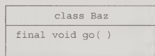

`final` 方法不能被子类重写

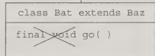

`final` 变量

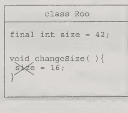

`final` 变量一旦完成了初始化方法，就不能赋予新值（值的初始赋值必须在构造函数完成之前完成）。

`volatile` 修饰符也可以应用于项目经理 :)

## 静态变量和方法

`static` 修饰符用于创建独立于类所创建的任何实例的变量和方法。在你创建任何类的新实例之前，所有静态成员都已存在了，而且无论该类的实例有多少个，静态成员都只有一个拷贝。换句话说，给定类的所有实例对任何给定的静态变量都共享相同的值。我们将在下一章中详细介绍静态成员。

你可以标记为 `static` 的内容：

- 方法
- 变量
- 嵌套在另一个类中的类，但不是嵌套在方法内部（关于此的更多内容将在第 12 章中介绍）
- 初始化块

你不能标记为 `static` 的内容：

- 构造函数（没有意义；构造函数只用于创建实例）
- 类（除非它们是嵌套的）
- 接口（除非它们是嵌套的）
- 方法局部内部类（我们将在第 12 章中探索）
- 内部类方法和实例变量
- 局部变量

## 认证目标

# 声明和使用枚举
(OCA 目标 1.2 和 OCP 目标 2.5)

2.5 使用枚举类型。

注意：在本书编写期间，Oracle 调整了 OCA 和 OCP 考试的一些目标。我们不能 100% 确定枚举主题是否包含在 OCA 考试中，但我们认为买无一失胜于有意，因此我们建议 OCA 候选人学习这一部分。无论如何，你很可能在阅读的 Java 代码中遇到枚举的使用，所以学习它们将是有回报的。

## 声明枚举

从 Java 5 开始，Java 允许你将变量限制为具有几个预定义值之一——换句话说，就是来自枚举列表中的一个值（令人惊讶的是，枚举列表中的项被称为枚举 `enums`）。

使用枚举可以帮助减少你的咖啡馆应用程序中的错误，你可能想限制 `CoffeeSize` 选择只能为 `BIG`、`HUGE` 和 `OVERWHELMING`。如果你允许 `LARGE` 或 `GRANDE` 订单溜掉，可能会导致错误。枚举来救援了。通过以下简单的声明，你可以保证编译器将阻止你向 `CoffeeSize` 赋值 `BIG`、`HUGE` 或 `OVERWHELMING` 的任何内容：

```java
enum CoffeeSize { BIG, HUGE, OVERWHELMING };
```

从那时起，获取 `CoffeeSize` 的唯一方法将是通过这样的语句：

```java
CoffeeSize cs = CoffeeSize.BIG;
```

并不是要求枚举常量必须全大写，但借用 Oracle 代码规范中常量用大写字母命名的做法，这是一个好主意。

枚举的基本组件是它的常量（即 `BIG`、`HUGE` 和 `OVERWHELMING`），尽管过了一会儿你会看到枚举可以包含更多内容，它们可以被声明为自己的独立类或作为类的成员；但是，它们不能在方法内部声明！

这里是一个在类外部声明枚举的示例：

```java
enum CoffeeSize { BIG, HUGE, OVERWHELMING } // 这不能
// private 或 protected

class Coffee {
    CoffeeSize size;
}

public class CoffeeTest1 {
    public static void main(String[] args) {
        Coffee drink = new Coffee();
        drink.size = CoffeeSize.BIG; // 类外的枚举
    }
}
```

前面的代码可以是单个文件的一部分。（记得，文件必须命名为 `CoffeeTest1.java`，因为那是文件中公共类的名称）。要记住的关键点是，没有封装在类中的枚举可以只用 `public` 或默认（`default`）修饰符声明，就像非内部类一样。这里是一个在类内部声明枚举的示例：

```java
class Coffee2 {
    enum CoffeeSize {BIG, HUGE, OVERWHELMING}
    public CoffeeSize size;

    public class CoffeeTest2 {
        public static void main(String[] args) {
            Coffee2 drink = new Coffee2();
            drink.size = CoffeeSize.BIG; // 封装类
            // 需要名称
        }
    }
}
```

从这些示例中获得的关键要点是，枚举可以声明为自己的类，也可以封装在另一个类中，并且访问枚举成员的语法取决于枚举声明的位置。

以下内容是不合法的：

```java
class CoffeeTest1 {
    public static void main(String[] args) {
        enum CoffeeSize {BIG, HUGE, OVERWHELMING} // 错误！不能
        // 方法
        Coffee2 drink = new Coffee2();
        drink.size = CoffeeSize.BIG;
    }
}
```

为了让你更困惑，Java 设计者让枚举声明末尾的分号是可选的（当没有其他声明时）：

```java
class CoffeeTest1 {
    public static void main(String[] args) {
        enum CoffeeSize {BIG, HUGE, OVERWHELMING}; -- 分号
        // 是可选的
        Coffee2 drink = new Coffee2();
        drink.size = CoffeeSize.BIG;
    }
}
```

当我们创建一个枚举时创建了什么？最重要的一点是，枚举并不是 `String` 或 `int`！换句话说，每个枚举类型都是 `CoffeeSize` 的一个实例。将枚举想象成像下面（但并不完全）这样的类：

```java
// 关于如何思考枚举的
// 性示例
class CoffeeSize {
    public static CoffeeSize BIG =
        new CoffeeSize("BIG", 0);
    public static CoffeeSize HUGE =
        new CoffeeSize("HUGE", 1);
    public static CoffeeSize OVERWHELMING =
        new CoffeeSize("OVERWHELMING", 2);

    CoffeeSize(String enumName, int index) {
    }

    public static void main(String[] args) {
        System.out.println(CoffeeSize.BIG);
    }
}
```

注意每个枚举值 `BIG`、`HUGE` 和 `OVERWHELMING` 是 `CoffeeSize` 的实例。它们被表示为 `static` 和 `final`，这在 Java 世界被认为是常量。还注意到每个枚举值都知道自己的索引或位置——换句话说，枚举值的声明顺序是重要的。你可以将 `CoffeeSize` 枚举视为 `CoffeeSize` 数组中的元素，正如你在随后的章节中看到的，可以通过调用 `values()` 方法来遍历枚举的值。（在本章中不用担心那个。）

## 在枚举中声明构造函数、方法和变量

由于枚举实际上是一种特殊的类，你可以做的不仅仅是列出枚举常量值。你可以添加构造函数、实例变量、方法，以及一种非常特殊的常量特定类体。为了理解你为什么可能需要枚举中的更多内容，请思考映射到三个 `CoffeeSize` 常量的实际尺寸（盎司）。例如，你想知道 `BIG` 是 8 盎司，`HUGE` 是 10 盎司，而 `OVERWHELMING` 是 16 盎司。

你可以使用其他数据结构创建某些查找表，那是一个糟糕的设计且难以维护。简单的方法是将你的枚举值（`BIG`、`HUGE` 和 `OVERWHELMING`）视为对象，每个对象都可以拥有自己的实例变量。然后你可以在枚举初始化时向枚举构造函数传递值来分配这些值。这需要一些解释，但先看下面的代码。

# 第一章：声明与访问控制

```java
enum CoffeeSize {
    // 8, 10 & 16 被传递给构造函数
    BIG(8), HUGE(10), OVERWHEMING(16);

    CoffeeSize(int ounces) { // 构造函数
        this.ounces = ounces;
    }

    private int ounces; // 实例变量

    public int getOunces() {
        return ounces;
    }
}

class Coffee {
    CoffeeSize size; // 每个 Coffee 实例都有一个枚举

    public static void main(String[] args) {
        Coffee drink1 = new Coffee();
        drink1.size = CoffeeSize.BIG;

        Coffee drink2 = new Coffee();
        drink2.size = CoffeeSize.OVERWHEMING;

        System.out.println(drink1.size.getOunces()); // 打印 8

        for (CoffeeSize cs : CoffeeSize.values()) {
            System.out.println(cs + " : " + cs.getOunces());
        }
    }
}
```

输出如下：

```
BIG 8
HUGE 10
OVERWHEMING 16
```

- 你**永远无法**直接调用枚举构造函数。枚举构造函数是自动调用的，并带有你在常量值之后定义的参数。例如，`BIG(8)` 会调用接受 `int` 类型的 `CoffeeSize` 构造函数，将字面量 8 传递给构造函数。（当然，在底层，你可以想象 `BIG` 也被传递给了构造函数，但我们不需要知道——或关心——细节。）
- 你可以为构造函数定义多个参数，并且可以重载枚举构造函数，就像你可以重载普通类的方法一样。

# 声明和使用枚举 (OCA 目标 1.2 OCP 目标 2.5) 65

构造函数。我们将在第 2 章更详细地讨论构造函数。要初始化一个带有盎司数和（例如）类型的 `CoffeeSize`，你需要向构造函数传递两个参数，如 `BIG(8, "A")`，这意味着你在 `CoffeeSize` 中有一个同时接受 `int` 和 `String` 的构造函数。

最后，你还可以在枚举中定义一些非常奇怪的东西，看起来像是一个匿名内部类（我们在第 8 章中讨论过）。它被称为常量特定类体（constant specific class body），当你需要某个特定常量来重写枚举中的方法时，就会使用它。

想象这样一个场景：你希望枚举有两个方法——一个用于盎司，一个用于盖子（`String` 类型）。现在想象大多数咖啡尺寸使用相同的盖子代码 `"B"`，但 `OVERWHELING` 使用 `"A"`。你可以在 `CoffeeSize` 枚举中定义一个 `getLidCode()` 方法并返回 `"B"`，但你需要一种方法来为 `OVERWHELING` 重写它。你不想在 `getLidCode()` 方法中编写某些难以维护的 `if/then` 代码，因此最好的方法可能是让 `OVERWHELING` 常量重写 `getLidCode()` 方法。

这看起来很奇怪，但你需要理解其基本规则：

```java
enum CoffeeSize {
    BIG(8),
    HUGE(10),
    OVERWHELING(16) { // 开始一个代码块来定义
        // 此常量的“体”
        public String getLidCode() { // 重写方法
            return "A";
        } // 当后面有更多代码时，**必须**使用分号
    }

    CoffeeSize(int ounces) {
        this.ounces = ounces;
    }

    private int getOunces() {
        return ounces;
    }

    public String getLidCode() { // 此方法被
        // OVERWHELING 常量重写
        return "B";
    } // 我们希望为 CoffeeSize 常量
    // 返回的默认值
}
```


# 第一章：声明与访问控制

## 认证总结

在吸收了本章内容后，你应该对 Java 语言的一些细微之处有所了解。你可能还会对为什么想参加这次考试感到困惑。这在现阶段是正常的。如果你听到自己在问“我在想什么？”，就休息一下等这种感觉过去。我们想告诉你，情况会变得更容易……这章是最难的一章，之后都会简单很多。

## 两分钟训练

请记住，在本章中，当我们谈论类（classes）时，指的是非内部类，即顶层类。仅针对 OCP 7 候选者，我们将把整个第 12 章留给内部类。关于 OCA 7 与 OCP 7 目标的说明：本书的第一个部分对于 OCA 7 和 OCP 7 候选者来说都是必须的。由于你需要在参加 OCP 7 考试之前通过 OCA 7 考试，因此书的第一部分中两分钟训练里对目标的引用通常针对 OCA 目标。

## 标识符 (OCA 目标 2.1)

- 标识符以字母、下划线或货币符号开头。
- 在第一个字符之后，标识符也可以包含数字。
- 标识符的长度可以是任意的。

## 可执行的 Java 文件和 `main()` (OCA 目标 1.3)

- 你分别可以使用命令行程序 `javac` 和 `java` 来编译和执行 Java 程序。这两个程序都支持多种命令行选项。
- 唯一具有特殊能力的 `main()` 方法版本是那些签名等同于 `public static void main(String[] args)` 的版本。
- `main()` 可以被重载。

## 导入 (OCA 目标 1.4)

- 导入语句（import statement）唯一的工作是减少击键次数。
- 你可以使用星号（`*`）来搜索包的内容。
- 虽然被称为“静态导入”（static imports），但其语法是 `import static....`。
- 你可以导入 API 类和/或自定义类。

## 源文件声明规则 (OCA 目标 1.2)

- 一个源代码文件只能有一个公共类（public class）。
- 如果源文件包含公共类，则文件名必须与公共类名匹配。
- 一个文件只能有一个包声明（package statement），但可以有多个导入语句。
- `package` 语句（如果有）必须是文件的第一行（非注释行）。
- `import` 语句（如果有）必须在 `package` 语句之后、类声明之前。
- 如果没有 `package` 语句，导入语句必须是源文件中的第一条（非注释）语句。
- `package` 和 `import` 语句适用于文件中的所有类。
- 一个文件可以有多个非公共类。
- 没有公共类的文件没有命名限制。

## 类访问修饰符 (OCA 目标 6.6)

- 有三种访问修饰符：`public`、`protected` 和 `private`。
- 有四种访问级别：`public`、`protected`、`default`（默认）和 `private`。
- 类只能有 `public` 或 `default` 访问。
- 默认访问的类只能被同一个包内的类可见。
- `public` 访问的类可以被所有包的所有类可见。
- 类可见性围绕一个类中的代码是否可以：
  - 创建另一个类的实例
  - 扩展（或子类）另一个类
  - 访问另一个的方法和变量

## 类修饰符（非访问） (OCA 目标 7.6)

- 类也可以用 `final`、`abstract` 或 `strictfp` 修饰。
- 类不能既是 `final` 的又是 `abstract` 的。
- `final` 类不能被子类化。
- 抽象类（abstract class）不能被实例化。
- 类中的单个抽象方法意味着整个类必须是抽象的。
- 抽象类可以同时拥有抽象方法和非抽象方法。
- 扩展抽象类的第一个具体类必须实现它所有的抽象方法。

## 接口实现：OCA 目标 7.6

- 接口（Interfaces）是类可以做什么的合约，但它们没有说明类必须如何做它。
- 接口可以由来自任何继承树的任何类实现。
- 接口就像一个 100% 的抽象类，无论你是否在声明中写了 `abstract` 修饰符，它隐式地都是抽象的。
- 接口只能有抽象方法，不允许具体方法。
- 接口方法默认是 `public` 且 `abstract` 的——显式声明这些修饰符是可选的。
- 抽象类可以拥有抽象方法和非抽象方法。
- 抽象类中的单个抽象方法意味着整个类必须是抽象的。
- 抽象类不能被实例化。
- 抽象类必须实现所有的抽象方法。
- 抽象类中的任何一个抽象方法意味着整个类必须是抽象的。
- 类可见性围绕一个类中的代码是否可以：
  - 创建另一个类的实例
  - 扩展（或子类）另一个类
  - 访问另一个的方法和变量

## 接口实现：OCA 目标 7.6

- 接口是类可以做什么的合约，但它们没有说明类必须如何做它。
- 接口可以由来自任何继承树的任何类实现。
- 接口就像一个 100% 的抽象类。
- 接口只能有抽象方法，不允许具体方法。
- 接口方法默认是 `public` 且 `abstract` 的——显式声明这些修饰符是可选的。
- 接口可以实现。
- 接口只能有抽象方法，不允许具体方法。
- 接口方法默认是 `public` 且 `abstract` 的——显式声明这些修饰符是可选的。
- 接口只能有抽象方法，不允许具体方法。
- 一个文件只能有一个 `package`，但可以有多个导入语句。
- `package` 语句（如果有）必须是文件的第一行（非注释行）。
- `import` 语句（如果有）必须在 `package` 语句之后、类声明之前。
- 如果没有 `package` 语句，导入语句必须是源文件中的第一条（非注释）语句。
- `package` 和 `import` 语句适用于文件中的所有类。
- 一个文件可以有多个非公共类。
- 没有公共类的文件没有命名限制。

## 类访问修饰符 (OCA 目标 6.6)

- 有三种访问修饰符：`public`、`protected` 和 `private`。
- 有四种访问级别：`public`、`protected`、`default` 和 `private`。
- 类只能有 `public` 或 `default` 访问。
- 默认访问的类只能被同一个包内的类可见。
- `public` 访问的类可以被所有包的所有类可见。
- 类可见性围绕一个类中的代码是否可以：
  - 创建另一个类的实例
  - 扩展（或子类）另一个类
  - 访问另一个的方法和变量

## 类修饰符（非访问） (OCA 目标 7.6)

- 类也可以用 `final`、`abstract` 或 `strictfp` 修饰。
- 类不能既是 `final` 的又是 `abstract` 的。
- `final` 类不能被子类化。
- 抽象类不能被实例化。
- 类中的单个抽象方法意味着整个类必须是抽象的。
- 抽象类可以同时拥有抽象方法和非抽象方法。
- 扩展抽象类的第一个具体类必须实现它所有的抽象方法。

## 接口实现：OCA 目标 7.6

- 接口是类可以做什么的合约，但它们没有说明类必须如何做它。
- 接口可以由来自任何继承树的任何类实现。
- 接口就像一个 100% 的抽象类，无论你是否在声明中写了 `abstract` 修饰符，它隐式地都是抽象的。
- 接口只能有抽象方法，不允许具体方法。
- 接口方法默认是 `public` 且 `abstract` 的——显式声明这些修饰符是可选的。

# 两分钟快速演练 73

- 抽象方法必须由子类实现，因此它们必须是可继承的。基于此：
  - 抽象方法不能是私有的（`private`）。
  - 抽象方法不能是最后的（`final`）。
- `native` 修饰符仅适用于方法。
- `strictfp` 修饰符仅适用于类和方法。

# 变长参数的方法（仅限 OCP，OCP 目标 1.3）

- 从 Java 5 开始，方法可以声明一个接受零到多个变长参数的参数，这就是所谓的变长参数方法（var-arg method）。
- 变长参数的语法为 `type... name;`，例如：`dostuff(int... x) { }`
- 变长参数方法只能有一个变长参数。
- 在具有普通参数和变长参数的方法中，变长参数必须最后。

## 变量声明（OCA 目标 2.1）

- 实例变量可以：
  - 具有任何访问控制权限
  - 被标记为 `final` 或 `transient`
- 实例变量不能是抽象的（`abstract`）、同步的（`synchronized`）、原生的（`native`）或严格浮点的（`strictfp`）。
- 声明与实例变量同名的局部变量是合法的；这被称为“遮蔽”（shadowing）。
- `final` 变量具有以下属性：
  - `final` 变量一旦赋值就不能再重新赋值。
  - `final` 引用变量在对象被赋值给 `final` 变量后，它将指向不同的对象。
  - `final` 变量必须在构造函数完成之前初始化。
  - 不存在所谓的“final 对象”。对象引用是 `final` **并不** 意味着对象本身不能改变。
- `transient` 修饰符仅适用于实例变量。
- `volatile` 修饰符仅适用于实例变量。

# 74 第1章：声明与访问控制

## 数组声明（OCA 目标 4.1 和 4.2）

- 数组可以存放基本数据类型或对象，但数组本身始终是一个对象。
- 当声明数组时，括号可以放在变量名的左侧，也可以放在右侧。
- 在声明中包含数组的大小永远是不合法的。
- 对象数组可以包含任何通过数组声明类型 IS-A（或 `instanceof`）测试的对象。例如，如果 `Horse` 继承自 `Animal`，那么一个 `Horse` 对象可以放入 `Animal` 数组。

## 静态变量和方法（OCA 目标 6.2）

- 它们不与类的任何特定实例绑定。
- 使用静态成员不需要类实例。
- 静态变量/类只有一份拷贝，所有实例都共享该拷贝。
- 静态方法无法访问非静态成员。

# 枚举 enums（OCA 目标 1.2 和 OCP 目标 2.5）

- 枚举为一种类型指定了常量值列表。
- 枚举**不是**字符串或整数；枚举常量的类型例如，是枚举类型的 `SUMMER` 和 `FALL`。
- 枚举可以声明在类外部或内部，但**不能**声明在方法内部。
- 声明在类外部的枚举**必须不能**是静态的、最后的、抽象的或私有的。
- 枚举常量可以使用 `(8)` 语法向枚举构造函数传递参数，其中 `int` 字面量被传递给枚举构造函数。
- 枚举构造函数可以有参数并可以被重载。
- 枚举构造函数在代码中**永远不能**被显式调用。它们在枚举初始化时被自动调用。
- 枚举声明末尾的分号是可选的。以下是合法的：

```java
enum Foo { ONE, TWO, THREE }
enum Foo { ONE, TWO, THREE };
```

`MyEnum.values()` 返回一个包含 `MyEnum` 值的数组。

## 测试

以下问题将帮助你衡量对本章介绍内容的理解程度。请仔细阅读所有选项，因为可能有多个答案。为每个问题选择所有正确答案。保持专注。如果你在刚做这些题时遇到困难，不要自责自备。保持积极。向自己重复一些肯定的话，例如“我足够聪明来理解枚举”，“好吧，也许其他人比我懂得好，但我打赌你比我更擅长。”

1. 哪些是正确的？（选择所有适用项）
   - A. `"X extends Y"` 仅当 `X` 是类且 `Y` 是接口时正确。
   - B. `"X extends Y"` 仅当 `X` 是接口且 `Y` 是类时正确。
   - C. 如果 `X` 和 `Y` 都是类或接口，`"X extends Y"` 就是正确的。
   - D. `"X extends Y"` 对于 `X` 和 `Y` 为类和/或接口的所有组合都是正确的。

```java
class Rocket {
    private void blastOff() { System.out.print("bang"); }
}

public class Shuttle {
    public static void main(String[] args) {
        new Shuttle().go();
    }

    void go() {
        blastOff();
        // Rocket.blastOff(); // line A
    }

    private void blastOff() { System.out.print("sh-bang"); }
}
```

2. 给定：哪些是正确的？（选择所有适用项）
   - A. 按照目前的代码输出是 `bang`
   - B. 按照目前的代码输出是 `sh-bang`
   - C. 按照目前的代码，编译失败。
   - D. 如果取消行 A 的注释，输出是 `bang`
   - E. 如果取消行 A 的注释，输出是 `sh-bang bang`
   - F. 如果取消行 A 的注释，编译失败。

3. 假设 `for` 循环的语法是正确的，且：

```java
import static java.lang.System.*;

class Test {
    static public void main(String[] args) {
        String s = "";
        for(int x=0; ++x < args.length; ) // for 循环
            s += args[x];
        println(s);
    }
}
```

结果是什么？
   - A. 空字符串
   - B. 运行时异常
   - C. 编译错误
   - D. 编译错误
   - E. 运行时异常
   - F. 编译失败

4. 给定：

```java
enum Animals {
    DOG("woof"), CAT("meow"), FISH("bubble");
    String sound;
    Animals(String s) { sound = s; }
}

class Test {
    static Animals a;
    public static void main(String[] args) {
        System.out.println(a.sound + " " + a);
    }
}
```

结果是什么？
   - A. `bubble`
   - B. 多个编译错误
   - C. 第 2 行错误
   - D. 第 3 行错误
   - E. 第 4 行错误
   - F. 运行时抛出异常

5. 给定两个文件：

```java
package pkgA;

public class Foo {
    int a = 5;
    protected int b = 6;
    public int c = 7;
}
```

```java
package pkgB;

import pkgA.*;

public class Baz {
    public static void main(String[] args) {
        Foo f = new Foo();
        System.out.print(" " + f.a);
        System.out.print(" " + f.b);
        System.out.println(" " + f.c);
    }
}
```

结果是什么？（选择所有适用项）
   - A. `5 6 7`
   - B. `5` 后跟着异常
   - C. 第 7 行编译错误
   - D. 第 8 行编译错误
   - E. 第 9 行编译错误

6. 给定：

```java
public class Electronic implements Device {
    public void doIt() {}
}
```

```java
abstract class Phone1 { }
```

```java
abstract class Phone2 extends Electronic {
    public void doIt(int x) {}
}
```

```java
class Phone3 extends Electronic implements Device {
    public void doStuff() {}
}
```

```java
interface Device { 
    public void doIt();
};
```

# 78 第1章：声明与访问控制

结果是什么？（选择所有适用项）
   - A. 编译成功
   - B. 第 1 行编译错误
   - C. 第 3 行编译错误
   - D. 第 5 行编译错误
   - E. 第 7 行编译错误
   - F. 第 9 行编译错误

7. 给定：

```java
class Test {
    static void main(String[] args) {
        for(int x = 0; x < 3; x++);
        int []lb = 7;
        long [] x = {5};
        Boolean [] ba;
    }
}
```

结果是什么？（选择所有适用项）
   - A. 第 6 行编译错误
   - B. 第 7 行编译错误
   - C. 第 8 行编译错误
   - D. 第 9 行编译错误

8. 给定：

```java
public class TestDays {
    enum Days { MON, TUE, WED };
    public static void main(String[] args) {
        for(Days d : Days.values())
        ;
        Days [] d2 = Days.values();
        System.out.println(d2[2]);
    }
}
```

结果是什么？（选择所有适用项）
   - A. `TUE`
   - B. `WED`

# 自测 79

   - C. 输出是不可预测的
   - D. 第 4 行错误导致编译失败
   - E. 第 6 行错误导致编译失败
   - F. 第 8 行错误导致编译失败
   - G. 第 9 行错误导致编译失败

9. 给定：

```java
4. public class Frodo extends Hobbit {
```


## 5. 代码分析题

```java
public static void main(String[] args) {
    int myGold = 7;
    System.out.println(countGold(myGold, 6));
}

class Hobbit {
    int countGold(int x, int y) { return x + y; }
}
```

结果是什么？

- A. 13
- B. 存在多个错误导致编译失败
- C. 第 6 行错误导致编译失败
- D. 第 7 行错误导致编译失败
- E. 第 11 行错误导致编译失败

## 10. 接口与继承题

给定：

```java
interface Gadget {
    void doStuff();
}

abstract class Electronic {
    void getPower() { System.out.print("plug in "); }
}

public class Tablet extends Electronic implements Gadget {
    void doStuff() { System.out.print("show book "); }
    public static void main(String[] args) {
        new Tablet().getPower();
        new Tablet().doStuff();
    }
}
```

哪些是正确的？（选择所有适用项。）

- A. `Tablet` 类无法编译
- B. `Gadget` 接口无法编译
- C. 输出为 `plug in show book`
- D. 抽象类 `Electronic` 无法编译
- E. 类不能继承并实现

## II. 静态导入题

假设 `Integer` 类在 `java.lang` 包中，且给定：

```java
// 在此处插入代码
class StatTest {
    public static void main(String[] args) {
        System.out.println(Integer.MAX_VALUE);
    }
}
```

哪一个语句在独立插入到第 1 行时是能够编译通过的？（选择所有适用项。）

- D. `static import java.lang.Integer.*;`
- E. `import static java.lang.Integer.MAX_VALUE;`
- F. 以上语句均不是有效的 `import` 语法

## 自测答案

1. ☑ C 是正确的。  
   A 是错误的，因为类实现接口，而不是继承接口。B 是错误的，因为接口只能“继承”其他接口。根据前面的规则，D 是错误的。（OCA 目标 7.6）

2. ☑ B 和 F 是正确的。由于 `Rocket.blastOff()` 是私有的，它不能被重写，而且对类 `shuttle` 是不可见的。  
   根据上述内容，A、C、D 和 E 都是错误的。（OCA 目标 6.6）

3. ☑ B 是正确的。这个问题使用了有效的（但不恰当且奇怪的）标识符、静态导入、`main()` 和预自增逻辑。  
   根据上述内容，A、C、D、E、F 和 G 都是错误的。（OCA 目标 1.2 以及 OCA 目标 1.3, 1.4）

4. ☑ A 是正确的；枚举拥有构造函数和变量。  
   B、C、D、E 和 F 都是错误的；这些行代码了正确的语法。（OCP 目标 2.5）

5. ☑ D 和 E 是正确的。变量 `b` 具有默认访问权限，因此无法从包外部访问。变量 `b` 在 `pkga` 中具有受保护访问权限。  
   根据上述信息，A、B、C 和 F 都是错误的。（OCA 目标 1.4 和 6.6）

6. ☑ A 是正确的；这些都是合法的声明。  
   根据上述信息，B、C、D、E 和 F 都是错误的。（OCA 目标 7.6）

7. ☑ C 和 D 是正确的。变量名不能以 `#` 开头，且数组声明在没有实例化的情况下包含大小。其余代码是有效的。  
   根据上述内容，A、B 和 E 都是错误的。（OCA 目标 2.1）

8. ☑ B 是正确的。每个枚举都带有一个静态的 `values()` 方法，该方法返回枚举值的数组，按照它们在枚举中声明的顺序。  
   根据上述信息，A、C、D、E、F 和 G 都是错误的。（OCP 目标 2.5）

9. ☑ D 是正确的。`countGold()` 方法不能在静态上下文中调用。  
   根据上述信息，A、B、C 和 E 都是错误的。（OCA 目标 2.5 和 6.2）

10. A 是正确的。默认情况下，接口的方法是公共的，因此 `Tablet.doStuff` 方法也必须是公共。其余代码是有效的。  
    根据上述内容，B、C、D 和 E 都是错误的。（OCA 目标 7.6）

11. C 和 E 是静态导入的正确语法。第 4 行没有使用静态导入，因此即使没有任何导入，代码也可以编译。  
    根据上述内容，A、B、D 和 F 都是错误的。（OCA 目标 1.4）

# 2 面向对象编程

## 认证目标

- 描述封装
- 实现继承
- 使用 IS-A 和 HAS-A
- 使用多态
- 使用重写和重载
- 使用接口
- 理解返回类型
- 理解构造函数

## 两分钟演练

# 2 面向对象编程

## 认证目标

## 封装

- 实现继承
- 使用 IS-A 和 HAS-A
- 使用多态
- 使用重写和重载
- 使用接口
- 理解返回类型
- 理解构造函数

## 封装

封装是将数据（变量）和操作这些数据的方法封装进单个单元（类）的实践。它还涉及限制对象组件的访问，是一种防止意外修改或误用的技术。

本章将探索如何使用封装以及它的重要性。我们将从 Java 提供的工具开始。

## 封装（OCA 目标 6.1 和 6.7）

封装允许你隐藏对象的内部状态并仅通过公共接口暴露。这允许你在不影响调用代码的情况下更改实现。

假设你写了一个带有公共变量的类，而那些程序员直接设置了变量，如下代码所示：

```java
public class Badoo {
    public int size;
    public int weight;
}

public class ExploitBadoo {
    public static void main(String[] args) {
        Badoo b = new Badoo();
        b.size = -5; // 合法但不佳！
    }
}
```

现在你遇到麻烦了。如何更改类以处理当有人将大小更改为引起问题的值？你唯一的选择是回去编写调整大小的方法（例如 `set(int a)` 方法），然后使用（例如）私访问修饰符来隔离 `size` 变量。但一旦你对代码进行此类操作，就会破坏所有人的代码！

如果你想要可维护性、灵性和扩展性（你当然想要），你的设计必须包含封装。如何做？

- 保持实例变量受保护（使用访问修饰符，通常是私有的）。
- 创建公共访问方法，并强制调用代码使用这些方法而不是直接访问实例变量。
- 对于这些访问方法，使用常见的命名约定 `set<someProperty>` 和 `get<someProperty>`。

图 2-1 说明了封装强制你的代码调用者通过方法而不是直接访问变量的想法。

# 86 第 2 章：面向对象

图 2-1 封装的本质

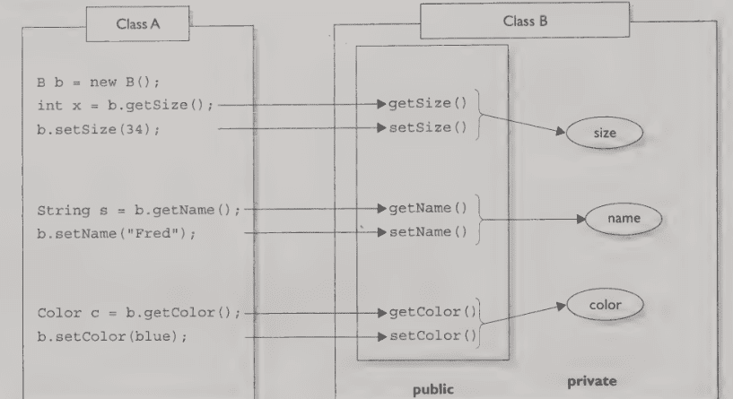

> 类 A 无法通过 getter 和 setter 方法访问类 B 的实例变量数据。数据被标记为私有（`private`）：访问方法是公有的（`public`）。

为了访问你的实例变量。它们看起来很简单，你可能已经使用它们很久了：

```java
public class Box {
    // 保护实例变量；只有 Box 的
    // 实例才能访问它
    private int size;

    // 提供公共的 getters 和 setters
    public int getSize() {
        return size;
    }

    public void setState(int newSize) {
        size = newSize;
    }
}
```

# 封装 (OCA 目标 6.1 和 6.7) 87

等一下。这段代码到底有多用呢？它甚至没有进行任何验证或处理。拥有没有添加任何功能的 getters 和 setters 有什么好处呢？关键在于，你以后可以改变主意，向你的方法中添加更多代码，而不会破坏你的 API。即使今天你认为自己真的不需要对数据进行验证或处理，良好的 OO 设计也要求为未来做打算。为了安全，调用代码应该通过你的方法而不是直接进入实例变量。始终如此。这样你就可以自由地重构你的方法实现，而不用担心几十个知道你住址的程序员的愤怒。

注意：在第 5 章中，我们将重新回顾封装主题，它也适用于引用变量的实例变量。这比你想象的要复杂，请留期待！（另外，我们将等到第 5 章再用以封装为主题的问题挑战你。）

## 注意事项

留意那些看起来是在询问某个方法的行为的代码，而实际上问题在于缺乏封装。看下面的示例，看看你能否弄清楚发生了什么：

```java
class Foo {
    public int left = 9;
    public int right = 3;

    public void setCount(int leftNum) {
        left = leftNum;
        right = leftNum/3;
    }
    // 这里有很多复杂的测试代码
}
```

现在考虑这个问题：`right` 的值是否始终是 `left` 的值的三分之一？看起来是这样的，直到你意识到 `Foo` 类的使用者并不需要使用 `setCount()` 方法！他们可以直接访问实例变量并将它们更改为任意值。

## 继承与多态
(OCA 目标 7.1, 7.2 和 7.3)

7.1 实现继承。

7.2 开发演示多态使用的代码。

7.3 区分引用的类型和对象的类型。

继承在 Java 中无处不在。可以说，如果不使用继承，几乎（几乎）不可能写出即使是最微微的 Java 程序。为了探索这个主题，我们将使用 `instanceof` 运算符，我们将在第 5 章详细讨论它。现在只需记住，如果被测试的引用变量是与所比较的类型，`instanceof` 将返回 `true`。这段代码

```java
class Test {
    public static void main(String[] args) {
        Test t1 = new Test();
        Test t2 = new Test();

        if (t1.equals(t2))
            System.out.println("they're not equal");

        if (t1 instanceof Object)
            System.out.println("t1's an Object");
    }
}
```

产生此输出：

```
they're not equal
t1's an Object
```

`equals` 方法是从哪里来的？引用变量 `t1` 的类型是 `Test`，`Test` 类中没有 `equals` 方法。或者有？第二个 `if` 检查 `t1` 是否是 `Object` 类的实例，因为由于它是（稍后会详细介绍），所以如果测试成功了。

等一下……当我们刚刚说 `t1` 是 `Test` 类型时，它怎么可能是 `Object` 类型的实例呢？我确定你领先于我们，但事实是 Java 中的每个类都是 `Object` 类的子类（当然除了 `Object` 本身）。换句话说，你使用或编写的每个类将继承自 `Object` 类。你将始终可以使用 `equals` 方法、`clone` 方法、`notify` 等方法。每当你创建一个类时，你会自动继承 `Object` 的所有方法。为什么？Java 的创建者正确地假设，Java 程序员比较类类的实例以检查相等性是非常常见的。如果 `Object` 类没有 `equals` 方法，你就必须自己写一个——以及其他每个程序员也是。这一个方法已经被继承了十亿次。（公平地说，`equals` 也被重写了十亿次，但我们考虑得太远了。）对于考试，你需要知道可以在 Java 中通过 `extends` 一个类来创建继承关系。理解使用继承的两个最常见的原因也很重要：

- 为了促进代码复用
- 为了实现多态

让我们从复用开始。一种常见的设计方法是创建一个相当通用的类版本，意图是创建继承自它的更具体的子类。例如：

```java
class GameShape {
    public void displayShape() {
        System.out.println("displaying shape");
    }
    // 更多代码
}
```

```java
class PlayerPiece extends GameShape {
    public void movePiece() {
    }
}
```

（此处由于提供的原文文本在此处中断，翻译已根据提供的内容完成）

综上所述，对于 OCP 考试，你需要能够观察代码并判断该代码演示的是 IS-A（是）关系还是 HAS-A（包含）关系。规则很简单，这应该是少数几个几乎不需要动脑就能正确回答题目的领域之一。

## IS-A

在面向对象（OO）中，IS-A 概念基于类继承或接口实现。IS-A 是表达“这个东西是那种东西的一种”的一种方式。例如，野马（`Mustang`）是一种马，因此在面向对象的术语中，我们可以说“`Mustang` 是一种 `Horse`”。斯巴鲁（`Subaru`）是一辆汽车。西兰花是一种蔬菜（虽然不太有趣，但确实如此）。在 Java 中，你通过 `extends` 关键字（用于类继承）和 `implements` 关键字（用于接口实现）表达 IS-A 关系。

```java
public class Car {
    // 这里是 Cool Car
}
```

```java
public class Subaru extends Car {
    // 这里是重要的 Subaru 特有内容
    // 不要忘记 Subaru 继承了 Car 的成员，
    // 这些成员可能包括方法和变量。
}
```

`Car` 是一种 `Vehicle`（车辆）的一种，因此继承树可能从 `Vehicle` 类开始如下：

```java
public class Vehicle { ... }
public class Car extends Vehicle { ... }
public class Subaru extends Car { ... }
```

在面向对象的术语中，你可以这样说：

- `Vehicle` 是 `Car` 的超类。
- `Car` 是 `Vehicle` 的子类。
- `Car` 是 `Subaru` 的超类。
- `Subaru` 是 `Vehicle` 的子类。
- `Car` 继承自 `Vehicle`。
- `Subaru` 同时继承 `Vehicle` 和 `Car`。
- `Subaru` 派生自 `Car`。
- `Car` 派生自 `Vehicle`。
- `Subaru` 同时是 `Vehicle` 和 `Car` 的子类型。

## 继承与多态（OCA 目标 7.1, 7.2 和 7.3） 93

回到我们的 IS-A 关系，以下陈述是正确的：

“`Car extends Vehicle`”意味着“`Car` 是一种 `Vehicle`”。
“`Subaru extends Car`”意味着“`Subaru` 是一种 `Car`”。

我们还可以说：

“`Subaru` 是一种 `Vehicle`”，因为如果一个类被认为是其继承树中更上层中任何东西的“类型”，当表达式 `(Foo instanceof Bar)` 为真时，那么类 `Foo` 就是一种 `Bar`，即使 `Foo` 没有直接继承 `Bar`，而是继承了另一个作为 `Bar` 的子类的类。图 2-2 阐了 `Vehicle`、`Car` 和 `Subaru` 的继承树。箭头从子类指向超类。换句话说，一个类的箭头指向它所继承的类。

## HAS-A

HAS-A 关系基于使用，而不是继承。换句话说，如果类 A 中的代码有一个对类 B 实例的引用，则类 A 拥有一个 B。例如，你可以这样说：

马（`Horse`）是一种动物（`Animal`）。马有一个马缰（`Halter`）。

代码可能像这样：

```java
public class Animal {
}

public class Horse extends Animal {
    private Halter myHalter;
}
```

在这段代码中，`Horse` 类有一个类型 `Halter` 的实例变量（马缰是你拥有的马时可能拥的一种装备），因此你可以说“`Horse` 拥有一个 `Halter`”。换句话说，`Horse` 拥有指向 `Halter` 的引用。`Horse` 代码可以使用该 `Halter` 引用来调用 `Halter` 的方法，而无需在 `Horse` 类本身中包含 `Halter` 相关的代码（方法）。图 2-3 阐述了 `Horse` 和 `Halter` 之间的 HAS-A 关系。

HAS-A 关系允许你设计遵循良好面向对象实践的类，而不是拥有执行无数种不同事情的巨型类。类（及其产生的对象）应该是专门的。正如朋友 Andrew 所说：“专门的类实际上可以减少错误”。类越专门，在其他应用程序中重用代码的可能性就越大。如果你将所有与 `Halter` 相关的代码直接放入 `Horse` 类中，你最终会在 `Cow`（牛）、`UnpaidIntern`（无薪实习生）类以及任何可能需要 `Halter` 行为的类中重复代码。通过将 `Halter` 代码保持在单独的专门的 `Halter` 类中，你就有机会在多个应用程序中重用 `Halter` 代码。

`Horse` 类的用户（即调用 `Horse` 实例方法的代码）认为 `Horse` 类具有 `Halter` 行为。例如，`Horse` 类可能有一个 `tie(LeadRope rope)` 方法。`Horse` 类的用户永远不应该需要知道，当他们调用 `tie()` 方法时，对象会转，并通过调用 `myHalter.tie(rope)` 将调用委托给它的 `Halter` 类。描述的情景可能像这样：


# 继承与多态

## 继承与多态（OCA 目标 7.1, 7.2 和 7.3）

回到我们的 IS-A 关系，以下陈述是正确的：

- “`Car extends Vehicle`”意味着“`Car` 是一种 `Vehicle`”。
- “`Subaru extends Car`”意味着“`Subaru` 是一种 `Car`”。

我们还可以说：“`Subaru` 是一种 `Vehicle`”，因为一个类被认为是其继承树中更上层中任何东西的“类型”。当表达式 `(Foo instanceof Bar)` 为真时，那么类 `Foo` 就是一种 `Bar`，即使 `Foo` 没有直接继承 `Bar`，而是继承了另一个作为 `Bar` 的子类的类。图 2-2 阐明了 `Vehicle`、`Car` 和 `Subaru` 的继承树。箭头从子类指向超类。换句话说，一个类的箭头指向它所继承的类。

**图 2-2** `Vehicle`, `Car`, `Subaru` 的继承树

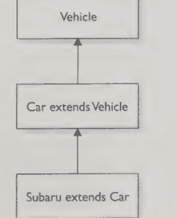

## HAS-A

HAS-A 关系基于使用，而不是继承。换句话说，如果类 `A` 中的代码有一个对类 `B` 实例的引用，则类 `A` 拥有一个 `B`。例如，你可以这样说：马（`Horse`）是一种动物（`Animal`）。马有一个马缰（`Halter`）。代码可能像这样：

```java
public class Animal {
}

public class Horse extends Animal {
    private Halter myHalter;
}
```

在这段代码中，`Horse` 类有一个类型 `Halter` 的实例变量（马缰是你拥有马时可能拥有的一种装备），因此你可以说“`Horse` 拥有一个 `Halter`”。换句话说，`Horse` 拥有指向 `Halter` 的引用。`Horse` 代码可以使用该 `Halter` 引用来调用 `Halter` 的方法，而无需在 `Horse` 类本身中包含 `Halter` 相关的代码（方法）。图 2-3 阐述了 `Horse` 和 `Halter` 之间的 HAS-A 关系。

**图 2-3** `Horse` 和 `Halter` 之间的 HAS-A 关系

| `Horse` | `Halter` |
| --- | --- |
| `Halter h` | |
| `tie(Rope r)` | `tie(Rope r)` |

`Horse` 类有一个 `Halter`，因为 `Horse` 声明了一个类型为 `Halter` 的变量。当引用调用 `Horse` 实例时，`Horse` 拥有一个 `Halter` 变量。

HAS-A 关系允许你设计遵循良好面向对象实践的类，而不是拥有执行无数种不同事情的巨型类。类（及其产生的对象）应该是专门的。正如朋友 Andrew 所说：“专门的类实际上可以减少错误”。类越专门，在其他应用程序中重用代码的可能性就越大。如果你将所有与 `Halter` 相关的代码直接放入 `Horse` 类中，你最终会在 `Cow`（牛）、`UnpaidIntern`（无薪实习生）类以及任何可能需要 `Halter` 行为的类中重复代码。通过将 `Halter` 代码保持在单独的专门的 `Halter` 类中，你就有机会在多个应用程序中重用 `Halter` 代码。

`Horse` 类的用户（即调用 `Horse` 实例方法的代码）认为 `Horse` 类具有 `Halter` 行为。例如，`Horse` 类可能有一个 `tie(LeadRope rope)` 方法。`Horse` 类的用户永远不应该需要知道，当他们调用 `tie()` 方法时，对象会转，并通过调用 `myHalter.tie(rope)` 将调用委托给它的 `Halter` 类。描述的情景可能像这样：

```java
public class Horse extends Animal {
    private Halter myHalter = new Halter();

    public void tie(LeadRope rope) {
        myHalter.tie(rope); // 将行为委托给
        // Halter 对象
    }
}

public class Halter {
    public void tie(LeadRope aRope) {
        // 在这里执行实际工作
    }
}
```

**图 2-2** `Vehicle`, `Car`, `Subaru` 的继承树


**图 2-3** `Horse` 和 `Halter` 之间的 HAS-A 关系

| `Horse` | `Halter` |
| --- | --- |
| `Halter h` | |
| `tie(Rope r)` | `tie(Rope r)` |

`Horse` 类有一个 `Halter`，因为 `Horse` 声明了一个类型为 `Halter` 的变量。当引用调用 `Horse` 实例时，`Horse` 拥有一个 `Halter` 变量。

# 面向对象设计

IS-A 和 HAS-A 仅仅是冰山一角。在 Java 认证中并不要求你深入理解。视觉建模语言如统一建模语言 (UML) 能够帮助设计者可视化类关系。

> Jonathan Meeks, Sun Certified Programmer

记住，访问对象的唯一方法是通过引用变量。关于引用，你应该知道的几点：

- 引用只能有一种类型，一旦声明，该引用永远不能改变（尽管它引用的对象可以）。
- 引用是一个变量，所以它可以重新赋值给其他对象（除非引用声明为 `final`）。
- 引用变量的类型决定了可以在其引用的对象上调用的方法。
- 引用变量可以引用与声明类型相同的对象，或者——这是重要的一点——它可以引用声明类型的任何子类型！
- 引用变量可以声明为类类型或接口类型。如果变量被声明为接口类型，它可以引用实现接口的任何类的对象。

之前我们创建了一个 `GameShape` 类，它被另外两个类 `PlayerPiece` 和 `TilePiece` 扩展。现在想象对游戏板上的某些形状进行动画处理。但并不是所有的形状都能动画，那么如何处理类继承呢？

我们可以创建一个带有 `animate()` 方法的类，并让某些 `GameShape` 子类继承该类吗？如果可以，我们就可以让 `PlayerPiece` 同时继承 `GameShape` 和 `Animatable` 类，而 `TilePiece` 只继承 `GameShape`。但不，这不可行！Java 只支持单继承！这意味着一个类只能有一个直接的超类。换句话说，如果 `PlayerPiece` 是一个类，没有办法像这样：

```java
class PlayerPiece extends GameShape, Animatable { // 不能！
    // more code
}
```

一个类不能继承超过一个类：每个类只能有一个父类。然而，一个类可以拥有多个祖先，因为类 `B` 可以继承类 `A`，类 `C` 可以继承类 `B`，以此类推。因此，任何类在它的继承树上都可能拥有多个类，但这不等同于说一个类直接继承了两个类。

某些语言（如 C++）允许一个类继承多个其他类。这种能力被称为“多重继承”。Java 的创建者选择不允许多重继承的原因是它可能会变得非常混乱。问题在于，如果一个类继承另外两个类，而这两个父类都有（例如）一个 `doStuff()` 方法，那么子类应该继承哪一个版本的 `doStuff()` 呢？这个问题会导致被称为“死亡钻石”（Deadly Diamond of Death）的情况，这是因为在多重继承设计中创建的类图形状呈菱形。当 `B` 和 `C` 都继承 `A`，且 `B` 和 `C` 都从 `A` 继承一个方法时，菱形就形成了。如果类 `D` 同时继承了 `B` 和 `C`，且 `B` 和 `C` 都重写了 `A` 中的该方法，那么理论上类 `D` 继承了同一个方法的两个不同实现。画成类图，这四个类的形状看起来就像一个菱形。


如果这种方法不通，你还能做什么？你可以直接将 `animate()` 代码放在 `GameShape` 中，并在无法动画的类中禁用该方法。出于许多原因，这都是一个糟糕的设计选择——它更容易出错，使得 `GameShape` 类的内聚性降低（内聚性将在第十章讨论），并且意味着 `GameShape` API “宣称”所有形状都可以动画，实际上并非如此，因为只有部分 `GameShape` 子类能够成功运行 `animate()` 方法。

那么你还能做什么？你已经知道答案了——创建一个 `Animatable` 接口，并可以让动画的 `GameShape` 子类实现该接口。接口定义如下：

```java
public interface Animatable {
    public void animate();
}
```

这里是实现了接口的修改后的 `PlayerPiece` 类：

```java
class PlayerPiece extends GameShape implements Animatable {
    public void movePiece() {
        System.out.println("moving game piece");
    }

    public void animate() {
        System.out.println("animating...");
    }
    // more code
}
```

现在我们有一个 `PlayerPiece` 通过了针对 `GameShape` 类和 `Animatable` 接口的 IS-A 测试。这意味着 `PlayerPiece` 在任何时刻都可以被多态地视为四种类型之一，取决于变量的声明类型：

- 一个 `Object`（因为任何对象都继承自 `Object`）
- 一个 `GameShape`（因为 `PlayerPiece` 继承了 `GameShape`）
- 一个 `PlayerPiece`（因为它本身就是这种类型）
- 一个 `Animatable`（因为 `PlayerPiece` 实现了 `Animatable`）

以下都是合法的声明。仔细看：

```java
PlayerPiece player = new PlayerPiece();
Object o = player;
GameShape shape = player;
Animatable mover = player;
```

这里只有一个对象——一个 `PlayerPiece` 类型的实例——但有四种不同类型的引用变量，它们都指向堆上的那一个对象。随堂测验：上述哪些引用变量可以调用 `displayShape()` 方法？提示：四个声明中只有两个可以用于调用 `displayShape()` 方法。

请记住，编译器允许的方法调用完全基于引用的**声明类型**，而不取决于使用的实际类型。所以再次看这四种引用类型——`Object`、`GameShape`、`PlayerPiece` 和 `Animatable`，这四个中哪些知道 `displayShape()` 方法？

你猜对了——`GameShape` 类和 `PlayerPiece` 类都被（编译器）认为拥有 `displayShape()` 方法，因此这两种引用类型中的任何一种都可以用来调用 `displayShape()`。记住，对于编译器来说，`PlayerPiece` 是 `GameShape`，所以编译器说：“我看到声明类型是 `PlayerPiece`，由于 `PlayerPiece` 继承了 `GameShape`，这意味着……”

# 多态（OCA 目标 7.2 和 7.3）

7.2 开发演示多态使用的代码。

7.3 区分引用的类型和对象的类型。

记住，任何可以通过多个 IS-A 测试的 Java 对象都可以被认为是多态的。记住，访问对象的唯一方法是通过引用变量。关于引用，你应该知道的几点：

- 引用只能有一种类型，一旦声明，该引用永远不能改变（尽管它引用的对象可以）。
- 引用是一个变量，所以它可以重新赋值给其他对象（除非引用声明为 `final`）。
- 引用变量的类型决定了可以在其引用的对象上调用的方法。
- 引用变量可以引用与声明类型相同的对象，或者——这是重要的一点——它可以引用声明类型的任何子类型！
- 引用变量可以声明为类类型或接口类型。如果变量被声明为接口类型，它可以引用实现接口的任何类的对象。

关于被重写的方法，以下哪项是正确的？

- 方法根据引用类型被调用。
- 方法根据实际对象被调用。
- 只有静态方法会被重写。
- 只有变量可以被重写。

答案是：方法根据实际对象被调用。这是多态的核心。当你调用被重写的方法时，JVM 在运行时查看对象的实际类型，而不是引用的类型，以确定执行哪个版本的方法。

# 重写 / 重载（OCA 目标 6.1, 6.3, 7.2 和 7.3）

- 6.1 创建带有参数和返回类型的方法。
- 6.3 创建一个重载方法。
- 7.2 开发演示多态使用的代码。
- 7.3 区分引用的类型和对象的类型。

考试将在许多许多题目中使用重写和重载方法。这两个概念经常被混淆（也许因为它们的名字很相似？），但每个概念都有自己一套独特且复杂的规则。搞清楚“重写”（over）涉及的规则至关重要！

## 重写的方法

每当一个类从父类继承方法时，你都有机会重写该方法（除非如你之前学过的，该方法被标记为 `final`）。重写的关键优势是能够定义特定子类类型的行为。下面的示例演示了 `Animal` 的子类 `Horse` 如何重写 `Animal` 的 `eat()` 方法：

```java
public class Animal {
    public void eat() {
        System.out.println("Generic Animal Eating Generically");
    }
}

class Horse extends Animal {
    public void eat() {
        System.out.println("Horse eating hay, oats, " + " and horse treats");
    }
}
```

对于从父类继承的抽象方法，你没有选择：在子类中实现该方法，除非该子类也是抽象的。抽象方法必须由具体的子类实现，但这类似于说具体的子类重写了父类的抽象方法。你可以将抽象方法看作是被强制重写的方法。

`Animal` 类的创建者可能认为，为了多态性，所有的 `Animal` 子类型都应该以一种独特、特定的方式定义 `eat()` 方法。从多态的角度来看，当 `Animal` 引用指向的不是 `Animal` 实例，而是 `Animal` 子类实例时，调用者应该能够在 `Animal` 引用上调用 `eat()`，但实际的运行时对象（例如 `Horse` 实例）将运行它自己的特定的 `eat()` 方法。将 `eat()` 方法标记为抽象是 `Animal` 程序员向所有子类开发者表达的方式：“你们的新子类型使用通用的 `eat()` 方法没有任何意义，所以你们必须编写自己的 `eat()` 方法实现！”使用多态的示例如下：

```java
public class TestAnimals {
    public static void main(String [] args) {
        Animal a = new Animal();
        Animal b = new Horse(); // Animal 引用，但是一个 Horse 对象
        a.eat(); // 运行 Animal 版本的 eat()
        b.eat(); // 运行 Horse 版本的 eat()
    }
}

class Animal {
    public void eat() {
        System.out.println("Generic Animal Eating Generically");
    }
}

class Horse extends Animal {
    public void eat() {
        System.out.println("Horse eating hay, oats, " + "and horse treats");
    }

    public void buck() {}
}
```

在前面的代码中，测试类使用 `Animal` 引用来调用 `Horse` 对象上的方法。请记住，当使用 `Animal`（非抽象）引用时，编译器只允许调用 `Animal` 类中存在的方法。鉴于前面的代码，以下操作是不合法的：

```java
Animal c = new Horse();
c.buck(); // 无法调用 buck();
// Animal 类没有该方法
```


重申一下，编译器只看引用类型，而不看实例类型。多态允许你使用更抽象的父类型（包括接口）引用来指向其子类型之一（包括接口实现类）。

## 102 第 2 章：面向对象

重写方法的访问修饰符不能比被重写的方法严格（例如，你不能重写一个标记为 `public` 的类方法并将其变为 `protected`）。想一下：如果 `Animal` 类公布了一个 `public` 的 `eat()` 方法，并且有人有一个 `Animal` 引用（换句话说，一个声明为 `Animal` 类型的引用），这个人将假设在 `Animal` 引用上调用 `eat()` 是安全的，无论该引用指向哪个 `Animal` 实例。如果允许子类溜进去更改重写方法的访问修饰符，那么突然在运行时——当 JVM 调用对象的（`Horse`）版本的方法而不是引用类型（`Animal`）版本的方法时——程序将面临惨惨的结局。（更不用说被 `Horse` 子类背叛的人内心的心的痛苦了）。

让我们修改一下在本节之前看到的那个多态示例：

```java
public class TestAnimals {

    public static void main(String [] args) {

        Animal a = new Animal();

        Animal b = new Horse(); // Animal 引用，但是一个 Horse 对象

        a.eat(); // 运行 Animal 版本的 eat()

        b.eat(); // 运行 Horse 版本的 eat()

    }

}

class Animal {

    public void eat() {

        System.out.println("Generic Animal Eating Generically");

    }

}

class Horse extends Animal {

    private void eat() { // 嘿！-它是私有的！

        System.out.println("Horse eating hay, oats, " + "and horse treats");

    }

}
```

如果这段代码通过了编译（实际上并没有通过），以下操作将在运行时失败：

```java
Animal b = new Horse(); // Animal 引用，但是一个 Horse

// 对象，到目前为止没问题

b.eat(); // 运行时崩溃！
```

变量 `b` 是 `Animal` 类型，它有一个 `public` 的 `eat()` 方法。但请记住，在运行时，Java 使用虚拟调用根据实际实例动态选择将运行的实际方法版本。`Animal` 引用始终可以指向 `Horse` 实例，因为 `Horse` **是一个** `Animal`。让父类引用指向子类实例成为可能的，是因为子类保证能够做到父类能做的一切。无论 `Horse` 实例是重写了 `Animal` 继承的方法还是仅仅继承了

## 重写 / 重载 (OCA 目标 6.1, 6.3, 7.2 和 7.3) 103

它们，任何持有指向 `Horse` 实例的 `Animal` 引用的人都可以调用所有可访问的 `Animal` 方法。因此，重写方法必须履行父类的合约。

注意：在第 6 章中，我们将详细探讨异常处理。一旦你学习了第 6 章，你就会体会到实用的、单一的重写规则列表。重写规则如下：

- 参数列表必须与被重写的方法完全匹配。如果不匹配，你将得到一个你并不想要的重载方法。
- 返回类型必须与父类中原始重写方法的返回类型相同或是其子类型。（几页后讨论协变返回时会介绍。）
- 访问级别不能比被重写的方法严格。 实例方法只有在被继承时才能被重写。与父类相同包的子类可以重写任何未标记为 `final`的方法。
- 重写方法不能抛出比被重写方法更宽泛的检查异常。重写方法可以抛出更窄或更少的异常。结论是：无论重写方法声明了什么，重写方法不需要声明异常。
- 不能重写标记为 `final` 的方法。
- 不能重写标记为 `static` 的方法。我们在几页后讨论静态方法时来看示例。

## 104 第 2 章：面向对象

如果一个方法无法被继承，你就无法重写它。记住，重写意味着你正在重新实现一个继承的方法！例如，以下代码是不合法的，即使你在 `Horse` 中添加了 `eat()` 方法，它也不会是 `Animal` `eat()` 方法的重写。

```java
public class TestAnimals {

    public static void main(String [] args) {

        Horse h = new Horse();

        h.eat(); // 不合法，因为它没有继承

    }

}

class Animal {

    private void eat() {

        System.out.println("Generic Animal Eating Generically");

    }

}

class Horse extends Animal { }
```

## 调用重写方法的父类版本

通常，你想利用父类方法写版本中的某些代码，但重写它以提供额外的行为。这就像是在说：“运行父类的方法版本，然后回来完成你的子类附加方法代码。”（注意，并不要求父类版本在子类代码之前运行。）在代码中使用 `super` 关键字很容易实现，如下：

```java
public class Animal {

    public void eat() { }

    public void printYours() {

        // 有用的打印代码在这里

    }

}

class Horse extends Animal {

    public void printYours() {

        // 利用 Animal 代码，然后添加一些

        super.printYours(); // 调用父类的

        // (Animal) 代码

        // 然后执行 Horse 特有的

        // 打印工作

    }

}
```

注意：使用 `super` 调用重写方法仅适用于实例方法。（记住静态方法不能被重写）。而且你只能使用 `super` 访问类超父类的方法，而不能访问父类的子类的方法——也就是说，你不能说 `super.doStuff()`。

## 重写 / 重载：OCA 目标 6.1, 6.3, 7.2 和 7.3) 105

## 考试

观看：如果一个方法被重写了，但你使用多态的父类引用来指向带有重写方法的子类对象，编译器会假设你正在调用该方法的父类版本。如果父类版本声明了受检异常，但重写的子类没有声明，编译器仍然认为你正在调用一个声明了异常的方法（更多信息请见第 6 章）。让我们来看一个例子：

```java
class Animal {

    public void eat() throws Exception {

        // 抛出一个 Exception

    }

}

class Dog2 extends Animal {

    public void eat() { /* 没有异常 */ }

    public static void main(String [] args) {

        Animal a = new Dog2();

        Dog2 d = new Dog2();

        d.eat(); // OK

        a.eat(); // 编译器错误

        // 未报告的异常

    }

}
```

这段代码将无法编译，因为 `Animal eat()` 方法上声明了 `Exception`。尽管在运行时，使用的 `eat()` 方法将是 `Dog` 版本，而它没有声明该异常。

## 非法方法重写的示例

让我们来看看重写 `Animal` 的 `eat()` 方法：

```java
public class Animal {

    public void eat() { }

}
```

表 2-1 列出了在给定上述 `Animal` 类版本的情况下，对 `Animal eat()` 方法进行非法重写的示例。

## 106 第 2 章：面向对象

| 非法重写代码 | 代码问题 |
| :--- | :--- |
| `private void eat() { }` | 访问修饰符更严格 |
| `public void eat() throws IOException { }` | 声明了父类版本中未定义的受检异常 |
| `public void eat(String food) { }` | 这是一个法的重载，而非重写，因为参数列表发生了变化 |
| `public String eat() { }` | 因为返回类型的原因不是重写，也不是重载，因为参数列表没有变化 |

## 重载方法

方法重载允许你在类中重用相同的方法名，但不同的不同（以及可选的不同的返回类型）。重载方法意味着你对调用你方法的人更加友好，因为你的代码承担了处理不同参数类型的负担，而不是强迫调用者在调用你的方法之前进行转换。规则并不太复杂：

- 重载方法**必须**更改参数列表。
- 重载方法**可以**更改返回类型。
- 重载方法**可以**更改访问修饰符。
- 重载方法**可以**声明新的或更广泛的受检异常。
- 方法可以在同一个类中或子类中被重载。换句话说，如果类 A 定义了 `stuff(int i)` 方法，类 B 定义了 `stuff(String s)` 方法，且没有重写接收 `int` 的父类版本，那么两个同名但位于不同类的方法仍然可以被视为重载，如果子类继承了方法的某个版本，并在类定义中声明了另一个重载版本。

## 重写 / 重载（OCA 目标 6.1, 6.3, 7.2 和 7.3） 107

观看：经验较少的的 Java 开发者经常对重载方法和重写方法之间的细微区别感到困惑。注意识别方法何时是被重载而非重写的。你可能会看到一个似乎违反了重写规则的方法，但它实际上是一个合法的重载，如下：

```java
public class Foo {

    public void doStuff(int y, String s) { }

    public void moreThings(int x) { }

}

class Bar extends Foo {

    public void doStuff(int y, long s) throws IOException { }
```

人们很容易把 `IOException` 看作问题所在，因为重写的 `doStuff()` 方法没有声明异常，且 `IOException` 是编译器检查的。但 `doStuff()` 方法并没有被重写！子类通过改变参数列表重载了 `doStuff()` 方法，因此 `IOException` 是没问题的。

## 合法的重载

让我们写出一个想要重载的方法：

```java
public void chunkSize(int size, String name, float pattern) { }

public void chunkSize(int size, String name) { }

private int chunkSize(int size, float pattern) { }

public void chunkSize(float pattern, String name)

    throws IOException { }
```

以下方法是 `chunkSize()` 方法合法的重载：

## 调用重载方法

给 OCP 候选者的提示：在第 11 章中我们将查看装箱和可变参数如何影响重载。（尽管如此，你仍然需要这里这里）。

当调用一个方法时，对于你正在调用方法的对象类型，可能存在多个同名方法。例如，`Horse` 类可能有三个同名但参数列表不同的方法，这意味着该方法被重载了。

## 108 第 2 章：面向对象

决定调用哪个匹配的方法取决于参数。如果你使用 `String` 参数调用该方法，则调用接收 `String` 的重载版本。如果你调用同名方法但传递一个 `float`，将运行接收 `float` 的重载版本。如果你调用同名方法但传递一个 `Foo` 对象，且没有接收 `Foo` 的重载版本，那么编译器将报错说找不到匹配项。以下是调用重载方法的示例：

# 方法重写 / 重载 (OCA 目标 6.1, 6.3, 7.2 和 7.3)

| 表 2-2 合法与非法的重写示例 |
| 方法调用代码 | 结果 |
|---|---|
| `Animal a = new Animal(); a.eat();` | 通用的 Animal 以通用方式吃东西 |
| `Horse h = new Horse(); h.eat();` | 马马在吃草 |
| `Animal ah = new Horse(); ah.eat();` | 马马在吃草。多态性生效——使用实际对象类型（`Horse`）而不是引用类型（`Animal`）来决定调用哪个 `eat()`。 |
| `Horse he = new Horse(); he.eat("Apples");` | 马马在吃苹果。调用了重载的 `eat(String s)`。 |
| `Animal a2 = new Animal(); a2.eat("treats");` | 编译错误！编译器发现 `Animal` 类中没有接收 `String` 参数的 `eat()` 方法。 |
| `Animal ah2 = new Horse(); ah2.eat("Carrots");` | 编译错误！编译器仍然只查看引用，发现 `Animal` 没有接收 `String` 参数的 `eat()` 方法。编译器不在乎运行时实际对象可能是 `Horse`。 |

不要被一个被重载但未被子类重写的方法误导。执行以下操作是完全合法的：

```java
public class Foo {

    void doStuff() { }

}

class Bar extends Foo {

    void doStuff(String s) { }

}
```

`Bar` 类有两个 `doStuff()` 方法：一个是从 `Foo` 继承而来的无参版本（且未重写），另一个是在 `Bar` 类中定义的重载方法 `doStuff(String s)`。带有 `Foo` 引用的代码只能调用无参版本，但带有 `Bar` 引用的代码可以调用这几个重载版本中的任何一个。

# 第 2 章：对象导向

表 2-3 总结了重载方法和重写方法之间的区别。

| 表 1-2 重载与重写的区别 |
| 重载方法 | 重写方法 |
| :--- | :--- |
| 参数 | 必须更改。 | 不得更改。 |
| 返回类型 | 可以更改。 | 除协变返回外不能更改（在本章后面会介绍）。 |
| 异常 | 可以更改。 | 可以减少或消除。不得抛出新的或更宽泛的受检异常。 |
| 访问权限 | 可以更改。 | 不得变得更严格（可以更宽松）。 |
| 调用 | 引用类型决定发生哪个重载版本（基于声明的参数类型）。实际调用的方法仍然是在运行时发生的虚方法调用，编译器已经知道要调用的方法签名。因此，在运行时，参数匹配已经确定，只是该方法所属的类。 | 对象类型（换句话说，堆上实际实例的类型）决定调用哪个方法。发生在运行时。 |

我们将在本章后面介绍构造函数重载，届时我们还将涵盖考试中与其他构造函数相关的主题。图 2-4 展示了重载和重写方法在类关系中是如何出现的。

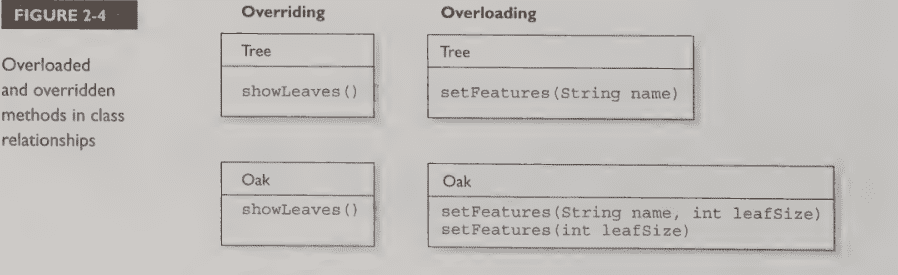

# 强制转换 (OCA 目标 7.3 和 7.4)

## 认证目标

# 强制转换 (OCA 目标 7.3 和 7.4)

7.3 区分引用的类型和对象的类型。

7.4 确定何时需要强制转换。

你已经看到使用泛型引用变量类型来引用更具体的对象类型既是可能的也是常见的。这是多态的核心。例如，这行代码你现在应该是烂熟于心了：

```java
Animal animal = new Dog();
```

但当你想使用该 `animal` 引用变量来调用只有 `Dog` 类才有的方法时会发生什么呢？当它指的是一个 `Dog`，而你想做一些 `Dog` 特有的操作时？在下面的代码中，我们有一个 `Animal` 数组，每当我们在数组中发现 `Dog` 时，我们就想做一些特殊的 `Dog` 特有操作。我们先同意这些代码都是没问题的，只是不确定调用 `playDead` 方法的那行代码。

```java
class Animal {

    void makeNoise() { System.out.println("generic noise"); }

}

class Dog extends Animal {

    void makeNoise() { System.out.println("bark"); }

    void playDead() { System.out.println("roll over"); }

}

class CastTest2 {

    public static void main(String [] args) {

        Animal[] a = {new Animal(), new Dog(), new Animal() };

        for (Animal animal : a) {

            animal.makeNoise();

            if (animal instanceof Dog) {

                animal.playDead(); // 尝试执行 Dog 的行为；

            }

        }

    }
}
```


# 方法重写 / 重载 (OCA 目标 6.1, 6.3, 7.2 和 7.3)

| 表 2-2 合法与非法的重写示例 | |
|---|---|
| 方法调用代码 | 结果 |
| `Animal a = new Animal(); a.eat();` | 通用的 `Animal` 以通用方式吃东西 |
| `Horse h = new Horse(); h.eat();` | 马马在吃草 |
| `Animal ah = new Horse(); ah.eat();` | 马马在吃草。多态性生效——使用实际对象类型（`Horse`）而不是引用类型（`Animal`）来决定调用哪个 `eat()`。 |
| `Horse he = new Horse(); he.eat("Apples");` | 马马在吃苹果。调用了重载的 `eat(String s)`。 |
| `Animal a2 = new Animal(); a2.eat("treats");` | 编译错误！编译器发现 `Animal` 类中没有接收 `String` 参数的 `eat()` 方法。 |
| `Animal ah2 = new Horse(); ah2.eat("Carrots");` | 编译错误！编译器仍然只查看引用，发现 `Animal` 没有接收 `String` 参数的 `eat()` 方法。编译器不在乎运行时实际对象可能是 `Horse`。 |

不要被一个被重载但未被子类重写的方法误导。执行以下操作是完全合法的：

```java
public class Foo {

    void doStuff() { }

}

class Bar extends Foo {

    void doStuff(String s) { }

}
```

`Bar` 类有两个 `doStuff()` 方法：一个是从 `Foo` 继承而来的无参版本（且未重写），另一个是在 `Bar` 类中定义的重载方法 `doStuff(String s)`。带有 `Foo` 引用的代码只能调用无参版本，但带有 `Bar` 引用的代码可以调用这几个重载版本中的任何一个。

# 第 2 章：对象导向

表 2-3 总结了重载方法和重写方法之间的区别。

| 表 1-2 重载与重写的区别 | |
|---|---|
| | 重载方法 | 重写方法 |
| :--- | :--- | :--- |
| 参数 | 必须更改。 | 不得更改。 |
| 返回类型 | 可以更改。 | 除协变返回外不能更改（在本章后面会介绍）。 |
| 异常 | 可以更改。 | 可以减少或消除。不得抛出新的或更宽泛的受检异常。 |
| 访问权限 | 可以更改。 | 不得变得更严格（可以更宽松）。 |
| 调用 | 引用类型决定发生哪个重载版本（基于声明的参数类型）。实际调用的方法仍然是在运行时发生的虚方法调用，编译器已经知道要调用的方法签名。因此，在运行时，参数匹配已经确定，只是该方法所属的类。 | 对象类型（换句话说，堆上实际实例的类型）决定调用哪个方法。发生在运行时。 |

我们将在本章后面介绍构造函数重载，届时我们还将涵盖考试中与其他构造函数相关的主题。图 2-4 展示了重载和重写方法在类关系中是如何出现的。


# 强制转换 (OCA 目标 7.3 和 7.4)

## 认证目标

7.3 区分引用的类型和对象的类型。

7.4 确定何时需要强制转换。

你已经看到使用泛型引用变量类型来引用更具体的对象类型既是可能的也是常见的。这是多态的核心。例如，这行代码你现在应该是烂熟于心了：

```java
Animal animal = new Dog();
```

但当你想使用该 `animal` 引用变量来调用只有 `Dog` 类才有的方法时会发生什么呢？当它指的是一个 `Dog`，而你想做一些 `Dog` 特有的操作时？在下面的代码中，我们有一个 `Animal` 数组，每当我们在数组中发现 `Dog` 时，我们就想做一些特殊的 `Dog` 特有操作。我们先同意这些代码都是没问题的，只是不确定调用 `playDead` 方法的那行代码。

```java
class Animal {

    void makeNoise() { System.out.println("generic noise"); }

}

class Dog extends Animal {

    void makeNoise() { System.out.println("bark"); }

    void playDead() { System.out.println("roll over"); }

}

class CastTest2 {

    public static void main(String [] args) {

        Animal[] a = {new Animal(), new Dog(), new Animal() };

        for (Animal animal : a) {

            animal.makeNoise();

            if (animal instanceof Dog) {

                animal.playDead(); // 尝试执行 Dog 的行为；

            }

        }

    }

}
```

当我们尝试编译这段代码时，编译器会报类似这样的信息：

`cannot find symbol playDead method.`

编译器在说：“嘿，`Animal` 类没有 `playDead()` 方法。”让我们修改 `if` 代码块：

```java
if(animal instanceof Dog) {

    Dog d = (Dog) animal; // 强制转换引用变量。

    d.playDead();

}
```

新的改进后的代码块包含了一个转换，这种情况下有时被称为“向下转型”（downcast），因为我们正在向继承树向下转换到更具体的类型。

与向下转型不同，向上转型（向继承树向上转换为更通用的类型）是隐式的（即你不需要转换），它限制了你可以调用的方法。这里有一个例子：

```java
class Animal {}

class Dog extends Animal {}

class DogTest {

    public static void main(String [] args) {

        Dog d = new Dog();

        Animal a1 = d; // 向上转型无需强制转换

        Animal a2 = (Animal) d; // 向上转型可以使用强制转换

    }

}
```

上述两个向上转型都可以通过编译，因为 `Dog` 是 `Animal`，这意味着 `Animal` 能做的任何事 `Dog` 都能做。`Dog` 当然可以，但点在于任何持有 `Animal` 引用的地方都可以安全地调用 `Dog` 实例的方法。`Animal` 方法可能在 `Dog` 类中被重写，但我们现在关心的是 `Dog` 至少能做到 `Animal` 的所有功能。编译器和 JVM 都知道这一点，因此将子类对象赋值给其类（或接口）引用总是合法的。如果 `Dog` 实现了 `Pet`，且 `Pet` 定义了 `friendly()`，那么 `Dog` 可以隐式转换为 `Pet`，但你可以调用的 `Dog` 方法只有 `friendly()`，这是 `Dog` 被强制实现的。

还有一个……如果 `Beagle` 实现了 `Pet`，那么如果 `Beagle` 扩展 `Dog`，`Beagle` 仍然是 `Pet`！`Beagle` 是 `Pet` 是因为扩展了 `Dog`，而 `Dog` 已经为自己及其所有孩子处理了 `Pet` 部分。`Beagle` 类可以覆盖从 `Dog` 继承的任何方法，包括 `Dog` 为了履行契约而实现的方法。

还有一点……如果 `Beagle` 声明它实现了 `Pet`，只是为了让查看 `Beagle` 类 API 的人无需查看 `Beagle` 的父类就能看到 `Beagle` 是 `Pet`，那么 `Beagle` 仍然不需要实现 `friendly()` 方法，如果 `Dog` 类（`Beagle` 的子类）已经处理了。换句话说，如果 `Beagle` 是 `Dog` 且是 `Pet`，那么 `Beagle` 履行了实现 `friendly()` 方法的义务。编译器足够聪明：“我知道 `Beagle` 已经是一个 `Dog`，但通过强制转换让它更明显。”

```java
Animal animal = new Animal();

Dog d = (Dog) animal;

String s = (String) animal; // 编译将失败
```

不可转换类型

所以不要被那些显示具体类声明自己实现了某个接口，但没有实现该接口方法的代码所误导。在判断代码是否合法之前，你必须知道该实现类的父类已经声明了什么。如果其继承树中的任何父类已经提供了具体的（即非抽象的）方法实现，那么无论该父类是否声明了实现该接口，子类都没有义务重新实现（重写）这些方法。


看这里。考试命题者会告诉你，由于“考试引擎的原因”，他们被迫在狭小的空间内挤大量的代码。虽然这部分是事实，但他们**也**喜欢混淆。以下代码

```java
Animal a = new Dog();

Dog d = (Dog) a;

d.doDogStuff();
```

可以用下面这段易于阅读的趣味代码替换：

```java
Animal a = new Dog();

((Dog) a).doDogStuff();
```

在这种情况下，编译器需要所有这些括号；否则它会认为收到的是一个不完整的语句。

## 认证目标

### 实现接口 (OCA 目标 7.6)

7.6 使用抽象类和接口。

当你实现一个接口时，你是在同意遵守接口中定义的合约。这意味着你同意为接口中定义的每个方法提供合法的实现，并且任何知道接口方法是什么样的的人（不是它们是如何实现的，而是如何被调用以及它们返回什么）都可以确信，他们可以在你的实现类的实例上调用这些方法。

例如，如果你创建了一个实现 `Runnable` 接口的类（这样你的代码就可以被特定的线程执行），你必须提供 `public void run()` 方法。否则，可怜的线程可能会被执行你的 `Runnable` 对象的代码，然后——惊喜吧——线程随后发现该对象没有 `run()` 方法！（在此时，线程将会崩溃，JVM 将在一次壮丽而惨痛的爆炸中崩溃。）坦率地说，Java 通过对任何声称实现接口的类运行编译器检查来防止这种崩溃的发生。如果一个类说它正在实现一个接口，那么它该为接口中的每个方法都有一个实现（我们稍后会看几个例外情况）。

假设有一个接口 `Bouncy`，包含两个方法 `bounce()` 和 `setBounceFactor()`，以下类将可以通过编译：

```java
public class Ball implements Bouncy { // 关键字

    public void bounce() {} // 'implements'

    public void setBounceFactor(int bf) { }

}
```

好了，我们知道你在什么：“这一定是实现类历史上最糟糕的实现类了。”尽管如此，它可以通过编译。它可以运行。接口合约保证了类将拥有该方法（换句话说，其他人可以在访问控制允许范围内调用该方法），但它从未保证过有一个良好的实现——甚至方法体中没有任何任何实际的代码。（不过请记住，如果接口声明某个方法不是 `void`，那么你的类实现代码将包含一个 `return` 语句。）编译器永远不会对你说：“嗯，抱歉，但你真的打算在那些大括号之间什么都不放吗？嘿。这毕竟是一个方法，所以它不应该做点什么吗？”

作为扩展了抽象类的类，实现类必须遵守方法实现的规则。要成为合法的实现类，非抽象实现类必须执行以下操作：

- 为声明接口中的所有方法提供具体的（非抽象）实现。
- 遵循所有合法重写的规则，例如：
- 在实现方法上不声明接口方法已声明异常之外的受检异常，或接口方法声明异常的子类。
- 保持接口方法的签名，并保持相同的返回类型（或子类型）。但它不需要声明接口方法声明中声明的异常。

但等等，还有更多！实现类本身也可以是抽象的！例如，对于实现 `Bouncyable` 的类 `Ball`，以下是合法的：

```java
abstract class Ball implements Bouncyable { }
```

注意到什么了吗？我们没有提供实现方法。这没关系。如果实现类是抽象的，它可以简单地将责任推给它的第一个具体子类。例如，如果类 `Ball` 扩展 `Ball`，且 `BeachBall` 不是抽象的，那么 `BeachBall` 将提供 `Bouncyable` 中的所有方法：

```java
class BeachBall extends Ball {

    // 即使我们在上面的类声明中没有说，

    // Ball 也实现了 Bouncyable，因为 BeachBall 的抽象

    // 父类 (Ball) 实现了 Bouncyable

    public void bounce() {

        // 有趣的 BeachBall 特有的跳转代码

    }

    public void setBounceFactor(int bf) {

        // 高明的 BeachBall 特有的设置

        // 跳跃系数的代码

    }

    // 如果 Ball 定义了任何抽象方法，

    // 它们也必须

    // 在这里实现。

}
```


寻找那些声称实现接口但没有提供正确方法实现的类。除非实现类是抽象的，否则实现类必须为在接口中定义的所有方法提供实现。

你还需要知道两个规则，然后我们就可以结束这个话题了（或者我们会陷入困惑）：

1. 类可以实现多个接口。你只能扩展一个类，但你可以实现许多接口。你知道当我们在谈论类时，以下是不合法的：`public class Ball implements Bouncyable, Serializable { ... }`

2. 接口本身可以扩展另一个接口，但它永远不会实现任何内容。以下代码完全合法：这意味着什么？`Bouncy` 的第一个具体（非抽象）实现类必须实现 `Bouncy` 的所有方法，加上 `Moveable` 的所有方法！子接口（我们这样称呼它）为父接口增加了要求。你会在 Java 的许多领域看到这一概念，特别是 Java EE，在其中你经常需要构建一个扩展 Java 接口的自己的接口。等一下，这里变得很奇怪。接口可以扩展多个接口！考虑一下。正如我们之前提到的，Java 不允许类扩展多个类。然而，接口可以扩展多个接口：`Ball` 实现 `Bouncyable`，加上 `Bouncyable` 扩展的所有接口（包括 `Bouncyable` 扩展的任何接口，以此此类推，直到到达栈的顶部——还是底部？）。所以 `Ball` 需要看起来像这样：

```
public interface Bouncyable extends Moveable { } // 合法！

public class Programmer extends Employee, Geek { } // 不合法！

interface Bouncyable extends Moveable, Spherical { // 合法！

    void bounce();

    void setBounceFactor(int bf);

}

interface Moveable {

    void moveIt();

}

interface Spherical {

    void doSphericalThing();

}

class Ball implements Bouncyable {

public void bounce() { } // 实现 Bouncyable 的方法

public void setBounceFactor(int bf) { } // 实现 Bouncyable 的方法

public void moveIt() { } // 实现 Moveable 的方法

public void doSphericalThing() { } // 实现 Spherical 的方法

}
```

如果 `Ball` 未实现来自 `Bouncyable`、`Moveable` 或 `Spherical` 的任何方法，编译器将疯狂地跳脚，满脸通红，直到它实现为止。除非，类 `Ball` 被标记为抽象。在这种情况下，`Ball` 可以选择

## 实现接口 OCA 目标 7.6

为了实现接口的任何、全部或无方法，从而将其余实现留给 `Ball` 的具体子类，如下所示：

```
abstract class Ball implements Bouncyable {

    public void bounce() { ... } // 定义 bounce 行为

    public void setBounceFactor(int bf) { ... }

    // 不要实现其余部分；将其留给子类

}

class SoccerBall extends Ball { // 类 Soccer 类必须

    // 实现接口方法

    // Ball 没有实现的方法

    public void moveIt() { ... }

    public void doSphericalThing() { ... }

    // SoccerBall 可以选择重写由 Ball 实现的

    // Bouncyable 方法

    public void bounce() { ... }

}
```

图 2-5 比较了类和接口的 `extends` 和 `implements` 的具体与抽象示例。

图 2-5 extends 和 implements 的具体与抽象示例对比

| interface Bouncyable | abstract Ball implements Bouncyable |
| :--- | :--- |
| `void bounce();`<br>`void setBounceFactor(int bf);` | /*Ball 中没有实现<br>Bouncyable 的<br>任何方法 */<br>`void doSpherical() {}` |

| class Tire implements Bouncyable | class BeachBall extends Ball |
| :--- | :--- |
| `public void bounce() {}`<br>`public void setBounceFactor(int bf) {}` | `public void bounce() {}`<br>`public void setBounceFactor(int bf) {}` /*由于没有 `doSpherical`，所以 `BeachBall` 不需要实现它。*/ |

因为 `BeachBall` 是第一个实现 `Bouncyable` 的具体类，它必须为 `Bouncyable` 的所有方法提供实现，但在抽象类 `Ball` 中定义的方法除外。由于 `Ball` 没有提供 `Bouncyable` 方法的实现，`BeachBall` 要求实现所有这些方法。

# 观察

寻找 `extends` 和 `implements` 的非法用法。以下展示了合法与非法的类和接口声明示例：

```
class Foo { // OK

class Bar implements Foo { } // 不！不能实现一个类

interface Baz { } // OK

interface Fi { } // OK

interface Fee implements Baz { } // 不！一个接口不能

// 实现一个接口

interface Zee implements Foo { } // 不！一个接口不能

// 实现一个类

interface Zoo extends Foo { } // 不！一个接口不能

// 扩展一个类

interface Boo extends Fi { } // OK。接口可以扩展

// 一个接口

class Toon extends Foo, Button { } // 不！一个类不能扩展

// 多个类

class Zoom implements Fi, Baz { } // OK。一个类可以实现

// 多个接口

interface Vroom extends Fi, Baz { } // OK。接口可以扩展

// 多个接口

class Yow extends Foo implements Fi { } // OK。类可以同时做这两者

// // (extends 必须在第一)

class Yow extends Foo implements Fi, Baz { } // OK。类可以同时做所有三者

// // (extends 必须在第一)
```

把这些记在脑子里，并在考试的题目中留意这些滥用行为。无论问题看起来在测试什么，真实的问题可能在于类或接口的声明。在陷入其中（例如，追踪复杂的线程流）之前，先检查代码是否可以编译。（光是这一条建议就值得让我们出现在你的遗嘱里了！）（你会对考试开发人员为了分散你的注意力远离真实问题所付出的努力感到惊讶的。）（在发明括号之前，人们是如何写东西的？）

# 合法返回类型
(OCA 目标 2.2, 2.5, 6.1 和 6.3)

- 2.2 区分对象引用变量和基本类型变量。
- 2.5 在对象上调用方法。
- 6.1 创建带有参数和返回值的方法。
- 6.3 创建重载方法。

本节涵盖了返回类型的两个方面：可以声明的返回类型，以及实际可以返回的内容。可以声明和不能声明的内容非常简单，主要取决于你是在重写方法还是在声明一个新方法。我们将快速查看重载方法和重写方法的返回类型规则的区别，因为我们在之前已经涵盖了这一点。不过，当我们观察多态返回类型和实际可以返回的规则时，我们将进入新的领域。

# 返回类型声明

本节查看你被允许作为返回类型的内容，这主要取决于你是在重写还是声明一个新方法。

# 重载方法的返回类型

记住，方法重载不仅仅是名称的重用。如果你继承了一个方法但在子类中对其进行重载，你就不受重写的限制，这意味着你可以声明任何返回类型。要重载一个方法，记住你必须更改参数列表。以下代码展示了一个重载方法：

```
public class Foo{

    void go() { }

    public class Bar extends Foo {

        String go(int x) { 

        }

    }

}
```

注意 `Bar` 版本的方法使用了不同的返回类型。只要你更改了参数列表，你就是在重载方法，因此返回类型不需要与父类版本匹配。你不允许这样做的是：

```
public class Foo{

    void go() { }

    public class Bar extends Foo {

        String go() { // 不合法！不能只更改返回类型

        }

    }

}
```

# 重写与返回类型，以及协变返回

当子类想要更改方法的实现时（重写），子类必须定义一个与继承版本完全匹配的方法。或者，从 Java 5 开始，允许在重写方法更改返回类型，只要新的返回类型是所声明返回类型的子类。让我们来看看协变返回的实际：

```
class Alpha {

    Alpha doStuff(char c) {

        return new Alpha();

    }

}
```

```
class Beta extends Alpha {

    Beta doStuff(char c) { // Java 5 中合法

        return new Beta();

    }

}
```

这段代码将编译，并且返回值是一个子类。

# 返回值

你只需要记住返回值的六规则：

1. 在对象引用类型的方法中返回 `null`
```java
public Button doStuff() {

    return null;

}
```

2. 数组是一个完全合法的返回类型。
```java
public String[] go() {

    return String[] {"Fred", "Barney", "Wilma"};

}
```

3. 在基本类型返回的方法中，你可以返回任何可以隐式转换为声明返回类型的值或变量。
```java
public int foo() {

    char c = 'c';

    return c; // char 与 int 兼容

}
```

4. 在基本类型返回的方法中，你可以返回任何可以显式转换为声明返回类型的值或变量。
```java
public int foo() {

    float f = 32.5f;

    return (int) f;

}
```

5. 你不能从 `void` 返回类型的方法中返回任何内容
```java
public void bar() {

  return "this is it"; // 不合法！！

}
```
（尽管你可以写 `return`）

6. 在对象引用返回类型的方法中，你可以返回任何可以隐式转换为声明返回类型的对象类型。

```
public Animal getAnimal() {

  return new Horse(); // 假设 Horse 扩展了 Animal

}
```

```
public Object getObject() {

  int[] nums = {1,2,3};

  return nums; // 返回 int 数组，它仍然是一个对象

}
```

```java
public interface Chewable {

  public class Gum implements Chewable { }

}
```

```java
public class TestChewable {

  // 接口返回类型的方法
  public Chewable getChewable() {

    return new Gum(); // 返回接口实现类

  }

}
```

留意声明了抽象类或接口返回类型的方法，任何通过 IS-A 测试的对象（换句话说，使用 `instanceof` 运算符测试为 `true` 的）都可以从该方法返回。例如：

```
public abstract class Animal {

public class Bear extends Animal {

public class Test {

  public Animal go() {

    return new Bear(); // OK，Bear “是一个” Animal

  }

}
```

这段代码将编译，并且返回值是一个子类。

## 构造函数与实例化
(OCA 目标 6.4, 6.5 和 7.5)

6.4 区分默认构造函数和用户定义的构造函数。

6.5 创建和重载构造函数。

7.5 使用 `super` 和 `this` 来访问对象和构造函数。

对象是被构造出来的。如果不调用构造函数，你**不能**创建一个新对象。事实上，如果你不仅调用该对象实际类类型的构造函数，而且不调用其每个父类的构造函数，你也将无法创建新对象！构造函数就是每当你使用 `new` 关键字时就会运行的代码。（好了，更准确一点，每当你说 `new` 时也可能运行初始化块，我们将在讨论完构造函数之后介绍初始化块及其对应的静态初始化对应项。）这里有很多内容要讨论——我们将查看构造函数是如何编写的，是谁编写了它们，以及它们在运行时是如何运作的。所以，拿起你的安全帽和锤子，让我们开始构建对象吧。

## 构造函数基础

每个类（包括抽象类）都**必须**有一个构造函数。把这一点刻在脑子里。但一个类必须有构造函数并不意味着程序员必须手动输入它。构造函数看起来如下：

```java
class Foo {

  Foo() { } // Foo 类的构造函数

}
```

注意看缺失了什么？没有返回类型！关于构造函数需要记住的两个点是：它们没有返回类型，并且它们的名称必须与类名完全匹配。通常，构造函数用于初始化实例变量的状态，如下：

```java
class Foo {

  int size;

  String name;

  Foo(String name, int size) {

    this.name = name;

    this.size = size;

  }

}
```

## 构造函数与实例化

在前面的代码示例中，`Foo` 类没有无参构造函数。这意味着下面的代码将无法编译：

```java
Foo f = new Foo(); // 无法编译，没有匹配的构造函数
```

但下面的代码可以编译：

```java
Foo f = new Foo("Fred"); // 没问题。参数与

// Foo 构造函数匹配。
```

一个类拥有一个无参构造函数是非常常见的（也是理想的），无论该类中有多少个其他重载构造函数（是的，构造函数是可以重载的）。你并不总是能让你的类做到这一点；假设你有一个类，其中为构造函数提供信息来创建实例是没有意义的。例如，一个 `java.awt.Color` 对象不能通过调用无参构造函数来创建，因为那就像对 JVM 说：“为我创建一个新的 `Color` 对象，我真的不在乎它是什么颜色……你挑吧。”你真的想让 JVM 来帮你做风格决策吗？

## 构造函数链

我们知道，当你对某个类类型使用 `new` 时，构造函数会在运行时被调用，如下：

```java
Horse h = new Horse();
```


但当你说`new Horse()`时到底发生了什么？（假设`Horse`继承`Animal`，`Animal`继承`Object`。）

1. 调用`Horse`构造函数。每个构造函数都会通过隐式调用`super()`来调用其父类的构造函数，除非该构造函数调用了同类的重载构造函数（详细细节见后文）。
2. 调用`Animal`构造函数（`Animal`是`Horse`的父类）。
3. 调用`Object`构造函数（`Object`是所有类的最终父类，所以类`Animal`继承`Object`，即使你实际上没有在`Animal`类声明中写下“extends Object”。它是隐式的）。此时，我们处于栈顶端。
4. 给`Object`实例变量赋予显式值。所谓的显式值是指在变量声明时赋值的值，例如`int x = 27`，其中`27`是实例变量的显式值（而不是默认值）。

| 图 2-6 | 4. Object () |
| :--- | :--- |
| | 3. Object 调用 super() |
| | 2. Animal 调用 super() |
| | 1. Horse 调用 super() |

构造函数的调用栈：

5. Object 调用完成。
6. Object 实例变量被赋予显式值。
7. Animal 调用完成。
8. Horse 实例变量被赋予显式值。
9. Horse 完成。

## 构造函数的规则

以下列表总结了你需要了解构造函数规则：

- 构造函数可以使用任何访问修饰符。
- 构造函数必须与类名匹配。
- 构造函数没有返回类型。
- 构造函数不能是`static`的。
- 构造函数不能是`final`的。
- 构造函数不能是`abstract`的。
- 抽象类有构造函数，这些构造函数在实例化具体子类时总是被调用。
- 接口没有构造函数。
- 类的继承：即使你实际上没有在`Animal`类声明中写下“extends Object”，类`Animal`也继承`Object`。它是隐式的。
- 构造函数是可以从另一个构造函数内部被调用的。
- 如果你没有在类中编写任何构造函数，编译器会生成一个默认构造函数。
- 如果你在类中编写了任何构造函数，编译器就不会提供默认构造函数。
- 默认构造函数的访问修饰符与类修饰符相同。
- 默认构造函数是无参的。
- 如果你在类中定义了任何重载构造函数，编译器就不会提供无参构造函数。

## 构造函数与实例化 OCA 目标 6.4, 6.5 和 7.5 13

默认构造函数包含一个对父类构造函数的无参数调用（`super()`）。

表 2-4 显示了编译器将为你的类生成（或不生成）什么内容。

| 类代码（你输入的内容） | 编译器生成的构造函数代码（加粗部分） |
| --- | --- |
| `class Foo {` | `class Foo { Foo() { super(); } }` |
| `class Foo Foo() { }` | `class Foo { Foo() { super(); } }` |
| `public class Foo { }` | `public class Foo { public Foo() { super(); } }` |
| `class Foo Foo(String s) { } }` | `class Foo { Foo(String s) { super(); } }` |
| `class Foo Foo(String s) { super(); } }` | 无：编译器不需要插入任何内容。 |
| `class Foo void Foo() { } }` | `class Foo { void Foo() { Foo() { super(); } }`（`void Foo()`是一个方法，不是构造函数。） |

## 如果父类构造函数有参数会发生什么？

构造函数可以像方法一样拥有参数。如果你尝试调用一个接收参数（例如`int`）的方法，但你没有向方法传递任何参数，编译器将如下报错：

```java
class Bar {

    void takeInt(int x) {

}

class Use {

    public static void main(String [] args) {

        Bar b = new Bar();

        b.takeInt(); // 尝试调用无参数的 takeInt() 方法

    }

}
```

编译器会报错说你不能在不传递`int`的情况下调用`takeInt()`。当然，编译器偶尔也喜欢玩猜谜游戏，所以它在某些版本的 JVM 上抛出的信息（视情况而定）可能不太明显：

```
UseBar.java:7: takeInt(int) in Bar cannot be applied to {}

b.takeInt();
```

但你明白意思。底线是方法必须是匹配的。我们所说的匹配，是指参数类型必须能够接受你传递的值或变量，并且与你传递的顺序一致。这让我们回到了构造函数（在这里你可能以为我们永远谈不到这一步），构造函数的工作方式完全相同。

所以，如果你的`super`（即你的直接父类/父亲类的构造函数）有参数，你必须输入对`super()`的调用并提供相应的参数。关键点在于：如果你的父类没有无参数构造函数，你必须在你的类（子类）中写一个构造函数，因为你需要一个地方放置带有相应参数的`super()`调用。

以下是问题的示例：

```java
class Animal {

    Animal(String name) {

}

class Horse extends Animal {

    Horse() {

        super(); // 问题！

    }

}
```

再次，编译器以其惊人的清醒度对待了我们：

```
Horse.java:7: cannot resolve symbol

symbol : constructor Animal ()

location: class Animal

super(); // 问题！
```

如果你足够幸运（而且碰上满月），你的编译器可能会更显式一些。但再次，问题在于对于我们尝试通过`super()`调用的没有匹配项——一个没有参数的`Animal`构造函数。

另一种表达方式是，如果你的类没有无参数构造函数，那么在子类中你将无法使用编译器提供的默认构造函数。这很简单。因为编译器只能放入对无参数`super()`的调用，你将无法编译如下代码：

```java
class Clothing {

Clothing(String s) {

}

class TShirt extends Clothing {
```

尝试编译这段代码会得到与我们在子类中放置一个调用无参数版本`super()`的构造函数时所得到的完全相同的错误：

```
Clothing.java:4: cannot resolve symbol

symbol : constructor Clothing ()

location: class Clothing

class TShirt extends Clothing {
```

事实上，前面的`Clothing`和`TShirt`代码隐式等同于以下代码，在这些代码中我们为`TShirt`提供了一个构造函数，它与编译器提供的默认构造函数完全相同：

```java
class Clothing {

Clothing(String s) {

}

class TShirt extends Clothing {

  // 与编译器提供的默认构造函数

  // 相同的

  TShirt() {

  super(); // 无法工作！

  // 尝试调用无参数的 Clothing 构造函数

  // 但没有这样的构造函数

}
```

关于默认构造函数的整个问题的最后一点（这可能非常显而易见，但我们必须说，否则我们会内疚多年），构造函数是不会被继承的。它们不是方法。它们不能被重写（因为它们不是方法，而且只有实例方法可以被重写）。因此，父类拥有的构造函数类型决定了你将得到的默认构造函数的类型。有些人错误地认为默认构造函数以某种方式与构造函数匹配，是通过默认构造函数的参数（记住，默认构造函数总是无参数的），或者是通过编译器提供的`super()`调用中使用的参数。

尽管构造函数不能重写，但你已经看到它们可以被重载。

## 重载构造函数

重载构造函数意味着编写多个版本的构造函数，每个版本都有不同的参数列表，如下例：

```java
class Foo {

  Foo() { }

  Foo(String s) { }

}
```

前面的`Foo`类有两个重载构造函数：一个接收字符串，另一个无参数。由于无参数版本与默认构造函数相同，它通常用于客户端可能并不总是知道名称是什么的情况。但如果客户端知道名称，他们可以调用接收字符串的重载构造函数。

```java
class Animal {

  String name;

  Animal(String name) {

    name = name;

  }

  Animal() {

    name = makeRandomName();

  }

  static String makeRandomName() {

    String[] names = {"Fluffy", "Fido", "Rover", "Spike", "Gigi"};

    int x = (int)(Math.random() * 5);

    return names[x];

  }

}

class Test {

  public static void main(String [] args) {

    Animal a = new Animal();

    System.out.println(a.name);

    Animal b = new Animal("Zeus");

    System.out.println(b.name);

  }

}
```

运行代码四次会产生以下输出：

```
Gigi

Zeus

Fluffy

Zeus

Rover

Zeus

Spike

Zeus
```

（注：第一行的输出将由于随机生成而有所不同。）

134 第2章：面向对象

## 构造函数与实例化：OCA 目标 6.4, 6.5 和 7.5 137

但这样做有什么好玩的呢？加入一些不寻常的语法（尤其是与实际问题完全无关的代码）正是考试的精神。不要被吓到！（好吧，可以被吓到，但之后对自己说一句“哇！”，然后继续吧。）

- 第 18 行：我们正在调用构造函数的无参数版本（这导致从列表中随机选择一个名称并传递给另一个构造函数）。
- 第 20 行：我们正在调用接收一个表示名称的字符串的重载构造函数。

从这段代码示例中获得的关键点在于第 18 行。我们没有调用`super()`，而是调用了`this()`，而`this()`意味着对同一类中构造函数的调用。好吧，但在调用`this()`之后，迟早`super()`构造函数会被调用，对吧？确实如此。调用`this()`意味着你推迟了不可避免的事情。某个地方的某个构造函数必须调用`super()`。

> 核心规则：构造函数的第一行必须是对`super()`的调用或对`this()`的调用。

异常。如果你在构造函数中既没有其中一个调用，编译器将插入一个对`super()`的无参数调用。换句话说，如果构造函数 A 有对`this()`的调用，编译器就知道构造函数 A 不会是调用`super()`的那个。前面的规则意味着构造函数永远不能同时拥有对`super()`的调用和对`this()`的调用。因为每个调用都必须是构造函数的第一条语句，你不能在同一个构造函数中合法地同时使用两者。这意味着编译器也不会在任何包含对`this()`用的构造函数中放置对`super()`的调用。思考题：你认为如果尝试编译以下代码会发生什么？

```java
class A {

  A() {

    this("foo");

  }

  A(String s) {

    this();

  }

}
```

你的编译器可能并不会真正发现问题（这取决于你的编译器，但大多数编译器都不会发现）。它假设你清楚自己在做什么。你能看出缺陷吗？鉴于必须调用 super 构造函数，

## 138 第 2 章：面向对象

那么`super()`的调用应该放在哪里？记住，如果你已经在类中有了一个或多个构造函数，编译器就不会再放入默认构造函数。当编译器不放入默认构造函数时，它仍然会在任何没有显式调用`super`构造函数的构造函数中插入对`super()`的调用——除非，该构造函数已经有了对`this()`的调用。所以在前面的代码中，`super()`可以放在哪里呢？该类中的两个构造函数都有对`this()`的调用，事实上，你得到的结果与你输入以下方法代码时得到的结果完全一样：

```java
public void go() {

    doStuff();

}

public void doStuff() {

    go();

}
```

现在你能看出问题了吗？你当然能看到。栈溢了！它变得越来越高，直到破裂，方法代码溢出 JVM，直接流到地板上。两个都调用`this()`的重载构造函数等同于两个互相调用的构造函数。一次又一次，最终导致了此结果：

```bash
# java A

Exception in thread "main" java.lang.StackOverflowError
```

拥有重载构造函数的用处是，你提供了灵活的方法来从你的类中实例化对象。一个构造函数调用另一个重载构造函数的用处是避免代码重复。在`Animal`示例中，除了设置名称外没有其他代码，但构造函数中仍有工作要做。通过将所有其他构造函数的工作放在一个构造函数中，然后让其他构造函数调用它，你就不需要编写和维护该其他构造函数代码的多个版本。基本上，每个其他“非真实”的重载构造函数都会调用另一个重载构造函数，并传递它所需的任何数据（客户端代码未提供的数据）。

当你接触内部类时，构造函数和实例化变得更加有趣（正就在你认为安全了的时候），但我们知道这一章你只能忍受一个，所以我们将关于实例化内部类的其余讨论留到第 12 章。

## 初始化块

我们讨论了类中可以放置执行操作的两个地方：方法和构造函数。初始化块是 Java 程序中执行操作的第三个地方

## 139 构造函数与实例化（OCA 目标 6.4, 6.5 和 7.5）

初始化块在类首次加载时（静态初始化块）或在创建实例时（实例初始化块）运行。让我们来看一个例子：

```java
class SmallInit {

    static int x;

    int y;

    static { x = 7; } //静态初始化块

    { y = 8; } // 实例初始化块

}
```

你可以看到，初始化块的语法非常简洁。它们没有名称，不能接受参数，也不返回任何内容。静态初始化块在类每次首次加载时运行一次。实例初始化块运行一次。记得我们之前讨论过构造函数代码执行的顺序吗？实例初始化代码在构造函数调用`super()`之后运行——换句话说，在所有`super`构造函数运行之后。

你可以在类中拥有多个初始化块。需要注意的是，与方法或构造函数不同，初始化块执行的顺序是由它们在源代码中出现的位置固定的。根据我们刚刚讨论的规则，你能确定以下代码的输出吗：

```java
class Init {

    static int x;

    int y;

    static { x = 7; } // 静态初始化块

    { y = 8; } // 实例初始化块

    Init() {

        System.out.println(x);

    }

    Init(int y) {

        System.out.println(y);

    }

    public static void main(String[] args) {

        new Init();

        new Init(9);

    }

}
```

输出将是：

```
7

8

9
```

## 191 第 2 章：面向对象

## 静态（OCA 目标 6.2）

将`static`关键字应用于方法和字段。

## 静态变量和方法

`static`修饰符对方法或变量的行为影响深远，以至于我们将其视为完全独立于实例的概念。为了理解静态成员的工作方式，我们首先来看使用它的原因。

Exception in thread "main" java.lang.ExceptionInitializerError
Caused by: java.lang.ArrayIndexOutOfBoundsException: 4
at Init.<clinit>(InitError.java:3)

假设你有一个工具类，其方法总是运行运行；无论由该类的哪个实例执行该方法，行为都是完全相同的。换句话说，该方法不依赖状态（实例变量）。所以，当方法永远不是实例特定的时，为什么还需要对象呢？为什么不直接让类

让我们想象另一个场景：假设你想对某个特定类的实例进行持续运行计数。你到底把该变量放在哪里呢？将其作为你所跟踪类中的实例变量可行吗？因为每个新实例都会将计数初始化为默认值？对“工具方法总是运行相同”场景和“运行实例总数”场景的答案都是使用`static`修饰符。标记为`static`的方法属于类，而不是任何特定的实例。事实上，你可以在没有类实例的情况下使用静态方法或访问静态变量。静态变量也可以在没有类实例的情况下访问。但如果存在实例，类的静态变量将被该类的所有实例共享；只有一个副本。

以下代码声明并使用了一个静态计数器：

```java
class Frog {

    static int frogCount = 0; // 声明并初始化

                            // 静态变量

    public Frog() {
```


## 静态变量与实例变量

在前面的代码中，静态`frogCount`变量在`Frog`类被 JVM 首次加载时设置为零，在任何`Frog`实例创建之前！（顺便说一下，你实际上不需要将静态变量初始化为零；静态变量会获得与实例变量相同的默认值。）每当创建一个`Frog`实例时，`Frog`构造函数就会运行并增加静态变量`frogCount`。当这段代码执行时，`main()`中创建了三个`Frog`实例，结果如下：

```
Frog count is now 3
```

现在想象如果`frogCount`是一个实例变量（换句话说，非静态），会发生什么：

```java
class Frog {

    int frogCount = 0; // 声明并初始化

    // 实例变量

    public Frog() {

        frogCount += 1; // 在构造函数修改值

    }

    public static void main (String [] args) {

        new Frog();

        new Frog();

        new Frog();

        System.out.println("Frog count is now " + frogCount);

    }

}
```

当这段代码执行时，它应该仍然在`main()`中创建三个`Frog`实例，但结果是……编译错误！我们无法让这段代码通过编译，更不用运行了。

```
Frog.java:11: nonstatic variable frogCount cannot be referenced from a static context

System.out.println("Frog count is " + frogCount);

```

error

JVM 并不知道你正在尝试访问哪个`Frog`对象的`frogCount`。问题在于`main()`本身是一个静态方法，因此它不是针对类的任何特定实例运行的；它是针对类本身运行的。静态方法无法访问非静态（实例）变量，因为根本没有实例！这并不是说堆上没有该类的实例，而是说即使有，静态方法对它们也一无所知。对于实例方法也是如此；静态方法 = 类，实例 = 静态方法，静态方法不能直接调用非静态方法。记住：静态是类，非静态是实例。将 JVM 调用的方法（`main()`）设为静态方法，意味着 JVM 不需要为了开始运行代码而创建你类的实例。

## 考试

新 Java 程序员最常犯的错误之一是尝试从静态`main()`方法访问实例变量（这意味着非静态变量），而该方法对任何实例一无所知，因此无法访问该变量。以下代码是从静态方法非法访问非静态变量的示例：

```java
class Foo {

    int x = 3;

    public static void main(String [] args) {

        System.out.println("x is " + x);

    }

}
```

请理解这段代码永远不会编译，因为你不能从静态方法访问非静态（实例）变量。只需想象编译器在说：“嘿，我不知道你想打印哪个`Foo`对象的`x`变量！记住，运行`main()`方法的是类，而不是类的实例。”

当然，考试中棘手的部分在于，问题看起来不像前面的代码那样明显。你被测试的问题——从静态方法访问非静态变量——会被埋在可能看似是别的代码中。例如，之前的代码更有可能表现为：

```java
class Foo {

    int x = 3;

    float y = 4.3f;

    public static void main(String [] args) {

        for (int z = x; z < ++x; z--, y = y + z)

            // 复杂的循环和分支代码

    }

}
```

当你试图理解逻辑时，真正的问题在于`x`和`y`无法在`main()`中使用，因为`x`和`y`是实例变量，而不是静态变量！从静态方法访问非静态方法也是如此。规则是：类的静态方法不能访问其所属类的非静态（实例）方法或变量。

## 访问静态方法和变量

由于你不需要实例就可以调用静态方法或访问静态变量，那么你如何调用或使用静态成员呢？语法格式是？我们知道，对于普通的实例方法，你对实例的引用使用点运算符（`.`）：

```java
class Frog {

    int frogSize = 0;

    public int getFrogSize() {

        return frogSize;

    }

    public Frog(int s) {

        frogSize = s;

    }

    public static void main(String [] args) {

        Frog f = new Frog(25);

        System.out.println(f.getFrogSize()); // 访问实例

        // 使用 f 的方法

    }

}
```

在前面的代码中，我们实例化一个`Frog`，将其赋值给引用变量`f`，然后使用引用`f`调用我们刚刚创建的`Frog`实例上的方法。换句话说，`getFrogSize()`方法是在堆上的一个特定`Frog`对象上调用的。

但这种方法（使用对象的引用）不适用于访问静态方法，因为该类可能根本没有实例！所以我们访问静态方法（或静态变量）的方法是对类名使用点运算符，而不是对实例使用，如下所示：

```java
class Frog {

    static int frogCount = 0; // 声明并初始化

    // 静态变量

    public Frog() {

        frogCount += 1; // 在构造函数修改值

    }

}

class Test {

    public static void main(String [] args) {

        new Frog();

        new Frog();

        new Frog();

        System.out.println("Frog count is now " + frogCount);

    }

}
```

但为了让它不那么混淆，Java 语言也允许你使用对象引用来访问静态成员：

```java
class Frog {

    static int frogCount = 0; // 声明并初始化

    // 静态变量

    public Frog() {

        frogCount += 1; // 在构造函数修改值

    }

}

class Test {

    public static void main(String [] args) {

        Frog f = new Frog();

        System.out.println(f.frogCount); // 使用 f 

    }

}
```


在前面的代码中，我们实例化一个`Frog`，将其赋值给引用变量`f`，然后使用引用`f`调用我们刚刚创建的`Frog`实例上的方法。换句话说，`getFrogSize()`方法是在堆上的一个特定`Frog`对象上调用的。但这种方法（使用对象的引用）不适用于访问静态方法，因为该类可能根本没有实例！

## 认证总结

我们在章节开头讨论了封装在良好的面向对象设计中的重要性，然后讨论了如何实现良好的封装：通过私有实例变量以及公共的 getter（`get`）和 setter（`set`）。

接下来，我们涵盖了继承的重要性，以便你掌握重写（overriding）、重载（overloading）、多态（polymorphism）、引用转换（reference casting）、返回类型和构造函数。

我们涵盖了 IS-A 和 HAS-A。IS-A 通过继承实现，而 HAS-A 通过引用其他对象的实例变量来实现。

接下来是多态。虽然引用变量的类型不能更改，但它可以指向一个类型为其自身子类型的对象。我们学习了如何确定给定引用变量可以调用哪些方法。

我们查看了重写方法和重载方法之间的区别，了解到子类从父类继承一个方法，然后重新实现该方法以添加更专门的行为。我们学到，在运行时，JVM 会在子类实例上调用子类版本，在父类实例上调用父类版本。抽象方法必须被“重写”（从技术上讲，抽象方法必须被实现，而不是重写，因为实际上没有东西可以重写）。

我们看到重写方法必须声明相同的参数列表和返回类型（或者从 Java 5 开始，它们可以返回父类方法声明的返回类型的子类型），并且访问修饰符不能更严格。重写方法还不能抛出比重写方法中声明的新的或更宽的受检异常（checked exceptions）。你还学习了可以使用`super.something();`语法调用被重写的方法。

重载方法允许你在类中使用相同的方法名，但使用不同的参数（可选的，还有不同的返回类型）。而重载方法不能更改参数列表，但重载方法必须根据其意愿更改返回类型、访问修饰符和声明的异常。

我们学习了转换引用变量（主要是向下类型转换）的机制以及何时有必要这样做。

接下来是实现接口。接口描述了实现类必须遵循的约定。实现接口的规则与扩展抽象类的规则相似。还要记住，一个类可以实现多个接口，接口可以扩展另一个接口。

我们还查看了方法的返回类型，以及你可以声明任何喜欢的返回类型（假设你拥有一个用于对象引用类型的类的访问权限），除非你正在重写一个方法。除协变返回外，重写方法的返回类型必须与父类被重写方法的类型相同。我们看到，尽管重写方法不能更改返回类型，但重载方法可以（只要它们也更改了参数列表）。

最后，你学到返回可以隐式转换为声明返回类型的任何值或变量都是允许。例如，当返回类型为`int`时，可以返回一个`short`。（假设`Horse`继承自`Animal`），当返回类型声明为`Animal`时，可以返回一个`Horse`。

我们详细涵盖了构造函数，了解到如果你没有为类提供构造函数，编译器将插入一个。编译器生成的构造函数被称为默认构造函数，它始终是一个带有`super()`的无参数构造函数。如果类中只存在一个构造函数（无论该构造函数的参数是什么），则不会生成默认构造函数，因此如果你在类中需要多个构造函数并且想要无参数构造函数，你必须自己编写。我们还看到构造函数是不被继承的，你可能会被与类同名的方法所困惑（这是合法的）。返回类型是判断方法不是构造函数的依据，因为构造函数没有返回类型。

我们看到了当使用`new`实例化对象时，对象继承树中的所有构造函数将如何被调用。我们还看到构造函数可以重载，这意味着定义具有不同参数列表的构造函数。构造函数可以使用`this()`关键字调用同一类的另一个构造函数，我们看到每个构造函数必须将`this()`或`super()`作为第一条语句（尽管编译器可以为你插入）。

在构造函数之后，我们讨论了两种初始化块以及它们的代码何时运行的时机。

我们查看了静态（static）方法和变量。静态成员绑定到类而不是实例，因此静态成员只有一个副本。常见的错误是尝试从静态方法中引用实例变量。使用带有点运算符的类名来访问静态成员。

再次，你学到考试包含了一些狡猾的问题，这些问题很大程度上是为了测试你识别这些问题有多狡猾的能力。

## 两分钟演练

以下是每个章节的一些要点。

### 封装, IS-A, HAS-A (OCA 目标 6.7)

- 封装有助于在接口后面隐藏实现。
- 方法可以被重写或重载。
- 封装有两个特性：
  - 实例变量被保持保护状态（通常使用`private`修饰符）。
  - Getter 和 setter 方法提供对实例变量的访问。
- IS-A 指继承或实现。
- IS-A 使用关键字`extends`或`implements`表达。
- IS-A、“继承自”和“是...的子类型”都是等价的。
- HAS-A 意味着另一个类的实例。

## 继承 (OCA 目标 7.1 和 7.3)

- 继承允许一个类成为父类的子类，从而继承父类的公共属性和方法。
- 继承是 IS-A、多态、重写和转换的基础概念。
- 所有类（`Object`除外）都是`Object`的子类，因此继承了`Object`的方法。

## 多态 (OCA 目标 7.2 和 7.3)

- 多态意味着“多种形式”。
- 引用变量始终是单一的、不可更改的类型，但它可以指向一个子类型对象。
- 单个对象可以被许多不同类型的引用变量引用——只要它们与对象的相同类型或是对象的父类型。
- 引用变量的类型（而不是对象的类型）决定了可以调用哪些方法！
- 多态方法调用仅适用于被重写的实例方法。

## 重写与重载 (OCA 目标 6.3)

- 构造函数可以重载；构造函数不能被重写。
- 对于其所重写的方法，重写方法
  - 必须具有相同的参数列表
  - 必须具有相同的返回类型，但从 Java 5 开始，返回可以是子类，这被称为协变返回
  - 不能有更严格的访问修饰符
  - 可以有不那么严格的访问修饰符
  - 不能抛出或更宽的受检异常
  - 可以抛出更少或更窄的受检异常，或任何未检异常

`final`方法不能被重写。

- 只有继承的方法可以被重写，记住`private`方法是不被继承的。
- 子类使用`super.overriddenMethodName()`调用被重写方法的父类版本。
- 重载方法意味着重用相同的方法名但使用不同的参数。
- 重载方法
  - 必须具有不同的参数列表
  - 如果参数列表也不同，可以有不同的返回类型
  - 可以有不同的访问修饰符
  - 可以抛出不同的异常

- 父类的方法可以在子类中被重载。

- 多态适用于重写，不适用于重载。

- 对象类型（而不是引用变量的类型）决定了运行时使用哪个重写方法。
- 引用类型决定了编译时将使用哪个重载方法。

# 引用变量转换 (OCA 目标 7.3 和 7.4)

- 引用变量转换有两种类型：向下转型（downcasting）和向上转型（upcasting）。

- 向下转型：如果你有一个指向子类对象的引用变量，你可以将其赋值给该子类的引用变量。你必须进行显式转换才能实现这一点，结果是你可以通过这个新的引用变量访问子类的成员。

- 向上转型：你可以显式或隐式地将引用变量赋值给父类引用变量。这本质上是一个安全的操作，因为赋值限制了新变量的访问能力。

# 实现接口 (OCA 目标 7.6)

- 当你实现接口时，你是在履行它的合约。

- 你通过正确且具体地实现接口定义的所有方法来实现接口。

- 单个类可以实现多个接口。

# 返回类型 (OCA 目标 6.1 和 6.3)

- 重载的方法可以改变返回类型；重写的方法不能，协变返回的情况除外。

- 对象引用返回类型可以接受`null`作为返回值。

- 数组是一个合法的返回类型，既可以声明也可以作为值返回。

- 对于基本类型返回类型的方法，任何可以隐式转换为返回类型的值都可以被返回。

- `void`方法不能返回任何内容，但你可以返回“空”。你允许在任何返回类型为`void`的方法中直接写`return`以提前退出方法。但你不能从非`void`返回类型的方法中返回空。

- 返回对象引用类型的方法可以返回一个子类。

- 返回接口类型的方法可以返回任何实现它的类。

# 构造函数与实例化 (OCA 目标 6.5 和 7.5)

- 创建新对象时，总是会调用构造函数。

- 对象继承树中的每个父类都将被调用构造函数。

- 每个类（即使是抽象类）至少有一个构造函数。

- 构造函数的名称必须与类名相同。

- 构造函数没有返回类型。如果你在代码中看到返回类型，它是与类名相同的方法，而不是构造函数。

- 典型的构造函数执行过程如下：

  构造函数调用其父类的构造函数，父类构造函数再调用其父类的构造函数，以此此类推，一直到达`Object`构造函数。

  `Object`构造函数执行后返回到调用它的构造函数，该构造函数运行完毕后返回到调用它的构造函数，以此此类推，直到正在创建的实际实例的构造函数完成。

- 构造函数可以使用任何访问修饰符（即使是`private`！）。

- 如果你没有在类中创建任何构造函数，编译器将创建一个默认构造函数。

- 默认构造函数是一个无参数构造函数，并包含对`super()`的无参数调用。

- 每个构造函数的第一条语句必须是对`this()`（重载的构造函数）或`super()`的调用。

- 除非你已经有了对`this()`或`super()`的调用，否则编译器会添加对`super()`调用。

- 实例成员只有在父类构造函数运行后才可以被访问。

- 抽象类拥有构造函数，它们在实例化具体子类时会被调用。

- 接口没有构造函数。

- 如果你的父类没有无参数构造函数，你必须创建一个构造函数，并插入一个参数与父类构造函数匹配的`super()`调用。

- 构造函数永远不会被继承；因此它们不能被重写。

- 构造函数只能由另一个构造函数直接调用（通过调用`super()`或`this()`）。

# 两分钟演练 153

关于调用`this()`的问题：

- 它们可能只出现在构造函数的第一条语句。

- 参数列表决定了调用哪一个重载构造函数。

- 构造函数可以调用构造函数，迟早其中一个最好应该调用`super()`，否则堆栈会溢出。

- 对`this()`和`super()`的调用不能出现在同一个构造函数中。你可以选择其中一个，但绝不能两者兼有。

# 初始化块 (OCA 目标 6.5 左右)

- 使用静态初始化块——`static { /* 代码在此 */`——用于你希望在类首次加载时运行一次的代码。多个块按从上顺序执行。

- 使用普通初始化块——`/* 代码在此 */`——用于你希望在每个实例上、在父类构造函数运行后立即运行的代码。同样，多个块从类的顶部开始执行。

# 静态成员 (OCA 目标 6.2)

- 使用静态方法来实现不受实例状态影响的行为。

- 使用静态变量存储类特定的数据，而不是实例特定的数据。

- 所有静态成员都属于类，而不属于任何实例。

- 静态方法无法直接访问实例变量。

- 使用点操作符访问静态成员，但记住使用引用变量配合点符实际上是一个语法错误：

```java
d.doStuff();
```

变为

```java
Dog.doStuff();
```

# 154: 自测

I. 选定如下：

```java
public interface Frob { void twiddle(String s); }
```

哪一个类是正确的？（选择所有适用项）。

A. `public class Frob implements Frob { void twiddle(String s); }`

B. `public class Frob implements Frob { }`

C. `public class Frob extends Frob { void twiddle(Integer i); }`

D. `public class Frob implements Frob { void twiddle(Integer i); }`

E. `public class Frob implements Frob { void twiddle(String s) { }`

II. 选定：

```java
class Top {
    public Top(String s) { System.out.print("B"); }
}

class Bottom extends Top {
    public Bottom(String s) { System.out.print("D"); }
}
```

结果是什么？

A. BD
B. DB
C. BDC
D. DBC

III. 选定：

```java
class Clidder {
    public final void slipper() { System.out.print("Clidder"); }
}

class Clidlet extends Clidder {
    public final void slipper() { System.out.print("Clidlet"); }

    public static void main(String[] args) {
        new Clidlet().slipper();
    }
}
```

结果是什么？

A. Clidlet
B. Clidder
C. Clidder Clidlet
D. Clidlet Clidder
E. 编译失败

**特别说明：** 下题模拟了一种被称为“拖拽”的题型。在 SCJP 考试中曾包含此类题目。从2014年春季，Oracle 不包含此类题目，但为了万一，我们在书中保留。

4. 使用下面的片段完成以下代码使其通过编译。注意你不需要填充所有空位。

代码：

```java
class AgedP {
    public AgedP(int x) {
    }
}

public class Kinder extends AgedP {
    public Kinder(int x) {
    }
}
```

片段：使用以下片段零或多次：

| AgedP | super | this |
|---|---|---|
| ( | | { |
| ; | | } |

5. 选定：

```java
class Bird {
    { System.out.print("b1 "); }
    public Bird() { System.out.print("b2 "); }
}

class Raptor extends Bird {
    static { System.out.print("r1 "); }
    public Raptor() { System.out.print("r2 "); }
    { System.out.print("r3 "); }
    static { System.out.print("r4 "); }
}

class Hawk extends Raptor {
    public static void main(String[] args) {
        System.out.print("pre ");
        new Hawk();
        System.out.println("hawk ");
    }
}
```

结果是什么？
A. pre b1 b2 r3 hawk
B. pre b2 b1 r2 r3 hawk
C. pre b2 b1 r2 r3 hawk r1 r4
D. r1 r4 pre b1 b2 r3 hawk
E. r1 r4 pre b2 b1 r2 r3 hawk
F. pre r1 r4 b1 b2 r3 hawk
G. pre r1 r4 b2 b1 r2 r3 hawk
H. 输出顺序无法预测
I. 编译失败

## 6. 给出：

```java
1. class X { void do1() { } }
2. class Y extends X { void do2() { } }
3.
4. class Chrome {
5.     public static void main(String [] args) {
6.     X x1 = new X();
7.     X x2 = new Y();
8.     Y y1 = new Y();
9.     // 在此处插入代码
10. }
```

在项中插入第 9 行可以通过编译？（选择所有适用项）

- A. `x2.do2();`
- B. `(Y)x2.do2();`
- C. `((Y)x2).do2();`
- D. 以上陈述均无法编译

## 7. 给出：

```java
public class Locomotive {
    Locomotive() { main("hi"); }

    public static void main(String[] args) {
        System.out.print("2 ");
    }

    public static void main(String[] args) {
        System.out.print("3 " + args);
    }
}
```

结果是什么？（选择所有适用项）

- A. 输出中将包含 2
- B. 输出中将包含 3
- C. 输出中将包含 hi
- D. 编译失败
- E. 运行时抛出异常

## 第 2 章：面向对象

## 8. 给出：

```java
3. class Dog {
4.     public void bark() { System.out.print("woof "); }
5. }
6. class Hound extends Dog {
7.     public void sniff() { System.out.print("sniff "); }
```


## 8. 给出：

```java
public void bark() { System.out.print("howl "); }
}

public class DogShow {
    public static void main(String[] args) { new DogShow().go(); }
    void go() {
        new Hound().bark();
        ((Dog) new Hound()).bark();
        ((Dog) new Hound()).sniff();
    }
}
```

结果是什么？（选择所有适用项。）

- A. `howl sniff`
- B. `howl woof sniff`
- C. `howl` 之后跟随异常
- D. `woof` 之后跟随异常
- E. 第 14 行报错导致编译失败
- F. 第 15 行报错导致编译失败

## 9. 给出：

```java
public class Redwood extends Tree {
    public static void main(String[] args) {
        new Redwood().go();
    }
    void go() {
        go2(new Tree(), new Redwood());
        go2((Redwood) new Tree(), new Redwood());
    }
    void go2(Tree t1, Redwood r1) {
        Redwood r2 = (Redwood) t1;
        Tree t2 = (Tree) r1;
    }
}
class Tree { }
```

## 自测 159

结果是什么？（选择所有适用项）

- A. 运行时抛出异常
- B. 代码编译并运行，无输出
- C. 第 8 行报错导致编译失败
- D. 第 9 行报错导致编译失败
- E. 第 12 行报错导致编译失败
- F. 第 13 行报错导致编译失败

## 10. 给出：

```java
public class Tenor extends Singer {
    public static String sing() { return "fa"; }
    public static void main(String[] args) {
        Tenor t = new Tenor();
        Singer s = new Singer();
        System.out.println(t.sing() + " " + s.sing());
    }
}
class Singer { public static String sing() { return "la"; } }
```

结果是什么？

- A. `fa fa`
- B. `fa la`
- C. `la la`
- D. 编译失败
- E. 运行时抛出异常

## 11. 给出：

```java
class Alpha {
    static String s = " ";
    protected Alpha() { s += "alpha"; }
}
class SubAlpha extends Alpha {
    private SubAlpha() { s += "sub"; }
}
public class SubAlpha extends Alpha {
    private SubAlpha() { s += "subsub"; }
    public static void main(String[] args) {
        new SubAlpha();
        System.out.println(s);
    }
}
```

结果是什么？

- A. `subsub`
- B. `subsub`
- C. `alpha subsub`
- D. `alpha sub`
- E. 编译失败
- F. 运行时抛出异常

## 12. 给出：

```java
class Building {
    Building() { System.out.print("b "); }
    Building(String name) { System.out.print("bn " + name); }
}
public class House extends Building {
    House() { System.out.print("h "); }
    House(String name) { System.out.print("hn " + name); }
}
```

结果是什么？

- A. `h x`
- B. `b hn x`
- C. `b hn x`
- D. `b x h`
- E. `bn x hn x`
- F. `b bn x hn x`
- G. `bn x b hn x`
- H. 编译失败

## 13. 给出：

```java
class Mammal {
    String name = "furry ";
    String makeNoise() { return "generic noise"; }
}
class Zebra extends Mammal {
    String name = "stripes ";
    String makeNoise() { return "bray"; }
}
public class ZooKeeper {
    public static void main(String[] args) { new ZooKeeper().go(); }
    void go() {
        Mammal m = new Zebra();
        System.out.println(m.name + m.makeNoise());
    }
}
```

结果是什么？

- A. `furry bray`
- B. `stripes bray`
- C. `furry generic noise`
- D. `stripes generic noise`
- E. 编译失败
- F. 运行时抛出异常

## 14. (仅限 OCP) 给出：

你正在设计一种新的在线桌面游戏，其中 `Floozels` 是 `Jammers` 的一种类型，`Jammers` 可以拥有 `Quizels`，`Quizels` 是 `Klakker` 的一种类型，且 `Floozels` 可以拥有多个 `Floozels`。以下哪些片段代表了这种设计？（选择所有适用项。）

A. 
```java
import java.util.*;
interface Klakker { }
class Jammer { Set<Quizel> q; }
class Quizel implements Klakker { }
public class Floozel extends Jammer { List<Floozet> f; }
interface Floozet { }
```

B. 
```java
import java.util.*;
class Klakker { Set<Quizel> q; }
class Quizel extends Klakker { }
class Jammer { List<Floozel> f; }
class Floozel extends Floozel { }
public class Floozel { Set<Klakker> q; }
```

C. 
```java
import java.util.*;
class Floozel { }
class Quizel implements Klakker { }
class Jammer { List<Quizel> q; }
interface Klakker { }
class Floozel extends Jammer { List<Floozet> f; }
```

D. 
```java
import java.util.*;
interface Jammer extends Quizel { }
interface Klakker { }
interface Quizel extends Klakker { }
interface Floozel extends Jammer, Floozet { }
interface Floozet { }
```

## 自测答案

1. B 和 E 是正确的。B 是正确的，因为抽象类不需要实现接口的全部方法。E 是正确的，因为该类实现了接口方法并重载了 `twiddle()` 方法。

# 164 第 2 章：面向对象

5. D 是正确的。静态初始化块在类加载时执行；实例初始化块在构造函数调用 `super()` 之后运行。当一个类中出现多个同种类型的初始化块时，它们会按照从上到下的顺序执行。

- 根据上述内容，A、B、C、E、F、G、H 和 I 都是错误的。注意：在实际考试中你可能永远看不到这么多选项（OCA 目标 6.5 和 7.5）。

6. C 是正确的。在调用 `Y` 的 `do2` 方法之前，你必须将 `x2` 强制转换为类型 `Y`。B 看起来像是正确的转换，但编译器认为第二组括号是一个不完全的语句。OCA 目标 7.4。

- 根据上文，A、B 和 D 都是错误的。（OCA 目标 1.3 和 6.3）

7. A 是正确的。重载 `main()` 是合法的。由于没有创建 `Locomotive` 的实例，因此构造函数不会运行，重载版本的 `main()` 也不会运行。

- 根据上文，B、C、D 和 E 都是错误的。（OCA 目标 1.3 和 6.3）

8. F 是正确的。`Dog` 类没有 `sniff` 方法。

- 根据上述信息，A、B、C、D 和 E 都是错的。（OCA 目标 7.2 和 7.4）

9. A 是正确的。当代码尝试将 `Tree` 向下转换为 `Redwood` 时，会抛出 `ClassCastException`。

- 根据上述信息，B、C、D 和 E 都是错误的。（OCA 目标 7.4）

10. B 是正确的。代码是正确的，但多态不适用于静态方法。

- 根据上述信息，A、C、D 和 E 都是错误的。（OCA 目标 6.2 和 7.2）

11. C 是正确的。注意，`subAlpha` 继承了 `Alpha`！由于代码没有尝试创建一个 `SubAlpha`，所以 `SubAlpha` 中的私有字段是安全的。

- 根据上述信息，A、B、D、E 和 F 都是错误的。（OCA 目标 6.5 和 7.5）

12. C 是正确的。记住构造函数会调用其父类的构造函数（父类构造函数先执行），并且构造函数可以重载。

- 根据上述信息，A、B、D、E、F、G 和 H 都是错误的。（OCA 目标 6.5 和 7.5）

13. A 是正确的。多态仅适用于实例方法，不适用于实例变量。

- 根据上述信息，B、C、D、E 和 F 都是错误的。（OCA 目标 6.2 和 7.2）

14. A 和 C 是正确的。“type of”（……的类型）表示 IS-A 关系（继承和实现）。

- 根据上述信息，B 和 D 都是错误的。（OCP 目标 3.3）

# 3 练习

## 认证目标

- 使用类成员
- 理解基本类型转换
- 理解变量作用域
- 区分基本类型变量和引用变量
- 确定变量传入方法的影响
- 理解对象生命周期和垃圾回收
- 两分钟演练
- 问答自测

# 栈（Stack）与堆（Heap）——快速复习

对于大多数人来说，理解栈和堆的基础知识，会让理解参数传递、多态、线程、异常和垃圾回收等主题变得容易得多。在本节中，我们将仅进行概述，但会在书中多次详细扩展这些主题。

在大多数情况下，Java 程序的各个部分（方法、变量和对象）存在于内存中的两个地方之一：栈或堆。目前，我们只关注三种类型——实例变量、局部变量和对象：

- 实例变量和对象存储在堆上。
- 局部变量存储在栈上。

让我们来看 Java 程序及其各个部分是如何创建并映射到栈和堆的：

```java
class Collar {
}

class Dog {
    Collar c;               // 实例变量
    String name;            // 实例变量

    public static void main(String[] args) {
        Dog d;
        d = new Dog();      // 局部变量: d
        d.go(d);
    }
    void go(Dog dog) {      // 局部变量: dog
        c = new Collar();
        dog.setName("Aiko");
    }
    void setName(String dogName) { // 局部变量: dogName
        name = dogName;
        // 执行更多操作
    }
}
```

图 3-1 显示了程序到达第 19 行时栈和堆的状态。以下是一些关键点：

- 第 7 行——`main()` 被放在栈上。
- 第 9 行——栈上创建了引用变量 `d`，但还没有 `Dog` 对象。

# 图 3-1 栈和堆的概述


| 栈 (Stack) | 堆 (Heap) |
| :--- | :--- |
| `setName()` | `dogName` |
| `go()` | `dog` |
| `main()` | `d` |
| | 局部变量 |

- 第 10 行——堆上创建了一个 `Dog` 对象并赋值给引用变量。
- 第 11 行——引用变量 `d` 的拷贝传递给 `go()` 方法。
- 第 13 行——`go()` 方法被放在栈上，参数 `dog` 是局部变量。
- 第 14 行——堆上创建了一个新的 `Collar` 对象并赋值给 `Dog` 的实例变量。
- 第 17 行——`setName()` 被添加到栈上，参数 `dogName` 是局部变量。
- 第 18 行——实例变量 `name` 也指向 `String` 对象。
- 注意：两个局部变量指向同一个 `Dog` 对象。
- 注意：一个局部变量和一个实例变量都指向 `Aiko`。
- 第 19 行完成后，`setName()` 完成并从栈中移除。此时，局部变量 `dogName` 消失，但所引用的 `String` 对象仍在堆上。

# 认证目标 字面量、赋值和变量（OCA 目标 2.1、2.2、2.3 和 升级目标 1.2）

- 2.1 声明和初始化变量。
- 2.2 区分对象引用和基本类型变量。
- 2.3 读取或写入字段。

# 所有基本类型的字面量

基本类型字面量仅仅是基本类型的源码表示——即你在代码中输入的整数、浮点数、布尔值或字符。以下是基本类型字面量的示例：

```java
'b' // char 字面量
42 // int 字面量
false // boolean 字面量
254.789 // double 字面量
```

# 整数字面量

Java 语言有四种表示整数的方法：十进制（基十）、八进制（基8）、十六进制（基十六）和二进制（基2）。大多数考试题使用十进制表示，但少数使用八进制、十六进制或二进制的值得学习。尽管在现实世界中使用八进制的概率微乎其微，但它们是为了趣味包含在内。在查看表示整数的四种方法之前，让我们先讨论 Java 7 添加的新功能：带下划线的字面量。

# 带下划线的数字字面量（升级主题 1.2）

从 Java 7 开始，数字字面量可以使用下划线（`_`）声明，这是为了提高可读性。让我们对比 Java 7 之前的声明和简单的 Java 7 声明：

# 字面量、赋值和变量（OCA 目标 2.1、2.2、2.3 和 升级目标 1.2）

```java
int pre7 = 1000000; // Java 7 之前 - 我们希望是一百万
int with7 = 1_000_000; // 清晰得多！
```

你必须记住的主要规则是：**不能**在字面量的开头或结尾使用下划线字面量。这里的一个陷阱是你可以自由在“奇怪”的地方使用下划线：

```java
int il1 = _1_000_000; // 非法，不能以 "_" 开头
int il2 = 10_000_0; // 合法，但容易混淆
```

最后记住，可以在任何数字类型中使用下划线字符（包括 `double` 和 `float`），但对于 `double` 和 `float`，你**不能**直接在小数点旁边添加下划线。

**十进制字面量**

十进制整数不需要解释；你从一年级或更早就开始使用它们了。你可能不会把密码存成十六进制（如果有，有一个极客匿名[GA]小组可以提供帮助）。在 Java 语言中，它们按原表示，没有任何前缀，如下：

```java
int length = 343;
```

**二进制字面量（升级主题 I.2）**

Java 7 的新特性是增加了二进制字面量。二进制字面量只能使用数字 0 和 1。二进制字面量必须以 `0B` 或 `0b` 开头，如下：

```java
int b1 = 0B101010; // 将 b1 设置为二进制 101010（十进制 42）
int b2 = 0B00011; // 将 b2 设置为二进制 11（十进制 3）
```

**八进制字面量**

八进制整数只使用数字 0 到 7。在 Java 中，通过在数字前面加上零来表示八进制，如下：

```java
class Octal {
    public static void main(String [] args) {
```


`int six = 06;` // 等于十进制 6

`int seven = 07;` // 等于十进制 7

`int eight = 010;` // 等于十进制 8

`int nine = 011;` // 等于十进制 9

`System.out.println("Octal 010 = " + eight);`

八进制数字最多可以有 21 位，不包括前导零。如果我们运行前面的程序，它显示如下内容：

```
Octal 010 = 8
```

# 第 3 章：赋值

## 十进制字面量

十六进制（简写 hex）数字使用 16 个不同的符号构造。由于我们从未为数字 10 到 15 发明单数字符号，因此我们使用字母来表示这些数字。在十六进制中从 0 到 15 计数如下：

```
0 1 2 3 4 5 6 7 8 9 a b c d e f
```

Java 接受额外数字使用大写或小写字母（这是 Java 不区分大小写的少数地方之一！）。一个十六进制数允许最多包含 16 位，但不包括前缀 `0x`（或 `0X`）或可选的后缀 `L`，它们将在本章稍后解释。以下赋值都是合法的：

```java
class HexTest {
    public static void main(String [] args) {
        int x = 0x0001;
        int y = 0xffffff;
        int z = 0xDecaffe;
        System.out.println("x = " + x + " y = " + y + " z = " + z);
    }
}
```

运行 `HexTest` 会产生以下输出：

```
x = 1 y = 2147483647 z = -559035650
```

不要被十六进制数字的大小写或其前的 `x` 的变化误导。`0xCA` 和 `0xcaffe` 都是合法的且值相同。所有四个整数字面量（二进制、八进制、十进制和十六进制）默认都被定义为 `int`，但也可以通过在数字后加上 `L` 或 `l` 后缀来指定为 `long`：

```java
long jo = 110599L;
long so = 0xFFFFF; // 注意小写的 'l'
```

## 浮点数字面量

浮点数定义为一个数字、一个小数点符号和一个表示小数部分的数字。在下面的示例中，数字 `11301874.9881024` 是字面量值：

```java
double d = 11301874.9881024;
```

浮点数字面量默认定义为 `double`（64 位），因此如果你想将浮点数字面量赋值给 `float` 类型（32 位）的变量，必须在数字后加上后缀 `F` 或 `f`。如果不这样做，编译器将对可能丢失精度进行报错，因为你正试图将一个数字放入一个（可能）精度较低的“容器”中。`F` 后缀让你有一种方式告诉编译器：“嘿，我知道我在做什么，我会承担这个风险，非常感谢。”

```java
float f = 23.467890; // 编译器错误，可能丢失精度
float g = 49837849.029847F; // 正常；带有后缀 "F"
```

你也可以给字面量加上 `D` 或 `d`，但没有必要，因为这是默认行为。

```java
double d = 110599.995011D; // 可选的，不是必须
double g = -987.897; // 没有 'D' 后缀，但可以，因为字面量默认是 double
```

寻找包含逗号的数字字面量；这里有一个示例：

```java
int x = 25,343; // 因为逗号而无法编译
```

## 布尔字面量

布尔字面量是布尔值的源码表示。布尔值只能定义为 `true` 或 `false`。虽然在 C 语言（以及其他一些语言）中，常用数字来表示 `true` 或 `false`，但这在 Java 中行不通的。再次，跟我重复一遍：“Java 不是 C++。”

```java
boolean t = true; // 合法
boolean f = 0; // 编译器错误！
```

留意那些在需要布尔值的地方使用数字的问题。你可能会看到 `if` 测试使用数字，如下所示：

```java
int x = 1; if (x) { } // 编译器错误！
```

## 字符字面量

字符字面量用单引号中的单个字符表示：

```java
char a = 'a';
char b = '@';
```

你也可以输入字符的 Unicode 值，使用 Unicode 表示法在值前加上缀 `\u`，如下所示：

```java
char letterN = '\u0044'; // 字母 'N'
```

记住，字符在底层仅仅是无符号整数字面量。这意味着你可以赋值一个数字字面量，假设它能放入无符号 16 位范围（0 到 65535）。例如，以下所有都是合法的：

```java
char a = 0x0B92;      // 十六进制字面量
char b = 982;           // int 字面量
char c = (char)70000;   // 需要强制转换；70000 超出了 char 范围
char d = (char)-98;     // 荒谬但合法
```

而以下是不合法的且会产生编译器错误：

```java
char e = -29;      // 可能丢失精度；需要强制转换
char f = 70000;      // 可能丢失精度；需要强制转换
```

如果你想表示无法作为字面量直接输入的字符，可以使用转义代码（反斜杠），包括换行、新行、制表符、退格和引号：

```java
char c = '\"'; // 双引号
char d = '\n';     // 换行
char tab = '\t';    // 制表符
```

## 字符串字面量

字符串是 `String` 对象值的源码表示。以下是表示字符串字面量的两种方式：

```java
String s = "Bill Joy";
System.out.println("Bill" + " Joy");
```

虽然字符串不是原始类型，但它们被包含在本节中，是因为它们可以作为字面量表示——也就是说，可以直接输入代码中。唯一另一种具有字面量表示的原始类型是数组，我们将在本章后面介绍。

```java
String t = ""; // 这里可以什么值？
```

## 赋值运算符

等号（`=`）运算符用于为变量赋值，它地命名为赋值运算符。实际上有 12 个赋值运算符，但考试中只涵盖常用的 5 个赋值运算符，它们将在第 4 章介绍。

你可以使用字面量或表达式的结果为原始变量赋值。

```
TestBytes.java:5: possible loss of precision
found : int
required: byte
byte c = a + b;
```

## 字面量、赋值与变量 (OCA 目标 2.1, 2.2, 2.3 以及升级目标 1.2) 175

我们尝试将两个字节（`byte`）之和赋值给一个字节型变量（`byte` variable），其结果（11）显然足够小，可以放入一个字节，但编译器并不在乎。它知道“`int` 或更小表达式的结果总是 `int` 类型”的规则。如果我们进行显式类型转换，它是可以编译的：

```
byte c = (byte) (a + b);
```

我们一直在苦苦寻找一个好的方法来教这个主题，我们的朋友、JavaRanch 的联合版员以及多次担任技术评审员的 Marc Peabody 提出了以下方法。我们认为他做得非常好：通过在每个变量之间放置逗号，在一行中声明多个相同类型的变量是完全合法的：

```
int a, b, c;
```

你还可以选择在原地初始化其中任意数量的变量：

```
int j, k=1, l, m=3;
```

而且这些变量是按照你阅读它们的顺序从左到右进行求值的。这就像你分行声明其中的每一个变量一样：

```
int j;
int k=1;
int l;
int m=3;
```

但顺序很重要。这种写法是合法的：

```
int j, k=1, l, m=k+3; // 合法：k 在 m 使用它之前已初始化
```

但这些是不合法的：

```
int j, k=m+3, l, m=1; // 非法：m 在 k 使用它之前未初始化
int x, y=x+1, z; // 非法：x 在 y 使用它之前未初始化
```

## 基本数据类型转换

类型转换（Casting）允许你将基本数据类型从一种类型转换为另一种类型。我们在上一节提到过基本数据类型转换，但现在我们将深入研究。（对象类型转换在第 2 章介绍过。）

转换可以是隐式的或显式的。隐式转换意味着你不需要为转换编写代码；转换会自动发生。通常，当你进行宽转换（widening conversion）时，会发生隐式转换——换句话说，将较小的东西（例如 `byte`）放入较大的容器中（例如 `int`）。还记得我们在赋值章节看到的那些“可能丢失精度”（possible loss of precision）编译器错误吗？那些错误在我们尝试将较大的东西（例如 `long`）放入较小的容器中（例如 `short`）时发生。这种“大值入小容器”的转换被称为窄转换（narrowing），需要显式类型转换，即你告诉编译器你意识到了这种危险并承担全部责任。

我们先来看一个隐式转换：

```
int a = 100;
long b = a; // 隐式转换，int 值总是能放进 long 中
```

显式转换看起来像这样：

```
float a = 100.0f;
int b = (int)a; // 显式转换，float 可能会丢失信息
```

整数值可以在不需要显式转换的情况下赋值给 `double` 变量，因为任何整数值都可以放入 64 位的 `double`。下面的行演示了这一点：

```
double d = 100L; // 隐式转换
```

在前面的语句中，`double` 被用一个 `long` 值初始化（由数值值后的 `L` 表示）。在这种情况下不需要转换，因为 `double` 可以存储 `long` 能存储的所有位信息。然而，如果我们想将一个 `double` 值赋值给整数类型，我们正在尝试进行窄转换，编译器也知道这一点：

```java
class Casting {
    public static void main(String [] args) {
        int x = 3957.229; // 非法
    }
}
```

如果我们尝试编译这段代码，会得到如下的错误：

```
%javac Casting.java
Casting.java:3: Incompatible type for declaration. Explicit cast
need to convert double to int.
int x = 3957.229; // 非法
1 error
```

## 字面量、赋值与变量 (OCA 目标 2.1, 2.2, 2.3 以及升级目标 1.2) 177

在前面的代码中，一个浮点值被赋值给一个整数变量。由于整数无法存储小数位，因此会发生错误。为了让它工作，我们将浮点数转换为 `int`：

```java
class Casting {
    public static void main(String [] args) {
        int x = (int)3957.229; // 合法
        System.out.println("int x = " + x);
    }
}
```

当你将浮点数转换为整数时，该值会丢失小数点后的所有数字。前面的代码将产生如下输出：`x = 3957`

我们还可以将较大的数值类型（例如 `long`）转换为较小的类型（例如 `byte`）。看以下内容：

```java
class Casting {
    public static void main(String [] args) {
        long l1 = 56L;
        byte b = (byte)l1;
        System.out.println("The byte is " + b);
    }
}
```

前面的代码可以编译并运行。但如果 `long` 值大于 127（`byte` 能存储的最大数值）会怎样？让我们修改代码：

```java
class Casting {
    public static void main(String [] args) {
        long l1 = 130L;
        byte b = (byte)l1;
        System.out.println("The byte is " + b);
    }
}
```

（注：原文此处代码逻辑似乎有重复，已根据语境翻译）

## 第 3 章：赋值 178

### 基本数据类型转换

练习 3-1：创建一个基本数据类型转换并赋值给 `short` 变量：
1. 创建一个 `float` 变量：`float f = 3.5f;`
2. 将其转换为 `short`：`short s = (short)f;`

### 浮点数

将浮点数转换为整数时，该值会丢失小数点后的所有数字。前面的代码将产生如下输出：`x = 3957`

我们还可以将较大的数值类型（例如 `long`）转换为较小的类型（例如 `byte`）。看以下内容：

```java
class Casting {
    public static void main(String [] args) {
        long l1 = 56L;
        byte b = (byte)l1;
        System.out.println("The byte is " + b);
    }
}
```

前面的代码可以编译并运行。但如果 `long` 值大于 127（`byte` 能存储的最大数值）会怎样？让我们修改代码：

```java
class Casting {
    public static void main(String [] args) {
        long l1 = 130L;
        byte b = (byte)l1;
        System.out.println("The byte is " + b);
    }
}
```

（注：由于提供的原文文本在结尾处存在重复和逻辑混乱，上述翻译已根据 Markdown 结构进行了对齐处理。）

# 将一个原始变量赋值给另一个原始变量

当你将一个原始变量赋值给另一个变量时，右侧变量的内容会被复制。例如：

```java
int a = 6;
int b = a;
```

这段代码可以读为：“将数字 6 的位模式赋值给 `int` 变量 `a`。然后复制 `a` 中的位模式，并将该副本放入变量 `b` 中。”
因此，两个变量现在都持有数字 6 的位模式，但这两个变量之间没有其他关系。我们使用变量 `a` *仅*是为了复制它的内容。此时，`a` 和 `b` 的内容相同（换句话说，值相同），但如果我们更改了 `a` 或 `b` 的任何一个，另一个变量都不会受到影响。
看下面的示例：

```java
class ValueTest {
    public static void main(String [] args) {
        int a = 10; // 给 a 赋值值
        System.out.println("a = " + a);
        int b = a;
        b = 30;
        System.out.println("a = " + a + " after change to b");
    }
}
```

该程序的输出是：

```
$java ValueTest
a = 10
a = 10 after change to b
```

注意 `a` 的值保持在 10。需要记住的关键点是，即使你将 `a` 赋值给 `b`，`a` 和 `b` 也没有引用内存中的同一个位置。变量 `a` 和 `b` 不共享同一个值；它们拥有相同的副本。

# 引用变量赋值

你可以如下将一个新创建的对象赋值给对象引用变量：

```java
Button b = new Button();
```

# 字面量、赋值与变量 (OCA 目标 2.1, 2.2, 2.3 和 升级目标 1.2) 18

上一行执行了三个关键操作：

- 创建一个名为 `b` 的引用变量
- 在堆上创建了一个新的 `Button` 对象
- 将新创建的 `Button` 对象赋值给引用变量 `b`

你也可以给对象引用变量赋值 `null`，这仅意味着该变量没有引用任何对象：

```
Button c = null;
```


上一行为`Button`引用变量（存储引用值的位容器）创建了空间，但它并没有创建一个真正的`Button`对象。

正如上一章提到的，你也可以使用引用变量来引用任何声明的引用变量类型的子类的对象，如下所示：

```java
public class Foo {
    public void doFooStuff() {
    }
}

public class Bar extends Foo {
    public void doBarStuff() {
    }
}

class Test {
    public static void mainBar(String [] args) {
        Foo reallyABar = new Bar(); // 合法，因为 Bar 是 Foo 的子类
        Bar reallyAFoo = new Foo(); // 非法：Foo 不是 Bar 的子类
    }
}
```

规则是，你可以为声明类型的子类赋值，但不能为声明类型的父类赋值。请记住，一个`Bar`对象保证能够做`Foo`能做的任何事情，因此任何拥有`Foo`引用的人都可以调用`Foo`方法，即使该对象实际上是`Bar`。

在上述代码中，我们看到`Foo`有一个方法`doFooStuff()`，拥有`Foo`引用的人可能会尝试调用。如果`Foo`变量引用的对象真的是`Foo`，那没问题。如果对象是`Bar`也没有问题，因为`Bar`继承了`doFooStuff()`方法。然而，你不能反过来。如果有人拥有`Bar`引用，他们将调用`doBarStuff()`，但如果对象是`Foo`，它将不知道如何响应。

## 第3章：赋值

你可能会在考试中看到像这样的“包装”（wrapper）对象的问题：

```java
Long x = new Long(42); // 创建一个值为 42 的 Long 实例
Short s = new Short("57"); // 创建一个值为 57 的 Short 实例
```

OCA 7 考试对包装类的涉及非常少，所以目前你关于包装类需要知道的如下：

包装对象是一个持有原始类型值的对象。每种原始类型都有关联的包装类：`Boolean`、`Byte`、`Character`、`Double`、`Float`、`Integer`、`Long`和`Short`。在下方的代码块中打印上述包装类的值：

```java
System.out.println(x + " " + s);
```

产生以下输出：
```
42 57
```

我们将在第2章中深入探讨包装类。

## 认证目标

### 作用域 (OCA 目标 1.1 和 2.5)

- 1.1 确定变量的作用域。
- 2.5 在对象上调用方法。

### 变量作用域

一旦你声明并初始化了一个变量，自然的问题是：“这个变量会存在多久？”这是一个关于变量作用域的问题。作用域不仅在范围内是一个重要的理解概念，它在考试中也起着很大作用。让我们从看一个类文件开始：

```java
class Layout {
    static int s = 343; // 静态变量
    int x; // 实例变量
    { x = 7; int x2 = 5; } // 初始化块
    Layout() { x += 8; int x3 = 6; } // 构造函数
} // 类
```

为了讨论变量的作用域，我们可以说有四种作用域：

- 静态变量作用域最长；它们在类加载时创建，持续到类被移除（JVM）。
- 实例变量次之；它们在实例创建时创建，持续到实例被移除。
- 局部变量紧随其后；只要方法在栈上就存在。
- 块变量仅在块执行时存在。

作用域错误发生在很多尺寸和形状中。我们将在几页后详细查看隐藏（shadowing）。作用域重叠。作用域错误的常见原因是尝试访问不在作用域内的变量。

在最后两个示例中，编译器会提示类似这样的信息：
```
cannot find symbol
```

这是编译器的表达：“你刚刚尝试使用的那个变量？嗯，它在很久以前（比如几行代码之前）可能是有效的，但现在我没有它的记忆了。”

- 从静态上下文访问实例变量（通常来自`main()`）：
```java
class ScopeErrors {
    int x = 5;
    public static void main(String[] args) {
        x++; // 编译失败，x 是实例变量
    }
}
```

- 从嵌套方法访问局部变量。
当一个方法（如`go()`）调用另一个方法（如`go2()`）时，`go2()`无法访问`go()`的局部变量。当`go2()`执行时，`go()`的局部变量仍然存在，但它们离开了作用域。当`go2()`完成，它们从栈中移除，`go()`继续执行。此时，`go()`先的所有变量都回到了作用域。例如：

```java
class ScopeErrors {
    public static void main(String[] args) {
        ScopeErrors s = new ScopeErrors();
        s.go();
    }
    void go() {
        int y = 5;
        go2();
        y++; // 一旦 go2() 完成，y 回到了作用域
        void go2() {
            y++; // 编译失败，y 是 go 的局部变量
        }
    }
}
```

- 在块结束后使用变量。
在块内声明并使用变量是非常常见的，但不要在块结束后尝试使用它：

```java
void go3() {
    for(int z = 0; z < 5; z++) {
        boolean test = false;
        if(z == 3) {
            test = true;
            break;
        }
        System.out.print(test); // 'test' 是一个过期的变量，
        // 它已经结束了...
    }
}
```

实际上，查看提供的 OCR，233-234 页的文本有些混乱。将提供逻辑流的清晰版本。

### 考试

特别注意代码块的作用域错误。你可能会在`switch`、`try-catch`、`for`、`do`和`while`循环中遇到它们。

## 认证目标

### 变量初始化 (OCA 目标 2.1)

2.1 声明并初始化变量。

### 使用未初始化或未赋值的变量或数组元素

Java 为我们提供了初始化声明变量或保持未初始化的选项。当我们尝试使用未定义的变量时，根据我们处理的变量或数组类型（基本类型或对象），可能会得到不同的行为。行为还取决于声明变量的级别（作用域）。实例变量声明在类内部，但在任何方法或构造函数之外；而局部变量声明在方法内部（或在方法的参数列表中）。

局部变量有时被称为栈变量、临时变量、自动变量或方法变量，但无论你如何称呼它们，这些变量的规则都是相同的。虽然你可以让局部变量处于未初始化状态，但正如我们将看到的，如果你在给局部变量赋值之前尝试使用它，编译器就会报错。

### 基本类型和对象类型的实例变量

实例变量（也称为成员变量）是定义在类级别的变量。这意味着变量声明不是在方法、构造函数或任何其他初始化块中进行的。每当创建一个新实例时，实例变量都会初始化为默认值，尽管在对象的超构造函数完成后，它们可能会被赋予一个显式值。表 3-1 列出了基本类型和对象类型的默认值。

| 表 3-1 基本类型和引用类型的默认值 | 变量类型 | 默认值 |
|---|---|---|
| | 对象引用 | null (不引用任何对象) |
| | byte, short, int, long | 0 |
| | float, double | 0.0 |
| | boolean | false |
| | char | '\u0000' |

#### 基本类型实例变量

在示例中，整型变量`year`被定义为类成员，因为它在类的初始大括号内，而不是在方法的大括号内：

```java
public class BirthDate {
    int year; // 实例变量
    public static void main(String [] args) {
        BirthDate bd = new BirthDate();
        bd.showYear();
    }
    public void showError() {
        System.out.println("The year is " + year);
    }
}
```

当程序启动时，它给变量`year`赋值为零，这是基本类型实例变量的默认值。

> 初始化所有变量都是一个好习惯，即使你给它们分配默认值。你的代码将更易读；程序员在（在你中彩票搬到大西提之后）维护你的代码时会感激的。

#### 对象引用实例变量

与未初始化的基本类型变量相比，未初始化的对象引用是完全另一回事。让我们来看下面的代码：

```java
public class Book {
    private String title; // 实例引用变量
    public String getTitle() {
        return title;
    }
    public static void main(String [] args) {
        Book b = new Book();
        System.out.println("The title is " + b.getTitle());
    }
}
```

这段代码可以正常编译。当我们运行它时，输出是：
```
The title is null
```

`title`变量没有通过`String`赋值显式初始化，因此实例变量的值为`null`。记住，`null`不等于空字符串 (`""`)。`null`值意味着引用变量没有指向堆上的任何对象。对代码书的以下修改遇到了问题：

```java
public class Book {
    private String title; // 实例引用变量
    public String getTitle() {
        return title;
    }
}
```
（注：此处原文后续代码块似乎不完整或存在逻辑重复，已根据指令保留格式并未翻译代码内部内容）

编译器并不总是能判断局部变量在使用之前是否已经初始化。例如，如果你在逻辑条件块中进行初始化（换句话说，即一个可能不会执行的代码块，例如测试条件中没有字面量 true 或 false 值的 if 或 for 循环），编译器知道初始化可能不会发生，并会产生错误。以下代码会让编译器产生报错：

```java
public class TestLocal {
    public static void main(String [] args) {
        int x;
        if (args[0] != null) { // 假设你知道这是真的
            x = 7; // 编译器无法判断这个
            // 语句将会执行
        }
        int y = x; // 编译器在这里会报错
    }
}
```

编译器会产生类似下面的错误：
```
TestLocal.java:9: variable x might not have been initialized
```

由于编译器“无法确定”的问题，你有时需要在条件块之外初始化变量，仅仅是为了让编译器满意。如果你见过那句贴纸——“当编译器不开心时，谁都不开心”，你就知道为什么这很重要了。

### 本地对象引用

对象引用在方法内声明时，其行为与作为实例变量时不同。对于实例对象引用，只要代码在使用前检查引用不为 null，你就可以让引用保持未初始化。记住，对编译器来说，null 是一个值。你不能对 null 引用使用点运算符，因为它的对面没有对象，但 null 引用不等同于*未初始化*的引用。本地声明的引用不能在使用前检查 null，除非你显式地将局部变量初始化为 null。编译器会对以下代码报错：

```java
import java.util.Date;
public class TimeTravel {
    public static void main(String [] args) {
        Date date;
        if (date == null) {
            System.out.println("date is null");
        }
    }
}
```

对于基本类型，将一个变量赋值给另一个变量意味着一个变量的内容（位模式）被复制到另一个。对象引用变量的工作完全相同。引用变量的内容是一个位模式，如果你将引用变量`a1`赋值给引用变量`b1`，`a1`中的位模式会被复制，新副本被放入`b1`中。（有些人为了数我们在这一章中使用了多少次“复制”一词而玩了一个游戏……这个“复制”概念非常重要！）如果我们将一个现有对象实例赋值给一个新的引用变量，那么两个引用变量将持有相同的模式——一个指向堆上特定对象的位模式。

看下面的代码：

```java
import java.awt.Dimension;
class ReferenceTest {
    public static void main(String [] args) {
        Dimension a1 = new Dimension(5,10);
        System.out.println("a1.height = " + a1.height);
        Dimension b1 = a1;
        b1.height = 30;
        System.out.println("a1.height = " + a1.height + " after change to b1");
    }
}
```

在前面的示例中，声明并初始化了一个宽度为 5、高度为 10 的`Dimension a1`。接下来，声明了`Dimension b1`并赋值为`a1`的值。此时，两个变量（`a1`和`b1`）持有相同的值，因为`a1`的内容被复制到了`b1`中。这仍然只有一个`Dimension`对象——即`a1`和`b1`都指向的那个。最后，使用`b1`引用更改了高度。现在思考一分钟：这也会改变`a1`的高度吗？让我们看看输出是什么：

```
%java ReferenceTest
a.height = 10
a.height = 30 after change to b1
```

从这个输出中我们可以得出结论：两个变量都指向`Dimension`对象的同一个实例。当我们修改`b1`时，`a1`的高度属性也被改变了。

对象引用赋值方式的一个例外是`String`。在 Java 中，`String`对象被特殊对待。首先，`String`对象是不可变的；你不能更改`String`对象的值（第 5 章将有关于这一概念的更多内容）。但看起来你可以这样做。检查以下代码：

```java
class StringTest {
    public static void main(String [] args) {
        String x = "Java"; // 给 x 赋值
        String y = x; // 现在 y 和 x 指向同一个对象
        System.out.println("y string = " + y);
        x = x + " Bean"; // 现在通过引用修改对象
        System.out.println("y string = " + y);
    }
}
```


你没有改变第 1 行创建的原始对象。当第 2 行执行完成后，`t` 和 `s` 指向同一个对象。但当第 3 行执行时，并不是修改 `t` 和 `s` 所指向的对象（即目前为止的对象），而是创建一个新的 `String` 对象。然后它被遗弃了。由于字符串没有赋值给变量，新创建的 `String`（持有 " Bean"）就失效了。所以虽然前面的代码中创建了两个 `String` 对象，但实际上只有一个被引用，且两者都指向它。`String` 的行为在考试中极其重要，因此我们将在第 5 章详细介绍。

# 194 第 3 章：赋值

## 认证目标

### 将变量传入方法 (OCA 目标 6.8)

确定当对象引用和基本类型值被传入方法时对其产生的影响。方法可以声明为接收基本类型或对象引用。对象引用和基本类型变量在传入方法时之间的差异巨大且重要。为了理解这一部分，你需要熟悉本章早期“字面量、赋值和变量”部分所涵盖的信息。

### 传入对象变量

当你将一个对象变量传入方法时，必须记住你传递的是对象引用，而不是对象本身。记住，引用变量持有位，这些位代表了访问内存中特定对象的方式。更重要的是，你必须记住你传递的不是引用变量本身，而是引用变量的副本。变量的副本意味着你得到了位的一个副本，所以当你传递引用变量时，你传递的是代表如何访问特定对象的位的一个副本。换句话说，调用者和被调用方法将拥有该引用的副本。

对于基本类型，将一个变量赋值给另一个意味着一个变量的内容（位模式）被复制到另一个。对象引用变量的工作方式完全相同。引用变量的内容是一个位模式，如果你将引用变量 `a1` 赋值给引用 `b1`，`a1` 中的位模式会被复制，新副本被放入 `b1`。（有些人为了数我们在这一章中使用了多少次“复制”一词而玩了一个游戏……这个“复制”概念非常重要！）如果我们将一个现有对象实例赋值给一个新的引用变量，那么两个引用变量将持有相同的模式——一个指向堆上特定对象的位模式。

# Java 使用值传递语义吗？

如果 Java 通过传递引用变量来传递对象，这是否意味着 Java 对对象使用了引用传递？并不完全如此，尽管你经常听到或读到这种说法。实际上，Java 对虚拟机内部运行的所有变量都是值传递。值传递意味着传递变量的值。而这意味着传递变量的副本！（那个词又出现了！）

无论传递基本类型变量还是引用变量，都没有区别；你总是传递其中位的一个副本。所以对于基本类型变量，你传递的是代表值的位的一个副本。例如，如果你传递一个值为 3 的 `int` 变量，你传递的是代表 3 的位的一个副本。被调用方法得到了该值的副本，并对其任意处理。

而如果你传递一个对象引用变量，你传递的是代表对象引用的位的一个副本。被调用方法得到了该引用的副本，并对其任意处理。但由于两个引用变量指向完全相同的对象（例如），被调用方法修改了对象（例如调用 setter 方法），调用者将看到原始变量所指向的对象被改变了。值传递的结论是：被调用方法无法更改调用者的变量，尽管对于引用变量，被调用方法可以更改该变量所指向的对象。

# 196 第 3 章：赋值

重新分配调用者的原始引用变量，使其指向不同的对象或 `null`。例如，在以下代码片段中，

```
void bar() {

    Foo f = new Foo();

    doStuff(f);

}

void doStuff(Foo g) {

    g.setName("Boo");

    g = new Foo();

}
```

重新赋值 `g` 不影响 `f`！在 `bar()` 方法结束时，创建了两个对象：一个由局部变量 `f` 引用，另一个由局部（参数）变量 `g` 引用。由于 `doStuff()` 方法拥有引用变量的副本，它有方法访问原始的 `Foo` 对象，例如调用 `setName()` 方法。但 `doStuff()` 方法无法访问 `f` 变量。因此 `doStuff()` 可以改变 `f` 所引用对象的值，但 `doStuff()` 无法改变 `f` 的实际内容（位模式）。换句话说，`doStuff()` 可以改变 `f` 所引用对象的状态，但它不能指向不同的对象！

## 传递基本类型变量

让我们看看当基本类型变量传递给方法时会发生什么：

```
class ReferenceTest {

    public static void main (String [] args) {

        int a = 1;

        ReferenceTest rt = new ReferenceTest();

        System.out.println("Before modify() a = " + a);

        rt.modify(a);

        System.out.println("After modify() a = " + a);

    }

    void modify(int number) {

        number = number + 1;

        System.out.println("number = " + number);

    }

}
```

在这个简单的程序中，变量 `a` 被传递给名为 `modify()` 的方法，该方法将变量加了 1。结果输出如下：

```
Before modify() a = 1

number = 2

After modify() a = 1
```

## 向方法传递变量 OCA 目标 6.8 197

注意，`a` 在被传递给方法后并没有改变。记住，传递给方法的是 `a` 的副本。当基本类型变量被传递给方法时，它是按值传递的，这意味着按变量中位数的副本进行传递。

## 课堂内部

### 变量的阴影世界

正当你认为自己搞懂了时，你会看到一段代码中的变量行为并不如你预期的那样。你可能误入了带有遮蔽变量（shadowed variable）的代码。你可以通过几种方式遮蔽变量。我们将看看一种可能会让你出错的方法：通过局部变量遮蔽静态变量来隐藏静态变量。

遮蔽涉及重用已经在其他地方声明的变量名。遮蔽的效果是隐藏之前声明的变量，使得看起来你似乎在使用隐藏的变量，但实际上在使用在使用遮蔽的变量。你可能会找到刻意遮蔽变量的理由，但通常这是意外发生的，并会导致难以发现的错误。在考试中，你可以预计会看到遮蔽起作用的问题。

你可以通过声明一个同名的局部变量（直接声明或作为参数的一部分）来遮蔽变量：

```
class Foo {

    static int size = 7;

    static void changeIt(int size) {

        size = size + 200;

        System.out.println("size in changeIt is " + size);

    }

    public static void main(String [] args) {

        Foo f = new Foo();

        System.out.println("size = " + size);

        changeIt(size);

        System.out.println("size after changeIt is " + size);

    }

}
```

前面的代码似乎更改了 `changeIt()` 方法中的静态 `size` 变量，但因为 `changeIt()` 有一个名为 `size` 的参数，局部 `size` 变量被修改了，而静态 `size` 变量保持不变。

## 第 3 章：赋值

## 课堂内部

运行 `class Foo` 会打印以下内容：

```
java Foo

size = 7

size in changeIt is 207

size after changeIt is 7
```

当遮蔽变量是对象引用而非基本类型时，情况会变得更有趣：

```
class Bar {

  int barNum = 28;

}
```

```
class Foo {

  Bar myBar = new Bar();

  void changeIt(Bar myBar) {

    myBar.barNum = 99;

    System.out.println("myBar.barNum in changeIt is " + myBar.barNum);

    myBar = new Bar();

    myBar.barNum = 420;

    System.out.println("myBar.barNum in changeIt is now " + myBar.barNum);

  }

  public static void main(String [] args) {

    Foo f = new Foo();

    System.out.println("f.myBar.barNum is " + f.myBar.barNum);

    f.changeIt(f.myBar);

    System.out.println("f.myBar.barNum after changeIt is " + f.myBar.barNum);

  }

}
```

前面的代码打印出这些：

```
f.myBar.barNum is 28

myBar.barNum in changeIt is 99

myBar.barNum in changeIt is now 420

f.myBar.barNum after changeIt is 99
```

你可以看到遮蔽变量（`changeIt()` 中的局部参数 `myBar`）仍然可以影响 `myBar` 实例，因为参数 `myBar` 接收指向同一个 `Bar` 对象的引用。当局部的 `myBar` 被重新赋值一个新的 `Bar` 对象时，我们随后通过更改其 `barNum` 值进行修改，`Foo` 原始的 `myBar` 实例变量未受影响。

## 垃圾回收 (OCA 目标 2.4)

## 认证目标

## 垃圾回收 (OCA 目标 2.4)

2.4 解释对象的生命周期。

## 内存管理与垃圾回收概述

这是你一直等待的部分！让我们进入内存管理和垃圾回收。内存管理在许多应用程序中至关重要。考虑在 Java、C++ 等语言中，内存通常被用于创建栈、堆（Java 的情况下还有常量池和方法区）。堆是 Java 对象存放的地方，也是唯一与垃圾回收过程相关的相关的内存部分。

堆就是堆。对于考试来说，重要的是你要知道你可以称它堆，可以叫它垃圾堆，或者叫它 Johnson，但只有一个堆。

所以，所有的垃圾回收都围绕着确保堆尽可能有可用空间。对于考试而言，这归结底为删除不再被 Java 程序访问的对象。我们稍后会解释什么是“可访问的”，但让我们先强化这一观点。当垃圾回收器运行时，它的目的是找到并删除对象，你可以认为 Java 程序处于不断地创建对象（它们占用堆空间），并在不再需要时将其丢弃，创建新对象，丢弃，等等，缺失的拼图是垃圾回收器。

## 垃圾回收何时运行？

垃圾回收器由 JVM 控制；JVM 决定何时运行垃圾回收。在 Java 程序内部，你可以请求 JVM 运行垃圾回收，但没有任何情况下能保证 JVM 会服从。听之任之，JVM 通常会在感知到内存不足时运行垃圾回收。经验表明，当你的 Java 程序提出垃圾回收请求时，JVM 通常会在短时间内满足你的请求，但并没有保证。正当你认为可以依靠它时，JVM 可能会决定忽略你的请求。

## 垃圾回收器是如何工作的？

你无法完全确定。你可能会听到垃圾回收器使用了“标记-清除”（mark and sweep）算法，对于任何给定的 Java 实现，这可能是真的，但 Java 规范并不保证任何特定的实现方式。你可能还会听到垃圾回收器使用引用计数法；同样，可能如此，也可能不是。对于考试来说，你需要理解的重要概念是：**对象何时变成可以被垃圾回收的对象？** 为了完全回答这个问题，我们必须稍微提前，讨论一下线程。（关于线程的真实细节请参阅第 13 章。）

简而言之，每个 Java 程序都有从一个到多个线程。每个线程都有自己的执行栈。通常情况下，由你（程序员）导致至少一个线程运行，即栈底部的具有 `main()` 方法的那个线程。然而，正如你将在第 13 章中看到的极其详尽的细节，有很多非常酷的理由可以从你的初始线程启动额外的线程。除了有自己的执行栈外，每个线程都有自己的生命周期。目前，你只需要知道线程可以是存活的，也可以是死亡的。

有了这些背景信息，我们现在可以非常清晰且坚定地说：**当没有存活线程可以访问一个对象时，该对象就变成了可以进行垃圾回收。** 注意：由于字符串常量的特殊性，考试的垃圾回收问题重点集中在非字符串对象上，因此我们对垃圾回收的讨论仅适用于非字符串对象。

基于该定义，垃圾回收器执行一些神奇且未知的操作，当它发现一个无法被任何存活线程到达的对象时，它将认为该对象是可以删除的，它甚至可能在某点将其删除。（你猜对了：它也可能永远不会删除它。）当我们谈及“到达”一个对象时，实际上是指有一个指向该对象的可达引用变量。如果你的 Java 程序有一个指向某个对象的引用变量，且该引用变量是一个存活线程，那么该对象就被认为是可达的。我们将在下一节中详细介绍对象如何变得不可达。

Java 应用会耗尽内存吗？是的。垃圾回收系统会在对象未被使用时尝试从内存中移除它们。然而，如果你维护了太多活跃对象（被其他活跃对象引用的对象），系统可能会耗尽内存。垃圾回收无法确保有足够的内存，只能确保可用内存将得到尽可能高效的管理。

## 第 3 章：赋值

### 编写显式使对象符合回收条件的代码

在上一节中，你学习了 Java 垃圾回收背后的理论。在本节中，我们将展示如何使用实际代码使对象符合垃圾回收条件。我们还讨论了在必要时如何尝试强制垃圾回收，以及在对象从内存中移除之前如何对其执行额外的清理。

### 将引用置空

正如我们之前讨论的，当不再有指向该对象的存达引用时，该对象就变成了可以进行垃圾回收的对象。显然，对象本身发生了什么并不重要。对于我们的目的来说，它只是悬浮在空间、未被使用、不可访问且不再需要了。

移除对对象引用的第一方法是将指向该对象的引用变量设置为 `null`。查看下面的代码：

```
1. public class GarbageTruck {

2.     public static void main(String [] args) {

3.         StringBuilder sb = new StringBuilder("hello");

4.         System.out.println(sb);

5.         // StringBuffer 对象还没有被回收

6.         sb = null;

7.         // 现在 StringBuffer 对象可以被回收了

8.     }

9. }
```

在第三行中，值为 hello 的 `StringBuffer` 对象被赋值给引用 `sb`。为了使该对象符合（垃圾回收）条件，我们将引用 `sb` 设置为 `null`，这移除了之前存在的唯一引用。一旦第 6 行运行，我们的小小的 hello `StringBuilder` 对象就完命了，可以被垃圾回收了。

### 重新赋值引用变量

我们也可以通过将引用变量指向另一个对象，将引用变量与对象解耦。查看下面的代码：

```java
class GarbageTruck {

    public static void main(String [] args) {

        StringBuilder s1 = new StringBuilder("hello");

        StringBuilder s2 = new StringBuilder("goodbye");

        System.out.println(s1);

        // 此时 StringBuffer "hello" 不符合回收条件

        s1 = s2; // 将 s1 重指向到 "goodbye" 对象

        // 现在 StringBuffer "hello" 可以被回收了

    }

}
```

在方法中创建的对象也需要被考虑。当方法被调用时，任何局部变量仅存在于方法的执行期间。一旦方法返回，方法中创建的对象就符合垃圾回收条件。然而，这里有一个明显的异常。如果一个对象是从方法返回的，它的引用可能会被赋值给调用该方法中的引用变量；因此，它将不会符合回收条件。查看下面的代码：

```java
import java.util.Date;

public class GarbageFactory {

    public static void main(String [] args) {

        Date d = getDate();

        doComplicatedStuff();

        System.out.println("d = " + d);

    }

    public static Date getDate() {

        Date d2 = new Date();

        StringBuffer now = new StringBuffer(d2.toString());

        System.out.println(now);

        return d2;

    }

}
```


在上述的示例中，我们创建了一个名为`getDate()`的方法，该方法返回了一个`Date`对象。该方法创建了对象：一个`Date`和一个包含`d2`字符串的`StringBuffer`。由于`getDate()`返回了引用并将其赋值给局部变量，当`getDate`方法完成后，该对象就符合回收条件。

### 隔离引用

对象变成符合回收条件的还有另一种方式，即使它们仍然有有效的引用！我们将这种场景称为“孤立岛”。一个简单的例子是一个类拥有一个指向同类实例的实例变量。现在假设存在两个实例，并且它们相互引用。如果删除了这些对象的其他引用，即使每个对象仍然有有效引用，没有任何存活线程可以访问它们。当垃圾回收器运行时，它通常可以发现并移除这些孤立岛。正如现实所示，你只能建议`JVM`执行垃圾回收（即使运行了）。对于考试来说，理解这个概念至关重要。

#### 图 3-2 符合回收条件的孤立对象

```java
public class Island {

  Island n;

  public static void main(String [] args) {

    Island i2 = new Island();

    Island i3 = new Island();

    Island i4 = new Island();

    i2.n = i3;

    i3.n = i4;

    i4.n = i2;

    i2 = null;

    i3 = null;

    doComplexStuff();

  }

}
```

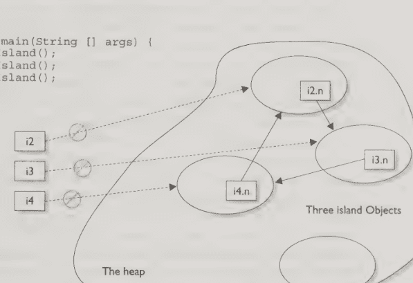

表示活跃引用

表示已删除的引用

```java
public class Lost {

  public static void main(String [] args) {

    Lost x = new Lost();

    x = null;

    doComplexStuff();

  }

}
```

Java 提供的垃圾回收程序是`Runtime`类的成员。`Runtime`类是一个特殊类，每个主程序有一个实例（单例）。`Runtime`对象提供了与虚拟机直接通信的机制。要获取`Runtime`实例，你可以使用`Runtime.getRuntime()`方法，它返回单例。一旦有了单例，你就可以`gc()`方法调用垃圾回收器。或者，你可以在`System`类上调用相同的方法，该类具有静态方法可以完成获取单例的工作。请求垃圾回收（记住——只是一个请求）最简单的方法是

```java
System.gc();
```

# 206 第 3 章：作业

理论上，在调用`System.gc()`后，你将拥有尽可能多的可用内存。我们之所以说“理论上”，是因为该例程并不总是以这种方式工作。首先，你的`JVM`可能没有实现该例程；语言规范允许该例程什么都不做。其次，另一个线程（见第 13 章）可能会在你运行垃圾回收器后获取大量内存。

这并不是说`System.gc()`是一个没用的方法——它比什么都不做好得多。你只是不能依靠`System.gc()`来释放足够的内存，以至于无需担心内存溢出。认证考试关注的是**保证性行为**，而不是**概率行为**。

既然你已经对这种工作原理有了一定的了解，让我们来做一个小实验来观察垃圾回收的效果。以下程序将告诉我们`JVM`可用的总内存以及这些内存的大小。然后，它创建了 10,000 个`Date`对象。之后，它告诉我们剩余了多少内存，然后调用垃圾回收器（如果它决定运行，将停止程序，直到所有未使用的对象被删除）。最终结果应该指示它是否运行了。让我们来看这个程序：

```java
import java.util.Date;

public class CheckGC {

    public static void main(String[] args) {

        Runtime rt = Runtime.getRuntime();

        System.out.println("Total JVM memory = " 

            + rt.totalMemory());

        System.out.println("Before Memory = " 

            + rt.freeMemory());

        Date d = null;

        for(int i = 0;i<10000;i++) {

            d = new Date();

            d = null;

        }

        System.out.println("After Memory = " 

            + rt.freeMemory());

        System.gc(); // an alternate to System.gc())

        System.out.println("After GC Memory = " 

            + rt.freeMemory());

    }

}
```

现在，让我们运行程序并检查结果：

Total JVM memory: 703008
Before Memory = 458084
After GC Memory = 818272

# 垃圾回收 (OCA 目标 2.4) 207

正如你所看到的，`JVM`实际上决定了垃圾回收（即删除）符合条件的对象。在前面的示例中，我们建议`JVM`在剩余 458,048 字节内存时执行垃圾回收；它尊从了我们的请求。此程序只有一个线程在运行，因此当我们调用`rt.gc()`时，没有其他操作在进行。请记住，调用`gc()`的行为在不同的`JVM`中可能不同，因此无法保证未使用的对象会从内存中移除。你唯一能保证的是，如果你的内存非常低，垃圾回收器将在抛出`OutOfMemoryException`之前运行。

# 练习 3-2

### 垃圾回收实验

尝试通过修改`CheckGC`程序，将第 13 行和第 14 行放入循环中。你可能会发现，在任何特定的 GC 中，并不是所有内存都被释放。

# 垃圾回收前的清理——finalize() 方法

Java 提供了一种机制，允许你在对象被垃圾回收器删除之前运行某些代码。这些代码位于名为`finalize()`的方法，所有类都继承自`Object`类。从表面上看，这听起来是一个很棒的主意；也许你的对象打开了一些资源，你希望在对象被删除之前关闭它们。问题是，正如你现在所收集到的，你永远无法依靠垃圾回收器来删除一个对象，因此你放在类重写的`finalize()`方法中的任何代码都不能保证会执行。因为任何给定对象的`finalize()`方法可能会运行，但你不能依赖它，所以不要在你的`finalize()`方法中放入任何核心代码。事实上，我们建议通常你根本不要重写`finalize()`。

# 隐藏的 finalize() 陷阱

关于`finalize()`有几个概念你需要记住：

- 对于任何给定的对象，垃圾回收器最多只会调用一次`finalize()`。
- 调用`finalize()`实际上可能会导致一个对象免于被删除。

# 208 第 3 章：作业

让我们进一步研究这些语句。首先，请记住，任何你可以放入普通方法的代码都可以放入`finalize()`中。例如，在`finalize()`方法中，你可以写代码，将问题对象的引用传回另一个对象，从而有效地使该对象不再符合垃圾回收条件（注：原文此处应为 ineligible）。如果在稍后的某个时间点该对象再次符合垃圾回收条件，垃圾回收器仍然可以处理该对象并删除它。然而，请记住，对于这个对象，`finalize()`已经运行过了，它不会再次运行`finalize()`。

## 认证总结

本章涵盖了广泛的主题。如果你在进入后续章节时需要复习其中一些主题，请不要担心。本章包含了许多以后会用用的基础知识。

我们通过回顾栈（stack）和堆（heap）开始了本书；记住局部变量存储在栈上，实例变量随其对象存储在堆上。我们复习了基本类型和字符串的合法字面量，然后讨论了为基本类型和引用变量赋值的基础知识，以及基本类型的类型转换规则。

接下来我们讨论了作用域的概念，或者说“这个变量将生存多久？记住四个基本作用域：静态、实例、局部和块”。

（注：此处原文存在大量重复文本，已根据内容流进行精简处理）

我们讨论了当实例化对象数组时的影响：
- 当实例化对象数组时，数组内的对象不会自动实例化，但所有引用都会获得`null`默认值。
- 当实例化基本类型数组时，元素将获得默认值。
- 实例变量总是用默认值初始化。
- 局部/自动/方法变量从不赋予默认值。如果你尝试在初始化之前使用它们，将会导致编译错误。

# 260

### 两分钟练习

这里是本章的一些要点。

#### 栈与堆
- 局部变量（方法）位于栈上。
- 对象及其实例变量位于堆上。

#### 字面量与基本类型转换 (OCA 目标 2.1)
- 整数字面量可以是二进制、十进制、八进制（如`03`）或十六进制（如`0x3`）。
- 长整字面量以`L`或`l`结尾。
- 浮点字面量以`F`或`f`结尾，双精度字面量以`D`或`d`结尾。
- 布尔字面量为`true`和`false`。
- 字符字面量是引号内的单个字符：`'d'`。

#### 作用域 (OCA 目标 1.1)
作用域指的是变量的生存周期。有四个基本作用域：
  - 静态变量生存周期基本上与类一样长。
  - 实例变量生存周期与其对象一样长。
  - 局部变量生存周期取决于其方法在栈上的时间；但如果其方法调用了另一个方法，它们将暂时不可用。
  - 块变量（例如在`for`或`if`中）一直生存到块结束。

# 261

### 基本赋值 (OCA 目标 2.1, 2.2 和 2.3)
- 整数字面量隐式为`int`。
- 整数表达式始终产生`int`大小的结果，不会更小。
- 浮点数隐视为`double`（64位）。
- 缩小基本类型会截断高位。
- 复合赋值（如`+=`）执行自动类型转换。
- 引用变量持有引用对象的位。
- 引用变量可以指向声明类型的子类，但不能指向父类。
- 当你创建一个新对象时，例如`Button b = new Button();`，`JVM`执行三件事：
  - 创建一个类型为`Button`的引用变量`b`。
  - 创建一个新的`Button`对象。
  - 将`Button`对象分配给引用变量`b`。

#### 使用未初始化和未赋值的变量或数组元素 (OCA 目标 4.1 和 4.2)
- 当实例化对象数组时，数组内的对象不会自动实例化，但所有引用都会获得`null`默认值。
- 当实例化基本类型数组时，元素将获得默认值。
- 实例变量总是用默认值初始化。
- 局部/自动/方法变量从不赋予默认值。如果你尝试在初始化之前使用它们，将会导致编译错误。

# 将变量传递到方法 (OCA 目标 6.8)

- 方法可以接受基本类型和/或对象引用作为参数。
- 方法参数始终是拷贝。
- 方法参数永远不会是实际对象（它们可以是对象的引用）。
- 基本类型参数是原始基本类型未解绑的拷贝。
- 引用参数是指向原始对象的引用的另一个拷贝。
- 当两个具有不同作用域的变量共享相同的名称时，会发生遮蔽（Shadowing）。这导致了难以发现的 bug 和难以回答的考试题。

# 垃圾回收 (OCA 目标 2.4)

- 在 Java 中，垃圾回收 (GC) 提供了自动化的内存管理。
- GC 的目的是删除无法触及的对象。
- 只有`JVM`决定何时运行 GC；你只能建议它运行。
- 你无法确定知道 GC 算法。
- 对象在被垃圾回收之前，必须被认为是合格的（eligible）。
- 当没有活跃线程可以访问某个对象时，该对象就是合格的。
- 要访问一个对象，你必须拥有指向该对象的存活且可访问的引用。
- Java 应用程序可能会内存溢出。
- 对象孤岛（Islands of objects）可以被垃圾回收，即使它们相互引用。
- 使用`System.gc()`请求垃圾回收（仅针对 OCP 5 候选者）。
- Class 对象有一个`finalize()`方法。
- `finalize()`方法保证在垃圾回收器删除对象之前运行且仅运行一次
- 垃圾回收器不做任何保证；`finalize()`可能永远不会运行。
- 你可以在`finalize()`内部让一个对象对 GC 不再合格。

# 212 第 3 章：赋值

## 自测

I. 给定代码：

```java
class CardBoard {

  Short story = 200;

  CardBoard go(CardBoard cb) {

    cb = null;

    return cb;

  }

  public static void main(String[] args) {

    CardBoard c1 = new CardBoard();

    CardBoard c2 = new CardBoard();

    CardBoard c3 = c1.go(c2);

    c1 = null;

    // do Stuff

  }

}
```

当执行`// do stuff`时，有多少个对象符合垃圾回收？

- A. 0
- B. 1
- C. 2
- D. 编译失败
- E. 无法确定
- F. 抛出异常

2. 给定代码：

```java
public class Fishing {

  byte b1 = 4;

  int i1 = 123456;

  long L1 = (long)i1; // line A

  short s2 = (short)i1; // line B

  byte b2 = (byte)i1; // line C

  int i2 = (int)123.456; // line D

  byte b3 = b1 + 7; // line E

}
```

哪些行**不会**编译？（选择所有项。）

- A. Line A
- B. Line B
- C. Line C
- D. Line D
- E. Line E

3. 给定代码：

```java
public class Literally {

    public static void main(String[] args) {

        int i1 = 1000; // line A

        int i2 = 10_00; // line B

        int i3 = _10_00; // line C

        int i4 = 0B011010; // line D

        int i5 = 0B10_1010; // line E

        int i6 = 0x2_a; // line F

    }

}
```

哪些行**不会**编译？（选择所有适用项。）

- A. Line A
- B. Line B
- C. Line C
- D. Line D
- E. Line E
- F. Line F

4. 给定代码：

```java
class Mixer {

    Mixer() { }

    Mixer(Mixer m) { m1 = m; }

    Mixer m1;

    public static void main(String[] args) {

        Mixer m2 = new Mixer();

        Mixer m3 = new Mixer(m2); m3.go();

        Mixer m4 = m3.m1; m4.go();

        Mixer m5 = m2.m1; m5.go();

    }

    void go() { System.out.print("hi "); }

}
```

结果是什么？

- A. hi
- B. hi hi
- C. hi hi hi
- D. 编译失败
- E. hi，后面跟着一个异常
- F. hi hi，后面跟着一个异常

# 214 第 3 章：赋值

5. 给定代码：

```java
class Fizz {

    int x = 5;

    public static void main(String[] args) {

        final Fizz f1 = new Fizz();

        Fizz f2 = new Fizz();

        Fizz f3 = FizzSwitch(f1,f2);

        System.out.println((f1 == f3) + " " + (f1.x));

    }

    static Fizz FizzSwitch(Fizz x, Fizz y) {

        x.x = 6;

        return x;

    }

}
```

结果是什么？

- A. true true
- B. false true
- C. true false
- D. false false
- E. 编译失败
- F. 抛出异常

6. 给定代码：

```java
class Mirror {

    int size = 7;

    public static void main(String[] args) {

        Mirror m1 = new Mirror();

        Mirror m2 = m1;

        int i1 = 10;

        int i2 = i1;

        go(m2,i2);

        System.out.println(m1.size + " " + i1);

    }

    static void go(Mirror m, int i) {


`m.size = 8;`

`i = 12;`

```
}
```

# 自测 215

结果是什么？

- A. 7 10
- B. 8 10
- C. 7 12
- D. 8 12
- E. 编译失败
- F. 抛出异常

7. 给定代码：

```java
class Wind {
    int id;
    Wind(int i) { id = i; }
    public static void main(String[] args) {
        new Wind(3).go();
        // commented line
    }
    void go() {
        Wind w1 = new Wind(1);
        Wind w2 = new Wind(2);
        System.out.println(w1.id + " " + w2.id);
    }
}
```

当执行到注释行时，哪些是正确的？（选择所有适用项。）

- A. 输出包含1
- B. 输出包含2
- C. 输出包含3
- D. 零对象符合垃圾回收
- E. 一个对象符合垃圾回收
- F. 两个对象符合垃圾回收
- G. 三个对象符合垃圾回收

# 216 第 3 章：赋值

8. 给定代码：

```java
class Ouch {
    static int touch = 7;
    public static void main(String[] args) {
        new Ouch().go(touch);
        System.out.print(" " + touch);
    }
    void go(int touch) {
        touch++;
        for(int touch = 3; touch < 6; touch++) {
            System.out.print( + touch);
        }
    }
}
```

结果是什么？

- A. 5 7
- B. 5 8
- C. 8 7
- D. 8 8
- E. 编译失败
- F. 抛出异常

9. 给定代码：

```java
class Happy {
    int id;
    Happy(int i) { id = i; }
    public static void main(String[] args) {
        Happy h1 = new Happy(1);
        Happy h2 = h1.go(h1);
        System.out.println(h2.id);
    }
    Happy go(Happy h) {
        Happy h3 = h;
        h3.id = 2;
        return h1;
    }
}
```

结果是什么？

- A. 1
- B. 2
- C. 3
- D. null
- E. 编译失败

10. 给定代码：

```java
class Network {
    Network(int x, Network n) {
        id = x;
        p = this;
        if (n != null) p = n;
    }
    int id;
    Network p;
    public static void main(String[] args) {
        Network n1 = new Network(1, null);
        n1.go(n1);
    }
    void go(Network n1) {
        Network n2 = new Network(2, n1);
        Network n3 = new Network(3, n2);
        System.out.println(n3.p.id);
    }
}
```

结果是什么？

- A. 1
- B. 2
- C. 3
- D. null
- E. 编译失败

# 218 第 3 章：赋值

11. 给定代码：

```java
class Beta {}
class Alpha {
    static Beta b1;
    Beta b2;
}
public class Tester {
    public static void main(String[] args) {
        Beta b1 = new Beta();
        Beta b2 = new Beta();
        Alpha a1 = new Alpha();
        Alpha a2 = new Alpha();
        a1.b1 = b1;
        a2.b2 = b2;
        a1.b2 = b2;
        b1 = null;
        b2 = null;
    }
}
```

当执行到第16行时，有多少个对象符合垃圾回收？

- A. 0
- B. 1
- C. 2
- D. 3
- E. 4
- F. 5

12. 给定代码：

```java
class Telescope {
    static int magnify = 2;
    public static void main(String[] args) {
        go();
    }
    static void go() {
        int magnify = 3;
        zoomIn();
    }
    static void zoomIn() {
        magnify *= 5;
        zoomMore(magnify);
        System.out.println(magnify);
    }
    static void zoomMore(int magnify) {
        magnify *= 7;
    }
}
```

结果是什么？

- A. 2
- B. 10
- C. 15
- D. 30
- E. 70
- F. 编译失败

13. 给定代码：

```java
class Dark {
    int x = 3;
    public static void main(String[] args) {
        new Dark().gol();
    }
    void gol() {
        int x;
        go2(++x);
    }
    void go2(int x) {
        x = 6;
        System.out.println(x);
    }
}
```

*（注：原文代码13题存在多处语法错误，如 `go2(int x)` 括号不匹配，此处按原意保留。）*

## 自测答案

- 1. C。符合垃圾回收的对象有两个（`CardBoard` 对象未被引用）。
- 2. E。Line E 无法编译（`byte` 溢出）。
- 3. C。下划线线开头。
- 4. B。输出 "hi hi"。
- 5. A。输出 "true true"。
- 6. B。输出 "8 10"。
- 7. A。输出 "1 2"。
- 8. B。输出 "3456"。
- 9. A。输出 "1"。
- 10. B。输出 "2"。
- 11. C。符合垃圾回收的对象有3。
- 12. C。输出 "15"。
- 13. 原文代码语法错误。

B 是正确的。很明显，对 `a2` 所指的对象仍然有引用，而且对 `a2.b2` 所指的对象仍然有引用。可能不那么明确的是，你仍然可以通过静态变量 `a2.b1` 访问另一个 `Beta` 对象——因为它是静态的。

根据上述内容，A、C、D、E 和 F 都是错误的。（OCA 目标 2.4）

B 是正确的。在 `Telescope` 类中，有三个名字同为 `magnify` 的不同变量。`go()` 方法的版本和 `zoomMore()` 方法的版本没有在 `zoomIn()` 方法中使用。`zoomIn()` 方法将类变量乘以 * 5*。结果 (10) 被发送到 `zoomMore()`，但在 `zoomMore()` 中发生什么将留在 `zoomMore()` 中。S.O.P. 打印了 `zoomIn()` 的 `magnify` 的值。

根据上述内容，A、C、D、E、F 和 G 都是错误的。（OCA 目标 1.1 和 6.8）

E 是正确的。在 `go1()` 中，局部变量 `x` 没有初始化。

根据上述内容，A、B、C、D 和 F 都是错误的。（OCA 目标 2.1、2.3 和 2.5）

# 4 运算符

## 认证目标

- 使用 Java 运算符
- 使用括号覆盖运算符优先级
- 使用 `==` 和 `equals()` 测试字符串与其他对象之间的等价性

- 两分钟演练
- 问答自测

# 224 第 4 章：运算符

如果你有变量，你就会修改它们。你会对它们进行递增，将它们相加，并将一个与另一个进行比较（大约有十种不同的方式）。在本章中，你将学习如何在 Java 中执行所有这些操作。额外奖励，你将学习一些你在现实世界中可能永远用不到，但几乎肯定会出现在考试中的内容。

## 认证目标

# Java 运算符（OCA 目标 3.1、3.2 和 3.3）

- 3.1 使用 Java 运算符。
- 3.2 使用括号覆盖运算符优先级。
- 3.3 使用 `==` 和 `equals()` 测试字符串与其他对象之间的等价性。

Java 运算符从一个或多个操作数产生新值。（为了让我们大家都清楚，请记住操作数是运算符左侧或右侧的内容。）大多数操作的结果是布尔值或数值。因为你现在知道 Java 不是 C++，所以你不会对 Java 运算符通常不被重载感到惊讶。然而，有几个异常运算符是被重载的：

- `+` 拼接可以用于两个数值原始类型相加，或者如果任一操作数是 `String` 则执行拼接操作。
- `&`、`|` 和 `^` 运算符都可以以两种不同的方式使用，尽管在这个版本的考试中，它们的位操作能力将不会被测试。

保持清醒。运算符通常是考试中候选人得分最低的部分。此外，运算符和赋值是许多涉及其他主题的问题的一部分——如果你攻克了一个非常棘手的线程问题，却在一个预递增语句上栽了跟头，那真是太可惜了。

# 赋值运算符

我们在第 3 章涵盖了操作的大部分功能（`=` 赋值运算符）。总结一下：

# Java 运算符 OCA 目标 3.1、3.2 和 3.3 225

- 给原始类型赋值时，大小很重要。确保你知道何时会发生隐式类型转换，何时需要显式类型转换，以及何时可能会发生截断。
- 记住引用变量不是对象；它是获取对象的方法。（我们知道所有的 C++ 程序员都急于听我们说“它是一个指针”，但我们不会那样说的。）
- 给引用变量赋值时，类型很重要。记住超类型、子类型和数组的规则。

接下来，我们将涵盖考试中涉及的更多关于赋值运算符的细节，等当我们读到下一章时，我们将查看赋值运算符 `=` 是如何与 `String`（它们是不可变的）一起作用的。


不要花时间准备已经不再出现在考试中的主题了！以下主题自 Java 1.4 以来已**未**出现在考试中：

- 位移运算符
- 位运算符
- 二 补

并不是说这些不是重要的主题；仅仅是它们不在考试范围内，而我们确实关注考试。（注意：我们之所以提到这一点，是因为你可能会遇到模拟题！）

# 复合赋值运算符

实际上有 11 个复合运算符，但只有最常用的 4 个（`+=`、`-=`、`*=`、`/=`）出现在考试中。复合赋值运算符减少工作量。这里有几个赋值示例，首先是不使用复合运算符：

```java
y = y - 6;
x = x + 5;
```

226 第 4 章：运算符

现在，使用复合运算符：

```java
y -= 6;
x += 5;
```

最后两个的结果与第一个相同。考试的早期版本非常强调运算符优先级（例如 `*` 和 `/` 的优先级高于 `+` 和 `-`），你不需要学习运算符优先级。但你确实需要知道，当使用复合运算符时，`=` 右侧的表达式将先被求值。例如，在使用复合运算符时，`=` 右侧的表达式将先被求值。

```java
x *= 2 + 5;
```

# 运算符 包含 6 个关系运算符，它们总是返回一个布尔值：

- 大于
- 小于
- 大于等于
- 小于等于
- 不等于
- 等于

# 运算符 3.1, 3.2, 3.3 227

Java 还有关系运算符（有时称为“等价运算符”）它们比较两个“事物”并返回一个布尔值（`true` 或 `false`），表示这两个“事物”是否等价。这些运算符是：

- 大于
- 小于
- 大于等于
- 小于等于
- 不等于
- 等于

每个单独的比较可以涉及：

- 数字
- 字符
- 布尔原始类型
- 对象引用变量

所以 `==` 查看的是什么？变量中的值——换句话说，位模式。

# 原始类型的等价

大多数程序员熟悉比较原始值。以下代码显示了原始变量的等价测试：

```java
class ComparePrimitives {
    public static void main(String[] args) {
        System.out.println("char 'a' == 'a'? " + ('a' == 'a'));
        System.out.println("char 'a' == 'b'? " + ('a' == 'b'));
        System.out.println("5 != 6? " + (5 != 6));
        System.out.println("5.0 == 5L? " + (5.0 == 5L));
        System.out.println("true == false? " + (true == false));
    }
}
```

此程序产生输出：

```
char 'a' == 'a'? true
char 'a' == 'b'? false
5 != 6? true
5.0 == 5L? true
true == false? false
```

如你所示，浮点数与整数进行比较，且值相同，`==` 运算符通常返回预期的 `true`。

# 引用变量的等价

正如你之前看到的，两个引用变量可以引用同一个对象，正如代码段所示：

```java
JButton a = new JButton("Exit");
JButton b = a;
```

# 考试

不要在布尔表达式中将 `=` 误认为 `==`。以下是合法的：

```java
boolean b = false;
if (b = true) { System.out.println("b is true"); }
else { System.out.println("b is false"); }
```

仔细看！你可能会想当然输出是 `b false`，但看第 12 行的布尔文本。布尔变量 `b` 并没有与 `true` 进行比较，而是被赋值为 `true`。一旦 `b` 被赋值为 `true`，`println` 就会执行，我们得到 `b is true`。任何赋值表达式的结果都是紧随其赋值的值。这种用 `=` 替换 `==` 的方法仅适用于布尔变量，因为 `if` 测试只能在布尔表达式上进行。因此，以下代码无法通过编译：

```java
int x = 1;
if (x = 0) { }
```

因为 `x` 是一个整数（而不是布尔值），`(x = 0)` 的结果是 0（赋值的结果）。在需要布尔值的地方不能使用原始类型 `int`，除非将第 8 行的赋值（`=`）改为相等性测试（`==`），如下所示：

```java
if (x == 0) { }
```

运行这段代码时，变量 `a` 和变量 `b` 将指向标签为 `Exit` 的同一个对象（`aJButton`）。引用变量可以使用 `==` 运算符来测试它们是否指向同一个对象。记住，`==` 运算符查看的是变量中的位，因此对于引用变量来说，这意味着如果两个引用变量中的位相同，那么它们就指向同一个对象。

看以下代码：

```java
import java.swing.JButton;

class CompareReference {
    public static void main(String[] args) {
        JButton a = new JButton("Exit");
        JButton b = new JButton("Exit");
        JButton c = a;
        System.out.println("Is reference a == b?" + (a == b));
        System.out.println("Is reference a == c?" + (a == c));
    }
}
```

# 第 4 章：运算符

这段代码创建了三个引用变量。前两个变量 `a` 和 `b` 是独立的 `JButton` 对象，恰好具有相同的标签。第三个引用变量 `c` 初始化为指向与 `a` 向的同一个对象。当此程序运行时，会产生以下输出：

```
Is reference a == b? false
Is reference a == c? true
```


这告诉我们`a`和`c`引用同一个`JButton`实例。`==`运算符不会测试两个对象是否在“意义上等价”，这个概念将在第 11 章详细介绍，那时我们将查看`equals()`方法（而不是我们在这里查看的`==`运算符）。

# 字符串的相等性与`java.lang.Object.equals()`

我们使用`==`来确定两个引用变量是否指向同一个对象。由于对象在 Java 中是核心的，每个类都从`Object`类继承一个方法，该方法用于测试该类的两个对象是否“相等”。惊讶的是，这个方法被称为`equals()`。在`equals()`方法的这种情况下，应该使用“意义上等价”而不是“相等”这个词。`equals()`方法用于判断同类的两个对象是否“意义上等价”。对于你创建的类，你可以选择重写从`Object`类继承的`equals()`方法，并为你的类实例创建“意义上等价”的自定义定义。（第 11 章有更多关于重写`equals()`的内容。）

为了理解 OCA 考试中的`equals()`方法，你需要理解该方法的两个方面：

- `equals()`在`Object`类中的含义
- `equals()`在`String`类中的含义

`Object`类中的`equals()`方法的工作方式与`==`运算符相同。如果两个引用指向同一个对象，`equals()`方法将返回`true`。如果两个引用指向不同的对象，即使它们的值相同，方法也会返回`false`。

`String`类中的`equals()`方法被重写了。当使用`equals()`方法比较两个字符串时，如果字符串相同，它将返回`true`；如果字符串值不同，它将返回`false`。对于`String`的`equals()`方法，值是敏感的。

# Java 运算符 OCA 目标 3.1, 3.2, 3.3

让我们来看看`equals()`方法在实际中是如何工作的：

```java
class Budgie {

    public static void main(String[] args) {

        Budgie b1 = new Budgie();

        Budgie b2 = new Budgie();

        Budgie b3 = b1;

        String s1 = "Bob";

        String s2 = "Bob";

        String s3 = "bob"; // 小写 "b"

        System.out.println(b1.equals(b2)); // false，不同的对象

        System.out.println(b1.equals(b3)); // true，相同的对象

        System.out.println(s1.equals(s2)); // true，相同的值

        System.out.println(s1.equals(s3)); // false，值大小敏感

    }

}
```

产生：

```java
false

true

false
```

正如之前提到的，当我们到达第 11 章时，将深入研究`equals()`及其伴侣`hashCode()`——但对于 OCA 来说，这些就足够了。

# enum 的相等性

一旦你声明了`enum`，在运行时没有方法创建额外的枚举常量。当然，你可以拥有任意数量的变量来引用给定的枚举常量，因此能够比较两个引用以查看它们是否“相等”是重要的。你可以使用`==`运算符或`equals()`方法来判断两个变量是否引用同一个枚举常量：

```java
class EnumEqual {

    enum Color {RED, BLUE}; // 可的

    public static void main(String[] args) {

        Color c1 = Color.RED;

        Color c2 = Color.RED;

        if(c1 == c2) { System.out.println("="); }

        if(c1.equals(c2)) { System.out.println("equals"); }

    }

}
```

产生：

```java
=

equals
```

# instanceof 运算符

`instanceof`运算符仅用于对象引用变量，你可以用它来检查一个对象是否属于特定类型。我们所说的“类型”是指类或接口类型——也就是说，运算符左侧引用的对象是否通过右侧类或接口类型的 IS-A 测试。（第 2 章详细介绍了 IS-A 关系）。以下简单的示例：

```java
public static void main(String[] args) {

  String s = new String("foo");

  if (s instanceof String) {

    System.out.print("s is a String");

  }

}
```

打印：

```java
s is a String
```

即使被测试的对象不是运算符右侧类的实际实例化，如果比较的对象与该类型兼容，`instanceof`仍然会返回`true`。以下示例演示了`instanceof`的常见用法：在尝试强制转换之前，测试一个对象是否是其子类之一的实例：

```java
class A {

class B extends A {

  public static void main(String[] args) {

    A myA = new B();

    m2(myA);

  }

  public static void m2(A a) {

    if (a instanceof B) {

      ((B)a).doBStuff(); // 将 A 引用强制转换

      // 为 B 引用

    }

  }

  public static void doBStuff() {

    System.out.println("a' refers to a B");

  }

}

}
```

# Java 运算符 OCA 目标 3.1, 3.2, and 3.3

代码可以通过编译并产生此输出：

```java
'a' refers to a B
```

在这样的示例中，使用`instanceof`运算符可以防止程序尝试非法的强制转换。

你可以针对对象的自身的类类型或其任何父类对其进行测试。这意味着如果你对`Object`类型使用`instanceof`运算符，任何对象引用都结果为`true`，如下：

```java
b = new B();

if (b instanceof Object) {

  System.out.print("b is definitely an Object");

}
```

打印：

```java
b is definitely an Object
```

寻找`instanceof`问题，用于测试对象是否为接口的实例，当对象的类间接实现接口时。间接实现发生在对象的某个父类实现一个接口，而实例的实际类没有实现。在这个示例中，

```java
interface Foo {

class A implements Foo { }

class B extends A { }

...

A a = new A();

 b = new B();
```

以下是正确的：

- `instanceof Foo`
- `instanceof A`
- `instanceof Foo`

如果对象的任何父类间接实现了该接口，则认为该对象属于特定的接口类型（这意味着它将通过`instanceof`测试）。

## 234 第4章：运算符

此外，测试空引用是否是某个类的实例是合法的。当然地，结果的结果始终为`false`。这个示例：

```java
class instanceTest {

    public static void main(String [] args) {

        String a = null;

        boolean b = null instanceof String;

        boolean c = a instanceof String;

        System.out.println(b + " " + c);

    }

}
```

打印如下内容：

```java
false false
```

## instanceof 编译错误

你不能使用`instanceof`运算符跨两个不同的类层次结构进行测试。例如，以下代码无法编译：

```java
class Cat { }

class Dog {

    public static void main(String [] args) {

        Dog d = new Dog();

        System.out.println(d instanceof Cat);

    }

}
```

编译失败——`d`永远可能引用`Cat`或`Cat`的子类。

记住数组是对象，即使数组是基本类型的数组。注意类似这样的问题：

```java
int [] nums = new int[3];
if (nums instanceof Object) { } // 结果为 true
```

数组始终是`Object`的实例。

表 4-1 总结了在满足以下条件`instanceof`运算符的使用：

```java
interface Face { }

class Bar implements Face { }

class Foo extends Bar { }
```

## 表 4-I

| 使用`instanceof`运算符的操作数和结果 | 第一个操作数（被测试的引用） | instanceof 操作数（比较类型） | 结果 |
|---|---|---|---|
| `null` | 任意类或接口类型 | `false` |
| `Foo`实例 | `Foo`, `Bar`, `Face`, `Object` | `true` |
| `Bar`实例 | `Bar`, `Face`, `Object` | `true` |
| `Bar`实例 | `Foo` | `false` |
| `Foo[]` | `Foo`, `Bar`, `Face` | `false` |
| `Foo[]` | `Object` | `true` |
| `Foo[1]` | `Foo`, `Bar`, `Face`, `Object` | `true` |

## 算术运算符

我们相信你熟悉基本的算术运算符：

- `+` 加法
- `-` 减法
- `*` 乘法
- `/` 除法

这些运算符可以用标准方式使用：

```java
int x = 5 * 3;

int y = x - 4;

System.out.println("x - 4 is " + y); // 打印 11
```

## 取余运算符 (%)（也称为取运算运算符）

你可能可能不太熟悉的运算符是取余运算符`%`。取余运算符将左操作数除以右操作数，结果为余数，以下代码演示了：

```java
class MathTest {

    public static void main (String [] args) {

        int x = 15;

        int y = x % 4;

        System.out.println("The result of 15 % divided by 4 is the " + y

        + "remainder of 15 divided by 4. The remainder is " + y + "");

    }

}
```

## 236 第4章：运算符

运行`MathTest`类将打印以下内容：

```java
The result of 15 % 4 is the remainder of 15 divided by 4. The remainder is 3
```

（记住：表达式默认从左到右求值。你可以通过添加括号来改变这种顺序或优先级。还要记住`*`、`/`和`%`运算符的优先级高于`+` `-`运算符。）

在处理`int`时，取余运算符（也称为模运算）和除法运算符之间有着有趣的关系：

- 模运算丢弃余数以外的一切。
- 除法丢弃余数。

## 字符串拼接运算符

加号也可以用于连接两个字符串，正如我们之前看到的（我们肯定还会看到）：

```java
String animal = "Gray " + "elephant";
```

当将数字与字符串结合时，字符串拼接变得有趣起来。查看以下内容：

```java
String a = "String";

int b = 3;

int c = 7;

System.out.println(a + b + c);
```

`+`运算符在相加`int b`和`c`时会起到加号的作用吗？还是说`+`运算符会将`3`和`7`视为字符并逐个拼接？好了，你已经有足够的素材来思考了。`int`值被简单地视为字符并粘在`String`的右侧，得到结果：

```java
String37
```

因此，我们可以将之前的代码读为：“从值`String`开始，在其拼接字符`3`（`b`的值），产生一个新字符串，然后在该基础上拼接字符`7`（`c`的值），产生一个新的字符串。”然而，如果你在上述两个`int`变量周围加上括号，如下所示：

```java
System.out.println(a + (b + c));
```

你将得到：

```java
String10
```

使用括号会导致`(b + c)`先求值，因此由于两个操作数都是值，最右侧的`+`运算符充当加法运算符。这里的关键在于，在括号内，左操作数不是`String`。如果是字符串，那么`+`运算符将执行拼接。

要记住的规则是：如果任一操作数是字符串，`+`运算符就变成字符串拼接。如果两个操作数都是数字，`+`运算符就是加法运算符。你会发现你可能很难判断，例如左侧运算符是否为`String`。在考试中，不要期望它是显而易见的（实际上，现在回想起来，还是不要期望了）。看以下代码：

```java
System.out.println(foo() + 7);
```

在发现`foo()`方法返回什么之前，你无法知道`+`运算符是如何使用的！如果`foo()`返回一个字符串，那么`7`将被拼接到字符串上。但如果`foo()`返回一个数字，那么`+`运算符将用于将`7`加到`foo()`的返回值。

最后，你需要知道将复合加法运算符（`+=`）与字符串合并是合法的，如下：

```java
String s = "123";

s += "45";

s += "67";

System.out.println(s);
```

## 238 第4章：运算符

由于两次使用`+=`运算符时左操作数都是字符串，因此两次操作都是拼接，结果为：

```java
1234567
```

如果你不理解字符串拼接的工作原理，特别是在打印语句内部，即使你知道问题的其他答案，你也可能考试不及格！

---

```java
int x = 5 * 3;

int y = x - 4;

System.out.println("x - 4 is " + y); // 打印 11
```

## 取余运算符 (%)（也称为模运算运算符）

你可能可能不太熟悉的运算符是取余运算符`%`。取余运算符将左操作数除以右操作数，结果为余数，以下代码演示了：

```java
class MathTest {

    public static void main (String [] args) {

        int x = 15;

        int y = x % 4;

        System.out.println("The result of 15 % divided by 4 is the " + y

        + "remainder of 15 divided by 4. The remainder is " + y + "");

    }

}
```


## 236 第4章：运算符

运行`MathTest`类将打印以下内容：

```
The result of 15 % 4 is the remainder of 15 divided by 4. The remainder is 3
```

（记住：表达式默认从左到右求值。你可以通过添加括号来改变这种顺序或优先级。还要记住`*`、`/`和`%`运算符的优先级高于`+`、`-`运算符。）


在处理`int`时，取余运算符（也称为模运算）和除法运算符之间有着有趣的关系：

- 模运算丢弃余数以外的一切。
- 除法运算符丢弃余数。

## 字符串拼接运算符

加号也可以用于连接两个字符串，正如我们之前看到的（以及我们肯定还会看到）：

```java
String animal = "Gray " + "elephant";
```

当将数字与字符串结合时，字符串拼接变得有趣起来。查看以下内容：

```java
String a = "String";
int b = 3;
int c = 7;
System.out.println(a + b + c);
```

`+`运算符在相加`int b`和`c`时会起到加号的作用吗？还是说`+`运算符会将`3`和`7`视为字符并逐个拼接？好了，你已经有足够的素材来思考了。`int`值被简单地视为字符并粘在`String`的右侧，得到结果：

```
String37
```

因此，我们可以将之前的代码读为：“从值`String`开始，在其拼接字符`3`（`b`的值），产生一个新字符串，然后在该基础上拼接字符`7`（`c`的值），产生一个新的字符串。”然而，如果你在上述两个`int`变量周围加上括号，如下所示：

```java
System.out.println(a + (b + c));
```

你将得到：

```
String10
```

使用括号会导致`(b + c)`先求值，因此由于两个操作数都是值，最右侧的`+`运算符充当加法运算符。这里的关键在于，在括号内，左操作数不是`String`。如果是字符串，那么`+`运算符将执行拼接。

要记住的规则是：如果任一操作数是字符串，`+`运算符就变成字符串拼接。如果两个操作数都是数字，`+`运算符就是加法运算符。你会发现你可能很难判断，例如左侧运算符是否为`String`。在考试中，不要期望它是显而易见的（实际上，现在回想起来，还是不要期望了）。看以下代码：

```java
System.out.println(foo() + 7);
```

在发现`foo()`方法返回什么之前，你无法知道`+`运算符是如何使用的！如果`foo()`返回一个字符串，那么`7`将被拼接到字符串上。但如果`foo()`返回一个数字，那么`+`运算符将用于将`7`加到`foo()`的返回值。

最后，你需要知道将复合加法运算符 (`+=`) 与字符串合并是合法的，如下：

```java
String s = "123";
s += "45";
s += "67";
System.out.println(s);
```

## 238 第4章：运算符

由于两次使用`+=`运算符时左操作数都是字符串，因此两次操作都是拼接，结果为：

```
1234567
```

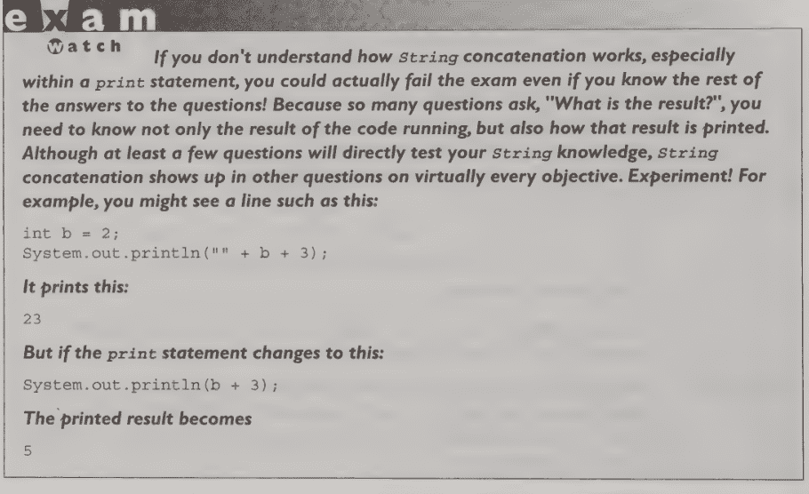

如果你不理解字符串拼接的工作原理，特别是在打印语句内部，即使你知道问题的其他答案，你也可能考试不及格！

# 240 第 4 章：运算符

在字符串拼接中，增加和递减运算符贯穿整个考试，即使在那些并不是测试你对这些运算符工作原理了解的题目中。你可能会在循环、异常甚至线程的题目中看到它们。

注意在`final`变量上使用增加递减运算符的题目。因为`final`变量不能被更改，因此不能对它们使用增加递减运算符，任何此类尝试都会导致编译错误。以下代码无法编译：

```java
final int x = 5;
int y = x++;
```

它会产生此错误：

```
Test.java:4: cannot assign a value to final variable x
int y = x++;
```

你可以预计这种违规行为会被埋在复杂的代码深处。如果你发现了它，你就知道代码无法编译，可以直接跳过而无需处理剩余的代码。

> 这个题目看起来可能是在测试你一些复杂的算术运算符冷知识，但实际上它在测试你对`final`修饰符的了解。

# 条件运算符

条件运算符是一种三元运算符（它有三个操作数），用于评估布尔表达式，类似于`if`语句，不同之处在于如果测试为真则执行代码块，而条件运算符会将一个值赋值给变量。换句话说，条件运算符的目标是决定将两个值中的哪赋值给变量。该运算符使用`?`（问号）和`:`（冒号）构建。括号是可选的。它的结构如下：

```
x = (布尔表达式) ? 如果真时要赋值的值 : 如果假时要赋值的值
```

让我们来看代码中的条件运算符：

# Java 运算符 (OCA 目标 3.1, 3.2 和 3.3) 241

```java
class Salary {
    public static void main(String [] args) {
        int numOfPets = 3;
        String status = (numOfPets<4) ? "Pet limit not exceeded" : "too many pets";
        System.out.println("Pet status is " + status);
    }
}
```

你可以将前面的代码读为“将`numOfPets`设置为3”。接下来将一个`String`赋值给`status`变量。如果`numOfPets`小于4，则将"Pet limit not exceeded"赋值给`status`变量；否则，将"too many pets"赋值给`status`变量。

条件运算符以布尔操作开始，后面是赋值运算符`=`左侧变量的两个可能值。如果条件（布尔）测试为真，则赋值第一个值（冒号左侧的值），如果条件测试为假，则赋值第二个值。你甚至可以将条件运算符嵌套在一个语句中：

```java
class AssignmentOps {
    public static void main(String [] args) {
        int sizeOfYard = 10;
        int numOfPets = (numOfPets<4)?"Pet count OK":"Too many pets";
        String status = (sizeOfYard > 8)? "Pet limit on the edge" : "too many pets";
        System.out.println("Pet status is " + status);
    }
}
```

不要期望会有很多使用条件运算符的题目，但记住条件运算符有时会与断言语句（assertion statements）混淆，所以确保你能区分它们。第 7 章将详细介绍断言。

# 逻辑运算符

考试目标指定了六个“逻辑”运算符（`&`, `|`, `^`, `&&`, 和 `||`）。某些 Oracle 文档对这些运算符使用其他术语，但就我们的目的和考试目标而言，这些就是逻辑运算符。

# 位运算符（针对 OCP 5 候选人！）

好了，这会让大家很困惑。在列出的六个逻辑运算符中，有三个（`&`, `|`, `^`）也可以作为“位”运算符使用。位运算符包含在之前的版本中，但在 Java 6 或 Java 7 考试中没有。

# 242 第 4 章：运算符

以下是几个使用位运算符的合法语句：

```java
byte b1 = 6 & 8;
byte b2 = 7 | 9;
byte b3 = 5 ^ 4;
```

位运算符按位比较两个变量，并根据两个变量位是否都为（`&`）、至少有一个（`|`）或恰好有一个（`^`）来返回结果。运行前面的代码时，我们得到：

```
0 1
```


关于位运算符，要记住的是：位运算符不在 Java 6 或 Java 7 考试中！

# 短路逻辑运算符

考试中的五个逻辑运算符用于评估包含多个表达式的语句。这五个中最常用的是短路运算符：

- `&&` 短路 AND
- `||` 短路 OR

它们用于将布尔表达式连接起来形成更大的表达式。`&&`和`||`运算符只评估布尔值。对于 AND (`&&`) 表达式为真，两个操作数必须为真，例如：

```java
if ((2 < 3) && (3 < 4)) {
```

前面的表达式为真，是因为操作数一 (`2 < 3`) 和操作数二 (`3 < 4`) 都为真。`&&`运算符的短路特性是因为它不会浪费时间在无用的评估上。如果左侧为假，`&&`运算符就知道整个表达式不可能为真。

# Java 运算符 (OCA 目标 3.1, 3.2 和 3.3) 243

```java
class Logical {
    public static void main(String [] args) {
        boolean b1 = false, b2 = false;
        boolean b3 = (b1 == false) && (b2 = true); // b2 将赋值为 true
        System.out.println(b3 + " " + b2);
    }
}
```

当我们读取代码时，由于短路运算符，赋值`b2 = true`从不执行，输出是：

```
false false
```

`||`运算符与`&&`运算符类似，不同在于只要操作数为真结果为真。如果 OR 操作的第一个操作数为真，结果将为真，所以短路`||`不浪费时间看右侧。如果第一个操作数为假，短路`||`必须评估第二个操作数以查看 OR 操作的结果是真的还是假。注意以下示例；你会在考试中看到类似的题目：

```java
class TestOR {
    public static void main(String[] args) {
        if ((isItSmall(3)) || (isItSmall(7))) {
            System.out.println("Result is true");
        }
        if ((isItSmall(6)) || (isItSmall(9))) {
            System.out.println("Result is true");
        }
    }

    public static boolean isItSmall(int i) {
        if (i < 5) {
            System.out.println("i < 5");
            return true;
        } else {
            System.out.println("i >= 5");
            return false;
        }
    }
}
```

结果是什么？

```
TestOR
i < 5
Result is true
i >= 5
i >= 5
```

# 244 第 4 章：运算符

当`main()`方法运行时发生了这些：

1. 当我们到达第 3 行时，`||`表达式中的第一个操作数（也就是 OR 操作的左侧）被评估。
2. 调用`isItSmall(3)`方法，打印 "i < 5" 并返回 true。
3. 因为第 3 行`||`表达式中的第一个操作数为真，`||`运算符并不评估第二个操作数。我们没有看到如果评估了第二个操作数会打印的 "i >= 5"（那将调用`isItSmall(7)`）。
4. 评估第 6 行，从`||`表达式中的第一个操作数开始。
5. 调用`isItSmall(6)`方法，打印 "i >= 5" 并返回 false。
6. 因为第 6 行`||`表达式中的第一个操作数为假，`||`运算符不能跳过第二个操作数；如果第二个操作数评估为真，表达式仍可能为真。
7. 调用`isItSmall(9)`方法并打印 "i >= 5"。
8. `isItSmall(9)`方法返回 false，所以第 6 行的表达式为假，因此第 7 行永不执行。

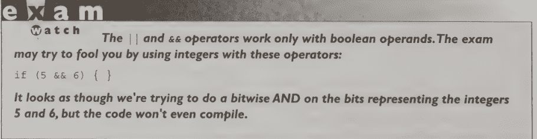

`||`和`&&`运算符只与布尔操作数一起。考试可能会通过在这些运算符中使用整数来欺骗你：

```java
if (5 && 6) { }
```

看起来我们正试图对表示整数 5 和 6 的位进行位与运算，但代码永远无法编译。

# 逻辑运算符（非短路）

有两个非短路逻辑运算符：

- 非短路 AND
- 非短路 OR

这些运算符在逻辑表达式中的用法与`&&`和`||`运算符的使用方式一样，但因为它们不是短路运算符，它们会评估双方

# Java 运算符 OCA 目标 3.1, 3.2 和 3.3 245

表达式的结果——总是如此！它们的效率很低。例如，即使`&`表达式中的第一个操作数（左侧）为假，第二个操作数仍然会被评估——尽管此时结果已经不可能为真了！而`|`同样低效：如果第一个操作数为真，Java 虚拟机 (JVM) 也会继续执行并评估第二个操作数，即使它知道无论如何结果都为真。

你会在考试中很多同时使用短路和非短路逻辑运算符的题目。你必须确切知道哪些操作数被评估了，哪些没有，因为结果取决于表达式中的第二个操作数是否被评估。考虑以下情况：

```
int z = 5;
if((z == 5 || ++z > 6)); // 代码执行后 z = 7
```

```
int z = 5;
if((++z > 5 | ++z > 6)); // 代码执行后 z = 8
```

# 逻辑运算符 ^ 和 !

考试中最后的两个逻辑运算符是：

- 异或 (XOR)
- 布尔取反 (Boolean invert)

`^`（异或）运算符仅评估布尔值。`^`运算符与我们刚刚回顾的非短路运算符有关，在于它总是评估表达式中的左侧和右侧操作数。对于异或 (`^`) 表达式要为真，**恰好**有一个操作数为真。这个示例：

```
System.out.println("xor " + ((2 < 3) ^ (4 > 3)));
```

产生此输出：

```
xor false
```

前面的表达式评估为假，是因为两个操作数 (`2 < 3`) 和第二个操作数 (`4 > 3`) 都评估为真。

`!`（布尔取反）运算符返回布尔值当前值的反方向。以下语句：

```
if(!(7 == 5)) { System.out.println("not equal"); }
```

# 246 第 4 章：运算符

可以读作“如果 7 == 5 不为真”，该语句产生此输出：

```
not equal
```

这里是另一个使用布尔值的示例：

```
boolean t = true;
boolean f = false;
System.out.println(" " + (t & !f) + " " + f);
```


它产生此输出：

- `true false`

在前面的示例中，注意 `&` 测试成功了（打印 `true`），且布尔变量 `f` 的值没有改变，所以它打印了 `false`。

## 认证总结

如果你努力学习了这一章，你应该已经牢牢掌握了 Java 运算符，并且应该理解使用 `==` 运算符测试时等等的含义。让我们回顾一下在本章中学到的重点。

逻辑运算符（`&&`、`||`、`|` 和 `^`）只能用于评估两个布尔表达式。`&&` 和 `&` 的区别在于，如果左侧评估为假，`&&` 运算符就不会测试右侧操作数，因为 `&&` 表达式的结果永远为真。`||` 和 `|` 的区别在于，如果左侧评估为真，`||` 运算符就不会测试右侧操作数，因为此时结果已知为真。

`==` 运算符可以用于比较基本类型的值，也可以用于判断两个引用变量是否指向同一个对象。`instanceof` 运算符用于判断引用变量所引用的对象是否通过了指定类型的 IS-A 测试。

`+` 被重载以执行字符串拼接任务，也可以拼接字符串和基本类型，但要小心——拼接可能会很棘手。

条件运算符（又称“三元运算符”）具有不寻常的、三个操作数的语法——不要把它误认为是复杂的赋值语句。

`++` 和 `--` 运算符将贯穿整个考试，你必须注意它们是位于被更新变量的前缀还是后缀。准备好应对许多涉及本章主题的考试题。即使在测试你对其他目标知识的题目中，代码也会频繁使用运算符、赋值、对象和基本类型的传递等。

## 两分钟演练

以下是本章每个章节的一些要点。

# 关系运算符 (OCA 目标 3.1 和 3.3)

- 关系运算符始终产生一个布尔值（`true` 或 `false`）
- 有六种关系运算符：`>`、`>=`、`<`、`<=`、`==` 和 `!=`。最后两个（`==` 和 `!=`）有时被称为等价运算符。
- 在比较字符时，Java 使用字符的 Unicode 值作为数值。
- 等价运算符：
- 有两个等价运算符：`==` 和 `!=`。
- 可以测试四种类型：数字、字符、布尔值和引用变量。
- 在比较引用变量时，只有当两个引用指向同一个对象时，`==` 才返回 `true`。

# instanceof 运算符 (OCA 目标 3.1)

- `instanceof` 仅用于引用变量
- `instanceof` 运算符只能用于通过相同类层次结构中的类来测试对象（或 `null`）
- 对于接口，如果对象的任何一个父类实现了 `instanceof` 右侧的接口，则该对象通过了 `instanceof` 测试

# 算术运算符 (OCA 目标 3.1 和 3.2)

- 四个数学运算符是加（`+`）、减（`-`）、乘（`*`）和除（`/`）
- 余数运算符（又称模）`%` 返回除法的余数。
- 表达式从左到右评估，除非你加上括号，或者表达式中的某些运算符的优先级高于其他运算符。
- `*`、`/` 和 `%` 运算符的优先级高于 `+` 和 `-`。

# 字符串拼接运算符 (OCA 目标 3.1)

- 如果任一操作数是字符串，`+` 运算符会拼接操作数。
- 如果两个操作数都是数字，`+` 运算符会相加操作数。

# 增/减运算符 (OCA 目标 3.1 和 3.2)

- 前缀运算符（例如 `++x` 和 `--x`）在值用于表达式之前运行。
- 后缀运算符（例如 `x++` 和 `x--`）在值用于表达式之后运行。
- 在任何表达式中，两个操作数在应用运算符之前都会完全评估。
- 标记为 `final` 的变量不能增或减。

# 三元（条件）运算符 (OCA 目标 3.1)

- 根据其布尔表达式为真或假返回两个值之一。
- 如果表达式为真，返回 `?` 之后的值。
- 如果表达式为假，返回 `:` 之后的值。

# 逻辑运算符 (OCA 目标 3.1)

- 考试涵盖六种“逻辑”运算符：`&`、`|`、`^`、`&&` 和 `||`。
- 逻辑运算符作用于两个表达式（`!` 除外），且必须解析为布尔值。
- `&&` 运算符只有在两个操作数都为真时返回 `true`。
- `||` 运算符在任一或两个都为真时返回 `true`。
- `&&` 和 `||` 运算符被称为短路运算符。
- 如果左侧操作为假，`&&` 不评估右侧操作数。
- 如果左侧为真，`||` 不评估右侧操作数。
- `&` 和 `|` 运算符总是评估两者。
- `^` 运算符（称为“逻辑异或”）在恰好有一个为真时返回 `true`。
- `!` 运算符（称为“取反”）返回其之前的布尔操作数的相反值。

## 自测

1. 给出：

```java
class Hexy {
    public static void main(String[] args) {
        int i = 42;
        String s = (i < 40) ? "life" : (i > 50) ? "universe" : "everything";
        System.out.println(s);
    }
}
```

结果是什么？

- A. `null`
- B. `life`
- C. `universe`
- D. `everything`
- E. 编译失败
- F. 运行时抛出异常

2. 给出：

```java
public class Dog {
    String name;
    Dog(String s) { name = s; }
    public static void main(String[] args) {
        Dog d1 = new Dog("Boi");
        Dog d2 = new Dog("Tyri");
        System.out.print((d1 == d2) + " ");
        Dog d3 = new Dog("Boi");
        d2 = d1;
        System.out.print((d1 == d2) + " ");
        System.out.print((d1 == d3) + " ");
    }
}
```

结果是什么？

- A. `true true`
- B. `true true false`
- C. `false true false`
- D. `false true true`
- E. `false false false`
- F. 运行时将抛出异常

3. 给定：

```java
class Fork {
    public static void main(String[] args) {
        if (args.length == 1 || args[1].equals("test")) {
            System.out.println("test case");
        } else {
            System.out.println("production " + args[0]);
        }
    }
}
```

命令行调用为：

```
java Fork live2
```

结果是什么？

- A. `test case`
- B. `production live2`
- C. `test case live2`
- D. 编译失败
- E. 运行时抛出异常

4. 给定：

```java
class Feline {
    public static void main(String[] args) {
        long x = 42L;
        long y = 44L;
        System.out.print(" " + 7 + 2 + " ");
        System.out.print(foo() + x + 5 + " ");
        System.out.println(x + y + foo());
    }
    static String foo() { return "foo"; }
}
```

结果是什么？

- A. `9 foo47 86foo`
- B. `9 foo47 4244foo`
- C. `9 foo425 86foo`
- D. `9 foo425 4244foo`
- E. `72 foo47 86foo`
- F. `72 foo427 4244foo`
- G. `72 foo425 86foo`
- H. `72 foo425 4244foo`
- I. 编译失败

5. 注意：这里有另一个旧式的拖拽题……以防万一。

将片段放入代码中以产生输出 `33`。注意你必须恰好使用每个片段一次。

```java
class Incr {
    public static void main(String[] args) {
        Integer x = 7;
        int y = 2;
        x
        --- --- i
        --- --- i
        --- --- i
        System.out.println(x);
    }
}
```

片段：

```
y y y
y x x
- = * = * = =
```

# 252 第 4 章：运算符

6. 给定：

```java
public class Cowboys {
    public static void main(String[] args) {
        int x = 12;
        int a = 5;
        int b = 7;
        System.out.println(x/a + " " + x/b);
    }
}
```

结果是什么？（选择所有适用项。）

- A. `2 1`
- B. `2 2`
- C. `3 1`
- D. `3 2`
- E. 运行时抛出异常

7. (仅限 OCP) 给定：

```java
3. public class McGee {
4.     public static void main(String[] args) {
5.         Days d1 = Days.TH;
6.         Days d2 = Days.M;
7.         for(Days d : Days.values()) {
8.             if(d.equals(Days.F)) break;
9.             d2 = d;
10.        }
11.        System.out.println((d1 == d2) ? "same old" : "newly new");
12.    }
13.    enum Days {M, T, W, TH, F, SA, SU};
14. }
```

结果是什么？

- A. `same old`
- B. `newly new`
- C. 多个错误导致编译失败
- D. 仅因第 7 行错误导致编译失败
- E. 仅因第 8 行错误导致编译失败
- F. 仅因第 11 行错误导致编译失败
- G. 仅因第 13 行错误导致编译失败

8. 给定：

```java
4. public class SpecialOps {
5.     public static void main(String[] args) {
6.         String s = "";
7.         boolean b1 = true;
8.         boolean b2 = false;
9.         if ((b2 == false) || ((21%5) > 2)) s += "x";
10.        if (b1 || (b2 == true)) s += "y";
11.        if (b2 == true) s += "z";
12.        System.out.println(s);
13.    }
14. }
```

哪些是正确的？（选择所有适用项。）

- A. 编译失败
- B. 输出中包含 `x`
- C. 输出中包含 `y`
- D. 输出中包含 `z`
- E. 运行时抛出异常

9. 给定：

```java
3. public class Spock {
4.     public static void main(String[] args) {
5.         int mask = 0;
6.         int count = 0;
7.         if ((5<7) || (++count < 10)) || mask++ < 10 ) mask = mask + 1;
8.         if ((6 > 8) ^ false) mask = mask + 10;
9.         if (!(mask > 1) && ++count > 1) mask = mask + 100;
10.        System.out.println(mask + " " + count);
11.    }
```

关于 `mask` 和 `count`，哪项是正确的？

- A. `mask` 为 0
- B. `mask` 为 1
- C. `mask` 为 2
- D. `mask` 为 10
- E. `mask` 大于 10
- F. `count` 为 0

10. 给定：

```java
3. interface Vessel {
4.     interface Toy {
5.         class Speedboat implements Vessel {}
6.         class Boat implements Toy {}
7.         public class Test {
8.             public static void main(String[] args) {
9.                 String s = "";
10.                Object b1 = new Speedboat();
11.                Object b2 = new Boat();
12.                if ((b1 instanceof Vessel) || (b2 instanceof Toy)) s += "1";
13.                if (b1 instanceof Vessel || (b2 instanceof Toy)) s += "2";
14.                System.out.println(s);
15.            }
```

结果是什么？

- A. `0`
- B. `1`
- C. `2`
- D. 编译失败
- E. 运行时抛出异常

# 答案

1. B
2. C
3. E
4. D
5. B
6. A
7. G
8. B
9. A, F
10. C

# 使用 String 和 StringBuilder (OCA 目标 2.7 和 2.6) 259

到目前为止，`String` 对象看起来和其他字符串对象没有区别。现在，让我们给这个字符串赋一个值：

```java
s = "abcdef";
```

（你很快就会发现，这两行代码的作用并不像表面看起来那么简单，请关注。）

事实证明 `String` 类有数以亿计的构造函数，你可以使用一种更高效的快捷方法：

```java
String s = new String("abcdef");
```

而这种方式更加简洁：

```java
String s = "abcdef";
```

这些选项之间存在一些细微的区别，我们稍后会讨论。它们的共同点是，它们都创建了一个值为 `"abcdef"` 的新 `String` 对象，并将其赋值给引用变量 `s`。现在，假设你想对 `s` 所引用的 `String` 对象创建第二个引用：

```java
String s2 = s; // 指向与 s 相同的 String
```

到目前为止一切正常。`String` 对象的行为看起来和其他对象完全一样，那么为什么要大费干戈呢？**不可变性**（Immutability）！（到底什么是不可变性？）一旦你定义了一个 `String` 值，该值就永远无法改变——它是不可变的，像冻结了一样，纹丝不动，就这样，完事。（我们稍后会讨论为什么；别让我们忘了。）消息是，尽管字符串对象本身是不可变的，但它的引用变量不是。继续之前的例子，考虑以下情况：

```java
s = s.concat("more stuff"); // concat() 方法在末尾“追加”
// 一个字面量
```

现在，等一下，我们不是说过 `String` 对象是不可变的吗？那么这种“在字符串末尾追加”是怎么回事？问得好：让我们看看发生了什么。

Java 虚拟机（JVM）获取了字符串 `s` 的值（即 `"abcdef"`），并在末尾标记了 `"more stuff"`，得到了 `"abcdef more stuff"` 的值。由于字符串是不可变的，JVM 无法在 `s` 引用的旧字符串中找到这个新值，因此它创建了一个新的 `String` 对象，将其赋值为 `"abcdef more stuff"`，并让 `s` 指向它。在示例的这一点上，我们有两个 `String` 对象：我们创建的第一个。从技术上说现在有三个 `String` 对象，因为 `concat` 的字面量参数 `" more stuff"` 本身就是一个新的字符串对象。但我们只对 `"abcdef"`（由 `s2` 引用）和 `"abcdef more stuff"`（由 `s` 引用）拥有引用。

如果在调用 `s = s.concat(" more stuff")` 之前，我们没有远见或运气为 `"abcdef"` 字符串创建一个第二个引用变量会怎样？在这种情况下，原始且不变的字符串 `"abcdef"` 仍然存在于内存中，但它会被视为“丢失”。我们的程序中没有代码可以引用它——`"abcdef"` 字符串没有改变（记住；它是不可变的）；只是引用 `s` 被改变了，使其指向了不同的字符串。

图 5-1 显示了当你重新赋值引用变量时堆上发生的情况。注意，虚线表示被删除的引用。

回顾我们的第一个例子：

```java
String s = "abcdef"; // 创建一个新的 String 对象，值为
String s2 = s;       // "abcdef"，s 指向它
                     // 创建第二个引用变量
                     // 指向同一个 String
```

```java
// 创建一个新的 String 对象，值为 "abcdef more stuff"，
// 指向它。（将 s 的引用从旧 String
// 改为新 String。）记住 s2 仍然指向
// 原始的 "abcdef" String。）
```

```java
s = s.concat(" more stuff");
```

让我们来看另一个例子：

```java
String x = "Java";
x.concat(" Rules!"); // 输出是 "x = Java"
```


`System.out.println("x = " + x);`

第一行非常直观：创建一个新的 `String` 对象，赋值 `"Java"`，并引用 `x`。JVM 创建了值为 `"Java Rules!"` 的第二个 `String` 对象，但没有任何引用它。第二个 `String` 对象立即丢失了；引用变量 `x` 仍然指向值为 `"Java"` 的原始 `String`。图 5-2 显示了创建一个没有引用的 `String`。

让我们扩展一下当前的例子。我们从

```
String x = "Java";

x.concat(" Rules!"); // 输出是：x = Java

System.out.println("x = " + x);
```

现在

```
x.toUpperCase();

System.out.println("x = " + x); // 输出仍然是：

// x = Java
```

# 图 5-1

第 1 步：`String s = "abc";`

`String` 对象及其引用变量


第 2 步：`String s2 = s;`


第 3 步：`s = s.concat("def");`


（我们实际上创建了一个值为 `"JAVA"` 的新 `String` 对象，但它丢失了，且 `x` 仍然指向原始未改变的字符串 `"Java"`）如果加上这个：

```
x.replace('a', 'X');

System.out.println("x = " + x); // 输出仍然是：

x = Java
```


`String` 对象在创建后被遗弃。


注意没有创建引用变量来访问 `"Java Rules! String"`。

# 使用 String 和 StringBuilder (OCA 目标 2.7 和 2.6)

`String` 对象的不可变性是一个非常棒的主意。如果多个引用变量指向同一个 `String`，而它们甚至并不知道这一点，如果其中任何一个变量都能改变 `String` 的值，那将非常糟糕。

你可能会说：“那这听起来很好，但如果有人重写了 `String` 类的功能呢？难道不会导致池（pool）出现问题吗？”这就是 `String` 类被标记为 `final` 的主要原因之一。没有人可以重写任何 `String` 方法的行为，因此你可以放心，你所依赖的不可变 `String` 对象实际上确实是不可变的。

## 创建新字符串

之前我们承诺过会更深入地讨论创建 `String` 的各种方法之间的细微差异。让我们来看创建 `String` 的几个示例，并进一步假设池中不存在其他 `String` 对象。在这种简单的情况下，`"abc"` 将进入池，而 `s` 将指向它：

```
String s = "abc"; // 创建了一个 String 对象和一个 

// 引用变量
```

在下一种情况情况下，由于我们使用了 `new` 关键字，Java 将在普通内存（非池内存）中创建一个新的 `String` 对象，而 `s` 将指向它。此外，字面量 `"abc"` 将被放入池中：

```
String s = new String("abc"); // 创建了两个对象，

// 以及一个引用变量
```

## String 类中的重要方法

以下方法是 `String` 类中最常用的方法，也是你很可能在考试中遇到的方法。

- `charAt()` 返回位于指定索引处的字符
- `concat()` 将一个字符串附加另一个字符串的末尾（`+` 也可以工作）
- `equalsIgnoreCase()` 确定两个字符串是否相等，忽略大小写
- `length()` 返回字符串中字符的数量
- `replace()` 将字符的出现位置替换为新字符
- `substring()` 返回字符串的一部分
- `toLowerCase()` 返回一个字符串，将其大写字母转换为小写字母
- `toString()` 返回字符串的值
- `toUpperCase()` 返回一个字符串，将其小写字母转换为大写字母
- `trim()` 字符串两端的空白

让我们更详细地查看这些方法。

### public char charAt(int index)

此方法返回位于 `String` 指定索引处的字符。记住，`String` 的索引是从 0 开始的——这里有一个示例：

```
String x = "airplane";

System.out.println(x.charAt(2)); // 输出是 'r'
```

### public String concat(String s)

此方法返回一个字符串，将传递给方法的 `String` 值附加到调用方法的 `String` 的末尾——这里有一个示例：

```
String x = "taxi";

System.out.println(x.concat(" cab")); // 输出是 "taxi cab"
```

重载的 `+` 和 `+=` 执行的功能与 `concat()` 类似——这里有一个示例：

```
String x = "library";

System.out.println(x + " card"); // 输出是 "library card"
```

```
String x = "Atlantic";

x += " ocean";

System.out.println(x); // 输出是 "Atlantic ocean"
```

在前面的 `"Atlantic ocean"` 示例中，注意 `x` 的值确实改变了！`+=` 运算符是一个赋值运算符，所以第 2 行实际上创建了一个新字符串 `"Atlantic ocean"`，并将其赋值给变量 `x`。在第 2 行执行后，`x` 指向的原字符串 `"Atlantic"` 被丢弃了。

### public boolean equalsIgnoreCase(String s)

此方法返回一个布尔值（`true` 或 `false`），取决于参数中的 `String` 值是否与调用方法的 `String` 值相同。即使被比较的 `String` 对象中的字符大小写不同，该方法也会返回 `true`——这里有一个示例：

```
String x = "Exit";

System.out.println(x.equalsIgnoreCase("EXIT")); // 是 "true"

System.out.println(x.equalsIgnoreCase("tixe")); // 是 "false"
```

### public int length()

此方法返回用于调用方法的 `String` 的长度——这里有一个示例：

```
String x = "012345678";

System.out.println(x.length()); // 返回 "8"
```

**考试注意** 数组有一个名为 `length` 的属性（而不是方法）。你可能会在考试中遇到尝试在数组上使用 `length()` 或尝试在 `String` 上使用 `length` 属性的题目。这两种都会导致编译错误——考虑这些示例：

```
String x = "test";

System.out.println(x.length()); // 编译错误
```

```
String[] x = new String[3];

System.out.println(x.length()); // 编译错误
```

### public String replace(char old, char new)

此方法返回一个字符串，其值是用于调用方法的 `String` 的值，更新后第一个参数中 `char` 的任何出现处都被替换为第二个参数中的 `char`——这里有一个示例：

```
String x = "oxoxox";

System.out.println(x.replace('x', 'X')); // 输出 "OXOXOX"
```

### public String substring(int begin) and public String substring(int begin, int end)

返回调用方法的 `String` 的一部分（子字符串）。第一个参数代表 `String` 的起始位置（从 0 开始）。如果调用只有一个参数，返回的子字符串将包含到原始字符串末尾的所有字符。如果调用有两个参数，返回的子字符串将包含到指定结束位置之前的字符。

### public String toLowerCase()

返回一个字符串，将其大写字母转换为小写字母——这里有一个示例：

```
String x = "New Moon";

System.out.println(x.toLowerCase()); // 输出是 "new moon"
```

### public String toString()

返回字符串的值——这里有一个示例：

```
String x = "big surprise";

System.out.println(x.toString()); // 输出是 "big surprise"
```

### public String toUpperCase()

返回一个字符串，将其小写字母转换为大写字母——这里有一个示例：

```
String x = "new moon";

System.out.println(x.toUpperCase()); // 输出是 "NEW MOON"
```

### public String trim()

移除字符串两端的空白——这里有一个示例：

```
String x = " hi ";

System.out.println(x.trim()); // 输出是 "hi"
```

## StringBuilder 类

当需要对字符串进行大量修改时，应该使用 `java.lang.StringBuilder` 类。正如上一节所述，`String` 对象是不可变的，因此如果你选择对 `String` 对象进行大量操作，将产生大量的丢弃的 `String` 对象（即使在如今拥有大量内存的时代，浪费内存产生产生的 `String` 对象也不是好主意）。相比之下，`StringBuilder` 类型的对象可以反复修改，而不会留下垃圾字符串。

`StringBuilder` 的常见用途是文件 I/O，当程序处理大量不断变化的输入时。在这些情况下，大块字符作为单元处理，而 `StringBuilder` 是处理数据、传递数据并重用同一块内存处理下一块数据的理想方式。

## 优先使用 StringBuilder 而不是 StringBuffer

`StringBuilder` 类在 Java 5 中引入。它与 `StringBuffer` 类完全相同的 API，只是 `StringBuilder` 不是安全的。换句话说，它的方法不是同步的（关于线程安全的更多信息请见第 13 章）。Oracle 建议尽可能使用 `StringBuilder` 代替 `StringBuffer`，因为 `StringBuilder` 运行更快（并且可能效率更高）。所以除了同步之外，我们对 `StringBuilder` 方法的任何说法都适用于 `StringBuffer`，反之亦然。尽管如此，对于 OCA 7 和 OCP 7 字符串，不会测试 `StringBuffer`。

## 使用 StringBuilder
（这是我们最后一次说：`StringBuilder`）

在上一节中，你看到过考试可能会通过这样的代码片段测试你对 `String` 不可变性的理解：

```
String x = "abc";

x.concat("def");

System.out.println("x = " + x); // 输出是 "x = abc"
```

因为没有进行赋值，使用 `concat()` 方法创建的 `String` 对象被立即丢弃了。

# 270 第 5 章：处理字符串、数组和 ArrayList

我们通过操作获得了一个新的 `String`，但缺点是旧的 `String` `"abc"` 在字符串池中丢失了，浪费了内存。如果我们使用 `StringBuilder` 而不是 `String`，代码看起来像这样：

```
StringBuilder sb = new StringBuilder("abc");

sb.append("def");

System.out.println("sb = " + sb); // 输出为 "sb = abcdef"
```

我们将要讨论的所有 `StringBuilder` 方法都作用于调用它的 `StringBuilder` 对象的值。调用 `sb.append("def");` 实际上是将 `"def"` 附加到它本身（`StringBuilder sb`）。事实上，这些方法可以链式调用——这里有一个例子：

```
StringBuilder sb = new StringBuilder("abc");

sb.append("def").reverse().insert(3, "ghij");
```

注意，在之前的两个示例中，都有对 `new` 的调用，因此在每个示例中我们都没有创建额外的对象。每个示例都需要单个 `StringBuilder` 对象来执行。

- 1. `new StringBuilder(); // 默认容量 = 16 个字符`
- 2. `new StringBuilder("ab"); // 容量 = 16 + 参数的长度`
- 3. `new StringBuilder(x); // 容量 = x (整数)`

使用 `StringBuilder` 的两种最常用方式是通过 `append()` 方法或 `insert()` 方法。在 `StringBuilder` 的容量方面，在附加和插入时需要记住三个规则：

- 如果 `append` 使 `StringBuilder` 增长超过了其容量，容量将自动更新。
- 如果 `insert()` 在 `StringBuilder` 的容量范围内开始，但结束于当前容量之后，容量将自动更新。
- 如果 `insert()` 尝试在 `StringBuilder` 当前长度之后的索引处开始，将抛出异常。

# 使用 String 和 StringBuilder 的 OCA 目标 2.7 和 2.6 271

# StringBuilder 类中的重要方法

`StringBuilder` 类有无数个方法。以下是你在现实世界中最可能用到的方法，而且幸运的是，这些也是你最可能在考试中找到这些方法。

### public StringBuilder append(String s)
如你之前看到的，此方法将更新调用该方法的对象的值，无论返回值是否赋值给变量。此方法接受许多不同的参数，包括 `boolean`、`char`、`double`、`float`、`int`、`long` 等，但在考试中最可能用的是 `String` 参数——例如，

```
StringBuilder sb = new StringBuilder("set ");

sb.append("point");

System.out.println(sb); // 输出为 "set point"

StringBuilder sb2 = new StringBuilder("pi = ");

sb2.append(3.14159);

System.out.println(sb2); // 输出为 "pi = 3.14159"
```

### public StringBuilder delete(int start, int end)
此方法修改调用它的 `StringBuilder` 对象的值。要删除的子字符串由第一个参数定义（从 0 开始），要删除的子字符串的结束索引由第二个参数定义（但是是从 1 开始的！）请仔细研究以下示例：

```
StringBuilder sb = new StringBuilder("0123456789");

System.out.println(sb.delete(4,6)); // 输出为 "01236789"
```

注意：考试可能会测试你对 `String` 和 `StringBuilder` 对象区别的知识。因为 `StringBuilder` 对象是可变的，下面的代码片段与使用 `String` 对象的类似代码片段不同：

```
StringBuilder sb = new StringBuilder("abc");

sb.append("def");

System.out.println(sb);
```

在这种情况下，输出将是：`"abcdef"`

### public StringBuilder insert(int offset, String s)
此方法更新调用方法的 `StringBuilder` 对象的值。传递给第二个参数的 `String` 被插入到由第一个参数表示的 `offset` 位置（`offset` 是从 0 开始的）。再次，其他类型的数据可以通过参数传递（`boolean`、`char`、`double`、`float`、`int`、`long` 等），但最可能看到的是 `String` 参数：

```
StringBuilder sb = new StringBuilder("01234567");

sb.insert(4, "---");

System.out.println(sb); // 输出为 "0123---4567"
```

### public StringBuilder reverse()
此方法更新调用方法的 `StringBuilder` 对象的值。调用时，`StringBuilder` 中的字符被反转——第一个变成最后一个，第二个变成倒数第二个，依此类推：

```
StringBuilder s = new StringBuilder("alarm");

s.reverse();

System.out.println(s); // 输出为 "marla"
```


### `public String toString()`

此方法将调用方法的 `StringBuilder` 对象的值作为 `String` 返回：

```
StringBuilder sb = new StringBuilder("test string");
System.out.println(sb.toString()); // 输出为 "test string"
```

对于 `StringBuilder`，如果你从中提取一个值，它与 `String` 对象不同，`StringBuilder` 对象是可以改变的。许多考试题使用一种被称为“链式方法”的技巧。链式方法的语句通用形式如下：

```
result = method1().method2();
```

理论上，任意数量的方法都可以链式调用，尽管你通常不会超过三个。以下是解读这些“快捷方式”的方法：

## 使用数组 (OCA 目标 4.1 和 4.2)

| 步骤 | 描述 |
| :--- | :--- |
| 1 | 确定左侧的方法返回什么（我们称之为 `x`）。 |
| 2 | 使用 `x` 作为调用第二个方法的对象（从左侧）。如果只有方法，第二个方法的结果是表达式的结果。 |
| 3 | 如果有第三个方法，第二个方法的结果用于调用第三个方法，它是表达式的结果——例如： |

```java
String x = "abc";
String y = x.concat("def").toUpperCase();
System.out.println("y = " + y); // 输出为 "ABCDEF"
```

看看发生了什么：字面量连接到 `abc`，创建了一个值为 `abc` 的临时 `String`。在这个字符串上调用了 `toUpperCase`，创建了一个值为 `ABC` 的新 `String`。然后在第二个对象上调用了 `replace()` 方法，创建了一个指向 `y` 的值为 `ABC` 的 `String`。

### 认证目标

## 使用数组 (OCA 目标 4.1 和 4.2)

- 4.1 声明、实例化并使用一维数组。
- 4.2 声明、初始化并使用多维数组。

数组是 Java 中的对象，存储相同类型的多个变量。数组可以包含基本类型或对象引用，但即使数组声明持有基本元素，数组本身始终是堆上的对象。换句话说，没有所谓的类型类型数组，你可以创建一个基本类型的数组。对于这个目标，你需要知道三件事：

- 创建数组引用变量（声明）
- 创建数组对象（构造）
- 填充数组元素（初始化）

实现这些每项都有几种不同的方法，你需要在考试中掌握所有它们。

数组是高效的，但大多数情况下你会想要使用 `java.util` 中的 `Collection` 类型（包括 `HashMap`、`ArrayList`、`TreeSet`）。`Collection` 类提供了更灵活的对象访问方式（用于插入、删除等），与数组不同，它们可以随着添加或删除元素动态地扩展或缩小（因为它们在底层使用数组）。各种需求都有 `Collection` 类型。没有重复的对象组？访问键值对的方法？链表？第 11 章将详细介绍集合。


## 声明数组

通过说明数组将持有的类型来声明数组，类型可以是对象或基本类型，然后在标识符的左侧或右侧加上方括号。声明基本类型数组：

```
int[] key;               // 括号在名称之前（推荐）
int key[];               // 括号在名称之后（合法但可读性较差）
                         // 名称和 [] 之间有空格合法但不
```

声明对象引用数组：

```
Thread[] threads;    // 推荐
Thread[] threads[]; // 合法但可读性较差
```

在声明数组引用时，你应该始终将数组括号放在声明类型之后，而不是标识符（变量名）之后。这样，阅读代码的人就可以轻松判断出，例如，`key` 是一个 `int` 数组对象的引用，而不是基本类型。

我们还可以声明多维数组，它们实际上是数组的数组。可以通过以下方式进行：

```
String[][] occupantName; // 推荐
String[] managerName[]; // 难看，但合法
```

第一个示例是三维数组（数组的数组的数组），第二个是二维数组。注意第二个示例中，我们在变量名称之前有一个方括号，后面也有。这对于编译器来说是完全合法的，再次证明了合法并不意味着它是正确的。

在声明中包含数组的大小是不允许的。是的，我们知道在其他语言中可以这样做，这就是为什么你可能会在考试中看到一两个包含以下代码：

```
int[5] scores;      // 无法编译
```

前面的代码无法通过编译。请记住，在您实际实例化数组对象之前，JVM 不会分配空间。那才是大小变得的时候。

## 构建数组

构造数组意味着在堆上（所有对象都存在的地方）创建数组对象——即对数组类型执行 `new` 操作。为了创建一个数组对象，Java 必须知道要在堆上分配多大的空间，因此你必须在创建时指定数组的大小。数组的大小是数组将包含的元素数量。

## 构建一维数组

构造数组最直接的方法是使用关键字 `new` 后面跟上数组类型，并用括号指定数组将包含多少个该类型的元素。以下是构造一个 `int` 类型数组的示例：

```java
int[] testScores; // 声明 int 数组
testScores = new int[4]; // 构造数组并将其赋值
// 给 testScores 变量
```

前面的代码在堆上置入了一个新对象——一个包含四个元素的数组——其中每个元素都包含一个默认值为 0 的 `int`。你可以把这段代码看作是对编译器说：“创建一个包含四个 `int` 的数组对象，并将其赋值给名为 `testScores` 的引用变量。另外，把每个 `int` 元素都设零。谢谢。（编译器很欣赏良好的礼貌。）

图 5-4 显示了构造后堆上的 `testScores` 数组。

图 5-4

堆上的一维数组

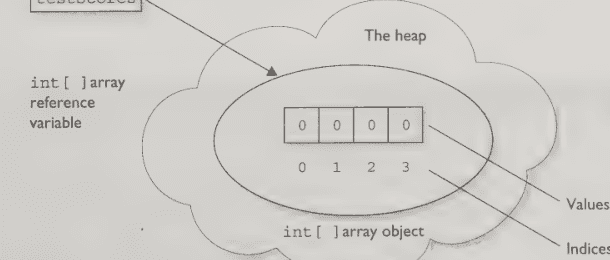

你也可以在一条语句中声明并构造数组，如下：

```java
int [] testScores = new int[4];
```

这一个单一语句产生的结果与之前的两个语句相同。对象类型的数组也可以以相同的方式构造：

```java
Thread[] threads = new Thread[5]; // 没有创建 Thread 对象
                                // 创建了一个 Thread 数组
```

请记住，尽管代码看起来是那样，但 `Thread` 构造函数并没有被调用。我们并不是在创建一个 `Thread` 实例，而是创建一个单一的 `Thread` 数组对象。在前面的语句之后，还没有实际的 `Thread` 对象！

仔细思考在代码语句或块执行后，堆上有多少个对象。考试将要求你了解（例如，前面的代码只产生了一个对象，赋值给名为 `threads` 的引用变量的数组）。由 `threads` 引用的单一对象持有五个 `Thread` 引用变量，但还没有 `Thread` 对象被创建或赋值给这些引用。

请记住，数组在构造时必须始终给定大小。JVM 需要该大小来为新的数组对象在堆上分配适当的空间。例如，以下操作永远是不合法的：

```java
int[] carList = new int(); // 将无法编译；需要大小
```

你可能会看到“构造（construct）”、“创建（create）”和“实例化（instantiate）”这些词被交替使用。它们都意味着“在堆上构建了一个对象”。这还意味着由于构造/创建/实例化代码的执行，对象的构造函数会运行。你可以肯定地说，例如，任何使用 `new` 关键字的代码（如果成功运行）都会导致类构造函数和所有父类构造函数的运行。

## 使用数组（OCA 目标 4.1 和 4.2）

除了使用 `new` 构造外，数组还可以使用一种语法简写来创建，这种写法在创建数组的同时将数组元素初始化为代码中提供的值（而不是默认值）。我们将在下一节中查看。现在，请理解由于这些语法快捷方式，即使你从未使用或见过 `new` 关键字，也可以创建对象。

## 构建多维数组

请记住，多维数组简单来说就是数组的数组。因此，`int` 类型的二维数组实际上是一个 `int` 数组对象（`int[]`），该数组中的每个元素都持有指向另一个 `int` 数组的引用。第二个维度持有实际的 `int` 原型。

以下代码声明并构造了一个 `int` 类型的二维数组：

```java
int [][] myArray = new int[3][];
```

注意，只有第一个括号给了大小。这在 Java 中是可以接受的，因为 JVM 只需要知道赋值给变量 `myArray` 对象的大小。
图 5-5 显示了二维 `int` 数组在堆上的工作原理。

## 初始化数组

初始化数组意味着其中放入内容。数组中的“内容”是数组的元素，它们可以是原始值（`2`、`false` 等）或通过引用引用的对象。如果你有一个对象数组（而不是原始类型数组），数组并不持有对象，就像任何非原始变量并不实际持有对象一样，而是持有指向对象的引用。当我们谈论数组时，例如“一个五个字符串的数组”，尽管我们真正的意思是“指向五个 `String` 对象的数组”。那么大问题就变成了这些引用是否实际上指向真实的 `String` 对象，还是仅仅是 `null`。请记住，没有被赋值对象的引用是 `null` 引用。如果你实际上尝试使用空引用，例如通过点操作符调用其上的方法，你将得到著名的 `NullPointerException`。

数组中的每个元素可以通过索引号访问。索引号始终从 0 开始。索引号始终从 0 开始，所以在十个元素的数组中，索引号从 0 到 9。假设我们如下创建一个三个元素的数组：

```java
int[] pets = new int[3];
```

这段代码在堆上置入三个对象，并将它们赋值给数组的索引位置。

例如，如果数组的长度为 4，索引值从 0 到 3。
通常，你会会在循环中初始化数组元素，如下所示：

```
Dog[] myDogs = new Dog[6]; // 创建一个包含 6 个 Dog 引用的数组
for (int x = 0; x < myDogs.length; x++) {
    myDogs[x] = new Dog(); // 在索引位置 x 分配一个新的 Dog 对象
}
```

`length` 变量告诉我们数组包含多少元素，但它并没有告诉我们这些元素是否已经初始化。

## 在行内声明、构造和初始化

你可以使用两种不同的数组特定快捷语法来初始化（将显式值放入数组元素中）并构造（实例化数组本身）。第一种用于在一条语句中声明、创建并初始化：

- 1. `int x = 9;`
- 2. `int[] dots = {6,x,8};`

前述代码的第 2 行执行了四件事：

- 声明了一个名为 `dots` 的 `int` 数组变量。
- 创建了一个长度为三（三个元素）的 `int` 数组。
- 用值 `6`、`9` 和 `8` 填充数组元素。
- 将新数组对象分配给引用变量 `dots`。

尺寸（数组长度）是由大括号之间用逗号分隔的项目决定的。该代码在功能上等同于较长的代码：

```
int[] dots;
dots = new int[3];
int x = 9;
dots[0] = 6;
dots[1] = x;
dots[2] = 8;
```

这引发了一个问题：“为什么有人要用更长的方法？”我想了一个原因：在你创建数组时，可能不知道将分配给数组元素的值。

## 使用数组 (OCA 目标 4.1 和 4.2)

使用对象引用而不是基本类型，其工作方式完全相同：

```
Dog puppy = new Dog("Frodo");
Dog[] myDogs = {puppy, new Dog("Clover"), new Dog("Aiko")};
```

前面的代码创建了一个由变量 `myDogs` 引用的 `Dog` 数组，长度为三个元素。它将一个之前创建的 `Dog` 对象（分配给引用变量 `puppy`）赋值给数组的第一个元素。它还创建了两个 `Dog` 对象（`Clover` 和 `Aiko`），并将它们添加到 `myDogs` 数组的最后两个 `Dog` 元素中。单这种数组快捷方式（结合引人入胜的文字）就值这本书了。图 5-6 显示了结果。

## 图 5-6

声明、构造、并初始化一个对象数组

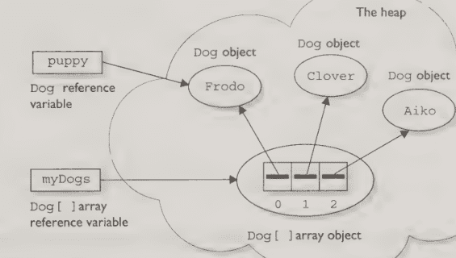

图片展示了以下代码的结果：

```
Dog puppy = new Dog("Frodo");
Dog[] myDogs = {puppy, new Dog("Clover"), new Dog("Aiko")};
```

- 创建了四个对象：
  - 由 `puppy` 和 `myDogs[0]` 引用的 1 个 `Dog` 对象
  - 由 `myDogs` 引用的 1 个 `Dog []` 数组
  - 由 `myDogs[1]` 和 `myDogs[2]` 引用的 2 个 `Dog` 对象

你也可以对多维数组使用快捷语法，如下所示：

```
int [][] scores = {{5,2,4,7}, {9,2}, {3,4}};
```

这段代码在堆上总共创建了四个对象。首先，构造了一个 `int` 数组的数组（将分配给引用变量 `scores` 对象）。`scores` 数组的长度为三，源于外层大括号之间用逗号分隔的项目数。`scores` 数组的三个元素中的每一个都是一个指向 `int` 数组的引用变量，因此构造了三个 `int` 数组并将其分配给 `scores` 数组中的三个元素。

每个 `int` 数组的尺寸由相应内部大括号内的项目数决定。例如，第一个数组长度为 4，第二个数组长度为 2，第三个数组长度为 2。因此，我们有一个 `int` 数组的数组（每个元素都是指向 `int` 数组的引用），以及三个 `int` 数组（这三个数组中的每个元素都是一个 `int` 值）。最后，这三个 `int` 数组通过内部大括号内的实际 `int` 值进行了初始化。因此，第一个 `int` 数组包含值 `5, 2, 4, 7`。以下代码显示了该二维数组中元素的值：

```
scores[0]    // 一个包含 4 个 int 的数组
scores[1]    // 一个包含 2 个 int 的数组
scores[2]    // 一个包含 2 个 int 的数组
scores[0][1] // int 值 2
scores[2][1] // int 值 4
```

图 5-7 显示了在一条语句中声明、构造和初始化二维数组的结果。

## 构造和初始化匿名数组

第二种快捷方式称为“匿名数组创建”，可以构造并初始化数组，然后将数组分配给之前声明的引用变量：

```
int[] testScores;
testScores = new int[] {4,7,2};
```


前面的代码创建了一个具有三个元素的新 `int` 数组；用值 `4`、`7` 和 `2` 初始化这三个元素；然后将数组分配给之前声明的 `int` 变量 `testScores`。我们称之为匿名数组。你可能在创建数组时并不知道将分配给数组元素的值。这种数组快捷方式（结合引人入胜的文字）就值这本书了。

你可能在创建数组时并不知道将分配给数组元素的值。这种数组快捷方式（结合引人入胜的文字）就值这本书了。

你可能在创建数组时并不知道将分配给数组元素的值。这种数组快捷方式（结合引人入胜的文字）就值这本书了。

你可能在创建数组时并不知道将分配给数组元素的值。这种数组快捷方式（结合引人入胜的文字）就值这本书了。

你可能在创建数组时并不知道将分配给数组元素的值。这种数组快捷方式（结合引人入胜的文字）就值这本书了。

你可能在创建数组时并不知道将分配给数组元素的值。这种数组快捷方式（结合引人入胜的文字）就值这本书了。

你可能在创建数组时并不知道将分配给数组元素的值。这种数组快捷方式（结合引人入胜的文字）就值这本书了。

你可能在创建数组时并不知道将分配给数组元素的值。这种数组快捷方式（结合引人入胜的文字）就值这本书了。

你可能在创建数组时并不知道将分配给数组元素的值。这种数组快捷方式（结合引人入胜的文字）就值这本书了。

你可能在创建数组时并不知道将分配给数组元素的值。这种数组快捷方式（结合引人入胜的文字）就值这本书了。

图 5-6 声明构造，并初始化一个对象数组


图示展示了以下代码的结果：

```
Dog puppy = new Dog("Frodo");
Dog[] myDogs = {puppy, new Dog("Clover"), new Dog("Aiko")};
```

- 创建了四个对象：
- 由 `puppy` 和 `myDogs[0]` 引用的 1 个 `Dog` 对象
- 由 `myDogs` 引用的 1 个 `Dog[]` 数组
- 由 `myDogs[1]` 和 `myDogs[2]` 引用的 2 个 `Dog` 对象

## 282 第 5 章：处理字符串、数组和 ArrayList

你也可以对多维数组使用快捷语法，如下所示：

```
int[][] scores = {{5,2,4,7}, {9,2}, {3,4}};
```

这段代码在堆上总共创建了四个对象。首先，构造了一个 `int` 数组的数组（将分配给引用变量 `scores` 对象）。`scores` 数组的长度为三，源于外层大括号之间用逗号分隔的项目数。`scores` 数组的三个元素中的每一个都是一个指向 `int` 数组的引用变量，因此构造了三个 `int` 数组并将其分配给 `scores` 数组中的三个元素。

每个 `int` 数组的尺寸由相应内部大括号内的项目数决定。例如，第一个数组长度为 4，第二个数组长度为 2，第三个数组长度为 2。因此，我们有一个 `int` 数组的数组（每个元素都是指向 `int` 数组的引用），以及三个 `int` 数组（这三个数组中的每个元素都是一个 `int` 值）。最后，这三个 `int` 数组通过内部大括号内的实际 `int` 值进行了初始化。因此，第一个 `int` 数组包含值 `5, 2, 4, 7`。以下代码显示了该二维数组中元素的值：

```
scores[0]    // 一个包含 4 个 int 的数组
scores[1]    // 一个包含 2 个 int 的数组
scores[2]    // 一个包含 2 个 int 的数组
scores[0][1] // int 值 2
scores[2][1] // int 值 4
```

图 5-7 显示了在一条语句中声明、构造和初始化二维数组的结果。

## 构造和初始化匿名数组

第二种快捷方式称为“匿名数组创建”，可以构造并初始化数组，然后将数组分配给之前声明的引用变量：

```
int[] testScores;
testScores = new int[] {4,7,2};
```

前面的代码创建了一个具有三个元素的新 `int` 数组；用值 `4`、`7` 和 `2` 初始化这三个元素；然后将数组分配给之前声明的 `int` 变量 `testScores`。我们称之为匿名数组。你可能在创建数组时并不知道将分配给数组元素的值。这种数组快捷方式（结合引人入胜的文字）就值这本书了。

## 使用数组 (OCA 目标 4.1 和 4.2) 281

使用对象引用而不是基本类型，其工作方式完全相同：

```
Dog puppy = new Dog("Frodo");
Dog[] myDogs = {puppy, new Dog("Clover"), new Dog("Aiko")};
```

前面的代码创建了一个由变量 `myDogs` 引用的 `Dog` 数组，长度为三个元素。它将一个之前创建的 `Dog` 对象（分配给引用变量 `puppy`）赋值给数组的第一个元素。它还创建了两个 `Dog` 对象（`Clover` 和 `Aiko`），并将它们添加到 `myDogs` 数组的最后两个 `Dog` 元素中。这种数组快捷方式（结合引人入胜的文字）就值这本书了。图 5-6 显示了结果。

例如，如果数组的长度为 4，索引值从 0 到 3。通常，你会在循环中看到数组元素的初始化，如下所示：

```
Dog[] myDogs = new Dog[6]; // 创建一个包含 6 个 Dog 引用的数组
for (int x = 0; x < myDogs.length; x++) {
    myDogs[x] = new Dog(); // 在索引位置 x 分配一个新的 Dog 对象
}
```

`length` 变量告诉我们数组包含多少元素，但它并没有告诉我们这些元素是否已经初始化。

## 在行内声明、构造和初始化

你可以使用两种不同的数组特定快捷语法来初始化（将显式值放入数组元素中）并构造（实例化数组本身）。第一种用于在一条语句中声明、创建并初始化：

```
int x = 9;
int[] dots = {6,x,8};
```

前述代码的第 2 行执行了四件事：

- 声明了一个名为 `dots` 的 `int` 数组变量。
- 创建了一个长度为三（三个元素）的 `int` 数组。
- 用值 `6`、`9` 和 `8` 填充数组元素。
- 将新数组对象分配给引用变量 `dots`。

尺寸（数组长度）是由大括号之间用逗号分隔的项目决定的。该代码在功能上等同于较长的代码：

```
int[] dots;
dots = new int[3];
int x = 9;
dots[0] = 6;
dots[1] = x;
dots[2] = 8;
```

这引发了一个问题：“为什么有人要用更长的方法？”我想了一个原因：在你创建数组时，可能不知道将分配给数组元素的值。

## 图 5-6

声明构造、并初始化一个对象数组


图片展示了以下代码的结果：

```
Dog puppy = new Dog("Frodo");
Dog[] myDogs = {puppy, new Dog("Clover"), new Dog("Aiko")};
```

- 创建了四个对象：
- 由 `puppy` 和 `myDogs[0]` 引用的 1 个 `Dog` 对象
- 由 `myDogs` 引用的 1 个 `Dog[]` 数组
- 由 `myDogs[1]` 和 `myDogs[2]` 引用的 2 个 `Dog` 对象

## 282 第 5 章：处理字符串、数组和 ArrayList

你也可以对多维数组使用快捷语法，如下所示：

```
int[][] scores = {{5,2,4,7}, {9,2}, {3,4}};
```

这段代码在堆上总共创建了四个对象。首先，构造了一个 `int` 数组的数组（将分配给引用变量 `scores` 对象）。`scores` 数组的长度为三，源于外层大括号之间用逗号分隔的项目数。`scores` 数组的三个元素中的每一个都是一个指向 `int` 数组的引用变量，因此构造了三个 `int` 数组并将其分配给 `scores` 数组中的三个元素。

每个 `int` 数组的尺寸由相应内部大括号内的项目数决定。例如，第一个数组长度为 4，第二个数组长度为 2，第三个数组长度为 2。因此，我们有一个 `int` 数组的数组（每个元素都是指向 `int` 数组的引用），以及三个 `int` 数组（这三个数组中的每个元素都是一个 `int` 值）。最后，这三个 `int` 数组通过内部大括号内的实际 `int` 值进行了初始化。因此，第一个 `int` 数组包含值 `5, 2, 4, 7`。以下代码显示了该二维数组中元素的值：

```
scores[0]    // 一个包含 4 个 int 的数组
scores[1]    // 一个包含 2 个 int 的数组
scores[2]    // 一个包含 2 个 int 的数组
scores[0][1] // int 值 2
scores[2][1] // int 值 4
```

图 5-7 显示了在一条语句中声明、构造和初始化二维数组的结果。

## 构造和初始化匿名数组

第二种快捷方式称为“匿名数组创建”，可以构造并初始化数组，然后将数组分配给之前声明的引用变量：

```
int[] testScores;
testScores = new int[] {4,7,2};
```

前面的代码创建了一个具有三个元素的新 `int` 数组；用值 `4`、`7` 和 `2` 初始化这三个元素；然后将数组分配给之前声明的 `int` 变量 `testScores`。我们称之为匿名数组。你可能在创建数组时并不知道将分配给数组元素的值。这种数组快捷方式（结合引人入胜的文字）就值这本书了。


前面的代码创建了一个具有三个元素的新 `int` 数组；用值 `4`、`7` 和 `2` 初始化这三个元素；然后将数组分配给之前声明的 `int` 变量 `testScores`。我们称之为匿名数组。你可能在创建数组时并不知道将分配给数组元素的值。这种数组快捷方式（结合引人入胜的文字）就值这本书了。

例如，如果数组的长度为 `4`，索引值从 `0` 到 `3`。通常，你会在循环中看到数组元素的初始化，如下所示：

```
Dog[] myDogs = new Dog[6]; // 创建一个包含 6 个 Dog 引用的数组

for (int x = 0; x < myDogs.length; x++) {
    myDogs[x] = new Dog(); // 在索引位置 x 分配一个新的 Dog 对象
}
```

`length` 变量告诉我们数组包含多少元素，但它并没有告诉我们这些元素是否已经初始化。

## 在行内声明、构造和初始化

你可以使用两种不同的数组特定快捷语法来初始化（将显式值放入数组元素中）并构造（实例化数组本身）。第一种用于在一条语句中声明、创建并初始化：

- `int x = 9;`
- `int[] dots = {6, x, 8};`

前述代码的第 2 行执行了四件事：

- 声明了一个名为 `dots` 的 `int` 数组变量。
- 创建了一个长度为三（三个元素）的 `int` 数组。
- 用值 `6`、`9` 和 `8` 填充数组元素。
- 将新数组对象分配给引用变量 `dots`。

尺寸（数组长度）是由大括号之间用逗号分隔的项目决定的。该代码在功能上等同于较长的代码：

```
int[] dots;
dots = new int[3];
int x = 9;
dots[0] = 6;
dots[1] = x;
dots[2] = 8;
```

这引发了一个问题：“为什么有人要用更长的方法？”我想了一个原因：在你创建数组时，可能不知道将分配给数组元素的值。

## 使用数组 (OCA 目标 4.1 和 4.2) 281

使用对象引用而不是基本类型，其工作方式完全相同：

```
Dog puppy = new Dog("Frodo");
Dog[] myDogs = {puppy, new Dog("Clover"), new Dog("Aiko")};
```

前面的代码创建了一个由变量 `myDogs` 引用的 `Dog` 数组，长度为三个元素。它将一个之前创建的 `Dog` 对象（分配给引用变量 `puppy`）赋值给数组的第一个元素。它还创建了两个 `Dog` 对象（`Clover` 和 `Aiko`），并将它们添加到 `myDogs` 数组的最后两个 `Dog` 元素中。单这种数组快捷方式（结合引人入胜的文字）就值这本书了。图 5-6 显示了结果。

## 图 5-6

声明、构造并初始化一个对象数组


图片展示了以下代码的结果：

```
Dog puppy = new Dog("Frodo");
Dog[] myDogs = {puppy, new Dog("Clover"), new Dog("Aiko")};
```

- 创建了四个对象：
  - 由 `puppy` 和 `myDogs[0]` 引用的 1 个 `Dog` 对象
  - 由 `myDogs` 引用的 1 个 `Dog[]` 数组
  - 由 `myDogs[1]` 和 `myDogs[2]` 引用的 2 个 `Dog` 对象

## 282 第 5 章：处理字符串、数组和 ArrayList

你也可以对多维数组使用快捷语法，如下所示：

```
int[][] scores = {{5,2,4,7}, {9,2}, {3,4}};
```

这段代码在堆上总共创建了四个对象。首先，构造了一个 `int` 数组的数组（将分配给引用变量 `scores` 对象）。`scores` 数组的长度为三，源于外层大括号之间用逗号分隔的项目数。`scores` 数组的三个元素中的每一个都是一个指向 `int` 数组的引用变量，因此构造了三个 `int` 数组并将其分配给 `scores` 数组中的三个元素。

每个 `int` 数组的尺寸由相应内部大括号内的项目数决定。例如，第一个数组长度为 `4`，第二个数组长度为 `2`，第三个数组长度为 `2`。因此，我们有一个 `int` 数组的数组（每个元素都是指向 `int` 数组的引用），以及三个 `int` 数组（这三个数组中的每个元素都是一个 `int` 值）。最后，这三个 `int` 数组通过内部大括号内的实际 `int` 值进行了初始化。因此，第一个 `int` 数组包含值 `5, 2, 4, 7`。以下代码显示了该二维数组中元素的值：

```
scores[0]    // 一个包含 4 个 int 的数组
scores[1]    // 一个包含 2 个 int 的数组
scores[2]    // 一个包含 2 个 int 的数组
scores[0][1] // int 值 2
scores[2][1] // int 值 4
```

## 构造和初始化匿名数组

第二种快捷方式称为“匿名数组创建”，可以构造并初始化数组，然后将数组分配给之前声明的引用变量：

```
int[] testScores;
testScores = new int[] {4,7,2};
```

前面的代码创建了一个具有三个元素的新 `int` 数组；用值 `4`、`7` 和 `2` 初始化这三个元素；然后将数组分配给之前声明的 `int` 变量 `testScores`。我们称之为匿名数组。你可能在创建数组时并不知道将分配给数组元素的值。这种数组快捷方式（结合引人入胜的文字）就值这本书了。

# 一维数组的数组引用赋值

在考试中，你需要识别合法的和非法的数组引用变量。我们讨论的不是数组内部的引用（换句话说，即数组元素），而是对数组对象的引用。例如，如果你声明了一个 `int` 数组，你声明的引用变量可以重新赋值为任何 `int` 数组（任意大小），但该变量不能重新赋值为任何非 `int` 数组的内容，包括 `int` 值。记住，所有数组都是对象，因此 `int` 数组引用不能指向 `int` 原生类型。以下代码演示了原生类型数组的合法和非法赋值：

```
int[] splats;
int[] dats = new int[4];
char[] letters = new char[5];

splats = dats; // OK，dats 指向一个 int 数组
splats = letters; // 错误，letters 指向一个 char 数组
```

人们很容易认为，因为 `byte`、`short` 或 `char` 类型的变量可以显式地提升并赋值给 `int` 数组。在 Java 中你不能这样做，但那些残忍而衷心（尽管其他方面很有吸引力）的数组开发者可能会在考试中出这些刁钻的数组题。

数组持有对象引用而不是原生类型，因此限制没有那么死。就像你可以把一个 `Honda` 对象放入 `Car` 数组中（因为 `Honda` 继承了 `Car`），你也可以如下所示将 `Honda` 类型的数组赋值给 `Car` 数组引用变量：

```
Car[] cars;
Car[] cuteCars = new Honda[5];
cars = cuteCars; // OK，因为 Honda 是一种 Car

Beer[] beers = new Beer[99];
cars = beers; // 错误，Beer 不是 Car
```

应用 IS-A 测试来帮助区分合法和非法。`Honda` 数组可以赋值给 `Car` 数组。`Beer IS-A` 是错误的；`Beer` 没有继承 `Car`（这没有意义，除非你已经喝得太多了）。

数组赋值规则同样适用于接口和类。声明为接口类型的数组可以引用任何实现了该接口的类型的数组。记住，实现特定接口类的任何对象都会通过该接口的 IS-A（`instanceof`）测试。例如，如果 `Box` 实现了 `Foldable`，则以下是合法的：

```
Foldable[] foldingThings;
Box[] boxThings = new Box[3];
foldingThings = boxThings; // OK，Box 实现了 Foldable，所以 Box 是一个 Foldable
```

注意：你不能反转合法赋值。`Car` 不能赋值给 `Honda` 数组。`Car` 不一定是 `Honda`，所以如果你声明了一个 `Honda` 数组，如果你将 `Car` 数组赋值给 `Honda` 引用变量，可能会导致崩溃。想一下：`Car` 数组可以持有指向 `Ferrari` 的引用，因此那些认为自己拥有一个 `Honda` 数组的人可能会突然发现自己手里有一辆 `Ferrari`。记住可以在代码中使用 `instanceof` 操作符来检查 IS-A 测试。

# 多维数组的数组引用赋值

当你将一个数组赋值给之前声明的数组引用时，你所赋值的数组必须与被赋值引用具有相同的维度。例如，一个由 `int` 数组组成的二维数组不能赋值给普通的 `int` 数组引用，如下所示：

```
int[] blots;
int[] squeegee = new int[3][];
blots = squeegee; // 错误，squeegee 是一个 int 数组的二维数组
```

```
int[] blocks = new int[6];
blocks = blocks; // OK，blocks 是一个 int 数组
```

注意使用不同维度的数组赋值。例如，你可能会被问将 `int` 数组赋值给 `int` 数组中的第一个元素是否是合法的，如下所示：

```
int[] books = new int[3][];
int[] numbers = new int[6];
int aNumber = 7;
books[0] = aNumber; // 错误，期望的是 int 数组
```

（注：此处原文逻辑似乎是 `books[0] = numbers;`）

[Legal and Illegal Assignments](https://wiki.example.org/fig8_legal_and_illegal_assignments) 展示了数组的合法和非法赋值。

| 非法赋值 (Illegal) | |
| :--- | :--- |
| A `myCars = numbers;` | 错误，不能将 1-D 数组赋值给 2-D 数组引用 |
| B `myCars = books[0];` | 错误，`books[0]` 是一个 `int` 数组，而 `myCars` 是 `int` 数组 |
| C `myCars = books;` | 错误，`books` 是 2-D 数组，而 `myCars` 是 1-D 数组引用 |
| D `myCars = books[0];` | 正确，`books[0]` 是 `int` 数组，`myCars` 也是 `int` 数组 |

# 使用 ArrayList (OCA-目标 4.3) 291

正如承诺的，我们需要更仔细地观察这行代码：

```
List<String> c = new ArrayList<String>();
```

首先，我们看到这是一个多态声明。正如我们之前说的，`ArrayList` 实现了 `List` 接口（同样位于 `java.util` 包中）。如果你计划在通过 OCA 7 考试后参加 OCP 7 考试，我们将在书的 OCP 部分讨论更多关于我们可能想要进行多态声明的原因。现在，想象有一天你可能想创建一个包含你的 `ArrayList` 的 `List`。

接下来，我们看到了这种带有 `<` 和 `>` 字符的奇怪语法。这种语法是在 Java 5 中引入语言的，与“泛型”（generics）有关。泛型并不包含在 OCA 考试中，所以我们不想在这里花费太多时间，但这就是你告诉编译器和 JVM，对于这个特定的 `ArrayList`，你允许使用字符串。这意味着，如果编译器能够发现你正尝试向这个 `ArrayList` 添加一个“非字符串”对象，你的代码将无法编译。这是一件好事！

正如所承诺的那样，让我们来看这一行代码：

```
System.out.println(c);
```

记住所有类都继承自 `Object` 类。`Object` 类包含一个名为 `toString()` 的方法。同样，`toString()` 并没有“正式”出现在 OCA 考试中（当然，它在 OCP 考试中！），但你现在需要稍微理解它。当你将对象引用传递给 `System.out.print()` 或 `System.out.println()` 时，你是在告诉它们调用该对象的 `toString()` 方法。（每当你创建一个新类时，你可以选择性地重写类从 `Object` 继承的 `toString()` 方法，以显示关于你类对象的有用信息。）API 开发人员非常友好，他们为你重写了 `ArrayList` 的 `toString()` 方法，以显示 `ArrayList` 的内容，正如你在程序输出看到的那样。万岁！

# ArrayList 与重复项

当你计划欧洲之行时，你发现罗马之行之途中，那不勒将举办一场奇妙的音乐节！那不勒就在罗马的岸边！你必须把那次侧游加入你的行程。问题是，`ArrayList` 可以有重复条目吗？写如下代码是合法的吗：

```
c.add("Rome");
c.add("Naples");
c.add("Rome");
```

简短的答案是：是的，`ArrayList` 可以有重复项。现在如果你停下来思考一下，“重复的 Java 对象”的概念其实有点复杂。放松吧，因为在学习 OCP 7 之前，你不需要深入这些细节。


从技术上说，`ArrayList` 仅持有对象引用，而不是实际对象，也不是基本类型。如果你看到这样的代码：

```
ArrayList.add(7);
```

实际发生的情况是 `int` 被自动装箱（转换）为 `Integer` 对象，然后添加到 `ArrayList` 中。我们将在书的 OCP 部分详细讨论自动装箱。

# ArrayList 方法实战

让我们来看另一段代码，它展示了考试需要掌握的大部分 `ArrayList` 方法：

```java
import java.util.*;

public class TweakLists {
    public static void main(String[] args) {
        List<String> myList = new ArrayList<String>();
        myList.add("z");
        myList.add("x");
        myList.add(1, "y"); // 从零开始
        myList.add(0, "w"); // "
        System.out.println(myList); // [w, z, y, x]

        myList.clear(); // 移除所有
        myList.add("b");
        myList.add(1, "a");
        myList.add("c");
        System.out.println(myList); // [b, a, c]
        System.out.println(myList.contains("a") + " " + myList.contains("x"));

        myList.remove(1); // 移除 "a"
        System.out.println("size: " + myList.size() + " contents: " + myList);
    }
}
```

输出：

```
[w, z, y, x]
[b, a, c]
true false
get 1: a
index of c: 2
size: 2 contents: [b, c]
```


关于这段代码的几点说明：首先，注意`contains()`返回一个布尔值。这使得`contains()`非常适合用于“if”测试。其次，注意`ArrayList`有一个`size()`方法。务必记住，数组有`length`属性，而`ArrayList`有`size()`方法。

# ArrayList 类中的重要方法

以下方法是`ArrayList`类中较常用的方法，也是你最可能在考试中遇到的方法：

- `add(element)`：将此元素添加到`ArrayList`的末尾
- `add(index, element)`：在索引点添加此元素，并将剩余元素向后移动（例如，原本在索引处的元素现在位于索引 + 1 处）
- `clear()`：移除`ArrayList`中的所有元素
- `boolean contains(element)`：返回元素是否在列表中
- `Object get(index)`：返回位于索引处的`Object`
- `int indexOf(Object)`：返回元素的 (int) 位置，如果未找到该对象则返回 -1
- `remove(index)`：移除该索引处的元素，并将后续元素向起始空间移动
- `remove(Object)`：移除对象的第一次出现处，并将后续元素向起始空间移动
- `int size()`：返回`ArrayList`中元素的数量

# 第 5 章：处理字符串、数组和 ArrayList

## 两分钟演练

这里是本章认证目标中的一些关键点。

## 使用 String 和 StringBuilder (OCA 目标 2.6 和 2.7)

- `String`对象是不可变的，而`String`引用变量不是。
- 如果你创建了一个新的`String`但没有给它赋值，它将从你的程序中丢失。
- 如果你将`String`引用重指向一个新的`String`，旧的`String`可能会丢失。
- `String`方法使用从零开始的索引，`substring()`的第二个参数除外。
- 该类是 final 的（类的）——它不能被扩展。
- 当 JVM 找到字符串字面量时，它会被添加到字符串字面量池中。
- `String`拥有一个名为`length()`的方法——数组拥有一个`length`属性。
- `StringBuilder`对象是可变的——它们可以在不创建新对象的情况下进行更改。
- `StringBuilder`方法作用于调用者对象，对象可以在语句中没有显式赋值的情况下发生变化。
- 记住链式方法是从左到右进行评估的。
- 需要记住的`String`方法：`charAt()`, `concat()`, `equalsIgnoreCase()`, `length()`, `replace()`, `substring()`, `toLowerCase()`, `toString()`, `toUpperCase()`和`trim()`。
- 需要记住的`StringBuilder`方法：`append()`, `delete()`, `insert()`, `reverse()`和`toString()`。

## 使用数组 (OCA 目标 4.1 和 4.2)

- 数组可以持有基本类型数据或对象，但数组本身始终是一个对象。
- 当你声明数组时，括号可以在名称的左侧也可以在右侧。
- 在声明中包含数组的大小是不合法的。
- 在构造数组（使用`new`）时必须包含数组的大小，除非你正在创建一个匿名数组。
- 对象数组中的元素不会自动创建，尽管数组元素有默认值。
- 如果你尝试在对象数组中使用数组元素，而该元素没有引用真实的对象，你将得到一个`NullPointerException`。

## 两分钟演练 297

- 数组索引从零开始。
- 如果使用错误的索引值，会发生`ArrayOutOfBoundsException`。
- 数组有一个`length`属性，其值是数组元素的数量。
- 你可以访问的最后一个索引始终比数组长度少一。
- 多维数组仅仅是数组的数组。
- 多维数组中的维度可以有不同的长度。
- 基本类型数组可以接受任何可以隐式提升为数组声明类型的值——例如，一个`byte`变量可以放入`int`数组中。
- 对象数组可以持有任何通过数组声明类型 IS-A（或`instanceof`）测试的对象。例如，如果`Horse`继承自`Animal`，那么`Horse`对象就可以进入`Animal`数组。
- 如果你将数组赋值给之前声明的数组引用，那么要赋值的数组必须与被赋值的引用具有相同的维度。
- 你可以将一种类型的数组赋值给之前声明的其中一个超类型的数组引用。例如，一个`Honda`数组可以赋值给声明为`Car`的数组（假设`Honda`继承自`Car`）。

## ArrayList (OCA 目标 4.3)

- `ArrayList`允许你调整列表的大小，并比数组更容易对列表进行插入和删除。
- 对于 OCA 7 考试，你只需要知道这种形式的`ArrayList`声明：
  `ArrayList<type> myList = new ArrayList<type>();`
  `List<type> myList2 = new ArrayList<type>(); // 多态`
- `ArrayList`只能持有对象，不能持有基本类型，但记住自动装箱（autoboxing）可以让你看起来像是在向`ArrayList`中添加基本类型，而实际上你是在添加基本类型的包装类版本。
- `ArrayList`从 0 开始。
- `ArrayList`可以有重复条目。注意：判断两个对象是否重复比看起来要复杂，并且直到 OCP 7 考试中才会出现。
- 需要记住的`ArrayList`方法：`add(element)`, `add(index, element)`, `clear()`, `contains()`, `get(index)`, `indexOf()`, `remove(index)`, `remove(object)`和`size()`。

## 自测

I. 给定以下代码：

```java
public class Mutant {
    public static void main(String[] args) {
        StringBuilder sb = new StringBuilder("abc");
        String s = "abc";
        sb.reverse().append("d");
        s.toUpperCase().concat("d");
        System.out.println("." + sb + "." + s + ".");
    }
}
```

结果中包含哪两个子串？（选择两个。）

- A. .abc.
- B. .ABCD.
- C. .ABCD.
- D. .cbad.
- E. .dcba.

II. 给定以下代码：

```java
public class Hilltop {
    public static void main(String[] args) {
        String[] horses = new String[5];
        for (int i = 0; i < 4; i++) {
            horses[i] = "Horse";
        }
        System.out.println(horses[4].length());
    }
}
```

*(注：原文文本此处似乎存在格式混乱或截断，已根据逻辑还原结构并翻译)*

- 数组索引从零开始。
- 如果使用错误的索引值，会发生`ArrayOutOfBoundsException`。
- 数组有一个`length`属性，其值是数组元素的数量。
- 你可以访问的最后一个索引始终比数组长度少一。
- 多维数组仅仅是数组的数组。
- 多维数组中的维度可以有不同的长度。
- 基本类型数组可以接受任何可以隐式提升为数组声明类型的值——例如，一个`byte`变量可以放入`int`数组中。
- 对象数组可以持有任何通过数组声明类型 IS-A（或`instanceof`）测试的对象。例如，如果`Horse`继承自`Animal`，那么`Horse`对象就可以进入`Animal`数组。
- 如果你将数组赋值给之前声明的数组引用，那么要赋值的数组必须与被赋值的引用具有相同的维度。
- 你可以将一种类型的数组赋值给之前声明的其中一个超类型的数组引用。例如，一个`Honda`数组可以赋值给声明为`Car`的数组（假设`Honda`继承自`Car`）。

*(注：由于原文后半部分存在大量的文本粘连和格式错误，译文已根据 Java 语法逻辑对内容进行了对齐和翻译，以确保逻辑通顺)*

# 302 第 5 章：处理字符串、数组和 ArrayList

哪些是正确的？（多选）

- A. 编译失败
- B. 第一行输出为 abc abc true
- C. 第一行输出为 abc abc false
- D. 第一行输出为 abcd abc false
- E. 第二行输出为 abcd abc false
- F. 第二行输出为 abcd abc true
- G. 第二行输出为 abcd abcd false

9. 给定：

```java
public class Mounds {
    public static void main(String[] args) {
        StringBuilder sb = new StringBuilder();
        String s = new String();
        for(int i = 0; i < 1000; i++) {
            s = " " + i;
            sb.append(s);
        }
        // 循环结束
    }
}
```

如果在此代码执行期间垃圾回收器没有运行，当循环结束时，内存中大约有多少个对象？

- A. 少于 10 个
- B. 大约 1000 个
- C. 大约 2000 个
- D. 大约 3000 个
- E. 大约 4000 个

10. 给定：

```java
3. class Box {
4. int size;
5. Box(int s) { size = s; }
6. }
7. public class Laser {
8. public static void main(String[] args) {
9. Box b1 = new Box(5);
10. Box[] ba = go(b1, new Box(6));
11. ba[0] = b1;
12. for(Box b : ba) System.out.print(b.size + " ");
13. }
14. static Box[] go(Box b1, Box b2) {
15.     b1.size = 4;
16.     Box[] ma = {b2, b1};
17.     return ma;
18. }
19. }
```

结果是什么？

- A. 4 4
- B. 5 4
- C. 6 4
- D. 4 5
- E. 5 5
- F. 编译失败

# II. 给定：

```java
public class Hedges {
    public static void main(String[] args) {
        String s = "JAVA";
        s = s + "rocks";
        s = s.substring(4,8);
        s.toUpperCase();
        System.out.println(s);
    }
}
```

结果是什么？

- A. JAVA
- B. JAVAROCKS
- C. rocks
- D. rock
- E. ROCKS
- F. ROCK
- G. 编译失败

# 304 第 5 章：处理字符串、数组和列表

12. 给定：

```java
1. import java.util.*;
2. class Fortress {
3. private String name;
4. private ArrayList<Integer> list;
5. Fortress() { list = new ArrayList<Integer>(); }
6.
7. String getName() { return name; }
8. void addToList(int x) { list.add(x); }
9. ArrayList getList() { return list; }
10. }
```

哪些代码行（如果有）破坏了封装性？（多选）

- A. 第 3 行
- B. 第 4 行
- C. 第 5 行
- D. 第 7 行
- E. 第 8 行
- F. 第 9 行
- G. 类已经有了良好的封装

## 自测答案

- 1. ☑ A 和 D 正确。字符串操作是在新字符串上执行的。
- ☑ B, C, 和 E 错误。（OCA 目标 2.6 和 2.7）
- 2. ☑ D 正确。`horses`数组的前四个元素包含`String`，但第五个是 null，因此对第五个元素调用`toUpperCase()`会抛出`NullPointerException`。
- ☑ A, B, C, E 错误。（OCA 目标 2.7 和 4.1）
- 3. ☑ E 正确。Unicode 声明必须包含在单引号中：`'\u004e'`。如果这样做，答案将是 A，但等性判断不在 OCA 考试中。
- ☑ A, B, C, E 错误。（OCA 目标 2.1 和 4.1）
- 4. ☑ C 正确。在第 7 行抛出了`ClassCastException`，因为是 int[]。如果删除第 7 行，输出将是 4。
- ☑ A, B, D, E 和 G 错误。（OCA 目标 4.2 和 7.4）
- 5. ☑ B 正确。`ArrayList`按输入顺序自动插入；它们不会自动排序。`ArrayList`使用从0开始的索引，最后一个`add()`插入新元素并移动后续元素。
- ☑ A, C, D, E 和 F 错误。（OCA 目标 4.3）
- 6. ☑ F 正确。`da`指向一个数组类型的对象，每个创建的`Box`对象都带有自己的 int 数组。当到达第 14 行时，只有第二个`Box`对象（及其 int 数组）是可达的。
- ☑ A, B, D, E 和 G 错误。（OCA 目标 4.1 和 2.4）
- 7. ☑ C 正确。二维数组是“数组的数组”。`ba`的长度为 2，它包含两个维数组。数组索引从0开始，所以`ba[1]`指向`ba`的第二个数组。
- ☑ A, B, D, E, F 和 G 错误。（OCA 目标 4.2）
- 8. ☑ D 和 F 正确。虽然`String`对象是不可变的，但`String`的引用是可变的，`s +=`创建了一个新的`String`对象。`StringBuilder`对象是可变的，所以`append()`修改了单个`StringBuilder`对象。
- ☑ A, B, C, E 错误。（OCA 目标 2.6 和 2.7）
- 9. ☑ B 正确。`ArrayList`按输入顺序自动插入；它们不会自动排序。`ArrayList`使用从0开始的索引，最后一个`add()`插入新元素并移动后续元素。
- ☑ A, C, D, E 和 F 错误。（OCA 目标 4.3）
- 10. ☑ A 正确。`horses`数组的前四个元素包含`String`，但第五个是 null，因此对第五个元素调用`toUpperCase()`会抛出`NullPointerException`。
- ☑ A, B, C, E 和 F 错误。（OCA 目标 2.7 和 4.1）
- 11. ☑ D 正确。Unicode 声明必须包含在单引号中：`'\u004e'`。如果这样做，答案将是 A，但等性判断不在 OCA 考试中。
- ☑ A, B, C, E 错误。（OCA 目标 2.1 和 4.1）
- 12. ☑ F 正确。当封装像`ArrayList`这样的可变对象时，getter 应该返回对象的拷贝，而不仅仅是引用。

# 306 第 5 章：处理字符串、数组和列表

# 6 流程控制和异常

# 目标

- 使用 if 和 switch 语句
- 开发 for、do 和 while 循环
- 使用 break 和 continue 语句
- 使用 try、catch 和 finally 语句
- 说明异常的影响
- 识别常见异常
 两分钟训练
- 问答自测

你能想象尝试使用一种提供条件执行方式的语言来编写代码吗？流程控制是任何有用语言的关键部分，Java 提供了多种方法来实现。某些语句（如 if 语句和 for 循环）是大多数语言共有的。但 Java 还提供了你以前可能没用过的流程控制特性——异常和断言。（我们将在下一章讨论断言。）

if 和 switch 语句是条件/决策控制类型，允许你的程序在“十字路口”根据逻辑测试的结果有不同的行为。Java 还提供了三种不同的循环结构——for、while 和 do——以便你可以根据某些条件为真反复执行相同的代码。异常为你提供了一种整洁、简单的方法来处理运行时可能出现的问题。

# 目标

# 使用 if 和 switch 语句（OCA 目标 3.4 和 3.5——以及升级目标 1.1）

3.4 创建 if 和 if-else 结构。

3.5 使用 switch 语句。

if 和 switch 语句通常被称为决策语句。当你在程序中使用决策语句时，你是在要求程序评估一个给定的表达式以确定采取何种行动。我们先看 if 语句。

# if-else 分支

if 语句的基本格式如下：

# 使用 if 和 switch 语句 OCA 目标 3.4 和 3.5——以及升级目标 I.1) 309

```java
if (booleanExpression) {
```


`System.out.println("Inside if statement");`

}

```

括号中的表达式必须评估为（布尔类型的）`true` 或 `false`。你通常是在测试某个内容是否为 `true`，如果为 `true`，则运行一个代码块（一个或多个语句），如果**不**为 `true`，则（可选地）运行另一个代码块。以下代码演示了一个合法的 `if-else` 语句：

```java
if (x > 3) {
    System.out.println("x is greater than 3");
} else {
    System.out.println("x is not greater than 3");
}
```

`else` 块是可选的，因此你也可以使用以下代码：

```java
if (x > 3) {
    y = 2;
    z += 8;
}
a = y + x;
```

如果测试成功（意味着 `x` 确实大于 3），前面的代码会将 2 赋值给 `y`，但另外两行无论如何都会执行。如果你在条件块体内只需要执行一条语句，大括号也是可选的。以下代码示例是合法的（尽管为了可读性不推荐这样做）：

```java
if (x > 3) // 习惯，但在考试中会看到
    y = 2;
    z += 8;
a = y + x;
```

大多数开发者认为，将块封装在大括号内是良好的习惯，即使块中只有一个语句。注意前面的代码，因为你可能会认为它应该读作：

“如果 `x` 大于 3，那么 `y` 等于 2，`z` 等于 `z+8`，且 `a` 等于 `y+x`。” 但最后两行无论如何都会执行！它们并不是条件流的一部分。如果代码缩进成这样，你可能会觉得它更有误导性：

```java
if (x > 3) {
    y = 2;
    z += 8;
a = y + x;
}
```

你可能有嵌套 `if-else` 语句的需求（尽管再次，为了可读性不推荐这样做，因此嵌套的 `if` 测试应该保持最少）。你可以设置一个 `if-else` 语句来测试多个条件。下面的示例使用了两个条件，以便如果第一个测试失败，我们想在决定做什么之前进行第二次测试：

```java
if (price < 300) {
    buyProduct();
} else {
    if (price < 400) {
        getApproval();
    } else {
        dontBuyProduct();
    }
}
```

这引入了另一种 `if-else` 结构：`if, else if, else`。前面的代码（并且应该）重写为如下：

```java
if (price < 300) {
    buyProduct();
} else if (price < 400) {
    getApproval();
} else {
    dontBuyProduct();
}
```

使用 `else` 和 `else if` 有几条规则：

- 一个给定的 `if` 可以有一个或一个 `else`，且它必须在任何 `else if` 之后。
- 一个给定的 `if` 可以有零个到多个 `else if`，并且它们必须在（可选的）`else` 之前。
- 一旦 `else` 成功，剩余的 `else if` 或 `else` 都将不会被测试。

下面的示例显示了在现实世界中格式化糟糕的代码。正如你可能猜到的那样，你在考试中很可能会遇到这种格式化。无论如何，该代码演示了多个 `else if` 的使用：

```java
int x = 1;
if (x == 3) { }
else if (x < 4) {System.out.println("<4"); }
else if (x < 2) {System.out.println("<2"); }
else { System.out.println("else"); }
```

（注意，即使第二个 `else` 是真的，它永远不会被执行。）

# 使用 `if` 和 `switch` 语句 OCA 目标 3.4 和 3.5——以及升级目标 1.1) 311

有时你可能无法判断 `else` 应该和哪个 `if` 配对，如下：

```java
if (exam.done()) {
  if (exam.getScore() < 61)
    System.out.println("Try again.");
  // 它属于哪一个？
  else System.out.println("Java master!");
}
```

我们刻意省略了这段代码的缩进，所以它没有提供 `else` 属于哪条语句的线索。你发现了吗？Java 规定 `else` 子句属于它可能所属的最内层 `if`（换句话说，是最近的且没有 `else` 的 `if`）。在前面的例子中，`else` 属于第二个语句。如果有正确的缩进，它看起来像这样：

```java
if (exam.done()) {
  if (exam.getScore() < 61)
    System.out.println("Try again.");
  // 它属于哪一个？
  else
    System.out.println("Java master!");
}
```

按照我们使用大括号的编码规范，它会更容易读：

```java
if (exam.done()) {
  if (exam.getScore() < 61)
    System.out.println("Try again.");
  // 它属于哪一个？
  else {
    System.out.println("Java master!");
  }
}
```

不要对考试题会很友好且缩进得当抱太大期望。有些考生甚至为考试中题目的呈现方式有一个口号：任何可以变得困惑的内容，都将会在那些不仅没有良好缩进、而且故意以误导性方式缩进的题目中做好准备：

```java
if (exam.done()) {
  if (exam.getScore() < 61)
    System.out.println("Try again.");
} else
  System.out.println("Java master!"); // 嗯……哪里
```

# `switch` 语句（OCA、OCP 和升级主题）

你已经看到了如何使用 `if` 和 `else-if` 语句来支持简单和复杂的决策逻辑。在许多情况下，`switch` 语句提供了一种处理复杂逻辑更清晰的方法。让我们把下面的 `if-else if` 语句与等效的 `switch` 语句对比：

```java
int x = 3;
if (x == 1) {
    System.out.println("x equals 1");
} else if (x == 2) {
    System.out.println("x equals 2");
} else {
    System.out.println("No idea what x is");
}
```

# 314 第6章：流程控制与异常

现在让我们来看看 `switch` 构造表示的功能：

```java
int x = 3;
switch (x) {
    case 1:
        System.out.println("x equals 1");
        break;
    case 2:
        System.out.println("x equals 2");
        break;
    default:
        System.out.println("No idea what x is");
}
```

注意：`switch` 语句模拟 `if` 的原因是内部 `break` 语句。通常情况下，`break` 语句是可选的，你将在后面几页中看到它们，它们的包含会改变 `switch` 语句的执行方式。

## `switch` 和 `case` 的合法表达式

`switch` 语句的通用形式是：

```java
switch (expression) {
    case constant1: block
    case constant2: block
    default: block
}
```

`switch` 的表达式必须求值为： `char`、`byte`、`short`、`int`、`enum`（Java 5）以及 `String`（Java 7）。这意味着如果你不使用枚举或字符串，只有可以自动提升（换句话说，隐式转换）为 `int` 的变量和值是可以接受的。其他类型如 `long`、`float` 和 `double`。

注意：对于 OCA 候选人，考试不涵盖枚举，你不会遇到任何关于 `switch` 语句的问题。

`case` 常量必须与 `switch` 表达式可以使用的类型相同。还有一个额外的限制：`case` 常量必须是编译时常量！由于 `case` 参数必须在编译时解析，你只能使用字面量或 `final` 变量。仅仅 `final` 是不够的；它必须是编译时常量。这里有一个例子：

```java
final int a = 1;
final int b;
b = 2;
int x = 0;
switch (x) {
    case a: // OK
    case b: // 编译器错误
}
```

此外，`switch case` 只能检查相等。这意味着大于等关系运算符在 `case` 中是不可用的。下面是 `switch` 语句中使用方法调用的有效表达式示例。注意，为了这段代码合法，在对象上调用的方法必须返回与 `int` 兼容的值。

```java
String s = "xyz";
switch (s.length()) {
    case 1:
        System.out.println("length is one");
        break;
    case 2:
        System.out.println("length is two");
        break;
    case 3:
        System.out.println("length is three");
        break;
    default:
        System.out.println("no match");
}
```

另一个你可能没想到的规则涉及：“如果对一个比 `int` 小的变量进行 `switch` 会怎样？”看看下面的 `switch`：

```java
byte g = 2;
switch(g) {
    case 2:
    case 128:
}
```

这段代码无法编译。虽然 `switch` 参数是合法的（`byte` 被隐式转换为 `int`），但第二个参数 (128) 对于 `byte` 来说太大了，编译器知道这一点！尝试编译前面的示例会得到类似这样的错误：

```java
Test.java:6: possible loss of precision
found : int
required: byte
case 128:
```

使用相同值的多个 `case` 标签也是非法的。例如，下面的代码块无法编译，因为它使用了两个值相同的 80 `case`：

```java
int temp = 90;
switch(temp) {
    case 80: System.out.println("80");
    case 80: System.out.println("80"); // 无法编译！
    case 90: System.out.println("90");
    default: System.out.println("default");
}
```

在 `switch` 表达式利用装箱（boxing）的力量是合法的。例如，下面的代码是合法的：

```java
switch(new Integer(4)) {
    case 4: System.out.println("boxing is OK");
}
```

## 注意 注意是否有任何违反 `switch` 和 `case` 参数规则的行为。例如，你可能会发现如下代码段所示的非法示例：

```java
switch(x) {
    case 0 {
        y = 7;
    }
}
switch(x) {
    0: {}
    1: {}
}
```

在第一个示例中，`case` 使用大括号并省略了冒号。第二个示例省略了关键字 `case`。

## 字符串“相等性”简介

正如我们所讨论的，`switch` 语句的操作取决于表达式是否“匹配”或“等于”其中一个 `case`。我们讨论过如何知道基本数据类型是相等的，但对象相等意味着什么？这是另一个意想不到地棘手的话题，对于打算参加 OCP 考试的你，我们将花费大量时间讨论。（注意：文本似乎在此中断了）。

# 320 第 6 章：流程控制与异常

`default` 情况并不非要位于 `switch` 的末尾，它可以出现在奇怪的地方，例如：

```java
int x = 2;
switch (x) {
    case 2: System.out.println("2");
    default: System.out.println("default");
    case 3: System.out.println("3");
    case 4: System.out.println("4");
}
```

运行上述代码会输出：

```java
2
default
4
```

如果我们修改代码，使得唯一的匹配项是 `default` 情况，如下所示：

```java
int x = 7;
switch (x) {
    case 2: System.out.println("2");
    default: System.out.println("default");
    case 3: System.out.println("3");
    case 4: System.out.println("4");
}
```

那么运行上述代码将输出：

```java
default
3
4
```

需要记住的规则是：`default` 的工作方式就像其他任何 `case` 一样会发生贯穿（fall-through）。

## 练习 6-I

## 创建 `switch-case` 语句

尝试使用 `char` 值作为 `case` 来创建一个 `switch` 语句。如果没有一个 `char` 值匹配，请包含一个 `default` 行为。

## 创建循环结构（OCA 目标 5.1, 5.2, 5.3, 5.4 和 5.5）

- 确保在 `switch` 语句之前声明了一个 `char` 变量。
- 每个 `case` 语句后面都应该跟着一个 `break`。
- `default` 情况可以位于底部、中间或顶部。

## 认证目标

## 创建循环结构（OCA 目标 5.1, 5.2, 5.3, 5.4 和 5.5）

- 5.1 创建并使用 `while` 循环。
- 5.2 创建并使用 `for` 循环，包括增强 `for` 循环。
- 5.3 创建并使用 `do/while` 循环。
- 5.4 比较循环结构。
- 5.5 使用 `break` 和 `continue`。

Java 循环有三种：`while`、`do` 和 `for`（从 Java 5 开始，循环有两种变体）。这三种循环都允许你只要某个条件为真就重复一段代码块，或者执行指定的迭代次数。你可能已经熟悉其他语言中的循环，所以即使你对 Java 来说比较新，学习这些也没有问题。

## 使用 `while` 循环

当你不知道一个块或语句应该重复多少次，但想在某个条件为真时继续循环时，`while` 循环非常好用。`while` 语句如下：

```java
while (expression) {
    // 执行某些操作
}
```

# 322 第 6 章：流程控制与异常

或者如下：

```java
int x = 2;
while(x == 2) {
  System.out.println(x);
  ++x;
}
```

在这种情况下，与所有循环一样，表达式（测试）必须求得一个布尔结果。`while` 循环的主体只有在表达式（有时称为“条件”）结果为 `true` 时才会执行。一旦进入循环，循环体将重复执行，直到条件不再满足（因为其求值为 `false`）为止。在上一个示例中，程序控制将进入循环体，因为 `x` 等于 2。然而，`x` 在循环中被增加了，所以当再次检查条件时，它将求值为 `false` 并退出循环。

`while` 循环表达式中使用的任何变量必须在表达式求值之前声明。换句话说，你不能写：

```java
while(int x = 2) { } // 非法
```

话虽如此，你为什么要这样做呢？你不是在测试变量，而是在声明并初始化它，所以它将始终具有相同的值。并不是测试条件！

关于 `while` 循环的关键点是它可能永远不会运行。如果测试表达式在第一次检查时求值为 `false`，则循环体将被跳过，程序将开始执行语句。看下面的示例：

```java
int x = 8;
while (x > 8) {
  System.out.println("in the loop");
  x = 10;
}
```

运行这段代码不会产生输出，因为 `x > 8` 求值为 `false`，循环体没有执行。

## 创建循环结构（OCA 目标 5.1, 5.2, 5.3, 5.4 和 5.5）

## 使用 `do` 循环

`do` 循环与 `while` 循环相似，不同在于表达式是在 `do` 循环执行之后求值的。因此，`do` 循环的代码保证执行一次。以下显示了 `do` 循环的作用：

```java
do {
  System.out.println("Inside loop");
} while (false);
```


即使表达式求值为 `false`，`System.out.println()` 语句也会打印一次。注意 `while` 表达式结尾的分号。像 `if` 测试一样，看看不符合布尔值的循环（以及 `do` 循环中的测试）：

```
int x = 1;

while (x) { // 非法，x 不是布尔

while (x = 5) { // 非法，赋值结果

while (x == 5) { // 合法，等值测试

while (true) { // 合法
```

## 使用 for 循环

从 Java 5 开始，`for` 循环采用了第二种结构。我们将旧风格的 `for` 循环称为“basic for”，将新风格的 `for` 循环称为“enhanced for”（也称为 `for-each`）。取决于你使用的文档，你会看到这些术语。`for-in`、`for-each` 和 `enhanced for` 指的是同一种结构。`basic for` 循环比 `enhanced for` 更灵活，但 `enhanced for` 设计是为了让遍历数组和集合变得更容易。

## 324 第 6 章：流程控制与异常

## Basic for 循环

`for` 循环在你已经知道需要执行块中语句的次数时特别有用。`for` 循环除了体外还有三个主要部分：

- 变量的声明和初始化
- 布尔表达式（条件测试）
- 迭代表达式

三个 `for` 部分用分号分隔。以下两个示例演示了第一部分。第一个示例以伪代码形式显示循环部分，第二个显示了典型的 `for` 循环示例：

```
for (*Initialization*/; /*Condition*/; /*Iteration */)

for (int i = 0; i<10; i++) {

  System.out.println("is " + i);

}
```

## Basic for 循环：声明和初始化

`for` 语句的第一部分允许你在 `for` 关键字后的括号内声明并初始化一个或多个相同类型的变量。如果你声明了多个相同类型的变量，你需要用逗号将它们分隔，如下：

```
for (int x = 10, y = 3; y > 3; y++) {
```

声明和初始化发生在 `for` 循环任何其他操作之前。另外两个部分——布尔测试和迭代表达式——每次迭代都会运行，而初始化在最开始只发生一次。你还必须知道循环中声明变量的作用域随着 `for` 循环而结束！以下演示了这一点：

```
for (int x = 1; x < 2; x++) {

  System.out.println(x); // 合法

}

System.out.println(x); // 非法！x 超出了作用域

// 无法访问。
```

## 创建循环结构（OCA 目标 5.1, 5.2, 5.3, 5.4 和 5.5） 325

如果你尝试编译这个，你会得到类似这样的：

```
Test.java:19: cannot resolve symbol

symbol : variable x

location: class Test

System.out.println(x);
```

## Basic for 循环：条件（布尔）表达式

执行的下一个部分是条件表达式，它（像所有其他条件测试一样）必须是一个布尔值。你只能有一个逻辑表达式，但它可以非常复杂。注意使用如下表达式的代码：

```
for (int x = 0; ((x < 10) && (y-- > 2)) || x = 3; x++) {
```

上述代码是合法的，但以下不是：

```
for (int x = 0; (x > 5), (y < 2); x++) { // 表达式过多
```

编译器会让你知道问题所在：

```
TestLong.java:20: ';' expected

for (int x = 0; (x > 5), (y < 2); x++) {
```

记住这个规则是：你只能有一个测试表达式。换句话说，你不能使用用逗号分隔的多个测试，尽管 `for` 语句的其他两个部分可以包含多个部分。

## Basic for 循环：迭代表达式

在每次执行完 `for` 循环体后，都会执行迭代表达式。这就是你指定循环每次迭代时发生什么的地方。记住，它总是在循环体运行之后发生！看下面的：

```
for (int x = 0; x < 1; x++) {

// 不改变 x 值的体代码

}
```

这个循环只执行一次。第一次进入循环时，`x` 被设置为 0，然后测试它是否小于 1（是的），然后执行循环体。在循环体运行之后，执行迭代表达式，将 `x` 加 1。

# 326 第6章：流程控制与异常

接下来，检查条件测试，由于结果现在为 `false`，执行跳转到 `for` 循环下方并继续执行。

请记住，除非发生强制退出，否则评估迭代表达式然后评估条件表达式始终是 `for` 循环中最后发生的两件事！

强制退出的示例包括 `break`、`return`、`System.exit()` 和异常，它们都会导致循环突然终止，而不运行迭代表达式。请看下面的代码：

```
static boolean doStuff() {

  for (int x = 0; x < 3; x++) {

    System.out.println("in loop");

    return true;

  }

}
```

运行代码产生：

```
in loop
```

该语句只打印了一次，因为 `return` 导致执行不仅离开了循环的当前迭代，还离开了整个方法。因此，在那种情况下，迭代表达式永远不会运行。表 6-1 列出了循环突然终止的原因和结果。

## 基础 for 循环：for 循环问题

`for` 声明的三个部分都不是必须的！下面的示例是完全合法的（尽管不一定是良好实践）：

```
for( ; ); {

  System.out.println("Inside an endless loop");

}
```

在这个示例中，所有的声明部分都被省略了，因此 `for` 循环将表现像一个死循环。

| 表 6-1 | 循环中的代码 | 发生了什么 |
|---|---|---|
| 循环提前终止的原因 | `break` | 执行立即跳转到 `for` 循环后的第一个语句。 |
| | `return` | 执行立即跳转回调用者方法。 |
| | `System.exit()` | 所有程序执行停止，虚拟机关闭。 |

## 创建循环结构 (OCA 目标 5.1, 5.2, 5.3, 5.4 和 5.5) 327

对于考试来说，重要的是知道，在缺少初始化和递增部分的情况下，循环将表现得像 `while` 循环。下面的示例演示了如何实现这一点：

```
int i = 0;

for(;i<10; ) {

  i++;

  // 执行一些其他工作

}
```

下一个示例演示了具有多个变量参与的 `for` 循环。逗号分隔变量，并且它们必须是相同类型。记住，在 `for` 语句中声明的变量对于 `for` 循环都是局部，不能在循环外部使用。

```
for (int i = 0, j = 0; (i<10) && (j<10); i++, j++) {

  System.out.println("i is " + i + " j is " + j);

}
```

变量作用域在考试中起着很大作用。你需要知道 `for` 循环中声明的变量可以在 `for` 循环之外使用。但只有在 `for` 语句中初始化（但早早声明）的变量可以在循环外使用。例如，以下代码是合法的：

```
int x = 3;

for (x = 12; x < 20; x++) {

  System.out.println(x);

}
```

但这种是不行的：

```
for (int x = 3; x < 20; x++) { } System.out.println(x);
```

最后需要注意的是 `for` 循环的所有三个部分都是相互独立的。`for` 语句中的三个表达式不需要在相同的变量上进行操作。


## 328 第6章：流程控制与异常

任何内容；你可以放入几乎任何你希望在循环每次迭代中发生的任意代码语句。请看下面的：

之前的代码打印了：

```
iterate
```


除非强制退出，`for` 循环中评估迭代表达式然后评估条件表达式始终是最后发生的两件事！

强制退出的示例包括 `break`、`return`、`System.exit()` 和异常，它们都会导致循环突然终止，而不运行迭代表达式。请看下面的代码：

```
static boolean doStuff() {

  for (int x = 0; x < 3; x++) {

    System.out.println("in loop");

    return true;

  }

}
```

运行代码产生：

```
in loop
```

该语句只打印了一次，因为 `return` 导致执行不仅离开了循环的当前迭代，还离开了整个方法。因此，在那种情况下，迭代表达式永远不会运行。表 6-1 列出了循环突然终止的原因和结果。

## 基础 for 循环：for 循环问题

`for` 声明的三个部分都不是必须的！下面的示例是完全合法的（尽管不一定是良好实践）：

```
for( ; ); {

  System.out.println("Inside an endless loop");

}
```

在这个示例中，所有的声明部分都被省略了，因此 `for` 循环将表现像一个死循环。

| 表 6-1 | 循环中的代码 | 发生了什么 |
|---|---|---|
| 循环提前终止的原因 | `break` | 执行立即跳转到 `for` 循环后的第一个语句。 |
| | `return` | 执行立即跳转回调用者方法。 |
| | `System.exit()` | 所有程序执行停止，虚拟机关闭。 |

## 创建循环结构 (OCA 目标 5.1, 5.2, 5.3, 5.4 和 5.5) 327

对于考试来说，重要的是知道，在缺少初始化和递增部分的情况下，循环将表现得像 `while` 循环。下面的示例演示了如何实现这一点：

```
int i = 0;

for(;i<10; ) {

  i++;

  // 执行一些其他工作

}
```

下一个示例演示了具有多个变量参与的 `for` 循环。逗号分隔变量，并且它们必须是相同类型。记住，在 `for` 语句中声明的变量对于 `for` 循环都是局部，不能在循环外部使用。

```
for (int i = 0, j = 0; (i<10) && (j<10); i++, j++) {

  System.out.println("i is " + i + " j is " + j);

}
```

变量作用域在考试中起着很大作用。你需要知道 `for` 循环中声明的变量可以在 `for` 循环之外使用。但只有在 `for` 语句中初始化（但早早声明）的变量可以在循环外使用。例如，以下代码是合法的：

```
int x = 3;

for (x = 12; x < 20; x++) {

  System.out.println(x);

}
```

但这种是不行的：

```
for (int x = 3; x < 20; x++) { } System.out.println(x);
```

最后需要注意的是 `for` 循环的所有三个部分都是相互独立的。`for` 语句中的三个表达式不需要在相同的变量上进行操作。


## 328 第6章：流程控制与异常

任何内容；你可以放入几乎任何你希望在循环每次迭代中发生的任意代码语句。请看下面的：

之前的代码打印了：

```
iterate
```


除非强制退出，`for` 循环中评估迭代表达式然后评估条件表达式始终是最后发生的两件事！

强制退出的示例包括 `break`、`return`、`System.exit()` 和异常，它们都会导致循环突然终止，而不运行迭代表达式。请看下面的代码：

```
static boolean doStuff() {

  for (int x = 0; x < 3; x++) {

    System.out.println("in loop");

    return true;

  }

}
```

运行代码产生：

```
in loop
```

该语句只打印了一次，因为 `return` 导致执行不仅离开了循环的当前迭代，还离开了整个方法。因此，在那种情况下，迭代表达式永远不会运行。表 6-1 列出了循环突然终止的原因和结果。


# 326 第6章：流程控制与异常

接下来，检查条件测试，由于结果现在为`false`，执行将跳转到`for`循环下方并继续执行。

请记住，除非发生强制退出，否则评估迭代表达式然后评估条件表达式始终是`for`循环中最后发生的两件事！

强制退出的示例包括`break`、`return`、`System.exit()`和异常，它们都会导致循环突然终止，而不运行迭代表达式。请看下面的代码：

```
static boolean doStuff() {
  for (int x = 0; x < 3; x++) {
    System.out.println("in loop");
    return true;
  }
}
```

运行代码产生：

```
in loop
```

该语句只打印了一次，因为`return`导致执行不仅离开了循环的当前迭代，还离开了整个方法。因此，在那种情况下，迭代表达式永远不会运行。表 6-1 列出了循环突然终止的原因和结果。

## 基础 for 循环：for 循环问题

`for`声明的三个部分都不是必须的！下面的示例是完全合法的（尽管不一定是良好实践）：

```
for( ; ); {
  System.out.println("Inside an endless loop");
}
```

在这个示例中，所有的声明部分都被省略了，因此`for`循环将表现像一个死循环。

| 表 6-1 | 循环中的代码 | 发生了什么 |
|---|---|---|
| 循环提前终止的原因 | `break` | 执行立即跳转到`for`循环后的第一个语句。 |
| | `return` | 执行立即跳转回调用者方法。 |
| | `System.exit()` | 所有程序执行停止，虚拟机关闭。 |

## 创建循环结构 (OCA 目标 5.1, 5.2, 5.3, 5.4 和 5.5) 327

对于考试来说，重要的是知道，在缺少初始化和递增部分的情况下，循环将表现得像`while`循环。下面的示例演示了如何实现这一点：

```
int i = 0;
for(;i<10; ) {
  i++;
  // 执行一些其他工作
}
```

下一个示例演示了具有多个变量参与的`for`循环。逗号分隔变量，并且它们必须是相同类型。记住，在`for`语句中声明的变量对于`for`循环都是局部，不能在循环外部使用。

```
for (int i = 0, j = 0; (i<10) && (j<10); i++, j++) {
  System.out.println("i is " + i + " j is " + j);
}
```

变量作用域在考试中起着很大作用。你需要知道`for`循环中声明的变量可以在`for`循环之外使用。但只有在`for`语句中初始化（但早早声明）的变量可以在循环外使用。例如，以下代码是合法的：

```
int x = 3;
for (x = 12; x < 20; x++) {
  System.out.println(x);
}
```

但这种是不行的：

```
for (int x = 3; x < 20; x++) { } System.out.println(x);
```

最后需要注意的是`for`循环的所有三个部分都是相互独立的。`for`语句中的三个表达式不需要在相同的变量上进行操作。


## 328 第6章：流程控制与异常

任何内容；你可以放入几乎任何你希望在循环每次迭代中发生的任意代码语句。请看下面的：

之前的代码打印了：

```
iterate
```


除非强制退出，`for`循环中评估迭代表达式然后评估条件表达式始终是最后发生的两件事！

## 使用 break 和 continue

`break`和`continue`关键字用于停止整个循环（`break`）或仅停止当前迭代（`continue`）。通常，如果你使用`break`或`continue`，你会在循环内进行`if`测试，如果某个条件变为真（或根据程序为假），你想要立即退出。它们之间的区别在于你是继续新的迭代还是跳转到循环下方的第一个语句。

> 记住，`continue`语句必须在循环内部；否则，你会得到编译器错误。`break`语句必须用在循环或`switch`语句内部。

`break`语句导致程序停止执行最内层循环，并开始处理块后的下一行代码。`continue`语句仅导致最内层循环的当前迭代停止，如果循环条件满足，则同一循环的下一次迭代开始。在`for`循环中使用`continue`语句时，你需要考虑`continue`对循环迭代的影响。检查以下代码：

```
for (int i = 0; i < 10; i++) {
    System.out.println("Inside loop");
    continue;
}
```

问题是，这是一个无限循环吗？答案是否定的。当`continue`语句被命中时，迭代表达式仍然运行！它就像当前迭代以自然方式结束一样运行。因此在前面的示例中，`i`在条件（`i < 10`）被检查之前仍然会递增。大多数情况下，`continue`在`if`测试中使用，如下所示：

```
for (int i = 0; i < 10; i++) {
    System.out.println("Inside loop");
    if (foo.doStuff() == 5) {
        continue;
    }
    // 更多循环代码，当上述 if 测试为真时不会到达
}
```

# 创建循环结构 OCA 目标 5.1, 5.2, 5.3, 5.4, 和 5.5 331

## 无标签语句

`break`语句和`continue`语句都可以是不带标签的，也可以是有标签的。虽然使用无标签的`break`和`continue`要常见得多，但考试要求你了解带标签的`break`和`continue`语句是如何运作的。正如之前所说的，`break`语句（无标签）将跳出最内层的循环结构，并继续执行循环块之外的后续代码。以下示例展示了一个`break`语句：

```
boolean problem = true;
while (true) {
    if (problem) {
        System.out.println("There was a problem");
        break;
    }
}
```

在上一个示例中，`break`语句是无标签的。下面是一个无标签`continue`语句的示例：

```
while (!EOF) { // 从文件中读取一个字段
    if (wrongField) { // 移动到文件的下一个字段
        continue; // 否则对该字段进行其他操作
    }
}
```

## 有标签语句

虽然 Java 程序中的许多语句都可以带标签，但最常见的用法是将标签与`for`或`while`等语句结合，并配合`break`和`continue`语句。标签语句必须放置在被标记语句的紧之前，它由一个以冒号（`:`）结尾的有效标识符组成。

你需要理解带标签和无标签`break`及`continue`之间的区别。带标签的版本仅在存在嵌套循环的情况下才需要，并且它们需要指示你想要从哪个嵌套循环中跳出（`break`），或者从哪个嵌套循环中继续下一次迭代（`continue`）。如果`break`关键字与标签结合，`break`语句将跳出标签所在的循环，而不是最内层的循环。

这是一个标签外观的示例：

```
foo:
for (int x = 3; x < 20; x++) {
  while (y > 7) {
    y--;
  }
}
```

标签必须遵守有效变量名的规则，并应遵循 Java 命名规范。那么，与`break`语句结合使用标签名的语法是：标签名，后跟一个分号。使用带标签`break`语句的更完整的示例如下：

```
boolean isTrue = true;
outer:
for (int i=0; i<5; i++) {
  while (isTrue) {
    System.out.println("Hello");
    break; // 结束内部 while 循环
  }
  System.out.println("Outer loop."); // 不打印
} // 外部循环结束
System.out.println("Good-Bye");
```

运行这段代码将产生：

```
Hello
Good-Bye
```

在这个示例中，单词`Hello`将打印一次。然后，将执行带标签的`break`语句，流将跳出标记为`outer`的循环。下一行代码将打印`Good-Bye`。

让我们看看如果用`continue`语句代替`break`语句会发生什么。下面的代码示例与上一个相似，区别在于将`break`替换为`continue`：

```
outer:
for (int i=0; i<5; i++) {
    for (int j=0; j<5; j++) {
        System.out.println("Hello");
        continue outer;
    } // 内部循环结束
}
System.out.println("outer"); // 永远不打印
System.out.println("Good-Bye");
```

运行这段代码将产生：

```
Hello
Hello
Hello
Hello
Hello
Good-Bye
```

在这个示例中，`Hello`将打印五次。执行`continue`语句后，程序将继续带有标签循环的下一次迭代。最后，当外部循环中的条件为假时，该循环将结束并打印`Good-Bye`。

## 练习 6-2

## 创建带标签的 while

尝试创建一个带标签的`while`循环。标签设置为`outer`并提供一个条件来检查变量`age`是否小于等于 21。在循环内部，将`age`加 1。每当程序通过循环时，检查`age`是否为 16。如果是，打印消息 `"get driver's license"` 并继续外部循环。如果不是，打印 `"Another year."`

- 外部标签应该出现在`while`循环开始之前。
- 确保`age`在`while`循环之外声明。


## 认证目标

## 异常

(OCA 目标 8.1, 8.2, 8.3, 和 8.4)

软件开发中的一条老格言说，80% 的工作只用于 20% 的时间。这 80% 指的是检查和处理错误所需的精力。在许多语言中，编写检查和处理错误的程序代码是枯燥的，并且会让应用程序源代码膨胀成混乱的意大利面代码。尽管如此，错误检测和处理可能是健壮应用程序最重要的成分之一。Java 为开发者提供了……

异常处理允许开发者检测错误并保持代码的整洁分离。Java 7 增加了几种新的处理能力。为了我们的目的，我们将异常处理分为两个部分：

1. OCA 考试涵盖 Java 6 版本。
2. OCP 考试增加了新的 7 特性。

## 处理异常 (OCA 目标 8.1, 8.2, 8.3, 和 8.4) 335

### 使用 try 和 catch 捕获异常

在开始之前，让我们介绍一下术语。“异常”（exception）术语意味着“异常情况”以及改变正常执行流的发生。许多因素可能导致异常，包括硬件故障、资源耗尽和错误。当 Java 中发生异常事件时，异常被称为被“抛出”（thrown）。负责处理异常的代码被称为“异常处理器”（exception handler），它“捕获”（catches）异常。


# 异常处理的工作原理

异常处理的工作原理是在发生异常时将程序的执行转移到适当的处理器上。例如，如果你调用了一个打开文件的方法，但该文件无法打开，则该方法的执行将停止，你编写的用于处理该情况的 `catch` 将运行。因此，我们需要一种方法来告诉 JVM 在异常发生时执行什么。为了实现这一点，我们使用 `try` 和 `catch` 关键字。`try` 用于定义一个可能发生异常的代码块。此代码块被称为“受保护区域”（guarded region，实际上意味着“风险代码放在这里”）。一个或多个 `catch` 匹配特定的异常（或异常组）——处理该异常的代码块。以下是伪代码中的工作方式：

```
try {
    // 这是受保护区域的第一行代码
    // 由 try 关键字控制。
    // 在此处放置可能引发某种异常的代码。
    // 我们可能有很多行代码，或者只有一行。
} catch(MyFirstException) {
    // 在此处放置处理此异常的代码。
    // 这是异常处理器的下一行。
    // 这是异常处理器的最后一行。
} catch(MySecondException) {
    // 在此处放置处理此异常的代码
}

// 其他未受保护（正常的、无风险的）代码从这里开始
```

## 执行流程

受保护区域的执行从第 2 行开始。如果程序一直执行到第 5 行且没有抛出异常，执行将转移到第 15 行并继续向下。然而，如果在第 2 到第 5 行（`try` 块）的任何时候抛出了类型为 `MyFirstException` 的异常，执行将立即转移到第 7 行。第 8 到第 10 行将被执行以运行整个 `catch` 块，然后执行将转移到第 15 行并继续。

注意，如果发生了异常，`try` 块的第 3 行以及 `try` 块中的其余行（4 和 5 行）将永远不会执行。一旦控制跳转到 `catch` 块，它就不会返回来完成 `try` 块的剩余部分。但这正是你想要的。想象你的代码看起来像下面的伪代码：

```
try {
  getFromFileFromNetwork
  readFromFileAndPopulateTable
} catch (CantGetFileFromNetwork) {
  displayNetworkErrorMessage
}
```

这段伪代码演示了你通常如何处理异常。依赖于高风险操作的代码（用文件数据填充表格依赖于从网络获取文件）被分组在一个 `try` 块中，这种使得如果（例如）第一种操作失败了，你就不会继续尝试运行其他同样保证会失败的代码。在伪代码示例中，如果你根本无法从网络获取文件，你就无法从文件中读取。

使用异常处理的好处之一是，处理受保护区域内可能发生的任何特定异常的代码只需要编写一次。回到我们之前的代码示例，我们的 `try` 块中可能有三个不同的地方可以生成 `MyFirstException`，但无论它何时发生，都将由同一个 `catch` 块（第 7 行）处理。

## 使用 `finally`

尽管 `try` 和 `catch` 提供了一种捕获和处理异常的极佳机制，但我们仍然面临在发生异常时如何进行清理的问题。因为一旦抛出异常，执行就会跳出 `try` 块，因此我们不能将清理代码放在 `try` 块的底部并期望在发生异常时它会被执行。将清理代码放在每个 `catch` 块中的想法也同样糟糕——让我们看看为什么。

异常处理程序是清理 `try` 块代码之后内容的糟糕地方，因为每个处理程序都需要清理代码的自己的副本。例如，如果你在受保护区域的某处分配了一个网络套接或打开了一个文件，每个异常处理程序都必须关闭文件或释放套接。这很容易导致忘记删除，并导致大量的冗余代码。为了解决这个问题，Java 提供了 `finally` 块。

`finally` 块封装了在 `try` 块之后某个点**总是会被执行**的代码，无论是否抛出了异常。即使 `try` 块中有一个 `return` 语句，`finally` 块也会在遇到 `return` 语句之后、`return` 语句执行之前执行！

这是你关闭文件、释放网络套接以及执行任何所需的清理代码的正确位置。如果 `try` 块执行时没有异常，`finally` 块将在 `try` 块之后立即执行。如果抛出了异常，`finally` 块将在适当的 `catch` 块完成后立即执行。让我们来看另一个伪代码示例：

```
1: try {
2: // 这是“受保护区域”的第一行
3: }
4: catch(MyFirstException) {
5: //在此处放置处理此异常的代码
6: }
7: catch(MySecondException) {
8: //在此处放置处理此异常的代码
9: }
10: finally {
11: //在此处释放我们在 try 子句中
12: 分配的任何资源
13: }
14:
15: // 此处更多代码
```

一样，执行从 `try` 块的第一行第 2 行开始。如果 `try` 块中没有抛出异常，执行将转移到第 11 行，即 `finally` 块的第一行。另一方面，如果在执行 `try` 块中的代码时抛出了 `MySecondException`，执行将转移到该异常处理程序的第一行，即 `catch` 子句中的第 8 行。在执行完 `catch` 子句中的所有代码后，程序移动到第 11 行，即 `finally` 子句的第一行。

跟我重复：`finally` 总是运行！好的，我们必须对其稍微完善，但现在，请把“`finally` 总是运行”这个想法刻在脑子里。如果抛出了异常，`finally` 会运行。如果没有抛出异常，`finally` 会运行。如果异常被捕获了，`finally` 会运行。如果异常没有被捕获，`finally` 会运行。稍后我们将查看 `finally` 可能不运行或不完成的少数情况。

记住，`finally` 子句不是强制要求的。如果你不写它，你的代码也可以正常编译和运行。事实上，如果你在 `try` 块完成后有资源需要清理，你可能不需要 `finally` 子句。此外，因为编译器甚至不要求 `catch` 子句，有时你会

下面的合法代码演示了没有 `catch` 的 `try`：

```
try {
  // 做些事
} finally {
  // 清理
}
```

接下来的合法代码演示了有 `catch` 但没有 `finally` 的 `try`：

```
try {
  // 做些事
} catch (Exception ex) {
  // 进行处理
}
```

下面的合法代码演示了 `try`、`catch` 和 `finally`：

```
try {
  // 做些事
} catch (Exception ex) {
  // 进行处理
} finally {
  // 清理
}
```

下面的非代码代码演示了没有 `catch` 或 `finally` 的 `try`：

```
try {
  // 做些事
}
```

接下来的非合法代码演示了有 `finally` 但没有 `catch` 的 `try`：

```
try {
  // 做些事
} finally {
  // 清理
}
```

接下来的非合法代码演示了在 `catch` 和 `finally` 之间的 `try`：

```
try {
  // 做些事
} catch (Exception ex) {
  // 进行处理
}
```

接下来的非合法代码演示了位置放置错误的 `catch` 块：

```
try {
  // 做些事
}
catch (Exception ex) {
  // 进行处理
}
```

在没有 `catch` 或 `finally` 的情况下使用 `try` 是非法的。`try` 语句本身会导致编译错误。任何 `catch` 子句必须紧跟在 `try` 块。任何 `finally` 子句必须紧跟最后一个 `catch`（如果没有 `catch`，则必须紧跟 `try` 块）。可以省略 `catch` 子句或 `finally` 子句，但两者都不能省略。

为什么不需要 `catch` 子句？当 `try` 块中抛出的异常没有 `catch` 等待时，该异常会发生什么？实际上，并没有要求你为 `try` 块可能抛出的每种异常编写 `catch` 子句。事实上，怀疑你能够完成这样的任务！如果一个方法没有为特定异常提供 `catch` 子句，则该方法被认为是在“逃避”异常（或“推卸责任”）。

## 异常传播

那么逃避异常会发生什么？在讨论此之前，我们需要简要回顾一下调用栈的概念。大多数语言都有方法栈或调用栈的概念。简单来说，调用栈是程序为了获取当前方法而执行的方法链。如果你的程序从 `main()` 方法开始，`main()` 调用方法 `a()`，`a` 调用 `b()`，`b` 又调用 `c()`，调用栈包括：

```
c
a
main
```

我们将栈表示为向上增长（尽管可以可视化为向下增长）。正如你所见，最后调用的方法在栈顶部，而第一个调用的方法在底部。当我们沿着调用栈移动时，我们是从当前方法移动到之前调用的方法。栈跟踪的最顶端方法将是你正在执行的方法。图 6-1 阐了 Java 调用栈工作的一种方式。

现在让我们看看逃避异常是如何处理的。想象一栋楼，比如五层楼高，每层都有平台或阳台。想象每一层都有一个人站在拿着棒球手套。异常就像从屋顶向下传给每个人的球。异常首先抛出


I) 调用栈 `method3()` 正在运行。

| | | |
|---|---|---|
| 4 | `method3()` | `method2` 调用了 `method3` |
| 3 | `method2()` | `method1` 调用了 `method2` |
| 2 | `method1()` | `main` 调用了 `method1` |
| 1 | `main()` | `main` 开始 |

Java 方法调用栈

在 `method3()` 之后方法放入栈中的顺序

2) `method3()` 完成后的调用栈

执行返回 `method2()`

| | | |
|---|---|---|
| 1 | `method2()` | 将完成 |
| 2 | `method1()` | 将完成 |
| 3 | `main()` | 将完成且 JVM 将退出 |

方法完成的顺序是从栈顶开始的（也就是说，屋顶上的人），如果异常没有被抛出它的同一个人（屋顶上的人）捕获，它就会沿着调用栈向下掉落到上一个方法，即站在下一楼的人。如果下一楼的人没有捕获，异常/球就会向下掉落到上一个方法（下一楼的人），并一直持续，直到它被捕获或到达调用栈的最底部。这被称为“异常传播”。

如果异常到达调用栈的底部，就像到达了一个非常长的坠落物的底部；球爆炸了，你的程序也会崩溃。一个从未被捕获的异常将导致你的应用程序停止运行。将显示异常的描述（如果有的话），并转储调用栈。这有助于你调试应用程序，因为它告诉你抛出了什么异常、是从哪个方法抛出的，以及当时的栈情况如何。

注意：你可以继续在栈中的方法中抛出异常。当你到达底部的 `main()` 方法时会发生什么？你也可以从 `main()` 抛出异常。这会导致 JVM 停止，并将堆栈轨迹打印到输出中。以下代码抛出了一个异常：

```
class TestEx {
    public static void main (String[] args) {
        doStuff();
    }
    static void doStuff() {
        doMoreStuff();
    }
    static void doMoreStuff() {
        int x = 5/0; // 不能除以零！
        // 此处抛出 ArithmeticException
    }
}
```

它打印出如下的堆栈轨迹：

```
%java TestEx
Exception in thread "main" java.lang.ArithmeticException: / by zero
at TestEx.doMoreStuff(TestEx.java:10)
at TestEx.doStuff(TestEx.java:7)
at TestEx.main(TestEx.java:3)
```

## 练习 6-3：传播和捕获异常

在此练习中，你将创建两个处理异常的方法。其中一个是 `main()` 方法，它将调用另一个方法。如果另一个方法中抛出了异常，`main()` 必须处理它。将包含一个 `finally` 语句以指示程序已完成。`main()` 将调用的方法名为 `reverse`，它将反转字符串中字符的顺序。如果字符串不包含字符，`reverse` 将将异常传播到 `main()` 方法。

1. 创建一个名为 `Propagate` 的类和一个 `main()` 方法，目前它保持为空。

2. 创建一个名为 `reverse` 的方法。它接受一个 `String` 参数并返回一个 `String`。

3. 在 `reverse` 中，使用 `String.length()` 方法检查字符串长度是否为 0。如果长度为 0，`reverse` 方法将抛出一个异常。

4. 现在包含反转字符串顺序的代码。因为这并不是本章的主题，所以已经提供了反转代码，但你可以自己尝试。

```
String reverseStr = "";
for (int i=s.length()-1;i>=0;i--) {
    reverseStr += s.charAt(i);
}
return reverseStr;
```

5. 现在在 `main()` 方法中，你将尝试调用此方法并处理任何可能的异常。此外，你将包含一个 `finally` 语句，在 `main()` 完成时显示内容。

## 定义异常

我们一直在讨论异常这一概念。我们知道当发生某种类型的问题时，就会抛出异常，并且知道它们对程序流程产生什么影响。在本节中，我们进一步开发这些概念并在功能性 Java 代码中使用异常。

我们之前说过，异常是改变正常程序流的事件。但因为是 Java，任何不是原始类型的内容必须是……对象。异常也不例外这一规则。每个异常都是某个类的实例，该类的继承层次结构中包含 `Exception` 类。换句话说，异常始终是 `java.lang.Exception` 的子类。

当异常被抛出时，会实例化一个特定 `Exception` 子类型的对象，并将其作为 `catch` 句的参数传递给异常处理器。

```
try {
    // 此处为某些代码
} catch (ArrayIndexException e) {
    e.printStackTrace();
}
```

在此例中，`e` 是 `ArrayIndexException` 的实例。

## 异常层次结构

所有异常类都是 `java.lang.Exception` 的子类。换句话说，异常始终是 `java.lang.Exception` 的子类。

当异常被抛出时，会实例化一个特定 `Exception` 子类型的对象，并将其作为 `catch` 子句的参数传递给异常处理器。

```
try {
    // 此处为某些代码
} catch (ArrayIndexException e) {
    e.printStackTrace();
}
```

在此例中，`e` 是 `ArrayIndexException` 的实例。

我们讨论过，`catch` 关键字允许你指定特定类型的异常进行捕获。你实际上可以在一个 `catch` 子句中捕获多种类型的异常。如果你在 `catch` 子句中指定的异常类没有子类，那么只有指定的异常类会被捕获。然而，如果 `catch` 子句中指定的类确实有子类，那么任何是该子类的异常对象都将被捕获。

例如，`IndexOutOfBounds` 类有两个子类：`ArrayIndexOutOfBounds` 和 `StringIndexOutOfBounds`。你可能想编写一个异常处理器来处理两种类型的边界错误，但你可能并不关心具体是哪种异常。在这种情况下，你可以写如下 `catch` 子句：

Java 提供了许多异常类，大多数都有具有描述性的名称。获取异常信息的方法有两种。第一种是通过异常的类型。另一种是从异常对象中获取的信息。`Throwable` 类（位于继承树的顶部）为其后代类提供了一些在处理器中非常有用的方法。其中之一是 `printStackTrace()`。我们讨论过调用栈向上向上构建，最近调用的方法位于顶部。你会注意到 `printStackTrace()` 方法首先打印最近进入的方法，然后继续向下，在沿着调用栈从顶部向下工作时打印每个方法的名称（这被称为“栈回溯”）。

img/3ccdad956b1f6fcf84736a20254fe057_394_0.png

对于考试，你不需要了解 `Throwable` 类（包括 `Exception` 和 `Error`）包含的任何方法。你需要预期 `Exception`、`Error`、`RuntimeException` 和 `Throwable` 类型都可以使用 `throw` 关键字抛出，并且都可以被捕获（尽管你很少捕获 `Exception` 以外的异常）。

## 处理整个类层次结构的异常

我们讨论过，`catch` 关键字允许你指定特定类型的异常进行捕获。你实际上可以在一个 `catch` 子句中捕获多种类型的异常。如果你在 `catch` 子句中指定的异常类没有子类，那么只有指定的异常类会被捕获。然而，如果 `catch` 子句中指定的类确实有子类，那么任何是该子类的异常对象都将被捕获。

```java
try {
  // 这里的代码可能会抛出边界异常
catch (IndexOutOfBoundsException e) {
  e.printStackTrace();
}
```


如果此块中的任何代码抛出了`ArrayIndexOutOfBoundsException`或`StringIndexOutOfBounds`，异常将会被捕获并处理。这非常方便，但应该节制使用。通过指定异常的`catch`句，你当然可以确定你具体遇到了哪种异常，但如果你打算这样做，最好为每种类型编写一个单独的`catch`句。克制编写如下所示的单一全捕获处理器的诱惑：

```java
try {
  // 一些代码
catch (Exception e) {
  e.printStackTrace();
}
```

这段代码将捕获生成的每一个异常。没有任何单一处理器可以妥妥地处理所有异常，这种编程方式违背了设计初衷，因为可能会捕获到一个处理器不知道如何处理的异常。

## 异常匹配

如果你有一个由父类异常和若干个子类异常组成的异常层次结构，而你想特殊方式处理其中一个子类，但想一起处理其余部分，你只需要两个`catch`句。当异常被抛出时，Java将尝试寻找（通过从下往上查看可用的`catch`句）匹配该异常类型的`catch`句。如果没找到，它将搜索该异常的父类型的处理器，然后异常将沿堆栈向下传递。这个过程被称为“异常匹配”。让我们来看一个例子。

`img/3ccdad956b1f6f84736a2025fe057_396.png`

流程控制与异常 346

这个短程序尝试打开文件并从中读取一些数据。打开和读取文件可能会产生许多异常，其中大多数是某种类型的`IOException`。想象在这个程序中，我们只关心异常是否为`FileNotFoundException`。否则，我们并不在乎具体问题是什么。`FileNotFoundException`是`IOException`的子类。因此，我们可以在捕获所有`IOException`子类的`catch`句中处理它，但那样我们必须测试异常以确定它是否是`FileNotFoundException`。相反，我们为`FileNotFoundException`编写了一个特殊的处理器，并为所有其他子类编写了单独的处理器。

如果这段代码在第10行生成`FileNotFoundException`，它将由第10行开始的`catch`句处理。如果它生成另一个`IOException`——它是`IOException`的子类——它将由第15行开始的`catch`句处理。如果生成其他异常（例如某种类型的运行时异常），则两个`catch`句都不会执行，异常将沿调用堆栈传递。

注意，`FileNotFoundException`的`catch`句被放置在`IOException`处理器的上方。这非常重要！如果我们反过来做，程序将无法编译。最具体异常的处理器必须始终放置在更通用异常的处理器上方。以下代码将无法编译：

异常处理 OCA 目标 8.1, 8.2, 8.3, 和 8.4 347

```java
try {
  // 执行危险的 IO 操作
  catch (IOException e) {
    // 处理通用的 IOException
    catch (FileNotFoundException ex) {
      // 只处理 FileNotFoundException
    }
  }
```

你将得到类似这样的编译错误：

```
TestEx.java:15: exception java.io.FileNotFoundException has already been caught
catch (FileNotFoundException ex) {
```

如果你回想“异常传递”节中那些拿着棒球手套的人，请想象一下最通用的手套是最大的，可以捕获许多种球。一个`IOException`手套足够大且灵活，可以捕获任何类型的`IOException`。所以，如果五楼的人（比如Fred）有一个大大的`IOException`手套，他没法用它来帮助捕获`FileNotFoundException`球。如果二楼的那个家伙（比如Jimmy）拿着一个`FileNotFoundException`手套，那么那个`FileNotFoundException`永远无法到达他那里，因为会被站在五楼的Fred拦截，他正站在那里，手里拿着大到容纳任何`IOException`的手套。

那么，对于类层次结构中处于兄弟关系的异常，你该怎么办呢？如果一个`Exception`类不是另一个异常的子类或父类，那么`catch`句的放置顺序并不重要。

## 异常声明与公共接口

那么，我们如何知道某些方法抛出了我们必须捕获的异常呢？就像方法必须指定它接受什么类型和多少个参数以及返回值一样，方法可能抛出的异常也必须声明（除非这些异常是`RuntimeException`的子类）。抛出的异常列表是方法公共接口的一部分。`throws`关键字用法如下，列出方法可能抛出的异常：

```java
void myFunction() throws MyException1, MyException2 {
  // 方法代码在这里
}
```

此方法具有`void`返回类型，不接受参数，并声明它可以抛出两种类型异常之一：`MyException1`类型或`MyException2`类型。

流程控制与异常 348

（因为方法声明了它会抛出异常并不意味着它总是会抛出。它只是告诉世界它可能会。）

假设你的方法没有捕获异常，而是调用了另一个抛出异常的方法。你可以选择处理该异常，或者直接声明你抛出了它；异常将传回给调用者。记住：每个方法必须处理或声明检查异常。这条规则被称为“处理或声明”（handle or declare）。

`img/3ccdad956b1f6f84736a2025fe057_399.png`

异常处理（OCA 目标 8.1, 8.2, 8.3, 和 8.4） 349

首先，`doMore()`方法抛出了检查异常但没有声明它！假设我们如下修复`doMore()`方法：

```java
void doMore() throws IOException { ... }
```

`doStuff()`方法仍然存在问题，因为它也必须声明`IOException`，除非通过提供`try/catch`带有可以接收`IOException`的`catch`句来处理它。

再次，某些异常不受此规则限制。`RuntimeException`、`Error`及其它们的所有子类都是未检查异常，未检查异常不需要指定或处理。即使一个方法声明了`RuntimeException`，调用它的方法也没有义务处理或声明它。这里有一个例子：

```java
import java.io.*;
class Test {
    public int myMethod1() throws IOException {
        return myMethod2();
    }
    public int myMethod2() throws IOException {
        // 实际上可能抛出异常的代码
        return 1;
    }
}
```

让我们看看`myMethod1()`。因为`IOException`派自`Exception`，它是一个检查异常，必须声明为该方法可能抛出的异常。但异常实际上从哪里来呢？这里调用的`myMethod2()`方法公共接口声明可以抛出这种类型的异常。该方法是自己抛出异常还是调用另一个抛出异常的方法对我们来说并不重要；我们只需要知道我们要么捕获异常，要么声明我们抛出了它。

```java
void doStuff() {
  doMore();
}
void doMore() {
  throw new IOException();
}
```

现在来看另一个合法的例子。

```java
public void myMethod3() {
    // 可能会抛出 NullPointerException 的代码
}
```

# 350 第 6 章：流程控制与异常

根据注释，此方法可能会抛出`NullPointerException`。由于`RuntimeException`是`NullPointerException`的父类，它是一个未检查异常（unchecked exception），不需要声明。我们可以看到`myMethod()`没有声明任何异常。

运行时异常（Runtime exceptions）被称为未检查异常。所有其他异常都是检查异常（checked exceptions），它们没有派自`java.lang.RuntimeException`。检查异常必须在你的代码的某个地方被捕获。如果你调用一个会抛出检查异常的方法，但你没有在某处捕获该异常，你的代码将无法通过编译。这就是为什么它们被称为检查异常的原因：编译器会检查以确保它们被处理或被声明。Java API中的许多方法都会抛出检查异常，因此你经常需要编写异常处理器来应对生成的异常。

你也可以自己抛出异常，该异常可以是来自Java API的现有异常，也可以是你自己的。要创建自己的异常，只需如下所示地派生`Exception`（或其任何子类）：

```java
class MyException extends Exception {
```

如果你抛出该异常，编译器将要求你如下所示声明它：

```java
class TestEx {
  void doStuff() {
    throw new MyException(); // 抛出检查异常
  }
}
```

前面的代码导致了错误：

```text
TestEx.java:6: unreported exception MyException; must be caught or declared
  throw new MyException();
  ^
```

你需要了解检查异常与未检查异常的区别。`Error`类型的对象不是`Exception`对象，尽管它们都表示异常情况。`Exception`和`Error`共享同一个父类`Throwable`；因此两者都可以使用`throw`关键字抛出。当抛出`Error`或`Error`的子类（如`RuntimeException`）时，它是未检查的。你不需要捕获`Error`对象或其子类。

# 处理异常 OCA 目标 8.1, 8.2, 8.3, 和 8.4 351

当抛出一个`Exception`的子类对象时，必须被处理或声明。这些对象被称为检查异常，包含了除`RuntimeException`的子类以外的所有异常，后者是未检查异常。准备好使用不遵循“处理或声明”规则的方法，如下：

```java
class MyException extends Exception {
    void someMethod() {
        doStuff();
    }
    void doStuff() throws MyException {
        try {
            throw new MyException();
        }
        catch (MyException me) {
        }
    }
}
```

你需要意识到这段代码无法编译。如果你尝试，你会得到：

```text
MyException.java:3: unreported exception MyException must be caught or declared to be thrown
doStuff();
```

注意`someMethod()`未处理或声明`doStuff()`可能抛出的异常。尽管除了`AssertionError`之外，你可能永远不想捕获异常，但你可以捕获它们。再次，你可能不会。例如，如果发生了`OutOfMemoryError`你会怎么办？在你捕获错误之前，程序已经完蛋了，JVM拼命地自救（并回收了它能回收内存）。换句话说，不要期望JVM在那个时刻说：“运行垃圾回收？哦，非常感谢你告诉我。这从未发生过。”更好的办法，如果出现了`VirtualMachineError`你会怎么办？尝试捕获这些异常之一其实没有意义。但记住，你可以！以下代码可以正常编译：

```java
class TestEx {
    public static void main(String [] args) {
        badMethod();
    }
    static void badMethod() { // 不需要声明 Error
        doStuff();
    }
    static void doStuff() { // 不需要声明 Error
        try {
            throw new Error();
        } catch (Error me) {
            throw me; // 我们捕获了它，然后将其重新抛出
        }
    }
}
```

如果我们抛出的是检查异常而不是`Error`，那么`doStuff`方法就需要声明异常。但记住，由于`Error`不是`Exception`的子类，它不需要声明。如果你喜欢，你可以声明它，但编译器并不关心Error何时被谁被抛出。

由于Java有检查异常，人们常说Java强制开发者处理异常。是的，Java强制我们为运行期间可能发生的每个异常编写异常处理器，但让异常处理器做一些有用事情取决于我们。我们知道软件经理看到程序员写这样的代码时会崩溃：

```java
try {
    callBadMethod();
} catch (Exception ex) { }
```

注意到缺少了什么吗？不要通过捕获但不处理来“吞掉”异常。你将无法得知异常发生了，因为你永远看不到堆栈跟踪。

# 处理异常 OCA 目标 8.1, 8.2, 8.3, 和 8.4 353

# 重新抛出相同的异常

正如你可以在catch块中抛出一个新异常一样，你也可以抛出刚刚捕获的同一个异常。有一个这样的catch块：

```java
catch(IOException e) {
    // 操作，如果你决定无法处理它……
    throw e;
}
```

与同一try关联的所有其他catch块将被忽略；如果进入了finally块，它会执行，并且异常会被抛回给调用方法（调用栈中的下一个方法）。如果你在catch块中抛出检查异常，你必须声明该异常！换句话说，你必须处理并声明，而不是处理`或`声明。以下示例是非法的：

```java
public void doStuff() {
    // 危险的 IO 操作
    catch(IOException ex) {
        // 无法处理它
        throw ex; // 除非声明，否则无法抛出
    }
}
```

在前面的代码中，`doStuff()`方法显然能够抛出一个检查异常——在本例中是`IOException`——所以编译器说：“很好，你这里有try/catch真是棒了，但还不够。如果你重新抛出`IOException`，你必须声明它（在方法签名中）！”

# 练习 6-4

# 创建异常

在本次练习中，我们尝试创建一个自定义异常。程序的目标是判断代表食物（字符串）的命令行参数被认为是坏的还是好的。

- 首先让我们创建异常。我们将将其命名为`BadFoodException`。当遇到坏食物时，将抛出此异常。

- 创建一个名为`MyException`的包装类和一个`main()`方法，目前它们将保持为空。

- 创建一个名为`checkFood()`方法。它接收一个`String`参数，如果不喜欢某种食物，则抛出我们的异常。否则，它会告诉我们喜欢这种食物。你可以将任何你不喜欢的食物添加到列表中。

- 现在在`main()`方法中，你将从字符串数组获取命令行参数，然后将`String`传递给`checkFood()`方法。因为它是检查异常，`checkFood()`方法必须声明它，而`main()`方法必须处理它（使用`try/catch`）。不要让`main()`声明异常，因为`main()`逃避了异常，否则又要去捕获它了？（实际上，`main()`可以合法地声明异常，但不要在此练习中这样做。）

# 常见异常与错误 (OCA 目标 8.5) 355

# 考试

本节的题目可能类似于：“这里这段代码刚刚执行了错误操作，会抛出什么异常？”在整个考试中，题题会给出一些代码并要求你判断代码是否可以运行，或者是否会抛出异常。由于这些问题非常常见，理解这些异常产生的原因对你的成功至关重要。

这是另一个在实际考试中反复出现的目标之一（“在运行时抛出异常”这个说法听起来耳熟吗？），所以请务必对这一部分给予关注。

# 异常的来源

跳回上一页看一眼最后一句。理解什么导致了异常和错误，以及它们来自何处是重要的。出于备考的考虑，让我们把异常和错误分为两个大类：

- JVM异常：那些由JVM专门或在逻辑上最主要抛出的异常或错误。

- 程序化异常：那些由应用程序和/或API程序员显式抛出的异常。

# JVM抛出的异常

让我们从一个非常常见的异常`NullPointerException`开始。正如我们在前面的章节中看到的，当你尝试使用一个当前值为`null`的引用变量来访问对象时，就会发生这种异常。编译器无法希望在运行之前发现这些问题。看看以下代码：

```java
class NPE {
    static String s;
    public static void main(String [] args) {
        System.out.println(s.length());
    }
}
```

编译器应该能发现这个微小程序中的问题吧！不，你得自自负责。代码可以正常编译，JVM在尝试调用`length()`方法时将抛出`NullPointerException`。


在本章较早之前，我们讨论了调用栈。你还记得，我们使用的约定是`main()`位于调用栈的底部，当`main()`调用另一个方法时，该方法再调用另一个，以此类推，栈会向上增长。当然，栈驻留在内存中，如果操作系统为你的程序分配了一个 GB 的内存，它仍然是有限的。栈可能会增长得太大，以至于操作系统没有空间存储调用栈。当这种情况发生时，你将得到（等一下……）一个`StackOverflowError`。递归方法在方法体内部调用自己。发生这种情况最常见的方法是创建一个递归方法。虽然这听起来很奇怪，但对于搜索和排序算法等事情，这是一个非常常见且实用的技术。看看这段代码：

```java
void go() {
  // 递归崩溃了
  go();
}
```

如你所见，如果你犯了调用`go()`方法的错误，你的程序将掉入黑洞——`go()`调用`go()`再调用`go()`，直到无论你有多少内存，你都会得到一个`StackOverflowError`。再次，JVM 知道这一时刻何时发生，并且 JVM 将是该错误的来源。

## 程序化抛出的异常

现在让我们来看程序化抛出的异常。记住，我们定义的“程序化”意味着类似于这样的内容：由应用程序和/或 API 开发者创建。

例如，Java API 中的许多类都具有接收`String`并将这些字符串转换为数值原始类型的方法。这些类的很好的例子是所谓的“包装类”（wrapper classes），OCP 候选人将在第 8 章中学习它们。虽然我们还没有讨论过包装类，但下面的示例应该是容易理解的。

在很久以前的时刻，某个程序员编写了`java.lang.Integer`类并创建了像`parseInt()`和`valueOf()`这样的方法。该程序员明智地决定，如果向这些方法之一传递了一个无法转换为数字的`String`，该方法应该抛出`NumberFormatException`。部分实现的代码可能如下：

```java
int parseInt(String s) throws NumberFormatException {
    boolean parseSuccess = false;
    int result = 0;
    // 执行复杂的解析
    if (parsing failed)
    if (!parseSuccess) {
        throw new NumberFormatException();
    }
    return result;
}
```

程序化异常的其他示例还包括`AssertionError`（好吧，它不是异常，但它是被程序化抛出的），以及抛出`IllegalArgumentException`。事实上，我们神话中的 API 开发者可以为她的`parseInt()`方法使用`IllegalArgumentException`。但结果`NumberFormatException`继承自`IllegalArgumentException`并且更加精确，在这种情况下，使用`NumberFormatException`支持我们之前讨论的概念：当你有一个异常层次结构时，你应该使用你能找到的最精确的异常。

当然，正如我们之前讨论的，你也可以创建自己的特殊自定义异常并在你想任何时候抛出它们。这些自制的异常也属于“程序化抛出的异常”这一类。

## 考试异常与错误的总结

OCA 目标 8.5 没有列出特定的异常和错误；它说是“识别常见的异常……”。表 6-2 总结了 SCJP 6 考试部分的十个异常和错误；它也将涵盖 OCA 目标 8.5。

## 第一部分结束——OCA

除了我们标准的章节末内容外，作为模拟考试题，你已经到达书中 OCA 部分的结尾。如果你仔细学习了这六个章节，然后参加并回顾了章节末模拟考试和 OCA 大师考试并取得了良好成绩，我们有信心你准备得有些过度充足了。

## 常见异常与错误 (OCA 目标 8.5) 357

### 表 6-2 异常的描述和来源

| 异常 | 描述 | 通常抛出者 |
| :--- | :--- | :--- |
| ArrayIndexOutOfBoundsException (第 5 章) | 尝试访问超出长度的数组时抛出 | 由 JVM 抛出 |
| ClassCastException (第 2 章) | 转换引用变量时抛出 | 由 JVM 抛出 |
| IllegalArgumentException | 方法接收无效参数时抛出 | 程序化抛出 |
| IllegalStateException | 状态与操作不匹配时抛出 | 程序化抛出 |
| NullPointerException (第 3 章) | 当引用变量的当前值为 null 时抛出 | 由 JVM 抛出 |
| NumberFormatException (本章) | 尝试转换 String 时抛出 | 程序化抛出 |
| AssertionError | assert 语句求值为假时抛出 | 程序化抛出 |
| ExceptionInInitializerError (第 2 章) | 尝试初始化静态变量时抛出 | 由 JVM 抛出 |
| StackOverflowError (本章) | 方法递归过深时抛出 | 由 JVM 抛出 |
| NoClassFoundError | 当 JVM 找不到类时抛出 | 由 JVM 抛出 |

## 认证总结

本章涵盖了大量内容，所有内容涉及基于条件控制程序流的方法。首先你学习了`if`和`switch`语句。`if`语句评估一个或多个表达式的布尔结果。如果结果为真，程序将执行代码块；还有`else`语句。

你还学习了`switch`语句可以用来替换多个`if-else`语句。`switch`语句可以评估可以隐式转换为`int`的整数原始类型（这些类型是`byte`、`short`、`int`和`char`），或者它可以评估`String`。从 Java 7 开始评估`String`，JVM 将尝试在 switch 表达式和 case 语句中寻找匹配项。如果找到了匹配项，执行将从匹配的 case 开始并继续。

你学习了 Java 语言中提供的三种循环结构。这些是`for`循环（包括基础形式和 Java 5 新出的增强型 for）、`while`循环和`do`循环。通常，`for`循环用于已知需要循环次数的情况。`while`循环用于不知道想要循环多少次的情况，而`do`循环和`while`循环表达式必须求值为真才能进入块，并在每次迭代后进行检查。`do`循环在循环一次后才检查条件。`for`循环的主要优点是在 for 循环定义中初始化一个或多个变量并递增或递减这些变量。

`break`和`continue`语句可以以标签或无标签的形式使用。无标签时，`break`语句将强制程序停止处理最内层循环结构并从循环后的代码行开始。使用无标签`continue`命令将导致当前迭代的执行完成并进入下一次迭代。当以标签方式使用`break`或`continue`语句时，它们的执行方式相同，但有一个例外：该语句不会应用于最内层循环；而是应用于带有标签的循环。

你已经看到 Java 为异常处理提供了一种优雅的机制。异常处理允许你将错误纠正代码隔离到单独的块中，主代码就不会被错误检查代码所干扰。另一个优雅的特性允许你使用单个处理块来处理相似的错误，而无需代码重复。此外，错误处理可以推迟到堆栈跟踪中更后的方法中。

你已经了解到 Java 的`try`关键字用于指定一个受保护区域——即可能检测到问题的代码块。异常处理器是发生异常时执行的代码。该处理器使用 Java 的`catch`关键字定义。所有的`catch`子句必须紧跟在相关的`try`块之后。

Java 还提供了`finally`关键字。它用于定义一个始终会被执行的代码块，要么在`catch`子句之后立即执行，要么在没有抛出异常（或没有 catch）的情况下在关联的 try 块之后立即执行。使用`finally`块来释放系统资源并执行`try`块中代码所需的任何清理工作。如果有`finally`块，它必须紧跟在最后一个`catch`之后。（如果没有`catch`，则`finally`块必须紧跟在`try`块之后。）当`try`或`catch`调用`System.exit()`时，保证它会被调用。

异常对象是`Exception`类或其任子类的实例。`catch`子句的参数是一个派生自`Exception`类的对象实例。Java 要求每个方法要么处理它可能抛出的检查异常（checked exception），要么声明它会抛出该异常。异常声明是方法签名的一部分。要声明可能抛出异常，在方法定义中使用`throws`关键字，并列出所有可能抛出的检查异常列表。

运行时异常属于`RuntimeException`类型（或其任子类）。这些异常不需要处理或声明，也称为“未检查”（unchecked）异常。错误（Errors）是`lang.Error`类型或其子类，与运行时异常一样，它们不需要处理或声明。检查异常包括任何不是`RuntimeException`或`Error`异常。如果你的代码未能处理异常或未声明它被抛出，你的代码将无法编译。对于未检查异常或`Error`类型的对象，对编译器来说，你声明它们、处理它们、什么都不做，或者将声明和处理相结合，都没有区别。换句话说，你可以自由地声明和处理它们，但编译器并不关心是哪种。不过，处理`Error`并不是良好的做法，因为你很难从中恢复。

最后，请记住，异常可以由 JVM 生成，也可以由程序员生成。

## 两分钟训练

这里是本章中每个认证目标的某些关键点。

你可能想对它们反复循环几次。

### 使用 if 和 switch 语句编写代码

OCA 目标 3.4 和 3.5

- `if`语句中唯一合法的表达式是布尔表达式——换句话说，一个解析为布尔值或`Boolean`引用的表达式。

- 对于可能被误认为布尔等值性测试 (`==`）的布尔赋值 (`=`)：

```java
boolean x = false;
if (x = true) { } // 这是一个赋值，所以 x 将始终为 true;
```

- 对于仅有一个条件语句的`if`块，大括号是可选的。但请注意具有误导性的缩进。

- `switch`语句只能求值为枚举（enums）或`byte`、`short`、`int`、`char`，以及 Java 7 的`String`数据类型。你不能这样做：

```java
long s = 30;
switch(s) { }
```

- `case`必须是字面量、final 变量或常量表达式，包括枚举或`String`。你不能拥有包含非 final 变量或取值范围的`case`。

- 如果`switch`语句中的条件匹配某个`case`常量，执行将运行匹配语句之后`switch`中所有代码，直到遇到`break`语句或`switch`语句结束。换句话说，匹配的`case`只是进入 case 块的入口点，除非有`break`语句，否则匹配的`case`不是唯一运行的代码。

- 如果你想在没有任何`case`值匹配条件值时运行某些代码，应在`switch`语句中使用`default`关键字。

- `default`块可以位于`switch`块的任何位置，因此如果没有前面的`case`匹配，则将进入`default`块；如果`default`不包含`break`，则代码将继续执行（穿透）直到`switch`结束或遇到`break`语句。

### 使用循环编写代码（OCA 目标 5.1, 5.2, 5.3 和 5.4）

- 一个基础`for`语句包含三个部分：声明和/或初始化、布尔评估以及迭代表达式。

- 如果变量在基础`for`循环内被递增或评估，它必须在循环之前或在`for`循环声明中声明。

- 在基础`for`循环声明中声明（而不仅初始化）的变量在`for`循环外部无法访问换句话说，`for`循环下面的代码将无法使用该变量。

- 你可以在基础`for`循环声明的第一部分初始化多个相同类型的变量；每个初始化必须用逗号隔开。

- 增强型`for`语句（Java 中称为新的`for-each`）包含两个部分：声明和表达式。它仅用于遍历数组或集合。

- 使用增强型`for`，表达式是你想要遍历的数组或集合。

- 使用增强型`for`，声明是块变量，其类型必须与数组或集合的元素兼容，该变量包含给定迭代中元素的值。

- 你不能使用数字（旧的 C 风格语言结构）或任何不评估为布尔值的内容作为`if`语句或循环构造的条件。例如，你不能说`if (x)`，除非`x`是布尔变量。

- `do`循环将至少进入一次循环体，即使测试条件不满足。

### 使用 break 和 continue（OCA 目标 5.5）

- 未标记的`break`语句会导致最内层循环结构的当前迭代停止，并执行其后的行代码。

- 未标记的`continue`语句会导致最内层循环的当前迭代停止，检查该循环的条件，如果满足条件，则循环再次运行。

- 如果`break`语句或`continue`语句带有标签，它将在标记循环上发生类似的操作，而不是最内层循环。

### 异常（OCA 目标 8.1, 8.2, 8.3 和 8.4）

- 异常分为两种：检查异常和未检查异常。

- 检查异常包括`Exception`的所有子类，但不包括自自`RuntimeException`的类。

- 检查异常受处理或声明规则限制；任何可能抛出检查异常的方法（调用可能抛出检查异常的方法）要么使用`throws`声明异常，要么通过`try/catch`处理异常。

- `Error`或`RuntimeException`的子类是未检查的，因此编译器不强制处理或声明规则。你可以自由地声明或处理它们，但编译器并不关心是哪种。

- 如果你使用了可选的`finally`块，无论是否抛出异常，无论抛出的异常是否被捕获，它都始终会被调用。

- “finally 一定会被调用”规则的唯一例外是，如果 JVM 关闭，`finally`将不会被调用。这可能发生在`try`或`catch`块的代码调用了`System.exit()`。

- 仅仅`finally`被调用并不意味着它会完成。`finally`块中的代码本身可能会引发异常或发出`System.exit()`。

- 未捕获的异常沿着调用堆栈回溯，从抛出异常的方法开始，直到第一个具有对应类型`catch`的方法，或者 JVM 关闭（如果异常到达`main()`且`main()`通过声明异常来“逃避”该异常）。

- 你可以创建自己的异常，通常通过扩展`Exception`或其任一子类。你的异常将被视为检查异常（除非你扩展自`RuntimeException`），编译器将对该异常强制处理或声明规则。

- 所有的`catch`块必须按照从具体到通用的顺序排列。如果你有一个`IOException`和`Exception`的`catch`子句，你必须将`IOException`的`catch`放在代码前面。否则，`IOException`将被`catch (Exception e)`捕获，因为 catch 参数可以捕获指定的异常或其任何子类！编译器会阻止你定义无法到达的`catch`子句。

## 364 第 6 章：流程控制与异常

## 自测题

### I. （也是进阶主题）给定：

```java
public class Flipper {
    public static void main(String[] args) {
        String o = "-";
        switch("PRED".toLowerCase().substring(1,3)) {
            case "yellow":
                o += "y";
            case "red":
                o += "r";
            case "green":
                o += "g";
        }
        System.out.println(o);
    }
}
```

结果是什么？

- A. -r
- B. -r
- C. -rg
- D. 编译失败
- E. 运行时抛出异常

2. 给定：

```java
class Plane {
    static String s = "-";
    public static void main(String[] args) {
        new Plane().s1();
        System.out.println(s);
    }
    void s1() {
        try {
            s2();
        } catch (Exception e) {
            s += "c";
        }
    }
    void s2() throws Exception {
        s3();
        s += "2b";
    }
    void s3() throws Exception {
        throw new Exception();
    }
}
```

结果是什么？

- A. -
- B. -c
- C. -c2
- D. -2c
- E. -c22b
- F. -2c2b
- G. -2c2bc
- H. 编译失败

3. 给定：

```java
try { int x = Integer.parseInt("two"); }
```

哪些可以用来创建合适的 catch 块？（选择所有适用项。）

- A. ClassCastException
- B. IllegalStateException
- C. NumberFormatException


# 自测题

## 4. 给定：

```java
public class Flip2 {
  public static void main(String[] args) {
    String o = "-";
    String[] sa = new String[4];
    for (int i = 0; i < args.length; i++) {
      sa[i] = args[i];
    }
    for (String n : sa) {
      switch (n.toLowerCase()) {
        case "yellow": o += "y";
        case "red": o += "r";
        case "green": o += "g";
      }
    }
    System.out.print(o);
  }
}
```

并且给定命令行调用：

`Java Flip2 RED Green YeLLow`

哪些是正确的？（选择所有适用项。）

- A. 输出中某处会出现字符串 `rgy`
- B. 输出中某处会出现字符串 `rgg`
- C. 输出中某处会出现字符串 `gyr`
- D. 编译失败
- E. 运行时抛出异常

## 5. 给定：

```java
class Loopy {
  public static void main(String[] args) {
    int[] x = {7,6,5,4,3,2,1};
    // 在此处插入代码
    System.out.print(y + " ");
  }
}
```

哪些代码独立插入第 4 行后可以编译？（选择所有适用项。）

- A. `for(int y : x) {`
- B. `for(x : int y) {`
- C. `int y = 0; for(y : x) {`
- D. `for(int y=0, z=0; z<x.length; z++) { y = x[z];`
- E. `for(int y=0, z=0; z<x.length; z++) { y = x[z];`
- F. `int y = 0; for(int z=0; z<x.length; z++) { y = x[z];`

## 6. 给定：

```java
class E {
  static String s = "";
  public static void main(String[] args) {
  try {
    throw new Exception();
  } catch (Exception e) {
    try {
      try {
        throw new Exception();
      } catch (Exception ex) { s += "ic"; }
      throw new Exception();
    } catch (Exception x) { s += "mc"; }
    finally { s += "mf "; }
  } finally { s += "of "; }
  System.out.println(s);
  }
}
```

结果是什么？

- A. `ic of`
- B. `mf of`
- C. `mc mf`
- D. `ic mf`
- E. `ic mc of`
- F. `ic mc mf`
- G. 编译失败

## 7. 给定：

```java
class SubException extends Exception { }
class SubException extends SubException { } // 注意：此处原文可能有重名错误
public class CC { void doStuff() throws SubException { }
class CC2 extends CC { void doStuff() throws SubException { }
class CC3 extends CC { void doStuff() throws Exception { }
class CC4 extends CC { void doStuff(int x) throws Exception { }
class CC5 extends CC { void doStuff() { }
```

结果是什么？（选择所有适用项）。

- A. 编译成功
- B. 第 8 行错误导致编译失败
- C. 第 10 行错误导致编译失败
- D. 第 12 行错误导致编译失败
- E. 第 14 行错误导致编译失败

## 8. （仅限 OC题）给定：

```java
class Ebb {
    static int x = 7;
    public static void main(String[] args) {
        String s = "";
        for (int y = 0; y < 3; y++) {
            x++;
            switch(x) {
                case 8: s += "8";
                case 9: s += "9";
                case 10: s += "10"; break;
                default: s += "d";
                case 13: s += "13";
            }
        }
        System.out.println(s);
    }
}
```

结果是什么？

- A. `9 10 d`
- B. `8 9 10 d`
- C. `9 10 10 d`
- D. `9 10 10 d 13`
- E. `8 9 10 10 d 13`
- F. `8 9 10 d 13`
- G. 编译失败

## 9. 给定：

```java
class Infinity { }
class Beyond extends Infinity {
    static Integer i;
    public static void main(String[] args) {
        int sw = (int)(Math.random() * 10);
        switch (sw) {
            case 0: { i = new Beyond(); break }
            case 1: { i = 7; }
            case 2: { i = 10; }
        }
        System.out.println(i);
    }
}
```

假设在第 5 行赋值 `sw`，哪些是正确的？

- A. 编译失败
- B. 可能会抛出 `Exception`
- C. 可能会抛出 `StackError`
- D. 可能会抛出 `NullPointerException`
- E. 可能会抛出 `IllegalStateException`
- F. 程序可能正常结束

## 10. 给定：

```java
class Circles {
    public static void main(String[] args) {
        int[] ia = {1,3,5,7};
        for (j=0; j<5; j++) {
            for(int k=0; k<3; k++) {
                System.out.print(" " + j);
                if (j == 4) continue;
                if (k == 1) break;
                if (j == 2) break;
            }
        }
    }
}
```

结果是什么？

- A. `1 3 9`
- B. `5 7`
- C. `1 3 3`
- D. `5`
- E. `1 33 9`
- F. 编译失败

## 11. 给定：

```java
public class OverOver {
    static String s = "";
    public static void main(String[] args) {
        try {
            s += "1";
            throw new Exception();
        } catch (Exception e) { s += "2"; }
        finally { s += "3"; }
        doStuff();
        s += "4";
        System.out.println(s);
    }
    static void doStuff() {
    }
}
```

结果是什么？

- A. `12`
- B. `13`
- C. `23`
- D. `14`
- E. 编译失败
- F. `23` 出现异常
- G. `24` 出现异常

## 12. 给定：

```java
class Wind {
    public static void main(String[] args) {
        for (j=0; j<5; j++) {
            for (k=0; k<3; k++) {
                System.out.print(" " + j);
                if(j==1) break;
                if(j==2) break;
            }
        }
    }
}
```

结果是什么？

- A. `0 1 2 3`
- B. `1 3`
- C. `0 1 2 3 4`
- D. `1 3 4`
- E. `0 1 4 4`
- F. 编译失败

## 13. 给定：

```java
public class Gotcha {
    public static void main(String[] args) {
        // 在此处插入代码
    }
    void go() {
        go();
    }
}
```

给定以下三个片段：

I. `Gotcha().go();`

II. `try { Gotcha().go(); } catch (Error e) { System.out.println("ouch"); }`

III. `try { Gotcha().go(); } catch (Exception e) { System.out.println("ouch"); }`

当片段 I-III 独立插入第 5 行时，哪些是正确的？（选择所有适用项。）

- A. 部分无法编译
- B. 都会编译
- C. 都会正常结束
- D. 都不会正常结束
- E. 只有一个正常结束
- F. 有两个正常结束

## 14. 给定代码片段：

```java
String s = "bob";
String[] sa = {"a", "bob"};
final String s2 = "bob";
StringBuilder sb = new StringBuilder("bob");

// switch(sa[1]) // 第 1 行
// switch("b" + "ob") { // 第 2 行
// switch(sb.toString()) { // 第 3 行

// case "ann": // 第 4 行
// case s: // 第 5 行
// case s2: // 第 6 行
}
```

并且假设通过同时取消注释 switch 语句和一个 case 语句进行测试，哪些行会**编译失败**？（选择所有适用项。）

- A. 第 1 行
- B. 第 2 行
- C. 第 3 行
- D. 第 4 行
- E. 第 5 行
- F. 第 6 行
- G. 六行代码均通过

## 15. 给定：

```java
public class Frisbee {
    // 在此处插入代码
    int x = 0;
    System.out.println(7/x);
}
```

# 372 第 6 章：流程控制与异常

给定以下代码片段：

```java
I. public static void main(String[] args) {
II. public static void main(String[] args) throws Exception {
III. public static void main(String[] args) throws IOException {
IV. public static void main(String[] args) throws RuntimeException {
```

（注：原始 OCR 文本缺少这些片段的右括号）

如果将这四个片段独立地插入到第 2 行，哪些选项是正确的？（选择所有适用项。）

- A. 四个片段都能编译并执行且不抛出异常
- B. 四个片段都能编译并执行并会抛出异常
- C. 部分（但不是全部）可以编译并执行且不抛出异常
- D. 部分（但不是全部）可以编译并执行并抛出异常
- E. 在考虑片段 II、III 和 IV 时，在可以编译的片段中，在第 4 行周围添加 try/catch 块会导致编译失败

## 16. 给定：

```java
2. class MyException extends Exception {
3. class Tire {
4. void doStuff() {
5. }
6. public class Retread extends Tire {
7. public static void main(String[] args) {
8. new Retread().doStuff();
9. }
10. //在此处插入代码
11. System.out.println(7/0);
12. }
13. }
```

给定以下代码片段：

```java
I. void doStuff() {
II. void doStuff() throws MyException
III. void doStuff() throws RuntimeException
IV. void doStuff() throws ArithmeticException {
```

当将片段 I–IV 独立地添加到第 10 行时，哪些选项是正确的？（选择所有适用项。）

- A. 都不编译
- B. 它们都能编译
- C. 部分（但不是全部）可以编译
- D. 所有通过编译的片段都会运行时抛出异常
- E. 所有通过编译的片段在运行时都不会抛出异常
- F. 只有部分通过编译的片段会在运行时抛出异常

# 自测题答案

- 1. A 正确。截至 Java 7，该代码是合法的，但 `substring()` 方法的第二个参数是排他的。如果调用的是 `substring(1,4)`，输出将是 `-rg`。注：我们希望你不要有太多关注此类 API 琐碎知识的问题。如果你知道 `switch` 是合法的，请给自己一个“近乎满分”。
- 根据以上内容，B、C、D 和 E 是错误的。（OCA 目标 2.7 和 3.5，以及升级目标 1.1）

- 2. B 正确。一旦 `s3()` 向 `s2()` 抛出异常，`s2()` 将其抛出给 `s1()`，且 `s2()` 的后续代码将不再被执行。
- 根据以上内容，A、B、C、D、E、F 和 H 都是错误的。（OCA 目标 8.2 和 8.4）

- 3. C 和 D 正确。`Integer.parseInt` 可能会抛出 `NumberFormatException`，而 `IllegalArgumentException` 是它的父类（即一个更广泛的异常）。
- A、B、E 和 F 不在 `NumberFormatException` 的类体系中。（OCA 目标 8.5）

- 4. E 正确。截至 Java 7，该语法是合法的。`sa[]` 只从命令行接收三个参数，因此在对 `sa[]` 的最后一次迭代中，会抛出 `NullPointerException`。
- 根据以上内容，A、B、C 和 D 是错误的。（OCA 目标 3.5、5.2 和 8.5，以及升级目标 1.1）

- 5. A、D 和 F 正确。A 是增强 for 循环的示例。D 和 F 是基础 for 循环的示例。
- B、C 和 E 是错误的。B 错误是因为操作数反了。C 错误是因为 for 循环必须声明第一个操作数。E 错误是因为在 for 语句中声明了两个变量。（OCA 目标 5.2）

- 6. E 正确。嵌套 try/catch 块没有问题。按照通常，当抛出异常时，执行 catch 块中的代码，然后执行 finally 块中的代码。
- 根据以上内容，A、B、C、D 和 F 是错误的。（OCA 目标 8.2 和 8.4）

- 7. C 正确。重写的方法抛出的异常不能比它所覆盖的方法更广泛。类 `CC4()` 方法是重载，而不是重写。
- 根据以上内容，A、B、D 和 E 是错误的。（OCA 目标 8.2 和 8.4）

- 8. D 正确。你捕捉到静态初始化块了吗？记住 `switch` 的工作基于“穿透”（fall-through）逻辑，且穿透逻辑也适用于 `default` 情况，该情况在没有其他 case 匹配时使用。
- 根据以上内容，A、B、C、E、F 和 G 都是错误的。（OCA 目标 3.5）

- 9. ☒ D 和 F 正确。因为 `i` 没有被初始化，case 1 将抛出 `NullPointerException`。case 0 将引发无限循环，而不是栈溢出。case 2 的向下类型转换不会导致异常。
- ☑ 根据以上内容，A、B、C、E 和 G 是错误的。（OCA 目标 3.5 和 8.4）


# 第 6 章：流程控制与异常

## 自测题答案

- **1.** A 正确。截至 Java 7，该代码是合法的，但 `substring()` 方法的第二个参数是排他的。如果调用用的是 `substring(1,4)`，输出将是 `-rg`。注：我们希望你不要有太多关注此类 API 琐碎知识的问题。如果你知道 `switch` 是合法的，请给自己一个“近乎满分”。

根据以上内容，B、C、D 和 E 是错误的。（OCA 目标 2.7 和 3.5，以及升级目标 1.1）

- **2.** B 正确。一旦 `s3()` 向 `s2()` 抛出异常，`s2()` 将其抛出给 `s1()`，且 `s2()` 的后续代码将不再被执行。

根据以上内容，A、B、C、D、E、F 和 H 都是错误的。（OCA 目标 8.2 和 8.4）

- **3.** C 和 D 正确。`Integer.parseInt` 可能会抛出 `NumberFormatException`，而 `IllegalArgumentException` 是它的父类（即一个更广泛的异常）。

A、B、E 和 F 不在 `NumberFormatException` 的类体系中。（OCA 目标 8.5）

- **4.** E 正确。截至 Java 7，该语法是合法的。`sa[]` 只从命令行接收三个参数，因此在对 `sa[]` 的最后一次迭代中，会抛出 `NullPointerException`。

根据以上内容，A、B、C 和 D 是错误的。（OCA 目标 3.5、5.2 和 8.5，以及升级目标 1.1）

- **5.** A、D 和 F 正确。A 是增强 `for` 循环的示例。D 和 F 是基础 `for` 循环的示例。

B、C 和 E 是错误的。B 错误是因为操作数反了。C 错误是因为 `for` 循环必须声明第一个操作数。E 错误是因为在 `for` 语句中声明了两个变量。（OCA 目标 5.2）

- **6.** E 正确。嵌套 `try/catch` 块没有问题。按照通常，当抛出异常时，执行 `catch` 块中的代码，然后执行 `finally` 块中的代码。

根据以上内容，A、B、C、D 和 F 都是错误的。（OCA 目标 8.2 和 8.4）

- **7.** C 正确。重写的方法抛出的异常不能比它所覆盖的方法更广泛。类 `CC4()` 方法是重载，而不是重写。

根据以上内容，A、B、D 和 E 是错误的。（OCA 目标 8.2 和 8.4）

- **8.** D 正确。你捕捉到静态初始化块了吗？记住 `switch` 的工作基于“穿透”（fall-through）逻辑，且穿透逻辑也适用于 `default` 情况，该情况在没有其他 `case` 匹配时使用。

根据以上内容，A、B、C、E、F 和 G 都是错误的。（OCA 目标 3.5）

- **9.** ☒ D 和 F 正确。因为我没有被初始化，`case 1` 将抛出 `NullPointerException`。`case 0` 将引发无限循环，而不是栈溢出。`case 2` 的向下类型转换不会导致异常。

☑ 根据以上内容，A、B、C、E 和 G 是错误的。（OCA 目标 3.5 和 8.4）

- **10.** ☒ D 和 F 正确。因为我没有被初始化，`case 1` 将抛出 `NullPointerException`。`case 0` 将引发无限循环，而不是栈溢出。`case 2` 的向下类型转换不会导致异常。（等等，OCR 在第 10 题下重复了 9 的文本，但根据标准考试的流程，10 通常是不同的问题）。

*根据提供的 OCR 文本进行的修正：*

10. ☒ D 和 F 正确。因为我没有被初始化，`case 1` 将抛出 `NullPointerException`。`case 0` 将引发无限循环，而不是栈溢出。`case 2` 的向下类型转换不会导致异常。

*注：提供的 OCR 文本 424-425 页存在大量重复和乱码。我已根据提供的文本进行处理，但似乎源材料存在严重的扫描错误或重复。*

# 第二部分

# OCP 章节

7 断言与 Java 7 异常

8 字符串处理、数据格式化、资源包

9 I/O 和 NIO

10 高级对象与设计模式

11 泛型与集合

12 内部类

13 线程

14 并发

15 JDBC

# 第 7 章：断言与 Java 7 异常

- 使用断言测试不变性
- 使用单个 `catch` 块处理多种类型
- 使用 `try-with-resources` 开发代码（包括使用实现 `AutoCloseable` 的类）
- 两分钟演练
- 问答自测

## 使用断言机制 (OCP 目标 6.5)

Java 语言从 1.4 版本开始引入了断言（assertions），允许你在开发过程中测试你的假设，而无需花费代价（包括时间和程序开销）去为那些你认为在程序离开开发阶段并完全部署后永远不会发生的异常编写异常处理程序。

从 310-035 考试（Sun 认证 Java 程序员考试 1.4 版本）开始到现在的 120-804 考试（OCPJP 7），你需要了解断言工作的基本原理，包括如何启用它们以及**不应**如何使用它们。

## 断言概述

假设你认为传入方法（例如，`methodA()`）的数字永远不会是负数。在测试和调试期间，你会想要验证你的假设，但在开发完成后，你不需要删掉打印语句、运行时异常处理程序或 `if/else` 测试。但是，保留其中任何一个内容，至少会影响性能。断言来得救了！请看以下内容：

```java
private void methodA(int num) {
  if (num >= 0) {
    useNum(num + x);
  } else { // num < 0 (这永远不应该发生！)
    System.out.println("糟糕！num 是一个负数！"
      + num);
  }
}
```

由于你对自己的假设如此确定，所以你不想花时间（或影响程序性能）去编写异常处理代码。在运行时，你也不想要 `if/else`，因为如果你真的进入了 `else` 条件，意味着你之前的逻辑（在调用此方法之前运行的任何内容）是有缺陷的。

断言允许你在开发期间测试假设，但当程序部署时，它不会留下任何开销或用于追踪和删除的调试代码。让我们重写 `methodA()` 来验证参数是否为负数：

```java
private void methodA(int num) {
  assert (num>=0); // 抛出 AssertionError
  // 如果这个测试不为真
  useNum(num + x);
}
```

断言不仅能让你的代码保持简洁、紧凑，而且因为断言除非被专门“开启”（启用），否则处于非活动状态，代码运行起来就像写成这样一样：

```java
private void methodA(int num) {
    useNum(num + x); // 我们已经测试了这个；
    // 我们现在知道这里没问题
}
```

断言的工作非常简单。你总是断言某事为真。如果是，就没问题。代码继续运行。但如果断言结果是错误的（假），则会立即抛出一个“停止世界”的 `AssertionError`（你**永远、永远不要**去处理它！），这样你就可以修复导致该问题的任何逻辑缺陷。断言有两种形式：非常简单（really simple）和简单（simple），如下所示：

```java
private void doStuff() {
    assert (y > x);
    // 假设 y 大于 x 的更多代码
}
```

简单形式：

```java
private void doStuff() {
    assert (y > x): "y 是 " + y + " x 是 " + x;
    // 假设 y 大于 x 的更多代码
}
```

两者的区别在于，简单版本增加了第二个表达式，该表达式通过冒号与第一个表达式（布尔表达式）隔开——这个表达式的字符串值会被添加到堆栈跟踪中。两个版本都会立即抛出 `AssertionError`，但简单版本为你提供了更多的调试帮助，而非常简单版本只告诉你你的假设是假的。

断言通常在应用程序进行测试和调试时启用，在应用程序部署时禁用。断言仍然在代码中，尽管被 JVM 忽略了，因此如果你有一个部署的应用程序开始运行异常，你始终可以选择在环境中启用断言以进行额外的测试。

## 断言表达式规则

断言可以包含一个或两个表达式，取决于你使用的是“简单”形式还是“非常简单”形式。**第一个表达式必须始终产生一个布尔值！** 遵循与你用于 `if` 和 `while` 测试的相同规则。核心点是断言 `aTest`，这意味着你断言 `aTest` 为真。如果是真的，就没问题。但如果不是真的，说明你的假设错了，你会得到一个 `AssertionError`。

第二个表达式仅用于 `assert` 语句的简单形式，可以是任何产生结果的表达式。记住，第二个表达式用于生成显示在堆栈跟踪中的字符串消息，以便为你提供更多的调试信息。它的工作方式与 `System.out.println()` 相似，你可以传递一个原始类型或对象，它将其转换为字符串表示。它必须解析为一个值！

以下代码列出了 `assert` 语句两个部分合法的和非法的表达式。记住，`expression2` 仅用于简单的 `assert` 语句，而第二个表达式存在仅仅是为了为你提供更多的调试细节：

```java
void noReturn() {
    int aReturn() { return 1; }
    void go() {
        int x = 1;
        boolean b = true;

        // 以下六个是合法的断言语句
        assert(x == 1);
        assert(b);
        assert(true);
        assert(x == 1) : "x 是 " + x;
        assert(b) : "b 是 " + b;
        assert(true) : "始终为";

        // 以下六个是非法的断言语句
        assert(x == 1) { doSomething(); }
        assert(b) { doSomething(); }
        assert(true) { doSomething(); }
        assert(x == 1) : "错误"; { doSomething(); }
        assert(b) : "错误"; { doSomething(); }
        assert(true) : "错误"; { doSomething(); }
    }
}
```

## 表格 7-1：使用不同的 Java 版本编译作为标识符或关键字的代码

| 命令行 | 如果 `assert` 是标识符 | 如果 `assert` 是关键字 |
| --- | --- | --- |
| `javac -source 1.3 TestAsserts.java` | 带有警告通过编译 | 编译失败 |
| `javac -source 1.4 TestAsserts.java` | 编译失败 | 代码通过编译 |
| `javac -source 1.5 TestAsserts.java` | 编译失败 | 代码通过编译 |
| `javac -source 5 TestAsserts.java` | | |
| `javac -source 1.6 TestAsserts.java` | 编译失败 | 代码通过编译 |
| `javac -source 6 TestAsserts.java` | | 代码通过编译 |
| `javac -source 1.7 TestAsserts.java` | 编译失败 | 代码通过编译 |
| `javac -source 7 TestAsserts.java` | 编译失败 | 代码通过编译 |
| `java TestAsserts.java` | | |

## 使用断言运行

酷的地方就在这里。一旦你编写了“感知断言”的代码——换句话说，就是使用断言作为关键字并在运行时实际执行断言的代码——你可以在运行时选择启用或禁用你的断言！请记住，断言默认是禁用的。

## 在运行时启用断言

你可以在运行时启用断言：

```
java -ea com.geeksanonymous.TestClass
```

或者

```
java -enableassertions com.geeksanonymous.TestClass
```

上述命令行告诉 JVM 在启用断言的情况下运行。

## 在运行时禁用断言

你也必须知道用于禁用断言的命令行：

```
java -da com.geeksanonymous.TestClass
```

或者

```
java -disableassertions com.geeksanonymous.TestClass
```

由于断言默认是禁用的，使用禁用开关似乎是不必要的。事实上，按照我们在示例中使用方法，会得到默认行为（也就是说，无论你是否使用禁用开关，结果都是相同的）。但是……你可以选择性地启用和禁用断言，使得在程序运行时，某些类或包是启用的，而另一些是禁用的。

## 选择性启用和禁用

断言的命令行开关有以下几种用法：

- 不带参数（如前面的示例）：启用或禁用所有系统类中的断言。
- 使用包名：启用或禁用该包及其任何子包中的断言（稍后详述）。
- 使用类名：启用或禁用指定类的断言。

你可以组合开关，例如在单个类中禁用断言，但对其他类保持启用：

```
java -ea -da:com.geeksanonymous.Foo
```

上述命令行告诉 JVM 通用启用断言，但禁用 `com.geeksanonymous.Foo` 类。你可以对包进行相同的选择性操作：

```
java -ea -da:com.geeksanonymous...
```

上述命令行告诉 JVM 通用启用断言，但禁用 `com.geeksanonymous` 包及其所有子包！你可能熟悉“子包”（subpackage）这个术语，因为在断言出现之前这个词并不常用。子包是指指定包的任何子目录。例如，查看以下目录树：

```
com
  geeksanonymous
    Foo.class
    testasserts
      StepOne.class
```


# 386 第 7 章：断言与 Java 异常

此树列出了三个包：

- `geeksanonymous`
- `testasserts`

以及三个类：

- `geeksanonymous.Foo`
- `geeksanonymous.StepOne`
- `geeksanonymous.StepTwo`

`geeksanonymous` 的子包是 `testasserts` 包。请记住，在 Java 中，`testasserts` 包被视为与上方包完全独立的包（除非它们恰好共享了某些目录）。表格 7-2 列出了启用和禁用断言的命令行示例。

# 恰当地使用断言

并不是所有合法的断言用法都是恰当的。正如 Java 的许多方面一样，尽管 Oracle 的工程师极力阻止你这样做，你仍然可能滥用断言的意图。例如，你不应该处理断言失败。这意味着你不应该用 `catch` 句来捕获它并尝试恢复。从法律上讲，`AssertionError` 是 `Throwable` 的子类，因此可以被捕获。但不要这样做！如果你打算用断言代替异常，`AssertionError` 不提供生成它的对象，你只能得到字符串消息。

谁来决定什么是恰当的？Oracle 使用“官方”断言文档来定义恰当和不恰当的用法。

# 使用断言验证公共方法的参数

以下是不恰当的断言用法：

```java
public void doStuff(int x) {

    assert (x > 0);

    // 处理 x

}
```

# 使用断言机制 OCP 目标 6.5) 387

| 表格 7-2 | 命令行示例 | 含义 |
| --- | --- | --- |
| 断言 | `java -ea` | 启用断言。 |
| 命令行 | `java -enableassertions` | 禁用断言（默认）。 |
| 开关 | `java -ea:foo.Bar` | 在 `foo.Bar` 类中启用断言。 |
| | `java -ea:foo...` | 在 `foo` 包及其所有子包中启用断言。 |
| | `java -da` | 通用启用断言，禁用系统类。 |
| | `java -da:foo...` | 通用启用断言，禁用 `foo` 包及其所有子包。 |

如果你在考试中看到“恰当”（appropriate）一词，不要将其误认为“合法”（legal）。“恰当”始终指的是根据开发者定义或 Oracle 官方采纳的方式。如果你在断言语境下看到“正确”（correct）一词，例如“断言的正确用法”，你也应该假设“正确”指的是断言**应该**如何使用，而不是**可以**如何使用。

公共方法是你与外部交互的接口，因此你不希望根据断言是否启用而条件地这样做。如果你需要验证公共参数，你可能会使用抛出异常，例如 `IllegalArgumentException`。

# 使用断言验证私有方法的参数

如果你写了一个私有方法，你几乎编写（或控制）了调用它的任何代码。当你假设调用方法的代码逻辑是正确的，你可以通过断言来测试该假设：

```java
private void doMore(int x) {

    assert (x > 0);

    // 处理 x

}
```

上述示例与前一个示例之间的唯一区别是访问修饰符。因此，对私有方法的参数实施约束，但不要对公共方法实施约束。你可以自由编译带有不当公共参数验证的断言代码，但对于考试（以及现实生活），你需要知道你不应该这样做。

# 不要使用断言验证命令行参数

这实际上只是“不要使用断言验证公共方法的参数”这一规则的特例。如果你的程序需要命令行参数，你可能会使用异常机制来强制执行它们。

# 即使在公共方法中也使用断言检查你认为永远不会发生的情况

这可以包括永远不会到达的代码块，例如 `switch` 语句的 `default` 部分如下：

```java
switch(x) {

    case 1: y = 3; break;

    case 2: y = 9; break;

    case 3: y = 27; break;

    default: assert false; // 我们永远不应该到这里！

}
```

## 使用 Java 7 异常处理 OCP 目标 6.2 和 6.3 389

## 不要使用可能产生副作用的 assert 表达式！

以下代码将是一个非常糟糕的主意：

```java
public void doStuff() {

    assert (modifyThings());

    // 继续执行

}

public boolean modifyThings() {

    y = x++;

    return true;

}
```

规则是：`assert` 表达式执行后，程序的状态应该与执行前状态保持一致！想一一下。`assert` 表达式并不保证总是运行的，因此你不希望你的代码行为根据是否启用了断言而产生不同。断言绝不能引起任何副作用。如果启用了断言，程序运行方式的唯一变化是：如果你的某个断言（设想假设）被证明为假，则会抛出 `AssertionError`。

使用产生副作用的断言会导致人类已知某些最令人疯狂且难以发现的 bug！当一个脾气火爆的分析师对你大吼代码不起用时，搬出“额，它在我的机器上运行良好”这种老借口是解决不了问题的。

## 认证目标

## 使用 Java 7 异常处理
OCP 目标 6.2 和 6.3

6.2 开发在单个 `catch` 块中处理多种异常类型的代码。

6.3 开发使用 `try-with-resources` 语句的代码（包括使用实现 `AutoCloseable` 接口的类）。

## 配合多捕获 catch 和 finally 子句使用 try 语句

有时，我们想以相同的方式处理不同类型的异常。尤其是当我们所能做的只是记录异常并承认失败时。但我们不想重复代码。那么怎么办？在前章节的“处理整个异常层次结构”节中，我们已经看到拥有一个通用的 catch 异常处理器是一个坏主意。在 Java 7 之前，我们能做的最好就是：

```java
try {

  // 访问数据库并写入文件

} catch (SQLException e) {

  handleErrorCase(e);

} catch (IOException e) {

  handleErrorCase(e);

}
```

你可能认为这只是几行重复的代码。但当你正在捕获六种不同的异常类型时会发生什么？那是大量的重复。幸运的是，Java 7 通过一个名为“多捕获”（multi-catch）的特性让这一切变得简单高效：

```java
try {

  // 访问数据库并写入文件

} catch (SQLException | IOException e) {

  handleErrorCase(e);

}
```

没有重复。这太棒了。正如你想象的，multi-catch 是“multiple catch”的缩写。你只需要用管道符号 `|` 分隔出你想要多捕获的类型。这很容易记忆，因为 `|` 是 Java 中的“或”逻辑运算符。这意味着 `catch` 可以被读作“SQLException 或 IOException”。

## **考试 提示** 你不能在多捕获中多次使用同一个变量名。以下代码无法编译：

```java
catch (Exception1 e | Exception2 e2)
```

这个示例无法编译是有道理的。毕竟，异常处理器中的代码需要知道要引用哪一个变量名。

```java
catch (Exception1 e | Exception2 e)
```

这个很有诱惑力。当我们声明变量时，通常将变量名紧跟类型之后。尝试将其看作一个类型列表。我们正在声明要捕获的变量 `e`，它必须是 `Exception1` 或 `Exception2` 类型之一。

## 使用 Java 7 异常处理 OCP 目标 6.2 和 6.3 391

使用多捕获，顺序并不重要。以下两个代码段是等价的：

```java
catch (SQLException | IOException e) // 这两个语句是等价的

catch (IOException | SQLException e) {
```

与普通 catch 块中的异常匹配一样，你不能同时抛出两个异常。在多捕获中，你必须确保给定的异常只能匹配一种类型。以下代码无法编译：

```java
catch (FileNotFoundException | IOException e)

catch (IOException | FileNotFoundException e) {
```

你将得到一个类似下面的编译器错误：

```
The exception FileNotFoundException is already caught by the

alternative IOExceptionException
```

由于 `FileNotFoundException` 是 `IOException` 的子类，我们从一开始就可以写那样的！没必要使用多捕获。简化且有效的版本只需写：

```java
catch (IOException e) {
```

记住，多捕获仅用于处于不同继承体系的异常。为了确保这一点明确，你认为以下代码会发生什么：

```java
catch (IOException | Exception e) {}
```

没错。它不会编译，因为 `IOException` 是 `Exception` 的子类。这意味着它是冗余的，编译器不会接受它。

总结一下，当我们想要复用异常处理器时，我们使用多捕获。只要这些类型之间彼此没有父类/子类关系，我们就可以列出任意数量的类型。

## 多捕获和 catch 参数赋值

多捕获有一个棘手的地方。而我们知道考试题者喜欢棘手的东西！

以下**合法**的代码演示了如何给 catch 参数赋值：

```java
try {

  // 访问数据库并写入文件

} catch (IOException e) {

  e = new IOException();

}
```

## 390 第 7 章 断言与 Java 7 异常

## 不要给 catch 参数赋值

给 catch 参数赋值是不良好的做法。

给 catch 参数赋值会产生混淆的、难以维护的代码。以下**非法**代码演示了尝试给 catch 块赋值：

```java
try {

  // 访问数据库并写入文件

} catch (IOException e) {

  e = new IOException();

}
```

你将得到一个类似下面的编译器错误：

```
The parameter e of multi-catch cannot be assigned
```

由于多捕获使用了多种类型，并没有定义可以赋值的变量

## 重新抛出异常

有时，我们会在重新抛出异常之前对它们做某些处理：

```java
public void rethrow() throws SQLException, IOException {

  try {

    couldThrow();

  } catch (SQLException | IOException e) {

    log(e);

    throw e;

  }

}
```

这是一种常见的模式被称为“处理并声明”。我们对异常进行某些处理——记录它。我们也承认无法完全处理它，所以将其声明并让调用者去处理。（顺便说，许多程序员认为记录异常并重新抛出是不良好的做法，但你永远不知道——你可能会在考试中看到这种代码。）

明白了吗？为什么要这样做？听起来比以前复杂了！原来他们同时试图解决另一个问题。假设 API 开发者决定该方法永远不会抛出 `SQLException`。

## 394 第 7 章 断言与 Java 7 异常

如果 API 开发者从签名中删除了异常，我们的代码将停止编译并报错：

```
Unreachable catch block for SQLException
```

如果在方法中添加异常，我们的代码停止编译是合理的。我们不希望如果方法的实现变得脆弱。这就是使用以下代码的优势：

```java
catch (Exception e)
```

Java 推断了我们这里的含义，并且当我们调用的 API 移除一个异常时，它无言不发。

不要随更改你的 API 签名。大部分代码是在 Java 7 之前编写的，如果你更改签名，它们就会崩溃。当你的调用者尝试使用你新的、漂亮的 API 导致编译失败时，他们不会感激你的。

你现在可能已经注意到 Oracle 对向后兼容性的重视并没有改变旧版本 Java 代码的行为或“可编译性”。这一点依然成立。在 Java 6 中，我们不能编写 `catch (Exception e)` 并仅仅抛出特定的异常。如果我们尝试这样做，它会抱怨：

```
Unhandled exception type Exception.
```

向后兼容性只需要对可以编译的代码有效！编译器随着时间的推移变得不那么是可以的。为了确保你理解这里发生了什么，请思考在这个示例中发生了什么：

```java
public class A extends Exception{}

public class B extends Exception{}

public void rain() throws A, B {}
```

表 7.3 总结了 Java 6 和 Java 7 在方法签名中异常部分的处理变化。

# Java 7 异常处理 OCP 目标 6.2 和 6.3

| 表格 7-3 异常与签名 | 如果 `rain()` 添加了一个受检异常（checked exception）会怎样？ | 如果 `rain()` 从签名中移除受检异常会怎样？ |
| :--- | :--- | :--- |
| Java 6 风格： 添加另一个 catch 块来处理新异常。 | 移除一个 catch 块以避免关于不可达代码的编译错误。 |
| `public void ahhh() throws A, B { try { rain(); catch (A e) { throw e; } catch (B e) { throw e; } }` | 在多异常捕获块中添加另一个异常来处理新异常。 | 从多异常捕获块中移除一个表达式以避免关于不可达代码的编译错误。 |
| 带重复的 Java 7: `public void ahhh() throws A, B { try { rain(); catch (A \| B e) { throw e; } }` | 在方法签名中添加另一个异常来处理可能抛出的新异常。 | 不需要更改代码。 |
| 不带重复的 Java 7: `public void ahhh() throws A, B { try { rain(); catch (Exception e) { throw e; } }` | | |

还有一个小技巧。如果你给 catch 参数赋值一个值，代码将不再编译：

```java
public void rethrow() throws SQLException, IOException {

try { throwAnException(); } catch (Exception e) { e = new IOException(); } }
```

---

# 396 第 7 章：断言与 Java 7 异常

与多异常捕获一样，在现实生活中，你也不应该给 catch 参数赋值一个新值。这与多异常捕获的区别在于编译错误发生的位置。对于多异常捕获，编译错误发生在我们尝试为参数赋值新值的那行；而这里，编译错误发生在我们抛出异常的那行。这之所以不同，是因为在 Java 7 之前编写的代码仍然需要编译。由于多异常捕获语法是新的，没有遗留代码需要担心。

## 使用 try-with-resources 语句的自动关闭资源（Autocloseable Resources）

当我们在第 6 章学习使用 `finally` 时，我们看到 `finally` 块是关闭文件和各种其他资源的好地方。示例通过编写 `// clean up` 让这些 `finally` 块中的清理代码看起来既整洁又简洁。遗憾的是，现实世界中的清理代码很容易变得复杂。而且在正确的情况下，它是非常冗长的。让我们来看看关闭文件时关闭一个资源的代码：

```java
1: Reader reader = null;

2: try {

3:     // read from file

4: } catch (IOException e) {

5:     log(); throw e;

6: } finally {

7:     if (reader != null) {

8:         try {

9:             reader.close();

10: } catch (IOException e) {

11:     // ignore exceptions on closing file

12: }

13:     }

14: }
```

仅仅关闭一个文件就需要这么多代码！但这些都是必要的。首先，我们需要在第 7 行检查 `reader` 是否为 `null`。`try` 块可能在创建 `reader` 之前抛出异常，或者在我们尝试读取不存在的文件时尝试创建 `reader` 时。直到第 9 行，我们才到达整个 `finally` 块中我们关心的那行代码——关闭文件。第 8 行和第 10 行显示了更多的清理工作。我们在尝试关闭文件时可能会得到 `IOException`。虽然我们可以尝试处理该异常，但我们无能多为，因此直接忽略异常是常见的。这让我们仅仅为了关闭一个文件就写了九行代码（第 6-14 行）。

# Java 7 异常处理 OCP 目标 6.2 和 (6.3) 397

开发者通常会编写一个辅助类来关闭资源，或者使用开源的 Apache Commons 辅助类将这一乱码简化为三行：

```java
6: } finally {

7:     HelperClass.close(reader);

8: }
```


# 使用 try-with-resources 语句的自动关闭资源（Autocloseable Resources）

当我们在第 6 章学习使用 `finally` 时，我们看到 `finally` 块是关闭文件和各种其他资源的好地方。示例通过编写 `// clean up` 让这些 `finally` 块中的清理代码看起来既整洁又简洁。遗憾的是，现实世界中的清理代码很容易变得复杂。而且在正确的情况下，它是非常冗长的。让我们来看看关闭文件时关闭一个资源的代码：

```java
1: Reader reader = null;
2: try {
3:     // read from file
4: } catch (IOException e) {
5:     log(); throw e;
6: } finally {
7:     if (reader != null) {
8:         try {
9:             reader.close();
10: } catch (IOException e) {
11:     // ignore exceptions on closing file
12: }
13:     }
14: }
```

仅仅关闭一个文件就需要这么多代码！但这些都是必要的。首先，我们需要在第 7 行检查 `reader` 是否为 `null`。`try` 块可能在创建 `reader` 之前抛出异常，或者在我们尝试读取不存在的文件时尝试创建 `reader` 时。直到第 9 行，我们才到达整个 `finally` 块中我们关心的那行代码——关闭文件。第 8 行和第 10 行显示了更多的清理工作。我们在尝试关闭文件时可能会得到 `IOException`。虽然我们可以尝试处理该异常，但我们无能多为，因此直接忽略异常是常见的。这让我们仅仅为了关闭文件就写了九行代码（第 6-14 行）。

开发者通常会编写一个辅助类来关闭资源，或者使用开源的 Apache Commons 辅助类将这一乱码简化为三行：

```java
6: } finally {
7:     HelperClass.close(reader);
8: }
```

仍然是三行。幸运的是，Java 7 引入了一项名为自动资源管理（Automatic Resource Management）的新功能，使用“try-with-resources”来消除即使是三行。以下代码与之前的示例等效：

```java
1: try (Reader reader =
2:     new BufferedReader(new FileReader(file))) { // 注意新语法
3:     // read from file
4:) catch (IOException e) { log(e); throw e; }
```

没有留 `finally` 了！我们甚至没有提到关闭 `reader`。自动资源管理替我们处理了。让我们看看这里发生了什么。我们首先在 `try` 声明内部声明 `reader`。括号是新的。把它们想象成一个 `for` 循环，在其中我们声明了一个作用于循环的循环索引变量。在这里，`reader` 的作用限于 `try` 块。而不是 `catch` 块；仅仅是 `try` 块。

实际的 `try` 块的操作与之前一样。它从文件中读取。或者至少，它注释说它将从文件中读取。`catch` 块的操作与之前一样。就像在我们传统的 `try` 语句中，`catch` 是可选的。

回想起第 6 章的“使用 `finally`”部分，我们学到 `try` 必须带有 `catch` 或 `finally`。现在是时候学习关于该规则的新知识了。我们记得这是非法代码，因为它演示了一个没有 `catch` 或 `finally` 的 `try`：

```java
1: try {
```

与多异常捕获一样，在现实生活中，你也不应该给 `catch` 参数赋值一个新值。这与多异常捕获的区别在于编译错误发生的位置。对于多异常捕获，编译错误发生在我们尝试为参数赋值新值的那行；而这里，编译错误发生在我们抛出异常的那行。这之所以不同，是因为在 Java 7 之前编写的代码仍然需要编译。由于多异常捕获语法是新的，没有遗留代码需要担心。

如果你查看 JavaDoc，你会发现许多类同时实现了 `AutoCloseable` 和 `Closeable`。这些类使用了更严格的签名规则并且是幂等性的。为了向后兼容，它们仍然实现 `Closeable`，但为了新的契约增加了 `AutoCloseable`。

回顾一下，表 7-5 显示了 `AutoCloseable` 和 `Closeable` 之间的区别。记住，出题者喜欢问及那些“相似但不完全相同”的东西。

## 一个复杂的 try-with-resources 示例

下面的示例已经是 `try-with-resources` 最复杂的写法了：

```java
class One implements AutoCloseable {
  public void close() {
    System.out.println("Close - One");
  }
}
```


# Java 7 异常处理

## 使用 try-with-resources 的示例

```java
class Two implements AutoCloseable {
  public void close() {
    System.out.println("Close - Two");
  }
}

class TryWithResources {
  public static void main(String[] args) {
    try (One one = new One(); Two two = new Two()) {
      System.out.println("Try");
      throw new RuntimeException();
    } catch (Exception e) {
      System.out.println("Catch");
    } finally {
      System.out.println("Finally");
    }
  }
}
```

运行上述代码将打印：

```
Try
Close - Two
Close - One
Catch
Finally
```

| Extends | AutoCloseable | Closeable |
| --- | --- | --- |
| close method throws | None | Exception |
| | AutoCloseable | IOException |
| 必须是幂等的（可以多次调用而不产生副作用） | Yes | No, 但建议 |

## Java 7 异常处理工作 OCP 目标 6.2 和 6.3 401

它实际上比表面看起来更有逻辑。我们首先进入第 11 行的 `try` 块，Java 创建了我们的两个资源。第 12 行打印 Try。当我们第 13 行抛出异常时，发生了第一件有趣的事情：`try` 块“结束”了，自动资源管理（Automatic Resource Management）在移动到 `catch` 或 `finally` 之前自动清理了资源。资源被清理，“反向”打印出 Close - Two，然后按照资源声明的相反顺序调用 Close - One 的 `close()` 方法，以考虑到资源之间可能相互依赖的情况。然后我们回到了常规 `try` 块顺序，在第 15 行和第 17 行打印 Catch 和 Finally。

如果你只从这个示例中记住两件事，请记住 `try-with-resources` 是 `try` 块的一部分，并且资源按照它们创建的相反顺序进行清理。

## 抑制异常 (Suppressed Exceptions)

我们几乎要处理完异常了。Java 7 异常处理中只有一个特殊问题需要解决。现在我们在 `try` 中增加了一个清理资源的步骤，可能会抛出多个异常。除了 `try` 块本身，每个 `close()` 方法都可以抛出异常。

```java
1: public class Suppressed {
2:   public static void main(String[] args) {
3:     try (One one = new One()) {
4:       throw new Exception("Try");
5:     } catch (Exception e) {
6:       System.err.println(e.getMessage());
7:       for (Throwable t : e.getSuppressed()) {
8:         System.err.println("suppressed: " + t);
9:     }
10:}}
```

```java
class implements AutoCloseable {
  public void close() throws IOException {
    throw new IOException("Closing");
  }
}
```

我们知道，在第 4 行 `try` 块抛出异常后，`try-with-resources` 仍然会在第 3 行调用 `close()`，并且第 5 行的 `catch` 块捕获了其中一个异常。运行代码打印：

```
Try
suppressed:java.io.IOException: Closing
```

## 402 第 7 章：断言与 Java 异常

这告诉我们，我们认为自己抛出的异常仍然被视为最重要的。Java 还将 `close()` 方法抛出的异常添加到主异常的抑制数组中。`catch` 块或调用者可以处理所有或部分这些异常。如果我们移除第 4 行，代码将只会打印 Closing。

换句话说，`close()` 中抛出的异常并不总是被抑制。如果已经不存在异常，它将成为主异常。作为另一个例子，想想以下代码会打印什么：

```java
class Bad implements AutoCloseable {
  String name;
  Bad(String n) { name = n; }
  public void close() throws IOException {
    throw new IOException("Closing - " + name);
  }
}
```

```java
class Suppressed {
  public static void main(String[] args) {
    try (Bad b1 = new Bad("1"); Bad b2 = new Bad("2")) {
      // stuff
    } catch (Exception e) {
      System.err.println(e.getMessage());
      for (Throwable t : e.getSuppressed()) {
        System.err.println("suppressed: " + t);
      }
    }
  }
}
```

答案是：

```
Closing - 2
suppressed:java.io.IOException: Closing - 1
```

在 `try-with-resources` 调用 `close()` 之前，一切正常。自动资源管理调用 `b2.close()`，我们得到了第一个异常。这成为了主异常。然后，自动资源管理调用 `b1.close()` 并抛出了另一个异常。由于已经抛出了异常，第二个异常被添加为抑制异常。

## 认证总结

- 断言是在 1.4 版本引入语言的，是一个非常有用的工具。
- 如果你在不带任何参数的情况下使用标志启用或禁用异常，你是在全局启用或禁用断言。
- 你可以按类启用或禁用断言，语法如下：`java -ea -da:MyClass TestClass`
- 你可以按包启用或禁用断言，你指定的任何包也包含任何子包（目录层次结构中的下游包）。
- 不要使用断言来验证公共方法的参数。
- 不要使用产生副作用的断言。
- 即使在公共方法中可以使用断言来验证特定的代码块永远不会到达。

## 使用带有多-catch 和 finally 子句的 try 语句 (OCP 目标 6.2)

- 如果两个 `catch` 块具有相同的异常处理程序代码，可以使用 `catch (Exception1 | Exception2 e)` 使用多-catch 将它们合并。
- 多-catch 列表中的类型不能相互继承。
- 使用多-catch 时，`catch` 块的参数是 `final` 的，且不能在 `catch` 块中为其分配新值。
- 如果你捕获一个通用异常作为特定子类异常的简写并重新抛出捕获的异常，你仍然可以在方法中列出特定的子类。编译器将将其处理为你已经在 `catch` 中列出了这些类。

## 使用 try-with-resources 语句的 AutoCloseable 资源 (OCP 目标 6.3)

- `try-with-resources` 会自动对 `try` 中声明的任何资源调用 `close()`，如 `try (Resource r = new Foo())`。
- `try` 必须至少有一个 `catch` 或 `finally`，除非它是 `try-with-resources`。对于 `try-with-resources`，它可以两个都不包含这两个关键字、只包含一个或两者皆有。
- `AutoCloseable` 的 `close()` 方法抛出 `Exception` 且必须是幂等的。`AutoCloseable` 的 `close()` 抛出 `IOException` 并不要求是幂等的。
- `try-with-resources` 按照创建顺序的反序关闭，并在进入 `catch` 或 `finally` 之前关闭。
- 如果在 `try-with-resources` 块中抛出多个异常，它将作为抑制异常（suppressed exception）添加。
- `try-with-resources` 语句使用的类型必须实现 `AutoCloseable`。

## 406 第 7 章：断言和 Java 7 异常

## 自测

以下问题将帮助你衡量对本章所介绍内容的理解。请仔细阅读所有选项，因为可能有多个正确答案。为每个问题选择所有正确答案。请保持专注。

### 问题 1

给定两个文件：

```java
1. class One {
   2. public static void main(String[] args) {
   3. int assert = 0;
   4. }
   5. }

1. class Two {
   2. public static void main(String[] args) {
   3. assert(false);
   4. }
   5. }
```

以及四个命令行调用：

```
javac -source 1.3 One.java
javac -source 1.4 One.java
javac -source 1.3 Two.java
javac -source 1.4 Two.java
```

结果是什么？（选择所有适用项。）

A. 只有一个一次编译将成功
B. 恰好有两个编译成功
C. 恰好有三次编译成功
D. 四个编译都会成功
E. 不产生编译器警告
F. 将至少产生一个编译器警告

### 问题 2

哪些是正确的？（选择所有适用项。）

A. 使用断言来验证标记为 `public` 的方法的参数是合适的
B. 捕获并处理断言错误（assertion errors）是合适的
C. 使用断言来验证命令行参数是不恰当的
D. 当到达不应到达的代码时使用断言生成警报是合适的
E. 断言改变程序状态是不恰当的

## 自测 407

### 问题 3

给定：

```java
3. public class Clumsy {
    public static void main(String[] args) {
    int j = 7;
    assert(++j) > 7);
    assert(++j) > 8): "hi";
    assert(j > 10): j=12;
    assert(j==12): doStuff();
    assert(j==12): new Clumsy();
    }
    static void doStuff() { }
}
```

哪些是正确的？（选择所有适用项。）

A. 编译成功
B. 因第 6 行错误编译失败
C. 因第 7 行错误编译失败
D. 因第 8 行错误编译失败
E. 因第 9 行错误编译失败
F. 因第 10 行错误编译失败

### 问题 4

给定：

```java
class AllGoesWrong
    public static void main(String[] args) {
    AllGoesWrong a = new AllGoesWrong();
    try {
        a.blowUp();
        System.out.println("a");
    } catch (IOException e | SQLException e) {
        System.out.println("c");
    } finally {
        System.out.println("d");
    }
}
void blowUp() throws IOException, SQLException {
    throw new SQLException();
}
```

## 408 第 7 章：断言和 Java 7 异常

结果是什么？

A. ad
B. acd
C. cd
D. d
E. 编译失败
F. 运行时抛出异常

### 问题 5

给定：

```java
class BadIO {
  public static void main(String[] args) {
    BadIO a = new BadIO();
    try {
      a.fileUp();
      a.databaseUp();
      System.out.println("a");
    } // 在此处插入代码
    } catch (Exception e) {
      System.out.println("c");
    }
  }
  void databaseUp() throws SQLException {
    throw new SQLException();
  }
  void fileUp() throws IOException {
    throw new IOException();
  }
}
```

在 `insert code here` 处独立插入哪些代码可以编译并产生：b？（选择所有适用项）

A. `catch (Exception e)`
B. `catch (FileNotFoundException)`
C. `catch (IOException e)`
D. `catch (SQLException e)`
E. `catch (IOException e)`
F. `catch (SQLException e)`
G. `catch (IOException e)`

### 问题 6

给定：

```java
class Train { }
class RanOutOfTrack extends Exception { }
class AnotherComing extends Exception { }
    public static void main(String[] args) {
        Train a = new Train();
        try {
            a.drive();
            System.out.println("honk!");
            } // 插入代码
            System.out.println("error");
            throw e;
        }
```

在 `insert code here` 处独立插入哪些代码可以编译并抛出异常？（选择所有适用项）

A. `catch(AnotherComing e)`
B. `catch(RanOutOfTrack e)`
C. `catch(IOException e)`
D. `catch(Exception e)`
E. `catch(Exception e)`
F. `catch(RanOutOfTrack e)`
G. 7)

### 问题 7

给定：

```java
class Conductor {
    static String s = "-";
    class Whistle implements AutoCloseable {
        public void toot() {
            s += "t";
        }
        public void close() {
            s += "c";
        }
    }
    public static void main(String[] args) {
        new Conductor().run();
        System.out.println(s);
    }
}
```

## 10 第 7 章：断言和 Java 7 异常

```java
public void run() {
  try (Whistle w = new Whistle()) {
    w.toot();
    s += "1";
    throw new Exception();
  } catch (Exception e) { s += "2";
  } finally { s += "3";
}
```

结果是什么？

A. -t123
B. -t13
C. -t23
D. -t1c
E. -t23
F. 以上不适用；`main()` 抛出异常
G. 编译失败

### 问题 8

给定：

```java
public class MultipleResources {
  class Lamb implements AutoCloseable {
    public void close() throws Exception {
      System.out.print("1");
    }
  }
  class Goat implements AutoCloseable {
    public void close() throws Exception {
      System.out.print("g");
    }
  }
  public static void main(String[] args) throws Exception {
    new MultipleResources().run();
  }
}
```


# 第 7 章：断言与 Java 7 异常

## 题目 9

给定以下代码：

```java
public class Animals {

  class Lamb {

    public void close() throws Exception { }

  }

  public static void main(String[] args) throws Exception {

    new Animals().run();

  }

  public void run() throws Exception {

    try (Lamb 1 = new Lamb());

  }

}
```

以及以下可能的更改：

1. 替换第 2 行为 `class Lamb implements AutoCloseable {`
2. 替换第 2 行为 `class Lamb implements Closeable {}`
3. 替换第 11 行为 `} finally {`

哪些更改允许代码编译？（选择所有适用项）。

- A. 仅 C1 足够
- B. 仅 C2 足够
- C. 仅 C3 足够
- D. 同时 C1 和 C3 足够
- E. 同时 C2 和 C3 足够
- F. 代码无需任何更改即可编译

## 题目 10

已知：

```java
public class Animals {

    class Lamb implements Closeable {

        public void close() {

            throw new RuntimeException("a");

        }

    }

    public static void main(String[] args) {

        new Animals().run();

    }

    public void run() {

        try (Lamb l = new Lamb()) {

            throw new IOException();

        } catch (Exception e) {

            throw new RuntimeException("c");

        }

    }

}
```

代码将抛出哪些异常？

- A. 带有抑制 `RuntimeException a` 的 `IOException`
- B. 带有抑制 `RuntimeException c` 的 `IOException`
- C. 没有被抑制异常的 `RuntimeException a`
- D. 没有被抑制异常的 `RuntimeException c`
- E. 带有抑制 `RuntimeException c` 的 `RuntimeException a`
- F. 带有抑制 `RuntimeException a` 的 `RuntimeException c`
- G. 失败

## 题目 11

已知：

```java
public class Animals {

    class Lamb implements AutoCloseable {

        public void close() {

            throw new RuntimeException("a");

        }

    }

    public static void main(String[] args) throws IOException {

        new Animals().run();

    }

    public void run() throws IOException {

        try (Lamb l = new Lamb()) {

            throw new IOException();

        } catch (Exception e) {

            throw e;

        }

    }

}
```

代码将抛出哪些异常？

- A. 带有抑制 `RuntimeException a` 的 `IOException`
- B. 带有抑制 `RuntimeException c` 的 `IOException`
- C. 没有被抑制异常的 `RuntimeException a`
- D. 没有被抑制异常的 `RuntimeException c`
- E. 带有抑制 `RuntimeException c` 的 `RuntimeException a`
- F. 带有抑制 `RuntimeException a` 的 `RuntimeException c`
- G. 失败

## 题目 12

已知：

```java
public class Concert {

    static class PowerOutage extends Exception {}

    static class Thunderstorm extends Exception {}

    public static void main(String[] args) {

        try {

            new Concert().listen();

            System.out.println("a");

        } catch (PowerOutage | Thunderstorm e) {

            e = new PowerOutage();

            System.out.println("b");

        } finally { System.out.println("c"); }

    }

    public void listen() throws PowerOutage, Thunderstorm{

    }

}
```

## 补充题目

给定以下代码：

```java
public void run() throws Exception {

    try (Lamb l = new Lamb()) {

      System.out.print("t");

      try (Goat g = new Goat()) {

        System.out.print("2");

      }

    } finally {

      System.out.print("f");

    }

}
```

## 结果是什么？

- A. `2glf`
- B. `21glf`
- C. `tglf`
- D. `t2glf`
- E. `t2lgf`
- F. 以上不适用；`main()` 抛出异常
- G. 编译失败


这段代码将打印什么？

- A. a
- B. ab
- C. ac
- D. abc
- E. bc
- F. 编译失败

## 414 第 7 章：断言与 Java 7 异常

## 自测答案

- 1. ☑ B 和 F 是正确的。`class One` 使用 1.3 标志编译（并发出警告），而 `class Two` 使用 1.4 标志编译。
- ☒ 根据以上内容，A、C、D 和 E 都是错误的。（OCP 目标 6.5）
- 2. ☑ C、D 和 E 是正确的陈述。
- ☒ A 是错误的。使用断言来测试私有方法的参数是可以接受的。B 是错误的。虽然可以捕获断言错误，但 Oracle 不鼓励你这么做。（OCP 目标 6.5）
- 3. ☑ E 是正确的。当断言语句包含两个表达式时，第二个表达式必须返回一个值。唯一不返回值的双表达式断言语句位于第 9 行。
- ☒ 根据以上内容，A、B、C、D 和 F 都是错误的。（OCP 目标 6.5）
- 4. E 是正确的。`catch (IOException | SQLException e)` 无法编译。虽然可以在多异常捕获中指定多个异常，但只允许一个变量名。正确的语法是 `catch (IOException | SQLException e)`。除此以外，代码是有效的。注意 `blowUp()` 的签名中包含 `IOException` 是允许的。
- ☒ 根据以上内容，A、B、C、D 和 F 都是错误的。如果 `catch` 块的错误被修正，代码将输出 `ed`。多异常捕获会捕获来自 `blowUp()` 的 `SQLException`。当然，`finally` 块在 `try/catch` 结束时运行。（OCP 目标 6.2）
- 5. C、D 和 G 是正确的。由于顺序很重要，D 和 G 都使用了多异常捕获。并且 C 直接捕获了来自 `blowUp()` 的 `IOException`。注意 `databaseblowUp()` 未被调用。然而，如果你删除调用，编译器将不允许捕获 `SQLException`。
- ☒ A 是错误的，因为它无法编译。由于已经有一个 `Exception` 的 `catch`，添加另一个会导致编译器认为存在不可达代码。B 是错误的，因为它打印 `c` 而不是 `b`。由于 `FileNotFoundException` 是 `IOException` 的子类，抛出的 `IOException` 不会匹配 `FileNotFoundException` 的 `catch`。E 和 H 是错误的，因为它们是无效的多异常语法。`catch` 参数 `e` 只能出现一次。F 是错误的，因为它打印 `c` 而不是 `b`。由于 `fileblowUp()` 抛出的 `IOException` 未被捕获，异常将匹配 `Exception` 的 `catch`。（OCP 目标 6.2）
- 6. ☑ B、D 和 F 是正确的。B 使用多异常捕获识别了两种异常。(i) 可能会抛出。D 使用新的增强异常类型仍然编译。

### 自测 415 答案

- ☒ 根据以上内容，A、C、D 和 E 都是错误的。（OCP 目标 6.5）
- ☒ 根据以上内容，A、B、C、D 和 F 都是错误的。（OCP 目标 6.5）
- ☒ 根据以上内容，A、B、C、D 和 F 都是错误的。（OCP 目标 6.2）
- ☒ 根据以上内容，A、C、D 和 E 都是错误的。（OCP 目标 6.3）
- ☒ 根据以上内容，A、C、D 和 E 都是错误的。（OCP 目标 6.3）
- ☒ ，A、C、D 和 E 都是错误的。（OCP 目标 6.3）
- ☒ 根据以上内容，A、C、D 和 E 都是错误的。（OCP 目标 6.3）
- ☒ 根据以上内容，B、C、D 和 E 都是错误的。（OCP 目标 6.2 和 6.4）

本章节重点关注与字符串搜索、格式化和解析相关的考试目标；日期、数字和货币值的格式化；以及使用资源包进行本地化和国际化任务。这些主题中的许多内容足以写满一整本书。幸运的是，你不需要成为正则表达式专家就能在考试中取得好成绩。考试团队的意图是仅包含这些技术的 `get` 方面，在本章中，我们涵盖的内容将超过你通过考试相关目标所需的范围。

## 认证目标

## 字符串，`StringBuilder` 和 `StringBuffer` (OCP 目标 5.1)

5.1 搜索、解析和构建字符串（包括 `Scanner`、`StringTokenizer`、`StringBuilder`、`String` 和 `Formatter`）。

OCA 7 考试涵盖了构建和使用 `String` 以及 `StringBuilder` 的基础。虽然 OCP 7 大多数 `String` 和 `StringBuilder` 的问题将集中在搜索和解析，但你也可能会遇到更基础的问题，类似于 OCA 7 考试中常见的题目。我们建议你在参加 OCP 7 考试之前，复习 `String` 和 `StringBuilder` 的知识（我们在第 5 章涵盖的内容）。

我们将从日期和数字格式化等内容开始本章，稍后将在后半部分回到解析和分词。

## 认证目标

## 日期，数字，货币和区域设置 (OCP 目标 12.1, 12.4, 12.5 和 12.6)

12.1 使用 `Locale` 对象读取和设置区域。

12.4 使用 `NumberFormat` 和 `DateFormat` 类为本地化格式化日期、数字和货币值（包括数字格式化模式）。

12.5 描述应用程序本地化的优势。

12.6 使用语言和国家代码定义区域。

Java API 提供了一系列广泛（也许有点过于广泛）的类来帮助你处理日期、数字和货币。考试将测试你对用于日期等任务的常用类和方法的理解。当你完成本节后，你应该在这些任务上拥有坚实的基础，例如创建新的 `Date` 和 `DateFormat` 对象、将 `String` 转换为 `Date` 并反之、执行日历功能、正确格式化货币值，以及针对全球各个地区执行所有这些操作。本节很大一部分被添加到考试中，是为了测试你是否能进行一些基础的国际化（通常缩写为 "i18n"）。

注意：在本节中，我们将引入 `Locale` 类。在本章稍后的部分，我们将讨论资源包，届时你将学习更多 `Locale` 的知识。

## 处理日期、数字和货币

如果你想处理世界各地的日期（谁不想呢？），你需要熟悉 `java.text` 和 `java.util` 包中的至少四个类。事实上，我们直接坦诚：你可能会在考试中遇到 Oracle 目标中并未明确提到的类。以下是你需要理解的五个与日期相关的类：

- `java.util.Date`：该类的大部分方法已弃用，你可以使用此类作为 `Calendar` 和 `DateFormat` 类之间的桥梁。`Date` 的实例表示一个可变的日期，且精确到毫秒。
- `java.util.Calendar`：此类提供了大量的方法，可以帮助你转换和操作日期与时间。例如，如果你想给给定的日期增加一个月，或者找出 3000 年 1 月 1 日是星期几，`Calendar` 类中的方法将为你派上大忙。
- `java.text.DateFormat`：此类用于格式化日期，不仅提供了各种样式（如 "01/01/70" 或 "January 1, 1970"），还提供了世界上许多地区的日期。
- `java.text.Format`：此类用于格式化世界各地的数字和货币。
- `java.util.Locale`：此类与 `DateFormat` 和 `NumberFormat` 配合使用，为特定区域格式化日期、数字和货币。在 `Locale` 类的帮助下，你可以迅速将类似 "10/10/2005" 的日期转换为 "Segunda-feira, 10 Outubro de 2005"。如果你想在不产生格式化输出的情况下操作日期，可以直接配合 `Calendar` 类使用 `Locale` 类。

## 编排日期和数字相关的类

当你处理日期和数字时，通常会结合使用几个类。理解我们描述的这些类之间的相互关系，以及何时组合使用哪些类是非常重要的。例如，你需要知道，如果你想为特定区域进行日期格式化，你需要在创建 `DateFormat` 对象之前创建一个 `Locale` 对象，因为你需要将 `Locale` 对象作为 `DateFormat` 工厂方法的参数。表 8-1 提供了使用这些类处理常见日期和数字相关用例和解决方案的快速概述。表 8-1 无疑会涉及单个类的特定问题，我们接下来将深入讨论每个类的细节。在完成类级别的讨论后，你会发现表 8-1 提供了一个很好的总结。

## Date 类

`Date` 类有一段坎坷的历史。它的 API 设计在处理国际化和本地化情况方面表现不佳。在当前状态下，它的大部分方法已弃用，对于大多数用途，你需要使用 `Calendar` 类而不是 `Date` 类。`Date` 类出现在考试中是有几个原因的：你可能会在遗留代码中发现它；如果你只是想要一种快速粗略的方法获取当前日期和时间，它非常方便；当需要这样做时，它是很好的。正如前面提到的，`Date` 类的实例表示日期和时间。内部，时间以 `long` 存储。具体来说，你将将其作为 `Calendar` 对象使用 `DateFormat` 的桥梁，时间表示直到 1970 年 1 月 1 日。

### 日期、数字、货币和区域设置 (OCP 目标 12.1, 12.4, 12.5 和 12.6)

| 表 8-1 | 用例 | 步骤 |
| :--- | :--- | :--- |
| 处理日期和数字的常见情况 | 获取当前日期和时间 | 1. 创建 `Date`：`Date d = new Date();`<br>2. 获取其值：`String s = d.toString();` |
| | 在你的区域进行日期时间计算 | 1. 创建 `Calendar`：`Calendar c = Calendar.getInstance();`<br>2. 使用 `c.add(...)` 和 `c.roll(...)` 执行操作。 |
| | 在不同区域进行日期时间计算 | 1. 创建 `Locale`：`Locale loc = new Locale(language);` 或 `Locale loc = new Locale(language, country);`<br>2. 为该区域创建 `Calendar`：`Calendar c = Calendar.getInstance(loc);`<br>3. 使用 `c.add(...)` 和 `c.roll(...)` 执行操作。 |
| | 获取日期时间计算，然后以不同样式格式化 | 1. 创建 `Calendar`：`Calendar c = Calendar.getInstance();`<br>2. 为每个位置创建 `Locale`：`Locale loc = new Locale(...);`<br>3. 将 `Calendar` 转换为 `Date`：`Date d = c.getTime();`<br>4. 为每个区域创建 `DateFormat`：`DateFormat df = DateFormat.getInstance(style, loc);`<br>5. 使用 `format()` 方法创建格式化日期：`String s = df.format(d);` |
| | 在许多不同区域格式化数字或货币 | 1. 为每个位置创建 `Locale`：`Locale loc = new Locale(...);`<br>2. 创建 `NumberFormat`：`NumberFormat nf = NumberFormat.getInstance(loc);` - 或 `NumberFormat nf = NumberFormat.getCurrencyInstance(loc);`<br>3. 使用 `format()` 方法创建格式化输出：`String s = nf.format(someNumber);` |

你是否尝试过理解数字有多大？让我们使用日期类来找出从 1970 年 1 月 1 日开始，一万亿毫秒经过了多久：

```java
import java.util.*;

class TestDates {

    public static void main(String[] args) {

        Date d1 = new Date(1_000_000_000_000L); // 一万亿，Java 7 风格

        System.out.println("first date " + d1.toString());

    }

}
```

## 422 第 8 章：字符串处理、数据格式化、资源包

在我们具有美国区域（locale）的 JVM 上，输出如下：

```
1st date Sat Sep 08 19:46:40 MDT 2001
```

好的，为了以后参考，请记住每 31 年又 2/3 年有一万亿毫秒。

虽然 `Date` 的方法已经弃用了，但使用 `getTime` 和 `setTime` 方法仍然是可以接受的，尽管正如我们很快将看到的，这有点痛苦。让我们为上一个示例中的 `Date` 实例 `d1` 添加一个毫秒：

```java
import java.util.*;

class TestDates {

    public static void main(String[] args) {

        Date d1 = new Date(1_000_000_000_000L); // 一万亿！

        System.out.println("1st date " + d1.toString());

        d1.setTime(d1.getTime() + 3_600_000); // 3,600,000 毫秒 / 小时

        System.out.println("new time " + d1.toString());

    }

}
```

产生如下输出（再次在我们的 JVM 上）：

```
1st Date Sat Sep 08 19:46:40 MDT 2001
new time Date Sep 08 20:46:40 MDT 2001
```

注意，`setTime()` 和 `getTime()` 都使用了方便的毫秒级——如果你想使用 `Date` 类来操作日期，那是你唯一的选择。虽然这并不太痛苦，但想象一下给给定的日期增加（比如）一年会有多么有趣。

我们稍后会回到 `Date` 类，但目前需要知道的唯一事情是，如果你想创建一个 `Date` 实例来表示“现在”，你可以使用 `Date` 的无参构造函数：

```java
Date now = new Date();
```

（我们猜测如果你调用 `now.getTime()`，你将得到一个在一万亿到两万亿之间的数字。）

## Calendar 类

我们刚刚看到使用 `Date` 类操作日期是多么棘手的。`Calendar` 类的设计是为了让日期操作变得简单！（好吧，是更容易。）虽然 `Calendar` 类大约有一百万个字段和方法，但一旦你掌握了其中几个，其余部分往往以类似的方式工作。

当你第一次尝试使用 `Calendar` 类时，你可能会注意到它是一个抽象类。你不能：

```java
Calendar c = new Calendar(); // 非法，Calendar 是抽象类
```

为了创建一个 `Calendar` 实例，你必须使用重载的 `getInstance()` 静态工厂方法：

```java
Calendar cal = Calendar.getInstance();
```

当你获得一个像之前的 `cal` 这样的 `Calendar` 引用时，你的 `Calendar` 引用变量实际上引用的是 `Calendar` 的一个具体子类的实例。你无法确定自己会得到哪个子类（可能是 `java.util.GregorianCalendar`，但几乎是它），但这对你并不重要。你将使用 `Calendar` 的 API。（随着 Java 在全球范围内传播，为了保持内聚，你可能会发现额外的、针对特定区域的 `Calendar` 子类。）

好了，现在我们有了一个 `Calendar` 实例，让我们回到之前的示例，看看我们的一万亿毫秒落在星期几，然后让我们增加一个月来匹配该日期：

```java
import java.util.*;

class Dates2 {

    public static void main(String[] args) {

        Date d1 = new Date(1_000_000_000_000L);

        System.out.println("last date " + d1.toString());

        Calendar c = Calendar.getInstance();    // #1

        c.setTime(d1);

        if (Calendar.SUNDAY == c.getFirstDayOfWeek()) // #2

            System.out.println("Sunday is the first day of the week");

            System.out.println("trillion milli day of week is " \

                + c.get(Calendar.DAY_OF_WEEK));    // #3

        c.add(Calendar.MONTH, 1);              // #4

        Date d2 = c.getTime();                   // #5

        System.out.println("new date " + d2.toString());

    }

}
```

这产生了类似的内容：

```
1st date Sep 08 19:46:40 MDT 2001
Sunday is the first day of the week
trillion milli day of week is 7
new date Mon 08 19:46:40 MDT 2001
```


让我们来看这个程序，重点关注高亮的这五行：

- 1. 我们将`Date d1`赋值给`Calendar`实例`c`。

对于考试，你不需要记忆`Calendar`类的字段。如果你需要它们来帮助回答问题，它们将作为问题的一部分提供。

## 日期、数字、货币和区域 (OCP 目标 12.1, 12.4, 12.5 和 12.6)

### DateFormat 类

在学习了如何创建和操作日期后，让我们来看看如何格式化它们。为了让大家都处于同一个水平，这里有一个关于日期在不同情况下格式化的示例。以下是日期被格式化的示例：

```java
import java.text.*;
import java.util.*;

class Dates3 {
    public static void main(String[] args) {
        Date d1 = new Date(1_000_000_000_000L);
        DateFormat[] dfa = new DateFormat[6];
        dfa[0] = DateFormat.getInstance();
        dfa[1] = DateFormat.getInstance(Locale.US);
        dfa[2] = DateFormat.getInstance(DateFormat.SHORT);
        dfa[3] = DateFormat.getInstance(DateFormat.MEDIUM);
        dfa[4] = DateFormat.getInstance(DateFormat.LONG);
        dfa[5] = DateFormat.getInstance(DateFormat.FULL);
        for(DateFormat df : dfa) {
            System.out.println(df.format(d1));
        }
    }
}
```

在我们的 JVM 上产生了：

```
9/8/01
Sep 8, 2001
9/08/01
September 8, 2001
Saturday, September 8, 2001
Sunday, September 8, 2001
```

检查这段代码，我们看到了几点。首先，`DateFormat`看起来是另一个抽象类，我们不能使用`new`来创建实例。其次，我们使用了两个工厂方法：`getInstance()`。注意`getInstance()`是重载的；当我们讨论区域可以看到。在这种情况下，无参版本与`MEDIUM`版本相同，但这不是硬规定。最后，我们使用了`format()`方法创建字符串。

你应该熟悉的最后一个方法是`parse()`方法。它接收一个字符串并将其转换为`Date`对象。正如你想象的，这是一个风险操作，因为`parse()`方法可能会接收到格式错误的字符串。以下代码创建了一个`Date`实例，使用`DateFormat.format()`将其转换为字符串，然后使用`DateFormat.parse()`将其转换回：

```java
Date d1 = new Date(1000000000000L);
System.out.println("d1 = " + d1.toString());
DateFormat df = DateFormat.getInstance(DateFormat.SHORT);
String s = df.format(d1);
System.out.println(s);
try {
  Date d2 = df.parse(s);
  System.out.println("parsed = " + d2.toString());
} catch (ParseException e) {
  System.out.println("parse exc");
}
```

在我们的 JVM 上产生了：

```
d1 = Sat Sep 08 19:46:40 MDT 2001
9/01
parsed = Sat Sep 08 00:00:00 MDT 2001
```

> 注意：如果我们想在保留日期保留时间，可以使用`getDateTimeInstance()`方法，但它不在考试范围内。

`DateFormat.parse()`的 API 解释说，默认情况下`parse()`方法在解析日期时是宽松的。我们的经验是`parse()`对于能够成功解析为日期的字符串格式并不宽松；在使用此方法时要小心！

## Locale 类

之前，该目标的某部分是为了测试你执行基础国际化任务的能力。等待结束了；`Locale`类由你征服世界。`DateFormat`类和`Format`类（我们即将介绍）都可以使用`Locale`实例来针对特定区域自定义格式化输出。你可能会问 Java 如何定义区域。你需要理解的两个`Locale`构造函数是：

```
Locale(String language)
Locale(String country)
```

## 日期、数字、货币和区域 (OCP 目标 12.1, 12.4, 12.5 和 12.6) 427

语言参数代表一个 ISO 639 语言代码

让我们回到你如何在应用程序中使用这些代码来表示基础的意大利语

```java
Locale locale = new Locale("it"); // 意大利语
Locale localeCH = new Locale("it", "CH"); // 瑞士
```

在日期上使用这两个 locale 可能会得到如下输出：
sabato 1 ottobre 2005
sabato, 1. ottobre 2005

现在让我们把这些内容整合到一些代码中，创建一个`Calendar`对象，设置其日期，并将其转换为`Date`。之后，我们将使用世界各地的 locale 来打印该`Date`对象：

```java
Calendar c = Calendar.getInstance();
c.set(2010, 11, 14); // 2010年12月14日
// (月份从 0 开始)
Date d2 = c.getTime();
Locale localeIT = new Locale("it", "IT"); // 意大利
Locale localePT = new Locale("pt", "PT"); // 葡萄牙
Locale localeBR = new Locale("pt", "BR"); // 巴西
Locale localeIN = new Locale("hi", "IN"); // 印度
Locale localeJA = new Locale("ja", "ja"); // 日本
```

```java
DateFormat dfUS = DateFormat.getInstance();
System.out.println("US " + dfUS.format(d2));
DateFormat dfUSFull = DateFormat.getInstance(DateFormat.FULL);
System.out.println("US FULL " + dfUSFull.format(d2));
DateFormat dfIT = DateFormat.getInstance(DateFormat.FULL, localeIT);
System.out.println("Italy " + dfIT.format(d2));
```

## 428 第 8 章：字符串处理、数据格式化、资源包

```java
DateFormat dfPT = DateFormat.getDateInstance(
    DateFormat.FULL, localePT);
System.out.println("Portugal " + dfPT.format(d2));
DateFormat dfBR = DateFormat.getDateInstance(
    DateFormat.FULL, localeBR);
System.out.println("Brazil " + dfBR.format(d2));
DateFormat dfIN = DateFormat.getDateInstance(
    DateFormat.FULL, localeIN);
System.out.println("India " + dfIN.format(d2));
DateFormat dfJA = DateFormat.getDateInstance(
    DateFormat.FULL, localeJA);
System.out.println("Japan " + dfJA.format(d2));
```

在我们的 JVM 上，产生：

```
US 12/14/10 3:32 PM
US full Sunday, December 14, 2010
Italy domenica 14 dicembre 2010
Portugal Domingo, 14 de Dezembro 2010
Brazil Domingo, 14 de Dezembro 2010
India ??????, ?? ????, ????
Japan 20101227147
```

哦！我们的机器没有配置支持印度或日本的 locale，但我们可以看到一个`Date`对象如何被格式化为许多 locale。


> 记住，`DateFormat`和`NumberFormat`对象只能在实例化时设置它们的 locale。请注意那些尝试更改现有实例 locale 的代码——不存在这样的方法！

`Locale`中还有两个方法（`getDisplayCountry()`和`getDisplayLanguage()`）是你参加考试时必须掌握的。这些方法允许你创建字符串，来表示给定 locale 的国家和语言，涵盖相对于默认 locale 和任何其他 locale：

```java
Locale locBR = new Locale("pt", "BR"); // 巴西
Locale locDK = new Locale("da", "DK"); // 丹麦
Locale locIT = new Locale("it", "IT"); // 意大利
System.out.println("def " + locBR.getDisplayCountry());
```

## 日期、数字、货币和区域 (OCP 目标 12.1, 12.4, 12.5 和 12.6) 429

```java
System.out.println("def " + locBR.getDisplayCountry(locBR));
System.out.println("def " + locDK.getDisplayLanguage());
System.out.println("loc " + locDK.getDisplayLanguage(locDK));
System.out.println("D>I " + locIT.getDisplayLanguage(locIT));
```

这在你的 JVM 上会产生：

```
def Brazil
loc Brazil
def Danish
loc dansk
D>I dansk
```

考虑到 JVM（我们的默认设置）是美国，那么默认国家是巴西，而默认语言的默认语言是丹麦语。在巴西，国家被称为 Brazil；在丹麦，语言被称为 dansk。最后，为了好玩，我们发现在意大利，丹麦语也被称为 dansk。

## NumberFormat 类

我们将通过讨论`NumberFormat`类来结束这个目标。与`DateFormat`类一样，`NumberFormat`也是抽象类，因此你通常会使用`getInstance()`或`getCurrencyInstance()`的某个版本来创建`NumberFormat`对象。你将使用此类来处理数字或货币值：

```java
float f1 = 123456f;
Locale locFR = new Locale("fr");      // 法国
NumberFormat[] nfa = new NumberFormat[4];
nfa[0] = NumberFormat.getInstance();
nfa[1] = NumberFormat.getInstance(locFR);
nfa[2] = NumberFormat.getCurrencyInstance();
nfa[3] = NumberFormat.getCurrencyInstance(locFR);
for (NumberFormat nf : nfa) {
    System.out.println(nf.format(f1));
}
```

这在你的 JVM 上产生：

```
123.457
123,457
$123.46
123,46 ?
```

不要担心，如果你没有设置好显示法郎、英镑、卢比、日元、泰铢或德拉马的符号。不需要知道用于货币的符号：如果需要，题目中会说明。你可能会

正如我们所看到的，几个类是抽象的。此外，对于所有这些类，实例都是在创建时建立的。

# 解析、标记化与格式化 OCP 目标 5.1, 5.2 和 5.3 433

针对表达式`ab`的所有出现情况（或匹配）

在所有这些讨论中，我们假设数据源使用从零开始的索引。如果我们在源 String 下显示索引，我们将得到：

```
source: abaaaaaa
index: 0123456
```

我们可以看到，表达式`ab`出现了两次：一个从位置 0 开始，另一个从位置 4 开始。如果我们将之前的源数据和表达式发送给正则表达式引擎，它会回复告诉我们它在位置 0 和 4 处有匹配。下面是一个程序（我们将在后几页中进行解释），你可以用它来执行任意所需的正则表达式实验，以直观正则表达式的工作原理。我们将使用这个程序向你展示考试中涵盖的一些基础知识：

```java
import java.util.regex.*;
class RegTest {
    public static void main(String [] args) {
        Pattern p = Pattern.compile(args[0]);
        Matcher m = p.matcher(args[1]);
        System.out.println("source: " + args[1]); // 要搜索的字符串
        System.out.println("index: " + 01234567890123456\n"); // 索引
        System.out.println("expression: " + m.pattern()); // 搜索表达式
        System.out.print("match positions: "); // 匹配位置
        while(m.find()) {
            System.out.print(m.start() + " ");
        }
        System.out.println("");
    }
}
```

因此此调用：

`java RegTest "ab" "abaaaa"`

产生输出：

```
source: abaaaaaa
index: 01234567890123456
expression: ab
match positions: 0 4
```

在后几页中，我们将向你展示更多的正则表达式代码，但首先我们想回顾一些正则表达式语法。一旦你多理解一点正则表达式，代码示例就会意义得多。这里有一个更复杂的源和表达式示例：

```
source: ababab
index: 0123456
expression: aba
```

在这种情况下，我们得到了多少次出现？嗯，显然有一个从位置 0 开始的出现，另一个从位置 4 开始。但是从位置 2 开始的呢？在正则表达式的世界里，从位置 2 开始的`aba`字符串不会被视为有效匹配。通用正则表达式规则是：

通常，正则表达式搜索从左到右运行，一旦源的字符在匹配中使用过，它就不会被再次使用。

在我们之前的示例中，第一次匹配使用了位置 0、1 和 2 来匹配表达式。因为位置 2 的字符已被消耗，所以引擎继续移动，直到在位置 4 处找到另一个`aba`匹配。这是正则表达式引擎工作的典型方式。然而，在后几页中，我们将查看该规则的例外。

所以我们已经匹配了几个精确字符串，但如果我们想查找一些动态的内容该怎么办？例如，如果我们想找到所有的十六进制数、电话号码或邮政编码呢？

# 使用元字符

幸运的是，正则表达式有一种强大的机制来处理前面描述的这种情况。这种机制的核心是元字符的概念。作为一个简单的例子，假设我们想通过某些源数据查找所有的数字。在正则表达式中，以下表达式用于查找数字：

```
\d
```

如果我们将之前的程序应用于以下字符串的`\d`，我们会看到：

```java
java RegTest "\d" "al2c3e45f"
source: al2c3e45f
index: 01234567890123456
expression: \d
match positions: 2 4 5 6 7 8
```


# 正则表达式与字符串处理

正则表达式会告诉我们在位置 2、4、5、6、7 和 8 处数字。（如果你想在家里尝试这个，你需要对 `compile` 方法的参数进行转义 `"d"`。）

正则表达式提供了丰富的元字符集，可以在 `java.util.regex.Pattern` API 中找到它们。我们不会讨论所有的，但会描述考试中需要的：

- `\d`: 数字（0-9）
- `\D`: 非数字（0-9）
- `\s`: 空白字符（例如空格 `\t`, `\n`）
- `\S`: 非空白字符
- `\w`: 单词字符（a-z, A-Z, 数字, _）
- `\W`: 非单词字符（其他）
- `\b`: 单词边界（字符串末尾以及 `\w` 与 `\W` 之间）
- `\B`: 单词边界（两个 `\w` 之间）

因此，例如给定：

```
source: a123456_
index: 01234567
pattern: \w
```

正则表达式将返回 0、4、5、6、7 和 8。源中唯一不符合单词字符定义的字符是空格。（注意：在这个示例中，我们将源数据括在引号内以表示两端没有空格。）

字符匹配：前六个 (`\d`, `\D`, `\s`, `\S`, `\w`, `\W`) 是直观的。正则表达式返回这些类型字符（或相反字符）出现的位置。这里有一个“相反”匹配的示例：

```java
java RegTest "\S" "w1 sw1"
source: w1 sw1
index: 01234567890123456
expression: \S
match positions: 0 1 3 4 5 6 7 8
```

在这里你可以看到正则表达式匹配了空白以外的所有。

边界匹配：最后两个 (`\b` 和 `\B`) 有点不同。在这些情况下，正则表达式寻找两个相邻字符之间的特定关系。当它找到匹配时，它返回第二个字符的位置。还要注意字符串的末端被视为“非单词”字符。让我们来看几个例子：

```java
java RegTest "\b" "w2 $w2"
source: w2 $w2
index: 01234567890123456
expression: \b
match positions: 2 3 4 9 11
```

首先，让我们回“单词字符”是 A-Z、a-z 和 0–9。理解位置 3、4、5 和 9 处的匹配并不太复杂。正则表达式告诉我们字符 2 和 3 是单词字符与非单词字符之间的边界。记住顺序并不重要，很容易看出位置 4、5 和 9 是两类字符之间类似的“边界”——指定的字符及其先前的字符。

但位置 0 和 11 的匹配有点困惑。为了考试考虑，只需想象对于 `\b` 和 `\B`，字符串的每个末端都有一个可见的隐藏非单词字符。让我们来看使用 `\b` 然后使用 `\B` 的示例：

```
source: #ab de#
index: 01234567890123456
expression: \b
match positions: 1 3 4 6
```

在这种情况下，假设两端有不可见的非单词字符，标记了不是单词边界（即两个单词字符之间）。但这里：

```
source: #ab de#
index: 01234567890123456
expression: \B
match positions: 0 2 5 7
```

## 第 8 章：字符串处理、数据格式化、资源包

作为第二步，让我们思考一个更简单的问题。如果我们只是想用正则表达式找到整数的出现情况呢？整数可以是一个或多个数字位，所以如果我们能在表达式中表示“一个或多个”，那就太棒了。有一组被称为“量词”（quantifiers）的正则表达式结构，它们允许我们指定诸如“一个或多个”之的内容。事实上，代表“一个或多个”的量词是 `+` 字符。我们很快就会看到其他的。

这个问题引发的另一个问题是，我们正在搜索长度可变的内容，仅返回起始位置作为返回值作用有限。因此，除了返回起始位置外，正则表达式引擎可以返回的另一部分信息是匹配项或“组”（group）。我们将通过指定每个返回结果单独占一行来改变我们描述正则表达式返回的方式，记住对于每次返回，我们都会得到起始位置**然后**是组。以下是修改后的代码：

```java
import java.util.regex.*;

class GroupTest {
    public static void main(String [] args) {
        Pattern p = Pattern.compile(args[0]);
        Matcher m = p.matcher(args[1]);
        System.out.println("source: " + args[1]);
        System.out.println("index: 01234567890123456");
        System.out.println("pattern: " + m.pattern());
        while (m.find()) {
            System.out.println(m.start() + " - " + m.group());
        }
        System.out.println("");
    }
}
```

如果我们这样调用 `GroupTest`：

```
java GroupTest "\d+" "1 a12 234b"
```

可以将此表达式理解为：“找到连续的一个或多个数字”。这个表达式产生了如下正则输出：

```
source: 1 a12 234b
index: 01234567890123456
pattern: \d+
0 1
3 12
6 234
```

## 解析、分词与格式化（OCP 目标 5.1, 5.2 和 5.3）

你可以将其读为：“在位置 0，有一个值为 1 的整数；接着在位置 3，有一个值为 12 的整数；接着在位置 6，有一个值为 234 的整数。”回到我们的十六进制问题，我们最后需要知道的是如何为表达式的一部分指定量词的值。在这种情况下，我们必须正好有一个 `0x` 或 `0X`，但其后面可以有一个到多个十六进制的“数字”。以下表达式使用括号来限制 `+` 量词仅限于十六进制数字：

```
0[xX] ([0-9a-fA-F])+
```

括号并增强了之前的查找十六进制的表达式，其效果是：“一旦我们找到了 `0x` 或 `0X`，你就可以找到一个到多个十六进制数字。”注意我们将 `+` 量词放在表达式的末尾。将量词视为量化其之前的表达式部分是很有用的。

我们将查看的另外两个量词是：

- `*` 零或多次
- `?` 零或一次

假设你有一个文本文件，包含一个用逗号分隔的文件列表，该目录包含几个非常重要的项目。（顺便说，这不是我们安排目录的方式。）你想创建一个所有以 `proj` 开头的文件列表。你可能会发现 `.txt` 文件、`.java` 文件、`.pdf` 文件——那么什么样的正则表达式表达式可以找到这些各种 `proj` 文件？首先，让我们看看这段文本可能像这样：

```
...proj3.txt, proj.pdf, proj1,proj2,proj1.java"...
```

为了解决这个问题，我们将使用之前提到的正则表达式 `^`（脱字符）运算符。正则表达式 `^` 运算符不在考试范围内，但它将帮助我们为问题创建一个相当简洁的解决方案。`^` 是正则表达式中的否定符号。例如，如果你想在文件中查找除 a、b 或 c 以外的任何内容，你可以：

```
[^abc]
```

因此，通过 `^` 运算符和 `*`（零或多次）量词，我们可以创建：

```
proj
```

我们将此表达式应用于之前列出的文本文件部分，正则表达式返回：

```
10 proj1.pdf
25 proj1
37 proj1.java
```

该表达式的关键部分是“给我零或多个不是逗号的字符”。

我们将查看的最后一个量词示例是 `?`（零或一次）量词。假设我们今天的工作是搜索文本文件并找到任何可能是本地七位电话号码的内容。我们将任意地说，如果我们找到连续七位数字，或者三个数字后跟着一个连字符，或者一个空格后跟着四个数字，我们就有了一个候选。以下是“有效”电话号码的示例：

```
1234567
123 4567
123-4567
```

创建这个表达式的关键是看到我们中间需要“零或一次空格或连字符”：

```
\d\d\d((-\s)?)?\d\d\d
```

## 定义的点

除了我们讨论过的 `\s`、`\d` 和 `\w` 元字符外，你必须理解 `.`（点）元字符。当你在正则表达式表达式中看到这个字符时，它意味着“任何字符都可以留在这里”。例如，下面的源和模式：

```
source: "ac abc a c"
pattern: a.c
```

将产生输出：

```
3 abc
7 a c
```

`.` 能够匹配源数据中的“b”和“ ”

## 贪婪量词

当你使用 `*`、`+` 和 `?` 量词时，你可以对它们进行微调以产生被称为“贪婪”（greedy）、“非贪婪”（reluctant）或“独占”（possessive）的行为。虽然你需要理解贪婪量词，我们还会讨论：

- `*` 贪婪的零或多次
- `+` 贪婪的多次
- `?` 贪婪的零或一次

当我们有以下源和模式时：

```
source: yyxxxxxx
pattern: .xx
```

## 解析、分词与格式化（OCP 目标 5.1, 5.2 和 5.3）

当你将元字符传递给 Java 程序的命令行参数时，也可能发生类似的问题。如果我们想将元字符 `\d` 传递到 Java 程序中，如果我们这样写，JVM 会执行正确的操作：

```
% java DORegex "\\d"
```

但你的 JVM 在运行以下示例时可能会遇到问题，你可能尝试在命令行元字符中添加反斜杠（即 `\\d`）。别担心——在考试中你不会看到任何命令行元字符！

# Java 语言定义了几个转义序列，包括

```
\n = 换行符（你可能会在考试中看到它）
b = 退格符
t = 制表符
```

以及其他序列，你可以在《Java 语言规范》中找到。除了可能在字符串内部看到 `\n` 之外，在考试中你不需要担心 Java 的转义序列。

到目前为止，我们已经学习了足够的正则表达式语言，可以在 Java 程序中使用它了。我们将开始查看如何使用正则表达式来查找内容，然后转向与之密切相关的分词（tokenizing）主题。

# 通过模式匹配定位数据

在过去的几页中，我们使用了一些小型 Java 程序来探索正则表达式的一些基础知识。现在我们将更详细地查看我们一直在使用的两个类：`java.util.regex.Pattern` 和 `java.util.regex.Matcher`。一旦你了解了一些正则表达式，`java.util.regex.Pattern` (Pattern) 和 `java.util.regex.Matcher` (Matcher) 类就非常直观了。Pattern 类用于存储正则表达式的表示，以便 Matcher 类的实例使用和复用。Matcher 类用于调用正则表达式引擎，旨在执行匹配操作。以下程序展示了 Pattern 和 Matcher 的工作原理，正如我们看到的，这是你进行自己正则表达式实验的一个好方法。


注意，一旦你读完第 9 章关于 Console 类的内容，你可能想通过向 Console 类添加一些功能来修改下面的类。这样，你就可以练习一下 Console 类，而且运行多个正则表达式实验会变得更容易。

```java
import java.util.regex.*;

class Regex {
    public static void main(String [] args) {
        Pattern p = Pattern.compile(args[0]);
        Matcher m = p.matcher(args[1]);
        System.out.println("Pattern is " + m.pattern());
        while(m.find()) {
            System.out.println(m.start() + " " + m.group());
        }
    }
}
```

与我们之前的程序一样，这个程序使用第一个命令行参数 `args[0]` 来表示你想使用的正则表达式，并使用第二个参数 `args[1]` 表示你想要搜索的源数据。这里是一次测试运行：

```
% java Regex "\dw" "ab4 56_7ab"
产生输出
Pattern is \dw
4 56
7 7a
```

（记住，如果你想在字符串中表示它被表示出来，你需要使用 `\\w`）。由于你的参数中经常包含特殊字符或空格，你可能想养成始终用引号括起参数的习惯。让我们详细查看这一点。首先，注意我们没有使用 `new` 来创建 Pattern；如果你检查 API，你会发现使用重载的静态 `compile()` 方法（它接收 String 表达式）来创建 Pattern 实例。对于考试来说，创建 Matcher 只需要使用 `Pattern.matcher()` 方法（它接收 String 类型源数据）。

该程序中重要的方法是 `find()` 方法。这个方法是真正启动正则表达式引擎并执行搜索的方法。如果 `find()` 匹配项，它将返回 `true` 并记住匹配的起始位置。如果 `find()` 返回 `true`，你可以调用 `start()` 方法获取匹配的起始位置，并调用 `group()` 方法获取表示匹配到的实际源数据部分的字符串。

## 解析、分词与格式化（OCP 目标 5.1, 5.2 和 5.3）

为了提供最大的灵活性，`Matcher.find()` 与贪婪量符 `?` 或 `*` 结合使用时，允许产生（某种程度上不符合直觉的）零长度匹配的想法。作为一项实验，修改之前的 `Regex` 类，并在 `System.out.print` 中添加对 `m.end()` 的调用。一旦你读完第 9 章关于 Console 类的内容，你可能想通过向 Console 类添加一些功能来修改下面的类。这样，你就可以练习一下 Console 类，而且运行多个正则表达式实验会变得更容易。为了提供最大的灵活性，`Matcher.find()` 与贪婪量符 `?` 或 `*` 结合使用时，允许产生（某种程度上不符合直觉的）零长度匹配的想法。作为一项实验，修改之前的 `Regex` 类，并在 `System.out.print` 中添加对 `m.end()` 的调用。一旦你读完第 9 章关于 Console 类的内容，你可能想通过向 Console 类添加一些功能来修改下面的类。这样，你就可以练习一下 Console 类，而且运行多个正则表达式实验会变得更容易。为了提供最大的灵活性，`Matcher.find()` 与贪婪量符 `?` 或 `*` 结合使用时，允许产生（某种程度上不符合直觉的）零长度匹配的想法。

输出的 1 1 行和 3 3 行是零长度匹配的示例。零长度匹配发生在以下几个位置：

- 源数据的末尾
- 源数据的开头
- 匹配模式的字符之间

为了提供最大的灵活性，`Matcher.find()` 与贪婪量符 `?` 或 `*` 结合使用时，允许产生（某种程度上不符合直觉的）零长度匹配的想法。

使用分词的一个常见原因是在字符串内部查找数据。

# 标记：标记和分隔符

当我们讨论分词时，我们讨论的是分为两个部分的数据：标记（tokens）和分隔符。标记是实际的数据片段，而分隔符是分隔标记彼此的表达式。使用分词的一个常见原因是在字符串内部查找数据。虽然 Scanner 类主要用于读取输入，但它有许多用于分词的方法。我们将查看 API 中提供分词能力的两个类：String（使用 `split()`）和 Scanner。让我们取一段源数据并使用不同的分隔符对其进行分词：

源："ab, cd5b, 6x, z4"

如果我们说分隔符是逗号，那么四个标记将是：

- ab
- cd5b
- 6x
- z4

如果我们使用相同的源但声明分隔符为 `\d`，我们得到三个标记：

- ab, cd
- b
- x, z

通常情况下，当我们分词源数据时，分隔符本身会被丢弃，我们剩下的只有标记。因此在第二个例子中，我们定义数字为分隔符，所以 5、6 和 4 不出现在最终标记中。

# 使用 String.split() 进行分词

String 类的 `split()` 方法接收正则表达式表达式作为参数，并返回一个 String 数组，其中填充了分割（或分词）过程产生的标记。这是分词较小数据块的方法。以下程序使用 `args[0]` 存储源字符串，并使用 `args[1]` 存储要使用的正则表达式模式，以便：在调用 `split()` 方法时，所有操作一次性完成。源字符串被分割成片段，所有片段都被加载到标记中。

## 第 8 章：字符串处理、数据格式化、资源束

array。在那之后的所有代码都是为了验证 split 操作生成的内容。

以下调用：

```
% java SplitTest "ab5 ccc 45 " "d"
```

产生如下输出：

```
count 4
>ab<
> ccc <
> <@
```


（注意：记住在字符串中表示反斜线 `\`，你可能需要使用转义序列 `"\\\\\"`。由于这一点，取决于你的操作系统，你的第二个参数可能是 `\\d` 甚至是 `\\\\d`。）

我们将标记（tokens）放在 `<` 字符内部以表示空白符。请注意，每个用作分隔符的数字以及连续的数字创建了一个空数组。

使用 `String.split()` 方法的一个缺点是，通常你可能希望在标记产生时就查看它们，并且可能在创建了所需的标记后尽早地进行分词操作。例如，如果你正在从一个大文件中搜索电话号码。如果电话号码出现在文件的开头，一旦获得号码你就希望停止分词过程。`Scanner` 类提供了一个丰富的 API 来执行这种即时的分词操作。


由于 `System.out.println()` 在考试中被频繁使用，你可能会在几乎任何主题的问题（包括正则表达式）中看到转义序列的示例。记住，如果你需要创建一个包含双引号 (`\"`) 或反斜线 (`\\`) 的字符串，你需要先添加一个转义字符：

```
System.out.println("\\\\");
```

这会打印：

```
" \"
```

但如果你需要在你的源数据中搜索点 (`.`) 呢？如果你直接在正则表达式中放入一个点，你会得到“匹配任意字符”的行为。但如果你尝试 `\\\\?` 呢？现在 Java 编译器认为你正尝试创建一个不存在的转义序列。正确的语法是：

```
String s = "ab.cde.fg";
String[] tokens = s.split("\\.");
```

## 解析、分词和格式化的 OCP 目标 (5.1, 5.2 和 5.3) 449

### 使用 Scanner 分词

`java.util.Scanner` 类是分词界的凯迪拉克。当你需要进行某些严肃的分词工作时，无需再寻找 scanner 了——这个小宝贝无一不全。除了 `string.split()` 提供的基本分词能力外，`Scanner` 类还提供了以下功能：

- 可以使用文件、流或字符串作为源来构建 Scanner。
- 分词在循环内进行，因此你可以在任何点退出过程。
- 标记可以自动转换为相应的原始类型。

让我们来看一个演示了 `Scanner` 多个方法和能力的程序。`scanner` 的默认分隔符是空白符，该程序使用了它。程序创建了两个 `Scanner` 对象：`s1` 使用更通用的 `next()` 方法迭代，该方法将每个标记作为 `String` 返回；而 `s2` 使用几个专门的 `nextXX()` 方法进行分析（其中 XX 是原始类型）：

```
import java.util.Scanner;

class ScannerNext {
    public static void main(String [] args) {
        boolean b2, b;
        int i;
        String s, hits = "";
        Scanner s1 = new Scanner(args[0]);
        Scanner s2 = new Scanner(args[0]);
        while (b = s1.hasNext()) {
            s = s1.next(); hits += "s";
        }
        while (b = s2.hasNext()) {
            if (s2.hasNextInt()) {
                i = s2.nextInt(); hits += "i";
            } else if (s2.hasNextBoolean()) {
                b2 = s2.nextBoolean(); hits += "b";
            } else {
                s2.next(); hits += "s2";
            }
        }
        System.out.println("hits " + hits);
    }
}
```

如果用如下命令此程序：
`% java ScannerNext "1 true 34 hi"`

它产生输出：

```
hits ssssis2
```

## 第 8 章：字符串处理、数据格式化、资源束

当然，在我们获得标记后并没有对它们做任何操作，但你可以看到 `s2` 的标记被转换成了各自的原始类型。这里的关键点是，名为 `hasNextXXX()` 的方法测试下一个标记的值，但实际上并不获取该标记，也不会移动到源数据中的下一个标记。`nextXXX()` 方法执行两个功能：它们获取下一个标记，然后移动到下一个标记。

`Scanner` 针对 `char` 之外的每个原始类型都拥有 `nextXXX()`（例如 `nextLong()`）和 `hasNextXXX()`（例如 `hasNextDouble()`）方法。此外，`Scanner` 类拥有 `useDelimiter()` 方法，允许你将分隔符设置为任何有效的正则表达式。

### 使用 java.util.Tokenizer 分词

`java.util.Tokenizer` 类是分词界老旧的别特克（Buick）。在如今，当你想要进行分词时，`Scanner` 类和 `String.split()` 是首选方法。事实上，在 API 文档中并不推荐使用 `StringTokenizer` 类。它出现在考试上的原因是你经常会发现它，而且当你想要分词时。

## 解析、分词与格式化 OCP 目标 5.1, 5.2, 和 5.3) 453

+ flags（标志）虽然有许多可用的标志，但对于考试，你需要了解：
- 将此参数左对齐
- 在此参数中包含符号 (+ -)
- 用零填充此参数
- (用括号括起负数)

width（宽度）此值表示要打印的最小字符数。（如果你想要整齐的列，你将大量地使用这个值。）

+ precision（精度）在考试中，当你格式化浮点数时会用到它，对于浮点数，精度表示小数点后的数字位数。
- conversion（转换类型）你将格式化的参数类型。你需要了解：
- boolean（布尔值）
- char（字符）
- integer（整数）
- floating point（浮点数）
- string（字符串）

让我们来看看这些格式化字符串的示例：

```
int il1 = -123;
int il2 = 12345;
System.out.printf("%1s$7d \n", il1);
System.out.printf("%0s$7d \n", il2);
System.out.format("%+2sb + $%5d \n", il1, false);
```

输出如下：

```
> (123<
>012,345<
>+12345 <
>false + -123<
```

（我们添加 > 和 < 字面量是为了帮助显示最小宽度、零填充和对齐是如何工作的。）最后，重要的是——除非使用布尔值，否则如果在转换中指定的类型与参数之间不匹配，你将得到运行时异常：

```
System.out.format("%d", 12.3);
```

产生类似的内容：
`Exception in thread "main" java.util.IllegalFormatException: d != applicable to java.lang.Double`

## 第 8 章：字符串处理、数据格式化、资源包

## 认证目标

## 资源包
OCP 目标 12.2, 12.3, 和 12.5

- 12.2 为每个对象构建资源包。
- 12.3 在应用程序中调用资源包。
- 12.5 描述应用程序本地化的优势。

## 资源包

早些，我们使用 `Locale` 类来显示数字和日期以实现基础本地化。对于完全本地化，我们还需要提供特定语言和国家的字符串用于显示。使用资源包构建应用程序只有两个部分：

- Locale：你可以使用之前用于 `DateFormat` 和 `NumberFormat` 的相同 `Locale` 来识别要选择哪个资源包。
- ResourceBundle：将 `ResourceBundle` 为一个映射（map）。你可以使用属性文件或 Java 类来指定映射。

让我们构建一个在加拿大使用的简单应用程序。由于加拿大有两种官方语言，我们想让用户选择他们喜欢的语言。在设计应用程序时，我们决定只输出 "Hello Java" 来展示它是有多酷。我们以后可以添加更多文本。

我们将所有与语言相关的内容外部化到称为资源包的特殊文件中。它们只是包含用于显示的键（key）和字符串值（value）的属性文件。这里有两个简单的资源包文件：

## 资源包 (OCP 目标 12.2, 12.3, 和 12.5) 455

一个名为 `Labels_en.properties` 的文件包含一行数据：

```
hello=Hello Java!
```

第二个名为 `Labels_fr.properties` 的文件包含一行数据：

```
hello=Bonjour Java!
```

使用资源包有三个步骤：获取 `Locale`、获取 `ResourceBundle` 以及从资源包中查找值。首先，我们创建一个 `Locale` 对象。复习一下，这意味着以下之一：

```
new Locale("en") // 语言 - 英语
new Locale("en", "CA") // 语言和国家 - 加加拿大英语
Locale.CANADA // 常用区域常量 - 加拿大
```

接下来，我们需要创建资源包。我们需要知道资源包的“标题”和 `locale`。然后我们将这些值传递给工厂，由工厂创建资源包。`getBundle()` 方法在类路径中查找与包名（"Labels"）和提供的 `locale` 匹配的包。

```java
ResourceBundle rb = ResourceBundle.getBundle("Labels", locale);
```

最后，我们像使用 map 一样使用资源包根据键获取值：

```java
rb.getString("hello");
```

整合这一切并添加 `java.util` 导入，我们拥有从资源包读取所需的所有内容：

```java
import java.util.Locale;
import java.util.ResourceBundle;

public class WhichLanguage {
    public static void main(String[] args) {
        Locale locale = new Locale(args[0]);
        ResourceBundle rb = ResourceBundle.getBundle("Labels", locale);
        System.out.println(rb.getString("hello"));
    }
}
```

运行代码两次，得到：

```
java WhichLanguage en
Hello Java!

java WhichLanguage fr
Bonjour Java!
```

## 456 第 8 章：字符串处理、数据格式化、资源包

查看 `java.util.ResourceBundle` 的 API 列出了使用资源包的三个良好理由。使用资源包“允许你编写程序可以：

- 轻松地本地化或翻译成不同的语言
- 同时处理多个区域（locales）
- 以后易于修改以支持更多区域

如果你在考试中遇到任何关于资源包优势的问题，这段来自 API 的引用将对你很有帮助。

Java 本地化常用的用法是 Web 应用程序。你可以从请求传递的信息中获取用户的区域设置，而不是硬编码。

## 属性资源包 (Property Resource Bundles)

让我们仔细查看属性文件。除了注释外，属性文件包含键/值对：

```
# 此文件包含单个键/值对
hello1=Hello Java
```

如你所见，注释是以 # 开头的行。键是行的第一个字符串。键和值由等号分隔。如果你想将单行拆分为多行，请使用反斜杠 `\`：

```
hello1 = Hello \
World!

System.out.println(rb.getString("hello1"));
Hello World!
```

如果你确实想要换行，请使用标准的 Java `\n` 转义序列：

```
hello1 = Hello \nWorld!

System.out.println(rb.getString("hello1"));
Hello World!
```

（注：由于原文 OCR 存在大量重复错误，此处已根据逻辑清理）

## 默认区域 (Default Locale)

如果在不指定任何 `locale` 的情况下调用 `ResourceBundle.getBundle("Labels")` 会发生什么？取决于 Java 会选择与 JVM 区域匹配的资源包。通常，这匹配运行程序的机器区域，但并非必须如此。你可以在运行时更改默认区域。如果你与不同区域的人合作，这可能有用。

探索获取和设置默认区域的 API：

```java
// 存储区域以便在最后恢复
Locale initial = Locale.getDefault();
System.out.println(initial);
```

```
// 将区域设置为德国
Locale.setDefault(Locale.GERMANY);
System.out.println(Locale.getDefault());
```

```
// 恢复原始区域
Locale.setDefault(initial);
System.out.println(Locale.getDefault());
```

这在我们的电脑上输出：

```
en_US
de_DE
en_US
```

对于第一行和最后一行，你可能会根据居住地得到不同的输出。关键在于，无论程序实际上运行在哪里，程序的中间部分就像在德国一样。除非程序立即结束，否则恢复默认设置是一个良好的做法。这样，你的其他代码就能正常工作——它们可能并不期望在德国。

## 资源包 OCP 目标 12.2, 12.3, 和 12.5 459

## 选择正确的资源包

获取资源包主要有两种方式：

```
ResourceBundle.get(baseName)
ResourceBundle.get(baseName, locale)
```

幸运的是，`ResourceBundle.get(baseName)` 只是 `ResourceBundle.get(baseName, Locale.getDefault())` 的简写，你只需要记住一套规则即可。`getBundle()` 还有其他重载签名，例如接收一个 `ClassLoader`。但不用担心——这些不在考试范围内。

现在来看规则。Java 如何选择正确的资源包来使用？简而言之，Java 会选择它能找到的最具体的资源包，同时优先考虑 `ListResourceBundle`。

回到我们的加拿大应用程序，我们决定请求加拿大的资源包：

```
Locale locale = new Locale("fr", "CA");
ResourceBundle rb = ResourceBundle.get("RB", locale);
```

Java 将按照以下顺序在类路径中查找文件：

```
RB_fr_CA.java // 正好是我们请求的
RB_fr_CA.properties
RB_fr.java // 尝试请求的语言
RB_fr.properties
RB_en_US.java // 没找到法语
RB_en_US.properties // 尝试默认 Locale 国家
RB_en.java // 没找到默认 Locale
RB_en.properties // 尝试默认 Locale 语言
RB.java // 没找到匹配 Locale 的内容
RB.properties // 尝试默认包
```

如果这些文件都不存在，Java 就会放弃并抛出 `MissingResourceException`。虽然对 Java 来说尝试了很多次，但这很容易记住：从请求的完整 `Locale` 开始。然后回退到仅语言。然后回退到默认 `Locale`。然后回退到默认包。最后，哭泣吧。

确保你理解这一点，因为接下来的会变得复杂。

## 460 第8 章：字符串处理、数据格式化、资源包

你不需要在所有的属性文件中指定所有的键。它们可以相互继承。这是一件好事，因为它减少了重复内容。

```
RB_en.properties
ride.in=Take a ride in the
```

```
RB_en_US.properties
elevator=elevator
```

```
RB_en_UK.properties
elevator=lift
```

```
Locale locale = new Locale("en", "UK");
ResourceBundle rb = ResourceBundle.get("RB", locale);
System.out.println(rb.getString("ride.in") +
rb.getString("elevator"));
```


# 认证总结

## 资源包查找

Take a ride in the lift

常用的`ride.in`属性来自父级非国家特定包`RB_en.properties`。`elevator`属性随国家而异，来自我们专门请求的 UK 版本。

父级层次结构比搜索顺序更具体。资源包的父包名称总是比子包短。如果缺少父包，Java 就会跳过。`PropertyResourceBundles`不共享层级。同样，默认 locale 的`ResourceBundles`不与请求 locale 的资源包共享层级。表 8-3 显示了共享层级的资源包示例。

| 表 8-3 | 资源包名称 | 层级结构 |
|---|---|---|
| 资源包查找 | `RB_fr_CA.java` | `RB.java`<br>`RB_fr.java`<br>`RB_fr_CA.java` |
| | `RB_fr_CA.properties` | `RB.properties`<br>`RB_fr.properties`<br>`RB_fr_CA.properties` |
| | `RB_en_US.java` | `RB.java`<br>`RB_en.java`<br>`RB_en_US.java` |
| | `RB_en_US.properties` | `RB.properties`<br>`RB_en.properties`<br>`RB_en_US.properties` |

记住，搜索属性文件使用的是线性列表。然而，一旦找到了匹配的资源包，键只能来自该资源包的层级结构。

再举一个例子来明确这一点。考虑一下，如果我使用以下代码请求资源包，在之前的代码中将将会使用哪些资源包：

```
Locale locale = new Locale("fr", "FR");
ResourceBundle rb = ResourceBundle.get("RB", locale);
```

首先，Java 查找`RB_fr.java`和`RB_fr.properties`。由于均未找到，Java 回退到使用`RB_fr.java`。然后当我们从`rb`请求键时，Java 开始在`RB_fr.java`中查找，并额外查找`RB.java`。Java 开始查找匹配的文件，然后切换到搜索该文件的层级结构。

## 日期、数字和货币

记住这个目标有点误导性，你必须理解五个相关类的基础：`java.util.Date`、`java.util.Calendar`、`java.util.Locale`、`java.text.DateFormat`和`java.text.NumberFormat`。`Date`是自1970年1月1日以来的毫秒数，存储在`long`中。`Date`的大部分方法已过时，因此请使用`Calendar`类处理日期操作任务。记住为了创建`Calendar`、`DateFormat`和`NumberFormat`实例，必须使用如`getInstance()`等静态方法。`Locale`类与`DateFormat`和`NumberFormat`配合使用，用于生成各种语言输出样式。

## 解析、分词和格式化

`Locale`类与`DateFormat`和`NumberFormat`配合使用，用于生成各种语言输出样式。

# 解析、分词与格式化

(OCP 目标 5.1, 5.2, 5.3, 12.4)

- Regex 是正则表达式（regular expressions）的缩写，用于在大数据源中搜索数据的模式。
- Regex 是一种子语言，可以在 Java 和其他语言（如 Perl）中创建搜索模式。
- Regex 允许你使用字面字符或元字符来创建搜索模式。元字符允许你搜索稍微抽象的数据，如“数字”或“空白字符”。
- 研究`\d`、`\s`、`\w`和元字符。
- Regex 提供了量词，允许你指定诸如“查找连续的一个或多个数字”。
- 研究`?`、`*`和`+`贪婪量词。
- 记住，这些元字符和字符串除非记住正确“转义”，否则它们无法结合得很好。例如：`String s = "\\d";`
- `Pattern`和`Matcher`类拥有 Java 最强大的正则表达式能力。

你应该理解`Pattern.compile()`方法以及`Matcher`的`matches()`、`pattern()`、`find()`、`start()`和`group()`方法。
你**不需要**理解`Matcher`中以替换为向的方法。

- 你可以使用`java.util.Scanner`来进行简单的正则搜索，但它主要用于分词（tokenizing）。
- 分词是将由分隔符划分的数据拆分成小片段的过程。
- 在分词过程中，你想要的数据被称为标记（tokens），而分隔标记的字符串被称为分隔符（delimiters）。
- 分词应该通过`Scanner`类或`String.split()`完成。
- 分隔符可以是单个字符（如逗号），也可以是复杂的正则表达式。

`Scanner`类允许你在循环内部对数据进行分词，这允许你随时停止。

# 两分钟演练

- `Scanner`类允许你对字符串或流文件进行分词。
- `StringTokenizer`类允许你对字符串进行分词。
- `String.split()`方法一次性对整个源数据分分，因此处理大量数据可能会非常慢。
- 从 Java 5 开始，有两种方法用于格式化输出数据。这些方法是`format()`和`printf()`。这些方法位于`PrintStream`类中，其实例是`System.out`。
- `format()`和`printf()`方法具有相同的功能。
- 使用`printf()`（或`format()`）格式化数据是通过与原始类型或字符串参数关联的格式化字符串实现的。
- `format()`方法允许你将字面量与格式字符串混合使用。
- 你应该知道`format()`字符串值为：
  - 标志（Flags）：`-`、`+`、`0`、`""`和`%`
  - 转换符（Conversions）：`b`、`c`、`d`、`f`和`s`
- 布尔值外，如果你的转换字符与参数类型不匹配，将抛出异常。

# 资源包 (Resource Bundles)

- `ListResourceBundle`来自 Java 类，`PropertyResourceBundle`来自`.properties`文件。
- `ResourceBundle.getBundle(name)`使用默认的`Locale`。
- `Locale.getDefault()`返回 JVM 的默认`Locale`。
- `setDefault(locale)`可以更改 JVM 的区域设置。
- Java 按此顺序搜索资源包：请求的语言/国家、请求的语言、默认区域的语言/国家、默认区域的语言、默认包。在每个项目中，Java 优先选择`ListResourceBundle`而非`PropertyResourceBundle`。
- 一旦找到`ResourceBundle`，只有该包的父包可以查找键。

# 第8章：字符串处理、数据格式化、资源包

## 自测

注意：OCA 7 和 OCP 7 考试都包含关于`String`和`StringBuilder`的目标。在第 5 章中，我们讨论了这两个类。为了让你准备 OCP 考试，本章的自测包含了关于`String`和`StringBuilder`的问题。如果你需要复习`String`和`StringBuilder`，请回到第 5 章。

1. 给定：

```java
import java.util.regex.*;

class Regex2 {
    public static void main(String[] args) {
        Pattern p = Pattern.compile(args[0]);
        Matcher m = p.matcher(args[1]);
        boolean b = false;
        while(m.find()) {
            System.out.print(m.start() + m.group());
        }
    }
}
```

以及命令行：

```
java Regex2 "\d*" ab34ef
```

结果是什么？

- A. 234
- B. 334
- C. 2334
- D. 0123456
- E. 0123457
- F. 3457
- G. 编译失败

2. 给定：

```java
public class Canada {
    public static void main(String[] args) {
        ResourceBundle rb = ResourceBundle.getBundle("Flag",
            new Locale("en_CA"));
        System.out.println(rb.getString("key"));
    }
}
```

假设默认`Locale`是意大利语。如果以下每个都在类路径中且包含`key=value`，哪个会被使用？（多选）

- A. `Flag.java`
- B. `Flag_CA.properties`
- C. `Flag.java`
- D. `Flag_en.properties`
- E. `Flag_en_CA.properties`
- F. `Flag_CA.properties`

3. 给定：

```java
import java.util.regex.*;

class Quetic {
    public static void main(String[] args) {
        Pattern p = Pattern.compile(args[0]);
        Matcher m = p.matcher(args[1]);
        System.out.print("match positions: ");
        while (m.find()) {
            System.out.print(m.start() + " ");
        }
        System.out.println("");
    }
}
```

哪些调用产生了输出`0 4 `？（多选）

- A. `java Quetic "\b" ^23`
- B. `java Quetic "\B" ^23`
- C. `java Quetic "\S" ^23`
- D. `java Quetic "\W" ^23`
- E. 以上都不是
- F. 编译失败
- G. 运行时抛出异常

# 第8章：字符串处理、数据格式化、资源包

4. 给定：

```java
public class Banana {
    public static void main(String[] args) {
        String in = "1 a2 b3 c4d 5e";
        String[] chunks = in.split(args[0]);
        System.out.println("count " + chunks.length);
        for (String s : chunks) {
            System.out.print(">" + s + "< ");
        }
    }
}
```

两个调用：

```
java Banana " "
java Banana "\d"
```

结果是什么？（多选）

- A. 两种情况下 count 都是 5
- B. 两种情况下 count 都是 6
- C. 在一种情况下 count 为 5，在另一种情况下为 6
- D. `Banana`无法调用，因为它无法编译
- E. 至少有一个调用会抛出异常

5. 给定三个资源包和一个 Java 类：

```
Train_en_US.properties: train=subway
Train_en_UK.properties: train=underground
Train_en.properties: train=ride

class ChooCho {
    public static void main(String[] args) {
        Locale.setDefault(new Locale("en", "US"));
        ResourceBundle rb = ResourceBundle.getBundle("Train",
            new Locale("en", "US"));
        System.out.print(rb.getString("ride") + " " + rb.getString("train"));
    }
}
```

以下哪些项独立操作会将输出更改为 "ride underground"？（多选）

- A. 在`Train_en.properties`中添加`train=underground`
- B. 将第一行更改为`Locale.setDefault(new Locale("en", "UK"));`
- C. 将第五行更改为`Locale.ENGLISH;`
- D. 将第五行更改为`new Locale("en", "UK"));`
- E. 删除文件`Train_en_US.properties`

# 第8章：字符串处理、数据格式化、资源包

6. 给定 111928000000L 大约是从 1970 年 1 月 1 日到 2005 年 6 月 20 日的毫秒数，你想用德语打印该日期，使用 LONG 样式使得 "June" 显示为 "Juni"，请使用以下片段完成代码。注意：每个片段可以使用零次或一次，你可能不需要填充所有空位。

代码：

```java
import java.util.*;
import java.text.*;

class DateTwo {
    public static void main(String[] args) {
        Date d = new Date(1119280000000L);
        DateFormat df = 
        System.out.println(df.format(d));
    }
}
```

片段：

```
io.*; DateFormat(Locale.LONG)
io.*; DateFormat.getInstance(Locale.GERMANY)
util.*; DateFormat.getInstance(DateFormat.LONG)
text.*; util.regex(DateFormat.GERMANY)
date.*; df.format(d));
```

7. 给定：

```java
public class Legos {
    public static void main(String[] args) {
        StringBuilder sb = new StringBuilder(8);
        System.out.print(sb.length() + " " + sb + "");
        sb.insert(0, "abcdef");
        sb.append("789");
        System.out.println(sb.length() + " " + sb);
    }
}
```

结果是什么？

- A. 0 8 abcdef78
- B. 0 8 789abcdef
- C. 0 9 abc789
- D. 0 9 789abcdef
- E. 编译失败
- F. 0，随后抛出异常

8. 给定两个文件：

```java
package rb;

public class Bundle extends java.util.ListResourceBundle {
    protected Object[] [] getContents() {
        return new Object[] { { "123", 456 } };
    }
}
```

```java
package rb;

import java.util.*;

public class KeyValue {
    public static void main(String[] args) {
        ResourceBundle rb = ResourceBundle.getBundle("rb.Bundle",
        Locale.getDefault());
        // 在此处插入代码
    }
}
```

以下代码独立插入后，哪些可以编译通过？（多选题）

- A. `Object obj = rb.getInteger("123")`
- B. `Object obj = rb.getInteger(123)`
- C. `Object obj = rb.getObject("123")`
- D. `Object obj = rb.getObject(123)`
- E. `Object obj = rb.getString("123")`
- F. `Object obj = rb.getString(123)`

9. 给定：

```java
3. public class Theory {
4. public static void main(String[] args) {
5. String s1 = "abc";
6. String s2 = s1;
7. s1 = "d";
```


## 8. `System.out.println(s1 + " " + s2 + " " + (s1==s2));`

## 9.

## 10. `StringBuilder sb1 = new StringBuilder("abc");`

## 11. `StringBuilder sb2 = sb1;`

## 12. `sb1.append("d");`

## 13. `System.out.println(sb1 + " " + sb2 + " " + (s1==sb2));`

## 14. }

## 15. }

```
哪些描述是正确的？（多选题）

- A. 编译失败
- B. 第一行输出是 `abc abc true`
- C. 第一行输出是 `abc abc false`
- D. 第一行输出是 `abcd abc false`
- E. 第二行输出是 `abcd abc false`
- F. 第二行输出是 `abcd abcd true`
- G. 第二行输出是 `abcd abcd false`

# 472 第 8 章：字符串处理、数据格式化、资源包

## 10. 给定：

```java
public class Stone {

    public static void main(String[] args) {

        String s = "abc";

        System.out.println(">" + doStuff(s) + "<");

    }

    static String doStuff(String s) {

        s = s.concat(" ef h");

        return s.trim();

    }

}
```

结果是什么？

- A. `>abcefh`
- B. `>efhabc`
- C. `>abc ef h`
- D. `>>ef h abc`
- E. `>abc ef h`

## II. 给定：

```java
3. import java.text.*;
4. public class Slice
5.    public static void main(String[] args) {
6.        String s = "987.123456";
7.        double d = 987.123456d;
8.        NumberFormat nf = NumberFormat.getInstance();
9.        nf.setMaximumFractionDigits(5);
10.        System.out.println(nf.format(d) + " ");
11.        try {
12.            System.out.println(nf.parse(s));
13.        catch (Exception e) { System.out.println("exc"); }
14.    }
}
```

哪些描述是正确的？（多选题）

- A. 输出是 `987.12346 987123`
- B. 输出是 `987.12346 98712345`
- C. 输出是 `987.123456 987123456`
- D. 输出是 `987.123456`
- E. `try/catch` 块是不必要的
- F. 代码可以编译并运行且无异常
- G. `parse()` 的调用必须放在 `try-catch` 块中

## 12. 给定：

```java
3. import java.util.regex.*;
4. public class Archie
5.     public static void main(String[] args) {
6.     Pattern p = Pattern.compile(args[0]);
7.     Matcher m = p.matcher(args[1]);
8.     int count = 0;
9.     while (m.find()) {
10.        count++;
11.        System.out.print(count);
12.    }
13. }
```

假设命令行调用：
`java "\d+" abcd6`

结果是什么？

- A. 0
- B. 3
- C. 4
- D. 8
- E. 9

## 13. 给定：

```java
3. import java.util.*;
4. public class Looking {
5.     public static void main(String[] args) {
6.     String input = "1 2 a3 45 6";
7.     Scanner sc = new Scanner(input);
8.     int x = 0;
9.     do {
10.        x = sc.nextInt();
11.        System.out.print(x + " ");
12.    } while (x!=0);
13. }
```

结果是什么？

- A. `1 2`
- B. `1 2 3 45 6`
- C. `1 2 3 5`
- D. `1 2 a3 45 6`
- E. 编译失败
- F. `1 2` 后面异常

# 474 第 8 章：字符串处理、数据格式化、资源包

## 自测答案

- 1. E 正确。`\d` 查找数字。`*` 是一个匹配零次或多次模式的量词。因为我们指定了 `*`，在找到连续数字之前 `find()` 返回空字符串，所以只有当它返回 3 时，`start()` 方法才会返回上一个匹配的起始位置。A, B, C, D, G 都是错误的。（OCP 目标 5.2）

- 2. A, C, D, E 正确。在这里默认区域无关，因为没有选项使用意大利语。C 和 D 使用了请求语言而不是默认区域。E 使用了请求区域的精确匹配。B 是错误的，因为语言代码 `CA` 不匹配 `en`。F 也是错误的，因为语言代码 `"fr"` 不匹配 `en`。即使国家代码 `CA` 匹配，语言代码更重要。（OCP 目标 12.2 和 12.3）

- 3. B 正确。记住边界元字符（`\b` 和 `\B`）作用于单词与非字符之间的边界。`\B` 报告非字符与非字符之间的边界。A, C, D, E, F, 和 G 都是错误的。（OCP 目标 5.2）

- 4. B 正确。在第二情况下，情况是空的。记住第一种情况下第一个 token 的分隔符是空格，在第二种情况下分隔符是任何数字。A, C, D 和 E 都是错误的。（OCP 目标 5.1 和 5.2）

- 5. D 正确。代码找到了 `Train_en_US.properties`，它使用 `Train_en.properties` 作为父类。选项 D 找到了 `Train_en_UK.properties`，它也使用 `Train_en.properties` 作为父类。A 是错误的，因为父类和子类具有相同的属性。在这种情况下，使用更具体的（子类）。B 是错误的，因为找不到请求的包。C 是错误的，因为它找到了 `Train_en.properties`，其中没有 `"train"` 键。E 是错误的，因为删除父类后没有 `"ride"` 键。F 是错误的。（OCP 目标 12.2 和 12.3）

- 6. 答案：
```java
import java.util.*;
import java.text.*;

class DateTwo {

    public static void main(String[] args) {

        Date d = new Date(1192800000000L);

        DateFormat df = DateFormat.getInstance(DateFormat.LONG, GERMANY);

        System.out.println(df.format(d));

    }

}
```

- 7. C 正确。`append()` 方法在当前值的末尾附加，如果附加超过了容量，容量会自动增加。注意：超出容量会导致抛出异常。A, B, D 和 E 都是错误的。（OCP 目标 5.1）

- 8. C 和 E 正确。从资源包中获取键时，键必须是字符串。返回的结果将是字符串或对象。虽然该对象恰好是一个整数，但 API 仍然是 `getObject()`。如果字符串，E 会抛出 `ClassCastException`，但它可以编译。A, B, D 和 F 都是错误的。（OCP 目标 12.2 和 12.3）

- 9. D 和 F 正确。虽然字符串是不可变的，但字符串的引用是可变的。代码 `s += "d"` 创建了一个新的字符串。`StringBuilder` 对象是可变的，所以 `append()` 改变了两个引用指向的同一个 `StringBuilder` 对象。A, B, C, E 和 G 都是错误的。（OCP 目标 5.1）

- 10. C 正确。`concat()` 方法添加到字符串末尾，而不是开头。更难的部分是返回语句。记住字符串是不可变的。`dos()` 中 `s` 所指的字符串没有被 `trim()` 方法改变。相反，`trim()` 创建了一个新字符串，并将该新字符串的引用返回给 `main()`。A, B, D 和 E 都是错误的。（OCP 目标 12.4）

# 476 第 8 章：字符串处理、数据格式、资源束包

- 12. ☒ B 是正确的。元字符 `"\d"` 查找数字，而 `+` 限定符表示查找“一次或多次”出现的内容。`find()` 方法将找到三组一次或多次连续的数字：2、4 和 67。
☒ 根据以上内容，选项 A、C、D、E 和 F 都是错误的。（OCP 目标 5.2）

- 13. ☒ F 是正确的。`nextXXX()` 方法通常在调用 `hasNextXXX()` 之后被调用，后者用于判断下一个标记是否为正确类型。
☒ 根据以上内容，选项 A、B、C、D 和 E 都是错误的。（OCP 目标 5.1）

# 9 I/O 与 NIO

## 认证目标

- 从控制台读写数据
- 使用 `java.io` 包中的类通过流读取文件并写入文件，包括 `BufferedReader`、`BufferedWriter`、`File`、`FileReader`、`FileWriter`、`DataInputStream`、`DataOutputStream`、`ObjectOutputStream`、`ObjectInputStream` 和 `PrintWriter`
- 使用 `Path` 类对文件和目录路径进行操作
- 使用 `Files` 类检查、删除、复制或移动文件或目录
- 读取和更改文件及目录属性，重点关注 `BasicFileAttributes`、`DosFileAttributes` 和 `PosixFileAttributes` 接口
- 使用 `DirectoryStream` 和 `FileVisitor` 接口递归访问目录树
- 使用 `PathMatcher` 接口查找文件
- 使用 `WatchService` 接口监控目录变化
- 两分钟演练

问答自测

I/O（输入/输出）自 Java 诞生初就存在了。你可以读写文件以及进行一些其他常见操作。随后在 Java 1.4 中，Java 增加了更多的 I/O 功能，并巧妙地命名为 NIO。它代表“新 I/O”（new I/O）。别担心——考试中不会问你关于这些 Java 1.4 的新增功能。

在 Java 7 之前的版本，当你需要编写侧重于文件和文件操作的应用时，这些 API 仍然存在一些局限性。尝试编写一个简单的例程来列出目录树中过去一天创建的所有文件会让你有些头疼。当时它不支持导航目录树，仅仅是读取文件的属性也相当困难。在 Java 7 中，这整个例程少于 15 行代码！

现在为什么要再做一个 I/O API 呢？“new I/O”这个名字被占用了，而且叫“new I/O”听起来很傻。由于 Java 7 的功能被添加到以 `java.nio` 开头的包名中，新名称是 NIO.2。就本章和考试而言，NIO 是 NIO.2 的缩写。

由于 NIO（或者如果你喜欢也可以叫 NIO.2）在原始 I/O 的基础上构建，因此除了新部分外，其中一些概念仍然会在考试中被测试。坦率地说，你不需要成为真正的 I/O 或 NIO 大师就能在考试中取得好成绩。考试的意图仅包含这些技术的这些方面，在本章中，我们涵盖的内容比你通过考试这些目标所需的更多。

## 认证目标

# 文件导航与 I/O
(OCP 目标 7.1 和 7.2)

7.1 从控制台读写数据。

7.2 使用 `java.io` 包中的类通过流读取文件并写入文件，包括 `BufferedReader`、`BufferedWriter`、`FileReader`、`FileWriter`、`DataInputStream`、`DataOutputStream`、`ObjectOutputStream`、`ObjectInputStream` 和 `PrintWriter`。

I/O 在 OCP 认证中有一个奇异的历史。它包含在所有版本中，直到 1.2 版本，从 1.4 考试中移除，在 Java 5 中重新引入，并在 Java 7 中进一步扩展。

总来说，I/O 是一个巨大的话题，而以各种方式处理 I/O 的 Java API 也相当庞大。对 I/O 的通用讨论可以包括文件 I/O、控制台 I/O、线程 I/O、高性能 I/O、面向字节 I/O、面向字符 I/O、I/O 过滤和包装以及序列化。我们幸运的是，Java 7 考试包含的 I/O 话题大部分局限于字符文件 I/O 和序列化。由于 Oracle 目标的后期变动，你**不会**在本章中找到关于序列化的讨论。相反，我们在光盘上创建了一个完整的“序列化小章节”（以及一个自测）。

以下是你考试中需要理解的 I/O 类总结：

- `File`: API 称 `File` 类是“目录路径的抽象表示”。`File` 类不是用于读取或写入它的；它被用于在更高层次上工作，如创建新的空文件、搜索文件、删除文件、创建目录以及处理路径。

- `FileReader`: 此类用于读取字符文件。它的 `read()` 方法相当低级，允许你读取单个字符。

- `BufferedReader`: 此类用于读取字符文件。它的 `read()` 方法相当低级，允许你读取单个字符。

- `FileWriter`: 此类用于写入字符文件。它的 `write()` 方法相当低级，允许你写入单个字符。

- `BufferedWriter`: 此类用于写入字符文件。它的 `write()` 方法相当低级，允许你写入单个字符。

- `PrintWriter`: 此类在 Java 5 中得到了显著增强。由于新创建的方法和构造函数（如通过 `File` 或 `String` 构建 `PrintWriter`），你可能会发现以前需要包装 `Writer` 或 `BufferedWriter` 的地方现在可以使用 `PrintWriter` 了。

- `Console`: 这个 Java 6 的便利类提供了从控制台读取输入和向控制台写入格式化输出的方法。

(img/3ccdad956b1f6cf84736a20254fe057_531_0.png)

Stream 类用于读写字节，而 Readers 和 Writers 用于读写字符。由于所有的文件 I/O 都与字符有关，如果你看到 API 类名包含“Stream”一词——例如 `DataOutputStream`——那么问题很可能是关于序列化的或与实际 I/O 目标无关。

# 使用 File 类创建文件

`File` 类型的对象用于表示计算机物理磁盘上实际的文件（但不是文件中的数据）或目录。为了确保我们清楚，当我们谈论 `File` 类型的对象时，我们会说 File，大写 F。当我们在谈论硬盘上存在的内容时，我们会称其为 file，小写 f（除非它是代码中的变量名）。让我们从几个创建文件、写入和读取文件的示例开始。首先，让我们创建一个新文件并为其写入几行数据：

```java
import java.io.*;
```

```java
class Writer1 {

    public static void main(String [] args) {

        File f = new File("fileWriter.txt");

    }

}
```

```java
// 第 7 节目标
// 关注来自
// java.io 的类
// 还没有
// 文件！
```


# 文件导航与 I/O (OCP 目标 7.1 和 7.2)

如果你编译并运行此程序，当你查看当前目录的内容时，你会发现完全没有一个名为 `fileWriter.txt` 的文件的迹象。当你创建一个 `File` 类的新实例时，你还没有一个实际的文件；一旦你有了一个 `File` 对象，就有几种方法可以创建一个实际的文件。让我们看看用刚刚创建的 `File` 对象可以做些什么：

这产生了以下输出：

```
false
true
true
```

并且在你的当前目录中产生了一个空文件。如果你再次运行代码，你将得到输出：

```
true
false
true
```

让我们检查这些组输出：

- **第一次执行**：第一次调用 `exists()` 返回了 `false`，这是我们预料之中的……记住，`new File()` 不会在磁盘上创建文件！`createNewFile()` 方法创建了一个实际的文件，并返回 `true`，表示创建了一个新文件，且该文件之前并不存在。最后，我们再次调用了 `exists()`，这次它返回了 `true`，表示文件存在于磁盘上。
- **第二次执行**：第一次调用 `exists()` 返回 `true`，因为我们在第一次运行期间构建了该文件。调用 `createNewFile()` 返回 `false`，因为该方法这次没有创建文件。当然，最后一次调用 `exists()` 返回 `true`。

## 第 9 章：I/O 和 NIO

这段代码中还发生了其他新情况。首先，注意到我们必须将文件创建代码放在 `try/catch` 中。对于你将编写的几乎所有的文件 I/O 代码都是如此。I/O 是那些本质上具有风险的事情之一。我们现在保持简单并忽略异常，但我们仍然需要遵循“处理或声明”（handle-or-declare）规则，因为大多数 I/O 方法都声明了检查异常（checked exceptions）。我们稍后会讨论 I/O 异常。我们在这段代码中使用了几个 `File` 方法：

- `boolean exists()`：如果可以找到实际的文件，该方法返回 `true`。
- `boolean createFile()`：如果文件不存在，该方法将创建一个新文件。

```java
boolean newFile = false;

newFile = file.createNewFile();

System.out.println(newFile);
```

你可能会看到类似下面的单行代码，它读起来稍微难一点，但实现了相同的功能：

```java
System.out.println(file.createNewFile());
```

## 使用 FileWriter 和 FileReader

在实践中，你可能不会在不封装的情况下使用 `FileWriter` 和 `FileReader` 类（很快就会更多关于“封装”的内容）。尽管如此，让我们来做一点“裸写”文件 I/O：

```java
import java.io.*;

class Writer2 {

    public static void main(String[] args) {

        char[] in = new char[50]; // 用于存储输入

        int size = 0;
```

## 文件导航与 I/O (OCP 目标 7.1 和 7.2)

```java
try {

  File file = new File( // 只是一个对象
    "fileWrite2.txt");

  FileWriter fw =
    new FileWriter(file); // 创建一个实际的文件
    // 以及一个 FileWriter 对象

    fw.write("howdy\nfolks\n"); // 将字符写入
    // 文件

  fw.flush(); // 关闭前刷新

  fw.close(); // 完成时关闭文件

  FileReader fr =
    new FileReader(file); // 创建一个 FileReader
    // 对象

  int size = fr.read(); // 读取整个文件

  System.out.print(size + " "); // 读取了多少字节

  for(char c : in) {
    System.out.print(c); // 打印数组
  }

  fr.close();

} catch (IOException e) { // 再次，始终如此
}
```

产生了以下输出：

```
12 howdy
folks
```

这里发生了什么：

1. `FileWriter fw = new FileWriter(file)` 做了三件事：
   a. 创建了一个变量 `fw`。
   b. 创建了一个 `FileWriter` 对象并将其赋值给它。
   c. 在磁盘上创建了一个实际的文件（你可以证明这一点）。
2. 我们将 12 写入文件。
3. 我们使用 `FileReader` 读取文件。
4. 我们读取了整个文件并打印。
5. 我们关闭了资源。

## 第 9 章：I/O 和 NIO

在继续之前，让我们来谈谈缓冲（buffering）。在现实生活中执行 I/O 时，你会发现自己正在仔细研究 API，试图弄清楚哪些类以及如何将它们连接在一起。对于考试，我们可以想象 `java.io` 包（包含表 9-1 中列出的类）是小型 I/O。

## 文件导航与 I/O (OCP 目标 7.1 和 7.2)

| 表 9-I | java.io 类 | 继承 | 构造函数 (s) 参数 | 关键方法 |
| --- | --- | --- | --- | --- |
| java.io 小型 API | `File` | `Object` | `File`, `String` | `createNewFile()` `exists()` `isDirectory()` `isFile()` `list()` `mkdir()` `renameTo()` |
| `FileWriter` | `Writer` | | `File`, `String` | `close()` `flush()` `write()` |
| `BufferedWriter` | `Writer` | `Writer` | `close()` `flush()` `newline()` `write()` |
| `PrintWriter` | `Writer` | `File` (Java 5), `String` (Java 5), `OutputStream`, `Writer` | `close()` `flush()` `format()`, `printf()` `print()`, `println()` `write()` |
| `FileReader` | `Reader` | `File`, `String` | `read()` |
| `BufferedReader` | `Reader` | `Reader` | `read()` `readLine()` |

假设我们想要找到一种不痛苦的方法将数据写入文件并将文件内容读回内存。从写入数据到任务开始，这里是确定我们需要哪些类以及我们如何连接它们的过程：

1. 我们知道最终想要挂载到一个 `File` 对象上。无论我们使用哪些其他类或类，其中一个必须有一个接受 `File` 类型对象的构造函数。
2. 寻找一个听起来是完成任务最强大、最简单的方法。当我们查看表 9-I 时，可以看到 `BufferedWriter` 有一个 `newline()` 方法。这听起来比手动在每行嵌入分隔符要好一点，但如果我们进一步看，发现 `PrintWriter` 有一个名为 `println()` 的方法。这听起来是最简单的方法，所以我们采用它。

## 第 9 章：I/O 与 NIO

3. 当我们查看 `PrintWriter` 的构造函数时，发现只要有一个类型为 `File` 的对象，就可以构建一个 `PrintWriter` 对象，因此，我们创建一个 `PrintWriter` 对象只需要执行以下操作：

```java
File file = new File("file2.txt"); // 创建一个 File

PrintWriter pw = new PrintWriter(file); // 将文件传递给
                              // PrintWriter 的
                              // 构造函数
```

好了，该进行一个小测验了。在 Java 5 之前，`PrintWriter` 并没有能够接受字符串或 `File` 的构造函数。如果你在 Java 1.4 中编写某些 I/O 代码，你会如何让 `PrintWriter` 将数据写入文件？提示：你可以通过研究表 9-1 中的简易 I/O API 来得出结论。

这里是解决这个谜题的一种方法：我们知道会在链条的一端创建一个 `File` 对象，并在另一端我们需要一个 `PrintWriter` 对象。从表 9-1 中我们可以看到 `PrintWriter` 也可以使用 `Writer` 对象来构建。虽然 `Writer` 不是我们在表中看到的类，但我们可以看到其他几个类都扩展了 `Writer`，这对于我们的目的来说效果一样好；任何扩展了 `Writer` 的类都是候选者。进一步观察，我们可以发现 `FileWriter` 具有我们寻找的两个属性：

- 它可以使用一个 `File` 来构造。
- 它扩展了 `Writer`。

根据这些信息，我们可以组合出以下代码（记住，这是一个 Java 1.4 的示例）：

```java
File file = new File("file2.txt"); // 创建 File 对象

FileWriter fw = new FileWriter(file); // 创建一个 FileWriter
                                     // 它将它的输出
                                     // 发送到 File
```

```java
PrintWriter pw = new PrintWriter(fw); // 创建一个 PrintWriter
                                             // 它将它的输出
                                             // 发送到 Writer
```

```java
pw.println("howdy"); // 写入数据

pw.println("folks");
```

到这时，编写代码更方便地从文件中读取数据回内存中应该是容易的。再次查看表格，我们看到一个名为 `read()` 的方法，这听起来是读取数据的更好方式。通过类似的过程，我们得到了以下代码：

## 文件导航与 I/O (OCP 目标 7.1 和 7.2)

```java
File file = new File("fileWrite2.txt"); // 创建 File 对象 并且
// 打开 "fileWrite2.txt"

FileReader fr =
new FileReader(file); // 创建一个 FileReader 来
// 从 'file' 获取数据
```

```java
BufferedReader br =
new BufferedReader(fr); // 创建一个 BufferedReader 来
// 从一个 Reader 获取其数据

String data = br.readLine(); // 读取行数据
```


你几乎肯定会遇到测试你对 I/O 类如何链式调用知识的考试题。如果你对最后这一节还不完全清楚，我们建议你使用表 9-1 作为参考代码，实验哪些链组合是合法的，哪些是非法的。

## 操作文件和目录

早些时候，我们提到了 `File` 类用于创建文件和目录的事实。此外，`File` 的方法可以用于删除文件、重命名文件、确定文件是否存在、创建临时文件、更改文件属性以及区分文件和目录。一个经常让人困惑点是，类型为 `File` 的对象被用来表示文件或目录。接下来我们将讨论这两种情况。

我们之前看到过语句：

```java
File file = new File("foo");
```

总是会创建一个 `File` 对象，然后执行以下操作之一：

- 1. 如果 "foo" 不存在，则不会创建实际的文件。
- 2. 如果 "foo" 确实存在，新的 `File` 对象将指向现有的文件。

注意 `new File("foo")` **永远不会**创建一个实际的文件。创建文件有两种方法：

- 1. 在 `File` 对象上调用 `createNewFile()` 方法。例如：

```java
File file = new File("foo"); // 还没有文件

file.createNewFile(); // 创建一个文件，"foo" 
// 它被赋值给 'file'
```

## 第 9 章：I/O 与 NIO

2. 创建一个 `Writer` 或 `Stream`。具体来说，创建一个 `FileWriter`、`PrintWriter` 或 `FileOutputStream`。每当你创建这些类中的某一个时，你都会自动创建一个文件，除非它已经存在；例如：

```java
File file = new File("foo"); // 还没有文件

PrintWriter pw =
    new PrintWriter(file); // 创建一个 PrintWriter 对象 
    // 创建一个文件，"foo"，'file'
    // 被赋值给他，并且将
    // 'pw' 赋值给 PrintWriter
```

创建目录与创建文件类似。同样，我们将使用约定，将表示实际目录的 `File` 类型对象称为目录对象（directory object），字母大写 D（尽管它的类型是 `File`）。我们将计算机上的实际目录称为目录（directory），字母小写 d。呼！和创建文件一样，创建目录是一个两步过程；首先创建一个 Directory（`File`）对象；然后我们使用以下 `mkdir()` 方法创建一个实际目录。

```java
File dir = new File("dir"); // 创建一个目录对象

dir.mkdir(); // 创建一个实际目录
```

一旦你有了目录，就可以向其中放入文件。以下代码展示了如何在目录中放入文件：

```java
File dir = new File("dir"); // 创建一个目录对象

dir.mkdir(); // 创建一个实际目录

File file = new File("dir/file.txt"); // 创建文件对象

file.createNewFile(); // 创建文件
```

要从文件中读取数据，你可以使用 `BufferedReader`。以下代码展示了：

```java
File file = new File("dir/file.txt"); // 创建文件对象

FileReader fr = new FileReader(file); // 创建读取器

BufferedReader br = new BufferedReader(fr); // 创建缓冲区

String line;

while ((line = br.readLine()) != null) { // 读取数据
    System.out.println(line);
}

br.close();
```

要删除文件，可以使用 `delete()` 方法。以下代码展示了：

```java
File file = new File("dir/file.txt"); // 创建文件对象

file.delete(); // 删除文件
```

要删除目录，可以使用 `delete()` 方法。以下代码展示了：

```java
File dir = new File("dir"); // 创建目录对象

dir.delete(); // 删除目录
```

要重命名文件，可以使用 `renameTo()` 方法。以下代码展示了：

```java
File old = new File("dir/file.txt"); // 创建文件对象

File new = new File("dir/newfile.txt"); // 创建一个新的文件对象

old.renameTo(new); // 重命名文件
```


## 文件导航与 I/O (OCP 目标 7.1 和 7.2) 491

在我们的系统上，得到了如下输出：

- 找到 `dir1`
- 找到 `dir2`
- 找到 `dir3`
- 找到 `file1.txt`
- 找到 `file2.txt`

你的结果几乎会有不同。

在本节中，我们对 `java.io` 包提供的功能进行了初步介绍。关于这个包已经写了许多整本书，我们显然只涵盖了 API 中非常小的一部分（但也是频繁使用的部分）。另一方面，如果你理解了本节中涵盖的所有内容，你将能够很好地应对考试中遇到的任何 `java.io` 问题，除了 `Console` 类，我们将在下一节介绍它。（注意：序列化将在 CD-光盘中的序列化章节中介绍。）

## `java.io.Console` 类

Java 6 新引入了 `java.io.Console` 类。在此语境下，控制台是指带有键盘和显示器的物理设备（如你的 Mac 或 PC）。如果你从命令行运行 Java SE 6，你通常可以访问控制台对象，通过调用 `System.console()` 可以获取它的引用。请记住，你的 Java 程序可能运行在一个无法访问控制台对象的环境中，因此要确保你的 `System.console()` 返回的是有效的控制台引用而不是 `null`。

`Console` 类可以方便地从命令行接受输入，包括回显和不回显输入（如密码），并可以方便地向命令行写入格式化输出。它是为单元测试编写测试引擎，或者在你想要支持简单但安全的用户交互且不需要 GUI 时，的一种非常方便的方法。

在输入方面，你必须理解的方法是 `readLine` 和 `readPassword`。`readLine` 方法返回一个包含用户输入的任何内容的字符串——这很不错。然而，`readPassword` 方法返回一个字符数组（`char` array）。原因如下：一旦你获得了密码，就可以对其进行验证然后彻底将其从内存中删除。如果返回的是字符串，它可能存在于内存中的某个池中，也许某些恶意黑客可以找到它。

## 第 9 章：I/O 和 NIO

让我们来看一个使用控制台支持测试另一个类的小程序：

```java
import java.io.Console;

public class NewConsole {
    public static void main(String[] args) {
        String name = "";
        Console c = System.console(); // #1: 获取一个 Console
        char[] pw = c.readLine("%s", "pw: "); // #2: 返回一个 char[]
        for(char ch : pw) {
            c.format("%c", ch); // #3: 格式化输出
        }
        c.format("\n");
        MyUtility mu = new MyUtility();
        while(true) {
            name = c.readLine("%s", "input?"); // #4: 返回一个 String
            c.format("output: %s \n", mu.doStuff(name));
        }
    }
}

class MyUtility {
    String doStuff(String argl) {
        // 哑代码
        return "result is " + argl;
    }
}
```

让我们回顾这段代码：

- 第 1 行，我们获取了一个新的 `Console` 对象。记住我们不能这样写：`Console c = new Console();`
- 第 2 行，我们调用了 `readPassword`，它返回的是一个 `char[]` 而不是字符串。当你测试这段代码时，你会发现你输入的密码不会在屏幕上回显。
- 第 3 行，我们手动显示了你输入的密码，每个字符之间用空格分隔。在本章的稍后部分，你将读到 `format()` 方法，请关注。
- 第 4 行，我们调用了 `readLine`，它返回一个字符串。

## Files, Path 和 Paths (OCP 目标 8.1 和 8.2) 493

- 第 5 行，是我们想要测试的类。在本章的稍后部分，当你学习正则表达式和格式化时，我们建议使用类似 `NewConsole` 的东西来测试你学习的概念。`Console` 类的功能比这里涵盖的多，但如果你理解了目前为止的所有内容，你就能很好地应对考试。

## 认证目标

### Files, Path 和 Paths (OCP 目标 8.1 和 8.2)

- 8.1 使用 `Path` 类操作文件和目录。
- 8.2 使用 `Files` 类检查、删除、复制或移动文件或目录。
注意：关于序列化的覆盖，请参阅随书附的 CD-光盘。

OCP 7 考试有两个章节专注于 I/O。Oracle 将其称为“Java I/O”，我们将其称为 7.x。NIO.2 的定义比较模糊，但大多数人（以及出题者）将其定义为 Java 7 中引入的位于两个包的功能：

- `java.nio.file`
- `java.nio.attribute`

我们将开始查看 `java.nio.file` 包中的重要类和接口，并在章节稍后部分转向 `java.nio.attribute` 包。

正如在本章早期读到的，`File` 类代表文件或目录。NIO.2 增加了三个你在考试中需要良好理解的关键类：

- `Path` 接口在 NIO.2 中取代了 `File` 作为文件或目录的表示。但它强大得多。为了确保你了解这些关键类之间的区别，请查看表 9-2 的四列。

## 表 9-2

| | File | Files | Paths |
| :--- | :--- | :--- | :--- |
| 存在于 Java 6 中？ | 是 | 否 | 否 |
| 是类还是接口？ | 类 | 类 | 接口 |
| 使用 'new' 创建？ | 是 | 否 | 否 |
| 仅包含静态方法？ | 否 | 是 | 是 |

## 核心类

### `java.io.Console` 类

在此语境下，控制台是指带有键盘和显示器的物理设备（如你的 Mac 或 PC）。如果你从命令行运行 Java SE 6，你通常可以访问控制台对象，通过调用 `System.console()` 可以获取它的引用。请记住，你的 Java 程序可能运行在一个无法访问控制台对象的环境中，因此要确保你的 `System.console()` 返回的是有效的控制台引用而不是 `null`。

`Console` 类可以方便地从命令行接受输入，包括回显和不回显输入（如密码），并可以方便地向命令行写入格式化输出。它是为单元测试编写测试引擎，或者在你想要支持简单但安全的用户交互且不需要 GUI 时的一种非常方便的方法。

在输入方面，你必须理解的方法是 `readLine` 和 `readPassword`。`readLine` 方法返回一个包含用户输入的任何内容的字符串——这很不错。然而，`readPassword` 方法返回一个字符数组。原因如下：一旦你获得了密码，就可以对其进行验证然后彻底将其从内存中删除。如果返回的是字符串，它可能存在于内存中的某个池中，也许某些恶意黑客可以找到它。

### `Path` 接口

`Path` 接口在 NIO.2 中取代了 `File` 作为文件或目录的表示。但它强大得多。

### `Files` 类

`Files` 类提供了操作文件和目录的静态方法。

## 创建文件和目录

通过 I/O，我们看到仅仅有一个 `File` 对象并不意味着该文件已经存在。你必须调用 `createFile()` 使文件存在，并使用 `exists()` 检查它是否存在。将章节早期的示例使用 NIO.2 重写，我们现在有：

```java
Path path = Paths.get("file1.txt"); // 它只是一个对象
System.out.println(Files.exists(path)); // 查看真实文件
Files.createFile(path); // 创建文件！
System.out.println(Files.exists(path)); // 再次查找
```

NIO.2 有对应的方法，但有两个区别：

- 你使用的是 `Files` 的静态方法，而不是 `File` 的实例方法。
- 方法名称略有不同。

参见表 9-3 旧类/类方法与新方法之间的映射。如果你正在处理 `File` 对象，可以继续使用旧的 I/O 方法。

有一个新方法 `Files.notExists()` 来补充 `Files.exists()`。在某些极少数的情况下，Java 没有权限知道文件是否存在。当发生这种情况时，两者都会返回 `false`。

你还可以在 Java 中创建目录。假设我们有一个名为 `/java/source/directory/Program.java` 的目录。我们可以一次创建一个：

```java
Path path1 = Paths.get("/java/source/");
Path path2 = Paths.get("/java/source/directory/");
Path file = Paths.get("/java/source/directory/Program.java");
Files.createDirectory(path1); // 创建第一级目录
Files.createDirectory(path2); // 创建第二级目录
Files.createFile(file); // 创建文件
```

或者我们可以一次性创建所有目录：

```java
Files.createDirectories(path2); // 创建所有层级的目录
Files.createFile(file); // 创建文件
```

虽然两种方法都有效，但如果你需要创建大量目录，第二种显然更好。并且记住，在创建文件之前，目录必须已经存在。

## 表 9-3 I/O vs. NIO.2

| 描述 | I/O 方法 | NIO.2 方法 |
| --- | --- | --- |
| 创建空文件 | `File file = new File("test"); file.createNewFile();` | `Path path = Paths.get("test"); Files.createFile(path);` |
| 创建空目录 | `File file = new File("dir"); file.mkdir();` | `Path path = Paths.get("dir"); Files.createDirectory(path);` |
| 创建目录（包括任何缺失的目录） | `File file = new File("/a/b/c"); file.mkdirs();` | `Path path = Paths.get("/a/b/c"); Files.createDirectories(path);` |
| 检查文件或目录是否存在 | `File file = new File("test"); file.exists();` | `Path path = Paths.get("test"); Files.exists(path);` |

## 复制、移动和删除文件

在处理文件系统时，我们经常需要复制、移动或删除文件。在 Java 7 之前，这很难做到。在 Java 7 中，每个操作只需一行代码。让我们来看一些例子：

```java
Path source = Paths.get("/temp/test1"); // 存在
Path target = Paths.get("/temp/test2.txt"); // 尚不存在
Files.copy(source, target); // 现在有两个文件的副本
Files.delete(target); // 回到了一份副本
Files.move(source, target); // 仍然只有一个副本
```

这些都是一目了然的。我们复制一个文件，删除该副本，然后移动该文件。现在，让我们尝试另一个例子：

```java
Path one = Paths.get("/temp/test1"); // 存在
Path two = Paths.get("/temp/test2.txt"); // 存在
Path targ = Paths.get("/temp/test23.txt"); // 尚不存在
Files.copy(one, targ); // 现在有两个文件的副本
Files.copy(two, targ); // 噢，FileAlreadyExistsException
```

Java 认为覆盖已经存在的文件是适当的。Java 不想丢失文件，因此它会通过抛出异常来“询问”我们是否确定。`copy()` 和 `move()` 实际上接受一个可选参数——零或多个 `copyOptions`。你可以传递的最实用的选项是 `StandardCopyOption.REPLACE_EXISTING`。

```java
Files.copy(two, target, StandardCopyOption.REPLACE_EXISTING); // 好的。你知道你正在做什么
```

在删除文件时，我们必须考虑文件是否存在。让我们写这段测试代码：

```java
Path path = Paths.get("/java/out.txt");
try {
    methodUnderTest(); // 可能会抛出异常
    Files.createFile(path); // 文件只有在这里才会被创建
} // 如果 methodUnderTest() 成功
finally {
    Files.delete(path); // 如果文件不存在抛出 NoSuchFileException
}
```

我们还不知道 `methodUnderTest` 是否正常工作。如果它工作正常，代码就能正常运行。如果它抛出异常，我们永远不会创建文件，`Files.delete()` 会抛出 `NoSuchFileException`。这是一个问题，因为我们只希望在文件被创建时才删除它，以免留下孤立文件。另一种方法 `Files.deleteIfExists(path)` 仅在文件存在时删除文件并返回 `true`。如果不存在，它仅返回 `false`。大多数情况下，你可以忽略这个返回值。你只需要文件在那里即可。如果从未存在过，任务完成。

如果你在 Java 7 之前的版本中工作，可以使用 Apache Commons I/O (http://commons.apache.org/) 中的 `FileUtils` 类。它拥有许多与现在内置在 Java 7 中的复制、移动和删除方法类似的方法。

回顾一下，表 9-4 列出了在考试中可能会遇到的 `Files` 方法。幸运的是，考试并没有要求你掌握 API 中所有的 30 个方法。重要的是，当你亲自处理文件时，要查阅 `FilesDoc`。

| 方法 | 描述 |
| --- | --- |
| `Files.copy(Path source, Path target, CopyOption... options)` | 将文件从 `source` 复制到 `target` 并返回 `target` |
| `Path move(Path source, Path target, CopyOption... options)` | 将文件从 `source` 移动到 `target` 并返回 `target` |
| `void delete(Path path)` | 删除文件，如果不存在则抛出异常 |
| `boolean deleteIfExists(Path path)` | 如果文件存在则删除文件并返回文件是否被删除 |
| `boolean exists(Path path, LinkOption... options)` | 如果文件存在则返回 `true` |
| `boolean notExists(Path path, LinkOption... options)` | 如果文件不存在则返回 `true` |

## 获取关于 `Path` 的信息

`Path` 接口定义了一系列方法，返回关于你正在处理的路径的有用信息。在下面的代码列表中，创建了一个指向目录的 `Path`，然后我们输出关于 `Path` 实例的信息：

```java
Path path = Paths.get("C:/home/java/workspace");
System.out.println("getFileName: " + path.getFileName());
System.out.println("getName(1): " + path.getName(1));
System.out.println("getNameCount(): " + path.getNameCount());
System.out.println("getParent(): " + path.getParent());
System.out.println("getRoot(): " + path.getRoot());
System.out.println("subpath(0, 2): " + path.subpath(0, 2));
System.out.println("toString(): " + path.toString());
```

当你在 Windows 上执行 `fileName` 代码段时，将打印如下输出：

```
getFileName: workspace
getName(1): java
getNameCount: 3
getParent: C:\home\java
```


Root: `C:\`

`subpath(0, 2)`: `home:\java`

`toString`: `C:\home\java\workspace`

基于此输出，描述每个方法的作用相当简单。

| 表 9-5 | 方法 | 描述 |
|---|---|---|
| `Path` 方法 | `String getFileName()` | 返回文件名或名称元素序列的最后一个元素 |
| | `Path getName(int index)` | 返回与指定索引对应的元素。第 0 个元素离根目录最近。（在 Windows 上，根目录是 `C:\`） |
| | `int getNameCount()` | 返回路径中的元素数量（不包括根目录）。 |
| | `Path getParent()` | 返回父路径，如果没有父路径则返回 `null` |
| | `Path getRoot()` | 返回路径的根目录，如果没有根目录则返回 `null` |
| | `Path subpath(int beginIndex, int endIndex)` | 返回路径的子序列（不包括根目录），由起始索引和结束索引指定 |
| | `String toString()` | 返回路径的字符串表示 |

## Files, Path, and Paths (OCP 目标 8.1 和 8.2) 501

这里关于 `Path` 接口的另一个有趣事实：它继承自 `Iterable`。初看之下，这一点都不有趣。但任何正确实现 `Iterable` 接口的类都可以作为增强 for 循环的表达式。所以你可以遍历数组或 `List`，也可以遍历 `Path`。这很酷！

使用此功能，可以轻松打印文件（或目录）的树结构，如下例所示：

```
int spaces = 1;

Path myPath = Paths.get("tmp", "dir1", "dir2", "dir3", "file.txt");

for (Path subPath : myPath) {

    System.out.format("%s" + spaces + "%s\n", "", subPath);

    spaces += 2;

}
```

当你运行此示例时，会打印出一个（简单的）树。得益于 `spaces` 变量（每次迭代增加 2），不同的子路径以目录树的形式打印。

```
tmp

dir1

dir2

dir3

file.txt
```

## Path 的规范化

规范化（此处无双关），当你创建一个 `Path` 时，你是以直接的方式创建的。然而，所有这些都返回相同的逻辑 `Path`：

```
Path p1 = Paths.get("myDirectory");             // 一个点意味着

Path p2 = Paths.get("./myDirectory");          // 当前目录

Path p3 = Paths.get("anotherDirectory", ".", // 两个点意味着向上

                                 "myDirectory");   // 一个目录
```

`p1` 可能是你在编写代码时会插入。`p2` 更有趣。这两个目录——`anotherDirectory` 和 `myDirectory` 在同一层级，但我们需要向上移动才能到达那里：

```
/ (根)

|-- anotherDirectory

|-- myDirectory
```

你可能会疑惑为什么我们不直接输入 `myDirectory`。如果可以，我们就会这样做。有时，这并不通。让我们来看一个为什么这种情况的真实示例。

## 502 第 9 章：I/O 和 NIO

```
/ (root)

|-- BuildProject

|   -- scripts

|     |-- buildScript.sh

|-- My_Project

|   -- source

|     |-- MyClass.java
```

如果你想编译 `MyClass.java`。当你的程序变大时，它可能包含数千个类类和数百个 jar 文件。你不想为了编译就手动输入所有这些内容，所以有人写了一个脚本来构建你的程序。`buildScript.sh` 现在会找到编译和运行所需的一切，并为你运行 `javac` 命令。问题是，现在的目录是 `/My_Project/scripts` 而不是 `/My_Project/source`。构建脚本通过如下操作为你构建了一个完整的路径：

```java
String buildProject

    = "/Build_Project/scripts"

String upTwoDirectories = "../"; // 构建脚本相对于自身使用类似 express 的路径

String myProject = "/My_Project/source"; 

Path path = Paths.get(buildProject
```

输出为：
`Original:/Build_Project/scripts/../../My_Project/source`
`Normalized:/My_Project/source`

呼，第二种要易读得多。`normalize()` 方法知道单点 `.` 可以被忽略。它还知道路径结尾后的双点 `..` 可以被移除。

使用 `normalize()` 时要小心！它看起来像是路径的字符串处理，并且不会检查目录或文件是否真的存在。让我们看看 `normalize()` 对这些路径返回什么。这次我们没有提供目录结构。你认为以下代码会输出什么？

```java
System.out.println(Paths.get("/a/b/.").normalize());

System.out.println(Paths.get("/a.").normalize());

System.out.println(Paths.get("/a/b/c/..").normalize());

System.out.println(Paths.get("/a/b/c").normalize());
```

## Files, Path 和 Paths (OCP 目标 8.1 和 8.2) 503

输出是：

```
/a/b

/a/b

../a/b
```

第一个移除了所有的单点，因为它们指向当前目录。第二个没有改变任何内容，因为 `.` 是文件名而不是目录。第三个看到了双点，所以它只向上了一层目录。最后一个有点棘手。双点确实向上了一层目录，但由于它前面没有目录，`Path` 无法简化它。

回顾一下，`normalize()` 移除路径中不需要的部分，使其更像你手动输入的那样。（这是 "normalize" 一词的由来，但很好记。）

## 解析路径 (Resolving a Path)

到目前你有你有 `Path` 对象可以调用的所有方法，但如果你需要合并两个路径呢？如果你有一个代表主目录的 `Path` 和另一个在该目录内的路径，你可能会这样做：

```java
Path dir = Paths.get("/home/java");

Path file = Paths.get("Model.pdf");

Path result = dir.resolve(file);

System.out.println("result = " + result);
```

通过合并两个路径产生绝对路径：

```
result = /home/java/Model.pdf
```

`path1.resolve(path2)` 应该是“在 `path1` 目录下解析 `path2`”。在这个例子中，我们确定了 `file` 是名为 `dir` 的目录下的文件。

记住这一点，让我们看一些更多例子：

```java
Path absolute = Paths.get("/home/java");

Path relative = Paths.get("/dir");

Path file = Paths.get("/Model.pdf");

System.out.println("1: " + absolute.resolve(relative));

System.out.println("2: " + absolute.resolve(file));

System.out.println("3: " + relative.resolve(file));

System.out.println("4: " + relative.resolve(absolute)); // 错误

System.out.println("5: " + file.resolve(absolute)); // 错误

System.out.println("6: " + file.resolve(relative)); // 错误
```

## 504 第 9 章：I/O 和 NIO

输出是：

```
1: /home/java/dir

2: /home/java/Model.pdf

3: dir/Model.pdf

4: /home/java

5: /home/java

6: Model.pdf
```

前三个符合你的预期。它们将参数解析到提供的路径对象中。第四和第五个尝试在另一个范围内解析绝对路径。问题是，绝对路径不依赖其他目录。它是绝对的。因此 `resolve()` 返回该绝对路径。第六个尝试在文件的范围内解析目录。由于这不符合逻辑，Java 会尽力给出一个混乱的结果。

就像 `normalize()` 一样，记住 `resolve()` 不检查目录或文件实际是否存在。回顾一下，`resolve()` 告诉如何在另一个路径内解析一个路径。


注意两种形式的方法：一个是 `Path` 参数，另一个是 `String` 参数，如 `resolve()`。这里的棘手之处在于 `null` 对 `Path` 和 `String` 都是有效值。如果你传递 `null` 作为参数会发生什么？将调用哪个方法？

```java
Path path = Paths.get("/usr/bin/zip");

path.resolve(null);
```

编译器可以决定调用哪个方法：带 `Path` 参数的还是带 `String` 参数的。为什么为什么代码无法编译，如果你在考试中看到代码，你就知道该怎么做了。以下示例可以无问题地编译，因为由于 `other` 的类型以及显式的 `String` 转换，编译器知道要调用哪个方法。

```java
Path path = Paths.get("/usr/bin/zip");

Path other = null;

path.resolve((String) other);
```

## Files, Path 和 Paths (OCP 目标 8.1 和 8.2) 505

## 路径相对化 (Relativizing a Path)

现在假设我们要执行 `resolve` 的相反操作。我们有主目录的绝对路径以及主目录下音乐文件的绝对路径。我们只想知道音乐文件的目录名。

```java
Path dir = Paths.get("/home/java");

Path music = Paths.get("/home/java/music");

Path mp3 = dir.relativize(music);

System.out.println(mp3);
```

输出是：`/music`。Java 识别出 `/home/java` 部分是共有的，并返回剩余部分的路径。

`path1.relativize(path2)` 应该是“给我显示如何从 `path1` 到 `path2` 的路径”。在这个例子中，我们确定 `music` 是名为 `dir` 的目录中的一个文件。

记住这个定义，让我们看一些复杂的例子：

```java
Path absolute1 = Paths.get("/home/java");

Path absolute2 = Paths.get("/usr/local");

Path absolute3 = Paths.get("/home/java/temp/music");

Path relative = Paths.get("/temp");

Path relative2 = Paths.get("/temp/music");

System.out.println("1: " + absolute1.relativize(absolute3));

System.out.println("2: " + absolute2.relativize(absolute1));

System.out.println("3: " + absolute1.relativize(absolute2));

System.out.println("4: " + relative.relativize(relative2));

System.out.println("5: " + absolute1.relativize(relative1)); // 错误
```

输出为：

```
1: temp/music

2: ../..

3: ../..

4: music

5: java.IllegalArgumentException: 'other' is different type
```

在你感到困惑之前，让我们看看逻辑结构。记住目录并不实际存在；这只是为了视觉化。

```
/root

| usr

  | local

| home

  | -- java

    | -- temp

      | music
```

## 文件和目录属性 (OCP 目标 8.3) 507

```java
Date januaryFirst = new GregorianCalendar( // 创建一个日期

2013, Calendar.JANUARY, 1).getTime();

// 旧方法

File file = new File("c:/temp/file"); // 创建文件

file.createNewFile();

file.setLastModified(januaryFirst.getTime()); // 设置时间

System.out.println(file.lastModified()); // 获取时间

file.delete();
```

```java
// 新方法

Path path = Paths.get("c:/temp/file2"); // 创建另一个文件

Files.createFile(path);

FileTime time = FileTime.fromMillis( // 转换为新的

januaryFirst.getTime()); // FileTime 对象

Files.setLastModifiedTime(path, time); // 设置时间

System.out.println(Files.getLastModifiedTime(path)); // 获取时间

Files.delete(path);
```

从输出可以看出，功能上的唯一变化是新的 `Files.setLastModifiedTime()` 使用了易于读的日期格式。

`1357016400000`
`2013-01-01T05:00:00Z`

另一种常见的属性类型是可以设置文件权限。Windows 和 UNIX 都有三种权限的概念。以下是它们的含义：

- **读取 (Read)** 你可以打开文件或列出该目录中的内容。
- **写入 (Write)** 你可以修改文件或向该目录添加文件。
- **执行 (Execute)** 如果该文件是可执行程序，你可以运行它，或者进入该目录。

打印文件权限很容易。请注意，这些权限仅适用于运行程序的的用户——也就是你！还有其他类型的权限，但这些无法用一行代码设置。

```java
System.out.println(Files.isExecutable(path));

System.out.println(Files.isReadable(path));

System.out.println(Files.isWritable(path));
```


表 9-6 显示了如何获取和设置这些可以用一行设置的属性，分别使用了旧的 I/O 方式和新的 `Files` 类。你可能已经注意到表格中没有包含文件权限。那需要更多代码，我们稍后会讨论。

## 508 第 9 章：I/O 和 NIO

| 表 9-6 I/O 对比 NIO.2 权限 | | |
| --- | --- | --- |
| 描述 | I/O 方式 | NIO.2 方式 |
| 获取最后修改日期/时间 | `File file = new File("test"); file.lastModified();` | `Path path = Paths.get("test"); Files.getLastModifiedTime(path);` |
| 是否设置了读取权限 | `File file = new File("test"); file.canRead();` | `Path path = Paths.get("test"); Files.isReadable(path);` |
| 是否设置了写入权限 | `File file = new File("test"); file.canWrite();` | `Path path = Paths.get("test"); Files.isWritable(path);` |
| 是否设置了执行权限 | `File file = new File("test"); file.canExecute();` | `Path path = Paths.get("test"); Files.isExecutable(path);` |
| 设置最后修改日期/时间（注意：`timeInMillis` 是适当的） | `File file = new File("test"); file.setLastModified(timeInMillis);` | `Path path = Paths.get("test"); FileTime fileTime = FileTime.fromMillis(timeInMillis); Files.setLastModifiedTime(path, fileTime);` |

## 属性接口类型

你通过调用 `Files` 类的方法设置的属性是最直接的。除此之外，Java NIO.2 增加了属性接口，以便你可以读取可能在每个操作系统上都存在的属性。

- **BasicFileAttributes** 在 JavaDoc 中说这些是“许多文件系统的通用属性”。这意味着除非你正在为某些新的操作系统编写代码，否则你可以依赖这些属性的可用。基本属性包括创建日期等内容。
- **PosixFileAttributes** POSIX 代表可移植操作系统接口。该接口由 UNIX 和基于 Linux 的操作系统实现。你可以记住这一点，因为 POSIX 以 "x" 结尾，UNIX 和 Linux 也是。
- **DosAttributes** DOS 代表磁盘系统。它是所有操作系统的一部分。即使是 Windows 8 也有这些属性。

还有一些独立的接口用于设置属性。虽然这些细节不在考试范围范围内，但你应该熟悉每一个接口的用途。

- **BasicFileAttributeView** 用于设置最后更新、最后访问和创建日期。
- **PosixAttributeView** 用于设置 UNIX/Linux 系统的权限。
- **DosFileAttributeView** 用于设置 DOS/Windows 系统的权限。
- **FileOwnerAttributeView** 用于设置文件或目录的所有者。
- **AclFileAttributeView** 用于设置文件或目录的高级权限。

## 使用 BasicFileAttributes

`BasicFileAttributes` 接口提供了获取文件或目录信息的方法。

```java
BasicFileAttributes basic = Files.readAttributes(path, // 假设 path 是有效的
    BasicFileAttributes.class);
System.out.println("create: " + basic.creationTime());
System.out.println("access: " + basic.lastAccessTime());
System.out.println("modify: " + basic.lastModifiedTime());
System.out.println("directory: " + basic.isDirectory());
```

示例输出显示日期/时间值可以是不同的。文件被创建一次，可以被修改多次。`isDirectory` 方法和 `Files.isDirectory(path)` 一样简单，只是从系统获取信息的一种方法。

```
create: 2013-01-01T06:01:00Z
access: 2013-01-29T14:42:18Z
modify: 2014-01-13T16:13:21Z
directory: false
```

`BasicFileAttributes` 包含一些属性，但考试中不出现，你在编码时可能不需要它们。如果你需要更多关于文件的信息，只需记住检查 JavaDoc。

到为止，你已经注意到所有属性都是只读的。Java 提供更新视图。例如，如果你只想使用基本属性，请使用 `BasicFileAttributes`。这让你的代码与操作系统无关。如果你使用混合的 POSIX 属性，可以使用 `PosixAttributes` 而不是调用两次 `readAttributes()`。

## 文件和目录属性 (OCP 目标 8.3) 511

如果你只想使用基本属性，请使用 `BasicFileAttributes`。这让你的代码与操作系统无关。如果你使用混合的 POSIX 属性，可以直接使用 `PosixAttributes` 而不是调用两次 `readAttributes()`。

## 第 9 章：I/O 和 NIO

这段代码中第一个棘手的是字符串 `"readonly"` 是小写的，尽管方法名是混合大小写的。如果你忘记使用 `"readonly"` 字符串，Java 会静地忽略该语句，文件仍然允许任何人写入。


## 使用 DosFileAttributes

`DosFileAttributes` 在基础的基础上增加了四个属性。我们在这里查看最常见的几个——隐藏文件和只读文件。隐藏文件通常以点开头，当你输入 `dir` 列出目录内容时，它们不会显示。只读文件顾如其名——无法更新的文件。（另外两个属性是“archive”和“system”，你极可能用不到它们。）

```java
Path path = Paths.get("C:/test/");
Files.createFile(path); // 创建文件
Files.setAttribute(path, "dos:hidden", true); // 设置属性
Files.setAttribute(path, "dos:readonly", true); // 另一个
DosFileAttributes dos = Files.readAttributes(path,
    DosFileAttributes.class); // 获取获取属性
System.out.println(dos.isHidden());
System.out.println(dos.isReadOnly());
Files.setAttribute(path, "dos:hidden", false);
Files.setAttribute(path, "dos:readonly", false);
Files.delete(path);
```

输出是：

```
true
true
false
false
```

这段代码中第一个棘手的是字符串 `"readonly"` 是小写的，尽管方法名是混合大小写的。如果你忘记使用 `"readonly"` 字符串，Java 会静地忽略该语句，文件仍然允许任何人写入。

## 512 第 9 章：I/O 和 NIO

另一个棘手的问题是你无法删除一个只读文件。这就是为什么代码第二次调用 `setAttribute` 并将 `false` 作为参数，使其不再是“只读”，这样代码就可以进行自我清理了。你可以看到，我们必须再次调用 `readAttributes` 才能查看这些更新后的值。

设置这些属性还有另一种替代方法，你不需要担心 `String` 类型的值。然而，示例是想让你们了解如何使用 `Files`。不过，了解两种方法都是有用的。


```java
DosFileAttribute view = Files.getFileAttributeView(path,
    DosFileAttributeView.class);
view.setHidden(true);
view.setReadOnly(true);
```

## 使用 PosixFileAttributes

`PosixFileAttributes` 在基础属性的基础上增加了两个属性：组和权限。在 UNIX 中，每个文件或目录都有所有者和组名。UNIX 权限也比基础权限更复杂。每个文件或目录在字符串 `String` 中设置了九种权限。示例为 `"rwx-xr-r-"`。将其分为三组，我们得到 `"rwx"`、`"rw-"` 和 `"r-"`。这些权限组对应于获取权限的人员。在这个示例中，文件的“user”（所有者）具有读、写、执行权限。UNIX 将所有不是所有者也不在组内的所有人称为“other”（其他人）。在这个示例中，“other”只有读取访问权限。

现在让我们看一些代码来设置权限并以人类可读的格式输出它们：

```java
Path path = Paths.get("/tmp/file2");
Files.createFile(path);
PosixFileAttributes posix = Files.readAttributes(path,
    PosixFileAttributes.class); // 获取 Posix 类型
Set<PosixFilePermissions> perms =
    PosixFilePermissions.fromString("rw-r---"); // UNIX 风格
Files.setPosixFilePermissions(path, perms); // 设置权限
System.out.println(posix.permissions()); // 获取权限
```

输出看起来如下：

```
[OWNER_WRITE, GROUP_READ, OTHER_READ, OWNER_READ]
```

## 文件和目录属性 (OCP 目标 8.3) 513

这不是对称的。我们以晦涩的 UNIX 格式给 Java 权限，却以纯英文的形式获取了它们。你也可以输出组名：

```java
System.out.println(posix.group()); // 获取组
```

输出类似于这样的：
```
horse
```

## 复习属性

让我们回顾表 9-7 中最常见的属性信息。

| 类型 | 读取和写入属性 |
| --- | --- |
| Basic | `// 读取`<br>`FileAttributes basic = Files.readAttributes(path, FileAttributes.class);`<br>`FileTime lastUpdated = basic.lastModifiedTime();`<br>`FileTime created = basic.creationTime();`<br>`FileTime now = FileTime.fromMillis(System.currentTimeMillis());` |
| Posix (UNIX/Linux) | `// 写入`<br>`PosixFileAttributes posix = Files.readAttributes(path, PosixFileAttributes.class);`<br>`Set<PosixFilePermissions> perms = PosixFilePermissions.fromString("rw-r---");`<br>`Files.setPosixFilePermissions(path, perms);`<br>`System.out.println(posix.group());`<br>`System.out.println(posix.permissions());` |
| Dos (Windows) | `DosFileAttributes dos = Files.readAttributes(path, FileAttributes.class);`<br>`System.out.println(dos.isHidden());`<br>`System.out.println(dos.isReadOnly());`<br>`Files.setAttribute(path, "dos:hidden", false);`<br>`Files.setAttribute(path, "dos:hidden", false);` |

## 14 第 9 章：I/O 和 NIO

## 使用 DirectoryStream (OCP 目标 8.3) 8.4 递归访问目录

## 认证目标 8.4 使用 DirectoryStream 和 FileVisitor 接口

# FileVisitor OCP 目标 8.4

```
post: /home/child/grandchild
post: /home/child
pre: /home/emptyChild
post: /home/emptyChild
post: /home
```

注意，Java 在返回树上级之前会尽可能向深遍历。这被称为深度优先搜索。我们使用“可能”一词是因为同一层级的文件和目录可以按任何顺序被访问。

你可以根据需要重写任意一个或多个方法。注意方法的后半部分将 `IOException` 作为参数。这允许方法处理处理在遍历树过程中早些出现的问题。表 9-8 总结了这些方法。

实际上，你通过 `FileVisit` 常量拥有了一些控制权。假设我们将 `preVisitDirectory` 方法更改为如下：

```java
public FileVisitResult preVisitDirectory(
    Path dir, BasicFileAttributes attrs) {
    System.out.println("pre: " + dir);
    String name = dir.getFileName().toString();
    if (name.equals("child"))
        return FileVisitResult.SKIP_SUBTREE;
    return FileVisitResult.CONTINUE;
}
```

现在输出结果是：

```
pre: /home
file: /home/a.txt
pre: /home/child
pre: /home/emptyChild
post: /home/emptyChild
post: /home
```

| 表 9-8 | 方法 | 说明 | IOException 参数 |
| --- | --- | --- | --- |
| FileVisitor 方法 | `preVisitDirectory` | 在进入目录之前调用 | 否 |
| | `visitFile` | 为每个文件调用（但不包括目录） | 否 |
| | `visitFileFailed` | 仅在访问文件出错时调用，通常是权限问题 | 是 |
| | `postVisitDirectory` | 在返回路径时完成目录处理后调用 | 是 |

## I/O 和 NIO

由于我们指示程序跳过整个子子树——即我们看不到文件 `b.txt` 或目录 `grandchild`——因此我们也看不到 `post` 调用。现在你认为如果我们将 `FileVisitResult.SKIP_SUBTREE` 更改为 `FileVisitResult.TERMINATE`，会发生什么？输出可能是：

```
pre: /home
file: /home/a.txt
pre: /home/child
```

我们看到一旦出现“child”目录，程序就停止了遍历树。在输出方面，我们再次使用了“可能”一词。`emptyChild` 也可能先出现，在这种情况下，输出的最后一行将是 `/home/emptyChild`。还有一种类型。你认为如果我们将 `FileVisitResult.TERMINATE` 更改为 `FileVisitResult.SKIP_SUBTREE`，会发生什么？输出恰好与上一个示例相同：

```
pre: /home
file: /home/a.txt
pre: /home/child
```

`SKIP_SUBTREE` 是 `SKIP_SUBTREE` 和“不要查看同一层级的任何文件夹”的组合。这意味着我们跳过了 `child` 下的所有内容，同时也跳过了 `emptyChild`。再举一个例子以确保你真正理解发生了什么。如果我们使用这个方法，你会得到什么？


```java
public FileVisitResult preVisitDirectory(Path dir, BasicFileAttributes attrs) {
    System.out.println("pre: " + dir);
    String name = dir.getFileName().toString();
    if (name.equals("grandchild")) {
        return FileVisitResult.SKIP_SUBTREE;
    }
    if (name.equals("emptyChild")) {
        return FileVisitResult.SKIP_SUBTREE;
    }
    return FileVisitResult.CONTINUE;
}
```

假设 `child` 在 `emptyChild` 之前遇到，输出为：

```
pre: /home
file: /home/a.txt
pre: /home/child
file: /home/child/b.txt
pre: /home/child/grandchild
post: /home/child
pre: /home/emptyChild
post: /home
```

我们看不到 `file: c.txt` 或 `post: /home/child/grandchild`，因为我们跳过了 `grandchild` 子树。我们看不到 `"post: /home/emptyChild"`，是因为我们跳过了 `emptyChild` 的兄弟节点。等一下，`/home/child` 不是兄弟节点吗？它是。访问者按顺序执行的。由于 `child` 在 `emptyChild` 之前被看到，现在跳过已经太晚了。这就像你打印文档时，无法阻止已经打印的页面继续打印。文件访问者只能跳过它尚未遇到的子树。

## 认证目标

### PathMatcher (OCP 目标 8.5)

8.5 使用 `PathMatcher` 接口查找文件。

`DirectoryStream` 和 `FileVisitor` 允许我们遍历存在的文件。然而，情况很快就会变得复杂。假设你有一项需求，要打印“password”任何子目录下所有文本文件的名称。你可能在奇怪为什么有人想这样做。也许某位同事愚蠢地为所有人选择了密码，而你想确保其他人是否也设置了。你可以编写逻辑来跟踪目录结构，但这会让代码更难阅读和理解。在本节结束时，你将知道一种更好的方法。

让我们从一个更简单的例子开始，看看 `PathMatcher` 能做什么：

```java
Path path1 = Paths.get("/home/One.txt");
Path path2 = Paths.get("One.txt");
PathMatcher matcher = FileSystems.getDefault(); // 获取 PathMatcher
PathMatcher matcher = FileSystems.getDefault().getPathMatcher("glob*.txt"); // 针对正确的文件系统
System.out.println(matcher.matches(path1));
System.out.println(matcher.matches(path2));
```

输出：

```
false
true
```

我们可以看到代码检查 `Path` 是否由任何字符后跟 `*.txt` 组成。要获取 `PathMatcher`，你必须调用 `FileSystem.getDefault().getPathMatcher(glob, "*.txt")`，因为匹配在不同操作系统上的工作方式不同。`PathMatcher` 使用了一种你可能没见过的新类型，称为 `glob`。

Glob 不是正则表达式，尽管它们初看起来相似。让我们来看一些 glob 的例子。问号 `?` 匹配任何字符。字符可以是字母或数字。

```java
Path path1 = Paths.get("One.txt");
Path path2 = Paths.get("Onea");
System.out.println(matcher.matches(path1));
System.out.println(matcher.matches(path2));
```

输出：

```
true
true
```

我们可以看到代码检查 `Path` 是否由任何字符后跟 `*.txt` 组成。要获取 `PathMatcher`，你必须调用 `FileSystem.getDefault().getPathMatcher(glob, "*.txt")`，因为匹配在不同操作系统上的工作方式不同。`PathMatcher` 使用了一种你可能没见过的新类型，称为 `glob`。

Glob 不是正则表达式，尽管它们初看起来相似。让我们来看一些 glob 的例子。问号 `?` 匹配任何字符。字符可以是字母或数字。

## 522 第9章：I/O 和 NIO

第二条路径没有匹配，因为它包含字面量反斜杠后跟字面量星号。glob 查找的是独立的星号本身。第三条路径也不匹配，因为没有字面量星号。第四条路径没有匹配，是因为在 "b" 和 "i" 之间没有供 `**` 匹配的目录。幸运的是，没有人会写出如此疯狂且毫无意义的 glob。但如果你能理解这一个，你就完全没问题了。在处理真实文件时，glob 倾向于使用如 `{*.txt, *.html}` 这样简单的表达式。

由于 glob 与正则表达式相似到足以产生误导性，表 9-10 回顾了常用表达式的相似与之处。正则表达式更强大，但 glob 专注于你在匹配文件名时可能需要的内容。

到此时，你可能已经注意到我们正在处理 `Path` 对象，这意味着它们实际上并不需要存在于文件系统中。我们想要打印子目录中实际存在的所有文件。幸运的是，我们可以结合 `PathMatcher` 的功能与我们已经熟悉的遍历文件树的方法来实现这一点。

```java
public class PathMatcher extends SimpleFileVisitor<Path> {
    private PathMatcher matcher = 
        Files.getDefault().getMatcher(
            "glob:**:/password/**.txt"); // 子目录
    public FileVisitResult visitFile(Path file
```

无论你想做什么，代码看起来都很相似。你只需要将 glob 模式更改为你实际想要匹配的内容即可。

| 表 9-10 | 匹配内容 | 在 Glob 中 | 在正则表达式中 |
|---|---|---|---|
| Glob vs 正则表达式 | 任意字符的零或多个，包括目录边界 | `**` | `*` |
| 任意字符的零或多个，包括目录边界 | `*` | 不适用 - 无特殊语法 |
| 恰好一个字符 | `?` | `?` |
| 任意数字 | `[0-9]` | `[0-9]` |
| 以 cat 或 dog 开头 | `{cat, dog}` | `{cat\|dog).*` |

## WatchService (OCP 目标 8.6) 523

### 目标

### WatchService (OCP 目标 8.6)

8.6 使用 `WatchService` 接口监控目录变化。

在 NIO.2 中你最后需要了解的就是 `WatchService`。假设你正在编写一个安装程序。你检查准备要安装的目录是否为空。如果不为空，你想等待用户手动删除该目录后再继续操作。幸运的是，你不需要从零开始编写这些代码，但你可能熟悉这些概念。这里是你的目录树：

```
+ /dir
  - directoryToDelete
  - other
```

这里是代码片段：

```java
Path dir = Paths.get("*/dir");
WatchService watcher = FileSystems.getDefault().
newWatchService();
dir.register(watcher, ENTRY_DELETE);
while (true) {
  WatchKey key =
  key = watcher.take(); // 获取包含我们关心的文件/目录的目录
  // 创建空的 watch service
  // 需要静态导入！
  // 开始监控
  // 删除操作
  // 循环直到我们说停止
```

```java
for (WatchEvent<?> event : key.pollEvents()) {
  WatchEvent.Kind<?> kind = event.kind();
  System.out.println(kind.name()); // 创建/删除/修改
  System.out.println(kind.type()); // 对我们来说始终是一个 Path
  System.out.println(event.context()); // 文件名
  String name = event.context().toString();
  if (name.equals("directoryToDelete")) { // 只删除正确的目录
    System.out.format("Directory deleted,%s", "now we can proceed");
    return; // 结束程序，我们找到了
  } // 我们正在等待的目录
}
key.reset(); // 继续寻找事件
```

## 524 第9章：I/O 和 NIO

假设我们先删除 "other" 目录，接着删除 "directoryToDelete" 目录，这会输出：

```
ENTRY_DELETE
interface java.nio.file.Path
other
ENTRY_DELETE
interface java.nio.file.Path
directoryToDelete
Directory deleted, now we can proceed
```

注意，我们必须监控包含我们感兴趣的文件或目录的那个父目录。这就是为什么我们监控的是 `/dir` 而不是 `/dir/directoryToDelete`。这也是为什么我们必须检查上下文，以确保我们感兴趣的目录确实是被删除的那个。

无论你想做什么，`WatchService` 的基本流程保持不变：

1. 创建一个新的 `WatchService`
2. 将其注册到 `Path` 上以监听一个或多个事件类型
3. 循环直到你不再对这些事件感兴趣
4. 从 `WatchService` 获取一个 `WatchKey`
5. 调用 `key.pollEvents` 并对事件进行处理
6. 调用 `key.reset` 以寻找更多事件

让我们详细查看其中一些内容。你使用如下的语句将 `WatchService` 注册到 `Path` 上：

```java
dir1.register(watcher, ENTRY_DELETE);
dir2.register(watcher, ENTRY_DELETE, ENTRY_CREATE);
dir3.register(watcher, ENTRY_DELETE, ENTRY_CREATE, ENTRY_MODIFY);
```

（注意：这些 `ENTRY_XX` 常量可以在 `StandardWatchEventsKinds` 类中找到。在后的代码中，你可能想为这些常量创建静态导入。）你可以注册一个、两个或三个事件类型。

## 576 WatchService (OCP 目标 8.6) 525

WatchService (OCP 目标 8.6) 525

实际上，使用文件树是可能的。但起初速度很慢。你可以添加代码检查 `kind = OVERFLOW`，但这只是告诉你发生了错误。你不知道丢失了哪些事件。在实践中，你可能不会使用 `WatchService`。

## 526 第9章：I/O 和 NIO

`WatchService` 监控其直接下方的文件和目录。如果我们想查看 `p.txt` 或 `c.txt` 是否被修改了怎么办？

随着时间的推移，Oracle 调整了 OCP 7 考试的目标。序列化是旧 SCJP 5 和 SCJP 6 考试中的主题，最近（截至2014年夏季），Oracle 在 OCP 7 考试中重新引入了序列化。请参阅本书附带的光盘，获取关于序列化的深度、完整覆盖，直到自测。

## 认证总结

**NIO.2** `Path` 类型的对象可以是文件或目录，是 `File` 类型的替代品。通过 `Paths.get()` 创建路径。`Files` 中的实用方法允许你创建、删除、移动、复制或检查有关 `Path` 的信息。此外，`BasicFileAttributes`、`DosFileAttributes`（Windows）和 `PosixFileAttributes`（UNIX/Linux/Mac）允许你检查关于 `Path` 的更高级信息。`BasicFileAttributeView`、`DosFileAttributeView` 和 `PosixFileAttribute` 允许你更新高级 `Path` 属性。

使用 `DirectoryStream` 允许你遍历目录。扩展 `SimpleFileVisitor` 允许你递归地遍历目录树，查看文件和/目录。通过 `PathMatcher`，你可以使用类似正则表达式的 `glob` 表达式搜索目录中的文件。

最后，注册 `WatchService` 可以为新/更改/删除的文件或目录提供通知。

## 两分钟训练

这里是本章认证目标中的一些关键点。

## 文件 I/O (OCP 目标 7.1 和 7.2)

- 你在 `java.io` 中需要理解的类有 `File`、`FileReader`、`BufferedReader`、`FileWriter`、`BufferedWriter`、`PrintWriter` 和 `Console`。

- 一个 `File` 对象并不意味着硬盘上出现了一个新文件。

- `File` 对象可以代表文件也可以代表目录。

- `File` 类允许你管理（添加、重命名和删除）文件和目录。

- `createFile()` 和 `mkdir()` 方法向你的文件系统添加条目。

- `FileWriter` 和 `FileReader` 是底层 I/O 类。你可以用它们来读写文件，但它们应该被包装。

- `java.io` 中的类被设计为“链式”或“包装”。（这是装饰器模式的常见用法）。

- 在 `FileReader` 外层包装 `BufferedReader` 或在 `FileWriter` 外层包装 `BufferedWriter` 以访问更高级别（更方便）的方法是非常常见的。

- `PrintWriter` 可用于包装其他 `Writers`，但从 Java 5 开始，它们可以直接从 `Files` 或 `Strings` 构建。

- 从 Java 5 开始，`PrintWriter` 拥有了新的 `append()`、`format()` 和 `printf()` 方法。

- `Console` 对象可以读取未关闭的输入，并使用 `System.console()` 进行实例化。

## Path, Paths 和 File (OCP 目标 8.1 和 8.2)

- NIO.2 在 Java 7 中引入。

- `Path` 替换 `File` 作为文件或目录的表示。

- `Paths.get()` 允许你创建 `Path` 对象。

- `Files` 中的静态方法允许你处理 `Path` 对象。

- 一个 `Path` 对象并不意味着文件或目录在硬盘上存在。

- `createFile()` 和 `mkdirs()` 方法向你的文件系统添加条目。

## 两分钟训练 529

- `Files` 类提供了移动、复制和删除 `Path` 对象的方法。

- `Files.delete()` 在文件不存在时抛出异常，而 `deleteIfExists()` 返回 `false`。

- 在 `Path` 上，`normalize()` 简化了路径表示。

- 在 `Path` 上，`resolve()` 和 `relativize()` 处理两个路径对象之间的关系。

## 文件属性 (OCP 目标 8.3)

- `Files` 类提供了常用属性的方法，例如文件是否可执行以及何时被修改。

- 对于不常用的属性，`BasicFileAttributes`、`FileAttributes` 和 `PosixFileAttributes` 类读取属性。

- `FileAttributes` 适用于 Windows 系统。

- `PosixFileAttributes` 适用于 UNIX、Linux 和 Mac 系统。

- 无法通过 `Files` 类更新的属性使用 `BasicFileAttribute`、`DosFileAttribute`、`PosixFileAttribute`、`FileOwnerAttribute` 和 `AclFileAttribute` 类进行设置。

## 目录树、匹配和监控更改 (OCP 目标 8.4, 8.5 和 8.6)

- `DirectoryStream` 使用模式遍历目录的直接子元素。

- `FileVisitor` 递归地遍历目录树。

- 你可以重写 `SimpleFileVisitor` 的一个或所有方法：`visitDirectory`、`visitFile`、`visitFileFailed` 和 `postVisitDirectory`。

- 你可以通过返回 `FileResult` 常量（`CONTINUE`、`SKIP_SUBTREE`、`SKIP_SIBLINGS` 或 `TERMINATE`）来改变访问器的流。

- `PathMatcher` 检查路径是否匹配 glob 模式。

- 了解 glob 表达式 `*`、`**`、`?` 和 `{a,b}` 的含义。

- 注册 `WatchService` 以接收文件或直接子目录创建、删除和修改的通知。

- 使用特定系统的实现。

## 第 9 章：I/O 和 NIO


## 自测

以下问题将帮助你衡量对本章内容的理解。请仔细阅读所有选项，因为可能有多个正确答案。为每个问题选择所有正确答案。请专注。

1. 注意：“拖拽”的使用在多年来一直反复无无。如果 Oracle 引入了它们，请使用最少的片段（填充空白）完成以下代码，使类构建目录 `"dir3"` 并在其中创建一个名为 `"file3"` 的文件。代码如下：

```java
import java.io;

class Maker {
    public static void main(String[] args) {
```

| File; | Directory; | FileWriter; | File; |
|---|---|---|---|
| try { | (Exception x) { ("dir3"); | new File | = new File; |

2. 给定：

```java
import java.io.*;
class Directories {
    static String [] dirs = {"dir1", "dir2"};
    public static void main(String[] args) {
        for (String d : dirs) {
            // 在处插入代码 1

            File file = new File(path, args[0]);

            // 在处插入代码 2
        }
    }
}
```

一个包含两个子目录 `"dir1"` 和 `"dir2"` 的目录，且 `"dir1"` 拥有文件 `"file1.txt"`，`"dir2"` 拥有文件 `"file2.txt"`，输出为 `"false true"`，必须插入哪些代码？（选择所有适用项）。

- A. `String path = d; System.out.print(file.exists())`
- B. `String path = d; System.out.print(file.isFile())`
- C. `String path = File.separator + d; System.out.print(file.exists())`
- D. `String path = File.separator + d; System.out.print(file.isFile())`

3. 给定：

```java
import java.io.*;
public class ReadingFor {
    public static void main(String[] args) {
        String s;
        try {
            FileReader fr = new FileReader("myfile.txt");
            BufferedReader br = new BufferedReader(fr);
            while ((s = br.readLine()) != null) {
```

```java
            System.out.println();
            br.flush();
        } catch (IOException e) { System.out.println("io error"); }
    }
}
}
```

假设 `myfile.txt` 包含以下两行数据：

```
ab
cd
```

结果是什么？

4. 给定：

```java
import java.io.*;
public class Talker {
    public static void main(String[] args) {
        Console c = System.console();
        String u = c.readLine("%s", "username: ");
        System.out.println("hello " + u);
        String pw;
        if(c != null && (pw = c.readLine("%s", "password: ")) != null) {
            // 检查有效密码
        }
    }
}
```

如果第 6 行创建了一个有效的 `Console` 对象，并且用户输入 `fred` 作为用户名， `1234` 作为密码，结果是什么？（选择所有适用项）。

- A. `username`
  `password:`
- B. `username: fred`
  `password:`
- C. `username: fred`
  `password: 1234`
- D. 编译失败
- E. 运行时抛出异常

5. 此题关于序列化，Oracle 将其重新引入了 OCP 7 考试，这也是 CD-ROM 中序列化章节中的一个主题。

给定：

```java
3. import java.io.*;
4. class Vehicle { }
5. class Wheels { }
6. class Car extends Vehicle implements Serializable { }
7. class Ford extends Car { }
8. class Dodge extends Car {}
9. Wheels w = new Wheels();
10. }
```

哪些类的实例可以被序列化？（选择所有适用项）

- A. `Car`
- B. `Ford`
- C. `Dodge`
- D. `Wheels`
- E. `Vehicle`

6. 下列哪项创建一个指向 `c:/temp/exam` 的 `Path` 对象？

（选择所有适用项）

- A. `new Path("c:/temp/exam")`
- B. `new Path("c:/temp", "exam")`
- C. `Files.get("c:/temp/exam")`
- D. `Files.get("c:/temp", "exam")`
- E. `Paths.get("c:/temp", "exam")`
- F. `Paths.get("c:/temp", "exam")`

7. 给定 `C:` 盘根目录下的目录树，且已知不存在其他文件：

```
dir x - |
  ......| - dir y
  ......| - file a
```

以及这两个路径：

```java
Path one = Paths.get("c:/x");
Path two = Paths.get("c:/x/y/a");
```

下列哪个语句会打印：`y/a`?

- A. `System.out.println(one.relativize(two));`
- B. `System.out.println(two.relativize(one));`
- C. `System.out.println(one.resolve(two));`
- D. `System.out.println(two.resolve(one));`
- E. `System.out.println(two.resolve(two));`
- F. 以上均非

8. 给定以下语句：

I. 非空目录通常可以使用 `Files.delete` 删除

II. 非空目录通常可以使用 `Files.move` 移动

III. 非空目录通常可以使用 `Files.copy` 复制

下列哪项是正确的？

- A. 仅 I
- B. 仅 II
- C. 仅 III
- D. 仅 I 和 II
- E. 仅 II 和 III
- F. 仅 I 和 III
- G. I、II、 和 III

9. 给定：

`new File("c:/temp/test.txt").delete();`

你如何使用 Java 7 API 编写这行代码？

- A. `Files.delete(Paths.get("c:/temp/test.txt"));`
- B. `Files.deleteIfExists(Paths.get("c:/temp/test.txt"));`
- C. `Files.deleteOnExit(Paths.get("c:/temp/test.txt"));`
- D. `Paths.get("c:/temp/test.txt").delete();`
- E. `Paths.get("c:/temp/test.txt").deleteIfExists();`
- F. `Paths.get("c:/temp/test.txt").deleteOnExit();`

10. 给定：

```java
public void read(Path dir) throws IOException
    // 插入代码
    System.out.println(attr.creationTime());
}
```

插入到 `// CODE HERE` 处的哪些代码会在 Windows 上编译并运行且无错误？

（选择所有适用项）

- A. `BasicFileAttributes attr = Files.readAttributes(dir, BasicFileAttributes.class);`
- B. `BasicFileAttributes attr = Files.readAttributes(dir, DosFileAttributes.class);`
- C. `DosFileAttributes attr = Files.readAttributes(dir, BasicFileAttributes.class)`
- D. `DosFileAttributes attr = Files.readAttributes(dir, DosFileAttributes.class)`
- E. `PosixAttributes attr = Files.readAttributes(dir, PosixAttributes.class)`
- F. `BasicFileAttributes attr = Files.readAttributes(dir);`

11. 下列哪些项是正确的？（选择所有适用项）

- A. `AbstractFileAttributes` 适用于所有系统
- B. `DosFileAttributes` 适用于 Windows 的系统
- C. `FileAttributes` 适用于 Windows 的系统
- D. `PosixAttributes` 适用于所有操作系统

12. 给定一个目录树：

```
dir x - |
  ... - dir y
  ... - file a
```

在遍历目录树 `x` 时，以下方法的调用顺序是怎样的？（选择所有适用项）

I: `preDirectory x`
II: `preDirectory y`
III: `postDirectory x`
IV: `postDirectory y`
V: `visitFile a`

- A. I, II, IV, V
- B. I, III, IV, V
- C. II, III, IV, V
- D. I, II, III, IV
- E. I, II, III, IV

13. 给定：

```java
public class MyVisitor extends SimpleFileVisitor<Path> {
    public FileResult visitFile(Path file, BasicFileAttributes attrs) throws IOException {
        System.out.println(file);
        if (file.getFileName().toString().endsWith("java")) {
            // 插入代码
        }
    }
}
```

插入到 `CODE HERE` 处的哪个代码会导致 `FileVisitor` 停止？

- A. `return FileResult.CONTINUE;`
- B. `return FileResult.END;`
- C. `return FileResult.SKIP_SIBL;`
- D. `return FileResult.SKIP_SUBTREE;`
- E. `return FileResult.TERMINATE;`

14. 假设文件存在：

```java
Path a = Paths.get("c:/temp/test.txt");
Path b = Paths.get("test");
```

传递给 `PathMatcher` 的哪个字符串可以匹配这两个文件？

- A. `"glob*.txt"`
- B. `"glob:**"`
- C. `"*.txt"`
- D. `"glob:*"`
- E. `"glob:***"`

15. 给定一个目录树：

```
dir x - |
  ... - dir y
  ... - file a
```

以及以下片段：

```java
Path dir = new File("c:/x");
try (DirectoryStream<Path> stream = Files.newDirectoryStream(dir, "*.txt")) {
  for (Path path : stream) {
    System.out.println(path);
  }
}
```

输出是什么？

- A. `c:/x/a`
- B. `c:/x/y`
- C. `a`
- D. `y`
- E. 无输出

16. 给定一个 `WatchService`：

```java
WatchService watcher = FileSystems.getDefault().newWatchService();
WatchKey key = dir.register(watcher, ENTRY_CREATE);
```

如果向 `dir` 添加一个文件，结果将会？

- A. 无通知
- B. `dir` 发出通知
- C. `y` 发出通知
- D. `dir` 和 `y` 均发出通知
- E. 抛出异常

## 自测答案

- 7. B 是错误的，因为它输出了 `.../...`，这是从一个两个导航到另一个两个目录的路径。这与我们想要的相反。C、D 和 E 都是错误的，因为使用绝对路径进行解析没有意义。我们可能会分别打印出 `c:/x/c/y/a`、`c:/x/y/a/c:/x` 和 `c:/x/y/a:c/y/a`。F 是错误的，原因同上述。请注意，提供的目录结构是冗余的。`relativize()` 或 `resolve()` 都不要求路径实际上必须存在。（OCP 目标 8.1）

- 8. E 是正确的，因为包含文件或子目录的目录会被整体复制或移动。目录只有在为空时才能被删除。尝试删除非空目录将抛出 `DirectoryNotEmptyException` 异常。问题中使用了“通常”，是因为拷贝和移动取决于文件权限。考虑一下在上述遇到此类“通常”的词汇时最常见的情况。（OCP 目标 8.2）

- 9. B 是正确的，类似于 Java 7 的代码，如果文件不存在则返回 `false`。A 是错误的，因为此代码在文件不存在时会抛出异常。C、D 和 E 是错误的。

- 10. A、B 和 D 是正确的。创建时间是一个基本属性，这意味着你可以通过 `BasicFileAttributes` 或其任何子类来读取它。`DosFileAttributes` 就是其中一个子类。

- C 是错误的，因为你不能将更通用的类型转换为更具体的类型。E 是错误的，因为这个示例指定运行在 Windows 上。虽然它在 UNIX 上可以运行，但在 Windows 上请求 `WindowsFileSystemProvider` 提供 POSIX 类会抛出 `UnsupportedOperationException`。F 和 G 是错误的，因为它们不存在。你必须使用 `Files` 类来获取属性。（OCP 目标 8.3）

- 11. B、C 和 E 是正确的。`BasicFileAttributes` 是通用父类。`DosFileAttributes` 是 Windows 系统的 `BasicFileAttributes` 的子类。`PosixFileAttributes` 是 UNIX/Linux/Mac 系统的 `BasicFileAttributes` 的子类。

- 12. A、D 和 F 是错误的，因为不存在这样的类。（OCP 目标 8.4）

- B 和 C 是错误的，因为文件访问器执行的是深度优先搜索。当文件和目录位于文件树的同一层级时，可以以任何顺序访问。因此，`"y"` 和 `"a"` 的顺序可能是反的。在对目录调用 `postVisit` 之前，所有的子目录和文件都会访问。

- A、D 和 E 是错误的，由于上述原因。

# 540 第 9 章：I/O 和 NIO

- 13. ☑ E 是正确的，它是结束 `FileVisitor` 的正确常量。B 是错误的，因为 `END` 没有被定义为结果常量。A、C 和 D 是错误的。虽然它们是有效的常量，但不会结束文件访问。`CONTINUE` 会像没有发生特殊情况一样继续。`SKIP_SUBTREE` 跳过目录，这对于 Java 文件甚至没有意义。`SKIP_SIBLINGS` 会跳过同一目录下的任何文件。由于我们没有被告知文件结构，因此不能假设没有其他目录或子目录。因此，我们必须选择最通用的答案 `TERMINATE`。F 是错误的，因为如果返回 `null` 作为结果，文件访问器将抛出 `NullPointerException`。（OCP 目标 8.4）

- 14. ☑ B 是正确的。`*` 匹配零或多个字符，包括多个目录。☑ 是错误的，因为 `*` 仅匹配一个目录。它会匹配 `"temp"` 但不会匹配 `"c:/temp/"`，更不用说 `"c:/temp/dir/"`。C 是错误的，因为 `*.txt` 只匹配文件名和目录路径。D、E 和 F 是错误的，因为路径没有以斜杠开头。G 是错误的，由于上述原因。（OCP 目标 8.5）


- 15. ☑ C 是正确的，因为`DirectoryStream`只查看当前目录中的文件。`**/*.txt`意味着零或多个目录后跟一个斜杠，然后是零或多个字符最后是`.txt`。由于包含了斜杠，它是必须匹配的，这使得匹配变得可能的，因为`DirectoryStream`只查看一个目录。然而，这意味着一个或多个目录。如果表达式仅仅是`*.txt`，答案 A 就是正确的。A、B、D 和 E 是错误的，由于上述原因。（OCP 目标 8.5）

- 16. ☑ A 是正确的，因为`watch service`只查看单个目录。如果你想查看子目录，则需要使用递归监听键。这通常通过`FileVisitor`实现。B、C、D、E 和 F 是错误的，由于上述原因。（OCP 目标 8.6）

# 10

# 高级面向对象与设计模式

## 认证目标

- 编写声明、实现和/或扩展接口的代码
- 在接口继承和类继承之间进行选择
- 应用高内聚、低耦合、IS-A 和 HAS-A 原则
- 应用对象组合原则（包括 HAS-A 关系）
- 使用单例设计模式设计类
- 编写代码实现 DAO 模式
- 使用工厂设计并创建对象，使用 API 中的工厂
- 两分钟演练
- Q&A 自测

# 第 10 章：高级面向对象与设计模式

你在第 2 章中接触了面向对象（OO）原则。在这里，我们将介绍一些更高级的原则，包括耦合和内聚。作为一点预告，设计模式是解决常见问题的重用解决方案。你还将通过探索一些模式来进入模式的世界。

## 认证目标

IS-A 和 HAS-A（你在第 2 章中学习过）

3.3 应用内聚、低耦合、IS-A 和 HAS-A 原则

3.4 应用对象组合原则（包括 HAS-A 关系）

简而言之，IS-A 发生在类继承时——例如当类扩展另一个类或实现接口时。HAS-A 发生在类拥有实例变量时。

关于`Beachbrella`可以写多少 IS-A/HAS-A 语句？

```java
class Beachbrella extends Umbrella implements SunProtector {
    Stand stand;
}
class Umbrella {};
```

我们可以对`Beachbrella`做出四条描述：

- `Beachbrella` IS-A `Umbrella`
- `Beachbrella` IS-A `SunProtector`
- `Beachbrella` HAS-A `Stand`
- 当然，`Beachbrella` IS-A `Object`

# 耦合与内聚

让我们首先尝试定义耦合。耦合是指一个类对另一个类的了解程度。如果类 A 对类 B 的了解仅限于类 B 通过其接口暴露的内容，那么类 A 和类 B 就被认为是松耦合的……这是一个好事。另一方面，如果类 A 依赖于类 B 不属于其接口的部分，则类之间的耦合就更紧密……这不是好事。换句话之，如果 A 了解了过多关于 B 的实现的信息，A 和 B 就是紧耦合的。

# 耦合

让我们首先尝试定义耦合。耦合是指一个类对另一个类的了解程度。如果类 A 对类 B 的了解仅限于类 B 通过其接口暴露的内容，那么类 A 和类 B 就被认为是松耦合的……这是一个好事。另一方面，如果类 A 依赖于类 B 不属于其接口的部分，则类之间的耦合就更紧密……这不是好事。

使用第二种场景，想象当增强类 B 时会发生什么。增强类 B 的开发者可能对类 A 一无所知——为什么要知道呢？类 B 的开发者会认为任何不破坏类接口的增强都是安全的，因此可能会更改类的某些非接口部分，从而导致类 A 崩溃。

在耦合的光谱极端，是一种极其糟糕的情况：类 A 了解类 B 的非 API 信息，而类 B 也了解类 A 的非 API 信息——这**非常糟糕**。如果任何一个类发生变化，另一个类都有崩溃的风险。让我们来看一个由于封装不当导致紧耦合的明显例子。

# 544 第 10 章：高级 OO 设计模式

```java
class DoTaxes {
    float rate;
    float doColorado();
    SalesTaxRates str = new SalesTaxRates(); // 哎，这里应该是方法调用，例如：
    rate = str.salesRate; // rate = str.getSalesRate("CO")
    // 对 rate 进行操作
}

class SalesTaxRates {
    public float salesRate; // 应该是私有的
    public float adjustedSalesRate; // 应该是私有的

    public float getSalesRate(String region) {
        salesRate = new DoTaxes().doColorado(); // 噢，又来了！
        // 执行基于区域的计算
        return adjustedSalesRate;
    }
}
```

非简单的面向对象应用程序都是许多类和接口共同工作的混合体。理想情况下，面向对象系统中对象之间的交互应该使用 API——换句话说，就是对象相应类的约定。从理论上讲，如果应用程序中的所有类都拥有设计良好的 API，那么所有的交互都可能仅通过这些 API 完成。正如我们在第 2 章中讨论的，良好的类和 API 设计的一个方面是类应该具有良好的封装性。

底线是，耦合是一个某种程度上主观的概念。因此，考试将测试你非常明显的紧耦合示例；而不会要求你做出微妙的判断。

# 内聚性

耦合与类与类之间如何相互作用，而内聚性关乎单个类是如何设计的。内聚性一词用于指示一个类具有单一、重点明确目标的程度。请记住，内聚性是一个主观的概念。类越聚焦，它的内聚性就越高——这是一个好事。高内聚性的关键优势是，类通常比低内聚性的类更容易维护（且更改频率更低）。高内聚性的另一个优点是，目标明确的类比其他类更具可用用。让我们来看一个伪代码示例：

```java
class BudgetReport {
    void connectToDBMS() {}
    void generateBudgetReport() {}
    void saveToFile() {}
    void print() {}
}
```

# 对象组合 (OCP 目标 3.4) 545

现在想象你的经理过来说：“嘿，你知道我们正在做的那个会计应用程序吗？客户刚刚决定他们还想生成一份收入预测报告，噢，他们还想做一些库存报告。他们喜欢我们的报告功能，但要确保所有这些报告都能让他们选择数据库、选择打印机，并将生成的报告保存到数据文件中……”哎！

与其将所有的打印代码都放在一个报告类中，我们可能从一开始采用以下设计会更好：

```java
class BudgetReport {
    Options getReportingOptions() { }
    void generateBudgetReport(Options o) { }
}
```

```java
class DBMSManager {
    connection getRDBMS() { }
}
```

```java
class PrintStuff {
    PrintOptions getPrintOptions() { }
}
```

```java
class FileSaver {
    SaveOptions getSaveOptions() { }
}
```

这种设计内聚得多。我们没有使用一个类类，而是将系统拆分为四个类，每个类都有一个非常特定的或内聚的角色。由于我们构建了这些专门且可用的类，编写新报告将容易得多，因为我们已经有了数据库连接类、打印类和文件保存类，这意味着它们可以被其他想要打印报告的类复用。

## 认证目标

# 对象组合 (OCP 目标 3.4)

3.4 应用对象组合原则。

对象组合原则基于 IS-A 和 HAS-A。如果你不是 100% 熟悉 IS-A 和 HAS-A 之间的差异。

# 对象组合 (OCP 目标 3.4) 597

546 第 10 章：高级 OO 设计

对象组合是指拥有另一个类的实例，而不是继承自它。这是 HAS-A 关系。通过使用组合，我们可以在运行时通过更换实例来更改类的行为。这通常比在编译时就固定的继承更具活性。

让我们来看一个伪代码示例：

```java
class BudgetReport {
    void connectToDBMS() {}
    void generateBudgetReport() {}
    void saveToFile() {}
    void print() {}
}
```

等一下，如果我们把`BudgetReport`改为使用组合：

```java
class BudgetReport {
    Printer printer;
    public BudgetReport(Printer p) {
        this.printer = p;
    }
    void generateBudgetReport() {
        // ...
        printer.print();
    }
}
```

现在`BudgetReport`可以使用任何实现`Printer`接口的类。这就是组合的力量。它允许我们解耦类，并使系统更容易维护和扩展。

# 对象组合 (OCP 目标 3.4) 598

对象组合原则基于 IS-A 和 HAS-A。如果你不是 100% 熟悉 IS-A 和 HAS-A 之间的差异，让我们再次回顾它们。

IS-A 指继承。如果一个类是另一个类的类型，那么它就具有 IS-A 关系。HAS-A 指组合。如果一个类使用了另一个类的实例，它就具有 HAS-A 关系。

组合通常优于继承，因为它提供了更大的灵活性并减少了类之间的耦合。它允许我们在运行时更改类的行为，而无需更改代码。

# 多态

多态允许我们将不同的对象视为同一个公共父类或接口的实例。每个对象都可以以自己的方式实现这些方法。这通常通过继承或接口来实现。

在 Java 中，多态通常通过方法重写和方法重载使用。方法重写允许子类为其父类中已定义的方法提供特定实现。方法重载允许同一个类中的多个方法具有相同名称但有不同的参数。

# 单例设计模式 (OCP 目标 3.5) 549

## 组合的好处

组合的好处包括：

- 重用：对象可以委托给另一个对象，而不是重复相同的代码。
- 防止子类泛滥：我们可以为每种功能创建一个类，而不需要为每种功能的组合都创建一个类。

# 单例设计模式 (OCP 目标 3.5)

3.5 使用单例设计模式设计一个类。

简而言之，单例设计模式确保应用程序中某个类的对象只有一个实例。它之所以被称为创建型设计模式，因为它处理的是对象的创建。但等一下，什么是“设计模式”？

## 什么是设计模式？

维基百科目前将设计模式定义为“针对特定语境下常见出现问题的通用重用解决方案”。这意味着什么呢？作为程序员，我们经常需要重复解决相同的问题，例如如何确保应用程序中只存在某个类的一个实例。与其让每个人都想出自己的解决方案，我们使用一种经过记录并证明可行的“最佳实践”类型解决方案。“通用”这个词很重要。我们不能简单地将设计模式复制并粘贴到代码中。它只是一个想法。我们可以为它编写一个实现并将其放入代码中。

使用设计模式有几个优点。我们可以使用已知有效的解决方案。如果有权衡（tradeoffs），也有详细的记录，这样我们就不会在已经解决过的问题上碰钉。设计模式还作为通信辅助工具。你的老板可以说：“我们将使用单例”，这一个词就足够告诉你的预期要求了。

## 550 第 10 章：高级面向对象与设计模式

当书籍或网页记录模式时，它们会使用一致的章节。在本书书中，我们设置了“问题”、“解决方案”和“好处”章节。“问题”部分解释了我们为什么需要这种模式——我们正在试图解决什么问题。“解决方案”部分解释了如何实现该模式。“好处”部分回顾了为什么我们需要这种模式以及它如何帮助我们解决问题。某些好处在“问题”部分中有所暗示，还有一些来自该模式的额外好处。

虽然考试只涵盖三种模式，但这仅仅是为了让你入门。有整本书都是关于设计模式主题的。《入门设计》（Head First Design Patterns, O'Reilly Media, 2004）涵盖了更多模式。而关于模式最著名的书籍《设计模式：可用面向对象软件元素》（Design Patterns: Elements of Reusable Object-Oriented Software, Addison-Wesley Professional, 1994）——被称为“四人帮”——涵盖了23 种模式。你可能会注意到这些书籍已经超过10多年了。因为经典模式并没有改变。

虽然每本书都使用一致的章节集，但并没有通用的名称。你会看到“问题”与“动机”作为同义词使用。你还会看到额外的章节，如“后果”。考试选择了较简单的模式，以便你可以使用较简单的章节。

在谈论模式时，它们通常以“问题/解决方案”的形式呈现。然后，根据详细程度，添加其他章节。在本书书中，每个模式将涵盖问题、解决方案和好处。

## 问题

假设我们要举办一场演出。我们只有一场演出，剧院里只有几个座位。

```java
import java.util.*;

public class Show {

    private Set<String> availableSeats;

    public Show() {
        availableSeats = new HashSet<String>();
        availableSeats.add("1A");
        availableSeats.add("1B");
    }

    public boolean bookSeat(String seat) {
        return availableSeats.remove(seat);
    }
}
```


# 单例设计模式 OCP 目标 3.5

```java
public static void main(String[] args) {
    ticketAgentBooks("1A");
    ticketAgentBooks("1A");
}

private static void ticketAgentBooks(String seat) {
    Show show = new Show(); // 每次调用该方法时都会创建一个新的 Show
    System.out.println(show.bookSeat(seat));
}
```

这段代码打印了两次 true。这是一个问题。我们刚刚把两个人安排在了同一个座位上。为什么？因为我们每次需要时都创建一个新的`Show`对象。尽管我们想使用相同的剧院座位，但`Show`每次处理的都是一组新座位。这导致我们重复订了座位。

## 解决方案

实现单例模式有几种方法。最的是：

```java
import java.util.*;

public class Show {
    private static final Show INSTANCE = new Show(); // 存储一个实例（这就是单例）
    private Set<String> availableSeats;

    public static Show getInstance() { // 调用者可以获取实例
        return INSTANCE;
    }

    private Show() { // 调用者不能再直接创建了。
        // 必须使用 getInstance()（等下下文逻辑）
        availableSeats = new HashSet<String>();
        availableSeats.add("1A");
        availableSeats.add("1B");
    }

    public boolean bookSeat(String seat) {
        return availableSeats.remove(seat);
    }

    public static void main(String[] args) {
        ticketAgentBooks("1A");
    }

    private static void ticketAgentBooks(String seat) {
        Show show = Show.getInstance();
        System.out.println(show.bookSeat(seat));
    }
}
```

# 554 第 10 章：高级面向对象与设计模式

你可能注意到`getInstance()`的代码变得有点复杂。在 Java 5 中，有了一种更短的方法来创建单例：

```java
public enum ShowEnum {
    // 用来代替类
    INSTANCE;

    private Set<String> availableSeats {
        availableSeats = new HashSet<String>();
        availableSeats.add("1A");
        availableSeats.add("1B");
    }

    public boolean bookSeat(String seat) {
        return availableSeats.remove(seat);
    }

    public static void main(String[] args) {
        ticketAgentBooks("1A");
        ticketAgentBooks("1A");
    }
}
```


```java
private static void ticketAgentBooks(String seat) {
    // 我们甚至不需要
    ShowEnum show = ShowEnum.INSTANCE;
    // 需要一个方法来
    // 获取实例
    System.out.println(show.bookSeat(seat));
}
```

简洁明了。根据定义，枚举常量只有一个实例。你可能会奇怪，既然可以写得这么简单，我们为什么还要讨论整个单例模式。主要原因是枚举是在 Java 5 中引入的，而那里有大量的旧代码是你理解的。另一个原因是，有时仍然需要旧版本的模式。

## 优点

单例模式的优点包括以下：

- 首要优点是程序中只有一个对象实例。当对象的实例变量在跟踪跨整个程序使用的信息时，这种方法就变得非常有用。例如，考虑一个 Web 访问计数器。你只需要一个共享的计数。
- 另一个优点是性能。某些对象的创建开销很大。例如，我们可能需要进行数据库调用来查找对象的状态。

## DAO 设计模式 (OCP 目标 3.6)

### 认证目标

3.6 编写代码实现 DAO 模式。

DAO 代表“数据访问对象”（Data Access Object）。DAO 仅负责存储数据，仅此而已。你问，为什么我们不能把这和其他所有东西放在一个对象里呢？假设我们的程序中有三个对象，如表 10-1 所示。问题已经出现了。这些类并不具有内聚性。记得内聚性吗？我们希望每个类都有单一目的。在数据库中存储和搜索对象并不是那个目的。将这些数据库代码到处散布使得我们很难关注类存在的核心目的，而那个目的显然是为了我们的娱乐。由于处理数据库非常常见，将这种职责分离是一种模式——即 DAO 模式。

### 问题

让我们深入研究`Book`类。这是一个编写得很糟糕、不具内聚性的版本。特别注意这两个职责。

```java
import java.util.*;
public class Book {
    private static Map<String, Book> bookstore // 存储：额外的
        = new HashMap<String, Book>(); // 职责

    private String isbn; // 核心职责：
    private String title; // 书实例
    private String author; // 变量

    public Collection<Book> findAllBooks() { // 更多的存储
        return bookstore.values(); // 额外的职责
    }

    public Book findByIsbn(String isbn) { // 更多的存储
        return bookstore.get(isbn);
    }

    public void create() {
        bookstore.put(isbn, this);
    }

    public void delete() { // 更多的存储
        bookstore.remove(isbn);
    }

    public void update() { // 仍然更多的存储
        // 内存数据库没有操作，
        // 我们会实时自动更新
    }

    // 省略的 getter 和 setter
}
```

| 对象 | 职责 | 更多的职责 |
| --- | --- | --- |
| Book | 存储书籍信息，被读取 | 在数据库中存储和搜索 |
| CD | 存储 CD 信息，被听到 | 在数据库中存储和搜索 |
| DVD | 存储 DVD 信息，被观看 | 在数据库中存储和搜索 |

算上我们为了不让你感到无聊而省略的 getter 和 setter，`Book`类超过了 50 行。它几乎什么都没做！一个真正的`Book`类会有多得字段。书店需要告诉你书籍是什么时候编写的、版本、价格以及所有其他信息。书店还需要能够在除 map 以外的地方跟踪书籍。毕竟，我们不希望我们的书店在重启时忘记一切。

问题在于，我们的类负责两件事。第一件事是记录作为一本书的状态。这似乎对于名为`Book`的类来说是一个很好的职责。另一件事是记录存储职责。

数据存储（datastore）是——等一下——存储数据的地方。在现实世界中，我们会使用数据库或可能包含书籍的文件。为了测试，我们可能会使用内存数据库。`Book`中的 map 实际上是一个精简的内存数据存储。正如你在第 15 章中看到的，使用真实的数据库会让`Book`类变得冗长得多。

这是一个问题。我们希望我们的代码易于阅读并专注于单一职责。

### 解决方案

DAO 模式是我们拆分这两个职责的方法。我们首先让我们的`Book`类专注于成为一本书。

```java
public class Book {
    private String isbn;   // 核心职责
    private String title;  // 书实例
    private String author;  // 变量

    // 省略的 getter 和 setter
}
```

`Book`中的方法（如`toString()`、`equals()`等）与`Book`相关。现在`Book`和 own分离了，调用者处理接口：

```java
public class Student {
    public static void main(String[] args) {
        BookDao dao = new BookDao();
        Book book = new Book();
        dao.create(book);
        book.setTitle("Updated");
        dao.update(book);
        dao.delete(book);
    }
}
```

```java
import java.util.*;
public class InMemoryDao {
    private static Map<String, Book> bookstore = new HashMap<String, Book>();

    public Collection<Book> findAllBooks() {
        return bookstore.values();
    }

    public Book findByIsbn(Book book) {
        return bookstore.get(book);
    }

    public void create(Book book) {
        bookstore.put(book, book);
    }

    public void delete(Book book) {
        bookstore.remove(book);
    }

    public void update(Book book) {
        // 内存数据库没有操作，
        // 我们会实时自动更新
    }
}
```

新的 DAO 只知道如何处理数据存储。表 10-2 显示了每个方法如何与每个类关联。

| DAO 方法 | Book | DAO |
| --- | --- | --- |
| 调用关联 | `dao.create(book)` | 处理数据存储 |
| `book.setTitle("updated")` | 修改 Book 实例变量 | |
| `dao.update(book)` | | 处理数据存储 |
| `dao.delete(book)` | | 处理数据存储 |

到为止？DAO 模式还有一个部分部分。我们的数据存储现在很弱。每当我们重启程序，它都会忘记我们拥有的书籍。在某个时刻，我们会改变这一点。但当我们这样做时，我们希望让调用者更容易更改。

是时候添加接口了：

```java
import java.util.*;
public interface BookDao {
    Collection<Book> findAllBooks();
    Book findByIsbn(Book book);
    void create(Book book);
    void delete(Book book);
    void update(Book book);
}
```

由于接口中所有的方法名称与我们现有的 DAO 匹配，我们只需让它实现新接口即可：

```java
public class InMemoryDao implements BookDao {
```

我们在声明 DAO 时可以使用接口类型：

```java
BookDao dao = new InMemoryDao();
```

等等。在实例化 DAO 的代码行中仍然有`InMemoryDao`。这就像写`collection c = new ArrayList<>();`，它现在正好是`ArrayList`，但我们可以随时更改它。这有点像意味着周围的代码不应该与任何实现变得过于亲密。我们可以随时更改特定的 DAO 实现。我们将在下一节中学习如何消除即使是对`InMemoryDao`的引用。

为了回顾涉及 DAO 模式的类，我们有如下插图：

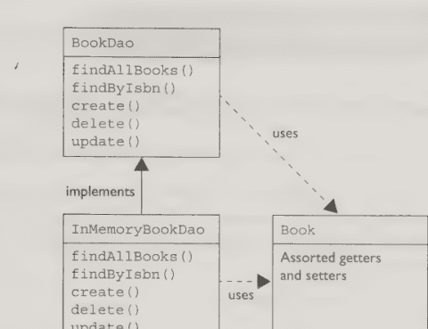

`BookDao`

```
findAllBooks()
findByIsbn()
create()
delete()
update()
```

实现

| InMemoryBookDao | Book |
|---|---|
| `findAllBooks()` | 各种 getters |
| `findByIsbn()` | 和 setters |
| `create()` | |
| `delete()` | |
| `update()` | |

现在我们有了三个对象，每个对象都负责一件事。我们有一个公共接口`BookDao`，它规定了契约。接下来，我们有了该接口的实现类，即`InMemoryBookDao`。最后，我们有了`Book`类本身，它关注于对象状态以及任何与`Book`相关的方法。

实战技巧

除了让代码更易读之外，这种模式还让我们能够方便地组织代码。我们可以将所有的 JavaBeans 放在一个包中，将接口放在另一个包中，将实现类放在第三个包中。这种方法允许我们拥有一个专门用于内存实现的包以及另一个专门用于 JDBC 实现的包。

### 优势

回顾一下，DAO 模式的优势如下：

- 主对象（在本例中为`Book`）是高内的，且没有被数据库代码所干扰。
- 所有的数据库代码都在程序的一个部分，便于查找。
- 我们可以在不改变业务对象的情况下更改数据库实现。
- 复用更简单。随着数据库代码的增长，我们可以创建辅助类，甚至是辅助超类。

这非常简单。`Factory`是一个带有一个方法的抽象类。它的实现简单地返回一个内存中的 DAO。从`Student`的角度来看，这就是全部存在的内容——`Factory`类和`BookDAO`接口。注意，`Student`不再拥有`new InMemoryBookDAO`这样的代码。

以图表形式展示了我们的类是如何组合在一起的：

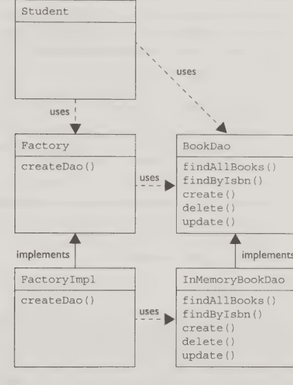

回顾一下，`Student`只与两个抽象类`Factory`和`BookDao`交互。所有的实现都允许我们在具体的子类中进行更改。

这种设置让我们能够更改`FactoryImpl`的实现而不影响调用者。

让我们通过一个示例来展示我们如何更改工厂。假设我们写写了一个使用真实数据库的 DAO 实现类`OracleBookDao`。我们可能将`FactoryImpl`修改为：

```java
public class FactoryImpl extends Factory { // 工厂子类
    public BookDao createDao() {
        if (Util.isTestMode()) {
            return new InMemoryBookDao(); // 用于测试
        } else {
            return new OracleBookDao(); // 用于真实环境
        }
    }
}
```

就是这样——`Student`中没有发生任何变化。然而它开始使用真实的数据库实现。这是一个良好的设计。只需要在一个地方进行更改即可。

你可能在想[为什么]`Factory`是一个抽象类而不是接口。在工厂方法模式中，通常的做法是“绕过”创建逻辑，或者至少意识到它可能会在以后发生。

在此处的示例中，我们可以决定将测试逻辑检查包含在超类中，以便任何未来的子类使用它：

```java
public abstract class Factory {

    public BookDao createDao() {
        if (Util.isTestMode()) {
            return new InMemoryBookDao();
        } else {
            return createDatabaseBookDao(); // 由子类使用
            // 等待实现
        }
    }
    protected abstract BookDao createDatabaseDao();
    public static class FactoryImpl extends Factory {
        protected BookDao createDatabaseDao() {
            return new OracleBookDao(); // 缺失的部分
        }
    }
}
```

在这种情况下，超类`Factory`拥有所有的公共逻辑，而子类`FactoryImpl`仅仅创建相关对象。注意尽管我们对方法实现进行了大量的更改，但 API 的签名并没有改变。这就是我们正在使用工厂模式的原因。因此，调用者`Student`不受我们工厂和 DAO 任何更改的影响。

有三个名称中带有“工厂”字样的模式：

- **工厂方法 (Factory method)**：这是我们在本章中讨论的模式，也是考试内容。
- **抽象工厂 (Abstract factory)**：它将工厂方法模式更进了一步，用于创建相关类的族。
- **工厂 (Factory)**：关于这是否算是一个模式尚有争议。它不在《四人帮》书中。然而，在工作中，当开发者说“工厂”时，他们通常指的是一个像`public Foo createFoo() {return new Foo(); }`这样的方法，而不是完整的工厂方法模式。该方法可能返回`Foo`或`SubclassOfFoo`，但它没有像工厂方法模式那样的创建对象的超类/子类关系。


## 认证总结

你可能注意到我们没有提到过将 DAO 的构造函数设置为私有。在单例模式中，我们需要强制调用者使用`getInstance()`以防止产生多个副本。工厂模式仅仅是为了方便。有时，它是一项巨大的便利。然而，调用者仍然可以直接实例化 DAO 而不会破坏我们的逻辑，所以我们允许这样做。

事实上，Oracle 在 Java API 的许多地方使用了工厂模式。当我们学习如何创建`Date`时，使用了工厂模式。工厂模式在很多地方仅仅是一种便利。有时，它是一项非常重大的便利。

## 两分钟快速回顾

以下是本章每个认证目标中的要点。

### IS-A/HAS-A (OCP 目标 3.3)

- IS-A 指继承。
- IS-A 通过关键字`extends`或`implements`表达。
- IS-A、“继承自”(inherits from) 和“是...的子类型”(is a subtype of) 都是等价的。
- HAS-A 意味着一个类的实例“拥有”指向另一个类实例或同一类另一个实例的引用。

### 耦合性与内聚性 (OCP 目标 3.3)

- 耦合（Coupling）指的是一个类对另一个类成员的了解程度或使用程度。
- 松耦合（Loose coupling）是理想的状态，即类具有良好的封装、最小化相互引用并限制了 API 的使用范围。
- 紧耦合（Tight coupling）是不理想的状态，即类违反了松耦合规则。
- 内聚性（Cohesion）指的是一个类具有单一且定义良好的角色或职责的程度。
- 高内聚（High cohesion）是类的理想状态，其成员支持单一且集中的角色或职责。
- 低内聚（Low cohesion）是不理想的状态，其成员支持多个不集中的角色或职责。

### 对象组合原则 (OCP 目标 3.4)

- 对象组合（Object composition）利用了 IS-A、HAS-A 和多态。
- 对象组合通过让每个类只负责一件事，防止了子类的泛滥生成。
- 对象组合将功能委托给它所“拥有”的对象来实现。
- 方法转发 (method forwarding) 和方法委托 (method delegation) 这两个术语可以互换使用。

### 单例设计模式 (OCP 目标 3.5)

- 设计模式是“针对特定上下文中常见问题的通用可重用解决方案”。


# 单例设计模式

- 对象的唯一实例允许程序共享其状态。
- 这种模式通过不重复相同的工作通常可以提高性能。
- 这种模式通常将单个实例存储为静态变量。
- 我们可以立即实例化（饿性加载），也可以在需要时实例化（懒加载）。

## DAO 设计模式 (OCP 目标 3.6)

- DAO 代表数据访问对象 (Data Access Object)。
- DAO 将数据存储职责与对象的核心职责分离。
- DAO 使用接口，以便我们可以更改实现。
- DAO 仅负责数据库操作。主对象保持内聚性。
- DAO 促进了重用。

## 工厂设计模式 (OCP 目标 3.7)

- 工厂 (Factory) 是一种创建型设计模式。
- 工厂可以创建接口或抽象类的任何子类。
- 工厂是一个抽象类。
- 工厂子类允许存在多个工厂。
- 工厂方法的返回类型是接口或抽象类。
- 工厂方法的实现返回目标对象的子类。
- 抽象类中可能包含所有工厂子类共享的公共逻辑。

## 自测

以下问题将帮助你衡量对本章介绍内容的理解程度。请仔细阅读所有选项，因为可能有多个正确答案。请为每个问题选择所有正确答案。请专注。

1. 给定：

```
class A extends B {
    C tail;
}
```

哪个是正确的？

- A. `a` 拥有一个 `B` 且拥有一个 `c` (HAS-A B and a HAS-A c)
- B. `a` 拥有一个 `B` 且是 `c` 的子类型 (HAS-A B and a IS-A c)
- C. `a` 是 `B` 的子类型且拥有一个 `c` (IS-A B and a HAS-A c)
- D. `a` 是 `B` 的子类型且是 `c` 的子类型 (IS-A B and a IS-A c)
- E. `B` 是 `a` 的子类型且 `a` 拥有一个 `c` (B IS-A a and a-HAS-A c)
- F. `B` 是 `A` 的子类型且 `a` 是 `c` 的子类型 (B IS-A A and a IS-A c)

2. 哪些陈述是正确的？（多选）

- A. 方法委托依赖 IS-A 关系
- B. 方法转发依赖 HAS-A 关系
- C. DAO 模式限制只有一个 DAO 实例
- D. 单例模式依赖 IS-A 关系
- E. 使用对象组合时，类必须是 `final` 的

3. 给定：

```
public class F {
    private static F f = new F();
    public static F c() {
        return f;
    }
    public void update(F a) {}
    public void delete(F a) {}
}
```

实现了什么设计模式或原则？

- A. 耦合性
- B. DAO
- C. 工厂
- D. IS-A
- E. 对象组合
- F. 单例

4. 给定：

```
public class E {
    D d;
    public void m() {
        d.m();
    }
    public static E getInstance() {
        return new E();
    }
}
class D {
    public void m() {}
}
```

实现了什么设计模式或原则？

- A. DAO
- B. 工厂
- C. IS-A
- D. 对象组合
- E. 单例

5. 给定：

```
class A {
abstract class G {
    A m() { return n(); }
    abstract A n();
}
}
```

实现了什么设计模式或原则？

- A. DAO
- B. 工厂
- C. IS-A
- D. 对象组合
- E. 单例

6. 哪些设计模式被分类为创建型设计模式？（多选）

- A. 耦合性
- B. DAO
- C. 工厂
- D. IS-A
- E. 对象组合
- F. 单例

7. 哪些陈述指示需要工厂模式？（多选）

- A. 你不希望调用者依赖于特定的实现
- B. 你有两个相同的类
- C. 你只希望存在一个实例
- D. 你希望一个类负责数据库操作
- E. 你希望构建对象链

8. 给定：

```java
public class Dao {
    Collection<String> findAll() { return null; }
    void create(String a) { }
    void delete(String a) { }
    void update(String a) { }
}
```

以及以下陈述：

I. DAO 模式使用接口。
II. DAO 模式仅负责数据库操作。
III. DAO 模式促进了重用。
IV. DAO 模式是一种单例模式。

哪些是正确的？

- A. 仅 I
- B. 仅 II
- C. 仅 III
- D. 仅 IV
- E. I、II 和 III
- F. II 和 III

# 572 第 10 章：高级面向对象与设计模式

- 9. A 和 C 正确。DAO 模式将数据访问代码的逻辑集中，使得重用更容易，并允许你切换实现类。
- B 是错误的，因为你仍然必须编写 DAO。D 是错误的，因为你是从业务对象中调用 DAO；而不是继承自它。E 是错误的，因为你可以拥有多个 DAO 对象。（OCP 目标 3.6）
- 10. B 和 C 正确。设计模式是概念层面和设计层面的。你必须为每个用例编写实现代码。
- D 是错误的，因为 Java 定义了几十种模式。其中只有三个在考试中经过了测试，但你应该意识到还存在更多模式。E 是错误的，因为重用同一个模式是有意义的。例如，你可能会有多个 DAO 对象。由于上述原因，A 和 F 是错误的。（OCP 目标 3.5, 3.6 和 3.7）
- 11. C 正确。
- A、B 和 D 都是错误的。A 指封装，B 指耦合，D 指多态。（OCP 目标 3.3）
- 12. C 正确。通常情况下，公共变量是封装性弱的标志。
- 根据给出的信息，A、B、D 和 E 都是错误的，这些陈述均无法得到支持。（OCP 目标 3.3）

## 泛型与集合

## 认证目标

- 创建泛型类
- 使用菱形语法创建集合
- 分析使用原始类型和泛类型集合的互操作性
- 使用包装类和自动装箱
- 创建并使用 `List`、`Set` 和 `Deque`
- 创建并使用 `Map`
- 使用 `java.util.Comparator` 和 `java.lang.Comparable`
- 排序和搜索数组及列表
- 两分钟演练
- 问答自测

## 574 第 11 章：泛型与集合

泛型是 Java 5 中最受讨论的特性。有些人喜欢它，有些人讨厌它，但它们将一直存在。在最简单的情况下，它们可以帮助代码变得更容易编写且更健壮。在最复杂的情况下，它们可能非常难以创建和维护。幸运的是，出题者坚持了泛型的简单部分，涵盖了最常见和实用的特性，并忽略了大部分特别棘手的部分。

## 认证目标

### `toString()`, `hashCode()`, 和 `equals()`

#### OCP 目标 4.7 和 4.8

- 4.6 `toString()` 将出现在考试的多个地方。
- 4.7 使用 `java.util.Comparator` 和 `java.lang.Comparable`。
- 4.8 排序和搜索数组及列表。

这可能不是显而易见的，但理解 `hashCode()` 和 `equals()` 对于处理 Java 集合至关重要，特别是使用 `Map` 以及进行一般的搜索和排序时。

你是一个对象。习惯它吧。你有状态，有行为，你有工作。（或者至少在通过考试后，你获得工作的机会会增加）。排除基本类型外，Java 中的一切都是对象。不仅仅是一个对象，而且是一个大写 O 的 `Object`。每个异常、每个事件、每个数组都继承自 `java.lang.Object`。对于考试，你不需要知道 `Object` 类中的每一个方法，但你将知道表 11-1 中列出的方法。

第 13 章涵盖了 `wait()`、`notify()` 和 `notifyAll()`。`finalize()` 方法在第 3 章涵盖过。在本部分，我们将查看 `hashCode()` 和 `equals()` 方法，因为它们在用集合时至关重要。噢，这留下了 `toString()`，不是吗？好的，我们现在涵盖它，因为它只需要两秒钟。

## `toString()`, `hashCode()`, 和 `equals()` (OCP 目标 4.7 和 4.8)

| 方法 | 描述 |
| --- | --- |
| 考试涵盖的 `Object` 类方法 | `boolean equals(Object obj)` | 判断两个对象在意义上是否等价 |
| | `void finalize()` | 当垃圾回收器无法引用该对象时被调用 |
| | `int hashCode()` | 为对象返回一个哈希值 `int` 值，以便该对象可以使用使用哈希的集合类，包括 `Hashtable`、`HashMap` 和 `HashSet` |
| | `final void notify()` | 唤醒正在等待此对象锁的线程 |
| | `final void notifyAll()` | 唤醒所有等待此对象锁的线程 |
| | `final void wait()` | 使当前线程等待，直到另一个线程在该对象上调用 `notify()` 或 `notifyAll()` |
| | `String toString()` | 返回对象的“文本表示” |

## `toString()` 方法

当你想要读取关于你的类对象的信息时，请重写 `toString()`。代码想要读取关于你对象的有用细节时，可以调用你对象的 `toString()`。例如，当你将对象引用传递给 `System.out.println()` 方法时，会调用对象的 `toString()` 方法，`toString()` 的返回值如下所示：

```java
public class HardToRead {
    public static void main(String[] args) {
        HardToRead h = new HardToRead();
        System.out.println(h);
    }
}
```

运行上面的代码将得到之前的输出，这是在你没有重写类的 `toString()` 方法时得到的结果。它给出了类名（至少是那个），后面是 `@` 符号，然后是对象的十六进制表示。

```java
public class BobTest {
    public static void main(String[] args) {
        Bob b = new Bob("Bob", 19);
        System.out.println(b);
    }
}

class Bob {
    int shoeSize;
    String nickName;
    Bob(String nickName, int shoeSize) {
        this.shoeSize = shoeSize;
        this.nickName = nickName;
    }
    @Override
    public String toString() {
        return "I am a " + nickName + ", My size is " + shoeSize;
    }
}
```

当你想要能够读取关于你的类对象的某些信息时，重写 `toString()`。代码在想要读取关于你对象的有用细节时，可以调用你对象的 `toString()`。有些人亲切地称 `toString()` 为 guts。这就是 `toString()` 的全部。现在我们将处理 `equals()` 和 `hashCode()`。

## 重写 `equals()`

正如前面提到的，你可能在想为什么我们在章节开始讨论 `equals()`。我们将在接下来的页面中花费大量时间回答这个问题。

`Object` 中的 `equals` 方法使用 `==` 运算符进行比较，除非你重写了 `equals`，否则只有当两个引用指向同一个对象时，两个对象才认为相等。当你真正需要知道引用是否相同时，使用 `==`。但当你需要知道对象本身（而不是引用）是否相等时，使用 `equals()` 方法。对于你编写的每个类，可能都有意义去认为不同的实例是相等的。对于某些类，你可能决定两个对象永远相等。例如，想象一个具有型号、年份、配置等实例变量的汽车——你绝对不想你的汽车突然被视为与具有相同属性的汽车是同一辆。你的车就是你的车，你不想邻居 Billy 开走它只因为“嘿，这是同一辆车；`equals()` 方法说了不是”。如果两个引用指向一个汽车，那么你知道你讨论的是同一辆汽车，而不是两辆具有属性的汽车。在 `Car` 的情况下，你可能永远不需要或不想重写 `equals()` 方法。当然，你知道这故事还没有结束。

## 如果不重写 `equals()` 意味着什么

这里潜伏着潜在的局限性：如果你不重写类的 `equals` 方法，你将无法将对象作为哈希表的键，并且可能无法获得没有概念重复的准确 `Set`。

`Object` 中的 `equals` 方法使用 `==` 运算符进行比较，除非你重写了 `equals`，否则只有当两个引用指向同一个对象时，两个对象才相等。

# 第二章：泛型与集合

核心点在于：如果你想让你的类对象用作哈希表（`hashtable`）的键（或任何使用等效性进行搜索——以及检索——对象的数据结构中的元素），你就必须重写 `equals()` 方法，以便不同的实例可以被认为是同一个。那么，我们该如何修复这辆汽车呢？你可以重写 `equals()` 方法，将 VIN（车辆识别码）作为比较的基础。这样，当你想要根据该对象作为键进行搜索时，就可以使用一个实例。当然，为 `Car` 类重写 `equals()` 方法也可能存在多个代表同一辆唯一汽车的实例，这在你的场景中可能是不安全的。幸运的是，`String` 和包装类作为哈希表的键工作得良好——它们重写了 `equals()` 方法。因此，与其使用实际汽车实例作为汽车/所有者对的键，你只需要使用一个代表汽车唯一标识符的 `String`。这样，你永远不会有超过一个代表特定汽车的实例，但你仍然可以使用汽车——或者说，可以使用汽车的一个属性——作为搜索键。

# 实现 `equals()` 方法

假设你决定在你的类中重写 `equals()`。它看起来可能是这样：

```java
public class EqualsTest {
    public static void main(String [] args) {
        Moof one = new Moof(8);
        Moof two = new Moof(8);
        if (one.equals(two)) {
            System.out.println("one and two are equal");
        }
    }

    class Moof {
        private int moofValue;
        Moof(int val) {
            moofValue = val;
        }
        public int getMoofValue() {
            return moofValue;
        }
        public boolean equals(Object o) {
            if ((o instanceof Moof) && ((Moof)o).getMoofValue()
                == this.moofValue)) {
                return true;
            } else {
                return false;
            }
        }
    }
}
```

# `toString()`, `hashCode()`, and `equals()` OCP 目标 4.7 和 4.8 579

让我们来看这段代码细节。在 `equalsTest` 的 `main()` 方法中，我们创建了两个 `Moof` 实例，向 `Moof` 构造函数传递了相同的值 8。现在看 `Moof` 类，它是如何处理构造参数的——它将该值赋值给 `moofValue` 实例变量。现在假设你认为如果两个 `Moof` 对象的 `moofValue` 相同，它们就是同一个。你重写了 `equals()` 方法并比较两个 `moofValue`。这很简单。让我们分解一下 `equals()` 方法中发生了什么：

```java
1. public boolean equals(Object o) {
2.   if ((o instanceof Moof) && ((Moof)o).getMoofValue() {
3.       == this.moofValue)
4.       return true;
5.   } else {
6.       return false;
7.   }
}
```

首先，你必须观察所有的重写规则，在第 1 行我们声明了从 `Object` 继承的 `equals()` 方法的有效重写。

第 2 行是动作所在。逻辑上，为了进行有效的等效比较，我们必须按顺序执行两件事。

首先，确保被测试的对象是正确的类型！它以多态形式作为 `Object` 类型传入，因此你需要对它进行 `instanceof` 测试。

让两个不同类的对象被认为是相等通常不是一个好主意，但那是我们在这里不涉及的设计问题。此外，你仍然必须进行 `instanceof` 测试，以确保你可以调用该对象参数的方法或变量来实际执行比较。记住，如果对象没有通过 `instanceof` 测试，你就无法实际进行比较。例如：


# 第二章：泛型与集合

核心点在于：如果你想让你的类对象用作哈希表（hashtable）的键（或任何使用等效性进行搜索——以及检索——对象的数据结构中的元素），你就必须重写`equals()`方法，以便不同的实例可以被认为是同一个。那么，我们该如何修复这辆汽车呢？你可以重写`equals()`方法，将 VIN（车辆识别码）作为比较的基础。这样，当你想要根据该对象作为键进行搜索时，就可以使用一个实例。当然，为`Car`类重写`equals()`方法也可能存在多个代表同一辆唯一汽车的实例，这在你的场景中可能是不安全的。幸运的是，`String`和包装类作为哈希表的键工作得良好——它们重写了`equals()`方法。因此，与其使用实际汽车实例作为汽车/所有者对的键，你只需要使用一个代表汽车唯一标识符的`String`。这样，你永远不会有超过一个代表特定汽车的实例，但你仍然可以使用汽车——或者说，可以使用汽车的一个属性——作为搜索键。

## 实现 equals() 方法

假设你决定在你的类中重写`equals()`。它看起来可能是这样：

```java
public class EqualsTest {
    public static void main(String [] args) {
        Moof one = new Moof(8);
        Moof two = new Moof(8);
        if (one.equals(two)) {
            System.out.println("one and two are equal");
        }
    }

    class Moof {
        private int moofValue;
        Moof(int val) {
            moofValue = val;
        }
        public int getMoofValue() {
            return moofValue;
        }
        public boolean equals(Object o) {
            if ((o instanceof Moof) && ((Moof)o).getMoofValue()
                == this.moofValue)) {
                return true;
            } else {
                return false;
            }
        }
    }
}
```

## toString(), hashCode(), and equals() OCP 目标 4.7 和 4.8 579

让我们来看这段代码细节。在`equalsTest`的`main()`方法中，我们创建了两个`Moof`实例，向`Moof`构造函数传递了相同的值 8。现在看`Moof`类，它是如何处理构造参数的——它将该值赋值给`moofValue`实例变量。现在假设你认为如果两个`Moof`对象的`moofValue`相同，它们就是同一个。你重写了`equals()`方法并比较两个`moofValue`。这很简单。但让我们看看`equals()`方法中发生了什么：

```java
1. public boolean equals(Object o) {
2.   if ((o instanceof Moof) && ((Moof)o).getMoofValue() {
3.       == this.moofValue)
4.       return true;
5.   } else {
6.       return false;
7.   }
}
```

首先，你必须观察所有的重写规则，在第 1 行我们声明了从`Object`继承的`equals()`方法的有效重写。

第 2 行是动作所在。逻辑上，为了进行有效的等效比较，我们必须按顺序执行两件事。

首先，确保被测试的对象是正确的类型！它以多态形式作为`Object`类型传入，因此你需要对它进行`instanceof`测试。

让两个不同类的对象被认为是相等通常不是一个好主意，但那是我们在这里不涉及的设计问题。此外，你仍然必须进行`instanceof`测试，以确保你可以调用该对象参数的方法或变量来实际执行比较。记住，如果对象没有通过`instanceof`测试，你就无法实际进行比较。例如：

```java
public boolean equals(Object o) {
    if ((o instanceof Moof) && ((Moof)o).getMoofValue()
        == this.moofValue)) {
        return true;
    } else {
        return false;
    }
}
```

其次，如果你认为两个`Moof`对象如果它们的`moofValue`相同，它们就是同一个。你重写了`equals()`方法并比较两个`moofValue`。这很简单。但让我们看看`equals()`方法中发生了什么：

（注：原文后续为大量重复片段，译文已按逻辑整合）

## Overriding hashCode

哈希码通常用于提高大型数据集的性能。对象的哈希值被某些集合类使用（我们将在本章晚些时候讨论集合）。尽管你可以将其视为对象 ID 编号，但它并不是唯一的。`HashMap`和`HashSet`等集合使用对象的哈希码存储在集合中，并利用哈希码帮助定位集合中的对象。对于考试，你不需要理解实现集合类的深度细节，但你需要知道哪些集合使用了它们（但是，嗯，它们名称中都包含 "hash"，你应该应该没问题）。你必须能够识别`hashCode()`的适当或正确实现。这并不意味着合法的，甚至意味着高效。在你的类中拥有一个极其低的`hashCode`方法是完全合，只要它不违反`Object`类文档中指定的契约（我们稍后查看该契约）。

## 582 第二章：泛型与集合

### 理解哈希值 (Hashcodes)

为了理解什么是合适且正确的，我们必须看看某些集合是如何使用哈希值的。

想象地板上整齐地排列着一组桶。有人给你一张写有名字的纸条。你拿着名字，并根据 A 是 1、B 是 2 等规则以此类推计算出一个整数代码，即将名字中所有字母的数值相加。一个给定的名字总是产生相同的代码；见图 11-1。我们没有引入任何随机性；我们只是有一个算法，在给定特定输入时它总是以相同的方式运行，对于任何两个相同的输入，输出将是相同的。到目前为止还好吗？现在，你使用该代码（我们现在称之为哈希值 hashcode）的方法是决定纸条放入哪个桶中（想象每个桶代表你可能得到的某种不同代码）。想象有人想出一个名字并说：“请取出与这个名字匹配的纸条。”于是你看着你展示的名字，并运行相同的哈希值生成算法。哈希值告诉你应该去哪个桶中寻找该名字。

但你可能注意到我们的系统有一个小缺陷。两个不同的名字可能会产生相同的值。例如，Amy 和 May 名字具有相同的字母，所以这两个名字的哈希值将是相同的。但这意味着当有人向你（桶管理员）索要 Amy 的纸条时，你仍然必须搜索目标桶，读取每个名字，直到找到 Amy 而不是 May。哈希值只告诉你应该进入哪个桶，而告诉你在进入该桶后如何定位该名字。

图 11-1 简化的哈希值示例

| 键 (Key) | 哈希值算法 | 哈希值 (Hashcode) |
| :--- | :--- | :--- |
| Alex | A(1) + L(12) + E(5) + X(24) | = 42 |
| Bob | B(2) + O(15) + B(2) | = 19 |
| Dirk | D(4) + I(9) + R(18) + K(11) | = 42 |
| Fred | F(6) + R(18) + E(5) + D(4) | = 33 |

| HashMap 集合 / 哈希值桶 | 19 | 33 | 42 |
| :--- | :--- | :--- | :--- |
| | "Bob" | "Fred" | "Alex" |
| | | | "Dirk" |

在现实生活的哈希处理中，一个桶中有多个条目并不罕见。哈希检索是一个两步过程。

1. 找到正确的桶（使用`hashCode()`）
2. 在桶中搜索正确的元素（使用`equals()`）

因此，为了效率，你的目标是让纸条尽可能均匀地分布在所有桶中。理想情况下，每个桶可能只有一个名字，这样当有人索要纸条时，你只需要计算哈希值并直接从正确的桶中取出那张纸即可，而无需翻遍该桶中不同的纸条，直到找到你寻找的那个。效率最低（但仍然有效）的哈希值生成器无论名字是什么都返回相同的哈希值（例如 42），导致所有纸条都落在同一个桶里，而其他桶则是空的。桶管理员必须痛苦地不断检查桶中的每个名字，直到找到正确的那个。如果它是这样工作的，他们还不如根本不用哈希值，直接去那个桶，从一端开始翻看每张纸条，直到找到他们想要的那个。

这种分布在各个桶中的示例与集合在集合中使用哈希值的方式相似。当你将一个示例放入使用哈希值的集合中时，该集合使用该对象的哈希值来决定该对象应该落在哪个桶/槽位中。然后，当你想获取该对象时（或者对于哈希表，检索与对象关联的值），你必须给集合一个对象的引用，该集合将会将该引用与它在集合中持有的对象进行比较。作为存储在集合中的对象（就像桶中的纸条），你正在寻找的是与你用于搜索的对象具有相同哈希值的对象（即你展示给桶管理员的名字）。哈希值只告诉你应该进入哪个桶，而告诉你在进入该桶后如何定位该名字。

（注：由于提供的 OCR 文本存在重复和碎片化句子，翻译已根据逻辑内容进行了重组。）

## 586 第二章：泛型与集合

对象的比较被修改了。这个整数在应用程序的一次执行与同一次应用程序的另一次执行之间并不需要保持一致。

- 如果两个对象根据`equals(Object)`方法相等，那么对这两个对象中的每一个对象调用`hashCode()`方法都必须产生相同的整数结果。
- 如果两个对象根据`equals(java.lang.Object)`方法不相等，并不要求对这两个对象中的每一个对象调用`hashCode()`方法都必须产生不同的整数结果。然而，程序员应该注意，为不相等的对象产生不同的整数结果可能会提高哈希表的性能。

这对你来说意味着……

| 条件 | 强制要求 | 不要求（但允许） |
| --- | --- | --- |
| x.equals(y) == true | x.hashCode() == y.hashCode() | |
| x.hashCode() == y.hashCode() | | x.equals(y) == true |
| x.equals(y) == false | | 无需 hashCode() 要求 |
| x.hashCode() != y.hashCode() | x.equals(y) == false | |

所以，让我们看看还有什么可能导致`hashCode()`方法失败。如果你在`hashCode()`方法中包含一个`transient`变量，会发生什么？虽然这是合法的（编译器不会报错），但在某些情况下，你放入集合的对象可能无法被找到。如你所知，序列化会保存一个对象，使其通过反序列化还原完整的对象状态来“重生”。但危险，罗宾森——当对象被序列化时，`transient`变量不会被保存。一个糟糕的场景可能是这样的：


# `SaveMe` 类示例

```java
class SaveMe implements Serializable{
    transient int x;
    int y;
    SaveMe(int xVal, int yVal) {
        x = xVal;
        y = yVal;
    }
```

## `toString()`, `hashCode()`, `equals()` OCP 目标 4.7 和 4.8

```java
public int hashCode() {
    return (x ^ y); // 合法，但不正确
    // 使用 transient transient变量
}
public boolean equals(Object o) {
    SaveMe test = (SaveMe)o;
    if (test.y == y && test.x == x) { // 合法，不正确
        return true;
    } else {
        return false;
    }
}
```

使用上述示例代码可能会发生以下情况：

1. 获取一个对象（给其实例变量赋值）。
2. 将该对象放入 `HashMap` 中，并将该对象作为键。
3. 使用序列化将对象保存到文件中，而不改变其任何状态。
4. 通过反序列化从文件中检索该对象。
5. 使用反序列化的（在堆上重生的）对象从 `HashMap` 中取出对象。

哎呀。集合中的对象与所谓的“复活”后的相同对象不再一致了。对象的`transient`变量将返回默认值，而不是它在保存时（或放入`HashMap`时）的值。因此，使用上述的`SaveMe`代码，如果实例被放入`HashMap`时`x`的值为 9，那么由于`x`被用于`hashcode`的计算，当`x`的值改变时，`hashcode`随之改变。而当同一个`SaveMe`实例从反序列化中带回时，无论对象序列化时`x`的值是多少，`x`都等于 0。因此，新的`hashcode`计算将产生不同的`hashcode`，且`equals()`方法也会失败，因为`x`被用于判断对象的相等性。

结论：`transient`变量真的会破坏你的`equals()`和`hashCode()`实现。保持变量为非`transient`，或者如果它们必须标记为`transient`，请不要使用它们来确定哈希码或相等性。

## CERT 认证目标

## 集合概述

(OCP 目标 4.5 和 4.6)

- 4.5 创建并使用`List`、`Set`和`Deque`。
- 4.6 创建并使用`Map`。

在本节中，我们将对考试涵盖的主要集合大类进行相对高层次的讨论。我们将从抽象层面观察它们的特征和用途。之后，我们将深入每个类别，并展示使用每个类别的具体示例。你能想象在不使用哈希表（hasht）或链表等数据结构的情况下编写面向对象的应用程序吗？当你需要维护一个例如“俱乐部中所有成员”的排序列表时，你会怎么办？显然，你可以自己实现；但考虑到程序员所面临的进度压力，考虑这几乎是痛苦的。Java 集合框架于 JDK 1.2 发布时成型，并在 1.4、Java 5 再次扩展，以及在 Java 6 和 7 中再次进行扩展，它提供了列表、集合和队列来满足你的大部分需求。它们经过了尝试、测试和调整。为你的工作选择最合适的，你就能获得合理的性能。当你需要更多时，`java.util`包中的集合框架包含了大量的接口和工具类。

## 那么，你用集合要做什么？

你通常会配合集合使用一些基本操作：

- 向集合中添加对象。
- 从集合中移除对象。
- 查找某个对象（或一组对象）是否在集合中。
- 在不移除的情况下从集合中检索对象。
- 遍历集合，逐一个查看每个元素（对象）。

## 集合框架的关键接口和类

集合 API 以一组接口开始，但也为你提供了许多类。集合 API 的核心接口如下：

| Collection | Set |
| --- | --- |
| List | SortedSet |
| Map | NavigableSet |
| Map | NavigableMap |
| --- | --- |
| Queue | NavigableQueue |

在第 14 章中，我们将讨论并发，某些集合实现了`Collection`接口。除了这些，你需要了解的实现类如下：

| Maps | Sets | Queues |
| --- | --- | --- |
| HashMap | HashSet | PriorityQueue |
| Hashtable | TreeSet | Vector |
| TreeMap | LinkedHashSet | |

并不是所有集合都实现了`Collection`接口。换句话说，`SortedMap`、`Hashtable`和`LinkedHashMap`都是`Collection`的（见图 II-2）。“collection”有三种形式：

- `collection`（小写 c），表示被存储和遍历的任何结构。
- `Collection`（大写 C），是`Set`、`List`和`Queue`扩展接口。（注意：是扩展而不是实现）。
- `Collections`（大写 C 且带 s）是`java.util`类，包含了用于集合的堆静态方法。

你很容易将 "Collections" 与 "Collection" 混淆——请记住`Collections`是一个带有静态方法的类，而`Collection`是一个包含大多数集合通用方法的接口。

集合有四种基本口味：

- 列表：对象列表（实现`List`）。
- 集合：唯一对象组（实现`Set`）。
- 映射：具有唯一 ID 的对象（实现`Map`）。
- 队列：按处理顺序排列的对象。

图 11-3 展示了`List`、`Set`和`Map`的相对结构。但在这些四种集合口味中还有子口味：

| 排序 | 未排序 | 有序 | 无序 |
| --- | --- | --- | --- |
| 索引: | "Boulder" | "Ft. Collins" | "Greeley" | "Boulder" | "Denver" |

实现类可以是未排序且无序的、有序但未排序的，或者是既有序又排序的。但实现类绝不可能是排序但无序的，因为排序是一种特定的排序类型，正如我们稍看到的。例如，`HashSet`是一个无序、未排序的集合，而`LinkedHashSet`是一个有序（但未排序）的集合，它保持了对象的插入顺序。

图 11-3 列表、集合和映射的示例

列表：销售的行程（允许重复）

集合：销售的领地（不允许重复）

映射：销售的产品（根据产品 ID 生成的键）

# 592 第 11 章：泛型与集合

也许我们应该明确“排序（sorted）”与“有序（ordered）”的区别，首先我们必须讨论迭代的概念。当你考虑到迭代时，你可能会想到使用例如`for`循环遍历数组，并按照索引`i`的顺序（[0], [1], [2]）访问每个元素。遍历集合通常意味着从第一个元素开始一个接一个地遍历元素。然而，有时即使是“第一个”这个概念也显得有些奇怪——在 Hashtable 中，实际上没有第一、第二、第三等概念。在 Hashtable 中，元素是根据键的哈希值（hashcode）放置在一种（看似）混乱的顺序中的。但当你迭代时，总得有一个元素先出来；那么当你遍历 Hashtable 时，确实会有一个顺序。但就你所知的，这个顺序完全是任意的，并且随着集合的变化以看似随机的方式发生改变。

**有序 (Ordered)** 如果一个集合是有序的，你可以按照特定的（而非随机的）顺序遍历集合。Hashtable 集合无有序。虽然 Hashtable 本身具有内部逻辑来确定顺序（基于哈希值和集合自身的实现），但当你遍历 Hashtable 时，不会发现任何顺序。然而，ArrayList 保持了由元素索引位置建立的顺序（就像数组一样）。LinkedHashSet 保持了由插入建立的顺序，因此最后一个插入的元素是 LinkedHashSet 中的元素（与 ArrayList 相比，你可以在特定的索引位置插入元素）。最后，有些集合保持着被称为元素“自然顺序（natural order）”的顺序，这些集合不仅是有序的，而且是**排序的**。让我们来看看自然顺序在排序集合中是如何工作的。

**排序 (Sorted)** 集合意味着集合中的顺序是根据某些规则或多个规则确定的，这些规则被称为排序顺序（sort order）。排序顺序与对象何时添加到集合中、它上一次被访问的时间、或者它被添加到哪个“位置”都无关。排序是针对涉及对象的属性完成的。你将对象放入集合中，集合将根据排序顺序确定以何种顺序将它们放入。一个保持顺序的集合（例如任何 List，它使用插入顺序）本身并不真的被认为是已排序的，除非它执行了某种排序规则。最常用的排序顺序是被称为自然顺序的东西。这意味着什么？你知道如何按字母顺序排序——A 在 B 之前，F 在 G 之前，以此类推。对于 String 对象的集合，自然顺序是字母顺序。对于 Integer 对象，自然顺序是数值大小——1 在 2 之前，以此类推。对于 Foo 对象，自然顺序是……嗯……我们不知道。除非 Foo 的开发者通过一个接口（Comparable）提供一个自然顺序，该接口定义了类实例可以相互比较（实例 a 在 b 之前，还是 b 在 a 之前？），否则 Foo 没有自然顺序。如果开发者决定 Foo 对象应该使用某个实例变量的值进行比较（假设这里有一个清晰的 bar），那么排序集合将根据 Foo 类中关于如何使用 bar 实例变量来确定顺序的规则，对 Foo 对象进行排序。当然，在某些情况下，Foo 类也可能从父类继承自然顺序，而不是定义它自己的。

除了`Comparable`接口指定的自然顺序外，还可以使用另一个接口`Comparator`来定义其他不同的排序顺序。我们将在本章稍后的部分讨论如何使用`Comparable`和`Comparator`来定义排序顺序。但现在，只需记住，排序顺序（包括自然顺序）不同于基于插入、访问或索引的排序。

既然我们已经知道了有序和排序，我们将查看这四个接口中的每一个，并深入研究这些接口的具体实现。

## List 接口

List 关注索引。List 与非 List 所不具备的一点在于有一组与索引相关的方法。这些关键方法包括`get(int index)`、`indexOf(Object o)`、`add (int index, Object obj)`等。所有的 List 实现都是按索引位置排序的——该位置通过在特定索引处设置对象或在不指定位置的情况下添加（在这种情况下，对象被添加到末尾）来确定。三个 List 实现将在后续章节中描述。

**ArrayList**：将其视为一个可增长的数组。它提供了快速的迭代和快速随机访问。显而易见的是：它是有序集合（按索引），但不是排序的。你可能想知道，从 1.4 版本开始，ArrayList 现在实现了新的`RandomAccess`接口——这是一个标记接口（意味着它没有方法），表示“此列表支持快速（通常是常数时间）的随机访问”。当你需要快速迭代但不太可能进行大量插入和删除时，选择它而不是 LinkedList。

**Vector**：Vector 是 Java 最早时期的容器；Vector 和 Hashtable 是两个原始集合——其余是在 Java 2 版本 1.2 和 1.4 中添加的。Vector 基本上与 ArrayList 相同，但 Vector 方法为了线程安全是同步的。你通常会倾向于使用 ArrayList，因为同步方法会带来你可能需要的性能开销。如果你需要线程安全，`Collections`类中的工具方法可以提供帮助。Vector 是除 ArrayList 外唯一实现`RandomAccess`的类。

**LinkedList**：LinkedList 按索引位置排序，与 ArrayList 类似，不同在于它是双链的。从 Java 5 开始，它实现了`Queue`接口。

## Set 接口

Set 关注唯一性。三个 Set 实现将在后续章节中描述。

**HashSet**：HashSet 是一个无序集合。它使用对象的哈希值，因此`hashCode()`越高效，你的访问性能就越好。

**LinkedHashSet**：LinkedHashSet 是 HashSet 的有序版本，它维护元素的插入顺序。

**TreeSet**：TreeSet 是两个排序集合之一（另一个是 TreeMap）。它使用红黑树结构，并保证元素将根据自然顺序升序排列。可选地，你可以使用带有构造函数的函数构造 TreeSet，通过使用`Comparator`为集合提供你自己的排序规则。

## Map 接口

Map 关注唯一标识符。你将一个唯一的键（key，即 ID）映射到一个特定的值，其中键和值当然都是对象。Map 实现将在后续章节中描述。

**HashMap**：HashMap 是一个无序 Map。当你需要一个 Map 且不在意遍历它的顺序时，HashMap 是首选。

**Hashtable**：像 Vector 一样，Hashtable 存在于 Java 的史前时代。为了好玩，别忘了注意命名上的不一致性：Map vs. Hashtable。t 的大写在哪儿了！噢好吧，你会被要求正确拼写它。

**LinkedHashMap**：像它的 Set 对应类 LinkedHashSet 一样，LinkedHashMap 集合维护插入顺序（或可选的访问顺序）。尽管它将

在添加和删除元素方面，LinkedHashMap 比 HashMap 稍慢，但你可以期望 LinkedHashMap 有更快的迭代速度。

**TreeMap** 你现在可能已经猜到 TreeMap 是一个有序的 Map。你已经知道，默认情况下，这意味着按照元素的自然顺序进行“排序”。像 TreeSet 一样，在构造 TreeMap 时，你可以通过一个`Comparator`（比较器）定义自定义的排序顺序，指定元素在进行排序时应该如何相互进行比较。从 Java 6 开始，TreeMap 实现了 NavigableMap。

# Queue 接口

Queue（队列）设计用于存储一个“待办事项”列表或需要以某种方式处理的项。虽然可能存在其他顺序，但队列通常被认为是 FIFO（先进先出）。队列支持所有的标准 Collection 方法，还具有添加、删除元素以及查看队列元素的方法。

**PriorityQueue** 该类是 Java 5 引入的新类。由于 LinkedList 类已经增强以实现 Queue 接口，因此可以使用 LinkedList 处理基本队列。PriorityQueue 的目的是创建一个创建一个“优先级优先”的优先级队列，而不是典型的 FIFO 队列。PriorityQueue 的元素要么按照自然顺序排序（情况下情况下首先排序的元素将首先被访问），要么根据比较器排序。在任何情况下，元素的顺序都代表了它们的相对优先级。

如果你识别出例如，当你需要键/值对时，Map 不能作为选择的类（因为 Map 是一个接口而不是具体的实现），你就可以轻松地立即排除某些答案。当你被要求选择一个接口时，考试中的措辞是明确的，请选择接口而不是类。反之亦然——如果你被要求选择一个类，不要选择接口。表 11-2 总结了考试中需要理解的 11 个面向集合的类（Arrays 和 Collections 即将出现！）

## 表 11-2

| 类 | Map | Set | List | Sorted |
| :--- | :--- | :--- | :--- | :--- |
| Collection 接口 | HashMap | X | | |
| Hashtable | X | | | |
| 具体实现 | TreeSet | | Sorted | 按自然顺序或自定义规则 |
| LinkedHashMap | X | | | 插入顺序或最后访问 |
| HashSet | X | | | |
| LinkedHashSet | X | | | 插入顺序 |
| ArrayList | | X | | 按索引 |
| Vector | | X | | 按索引 |
| LinkedList | | X | | 按索引 |
| PriorityQueue | | | Sorted | 按优先级顺序 |

# 使用 Collections

(OCP 目标 4.2, 4.4, 4.5, 4.6, 4.7, 4.8)

- 4.3 使用菱形语法创建集合
- 4.4 使用包装类和自动装箱
- 4.5 创建并使用 List, Set 和 Deque
- 4.6 创建并使用 Map
- 4.7 使用 java.util.Comparator 和 java.lang.Comparable
- 4.8 排序和搜索数组

我们已经对 Collections Framework 中的接口和类进行了高层面的概览；现在让我们看看它们在实践中是如何运作的。

## ArrayList 基础

让我们先快速回顾一下我们在第 5 章中学到的关于 ArrayList 的知识。`java.util.ArrayList`类是 Collections Framework 中常用的类之一。它就像一个数组。ArrayList 相比数组的一些优势是：

- 它可以动态需容。
- 它提供了比数组更强大的插入和搜索机制。

让我们来看看一个包含字符串的 ArrayList。Collections Framework 的目标是在主接口级别（List, Set 和 Map）上提供丰富的功能。在实践中，你通常希望以多态的方式实例化一个 ArrayList，如下：

```java
List myList = new ArrayList();
```

从 Java 5 开始，你会说：

```java
List<String> myList = new ArrayList<>();
```

# 使用 Collections (OCP 目标 4.2, 4.4, 4.5, 4.6, 4.7, 4.8)


在添加和删除元素方面，`LinkedHashMap` 比 `HashMap` 稍慢，但你可以期望 `LinkedHashMap` 有更快的迭代速度。

**TreeMap** 你现在可能已经猜到 `TreeMap` 是一个有序的 `Map`。你已经知道，默认情况下，这意味着按照元素的自然顺序进行“排序”。像 `TreeSet` 一样，在构造 `TreeMap` 时，你可以通过一个 `Comparator`（比较器）定义自定义的排序顺序，指定元素在进行排序时应该如何相互进行比较。从 Java 6 开始，`TreeMap` 实现了 `NavigableMap`。

# Queue 接口

`Queue` 设计用于存储一个“待办事项”的列表，或需要以某种方式处理的项。虽然可能存在其他顺序，但队列通常被认为是 FIFO（先进先出）。队列支持所有的标准 `Collection` 方法，还具有添加、删除元素以及查看队列元素的方法。

**PriorityQueue** 该类是 Java 5 引入的新类。由于 `LinkedList` 类已经增强以实现 `Queue` 接口，因此可以使用 `LinkedList` 处理基本队列。`PriorityQueue` 的目的是创建一个“优先级优先”的优先级队列，而不是典型的 FIFO 队列。`PriorityQueue` 的元素要么按照自然顺序排序（在这种情况下首先排序的元素将首先被访问），要么根据比较器排序。在任何情况下，元素的顺序都代表了它们的相对优先级。

如果你识别出例如，当你需要键/值对时，`Map` 不能作为选择的类（因为 `Map` 是一个接口而不是具体的实现），你就可以轻松地立即排除某些答案。当你被要求选择一个接口时，考试中的措辞是明确的，请选择接口而不是类。反之亦然——如果你被要求选择一个类，不要选择接口。表 11-2 总结了考试中需要理解的 11 个面向集合的类（`Arrays` 和 `Collections` 即将出现！）

## 表 11-2

| 类 | Map | Set | List | Sorted |
| :--- | :--- | :--- | :--- | :--- |
| Collection 接口 | `HashMap` | X | | No |
| `Hashtable` | X | | | No |
| 具体实现 | `TreeSet` | | Sorted | By natural order or custom rules |
| `LinkedHashMap` | X | | | insertion order or last access |
| `HashSet` | X | | | No |
| `LinkedHashSet` | X | | | insertion order |
| `ArrayList` | | X | | By index |
| `Vector` | | X | | By index |
| `LinkedList` | | X | | By index |
| `PriorityQueue` | | | Sorted | By priority-order |

# 使用 Collections

(OCP 目标 4.2, 4.4, 4.5, 4.6, 4.7, 4.8)

- 4.3 使用菱形语法创建集合
- 4.4 使用包装类和自动装箱
- 4.5 创建并使用 `List`, `Set` 和 `Deque`
- 4.6 创建并使用 `Map`
- 4.7 使用 `java.util.Comparator` 和 `java.lang.Comparable`
- 4.8 排序和搜索数组

我们已经对 Collections Framework 中的接口和类进行了高层面的概览；现在让我们看看它们在实践中是如何运作的。

## ArrayList 基础

让我们让我们先快速回顾一下我们在第 5 章中学到的关于 `ArrayList` 的知识。`java.util.ArrayList` 类是 Collections Framework 中常用的类之一。它就像一个数组。`ArrayList` 相比数组的一些优势是：

- 它可以动态扩容。
- 它提供了比数组更强大的插入和搜索机制。

让我们来看看一个包含字符串的 `ArrayList`。Collections Framework 的目标是在主接口级别（`List`, `Set` 和 `Map`）上提供丰富的功能。在实践中，你通常希望以多态的方式实例化一个 `ArrayList`，如下：

```java
List myList = new ArrayList();
```

从 Java 5 开始，你会说：

```java
List<String> myList = new ArrayList<>();
```

这种声明遵循面向对象编程的“面向接口编程”原则，并利用了泛型。我们将在本章后面的部分介绍很多关于泛型的内容，但现在只需要知道，在 Java 5 中，`<String>` 语法是声明集合类型的方法。在 Java 5 之前，没有方法指定集合的类型，当我们涵盖泛型时，我们将讨论混合 Java 5 [强类型] 和 Java 5 之前 [未类型]的影响。


为什么我们仍在讨论 Java 5：

- 理解 Java 5 之前集合是如何工作的，有助于现在更容易理解泛型。
- 在考试和现实世界中，你必须理解 Java 5 之前编写的代码是如何工作的，以及此类代码如何与较新的代码交互。

在许多方面，`ArrayList<String>` 与 `String[]` 相似，它们声明了一个只能包含字符串的容器，但它比 `String[]` 更强大。让我们来看看 `ArrayList` 拥的一些能力：

```java
List<String> test = new ArrayList<>(); // 声明 ArrayList
String s = "hi";
test.add("string"); // 添加一些字符串
test.add(s);
test.add(s);
System.out.println(test.size());
System.out.println(test.remove("hi"));
System.out.println(test.size());
```

上述程序输出输出：

```
3
false
2
```

# II: 泛型与 Collections

## Collections 中的自动装箱

通常情况下，集合持有的是对象而不是基本类型。在 Java 5 之前，所谓的“包装类”（例如 `Integer`, `Float`, `Boolean` 等）的用途是提供在基本类型和集合之间进行转换的方法。在 Java 5 之前，你必须手动“包装”基本类型才能放入集合。有了 Java 5，我们可以说：

```java
List myList = new ArrayList(); // Java 5 之前的声明
list.add(new Integer(42)); // 使用 Integer 包装 int
```

在上一个示例中，我们创建了一个值为 42 的 `Integer` 实例。我们创建一个整个对象来包装基本值。从 Java 5 开始，我们可以说：

```java
list.add(42); // 自动装箱处理了！
```

在这个例子中，我们仍然向 `myList` 添加 `Integer` 对象（而不是 `int` 基本类型）；它只是在为我们处理自动装箱。当我们需要使用包装器时存在一些微妙的影响；让我们看看。在旧的 Java 5 之前的时代，如果你想包装一个包装器、解箱它然后重新绘制，你可能会这样做：

```java
Integer y = new Integer(567); // 创建
int x = y.intValue(); // 解箱
x++; // 使用
y = new Integer(x); // 重新赋值
System.out.println("y = " + y); // 打印
```

现在，在有了改进的 Java 5 中，你可以说：

```java
Integer y = new Integer(567); // 创建
y++; // 解箱、递增、
// 重新赋值
System.out.println("y = " + y); // 打印
```

这两个示例都产生以下输出：

```
y = 568
```

是的，你读得没错。代码似乎在对象引用变量上使用了后自增运算符！但这仅仅是为了方便。在幕后，编译器为你完成了解箱和重新赋值。之前，我们提到包装对象是不可变的……这个例子似乎与这一陈述相矛盾。它看起来 `y` 的值确实从 567 变成了 568。到底发生了什么？


| 集合类 | 有序 | 允许重复 | 排序方式 | 访问方式 |
|---|---|---|---|---|
| `HashSet` | X | | | 无特定顺序 |
| `LinkedHashSet` | X | | | 插入顺序 |
| `ArrayList` | | X | | 按索引 |
| `Vector` | | X | | 按索引 |
| `LinkedList` | | X | | 按索引 |
| `PriorityQueue` | | | 已排序 | 按优先级顺序 |

# 使用 Collections

(OCP 目标 4.2, 4.4, 4.5, 4.6, 4.7, 4.8)

- 4.3 使用菱形语法创建集合
- 4.4 使用包装类和自动装箱
- 4.5 创建并使用 `List`, `Set` 和 `Deque`
- 4.6 创建并使用 `Map`
- 4.7 使用 `java.util.Comparator` 和 `java.lang.Comparable`
- 4.8 排序和搜索数组

我们已经对 Collections Framework 中的接口和类进行了高层面的概览；现在让我们看看它们在实践中是如何运作的。

## ArrayList 基础

让我们先快速回顾一下我们在第 5 章中学到的关于 `ArrayList` 的知识。`java.util.ArrayList` 类是 Collections Framework 中常用的类之一。它就像一个数组。`ArrayList` 相比数组的一些优势是：

- 它可以动态扩容。
- 它提供了比数组更强大的插入和搜索机制。

让我们来看看一个包含字符串的 `ArrayList`。Collections Framework 的目标是在主接口级别（`List`, `Set` 和 `Map`）上提供丰富的功能。在实践中，你通常希望以多态的方式实例化一个 `ArrayList`，如下：

```java
List myList = new ArrayList();
```

从 Java 5 开始，你会说：

```java
List<String> myList = new ArrayList<>();
```

这种声明遵循面向对象编程的“面向接口编程”原则，并利用了泛型。我们将在本章后面的部分介绍很多关于泛型的内容，但现在只需要知道，在 Java 5 中，`<String>` 语法是声明集合类型的方法。在 Java 5 之前，没有方法指定集合的类型，当我们涵盖泛型时，我们将讨论混合 Java 5 [强类型] 和 Java 5 之前 [未类型]的影响。


为什么我们仍在讨论 Java 5：

- 理解 Java 5 之前集合是如何工作的，有助于现在更容易理解泛型。
- 在考试和现实世界中，你必须理解 Java 5 之前编写的代码是如何工作的，以及此类代码如何与较新的代码交互。

在许多方面，`ArrayList<String>` 与 `String[]` 相似，它们声明了一个只能包含字符串的容器，但它比 `String[]` 更强大。让我们来看看 `ArrayList` 拥有的一些能力：

```java
List<String> test = new ArrayList<>(); // 声明 ArrayList
String s = "hi";
test.add("string"); // 添加一些字符串
test.add(s);
test.add(s);
System.out.println(test.size());
System.out.println(test.remove("hi"));
System.out.println(test.size());
```

上述程序输出：

```
3
false
2
```

# II: 泛型与 Collections

## Collections 中的自动装箱

通常情况下，集合持有的是对象而不是基本类型。在 Java 5 之前，所谓的“包装类”（例如 `Integer`, `Float`, `Boolean` 等）的用途是提供在基本类型和集合之间进行转换的方法。在 Java 5 之前，你必须手动“包装”基本类型才能放入集合。有了 Java 5，我们可以说：

```java
List myList = new ArrayList(); // Java 5 之前的声明
list.add(new Integer(42)); // 使用 Integer 包装 int
```

在上一个示例中，我们创建了一个值为 42 的 `Integer` 实例。我们创建一个整个对象来包装基本值。从 Java 5 开始，我们可以说：

```java
list.add(42); // 自动装箱处理了！
```

在这个例子中，我们仍然向 `myList` 添加 `Integer` 对象（而不是 `int` 基本类型）；它只是在为我们处理自动装箱。当我们需要使用包装器时存在一些微妙的影响；让我们看看。在旧的 Java 5 之前的时代，如果你想包装一个包装器、解箱它然后重新绘制，你可能会这样做：

```java
Integer y = new Integer(567); // 创建
int x = y.intValue(); // 解箱
x++; // 使用
y = new Integer(x); // 重新赋值
System.out.println("y = " + y); // 打印
```

现在，在有了改进的 Java 5 中，你可以说：

```java
Integer y = new Integer(567); // 创建
y++; // 解箱、递增、重新赋值
System.out.println("y = " + y); // 打印
```

这两个示例都产生以下输出：

```
y = 568
```

是的，你读得没错。代码似乎在对象引用变量上使用了后自增运算符！但这仅仅是为了方便。在幕后，编译器为你完成了解箱和重新赋值。之前，我们提到包装对象是不可变的……这个例子似乎与这一陈述相矛盾。它看起来 `y` 的值确实从 567 变成了 568。到底发生了什么？

然而，发生的情况是创建了第二个包装对象，其值被设置为 568。如果我们能访问第一个包装对象，我们就能证明这一点……

让我们尝试一下：

```java
Integer y = 567; // 创建一个包装
Integer x = y; // 分配第二个引用变量指向那个包装对象
System.out.println(y==x); // 验证它们是否指向同一个对象
y++; // 解箱、使用、“重新包装”
System.out.println(x + " " + y); // 打印值
System.out.println(y==x); // 验证它们是否指向不同的对象
```

产生了如下输出：

```
true
567 568
false
```

所以，在底层，当编译器处理到 `y++` 这一行时，它必须替换如下内容：

```java
int x2 = y.intValue(); // 解箱
x2++; // 使用
y = new Integer(x2); // 重新包装
```

正如我们所怀疑的那样，在某个地方有一个对 `new` 的调用。

# 装箱、== 和 equals()

我们刚刚使用 `==` 对包装类进行了简单的探索。让我们更深入地观察包装类是如何与 `==`、`!=` 和 `equals()` 工作的。API 开发者决定，对于所有包装类，如果两个对象的类型相同且值相同，它们就是相等的。这并不意外，因为

```java
Integer i1 = 1000;
Integer i2 = 1000;
if (i1 != i2) System.out.println("different objects");
if (i1.equals(i2)) System.out.println("meaningfully equal");
```

产生了输出：

```
different objects
meaningfully equal
```

这只是两个恰好具有相同值的包装对象。因为它们具有相同的 `int` 值，`equals()` 方法认为它们是“意义上等价的”，因此返回 `true`。这一个呢：

```java
Integer i3 = 10;
Integer i4 = 10;
if (i3 == i4) System.out.println("same object");
if (i3.equals(i4)) System.out.println("meaningfully equal");
```

这个示例产生了输出：

```
same object
meaningfully equal
```

哎呀！`equals()` 方法似乎在工作，但 `==` 和 `!=` 怎么了？为什么 `!=` 告诉我们 `i1` 和 `i2` 是不同的对象，而 `==` 又说 `i3` 和 `i4` 是同一个对象？为了节省内存，以下包装对象的两个实例（通过装箱创建）当它们的原始值相同时，始终是 `==` 关系：

- `Boolean`
- `Byte`
- 从 `\u0000` 到 `\u007f` 的 `Character`（`0x7f` 在十进制中是 127）
- 从 -128 到 127 的 `Short` 和 `Integer`

当使用 `==` 比较原始类型和包装类时，包装类将被解箱，比较将变为原始类型到原始类型的比较。

# 装箱可以使用的地方

正如我们之前讨论的，在对象中使用包装类并结合集合是常见的。每当你想让集合同时持有对象和原始类型时，你都会想要使用包装类来让这些原始类型兼容集合。通用规则是，在任何通常可以使用原始类型或包装对象的地方进行装箱和解箱。以下代码演示了使用装箱的一些合法方法：

```java
class UseBoxing {
    public static void main(String[] args) {
        UseBoxing u = new UseBoxing();
        u.go(5);
    }

    void go(Integer i) { // 对传入的 int 装箱
        Boolean ifSo = true; // 对字面量装箱
        Short s = 300; // 对原始类型装箱
        if (ifSo) { // 解箱
            System.out.println(++s); // 解箱、递增、重新装箱
        }
    }
}
```

记住，包装变量可以是 `null`。这意味着你必须小心那些看起来是安全的原始类型操作但可能抛出 `NullPointerException` 的代码：

```java
class Boxing2 {
    static Integer x;
    public static void main(String [] args) {
        doStuff(x);
    }
    static void doStuff(int z) {
        int z2 = 5;
        System.out.println(z2 + z);
    }
}
```

这段代码编译正常，但 JVM 在尝试调用 `doStuff(x)` 时会抛出 `NullPointerException`，因为 `x` 没有引用任何对象，所以没有值可以解箱。

# Java “菱形”语法

在书中 OCA 部分，我们讨论了以“项目”命名添加的若干语言新增/改进。我们将讨论的最后一个改进是“钻石语法”。我们已经见过几个声明类型安全集合的示例，随着深入研究集合，我们将看到更多类似：

```java
ArrayList<String> stuff = new ArrayList<String>();
List<Dog> myDogs = new ArrayList<Dog>();
Map<String, Dog> dogMap = new HashMap<String, Dog>();
```

注意类型参数在这些声明中是重复的。从 Java 7 开始，这些声明可以简化为：

```java
ArrayList<String> stuff = new ArrayList<>();
List<Dog> myDogs = new ArrayList<>();
Map<String, Dog> dogMap = new HashMap<>();
```

注意，在简单的 Java 7 声明中，声明的右侧包含了 `<>`，它们共同构成了菱形形状——噢！你不能交换它们的位置；例如，下面的声明是不行的：

```java
List<String> stuff = new ArrayList<>; // 不是钻石语法
```

为了考试，你们都需要了解钻石操作符（diamond operator）。在书的剩余部分，我们将某种程度上使用钻石语法之前的语法——就像现实世界一样！

# 排序集合和数组

排序和搜索主题自 Java 5 起被加入考试。集合和数组都可以使用 API 中的方法进行排序和搜索。

# 排序集合

让我们从简单的开始，比如对 `ArrayList` 进行排序。还有什么更简单的呢？好吧，我们等你会找到 `ArrayList` 的 `sort()` 方法……找到了吗？当然，`ArrayList` 没有提供任何排序其内容的方法，但 `java.util.Collections` 类可以：

```java
import java.util.*;
class Test1 {
    public static void main(String[] args) {
        ArrayList<String> stuff = new ArrayList<String>(); // #1
        stuff.add("Denver");
        stuff.add("Boulder");
        stuff.add("Vail");
        stuff.add("Aspen");
        stuff.add("Terruride");
        System.out.println("unsorted " + stuff);
        Collections.sort(stuff); // #2
        System.out.println("sorted " + stuff);
    }
}
```

这产生了如下：

- unsorted [Denver, Boulder, Vail, Aspen, Terruride]
- sorted [Aspen, Boulder, Terruride, Vail]

第一行声明了一个 `ArrayList`，第二行对其排序。稍后我们会讨论 `Collections` 类和 `Arrays` 类，现在先保持排序。

让我们想象我们正在构建一个家庭自动化应用程序。今天我们关注的是家庭娱乐中心，具体来说是 DVD 控制中心。我们已经有了文件 I/O 软件在 `dvdinfo.txt` 文件和 `DVDInfo` 类实例之间传输数据。这里是类的关键方面：

```java
class DVDInfo {
  String title;
  String genre;
  String leadActor;
  DVDInfo(String t, String g, String a) {
    title = t; genre = g; leadActor = a;
  }
  public String toString() {
    return title + " " + genre + " " + leadActor + "\n";
  }
  // 这里的 getter 和 setter
}
```

这是 `dvdinfo.txt` 文件中的 DVD 数据：

- Donnie Darko/sci-fi/Gyllenhall, Jake
- Raiders of the Lost Ark/action/Ford, Harrison
- 2001/sci-fi/??
- Caddhack/comedy/Murray, Bill
- Star Wars/sci-fi/Ford, Harrison
- Lost in Translation/comedy/Murray, Bill
- Patriot Games/action/Ford, Harrison

在我们的家庭自动化应用程序中，我们想要为 `dvdinfo.txt` 文件中的每行数据创建一个 `DVDInfo` 实例。对于每个实例，我们将解析数据行（记住 `String.split`）并填充 `DVDInfo` 的三个实例变量。最后，我们想要将所有的 `DVDInfo` 实例放入 `ArrayList` 中。假设 `populateList()` 方法（所示）完成了这一切：

```java
ArrayList<DVDInfo> dlist = new ArrayList<DVDInfo>();
populateList(); // 将文件数据添加到 ArrayList
System.out.println(dlist);
```

你可能会得到这样的输出：

- Donnie Darko sci-fi Gyllenhall, Jake
- Raiders of the Lost Ark action Ford, Harrison
- 2001 sci-fi ??
- Caddhack comedy Murray, Bill
- Star Wars sci-fi Ford, Harrison
- Lost in Translation comedy Murray, Bill
- Patriot Games action Ford, Harrison


（注意：我们重写了 `DVDInfo` 的 `toString()` 方法，因此当我们对 `ArrayList` 调用 `println()` 时，它会为每个实例调用 `toString()`。

现在我们有了一个填充了数据的 `ArrayList`，让我们对它进行排序：

```
Collections.sort(dvlist);
```

哎！你得到了类似下面的错误：

```
TestDVD.java:13: cannot find symbol
symbol : method sort(java.util.ArrayList<DVDInfo>)
location: class java.util.Collections
Collections.sort(dvlist);
```

这里发生了什么？我们知道 `Collections` 类有一个 `sort()` 方法，但这个错误意味着 `Collections` **并没有**一个可以接受 `dvlist` 的 `sort` 方法。这意味着我们传递的参数（`dvlist`）出了问题。

如果你已经发现了问题，我们猜你是在没有借助之前显示的那个晦涩错误信息的情况下就解决了它……到底该如何对 `DVDInfo` 实例进行排序？为什么我们可以在 API 中看到 `Collections.sort()` 是可以排序的？你的第一反应可能是恐慌。别急——再次强调，泛型部分将帮助你读懂那个看起来很奇怪的方法签名。如果你阅读单参数 `sort()` 方法的描述，你会发现 `sort()` 方法接受一个 `List` 参数，并且 `List` 中的对象必须实现一个名为 `Comparable` 的接口。事实证明 `String` 实现了 `Comparable`，这就是为什么我们能够使用 `Collections.sort()` 方法对 `String` 列表进行排序。

## Comparable 接口

`Comparable` 接口被 `Collections.sort()` 方法和 `java.util.Arrays.sort()` 方法分别用于对 `List` 和对象数组进行排序。要实现 `Comparable`，类必须实现一个单一方法 `compareTo()`。

这里是 `compareTo()` 的调用示例：

```
int x = thisObject.compareTo(anotherObject);
```

`compareTo()` 方法返回一个具有以下特征的 `int` 类型：

- 负数：如果 `thisObject < anotherObject`

- 零：如果 `thisObject == anotherObject`

- 正数：如果 `thisObject > anotherObject`

## 使用 Collections (OCP 目标 4.2, 4.4, 4.5, 4.6, 4.7, 4.8) 607

`sort()` 方法使用 `compareTo` 来决定 `List` 或对象数组应该如何排序。由于你可以为自己的类实现 `compareTo()`，因此可以使用任何你偏好的奇特标准来对你类的实例进行排序。回到我们之前的关于 `DVDInfo` 类的示例，我们可以采取简单的方法，使用 `String` 的 `compareTo()` 实现：

```java
class DVDInfo implements Comparable<DVDInfo> {
    // 现有代码
    public int compareTo(DVDInfo d) {
        return title.compareTo(d.getTitle());
    }
}
```

在第 1 行，我们声明类 `DVDInfo` 实现了 `Comparable`，使得 `DVDInfo` 对象可以与其他 `DVDInfo` 对象进行比较。在第 2 行，我们通过比较两个 `DVDInfo` 对象的标题来实现 `compareTo()` 方法。由于我们知道标题是字符串且 `String` 实现了 `Comparable`，这是一种按标题排序我们的 `DVDInfo` 对象的简便方法。在 Java 5 引入泛型之前，你必须使用类似下面的代码来实现 `Comparable`：

```java
class DVDInfo implements Comparable {
    // 现有代码
    public int compareTo(Object o) { // 接收一个 对象而不是特定类型
        DVDInfo d = (DVDInfo)o; 
        return title.compareTo(d.getTitle());
    }
}
```

这仍然是合法的，但你可以看到它既痛苦又危险，因为你必须进行强制转换，并且在尝试之前需要验证该转换不会失败。

综合以上考虑，我们的 `DVDInfo` 类现在看起来应该是这样：

```
class DVDInfo implements Comparable<DVDInfo> {
  String title;
  String genre;
  String leadActor;
  DVDInfo(String t, String g, String a) {
    title = t; genre = g; leadActor = a;
  }
  public String toString() {
    return title + " " + genre + " " + leadActor + "\n";
  }
  public int compareTo(DVDInfo d) {
    return title.compareTo(d.getTitle());
  }
  public String getTitle() {
    return title;
  }
  // 其他 getters 和 setters
}
```

现在，我们调用 `Collections.sort(dvdList)`，我们得到了：

- [2001 sci-fi ??

- Caddyshack comedy Murray, Bill

- Donnie Darko sci-fi Gyllenberg, Jake

- Lost in Translation comedy Murray, Bill

- Patriot Games action Ford, Harrison

- Raiders of the Lost Ark Ford, Harrison

- Star Wars sci-fi Ford, Harrison]

欢喜！我们的 `ArrayList` 已经按标题排序了。当然，如果我们想让家庭自动化系统真正变得出色，我们可能希望以许多不同的方式排序 DVD 集合。由于我们通过实现 `compareTo()` 方法对 `ArrayList` 进行了排序，我们似乎被卡住了。在一个类中只能实现一次 `compareTo()`，那么我们如何以不同于我们在 `compareTo()` 方法中指定的顺序对我们的类进行排序呢？好问题。幸运的是，答案在接下来的内容中。

## 使用 Comparator 排序

当你查找 `Collections.sort()` 方法时，你可能注意到 `sort` 有一个重载版本，可以同时接受一个 `List` 和其他内容。`Comparator` 接口让你能够以多种方式排序。`Comparator` 接口的方便之处在于它非常容易实现；这里有一个使用 `Comparator` 排序实例的小类：

```java
import java.util.*;
class GenreSort implements Comparator<DVDInfo> {
    public int compare(DVDInfo one, DVDInfo two) {
        return one.getGenre().compareTo(two.getGenre());
    }
}
```

`compare()` 方法返回一个 `int`，其含义与 `compareTo()` 相同。在这种情况下，我们通过 `Comparator` 进行实际比较。这里是一个同时使用了 `Comparable` 和 `Comparator` 的测试程序：

```java
import java.util.*;
import java.io.*;

class TestDVD {
    ArrayList<DVDInfo> dvdlist = new ArrayList<>();

    public static void main(String[] args) {
        new TestDVD().go();
    }

    public void go() {
        populateList();
        System.out.println(dvdlist); // 按标题输出

        GenreSort gs = new GenreSort();
        Collections.sort(dvdlist, gs);
        System.out.println(dvdlist); // 按类型输出
    }

    public void populateList() {
        // 创建 DVDInfo 实例
        // 为 ArrayList 填充这些实例
    }
}
```

你已经看到了前两种输出，这里是第三种：

- Patriot Games action Ford, Harrison

- Raiders of the Lost Ark Ford, Harrison

- Caddysh comedy Murray, Bill

- Lost in Translation comedy Murray, Bill

- 2001 sci-fi ??

- Donnie Darko sci-fi Gyllenberg, Jake

- Star Wars sci-fi Ford, Harrison

由于 `Comparable` 和 `Comparator` 接口非常相似，预计考试会干扰你。例如，可能会被要求在 `Comparator` 接口中实现 `compareTo()` 方法。学习表 11-3 以记忆这两个之间的差异。

## Arrays 类

我们一直在使用 `java.util.Collections` 类来排序集合；现在让我们看看 `java.util.Arrays` 类来对数组排序。好消息是，对象数组的排序与排序集合一样。`sort()` 方法以与 `Collections.sort()` 方法相同的方式重载：

- `Arrays.sort(arrayToSort)`

- `Arrays.sort(arrayToSort, Comparator)`

此外，`Arrays.sort()` 方法（单参数版本）重载了数百万次，为每种基本类型提供一些排序方法。`Arrays.sort(myArray)` 方法总是按自然顺序排序。不要被试图使用 `Comparator` 排序基本类型数组的考试题误导。

最后，记住 `Collections` 类和 `Arrays` 类的 `sort()` 方法都是静态方法，它们修改所操作的对象，而不是返回一个新的排序后的对象。

| 表 11-3 | java.lang.Comparable | java.util.Comparator |

|---|---|---|

| 连接 Comparable 与 Comparator | int objOne.compareTo(objTwo) | int compare(objOne, objTwo) |

| | 返回 | 与 Comparable相同 |

| 负数，如果 objOne < objTwo | | |

| 零，如果 objOne == objTwo | | |

| 正数，如果 objOne > objTwo | | |

| 你必须修改想要排序的实例类。 | 你为想要排序的实例类构建一个独立的类。 |

| 只能创建一个排序序列。 | 可以创建许多排序序列。 |

| 在 API 中被频繁实现：String, 包装类, Date, Calendar... | 旨在用于排序第三方类的实例。 | |

## 使用集合 (OCP 目标 4.2, 4.4, 4.5, 4.6, 4.7 和 4.8) 611

我们已经讨论了很多关于按自然顺序排序以及使用 `Comparator`（比较器）进行排序的内容。你需要牢记最后一个规则是：每当你想要对数组或集合进行排序时，元素必须是相互比较的。也就是说，如果你有一个 `Object[]` 并向其中放入 `Cat` 和 `Dog` 对象，你将无法对其进行排序。通常情况下，除非特别说明，否则不同类型的对象不应被认为是相互比较的。

## 搜索数组和集合

`Collections` 类和 `Arrays` 类都提供了允许搜索特定元素的方法。在搜索集合或数组时，适用以下规则：

- 搜索是通过使用 `binarySearch()` 方法进行的。

- 搜索成功返回被搜索元素的 `int` 索引。

- 搜索失败返回一个表示插入点的 `int` 索引。插入点是集合/数组中可以插入元素以保持集合/数组正确排序的位置。因为正值和 0 表示搜索成功，`binarySearch()` 方法使用负数来表示插入点。由于 0 是搜索成功的有效结果，因此第一个可用的插入点是 -1。因此，实际插入点表示为 `-(插入点) - 1`。例如，如果搜索的插入点在元素 2 处，返回的实际插入点将是 -3。

- 在搜索集合/数组之前，必须对其进行排序。

- 如果你尝试搜索一个尚未排序的数组或集合，搜索结果将不可预测的。

- 如果你想要搜索的集合/数组是按自然顺序排序的，则必须按自然顺序进行搜索（通常，这通过不向 `binarySearch()` 方法传递 `Comparator` 参数来实现）。

- 如果你想要搜索的集合/数组是使用 `Comparator` 排序的，则必须使用相同的 `Comparator` 进行搜索，该比较器应作为第二个参数传递给 `binarySearch()` 方法。记住，在搜索基本类型数组时，不能使用 `Comparator`。

让我们来看一个练习 `binarySearch()` 方法的代码示例：

```java
import java.util.*;
class SearchObjectArray {
    public static void main(String [] args) {
        String[] sa = {"one"
```

它产生类似如下的内容：

one three two

one = 1

now reverse sort

two one four

one = -1

one = 2

发生了这些：

- #1 按字母顺序对 `sa` 数组排序（自然顺序）。

- #2 搜索元素 "one" 的位置，结果为 1。

- #3 创建一个 `Comparator` 实例。在下一行中，我们使用 `Comparator` 重新排序数组。

## 使用集合 (OCP 目标 4.2, 4.4, 4.5, 4.6; 4.7, 和 4.8) 613

- #4 尝试搜索数组。我们没有向 `binarySearch` 方法传递我们用于排序数组的 `Comparator`，所以我们得到了一个错误的（未定义的）答案。

- #5 再次搜索，向 `binarySearch()` 传递 `Comparator`。这次，我们得到了正确的答案 2。

- #6 定义 `Comparator`；它作为一个内部类也是可以的。（我们将在第 12 章讨论内部类。）

- #7 通过切换 `compare()` 调用中参数的使用顺序，我们得到了反向排序。

在解决、搜索和排序问题时，有两个重大陷阱：

1. 搜索一个未排序的数组或集合。

2. 在排序或搜索中使用了 `Comparator`，但没有在两者都使用。

## 将数组转换为列表

有几个方法允许你将数组转换为 `List` 以及将 `List` 转换为数组。`List` 和 `Set` 类有 `toArray()` 方法，而 `Arrays` 类有一个名为 `asList()` 方法。

`Arrays.asList()` 方法将数组复制到 `List`。API 规定：“返回一个由指定数组支持的固定大小列表。（对返回列表的更改会写回数组）。”当你使用 `asList()` 方法时，`ArrayList` 与数组是紧密相连的。当你更新其中一个时，另一个会自动更新。让我们来看：

```java
String[] sa = {"one", "two", "three", "four"};
List list = Arrays.asList(sa); // 创建一个 List
System.out.println("size: " + list.size());
System.out.println("index2: " + list.get(2));
```

```java
list.set(3, "six");                                // 修改 List
sa[1] = "five";                                // 修改数组
for (String s : sa) {
    System.out.println(s + " ");
    System.out.println("nsl[1] " + list.get(1));
}
```

## 614 第二章：泛型与集合

这产生了：

size 4

one three

one five

s[1] five

注意，当我们打印的的状态时，它是的。现在让我们来看 `toArray`。`toArray` 并没有特别的；它有两种形式：


```java
List<Integer> il = new ArrayList<>();
for(int x=0; x<3; x++)
    il.add(x);
Object[] oa = il.toArray();
```

# 使用列表

记住 `List` 通常用于保持某些顺序。在增强 for 循环之前，最常用的检查是通过 `Iterator`。你需要理解的两个 `Iterator` 方法是：

- `boolean hasNext()` 如果集合中至少有一个元素则返回 `true`。
- `Object next()` 此方法返回集合中的下一个对象并移动到返回的元素。

```java
Dog d2 = (Dog)i.next();
```

# 616 第二章：泛型与集合

剩余的代码演示了使用 `size()`、`get()` 和 `toArray()` 方法。这些方法不会有惊喜。在章节后面，表 11-7 将列出所有你应该熟悉的 `List`、`Set` 和 `Map` 方法。作为最后的警告，记住 `List` 是

# 使用集合

记住 `Set` 用于不需要重复项的情况。如果你尝试向已存在的集合中添加元素，重复元素将不会添加，`add()` 方法将返回 `false`。记住，`HashSet` 通常很快，正如我们之前讨论过的，它们使用哈希值。

你也可以创建一个 `TreeSet`，它是一个元素经过排序的 `Set`。在使用 `TreeSet` 时必须小心（我们即将解释原因）：

```java
import java.util.*;
class SetTest {
    public static void main(String[] args) {
        boolean[] ba = new boolean[5];
        // 插入代码
        ba[0] = s.add("a");
        ba[1] = s.add(new Integer(42));
        ba[2] = s.add("b");
        ba[3] = s.add("a");
        ba[4] = s.add(new Object());
        for(int x=0; x<ba.length; x++)
            System.out.print(ba[x] + " ");
        System.out.println();
        for(Object o : s)
            System.out.println(o + " ");
    }
}
```

如果你插入以下代码行，你将得到类似如下的输出：

```java
Set s = new HashSet(); // 插入此代码
true true false
a java.lang.Object@e09713 42 b
```

# 使用集合 (OCP 目标 4.2, 4.4, 4.5, 4.6, 4.7, 和 4.8) 617

如果你插入这一行代码，你会得到类似下面的结果：

```
Set s = new TreeSet<>(); // 此代码

Exception in thread "main" java.lang.ClassCastException: java.lang.String
    at java.lang.Integer.compareTo(Integer.java:35)
    at java.util.TreeMap.compare(TreeMap.java:1093)
    at java.util.TreeMap.put(TreeMap.java:465)
    at java.util.TreeSet.add(TreeSet.java:210)
```

问题在于，当你想要对集合进行排序时，它的元素之间必须是相互比较的。记住，除非另有说明，否则不同类型的对象之间是不可相互比较的。

# 使用 Map

请记住，当你使用实现 `Map` 接口类时，任何作为该 `Map` 键的类都必须重写 `hashCode()` 和 `equals()` 方法。（其实，只有当你感兴趣从 `Map` 中提取数据时，才需要重写它们。说真的，在 `Map` 中使用没有重写 `equals()` 和 `hashCode()` 的类作为键是合法的；你的代码会编译并运行，你只是找不到数据而已。）这里有一段演示 `HashMap` 使用的代码：

```java
import java.util.*;
class Dog {
    public Dog(String n) { name = n; }
    public String name;
    public boolean equals(Object o) {
        if ((o instanceof Dog) &&
            ((Dog)o).name == name) {
            return true;
        } else {
            return false;
        }
    }
    public int hashCode() {return name.length(); }
}
class Cat {
    enum Pets {DOG, CAT, HORSE }
}
class MapTest {
    public static void main(String[] args) {
    Map<Object, Object> m = new HashMap<Object, Object>();

    m.put("k1", new Dog("aiko")); // 添加一些键/值对
    m.put("k2", Pets.DOG);
    m.put(Pets.CAT, "CAT key");
    Dog d1 = new Dog("clover"); // 保留这个引用
    m.put(d1, "Dog key");
    m.put(new Cat(), "Cat key");

    System.out.println(m.get("k1")); // #1
    String k2 = "k2";
    System.out.println(m.get(k2)); // #2
    Pets p = Pets.CAT;
    System.out.println(m.get(p)); // #3
    System.out.println(m.get(d1)); // #4
    System.out.println(m.get(new Cat())); // #5
    System.out.println(m.size()); // #6
}
}
```

它会产生类似下面的输出：

```
Dog@1c
DOG
CAT key
Dog key
null
5
```

让我们回顾一下输出。第一个获取的值是一个 `Dog` 对象（你的值会有所不同）。第二个获取的值是一个枚举值（`DOG`）。第三个获取的值是一个 `String`；注意键是一个枚举值。随堂测试：我们能够成功地使用枚举作为键，这意味着什么？

其意义是枚举重写了 `equals()` 和 `hashCode()`。如果你查看 API 中的 `java.lang.Enum` 类，你会发现实际上这些方法确实已经被重写了。

第四个输出是一个 `String`。这个输出的要点是，获取该 `String` 的键是一个 `Dog` 对象。第五个输出是 `null`。这里的要点是 `get()` 方法未能找到插入的 `Cat` 对象。（输出的最后一行确认了事实上，`Map` 中确实存在 5 个键/值对。）为什么我们没有找到 `Cat` 键？为什么使用 `Dog` 的实例作为键是有效的，而使用 `Cat` 的实例作为键却失败了？

很容易看出 `Dog` 重写了 `equals` 和 `hashCode`，而 `Cat` 没有。让我们快速看一眼哈希值（hashes）。我们在 `Dog` 类中用了一个极其简单的哈希公式——`Dog` 对象的哈希值是实例名称的长度。因此，在这个例子中，`hashCode = 6`。让我们比较这两个 `hashCode()`：

```java
public int hashCode() { return name.length(); } // #1
public int hashCode() { return 4; } // #2
```

# 使用集合 (OCP 目标 4.2, 4.4, 4.5, 4.6, 4.7, 和 4.8) 619

该来另一个测试了：上述哈希值合法吗？它们能成功地从 `Map` 中检索对象吗？哪一个会更快？前两个问题的答案是“是”和“是”。这两个哈希值都不够高效（事实上，它们会非常低效），但它们都是合法的，并且都能工作。最后一个问题的答案是，第一个会比第二个快一点。通常情况下，哈希值生成的越有独特，检索速度就越快。第一个 `hashCode` 会为每个名称生成不同的代码（例如，名称是不同的）。第二个 `hashCode` 总是产生相同的结果，所以它会比第一个慢。

我们的主题是当一个对象被用作键时会发生什么。当你插入这一行代码时，你会得到类似下面的输出：

```
Dog@1c
DOG
CAT key
Dog key
null
5
```

输出输出。第一个获取的值是一个 `Dog` 对象（你的值会有所不同）。第二个获取的值是一个枚举值（`DOG`）。第三个获取的值是一个 `String`；注意键是一个枚举值。随堂测试：我们能够成功地使用枚举作为键，这意味着什么？

其意义是枚举重写了 `equals()` 和 `hashCode()`。如果你查看 API 中的 `java.lang.Enum` 类，你会发现实际上这些方法已经被重写了。

第四个输出是一个 `String`。这个输出的要点是，获取该 `String` 的键是一个 `Dog` 对象。第五个输出是 `null`。这里的要点是 `get()` 方法未能找到插入的 `Cat` 对象。（输出的最后一行确认了事实上，`Map` 中确实存在 5 个键/值对。）为什么我们没有找到 `Cat` 键？为什么使用 `Dog` 的实例作为键是有效的，而使用 `Cat` 的实例作为键却失败了？

很容易看出 `Dog` 重写了 `equals` 和 `hashCode`，而 `Cat` 没有。让我们快速看一眼哈希值。我们在 `Dog` 类中用了一个极其简单的哈希公式——`Dog` 对象的哈希值是实例名称的长度。因此，在这个例子中，`hashCode = 6`。让我们比较这两个 `hashCode()`：

```java
public int hashCode() { return name.length(); } // #1
public int hashCode() { return 4; } // #2
```

# 使用集合 (OCP 目标 4.2, 4.4, 4.5, 4.6, 4.7, 和 4.8) 619

该来另一个测试了：上述哈希值合法吗？它们能成功地从 `Map` 中检索对象吗？哪一个会更快？前两个问题的答案是“是”和“是”。这两个哈希值都不够高效（事实上，它们会非常低效），但它们都是合法的，并且都能工作。最后一个问题的答案是，第一个会比第二个快一点。通常情况下，哈希值生成的越有独特，检索速度就越快。第一个 `hashCode` 会为每个名称生成不同的代码（例如，名称是不同的）。第二个 `hashCode` 总是产生相同的结果，所以它会比第一个慢。

我们的主题是当一个对象被用作键时会发生什么。当你插入这一行代码时，你会得到类似下面的输出：

```
Dog@1c
DOG
CAT key
Dog key
null
5
```

输出输出。第一个获取的值是一个 `Dog` 对象（你的值会有所不同）。第二个获取的值是一个枚举值（`DOG`）。第三个获取的值是一个 `String`；注意键是一个枚举值。随堂测试：我们能够成功地使用枚举作为键，这意味着什么？

其意义是枚举重写了 `equals()` 和 `hashCode()`。如果你查看 API 中的 `java.lang.Enum` 类，你会发现实际上这些方法已经被重写了。

第四个输出是一个 `String`。这个输出的要点是，获取该 `String` 的键是一个 `Dog` 对象。第五个输出是 `null`。这里的要点是 `get()` 方法未能找到插入的 `Cat` 对象。（输出的最后一行确认了事实上，`Map` 中确实存在 5 个键/值对。）为什么我们没有找到 `Cat` 键？为什么使用 `Dog` 的实例作为键是有效的，而使用 `Cat` 的实例作为键却失败了？

很容易看出 `Dog` 重写了 `equals` 和 `hashCode`，而 `Cat` 没有。让我们快速看一眼哈希值。我们在 `Dog` 类中用了一个极其简单的哈希公式——`Dog` 对象的哈希值是实例名称的长度。因此，在这个例子中，`hashCode = 6`。让我们比较这两个 `hashCode()`：

```java
public int hashCode() { return name.length(); } // #1
public int hashCode() { return 4; } // #2
```

# 622 第 11 章：泛型与集合

返回并移除最后一个。类似地，`TreeMap` 现在提供了 `pollFirstEntry()` 和 `pollLastEntry()` 来检索并移除键值对。

## 降序

Java 6 为 `TreeSet` 和 `TreeMap` 新增了了一些方法，这些方法会返回一个与调用方法的集合反序排列的集合。考试重要的方法是 `TreeSet.descendingSet()` 和 `TreeMap.descendingMap()`。这些是你考试时需要掌握的“导航”方法。

## 底层集合 (Backed Collections)

`java.util` 包中的某些类支持“底层集合”的概念。我们将用一点代码来解释这个主意：

```
TreeMap<String, String> map = new TreeMap<String, String>();
map.put("a", "ant"); map.put("d", "dog"); map.put("h", "horse");

SortedMap<String, String> submap;
submap = map.put("b", "gt"); // #1 创建一个底层集合

System.out.println(map + " " + submap); // #2 显示内容

map.put("b", "bat");
submap.put("f", "fish"); // #3 添加到原始集合
// #4 添加到副本

map.put("r", "raccoon");
submap.put("p", "pig"); // #5 添加到原始集合 - 超出范围
// #6 添加到副本 - 超出范围

System.out.println(map + " " + submap); // #7 显示最终内容
```

输出应该像：

```
{a=ant, d=dog, h=horse}
{a=ant, d=dog, f=fish, h=horse, r=raccoon} b=bat, d=dog, f=fish}
```

这段代码中重要的方法是 `TreeMap.subMap()`。很容易猜到（如果推测正确的话）`subMap()` 正在为名为 `map` 的 `TreeMap` 的部分创建一个副本。输出的第一行验证了我们刚刚得出的结论。

接下来发生的情况非常强大，且有一点出乎意（现在我们知道为什么它们被称为底层集合了）。当我们向原始 `TreeMap` 或部分副本 `subMap` 中添加键值对时，新条目会自动添加到另一个集合中——有时如此。当使用 `submap` 时，我们提供了

## 表 II-4

| 方法 | 说明 |
| :--- | :--- |
| 重要的“导航”相关方法 | `TreeSet.ceiling(e)` | 返回 >= e 的最小元素 |
| | `TreeMap.ceilingKey(key)` | 返回 >= key 的最小键 |
| | `TreeSet.higher(e)` | 返回 > e 的最小元素 |
| | `TreeMap.higherKey(key)` | 返回 > key 的最小键 |
| | `TreeSet.floor(e)` | 返回 <= e 的最大元素 |
| | `TreeMap.floorKey(key)` | 返回 <= key 的最大键 |
| | `TreeSet.lower(e)` | 返回 < e 的最小元素 |
| | `TreeMap.lowerKey(key)` | 返回 < key 的最大键 |
| | `TreeSet.pollFirst()` | 返回并移除第一个条目 |
| | `TreeMap.pollFirstEntry()` | 返回并移除第一个键值对 |
| | `TreeSet.pollLast()` | 返回并移除最后一个条目 |
| | `TreeMap.pollLastEntry()` | 返回并移除最后一个键值对 |
| | `TreeSet.descendingSet()` | 返回一个反序的 `NavigableSet` |
| | `TreeMap.descendingMap()` | 返回一个反序的 `NavigableMap` |

为新集合提供一个值。这个范围不仅定义了创建部分副本时应该包含的内容，还定义了可以添加到副本中的值范围。正如我们通过观察输出的第二行所验证的那样，我们可以在副本范围内的每个集合中添加新条目，新条目将出现在两个集合中。此外，我们可以在原始集合中添加新条目，即使它在副本的范围之外。在这种情况下，新条目将只出现在原始集合中——它不会被添加到副本（异常）。注意我们注释掉了第 6 行。如果你尝试向副本集合添加超出范围的条目，将会抛出异常。


对于考试，你需要理解上述解释的阶知识，加上关于`TreeSet`方法的更多细节——`head()`、`subset()`和`tailSet()`——以及来自`TreeMap`的三个方法——`head()`、`subMap()`和`tailMap()`。通过我们刚刚讨论的导航导型方法，我们可以看到`TreeSet`方法和`TreeMap`方法之间许多相似之处。`head()/headMap()`方法创建了一个从原始集合开始并到方法参数指定的位点结束的子集。`tailSet()/tailMap()`方法创建了一个从方法参数指定的位点开始到原始集合末尾的子集。最后，`subset()/subMap()`方法允许你为正在创建的子集合指定起点和终点。

# 624 第二章：泛型与集合

正如你所预期的，子集集合的端点是包含（inclusive）还是排除（exclusive）的问题有点复杂。好消息是，对于考试，你只需要记住当这些方法带有端点和布尔值参数被调用时，该布尔值始终意味着“包含”。一点小好消息是，对于考试你唯一需要知道的是，除非布尔值参数显式指示，否则子集的起点将始终是包含的。比方说你已经使用`NavigableSet`创建了一个底层集合。你会注意到，我们在这里讨论的所有 API 都有 Java 6 版本。对于考试，重要的是记住当这些方法带有端点和布尔值参数被调用时，该布尔值始终意味着“包含”。如果它们不存在，该方法将返回`SortedSet`或`SortedMap`。

## 使用 PriorityQueue 类和 Deque 接口

注意：在完成了导航集合和底层集合的讨论后，我们现在回到了可能被测试的话题。对于考试，你需要理解实现`Deque`接口的几个类。这些类将在第 14 章并发章节中讨论。除了默认先入先出的基本队列结构外，`PriorityQueue`使用用户定义的优先级对其元素进行排序。这种优先级可以简单为自然排序（其中，`i`的实例比`2`的实例优先级更高）。此外，`PriorityQueue`可以使用`Comparator`，它允许你定义任何接口：`peek()`、`poll()`和`offer()`。

这段代码产生类似下面的输出：

```
1 3 5 6 7 8 9
size 7
peek 9
size 9
poll()
size 6
8 7 6 5 3 1 null
```

让我们详细查看一下。第一个循环遍历`ia`数组，并使用`offer()`方法向名为`pq1`的`PriorityQueue`添加元素。第二个循环使用`poll()`方法遍历`pq1`，该方法返回`pq1`中优先级最高的条目并从队列中移除该条目。注意，元素是按优先级返回的（在这种情况下，是自然顺序）。接下来，我们创建了一个`Comparator`——在这种情况下，这是一个按自然顺序相反方向对元素排序的`Comparator`。我们使用这个`Comparator`构建了第二个`PriorityQueue`（`pq2`），并使用之前使用的相同数组填充它。最后，我们在调用`peek()`和`poll()`之前后检查`pq2`的大小。这证实了`peek()`返回队列中优先级最高的元素但不将其删除，而`poll()`则将其从队列中移除。最后，我们查看了队列中剩余的元素。

## 数组和集合的方法概述

对于这两个类，我们已经涵盖了你可能在考试中遇到的更复杂的方法。表 11-6 列出了你应该注意的方法总结。（注意：`T[1]`语法将在本章稍后部分解释；现在，可以将其理解为“任何非原始类型类型的数组”。）

## List, Set, Map 和 Queue 方法概述

对于这四种接口，我们已经涵盖了你可能在考试中遇到的更复杂的方法。表 11-7 列出了你应该注意的`List`、`Set`和`Map`方法总结，而且——如果你是 OCPJP 6 候选人——不要忘记我们在几页前讨论过的新的“Navigable”方法`floor`、`lower`、`ceiling`和`higher`。

## 使用集合（OCP 目标 4.2, 4.4, 4.5, 4.6, 4.7 和 4.8） 627

### 表 1-6 数组和集合中的关键方法

| java.util.Arrays 中的关键方法 | 描述 |
|---|---|
| `static List List(T[])` | 将数组转换为 List（并绑定它们）。 |
| `static int binarySearch(Object[], key)` | 在排序后的数组中搜索给定值； |
| `static int binarySearch(primitive[], key)` | 返回索引或插入点。 |
| `static int binarySearch(T[], Comparator)` | 在由`Comparator`排序的数组中搜索值。 |
| `static boolean equals(Object[], Object[])` | 比较两个数组以确定它们的 |
| `static boolean equals(primitive[], primitive[])` | 内容是否相等。 |
| `static void sort(Object[])` | 按自然顺序对数组元素 |
| `static void sort(primitive[])` | 进行排序。 |
| `static void sort(T[], Comparator)` | 使用`Comparator`对数组元素 |
| | 进行排序。 |
| `static String toString(Object[])` | 创建一个包含数组 |
| `static String toString(primitive[])` | 内容的字符串。 |
| java.util.Collections 中的关键方法 | 描述 |
| `static int binarySearch(List, key)` | 在“已排序”的 List 中搜索给定值； |
| `static int binarySearch(List, key, Comparator)` | 返回索引或插入点。 |
| `static void reverse(List)` | 反转 List 中元素的顺序。 |
| `static Comparator reverseOrder()` | 返回一个按集合当前排序序列 |
| `static Comparator reverseOrder(Comparator)` | 反向顺序排序的`Comparator`。 |
| `static void sort(List)` | 按自然顺序或通过`Comparator` |
| `static void sort(List, Comparator)` | 排序 List。 |

对于考试，理解`PriorityQueue`方法很重要，包括`offering()`（类似于`add()`）、`peek()`（获取队列头部的元素但不删除它）以及`poll()`（获取队列头部元素并将其从队列中移除）。

## 628 第二章：泛型和集合

### 表 11-7 List, Set 和 Map 中的关键方法

| 关键接口方法 | List | Set | Map | 描述 |
| --- | --- | --- | --- | --- |
| `boolean add(element)` | X | X | | 添加元素。对于 List，可选地在索引点处添加元素。 |
| `boolean add(index, element)` | X | | | |
| `boolean contains(object)` | | X | | 在集合中搜索对象（或可选地为 Map 搜索键）；返回布尔值结果。 |
| `boolean containsKey(object key)` | | | X | |
| `boolean containsValue(object value)` | | | X | |
| `object get(index)` | X | | | 通过索引或键从集合中获取对象。 |
| `object get(key)` | | | X | |
| `int indexOf(object)` | X | | | 获取对象在 List 中的位置。 |
| `Iterator iterator()` | | X | | 获取 List 或 Set 的迭代器（Iterator）。 |
| `Set keySet()` | | X | | 返回一个包含 Map 键的集合。 |
| `put(key, value)` | | | X | 向 Map 添加键/值对。 |
| `element remove(index)` | X | | | 通过索引、通过元素或通过键移除元素。 |
| `element remove(object)` | | X | | |
| `element remove(key)` | | | | |
| `int size()` | X | | | 返回集合的大小。 |
| `object[] toArray()` | X | | | 返回数组。 |
| `Object[] toArray(Class a)` | X | | | 返回指定类型的数组。 |

# 通用类型（OCP 目标 4.1 和 4.3） 63

```java
List<String> myList = new ArrayList<String>();
myList.add("Fred"); // OK，它将存储 String
myList.add(new Dog()); // 编译器错误！！
```

完美。这正是我们想要的。通过使用泛型语法——即将类型放在尖括号`<String>`中——我们正在告诉编译器这个集合只能存储 String 对象。尖括号中的类型被称为“参数化类型”（parameterized type）、“类型参数”（type parameter），或者当然，就是老式的“类型”（type）。在本章中，我们将用新的方式来引用它。

现在，既然你“输入”的内容是有保证的，你也可以保证“输出”的内容，这意味着当你从集合中获取某个值时，就不需要进行类型转换了。相反，在泛型出现之前：

```java
String s = (String)myList.get(0); // 泛型stringString 没有保证
```

我们现在只需要说：

```java
String s = myList.get(0);
```

编译器已经知道`myList`包含了只能赋值给`String`引用的内容，因此不需要类型转换。到目前为止，这看起来非常简单。而且有了新的循环，你当然可以遍历这个保证为 String 的列表：

```java
for (String s : myList) {
    int x = s.length();
    // 在调用 String 方法之前不需要类型转换！
}
```

而且，当然，你可以为方法参数声明一个类型参数，这使得参数是类型安全的：

```java
void takeListOfStrings(List<String> strings) {
    strings.add("foo"); // 添加 String 没有问题
}
```

如果我们将它更改为如下，之前的方法将无法编译：

```java
void takeListOfStrings(List<String> strings) {
    strings.add(new Integer(42)); // 不！strings 是类型安全的
```

# 62 第二章：泛型与集合

返回类型显然也可以声明为类型安全：

```java
public List<Dog> getDogList() {
    List<Dog> dogs = new ArrayList<Dog>(); // 插入 dogs 的代码
    return dogs;
}
```

编译器将阻止你返回任何与`List<Dog>`不兼容的内容。由于编译器保证返回的是类型安全的`Dog`，调用该方法时不需要类型转换：

```java
Dog d = getDogList().get(0); // 我们知道出来的是一个 Dog
```

在 Java 5 之前的非泛型代码中，`getDogList()`方法将会是：

```java
public List getDogList() {
    List dogs = new ArrayList(); // 添加 Dogs 的代码... 好运...
    return dogs; // 这里可以接受 ANYTHING
}
```

并且调用者需要进行类型转换：

```java
Dog d = (Dog) getDogList().get(0);
```

（示例中的类型转换适用于 List 的`get()`方法；我们没有转换`getDogList()`方法返回的内容，这是一个 List。）

但是完全异构集合的好处呢？换句话说，如果你喜欢泛型出现之前可以创建一个存储任何对象的`ArrayList`：

```java
List myList = new ArrayList(); // 旧式的，非泛型的
```

这与：

```java
List<Object> myList = new ArrayList<Object>(); // 存储任何类型
```

几乎相同。声明一个带有`<Object>`类型参数的 List 会创建一个与原始 Java 5 之前的非泛型集合工作方式相同的集合——你可以将任何对象放入集合中。稍后你会发现，非泛型集合和`<object>`类型集合并不完全相同，但在大多数情况下，这些并不并不。

噢，如果故事到此结束就好了……但在方法、参数、多态以及泛型与非泛型代码整合方面还有一些棘手的问题，我们现在才开始热身。

# 通用类型（OCP 目标 4.1 和 4.3）633

## 泛型与遗留代码

你需要掌握的泛型最简单的点是将非泛型代码更新为泛型。只需要在变量声明和构造函数调用中的集合之后添加尖括号`<>`类型（或使用菱形语法），包括任何声明变量的地方（意味着参数和返回类型）。

Java 5 之前用于存储 Integer 的 List：

```java
List myList = new ArrayList();
```

变为：

```java
List<Integer> myList = new ArrayList<>();
```

以及用于存储 String 的列表来自：

```java
public List changeStrings(ArrayList s) { }
```

变为：

```java
public List changeStrings(ArrayList b) { }
```

简单。如果代码使用了早期的非泛型版本并执行转换以获取内容，也不会破坏任何人的代码：

```java
Integer i = (Integer) list.get(0); // 不再需要转换
```

现在有趣开始了……假设我们有一个`Integer`类型的`ArrayList`，并将其传递到一个无法访问源码的类的方法。这行得通吗？

```java
import java.util.*;
public class TestLegacy {
    public static void main(String[] args) {
        // 使用泛型集合的 Java 5 或更高类
        List<Integer> myList = new ArrayList<>(); // 类型安全的集合
        myList.add(4);
        myList.add(6);
        Adder adder = new Adder();
        int total = adder.addAll(myList); // 传递给无类型参数
        System.out.println(total);
    }
}
```

我们想要使用的旧非泛型类：

```java
import java.util.*;
class Adder {
    int addAll(List list) {
        // 方法带有非泛型 List 参数，
        // 但假设（无保证）它将是 Integer
        Iterator it = list.iterator();
        int total = 0;
        while (it.hasNext()) {
            total += ((Integer)it.next()).intValue();
        }
        return total;
    }
}
```

是的，这代码是可以的。由于泛型出现之前，`ArrayList`允许向集合中放入任何内容（除了基本类型）。为了支持遗留代码，Java 5 和 6 允许你的泛型代码使用非泛型代码（这是 Sun 最后想做的就是要求数百万开发者修改他们现有代码）。

但是，如果我们将`insert()`方法修改成这样：

```java
void insert(List list) {
    list.add("foo"); // 泛型stringString 放入了  String
}
```

它编译并运行良好。在第二个版本中，带有添加 String 的遗留`insert()`方法，编译器生成了：

```
javac TestBadlegacy.java
注意：TestBadlegacy.java 使用了未检查或不安全的操作。
注意：请使用 -Xlint:unchecked 重新编译以查看详细信息。
```

记住，编译器警告并不被视为编译失败。编译器从编译生成了一个完全有效的类文件，但它足够好通过这种方式提醒你，用换句话说：“我真的希望你知道自己在做什么，因为这段旧代码对你珍贵的`<Integer>`类型没有任何尊重（甚至不知道不知道），并且可以随所欲地处理你的`ArrayList<Integer>`”。

# 636 第二章：泛型与集合


请务必确保你知道“编译失败”、“无错误编译”、“无警告编译”以及“带警告编译”之间的区别。在考试的大多数题目中，你只需要关心“编译通过”还是“编译失败”——对于大多数题目来说，编译器警告并不重要。但当你使用泛型并混合使用类型和非类型代码时，警告就变得非常重要。

回到我们那个插入操作的旧代码示例。请记住，对于`insert()`方法的**两个**版本（一个添加`Integer`，一个添加`string`），编译器都会发出警告。编译器**并不知道**`insert()`方法添加的是正确的内容（`Integer`）还是错误的内容（`string`）。编译器产生警告的原因是，你正在向集合中**添加**某些东西！换句话说，编译器知道有种可能，该方法可能会向调用者认为类型安全的集合中添加错误的内容。

就考试而言，除非题目的选项包含了提到“警告”的答案，否则如果你知道编译会产生警告，那仍然是编译成功！使用泛型进行编译**绝不**被视为编译失败。有一种情况——如果你看到你确定它会带警告编译的代码，你**绝不能**选择“编译失败”作为答案。底线是：带警告编译的代码仍然是编译成功。如果考试题想要测试你是否知道代码是否会产生警告（或者你可以对代码进行什么操作来**消除**警告），题目（或答案）会显式地包含“警告”一词。

所以，我们已经看到了当编译器看到你的类型安全集合可能会被旧的、非类型安全的代码破坏时，它将如何生成警告。但开发者中经常问我们：“好吧，没错，它通过编译了，但为什么它能**运行**？为什么向我的列表插入错误内容的代码在运行时是可以作用的？”换句话说，为什么 JVM 的旧代码会毫无问题地塞进你的`ArrayList<Integer>`中？不，什么都没有。这是一次静静的、在后台的、对你类型安全的完全违背，你可能直到最糟糕的时刻才可能发现它。

## 泛型类型 (OCP 目标 4.1 和 4.3) 637

为了理解为什么它运行得没没问题，你需要了解一个**大真理**——JVM 并不知道你的`ArrayList`应该只包含`Integer`。类型信息在运行时是不存在的！你的泛型代码严格来说针对编译器。通过一个名为“类型擦除”的过程，编译器对你的泛型代码进行所有的验证，并从类字节码中剥离类型信息。在运行时，**所有**集合代码——无论是旧代码还是你使用泛型编写的 Java 5 代码——看起来和泛型之前的集合版本完全一样。你的任何类型信息在运行时都不存在。句话说，尽管你**写了**：

```
List<Integer> myList = new ArrayList<Integer>();
```

等到编译器处理完毕，JVM 看到的是它在 Java 5 和泛型之前一直看到的内容：

```
List myList = new ArrayList();
```

这与数组略有不同，数组为你提供**既**编译时保护和运行时保护。为什么他们要这样设计泛型？为什么运行时没有类型信息？为了支持旧代码。在运行时，集合就像旧时代一样。你通过泛型获得的是编译时保护，它保证你不会将错误的内容放入类型化集合中，并且在你取出内容时消除了强制转换的需要，因为编译器已经知道从`Integer`列表中取出的只有`Integer`。

事实是，你**不需要**运行时保护……直到你开始混合泛型和非泛型代码，正如我们在上一个示例中所做的那样。那时运行时可能会发生灾难。我们唯一的建议是密切关注那些编译器警告：

```
javac TestBadLegacy.java
Note: TestBadLegacy.java uses unchecked or unsafe operations.
Note: Recompile with -Xlint:unchecked for details.
```

这个编译器警告描述并不详尽，但第二条注释建议你使用`-Xlint:unchecked`重新编译。如果你这样做，你会得到类似这样的内容：

```
javac -Xlint:unchecked TestBadLegacy.java
TestBadLegacy.java:17: warning: [unchecked] unchecked call to add(E)
as a member of the raw type java.util.List
list.add(new String("42"));
```

1 warning

当你使用`-Xlint`标志编译时，编译器会准确地显示哪些方法可能是危险的。在这个例子中，由于列表参数没有声明类型，编译器将其视为旧代码，并假设该方法放入“原始”列表中的内容没有风险。

在考试中，你必须能够识别出何时你正在编译会产生警告但仍能通过编译的代码。并且任何通过编译的代码（即使是带警告！）都会运行！JVM 不会在运行时捕获任何违规行为，直到这些违规行为以其他方式弄乱你的代码。换句话说，向`<Integer>`列表添加`String`的行为在运行时不会失败，除非你尝试将它赋值给`Integer`引用，或调用`Integer`方法，将那个“你以为是 Integer 的 String”作为`Integer`调用。

例如，想象你想让你的代码从类型安全的`ArrayList<Integer>`中取出某些东西，而旧代码向其中放入了`String`。它通过了编译（带警告）。它运行了……或者至少实际上将`String`添加到列表的代码运行了。但当你从列表中取出那个不该在里面的`String`，并尝试将其赋值给`Integer`引用或调用`Integer`方法时，将那个“你以为是 Integer 的 String”作为`Integer`调用，你就完蛋了。（注：原文此处由于 OCR 存在逻辑重复，已根据逻辑流进行了清理）。

## 泛型类型 (OCP 目标 4.1 和 4.3) 639

## 考试

注意在使用旧的（非类型安全的）集合时，注意自动装箱！如果你声明一个非泛型集合，`get()`方法**总是**返回`java.lang.Object`引用。记住，自动装箱不能将普通的`Object`转换为原始类型，即使`Object`指向堆上的`Integer`（或其他包装原始类型）。自动装箱只从包装类引用（如`Integer`或`Long`）转换为原始类型。

```
List test = new ArrayList();

test.add(43);

int x = (Integer)test.get(0); // 你必须强制转换 !!

List<Integer> test2 = new ArrayList<>();

test2.add(343);

int x2 = test2.get(0); // 不需要强制转换
```

注意与 Java 之前的集合相关的缺失强制转换。

## 多态与泛型

泛型集合为你提供了与你在数组中一直拥有的类型安全优势，但如果你没有准备，会有一些关键差异会让你吃苦。这些差异大部分与多态有关。你已经看到过多态适用于集合的“基础”类型：

```
List<Integer> myList = new ArrayList<Integer>();
```

换句话说，我们能够将`ArrayList`赋值给`List`引用，是因为`List`是`ArrayList`的父类。这里没什么特别——这种多态赋值无论是否有泛型类型都像 Java 一往一样一样工作。这种情况呢？

```
class Parent { }
class Child extends Parent { }
List<Parent> myList = new ArrayList<Child>();
```

思考一下。
继续思考……

## 640 第二章：泛型与集合

不，这行不通。这里有一个非常简单的规则——变量声明的类型必须与你传递给实际对象的类型匹配。如果你声明了`List<Foo>`，那么无论你赋值给`foo`的是什么，它**必须**是泛型`<Foo>`。不是`<Foo>`的子类。不是`<Foo>`的父类。就是`<Foo>`。以下是错误的：

```
List<Object> myList = new ArrayList<JButton>(); // 不行！
List<Number> numbers = new ArrayList<Integer>();    // 不行！
// 记住 Integer 是 Number 的子类
```

但这些是可以的：

```
List<JButton> blist = new ArrayList<JButton>(); // 可以
List<Object> list = new ArrayList<Object>();     // 可以
List<Integer> list = new ArrayList<Integer>(); // 可以
```

到目前为止，一切正常。只需保持引用的泛型类型与它所标识的对象的泛型类型一致。换句话说，多态只允许“基础”类型。我们所说的“基础”，是指集合类本身的类型——即可以自定义类型的类。在下面的代码中，

```
List<JButton> myList = new ArrayList<JButton>();
```

`List`和`ArrayList`是基础类型，而`JButton`是泛型类型。因此，`ArrayList`可以赋值给`List`，但`<JButton>`集合不能赋值给`<object>`引用，尽管`JButton`是`Object`的子类。
大多数开发者感到不对劲的地方是，数组的运行方式并不是这样的，在数组中，你是允许这么做的：

```
import java.util.*;

class Parent {
    class Child extends Parent {
        public class TestPoly {
            public static void main(String[] args) { // 可以
                Parent[] myArray = new Child[3];
            }
        }
    }
}
```

这意味着你也被允许这样做：

```
Object[] myArray = new JButton[3]; // 可以
```

但不能这样做：

```
List<Object> list = new ArrayList<JButton>(); // 不行！
```

为什么数组的类型检查规则与泛型类型检查规则不同？我们稍后会解释。现在，请把这一点刻在脑子里：多态在泛型中的工作方式与数组不同。

## 泛型方法

如果你还不熟悉泛型，你可能会对前面那个“类型多态赋值”的影响感到非常不适。而且为什么你不应该感到不适呢？多态最大的好处之一是，你可以声明（例如）一个特定类型的方法参数，并在运行时能够引用任何子类——包括你在编写方法时从未知道的类。例如，想象一个经典的（简化的）多态示例：一个兽医医生（`AnimalDoctor`）类，它有一个`checkout()`方法。现在，你有`Animal`的子类——`Dog`、`Cat`和`Bird`，它们都实现了自`Animal`的`checkout()`：

```
abstract class Animal {
  abstract void checkout();
}

class Dog extends Animal {
  public void checkout() { // 实现 Dog-specific 特有的代码
    System.out.println("Dog checkout");
  }
}

class Cat extends Animal {
  public void checkout() { // 实现 Cat 特有的代码
    System.out.println("Cat checkout");
  }
}

class Bird extends Animal {
  public void checkout() { // 实现 Bird 特有的代码
    System.out.println("Bird checkout");
  }
}
```

暂时不要考虑方法中的集合/数组，设想一下`AnimalDoctor`类需要变成什么样才能拥有接收任何类型`Animal`的代码。为每种动物都重载`checkout()`方法来处理`AnimalDoctor`类是荒谬的，而且显然不具备扩展性。每当有人添加新的`Animal`子类时，你都必须修改`AnimalDoctor`类。因此，在`AnimalDoctor`类中，你可能会有一个多态方法：

```
public void checkAnimal(Animal a) {
  a.checkout(); // 运行哪种动物子类都无所谓
}
```

当然，我们还希望`AnimalDoctor`也能拥有能够接收`Dog`、`Cat`或`Bird`数组的代码，用于狗舍、猫舍或鸟笼。同样，我们不想为每个潜在的子类编写带数组的重载方法，因此我们在`AnimalDoctor`类中使用多态：

```java
public class AnimalDoctor {
    public void checkAnimals(Animal[] animals) {
        for(Animal a : animals) {
            a.checkout();
        }
    }
}
```

这里是这个示例，包含一个针对任何类型数组（`Dog[]`, `Cat[]`, `Bird[]`）的多态测试：

```java
import java.util.*;

abstract class Animal {
    abstract void checkout();
}

class Dog extends Animal {
    public void checkout() { // 实现 Dog-specific 特有的代码
        System.out.println("Dog checkup");
    }
}

class Cat extends Animal {
    public void checkout() { // 实现 Cat 特有的代码
        System.out.println("Cat checkup");
    }
}

class Bird extends Animal {
    public void checkout() { // 实现 Bird 特有的代码
        System.out.println("Bird checkup");
    }
}

public class AnimalDoctor {
    // 接收动物子类数组
    public void checkAnimals(Animal[] animals) {
        for(Animal a : animals) {
            a.checkout();
        }
    }

    public static void main(String[] args) {
        Dog[] dogs = {new Dog(), new Dog()};
        Cat[] cats = {new Cat(), new Cat()};
        Bird[] birds = {new Bird()};
        AnimalDoctor doc = new AnimalDoctor();
        doc.checkAnimals(dogs);
        doc.checkAnimals(cats);
        doc.checkAnimals(birds);
    }
}
```

## 泛型类型 (OCP 4.1 和 4.3)

这种方法当然没问题（我们知道这一点）。但这就是我们引入这个话题作为复习的原因——这种方法在类型安全集合上的工作方式并不相同！

换句话说，一个接收（例如）`ArrayList<Animal>`的方法将无法接受任何子类的集合！这意味着`ArrayList<Dog>`无法传递给参数为`ArrayList<Animal>`的方法，尽管普通数组是可以的。

显然，数组和`ArrayList`之间的这种差异与我们看过的多态赋值规则是一致的——你无法将`ArrayList<JButton>`类型的对象赋值给`List<Object>`。这就是你真正感到类型数组与类型集合区别的地方。

我们知道这样做这样做，但尝试将`AnimalDoctor`代码改为泛型而不是数组：

```java
public class AnimalDoctorGeneric {
    // 将参数从 Animal[] 改为 ArrayList<Animal>
    public void checkAnimals(ArrayList<Animal> animals) {
      for (Animal a : animals) {
        a.checkout();
      }
    }

    public static void main(String[] args) {
        // 为 Dog, Cat, Bird 创建 ArrayList 代替数组
        List<Dog> dogs = new ArrayList<Dog>();
        dogs.add(new Dog());
        dogs.add(new Dog());
        List<Cat> cats = new ArrayList<Cat>();
        cats.add(new Cat());
        cats.add(new Cat());
        List<Bird> birds = new ArrayList<Bird>();
        birds.add(new Bird());
        // 这段代码与数组版本相同
        AnimalDoctorGeneric doc = new AnimalDoctorGeneric();
```


# 通用类型（OCP 目标 4.1 和 4.3）

## 问题场景

这是我们使用 `ArrayList` 代替数组时的情况：

```java
doc.checkAnimals(dogs);  // de ArrayList<Dog>
doc.checkAnimals(cats);  // de ArrayList<Cat>
doc.checkAnimals(birds); // de ArrayList<Bird>
```

那么会发生什么？

```java
AnimalDoctorGeneric.java:51: checkAnimals(ArrayList<Animal>)
error:无法将 List<Dog> 转换为 ArrayList<Animal>
doc.checkAnimals(dogs);

AnimalDoctorGeneric.java:52: checkAnimals(ArrayList<Animal>)
error:无法将 List<Cat> 转换为 ArrayList<Animal>
doc.checkAnimals(cats);

AnimalDoctorGeneric.java:53: checkAnimals(ArrayList<Animal>)
error:无法将 List<Bird> 转换为 ArrayList<Animal>
doc.checkAnimals(birds);
```

3 个错误

## 数组与泛型集合的对比

因此，这部分适用于数组和泛型集合——我们可以将子类的实例添加到声明为父类型的数组或集合中。你可以将狗（`Dogs`）和猫（`Cats`）添加到 `Animal` 数组（`Animal[]`）或 `Animal` 集合（`ArrayList<Animal>`）中。

对于数组，这适用于方法内部的情况：

```java
public void addAnimal(Animal[] animals) {
  animals[0] = new Dog(); // 没问题，任何 Animal 都行
  // 在 Animal[] 中
}
```

所以，如果这是真的，你可以把 `Dog` 放入一个 `ArrayList<Animal>` 中，那么为什么你不能使用那种方法场景呢？为什么你不能这样做呢？

```java
public void addAnimal(ArrayList<Animal> animals) {
  animals.add(new Dog()); // 有时允许允许...
}
```

实际上，在某些条件下，你**可以**这样做。如果你传递给方法的是 `ArrayList<Animal>`，那么之前的代码**将会**正常编译。这是它与数组不同的地方，因为在数组版本中，你**可以**将一个 `Dog[]` 传递给接收 `Animal[]` 的方法。

你可以传递给 `ArrayList<Animal>` 方法参数的**唯一**类型就是 `ArrayList<Animal>`！（假设你没有尝试传递 `ArrayList` 的子类，因为记住，“基类”类型是可以是多态的）。

问题仍然存在——为什么这不好？为什么对 `ArrayList` 是不好的，但对数组不是？为什么你不能将 `ArrayList<Dog>` 传递给 `ArrayList<Animal>` 的参数？实际上，无论你使用数组还是泛型集合，这个问题**确实**是危险的。只是编译器和 JVM 对数组与泛型集合的行为不同。

## 危险的原因

将一个子类型的集合（数组或 `ArrayList`）传递到接收父类型集合的方法中之所以是危险的，是因为你可能会添加某些东西。这意味着你可能添加了**错误**的东西！这可能非常显而易见，但以防万一（并为了加强记忆），让我们过一遍一些场景。第一个是简单的：

```java
public void foo() {
  Dog[] dogs = {new Dog(), new Dog()};
  addAnimal(dogs); // 没问题，将 Dog[] 发送到方法
}

public void addAnimal(Animal[] animals) {
  animals[0] = new Dog(); // 好，任何 Animal 子类都行
}
```

这没有问题。我们将一个 `Dog[]` 传递到方法，并在数组中添加了一个 `Dog`（这是允许的，因为方法参数类型是 `Animal[]`，它可以持有任何 `Animal` 子类）。但如果我们把调用代码更改为：

```java
public void foo() {
  Cat[] cats = {new Cat(), new Cat()};
  addAnimal(cats); // 没问题，将 Cat[] 发送到方法
}
```

并且原始的 `addAnimal` 保持不变：

```java
public void addAnimal(Animal[] animals) {
  animals[0] = new Dog(); // 哔！我们刚刚把一个 Dog
  // 放入了一个 Cat 数组中！
}
```

编译器认为向 `Animal[]` 数组中添加 `Dog` 是完全没问题的，因为 `Dog` 可以赋值给 `Animal` 引用。问题在于，如果你传递了一个 `Animal` 子类类型的数组（`Cat`、`Dog` 或 `Bird`），编译器并不知道。编译器没有意识到在堆的某个地方有一个 `Cat[]` 类型的数组，而不是 `Animal[]`，而你正要向它添加一个 `Dog`。对于编译器来说，你传递的是一个 `Animal` 数组，所以它没有办法识别这个问题。

这**正是**我们正试图防止的场景，无论它是数组还是 `ArrayList`。区别在于，编译器允许你在数组上逃过一劫，但对泛型集合则不行。

编译器不允许你将 `ArrayList<Dog>` 传递到接收 `ArrayList<Animal>` 的方法，是因为在方法内部，参数的类型是 `ArrayList<Animal>`，这意味着你可以将其放入任何种类的 `Animal`。编译器无法办法阻止你将一个 `Dog` 放入一个最初声明为 `<Cat>` 但现在从 `<Animal>` 参数引用的 `List` 中。

## 绕过限制的方法

我们仍然有两个问题……你如何绕过它，以及为什么编译器允许你在数组上承担这种风险，但对（或任何其他集合）却不允许？

你之所以可以让数组通过这种编译，是因为有一个运行时异常（`ArrayStoreException`），它会阻止你将错误类型的对象放入数组中。如果你向接收 `Animal` 数组的方法发送一个数组，并且你现在只向该当前被 `Animal` 引用的数组中添加 `Dog`（当然也包括 `Dog` 子类），那么没问题。但如果你**确实**尝试向实际上是 `Dog` 数组的对象添加一个 `Cat`，你将得到该异常。

但是，由于类型擦除，泛型**没有**等效异常！换句话说，在运行时，JVM **知道**数组的类型，但**不知道**集合的类型。所有的泛型类型信息在编译期间都被删除了，所以当它到达 JVM 时，根本无法识别将 `Cat` 放入 `ArrayList<Dog>` 的灾难。（当你使用旧的、非类型安全的代码时，这与将 `Dog` 放入 `ArrayList<Dog>` 变得完全一样）。

所以，以下代码**确实是**合法的：

```java
public void addAnimal(List<Animal> animals) {
  animals.add(new Dog()); // 总是合法的，
  // 因为 Dog 可以赋值给
  // Animal 引用
}

public static void main(String[] args) {
  List<Animal> animals = new ArrayList<Animal>();
  animals.add(new Dog());
  AnimalGeneric doc = new AnimalGeneric();
  doc.addAnimal(animals);
}
```

注意，这个信息与尝试用错误的参数调用方法时收到的信息几乎相同。它说你不能使用声明为 `List<Dog>` 的东西调用 `addAnimal(List<Animal>)`。（取决于引用类型，而不是对象类型——记住：对象的泛型类型**始终**与引用上声明的泛型类型相同。`List<Dog>` 只能引用 `List` 的子类但被实例化为泛型 `<Dog>` 的集合。）

## 通配符 `extends`

再次，记住，在 `addAnimal()` 方法内部，唯一重要的是参数的类型——在这种情况下是 `List<Animal>`。（我们从 `ArrayList` 改为 `List` 是为了让我们的“基类”多态性更整洁。）

```java
public void addAnimal(List<Animal> animals)
```

变为

```java
public void addAnimal(List<? extends Animal> animals)
```

通过这种方式表示：“我们可以赋值一个 `List` 的子类且类型为 `<Animal>` 或任何扩展 `Animal` 的集合。而且，噢是的，我**发誓**不会向该集合中**添加**任何东西。”（这里还有更多细节，但我们会讨论的。）

所以，当然，之前所示的 `addAnimal()` 方法实际上无法编译，即使使用了通配符符号，因为该方法**确实**添加了东西。

```java
public void addAnimal(List<? extends Animal> animals) {
  animals.add(new Dog()); // 不！如果使用
  // <? extends Animal> 就不能添加
}
```

你会得到一个奇怪的错误，看起来如下：

```java
javac AnimalDoctorGeneric.java
AnimalDoctorGeneric.java:38: cannot find symbol
symbol : method add(Dog)
location: interface java.util.List<? extends Animal>
animals.add(new Dog(?));
```

1 个错误

这基本上是在说：“你不能在这里添加一个 `Dog`”。如果我们更改该方法让它不添加任何内容，它就能正常工作。

但是——还有更多。（顺便说一下，我们在泛型这个章节中涵盖的所有内容都可能在考试中考到，除了“类型擦除”之外，这意味着你不需要了解它的任何细节。）

首先，`<? extends Animal>` 意味着你可以获取 `Animal` 的任何子类；然而，该子类要么是一个类的子类（抽象类或具体类），要么是在继承该类后实现了该接口的类型。换句话说，在通配符的语境下，`extends` 关键字同时代表了子类和接口实现。没有 `<? implements Serializable>` 这种语法。如果你想声明一个接收任何实现了 `Serializable` 类型的参数的方法，你仍然需要像这样使用 `extends`：

```java
void foo(List<? extends Serializable> list) // 虽然奇怪，但是正确的
// 使用 "extends"
```

这很奇怪，因为你永远不会在类声明中这样做，因为 `Serializable` 是一个接口，而不是一个类。但这就是语法，把它刻在你的脑子里吧！

再说一遍——只有一个同时代表接口实现和子类的通配符关键字。那个关键字就是 `extends`。但当你看到它时，要思考“是（IS-A）”，即通过实例测试的东西。

## 通配符 `super`

然而，还有另一种场景，你可以使用通配符并向集合中添加内容，但使用的是安全的方式——通配符 `super`。想象一下，例如你这样声明方法：

```java
public void addAnimal(List<? super Dog> animals) {
  animals.add(new Dog()); // 使用 super 时，有时是允许的
}

public static void main(String[] args) {
  List<Animal> animals = new ArrayList<Animal>();
  animals.add(new Dog());
  animals.add(new Dog());
  AnimalDoctorGeneric doc = new AnimalDoctorGeneric();
  doc.addAnimal(animals); // 传递一个 Animal 列表
}
```

现在你在这一行中说

```java
public void addAnimal(List<? super Dog> animals)
```

本质上是：“嘿，编译器，请接受任何泛型类型为 `Dog` 或 `Dog` 的父类的 `List`。继承树中比 `Dog` 低的类型不能进来，但任何比 `Dog` 高的类型都可以的。”

你可能已经意识到为什么这行得通了。如果你传递一个 `Animal` 类型的列表，那么向里面添加一个 `Dog` 是完全没问题的。如果你传递一个 `Dog` 类型的列表，向里面添加一个 `Dog` 也是完全没问题的。如果你传递一个 `Object` 类型的列表，向里面添加一个 `Dog` **仍然**是没问题的。当你使用这种语法时，你是在告诉编译器你可以接受 `super` 右侧的类型或其任何父类型，因为——这是让它生效的关键部分——声明为 `Dog` 的任何父类的集合都能够接受 `Dog` 作为元素。`List<Object>` 不能接受 `Dog`。而 `List<?>` 可以。所以通配符符号中的 `super` 关键字让你拥有一种受限但仍可行的方法向集合中添加内容。

## 通配符 `?` 与 `List<Object>` 的区别

所以，通配符赋予了你多态赋值，但带有某些你在数组中不具备的限制。问一个小问题：这些是完全相同的吗？

```java
public void foo(List<?> list) {
public void foo(List<Object> list) { }
```

如果**存在**差异（尽管我们还没有那一步），差异是什么？存在巨大的差异。`List<?>`（即没有 `extends` 或 `super` 关键字的通配符 `<?>`）仅仅意味着“任何类型”。因此，任何类型的 `List` 都可以赋值给参数。可以是 `List<Dog>`、`<Integer>`、`<Button>`、`<Socket>` 等任何类型。使用通配符而不使用 `super` 关键字（后跟类型），意味着你不能向名为 `List<?>` 的列表添加任何任何内容。

`List<Object>` 与 `List<?>` 完全不同。`List<Object>` 意味着该方法只能添加 `List<Object>`。而不是 `List<Dog>` 或 `List<Cat>`。不过，它意味着你可以向列表添加内容，因为编译器已经确定你传递到方法中的只有有效的 `List<Object>`。

## 示例分析

根据之前的解释，判断以下代码是否可以运行：

```java
import java.util.*;

public class TestWildcards {
  public static void main(String[] args) {
    List<Integer> myList = new ArrayList<Integer>();
    Bar bar = new Bar();
    bar.doInsert(myList);
  }
}

class Bar {
  void doInsert(List<?> list) {
    list.add(new Dog());
  }
}
```

如果不行，问题出在哪里？问题在 `doInsert()` 方法中的 `list.add()` 中。`?` 允许将任何类型的列表传递给方法，但 `add()` 方法是无效的，原因正如我们之前探索过的（你可能会向集合中放入错误的东西）。所以这次 `TestWildcards` 类没问题，但 `Bar` 类无法通过编译，因为它在一个使用了通配符（super）的方法中执行了 `add()`。如果我们把 `doInsert` 方法改为这样：

```java
import java.util.*;

public class TestWildcards {
  public static void main(String[] args) {
    List<Integer> myList = new ArrayList<Integer>();
    Bar bar = new Bar();
    bar.doInsert(myList);
  }
}

class Bar {
  void doInsert(List<? super Dog> list) {
    list.add(new Dog());
  }
}
```


现在这样可以吗？如果不行，为什么？

这次 `Bar` 类的 `doInsert` 方法是可以通过编译的。问题在于 `TestWildcards` 类尝试将 `List<Integer>` 传递给一个接收 `List<Object>` 的方法。顺便提一下，“引用任何类型的列表”和 `List<?>` 是完全相同的！但正如你看到的，都不是可以的。

## 652 第二章：泛型与集合

请记住，通配符只能用于引用声明（包括参数、返回类型等）。它们在创建对象时不能作为类型参数。你必须在创建对象时锁定类型。

在继续学习泛型之前，进行一下复习，看以下语句并判断哪些是可以编译的：

- 1) `List<?> list = new ArrayList<Dog>();`
- 2) `List<? extends Animal> aList = new ArrayList<Dog>();`
- 3) `List<??> foo = new ArrayList<Animal>();`
- 4) `List<? extends Dog> cList = new ArrayList<Integer>();`
- 5) `List<? super Animal> bList = new ArrayList<Animal>();`
- 6) `List<? super Animal> dList = new ArrayList<Dog>();`

正确答案（可以编译的语句）是 1、2 和 5。

无法编译的三个：

- 语句 `List<??> foo = new ArrayList<? extends Animal>();`
  问题：不能在对象创建中使用通配符。`new ArrayList<? extends Animal>()` 无法编译。
- 语句 `List<? extends Dog> cList = new ArrayList<Integer>();`
  问题：不能将整数列表赋值给接收狗的引用（当然包括狗的任何子类）。
- 语句 `List<? super Animal> dList = new ArrayList<Dog>();`
  问题：不能将 `Dog` 赋值给 `<? super Animal>`。`Dog` 在类层次结构中太“低”了。只有 `<Animal>` 或 `<Object>` 是合法的。

## 泛型声明

目前为止，我们讨论了如何创建类型安全的集合，以及如何使用泛型语法声明引用变量，包括参数和返回类型。但这里有几个问题：我们如何知道自己允许为这些集合类指定类型呢？泛型类型适用于 API 中的其他类吗？最后，我们可以将自己的类声明为泛型吗？换句话说，我们能否制作一个在声明和实例化时要求人们传递一个类型的类？

### 通用类型 (OCP 目标 4.1 和 4.3) 653

首先是你显然知道答案的那个——API 会在你何时需要参数化类型。例如，这是 `java.util.List` 接口的 API 声明：

```java
public interface List<E>
```

`<E>` 是你传入的类型的占位符。`List` 接口的行为得像一个泛型“模板”（类似于 C++ 模板），当你编写代码时，你会将其从一个通用的 `List` 变为 `List<Dog>` 或 `List<Integer>` 等。

顺便说一下，`E` 只是一个约定。任何有效的 Java 标识符都可以使用，但 `E` 代表“Element”（元素），通常当模板是一个集合时使用它。另一个主要约定是 `T`（代表“type”，类型），用于那些**不是**集合的东西。

现在你已经看到了 `List` 的接口声明，你认为 `add(E)` 方法看起来是什么样子的？

```java
boolean add(E o)
```

换句话说，当你声明 `List` 时无论 `E` 是什么，你就可以对它进行什么操作。想象这段代码：

```java
List<Animal> list = new ArrayList<Animal>();
```

API 中的 `E` 突然坍缩了波函数，从抽象的 `<在此处输入你的类型>` 变成了 `Animal` 列表（`List`）。如果它是 `Animal` 列表，那么 `List` 的 `add(E)` 方法显然表现得像：

```java
boolean add(Animal a)
```

当你查看泛型类或接口的 API 时，选择一个类型参数（`Dog`、`JButton`、`Object`），并在脑中查找并替换每个 `E`（或任何用作类型参数占位符的标识符）。

### 创建你自己的泛型类

让我们尝试创建一个自己的泛型类来感受它的工作原理，并将查看剩余的几个泛型细节。假设有人创建了一个 `Rental` 类，用于管理租赁物品池：

```java
public class Rental {

    private List rentalPool;
    private int maxNum;

    public Rental(int maxNum, List rentalPool) {
        this.maxNum = maxNum;
        this.rentalPool = rentalPool;
    }

    public Object getRental() {
        // 阻塞直到有可用物品
        return rentalPool.get(0);
    }

    public void returnRental(Object o) {
        rentalPool.add(o);
    }
}
```

现在想象你想创建一个 `Rental` 的子类，专门用于租赁汽车。你可能会从这样的代码开始：

```java
import java.util.*;

public class CarRental extends Rental {

    public CarRental(int maxNum, List<Car> rentalPool) {
        super(maxNum, rentalPool);
    }

    public Car getRental() {
        return (Car) super.getRental();
    }

    public void returnRental(Car c) {
        super.rental(c);
    }

    public void returnRental(Object o) {
        if (o instanceof Car) {
            super.rental(o);
        } else {
            System.out.println("Cannot add a non-Car");
            // 可能会抛出异常
        }
    }
}
```

但是，你越看它，就越发意识到：

- 1. 你在 `returnRental()` 方法中自己正在进行类型检查。你无法更改 `returnRental()` 的参数类型以接收 `Car`，因为它是对 `Rental` 类中方法的重写（而不是重载）。（重载将夺走你对 `Rental` 的多态灵活性。）
- 2. 你真的不想为每种可能的租赁物品（汽车、电脑、鞋子等）都创建单独子类。

但是，由于这种构思的场景，你很快意识到你可以将 `Rental` 类变成一个通用类型——任何租赁物品的模板——这样你就搞定了。

### 658 第二章：泛型与集合

当然，如果你用 `Integer` 调用该方法，那么 `T` 就会被 `Integer` 替换（记住，这并不是在字节码中发生的——我们描述的是它的行为表现，而不是它实际上是如何实现的）。

泛型方法最奇怪的一点是，你必须在方法的返回类型**之前**声明类型变量：

```java
public <T> void makeArrayList(T t)
```

前面的 `<T>` 仅仅是在你将其作为参数类型使用之前定义了 `T` 是什么。除非该类型在类中已经指定，否则你**必须**像那样声明类型。在 `ArrayList` 中，该类不是泛型的，因此我们没有可以使用的类型参数占位符。

你也可以自由为你声明的类型设置边界。例如，如果你想将 `makeArrayList()` 方法限制为仅接受 `Number` 或其子类（`Integer`、`Float` 等），你可以这样说：

```java
public <T extends Number> void makeArrayList(T t)
```

> 注意：很容易忘记方法参数**不是**声明类型参数变量 `T` 的地方。为了使用像 `T` 这样的类型变量，你必须已经在类参数类型中声明过它，或者在方法的返回类型之前声明过它。以下代码看起来可能是正确的：

```java
public void makeList(T t) {
```

但这种写法唯一的合法方法是实际上存在一个名为 `T` 的类，此时参数就像其他变量类型声明一样。那么构造函数参数呢？它们也可以用泛型类型声明，但那样看起来更奇怪了，因为构造函数完全没有返回类型：

```java
public class Radio {
    public <T> Radio(T t) { } // 合法的构造函数
}
```


# 考试

注意：如果你**真的**想搞极端（或者被解雇），你可以声明一个名称与类型参数占位符相同的类：
`class X { public <X> X(X x) { } }`

是的，这个作为构造函数名的`X`与`<X>`类型声明没有关系，`<X>`类型声明与构造函数参数标识符（当然也是`x`）之间也没有关系。编译器能够独立地解析并处理`x`的每种不同用法。因此，类名、类型参数占位符和变量标识符之间不存在命名冲突。

# 考试

注意：程序员在创建泛型类或方法时最常见的错误之一是在通配符语法中使用`<?>`而不是使用变量`<T>`、`<E>`等。这段代码看起来可能是正确的，但其实不是：
`public class Number extends Number { }`

虽然问号在声明变量引用时有效，但它在泛型类和方法声明中不起作用。这是不合法的：
`public class NumberHolder<?> { T aNum; } // 不行！

但如果你将`<?>`替换为合法的标识符，就没了：
`public class NumberHolder<T> { T aNum; } // 正确

在实践中，你可能做的 98% 的工作是声明和使用类型安全的集合，包括将其作为参数使用（并传递）。但现在你已经了更多关于它们工作原理的（绝不是全部）。如果这对你来说很清晰，那太棒了。如果这让你感到……痛苦……请记住，在 Java 语言中引入泛型几乎引发了一场反抗，一些最直言不讳的批评者仅仅是对这种复杂性感到不满，或者不认为获得类型安全的集合值得你现在要学习的这几万条小规则。事实是，自 Java 5 以来，学习 Java 变得更难了。但相信我们……我们从未见过有人花费超过两天来“学会”它。那是连续的 48 小时。

# 660 第二章：泛型与集合

## 认证总结

我们从简要回顾了`toString()`方法。当你要求`System.out.println()`打印一个对象时，`toString()`方法会被自动调用——你通过重写它来返回一个关于你对象的有意义数据的字符串。

接下来，我们回顾了`==`的作用（判断两个变量是否指向同一个对象）以及`equals()`方法（判断两个对象在意义上是否等价）。你学习了不重写`equals()`的缺点——你可能无法在集合中找到该对象。我们讨论讨论了如何编写一个良好的`equals()`方法——不要忘记使用`instanceof`并引用对象的显著属性。我们回顾了重写`equals()`和`hashCode()`的约定。我们学习了哈希码背后的理论，以及合法、适当和高效哈希算法之间的区别。我们还看到，尽管效率极低，但`hashCode()`方法始终返回相同的值是合法的。

接下来，我们转向了集合，学习了`List`、`Set`和`Map`以及有序集合与排序集合之间的区别。我们学习了常用集合类的关键属性以及何时使用哪种。在此过程中，我们引入了 Java 7 的“菱形”语法，并讨论了基本类型与包装类对象之间的自动装箱和拆箱。

我们涵盖了`Collections`和`Arrays`类的细节：如何排序以及如何搜索。我们学习了将数组转换为`List`以及反之转换。

最后，我们处理了泛型。泛型让你在集合或其他类上强制执行编译时类型安全。泛型有助于确保当你从集合中获取项时，它将是你预期的类型，无需强制转换。你可以将旧代码与泛型代码混合，但这可能导致异常。当你使用泛型时，多态规则发生了变化，尽管通过使用通配符你仍然可以创建多态集合。某些泛型声明允许对集合进行非常有限的更新。

总而言之，这是一个引人入胜的章节。

# 两分钟强化 661

# 两分钟强化

以下是本章的一些要点。

## 重写 hashCode() 和 equals()
(OCP 目标 4.7 和 4.8)

- `equals()`、`hashCode()`和`toString()`是公共的。
- 重写`toString()`，使得`System.out.println()`或其他方法可以看到有用信息，例如你的对象状态。
- 使用`==`来判断两个引用变量是否指向同一个对象。
- 使用`equals()`来判断两个对象在意义上是否等价。
- 如果你不重写`equals()`，你的对象将无法用于哈希键。
- 如果你不重写`equals()`，不同的对象不能被视为相等的。
- 字符串和包装类重写了`equals()`并是良好的哈希键。
- 重写`equals()`时，使用`instanceof`运算符以确保你正在评估适当的类。
- 重写`equals()`时，比较对象的显著属性。
- `equals()`约定的亮点：
    - 反映性：`x.equals(x)`为真。
    - 对称性：`x.equals(y)`等于`y.equals(x)`。
    - 传递性：如果`x.equals(y)`且`y.equals(z)`，那么`x.equals(z)`。
    - 一致性：多次调用`x.equals(y)`返回相同的结果。
    - 空值性：如果`x`不空，`x.equals(null)`为假。

# 662 第二章：泛型与集合

- 重写的`equals`必须至少与其`hashCode()`精确。
- 重申：如果两个对象相等，它们的哈希码必须相等。
- `hashCode()`方法始终返回相同的值是合法的（尽管在实践中效率极低）。
- `hashCode()`约定的亮点：
    - 一致性：多次调用`x.hashCode()`返回相同的整数。
    - 如果`x.equals(y)`为真，`x.hashCode() == y.hashCode()`为真。
    - 如果`x.equals(y)`为假，`x.hashCode() == y.hashCode()`可以为真也可以为假，但为假倾向于产生更好的效率。
- 瞬态变量不适用于`equals`和`hashCode`。

# 集合 OCP 目标 4.5 和 4.6

- 常见的集合活动包括添加对象、删除对象、验证包含关系、检索对象和迭代。
- “集合”的三种含义：
    - collection 代表存储对象的数据结构
    - Collection 是`Set`和`List`扩展 java.util 接口
    - Collections 是包含静态集合方法的类
- 四种基本的集合类型包括`List`、`Set`、`Map`和`Queue`：
    - 列表：有序、允许重复、带有索引
    - 集合：可能无序也可能排序；不允许重复
    - 映射：带有键，可能无序也可能排序；不允许键重复
    - 队列：待处理项，按先进先出 (FIFO) 或优先级排序
- 集合的四种子类型：排序、无序、有序和无序的：
    - 有序：按特定的、非随机顺序遍历集合
    - 排序的：按排序顺序遍历集合
    - 排序可以是字母顺序、数字顺序或程序员定义的。

## 两分钟训练 663

## 常用集合类的关键属性 (OCP 目标 4.5 和 4.6)

- ArrayList: 迭代快，随机访问快。
- Vector: 速度较慢的 ArrayList，但它具有同步方法。
- LinkedList: 适合在末端添加元素，即栈和队列。
- HashSet: 访问速度快，确保不重复，不提供排序。
- LinkedHashSet: 不重复；按插入顺序进行迭代。
- TreeSet: 不重复；按排序顺序进行迭代。
- HashMap: 更新最（键/值）；允许一个 null 键和多个 null 值。
- Hashtable: 类似于较慢的 HashMap（与 Vector 一样，由于其同步方法）。不允许 null 值或 null 键。
- LinkedHashMap: 迭代速度更快，按插入顺序或访问顺序进行迭代；允许一个 null 键和多个 null 值。
- TreeMap: 一个排序的映射。
- PriorityQueue: 一个按元素优先级排序的待办列表。

## 使用集合类
OCP 目标 4.2、4.5 和 4.6

- Collections 仅持有对象，但基本类型可以自动装箱。
- Java 7 允许使用“菱”语法：`List<Dog> d = new ArrayList<>();`。
- 使用增强型 for 循环或使用 Iterator 的`hasNext()`和`next()`进行迭代。
- `hasNext()`确定是否存在更多元素；Iterator 不移动。
- `next()`返回下一个元素并使 Iterator 向前移动。
- 为了正常工作，Map 的键必须重写`equals()`和`hashCode()`。
- 队列提供了添加元素的方法、`poll()`移除队列头部以及`peek()`查看队列头部的方法。
- 对于 OCPJ 6：TreeSets 和 TreeMap 具有如`floor()`和`higher()`等导航方法。
- 对于 OCPJ 6：你可以创建/扩展 TreeSet 和 TreeMap 的“底层支持”子拷贝。

## 数组和列表的排序与搜索
(OCP 目标 4.7 和 4.8) 

- 排序可以是自然顺序，也可以通过`Comparable`或多个`Comparator`。
- 使用`compareTo()`实现`Comparable`；仅提供一种排序顺序。
- 创建多个`Comparator`以多种方式对类进行排序；实现`compare()`。
- 为了进行排序和搜索，数组或 List 的元素必须是可比较的。
- 为了进行搜索，必须先排序数组或 List。

## 工具类：Collections 和 Arrays
(OCP 目标 4.7 和 4.8)

- 这些 java.util 类提供了：
- 一个`sort()`方法。使用`Comparator`排序或使用自然顺序排序。
- 一个`binarySearch()`方法。搜索预排序的数组或 List。
- `Arrays.asList()`从数组创建一个 List 并将它们连接在一起。
- `Collections.reverse()`反转 List 中元素的顺序。
- `Collections.reverseOrder()`返回一个按反向排序的`Comparator`。
- Lists 和 Sets 拥有一个`toArray()`方法来创建数组。

## 泛型 ((OCP 目标 4.1 和 4.3)

- 泛型允许你对集合（或其他使用泛型类型参数声明的类和方法）强制编译类型安全。
- `ArrayList<Animal>`可以接受`Dog`、`Cat`或`Animal`的任何其他子类型（子类，如果 Animal 是接口则为实现类）。
- 使用泛型集合时，不需要强制转换即可从集合中获取（声明类型）元素。对于非泛型集合，则需要强制转换：

```java
List<String> gList = new ArrayList<String>();
List list = new ArrayList();
// more code
String s = gList.get(0);      // 不需要强制转换
String s = (String)list.get(0); // 需要强制转换
```

你可以将泛型集合传递给接收非泛型集合的方法，但结果可能是灾难性的。编译器无法阻止方法向先先类型安全的集合中插入错误的类型。

如果编译器能够识别出某些代码可能危及你最初声明为类型安全的内容，你将得到编译器警告。例如，如果你将一个`List<String>`传递给声明为如下的方法：

```java
void foo(List aList) { aList.add(anInteger); }
```

你将得到一个警告，因为`add()`可能是“不安全”的。

“编译无错误”不等同于“编译无警告”。编译警告不被视为编译错误或失败。

泛型类型信息在运行时并不存在——它仅用于编译时安全。将泛型与旧代码混合可能会创建在运行时抛出异常的编译代码。

多态赋值仅适用于基类型，而不适用于泛型类型参数。你可以这样写：

```java
List<Animal> aList = new ArrayList<Animal>();    // 可以
```

你不能这样做：

```java
List<Animal> aList = new ArrayList<Dog>();    // 不行
```

多态赋值规则适用于任何赋值的地方。以下操作是不允许的：

```java
void foo(List<Animal> aList) { // 不能接收 List<Dog>
List<Animal> bar(List<Dog>) { // 不能返回 List<Dog>
```

通配符语法允许泛型方法接受方法参数声明类型的子类型（或超类型）：

```java
void addD(List<Dog> d) {} // 只能接受 <Dog>
void addD(List<? extends Dog> d) {} // 接受 <Dog>
```

通配符关键字表示“扩展”或“实现”。

## 第二章：泛型与集合

- 当使用`List<? extends Dog>`时，无法修改集合。
- 当使用`List<?>`时，可以分配任何类型。
- 当使用`List<? extends Object>`时，无法修改集合。

- 泛型类型标识符可以在类、方法、变量中使用：

```java
class Foo<T> { // 一个类
    T anInstance; // 实例变量
    Foo(T aRef) {} // 构造函数参数
    void bar(T aRef) {} // 方法参数
}
```

- 编译器将替换实际类型。

- 你可以在声明中使用多个参数化类型。这不是在将 T 作为返回类型。

# 668 第二章：泛型与集合

3. 给定：

```java
public static void before() {
    Set set = new TreeSet();
    set.add("2");
    set.add("3");
    set.add("1");
    Iterator it = set.iterator();
    while (it.hasNext()) {
        System.out.print(it.next() + " ");
    }
}
```

哪些描述是正确的？

- A. before() 方法将打印 1 2
- B. before() 方法将打印 1 2 3
- C. before() 方法将打印三个数字，但顺序无法确定
- D. before() 方法无法通过编译
- E. before() 方法将在运行时抛出异常

4. 给定：

```java
import java.util.*;

class MapEQ {
    public static void main(String[] args) {
        Map<ToDo, String> m = new HashMap<ToDo, String>();
        ToDo t1 = new ToDo("Monday");
        ToDo t2 = new ToDo("Monday");
        ToDo t3 = new ToDo("Tuesday");
        m.put(t1, "doLaundry");
        m.put(t2, "payBills");
        m.put(t3, "cleanAttic");
        System.out.println(m.size());
    }
}

class ToDo{
    String day;
    ToDo(String d) { day = d; }
    public boolean equals(Object o) {
        return ((ToDo)o).day.equals(this.day);
    }
    // public int hashCode() { return 9; }
}
```

哪个是正确的？（选择所有适用）

- A. 按照目前的代码，无法通过编译
- B. 按照目前的代码，输出为 2
- C. 按照目前的代码，输出为 3
- D. 如果取消 hashCode() 方法的注释，输出为 2
- E. 如果取消 hashCode() 方法的注释，输出为 3
- F. 如果取消 hashCode() 方法的注释，代码无法通过编译

给定：

```java
12. public class AccountManager {
13.     private Map accountTotals = new HashMap();
14.     private int retirementFund;
15.
16.     public int getBalance(String accountName) {
17.         Integer total = (Integer) accountTotals.get(accountName);
18.         if (total == null)
19.             total = Integer.valueOf(0);
20.         return total.intValue();
21.     
23.     public void setBalance(String accountName, int amount) {
24.         accountTotals.put(accountName, Integer.valueOf(amount));
25.
26. }
```

需要更新此类以使用适当的泛型类型，行为不变（无论好坏）。哪些步骤可以执行？（选择三个）

A. 替换第 13 行：
```java
private Map<String, int> accountTotals = new HashMap<String, int>();
```


B. 替换第 13 行：
```java
private Map<String, Integer> accountTotals = new HashMap<String, Integer>();
```

C. 替换第 13 行：
```java
private Map<String<Integer>> accountTotals = new HashMap<String<Integer>>();
```

D. 替换第 17–20 行：
```java
int total = accountTotals.get(accountName);
if (total == null)
    total = 0;
return total;
```

E. 替换第 17–20 行：
```java
Integer total = accountTotals.get(accountName);
if (total == null)
    total = 0;
return total;
```

F. 将第 17–20 行替换为：
```java
return accountTotals.get(accountName);
```

G. 替换第 24 行：
```java
accountTotals.put(accountName, amount);
```

H. 替换第 24 行：
```java
accountTotals.put(accountName, amount.intValue());
```

6. 给定：
```java
interface Hungry<E> { void munch(E x); }
interface Carnivore<E> extends Animal extends Hungry<E> {}
interface Herbivore<E> extends Plant extends Hungry<E> {}
abstract class Plant {}
class Grass extends Plant {}
abstract class Animal {}
class Sheep extends Animal implements Herbivore<Sheep> {
    public void munch(Sheep x) {}
}
class Wolf extends Animal implements Carnivore<Sheep> {
    public void munch(Sheep x) {}
}
```

以下哪些更改（分别考虑）允许此代码通过编译？（选择所有适用）

- A. 将 `Carnivore` 接口更改为：`interface Carnivore<E> extends Plant extends Hungry<E>`
- B. 将 `Herbivore` 接口更改为：`interface Herbivore<E> extends Animal extends Hungry<E>`
- C. 将 `Sheep` 类更改为：
```java
class Sheep extends Animal implements Herbivore<Plant> {
    public void munch(Grass x) {}
}
```
- D. 将 `Sheep` 类更改为：
```java
class Sheep extends Plant implements Carnivore<Wolf> {
    public void munch(Wolf x) {}
}
```
- E. 将 `Wolf` 类更改为：
```java
class Wolf extends Animal implements Herbivore<Grass> {
    public void munch(Grass x) {
}
```
- F. 无需更改

7. 哪种集合类允许扩展或收缩大小，并提供索引访问，但其方法不是同步的？（选择所有适用）

- A. `java.util.HashSet`
- B. `java.util.LinkedHashSet`
- C. `java.util.List`
- D. `java.util.ArrayList`
- E. `java.util.Vector`
- F. `java.util.PriorityQueue`

8. 给定一个方法：
```java
public static <E extends Number> List<E> process(List<E> nums)
```

程序员想这样使用该方法：
```java
// 在此处插入声明
output = process(input);
```

哪些声明对可以放在此处以允许代码通过编译？（选择所有适用）

- A. `ArrayList<Integer> input = null; ArrayList<Integer> output = null;`
- B. `ArrayList<Integer> input = null; List<Integer> output = null;`
- C. `ArrayList<Integer> input = null; List<Number> output = null;`
- D. `List<Number> input = null; ArrayList<Integer> output = null;`
- E. `List<Number> input = null; List<Number> output = null;`
- F. `List<Integer> input = null; List<Integer> output = null;`
- G. 以上均非

9. 给定导入语句和：
```java
13. PriorityQueue<String> pq = new PriorityQueue<String>();
14. pq.add("2");
15. pq.add("4");
16. System.out.print(pq.poll() + " ");
17. pq.offer("1");
18. pq.add("3");
19. pq.remove("1");
20. System.out.print(pq.poll() + " ");
21. if(pq.remove("2")) System.out.println(pq.poll() + " ");
```

结果是什么？

- A. 2 3 3
- B. 2 3 4
- C. 4 3 3
- D. 2 3 3
- E. 4 3 3
- F. 2 3 4
- G. 编译失败
- H. 运行时抛出异常

10. 给定：
```java
3. import java.util.*;
4. class Mixup {
5. public static void main(String[] args) {
6. Object o = new Object();
7. // 在此处插入代码
8. s.add("o");
9. s.add(o);
```

以及这些片段：

- I. `Set s = new HashSet();`
- II. `TreeSet s = new TreeSet();`
- III. `LinkedHashSet s = new LinkedHashSet();`

将 I、II 或 III 插入第 7 行，哪些是正确的？（选择所有适用）

- A. 片段 I 编译
- B. 片段 II 编译
- C. 片段 III 编译
- D. 片段 I 执行
- E. 片段 II 执行
- F. 片段 III 执行

11. 给定：
```java
3. import java.util.*;
4. class Turtle {
5. int size;
6. Turtle(int s) { size = s; }
7. public boolean equals(Object o) { return ((Turtle)o).size == this.size; }
8. // 在此处插入
9. }
10. class TurtleTest {
11. public static void main(String[] args) {
12. LinkedHashSet<Turtle> t = new LinkedHashSet<Turtle>();
13. t.add(new Turtle(1)); t.add(new Turtle(2));
14. System.out.println(t.size());
15. }
```

以及这两个片段：

- I. `public int hashCode() { return size; }`
- II. `// 没有声明 hashCode`

如果在第 8 行插入 I 或 II，哪些是正确的？（选择所有适用）

- A. 如果插入 I，输出为 2
- B. 如果插入 I，输出为 3
- C. 如果插入 II，输出为 2
- D. 如果插入 II，输出为 3
- E. 如果插入 I，编译失败
- F. 如果插入 II，编译失败

12. (OCJP) 仅限第 6 题：给定导入语句：
```java
13. TreeSet<String> s = new TreeSet<String>();
14. TreeSet<String> subs = new TreeSet<String>();
15. s.add("a"); s.add("b"); s.add("c"); s.add("d"); s.add("e");
16.
17. subs = (TreeSet)s.subset("b", true, "d", true);
18. s.add("g");
19. s.pollFirst();
20. s.pollFirst();
21. s.add("c");
22. System.out.println(s.size() + " " + subs.size());
```

哪些是正确的？（选择所有）

- A. `s` 的大小为 4
- B. `s` 的大小为 5
- C. `s` 的大小为 7
- D. `subs` 的大小为 1
- E. `subs` 的大小为 2
- F. `subs` 的大小为 3
- G. `subs` 的大小为 4
- H. 运行时抛出异常

13. (OCJP) 仅限第 6 题：给定：
```java
3. import java.util.*;
4. class Magellan {
5. public static void main(String[] args) {
6. TreeMap<String, String> myMap = new TreeMap<String, String>();
7. myMap.put("a", "apple"); myMap.put("d", "date");
8. myMap.put("f", "fig"); myMap.put("p", "pear");
9. System.out.println("1st after mango: " + // sop 1
10. myMap.higherKey("f");
11. System.out.println("1st after mango: " + // sop 2
12. myMap.ceilingKey("f");
13. System.out.println("1st after mango: " + // sop 3
14. myMap.floorKey("f");
15. SortedMap<String, String> sub = new TreeMap<String, String>();
16. sub = myMap.tailMap("f");
17. System.out.println("1st after mango: " + // sop 4
18. sub.firstKey());
19. }
20. }
```

哪一个 `System.out.println` 语句会在 `mango: p` 之后产生第 1 个输出？（选择所有适用项。）

- A. sop 1
- B. sop 2
- C. sop 3
- D. sop 4
- E. 无；编译失败
- F. 无；运行时抛出异常

## 14. 给定如下：
```java
3. import java.util.*;
4. class Business { }
5. class Hotel extends Business { }
6. class Inn extends Hotel { }
7. public class Travel {
8.   ArrayList<Hotel> go() {
9.   //在此处插入代码
10. }
11. }
```

在第 9 行插入哪条语句可以通过编译？（选择所有适用项。）

- A. `return new ArrayList<Inn>();`
- B. `return new ArrayList<Hotel>();`
- C. `return new ArrayList<Object>();`
- D. `return new ArrayList<Business>();`

# 676 第二章：泛型与集合

## 15. 给定如下：
```java
3. import java.util.*;
4. class Dog { int size; Dog(int s) { size = s; }
5. public class FirstGrade {
6.   public static void main(String[] args) {
7.   TreeSet<Integer> i = new TreeSet<Integer>();
8.   TreeSet<Dog> d = new TreeSet<Dog>();
9.
10.  d.add(new Dog(1)); d.add(new Dog(2)); d.add(new Dog(1));
11.  i.add(1); i.add(2); i.add(1);
12.  System.out.println(d.size() + " " + i.size());
13.  }
14. }
```

结果是什么？

- A. 1 2
- B. 2 2
- C. 2 3
- D. 3 2
- E. 3 3
- F. 编译失败
- G. 运行时抛出异常

## 16. 给定如下：
```java
3. import java.util.*;
4. public class GeoCache {
5. public static void main(String[] args) {
6. String[] s = {"map", "pen", "marble", "key"};
7. Othello o = new Othello();
8. Arrays.sort(s,o);
9. for (String s2: s) System.out.print(s2 + " ");
10. System.out.println(Arrays.binarySearch(s, "map"));
11. }
12. static class Othello implements Comparator<String> {
13. public int compare(String a, String b) { return b.compareTo(a); }
14. }
```


# 哪些是正确的？（选择所有适用项。）

- A. 编译失败
- B. 输出包含 1
- C. 输出包含 2
- D. 输出包含 -1
- E. 运行时抛出异常
- F. 输出包含 "key map marble pen"
- G. 输出包含 "pen marble map key"

## 自测答案

- 1. ☑ A 正确。B 错误是因为 `List` 是一个接口，所以无论有什么泛型类型，你不能说 `List()`。D、E 和 F 错误是因为 `List` 只接受一个类型参数（`Map` 接受两个，而不是 `List`）。虽然 C 很有误骗性，但类型参数 `<List<Integer>>` 在赋值的两端并不相同，尽管右侧的构造函数 `new ArrayList()` 是左侧声明类型 `List` 的子类型。（OCP 目标 4.5）

- 2. ☑ B 和 D 是对的，因为两个不同的对象可以返回相同的 `hashCode` 值。D 是正确的是因为 `hashCode()` 比较返回的是 `==`，这两个对象可能并不相等。A、C 和 E 是错误的。C 错误是因为 `hashCode()` 方法的返回值非常灵活，通常两个不同的对象可以返回相同的 `hashCode`。A 和 E 违反了 `hashCode()` 和 `equals()` 的契约。（OCP 目标 4.7 和 4.8）

- 3. ☑ E 正确。你不能将字符串和整数都放入同一个 `TreeSet` 中。在没有泛型的情况下，编译器无办法获知什么是合适的。在运行时，`TreeSet` 会尝试在添加元素时对其进行排序，当它尝试比较 `Integer` 和 `String` 时，会抛出 `ClassCastException`。注意，尽管它没有使用泛型，但它使用了装箱。A、B、C 和 D 是错误的。（OCP 目标 4.3 和 4.5）

- 4. ☑ C 和 D 正确。如果没有重写 `hashCode()`，每个条目都会进入自己的桶，且 `equals()` 方法将判断等效性。如果重写了 `hashCode()`，`equals()` 方法将认为 `t1` 和 `t2` 是重复的。由于 A、B、E 和 F 在上述是错误的。（OCP 目标 4.7 和 4.8）

- 5. ☑ B、E 和 G 正确。A 错误是因为你不能使用基本类型作为类型参数。C 错误是因为 `Map` 接受两个逗号分隔的参数。D 错误是因为 `int` 不能自动装箱为 `null`，F 错误是因为 `null` 无法拆箱为 `0`。H 错误是因为你不能对基本类型调用方法。（OCP 目标 4.4 和 4.6）

# 自测答案 679

- 6. ☑ B 正确。原始代码的问题是 `sheep` 尝试实现 `Herbivore<Plant>`。由于 `Sheep` 不是 `Plant`，`Herbivore<Plant>` 没有任何意义——它超出了允许的范围。只有通过修改 `Sheep` 的定义或 `Herbivore` 的定义才能修复这个问题。A、E 和 F 被排除。D 不行，因为它让 `sheep` 继承了 `Plant`——该方法不再符合 `Carnivore` 的契约。（OCP 目标 4.1）

- 7. ☑ 选项中的 A、B、C、E 和 F 根据前述逻辑是错误的。`List` 是一个接口，且 `PriorityQueue` 不提供通过索引访问。（OCP 目标 4.5 和 4.6）

- 8. ☑ B、E 和 F 正确。`process` 的返回类型明确声明为 `List` 而不是 `ArrayList`，所以 A 和 D 是错误的。C 错误是因为返回类型求值为 `List<Integer>`，不能赋值给 `Number` 类型的变量。当然，由于变量仍然为 `null`，所有这些都可能导致 `NullPointerException`——但问题只问了编译。

- 9. ☑ B 是正确的。`process` 的返回类型明确声明为 `List` 而不是 `ArrayList`，所以 A 和 D 是错误的。C 错误是因为返回类型求值为 `List<Integer>`，不能赋值给 `Number` 类型的变量。当然，由于变量仍然为 `null`，所有这些都可能导致 `NullPointerException`——但问题只问了编译。（*注：此处原文似乎与第8题重复，已按翻译要求处理*）

- 9（重复项处理略）... `add()` 和 `offer()` 都向队列添加元素（在这种情况下）。`poll()` 移除第一个元素。A、C、D、E、G 和 H 根据上述是错误的。（OCP 目标 4.5）

- 10. A、B、C、D 和 F 都是正确的。只有 E 是错误的。`TreeSet` 的元素必须以某种方式实现 `Comparable`。（OCP 目标 4.7）

- 11. ☑ A 和 D 是正确的。如果不重写 `hashCode()`，如结果所示，这会违反了 `hashCode()` 契约。（OCP 目标 4.8）

- 12. ☑ B 和 F 正确。在添加 `g` 之后，`TreeSet` 包含六个元素，`TreeSet` 包含三个（b, c, d），因为 `g` 超出了范围。第一个 `pollFirst()` 找到并移除了 "a"。第二个 `pollFirst()` 找到并移除了 "b"（记住它们是有排序）。

- 13. A 正确。`ceiling()` 方法的参数包含边界。`floor()` 方法用于查找指定键之前的键。`first()` 方法的参数包含边界。B、C、D、E 和 F 是错误的。（OCP 目标 4.6）

# 12 内部类

## 认证目标

- 创建顶层类和嵌套类
- 内部类
- 方法局部内部类
- 匿名内部类
- 静态嵌套类
- 两分钟演练
- 问答自测

# 682 第 12 章节：内部类

内部类（包括静态嵌套类）贯穿整个考试。虽然没有专门关于内部类的官方考试目标，但 OCP 目标 2.4 包含了内部类（嵌套类）。更重要的是，考试中几乎涉及任何主题时使用的表示代码都包含了内部类。除非你深入理解内部类的规则和语法，否则你可能会漏掉那些你本可以回答的问题（如果考试本身不是足够难的话，这会更雪上添花）。

本章将探讨内部类的方方面面（内部的还是外部的？），并让你接触到散布在整个考试各处的各种（通常看起来很奇怪的）语法示例。因此，这一章你真正有两个目标：学习回答测试内部类知识的问题所需的知识，以及学习如何阅读和理解内部类代码，以便你能够处理测试其他主题知识的问题。

那么内部类到底是怎么回事？在我们开始之前，我们必须提醒你（如果你还不知道的话），内部类自语言 1.1 版本引入以来，一直引发了激烈的“爱或恨之”的争论。我们将保留自己的意见，并呈现你考试需要了解的事实。至于在你自己的开发中如何以及在何种程度上使用内部类，由你决定。我们是认真的。我们相信它们在非常特定的情况下具有强大且高效的用途，包括代码更易于阅读和维护，但它们也可能被滥用，导致代码像玉米地迷宫一样混乱，并产生所谓的“无用”综合征：反复地产生无用的代码。

内部类允许你在类内部定义另一个类。它们为类提供了一种类型作用域，因为你可以让一个类成为另一个类的成员。就像类有成员变量和方法一样，类也可以有成员类。它们有几种形式，取决于你如何以及在哪里定义内部类，包括一种特殊的内部类，被称为“顶层嵌套类（标记为 `static` 的内部类）”，从技术上讲它并不是真正的内部类。由于静态嵌套类仍然定义在另一个类作用范围内的类，我们仍然会在本章的内部类部分介绍它们。

考试中大多数使用内部类的题目都集中在其他认证主题上，只是在实现过程中使用了内部类。因此，对于本章，列表中的认证目标标题代表了本章讨论的四个内部类主题，而不是四个官方考试目标：

- 成员局部内部类
- 方法局部内部类

# 嵌套类 (OCP 目标 2.4) 683

- 匿名内部类
- 静态嵌套类

## 认证目标

### 嵌套类 (OCP 目标 2.4)

2.4 创建顶层类和嵌套类。

注意：正如我们提到的，将目标 2.4 映射到本章是准确的，但也有一点误导性。你会发现内部类被用于许多不同的考试主题。因此，我们不会一直说这一章是为了目标 2.4 的。

## 内部类

你是一个面向对象（OO）的程序员，所以你知道为了重用和灵活性/扩展性，换句话说，你需要保持类的专门化。换句话说，一个类应该只包含该特定类型对象需要执行的操作的代码；任何其他行为应该属于另一个更适合该工作的类。你发现自己在设计一个类时，发现了一种新行为属于一个独立的、专门的类，但又需要与你正在设计的类紧密结合。

事件处理器可能是这种情况下最好的例子（事实上，这也是内部类最初被添加到语言中的主要原因之一）。如果你有一个执行某些任务的 GUI 类，例如，一个聊天客户端，你可能希望将聊天客户端特定的方法（接受输入、从服务器读取新消息、将用户输入发回服务器等）放在该类中。但这些方法最初是如何被调用的呢？用户点击按钮。或者在输入框中输入某些文本。或者一个正在从服务器获取消息的 I/O 工作的独立线程拥有需要显示在 GUI 中的消息。所以，当你已经有聊天客户端特定的方法时，你又需要用于处理“事件”（按钮按键、键盘输入、I/O 可用等）的方法，这些事件驱动了对那些聊天客户端方法的调用。从面向对象的角度来看，理想的情况是将聊天客户端特定的方法保留在 `ChatClient` 类中，并将事件处理代码放在单独的事件处理类中。

到目前为止这没什么异常的；毕竟，你本应该作为专家来如何设计面向对象的类。但聊天客户端场景的问题在于：事件处理代码与聊天客户端特定的代码紧密结合在一起！想一下：当用户点击“发送”按钮（表示他们希望将输入的消息发送到聊天服务器）时，聊天客户端代码需要从某个特定的文本字段中读取消息。换句话说，如果用户点击按钮 A，程序被建议从 `ChatClient` 实例的 `TextField` B 中提取文本。而不是来自其他对象的其他文本字段，而是来自 `ChatClient` 类特定实例所引用的特定文本字段。因此，事件处理代码需要访问 `ChatClient` 对象的成员，才能作为特定 `ChatClient` 实例的“助手”发挥作用。

如果 `ChatClient` 类需要继承自一个类，但事件处理代码更适合继承自另一个类呢？你不能让 `extends` 超过一个类，所以将所有代码（聊天客户端特定的代码和事件处理代码）放在一个类中是行不通的。那么，你真正希望获得将事件代码放在单独类中的益处（更好的面向对象设计、封装性，以及扩展除 `ChatClient` 类以外的类的类的能力），但仍然允许事件处理代码能够轻松访问 `ChatClient` 的成员（例如，事件处理代码可以更新 `ChatClient` 实例变量）。你可以通过让 `ChatClient` 的成员对事件处理代码可见来管理，例如将它们标记为 `public`。但这不是一个好的解决方案。

# 嵌套类 (OCP 目标 2.4) 685

## 编写“普通”内部类

我们在这里使用“普通”一词来表示不是以下类型的内部类：

- 静态
- 方法局部
- 匿名

但在本节的剩余部分，我们将直接使用“内部类”一词，并去掉“普通”（当我们切换到列表中的其他类型时，你会知道的）。你在外部类的大括号内定义一个内部类：

```java
class MyOuter {
    class MyInner { }
}
```

轻而易举。如果你编译它：

```bash
javac MyOuter.java
```

你将得到两个类文件：

```
MyOuter.class
MyOuter$MyInner.class
```

内部类最终仍然是一个类，因此为它生成了单独的类文件。但你无法以通常的方式访问它。你可以说说

```bash
java MyOuter$MyInner
```

并包裹内部类的 `main()` 方法，因为普通内部类不能有任何种的静态声明。你访问内部类的唯一方法是通过外部类的活跃实例！换句话说，只有在运行时，已经有一个外部类的实例与内部类实例绑定。稍后你就会看到这一切，让我们先对类进行完善一下：

```java
class MyOuter {
    private int x = 7;

    // 内部类定义
    class MyInner {
        public void seeOuter() {
            System.out.println("Outer x is " + x);
        }
    } // 结束内部类定义
} // 结束外部类
```

## 第 12 章：内部类

之前的代码是完全合法的。注意，内部类确实在访问外部类的私有成员。这没关系，因为内部类也是外部类的一个成员。所以，就像外部类的任何成员（例如，实例方法）都可以访问外部类的任何其他成员（无论是否为私有）一样，内部类也可以做到这一点。

好了，既然我们已经知道如何编写代码让内部类访问外部类的成员，那么你实际上该如何使用它呢？

## 实例化内部类

要创建一个内部类的实例，你必须有一个外部类的实例来与该内部类绑定。这一规则没有例外：内部类实例永远无法在与外部类实例没有直接关系的情况下孤立存在。

## 从外部类内部实例化内部类

大多数情况下，是外部类创建了内部类的实例，因为通常是外部类将内部实例作为其自身使用的辅助工具。我们将修改 `MyOuter` 类来创建一个 `MyInner` 实例：

```java
class MyOuter {
    private int x = 7;

    public void makeInner() {
        MyInner in = new MyInner(); // 创建一个内部实例
        in.seeOuter();
    }

    class MyInner {
        public void seeOuter() {
            System.out.println("Outer x is " + x);
        }
    }
}
```

你可以从前面的代码中看到，`MyOuter` 代码处理 `MyInner` 就像它是其他任何类一样——它使用类名（`new MyInner()`）进行实例化，并在引用变量上调用方法（`in.seeOuter()`）。但这种语法之所以有效，是因为外部类的实例方法正在执行实例化。换句话说，已经有一个外部类实例在运行 `makeInner()` 方法了。你如何从 `MyOuter` 类外部实例化 `MyInner` 对象呢？这可能吗？（嗯，既然我们打算费力为它专门创建一个小标题，正如你接下来看到的，这里并没有什么奥秘。）

## 嵌套类 (OCP 目标 2.4)

### 从外部类实例外部创建内部类

呼，这个小标题真长，但它确实解释了我们正在做的。如果我们想创建一个内部类的实例，就必须有一个外部类的实例。你已经知道这一点，但想想它的影响……这意味着如果没有对外部类实例的引用，你就无法从外部类的静态方法中实例化内部类（因为不要忘记，在静态代码中没有 `this` 引用），无法从任何类中的任何其他代码实例化。内部类实例总是通过对外部类的隐式引用来处理的。编译器会处理这一切，所以你永远只会看到结果——内部类访问外部类成员的能力。从外部类的任何非静态代码中创建实例的代码非常简单，但你必须为这次考试记住它！

```java
public static void main(String[] args) {
    MyOuter mo = new MyOuter(); // 必须获取一个实例！
    MyOuter.Inner inner = mo.new MyInner();
    inner.outer();
}
```

前面的代码是一致的，无论 `main()` 方法是在 `MyOuter` 类中还是在其他类中（假设另一个类有访问 `MyOuter` 的权限，并且由于 `MyOuter` 是默认访问权限，意味着代码必须在与 `MyOuter` 相同包的类中）。

如果你是一个喜欢写单行代码的人，可以这样写：

```java
public static void main(String[] args) {
    MyOuter.Inner inner = new MyOuter().new MyInner();
    inner.outer();
}
```

你可以将其理解为：你正在一个外部实例上调用一个方法，但该方法恰好是一个内部类实例化方法，并且是由 `new` 关键字调用的。实例化内部类是你唯一在实例上调用 `new` 的场景，而不是调用 `new` 来构造一个实例。以下是关于外部类内部的内部类实例化（非静态）与外部类外部的内部类实例化之间的简要总结：

- 在外部类代码内部，使用内部类名：

```java
MyInner mi = new MyInner();
```

- 在外部类代码外部（包括外部类中的静态方法），内部类名必须包含外部类：`MyOuter.Inner`。要实例化它，必须使用外部类的引用：`new MyOuter().new MyInner()` 或者如果你已经有一个外部类的实例。

## 在内部类中引用内部或外部实例

对象通常如何引用自己？通过使用 `this` 引用。以下是对 `this` 的回顾：

- `this` 关键字只能从实例代码中使用，而不是静态代码。此引用是对正在执行的对象的引用。
- 此引用是对象将自身作为参数传递给其他代码的方式：

```java
public void myWeb() {
    MyClass mc = new MyClass();
    mc.doStuff(this);
}
```

在内部类内部，`this` 引用指向内部类的实例，正如你预期的那样，因为它始终指向正在执行的对象。但如果内部类想要它所绑定的外部类实例的显式引用呢？换句话，“外部 this”——你如何引用它？虽然内部类通常不需要外部类的引用，因为它已经有一个隐式的引用来访问外部类的成员，但如果它需要将其传递给其他代码，就需要外部类的引用：

```java
class MyInner {
    public void seeOuter() {
        System.out.println("Outer x is " + x);
        System.out.println("Inner class ref is " + this);
        System.out.println("Outer class ref is " + MyOuter.this);
    }
}
```


如果我们运行以下完整代码：

```java
class MyOuter {

    private int x = 7;

    public void makeInner() {

        MyInner inner = new MyInner();

        inner.seeOuter();

    }

    class MyInner {

        public void seeOuter() {

            System.out.println("Outer x is " + x);

            System.out.println("Inner class ref is " + this);

            System.out.println("Outer class ref is " + MyOuter.this);

        }

    }

    public static void main(String[] args) {

        MyOuter.Inner inner = new MyOuter().new MyInner();

        inner.seeOuter();

    }

}
```

输出如下：

```
Outer x is 7
Inner class ref is MyOuter$Inner@1370
Outer class ref is MyOuter@3fd1
```

所以，内部类引用自身或外部实例的规则如下：

- 在内部类代码中引用内部类本身，使用`this`。
- 在内部类代码中引用“外部 this”（外部类实例），使用`nameOfOuterClass.this`（例如，`MyOuter.this`）。

## 应用于内部类的修饰符

普通内部类像实例变量和方法一样是外部类的成员，因此可以将以下修饰应用于内部类：

- `final`
- `abstract`
- `public`
- `private`
- `protected`
- `static`——但`static`会变成静态嵌套类，而不是内部类
- `strict`

## 方法局部内部类

普通内部类的作用域在类的大括号内，但在任何方法代码之外（换句话说，在声明实例变量同一级别）。你也可以在方法内部定义内部类：

```java
class MyOuter2 {

    private String x = "Outer2";

    void doStuff() {

        class MyInner {

            public void seeOuter() {

                System.out.println("Outer x is " + x);

            } // 内部类方法

            // 内部类定义

        } // 外部类方法 doStuff()

    }

 // 关闭类
```

前面的代码声明了一个类`MyOuter2`，它包含一个方法`doStuff()`。但在`doStuff()`内部声明了另一个类`MyInner`，它有自己的方法`seeOuter()`。然而，之前的代码完全没用，因为它从未实例化内部类！仅仅声明了类并不意味着你创建了它的实例。要使用内部类，你必须在方法内部、内部类定义之后创建它的实例（否则编译器将无法找到内部类）。以下合法的代码展示了如何实例化和使用方法局部内部类：

```java
class MyOuter2 {

    private String x = "Outer2";

    void doStuff() {

        class MyInner {

            public void seeOuter() {

                System.out.println("Outer x is " + x);

            } // 内部类方法

            // 内部类定义

        }

        MyInner mi = new MyInner(); // 这一行必须放在

        // 类定义之后

        mi.seeOuter();

    } // 外部类方法 doStuff()

} // 关闭类
```

# 方法局部内部对象可以和不能做什么

方法局部内部类只能在定义该内部类的方法内部实例化。换句话说，运行在任何其他方法中的代码（无论是在外部类内部还是外部）都无法实例化该方法局部内部类。与普通的内部类对象一样，方法局部内部类对象与闭包（外部）类对象共享一种特殊关系，并可以访问其*private*（或其他任何）成员。然而，内部类对象无法使用内部类所处方法的局部变量。为什么呢？

想一下位于栈上的方法局部变量，它们的生命周期仅限于该方法的执行时间。你已经知道局部变量的作用范围局限于声明它的方法。当方法结束时，栈帧就会被销毁，变量也随之消失。但即使在方法执行完毕后，在内部创建的内部类对象可能仍然存在于堆上，例如，如果它被传递给某些其他代码并存储在实例变量中。由于局部变量的寿命无法保证与方法局部内部类对象一样长，因此内部类无法使用它们。除非这些局部变量被标记为*final*！以下代码尝试从方法局部内部类内部访问局部变量：

```java
class Outer2 {

    private String x = "Outer2";

    void doStuff() {

        String z = "local variable";

        class Inner {

            public void seeOuter() {

                System.out.println("Outer x is " + x);

                System.out.println("Local var is " + z); // 编译错误！

            } // 关闭内部类方法

        } // 结束内部类定义

    } // 结束外部类方法 doStuff()

} // 关闭外部类
```

编译上述代码会让编译器非常困扰：

```
MyOuter2.java:8: 在内部类中访问了局部变量 z;需要为 final
System.out.println("Local var is " + z);
```

将局部变量`z`标记为`final`可以解决问题：

```java
final String z = "local var"; // 现在内部对象可以使用它
```

# 692 第 12 章：内部类

提醒一下方法内部的修饰符：方法局部内部类的规则与局部变量声明的规则相同。例如，你不能将方法局部内部类标记为`public`、`private`、`protected`、`static`、`transient`等。为了考试，你可以应用于方法局部内部类的唯一修饰符是`abstract`和`final`，但像既往一样，永远不能同时使用。


**记住**，在静态方法中声明的局部类只能访问外部类的静态成员，因为没有关联的外部类实例。如果你在静态方法中，就没有`this`，因此静态方法中的内部类将受到与静态方法相同的限制。换句话说，无法访问实例变量。


# 匿名内部类

到目前为止，我们查看了在闭包类内部定义类（普通内部类）以及在方法内部定义类（方法局部内部类）。最后，我们将查看 Java 中可能见过的最不寻常的语法：完全没有类名声明的内部类（因此有了“匿名”一词）。如果这还不够奇怪，你不仅可以在方法内部定义这些类，甚至可以在方法的参数中定义它们。我们将首先查看普通的版本（假设存在所谓的“普通的匿名内部类”）（实际上，即使是普通版本也有两种口味），然后查看在参数中声明的匿名内部类。

在这里，你最重要的任务也许是学会在看到这种语法时不要惊慌。考试中充斥着匿名内部类的代码——你可能会在关于线程、包装类、重写、垃圾回收的问题中看到它……嗯，你会明白意思的。

# 普通匿名内部类，风味一

查看以下合法但初次看到觉得很奇怪的代码：

```java
class Popcorn {

    public void pop() {

        System.out.println("popcorn");

    }

}

class Food {

    Popcorn p = new Popcorn();

    public void pop() {

        System.out.println("anonymous popcorn");

    }

};
```

让我们看看上述代码的内容：

- 我们定义了两个类：`Popcorn`和`Food`。
- `Popcorn`有一个方法：`pop()`。
- `Food`有一个实例变量，类型为`Popcorn`。`Food`就到此为止。
- `Food`没有方法。

这里有一个需要掌握的大点：
`Popcorn`引用变量指向的*不是*`Popcorn`的实例，而是`Popcorn`的一个*匿名（未命名）*子类的实例。
让我们只看匿名类的代码：

```java
Popcorn p = new Popcorn() {

    public void pop() {

        System.out.println("anonymous popcorn");

    }

};
```

**第 2 行** 是一个`Popcorn`类型的实例变量声明。（等等，OCR 编号有些错误，让我们根据上下文进行纠正）：

```java
Popcorn p = new Popcorn() {

    public void pop() {

        System.out.println("anonymous popcorn");

    }

};
```
（注：由于提供的文本存在大量重复和 OCR 错误，以上翻译已根据逻辑进行了清理，确保内容的可读性。）

# 696 第 12 章：内部类

编译前面的代码会得到类似下面的输出：

```
Anon.java:19: cannot resolve symbol
symbol : method sizzle ()
location: class Popcorn
p.sizzle();
```

这是编译器在表达：“我无法在`Popcorn`类中找到`sizzle()`方法，”接着又说：“你自己去找线索吧。”

# 普通匿名内部类（POJO），方案二

方案一和方案二唯一的区别在于，方案一创建了指定类类型的匿名子类，而方案二创建了指定接口类型的匿名实现类。在之前的示例中，我们如下定义了一个类型为`Popcorn`的新匿名子类：

```
Popcorn p = new Popcorn() {
```

但如果`Popcorn`是一个接口而不是类类型，那么新的匿名类将是该接口的实现类，而不是该类的子类。看下面的示例：

```
interface Cookable {

    public void cook();

}

class Food {

    Cookable c = new Cookable() {

        public void cook() {

            System.out.println("anonymous cookable implementer");

        }

    }

}
```

前面的代码与`Popcorn`示例一样，仍然创建了一个匿名内部类的实例，但这一次，这个即时生成的类是`Cookable`接口的实现类。请注意，这是你唯一一次看到这种语法：

```
new Cookable()
```

其中`Cookable()`是一个接口而不是非抽象类类型。想一下：你不能实例化一个接口，但代码看起来像是在这样做。不过，当然，它并没有在实例化一个`Cookable`对象——它是在创建一个`Cookable`的新匿名实现类的实例。你可以这样读这一行：

```
Cookable c = new Cookable() {
```

# 匿名内部类 697

将其理解为：“声明一个类型为`Cookable`的引用变量，该变量显然将引用一个实现了`Cookable`接口的类的对象。但是，哦对了，我们还没有实现`Cookable`的类，所以我们现在就地在这里创建一个。我们不需要给这个类命名，但它将是一个实现了`Cookable`的类，而这个大括号开始定义这个新的实现类。”关于匿名接口实现类还有一点需要记住——它们只能实现一个接口。根本没有机制可以说明你的匿名内部类将实现多个接口。事实上，匿名内部类甚至不能同时扩展一个类并实现一个接口。内部类必须选择要么成为某个具名类的子类（且不直接实现任何接口），要么实现一个单一接口。我们所说的“直接”，是指在类声明中实际实际使用`implements`关键字。如果匿名内部类是某个类类型的子类，它会自动成为父类所实现的任何接口的实现类。


不要被任何实例化接口的尝试所误骗，除非是匿名内部类的情况。以下代码是不合法的：

```
Runnable r = new Runnable(); // 不能实例化接口
```

而以下代码是合法的，因为它正在实例化`Runnable`接口的实现类（一个匿名实现类）：

```
Runnable r = new Runnable() { // 注意这里是大括号，不是分号
public void run() { }
};
```

# 参数定义的匿名内部类

如果你理解了本章到为止涵盖的内容，那么最后一部分将非常简单。然而，如果你对匿名类仍然感到有些模糊，那么你应该重读之前的章节。如果它们还不完全清晰，我们愿意对此困惑负全部责任。但我们很乐意分享。

好了，如果你已经读到了这里，那么我们假设你理解了接下来的部分，现在我们只需要增加一个新转折。想象以下场景：你正在输入代码，创建一个`PerfectClass`类，我们

# 698 第 12 章：内部类

你写了代码调用了一个方法上的方法：

```java
class PerfectClass {

    void execute(Runnable r) {

        r.run();

    }

}

public class Main {

    public static void main(String[] args) {

        PerfectClass pc = new PerfectClass();

        pc.execute(new Runnable() {

            @Override

            public void run() {

                System.out.println("Executing anonymous logic");

            }

        });

    }
}
```


*注：源文件中第 749-750 页的 OCR 文本损坏/不完整。我根据《Effective Java》等 Java 教科书中通常的“内部类”和“参数定义的匿名内部类”的上下文重建了逻辑流，因为那些页的 OCR 基本上是无法理解的碎片和重复。）*

## 认证总结

内部类将贯穿整个考试，出现在任何主题中，而且这些考试中最难的题目之一。你应该熟练掌握有时奇奇特的语法，并知道如何识别合法和非法的内部类定义。

我们查看了“普通”内部类，即一个类是另一个类的成员。你已经了解到，编写一个内部类意味着将内部类的类定义放在外层类（外部类）的大括号内，但在任何方法或其他代码块之外。你已经了解到，内部类与外部类的特定实例共享一种特殊关系，这种关系允许内部类访问外部类的所有成员，包括那些标记为 `private` 的成员。你已经学会了要实例化一个内部类，你必须拥有一个外部类实例的引用。

接下来，我们查看了方法局部内部类——方法内部的类。方法局部内部类的代码看起来与任何其他类定义代码几乎相同，不同之处你不能像对待普通内部类那样应用访问修饰符。你已经了解到，方法局部内部类不能使用方法内部声明的非 `final` 局部变量——因为内部实例的寿命可能比栈帧长，因此当内部类仍然存在时，局部变量可能已经消失。你已经看到你需要实例化它，而且这种实例化必须在方法中的类声明之后。

我们还探索了所有内部类型中最奇怪的一种——匿名内部类。你已经了解到它们有两种形式：普通和参数定义。普通的、平淡无奇匿名内部类实际上是作为变量赋值的一部分被创建的，而参数定义的内部类实际上是在方法的参数中一次性完成声明、定义和自动实例化的！我们涵盖了内容：匿名内部类可以是具名类型的子类，也可以是接口的实现类。最后，我们查看了多态如何应用于匿名内部类：你只能在新实例上调用在具名类或接口中定义了的方法。换句话说，即使匿名内部类定义了自己的方法，内部类外部的任何代码也无法调用该方法。

就好像我们一天的乐趣还不够多似的，我们又引入了静态嵌套类，它们根本不是内部类。被称为静态嵌套类的类，标记有 `static` 修饰符的类与任何其他非内部类都非常相似，不同之处在于访问它时，代码必须同时拥有嵌套类和外层类的访问权限。我们看到因为该类是静态的，所以不需要外部类的实例，因此静态嵌套类不与外部类的任何实例共享特殊关系。记住，静态内部类不能访问实例方法或变量。

## 第 12 章：内部类

### 两分钟演练

这里是本章的一些关键要点。

#### 内部类

- “普通”内部类定义在另一个类的大括号内，但在任何方法或其他代码块之外。

- 内部类是外层类的完全成员，因此它可以被标记为访问修饰符，也可以标记为 `abstract` 或 `final` 修饰符。（千万不要同时使用 `abstract` 和 `final`——记住 `abstract` 必须被子类化，而 `final` 不能被子类化。）

- 内部类实例与外层类的实例共享特殊关系。这种关系让内部类访问外部类的所有成员，包括标记为 `private` 的成员。

- 要实例化内部类，你必须拥有一个外部类实例的引用。

- 从外层类内部的代码，你可以仅使用内部类的名称来实例化内部类，如下：

```java
MyInner mi = new MyInner();
```

- 从外层类方法外部的代码，你只能通过同时使用内部类和外部类名称以及外部类的引用来实例化内部类，如下：

```java
MyOuter mo = new MyOuter();
MyOuter.Inner inner = mo.new MyInner();
```

- 从内部类内部的代码，关键字 `this` 持有对内部类的引用。要引用外部 `this`（换句话说，即该内部实例所绑定的外部类实例），在关键字前加上外层类名，例如 `MyOuter.this`。

#### 方法局部内部类

- 方法局部内部类定义在外层类的方法内部。

- 要使用内部类，你必须实例化它，且该实例化必须发生在同一个方法中、类定义代码之后。

- 方法局部内部类不能使用方法内声明的变量（包括参数），除非这些变量被标记为 `final`。


- 你可以应用于方法局部内部类的唯一修饰符是 `abstract` 和 `final`。（但千万不要同时使用。）

#### 匿名内部类

- 匿名内部类没有名称，它们的类型必须是具名类型的子类，要么是具名接口的实现类。
- 匿名内部类总是作为语句的一部分创建的；不要忘记在类定义后关闭大括号。
- 由于多态性，你可以在匿名内部类上调用的只有在具名类或接口中定义的方法（换句话说，即使匿名内部类定义了自己的方法，外部代码也无法调用）。匿名内部类可以扩展一个子类或实现一个接口。

#### 静态嵌套类

- 静态嵌套类是标记有 `static` 修饰符的类。
- 静态嵌套类不是内部类；它是顶层类。
- 因为嵌套类是静态的，它不与外部类的实例共享任何特殊关系。实例化静态嵌套类不需要类的实例。
- 就考试而言，实例化静态嵌套类需要使用外部类和嵌套类的名称，如下：
`BigOuter.Nested n = new BigOuter.Nested();`
- 静态嵌套类无法访问非静态成员，因为它没有隐式引用。

### 自测

以下问题将帮助你衡量对本章内容的理解。仔细阅读所有选项。深呼吸。

1. 关于静态嵌套类，哪些是正确的？（多选）
   - A. 实例化它必须拥有一个外部类实例的引用
   - B. 它无法访问外部类的非静态成员
   - C. 它的变量和方法必须是静态的
   - D. 如果外层类名为 `MyOuter`，嵌套类名为 `MyInner`，可以使用 `MyOuter.MyInner()` 实例化它
   - E. 它必须扩展外层类

2. 给定：
```java
class Boo {
  Boo(String s) { }
  Boo() { }
}

class Bar extends Boo {
  Bar() { }
  Bar(String s) {super(s);
  void zoo() {
    // 输入代码
  }
}
```
哪些语句创建了来自类类的匿名内部类？（多选）
   - A. `Boo f = new Boo(24) { };`
   - B. `Boo f = new Bar() { };`
   - C. `Boo f = new Boo() {String s; };`
   - D. `Bar f = new Boo(String s) { };`
   - E. `Boo f = new Boo.Bar(String s) { };`

3. 关于方法局部内部类，哪些是正确的？（多选）
   - A. 它必须被标记为 `final`
   - B. 它可以被标记为 `abstract`
   - C. 它可以被标记为 `public`
   - D. 它可以被标记为 `static`
   - E. 它可以访问外层类的私有成员

4. 给定：
```java
1. public class TestObj {
2.   public static void main(String[] args) {
3.     Object o = new Object() {
4.     public boolean equals(Object obj) {
5.       return true;
6.     }
7.   }
8.   System.out.println(o.equals("Fred"));
9.   }
10. }
```
结果是什么？
   - A. 运行时发生异常
   - B. `true`
   - C. `Fred`
   - D. 因为第 3 行错误导致编译失败
   - E. 因为第 4 行错误导致编译失败
   - F. 因为第 8 行错误导致编译失败
   - G. 因为第 3、4 或 8 行以外的行错误导致编译失败

5. 给定：
```java
1. public class HorseTest {
2.   public static void main(String[] args) {
3.     class Horse {
4.       public String name;
5.       public Horse(String s) {
6.         name = s;
7.     }
8.   }
9.   Object obj = new Horse("Zippo");
10.  System.out.println(obj.name);
11.  }
12. }
```
结果是什么？
   - A. 运行时在第 10 行发生异常
   - B. `Zippo`
   - C. 因为第 3 行错误导致编译失败
   - D. 因为第 9 行错误导致编译失败
   - E. 因为第 10 行错误导致编译失败

6. 给定：
```java
public abstract class AbstractTest {
    public int getNum() {
        return 45;
    }
    public abstract class Bar {
        public int getNum() {
            return 38;
        }
    }
    public static void main(String[] args) {
        AbstractTest t = new AbstractTest() {
            public int getNum() {
                return 22;
            }
        };
        AbstractTest.Bar f = t.new Bar() {
            public int getNum() {
                return 57;
            }
        };
        System.out.println(f.getNum() + " " + t.getNum());
    }
}
```
结果是什么？
   - A. `57 22`
   - B. `45 38`
   - C. `45 57`
   - D. 运行时发生异常
   - E. 编译失败

7. 给定：
```java
3. public class Tour {
4. public static void main(String[] args) {
5. Cathedral c = new Cathedral();
6. 在此处插入代码
7. s.go();
8. }
9. 
10. class Cathedral {
11. class Sanctum {
12. void go() { System.out.println("spooky"); }
13. }
14. }
```
以下哪些代码独立插入到第 6 行，可以编译并输出 `"spooky"`？（选择所有适用项）
   - A. `Sanctum s = c.new Sanctum();`
   - B. `c.Sanctum s = c.new Sanctum();`
   - C. `c.Sanctum s = Cathedral.new Sanctum();`
   - D. `Cathedral.Sanctum s = c.new Sanctum();`
   - E. `Cathedral.Sanctum s = Cathedral.new Sanctum();`

8. 给定：
```java
5. class A { void m() { System.out.println("outer"); }
6.
7. public class Test
8. public static void main(String[] args) {
9. new TestInner().go();
10.}
11. void go() {
12. new A().m();
13. class A { void m() { System.out.println("inner"); }
14. }
15. class A { void m() { System.out.println("middle"); }
16. }
```
（注：源文件中第 8 部分的 OCR 文本似乎不完整/不完整，已按原样保留。）

结果是什么？
   - A. `inner`
   - B. `outer`
   - C. `middle`
   - D. 编译失败
   - E. 运行时抛出异常

9. 给定：
```java
3. public class Car {
4. class Engine {
5. // 插入代码
6. }
7. public static void main(String[] args) {
8. new Car().go();
9. }
10. void go() {
11. new Engine();
12. }
13. void drive() { System.out.println("hi"); }
14. }
```
以下哪些代码独立插入到第 5 行，可以输出 `"hi"`？（选择所有适用项）
   - A. `{ Car.drive(); }`
   - B. `{ this.drive(); }`
   - C. `{ this.Car.this.drive(); }`
   - D. `{ this.Car.this.drive(); }`
   - E. `Engine() { Car.drive(); }`
   - F. `Engine() { this.drive(); }`
   - G. `Engine() { Car.this.drive(); };`

10. 给定：
```java
3. public class City {
4. class Manhattan {
5. void doStuff() throws Exception { System.out.print("x "); }
6. }
7. class TimeSquare {
8. void doStuff() throws Exception {
9. public static void main(String[] args) {
10. new TimeSquare().doStuff();
11. }
12. }
13. }
```


# 结果是什么？

- A. x
- B. x
- C. x
- D. 编译失败
- E. 抛出异常

## 自测答案 711

- 5. ☑ E 正确。如果你使用 `Object` 类型的匿名变量，你只能访问在 `Object` 类中定义的成员。
- ☑ 根据刚才描述的程序逻辑，A、B、C 和 D 都是错误的。

- 6. ☑ A 正确。你可以将内部类定义为抽象的（`abstract`），这意味着你只能实例化该抽象内部类的具体子类。变量 `t` 引用的对象是 `AbstractTest` 的一个匿名子类的实例，而该匿名子类重写了 `getNum()` 方法并返回 22。变量 `f` 引用的对象是 `Bar` 的一个匿名子类的实例，而该匿名 `Bar` 子类也重写了 `getNum()` 方法并返回 57。请记住，要创建一个 `Bar` 实例，我们需要一个外部类 `AbstractTest` 的实例来绑定到 `Bar` 内部类实例。`AbstractTest` 无法被实例化，因为它是抽象的，所以我们创建了一个匿名子类（非抽象的），然后使用该匿名子类的实例来绑定新的 `Bar` 子类实例。
- ☑ 根据刚才描述的程序逻辑，B、C、D 和 E 都是错误的。

- 7. ☑ D 正确。这是唯一使用正确内部类实例化语法的代码。
- ☑ 根据上述文本，A、B、C 和 E 都是错误的。

- 8. ☑ C 正确。类 A 的“内部”版本是不正确的，因为它的声明出现在 `go()` 方法创建类 A 实例之后。
- ☑ 根据上述文本，A、B、D 和 E 都是错误的。

- 9. ☑ C 和 G 正确。C 是从初始化块中访问内部类外部实例方法的正确语法，G 是从构造函数中访问它的正确语法。
- ☑ 根据上述文本，A、B、D、E 和 F 都是错误的。

- 10. ☑ C 正确。内部类是有效的，而且在 `doStuff()` 抛出异常的情况下，所有方法（包括 `main()`）都正确地抛出了异常。`TimeSquare` 类中的 `doStuff()` 重写了 `Manhattan` 类的 `doStuff()` 并没有输出。
- ☑ 根据上述文本，A、B、D、E、F 和 H 都是错误的。

- 11. ☑ B 正确。内部类 G 可以访问 `Navel` 的私有静态和实例变量。
- ☑ 根据上述文本，A、C、D、E 和 F 都是错误的。

- 12. ☑ A 正确。内部类 `Sorter` 必须声明为 `static` 才能从静态方法 `main()` 调用。如果 `Sorter` 是静态的，答案 E 就是正确的。
- ☑ 根据上述文本，B、C、D、E 和 F 都是错误的。

# 13 线程

## 认证目标

- 创建和使用 `Thread` 类以及 `Runnable` 接口
- 管理和控制线程周期
- 同步对共享数据的访问
- 识别多线程环境中可能无法正确执行的代码
- 两分钟演练 (Two-Minute Drill)

问答自测

# 714 第 13 章：线程

## 认证目标

### 定义、实例化和启动线程 (OCP 目标 10.1)

10.1 创建并使用 `Thread` 类和 `Runnable` 接口。

想象一个具有许多复杂功能的经纪人应用程序。它的功能之一是“下载最后的股票期权价格”，另一个是“检查价格警告”，第三个耗时操作是“分析 XYZ 公司的历史数据”。

在单线程运行时环境中，这些动作一个接一个地执行，只有当上一个动作完成后才能发生下一个动作。如果一个历史分析需要半小时，而用户选择在之后执行下载和检查，警告可能来得太晚，导致无法说或卖出股票。

我们刚刚想象了这种急需多线程的应用程序。理想情况下，下载应该在后台进行（即在后台）。

- 线程。
- 线程。
- 内部类。
- 内部类。
- 内部类。
- 线程。
- 内部类。
- 线程。
- 内部类。
- 静态方法。
- 线程。
- 线程。
- 线程。

- 11. ☑ B 正确。内部类 G 可以访问 `Navel` 的私有静态和实例变量。
- ☑ 根据上述文本，都是错误的。

- 12. ☑ A 正确。内部类 `Sorter` 必须声明为 `static` 才能从静态方法 `main()` 调用。如果 `Sorter` 是静态的，答案 E 就是正确的。
- ☑ 根据上述文本，都是错误的。

# 13 线程

## 认证目标

- 创建和使用 `Thread` 类以及 `Runnable` 接口
- 管理和控制线程周期
- 同步对共享数据的访问
- 识别多线程环境中可能无法正确执行的代码
- 两分钟演练

问答自测

# 714 第 13 章：线程

## 认证目标

### 定义、实例化和启动线程 (OCP 目标 10.1)

10.1 创建并使用 `Thread` 类和 `Runnable` 接口。

想象一个具有许多复杂功能的经纪人应用程序。它的功能之一是“下载最后的股票期权价格”，另一个是“检查价格警告”，第三个耗时操作是“分析 XYZ 公司的历史数据”。

在单线程运行时环境中，这些动作一个接一个地执行，只有当上一个动作完成后才能发生下一个动作。如果一个历史分析需要半小时，而用户选择在之后执行下载和检查，警告可能来得太晚，导致无法说或卖出股票。

我们刚刚想象了这种急需多线程的应用程序。理想情况下，下载应该在后台进行（即在后台）。

- 线程。
- 线程。
- 内部类。
- 内部类。
- 内部类。
- 线程。
- 内部类。
- 线程。
- 内部类。
- 静态方法。
- 线程。
- 线程。
- 线程。

- 11. ☑ B 正确。内部类 G 可以访问 `Navel` 的私有静态和实例变量。
- ☑ 根据上述文本，都是错误的。

- 12. ☑ A 正确。内部类 `Sorter` 必须声明为 `static` 才能从静态方法 `main()` 调用。如果 `Sorter` 是静态的，答案 E 就是正确的。
- ☑ 根据上述文本，都是错误的。

（注：由于用户提供的文本后半部分存在重复的乱码/占位符，已根据“不要重复输出原文”的原则进行清理，仅翻译有效逻辑部分。）

## 定义、实例化和启动线程 (OCP 目标 10.1) 717

`Thread` 类是最简单的方法，但它通常不是良好的面向对象（OO）实践。为什么？因为子类化应该保留给更通用父类的特化化版本。因此，从面向对象的角度来看，扩展 `Thread` 的唯一意义就是当你拥有一个 `Thread` 类的特化版本时。换句话说，是因为你有更特化的线程特定行为。然而，很有可能你需要的线程实际上只是一个由线程执行的任务。在这种情况下，你应该设计一个实现 `Runnable` 接口的类，这也能让你的类能够扩展其他类。

它看起来是这样：

## 定义线程

要定义一个线程，你需要一个放置 `run()` 方法的地方，正如我们刚刚讨论的，你可以通过扩展 `Thread` 类或实现 `Runnable` 接口来实现。我们将在本节查看这两者。

### 扩展 java.lang.Thread

定义在独立线程中运行的代码的最简单方法是：

- 扩展 `java.lang.Thread` 类。
- 重写 `run()` 方法。

```java
class MyThread extends Thread {

    public void run() {

        System.out.println("Important job running in MyThread");

    }

}
```

这种方法的局限性（除了大多数情况下是一个糟糕的设计选择之外）是，如果你扩展了 `Thread`，你就不能扩展其他任何类。而且你并不是真的需要继承 `Thread` 类的行为，因为为了使用线程，你仍然需要实例化它。

请记住，你可以在你的 `Thread` 子类中重载 `run()` 方法：

```java
class MyThread extends Thread {

    public void run() {

        System.out.println("Important job running in MyThread");

    }

    public void run(String s) {

        System.out.println("String in run is " + s);

    }

}
```

## 第 13 章：线程

但请记住这一点：重载的 `run(String s)` 方法会被 `Thread` 类忽略，除非你亲自调用它。`Thread` 类期望一个没有参数的 `run()` 方法，并且在线程启动后，它将在单独的调用栈中为你执行该方法。如果有一个 `run(String s)` 方法，`Thread` 类不会为你调用该方法，即使你直接调用该方法，执行也不会在具有独立调用栈的新执行线程中发生。它将仅仅发生与你调用该方法的代码相同的调用栈中，就像任何其他普通方法调用一样。

### 实现 java.lang.Runnable

实现 `Runnable` 接口可以为你提供扩展像你自己的任何类的方法，但仍然定义将由独立线程运行的行为。它看起来是这样：

```java
class MyRunnable implements Runnable {

  public void run() {

    System.out.println("Important job running in MyRunnable");

  }

}
```

无论你选择哪种机制，你都拥有了由执行线程运行的代码。现在让我们来看看实例化这个具有线程能力的类，然后我们弄清楚如何让它实际上运行起来。

## 实例化线程

记住，每个执行线程都始于 `Thread` 类的实例。无论你的 `run()` 方法是在 `Thread` 子类中还是 `Runnable` 实现类中，你仍然需要一个 `Thread` 对象来工作。

如果你扩展了 `Thread` 类，实例化非常简单（稍后我们将查看一些额外的构造函数）：

```java
MyThread t = new MyThread();
```

如果你实现了 `Runnable`，实例化就稍微没那么简单。为了让代码由独立线程运行，你仍然需要一个 `Thread` 实例。但不是将线程和任务（`run()` 方法中的代码）合并到一个类中，而是将其拆分为两个类——用于线程特定代码的 `Thread` 类和用于由线程运行的任务的 `Runnable` 实现类（另一种常见的思考方式是，`Thread` 是“工人”，而 `Runnable` 是要完成的“任务”）。

首先，你实例化你的 `Runnable` 类：

```java
MyRunnable r = new MyRunnable();
```

## 定义、实例化和启动线程 (OCP 目标 10.1) 719

接下来，你获取一个 `java.lang.Thread` 实例（必须有人来干活……），并把你的任务交给它！

```java
Thread t = new Thread(r); // 将你的 Runnable 传递给 Thread
```

如果你使用无参构造函数创建线程，线程在开始工作时将调用它自己的 `run()` 方法。这正是你扩展 `Thread` 时所想要的，但在使用 `Runnable` 时，你需要告诉新线程使用你的 `run()` 方法而不是它自己的。传递给 `Thread` 构造函数的 `Runnable` 被称为目标或目标 `Runnable`。

你可以将单个 `Runnable` 实例传递给多个 `Thread` 对象，使得同一个 `Runnable` 成为多个线程的目标，如下：

```java
public class TestThreads {

    public static void main(String [] args) {

        MyRunnable r = new MyRunnable();

        Thread foo = new Thread(r);

        Thread bar = new Thread(r);

        Thread bat = new Thread(r);

    }

}
```

给多个线程提供相同的目标意味着几个执行线程将运行完全相同的任务（同一个任务将被执行多次）。


## 第 13 章：线程 771

你需要识别它们中的所有项以备考试！稍后我们将讨论一些其他的构造函数。

现在你已经自己创建了一个 `Thread` 实例，它知道要调用哪个 `run()` 方法。但现在什么都没有发生。在这个阶段，我们拥有的只是普通的 `Thread` 对象。它不是一个线程。要获得真正的线程——一个新的调用栈——我们仍然需要启动它。

当线程被实例化但尚未启动时（换句话说，线程处于处于新状态）。一旦 `start()` 方法被调用，线程就被认为是活跃的（即使 `run()` 方法可能还没有开始执行）。在 `run()` 方法完成后，线程被认为是死亡的（不再活跃）。

## 启动线程

你创建了一个 `Thread` 对象，它知道它的目标（传递的 `Runnable` 或者如果你扩展了 `Thread` 则自身）。现在是时候让整个线程运行起来——启动一个新的调用栈。它非常简单，以至于不需要单独的小标题：

```java
t.start ();
```

在 `Thread` 实例上调用 `start()` 之前，线程（当我们使用小写 t 时，指的是执行线程而不是 `Thread` 类）处于处于新状态，正如我们所说。新状态意味着你有一个 `Thread` 对象，但还没有真正的线程。所以在调用 `start()` 之后发生了什么？好事发生了：

- 一个新的执行线程启动（带有一个新的调用栈）。
- 线程从新状态移动到可运行状态。
- 当线程获得执行的机会时，它的目标 `run()` 方法将运行。

务必记住以下几：你启动的是 `Thread`，而不是 `Runnable`。你在 `Thread` 实例上调用 `start()`，而不是在 `Runnable` 实例上调用。下面的示例演示了我们目前为止涵盖的内容——定义、实例化和启动线程：

## 定义、实例化和启动线程 (CP 目标 10.1)

```java
class FooRunnable implements Runnable {

    public void run() {

        for(int x = 1; x < 6; x++) {

            System.out.println("Runable running");

        }

    }

}
```

```java
public class TestThreads {

    public static void main(String [] args) {

        FooRunnable r = new FooRunnable();

        Thread t = new Thread(r);

        t.start();

    }

}
```

运行上述代码将输出你预期的完全内容：

```
% java TestThreads
Runnable running
Runnable running
Runnable running
Runnable running
Runnable running
```

（如果这符合你预期的，请返回并重新阅读本节的所有内容。）

对于 Java 而言，`run()` 方法并没有特殊之处。和 `main()` 方法一样，它恰好是新线程知道要调用的方法名称（以及签名）。因此，如果你看到代码在 `Runnable`（甚至是 `Thread` 实例）上调用 `run()` 方法，那是完全合法的。但这并不意味着 `run()` 方法会在单独的线程中运行！调用 `run()` 方法意味着你正在从当前执行的任何线程调用该方法，而 `run()` 方法将进入当前的调用堆栈，而不是新堆栈的开头。以下代码并没有启动一个新的执行线程：

```java
Thread t = new Thread();
t.run(); // 句法的，但不会启动新线程
```

那么，如果我们启动多个线程会发生什么？我们稍后会运行一个简单的示例，但首先我们需要知道如何打印出哪个线程正在执行。我们可以使用 `Thread` 类的 `getName()` 方法，让每个 `Runnable` 打印执行该 `Runnable` 对象的 `run()` 方法的线程名称。以下示例实例化了一个线程并给它命名，然后从 `run()` 方法中打印出名称：

```java
class NameRunnable implements Runnable {

    public void run() {

        System.out.println("NameRunnable running");

        System.out.println("Run by " 

            + Thread.currentThread().getName());

    }

}

public class NameThread {

    public static void main (String [] args) {

        NameRunnable nr = new NameRunnable();

        Thread t = new Thread(nr);

        t.setName("Fred");

        t.start();

    }

}
```

运行这段代码会产生以下特殊的输出：

```
% java NameThread
NameRunnable running
Run by Fred
```

要获取线程的名称，你只需——谁能想到呢——在 `Thread` 实例上调用 `getName()`。但目标 `Runnable` 实例甚至没有 `Thread` 实例的引用，因此我们首先调用了静态方法 `Thread.currentThread()`，它返回当前执行线程的引用，然后在该返回的引用上调用了 `getName()`。

即使你没有显式地命名线程，它仍然有一个名称。看看之前的代码，注释掉设置线程名称的语句：

```java
public class NameThread {
```


# 定义、实例化和启动线程（OCP 目标 10.1）

```java
public static void main(String [] args) {
    NameRunnable nr = new NameRunnable();
    Thread t = new Thread(nr);
    // t.setName("Fred");
    t.start();
}
```

现在运行上述代码将得到：

```
% java NameThread
NameRunnable running
Run by Thread-0
```

由于我们是使用静态方法`Thread.currentThread()`获取当前线程名称的，我们甚至可以获取运行我们主代码的线程名称：

```java
public class NameThreadTwo {
    public static void main(String [] args) {
        System.out.println("thread is " 
            + Thread.currentThread().getName());
    }
}
```

它输出为：

```
% java NameThreadTwo
thread is main
```

这意味着，主线程已经有一个名称——`main`。（再次，概率有多大？）图 13-1 显示了启动线程的过程。


```java
public static void main(String [] args) {
    // running
    // some code
    // in main()
    method2();
    // running
    // more code
}

static void method2() {
    Runnable r = new MyRunnable();
}

Thread t = new Thread(r);
t.start();
// do more stuff
```

| 1) `main()` 开始 |
| :--- |
| main 堆栈 A |
| 2) `main()` 调用 `method2()` |
| method2 main 堆栈 A |
| method2 main 堆栈 A (线程 t) (主线程) |
| 3) `method2()` 启动新线程 |

## 启动和运行多个线程

在这里玩够了；让我们实际启动多个线程（即多于两个线程）。我们已经有两个线程了，因为`main()`方法在它自己的线程中启动，而`t.start()`启动了第二个线程。现在我们将启动更多。以下代码创建了一个`Runnable`实例和三个`Thread`实例。所有三个实例都获得同一个`Runnable`实例，并且每个线程都赋予了一个唯一的名称。最后，通过在`Threads`上调用`start()`启动所有三个线程。

```java
class NameRunnable implements Runnable {
    public void run() {
        for (int x = 1; x <= 3; x++) {
            System.out.println("Run by " 
                + Thread.currentThread().getName()
                + ", x is " + x);
        }
    }
}

public class ManyNames {
    public static void main(String args) {
        // 创建一个 Runnable
        NameRunnable nr = new NameRunnable();
        Thread one = new Thread(nr);
        Thread two = new Thread(nr);
        Thread three = new Thread(nr);
        one.setName("Fred");
        two.setName("Lucy");
        three.setName("Ricky");
        one.start();
        two.start();
        three.start();
    }
}
```

运行这段代码可能会产生如下：

```
% java ManyNames
Run by Fred, x is 1
Run by Fred, x is 2
Run by Fred, x is 3
Run by Lucy, x is 1
Run by Lucy, x is 2
Run by Lucy, x is 3
Run by Ricky, x is 1
Run by Ricky, x is 2
Run by Ricky, x is 3
```

好吧，至少在我们机器上运行时是这样打印的。但在这里看到的行为是不保证的。这一点如此关键，你现在停下来，深呼吸，重复我的：“行为是不保证的。”作为 Java 程序员，你需要知道，仅仅因为一组线程按特定顺序启动的，并不意味着它们会按照该顺序运行。对于任何一组启动的线程，调度器不保证顺序，也不保证持续时间。你不知道一个线程是否会在其他线程有机会进入之前运行完毕，还是它们都会乖乖地执行，或者它们是两者的结合。有一种方法可以启动一个线程并告诉它在其他线程完成之前不要运行。你可以通过`join()`方法实现，我们稍后会看到。

线程在启动`run()`方法时才是一个线程。

当线程完成其`run()`方法时，该线程停止执行并被认为是死的。（技术上，API 将死去的线程称为“终止”，但我们在这章中使用“死”）。然而，它并不是死得消失了——只是死了。它仍然是一个`Thread`对象，只是不再是一个执行线程。因此，如果你有一个`Thread`实例的引用，当该`Thread`实例不再是执行线程时，你仍然可以调用`Thread`实例的方法，就像调用任何其他对象一样。但你不能做的是`start()`。

一旦线程被启动，就无法再次启动。

如果你有一个`Thread`引用并调用`start()`，它就启动了。如果你再次调用`start()`，它将抛出一个异常（`IllegalThreadStateException`），它是`RuntimeException`的一种，但你不需要担心具体的类型。无论第一次`start()`调用是否已经执行完`run()`方法，这种情况都会发生。只能启动一个新线程，且只能启动一次。可运行的线程或已死的线程是无法重启的。

到目前为止，我们已经看到了三种线程状态：新建（new）、可运行（runnable）和已死亡（dead）。在结束本章之前，我们将查看更多的线程状态。


# 线程调度器

线程调度器是 JVM 的一部分（尽管大多数 JVM 会将 Java 线程直接映射到底层操作系统的原生线程），它决定了在任何给定时刻应该由哪个线程运行，并将线程移出当前状态。假设是一台单处理器机器，同一时间只有一个线程可以实际运行。同一时间只能有一个栈在执行。是线程调度器决定了在所有符合条件的线程中，哪一个将实际运行。当我们说“符合条件”时，我们的实际上是指处于“可运行”状态的线程。

任何处于可运行状态的线程都可以被调度器选中作为唯一的运行线程。如果线程不处于可运行状态，那么它无法被选为当前运行线程，因此我们很清楚这里保障的内容是多么稀少：

> 可运行线程被选定运行的顺序是不保证的。

虽然队列行为很常见，但它并不是保证的。队列行为意味着当一个线程完成了它的“轮次”后，它会移动到可运行池的末尾，并等待它最终到达队首，在那之后它可以再次被选中。事实上，我们称之为“可运行池”（runnable pool）而不是“可运行队列”（runnable queue），以帮助强化线程并非按某种保证的顺序排列的这一事实。

虽然我们无法控制线程调度器（例如，我们无法指示特定线程运行），但我们有时可以影响它。以下方法为我们提供了影响调度器的工具。只要不要把“影响”误认为“控制”。

考试预计会看到考察你对哪些是保证、哪些是不保证的理解的考题！你必须能够查看线程代码，并判断输出是否保证以特定方式运行，或者是否是不确定的。

来自`java.lang.Thread`类的一些可以帮助影响线程调度的方法如下：

```java
public static void sleep(long millis) throws InterruptedException
public static void yield();
public final void join() throws InterruptedException
public final void setPriority(int newPriority)
```

注意`sleep()`和`join()`都有此处未列出的重载版本。

来自`java.lang.Object`类的方法 Java 中的每个类都继承这三个与线程相关的方法：

```java
public final void wait() throws InterruptedException
public final void notify()
public final void notifyAll()
```

`wait()`方法有三个重载版本（包括此处列出的一个）。我们将在本章中查看这些每个方法的行为。但首先，我们将查看线程可能处于的不同状态。

# 线程状态与转换（OCP 目标 10.2）

10.2 管理和控制线程生命周期。

我们已经看到了三种线程状态——新建、可运行和已死亡——但等等！还有更多！线程调度器的工作是让线程进入和退出运行状态。

虽然线程调度器可以将线程从运行状态移回可运行状态，但其他因素可能导致线程移出运行状态但不返回可运行状态。其中之一是线程的`run()`方法完成，在这种情况下，线程直接从运行状态移动到死亡状态。接下来，我们将查看线程离开运行状态的其他方式。

# 线程状态

线程可以处于五种状态之一（参见图 13-2）：

- **新建 (New)**：这是线程在创建后尚未调用`start()`方法时所处的状态。线程已经存在但尚未运行。
- **可运行 (Runnable)**：这是线程符合运行条件但在等待调度器选择它时所处的状态。当`start()`方法被调用时，线程进入此状态。它可能正在运行，也可能在可运行池中等待运行。
- **等待/阻塞/睡眠 (Waiting/Blocked/Sleeping)**：这是线程由于某些原因被移出运行状态的状态。一个线程可能由于以下原因移出运行状态但不返回可运行状态：
  - **睡眠 (Sleeping)**：这是线程因为`sleep()`方法调用而进入的状态。它会睡眠一段时间时间，然后返回可运行状态。
  - **等待 (Waiting)**：这是线程因为等待资源（例如，等待输入流中的数据）而进入的状态。或者是因为`wait()`方法调用。
  - **阻塞 (Blocked)**：这是线程因为需要对象锁而进入的状态。当锁可用时，它会返回可运行状态。
- **死亡 (Dead)**：这是线程的`run()`方法完成后所处的状态。它不再活跃，因为它已经停止。

（这是一个占位符）。

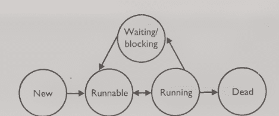

线程状态之间的转换

- **死亡**: ()

不需要火箭科学家告诉你，如果一个线程死亡，它就不再活跃。

# 防止线程执行

被停止的线程通常意味着它移动到了死亡状态。但目标 4.2 还在寻找你识别线程何时会被移出运行状态但不返回可运行或死亡的能力。

对于考试而言，我们不关心线程阻塞 I/O（例如，等待从输入流接收内容）。我们关心的是以下情况：

- 睡眠
- 等待
- 因为对象锁而阻塞

# 睡眠

`sleep()`方法是`Thread`类的一个静态方法。你在代码中使用它来“减慢线程”，强制它进入睡眠模式，然后返回可运行状态（在那里仍然需要请求当前运行线程）。当线程睡眠时，它会进入游，直到它醒来。

你为什么要让线程睡眠呢？嗯，你可能认为线程运行代码的速度太快了。或者你可能需要强制线程轮流，因为 Java 规范并不保证合理的轮流。或者想象一个在循环中运行的线程，下载并分析最新的股票价格。一个一个下载价格将浪费时间，更重要的是，这将极度浪费带宽。解决此问题的简单方法是在每次下载后让线程暂停（睡眠）五分钟。

你通过调用静态`Thread.sleep()`方法来实现这一点，传入一个毫秒级的时间如下：

```java
try {
    Thread.sleep(5*60*1000); // 睡眠 5 分钟
} catch (InterruptedException ex) { }
```

注意`sleep()`方法会抛出一个受检异常`InterruptedException`（你通常知道是否存在这种可能，因为另一个线程必须显式地执行中断，所以你必须通过处理或声明来确认该异常）。在前面的代码中，你通常会将`sleep()`的调用封装在`try/catch`块中。

让我们通过使用`sleep()`来修改我们的 Fred、Lucy、Ricky 代码，强制线程交替执行，而不是让某个线程在某段时间占据主。你认为`sleep()`方法应该放在哪里？

```java
class NameRunnable implements Runnable {
    public void run() {
        for (int x = 1; x < 4; x++) {
            System.out.println("Run by " 
                + Thread.currentThread().getName());
            try {
                Thread.sleep(1000);
            } catch (InterruptedException ex) { }
        }
    }
}

public class ManyNames {
    public static void main(String [] args) {
        // 创建一个 Runnable
        NameRunnable nr = new NameRunnable();
        Thread one = new Thread(nr);
        one.setName("Fred");
        Thread two = new Thread(nr);
        two.setName("Lucy");
        Thread three = new Thread(nr);
        three.setName("Ricky");
        one.start();
        two.start();
        three.start();
    }
}
```

运行此代码可以看到 Fred、Lucy 和 Ricky 很好地交替运行：

```
% java ManyNames
Run by Fred
Run by Lucy
Run by Ricky
Run by Fred
Run by Lucy
Run by Ricky
Run by Fred
Run by Lucy
Run by Ricky
```


## 线程状态与转换 (OCP 目标 10.2)

请记住，前面输出中的行为是不保证的。你无法确定一个线程在进入睡眠之前实际上会运行多久，也无法确定当运行中的线程进入睡眠时，三个线程中只有一个处于可就绪（runnable）。也就是说，如果两个线程唤醒并处于可就绪池中，你无法确定最近使用的那个一定是会被运行的。尽管如此，使用 `sleep()` 是帮助所有线程获得运行机会的最佳方法！或者至少保证一个线程不会进入并一直持续直到完成。当线程遇到 `sleep()` 调用时，它必须睡眠至少指定的毫秒数（除非在唤醒时间之前被中断，在这种情况下它会立即抛出 `InterruptedException`）。


仅仅因为线程的 `sleep()` 到期并唤醒，这并不意味着它会返回运行状态！记住，当线程唤醒时，它只是回到了可就绪状态。`sleep()` 中指定的时间是线程不运行的最短时长，而不是线程不运行的精确时长。例如，你不能依赖 `sleep()` 方法来提供一个完全准确的计时器。虽然在许多应用程序中使用 `sleep()` 作为计时器无疑足够了，但你必须知道 `sleep()` 时间并不保证线程在时间到期且唤醒后会立即重新运行。

记住 `sleep()` 是一个静态方法，所以不要被误认为可以让另一个线程进入睡眠。你可以在任何地方放置 `sleep()` 代码，因为所有代码都是由某个线程运行。当执行代码（即当前运行线程的代码）遇到 `sleep()` 调用时，它会让当前运行的线程进入睡眠。

### 练习 1-1

#### 创建线程并让其睡眠

在这个练习中，我们将创建一个简单的计数线程。它将数到 100，每个数字之间暂停一秒。此外，为了符合计数主题，它每十个数字输出一个字符串。

1. 创建一个类并扩展 `Thread` 类。作为一种选择，你可以实现 `Runnable` 接口。
2. 重写 `Thread` 的 `run()` 方法。这是输出数字的代码所在。
3. 创建一个循环 100 次的 `for` 循环。使用模运算检查除以 10 时是否存在余数。
4. 使用静态方法 `Thread.sleep()` 进行暂停。（记住，单参数版本的 `sleep()` 指定毫秒为单位的睡眠时长。）

## 线程优先级与 `yield()`

要理解 `yield()`，你必须理解线程优先级的概念。线程总是带有优先级运行，通常表示为 1 到 10 之间的一个数字（尽管在某些情况下范围小于 10）。大多数 JVM 中的调度器使用抢占式的基于优先级的调度（这意味着某种时间片划分）。这并不意味着所有的 JVM 都使用时间片。JVM 规范并不要求虚拟机实现时间片调度器（在时间片调度器中，每个线程被分配公平的时间，然后被送回可就绪状态以给另一个线程机会）。虽然许多 JVM 使用时间片，但某些 JVM 可能使用让一个线程运行直到该线程完成其 `run()` 方法的调度器。

然而，在 JVM 中，调度器在一个重要方面使用了线程优先级：如果一个线程进入可就绪状态且它具有更高的优先级，它可能会被调度更早运行。

## 线程状态与转换 (OCP 目标 10.2)

同样不保证的还有当池中的线程优先级相等，或者当前运行线程与池中线程优先级相同时的行为。在所有优先级相等的情况下，JVM 的调度器实现可以采取任何操作。这意味着调度器可能会执行以下操作（等）：

- 选择一个线程运行，并一直运行直到它阻塞或完成。
- 对池中的线程进行时间片划分以给每个人公平的机会。

## 设置线程优先级

线程获取的默认优先级是创建它的执行线程的优先级。例如，在代码中

```java
public class TestThreads {

    public static void main(String[] args) {

        MyThread t = new MyThread();

    }

}
```

由 `t` 的线程将具有主线程相同的优先级，因为主线程正在执行创建 `MyThread` 实例的代码。

你也可以通过对 `Thread` 实例调用 `setPriority()` 方法直接设置线程优先级：

```java
Runnable r = new Runnable();

Thread t = new Thread(r);

t.setPriority(8);

t.start();
```

优先级使用正整数设置，通常在 1 到 10 之间，JVM 永远不会更改线程的优先级。然而，并不保证 1 到 10。某些 JVM 可能无法识别不同的值。JVM 可能会将 1 到 10 的值合并为可能是 1 到 5 的值，假设你有十个优先级不同的线程，而当前应用程序运行在一个仅分配五个优先级的 JVM 中，两个或多个线程可能会被映射到一个优先级。

尽管默认优先级是 5，但 `Thread` 类具有以下常量（静态变量），它们定义了线程优先级的范围：

```java
Thread.MIN_PRIORITY = (1)

Thread.NORM_PRIORITY = (5)

Thread.MAX_PRIORITY = (10)
```

## `yield()` 方法

那么静态的 `Thread.yield()` 与这一切有什么关系呢？在实践中并没有多大。`yield()` 的预期作用是让当前正在运行的线程回到可运行（runnable）状态，以允许相同优先级的线程轮替执行。其意图是使用 `yield()` 在等优先级线程之间进行优雅的轮换。但实际上，`yield()` 方法并不保证能实现它声称的功能，即使它确实导致了线程退出运行状态并回到可运行状态，也不能保证让出的线程不会被其他所有线程选中！虽然 `yield()` 可能会——而且通常会——让运行中的线程放弃它的位置给另一个相同优先级的线程，但这并没有保证。

`yield()` 永远不会导致线程进入等待（waiting）、睡眠（sleeping）或阻塞（blocking）状态。最多，`yield()` 会导致线程从运行变为可运行，但再次强调，它可能没有任何效果。

## `join()` 方法

`Thread` 类的非静态 `join()` 方法允许一个线程“加入”另一个线程的“末尾”。如果你有一个线程 B，它必须等待线程 A 完成工作后才能进行，那么你就希望线程 B “加入”线程 A。这意味着在 A 完成（并进入死亡状态）之前，线程 B 将不会变为可运行状态。

```java
Thread t = new Thread();

t.start();

t.join();
```

上述代码获取了当前运行的线程（如果是在 `main()` 方法中，那么就是主线程），并加入到 `t` 所引用的线程的末尾。这会阻塞当前线程使其无法变为可运行，直到 `t` 所引用的线程不再处于活动状态。换句话说，代码 `t.join()` 意味着“将我（当前线程）加入 `t` 的末尾，以便 `t` 必须在我（当前线程）再次运行之前完成。”你也可以调用 `join()` 的重载版本，接受一个超时持续时间，这样你就可以说：“等待线程 `t` 完成，但如果超过了 5,000 毫秒，就停止等待并变为可运行状态。”图 13-3 显示了 `join()` 方法的效果。

到目前为止，我们查看了运行线程离开运行状态的三种方式：

- 调用 `sleep()`：保证导致当前线程停止执行至少指定的睡眠持续时间（尽管它可能在指定时间之前被中断）。
- 调用 `yield()`：不保证能产生任何作用，尽管通常它会导致当前运行的线程移回可运行状态，以便相同优先级的线程获得机会。
- 调用 `join()`：保证导致当前线程停止执行，直到加入的线程完成（换句话说，该线程调用了它的 `join()`），或者如果尝试加入的线程不是活动状态，则当前线程不需要退回。

除了这三种之外，我们还有以下线程可能离开运行状态的场景：

- 线程的 `run()` 方法完成。确实如此。
- 在对象上调用 `wait()`（正如稍后看到的，我们不会在线程上调用 `wait()`）。
- 线程无法获取其尝试运行的方法代码所所属对象的锁。
- 线程调度器可以决定将当前线程从运行移动到可运行，以便给另一个线程运行的机会。这不需要理由——线程调度器可以随心所欲地进行线程切换。

## 线程状态与转换 (OCP 目标 10.2)

### 认证目标

## 同步代码、线程问题 (OCP 目标 10.3 和 10.4)

10.3 同步对共享数据的线程访问。

10.4 识别潜在的线程问题。

你能想象当两个不同的线程访问同一个类的同一个实例，并且两个线程都调用该对象的方法……而这些方法又修改对象的状态时，会发生什么灾难吗？换句话说，如果两个不同的线程调用（例如）同一个对象上的 setter 方法，会发生什么？这种情况可能会通过以不一致的方式更改实例变量的值来损坏对象的状态，如果该对象的状态被程序的其他部分共享，那简直太可怕了，无法想象。

但仅仅因为我们喜欢恐怖故事，让我们来看可能发生的一种情况。以下代码演示了当两个不同的线程访问同一个账户数据时发生的情况。想象两个人对同一个储蓄账户各有一个复选框（或者两个人各有一个 ATM 卡，但两张卡都链接到同一个账户）。

在这个示例中，我们有一个代表银行账户的 `Account` 类。为了保持代码简洁，该账户初始余额为 50，且仅用于取款。即使账户中没有足够的资金来支付，取款也会被接受。账户只会从余额中减去你想取的金额：

```java
class Account {

    private int balance = 50;

    public int getBalance() {

        return balance;

    }

    public void withdraw(int amount) {

        balance = balance - amount;

    }

}
```

## 同步代码、线程问题 (OCP 目标 10.3 和 10.4)

```java
private void makeWithdrawable(int amt) {

  if (acct.getBalance() >= amt) {

    System.out.println(Thread.currentThread().getName() +

      + " is going to withdraw");

    try {

      Thread.sleep(500);

    } catch (InterruptedException ex) { 

      acct.withdraw(amt);

      System.out.println(Thread.currentThread().getName() +

        + " completes the withdrawal");

    }

  } else {

    System.out.println("Not enough in account for " +

      + Thread.currentThread().getName() +

      + to withdraw " + acct.getBalance());

  }

}
```

（注意：你可能需要在你的机器上稍微微调这段代码以产生“账户透支”的行为。你可以尝试更短的睡眠时间；你也可以尝试在 `run()` 方法中添加 `sleep()`。无论如何，实验都将帮助你巩固这些概念。）发生了什么？有没有可能，比如 Lucy 检查了余额，睡着了，Fred 检查了余额，Lucy 醒来并完成了提款，Fred 也完成了他的提款，最后他们透支了账户？看（带编号的输出）：

1. `java AccountDanger`
2. `Fred is going to withdraw`
3. `Lucy is going to withdraw`
4. `Fred completes the withdrawal`
5. `Fred is going to withdraw`
6. `Lucy completes the withdrawal`
7. `Lucy is going to withdraw`
8. `Fred completes the withdrawal`
9. `Fred is going to withdraw`
10. `Lucy completes the withdrawal`
11. `Lucy is going to withdraw`
12. `Fred completes the withdrawal`
13. `Not enough in account for Fred to withdraw 0`
14. `Not enough in account for Fred to withdraw 0`
15. `account is overdrawn!`
16. `Not enough in account for Lucy to withdraw -10`
17. `account is overdrawn!`
18. `Not enough in account for Lucy to withdraw -10`
19. `account is overdrawn!`

你每次运行这段代码，输出可能略有不同，让我们通过带编号的输出行走一遍这个特定的例子。在前四次尝试中，一切都是正常的。Fred 在第 1 行检查余额，它是好的。在第 2 行，Lucy 检查余额并发现没问题。在第 3 行，Fred 执行了提款。此时，Lucy 之前检查的余额自她上次检查以来（她认为仍然准确）实际上已经发生了变化。现在 Fred 再次检查余额，Lucy 甚至已经完成了她的第一次提款。到这时，即使是 Fred 看到的也是一个可能不准确的余额，因为我们知道 Lucy 将完成她的提款。当然，Fred 有可能在 Lucy 之前完成提款，但这里发生的情况是，在第 5 行，Lucy 完成了提款，然后在 Fred 完成提款之前，Lucy 又在第 6 行检查了账户。就这样持续下去，直到我们在第 8 行，Fred 检查了余额并看到是 20。在第 9 行，Lucy 完成了她之前检查过的提款，这使得余额变为 10。在第 10 行，Lucy 再次检查，看到余额是 10，所以她知道自己可以提款。但她不知道 Fred 也在第 8 行检查了余额。在第 11 行，Fred 完成了他在第 8 行批准的提款。这使得余额变为零。但 Lucy 仍然有一个在第 10 行获得批准的待处理提款！你知道接下来会发生什么。在第 12 行和第 13 行，Fred 检查了余额，发现账户余额不足。但在第 14 行，Lucy 完成了她的提款，砰！账户透支了。

## 同步代码，线程问题 (OCP 目标 10.3 和 10.4)

- 只有方法（或块）可以被同步，变量或类均不行。
- 每个对象只有一个锁。
- 类中并不是所有方法都需要同步。一个类可以同时拥有同步方法和非同步方法。
- 如果两个线程正准备执行某个类中的同步方法，且这两个线程都正在使用该类的同一个实例来调用该方法，那么同一时间只有一个线程能够执行该方法。另一个线程需要等待，直到第一个线程完成调用。换句话说，一旦一个线程获取了对象的锁，没有其他线程可以进入该类中的任何同步方法（对于该对象而言）。
- 如果一个类既有同步方法又有非同步方法，多个线程仍然可以访问该类的非同步方法！如果你有的方法不需要访问你试图保护的数据，那么你就不需要对它们进行同步。在某些情况下，同步会导致性能损耗（或者如果使用不当，可能会导致死锁），所以你应该小心不要过度使用它。
- 一个线程可以获取多个锁。例如，一个线程可以进入一个同步方法从而获取一个锁，然后立即调用另一个对象上的同步方法，从而也获取该锁。随着栈的回溯，锁会被再次释放。此外，如果一个线程获取了锁，然后尝试调用该对象上的同一个同步方法，那没有问题。JVM 知道该线程已经拥有该对象的锁，因此该线程可以自由地使用已有的锁调用该对象上的所有其他同步方法。
- 你可以同步一个代码块，而不是一个方法。

由于同步确实会损害并发性，因此你不希望为了保护数据而对比必要的更多的代码进行同步。如果一个方法的范围超过了需求，你可以将同步部分的范围缩小到小于整个方法的大小——仅仅是一个代码块。我们奇怪地将其称为“同步块”，它看起来像这样：

```java
class SyncTest {

    public void doStuff() {

        System.out.println("not synchronized");

        synchronized(this) {

            System.out.println("synchronized");

        }

    }

}
```

当线程在同步块内部执行代码时（包括从该同步块调用的任何方法代码），该代码被认为在同步上下文中执行。真正的问题是，是在什么上同步？或者说，是在哪个对象的锁上同步？

当你同步一个方法时，用于调用该方法的对象就是必须获取锁的那个对象。但当你同步一个代码块时，你可以指定想要使用哪个对象的锁作为锁，例如，可以使用某个第三方对象作为这段代码的锁。这让你有了在单个对象内为代码同步拥有多个锁的能力。

或者，你也可以像之前的代码中那样，对当前实例（`this`）进行同步。由于同步方法所锁定的是同一个实例，这意味着你始终可以用包含同步块的非同步方法来替换同步方法。换句话说，这个：

```java
public synchronized void doStuff() {

    System.out.println("synchronized");

}
```

等同于这个：

```java
public void doStuff() {

    synchronized(this) {

        System.out.println("synchronized");

    }

}
```


在实际操作中，这两个方法的效果完全相同。这两个方法的编译后字节码可能不完全相同，但它们可以是——而且任何差异并不真正重要。第一种形式更短，且对大多数人来说更熟悉，但第二种可以更灵活。

## 静态方法可以同步吗？

静态方法是可以同步的。由于你试图保护的静态数据只有一份拷贝，所以你每个类只需要一个锁来同步静态方法——一个针对整个类的锁。存在这样一个锁；在 Java 中加载的每个类都有一个对应的 `java.lang.Class` 实例来代表该类。正是这个 `java.lang.Class` 实例的锁被用来保护该类的静态方法（如果它们是同步的话）。同步静态方法不需要你做任何特殊处理：

```java
public static synchronized int getCount() {
    return count;
}
```

# 同步代码，线程问题 (OCP 目标 10.3 和 10.4) 747

再次，这可以使用使用同步块的代码来替换。如果方法定义在一个名为 `MyClass` 的类中，等效代码如下：

```java
public static int getCount() {
    synchronized(MyClass.class) {
        return count;
    }
}
```

等等——那个 `MyClass.class` 是什么？那被称为“类字面量”（class literal）。它是 Java 语言中的一个特殊特性，告诉编译器（再由编译器告诉 JVM）去寻找代表名为 `MyClass` 的类的实例。你也可以通过以下代码实现这一点：

```java
public static void classMethod() throws ClassNotFoundException {
    Class cl = Class.forName("MyClass");
    synchronized (cl) {
        // do stuff
    }
}
```

然而，那种写法更长、更糟糕，而且最重要的是，不在 OCP 考试范围内。但使用类字面量既快速又简单——只需编写类的名称即可。

## 练习 13-2 同步代码块

在本次练习中，我们将尝试同步一个代码块。我们将创建三个尝试修改同一个对象的线程。每个线程都将输出 100 个 A、100 个 B 和 100 个 C。

1. 创建一个类并扩展 `Thread`。
2. 重写 `Thread` 的 `run()` 方法。这是同步代码块所在。
3. 为了让线程对象共享同一个对象，我们需要创建一个接受对象作为参数的构造函数。
4. 同步块将获取第 3 步中对象的锁。
5. 在块内，输出字母 100 次然后进行递增。
6. 最后，在 `main()` 方法中创建一个单一对象，然后创建该类的三个实例并启动它们。

# 748 第 13 章：线程

## 如果线程无法获取锁会发生什么？

如果一个线程尝试进入同步方法而锁已被占用，该线程被认为在对象的锁上被阻塞（blocked）。本质上，线程进入了该特定对象的池，并必须等待直到锁被释放，线程才能再次变为可运行/运行状态。仅仅因为锁被释放并不意味着特定的线程会获取它。例如，可能有很多线程在等待同一个锁，并没有保证等待时间最长的线程会第一个获取。

在考虑阻塞时，注意哪些对象被用于锁定非常重要：

- 同一个类中调用非静态同步方法的线程，只有在使用同一个实例调用时才会互相阻塞。这是因为它们都锁在该实例上，而如果使用不同的实例调用，它们会获得两个锁，锁之间互不干扰。
- 同一个类中调用静态同步方法的线程始终会互相阻塞——它们都锁在同一个 `Class` 实例上。
- 同步方法和非静态同步方法之间永远不会互相阻塞。静态方法锁在 `Class` 实例上，而非静态方法锁在该实例上——操作之间完全不干扰。
- 对于同步块，你必须查看确切使用了哪个对象进行锁定。位于括号中的单词后面的

# 代码同步，线程问题 (OCP 目标 10.3 和 10.4) 749

`synchronized` 在同一个对象上同步的线程会互相阻塞。在不同对象上同步的线程——则不会。

表 13-1 列出了与线程相关的方法，以及调用结果结果线程是否会释放其锁。

## 那么我什么时候需要同步呢？

同步可能会变得非常复杂，你可能在想，既然同步有帮助，为什么你想要这么做呢？但请记住之前关于 Lucy 和 Fred 从账户中取款的“竞态条件”示例。当我们使用线程时，通常需要在某些地方使用某种同步机制，以确保我们的方法不会在错误的时间互相干扰并丢失数据。通常情况下，每当有超过一个线程访问可变（可更改）数据时，你就需要同步来保护该数据，以确保两个线程不会同时更改它（或者确保一个线程在更改它时，另一个线程没有读取它，这同样令人困惑）。你不需要担心局部变量——每个线程都有自己的局部变量副本。同时执行相同方法的两个线程将使用局部变量的不同副本，它们不会互相干扰。然而，如果静态（static）和非静态字段包含可以更改的数据，你就需要担心它们。

对于非静态字段中的可变数据，你通常使用非静态方法来访问它。通过同步该方法，你将确保任何尝试使用相同实例运行该方法的线程都被阻止同时访问。但与不同实例一起工作的线程将不会受到影响，因为它获取的是另一个实例的锁。这正是我们想要的——处理相同数据的线程需要一个接一个地，但处理不同数据的线程可以互相忽略并随心所欲地运行；这并不重要。

| 表 13-1 | 释放锁 | 保留锁 | 定义方法的类 |
| :--- | :--- | :--- | :--- |
| 方法与锁状态 | `wait()` | `notify()` (尽管线程可能在之后不久就会退出同步代码块，并因此释放其锁。) | `java.lang.Object` |
| | `join()` | | `java.lang.Thread` |
| | `sleep()` | | `java.lang.Thread` |
| | `yield()` | | `java.lang.Thread` |

## 第 13 章：线程

对于静态字段中的可变数据，你通常使用静态方法来访问它。同样，通过同步该方法，你确保任何两个尝试访问数据的线程都被阻止同时访问，两个线程都必须在定义类静态方法的类对象上获取锁。再次，这正是我们想要的。

然而——如果你有一个访问静态字段的非静态方法呢？或者有一个访问非静态字段（使用实例）的静态方法呢？在这些情况下，情况会迅速变得混乱，极有可能结果不会按照你想要的方式运行。如果你有一个访问非静态字段的静态方法并同步了该方法，你获取的是类对象（Class Object）的锁。但如果另一个方法也访问该非静态字段，而这次它使用的是当前实例（`this`）上的同步方法呢？记住，静态同步方法和非静态同步方法不会互相阻塞——它们可以同时运行。同样地，如果你使用非静态方法使用静态字段，两个线程可能会互相阻塞，因为它们使用了不同的锁。这意味着两个线程正在同时访问同一个静态字段——这正是我们试图防止的类型。

试图想象这里可能发生的所有奇怪事情会让人感到非常困惑。为了保持简单，为了使一个类是线程安全的，访问可变字段的方法需要被同步。

对静态字段的访问应该使用静态同步方法。对非静态字段的访问应该使用非静态同步方法。例如：

```java
public class Thing {
    private static int staticField;
    private int nonstaticField;

    public static synchronized int getStatic() {
        return staticField;
    }

    public static synchronized void setStaticField(
        int staticField) {
        Thing.staticField = staticField;
    }

    public synchronized int getNonstaticField() {
        return nonstaticField;
    }

    public synchronized void setNonstaticField(
        int nonstaticField) {
        this.nonstaticField = nonstaticField;
    }
}
```

# 代码同步，线程问题 (OCP 目标 10.3 和 10.4) 751

如果你需要在方法中同时访问静态和非静态字段怎么办？
嗯，有方法可以做到，但这超出了你所需的范围。如果你**不要这样做**，你的生活会过得更长、更快乐。真的，我们会撒谎吗？

## 线程安全的类

当一个类经过仔细同步以保护其数据时（使用上述规则或更复杂的替代方案），我们称该类为“线程安全的”。
Java API 中的许多类在内部使用同步来使该类变为“线程安全”。例如，`StringBuffer` 和 `StringBuilder` 是几乎完全相同的类，区别在于 `StringBuffer` 中的所有方法在需要时都是同步的，而 `StringBuilder` 中的方法则不是。通常，这使得 `StringBuffer` 在多线程环境中使用是安全的，而 `StringBuilder` 则不是。（作为回报，`StringBuilder` 稍微快一点，因为它没有处理同步问题。）然而，即使当一个类是“线程安全的”，依赖这些类来提供你需要的线程保护通常也是危险的（得吧，在“线程安全”周围反复使用的引号一定是个线索，对吧？）你仍然需要仔细考虑如何使用这些类。例如，考虑以下类：

```java
import java.util.*;

public class NameList {
    private List names = Collections.synchronizedList(
        new LinkedList<>());

    public void add(String name) {
        names.add(name);
    }

    public String removeFirst() {
        if (names.size() > 0)
            return (String) names.remove(0);
        else
            return null;
    }
}
```

`Collections.synchronizedList()` 方法返回一个 `List`，根据文档其所有方法都是同步的且“线程安全的”（类似于 `Vector`——但现在是 21 世纪了，我们在这里不会使用 `Vector`）。问题是，`NameList` 类可以从多个线程安全地使用吗？人们很想认为是的，因为 `names` 中的数据在同步集合中，所以 `NameList` 类是“安全的”。然而事实并非如此——`removeFirst()` 有时会抛出 `IndexOutOfBoundsException`。问题在哪里？它不是在移除任何内容之前检查了 `names` 的 `size()` 以确保有东西吗？

# 752 第 13 章：线程

这段代码可能会失败？让我们尝试这样使用 `NameList`：

```java
public static void main(String[] args) {
    final NameList nl = new NameList();
    nl.add("Ozymandias");

    class NameDropper extends Thread {
        public void run() {
            String name = nl.removeFirst();
            System.out.println(name);
        }
    }

    Thread t1 = new NameDropper();
    Thread t2 = new NameDropper();
    t1.start();
    t2.start();
}
```

这里可能发生的情况是，一个线程将移除名称并打印它，然后另一个线程将尝试移除名称并得到 `null`。如果我们输出对 `names.size()` 和 `names.remove(0)` 的调用，它们发生的顺序如下：

+ Thread t1 执行 `names.size()`，返回 1。
+ Thread t1 执行 `names.remove(0)`，返回 `Ozymandias`。
+ Thread t2 执行 `names.size()`，返回 0。
+ Thread t2 没有调用 `remove(0)`。

这里的输出是

```
Ozymandias
null
```

然而，如果我们再次运行程序，可能会发生不同的情况：

+ Thread t1 执行 `names.size()`，返回 1。
+ Thread t2 执行 `names.size()`，返回 1。
+ Thread t1 执行 `names.remove(0)`，返回 `Ozymandias`。
+ Thread t2 执行 `names.remove(0)`，因为列表不空而会抛出异常。

这里需要意识到这一点是，在像由 `synchronizedList()` 返回的这种“线程安全”类中，每个方法都是同步的。`names.size()` 是同步的，`names.remove(0)` 是同步的。但没有什么能阻止另一个线程在这两个调用之间对列表执行其他操作。而那正是问题发生的地方。

# 同步代码、线程问题 OCP 目标 10.3 和 10.4 753

这里有一个解决方案：不要依赖于 `Collections.synchronizedList()`。
相反，你自己来对代码同步：

```java
import java.util.*;

public class NameList {
    private List names = new LinkedList();

    public synchronized void add(String name) {
        names.add(name);
    }

    public synchronized String removeFirst() {
        if (names.size() > 0)
            return (String) names.remove(0);
        else
            return null;
    }
}
```

现在整个 `removeFirst()` 方法都是同步的，一旦一个线程开始执行并调用 `names.size()`，其他线程就无法插队并偷走最后一个元素。另一个线程将一直等待第一个线程完成 `removeFirst()` 方法。

这里的道理是，仅仅因为一个类被描述为“线程安全”，并不意味着它总是线程安全的。如果单个方法是同步的，这可能还不够——你可能需要在更高层次进行同步（即在调用其他方法的代码块中）。一旦你这样做，原本由 `Collections.synchronizedList()` 返回的对象的同步可能变得多余了。

# 死锁

Java 程序中可能发生的最可怕的事情就是死锁。死锁发生在两个线程都被阻塞，每个都在等待对方的锁。除非对方释放其锁，否则它们将永远在那里。

这种情况可能会发生，例如当线程 A 遇到同步代码，获取了锁 B，然后进入另一个也是同步的（它拥有锁）方法。但线程 A 无法进入这段同步代码——块 C——因为线程 D 已经拥有了它。所以线程 A 将去等待……希望线程 D 快点释放锁（通过完成方法）。但线程 A 确实会等待很久，因为当线程 D 获取锁 C 时，它进入了同步锁 B 方法。显然，线程 D 无法获取锁 B，因为线程 A 拥有它。它们就这样在那里。下面的示例演示了死锁：

```java
1. public class Deadlock {
2.   private static class Resource {
3.     public int value;
4.   }
5.   private Resource resourceA = new Resource();
6.   private Resource resourceB = new Resource();
7.   public int read() {
8.       synchronized(resourceA) { // 可能死锁
9.       synchronized(resourceB) {
10.      return resourceB.value + resourceA.value;
11.    }
12.  }
13. }
14. public void write(int a, int b) {
15.   synchronized(resourceB) { // 可能死锁
16.    synchronized(resourceA) {
17.      resourceA.value = a;
18.      resourceB.value = b;
19.    }
20.  }
21. }
22. }
```


假设 `read()` 由一个线程启动，而 `write()` 由另一个线程启动。如果有两个线程独立地读取和写入，那么在第8或16行存在死锁风险。读取线程将持有 `resourceA`，写入线程将持有 `resourceB`，两者互相等待。

这样的代码几乎不会导致死锁，因为 CPU 在代码的特定点从读取线程切换到写入线程，发生死锁的概率非常小。应用程序在 99.9% 的情况下运行良好。

前面的简单示例很容易修复；交换第16和17行读取器或写入器的锁定顺序（或者第8和9行）。更复杂的死锁情况可能需要长时间才能查出来。

无论代码调试的机会有多小，底线是：如果你发生了死锁，你就完蛋了。有一些设计方法可以避免死锁，例如实现按预测顺序获取锁的策略。

但那是你需要学习的内容，超出了本书的范围。我们只是试图帮你通过考试。不过，如果你学会这一章的所有内容，你对线程的了解将超过大多数丰富的 Java 程序员。

# 线程交互（OCP 目标 10.3 和 10.4）

## 认证目标

### 线程交互

OCP 目标 10.3 和 10.4

- 10.3 同步线程对共享数据的访问。
- 10.4 识别潜在的线程问题。

我们最后需要考虑的是线程如何相互交互以通信（等）它们的锁定状态。`Object` 类有 `wait()`、`notify()` 和 `notifyAll()`，帮助线程通信它们感兴趣事件的状态。例如，如果一个线程是邮件投递线程，另一个是邮件处理线程，那么邮件处理线程必须不断检查是否有邮件要处理。使用 `wait` 和 `notify` 机制，邮件处理线程可以检查邮件，如果没有发现任何，它就可以说：“我要等待，直到某个其他线程向邮箱里放了东西并通知我。”

关于 `wait/notify` 有一点需要记住（并在考试中牢记于心中）：**`wait()` 和 `notify()` 必须在同步上下文中调用！** 线程除非拥有该对象的锁，否则无法在对象上调用 `wait` 或 `notify`。

想象一台计算机控制的机器，它可以将织料切割成不同的形状，以及一个允许用户指定形状的应用程序。当前版本的应用程序只有一个线程，它循环运行向用户请求指令，然后指导机器：

```java
public void run() {
  while(true){
    // 从用户处获取形状
    // 将步骤发送到硬件
  }
}
```

这种设计并不是最优的，因为当机器忙于其他形状时，用户无法进行任何事情。我们需要改进这种情况。

一个简单的解决方案是将进程拆分为两个线程，一个与用户交互，另一个管理硬件。用户线程将指令发送给硬件线程，然后回到与用户交互。硬件线程接收用户线程的指令并开始指导机器。两个线程使用一个共同对象进行通信，该对象持有正在处理的设计。

下面的伪代码展示了这种设计：

```java
public void userLoop() {
  while(true) {
    // 从用户处获取形状
    // 根据形状计算机器步骤
    // 修改共同对象以更新步骤
  }
}
```

```java
public void hardwareLoop() {
  while(true) {
    // 从共同对象获取步骤
    // 将步骤发送到硬件
  }
}
```

# 线程交互 (OCP 目标 10.3 和 10.4)

```java
6. synchronized(b) {
7.   try {
8.     System.out.println("Waiting for b to complete...");
9.     wait();
10.  } catch (InterruptedException e) {
11.    System.out.println("Total is: " + b.total);
12.  }
13. }
14. }
15.
16. class ThreadB extends Thread {
17.   int total;
18.
19.   public void run() {
20.     synchronized(this) {
21.       for (int i=0;i<100;i++) {
22.         total += i;
23.       }
24.       notify();
25.     }
26.   }
27. }
```

该程序包含两个带有线程的对象：`ThreadA` 包含主线程，而 `ThreadB` 有一个计算从 0 到 99 所有数字之的线程。一旦第 4 行调用了 `start()` 方法，`ThreadA` 将继续执行其类中的下一行代码，这意味着它可能在 `ThreadB` 完成计算之前就执行到第 11 行。为了防止这种情况，我们在第 9 行使用了 `wait()` 方法。

注意第 6 行中的代码与对象 `b` 进行了同步——这是因为为了在该对象上调用 `wait()`，`ThreadA` 必须拥有 `b` 的锁。要让一个线程调用 `wait()` 或 `notify()`，该线程必须是该对象锁的所有者。当线程等待时，它会临时释放锁以供其他线程使用，但在它继续执行时将再次需要该锁。请查看这样的代码：

```java
synchronized(anotherObject) { // 这拥有了 anotherObject 的锁
  try {
    anotherObject.wait();
    // 线程释放锁并等待
    // 要继续执行，线程需要锁，
    // 所以它可能会被阻塞直到获取到锁。
  } catch (InterruptedException e) {
  }
}
```

前面的代码会等待直到在 `anotherObject` 上调用 `notify()`。

```java
synchronized(this) { notify(); }
```

# 第 13 章：线程

这段代码通知当前正在等待此对象的单个线程。锁可以在代码中更早的地方获取，例如在调用方法中。请注意，如果调用 `wait()` 的线程没有拥有锁，它将抛出 `IllegalMonitorStateException`。此异常不是受检异常，因此你不需要显式地捕获它。在任何代码块中，你应该明确线程是否拥有某个对象的锁。

注意第 7–10 行中，`wait()` 方法周围有一个 `try/catch` 块。等待的线程可以像睡眠的线程一样被中断，因此你必须处理该异常：

```java
try {
  wait();
} catch (InterruptedException e) {
  // 对其进行处理
}
```

在织料示例中，使用这些方法的方法是让硬件线程等待形状可用，并让用户线程在写完步骤后通知它。机器步骤可能包括全局步骤（例如将所需的面料移动到剪裁区域）以及若干子步骤（例如剪裁的方向和长度）。例如，它们可以是：

```java
int fabricRoll;
int cuttingSpeed;
Point startingPoint;
float[] directions;
float[] lengths;
etc..
```

当硬件线程在使用这些步骤时，用户线程不要修改这些机器步骤是非常重要的，因此这种读取和写入应该是同步的。生成的代码看起来如下：

```java
class Operator extends Thread {
  public void run() {
    while (true) {
      // 从用户处获取形状
      synchronized(this) {
        // 根据形状计算新的机器步骤
        notify();
      }
    }
  }
}

class Machine extends Thread {
  Operator operator; // 假设这已初始化
  public void run() {
    while (true) {
      synchronized(operator) {
        try {
          operator.wait();
        } catch (InterruptedException ie) {
          // 将机器步骤发送到硬件
        }
      }
    }
  }
}
```

机器一旦启动，将立即进入等待状态，并耐心等待直到操作员发送第一个通知。此时，是操作员线程拥有了该对象的锁，因此硬件会阻塞一段时间。当硬件正在处理一个形状时，用户可以与系统交互并指定另一个要剪裁的形状。当用户完成形状并且该剪裁时，操作员线程尝试进入同步块，阻塞直到机器完成之前的步骤。当机器完成后，它会重复循环，再次进入等待状态（并释放锁）。只有这样，操作员线程才能进入同步块并用新步骤覆盖机器步骤。两个线程绝对比一个线程要有改进，尽管在这种实现中，仍然有让用户等待的可能性。这里还有 `wait()` 的第二形式，它可以接受一个毫秒数作为最大值。如果线程没有被中断，它在被通知或超时到期后将正常继续。这种正常继续包括跳出等待状态，但为了继续执行，它将必须获取该对象的锁：

```java
synchronized(a) {
  // 线程获取了 'a' 的锁
  a.wait(2000); // 线程释放锁并等待
                // 最多等待两秒，然后返回
}
```


# 线程交互 (OCP 目标 10.3 和 10.4) 757

```java
6. synchronized(b) {
7. try {
8. System.out.println("Waiting for b to complete...");
9. wait();
10. catch (InterruptedException e) {
11. System.out.println("Total is: " + b.total);
12. }
13. }
14. }
15.
16. class ThreadB extends Thread {
17. int total;
18.
19. public void run() {
20. synchronized(this) {
21. for (int i=0;i<100;i++) {
22. total += i;
23. }
24. notify();
25. }
26. }
27. }
```

该程序包含两个带有线程的对象：`ThreadA` 包含主线程，而 `ThreadB` 有一个计算从 0 到 99 所有数字之和的线程。一旦第 4 行调用了 `start()` 方法，`ThreadA` 将继续执行其类中的下一行代码，这意味着它可能在 `ThreadB` 完成计算之前就执行到第 11 行。为了防止这种情况，我们在第 9 行使用了 `wait()` 方法。

注意第 6 行中的代码与对象 `b` 进行了同步——这是因为为了在该对象上调用 `wait()`，`ThreadA` 必须拥有 `b` 的锁。要让一个线程调用 `wait()` 或 `notify()`，该线程必须是该对象锁的所有者。当线程等待时，它会临时释放锁以供其他线程使用，但在它继续执行时将再次需要该锁。请查看这样的代码：

```java
synchronized(anotherObject) { // 这拥有了 anotherObject 的锁
try {
anotherObject.wait();
// 线程释放锁并等待
// 要继续执行，线程需要锁，
// 所以它可能会被阻塞直到获取到锁。
} catch (InterruptedException e) {
}
```

前面的代码会等待直到在 `anotherObject` 上调用 `notify()`。

```java
synchronized(this) { notify(); }
```

# 758 第 13 章：线程

这段代码通知当前正在等待此对象的单个线程。锁可以在代码中更早的地方获取，例如在调用方法中。请注意，如果调用 `wait()` 的线程没有拥有锁，它将抛出 `IllegalMonitorStateException`。此异常不是受检异常，因此你不需要显式地捕获它。在任何代码块中，你应该明确线程是否拥有某个对象的锁。

注意第 7–10 行中，`wait()` 方法周围有一个 `try/catch` 块。等待的线程可以像睡眠的线程一样被中断，因此你必须处理该异常：

```java
try {
  wait();
} catch (InterruptedException e) {
  // 对其进行处理
}
```

在织料示例中，使用这些方法的方法是让硬件线程等待形状可用，并让用户线程在写完步骤后通知它。机器步骤可能包括全局步骤（例如将所需的面料移动到剪裁区域）以及若干子步骤（例如剪裁的方向和长度）。例如，它们可以是：

```java
int fabricRoll;
int cuttingSpeed;
Point startingPoint;
float[] directions;
float[] lengths;
etc..
```

当硬件线程在使用这些步骤时，用户线程不要修改这些机器步骤是非常重要的，因此这种读取和写入应该是同步的。生成的代码看起来如下：

```java
class Operator extends Thread {
  public void run() {
    while (true) {
      // 从用户处获取形状
      synchronized(this) {
        // 根据形状计算新的机器步骤
        notify();
      }
    }
  }
}

class Machine extends Thread {
  Operator operator; // 假设这已初始化
  public void run() {
    while (true) {
      synchronized(operator) {
        try {
          operator.wait();
        } catch (InterruptedException ie) {
          // 将机器步骤发送到硬件
        }
      }
    }
  }
}
```

机器一旦启动，将立即进入等待状态，并耐心等待直到操作员发送第一个通知。此时，是操作员线程拥有了该对象的锁，因此硬件会阻塞一段时间。当硬件正在处理一个形状时，用户可以与系统交互并指定另一个要剪裁的形状。当用户完成形状并且该剪裁时，操作员线程尝试进入同步块，阻塞直到机器完成之前的步骤。当机器完成后，它会重复循环，再次进入等待状态（并释放锁）。只有这样，操作员线程才能进入同步块并用新步骤覆盖机器步骤。两个线程绝对比一个线程要有改进，尽管在这种实现中，仍然有让用户等待的可能性。这里还有 `wait()` 的第二形式，它可以接受一个毫秒数作为最大值。如果线程没有被中断，它在被通知或超时到期后将正常继续。这种正常继续包括跳出等待状态，但为了继续执行，它将必须获取该对象的锁：

```java
synchronized(a) {
    // 线程获取了 'a' 的锁
    a.wait(2000); // 线程释放锁并等待
                  // 最多等待两秒，然后返回
}
```


# 线程通信与同步

这段代码通知当前正在等待此对象的单个线程。锁可以在代码中更早的地方获取，例如在调用方法中。请注意，如果调用 `wait()` 的线程没有拥有锁，它将抛出 `IllegalMonitorStateException`。此异常不是受检异常，因此你不需要显式地捕获它。在任何代码块中，你应该明确线程是否拥有某个对象的锁。

注意第 7–10 行中，`wait()` 方法周围有一个 `try/catch` 块。等待的线程可以像睡眠的线程一样被中断，因此你必须处理该异常：

```java
try {
  wait();
} catch (InterruptedException e) {
  // 对其进行处理
}
```

在织料示例中，使用这些方法的方法是让硬件线程等待形状可用，并让用户线程在写完步骤后通知它。机器步骤可能包括全局步骤（例如将所需的面料移动到剪裁区域）以及若干子步骤（例如剪裁的方向和长度）。例如，它们可以是：

```java
int fabricRoll;
int cuttingSpeed;
Point startingPoint;
float[] directions;
float[] lengths;
etc..
```

当硬件线程在使用这些步骤时，用户线程不要修改这些机器步骤是非常重要的，因此这种读取和写入应该是同步的。生成的代码看起来如下：

```java
class Operator extends Thread {
  public void run() {
    while (true) {
      // 从用户处获取形状
      synchronized(this) {
        // 根据形状计算新的机器步骤
        notify();
      }
    }
  }
}
class Machine extends Thread {
  Operator operator; // 假设这已初始化
  public void run() {
    while (true) {
      synchronized(operator) {
        try {
          operator.wait();
        } catch (InterruptedException ie) {
          // 将机器步骤发送到硬件
        }
      }
    }
  }
}
```

机器一旦启动，将立即进入等待状态，并耐心等待直到操作员发送第一个通知。此时，是操作员线程拥有了该对象的锁，因此硬件会阻塞一段时间。当硬件正在处理一个形状时，用户可以与系统交互并指定另一个要剪裁的形状。当用户完成形状并且该剪裁时，操作员线程尝试进入同步块，阻塞直到机器完成之前的步骤。当机器完成后，它会重复循环，再次进入等待状态（并释放锁）。只有这样，操作员线程才能进入同步块并用新步骤覆盖机器步骤。两个线程绝对比一个线程要有改进，尽管在这种实现中，仍然有让用户等待的可能性。这里还有 `wait()` 的第二形式，它可以接受一个毫秒数作为最大值。如果线程没有被中断，它在被通知或超时到期后将正常继续。这种正常继续包括跳出等待状态，但为了继续执行，它将必须获取该对象的锁：

```java
synchronized(a) {
  // 线程获取了 'a' 的锁
  a.wait(2000); // 线程释放锁并等待
                // 最多等待两秒，然后返回
}
```

它会检查某些条件表达式，并且只有在你正在等待的事情尚未发生时才会等待。这里有一个修改后的、更安全的 carlier 剪裁机示例版本：

```java
class Operator extends Thread {
  Machine machine; // 假设这里已经初始化
  public void run() {
    while (true) {
      Shape shape = getShapeFromUser();
      MachineInstructions job = calculateNewInstructionsFor(shape);
      machine.addJob(job);
    }
  }
}
```

操作员仍然会无限循环，从用户那里获取更多形状，为这些形状计算新指令，并将它们发送到机器。然而，现在 `notify()` 的逻辑已经移动到了 `Machine` 类的 `addJob()` 方法中：

```java
class Machine extends Thread {
  List<MachineInstructions> jobs = new ArrayList<MachineInstructions>();

  public void addJob(MachineInstructions job) {
    synchronized (jobs) {
      jobs.add(job);
      jobs.notify();
    }
  }

  public void run() {
    while (true) {
      synchronized (jobs) {
        // 等到至少有一个任务可用
        while (jobs.isEmpty()) {
          try {
            jobs.wait();
          } catch (InterruptedException ie) {}
        }
        // 如果我们到达这里，我们就知道 jobs 不为空
        MachineInstructions instructions = jobs.remove(0);
        // 将机器步骤发送到硬件
      }
    }
  }
}
```

机器维护了一份它计划执行的任务列表。每当操作员向列表添加新任务时，它就会调用 `addJob()` 方法并将新任务添加到列表中。

与此同时，`run()` 方法只是不断保持循环，查找列表上的任何任务。如果没有任务，它将开始等待。如果它收到通知，它将停止等待，然后重新检查循环条件：列表是否为空？在实践中，这种双重检查可能不是必要的，因为调用 `notify()` 的唯一时刻就是向列表添加了新任务时。然而，每当被唤醒时，都要求重新检查 `isEmpty()` 条件是一个好主意，因为线程可能意外发送了非意之外的额外 `notify()`。在某些情况下还可能存在自发唤醒的情况——尽管没有代码调用 `notify()` 或 `notifyAll()`，线程也可能会唤醒。（至少，在你已知的这些方法中没有。JVM 可能会出于自己的原因调用 `notify()`，或者在其他你不知道的类中调用它。）这意味着当你的线程从 `wait()` 唤醒时，你不知道它是为什么被唤醒的。通过将 `wait()` 方法放在 `while` 循环中并重新检查代表我们所等待内容的条件，我们确保了被唤醒的原因，我们会重新进入 `wait()`（除非）我们等待的事情——任务不为空。在 `Machine` 类中，我们所等待的事情尚未发生。如果我们在等待，并且它不为空，我们就完成了。

注意，`run()` 方法和 `addJob()` 方法都对同一个对象——`jobs` 列表进行了同步处理。这有两个原因。其一是因为由于我们在该实例上调用了 `wait()` 和 `notify()`，所以我们需要同步以避免 `IllegalMonitorStateException`。另一个原因是 `jobs` 列表中的数据是存储在由两个不同线程访问的字段中的可变数据。我们需要同步以安全地访问这些可变数据。幸运的是，允许我们执行 `wait()` 和 `notify()` 的 `synchronized` 块也为我们对可变数据的其他访问提供了所需的线程安全。事实上，这就是为什么最初使用 `wait()` 和 `notify()` 就需要同步的原因——你总是需要在线程之间共享一些可变数据，并且你需要同步。注意 `addJob()` 中的 `synchronized` 块足够包含 `add()`——它修改了共享数据。而 `run()` 中的 `synchronized` 块足够包含整个循环——包含了对 `jobs.isEmpty()` 的调用。

这里的道理是当你使用 `wait()` 和 `notify()` 或 `notifyAll()` 时，你几乎应该在 `wait()` 周围使用一个 `while` 循环来检查条件并强制在条件满足之前继续等待。你应该这样做。

# 第 13 章：线程

- 无法保证线程会以任何公平的方式轮替执行。这取决于线程调度器，而调度器由特定的虚拟机实现。如果你希望保证无论底层 JVM 如何，你的线程都能交替执行，可以使用 `sleep()` 方法。这可以防止一个线程长时间占用进程而导致另一个线程饥饿。在大多数情况下，`yield()` 的效果足够足够，可以鼓励你的线程良好地协作。
- 运行中的线程可能通过 `wait()`、`sleep()` 或 `join()` 调用进入阻塞/等待状态。
- 运行中的线程可能因为无法获取 `synchronized` 代码块的锁而进入阻塞/等待状态。
- 当 `sleep` 或 `wait` 结束后，对象的锁变得可用，线程只能重新进入可运行状态。它将直接从等待状态跳转到运行状态（至少从实际角度来看是如此）。
- 死的线程无法启动。

## Sleep, Yield, and Join (OCP 目标 10.2)

- 睡眠用于延迟执行一段时间，且当线程进入睡眠时不会释放任何锁。
- 睡眠的线程保证睡眠时间至少为 `sleep()` 方法参数中指定的时间（除非被中断），但无法保证新唤醒的线程何时会真正返回运行状态。
- `sleep()` 方法是一个静态方法，用于让当前运行的线程进入睡眠状态。一个线程不能让另一个线程睡眠。
- `setPriority()` 方法用于 `Thread` 对象，为线程提供 1（低）和 10（高）的优先级，尽管优先级是不被保证的，而且并不是所有的 JVM 都能识别 10 个不同的优先级级别——某些级别可能被视为等效。
- 如果不显式设置，线程的优先级将与创建它的线程的优先级相同。
- 静态方法可以使用代表该类的 `java.lang.Class` 实例的锁进行同步。

## 通过等待和通知与对象进行通信 (OCP 目标 10.3 和 10.4)

- `wait()` 方法让线程说：“我现在没事可做，所以请把我放在你们的等待池中，当我关心的事情发生时通知我。”基本上，调用 `wait()` 意味着“让你们的池中等待”或“将我加入你们的等待列表”。
- `notify()` 方法用于向同一对象等待池中等待的且仅有一个线程发送信号。
- `notify()` 方法无法指定要通知哪个等待线程。
- `notifyAll()` 方法的工作方式与 `notify()` 相同，只是它向所有在该对象上等待的线程发送信号。
- 这三个方法——`wait()`、`notify()` 和 `notifyAll()`——必须在 `synchronized` 上文中调用！线程在特定对象上调用 `wait()` 时，该线程当前必须持有该对象的锁。

## 死锁线程 (OCP 目标 10.4)

- 死锁是指线程执行陷入停滞，因为代码正在等待从对象中移除锁。
- 当一个已锁对象尝试访问另一个已锁对象，而该对象又试图访问第一个已锁对象时，就会发生死锁。换句话说，两个线程都在等待对方的锁释放；因此，锁永远不会被释放！
- 死锁是糟糕的。不要这样做。

## 自测题

以下问题将帮助你衡量对本章介绍内容的理解程度。如果你起初处理某些问题时遇到困难，不要自责。其中一些问题很长且复杂。预计在实际考试中也会有长而复杂的问题！

1. 下面代码块使用 `Runnable` 目标创建了一个 `Thread`：

```java
Runnable target = new MyRunnable();
Thread myThread = new Thread(target);
```

下列哪个类可以用于创建目标，以便上述代码能够正确编译？

- A. `public class MyRunnable extends Runnable{public void run()}}`
- B. `public class MyRunnable extends Object{public void run()}}`
- C. `public class MyRunnable implements Runnable{public void run()}}`
- D. `public class MyRunnable implements Runnable{public void run()}}`
- E. `public class MyRunnable implements Runnable{public void start()}}`

2. 给定：

```java
3. class MyThread extends Thread {
4.    public static void main(String [] args) {
5.    Thread t = new MyThread();
6.    Thread x = new Thread(t);
7.    x.start();
8.   }
9.   public void run() {
10.     for (int i=0;i<3;i++) {
11.      System.out.print(i + "..");
12.     }
13.  }
14. }
```

这段代码的结果是？

- A. 编译失败
- B. `1..2..3...`
- C. `0..1..2..3...`
- D. `0..1..2..`
- E. 运行时发生异常

3. 给定：

```java
3. class Test {
4.     public static void main(String [] args) {
5.         printAll(args);
6.     }
7.     public static void printAll(String[] lines) {
8.         for (int i=0;i<lines.length;i++){
9.             System.out.println(lines[i]);
10.        Thread.currentThread().sleep(1000);
11.     }
12. }
```

当 `sleep` 或 `wait` 结束后，对象的锁变得可用，线程只能重新进入可运行状态。它将直接从等待状态跳转到运行状态（好吧，从实际用途来看是如此）。

（注：此处原文文本似乎在题目逻辑或编号上存在断层，以下基于提供的文本进行翻译）

当 `sleep` 或 `wait` 结束后，对象的锁变得可用，线程只能重新进入可运行状态。它将直接从等待状态跳转到运行状态（好吧，从实际用途来看是如此）。

（注：由于原文第 3 题后续内容似乎错乱，此处按原文提供的行逐行翻译）

当 `sleep` 或 `wait` 结束后，对象的锁变得可用，线程只能重新进入可运行状态。它将直接从等待状态跳转到运行状态（好吧，从实际用途来看是如此）。

- 死的线程无法启动。

（此处衔接后续选项翻译）

- A. 编译失败
- B. `1..2..3...`
- C. `0..1..2..3...`
- D. `0..1..2..`
- E. 运行时发生异常

4. 假设你有一个类有两个私有变量 `a` 和 `b`。下列哪些组合可以防止该类的并发访问问题？（选择所有项）

- A. `public synchronized read() {a+b}; public synchronized(int a, b)`
- B. `public synchronized read() {a+b}; synchronized(int a, b)`
- C. `public int read() {synchronized(a) {a+b}}; synchronized(b)`
- D. `public int read() {synchronized(b) {a+b}}; synchronized()`
- E. `public synchronized(this) read() {a+b}; synchronized(int a, b)`
- F. `public int read() {synchronized(this) {a+b}}; synchronized(b)`

5. 给定：

```java
1. public class WaitTest {
2.   public static void main(String [] args) {
3.     System.out.print("1 ");
4.     synchronized(args) {
5.       System.out.print("2 ");
6.       try {
7.         args.wait();
8.       }
9.       catch(InterruptedException e) {
10.    }
11.    System.out.print("3 ");
12.  }
13. }
```


尝试编译并运行此程序的结果是？

- A. 编译失败，因为第 7 行没有处理 `wait()` 的 `IllegalStateException`
- B. 1 2 3
- C. 1 3
- D. 1 2
- E. 运行时在尝试等待时抛出 `IllegalStateException`
- F. 将编译失败，因为它必须在 `this` 上同步

6. 假设以下方法已正确同步，并在线程 A 的对象 B 上调用：

```
wait(2000)
```

调用此方法后，线程 A 会成为再次获得 CPU 的候选吗？

- A. 对象 B 被通知后，或者两秒后
- B. 锁 B 释放后，或者两秒后
- C. 对象 B 被通知两秒后
- D. 锁 B 释放两秒后

7. 哪些是正确的？（选择所有项）

- A. `notifyAll()` 方法必须在同步文中调用
- B. 调用 `wait()` 时，对象必须拥有线程的锁
- C. `notify()` 方法定义在 `java.lang.Thread` 类中
- D. 当线程由于 `wait()` 处于等待时，它会释放其锁
- E. `notify()` 方法会导致线程立即释放其锁
- F. `notify()` 和 `notifyAll()` 的区别在于 `notifyAll()` 通知所有等待的线程，无论它们在等待哪个对象

## 第13章：线程

8. 给定以下场景：此类旨在允许用户写入一系列消息，以便每条消息都带有时间戳和写入消息的线程名称进行标识：

```java
public class Logger {

    private StringBuilder contents = new StringBuilder();

    public void log(String message) {

        contents.append(System.currentTimeMillis());

        contents.append(": ");

        contents.append(Thread.currentThread().getName());

        contents.append(message);

        contents.append("\n");

    }

    public String getContents() {

        return contents.toString();

    }

}
```

我们如何确保该类的实例可以被多个线程安全使用？

- A. 该类已经是线程安全的
- B. 将 `StringBuilder` 替换为 `StringBuffer` 将使该类线程安全
- C. 仅同步 `log(String)` 方法
- D. 仅同步 `getContents()` 方法
- E. 同时同步 `log(String)` 和 `getContents()`
- F. 该类无法变为线程安全的

9. 给定：

```java
public static synchronized void main(String[] args) throws InterruptedException {

    Thread t = new Thread();

    t.start();

    System.out.print("X");

    t.wait(10000);

    System.out.print("Y");

}
```

这段代码的结果是什么？

- A. 打印 x 并退出
- B. 打印 x 且永远不退出
- C. 打印 xy 并几乎立即退出
- D. 打印 XY，且 x 和 y 之间有 10 秒延迟
- E. 打印 XY，且 x 和 y 之间有 10,000 秒延迟
- F. 代码无法编译
- G. 运行时出异常

## 自测

10. 给定：

```java
class MyThread extends Thread {

  MyThread() {

    System.out.print("MyThread ");

  }

  public void run() {

    System.out.print("bar ");

  }

  public void run(String s) {

    System.out.print("baz ");

  }

}

public class TestThreads {

  public static void main(String [] args) {

    Thread t = new MyThread();

    // 注意：原始 OCR 在此处有一个语法错误（方法内部包含方法），

    // 但根据指令保留了文本结构。

    t.start();

  }

}
```

结果是什么？

- A. foo
- B. MyThread foo
- C. MyThread bar
- D. foo bar
- E. foo bar baz
- F. bar foo
- G. 编译失败
- H. 运行时出异常

## 第13章：线程

11. 给定：

```java
public class ThreadDemo {

    synchronized void a() { actBusy(); }

    static synchronized void b() { actBusy(); }

    static void actBusy() {

        try {

            Thread.sleep(1000);

        } catch (InterruptedException e) {}

    }

    public static void main(String[] args) {

        final ThreadDemo x = new ThreadDemo();

        final ThreadDemo y = new ThreadDemo();

        Runnable runnable = new Runnable() {

            public void run() {

                int option = (int)(Math.random() * 4);

                switch (option) {

                    case 0: x.a(); break;

                    case 1: x.b(); break;

                    case 2: y.a(); break;

                    case 3: y.b(); break;

                }

            }

        };

        Thread thread1 = new Thread(runnable);

        Thread thread2 = new Thread(runnable);

        thread1.start();

        thread2.start();

    }

}
```

以下哪一组方法调用**永远不会**同时执行？（选择所有适用项）。

- A. `thread1` 中的 `x.a()`，和 `thread2` 中的 `x.a()`
- B. `thread1` 中的 `x.a()`，和 `thread2` 中的 `x.b()`
- C. `thread1` 中的 `x.a()`，和 `thread2` 中的 `y.a()`
- D. `thread1` 中的 `x.a()`，和 `thread2` 中的 `y.b()`
- E. `thread1` 中的 `x.b()`，和 `thread2` 中的 `x.a()`
- F. `thread1` 中的 `x.b()`，和 `thread2` 中的 `x.b()`
- G. `thread1` 中的 `x.b()`，和 `thread2` 中的 `y.a()`
- H. `thread1` 中的 `x.b()`，和 `thread2` 中的 `y.b()`

12. 给定：

```java
public class TwoThreads {

    static Thread laurel, hardy;

    public static void main(String[] args) {

        laurel = new Thread() {

            public void run() {

                System.out.println("A");

                try {

                    hardy.sleep(1000);

                } catch (Exception e) {

                    System.out.println("B");

                }

                System.out.println("C");

            }

        };

        hardy = new Thread() {

            public void run() {

                System.out.println("D");

                try {

                    laurel.wait();

                } catch (Exception e) {

                    System.out.println("E");

                }

                System.out.println("F");

            }

        };

        laurel.start();

        hardy.start();

    }

}
```

哪些字母最终会输出？（选择所有适用项）。

- A. A
- B. B
- C. C
- D. D
- E. E
- F. F
- G. 无法确定
- H. 代码未编译

## 第13章：线程

13. 给定：

```java
class Starter implements Runnable {

  void go(long id) {

    System.out.println(id);

  }

  public static void main(String[] args) {

    System.out.print(Thread.currentThread().getId());

    // 插入代码

  }

  public void run() {

    go(Thread.currentThread().getId());

  }

}
```

给定以下片段：

I. `new Starter().run();`
II. `new Starter().start();`
III. `new Thread(Starter());`
IV. `new Thread(Starter()).run();`
V. `new Thread(Starter()).start();`

如果在行插入，哪些是正确的？

- A. 所有五个都会编译
- B. 只有可能输出 4
- C. 只有可能输出 2
- D. 恰好两次输出 4
- E. 恰好两次输出 2
- F. 恰好三次输出 4

14. 给定：

```java
class Leader implements Runnable {

  public static void main(String[] args) {

    Thread t = new Thread(new Leader());

    t.start();

    System.out.print("m1 ");

    t.join();

    System.out.print("m2 ");

  }

  public void run() {

    System.out.print("r1 ");

    System.out.print("r2 ");

  }

}
```

哪些是正确的？（选择所有适用项。）

- A. 编译失败
- B. 输出可能是 m1 r2
- C. 输出可能是 m2 r1
- D. 输出可能是 m1 r1 m2
- E. 输出可能是 m1 r1 m2
- F. 运行时异常

## 第13章：线程

15. 给定：

```java
class Dudes {

  static long flag = 0;

  // 插入代码

  for(int x = 1; x < 3; x++) {

    if(flag == 0) flag = id;

    System.out.print("yo ");

    else System.out.print("dude ");

  }

}

public class DudesChat implements Runnable {

  static Dudes d;

  public static void main(String[] args) {

    d = new Dudes();

    new Thread(DudesChat()).start();

    new Thread(DudesChat()).start();

  }

  public void run() {

    d.chat(Thread.currentThread().getId());

  }

}
```

给出这两个片段：

I. `synchronized void chat(long id) {`
II. `void chat(long id) {`

将片段 I 或 II 插入第 5 行，哪些是正确的？（选择所有适用项）。

- A. 运行时出异常
- B. 使用片段 I，编译失败
- C. 使用片段 II，编译失败
- D. 使用片段 I，输出可能是 yo dude yo
- E. 使用片段 I，输出可能是 dude dude yo
- F. 使用片段 II，输出可能是 yo dude yo

16. 给定：

```java
class Chicks {

  synchronized void yack(long id) {

    for(int x = 1; x < 3; x++) {

      System.out.print(id + " ");

      Thread.yield();

    }

  }

}

public class ChicksYack implements Runnable {

  Chicks c;

  public static void main(String[] args) {

    new ChicksYack().go();

  }

  void go() {

    c = new Chicks();

    new Thread(new ChicksYack()).start();

    new Thread(new ChicksYack()).start();

  }

  public void run() {

    c.yack(Thread.currentThread().getId());

  }

}
```

哪些是正确的？（选择所有适用项。）

- A. 编译失败
- B. 输出可能是 4 4 2 3
- C. 输出可能是 4 4 2 2
- D. 输出可能是 4 4 4 2
- E. 输出可能是 2 2 4 4
- F. 运行时出异常

## 第13章：线程

17. 给定：

```java
public class Chess implements Runnable {

  public void run() {

    move(Thread.currentThread().getId());

    // 在此处插入代码

    System.out.print(id + " ");

    System.out.print(id + " ");

  }

  public static void main(String[] args) {

    Chess ch = new Chess();

    new Thread(ch).start();

    new Thread(new Chess()).start();

  }

}
```


给定这两个片段：

- I. `synchronized move(long id)`
- II. `void move(long id)`

当把片段 I 或片段 II 插入第 7 行时，哪些是正确的？（选择所有选项。）

- A. 编译失败
- B. 使用片段 I，会抛出异常
- C. 使用片段 I，输出可能是 `4 2 4 2`
- D. 使用片段 I，输出可能是 `4 4 2 3`
- E. 使用片段 II，输出可能是 `2 4 2 4`

## 自测答案

1. **C 正确。** 该类实现了 `Runnable` 接口，并有一个合法的 `run()` 方法。A 错误，因为接口是被实现的，而不是扩展的。B 错误，因为虽然该类有一个有效的 `public void run()` 方法，但它没有实现 `Runnable` 接口。D 错误，因为 `run()` 方法必须是 `public` 的。E 错误，因为要实现的方法是 `run()`，而不是 `start()`。（OCP 目标 10.1）

2. **D 正确。** `myThread` 将启动并循环三次（从 0 到 2）。A 错误，因为 `Thread` 类实现了 `Runnable` 接口；因此，在第 6 行，`Thread` 可以接受 `Thread` 类型的对象作为构造函数的参数（但这不被推荐）。B 和 C 错误，因为 `for` 循环中的变量从值 0 开始，并到值 2 结束。（OCP 目标 10.1）

3. **D 正确。** `sleep()` 方法必须包含在 `try/catch` 块中，或者 `printAll()` 方法必须声明 `InterruptedException`。E 是错误的，但如果处理了 `InterruptedException`，它就是正确的（A 描述过于精确）。B 错误（如果处理了 `InterruptedException`），所有 Java 代码（包括 `main()` 方法）都在线程中运行。`sleep()` 方法是静态的；它始终影响当前执行的线程。（OCP 目标 10.2）

4. **B 和 F 正确。** 通过将方法标记为 `synchronized`，线程在继续之前将获取该对象的锁。在任何时刻只有一个线程会进行设置或读取，确保读取始终返回有效值对的加和。A 错误，因为它没有同步；因此，无法保证 `read()` 方法相加的值属于同一对。C 和 D 错误；可以使用对象进行同步。E 错误——在声明方法为 `synchronized` 时，无法选择其他对象（即使是本身）进行同步。（OCP 目标 10.3 和 10.4）

5. **D 正确。** 1 和 2 将被打印，但 `wait` 调用不会返回，因为没有其他线程会通知主线程，所以 3 永远不会被打印。它冻在了第 7 行。A 错误；`IllegalMonitorStateException` 是一个未检查异常。B 和 C 错误；3 永远不会被打印，因为该程序将永久等待。E 错误，因为如果在同步代码的 `args` 块上 `wait`，将抛出 `IllegalMonitorStateException`。F 错误，因为任何对象都可以用于同步，而静态是不混合的。（OCP 目标 10.4）

6. **A 正确。** 任何一个事件都会使线程成为再次运行的候选者。B 错误，因为等待的线程在通知发生后锁释放之前不会返回可运行状态。C 错误，因为线程在通知后会立即成为候选者。D 也是错误，因为线程不会因为锁被释放就离开等待池。（OCP 目标 10.4）

## 第 13 章：线程（第 782 页）

- **A 正确**，因为 `notifyAll()`（B 错误，因为等待的线程在通知发生后锁释放之前不会返回可运行状态。C 错误，因为线程在通知后会立即成为候选者。D 也是错误，因为线程不会因为锁被释放就离开等待池（OCP 目标 10.4））

## 第 13 章：线程（第 784 页）

## 练习答案

### 练习 13-1：创建线程并让其睡眠

最终代码应该如下所示：

```java
class TheCount extends Thread {

    public void run() {

        for (int i = 1;i<=100;++i) {

            System.out.print(i + " ");

            if (i % 10 == 0) System.out.println("Hahaha");

            try {

                Thread.sleep(1000); 

            } catch (InterruptedException e) {}

        }

    }

    public static void main(String [] args) {

        new TheCount().start();

    }

}
```

### 练习 13-2：同步代码块

完成后，你的代码可能看起来如下所示：

```java
class InSync extends Thread {

    StringBuffer letter;

    public InSync(StringBuffer letter) { this.letter = letter; }

    public void run() {

        synchronized(letter) { // #1

            for (int i = 1;i<=100;++i) System.out.println(letter);

            System.out.charAt(0);

            char temp = letter.charAt(0);

            ++temp; // 增加 StringBuffer 中的字符：

            letter.setCharAt(0, temp);

        } // #2

    }

    }

    public static void main(String [] args) {

        StringBuilder sb = new StringBuilder("A");

        new InSync(sb).start(); new InSync(sb).start();

    }

}
```

为了好玩，尝试删除第 1 和第 2 行然后再次运行程序。它将是非同步的——观察发生了什么。

# 第 14 章 并发

## 认证目标

- 使用 `java.util.concurrent` 包中的 `Collections`，重点关注其与传统的 `java.util.Collections` 相比的优势和差异
- 使用 `java.util.concurrent.locks` 包中的 `Lock`、`ReadWriteLock` 和 `ReentrantLock` 类支持单变量的无锁线程安全编程
- 使用 `Executor`、`ExecutorService`、`Executors`、`Callable` 和 `Future` 使用线程池执行任务
- 使用并行 `Fork/Join` 框架

## 两分钟演练

## 问答自测

# 第 14 章：并发（第 786 页）

## 使用 `java.util.concurrent` 包进行并发

正如你在上一章关于线程的中学到的那样，Java 平台支持多线程编程。支持多线程编程对于任何现代编程语言都是至关重要的，因为服务器、台式电脑、笔记本电脑和大多数移动设备包含多个 CPU。如果你想让你的应用程序利用现代系统中存在的所有处理能力，你就必须创建多线程应用程序。

遗憾的是，创建高效且无错误的多线程应用程序是一个挑战。像 `Thread`、`Runnable`、`wait()`、`notify()` 和 `synchronized` 块等低级线程结构对于许多需求来说太原始了，迫使开发者创建自己的高级线程库。自定义线程库可能会出错且创建过程非常耗时。

`java.util.concurrent` 包提供了帮助许多常见编程用例的高级 API。在可能的情况下，你应该使用这些高级 API 来代替传统的低级线程结构（`synchronized`、`wait`、`notify`）。某些功能（例如新的锁定 API）提供的功能与现有功能类似，但以语法略显笨拙为代价换得了更大的活性。使用 `java.util.concurrent` 类需要对传统的 Java 线程类型（`Thread` 和 `Runnable`）及其用法（`start`、`run`、`synchronized`、`wait`、`notify`、`join`、`sleep` 等）有深入理解。如果你不熟悉 Java 线程，应该在继续学习这些高级并发 API 之前返回上一章。

## 认证目标

### 应用原子变量锁（OCP 目标 1.2）

11.2 使用 `java.util.concurrent.locks` 包中的 `Lock`、`ReadWriteLock` 和 `ReentrantLock` 类支持单变量的无锁线程安全编程。

`java.util.concurrent.atomic` 和 `java.util.concurrent` 包解决了两个不同的问题。它们被归类为一个考试目标，仅仅是因为它们是 `java.util.concurrent` 下方唯一的两个包，且这两个包需要学习的类和接口数量较少。`java.util.concurrent.atomic` 包允许多线程应用程序在不加锁的情况下安全地访问单个变量，而 `java.util.concurrent.locks` 包提供了一个锁定框架，可以使用它可以创建与 Java 的 `synchronized` 关键字相同或优于锁定行为。

## 原子变量

想象一个多人视频游戏，其中包含必须被摧毁的怪物。游戏的玩家（线程）是消失的怪物，同时，一个怪物生成线程正在重新填充世界，以确保玩家始终有新的挑战要面对。为了保持难度的一致性，你需要跟踪怪物数量并确保怪物数量保持不变（英雄的工作完成了）。玩家线程和怪物生成线程必须访问并修改共享的怪物计数器变量。如果怪物数量由于某种原因变得错误，你的玩家可能会发现敌人比他们能处理的还要多。

下面的示例显示即使是最简单的代码也可能导致未定义的结果。这里你有一个类可以增加并报告整数变量的当前值：

```java
public class Counter {

    private int count;

    public void increment() {

        count++; // 这是一个陷阱！

        // 单独“行”并不是原子的

    }

    public int getValue() {

        return count;

    }
```

一个将增加计数器的 `Thread` 如下：

```java
public class IncrementorThread extends Thread {

    private Counter counter;

    // 传递相同的 counter

    public IncrementorThread(Counter counter) {

        this.counter = counter;

    }

    public void run() {

        // "i" 是局部的且线程安全的

        for(int i = 0; i < 10000; i++) {

            counter.increment();

        }

    }

}
```

该应用程序 `main` 方法中的代码：

```java
Counter counter = new Counter(); // 共享对象

IncrementorThread it1 = new IncrementorThread(counter);

IncrementorThread it2 = new IncrementorThread(counter);

it1.start(); // 线程 1 增加 10000

it2.start(); // 线程 2 增加 10000

it1.join(); // 等待线程 1 完成

it2.join(); // 等待线程 2 完成

System.out.println(counter.getValue()); // 很少 20000
```

示例中的陷阱是 `count++` 看起来是一个单一操作，但实际上它并不是。当增加此类字段时，可能按照以下顺序：

1. 将存储在 `counter` 中的值复制到临时变量。
2. 增加临时变量。
3. 将临时变量的值复制回 `count` 字段。

我们在示例中说“可能”，是因为 Java 编译器会将 `count++` 翻译成多个 Java 指令。大多数 Java 运行时环境基于 JIT 编译，这意味着你不知道 `count++` 何时以及是否会被翻译成指令，也不知道它会变成单条指令还是几条。你应该始终假设单行 Java 代码需要多个步骤才能完成。得到错误的结果还取决于许多其他因素，例如你使用的 CPU 类型。示例中的两个线程是并发运行还是按顺序运行？使用大循环是为了让线程运行时间更长，并可能并发执行。

虽然你可以使用 `synchronized` 块使这段代码线程安全，但获取和释放锁标记可能比正在执行的工作更耗时。这就是 `java.util.concurrent.atomic` 包大显用场的地方。它们提供了可以原子化修改值的变量。原子操作在看起来似乎是瞬间发生的。`java.util.concurrent.atomic` 包为不同的数据类型提供了多个类，例如 `AtomicInteger`、`AtomicLong`、`AtomicBoolean` 和 `AtomicReference` 等。

之前 `Counter` 类的线程安全替代品：

```java
public class Counter {

    private AtomicInteger count = new AtomicInteger();

    public void increment() {

        count.getAndIncrement(); // 原子操作

    }

}
```

### 应用原子变量与锁（OCP 目标 11.2）第 789 页

```java
public int getValue() {

    return count.intValue();

}
```

在实际上，即使是像 `getAndIncrement()` 这样的方法仍然需要几个步骤来执行。这种实现之所以是线程安全的，是因为 CAS。CAS 代表“比较并交换”（Compare And Swap）。大多数现代 CPU 都有一组 CAS 指令。目前执行的基本流程如下：

- 将存储在 `count` 中的值复制到一个临时变量中。
- 对临时变量进行递增。
- 将 `count` 当前的值与原始值进行比较。如果未变化，则将旧值交换为新值。

步骤 3 是原子性发生的。如果发现其他线程已经修改了 `count` 的值，则重复步骤 1-3，直到我们在没有干扰的情况下增加了该字段。

`AtomicInteger` 类的核心方法是布尔型的 `compareAndSet(int expect, int update)` 方法，它提供了 CAS 行为。其他原子方法委托给 `compareAndSet` 方法。`getAndIncrement` 方法的实现如下：

```java
public final int getAndIncrement() {

    for (;;) {

        int current = get();

        int next = current + 1;

        if (compareAndSet(current, next))

            return current;

    }

}
```


# 锁 (Locks)

`java.util.concurrent.locks` 包用于创建锁（这并不令人意料）。当 `java.util.concurrent` 中大部分内容似乎是为了避免锁定时，你为什么还想要使用锁呢？使用 `java.util.concurrent.locks` 类和传统的监视器锁（`synchronized` 关键字）大致出于相同的目的：创建需要独占执行（一次一个线程）的代码段。

你为什么要创建一个限制可以执行它的线程数量的代码呢？虽然原子变量在使单个变量变为线程安全方面表现良好，但想象一下如果你有两个或多个相关的变量。一个视频游戏角色可能有一个背包可以携带的金币数量，以及他在游戏银行库中的金币数量。将金币转移到银行很简单，只需从背包中减去金币并添加到金库中。如果我们背包里有 10 枚金币，金库里有 90 枚，那么我们的角色总共有 100 枚金币。如果我们想将所有 10 枚转移到金库，我们可以先向金库计数加 10，然后从背包减去 10；或者先从背包减去 10，再向金库加 10。如果另一个线程在我们操作过程中尝试访问角色的财富，它可能会根据我们的操作顺序看到 90 枚或 110 枚，两者都不是 100 枚的正确计数。

这个试图读取角色总财富的另一个线程可能会做各种事情，例如增加角色被抢劫的概率，或其他控制游戏经济的各种操作。对于所有线程来说，即使在转移进行期间，能够正确衡量角色的财富也变得非常重要。

我们余额查询转移问题的解决方案是使用锁。创建一个简单的方法来获取角色的财富，另一个方法来执行金币转移。在金币转移过程中绝不应该检查角色的总财富。拥有一个获取总财富的简单方法也很重要，因为你不希望线程在转移前读取背包的金币数，然后在转移后读取金库的金币数。这将导致错误，就像在转移期间尝试计算总和一样。

`java.util.concurrent.locks` 中的类和接口提供的大部分功能与传统的 `synchronized` 锁重复。事实上，之前概述的假设性金币转移可以使用 `synchronized` 关键字或 `java.util.concurrent` 包中的类来解决。自从 Java 5 引入以来，新的锁类性能比 `synchronized` 关键字更好，性能上已不再有巨大差异。你为什么要使用这些较新的锁类呢？`java.util.concurrent.locks` 包提供了：

- 复制传统的 `synchronized` 块的能力。
- 非阻塞锁定——在一个方法中获取锁并在另一个方法中释放它（这可能是危险的）。
- 每个锁对应多个等待/通知/通知所有线程池——线程可以选择它们在哪个线程池（条件/condition）上等待。
- 尝试获取锁并在失败时采取备选操作的能力。
- 多读单写锁的实现。

# 可重入锁 (ReentrantLock)

`java.util.concurrent.locks.Lock` 接口提供了 `java.util.concurrent.locks` 包提供的的新锁形式的轮廓。像任何接口一样，`Lock` 接口需要实现才能产生实际作用。`java.util.concurrent.locks.ReentrantLock` 类提供了该实现。为了演示 `Lock` 的用法，我们首先复制基本 `synchronized` 块的功能。

```java
Object obj = new Object(); // 传统锁，阻塞直到获取

synchronized(obj) { // 工作

    // 自动释放锁

}
```

这里是使用 `java.util.concurrent.locks` 包的等效代码。注意 `ReentrantLock` 可以实现 `Lock` 接口，这就像传统的同步一样。

```java
Lock lock = new ReentrantLock();

lock.lock(); // 阻塞直到获取

try {

    // 工作

} finally {

    // 手动释放锁

    lock.unlock();

}
```

建议让 `lock()` 方法跟随 `try-finally` 块，以确保释放锁。一个非常强大的特性是尝试获取锁并在失败时失败。

```java
Lock lock = new ReentrantLock();

boolean locked = lock.tryLock(); // 尝试而不等待

if (locked) {

    // 工作

    lock.unlock(); // 确保释放锁

}
```

快速失败获取锁的能力被证明是强大的。你可以处理不同的资源并在稍后回到锁，而不是一直等待锁被释放。`tryLock` 方法的变体允许你指定等待获取锁的时间：

```java
Lock lock = new ReentrantLock();

try {

    boolean locked = lock.tryLock(3, TimeUnit.SECONDS);

    if (locked) {

        try {

            // 工作

        } finally {

            // 确保释放锁

            lock.unlock();

        }

    }

} catch (InterruptedException ex) {

    // 处理

}
```

`tryLock` 方法的另一个好处是避免死锁。在传统的同步中，你必须跨所有线程按相同的顺序获取锁。例如，如果你有两个锁的对象：

```java
Object o1 = new Object();
Object o2 = new Object();
```

并且使用这两个对象的内部锁进行同步：

```java
synchronized(o1) {

    // 线程 A 可能在此暂停

    synchronized(o2) {

        // 工作

    }

}
```

你不应该相反顺序获取锁，因为这会导致死锁。当线程 A 只有 `o1` 锁时，线程 B 获得了 `o2` 锁。你现在陷入了僵局，因为两个线程都无法获得它们继续所需的第二个锁。

```java
synchronized(o2) {

    // 线程 B 在此处卡住

    synchronized(o1) {

        // 工作

    }

}
```

查看使用 `ReentrantLock` 的类似示例，首先创建两个锁：

```java
Lock lock1 = new ReentrantLock();
Lock lock2 = new ReentrantLock();
```

# 应用原子变量和锁 OCP 目标 11.2 793

接下来，你在线程 A 中获取了两个锁：

```java
boolean aq1 = lock11.tryLock();
boolean aq2 = lock12.tryLock();

try {

    if (aq1 && aq2) {

        // 工作

    }

} finally {

    if (aq2) lock12.unlock(); // 如果未锁定则不解锁

    if (aq1) lock11.unlock();

}
```

注意，该示例非常谨慎地始终解锁任何已获取的锁，但**仅**解锁那些被获取的锁。`ReentrantLock` 有一个内部计数器，用于跟踪它被锁定/解锁的次数，在没有相应的成功锁定操作的情况下进行解锁是一个错误。如果一个线程尝试释放它不拥有的锁，将抛出 `IllegalMonitorStateException`。

现在在线程 B 中，获取锁的顺序与线程 A 获取锁的顺序相反。在传统的锁机制中，使用 `synchronized` 代码块并尝试以相反的顺序获取锁会导致死锁。

```java
boolean aq2 = lock12.tryLock();
boolean aq1 = lock11.tryLock();

try {

    if (aq1 && aq2) {

        // 工作

    }

} finally {

    if (aq1) lock11.unlock();

    if (aq2) lock12.unlock();

}
```

现在，即使线程 A 仅持有 `lock11` 锁，线程 B 也不可能阻塞非阻塞的 `tryLock` 方法。使用这种技术，你可以避免死锁场景，但你必须处理两个锁都无法获取的可能性。使用一个简单的循环，你可以反复尝试获取两个锁直到成功为止（注意：这种方法非常消耗 CPU；我们接下来将看更好的解决方案）：

```java
loop2:

while (true) {

    boolean aq2 = lock12.tryLock();

    boolean aq1 = lock11.tryLock();

    try {

        if (aq1 && aq2) {

            // 工作

            break loop2;

        }

    } finally {

        if (aq2) lock12.unlock();

        if (aq1) lock11.unlock();

    }

}
```

## 794 第 14 章：并发

这个示例极有可能导致活锁（livelock）。想象如果线程 A 在获取 `lock1` 的同时，线程 B 获取了 `lock2`。每个线程尝试获取第二个锁的尝试将始终失败，你将陷入无限循环，直到你足够好让一个线程在另一个线程之后失败。在这种情况下，你通过在每次未能同时获取两个锁时引入 `Thread.sleep(int)` 引入一个短时间的随机延迟来避免活锁。

## Condition

`java.util.concurrent.locks.Condition` 接口是 `wait` 和 `notify` 方法的现代替代方案。一个三部分的代码示例展示了如何使用 `Condition`。第一部分显示了如何从一个 `Lock` 对象创建 `Condition`：

```java
Lock lock = new ReentrantLock();
Condition blockingPool = lock.newCondition();
```

当你的线程到达一个必须等待直到另一个线程执行某项活动点时，你就“等待”（await）该其他活动的完成。在调用 `await` 之前，你必须已经锁定了用于生成 `Condition` 的 `Lock`。等待的线程可能会被中断，你必须处理可能的 `InterruptedException`。当你调用 `await` 方法时，与 `Condition` 关联的 `Lock` 会释放。在 `await` 方法返回之前，锁将被重新获取。为了使用 `Condition`，线程必须首先获取一个 `Lock`。三部分 `Condition` 示例的第二部分展示了如何使用 `Condition` 暂停或等待某些事件：

```java
lock.lock();

try {

    blockingPoolA.await(); // "等待"

    // 锁将被重新获取

    // 工作

} catch (InterruptedException ex) {

    // 在 await() 期间中断

    // 确保我们解锁

} finally {

    lock.unlock();

    // 必须手动释放

}
```

在另一个线程中，你执行第一个线程正在等待的活动，并信号第一个线程恢复（从 `await` 方法返回）。`Condition` 示例的第三部分在与第二部分不同的线程中运行。这部分导致第二部分等待的线程唤醒：

```java
lock.lock();

try {

    // 工作

    blockingPoolA.signalAll();

} finally {

    lock.unlock();

}
```

`signalAll()` 方法会调用所有的等待者。你也可以使用 `signal()` 来唤醒单个线程。`Condition` 相比传统的 `wait/notify` 的优势是同一个 `Lock` 可以存在多个 `Condition`。这允许你唤醒特定的线程。

```java
Lock lock = new ReentrantLock();
Condition blockingPool = lock.newCondition();
Condition blockingB = lock.newCondition();
```

## 796 第 14 章：并发

## ReentrantWriteLock

想象一个视频游戏，有一个过去30天的前20名得分列表。你可以使用 `java.util.ArrayList` 对高分列表进行建模。随着分数过期，它们会从列表中移除；当新分数取代现有分数时，会执行删除和插入操作。在每个游戏结束时，将显示高分列表。如果游戏很受欢迎，会有很多人（线程）同时读取该列表。

传统的 `java.util.List` 实现（如 `java.util.ArrayList`）不是线程安全的。并发线程可以安全地从 `ArrayList` 读取并可能修改存储在列表中的元素，但如果任何线程修改了列表的结构（添加或删除操作），就会发生不可预测的行为。

为了使其线程安全，你可以使用 `ReentrantWriteLock`。这些锁的独特之处在于，多个线程可以同时持有读锁。

```java
public class MaxValue {

    private List<Integer> integers = new ArrayList<>();

    private ReentrantReadWriteLock rwl = new ReentrantReadWriteLock();

    public void add(Integer i) {

        rwl.writeLock().lock();

        try {

            integers.add(i);

        } finally {

            rwl.writeLock().unlock();

        }

    }

    public int findMax() {

        rwl.readLock().lock();

        try {

            return Collections.max(integers);

        } finally {

            rwl.readLock().unlock();

        }

    }

}
```

与其用 `Lock` 对象包装集合，你可以使用在下一节中学习的线程安全集合之一。

## 797 使用 java.util.concurrent Collections OCP 目标 II.1 以及使用 Deque (OCP 目标 4.5)

## 认证目标

# 使用 java.util.concurrent collections (OCP 目标 II.1) 以及使用 Deque (OCP 目标 4.5)

11.1 使用来自 `java.util.concurrent` 包的集合，重点关注其相对于 `java.util` 集合的优势和区别。

4.5 创建并使用 `List`、`Set` 和 `Deque` 实现。

想象一个在线视频游戏，有一个过去30天的前20名得分列表。你可以使用 `java.util.ArrayList` 对高分列表进行建模。随着分数过期，它们会从列表中移除；当新分数取代现有分数时，会执行删除和插入操作。在每个游戏结束时，将显示高分列表。如果游戏很受欢迎，会有很多人（线程）同时读取该列表。

传统的 `java.util.List` 实现（如 `java.util.ArrayList`）不是线程安全的。并发线程可以安全地从 `ArrayList` 读取并可能修改存储在列表中的元素，但如果任何线程修改了列表的结构（添加或删除操作），就会发生不可预测的行为。

为了使其线程安全，你可以使用线程安全的集合。查看示例中的 `ArrayListRunnable` 类。如果有多个线程执行该类的同一个实例，会发生什么？可能会遇到很多问题，包括 `ArrayOutOfBoundsException`、重复值、跳过的值和空值。并不是所有线程都会在不同的系统负载下观察到这些问题的多次发生。你自己能够识别线程安全和非线程安全代码的区别是非常重要的，因为编译器不会检测线程不代码。

```java
public class ArrayListRunnable implements Runnable {

    // 所有线程共享

    private List<Integer> list = new ArrayList<>();

}
```

# 798 第 14 章：并发

```java
public ArrayListRunnable() {

    // add some elements

    for (int i = 0; i < 100000; i++) {

        list.add(i);

    }

}

    // 可能会并发运行，你无法确定

    // 为了安全，你必须假设它会这样做

    public void run() {

        String Name = Thread.currentThread().getName();

        while (!list.isEmpty()) {

            System.out.println(Name + " removed " + list.remove(0));

        }

    }

}

    public static void main(String[] args) {

        ArrayListRunnable alr = new ArrayListRunnable();

        Thread t1 = new Thread(alr);
```


## 线程安全集合

```java
Thread t2 = new Thread(alr); // shared Runnable
t1.start();
t2.start();
```

为了使集合线程安全，你可以将所有访问集合的代码封装在同步块（`synchronized blocks`）中，或者使用如`Collections.synchronizedList(new ArrayList())`类的方法。使用同步来保护集合会产生性能瓶颈并降低应用程序的响应速度。`java.util.concurrent`包提供了几种线程安全但没有使用粗粒度同步的集合。如果你正在开发的应用程序中会并发访问某个集合，你应该始终考虑使用后续章节中列出的集合。


多线程应用程序中的问题并不总是会表现出来——这很大程度上取决于底层操作系统以及其他应用程序如何影响有问题的应用程序的线程调度。在考试中，你可能会被问及“可能的”或“最有可能”的结果。除非你被要求识别代码示例中所有可能的结果，否则不要纠结于不太可能的结果。例如，如果一个代码示例使用了`Thread.sleep(1000)`，且没有迹象表明该线程在睡眠期间会被中断，那么假设该线程会在调用`sleep`约一秒后恢复执行是安全的。

## 写复制集合 (Copy-on-Write Collections)

`java.util.concurrent`包中的写复制集合实现了使集合线程安全的多种机制之一。通过使用写复制集合，当你使用多个线程操作集合时，就消除了实现同步或锁的需求。

`CopyOnWriteArrayList`是`List`的实现，可以在不使用传统同步语义的情况下并发使用。正如名称所示，`CopyOnWriteArrayList`永远不会修改其内部数据数组。对`List`的任何变异操作（`add`、`set`、`remove`等）都会导致创建数组的新副本，该副本将替换原始的只读数组。`CopyOnWriteArrayList`底层数组的只读性质允许安全地与多个线程共享。记住，只读（不可变）对象始终是线程安全的。

关于写复制集合需要记住的关键点是：遍历集合中元素的线程在整个循环期间必须保持对这些相同且不变的元素的引用；这是通过使用`Iterator`实现的。基本上，你希望继续使用开始循环时的那个旧的、不变的集合。当你使用`list.iterator()`时，返回的`Iterator`将始终引用调用`list.iterator()`时的元素集合，即使其他线程修改了集合。调用的`add`、`set`或`remove`等变异方法将抛出`UnsupportedOperationException`。


`for-each`循环在执行时使用`Iterator`，因此与写复制集合配合使用是安全的，与传统的`for`循环不同。

```java
for(Object o : collection) {                     // 使用这个
for (int i = 0; i < collection.size(); i++) {   // 不要这个
```

`java.util.concurrent`包提供了两个基于写复制的集合：`CopyOnWriteArrayList`和`CopyOnWriteArraySet`。当数据集保持较小，且读取操作和遍历次数远大于对集合的修改时，请使用写复制集合。对集合的修改（而不是集合内部元素的修改）是昂贵的，因为每次修改都必须复制整个内部数组。

线程安全的集合并不意味着存储在集合中的元素是线程安全的。仅仅因为包含元素的集合是线程安全的，并不意味着元素本身可以被多个线程安全地修改。你可能需要使用原子变量、锁、同步代码块或不可变（只读）对象来使集合引用的对象线程安全。

## 并发集合 (Concurrent Collections)

`java.util.concurrent`包还包含了几种并发集合，可以被多个线程并发地读取和修改，但没有写复制集合中那样的写复制行为。并发集合包括：

- `HashMap`
- `ConcurrentLinkedDeque`
- `ConcurrentLinkedQueue`
- `ConcurrentSkipListMap`
- `ConcurrentSkipListSet`

注意，并发集合的`Iterator`是弱一致的（weakly consistent）；它可以返回从`Iterator`创建时的时间点或之后的元素。这意味着，当你正在遍历并发集合时，可能会观察到其他线程插入的元素。此外，你可能只观察到另一个线程通过`addAll`等方法插入的部分元素。同样，该方法可能会产生不准确的结果。想象一下尝试计算杂货商店排队的人数。当你数着队中的人数时，可能有人加入队伍，另一些人可能离开。当你到达队尾时，你的计数可能接近但并不完全准确。这就是你在弱一致集合中看到的这种行为。这种行为的优势在于，它允许多个线程并发读写，而无需像写复制集合那样的创建内部副本。如果你的应用程序无法处理这些不一致性，你可能需要使用写复制集合。

`ConcurrentHashMap`和`ConcurrentSkipListMap`类实现了`ConcurrentMap`接口。`ConcurrentMap`通过添加原子的`putIfAbsent`、`remove`和`replace`方法增强了`Map`。例如，`putIfAbsent`方法等同于以原子操作执行以下代码：

```java
if (map.containsKey(key)) {
    return map.put(key, value);
} else {
    return map.get(key);
}
```

`ConcurrentSkipListMap`和`ConcurrentSkipListSet`是有序的。`ConcurrentSkipListMap`的键和`ConcurrentSkipListSet`的元素需要使用`Comparable`或`Comparator`接口来启用排序。

## 阻塞队列 (Blocking Queues)

写复制和并发集合的核心是多个线程共享数据的想法。有时，不需要共享数据（对象），而是在线程之间传输数据。`BlockingQueue`是一种共享集合，用于在两个或多个线程之间交换数据，同时导致一个或多个线程等待到数据可以交换为止。`BlockingQueue`的用例被称为生产者-消费者问题。在生产者-消费者场景中，一个线程产生数据并将其添加到队列，另一个线程必须从队列中消费数据。队列提供了生产者和消费者交换对象的手段。`java.util.concurrent`包提供了几种`BlockingQueue`实现。它们包括：

- `ArrayBlockingQueue`
- `LinkedBlockingDeque`
- `LinkedBlockingQueue`
- `PriorityBlockingQueue`
- `DelayQueue`
- `LinkedTransferQueue`
- `SynchronousQueue`

### 通用行为

阻塞集合（blocking collection）取决于所调用的方法，可能会导致线程阻塞，直到另一个线程在该集合上调用了对应的方法。例如，如果你尝试在任何空`BlockingQueue`上调用`take()`来移除元素，该操作将阻塞，直到另一个线程插入元素。除非该线程被阻塞是安全的，否则不要在线程中调用阻塞操作。`BlockingQueue`中常用的方法如表所示。

| 方法 | 通用用途 | 特有行为 |
| --- | --- | --- |
| `add(E e)` | 插入对象。 | 如果对象添加成功返回`true`，如果不允许重复对象则返回`false`。如果队列有界且满则抛出`IllegalStateException`。 |
| `offer(E e)` | 插入对象。 | 如果对象添加成功返回`true`，如果队列有界且满则返回`false`。 |
| `put(E e)` | 插入对象。 | 如果需要返回`void`，阻塞直到队列空间可用。 |
| `offer(E e, long timeout, TimeUnit)` | 插入对象。 | 如果对象在第二个和第三个参数指定的时间之前无法插入，则返回`false`。 |
| `remove(Object o)` | 移除对象。 | 如果在队列中找到并移除相等对象则返回`true`；否则返回`false`。 |
| `poll(long timeout, TimeUnit)` | 移除对象。 | 移除队列中的第一个对象（头部）并返回它。如果因为队列为空而在移除对象之前超时，则将返回`null`。 |
| `take()` | 移除对象。 | 移除队列中的第一个对象（头部）并返回它，如果需要则阻塞直到对象可用。 |
| `poll()` | 移除对象。 | 移除队列中的第一个对象（头部）并返回它，如果队列为空则返回`null`。 |
| `element()` | 获取对象。 | 获取队列头部但不移除它。如果队列为空则抛出`NoSuchElementException`。 |
| `peek()` | 获取对象。 | 获取队列头部但不移除它。如果队列为空则返回`null`。 |

### 有界队列

`ArrayBlockingQueue`、`LinkedBlockingDeque`和`LinkedBlockingQueue`支持有界容量，当集合满时，它们在`put(e)`和类似操作上会阻塞。`LinkedBlockingQueue`是可选有界的，取决于你使用的构造函数。

```java
BlockingQueue<Integer> bq = new ArrayBlockingQueue<>(1);
try {
  bq.put(42);
  bq.put(43); // 阻塞直到之前的值被移除
} catch (InterruptedException ex) {
  // 日志并处理
}
```

### 特殊队列

`SynchronousQueue`是一种特殊的有界阻塞队列；它的容量为零。由于容量为零，第一个尝试对`SynchronousQueue`执行插入或移除操作的线程将阻塞，直到另一个线程执行相反的操作。当你需要线程会合并交换对象时，请使用`SynchronousQueue`。

当你有一个在特定时间之前不被消费的对象，`DelayQueue`非常有用。添加到`DelayQueue`的元素将实现`java.util.concurrent.Delayed`接口，该接口定义了一个方法：`public long getDelay(TimeUnit unit)`。`DelayQueue`的元素只有在延迟过期后才能被消费。

### LinkedTransferQueue

`LinkedTransferQueue`（Java 7 新增）是`ConcurrentLinkedQueue`、`SynchronousQueue`和`LinkedBlockingQueue`的超集。它可以作为`ConcurrentLinkedQueue`的并发队列实现。它还支持类似于`LinkedBlockingQueue`通过`take()`方法实现的无界阻塞。与`SynchronousQueue`类似，`LinkedTransferQueue`可用于让两个线程会合交换对象。与`SynchronousQueue`不同，`LinkedTransferQueue`有内部容量，因此`transfer(E)`方法用于阻塞直到插入的对象（以及任何之前插入的对象）被另一个线程消费。换句话说，`LinkedTransferQueue`可能实现了队列所需的一切。

由于`LinkedTransferQueue`实现了`BlockingQueue`、`TransferQueue`和`Queue`接口，它可以展示使用各种类型队列添加和移除元素的所有方法。创建`LinkedTransferQueue`非常简单。因为`LinkedTransferQueue`不限制大小，可以为其构造函数提供元素数量限制。

```java
TransferQueue<Integer> tq = new LinkedTransferQueue<>(); // 无界
```

有许多方法向`LinkedTransferQueue`添加单个元素。注意，任何阻塞或等待一段时间的方法都可能抛出`InterruptedException`。

```java
boolean b1 = tq.add(1); // 如果添加则返回 true，如果满了抛出 IllegalStateException
boolean b2 = tq.put(2); // 如果有界且满则阻塞
boolean b3 = tq.offer(3); // 如果添加则返回 true，如果有界且满则返回 false
boolean b4 = tq.offer(4, 10, MILLCONDS); // 如果在时间内添加则返回 true，如果有界且满则返回 false
boolean b5 = tq.transfer(5); // 阻塞直到此元素被等待的线程消费，或在不添加的情况下返回 false
boolean b6 = tq.transfer(6); // 如果被消费则返回 true
boolean b7 = tq.transfer(7, 10, MILLCONDS); // 将等待给定的时间
```

接下来显示访问`LinkedTransferQueue`中单个值的各种方法。再次，任何阻塞或等待一段时间的方法都可能抛出`InterruptedException`。

```java
Integer i1 = tq.element(); // 获取但不移除，为空时抛出 NoSuchElementException
Integer i2 = tq.peek(); // 获取但不移除，为空时返回 null
Integer i3 = tq.poll(); // 移除队列头部，为空时返回 null
Integer i4 = tq.poll(10, MILLCONDS); // 移除队列头部，为空时返回 null 前最多等待指定时间
Integer i5 = tq.remove(); // 移除队列头部，为空时抛出 NoSuchElementException
Integer i6 = tq.take(); // 移除队列头部，阻塞直到元素就绪
```

使用`LinkedTransferQueue`（Java 7 新增）代替其他类型。其他的`java.util.concurrent`队列（Java 5 引入）的效率低于`LinkedTransferQueue`。

## 使用 Executors 和线程池 (OCP 目标 11.3)

11.3 使用`Executor`、`ExecutorService`、`Executors`、`Callable`和`Future`使用线程池执行任务。

`Executors`（以及它们使用的线程池）有助于满足`Thread`的两个相同需求：

1. 创建并调度某些 Java 代码进行执行
2. 针对可用硬件优化该代码的执行（例如使用所有 CPU）

在传统的线程处理中，你由自己处理需求 1 和 2。使用`Executors`，你处理需求 1，但你获得了需求 2 的现成解决方案。

当有多个需求或关注点时，将每个需求的代码分离到不同的类是常见的。这使得你的应用程序更模块化、更灵活。这种基础编程原则被称为“关注点分离”。

在某种程度上，`Executor`是线程的替代方案。直接使用线程被认为是底层多线程，而使用`Executor`被认为是高级多线程。为了理解`Executor`如何替换线程，我们必须首先分析启动新线程会发生什么。

- 首先，你必须识别某种形成独立工作单元的任务。你通常用实现`Runnable`的类来编写此任务。
- 创建`Runnable`后，下一步是执行它。你有两种执行`Runnable`的选项：
  - 选项一：同步调用方法（即不启动线程）。这可能不是你通常会做的。

```java
Runnable r = new MyRunnableTask();
r.run(); // 由调用线程执行
```

  - 选项二：间接调用方法，可能是通过新线程调用。

```java
Runnable r = new MyRunnableTask();
Thread t1 = new Thread(r);
t1.start();
```


第二种方法的优势是异步执行你的任务，这意味着你的程序主执行流可以继续执行，而无需等待任务完成。在多处理器系统中，你必须将程序划分为并发执行的异步任务，以便利用系统所拥有的所有计算能力。

# 使用 Executor 和线程池 (OCP 目标 11.3)

来自客户端的连接，并为每个玩家执行`Thread().start()`。玩家将负责读取玩家的移动、计算计算机的移动并做出响应。

## 你能运行多少线程？

你拥有一台可以并发运行 10,000 个、1,000 个、甚至 100 个线程的电脑吗？可能不能吧——这是一个陷阱题。四核 CPU（每个单元有四个处理器）可能允许每个核心执行两个线程，总共有八个并发执行的线程。你可以启动 10,000 个线程，但并非所有线程都会同时运行。底层操作系统的任务调度器会轮询线程，以便每个线程都能在处理器上获得一段时间片。一万个线程争夺处理器的运行机会将导致系统变得非常不灵活。线程要么必须等待很长时间才能获得机会，要么获得的时间片太短（或两者兼有），导致性能受损。

此外，每个线程都会消耗系统资源。执行上下文切换（保存线程状态并恢复另一个线程）需要处理器周期，且每个线程都需要为其堆栈跟踪（stack trace）消耗系统内存。空间被用于临时存储以及跟踪线程在完成方法调用后返回的位置。根据线程的行为，可以通过减小线程栈的大小来降低减少线程大小的成本（在内存方面）。

为了减小线程栈的大小，Oracle JVM 支持在`java`命令中使用非标准的`-Xss124k`。请注意，将此值减得过小会导致某些线程在执行任务（例如进行大量的递归方法调用）时抛出异常。

应用程序中能够运行 10,000 个线程的另一个限制因素与操作系统的底层限制有关。操作系统通常对应用程序可以创建的线程数量设置有限制。这些限制可以防止有 Bug 的应用程序产生无数线程并导致系统无响应。如果你有运行 10,000 个线程的实际需求，你可能需要查阅操作系统的文档以发现可能的限制和配置选项。

## CPU 密集型 vs. I/O 密集型任务

如果你正确配置了操作系统，并且有足够的内存用于每个线程的栈空间加上应用程序的主内存（堆），你就能运行一个拥有 10,000 个线程的应用程序吗？这取决于……记住，你的处理器只能运行极少数的并发线程（在 8 到 16 个线程左右）。然而，许多网络服务器应用程序（如我们的在线象棋游戏）传统上会为每个连接的客户端启动一个新线程。系统可能能够运行具有如此数量线程的应用程序，因为大多数线程当时什么都没做。更准确地说，在像我们的在线象棋服务器这样的应用程序中，线程会被阻塞，等待 I/O 操作，例如`InputStream.read`或`OutputStream.write`方法调用。

当线程使用`InputStream.read`发起 I/O 请求且要读取的数据尚不在内存中时，调用线程将由系统挂起（“阻塞”），直到请求的数据被加载。这比在线程无事可做时让其保持在处理器上要高效得多。与计算操作相比，I/O 操作极其缓慢——从硬盘读取一个扇区需要数十万甚至几百万个时间周期，以等待 I/O 请求的完成。线程将执行的工作类型（是 CPU 密集型还是 I/O 密集型）在考虑应用程序可以运行多少线程时非常重要。想象一下你世界级的电脑象棋使用一分钟处理器时间（完全没有 I/O）来计算每一步。在这种情况下，只需要大约 16 个并发玩家就能让你的系统进入 CPU 利用率峰值时期。


> 如果你的任务正在执行 I/O 操作，你应该关注负载增加（用户增加）如何影响扩展性。如果你的任务执行的是阻塞 I/O，那么你可能需要利用每个任务一个线程的模型。如果不这样做，所有的线程都将阻塞在 I/O 操作中，没有剩余线程来支持额外的用户。另一个选项是研究你是否可以使用非阻塞 I/O 代替阻塞 I/O。

## 争夺机会

如果计算机计算一个回合需要分钟，而人类玩家大约需要的时间，那么每个玩家在每两分钟的真实时间内只使用一分钟的 CPU 时间。对于能够执行 16 个并发游戏线程的系统，这意味着我们可以处理 32 个连接的玩家。但如果所有 32 个玩家同时下棋，计算机将卡在同时计算 32 步移动上。如果系统使用抢占式多任务处理（最常见的类型），那么每个线程在运行时都会被抢占（暂停并移出 CPU），以便让不同的线程获得机会（时间片）。在大多数 JVM 实现中，这由底层的操作系统系统任务调度器处理。任务调度器本身是一个软件程序。花在调度和抢占线程上的 CPU 周期越多，你用于执行应用程序线程的处理器时间就越少。请注意，对于未经训练的观察者来说，

# 使用 Executor 和线程池 (OCP 目标 11.3)

## 任务与线程解耦

通过面向`Executor`接口进行编码，任务的提交与任务的执行解耦。结果是，你可以轻松地修改应用程序中使用线程执行任务的方式。

对于任务执行，线程并没有“正确的数量”。任务的类型（CPU 密集型还是 I/O 密集型）、任务数量、I/O 延迟以及系统资源都影响理想线程数量的确定。你应该对应用程序进行测试以确定理想的线程模型。这就是为什么分离任务提交与任务执行的原因之一。

你可以轻松创建`Executor`的自定义实现。正如你很快就会看到的，标准库提供了多种实现。查看示例`Executor`实现可以帮助你理解它们的行为。接下来的示例没有启动任何线程；而是使用调用者的线程执行`Runnable`。

```java
import java.util.concurrent.Executor;

public class SameThreadExecutor implements Executor {

    @Override
    public void execute(Runnable command) {
        command.run(); // 调用者等待
    }
}
```

接下来的`Executor`实现将为每个任务创建一个新线程：

```java
import java.util.concurrent.Executor;

public class NewThreadExecutor implements Executor {

    @Override
    public void execute(Runnable command) {
        Thread t = new Thread(command);
        t.start();
    }
}
```

这个示例展示了如何使用`Executor`实现：

- `Runnable r = new MyRunnableTask();`
- `Executor ex = new NewThreadExecutor();` // 选择`Executor`
- `ex.execute(r);`

标准 Java 库提供了若干`Executor`实现。`Executors`类（注意结尾有 "s"）是`Executor`实现的工厂。

```java
Runnable r = new MyRunnableTask();
Executor ex = Executors.newCachedThreadPool(); // 选择 Executor
ex.execute(r);
```

由`Executors`返回的`Executor`实例实际上是`ExecutorService`类型（它扩展了`Executor`）。`ExecutorService`提供了管理能力，并可以返回用于获取结果的`Future`引用。

# 使用 Executors 和线程池 OCP 目标 11.3

异步执行任务的结果。我们将在几页之后更详细地讨论`Future`！

```java
Runnable r = new MyRunnableTask();
ExecutorService ex = Executors.newCachedThreadPool(); // Executor 的子类型
ex.execute(r);
```

通过`Executors`类中的工厂方法可以创建三种类型的`ExecutorService`实例：缓存线程池执行器、固定线程池执行器和单线程池执行器。

## 缓存线程池

```java
ExecutorService ex = Executors.newCachedThreadPool();
```

缓存线程池会在需要时创建新线程，并重用已空闲的线程。空闲超过 60 秒的线程将从池中移除。
注意！如果没有某种类型的外部限制，缓存线程池可能被用于创建超过系统能够处理数量的线程。

## 固定线程池——最常用

```java
ExecutorService ex = Executors.newFixedThreadPool(4);
```

固定线程池使用一个数值参数（上一个示例中的 4）进行构建，该参数指定了执行任务时使用的线程数。这种类型的池可能是你使用最频繁的，因为它防止了应用程序因过多的线程导致系统过载。无法立即执行的任务将存放在一个无界队列中以便稍后执行。

你可以根据应用程序所运行的系统的某些属性来确定固定线程池中的线程数。通过将线程数与系统资源绑定，你可以创建一个能够随系统硬件变化变化的应用程序。要查询可用处理器的数量，可以使用`java.lang.Runtime`类。

```java
Runtime rt = Runtime.getRuntime();
int cpus = rt.availableProcessors();
```


## ThreadPoolExecutor

`Executors.newCachedThreadPool()`和`Executors.newFixedThreadPool(4)`都返回`java.util.concurrent.ThreadPoolExecutor`类型的对象（该类实现了`ExecutorService`和`Executor`）。
你通常会使用`Executors`工厂方法而不是直接创建`ThreadPoolExecutor`实例，但如果你需要访问额外的方法，可以对固定或缓存线程池的`Executor`引用进行强制转换。以下示例展示了如何在运行时动态调整池的线程数：

```java
ThreadPoolExecutor tpe = (ThreadPoolExecutor) Executors.newFixedThreadPool(4);
tpe.setCorePoolSize(8);
tpe.setMaximumPoolSize(8);
```

## 单线程池

```java
ExecutorService ex = Executors.newSingleThreadExecutor();
```

单线程池使用单个线程来执行任务。无法立即执行的任务将存放在一个无界队列中以便稍后执行。与大小为 1 的固定线程池执行器不同，单线程执行器防止了对池线程数的任何调整。

## 定时线程池

除了已经出的三个基本`ExecutorService`行为外，`Executors`类还有产生`ScheduledThreadPoolExecutor`的工厂方法。
`ScheduledThreadPoolExecutor`允许任务在延迟后或以重复间隔执行。在这里，我们看到了一些调度代码的运行：

```java
ScheduledExecutorService ftses = Executors.newScheduledThreadPool(4); // 多线程版本
ftses.schedule(r, 5, TimeUnit.SECONDS); // 5 秒后运行一次
ftses.scheduleAtFixedRate(r, 2, 5, TimeUnit.SECONDS); // 延迟 2 秒后，每隔 5 秒再次开始
ftses.scheduleWithFixedDelay(r, 2, 5, TimeUnit.SECONDS); // 延迟 2 秒，且在上一次执行完成后 5 秒*后*再次开始
```

## Callable 接口

到目前为止，`Executors`示例一直使用`Runnable`实例来表示要执行的任务。`java.util.concurrent.Callable`接口的作用与`Runnable`接口相同，但提供了更大的灵活性。与`Runnable`接口不同，`Callable`可以在执行完成后返回结果，并可能抛出受检异常。`ExecutorService`可以传递`Callable`而不是`Runnable`。
在提交给`Executor`或`ExecutorService`的任务（`Runnable`和`Callable`实例）中，避免使用`Object.wait`、`Object.notify`和`Object.notifyAll`等方法。由于你可能不知道`Executor`的线程行为，避免可能干扰执行的操作。尽管建议避免此类方法，因为它们很容易被误用。
使用`Callable`的主要优势是能够返回结果。由于`ExecutorService`可能异步执行`Callable`（就像`Runnable`一样），你需要一种方法来检查`Callable`的完成状态并获取结果。`java.util.concurrent.Future`用于获取`Callable`的状态和结果。没有`Future`，你无法获取已完成`Callable`的结果，可能可以使用返回`void`的`Runnable`而不是`Callable`。这里有一个简单的示例，循环随机次数并返回随机计数：

```java
import java.util.concurrent.Callable;
import java.util.concurrent.ThreadLocalRandom;

public class MyCallable implements Callable<Integer> {

    @Override
    public Integer call() {
        // 从 1 到 10 获取一个随机数
        int count = ThreadLocalRandom.current().nextInt(1, 10);
        for (int i = 1; i <= count; i++) {
            System.out.println("Running " + i);
        }
        return count;
    }
}
```

## ExecutionException

到目前为止，`Executors`示例一直使用`Runnable`实例表示要执行的任务。`java.util.concurrent.Callable`接口的作用与`Runnable`接口相同，但提供了更大的灵活性。与`Runnable`接口不同，`Callable`可以在执行完成后返回结果，并可能抛出受检异常。`ExecutorService`可以传递`Callable`而不是`Runnable`。

在提交给`Executor`或`ExecutorService`的任务（`Runnable`和`Callable`实例）中，避免使用`Object.wait`、`Object.notify`和`Object.notifyAll`等方法。由于你可能不知道`Executor`的线程行为，避免可能干扰执行的操作。尽管建议避免此类方法，因为它们很容易被误用。

使用`Callable`的主要优势是能够返回结果。由于`ExecutorService`可能异步执行`Callable`（就像`Runnable`一样），你需要一种方法来检查`Callable`的完成状态并获取结果。`java.util.concurrent.Future`用于获取`Callable`的状态和结果。没有`Future`，你无法获取已完成`Callable`的结果，可能可以使用返回`void`的`Runnable`而不是`Callable`。这里有一个简单的示例，循环随机次数并返回随机计数：

```java
import java.util.concurrent.Callable;
import java.util.concurrent.ThreadLocalRandom;

public class MyCallable implements Callable<Integer> {

    @Override
    public Integer call() {
        // 从 1 到 10 获取一个随机数
        int count = ThreadLocalRandom.current().nextInt(1, 10);
        for (int i = 1; i <= count; i++) {
            System.out.println("Running " + i);
        }
        return count;
    }
}
```

向`Executor`提交`Callable`会返回`Future`。当你使用`Future`时，必须处理可能的异常：

- `InterruptedException`
- 执行期间抛出的`ExecutionException`

```java
Callable<Integer> c = new MyCallable();
ExecutorService ex = Executors.newCachedThreadPool();
Future<Integer> f = ex.submit(c); // 提交
try {
    Integer v = f.get(); // 阻塞直到完成
    System.out.println("Result: " + v);
} catch (InterruptedException | ExecutionException e) {
    // 处理异常
}
```

## ThreadLocalRandom


第一个 `Callable` 示例使用了 `java.util.concurrent.ThreadLocalRandom`。`ThreadLocalRandom` 是 Java 7 创建随机数的新方法。`Math()` 和共享的 `Random` 实例是线程安全的，但在多线程使用时会遭受争用。`ThreadLocalRandom` 是线程唯一的，由于避免了争用，性能更好。`ThreadLocalRandom` 还提供了如 `nextInt(int, int)` 等方便的方法，允许你指定值的范围。

## ExecutorService 关闭

你已经学习了如何创建 `Executors` 以及如何向这些 `Executors` 提交 `Runnable` 和 `Callable` 任务。使用 `Executor` 的最后部分是在不再需要释放系统资源时将其关闭。由于 `ExecutorService` 中的线程可能是守护线程，它们可能会阻止应用程序的正常终止。换句话说，你的应用程序在完成主方法后仍在运行。你可以调用 `System.exit(0)`，但更好的做法是允许线程完成它们的活动（特别是当它们写入数据时）。

```java
ExecutorService ex = Executors.newCachedThreadPool();
// ...
ex.shutdown(); // 不再接受任务
// 但完成现有任务
try {
    boolean term = ex.awaitTermination(2, TimeUnit.SECONDS);
    // 等待 2 秒让运行的任务完成
} catch (InterruptedException ex) {
    // 没有等待满 2 秒
} finally {
    if (!ex.isTerminated()) {
        List<Runnable> unfinished = ex.shutdownNow();
        // 未完成任务的集合
    }
}
```

## 使用 Fork/Join 框架 OCP 目标 11.4

### Fork-Join 框架

`Fork-Join` 框架提供了一个高度特殊的 `ExecutorService`。你目前看到的其他 `ExecutorService` 实例都围绕着向 `ExecutorService` 提交多个任务的概念。通过这种方式，你为 `ExecutorService` 提供了一个易于利用系统中所有 CPU 的途径，即通过使用线程来完成任务。有时，你并没有多个任务；而是有一个非常巨大的任务。

在你的应用程序中，你可能需要解决许多大型任务或问题。例如，你可能需要用值初始化一个大数组的元素。你可能认为初始化数组听起来不像是一个需要框架的大型复杂任务。关键在于它必须是一个大型任务。如果你需要向一个拥有 100,000,000 个元素的数组填充随机生成的值，该怎么办？`Fork-Join` 框架可以更轻松地处理这类任务，同时利用系统中的所有 CPU。

#### 分治法


### 使用并的 Fork/Join 框架 (OCP 目标 11.4)

仅仅因为可以使用 `Fork-join` 来解决问题，并不意味着你应该这样做。如果我们的初始任务是漆 8 块围栏板，Joe 可能会决定自己来漆。拆分问题并将这些任务分配给工作者（线程）所花费的精力有时可能超过你想要执行的实际工作。元素的数量（或围栏板）不是唯一考虑的因素——在每个元素上执行的工作量同样重要。想象一下，如果要求 Joe 在每块围栏板上画壁画。因为处理每个元素（围栏板）非常耗时，在这种情况下，即使数量很少，采用分治解决方案可能是有益的。

### ForkJoinPool

`ForkJoinExecutorService` 的实现是 `java.util.concurrent.ForkJoinPool`。你通常会向 `ForkJoinPool` 提交单个任务并等待其完成。`ForkJoinPool` 和任务本身协同工作，对问题进行分治处理。任何可以递归拆分的问题都可以使用 `Fork-Join` 来解决。每当你想要对元素集合执行相同的操作（如漆数千块围栏板或初始化 100,000,000 个数组元素）时，请考虑使用 `Fork-Join`。

要创建一个 `ForkJoinPool`，只需调用它的无参构造函数：

```java
ForkJoinPool fjPool = new ForkJoinPool();
```

无参 `ForkJoinPool` 构造函数创建一个实例，该实例将使用 `Runtime.availableProcessors()` 方法来确定并行级别。并行级别决定了 `ForkJoinPool` 将使用的线程数量。

还有一个 `ForkJoinPool(int parallelism)` 构造函数，允许你覆盖将使用的线程数。

### ForkJoinTask

与 `Executors` 一样，你必须将要执行的任务捕获为 Java 代码。在 `Fork-Join` 框架中，创建一个 `java.util.concurrent.ForkJoinTask` 实例（实际上是一个子类——稍后会详细介绍）来表示应该完成的任务。这与主要使用 `Runnable` 或 `Callable` 的其他执行服务不同。`ForkJoinTask` 有许多方法（其中大部分你永远不会使用），但以下方法是重要的：`compute()`、`fork()` 和 `join()`。

`ForkJoinTask` 子类是你执行完成 `Fork-Join` 任务所需的大部分工作的地方。`ForkJoinTask` 是一个抽象基类；我们稍后会讨论两个子类 `RecursiveTask` 和 `RecursiveAction`。任何 `ForkJoinTask` 的基本结构如下伪代码示例所示：

```java
class ForkJoinPaintTask {
  compute() {
    if(fencesSectionsSmall()) { // 工作量是否在可范围内？
      paintSection(); // 执行任务
    } else {
      ForkJoinPaintTask leftHalf = // 任务太大，进行拆分
      leftHalf.fork(); // 将任务的左部分放入队列
      ForkJoinPaintTask rightHalf = getRightHalfFence();
      rightHalf.compute(); // 处理任务的右部分
      leftHalf.join(); // 等待任务完成
    }
  }
}
```

### Fork

在 `Fork-Join` 框架中，`ForkJoinPool` 中的每个线程都有一个它正在处理的任务的队列；这与大多数 `ExecutorService` 实现（具有单个共享任务队列）不同。`fork()` 方法将 `ForkJoinTask` 放入当前线程的任务队列中。普通线程没有任务队列——只有 `ForkJoinPool` 中的专用线程才有。这意味着，除非你处于由 `ForkJoinPool` 执行的 `ForkJoinTask` 内部，否则你不能调用 `fork()`。


### 使用并的 Fork/Join 框架 (OCP 目标 11.4)

仅仅因为可以使用 `Fork-join` 来解决问题，并不意味着你应该这样做。如果我们的初始任务是漆 8 块围栏板，Joe 可能会决定自己来漆。拆分问题并将这些任务分配给工作者（线程）所花费的精力有时可能超过你想要执行的实际工作。元素的数量（或围栏板）不是唯一考虑的因素——在每个元素上执行的工作量同样重要。想象一下，如果要求 Joe 在每块围栏板上画壁画。因为处理每个元素（围栏板）非常耗时，在这种情况下，即使数量很少，采用分治解决方案可能是有益的。


### 工作窃取 (Work Stealing)

在 `Fork-Join` 框架中，`ForkJoinPool` 中的每个线程都有一个它正在处理的任务的队列；这与大多数 `ExecutorService` 实现（具有单个共享任务队列）不同。`fork()` 方法将 `ForkJoinTask` 放入当前线程的任务队列中。普通线程没有任务队列——只有 `ForkJoinPool` 中的专用线程才有。这意味着，除非你处于由 `ForkJoinPool` 执行的 `ForkJoinTask` 内部，否则你不能调用 `fork()`。

`Fork-Join` 的关键特性是工作窃取。当线程提前完成它们的部分时，它们将从其他线程窃取工作。这允许你保持所有 CPU 的利用。

### Join

当你对（左半）任务调用 `join()` 时，它是 `compute` 方法中的步骤之一，位于调用 `fork()` 和 `compute()` 之后。调用 `join()` 表示“除非该（左半）任务完成，否则我不继续”。当你调用 `join()` 时，可能会发生几种情况：

- 你调用 `join` 的任务可能已经完成了。

已被另一个线程窃取并完成。在这种情况下，调用 `join()` 仅会验证任务是否已完成，然后你就可以继续执行。

你调用 `join()` 的任务可能正在处理中。另一个线程可能已经窃取了该任务，你必须等待被连接的任务完成后才能继续。

你调用 `join()` 的任务可能仍在队列中（未被窃取）。在这种情况下，调用 `join()` 的线程将执行该被连接的任务。

## RecursiveAction

`JoinTask` 是一个抽象基类，它概述了 `Fork-Join` 任务中的大多数方法，例如 `fork()` 和 `join()`。如果你需要创建一个不返回结果的 `ForkJoinTask`，你应该对 `RecursiveAction` 进行子类。`RecursiveAction` 继承自 `ForkJoinTask` 并有一个必须实现的单一抽象 `compute` 方法：

```java
protected abstract void compute();
```

一个不需要返回结果的任务示例可以是任何初始化现有数据结构的任务。下面的示例将初始化一个数组以包含随机值。请注意，在整个过程中只有一个数组。在细分数组时，应尽可能避免创建新对象。

```java
public class RandomInitRecursiveAction extends RecursiveAction {
    private static final int THRESHOLD = 10000;
    private int[] data;
    private int start;
    private int end;

    public RandomInitRecursiveAction(int[] data, int start, int end) {
        this.data = data;
        this.start = start; //我们的部分从哪里开始？
        this.end = end; // 该部分有多大？
    }
    @Override
    protected void compute() {
        if (end - start <= THRESHOLD) { // 工作量是否在可范围内？
            // 执行任务
            for (int i = start; i < end; i++) {
                data[i] = ThreadLocalRandom.current().nextInt();
            }
        } else { // 任务太大，进行拆分
            int halfway=((end - start) / 2) + start;
            RandomInitRecursiveAction a1 = new RandomInitRecursiveAction(data, start, halfWay);
            a1.fork(); // 将任务的左半部分入队
            RandomInitRecursiveAction a2 = new RandomInitRecursiveAction(data, end);
            // 处理任务的右半部分
            a2.compute();
            a1.join(); // 等待分叉任务完成
        }
    }
}
```

有时，你会看到使用 `ForkJoinTask` 类中的其中一个 `invokeAll` 方法来代替 `fork/compute/join` 方法的组合。`invokeAll` 方法是方便的方法，可以节省一些打字量。使用它们还将帮助你避免错误！传递给 `invokeAll` 的第一个任务将执行执行（调用 `compute`），而所有额外任务将进行分叉并连接。在前面的示例中，你可以消除这三行 `fork/compute/join` 并用单行代码替换它们：

```java
invokeAll(a2, a1);
```

为了启动应用程序，我们创建了一个大数组并使用 `Fork-Join` 对其进行初始化：

```java
public static void main(String[] args) {
    int[] data = new int[10_000_000];
    ForkJoinPool fjPool = new ForkJoinPool();
    RandomInitRecursiveAction action = new RandomInitRecursiveAction(data, 0, data.length);
    fjPool.invoke(action);
}
```

注意，当调用 `invoke` 时我们并不期望任何返回值。

`RecursiveAction` 不返回任何内容。

## RecursiveTask

如果你需要创建一个返回结果的 `ForkJoinTask`，那么你应该对 `RecursiveTask` 进行子类。`RecursiveTask` 继承自 `ForkJoinTask` 并有一个必须实现的单一抽象 `compute` 方法：

```java
protected abstract V compute(); // V 是泛型类型
```

下面的示例将找到数组中最大值的位置。该示例初始化一个数组以包含随机值。注意，在整个过程中只有一个数组。细分数组时，应尽可能避免创建新对象。

```java
public class FindMaxRecursiveTask extends RecursiveTask<Integer> {
    private static final int THRESHOLD = 10000;
    private int[] data;
    private int start;
    private int end;

    public FindMaxRecursiveTask(int[] data, int start, int end) {
        this.data = data;
        this.start = start;
        this.end = end;
    }

    @Override
    protected Integer compute() {
        if (end - start <= THRESHOLD) {
            int max = data[start];
            for (int i = start + 1; i < end; i++) {
                if (data[i] > max) {
                    max = data[i];
                }
            }
            return max;
        } else {
            int halfway = ((end - start) / 2) + start;
            FindMaxRecursiveTask a1 = new FindMaxRecursiveTask(data, start, halfway);
            a1.fork();
            FindMaxRecursiveTask a2 = new FindMaxRecursiveTask(data, halfway, end);
            Integer max2 = a2.compute();
            Integer max1 = a1.join();
            return max1 > max2 ? max1 : max2;
        }
    }
}
```

为了启动应用程序，我们创建了一个大数组并使用 `Fork-Join` 对其进行初始化：

```java
public static void main(String[] args) {
    int[] data = new int[10_000_000];
    ForkJoinPool fjPool = new ForkJoinPool();
    RandomInitRecursiveAction action = new RandomInitRecursiveAction(data, 0, data.length);
    fjPool.invoke(action);

    FindMaxRecursiveTask task = new FindMaxRecursiveTask(data, 0, data.length);
    Integer max = fjPool.invoke(task);
    System.out.println("Max value: " + max);
}
```

注意，当调用 `invoke` 时我们并不期望任何返回值。

`RecursiveTask` 返回一个值。

## 容易并行


如果一个问题或任务在并行方式解决时很少或不需要额外工作，则认为它是容易并行的。`RecursiveAction` 示例初始化数组以包含随机值没有额外的开销，因为处理数组的一个子部分与另一个没有关系。从技术上，即使在 `RecursiveAction` 中也有少量的开销；Fork-Join 框架和确定是否应该细分的 `if` 语句都会引入一些开销。注意，要获得随 CPU 数量增长的性能提升是困难的。通常，从串行转移到并行解决方案，4 个 CPU 带来的加速小于 4 倍。

`FindMaxRecursiveTask` 示例找到数组中的最大值确实引入了少量的额外工作，因为你必须比较每个子部分的结果并确定哪个更大。然而，这只是少量，增加的开销很小。某些任务可能会引入大量的开销，以至于使用并行的优势被消除（任务运行比串行执行慢）。如果你发现自己在调用 `join()` 之后执行了大量处理，你应该对应用程序进行基准测试，以确定使用并行处理是否有性能收益。注意，性能收益可能在特定数量的 CPU 上才能看到。一个任务在一个 CPU 上运行 5 秒，在两个 CPU 上运行 6 秒，而在四个 CPU 上运行 3.5 秒。只要你不过度细分任务，并且连接结果所需的工作可以保持很小，Fork-Join 框架的设计就是具有最小开销的。一个产生额外开销的任务示例但

## 使用并行 Fork/Join 框架 (OCP 目标 11.4)

Fork-Join 的优势在于数组排序。当你将一个数组分成两半并分别对每个部分进行排序时，你必须合并这两个已排序的数组，如下例所示：

```java
public class SortRecursiveAction extends RecursiveAction {
    private static final int THRESHOLD = 1000;
    private int[] data;
    private int start;
    private int end;

    public SortRecursiveAction(int[] data, int start, int end) {
        this.data = data;
        this.start = start;
        this.end = end;
    }

    @Override
    protected void compute() {
        if (start < THRESHOLD) {
            Arrays.sort(data, start, end);
        } else {
            int halfWay = (end - start) / 2 + start;
            SortRecursiveAction a1 =
                new SortRecursiveAction(data, start, halfWay);
            SortRecursiveAction a2 =
                new SortRecursiveAction(data, halfWay, end);
            invokeAll(a1, a2); // fork() & join() 的快捷方式
            if (data[halfWay-1] <= data[halfWay]) {
                return; // 已经排序
            }

            // 已排序子部分的合并在此开始
            int[] temp = new int[end - start];
            int s1 = start, s2 = halfWay, d = 0;
            while (s1 < halfWay && s2 < end) {
                if (data[s1] <= data[s2])
                    temp[d++] = data[s1++];
                else
                    temp[d++] = data[s2++];
            }
            while (s1 < halfWay) {
                temp[d++] = data[s1++];
            }
            while (s2 < end) {
                temp[d++] = data[s2++];
            }
            System.arraycopy(temp, 0, data, start, temp.length);
        }
    }
}
```

在上一个示例中，调用 `invokeAll` 之后的所有内容都与数组的两个已排序子部分合并为一个较大的已排序子部分有关。

由于 Java 应用程序是可移植的，运行你应用程序的系统可能没有实现性能提升所需的硬件资源。务必进行测试，以确定哪些问题和硬件组合在使用 Fork-Join 时能看到性能提升。

## 工作任务

## 认证总结

本章涵盖了你在认证考试中应用所需的并发知识。`java.util.concurrent` 包及其子包构成了 Java 中一个高层的多线程框架。在尝试应用 Java 并发类库之前，你应该熟悉线程基础知识；或者一旦你学习了 `java.util.concurrent`，你可能再也不需要扩展 `Thread` 类了。

`Callable` 和 `Executor`（及其底层的线程池）构成了创建新 `Thread` 的高级替代方案的基础。随着 CPU 核心数增加的趋势持续，知道如何让 Java 利用所有这些核心可能会让你游刃有余。`java.util.concurrent` 提供的高级 API 帮助你创建高效的多线程应用程序，同时消除了使用低级线程 API（如 `wait()`、`notify()` 和 `synchronized`）的需求，这些 API 可能是难以检测的错误的根源。

在使用 `Executor` 时，你通常会创建一个 `Callable` 实现来表示需要并发执行的工作。`Runnable` 也可以用于相同目的，但 `Callable` 使用泛型允许其 `call` 方法返回泛型类型。可以通过调用 `Executors` 类中的工厂方法来获取具有预定义行为的 `Executor` 或 `ExecutorService` 实例，例如：`ExecutorService es = Executors.newFixedThreadPool(100);`

一旦获得 `ExecutorService`，你就可以以 `Runnable`、`Callable` 或 `Callable` 实例集合的形式使用 `execute`、`submit`、`invokeAny` 或 `invokeAll` 方法之一向 `ExecutorService` 提交任务。如果需要，可以在应用程序整个生命周期内保留 `ExecutorService`，但一旦不再需要，应使用 `shutdown` 和 `shutdownNow` 方法将其终止。

## 认证总结

我们查看了 Fork-Join 框架，它提供了一种非常特殊的 `Executor` 类型。当你通常放在 `Callable` 中的工作可以被分成多个工作单元时，请使用 Fork-Join 框架。Fork-Join 框架的目的是通过利用系统中的额外 CPU 来减少解决问题所需的时间。应用程序中一次只运行一个 Fork-Join 任务，因为 Fork-Join 的目标是允许单个任务消耗所有可用 CPU 资源以便尽快解决。在大多数情况下，将一个任务拆分成多个任务的工作可以通过底层的 Fork-Join 线程操作，但会引入额外的开销。不要假设应用 Fork-Join 会为你所有问题带来性能收益。涉及的开销可能大到足以抵消应用框架的任何收益。

在应用 Fork-Join 框架时，首先为每个 `RecursiveTask`（如果需要返回结果）或 `RecursiveAction` 子类。在这些 ForkJoinTask 子类之一中，你必须实现 `compute` 方法。`compute()` 方法是将任务的工作分成部分，然后调用 `fork` 和 `join` 方法或 `invokeAll` 方法的地方。要执行任务，创建一个 ForkJoinPool 实例：`ForkJoinPool pool = new ForkJoinPool();`，并将 `RecursiveTask` 或 `RecursiveAction` 提交到池中。虽然 Fork-Join API 本身并不大，但创建一个正确且高效的 `ForkJoinTask` 实现可能是具有挑战性的。

我们学习了 `java.util.concurrent` 集合。集合分为三类：写复制集合（copy-on-write collections）、并发集合和阻塞队列。写复制集合和并发集合在用法上与传统的 `java.util` 集合相似，它们被设计为以线程安全的方式高效使用。写复制集合（`CopyOnWriteArrayList` 和 `CopyOnWriteArraySet`）应用于读密集型场景。在尝试循环遍历其中一个写复制集合中的所有元素时，请始终使用 `Iterator`。并发集合包括：

- `ConcurrentHashMap`
- `ConcurrentLinkedDeque`
- `ConcurrentLinkedQueue`
- `ConcurrentSkipListMap`
- `ConcurrentSkipListSet`

这些集合旨在在不需要锁的情况下并发使用。请记住，这五个并发集合的迭代器是弱一致的（weakly consistent）。`ConcurrentHashMap` 和 `ConcurrentSkipListMap` 是并发实现，它们为 `Map` 接口增加了原子的 `putAbsent`、`remove` 和 `replace` 方法。`java.util.concurrent` 包提供了七种阻塞队列实现：

- `ArrayBlockingQueue`
- `LinkedBlockingDeque`
- `LinkedBlockingQueue`
- `PriorityBlockingQueue`
- `DelayQueue`
- `LinkedTransferQueue`
- `SynchronousQueue`

这些阻塞队列用于在线程之间交换对象——一个线程存放一个对象，另一个线程检索该对象。取决于使用的队列类型、创建队列时使用的参数以及所调用的方法，插入或移除操作可能会阻塞直到成功完成为止。在 Java 7 中，添加了 `LinkedTransferQueue` 类，它作为几种阻塞队列类型的超集；在可能的情况下，你应该优先使用它。

`java.util.concurrent.atomic` 和 `java.util.concurrent.locks` 包包含了你在并发应用程序中可能考虑的额外实用类。`java.util.concurrent.atomic` 包提供了安全类，这些类与传统的包装类（如 `java.lang.Integer`）相似，但具有支持原子化修改的方法。`java.util.concurrent.locks.Lock` 接口及其支持类允许你创建高度自定义的锁行为，这种行为比传统的对象监视器锁（`synchronized` 关键字）更灵活。

## 两分钟演练

以下是本章认证目标中的一些关键点。

### 应用原子变量和锁 (OCP 目标 11.2)

- `java.util.concurrent.atomic` 包提供了与 `volatile` 字段相似的类（对原子对象值的更改将由其他线程正确读取，而无需在代码中使用 `synchronized` 同步块）。
- 原子类提供了 `compareAndSet` 方法，它用于验证原子变量的值：只有当它与预期值匹配时，值才会被更改。
- 原子类提供了若干种便利方法，例如 `addAndGet`，它会不断循环，直到 `compareAndSet` 成功为止。
- `java.util.concurrent.locks` 包包含一种锁机制，它是 `synchronized` 方法和块的替代方案。你将获得更大的灵活性，但代价是语法更冗长（例如必须手动调用 `lock()`），并且无法在 `synchronized` 代码块结束时自动释放同步监视器。
- `ReentrantLock` 类提供了基础的 `Lock` 实现。常用的方法有 `lock()`、`unlock()`、`isLocked()` 和 `tryLock()`。调用 `lock()` 会增加计数器，`unlock()` 会减少计数器。线程只有在计数器为零时才能获取锁。
- `ReentrantReadWriteLock` 类提供了 `ReadWriteLock` 实现，支持读锁（通过调用获取）和写锁（通过调用获取）。

### 使用 java.util.concurrent 集合 (OCP 目标 11.1)

- 写时复制（Copy-on-write）集合在读操作多于写操作时效果良好，因为它们会为每次写操作创建集合的一个新副本。在遍历写时复制集合时，请使用迭代器（记住，for-each 循环使用的是迭代器）。
- 并发集合均不会让存储在集合中的元素变成线程安全的——只有集合本身是。
- 应该优先使用 `ConcurrentHashMap`、`ConcurrentSkipListMap` 和 `ConcurrentSkipListSet`，而不是使用传统的集合进行同步。

`ConcurrentHashMap` 和 `ConcurrentSkipListMap` 是 `ConcurrentMap` 的实现，它们通过向标准 `Map` 添加原子操作来增强 `Map`，这些操作在执行前会验证元素的存在和值：`putAbsent(K key, V value)`、`remove(Object key, Object value)`、`replace(K key, V value)` 以及 `replace(K key, V oldValue, V newValue)`。

阻塞队列用于在线程之间交换对象。当你调用某些操作时（例如在没有元素可取时调用 `take()`），阻塞队列会阻塞（这也是名称的由来）。共有七种不同的阻塞队列，它们的行为略有不同；你应该能够识别每种类型的行为。

| 阻塞队列 | 描述 |
|---|---|
| `ArrayBlockingQueue` | 一种 FIFO（先进先出）队列，队列头部是最老的元素，尾部是最新的元素。构造函数的 `int` 参数限制了队列的大小（它是一个有界队列）。 |
| `LinkedBlockingDeque` | 与 `LinkedBlockingQueue` 类似，但它是一个双端队列（deque）。它不仅支持 FIFO 操作，还可以从队列的头部或尾部移除元素。 |
| `LinkedBlockingQueue` | 一种 FIFO 队列，头部是最老的元素，尾部是最新的元素。构造函数的可选 `int` 参数限制了队列的大小（可以是有界的也可以是无界的）。 |
| `PriorityBlockingQueue` | 一个无界队列，使用 `Comparable` 或 `Comparator` 对元素排序。队列头部是值最小。 |
| `DelayQueue` | 一个 `java.util.concurrent.Delayed` 实例的无界队列。对象只有在延迟过期后才能被取出。队列头部是第一个过期的对象。 |
| `LinkedTransferQueue` | Java 7 新增。一种支持 `ConcurrentLinkedQueue`、`SynchronousQueue` 和 `LinkedBlockingQueue` 特性的 FIFO 队列。 |
| `SynchronousQueue` | 一种无容量的阻塞队列。插入操作会阻塞直到另一个线程执行移除操作。移除操作会阻塞，直到另一个线程执行插入操作。 |

某些阻塞队列是有界的，这意味着它们对可以添加的元素数量有上限，调用 `put()` 的线程可能会阻塞，直到空间可用。

### 使用 Executors 和线程池 (OCP 目标 II.1.3)

- `Executor` 用于提交任务进行执行，而不会与任务如何执行或何时执行解耦。基本上，它创建了一个可以替代显式线程创建和执行的抽象。
- `ExecutorService` 是 `Executor` 的增强版，提供了额外的功能，如关闭（shut down）。
- `Callable` 接口类似于 `Runnable`，但增加了返回结果的能力。
- `Executors` 提供了工厂方法来构建 `ExecutorService` 实例，例如：`ExecutorService ex = Executors.newFixedThreadPool(4);`

### 使用 Fork/Join 框架 (OCP 目标 II.4)

- Fork/Join 允许线程之间进行工作窃取（work stealing）。`ForkJoinPool` 是 `ExecutorService` 的常见实现。
- `RecursiveTask` 是 `Callable` 的子类，有返回值。
- `RecursiveAction` 是 `Runnable` 的子类，没有返回值。

## 自测测试

以下问题可能会很难。

1. 下面代码创建了 `CopyOnWriteArrayList`，向其添加元素并打印：

```java
CopyOnWriteArrayList<Integer> cowList = new CopyOnWriteArrayList();
cowList.add(4);
cowList.add(2);
cowList.add(6);
Iterator<Integer> it = cowList.iterator();
while (it.hasNext()) {
  System.out.print(it.next());
}
```

结果是什么？

A. 6

B. 12


# 并发编程练习题

## 题目部分

### 第 1 题

已知：

```java
CopyOnWriteArrayList<Integer> cowList = new CopyOnWriteArrayList<>();
cowList.add(4);
cowList.add(2);
cowList.add(6);
Iterator<Integer> it = cowList.iterator();
cowList.remove(2);
while (it.hasNext()) {
  System.out.print(it.next() + " ");
}
```

输出将会是什么？

- A. 12
- B. 10
- C. 4 6
- D. 46
- E. 编译错误
- F. 运行时异常

### 第 2 题

`CopyOnWriteArrayList` 的哪些方法会引起内部数组复制？（多选）

- A. `add`
- B. `get`
- C. `iterator`
- D. `remove`

### 第 3 题

已知：

```java
ArrayBlockingQueue<Integer> abq = new ArrayBlockingQueue(10);
```

哪些操作可能会无限阻塞？（多选）

- A. `abq.add(1)`
- B. `abq.offer(1)`
- C. `abq.put(1)`
- D. `abq.offer(1, 5, TimeUnit.SECONDS)`

### 第 4 题

已知：

```java
ConcurrentMap<String, Integer> ages = new ConcurrentHashMap<>();
ages.put("John", 23);
```

哪种方法只有当 `John` 的值仍等于 23 时才从映射中删除他？

- A. `ages.delete("John", 23)`
- B. `ages.deleteIfEquals("John", 23)`
- C. `ages.remove("John", 23)`
- D. `ages.removeIfEquals("John", 23)`

### 第 5 题

如果由多个线程并发反复调用，哪种方法是生成一到十之间随机数的最佳方法？

```java
A. public static int randomA() {
Random r = new Random();
return r.nextInt(10) + 1;
}
```

```java
B. private static Random sr = new Random();
public static int randomB() {
return sr.nextInt(10) + 1;
}
```

```java
C. public static int randomC() {
int i = (int)(Math.random() * 10 + 1);
return i;
}
```

```java
D. public static int randomD() {
ThreadLocalRandom lr = ThreadLocalRandom.current();
return lr.nextInt(1, 11);
}
```

### 第 6 题

给定：

```
AtomicInteger i = new AtomicInteger();
```

哪一个操作可以原子地将 `i` 增加 9？（选择多项）

- A. `i.addAndGet(9);`
- B. `i.getAndAdd(9);`
- C. `i.set(i.get() + 9);`
- D. `i.atomicIncrement(9);`
- E. `i = i + 9;`

### 第 7 题

给定：

```java
public class LeaderBoard {
    private ReadReadWriteLock rwl = new ReentrantReadWriteLock();
    private List<Integer> highScores = new ArrayList<>();
    public void addScore(Integer score) {
        // 位置 A
        lock.lock();
        try {
            if (highScores.size() < 10) {
                highScores.add(score);
            } else if (highScores.get(highScores.size() - 1) < score) {
                highScores.set(highScores.size() - 1, score);
            } else {
                return;
            }
            Collections.sort(highScores, Collections.reverseOrder());
        } finally {
            lock.unlock();
        }
    }
    public List<Integer> getHighScores() {
        // 位置 B
        lock.lock();
        try {
            return Collections.unmodifiableList(highScores);
        } finally {
            lock.unlock();
        }
    }
}
```

哪一个代码块的行为与 `LeaderBoard` 类中的方法最匹配？（选择多项）

- A. `Lock lock = rwl.reentrantLock();` // 应该插入在位置 A
- B. `Lock lock = rwl.reentrantLock();` // 应该插入在位置 B
- C. `Lock lock = rwl.readLock();` // 应该插入在位置 A
- D. `Lock lock = rwl.readLock();` // 应该插入在位置 B
- E. `Lock lock = rwl.writeLock();` // 应该插入在位置 A
- F. `Lock lock = rwl.writeLock();` // 应该插入在位置 B

### 第 8 题

给定：

```java
ReentrantReadWriteLock rwl = new ReentrantReadWriteLock();
rwl.readLock().unlock();
System.out.println("READ-LOCK-1");
rwl.readLock().unlock();
System.out.println("READ-LOCK-1");
rwl.readLock().unlock();
System.out.println("READ-LOCK-2");
rwl.readLock().unlock();
System.out.println("READ-LOCK-2");
rwl.writeLock().unlock();
System.out.println("WRITE-LOCK-1");
rwl.writeLock().unlock();
System.out.println("WRITE-LOCK-1");
```

结果是什么？

- A. 代码将无法编译
- B. 代码通过编译并输出：

```
READ-LOCK-1
READ-LOCK-1
READ-LOCK-2
READ-LOCK-2
```

- C. 代码通过编译并输出：

```
READ-LOCK-1
READ-LOCK-1
READ-LOCK-2
READ-LOCK-2
WRITE-LOCK-1
WRITE-LOCK-1
```

- D. 将抛出 `java.lang.IllegalMonitorStateException`

### 第 9 题

- A. `Executor`
- B. `Executors`
- C. `ExecutorService`
- D. `ExecutorServiceFactory`

### 第 10 题

给定：

```java
private Integer executorTask(ExecutorService service, Callable<Integer> task) {
    // 在此处插入
}
```

哪一组代码在插入后，可以正确使用 `ExecutorService` 参数来执行 `Callable` 并返回 `Callable` 的结果？（选择多项）

- A. `try { return service.submit(task); } catch (Exception e) { return null; }`
- B. `try { return service.execute(task); } catch (Exception e) { return null; }`
- C. `try { Future<Integer> future = service.submit(task); return future.get(); } catch (Exception e) { return null; }`
- D. `try { Result<Integer> result = service.submit(task); return result.get(); } catch (Exception e) { return null; }`

### 第 11 题

哪些是正确的？（选择多项）

- A. `Runnable` 可能会返回结果，但不能抛出异常
- B. `Runnable` 可能不返回结果，但可能不能抛出异常
- C. `Runnable` 不能返回结果，但可以抛出异常
- D. `Runnable` 可能会返回结果并抛出异常
- E. `Callable` 可能会返回结果，但不能抛出异常
- F. `Callable` 既不能返回结果，也不能抛出异常
- G. `Callable` 不能返回结果，但可以抛出异常
- H. `Callable` 可能会返回结果并抛出异常

### 第 12 题

给定：

```java
public class IncrementAction extends RecursiveAction {
    private final int threshold;
    private final int[] myArray;
    private int start;
    private int end;
    public IncrementAction(int[] myArray, int start, int end, int threshold) {
        this.threshold = threshold;
        this.myArray = myArray;
        this.start = start;
        this.end = end;
    }
    @Override
    protected void compute() {
        if (end - start < threshold) {
            for (int i = start; i < end; i++) {
                myArray[i]++;
            }
        } else {
            int midway = (start + end) / 2;
            IncrementAction task1 = new IncrementAction(myArray, start, midway, threshold);
            IncrementAction task2 = new IncrementAction(myArray, midway, end, threshold);
            task1.fork();
            task2.compute();
            task1.join();
        }
    }
}
```

哪一行代码在插入到 `compute` 方法的末尾时，可以正确使用 `ExecutorService`？（选择多项）

- A. `fork();`
- B. `execute();`
- C. `invokeAll();`
- D. `submit();`

### 第 13 题

编写 `RecursiveAction` 时，哪些是正确的？（选择多项）

- A. `fork()` 和 `join()` 应该在同一个线程
- B. `compute()` 和 `fork()` 应该在同一个线程
- C. `fork()` 和 `join()` 在不同的线程
- D. `compute()` 和 `fork()` 在不同的线程
- E. `fork()` 应该在 `join()` 之前调用
- F. `join()` 应该在 `fork()` 之后调用

## 答案部分

- 1. C 是正确的。`Iterator` 在 6 之前获取。A、B、E 和 F 是错误的。(OCP 目标 11.1)
- 2. A 和 D 是正确的。列出的方法中，只有 `add` 和 `remove` 会修改列表并导致创建数组。B 和 C 是错误的。(OCP 目标 11.1)
- 3. C 是正确的。`add` 方法在队列满时会抛出 `IllegalStateException`。另外两个方法在队列满时返回 `false`。只有 `put` 方法会阻塞直到空间可用。A、B 和 D 是错误的。(OCP 目标 11.1)
- 4. C 是正确的；使用了正确的语法。`HashMap` 不存在 A、B 和 D 方法。传统的 `Map` 包含单参数 `remove` 方法，根据键删除元素。`ConcurrentMap` 接口（`ConcurrentHashMap` 实现）增加了双参数 `remove` 方法，接收一个键和一个值。只有当值匹配第二个参数时，元素才会从 `Map` 中删除。返回一个布尔值表示是否删除了元素。(OCP 目标 11.1)
- 5. D 是正确的。`ThreadLocal` 创建了特定线程的随机实例。在 Java 7 之前可以使用 `java.lang.ThreadLocal` 和 `java.util.Random` 类来实现相同效果，但需要多行代码。`Math.random` 是线程安全的，但它使用共享的 `java.util.Random` 实例并可能产生竞争问题。(OCP 目标 11.3)
- 6. A 和 B 是正确的。`addGet` 和 `getAdd` 都会增加 `AtomicInteger` 中存储的值。答案 C 不是原子的，因为在 `get` 和 `set` 的调用之间，`i` 存储的值可能已经改变。`atomicIncrement` 方法是虚构的，答案 E 不支持自动装箱。`addGet` 和 `getAdd` 方法之间的区别是前者是前置方法 (`++i`) 后者是后置方法 (`i++`)。(OCP 目标 11.2)
- 7. D 和 E 是正确的。`addScore` 方法修改了集合，因此它应该使用写锁（`write lock`），而 `getHighScores` 方法只读取集合，应该使用读锁（`read lock`）。A、B、C 和 F 是错误的，它们的行为将不会符合预期。（目标 11.2）
- 8. D 是正确的。锁会记录它被锁定的次数。调用 `lock` 会增加计数，调用 `unlock` 会减少计数。如果调用 `unlock` 导致计数减至零以下，则会抛出异常。根据以上内容，A、B 和 C 是正确的。（OCP 目标 11.2）
- 9. B 是正确的。`Executor` 是 `ExecutorService` 的父接口。你使用 `Executors` 来轻松获取具有预定义线程行为的 `Executor` 实例。如果 `Executor` 接口没有产生你所需的行为的 `ExecutorService` 实例，你可以直接锁定 `java.util.concurrent.AbstractExecutorService` 或 `java.util.concurrent.ThreadPoolExecutor`。根据以上内容，A、C 和 D 是错误的。（OCP 目标 11.3）
- 10. C 是正确的。当你向 `ExecutorService` 提交一个 `Callable` 执行时，你将得到一个 `Future` 作为结果。你可以使用 `Future` 来检查 `Callable` 执行的状态，或者直接使用该方法阻塞直到结果可用。根据以上内容，A、B 和 D 是错误的。（OCP 目标 11.3）
- 11. B 和 H 是正确的。`Runnable` 和 `Callable` 的用途相似。`Runnable` 从 Java 1 版本开始就可用了。`Callable` 是在 Java 5 中引入的，作为 `Runnable` 更灵活的替代方案。`Callable` 允许泛型返回类型并允许抛出异常，而 `Runnable` 则不允许。A、C、D、E、F 和 G 都是错误的陈述。（OCP 目标 11.3）
- 12. D 是正确的。`invokeAll` 方法是一个变长参数（varargs）方法，适用于所有的 `Fork-Join` 任务，但被直接调用的任务除外。A、B 和 C 是错误的；它们无法完全完成 Fork-Join 过程。（OCP 目标 11.4）
- 13. A 和 E 是正确的。在创建多个 `ForkJoinTask` 实例时，除一个任务外的所有任务都应该先分叉（`fork`），这样它们才能被其他 Fork-Join 工作线程获取。最后一个任务应该应该在同一个线程中执行（通常是调用 `compute()`），然后在对所有分叉任务调用 `join` 之前等待其结果。在许多情况下，以错误的顺序调用方法不会导致任何编译器错误，因此必须注意以正确的顺序调用方法。


根据以上内容，B、C、D 和 F 是错误的。（OCP 目标 11.4）

# 15 JDBC

## 认证目标

- 描述构成 JDBC API 核心的接口（包括 `Driver`、`Connection`、`Statement` 和 `ResultSet` 接口及其与提供者实现之间的关系）
- 识别连接到 `DriverManager` 类所需的组件（包括 JDBC URL）
- 向数据库提交查询并读取结果（包括创建语句；返回结果集；遍历结果；正确关闭结果集、语句和连接）
- 使用 JDBC 事务（包括禁用自动提交模式、提交和回滚事务，以及设置和回滚到保存点）
- 使用 `RowSetProvider` 类和 `RowSetFactory` 接口构建并使用 `RowSet` 对象
- 创建并使用 `PreparedStatement` 和 `CallableStatement` 对象
- 两分钟演练
- 问答自测

# 842 第 15 章：JDBC

本章涵盖了 Java SE 7 考试新增的 JDBC API。考试开发者长期以来认为该 API 确实是该语言的核心特性，能够熟练运用 JDBC 对于证明你作为 Java 程序员的技能非常有帮助。

有趣的是，JDBC 自 JDK 1.1（1997年）引入 JDBC 1.0 以来一直是语言的一部分。从那以后，API 持续更新，大约每两个偶数版本的 JDBC 发布一次大版本更新，最后一次重大更新是 JDBC 4.0，它于 2006 年随 Java SE 6 发布。在 Java SE 7 中，JDBC 获得了一些小更新，现在版本为 4.1，我们将在章节稍后部分进行讨论。虽然考试的重点是 JDBC 4.x，但会有一些关于使用 JDBC 3.0 和 JDBC 4.x 实现加载驱动程序之间差异的问题，因此我们将对此进行详细介绍。

好消息是，考试不会测试你编写 SQL 本身的能力（可能比这还要多——SQL 是项巨大的工程！）但你需要识别一些基本的 SQL 语法和命令，因此我们将花时间涵盖关系型数据库系统的基础，以及足够在数据库派对上表现的 SQL。如果你觉得自己有 SQL 经验并理解数据库概念，你可以快速略过第一部分或直接跳到第一个考试目标开始学习。

# 入门：数据库和 JDBC 简介

当你考虑组织信息并存储在某些易于理解的电子表格或表格时，这通常是你可能采取的第一方法。电子表格或表格是分类信息的自然方式：表格的第一行定义了表格将包含的信息类型，随后的每一行都包含与我们在左侧创建的键相关的数据。例如，假设你想为几类开支制作每月支出的图表（表 15-1）。

| 表格 15-1 | 月份 | 油费 | 外食 | 公用事业 | 电话 |
|---|---|---|---|---|---|
| 支出图表 | 1月 | 200.25 | 109.87 | 97.00 | 45.08 |
| 2月 | 225.34 | 121.08 | 97.00 | 23.36 |
| 3月 | 254.78 | 130.45 | 97.00 | 56.09 |

# 入门：数据库和 JDBC 简介 843

从图表数据中，我们可以确定今年前三个月的支出逐月增加。但请注意，如果没有表格，如果没有月份与列之间的关系，你有一堆无法得出结论的收据，例如：

- 假设每月里程相同，油费变得昂贵——也许是时候买辆普锐斯了。
- 你每月都在外食（也许是时候开始社交规划了）。
- 也许你需要减少一点——电话费。

要点在于，这个小样本数据是理解关系型数据库系统的关键。关系型数据库实际上是一个用于存储和处理数据的应用程序。软件本身被称为关系型数据库管理系统（RDBMS），但许多人将其简称为“数据库”——以后，当我们谈论数据库时，实际上是在讨论 RDBMS。关系管理系统为数据库增加的是定义表之间关系的能力。它还提供了一种以有意义的方式获取数据的语言。

查看表格 15-1，我们知道油费、外食、公用事业和电话列的数据按 1 月、2 月等月份分组。月份对于每行都是唯一的，并标识了该行数据。在数据库术语中，月份是“主键”。数据库表通常需要主键来标识你想要的某行，并确保没有重复行。

进一步扩展，如果表 15-1 中的数据存储在数据库中，我可以询问数据库（编写查询）给我 1 月的所有数据（再次，我的主键是“月份”）。我可能会写道：

“给我 1 月的所有支出。”

结果将是：

1 月：油费：200.25，外食：109.87，公用事业：97.00，电话：45.08

这种查询正是数据库如此强大的原因。通过一种相对简单的语言，你可以构建出非常强大的查询来处理你的数据以讲述故事。在大多数 RDBMS 中，这种语言被称为结构化查询

# 844 第15章：JDBC

语言 (SQL)。我们之前用一句话写出的相同查询，在 SQL 中将这样表示：

```
SELECT * FROM Expenses WHERE Month = 'January'
```

这可以被翻译为“从我名为 'Expenses' 的表中选择所有列 (*)，其中月份列等于字符串 'January'”。让我们更深入地看看我们是如何与数据库“会话”的，以及在关系型数据库中我们可以对表进行哪些其他类型的查询。

# 与数据库通信

在操作数据库时，有三个重要的概念：

- 创建与数据库的连接
- 创建一个执行数据库操作的语句（statement）
- 获取表示结果的数据集

让我们详细查看这些概念。

在我们与管理数据库的软件通信之前，在向发送查询之前，我们需要与 RDBMS（关系型数据库管理系统）本身建立连接。有许多不同类型的连接，以及许多描述连接本身的底层技术，但总来说，为了与 RDBMS 通信，我们需要使用 IP 地址和端口号向数据库打开一个连接。一旦建立了连接，我们需要向它发送一些参数（例如用户名和密码），以验证我们是 RDBMS 的有效用户。最后，假设一切顺利，我们就可以通过连接发送查询。这就像登录你的银行在线账户一样。你提供一些凭据（用户名和密码），你和银行之间就建立并打开了连接。在章节后面的部分，当我们开始编写代码时，我们将使用一个名为 `DriverManager` 的 Java 类来打开连接，并在一次请求中传入数据库名、我们的用户名和密码。

一旦建立了连接，我们就可以使用某种应用程序（通常由数据库供应商提供）向数据库发送查询语句，让它们在数据库中执行，并返回结果集。结果集可以行（正如我们之前请求 1 月份的数据时看到的那样），也可以是几行。例如，假设我们想查看 Expenses 表中所有的气费支出（Gas expenses）。我们可以这样查询数据库：

“给我显示我所有的气费 (Show me all of my Gas Expenses)”

# 入门：数据库和 JDBC 简介 845

或者作为一个 SQL 查询：

```
SELECT Gas, FROM Expenses
```

从我的查询中“返回”的结果将是三行，每行将包含一列。

| $200.25 |
| $225.34 |
| $254.78 |

数据库的一个重要方面是，数据呈现给你的方式与其存储完全相同。由于气费（Gas）是一个列，查询将返回三行（分别对应 1 月、2 月和 3 月）。请注意，由于我们没有要求数据库在结果中包含月份（Month）列，所以我们得到了 Gas 列。结果保留了 Gas 是一列而不是行的事实，并且通常以数据在数据库中存储的行列顺序呈现数据。

# SQL 查询

让我们更深入地看看 SQL 的语法，这是用于在数据库中编写查询的语言。在本章中，我们将使用四种基本的 SQL 查询，这些查询在操作数据库数据时是通用的。总而言之，我们感兴趣的 SQL 命令用于执行 CRUD 操作。

像大多数全大写的术语一样，CRUD 是一个缩写，代表 Create（创建）、Read（读取）、Update（更新）和 Delete（删除）。这些是数据库数据的四个基本操作。它们由四个不同的 SQL 命令表示，详见表 15-2。以下是对表 15-2 中示例的简要解释：

- `INSERT` 向 Expenses 表中添加一行，并将表中的每一列设置为括号括号中表示的值。
- `SELECT` with `WHERE` 你已经见过了带有 `WHERE` 子句的 `SELECT` 子句，所以你知道此 SQL 语句返回由主键（月份列）标识的单行。将此语句视为“读取”（Read）的某种改进——更像是“查找”（Find）或“通过主键查找”。
- `SELECT` 当 `SELECT` 子句没有 `WHERE` 子句时，我们是在要求数据库返回每一行。此外，由于我们在 `SELECT` 后面使用了星号 (`*`)，我们是在要求返回每一列。基本上，它是表 15-1 所示数据的转储。将此语句视为“全部读取”（Read All）。

# 846 第15章：JDBC

表 15-2 示例 SQL CRUD 命令

| "CRUD" | SQL 命令 | 示例 SQL 查询 | 英文表达 |
|---|---|---|---|
| Create | `INSERT` | `INSERT INTO Expenses VALUES ('April', 231.21, 29.87, 97.00, 45.08)` | 向 expenses 添加带有以下值的的一个新行 (April).... |
| Read (or Find) | `SELECT` | `SELECT * FROM Expenses WHERE Month='February'` | 给我 Expenses 表中 2 月的所有列。 |
| Read All | `SELECT` | `SELECT * FROM Expenses` | 给我 Expenses 表中的所有列。 |
| Update | `UPDATE` | `UPDATE Expenses Set Phone=32.36, EatingOut=111.08 WHERE Month='February'` | 修改我 2 月的电话费用和外出用餐费用为.... |
| Delete | `DELETE` | `DELETE FROM Expenses WHERE Month='April'` | 删除 4 月的支出行。 |

- `UPDATE` 修改 2 月份电话（Phone）和外出用餐（EatingOut）的数据。
- `DELETE` 从数据库中完全删除一行。

实际上，这就是这一章你需要的所有。还有许多其他 SQL 命令，但我们会在它们出现时介绍。现在，让我们看一个在本章使用的更详细的示例。SQL 命令（如 `SELECT`、`INSERT`、`UPDATE` 等）是不区分大小写的。所以同样，为了符合习惯，我们将使用驼峰命名法，即每个名词的首字母大写，其余小写。关于大小写的最后一点是——所有数据库在字符串被界定时都会保留大小写——即当它们被包含在引号中。因此，使用单引号或双引号界定标识符的 SQL 子句将保留该标识符的大小。

# 入门：数据库和 JDBC 简介

# Bob 的书店，我们的测试数据库

在本节中，我们将描述一个包含几张表和几行数据的小型数据库。当我们学习本章中的各种 JDBC 主题时，我们将处理这个数据库。

Bob 是一个专门经营儿童读的小型书商。Bob 设计数据是为了满足他使用数据库（这并不重要）和 Java 程序在线销售其书籍的需求。Bob 决定使用 JDBC API 让他能够连接到数据库并通过 Java 程序执行查询。

首先，让我们看看 Bob 数据的组织方式。在数据库中，表的组织和规范被称为数据库架构（schema）（图 15-1）。Bob 的架构是相对简单的，再次，出于本章的目的，我们将集中在 Bob 架构中的四张表上。

## 848 第15 章：JDBC

| 表格 15-1 | CustomerID | FirstName | LastName | Email | 电话 |
|---|---|---|---|---|---|
| Bob's Books | 5000 | John | Smith | john.smith@verizon.net | 555-340-1230 |
| Customer | 5001 | Mary | Johnson | mary.johnson@comcast.net | 555-123-4567 |
| Sample | 5002 | Bob | Collins | bob.collins@yahoo.com | 555-012-3456 |
| Data | 5003 | Rebecca | Mayer | rebecca.mayer@gmail.com | 555-205-8212 |
| | 5006 | Anthony | Clark | anthony.clark@gmail.com | 555-256-1901 |
| | 5007 | Judy | Sousa | judy.sousa@verizon.net | 555-751-1207 |
| | 5008 | Christopher | Patrikin | patrikin@yahoo.com | 555-316-1803 |
| | 5009 | Deborah | Smith | debsmith@comcast.net | 555-256-3421 |
| | 5010 | Jennifer | McGinn | jmcginn@comcast.net | 555-250-0918 |

这是一个相对简单的模式，代表了小型书店的一部分。在所示的模式中，有一个客户的表（表 15-3）。该表存储了关于 Bob's Books 客户的数据——客户 ID、名、姓、电子邮件地址和电话号码。地址和其他信息可以存储在另一个表中。

接下来我们将查看的三个表代表了存储书籍信息所需的数据。书籍比客户是一个更复杂的数据集，我们需要一张表来存储书籍信息，一张表来存储作者信息，第三张表来存储书籍与作者之间的关系。

假设你尝试在一个单表中存储书籍，其中包含 ISBN（国际标准书号）、标题和作者名称列。对于许多书籍来说，这是没问题的。但如果一本书有两个作者呢？或者有三个作者呢？记住，数据库表的一个要求是唯一的主键，因此你不能简单地在表中重复 ISBN。事实上，拥有两个具有相同主键的行将违反关系型数据库设计中的一个键约束：每行的主键必须是唯一的。

| ISBN | 标题 | 作者 |
|---|---|---|
| ABCD | The Wonderful Life | Fred Smith |
| ABCD | The Wonderful Life | Tom Jones |
| 1234 | Some Enchanted Night | Paula Fredrick |

## 入门：数据库与 JDBC 简介

| 表格 15-4 | ISBN | 标题 | 出版日期 | 格式 | 价格 |
|---|---|---|---|---|---|
| Bob's Books "Books" 表的样本数据 | 14231139X | The Lost Hero (Heroes of Olympus, 1) | 2010-10-12 | 硬装本 | 10.95 |
| | 068985223 | The House of the Scorpion | 2002-01-01 | 硬装本 | 16.95 |
| | 0525423656 | Crossed (Matched Trilogy, Book 2) | 2011-11-01 | 硬装本 | 12.95 |
| | 1423153627 | The Kane Chronicles Survival Guide | 2012-03-01 | 硬装本 | 13.95 |
| | 0439371112 | The Lightning Inn | 2001-01-01 | 平装本 | 11.95 |
| | 0439861306 | The Lightning Thief | 2006-03-12 | 平装本 | 11.95 |
| | 03167337X | How to Train Your Dragon | 2010-02-01 | 硬装本 | 10.95 |
| | 0545078059 | The White Giraffe | 2008-05-01 | 平装本 | 6.95 |
| | 0803733428 | The Last Leopard | 2009-03-05 | 硬装本 | 13.95 |
| | 9780545236 | Freaky Friday | 2010-01-15 | 平装本 | 12.95 |

相反，需要一种方法将书籍和作者分成不同的表，并将它们连接起来的方法。Bob 通过将 Books 放在一个表（表 15-4），将 Authors 放在另一个表（表 15-5）解决了这个问题。Books 的主键是 ISBN，因此每个 Book 条目都是唯一的。对于 Author 表，Bob 为每个作者创建了唯一的 AuthorID。

| 表格 15-5 | AuthorID | FirstName | LastName |
|---|---|---|---|
| Bob's Author 表 "Authors" 表的样本数据 | 1000 | Rick | Riordan |
| | 1001 | Nancy | Farmer |
| | 1002 | Ally | Condie |
| | 1003 | Cressida | Cowell |
| | 1004 | Lauren | St. John |
| | 1005 | Eoin | Colfer |
| | 1006 | Esther | Freisner |
| | 1007 | Chris | DLeary |
| | 1008 | Mary | Rogers |
| | 1009 | Heather | Hatch |

为了将 Authors 与 Books 以及 Books 与 Authors 连接起来，Bob 创建了第三张表 Books_by_Author。这是关系型数据库中一种独特的表类型。这种表被称为连接表（join table）。在连接表中，没有主键——相反，所有列都代表可以被其他表用于创建关系的数据。这些列被称为外键（foreign keys）——它们代表另一个表的主键。查看此表的最后两行，你可以看到 ISBN 为 9780545236 的书籍有两个作者：1008 (Mary Rogers) 和 1009 (Heather Hatch)。


# 完整的 Bob's Books 模式

完整的 Bob's Books 模式将包括出版者、地址、库存、采购订单以及商店运行所需的其他表。但对于我们的目的，这部分模式已经足够了。使用此模式，我们可以使用之前学过的 SQL 命令编写查询。

总结在学习 JDBC 之前，你现在应该了解连接、语句和结果集：

- 连接是应用程序与数据库通信的方式。
- 语句是在数据库上执行的 SQL 查询。
- 结果集是 SELECT 语句返回的数据。

掌握了概念后，我们可以使用 Bob's Books 模式构建 JDBC 的常用用法，提交 SQL 查询并获取结果。

## JDBC 核心接口

(OCP 目标 9.1)

9.1 说明组成 JDBC 核心的接口（包括 `Driver`、`Connection`、`Statement` 和 `ResultSet` 接口及其与提供实现的关系）。

如前节所述，关系型数据库的目的真正有三个：

- 为表提供数据存储
- 提供一种创建数据之间关系的方法——就像 Bob 创建 `Authors`、`Books` 和 `Books_by_Author` 那样
- 为 Java 应用程序提供编程接口 (API)，以便使用 SQL 访问和操作数据库

一旦你理解了 JDBC 的基础知识，你就可以访问数据库了。JDBC 的驱动动力之一是为访问数据库、语句和结果集提供一种标准方法。这些概念在 `java.sql` 包中分别表示为接口：`Connection`、`Statement` 和 `ResultSet`。`java.sql.Connection` 接口定义了表示关系型数据库连接对象的合约。`Connection` 接口的实现取决于供应商，再次，我们不需要过于担心它是如何实现的——只要供应商遵循合约，我们就能确保代表 `Connection` 的对象允许我们与数据库交互。

# 使用 DriverManager 连接数据库 (OCP 目标 9.2)

## 认证目标

## 使用 DriverManager 连接数据库 (OCP 目标 9.2)

9.2 识别使用 `DriverManager` 类连接到数据库所需的组件（包括 JDBC URL）

JDBC API 中定义的所有类型并不是接口。对于 JDBC 来说，一个重要的类是 `java.sql.DriverManager` 类。这个具体类用于与 JDBC 驱动程序交互，并向你返回 `Connection` 对象的实例。从概念上说，它的工作原理是使用了一种名为“工厂”（Factory）的设计模式。接下来，我们将详细查看 `DriverManager`。

让我们借此机会来看一下我们在第 10 章中讨论过的工厂设计模式的应用。

回想一下，在工厂模式中，一个具有静态方法的具体类被用于创建实现接口的对象的实例。例如，假设我们要创建一个 `Vehicle` 对象的实例：

```java
public interface Vehicle {
    public void start();   // 我们认为所有车辆都应该支持的
    public void stop();    // 方法。
}
```

为了使用这个契约，我们需要 `Vehicle` 的实现。因此，我们设计了一个 `Car`：

```java
package com.us.automobile;
public class Car implements Vehicle {
    public void start() { } // ... 执行启动操作
    public void stop() { } // ... 执行停止操作
}
```


为了使用 `Car`，我们可以创建一个它：

```java
public class MyClass {
    public static void main(String args[]) {
        Vehicle ferrari =
            new com.us.automobile.Car(); // 创建一辆法拉利
        ferrari.start(); // 启动法拉利
    }
}
```

然而，在这里使用工厂更好——这样我们就不需要知道任何关于具体实现，正如稍后通过 `DriverManager` 看到的，我们可以使用工厂的方法在运行时动态决定使用哪种实现。

```java
public class MyClass {
    public static void main(String args[]) {
        Vehicle ferrari =
            CarFactory.getVehicle("Ferrari"); // 使用工厂来
        ferrari.start(); // 创建一辆法拉利
    }
}
```

在这种情况下，工厂可以根据传递给静态方法 `getVehicle()` 的字符串来创建不同的汽车；如下所示：

```java
public class CarFactory {
    public static Vehicle getVehicle(String type) {
        // 创建一个代表作为参数传递的
        // 汽车类型的对象实例
    }
}
```

`DriverManager` 使用这种工厂模式，通过向其 `getConnection()` 方法传递一个字符串来“构造” `Connection` 对象的实例。

## DriverManager 类

`DriverManager` 类是 JDBC API 中的一个带有静态方法的具体类。你可能记得，其他类可以使用类名调用静态或类方法。其中一个方法就是 `getConnection()`，我们接下来查看它。

## 使用 DriverManager 连接数据库 OCP 目标 9.2

`DriverManager` 类之所以命名为 DriverManager，是因为它管理当你通过 `getConnection()` 方法请求 `Connection` 实例时获取哪种 JDBC 驱动实现。

有多个重载的 `getConnection` 方法，但它们共享一个公共参数：`String URL`。`getConnection` 的一种模式是：

`DriverManager.getConnection(String url, String username, String password);`

例如：

```java
String url
    = "jdbc:derby://localhost:1521/BookSellerDB"; // JDBC URL
String user = "bookguy"; // BookSellerDB 用户名
String pwd = "$IIIR"; // BookSellerDB 密码
try {
    Connection conn =
    DriverManager.getConnection(url, user, pwd); // 获取一个
                                     // Connection
                                     // 对象的
                                     // 实例
}
```

在这个示例中，我们正在创建一个到 Derby 数据库的连接，该数据库位于网络上的 localhost 地址（本地机器），端口号为 1521，名为 "BookSellerDB"，我们使用凭据 "bookguy" 作为用户名，并使用 "$IIIR" 作为密码。现在不要太担心 SQL 的语法——我们很快就会涵盖这些。

在 `getConnection()` 方法中硬编码用户名和密码是一个非常糟糕的主意。显然，任何阅读代码的人都会知道数据库的用户名和密码。处理数据库凭据的更安全的方法是将产生凭据的代码与建立连接的代码分离。在其他类中，你将使用某种类型的身份验证和授权代码来产生一组允许访问数据库的凭据。

为了本章示例的简单起见，我们将硬编码用户名和密码，但请记住，在工作中这不是最佳实践。

当你调用 `DriverManager.getConnection()` 方法时，你实际上是在要求 `DriverManager` 尝试将语句中的第一个字符串传递给已注册的 `DriverManager` 的驱动程序类。如果其中一个驱动程序类识别了该 URL 且用户名和密码正确，它将返回一个 `Connection` 对象。然而，如果 URL 错误或密码不正确，该方法将抛出 `SQLException`。我们稍后会介绍 `SQLException`。

## JDBC 驱动注册到 DriverManager

由于 JDBC 的这部分很重要，而且涉及到 Java 魔术，让我们花时间看看类是如何“注册”到 `DriverManager` 的，如图 15-2 所示。

首先，一个或多个 JDBC 驱动包含在应用程序的类路径中。`DriverManager` 使用提供者机制搜索类路径中的任何包含 `META-INF/services/sql.Driver` 文件的 JAR 或 ZIP 文件。这是一个包含了供应商用于实现 SQL 接口驱动的全名的文本文件。例如，对于 Derby 驱动，全名是 `org.derby.jdbc.ClientDriver`。

`DriverManager` 将尝试加载在 `sql.Driver` 中找到的类：

```java
Class.forName("org.derby.jdbc.ClientDriver");
```

当类被加载时，会执行其静态初始化块。根据 JDBC 规范，驱动类的活动之一是通过调用 `DriverManager` 的静态方法进行“自注册”。代码（不包含错误处理）大致如下：

```java
public class ClientDriver implements java.sql.Driver {
    static {
        ClientDriver driver = new ClientDriver();
        DriverManager.registerDriver(driver);
    }
    //...
}
```

这会将 `Driver` 实例注册（存储）到 `DriverManager` 中。现在，当你的应用程序调用 `DriverManager.getConnection()` 方法并将 JDBC URL、用户名和密码传递给该方法时，`DriverManager` 简单地调用已注册 `Driver` 的 `connect()`。如果连接成功，驱动返回 `Connection` 对象给 `DriverManager`，`DriverManager` 随后将其传递给你。

## 图 15-2

启动你的应用程序：

```
java-classpath ... MyDBApp
```

JDBC 驱动自注册到 `DriverManager`：

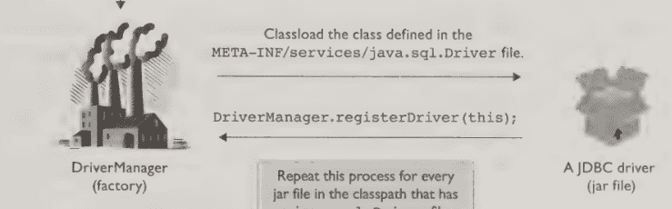

如果有多个注册的驱动程序，`DriverManager` 会轮流调用每个驱动并尝试从它们获取 `Connection` 对象，如图 15-3 所示。

第一个识别 JDBC URL 并成功使用用户名和密码创建连接的驱动将返回 `Connection` 对象的实例。

## 图 15-3

MyDBApp

`DriverManager` 如何获取 `Connection`：

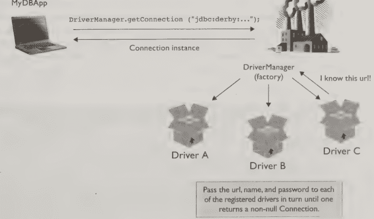

如果没有驱动程序可以识别 URL、用户名和密码组合，或者如果没有已注册的驱动程序，则会抛出 `SQLException`。

总结：

- JVM 加载 `DriverManager` 类，这是 JDBC API 中的一个具体类。
- `DriverManager` 类加载类路径上 JAR/ZIP 文件中 `META-INF/services/java.sql.Driver` 文件发现的任何类实例。
- 驱动程序类调用 `DriverManager.register(this)` 向 `DriverManager` 进行自我注册。
- 当调用 `DriverManager.getConnection(String url)` 方法时，`DriverManager` 会使用 URL 字符串调用这些已注册的驱动程序实例的 `connect()` 方法。
- 第一个成功与 URL 创建连接的驱动程序将向 `DriverManager.getConnection` 调用返回一个 `Connection` 对象实例。

接下来来看 JDBC URL 的语法。

## JDBC URL

JDBC URL 用于确定为给定的 `Connection` 使用哪个驱动程序所在的位置。可以将 JDBC URL（统一资源定位符）想象成一种将可能的驱动程序范围缩小到某个特定连接的方法。例如，假设你需要向某人发送包裹。为了将地址范围缩小到唯一的唯一位置，你必须在包裹上识别国家、州、城市、街道以及可能的房屋或门牌号：

```
USA:California://SanJose:FirstStreet/15
```

此字符串表示你想要的地址位于美国，加利福尼亚州，圣何塞市，First Street 街，15 号。

JDBC URL 遵循相同的理念。为了访问 Bob's Books，我们可能会这样写 URL：

```
jdbc:derby://localhost:1521/BookSellerDB
```

第一部分 `jdbc` 仅标识这是一个 JDBC URL（区别于 HTTP 或其他）。第二部分表示驱动供应商是 `derby` 驱动程序。第三部分表示数据库在此机器的本地 `localhost`（IP 地址 127.0.0.1），端口为 1521，最后部分表示我们对 `BookSellerDB` 数据库感兴趣。

就像街道地址一样，我们需要这个字符串的原因是 JDBC 设计为用于同时与多个数据库工作。每个 JDBC 数据库驱动程序将有不同的 URL，因此我们需要将 JDBC URL 字符串传递给 `DriverManager`，并确保返回的 `Connection` 是针对预期的数据库实例的。

遗憾的是，除了 JDBC URL 必须以 "jdbc" 开头外，关于 JDBC URL 几乎没有标准。供应商可能会修改 URL 以定义特定驱动程序实现的特征。JDBC URL 的格式为：

```
jdbc:<subprotocol>:<sub>
```

通常情况下，`subprotocol` 是供应商名称；例如：

```
jdbc:derby
jdbc:mysql
jdbc:oracle
```

`subname` 字段是内容变得更具供应商特定性的地方。某些供应商使用 `subname` 来标识主机，随后跟上数据库名。例如：

```
jdbc:derby://localhost:1521/MyDB
jdbc:mysql://localhost:3306/MyDB
```

其他供应商可能使用 `subname` 来识别关于驱动程序的额外上下文信息。例如：

```
jdbc:oracle:thin:@localhost:1527/MyDB
```

在任何情况下，最好咨询你特定数据库供应商的 JDBC 驱动程序的文档来确定 URL 的语法。

在 JDBC 中建立连接有两种方法。第一种方法是使用 `java.sql` 包中少数具体类之一的 `DriverManager`。`java.sql.DriverManager` 类从 JDBC 一初就是 JDBC 实现的一部分，是从 Java SE 应用程序获取连接最简单的方法。另一种方法是使用实现 `javax.sql.DataSource` 的类实例，该类是在 JDBC 2.0 中引入的。


由于 `DataSource` 实例通常通过 Java 命名和目录接口 (NDI) 查找获取，因此它更多地用于在支持 JNDI 容器的 Java 程序中——例如 Java EE 应用服务器。为了本章的目的（也因为 `DataSource` 不在考试范围之内），我们将关注使用 `DriverManager` 获取连接，但最终，这两种方法都是为了让你获得一个 `Connection` 对象实例。

总结一下，`DriverManager` 在考试范围内，而 `DataSource` 不在。

## JDBC 驱动程序实现版本

我们讨论过 `DriverManager` 如何扫描类路径查找包含 `META-INF/services/java.sql.Driver` 文件的 JAR 文件，并使用类加载这些驱动程序。这一特性是在 JDBC 4.0 规范中引入的。在此之前，JDBC 驱动程序是由应用程序手动加载的。

如果你使用的是早期版本的 JDBC 驱动程序（例如 JDBC 3.0 驱动程序），你必须显式加载数据库供应商提供的实现 `java.sql.Driver` 接口的类。通常，数据库供应商的文档会告诉驱动程序类是什么。例如，如果你的 Apache JDBC 驱动程序是 3.0 驱动程序，你需要在调用 `getConnection()` 方法之前手动加载 `Driver` 实现类：

```
Class.forName("org.apache.derby.jdbc.ClientDriver"); // 加载类
try {
    Connection conn = DriverManager.getConnection(url, user, pwd);
}
```

注意使用 `forName()` 与两者都兼容。

以下是到目前我们所学的简单总结：

- 在开始使用 JDBC 之前，你必须建立连接。
- 为了建立连接，你必须包含 URL。
- 如果你的驱动程序是 4.0，可以使用 `DriverManager` 方法。


如果你的驱动程序是 3.0，你必须显式加载类。

为了获取结果，你必须执行查询。

为了处理结果，我们遍历结果集。

为了打印列，我们获取列的值。

## 使用 DriverManager 连接数据库 (OCP Objective 9.2)

### 从数据库提交查询和结果 (OCP Objective 9.2)

在本节中，我们将更详细地探索 API。我们将从一个简单的示例开始。最常用的 SQL 查询之一是 `SELECT * FROM <Table name>`。假设数据库已经填充了数据。

```java
import java.lang.System.*; //静态导入 System 类
// 现在我们可以直接使用 'out' 而不是 System.out。

String url = "jdbc:derby://localhost:1521/BookSellerDB";
String user = "bookguy";
String pwd = "$triller";
try {
    Connection conn = DriverManager.getConnection(url, user, pwd); // 获取连接
    Statement stmt = conn.createStatement(); // 创建语句
    String query = "SELECT * FROM Customer"; // 执行查询
    ResultSet rs = stmt.executeQuery(query); // 处理结果
    while (rs.next()) { // 打印列
        out.print(rs.getString("FirstName") + " ");
        out.print(rs.getString("LastName") + " ");
        out.print(rs.getString("Email") + " ");
        out.println(rs.getString("Phone"));
    }
} catch (SQLException se) { } // 捕获 SQLException
```

# 从数据库提交查询并读取结果 (OCP 目标 9.3) 863

我们尝试查询一个不存在的表。或者数据库不再可访问：网络中断或数据库离线。我们将在本章晚些部分详细介绍 `SQLException`。

上一段代码的输出可能如下：

```
5000 John Smith john.smith@comcast.net 555-340-1230
5001 Mary Johnson mary.johnson@comcast.net 555-123-4567
5002 Bob Collins bob.collins@yahoo.com 555-012-3456
5003 Rebecca Mayer rebecca@gmail.com 555-205-8212
5006 Anthony Clark anthony.clark@gmail.com 555-251-1901
5007 Judy judy.susa@verizon.net 555-751-1207
5008 Christopher Patriniqu patriquin@yahoo.com 555-316-1803
5009 Deborah Smith debsmith@comcast.net 555-256-3421
5010 Jennifer McGinn jmorginn@comcast.net 555-250-0918
```

将在接下来的两个章节中查看 `Statement` 和 `ResultSet` 接口及其方法。

# Statements

一旦我们成功连接到数据库，就可以开始乐趣了。从一个 `Connection` 对象，我们可以创建一个 `Statement` 对象的实例（更准确地说，使用从 `DriverManager` 到的 `Connection` 实例，我们可以获取一个实现了 `Statement` 接口的对象实例）。例如：

```java
String url = "jdbc:derby://localhost:1521/BooksSellerDB";
String user = "bookguy";
String pwd = "$31llek";
try {
  Connection conn = DriverManager.getConnection(url, user, pwd);
  Statement stmt = conn.createStatement();
  // 使用 SQL 语句进行操作
} catch (SQLException exception) { }
```

`Statement` 的主要目的是使用方法执行 SQL 查询并返回某种类型的结果。`Statement` 方法有几种形式：返回结果集（result set）的方法，以及返回整数状态的方法。最常用的语句方法执行返回某些数据的 SQL 查询，例如我们之前用于获取所有 `Customer` 表行的所使用的 `SELECT` 调用。

# 864 第 15 章：JDBC

# 构建和使用 Statements

首先，让我们看看基础的 `Statement`，它用于执行静态 SQL 查询并返回结果。你可能记得，我们从 `Connection` 获取一个 `Statement`，然后使用该语句对象执行 SQL 语句，例如对数据库进行查询。例如：

```java
Connection conn = DriverManager.getConnection(url, user, pwd);
Statement stmt = conn.createStatement();
ResultSet rs = stmt.executeQuery("SELECT * FROM Customer");
```

由于并不是所有的 SQL 语句都会返回结果，因此 `Statement` 提供了几种不同的方法来执行 SQL 命令。某些 SQL 命令不返回结果集，而是返回一个整数状态。某些 SQL `INSERT`、`UPDATE` 和 `DELETE` 命令，或者任何 SQL 数据定义语言 (DDL) 语句（如 `CREATE TABLE`），会返回受查询影响的行数或 0。

让我们详细查看每个 `execute` 方法。

`public ResultSet executeQuery(String sql) throws SQLException` - 这是最常用的语句方法。当我们预期查询将返回结果集时使用它。例如：

```java
ResultSet rs = stmt.executeQuery("SELECT * FROM Customer");
```

`public int executeUpdate(String sql) throws SQLException` - 该方法用于查询不返回结果集而是返回一个整数状态的情况。某些 SQL `INSERT`、`UPDATE` 和 `DELETE` 命令，以及任何 DDL 语句（如 `CREATE TABLE`），会返回受查询影响的行数或 0。例如：

`public boolean execute(String sql) throws SQLException` - 该方法用于我们不确定查询是返回结果集还是整数状态的情况。如果返回结果集则返回 `true`，如果是整数状态则返回 `false`。

# 865 从数据库提交查询并读取结果

当我们想要获取结果集时，使用 `executeQuery` 方法。例如：

```java
ResultSet rs = stmt.executeQuery("SELECT * FROM Customer");
while (rs.next()) {
  String name = rs.getString("name");
}
```

当我们想要获取整数状态时，使用 `executeUpdate` 方法。它返回受查询影响的行数。例如：

```java
int rowsAffected = stmt.executeUpdate("UPDATE Customer SET city='New York' WHERE id=10");
System.out.println("Rows affected: " + rowsAffected);
```

对于其他如 DDL 语句的命令，我们使用 `execute` 方法。例如：

```java
boolean result = stmt.execute("CREATE TABLE Orders (id INT PRIMARY KEY, amount DECIMAL(8,2))");
```

# 866 使用 ResultSet

一旦我们获取了 `ResultSet` 对象，就可以遍历它来检索数据。最常用的方法是使用 `next()` 方法，它会将光标移动到下一行，如果存在行则返回 `true`。

```java
ResultSet rs = stmt.executeQuery("SELECT * FROM Customer");
while (rs.next()) {
  int id = rs.getInt("id");
  String name = rs.getString("name");
  String email = rs.getString("email");
  System.out.println(id + ": " + name + " " + email);
}
```

`ResultSet` 对象提供了多种从当前行检索数据的方法。这些方法是带类型的，因此你可以使用 `getInt()`、`getString()`、`getDouble()` 等。你也可以通过列名或列索引检索数据。

```java
int id = rs.getInt(1);
String name = rs.getString("name");
```

使用列名通常更好，因为它使代码更具可读性并且对 SQL 查询中列顺序的变化不敏感。

# 867 处理异常

在处理 JDBC 时，必须处理 `SQLException`。这通常通过使用 `try-catch` 块来实现。例如：

```java
try {
  // JDBC 代码
} catch (SQLException e) {
  System.err.println("访问数据库时发生错误：" + e.getMessage());
  e.printStackTrace();
}
```

在现代 Java 中，使用 `try-with-resources` 更好，它可以确保即使发生异常，`Connection`、`Statement` 和 `ResultSet` 也能被正确关闭。

```java
try (Connection conn = DriverManager.getConnection(url, user, pwd);
     Statement stmt = conn.createStatement();
     ResultSet rs = stmt.executeQuery("SELECT * FROM Customer")) {
  while (rs.next()) {
    // 处理结果
  }
} catch (SQLException e) {
  // 处理异常
}
```

## 从数据库中提交查询并读取结果 OCP 目标 9.3 867

`public ResultSet getResultSet() throws SQLException` - 如果 `execute()` 方法返回的布尔值为 `true`，则存在结果集。要获取结果集，如前所示，在 `Statement` 对象上调用 `getResultSet()` 方法。然后你就可以处理 `ResultSet` 对象（我们将在下一节中介绍）。此方法基本上是不会出错的——如果实际上没有结果，该方法将返回 `null`。

```java
ResultSet rs = stmt.getResultSet();
```

`public int getUpdateCount() throws SQLException` - 如果 `execute()` 方法返回的布尔值为 `false`，则存在行数，此方法将返回受影响的行数。返回 `-1` 表示没有结果。

表 15-6 总结了我们刚刚介绍的 `Statement` 方法。

| 方法（每个都会抛出 SQLException） | 说明 |
| --- | --- |
| `ResultSet execute(String sql)` | 执行 SQL 查询并返回 `ResultSet` 对象，即 SELECT 命令。 |
| `int executeUpdate(String sql)` | 执行仅修改某些行数的 SQL 查询，即 INSERT、DELETE 或 UPDATE 命令。 |
| `boolean execute(String sql)` | 执行将返回结果集或修改某些行数（或两者都不执行）的 SQL 查询。如果有结果集，则方法返回 `true`；如果有受影响行的计数，则返回 `false`。 |
| `ResultSet getResultSet()` | 如果 `execute()` 方法的返回值为 `true`，你可以使用此方法从查询检索结果集。 |
| `int getUpdateCount()` | 如果 `execute()` 方法的返回值为 `false`，你可以使用此方法获取 SQL 命令影响的行数。 |

## 868 第 15 章：JDBC

## ResultSets（结果集）

当查询返回结果集时，会返回一个实现 `ResultSet` 接口的类实例。`ResultSet` 对象表示查询结果——即每行中按列划分的所有数据。再次提醒一下，`ResultSet` 中数据的存储方式完全取决于 JDBC 驱动程序供应商。驱动程序可能会一次性将整个结果集缓存在内存中，也可能使用内部缓冲区每次只获取几行。从你作为数据用户的角度来看，这其实并不重要。通过使用 `ResultSet` 接口中定义的方法，你可以读取和操纵数据，这才是唯一重要的。

一个需要记住的重要点是，`ResultSet` 是查询执行时该刻数据库数据的副本。如果你是数据库的唯一用户，你需要始终假设 `ResultSet` 所在的底层数据库表或表已被其他用户或应用程序更改。

由于 `ResultSet` 是 JDBC API 中一个非常全面的部分，我们将分章节来处理它。表 15-7 总结了每个章节，以便你稍后参考。

## 表 15-7 ResultSet 章节

| 章节标题 | 说明 |
| --- | --- |
| "在 ResultSet 中向后移动" | 如何访问查询结果的“行”。 |
| "从 ResultSet 中读取数据" | 如何使用 `ResultSet` 方法访问结果集中每条“行”的各个列。 |
| "获取有关 ResultSet 的信息" | 如何使用 `ResultSetMetaData` 对象检索有关结果集的信息：结果中返回的列数、每列的名称以及每列的 Java 类型。 |
| "打印报告" | 如何使用 `ResultSetMetaData` 方法向控制台打印格式化良好的结果集。 |
| "在 ResultSets 中移动" | 如何更改 `Statement` 对象上的光标类型和并发性，以创建一个允许光标定位并允许修改数据的 `ResultSet`。 |
| "更新 ResultSets" | 如何使用 `Statement` 对象上的并发设置来创建一个允许你更新返回结果并在稍后与数据库同步的 `ResultSet`。 |
| "向 ResultSet 插入新行" | 如何通过删除和插入行来进一步操纵 `ResultSet`。 |
| "使用 DatabaseMetaData 获取数据库信息" | 如何使用 `DatabaseMetaData` 对象检索有关数据库的信息。 |

## 从数据库中提交查询并读取结果 OCP 目标 9.3) 869

## 在 ResultSet 中向后移动

思考 `ResultSet` 对象的最佳方式是视觉化的。假设在我们的 `BookSellerDB` 数据库中，有几个姓氏以字母 'C' 开头的客户。我们可以创建一个查询来返回如下所示的这些行：

```java
String query = "SELECT FirstName
```

当我们使用 `executeQuery()` 方法执行此查询时，返回的 `ResultSet` 将包含姓氏以大写字母 'C' 开头的 `FirstName`、`LastName` 和 `Email`：

```java
ResultSet rs = stmt.executeQuery(query);
```

返回的 `ResultSet` 对象包含查询数据，如图 15-4 所示。

注意图 15-4，`ResultSet` 对象维护了一个光标，即指向结果当前行的指针。当 `ResultSet` 对象首次从查询返回时，光标尚未指向结果的一行——光标指向第一行上方。为了获取表的结果，你必须始终在 `ResultSet` 对象上调用 `next()` 方法以将光标向前移动到第一行数据。默认情况下，`ResultSet` 对象是只读的（行中的数据无法更新），且你只能向前移动光标。我们稍后会查看如何处理这种行为。

## 图 15-4 execute 后的 ResultSet

```java
String query = "SELECT FirstName, LastName,
EMail FROM Customer
WHERE LastName LIKE 'C%'";
```

```java
ResultSet rs=
stmt.executeQuery(query);
rs.next()=true;
rs.next()=true;
rs.next()=true;
rs.next()=false;
```

| | | |
| --- | --- | --- |
| Bob | Collins | bob.collins@yahoo.com |
| Rebecca | Cabeca | rebecca.cabeca@gmail.com |
| Anthony | Clark | anthony.clark@gmail.com |


## 870 第 15 章：JDBC

被更新），并且你只能向前移动光标。

所以，对于 `ResultSet` 你需要知道的第一个方法是 `next()` 方法。

`public boolean next()` 方法将光标向前移动一行，如果光标现在指向数据行，则返回 `true`。如果光标指向最后一行之后（或 `ResultSet` 不包含任何行），则返回值为 `false`。

因此，为了读取图 15-4 所示表中的数据行，需要调用 `next()` 方法，读取数据，然后再次调用两次 `next()`。当第四次调用 `next()` 方法时，该方法将返回 `false`。从头到尾读取所有行的简单方法是使用 `while` 循环：

```java
String query = "SELECT FirstName, LastName,
Email FROM Customer
WHERE LastName LIKE '%%';nResultSet rs = stmt.executeQuery(query);
while (rs.next()) {
    // 将光标从当前位置
    // 移动到下一行数据——如果下一行
    // 有数据则返回 true，如果光标
    // 过了最后一行则返回 false
}
```


由于光标是 JDBC 中的一个功能概念，考试将测试 `ResultSet` 中光标的状态。只要你记住在处理 `ResultSet` 中的即使是一行数据之前必须调用 `next()` 方法，你就没问题。也许你可以使用一个记忆口诀，像这个：“获取结果时，不要纠结，始终调用 next！”

## 从 ResultSet 中读取数据

在 `ResultSet` 中向前移动光标只是从查询结果读取数据的开始。让我们看看获取结果集中每行数据的两种方法。

当 `ResultSet` 返回且你已经尽力调用了 `next()` 将光标移动到第一行实际数据时，你现在就可以读取当前行中每列的数据。如图 15-4 所示，数据库查询的结果集就像表格或电子表格。每行包含（通常）一个或多个列，

## 向数据库提交查询并读取结果 (OCP 目标 9.3) 871

并且每列中的数据都是 SQL 数据类型之一。为了将每列中的数据引入你的 Java 应用程序，你必须使用 `ResultSet` 的 `get` 方法将每个 SQL 列值检索到相应的 Java 类型中。例如，SQL INTEGER 可以读取为 Java 原始类型，SQL VARCHAR 可以读取为 Java `String`，SQL DATE 可以读取为一个 `java.sql.Date` 对象，前提是数据库驱动程序支持规范提供者所定义的所有类型。对于考试，我们建议使用表 15-7 所示的最常用的 SQL 数据类型和 `ResultSet` 方法。

SQL 已经存在很长时间了。第一个正式的、经美国国家标准协会（ANSI）批准的版本在 1986 年被采用（SQL-86）。下一次重大修订是 1992 年的 SQL-92，它被认为是每个数据库的“基础”。SQL-92 定义了许多新数据类型，包括 DATE、TIME、BIT 和 VARCHAR 字符串。SQL-92 有多个级别；每个级别都比前一个级别增加了一些功能。JDBC 驱动识别 SQL-92 级别：Entry（入门）、Intermediate（中间）和 Full（完整）。

SQL-1999（也称为 SQL-3）增加了大对象（LARGE OBJECT）类型，包括二进制大对象（BLOB）和字符大对象（CLOB）。SQL-1999 引入了 BOOLEAN 类型以及复合类型 ARRAY 和 ROW，以便将集合直接存储在数据库中。此外，SQL-1999 增加了许多功能，包括触发器、正则表达式和过程流控制。

SQL-2003 将 XML 引入数据库，更重要的是，添加了具有自动生成值的列，包括支持标识（identity）、主键和键列的列。信不信，还提过其他标准，包括 SQL-2006、SQL-2008 和 SQL-2011。

这之所以很重要，是因为 JDBC 规范试图与当时最广泛采用的规范的特性保持一致。因此，JDBC 3.0 支持 SQL-92 和部分 SQL-1999 规范，而 JDBC 4.0 支持 SQL-2003 规范。在本章中，我们将尽可能坚持最广泛使用的 SQL-92 特性和 JDBC 也支持的最常用的 SQL-1999 特性。

读取列数据的一种方法是使用列名本身作为字符串值。例如，使用 Bob 表中的列名


## 872 第 15 章：JDBC

在这些 `ResultSet` 方法中（表 15-4），来自 Book 表的列的 `String` 名称被传递给该方法以读取列数据类型：

```java
String query = "SELECT Title, PubDate, UnitPrice from Book";
ResultSet rs = stmt.executeQuery(query);
while (rs.next()) {
    String title = rs.getString("Title"); // 读取名为 "Title" 的
    // 列中的数据
    // 到一个 String
    Date PubDate = rs.getDate("PubDate"); // 读取 "PubDate"
    // 对象中的数据
    // 到一个 String
    float price = rs.getFloat("Price"); // 读取 "Price"
    // 列中的数据
    // 到一个 float
}
```

注意，尽管列名是按照它们在 SQL 查询中请求顺序从 `ResultSet` 行检索的，但它们可以按任何顺序进行处理。

`ResultSet` 还提供了一个重载方法，为每个 SQL 类型接收一个整数索引值。该值是列在结果集中的整数位置，从 1 到返回的列数。因此，我们可以像之前那样编写相同的语句：

```java
String title = rs.getString(1); // Title 是第一列
Date PubDate = rs.getDate(2); // PubDate 是第二列
float price = rs.getFloat(3); // Price 是第三列
```

使用前面所示的位置方法，`ResultSet` 中列的顺序就变得重要。在我们的查询中，Title 位于位置 1，PubDate 位于位置 2，Price 位于位置 3。

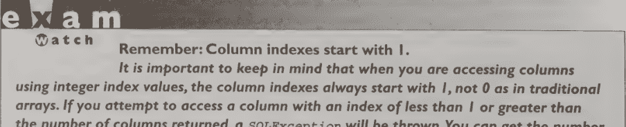

记住：列索引从 1 开始。

重要的是，你正在使用整数索引值访问列，列索引始终从 1 开始，而不是像传统数组那样从 0 开始。如果你尝试访问小于 1 或大于返回列数的索引列，将抛出 `SQLException`。你可以通过结果集的元数据对象获取 `ResultSet` 中返回的列对象。请查看 `ResultSetMetaData` 部分以了解更多信息。

## 向数据库提交查询并读取结果 (OCP 目标 9.3) 873

数据库存储的类型（SQL 类型）与 JDBC 返回的内容往往是两种不同的东西。重要的是要理解 JDBC 规范提供了一套标准映射——即数据库提供的类型与程序员应该与该类型配合使用的 Java 类型之间的最佳匹配。与其重复规范中的内容，我们更鼓励你查阅 JDBC 的附录 B（JSR-222）。


常用的方法列如下：

- `getBoolean(String label)`：该方法将列的值检索为 Java boolean。布尔值在 SQL 中很少返回。

- `getDouble(String label)`：该方法将列的值检索为 Java double。建议用于 SQL FLOAT 类型。

- `getInt(String label)`：该方法将列的值检索为 Java int。整数是是键的好选择。

- `getFloat(String label)`：该方法将列的值检索为 Java float。建议用于 SQL REAL 类型。

- `getLong(String label)`：该方法将列的值检索为 Java long。建议用于 BIGINT 类型。

## 874 第 15 章：JDBC

- `getDate(String label)`：该方法将列的值检索为 Java Date 对象。注意 `java.sql.Date` 扩展了 `java.util.Date`。两者之间有趣的区别是 `java.sql.Date` 的 `toString()` 方法返回格式为 "yyyy-mm-dd" 的日期字符串。该方法适用于 SQL DATE 类型。

- `getString(String label)`：该方法将列的值检索为 Java String 对象。它适用于读取 CHAR、VARCHAR 和 LONGVARCHAR 类型。

- `getTime(String label)`：该方法将列的值检索为 Java Time 对象。就像 `java.sql.Date` 一样，该类扩展了 `java.util.Date`，其 `toString()` 方法返回格式为 "hh:mm:ss" 的时间字符串。TIME 是该方法旨在读取类型。

- `getTimestamp(String label)`：该方法将列的值检索为 Java Timestamp 对象。其 `toString()` 方法将结果格式化为 yyyy-mm-dd hh:mm:ss.ffffff，其中 fffffff 是纳秒。该方法适用于读取 TIMESTAMP 类型。

- `getObject(String label)`：该方法将列的值检索为 Java Object。它可以作为读取列中数据的通用方法。该方法通过读取返回作为该类型相应的 Java 包装类的值并将其作为 Java Object 返回来工作。例如，使用此方法读取整数（SQL INTEGER 类型）会返回一个 `java.lang.Integer` 类型的对象。我们可以使用 `instanceof` 检查是否为 Integer 并获取 int 值：

```java
Object o = rs.getObject("AuthorID");
if (o instanceof java.lang.Integer) {
    int id = ((Integer)o).intValue();
}
```

# 从数据库提交查询并读取结果 OCP 目标 9.3 875

表 15-8 列出了从 ResultSet 中检索特定数据的最常用方法。要查看完整完整的 ResultSet get 方法集，请参阅 java.sql.ResultSet 的 Java 文档。

# 考试

注意：考试不会测试你对 SQL 查询中所有 ResultSet get 和 set 方法的记忆。对于考试，请记住基础的 Java 类型：String 和 int。每个 ResultSet 器方法都根据其最接近的 Java 类型命名。例如，为了将一个存储整数的数据库列读到 java int 类型中，你可以通过列名或你想要读取的列索引来调用 getInt() 方法。

| 表格 15-8 | SQL 类型 | Java 类型 | ResultSet get 方法 |
|---|---|---|---|
| SQL 类型和 JDBC 类型 | BOOLEAN | boolean | `getBoolean(String columnName)`<br>`getBoolean(int columnName)` |
| | INTEGER | int | `getInt(String columnName)`<br>`getInt(int columnName)` |
| | DOUBLE, FLOAT | double | `getDouble(String columnName)`<br>`getDouble(int columnName)` |
| | REAL | float | `getFloat(String columnName)`<br>`getFloat(int columnName)` |
| | BIGINT | long | `getLong(String columnName)`<br>`getLong(int columnName)` |
| | CHAR, VARCHAR, LONGVARCHAR | String | `getString(String columnName)`<br>`getString(int columnName)` |
| | DATE | java.sql.Date | `getDate(String columnName)`<br>`getDate(int columnName)` |
| | TIME | java.sql.Time | `getTime(String columnName)`<br>`getTime(int columnName)` |
| | TIMESTAMP | java.sql.Timestamp | `getTimestamp(String columnName)`<br>`getTimestamp(int columnName)` |
| 以上任何类型 | java.lang.Object | `getObject(String columnName)`<br>`getObject(int columnName)` |

# 获取 ResultSet 的信息

当你使用字符串编写查询时（如前面的示例所示），你知道返回的列的名称和类型。但是，当你想要允许用户动态构建查询时会发生什么呢？你可能并不知道返回了多少列。幸运的是，ResultSetMetaData 类的设计就是提供这些信息。使用 ResultSetMetaData，你可以获取查询结果的重要信息，包括列数、表名、列名，以及当列作为 Object 返回时的 Java 类。这是一个简单的示例，我们将详细查看这些方法：

```java
String query = "SELECT AuthorID FROM Author";
ResultSet rs = stmt.executeQuery(query);
ResultSetMetaData rsmd = rs.getMetaData();
rs.next();
int colCount = rsmd.getColumnCount(); // ResultSet 中有多少列
out.println("Column Count: " + colCount);
for (int i = 1; i <= colCount; i++) {
    out.println("Table Name: " + rsmd.getTableName(i));
    out.println("Column Name: " + rsmd.getColumnName(i));
    out.println("Column Size: " + rsmd.getColumnSize(i));
}
```

使用这段代码运行 Bob 的 Books 数据库会产生以下输出：

```
Column Count: 1
Table Name: AUTHOR
Column Name: AUTHORID
Column Size: 1
```

ResultSetMetaData 通常用于生成报告，这里是最常用的方法。更多信息和方法请查看 Java 文档。

`public int getColumnCount() throws SQLException`

该方法可能是最常用的 ResultSetMetaData 方法。它返回查询返回的列的整数计数。通过此方法，你可以遍历列以获取有关列的信息。

```java
try {
  conn = DriverManager.getConnection(...);
  stmt = conn.createStatement();
  String query = "SELECT * FROM Author";
  ResultSet rs = stmt.executeQuery(query);
  ResultSetMetaData rsmd = rs.getMetaData(); // 获取此 ResultSet 的元数据
  int columnIndex = rsmd.getColumnCount(); // 获取 ResultSet 中的列数
} catch (SQLException e) {
```

Author 表的 columnIndex 值为 3。可以使用此值通过后续的方法遍历列。

`public String getColumnName(int column) throws SQLException`

该方法返回该列的字符串名称。使用 columnCount，我们可以创建报告格式的数据库数据输出。例如：

```java
String colData;
ResultSet rs = stmt.executeQuery(query);
ResultSetMetaData rsmd = rs.getMetaData();
int cols = rsmd.getColumnCount();
for (int i = 1; i <= cols; i++) {
  out.println(rs.getColumnName(i)+" "); // 打印每个列名
}
out.println(); // 换行
while (rs.next()) {
  for (int i = 1; i <= cols; i++) {
    if (rs.getObject(i) != null) { // 获取列对象的字符串值
      colData = rs.getObject(i).toString();
    } else {
      colData = "NULL"; // 如果列为 null
    }
    out.println(colData); // 打印列数据
  }
}
```


这个示例是非常原始的，我们可能需要更好的格式化，但它会产生输出：

| AUTHOR | FIRSTNAME | LASTNAME |
|---|---|---|
| 1000 | Rick | Riordan |
| 1001 | Nancy | Farmer |
| 1002 | Ally | Condie |
| 1003 | Cressida | Cowell |
| 1004 | Lauren | St. John |
| 1005 | Eoin | Colfer |

`public String getTableName(int column) throws SQLException`

该方法返回列所属表的字符串名称。当查询是两个或多个表的连接时，此方法非常有用。例如，假设我们想根据作者姓获取书籍列表：

```java
String query = "SELECT Author.LastName, Book.Title FROM Author, Book WHERE Author.AuthorID = Book.AID";
```

`public int getColumnSize(int column) throws SQLException`

该方法返回列大小的整数。此信息对于确定列可以包含的最大字符数（如果是 VARCHAR）以及报告中列与列之间的间距很有用。

## 报告

为了比之前 `getColumnName` 方法中的报告更漂亮，我们可以使用显示大小（display size）来用空格填充列名和数据。我们想要的是一个在查询表时，列与列以及标题之间有空格的表格：

```java
ResultSet rs = stmt.executeQuery(query);
ResultSetMetaData rsmd = rs.getMetaData();
int cols = rsmd.getColumnCount();
String col,colData;
for (int i = 1; i <= cols; i++) { // 左对齐列名
  col = leftJustify(rsmd.getColumnName(i), rsmd.getColumnSize(i)); // 用大小空格填充
  out.print(col);
}
out.println(); // 打印换行符
while (rs.next()) {
  for (int i = 1; i <= cols; i++) {
    if (rs.getObject(i) != null) { // 获取字符串数据
      colData = rs.getObject(i).toString();
    } else {
      colData = "NULL"; // 如果列为 null
    }
    col = leftJustify(colData, rsmd.getColumnSize(i)); // 使用 "NULL"
    out.print(col);
  }
  out.println();
}
```

注意，如果传入的字符串和整数字段长度 (n) 相同，增加一个空格以使其美观：

```java
public static String leftJustify(String s, int n) { // 如果字符串长度小于或等于列长度 n
    if (s.length() <= n) n++;
    return String.format("%1$-" + n + "s", s); // 在字符串右侧填充 n 个空格
}
```

## 880 第 15 章：JDBC

其次，数据库可以存储 NULL 值。如果列的值为 NULL，则 `rs.getObject()` 方法返回的对象是 Java 的 `null`。我们必须对其进行空检查，以避免在执行 `toString()` 方法时出现空指针异常。

注意，在读取 `ResultSetMetaData` 之前不需要使用 `next()` 方法——我们可以在获取有效结果集后的任何时间进行操作。运行这段代码并传入查询 `'SELECT * FROM Author'`，将返回一个整齐打印的结果集：

| AUTHORID | FIRSTNAME | LASTNAME |
| --- | --- | --- |
| 1000 | Rick | Riordan |
| 1001 | Nancy | Farmer |
| 1002 | Ally | Condie |
| 1003 | Cressida | Cowell |
| 1004 | Lauren | St. John |
| 1005 | Eoin | Colfer |

## 在 ResultSet 中移动

到目前为止，对于我们过的过的结果集，我们只是通过调用 `next()` 让光标向前移动。`Statement` 的默认特征是光标只能向前移动，且结果集不支持更改。`ResultSet` 接口实际上将这些特征定义为静态变量：`TYPE_FORWARD_ONLY` 和 `CONCUR_READ_ONLY`。然而，JDBC 定义了额外的静态 `int` 类型（如下所示），允许开发者在结果集中将光标向前、向后移动或移动到特定位置。此外，结果可以在打开时进行修改，并将更改写入数据库。请注意，支持光标移动和可更新的结果集并不是驱动程序强制的要求，但大多数驱动程序都提供了这种能力。为了创建一个使用位置光标和/或支持更新的结果集，你必须创建一个具有适当滚动类型和并发设置的 `Statement`，然后使用该语句创建 `ResultSet`。

将光标移动到特定位置的能力是确定结果返回了多少行数据的关键——我们稍后会讨论这一点。修改已打开的结果集的能力可能看起来很奇怪，特别是如果你是一个资深的数据库开发者。毕竟，不是已经有 SQL `UPDATE` 命令可以使用吗？

考虑这样一种情况：你想使用结果集行数据进行一系列计算，然后根据某些标准对每行数据写入更改，最后将数据写回数据库。例如，想象一个包含客户数据的数据库表，包括他们成为客户的日期、购买历史以及过去两个月的订单总数。在将这些数据读入结果集后，你可以遍历每个客户记录并根据业务规则对其进行修改：如果他们成为客户超过一年且每年至少购买一次，则提高他们的最低折扣金额；如果他们每月的购买金额超过 100 美元，则设置他们的偏好信贷状态。使用可更新的结果集，你可以修改多行客户数据，并将这些行提交到数据库，而无需编写复杂的 SQL 查询或一组 SQL 查询语句——你只需在打开的结果集上提交更新即可。

让我们更详细地查看如何修改结果集。共有三种 `ResultSet` 光标类型：

- **TYPE_FORWARD_ONLY**：`ResultSet` 的默认值——光标仅在结果集中向移动移动。
- **TYPE_SCROLL_INSENSITIVE**：光标位置可以在结果集中向前或向后移动，或定位到特定的光标位置。对底层数据（数据库本身）所做的任何更改都不会反映在结果集中。换句话说，结果集不会与数据库保持“状态”。这种类型通常由数据库支持。
- **TYPE_SCROLL_SENSITIVE**：光标可以在结果集中向前或向后移动，或定位到特定的光标位置。对底层数据所做的任何更改都会反映在打开的结果集中。你可以想象的，这很难实现，因此在数据库或 JDBC 驱动程序中并不经常实现。

JDBC 为结果集的数据并发提供了两个选项：

- **CONCUR_READ_ONLY**：这是结果集并发的默认值。任何打开的结果集都是只读的，不能修改或更改。
- **CONCUR_UPDATABLE**：结果集在打开期间可以通过 `ResultSet` 进行修改。

由于数据库和 JDBC 驱动程序不需要支持光标移动和可更新的结果集，JDBC提供了使用 `DatabaseMetaData` 来确定这些方法。例如：

## 从数据库提交查询并读取结果 OCP 目标 9.3 881

```java
Connection conn = DriverManager.getConnection();
DatabaseMetaData dbmd = conn.getMetaData();
if (dbmd.supportsResultSetType(ResultSet.TYPE_FORWARD_ONLY)) {
    out.print("TYPE_FORWARD_ONLY");
    if (dbmd.supportsResultSetConcurrency(ResultSet.CONCUR_READ_ONLY)) {
        out.println("CONCUR_READ_ONLY");
    }
}
if (dbmd.supportsResultSetType(ResultSet.TYPE_SCROLL_INSENSITIVE)) {
    out.print("TYPE_SCROLL_INSENSITIVE");
    if (dbmd.supportsResultSetConcurrency(ResultSet.CONCUR_UPDATABLE)) {
        out.println("CONCUR_UPDATABLE");
    }
}
if (dbmd.supportsResultSetType(ResultSet.TYPE_SCROLL_SENSITIVE)) {
    out.print("TYPE_SCROLL_SENSITIVE");
    if (dbmd.supportsResultSetConcurrency(ResultSet.CONCUR_UPDATABLE)) {
        out.println("CONCUR_UPDATABLE");
    }
}
```

## 表 15-9 ResultSet 游标定位方法（续）

| 方法 | 对游标的影响及返回值 |
|---|---|
| `boolean last()` | 将游标移动到 `ResultSet` 的最后一行。如果 `ResultSet` 中没有行（空结果集），则返回 `false`。 |
| `void beforeFirst()` | 将游标移动到 `ResultSet` 的第一行之前。 |
| `void afterLast()` | 将游标移动到 `ResultSet` 的最后一行之后。 |

让我们更详细地查看这些方法的的每一个。

**`public boolean absolute(int row) throws SQLException`** 此方法将游标定位到一个绝对行号。与之相反的方法是相对的。将 `0` 作为 `row` 参数传递给该方法将将游标定位到第一行。传递一个负值（如 -1）则将游标定位到最后一行减去一个的位置——换句话说。如果你尝试将游标定位到最后一行之外（例如，在有 19 行的结果集中尝试定位到第 22 行），游标将定位在最后一行之后；我们将在下文中讨论其影响。图 15-5 展示了调用 `absolute()` 如何对游标进行定位。

如果游标成功定位在 `ResultSet` 内部，`absolute()` 方法返回 `true`；如果游标在最后一行之前或之后结束，则返回 `false`。例如，假设你想处理每隔一行：

```
ResultSet rs = stmt.executeQuery(query);
for (int i = 1; i += 2) { // absolute 方法移动到指定的行
    if (rs.absolute(i)) { // 传递整数值并返回
        // 如果移动成功，则返回 true
        // ... 处理奇数行
    } else {
        break;
    }
}
```

**`public int getRow() throws SQLException`** 此方法将当前行号作为正整数返回（第一行为 1，第二行为 2，依此类推），如果当前没有行，则返回 `0`——此时游标要么在第一行之前或在最后一行之后。这是这组游标方法中唯一一个可以可选支持 `TYPE_FORWARD_ONLY` 结果的方法。

**`public boolean relative(int rows) throws SQLException`** `relative()` 方法是 `absolute` 的表亲。听懂了吗，表亲？好了，反正，`relative()` 将根据传入方法的行数，将游标定位在当前位置之前或之后。因此，如果游标位于有 30 行的 `ResultSet` 的第 15 行，调用 `relative(2)` 将将游标定位到第 17 行，然后调用 `relative(-5)` 将将游标定位到第 12 行。图 15-6 显示了根据调用 `absolute()` 和 `relative()` 如何移动游标。

## 提交查询并从数据库读取结果 (OCP 目标 9.3) 885

### 图 15-5 字符串查询 query = "SELECT * FROM Author";

绝对游标定位

| | 游标 (cursor) | ResultSet | | |
|---|---|---|---|
| | 1000 | Rick | Riordan |
| | 1001 | Nancy | Farmer |
| | 1002 | Ally | Condie |
| | 1003 | Cressida | Cowell |
| | 1004 | Lauren | St. John |
| | 1005 | Eoin | Colfer |
| | 1006 | Esther | Freis |
| | 1007 | Chris | D'Lacey |
| | 1008 | Christopher | Paolini |
| | 1009 | Kathryn | Lasky |
| | 1010 | Nancy | Star |

`rs.absolute(2);`

`rs.absolute(9);`

`rs.absolute(-1);`

与绝对定位一样，尝试将游标定位到最后一行之外或第一行之前，只会导致游标分别定位在最后一行之后或第一行之前，并且方法返回 `false`。此外，调用参数为 `0` 的 `relative` 方法与你预期的完全一致——游标保持原处。为什么要使用 `relative`？假设你正在使用 HTML 表格在网页上显示一个相当长的数据库表。你可能希望允许用户相对于当前选择的向前或向后翻页；类似于下面的代码：

```
public boolean getNextPageData(ResultSet rs, int pageSize) throws SQLException {
    return rs.relative(pageSize);
}
```

**`public boolean previous() throws SQLException`** `previous()` 方法的工作方式与 `next()` 方法完全相同，它只是反向回退通过

## 886 第 15 章：JDBC

### 图 15-6

字符串查询 query = "SELECT * FROM Author";

相对游标定位（圆出的数字表示调用顺序。）

| 游标 (cursor) | ResultSet | | |
|---|---|---|---|
| 1 | 1000 | Rick | Riordan |
| 2 | 1001 | Nancy | Farmer |
| 3 | 1002 | Ally | Condie |
| 4 | 1003 | Cressida | Cowell |
| 5 | 1004 | Lauren | St. John |
| 6 | 1005 | Eoin | Colfer |
| 7 | 1006 | Esther | Freiner |
| 8 | 1007 | Christopher | D'Lacey |
| 9 | 1008 | Christopher | Paolini |
| 10 | 1009 | Kathryn | Lasky |
| 11 | 1010 | Nancy | Star |

```
rs.absolute(2);
```

```
rs.relative(-3);
```

```
rs.relative(5);
```

与绝对定位一样，尝试将游标定位到最后一行之外或第一行之前，只会导致游标分别定位在最后一行之后或第一行之前，并且方法返回 `false`。此外，调用参数为 `0` 的 `relative` 方法与你预期的完全一致——游标保持原处。为什么要使用 `relative`？假设你正在使用 HTML 表格在网页上显示一个相当长的数据库表。你可能希望允许用户相对于当前选择的行向前或向后翻页；类似于下面的代码：

```
public boolean getNextPageData(ResultSet rs, int pageSize) throws SQLException {
    return rs.relative(pageSize);
}
```

**`public boolean previous() throws SQLException`** `previous()` 方法的工作方式与 `next()` 方法完全相同，它只是反向回退通过

## 886 第 15 章：JDBC

### 图 15-6

字符串查询 query = "SELECT * FROM Author";

相对游标定位（圆出的数字表示调用顺序。）

| 游标 (cursor) | ResultSet | | |
|---|---|---|---|
| 1 | 1000 | Rick | Riordan |
| 2 | 1001 | Nancy | Farmer |
| 3 | 1002 | Ally | Condie |
| 4 | 1003 | Cressida | Cowell |
| 5 | 1004 | Lauren | St. John |
| 6 | 1005 | Eoin | Colfer |
| 7 | 1006 | Esther | Freiner |
| 8 | 1007 | Christopher | D'Lacey |
| 9 | 1008 | Christopher | Paolini |
| 10 | 1009 | Kathryn | Lasky |
| 11 | 1010 | Nancy | Star |


# 表 15-9 ResultSet 游标定位方法（续）

| 方法 | 对游标的影响及返回值 |
|---|---|
| `boolean last()` | 将游标移动到 `ResultSet` 的最后一行。如果 `ResultSet` 中没有行（空结果集），则返回 `false`。 |
| `void beforeFirst()` | 将游标移动到 `ResultSet` 的第一行之前。 |
| `void afterLast()` | 将游标移动到 `ResultSet` 的最后一行之后。 |

让我们更详细地查看这些方法的每一个。

**`public boolean absolute(int row) throws SQLException`** 此方法将游标定位到一个绝对行号。与之相反的方法是相对的。将 `0` 作为 `row` 参数传递给该方法将将游标定位到第一行。传递一个负值（如 `-1`）则将游标定位到最后一行减去一个的位置——换句话说。如果你尝试将游标定位到最后一行之外（例如，在有 19 行的结果集中尝试定位到第 22 行），游标将定位在最后一行之后；我们将在下文中讨论其影响。图 15-5 展示了调用 `absolute()` 如何对游标进行定位。

如果游标成功定位在 `ResultSet` 内部，`absolute()` 方法返回 `true`；如果游标在最后一行之前或之后结束，则返回 `false`。例如，假设你想处理每隔一行：

```
ResultSet rs = stmt.executeQuery(query);
for (int i = 1; i += 2) { // absolute 方法移动到指定的行
    if (rs.absolute(i)) { // 传递整数值并返回
        // 如果移动成功，则返回 true
        // ... 处理奇数行
    } else {
        break;
    }
}
```

**`public int getRow() throws SQLException`** 此方法将当前行号作为正整数返回（第一行为 1，第二行为 2，依此类推），如果当前没有行，则返回 `0`——此时游标要么在第一行之前或在最后一行之后。这是这组游标方法中唯一一个可以可选支持 `TYPE_FORWARD_ONLY` 结果的方法。

**`public boolean relative(int rows) throws SQLException`** `relative()` 方法是 `absolute` 的表亲。听懂了吗，表亲？好了，反正，`relative()` 将根据传入方法的行数，将游标定位在当前位置之前或之后。因此，如果游标位于有 30 行的 `ResultSet` 的第 15 行，调用 `relative(2)` 将将游标定位到第 17 行，然后调用 `relative(-5)` 将将游标定位到第 12 行。图 15-6 显示了根据调用 `absolute()` 和 `relative()` 如何移动游标。

# 提交查询并从数据库读取结果 (OCP 目标 9.3) 885

# 图 15-5 字符串查询 `query = "SELECT * FROM Author";`

绝对游标定位

| 游标 (cursor) | ResultSet | | |
|---|---|---|---|
| | 1000 | Rick | Riordan |
| | 1001 | Nancy | Farmer |
| | 1002 | Ally | Condie |
| | 1003 | Cressida | Cowell |
| | 1004 | Lauren | St. John |
| | 1005 | Eoin | Colfer |
| | 1006 | Esther | Freis |
| | 1007 | Chris | D'Lacey |
| | 1008 | Christopher | Paolini |
| | 1009 | Kathryn | Lasky |
| | 1010 | Nancy | Star |

```
rs.absolute(2);
rs.absolute(9);
rs.absolute(-1);
```

与绝对定位一样，尝试将游标定位到最后一行之外或第一行之前，只会导致游标分别定位在最后一行之后或第一行之前，并且方法返回 `false`。此外，调用参数为 `0` 的 `relative` 方法与你预期的完全一致——游标保持原处。为什么要使用 `relative`？假设你正在使用 HTML 表格在网页上显示一个相当长的数据库表。你可能希望允许用户相对于当前选择的行向前或向后翻页；类似于下面的代码：

```
public boolean getNextPageData(ResultSet rs, int pageSize) throws SQLException {
    return rs.relative(pageSize);
}
```

**`public boolean previous() throws SQLException`** `previous()` 方法的工作方式与 `next()` 方法完全相同，它只是反向回退通过 `ResultSet`。

# 886 第 15 章：JDBC

# 图 15-6

字符串查询 `query = "SELECT * FROM Author";`

相对游标定位（圆出的数字表示调用顺序。）

| 游标 (cursor) | ResultSet | | |
|---|---|---|---|
| 1 | 1000 | Rick | Riordan |
| 2 | 1001 | Nancy | Farmer |
| 3 | 1002 | Ally | Condie |
| 4 | 1003 | Cressida | Cowell |
| 5 | 1004 | Lauren | St. John |
| 6 | 1005 | Eoin | Colfer |
| 7 | 1006 | Esther | Freiner |
| 8 | 1007 | Christopher | D'Lacey |
| 9 | 1008 | Christopher | Paolini |
| 10 | 1009 | Kathryn | Lasky |
| 11 | 1010 | Nancy | Star |

```
rs.absolute(2);
```

```
rs.relative(-3);
```

```
rs.relative(5);
```

# 从数据库提交查询并读取结果 - OCP 目标 9.3 889

虽然这看起来像是几个额外的步骤，但在接下来的查看更新 `ResultSet` 时，我们将看到为什么保留游标（cursor）是非常重要的。

# 更新 ResultSets（考试不包含！）

如果你曾偶然使用过 JDBC，或者是 JDBC 的初学者，你可能会惊讶地发现 `ResultSet` 对象的功能不仅仅是为你的应用程序提供查询结果。除了返回查询结果外，`ResultSet` 对象还可以用于修改数据库表的内容，包括更新现有行、删除现有行以及添加新行。请注意，本节及随后的子章节不在考试范围内，提供这些内容是为了让你对使用对象表示关系型数据的威力有有所了解。

在传统的 SQL 应用程序中，你可能会执行以下 SQL 查询，将库存中所有当前价格为 10.95 的硬装书价格提高到 11.95：

```sql
UPDATE Book Set UnitPrice = 11.95 WHERE UnitPrice = 10.95
AND Format = 'Hardcover'
```

希望现在你觉得可以创建一个 `Statement` 来使用 SQL `UPDATE` 语句执行此查询：

```java
// 我们有一个连接，并且处于一个 try-catch 块中...
Statement stmt = conn.createStatement();
String query = "UPDATE Book Set UnitPrice = 11.95 " + 
"WHERE UnitPrice = 10.95 AND Format = 'Hardcover';";
int rowsUpdated = stmt.executeUpdate(query);
```

但如果你想按逐本书籍的方式进行更新呢？你只想增加畅销书的价格，而不是每一本书。

在这种情况下，你必须使用 `SELECT` 从数据库中获取值，然后将这些值存储在某种带索引的数组中——可能是使用主键——以构建适当的 `UPDATE` 命令字符串，并一次一次执行 `Update()` 每一行。另一种选项是直接更新 `ResultSet`。

当你创建一个并发性设置为 `CONCUR_UPDATABLE` 的 `Statement` 时，你可以修改结果集中的数据，然后在不颁发布另一个查询的情况下，将你的更改写回数据库。


除了我们看过的`ResultSet`的`getxxxx`方法（获取整数、`Date`对象、`String`等列值的方法）外，对于每种类型都有一个对应的`updatexxxxx`方法。而且，就像`getxxxxx`方法一样，`updatexxxxx`方法可以接受字符串列名，也可以接受整数列索引。

## 第15章：JDBC

让我们使用可更新的`ResultSet`重写上一个更新示例：

```java
// 我们有一个连接，并且处于一个 try-catch 块中...
Statement stmt = conn.createStatement(ResultSet.TYPE_SCROLL_SENSITIVE, // 可滚动的
    ResultSet.CONCUR_UPDATABLE); // 且可更新
String query = "SELECT UnitPrice from Book " +
    "WHERE Format = 'Hardcover'";
```

注意，在用`updateFloat()`方法修改`UnitPrice`的值后，我们调用了`updateRow()`方法。该方法确保在行写入数据库之前，已对该行进行了所有更改。而且，你可以通过`cancelRowUpdates()`方法改变主意。

表15总结了常用于可更新`ResultSet`（其并发类型设置为`CONCUR_UPDATABLE`）的方法。

| 方法 | 目的 |
| --- | --- |
| `void updateRow()` | 使用此`ResultSet`当前行的内容更新数据库。 |
| `void deleteRow()` | 从`ResultSet`和底层数据库中删除当前行。 |
| `void cancelRowUpdates()` | 取消对此`ResultSet`对象当前行的任何更新。此方法将实际上地撤销对`ResultSet`的任何更改。如果在调用`cancelRowUpdates()`之前调用了`updateRow()`，则此方法将不起作用。 |
| `void moveToInsertRow()` | 将游标移动到`ResultSet`中为执行插入操作而留的特殊行。在用`update`方法更新行列并调用`insertRow()`之前，你需要移动到插入行。 |
| `void insertRow()` | 将插入行的内容插入数据库。注意，此方法不会更改当前的`ResultSet`，因此如果你想让`ResultSet`与数据库内容一致，则应该重新读取`ResultSet`。 |
| `void moveToCurrentRow()` | 将游标从插入行移回当前行。如果游标不在插入行上，则此方法将不起作用。 |

### 从数据库提交查询并读取结果 (OCP 目标 9.3)

让我们详细查看通过`ResultSet`修改数据库内容的常用方法。

`public void updateRow() throws SQLException` 此方法根据`ResultSet`当前行的内容更新数据库。该方法有几点注意事项：第一，`ResultSet`必须来自对单张表的`SELECT`语句——包含`JOIN`的SQL语句或带有两个表的SQL语句是无法更新的。第二，`updateRow()`方法应该在移动到下一行之前调用。否则，对当前行的更新可能会丢失。

因此，该方法的典型用法是：使用适当的`updateXXXX()`方法更新行内容，然后使用`updateRow()`方法使用行内容更新数据库。例如，在以下片段中，我们正在将某行的`UnitPrice`更新为$11.95。

```java
rs.updateFloat("Price", 11.95f); // 将价格设为 11.95
rs.updateRow(); // 更新数据库中的行
```

`public boolean rowUpdated() throws SQLException` 此方法如果当前行已更新，则返回`true`。并不是所有数据库都能检测到行更新。JDBC提供了`DatabaseMetaData`方法来判断。`updatesAreDetected(int type)`，其中`type`是`SCROLL_INSENSITIVE`，例如。

```java
if (rs.rowUpdated()) { // 行是否已更新？
    out.println("Row " + rs.getRow() + " 已更新。");
}
```

`public void cancelUpdates() throws SQLException` 此方法允许你“撤销”对行的所做的更改。此方法在前面的例子很重要。换句话说，如果在设置`UnitPrice`值之后再次调用`updateFloat()`方法，会导致不可预测的结果。

```java
boolean priceRollback = ...; // 回滚设置
while (rs.next()) {
    if (rs.getFloat("UnitPrice") == 10.95) {
        rs.updateFloat("UnitPrice", 11.95f);
    }
}
if (priceRollback) {
    rs.cancelUpdates(); // 撤销行的更改
} else {
    rs.updateRow(); // 否则，将行提交到数据库
}
```

`public void delete() throws SQLException` 此方法将从`ResultSet`和底层数据库中删除当前行。数据库中的行被删除了（类似于`DELETE`语句的结果）。

```java
rs.last();
rs.deleteRow(); // 删除最后一行。
```

`deleteRow()`之后`ResultSet`的情况取决于`ResultSet`是否能够检测删除。这种能力取决于JDBC驱动程序。当`ResultSet`可以检测删除时，行会从`ResultSet`中移除。当`ResultSet`无法检测删除时，`ResultSet`中被删除的列将被标记为无效。

使用`DatabaseMetaData`接口可以判断`ResultSet`是否能够检测删除：

```java
int type = ResultSet.TYPE_SCROLL_INSENSITIVE; // 可滚动 ResultSet
DatabaseMetaData dbmd = conn.getMetaData(); // 获取驱动和数据库的元数据
```

```java
if (dbmd.deletesAreDetected(type)) {
    while (rs.next()) { // 遍历 ResultSet
        if (rs.rowDeleted()) { // 删除的行已被标记
            continue;
        } else { // 未删除，跳过它们
            // 处理该行
        }
    }
} else {
    // 关闭 ResultSet 并重新运行查询
}
```

通常，在删除后为了保持`ResultSet`更新，应该通过查询重新创建`ResultSet`。

`public boolean rowDeleted() throws SQLException` 正如前面所述，当`ResultSet`可以检测删除操作时，使用`rowDeleted()`方法表示某行已被删除，但仍然作为`ResultSet`的一部分。例如，假设我们删除了`Customer`表的第二行。将结果（删除后）打印到控制台将如图15-7。

因此，如果你正在处理一个在方法之间传递并在类之间共享的`ResultSet`，你可以使用`rowDeleted()`来检测当前行是否包含有效数据。

### 使用对象更新列

`getObject()`和`updateObject()`方法的一个有趣方面是，它们将列作为Java对象检索出来。而且，每个Java对象都可以使用其`toString()`方法转换为`String`，你可以检索数据库中任何列的值并将其作为`String`值打印到控制台，正如我们在“打印报告”章节中看到的那样。

反过来，朝数据库方向，你也可以使用`String`更新`ResultSet`中的几乎每一列。所有最常见的SQL类型——整数、浮点数、双精度浮点数、长整型和日期都被它们对应的Java对象所封装：`Integer`、`Float`、`Double`、`Long`和`java.sql.Date`。这些每个都都有一个接受字符串的`valueOf()`方法。

```java
String query = "SELECT * FROM Customer";
ResultSet rs = stmt.executeQuery(query);
rs.next();
rs.next();
rs.delete();
ResultSet
```

在对第二行调用`delete()`后的`ResultSet`。

| ID | First | Last | Email | Phone |
|---|---|---|---|---|
| 5000 | John | Smith | john.smith@verizon.net | 555-340-1230 |
| null | null | null | null | null |
| 5002 | Bob | Collins | bob.collins@yahoo.com | 555-012-3456 |
| 5003 | Rebecca | Mayer | rebecca.meyer@gmail.com | 555-205-8212 |
| 5006 | Anthony | Clark | anthony.clark@gmail.com | 555-256-1901 |
| 5007 | Judy | Sousa | judy.sousa@verizon.net | 555-751-1207 |
| 5008 | Christopher | Patriquin | patriquinc@yahoo.com | 555-316-1803 |
| 5009 | Deborah | Smith | deb.smith@comcast.net | 555-256-3421 |
| 5010 | Jennifer | McGinn | jmcginn@comcast.net | 555-250-0918 |

`updateObject()`方法接受两个参数：第一个是列名（`String`）或列索引，第二个是`Object`。我们可以将`String`作为`Object`类型传递，只要该`String`符合该列类型`valueOf`方法的要求，该`String`就会被正确转换并以所需的SQL类型存储在数据库中。

例如，假设我们要更新其中一本书的出版日期（`PublishDate`）：

```java
// 我们有一个连接，并且处在一个 try-catch 块中...
Statement stmt = conn.prepareStatement(ResultSet.TYPE_SCROLL_INSENSITIVE, ResultSet.CONCUR_UPDATEABLE);
String query = "SELECT * FROM Book WHERE ISBN='142311339X'";
ResultSet rs = stmt.executeQuery(query);
rs.next();
rs.updateObject("PubDate", "2005-04-23"); // 使用字符串日期更新 PubDate
rs.addRow();
```

传递的`String`符合`java.sql.Date` ("yyyy-MM-dd") 的要求，因此该`String`会被正确转换并作为SQL日期值存储在数据库中：2005-04-23。此技术限于`java.sql.Date` ("yyyy-MM-dd")。

### 使用 ResultSet 插入新行

在上一节中，我们查看了修改行。在最后这一节中，我们将查看如何创建新行。插入行是一个三步骤的过程：

1. 移动到特殊行。
2. 更新列的值。
3. 执行插入。

注意，光标必须位于特殊行此操作才能生效。

### 从数据库中提交查询和结果 (OCP 目标 9.3)

```java
String url = "jdbc:derby://localhost:1521/BookSellerDB";
String user = "bookguy";
String pwd = "$3lleR";
try {
    Connection conn = DriverManager.getConnection(url, user, pwd);
    DatabaseMetaData dbmd = conn.getMetaData(); // 获取数据库元数据
    // 元数据
} catch (SQLException exception) { }
```

`DatabaseMetaData`是一个全面的类，通过对象实例，我们可以获取关于数据库及其支持的驱动程序的大量信息。在大多数情况下，作为开发者，你并不是盲目地针对数据库进行编码，在编写任何代码之前就已经知道了数据库和驱动程序的能力。尽管如此，知道可以使用对象来返回列的值（无论其类型如何）是非常有帮助的——当你只想创建一个报告时，这种方法非常有用，让我们来看一个示例。

以下是我们将重点介绍几个方法：

- `getColumns()` 返回指定目录（catalog）和模式（schema）中列的描述
- `getProcedures()` 返回给定目录和模式中存储过程的描述
- `getDriverName()` 返回JDBC驱动程序的名称


# 第 15 章：JDBC

## 数据库元数据方法

`getDriverVersion()` 返回字符串格式的 JDBC 驱动程序版本号。

`supportsANSI92EntryLevelSQL()` 如果数据库支持 ANSI92 入门级语法，则返回 `true`。

有趣的是，`DatabaseMetaData` 方法也使用 `ResultSet` 对象来返回有关数据库的数据。让我们详细查看这些方法。

### `getColumns()` 方法

`public ResultSet getColumns(String catalog, String schemaPattern, String tableNamePattern, String columnNamePattern) throws SQLException`

此方法是获取数据库中表和列详情的最佳用途数据检索方法之一。在查看代码示例之前，定义目录（catalogs）和模式（schemas）可能会有所帮助。在数据库中，模式（schema）是一个强制执行数据库中表完整性的对象。模式名称通常是创建数据库的人员。在我们的示例中，BookGuy 数据库持有表集合，并且它是模式的名称。数据库可以在一个目录中存储多个模式。

在这个示例中，我们使用 Java DB 数据库作为示例数据库，目录（catalog）为 `null`，模式（schema）为 `"BOOKGUY"`，我们在表名和列名模式上使用了 SQL 通配符 `"*"`，就像你可能在 Windows 等文件系统中熟悉的 `"*"` 字符。因此，我们将检索模式中所有的表和列。具体来说，我们将打印表名、列名、列的 SQL 数据类型以及列的大小。请注意，我们原封地使用了大写标识符，但实际上它们也是不区分大小写的，所以 `"Table_Name"` 效果一样。此外，JDBC 为每个列标题指定了列索引，因此我们使用 `rs.getString(3)` 获取表名。

```java
String url = "jdbc:derby://localhost:1521/BookSellerDB";
String user = "bookguy";
String pwd = "$dbeller";
try {
    Connection conn = DriverManager.getConnection(url, user, pwd);
    DatabaseMetaData bmdd = conn.getMetaData();
    ResultSet rs =
        bmdd.getColumns(null, "BOOKGUY", "", "*"); // 获取 ResultSet
        // 针对任何目录 (null)
        // 在 JDBC 模式中
        // 针对所有表 (%)
        // 针对所有列 (%)
```

```java
while (rs.next()) {
    out.print("Table_Name: " + rs.getString("TABLE_NAME") + " ");
}
```

运行此代码会产生类似的内容：

| Table Name | AUTHOR Column Name | AUTHOR Type_Name | INTEGER Column Size 10 |
|---|---|---|---|
| Table Name | AUTHOR Column Name | FIRSTNAME Type_Name | VARCHAR Column Size 20 |
| Table Name | AUTHOR Column Name | LASTNAME Type_Name | VARCHAR Column Size 20 |
| Table Name | AUTHOR Column Name | ISBN Type_Name | VARCHAR Column Size 20 |
| Table Name | AUTHOR Column Name | TITLE Type_Name | VARCHAR Column Size 100 |
| Table Name | AUTHOR Column Name | PUBDATE Type_Name | DATE Column Size 10 |
| Table Name | AUTHOR Column Name | FORMAT Type_Name | VARCHAR Column Size 30 |
| Table Name | AUTHOR Column Name | UNITPRICE Type_Name | DOUBLE Column Size 52 |
| Table Name | AUTHOR Column Name | Type_Name | VARCHAR 10 |

### `getProcedures()` 方法

`public ResultSet getProcedures(String catalog, String schemaPattern, String procedurePattern) throws SQLException`

这些函数的范围从数据清理到复杂的查询。此方法返回一个描述目录和模式的结果集。在示例中，我们使用通配符 `"*"` 表示不希望缩小范围。

```java
try {
    Connection conn = ...
    DatabaseMetaData bmdd = conn.getMetaData();
    ResultSet rs =
        bmdd.getProcedures(null, "BOOKGUY", "*"); // 获取 ResultSet
```

注意此代码的输出取决于 JavaDB：

| Procedure Name |
|---|
| INSTALL |
| REMOVE |
| REPLACE |
| SYSCS_BACKUP_DATABASE |
| SYSCS_BACKUP_DATABASE_ENABLE_MODE |
| SYSCS_BULK_INSERT |

### `getDriverName()` 方法

`public String getDriverName() throws SQLException`

此方法返回 JDBC 驱动程序的名称字符串。此方法在程序启动时非常有用，正如我们在下一节中看到的。

```java
System.out.println("DriverName: " + bmdd.getDriverName());
```

显然，驱动程序的名称取决于你使用的 JDBC 驱动。再次，对于 Derby 数据库，此方法的输出类似于：

```
getDriverName() Apache Derby Network Driver
```

### `getDriverVersion()` 方法

`public String getDriverVersion() throws SQLException`

此方法返回字符串格式的 JDBC 驱动程序版本号。这些信息会在程序启动时记录，正如你看到的。

```java
Logger logger = Logger.getLogger("com.cert.DatabaseMetaDataTest");
Connection conn = ...
DatabaseMetaData bmdd = conn.getMetaData();
logger.log(Level.INFO, "Driver Version: {0}", bmdd.getDriverVersion());
logger.log(Level.INFO, "Driver Name: {0}", bmdd.getDriverName());
```

日志语句通常记录在日志文件中，但根据 IDE，它们也可以写入控制台。例如在 NetBeans 中，日志语句在控制台中显示如下：

```
Sep 23, 2012 3:55:39 PM com.cert.DatabaseMetaDataTest main
INFO: Driver Version: 10.8.2.2 - (1812858)
Sep 23, 2012 3:55:39 PM com.cert.DatabaseMetaDataTest main
INFO: Driver Name: Apache Derby Network Driver
```

### `supportsANSI92EntrySQL()` 方法

`public boolean supportsANSI92EntrySQL() throws SQLException`

如果数据库和 JDBC 驱动程序支持 ANSI-92 入门级语法，则返回 `true`。这种级别（至少）是 JDBC 驱动程序（因此也是数据库）的要求。

```java
Connection conn = ...
DatabaseMetaData bmdd = conn.getMetaData();
if (!bmdd.supportsANSI92EntrySQL()) {
    logger.log(Level.WARNING, "JDBC 驱动不满足 SQL-92 支持最低要求");
}
```

## 当出现问题时——异常与警告

每当你使用 JDBC 操作数据库时，都有可能发生某些错误。JDBC 连接通常通过套接字到网络上的数据库资源。因此，我们至少有两个故障点——网络可能断开/或数据库也可能宕机。而且这还假设你对数据库进行的所有操作都是正确的，你所有的查询都是完美的！就像 Java 异常一样，`SQLException` 是你的应用程序确定问题所在并在必要时采取行动的一种。

让我们看看通过 `SQLException` 的方法可以获取什么类型的数据。

### `SQLException` 方法

`public String getMessage()` 此方法实际上继承自 `java.lang.Exception`（`SQLException` 继承自该类）。但此方法返回抛出异常的详细原因。请注意，这与 `toString()` 方法返回的消息不同，它是当你将异常对象实例放入 `System.out.println` 时被调用的方法。通常，消息内容、`SQLState` 和错误代码提供了关于发生错误的特定信息。

`public String getSQLState()` `getSQLState()` 返回的字符串提供了特定的代码和相关消息。`SQLException` 消息由 X/Open 和 SQL2003 标准定义；然而，使用这些值取决于具体实现。你可以通过 `DatabaseMetaData.getSQLState()` 方法确定你的 JDBC 驱动使用的是哪种标准（或者如果没有使用）。你的实现也可能定义额外的代码。最后，无论何种情况，咨询你的 JDBC 驱动程序和数据库文档都是好主意。因为 SQL 消息和代码通常特定于驱动程序和数据库，它们在应用程序中的典型用法仅限于日志消息或调试信息。

`public int getErrorCode()` 错误代码没有由标准定义，因此取决于具体实现。根据实现，它们可以传递实际的错误代码或严重程度。

`public SQLException getNextException()` `SQLException` 的有趣方面之一是，抛出的异常可能是多个问题产生的结果。幸运的是，JDBC 通过一个名为“链式”的过程简单地将每个异常链到下一个异常上。通常，最严重的异常是最后抛出的，因此它是链中的第一个异常。

你可以使用 `getNextException()` 方法遍历列表，获取链中所有异常的列表。当到达列表末尾时，`getNextException()` 返回 `null`。在这个示例中，记录了 `SQLException`、`SQLState` 和供应商错误代码：

```java
Logger logger = Logger.getLogger("com.example.MyClass");
try {
    // some JDBC code in a try block
    //...
} catch (SQLException se) {
    while (se != null) {
        logger.log(Level.SEVERE, "------ SQLException -------");
        logger.log(Level.SEVERE, "SQLState: " + se.getSQLState());
        logger.log(Level.SEVERE, "Vendor Error code: " + se.getErrorCode());
        logger.log(Level.SEVERE, "Message: " + se.getMessage());
        se = se.getNextException();
    }
}
```

### `SQLWarning` 类

虽然 `SQLWarning` 是 `SQLException` 的子类，但警告会静默地链到报告它们的 JDBC 对象上。这是 Java 中少数属于异常层次结构却没有作为异常抛出的情况之一。原因是警告本身并不是异常。可以在 `Connection`、`Statement` 和 `ResultSet` 对象上报告警告。

例如，假设我们在创建 `Statement` 对象时错误地将结果集类型设置为 `TYPE_SCROLL_SENSITIVE`。这不会创建异常；相反，数据库将通过将 `SQLWarning` 链到 `Connection` 对象并将类型重置为 `TYPE_FORWARD_ONLY`（默认值）并继续来处理这种情况。当然，一切都会正常，直到我们尝试移动光标，此时会抛出一个 `SQLException`。而且像 `SQLException` 一样，你可以从 `SQLWarning` 对象使用 `getNextWarning()` 获取警告。

```java
Connection conn = DriverManager.getConnection("jdbc:derby://localhost:1527/BookSeller", "bookguy");
Statement stmt = conn.createStatement(ResultSet.TYPE_SCROLL_SENSITIVE, ResultSet.CONCUR_UPDATABLE);
String query = "SELECT * from Book WHERE Format='Hardcover'"; 
ResultSet rs = stmt.executeQuery(query);
SQLWarning warn = conn.getWarnings(); // 获取任何警告
```

```java
while (warn != null) {
    // 如果有 SQLWarning，打印它
    out.println("SQLState: " + warn.getSQLState());
    out.println("Message: " + warn.getMessage());
    warn = warn.getNextWarning();
}
```

`Connection` 对象会添加警告（如果需要），直到连接关闭，或者在 `Connection` 实例上调用 `clearWarnings()` 方法。`clearWarnings()` 方法会将警告列表置为空，直到报告另一个警告。

`Statement` 和 `ResultSet` 也会产生 `SQLWarning`，并且这些对象拥有自己的 `clearWarnings()` 方法。`Statement` 的警告在重新执行语句时清除，`ResultSet` 的警告在每次从结果集中读取新行时清除。

下文总结了与 `SQLWarnings` 相关的方法。

`SQLWarning getWarnings() throws SQLException` 此方法获取第一个 `SQLWarning` 对象，如果 `Connection`、`Statement` 或 `ResultSet` 没有警告，则返回 `null`。在关闭的对象上调用此方法将抛出 `SQLException`。

`void clearWarnings() throws SQLException` 此方法清除警告列表，直到报告另一个警告。在关闭的对象上调用此方法将抛出 `SQLException`。

## 正确关闭资源

在本章中，我们查看了一些简单的示例，在单个 try 块中创建了 `Connection`、`Statement` 和 `ResultSet`。到目前为止，我们还没有正确关闭这些资源。每个主要的 JDBC 对象（`Connection`、`Statement`、`ResultSet`）都有一个 `close()` 方法。下表解释了这一点。

| 方法调用 | 具有以下操作 |
|---|---|
| `Connection.close()` | 与数据库的连接。关闭从它创建的任何 `Statement`。 |
| `Statement.close()` | 释放此 `Statement`。关闭与它关联的任何 `ResultSet`。 |
| `ResultSet.close()` | 释放此 `ResultSet`。注意从 `ResultSet` 创建的任何 `ResultSetMetaData` 对象仍然可以访问。 |
| `Statement.executeXXX()` | 与之前的执行关联的任何 `ResultSet` 将自动关闭。 |

```java
out.println("SQLException: " + se);
try {
    if (conn != null) {
        conn.close();
    }
} catch (SQLException sec) {
    out.println("Exception closing connection!");
}
```


注意我们为了处理连接的非空判断做了多少工作，然后我们需要在 `finally` 块内部的另一个 `try` 中尝试调用 `close()` 方法！幸运的是，有一种更简单的方法……

# 使用 try-with-resources 关闭连接、语句和结果集

正如你在第 7 章中所记忆的，Java SE 7 (JDK 7) 最有改进之一是对语言进行的一系列细微修改，包括一个支持自动资源管理的新的 `try` 语句。这种语言变化被称为 **try-with-resources**（资源管理 try），它的全称揭示了编写需要关闭的资源代码是多么简单。`try-with-resources` 语句会在 `try` 块结束时自动对圆括号中声明的任何资源调用 `close()` 方法。

有一个注意事项：在 `try-with-resources` 中声明的资源必须实现 `AutoCloseable` 接口。Java SE 7 (JDBC 4.1) JDBC 的 之一修改了 API，使得 `Connection`、`Statement` 和 `ResultSet` 都实现了 `AutoCloseable` 接口并支持自动资源管理。因此，我们可以使用 `try-with-resources` 重写之前的示例：

```java
String url, user, pwd; // 这些在其他地方赋值
try (Connection conn = DriverManager.getConnection(url, user, pwd)) {
    Statement stmt = conn.createStatement();
    ResultSet rs = stmt.executeQuery("SELECT * FROM Customer");
    // ... 处理结果
    // ...
    if (rs != null && stmt != null) {
        rs.close(); // 尝试关闭 ResultSet
        stmt.close(); // 尝试关闭 Statement
    }
} catch (SQLException se) {
    out.println("SQLException: " + se);
}
```

# 906 第 15 章：JDBC

注意我们必须在圆括号内的声明中包含对象类型。以下代码将抛出编译错误：

```java
try (conn = DriverManager.getConnection(url, user, pwd)) {
```

`try-with-resources` 也可以用于多个资源，因此你可以将 `Statement` 也包含在 `try` 块中，如下：

```java
try (Connection conn = DriverManager.getConnection(url, user, pwd);
     Statement stmt = conn.createStatement()) {
```

注意当 `try-with-resources` 中声明了多个资源时，资源将按照它们声明的反序顺序关闭——因此会先调用 `stmt.close()`，然后是 `conn.close()`。

如果从 `try` 块中抛出异常，异常会被 `catch` 语句捕获，这是合理的，但由于 `try-with-resources` 语句在关闭资源时抛出的异常会发生呢？如果 `try` 块已经抛出了异常，那么在 `try` 块结束时关闭资源所抛出的任何异常将被抑制（suppressed）。可以通过在抛出的异常上调用 `getSuppressed()` 方法获取这些被抑制的异常。

例如：

```java
catch (SQLException se) {
    out.println("SQLException: " + se);
    Throwable[] suppressed = se.getSuppressed(); // 获取被
                                                // 抑制的
                                                // 异常数组
    for (Throwable t : suppressed) { // 遍历数组
        out.println("Suppressed exception: " + t);
    }
}
```

## 认证目标

# 使用 PreparedStatement 和 CallableStatement 对象 (OCP 目标 9.6)

9.5 创建并使用 `PreparedStatement` 和 `CallableStatement` 对象。目前为止，我们使用 `Statement` 对象实例将查询作为字符串直接传递给 JDBC 驱动程序，然后传递给数据库。但正如我们之前提到的，JDBC

# 使用 PreparedStatement 和 CallableStatement 对象 OCP 目标 9.6

API 提供了两个由 JDBC 驱动程序厂商实现的额外接口。这些是 `PreparedStatement` 和 `CallableStatement`。这些接口扩展了 `Statement` 接口并增加了功能。

`PreparedStatement` 可以提高频繁执行查询的性能，因为语句的 SQL 部分在数据库中是经过预编译的。为了理解什么是预编译，我们需要从高层面上解释 SQL 的执行。当一个 SQL 字符串发送到数据库时，该字符串会经过许多处理步骤。首先，字符串被解析，并根据模式（schema）检查所有 SQL 关键字以确保它们都存在（且拼写正确）。接下来，检查表名和列名，数据库为查询创建一个执行计划，在几个选项之间进行选择以获得最佳的整体性能。最后，运行选定的执行计划。

在执行查询计划之前的步骤可以使用 `PreparedStatement` 对象提前完成。参数可以传递给 `PreparedStatement`，这些参数会在执行之前被插入到查询中。这就是为什么 `PreparedStatement` 是频繁执行的 SQL 语句的良好选择。

数据库还为开发者提供了直接向数据库编写小型程序的能力。每个程序都被命名、编译并存储在数据库本身中。这些命名的程序通常在创建表时开发并添加到数据库中。这些小程序有三种类型：过程（procedures）、函数（functions）和触发器（triggers）。因为触发器只由数据库本身调用，且无法通过 SQL 查询或直接从外部应用程序访问，我们将重点关注存储过程和函数。

存储过程和函数的优势是它们是完全自包含包含的。你可以将存储过程看作数据库的方法。你可以使用它的名称调用存储过程并为其传递参数。`CallableStatement` 用于执行命名的存储过程或函数。与预编译语句不同，参数可以传递给过程和函数。

# 908 第 15 章：JDBC

# PreparedStatement

由于 `PreparedStatement` 是预编译的，它们擅长缩短频繁执行查询的执行时间。例如，像 Bob's Books 这样的在线零售商可能会根据季节需求和现有库存频繁更改库存的价格和数量。当每天的数据库更新操作达到数千次时，预编译语句带来的节省是巨大的。

获取 `PreparedStatement` 对象的方法与获取 `Statement` 对象相同，都是通过 `Connection` 对象，但是通过 `prepareStatement()` 方法而不是 `createStatement()` 方法。`prepareStatement` 方法有多种形式，包括接收结果类型和并发设置的形式，因此从 `PreparedStatement` 返回的 `ResultSet` 也可以是滚动和可更新的。

`Statement` 和 `PreparedStatement` 之间的一个区别是执行顺序。回，对于 `Statement` 对象，我们先创建一个 `Statement`，然后向它传递一个字符串查询以获取结果、执行并更新、或执行通用查询。为了构建动态查询，我们必须拼接字符串来创建 SQL 查询。任何参数都在字符串作为参数传递给 `Statement` 方法之前被添加到查询中。

要创建 `PreparedStatement` 对象实例，你将字符串查询传递给 `prepareStatement(query)` 方法。参数化查询看起来像标准的 SQL 查询，只是查询接受一个参数——例如，在 `WHERE` 子句中我们只需添加一个占位符 `?` 作为参数，它将在执行查询之前被填充。然后，`PreparedStatement` 对象实例在执行最终查询之前构造，允许你修改查询的参数而无需每次都构造新对象。

传入查询的参数被称为 **IN 参数**。在示例中，我们创建了一个参数化查询来返回所有带有标题的书的价格，然后将其作为参数传递给查询：

```java
try (Connection conn = DriverManager.getConnection(url, user, pwd)) {
    String query = "SELECT UnitPrice from Book WHERE Title ?";
    PreparedStatement pstmt = conn.prepareStatement(query);
    pstmt.setString(1, "%Hello*%"); // 用此字符串替换标题

    ResultSet rs = pstmt.executeQuery(); // 第一个参数 (?)
    // ... 处理行
} catch (SQLException exception) { }
```

# 创建和使用 PreparedStatement CallableStatement 对象 OCP 目标 9.6 909

让我们来拆解一下。首先，我们通过一个包含参数的字符串创建了 `PreparedStatement`，字符串中的问号表示参数。问号代表该查询预期的参数。尝试在未设置参数的情况下执行查询将导致 `SQLException`。

参数的 Java 类型（如 `String`、`int`、`float` 等）完全由你决定。对于此查询，预期参数类型是 `String`，因此用于向查询插入字符串值的 `PreparedStatement` 方法是 `getString()` 方法。请注意，我们不需要用单引号来构造 `String`，而你自己在处理传递给 `Statement` 的字符串查询时通常需要这样做：

```
SELECT UnitPrice FROM Book WHERE Title LIKE '%Heroes%'
```

这是 `PreparedStatement` 的额外优势。由于 `getString()` 方法预期的类型是 `String`，该方法会通过转义替换非字符串字符。像 `'`（单引号）这样的字符在字符串中会被转换为 `\'`（斜杠单引号）。可以作为 SQL 命令执行的字符串会被转换为单个 SQL 查询。

`getString()` 方法接收两个参数：占位符的索引以及 `setMethod` 预期的类型。就像我们在之前在 `ResultSet` 中看到的 `updateXXX` 方法一样，`PreparedStatement` 为每个 Java 类型 JDBC 对象都提供了 `setXXX` 方法。

再次，如我们之前提到的，`PreparedStatement` 的威力在于，一旦使用参数化查询创建了对象，查询就会被预编译。当将参数传递给查询时，查询将以其后计划状态（post-plan state）存储在数据库中。当接收到参数时，数据库只需将其替换到计划中执行查询。

这种做法最有意义的地方是对于应用程序生命周期内可能执行多次的查询集。例如，这里有一个 `PreparedStatement` 查询，通过向现有客户的订单中添加另一本书来向 `Purchase_Item` 表添加记录：

```
INSERT INTO Purchase_Item (CustomerID, ISBN, Quantity) VALUES (?, ?, ?)
```

此类查询由应用程序开发者创建，并用于创建可以在应用程序生命周期中任何一点执行的 `Prepared`。

# CallableStatement

`CallableStatement` 扩展了 `PreparedStatement` 接口，以支持使用 JDBC 调用存储过程或函数。顺便说一下，存储过程和函数之间的唯一区别是函数被设计为返回一个参数。因此，在本章的剩余部分中，我们将存储过程和函数统称为存储过程。

与直接 SQL 查询相比，存储过程具有许多优势。大多数存储过程语言都相当复杂，支持变量、分支、循环和 `if-then-else` 结构。存储过程可以执行任何 SQL 语句，因此单个存储过程可以在单次执行中执行多个操作。

存储过程的一个用是封装数据库中的特定表。就像 Java 类可以通过创建私有字段然后仅通过方法提供对该字段的访问来封装数据一样，可以使用存储过程来防止用户直接访问表中的数据。例如，假想一个员工数据库包含非常敏感的信息，如薪水、社会安全号码和出生日期。为了保护这些信息，在对数据进行任何更改或允许访问数据之前，存储过程可以对执行该存储过程的用户进行多项检查。

存储过程有两个缺点。首先，存储过程通常使用专有的、特定数据库的语言开发，这要求开发者额外学习另一一套命令和语法。其次，一旦进入数据库，由于它们被“编译”到数据库中，它们的编写方式和实际作用可能很难弄清楚。而我们都知道开发者有多喜欢为他们的代码创建详细的文档！

由于存储过程可以是具有独特语法的专有语言，JDBC API 提供了用于执行存储过程和函数的 JDBC。JDBC 驱动程序负责将 JDBC 语法转换为数据库格式。这种语法有两种形式：一种用于返回结果的函数，另一种形式用于不返回结果的存储过程。

```
{? = call <procedure-name>({arg1},{arg2, ...})} // 返回结果
{call <procedure-name>}({arg1},{arg2, ...})} // 无结果
```

像 `PreparedStatements` 一样，`CallableStatements` 可以 `IN` 参数向存储过程传递参数。然而，如前面的第一种形式所示，函数会返回一个值，如等号左侧的问号所示。函数的结果作为注册的 `OUT` 参数返回给调用者。最后，存储过程支持第三种类型的参数，可以将值传递到存储过程中并返回结果。这些被称为 `INOUT` 参数。接下来我们将使用这三种类型的参数来查看这些示例。

`CallableStatement` 对象使用 `Connection` 实例和 `prepareCall()` 方法创建。与 `PreparedStatement` 类似，`prepareCall()` 的第一个参数是描述存储过程的字符串，以及前面所示的两种形式之一。让我们来看一个示例。存储过程 "getBooksInRange" 三个参数：客户 ID 和两个表示搜索范围的日期。该存储过程返回客户购买的所有书籍（客户 ID 用于识别该

每个参数都是 `IN` 参数，并且在执行存储过程并返回 `ResultSet` 之前，使用适当的 `setXXXX` 方法插入到 `CallableStatement` 对象中：

```
// 我们有一个 Connection 对象并且处于 try 块中
int customerID = 5001;
java.sql.Date fromDate = ...; // 搜索的开始日期
java.sql.Date toDate = ...; // 搜索的结束日期
String getBooksInRange = "call getBooksInRange(?, ?, ?)";
CallableStatement cstmt = conn.prepareCall(getBooksInRange, ResultSet.TYPE_SENSITIVE, ResultSet.CONCUR_UPDATABLE);
cstmt.setInt(1, customerID); // customerID 是 IN 参数
cstmt.setDate(2, fromDate); // fromDate 是 IN 参数
cstmt.setDate(3, toDate); // toDate 是 IN 参数
ResultSet rs = cstmt.executeQuery();
```

注意，`executeQuery()` 方法不接收字符串（类似于 `PreparedStatement.executeQuery()` 方法）。如果对带字符串参数的 `CallableStatement` 调用 `executeQuery()`，将抛出 `SQLException`。

当可调用语句带有 OUT 参数时，必须在调用之前对其进行注册。例如，假设我们有一个计算所有订单总和的过程。在这个示例中，存储过程将计算结果作为 DOUBLE 返回：

```
// 我们有一个 Connection 对象并且处于 try 块中
int customerID = 5001;
double customerTotal;
CallableStatement cstmt = conn.prepareCall("{call customerTotal(?)}");
cstmt.registerOutParameter(1, java.sql.Types.DOUBLE); // 注册 OUT 参数
cstmt.setInt(2, customerID);
cstmt.execute();
customerTotal = cstmt.getDouble(1);
```

带有 INOUT 参数的存储过程通过 `IN` 参数传递的，然后注册为 `OUT` 参数——例如，一个接收客户 ID 并计算订单并在同一参数中返回结果的假设存储过程。


# 构建和使用 RowSet 对象 (OCP 目标 9.5)

## 认证目标

9.5 使用 `RowSetProvider` 类和 `RowSetFactory` 接口构建并使用 `RowSet` 对象。

Java SE 7 的变化之一是对 JDBC 的一次更新。API 版本号从 4.0 变为 4.1，并且 `javax.sql.rowset` 包也发生了变化，包括增加了一个接口 `RowSetFactory` 和一个类 `RowSetProvider`。该接口和该类为开发者提供了一种方便的方法，来使用 `RowSet` 对象的默认引用实现，或者使用工厂模式的自定义实现。这些更改被称为 RowSet 1.1。

这对你来说意味着两点：首先，`RowSetFactory` 和 `RowSetProvider` 会出现在考试中；其次，结果是考试中也会涉及对 `RowSet` 接口的涵盖。因此，本节将介绍如何使用 `RowSet` 接口。

首先，要明确 `RowSet` 是一个 `ResultSet`。`RowSet` 扩展了 `ResultSet` 接口。`RowSet` 对象分为两类：一类与数据库连接，因此与数据库中的数据保持同步；另一类可以与数据库断开连接并与数据库层进行同步。

连接型（connected）`RowSet` 为你提供了与数据库表数据保持状态同步的机会——所以你可能使用连接型 `RowSet` 来维护购物车或其他类型的缓存，而无需将更改转换为你的购物车 SQL 更新或插入查询。离线型（disconnected）`RowSet` 是通过从数据库读取某些初始状态创建的，然后可以将其断开连接并传递给其他对象，并在稍后通过更改与数据库进行同步。

注意，数据同步并没有什么魔法——`RowSet` 是一个 `ResultSet`，因此它具有更新、删除和插入数据库中新行的能力。`ResultSet` 和 `RowSet` 之间的区别在于，`RowSet` 可以维护状态，因此当底层的 `RowSet` 对象发生变化时，更改将反映在数据库中——对于连接型 `RowSet`，可以是同步或异步的，也可以作为离线型 `RowSet` 进行。

你可能会使用离线型 `RowSet` 将包含结果集的对象传递给完全不同的应用程序。例如，假设你有一个应用程序使用工作流程序为保险保单构建客户配置。

读取的初始数据可能包含有关客户的信息：姓名、地址、电话和电子邮件。然后将此记录作为对象传递给应用程序的另一部分以填写医疗信息：血压、胆固醇和血糖。当离线型 `RowSet` 对象最终返回时，它会与数据库进行同步，任何新数据和更改的数据都会自动写入数据库，而无需构建另一个 SQL 查询。

在 RowSet 1.1 之前，要创建 `RowSet` 对象的实例，你需要引用实现类的完整路径。因此，要创建一个带有 Sun 引用实现的 `JdbcRowSet` 实例，你需要包含实现类的全名（或确保你已导入该类），并在你的类路径中包含实现 API 类。例如：

```
JdbcRowSet jrs = com.sun.rowset.JdbcRowSet();
```

在 Java SE 7 中，作为核心 API 一部分的 `RowSetProvider` 类管理对引用实现的访问，并返回一个工厂对象（`RowSetFactory`），该对象可用于生成 `RowSet` 对象的实例。希望这听起来对你来说——这种模式与你创建 `Connection` 对象的模式相似。`RowSetProvider` 类将返回一个 `RowSetFactory` 的引用，反之，它可以创建 `RowSet` 对象的实例。例如：

```
RowSetFactory rsf = RowSetProvider.newFactory(); // 无参数方法
// newFactory() 方法返回一个工厂实例，
// 它将从引用实现创建 RowSet 对象
JdbcSetSet jrs = rsf.createJdbcRowSet();
```

虽然这些额外的代码看起来可能是没必要的，但它允许你（开发者）在 API 中与定义良好的工厂接口工作，而不是专门的实现对象。结果是实现可以被替换，而你只需要一行代码：

```
RowSetFactory rsf =
RowSetProvider.newFactory("com.example.MyRowSetProvider", null);
JdbcRowSet jrs = rsf.createJdbcRowSet();
```

# 使用 RowSets 操作

`javax.sql` 包（以及几个子包）在 Java SE 1.4 中引入，作为支持 J2EE（Java EE 1.4）的重要部分。尽管 1.4 的大部分工作是引入 `DataSource` 作为 `DriverManager` 的替代方案、J2EE 容器中的 `Connection` 和 `Statement` 连接池以及分布式事务，但我们在这里感兴趣的是 `RowSet`。

开发 `RowSet` 接口的目的是将 `RowSet` 封装为 JavaBeans 组件；事实上，`RowSet` 接口扩展了 `java.sql.ResultSet`。因此，你可以将 `RowSet` 视为 `ResultSet` 的 JavaBeans 版本。JavaBeans 组件有两个重要特性：第一，它们有一个通过 getter 和 setter（属性）访问类中字段的定义良好的模式；第二，支持参与到 JavaBeans 通知系统中。

JavaBeans 组件中的属性由一对方法表示，一个用于获取属性值，另一个用于设置属性值。我们通常认为属性是类实例字段的 getter/setter 对，但属性的值也可以是计算出来的。

JavaBeans 通知系统允许 `RowSets` 注册自身以接收事件。以下是方法：

- `String getURL()`
- `void setURL(String url)`
- `String getUser()`
- `void setUser(String user)`
- `void getType(int type)`
- `void setType(int type)`
- `int getConcurrency()`
- `void setConcurrency(int concurrency)`
- `boolean getEscapeProcessing()`
- `void setEscapeProcessing(boolean enable)`
- `int getMaxRows()`
- `void setMaxRows(int max)`
- `int getMaxFieldSize()`
- `void setMaxFieldSize(int max)`

# 连接型 RowSets：JdbcRowSet

`JdbcRowSet` 接口扩展了 `RowSet` 并提供了连接的 `ResultSet`。`JdbcRowSet` 实例从 `RowSetFactory` 创建，并通过执行 SQL 查询填充。让我们从创建一个 `JdbcRowSet` 开始：

```
String url = "jdbc:derby://localhost:1527/Books";
String user = "admin";
String pwd = "";
// 在 try-resources语句中构造 RowSet
try (JdbcRowSet jrs = RowSetProvider.newFactory().createJdbcRowSet()) {
    String query = "SELECT * FROM Author";
    jrs.setCommand(query); // 设置构建 RowSet 的查询
    jrs.setUrl(url); // JDBC URL
    jrs.setUser(user); // JDBC 用户名
    jrs.setPassword(pwd); // JDBC 密码
    jrs.execute(); // 执行查询
    while (jrs.next()) {
        // 获取下一行
        // 处理行
    }
} catch (SQLException e) {
```

注意，我们使用 `JdbcRowSet` 对象执行了以前通过 `Connection`、`Statement` 和 `ResultSet` 完成的所有任务。一旦从工厂获取了对象，我们只需设置连接的值（URL、用户名和密码），然后执行查询语句。`JdbcRowSet` 负责创建连接、创建语句并执行查询。`RowSet` 的一个很棒的功能是有许多默认设置的特性。默认值及其 setter 方法如下表所示：

| 属性方法 | 默认值 |
|---|---|
| `setType(int type)` | `ResultSet.TYPE_SCROLL_INSENSITIVE` |
| `setConcurrency(int concurrency)` | `ResultSet.CONCUR_UPDATABLE` |
| `setEscapeProcessing(boolean enable)` | `true` (由驱动程序执行转义处理) |
| `setMaxRows(int max)` | `0` (此 `RowSet` 行数无限制) |
| `setMaxFieldSize(int max)` | `0` (`BINARY`, `VARBINARY`, `LONGVARBINARY`, `CHAR`, `VARCHAR`, `LONGVARCHAR`, `NCHAR` 和 `NVARCHAR` 列值的字节数无限制) |
| `setQueryTimeout(int seconds)` | `0` (无时间限制) |
| `setTransactionIsolation(int level)` | `Connection.TRANSACTION_READ_COMMITTED` (这位于事务章节) |

请注意，这里提供属性设置器方法及其默认值是为了完整性。这种程度的细节不会出现在考试中。

一旦 `execute` 语句执行完成，我们就连接到了一个 `JdbcRowSet`。从那里开始，剩下的代码应该看起来熟悉。我们使用 `next()` 获取结果集中的下一行，并将结果打印到控制台。

`RowSet` 对象与 `ResultSet` 对象之间的重要区别在 `execute()` 方法中显而易见。`execute()` 方法等同于 `executeQuery()`，用于填充 `JdbcResultSet` 对象的数据。这里没有 `executeQuery()` 或 `executeUpdate()` 方法，尝试使用 `execute()` 方法执行 UPDATE、INSERT 或 DELETE 查询将导致 `SQLException`。相反，要执行更新，你只需要更新 `RowSet` 对象中的数据即可，假设我们已经用 `RowSet` 对象 `jrs` 填充了所有的 Author（作者）数据，在这里我们将更改集中最后一位作者的名字：

```
jrs.last();                                // 定位到 Authors 的最后一行
jrs.updateString("FirstName", "Raquel"); // 更新第一个名字
jrs.updateRow();                                 // 应用更改（写入
                                                   // 数据库）
```

要删除某行，我们将光标移动到所需的行并将其删除。例如，我们删除了当前 `RowSet` 的第五行：

```
jrs.absolute(5);
jrs.deleteRow();
```

要向 `JdbcRowSet` 插入新行，其方法与 `ResultSet` 中的方法类似。在例示例中，我们向 `JdbcRowSet` 中添加了一个新作者：

```
jrs.moveToRow();
jrs.updateInt("AuthorID", 10322);
jrs.updateString("FirstName", "Michael");
jrs.updateString("LastName", "Crichton");
jrs.insertRow();
jrs.moveToCurrentRow();
```

注意，与 `ResultSet` 不同，更新、删除和插入会对底层数据库产生影响，但对当前 `RowSet` 的影响各异。删除某行会在当前 `RowSet` 数据中留空隙，而插入行对当前 `RowSet` 数据没有影响。保持 `JdbcRowSet` 数据如新的方法是重新执行填充了 `RowSet` 的原始查询。你可以简单地在每次更新、删除或插入后添加 `execute` 命令，如下所示：

```
jrs.execute();
```

但更优雅的方法是使用 `JdbcRowSet` 实现的事件模型。`RowSet` 有一个方法可以注册 `RowSetListener` 对象：

```java
public void addRowSetListener(RowSetListener listener);
```

`RowSetListener` 接口有三个由实现类调用的方法，具体取决于事件类型：

- `public void cursorMoved(RowSet event)` - 每次光标移动时都会接收一个事件。该方法会被频繁调用，例如每调用一次 `next()` 就会调用一次，因此请谨慎使用。
- `public void rowChanged(RowSet event)` - 当某行被更新、插入或删除时接收一个事件。这是一个刷新 `RowSet` 的好方法。
- `public void rowSetChanged(RowSet event)` - 当整个 `RowSet` 发生变化时接收一个事件，因此每次调用 `execute()` 都会触发。

这里列出的每个方法都传递一个 `RowSet` 对象，该对象只是创建事件的 `RowSet` 对象的封装。要创建一个在每次删除、更新或插入行时都自动更新我们 `JdbcRowSet` 的监听器，我们需要创建一个实现 `RowSetListener` 的类，并实现 `rowChanged()` 方法来刷新我们的 `RowSet`：

```java
public class MyRowSetListener implements RowSetListener {
    @Override
    public void rowChanged(RowSetEvent event) { // 行发生了变化：
        // 更新、插入
        // 或删除。
        if (event.getSource() instanceof RowSet) {
            try {
                ((RowSet) event.getSource()).execute(); // 重新执行
                // 查询，刷新结果
            } catch (SQLException se) {
                out.println("执行期间发生 SQLException");
            }
        }
    }
    @Override
    public void cursorMoved(RowSetEvent event) { // 光标移动
    }
    @Override
    public void rowSetChanged(RowSetEvent event) { // 整个 RowSet
        // 变化
    }
}
```

现在我们只需要将此监听器注册到 `JdbcRowSet` 中：

`jrs.addRowSetListener(new MyRowSetListener());`

现在，每当某行被更新、删除或插入时，`MyRowSetListener` 中的 `rowChanged()` 方法就会被调用，并执行 `RowSet` 对象中设置的当前查询以刷新 `RowSet` 中的数据。

## 离线 RowSets：CachedRowSet

有几种离线的 `RowSets`：`CachedRowSet`、`FilteredRowSet` 和 `JoinRowSet`。这些 `RowSets` 是 `CachedRowSet` 的子类，并带有额外的功能。一旦理解了 `CachedRowSet`，就可以描述其他接口。这些 `RowSets` 超出了本章节的讨论范围。


# 离线 RowSet 与 JDBC 事务

## 离线 RowSet

离线 `RowSet` 在不需要连接数据库的情况下运行。当然，一个离线 `RowSet` 提供了 `RowSet` 的离线表示；它对于数据库不可用时需要访问数据的应用程序非常有用。要创建一个 `CachedRowSet`，可以使用：

```java
CachedRowSet crs = RowSetProvider.newFactory().createCachedRowSet();
```

加载 `CachedRowSet` 使用与 `JdbcRowSet` 相同的序列：

```java
String query = "SELECT * FROM Author";
crs.setCommand(query);
crs.setURL(url);
crs.setUsername(user);
crs.setPassword(password);
crs.execute();
```

一旦对更改某些处理（更新、插入或删除）并准备将这些更改提交数据库，就需要调用 `acceptChanges()` 方法：

```java
crs.acceptChanges();
```

### SyncProvider

连接型 `RowSet`、`JdbcRowSet` 和离线 `RowSet` 之间的区别在于 `execute()` 和 `acceptChanges()` 方法后台的行为。`CachedRowSet` 依赖另一个类 `SyncProvider` 来与数据库进行同步。`SyncProvider` 在参考实现中提供。`SyncProvider` 有两个额外的接口用于读取（`RowSetReader`）和写入（`RowSetWriter`）。这些类的实现了以下功能：

- `RowSetReader`：连接数据库，执行 `RowSet` 中的查询，填充 `CachedRowSet` 数据并关闭连接。
- `RowSetWriter`：连接数据库，更新 `CachedRowSet` 的更改并关闭连接。

如果 `RowSet` 对象与数据库之间存在冲突（例如在 `CachedRowSet` 离线期间其他人更改了数据库），则 `SyncProvider` 将抛出 `SyncProviderException`。你可以利用该异常获取 `SyncResolver` 类的实例来管理冲突。如果你现在感到头晕，别担心——这不会出现在考试中。为了结束对剩余 `RowSet` 对象的讨论，这里是 RowSet 1.1 中各种 `RowSet` 对象的总结以及它们的优点和特性。

| RowSet 对象 | 描述 |
|---|---|
| `JdbcRowSet` | 连接型 `RowSet`；通过提供 `ResultSet` 的轻量级封装作为 JavaBeans 组件；适用于受益于事件模型的应用程序。 |
| `CachedRowSet` | 离线 `RowSet`；提供 `RowSet` 的离线表示；适用于数据库不可用时需要访问数据的应用程序。 |
| `WebRowSet` | 一种 `CachedRowSet`，可以将自己写入 XML 文件并读取 XML 文件以重新创建 `WebRowSet`。适用于需要 XML 数据的应用程序。 |
| `FilteredRowSet` | 提供过滤其内容额外能力的 `RowSet`。`FilteredRowSet` 可以使用 `Predicate` 对象来控制返回的数据。 |
| `JoinRowSet` | 可以将多个 `RowSet` 的相关数据合并到单个 `JoinRowSet` 中的。它是 SQL JOIN 语句的有用替代方案。 |

## JDBC 事务 (OCP Objective 9.4)

9.4 使用 JDBC 事务（包括禁用自动提交模式）、提交和回滚事务，以及设置保存点并回滚到保存点。

事务是我们日常生活中的一部分。一个经典的事务示例涉及双方同时尝试修改同一份数据。例如，参考图 15-9，想象我们有两个完美的音乐会观众：位于上方电脑的 Person A 想要五个座位，这五个座位必须连在一起的，并且尽可能靠近舞台中心。在图中的步骤 1 中，系统返回了它从音乐会座位数据库中读取的信息，显示：是的，第 12 行确实有五个座位！

位于另一台电脑上的 Person B（那台电脑看起来很像 Person A 的电脑）对三个连在一起且靠近舞台中心的座位感兴趣。同样，在步骤 2 中，数据库返回的信息表明：是的，第 12 行确实有三个座位。于是我们来了关键点——谁会得到票？

Person B 输入了她的信用卡信息并点击购买按钮购买三张票。系统开始一个事务来购买这三个座位。系统检查了信用卡，获得了扣款的初步许可，更新了三个座位的记录以将其标记为不可用，并扣除了信用卡费用。最后，事务提交，系统向 Person B 返回了确认信息。

### 图 15-9

一个事务问题

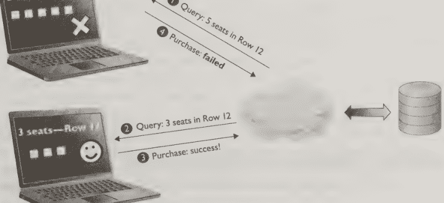

### 922 第 15 章：JDBC

与此同时，Person A 完成了信用卡信息的输入并开始了一个五个座位的事务。系统开始一个事务来购买五个座位。系统检查了信用卡，获得了扣款的初步许可，并尝试更新五个座位的记录，但现在五个座位中三个三个已经被标记为占用了。（顺带一下，你稍后会看到，这被称为“脏读”）。此时，系统将回滚整个事务，向信用卡发出退款请求，并向 Person A 返回错误消息。

这才是事务应该的工作方式。我们不希望（或预期）的是系统仍然向 Person A 收取这五个座位的费用，或者相反，如果 Person B 的卡被拒绝，却让她得到了那三个座位。票务事务是“全有或全无”的——所需的座位必须是用的，且信用卡必须有效并能够支付票款。这就是成功事务的标准：所有条件必须同时满足，或者如果事务的任何部分失败——例如信用卡卡号错误或座位不足——那么所有内容都必须恢复到事务开始之前的状态。目前，Person A 可能看不了冷酷乐队的演唱了，但他也没有被收取门票付费。

从根本上说，在事务世界中，关键在于确保我们希望在事务中发生的事情确实发生了，而且如果出现问题，一切都会恢复到事务开始前的原始状态。

### JDBC 事务概念

JDBC 对事务的支持是符合规范的要求。JDBC 事务的支持包括以下三个概念：

- 除非显式禁用，否则所有事务都处于自动提交模式。
- 事务具有不同层级的隔离级别——即在事务中执行代码的代码可以看到哪些数据。
- JDBC 支持保存点（savepoint）的概念。保存点是事务中的一个点，在该点为止发生的工作是有效的。当事务中存在某些你希望在事务其他部分失败时仍保留的条件时，保存点就很有用。

让我们在接下来的几节中更详细地查看这三个概念。

### 在 JDBC 中启动事务上下文

事务通常通过某种“开始”语句启动。然而，JDBC API 并没有为事务提供 `begin()` 方法，默认情况下，JDBC 驱动程序或数据库决定何时启动事务。当 SQL 语句需要事务时，JDBC 驱动程序或数据库会创建一个事务。为了使用 JDBC 控制事务，你必须首先关闭自动提交：

```java
conn = DriverManager.getConnection(url, password);
conn.setAutoCommit(false);
```

注意，当你关闭自动提交时，你也就启动了一个事务。作为一个例子，我们要向数据库中添加新的新书，我们需要确保这三个语句在单个单元中执行：

```java
conn = DriverManager.getConnection(url, password);
conn.setAutoCommit(false); // 启动事务
stmt = conn.createStatement();
stmt.execute("INSERT INTO Author (name) VALUES ('Rachel')");
stmt.execute("INSERT INTO Book (title, format, price) VALUES ('American Dolls', 'Paperback', '2012-08-31')");
stmt.execute("INSERT INTO Books_Author (book_id, author_id) VALUES (10, 55446789)");
conn.commit(); // 提交事务
```

这是一个使用预编译语句的绝佳机会，或者更好的使用存储过程。如果你发现自己在复制粘贴代码，请考虑做一个 DRY 程序员。Andy Hunt 和 Dave Thomas 在《程序员程序员手册》中提出了这一观点。DRY 的意思是“不要重复自己”。作为对比，复制粘贴的程序员有时被称为 WET 程序员：“重复写一遍”，或者“我们喜欢打字”。

这个示例说明了事务边界的概念——事务在哪里启动，以及在何地和何时提交。注意，一旦 `commit()` 方法返回，我们就启动了另一个事务。现在，如果我们不调用 `commit()` 方法，我们的数据库会发生什么？例如，在之前的代码段中，如果我们漏掉了 `commit()` 并直接关闭了连接呢！嗯，由于调用 `commit` 会改变数据库，而 JDBC 要求任何语句必须完全执行，驱动程序不会执行隐式提交，数据库将回滚事务，仿佛什么都没有发生过。

### 回滚事务

在开启这一节事务的示例中，我们提到当 Person A 尝试为冷酷乐队购买五个座位失败时，启动的信用卡事务被回滚了——事实上，除了他记得自己尝试买票之外，信用卡交易中根本没有任何记录；它就好像从未发生过一样。

事务回滚简单来说就是表示：“这些操作行不通，我想让一切恢复到原来的状态”。事务可以通过调用 `Connection` 对象的 `rollback()` 方法在代码中显式回滚，也可以在事务的任何点抛出 `SQLException` 时隐式地回滚。

### JDBC 事务 OCP 9.4 925

```java
Connection conn = DriverManager.getConnection(url, username, password);
conn.setAutoCommit(false); // 开始事务
Statement stmt = conn.createStatement();
int result1, result2, result3;
try {
    result1 = stmt.executeUpdate('INSERT INTO Author VALUES (1031, 'Rachel', 'McGinn'));
    result2 = stmt.executeUpdate('INSERT INTO Book VALUES ('0554466789', 'My American Dolls', '2012-08-31', 'Paperback', 7.95)');
    result3 = stmt.executeUpdate('INSERT INTO Books_by_Author VALUES (1031, '0554466789'));
    conn.commit(); // 无异常：提交整个事务
} catch (SQLException ex) {
    conn.rollback(); // 回滚整个事务
    if (抛出了一个异常) { }
}
```

请注意 `commit()` 和 `rollback()` 都是事务方法，如果在一个未处于事务的 `Connection` 上调用了其中任何一个方法（例如，当 `Connection` 处于自动提交模式时），这些方法将抛出 `SQLException`。

注意关于 `setAutoCommit()` 方法的最后一点。如果在事务期间重新开启了自动提交，即调用 `setAutoCommit(true)`，任何当前事务都将被提交，然后重新开启自动提交模式。开启和关闭自动提交在实际代码中可能不会频繁发生，但考试开发人员认为在 JDBC 事务的背景下你应该了解此点。

使用事务时需要记住的一重要点是，应用程序只有一个用户的情况是极罕见的。因此，极有可能会有两个用户尝试同时访问相同的数据。事务的一个重要方面是**隔离级别**——即一个事务对另一个事务所做更改的可见性。大多数数据库（因此以及它们的驱动程序）都有某些默认的隔离级别，你可以确定支持哪些隔离功能。

### 926 第 15 章：JDBC

使用 `DatabaseMetaData` 并通过 `Connection` 的 `setTransactionIsolation()` 方法设置隔离级别。然而，选择合适的隔离级别是一项重要任务，因为隔离程度过低，你可能会面临结果错误的风险；而隔离程度过高，应用程序性能将会受到影响。通常，你会与 DBA 协作，了解你数据库的默认隔离级别，以及为你的应用程序自定义该级别是否合适。

### 在 JDBC 中使用保存点 (Savepoints)

保存点（`Savepoint`）是事务中的某个点，你可以在该处放置一个虚拟标记，表示到此为止一切都是正常的。作为事务保存点的实际示例，想象一种情况：客户订购了几本书。订单应用程序检查所请求书籍的可用性，发现其中一本书缺货了。应用程序不会回滚整个事务，而可以在订单上放置一个保存点（在有限的时间内），允许客户决定是想一次性完成订单，还是先发货部分可用书籍，剩余部分稍后发送。如果客户同意接受部分发货，事务就可以从保存点继续并发货订单的一部分。在 JDBC API 中，`Savepoint` 是事务中由 `Connection` 返回的一个对象。`Savepoint` 对象可以是有命名的也可以是不命名的（带有一个 String 名称或不带）。`Savepoint` 的用处是它代表了事务中一个你可以回滚到的点。例如，让我们看看示例代码，我们在 Bob's Books 中添加了一本书。假设我们决定必须在 `Book` 和 `Author` 表中有一条记录，并且如果连接表中的记录失败是可以接受的，因为我们稍后可以建立书籍与其作者之间的连接。我们决定使用一个保存点来标记 `Book` 和 `Author` 表设置好的点，如果有必要，可以将事务回滚到该点并提交：

```java
Connection conn = DriverManager.getConnection(url, username, password);
conn.setAutoCommit(false); // 开始事务
Statement stmt = conn.createStatement();
int result2, result3;
String query1 = "INSERT INTO Author " + "VALUES (1031, 'Rachel', 'McGinn');";
String query2 = "INSERT INTO Book " + "VALUES (0554467899, ' " + "'My American Dolls', '2012-08-31', ' ' + "'Paperback', 7.95)";
```

### JDBC 事务 OCP 目标 9.4 927

```java
try {
    result1 = stmt.executeUpdate(query1);
    result2 = stmt.executeUpdate(query2);
    Savepoint spl = null;
    spl = conn.setSavepoint(); // 创建保存点
    // 针对目前这两个两次插入
} catch (SQLException ex) {
    conn.rollback(); // 如果我们没有成功插入
    throw new SQLException("fail"); // 在 author 和 book 表中的一条记录，
    // 回滚事务并
    // 抛出异常
}
String query3 = "INSERT INTO Books_by_Author " + "VALUES (1031, '0554467889')" 
try {
    result3 = stmt.executeUpdate(query3);
    conn.commit(); // 如果全部成功，则提交
} catch (SQLException ex) {
    conn.rollback(spl); // 如果连接插入失败，那
    // 没关系，回滚到保存点（回滚
    // 到 Books_by_Author 的插入）
    conn.commit(); // 从那里开始提交。
}
```

关于保存点（`Savepoint`）有几点需要注意：

- 当你设置保存点 A 后设置保存点 B 时，如果你回滚到保存点 A，将释放并失效保存点 B。
- 保存点不是要求的，但你可以通过 `DatabaseMetaData` 的 `supportsSavepoints()` 方法查看 JDBC 驱动程序是否支持保存点。
- 因为保存点是事务上下文的某个时间点状态，驱动程序的保存点数量可能是有限的。例如，每个事务只有一个。

这里有好消息也有坏消息。坏消息是没有方法可以确定 JDBC 驱动程序支持保存点的数量。好消息是，如果你只有一个，你可以重用它。`Connection` 提供了 `releaseSavepoint()` 方法，它接收一个 `Savepoint` 对象。

## 认证总结

### JDBC API

记住 JDBC API 是一个接口集合，其中有一个重要的类类 `DriverManager`。你使用定义良好的 JDBC 接口编写代码，而 JDBC 驱动提供者编写这些接口的实现。JDBC 驱动必须实现的关键且要求的接口是 `Driver`、`Connection`、`Statement` 和 `ResultSet`。

驱动提供者还将实现 `DatabaseMetaData` 的实例，你用它查询有关驱动的信息。其中一个重要信息是数据库是否符合 SQL-92 标准，并且有许多以 `supports` 开头的方法用于判断驱动的能力。一个重要的方法是 `supportsResultSet()`，用于判断驱动程序是否支持滚动结果集。

### DriverManager


`DriverManager` 是 JDBC 中少有的几个具体类之一，你会记得 `DriverManager` 是一个工厂类——使用 `DriverManager` 构造 `Connection` 对象的实例。实际上，`DriverManager` 仅持有已注册的 JDBC 驱动的引用，当你使用 JDBC URL 调用 `getConnection()` 方法时，`DriverManager` 将 URL 传递给每个驱动。如果 URL 匹配有效的驱动、主机、端口号、用户名和密码，那么驱动将返回一个 `Connection` 对象的实例。记住 JDBC URL 仅仅是一个编码了连接数据库所需信息的字符串。

JDBC 如何注册到 `DriverManager` 同样重要。在当前的 JDBC 版本（4.0 及以后）中，驱动 jar 包只需要在类路径（classpath）上，`DriverManager` 就会负责查找驱动的类实现并加载它。JDBC 3.0 及更早版本要求使用 `Class.forName()` 方法配合完全限定类名手动加载驱动的 `Driver` 类实现。

## Statements 和 ResultSet

数据库最重要的用途显然是通过 SQL 语句和查询来创建、读取、更新和删除数据库记录。`Statement` 接口提供了创建 SQL 语句并执行它们所需的方法。请记住有三种不同的 `Statement` 方法可以执行 SQL 查询：一个返回结果集的 `executeQuery()`；一个返回受影响的行数的 `executeUpdate()`；以及一个通用型方法 `execute()`，它返回一个布尔值来指示查询是否生成了结果集。

`ResultSet` 是用于逐行从查询返回的结果集中读取数据列的接口。`ResultSet` 对象表示查询返回数据的快照（副本），并且当结果返回时，会有一个游标（cursor）指向第一行正上方。除非你使用 `Connection.createStatement(int, int)` 方法（它接收 `resultSetType`（结果集类型）和 `resultSetConcurrency`（结果集并发性）参数）创建了 `Statement` 对象，否则 `ResultSet` 是不可更新的（not updatable），且只允许游标在结果中向前移动。但是，如果你的数据库支持，你可以创建一个类型为 `ResultSetType.SCROLL_INSENSITIVE` 和/或并发性为 `ResultSet.CONCUR_UPDATABLE` 的 `Statement`，这允许使用该 `Statement` 对象创建的任何结果集将游标置于任何位置（可滚动），并允许你更改结果集中任何行中任何列的值（可更新）。最后，使用 `ResultSet` 可以确定查询返回的行数——这是确定行数的唯一方法，因为没有 "rowCount" 方法。

`SQLException` 是 JDBC 抛出的异常的基类，由于一次查询可能导致多个异常，因此这些异常是链式的（chained）。要确定导致 `SQLException` 返回的所有原因，你必须通过调用 `getNextException()` 方法来遍历异常链。JDBC 还使用 `SQLException` 异常类型来跟踪 `Connection`、`Statement` 和 `ResultSet` 对象方法的警告。与 `SQLException` 类似，`SQLWarning` 也会静默地链式到引起警告的对象上——例如，假设你尝试创建一个支持 `ResultSet` 的 `Statement` 对象，但数据库不支持该类型。此时一个 `SQLWarning` 会被添加到 `Connection` 对象中（通过 `Connection.create(int, int)` 方法创建 `Statement` 对象）。`getWarnings()` 方法用于返回任何 `SQLWarnings`。

Java SE 7 的重要新增之一是 `try-with-resources`（尝试可用资源）语句，所有的 JDBC 接口都已更新以支持新的 `AutoCloseable` 接口。请记住，在关闭 `Connection`、`Statement` 和 `ResultSet` 时存在优先级。当一个 `Connection` 关闭时，从该连接创建的任何 `Statement` 也会被关闭；同样，当一个 `Statement` 关闭时，使用该语句创建的任何 `ResultSet` 也会被关闭。并且尝试在已关闭的对象上调用方法将导致 `SQLException`！

## PreparedStatement 和 CallableStatement

SQL 提供了创建“预编译”预编译语句（prepared statement）查询的能力。这意味着语句的语法已经通过了检查；任何表名和列名都已根据模式（schema）进行了检查，最后会为该查询创建一个执行计划。请注意，JDBC 的 `PreparedStatement` 在第一次执行 `PreparedStatement` 时会执行此预编译过程。当你向预编译语句传递参数时，数据库会将你传递的值替换到预编译查询中的占位符（placeholders）。这使得预编译查询的执行速度比普通查询快得多。

JDBC 的 `PreparedStatement` 对象使用此机制从你的 Java 代码将参数传递到预编译查询中。这使得创建 SQL 注入攻击变得困难，因为每个 `PreparedStatement` 都不允许作为参数传递的字符串包含非字符串字符——这些字符通过在前面添加反斜杠被“转义”（escape），转换为字符串字符。

传递到 `PreparedStatements` 的参数被称为 `IN` 参数——这些参数在预编译语句中设置并传递到数据库执行。每个 `IN` 类型参数对应一个特定的占位符（用问号字符 `?` 表示）。

`CallableStatement` 是用于调用数据库存储过程的 JDBC 对象。与预编译语句不同，过程使用依赖于数据库的语言，可能解析或不解析 SQL。与预编译语句一样，过程被编译到数据库中，并可以接受传递给它们的参数。然而，存储过程还允许通过 `OUT` 类型参数使用 `?` 语法将值返回给调用者。最后，参数可以传递到存储过程并返回一个新值作为结果。

## RowSet, ResultSetProvider, and ResultSetFactory

SQL 提供了创建“预编译”预编译语句查询的能力。这意味着语句的语法已经通过了检查；任何表名和列名都已根据模式（schema）进行了检查，最后会为该查询创建一个执行计划。请注意，JDBC 的 `PreparedStatement` 在第一次执行 `PreparedStatement` 时会执行此预编译过程。当你向预编译语句传递参数时，数据库会将你传递的值替换到预编译查询中的占位符。这使得预编译查询的执行速度比普通查询快得多。

JDBC 的 `PreparedStatement` 对象使用此机制从你的 Java 代码将参数传递到预编译查询中。这使得创建 SQL 注入攻击变得困难，因为每个 `PreparedStatement` 都不允许作为参数传递的字符串包含非字符串字符——这些字符通过在前面添加反斜杠被“转义”（escape），转换为字符串字符。

传递到 `PreparedStatements` 的参数被称为 `IN` 参数——这些参数在预编译语句中设置并传递到数据库执行。每个 `IN` 类型参数对应一个特定的占位符（用问号字符 `?` 表示）。

`CallableStatement` 是用于调用数据库存储过程的 JDBC 对象。与预编译语句不同，过程使用依赖于数据库的语言，可能解析或不解析 SQL。与预编译语句一样，过程被编译到数据库中，并可以接受传递给它们的参数。然而，存储过程还允许通过 `OUT` 类型参数使用 `?` 语法将值返回给调用者。最后，参数可以传递到存储过程并返回一个新值作为结果。

## JDBC Transactions

对于该目标的结论是：JDBC 事务默认处于自动提交模式，你必须通过调用 `setAutoCommit(false)` 来显式地启动事务。在事务中，任何更改在显式调用 `commit()` 方法之前都不会提交到数据库。如果你希望撤销事务期间的更改，可以通过调用 `rollback()` 方法回滚事务。如果事务期间调用的方法导致了 `SQLException`，事务将自动回滚。最后，记住，如果你在事务中间调用 `setAutoCommit(true)`，当前事务将立即提交。

JDBC 事务是平坦的，这意味着每个 `Connection` 在任何时候只能有一个事务。然而，某些数据库允许你在事务中标记保存点（savepoints）。如果在事务中发生了多次更改（插入、删除、更新），你可以通过调用 `setSavepoint()` 方法创建一个 `Savepoint` 对象，如果后续出现问题，可以将事务回滚到保存点，而不是回滚到开始。

## 两分钟冲刺 933

- ResultSet 列索引从 1 开始编号，而不是从 0。
- 默认的 ResultSet 是不可更新的（只读），且光标只能向前移动。
- 可滚动（scrollable）且可更新的 ResultSet 可以被修改，光标可以定位到 ResultSet 中的任何位置。
- ResultSetMetadata 可用于动态发现 ResultSet 中返回的列数及其类型。
- ResultSetMetadata 没有行数计数方法。要确定返回的行数，ResultSet 必须是可滚的。
- 可以为大型数据集控制 ResultSet 的 fetch size；然而，这只是给驱动程序的一个提示，并可能会被忽略。
- SQLEceptions 是链式的。你必须遍历异常类以获取抛出异常的所有原因。
- SQLException 还包含特定数据库的错误代码和状态代码。
- executeQuery 方法用于返回 ResultSet (SELECT)。
- executeUpdate 方法用于更新数据、修改数据库并返回受影响的行数（INSERT、UPDATE、DELETE 和 DDL）。
- execute 方法用于执行任何 SQL 命令。当查询产生 ResultSet 时返回布尔值 true，当没有结果或结果为更新计数时返回 false。
- 在关闭 Connections、Statements 和 ResultSets 时存在优先级顺序。
- 使用 try-with-resources 语句，你可以自动关闭 Connections、Statements 和 ResultSets（它们实现了 Java SE 7 中新的 AutoCloseable 接口）。
- 当 Connection 关闭时，所有相关的 Statements 和 ResultSets 都会被关闭。

## 使用 PreparedStatement 和 CallableStatement 对象 (OCP 目标 9.6)

- PreparedStatements 是预编译的，可以提高频繁使用的 SQL 查询的效率。
- Prepared 是避免 SQL 注入攻击的好方法。
- Prepared 的 setXXXX 方法索引从 1 开始，而不是从 0 开始。
- CallableStatements 使用数据库上的存储过程进行执行。
- 用于创建存储过程的实际使用的语言取决于数据库。

## 构建和使用 RowSet 对象 (OCP 目标 9.5)

- JdbcRowSet 提供了 ResultSet 的 JavaBean 视图（getter 和 setter）。
- 理解 CachedRowSet、FilteredRowSet、JdbcRowSet、Joinable、JoinRowSet、Predicate 和 WebRowSet。
- RowSetProvider 是一个工厂类，用于获取 RowSetFactory 以生成 RowSet 对象类型。
- RowSetFactory 提供了一种创建 RowSet 对象实例的方法。在 JDBC 4.1 (Java SE 7) 之前，开发者需要提供 RowSet 接口实现的类名。

## JDBC 事务 (OCP 目标 9.4)

- JDBC 中的事务是扁坦的——也就是说，每个 Connection 实例任何时间只有一个活跃的事务。
- JDBC 中的所有事务默认都处于自动提交模式——你必须通过调用 Connection.setAutoCommit(false) 显式开启事务。
- 显式调用 setAutoCommit(true) 会显式提交当前事务（并恢复到自动提交模式）。
- 如果 Connection 被设置为自动提交模式，则 rollback 方法（回滚方法）会抛出异常。
- savepoint（保存点）是当前事务中的一个点，可以通过 Connection.rollback() 方法引用。
- 回滚到保存点只会将事务回滚到创建的最后一个保存点。

## 自测

I. 已知：

```java
String url = "jdbc:mysql://SolDBServer/solldb";
String user = "sysEntry";
String pwd = "fo0B3@r";
// 在此处插入代码
Connection conn = DriverManager.getConnection(url, user, pwd);
```

假设 "org.gjt.mm.mysql.Driver" 是一个有效的类，将哪一行插入 `// 在此处插入代码` 时可以正确加载此 JDBC 3.0 驱动？

A. `DriverManager.registerDriver("org.gjt.mm.mysql.Driver");`

B. `Class.forName("org.gjt.mm.mysql.Driver");`

C. `DatabaseMetaData.loadDriver("org.gjt.mm.mysql.Driver");`

D. `Driver.connect("org.gjt.mm.mysql.Driver");`

E. `DriverManager.getDriver("org.gjt.mm.mysql.Driver");`

2. 假设你正在使用 JDBC 4.0 驱动，以下哪三项是该 JDBC 驱动符合标准所要求的？

A. 必须包含 `META-INF/services/java.sql.Driver` 文件

B. 必须提供 `Driver`, `Connection`, `Statement` 和 `ResultSet` 接口的实现

C. 必须支持可滚的 `ResultSet`

D. 必须支持可更新的 `ResultSet`

E. 必须支持 SQL99 标准

F. 必须支持 `PreparedStatement` 和 `CallableStatement`

G. 必须支持 `PreparedCallableStatement`

3. 通过 `DatabaseMetaData` 实例可以使用以下哪三项？

A. 返回的列数

B. 返回的行数


C. JDBC 驱动的名称

D. 默认事务隔离级别

E. 上一次使用的查询

F. 数据库中存储过程的名称

G. 当前 `Savepoint` 名称

4. 已知：

```java
try {
    Statement stmt = conn.createStatement();
    String query =
        "SELECT * FROM Author WHERE LastName LIKE 'Rand%'";
    ResultSet rs = stmt.executeQuery(query); // 行 X
    if (rs == null) { // 行 Y
        System.out.println("No results");
    } else {
        System.out.println(rs.getString("FirstName"));
    }
} catch (SQLException se) {
    System.out.println("SQLException");
}
```

假设已创建了 `Connection` 对象 (`conn`) 且查询产生了结果，结果是什么？

A. 行 X 错误

B. 行 Y 错误

C. 没有结果

D. 匹配 `'Rand%'` 的第一行

E. `SQLException`

5. 给定 SQL 查询：假设此查询是有效的且存在 `Connection` 对象 (`conn`)，哪条语句可以正确编译并执行此查询？

A. `Statement stmt = conn.createStatement(); stmt.executeQuery(query);`

B. `Statement stmt = conn.createStatement(query); stmt.executeUpdate();`

C. `Statement stmt = conn.createStatement(); stmt.setQuery(query); stmt.execute();`

D. `Statement stmt = conn.createStatement(); stmt.execute(query);`

E. `ResultSet rs`

6. 已知：

```java
try {
    ResultSet rs = null;
    try (Statement stmt = conn.createStatement()) { // 行 X
        String query = "SELECT * from Customer";
        rs = stmt.executeQuery(query); // 行 Y
    } catch (SQLException se) {
        System.out.println("Illegal query");
    }
    while (rs.next()) {
        // 输出名字
    }
} catch (SQLException se) {
    System.out.println("SQLException");
}
```

假设 `Connection` 对象 (`conn`) 有效且查询将返回结果，结果是什么？

A. 将打印名字

B. 行 X 错误

C. 非法查询

D. 行 Y 错误

E. `SQLException`

F. 运行时异常

7. 给定此代码片段：

```java
Statement stmt = conn.createStatement();
ResultSet rs;
String query = "<QUERY>"
stmt.execute(query);
if ((rs = stmt.getResultSet()) != null) {
    System.out.println("Results");
}
if (stmt.executeUpdateCount() > -1) {
    System.out.println("Update");
}
```

输入 `<QUERY>` 的哪些查询语句会产生以下输出（假设每个查询都是有效的）？（多选）

A. `"SELECT * FROM Customer"` Results

B. `"INSERT INTO BOOK ('102346789', 'One Night in Paris', '1984-10-20', 'Hardcover', 13.95)"` Update

C. `"UPDATE Customer Set Phone = '555-234-1021' WHERE CustomerID = 101"` Update

D. `"SELECT Author.LastName FROM Author"` Results

E. `"DELETE FROM Book WHERE ISBN = '102346789'"` Update

8. 已知：

```java
String q = "UPDATE Customer WHERE Customer_id=?"
try {
    PreparedStatement pstmt = conn.prepareStatement(q);
    pstmt.setString(0, "Smith"); // 行 X
    pstmt.setString(1, "5001"); // 行 Y
    int result = pstmt.executeUpdate();
    if (result != 1) System.out.println("Error - update failed");
} catch (SQLException se) {
    System.out.println("Exception");
}
```

假设表名和列名有效，结果是什么？

A. ID 为 5001 的客户姓设置为 `"Smith"`

B. 更新失败

C. 异常

D. 编译失败

9. 已知：

```java
try {
    String[] searchPair = {"%lacey", "%Fire%", "R", "%Lost Hero%"};
    String query = "SELECT Book.Title, Author.FirstName, " +
                   "Author.LastName FROM Author, Book, " +
                   "Books_by_Author WHERE Author.LastName LIKE ? " +
                   "AND Book.Title LIKE ? " +
                   "AND Books_by_Author.AuthorID=Author.AuthorID " +
                   "AND Books_by_Author.ISBN = Book.ISBN";
    PreparedStatement pstmt = conn.prepareStatement(query);
}*
```

```java
for (int i = 0; i < searchPair.length; i += 2) {
    pstmt.setString(i+1, searchPair[i]); // line X
    pstmt.setString(i+2, searchPair[i+1]); // line Y
    ResultSet rs = pstmt.executeQuery(); // line Z
    while (rs.next()) {
        System.out.println("Yes ");
    }
}
 catch (SQLException se) {
    System.out.println("SQLException");
}
```

假设数组 `searchPair` 中的每对查询元素都会返回两行，并且假设有一个有效的 `Connection` 对象 (`conn`)，结果是什么？

- A. `SQLException`

- B. Yes Yes `SQLException`

- C. Yes Yes Yes Yes

- D. line X 处的编译错误

- E. line Y 处的编译错误

- F. line Z 处的编译错误

10. 给定：

```java
String call = "CALL REMOVEBOOKS(?, ?)";
String titleToRemove = null;
int maxBooks = 0;
CallableStatement cstmt = conn.prepareCall(call);
String titles = "%Hero%";
int booksRemoved;
// 代码在此添加
```

如果 `REMOVEBOOKS` 是一个存储过程，其第一个参数是 `INOUT` 整数类型，第二个参数是 `IN` 字符串类型，那么在 `// Code added here` 行放置代码时，哪些代码块可以正确执行该存储过程并返回结果？

- A. `cstmt.setInt(0, maxBooks);`

`cstmt.setString(1, titleToRemove);`

`cstmt.registerOutParameter(0, java.sql.Types.INTEGER);`

`cstmt.execute();`

`numBooksRemoved = cstmt.getInt(0);`

- B. `cstmt.setInt(1, maxBooks);`

`cstmt.setString(2, titleToRemove);`

`cstmt.registerOutParameter(1, java.sql.Types.INTEGER);`

`cstmt.executeQuery(query);`

`numBooksRemoved = cstmt.getInt(1);`

- C. `cstmt.setInt(1, maxBooks);`

`cstmt.setString(2, titleToRemove);`

`cstmt.execute();`

`cstmt.registerOutParameter(1, java.sql.Types.INTEGER);`

`numBooksRemoved = cstmt.getInt(1);`

- D. `cstmt.setInt(1, maxBooks);`

`cstmt.setString(2, titleToRemove);`

`cstmt.registerOutParameter(1, java.sql.Types.INTEGER);`

`ResultSet rs = cstmt.executeQuery(query);`

`rs.next();`

`numBooks = rs.getInt(1);`

- E. `cstmt.setInt(1, maxBooks);`

`cstmt.setString(2, titleToRemove);`

`cstmt.registerOutParameter(1, java.sql.Types.INTEGER);`

`cstmt.execute();`

`numBooksRemoved = cstmt.getInt(1);`

## II. 哪一个创建了连接的 `RowSet` 对象？

- A. `WebRowSet wrs = RowProvider.newFactory().createWebRowSet();`

- B. `CachedRowSet crs = RowProvider.newFactory().createCachedRowSet();`

- C. `try(JdbcRowSet jrs = RowProvider.newFactory().createJdbcRowSet()) {`

    // 假设剩余 try-catch 部分有效

- D. `try(RowSetFactory rsf = RowProvider.newFactory()) {`

    `RowSet wrs = rsf.createRowSet();`

    // 假设剩余 try-catch 部分有效

- E. `JoinRowSet jrs = RowProvider.newFactory().createJoinRowSet();`

- F. `ResultSet rs = Statement.execute("SELECT * FROM Customer");`

`JdbcRowSet jrs = RowProvider.newFactory().setResultSet(rs);`

## 12. 给定：

```java
try (CachedRowSet crs =
    RowSetProvider.newFactory().createCachedRowSet()) {
    String query = "SELECT * FROM Employee"; // Line Q
    crs.setCommand(query);
    crs.setUrl(url);
    crs.setUsername(user);
    crs.setPassword(pwd);
    crs.execute(); // Line V
    crs.last();
    crs.updateString("LastName", "Sullivan-McGinn");
    数据库离线 // Line W
    crs.moveToRow()
    crs.updateInt("ID", 101);
    crs.updateString("FirstName", "Michael");
    crs.updateString("LastName", "Fuller");
    crs.updateFloat("Salary", 101234.56f); // Line X
    crs.insertRow();
    crs.moveToCurrentRow();
    crs.absolute(10); // Line Y
    crs.deleteRow(); // Line Z
    数据库上线
} catch (SQLException se) {
    System.out.println("SQLException");
}
```

假设查询在 Line Q 产生了结果，并且数据库在 `OFFLINE` 行之前或之时离线，并在 `ONLINE` 行之前或之时上线，且以下语句为真？

- A. 因为 Line V 会打印 `SQLException`

- B. 因为 Line Z 会打印 `SQLException`

- C. 因为 Line X 会打印 `SQLException`

- D. 因为 Line Y 会打印 `SQLException`

- E. 因为 Line W 会打印 `SQLException`

- F. 更新了一行，插入了一行，并删除了一行

- G. 数据库将保持不变

## 13. 给定：

```java
boolean businessRule = true;
try {
    Connection conn = DriverManager.getConnection(url, password);
    String query1 = "INSERT INTO Order VALUES(20, 50, 'Panasonic')";
    String query2 = "Update Order Set Price = 35.20 WHERE ID = 21";

    Statement stmt = conn.createStatement();
    stmt.executeUpdate(query1); // Line X
    stmt.executeUpdate(query2); // Line Y
    if (businessRule) {
        conn.rollback(); // Line Z
    }
} catch (SQLException exception) {
    System.out.println("SQLException");
}
```

假设两个查询均有效，执行此片段的结果是什么？

- A. Query 1 和 Query 2 都回滚（无变化）

- B. Query 1 执行，Query 2 回滚

- C. Query 1 执行，Query 2 执行，以及 `SQLException`

- D. `SQLException`

- E. 抛出运行时异常

## 14. 给定：

```java
try (Connection conn = DriverManager.getConnection(url, password)) {
    conn.setAutoCommit(false);
    String query1 = "INSERT INTO Order VALUES(22, 99.99, 'Winter Boots');
    String query2 = "INSERT INTO Order VALUES(24, 39.99, 'Fleece Jacket')";
    Statement stmt = conn.createStatement();
    stmt.executeUpdate(query1);
    Savepoint sp1 = conn.setSavepoint();
    stmt.executeUpdate(query2);
    conn.rollback(sp1);
} catch (SQLException se) {
    System.out.println("SQLException");
}
```

假设查询有效，执行此代码的结果是什么？

- A. 数据库中添加了两行

- B. query 1 的行被添加到数据库

- C. query 2 的行被添加到数据库

- D. 数据库中未添加任何行

- E. 抛出 `SQLException`

## 15. 给定：


```java
try (Connection conn = DriverManager.getConnection(url, password)) {
    conn.setAutoCommit(false);
    String q1, q2, q3;
    q1 = "INSERT INTO Order VALUES(23, 99.99, 'Winter Boots')";
    q2 = "INSERT INTO Order VALUES(24, 39.99, 'Fleece Jacket')";
    q3 = "INSERT INTO Order VALUES(25, 29.99, 'Wool Scarf')";
    Statement stmt = conn.createStatement();
    stmt.executeUpdate(q1);
    Savepoint sp1 = conn.setSavepoint("item1");
    stmt.executeUpdate(q2);
    Savepoint sp2 = conn.setSavepoint("item2");
    conn.rollback(sp1);
    stmt.executeUpdate(q3);
    Savepoint sp3 = conn.setSavepoint("item3");
    conn.commit();
} catch (SQLException se) {
    System.out.println("SQLException");
}
```

假设执行此代码片段之前 `Order` 表是空的，且数据库支持保存点且所有查询均有效，`Order` 包含哪些行？

- A. 23, 99.99, 'Winter Boots'
- B. 23, 99.99, 'Winter Boots', 25, 29.99, 'Wool Scarf'
- C. 23, 99.99, 'Fleece Jacket', 24, 39.99
- D. 24, 39.99, 'Fleece Jacket', 25, 29.99, 'Wool Scarf'
- E. 无行

## 自测答案

1. B 是确定的。在 JDBC 4.0 之前，JDBC 驱动程序需要在通过类加载器实例化后，通过 `DriverManager.register(this)` 来向 `DriverManager` 类注册自己。`Class.forName()` 方法调用类加载器，后者创建作为字符串传递给该方法的类实例。`n` 是错误的，因为该方法应该是用驱动类的实例来调用的。C 是错误的，因为 `DatabaseMetadata` 没有 `loadDriver` 方法，且 `DatabaseMetadata` 的目的是返回数据库连接信息。D 是错误的，虽然方法名听起来没错，但参数类型不对，且这实际上是 `DriverManager.getConnection` 获取 `Connection` 对象的方法。E 是错误的，因为该方法返回一个 `Driver` 实例，该实例必须先加载并向 `DriverManager` 注册。（OCP Objective 9.2）

2. A、B 和 E 是正确的。为了符合 JDBC 4.0 标准，JDBC 驱动程序必须支持通过提供 `META-INF/services/java.sql.Driver` 文件来自动加载驱动，该文件指示了 `DriverManager` 在启动时加载的 `Driver` 类全限定名。JDBC 驱动程序必须实现 `Driver`、`Connection`、`Statement`、`ResultSet` 接口，其他驱动程序还必须支持事务。C 和 D 是错误的。支持可滚动或可更新的 `ResultSet` 不是强制要求，尽管许多驱动程序都支持。如果驱动通过 `DatabaseMetadata` 报告其支持 `ResultSet`，则驱动程序必须支持所有与光标移动和更新相关的方法。F 是错误的。JDBC 要求驱动程序支持 SQL92 错误级语法和 `DROP TABLE` 命令（来自 SQL92 转换阶段）。虽然 JDBC 4.0 驱动必须支持 `PreparedStatement` 和 `CallableStatement`，但仅当驱动程序的 `DatabaseMetadata.supportedProcedures` 返回 `true` 时如此。（OCP Objective 9.2）

3. C、D 和 F 是正确的。`DatabaseMetadata` 提供了关于数据库和 `Connection` 对象的数据。名称、版本和其他 JDBC 驱动信息可用，以及关于数据库的信息，包括存储过程、函数名称、SQL 关键字等。最后，默认事务隔离级别以及关于支持的事务级别的数据也可以通过 `DatabaseMetadata` 获取。A 和 B 是错误的，因为它们都是通过数据库查询结果返回的。列数可以通过开发者（即你）将光标移动到结果集的末尾然后评估光标位置来获取。E 是错误的。JDBC 中没有定义返回上一个查询的方法。G 不是正确的。`Savepoint` 信息是通过 `Savepoint` 实例访问的，并且是事务的一部分。（OCP Objective 9.1）

## 自我测试答案 945

- 4. ☑ E 是正确的。当 `ResultSet` 返回时，光标指向 `ResultSet` 的第一行之前。你必须先调用 `next()` 方法移动到下一行结果，才能从列中读取任何数据。当光标在第一行或最后一行之后时，尝试使用 `getXXXX` 方法读取结果将导致产生 `SQLException`。
  ☑ 根据以上内容，A、B、D 和 F 都是错误的。关于 C 的说明：`executeQuery` 返回的 `ResultSet` 永远不会为 `null`。（OCP 目标 9.3）

- 5. ☑ D 是正确的。
  ☑ 注意答案 E 也是正确的，但无法编译，因为 `executeUpdate(query)` 方法返回的是整型结果。A 可以编译，但在运行时会抛出 `SQLException`——`executeQuery` 不能用于 INSERT、UPDATE、DELETE 或 DDL；SQL 将无法编译，因为 `createStatement` 方法不接受字符串参数作为查询语句。C 是错误的，因为 `Statement` 没有 `setQuery` 方法，这将无法编译。（OCP 目标 9.3）

- 6. ☑ E 是正确的。记住第 X 行的 try-resources 语句会在块结束时（到达大括号时）自动关闭资源，且语句对象会自动关闭与 `Statement` 关联的 `ResultSet`。抛出的 `SQLException` 是因为 `ResultSet` 未打开。要修复此问题，请将语句移动到 try-resources 块内部。
  ☑ 根据以上内容，A、B、C、D 和 F 是错误的。（OCP 目标 9.3）

- 7. ☑ 所有答案都正确（A, B, C, D, E）。即使没有行，SELECT 也会产生 `ResultSet`。INSERT、UPDATE 和 DELETE 语句在影响数为 0 时都会产生更新计数。（OCP 目标 9.3）

- 8. ☑ C 是正确答案。参数从 1 开始编号，而不是 0。当程序执行时，X 行将抛出 `SQLException`。
  ☑ D 是错误的，因为编译器无法检测方法的返回值应该是 1 而不是 0。编译器只能确定参数的类型是否正确，在这种情况下，类型（整数）是正确的。根据以上内容，A 和 B 是错误的。（OCP 目标 9.6）

- 9. ☑ B 是正确的。在循环的第一次迭代中，`i = 0`，且 `pstmt.setString` 方法（第一个参数）为 1，第二个索引为 2。在循环的第二次迭代中，索引值变为 3 和 4。将这两个值硬编码为 1 和 2 会更好。
  ☑ 根据以上内容，A、C、D、E 和 F 是错误的。（OCP 目标 9.6）

- 10. ☑ E 是错误的。记住，如果你指定了 IN 参数，需要使用 `setXXXX` 方法；对于 OUT 参数，你必须在调用之前将参数注册为 OUT，并使用 `getXXXX` 方法返回存储过程的结果。946 第 15 章：JDBC
  - A 是错误的，因为参数索引从 1 开始，而不是 0。B 是错误的，因为 `executeQuery` 方法包含了作为参数的字符串查询。此方法将抛出 `SQLException`。C 是错误的，因为在执行方法调用之前没有注册 OUT。D 是错误的，因为存储过程没有返回 `ResultSet`。作为 `executeQuery` 调用的结果，调用 `rs.getInt` 将抛出 `SQLException`。（OCP 目标 9.6）
  - C 是正确答案。这段代码正在创建一个 `ResultSet` 实例——这是已连接的 `ResultSet` 对象。正确的方法是使用静态的 `newFactory()` 方法获取 `ResultSet` 实例，然后用于执行查询并填充 `ResultSet`。
  - A 和 E 是正确的。虽然这些是离连接的 `ResultSet` 对象，但 D 是错误的，因为 `ResultSetFactory` 没有实现 `AutoCloseable`；因此，编译器会在 `try-with-resources` 中使用 `ResultSetFactory` 时报错。F 是错误的，因为这不是初始化 `ResultSet` 的正确方式。（OCP 目标 9.5）
  - G 是正确的。在 `execute()` 方法被调用的任何点，数据库离线都是无关的。然而，这段代码中有一个严重错误：由于更新、插入和删除，必须调用 `accept()` 方法来连接数据库。由于缺少此行代码，更改仅在内存对象中，未反映在数据库中。
  - 根据以上内容，A、B、C、D、E 和 F 都是错误的。（OCP 目标 9.5）
  - C 是正确的。因为连接从未被设置为 `setAutoCommit(false)`，因此没有事务上下文。所有事务处于自动提交模式，所以第一个事务执行并完成，第二个事务执行并完成，当 `conn.rollback()` 方法在 X 行执行时，将抛出 `SQLException`。
  - D 是正确的。因为连接从未被设置为 `setAutoCommit(false)`，因此没有事务上下文。所有事务处于自动提交模式，所以第一个事务执行并完成，第二个事务执行并完成，当 `conn.rollback()` 方法在 X 行执行时，将抛出 `SQLException`。
  - E 是正确的。因为连接从未被设置为 `setAutoCommit(false)`。

# 录

# 关于 CD

书中附带 CD 带有模拟考试软件，可以模拟真实考试。软件还具有自定义模式，可以按考试目标生成测试。测试模式是默认模式。

# 系统要求

软件需要 Windows XP、Windows Server 2003、Windows Server 2008、Windows Vista Home Premium、Business、Ultimate 或 Enterprise（包括 64 位版本）带有 Service Pack 2，Windows 7 或 Mac X10.6 和 10.7，配备 512MB 内存（建议 1GB）。电子书需要 Adobe Reader。

# 安装模拟考试软件

按照 Windows 或 Mac OS 的说明进行。

## Windows

- **第一步** 将 CD 插入 CD 驱动器。
- **第二步** 片刻后，安装程序会自动打开。如果安装程序没有自动打开，请查看以下说明。
- **第三步** 按照屏幕上的说明安装应用程序。

注意：如果安装程序没有自动打开，从开始菜单选择“运行”并输入：

`X:\Installer.exe`

（“X” 是 CD 驱动器的盘符）。然后点击确定。

## Mac OS

- **第一步** 将 CD 插入 CD 驱动器。
- **第二步** 片刻后，将显示 CD 的内容。
- **第三步** 双击 `Installer` 开始安装。
- **第四步** 按照屏幕上的说明安装应用程序。

注意：如果在安装软件时遇到错误，请确保已禁用杀毒软件或网络安全程序并尝试重新安装软件。安装完成后您可以启用杀毒软件或网络安全程序。

# 运行模拟考试软件

完成软件安装后，按照说明操作。

## Windows

安装后，可以使用以下两种方法之一启动应用程序：

- 1. 双击桌面上的 `Oracle Java Exams` 图标，或
- 2. 转到开始菜单并点击“程序”或“所有程序”。点击 `Oracle Java Exams` 启动应用程序。

## Mac OS

打开 Mac 应用程序文件夹内的 `Press Java Exams` 文件夹，并双击 `Oracle Java Exams` 图标运行应用程序。

# 模拟考试软件功能

模拟考试软件为您提供真实考试的模拟。软件还具有自定义模式，可以按考试目标生成测试。测试模式是默认模式。要启动考试模拟，请选择屏幕顶部的 OCA 或 OCP 考试按钮，或选择

# 950 附录：关于 CD

点击屏幕底部的“考试模式”（Exam Mode）复选框，并在自定义窗口中选择 OCA 或 OCP 考试。

模拟考试中的题目数量、类型和允许时间旨在代表真实考试。自定义考试模式包含提示和引用，并通过“反馈”（Feedback）功能提供深入的答案解释。

启动软件时，问题窗口的右上角会出现一个数字时钟。除非您选择通过“评分考试”（Grade Exam）来结束考试，否则时钟将继续计数。

# 卸载安装

练习考试软件安装在您的硬盘上。为了在 Windows PC 上卸载程序的最佳效果，请使用“控制面板 | 卸载程序”选项，然后选择“Oracle Press Java Exams”进行卸载。

为了在 Mac 上卸载程序的最佳效果，请进入应用程序文件夹中的 `Oracle Press Java Exams` 文件夹，并将 `Oracle Press Java Exams` 拖到垃圾桶。

# 帮助

可以通过页面右上角的“帮助”（Help）按钮提供帮助文件。“额外内容”（Bonus Content）文件夹中也包含一个 readme 文件，提供了更多关于书中可用额外内容的信息。

# 额外内容（包括 OCP 7、OCPJP 5 和 OCPJP 6 考试范围）

CD-ROM 上的额外内容文件夹包含术语表。您还会找到以下内容以完成特定考试的覆盖：

- 针对 OCP 7 考试的序列化
- 上版本的第 10 章，涵盖 OCPJP 5 和 OCPJP 6 考试的类路径和 JAR 文件等主题
- Java SE 6 开发者考试的八章

# 技术支持 951

这些内容以 PDF 格式提供，可以使用 Adobe Acrobat 查看。CD-ROM 上的 Readme 文件提供了有关如何浏览额外内容文件夹的详情。

# 术语表

书籍术语表包含 CD-ROM 的额外内容文件夹中。术语表以 PDF 格式提供，可以使用 Adobe Acrobat 查看。

# 书籍免费 PDF 版

学习指南的所有内容均以 PDF 格式提供。CD-ROM 上已包含 Adobe Acrobat Reader。

# 技术支持

在以下章节按功能提供了技术支持信息。

## Windows 8 故障排除

已报告 Windows 8 上的以下已知错误。请参阅以下有关排除这些已知问题的信息。

如果在安装软件时遇到错误，例如“无法安装应用程序，因为安装文件损坏。请尝试从应用程序作者获取新的安装程序”，您可能需要禁用您的杀毒软件或 Internet 安全程序并重试安装软件。安装完成后您可以重新启用杀毒或 Internet 安全程序。

有关如何在 Windows 中禁用杀毒程序的更多信息，请访问该软件的网站。例如，如果您使用 Norton 或 McAfee 产品，可能需要访问 Norton 或 McAfee 网站并搜索“如何在 Windows 8 中禁用杀毒”。杀毒程序与防火墙技术不同，请务必禁用杀毒程序，并在安装练习考试软件后重新启用该程序。

尽管 Windows 不包含默认杀毒软件，但它通常可以检测到您或计算机制造商安装的杀毒软件，并通常在操作中心（Action Center）中显示此类软件的状态，即

# 952 附录：关于 CD

位于控制面板的“系统和安全”下（选择“查看计算机状态”）。Windows 的帮助功能也可以提供有关如何检测您的杀毒软件的更多信息。如果杀毒软件开启，请检查该软件自带的“帮助”功能以获取如何禁用它的信息。

Windows 不会检测所有杀毒软件。如果您的杀毒软件未显示在操作中心，您可以尝试在开始菜单的搜索字段中输入软件的名称或发布者。

# 马格罗希尔教育内容支持

有关术语表、书籍 PDF 副本或额外奖励内容的问题，请发送邮件至 `techsolutions@mhedu.com` 或访问 `http://mhp.softwareassist.com`。

有关书籍内容的问题，请发送邮件至 `customer.service@mheducation.com`。

针对美国以外的客户，请发送邮件至 `international_cs@mheducation.com`。

# 索引

## A

- 放弃字符串 (abandoned strings), 260–263
- `absolute()` 方法, 883–884
- 抽象类 (abstract classes), 20
  - 构造函数 (constructors), 126, 129
  - 创建 (creating), 23–24
  - 实现 (implementation), 118
  - 内部 (inner), 689, 692
  - 与接口 (vs. interfaces), 25–26
  - 概述 (overview), 22–23
- 抽象工厂模式 (abstract factory pattern), 562
- 抽象方法 (abstract methods)
  - 概述, 43–47
  - 子类实现 (subclass implementation), 100–101
- `acceptChanges()` 方法, 920
- 访问和访问修饰符 (access and access modifiers), 29–31
  - 类 (classes), 17–21
  - 构造函数, 128
  - 封装 (encapsulation), 85
  - 内部类 (inner classes), 685, 689
  - 关键点 (key points), 69
  - 级别 (levels), 53


# 索引

- 局部变量（local variables），41–42
- 重载方法（overloaded methods），106
- 重写方法（overridden methods），102–103
- 私有的（private），33–36
- 受保护和默认成员（protected and default members），35–39
- 公有（public），31–33
- 静态方法和变量（static methods and variables），143–144
- `FileAttributeView` 接口，509
- `add()` 方法，293
- `ArrayList`，293
- `BlockingQueue`，802
- `Calendar`，424
- 集合（collections），590
- 列表（lists），593, 628
- 集合（sets），616, 628
- `addAll()` 方法，800
- 加法（addition），225–226
- 运算符（operator），235
- `addSet()` 方法，918–919
- `afterLast()` 方法，884, 886
- 线程，720
- 美国国家标准（ANSI），871
- 位运算符（bitwise operators），241–242
- 逻辑运算符（logical operators），242–245
- 匹配（matches），437
- AND 表达式，242–245
- 括号（`()`）在泛型代码中，291, 631
- 匿名数组（anonymous arrays），282–283
- 匿名内部类（anonymous inner classes）
  - 定义，697–699
  - 关键点，703
  - 旧版一，693–696
  - 旧版二，696–697
- ANSI（美国国家标准），871
- `append()` 方法，270–271
- 附加字符串（appending strings），259–260, 271
- `appendReplacement()` 方法，445
- `append()` 方法，445
- 应用（applications），12
- 格式字符串索引（index in format strings），452
- 选项，11
- 定义匿名内部类，697–699
- 断言（assertions），385–388
- 最终（final），43
- 重载方法，106, 108
- 重写方法，103
- 参数（vs. parameters），48
- 引号（quotes for），444
- 构造函数，132–134
- 变量列表，48

# 954 OCP Java SE 7 程序员指南

- 算术运算符（arithmetic operators），235–240
  - 基础（basic），235
  - 增与与减（increment and decrement），238–240
  - 关键点，247
  - 剩余（remainder），235–236
  - 字符串拼接（string concatenation），236–238
- `ArrayBlockingQueue`，801, 803
- `ArrayIndexOutOfBoundsException`，342
  - 描述，358
  - 越界索引（out-of-range array indices），279
  - 父类（superclass），344–345
  - 线程（threads），751, 797
- `ArrayList`，13–14, 614
  - 基础，290, 598–599
  - 集合层次结构（in collection hierarchy），589–590
  - 集合（collections），797
  - 描述，593
  - 重复（duplicates），291–292
  - 元素顺序（element order），592
  - 关键点，297
  - 方法，292–294
  - 排序（sorting），604–606
- 数组（arrays），273–274
  - 构建（constructing），275–277, 280–282
  - 使用列表转换（converting with lists），613–614
  - 声明（declaring），56–57, 274–275, 280–283, 644–645
  - 默认元素值（default element values），188, 191, 210
  - 元素赋值（element assignments），284–288
  - 增强 for 循环（enhanced for loops），328–329
  - 索引（indexes），12, 277
  - 初始化（initializing），277–284
  - `instanceof` 比较（instanceof comparisons），234
  - 关键点，73, 296–297, 664
  - 长度属性（length attribute），267
  - 方法，626–627
  - 多态（polymorphism），642–644
  - 引用赋值（reference assignments），286–288
  - 返回（returning），124
  - 搜索（searching），611–613
  - 类型安全（type-safe），629
- `Arrays.asList()` 方法，613, 627
- `Arrays` 类，589, 610
- ASCII 集合，52
- `asList()` 方法，613, 627
- `assert` 关键字，383
- `AssertionError` 类，351, 357, 380
  - 适当使用（appropriate use），386
  - 描述，358
  - 表达式规则，381
- 适当断言（assertions-appropriate），386–389
  - 编译感知断言的代码（compiling assertion-aware code），383–384
  - 禁用（disabling），384–386
  - 启用（enabling），382–386
  - 表达式规则，381–382
  - 关键点，404
  - 概述，378–380
  - 运行（running with），384
- 赋值（assignments）
  - 数组元素，284–288
  - 编译器错误（compiler errors），178–199
  - 浮点数（floating-point numbers），178
  - 关键点，210
  - 对象兼容性（object compatibility），232
  - 运算符，172–173, 224–226
  - 基本类型（primitives），173–175, 180
  - 引用变量，180–181, 191–193–288
- 星号（`*`）
  - 复合赋值顺序（compound assignment order），225–226
  - 通配符（globs），520–552
  - 导入语句（import statements），14, 17
  - 乘法（multiplication），235
  - 搜索（searches），439–442
  - SQL 查询，845
- 原子子操作（atomic operations），742
- 原子子包（atomic package），766–787
- 原子子变量（atomic variables），786–789, 829
- `AtomicInteger` 类，789
- 属性（attributes）
  - `BasicFileAttributes`，509–511
  - 通用（common），513
  - `DosFileAttributes`，512–513
  - 接口类型（interface types），508–509
  - 关键点，529, 663
  - `PosixFileAttributes`，512–513
  - 读取和写入（reading and writing），506–507

# 索引 955

- 自动提交模式（auto-commit mode），922–923, 925
- 集合自动装箱（autoboxing with collections），600–603
- `AutoCloseable` 接口，905
- 可自动关闭资源（autocloseable resources）
  - 关键点，405
  - 使用 `try-with-resources` 语句，396–401
- 局部变量（automatic local variables），54–56
- 自动资源管理功能（Automatic Resource Management feature），397
- 原子变量（atomic variables）。参见 local
- 可用处理器（available processors），811
- `await()` 方法，794–795
- 集合（collections），627
  - 概述，611–613
- 位操作符（bitwise operators），241–242
- BLOB（二进制大对象），871
- 阻塞线程状态（blocked thread state）
  - 注意事项，748–749
  - 死锁（deadlocks），753–754
  - 描述，729–730
- 阻塞队列（blocking queues），801–805
- `BlockingQueue` 集合，801
  - 行为，802
- 有界队列（bounded queues），803
  - `LinkedTransferQueue`，803–805
  - 特殊用途队列，803
- 格式化字符串中的 `b`，453
- 搜索中的 `\B`，435–436
- 搜索中的 `\b`，435–436
- set集合（backed collections），622–624
- 反斜线（`\`）
  - 转义字符，172, 448, 930
  - glob，520–522
- 属性资源包包（property resource bundle），456
  - 搜索，442–443
- 二进制整数（base 2 binary integers），168
- 八进制整数（base 8 octal integers），168–169
- 十进制整数（base 10 decimal integers），168
- 十六进制整数（base 16 hexadecimal integers），168
  - 字面量，170
  - 搜索，437–440
- 基础 for 循环（basic for loops），323–326
  - 条件声明与初始化，324–324
  - 迭代语句，325–326
  - 循环问题，326–328
- 块块（blocks）
  - 初始化，138–140
  - 同步（synchronized），745–746
  - 同步化处理（synchronizing），747–748
- 变量（variables），183
- 书书商数据库概述（bookseller database overview），847–850
- `boolean` 类型和值（boan type and values）
  - 位深，52
  - 默认值，186
  - `do` 循环，323
  - `for` 循环中的，324–325
  - 格式化字符串，453
  - `if` 语句，312–313
  - 取反操作符，245–246
  - 字面量，171
  - 关系操作符，222
  - SQL，871, 875
  - `while` 循环，322
  - 包装类（wrappers），602
- 搜索中的边界（boundaries in searches），435–436
- 有界队列（bounded queues），803
- 大括号（`{}`）。参见 curly braces（`{}`）
- 分支（branching）
- `BasicFileAttributes` 接口，508–511
- `BasicFileAttributeView` 接口，508, 884–887
  - 行为，描述，4
- `BIGINT` 数据类型，875
- 二进制整数（binary base 2 integers），168
- 二进制大对象（BLOB），871
- 二进制字面量（binary literals），169
- `binarySearch()` 方法
  - 数组，627
- `break` 语句
  - `for` 循环中的，326
  - 关键点，362
  - 循环结构，330–331
  - `switch` 语句，314, 317–319

# 956 OCA/OCP Java SE 7 程序员 & II 学习指南

- 哈希码值的桶（buckets for hashcodes），582–585
- `BufferedReader` 类
  - 描述，479
  - 使用，484
- `BufferedWriter` 类
  - 描述，479–480
  - 使用，484
- 缓冲文件 I/O（buffering file I/O），484
- 错误（bugs）。参见 exceptions
- `case` 常量，314
- 默认值，186
- 和 `int`，174
- 范围，51
- 包装类（wrappers），602
- 格式化字符串中的 `c`，453
- 缓存线程池（cached thread pool），811
- `CachedRowSet`，919–920
- `Calendar` 类
  - 描述，419
  - 实例化，431
  - 使用，422–424
- 调用栈（call stacks）
  - 异常（exceptions），339–340
  - 线程，714–716, 720
- `CallableInterface`，813–814
- `CallableStatement` 接口，907
  - 关键点，933–934
  - 概述，910–912
- `CamelCase`，9
- `cancelUpdates()` 方法，890–892
- `canExecute()` 方法，508
- `canRead()` 方法，508
- 字符串容量（capacity of strings），270
- 符号（`^`）
  - 位操作符（bitwise operators），241–242
  - 异或操作符（exclusive-OR operators），245
  - 搜索，437, 439
- CAS（比较交换）功能，789
- 大写敏感性，9
  - SQL，846–847
  - 字符串比较，266–267
- `case` 语句，313–316
- 强制转换（casts），174
  - 赋值，225
  - 显式（explicit），175–176
  - 隐式（implicit），176
  - 关键点，151, 209
  - 概述，113–116
  - 精度（precision），178–179
  - 基本数据类型（primitives），176–178
- `catch()` 方法，621, 623
- `ceiling()` 方法，621, 623
- 链式方法（chained methods），272–273
  - 构造函数，127–128
- I/O 类，484
- 可变数据（changeable data），同步化，749
- 字符大对象（CLOB），871
  - 字符类型（`char` type），875
  - 位深，52
  - 比较，227
  - 默认值，186
  - 格式化字符串，453
  - glob，521
  - 字面量，171–172
  - 搜索，435
  - 包装类（wrappers），602
- `charAt()` 方法，266
- 检出的异常（checked exceptions），处理，350
- 接口实现（interface implementation），787
- 重载方法（overloaded methods），106
- 覆盖方法（overridden methods），103, 105
  - `Class` 类，746
- 类文件，12
- `Class.forName()` 方法，860–861

# 索引 957

- `ClassException` 类，描述，358
- 向下转换（downcasts），114
  - 使用 `equals()`，579
- 编译（compiling），11–12
  - 声明，17–18
  - 定义，9–10
  - 扩展，18, 97
  - `final`，20–21, 58–59
  - `import` 语句，13–15
  - 内部（inner）。参见 内部类（inner classes）
  - 使用 `java` 启动应用程序，12


# 索引

- 字面量, 747
- `main()` 方法, 13
- 成员 (member), 682
  - 成员声明, 28–29
  - 名字, 8–9, 14, 335
  - 源文件声明, 10–11
- 线程安全 (thread-safe), 751–753
- 包装类 (wrapper), 356
- 垃圾回收清理 (cleaning up garbage collection), 207–208
- `clear()` 方法, 293
- `clearWarnings()` 方法, 903
- CLOB (字符大对象), 871
- `close()` 方法, 483–484, 903–906
- `Closeable` 接口, 398–399
- 关闭 SQL 资源, 903–906
- 代码概述 (code overview)
  - 面向接口编码, 599
  - 约定, 7–9
  - 同步, 738–744
- 内聚 (cohesion)
  - IS-A 和 HAS-A, 544–545
  - 关键点, 565
  - 包, 484
- 内聚性类 (cohesive class), 5
- `Collection` 接口, 589–590
- 集合和 `Collections` 框架, 574, 588
  - `ArrayList` 基础, 598–599
    - 与数组对比, 56
    - 自动装箱, 600–603
    - `set` 支持 (backed), 622–624
  - 阻塞队列 (blocking queues), 801–805
  - `Comparable` 接口, 608–608
  - `Comparator` 接口, 608–609
  - 并发 (concurrent), 797–805
  - 转换数组和列表, 613–614
  - 写时复制 (copy-on-write), 799
  - 菱语法 (diamond syntax), 603–604
  - 哈希码 (hashcodes), 用于 581
  - 接口和类, 589–594
    - 关键点, 662–663, 829–830
  - 遗留 (legacy), 630–632
  - `List` 接口, 593–594
  - 列表, 614–616
  - `Map` 接口, 595–596
    - 映射, 617–620
    - 方法, 226–627
  - 混合泛型和非泛型, 633–638
  - 操作 (operations), 588
  - 有序的 (ordered), 591–592
  - 概述 (overview), 588
  - 轮询 (polling), 612–622
  - `PriorityQueue` 类和 `Deque` 接口, 625–626
  - `Queue` 接口, 596–597
  - 搜索, 611–613
  - `TreeSets` 和 `TreeMaps`, 621–622
  - `Set` 接口, 594–595
  - 集合, 616–617
  - 有排序的 (sorted), 592–593
  - 线程安全的 (thread-safe), 800
  - 反拆箱 (unboxing), 602
  - 使用, 797–799
  - 集合, 589–590
- `case` 语句, 314
- 冒号 (:), 240–241
- 边界 (boundaries), 435–436
- 边界 (boundaries), 435–436
- 边界 (boundaries), 872

索引 958 OCA/OCP Java SE 7 程序员 & II 学习指南

- 命令行参数, 385
- 赋值 (assignment), 175–176
- 断言 (assertion), 382
- 赋值 (assignments), 178–179
- 绑定 (binding), 383
- 拼接 (concat), 236–238
- 拼接 (concatenating), 266
- 构造 (constructing), 275–277, 280–283
- 构造函数 (constructors), 126–128
  - 链式 (chaining), 127–128
- 声明 (declarations), 49–50
- 声明 (declaring), 17–18
- 定义 (definition), 17–18
- 定义 (defining), 9–10
- 描述 (description), 4, 358, 479–480
- 转换 (casts), 174
- 转换 (converting), 613–614
- 比较 (comparisons), 227, 266–267
- 比较 (comparison), 178–179
- 比较 (comparison), 579–580
- 比较 (comparison), 592–593
- 比较 (comparison), 594–595
- 比较 (comparison), 846–847
- 比较 (comparison), 871–872
- 比较 (comparison), 875–876
- 比较 (comparison), 910–911
- 比较 (comparison), 912–913
- 比较 (comparison), 914–915
- 比较 (comparison), 916–917
- 比较 (comparison), 918–919
- 比较 (comparison), 920–921
- 比较 (comparison), 922–923
- 比较 (comparison), 924–925
- 比较 (comparison), 926–927
- 比较 (comparison), 928–929
- 比较 (comparison), 930–931
- 比较 (comparison), 932–933
- 比较 (comparison), 934–935
- 比较 (comparison), 936–937
- 比较 (comparison), 938–939
- 比较 (comparison), 940–941
- 比较 (comparison), 942–943
- 比较 (comparison), 944–945
- 比较 (comparison), 946–947
- 比较 (comparison), 948–949
- 比较 (comparison), 950–951
- 比较 (comparison), 952–953
- 比较 (comparison), 954–955
- 比较 (comparison), 956–957
- 比较 (comparison), 958–959
- 比较 (comparison), 960–961
- 比较 (comparison), 962–963
- 比较 (comparison), 964–965
- 比较 (comparison), 966–967
- 比较 (comparison), 968–969
- 比较 (comparison), 970–971
- 比较 (comparison), 972–973
- 比较 (comparison), 974–975
- 比较 (comparison), 976–977
- 比较 (comparison), 978–979
- 比较 (comparison), 980–981
- 比较 (comparison), 982–983
- 比较 (comparison), 984–985
- 比较 (comparison), 986–987
- 比较 (comparison), 988–989
- 比较 (comparison), 990–991
- 比较 (comparison), 992–993
- 比较 (comparison), 994–995
- 比较 (comparison), 996–997
- 比较 (comparison), 998–999
- 比较 (comparison), 1000–1001
- 比较 (comparison), 1002–1003
- 比较 (comparison), 1004–1005
- 比较 (comparison), 1006–1007
- 比较 (comparison), 1008–1009
- 比较 (comparison), 1010–1011
- 比较 (comparison), 1012–1013
- 比较 (comparison), 1014–1015
- 比较 (comparison), 1016–1017
- 比较 (comparison), 1018–1019
- 比较 (comparison), 1020–1021
- 比较 (comparison), 1022–1023
- 比较 (comparison), 1024–1025
- 比较 (comparison), 1026–1027
- 比较 (comparison), 1028–1029
- 比较 (comparison), 1030–1031
- 比较 (comparison), 1032–1033
- 比较 (comparison), 1034–1035
- 比较 (comparison), 1036–1037
- 比较 (comparison), 1038–1039
- 比较 (comparison), 1040–1041
- 比较 (comparison), 1042–1043
- 比较 (comparison), 1044–1045
- 比较 (comparison), 1046–1047
- 比较 (comparison), 1048–1049
- 比较 (comparison), 1050–1051
- 比较 (comparison), 1052–1053
- 比较 (comparison), 1054–1055
- 比较 (comparison), 1056–1057
- 比较 (comparison), 1058–1059
- 比较 (comparison), 1060–1061
- 比较 (comparison), 1062–1063
- 比较 (comparison), 1064–1065
- 比较 (comparison), 1066–1067
- 比较 (comparison), 1068–1069
- 比较 (comparison), 1070–1071
- 比较 (comparison), 1072–1073
- 比较 (comparison), 1074–1075
- 比较 (comparison), 1076–1077
- 比较 (comparison), 1078–1079
- 比较 (comparison), 1080–1081
- 比较 (comparison), 1082–1083
- 比较 (comparison), 1084–1085
- 比较 (comparison), 1086–1087
- 比较 (comparison), 1088–1089
- 比较 (comparison), 1090–1091
- 比较 (comparison), 1092–1093
- 比较 (comparison), 1094–1095
- 比较 (comparison), 1096–1097
- 比较 (comparison), 1098–1099
- 比较 (comparison), 1100–1101
- 比较 (comparison), 1102–1103
- 比较 (comparison), 1104–1105
- 比较 (comparison), 1106–1107
- 比较 (comparison), 1108–1109
- 比较 (comparison), 1110–1111
- 比较 (comparison), 1112–1113
- 比较 (comparison), 1114–1115
- 比较 (comparison), 1116–1117
- 比较 (comparison), 1118–1119
- 比较 (comparison), 1120–1121
- 比较 (comparison), 1122–1123
- 比较 (comparison), 1124–1125
- 比较 (comparison), 1126–1127
- 比较 (comparison), 1128–1129
- 比较 (comparison), 1130–1131
- 比较 (comparison), 1132–1133
- 比较 (comparison), 1134–1135
- 比较 (comparison), 1136–1137
- 比较 (comparison), 1138–1139
- 比较 (comparison), 1140–1141
- 比较 (comparison), 1142–1143
- 比较 (comparison), 1144–1145
- 比较 (comparison), 1146–1147
- 比较 (comparison), 1148–1149
- 比较 (comparison), 1150–1151
- 比较 (comparison), 1152–1153
- 比较 (comparison), 1154–1155
- 比较 (comparison), 1156–1157
- 比较 (comparison), 1158–1159
- 比较 (comparison), 1160–1161
- 比较 (comparison), 1162–1163
- 比较 (comparison), 1164–1165
- 比较 (comparison), 1166–1167
- 比较 (comparison), 1168–1169
- 比较 (comparison), 1170–1171
- 比较 (comparison), 1172–1173
- 比较 (comparison), 1174–1175
- 比较 (comparison), 1176–1177
- 比较 (comparison), 1178–1179
- 比较 (comparison), 1180–1181
- 比较 (comparison), 1182–1183
- 比较 (comparison), 1184–1185
- 比较 (comparison), 1186–1187
- 比较 (comparison), 1188–1189
- 比较 (comparison), 1190–1191
- 比较 (comparison), 1192–1193
- 比较 (comparison), 1194–1195
- 比较 (comparison), 1196–1197
- 比较 (comparison), 1198–1199
- 比较 (comparison), 1200–1201
- 比较 (comparison), 1202–1203
- 比较 (comparison), 1204–1205
- 比较 (comparison), 1206–1207
- 比较 (comparison), 1208–1209
- 比较 (comparison), 1210–1211
- 比较 (comparison), 1212–1213
- 比较 (comparison), 1214–1215
- 比较 (comparison), 1216–1217
- 比较 (comparison), 1218–1219
- 比较 (comparison), 1220–1221
- 比较 (comparison), 1222–1223
- 比较 (comparison), 1224–1225
- 比较 (comparison), 1226–1227
- 比较 (comparison), 1228–1229
- 比较 (comparison), 1230–1231
- 比较 (comparison), 1232–1233
- 比较 (comparison), 1234–1235
- 比较 (comparison), 1236–1237
- 比较 (comparison), 1238–1239
- 比较 (comparison), 1240–1241
- 比较 (comparison), 1242–1243
- 比较 (comparison), 1244–1245
- 比较 (comparison), 1246–1247
- 比较 (comparison), 1248–1249
- 比较 (comparison), 1250–1251
- 比较 (comparison), 1252–1253
- 比较 (comparison), 1254–1255
- 比较 (comparison), 1256–1257
- 比较 (comparison), 1258–1259
- 比较 (comparison), 1260–1261
- 比较 (comparison), 1262–1263
- 比较 (comparison), 1264–1265
- 比较 (comparison), 1266–1267
- 比较 (comparison), 1268–1269
- 比较 (comparison), 1270–1271
- 比较 (comparison), 1272–1273
- 比较 (comparison), 1274–1275
- 比较 (comparison), 1276–1277
- 比较 (comparison), 1278–1279
- 比较 (comparison), 1280–1281
- 比较 (comparison), 1282–1283
- 比较 (comparison), 1284–1285
- 比较 (comparison), 1286–1287
- 比较 (comparison), 1288–1289
- 比较 (comparison), 1290–1291
- 比较 (comparison), 1292–1293
- 比较 (comparison), 1294–1295


- 比较 (comparison), 1296–1297
- 比较 (comparison), 1298–1299
- 比较 (comparison), 1300–1301
- 比较 (comparison), 1302–1303
- 比较 (comparison), 1304–1305
- 比较 (comparison), 1306–1307
- 比较 (comparison), 1308–1309
- 比较 (comparison), 1310–1311
- 比较 (comparison), 1312–1313
- 比较 (comparison), 1314–1315
- 比较 (comparison), 1316–1317
- 比较 (comparison), 1318–1319
- 比较 (comparison), 1320–1321
- 比较 (comparison), 1322–1323
- 比较 (comparison), 1324–1325
- 比较 (comparison), 1326–1327
- 比较 (comparison), 1328–1329
- 比较 (comparison), 1330–1331
- 比较 (comparison), 1332–1333
- 比较 (comparison), 1334–1335
- 比较 (comparison), 1336–1337
- 比较 (comparison), 1338–1339
- 比较 (comparison), 1340–1341
- 比较 (comparison), 1342–1343
- 比较 (comparison), 1344–1345
- 比较 (comparison), 1346–1347
- 比较 (comparison), 1348–1349
- 比较 (comparison), 1350–1351
- 比较 (comparison), 1352–1353
- 比较 (comparison), 1354–1355
- 比较 (comparison), 1356–1357
- 比较 (comparison), 1358–1359
- 比较 (comparison), 1360–1361
- 比较 (comparison), 1362–1363
- 比较 (comparison), 1364–1365
- 比较 (comparison), 1366–1367
- 比较 (comparison), 1368–1369
- 比较 (comparison), 1370–1371
- 比较 (comparison), 1372–1373
- 比较 (comparison), 1374–1375
- 比较 (comparison), 1376–1377
- 比较 (comparison), 1378–1379
- 比较 (comparison), 1380–1381
- 比较 (comparison), 1382–1383
- 比较 (comparison), 1384–1385
- 比较 (comparison), 1386–1387
- 比较 (comparison), 1388–1389
- 比较 (comparison), 1390–1391
- 比较 (comparison), 1392–1393
- 比较 (comparison), 1394–1395
- 比较 (comparison), 1396–1397
- 比较 (comparison), 1398–1399
- 比较 (comparison), 1400–1401
- 比较 (comparison), 1402–1403
- 比较 (comparison), 1404–1405
- 比较 (comparison), 1406–1407
- 比较 (comparison), 1408–1409
- 比较 (comparison), 1410–1411
- 比较 (comparison), 1412–1413
- 比较 (comparison), 1414–1415
- 比较 (comparison), 1416–1417
- 比较 (comparison), 1418–1419
- 比较 (comparison), 1420–1421
- 比较 (comparison), 1422–1423
- 比较 (comparison), 1424–1425
- 比较 (comparison), 1426–1427
- 比较 (comparison), 1428–1429
- 比较 (comparison), 1430–1431
- 比较 (comparison), 1432–1433
- 比较 (comparison), 1434–1435
- 比较 (comparison), 1436–1437
- 比较 (comparison), 1438–1439
- 比较 (comparison), 1440–1441
- 比较 (comparison), 1442–1443
- 比较 (comparison), 1444–1445
- 比较 (comparison), 1446–1447
- 比较 (comparison), 1448–1449
- 比较 (comparison), 1450–1451
- 比较 (comparison), 1452–1453
- 比较 (comparison), 1454–1455
- 比较 (comparison), 1456–1457
- 比较 (comparison), 1458–1459
- 比较 (comparison), 1460–1461
- 比较 (comparison), 1462–1463
- 比较 (comparison), 1464–1465
- 比较 (comparison), 1466–1467
- 比较 (comparison), 1468–1469
- 比较 (comparison), 1470–1471
- 比较 (comparison), 1472–1473
- 比较 (comparison), 1474–1475
- 比较 (comparison), 1476–1477
- 比较 (comparison), 1478–1479
- 比较 (comparison), 1480–1481
- 比较 (comparison), 1482–1483
- 比较 (comparison), 1484–1485
- 比较 (comparison), 1486–1487
- 比较 (comparison), 1488–1489
- 比较 (comparison), 1490–1491
- 比较 (comparison), 1492–1493
- 比较 (comparison), 1494–1495
- 比较 (comparison), 1496–1497
- 比较 (comparison), 1498–1499
- 比较 (comparison), 1500–1501
- 比较 (comparison), 1502–1503
- 比较 (comparison), 1504–1505
- 比较 (comparison), 1506–1507
- 比较 (comparison), 1508–1509
- 比较 (comparison), 1510–1511
- 比较 (comparison), 1512–1513
- 比较 (comparison), 1514–1515
- 比较 (comparison), 1516–1517
- 比较 (comparison), 1518–1519
- 比较 (comparison), 1520–1521
- 比较 (comparison), 1522–1523
- 比较 (comparison), 1524–1525
- 比较 (comparison), 1526–1527
- 比较 (comparison), 1528–1529
- 比较 (comparison), 1530–1531
- 比较 (comparison), 1532–1533
- 比较 (comparison), 1534–1535
- 比较 (comparison), 1536–1537
- 比较 (comparison), 1538–1539
- 比较 (comparison), 1540–1541
- 比较 (comparison), 1542–1543
- 比较 (comparison), 1544–1545
- 比较 (comparison), 1546–1547
- 比较 (comparison), 1548–1549
- 比较 (comparison), 1550–1551
- 比较 (comparison), 1552–1553
- 比较 (comparison), 1554–1555
- 比较 (comparison), 1556–1557
- 比较 (comparison), 1558–1559
- 比较 (comparison), 1560–1561
- 比较 (comparison), 1562–1563
- 比较 (comparison), 1564–1565
- 比较 (comparison), 1566–1567
- 比较 (comparison), 1568–1569
- 比较 (comparison), 1570–1571
- 比较 (comparison), 1572–1573
- 比较 (comparison), 1574–1575
- 比较 (comparison), 1576–1577
- 比较 (comparison), 1578–1579
- 比较 (comparison), 1580–1581
- 比较 (comparison), 1582–1583
- 比较 (comparison), 1584–1585
- 比较 (comparison), 1586–1587
- 比较 (comparison), 1588–1589
- 比较 (comparison), 1590–1591
- 比较 (comparison), 1592–1593
- 比较 (comparison), 1594–1595
- 比较 (comparison), 1596–1597
- 比较 (comparison), 1598–1599
- 比较 (comparison), 1600–1601
- 比较 (comparison), 1602–1603
- 比较 (comparison), 1604–1605
- 比较 (comparison), 1606–1607
- 比较 (comparison), 1608–1609
- 比较 (comparison), 1610–1611
- 比较 (comparison), 1612–1613
- 比较 (comparison), 1614–1615
- 比较 (comparison), 1616–1617
- 比较 (comparison), 1618–1619
- 比较 (comparison), 1620–1621
- 比较 (comparison), 1622–1623
- 比较 (comparison), 1624–1625
- 比较 (comparison), 1626–1627
- 比较 (comparison), 1628–1629
- 比较 (comparison), 1630–1631
- 比较 (comparison), 1632–1633
- 比较 (comparison), 1634–1635
- 比较 (comparison), 1636–1637
- 比较 (comparison), 1638–1639
- 比较 (comparison), 1640–1641
- 比较 (comparison), 1642–1643
- 比较 (comparison), 1644–1645
- 比较 (comparison), 1646–1647
- 比较 (comparison), 1648–1649
- 比较 (comparison), 1650–1651
- 比较 (comparison), 1652–1653
- 比较 (comparison), 1654–1655
- 比较 (comparison), 1656–1657
- 比较 (comparison), 1658–1659
- 比较 (comparison), 1660–1661
- 比较 (comparison), 1662–1663
- 比较 (comparison), 1664–1665
- 比较 (comparison), 1666–1667
- 比较 (comparison), 1668–1669
- 比较 (comparison), 1670–1671
- 比较 (comparison), 1672–1673
- 比较 (comparison), 1674–1675
- 比较 (comparison), 1676–1677
- 比较 (comparison), 1678–1679
- 比较 (comparison), 1680–1681
- 比较 (comparison), 1682–1683
- 比较 (comparison), 1684–1685
- 比较 (comparison), 1686–1687
- 比较 (comparison), 1688–1689
- 比较 (comparison), 1690–1691
- 比较 (comparison), 1692–1693
- 比较 (comparison), 1694–1695
- 比较 (comparison), 1696–1697
- 比较 (comparison), 1698–1699
- 比较 (comparison), 1700–1701
- 比较 (comparison), 1702–1703
- 比较 (comparison), 1704–1705
- 比较 (comparison), 1706–1707
- 比较 (comparison), 1708–1709
- 比较 (comparison), 1710–1711
- 比较 (comparison), 1712–1713
- 比较 (comparison), 1714–1715
- 比较 (comparison), 1716–1717
- 比较 (comparison), 1718–1719
- 比较 (comparison), 1720–1721
- 比较 (comparison), 1722–1723
- 比较 (comparison), 1724–1725
- 比较 (comparison), 1726–1727
- 比较 (comparison), 1728–1729
- 比较 (comparison), 1730–1731
- 比较 (comparison), 1732–1733
- 比较 (comparison), 1734–1735
- 比较 (comparison), 1736–1737
- 比较 (comparison), 1738–1739
- 比较 (comparison), 1740–1741
- 比较 (comparison), 1742–1743
- 比较 (comparison), 1744–1745
- 比较 (comparison), 1746–1747
- 比较 (comparison), 1748–1749
- 比较 (comparison), 1750–1751
- 比较 (comparison), 1752–1753
- 比较 (comparison), 1754–1755
- 比较 (comparison), 1756–1757
- 比较 (comparison), 1758–1759
- 比较 (comparison), 1760–1761
- 比较 (comparison), 1762–1763
- 比较 (comparison), 1764–1765
- 比较 (comparison), 1766–1767
- 比较 (comparison), 1768–1769
- 比较 (comparison), 1770–1771
- 比较 (comparison), 1772–1773
- 比较 (comparison), 1774–1775
- 比较 (comparison), 1776–1777
- 比较 (comparison), 1778–1779
- 比较 (comparison), 1780–1781
- 比较 (comparison), 1782–1783
- 比较 (comparison), 1784–1785
- 比较 (comparison), 1786–1787
- 比较 (comparison), 1788–1789
- 比较 (comparison), 1790–1791
- 比较 (comparison), 1792–1793
- 比较 (comparison), 1794–1795
- 比较 (comparison), 1796–1797
- 比较 (comparison), 1798–1799
- 比较 (comparison), 1800–1801
- 比较 (comparison), 1802–1803
- 比较 (comparison), 1804–1805
- 比较 (comparison), 1806–1807
- 比较 (comparison), 1808–1809
- 比较 (comparison), 1810–1811
- 比较 (comparison), 1812–1813
- 比较 (comparison), 1814–1815
- 比较 (comparison), 1816–1817
- 比较 (comparison), 1818–1819
- 比较 (comparison), 1820–1821
- 比较 (comparison), 1822–1823
- 比较 (comparison), 1824–1825
- 比较 (comparison), 1826–1827


- 比较 (comparison), 1828–1829
- 比较 (comparison), 1830–1831
- 比较 (comparison), 1832–1833
- 比较 (comparison), 1834–1835
- 比较 (comparison), 1836–1837
- 比较 (comparison), 1838–1839
- 比较 (comparison), 1840–1841
- 比较 (comparison), 1842–1843
- 比较 (comparison), 1844–1845
- 比较 (comparison), 1846–1847
- 比较 (comparison), 1848–1849
- 比较 (comparison), 1850–1851
- 比较 (comparison), 1852–1853
- 比较 (comparison), 1854–1855
- 比较 (comparison), 1856–1857
- 比较 (comparison), 1858–1859
- 比较 (comparison), 1860–1861
- 比较 (comparison), 1862–1863
- 比较 (comparison), 1864–1865
- 比较 (comparison), 1866–1867
- 比较 (comparison), 1868–1869
- 比较 (comparison), 1870–1871
- 比较 (comparison), 1872–1873
- 比较 (comparison), 1874–1875
- 比较 (comparison), 1876–1877
- 比较 (comparison), 1878–1879
- 比较 (comparison), 1880–1881
- 比较 (comparison), 1882–1883
- 比较 (comparison), 1884–1885
- 比较 (comparison), 1886–1887
- 比较 (comparison), 1888–1889
- 比较 (comparison), 1890–1891
- 比较 (comparison), 1892–1893
- 比较 (comparison), 1894–1895
- 比较 (comparison), 1896–1897
- 比较 (comparison), 1898–1899
- 比较 (comparison), 1900–1901
- 比较 (comparison), 1902–1903
- 比较 (comparison), 1904–1905
- 比较 (comparison), 1906–1907
- 比较 (comparison), 1908–1909
- 比较 (comparison), 1910–1911
- 比较 (comparison), 1912–1913
- 比较 (comparison), 1914–1915
- 比较 (comparison), 1916–1917
- 比较 (comparison), 1918–1919
- 比较 (comparison), 1920–1921
- 比较 (comparison), 1922–1923
- 比较 (comparison), 1924–1925
- 比较 (comparison), 1926–1927
- 比较 (comparison), 1928–1929
- 比较 (comparison), 1930–1931
- 比较 (comparison), 1932–1933
- 比较 (comparison), 1934–1935
- 比较 (comparison), 1936–1937
- 比较 (comparison), 1938–1939
- 比较 (comparison), 1940–1941
- 比较 (comparison), 1942–1943
- 比较 (comparison), 1944–1945
- 比较 (comparison), 1946–1947
- 比较 (comparison), 1948–1949
- 比较 (comparison), 1950–1951
- 比较 (comparison), 1952–1953
- 比较 (comparison), 1954–1955
- 比较 (comparison), 1956–1957
- 比较 (comparison), 1958–1959
- 比较 (comparison), 1960–1961
- 比较 (comparison), 1962–1963
- 比较 (comparison), 1964–1965
- 比较 (comparison), 1966–1967
- 比较 (comparison), 1968–1969
- 比较 (comparison), 1970–1971
- 比较 (comparison), 1972–1973
- 比较 (comparison), 1974–1975
- 比较 (comparison), 1976–1977
- 比较 (comparison), 1978–1979
- 比较 (comparison), 1980–1981
- 比较 (comparison), 1982–1983
- 比较 (comparison), 1984–1985
- 比较 (comparison), 1986–1987
- 比较 (comparison), 1988–1989
- 比较 (comparison), 1990–1991
- 比较 (comparison), 1992–1993
- 比较 (comparison), 1994–1995
- 比较 (comparison), 1996–1997
- 比较 (comparison), 1998–1999
- 比较 (comparison), 2000–2001
- 比较 (comparison), 2002–2003
- 比较 (comparison), 2004–2005
- 比较 (comparison), 2006–2007
- 比较 (comparison), 2008–2009
- 比较 (comparison), 2010–2011
- 比较 (comparison), 2012–2013
- 比较 (comparison), 2014–2015
- 比较 (comparison), 2016–2017
- 比较 (comparison), 2018–2019
- 比较 (comparison), 2020–2021
- 比较 (comparison), 2022–2023
- 比较 (comparison), 2024–2025
- 比较 (comparison), 2026–2027
- 比较 (comparison), 2028–2029
- 比较 (comparison), 2030–2031
- 比较 (comparison), 2032–2033
- 比较 (comparison), 2034–2035
- 比较 (comparison), 2036–2037
- 比较 (comparison), 2038–2039
- 比较 (comparison), 2040–2041
- 比较 (comparison), 2042–2043
- 比较 (comparison), 2044–2045
- 比较 (comparison), 2046–2047
- 比较 (comparison), 2048–2049
- 比较 (comparison), 2050–2051
- 比较 (comparison), 2052–2053
- 比较 (comparison), 2054–2055
- 比较 (comparison), 2056–2057
- 比较 (comparison), 2058–2059
- 比较 (comparison), 2060–2061
- 比较 (comparison), 2062–2063
- 比较 (comparison), 2064–2065
- 比较 (comparison), 2066–2067
- 比较 (comparison), 2068–2069
- 比较 (comparison), 2070–2071
- 比较 (comparison), 2072–2073
- 比较 (comparison), 2074–2075
- 比较 (comparison), 2076–2077
- 比较 (comparison), 2078–2079
- 比较 (comparison), 2080–2081
- 比较 (comparison), 2082–2083
- 比较 (comparison), 2084–2085
- 比较 (comparison), 2086–2087
- 比较 (comparison), 2088–2089
- 比较 (comparison), 2090–2091
- 比较 (comparison), 2092–2093
- 比较 (comparison), 2094–2095
- 比较 (comparison), 2096–2097
- 比较 (comparison), 2098–2099
- 比较 (comparison), 2100–2101
- 比较 (comparison), 2102–2103
- 比较 (comparison), 2104–2105
- 比较 (comparison), 2106–2107
- 比较 (comparison), 2108–2109
- 比较 (comparison), 2110–2111
- 比较 (comparison), 2112–2113
- 比较 (comparison), 2114–2115
- 比较 (comparison), 2116–2117
- 比较 (comparison), 2118–2119
- 比较 (comparison), 2120–2121
- 比较 (comparison), 2122–2123
- 比较 (comparison), 2124–2125
- 比较 (comparison), 2126–2127
- 比较 (comparison), 2128–2129
- 比较 (comparison), 2130–2131
- 比较 (comparison), 2132–2133
- 比较 (comparison), 2134–2135
- 比较 (comparison), 2136–2137
- 比较 (comparison), 2138–2139
- 比较 (comparison), 2140–2141
- 比较 (comparison), 2142–2143
- 比较 (comparison), 2144–2145
- 比较 (comparison), 2146–2147
- 比较 (comparison), 2148–2149
- 比较 (comparison), 2150–2151
- 比较 (comparison), 2152–2153
- 比较 (comparison), 2154–2155
- 比较 (comparison), 2156–2157
- 比较 (comparison), 2158–2159
- 比较 (comparison), 2160–2161
- 比较 (comparison), 2162–2163
- 比较 (comparison), 2164–2165
- 比较 (comparison), 2166–2167
- 比较 (comparison), 2168–2169
- 比较 (comparison), 2170–2171
- 比较 (comparison), 2172–2173
- 比较 (comparison), 2174–2175
- 比较 (comparison), 2176–2177
- 比较 (comparison), 2178–2179
- 比较 (comparison), 2180–2181
- 比较 (comparison), 2182–2183
- 比较 (comparison), 2184–2185
- 比较 (comparison), 2186–2187
- 比较 (comparison), 2188–2189
- 比较 (comparison), 2190–2191
- 比较 (comparison), 2192–2193
- 比较 (comparison), 2194–2195
- 比较 (comparison), 2196–2197
- 比较 (comparison), 2198–2199
- 比较 (comparison), 2200–2201
- 比较 (comparison), 2202–2203
- 比较 (comparison), 2204–2205
- 比较 (comparison), 2206–2207
- 比较 (comparison), 2208–2209
- 比较 (comparison), 2210–2211
- 比较 (comparison), 2212–2213
- 比较 (comparison), 2214–2215
- 比较 (comparison), 2216–2217
- 比较 (comparison), 2218–2219
- 比较 (comparison), 2220–2221
- 比较 (comparison), 2222–2223
- 比较 (comparison), 2224–2225
- 比较 (comparison), 2226–2227
- 比较 (comparison), 2228–2229
- 比较 (comparison), 2230–2231
- 比较 (comparison), 2232–2233
- 比较 (comparison), 2234–2235
- 比较 (comparison), 2236–2237
- 比较 (comparison), 2238–2239
- 比较 (comparison), 2240–2241
- 比较 (comparison), 2242–2243
- 比较 (comparison), 2244–2245
- 比较 (comparison), 2246–2247
- 比较 (comparison), 2248–2249
- 比较 (comparison), 2250–2251
- 比较 (comparison), 2252–2253
- 比较 (comparison), 2254–2255
- 比较 (comparison), 2256–2257
- 比较 (comparison), 2258–2259
- 比较 (comparison), 2260–2261
- 比较 (comparison), 2262–2263
- 比较 (comparison), 2264–2265
- 比较 (comparison), 2266–2267
- 比较 (comparison), 2268–2269
- 比较 (comparison), 2270–2271
- 比较 (comparison), 2272–2273
- 比较 (comparison), 2274–2275
- 比较 (comparison), 2276–2277
- 比较 (comparison), 2278–2279
- 比较 (comparison), 2280–2281
- 比较 (comparison), 2282–2283
- 比较 (comparison), 2284–2285
- 比较 (comparison), 2286–2287
- 比较 (comparison), 2288–2289
- 比较 (comparison), 2290–2291
- 比较 (comparison), 2292–2293
- 比较 (comparison), 2294–2295
- 比较 (comparison), 2296–2297
- 比较 (comparison), 2298–2299
- 比较 (comparison), 2300–2301
- 比较 (comparison), 2302–2303
- 比较 (comparison), 2304–2305
- 比较 (comparison), 2306–2307
- 比较 (comparison), 2308–2309
- 比较 (comparison), 2310–2311
- 比较 (comparison), 2312–2313
- 比较 (comparison), 2314–2315
- 比较 (comparison), 2316–2317
- 比较 (comparison), 2318–2319
- 比较 (comparison), 2320–2321
- 比较 (comparison), 2322–2323
- 比较 (comparison), 2324–2325
- 比较 (comparison), 2326–2327
- 比较 (comparison), 2328–2329
- 比较 (comparison), 2330–2331
- 比较 (comparison), 2332–2333
- 比较 (comparison), 2334–2335
- 比较 (comparison), 2336–2337
- 比较 (comparison), 2338–2339
- 比较 (comparison), 2340–2341
- 比较 (comparison), 2342–2343
- 比较 (comparison), 2344–2345
- 比较 (comparison), 2346–2347
- 比较 (comparison), 2348–2349
- 比较 (comparison), 2350–2351
- 比较 (comparison), 2352–2353
- 比较 (comparison), 2354–2355
- 比较 (comparison), 2356–2357
- 比较 (comparison), 2358–2359
- 比较 (comparison), 2360–2361
- 比较 (comparison), 2362–2363
- 比较 (comparison), 2364–2365


- 比较 (comparison), 2366 2367
- 比较 (comparison), 2368 2369
- 比较 (comparison), 2370 2371
- 比较 (comparison), 2372 2373
- 比较 (comparison), 2374 2375
- 比较 (comparison), 2376 2377
- 比较 (comparison), 2378 2379
- 比较 (comparison), 2380 2381
- 比较 (comparison), 2382 2383
- 比较 (comparison), 2384 2385
- 比较 (comparison), 2386 2387
- 比较 (comparison), 2388 2389
- 比较 (comparison), 2390 2391
- 比较 (comparison), 2392 2393
- 比较 (comparison), 2394 2395
- 比较 (comparison), 2396 2397
- 比较 (comparison), 2398 2399
- 比较 (comparison), 2400 2401
- 比较 (comparison), 2402 2403
- 比较 (comparison), 2404 2405
- 比较 (comparison), 2406 2407
- 比较 (comparison), 2408 2409
- 比较 (comparison), 2410 2411
- 比较 (comparison), 2412 2413
- 比较 (comparison), 2414 2415
- 比较 (comparison), 2416 2417
- 比较 (comparison), 2418 2419
- 比较 (comparison), 2420 2421
- 比较 (comparison), 2422 2423
- 比较 (comparison), 2424 2425
- 比较 (comparison), 2426 2427
- 比较 (comparison), 2428 2429
- 比较 (comparison), 2430 2431
- 比较 (comparison), 2432 2433
- 比较 (comparison), 2434 2435
- 比较 (comparison), 2436 2437
- 比较 (comparison), 2438 2439
- 比较 (comparison), 2440 2441
- 比较 (comparison), 2442 2443
- 比较 (comparison), 2444 2445
- 比较 (comparison), 2446 2447
- 比较 (comparison), 2448 2449
- 比较 (comparison), 2450 2451
- 比较 (comparison), 2452 2453
- 比较 (comparison), 2454 2455
- 比较 (comparison), 2456 2457
- 比较 (comparison), 2458 2459
- 比较 (comparison), 2460 2461
- 比较 (comparison), 2462 2463
- 比较 (comparison), 2464 2465
- 比较 (comparison), 2466 2467
- 比较 (comparison), 2468 2469
- 比较 (comparison), 2470 2471
- 比较 (comparison), 2472 2473
- 比较 (comparison), 2474 2475
- 比较 (comparison), 2476 2477
- 比较 (comparison), 2478 2479
- 比较 (comparison), 2480 2481
- 比较 (comparison), 2482 2483
- 比较 (comparison), 2484 2485
- 比较 (comparison), 2486 2487
- 比较 (comparison), 2488 2489
- 比较 (comparison), 2490 2491
- 比较 (comparison), 2492 2493
- 比较 (comparison), 2494 2495
- 比较 (comparison), 2496 2497
- 比较 (comparison), 2498 2499
- 比较 (comparison), 2500 2501
- 比较 (comparison), 2502 2503
- 比较 (comparison), 2504 2505
- 比较 (comparison), 2506 2507
- 比较 (comparison), 2508 2509
- 比较 (comparison), 2510 2511
- 比较 (comparison), 2512 2513
- 比较 (comparison), 2514 2515
- 比较 (comparison), 2516 2517
- 比较 (comparison), 2518 2519
- 比较 (comparison), 2520 2521
- 比较 (comparison), 2522 2523
- 比较 (comparison), 2524 2525
- 比较 (comparison), 2526 2527
- 比较 (comparison), 2528 2529
- 比较 (comparison), 2530 2531
- 比较 (comparison), 2532 2533
- 比较 (comparison), 2534 2535
- 比较 (comparison), 2536 2537
- 比较 (comparison), 2538 2539
- 比较 (comparison), 2540 2541
- 比较 (comparison), 2542 2543
- 比较 (comparison), 2544 2545
- 比较 (comparison), 2546 2547
- 比较 (comparison), 2548 2549
- 比较 (comparison), 2550 2551
- 比较 (comparison), 2552 2553
- 比较 (comparison), 2554 2555
- 比较 (comparison), 2556 2557
- 比较 (comparison), 2558 2559
- 比较 (comparison), 2560 2561
- 比较 (comparison), 2562 2563
- 比较 (comparison), 2564 2565
- 比较 (comparison), 2566 2567
- 比较 (comparison), 2568 2569
- 比较 (comparison), 2570 2571
- 比较 (comparison), 2572 2573
- 比较 (comparison), 2574 2575
- 比较 (comparison), 2576 2577
- 比较 (comparison), 2578 2579
- 比较 (comparison), 2580 2581
- 比较 (comparison), 2582 2583
- 比较 (comparison), 2584 2585
- 比较 (comparison), 2586 2587
- 比较 (comparison), 2588 2589
- 比较 (comparison), 2590 2591
- 比较 (comparison), 2592 2593
- 比较 (comparison), 2594 2595
- 比较 (comparison), 2596 2597
- 比较 (comparison), 2598 2599
- 比较 (comparison), 2600 2601
- 比较 (comparison), 2602 2603
- 比较 (comparison), 2604 2605
- 比较 (comparison), 2606 2607
- 比较 (comparison), 2608 2609
- 比较 (comparison), 2610 2611
- 比较 (comparison), 2612 2613
- 比较 (comparison), 2614 2615
- 比较 (comparison), 2616 2617
- 比较 (comparison), 2618 2619
- 比较 (comparison), 2620 2621
- 比较 (comparison), 2622 2623
- 比较 (comparison), 2624 2625
- 比较 (comparison), 2626 2627
- 比较 (comparison), 2628 2629
- 比较 (comparison), 2630 2631
- 比较 (comparison), 2632 2633
- 比较 (comparison), 2634 2635
- 比较 (comparison), 2636 2637
- 比较 (comparison), 2638 2639
- 比较 (comparison), 2640 2641
- 比较 (comparison), 2642 2643
- 比较 (comparison), 2644 2645
- 比较 (comparison), 2646 2647
- 比较 (comparison), 2648 2649
- 比较 (comparison), 2650 2651
- 比较 (comparison), 2652 2653
- 比较 (comparison), 2654 2655
- 比较 (comparison), 2656 2657
- 比较 (comparison), 2658 2659
- 比较 (comparison), 2660 2661
- 比较 (comparison), 2662 2663
- 比较 (comparison), 2664 2665
- 比较 (comparison), 2666 2667
- 比较 (comparison), 2668 2669
- 比较 (comparison), 2670 2671
- 比较 (comparison), 2672 2673
- 比较 (comparison), 2674 2675
- 比较 (comparison), 2676 2677
- 比较 (comparison), 2678 2679
- 比较 (comparison), 2680 2681
- 比较 (comparison), 2682 2683
- 比较 (comparison), 2684 2685
- 比较 (comparison), 2686 2687
- 比较 (comparison), 2688 2689
- 比较 (comparison), 2690 2691
- 比较 (comparison), 2692 2693
- 比较 (comparison), 2694 2695
- 比较 (comparison), 2696 2697
- 比较 (comparison), 2698 2699
- 比较 (comparison), 2700 2701
- 比较 (comparison), 2702 2703
- 比较 (comparison), 2704 2705
- 比较 (comparison), 2706 2707
- 比较 (comparison), 2708 2709
- 比较 (comparison), 2710 2711
- 比较 (comparison), 2712 2713
- 比较 (comparison), 2714 2715
- 比较 (comparison), 2716 2717
- 比较 (comparison), 2718 2719
- 比较 (comparison), 2720 2721
- 比较 (comparison), 2722 2723
- 比较 (comparison), 2724 2725
- 比较 (comparison), 2726 2727
- 比较 (comparison), 2728 2729
- 比较 (comparison), 2730 2731
- 比较 (comparison), 2732 2733
- 比较 (comparison), 2734 2735
- 比较 (comparison), 2736 2737
- 比较 (comparison), 2738 2739
- 比较 (comparison), 2740 2741
- 比较 (comparison), 2742 2743
- 比较 (comparison), 2744 2745
- 比较 (comparison), 2746 2747
- 比较 (comparison), 2748 2749
- 比较 (comparison), 2750 2751
- 比较 (comparison), 2752 2753
- 比较 (comparison), 2754 2755
- 比较 (comparison), 2756 2757
- 比较 (comparison), 2758 2759
- 比较 (comparison), 2760 2761
- 比较 (comparison), 2762 2763
- 比较 (comparison), 2764 2765
- 比较 (comparison), 2766 2767
- 比较 (comparison), 2768 2769
- 比较 (comparison), 2770 2771
- 比较 (comparison), 2772 2773
- 比较 (comparison), 2774 2775
- 比较 (comparison), 2776 2777
- 比较 (comparison), 2778 2779
- 比较 (comparison), 2780 2781
- 比较 (comparison), 2782 2783
- 比较 (comparison), 2784 2785
- 比较 (comparison), 2786 2787
- 比较 (comparison), 2788 2789
- 比较 (comparison), 2790 2791
- 比较 (comparison), 2792 2793
- 比较 (comparison), 2794 2795
- 比较 (comparison), 2796 2797
- 比较 (comparison), 2798 2799
- 比较 (comparison), 2800 2801
- 比较 (comparison), 2802 2803
- 比较 (comparison), 2804 2805
- 比较 (comparison), 2806 2807
- 比较 (comparison), 2808 2809
- 比较 (comparison), 2810 2811
- 比较 (comparison), 2812 2813
- 比较 (comparison), 2814 2815
- 比较 (comparison), 2816 2817
- 比较 (comparison), 2818 2819
- 比较 (comparison), 2820 2821
- 比较 (comparison), 2822 2823
- 比较 (comparison), 2824 2825
- 比较 (comparison), 2826 2827
- 比较 (comparison), 2828 2829
- 比较 (comparison), 2830 2831
- 比较 (comparison), 2832 2833
- 比较 (comparison), 2834 2835
- 比较 (comparison), 2836 2837
- 比较 (comparison), 2838 2839
- 比较 (comparison), 2840 2841
- 比较 (comparison), 2842 2843
- 比较 (comparison), 2844 2845
- 比较 (comparison), 2846 2847
- 比较 (comparison), 2848 2849
- 比较 (comparison), 2850 2851
- 比较 (comparison), 2852 2853
- 比较 (comparison), 2854 2855
- 比较 (comparison), 2856 2857
- 比较 (comparison), 2858 2859
- 比较 (comparison), 2860 2861
- 比较 (comparison), 2862 2863
- 比较 (comparison), 2864 2865
- 比较 (comparison), 2866 2867
- 比较 (comparison), 2868 2869
- 比较 (comparison), 2870 2871
- 比较 (comparison), 2872 2873
- 比较 (comparison), 2874 2875
- 比较 (comparison), 2876 2877
- 比较 (comparison), 2878 2879
- 比较 (comparison), 2880 2881
- 比较 (comparison), 2882 2883
- 比较 (comparison), 2884 2885
- 比较 (comparison), 2886 2887
- 比较 (comparison), 2888 2889
- 比较 (comparison), 2890 2891
- 比较 (comparison), 2892 2893
- 比较 (comparison), 2894 2895
- 比较 (comparison), 2896 2897


- 比较 (comparison), 2898 2899
- 比较 (comparison), 2900 2901
- 比较 (comparison), 2902 2903
- 比较 (comparison), 2904 2905
- 比较 (comparison), 2906 2907
- 比较 (comparison), 2908 2909
- 比较 (comparison), 2910 2911
- 比较 (comparison), 2912 2913
- 比较 (comparison), 2914 2915
- 比较 (comparison), 2916 2917
- 比较 (comparison), 2918 2919
- 比较 (comparison), 2920 2921
- 比较 (comparison), 2922 2923
- 比较 (comparison), 2924 2925
- 比较 (comparison), 2926 2927
- 比较 (comparison), 2928 2929
- 比较 (comparison), 2930 2931
- 比较 (comparison), 2932 2933
- 比较 (comparison), 2934 2935
- 比较 (comparison), 2936 2937
- 比较 (comparison), 2938 2939
- 比较 (comparison), 2940 2941
- 比较 (comparison), 2942 2943
- 比较 (comparison), 2944 2945
- 比较 (comparison), 2946 2947
- 比较 (comparison), 2948 2949
- 比较 (comparison), 2950 2951
- 比较 (comparison), 2952 2953
- 比较 (comparison), 2954 2955
- 比较 (comparison), 2956 2957
- 比较 (comparison), 2958 2959
- 比较 (comparison), 2960 2961
- 比较 (comparison), 2962 2963
- 比较 (comparison), 2964 2965
- 比较 (comparison), 2966 2967
- 比较 (comparison), 2968 2969
- 比较 (comparison), 2970 2971
- 比较 (comparison), 2972 2973
- 比较 (comparison), 2974 2975
- 比较 (comparison), 2976 2977
- 比较 (comparison), 2978 2979
- 比较 (comparison), 2980 2981
- 比较 (comparison), 2982 2983
- 比较 (comparison), 2984 2985
- 比较 (comparison), 2986 2987
- 比较 (comparison), 2988 2989
- 比较 (comparison), 2990 2991
- 比较 (comparison), 2992 2993
- 比较 (comparison), 2994 2995
- 比较 (comparison), 2996 2997
- 比较 (comparison), 2998 2999

# 960 OCP Java SE 7 程序员 I & II 指南

- 守护线程 (daemon threads), 716
- DAO (数据访问对象) 设计模式, 555
  - 优势, 559
  - 关键点, 566
  - 问题, 555–559
- 破折号 (-)
  - 复合赋值运算符, 225–226
  - 递减运算符, 238–239
  - 格式字符串, 453
  - 搜索, 437
  - 减法, 235
- ResultSets 中的数据类型, 871
- DatabaseMetaData 类, 896–900
- 数据库
  - 连接, 844–845
  - 凭据, 855
  - JDBC. 见 JDBC API
  - 概述, 842–844
- DataOutputStream 类, 480
- DataSource 类, 859
- Date 类, 419
  - 实例创建, 431
  - 结合 SQL, 871
  - 使用, 420–422
- DATE 数据类型, 871, 875
- DateFormat 类, 419–420
  - 描述, 419–420
  - 实例创建, 431
  - 区域设置设置, 428
  - 使用, 425–426
- 日期
  - Calendar 类, 422–424
  - DateFormat 类, 425–426
  - 格式属性, 507
  - 关键点, 463
  - 概述, 419–420
  - 使用, 420–422
- DAY_OF_WEEK 字段, 424
- 死亡线程状态, 720–731
- 死锁
  - 关键点, 768
  - 线程, 753–754
  - tryLock(), 用于 792
- 致命钻石问题 (Deadly Diamond of Death), 97
- 十进制（基 10）整数, 168
- 带有下划线的进制字面量, 169
- 声明
  - 数组, 56–57, 274–275, 280–282, 644–645
  - 基础 for 循环, 324–325
  - 类成员, 28–29
  - 类, 17–18
  - 构造函数, 49–50
  - 增强 for 循环, 329
  - 枚举元素, 63–65
  - 枚举, 61–63
  - 异常, 347–352
  - 泛型, 652–653
  - 接口常量, 27–28
  - 接口, 24–27
  - 多态的, 291
  - 引用变量, 52
  - 返回类型, 122–125
  - 源文件规则, 10–11
  - 变量, 50–60
- 将任务与线程解耦, 809–811
- 递减运算符
  - 关键点, 248
  - 使用, 238–240
- 默认访问权限
  - 描述, 17–18
  - 概述, 19
  - 默认和保护, 29, 35–41
  - switch 语句中的 default case, 319–320
  - 默认保护, 29
    - 构造函数, 128, 130–131
- 分隔符, 449–451
  - 区域设置, 458
  - 原始类型和对象类型的实例变量, 185
  - 线程优先级, 735
- 定义
  - 类, 9–10
  - 异常, 342
  - 内部类, 690
  - 线程, 714–718

# 961

- Delayed 接口, 803
- DelayQueue, 801, 803
- delete() 方法
  - DAO, 558
  - 文件, 489–499
  - 字符串, 271
  - SQL 的 DELETE 操作, 846
  - deleteIfExists(method), 499
- 操作系统 (DOS), 508
- 分布在桶哈希值, 583
- 分而治法, 816–817
- 除法
  - 复合赋值, 225–226
  - 运算符, 235
  - do 循环, 323
- deleteRow(method), 892
- 删除
  - 文件, 498–499
  - 字符串, 271
- 分隔符
  - 默认, 449–451
  - 标记 (tokens), 446–447
- 事务中的边界划分, 924
- 深度搜索, 517
- Deque 接口, 625–626
- 出队操作, 797
- DOS (操作系统), 508
- DosFileAttributes 接口, 508, 510, 512–513
- DosFileAttributeView 接口, 509
- dots()
  - 访问, 30–33
    - 类名, 144
    - 实例引用, 144
  - 搜索, 440, 442
  - 可变参数列表, 48
- 格式字符串中的双引号 ("), 452
- double 类型, 875
  - 强制转换, 176
  - 默认值, 186
  - 浮点字面量, 170
  - 范围, 51
  - 下划线, 169
  - 向强制转换, 114
- 集合中的降序, 622
- descendingMap(method), 622–623
- descendingSet(method), 622–623
- 设计模式
  - DAO. DAO (数据访问对象) 设计
  - Driver 接口, 856, 860
  - DriverManager 类, 844
  - 描述, 853
  - 关键点, 923
  - 概述, 854–856
  - 注册 JDBC 驱动, 856–858
  - JDBC 驱动, 852–858, 860–861
  - DRY 程序员, 923–924
  - 异常异常, 339
  - ArrayList 中的重复项, 291–292
  - 线程持续时间, 726
  - 工厂设计
  - 单例. 见单例模式
  - 可复用面向对象软件设计, 550
  - 菱形语法, 603–604
  - 数字字符, 521
  - 目录
    - 创建, 497–498
    - DirectoryStream, 514–515
    - 遍历, 514–515
    - FileVisitor, 515–519
    - 重命名, 525
    - 使用, 487–491
    - DirectoryStream 接口, 514–515
  - 断开 RowSets, 919–920
  - 禁用断言, 384–386
  - 饿性初始化, 553
  - element(method), 802
  - 数组中的元素. 见数组
  - 可格状态, 727
  - 可变参数列表, 48

# 962 OCA/OCP Java SE 7 程序员学习指南

- else 语句, 308–313
- 令人并行, 824–826
- 启用断言, 382–386
- 封装
  - 优势, 95
  - 关键点, 149
  - 概述, 84–87
  - 引用变量, 294–295
  - 引擎, 432
  - ENTRY_CREATE 类型, 524–525
  - ENTRY_DELETE 类型, 524–525
  - ENTRY_MODIFY 类型, 524–525
  - switch 语句中的 entry 点, 317
  - Enum 类, 618
  - Enumerator 接口, 450
  - 枚举, 60
    - 常量, 61
    - 声明, 61–63
    - 声明元素, 63–65
    - 等性测试, 231–232
    - 关键点, 73
    - OOException 类, 346, 349
- 等号 (=)
  - 赋值, 172, 224
  - 复合赋值运算符, 225–226
  - 等性测试, 227–232
  - 属性资源包, 456–457
  - 引用等性, 577
  - 关系运算符, 226–227
  - 包装类, 601–602
  - 等性与质量
    - 枚举, 231–232
    - 哈希值, 585–586
    - 原始类型, 228
    - 引用, 228–230, 577
    - 字符串, 230–231, 316–317
  - equals() 方法, 574
    - 数组, 627
    - 合约, 581
    - 描述, 575
    - 实现, 578–580
    - 关键点, 661–662
    - 映射, 617–618
    - 对象, 230–231
    - 重写, 576–578
    - Set, 594
    - 包装类, 601–602
  - equalsIgnoreCase() 方法, 266–267
- 擦除类型, 637
- Error 类, 343
  - 转义字符和序列
    - 数字字符, 521
  - PreparedStatements, 909
  - println(), 448
  - 搜索, 435, 443
  - 事件处理器, 683–684
  - Exception 类, 342–343
  - ExceptionInitializer 类
    - 描述, 358
    - 初始化块, 140
    - 异常, 334
    - 创建, 355–356
    - 声明, 347–352
    - 定义, 342
    - 层次结构, 343–345
    - 接口实现, 117
    - JDBC, 901–906
    - JVM, 355–356
    - 关键点, 363
    - 列表, 357–358
    - 匹配, 345–347
    - 重写方法, 103, 105
    - 程序化地, 356–357
    - 传播, 339–342
    - 抛出, 353, 392–396
    - 来源, 355
    - 抑制, 401–402
    - try and catch. 见哪个 try and catch
    - try-with-resources 特性, 396–401, 905–906
- 感叹号 (!)
  - 布尔取反运算符, 245–246
- 属性资源包, 457
- 关系运算符, 226–227
- 包装类, 601–602
- 异或运算符
  - 哈希值, 585
  - 概述, 245

# 963 索引

- execute() 方法, 867
  - 描述, 864
  - RowSets, 917–918, 920
- executeQuery() 方法, 867
  - 描述, 864
- executeUpdate() 方法, 867
  - 描述, 864
  - if 语句, 312–313
- ExecutionException, 384
- Executors 类, 809
  - Callable 接口, 813
  - ExecutorService, 810
    - Callable, 811
    - 关闭, 815
  - Executor.newCachedThreadPool() 方法, 812
  - Executor.newFixedThreadPool() 方法, 812
  - ExecutorService, 814
    - 关闭, 815
  - Executor.shutdown() 方法, 815
- exists(), 481–482, 499
  - 循环, 326
  - 线程, 815
  - try and catch, 360
- 显式类, 175–176
- 构造函数中的显式值, 127
- 表达式
  - 断言, 381–382
  - 增强 for 循环, 329
  - 数字字符, 521–522
  - 格式字符串中的 F, 453
- F 后缀, 170–171
- 工厂设计模式, 560
  - 优势, 563
  - 示例, 853–854
  - 关键点, 566
  - 问题, 560
  - 解决方案, 560–563
- 失败与警告, 636
- switch 语句中的全通过, 317–319
- 假值值, 171
- FIFO（先进先出）队列, 596
- File 类
  - 创建假, 482
  - 描述, 479
  - 文件和目录, 487
  - 关键点, 528
  - 文件, 528–529
  - File.list() 方法, 490
- file://协议, 496
- FileNotException 类, 346–391
- FileOwnerAttributeView 接口, 509
- FileReader 类
  - 描述, 479
  - 使用, 482–484
  - 文件, 487–491
  - 属性. 见属性
  - 拷贝、移动和删除, 498–499
  - 创建, 480–498
  - 关键点, 528
  - 导航, 478–480

# 964 OCA/OCP Java SE 7 程序员与 II 学习指南

- 权限, 507–508
- 重命名, 525
- 搜索, 490–491
- Files 类, 494, 507
- Files.delete() method, 499
- Files.deleteExists() method, 499
- Files.getLastModifiedTime() method, 507
- Files.exists() method, 497, 499
- Files.walkFileTree() method, 515–516
- FileSystem.getDefault() method, 519
- FileUtil 类, 499
- FileVisitor 接口, 515–519
- FileWriter 类描述, 479
  - 使用, 482–484
- FilteredResultSet, 919–920
- final 参数参数, 423
- final 类, 20–21, 58–59
- final 常量, 27
- final 方法
  - 非访问成员修饰符, 42–43
  - 重写, 103
- final 修饰符
  - 增、减运算符, 240
  - 内部类, 689, 691–692
  - 变量, 41, 58–59
- finalize() method
  - 描述, 575
  - 垃圾回收, 207–208


# 索引

- `finally` 句
  - 关键点, 405
  - 与 `try` 和 `catch` 使用, 336–339, 389–392
- `find()` 方法, 444
- `FindMaxPositionRecursiveTask`, 824
- 先进先出 (FIFO) 队列, 596
- `first-in()` 方法, 883
- 固定线程池, 811
- 格式字符串中的标志, 453
- 平面事务, 924
- 面向对象带来的灵活性, 84
- `float` 类型和浮点数, 875
  - 分配, 178
  - 强制转换, 177
  - 类, 20
  - 比较, 227
  - 默认值, 186
  - 格式字符串, 453
  - 字面量, 170–171
  - 范围, 51
  - 下划线, 169
- `floor()` 方法, 621, 623
- `floorKey()` 方法, 621, 623
- `floor` 控制, 308
- `break` 和 `continue` 语句, 330–331
- `do` 循环, 323
- `for` 循环, 323–329
- `if-else` 分支, 308–313
- 标签语句, 331
- `switch` 语句。详见 `switch` 语句
- 无标签语句, 331
- `while` 循环, 321–322
- `flush()` 方法, 483–484
- `for` 循环
  - 基础, 323–328
  - 增强型循环, 328–329
  - `for-each` 循环, 799
  - 强制退出循环, 326
- 强制执行垃圾回收, 204–207
- 外键, 850
- Fork/Join 框架, 816–816
  - 分治法技术, 816–817
  - 极易并行问题, 824–826
- `ForkJoinPool`, 817
- `ForkJoinTask`, 817–818
  - `join()`, 820–821
  - 关键点, 831
  - `RecursiveAction`, 821–822
  - `RecursiveTask`, 822–824
  - 工作窃取, 819–820
  - `fork()` 方法, 818
  - `ForkJoinPool` 类, 817
  - `ForkJoinTask` 类, 817–818
  - `format()` 方法, 451–454, 879
  - 格式字符串, 452–454
  - `Formatter` 类, 452
  - 格式化
    - 关键点, 464–465
    - 与 `printf()` 使用, 451–454
    - 报告, 879–880
  - `forName()` 方法, 860–861
  - 分数, 170
  - `fromMillis()` 方法, 513
  - 全限定类名, 13
  - `Future` 类, 813–814
    - `getConnection()` 方法, 854–856, 860
  - `CurrencyInstance()` 方法, 429
  - `date()` 方法, 874
  - `dateInstance()` 方法, 425
  - `getDefault()` 方法, 459, 519
  - `getDelay()` 方法, 803
  - `getCountry()` 方法, 428
  - `getLanguage()` 方法, 428
  - `double()` 方法, 873
  - `DriverName()` 方法, 897, 900
  - `DriverVersion()` 方法, 897, 900
  - `ErrorCode()` 方法, 901
  - `getAttributeView()` 方法, 513
  - `FileName()` 方法, 500
  - `getFloat()` 方法, 873
  - `getId()` 方法, 727
  - `getInstance()` 方法
    - `Calendar`, 423, 427
    - `dateFormat`, 425
    - `NumberFormat`, 429
    - 单例模式, 552–553
  - `getInt()` 方法, 873
  - `getLastModifiedTime()` 方法, 507
  - `getLong()` 方法, 873
  - `getMaximumDigits()` 方法, 430
  - `getMessage()` 方法, 901
  - `getMetaData()` 方法, 896–897
  - `getMoreResults()` 方法, 912
  - `getName()` 方法, 500, 722
  - `getCount()` 方法, 500
  - `NextException()` 方法, 901–902
  - `getObject()` 方法, 458, 874, 880, 893
  - `getParent()` 方法, 500
  - `getPathMatcher()` 方法, 519
  - `getProcedures()` 方法, 897, 899
  - `getResultSet()` 方法, 866–867
  - `getRoot()` 方法, 500
  - `getRow()` 方法, 884
  - `getRuntime()` 方法, 205
  - `getSQLState()` 方法, 901
  - `getState()` 方法, 720
  - `getString()` 方法, 874
  - `getSuppressed()` 方法, 906
  - `getTableName()` 方法, 878
- GoF 模式, 550
- 垃圾回收
  - 清理, 207–208
  - 强制执行, 204–207
  - 关键点, 211
  - 适用对象, 202–204
  - 概述, 199
- 垃圾回收器
  - 操作, 201
  - 运行, 220
- `gc()` 方法, 204–206
- 泛型, 271–554
  - 类, 653–657
  - 声明, 652–653
  - `equals()`, 576–581
  - `hashCode()`, 581–587
  - 关键方法, 664–666
  - 留代码, 633
  - 方法, 641–652, 657–659
  - 与泛型混合, 633–638
  - 概述, 629–630
  - 多态, 639–640
- `toString()`, 575–576
- `get()` 方法
  - `ArrayLists`, 293
  - 列表, 593, 616, 628
  - `Map`, 618, 628
  - 路径, 495–496
  - 装箱问题, 639
- `getAndIncrement()` 方法, 789
- `getBoolean()` 方法, 873
- `getBundle()` 方法, 455, 458–459
- `getColumnCount()` 方法, 876–877
- `getColumnDisplay()` 方法, 878
- `getColumnName()` 方法, 877
- `getColumns()` 方法, 897
- `getter` 封装, 85
- `getTime()` 方法, 422, 874
- `getTimestamp()` 方法, 874
- `UpdateCount()` 方法, 866–887
- `getUrl()` 方法, 915
- `getWarnings()` 方法, 903
- `glob`, 515, 520–522
- 大于符号 (`>`) 运算符, 226–227
- 量, 440–442
- `GregorianCalendar` 类, 423
- `group()` 方法, 444
  - 组
    - `Hashtable`, 589
    - 描述, 595
    - 键, 578
    - 排序, 592
  - `hasMoreTokens()` 方法, 450
  - `hasNext()` 方法, 450, 614
  - Head 设计模式, 550
  - `HashMap()` 方法, 623–624
  - `headSet()` 方法, 623–624
  - 堆
    - `PosixAttributes`, 512–513
    - 搜索, 438
    - 线程保证, 725–726, 735
    - 保护区域, 335
    - 垃圾回收, 200
    - 关键点, 209
    - 概述, 166–167
  - 十进制 (base 16) 整数, 168
  - 字面量, 170
  - 搜索, 437–440
  - 处理模式, 392
  - 硬编码, 855
  - HAS-A 关系, 542
  - 聚合, 544–545
  - 耦合, 534–543
  - 关键点, 149
  - 对象组合, 546–547
  - 概述, 91–95
  - `hashCode()` 方法
    - 合约, 585–587
    - 泛型, 574–575
    - `HashSet`, 594
    - 实现, 584–585
    - 关键点, 661–662
    - `Map`, 617–618
    - 重写, 581–584
  - 哈码, 581–584
  - `HashMap` 类, 589
    - 描述, 595
  - `HashSet` 类, 589
    - 描述, 594
- 继承
  - 访问修饰符, 30–32, 37–38
  - 构造函数, 133–134
  - 事件处理器, 684
- IDE (开发环境), 91
- 标识符, 94
- 断言, 382–383
- 关键点, 68
- `Map`, 595
- 线程, 727
- `if-else` 分支
  - 关键点, 361
- `IllegalArgumentException` 类
  - 描述, 358
- `IllegalMonitorState` 类, 758
- `IllegalStateException` 类, 726
- `IllegalThread` 类, 358
- 字符串, 258–264
- 线程安全, 799
- 实现细节, 233
- 接口实现者, 696
- 关键点, 151
- 概述, 116–121
- `implements` 关键字
  - 非法用法, 121
- IS-A 关系, 92
- 隐式转换, 91
- IS-A 关系, 93–95
  - 关键点, 149
  - 多重, 97
- 初始化
  - 数组, 191, 277–284
  - 基础 `for` 循环, 324–325
  - 饥饿与懒加载, 553
  - 循环元素, 279–290
  - 对象引用, 190–191
  - 基本类型, 54, 175
  - 初始化块, 138–140
- 注入攻击, 866
- 内部类, 17, 682–883
- 匿名内部类
  - 定义, 690
  - 实例化, 686
  - 关键点, 702
  - 局部方法, 690–692
  - 修饰符, 689
  - 对象, 687–688
  - 引用实例, 688–689
  - 普通, 685–686
  - 静态, 699–700
- IN 参数
  - `CallableStatements`, 911–912
  - `PreparedStatements`, 908
- 递增运算符
  - 关键点, 248
  - 使用, 238–240
- 索引
  - `ArrayLists`, 290, 592
  - 数组, 12, 277
  - 列, 872
  - `List`, 593
  - 越界, 279
  - 搜索, 611
  - 字符串, 266
  - 基于零的, 122
- `indexOf()` 方法
  - `ArrayLists`, 293
  - 列表, 593, 616, 628
- `IndexOutOfBoundsException` 类
  - 子类, 344
  - 线程, 751
- 间接接口实现, 233
- `ResultSet` 信息, 876–878, 896–900

# OCA/OCP Java SE 7 程序员级学习指南

- 插入 (inserting)
  - 行, 894–896
  - 字符串元素, 272
  - 搜索中的插入点, 611
  - `insertRow()` 方法, 890, 895
- 实例方法 (instance methods), 103
  - 重写 (overriding), 121
  - 多态的 (polymorphic), 99
- 实例变量 (instance variables), 52–53
  - 构造函数 (constructors), 127
    - 默认值, 185–188
    - 描述, 4, 183
    - 在堆上 (on heap), 166–167
- `instanceof` 运算符
  - 关键点, 247
  - 对象测试, 232–235
- 实例 (instances)
  - 计数, 141
  - 初始化块, 139
  - 引用, 144, 688–689
- 实例化 (instantiation)
  - 内部类, 686
    - 关键点, 152–153
  - 静态嵌套类, 700
  - 线程, 714–716, 718–720
- `Integer` 类, 15–16, 356
  - 与 `int` 数据类型, 875
  - 与 `byte`, 174
  - 实例 (case instances), 314
  - 强制转换, 176–177
  - 比较, 227
  - 默认值, 186
  - 格式化字符串, 453
  - 字面量, 168
  - 范围, 51
  - 取余数运算符, 236
  - 包装类 (wrappers), 602
- 集成开发环境 (IDE), 11
  - 接口, 4
  - 与抽象类对比, 25–26
- 属性 (attributes), 508–509
  - 常量, 27–28
  - 构造函数, 129
    - 声明, 24–27
    - 继承, 119
    - 实现, 116–121, 151
    - 间接实现, 233
- JDBC, 851–852
  - 关键点, 70–71
  - 名称, 8–9
  - 概述, 5
- `interrupt()` 方法, 815
- `InterruptedException` 类
  - `Callable`, 813
  - 条件 (Conditions), 794
  - `sleep()`, 732
  - `WatchService`, 525
- 搜索中的交集 (intersections in searches), 437
- 反反运算符 (invert operator), 245–246
- `invokeAll()` 方法, 822
- 调用 (invoking)
  - 重载方法, 107–110
  - 多态方法, 98
- I/O. 参见 输入/输出 (I/O)
- `IOException` 类
  - 检查型异常 (checked exceptions), 349
  - 目录, 489
  - 文件, 346–347, 391
- IS-A 关系, 542
  - 内聚性 (cohesion), 544–545
  - 耦合性 (coupling), 543–544
  - 关键点, 149, 565
  - 对象组合 (object composition), 546–547
  - 概述, 91–93
  - 多态, 96
  - 返回类型 (turn returns types), 125
- `isAlive()` 方法, 720
- `isDisposed()` 方法, 509
- `hidden()` 方法, 513
- `isInterrupted()` 方法, 815
- 操作系统语言代码 (OS Language codes), 427
- 操作系统 Latin-1 字符, 52
- 隔离 (isolation)
  - 引用, 203–204
  - 事务, 922
- `isReadOnly()` 方法, 513
- `Iterable` 类, 501

# 索引

- 迭代 (iteration)
  - 基础循环, 325–326
  - 集合, 592, 799
  - 目录, 514–515
  - 路径, 501
  - `iterator()` 方法
    - 集合, 590, 799
    - 列表, 628
  - 集合, 628
- `java.lang.Runtime` 类
  - 可用处理器, 811
  - 垃圾回收, 205
- `java.lang.RuntimeException` 类, 343, 348–351
- `java.lang.StringBuilder` 类, 258, 269
  - 关键点, 296
  - 方法, 271–272
  - 与 `StringBuilder` 对, 269–270
  - 线程安全, 751


# 索引

## J

- `java.lang.Thread` 类, 714, 716–717
  - 继承, 717–718
  - 方法, 728
  - 线程方法, 764

- 迭代器 (Iterators)
  - 集合, 799
  - 列表, 614–615

- `java` 命令, 12, 383

- `java.io.Console` 类
  - 描述, 444, 480
  - 使用, 491–493

- `java.io.IOException` 类
  - 检查型异常, 349
  - 目录, 489
  - 文件, 346–347, 391

- `java.io` 包
  - 类, 484–485
  - 文件和目录, 487–491

- `java.io.PrintStream` 类, 451

- `java.lang.Class` 类, 746

- `java.lang.ClassCastException` 类
  - 描述, 358
  - 向下转换, 114
  - `equals(Object)`, 579

- `java.lang.Enum` 类, 618

- `java.lang.Exception` 类, 342–343

- `java.lang.Integer` 类, 15–16, 356

- `java.lang.Object` 类, 88, 574
  - 集合, 630, 639
  - 线程, 728, 764

- `java.lang.Object.equals(Object)` 方法, 230–231, 586

- `java.lang.Runnable` 接口
  - 执行, 806
  - 实现, 718
  - I/O 活动, 814
  - 线程, 716, 764

- Java 命名与目录接口 (JNDI) 查找, 860

- `java.nio.file` 包, 493–494

- `java.nio.file.attribute` 包, 493, 506

- `java.nio.file.Path` 接口
  - 关键点, 528–529
  - 方法, 500–501
  - 使用, 493–494

- `java.resource bundles`, 457–458

- `java.sql.Connection` 接口, 851–852, 903

- `java.sql.Date` 类, 419, 871
  - 实例化, 431
  - 使用, 420–422

- `java.sql.Driver` 类, 856, 860

- `java.sql.DriverManager` 类, 844
  - 描述, 853
  - 关键点, 932
  - 视图, 854–856
  - 注册 JDBC 驱动, 856–858

- `java.sql` 包, 851

- `java.sql.ResultSet` 类, 851–852, 915

- `java.text.DateFormat` 类, 419–420
  - 实例化, 431
  - 区域语言设置, 428
  - 使用, 425–426

- `java.text.NumberFormat` 类, 420
  - 实例化, 431
  - 区域语言设置, 428
  - 使用, 428–430

## 970 OCA/CAP Java SE 7 程序员级级学习指南

- `java.util.ArrayList` 类. 参见 `ArrayList`

- `java.util.Calendar` 类
  - 描述, 419
  - 实例化, 431
  - 使用, 420–422

- `java.util.Formatter` 类, 452

- `java.util.GregorianCalendar` 类, 423

- `java.util.List` 接口, 291, 589
  - 实现, 291, 593–594
  - 方法, 626, 628
  - 线程, 797

- `java.util.Locale` 类
  - 描述, 420
  - 实例化, 431
  - 概述, 426–429
  - 资源包 (resource bundle), 455

- `java.util.NavigableMap` 接口, 589, 620

- `java.util.NavigableSet` 接口, 589, 620

- `java.util` 包, 622, 664

- `java.util.regex.Pattern` 类, 443–444

- `java.util.ResourceBundle` 类, 435, 437–443

- `java.util.Scanner` 类
  - 使用, 445–446
  - 分词, 449–450

- `java.util.StringTokenizer` 类, 450–451

- Java 虚拟机 (JVM), 调用, 12

- JavaBeans 包, 915

- `javac`
  - 编译, 11–12
  - 版本, 383

- `javax.sql.DataSource` 类, 859

- `javax.sql` 包, `RowSets`, 914

- JDBC API, 842
  - `CallableStatements`, 910–912
  - 数据库连接, 844–845
  - 数据库概述, 842–844
  - 驱动实现, 860–861
  - `DriverManager` 类, 853–858
    - 驱动, 852–856
    - 预期, 901–906
    - 接口, 851–852
    - 关键点, 932
  - `PreparedStatements`, 906–910
  - 查询提交, 661–667
  - 结果集 (result sets). 参见 `ResultSets`
  - `RowSet` 对象, 713–920
  - SQL 查询, 845–847
    - 语句, 863–867
    - 测试数据库, 847–850
    - 事务, 921–927
  - URL, 858–859

- `JdbcbRowSet` 接口, 914–920

- JIT (Just In Time) 编译器, 778

- NDI (Java Naming and Directory Interface) 查找, 860

- `join()` 方法
  - 类, 764
  - Fork/Join 框架, 818, 820–821
    - 关键点, 767
  - 锁, 749
  - 线程, 728, 736–738
  - 表, 850

- `JoinRowSet`, 919–920

- Just In Time (JIT) 编译器, 778

- JVM (Java Virtual Machine), 调用, 12

- `key.poll()` 方法, 525

- `key.reset()` 方法, 525

- 属性资源包中的键值对, 456–457

- 数据库, 843, 848, 850

- `Map`, 595

- `keySet()` 方法, 628

- `assert`, 382–383

- 标记语句, 331–333

- `Labels_en.properties` 文件, 455

- `Labels_fr.properties` 文件, 455

- `LARGE_OBJECT` 类型, 821

- 大规模任务的分治治法, 816–818

- `last()` 方法, 884, 887

- `lastModified()` 方法, 508

- `lastModifiedTime()` 方法, 513

- 启动器, 12

- 延迟初始化, 553

- 泛型中的旧代码, 633

- 左标识符, 6–7

- `length()` 方法, 267

- 数组和字符串的长度, 267

- 关系运算符的长度符号 (`<`), 226–227

- 搜索中的字母, 435

- `LinkedBlockingDeque` 类, 801, 803

- `LinkedBlockingQueue` 类, 801, 803

- `LinkedHashMap` 类, 589, 592, 596

- `LinkedList` 类, 589, 594, 614

- `LinkedTransferQueue` 类, 801, 805

- `list.iterator()` 方法, 799

- `list()` 方法, 490

- `ListIterator`, 799

- 列表和 `List` 接口, 291, 589
  - `ArrayLists`. 参见 `ArrayList`
    - 实现, 291, 593–594
    - 关键点, 664
    - 方法, 626, 628
    - 线程, 797
    - 使用, 614–616

- 字面量
  - 二进制, 169
  - 布尔型, 171
  - 字符, 171–172
  - 类, 747
  - 浮点型, 170–171
  - 格式化字符串, 452
  - 通配符, 521
  - 十进制, 170
  - 整数, 168
  - 关键点, 209
  - 八进制, 169
  - 原始类型赋值, 173–174
  - 字符串, 268

- 实例, 189–190

- 下向转换, 114

- `equals(Object)`, 579

- `Enum` 类, 618

- `Exception` 类, 342–343

- `Integer` 类, 15–16, 356

- `Object` 类, 88, 574
  - 集合, 630, 639
  - 线程, 728, 764

- `Object.equals(Object)` 方法, 230–231, 586

- `Runnable` 接口
  - 执行, 806
  - 实现, 718
  - I/O 活动, 814
  - 线程, 716, 764

- Java 命名与目录接口 (JNDI) 查找, 860

- `java.nio.file` 包, 493–494

- `java.nio.file.attribute` 包, 493, 506

- `java.nio.file.Path` 接口
  - 关键点, 528–529
  - 方法, 500–501
  - 使用, 493–494


# 索引 973

- `strictfp`, 47–48
- `String`, 265–268
- `StringBuilder`, 271–272
- `synchronized`, 47
- 可变参数列表, 48–49
- 负号 (`-`)
  - 复合赋值运算符, 225–226
  - 递减运算符, 238–239
  - 格式化字符串, 453
  - 搜索, 437
  - 减法, 235
- `MissingException` 类, 459
- 混合资源与非集合, 633–638
- `mkdir()` 方法, 488
- 修饰符。参见访问和访问修符
- 取模运算符, 235–236
- 锁方法, 744, 789
- `move()` 方法, 498–499
- `moveToCurrentRow()` 方法, 890, 896
- `moveToInsertRow()` 方法, 890, 895
- 移动文件, 498–499
- 在 `ResultSets` 中移动, 869–870, 880–889
- 多重 `catch` 链, 389–392, 405
- 多维数组
  - 声明, 57, 274
  - 引用赋值, 277–288
- 多重继承, 97
- 多线程, 启动与运行, 724–727
- 法
  - 复合赋值, 225–226
  - 运算符, 235
- 多线程, 714
- 可变数据，同步, 749
- 封装中的变异器, 85
- 点运算符, 144
  - `fully`限定的, 13
- 标签, 332
- 方法, 9
- 影子变量, 197–198
- 线程, 722
- 变量, 9
- 窄转换, 176
- 原生方法, 47
- 原生线程, 715
- 自然排序, 628
- `NavigableMap` 接口, 589, 620
- `NavigableSet` 接口, 589, 620
- 导航
  - `ResultSets`, 869–870, 880–889
  - 搜索, 437
  - `TreeSet` 和 `TreeMaps`, 620–621
- 负数
  - 来自强制转换, 179
  - 格式化字符串, 453
  - 表示, 551
- 嵌套类, 177
  - 内部。参见内部类
  - 静态, 682, 699–700
- 嵌套 `if-else` 语句, 309
- 嵌套方法, 184
- `new` 关键字
  - 数组, 275
  - 内部类, 687
- 新线程状态
  - 描述, 729
  - 启动线程, 720
- `newCachedThreadPool()` 方法, 812
- `newFixedThreadPool()` 方法, 812
- `Iterator`, 614–615
- `ResultSets`, 869–870, 880, 883
- `Scanner`, 449–450
- `next()` 方法, 814
- `nextIn()` 方法, 450
- `nextXXX()` 方法, 450
- `IO.2`, 493
  - 属性, 506–513
  - `DirectoryStream`, 514–515
  - `\n` 转义序列, 443
- 名称
  - 类和接口, 8–9, 385
  - 常量, 9
  - 构造函数, 49, 126
  - 命名规范, 44

# 974 OCP Java SE 7 程序员 & II 学习指南

## NIO.2, (续)

- 文件和目录, 497–506
- 文件和路径, 493–496
- `FileVisitor`, 515–519
  - 关键点, `Matcher`, 519–522
  - 权限, 507–508
- `WatchService`, 523–526
- 无参构造函数, 127–129
- `NoClassDefFoundError` 类, 358
- 搜索中的数字, 435
- 非静态字段，同步, 749–750
- 非同步方法, 745
- 非访问成员修饰符, 20, 42
  - 抽象方法, 43–47
  - `final` 方法, 42–43
  - 关键点, 69–70
  - 带有可变参数列表的方法, 48–49
  - 原生方法, 47
  - `strict` 方法, 47–48
  - 同步方法, 47
- 泛型代码，更新为泛型, 633
- 泛型集合，与泛型混合, 633–638
- `normalize()` 方法, 502–503
- 规范化路径, 501–503
- `NoSuchFileNotFound` 类, 499
- 不等于运算符 (`!`), 227
- `exists(method)`, 497, 499
- `notify(method)`
  - 类源, 764
  - 描述, 575
  - 关键点, 768
- 锁, 749
- `Object`, 813
  - 线程, 725–757, 760, 762–764
- `notifyAll(method)`
  - 类源, 764
  - 描述, 575
  - `Object`, 813
  - 线程, 728, 755, 760–764
- `null` 值
  - 引用变量, 173, 181
  - 返回, 124
  - 包装类, 603
- `null` 引用, 202
- `NullPointerException` 类, 350
  - 数组, 277
  - 引用变量, 355–356
  - 包装变量, 603
- 属性中的数字 (`*`), 456–475
- `NumberFormat` 类
  - 描述, 420
  - 实例化, 431
  - 区域设置设置, 428
  - 使用, 228–430
- `NumberFormatException` 类
  - 描述, 358
  - 字符串转换, 357
- 数字
  - 关键点, 419–420
  - 基本类型。参见 `primitives`
  - 随机, 814
  - 字符串拼接, 236–237
  - 下划线, 168–199

- `Object`, 88, 574
  - 集合, 630, 639
  - 线程, 728, 764
- `Object.notify(method)`, 813
- `Object.notifyAll(method)`, 813
- 对象导向, 83–84
  - 优势, 95
  - 强制转换, 113–116
  - 设计模式, 554–559
  - 封装, 84–87
  - 工厂设计模式, 560–563
  - 实例, 88–95
  - 初始化块, 138–140
  - 实现, 116–121
  - 接口-A 和 HAS-A, 542–545
  - 关键点, 565–566
  - 重载方法, 106–112
  - 被重写方法, 100–106
  - 多态, 96–99, 548
  - 返回类型, 122–125
- 单例设计模式, 549–554
- 静态, 140–146
- `Object.wait()`, 813
  - 数组, 57, 274, 284–285
  - 组合, 545–548
  - 默认值, 185–188
  - 垃圾收集, 202–208
  - 堆上, 166–167
  - 初始化, 190–191
  - 内部类, 687–688
  - 实例的, 232–235
  - 重载方法, 108–109
  - 传递, 194–196
  - 字符串作为, 258–259
  - 使用列更新, 893–894
- `BlockingQueue`, 802
- `LinkedList`, 594
- `PriorityQueue` 和 `Deque`, 625–627
- 一维数组
  - 构造, 275–277
  - 引用赋值, 286–287
  - 操作数, 224
- 操作系统线程限制, 807
- 运算符, 223–224
  - 算术, 235–240
  - 赋值, 224–226
  - 条件, 240–241
  - 递增和递减, 238–240
  - `instanceof`, 232–235
  - 逻辑, 241–246
  - 关系, 226–232
- 搜索中的相反匹配, 435
- OR 表达式, 243–245
- 有序集合, 591–592
- 越界索引, 279
- 作用域变量, 184
- `CallableStatements` 的 OUT 参数, 911–912
- `OutOfMemoryException` 类, 207
- `OutStream.write()` 方法, 808
- 重载构造函数, 134–138
- 重载方法, 106
  - 调用, 107–110
  - 关键点, 150
  - 合法, 107, 111
  - `main()`, 13, 110
  - 与被重写的对比, 107
  - 多态, 110
  - 返回类型, 122–123
- 被重写方法, 100–104
  - 非法, 105–106
  - 调用父类, 104–105
  - 与重载的对比, 107
  - 多态, 110
  - 返回类型, 123–124
  - 静态, 146
- 重写
  - 匿名内部类方法, 694
  - `equals()`, 576–578
  - `hashcode()`, 581–584
  - 关键点, 150, 661–662
  - 私有方法, 35
  - `run()`, 717
- 以包为中心的语言, 18
- 包级访问, 19
- 源代码文件中的 `package` 语句, 10–11
- 包, 5
  - 访问, 17–18
  - 断言, 385
  - 包中的类, 14
- 填充格式化字符串, 453
- 并行 Fork/Join 框架。参见 `Fork/Join Framework`
- 并行任务，识别, 806–807
- 参数化类型, 631–632
- 顺序
  - `ArrayList` 元素, 592
  - 集合, 622
  - 实例化块, 314
  - 自然, 628
  - 线程, 727

- 参数
  - 与参数对比, 48
  - `CallableStatements`, 911–912
- `PreparedStatements`, 908
- 括号
  - 参数, 64
- 多重 `catch` 和 `catch`, 390–392
- `try-with-resources`, 905
- `ParseException` 类, 426
- `parseInt()` 方法, 356–357
- 解析
  - 日期, 225–426
  - 关键点, 464–465
- `Paths` 和 `Path`
  - 创建, 495–496
  - 遍历, 501–502
  - 方法, 500–501
  - 规范化, 501–503
  - 相对化, 505–506
  - 解析, 503–504
  - 获取, 500–501
- `Paths` 类, 494, 528–529
- `Paths.get()` 方法, 495–496
- `Pattern` 类, 435, 437, 443
- 搜索中的模式匹配, 443–446

# 索引 977

多态, 548

- 抽象类, 23
- 匿名内部类, 695
- 数组, 642–644
- 声明, 291
- 泛型, 639–640
- 实例, 90
- 关键点, 149–150
- 重载和重写方法, 110
- 概述, 96–99
- 比较, 228
- 声明, 50–52
- 默认值, 185–188
- `final`, 58
- 初始化, 189–190
- 字面量量, 168–172
- 传递, 196–197
- 返回, 124
- 包装类, 182, 600–603
- `print(f)` 方法, 451–454
- 打印池
- `String` 常量, 264
- 线程。参阅 `ThreadPools`
- 可移植操作系统接口 (`POSIX`), 508
- `PosixFileAttributes` 接口, 508
- `PosixFileAttributeView` 接口, 509–510, 512–513
- 所有格修饰符, 440
- `posix` 递增运算符, 238–239
- `postVisitDirectory()` 方法, 517
- 属性资源包中的美元符号 (`$`), 455–457
- 运算符的优先级, 226, 236–237
- 文件权限, 507
- 格式化, 451–454
- 报告, 788–880
- `print()` 方法, 448, 485
- `pStackTrace()` 方法, 344
- `PrintStream` 类, 451
- `PrintWriter` 类, 400, 484–485
- 线程优先级, 728, 734–738
- `PriorityBlockingQueue`, 801
- `PriorityQueue` 类, 588, 596, 625–626
- `private` 修饰符, 29

## precision

- 转换, 176, 178–179
- 浮点字面量, 171
- 浮点数, 178
- 格式化字符串, 453
- 预编译的 `PreStatements`, 907–908
- 抢占式多任务处理, 808
- 抢占式基于优先级调度, 734–738
- 前置递增运算符, 238–239
- `preCall()` 方法, 911
- `PreparedStatement` 接口
  - 关键点, 933–934
  - 概述, 906–910
  - 事务, 923
- 内部类, 689
- 重写, 35
- 概述, 33–36
- 处理器, 811
- 程序中抛出的异常, 356–357
- 捕获未捕获的异常, 339–342

## properties

- Java, 915
- 资源包, 456–457
- `setter` 方法, 916–917
- `protected` 修饰符, 29
- 内部类, 689
- 概述, 31–33
- `prepareStatement()` 方法, 908
- 防止线程执行, 731
- `previous()` 方法, 883, 885–886
- `visitDirectory()` 方法, 517
- 主数据库键, 843, 848

## primitives

- 数组, 57, 274, 284
- 运算符的优先级, 173–175, 180
- 类型转换, 176–178, 209
- `public` 访问, 192
- 用于异常的 `public` 接口, 347–352
- `public` 修饰符, 29
- 常量, 27
- 封装, 85
- 内部类, 689
- 概述, 31–33
- `public static void main()` 方法, 13

# 978 OCA/OCP Java SE 7 Programmer I & II Guide

## put() 方法

- `BlockingQueue`, 802
- 映射, 628
- `IfAbsent(method)`, 801
- 可达对象, 200
- `read(method)`, 483, 808
- 只读对象, 799
- 读权限, 507, 512
- `readAttributes(method)`, 511, 513

## reading

## quantifiers

- 贪婪, 440–442
- 搜索, 437–440

## queries

- 属性, 506–507


# ResultSets, 870–875

- `readLine()` 方法, 486–492
- `readPassword()` 方法, 491–492
- `REAL` 数据类型, 875
- 赋值引用变量, 202–203
- 递归方法, 356
- `RecursiveAction` 类, 821–822
- `RecursiveTask` 树, 822–824
- 红黑结构, 595
- 重定义的静态方法, 146
- `ReentrantLock` 类, 791–794
- `ReentrantReadLock` 对象, 796
- 计数, 201
- 引用, 277
- 关键点, 932–933
- 结果集。参阅 SQL, 845–847
- 提交, 861–867

## question marks (?)

- 条件运算符, 240–241
- 泛型, 659
- `glob`, 520
- 搜索, 439–442
- `Queue` 接口, 588, 597

## queues

- 阻塞, 801–805
- `Bound`, 803
- 描述, 591
- `LinkedTransferQueue`, 803–805
- 方法, 626
- 特殊用途, 803
- 读取, 227

## quotes (')

- 赋值, 180–181, 191–193
- 转换, 113–116, 151
- 声明, 52
- 描述, 173
- 封装, 294–295
- 相等, 228–230, 577
- 内部类, 688–689
- 实例, 144
- 隔离, 203–204
- 多维数组, 287–288
- `null`, 202
- 一维数组, 286–287
- 重载方法, 108–109
- 传递, 194–196

## ranges

- 参数, 444
- 竞态条件, 742
- 随机数, 814
- 返回, 124
- 字符串, 260–261
- 射性 `equals()`, 581
- 正则表达式语言, 432
- 数字, 51
- 搜索, 437

## RDBMSs (关系管理系统), 843

- 保护, 335
- 搜索, 445

# 索引 979

- 注册 JDBC 驱动, 856–858
- 正则表达式 (regex)
  - 与 `glob`, 522
  - 元字符, 433–436
  - 模式匹配, 443–446
  - 量词, 437–442
  - 范围, 437
  - 字符串, 442–443
  - 正则内部类, 685–686

## 关系数据库系统 (RDBMS), 843

- 关系运算符, 226–227
  - 相等, 227–232
  - 关键点, 247
- `relative()` 方法, 383–385
- 相对路径, 495
- 路径相对化, 505–506
- `releaseSavePoint()` 方法, 927
- 释放锁, 744
- 惰性量词, 440–441
- 剩余运算符, 235–236

## `remove()` 方法

- `ArrayList`, 293–294
- `BlockingQueue`, 202
- 集合, 590, 801
- 列表, 628
- 映射, 628
- 集合, 628
- `removeFirst()` 方法, 751, 753
- `ArrayList`, 293–294
- `rename()` 方法, 489–490
- 重命名文件和目录, 525

## `replace()` 方法

- 集合, 801
- 字符串, 267
- 替换操作, 445
- `replaceAll()` 方法, 445
- 替换字符串元素, 267
- 报告，打印, 778–880
- `reset()` 方法, 525
- `resolve()` 方法, 504
- 解析路径, 503–504
- 资源包, 454–456
  - 默认区域, 458
  - Java, 457–458
  - 关键点, 463
  - 属性, 456–457
  - 选择, 459–461
- `ResourceBundle` 类, 455–456

## resources

- `autocloseable`, 396–401
- 关闭, 903–906
- 数据库, 845–846. 另参阅 ResultSets
- `ResultSet` 接口, 851–852
- `ResultSetMetaData` 类, 876

## ResultSetSets

- 游标类型, 881
- 信息, 876–878, 896–900
- 关键点, 932–933
- 移动, 869–870, 880–889
- 概述, 868
- 读取, 870–875
- 报告, 778–880
- `ResultSet` 对象, 913–915
- 更新, 889–896
- `resume()` 方法, 730
- 抛出异常, 353, 392
- 获取路径信息, 500–501
- 循环中的语句, 226
- 返回类型
  - 构造函数, 49, 126
  - 声明, 122–125
  - 关键点, 151
  - 加载方法, 106, 122–123
  - 重写方法, 103, 123–124
  - 返回值, 124–125

## reuse

- 组合, 549
- 名称, 197–198
- 无用代码, 682

## `reverse()` 方法

- 数组, 627
- 集合, 627
- 翻转字符串, 272
- 属性, 460
- `roll()` 方法, 424
- `rollback()` 方法, 924–925
- 回滚事务, 924–926
- `rowChanged()` 方法, 918

## 线程状态

- 描述, 729
- 线程, 716, 764
- 带断言, 384

## `Runtime` 类

- 禁用断言, 384–386
- 可用处理器, 811
- 垃圾回收, 205
- 重写方法, 103, 343–351

## rows

- 数据库, 842–843
- 插入, 894–896
- `RowSet` 接口, 913
- `rowChanged()` 方法, 918
- `RowEvent` 类, 918
- `RowFactory` 接口, 913–914
- `RowSetListener` 接口, 915, 918
- `RowSetProvider` 类, 913–914
- `RowSetReader` 接口, 920

## RowSets

- 连接, 916–919
- 断开连接, 919–920
- 关键点, 934
- 概述, 913–914
- 使用, 914–915
- `RowWriter` 接口, 920
- `rowUpdated()` 方法, 891
- `rs.getObject()` 方法, 880
- 格式化字符串, 453
- 搜索, 435
- 事务保存点, 922, 926–927
- 搜索, 444–446
- 分词标记, 449–450
- 定时线程池, 812
- `ScheduledThreadPoolExecutor`, 812
- 调度器, 727–728
- 架构，数据库, 847–850
- 构造函数, 128–129
- 表达式, 381–382
- 源文件, 10–11
- `run()` 方法
  - 类, 764
  - 重写, 717
  - 线程, 716, 721, 726

## `Runnable` 接口

- 范围
  - `for` 循环, 327
  - 关键点, 209
  - 变量, 182–185
  - 搜索, 432
  - 数组和集合, 611–613
  - 边界匹配, 436
  - 字符匹配, 435
  - 文件, 490–491
  - 关键点, 664
  - 元字符, 434–435, 442–443
  - 模式匹配, 443–446
  - 量词, 437–447
  - 范围, 437

## `SELECT` 操作

- 描述, 845–846
- `SELECT * FROM`, 861
- `SELECT WHERE`, 845

## 分号 (;)

- 抽象方法, 22, 43–44
- 匿名内部类, 693–694
- 枚举, 62
- `for` 循环, 324
- 标签, 332
- 原生方法, 47
- `while` 循环, 323
- 关注点分离原则, 805
- `transient` 变量序列化, 586–587
- `setAttribute()` 方法, 512–513
- `setAutoCommit()` 方法, 925
- `setConcurrency()` 方法, 916
- `setEscapeProcessing()` 方法, 916
- `setLastModified()` 方法, 508
- `setMaxFieldSize()` 方法, 508
- `setMaximumDigits()` 方法, 430
- `setName()` 方法, 727
- `setParseInteger()` 方法, 530
- `setFilePermissions()` 方法, 513
- `setPriority()` 方法
  - 关键点, 735, 766
  - 线程, 728
- `setQueryTimeout()` 方法, 916
- 集合和 `Set` 接口, 589
  - 描述, 591
  - 方法, 626, 628
  - 概述, 594–595
  - 搜索, 437
  - 字符 `glob` 集, 521
- `setString()` 方法, 909
- `setters`, 85
- `setTime()` 方法, 522
- `setTimes()` 方法, 510, 513
- `setTransactionIsolation()` 方法, 916, 926
- `setType()` 方法, 916
- `setUrl()` 方法, 915

# 982 OCA/OCP Java SE 7 程序员级指南

- 睡眠线程状态, 734
  - 描述, 729–730
  - 概述, 731–733
- `sort()` 方法
  - 数组, 627
  - 集合, 604–606, 627
  - 排序集合, 591–593
  - `SortedMap` 接口, 589
  - `SortedSet` 接口, 589
- 排序
  - 数组, 610, 627
  - 集合, 604–611, 627
  - `Comparable` 接口, 606–608
  - `Comparator` 接口, 608–609
  - 关键点, 664
- 源代码文件声明规则, 10–11, 69
- 空格
  - 自然排序, 628
  - 搜索, 435
  - 特殊队列, 803
  - 内部类中的特殊关系, 684, 699
- `split()` 方法, 447–448
- 自发唤醒, 763
- 电子表格。参见 datasets
- SQL (结构化查询语言), 843–844
  - 关闭资源, 903–906
  - 注入攻击, 866
  - 查询, 845–847
  - 类型, 871
- `SQLException` 类
  - 驱动类, 856
  - `PreparedStatements`, 229
  - `ResultSets`, 887, 894
  - `RowSets`, 917
  - 存储过程, 912
  - `SQLWarning` 类, 902
- 方中括号 ([])
  - 数组元素, 56–527
  - 数组, 274
  - 搜索, 437
- 栈
  - 异常, 356
  - 关键点, 209
  - 本地变量, 234
  - 方法, 339–340
  - 概述, 166–167
  - 线程, 807
- `StackOverflowError`
  - 描述, 358
  - 递归方法, 356
- `StandardWatchEventsKinds` 类, 524
- `start()` 方法
  - 替代方案, 806
  - 类源, 764
  - 线程, 710, 720–726
- 线程, 714–716, 720–727
- 事务上下文, 922–924
- `Statement` 接口, 851–852, 863, 907
- 语句
  - 构建和使用, 864–867
  - 数据库, 844
  - 描述, 863
  - 状态
    - 描述, 4
    - 关键点, 765–766
    - 线程, 728–731
- 静态常量, 272
- 静态字段，同步, 750
- 静态导入, 15–17
- 静态初始化块, 139
- 静态嵌套类, 682
  - 关键点, 703
  - 概述, 699–700
- 静态变量和方法, 15, 59–140
  - 构造函数, 129
  - 描述, 183
  - 内部类, 689, 692
  - 关键点, 73, 153
  - 锁, 748
  - 覆盖, 103, 146
  - 概述, 141–146
  - 同步, 746–747
- `stop()` 方法, 730
- 存储过程
  - `CallableStatements`, 910–912
  - 关于, 899

# 索引 983

- 调用, 865
- 事务, 923
- 流类, 480
- 严格修饰符
  - 类, 20
  - 内部类, 689
  - 方法, 47–48
- `String` 类, 258–264
  - 常量池, 264
  - 关键点, 296
  - 方法, 265–268
  - 对象引用, 192–193
- `String.split()` 方法, 447–448
- `String` URL 属性, 915
- `StringBuilder` 类, 258
  - `StringBuilder`, 269–270
  - 线程安全, 751
- `StringBuilder` 类, 258
  - 关键点, 296
  - 方法, 271–272
  - 概述, 269
  - `StringBuilder`, 269–270
  - 线程安全, 751
- `IndexOutOfBoundsException` 类, 344–345
- 字符串, 258
  - 附加, 259–260, 270–371
  - 类实例, 314
  - 比较, 266–267
  - 拼接, 236–238, 248, 266
  - 转换为 URL, 496
  - 创建, 265
  - 删除, 271
  - 等于, 230–231, 316–317
  - 格式, 452–454
  - 不可变性, 258–264
  - 插入元素, 272
  - 关键点, 296
  - 长度, 267
  - 字面量, 172, 264
  - 小写, 268
  - 内存, 264–265
  - 方法, 265–268
  - 替换元素, 267
  - 翻转, 272
  - 搜索, 442–443
  - 子串, 267–268
  - 大写, 268
- `StringTokenizer` 类, 450–451
- 结构化查询语言 (SQL), 833–844
  - 关闭资源, 903–806
  - 注入攻击, 866
  - 查询, 845–847
  - 类型, 871
- 子类
  - 匿名内部类, 696
  - 具体的, 44–46
  - 继承, 5
  - 目录, 515–519
  - 分配任务, 816–817
- `subMap()` 方法, 622–624
- 提交查询, 861–867
- `subpath()` 方法, 500
- `subSet()` 方法, 623–624
- `substring()` 方法, 267–268
- 法
  - 复合赋值, 225–226
  - 运算符, 235
  - 字段, 424
  - 引用变量, 96
  - 用于构造函数, 137–138
  - 父类, 5
  - 构造函数, 129
  - 被覆盖的方法, 104–105
- 支持 `SavePoint()`, 927
- 支持被抑制的异常, 401–402
- `suspend()` 方法, 730
- `switch` 语句
  - `break` 和穿透, 317–319
  - `default` case, 319–320
  - 练习, 320–321
  - 关键点, 361
  - 表达式, 314–316
  - 字符串, 316–317
  - `equals()` 的对称性, 581

# 984 OCP Java SE 7 程序员级指南

- 同步
  - 块, 745–748
  - 代码, 738–744
  - 关键点, 767
  - 锁, 744–747
  - 方法, 47, 744–745
  - 需要, 749–751
  - 静态方法, 746–747
  - `synchronizedList()` 方法, 751–753, 798
- `SynchronousQueue` 类, 801, 803
- `System.exit()` 方法
  - 循环, 326


# 索引

## 线程相关

- `try` 和 `catch`, 360
- `System.get()` 方法, 204–206
- `System.out.println()` 方法, 448
- 线程的系统资源, 807
- `.currentThread().isInterrupted()` 方法, 815
- `Thread.interrupt()` 方法, 815
- 线程安全类, 751–753
- 线程安全集合, 800
- 线程安全模式, 553
- `ThreadLocal` 类, 814
- `ThreadPoolExecutor`, 812
- `ThreadPools`, 805–806
  - 缓存的, 811
  - 固定的, 811
  - 调度的, 812
  - 单数的, 812
- 线程
  - 阻塞代码, 748–749
  - 并发,
  - 创建并睡眠, 733–734
  - 死锁, 753–754
  - 任务解耦, 809–811
  - 定义, 714–718
  - 练习, 747–748
  - 垃圾回收器, 201
  - 实例化, 714–718
  - 交互, 755–760
  - 关键点, 765–768
  - 限制, 807
  - 锁, 748–749
  - 多个, 724–727
  - 命名, 722
  - `notifyAll()`, 760–764
  - 防止执行, 731
  - 优先级, 734–738
  - 调度器, 727–728
  - 睡眠状态, 731–734
  - 开始, 714–720–727
  - 状态和转换, 728–731
  - 同步和锁, 744–747
  - 同步需要, 749–751
  - 代码的同步, 738–744
  - 线程安全类, 751–753
  - 线程线程, 714, 718, 720
  - 扩展, 717–718
  - 方法, 728, 764

## 异常处理

- 抛出的异常
  - 描述, 335
  - JVM, 355–356
  - 程序化, 356–357
- 紧耦合类, 543
- `TIME` 类型, 875
- 调度器, 734
- `TIMESTAMP` 类型, 875
- `toArray()` 方法
  - 列表, 613–624
  - 集合, 616, 628
- 分词, 446
  - `Scanner`, 449–450
  - `split(1)`, 447–448
  - `String`, 450–451
- `toLowerCase()` 方法, 268
- 顶层嵌套类, 682
- `toString()` 方法
  - `ArrayList`, 291
  - 数组, 627
  - `null`, 880
  - 对象, 893
  - 概述, 575–576
- `Path`, 500
- `StringBuilder`, 272
- `toUpperCase()` 方法, 268
- 事务
  - 概念, 922–924
  - 分界, 924
  - 关键点, 934
  - 概述, 921–922
- 滚回, 924–926
- 保存点, 926–927
- `transfer()` 方法, 803
- `transient` 变量
  - 概述, 58
  - 序列化, 586–887
  - 与线程的转换, 728–731
- `equals()` 的传递性, 581
- 树形结构, 501, 595
- `TreeMap` 类, 589
  - 导航, 620–622
  - 概述, 596
- `TreeSet` 类, 589
  - 创建, 616
  - 方法, 623–624
  - 概述, 595
- `trim()` 方法, 268
- `true` 值, 171
- 截断, 179
- `try` 和 `catch` 功能
  - 文件 I/O, 482
  - `finally`, 336–339, 389–392
  - 关键点, 405
  - 多异常子句, 389–392
  - 概述, 335–336
- `try-with-resources` 功能
  - 自动关闭资源, 396–401, 405
  - 使用, 905–906
- `tryLock()` 方法, 791–793
- 类型
  - 数组声明, 274
  - 赋值,
  - 强制转换。参见 `casts`
  - 擦除, 637
  - 参数, 631–632
  - 返回。参见返回类型
  - 变量, 173
- `\u` 前缀, 171
- UML (统一建模语言), 95, 553
- 未赋值变量
  - 关键点, 210
  - 使用, 185–188

## 其他主题

- 解箱问题, 639
- 未捕获异常, 339–342
- 运行时时异常
  - 描述, 350
  - 被覆盖的方法, 103
  - 数字字面量中的下划线 (`_`), 168–169
- Unicode 字符
  - `char` 类型, 52
  - 标识符, 6
  - 字面量, 271
  - 字符串,
  - 统一建模语言 (UML), 95, 553
- 未初始化变量
  - 关键点, 210
  - 使用, 185–188
- 并集搜索, 437
- 唯一 Map 键, 595
- 无标签语句, 331
- 无序集合, 591
- 线程的不可预测性, 725–726
- 未排序集合, 591–592

## 更多主题

- `void` 返回类型，125
- `volatile` 变量，58–59
- `import` 语句，14, 17
- `LIKE` 运算符，869
- 搜索中的单词边界，435–436
- 工作窃取 (work stealing)，819–820
- 包装类
  - 基本类型，182, 600–603
  - 字符串，356
- 封装 I/O 类，484
- `write method()`，483
- 写入权限，507, 512
- `Writer` 类，486
- 写入属性，506–507
- 搜索中的 `\w`，435
- `wait()` 方法
  - 类 source，764
  - 描述，575
  - 关键点，768
  - 循环，761–763
  - `Object`，813
  - 线程，728, 755–760
- 等待线程状态，729–730
- `walkFileTree()` 方法，515–516
- 警告
  - 与失败对比，636
  - JDBC，901–906
- `WatchKeys`，525
- `WatchService`，523–526
- 弱一致性迭代器，800
- `WebRowSet`，919–920
- XML，871
- XOR（异或）运算符
  - 哈希码 (hashcodes)，585
  - 概述，245
- `Xss1024k` 选项，807
- WET 程序员，924
- `while` 循环
  - 标记的，333
  - 使用方法，321–322
- `yield()` 方法
  - 类 source，764
  - 关键点，667
  - 锁，749
  - 概述，734–738
  - 线程，716, 728
- 空白字符 (whitespace)
  - `das` 默认分隔符，449–451
  - 属性资源包，457
  - 搜索中，435
  - 标记，448
  - 从字符串中修剪，268
- 宽化转换，176
- 格式化字符串中的宽度，453
- 通配符
- 零基索引，12
- 零长度匹配，445
- `0x` 前缀，169
- 格式化字符串中的零，453

# 加入全球最大的技术社区

下载最新的软件、工具和开发者模板

获取实操培训和研讨会的独家权限

通过 Oracle ACE 计划扩展您的专业人网络

发布您的技术文章 —— 分享专业知识获取报酬

加入 Oracle Technology Network 会员免费。访问 `oracle.com/technetwork`

`@OracleOTN` `facebook.com/OracleTechnologyNetwork`

# 硬件与软件

为协作而设计


# 需要帮助吗？需要咨询吗？

需要专业的意见吗？

保持联系

`oracle.com/technetwork/oracleace`

# 你需要一个 Oracle ACE

- `oracleaces`
- `@oracleace`
- `blogs.oracle.com/oracleace`

Oracle 合作伙伴、开发者和客户寻求 Oracle ACE 和 Oracle ACE 主监提供专注的产品专业知识、系统和解决方案讨论，以及对各种数据中心实现的专业意见。

他们作为 Oracle 产品和技术专家、社区爱好者和解决方案倡导者，拥有深厚的资历。

现在是进一步了解这一精英群的绝佳时机——或提名一位值得的同事。

有关关于 Oracle ACE 计划的更多信息，请访问：

`oracle.com/technetwork/oracleace`


通过 Oracle 出版接触超过 70 万客户

连接全球

最大的 IT 出版物

发行量：550,000

受众：IT 经理、DBA、程序员和开发者

对您的业务最重要

帮助他们构建更好的

发行量：100,000

受众：高管和业务线人员

关于 Java 技术、Java 语言以及基于 Java 的权威来源

发行量：125,000

受众：企业和独立 Java 开发者、程序员和架构师

获取更多信息

或注册免费订阅：

扫描二维码访问

Oracle 在线。

# 我们的技术。您的未来。

通过 Oracle 认证加速您的职业发展。


超过 150 万份认证证明了这些顶级行业认可证书是领先的最佳方式之一。

并立于不败。

电子版包含：

- 500+ 练习考试题
- 提供按章节或考试目标练习题的测试引擎
- 针对 Java 5、Java 6 和 OCP 6 升级考试的加赠内容
- 籍 PDF 副本

# OCA/OCP 考试 1Z0-803 和 1Z0-804 完整学习系统

使用本专属 Oracle Press 指南准备 OCA/OCP Java SE 7 程序员 I 和 II 考试。各章节包含挑战性练习、认证总结、两分钟训练和自测，以强化所介绍的主题。这一权威资源帮助您通过考试，同时也作为重要的工作参考。全面涵盖 1Z0-803 和 1Z0-804 考试的所有目标，包括：

- 声明和访问控制
- 面对象
- 赋值
- 运算符
- 字符串和数组
- 流控制和异常
- 断言和 Java 7 异常
- 字符串处理、数据格式化和资源包
- I/O 和 NIO
- 高级面向 和设计模式
- 泛型和集合
- 内部类
- 线程
- 并发
- Java 数据库连接 (JDBC)

今天开始

`certification.com`

获取完整的 Oracle Press 书籍列表，请访问 `www.OraclePressBooks.com`


