# OCA/OCP Java®：SE 8 程序员：实践指南

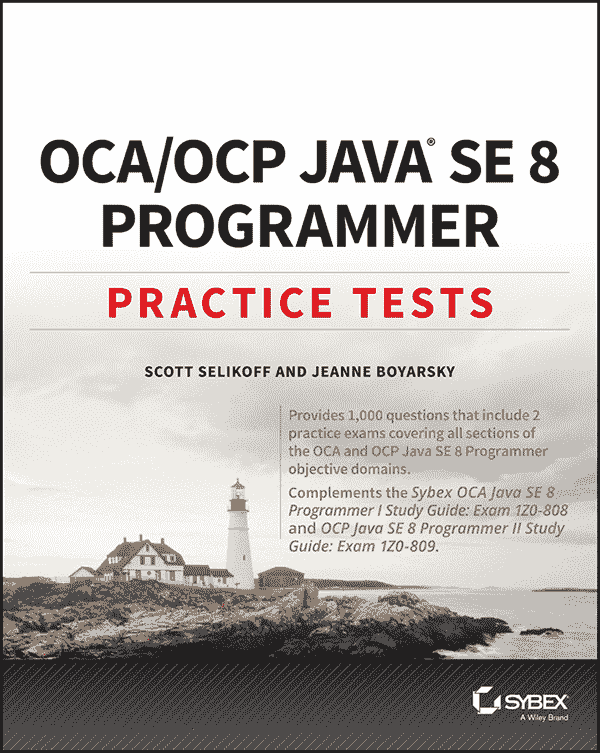


送给我妻子即将出生的小新生命。

— Scott

在同一年怀念爱因斯坦和 CV。祝贺 694！

— Jeanne

# 致谢

Scott 和 Jeanne 感谢许多对本书做出贡献的个人。感谢 David Clark 引导我们走完整个创作过程，并在许多方面让这本书变得更好。感谢 Janeice DelVecchio 在我们编写本书期间担任我们的技术编辑。除了大错误，Janeice 还指出了许多细微的错误。感谢 Elena Felder 担任我们的技术校对，并发现了我们设法瞒过 Janeice 的错误。如果没有 Wiley 的许多人，包括 Kenyon Brown、Rebecca Anderson、Judy Flynn、Nancy Carrasco 以及许多其他人，这本书就不可能完成。

如果没有一支“小军队”的帮助，Scott 无法走到这一步，这支军队的领队是他始终理解他的妻子 Patti，她是他们的双胞女儿 Olivia 和 Sophia 能要求的最完美的母亲。康奈尔大学的 Johannes Gehrke 和 John H. Hubbard 教授一直相信他，并知道他会在事业上取得成就。Scott 在这第三本书中想向他极具耐心的合作者 Jeanne 表示谢意。Matt Dalen 向 Scott 推荐了 `CodeRanch.com` 并鼓励他定期发帖，这一步改变了他的生活。非常感谢 Mark Seloff 教会他教育的价值。最后，Scott 感谢他的母亲、退休教师 Barbara Selick。

Jeanne 特别感谢 `CodeRanch.com` 的所有对 OCA 和 OCP 问题提问并回答的人。与读者的对话让这本书更加强大。Jeanne 感谢 FRC 机器人队伍 694 的成员以及 FTC 队伍 310 和 479 的支持。你们的问题让她不断思考。Jeanne 还感谢 Onur Otlu 和 Thomas Campos 对某些本地化问题的反馈。关于作者。

最后，但并非不是，Scott 和 Jeanne 都非常感谢我们 OCA 8 和 OCP 8 书的读者。听到你们喜欢这本书并通过了考试，感觉非常棒。我们还感谢那些指出 OCP 书错误并提出改进建议的人。截至 2016 年 12 月，排名前三的是 Guillaume Bailly、Thalita Vergilio 和 Sébastien Canonica。

# 关于作者

**Scott Selikoff** 是一位专业软件顾问、作者以及 Selikoff Solutions, LLC 的所有者，该公司为纽约三地地区的企业提供软件开发解决方案。Scott 精通多种软件语言和平台，专长全栈数据库驱动系统、云应用和面向服务的架构。

Scott 出自新泽西州汤姆斯河（Toms River），他在 2002 年通过三年的学习，获得了康奈尔大学数学和计算机科学学士学位。2003 年，他在康奈尔大学同样获得了计算机科学工程硕士学位。

作为一个深爱教育事业的人，Scott 一直很喜欢向他人教授新概念。他曾在康奈尔大学和罗格大学进行过演讲，并参加过包括服务器端 Java 研讨会在内的会议。Scott 住在新泽西州，与他亲爱的妻子 Patti、可双胞胎女儿 Olivia 和 Sophia 以及两只非常活泼的狗 Webby 和 Georgette 生活在一起。你可以在 [`www.linkedin.com/in/selikoff`](http://www.linkedin.com/in/selikoff) 了解更多关于 Scott 的信息。

`Jeanne Boyarsky` 在纽约市的一家银行担任了 14 年的 Java 开发人员，在那里负责开发、指导和开展培训。业余之余，她还是 [CodeRanch.com](http://CodeRanch.com) 的高级版主，并参与该论坛的代码库维护工作。Jeanne 还担任一个 FIRST 机器人小组编程部门的导师，在那里指导那些刚接触 `Java` 的学生们。

Jeanne 于 2002 年获得计算机科学学士学位，并于 2005 年获得计算机信息技术硕士学位。她享受全职工作的同时通过在线课程获得硕士学位，这在在线教育还不流行的那个时代！Jeanne 还是一名优秀演讲大师（Distinguished Toastmaster）和 Scrum 大师（Scrum Master）。你可以在 [`coderanch.com/wiki/660334`](https://coderanch.com/wiki/660334) 了解更多关于 Jeanne 的信息。

Scott 和 Jeanne 都是 [CodeRanch.com](http://CodeRanch.com) 论坛的版主，可以通过那里与他们取得联系。他们还共同编写了一个名为 Down Home Country Coding 的技术博客，地址位于 [`www.selikoff.net`](http://www.selikoff.net)。

除了这本书之外，Scott 和 Jeanne 还是以下书籍的作者：*OCA Oracle Certified Associate Java SE 8 Programmer I Study Guide* (Sybex, 2015) 和 *OCP Oracle Certified Professional Java SE 8 Programmer II Study Guide* (Sybex, 2016)。最近，这两本书被合并成了单行版 *OCA / OCP Java SE 8 Programmer Certification Kit: Exam 1Z0-808 and Exam 1Z0-809* (Sybex 2016)。

87. 80

88. 81

89. 82

90. 83

91. 84

92. 85

93. 86

94. 87

95. 88

96. 89

97. 90

98. 91

99. 92

100. 93

101. 94

102. 95

103. 96

104. 97

105. 98

106. 99

107. 100

108. 101

109. 102

110. 103

111. 104

112. 105

113. 106

114. 107

115. 108

116. 109

117. 110

118. 111

119. 112

120. 113

121. 114

122. 115

123. 116

124. 117

125. 118

126. 119

127. 120

128. 121

129. 122

130. 123

131. 124

132. 125

133. 126

134. 127

135. 128

136. 129

137. 130

138. 131

139. 132

140. 133

141. 134

142. 135

143. 136

144. 137

145. 138

146. 139

147. 140

148. 141

149. 142

150. 143

151. 144

152. 145

153. 146

154. 147

155. 148

156. 149

157. 151

158. 152

159. 153

160. 154

161. 155

162. 156

163. 157

164. 158

165. 159

166. 160

167. 161

168. 162

169. 163

170. 164

171. 165

172. 166

- 173. 167

- 174. 168

- 175. 169

- 176. 170

- 177. 171

- 178. 172

- 179. 173

- 180. 174

- 181. 175

- 182. 176

- 183. 177

- 184. 178

- 185. 179

- 186. 180

- 187. 181

- 188. 182

- 189. 183

- 190. 185

- 191. 187

- 192. 188

- 193. 189

- 194. 190

- 195. 191

- 196. 192

- 197. 193

- 198. 194

- 199. 195

- 200. 196

- 201. 197

- 202. 198

- 203. 199

- 204. 200

- 205. 201

- 206. 202

- 207. 203

- 208. 204

- 209. 205

- 210. 206

- 211. 207

- 212. 208

- 213. 209

- 214. 210

- 215. 211

- 216. 212

- 217. 213

- 218. 214

- 219. 215

- 220. 216

- 221. 217

- 222. 218

- 223. 219

- 224. 220

- 225. 221

- 226. 223

- 227. 224

- 228. 225

- 229. 226

- 230. 227

- 231. 228

- 232. 229

- 233. 230

- 234. 231

- 235. 232

- 236. 233

- 237. 234

- 238. 235

- 239. 236

- 240. 237

- 241. 239

- 242. 240

- 243. 241

- 244. 242

- 245. 243

- 246. 244

- 247. 245

- 248. 246

- 249. 247

- 250. 248

- 251. 249

- 252. 250

- 253. 251

- 254. 252

- 255. 253

- 256. 255

- 257. 256

- 258. 257

- 259. 258

- 260. 259

- 261. 260

- 262. 261

- 263. 262

- 264. 263

- 265. 264

- 266. 265

- 267. 266

- 268. 267

- 269. 268

- 270. 269

- 271. 271

- 272. 272

- 273. 273

- 274. 274

- 275. 275

- 276. 276

- 277. 277

- 278. 278

- 279. 279

- 280. 280

- 281. 281

- 282. 282

- 283. 283

- 284. 284

- 285. 285

- 286. 286

- 287. 287

- 288. 288

- 289. 289

- 290. 290

- 291. 291

- 292. 292

- 293. 293

- 294. 294

- 295. 295

- 296. 296

- 297. 297

- 298. 298

- 299. 299

- 300. 300

- 301. 301

- 302. 302

- 303. 303

- 304. 304

- 305. 305

- 306. 306

- 307. 307

- 308. 308

- 309. 309

- 310. 310

- 311. 311

- 312. 312

- 313. 313

- 314. 314

- 315. 315

- 316. 316

- 317. 317

- 318. 319

- 319. 320

- 320. 321

- 321. 322

- 322. 323

- 323. 324

- 324. 325

- 325. 326

- 326. 327

- 327. 328

- 328. 329

- 329. 330

- 330. 331

- 331. 332

- 332. 333

- 333. 334

- 334. 335

- 335. 337

- 336. 338

- 337. 339

- 338. 340

- 339. 341

- 340. 342

- 341. 343

- 342. 344

- 343. 345

- 344. 346

- 345. 347

- 346. 348

- 347. 349

- 348. 350

- 349. 351

- 350. 352

- 351. 353

- 352. 354

- 353. 355

- 354. 357

- 355. 358

- 356. 359

- 357. 360

- 358. 361

- 359. 362

- 360. 363

- 361. 364

- 362. 365

- 363. 366

- 364. 367

- 365. 368

- 366. 369

- 367. 371

- 368. 372

- 369. 373

- 370. 374

- 371. 375

- 372. 376

- 373. 377

- 374. 378

- 375. 379

- 376. 380

- 377. 381

- 378. 382

- 379. 383

- 380. 384

- 381. 385

- 382. 386

- 383. 387

- 384. 388

- 385. 389

- 386. 390

- 387. 391

- 388. 392

- 389. 393

- 390. 394

- 391. 395

- 392. 396

- 393. 397

- 394. 398

- 395. 399

- 396. 400

- 397. 401

- 398. 402

- 399. 403

- 400. 404

- 401. 405

408. 412

409. 413

410. 414

411. 415

412. 416

413. 417

414. 418

415. 419

416. 420

417. 421

418. 422

419. 423

420. 424

421. 425

422. 426

423. 427

424. 428

425. 429

426. 430

427. 431

428. 432

429. 433

430. 434

431. 435

432. 436

433. 437

434. 438

435. 439

436. 440

437. 441

438. 442

439. 443

440. 444

441. 445

442. 446

443. 447

444. 448

445. 449

446. 450

447. 451

448. 452

449. 453

450. 454

451. 455

452. 456

453. 457

454. 458

455. 459

456. 450

457. 461

458. 462

459. 463

460. 464

461. 465

462. 466

463. 467

464. 468

465. 469

466. 470

467. 471

468. 472

469. 473

470. 474

471. 475

472. 476

473. 477

474. 478

475. 479

476. 480

477. 481

478. 482

479. 483

480. 484

481. 485

482. 486

483. 487

484. 488

485. 489

486. 490

487. 491

488. 492

489. 493

490. 494

491. 495

492. 496

493. 497

494. 498

495. 499

496. 500

497. 501

498. 502

499. 503

500. 504

501. 505

502. 506

503. 507

504. 508

505. 509

506. 510

507. 511

508. 512

509. 513

510. 514

511. 515

512. 416

513. 517

514. 518

515. 519

516. 520

517. 521

518. 522

519. 423

520. 424

521. 425

522. 426

523. 427

524. 428

525. 429

526. 430

527. 431

528. 432

529. 433

530. 434

531. 435

532. 436

533. 437

534. 438

535. 439

536. 440

537. 441

538. 442

539. 443

540. 444

541. 445

542. 446

543. 447

544. 448

545. 449

546. 450

547. 451

548. 452

549. 453

550. 454

551. 455

552. 456

553. 457

554. 458

555. 459

556. 460

557. 461

558. 462

559. 463

560. 464

561. 465

562. 466

563. 467

564. 468

565. 469

566. 470

567. 471

568. 472

569. 473

570. 474

571. 475

572. 476

573. 477

574. 478

575. 479

576. 480

577. 481

578. 482

579. 483

580. 484

581. 485

582. 486

583. 487

584. 488

585. 489

586. 490

587. 491

588. 492

589. 493

590. 494

591. 495

592. 496

593. 497

594. 498

595. 499

596. 500

597. 501


598. 502

599. 503

600. 504

601. 505

602. 506

603. 507

604. 508

605. 509

606. 510

607. 511

608. 512

609. 513

610. 514

611. 515

# 前言

本书适用于参加 `1Z0-808` 或 `1Z0-809` 考试的读者。如果你是 Java 初学者，我们强烈建议先阅读 *OCA Certified Associate Java SE 8 Programmer I Study Guide* 和 *OCP Certified Professional Java 8 Programmer II Study Guide*，我们是本书的作者。与学习指南的设计难度比真实考试要大，本书中的题目模拟了考试格式。本书中的所有题目都会告知你有几个正确答案。如果有多个正确答案，会显示“选择两个”或“选择三个”。在本书中，我们使用了 Oracle 考试使用的同一套假设。在许多情况下，这些假设实际上是为了让你在解决问题时忽略 Oracle 的遗漏或排版错误。这些假设列在 [`education.oracle.com`](http://education.oracle.com)，为了方便起见在此列出：

*   缺失包和导入语句：如果示例代码没有包含包或导入语句，且题目没有明确引用这些缺失的语句，请假设所有示例代码都在同一个包中，并且存在支持它们的导入语句。

*   **没有类的文件或目录路径：** 如果题目没有说明类的文件名或目录位置，请假设以下情况之一，以确保代码能够编译和运行：

    *   所有类都在一个文件中。

    *   每个类都在一个单独的文件中，所有文件都在同一个目录下。

*   **意外的换行：** 示例代码可能有意外的换行。如果你看到某行代码看起来像是换行了，并且这导致了显著的情况（例如引号内的字符串字面量换行），请假设该换行是同一行的扩展，且该行不包含会导致编译失败的硬回车。

*   **代码片段：** 代码片段是指没有提供上下文的小部分源代码。假设所有必要的支持代码都存在，并且支持环境完全支持显示代码及其省略环境的正确编译和执行。

*   **描述性注释：** 请按字面理解描述性注释，例如“此处为 setter 和 getter 方法”。假设正确的代码已经存在、可以编译并能成功运行，以实现所描述的效果。

## 选择考试

通往 Java 认证之路的第一步是 Oracle Certified Associate `1Z0-808` (OCA 8) 考试。该材料包含了每个 Java 开发者都应该熟悉的日常基础工具。一旦你完成了该考试，就可以参加更具难度的 Oracle Certified Professional `1Z0-809` (OCP 8) 考试。该考试涵盖了第一场考试中的所有主题，以及许多你自己在职业生涯中可能并不熟悉的额外库和 API，例如并发（Concurrency）和 `NIO.2` API。

如果你已经拥有 Java 认证，则有资格参加升级考试。表 I.1 和 图 I.1 显示了获取 OCP 8 认证的各种路径。本书将帮助你准备表格列出的所有四场考试。

| 考试代码 | 名称 | 谁应该参加 |

| --- | --- | --- |

| `1Z0–808` | Java Programmer I | 任何人都可以参加此考试。 |

| `1Z0–809` | Java Programmer II | 通过了 OCA 8 考试的人 |

| `1Z0–810` | 从 Java SE 7 升级到 Java SE 8 OCP 程序员 | OCP 7 认证持有者 |

| `1Z0–813` | 升级到 Java SE 8 OCP (Java SE 6 及所有之前的版本) | 持有以下任何一种认证的持有者：<br>* `SCJP/OCJP 6`<br>* `SCJP/OCJP 5`<br>* `SCJP 1.4`<br>任何旧的 `SCJP` 证书 |

**表 I.1** 本书涵盖的考试

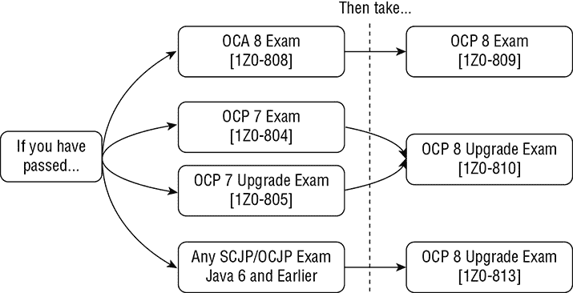

**图 I.1** 考试先决条件

对于 OCA 考试，我们建议使用我们的 `OCA Oracle Certified Associated Java SE 8 Programmer Study Guide` 配合本书的第 1 至 10 章制定学习计划。对于 OCP 考试，我们建议使用我们的 `OCP Oracle Certified Professional Java SE 8 Programmer II Study Guide` 配合本书的第 11 至 23 章制定学习计划。没错，这本书实际上是两书合一！它可以帮助你应对 OCA 和 OCP 考试。

### 参加升级考试

如果你要参加其中一种升级考试，在准备方式上会有一些细微差别。好消息是，如果你目前持有 Java 7 OCP 认证并参加 `1Z0-810` 升级考试，那么这本书就是你所需要的。虽然考试更侧重于 Java 7 和 Java 8 之间的变化，但并没有任何现有 OCP 7 材料中未涵盖的新主题。这意味着你的学习计划与那些首次参加 OCP 考试的人相同。

另一方面，如果你参加参加 `1Z0-813` 升级考试并持有 Sun Certified Java Programmer (`SCJP`) 或 Oracle Certified Java Programmer (`OCJP`) 称号，那么你需要额外的材料。这种升级莫名其妙地包含了 Java 7 OCP 考试中包含但在 Java 8 版本中被移除的内容，例如 `ReentrantLock` 和 `WatchService`。对此我们没有解释，尽管这使得 `1Z0-813` 可以被认为是三场 OCP 考试中最难的一个，因为它需要了解多个 Java 版本的所有知识。

不要担心！当我们编写 `OCP Oracle Certified Professional Java SE 8 Programmer II Study Guide` 时，添加了一个特殊的 50 页附录——录 C，“从 Java 6 或更早版本升级”，它详细涵盖了 `1Z0-813` 考试的专属主题。如果你正在参加 `1Z0-813` 考试，那么在完成本书的学习后，你应该查阅我们 OCP 书籍中的附录或 Java 7 OCP 学习指南，以便准备好应对所有目标。

### 考虑其他学习路径

如果你已经拥有 Java 认证，并不要求参加升级考试。有些开发者发现，从较简单的 `1Z0-808` OCA 考试开始，然后参加更具挑战性的 `1Z0-809` OCP 考试更为直接。如果你没有 Java 8 的经验，或者只是想进行更多练习，那么先参加 OCA 考试再参加 OCP 考试可能比参加单一升级考试是更好的学习体验，尽管它的成本更高。

另外请记住，如果你持有旧的 Java 称号并想参加升级考试，即使你通过了升级考试，也需要在获得 OCP 8 称号之前证明你的身份。这要求你在 Oracle 的 `CertView` 系统中注册你的旧认证。我们听过一些读者的反馈，他们不得不翻找十多年前的旧文件夹和电子邮件，以提交适当的文件，以便他们被授予 OCP 8 称号。

最后，如果你是 Java 认证的新手，传统做法是按顺序参加考试，先参加 OCA 考试，后参加 OCP 考试。然而，这并不是严格要求。先参加 OCP 考试是可能的，尽管非常不合常规。

## 谁应该买这本书

如果你想参加 OCA 考试 (`1Z0-808`)，那么本书的第 1 至 10 章适合你。

如果你想参加 OCP 考试 (`1Z0-809`) 或 OCP 8 升级考试 (`1Z0-810`)，那么本书的第 11 至 23 章适合你。正如前面提到的，如果你想参加 OCP 8 升级考试 (`1Z0-813`)，这本书对大部分主题仍有帮助。你需要补充 Java 7 学习指南或使用我们 OCP 书籍中的附录 C，该附录专注于 `1Z0-813` 考试中你所需的精确主题。

## 本书是如何组织的

对于这本书，我们决定将两书合一，分为第一部分和第二部分。第一部分包含第 1 至 10 章，针对每个 OCA 考试目标有 9 个目标型章节，最后是一场模拟 OCA 练习考试。第二部分涵盖第 11 至 23 章，针对每个 OCP 考试目标有 12 个目标型章节，最后是一场模拟 OCP 练习考试。

### 使用目标型章节

我们设计的目标型章节中每个问题的结构和风格，反映了更积极的学习体验，让你在每个问题上花费更少的时间，但涵盖的范围更广。例如，你可能会在同一个章节中看到两个看起来相似的问题，但它们之间的细微差别对代码是否能编译或产生什么输出有巨大影响。

目标型章节中的每个问题都有恰好四个选项，只有一个正确答案。就像我们学习指南中的复习题一样，这些问题的初初是为了让你多次回答。

在我们的学习指南中，我们经常将相关主题分组成章节。例如，`if/then` 语句和循环属于不同的 Oracle 目标集，但在我们的 OCA 教程书中，它们被包含在“运算符和语句”这一个章节中。在本书书中，我们决定仅围绕 Oracle 的目标来设计章节，以便你强化自己的技能。虽然在用本书中使用基于目标的章节之前，你不需要阅读整本学习指南，但你确实需要学习相关的目标。I.2 和 I.3 显示了在练习本书中的问题之前，你最少需要读过我们学习指南中的哪些章节。

| 本书章节 | 目标 | OCA 学习指南章节 |

| --- | --- | --- |

| 1 | Java 基础 | 1 |

| 2 | 处理 Java 数据类型 | 1, 3 |

| 3 | 使用运算符和决策结构 | 2, 3 |

| 4 | 创建和使用数组 | 3 |

| 5 | 使用循环结构 | 2 |

| 6 | 处理方法和封装 | 4 |

| 7 | 处理继承 | 5 |

| 8 | 处理异常 | 6 |

| 9 | 使用 Java API 中的选类 | 1, 3, 4 |

#### 表 I.2](#intro.xhtml_tableanchor-2) OCA 学习指南中的引用

| 本书章节 | 目标 | OCP 学习指南章节 |

| --- | --- | --- |

| 11 | Java 类设计 | 1, 2 |

| 12 | 高级 Java 类设计 | 1, 2, 3 |

| 13 | 泛型和集合 | 3, 4 |

| 14 | Lambda 内置函数接口 | 2, 4 |

| 15 | Java Stream API | 3, 4 |

| 16 | 异常和断言 | 6 |

| 17 | 使用 Java SE 8 日期时间 API | 5 |

| 18 | Java I/O 基础 | 8 |

| 19 | Java 文件 I/O (NIO.2) | 9 |

| 20 | Java 并发 | 7 |

| 21 | 使用 JDBC 构建数据库应用程序 | 10 |

| 22 | 本地化 | 5 |

#### 表 I.3](#intro.xhtml_tableanchor-3) OCP 学习指南中的引用

### 使用模拟考试章节

本书包含两个完整的模拟考试章节，其中第 10 章是 80 题 OCA 模拟考试，第 23 章是 85 题 OCP 模拟考试。这两个章节中的题目与基于目标的章节在许多重要方面非常不同。这些模拟题目通常更，因为它们的设计是为了测试你的累计知识，而不是强化你现有的技能。

虽然所有基于目标的章节都有四个选项且只有一个正确答案，但这些题目最多有六个选项，且最多有三个正确答案。根据我们前两本书的反馈，我们在模拟考试章节中明确指出了有多少个正确答案，这与真实考试的做法一致。有些读者认为，不知道正确答案的数量会让题目对于学习来说太具有挑战性。

两个模拟考试章节都设计为在 150 分钟内完成，及格分为 65%。记住，在自己觉得准备好之前不要进行模拟考试。可用的模拟考试次数有限，所以你不想浪费宝贵的机会。

虽然一个基于目标的章节可以在几天内完成，但模拟考试章节被设计为一次性完成。你应该尽可能模拟考试体验。这意味着预留两个半小时，拿上一块白板或草稿纸，并回答每一个问题，即使你不确定答案。记住，猜测没有惩罚，你排除的明显错误答案越多就越好。

### 复习考试变更

Oracle 会不时更改题目数量、及格分数和时间限制。事实上，在本书编写期间，考试编写者将 OCA 8 的题目数量从 77 改到了 80！Scott 和 Jeanne 维护着一个博客，跟踪真实考试的更新，速度与 Oracle 更新的速度同步：

[`www.selikoff.net/jpt`](https://www.selikoff.net/jpt)

我们建议你在参加真实考试之前阅读此页面，以防自书出版以来任何信息发生了变化。虽然不常见，但 Oracle 确实会添加、删除或重述目标。当这种情况发生时，我们会在网站上以博客文章的形式提供免费的补充材料。

### 准备好考试

如果你在你想要参加的考试的所有相关章节（包括模拟考试）中都能稳定地获得 80% 以上的分数，那么可能已经准备好参加真实考试了。只需记住，在家进行模拟测试与花费数百美元在测试中心参加真实考试之间有巨大的区别。

我们可以写一整章关于考试技巧和学习建议。噢等一下，我们确实写了！我们的 OCA 8 和 OCP 8 书各都包含一个充满有用提示和建议的附录，旨在帮助你管理时间。它们还包含了关于如何排除明显错误答案的说明，以便当你不得不猜测时，你是在两个选项中做选择，而不是五个中。

最后，尽管很多人倾向于在考试前尽可能塞进更多内容，但我们能提供的最好的建议是保证充足睡眠。

### 需要更多帮助

两位作者都是 [Codeanch.com](http://coderanch.com) 的版，这是一个对学者非常友好的编程论坛。如果你在阅读解释后仍然不理解某个问题，尽管可以在这些论坛中提问。你可能会从那里获得答案。针对不同的考试有不同的论坛：

OCA 论坛：[`coderanch.com/f/117`](https://coderanch.com/f/117)

OCP 论坛：[`coderanch.com/f/24`](https://coderanch.com/f/24)

祝考试顺利，学习进步！

## 额外内容

本书有一个网页，使用 Wiley 的交互测试引擎提供书中的所有题目。

# 第一部分：OCA Java 基础

**本次测试涵盖的 OCA 考试主题包括：**

*   定义变量的作用域

*   定义 Java 结构

*   创建带有 main 方法的可执行 Java 程序；从命令行运行 Java 程序；产生控制台输出

*   导入其他包以便在代码中使用

*   对比 Java 的特性和组件，如：平台独立性、面向对象、封装等

1. 下列哪个方法签名是 Java 应用程序有效的入口声明？

   - `public void main(String[] args)`

   - `public static void main()`

   - `private static void start(String[] mydata)`

   - `public static final void main(String[] mydata)`

2. 下面的类图展示了 Gold 和 Silver 之间的关系，它们都继承自 Metal 类。关于该图的说明哪个是错误的？

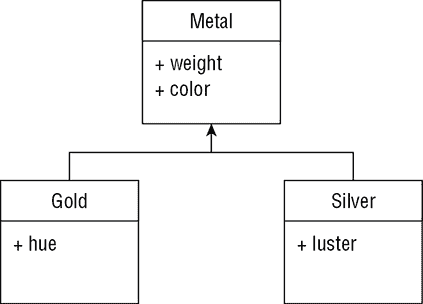

   - 图展示了 Java 的平台独立性。

   - 图展示了 Java 的面向对象设计。

   - Gold 和 Silver 类继承了 Metal 类的 weight 和 color。

   - Gold 不继承 luster 属性。

3. Java 字节码文件的正确扩展名是什么？

   - `.java`

   - `.bytecode`

   - `.class`

   - `.dll`

4. 鉴于 `java.util` 和 `java.sql` 包中都存在 `Date` 类，编译以下类的类的结果是什么？

```java
1: import java.util.*;
2: import java.sql.*;
3: public class BirthdayManager {
4:    private Date rob = new Date();
5:    private java.util.Date sharon = new java.util.Date();
6: }
```

1. 因为第 1 行和第 2 行，代码无法编译。

2. 因为第 4 行，代码无法编译。

3. 因为第 5 行，代码无法编译。

4. 代码无问题地编译。

5. 以下哪项不是传统面向对象语言的特征？

1. 对象被分组为过程，与它们所操作的数据分离。

2. 对象可以通过类型转换（casting）采取多种形式。

3. 对象可以持有数据，称为属性。

4. 对象可以通过方法执行操作。

6. 哪些变量的作用范围被限制在方法内？

1. 接口变量

2. 类变量

3. 实例变量

4. 局部变量

7. 哪个包被默认导入到每个 Java 类中？

1. `java.util`

2. `java.lang`

3. `system.lang`

4. `java.system`

8. 以下哪项不是 Java 中有效的代码注释？

1. `// Add 5 to the result`

2. `/*** TODO: Fix bug 12312 ***/`

3. `# Add configuration value`

4. `/* Read file from system ****/`

9. 关于有效的 `.java` 文件的哪个陈述是正确的？

1. 它只能包含一个类声明。

2. 它可以包含一个公共类声明和一个公共接口定义。

3. 它必须定义至少一个公共类。

4. 它最多可以定义一个公共类。

10. 给定以下应用，请从上到下填充表格中缺失的值。


```java
package competition;
public class Robot {
   static String weight = "A lot";
   /* default */ double ageMonths = 5, ageDays = 2;
   private static boolean success = true;
   public void main(String[] args) {
      final String retries = "1";
      // P1
   }
}
```

| 变量类型 | 在 P1 处可访问的变量数量 |
| --- | --- |
| 类 | _______ |
| 实例 | _______ |
| 局部 | _______ |

1. 2, 0, 1
2. 2, 2, 1
3. 1, 0, 1
4. 0, 2, 1

11. 关于 `import` 语句的哪个陈述是正确的？

1. 如果类包含未使用的导入语句，该类将无法编译。
2. 可以从类中删除未使用的导入语句，而不会导致类无法编译。
3. 如果存在重复的导入语句，该类将无法编译。
4. 如果类包含一个程序未使用但无法找到的类的导入语句，它仍然可以编译。

12. 编译并执行以下类的结果是什么？

```java
1: public class ParkRanger {
2:    int birds = 10;
3:    public static void main(String[] data) {
4:       int trees = 5;
5:       System.out.print(trees+birds);
6:    }
7: }
```

1. 无法编译。
2. 可以编译但在运行时抛出异常。
3. 编译并输出 5。
4. 编译并输出 15。

13. 关于 Java 的哪些陈述是正确的？

- `java` 命令可以执行 `.java` 和 `.class` 文件。
- Java 不是面向对象的。
- `javac` 命令直接编译成原生机器码。

1. 仅 I
2. 仅 III
3. II 和 III
4. 均不正确。

14. 以下代码行中哪行不允许作为 Java 类文件的第一行？

1. `import widget.*;`
2. `// Widget Manager`
3. `package sprockets;`
4. `int facilityNumber;`

15. 关于使用包来组织 Java 代码，以下陈述中哪一个是正确的？

1. 每个类都要求包含一个包声明。
2. 要创建一个新包，你需要在目录中添加 `package.init` 文件。
3. 包允许你限制包外部类对类、方法或数据的访问。
4. 不可能限制对包内对象和方法的访问。

16. 假设当前目录为 `/user/home`，在 `/user/home/Manager.java` 有一个使用默认包的应用 Java 文件，在 Java 中编译和运行该应用的正确命令是？

1. `javac Manager` / `java Manager`
2. `javac Manager.java` / `java Manager`
3. `javac Manager` / `java Manager.class`
4. `javac Manager.java` / `java Manager.class`

17. 将类结构化使得只有类内部的方法可以访问其变量被称为。

1. 平台独立性
2. 面向对象
3. 继承
4. 封装

18. 以下代码段的输出是什么？

```java
String tree = "pine";
int count = 0;
if (tree.equals("pine")) {
   height = 5;
   count = 1;
}
System.out.print(height + count);
```

*(注：原文在 `if` 语句中存在语法错误且缺少变量 `height`，已根据逻辑上下文调整)*

1. 1
2. 55
3. 56
4. 代码无法编译。

19. 关于 Java 字节码，以下哪项是正确的？

1. 可以在任何兼容的 JVM 上运行。
2. 它只能在创建它时的相同类型的计算机上执行。
3. 它在标准文本编辑器中被读取。
4. 它需要对应的 `.java` 文件来执行。

20. Java 中终止语句的正确字符是什么？

1. 冒号 (`:`)
2. 换行符
3. 制表符
4. 分号 (`;`)

21. 编译并执行以下类的结果是什么？

```java
1: public class Tolls {
2:    static int yesterday = 1;
3:    int tomorrow = 10;
4:    public static void main(String[] args) {
5:       Tolls tolls = new Tolls();
6:       int today=20, tomorrow = 40;
7:       System.out.print(today + tolls.yesterday);
8:    }
9: }
```

1. 第 6 行无法编译。
2. 第 7 行导致无法编译。
3. 31
4. 61

22. 给定以下类定义，哪一行不包含编译错误？

```java
1: public ThisDoesNotCompile {
2:    double count;
3:    void errors() {}
4:    static limit; }
```

1. 第 1 行
2. 第 2 行
3. 第 3 行
4. 第 4 行

23. 以下功能允许 Java 类在各种计算机和设备上运行？

1. 封装
2. 面向对象
3. 继承
4. 平台独立性

24. 以下哪个不是 JVM 的属性？

1. 它防止 Java 字节码被轻易解码/反编译。
2. 它支持平台独立性。
3. 它管理应用的内存。
4. 它将 Java 指令翻译为机器指令。

25. 以下变量在整个程序范围内有效？

1. 包变量
2. 类变量
3. 实例变量
4. 局部变量

26. 根据以下通配符导入语句，哪个类会被包含在导入中？

```java
import television.actor.*;
import movie.director.*;
```

1. `television.actor.recurring.Marie`
2. `movie.directors.John`
3. `television.actor.Package`
4. `movie.NewRelease`

27. Java 类文件中语句的正确顺序是？

1. 导入语句、包声明、类声明
2. 包声明、类声明、导入语句
3. 类声明、导入语句、包声明
4. 包声明、导入语句、类声明

**28. 给定以下类定义，在代码仍能编译的情况下，最多可以删除多少条 `import` 语句？对于此问题，假设 `Blackhole` 类仅定义在 `stars` 包中。**

```java
package planetarium;
import java.lang.*;
import stars.*;
import java.lang.Object;
import stars.Blackhole;

public class Observer {
   public void find(Blackhole blackhole) {}
}
```

1. 零
2. 一个
3. 两个
4. 三

**29. 给定以下类定义，哪个命令会导致应用程序输出消息 "White-tailed"？**

```java
package forest;
public class Deer {
   public static void main(String... deerParams) {
      System.out.print(deerParams[2]);
   }
}
```

1. `java forest.Deer deer 5 "White-tailed deer"`
2. `java forest.Deer "White-tailed deer" deer 3`
3. `java forest.Deer Red deer White-tailed deer`
4. `java forest.Deer My "deer White-tailed"`

**30. 下列哪个陈述是正确的？**

1. `java` 命令将 `.java` 文件编译成 `.class` 文件。
2. `javac` 命令将 `.java` 文件编译成 `.class` 文件。
3. `java` 命令将 `.class` 文件编译成 `.java` 文件。
4. `javac` 命令将 `.class` 文件编译成 `.java` 文件。

**31. 下列关于 Java 的陈述中，哪一个是正确的？**

1. Java 是一种过程化编程语言。
2. Java 允许方法重载。
3. Java 允许运算符重载。
4. Java 允许直接访问内存中的对象。

**32. 给定以下代码，按顺序在空白行插入哪些值可以使代码通过编译？**

```java
_______agent;
public  _______Banker {
   private static  _______getMaxWithdrawal() {
      return 10;
   }
}
```

1. `import`, `class`, `null`
2. `import`, `interface`, `void`
3. `package`, `int`, `int`
4. `package`, `class`, `long`

**33. 一个应用程序的输出是什么？**

```java
public class Airplane {
   static int start = 2;
   final int end;
   public Airplane(int x) {
      x = 4;
      end = x;
   }
   public void fly(int distance) {
      System.out.print(end-start+" ");
      System.out.print(distance);
   }
   public static void main(String... start) {
      new Airplane(10).fly(5);
   }
}
```

1. 2 5
2. 8 5
3. 6 5
4. 代码无法编译。

**34. Java 支持通过继承扩展类的最重要原因之一是什么？**

1. 继承要求扩展另一个类的类必须在同一个包中。
2. 程序在运行时必须花费额外的时间/资源来跳过多层继承以确定精确的方法和变量。
3. 父类中方法签名的变化可能会破坏使用重载方法的子类。
4. 开发者通过在公共父类中共享代码，最大限度地减少新类中的重复代码。

**35. 下列哪个是 Java 中有效的代码注释？**

1. `//////// Walk my dog`
2. `#! Go team!`
3. `/ Process fails at runtime /`
4. 以上都不是

**36. 下列哪个方法签名不是 Java 应用程序入口点的有效声明？**

1. `public static void main(String... arguments)`
2. `public static void main(String arguments)`
3. `public static final void main(String[] arguments)`
4. `public static void main(String[] arguments)`

**37. 给定下方的 `Magnet.java` 文件，你可以独立地向哪些被标记的行插入 `public String color;` 且代码仍能编译？**

```java
// line a1
public class Magnet {
   // line a2
   public void attach() {
      // line a3
   }
   // line a4
}
```

1. a1 和 a3
2. a2 和 a4
3. a2, a3 和 a4
4. a1, a2, a3 和 a4

**38. 定义一个有效的 Java 类文件需要什么？**

1. 类声明
2. 包语句
3. 至少一条 `import` 语句
4. `public` 修饰符

**39. Java 源文件的正确扩展名是什么？**

1. `.jav`
2. `.class`
3. `.source`
4. `.java`

**40. 假设 `Math` 类同时存在于 `java.lang` 和 `pocket.complex` 包中，编译以下类的结果是什么？**

```java
1: package pocket;
2: import pocket.complex.*;
3: import java.util.*;
4: public class Calculator {
5:   public static void main(String[] args) {
6:      System.out.print(Math.floor(5));
7:   }
8: }
```

1. 因为第 2 行，代码无法编译。
2. 因为第 3 行，代码无法编译。
3. 因为第 6 行，代码无法编译。

**41. 鉴于 `java.lang` 和 `pocket.complex` 包中都存在 `Math` 类，在使用以下 `import` 语句的情况下，哪个类可以在不使用完整包名的情况下被访问？**

```java
import dog.*;
import puppy.*;
```

1. `dog.puppy`
2. `puppy.dog`
3. `dog`
4. `java.Object`

**42. `_______` 是将数据组织为具有行为单元的技术。**

1. 封装
2. 面向对象
3. 平台无关
4. 多态

**43. 假设 `Broccoli` 类在 `food.vegetables` 包中，`Apple` 类在 `food.fruit` 包中，在使用以下 `import` 语句的情况下，最多可以删除多少条 `import` 语句且代码仍能编译？**

```java
package food;
import food.vegetables.*;
import food.fruit.*;

public class Grocery {
   Apple a; Broccoli;
}
```

1. 零
2. 一个
3. 两个

**44. 给定以下应用程序的预期输出是什么？**

```java
public class Keyboard {
   private boolean numLock = true;
   static boolean capLock = false;
   public static void main(String... shortcuts) {
      System.out.print(numLock+" "+capLock);
   }
}
```

1. `true false`
2. `false false`
3. 代码无法编译。
4. 代码在运行时抛出异常。

**45. 编译并执行以下类的结果是什么？**

```java
public class RollerSkates {
   static int wheels = 1;
   int tracks = 5;
   public static void main(String[] arguments) {
      RollerSkates s = new RollerSkates();
      int feet=4, tracks = 15;
      System.out.print(feet + tracks + s.wheels);
   }
}
```

1. 代码无法编译。
2. 5
3. 10
4. 20

**46. 编译并执行以下类的结果是什么？**

```java
package sports;
public class Bicycle {
   String color = "red";
   private void printColor(String color) {
      color = "purple";
      System.out.print(color);
   }
   public static void main(String[] rider) {
      new Bicycle().printColor("blue");
   }
}
```

1. `red`
2. `purple`
3. `blue`
4. 代码无法编译。

**47. 关于调用编译命令 `javac` 和执行命令 `java` 的哪些陈述是正确的？**

* `java` 可以使用点 `.` 来分隔包。
* `javac` 获取 `.java` 文件并返回一个 `.class` 文件。
* `java` 可以使用斜杠 (`/`) 来分隔包。

1. 仅 I
2. 仅 II
3. I 和 II
4. I、II 和 III

**48. 编译以下应用程序的结果是什么？**

```java
package forecast;
public class Weather {
   private static boolean heatWave = true;
   public static void main() {
      boolean heatWave = false;
      System.out.print(heatWave);
   }
}
```

1. `true`
2. `false`
3. 无法编译。
4. 编译通过但在运行时抛出错误。

49. 给定以下类图，哪种 Java 实现最接近该结构？


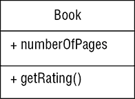

1. `public class Book { public int numOfPages;`

2. `public class Book { public String getRating() {return null;} }`

3. `public class Book { public int numberOfPages; public String getRating() {return null;} }`

4. `public class Book { void numberOfPages; }`

50. 关于 JVM 的哪个陈述是正确的？

1. JVM 按可预测的时间表调度垃圾回收。

2. JVM 确保应用程序始终会终止。

3. JVM 需要一个定义良好的入口点方法来执行应用程序。

4. 经过编译的 Java 代码可以在任何计算机上运行。

## 第 2 章

处理 Java 数据类型

**本次练习测试涵盖的 OCA 考试考点包括：**

* **处理 Java 数据类型**
* 声明和初始化变量（包括原始数据类型的强制转换）
* 区分对象引用变量和原始类型变量
* 了解如何读取或写入对象字段
* 解释对象的生命周期（创建、“通过重新赋值取消引用”和垃圾回收）
* 开发使用如 `Boolean`、`Double` 和 `Integer` 等包装类的代码

1. 下面哪个声明无法编译？

1. `double num1, int num2 = 0;`

2. `int num1, num2;`

3. `int num1, num2 = 0;`

4. `int num1 = 0, num2 = 0;`

2. 下面代码的输出是什么？

```java
public static void main(String... args) {
   String chair, table = "metal";
   chair = chair + table;
   System.out.println(chair);
}
```

1. `metal`

2. `metalmetal`

3. `nullmetal`

4. 代码无法编译。

3. 关于 `String` 类型的实例变量，哪项陈述是正确的？

1. 它默认为空字符串。

2. 它默认为 `null`。

3. 它没有默认值。

4. 如果不在声明行上初始化，它将无法编译。

4. 下面哪个不是有效的变量名？

1. `_blue`

2. `2blue`

3. `blue$`

4. `Blue`

5. 下面哪个类名最符合标准的 Java 命名规范？

1. `fooBar`

2. `FooBar`

3. `FOO_BAR`

4. `F_o_o_B_a_r`

6. 下面方法中有多少个可以编译？

```java
public String convert(int value) {
  return value.toString();
}
public String convert(Integer value) {
  return value.toString();
}
public String convert(Object value) {
  return value.toString();
}
```

1. 无

2. 一个

3. 两个

4. 三

7. 下面哪个无法编译？

1. `int num = 999;`

2. `int num = 9_9_9;`

3. `int num = _9_99;`

4. 以上均不是；它们都可以编译。

8. 下面哪项是包装类？

1. `int`

2. `Int`

3. `Integer`

4. `Object`

9. 运行此代码的结果结是什么？

```java
public class Values {
   integer a = Integer.valueOf("1");
   public static void main(String[] nums) {
      integer a = Integer.valueOf("2");
      integer b = Integer.valueOf("3");
      System.out.println(a + b);
  }
}
```

1. `4`

2. `5`

3. 代码无法编译。

4. 代码编译通过但在运行时抛出异常。

10. 哪项最能描述 `new` 关键字的作用？

1. 创建现有对象的副本并将其视为新对象

2. 创建一个新的原始类型

3. 实例化新对象

4. 将对象引用切换到新对象

11. 哪一行是第一个触发编译器错误的行？

```java
double d1 = 5f;    // p1
double d2 = 5.0;   // p2
float f1 = 5f;     // p3
```

1. `p1`

2. `p2`

3. `p3`

12. 下面哪个原始类型列表是从小到大排序的？

1. `byte, char, double`

2. `char, float, double`

3. `byte, double, float`

4. `float, byte, char`

13. 下面哪项是类的有效顺序？

1. `构造函数, 实例变量, 方法名`

2. `实例变量, 方法名, 构造函数`

3. `方法名, 实例变量, 构造函数`

4. 以上均不是：这些顺序都是有效的。

14. 下面哪行包含错误？

```java
String title = "Weather"; // line1
int hot;                  // line2
System.out.println(hot); // line3
```

1. `x1`

2. `x2`

3. `x3`

4. 以上均不是

15. 代码中有多少个初始化器？

```java
public class Bowling {
  { }
  public Bowling () {
    { }
  }
  static { }
}
```

1. 无

2. 一个

3. 两个

4. 三

16. 对于 `double`、`int` 和 `short` 类型，哪一个可以填充空白以使代码输出？

```java
public static void main(String[] args) {
    defaultValue;
    System.out.println(defaultValue);
}
```

1. 无

2. 一个

3. 两个

4. 三

17. 关于 `finalize()` 方法，哪个正确？

1. 它可能被调用零或一次。

2. 它可能被调用零或多次。

3. 它将被精确调用一次。

4. 它可能被调用一次或多次。

18. 下面哪项是包装类？

1. `Double`

2. `Integer`

3. `Long`

4. `String`

19. 假设你有以下代码。在 main 方法结束之前，假设垃圾回收尚未运行，哪张图片最能表示引用的状态？

```java
public class Link {
   private String name;
   private Link next;
   public Link(String name, Link next) {
     this.name = name;
     this.next = next;
   }
   public void setNext(Link next) {
     this.next = next;
   }
   public Link getNext() {
     return next;
   }
   public static void main(String... args) {
      Link link1 = new Link("x", null);
      Link link2 = new Link("y", link1);
      Link link3 = new Link("z", link2);
      link2.setNext(link3);
      link3.setNext(link2);
      link1 = null;
      link3 = null;
   }
}
```


1. A

2. B

3. C

4. D

20. 哪种类型可以填充空白？

```java
_______ pi = 3.14;
```

1. `byte`

2. `float`

3. `double`

4. `short`

21. 下面代码中哪一行是第一个无法编译？

```java
public static void main(String[] args) {
   int Integer = 0;        // k1
   Integer int = 0;        // k2
   Integer ++;             // k3
   int++;                  // k4
}
```

1. `k1`

2. `k2`

3. `k3`

4. `k4`

22. 假设 `foo` 是一个类实例的引用。关于 `foo.bar`，以下哪项是不正确的？

1. `bar` 是一个实例变量。

2. `bar` 是一个局部变量。

3. 它可以用于读取 `bar`。

4. 它可以用于写入 `bar`。

23. 下列哪项不是有效的类声明？

1. `class building {}`

2. `class Cost$ {}`

3. `class 5MainSt {}`

4. `class _Outside {}`

24. 下列哪项可以填充空白以使此代码编译？

```
_______d = new_______ (1_000_000_.00);
```

1. `double`, `double`

2. `double`, `Double`

3. `Double`, `double`

4. 以上均不是

25. 关于类型为 `String` 的局部变量，哪项是正确的？

1. 它默认为空字符串。

2. 它默认为 `null`。

3. 它没有默认值。

4. 如果在声明行上不初始化，将无法编译。

26. 在 `double`、`int`、`long` 和 `short` 类型中，有多少个可以填充空白使此代码输出 0？

```
static  _______defaultValue;

  public static void main(String[] args) {
     System.out.println(defaultValue);
  }
```

1. 一个

2. 两个

3. 三

4. 四个

27. 关于基本类型（primitives），以下哪项是正确的？

1. 你可以在基本类型上调用方法。

2. 你可以通过赋值将基本类型转换为包装类对象。

3. 你可以通过调用 `valueOf()` 将包装类对象转换为基本类型。

4. 你可以将基本类型直接存入 `ArrayList` 中。

28. 下述代码的输出是什么？

```
Integer integer = new Integer(4);
System.out.print(integer.byteValue());

System.out.print("-");

int i = new Integer(4);
System.out.print(i.byteValue());
```

1. `4-0`

2. `4-4`

3. 代码无法编译。

4. 代码可以编译但在运行时抛出异常。

29. 给定以下代码，填充空白使代码打印 bounce。

```
public class TennisBall {
  public TennisBall() {
     System.out.println("bounce");
  }
  public static void main(String[] slam) {
      _____________________
  }
}
```

1. `TennisBall;`

2. `TennisBall();`

3. `new TennisBall;`

4. `new TennisBall();`

30. 下列哪项正确地将 `animal` 赋值给给两个变量？

* `String cat = "animal", dog = "animal";`

* `String cat = "animal"; dog = "animal";`

* `String cat, dog = "animal";`

* `String cat; dog = "animal";`

1. `I`

2. `I, II`

3. `I, III`

4. `I, II, III`

31. 哪两个基本类型的包装类不仅仅是基本类型名称的首字母大写？

1. `byte` 和 `char`

2. `byte` 和 `int`

3. `char` 和 `int`

4. 以上均不是

32. 关于 `String` 实例变量，以下哪项是正确的？

1. 它们可以被设置为 `null`。

2. 它们永远不能在类外部被设置。

3. 它们只能在构造函数中设置。

4. 它们只能在运行时设置一次。

33. 关于基本类型，哪种陈是正确的？

1. 基本类型以小写字母开头。

2. 基本类型可以被设置为 `null`。

3. `String` 是基本类型。

4. 你可以创建自己的基本类型。

34. 如何强制垃圾回收在特定点点发生？

1. 调用 `System.forceGc()`

2. 调用 `System.gc()`

3. 调用 `System.requireGc()`

4. 以上均不是

35. 在 main 方法结束之前，有多少个 `String` 对象符合垃圾回收条件？

```
public static void main(String[] fruits) {
   String fruit1 = new String("apple");
   String fruit2 = new String("orange");
   String fruit3 = new String("pear");

   fruit3 = fruit1;
   fruit2 = fruit3;
   fruit1 = fruit2;
}
```

1. 无

2. 一个

3. 两个

4. 三

36. 下列哪项可以填充空白使此代码编译？

```
_______d = new_______ (1_000_000.00);
```

1. `double`, `double`

2. `double`, `Double`

3. `Double`, `double`

4. 以上均不是

37. 下列代码输出什么？

```
public class InitOrder {
  public String first = "instance";
  public InitOrder() {
     first = "constructor";
  }
  { first = "block"; }
  public void print() {
     System.out.println(first);
  }
  public static void main(String[] args) {
    new InitOrder().print();
  }
}
```

1. `block`

2. `constructor`

3. `instance`

4. 代码无法编译。

38. 下列有多少行可以编译？

```
int i = null;
Integer in = null;
String s = null;
```

1. 无

2. 一

3. 二

4. 三

39. 下列哪项可以准确填充表格中的空白？

| 方法类型 | 可以在类内部调用 |
| --- | --- |
| 实例 | Blank 1 |
| 静态 | Blank 2 |

1. 1: 仅实例方法，2: 仅静态方法

2. 1: 实例或静态方法，2: 仅静态方法

3. 1: 仅实例方法，2: 实例或静态方法

4. 1: 实例或静态方法，2: 实例

40. 下列哪项无法编译？

1. `double num = 2.7;`

2. `double num = .78;`

3. `double num = 2._8;`

4. 以上均不是；它们都可以编译。

41. 下列哪种基本类型列表按数据类型从小到大排序？

1. `byte`, `short`, `int`, `long`

2. `int`, `short`, `byte`, `long`

3. `short`, `byte`, `int`, `long`

4. `short`, `int`, `byte`, `long`

42. 填充空白使代码编译：


# 第 3 章

使用运算符和决策结构

**本次练习测试涵盖的 OCA 考试考点包括：**

- **使用运算符和决策结构**
  - 使用 Java 运算符；使用括号重写运算符优先级
  - 使用 `==` 和 `equals()` 测试 `Strings` 与其他对象之间的相等性
  - 创建 `if`、`if/else` 和三元运算符结构
  - 使用 `switch` 语句

## 题目

1. 下列哪种变量类型不允许用于 `switch` 语句？

   1. `String`
   2. `double`
   3. `int`
   4. `char`

2. 执行以下代码段后，`tip` 的值是多少？

   ```java
   int meal = 5;
   int tip = 2;
   int total = meal + (meal>6 ? ++tip : ‐‐tip);
   ```

   1. 1
   2. 2
   3. 3
   4. 6

3. 以下应用程序的输出是什么？

   ```java
   package registration;
   public class NameCheck {
      public static void main(String... data) {
         String john = "john";
         String jon = new String(john);
         System.out.print((john==jon)+" "+(john.equals(jon)));
      }
   }
   ```

   1. `true true`
   2. `true false`
   3. `false true`
   4. `false false`

4. 以下应用程序的输出是什么？

   ```java
   package planning;
   public class ThePlan {
      public static void main(String[] input) {
         int plan = 1;
         plan = plan++ + --plan;
         if(plan==1) {
            System.out.print("Plan A");
         } else { if(plan==2) System.out.print("Plan B");
         } else System.out.print("Plan C");
      }
   }
   ```

   1. `Plan A`
   2. `Plan B`
   3. `Plan C`
   4. 以上均不是

5. 关于 `switch` 语句中默认分支的陈述正确的是？

   1. 所有 `switch` 语句都必须包含 `default` 语句。
   2. `default` 语句必须放在所有 `case` 语句之后。
   3. 与 `case` 语句不同，`default` 语句不需要值。
   4. 只有当存在至少一个 `case` 语句时才能使用 `default` 语句。

6. 执行以下代码段后，`thatNumber` 的值是多少？

   ```java
   long thatNumber = 5 >= 5 ? 1 : 2;
   if(thatNumber < 4)
      thatNumber++;
   ```

   1. 3
   2. 4
   3. 5
   4. 无法确定

7. 哪个语句会立即退出 `switch` 语句并跳过剩余 case？

   1. `exit`
   2. `break`
   3. `goto`
   4. `continue`

8. 关于三元表达式的哪个陈述是正确的？

   1. 在某些情况下，两个表达式都会求值。
   2. 三元表达式需要括号。
   3. 三元表达式是 `if-else` 语句的方便替代。
   4. 三元表达式左操作数支持 `int`。

9. 以下代码的输出是什么？

   ```java
   package voting; public class Election {
   public void calculateResult(Integer candidateA, Integer candidateB) {
      boolean process = candidateA == null ? false : candidateA.intValue() < 10;
      boolean value = process && candidateB;
      System.out.print(value);
   }
   public static void main(String[] unused) {
      new Election().calculateResult(null,20);
   }
   ```

   1. `true`
   2. `false`
   3. 代码无法编译
   4. 代码编译但在第 3 行抛出 `NullPointerException`

10. 以下应用程序的输出是什么？

    ```java
    package dinosaur;
    public class Park {
       public final void main(String... arguments) {
          int pterodactyl = 6;
          int tricerops = 3;
          if(pterodactyl % 3 >= 1)
             triceratops++;
          triceratops--;
          System.out.print(triceratops);
       }
    }
    ```

    1. 2
    2. 3
    3. 4
    4. 代码无法编译

11. 关于 `if-then` 语句的哪个陈述是正确的？

    1. `if-then` 语句必须有 `else` 语句。
    2. 如果 `if-then` 语句的布尔测试为 `false`，则目标语句仍会被求值。
    3. `if-then` 语句需要强制转换对象。
    4. `if-then` 语句可以执行单个语句或代码块 `{}`。

12. 以下应用程序的输出是什么？

    ```java
    package restaurant;
    public class Pieces {
       public static void main(String[] info) {
          int flair = 15;
          if(flair >= 15 && flair < 37) {
             System.out.print("Not enough");
          } if(flair==37) {
             System.out.print("Just right");
          } else {
             System.out.print("Too many");
          }
       }
    }
    ```

    1. `Not enough`
    2. `Just right`
    3. `Too many`
    4. 以上均不是

13. 关于 `switch` 语句中 `case` 语句的哪个陈述是不正确的？

    1. `case` 值可以是 `final` 的。
    2. `case` 语句必须以 `break` 语句终止。
    3. `case` 值可以是字面量表达式。
    4. `case` 值必须与 `switch` 变量的数据类型匹配，或者能够提升为该类型。

14. 给给定的真值表，布尔表达式 `x` 和 `y` 的哪个运算符对应这种关系？

    |       | **x = true** | **x = false** |
    |-------|--------------|---------------|
    | **y = true** | true         | false         |
    | **y = false**| false        | false         |

    1. `--`
    2. `++`
    3. `||`
    4. `&&`

15. 以下代码段的输出是什么？

    ```java
    int hops = 0;
    int jumps = 0;
    jumps = hops++;
    if(jumps)
       System.out.print("Jump!");
    else
       System.out.print("Hop!");
    ```

    1. `Jump!`
    2. `Hop!`
    3. 代码无法编译。
    4. 代码可以编译但在运行时抛出异常。

16. 填空：`_____________` 运算符将变量的值加 1 并返回新值，而 `_____________` 运算符将变量的值减 1 并返回原始值。

    1. 前置增 `[++v]`,前置减 `[--v]`
    2. 前置增 `[++v]`,后置减 `[v--]`
    3. 后置增 `[v++]`,前置减 `[--v]`
    4. 后置增 `[v++]`,后置减 `[v--]`

17. 下程序的输出是什么？

    ```java
    package jungle;
    public class TheBigRace {
       public static void main(String[] in) {
          int tiger = 2;
          short lion = 3;
          long winner = lion+2*(tiger + lion);
          System.out.print(winner);
       }
    }
    ```

    1. 11
    2. 13
    3. 25
    4. 以上均不是

18. 给定以下代码片段，假设 `dayOfWeek` 是一个 `int`，`saturday` 的什么变量类型是不允许的？

    ```java
    final _________ saturday = 6;
    switch(dayOfWeek) {
       default:
          System.out.print("Another Weekday");
          break;
       case saturday:
          System.out.print("Weekend!");
    }
    ```

    1. `byte`
    2. `long`
    3. `int`
    4. 以上都不是

19. 给以下代码片段，执行后 `dinner` 的值是多少？

    ```java
    int time = 11;
    int day = 4;
    String dinner = time > 10 ? day ? "Takeout" : "Salad" : "Leftovers";
    ```

    1. `Takeout`
    2. `Salad`
    3. 代码无法编译，但如果加上括号就可以编译。
    4. 以上都不是

20. 下程序的输出是什么？

    ```java
    package recreation;
    public class Dancing {
       public static void main(String[] vars) {
          int leaders = 10 * (2 + (1 + 2 / 5);
          int followers = leaders * 2;
          System.out.print(leaders + followers < 10 ? "Too few" : "Too many");
       }
    }
    ```

    1. `Too few`
    2. `Too many`
    3. 代码无法编译。
    4. 代码可以编译但在运行时抛出除以零错误。

21. 下程序的输出是什么？

    ```java
    package schedule;
    public class PrintWeek {
       public static final void main(String[] days) {
          System.out.print(5 + 6 + "7" + 8 + 9);
       }
    }
    ```

    1. `56789`
    2. `11789`
    3. `11717`
    4. 代码无法编译。

22. 填空：`______________` 运算符用于求两个数之间的差，而 `______________` 运算符用于求一个数除以另一个数时的余数。

    1. `/`, `%`
    2. `–`, `%`
    3. `%`, `<`
    4. `,` `||`

23. 下程序的输出是什么？

    ```java
    package animal;
    public class Cat {
      public String name;
      public static void main(String[] meow) {
        Cat cat = new Cat();
        ______________ = "Sadie";
      }
    }
    ```

    1. `cat.name`
    2. `cat-name`
    3. `cat.setName`
    4. `cat[name]`

24. 假设运行完成，以下代码的输出是什么？

    ```java
    package store;
    public class Toy {
      public void play() {
         System.out.print("play-");
      }
      public void finalizer() {
         System.out.print("clean-");
      }
      public static void main(String[] fun) {
         Toy car = new Toy();
         car.play();
         System.gc();
         Toy doll = new Toy();
         doll.play();
      }
    }
    ```

    1. `play-`
    2. `play-play-`
    3. `play-clean-play-`
    4. `play-play-clean-clean-`

25. 填充空白实现此方法的常用方式是？

    ```java
    public class Penguin {

      private double beakLength;

      public static void setBeakLength(Penguin p, int b) {
         _____________________________
      }
    }
    ```

    1. `p.beakLength = b;`
    2. `p['beakLength'] = b;`
    3. `p[beakLength] = b;`
    4. 以上均不是

26. 填充空白以指示基本类型或包装类可以使用自动装箱功能进行赋值。

    ```java
    _______first = Integer.parseInt("5");
    _______second = Integer.valueOf("5");
    ```

    1. `int`, `int`
    2. `int`, `Integer`
    3. `Integer`, `int`
    4. `Integer`, `Integer`

27. 在 `main` 方法结束之前，有多少个对象符合垃圾回收条件？

    ```java
    1:   public class Person {
    2:      public Person youngestChild;
    3:
    4:      public static void main(String... args) {
    5:         Person elena = new Person();
    6:         Person diana = new Person();
    7:         elena.youngestChild = diana;
    8:         diana = null;
    9:         Person zoe = new Person();
    10:        elena.youngestChild = zoe;
    11:        zoe = null;
    12:     }
    13:   }
    ```

    1. 无
    2. 一个
    3. 两个
    4. 三

28. 哪个是该类的有效构造函数？

    ```java
    public class TennisBall {
    }
    ```

    1. `public TennisBall static create() { return new TennisBall(); }`
    2. `public TennisBall static newInstance() { return new TennisBall():}`
    3. `public TennisBall() {}`
    4. `public void TennisBall() {}`

29. 假设此代码运行完毕，下列哪项不是该代码的可能输出？

    ```java
    package store;
    public class Toy {
       public void play() {
          System.out.print("play-");
       }
       public void finalize() {
          System.out.print("clean-");
       }
       public static void main(String[] args) {
          Toy car = new Toy();
          car.play();
          System.gc();
          Toy doll = new Toy();
          doll.play();
       }
    }
    ```

    1. `play-`
    2. `play-play-`
    3. `play-play-clean-`
    4. `play-play-clean-clean-`

30. 哪一项在不使用自动装箱（autoboxing）的情况下原始类型转换为包装类对象？

    1. 调用 `asObject()` 方法
    2. 调用包装类的构造函数
    3. 调用 `convertToObject()` 方法
    4. 调用 `toObject()` 方法

31. 以下代码的输出是什么？

    ```java
    package beach;
    public class Sand {
       public Sand() {
          System.out.print("a");
       }
       public void Sand() {
          System.out.print("b");
       }
       public void run() {
          new Sand();
          Sand();
       }
       public static void main(String... args) {
          new Sand().run();
       }
    }
    ```

    1. `a`
    2. `ab`
    3. `aab`
    4. 以上均不是


```java
package transporter;
public class Rematerialize {
   public static void main(String[] input) {
      int dog = 11;
      int cat = 3;
      int partA = dog / cat;
      int partB = dog % cat;
      int newDog = partB + partA * cat;
      System.out.print(newDog);
   }
}
```

1. 9

2. 11

3. 15

4. 代码无法编译。

24. 下程序的输出是什么？

```java
package dessert;
public class IceCream {
   public final static void main(String... args) {
      int flavors = 30;
      int eaten = 0;
      switch(flavors) {
         case 30: eaten++;
         case 40: eaten+=2;
         default: eaten--;
      }
      System.out.print(eaten);
   }
}
```

1. 1

2. 2

3. 3

4. 代码无法编译。

25. 下程序的输出是什么？

```java
package mode;
public class Transportation {
   public static String travel(int distance) {
      return distance<1000 ? "train" : 10;
   }
   public static void main(String[] answer) {
      System.out.print(travel(500));
   }
}
```

1. train

2. 10

3. 代码无法编译。

4. 代码可以编译但在运行时抛出异常。

26. 填空：`_____________` 运算符用于寻找……而 `_____________` 运算符用于寻找……（等待，提供的文本是：两个非空对象，如果 `_____________` 且 `_____________` 为真，则 `_____________` 也必须为真）。

*基于提供的文本：*填空：两个非空对象，如果 `_____________` 且 `_____________` 为真，则 `_____________` 也必须为真。

1. `==`, `equals()`

2. `!=`, `equals()`

3. `equals()`, `==`

4. `equals()`

27. 提供的文本是：`myVariable`

28. 以下代码输出多少 `1`？

```java
package city;
public class Road {
   public static void main(String... in) {
      int intersections = 100;
      int streets = 200;
      if(intersections < 150) {
             System.out.print("1");
      } else if (streets > 100) {
   }
```

29. 关于逻辑 `&` 和 `&&` 的什么说法是正确的？

1. `&` 和 `&&` 是可以替换的，产生的结果。

2. `&` 运算符总是计算两个操作数，`&&` 可能只计算左侧。

3. 如果任一操作数为真，则两个表达式为真。

4. `&&` 可能只计算右侧。

30. 代码片段的输出是什么？

```java
int x = 10, y = 5;
boolean w = true, z = false;
x = w ? y++ : y--;
w = !z;
System.out.print((x+y)+" "+w ? 5 : 10);
```

1. 代码无法编译。

2. 10 10

3. 11 5

4. 12 5

31. 下程序的输出是什么？

```java
package bob;
public class AreBob {
   public static void main(String[] unused) {
      String bob = new String("bob");
      String notBob = bob;
      System.out.print((bob==notBob)+" "+bob.equals(notBob));
   }
}
```

1. true true

2. true false

3. false true

4. false false

32. 在 Java 中 `12 + 6 * 3 % (1 + 1)` 的值是多少？

1. 0

2. 12

3. 14

4. 以上都不是

33. 给定的真值表 `p` 和 `q` 以及表达式 `p ^ q`，真值表中的缺失值是从第一列开始的？

| | **p = true** | **p = false** |

| **q = true** | false | true |

| **q = false** | | |

1. false and true

2. false and false

3. true and true

4. true and false

34. 下列执行后不是可能结果的是？

```java
public class ConditionallyLogical {
   public static void main(String... data) {
      if(data.length>=1
            && (data[0].equals("sound") || data[0].equals ("logic")) 
            && data.length<2) {
         System.out.print(data[0]);
      }
   }
}
```

1. 什么都没有打印。

2. 打印了 sound。

3. 程序在运行时抛出异常。

4. 打印了 logic。

35. 填空：运算符 `+`、`_____________`、`_____________`、`_____________` 和 `++` 按相同或增加的优先级列出。

1. `*`, `--`, `/`

2. `%`, `-`, `*`

3. `/`, `*`, `%`

## 4. `*`, `-`, `/`

### 36. 关于 `^` 运算符的哪种描述是正确的？

1. 如果 `^` 的操作数之一为真，则结果始终为真。

2. 该运算符有一种条件形式，符号记为 `^^`。

3. 如果 `^` 的两个操作数都为真，则结果为真。

4. `^` 运算符只能应用于布尔值。

### 37. 给定给定的文恩图和变量 `x`、`y` 和 `z`，哪个 Java 表达式最接近图中阴影区域？

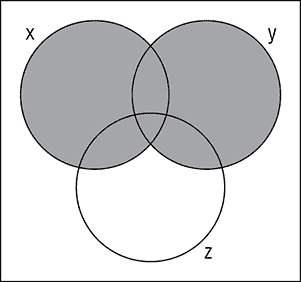

1. `x || z`

2. `y || (y && z)`

3. `x || y`

4. `y && x`

### 38. `red` 的什么变量类型允许以下应用编译通过？

```
package tornado;
public class Kansas {
   public static void main(String[] args) {
      int colorOfRainbow = 10;
      ________ red = 5;
      switch(colorOfRainbow) {
         default:
            System.out.print("Home");
            break;
         case red:
            System.out.print("Away");
      }
   }
}
```

1. long

2. double

3. int

4. 以上均不是

### 39. 使用哪两个运算符来测试一个数字是否大于等于 5.21 且严格小于 8.1？

1. `>` 和 `<=`

2. `>=` 和 `>`

3. `<` 和 `>=`

4. `<` 和 `>`

### 40. 以下应用的输出是什么？

```java
package transporter;
public class TurtleVsHare {
   public static void main(String[] arguments) {
      int turtle = 10 * (2 + (3 + 2) / 5);
      int hare = turtle < 5 ? 10 : 25;
      System.out.print(turtle < hare ? "Hare wins!" : "Turtle wins!");
   }
}
```

1. Hare wins!

2. Turtle wins!

3. 代码无法编译。

4. 代码编译通过但在运行时抛出除以零错误。

### 41. 以下应用的输出是什么？

```java
public class CountEntries {
   public static int getResult(int threshold) {
      return threshold > 5 ? 1 : 0;
   }
   public static final void main(String[] days) {
      System.out.print(getResult(5)+getResult(1)
             +getResult(0)+getResult(2)+"");
   }
}
```

1. 0

2. 1

3. 0000

4. 1000

### 42. 以下应用的输出是什么？

```java
package yoyo;
public class TestGame {
   public String runTest(boolean spinner, boolean roller) {
      if(spinner = roller) return "up";
      else return roller ? "down" : "middle";
   }
   public static final void main(String pieces[]) {
      final TestGame tester = new TestGame();
      System.out.println(tester.runTest(false,true));
   }
}
```

1. up

2. middle

3. down

4. 代码无法编译。

### 43. 填空：当两个操作数之一为真时，______________ 运算符为真，而 ______________ 运算符翻转布尔值。

1. `+`, `-`

2. `&&`, `!`

3. `|`, `-`

4. `||`, `!`

### 44. 给定以下代码片段，执行后 `movieRating` 的值是多少？

```java
int characters = 5;
int story = 3;
double movieRating = characters <= 4 ? 3 : story>1 ? 2 : 1;
```

1. 2.0

2. 3.0

3. 代码无法编译，但如果添加括号则可以编译。

4. 以上均不是

### 45. 填空：switch 语句可以有 ______________ 个 case 语句和 ______________ 个 default 语句。

1. 最多一个，至少一个

2. 任意数量，最多一个

3. 至少一个，任意数量

4. 至少一个，最多一个

### 46. 以下哪项不是执行以下应用可能的结果？

```java
public class OutsideLogic {
   public static void main(String... weather) {
      System.out.print(weather[0]!=null
            && weather[0].equals("sunny")
            && !false
         ? "Go Outside" : "Stay Inside");
   }
}
```

1. 什么都没有打印。

2. 应用在运行时抛出异常。

3. 打印 Go Outside。

4. 打印 Stay Inside。

### 47. Java 中 `(5 + 8) / 2` 的值是多少？

1. 2

2. 1

3. 6

4. 13

### 48. 给定以下真值表 `w` 和 `z`，第一行的缺失值是什么？

| `w` | `z` | result |

|---|---|---|

| true | true | true |

| true | false | ? |

| false | true | ? |

| false | false | false |

1. true 和 false

2. false 和 true

3. true 和 true

4. false 和 false

### 49. 填空：______________ ,______________ , ____________ 的优先级递增排列。

1. `+`, `-`

2. `&&`, `!`

3. `|`, `-`

4. `||`, `!`

### 50. 以下应用的输出是什么？

```java
public class Baby {
   public static String play(int toy) {
      String game = toy > 3 ? "Ball" : "Swim"; // p1
      return game;
   }
   public static void main(String[] args) {
      final String game = play(5);
      System.out.println(game);
   }
}
```

1. Ball

2. Swim

3. 代码无法编译。

4. 代码编译通过但在运行时抛出除以零错误。

### 3. 代码无法编译。

### 4. 代码编译但在运行时抛出异常。

### 9. 在数组上分别进行搜索和排序的方法名分别是什么？

1. `Arrays.binarySearch()` 和 `Arrays.linearSort()`

2. `Arrays.binarySearch()` 和 `Arrays.sort()`

3. `Arrays.search()` 和 `Arrays.linearSort()`

4. `Arrays.search()` 和 `Arrays.sort()`

### 10. 这段代码的输出是什么？

```java
String[] nums = new String[] { "1", "9", "10" };
Arrays.sort(nums);
System.out.println(Arrays.toString(nums));
```

1. `[1, 9, 10]`

2. `[1, 10, 9]`

3. `[10, 1, 9]`

4. 以上都不是

### 11. 下面哪一项引用了非空数组的第一个和最后一个元素？

1. `trains[0]` 和 `trains[trains.length]`

2. `trains[0]` 和 `trains[trains.length - 1]`

3. `trains[1]` 和 `trains[trains.length]`

4. `trains[1]` 和 `trains[trains.length - 1]`

### 12. 下面中有多少个是合法的声明？

```java
String lion [] = new String[] {"lion"};
String tiger [] = new String[1] {"tiger"};
String bear [] = new String[] {};
String ohMy [] = new String[0] {};
```

1. 无

2. 一个

3. 两个

4. 三

### 13. 下面中有多少个是合法的声明？

```java
float[] lion = new float[];
float[] tiger = new float[1];
float[] bear = new[] float;
float[] ohMy = new[1] float;
```

1. 无

2. 一个

3. 两个

4. 三

### 14. 哪一个陈述最准确地描述了 `Arrays` 类搜索与排序的关系？

1. 如果数组未排序，调用 `Arrays.binarySearch()` 将是准确的，但比排序后要慢。

2. 在调用 `Arrays.binarySearch()` 之前数组不需要排序即可获得准确结果。

3. 在调用 `Arrays.binarySearch()` 之前数组必须经过排序才能获得准确结果。

4. 以上都不是

### 15. 关于数组，哪哪一个陈述是不正确的？

1. 数组在满载时会自动扩展。

2. 数组允许包含重复值。

3. 数组理解有序元素的概念。

4. 数组使用零索引来引用第一个元素。

### 16. 哪行代码导致 `ArrayIndexOutOfBoundsException`？


```java
String[][] matrix = new String[1][2];
matrix[0][0] = "Don't think you are, know you are.";       // m1
matrix[0][1] = "I'm trying to free your mind Neo";         // m2
matrix[1][0] = "Is all around you ";                       // m3
matrix[1][1] = "Why oh why didn't I take the BLUE pill?";  // m4
```

1. m1
2. m2
3. m3
4. m4

### 17. 下面代码输出什么？

```java
String[] os = new String[] { "Mac", "Linux", "Windows" };
Arrays.sort(os);
System.out.println(Arrays.binarySearch(os, "Mac"));
```

1. 0
2. 1
3. 2
4. 输出未定义。

### 18. 哪一行是防止这段代码无错误编译运行的第一行？

```java
char[][] ticTacToe = new char[3,3];                  // r1
ticTacToe[1][3] = 'X';                               // r2
ticTacToe[2][2] = 'X';
ticTacToe[3][1] = 'X';
System.out.println(ticTacToe.length + " in a row!"); // r3
```

1. r1 行
2. r2 行
3. r3 行
4. 以上都不是

### 19. 运行以下代码时创建了多少对象？

```java
Integer[] lotto = new Integer[4];
lotto[0] = new Integer(1_000_000);
lotto[1] = new Integer(999_999);
```

1. 二
2. 三
3. 四
4. 五

### 20. 下面中有多少个是合法的声明？

```java
[][] String alpha;
[] String beta;
String[][] gamma;
String[] delta[];
String epsilon[][];
```

1. 两个
2. 三
3. 四
4. 五

### 21. 下面哪一项代表数组？

```java
char[][] blocks = { {'a', 'b', 'c' }, {'d', 'e', 'f'} };
```

1. A
2. B
3. C
4. D

### 22. 用非空数组调用以下方法会发生什么？

```java
public void add(String[] names) {
   names[length] = "new";
}
```

1. 向数组添加了新元素。
2. 替换值。
3. 编译。
4. 抛出异常。

### 23. 下面代码输出多少行？

```java
String[] days = { "Monday", "Tuesday", "Wednesday", "Thursday", "Friday", "Saturday" };
for (int i = 0; i < days.length; i++) {
    System.out.println(days[i]);
}
```

1. 六
2. 七

### 24. 数组允许多少维度？

```java
boolean[][][] bools;
```

1. 一
2. 二
3. 三
4. 四

### 25. 代码的可能输出是什么？

```java
String[] strings = null;
System.out.println(strings);
```

1. `null`
2. `[]`
3. `Ljava.lang.String;74`
4. 以上都不是

### 26. 哪一行是防止这段代码无错误编译的第一行？

```java
String[][] matrix = new String[1][2];
matrix[0][0] = "a";
matrix[0][1] = "b";
matrix[1][0] = "c";
```

1. 1 行
2. 2 行
3. 3 行

### 27. 运行以下代码的结果是什么？

```java
package duplicate;
public class Copier {
  public static void main(String... original) {
      String[] copy = original;
      System.out.println(copy.length + copy[0]);
  }
}
```

1. 0
2. 0 后跟异常
3. 1 后跟异常
4. 代码无法编译。

### 28. 运行以下程序的结果是什么？

```java
package fun;
public class Sudoku {
   static int[][] game = new int[6][6];
   public static void main(String[] args) {
      game[3][3] = 6;
      Object[] obj = game;
      obj[3] = "X";
      System.out.println(game[3][3]);
   }
}
```

1. X
2. 代码无法编译。
3. 代码编译但在运行时抛出 `NullPointerException`。
4. 代码编译但在运行时抛出不同的异常。

### 29. 下面代码输出什么？

```java
String[] os = new String[] { "Mac", "Linux", "Windows" };
Arrays.sort(os);
System.out.println(Arrays.binarySearch(os, "RedHat"));
```

1. -1
2. -2
3. -3
4. 输出未定义。

### 30. 运行 `FirstName Wolfie` 时输出是什么？

```java
public class FirstName {
  public static void main(String... names) {
      System.out.println(names[0]);
   }
}
```

1. `FirstName`
2. `Wolfie`
3. 代码抛出 `ArrayIndexOutOfBoundsException`。
4. 代码抛出 `NullPointerException`。

### 31. 运行 `java Count 1 2` 时，输出是什么？

```java
public class Count {
   public static void main(String[] target) {
      System.out.println(target.length);
   }
}
```

1. 0
2. 1
3. 2
4. 代码无法编译。

### 32. 当作为 `java unix.EchoFirst seed flower` 执行时，以下代码输出是什么？

```java
package unix;
import java.util.*;
public class EchoFirst {

   public static void main(String[] args) {
          String one = args[0];
          Arrays.sort(args);
          int result = Arrays.binarySearch(args, one);
          System.out.println(result);
      }
}
```

1. 0
2. 1
3. 代码无法编译。
4. 代码可以编译但在运行时抛出异常。

### 33. 这四个数组声明中，哪一个产生的数组与其他三个不同？

1. `int[][] nums = new int[2][1];`
2. `int[] nums[] = new int[2][1];`
3. `int[] nums[] = new int[][] { { 0 }, { 0 } };`
4. `int[] nums[] = new int[][] { { 0, 0 } };`

### 34. 如何访问值为 "z" 的数组元素？

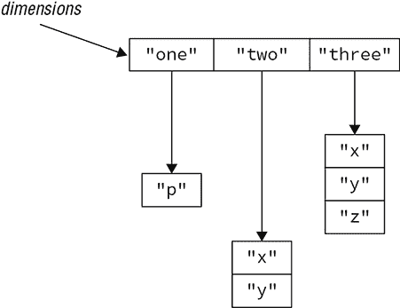

1. `dimensions["three"][2]`
2. `dimensions["three"][3]`
3. `dimensions[2][2]`
4. `dimensions[3][3]`

### 35. 下述代码输出多少行内容？

```java
String[] days = new String[] { "Sunday", "Monday", "Tuesday",
      "Wednesday", "Thursday", "Friday", "Saturday" };
for (int i = 1; i <= days.length; i++)
      System.out.println(days[i]);
```

1. 六行
2. 七行
3. 代码无法编译。
4. 代码可以编译但在运行时抛出异常。

### 36. 当作为 `java FirstName Wolfie` 执行时，以下代码输出是什么？

```java
public class FirstName {
   public static void main(String... names) {
      System.out.println(names[1]);
   }
}
```

1. `FirstName`
2. `Wolfie`
3. 代码抛出 `ArrayIndexOutOfBoundsException`。
4. 代码抛出 `NullPointerException`。

### 37. 哪一行是防止此代码无错误地编译并运行？

```java
char[][] ticTacToe = new char[3][3];                 // r1
ticTacToe[0][0] = 'X';                               // r2
ticTacToe[1][1] = 'X';
ticTacToe[2][2] = 'X';
System.out.println(ticTacToe.length + " in a row!"); // r3
```

1. 行 r1
2. 行 r2
3. 行 r3
4. 以上均不是

### 38. 当作为 `java Count 1 2` 执行时，以下代码输出是什么？

```java
public class Count {
   public static void main(String target[]) {
          System.out.println(target.length());
   }
}
```

1. 0
2. 1
3. 2
4. 代码无法编译。

### 39. 数组引用 `moreBools` 允许多少维？

```java
boolean[][] bools[], moreBools;
```

1. 一维
2. 二维
3. 三维
4. 以上均不是

### 40. 当作为 `java counting.Binary` 调用时，结果是什么？

```java
package counting;
import java.util.*;
public class Binary {

   public static void main(String... args) {
          Arrays.sort(args);
          System.out.println(Arrays.toString(args));
   }
}
```

1. `null`
2. `[]`
3. 代码无法编译。
4. 代码可以编译但在运行时抛出异常。

### 41. 下述代码输出什么？

```java
String[] os = new String[] { "Mac", "Linux", "Windows" };
System.out.println(Arrays.binarySearch(os, "Linux"));
```

1. 0
2. 1
3. 2
4. 输出未定义。

### 42. 运行以下程序的结果是什么？

```java
1:   package fun;
2:   public class Sudoku {
3:      static int[][] game;
4:
5:      public static void main(String[] args) {
6:         game[3][3] = 6;
7:         Object[] obj = game;
8:         game[3][3] = "X";
9:         System.out.println(game[3][3]);
10:     }
11: }
```

1. X
2. 代码无法编译。
3. 代码可以编译但在运行时抛出异常。

### 43. 下述代码输出什么？

```java
String[][] listing = new String[][] { "Book" }, "Game" };
System.out.println(listing.length + " " + listing[0].length);
```

1. 21
2. 2

### 48. 哪些陈述是正确的？

*   你总是可以在不引起调用代码错误的情况下，将方法签名从 `String[] arg` 改为 `String... arg`。
*   你总是可以在不引起现有代码错误的情况下，将方法签名从 `String... arg` 改为 `String[] arg`。

1. I
2. II
3. I 和 II
4. I 和 II 都不是

### 49. 这四个数组引用中哪一个可以指向一个与其他不同的数组？

1. `int[][][] nums1a, nums1b;`
2. `int[][][] nums2a[], nums2b;`
3. `int[][] nums3a[][], nums3b[][];`
4. `int[] nums4a[][][], numbs4b[][][];`

### 4. 下列哪项可以遍历数组而不通过索引引用元素？

1. `do-while loop`
2. `for (traditional for)`
3. `for-each`
4. `while`

### 5. 使用哪个关键字结束当前的循环迭代并继续该循环的下一次迭代？

1. `break`
2. `continue`
3. `end`
4. `skip`

### 6. 使用哪个关键字在循环结束后立即继续执行执行？

1. `break`
2. `continue`
3. `end`
4. `skip`

### 7. 哪种类型的循环在括号内有三个部分？

1. `do-while loop`
2. `for (traditional for)`
3. `for-each`
4. `while`

### 8. 下列陈述中哪一个是/是正确的？

* 传统的 `for` 循环可以从索引 `0` 开始遍历数组。
* 传统的 `for` 循环可以从数组末尾开始遍历。

1. 仅 I
2. 仅 II
3. 两个陈述都正确
4. 两个陈述都不

### 9. 下列陈述中哪一个是/是正确的？

* `for-each` 循环可以从索引 `0` 开始遍历数组。
* `for-each` 循环可以从数组末尾开始遍历。

1. 仅 I
2. 仅 II
3. 两个陈述都正确
4. 两个陈述都不

### 10. 哪种类型的循环在通过单次循环后首先检查布尔条件？

1. `do-while loop`
2. `for (traditional for)`
3. `for-each`
4. `while`

### 11. 下列代码的输出是什么？

```java
int singer = 0;
while (singer)
  System.out.println(singer++);
```

1. 0
2. 代码无法编译。
3. 循环完成无输出。
4. 这是一个无限循环。

### 12. 下列代码的输出是什么？

```java
List<String> drinks = Arrays.asList("can", "cup");
for (int container = drinks.size() - 1; container >= 0; container‐)
  System.out.print(drinks.get(container) + ",");
```

1. can,cup,
2. cup,can,
3. 代码无法编译。
4. 以上均非

### 13. 下列代码的输出是什么？

```java
public static void main(String[] args) {
  List<String> bottles = Arrays.asList("glass", "plastic");
  for (int type = 0; type < bottles.size();) {
    System.out.print(bottles.get(type) + ",");
    break;
  }
  System.out.print("end");
}
```

1. glass,end
2. glass,plastic,end


### 3. 代码无法编译。

### 4. 以上均非

### 14. 下列代码的输出是什么？

```java
String letters = "";
while (letters.length() != 2)
   letters+="a";
System.out.println(letters);
```

1. `aa`

2. `aaa`

3. 循环完成无输出。

4. 这是一个无限循环。

### 15. 运行 `java peregrine.TimeLoop September 3 1940` 时，结果是什么？

```java
package peregrine;
public class TimeLoop {
  public static void main(String[] args) {
    for (int i = args.length; i>=0; i++)
       System.out.println("args");
  }
}
```

1. `args`

2. `argsargs`

3. 代码无法编译。

4. 以上均非

### 16. 下列代码的输出是什么？

```java
package chicago;
public class Loop {
   private static int count;
   private static String[] stops = new String[] { "Washington",
       "Monroe", "Jackson", "LaSalle" };
   public static void main(String[] args) {
      while (count < stops.length) {
         if (stops[count++].length() < 8) {
            break;
          }
      }
      System.out.println(count);
   }
}
```

1. `1`

2. `2`

3. `4`

4. 代码无法编译。

### 17. 下列代码的结果是什么？

```java
do {
   int count = 0;
   do {
      count++;
   } while (count < 2);
      break;
} while (true);
System.out.println(count);
```

1. `2`

2. `3`

3. 代码无法编译。

4. 这是一个无限循环。

### 18. `for` 循环的以下哪些部分可以留空？

```java
for (segmentA; segmentB; segmentC) {
```

1. `segmentA`

2. `segmentB`

3. `segmentC`

4. 全部

### 19. 哪种循环类型（`while`, 传统的 `for`, 增强 `for`）允许你编写创建无限循环的代码？

1. 一个

2. 两个

3. 三

### 20. 下列代码的输出是什么？

```java
List<String> drinks = Arrays.asList("can", "cup");
for (int container = 0; container < drinks.size(); container++)
  System.out.print(drinks.get(container) + ",");
```

1. `can,cup,`

2. `cup,can,`

3. 代码无法编译。

4. 以上均非

### 21. 运行以下代码会发生什么？

```java
do {
  System.out.println("hello");
} while (false);
```

1. 无输出并完成。

2. 输出一次。

3. 持续输出。

4. 代码无法编译。

### 22. 下列哪项与此代码等效？

```java
for (int i=0; i<arr.length; i++)
  System.out.println(arr[i]);
```

1. `for (String f : arr)`

2. `while (i < arr.length)`

3. 无

### 23. 在 `println` 之后可以插入多少这些陈述，使代码符合流程图？

```java
do {
   System.out.println("test");
} while (condition);
```

1. 无

2. 一个

3. 两个

4. 三

### 24. 使用上一个问题，在 `println` 之后可以插入多少这些语句，使代码符合流程图？

```java
for (int i=0; i<10; i++) {
   System.out.println(i);
}
```

1. 无

2. 一个

3. 两个

4. 三

### 25. 下列代码的输出是什么？

```java
int singer = 0;
while (singer)
```

1. `0`

2. 代码无法编译。

3. 循环完成无输出。

4. 这是一个无限循环。

### 26. 为了使代码编译，下列哪些类型是不允许的？

```java
for (Object obj : taxis) {
}
```

1. `ArrayList<Integer>`

2. `int[]`

3. `StringBuilder`

4. 以上都是允许的。

### 27. 下列代码的输出是什么？

```java
boolean balloonInflated = false;
do {
   if (!balloonInflated) {
      balloonInflated = true;
      System.out.print("inflate-");
   }
} while (!balloonInflated);
System.out.println("done");
```

1. `done`

2. `inflate-done`

3. 代码无法编译。

4. 这是一个无限循环。

### 28. 下列代码的输出是什么？

```java
String letters = "";
while (letters.length() != 3)
   letters+="ab";
System.out.println(letters);
```

1. `ab`

2. `abab`

3. 循环完成无输出。

4. 这是一个无限循环。

### 29. 哪项描述了 `for` 循环中三个表达式的出现顺序？

1. 布尔条件、初始化表达式、更新语句

2. 初始化表达式、布尔条件、更新语句

3. 初始化表达式、更新语句、布尔条件

4. 以上均非

### 30. 下列代码的结果是什么？

```java
int count = 10;
List<Character> chars = new ArrayList<>();
do {
  chars.add('a');
  for (Character x : chars) count -=1;
} while (count > 0);
System.out.println(chars.size());
```

1. `3`

2. `4`

3. 代码无法编译。

4. 以上均不是

### 31. 下列代码的结果是什么？

```java
int k = 0;
for (int i = 10; i > 0; i--) {
  while (i > 3) i -= 3;
  k += 1;
}
System.out.println(k);
```

1. `1`

2. `2`

3. `3`

4. `4`

### 32. 给定一个 `String` 对象数组，以下哪一项与此代码段等价？

```java
for (int i=fun.length-1; i>=0; i--)
  System.out.println(fun[i]);
```

1. `for (String f = fun) System.out.println(f);`

2. `for (String f : fun) System.out.println(f);`

3. `for (String f fun) System.out.println(it);`

4. 以上均不是

### 33. 下列代码的输出是什么？

```java
public static void main(String[] args) {
   List<String> bottles = Arrays.asList("glass", "plastic");
   for (int type = 0; type < bottles.size();)
     System.out.print(bottles.get(type) + ",");
     break;
   System.out.print("end");
}
```

1. `glass,end`

2. `glass,plastic,end`

3. 代码无法编译。

4. 以上均不是

### 34. 下列代码的结果是什么？

```java
String[] nycTourLoops = new String[] { "Downtown", "Uptown", "Brooklyn" };
String[] times = new String[] { "Day", "Night" };
for (int i = 0, j = 0; i < nycTourLoops.length
   && j < times.length; i++; j++)
{
   System.out.print(nycTourLoops[i] + " " + times[j] + "-");
}
```

1. `Downtown Day-`

2. `Downtown Day-Uptown Night-`

3. 代码无法编译。

4. 代码可以编译但在运行时抛出异常。

### 35. 运行 `java peregrine.TimeLoop September 3 1940` 时，结果的结果是什么？

```java
package peregrine;
public class TimeLoop {
  public static void main(String[] args) {
    for (int i = args.length; i>=0; i--)
       System.out.println(args[i]);
  }
}
```

1. `September`

2. `1940`

3. 代码无法编译。

4. 以上均不是

### 36. 下列代码的输出是什么？

```java
public class Shoelaces {
  public static void main(String[] args) {
    String tie = null;
    while (tie == null)
       tie = "shoelace";
       System.out.print(tie);
  }
}
```

1. `null`

2. `shoelace`

3. `shoelaceshoelace`

4. 以上均不是

### 37. 下列代码输出单个字母 `x`。如果你删除第 25 行和第 28 行会发生什么？

```java
23:  String race = "";
24:  loop:
25:  do {
26:     race += "x";
27:     break loop;
28:  } while (true);
29:  System.out.println(race);
```

1. 它打印一个空字符串。

2. 它仍然输出单个字母 `x`。

3. 代码不再编译。

4. 它变成一个死循环。

### 38. 下列代码的输出是什么？

```java
package chicago;
public class Loop {
   private static int count;
   private static String[] stops = new String[] { "Washington",
       "Monroe", "Jackson", "LaSalle" };
   public static void main(String[] args) {
      while (count < stops.length) {
         if (stops[count++].length() < 8) {
            continue;
          }
      }
      System.out.println(count);
   }
}
```

1. `1`

2. `2`

3. `4`

4. 代码无法编译。

### 39. 下列代码的输出是什么？

```java
StringBuilder builder = new StringBuilder();
String str = new String("Leaves growing");
do {
   System.out.println(str);
} while (builder);
System.out.println(builder);
```

1. `Leaves growing`

2. 这是一个死循环。

3. 代码无法编译。

4. 代码可以编译但在运行时抛出异常。

### 40. 下列代码的结果是什么？

```java
6:   int count = 0;
7:   do {
8:      do {
9:         count++;
10:     } while (count);
11:     break;
12:  } while (true);
13:  System.out.println(count);
```

1. `2`

2. `3`

3. 代码无法编译。

4. 这是一个死循环。

### 41. 填入空白使此代码编译且不是死循环。

```java
t: while (true) {
   f:
}
```

1. `break;`

2. `break f;`

3. `break t;`

4. 以上不是

### 42. 下列代码的结果是什么？

```java
String[] nycTourLoops = new String[] { "Downtown", "Uptown", "Brooklyn" };
String[] times = new String[] { "Day", "Night" };
for (int i = 0, j = 0; i < nycTourLoops.length
   && j < times.length; i++; j++)
{
   System.out.print(nycTourLoops[i] + " " + times[j] + "-");
}
```

1. `Downtown Day-`

2. `Downtown Day-Uptown Night-`

3. 代码无法编译。

4. 代码可以编译但在运行时抛出异常。

### 43. 下列代码输出多少行？

```java
import java.util.*;
public class Exams {
   public static void main(String[] args) {
      List<String> exams = Arrays.asList("One", "Two");
      for (String e1 : exams)
         for (String e2 : exams)
            System.out.println(e1 + " " + e2);
   }
}
```

1. 二

2. 四

3. 代码无法编译。

### 44. 如果 `beta` 始终返回 `false`，下列哪项最能描述此循环的执行流？

```java
for (alpha; beta) {
  delta;
}
```

1. `alpha`

2. `alpha, beta`

3. `alpha, beta, gamma`

4. 以上不是

### 45. 下列哪项最能描述循环恰好执行一次？

```java
for (alpha; beta) {
  delta;
}
```

1. `alpha, delta, gamma`

2. `alpha, beta, delta, gamma`

3. `alpha, gamma`

4. `alpha`

### 46. 下列哪项的循环次数不同？

1. `for (int k=0; k < 5; k++)`

2. `for (int k=1; k <= 5; k++)`

3. `int k=0; do { } while(k++ < 5)`

4. `int k=0; while (k++ < 5) {}`

### 47. 下列代码的输出是什么？

```java
public class Shoelaces {
  public static void main(String[] args) {
    String tie = null;
    while (tie == null);
       tie = "shoelace";
       System.out.print(tie);
  }
}
```

1. `null`

2. `shoelace`

3. `shoelaceshoelace`

4. 以上不是

### 48. 下列代码的输出是什么？

```java
12:  int result = 8;
13:  for: while (result > 7) {
14:     result++;
15:     do {
16:        result--;
17:     } while (result > 5);
18:     break for;
19:  }
20:  System.out.println(result);
```

1. `5`

2. `8`

3. 代码无法编译。

4. 代码可以编译但在运行时抛出异常。

### 49. 下列代码的输出是什么？


```java
boolean baloonInflated = false;
do {
   if (!baloonInflated) {
      baloonInflated = true;
      System.out.print("inflate-");
   }
} while (baloonInflated);
System.out.println("done");
```

1. `done`

2. `inflate-done`

3. 代码无法编译。

4. 这是一个死循环。

### 50. 下列哪项可以填入空白处使代码成功编译？

```java
package nyc;
public class TouristBus {
  public static void main(String... args) {
     String[] nycTourLoops = new String[] { "Downtown", "Uptown", "Brooklyn" };
     String[] times = new String[] { "Day", "Night" };
        for (_____________ i < 1; i++, j++)
           System.out.println(nycTourLoops[i] + " " + times[j]);
  }
}
```

1. `int i=0; j=0;`

2. `int i=0, j=0;`

3. `int i=0; int j=0;`

4. `int i=0, int j=0;`

# 第 6 章

## 方法与封装的使用

**本次练习测试涵盖的 OCA 考试点包括以下内容：**

*  **方法的使用与封装**

    *   创建带参数和返回值的方法；包括重载方法

    *   在方法和字段上应用 `static` 关键字

    *   创建和重载构造函数；区分默认构造函数和用户定义的构造函数

    *   应用访问修饰符

    *   对类应用封装原则

    *   确定当值被传递到改变值的方法时，对对象引用和原始值产生的影响

1. 填空：`____________` 访问修饰符允许访问 `____________` 访问修饰符可以的所有内容以及更多。

    1. `package-private`, `protected`

    2. `protected`, `public`

    3. `protected`, `package-private`

    4. `private`, `package-private`

2. 在同一类中从一个构造函数调用另一个构造函数的命令是什么？

    1. `super()`

    2. `this()`

    3. `that()`

    4. `construct()`

3. 下述程序的输出是什么？

```java
package stocks;
public class Bond {
   private static int price = 5;
   public boolean sell() {
      if(price<10) {
         price++;
         return true;
      } else if(price>=10) {
         return false;
      }
   }
   public static void main(String[] cash) {
      new Bond().sell();
      new Bond().sell();
      new Bond().sell();
      System.out.print(price);
   }
}
```

    1. `5`

    2. `6`

    3. `8`

    4. 代码无法编译。

4. 关于以下程序，哪个说法是？

```java
package figures;
public class Dolls {
   public void nested() { nested(2,true); } // g1
   public int nested(int level, boolean height) { return nested(level); }
   public int nested(int level) { return level+1; }; // g2

   public static void main(String[] outOfTheBox) {
      System.out.print(new Dolls().nested());
   }
}
```

    1. 编译成功，并在运行时打印 3。

    2. 因为行 `g1` 无法编译。

    3. 因为行 `g2` 无法编译。

    4. 因为其他原因无法编译。

5. 填空：Java 使用 `___________` 将数据发送到方法中

    1. `pass-by-null`

    2. `pass-by-value`

    3. `both pass-by-value and pass-by-reference` 

    4. `pass-by-reference`

6. 下列哪项是有效的 JavaBean 方法签名？

    1. `public void getArrow()`

    2. `public void setBow()`

    3. `public void setRange(int range)`

    4. `public String addTarget(String target)`

7. 关于在构造函数中调用 `this()`，以下哪个说法是不正确的？

    1. 如果使用了 `this()`，它必须是构造函数的第一行。

    2. 如果在同一个构造函数中同时使用了 `super()` 和 `this()`，则 `super()` 必须紧跟在 `this()` 之后。

    3. 如果为 `this()` 提供参数，则类中必须有一个接收这些参数的构造函数。

    4. 如果调用了无参数的 `this()`，则该类必须显式实现无参数构造函数。

8. 下列哪项可以填空以使类编译？

```java
package ai;
public class Robot {
   ____________ compute() { return 10; }
}
```

    1. `Public int`

    2. `Long`

    3. `void`

    4. `private String`

9. 填空：`____________` 变量对类的所有实例都始终可用。

    1. `public`

    2. `local`

    3. `static`

    4. `instance`

10. 在行 `p1` 处插入哪行代码会导致程序打印 5？

```java
package games;
public class Jump {
   private int rope = 1;
   protected boolean outside;
   public Jump() {
      // p1
      outside = true;
   }
   public Jump(int rope) {
      this.rope = outside ? rope : rope+1;
   }
   public static void main(String[] bounce) {
      System.out.print(new Jump().rope);
   }
}
```

    1. `this(4);`

    2. `new Jump(4);`

    3. `this(5);`

    4. `rope = 5;`

11. 下列哪个说法是不正确的？

    1. 如果属性是公开的，则实例可以访问另一个类的属性。

    2. 只要父类在同一个包内，实例就可以访问包级属性。

    3. 同一类的实例可以访问彼此的私有属性。

    4. 如果标记为保护，则实例可以访问另一个类的属性。

12. 对于以下类，两个空白处应填入什么以确保类被正确封装？

```java
package storage;
public class Box {
   public String stuff;
    ____________String () {
      return stuff;
   }

   public void setStuff(String stuff) {
      this.stuff = stuff;
   }
}
```

    1. `public get`

    2. `private is`

    3. `public set`

13. 关于无参数构造函数，哪个说法是正确的？

    1. 如果你不定义，Java 编译器会自动插入无参数构造函数。

    2. 为了让类在构造函数中调用 `super()`，其父类必须显式实现无参数构造函数。

    3. 如果父类只有一个接收参数的构造函数，则子类必须显式声明至少一个构造函数。

    4. 一个类可以包含多个无参数构造函数。

14. 下列哪种方法签名包含编译错误？

    1. `public void sing(String key, String... harmonies)`

    2. `public void sing(int note, String... sound, int music)`

    3. `public void sing(String... keys, String... pitches)`

    4. `public void sing(String... notes, String melodies)`

15. 针对以下程序，在调用 `slalom()` 方法后，哪个图表最能表示 `main()` 方法中 `mySkier`、`mySpeed` 和 `myName` 变量的状态？

```java
package slopes;
public class Ski {
   private int age = 18;
   private static void slalom(Ski racer, int[] speed, String name) {
      racer.age = 18;
      name = "Wendy";
      speed = new int[1];
      speed[0] = 11;
      racer = null;
   }
   public static void main(String... mountain) {
      final Ski mySkier = new Ski();
      mySkier.age = 16;
      final int[] mySpeed = new int[1];
      final String myName = "Rosie";
      slalom(mySkier,mySpeed,myName);
   }
}
```

    1. ![Chart shows variables like mySkier, myName, and mySpeed, where mySkier is connected to null, myName is connected to “Rosie”, and mySpeed is connected to int[] block numbered as 18.](images/c06uf001.jpg)

    2. ![Chart shows variables like mySkier, myName, and mySpeed, where mySkier is connected to ski age: 18, myName is connected to “Wendy”, and mySpeed is connected to int[] block numbered as 11.](images/c06uf002.jpg)

    3. ![图表显示了如 mySkier、myName 和 mySpeed 等变量，其中 mySkier 连接到滑雪年龄: 18，myName 连接到“Rosie”，而 mySpeed 连接到编号为 ʘ 的 int[] 块。](images/c06uf003.jpg)

    4. ![图表显示了如 mySkier、myName 和 mySpeed 等变量，其中 mySkier 连接到滑雪年龄: 16，myName 连接到“Wendy”，而 mySpeed 连接到编号为 ʘ 的 int[] 块。](images/c06uf004.jpg)

### 16. 给定以下类，哪种方法签名可以成功作为 `findAverage()` 方法的重载版本添加到该类中？

```java
public class Calculations {
  public Integer findAverage(int sum) { return sum; }
}
```

1. `public Long findAverage(int sum)`

2. `public Long findAverage(int sum, int divisor)`

3. `public Integer average(int sum)`

4. `private void findAverage(int sum)`

### 17. 在设计类时，以下哪项不是使用封装（encapsulation）的原因？

1. 提高其他开发者的易用性。

2. 维护类数据元素的数据完整性。

3. 防止用户修改类的内部属性。

4. 增加并发性并提高性能。

### 18. 下列哪些数据类型在作为参数传递给方法后可以被修改？

1. `int[]`

2. `String`

3. `long`

4. `boolean`

### 19. 假设使用该方法的类没有任何静态导入（static imports），在同一包的另一个类中调用以下方法的最佳方式是？

```java
package useful;
public class MathHelper {
   public static int roundValue(double d) {
     // 省略实现
   }
}
```

1. `MathHelper:roundValue(5.92)`

2. `MathHelper.roundValue(3.1)`

3. `roundValue(4.1)`

4. `useful.MathHelper.roundValue(65.3)`

### 20. 给定具有以下返回类型之一的方法，哪种数据类型防止在方法内部使用 return 语句？

1. `byte`

2. `String`

3. `void`

4. 以上均不是

### 21. 为了使此应用程序编译，需要移除多少个 `final` 修饰符？

```java
package end;
public final class Games {
   public final static int finish(final int score) {
      final int win = 3;
      final int result = score++ < 5 ? 2 : win;
      return result+=win;
   }
   public static void main(final String[] v) {
      System.out.print(finish(Integer.parseInt(v[0])));
   }
}
```

1. 无

2. 一个

3. 两个

4. 无论移除多少个 `final` 修饰符，代码都无法编译。

### 22. 填空：`____________` 用于调用父类中的构造函数，而 `____________` 用于引用父类的成员。

1. `super` 和 `this()`

2. `super` 和 `super()`

3. `super()` 和 `this`

4. `super()` 和 `super`

### 23. 给定以下方法签名，哪些类可以调用它？

```java
void run(String government)
```

1. 其他包中的类

2. 同一个包中的类

3. 不同包中的子类

4. 所有类

### 24. 关于以下类的哪些陈述有助于妥善封装类中的数据？

```java
package shield;
public class Protect {
   private String material;
   protected int strength;

   public int getStrength() {
      return strength;
   }
   public void setStrength(int strength) {
      this.strength = strength;
   }
}
```

* I. 将 `strength` 的访问修饰符改为 `private`。

* II. 为 `material` 添加一个 getter 方法。

* III. 为 `material` 添加一个 setter 方法。

1. I

2. II 和 III

3. I, II, 和 III

4. 无，类中的数据已经封装好了。

### 25. 下列哪项是 Java 中合法的方法名？

1. `Go_$Outside$2()`

2. `have-Fun()`

3. `new()`

4. `9enjoyTheWeather()`

### 26. 在下方代码行中插入哪行代码可以使该类通过编译？

```java
package farm;
public class Coop {
   public final int static getNumberOfChickens() {
      // 在此处插入代码
   }
}
```


1. `return 3.0;`

2. `return 5L;`

3. `return 10;`

4. 以上均不是

### 27. 关于向方法传递数据，以下哪项陈述是正确的？

1. 对传递给方法的原始类型值进行的更改会反映在调用方法中。

2. 对传递给方法的对象内部的数据进行的更改会反映在调用方法中。

3. 重新分配传递给方法的引用会反映在调用方法中。

4. 对传递给方法的布尔值进行的更改会反映在调用方法中。

### 28. 下一应用程序可能的输出是什么？

```java
package wrap;
public class Gift {
   private final Object contents;
   protected Object getContents() {
      return contents;
   }
   protected void setContents(Object contents) {
      this.contents = contents;
   }
   public void showPresent() {
      System.out.print("Your gift: "+contents);
   }
   public static void main(String[] treats) {
      Gift gift = new Gift();
      gift.setContents(gift);
      gift.showPresent();
   }
}
```

1. `Your gift: wrap.Gift@29ca2745`

2. `Your gift: Your gift:`

3. 无法编译。

4. 可以编译但在运行时抛出异常。

### 29. 下列哪项是合法的 JavaBean 方法前缀？

1. `is`

2. `gimme`

3. `request`

4. `put`

### 30. 给定以下两个位于不同包的类，在下方插入哪行代码可以允许第二个类通过编译？

```java
package clothes;
public class Store {
   public static getClothes() { return "dress"; }
}

package wardrobe;
// 在此处插入代码
public class Closet {
   public void borrow() {
      System.out.print("Borrowing: "+getClothes());
   }
}
```

1. `static import clothes.getClothes;`

2. `import clothes.*;`

3. `import static clothes.getClothes;`

4. `import static clothes;`

### 31. 使用哪种访问修饰符标记包私有（package-private）成员？

1. `private`

2. `default`

3. `protected`

4. 以上均不是

### 32. 下面程序中有行包含编译错误？

```java
package sky;
public class Stars {
   private int inThe = 4;
   public void Stars() {
      super();
   }
   public Stars(int inThe) {
      this.inThe = this.inThe;
   }
   public static void main(String[] endless) {
      System.out.print(new sky.Stars(2).inThe);
   }
}
```

1. 无

2. 一个

3. 两个

4. 三

### 33. 下列哪项陈述是正确的？

1. 实例方法允许引用静态变量。

2. 静态方法允许引用实例变量。

3. 静态初始化块允许引用实例变量。

4. `final` 静态变量可以在构造函数中设置。

### 34. 给定以下方法声明，插入哪行可以使代码通过编译？

```java
public short calculateDistance(double lat1, double lon1,
      double lat2, double lon2) {
   // 在此处插入代码
}
```

1. `return new Integer(3);`

2. `return new Byte((byte)6);`

3. `return 5L;`

4. `return new Short(4).longValue();`

### 35. 关于重载方法，以下哪些陈述是正确的？

* 重载方法具有相同的名称。

* 重载方法具有相同的返回类型。

* 重载方法具有不同的参数列表。

1. I

2. I 和 II

3. I 和 III

4. I, II, 和 III

### 36. 为了使以下类能够编译，需要删除多少行代码？

```java
package work;
public class Week {
   private static final String monday;
   String tuesday;
   final static wednesday = 3;
   final protected int thursday = 4;
}
```

1. 一行

2. 两行

3. 三行

4. 无论删除多少行代码，该代码都无法编译。

### 37. 下一个应用程序的输出是什么？

```java
package pet;
public class Puppy {
   public static int wag = 5;   // q1
   public void Puppy(int wag) { // q2
      this.wag = wag;
   }
   public static void main(String[] tail) {
      System.out.print(new Puppy(2).wag); // q3
   }
}
```

1. 2

2. 因为第 `q1` 行的原因，无法编译。

3. 因为第 `q2` 行的原因，无法编译。

4. 因为第 `q3` 行的原因，无法编译。

### 38. 填空：______________ 访问修饰符允许访问 ____________ 访问修饰符访问的所有以及更多。

1. `public`, `private`

2. `private`, 包私有（package-private）

3. 包私有（package-private）, `protected`

4. `private`, `public`

### 39. 下一个应用程序的输出是什么？

```java
package ship;
public class Phone {
   private int size;
   public Phone(int size) {this.size=size;}

   public static void sendHome(Phone p, int newSize) {
      p = new Phone(newSize);
      p.size = 4;
   }
   public static final void main(String... params) {
      final Phone phone = new Phone(3);
      sendHome(phone,7);
      System.out.print(phone.size);
   }
}
```

1. 3

2. 4

3. 7

4. 代码无法编译。

### 40. 给定类，在下方插入哪行代码会阻止该类编译？

```java
public class Drink {
   public static void water() {}
   public void get() {
      // 在此处插入代码
   }
}
```

1. `water();`

2. `this.Drink.water();`

3. `this.water();`

4. `Drink.water();`

### 41. 给定以下方法声明签名，以下哪项是对该方法的有效调用？

```java
public void call(int count, String me, String... data)
```

1. `call(9,"me",10,"Al")`

2. `call(5)`

3. `call(2,"home","sweet")`

4. `call("answering","service")`

### 42. 关于静态变量（static variable）的哪个陈述是正确的？

1. 静态变量的值必须在声明时或静态初始化块中设置。

2. 不可以在定义它的类之外读取静态 `final` 变量。

3. 不可以使用静态导入（static imports）引用静态方法。

4. 静态变量在类的所有实例中始终可。

### 43. 下列哪项不是正确的陈述？

1. 每个构造函数的第一行都是通过 `super()` 命令对父类构造函数的调用。

2. 类不一定显式定义构造函数。

3. 构造函数可以向父类构造函数传递参数。

4. `final` 实例变量如果在声明时或初始化块中未设置值，则应由构造函数设置。

### 44. 为了使此应用程序编译，需要删除多少个 `final` 修饰符？

```java
package park;
public class Tree {
   public final static Tree;

    final int height;
   static {
   final int initHeight = 2;
      height;
   }
      

numberOf  =0;
   }
}
```

1. 无

2. 一个

3. 两个

4. 

45. 以下代码的输出 5？

```java
package jungle;
class Forest {
   public long tree;
       Forest( {
      
.treeCount = 2;
   }
}
public class Rain extends extends Forest {
   public Rain(long count)) {      this.treeCount =

   
      
 static void(([] showing) {
      
..print(new Rain(5));
   }
}
```

1. 5

2. 6

3. 8

4. 代码无法编译。

46. 下一个应用程序的输出是什么？

```java
package pack;
public class Chooseely {
   public Chooseely() { super(); }
   public int choose(int choice) { return 5; }
   public int choose(short choice) { return 2; }
   public int choose(long choice) { return 11; }
   public static void main(String[] args) {
      System.out.print(new Chooseely((byte)2));
   }
}
```

1. 5

2. 2

3. 11

4. 代码无法编译。

47. 下一个应用程序的输出是什么？

```java
package sports;
public class Football {
   public Long getScore(Long timeRemaining) {
      return timeRemaining; // m1
   }
   public static void main(String[] refs) {
      final int startTime = 4;
      System.out.print(getScore(startTime)); // m2
   }
}
```

48. 下列哪项是有效的 Java 方法名？

1. `$print()`

2. `jog13()`

3. `walk()`

4. `%run()`

49. 假设类 `Bouncer` 有一个保护变量。哪些类可以访问该变量？

1. 仅 `Bouncer` 的子类

2. `Bouncer` 的任何子类或同包类

3. 与 `Bouncer` 同包的类

4. `Bouncer` 的任何父类

50. 给定以下两个类，下方插入哪行代码允许第二个类编译？

```java
package commerce;
public class Bank {
   public void withdrawal(int amountInents) {}
   public void deposit(int amountInents) {}
}

package employee;
// 在此处插入代码
public class Teller {
   public void processAccount(int depositSlip, int withdrawalSlip) {
      withdrawal(withdrawalSlip);
      deposit(depositSlip);
   }
}
```

1. `import static Bank.*;`

2. `static import Bank.*;`

3. `import static Bank;`

4. 以上均不是

# 第 7 章 处理继承

OCA 考试在本次练习测试中涵盖的主题包括：

* 描述继承及其益处

* 开发利用多态的代码；开发重写的方法；区分引用的类型和对象的类型

* 确定何时需要强制转换

* 使用 `super` 和 `this` 访问对象和构造函数

* 使用抽象类和接口

1. 下一个中有中有行包含编译错误？

```java
package theater;
class Cinema {
   private String name;
   public Cinema(String name) {this.name = name;}
}
public class Movie extends Cinema {
   public Movie(String movie) {}
   public static void main(String[] showing) {
      System.out.print(new Movie("Another Trilogy").name);
   }
}
```

1. 无

2. 一行

3. 两行

4. 三行

2. 哪个修饰符可以应用于抽象接口方法？

1. `protected`

2. `static`

3. `final`

4. `public`

3. 下一个应用程序的输出是什么？

```java
package radio;
public class Song {
   public void playMusic() {
      System.out.print("Play!");
   }
   private static int playMusic() {
      System.out.print("Music!");
   }
   public static void main(String[] tracks) {
      new Song().playMusic();
   }
}
```

1. Play!

2. Music!

3. 代码无法编译。

4. 代码可以编译，但在运行时无法确定答案。

4. 关于继承，下列哪个陈述是正确的？

1. 继承允许对象访问常用的属性和方法。

2. 继承总是会导致代码更简单。

3. 所有基本数据类型和对象都继承了一组方法。

4. 继承允许你编写引用自身的方法。

5. 给定下方的类声明，哪个值不能插入到空白行中以使代码能够编译？

```java
package mammal;
interface Pet {}
public class Canine implements Pet {
   public ___________ getDoggy() {
      return this;
   }
}
```

1. `Class`

2. `Pet`

3. `Canine`

4. `Object`

6. 假设你正在与另一个团队合作构建应用程序。你正在编写代码使用一个另一个团队尚未完成编写的类。Java 的哪个元素最有助于这种开发，以便在另一个团队的代码完成后能够轻松集成？

1. 抽象类

2. 接口

3. 静态方法

4. 访问修饰符

7. 下一个程序的输出是什么？

```java
package vehicles;
class Automobile {
   private final String drive() { return "Driving vehicle"; }
}
class Car extends Automobile {
   protected String drive() { return "Driving car"; }
}
public class ElectricCar extends Car {
   public final String drive() { return "Driving electric car"; }
   public static void main(String[] wheels) {
      final Car car = new ElectricCar();
      System.out.print(car.drive());
   }
}
```

1. Driving vehicle

2. Driving electric car

3. Driving car

4. 代码无法编译。

8. 关于继承，下列哪个陈述是正确的？

1. Java 不支持多继承。


## 2. Java 允许使用抽象类进行多继承。

## 2. Java 允许使用非抽象类进行多继承。

## 4. Java 允许使用接口进行多继承。

## 9. 为了正确重写 `watch()` 方法，对下方的类需要进行多少修改？

```java
package entertainment;
class Television {
   protected final void watch() {}
}
public class LCD extends Television {
   Object watch() {}
}
```

1. 一
2. 二
3. 三
4. 无；代码目前可以编译。

## 10. 关于重写方法，下列哪个陈述是错误的？

1. 返回类型必须是协变的。
2. 子类中方法的访问修饰符必须与父类中的方法相同或更宽。
3. 父类方法中抛出的受检异常必须由子类方法也抛出。
4. 子类方法中抛出的受检异常必须与父类方法中抛出的异常相同或更窄。

## 11. 下一个程序的输出是什么？

```java
package machines;
class Computer {
   protected final int process() { return 5; }
}
public class Laptop extends Computer {
   public final int process() { return 3; }
   public static void main(String[] chips) {
      System.out.print(new Laptop().process());
   }
}
```

1. 5
2. 3
3. 代码无法编译。
4. 代码可以编译，但在运行时抛出异常。

## 12. 假设 `FileNotFoundException` 是 `IOException` 的子类，那么下列程序的输出是什么？

```java
package edu;
import java.io.*;
class School {
   public int getStudentsPerroom(String... students) throws IOException {
      return 9;
   }
}
public class HighSchool extends School {
   public int getStudentsPerroom() throws FileNotFoundException {
      return 2;
   }
   public static void main(String[] students) throws IOException {
      School school = new HighSchool();
      System.out.print(school.getNumberOfPerroom());
   }
}
```

1. 2
2. 3
3. 9
4. 代码无法编译。

## 13. 哪个修饰符可以应用于接口方法？

1. `protected`
2. `static`
3. `private`
4. `final`

## 14. 下一个程序的输出是什么？

```java
package track;
interface Run {
   default void walk() {
      System.out.print("Walking and running!");
   }
}
interface Jog {
   default void walk() {
      System.out.print("Walking and jogging!");
   }
}

public class Sprint implements Run, Jog {
   public void walk() {
      System.out.print("Sprinting!");
   }
   public static void main() {
      new Sprint().walk();
   }
}
```

1. Walking and running!
2. Walking and jogging!
3. Sprinting!
4. 代码无法编译。

## 15. 关于接口，下列哪个陈述是不正确的？

1. 接口可以扩展另一个接口。
2. 接口可以实现另一个接口。
3. 类可以实现两个接口。
4. 类可以扩展另一个类。

## 16. 下一个程序的输出是什么？

```java
package transport;

class Ship {
   protected int weight = 3;
   private int height = 5;
   public int getWeight() { return weight; }
   public int getHeight() { return height; }
}

public class Rocket extends Ship {
   public int weight = 2;
   public int height = 4;
   public void printDetails() {
      System.out.print(super.getWeight()+","+super.height);
   }
   public static final void main(String[] fuel) {
      new Rocket().printDetails();
   }
}
```

1. 2,5
2. 3,4
3. 3,5
4. 代码无法编译。

## 17. 空：排除默认和静态方法，a(n) 可以包含抽象方法和具体方法，而 a(n) 只包含抽象方法。

1. 具体类、抽象类
2. 具体类、接口
3. 接口、抽象类
4. 抽象类、接口

## 18. 关于下列类，哪个陈述是正确的？

```java
package shapes;

abstract class Triangle {
   abstract String getDescription();
}
class RightTriangle extends Triangle {
   protected String getDescription() { return "rt"; } // g1
}
public abstract class IsoscelesRightTriangle extends RightTriangle { // g2
   public String getDescription() { return "irt"; }
   public static void main(String[] edges) {
      final Triangle shape = new IsoscelesRightTriangle(); // g3
      System.out.print(shape.getDescription());
   }
}
```

1. 代码在 g1 处无法编译。
2. 代码在 g2 处无法编译。
3. 代码在 g3 处无法编译。
4. 代码编译并运行没有问题。

## 19. 既然 `Short` 和 `Integer` 都是 `Number` 的子类，什么类型可以填充下方类中的空白以使代码能够编译？

```java
package band;

interface Horn { public Integer play(); }
abstract class Woodwind { public Short play() {return 3;} }
public final class Saxophone extends Woodwind implements Horn {
   public  ___________play() {
      return null;
   }
}
```

1. `Integer`
2. `Short`
3. `Number`
4. `None of the above`

## 20. 填空：类 ____________ 一个接口，而类 ____________ 一个抽象类。

1. `extends, implements`
2. `extends, extends`
3. `implements, extends`
4. `implements, implements`

## 21. 下面程序的输出结果是什么？

```java
package paper;

abstract class Book {
   protected static String material = "papyrus";
   public Book() {}
   public Book(String material) {this.material = material;}
}
public class Encyclopedia extends Book {
   public static String material = "cellulose";
   public Encyclopedia() {super();}
   public String getMaterial() {return super.material;}
   public static void main(String[] pages) {
      System.out.print(new Encyclopedia().getMaterial());
   }
}
```

1. `papyrus`
2. `cellulose`
3. `代码无法编译。`
4. `代码可以编译但在运行时抛出异常。`

## 22. 下图显示了两个引用变量指向内存中的同一个 `Bunny` 对象。引用变量 `myBunny` 的类型是 `Bunny`，而 `unknownBunny` 是一个 `unknown data type`。关于这些引用变量的描述中哪哪是不正确的？对于此题，假设图中所示实例方法和变量都已标记为 `public`。

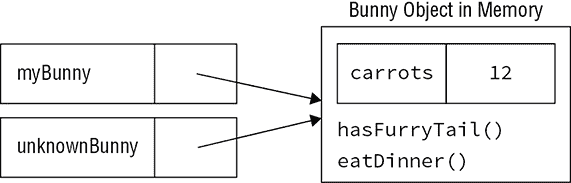

1. 如果 `unknownBunny` 引用无法访问与 `myBunny` 能够访问的相同变量和方法，它可以被显式强制转换为可以访问这些引用类型。
2. `unknownBunny` 的数据类型必须是 `Bunny` 或 `Bunny` 的子类。
3. 如果 `unknownBunny` 的数据类型是 `Bunny`，它拥有访问与 `myBunny` 相同的所有方法和变量的权限。
4. `unknownBunny` 的数据类型可以是接口、类或抽象类。

## 23. 下面修饰符中可以应用于抽象方法？

1. `final`
2. `private`
3. `default`
4. `protected`

## 24. 下面程序的输出结果是什么？

```java
package space;

interface Sphere {
   default String getName() { return "Unknown"; }
}
abstract class Planet {
   abstract String getName();
}
public class Mars extends Sphere implements Planet {
   public Mars() {
      super();
   }
   public String getName() { return "Mars"; }
   public static void main(final String[] probe) {
      System.out.print(((Planet)new Mars()).getName());
   }
}
```

1. `Mars`
2. `Unknown`
3. `由于 Sphere 的声明，代码无法编译。`
4. `代码由于其他原因无法编译。`

## 25. 下面哪个陈述是正确的？

1. 类的引用可以在不需要显式强制转换的情况下赋值给子类引用。
2. 类的引用可以在不需要显式强制转换的情况下赋值给父类引用。
3. 接口的引用可以在不需要显式强制转换的情况下赋值给实现该接口的类的引用。
4. 实现接口的类引用只有在显式强制转换的情况下才能赋值给接口引用。

## 26. 在以下四个修饰符中，选择一个**没有**被隐式应用于所有接口变量的。

1. `final`
2. `abstract`
3. `static`
4. `public`

## 27. 下面程序的输出结果是什么？

```java
package race;
abstract class Car {
   static { System.out.print("1"); }
   public Car(String name) {
      super();
      System.out.print("2");
   }
   { System.out.print("3"); }
}
public class BlueCar extends Car {
   { System.out.print("4"); }
   public BlueCar() {
      super("blue");
      System.out.print("5");
   }
   public static void main(String[] gears) {
      new BlueCar();
   }
}
```

1. `23451`
2. `12354`
3. `13245`
4. `代码无法编译。`

## 28. 填空：重载方法和重写方法始终拥有 ____________ 。

1. `the same parameter list`
2. `different return types`
3. `the same method name`
4. `covariant return types`

## 29. 下面程序的输出结果是什么？

```java
package sports;
abstract class Ball {
   protected final int size;
   public Ball(int size) {
      this.size = size;
   }
}
interface Equipment {}
public class SoccerBall extends Ball implements Equipment {
   public SoccerBall() {
      super(5);
   }
   public Ball get() { return this; }
   public static void main(String[] passes) {
      Equipment equipment = (Equipment)new SoccerBall().get();
      System.out.print(equipment.size);
   }
}
```

1. `5`
2. `代码无法编译。`
3. `代码由于其他原因无法编译。`
4. `代码可以编译但产生 ClassException。`

## 30. 填空：定义与父类同名实例变量的类被称为 ____________ 变量，而定义与父类相同签名方法的类被称为 ____________ 方法。

1. `hiding, overriding`
2. `overriding, hiding`
3. `hiding, hiding`
4. `replacing, overriding`

## 31. 关于以下类的哪个陈述是正确的？

```java
package shapes;

abstract class Parallelogram {
   private int getEqualSides() {return 0;}
}
abstract class Rectangle extends Parallelogram {
   public static int getEqualSides() {return 2;} // x1
}
public final class Square extends Rectangle {
   public int getEqualSides() {return 4;} // x2
   public static void main(String[] corners) {
      final Square myFigure = new Square(); // x3
      System.out.print(myFigure.getEqualSides());
   }
}
```

1. `由于 x1，代码无法编译。`
2. `由于 x2，代码无法编译。`
3. `由于 x3，代码无法编译。`
4. `代码可以编译并无问题运行。`

## 32. 下面程序的输出结果是什么？


```java
package flying;

class Rotorcraft {
   protected final int height = 5;
   abstract int fly();
}
public class Helicopter extends Rotorcraft {
   private int height = 10;
   protected int fly() {
      return super.height;
   }
   public static void main(String[] unused) {
      Helicopter h = (Helicopter)new Rotorcraft();
      System.out.print(h.fly());
   }
}
```

1. `5`

2. `10`

3. 代码无法编译。

4. 代码可以编译但在运行时产生 `ClassException`。

33. 填空：类可以自动赋值给 _____________ 引用变量，但在赋值给 _____________ 引用变量时需要显式强制转换。

1. `subclass, outer class`

2. `superclass, subclass`

3. `subclass, superclass`

4. `abstract class, concrete class`

34. 填空：一个(n) ____________ 是要求实现所有继承抽象方法的第一个非抽象子类。

1. `abstract class`

2. `abstraction`

3. `concrete class`

4. `interface`

35. 以下代码包含多少个编译错误？

```java
package animal;
interface CanFly {
   public void fly() {}
}
final class Bird {
   public int fly(int speed) {}
}
public class Eagle extends Bird implements CanFly {
   public void fly() {}
}
```

1. 无

2. 一个

3. 两个

4. 三个

36. 下列哪不是抽象类和接口共有的属性？

1. 它们都可以包含静态变量。

2. 它们都可以包含默认方法（`default methods`）。

3. 它们都可以包含静态方法（`static methods`）。

4. 它们都可以包含抽象方法。

37. 下一个程序的输出是什么？

```java
package musical;
interface SpeakDialogue { default int talk() { return 7; } }
interface SingMonologue { default int talk() { return 5; } }
public class Performance implements SpeakDialogue, SingMonologue {
   public int talk(String... x) {
      return x.length;
   }
   public static void main(String[] notes) {
      System.out.print(new Performance().talk(notes));
   }
}
```

1. 7

2. 5

3. 代码无法编译。

4. 代码编译无误，但在运行时之前无法确定输出。

38. 下列哪项是虚方法（`virtual method`）？

1. `protected` 实例方法

2. 静态方法

3. `private` 实例方法

4. `final` 实例方法

39. 填空：接口 ____________ 另一个接口，而类 ____________ 另一个类。

1. `implements, extends`

2. `extends, extends`

3. `implements, implements`

4. `extends, implements`

40. 下一个程序的输出是什么？

```java
class Math {
   public final double secret = 2;
}
class ComplexMath extends Math {
   public final double secret = 4;
}
public class InfiniteMath extends ComplexMath {
   public final double secret = 8;
   public static void main(String[] numbers) {
      Math math = new InfiniteMath();
      System.out.print(math.secret);
   }
}
```

1. 2

2. 4

3. 8

4. 代码无法编译。

41. 给定以下方法，并且已知 `FileNotFoundException` 是 `IOException` 的子类，以下哪个方法签名是子类的有效重写（`override`）？

```java
protected void dance() throws FileNotFoundException {}
```

1. `void dance() throws IOException`

2. `public void dance() throws IOException`

3. `private void dance() throws FileNotFoundException`

4. `public final void dance()`

42. 给定下面的类定义，在空白处插入哪个值将导致该类无法编译？

```java
public class Canine {}

public class Dog extends Canine {}

public class Wolf extends Canine {}

public final class Husky extends Dog {}

public class Zoologist {

   Canine animal;

   public final void setAnimal(Dog animal) { this.animal = animal; }

   public static void main(String[] furryFriends) {

      new Zoologist().setAnimal(______________);

   }

}
```

1. `new Husky()`
2. `new Dog()`
3. `new Wolf()`
4. `null`

43. 下列哪个修饰符不能应用于接口方法？

1. `final`
2. `default`
3. `static`
4. `abstract`

44. 关于下一个程序的哪一个陈述是正确的？

```java
package party;

abstract class House {

   protected abstract Object getSpace();

}

abstract class Room extends House {

   abstract Object getSpace(Object list);

}

abstract public class Ballroom extends House {

   protected abstract Object getSpace();

   public static void main(String[] squareFootage) {

      System.out.print("Let's start the party!");

   }

}
```

1. 编译通过并在运行时打印 `Let's start the party!`
2. 编译失败，有一个原因。
3. 编译失败有两个原因。
4. 编译失败有三个原因。

45. 填空：______________ 方法具有不同的参数列表，而 ____________ 方法具有完全相同的返回类型。

1. `Overloaded, overridden`
2. `Inherited, overridden`
3. `Overridden, overloaded`
4. 以上都不是

46. 关于无参构造函数的哪个正确？

1. 如果父类没有无参构造函数，子类不能声明。
2. 如果父类没有无参构造函数（也没有编译器生成的），子类必须包含一个构造方法定义。
3. 如果父类包含无参构造函数，子类必须包含无参构造函数。
4. 如果父类包含无参构造函数，子类必须至少包含一个构造方法。

47. 填空：______________ 决定了哪些属性存在，而 ______________ 决定了调用者可以使用。

1. `reference type, signature`
2. `object type, super`
3. `reference type, object type`
4. `object type, reference type`

48. 已知 `Integer` 和 `Long` 是 `Number` 的子类，什么类型可以填充下面类中的空白以通过编译？

```java
package orchestra;

interface MusicCreator { public Number play(); }

abstract class StringInstrument { public Long play() {return3L;} }

public class Violin extends StringInstrument implements MusicCreator {

   public play() {

      return null;

   }

}
```

1. `Long`
2. `Integer`
3. `Long` 或 `Integer`
4. `Number`

49. 创建默认方法的最佳理由是什么？

1. 允许接口方法被继承。
2. 为现有接口提供后兼容。
3. 让接口具备创建具体方法的能力。
4. 允许接口在类级别定义方法。

50. 已知 `EOFException` 是 `IOException` 的子类，下一个程序的输出是什么？

```java
package ai;

import java.io.*;

class Machine {

   public boolean turnOn() throws EOFException {return true;}

}

public class Robot extends Machine {

   public boolean turnOn() throws IOException {return false;}

   public static void main(String[] doesCompute) throws Exception {

          Machine m = new Robot();

          System.out.print(m.turnOn());

   }

}
```

1. `true`
2. `false`
3. 代码无法编译。
4. 代码编译通过但在运行时产生异常。

4. 代码由于其他原因无法编译。

2. 选择列出关键字共同使用顺序的答案。

1. `catch, try, finally`
2. `try, catch, finally`
3. `finally, catch, try`
4. `try, finally, catch`

3. 以下 `java.lang` 类图中哪一个正确显示了继承模型？

1. 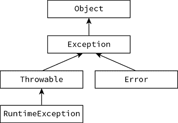
2. 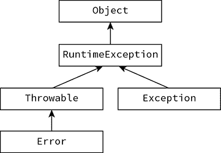
3. 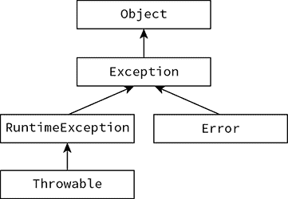
4. 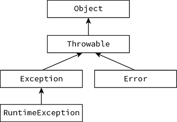

4. 在 Java 应用中，建议不要捕获以下哪种 `Throwable`？

1. `Error`
2. `CheckedException`
3. `Exception`
4. `RuntimeException`

5. 以下应用程序的输出是什么？

```java
package game;

public class Baseball {

   public static void main(String... teams) {

      try {

          int score = 1;

          System.out.print(score++);

      } catch (Throwable t) {

          System.out.print(score++);

      } finally {

          System.out.print(score++);

      }

      System.out.print(score++);

   }

}
```

1. `123`
2. `124`
3. `12`
4. 以上都不是

6. 以下哪项是检查异常（`checked exception`）？

1. `ClassCastException`
2. `IOException`
3. `ArrayIndexOutOfBoundsException`
4. `IllegalArgumentException`

7. 填空：`____________` 关键字用于方法声明，而 `____________` 关键字用于向周围进程抛出异常。

1. `throws, throw`
2. `catch, throw`
3. `throw, throws`
4. `throws, catch`

8. 如果一个 `try` 语句同时包含 `Exception` 和 `IOException` 的 `catch` 块，那么以下哪个描述是正确的？

1. `Exception` 的 `catch` 块必须出现在 `IOException` 的 `catch` 块之前。
2. `IOException` 的 `catch` 块必须出现在 `Exception` 的 `catch` 块之前。
3. 这两个异常类型的 `catch` 块可以按任何顺序声明。
4. `try` 语句不能声明这两种 `catch` 块类型，因为它们是不兼容的。

9. 以下应用程序的输出是什么？

```java
package game;

public class Football {

   public static void main(String officials[]) {

      try {

          System.out.print('A');

          throw new RuntimeException("Out of bounds!");

      } catch (ArrayIndexOutOfBoundsException aioobe) {

          System.out.print('B');

          throw aioobe;

      } finally {

          System.out.print('C');

      }

   }

}
```

1. `ABC`
2. `ABC`，随后是 `RuntimeException` 的堆栈跟踪信息
3. `AC`，随后是 `RuntimeException` 的堆栈跟踪信息
4. 以上都不是

10. 编译并运行以下应用程序的结果是什么？

```java
package castles;

public class Fortress {

   public void openDrawbridge() throws Exception {  // p1

      try {

          throw new Exception("Circle");

      } catch (Exception e) {

          System.out.print("Opening!");

      } finally {

          System.out.print("Walls");  // p2

      }

   }

   public static void main(String[] moat) {

      new Fortress().openDrawbridge();  // p3

   }

}
```


1. 代码由于行`p1`无法编译。
2. 代码由于行`p2`无法编译。
3. 代码由于行`p3`无法编译。
4. 代码可以编译，但在运行时会打印堆栈跟踪信息。

11. 以下哪种异常类型必须由抛出的方法进行处理或声明？

1. `NullPointerException`
2. `Exception`
3. `RuntimeException`
4. `ArithmeticException`

12. 以下应用程序的输出是什么？

```java
package game;

public class BasketBall {

   public static void main(String[] dribble) {

      try {

          System.out.print(1);

          throw new ClassCastException();

      } catch (ArrayIndexOutOfBoundsException ex) {

          System.out.print(2);

      } catch (Throwable ex) {

          System.out.print(3);

      } finally {

          System.out.print(4);

      }

      System.out.print(5);

   }

}
```

1. `1345`
2. `235`
3. 代码无法编译。
4. 代码可以编译，但会打印堆栈跟踪信息。

13. 关于`finally`块，以下哪个描述是正确的？

1. `finally`块的每一行都都会执行。
2. 只有当`catch`块执行时，`finally`块才会执行。
3. `finally`语句是必须的。
4. `finally`块不能抛出异常。

14. 假设`FileNotFoundException`是`IOException`的子类，以下应用程序的输出是什么？

```java
package office;

import java.io.*;

public class Printer {

   public void print() {

      try {

          throw new FileNotFoundException();

      } catch (IOException exception) {

          System.out.print("Z");

      } catch (FileNotFoundException ine) {

          System.out.print("X");

      } finally {

          System.out.print("Y");

      }

   }

   public static void main(String... args) {

      new Printer().print();

   }

}
```

1. `XY`
2. `ZY`
3. 代码无法编译。
4. 代码可以编译，但会打印堆栈跟踪信息。

15. `try`语句需要哪些关键字？

- `catch`
- `finalize`
- `finally`

1. 仅需`I`
2. 仅需`II`
3. `I`或`III`，或两者都需要
4. 这些都不是`try`语句必须的。

16. 关于 Java 中异常的作用，以下哪个说法是错误的？

1. 异常通常在出现“错误”或偏离路径时使用。
2. 抛出异常的应用程序将终止。
3. 某些异常可以通过编程避免。
4. 能正确处理异常的应用程序可以从意外问题中恢复。

17. 以下应用程序的输出是什么？

```java
package harbor;

class CapsizedException extends Exception {}

class Transport {

   public int travel() throws CapsizedException { return 2; };

}

public class Boat {

   public int travel() throws Exception { return 4; };  // j1

   public static void main(String... distance) throws Exception{

      try {

          System.out.print(new Boat().travel());

      } catch (Exception e) {

          System.out.print(8);

      }

   }

}
```

1. `4`
2. `8`
3. 代码由于行`j1`无法编译。
4. 代码由于其他原因无法编译。

18. 在实现`Printer`接口的类中，以下哪个方法签名是不允许的？

```java
class PrintException extends Exception {}

class PaperPrintException extends PrintException {}

public interface Printer {

   abstract int printData() throws PrintException;

}
```

1. `public int printData() throws PaperPrintException`
2. `public int printData() throws Exception`
3. `public int printData()`
4. 以上均都不是

19. 在应用程序中使用`Exception`、`RuntimeException`和`Throwable`类，需要声明哪个 import 语句？

1. `import java.exception.*;`
2. `import java.util.exception.*;`
3. `import java.lang.*;`
4. 以上均都不是

20. 关于以下类，哪种描述是正确的？

```java
class GasException extends Exception {}

class Element {

   public int getSymbol() throws GasException { return -1; }  // g1

}

public class Oxygen extends Element {

   public int getSymbol() { return 8; }  // g2

   public void printData() {

      try {

         System.out.print(getSymbol());

      } catch {  // g3

         System.out.print("Unable to read data");

      }

   }

}
```

1. 代码因为第`g1`行无法编译。
2. 代码因为第`g2`行无法编译。
3. 代码因为第`g3`行无法编译。
4. 以上均都不是

21. 填空：程序必须处理或声明 ____________，但绝不应该处理 ____________。

1. `java.lang.Error`, `unchecked exceptions`
2. `checked exceptions`, `java.lang.Error`
3. `java.lang.Throwable`, `java.lang.Error`
4. `unchecked exceptions`, `java.lang.Exception`

22. 编译并运行以下应用程序的 own 是什么？

```java
package castles;

class CastleUnderSiegeException extends Exception {}

class KnightAttackingException extends CastleUnderSiegeException {}

public class Citadel {

   public void openDrawbridge() throws RuntimeException {  // q1

      try {

         throw new KnightAttackingException();

      } catch (Exception e) {

         throw new ClassCastException();

      } finally {

         throw new CastleUnderSiegeException();  // q2

      }

   }

   public static void main(String[] moat) {

      new Citadel().openDrawbridge();  // q3

   }

}
```

1. 代码因为第`q1`行无法编译。
2. 代码因为第`q2`行无法编译。
3. 代码因为第`q3`行无法编译。
4. 代码编译通过，但在运行时会打印堆栈跟踪（stack trace）。

23. 如果一个异常匹配两个或多个`catch`块，将执行哪个`catch`块？

1. 执行第一个匹配的块。
2. 执行最后一个匹配的块。
3. 所有匹配的块都会被执行。
4. 无法编写出这样的代码。

24. 以下应用程序的输出是什么？

```java
package system;

public class Computer {

   public void compute() throws Exception {

      throw new RuntimeException("Error processing request");

   }

   public static void main(String[] bits) {

      try {

         new Computer().compute();

         System.out.print("Ping");

      } catch (NullPointerException e) {

         System.out.print("Pong");

         throw e;

      }

   }

}
```

1. Ping
2. Pong
3. 代码无法编译。
4. 代码编译通过但在运行时会抛出异常。

25. 在以下应用程序中，`list`的值已被省略。假设代码编译没有问题，执行该类时，哪一个不是可能的结果？

```java
package checkboard;

public class Attendance {

   private Boolean[] list = // 值已省略

   public int printTodaysCount() {

      int count=0;

      for(int i=0; i<10; i++) {

         if(list[i]) ++count;

      }

      return count;

   }

   public static void main(String[] roster) {

      new Attendance().printTodaysCount();

   }

}
```

1. 打印`NullPointerException`的堆栈跟踪。
2. 打印`ArrayIndexOutOfBoundsException`的堆栈跟踪。
3. 打印`ClassCastException`的堆栈跟踪。
4. 以上均都不是

26. 填空：当程序深度递归进入无限循环时，会发生 ____________；而当对不存在的对象的引用进行操作时，会发生 ____________。

1. `NoClassDefFoundError`, `StackOverflowError`
2. `StackOverflowError`, `NullPointerException`
3. `ClassCastException`, `IllegalArgumentException`
4. `StackOverflowError`, `IllegalArgumentException`

27. 以下哪项不是在方法签名中添加受检异常（checked exceptions）的原因？

1. 强制调用者处理或声明其异常
2. 通知调用者潜在的问题类型
3. 确保异常永远不会导致应用程序终止
4. 给调用者一个从问题中恢复的机会

28. 以下应用程序的输出是什么？

```java
package peculiar;

public class Stranger {

   public static String getFullName(String firstName, String lastName) {

      try {

         return firstName.toString() + lastName;

      } finally {

         System.out.print("Finished!");

      } catch (NullPointerException npe) {

         System.out.print("Problem?");

      }

      return null;

   }

   public static void main(String[] things) {

      System.out.print(getFullName("Joyce","Hopper"));

   }

}
```

1. Joyce Hopper
2. Finished!Hopper
3. Problem?Finished!
4. 以上均都不是

29. 填空：一个`try`语句有 ____________ 块和 ____________ `catch`块。

1. zero or one, zero or more
2. one or more, zero or one
3. zero or one, one or more
4. one or more, zero or one

30. 以下应用程序的输出是什么？

```java
package pond;

abstract class Duck {

   protected int count;

   public abstract int getDuckies();

}

public class Ducklings extends Duck {

   private int age;

   public Ducklings(int age) { this.age = age; }

   public int getDuckies() { return count; }

   public static void main(String[] pondInfo) {

      Ducklings itQuacks = Ducklings(5);

      System.out.print(itQuacks.getDuckies());

   }

}
```

1. 0
2. 5
3. 代码无法编译。
4. 以上均都不是

31. 在一个`try`语句中，如果`catch`块和`finally`块都抛出了异常，调用者会看到什么？

1. `catch`块抛出的异常
2. `finally`块抛出的异常
3. `catch`块和`finally`块都抛出的异常
4. 以上均都不是

32. 以下应用程序的输出是什么？

```java
package zoo;

class BigCat {

   void roar(int level) throws RuntimeException {  // m1

      if(level<3) throw new IllegalArgumentException("Incomplete");

      System.out.print("Roar!");

   }

}

public class Lion extends BigCat {

   public void roar() {  // m2

      System.out.print("Roar!!!");

   }

   public static void main(String[] cubs) {

      final BigCat kitty = new Lion();  // m3

      kitty.roar(2);

   }

}
```

1. 代码因为第`m1`行无法编译。
2. 代码因为第`m2`行无法编译。
3. 代码因为第`m3`行无法编译。
4. 代码编译通过，但在运行时会打印堆栈跟踪。

33. 给定以下代码片段，将抛出哪种特定的异常？

```java
final Object exception = new Exception();

final Exception data = (RuntimeException)exception;

System.out.print(data);
```


### 34. 以下哪一个类可以处理 `catch` 块中的所有类型？

1. `Exception`
2. `Error`
3. `Throwable`
4. `RuntimeException`

### 35. 在下述应用中，`street` 和 `city` 的值被省略了。执行该类后，以下哪项是可能的输出结果？

- `350 5th Ave - New York`
- `Posted:350 5th Ave - New York`

```java
package registration;

public class Address {

   public String getAddress(String street, String city) {

      try {

         return street.toString() + " - " + city.toString();

      } finally {

         System.out.print("Posted:");

      }

   }

   public static void main(String[] form) {

      String street = // value omitted

      String city = // // value omitted

      System.out.print(new Address().getAddress(street,city));

   }

}
```

1. 仅 I
2. 仅 II
3. I 和 II
4. 以上都不是

### 36. 如果一个 `try` 语句同时包含 `ClassCastException` 和 `RuntimeException` 的 `catch` 块，那么以下哪个语句是正确的？

1. `ClassCastException` 的 `catch` 块必须出现在 `RuntimeException` 的 `catch` 块之前。
2. `RuntimeException` 的 `catch` 块必须出现在 `ClassCastException` 的 `catch` 块之前。
3. 这两种异常类型的 `catch` 块可以按任何顺序声明。
4. `try` 语句不能声明这两种 `catch` 块类型，因为它们是不兼容的。

### 37. 以下哪种情况是使用异常的最佳场景？

1. 电脑着火了。
2. 代码无法编译。
3. 调用者向方法传递了无效数据。
4. 方法结束的时间比预期的早。

### 38. 下述应用的输出是什么？

```java
package body;

class Organ {

   public void operate() throws RuntimeException {

      throw new RuntimeException("Not supported");

   }

}

public class Heart extends Organ {

   public void operate() throws Exception {

      System.out.print("beat");

   }

   public static void main(String... cholesterol) throws Exception {

      try {

         new Heart().operate();

      } finally {

      }

   }

}
```

1. `beat`
2. `Not supported`
3. 代码无法编译。
4. 代码可以编译，但在运行时打印堆栈跟踪（stack trace）。

### 39. 关于以下异常语句，哪个陈述是正确的？

```java
throw new NullPointerException();
```

1. 调用此语句的代码必须包含一个处理此异常的 `try-catch` 块。
2. 调用此语句的方法必须声明一个兼容的异常。
3. 此异常无法被处理。
4. 此异常可以通过 `try-catch` 块进行处理，或者完全被周围的方法所忽略。

### 40. 下述应用的输出是什么？

```java
package clothing;

public class Coat {

   public Long zipper() throws Exception {

      try {

         String checkZipper = (String)new Object();

      } catch (Exception e) {

         throw RuntimeException("Broken!");

      }

      return null;

   }

   public static void main(String... warmth) {

      try {

         new Coat().zipper();

         System.out.print("Finished!");

      } catch (Throwable t) {}

   }

}
```

1. `Finished!`
2. `Finished!`, 随后跟一个堆栈跟踪
3. 应用程序在运行时不产生任何输出。
4. 代码无法编译。

### 41. 给定以下应用，运行时堆栈跟踪中将打印哪种类型的异常？

```java
package carnival;

public class WhackAnException {

   public static void main(String... hammer) {

      try {

         throw new ClassCastException();

      } catch (IllegalArgumentException e) {

         throw new IllegalArgumentException();

      } catch (RuntimeException e) {

         throw new NullPointerException();

      } finally {

         throw new RuntimeException();

      }

   }

}
```

1. `IllegalArgumentException`
2. `NullPointerException`
3. `RuntimeException`
4. 代码无法编译。

### 42. 在实现 `Outfielder` 接口的类中，以下哪个方法签名是被允许？

```java
class OutOfBoundsException extends BadCatchException {}

class BadCatchException extends Exception {}

public interface Outfielder {

   public void catchBall() throws OutOfBoundsException;

}
```

1. `public int catchBall() throws OutOfBoundsException`
2. `public int catchBall() throws BadCatchException`
3. `public int catchBall() throws Exception`
4. 以上都不是

### 43. 下述应用的输出是什么？

```java
package city;

public class Street {

   public static void dancing() throws RuntimeException {

      try {

         throw new IllegalArgumentException();

      } catch (Error) {

         System.out.print("Unable!");

      }

   }

   public static void main(String... count) throws RuntimeException {

      dancing();

   }

}
```

1. `Unable!`
2. 应用程序不产生任何输出。
3. 应用程序可以编译但在运行时产生堆栈跟踪。
4. 代码无法编译。

### 44. 编译并运行以下应用的结果是什么？

```java
package castles;

class DragonException extends Exception {}

public class Lair {

   public void openDrawbridge() throws Exception {  // r1

      try {

         throw new Exception("This");

      } catch (RuntimeException e) {

         throw new DragonException();  // r2

      } finally {

         throw new RuntimeException("Or maybe this");

      }

   }

   public static void main(String[] moat) throws Exception {

      new Lair().openDrawbridge();  // r3

   }

}
```

1. 因为 `r1` 代码无法编译。
2. 因为 `r2` 代码无法编译。
3. 因为 `r3` 代码无法编译。
4. 代码可以编译，但在运行时打印堆栈跟踪。

### 45. 如果一个 `try` 语句同时包含 `IllegalArgumentException` 和 `ClassCastException` 的 `catch` 块，那么以下哪个语句是正确的？

1. `IllegalArgumentException` 的 `catch` 块必须出现在 `ClassCastException` 的 `catch` 块之前。
2. `ClassCastException` 的 `catch` 块必须出现在 `IllegalArgumentException` 的 `catch` 块之前。
3. 这两种异常类型的 `catch` 块可以按任何顺序声明。
4. `try` 语句不能声明这两种 `catch` 块类型，因为它们是不兼容的。

### 46. 下述应用的输出是什么？

```java
package broken;

class Problem implements RuntimeException {}

public class BiggerProblem extends Problem {

   public static void main(String uhOh[]) {

      try {

         throw new BiggerProblem();

      } catch (BiggerProblem re) {

         System.out.print("Problem?");

      } catch (Problem e) {

         System.out.print("Handled");

      } finally {

         System.out.print("Fixed!");

      }

   }

}
```

1. `Problem?Fixed!`
2. `Handled.Fixed!`
3. `Problem?Handled.Fixed!`
4. 代码无法编译。

### 47. 下述应用的输出是什么？

```java
package lighting;

interface Source {

   void flipSwitch() throws Exception;

}

public class LightBulb implements Source {

   public void flipSwitch() {

      try {

         throw new RuntimeException("Circuit Break!");

      } finally {

         System.out.print("Flipped!");

      }

   }

   public static void main(String... electricity) throws Throwable {

      final Source bulb = new LightBulb();

      bulb.flipSwitch();

   }

}
```

1. 一个 `RuntimeException` 的堆栈跟踪
2. `Flipped!`，随后是一个 `RuntimeException` 的堆栈跟踪
3. 代码无法编译，因为 `flipSwitch()` 是一个无效的方法重写。
4. 代码由于另一个原因无法编译。

### 48. 给定一个托管网站的应用程序，以下哪种情况最可能导致抛出 `java.lang.Error`？

1. 两个用户同时尝试注册账户。
2. 应用程序临时丢失网络连接。
3. 用户输入错误的密码。
4. 应用程序内存不足。

### 49. 鉴于 `FileNotFoundException` 是 `IOException` 的子类，以下应用程序的输出是什么？

```java
package storage;

import java.io.*;

public class Backup {

   public void performBackup() {

      try {

         throw new IOException("Disk not found");

      } catch (Exception e) {

         try {

            throw new FileNotFoundException("File not found");

         } catch (FileNotFoundException e) {  // z1

            System.out.print("Failed");

         }

      }

   }

   public static void main(String... files) {

      new Backup().performBackup();  // z2

   }

}
```

1. `Failed`
2. 应用程序编译，但在运行时打印堆栈跟踪。
3. 代码由于行 `z1` 无法编译。
4. 代码由于行 `z2` 无法编译。

### 50. 以下应用程序的输出是什么？

```java
package bed;

public class Sleep {

   public static void snore() {

      try {

         String sheep[] = new String[3];

         System.out.print(sheep[3]);

      } catch (RuntimeException e) {

         System.out.print("Awake!");

      } finally {

         throw new Exception();  // x1

      }

   }

   public static void main(String... sheep) {  // x2

      new Sleep().snore();  // x3

   }

}
```


1. `Awake!`, 随后是堆栈跟踪
2. 代码由于行 `x1` 无法编译。
3. 代码由于行 `x2` 无法编译。
4. 代码由于行 `x3` 无法编译。

# 第 9 章

与 Java API 中的选定类操作

本次练习测试涵盖的 OCA 考试主题包括：

* 与 Java API 中的选定类操作
  * 使用 `StringBuilder` 类及其方法操作数据
  * 创建和操作 `Strings`
  * 使用 `java.time.LocalDateTime`、`java.time.LocalDate`、`java.time.LocalTime`、`java.time.format.DateTimeFormatter` 和 `java.time.Period` 类创建并操作日期数据
  * 声明并使用给定类型的 `ArrayList`
  * 编写一个消耗 Lambda `Predicate` 表达式的简单 Lambda 表达式

1. 使用 `StringBuilder` 而不是 `String` 的最佳理由是什么？

   1. `StringBuilder` 增加了对多线程的支持。
   2. `StringBuilder` 可以使用 `==` 比较值。
   3. `StringBuilder` 通过减少创建的对象数量节省内存。
   4. `StringBuilder` 支持不同的语言和编码。

2. 关于 `String`，哪是不正确的？

   1. 可以在不编写调用构造函数的情况下创建它。
   2. 可以通过字符串池复用它。
   3. 它是 `final` 的。
   4. 它是可变的。

3. 以下哪项创建的 `StringBuilder` 值与其他选项值不同？

   1. `new StringBuilder().append("clown")`
   2. `new StringBuilder("clown")`
   3. `new StringBuilder("cl").insert(2, "own")`
   4. 它们创建的值都相同。

4. 以下代码的输出是什么？

```java
StringBuilder teams = new StringBuilder("333");
teams.append(" 806");
teams.append(" 1601");
System.out.print(teams);
```

   1. 333
   2. 333 806 1601
   3. 代码编译但输出其他内容。
   4. 代码无法编译。

5. `ArrayList`、`List` 和 `Object` 类型中有多少个可以填充以产生可编译的代码？

```java
List frisbees = new  ____________();
```

   1. 无
   2. 一个
   3. 两个
   4. 三

6. 以下代码的输出是什么？

```java
List<String> tools = new ArrayList<>();
tools.add("hammer");
tools.add("nail");
tools.add("hex key");
System.out.println(tools.get(1));
```

   1. hammer
   2. hex key
   3. nail
   4. 以上都不是

7. 以下代码的结果是什么？

```java
StringBuilder sb = new StringBuilder("radical")
  .insert(sb.length(), "robots");
System.out.println(sb);
```

   1. radicarots
   2. radical
   3. 代码无法编译。
   4. 代码编译但抛出异常。

8. 以下代码的输出是什么？

```java
List<String> museums = new ArrayList<>();
museums.add("Natural");
museums.add("Science");
museums.add("Art");
museums.remove(0);
System.out.println(museums);
```

   1. [Natural, Science, Art]
   2. [Science, Art]
   3. 代码无法编译。
   4. 编译但抛出异常。

9. 以下代码的输出是什么？

```java
StringBuilder b = new StringBuilder("12");
b.append("3");
b.reverse();
System.out.println(b);
```

   1. 12
   2. 123
   3. 321
   4. 代码无法编译。

10. Lambda 表达式的主要优势是什么？

   1. 将原始类型转换为包装类。
   2. 在运行时更改字节码。
   3. 继承多个类。
   4. 编写延迟代码。

11. 以下代码的输出是什么？

```java
StringBuilder line = new StringBuilder("-");
anotherLine = line.append("-");
System.out.print(line == anotherLine);
System.out.print(line.length());
```

   1. false 1
   2. false 2
   3. true 1
   4. true 2

12. 方法作者漏掉了类型。以下哪些引用类型可以填充空白以完成该方法？

```java
public static void secret(____________) {
  mystery.add("metal");
  String str = mystery.get(0);
  int num = mystery.length();
}
```

   1. `ArrayList`
   2. `ArrayList<String>`
   3. `StringBuilder`
   4. 以上都不是

13. 删除哪部分代码可以使代码继续编译？

```java
Predicate<StringBuilder> p = (StringBuilder b) -> {return true;};
```

   1. 删除 `StringBuilder b`
   2. 删除 `->`
   3. 删除 `{` 和 `;`
   4. 删除 `return` 和 `;`

14. 以下代码的输出是什么？

```java
List<Character> chars = new ArrayList<>();
chars.add('a');
chars.add('b');
chars.set(1, 'c');
chars.remove(0);
System.out.print(chars.size() + " " + chars.contains('b'));
```

   1. 1 false
   2. 1 true
   3. 2 false
   4. 2 true

15. 以下代码的输出是什么？

```java
String b = "12";
b += "3";
b.reverse();
System.out.println(b.toString());
```

   1. 12
   2. 123
   3. 321
   4. 代码无法编译。

16. 以下有多少行代码编译失败？

```java
Predicate<String> pred1 = s -> false;
Predicate<String> pred2 = (s) -> false;
Predicate<String> pred3 = String s -> false;
Predicate<String> pred4 = (String s) -> false;
```

   1. 一个
   2. 两个
   3. 三
   4. 四个

17. 以下代码做了什么？

```java
public class Shoot {
   interface Target {
      boolean needToAim(double angle);
   }
   static void prepare(double angle, Target t) {
      boolean ready = t.needToAim(angle);  // k1
      System.out.println(ready);
   }
   public static void main(String[] args) {
      prepare(45, d -> d > 5 || d < -5);   // k2
   }
}
```

   1. 它打印 `true`。
   2. 它打印 `false`。
   3. 由于行 `k1` 无法编译。
   4. 由于行 `k2` 无法编译。

18. 以下代码的输出是什么？

```java
String teams = new String("694");
teams.concat(" 1155");
teams.concat(" 2265");
teams.concat(" 2869");
System.out.println(teams);
```

   1. 694
   2. 694 1155 2265 2869
   3. 代码编译通过但输出了其他内容。
   4. 代码无法编译。

19. 下列类中哪些位于 `java.util` 包？

* `ArrayList`
* `LocalDate`
* `String`

   1. 仅 I
   2. 仅 II
   3. I 和 II
   4. I、II 和 III

20. 哪个选项选项产生的输出值与其他三个选项不同？

```java
StringBuilder sb = new StringBuilder("radical ");
sb = ________________________;
System.out.print(sb);
```

   1. `new StringBuilder("radical ")`
      * `.append("robots")`
   2. `new StringBuilder("radical ")`
      * `.delete(1, 100)`
      * `.append("obots")`
      * `.insert(1, "adical r")`
   3. `new StringBuilder("radical ")`
      * `.insert(7, "robots")`
   4. `new StringBuilder("radical ")`
      * `.insert(sb.length(), "robots")`

21. 以下代码的输出是什么？

```java
String[] array = {"Natural History", "Science"};
List<String> museums = Arrays.asList(array);
museums.set(0, "Art");
System.out.println(museums.contains("Art"));
```

   1. true
   2. false
   3. 代码无法编译。
   4. 代码编译通过但在运行时抛出异常。

22. 哪个陈述是正确的？

   1. 如果 `s.contains("abc")` 为 true，那么 `s.equals("abc")` 也是 true。
   2. 如果 `s.contains("abc")` 为 true，那么 `s.startsWith("abc")` 也是 true。
   3. 如果 `s.startsWith("abc")` 为 true，那么 `s.equals("abc")` 也是 true。
   4. 如果 `s.startsWith("abc")` 为 true，那么 `s.contains("abc")` 也是 true。

23. 以下代码的输出是什么？

```java
20:  List<Character> chars = new ArrayList<>();
21:  chars.add('a');
22:  chars.add('b');
23:  chars.set(1, 'c');
24:  chars.remove(0);
25:  System.out.print(chars.length());
```

   1. 0
   2. 1
   3. 2
   4. 以上均不是

24. 此方法的作者忘记包含数据类型。以下哪种引用类型可以填充空白以完成此方法？

```java
public static void secret(_____________ mystery) {
   mystery = mystery.replace("1", "8");
   mystery.startsWith("paper");
   String s = mystery.toString();
}
```

   1. `ArrayList`
   2. `String`
   3. `StringBuilder`
   4. 以上均不是

25. 在确保代码继续编译的情况下，关于下图的哪个陈述是正确的？

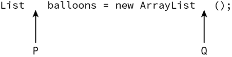

   1. 可以在位置 `P` 插入 `<>` 而不进行任何其他更改。
   2. 可以在位置 `Q` 插入 `<>` 而不进行任何其他更改。
   3. 可以在位置 `P` 和 `Q` 处都插入 `<>`。
   4. 以上均不是

26. 以下哪项可以填充空白使代码编译？

```java
import java.util.function.*;
public class Card {
   public static void main(String[] s) {
      Predicate<String> pred =____________  ‐> true;
   }
}
```

   1. `(Integer i)`
   2. `(Object o)`
   3. `(String s)`
   4. 以上均不是

27. 以下代码的输出是什么？

```java
5:  String line = new String("-");
6:  String anotherLine = line.concat("-");
7:  System.out.print(anotherLine);
8:  System.out.print(line.length());
```

   1. false 1
   2. false 2
   3. true 1
   4. true 2

28. 以下代码输出什么？

```java
Predicate dash = c -> c.startsWith("-");
System.out.println(dash.test(""));
```

   1. true
   2. false
   3. 代码无法编译。
   4. 代码编译通过但在运行时抛出异常。

29. 在 `LocalDate`、`LocalDateTime`、`LocalTime` 和 `Instant` 类中，有多少包含秒？

   1. 一个
   2. 两个
   3. 三
   4. 四个

30. 以下代码的输出是什么？

```java
1:   public class Countdown {
2:     public static void main(String[] args) {
3:        StringBuilder sb = new StringBuilder();
4:        sb.append("red");
5:        sb.deleteCharAt(0);
6:        sb.delete(1, 2);
7:        System.out.print(sb);
8:     }
9: }
```

   1. e
   2. d
   3. ed
   4. 以上均不是

31. 以下哪个等效代码可以替换 `i != 0`？

```java
Predicate<Integer> ip = i != 0;
```

   1. `i -> { i != 0 }`
   2. `i -> { return i != 0 }`
   3. `i != 0`
   4. `i == 0`

32. 以下代码的输出是什么？

```java
LocalDate xmas = LocalDate.of(2016, 12, 25);
xmas.plusDays(-1);
System.out.println(xmas.getDayOfMonth());
```

   1. 24
   2. 25
   3. 26
   4. 以上均不是

33. 以下代码的输出是什么？

```java
1:   public class Legos {
2:     public static void main(String[] args) {
3:        StringBuilder sb = new StringBuilder();
4:        sb.append("red");
5:        sb.deleteCharAt(0);
6:        sb.delete(1, 2);
7:        System.out.print(sb);
8:     }
9: }
```

   1. e
   2. d
   3. ed
   4. 以上均不是

34. 以下代码输出什么？

```java
Predicate clear = c -> c.equals("clear");
System.out.println(clear.test("pink"));
```


# 第 10 章

## OCA 模拟考试

本章包含 80 道题，旨在模拟真实的 OCA 考试。虽然之前的章节侧重于特定的知识点，但本章涵盖了考试中的所有知识点。建议你在完成之前的章节后再参加此考试。

### 35. 哪个从一个开始计数？

1. 数组索引
2. `String` 中的 `charAt`
3. `LocalDateTime` 中的月份
4. `LocalTime` 中的月份

### 36. 关于 `Predicate` 的哪个陈述是不正确的？

1. 它的方法返回一个布尔值。
2. 它是一个接口。
3. 它的方法接受两个参数。
4. 它的方法名为 `test`。

### 37. 下列哪个周期代表更长的时间？

```java
Period period1 = Period.ofWeeks(1).ofDays(3);
Period period2 = Period.ofDays(10);
```

1. `period1`
2. `period2`
3. 它们的时间相同。
4. 以上不是。此代码无法编译。

### 38. 以下结果是什么？

```java
import java.time.*;
import java.time.format.*;

public class HowLong {
   public static void main(String[] args) {
      LocalDate newYears = LocalDate.of(2017, 1, 1);
      Period period = Period.ofDays(1);
      DateTimeFormatter format = DateTimeFormatter.ofPattern("MM-dd-yyyy");
      System.out.print(format.format(newYears.minus(period)));
   }
}
```

1. 01-01-2017
2. 12-31-2016
3. 代码无法编译。
4. 代码编译通过但在运行时抛出异常。

### 39. 以下哪项可以填充空白使以下代码打印 `true`？

```java
String happy = " :) - (: ";
String really = happy.trim();
String question = ______________________;
System.out.println(really.equals(question));
```

1. `happy.substring(0, happy.length() - 1)`
2. `happy.substring(0, happy.length())`
3. `happy.substring(1, happy.length() - 1)`
4. `happy.substring(1, happy.length())`

### 40. 关于 `Period` 类，以下哪一个陈述是不正确的？

1. `Period` 是不可变的。
2. `Period` 通常用于为日期增加或减少时间。
3. 你可以创建一个表示 2 分钟的 `Period`。
4. 你可以创建一个表示 5 年的 `Period`。

### 41. 下一个类的输出是什么？

```java
1:  package rocket;
2:  public class Countdown {
3:     public static void main(String[] args) {
4:        StringBuilder builder = new StringBuilder("54321");
5:        builder.substring(2);
6:        System.out.println(builder.charAt(1));
7:     }
8:  }
```

1. 1
2. 2
3. 3
4. 4

### 42. 下面的输出是什么？

```java
List<Integer> pennies = new ArrayList<>();
pennies.add(3);
pennies.add(2);
pennies.add(1);
pennies.remove(2);
System.out.println(pennies);
```

1. [3, 1]
2. [3, 2]
3. 代码无法编译。
4. 代码可以编译，但在运行时会抛出异常。

### 43. 此方法的作者忘记了包含数据类型。以下哪种引用类型最好填充空白以完成此方法？

```java
public static void secret(_____________ mystery) {
   char ch = mystery.charAt(3);
   mystery = mystery.insert(1, "more");
   int num = mystery.length();
}
```

1. `ArrayList`
2. `String`
3. `StringBuilder`
4. 以上都不是

### 44. 你可以向 `LocalTime` 对象添加的最小单位是什么？

1. 秒 (Second)
2. 毫秒 (Millisecond)
3. 纳秒 (Nanosecond)
4. 皮秒 (Picosecond)

### 45. 下面代码的结果是什么？

```java
import java.time.*;
import java.time.format.*;

public class HowLong {
   public static void main(String[] args) {
      LocalDate newYears = LocalDate.of(2017, 1, 1);
      Period period = Period.ofDays(1);
      DateTimeFormatter format = DateTimeFormatter.ofPattern("mm-dd-yyyy");
      System.out.print(format.format(newYears.minus(period)));
   }
}
```

1. 01-01-2017
2. 12-31-2016
3. 代码无法编译。
4. 代码可以编译，但在运行时会抛出异常。

### 46. 以下哪些类型可以作为参数传递给 `String` 类的 `replace()` 方法？

* `char`
* `String`
* `StringBuilder`

1. I
2. I 和 II
3. II 和 III
4. I、II 和 III

### 47. 这段代码输出了多少行？

```java
import java.util.*;
import java.util.function.*;

public class PrintNegative {
   public static void main(String[] args) {
      List<String> list = new ArrayList<>();
      list.add("-5");
      list.add("0");
      list.add("5");
      print(list, e -> e < 0);
   }

   public static void print(List<String> list, Predicate<Integer> p) {
      for (String num : list)
         if (p.test(num))
                System.out.println(num);
   }
}
```

1. 一行
2. 两行
3. 无。代码无法编译。
4. 无。代码在运行时会抛出异常。

### 48. 下面代码的输出是什么？

```java
12:  List<String> magazines = new ArrayList();
13:  magazines.add("Readers Digest");
14:  magazines.add("People");
15:  magazines.clear();
16:  magazines.add("The Economist");
17:  magazines.remove(1);
18:  System.out.println(magazines.size());
```

1. 0
2. 1
3. 代码无法编译。
4. 代码可以编译，但在运行时会抛出异常。

### 49. 下面代码的输出是什么？

```java
public class Costume {
   public static void main(String[] black) {
     String witch = 'b';
     String tail = "lack";
     witch = witch.concat(tail);
     System.out.println(witch);
   }
}
```

1. b
2. black
3. 代码无法编译。
4. 代码可以编译，但在运行时会抛出异常。

### 50. 下面代码的结果是什么？

```java
LocalDate xmas = LocalDate.of(2016,  12,  25);
xmas.setYear(2017);
System.out.println(xmas.getYear());
```

1. 2016
2. 2017
3. 代码无法编译。
4. 代码可以编译，但在运行时会抛出异常。

### 6. 假设有一个使用以下导入语句的类，哪三个类在不使用完整包名的情况下可以自动访问？（选择三个。）

```java
import forest.Bird;
import jungle.tree.*;
import savana.*;
```

1. `forest.Bird`
2. `savana.sand.Wave`
3. `jungle.tree.Huicungo`
4. `java.lang.Object`
5. `forest.Sloth`
6. `forest.ape.bonobo`

### 7. 以下变量中有多少个代表不可变对象？

```java
ArrayList l = new ArrayList();
String s = new String();
```


`StringBuilder sb = new StringBuilder();`

`LocalDateTime t = LocalDateTime.now();`

### 7. 以下代码的输出是什么？

```java
StringBuilder builder = new StringBuilder("Leaves growing");

do {
   builder.delete(0, 5);
} while (builder.length() > 5);

System.out.println(builder);
```

1. 无
2. 一个
3. 二
4. 三
5. 四
6. 以上都不是——此代码无法编译。

### 8. 下面代码的输出是什么？

```java
StringBuilder builder = new StringBuilder("Leaves growing");

do {
   builder.delete(0, 5);
} while (builder.length() > 5);

System.out.println(builder);
```

1. Leaves growing
2. ing
3. wing
4. 代码无法编译。
5. 代码可以编译但在运行时抛出异常。

### 9. 以下应用程序的输出是什么？

```java
package reality;

public class Equivalency {
   public static void main(String[] edges) {
      final String ceiling = "up";
      String floor = new String("up");
      final String wall = new String(floor);

      System.out.print((ceiling==wall) + " " + (floor==wall) + " " + ceiling.equals(wall));
   }
}
```

1. false false false
2. true true true
3. false true true
4. false false true
5. 无法编译。

### 10. 以下代码打印了多少次 true？

```java
1:   public class Giggles {
2:      public static void main(String[] args) {
3:         String lol = "lol";
4:         System.out.println(lol.toUpperCase() == lol);
5:         System.out.println(lol.toUpperCase() == lol.toUpperCase());
6:         System.out.println(lol.toUpperCase().equals(lol));
7:         System.out.println(lol.toUpperCase().equals(lol.toUpperCase()));
8:         System.out.println(lol.toUpperCase().equalsIgnoreCase(lol));
9:         System.out.println(lol.toUpperCase()
10:           .equalsIgnoreCase(lol.toUpperCase()));
11:  } }
```

1. 一个
2. 二
3. 三
4. 四
5. 五
6. 无。代码无法编译。

### 11. 哪些行可以同时删除且不停止代码编译，并保持相同的输出？（选择三个。）

```java
14:  String race = "";
15:  outer:
16:  do {
17:  inner:
18:     do {
19:        race += "x";
20:     } while (race.length() <= 4);
21:  } while (race.length() < 4);
22: System.out.println(race);
```

1. 第 15 行和第 17 行
2. 第 15 行、第 16 行和第 21 行
3. 第 17 行
4. 第 17 行、第 18 行和第 20 行
5. 第 20 行
6. 第 21 行

### 12. 在填充空处时，以下哪些项无法编译？（选择两个。）

```java
long bigNum = ____________;
```

1. 1234
2. 1234.0
3. 1234.0L
4. 1234l
5. 1234L
6. 1_234

### 13. 这个程序打印了多少行内容？

```java
import java.time.*;

public class OnePlusOne {
   public static void main(String... nums) {
      LocalTime time = LocalTime.of(1, 11);
      while (time.getHour() < 1) {
         time.plusHours(1);
         System.out.println("in loop");
      }
   }
}
```

1. 无
2. 一个
3. 二
4. 这是一个死循环。
5. 代码无法编译。

### 14. 运行以下程序的运行是什么？

```java
1:   package fun;
2:   public class Sudoku {
3:      static int[][] game;
4:
5:      public static void main(String args[]) {
6:         game[3][3] = 6;
7:         Object[] obj = game;
8:         obj[3] = 'X';
9:         System.out.println(game[3][3]);
10:     }
11:  }
```

1. 6
2. X
3. 代码无法编译。
4. 代码可以编译但在运行时抛出 NullPointerException。
5. 代码可以编译但在运行时抛出不同的异常。
6. 输出不确定。

### 15. 以下哪些使用了泛型且编译无警告？（选择两个。）

1. `List<String> a = new ArrayList();`
2. `List<> b = new ArrayList();`
3. `List<String> c = new ArrayList<>();`
4. `List<> d = new ArrayList<>();`
5. `List<String> e = new ArrayList<>();`
6. `List<> f = new ArrayList<>();`

### 16. 在 `main()` 方法结束时，以下哪些是正确的？（选择两个。）

```java
public static void main(String[] args) {
   String shoe1 = new String("sandal");
   String shoe2 = new String("flop");
   String shoe3 = new String("croc");
   shoe1;
   shoe2;
   shoe3;
}
```

1. 对象可以垃圾回收。
2. 一个对象可以垃圾回收。
3. 两个对象可以垃圾回收。
4. 保证会被回收。
5. 保证一个会被回收。
6. 保证两个会被回收。

### 17. 以下应用程序中有多少行无法编译？

```java
package ocean;

class BubbleException extends Exception {}

class Fish {
   Fish getFish() throws BubbleException {
      throw new RuntimeException("fish!");
   }
}

public final class Clownfish extends Fish {
   public finalfishFish() {
      throw new RuntimeException("clown!");
   }

   public static void main(String[] bubbles) {
      final Fish f = new Clownfish();
      f.getFish();
      System.out.println("swim!");
   }
}
```

1. 代码可以编译并打印 swim!.
2. 代码可以编译并打印堆栈跟踪。
3. 一
4. 二
5. 三

### 18. 这段代码输出多少行？

```java
import java.util.*;
import java.function.*;

public class PrintNegative {
  public static void main(String[] args) {
         List<Integer> list= new ArrayList<>();
         list.add(-5);
         list.add(0);
         list.add(5);
         print(list, e -> e < 0);
  }

  public static void print(List<Integer> list, Predicate<Integer> p) {
      for (Integer num : list)
         if (p.test(num))
            System.out.println(num);
  }
}
```

*（注：原文此处存在语法错误 `if (p.test(num))` 多了一个右括号，翻译按原意逻辑处理）*

1. 一
2. 二
3. 三
4. 代码无法编译。
5. 运行时抛出异常。

### 19. try 语句需要哪些关键字？

- finalize
- catch
- throws
- finally

1. 仅 I
2. 仅 II
3. 仅 III
4. 仅 IV
5. I 或 II，或两者
6. 以上都不是

### 20. 以下代码的输出是什么？

```java
12:  int result = 8;
13:  loop: while (result > 7) {
14:     result++;
15:     do {
16:        result--;
17:     } while (result > 5);
18:     break loop;
19:  }
20:  System.out.println(result);
```

1. 5
2. 7
3. 8
4. 代码无法编译。
5. 代码可以编译但在运行时抛出异常。

### 21. 编译并执行以下应用程序的结果是什么？

```java
package reptile;

public class Alligator {
   static int teeth;
   double scaleToughness;

   public Alligator() {
      teeth++;
   }

   public void snap(int teeth) {
      System.out.print(teeth+" ");
      teeth--;
   }

   public static void main(String[] unused) {
      new Alligator().snap(teeth);
      new Alligator().snap(teeth);
   }
}
```

1. 0 1
2. 1 1
3. 1 2
4. 2 2
5. 代码无法编译。
6. 代码编译通过但在运行时抛出异常。

### 22. 下列代码的输出是什么？

```java
public class Costume {
   public static void main(String[] black) {
      String witch = "b";
      String tail = "lack";
      witch.concat(tail);
      System.out.println(witch);
   }
}
```

1. b
2. black
3. lack
4. 代码无法编译。
5. 代码编译通过但在运行时抛出异常。

### 23. 哪些修饰符可以独立应用于接口方法？（选择三个。）

1. default
2. protected
3. static
4. private
5. final
6. abstract

### 24. 下列代码的输出是什么？

```java
public class Shoelaces {
   public static void main(String[] args) {
      String tie = null;
      while (tie = null)
         tie = "shoelace";
         System.out.print(tie);
   }
}
```

1. null
2. shoelace
3. shoelaceshoelace
4. 代码无法编译。
5. 这是一个死循环。
6. 代码编译通过但在运行时抛出异常。

### 25. 关于编译 Java 类文件，哪些语句是正确的？（选择两个。）

1. 如果文件不包含 package 语句，则编译器认为该类是 `java.lang` 包的一部分。
2. 编译器假设每个类都隐式地导入了 `java.lang.*` 包。
3. 编译器假设每个类都隐式地导入了 `java.util.*` 包。
4. Java 要求每个文件必须声明 package 语句。
5. Java 要求每个文件至少声明一个 import 语句。
6. 如果类没有继承另一个类，则它隐式地继承了 `java.lang.Object` 类。

### 26. 下列程序的输出是什么？

```java
package woods;

interface Plant {
   default String grow() { return "Grow!"; }
}

interface Living {
   public default String grow() { return "Growing!"; }
}

public class Tree implements Plant, Living {  // m1
   public String grow(int height) { return "Super Growing!"; }

   public static void main(String[] leaves) {
      Plant p = new Tree();  // m2
      System.out.print(((Living)p).grow());  // m3
   }
}
```

1. Grow!
2. Growing!
3. Super Growing!
4. 因为行 m1 无法编译。
5. 因为行 m2 无法编译。
6. 因为行 m3 无法编译。

### 27. 下列代码的结果是什么？

```java
public static void main(String... args) {
   String name = "Desiree";
   int _number = 694;
   boolean profit$$$;
   System.out.println(name + " won. "
       + _number + " profit? " + profit$$$);
}
```

1. `name` 的声明无法编译。
2. `_number` 的声明无法编译。
3. `profit$$$` 的声明无法编译。
4. `println` 语句无法编译。
5. 代码编译通过并成功运行。
6. 代码编译通过但在运行时抛出异常。

### 28. 填空：给定变量 `x`，__________ 将 `x` 的值减 1 并返回原始值，而 __________ 将 `x` 的值加 1 并返回新值。

1. `x--`, `++x`
2. `x--`, `x++`
3. `--x`, `x++`
4. `--x`, `++x`

### 29. 给定相同包中的以下两个类，哪些构造函数包含编译错误？（选择三个。）

```java
public class Big {
   public Big(boolean stillIn) {
      super();
   }
}

public class Trouble extends Big {
   public Trouble()  {}
   public Trouble(int deep) {
      super(false);
      this();
   }
   public Trouble(String now, int... deep) {
      this(3);
   }
   public Trouble(long deep) {
      this("check",deep);
   }
   public Trouble(double test) {
      super(test>5 ? true : false);
   }
}
```


1. `public Big(boolean stillIn)`
2. `public Trouble()`
3. `public Trouble(int deep)`
4. `public Trouble(String now, int... deep)`
5. `public Trouble(long deep)`
6. `public Trouble(double test)`

30. 以下哪些项可以替换注释，以便此代码输出 100？（选择两个。）

```java
public class Stats {

   // 插入代码

   public static void main(String) {

     System.out.println(max);

   }

}
```

1. `final int max = 100;`
2. `final int min = 0;`
3. `int max = 100;`
4. `int min = 0;`
5. `static int max = 100;`
6. `static int min = 0;`

31. 关于运算符，以下哪些语句是正确的？（选择两个。）

1. 侧表达式在运行时求值。
2. `switch` 语句最多有一个 `default`。
3. `if-then` 语句可以有多个 `else`。
4. `|` 和 `||` 是可以互换的。
5. `!` 运算符不能应用于数值表达式。

32. 下列代码的输出是什么？

```java
public class Legos {

   public static void main(String[] args) {

      StringBuilder sb = new StringBuilder();

      sb.append("red");

      sb.deleteCharAt(0);

      System.out.println(sb);

   }

}
```

1. r
2. e
3. ed
4. red
5. 代码无法编译。
6. 代码编译通过但在运行时抛出异常。

33. 以下是有效的方法名？（选择两个。）

1. `_____()`
2. `%run()`
3. `check-Activity()`
4. `$ut()`
5. `3()`
6. `pout()`

34. 关于继承，以下哪些语句是正确的？（选择两个。）

1. 使用静态方法访问数据更好。
2. 继承允许在子类中重写方法，可能改变父类中其他方法的行为。
3. 继承允许对象继承常用的属性和方法。
4. 可以创建一个不继承任何类的 Java 类。
5. 继承倾向于使应用程序复杂。

35. 关于 Java，以下哪些语句是正确的？

* `java` 命令使用 `.` 分隔包。
* Java 支持函数式编程。
* Java 是面向对象的。
* Java 支持多态。

1. 只有 I
2. 只有 II
3. II 和 III
4. I、III 和 IV
5. I、II、III 和 IV
6. 都不对。

36. 下列代码的输出是什么？

```java
String[][] listing = new String[][] { "Book", "34.99" },

   { "Game", "29.99" }, { "Pen", ".99" };

System.out.println(listing.length + " " + listing[0].length);
```

1. 2 2
2. 2 3
3. 3 2
4. 3 3
5. 代码无法编译。
6. 代码编译通过但在运行时抛出异常。

37. 哪些变量类型允许在 `switch` 语句中使用？（选择三个。）

1. Character
2. Byte
3. Double
4. long
5. String
6. Object

38. 下列代码做了什么？

```java
public class Shoot {

   interface Target {

      boolean needToAim(double angle);

   }

   static void prepare(double angle, Target t) {

      boolean ready = t.needToAim(angle);  // k1

      System.out.println(ready);

   }

   public static void main(String[] args) {

      prepare(45, d => d > 5 || d < -5);   // k2

   }

}
```

1. 打印 true。
2. 打印 false。
3. 由于行 `k1`，无法编译。
4. 由于行 `k2`，无法编译。
5. 由于另一行，无法编译。

39. 下列哪项是 Java 中有效的代码注释？（选择三项。）

1. 下一个方法中的 `/** Insert */`  `**/`
2. `/**** Find the kitty cat */`
3. `// Is this a bug?`
4. `/ Begin method - performStart() /`
5. `/*** TODO: Call grandma ***/`
6. `# Updated code by Patti`

40. 给定以下类，每个类位于不同的包中，哪些行在插入后允许第二个类通过编译？（选择两项。）

```java
package food;

public class Grass {

   public static int seeds = 10;

   public static Grass getGrass() {return Grass();}

}

package woods;

// 在此处插入代码

public class Deer {

   public void eat() {

      getGrass();

      System.out.print(seeds);

   }

}
```

1. `import static food.Grass.getGrass;`
2. `import static food.seeds;`
3. `import static food.*;`
4. `import food.Grass.*;`
5. `static import food.Grass.getGrass;`
6. `static import food.seeds;`
7. `import static food.Grass.*;`

41. 下列的结果是什么？

```java
import java.util.*;

public class Museums {

   public static void main(String[] args) {

      String[] array = {"Natural History", "Science", "Art"};

      List<String> museums = Arrays.asList(array);

      museums.remove(2);

      System.out.println(museums);

   }

}
```

1. `Natural History, Science`
2. `Natural History, Science, Art`
3. 代码无法编译。
4. 代码可以编译但在运行时抛出异常。

42. 下列哪些替换可以通过编译？（选择两项。）

```java
public class Underscores {

   public String name = "Sherrin";

   public void massage() {

      int zip = 1017;

   }

}
```

1. 将 `name` 改为 `name`
2. 将 `1017` 改为 `1017`
3. 将 `1017` 改为 `1017`
4. 将 `1017` 改为 `10_17`
5. 将 `int` 改为 `int`

43. 当作为 `counting.Binary` 调用时，下列的结果是什么？

```java
package counting;

import java.util.*;

public class Binary {

   public static void main(String[] args) {

      args = new String[] {"0", "1", "10" };

      Arrays.sort(args);

      System.out.println(Arrays.toString(args));

   }

}
```

1. `[]`
2. `[0, 1, 10]`
3. `[0, 10, 1]`
4. `[1, 0, 10]`
5. 代码无法编译。
6. 代码可以编译但在运行时抛出异常。

44. 填空：使用 `_____________` 和 `_____________` 修饰符允许从任何类访问变量，而不需要实例。

1. `final, package-private`
2. `class, static`
3. `protected, instance`
4. `public, static`
5. `default, public`

45. 下列代码输出多少行？

```java
import java.util.*;

public class Exams {

   public static void main(String[] args) {

      List<String> exams = Arrays.asList("OCA", "OCP");

      for (String e1 : exams)

         for (String e2 : exams)

            System.out.print(e1 + " " + e2);

            System.out.println();

   }

}
```

1. 一行
2. 四行
3. 五行
4. 代码无法编译。
5. 代码可以编译但在运行时抛出异常。

46. 下列哪些陈述是正确的？（选择项。）

1. `javac` 命令将源代码文件编译为一组机器指令。
2. `java` 命令将 `.class` 文件编译为 `.java` 文件。
3. `javac` 命令将 `.java` 文件编译为 `.class` 文件。
4. `javac` 命令将源代码文件编译为字节码文件。
5. `java` 命令将 `.java` 文件编译为 `.class` 文件。
6. `javac` 命令将 `.class` 文件编译为 `.java` 文件。

47. 下列代码行中有多少行可以通过编译？

```java
char one = Integer.parseInt("1");

Character two = Integer.parseInt("2");

int three = Integer.parseInt("3");

Integer four = Integer.parseInt("4");

short five = Integer.parseInt("5");

Short six = Integer.parseInt("6");
```

1. 否
2. 一
3. 二
4. 三
5. 四
6. 五

48. 给定以下应用，哪些数据类型可以插入空白处，以允许代码打印 3？（选择三项。）

```java
public class Highway {

   public int drive(long car) { return 2; }

   public int drive(double car) { return 3; }

   public int drive(int car) { return 5; }

   public static void main(String[] args) {

      System.out.println(drive());

   }

}
```

1. `boolean`
2. `short`
3. `int`
4. `byte`
5. `long`
6. `float`

49. 下列代码打印多少次？

```java
import java.time.*;

public class Equality {

   public void main(String[] args) {

      System.out.println("zelda"

              == StringBuilder("zelda"));

      System.out.println(3 == 3);

      System.out.println(new int[0] == int[0]);

      System.out.println(LocalTime.now());

   }

}
```

1. 无
2. 一
3. 二
4. 三
5. 代码无法编译。

50. 下列的输出是什么？

```java
package ballroom;

public class Dance {

   public static void swing(int... beats) throws ClassCastException {

      try {

         System.out.print("1"+beats[2]); // p1

      } catch (RuntimeException e) {

         System.out.print("2");

      } catch (Exception e) {

         System.out.print("3");

      } finally {

         System.out.print("4");

      }

   }

   public static void main(String... music) {

      new Dance().swing(0,0); // p2

      System.out.print("5");

   }

}
```

1. 145
2. 1045
3. 24，后跟堆栈跟踪
4. 245
5. 代码因 p1 无法编译。
6. 代码因 p2 编译。

51. 下列的输出是什么？

```java
List<String> drinks = Arrays.asList("can", "cup");

for (int container = drinks.size(); container > 0; container++) {

   System.out.print(drinks.get(container-1) + ",");

}
```

1. `can,cup,`
2. `cup,can,`
3. 代码无法编译。
4. 这是一个死循环。
5. 代码可以编译但在运行时抛出异常。

52. 下列哪些方法签名是 Java 应用入口点的有效声明？（选择三项。）

1. `public static void main(String... widgets)`
2. `public static void main(String sprockets)`
3. `protected static void main(String[] args)`
4. `public static int void main(String[] arg)`
5. `public static final void main(String []a)`
6. `public static void main(String[] data)`

53. 给定以下应用和可用选项，必须移除哪些行才能允许代码通过编译？（选择三项。）

```java
1:  package year;

2:  public class Seasons {

3:     public static void main(String[] time) {

4:        final long winter = 10;

5:        final byte season = 2;

6:        int fall = 4;

7:        final short summer = 3;

8:        switch(season) {

9:           case 1:

10:          case winter: System.out.print("winter");

11:          default:

12:          case fall: System.out.print("fall");

13:          case summer: System.out.print("summer");

14:          default:

15:       }

16:    }

17: }
```

1. 第 `8` 行
2. 第 `9` 行
3. 第 `10` 行
4. 第 `11` 行
5. 第 `12` 行
6. 第 `13` 行

54. 给定以下应用，哪些行无法编译？（选择三项。）

```java
package furryfriends;

interface Friend {

   protected String getName();  // h1

}

class Cat implements Friend {

   String getName() {  // h2

      return "Kitty";

   }

}

public class Dog implements Friend {

   String getName() throws RuntimeException {  // h3

      return "Doggy";

   }

   public static void main(String[] adoption) {
```


`Friend friend = new Dog();`  // h4

`System.out.print(((Cat)friend).getName());`  // h5

`System.out.print(((Dog)null).getName());`  // h6

}

```

1. 第 `h1` 行
2. 第 `h2` 行
3. 第 `h3` 行
4. 第 `h4` 行
5. 第 `h5` 行
6. 第 `h6` 行

55. 以下哪些是未检异常？（选择三项。）

1. `FileNotFoundException`
2. `ArithmeticException`
3. `IOException`
4. `Exception`
5. `IllegalArgumentException`
6. `RuntimeException`

56. 编译并执行以下应用的结果是什么？

```java
package ranch;

public class Cowboy {

   private int space = 5;

   private double ship = space < 2 ? 1 : 10;  // g1

   public void printMessage() {

      if(ship>1) {

         System.out.println("Goodbye");

      } if(ship<10 && space>=2) System.out.println("Hello");  // g2

      else System.out.println("See you again");

   }

   public static final void main(String... stars) {

      new Cowboy().printMessage();

   }

}
```

1. 它只打印 Hello。
2. 它只打印 Goodbye。
3. 它只打印 See you again。
4. 因为第 `g1` 行无法编译。
5. 因为第 `g2` 行无法编译。
6. 以上都不是

57. 给定以下三个类声明，按顺序在下方的空白行插入哪些访问修饰符组合可以允许所有类通过编译？（选择三项。）

```java
package wake;

public class Alarm {

    ____________static int clock;

    ____________long getTime() {return clock;}

}

package wake;

public class Coffee {

   private boolean bringCoffee() { return new Alarm().clock<10;}

}

package sleep;

public class Snooze extends wake.Alarm {

   private boolean checkTime() { return getTime()>10;}

}
```

1. `protected` 和 包私有（空白）
2. `public` 和 `public`
3. 包私有（空白）和 `protected`
4. `protected` 和 `protected`
5. `private` 和 `public`
6. 包私有（空白）和 包私有（空白）

58. 于 `FileNotFoundException` 是 `IOException` 的子类且 `Long` 是 `Number` 的子类，以下应用的输出是什么？

```java
package materials;

import java.io.*;

class CarbonStructure {

   protected long count;

   public abstract Number getCount() throws IOException;  // q1

   public CarbonStructure(int count) { this.count = count; }

}

public class Diamond extends CarbonStructure {

   public Diamond() { super(15); }

   public Long getCount() throws FileNotFoundException {  // q2

      return count;

   }

   public static void main(String[] cost) {

      try {

         final CarbonStructure ring = new Diamond();  // q3

         System.out.print(ring.getCount());  // q4

      } catch (IOException e) {

         e.printStackTrace();

      }

   }

}
```

1. 15
2. 因为第 `q1` 行无法编译。
3. 因为第 `q2` 行无法编译。
4. 因为第 `q3` 行无法编译。
5. 因为第 `q4` 行无法编译。
6. 编译通过但抛出异常。

59. 有多少行包含错误？

```java
1:   import java.time.*;

2:   import java.time.*;

3:

4:   public class How {

5:      public void main(String h) {

6:         LocalDate newYears = LocalDate(2017, 1,

7:         Period period = Period.ofDays(1);

8:         DateTimeFormat format = DateTimeFormat.ofPattern("MM-dd");

9:         System.out.print(format.format(newYears));

10:    }

11: }
```

1. 无
2. 一
3. 两
4. 三
5. 五

60. 关于 try-catch 的哪些说明是正确的？

1. catch 块永远出现在 finally 块之后。
2. try 块必须后面跟 catch 块。
3. finally 块永远出现在 catch 块之后。
4. try 块必须后面跟 finally 块。
5. try 块可以没有 catch 块。
6. try 块可以没有 finally 块。

61. 以下代码打印什么？

```java
int fish = 1 + 2 * 5>=2 ? 4 : 2;

int mammals = 3 < 3 ? 9 : 7;

System.out.print(fish+mammals);
```

1. 49
2. 13
3. 18
4. 99
5. 无法编译。

62. 关于对象、引用类型和强制转换的哪些说明正确？（选择三项。）

1. 对象可以赋值给接口变量而无需强制转换。
2. 编译器可以阻止所有会导致运行时异常的强制转换。
3. 强制转换不会修改对象。
4. 对象可以赋值给子类引用变量而无需强制转换。
5. 对象可以赋值给父类引用变量而无需强制转换。
6. 强制转换为继承类型有时会导致运行时异常。

63. 执行 `java EchoFirst seed flower plant?` 的输出是什么？

```java
package unix;

import java.util.*;

public class EchoFirst {

   public static void main(String[] args) {

      int result = Arrays.binarySearch(args, args[0]);

      System.out.println(result);

   }

}
```

1. 0
2. 1
3. 2
4. 代码无法编译。
5. 代码编译通过但在运行时抛出异常。
6. 输出不确定。

64. 在 `main()` 方法结束时，有多少对象可以被垃圾回收？

```java
package store;

public class Shoes {

   static String shoe1 = new String("sandal");

   static String shoe2 = new String("flip flop");

   public static void shopping() {

      String shoe3 = new String("croc");

      shoe2 = shoe1;

      shoe1 = shoe3;

   }

   public static void main(String... args) {

      shopping();

   }

}
```

1. 无
2. 一
3. 两
4. 三
5. 代码无法编译。

65. 填空：____________ 关键字用于方法声明，____________ 关键字用于保证即使抛出异常也会执行语句， ____________ 关键字用于将异常抛给外围进程。

1. `throw`, `finally`, `throws`
2. `throws`, `catch`, `throw`
3. `catch`, `finally`, `throw`
4. `finally`, `catch`, `throw`
5. `throws`, `finally`, `throw`

66. 哪些语句最能描述这段代码的结果？（选择两个。）

```java
package nyc;

public class TouristBus {

  public static void main(String... args) {

     String[] nycTourLoops = new String[] { "Downtown", "Uptown", "Brooklyn" };

     String[] times = new String[] { "Day", "Night" };

        for (int i = 0, j = 0; i < nycTourLoops.length; i++, j++)

           System.out.println(nycTourLoops[i] + " " + times[j]);

  }

}
```

1. `println` 导致了一行输出。
2. `println` 导致了两行输出。
3. `println` 导致三行输出。
4. 代码成功终止。
5. 代码在运行时抛出异常。

67. 填空：由于 ____________，可以 ____________ 一个方法，这允许 Java 支持 ____________。

1. `abstract methods`, `override`, `inheritance`
2. `concrete methods`, `overload`, `inheritance`
3. `virtual methods`, `overload`, `interfaces`
4. `inheritance`, `abstract`, `polymorphism`
5. `virtual methods`, `override`, `polymorphism`.

68. 以下代码的结果是什么？

```java
package calendar;

public class Seasons {

   public static void seasons(String... names) {

          int l = names[1].length();       // s1

          System.out.println(names[l]);    // s2

   }

   public static void main(String[] args) {

      seasons("Summer", "Fall", "Winter", "Spring");

   }

}
```

1. Fall
2. Spring
3. 代码无法编译。
4. 代码在行 `s1` 抛出异常。
5. 代码在行 `s2` 抛出异常。

69. 以下应用程序中有多少行包含编译错误？

```java
1:  package percussion;

2:  

3:  interface MakesNoise {}

4:  abstract class Instrument implements MakesNoise {

5:     public Instrument(int beats) {}

6:     public void play() {}

7:  }

8:  public class Drum extends Instrument {

9:     public void play(int count) {}

10:    public void concert() {

11:       super.play(5);

12:    }

13:    public static void main(String[] beats) {

14:       MakesNoise mn = new Drum();

15:       mn.concert();

16:    }

17: }
```

1. 无。代码可以正常编译并运行。
2. 一行
3. 两行
4. 三行
5. 四行

70. 以下应用程序的输出是什么？

```java
package fly;

public class Helicopter {

   public int adjustPropellers(int length, String[] type) {

          length++;

          type[0] = "LONG";

          return length;

   }

   public static void main(String[] climb) {

          final Helicopter h = new Helicopter();

          int length = 5;

          String[] type = new String[1];

          length = h.adjustPropellers(length, type);

          System.out.print(length+","+type[0]);

   }

}
```

1. 5,LONG
2. 6,LONG
3. 5,null
4. 6,null
5. 代码无法编译。
6. 代码可以编译但在运行时抛出异常。

71. 以下应用程序中有多少行无法编译？

```java
package castles;

class OpenDoorException extends Exception {}

class CableSnapException extends OpenDoorException {}

public class Palace {

   public void openDrawbridge() throws Exception {

      try {

         throw new Exception("Problem");

      } catch (OpenDoorException e) {

         throw new OpenDoorException();

      } catch (CableSnapException ex) {

             try {

                throw new OpenDoorException();

             } catch (Exception ex) {

             } finally {

                System.out.println("Almost done");

             }

      } finally {

         throw new RuntimeException("Unending problem");

      }

   }

   public static void main(String[] moat) throws IllegalArgumentException {

      new Palace().openDrawbridge();

   }

}
```

1. 无。代码可以编译并在运行时产生堆栈跟踪。
2. 一行
3. 两行
4. 三行
5. 四行
6. 六行

72. 选择最佳答案：____________ 和 ____________ 是两个属性，它们通过构造一个具有相关属性和动作的类来改进类设计，同时保护底层数据不受其他类的访问。

1. 优化与平台无关性
2. 平台无关性与封装
3. 平台无关性与继承
4. 面向对象与封装
5. 继承与多态

73. 以下输出是什么？

```java
string bike1 = "speedy";

string bike2 = new String("speedy");

boolean test1 = bike1 == bike2;

boolean test2 = bike1.equals(bike2);

System.out.println(test1 + " " + test2);
```

1. false false
2. false true
3. true false
4. true true
5. 代码无法编译。
6. 代码可以编译但在运行时抛出异常。

74. 以下代码运行时输出是什么？

```java
package unix;
```


```java
import java.util.*;

public class EchoFirst {

   public static void main(String[] args) {

      int result = Arrays.search(args, args[0]);

      System.out.println(result);

   }

}
```

1. 0
2. 1
3. 2
4. 三
5. 输出是不确定的

75. 哪些语句是正确的？（选择三个。）

1. `do-while` 循环可以重写为 `for-each` 循环。
2. `for-each` 循环可以重写为 `do-while` 循环。
3. `for` 循环可以重写为 `for-each` 循环。
4. `while` 循环可以重写为 `for-each` 循环。
5. `for-each` 循环可以重写为 `for` 循环。
6. `while` 循环可以重写为 `for` 循环。

76. 该程序打印多少行？

```java
import java.time.*;

public class OnePlus {

   public static void main(String... nums) {

     LocalDate time = LocalDate.of(1, 11);

     int count = 0;

     while (time.getHour() < 1) {

        time.plusHours(1);

        count++;

     }

     System.out.println(count);

   }

}
```

1. 无
2. 一行
3. 两行
4. 死循环。
5. 代码无法编译。

77. 在 `main()` 方法结束之前，有多少对象可以被垃圾回收？

```java
public class Tennis {

   public static void main(String[] game) {

      String[] balls = new String[1];

      int[] scores = new int[1];

      balls = null;

      scores = null;

   }

}
```

1. 无
2. 一个
3. 两个
4. 三个
5. 四个

78. 以下输出是什么？

```java
int count = 0;

LocalDate date = LocalDate.of(2017, Month.JANUARY, 1);

while (date.getMonth() != Month.APRIL)

    date = date.minusMonths(1);

    count++;

System.out.println(count);
```

1. 0
2. 1
3. 3
4. 9
5. 死循环。
6. 代码无法编译。

79. 以下类中有多少行无法编译？

```java
package arctic;

abstract class Bear {

   protected int sing;

   protected abstract int grunt();

   int sing() {

      return sing;

   }

}

public class PolarBear extends Bear {

   int grunt() {

      sing() += 10;

      return super.grunt()+1;

      return 10;

   }

}
```

1. 无，该类可以正常编译。
2. 一行
3. 两行
4. 三行
5. 四行
6. 六行

# 80. 在哪些位置允许使用 `default` 关键字？（选择两项）

1. 类中的访问修饰符
2. `switch` 语句中的执行路径
3. 方法名
4. 抽象接口方法中的修饰符
5. 带有体的接口方法中的修饰符
6. 变量名

# 第二部分：OCP

# 第 11 章：Java 类设计

## 本练习测试涵盖的 OCP 考试题点包括：

*  **Java 类设计**
    * 实现封装
    * 实现继承（包括可见性修饰符和组合）
    * 实现多态
    * 重写 `Object` 类的 `hashCode`、`equals()` 和 `toString()` 方法
    * 创建并使用单例类和不可变类
    * 开发在初始化块、变量、方法和类上使用 `static` 关键字的代码

## 1. 哪个选项可以替换第 6 行，使代码继续产生相同的输出？

```java
3:   List<String> rug = new ArrayList<>();

4:   rug.add("circle");

5:   rug.add("square");

6:   System.out.println(rug);
```

1. `System.out.println(rug.asString)`
2. `System.out.println(rug.asString())`
3. `System.out.println(rug.toString)`
4. `System.out.println(rug.toString())`

## 2. 哪个描述最符合这段代码？

```java
class Stats {

   private int data;

   public int getData() {

      return data;

   }

   public void setData(int data) {

     this.data = data;

   }

}
```

1. 它是一个单例。
2. 它是良好的封装。
3. 它是不可变的。
4. 它是良好的封装且不可变的。

## 3. 哪种设计模式或原则确保一个类最多只有一个实例？

1. 封装
2. 不可变性
3. 单例
4. 静态

## 4. 这段代码的输出是什么？

```java
class Laptop extends Computer {

    public void startup() {

        System.out.print("laptop-");

    }

}

public class Computer {

   public void startup() {

      System.out.print("computer-");

   }

   public static void main(String[] args) {

      Computer computer = new Laptop();

      Laptop laptop = new Laptop();

      computer.startup();

      laptop.startup();

   }

}
```

1. computer-laptop-
2. laptop-computer-
3. laptop-laptop-
4. 以上都不是

## 5. 哪个方法可以正确插入到此类中以满足 `equals()` 方法的合约？你可以假设 `text` 不空。

```java
class Button {

   private String text;

   public int hashCode() {

      return text.hashCode();

   }

}
```

1. `public boolean equals(Object o) {
    if ( o == null ) return true;
    if (! (o instanceof Button)) return false;
    return text.equals(o.text);
   }`
2. `public boolean equals(Object o) {
    if ( o == null ) return true;
    Button b = (Button) o;
    return text.equals(b.text);
   }`
3. `public boolean equals(Object o) {
    if (! (o instanceof Button)) return false;
    return text.equals(o.text);
   }`
4. `public boolean equals(Object o) {
    if (! (o instanceof Button)) return false;
    Button b = (Button) o;
    return text.equals(b.text);
   }`

## 6. 填空：____________ 意味着对象的状态不能改变，而 ____________ 意味着它可以改变。

1. 不可变性 (Immutability), 可变性 (mutability)
2. 刚性 (Rigidity), 灵活性 (flexibility)
3. 静态 (Static), 实例 (instance)
4. 以上都不是

## 7. 哪一行是第一个编译失败的？

```java
class Tool {

   void use() { }     // r1

}

class Hammer extends Tool {

   private void use() { }  // r2

   public void bang() { }  // r3

}
```

1. r1
2. r2
3. r3
4. 以上都不是

## 8. 这些类中哪些正确实现了单例模式？

```java
class ExamAnswers {

  private static ExamAnswers instance = new ExamAnswers();

  private List<String> answers = new ArrayList<>();

  public static List<String> getAnswers() {

    return instance.answers;

  }

}

class TestAnswers {

   private static TestAnswers instance = new TestAnswers();

   private List<String> answers = new ArrayList<>();

   public static TestAnswers getTestAnswers() {

      return instance;

   }

   public List<String> getAnswers() {

      return answers;

   }

}
```

1. ExamAnswers
2. TestAnswers
3. 都是
4. 都不是

## 9. 以下代码将打印什么？

```java
class Transport {

   interface Vehicle {}

   static void main(String[] args) {

      boolean n = true;

      boolean v = false;

      System.out.println(n + " " + v);

   }

}
```
*(注：第 9 题的原始文本在输入中已乱码，此处根据逻辑推断)*

1. true false
2. false true
3. false false
4. 以上都不是

## 10. 哪种技术允许存在多个实例？

1. 封装
2. 不可变性
3. 单例
4. 静态

## 11. 类要是不可变的要求的是什么？

1. 提供了私有构造函数。
2. 变量是私有的。
3. 方法不能被重写。
4. 有 `setter` 方法。

## 12. 关于封装，哪种描述是正确的？

1. 变量是私有的，方法是公开的。
2. 变量是公开的，方法是私有的。
3. 变量是私有的，方法是私有的。
4. 变量是公开的，方法是公开的。

## 13. 以下代码打印什么？

```java
class Laptop extends Computer {

   String type = "laptop";

}

public class Computer {

   String type = "computer";

   public static void main(String[] args) {

      Computer computer = new Laptop();

      Laptop laptop = new Laptop();

      System.out.print(computer.type + "," + laptop.type);

   }

}
```

1. computer,laptop
2. laptop,computer
3. laptop,laptop
4. 以上都不是

## 14. 这些类是不可变的？

```java
final class Flower {

   private final String name;

   private final List<Integer> counts;

   public Flower(String name, List<Integer> counts) {

      this.name = name;

      this.counts = counts;

   }

   public String getName() {

      return name;

   }

   public List<Integer> getCounts() {

      return counts;

   }

}

final class Plant {

   private final String name;

   private final List<Integer> counts;

   public Plant(String name, List<Integer> counts) {

      this.name = name;

      this.counts = new ArrayList<>(counts);

   }

   public String getName() {

      return name;

   }

   public List<Integer> getCounts() {

      return new ArrayList<>(counts);

   }

}
```

1. Flower
2. Plant
3. 都是
4. 都不是

## 15. 哪些方法可以编译？

```java
private static int numShovels;

private int numRakes;

public int getNumShovels() {

   return numShovels;

}

public int getNumRakes() {

   return numRakes;

}
```

1. 仅 `getNumRakes()`
2. 仅 `getNumShovels()`
3. 两个方法
4. 都不是

## 16. 哪些方法可以编译？

```java
private static int numShovels;

private int numRakes;

public static int getNumShovels() {

   return numShovels;

}

public static int getNumRakes() {

   return numRakes;

}
```

1. 仅 `getNumRakes()`
2. 仅 `getNumShovels()`
3. 两种方法
4. 两种方法都不是

17. `main` 方法中有多少行无法通过编译？

```java
11:  static interface Vehicle {}

12:  static class Bus implements Vehicle {}

13:

14:  public static void main(String[] args) {

15:     Bus bus = new Bus();

16:

17:     System.out.println(null instanceof Bus);

18:     System.out.println(bus instanceof Vehicle);

19:     System.out.println(bus instanceof Bus);

20:     System.out.println(bus instanceof ArrayList);

21:     System.out.println(bus instanceof Collection);

22: }
```

1. 一个
2. 两个
3. 三
4. 四

18. 哪个变量声明是第一行无法通过编译的？

```java
class Building {}

class House extends Building{}

public void convert() {

   Building b =  new Building();

   House h = new House();

   Building bh = new House();

   Building p = (House) b;

   House q = (Building) h;

   Building r = (Building) bh;

   House s = (House) bh;

}
```


# 第 12 章：高级 Java 类设计

本次练习测试涵盖的 OCP 考试考点包括：

- **高级 Java 类**
  - 开发使用抽象类和方法的代码
  - 开发使用 `final` 关键字的代码
  - 创建内部类，包括静态内部类、局部类、嵌套类和匿名内部类
  - 使用枚举类型，包括枚举类型中的方法和构造函数
  - 开发声明、实现和/或扩展接口的代码，并使用 `@Override` 注解
  - 创建并使用 Lambda 表达式

1. 下列哪项对于所有有效的 lambda 表达式都是必须的？

1. `()`
2. `->`
3. `{}`
4. 参数数据类型

2. 下一个程序的输出是什么？

```java
package holiday;

enum DaysOff {
   Thanksgiving, PresidentsDay, ValentinesDay
}

public class Vacation {
   public static void main(String... unused) {
      final DaysOff input = DaysOff.Thanksgiving;
      switch(input) {
         default:
         case DaysOff.ValentinesDay:
            System.out.print("1");
         case DaysOff.PresidentsDay:
            System.out.print("2");
      }
   }
}
```

---

1. p
2. q
3. r
4. s

19. 关于可以填充空白的代码，哪条陈述是正确的？

```java
class Sticker {
   public int hashCode() {
      return 1;
   }
   public boolean equals(Object o) {
      return____________ ;
   }
}
```

1. 它必须返回 `false`。
2. 它必须返回 `true`。
3. 它可以返回 `true` 或 `false`。
4. 以上都不是。

20. 为了使 `Secret` 具有良好的封装，需要什么更改？

```java
import java.util.*;

public class Secret {
   private int number = new Random().nextInt(10);
   public boolean guess(int candidate) {
      return number == candidate;
   }
}
```

1. 将 `number` 改为 public 访问修饰符。
2. 声明一个私有构造函数。
3. 移除 `guess` 方法。
4. 无。它已经封装得很好。

21. 以下类中哪个最完美实现了单例模式？

```java
class ExamAnswers {
   private static ExamAnswers instance = new ExamAnswers();
   private List<String> answers = new ArrayList<>();
   private ExamAnswers() {}
   public ExamAnswers getExamAnswers() {
      return instance;
   }
   public List<String> getAnswers() {
      return answers;
   }
}

class TestAnswers {
   private static TestAnswers instance = new TestAnswers();
   private List<String> answers = new ArrayList<>();
   private TestAnswers() {}
   public static TestAnswers getTestAnswers() {
      return instance;
   }
   public List<String> getAnswers() {
      return answers;
   }
}
```

1. `ExamAnswers`
2. `TestAnswers`
3. 两个类
4. 两个类都不是

22. 以下代码有多少行输出？

```java
class Cars {
   static {
      System.out.println("
   }
   static void drive() {
      System.out.println("");
   }
   public static void main(String[] args) {
      drive();
      drive();
   }
}
```

1. 一个
2. 两个
3. 三
4. 四

23. 关于可以填充空白的代码，哪条陈述是正确的？

```java
class Transport {
   static interface Vehicle {}
   static class Bus implements Vehicle {}
   static class Van extends Vehicle {}
   public static void main(String[] args) {
      Bus bus = new Bus();
      Van van = new Van();
      boolean b = bus instanceof Vehicle;
      boolean v = van instanceof Vehicle;
      System.out.println(b + " " + v);
   }
}
```

1. `true true`
2. `false true`
3. `true false`
4. 以上都不是。代码无法编译。

24. 考虑到图示，哪些类可以调用 `drink()`？

```java
class Button {
   private text;
   public int hashCode() {
      return 1;
   }
   public boolean equals(Object o) {
      return____________ ;
   }
   public static void main(String[] args) {
      Button b1 = new Button();
      Button b2 = new Button();
      b1.text = "mickey";
      b2.text = "mickey";
      System.out.println(b1.equals(b2));
   }
}
```

1. `(o instanceof Button)`
2. `(o instanceOf)`
3. `!(o instanceof Button)`
4. `!(o instanceOf)`

25. 哪一个行是失败的？

```java
class Tool {
   void use() { } // r1
}

class Hammer extends Tool {
   private void use(String s) { } // r2
   public bang() { } // r3
}
```

1. `r1`
2. `r2`
3. `r3`
4. 以上都不是

26. 以下代码输出什么？

```java
class SmartWatch {
   static getType() {
      return "watch";
   }
   public String getName(String suffix) {
      return getType() + suffix;
   }
   public static void main(String[] args) {
      SmartWatch sw = new SmartWatch();
      System.out.println(sw.getName(""));
   }
}
```

1. `watch`
2. `smartwatch`
3. `smart`
4. 以上都不是

27. 哪一个填充空白使得代码可以编译并输出 `true`？

28. 考虑到图示，哪些类可以调用 `drink()`？ (Note: The source text provided for "What is lazy instantiation?" seems to have a mismatch in numbering, but I will translate the text as provided).

29. 什么是懒实例化？

1. A technique that can be used in an immutable class to wait until the first use to create the object
2. A technique that can be used in a singleton to wait until the first use to create the object
3. A technique that can be used in an immutable class to save memory when creating the object
4. A technique that can be used in a singleton to save memory when creating the object

30. 哪个变量声明是第一行无法通过编译的？

```java
30:  class Building {}
31:  class House extends Building{}
32:
33:  public void main(String[] args) {
34:     Building b =  new Building();
35:     House h = new House();
36:     Building bh = new House();
37:     House p = (House) b;
38:     House q = (Building) h;
39:     House r = (House) bh;
40:  }
```

1. `p`
2. `q`
3. `r`
4. 以上都不是

31. 关于封装的哪条陈述是不正确的？

1. Encapsulation allows putting extra logic in the getter and setter methods.
2. Encapsulation can use immutable instance variables in the implementation.
3. Encapsulation causes two classes to be more tightly tied together.
4. 封装使得未来更改实例变量变得更加容易。

32. 在这些类中，哪些类是不可变的？

```java
public class Flower {
   private final String name;
   private final List<Integer> counts;
   public Flower(String name, List<Integer> counts) {
      this.name = name;
      this.counts = new ArrayList<>(counts);
   }
   public final String getName() {
      return name;
   }
   public final List<Integer> getCounts() {
      return new ArrayList<>(counts);
   }
}

public class Plant {
   private final String name;
   private final List<Integer> counts;
   public Plant(String name, List<Integer> counts) {
      this.name = name;
      this.counts = new ArrayList<>(counts);
   }
   public String getName() {
      return name;
   }
   public List<Integer> getCounts() {
      return new ArrayList<>(counts);
   }
}
```

1. `Flower`
2. `Plant`
3. 两个类都是
4. 两个都不是

33. 下面代码输出多少行？

```java
public class Cars {
   private static void drive() {
       static {
          System.out.println("static");
       }
       System.out.println("fast");
   }
   public static void main(String[] args) {
      drive();
      drive();
   }
}
```

1. 一行
2. 两行
3. 三行
4. 以上都不是。代码无法编译。

34. 下列值对中有多少可以填充空白以符合 `hashCode()` 和 `equals()` 方法的约？

```java
class Sticker {
   public int hashCode() {
      return _____________;
   }
   public boolean equals(Object o) {
      return _____________;
   }
}
```

- `1, false`
- `1, true`
- `new Random().nextInt(), false`
- `new Random().nextInt(), true`

1. 否
2. 一个
3. 两个
4. 三

35. 如何在不可变类中更改实例变量的值？

1. 调用 setter 方法。
2. 移除 `final` 修饰符并直接设置实例变量。
3. 使用选项 A 或 B 以外的方法。
4. 你不能。

36. 哪种技术或模式需要实例变量？

1. is-a（继承关系）
2. 对象组合
3. 单例（Singleton）
4. 以上都不是

37. 下面代码生成多少行输出？

```java
public class HowMany {
   static {
      System.out.println("any");
   }
   {
      System.out.println("more");
   }
   public static void main(String[] args) {
      new HowMany();
      new HowMany();
   }
}
```

1. 两行
2. 三行
3. 四行
4. 以上都不是。代码无法编译。

38. 哪是第一个编译失败的？

```java
class Tool {
   default void use() { }     // r1
}

class Hammer extends Tool {
   public void use() { }  // r2
   public void bang() { }  // r3
}
```

1. `r1`
2. `r2`
3. `r3`
4. 以上都不是

39. 哪一个变量声明是运行时第一个抛出 `ClassCastException` 的行？

```java
class Building {}
class House extends Building{}

public void convert() {
   Building b =  new Building();
   House h = new House();
   Building bh = new House();
   House p = (House) b;
   House q = (House) h;
   House r = (House) bh;
}
```

1. `p`
2. `q`
3. `r`
4. 以上都不是

40. 下列哪些值可以填充空白以正确实现类？

```java
class Sticker {
   public int hashCode(Object o) {
      return_____________ ;
   }
   public boolean equals(Object o) {
      return true;
   }
}
```

- `-1`
- `5`
- `new Random().nextInt()`

1. I
2. I 和 II
3. I, II 和 III
4. I 和 III


1. 1
2. 2
3. 12
4. 以上都不是

3. 填充空白：函数式接口必须包含 ____________，可以包含 ____________

1. 至少一个抽象方法，`@Override` 注解
2. 恰有一个方法，静态方法
3. 恰有一个抽象方法，`@FunctionalInterface` 注解
4. 至少一个静态方法，默认方法

4. 下列类类型不能标记为 `final` 或 `abstract`？

1. 静态嵌套类
2. 局部内部类
3. 匿名内部类
4. 成员内部类

5. 下列哪项是有效的 `lambda` 表达式？

1. `r -> {return 1==2}`
2. `(q) -> true`
3. `(x,y) -> {int test; return test>0;}`
4.

6. 枚举的哪些属性可以标记为 `abstract`？

1. 枚举定义
2. 枚举方法
3. 枚举值
4. 以上都不是

7. 下一个程序的输出是什么？

```java
package world;

public class Matrix {

   private int level = 1;

   class Deep {

      private int level = 2;

      class Deeper {

         private int level = 5;

         public void printReality() {

            System.out.print(level);

            System.out.print(" "+Matrix.Deep.this.level);

            System.out.print(" "+Deep.this.level);

         }

      }

   }

   public static void main(String[] bots) {

      Matrix.Deep.Deeper simulation = new Matrix().new Deep().new Deeper();

      simulation.printReality();

   }

}
```

1. 1 1 2
2. 5 2 2
3. 5 2 1
4. 代码无法编译。

8. 局部内部类可以访问什么类型的局部变量？

* `final`
* `private`
* `effectively final`

1. 仅 I
2. I 和 II
3. 仅 III
4. I 和 III

9. 下一个程序的输出是什么？

```java
package finance;

enum Currency {

   DOLLAR, YEN, EURO

}

abstract class Provider {

   protected Currency c = Currency.EURO;

}

public class Bank extends Provider {

   protected Currency c = Currency.DOLLAR;

   public static void main(String[] pennies) {

      int value = 0;

      switch(new Bank().c) {

         case 0:

            value--; break;

         case 1:

            value++; break;

      }

      System.out.print(value);

   }

}
```

1. 0
2. 1
3. 代码无法编译。

## 4. 代码编译通过但在运行时抛出异常。

## 10. 哪个陈述最能描述 Java 中“有效最终”（`effectively final`）的概念？

1. 一个标记为 `final` 的局部变量
2. 一个标记为 `final` 的静态变量
3. 一个未标记为 `final` 但在初始化后其基本类型值或对象引用不再改变的局部变量
4. 一个未标记为 `final` 但在方法中的某个点之后其基本类型值或对象引用不再改变的局部变量

## 11. 下一个应用程序的输出是什么？

```java
package race;

interface Drive {

   int SPEED = 5;

   default int getSpeed() { return SPEED; }

}

interface Hover {

   int MAX_SPEED = 5;

   default int getSpeed() { return MAX_SPEED; }

}

public class Car implements Drive, Hover {

   public static void main(String[] gears) {

          class RaceCar extends Car {

             @Override public int getSpeed() { return 10; }

          };

          System.out.print(new RaceCar().getSpeed());

       }

}
```

1. 5
2. 10
3. 由于 `Racecar` 的定义，代码无法编译。
4. 代码由于其他原因无法编译。

## 12. 填空：可以扩展一个 ____________ 但不能扩展一个 ____________。

1. 接口 (`interface`), 抽象类
2. 抽象类, 枚举 (`enum`)
3. 枚举, 接口
4. 抽象类, 接口

## 13. 以下结果不是此程序的可能输出？

```java
package sea;

enum Direction { NORTH, SOUTH, EAST, WEST; };

public class Ship {

   public static void main(String[] compass) {

      System.out.print(Direction.valueOf(compass[0]));

   }

}
```

1. 打印 `WEST`。
2. 打印 `south`。
3. 运行时抛出 `ArrayIndexOutOfBoundsException`。
4. 运行时抛出 `IllegalArgumentException`。

## 14. 下列不是 Java 中使用枚举类型的优点？

1. 确保跨应用程序数据的一致性。
2. 提供在运行时创建新枚举值的能力。
3. 提供对在应用程序过程中值不改变的固定常量的访问。
4. 支持值只能取有限选项中的之一的情况。

## 15. 鉴定以下枚举声明，有多少行代码包含编译错误？

```java
package rainbow;

enum Light {}

public enum Color extends Light {

   RED, BLUE, ORANGE, GREEN

   protected Color() {}

}
```

1. 无，代码按原样编译。
2. 一行
3. 两行
4. 三行

## 16. 下列哪个不能在其定义中包含静态方法？

1. 抽象类
2. 静态嵌套类
3. 接口
4. 局部内部类

## 17. 下一个应用程序的输出是什么？

```java
package ai;

interface Pump {

   void pump(double psi);

}

interface Bend extends Pump {

   void bend(double tensileStrength);

}

public class Robot {

   public static final void apply(Bend instruction, double input) { // r1

          instruction.bend(input);

   }

   public static void main(String... future) {

      final Robot r = new Robot();

      r.apply(x -> System.out.print(x+" bent!"), 5);

   }

}
```

1. `5.0 bent!`
2. 代码无法编译，因为 `Bend` 不是函数式接口。
3. 代码无法编译，因为第 `r1` 行的原因。
4. 以上都不是。

## 18. 对方法应用 `@Override` 注解的最佳理由是什么？

1. 实现接口方法是必要的。
2. 重写方法是必要的。
3. 如果没有实际重写另一个方法，该方法将无法编译。
4. 除了作为文档的形式外没有其他好的理由。

## 19. 下一个应用程序的输出是什么？

```java
package space;

public class Bottle {

   public static class Ship {

      private enum Sail {  // w1

         TALL {protected int getHeight() {return 100;}},

             SHORT {protected int getHeight() {return 2;}};

             protected abstract int getHeight();

          }

          public Sail getSail() {

             return Sail.TALL;

          }

       }

       public static void main(String[] stars) {

          Bottle bottle = new Bottle();

          Ship q = bottle.new Ship();  // w2

          System.out.print(q.getSail());

       }

   }

}
```

1. `TALL`
2. 代码由于第 `w1` 行的原因无法编译。
3. 代码由于第 `w2` 行的原因无法编译。
4. 代码编译，但应用程序在运行时不产生任何输出。

## 20. 下列哪个不是有效的 `lambda` 表达式？

1. `(Integer j, k) -> 5`
2. `(p,q) -> p`
3. `(Integer x, y) -> x`
4. `(left,right) ->`

## 21. 下一个应用程序的输出是什么？

```java
1:  package fruit;

2:  interface Edible { void eat(); }

3:  public class ApplePicking {

4:     public static void main(String[] food) {

5:        Edible apple = new Edible() {

6:           @Override

7:           void eat() {

8:              System.out.print("Yummy!");

9:           }

10:      }

11:    }

12: }
```

1. 应用程序完成运行。
2. `Yummy!`
3. 此程序有一行无法编译。
4. 此程序有两行无法编译。

## 22. 下一个应用程序的输出是什么？

```java
package forest;

public class Woods {

   static class Tree {}

   public static void main(String[] leaves) {

      int water = 10+5;

      final class Oak extends Tree {  // p1

         public int getWater() {

            return water;  // p2

            }

      }

      System.out.print(new Oak().getWater());

   }

}
```

1. 15
2. 代码由于第 `p1` 行的原因无法编译。
3. 代码由于第 `p2` 行的原因无法编译。
4. 以上都不是。

## 23. 填空：____________ 让 Java 支持多继承，匿名内部类可以 ____________ 它们。

1. 抽象类，最多扩展一个
2. 抽象类，扩展任何数量
3. 接口，最多实现
4. 接口，实现任何数量

## 24. 下一个应用程序的输出是什么？

```java
package vessel;

class Problem extends Exception {}

abstract class Danger {

   protected abstract void isDanger() throws Problem;

}

public class SeriousDanger extends Danger {

   protected void isDanger() throws Exception {  // m1

      throw new RuntimeException();

   }

   public static void main(String[] will) throws Throwable {  // m2

      new SeriousDanger().isDanger();  // m3

   }

}
```

1. 代码由于第 `m1` 行的原因无法编译
2. 代码由于第 `m2` 行的原因无法编译。
3. 代码由于第 `m3` 行的原因无法编译。
4. 代码编译但在运行时抛出异常。

## 25. 关于接口和抽象类，以下哪个说法不是正确的？

1. 接口只能扩展其他接口，而抽象类可以扩展抽象类和具体类。
2. 与抽象类不同，接口可以被标记为 `final`。
3. 抽象类提供单继承支持，而接口提供多继承支持。
4. 接口中的所有方法和变量都是公共的，而抽象类对其方法和变量可以使用各种访问修饰符，包括某些情况下的私有。

## 26. 下一个应用程序的输出是什么？

```java
package weather;

public class Forecast {

   public enum Snow { BLIZZARD, SQUALL, FLURRY }

   public static void main(String[] modelData) {

      System.out.print(Snow.BLIZZARD.ordinal());

      System.out.print(" "+Snow.valueOf("flurry".toUpperCase()).name());

   }

}
```

1. `0 FLURRY`
2. `1 FLURRY`
3. 代码无法编译。
4. 代码可以编译但在运行时抛出异常。

27. 填空：Java 添加默认接口方法的主要原因是为了支持 ____________ 。

1. 多态
2. 接口中的具体方法
3. 多重继承
4. 向后兼容性

28. 下面应用程序的输出是什么？

```java
package zoo;

public class Penguin {

   private int volume = 1;

   private class Chick {

      private static int volume = 3;

      void chick() {

             System.out.print("Honk("+Penguin.this.volume+")!");

      }

   }

   public static void main(String... eggs) {

      Penguin pen = new Penguin();

      final Penguin.Chick littleOne = pen.new Chick();

      littleOne.chick();

   }

}
```

1. `Honk(1)!`
2. `Honk(3)!`
3. 代码无法编译。
4. 代码可以编译但在运行时之前无法确定输出。

29. 假设 `Dinosaur` 是一个包含名为 `Pterodactyl` 的公共成员内部类的类。鉴于 `dino` 是 `Dinosaur` 的一个实例，你如何在静态方法（如 `main()`）内部实例化一个新的 `Pterodactyl`？

1. `new Pterodactyl();`
2. `dino.Pterodactyl();`
3. `Dinosaur.new Pterodactyl();`
4. `dino.new Pterodactyl();`

30. 编译以下程序的结果是什么？

```java
package desert;

interface CanBurrow {

   public abstract void burrow();

}

@FunctionalInterface interface HasHardShell extends CanBurrow {}  // k1

abstract class Tortoise implements HasHardShell {  // k2

   public abstract int toughness();

}

public class DesertTortoise extends Tortoise {  // k3

   public int toughness() { return 11; }

}
```


1. 因为第`k1`行代码无法编译。
2. 因为第`k2`行代码无法编译。
3. 因为第`k3`行代码无法编译。
4. 代码可以编译，没有问题。

31. 关于以下`Twins`类的哪些描述是正确的？

```java
package clone;

interface Alex {

   default void write() {}

   static void publish() {}

   void think();

}

interface Michael {

   public default void write() {}

   public static void publish() {}

   public void think();

}

public class Twins implements Alex, Michael {

   @Override public void write() {}

   @Override public static void publish() {}

   @Override public void think() {

      System.out.print("Thinking...");

   }

}
```

- 该类因为`write()`方法无法编译。
- 该类因为`publish()`方法无法编译。
- 该类因为`think()`方法无法编译。

1. 只有 I
2. 只有 II
3. I 和 II
4. II 和 III

32. 填空：一个 ____________ 和一个 ____________ 可以定义静态方法。

1. 抽象类，局部内部类
2. 匿名内部类，接口
3. 成员内部类，枚举
4. 枚举，内部类

33. 哪个 Lambda 表达式可以替换`Scientist`类中的`new BiologyMaterial()`并产生相同的结果？

```java
package university;

@FunctionalInterface interface Study {

   abstract int learn(String subject);

}

class BiologyMaterial implements Study {

   @Override public int learn(String duration) {

      if(subject == null)

         return duration;

      else

         return duration+1;

   }

}

public class Scientist {

   public static void main(String[] courses) {

      final Study s = new BiologyMaterial() {};

      System.out.print(s.learn(courses[0]));

   }

}
```

1. `(p,q) q==null ? p+1`
2. `(c,d) d!=null ? d+1`
3. `(x,y) y==null : y`
4. 以上都不是

34. 给定以下枚举声明，有多少行包含编译错误？

```java
package myth;

public enum Proposition {

   TRUE(-10) { public String getName() { return "RIGHT"; }},

   FALSE() { public String getName() { return "LOST"; }},

   UNKNOWN; 

   private final int value;

   Proposition(int value) { this.value = value; }

   public abstract String getName();
```

*（注：第 34 题提供的源码不完整，已根据标准逻辑进行了重构）*

1. 一行
2. 两行
3. 三行

35. 下面应用程序的输出是什么？

```java
package math;

interface AddNumbers {

   int add(int x, int y);

   static int subtract(int x, y) { return x-y; }

   default int multiply(int x, y) { return x*y; }

}

public class Calculator {

   protected void calculate(AddNumbers add, int a, int b) {

      System.out.print(add.add(a, b));

   }

   public static void main(String[] args) {

      final Calculator ti = new Calculator();

      ti.calculate((k,p) -> p+1, 2, 5); // j1

   }

}
```

1. `8`
2. `AddNumbers`不是函数式接口。
3. 代码因为第`j1`行无法编译。
4. 以上都不是

36. 给类声明，什么表达式可以填充空白处以返回`Bottle`类定义的`size`变量，并在运行时打印`14`？

```java
package baby;

final public class Bottle {

   final private int size = 14;

   final protected class Insert {

      private final int size = 25;

      public final int getSize() {

         return_____________

      }

   }

   final Insert insert = new Insert();

   final static void main(String[] feed) {

      System.out.print(new Bottle().insert.getSize());

   }

}
```

1. `Bottle.this.size`
2. `this.size`
3. `this.Bottle.size`
4. 无论空白处填写什么，代码都无法编译。

37. 下面应用程序的输出是什么？

```java
package ocean;

abstract interface CanSwim {

   public void swim();

}

public class Turtle {

   public static void main(String[] seaweed) {

      int distance = 7;

      CanSwim seaTurtle = {

         @Override

         public void swim() {

            System.out.print(distance);

         }

      };

      seaTurtle.swim();

   }

}
```

1. 应用程序完成但没有打印输出。
2. `7`
3. 该应用程序有一行无法编译。
4. 该应用程序有两行无法编译。

38. 下面应用程序的输出是什么？

```java
package present;

interface Toy { String play(); }

public class Gift {

   public static void main(String[] matrix) {

      abstract class Robot {}

      class Transformer extends Robot implements Toy {

         public String name = "GiantRobot";

         public String play() {return "DinosaurRobot";}

      }

      Transformer prime = new Transformer () {

         public String play() {return name;}  // y1

      };

      System.out.print(prime.play()+" "+name);

   }

}
```

1. `GiantRobot GiantRobot`
2. `GiantRobot DinosaurRobot`
3. 代码因为第`y1`行而无法编译。
4. 以上都不是。

39. 编译以下程序的运行是什么？

```java
package ballroom;

class Leader {}

class Follower {}

abstract public class Dancer {

   public Leader getPartner() { return new Leader(); }

   abstract public Leader getPartner(int count);  // u1

}

abstract class SwingDancer extends Dancer {

   public Follower getPartner() {  // u2

      return new Follower();  // u3

   }

}
```

1. 代码因为第`u1`行无法编译。
2. 代码因为第`u2`行无法编译。
3. 代码因为第`u3`行无法编译。
4. 代码编译正常，没有问题。

40. 以下应用程序的输出是什么？

```java
package prepare;

public class Ready {

   protected static int first = 2;

   private final short DEFAULT_VALUE = 10;

   private static class GetSet {

      int first = 5;

      static int second = DEFAULT_VALUE;

   }

   private GetSet go = new GetSet();

   public static void main(String[] begin) {

      Ready r = new Ready();

      System.out.print(r.go.first);

      System.out.print(", "+r.go.second);

   }

}
```

1. 2, 5
2. 5, 10
3. 代码因为`GetSet`类体而无法编译。
4. 代码因为其他原因无法编译。

## 第 13 章

泛型与集合 (Generics and Collections)

本次练习测试涵盖的 OCP 考试考点包括：

* **泛型与集合**
  * 创建并使用泛型类
  * 创建并使用`ArrayList`、`TreeSet`、`TreeMap`和`ArrayDeque`对象
  * 使用`java.util.Comparator`和`java.lang.Comparable`接口
  * 集合流 (Streams) 和过滤器 (Filters)
  * 使用`Streams`和`List`的`forEach`方法进行迭代
  * 描述`Stream`接口和`Stream`管道流线 (pipeline)
  * 使用 lambda 表达式过滤集合
  * 在`Streams`中使用方法引用 (method references)

1. 以下哪项可以填充空白以使代码编译？

```java
public class News<________> {}
```

* ?
* `News`
* `Object`

1. 均不是
2. I
3. II 和 III
4. I、II 且 III

2. 哪个方法在`List`和`Stream`的实现中都是可用的？

1. `filter()`
2. `forEach()`
3. `replace()`
4. `sort()`

3. 我们经营一家图书馆。读者按名称选择书籍。他们在结账队列的末尾排队。当他们排到前面时，扫描书籍的 ISBN。系统根据此编号找到书籍并标记为已借出。在这些选项中，哪种数据结构最能代表“结账队列”和“标记借出的书籍查找”？

1. `ArrayDeque`, `TreeMap`
2. `ArrayDeque`, `TreeSet`
3. `ArrayList`, `TreeMap`
4. `ArrayList`, `TreeSet`

4. 下列哪项不能填充空白以使代码编译？

```java
Collection<String> c = new ____________<>();
c.add("pen");
c.remove("pen");
System.out.println(c.isEmpty());
```

1. `ArrayDeque`
2. `TreeMap`
3. `TreeSet`
4. 所有均可以填充空白。

5. 假设我们想要实现一个`Comparator<String>`，使其按字符串长度从长到短排序。你可以假设没有空值。哪个方法可以实现这样的比较器？

1. `public int compare(String s1, String s2) {
    return s1.length() - s2.length();
   }`

2. `public int compare(String s1, String s2) {
    return s2.length() – s1.length();
   }`

3. `public int compare(Object obj1, object obj2) {
    String s1 = (String) obj1;
    String s2 = (String) obj2;
    return s1.length() - s2.length();
   }`

4. `public int compare(Object obj1, object obj2) {
    String s1 = (String) obj1;
    String s2 = (String) obj2;
    return s2.length() – s1.length();
   }`

6. 假设我们要存储`JellyBean`对象。以下哪一组组合需要`JellyBean`实现`Comparable`接口或创建`Comparator`才能添加到`Collection`中？

1. `ArrayList`和`ArrayDeque`
2. `HashMap`和`HashSet`
3. `HashMap`和`TreeMap`
4. `TreeMap`和`TreeSet`

7. 流管道 (stream pipeline) 不运行的常见原因是什么？

1. 源没有产生任何项。
2. 没有中间操作。
3. 缺少终端操作。
4. 以上都不是。

8. 我们希望这段代码打印每个元素。为什么它没有这样做？

```java
LinkedList<String> list = new LinkedList<>();
list.add("1984");
Iterator it = list.iterator();
while (it.hasMore())
   System.out.println(it.next());
```

1. 缺少`Iterator`类型。
2. `hasMore()`应该改为`hasNext()`。
3. 使用了`forEach()`。
4. 以上都不是。

9. 以下代码的结果是什么？

```java
ArrayList<Integer> list = new ArrayList<>();
list.add(56);
list.add(3);
TreeSet<Integer> set = new TreeSet<>(list);
System.out.println(set.size());
```

1. 2 3
2. 56
3. 3 3
4. 56

10. 什么是归约 (reduction)？

1. 过滤流的中间操作
2. 划分元素的中间操作
3. 产生单一值的终端操作

11. 以下代码的输出是什么？

```java
ArrayDeque<Integer> d = new ArrayDeque<>();
d.offer(18);
d.offer(5);
d.push(13);
System.out.println(d.poll() + " " + d.poll());
```

1. 13 18
2. 18 5
3. 18 13
4. 以上都不是。

12. 以下代码的输出是什么？

```java
class Magazine implements Comparable<Magazine> {

   private String name;

   public Magazine(String name) {

      this.name = name;

   }

   public int compareTo(Magazine m) {

      return name.compareTo(m.name);

   }

   public String toString() {

      return name;

   }

}

public class Newstand {
```


`public static void main(String[] args)` {

   `Set<Magazine> set = new TreeSet<>();`

   `set.add(new Magazine("highlights"));`

   `set.add(new Magazine("Newsweek"));`

   `set.add(new Magazine("highlights"));`

   `System.out.println(set.iterator().next());`

}

}

1. `highlights`
2. `Newsweek`
3. 代码无法编译。
4. 代码在运行时抛出异常。

## 13. 以下代码的结果是什么？

```java
List<String> list = new ArrayList<>();
list.add("Monday");
list.add(String::new);
list.add("Tuesday");
list.remove(0);
System.out.println(list.get(0));
```

1. 一个空字符串
2. `Monday`
3. 代码无法编译。
4. 代码在运行时抛出异常。

## 14. 这段代码输出多少行？

```java
List<String> list = new LinkedList<>();
list.add("Archie");
list.add("X-Men");
list.stream().forEach(s -> System.out.println(s));
list.stream().forEach(s -> System.out.println(s));
```

1. 两行
2. 四行
3. 代码无法编译。
4. 代码在运行时抛出异常。

### 15. `main()` 方法中的哪一行无法编译，或者指向了一个无法编译的类？

```java
1:   interface Comic<C> {
2:      void draw(C c);
3:   }
4:   class ComicClass<C> implements Comic<C> {
5:      public void draw(C c) {
6:         System.out.println(c);
7:      }
8:   }
9:   class SnoopyClass implements Comic<Snoopy> {
10:     public void draw(Snoopy c) {
11:        System.out.println(c);
12:     }
13:  }
14:  class SnoopyComic implements Comic<Snoopy> {
15:     public void draw(C c) {
16:        System.out.println(c);
17:     }
18:  }
19:  public class Snoopy {
20:     public static void main(String[] args) {
21:       Comic<Snoopy> c1 = c > System.out.println(c);
22:       Comic<Snoopy> c2 = new ComicClass<>();
23:       Comic<Snoopy> c3 = new SnoopyClass();
24:       Comic<Snoopy> c4 = new SnoopyComic();
25:     }
26:  }
```

1. 第 21 行
2. 第 22 行
3. 第 23 行
4. 第 24 行

### 16. 以下代码的输出是什么？

```java
Stream<String> s = Stream.of("Atlanta", "Chicago", "New York");
long count = s.filter(c -> c.startsWith("C")).count();
System.out.print(count);
```

1. 1
2. 2
3. 代码无法编译。
4. 代码可以编译但在运行时抛出异常。

### 17. 空空使此代码编译：

```java
public class Truck implements Comparable<Truck> {
   private int id;
   public Truck(int id) {
      this.id = id;
   }
   @Override
      ____________________ {
      return id - t.id;
   }
}
```

1. `public int compare(Truck t)`
2. `public int compare(Truck t1, Truck t2)`
3. `public int compareTo(Truck t)`
4. `public int compareTo(Truck t1, Truck t2)`

### 18. 在流流水线（stream pipeline）中，哪一个可以返回 `Stream` 以外的值？

1. 源 (Source)
2. 中间操作 (Intermediate operation)
3. 终端操作 (Terminal operation)
4. 以上都不是

### 19. 使用构造方法引用重写这个 lambda：

```java
n -> new ArrayList<>(n)
```

1. `ArrayList::new;`
2. `ArrayList::new();`
3. `ArrayList::new(n);`
4. `ArrayList::new[n];`

### 20. 以下代码的结果是什么？

```java
Comparator<Integer> c = (x, y) -> y-x;
List<Integer> ints = Arrays.asList(3, 1, 4);
Collections.sort(ints, c);
System.out.println(Collections.binarySearch(ints, 1));
```

1. 0
2. 1
3. 代码无法编译。
4. 结果未定义。

### 21. 这段代码输出了多少行？

```java
List<String> list = new LinkedList<>();
list.add("Archie");
list.add("X-Men");
Stream<String> s = list.stream();
s.forEach(System.out::println);
s.forEach(System.out::println);
```

1. 两行
2. 四行
3. 代码无法编译。
4. 代码可以编译但在运行时抛出异常。

### 22. 哪个选项不能填入空格以打印 `Clean socks`？

```java
class Wash<T> {
   T item;
   public void clean(T item) {
      System.out.println("Clean " + item);
   }
}
public class LaundryTime {
   public static void main(String[] args) {
      ________________________
      wash.clean("socks");
   }
}
```

1. `Wash wash = new Wash();`
2. `Wash wash = new Wash<String>();`
3. `Wash<String> wash = new Wash<>();`
4. 三者都可以填入空格。

### 23. 我们希望这段代码打印两次每本书的标题。为什么没有这样做？

```java
LinkedList<String> list = new LinkedList<>();
list.add("Grapes of Wrath");
list.add("1984");
list.stream().forEach(System.out::println);
Iterator it = list.iterator();
while (it.hasNext())
   System.out.println(it.next());
```

1. 缺少 `Iterator` 的泛型类型。
2. `hasNext()` 方法应该改为 `isNext()`。
3. 迭代代码需要移动到 `forEach()` 之前，因为流已经被用完了。
4. 以上都不是。代码确实打印了两次每本书的标题。

### 24. 使用方法引用重写这个 lambda：

```java
() -> Math.random()
```

1. `Math.random`
2. `Math::random`
3. `Math.random()`
4. 以上都不是

### 25. 哪个操作可以在流流水线中出现多次？

1. 源 (Source)
2. 中间操作 (Intermediate operation)
3. 终端操作 (Terminal operation)
4. 以上都不是

### 26. 哪个类型允许插入 `null` 值？

1. `ArrayDeque`
2. `ArrayList`
3. `TreeSet`
4. 以上

### 27. 填入空格使此代码输出：

```java
List<String> list = new ArrayList<>();
list.add("Atlanta");
list.add("Chicago");
list.add("New York");
list.stream().filter(____________).forEach(System.out::println);
```

1. `isEmpty`
2. `String`
3. `String isEmpty`
4. 以上都不是

### 28. 以下代码的输出是什么？

```java
TreeMap<String, Integer> map = new TreeMap<>();
map.put("three", 3);
map.put("two", 2);
map.put("one", 1);
System.out.println(map.firstKey() + " " + map.lastKey());
```

1. `one 3`
2. `three 3`
3. 3
4. `THREE 3`

### 29. 哪个签名允许此代码编译？

```java
import java.util.*;
public class ExtendingGenerics {
   private static <T extends Collection<U>, U> U add(T list, U element) {
      list.add(element);
      return element;
   }
   public static void main(String[] args) {
      List<String> values = new ArrayList<>();
      add(values, "duck");
      add(values, "duck");
      add(values, "goose");
      System.out.println(values);
   }
}
```

1. `? extends Collection`
2. `? implements Collection`
3. `T extends Collection`
4. `T implements Collection`

### 30. 以下代码的结果是什么？

```java
List<String> list = new ArrayList<>();
list.add("Austin");
list.add("Boston");
list.add("San Francisco");

list.removeIf(a -> a.length() > 10);
System.out.println(list.size());
```

1. 1
2. 2
3. 3
4. 以上都不是

### 31. 以下代码输出什么？

```java
ArrayDeque<Integer> dice = new ArrayDeque<>();
dice.offer(3);
dice.offer(2);
dice.offer(4);
System.out.print(dice.stream().filter(n -> n != 4));
```

1. 2
2. 3
3. 代码无法编译。
4. 以上都不是

### 32. 以下哪个项不能填入空格以使代码编译？

```java
private void output(____________<?> x) {
   x.forEach(System.out::println);
}
```

1. `ArrayDeque`
2. `Collection`
3. `TreeMap`
4. 以上都不是

### 33. 这段代码输出了多少行？

```java
List<String> list = new LinkedList<>();
list.add("Archie");
list.add("X-Men");

list.stream().forEach(System.out::println);
list.stream().forEach(System.out::println);
```

1. 两行
2. 四行
3. 代码无法编译。
4. 代码可以编译但在运行时抛出异常。

### 34. 以下代码的输出是什么？

```java
class Magazine implements Comparable<Magazine> {
   private String name;
   public Magazine(String name) {
      this.name = name;
   }
   @Override
   public int compareTo(Magazine m) {
      return name.compareTo(m.name);
   }
   @Override
   public String toString() {
      return name;
   }
}
public class Newstand {
   public static void main(String[] args) {
      Set<Magazine> set = new TreeSet<>();
      set.add(new Magazine("highlights"));
      set.add(new Magazine("Newsweek"));
      set.add(new Magazine("highlights"));
      System.out.println(set.iterator().next());
   }
}
```

1. `highlights`
2. `Newsweek`
3. 代码无法编译。
4. 代码可以编译但在运行时抛出异常。

## 35. 下面代码输出多少行内容？

```java
import java.util.*;
class Blankie {
   String color;
   String getColor() {
      return color;
   }
}
public class PreSchool {
   public static void main(String[] args) {
      Blankie b1 = new Blankie();
      Blankie b2 = new Blankie();
      b1.color = "pink";
      List<Blankie> list = Arrays.asList(b1, b2);
      list.stream().filter(Blankie::getColor).forEach(System.out::println);
   }
}
```

1. 一
2. 两
3. 代码无法编译。
4. 代码可以编译但在运行时抛出异常。

## 36. 关于 `Stream` 的源（source），哪个陈述是正确的？

1. 源在流流水线中是强制性的。
2. 源只允许返回原始类型。
3. 源必须通过调用 `stream()` 方法获取。
4. 源必须返回有限数量的元素。

## 37. 下面的输出是什么？

```java
List<String> list = new ArrayList<>();
list.add("Austin");
list.add("Boston");
list.add("San Francisco");

long c = list.stream().filter(a -> a.length() > 10).count();
System.out.println(c + " " + list.size());
```

1. `1 1`
2. `1 3`
3. `2 3`
4. 以上均不是

## 38. 哪些选项可以填充空白处以打印 `Cleaned 2 items`？


```java
import java.util.*;
class Wash<T  ____________ Collection> {
   T item;
   public void clean(T items) {
      System.out.println("Cleaned " + items.size() + " items");
   }
}
public class LaundryTime {
   public static void main(String[] args) {
      Wash<List> wash = new ____________
      wash.clean(Arrays.asList("sock", "tie"));
   }
}
```

1. `extends`, `Wash<ArrayList>()`

2. `extends`, `Wash<List>()`

3. `super`, `Wash<ArrayList>()`

4. `super`, `Wash<List>()`

39. 下面哪项声明了一个 `Comparator`，其中所有对象都被被视为相等的？

1. `Comparator<Character> comp = (c1)-> 0;`

2. `Comparator<Character> comp = (c1)-> {0};`

3. `Comparator<Character> comp = (c1, c2)-> 0;`

4. `Comparator<Character> comp = (c1, c2)-> {0};`

40. 为什么 `String::charAt` 不能作为方法引用？

1. 方法引用只能用于静态方法。

2. 方法引用可以传递 lambda 表达式中的实例或参数，但不能两个都传。

3. `charAt()` 方法接收的是 `int` 参数，而不是 `Integer` 参数。

4. `String` 类中没有 `charAt()` 方法。

# 第 14 章

## Lambda 内置函数式接口

本次练习测试涵盖的 OCP 考试主题包括：

* 使用 `java.util.function` 包中包含的内置接口，如 `Predicate`、`Consumer`、`Function` 和 `Supplier`

* 开发使用原始类型函数式接口的代码

* 开发使用二元版本函数式接口的代码

* 开发使用 `UnaryOperator` 接口的代码

1. 填空题：`____________` 函数式接口不接受任何输入，而 `____________` 函数式接口不返回任何数据。

1. `IntConsumer`, `LongSupplier`

2. `IntSupplier`, `Function`

3. `Supplier`, `DoubleConsumer`

4. `UnaryOperator`, `Consumer`

2. 哪个函数式接口接受 `long` 值作为输入参数并拥有 `accept()` 方法？

1. `LongConsumer`

2. `LongFunction`

3. `LongPredicate`

4. `LongSupplier`

3. 下面程序的输出是什么？

```java
package beach;
import java.util.function.*;

class Tourist {
   public Tourist(double distance) {
      this.distance = distance;
   }
   public double distance;
}
public class Lifeguard {
   public void saveLife(Predicate<Tourist> canSave, Tourist tourist) {
      System.out.print(canSave.test(tourist) ? "Saved" : "Too far");
   }
   public static void main(String... sand) {
      new Lifeguard().saveLife(s -> s.distance > 0, new Tourist(2));
   }
}
```

1. Saved

2. Too far

3. 代码因 y1 无法编译

4. 代码因 y2 无法编译

4. 关于 `DoubleSupplier` 和 `Supplier<Double>`，哪个说法是？

1. 两者都是函数式接口。

2. 两者的 lambda 都可以返回 `double` 值。

3. 两者的 lambda 都不能返回 `null` 值。

4. 一个支持泛型，另一个不支持。

5. 哪个函数式接口填充空白处后允许类编译？

```java
package space;
import java.util.function.*;

public class Asteroid {
   public void mine(____________ lambda) {
      // TODO: Apply
   }
   public static void main(String... debris) {
      new Asteroid().mine((s,p) -> s+p);
   }
}
```

1. `BiConsumer<Integer,Double>`

2. `BiFunction<Integer,Double,Double>`

3. `BiFunction<Integer,Integer,Double>`

4. `Function<Integer,Double>`

6. 假设泛型正确，哪个 lambda 表达式不能赋值给 `ToDoubleBiFunction`？

1. `(Integer a, Double b) -> {int c; return b;}`

2. `(h,i) -> (long)h`

3. `(String u, Object v) -> u.length()+v.length()`

4. `(x,y) -> {int z=2; return y;}`

7. 下面哪项不是 `java.util.function` 中的函数式接口？

1. `BiPredicate`

2. `DoubleUnaryOperator`

3. `ObjectDoubleConsumer`

4. `ToLongFunction`

8. 下面程序的输出是什么？

```java
package zoo;
import java.util.function.*;

public class TicketTaker {
   private static int AT_CAPACITY = 100;
   public int takeTicket(int currentCount, IntUnaryOperator counter) {
      return counter.applyAsInt(currentCount);
   }
   public static void main(String... theater) {
      final TicketTaker bob = new TicketTaker();
      final int oldCount = 50;
      final int newCount = bob.takeTicket(oldCount,t -> {
         if(t>AT_CAPACITY) {
            throw new RuntimeException("Sorry, max has been reached");
         }
         return t+1;
      });
      System.out.print(newCount);
   }
}
```

1. 51

2. 代码因 lambda 表达式无法编译。

3. 代码因其他原因无法编译。

4. 代码可以编译但在运行时打印异常。

9. 哪个函数式接口返回原始类型值？

1. `BiPredicate`

2. `CharSupplier`

3. `LongFunction`

4. `UnaryOperator`

10. 哪个函数式接口进入下方的空白处后，允许类编译？

```java
package groceries;
import java.util.*;
import java.util.function.*;

public class Market {
   private static void checkPrices(List<Double> prices,
          ____________scanner) {
      prices.forEach(scanner);
   }
   public static void main(String[] right) {
      List<Double> prices = Arrays.asList(1.2, 6.5, 3.0);
      checkPrices(prices,
            p -> {
                   String result = p<5 ? "Correct" : "Too high";
                   System.out.println(result);
                });
   }

}
```

1. `Consumer`

2. `DoubleConsumer`

3. `Supplier<Double>`

4. 以上都不是

11. 下三个函数式接口中，哪一个与另外两个不等价？

1. `BiFunction<Double,Double,Double>`

2. `BinaryOperator<Double>`

3. `DoubleFunction<Double>`

4. 以上都不是。三者都等价。

12. 哪个 lambda 表达式可以传递给 `magic()` 方法？

```java
package show;
import java.util.function.*;

public class Magician {
   public void magic(BinaryOperator<Long> lambda) {
      lambda.apply(3L, 7L);
   }
}
```

1. `magic((a) -> a)`

2. `magic((b,w) -> (long)w.intValue())`

3. `magic((c,m) -> {long c=4; return c+m;})`

4. `magic((Integer d, Integer r) -> (Long)r+d)`

13. 下述程序的输出是什么？

```java
package ai;
import java.util.function.*;

public class Android {
   public void wakeUp(Supplier supplier) { // d1
      supplier.get();
   }
   public static void main(String... electricSheep) {
      Android data = new Android();
      data.wakeUp(() -> System.out.print("Program started!")); // d2
   }
}
```

1. Program started!

2. 仅因为行 `d1`导致代码无法编译。

3. 仅因为行 `d2`导致代码无法编译。

4. 因为行 `d1` 和 `d2` 导致代码无法编译。

14. 关于所有 `UnaryOperator` 函数式接口（泛型和原始类型），哪个陈述是正确的？

1. 输入类型必须与返回类型兼容。

2. 某些接口接受多个参数。

3. 它们都接受一个泛型参数。

4. 它们都返回一个原始类型值。

15. 从 `DoubleConsumer` 开始向下，填充表格中缺失值。

| 函数式接口 | 参数个数 |
| --- | --- |
| `DoubleConsumer` | |
| `IntFunction` | |
| `LongSupplier` | |
| `ObjDoubleConsumer` | |

1. 0, 1, 1, 1

2. 0, 2, 1, 2

3. 1, 1, 0, 2

4. 1, 1, 0, 1

16. 从 `DoubleConsumer` 开始向下，填充表格中的值。对于下面的选项，假设 `R` 是泛型类型。

| 函数式接口 | 返回类型 |
| --- | --- |
| `DoubleConsumer` | |
| `IntFunction` | |
| `LongSupplier` | |
| `ObjDoubleConsumer` | |

1. double, R, long, R

2. R, int, long, R

3. void, int, R, void

4. void, R, long, void

17. 填空：在 `Collection` 接口中，`removeIf()` 方法接受一个 ____________，而 `forEach()` 方法接受一个 ____________。

1. `Function`, `Function`

2. `Predicate`, `Consumer`

3. `Predicate`, `Function`

4. `Predicate`, `UnaryOperator`

18. 下述程序的输出是什么？

```java
package nesting;
import java.util.function.*;

public class Doll {
   private int layer;
   public Doll(int layer) {
      super();
      this.layer = layer;
   }
   public static void open(UnaryOperator<Doll> task, Doll doll) {
      while((doll = task.accept(doll)) != null) {
         System.out.print("X");
      }
   }
   public static void main(String[] wood) {
      open(s -> {
         if(s.layer<=0) return null;
         else return new Doll(s.layer--;);
      }, new Doll(5));
   }
}
```

1. XXXXX

2. 因为 lambda 表达式导致代码无法编译。

3. 因为其他原因代码无法编译。

4. 代码可以编译，但在运行时产生死循环。

19. 哪个函数式接口拥有 `get()` 方法？

1. `Consumer`

2. `Function`

3. `Supplier`

4. `UnaryOperator`

20. 关于函数式接口和 lambda 表达式，哪个陈述是错误的？

1. lambda 表达式可能与函数式接口兼容。

2. lambda 表达式必须赋值给函数式接口。

3. 方法可以返回函数式接口。

4. 编译器使用 lambda 表达式。

21. 哪个表达式与 `IntSupplier` 兼容？

1. `() -> 10`

2. `() -> {}`

3. `() -> 4`

4. `System.out::print`

22. 下述程序的输出是什么？

```java
package tps;
import java.util.*;

class Boss {
   private String name;
   public Boss(String name) {
      this.name = name;
   }
   public String getName() {return name.toUpperCase();}
   public String toString() {return name();}
}
public class Initech {
   public static void main(String[] reports) {
      final List<Boss> bosses = new ArrayList();
      bosses.add(new Boss("Jenny"));
      bosses.add(new Boss("Ted"));
      bosses.add(new Boss("Grace"));
      bosses.removeIf(s -> s.equalsIgnoreCase("ted"));
      System.out.print(bosses);
   }
}
```

1. [JENNY, GRACE]

2. [tps.Boss@42182c, tps.Boss@815f9a]

3. 因为 lambda 表达式导致代码无法编译。

4. 因为其他原因代码无法编译。

23. 下列方法引用可以传递给接受 `Consumer<Object>` 参数的方法？

* `ArrayList::new`

* `String::new`

* `System.out::println`

1. 仅 I

2. I、II 和 III

3. I 和 III

4. 仅 III

24. 下列哪个是 `java.util.function` 包中的有效函数式接口？

1. `FloatPredicate`

2. `ToDoubleBiFunction`

3. `UnaryIntOperator`

4. `TriPredicate`

25. 填充哪个函数式接口会导致类无法编译？


```java
package morning;
import java.util.function.*;

public class Sun {
   public static void dawn(____________ sunrise) {}
   public void main(String... rays) {
      dawn(s -> s+1);
   }
}
```

1. `DoubleUnaryOperator`
2. `Function<String,String>`
3. `IntToLongFunction`
4. `UnaryOperator`

26. 哪个函数式接口的泛型参数数量不正确？

1. `BiFunction<T,U,R>`
2. `DoubleFunction<T,R>`
3. `ToDoubleFunction<T>`
4. `ToIntBiFunction<T,U>`

27. 填充哪个 lambda 表达式允许代码通过编译？

```java
package ballroom;
import java.util.function.*;

public class Dance {
   public static Integer rest(BiFunction<Integer,Double,Integer> takeABreak) {
      return takeABreak.apply(3, 10.2);
   }
   public static void main(String[] participants) {
      rest(____________);
   }
}
```

1. `(int n, double e) -> (int)(n+e)`
2. `(n,w,e) -> System.out::print`
3. `(s,w) -> 2*w`
4. `(s,e) -> s.intValue()+e.intValue()`

29. 填空：`____________` 是唯一不涉及 `double`、`int` 或 `long` 的函数式接口。

1. `BooleanSupplier`
2. `CharPredicate`
3. `FloatUnaryOperator`
4. `ShortConsumer`

30. 下一个程序的输出是什么？

```java
package savings;
import java.util.function.*;

public class Bank {
   private int savingsInCents;
   private static class ConvertToCents {
      static DoubleToIntFunction f = p -> p*100;
   }
   public static void main(String... currency) {
      Bank creditUnion = new Bank();
      creditUnion.savingsInCents = 100;
      double deposit = 1.5;

      creditUnion.savingsInCents += ConvertToCents.f.applyAsInt(deposit);  // j1
      System.out.print(creditUnion.savingsInCents);
   }
}
```

1. 200
2. 250
3. 代码因为行 `j1` 无法编译。
4. 以上均不是

31. 哪一个函数式接口接收一个 `double` 值并有一个 `test()` 方法？

1. `DoubleConsumer`
2. `DoublePredicate`
3. `DoubleUnaryOperator`
4. `ToDoubleFunction`

32. 给定以下类，有多少行代码包含编译错误？

```java
1:  package showtimes;
2:  import java.util.*;
3:  import java.util.function.*;
4:  public class FindMovie {
5:     private Function<String> printer;
6:     protected FindMovie() {
7:         printer = s -> {System.out.println(s); return s;}
8:     }
9:     void printMovies(List<String> movies) {
10:       movies.forEach(printer);
11:    }
12:    public static void main(String[] screen) {
13:       List<String> movies = new ArrayList<>();
14:       movies.add("Stream 3");
15:       movies.add("Lord of the Recursion");
16:       movies.add("Silence of the Lambdas");
17:       new FindMovie().printMovies(movies);
18:    }
19: }
```

1. 无。代码按现状编译。
2. 一行
3. 两行
4. 三行

33. 哪一个 lambda 表达式不能赋值给 `DoubleToLongFunction` 函数式接口？

1. `a -> null==null ? 1 : 2L`
2. `e -> (int)(10.0*e)`
3. `(double m) -> {long p = (long)m; return p;}`
4. `(Double s) -> s.longValue()`

34. 以下哪一个不是 `java.util.function` 包中的函数式接口？

1. `DoublePredicate`
2. `LongUnaryOperator`
3. `ShortSupplier`
4. `ToIntBiFunction`

35. 哪一个函数式接口填入空缺后，允许该类编译？

```java
package sleep;
import java.util.function.*;

class Sheep {}
public class Dream {
   int MAX_SHEEP = 10;
   int sheepCount;
   public void countSheep( ____________backToSleep) {
      while(sheepCount<MAX_SHEEP) {
         // TODO: Apply lambda
         sheepCount++;
      }
   }
   public static void main(String[] dark) {
      new Dream().countSheep(System.out::println);
   }
}
```

1. `Consumer<Sheep>`
2. `Function<Sheep,void>`
3. `UnaryOperator<Sheep>`
4. 以上均不是

36. 下一个程序的输出是什么？

```java
package pet;
import java.util.*;
import java.util.function.*;

public class DogSearch {
   void reduceList(List<String> names, Predicate<String> tester) {
      names.removeIf(tester);
   }
   public static void main(String[] treats) {
      int MAX_LENGTH = 2;
      DogSearch search = new DogSearch();
      List<String> names = new ArrayList<>();
      names.add("Lassie");
      names.add("Benji");
      names.add("Brian");
      MAX_LENGTH += names.size();
      search.reduceList(names, d -> d.length()>MAX_LENGTH);
      System.out.print(names.size());
   }
}
```

1. 2
2. 3
3. 代码无法编译。
4. 代码由于某种原因无法编译。

37. 哪一个函数式接口接收一个 `double` 值并有一个 `test()` 方法？

1. `DoubleConsumer`
2. `DoublePredicate`
3. `DoubleUnaryOperator`
4. `ToDoubleFunction`

38. 以下哪一个 lambda 表达式可以传递给 `IntFunction<Integer>`？

* `(f) -> f`
* `(v) -> null`
* `s -> s`

1. I 和 III
2. II 和 III
3. 仅 III
4. 以上均不是

39. 下一个程序的输出是什么？

```java
package lot;
import java.util.function.*;

public class Warehouse {
   int quantity = 40;
   private BooleanSupplier stock;
   {
      stock = () -> quantity>0;
   }
   public void checkInventory() {
      if(stock.get())
         System.out.print("Plenty!");
      else {
         System.out.print("Onorder!");
      }
   }
   public static void main(String... widget) {
      final Warehouse w13 = new Warehouse();
      w13.checkInventory();
   }
}
```

1. Plenty!
2. Onorder!
3. 代码因为 `checkInventory()` 无法编译。
4. 代码由于某种原因无法编译。

40. 关于函数式接口的以下哪种陈述是正确的？

1. 可以定义返回两个类型的函数式接口。
2. 可以定义使用 `float`、`short` 的函数式接口。
3. 不可以定义既不接受参数也不返回值的函数式接口。
4. 所有的基本类型接口都不包含泛型参数。

2. 一
3. 二
4. 三

### 4. 下列中有多少项可以填入空白使代码打印 44？

```java
Stream<String> stream = Stream.of("base", "ball");
stream._____________(s -> s.length()).forEach(System.out::print);
```

* `map`
* `mapToInt`
* `mapToObject`

1. 否
2. 一
3. 二
4. 三

### 5. 下列代码的结果是什么？

```java
IntStream s = IntStream.empty();
System.out.print(s.average().getAsDouble());
```

1. 代码打印 0。
2. 代码打印 0.0。
3. 代码无法编译。
4. 代码可以编译，但在运行时抛出异常。

### 6. 下面哪一个流流水线操作以 `Predicate` 为参数并返回一个 `Optional`？

1. `anyMatch()`
2. `filter()`
3. `findAny()`
4. 以上均不是

### 7. 下列代码的结果是什么？

```java
List<Double> list = new ArrayList<>();
list.add(5.4);
list.add(1.2);
Optional<Double> opt = list.stream().sorted().findFirst();
System.out.println(opt.get() + " " + list.get(0));
```

1. 1.2 1.2
2. 1.2 5.4
3. 5.4 5.4
4. 以上均不是

### 8. 填入空白使此代码打印 8.0。

```java
IntStream stream = IntStream.of(6, 10);
LongStream longs = stream.mapToLong(i -> i);
System.out.println(____________);
```

1. `longs.average().get()`
2. `longs.average().getAsDouble()`
3. `longs.getAverage().get()`
4. `longs.getAverage().getAsDouble()`

### 9. 下列中有多少收集器（collect）可以填入空白使此代码编译？

```java
Stream<Character> chars = Stream.of(
  'o', 'b', 's', 't', 'a', 'c', 'l', 'e');
chars.map(c -> c).collect(Collectors.____________ );
```

* `toArrayList()`
* `toList()`
* `toMap()`

1. 否
2. 一
3. 二
4. 三

### 10. 下列代码输出什么？

```java
import java.util.*;

public class MapOfMaps {
   public static void main(String[] args) {
      Map<Integer, Integer> map = new HashMap<>();
      map.put(9, 3);
      Map<Integer, Integer> result = map.stream().map((k,v) > (v,k));
      System.out.println(result.keySet().iterator().next());
   }
}
```

1. 3
2. 9
3. 代码无法编译。
4. 代码可以编译，但在运行时抛出异常。

### 11. 下列哪项创建了一个调用 `opt.isPresent()` 时返回 true 的 `Optional`？

* `Optional<String> opt = Optional.empty();`
* `Optional<String> opt = Optional.of(null);`
* `Optional<String> opt = Optional.ofNullable(null);`

1. I
2. I 和 II
3. I 和 III
4. 以上均不是

### 12. 下列代码的输出是什么？

```java
Stream<String> s = Stream.of("speak", "bark", "meow", "growl");
BinaryOperator<String> merge = (a, b) > a;
Map<Integer, String> map = s.collect(toMap(String::length, k > k, merge));
System.out.println(map.size() + " " + map.get(4));
```

1. 2 bark
2. 2 meow
3. 4 bark
4. 以上均不是

### 13. 下列代码的输出是什么？

```java
1:   package reader;
2:   import java.util.stream.*;
3:
4:   public class Books {
5:      public static void main(String[] args) {
6:         IntegerStream pages = IntegerStream.of(200, 300);
7:         IntegerSummaryStatistics stats = pages.summaryStatistics();
8:         long total = stats.getSum();
9:         long count = stats.getCount();
10:        System.out.println(total + "-" + count);
11:     }
12:  }
```

1. 500-0
2. 500-2
3. 代码无法编译。
4. 代码可以编译，但在运行时抛出异常。

### 14. 如果使用 `Stream.of("hi")` 调用此方法，会打印多少行？

```java
public static void print(Stream<String> stream) {
   Consumer<String> print = System.out::println;
   stream.peek(print)
         .peek(print)
         .map(s -> s)
         .peek(print)
         .forEach(print);
}
```

1. 三
2. 四
3. 代码可以编译但不输出任何内容。
4. 代码无法编译。

### 15. 下列代码的哪项是正确的？


```java
Stream<Character> stream = Stream.of('c', 'b', 'a'); // z1
stream.sorted().findAny().ifPresent(System.out::println); // z2
```

1. 保证会打印 a。
2. 它可以打印 b 或 c 的任何字符。
3. 因为 z1 无法编译。
4. 因为 z2 无法编译。

### 16. 假设你有一个流流水线，其中所有元素都是 `String`。下列中哪项可以传递给 `sorted()`？

1. `(s,t) -> s.length() - t.length()`
2. `String::isEmpty`
3. 以上者均是
4. 以上者都不是

### 17. 填入空白，使两个方法对所有输入都产生相同的输出。

```java
private static void longer(Optional<Boolean> opt) {
   if (opt.isPresent())
      System.out.println("run: " + opt.get());
}
private static void shorter(Optional<Boolean> opt) {
   opt.map(x -> "run: " + x).ifPresent(System.out::println);
}
```

1. `isPresent()`, `ifPresent`
2. `ifPresent`, `forEach`
3. `isPresent()`, `forEach`
4. `forEach`, `ifPresent`

### 18. 下列输出什么？

```java
Set<String> set = new HashSet<>();
set.add("tire-");
List<String> list = new LinkedList<>();
Deque<String> queue = new ArrayDeque<>();
queue.push("wheel-");
Stream.of(set, list, queue)
   .flatMap(x -> x.stream())
   .forEach(System.out::print);
```

1. `[tire-][wheel-]`
2. `tire-wheel-`
3. 以上均不是

（注：原文 19 题题似乎似乎不全）

### 20. 下列代码的输出是什么？

```java
Stream<String> s = Stream.of("over the river",
    "through the woods",
    "to grandmother's go");
s.filter(n -> n.startsWith("t"))
  .sorted(Comparator::reverseOrder)
  .findFirst()
  .ifPresent(System.out::println);
```

1. over the river
2. through the woods
3. to grandmother's go
4. 以上均不是

### 21. 哪项填入空白使代码保证打印 1？

```java
Stream<Integer> stream = Stream.of(1, 2, 3);
System.out.println(stream.____________);
```

1. `findAny()`
2. `first()`
3. `min()`
4. 以上均不是

### 22. 下列哪项可以作为 `x` 的类型？

```java
private static void spot(____________ x) {
   x.filter(y -> ! y.isEmpty())
     .map(y -> 8)
     .ifPresent(System.out::println);
}
```

- `List<String>`
- `Optional<Collection>`
- `Optional<String>`
- `Stream<Collection>`

1. I
2. IV
3. II 和 III
4. II 和 IV

### 23. 哪项可以填入空白使代码打印 true？

```java
Stream<Integer> stream = Stream.iterate(1, i -> i);
boolean b = stream.____________(i -> i > 5);
System.out.println(b);
```

1. `anyMatch`
2. `allMatch`
3. `noneMatch`
4. 以上均不是

### 24. 哪个收集器将左侧的流转换为右侧的 Map？

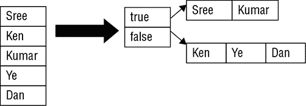

1. `grouping()`
2. `groupingBy()`
3. `partitioning()`
4. `partitioningBy()`

## 25. 这段代码填入哪个空处可以打印出 667788？

```java
IntStream ints = IntStream.empty();
IntStream moreInts = IntStream.of(66, 77, 88);
Stream.of(ints, moreInts).____________(x -> x).forEach(System.out::print);
```

1. `flatMap`
2. `flatMapToInt`
3. `map`
4. 以上都不是`

## 26. 填入空处使此代码打印 8.0。注意它不能打印 `OptionalDouble[8.0]`。

```java
LongStream stream = LongStream.of(6, 10);
LongSummaryStatistics stats = stream.summaryStatistics();
System.out.println(____________);
```

1. `stats.avg()`
2. `stats.average()`
3. `stats.average().get()`
4. `stats.getAverage()`

## 27. 哪一个可以独立地填入空处以输出 No dessert today?

```java
import java.util.*;
public class Dessert {
  public static void main(String[] yum) {
    eatDessert(Optional.of("Cupcake"));
  }
  private static void eatDessert(Optional<String> opt) {
     System.out.println(opt.____________);
  }
}
```

1. `get("No dessert today")`
2. `orElse("No dessert today")`
3. `orElseGet(() -> "No dessert today")`
4. 以上都不是

## 28. 下述代码的输出是什么？

```java
Stream<Character> chars = Stream.generate(() > 'a');
chars.filter(c -> c < 'b')
     .sorted()
     .findFirst()
     .ifPresent(System.out::print);
```

1. `a`
2. 代码成功运行但没有任何输出。
3. 代码进入无限循环。
4. 代码编译通过但在运行时抛出异常。

## 29. 以下中多少项可以填入空处使代码打印单数字 9？

```java
LongStream stream = LongStream.of(9);
stream.____________(p -> p).forEach(System.out::print);
```

- `mapToDouble`
- `mapToInt`
- `mapToLong`

1. 无
2. 一个
3. 两个
4. 三

## 30. 假设你有一个有一个元素的流和代码 `stream.xxxx.forEach(System.out::println)`。按照表格从上到下填写 `xxxx`，可以打印出多少个元素？

| xxxx | 打印的元素数量 |
| --- | --- |
| `filter()` | |
| `flatMap()` | |
| `map()` | |

1. 零或一个、零或多个、恰好一个
2. 0 或一个、恰好一个、零或多个
3. 零或一个、零或多个、零或多个
4. 恰好一个、零或多个、零或多个

## 31. 以下内容的输出是什么？

```java
Stream<Character> stream = Stream.of('c', 'b', 'a');
System.out.println(stream.sorted().findFirst());
```

1. 保证打印单个字符 a。
2. 可以打印 a, b, 或 c 中的任意一个单个字符。
3. 代码无法编译。
4. 以上都不是

## 32. 以下内容的输出是什么？

```java
public class Compete {
  public static void main(String[] args) {
     Stream<Integer> is = Stream.of(8, 6, 9);
     Comparator<Integer> c = (a, b) > a - b;
     is.sort(c).forEach(System.out::print);
  }
}
```

1. `689`
2. `986`
3. 代码无法编译
4. 代码编译通过但在运行时抛出异常。

## 33. 以下内容的结果是什么？

```java
class Ballot {
   private String name;
   private int judgeNumber;
   private int score;

   public Ballot(String name, int judgeNumber, int score) {
      this.name = name;
      this.judgeNumber = judgeNumber;
      this.score = score;
   }
   // 所有的 getters 和 setters
}

public class Speaking {
   public static void main(String[] args) {
      Stream<Ballot> ballots = Stream.of(
         new Ballot("Mario", 1, 10),
         new Ballot("Christina", 1, 8),
         new Ballot("Mario", 2, 9),
         new Ballot("Christina", 2, 8)
      );

      Map<String, Integer> scores = ballots.collect(
         groupingBy(Ballot::getName, summingInt(Ballot::getScore))); // w1
      System.out.println(scores.get("Mario"));
   }
}
```

1. 代码打印 2。
2. 代码打印 1。
3. 代码由于 w1 无法编译。
4. 代码由于行 无法编译。

## 34. 哪一个可以填入空处使此代码输出 true？

```java
import java.util.*;
import java.util.function.*;

public class HideAndSeek {
   public static void main(String[] args) {
      Stream<Boolean> hide = Stream.of(true, false, true);
      boolean found = hide.__________();
      System.out.println(found);
   }
}
```

1. `anyMatch`
2. `allMatch`
3. `anyMatch` 和 `allMatch`
4. 代码无法编译。

## 35. 以下内容的输出是什么？

```java
Set<String> set = new HashSet<>();
set.add("");
List<String> list = new LinkedList<>();
Deque<String> queue = new ArrayDeque<>();
queue.push("");
Stream.of(set, list, queue)
   .flatMap(x -> x)
   .forEach(System.out::print);
```

1. 空
2. 异常
3. 空格
4. 代码无法编译

## 36. 处理 `Stream<String>` 时，通过向 `Collectors.groupingBy()` 传递参数，哪些类型由 `collect()` 返回？

- `Map<Integer, List<String>>` (I)
- `Map<Boolean, HashSet<String>>` (II)
- `List<String>` (III)

1. I
2. II
3. I 和 II
4. I、II 和 III

## 37. 哪一行可以替换 18 且不改变程序的输出？

```java
class Runner {
   private int numberMinutes;
   public Runner(int n) {
      numberMinutes = n;
   }
   public int getNumberMinutes() {
      return numberMinutes;
   }
   public boolean isFourMile() {
      return numberMinutes < 60;
   }
}
public class Marathon {
  public static void main(String[] args) {
     Stream<Runner> runners = Stream.of(new Runner(250),
        new Runner(600), new Runner(201));
     long count = runners
        .__________ // 第 18 行
        .count();
     System.out.println(count);
  }
}
```

1. `.map(Runner::isFourMile)`
2. `.mapToBool(Runner::isFourMile) .filter(b -> b == true)`
3. `.mapToBoolean(Runner::isFourMile) .filter(b -> b == true)`
4. 以上都不是

## 38. `IntSummaryStatistics` 类上哪个方法不可用？

1. `getCountAsLong()`
2. `getMax()`
3. `toString()`
4. 以上都不是——这三个方法均可用。

## 39. 哪一个可以填入空处使此代码输出 Caught it？

```java
import java.util.*;
public class Catch {
   public static void main(String[] args) {
      Optional opt = Optional.empty();
      try {
         apply(opt);
      } catch (IllegalArgumentException e) {
         System.out.println("Caught it");
      }
   }
   private static void apply(Optional<Exception> opt) {
      opt.__________(IllegalArgumentException::new);
   }
}
```

1. `orElse`
2. `orElseGet`
3. `orElseThrow`
4. 以上都不是。main() 方法无法编译。

## 40. 开发者尝试在不使用该中间运算符的情况下重写使用 `flatMap()` 的方法。哪一对方法调用显示了 `withoutFlatMap()` 方法与 `withFlatMap()` 方法不等价？


```java
public static void main(String[] args) {
   List<String> list = new LinkedList<>();
   Deque<String> queue = new ArrayDeque<>();
   queue.push("all queued up");
   queue.push("last");
}

private static void withFlatMap(Collection<?> coll) {
   Stream.of(coll)
      .flatMap(x -> x.stream())
      .forEach(System.out::print);
   System.out.println();
}

private static void withoutFlatMap(Collection<?> coll) {
   Stream.of(coll)
      .filter(x -> !x.isEmpty())
      .map(x -> x)
      .forEach(System.out::print);
   System.out.println();
}
```

1. `withFlatMap(list); withoutFlatMap(list);`

2. `withFlatMap(queue); withoutFlatMap(queue);`

3. 这一对都反驳了该断言。

4. 这两对都没有反驳该断言。

# 第 16 章：异常与断言

本次练习测试涵盖的 OCP 考试主题包括：

-  **异常与断言**

- 使用 `try-catch` 和 `throw` 语句

- 使用 `catch`、`multi-catch` 和 `finally` 子句

- 使用 `try-with-resources` 语句使用 `Autocloseable` 资源

- 创建自定义异常和 `AutoCloseable` 资源

- 使用断言 测试不变性

1. 如果同时使用 `try`、`catch` 和 `finally` 语句但没有产生异常，哪些块会被执行？执行顺序是怎样的？

1. `try`

2. `try, catch`

3. `try, catch, finally`

4. `try, finally`

2. 填空：一个 `try` 语句 __________ 一个 `catch` 或 `finally` 块，而 `try-with-resources` 语句 __________.

1. `不强制包含，不强制包含其中任何一个`

2. `不强制包含，必须包含其中之一`

3. `必须包含，不强制包含其中任何一个`

4. `必须包含，必须包含 catch 块`

3. 下一个程序的输出是什么？

```java
package park;

class LostBallException extends Exception {}
public class Ball {
   public void toss() throw LostBallException {
      throw new ArrayStoreException();
   }
   public static void main(String[] bouncy) {
      try {
         new Ball().toss();
      } catch (Throwable e) {
         System.out.print("Caught!");
      }
   }
}
```

1. `Caught!`

2. 代码无法编译，因为 `LostBallException` 在 `main()` 方法中未被处理或声明。

3. 代码无法编译，因为 `ArrayStoreException` 在 `toss()` 方法中未被处理或声明。

4. 代码因其他原因无法编译。

4. 哪些符号可以用于 `multi-catch` 语句中分隔异常类型？

- `&`

- `|`

- `||`

1. 仅 `II`

2. 仅 `III`

3. `II 和 III`

4. `I, II, 和 III 全部`

5. 在启用断言的情况下，执行以下程序的运行是什么？

```java
1: package ice;
2: public class Igloo {
3:    public static void main(String[] bricks) {
4:       int flakes = 10;
5:       double assert = 7.0;
6:       assert (true :"");
7:       assert flakes++>5;
8:    }
9: }
```

1. 运行时抛出 `AssertionError`。

2. 运行时无任何输出。

3. 正好有一行代码无法编译。

4. 有两行代码无法编译。

6. 以下哪个类是受检异常（checked exception）？

1. `java.lang.Error`

2. `java.lang.IllegalStateException`

3. `java.text.ParseException`

4. `java.lang.RuntimeException`

7. 在以下类中，有多少个 `WhaleSharkException` 构造函数可以通过编译？

```java
package friendly;
public class WhaleSharkException extends Exception {
   public WhaleSharkException() {
      super("Friendly shark!");
   }

   public WhaleSharkException(String message) {
      super(new Exception(new WhaleSharkException()));
   }

   public WhaleSharkException(Exception cause) {}
}
```

1. 无

2. 一个

3. 两个

4. 三个

8. 给给定的类图，从底部向上，层次结构中缺少了哪两个类？

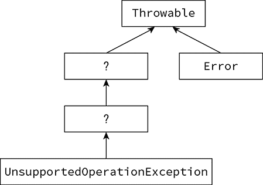

1. `IOException, Exception`

2. `RuntimeException, Exception`

3. `IllegalArgumentException, RuntimeException`

4. `IllegalStateException, RuntimeException`

9. 以下程序打印了多少行文本？

```java
package lighting;
import java.io.IOException;
public class Light {
   public void turnOn() throws IOException {
      new IOException("Not ready");
   }
   public static void main(String[] b) throws Exception {
      try {
         new Light().turnOn();
      } catch (RuntimeException b) { // y1
         System.out.println(b);
      } finally {
         System.out.println("complete"); // y2
      }
   }
}
```

1. 一行

2. 两行

3. 代码在 `y1` 处无法编译。

4. 代码在 `y2` 处无法编译。

10. 插入 `main()` 方法的哪个语句可以保证抛出 `AssertionError`？

1. `assert(0,"Invalid");`

2. `assert 0==1;`

3. `assert 0==0;`

4. 以上均为

11. 以下程序的输出是什么？

```java
package paper;
import java.io.Closeable;
public class PrintCompany {
   class Printer implements Closeable { // r1
      public void print() {
         System.out.println("This just in!");
      }
      public void close() {}
   }
   public void printHeadlines() {
      try {Printer p = new Printer()} { // r2
         p.print();
      }
   }
   public static void main(String[] headlines) { // r3
      new PrintCompany().printHeadlines();
   }
}
```

1. `This just in!`

2. 代码在 `r1` 处无法编译。

3. 代码在 `r2` 处无法编译。

4. 代码在 `r3` 处无法编译。

12. 关于 `try-with-resources` 的哪个描述是不正确的？

1. 如果 `try` 块和 `close()` 方法抛出异常，`close()` 方法抛出的异常会被抑制。

2. 不需要 `catch` 块。

3. 如果使用了多个资源，资源按照创建的顺序关闭。

4. 即使使用了多个资源，资源声明部分也使用括号。

13. 以下程序打印了多少行文本？

```java
package bee;
class SpellingException extends RuntimeException {}
public class SpellChecker {
   public final static void main(String... participants) {
      try {
         if(!"cat".equals("kat")) {
            new SpellingException();
         }
      } catch (SpellingException | NullPointerException e) {
         System.out.println("Spelling problem!");
      } catch (Exception e) {
         System.out.println("Unknown Problem!");
      } finally {
         System.out.println("Done!");
      }
   }
}
```

1. 一行

2. 两行

3. 三行

4. 代码无法编译。

14. 哪些异常类在插入 `Problems` 类的空白处后，可以使代码通过？

```java
package more;
class MissingMoneyException extends Exception {}
class MissingFoodException extends Exception {}
public class Problems {
   public void doIHaveAProblem() throws MissingMoneyException,          MissingFoodException {
      System.out.println("No problems");
   }
   public static void main(String[] lots) throws  ________________{
      try {
         final Problems p = new Problems();
         p.doIHaveAProblem();
      } catch (Exception e) {
         throw e;
      }
   }
}
```

* `Exception`

* `MissingMoneyException`

* `MissingMoneyException`, `MissingFoodException`

1. 仅 I

2. 仅 III

3. I 和 III

4. I, II 和 III

15. 关于 `Closeable` 和 `AutoCloseable` 的哪个描述是正确的？

1. `AutoCloseable` 继承自 `Closeable`。

2. 实现 `AutoCloseable` 的类中的 `close()` 方法不能抛出 `IOException`。

3. 实现了 `Closeable` 的类中的 `close()` 方法不能抛出 `Exception`。

4. 没有区别；引入其中一个是为了向后兼容。

16. 将哪个表达式插入到以下类的空白处，可以允许代码通过编译？

```java
package sun;
import java.io.*;
public class Beach {
   class TideException extends Exception {}
   public void surf() throws RuntimeException {
      try {
         throw new TideException();
      } catch (________________) {}
   }
}
```

1. `Exception a` | `RuntimeException f`

2. `IllegalStateException` | `TideException t`

3. `TideException` | `IOException i`

4. `TideException` | `Exception x`

17. 关于多捕获（multi-catch）语句的哪个描述是正确的？

1. 异常类型必须从宽泛到狭窄排序。

2. 异常类型必须从狭窄到宽泛排序。

3. 包含多个异常的多-catch 块的变量在块内不能重新赋值。

4. 包含一个异常类型的多-catch 块的变量在块内不能重新赋值。

18. 给定以下类，有多少行包含编译错误？

```java
package move;
interface Closing {
   void close() throws Exception;
}
class Shelf implements Closing {
   public void close() throws Exception {}
}
public class Step {
   static {
      try (Shelf shelf = new Shelf()) {
         throws new IllegalArgumentException();
      } catch (Exception e) {
      } catch (IllegalArgumentException e) {
      } finally {
         shelf.close();
      }
   }
}
```

1. 无

2. 两行

3. 三行

4. 四行

19. 关于使用 `try-with-resources` 语句，以下哪是不正确的？

1. 关联的 catch 块在声明的资源关闭之前运行。

2. 它与实现了 `AutoCloseable` 接口的所有类兼容。

3. 它与实现了 `Closeable` 接口的所有类兼容。

4. 它缩短了开发者必须编写的代码。

20. 假设以下应用程序在启用断言（assertions）的情况下执行，结果是什么？

```java
package input;
public class DataIntegrity {
   private int score;
   public DataIntegrity() {
      super();
      DataIntegrity.this.score = 5;
   }
   public static void main(String[] books) {
      final DataIntegrity johnny5 = new DataIntegrity();
      assert(johnny5.score>2) : johnny5.score++;
      assert johnny5.score>=5 : System.out.print("No input");
      System.out.print("Made it!");
   }
}
```

1. 抛出一个消息为 5 的 `AssertionError`。

2. 抛出一个消息为 No input 的 `AssertionError`。

3. 打印出 `Made it!`。

4. 代码无法编译。

21. 下类中哪类是未检查异常（unchecked exception）？

1. `java.io.IOException`

2. `java.io.NotSerializableException`

3. `java.sql.SQLException`

4. `java.util.MissingResourceException`

22. 编译并执行以下类的结果是什么？


```java
package wind;
public class Storm {
   public static void main(String... rain) throws Exception {
      try (final AutoCloseable weatherTracker = new AutoCloseable() {
            public void close() throws RuntimeException {}
         }) {
            System.out.println(weatherTracker.toString());
      } catch (Exception e) {
            if(weatherTracker != null) {
               weatherTracker.close();
            }
      } finally {
         System.out.println("Storm gone");
      }
   }
}
```

1. 它打印一行。

2. 它打印两行。

3. 由于`weatherTracker`资源的声明错误，无法编译。

4. 因为其他原因无法编译。

23. 以下哪一个不是在运行时启用或禁用断言的命令？

1. `-di`

2. `-disableassertions`

3. `-ea`

4. `-enableassertions`

24. 以下代码的输出是什么？

```java
package signlanguage;
import java.io.Closeable;
class ReadSign implements Closeable {
   public void close() {}
   public String get() {return "Hello";}
}
class MakeSign implements AutoCloseable {
   public void() {}
   public void send(String message) {
      System.out.print(message);
   }
}
public class Translate {
   public static void main(String... hands) {
      try (ReadSign r = new ReadSign();
           MakeSign w = new MakeSign()) {
         w.send(r.get());
      }
   }
}
```

1. `Hello`

2. 因为`ReadSign`类无法编译。

3. 因为`try-with-resources`语句无法编译。

4. 以上

25. 以下代码的输出是什么？

```java
package what;
class FunEvent implements AutoCloseable {
   public void close() {
      System.out.print("1");
   }
}
public class Happening {
   public static void main(String... lots) {
      try (FunEvent f = new FunEvent()) {
         System.out.print("2");
         throw new ArithmeticException();
      } catch (Exception e) {
         System.out.print("3");
      } finally {
         System.out.print("4");
      }
   }
}
```

1. `214`

2. `2134`

3. `2314`

4. 代码无法编译。

26. 哪个描述最适用于实现`AutoCloseable`接口的类？

1. `close()`方法是可选的，因为`AutoCloseable`接口定义实现。

2. `close()`方法应该避免修改已经存在的数据。

3. `close()`方法不应该抛出任何异常。

4. `close()`方法应该返回一个状态码。

27. 关于程序的哪个描述是正确的？

```java
package dogpark;
public class Fetch {
   public int play(String dogName) throws Exception {
      try {
         throw new RuntimeException(dogName);
      } catch (Exception e) {
         throw new RuntimeException(e);
      }
   }
   public static final void main(String[] ball) throws RuntimeException {
      new Fetch().play("Webby");
      new Fetch().play("Georgette");
   }
}
```

1. 程序在运行时打印一个异常。

2. 程序在运行时打印两个异常。

3. 类因为`play()`方法而无法编译。

4. 类因为`main()`方法而无法编译。

28. 下列哪项不是断言的良好用法？

1. 检查方法的后置条件。

2. 修改局部变量。

3. 测试控制流不变性。

## 4. 验证类不变性。

### 29. 关于以下应用程序，哪个语句是正确的？

```java
package highway;
import java.io.*;
class CarCrash extends RuntimeException {}
public class Car {
   public static void main(String[] seatbelts) throws Exception {  // w1
      try {
         throw new IOException("Auto-pilot error");
      } catch (Exception | CarCrash e) {  // w2
         throw e;
      } catch (Exception a) {  // w3
         throw a;
      }
   }
}
```

1. 代码因为第`w1`行无法编译。

2. 代码因为第`w2`行无法编译。

3. 代码因为第`w3`行无法编译。

4. 代码可以编译并运行，没有问题。

### 30. 关于以下类，哪些陈述是正确的？

```java
public class Dopey extends Grumpy {}
public class Grumpy extends Exception {}
public class Happy extends IOException {}
public class Sleepy extends IllegalStateException {}
public class Sneezy extends Throwable {}
```

- 其中四个类是受检异常（checked exceptions）。

- 其中两个类是未检查异常（unchecked exceptions）。

- 所有类声明都不包含任何编译错误。

1. 只有 I

2. I 和 III

3. II 和 III

4. I、II 和 III

### 31. 以下应用程序的输出是什么？

```java
package vortex;
class TimeException extends Exception {}
class TimeMachine implements AutoCloseable {
   int v;
   public TimeMachine(int v) {this.v = v;}
   public void close() throws Exception {
      System.out.print(v);
   }
}
public class TimeTraveler {
   public static void main(String[] twelve) {
      try (TimeMachine timeSled = new TimeMachine(1);
            TimeMachine delorean = new TimeMachine(2);
            TimeMachine tardis = new TimeMachine(3)) {
      } catch (TimeException e) {
         System.out.print(4);
      } finally {
         System.out.print(5);
      }
   }
}
```

1. 1235

2. 3215

3. 41235

4. 代码无法编译。

### 32. 插入到以下类的空白处，哪个表达式可以允许代码编译？

```java
package music;
public class Bells {
   class Player implements AutoCloseable {
      @Override public void close() throws RingException {}
   }
   class RingException extends Exception {
      public RingException(String message) {}
   }
   public static void main(String[] notes) throws Throwable {
      try (Player p = null) {
         throw new Exception();
      } catch (Exception e) {
      } catch (_______________) {
      }
   }
}
```

1. `Error r`

2. `IllegalStateException b`

3. `RingException p`

4. 无论使用哪个表达式，代码都无法编译。

### 33. 给定以下两个变量，哪个断言语句可以成功编译？

```java
int age = 22;
final String name = "Josephine";
```

1. `assert (age=2);`

2. `assert age!=age : (1<age ? "Error" : 10);`

3. `assert name.equals("") : () -> "Oops";`

4. `assert name.length()<(long)age : return "Mistake";`

### 34. 关于以下程序，哪个陈述是正确的？

```java
package tag;
class MissedCallException extends Exception {}
public class Phone {
   static void makeCall() throws RuntimeException {
      throw new ArrayIndexOutOfBoundsException("Call");
   }
   public static void main(String[] messages) {
      try {
         makeCall();
      } catch (MissedCallException e) {
         throw new RuntimeException("Voicemail");
      } finally {
         throw new RuntimeException("Text");
      }
   }
}
```

1. 运行时会打印一个消息中包含`Call`的异常。

2. 运行时会打印一个消息包含`Voicemail`的异常。

3. 运行时会打印一个消息包含`Text`的异常。

4. 代码无法编译。

### 35. 关于以下程序，哪个陈述是正确的？

```java
package fairy;
public class Tale {
   class BearException extends RuntimeException {}
   class WolfException extends RuntimeException {}
   class DragonException extends RuntimeException {}
   public int tellStory() {
      try {} catch (BearException d) {
         d = new RuntimeException();
         throw d;
      } catch (WolfException | DragonException e) {
         e = new RuntimeException();
         throw e;
      }
      return 3;
   }
   public static void main(String... wand) throws RuntimeException{
      new Tale().tellStory();
   }
}
```

1. 类可以编译，且运行时不打印任何内容。

2. 代码仅由于`tellStory()`中的第一个 catch 块而无法编译。

3. 代码仅由于`tellStory()`中的第二个 catch 块而无法编译。

4. 代码由于`tellStory()`中两个 catch 块的错误而无法编译。

### 36. 以下应用程序的输出是什么？

```java
package classical;
import java.io.*;
class OutOfException extends Exception {
   OutOfException(String message) { super(message); }
}
public class Piano {
   public void play() throws OutOfException, FileNotFoundException {
      throw new OutOfException("Sour note!");
   }
   public static void main(String... keys) {
      final Piano piano = new Piano();
      try {
         piano.();();
      } catch (Exception e) {
         throw e;
      } { {

System...println("Song finished

}}
   }


1.. Song!
2.. 带有`Sour note!`的异常。
3. 以上都是
4. 以上都不是

### 37. 给定以下类，哪个命令会导致该类抛出`AssertionError`？

```java

public class Falcon extends Exception {

   private int parsec = 12;

   public Falcon(String name) {

      super(name);

   }

   public static void main(String[] aluminum) {

      assert new Falcon(null).parsec<12;

   }

}

```

1. `java Falcon`
2. `java -ea -da:Falcon`
3. `java -da -ea:Falcon`
4. 代码无法编译。

### 38. 以下应用程序的输出是什么？

```java

package db;

import java.io.*;

import java.sql.*;

public class DatabaseHelper {

   static class MyDatabase implements Closeable {

      public void close() throws SQLException {

         System.out.print("2");

      }

      public void write(String data) {}

      public String read() {return null;}

   }

   public static void main(String... files) throws Exception {

      try (MyDatabase myDb = new MyDatabase()) {

         // TODO: Decide what to read/rite

      } finally {

         System.out.print("1");

      }

   }

}

```

1. 12
2. 21
3. 代码因为`MyDatabase`类无法编译。
4. 代码因为 try-resources 语句无法编译。

### 39. 以下程序打印了多少行文本？

```java

package tron;

class DiskPlayer implements AutoCloseable {


`public void close() throws Exception {}`

}

`public class LightCycle` {

   `public static void main(String... bits)` {

      `try (DiskPlayer john = new DiskPlayer())` {

         `System.out.println("ping")`;

      } `finally` {

         `System.out.println("pong")`;

      }

      `System.out.println("return")`;

   }

}

```

1. 一行
2. 两行
3. 三行
4. 代码无法编译。

## 40. 给定以下应用，第 `e1` 行打印的类名是什么？

```java
package canyon;

final class FallenException extends Exception {}

final class HikingGear implements AutoCloseable {

   @Override public void close() throws Exception {

      throw new FallenException();

   }

}

public class Cliff {

   public final void climb() throws Exception {

      try (HikingGear gear = new HikingGear()) {

         throw new RuntimeException();

      }

   }

   public static void main(String... rocks) {

      try {

         new Cliff().climb();

      } catch (Throwable t) {

         System.out.println(t);  // e1

      }

   }

}
```

1. `canyon.FallenException`
2. `java.lang.RuntimeException`
3. 代码无法编译。
4. 代码可以编译，但在运行之前无法确定答案。

# 第 17 章

## 使用 Java SE 8 日期/时间 API

**本次练习涵盖的 OCP 考试考点包括：**

* 使用 Java SE 8 日期/时间 API
* 创建并管理基于日期和基于时间的事件，包括使用 `LocalDate`、`LocalTime`、`LocalDateTime`、`Instant`、`Period` 和 `Duration` 将日期和时间组合为单个对象
* 跨时区处理日期和时间并管理由夏令时引起的更改，包括格式化日期和时间值
* 使用 `Instant`、`Period`、`Duration` 和 `TemporalUnit` 定义、创建并管理基于日期和时间的事件

### 1. `LocalTime` 类在哪个包中？

1. `java.date`
2. `java.lang`
3. `java.time`
4. `java.util`

### 2. `Duration`、`LocalDateTime` 和 `LocalTime` 这三个类中有几个类具有时区概念？

1. 0
2. 一个
3. 两个
4. 三

### 3. 哪个类拥有 `getSeconds()` 方法？

1. 仅 `Duration` 类
2. 仅 `Period` 类
3. `Duration` 和 `Period` 类都拥有
4. 两个类都没有

### 4. 以下哪一个代表最早的日期/时间？

1. `2017-02-15T03:00+01:00[Europe/Berlin]`
2. `2017-02-15T04:00+02:00[Europe/Helsinki]`
3. `2017-02-15T05:00+01:00[Europe/Warsaw]`
4. 以上均不是。我们平局。

### 5. 美国大部分地区在 2017 年 3 月 12 日凌晨 2 点通过将时钟拨快一小时来实行夏令时。以下代码输出什么？

```java
LocalDate localDate = LocalDate.of(2017, 3, 12);

LocalTime localTime = LocalTime.of(1, 0);

ZoneId zone = ZoneId.of("America/New_York");

ZonedDateTime z = ZonedDateTime.of(localDate, localTime, zone);

Duration duration = Duration.ofHours(3);

ZonedDateTime later = z.plus(duration);

System.out.println(later.getHour());
```

1. 4
2. 5
3. 6
4. 以上均不是

### 6. 以下代码输出什么？

```java
int year = 1874;

int month = Month.MARCH;

int day = 24;

LocalDate date = LocalDate.of(year, month, day);

System.out.println(date.isBefore(LocalDate.now()));
```

1. false
2. true
3. 代码无法编译。
4. 代码可以编译，但在运行时抛出异常。

### 7. 哪个选项正确填了空白以打印 2017-01-15？

```java
LocalDate hatDay = LocalDate.of(2017, Month.JANUARY, 15);

DateTimeFormatter f = DateTimeFormatter.ISO_DATE;

System.out.println(_______________________);
```

* `f.format(hatDay)`
* `f.formatDate(hatDay)`
* `hatDay.format(f)`

1. I
2. III
3. I 和 III
4. II 和 III

### 8. 给定以下内容，哪个答案选项是正确的？

```text
2017-01-07T10:00-07:00[America/Phoenix]

2017-01-07T08:00-08:00[America/Vancouver]
```

1. 第一个日期/时间比第二个早一小时。
2. 第一个日期/时间比第二个早三小时。
3. 第一个日期/时间比第二个晚一小时。
4. 第一个日期/时间比第二个晚三小时。

### 9. 鉴于夏令时从 2017 年 3 月 12 日凌晨 2 点开始，时钟从凌晨 1:59 跳到凌晨 03:00，以下哪项可以填充空白以便代码不抛出异常？

```java
LocalDate localDate = LocalDate.of(2017, 3, 12);

LocalTime localTime = LocalTime.of(1, 0);

ZoneId zone = ZoneId.of("America/New_York");

ZonedDateTime z = ZonedDateTime.of(localDate, localTime, zone);
```

(注：此处原题似乎缺少了空白处的选项，根据逻辑推断为处理时间处理)

2. `Duration` 对象编译通过，因为 `Duration` 用于较小的时间单位。

3. `Period` 对象编译通过，因为 `Period` 用于较大的时间单位。

4. 以上均不是

### 18. 这段代码可能的输出是什么？

```java
LocalTime time = LocalTime.of(1,2,3,4);

System.out.println(time);
```

1. 01:02:03.4
2. 01:02:03.000000004
3. 01/01/1970 01:02:03.4
4. 01/01/1970 01:02:03.000000004

### 19. 下面代码打印什么？

```java
import java.time.*;

import java.time.format.*;

public class PolarBear {

   public static void main(String[] args) {

      LocalDate polarBearDay = LocalDate.of(2017, 2, 27);

      DateTimeFormatter formatter = DateTimeFormatter.ofPattern("yyyy dd MMM");

      System.out.println(polarBearDay.format(formatter));

   }

}
```

1. 2017 27 Jan
2. 2017 27 Feb
3. 2017 Jan 27
4. 2017 Feb 27

### 20. 哪一个包含一个名为 `HOURS` 的常量？

1. `ChronoUnit`
2. `Duration`
3. `Instant`
4. `Period`

### 21. 美国在 2017 年 3 月 12 日实行夏令时，在凌晨 2 点将时钟拨快一小时。以下代码的输出是什么？

```java
LocalDate localDate = LocalDate.of(2017, 3, 12);

LocalTime localTime = LocalTime.of(13, 0);

ZoneId zone = ZoneId.of("America/New_York");

ZonedDateTime z = ZonedDateTime.of(localDate, localTime, zone);

Duration duration = Duration.ofHours(3);

ZonedDateTime later = z.plus(duration);

System.out.println(later.getHour());
```

1. 13
2. 16
3. 17
4. 以上均不是

### 22. 以下代码的可能结果是什么？

```java
LocalDate montyPythonDay = LocalDate.of(2017, Month.MAY, 10);

LocalTime time = LocalTime.of(5, 40);

LocalDateTime dateTime = LocalDateTime.of(montyPythonDay, time);

Duration duration = Duration.ofDays(1);

LocalDateTime result = dateTime.minus(duration);

System.out.println(result);
```

1. 2017-05-09
2. 2017-05-09T05:40
3. 2017-05-10T05:40
4. 以上均不是

### 23. 哪一个正确填了空白以打印 2017-01-15？

```java
LocalDate hatDay = LocalDate.of(2017, Month.JANUARY, 15);

DateFormatter f = DateFormatter.ISO_DATE;

System.out.println(______________________________);
```

1. `f.format(hatDate)`
2. `hatDay.format(f)`
3. 以上均对
4. 以上均不对

### 24. `LocalDateTime.of()` 有多个重载方法。以下哪一个不是其中之一？

1. `LocalDateTime.of(LocalDate date, LocalTime time)`
2. `LocalDateTime.of(LocalDate date, int hour, int minute)`
3. `LocalDateTime.of(int year, int month, int day, int hour, int minute)`
4. `LocalDateTime.of(int year, Month month, int day, int hour, int minute)`

### 25. 在美国，2017 年夏令时从 3 月 12 日凌晨 2 点开始，到 11 月 5 日凌晨 2 点结束。根据图片中的序列，3 月 12 日、7 月 4 日和 11 月 5 日的下一个时间分别是什么？


1. 01:00, 02:00, 01:00
2. 01:00, 02:00, 03:00
3. 03:00, 02:00, 01:00
4. 03:00, 02:00, 03:00

### 26. 以下代码的输出是什么？

```java
LocalDate date1 = LocalDate.of(2017, Month.MARCH, 3);

LocalDate date2 = LocalDate.of(2017, Month.FEBRUARY, 31);

System.out.println(date1.equals(date2));
```

1. false
2. true
3. 代码无法编译。
4. 代码编译编译但在运行时抛出异常。

### 27. 给定此日期/时间和时区偏移，GMT 时间是几点？

```text
2017-03-09T16:00-10:00[US/Hawaii]
```

1. 02:00
2. 04:00
3. 06:00
4. 10:00

### 28. 以下代码可能的输出是什么？

```java
LocalDate trainDay = LocalDate.of(2017, 5, 13);

LocalTime time = LocalTime.of(10, 0);

ZoneId zone = ZoneId.of("America/Los_Angeles");

ZonedDateTime zdt = ZonedDateTime.of(trainDay, time, zone);

Instant instant = zdt.toInstant();

instant = instant.plus(1, ChronoUnit.DAYS);

System.out.println(instant);
```

1. 2017-05-14T17:00Z[America/Los_Angeles]
2. 2017-05-13T10:00Z
3. 2017-05-14T10:00Z[America/Los_Angeles]
4. 2017-05-14T17:00Z

### 29. 以下代码的输出是什么？

```java
LocalDate date = LocalDate.of(2017, Month.JULY, 17);

LocalTime time = LocalTime.of(10, 0);

ZoneId zone = ZoneId.of("America/New_York");

ZonedDateTime iceCreamDay = ZonedDateTime.of(date, time, zone);

time = time.plus(1);

System.out.println(iceCreamDay.getMonthValue());
```

1. 6
2. 7
3. 8

### 30. 以下代码打印什么？

```java
import java.time.*;

import java.time.format.*;

public class PolarBear {

   public static void main(String[] args) {

      LocalDate polarBearDay = LocalDate.of(2017, 2, 27);

      DateTimeFormatter formatter = DateTimeFormatter.ofPattern("Holiday: yyyy dd");

      System.out.println(polarBearDay.format(formatter));

   }

}
```

1. Holiday: 2017 27
2. Holiday: 2017 Feb
3. 代码无法编译。
4. 代码编译但在运行时抛出异常。

### 31. 哪一个代表最早的日期/时间？

1. 2017-02-15T16:00[Bangkok]
2. 2017-02-15T18:00[Dubai]
3. 2017-02-15T20:00[Kuala_Lumpur]
4. 以上均不是。我们平局。

### 32. 以下代码的结果是什么？

```java
LocalDate waffleDay = LocalDate.of(2017, Month.MARCH, 25);

Period period = Period.ofYears(1).ofMonths(6).ofDays(3);

LocalDate later = waffleDay.plus(period);

later.plusDays(1);

LocalDate thisOne = LocalDate.of(2018, Month.SEPTEMBER, 28);

LocalDate thatOne = LocalDate.of(2018, Month.SEPTEMBER, 29);
```


`System.out.println(later.isBefore(thisOne) + " " + later.isBefore(thatOne));`

```
1. false false
2. false true
3. true true
4. 代码无法编译。
```

### 33. 以下哪几个可以填充空白使得代码编译并打印 31？

```java
LocalDate xmas = LocalDate.of(2017, 12, 25);
LocalDate blackFriday = LocalDate.of(2017, 11, 24);
long shoppingDaysLeft =____________________ ;
System.out.println(shoppingDaysLeft);
```

- `blackFriday.until(xmas, ChronoUnit.DAYS)`
- `blackFriday.until(xmas, TemporalUnit.DAYS)`
- `ChronoUnit.DAYS.between(blackFriday, xmas)`
- `TemporalUnit.DAYS.between(blackFriday, xmas)`

1. 一
2. 二
3. 三
4. 四

### 34. 填充空白时，以下哪几个类会导致编译错误：`LocalDate`, `LocalDateTime`, `LocalTime`, `ZonedDateTime`?

```java
private static String formatMe(__________ obj) {
   DateTimeFormatter f = DateTimeFormatter.ofLocalizedTime(FormatStyle.MEDIUM);
   return f.format(obj);
}
```

1. 无
2. 一个
3. 两个
4. 三

### 35. 以下代码的输出是什么？

```java
LocalDate date = LocalDate.of(2017, Month.JULY, 17);
LocalTime time = LocalTime.of(10, 0);
ZoneId zone = ZoneId.of("America/New_York");
ZonedDateTime iceCreamDay = ZonedDateTime.of(date, time, zone);
date = date.plusMonths(1);
System.out.println(iceCreamDay.getMonthValue());
```

1. 6
2. 7
3. 8
4. 代码无法编译。

### 36. 以下哪一个可以填充空白以使代码编译？

```java
public boolean isItMyBirthday(LocalDateTime dateTime) {
  ______________________________ 
  return now.getMonth() == dateTime.getMonth()
     && now.getDayOfMonth() == dateTime.getDayOfMonth();
}
```

1. `LocalDate now = LocalDate.now();`
2. `LocalDate now = new LocalDate();`
3. `ZonedDate now = ZonedDate.now();`
4. `ZonedDate now = new ZonedDate();`

### 37. 以下代码的输出是什么？

```java
LocalDate date1 = LocalDate.of(2017, Month.MARCH, 3);
LocalDate date2 = date1.plusDays(2).minusDays(1).minusDays(1);
System.out.println(date1.equals(date2));
```

1. false
2. true
3. 代码无法编译。
4. 代码可以编译但在运行时抛出异常。

### 38. 以下代码的可能输出是什么？

```java
LocalDate date = LocalDate.of(2017, 5, 13);
LocalTime time = LocalTime.of(10, 0);
LocalDateTime trainDay = LocalDateTime.of(date, time);
Instant instant = trainDay.toInstant();
instant = instant.plus(1, ChronoUnit.DAYS);
System.out.println(instant);
```

1. 2017-05-14T10:00-07:00[America/Los_Angeles]
2. 2017-05-14T17:00:00Z
3. 代码无法编译。
4. 代码可以编译但在运行时抛出异常。

### 39. 以下代码的结果是什么？

```java
public class PiDay {
  public static void main(String[] args) {
     LocalDateTime pi = LocalDateTime.of(2017, 3, 14, 1, 59);
     DateTimeFormatter formatter = DateTimeFormatter
         .ofPattern("M.ddhhmm");
     System.out.println(formatter.format(pi));
  }
}
```

1. 3.140159
2. 59.140103
3. 代码无法编译。
4. 代码可以编译但在运行时抛出异常。

### 40. 夏令时在 2017 年 11 月 5 日凌晨 2 点结束，此时我们会重复该小时。假设我们有一个 `ZonedDateTime`，在调用 `toString()` 时输出 2017-11-05T01:00-04:00[America/New_York]。向该值增加一小时后得到的 `ZonedDateTime` 的可能值是什么？

1. 2017-11-05T01:00-04:00[America/New_York]
2. 2017-11-05T02:00-04:00[America/New_York]
3. 2017-11-05T01:00-05:00[America/New_York]
4. 2017-11-05T02:00-05:00[America/New_York]

# 第 18 章：Java I/O 基础

**本次练习涵盖的 OCP 考试内容包括：**

*  **Java I/O 基础**
    * 从控制台读取和写入数据
    * 使用 `java.io` 包中的 `BufferedReader`, `BufferedWriter`, `File`, `FileReader`, `FileWriter`, `FileInputStream`, `FileOutputStream`, `ObjectOutputStream`, `ObjectInputStream` 和 `PrintWriter`。

1. 填空：`Writer` 是 __________，它与相关的流类 __________。
1. 一个具体类，extend
2. 一个抽象类，extend
3. 一个接口，extend
4. 一个接口，implement

2. 下面哪种方法定义在 `java.io.File` 中？
1. `createDirectory()`
2. `getLength()`
3. `listFile()`
4. `renameTo()`

3. `InputStream` 中的哪种方法可以替代调用 `skip(1)`？
1. `jump()`
2. `mark()`
3. `read()`
4. `reset()`

4. 实现了 `java.io.Serializable` 的类需要实现哪些方法？
1. `deserialize()`
2. `serial()`
3. `serialize()`
4. 以上均非

5. 填空：给定一个有效的 `Console` 实例，`reader()` 返回一个 __________，而 `writer()` 返回一个 __________。
1. `PrintReader`, `PrintWriter`
2. `PrintReader`, `Writer`
3. `Reader`, `Writer`
4. `StringReader`, `Writer`

6. 假设下述类中引用的文件路径可访问且可写，则该程序的输出是什么？

```java
package alarm;

import java.io.*;

public class Smoke {
   public void sendAlert(File fn) {
      try(BufferedWriter w = new BufferedWriter(new FileOutputStream(fn))) {
         w.write("ALERT!");
      } catch (IOException e) {
         System.out.print("2");
      } finally {
         System.out.print("3");
      }
   }

   public static void main(String[] args) {
      new Smoke().sendAlert(new File("alarm.txt"));
   }
}
```

1. 3
2. 2
3. 代码无法编译。

7. 哪种类用于读取有关目录的信息？
1. `java.io.File`
2. `java.io.Directory`
3. `java.io.Path`

8. 下面哪项是用于封装底层的高层流？
1. `FileOutputStream`
2. `FileReader`
3. `ObjectInputStream`
4. `PrintWriter`

9. 假设 `prime6.txt` 存在且包含以下字节：2, 3, 5, 7。以下代码的输出是什么？

```java
package numbers;

import java.io.*;

public class Prime {
   public static void main(String[] args) throws Exception {
      try (InputStream is = new FileInputStream("prime6.txt")) {
         is.mark(1);
         is.read();
         is.skip(1);
         is.read();
         is.mark(4);
         is.skip(1);
         is.reset();
         System.out.print(is.read());
      }
   }
}
```

1. 11
2. 13
3. 代码无法编译。
4. 代码可以编译但在运行时抛出异常。

10. 填空：对于给定文件，绝对路径是从 __________ 到文件的路径，而相对路径是从 __________ 到文件的路径。
1. 当前目录，当前目录
2. 父目录，临时目录
3. 根目录，当前目录
4. 根目录，父目录

11. 哪种陈述最符合这两个方法的描述？

```java
public void write1() throws IOException {
   final Writer w = new BufferedWriter(new FileWriter("dont.open"));
   w.write("Secret passcode");
   w.close();
}

public void write2() throws IOException {
   try(final Writer w = new BufferedWriter(new FileWriter("dont.open"))) {
      w.write("Secret passcode");
   }
}
```

1. 两个方法都可以编译且等效。
2. 两个方法无法编译。
3. 只有一个方法可以编译。
4. 方法可以编译，但其中一个可能会导致资源泄漏。

12. 编译并执行以下程序的运行是什么？

```java
package vacation;

import java.io.*;
import java.util.*;

public class Itinerary {
   private List<String> activities = new ArrayList<>();

   private static Itinerary getItinerary(String name) {
      return null;
   }

   public static void printItinerary() throws Exception {
      Console c = new Console();
      final String name = c.readLine("What is your name?");
      final Itinerary stuff = getItinerary(name);
      stuff.activities.forEach(s -> c.printf(s));
   }

   public static void main(String[] holidays) throws Exception {
      printItinerary();
   }
}
```

1. 代码无法编译。
2. 代码可以编译并在运行时打印 `NullPointerException`。
3. 代码可以编译但在运行时不打印任何内容。
4. 以上都不是。

13. 根据给定的图，哪两个类可以放在空白框中？

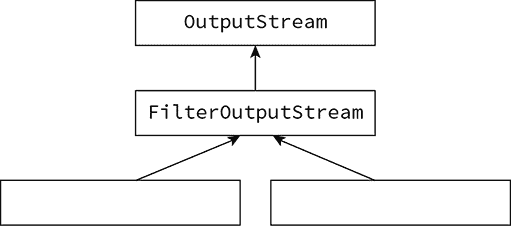

1. `BufferedOutputStream`, `PrintStream`
2. `BufferedOutputStream`, `PrintOutputStream`
3. `ByteArrayOutputStream`, `Stream`

## 4. FileOutputStream 和 OutputStream

### 14. 假设我们要把一个 `Cereal` 实例写入磁盘，其 `name` 值为 `CornLoops`。在用 `ObjectInputStream` 的 `readObject()` 方法读取该对象后，`name` 的值是什么？

```java
package breakfast;

public class Cereal {
   private String name = "CocoaCookies";
   private transient int sugar;

   public Cereal() {
      super();
      this.name = "CaptainPebbles";
   }

   {
      name = "SugarPops";
   }

   public String getName() { return name; }
   public void setName(String name) {
      this.name = name;
   }

   public int getSugar() { return sugar; }
   public void setSugar(int sugar) {
      this.sugar = sugar;
   }
}
```

1. `CaptainPebbles`
2. `CornLoops`
3. `SugarPops`
4. `以上均不是`

### 15. 哪一个陈述最能描述 `Writer` 和 `OutputStream` 类之间的区别？

1. 只有其中一个可以写入文本或字符数据。
2. 只有其中一个具有用于写入字符数据的内置方法。
3. 只有其中一个具有 `flush()` 方法来强制将数据写出。
4. 其中一个使用字节数组更高效地处理字符数据。

### 16. 下一个程序的输出是什么？可以假设类中引用的目录在程序执行之前并不存在，且文件系统可用并可写。

```java
package job;

import java.io.*;

public class Resume {
   public void resetWorkingDirectory() throws Exception {
      File f1 = new File("/templates/proofs");
      f1.mkdirs();
      File f2 = new File("/templates");
      f2.mkdir();  // k1
      new File(f2,"draft.doc").createNewFile();
      f1.delete();
      f2.delete();  // k2
   }

   public static void main(String... leads) {
      try {
         new Resume().resetWorkingDirectory();
      } catch (Exception e) {
```


### 16. 给定以下类，有三个值可以确保它在各种不同的系统上正常运行。哪一个值不能？

```java
package magic;

import java.io.*;

public class Store {

   private final String directory;

   public Store(String directory) {

      this.directory = directory;

   }

   public File getDatabaseFolder(String file) {

      return new File(directory + __________ + file);

   }

}
```

1. `java.io.File.separator`
2. `new File(new String()).separatorChar`
3. `System.getProperty("file.separator")`
4. `System.getProperty("path.separator")`

### 17. 下一个类包含多少个编译错误？

```java
package hero;

import java.io.*;

public class Guitar {

   public void readMusic(File f) {

      try (BufferedReader r = new BufferedReader(FileReader(f))) {

         final String music = null;

         try {

            while((music = r.readLine()) != null)

               System.out.println(music);

         } catch (IOException e) {}

      } catch (FileNotFoundException e) {

         throw new RuntimeException(e);

      } finally {}

   }

}
```

1. `无`
2. `一个`
3. `两个`
4. `三个`

### 18. 两个 `Console` 方法 `format()` 和 `printf()` 之间有什么区别？

1. 其中一个接受一个可选的参数列表；另一个不接受。
2. 其中一个接受 `String` 作为输入；另一个接受 `Object`。
3. 这两个方法之间没有区别。
4. 陷阱！`printf()` 在 `Console` 中没有定义。

### 19. 假设你想以高效的方式向文件写入大量文本数据。哪两个 `java.io` 类最合适？

1. `FileOutputStream` 和 `OutputStream`
2. `Writer` 和 `BufferedWriter`
3. `FileWriter` 和 `BufferedWriter`
4. `ObjectOutputStream` 和 `BufferedWriter`

### 20. 假设引用的文件存在且包含数据。关于以下类的哪个陈述是正确的？

```java
package school;

import java.io.*;

class Student implements Serializable {}

public class StudentManager {

   public static void main(String[] grades) {

      try(ObjectInputStream ios = new ObjectInputStream(

            new FileInputStream("data"))) {

         Student record;

         while((record = (Student)ios.readObject()) != null) {

            System.out.print(record);

         }

      } catch (EOFException e) {

      } catch (Exception e) {

         throw new RuntimeException(e);

      }

   }

}
```

1. 代码无法编译。
2. 代码编译但在运行时抛出异常。
3. 程序运行并打印所有。
4. 程序运行但可能打印部分。

### 21. 哪一个 `java.io` 类不具有输入？

1. `BufferedOutputStream`
2. `BufferedWriter`
3. `FileWriter`
4. `PrintWriter`

### 22. 假设 `/Earth` 在文件系统中不存在，以下程序的输出是什么？

```java
package center;

import java.io.*;

public class Journey {

   public static void main(String[] dig) {

      File file = new File("/Earth");

      System.out.print(file.getParent()

            +" - "

            +file.getParent()); }

}
```

1. `/ - /`
2. `/ - null`
3. 代码无法编译。
4. 代码编译但在运行时抛出异常。

### 23. 关于执行以下程序的哪些陈述是正确的？

```java
package test;

import java.io.*;

public class Turing {

   public static void main(String... robots) {

      Console c = System.console();

      final String response = c.readLine("Are you human?");

      System.err.print(response);

   }

}
```

* 程序可能会用户提问并在错误流中打印响应。
* 程序可能会抛出 `NullPointerException`。
* 程序可能会无限等待。

1. `I`
2. `I` 和 `III`
3. `II` 和 `III`
4. `I`, `II` 和 `III`

### 24. 关于 `deleteTree()` 方法，以下哪个陈述是正确的？

```java
public void deleteTree(File f) {

   if(!f.isDirectory())

      f.delete();

   else {

      Stream.of(f.list())

         .forEach(s -> deleteTree(s));

      f.delete();

   }

}
```

1. 它可以编译并能够删除目录树。
2. 如果修改一行，它能够删除目录树。
3. 如果修改两行，它能够删除目录树。
4. `以上均不是`

### 25. 以下哪一个不是 Java 内置的流？

1. `System.err`
2. `System.in`
3. `System.info`
4. `System.out`

### 26. 假设以下类引用的文件路径可访问且可写，以下程序的输出是什么？

```java
package store;

import java.io.*;

public class Furniture {

   public final static void main(String... inventory) throws Exception {

      Writer w = new FileWriter("couch.txt");

      try (BufferedWriter bw = new BufferedWriter(w)) {

         bw.write("Blue coach on Sale!");

      } finally {

         w.flush();

         w.close();

      }

      System.out.print("Done!");

   }

}
```

1. `Done!`
2. 代码未编译的原因有一个。
3. 代码未编译的原因有两个。
4. 代码可以编译，但在运行时抛出异常。

### 27. 给定一个 `Console` 实例 `c`，以下哪些方法调用不是从用户处读取输入的方法？

1. `c.reader().read()`
2. `c.reader().readLine()`
3. `c.readLine()`
4. `c.readPassword()`

### 28. `copyPidgin()` 方法用于将一个文件的内容复制到另一个文件中。关于该实现的哪种描述是正确的？

```java
package birds;

import java.io.*;

public class Pidgin {

   public void copyPidgin(File s, File t) throws Exception {

      try(InputStream is = new FileInputStream(s);

            OutputStream os = new FileOutputStream(t)) {

             byte[] data = new byte[123];

             int chirps;

             while((chirps = is.read(data))>0) {

                os.write(data);

             }}

       }

}
```

1. 该类无法编译，因为 `read(byte[])` 和 `write(byte[])` 分别只能在 `BufferedInputStream` 和 `BufferOutputStream` 上调用。
2. 该方法正确复制了所有文件的内容。
3. 该方法正确复制了部分文件的内容。
4. 该方法在运行时总是抛出异常，因为数据数组的大小不是 2 的幂。

### 29. 根据你对 `java.io` 流类类名的了解，一个名为 `BufferedFileReader` 的不存在的类最可能用于什么？

1. 从远程网络读取较小的文本文件
2. 从磁盘读取图像
3. 从文件系统读取大型文本文件
4. 从磁盘读取序列化数据

### 30. 下述程序的输出是什么？

```java
package factory;

import java.io.*;

public class WidgetProcessor {

   public int getWidgetNumber(byte[] data) throws Exception {

      try (InputStream is = new ByteArrayInputStream(data)) {

             is.read(new byte[2]);

             if(!is.markSupported()) return -1;

             is.mark(5);

             is.read();is.read();

             is.skip(3);

             is.reset();

             return is.read();

          }

       }

   public static void main(String... sprockets) throws Exception {

      final WidgetProcessor p = new WidgetProcessor();

      System.out.print(p.getWidgetNumber(new byte[] {1,2,3,4,5,6,7}));

   }

}
```

1. 3
2. 5
3. 7
4. 运行时抛出异常。

### 31. 假设工作目录可访问、为空且可写，以下类创建了多少文件系统对象？

```java
1: package kitchen;
2: import java.io.*;
3: public class Bakers {
4:    public static void main(String... tooMany) throws IOException {
5:       File cake = new File("cake.txt");
6:       Writer pie = new FileWriter("pie.txt");
7:       pie.flush();
8:       new File("fudge.txt").mkdirs();
9:    } }
```

1. 无
2. 一个
3. 两个
4. 三个

### 32. 假设你想从存储在磁盘上的文件中读取数据，该文件由 `String`、`long` 和 `Object` 值组成？鉴于文件很大，你打算使用三个类来实现这一结果。以下哪一个类不是你应该使用的三个类之一？

1. `BufferedInputStream`
2. `BufferedReader`
3. `FileInputStream`
4. `ObjectInputStream`

### 33. 哪种描述最能描述以下两个方法？

```java
public String getNameQuick() throws IOException {

   final BufferedReader r = new BufferedReader(

         new FileReader("saved.name"));

   final String name = r.readLine();

   r.flush();

   return name;

}

public String getNameSafely() throws IOException {

   try(final BufferedReader r = new BufferedReader(

         new FileReader("saved.name"))) {

      final String name = r.readLine();

      r.flush();

      return name;

   }

}
```

1. 两个方法都可以编译且相互等。
2. 两个方法都无法编译。
3. 只有一个方法可以编译。
4. 方法可以编译，但其中一个可能会导致资源泄露。

### 34. 下述程序的输出是什么？假设 `System.console()` 可用且用户输入了 `badxbad` 并按下回车。

```java
package hardway;

import java.io.*;

public class InconvenientImplementation {

   public static void main(String... dontDoThis) throws Exception {

      Console c = System.console();

      if(c != null) {

             c.writer().write('P');

             c.writer().write('a');

             c.writer().write('s');

             c.writer().write('s');

             c.writer().flush();  // t1

             int i;

             StringBuilder sb = new StringBuilder();

             while((i = c.reader().read()) != 'x') {  // t2

                sb.append((char)i);

             }

             c.writer().format("Result: %s",sb.toString());

      }

   }

}
```

1. `Result: bad`
2. 行 `t1` 无法编译或运行时抛出异常。
3. 行 `t2` 无法编译或运行时抛出异常。
4. 以上都不是

### 35. 为什么 `Console.readPassword()` 返回 `char` 数组而不是 `String`？

1. 它提高了性能。
2. 它提高了安全性。
3. 密码必须存储为 `char` 数组。
4. `String` 无法持有密码字符。

### 36. 关于以下程序的哪种描述是正确的？

```java
package mystical;

import java.io.*;

public class Unicorn {

   public void findUnicorns() {

      try(InputStream o = new ObjectInputStream(readBook())) {

         while(o.read() != -1) {

            System.out.println(o.read());

         }
      }
   }
}
```


} catch (Throwable t) {

   throw new RuntimeException(t);

}

}

private InputStream readBook() throws IOException {

   return new BufferedInputStream(new FileReader("magic.book"));

}

public static void main(String... horn) {

   new Unicorn().findUnicorns();

}

}

```

1. 代码无法编译。
2. 程序打印文件的每个字节而不抛出异常。
3. 程序打印文件的每隔字节而不抛出异常。
4. 在到达文件结尾时抛出 `EOFException`。

38. 选择最不可能被标记为 `Serializable` 的类。

1. 存储特定年份降雨量数据的类
2. 管理应用程序中运行进程内存的类
3. 存储苹果果园中苹果信息的类
4. 跟踪糖果机中糖果数量的类

39. 下述程序的输出是什么？

```java
package cell;

import java.io.*;

public class TextMessage {

   public String receiveText() throws Exception {

      try (Reader r = new FileReader("messages.txt")) {

         StringBuilder s = new StringBuilder();

         int c;

         while((c = r.read()) != -1) {

            s.append((char)c);

            if(r.markSupported()) {

               r.mark(100);

               r.skip(10);

               r.reset();

            }

         }

         return s.toString();

      }

   }

   public void sendText(String message) throws Exception {

      try (Writer w = new FileWriter("messages.txt")) {

         for(int i=0; i<message.length(); i++) {

                w.write(message.charAt(i));

                w.skip(1);

             }

      }

   }

   public static void main(String[] minutes) throws Exception {

      final TextMessage m = new TextMessage();

      m.sendText("You up?");

      System.out.println(m.receiveText());

   } }
```

1. You up?
2. Y o u u p ?
3. 代码由于 `receiveText()` 方法而无法编译。
4. 代码由于 `sendText()` 方法而无法编译。

40. 下面程序的输出是什么？假设类中引用的文件路径存在，并且可以进行读和写。

```java
package heart;

import java.io.*;

public class Valve implements Serializable {

   private int chambers = -1;

   private transient Double size = null;

   private static String color;

   public Valve() {

      this.chambers = 3;

      color = "BLUE";

   }

   public static void main(String[] love) throws Throwable {

      try (ObjectOutputStream o = new ObjectOutputStream(

            new FileOutputStream("scan.txt"))) {

         final Valve v = new Valve();

         v.chambers = 2;

         v.size = 10.0;

         v.color = "RED";

         o.writeObject(v);

      }

      new Valve();

      try (ObjectInputStream o = new ObjectOutputStream(

            new FileInputStream("scan.txt"))) {

         Valve v = (Valve)o.readObject();

         System.out.print(v.chambers+","+v.size+","+v.color);

      }

   }

   { chambers = 4; }

}
```

1. 2,null,RED
2. 2,null,BLUE
3. 3,10.0,RED
4. 代码无法编译。

# 第 19 章

Java 文件 I/O (NIO.2)

**本次练习测试涵盖的 OCP 考试考点包括：**

* **Java 文件 I/O (NIO.2)**
  * 使用 `Path` 接口对文件和目录路径进行操作
  * 使用 `Files` 类来检查、读取、删除、拷贝、移动、管理文件或目录的元数据
  * 在 `NIO.2` 中使用 `Stream API`

1. 填空：__________ 是一个包含指向另一个文件或目录引用的文件，而 __________ 是一个包含内容的文件。

   1. 不规则文件，普通文件
   2. 普通文件，不透明文件
   3. 符号链接，普通文件
   4. 符号链接，符号目录

2. 下列哪些方法存在于 `NIO.2 Path` 接口中？

   * `getRoot()`
   * `isDirectory()`
   * `listFiles()`
   * `toRealPath()`

   1. 仅 I
   2. I、II 和 III
   3. I 和 IV
   4. II 和 III

3. 假设文件 `/secret/hide.txt` 存在并标记为隐藏，执行以下程序的运行是什么？

```java
package hidden;

import java.nio.file.*;

public class Finder {

   public void findHiddenFile(Path p) throws Exception {

      if(File.isHidden(p)) {

         System.out.print("Found!");

      }

   }

   public static void main(String[] folders) throws Exception {

      final Finder f = new Finder();

      f.findHiddenFile(Paths.get("/secret/hide.txt"));

   }

}
```

1. 类无法编译。
2. 运行时打印出异常。
3. 运行时打印出 Found!。
4. 运行时没有打印内容。

4. 填空：`Files.walk()` 执行 __________ 遍历，而 `Files.find()` 执行 __________ 遍历。

   1. 广度优先，广度优先
   2. 广度优先，深度优先
   3. 深度优先，广度优先
   4. 深度优先，深度优先

5. 在读取文件信息时，使用使用 NIO.2 属性接口相比从 `Files` 方法中逐个读取值有什么什么优势？

   1. 减少与文件系统的交互次数
   2. 保证性能提升
   3. 支持符号链接
   4. 减少内存泄漏

6. 编译并执行以下程序的运行是什么？假设当前目录为 `/stock` 且路径 `/stock/sneakers` 不存在。

```java
package shoe;

import java.io.*;

import java.nio.file.*;

public class Sneaker {

   public void setupInventory(Path desiredPath) throws Exception {

      Path suggestedPath = Paths.get("sneakers");

      if(Files.isSameFile(suggestedPath, desiredPath)

            && !Files.exists(desiredPath))

         Files.createDirectories(desiredPath);

   }

   public static void main(String[] socks) throws Exception {

      Path w = new File("/stock/sneakers").toPath();

      new Sneaker().setupInventory(w);

   }

}
```

1. 创建了 `/stock/sneakers` 目录。
2. j1 行无法编译。
3. j2 行无法编译或运行时产生异常。
4. j3 行无法编译或运行时产生异常。

7. 假设该路径存在并包含一个指向 `/again` 的符号链接，执行以下代码的预期结果是什么？

```java
System.out.print(Files.walk(Paths.get("/again")).count());
```

1. 运行时抛异常。
2. 运行时打印数字。
3. 进程无限阻塞。
4. 根据信息无法确定。

8. NIO.2 `Files` 类中的哪个方法与 `java.io.File` 的 `length()` 等效？

1. `length()`
2. `size()`
3. `getLength()`
4. 以上都不是

9. 假设当前目录为 `/home`，那么以下程序的输出是什么？

```java
package magic;

import java.nio.file.*;

public class Magician {

   public String doTrick(Path path) {

      return path.subpath(2,3)

           .getName(1)

           .toAbsolutePath()

           .toString();

   }

   public static void main(String... cards) {

      final Magician m = new Magician();

      System.out.print(m.doTrick(

          Paths.get("/bag/of/tricks/.././disappear.txt")));

   } }
```

1. /home/tricks
2. /home
3. 代码无法编译。
4. 代码编译但运行时打印异常。

10. 下列哪些方法存在于 NIO.2 `Files` 类中？

    * `isSameFile()`
    * `length()`
    * `relativize()`
    * `mkdir()`

    1. 仅 I
    2. I、II 和 IV
    3. II 和 III
    4. 仅 IV

11. 下面代码片段尝试将文件系统记录从 `oldHardDrivePath` 移动到 `newHardDrivePath`，运行时产生异常。最可能的异常类型是什么？

```java
Files.move(oldHardDrivePath,newHardDrivePath,REPLACE_EXISTING);
```

1. AtomicMoveNotSupportedException
2. DirectoryNotEmptyException
3. FileAlreadyExistsException
4. 以上都不是，因为代码行无法编译

12. 下列哪个项可以填入空白处以使方法能够编译？

```java
public String getPathName(String fileName) {

   final Path p = ____________________;

   return p.getFileName();

}
```

* `new File(fileName).toPath()`
* `new Path(fileName)`
* `FileSystems.getDefault().getPath(fileName)`

1. I 和 II
2. I 和 III
3. II
4. 以上均非

13. 关于以下类的哪种描述是正确的？

```java
package clone;

import java.io.*;

import java.nio.file.*;

public class Rewriter {

   public static void copy(Path source, Path target) throws Exception {

      try (BufferedReader r = Files.newBufferedReader(source);

            Writer w = Files.newBufferedWriter(target)) {

         String temp = null;

         while((temp = r.readLine()) != null) {

            w.write(temp);

         }

      }

   }

   public static void main(String[] tooMany) throws Throwable {

      Rewriter.copy(Paths.get("/original.txt"),

         FileSystems.getDefault().getPath("/","unoriginal.txt"));

   }

}
```

1. 该类无问题编译。
2. 该类在运行时不会抛出异常。
3. 该实现正确地复制了一个普通文件。
4. 以上所有

14. 填空：`Files.__________` 方法返回一个 `List`，而 `Files.__________` 方法返回一个 `Stream`。

1. `lines()`, `readAllLines()`
2. `lines()`, `readLines()`
3. `readAllLines()`, `lines()`
4. `readLines()`, `lines()`

15. 以下程序的输出是什么？

```java
1:  package yellow;

2:  import java.nio.file.*;

3:  public class Road {

4:     public boolean findHome() {

5:        Path oftenTraveled = Paths.get("/highway/street/spot.txt");

6:        Path lessTraveled = Paths.get("/highway/street/house/../.");

7:        lessTraveled.resolve("spot.txt");

8:        return oftenTraveled.equals(lessTraveled.normalize());

9:     }

10:    public static void main(String... emerald) {

11:       System.out.print("AM I HOME? "

12:             +(new Road().findHome() ? "yes" : " no"));

13:    }

14: }
```

1. AM I HOME? no
2. AM I HOME? yes
3. 该类无法编译。
4. 该类编译但在运行时抛出异常。

16. 以下哪项不是使用 NIO.2 Path 而不是 java.io.File 来处理文件的优势？

1. 包含对符号链接的内置支持
2. 具有读取操作系统特定属性的能力
3. 提供了一个单一方法来删除目录树
4. 提供了对文件元数据的高效访问

17. 执行以下程序的运行是什么？假设路径 `/driveway` 存在且非空，并且该目录树在文件系统中完全可访问。

```java
package weather;

import java.io.*;

import java.nio.file.*;

public class Snow {

   public static boolean removeSnow(Path flake) throws IOException {
```


进入`/path/to/xxx`目录，找到`xxx.json`。

在表达式`cvar = avar + bvar`中，加法运算符（`+`）将`avar`与`bvar`相加，得到它们的和`cvar`

在`List.of(arg0, arg1, arg2)`中，`List`接口的工厂方法`of()`接受一系列的元素，返回包含它们的只读列表。

之后我们这样调用`cmd`命令：`cmd arg0 arg1 arg2`。

```
if (condVar > someVal) {console.log("xxx")}
```


`import static java.nio.file.Files.*;`

`import java.io.*;`

`import java.nio.file.*;`

```
public class CopyOfACopy {

   public void main(String[] items) throws Exception {

      final Path s = new File("apples.zip").toPath();

      final Path t = FileSystems.getDefault().getPath("oranges.zip");

      copy(s,t,REPLACE_EXISTING);  // q1

      copy(Files.newBufferedReader(t),t,ATOMIC_MOVE);  // q2

   }

}
```

1. 行 `q1` 无法编译。
2. 行 `q1` 在运行时产生一个异常。
3. 行 `q2` 无法编译。
4. 行 `q2` 在运行时产生一个异常。

39. 下列 `Files` 方法中哪一个要求包含方法处理或声明检查异常（checked exception）？

1. `exists()`
2. `isDirectory()`
3. `isSameFile()`
4. `isSymbolicLink()`

40. 下列应用程序的输出是什么？假设 `/all-data` 存在且在文件系统中可访问。

```java
package numbers;

import java.nio.file.*;

import java.util.stream.Stream;

public class TheCount {

   public static Stream<String> readLines(Path p) {

      try {

         return Files.lines(p);

      } catch (Exception e) {

         throw new RuntimeException(e);

      }

   }

   public static long count(Path p) throws Exception {

      return Files.list(p)

         .filter(w -> Files.isRegularFile(w))

         .flatMap(s -> readLines(s))

         .count();

   }

   public final static void main(String[] day) throws Exception {

      System.out.print(count(Paths.get("/all-data")));

   }

}
```

1. 目录树中所有文件的行数。
2. 单个目录下所有文件的行数。
3. 代码无法编译。
4. 代码可以编译但在运行时打印一个异常。

# 第 20 章

Java 并发

**本次练习测试涵盖的 OCP 考试主题包括：**

* **Java 并发**
* 使用 `Runnable`、`Callable` 创建工作线程并使用 `ExecutorService` 并发执行任务
* 识别在死锁（deadlock）、饥饿（starvation）、活锁（livelock）和竞态条件（race conditions）之间的潜在的线程问题
* 使用 `synchronized` 关键字和 `java.util.concurrent.atomic` 包来控制线程执行的顺序
* 使用 `java.util.concurrent` 集合和类，包括 `CyclicBarrier` 和 `CopyOnWriteArrayList`
* 使用并行 `Fork/Join` 框架
* 使用并行 `Streams`，包括归约、分解、合并过程、流水线和性能。

1. 下列方法中哪在 `ExecutorService` 实例上不可用？

1. `execute(Callable)`
2. `execute(Runnable)`
3. `submit(Callable)`
4. `submit(Runnable)`

2. 关于多次执行以下 `TicketTaker` 应用程序，哪些描述是正确的？

```java
package performance;

import java.util.concurrent.atomic.*;

import java.util.stream.*;

public class TicketTaker {

   long ticketsSold;

   final AtomicInteger ticketsTaken;

   public TicketTaker() {

      ticketsSold = 0;

      ticketsTaken = new AtomicInteger(0);

   }

   public void performJob() {

      IntStream.iterate(1, p -> p+1)

         .parallel()

         .limit(10)

         .forEach(i -> ticketsTaken.getAndIncrement());

      IntStream.iterate(1, q -> q+1)

         .limit(5)

         .parallel()

         .forEach(i -> ++ticketsSold);

      System.out.print(ticketsTaken+" "+ticketsSold);

   }

   public static void main(String[] day) throws Exception {

      System.out.print(count(Paths.get("/all-data")));

   }

}
```

* 该类可以编译运行且没有异常。
* 第一个数字始终是 10。
* 第二个数字始终是 5。

1. 仅 I
2. I 和 II
3. I、II 和 III
4. 以上均不是

3. 下列哪种是定义异步任务推荐的方法？

1. 创建一个 `Callable` 表达式并将其传递给 `ExecutorService`。
2. 创建一个扩展 `Thread` 的类并重写 `start()`。
3. 创建一个 `Runnable` 表达式并将其传递给 `Thread` 构造函数。
4. 以上所有。

4. 假设你需要一个执行具有五个线程屏障的 `CyclicBarrier` 创建任务。你应该使用 `ExecutorService` 中的哪个静态方法来获取它？

1. `newSingleThreadExecutor()`
2. `newSingleScheduledExecutor()`
3. `newCachedThreadPool()`
4. 这些一个都不起作用

5. 给定原始数组，假设每个语句独立执行，以下语句中有多少个会导致异常？

```java
List<Integer> copy1 = new CopyOnWriteArrayList<>(Arrays.asList(1,2,3,4));

List<Integer> copy2 = Collections.synchronizedList(original);

for(Integer w : copy2);

List<Integer> copy3 = new ArrayList<>(original);

for(Integer w : copy3);

Queue<Integer> copy4 = newLinkedQueue<>(original);

for(Integer w : copy4);
```

1. 零
2. 一
3. 两个
4. 三

6. 空：__________ 是 __________ 的特殊情况，其中两个或多个活动线程尝试获取相同的锁但反复失败。

1. 死锁、活锁
2. 死锁、饥饿
3. 活锁、饥饿
4. 饥饿、竞态条件

7. 下列应用程序的输出是什么？

```java
package office;

import java.util.concurrent.*;

public class TpsReport {

   public void submitReports() {

      ExecutorService service = Executors.newCachedThreadPool();

      Future bosses = service.submit(() -> System.out.print(""));

      service.shutdown();

      System.out.print(bosses.get());

   }

   public static void main(String[] memo) {

      new TpsReport().submitReports();

   }

}
```

1. null
2. 代码无法编译。
3. 行 7 在运行时产生异常。
4. 行 8 在运行时产生异常。

8. 下列 `Executors` 类中的哪个静态方法不存在？

1. `newFixedScheduledThreadPool()`
2. `newFixedThreadPool()`
3. `newSingleThreadExecutor()`
4. `newSingleScheduledExecutor()`

9. 下列应用程序在运行时打印了多少次 Ready？

```java
package parade;

import java.util.concurrent.*;

public class CartoonCat {

   private void await(CyclicBarrier c) {

      try {

         c.await();

      } catch (Exception e) {}

   }

   public void march(CyclicBarrier c) {

      ExecutorService s = Executors.newSingleThreadExecutor();

      for(int i=0; i<12; i++)

         s.execute(() -> await(c));

      s.shutdown();

   }

   public static void main(String... strings) {

      new CartoonCat().march(new CyclicBarrier(4,

            () -> System.out.println("Ready")));

   }

}
```

1. 零
2. 一
3. 三
4. 代码无法编译。

10. 使用哪种线程安全的类可以在有序数据结构的头部和尾部添加元素，并包含等待指定时间执行这些操作的方法？

1. `BlockingDeque`
2. `ConcurrentLinkedDeque`
3. `ConcurrentSkipListSet`
4. `LinkedBlockingDeque`

11. 下列四个方法中有三种无论在串行还是并行有序流上执行都会总是产生相同的结果。哪一个不是？

1. `findAny()`
2. `findFirst()`
3. `limit()`
4. `skip()`

12. 多次执行以下应用的结果是什么？

```java
package bears;

import java.util.*;

public class Bounce {

   public static void main(String... legend) {

      Arrays.asList(1,2,3,4).stream()

             .forEach(System.out::println);

      Arrays.asList(1,2,3,4).parallel()

             .forEachOrdered(System.out::println);

   }

}
```

1. 只有第一个数组每次都以相同的顺序打印。
2. 只有第二个数组每次都以相同的顺序打印。
3. 两个数组每次都以相同的顺序打印。
4. 以上均不是。

13. 填空：在 fork/join 框架中，使用 __________ 类需要重写一个包含泛型返回类型的抽象 `compute()` 方法，而使用 __________ 类则需要重写一个包含 void 返回类型的抽象 `compute()` 方法。

1. `ForkJoinTask`, `RecursiveAction`
2. `RecursiveAction`, `RecursiveTask`
3. `RecursiveTask`, `ForkJoinTask`
4. `RecursiveTask`, `RecursiveAction`

14. 给定以下代码片段，根据并行归约的规则，哪个 lambda 表达式是累加器的最佳选择？

```java
public class GoodAccumulator {

   int i;

   public void test() {

      BiFunction<Integer,Integer,Integer> accumulator = _________________;

      System.out.print(Arrays.asList(1,2,3,4,5)

             .parallelStream()

             .reduce(0,accumulator,(s1, s2) -> s1 + s2));

   }

}
```

1. `(a,b) -> (a-b)`
2. `(a,b) -> 5`
3. `(a,b) -> i++`
4. 以上都不合适。

15. 下述代码片段的输出是什么？

```java
Callable c = new Callable() {

   public Object run() {return 10;}

};

ExecutorService s = Executors.newScheduledThreadPool(1);

for(int i=0; i<10; i++) {

   Future f = s.submit(c);

   f.get();

}

s.shutdown();

System.out.print("Done!");
```

1. Done!
2. 代码无法编译。
3. 代码在运行时无限挂起。
4. 代码在运行时抛出异常。

16. 下面的图表示两个共享公共变量的线程的读/写操作顺序。每个线程首先从内存中读取变量值，然后将变量的新值写回内存。哪幅图展示了正确的同步？

1. 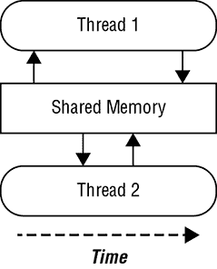
2. 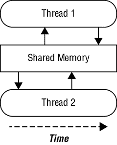
3. 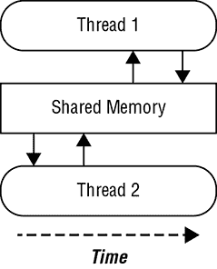
4. 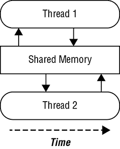

17. 下述应用的输出是什么？

```java
package story;

import java.util.*;

import java.util.concurrent.*;

public class Race {

   static ExecutorService service = Executors.newFixedThreadPool(8);

   public static int sleep() {

      try {

         Thread.sleep(1000);

      } catch (Exception e) {}

      return 1;

   }

   public static void hare() {

      try {

         Callable c = () -> sleep();

         final Collection<Callable<Integer>> r = Arrays.asList(c,c,c);

         List<Future<Integer>> results = service.invokeAll(r);

         System.out.println("Hare won the race!");

      } catch (Exception e) {e.printStackTrace();}

   }

   public static void tortoise() {

      try {

         Callable c = () -> sleep();

         final Collection<Callable<Integer>> r = Arrays.asList(c,c,c);

         Integer result = service.invokeAny(r);

         System.out.println("Tortoise won the race!");

      } catch (Exception e) {e.printStackTrace();}

   }
```


`public static void main(String[] p) throws Exception` 中：

```
service.execute(() -> hare());
service.execute(() -> tortoise());
```

1. 先打印 "Hare won the race!"。
2. 先打印 "Tortoise won the race!"。
3. 代码无法编译。
4. 结果在之前未知。

18. 哪个并发集合是有排序的？

1. `ConcurrentLinkedQueue`
2. `ConcurrentSkipMap`
3. `CopyOnWriteArrayList`
4. `LinkedBlockingQueue`

19. 执行以下应用最可能的结果是什么？

```java
package unknown;

import java.util.concurrent.*;

public class Riddle {

   public void sleep() {

      try {

         Thread.sleep(5000);

      } catch (Exception e) {}

   }

   public String getQuestion(Riddle r) {

      synchronized {

         sleep();

         if(r != null) r.getAnswer(null);

         return "How many programmers does it take "

               +"to change a bulb?";

      }

   }

   public synchronized String getAnswer(Riddle r) {

      sleep();

      if(r != null) r.getAnswer(null);

      return "None, that's a hardware problem";

   }

   public static void main(String... unused) {

      final Riddle r1 = new Riddle();

      final Riddle r2 = new Riddle();

      ExecutorService s = Executors.newFixedThreadPool(2);

      s.submit(() -> r1.getQuestion(r2)); // 注意：此处原文可能有多余的括号错误

   }

}
```

1. 运行时产生死锁。
2. 运行时产生活锁。
3. 应用成功完成。
4. 代码无法编译。

20. 哪个 `ScheduledExecutorService` 方法会导致两个线程同时执行同一个操作？

1. `scheduleAtFixedDelay()`
2. `scheduleAtFixedRate()`
3. `scheduleWithFixedDelay()`
4. `ScheduledExecutorService` 中没有这种方法。

21. 下述应用的输出是什么？

```java
package olympics;

import java.util.concurrent.*;

public class Athlete {

   int stroke = 0;

   public synchronized void swimming() {

      stroke++;

   }

   public static void main(String... laps) {

      ExecutorService s = Executors.newFixedThreadPool(10);

      Athlete a = new Athlete();

      for(int i=0; i<1000; i++) {

         s.execute(() -> a.swimming());

      }

      s.shutdown();

      System.out.print(a.stroke);

   }

}
```

1. 1000
2. 代码无法编译。
3. 结果未知，因为 `stroke` 未以线程安全的方式访问，可能会丢失写入。
4. 由于其他原因，结果未知。

22. 下列哪个最可能由竞态条件引起？

1. 线程被永久拒绝访问资源。
2. `int` 变量错误地报告了操作执行次数。
3. 两个线程活跃地尝试重启一个保证结果相同结果的进程。
4. 两个线程无止等待对方释放共享锁。

23. 下述应用的输出是什么？

```java
package farm;

import java.util.concurrent.*;

public class CountSheep extends RecursiveAction {

   static int[] sheep = new int[] {1,2,3,4};

   final int start;

   final int end;

   int count = 0;

   public CountSheep(int start, int end) {

      this.start = start;

      this.end = end;

   }

   public void compute() {

      if(end-start<2) {

         count+=sheep[start];

         return;

      } else {

         int middle = start + (end-start)/2;

         invokeAll(new CountSheep(start,middle),

               new CountSheep(middle,end));

      }

   }

   public static void main(String[] night) {

      ForkJoinPool pool = new ForkJoinPool();

      CountSheep action = new CountSheep(0,sheep.length);

      pool.invoke(action);

      pool.shutdown();

      System.out.print(action.count);

   }

}
```

1. 0
2. 10
3. 代码无法编译。
4. 以上均不是。

### 24. 关于 parallel streams 的哪个陈述是正确的？

1. parallel stream 始终执行所有 stream 操作都比 serial stream 快。
2. parallel stream 始终执行某些 stream 操作都比 serial stream 快。
3. parallel stream 同步其操作以使其它们是原子的。
4. 所有 streams 都可以转换为 parallel stream。

### 25. 下面应用程序的可能输出是什么？

```java
package salvage;

import java.util.*;

import java.util.concurrent.*;

import java.util.stream.*;

public class Car {

   private String model;

   private int year;

   public Car(String name, int year) {

      this.model = name; this.year = year;

   }

   public int getYear() {return year;}

   @Override public String toString() {return model;}

   public static void main(String... make) {

      List<Car> cars = new ArrayList<>();

      cars.add(new Car("Mustang",1967));

      cars.add(new Car("Thunderbird",1967));

      cars.add(new Car("Escort",1975));

      ConcurrentMap<Integer, List<Car>> map = cars

         .stream()

         .collect(Collectors.groupingByConcurrent(Car::getYear));

      System.out.print(map);

   }

}
```

1. `{1975=[Escort], 1967=[Thunderbird, Mustang]}`
2. `{Escort=[1975], Thunderbird=[1967], Mustang=[1967]}`
3. 代码无法编译。
4. 应用程序在运行时抛出异常，因为 stream 不是并行的。

### 26. 下面应用程序的输出是什么？

```java
package exercise;

import java.util.*;

public class Concat {

   public String concat1(List<String> values) {

      return values.parallelStream()

            .reduce("a",

                      (x,y)->x+y,

                      String::concat);

   }

   public String concat2(List<String> values) {

      return values.parallelStream()

            .reduce((w,z)->z+w).get();

   }

   public static void main(String... questions) {

      Concat c = new Concat();

      List<String> list = Arrays.asList("Cat","Hat");

      String x = c.concat1(list);

      String y = c.concat2(list);

      System.out.print(x+" "+y);

   }

}
```

1. `aCataHat HatCat`
2. `CatHat CatHat`
3. 代码无法编译，因为 `concat1()` 返回一个 `Optional`。
4. 代码因其他原因无法编译。

### 27. 下面应用程序的输出是什么？

```java
package taxes;

import java.util.concurrent.*;

public class Accountant {

   public static void completePaperwork() {

      System.out.print("[Filing]");

   }

   public static double getPi() {

      return 3.14159;

   }

   public static void main(String[] args) throws Exception {

      ExecutorService x = Executors.newSingleThreadExecutor();

      Future<?> f1 = x.submit(() ‐> completePaperwork());

      Future<Object> f2 = x.submit(() ‐> getPi());

      System.out.print(f1.get()+" "+f2.get());

      x.shutdown();

   }

}
```

1. `[Filing]null 3.14159`
2. `f1` 的声明无法编译。
3. `f2` 的声明无法编译。
4. 运行时抛出异常。

### 28. 关于下面这个类的哪个陈述是正确的？

```java
package my;

import java.util.*;

public class ThreadSafeList {

   private List<Integer> data = new ArrayList<>();

   public synchronized void addValue(int value) {

      data.add(value);

   }

   public int getValue(int index) {

      return data.get(index);

   }

   public int size() {

      return data.size();

   }

}
```

1. 因为 `size()` 方法代码无法编译。
2. 代码可以编译是线程安全的。
3. 代码可以编译但不线程安全的。
4. 代码无法编译。

### 29. 哪些方法名填入 `print2()` 可以产生与 `print1()` 相同的输出？假设输入值由单个线程访问。

```java
public static void print1(int value) {

   System.out.println(value--);

   System.out.println(++value);

}

public static void print2(AtomicInteger value) {

   System.out.println(value.__);

   System.out.println(value.__);

}
```

1. `decrementAndGet()` 和 `incrementAndGet()`
2. `getAndDecrement()` 和 `incrementAndIncrement()`
3. `decrementAndGet()` 和 `incrementAndIncrement()`
4. `getAndDecrement()` 和 `incrementAndGet()`

### 30. 下面应用程序打印了多少次 1？

```java
package crew;

import java.util.concurrent.*;

import java.util.stream.*;

public class Boat {

   private void waitFinished(CyclicBarrier c) {

      try {

         c.await();

         System.out.print("1");

      } catch (Exception e) {}

   }

   public void row(ExecutorService service) {

      final CyclicBarrier cb = new CyclicBarrier(5);

      IntStream.iterate(1, i->1)

         .limit(12)

         .forEach(i -> service.submit(() -> waitFinished(cb)));

   }

   public static void main(String[] oars) {

      ExecutorService service = null;

      try {

         service = Executors.newCachedThreadPool();

         new Boat().row(service);

      } finally {

         service.shutdown();

      }

   }

}
```

1. 0
2. 10
3. 12
4. 以上均不是

### 31. 使用上一个问题的 `Boat` 类，应用程序的最终状态是什么？

1. 应用程序在运行时抛出异常。
2. 应用程序成功终止。
3. 因为没有关闭 `ExecutorService`，应用程序无限挂。
4. 应用程序在运行时产生死锁。

### 32. 下面应用程序的预期输出是什么？

```java
package store;

import java.util.concurrent.*;

import java.util.stream.*;

public class Line {

   static BlockingDeque<Integer> queue = new LinkedBlockingDeque<>();

   public static void main(String[] participants) throws Exception {

      IntStream.iterate(1, i -> i+1).limit(5)

         .parallel()

         .forEach(s -> queue.offerLast(s,10000,TimeUnit.MILLISECONDS));

      IntStream.iterate(1, i -> 5).limit(10)

         .parallel()
```


`.forEach(s -> queue.pollFirst(10, TimeUnit.SECONDS));`

`System.out.print(queue.size());`

```
}
```

1. 0
2. 0 到 5 之间的数字
3. 代码无法编译。
4. 代码可以编译但在运行时抛出异常。

## 33. 给定原始数组，假设每个语句都独立执行，以下 `for` 语句在运行时会导致无限循环的是几个？

```java
List<Integer> original = new ArrayList<>(Arrays.asList(1,2,3));
List<Integer> copy1 = new ArrayList<>(original);
for(Integer q : copy1)
   copy1.add(1);

List<Integer> copy2 = new CopyOnWriteArrayList<>(original);
for(Integer q : copy2)
   copy2.add(2);

Deque<Integer> copy3 = new ConcurrentLinkedDeque<>(original);
for(Integer q : copy3)
   copy3.push(3);

List<Integer> copy4 = Collections.synchronizedList(original);
for(Integer q : copy4)
   copy4.add(4);
```

1. 零
2. 一个
3. 两个
4. 三

## 34. 以下四个选项中有三个构成了使用带有 `Collector` 参数的 `collect()` 方法执行并行归约（parallel reduction）的要求。选择出不是要求的一项。

1. `Collector` 参数被标记为 `concurrent`。
2. 流的元素实现了 `Comparable` 接口。
3. 流是并行的（`parallel`）。
4. 流或 `Collector` 被标记为 `unordered`。

## 35. 关于以下应用，哪种描述是正确的？

```java
package math;

import java.util.concurrent.*;

public class Fun extends RecursiveTask<Integer> {
   final int value;

   public Fun(int value) {
      this.value = value;
   }

   @Override protected Integer compute() {  // w1
      if(value<1) {
         return 1;
      }
      final Fun f1 = new Fun(value-1);
      final Fun f2 = new Fun(value-2);
      return f1.compute() * f2.compute();
   }

   public static void main(String... data) {
      ForkJoinPool pool = new ForkJoinPool();
      try {
         System.out.print(pool.invoke(new Fun(10)));
      } finally {
         pool.shutdown();
      }
   }
}
```

1. 该类因行 `w1` 无法编译。
2. 该类因其他原因无法编译。
3. 该应用编译且正确使用了 fork/join 框架。
4. 该应用编译但没有正确使用 fork/join 框架。

## 36. 哪种 `ExecutorService` 方法保证所有正在运行的任务都以有序的方式停止？

1. `shutdown()`
2. `shutdownNow()`
3. `halt()`
4. 以上都不是

## 37. 给定以下代码片段，关于行 `p1` 和 `p2` 打印值的哪种描述是正确的？

```java
List<Integer> db = Collections.synchronizedList(new ArrayList<>());
IntStream.iterate(1, i -> i+1).limit(5)
   .parallel()
   .map(i -> {db.add(i); return i;})
   .forEachOrdered(System.out::print);  // p1
System.out.println();
db.forEach(System.out::print);  // p2
```

1. 它们总是相同的。
2. 它们有时是相同的。
3. 它们从不相同。
4. 代码在运行时会抛出 `ConcurrentModificationException`。

## 38. 假设 10 秒足够所有任务完成，以下应用的输出是什么？

```java
package finance;

import java.util.concurrent.*;

public class Bank {
   static int cookies = 0;

   public synchronized void deposit(int amount) {
      cookies += amount;
   }

   public static synchronized void withdrawal(int amount) {
      cookies -= amount;
   }

   public static void main(String[] amount) throws Exception {
      ExecutorService teller = Executors.newScheduledThreadPool(50);
      Bank bank = new Bank();
      for(int i=0; i<25; i++) {
         teller.submit(() -> bank.deposit(5));
         teller.submit(() -> bank.withdrawal(5));
      }
      teller.shutdown();
      teller.awaitTermination(10, TimeUnit.SECONDS);
      System.out.print(bank.cookies);
   }
}
```

1. 0
2. 代码无法编译。
3. 结果在运行时之前未知。
4. 运行时抛出异常。

## 39. 以下应用的输出是什么？

```java
package util;

import java.util.*;

public class SearchList<T> {
   private List<T> data;
   private boolean foundMatch = false;

   public SearchList(List<T> list) {
      this.data = list;
   }

   public void exists(T value,int start, int end) {
      if(end-start<=1) {
         foundMatch = foundMatch || value.equals(data.get(start));
      } else {
         final int middle = start + (end-start)/2;
         new Thread(() -> exists(value,start,middle)).run();
      }
   }

   public static void main(String[] a) throws Exception {
      List<Integer> data = Arrays.asList(1,2,3,4,5,6);
      SearchList<Integer> sl = new SearchList<>(data);
      sl.exists(3, 0, 6);
      System.out.println(sl.foundMatch);
   }
}
```

1. `true`
2. `false`
3. 代码无法编译。
4. 结果未知。

## 40. 以下代码中有多少行包含编译错误？

```java
11: ScheduledExecutorService t = Executors
12:    newThreadScheduledExecutor();
13: Future result = System.out.println();
14: t.invokeAll(null);
15: t.scheduleFixedRate(() -> {return;}, 5, TimeUnit.MINUTES);
```

1. 无。代码可以编译。
2. 一行
3. 两行
4. 三行

## 10. 哪一项最准确地填充了该句中的空格？使用 JDBC 4.0，驱动程序 __________ 包含一个 `java.sql.Driver` 文件，且获取 `Connection` 的代码不需要调用 `Class.forName()`。

1. allowed, allowed
2. allowed, required
3. required, allowed
4. required, required

## 11. 当请求 `ResultSet` 同时具有滚动敏感性（scroll sensitive）和可更新性（updatable）属性时，哪一组陈述是正确的？

* 滚动敏感选项在可更新参数之前作为参数传递。
* 可更新选项在滚动敏感参数之前作为参数传递。
* 如果这些选项可用，数据库驱动程序将返回具有不同选项的 `ResultSet`。
* 如果这些选项可用，数据库驱动程序将抛出 `SQLException`。

1. I, III
2. I, IV
3. II, III
4. II, IV

## 12. 假设名为 `blue` 的数据库存在且我们正在使用 JDBC 4.0 驱动程序。这段代码的结果是什么？

```java
String url = "jdbc:derby:blue";
Class.forName(url);
try (Connection conn = DriverManager.getConnection(url);
   Statement stmt = conn.createStatement();
   ResultSet rs = stmt.executeQuery("select count(*) from sky")) {
   System.out.println(rs.getInt(1));
}
```

1. 它成功运行并打印 `sky` 表中的行数。
2. 它抛出 `ClassNotFoundException`。
3. 它抛出 `SQLException`。
4. 它无法通过编译。

## 13. 填空：有 __________ 种 `ResultSet` 并发模式，驱动程序被要求支持 __________。

1. two, both
2. two, one of them
3. three, two of them
4. three, all of them

## 14. 如果使用 JDBC 4.0 驱动且 `clowns` 数据库存在并包含一个空的 `clowns` 表，输出是什么？

```java
String url = "jdbc:derby:clowns";
try (Connection conn = DriverManager.getConnection(url);
    Statement stmt = conn.createStatement();
    ResultSet rs = stmt.executeQuery("select count(*) from clowns")) {
    System.out.println(rs.getInt(1));
}
```

1. 0
2. 1
3. 代码无法通过编译。
4. 代码通过编译但在运行时抛出异常。

## 15. 考虑 `execute()`、`executeQuery()` 和 `executeUpdate()` 方法。填空：这些方法中的 __________ 允许运行 `DELETE` SQL 语句，而这些方法中的 __________ 允许运行 `UPDATE` SQL 语句。

1. One, one
2. One, two
3. Two, one
4. Two, two

## 16. 假设 `clowns` 数据库存在并包含一个名为 `clowns` 的空表，使用 JDBC 4.0 驱动程序运行以下代码的输出是什么？

```java
import java.sql.*;

public class EmptyTable {
   public static void main(String[] args) throws SQLException {  // s1
      String url = "jdbc:derby:clowns";
      try (Connection conn = new Connection(url);   // s2
             Statement stmt = conn.createStatement();
             ResultSet rs = stmt.executeQuery("select * from clowns")) {
             if (rs.next())
                System.out.println(rs.getString(1));
          }
   }
}
```

1. 代码成功终止且没有任何输出。
2. 代码由于行 `s1` 无法通过编译。
3. 代码由于行 `s2` 无法通过编译。
4. 以上均不是

## 17. 哪些是合法的 `ResultSet` 类型？

* `TYPE_BACKWARD_ONLY`
* `TYPE_FORWARD_ONLY`
* `TYPE_REVERSE_ONLY`

1. II
2. I and II
3. II and III
4. 以上均不是

## 18. 给定图中的 `books` 表和通过运行以下 SQL 语句创建的 `ResultSet`，哪种选项打印了值 379？


```sql
select * from cert where title = 'OCA'
```

1. `System.out.println(rs.getInt(1));`
2. `System.out.println(rs.getInt(2));`
3. `System.out.println(rs.getInteger(1));`
4. `System.out.println(rs.getInteger(2));`

## 19. 给上一个问题中的 `books` 表和通过运行此 SQL 语句创建的 `ResultSet`，哪种选项打印了 OCP？

```sql
select title from cert where num_pages > 500
```

1. `System.out.println(rs.getString());`
2. `System.out.println(rs.getString("0"));`
3. `System.out.println(rs.getString("1"));`
4. `System.out.println(rs.getString("title"));`

## 20. 假设数据库存在且所有表名和列名正确。在使用 4.0 驱动程序时，哪一个陈述是正确的？

```java
String url = "jdbc:derby:precipitation";
try (Connection conn = DriverManager.getConnection(url);
   Statement stmt = conn.createStatement(
      ResultSet.CONCUR_READ_ONLY, ResultSet.TYPE_INSENSITIVE);
      ResultSet rs = stmt.executeQuery("select total from precip where type = 'rain'")) {
   System.out.println(
```

1. 创建 `Statement` 的行存在编译错误。
2. 创建 `ResultSet` 的行存在编译错误。
3. 代码通过编译并运行。
4. 代码抛出异常。

## 21. 当运行此代码时，哪些资源调用了 `close()` 方法？

```java
public void runQuery(Connection conn) throws SQLException{
```


`try (Statement stmt = conn.createStatement()) {`

```
ResultSet rs = stmt.executeQuery("select * from clowns");
rs.next();
```

1. 没有调用 `close()`。
2. 只有 `Statement`
3. 只有 `Connection`
4. `Statement` 和 `ResultSet`

22. 关于 JDBC 核心类，哪一个陈述是正确的？

1. `Driver` 是 `DriverManager` 的实现。
2. `Connection` 实现包含在 JDK 中。
3. `Statement` 自动处于自动提交模式。
4. `ResultSet` 自动指向第一行数据。

23. 数据库驱动实现需要哪项？

1. 名为 `jdbc.driver` 的文件
2. 名为 `java.sql.Driver` 的文件
3. `Connection` 接口实现
4. 以上都不是

24. 假设 `people` 表有 10 行，使用支持滚动敏感 `ResultSet` 的驱动运行以下代码的结果是？

```
try (Connection conn = DriverManager.getConnection(url);
   Statement stmt = conn.createStatement(
      ResultSet.TYPE_SCROLL_SENSITIVE, ResultSet.CONCUR_READ_ONLY);
      ResultSet rs = stmt.executeQuery("select count(*) from people")) {
      rs.next();
      rs.absolute(0);                    // q1
      System.out.print(rs.getInt(1));    // q2
}
```

1. 10
2. 代码无法通过编译。
3. 行 `q1` 抛出 `SQLException`。
4. 行 `q2` 抛出 `SQLException`。

25. 给定一个包含内容的滚动可更新 `ResultSet`，代码片段的输出是什么？


```
rs = stmt.executeQuery("select * from pens");
rs.afterLast();
rs.previous();
rs.updateInt(2, 10);
rs.updateRow();
rs = stmt.executeQuery("select * from pens where color = 'red'");
while (rs.next())
   System.out.println(rs.getInt(2));
```

1. 0
2. 10
3. 代码无法通过编译。
4. 代码通过编译但在运行时抛出异常。

26. 对于上一个问题图片所示的滚动可更新 `ResultSet`，代码片段的输出是什么？

```
rs = stmt.executeQuery("select * from pens");
rs.afterLast();
while(rs.prev())
   rs.updateInt(2,0);
rs = stmt.executeQuery("select * from pens where color = 'black'");
while (rs.next())
   System.out.println(rs.getInt(2));
```

1. 0
2. 20
3. 代码无法编译。
4. 代码可以编译，但在运行时抛出异常。

27. 运行以下代码后，`colors` 表中增加了多少行数据？

```java
try (Connection conn = DriverManager.getConnection(url);
   Statement stmt = conn.createStatement()) {
   conn.setAutoCommit(false);
   stmt.executeUpdate("insert into colors values ('red')");
   stmt.executeUpdate("insert into colors values ('blue')");
   conn.commit();
   conn.setAutoCommit(true);
   stmt.executeUpdate("insert into colors values ('green')");
}
```

1. 无
2. 一行
3. 两行
4. 三行

28. 如果 `clowns` 数据库存在且包含一个空的 `clowns` 表，以下哪项是正确的？

```java
String url = "jdbc:derby:clowns";
try (Connection conn = DriverManager.getConnection(url);
    Statement stmt = conn.createStatement();
    ResultSet rs = stmt.executeQuery("select count(*) from clowns")) {
    rs.next();   // r1
    System.out.println(rs.getInt(1));   // r2
}
```

1. 代码可以编译并无错误运行。
2. 代码无法编译。
3. 代码可以编译，但在运行时 `r1` 行抛出异常。
4. 代码可以编译，但在运行时 `r2` 行抛出异常。

29. 假设 `ResultSet` 是可滚动的，并且包含 10 行，值分别为 1–10。以下代码的输出是什么？

```java
5:  rs.absolute(0);
6:  rs.relative(5);
7:  rs.relative(-10);
8:  rs.relative(5);
9:  System.out.print(rs.getInt(1));
```

1. 4
2. 5
3. 代码无法编译。
4. 代码可以编译，但在运行时抛出异常。

30. 假设 `blue` 数据库不存在且我们正在使用 JDBC 4.0 驱动。这段代码的结果是什么？

```java
String url = "jdbc:derby:blue";
try (Connection conn = DriverManager.getConnection(url);
   Statement stmt = conn.createStatement();
   ResultSet rs = stmt.executeQuery("select count(*) from sky")) {
   System.out.println(rs.getInt(1));
}
```

1. 成功运行并打印 `sky` 表中的行数。
2. 抛出 `ClassNotFoundException`。
3. 抛出 `SQLException`。
4. 编译。

31. 如果 `people` 表是空的，这段代码最可能的的结果是什么？

```java
6:  Statement stmt = conn.createStatement();
7:  ResultSet rs1 = stmt.executeQuery("select * from people");
8:  ResultSet rs2 = stmt.executeQuery("select * from people");
9:  System.out.println(rs1.next() + " " + rs2.next());
```

1. 打印 `false false`。
2. 打印 `true false`。
3. 不终止。
4. 抛出 `SQLException`。

32. 运行以下代码后，`colors` 表中增加了行数据？

```java
try (Connection conn = DriverManager.getConnection(url);
   Statement stmt = conn.createStatement()) {
   conn.setAutoCommit(false);
   stmt.executeUpdate("insert into colors values ('red')");
   stmt.executeUpdate("insert into colors values ('blue')");
   conn.rollback();
   conn.setAutoCommit(true);
   stmt.executeUpdate("insert into colors values ('green')");
}
```

1. 无
2. 一行
3. 两行
4. 三行

33. 假设 `clowns` 数据库存在且包含一个名为 `clowns` 的空表，使用 JDBC 4.0 驱动运行时，以下代码的输出是什么？

```java
import java.sql.*;

public class EmptyTable {
   public static void main (String[] args) throws SQLException {  // s1
      String url = "jdbc:derby:clowns";
      try (Connection conn = DriverManager.getConnection(url);   // s2
         Statement stmt = conn.createStatement();
         ResultSet rs = stmt.executeQuery("select * from clowns")) {
         if (rs.next())
            System.out.println(rs.getString(1));
      }
   }
}
```

1. 代码成功终止且没有任何输出。
2. 代码由于 `s1` 行而无法编译。
3. 代码由于 `s2` 行而无法编译。
4. 以上都不是。

34. 给定以下代码片段和下表，使用支持滚动敏感（scroll sensitive）`ResultSet` 的驱动时，以下代码的输出是什么？

```java
try (Connection conn = DriverManager.getConnection(url);
   Statement stmt = conn.createStatement(
      ResultSet.TYPE_SCROLL_SENSITIVE, ResultSet.CONCUR_READ_ONLY);
   ResultSet rs = stmt.executeQuery(       "select * from people order by last_name asc")) {
   rs.afterLast();
   rs.next();
   rs.next();
   rs.previous();
   rs.previous();
   System.out.println(rs.getString(1));
}
```

*(注：由于原文文本在某处不完整，此处根据逻辑进行了补全)*

1. Janeice
2. Elena
3. Scott
4. 代码在运行时抛出 `SQLException`。

```java
try (Connection conn = DriverManager.getConnection(url);
     Statement stmt = conn.createStatement()) {
   conn.setAutoCommit(false);
   stmt.executeUpdate("insert into colors values ('red')");
   stmt.executeUpdate("insert into colors values ('blue')");
   conn.rollback();
   conn.setAutoCommit(true);
   stmt.executeUpdate("insert into colors values ('green')");
   conn.rollback();
}
```

1. 无
2. 一
3. 二
4. 三

39. 假设 `ResultSet` 是可滚动的且包含 10 行。以下代码打印 `true` 的多少次？

```
16:  System.out.println(rs.absolute(-2));
17:  System.out.println(rs.relative(-1));
18:  System.out.println(rs.beforeFirst());
19:  System.out.println(rs.relative(5));
```

1. 二
2. 三
3. 四
4. 以上都不是

40. 关闭数据库资源的正确顺序是？

1. `Connection` 然后 `Statement` 然后是 `ResultSet`
2. `ResultSet` 然后 `Statement` 然后是 `Connection`
3. `Statement` 然后 `Connection` 然后是 `ResultSet`
4. `Statement` 然后 `ResultSet` 然后是 `Connection`

# 第 22 章

## 本地化 (Localization)

本次练习测试涵盖的 OCP 考试考点包括：

* ****本地化**
    * 使用 `Locale` 对象读取并设置区域
    * 创建并读取 `Properties` 文件
    * 为每个区域构建资源包并在应用程序中加载资源包

1. 哪一个不是区域（locale）？

1. 文化区域
2. 地理区域
3. 政治区域
4. 时区区域

2. 在对应用程序本地化时，哪种类型的数据呈现会根据区域而变化？

1. 货币
2. 日期
3. 两者都是
4. 均都不是

3. 如何获取运行中程序的区域？

1. `Locale.get("default")`
2. `Locale.get(Locale.DEFAULT)`
3. `Locale.getDefault()`
4. 以上都不是

4. 如果你的应用程序将所有城镇名称放在一个名为 `strings.properties` 的单文件中，那么实现的最具体过程是？

1. 国际化 (Internationalization)
2. 本地化 (Localization)
3. 专业化 (Specialization)
4. 翻译 (Translation)

5. `Properties` 实现了哪些接口？

* `Hashtable`
* `HashMap`
* `Map`

1. III
2. I 和 II
3. I 和 III
4. II 和 III

6. 资源包中哪种文件名扩展可以持有 `String` 属性值？

1. `.java`
2. `.properties`
3. 以上都是
4. 以上都不是

7. 假设不再对该方法进行其他调用，调用 `Locale.setDefault()` 的效果持续多久？

1. 直到方法结束
2. 直到程序退出
3. 直到计算机下次重启
4. 以上都不是。它甚至在重启后依然持续。

8. 给定此用于加载 `Properties` 对象 `props` 的属性文件和代码片段，输出是什么？

```
mystery=bag
type=paper
18:  System.out.print(props.getProperty("mystery"));
19:  System.out.print(" ");
20:  System.out.print(props.getProperty("more"));
```

1. `bag`
2. `bag null`
3. `bag ?`
4. 此代码在第 20 行抛出运行时异常。

9. 填空以完成以下 Java 资源包的代码。

```java
public class Flights_en extends __________ {
   protected Object[][] __________() {
      return new Object[0][0];
   }
}
```

1. `JavaResourceBundle`, `getContents`
2. `JavaResourceBundle`, `getProperties`
3. `ListResourceBundle`, `getContents`
4. `ListResourceBundle`, `getProperties`

10. 下列哪项显示了印地语和印度国家的有效 `Locale` 格式？

1. `hi_IN`
2. `HI_in`
3. `in_HI`
4. `IN_hi`

11. 如果键 `purple` 在这四个文件中都，以下代码将使用哪个文件作为资源包？

```java
Locale.setDefault(new Locale("en", "US"));
ResourceBundle rb = ResourceBundle.getBundle("Colors");
rb.getString("purple");
```


1. `Colors.class`
2. `Colors.properties`
3. `Colors_en_US.class`
4. `Colors_en_US.properties`

12. 以下代码的输出是什么？

```java
package counter;

import java.util.*;

public class CountResource extends ListResourceBundle {

   private int count = 0;

   @Override

   protected Object[][] getContents() {

      return new Object[][] { { "count", count++ } };

   }

}
```

13. 下列哪项显示了有效的 `Locale` 格式？
1. `en`
2. `US`
3. `en_US`
4. 以上都不是

14. 哪种文件名扩展可以持有 `String` 属性值？
1. `.java`
2. `.properties`
3. 以上都是
4. 以上都不是

```java
1:   package keyboard;
2:   import java.util.*;
3:
4:   public class Type {
5:      protected Object[][] getContents() {
6:         return new Object[][] { { "keys", new ArrayList<String>() }};
7:      }
8:      public static void main(String[] args) {
9:         ResourceBundle rb = ResourceBundle.getBundle("keyboard.Type");
10:        List<String> keys = (List) rb.getObject("keys");
11:        keys.add("q");
12:        keys.add("w");
13:        keys.add("e");
14:        keys.add("r");
15:        keys.add("t");
16:        keys.add("y");
17:        System.out.println(((List) rb.getObject("keys")).size());
18:     }
19:  }
```

1. 0
2. 6
3. 代码无法编译。
4. 代码可以编译，但在运行时抛出异常。

## 22. 以下代码会打印多少行内容？

```
3:   Locale.setDefault(Locale.KOREAN);
4:   System.out.println(Locale.getDefault());
5:   Locale.setDefault(new Locale("en", "AU"));
6:   System.out.println(Locale.getDefault());
7:   Locale.setDefault(new Locale("EN"));
8:   System.out.println(Locale.getDefault());
```

1. 无；它无法编译。
2. 一个，后面跟着一个异常
3. 两个，后面跟着一个异常
4. 全部三个

## 23. 给定此用于加载 `Properties` 对象 `props` 的属性文件以及这段代码片段，输出是什么？

```
mystery=bag
type=paper
18:  System.out.print(props.getProperty("mystery", "?"));
19:  System.out.print(" ");
20:  System.out.print(props.getProperty("more", "?"));
```

1. bag
2. bag null
3. bag ?
4. 该代码在第 20 行抛出运行时异常。

## 24. 给定以下四个属性文件，这段代码会打印什么？


```java
Locale.setDefault(new Locale("en", "US"));

ResourceBundle rb = ResourceBundle.getBundle(

   "Cars", new Locale("fr", "FR"));

System.out.println(rb.getString("country") + " "

   + rb.getString("engine"));
```

1. France engine
2. France moteur
3. France null
4. 代码在运行时抛出异常。

## 25. 给问题 24 中的四个属性文件，这段代码会打印什么？

```java
Locale.setDefault(new Locale("en", "US"));

ResourceBundle rb = ResourceBundle.getBundle(

    "Cars", new Locale("fr", "CA"));

System.out.println(rb.getString("engine") + " "

    + rb.getString("horses"));
```

1. engine 241
2. moteur 241
3. moteur null
4. 代码在运行时抛出异常。

## 26. 给定问题 24 中的四个属性文件，这段代码会打印什么？

```java
Locale.setDefault(new Locale("fr", "CA"));

ResourceBundle rb = ResourceBundle.getBundle(

    "Cars", new Locale("en", "CA"));

System.out.println(rb.getString("engine") + " "

    + rb.getString("horses"));
```

1. engine 241
2. moteur 241
3. moteur null
4. 代码在运行时抛出异常。

## 27. 关于 `ListResourceBundle` 的哪个描述是正确的？

1. 与属性文件相比的缺点是，不能在运行时创建值。
2. `Names-fr.java` 是一个糟糕的实现类名。
3. 不允许 `Integer` 类型的值。
4. 以上都不是

## 28. 如果键 `red` 存在于这四个文件中，以下代码将使用哪个文件作为资源包？

```java
Locale loc = new Locale("zh", "CN");

Locale.setDefault(new Locale("en", "US"));

ResourceBundle rb = ResourceBundle.getBundle("Colors", loc);

rb.getString("red");
```

1. Colors_CN.properties
2. Colors_en.properties
3. Colors_US.properties
4. Colors_zh.properties

## 29. 以下内容的输出是什么？

```java
package counter;

import java.util.*;

public class PropertyCounter extends ListResourceBundle {

   private int count = 0;

   @Override

   protected Object[][] getContents() {

      return new Object[][] {"count"}};

   }

   public int getCount() {

      return count++;

   }

   public static void main(String[] args) {

      ResourceBundle rb = ResourceBundle.getBundle("counter.PropertyCounter");

      PropertyCounter obj = (PropertyCounter) rb.getObject("count");

      System.out.println(obj.getCount() + " " + obj.getCount());

   }

}
```

1. 0 1
2. 0 0
3. 1 2
4. 1 1

## 30. 给定编译应用程序时的资源包片段，以下内容的结果是什么？


```java
Locale.setDefault(new Locale("en", "US"));

ResourceBundle rb = ResourceBundle.getBundle("Buggy");

System.out.println(rb.getString("wheels"));
```

1. null
2. 4
3. 6
4. 代码在运行时抛出异常。

## 31. 给定编译应用程序时的问题 31 片段，以下内容的结果是什么？

```java
Locale.setDefault(new Locale("en"));

ResourceBundle rb = ResourceBundle.getBundle("Buggy");

System.out.println(rb.getString("color"));
```

1. null
2. black
3. white
4. 代码在运行时抛出异常。

## 32. 给定编译应用程序时的问题 31 片段，以下内容的结果是什么？

```java
Locale.setDefault(new Locale("zh"));

ResourceBundle rb = ResourceBundle.getBundle("Buggy");

System.out.println(rb.getString("wheels"));
```

1. null
2. 4
3. 6
4. 代码在运行时抛出异常。

## 33. 如果键 `red` 存在于这三个文件中，以下代码将使用哪个文件作为资源包？

```java
Locale loc = new Locale("zh", "CN");

Locale.setDefault(new Locale("en", "US"));

ResourceBundle rb = ResourceBundle.getBundle("Colors", loc);

rb.getString("red");
```

1. Colors_en.properties
2. Colors.properties
3. Red_en.properties
4. 以上都不是。它将抛出 `MissingResourceException`。

## 34. 哪个可以填充这段代码中的空白？

```java
Properties props = new Properties();

props.__________("x");
```

1. get
2. getProperty
3. 两者都是
4. 都不是

## 35. 以下内容的输出是什么？

```java
1:   package keyboard;
2:   import java.util.*;
3:
4:   public class Type extends ListResourceBundle {
5:      protected Object[][] getContents() {
6:         return new Object[][] { { "keys", new ArrayList<String>() }};
7:      }
8:      public static void main(String[] args) {
9:         ResourceBundle rb = ResourceBundle.getBundle("keyboard.Type");
10:        List<String> keys = (List) rb.getObject("keys");
11:        keys.add("q");
12:        keys.add("w");
13:        keys.add("e");
14:        keys.add("r");
15:        keys.add("t");
16:        keys.add("y");
17:        System.out.println(((List) rb.getObject("keys")).size());
18:     }
19:  }
```

1. 0
2. 6
3. 代码无法编译。
4. 代码可以编译但在运行时抛出异常。

37. 下列结果是什么？

```
Map<String, String> map = new TreeMap<>();

map.put("tool", "hammer");

map.put("problem", "nail");

Property props = new Property();          // p1

map.forEach((k,v) -> props.put(k, v));    // p2

String t = props.getProperty("tool");     // p3

String n = props.getProperty("nail");

System.out.println(t + " " + n);
```

1. hammer nail
2. 代码由于第 `p1` 行无法编译。
3. 代码由于第 `p2` 行无法编译。
4. 代码由于第 `p3` 行无法编译。

38. 下列代码的输出是什么？

```
package counter;

import java.util.*;

public class CountResource extends ListResourceBundle {

   private int count = 0;

   @Override

   protected Object[][] getContents() {

      return new Object[][] { { "count", count++ } };

   }

   public static void main(String[] args) {

      ResourceBundle rb = new ResourceBundle("counter.CountResource");

      System.out.println(rb.getObject("count") + " " + rb.getObject("count"));

   }

}
```

1. 0 0
2. 0 1
3. 代码无法编译。
4. 代码可以编译但在运行时抛出异常。

39. 给定 pod 包中包含以下两个属性文件，该类的输出输出什么？

```
pod.container.properties

name=generic

number=2

pod.container_en.properties

name=Docker

type=container

package pod;

import java.util.*;

public class WhatKind {

   public static void main(String[] args) {

      Locale.setDefault(new Locale("en"));

      ResourceBundle rb = ResourceBundle.getBundle("pod.container");

      String name = rb.getString("name");

      String type = rb.getString("type");

      System.out.println(name + " " + type);   }

}
```

1. Docker container
2. generic container
3. generic null
4. 以上皆不是

40. 如果键 red 存在于这三个文件中，下列代码将使用哪个文件作为资源包？

```
Locale loc = new Locale("zh", "CN");

Locale.setDefault(new Locale("en", "US"));

ResourceBundle rb = ResourceBundle.getBundle("Colors", loc);

rb.getString("red");
```


1. `Colors_EN.properties`
2. `Colors_ZH.properties`
3. `Red_EN.properties`
4. 以上皆不是。它将抛出`MissingResourceException`。

# 第 23 章

## OCP 模拟考试

本章包含 85 道题，旨在模拟真实的 OCP 考试。之前的章节侧重于一组特定的目标，而本章涵盖了考试中的所有目标。我们建议您在各个章节的题目中获得良好分数后再参加此项考试。

对于本章，您应该尽可能模拟真实的考试体验。这意味着要留出 150 分钟不被打扰的时间来完成测试，并且在考试期间不查看任何参考资料。如果您不知道某个问题的答案，请尽力回答并跳到下一个问题，就像在真实考试中做的那样。

请记住，考试允许书写材料，例如白板。如果您手边没有白板，可以使用空白纸和铅笔。如果您在此次测试中表现良好，那么希望您已经准备好参加真实考试了。如此，祝你好运！

### 1. 假设`ResultSet`是可滚动的且包含 10 行，值从 1 到 10 升序排列。关于以下哪些是正确的？（选择两项。）

```
12:  rs.beforeFirst();
13:  System.out.println(rs.relative(5));
14:  System.out.println(rs.getInt(1));
15:  System.out.println(rs.relative(-10));
16:  System.out.println(rs.getInt(1));
17:  System.out.println(rs.relative(5));
18:  System.out.print(rs.getInt(1));
```

1. 输出一次。
2. 输出两次。
3. 输出三次。
4. 未抛出异常。
5. 在运行时抛出异常。

### 2. 下列代码的结果是什么？

```
public class PiDay {
   public static void main(String[] args) {
      LocalDateTime pi = LocalDateTime.of(2017, 3, 14, 59);
      DateTimeFormatter formatter = DateTimeFormatter
         .ofPattern("m.ddhh");
      System.out.println(formatter.format(pi));
   }
}
```

1. 3.01459
2. 3.1459
3. 59.01459
4. 59143
5. 代码无法编译

### 3. 以下是有效的 Lambda 表达式？（选择三项。）

1. `() -> {}`
2. `(Double adder) -> {int y; System.out.print(adder); return adder;}`
3. `(Long w) -> {Long w=5; return 5;}`
4. `(int count, vote) -> count*vote`
5. 

### 4. 编译并运行以下代码的结果是什么？

```
package names;

import java.util.*;
import java.util.function.*;

interface ApplyFilter {
   void filter(List<String> input);
}

public class FilterBobs {
   static Function<String,String> first = s -> {System.out.println(s); return s;};
   static Predicate second = t -> "bob".equalsIgnoreCase(t);

   public void process(ApplyFilter a, List<String> list) {
      a.filter(list);
   }

   public static void main(String[] contestants) {
      final List<String> people = new ArrayList<>();
      people.add("Bob");
      people.add("bob");
      people.add("Jennifer");
      people.add("Samantha");

      final FilterBobs f = new FilterBobs();
      f.process(q -> {
         q.removeIf(second);
         q.forEach(first);
      }, people);
   }
}
```

1. 打印两行。
2. 打印三行。
3. 一行代码无法编译。
4. 两行代码无法编译。
5. 三行代码无法编译。
6. 代码可以编译但在运行时打印异常。

### 5. 下列代码的输出是什么？

```
public class Compete {
   public static void main(String[] args) {
      Stream<Integer> is = Stream.of(8, 6, 9);
      Comparator<Integer> c = (a, b) -> b - a;  // r1
      is.sorted(c).forEach(System.out::print);  // r2
   }
}
```

1. 689
2. 986
3. 代码由于第`r1`行无法编译。
4. 代码由于第`r2`行无法编译。
5. 代码由于另一行无法编译。
6. 代码可以编译但在运行时抛出异常。

### 6. 下列应用程序的输出是什么？

```java
package tax;

public class Accountant {
   class AddingException extends Exception {};
   class DividingException extends Exception {};
   class UnexpectedException extends RuntimeException {};

   public void doTaxes() throws Throwable {
      try {
         throw new IllegalStateException();
      } catch (AddingException | DividingException e) {  // p1
         System.out.println("Math Problem");
      } catch (UnexpectedException | Exception f) {  // p2
         System.out.println("Unknown Error");
         throw f;
      }
   }

   public static void main(String[] numbers) throws Throwable {
      try {
         new Accountant().doTaxes();
      } finally {
         System.out.println("All done!");
      }
   }
}
```

1. Math Problem
2. Unknown Problem
3. Unknown Problem 之后是 All done!
4. 代码仅由于行`p1`无法编译。
5. 代码仅由于行`p2`无法编译。
6. 代码由于行`p1`和`p2`无法编译。

### 7. 下面应用程序的输出是什么？

```java
1:  package drawing;
2:  interface HasHue {String getHue();}
3:  enum COLORS implements HasHue {
4:     red {
5:        public String getHue() {return "FF0000";}
6:     }, green {
7:        public String getHue() {return "00FF00";}
8:     }, blue {
9:        public String getHue() {return "0000FF";}
10:    }
11: }
12: class Book {
13:    static void main(String[] pencils) {}
14: }
15: final public class ColoringBook extends Book {
16:    final void paint(COLORS c) {
17:       System.out.print("Painting: "+c.getHue());
18:    }
19:    final public static void main(String[] crayons) {
20:       new ColoringBook().paint(COLORS.green);
21:    }
22: }
```

1. Painting: 00FF00
2. 一行代码无法编译。
3. 两行代码无法编译。
4. 三行代码无法编译。
5. 代码可以编译，但在运行时抛出异常。
6. 以上都不是。

### 8. 下面有多少项可以填入空白处以使此代码编译？

```java
public boolean isItMyBirthday(LocalDateTime dateTime) {
   ________________________________________  
   return now.getMonth() == dateTime.getMonth()
      && now.getDayOfMonth() == dateTime.getDayOfMonth();
}
```

* `LocalDate now = LocalDate.now();`
* `LocalDate now = new LocalDate();`
* `LocalDateTime now = LocalDateTime.now();`
* `LocalDateTime now = new LocalDateTime();`
* `ZonedDate now = ZonedDate.now();`
* `ZonedDate now = new ZonedDate();`

1. 无
2. 一个
3. 两个
4. 三
5. 四
6. 五

### 9. 哪两个可以独立填充空白处以输出 No dessert today？（选择两个。）

```java
import java.util.*;

public class Dessert {
  public static void main(String[] yum) {
    eatDessert(Optional.empty());
  }

  private static void eatDessert(Optional<String> opt) {
     System.out.println(opt.__________);
  }
}
```

1. `get("No dessert today")`
2. `get(() -> "No dessert today")`
3. `orElse("No dessert today")`
4. `orElse(() -> "No dessert today")`
5. `orElseGet("No dessert today")`
6. `orElseGet(() -> "No dessert today")`

### 10. 下面的输出是什么？

```java
public class InitOrder {
   { System.out.print("1"); }
   static { System.out.print("2"); }
   public InitOrder() {
      System.out.print("3");
   }
   public static void callMe() {
      System.out.print("4");
   }
   public static void main(String[] args) {
      callMe();
      callMe();
      System.out.print("5");
   }
}
```

1. 1223445
2. 2445
3. 22445
4. 223445
5. 2233445
6. 以上都不是。

### 11. 下列哪一个不能调用者通过构造函数直接实例化？

* `Locale`
* `Properties`
* `ResourceBundle`

1. I
2. II
3. III
4. I, II
5. I, III
6. II, III

### 12. 此类使用了什么设计模式或原则？

```java
class Daffodil {
   int height;
   public Daffodil(int height) {
      this.height = height;
   }
   public int getHeight() {
      return height;
   }
}
```

1. 封装 (Encapsulation)
2. 不变性 (Immutability)
3. 单例 (Singleton)
4. A 和 B 都是
5. 以上都不是。

### 13. 下面的输出是什么？假设文件系统可用且可写。

```java
package boat;

import java.io.*;

public class Cruise {
   int numPassengers = 1;
   Transient String schedule = "NONE";

   public Cruise() {
      numPassengers = 2;
      schedule = "Tropical Island";
   }

   public static void main(String... passengers) throws Exception {
      try (ObjectOutputStream o = new ObjectOutputStream(new FileOutputStream("ship.txt"))) {
         Cruise c = new Cruise();
         c.numPassengers = 4;
         c.schedule = "Casino";
         o.writeObject(c);
      }

      try (ObjectInputStream i = new ObjectInputStream(new FileInputStream("ship.txt"))) {
         Cruise c = (Cruise) i.readObject();
         System.out.print(c.numPassengers+","+c.schedule);
      }
   }
}
```

1. 2,NONE
2. 3,null
3. 4,Casino
4. 4,null
5. 代码无法编译。
6. 代码编译但抛出异常。

### 14. 下列哪些是`java.sql`包中的接口？

* `Driver`
* `DriverManager`
* `Query`
* `ResultSet`

1. I, III
2. I, IV
3. II, III
4. II, IV
5. I, II, III
6. I, II, IV

### 15. 下列哪些表达式可以传递给接收`IntUnaryOperator`的方法？（选择三个。）

1. `v -> {System.out.print("Hello!"); return 2;}`
2. `(Integer w) -> w.intValue()`
3. `(int j) -> (int)30L`
4. `(int q) -> q/3.1`
5. `(long x) -> (int)x`
6. `z -> z`

### 16. 关于`InputStream`和`Reader`的哪些陈述正确？（选择两个。）

1. 一个包含返回字节值的`read()`方法，另一个包含返回`int`值的`read()`方法。
2. 只有一个包含`flush()`方法。
3. 只有一个包含`skip()`方法。
4. 它们都是抽象类。
5. 都是接口。
6. 它们都可以用于读取字符数据。

### 17. 填入空白处使此代码打印 -1。

```java
LocalDate xmas = LocalDate.of(2017,  12, 25);
LocalDate blackFriday = LocalDate.of(2017, 11, 24);
long monthsLeft = ChronoUnit.MONTHS.____________________;
System.out.println(monthsLeft);
```


1. `between(blackFriday, xmas)`
2. `between(xmas, blackFriday)`
3. `minus(blackFriday, xmas)`
4. `minus(xmas, blackFriday)`
5. `plus(blackFriday, xmas)`
6. `plus(xmas, blackFriday)`

18. 关于此类的哪些陈述是正确的？

```java
package secure;

import java.io.*;

public class Login {

   public void clearPassword(char[] password) {

      for(int i=0; i<password.length; i++) {

         password[i] = 0;

      }

   }

   public String getPassword() {

      Console c = System.console();

      final char[] pass = c.readPassword("Enter your password: ");

      StringBuilder sb = new StringBuilder();

      for(char p : pass) {

         sb.append(p);

      }

      clearPassword(pass);

      return sb.toString();

   }

   public static void main(String[] webLogin) {

      String pass = new Login().getPassword();

   }

}
```

- 该 `class` 可以编译。
- 该设计通过在输入密码后将其从内存中清除来保护密码。
- 该 `class` 在运行时抛出异常。

1. 仅 I
2. 仅 II
3. 仅 I 和 II
4. 仅 I 和 III
5. I、II 均 III

19. 下列项可以填充空白，以任意顺序打印数字 161, 183 和 201？

```java
class Runner {

   private int numberMinutes;

   public Runner(int n) {

      numberMinutes = n;

   }

   public int getNumberMinutes() {

      return numberMinutes;

   }

}

public class Marathon {

   public static void main(String[] args) {

      Stream<Runner> runners = Stream.of(new Runner(183),

         new Runner(161), new Runner(201));

      OptionalInt opt = runners.____________________;

   }

}
```

1. `map(Runner::getNumberMinutes)`
   - `.peek(System.out::println).max()`
2. `mapToInt(Runner::getNumberMinutes)`
   - `.peek(System.out::println).max()`
3. `peek(System.out::println)`
   - `.mapToInt(Runner::getNumberMinutes).max()`
4. `peek(System.out::println)`
   - `.mapToInt(Runner::getNumberMinutes).max()`
5. 以上均不是

20. 下一个程序的输出是什么？

```java
1:  package fruit;

2:  enum Season {

3:     SPRING(1), SUMMER(2), FALL(3), WINTER(4)

4:     public Season(int orderId) {}

5:  }

6:  public class PickApples {

7:     public static void main(String... orchard) {

8:        final Season s = Season.FALL;

9:        switch(s) {

10:          case 3:

11:             System.out.println("Time to pick!");

12:          default:

13:             System.out.println("Not yet!");

14:       }

15:    }

16: }
```

1. Time to pick!
2. Time to pick! 后面是 Not yet!
3. 一行代码无法编译。
4. 两行代码无法编译。
5. 三行代码无法编译。
6. 代码可以编译但在运行时抛出异常。

21. 下列哪些表达式同时插入两个空白处后，允许程序编译？（选择三个。）

```java
package spooky;

import java.util.function.*;

abstract class Phantom {

   public void bustLater(DoubleConsumer buster, double value) {

      buster.accept(value);

   }

}

public class Ghost extends Phantom {

   public void bustNow(Consumer<Double> buster, double value) {

      buster.accept(value);

   }

   void call() {

      double value = 10;

      bustNow(__________,value);

      bustLater(__________,value);

   }

}
```

1. `System.out::print`
2. `a -> {System.out.println(a.intValue());}`
3. `g -> {System.out.println();}`
4. `u -> System.out.println((long)u)`
5. `v -> System.out.print(v)`
6. `w -> System.out::println`

22. 下一个程序的输出是什么？

```java
package counter;

import java.util.*;

public class CountResource extends ListResourceBundle {

   private int count = 0;

   @Override

   protected Object[][] getContents() {

      return new Object[][] { { "count", ++count } };

   }

   public static void main(String[] args) {

      ResourceBundle rb = ResourceBundle.getBundle("counter.CountResource");

      System.out.println(rb.getString("count") + " " + rb.getString("count"));

   }

}
```

1. 0 0
2. 0 1
3. 1 1
4. 1 2
5. 代码无法编译。
6. 代码可以编译但在运行时抛出异常。

23. 在美国大部分地区，夏令于 11 月 5 日凌晨 02:00 结束，我们会重复那个小时。下一个程序的输出是什么？

```java
import java.time.*;

public class Fall {

   public static void main(String[] args) {

      LocalDate localDate = LocalDate.of(2017, 11, 5);

      LocalTime localTime = LocalTime.of(1);

      ZoneId zone = ZoneId.of("America/New_York");

      ZonedDateTime z = ZonedDateTime.of(localDate, localTime, zone);

      for (int i = 0; i < 6; i++)

         System.out.println(z.plusHours(1));

   }

}
```

1. 5
2. 6
3. 7
4. 代码无法编译。
5. 代码可以编译但抛出异常。

24. 假设 `/environment` 目录存在且符号链接。假设目录内的文件均可访问。执行以下程序的运行是什么？

```java
import java.nio.file.*;

import java.nio.file.attribute.*;

public class Search {

   public static void accessFile(Path p, long timeEpoch) {

      try {

         Files.readAttributes(p, BasicFileAttributes.class)

            .setTimes(null, null, FileTime.fromMillis(timeEpoch));

      } catch (Throwable e) {

      } finally {}

   }

   public static void main(String[] args) throws Exception {

      Path w = Paths.get("/environment");

      Files.walk(w)

         .forEach(q -> accessFile(q,System.currentTimeMillis()));

   }

}
```

1. 代码无法编译。
2. 程序在更新创建时间后退出。
3. 程序在更新访问时间后退出。
4. 代码可以编译但抛出异常。
5. 程序进入死循环并挂起。

25. 哪个命令会导致以下类在运行时抛出 `AssertionError`？

```java
public class Watch {

   private static short DEFAULT_HOUR = 12;

   private Watch() {

      super();

   }

   int checkHour() {

      assert DEFAULT_HOUR > 12;

      return DEFAULT_HOUR;

   }

   public static void main(String... ticks) {

      new Watch().checkHour();

   }

}
```

1. `java -da Watch`
2. `java -ea:Watch -da Watch`
3. `java -ea -da Watch`
4. `java -enableassert Watch`
5. 以上都不是，因为 `Watch` 类无法编译。

26. 下一个程序的输出是什么？

```java
package rope;

import java.util.concurrent.*;

import java.util.stream.IntStream;

public class Jump {

   private static void await(CyclicBarrier b) {

      try {

         b.await();

      } catch (InterruptedException | BrokenBarrierException e) {

         e.printStackTrace();

      }

   }

   public static void main(String[] chalk) {

      ExecutorService s = Executors.newFixedThreadPool(4);

      final CyclicBarrier b = new CyclicBarrier(4,

         () -> System.out.print("Jump!"));

      IntStream

         .iterate(1, q -> 2)

         .limit(10)

         .forEach(q -> s.execute(() ->await(b)));

      s.shutdown();

   }

}
```

1. Jump! 打印并退出。
2. Jump! 打印两次并退出。
3. 代码无法编译。
4. 无法提前确定输出。
5. 程序在运行时无限挂起，因为 `IntStream` 不是并行的。
6. 以上均不是

27. 下面代码段的输出是什么？假设引用的两个目录都存在，并且是文件系统内同一位置的符号链接。

```java
if(Files.isSameFile("/salad/carrot", "/fruit/apple"))

   System.out.println("Same!");

else System.out.println("Different!");
```

1. Same!
2. Different!
3. 代码无法编译。
4. 代码编译但在运行时抛出异常。
5. 以上都不是

28. 哪些内容可以填充到 `JavaProgrammerCert` 类中以编译并从逻辑上完成代码？（选择两项。）

```java
class JavaProgrammerCert extends Exam {

   private Exam oca;

   private Exam ocp;

   // 假设这里有 getters 和 setters

   ______________________________________  

}

public class Exam {

   boolean pass;

   protected boolean passed() {

     return pass;

   }

}
```

1. `boolean passed() { return oca.pass && ocp.pass; }`
2. `boolean passed() { return oca.passed() && ocp.passed(); }`
3. `boolean passed() { return super.passed(); }`
4. `public boolean passed() { return oca.passed() && ocp.passed(); }`
5. `public boolean passed() { return oca.pass && ocp.pass; }`
6. `public boolean passed() { return super.passed(); }`

29. 关于方法重写（overriding），哪些描述是正确的？（选择两项。）

1. 重写的方法不能抛出比继承方法所抛出的任何检查异常范围更窄的版本。
2. 重写的方法必须使用与继承方法协变（covariant）的返回类型。
3. 重写的方法必须使用与继承方法不同的输入参数集。
4. 重写方法使用的访问修饰符至少要与继承的方法一样宽。
5. 可以重写私有和静态方法。
6. 每次重写方法时都必须使用 `@Override` 注解。

30. 下列哪项可以独立地插入空白处，使得代码至少对一个 SQL 查询可以无错误运行？

```java
private static void choices(Connection conn, String sql) throws SQLException {

   try (Statement stmt = conn.createStatement();

       ResultSet rs = stmt.executeQuery(sql)) {

       ____________________

   }

}
```


进入`/path/to/xxx`目录，找到`xxx.json`。

在表达式`cvar = avar + bvar`中，加法运算符（`+`）将`avar`与`bvar`相加，得到它们的和`cvar`

在`List.of(arg0, arg1, arg2)`中，`List`接口的工厂方法`of()`接受一系列的元素，返回包含它们的只读列表。

之后我们这样调用`cmd`命令：`cmd arg0 arg1 arg2`。

```
if (condVar > someVal) {console.log("xxx")}
```


`boolean b1 = t1.equals(t2);`

`boolean b2 = t1.normalize().equals(t2);`

`boolean b3 = Files.isSameFile(t1.normalize(),t2);`

`boolean b4 = Files.isSameFile(t2,t3);`

`System.out.print(b1+","+++b2+","+++b3+","+++b4);`

```
1. `false,false,true,true`
2. `false,true,true,false`
3. `false,true,true,true`
4. `true,false,true,false`
5. 代码无法编译。
6. 代码编译通过但抛出异常。
```

### 51. 假设我们有一个 `Reader` 实例将产生数值为 {1,2,3,4,5,6,7} 的字符。执行 `checkLottoNumbers()` 方法的结果有哪些？（选择两项。）

```java
public String checkLottoNumbers(Reader r) throws IOException {

   r.read();r.skip(1);

   r.mark(5);

   r.skip(1);

   r.reset();

   return r.read()+"-"+r.read(new char[5]);

}
```

1. 第 25 行抛出 `IOException`
2. 第 27 行抛出 `IOException`
3. 返回 `'c'-4`。
4. 返回 `'d'-3`。
5. 返回 `3-4`。
6. 返回 `4-3`。

### 52. 填空：`Function` 接口中的抽象方法名称是 `__________`，而 `Consumer` 接口中的抽象方法名称是 __________ 。

1. `accept()`, `apply()`
2. `accept()`, `get()`
3. `apply()`, `accept()`
4. `apply()`, `apply()`
5. `apply()`, `test()`

### 53. 假设在启用断言的情况下执行了以下程序，哪一行在运行时第一个抛出异常？

```
 1:  package school;
2:  public class Teacher {
3:     public int checkClasswork(int choices) {
4:        assert choices++==10 : 1;
5:        assert true!=false : new StringBuilder("Answer2");
6:        assert(null==null) : new Object();
7:        assert ++choices==11 : "Answer4";
8:        assert 2==3 : "";
9:        return choices;
10:    }
11:    public final static void main(String... students) {
12:       try {
13:          new Teacher().checkClasswork(10);
14:       } catch (Error e) {
15:          System.out.print("Bad idea");
16:          throw e;
17:       }
18:    }
19: }
```

1. 第 4 行
2. 第 5 行
3. 第 6 行
4. 第 7 行
5. 第 8 行
6. 以上都不是，因为该类无法编译

### 54. 哪些是 `java.util.function` 包中有效的函数式接口？（选择三个。）

1. `BooleanSupplier`
2. `CharSupplier`
3. `DoubleUnaryOperator`
4. `ObjectIntConsumer`
5. `ToLongBiFunction`
6. `TriPredicate`

### 55. 关于以下类的描述正确正确？（选择两个。）

```
 package knowledge;

class InformationException extends Exception {}

public class LackOfInformationException extends InformationException {

   public LackOfInformationException() {  // t1
      super("");
   }

   public LackOfInformationException(String s) {  // t2
      this(new Exception(s));
   }

   public LackOfInformationException(Exception c) {  // t3
      super();
   }

   @Override public String getMessage() {
      return "lackOf";
   }
}
```

1. `LackOfInformationException` 编译无问题。
2. 第 `t1` 行声明的构造方法无法编译。
3. 第 `t2` 行声明的构造方法无法编译。
4. 第 `t3` 行声明的构造方法无法编译。
5. 由于 `@Override` 注解，`getMessage()` 方法无法编译。
6. `LackOfInformationException` 是受检异常（checked exception）。

### 56. 为了让这段代码通过，你需要修改多少处？

```
 public class Ready {

   private static double getNumber() {
      return .007;
   }

   public static void math() {
      Supplier<double> s = Ready:getNumber;
      double d = s.get();
      System.out.println(d);
   }
}
```

1. 无
2. 一处
3. 两处
4. 三处
5. 四处

### 57. 关于以下类的描述正确正确？

```
 package robot;

import java.util.concurrent.*;

public class PassButter extends RecursiveTask<String> {  // j1

   final int remainder;

   public PassButter(int remainder) {  // j2
      this.remainder = remainder;
   }

   @Override
   protected String compute() {
      if (remainder <= 1)
         return "1";
      else {
         PassButter otherTask = new PassButter(remainder - 1);
         String otherValue = otherTask.fork().join();  // j3
         return otherValue
            + new PassButter(remainder - 2).compute();
      }
   }

   public static void main(String[] purpose) {
      ForkJoinPool pool = new ForkJoinPool();
      ForkJoinTask<?> task = new PassButter(10);
      System.out.print(pool.invoke(task));
      pool.shutdown();
   }
}
```

1. 第 `j1` 行导致代码无法编译。
2. 第 `j2` 行导致代码无法编译。
3. 第 `j3` 行导致代码无法编译。
4. 代码可以编译，并以多线程方式正确实现了 fork/join 框架。
5. 代码可以编译，但没有以正确的多线程方式实现 fork/join 框架。
6. 类可以编译并在运行时打印异常。

### 58. 哪个可以填充空白，使得这段代码输出 true？

```
 import java.util.function.*;
import java.util.stream.*;

public class HideAndSeek {

   public static void main(String[] args) {
      Stream<Boolean> hide = Stream.of(true, false, true);
      Predicate<Boolean> pred = ________;
      boolean found = hide.filter(pred).____();
      System.out.println(found);
   }
}
```

1. `anyMatch()`
2. `allMatch()`
3. `findFirst()`
4. `noneMatch()`

### 59. 给定以下代码，Java 将按什么顺序查找匹配？

```
Locale.setDefault(new Locale("____"));
ResourceBundle rb = ResourceBundle.get("");
```

1. `en.properties`
2. `fr.properties`

### 60. 以下结果是什么？

```
 Set<Integer> dice = new TreeSet<>();
dice.add(6);
dice.add(4);
dice.stream().____().count();
```

1. 输出一行。
2. 输出数字 3。
3. 无输出。
4. 代码无法编译。
5. 代码可以编译但抛出异常。

### 61. 给定以下属性文件，以下类输出什么？

```
pod.container.properties
name=generic
number=2

pod.container_en.properties
name=Docker
type=container
```

```java
package pod;

import java.util.*;

public class WhatKind {

   public static void main(String[] args) {
      Locale.setDefault(new Locale("ja"));
      ResourceBundle rb = ResourceBundle.get("container");
      String name = rb.getString("name");    // r1
      String type = rb.getString("type");    // r2
      System.out.println(name + " " + type);
   }
}
```

1. Docker container
2. generic container
3. generic null
4. 代码无法编译。
5. 第 `r1` 行抛出异常。
6. 第 `r2` 行抛出异常。

### 62. 以下结果是什么？

```
 import java.util.stream.*;

public class StreamOfStreams {

   public static void main(String[] args) {
      Integer result =
         Stream.of(getNums(9, 8), getNums(22, 33))  // c1
         .filter(x -> !x.isEmpty())                 // c2
         .flatMap(x -> x)                           // c3
         .max((a, b) -> a ‐ b)                      // c4
         .get();
      System.out.println(result);
   }

   private static Stream<Integer> getNums(int num1, int num2) {
      return Stream.of(num1, num2);
   }
}
```

1. 代码编译并输出 8。
2. 代码编译并输出 33。
3. 第 `c1` 行导致代码无法编译。
4. 第 `c2` 行导致代码无法编译。
5. 第 `c3` 行导致代码无法编译。
6. 第 `c4` 行导致代码无法编译。

### 63. 以下哪些显示了有效的 Locale 格式？（选择两个。）

1. `de`
2. `DE`
3. `de_DE`
4. `DE_de`

### 64. 如果使用 `JDBC` `4.0` 驱动运行，音乐数据库存在且包含一个有一数据的 `songs` 表，关于以下哪些描述是正确的？（选择两个。）

```java
import java.sql.*;

public class Music {

   public static void main(String[] args) throws Exception {
      String url = "jdbc:derby:music";
      Connection conn = DriverManager.getConnection(url);
      Statement stmt = conn.createStatement();
      stmt.execute("update songs set name = 'The New Song'");
   }
}
```

1. 代码无法编译。
2. 代码没有更新数据库，因为它调用的是 `execute()`而不是 `executeUpdate()`。
3. 代码没有更新数据库，因为 `Statement` 从未关闭。
4. 代码无错误运行。
5. `execute()` 方法返回一个 `boolean`。
6. `execute()` 方法返回一个 `int`。

### 65. 以下值对中有多少可以填充空白以符合 `hashCode()` 和 `equals()` 方法的约？

```java
class Sticker {

   @Override
   public int hashCode() {
      return _______________ ;
   }

   @Override
   public boolean equals(Sticker o) {
      return _______________;
   }
}
```

* 5, false
* 5, true
* `new Random().nextInt()`, `false`
* `new Random().nextInt()`, `true`

1. 无
2. 一个
3. 两个
4. 三个
5. 四个
6. 以上都不是。代码在任何选项下均无法编译。

### 66. 以下程序的输出是什么？

```java
package winter;

abstract class TShirt {

   abstract int insulate();

   public TShirt() {
      System.out.print("Starting...");
   }
}

public class Wardrobe {

   abstract class Sweater extends TShirt {
      int insulate() {return 5;}
   }

   private static void dress() {
      class Jacket extends Sweater {  // v1
         int insulate() {return 10;}
      };

      final TShirt outfit = new Jacket() {  // v2
         int insulate() {return 20;}
      };

      System.out.println("Insulation:"+outfit.insulate());
   }

   public static void main(String... snow) {
      new Wardrobe().dress();
   }
}
```


## 67. 关于以下程序的描述是正确的？

```java
1:  package armory;
2:  import java.util.function.*;
3:  class Shield {}
4:  public class Sword {
5:     public class Armor {
6:       int count;
7:        public final Function<Shield,Sword,Armor> dress = (h,w) -> new Armor();
8:       public final IntSupplier<Integer> addDragon = () -> count++;
9:     }
10:    public static void main(String[] knight) {
11:      final Armor a = new Armor();
12:      a.dress.apply(new Shield(), new Sword());
13:      a.addDragon.getAsInt();
14:    }
15: }
```

* 第 7 行的 `dress` lambda 表达式没有编译问题。
* 第 8 行的 `addDragon` lambda 表达式没有编译问题。
* 不计算第 7 和 8 行的 lambda 表达式，代码不包含任何编译错误。

1. 仅 I
2. 仅 I 和 II
3. I, II, 和 III
4. 仅 II 和 III
5. 以上都不是

## 68. 哪两个条件最能描述一个看似活跃但永久卡住且永远无法完成任务的线程？（选择两个。）

1. 死锁 (Deadlock)
2. 活锁 (Livelock)
3. 精度丢失 (Loss of precision)
4. 内存溢出错误 (Out of memory error)
5. 竞态条件 (Race condition)
6. 饥饿 (Starvation)

## 69. 关于以下日期/时间，哪些描述是正确的？（选择两个。）

```text
2017-04-01T17:00+03:00[Africa/Nairobi]
2017-04-01T10:00-05:00[America/Panama]
```

1. 第一个日期/时间更早。
2. 第二个日期/时间更早。
3. 两者代表相同的日期/时间。
4. 两个日期/时间相差零小时。
5. 两个日期/时间相差一小时。
6. 两个日期/时间相差两小时。

## 70. 关于以下哪些描述是正确的？

```java
import java.util.*;

public class Yellow {
   public static void main(String[] args) {
      List list = Arrays.asList("Sunny");
      method(list);     // c1
   }
   private static void method(Collection<?> x) {    c2
      x.forEach(a -> {});   c3
   }
}
```

1. 代码因为第 `c1` 行无法编译。
2. 代码因为第 `c2` 行无法编译。
3. 代码因为第 `c3` 行无法编译。
4. 代码可以编译并运行。
5. 代码可以编译但抛出异常。

## 71. 关于以下哪些是正确的？（选择两个。）

```java
Connection conn = null;
Statement stmt = null;
try {
   conn = DriverManager.getConnection(url);
   stmt = conn.createStatement();
} finally {
   conn.close();
   stmt.close();
}
```

1. 使用 `JDBC` `3.0` 驱动，代码抛出异常。
2. 使用 `JDBC` `4.0` 驱动，代码抛出异常。
3. 资源关闭顺序错误。
4. 资源关闭顺序正确。
5. `Connection` 创建错误。
6. `Statement` 创建错误。

## 72. 以下程序中有多少行包含编译错误？

```java
package puzzle;

interface Finder {
   default long find() {return 20;}
}

abstract class Wanda {
   abstract long find();
}

final class Waldo extends Wanda implements Finder {
   long find() {return 40;}
   public static void main(String[] args) {
      final Finder f = new Waldo();
      System.out.print(f.find());
   }
}
```

1. 一
2. 两个
3. 三个
4. 代码可以编译并在运行时打印 20。
5. 代码可以编译并在运行时打印 40。

## 73. 以下程序的输出是什么？

```java
package reader;

import java.util.stream.*;

public class Books {
   public static void main(String[] args) {
      IntStream pages = IntStream.of(200, 300);
      long total = pages.sum();
      long count = pages.count();
      System.out.println(total + "-" + count);
   }
}
```

1. 2-2
2. 200-1
3. 500-0
4. 500-2
5. 代码无法编译。
6. 代码可以编译但在运行时抛出异常。

## 74. 执行以下代码片段的输出是什么？

```java
ExecutorService e = Executors.newSingleThreadExecutor();
Runnable r1 = () -> Stream.of(1,2,3).parallel();
Callable r2 = () -> Stream.of(4,5,6).parallel();
Future<Stream> f1 = e.submit(r1);
Future<Stream> f2 = e.submit(r2);
Stream<Integer> s = Stream.of(f1.get(),f2.get())
      .flatMap(p -> p)
      .parallelStream();
ConcurrentMap<Boolean,List<Integer>> r =
      s.collect(Collectors.groupingByConcurrent(i -> i%2==0));
System.out.println(r.get(false).size()+" "+r.get(true).size());
```

1. 3 3
2. 2 4
3. 代码因为一个错误无法编译。
4. 代码因为两个错误无法编译。
5. 代码因为三个错误无法编译。
6. 代码可以编译但在运行时抛出 NullPointerException。

## 75. 填空：如果你的应用程序是 __________，那么它必须在支持多语言方面已经经过了 __________。

1. `extracted, internationalized`
2. `extracted, localized`
3. `internationalized, extracted`
4. `internationalized, localized`
5. `localized, extracted`
6. `localized, internationalized`

## 76. 关于以下类的哪个描述是正确的？假设文件系统可用且可以修改。

```java
package forest;

import java.io.File;

public class CreateTree {
   public boolean createTree(String tree) {
      if(new File(tree).exists()) {
         return true;
      } else {
         return new File(tree).mkdir();
      }
   }
   public static void main(String[] seeds) {
      final CreateTree creator = new CreateTree();
      System.out.print(creator.createTree("/woods/forest"));
   }
}
```

1. 该类编译并在运行时始终打印 true。
2. 该类编译并在运行时始终打印 false。
3. 该类通过编译，但在运行之前无法确定输出。
4. 该类通过编译，但在运行时可能会抛出异常。
5. 该类无法编译。

## 77. 下列代码打印什么？

```java
1:    class SmartWatch extends Watch {
2:      private String getType() { return "smart watch"; }
3:      public String getName() {
4:         return getType() + ",";
5:      }
6:   }
7:   public class Watch {
8:      private String getType() { return "watch"; }
9:      public String getName(String suffix) {
10:        return getType() + suffix;
11:     }
12:     public static void main(String[] args) {
13:        Watch watch = new Watch();
14:        Watch smartWatch = new SmartWatch();
15:        System.out.print(watch.getName(","));
16:        System.out.print(smartWatch.getName(""));
17:     }
18:  }
```

1. smart watch,smart watch
2. smart watch,watch
3. watch,smart watch
4. watch,watch
5. 以上均非

## 78. 在美国大部分地区，夏令时间于 2017 年 11 月 5 日凌晨 02:00 结束，我们会重复那个小时。以下代码的输出是什么？

```java
import java.time.*;

public class FallBack {
   public static void main(String[] args) {
      LocalDate localDate = LocalDate.of(2017, Month.NOVEMBER, 5);
      LocalTime localTime = LocalTime.of(1, 0);
      ZoneId zone = ZoneId.of("America/New_York");
      ZonedDateTime z = ZonedDateTime.of(localDate, localTime, zone);
      for (int i = 0; i < 6; i++)
         z = z.plusHours(1);
      System.out.println(z.getHour());
   }
}
```

1. 5
2. 6
3. 7
4. 代码无法编译。
5. 代码通过编译但在运行时抛出异常。

## 79. 关于以下应用的哪些描述是正确的？

```java
package party;

import java.util.concurrent.*;

public class Plan {
   private ExecutorService service = Executors.newCachedThreadPool();
   public void planEvents() {
      service.scheduleWithFixedDelay(
                () -> System.out.print("Check food stock"),
                1, TimeUnit.HOURS);
      service.scheduleAtFixedRate(
                () -> System.out.print("Check drink stock"),
                1, 1000, TimeUnit.SECONDS);
      service.execute(() -> System.out.print("Take out trash"));
   }
}
```


* `scheduleWithFixedDelay()` 方法调用通过编译。
* `scheduleAtFixedRate()` 方法调用通过编译。
* `execute()` 方法调用通过编译。

1. 仅 I
2. 仅 II
3. 仅 III
4. I 和 II
5. I, II, 和 III
6. 以上均非

80. 下列哪些类是检查异常（checked exception）？（选择三个。）

1. `java.io.NotSerializableException`
2. `java.lang.AssertionError`
3. `java.lang.IllegalArgumentException`
4. `java.sql.SQLException`
5. `java.text.ParseException`
6. `java.util.MissingResourceException`

81. 下列哪些是有效的函数式接口（functional interfaces）？（选择两个。）

1. `interface CanClimb {default void climb() {}`
   * `static void climb(int x) {}}`
2. `interface CanDance {int dance() { return 5;}}`
3. `interface CanFly {abstract void fly();}`
4. `interface CanRun {void run();`
   * `static double runFaster() {return 2.0;}}`
5. `interface CanSwim {boolean swim();}`

### 5. A.
选项 B、C 和 D 都是传统面向对象编程的属性。选项 A 是错误的，因为面向对象的项目倾向于将数据以及与该数据相关的操作封装到单个对象中。

### 6. D.
只有局部变量具有如此小的作用域，因此选项 D 是正确答案。

### 7. B.
`java.lang` 包被导入到每个 Java 类中，因此选项 B 是正确的。其他选项必须显式导入。选项 A 存在，但必须显式导入。选项 C 和 D 在标准 Java 运行时并不存在。

### 8. C.
Java 接受选项 A、B 和 D 作为有效注释。请注意 `/* */` 语法可以包含额外的（且不均匀）星号 `*` 字符，如 B 和 D 所示。选项 C 是错误的，因为井号 `#` 在 Java 中不是有效的注释字符。

### 9. D.
一个有效的 `.java` 文件可以定义任意数量的类或接口，但最多有一个公共类（public class）。它也可以不定义任何公共类。由于这些原因，选项 A、B 和 C 都是错误的，只有选项 D 是正确的答案。

### 10. B.
注意此题中 `main()` 不是一个静态方法（static method），因此它可以访问类变量和实例变量。由于定义了两个类变量两个实例变量，因此选项 B 是正确答案。

### 11. B.
如果一个类包含未使用或冗余的导入语句，它仍然可以编译，因此选项 A 和 C 是错误的。选项 D 也是错误的，因为编译器必须能够找到导入语句中的类。正确答案是选项 B。移除未使用的导入语句不会导致类无法编译。

### 12. A.
代码由于第 5 行的原因无法编译，因此选项 A 是正确答案。对于这道题，理解变量作用域是有帮助的。`main()` 方法是静态的，无法访问任何类实例变量。`birds` 变量不是静态的，需要类实例变量才能访问。因此，当静态方法在没有类实例的情况下尝试访问非静态变量时，代码无法编译。

### 13. D.
`java` 命令只能执行编译后的 `.class` 文件，因此 I 是错误的。Java 无疑是面向对象的，这是其核心设计原则之一，所以 II 也是错误的。`javac` 命令编译成字节码，字节码必须在 Java 虚拟机（JVM）中运行，而不是原生机器码，所以 III 也是错误的。由于所有语句都是错误的，选项 D 是正确答案。

### 14. D.
类可以以注释、可选的包声明，或者在没有包声明的情况下以导入语句开始。它不能以变量定义开始，因此选项 D 是正确答案。

### 15. C.
类可以在没有包声明的情况下定义，并被放置在默认包中，因此选项 A 是错误的。选项 B 是一个完全错误的陈述，因为 Java 中不需要此类文件。选项 C 是正确的，它是将应用程序组织成包的主要原因之一。选项 D 是错误的，因为包私有（package-private）允许仅限于同一个包内的类访问方法和变量。

### 16. B.
编译命令需要文件的完整路径或相对路径，包括 `.java` 扩展名，因此选项 A 和 C 是错误的。执行命令需要不带文件扩展名的类名，因此选项 D 是错误的。选项 B 是编译和执行命令的唯一正确组合。

### 17. D.
封装（Encapsulation）是一种消除类外部过程对类实例变量访问的技术，因此选项 D 是正确答案。

### 18. D.
`height` 变量在 if-then 语句块内部声明。因此，它不能在 if-then 语句之外引用，代码无法编译。

### 19. A.
Java 字节码文件是一个二进制编码的指令集，旨在在任何带有兼容 JVM 的计算机上运行，因此选项 A 是唯一的正确答案。我们所说的兼容 JVM 指能够运行类文件的 JVM。例如，Java 6 JVM 可能在执行 Java 8 编译的文件时遇到困难。选项 B 是错误的，它更多是机器语言编译类的一个方面。选项 C 也是错误的，因为二进制数据对人类并不易读。最后，选项 D 是错误的，因为编译后的文件可以在没有 `.java` 源文件的情况下发行并无问题地执行。

### 20. D.
与其他某些编程语言不同，结束一行代码正确方法是使用分号（`;`），因此 D 是唯一的正确答案。

### 21. C.
代码可以正常编译运行，因此选项 A 和 B 是错误的。这道题取决于你对变量作用域的理解。变量 `today` 在其执行的方法中具有局部作用域。变量 `tomorrow` 在方法中被重新声明，但第 7 行使用的引用是指值为 10 的实例变量。最后，变量 `tomorrow` 是静态的。虽然不建议使用实例引用来访问静态变量，但它不会阻止变量被读取。结果是第 7 行计算并打印 `(20 + 10 + 1) = 31`，因此 C 是正确答案。

### 22. C.
第 1 行缺少 `class` 关键字。第 2 行对同一个变量包含两种类型。第 3 行是一个有效的方法定义，因此 C 是正确答案。最后，第 4 行在返回类型之后包含一个访问修饰符 `private`，这是不允许的。此外，`void` 是一个无效类型。

### 23. D.
平台无关性是 Java 能够在不同设备上运行的特性。

### 24. A.
选项 B、C 和 D 都是关于 JVM 的正确陈述。选项 A 是错误的。它不是关于 JVM 的陈述，而且实际上是错误的，因为 Java 字节码通常可以被反编译。

### 25. B.
没有所谓的“包变量”，因此选项 A 是错误的。选项 C 是错误的，因为变量仅在特定的类实例中具有作用域。选项 D 也是错误的，因为变量仅在定义它的方法范围内有效。选项 B 是唯一正确答案，因为类变量在程序中是可访问的。

### 26. C.
选项 A 是错误的，因为子包 `recurring` 未包含在导入语句中。选项 B 也是错误的，因为它使用了复数形式 `direct` 而不是导入语句中的单数形式 `director`。选项 D 是错误的，因为通配符（*）应用于子包 `movie.director`，而不是 `movie` 包。最后，选项 C 是正确的，因为它是通配符导入可以访问的有效类。

### 27. D.
Java 类的定义顺序为：包语句、导入语句、类声明，因此选项 D 是唯一的正确答案。注意，并不是这些语句都是必须的。例如，类可能包声明，但如果有，它必须位于文件开头。

### 28. D.
`stars.*` 和 `stars.Blackhole` 的导入语句是冗余的导入语句，因为只使用了 `Blackhole` 类，因此其中一个可以安全移除。`java.lang.*` 和 `java.lang.Object` 的导入语句都是需要的，因为 `java.lang` 在每个 Java 类中都会自动导入。因此，四个导入语句中的三个可以安全移除，正确答案是选项 D。

### 29. C.
应用程序打印输入方法的第三参数。注意双引号 `""` 用于分组输入参数。因此，选项 A 的第三参数是 `White-tailed deer`。选项 B 的第三参数是 `3`。选项 C 的第三参数是 `White-tailed`，因此它是正确答案。最后，选项 D 只有两个输入参数，在运行时读取第三个参数时会抛出 `ArrayIndexOutOfBoundsException`。

### 30. B.
`javac` 命令将 `.java` 文件编译成 `.class` 字节码文件，因此选项 B 是正确答案。

31. B. Java 是面向对象的，而不是过程化的，因此选项 A 是错误的。Java 允许在子类中进行方法重载，因此选项 B 是正确的。`C++` 等语言允许运算符重载，但 Java 不允许，因此选项 C 也是错误的。最后，选项 D 不是真语句，因为 `JVM` 管理对象在内存中的位置，这些位置可能会改变，并且对 Java 应用是透明的。

32. D. 选项 A 是错误的，因为方法的返回类型不能为 `null`。选项 B 也是错误的，因为如果方法使用了 `return` 语句，返回类型不能为 `void`。选项 C 也是错误的，因为 `class` 关键字被替换成了 `int`。选项 D 是正确的，因为它是唯一允许代码无问题编译的答案。请注意，此题还有其他可能的答案，例如在最后一个空白处可以输入 `int` 或 `long`。这里的关键在于，提供的备选项中只有一个允许代码通过编译。

33. A. 代码可以通过编译，因此选项 D 是错误的。构造函数的输入被忽略了，导致 `end` 被赋值为 `4`。由于 `start` 是 `2`，`4` 减 `2` 的结果导致应用程序打印 `2`，然后是 `5`，因此选项 A 是正确答案。

34. D. 选项 A 是错误的语句，而选项 B 和 C 实际上是反对使用继承的理由。选项 D 是 Java 支持继承的最重要原因之一，即为了增加类之间的代码重用。

35. A. 双斜杠（`//`）语法可以包含任意数量的斜杠作为注释，只要它以两个斜杠开头，因此选项 A 是正确答案。`(#)` 在 Java 中不是注释字符，无论后面是否跟着 `!)`，所以选项 B 是错误的。选项 C 也是错误的，因为单斜杠（`/`）在 Java 中不是有效的注释。最后，选项 D 是错误的，因为选项 A 是一个有效的注释。

36. B. Java 程序的入口点由一个带有单个 `String[]` 参数的 `main()` 方法组成，返回类型为 `void`，修饰符为 `public` 和 `static`。选项 D 是该方法的典型语法，尽管 A 和 C 也是该方法的有效形式。请注意，修饰符 `final` 是可选的，可以添加到方法签名中。此外，`main()` 方法可以接受变长参数或数组。选项 B 是唯一无效的声明，因为它没有接受数组作为参数。

37. B. `var` 不允许在文件的类声明之外使用，因此选项 A 和 D 错误的。该行代码也无法插入 `a3` 处，因为在方法内部定义的局部变量不能具有 `public` 等访问修饰符，因此选项 C 是错误的。代码可以独立地插入到 `a2` 和 `a4`，因为实例变量可以在类中方法之外的任何地方定义。因此，选项 B 是正确选择。

38. A. 选项 A 是唯一正确答案，因为类定义是 Java 类文件中唯一必需的组件。请注意，我们这里指的是 Java 类文件；Java 也允许在文件中定义接口和 `enums`（枚举）。`package` 语句和 `import` 语句对于声明类来说是可选的，因此选项 B 和 C 是错误的。类也可以以包级访问权限的形式在文件中定义，因此选项 D 是一个错误答案。

39. D. Java 编译字节码文件的正确扩展名是 `.class`（注：原文此处为 `.java` 似有误，根据语境应为 `.class`，按要求翻译为：），Java 编译字节码文件的正确扩展名是 `.java`，因此选项 D 是正确答案。

40. C. 记住 `java.lang` 在所有 Java 类中都会被自动导入，因此 `java.lang.Math` 和 `pocket.complex.Math` 都被导入到此类中。导入两组包不会导致任何编译问题，因此选项 A 是错误的。第 3 行是一个不必要的导入，但包含它不会阻止类的编译，因此选项 B 是错误的。虽然两个版本的 `Math` 都可能被导入到类中，但对 `Math` 类的使用需要包名。正因如此，第 6 行无法编译，因为类引用是模糊的，因此选项 C 是正确答案，选项 D 是错误的。

41. A. 选项 B 和 C 在类内部是可以访问的，因为它们被 `import` 语句覆盖了。选项 D 也可以，因为 `java.lang.Object` 不需要显式导入即可使用。在不使用完整包名的情况下，类内部无法自动访问的唯一类是 `dog.puppy.female.KC`，因为 `import` 语句不包含子包；因此，选项 A 是正确答案。

42. B. 面向对象编程是将数据结构化对象的技术，对象可能包含数据和一组对数据进行的操作，因此选项 B 是正确答案。

43. A. 此类中所有的 `import` 语句都是必须的。删除任何一个都会导致类无法编译，因此选项 A 是正确答案。

44. C. 在没有 `Keyboard` 类实例的情况下，`static main()` 方法无法访问 `numLock` 变量；因此，代码无法编译，选项 C 是正确答案。

45. D. 代码可以无问题编译并运行，因此选项 A 是错误的。这个问题涉及理解 `print()` 语句处每个变量的值和作用域。变量 `feet` 和 `tracks` 是局部作用域，分别被设置为 `4` 和 `15`，忽略了类实例中 `tracks` 的值 `5`。最后，静态变量 `s.wheels` 的值为 `1`。结果是 `20` 的组合值，因此选项 D 是正确答案。

46. B. 首先，在实例中定义并设置为 `red` 的变量 `color` 在 `printColor()` 方法中被忽略了，因为局部作用域会覆盖实例作用域，所以选项 A 是错误的。传递给 `printColor()` 方法的 `color` 值为 `blue`，但在赋值给 `purple` 后丢失了，因此选项 B 是正确答案，选项 C 是错误的。选项 D 是错误的，因为代码可以无问题编译并运行。

47. C. `javac` 命令读取文本 `.java` 文件并返回二进制 `.class` 文件，因此 II 是真语句。`java` 命令使用点（`.`）来分隔包，而不是斜杠（`/`），因此 I 是真语句，III 是假语句。由于这些原因，选项 C 是正确答案。

48. D. 应用程序无问题编译，因此选项 C 是错误的。但应用程序没有执行，因为 `main()` 方法没有正确的方法签名。它缺少必需的输入参数 `String` 数组。在没有正确入口点的情况下尝试执行应用程序会产生错误，因此选项 D 是正确答案。

49. C. 垃圾回收可以在应用程序运行的任何时候发生，特别是当可用内存突然变低时，因此选项 A 是错误的。选项 B 也是错误的，因为很容易创建一个永远停止的无限循环 Java 应用程序。选项 D 是错误的，因为计算机必须能够运行 JVM 才能执行 Java 类。选项 C 是唯一正确答案，因为 JVM 确实需要一个入口方法来开始执行应用程序。

50. C. 选项 A 没有编译，因为缺少类的右括号。选项 D 也无法编译，因为 `void` 不是有效的类型。无论如何，选项 A 和 D 都是错误的，因为它们缺少 `getRating()` 方法。请注意，选项 A 还使用了 `numberOfPages` 的缩写。选项 B 是错误的，因为它缺少 `numberOfPages` 属性。选项 C 是正确答案，因为它正确地定义了 `numberOfPages` 属性和 `getRating()` 方法。

## 第二章：使用 Java 数据类型

1. A. 选项 A 无法编译，因为 Java 不允许在同一个声明中声明不同类型。其他三个选项展示了在相同声明中结合多个变量并带有可选默认值的各种合法组合。

2. D. 变量 `table` 被初始化为 `"metal"`。然而，`chair` 没有初始化。在 Java 中，初始化是针对每个变量的，而不是针对单个声明中的所有变量。因此，第二行尝试引用一个未初始化的局部变量，导致无法编译，这使得选项 D 是正确的。

3. B. 实例变量根据类型有一个默认值。对于任何非原始类型（包括 `String`），该类型的默认值是引用 `null`。因此，选项 B 是正确的。如果该变量是局部变量，则选项 C 将是正确的。

4. B. 标识符名称必须以字母、`$` 或 `_` 开头。数字只允许出现在后续字符。因此，选项 B 不是一个有效的变量名。

5. B. 在 Java 中，按照约定，类名以大写字母开头。然后除了新单词外，它们使用小写字母。选项 B 遵循了这一约定，是正确的。选项 A 遵循的是变量命名规范。选项 C 遵循的是常量命名规范。选项 D 不符合任何 Java 规范。

6. C. 对象拥有实例方法，而原始类型没有。由于 `int` 是原始类型，你无法在它上调用实例方法。`Integer` 和 `String` 都是对象并拥有实例方法。因此，选项 C 是正确的。

7. C. 在数字字面量中的任意两个数字之间允许使用下划线。字面量的开头或结尾不允许使用下划线，使得选项 C 是正确答案。

8. C. 选项 A 是错误的，因为 `int` 是原始类型。选项 B 是错误的，因为它不是 Java 中的类名。虽然选项 `D` 是 Java 中的一个类，但它不是包装类，因为它没有映射到任何原始类型。因此，选项 C 是正确的。

9. C. 不存在名为 `integer` 的类。存在原始类型 `int` 和类 `Integer`。因此，该代码无法编译，选项 C 是正确的。如果将类型更改为 `Integer`，则选项 B 是正确的。

10. C. `new` 关键字用于调用类的构造函数并实例化该类的实例。原始类型无法使用 `new` 关键字创建。引用的处理发生在 `new` 创建的对象被返回之后。

11. D. Java 使用后缀 `f` 来表示数字是浮点型（float）。Java 会自动拓宽类型，允许将 float 赋值给 `float` 或 `double`。这使得行 `p1` 和 `p3` 都能编译。行 `p2` 在没有后缀的情况下也可以编译。行 `p4` 在没有后缀的情况下无法编译，因此是答案。

12. A. `byte` 比 `char` 小，使得选项 C 是错误的。`bigint` 不是原始类型，使得选项 D 是错误的。`double` 使用的内存是 `float` 变量的两倍，因此选项 A 是正确的。

13. D. 实例变量、构造函数和方法名可以按照任何顺序在类声明中出现。

14. B. Java 不允许在同一个声明中声明多个 Java 数据类型，使得选项 B 是正确答案。如果删除 `double`，则 `hot` 和 `cold` 将是相同类型。那么编译器的错误将出现在 `x3` 处，因为引用了未初始化的变量。

15. C. 第 2 行和第 7 行说明了实例初始化器。第 6 行是静态初始化器。第 3–5 行是一个构造函数。

16. A. 由于 `defaultValue` 是局部变量，它不会被自动初始化。这意味着代码在任何类型下都无法编译。因此，选项 A 是正确的。如果这是一个实例变量，则选项 C 是正确的，因为 `int` 和 `short` 将被初始化为 `0`，而 `double` 将被初始化为 `0.0`。

17. A. `finalize()` 方法可能不会被调用，例如当程序崩溃时。但是，保证调用不会超过一次。

18. D. `String` 是一个类，但它不是包装类。为了成为包装类，该类必须与原始类型有一一一映射。

19. C. 第 15–17 行创建了三个对象。第 18–19 行更改了引用，使得 `link2` 和 `link3` 指向对方。第 20–21 行删除了原始引用中的两个。这意味着名为 `x` 的对象是无法访问的。

20. C. 选项 A 和 D 是错误的，因为 `byte` 和 `short` 不存储带小数的值。选项 B 具有误导性。然而，`3.14` 自动是 `double`。它需要强制转换为 `float` 或写成 `3.14f` 才能赋值给 `float`。因此，选项 C 是正确的。

21. B. `Integer` 是 Java 中一个类的名。虽然将类名作为局部变量名是一个坏习惯，但它是合法的。因此，`k1` 可以编译。将保留字作为变量名是不合法的。包括 `int` 在内的所有原始类型都是保留字。因此，`k2` 无法编译，选项 B 是答案。行 `k4` 也无法编译，但问题问的是第一行无法编译的行。

22. B. 点符号法法用于读取和写入实例变量，前提是它们在作用域内。它不能用于引用局部变量，使得选项 B 是正确答案。

23. C. 类名遵循与其他标识符相同的要求。允许使用下划线和美元符号。允许使用数字，但不能作为开头。因此，选项 C 是正确的。

### 33. A. 基本类型的一个示例是 `int`。所有基本类型都是全小写的，这使得选项 A 正确。与对象引用变量不同，基本类型不能引用 `null`。`String` 不是基本类型，这从其名称中的大写字母以及我们可以在其上调用方法可以证明。你可以创建自己的类，但不能创建基本类型。

### 34. D. 虽然你可以向 JVM 建议它可能想要运行垃圾回收周期，但 JVM 有权忽略你的建议。选项 B 是做出此建议的方法。由于垃圾回收不保证会运行，因此选项 D 是确的。

### 35. C. 所有三个引用都指向 `String` 对象 apple。这使得另外两个 `String` 对象符合垃圾回收的条件，选项 C 正确的。

### 36. B. 构造函数只能通过类名调用而不能通过基本类型调用，使得选项 A 和 C 错误。由于自动装箱（autoboxing），新构造的 `Double` 对象可以赋值给 `double` 或 `Double`。因此，选项 B 是确的。

### 37. B. 第一行 2 执行并使用声明设置变量。然后执行第 6 行的实例初始化器。最后执行构造函数。由于构造函数是三者中最后一个执行的，因此当我们打印结果时设置的是该值，所以选项 B 是确的。

### 38. C. 对象允许拥有 `null` 引用，而基本类型不能。`int` 是基本类型，因此给它赋值 `null` 无法编译。`Integer` 和 `String` 都是对象，因此可以分配 `null` 引用。因此，选项 C 是确的。

### 39. C. 实例变量只能从类中的实例方法中引用。静态变量可以从任何方法中引用。因此，选项 C 是确的。

### 40. B. 在数字字面量中，任意两个数字之间允许使用下划线。下划线不允许相邻小数点，使得选项 B 是正确答案。

### 41. A. 这四类型代表非十进制值。虽然你不需要知道确切的大小，但你需要能够将它们从大到小进行排序。`byte` 最小。`short` 其次，接着是 `int`，然后是 `long`。因此，选项 A 是确的。

### 42. A. Java 使用点符号法（dot notation）来引用类中的实例变量，使得选项 A 是确的。

### 43. B. 如果有一个 `finalize()` 方法，情况就不同了。然而，这里的方法是 `finalizer`。真狡猾！那只是一个不会自动调用的普通方法。因此 `clean` 永远不会输出。

### 44. A. 选项 B 和 C 无法编译。在 Java 中，大括号用于数组而不是实例变量。选项 A 是正确答案。它使用点符号法访问实例变量。它还显示了私有变量在同一个类中是可以访问的，并且允许将窄类型赋值给宽泛类型。

### 45. B. `parseInt()` 方法返回一个基本类型。`valueOf()` 方法返回一个包装类对象。在实际代码中，自动装箱允许你将返回值赋值给基本类型或包装类。但就直接返回的内容来看，选项 B 是确的。

### 46. B. 在第 9 行，所有三个对象都有引用。`elena` 和 `zoe` 对象有直接引用。`diana` 对象通过 `elena` 对象被引用。在第 10 行，对 `diana` 对象的引用被对 `zoe` 对象的引用取代。因此，`diana` 对象可以被回收，选项 B 是确的。

### 47. C. 选项 A 和 B 是静态方法而不是构造函数。选项 D 是一个碰巧与类同的方法。它不是构造函数，因为构造函数没有返回类型。

### 48. A. 记住垃圾回收不保证按需运行。如果它完全不运行，将输出选项 B。如果在请求的时间点运行，将输出选项 C。如果它在 `main()` 方法结束时立即运行，将输出选项 D。选项 A 是正确答案，因为 `play` 确定调用了两次。注意，如果你运行这段代码，不太可能看到所有这些场景，因为我们使用的内存不足以让垃圾回收值得运行。然而，无论可能性多小，你仍然需要能够回答可能发生的情况。

### 49. B. 每个包装类都有一个接受等效基本类型的构造函数。选项 A、C 和 D 中提到的方法并不存在。

### 50. C. `main()` 方法调用构造函数并输出 `a`。然后 `main` 方法调用 `run()` 方法。`run()` 方法再次调用构造函数，再次输出 `a`。然后 `run()` 方法调用 `Sand()` 方法，该方法碰巧与构造函数同名。这输出了 `b`。因此，选项 C 是确的。

## 第 3 章：使用运算符和决策结构

1. B. `switch` 语句支持基本类型 `byte`、`short`、`char` 和 `int` 以及类 `String`、`Character`、`Byte`、`Short` 和 `Integer`。它还支持枚举类型。不支持浮点类型 `float` 和 `double`，因此选项 B 是正确答案。

2. A. 记住在三元表达式中，两个最右侧的表达式只有一个会被求值。由于 `meal>6` 为假，将求值 `tip` 并跳过 `++tip`。结果是 `tip` 从 2 变为 1，使得选项 A 是确的。虽然解决这个问题不需要知道这一点，但 `total` 的值为 6。

### 9
C. 在第 4 行，`candidateA` 和 `candidateB` 是数字，但 `&&` 运算只能应用于布尔表达式。因此，代码因为第 4 行而无法编译，所以 C 是正确答案。所有其他行都是正确的。请注意，如果修复了第 4 行，第 3 行在运行时不会产生 `NullPointerException`。条件运算符 `||` 和其前的空值检查允许代码仅在 `candidateA` 不为空时调用 `intValue()`。

### 10
A. 第一步是确定 if-then 语句的表达式是否被执行。表达式 `6 % 3` 的求结果为 `0`，因为没有余数，且由于 `0 >= 1` 为假，因此表达式 `triceratops++` 不会被调用。注意 if-then 语句中没有括号 `{}`。尽管 `triceratops--` 这一行被缩进了，但它并不是 if-then 语句的一部分。记住 Java 不使用缩进来确定语句的开始或结束。因此，`triceratops--` 总是会被执行，导致 `triceratops` 的值为 `2`，使得选项 A 是正确答案。

### 11
D. 选项 A 是错误的，因为 `else` 语句是完全可选的。选项 B 也是错误的。如果布尔测试为假，则 if-then 语句的目标部分不会被评估。选项 C 是错误的。虽然 if-then 语句经常用于测试对象是否为特定类型以进行强制转换，但并不是必须对对象进行强制转换。选项 D 是正确的，因为 if-then 语句可以执行单个语句或一个代码块 `{}`。

### 12
D. 对于这个问题，注意到第二个 if-then 语句并没有与第一个 if-then 语句连接，因为没有 `else` 将它们连接起来。当这段代码执行时，由于 `flair` 大于 `15` 且小于 `37`，第一个 if-then 语句输出 `Not enough`。然后评估第二个 if-then 语句。由于 `flair` 不等于 `37`，将输出表达式 `Too many`。由于输出了两个语句，因此选项 D（以上都不是）是正确答案。

### 13
B. `case` 值必须是一个常量表达式，例如字面量或 `final` 变量，因此选项 A 和 C 是关于 case 值的真陈述。`case` 语句可以用 `break` 语句终止，但不是必须，这使得选项 B 是错误的陈述也是正确答案。选项 D 也是关于 case 值的真陈述。

### 14
D. 这个问题是关于布尔运算符。由于选项 A 和 B 是数值运算符，可以立即排除。问题简化为：哪一个布尔表达式 `&&` 或 `||` 对应于只有当两个操作数都为真时才评估为真的真值表。只有合与逻辑运算符 `&&` 代表这种关系，使得选项 D 是正确答案。

### 15
C. `jumps` 和 `hops` 的值并不重要，因为这段代码无法编译，使得选项 C 是正确答案。与某些其他编程语言不同，Java 不会自动将整数转换为布尔值以用于 if-then 语句。语句 `if(jumps)` 评估为 `if(0)`，由于 `0` 不是布尔值，代码无法编译。请注意，在这个例子中，`jumps` 变量的值是无关的；在 Java 中，没有整数可以被评估为布尔值。

### 16
B. 前缀运算符修改变量并评估为新值，而后置运算符修改变量但返回原始值。因此，选项 B 是正确答案。

### 17
B. 对于这个问题，识别括号的优先级高于括号之外的操作是有帮助的。一旦我们将变量替换为值，表达式变为：`3+2*(2+3)`。我们然后计算括号内部的值得到 `3+2*5`。由于乘法运算符的优先级高于加法运算符，我们先评估它，得到 `3+10 = 13`，使得选项 B 是正确答案。

### 18
B. 任何可以隐式提升为 `int` 的值对于输入 `int` 的 `case` 语句都是有效的。由于 `switch` 语句不支持 `long` 值，且 `long` 在在可能丢失数据的情况下转换为 `int`，因此选项 B 是正确答案。

### 19
D. 虽然建议对三元运算符使用括号（尤其是嵌套的三元运算符），但并不是强制要求的，所以选项 C 是错误的。代码无法编译是因为在第二个三元运算中 `day` 是一个 `int`，而不是布尔表达式，使得选项 D 是正确答案。记住，在 Java 中，if-then 语句或三元运算中不接受数值代替布尔表达式。

### 20
C. 虽然代码涉及许多操作，但这些对解决这个问题并不重要。解决它的关键在于注意到赋值 `leaders` 变量的赋值行括号数量不平衡。如果没有平衡的括号，代码将无法编译，使得选项 C 是正确答案。

### 21
B. 记住 Java 从左到右评估 `+`。前两个值都是数字，所以 `+` 被评估为数值加法，结果简化为 `11 + "7" + 8 + 9`。接两个项 `11 + "7"` 被处理为字符串拼接，因为其中一个项是 `String`。这允许我们将表达式简化为 `"117"` + 8 + 9。同样，最后两个项分别与左侧的 `String` 逐一进行评估。因此，最终值为 `11789`，使得选项 B 是正确答案。

### 22
B. 减法运算符 `-` 用于寻找两个数字之间的差，而模运算运算符 `%` 用于寻找一个数字除以另一个数字时的余数，使得选项 B 是正确答案。其他选项使用的运算符不符合此描述。

### 23
B. 代码无问题地编译，使得选项 D 是错误的。这个问题的重点是展示如何使用两个数字的除法和模运算来重构原始操作数之一。在这个例子中，`partA` 是两个数字的整数除法。由于 `3` 不能整除 `11`，所以它被向下取整为 `3`。变量 `partB` 是第一个表达式的余数，为 `2`。`newDog` 变量是一个表达式，使用除法值和余数重构 `dog` 的原始值。注意，由于运算符的优先级，乘法运算 `*` 会在加法运算 `+` 之前评估。该程序输出了 `dog` 的原始值 `11`。

### 24
B. 代码无问题地编译，所以选项 D 是错误的。在这个问题的 `switch` 语句中，没有 `break` 语句。一旦到达匹配的 `case` 语句 `30`，所有剩余的 `case` 语句都将被执行。变量 `eaten` 增加了 `1`，然后是 `2`，然后减少 `1`，导致最终值为 `2`，使得选项 B 是正确答案。

### 25
C. 三元运算要求两个右侧表达式具有兼容的数据类型。在这个例子中，外部三元运算的第一个右侧表达式是 `String` 类型，而第二个右侧表达式是 `int` 类型。由于这些数据类型不兼容，代码无法编译，选项 C 是正确答案。

### 26
A. 对于这个问题，记住如果两个 `String` 对象使用 `==` 评估为真，那么它们就是同一个对象。如果它们是同一个 `String` 对象，`equals()` 将而易举地返回真。选项 A 正确反映了这一原则。选项 B 是错误的，因为两个不是同一个 `String` 对象在 `equals()` 方面可能是等等的。例如 `apples == new String(apples)` 评估为假，但 `equals()` 在这些 `String` 对象上评估为真。同样，选项 C 和 D 也是错误的，因为两个在 `equals()` 方面等等的 `String` 对象可能是不同的对象。

## 27. B. 语句编译并运行没有问题，因此选项 C 和 D 错误。由于已知 `myTestVariable` 不为 `null`，该语句始终求值为 `false`，因此选项 B 是正确答案。请注意，如果 `myTestVariable` 为 `null`，代码仍然可以编译，但在运行时调用 `equals()` 会抛出 `NullPointerException`。

## 28. D. 代码无法编译，因此选项 D 是正确答案。代码无法编译的原因是第二个 `if-then` 语句中的测试。表达式 `(streets && intersections > 1000)` 是无效的，因为 `streets` 不是布尔表达式，不能用作逻辑与运算符 `&&` 的左侧。该行代码的设计意目的是为了类似于纠正后的表达式 `(streets > 1000 && intersections > 1000)`。注意，修正后的表达式需要两个关系运算符 `>`。如果第二个 `if-then` 语句得到修正，那么应用程序将能够编译并产生两个 `1`，使得选项 C 成为正确答案。

## 29. B. `&` 和 `&&`（与）运算符不能互换，因为逻辑与运算符 `&` 总是对表达式的两侧求值，而条件逻辑与运算符 `&&` 只有在左侧被确定为 `true` 时才对表达式的右侧求值。这就是为什么条件运算符通常被称为短路运算符，它们在运行时会跳过右侧表达式。由于这些原因，选项 B 是正确答案。请注意，选项 C 也是一个错误的陈述，因为它描述的是逻辑或（OR）运算符。

## 30. C. 代码可以编译，因此选项 A 错误。由于 `w` 初始为 `true`，第三行取了三元表达式的第一个右侧部分，返回并将 `5` 赋值给 `x`（后增运算符），同时将 `y` 增加到 `6`。请注意，三元运算符的第二个右侧 `y--` 没有被求值，因为三元运算符在运行时只评估一个右侧表达式。在第四行中，`w` 的值被设置为 `!z`。由于 `z` 是 `false`，`w` 的值保持为 `true`。最后一行输出值 `(5+6)` 和 `(true ? 5 : 10)`，结果为 `11 5`，使得选项 C 为正确答案。

## 31. A. 第一个赋值实际上使用了两个 String 对象：字面量 `"bob"` 和使用 `new` 关键字创建的 String。无论如何，只有第二个对象被赋值给变量 `bob`。第二个变量 `notBob` 被赋值为 `bob` 变量值的引用。这意味着不仅 `equals()` 测试通过了，而且它们实际上是同一个对象，因此 `==` 测试也是 `true`。因此，正确答案是选项 A。

## 32. B. 这个问题关于运算符的优先级和操作顺序。乘法 `*` 和取模 `%` 运算符具有最高优先级，尽管括号内的内容需要先求值。我们可以将表达式简化为：`12 + 6 * 3 % 2`。由于乘法 `*` 和取模 `%` 具有相同的运算符优先级，我们从左到右对它们进行计算：`12 + 6 * 3 % 2 → 12 + 18 % 2 → 12 + 0 → 12`。我们看到，尽管表达式右侧有所有的运算符，结果却是零，留给我们的值是 `12`，使得选项 B 为正确答案。

## 33. D. 异或运算符 `^` 会在 `p` 和 `q` 不同时求值为 `true`，在它们相同时求值为 `false`。因此，缺失的值的值是 `true` 和 `false`，使得选项 D 为正确答案。

## 34. C. 理解这道题的关键在于记住，条件与运算符 `&&` 只有在表达式的左侧为 `true` 时才执行表达式的右侧。如果 `data` 是一个空数组，则表达式将提前结束且无输出。如果 `data` 的第一个元素是 `sound` 或 `logic`，表达式的第二部分将返回 `true`。由于我们从语句的第一部分知道 `data` 的长度至少为一，因此不会抛出异常。表达式的最后部分 `data.length<2` 在 `data` 为大小为一的数组时不会改变输出。因此，`sound` 和 `logic` 都是可能的输出。由于这些原因，选项 C 是运行时唯一意料之外的结果。

## 35. C. 在选项 A 中，除运算符 `/` 错误地出现在递减运算符 `--` 之后。在选项 B 中，减法运算符 `-` 错误地出现在取模运算符 `%` 之后。在选项 D 中，除运算符 `/` 错误地出现在减法运算符 `-` 之后。正确答案是选项 C，其中三个运算符的优先级相同。

## 36. D. 异或（XOR） `^` 需要评估两个操作数以确定结果。由于此原因，选项 A 和 B 是错误的。对于选项 B，如果两个操作数总是被读取，就不存在短路操作，因此 `^^` 不存在。选项 C 是一个错误的陈述，因为 `^` 运算符仅当恰好有一个操作数为 `true` 时才返回 `true`。最后，选项 D 是正确的，因为在 Java 中 `^` 只应用于布尔值。

## 37. C. 图表表示 `x` 和 `y` 的交叉，对应于其中一个为 `true` 的情况。因此，`x || y`（选项 C）最符合这种关系。注意 `z` 是没有使用的。

## 38. D. case 语句的值必须是常量、字面量值或最终变量。由于 `red` 缺少 `final` 属性，代码可以编译，使得选项 D 为正确答案。

## 39. C. 问的是哪个运算符表示大于等于，哪个运算符表示严格小于。`>=` 和 `<` 分别对应这些运算符。因此，选项 C 是正确答案。注意题目没有指定运算符出现的顺序。

## 40. B. 代码编译并运行没有问题，因此选项 C 和 D 错误。这里的关键是理解运算符优先级并正确使用括号覆盖优先级。第一个表达式的计算过程如下：`10 * (2 + (3 + 2) / 5) → 10 * (2 + 1) → 10 * 3 → 30`，`turtle` 的最终值为 `30`。由于 `turtle` 不小于 `5`，给 `hare` 赋值 `25`。由于 `turtle` 不小于，最后一个表达式求值为 `Turtle wins!`，输出到控制台，使得选项 B 为正确答案。

## 41. A. `getResult()` 中的所有项都求值为 0，因为它们都小于或等于 5。因此，表达式可以简化为 `0+0+0+0`。由于 Java 从左到右评估 `+` 运算符，左侧的四个操作数使用数值加法，结果为 `0`。这个表达式只是将值转换为 `String`，输出 `0`，使得选项 A 为正确答案。

## 42. A. 代码编译没有问题，因此选项 D 错误。这里的关键是 `runTest()` 方法中的 `if-then` 语句使用了赋值运算符 `=` 而相等运算符 `==`。结果是 `spinner` 被赋值为 `true`，并且语句 `(spinner = roller)` 返回新赋值的值。然后方法返回 `up`，使得选项 A 为正确答案。如果在 `if-then` 语句中使用 `==` 运算符，那么过程将跳转到 `else` 语句，方法返回 `down`。

## 43. D. 条件或（OR）`||` 运算符在两个操作数任一为 `true` 时为 `true`，而逻辑取反 `!` 运算符会反转一个布尔值，使得选项 D 为正确答案。其他选项使用的运算符不符合此描述。特别是选项 A 和 C 包含了只能应用于数值的运算符，不能应用于布尔值。

## 44
A. 虽然建议在三元运算符（尤其是嵌套的）中使用括号，但它们并不是必须的，因此选项 C 是错误的。第一个三元运算符评估字符 `<= 4` 为 `false`，因此执行第二个三元运算符。由于 `story > 1` 为 `true`，`movieRating` 的最终值为 `2.0`，因此选项 A 是正确答案。

## 45
B. 在没有 JVM 限制的情况下，`switch` 语句可以有任意数量的 `case` 语句（包括没有），但最多有一个 `default` 语句，选项 B 正确地识别了这种关系。

## 46
A. 该应用程序使用逻辑与运算符 `&&` 测试 `weather[0]` 是否为 `null`，但遗憾的是，这种测试对零长度数组无效。因此，此代码在运行时可能会抛出 `ArrayIndexOutOfBoundsException`。如果 `weather` 的第一个输入匹配 `sunny`，则表达式的第二部分为 `true`。表达式的最后部分 `&& !false` 是一个恒真式，因为它始终为真，且对表达式没有影响。根据 `weather` 的值，要么抛出异常，要么输出文本，因此选项 A 是正确答案。

## 47
D. 这个问题看起来比实际上难得多。事实上，要解决它不需要计算任何内容！你只需要注意到逻辑取反运算符（`!`）只能应用于布尔值，而它现在被应用了一个数值上。因此，答案是该表达式无法编译或运行，使得选项 D 是正确答案。

## 48
C. 逻辑或运算符 `||` 在其中一个操作数 true `true` 时结果为 `true`。另一种理解方式是，只有当两个操作数都为 `false` 时，它的结果才为 `false`。因此，缺失的值都是 `true`，使得选项 C 是正确答案。

## 49
A. 在选项 B 中，减法运算符 `-` 错误地跟在递减运算符 `--` 之后。在选项 C 中，除法运算符 `/` 错误地跟在递增运算符 `++` 之后。在选项 D 中，模运算符 `%` 错误地跟在递增运算符 `++` 之后。正确答案是选项 A，其中减法 `-` 和加法 `+` 运算符后面跟着除法 `/` 和乘法 `*` 运算符。

## 50
C. 解决此问题的关键在于记住三元运算符返回值的类型由右侧的表达式决定。在 `p1` 行上，表达式的类型为 `int`，但赋值的是类型为 `String` 的变量 `game`。由于赋值无效，代码无法编译，因此选项 C 是正确的。

## 第 4 章：创建和使用数组

### 1
B. 三点（`...`）是 `varargs` 类型方法参数的语法。它被处理为一个数组。

### 2
B. Java 中的数组索引从 0 开始。`varargs` 参数只是向方法传递数据的另一种方式。在方法内部，它的处理方式就就像你写了 `Frisbee[] f` 作为方法参数一样。因此，第一个元素使用 `0th` 索引，选项 B 是正确的。

### 3
D. 陷阱题！虽然 `int` 是基本类型，但所有数组都是对象。判断的一种方法是数组有一个名为 `length` 的公共实例变量。另一种方法是你可以将其赋值给类型为 `Object` 的变量。因此，选项 D 是正确的。

### 4
C. 数组括号允许出现在变量名之前或之后，使得 `tiger` 和 `bear` 的声明是正确的。括号不允许出现在类型之前，使得 `lion` 的声明是错误的。因此，选项 C 是正确的。

### 5
在方法内部，数组或 `varargs` 参数的对待方式是相同的。但从调用者的角度来看，存在区别。`varargs` 参数可以接收数组，也可以接收单个值，使得选项 A 和 B 可以编译。然而，数组参数只能接收数组，这阻止了选项 C 的编译。

### 6
A. 数组使用 `length` 变量来确定元素的数量，使得选项 A 正确。对于 `ArrayList`，选项 D 应该是答案。

### 7
C. 二维数组通过在独立的括号对中列出两个尺寸来声明。选项 C 正确地显示了这种语法。

### 8
B.这段代码没有问题。它正确地创建了一个七元素数组。循环从索引 `0` 开始，到索引 `6` 结束。每一行都正确正确输出。因此，选项 B 是正确的。

### 9
B. 抱歉。这是你必须记忆的。`sort()` 和 `binarySearch()` 方法分别负责排序和搜索。

### 10
B. 数组元素的类型是 `String` 而不是 `int`。因此，我们在排序时使用字母顺序。字符 `1` 排序在字符 `9` 之前，从字母顺序上说选项 A 是错误的。当所有其他字符都相同时，较短的字符串排在较长的字符串之前，使得选项 B 是答案。

### 11
B. 数组索引从 `0` 开始，使得选项 C 和 D 是错误的。`length` 属性指的是数组中元素的数量。它比最后一个有效的数组索引多一个。因此，选项 B 是正确的。

### 12
C. 使用数组初始化器时，不允许单独指定尺寸。尺寸是从列出的元素数量中推断出来的。因此，`tiger` 和 `ohMy` 是错误的。当你不使用数组初始化器时，则需要尺寸。空数组初始化是允许的，因为 `lion` 和 `bear` 是合法的。

### 13
B. 在创建数组时没有提供元素，因此需要尺寸。因此，`lion` 和 `bear` 是错误的。括号应该在类型之后，使得 `ohMy` 是错误的。唯一正确的是 `tiger`，使得答案为选项 B。

### 14
C. `binarySearch()` 方法需要排序后的数组才能返回结果。如果数组未排序，结果是未定义的。

### 15
A. `ArrayList` 在满时会自动扩展。数组则不会，使得选项 A 是答案。其他三个陈述对于数组和 ArrayList 都是正确的。

### 16
C. 这代码创建了一个尺寸为 1×2 的二维数组。`m1` 和 `m2` 为外部数组的两个元素赋值。`m3` 尝试引用外部数组的第二个元素。由于没有这样的位置，它会抛出异常，选项 C 是正确的。

### 17
B. 代码在调用 `binarySearch()` 之前进行了排序，因此符合该方法的先决条件。目标字符串 "Mac" 是排序数组中的第二个元素。由于数组索引从零开始，第二个位置是 `1`，选项 B 是正确的。

### 18
A. 多维数组是通过多组尺寸参数创建的。第一行应该是 `char[] ticTacToe = new char[3][3];`。因此，选项 A 是答案。

### 19
B. 第一行创建了一个对象；数组本身。虽然该数组中有四个指向 `null` 的引用，但这些都不是对象。第二行创建了一个对象，并将数组的引用之一指向它。到目前为止有两个对象：数组本身和它引用的一个对象。第三行做了同样的操作，将对象数量增加到三个。因此，选项 B 是正确的。

23. C. 如果这是一个 `ArrayList`，代码 `days.size()` 将是正确的。由于它是一个数组，`days.length` 才是正确的代码。因此，代码无法编译，选项 C 是答案。

24. C. 由于声明中的大括号位于变量名之前，因此变量类型 `boolean[][][]` 适用于两个变量。因此，`bools` 和 `moreBools` 都可以引用一个三维数组。

25. C. 对数组调用 `toString()` 不会输出数组的内容，因此选项 C 是正确的。如果你想让选项 A 成为答案，你必须调用 `Arrays.toString(strings)`。

26. B. 数组索引从 0 开始。这个数组是一个 3×3 数组。因此，只有索引 `0`、`1` 和 `2` 是有效的。行 `r2` 抛出了 `ArrayIndexOutOfBoundsException`。因此，选项 B 是正确的。

27. D. 连续的三个点是变长参数（varargs）。虽然在方法内部 `varargs` 可以像数组一样使用，但它只能作为方法参数。这种语法不允许用于变量，因此选项 D 是答案。

28. D. 行 `6` 将一个 `int` 赋值给二维数组的一个单元格。这是没问题的。行 `7` 将其强制转换为通用的 `Object[]`。这是危险的，但是合法的。你问为什么危险？这让我们提到了第 `8` 行。编译器无法防止我们将一个 `String` 赋值给 `int[]`，因为引用更通用。因此，第 `8` 行因为类型不正确而抛出了 `ArrayStoreException`，选项 D 是正确的。你无法在第 `8` 行赋值一个 `int`，因为 `obj[3]` 在后台实际上是一个 `int[]` 而不是一个 `int`。

29. C. 代码在调用 `binarySearch` 之前进行了排序，因此它符合该方法的先决条件。在排序后的数组没有没有目标字符串 `"RedHat"`。如果找到了，它将位于第二个和第三个元素之间。规则是取将被插入位置的负索引并减去 1。它需要作为第三个元素插入。由于索引是从零开始的，所以索引是 `2`。我们取其负值 `-2`，然后减去 1，得到 `-3`。因此，选项 C 是正确的。

30. B. 数组索引从零开始。`FirstName` 是类名，而不是参数。因此，第一个参数是 `Wolfie`，选项 B 是正确的。

31. C. 程序的名称是 `Count`，且有两个参数。因此，程序输出 `2`，选项 C 是正确的。

32. B. 调用此类时带有两个参数。第一个参数（`seed`）存储在变量 `one` 中。然后对数组进行排序，满足二分查找的先决条件。二分查找返回 `1` 是因为 `seed` 是排序数组中的第二个元素，且 Java 使用从零开始的索引。选项 B 是正确的。

33. D. 选项 A 和 B 显示大括号可以位于变量名之前或之后，并产生相同的数组。选项 C 用较的方法指定了相同的数组，即两个长度为 1 的数组。选项 D 是答案，因为它与其他选项不同。它相反指定了一个长度为 1 的数组，其中该元素的长度为 2。

34. C. 数组使用数字而不是字符串进行索引，因此选项 A 和 B 是错误的。由于数组索引是从零开始的，选项 C 是答案。

35. D. 在 Java 中，数组索引从 0 开始。虽然循环从 1 开始并不寻常，但这不会导致错误。导致错误的是循环在 `data.length` 处结束，因为使用了 `<=` 运算符而不是 `<` 运算符。最后一个循环索引是 `6` 而不是 `7`。在循环的最后一次迭代，代码抛出了 `ArrayIndexOutOfBoundsException`。因此，选项 D 是正确的。

36. C. 数组索引从 0 开始。`FirstName` 是类名，而不是参数。第一个也是唯一的参数是 `Wolfie`。没有第二个参数，所以选项 C 是正确的。

37. D. 这段代码是正确的。行 `r1` 正确创建了一个二维数组。接下来的三行正确地将值赋值给数组元素。行 `r3` 正确地连续输出 `3`！

38. D. 数组暴露了一个 `length` 变量。它们没有 `length()` 方法。因此，代码无法编译，选项 D 是正确的。

39. B. 这个比较棘手，因为数组的大括号分开了。这意味着 `bools` 是一个三维数组引用。变量名之前和之后的大括号都算数。对于 `moreBools`，它只是一个二维数组引用，因为类型旁边只有两对大括号。换句话说，`boolean[][]` 适用于两个变量。然后 `bools` 通过变量名后紧跟的大括号获得了另一个维度。然而，`moreBools` 保持为二维，使得选项 B 是正确的。

40. B. 由于没有从命令行传递任何参数，这创建了一个空数组。对空数组进行排序是有效的，结果是一个空数组。因此，选项 B 是正确的。

41. D. Java 要求在调用 `binarySearch` 之前必须有一个排序过的数组。由于数组未排序，结果是未定义的，选项 D 是正确的。你可能会得到 `1` 作为结果，但这种行为是不保证的。

## 2
传统的 `for` 循环最广为人知的是随着循环的进行，循环变量在增加或递减。因此，选项 B 是正确的。选项 A 和 D 是错误的，因为 `do-while` 和 `while` 循环以布尔条件而闻名。选项 C 是错误的，因为 `for-each` 循环在不使用索引的情况下进行迭代。

## 3
`do-while` 循环在执行循环体后检查循环条件。这确保了它至少执行一次，因此选项 A 是正确的。选项 B 是错误的，因为你可以编写出永远不会进入循环体的循环，例如 `for (int i=0;i<1;i++)`。同样，选项 D 是错误的，因为可以写一个初始循环条件为虚假的 `while` 循环。选项 C 是错误的，因为当在空列表上进行迭代时，`for-each` 循环不会进入循环体。

## 4
虽然传统的 `for` 循环通常遍历数组，但它使用索引来操作，这使得选项 B 是错误的。`for-each` 循环遍历每个元素并将其存储在变量中。选项 C 是正确的。

## 5
`continue` 关键字用于立即结束循环迭代并在下一次迭代处恢复执行。因此，选项 B 是正确的。选项 A 是错误的，因为 `break` 语句会导致执行在循环体之后继续。选项 C 和 D 是错误的，因为这些在 Java 中不是关键字。

## 6
`break` 关键字用于立即结束循环迭代，跳过循环的任何剩余执行，并在循环后立即恢复执行。因此，选项 A 是正确的。选项 B 是错误的，因为 `continue` 会在当前循环的下一次执行时继续。选项 C 和 D 是错误的，因为这些在 Java 中不是关键字。

## 7
传统的 `for` 循环最广为人知的是具有初始化语句、条件语句和更新语句。选项 B 是正确的。

## 8
通过传统的 `for` 循环，你可以在代码中控制访问索引的顺序。这意味着你可以按升序或降序的顺序遍历数组，选项 C 是正确的。

## 9
使用 `for-each` 循环，循环顺序是由为你决定的。对于数组来说，这意味着从索引 0 开始，选项 A 是正确的。传统的 `for` 循环允许你控制顺序并按任意顺序进行迭代。

## 10
`do-while` 循环有一个在循环结束时返回布尔值的条件。因此，选项 A 是正确的。选项 D 是错误的，因为 `while` 循环在循环开始就有该条件。传统的 `for` 循环最广为人知的是具有循环变量，这使得选项 B 是错误的。选项 C 是错误的，因为循环结构中没有包含条件。

## 11
`while` 循环需要一个布尔条件。虽然 `singer` 是一个变量，但它不是布尔值。因此，代码无法编译，选项 B 是正确的。

## 12
这是一个从末尾遍历 `ArrayList` 或 `List` 的正确循环。它从列表的最后一个索引开始，到列表的第一个索引。选项 B 是正确的。

## 13
循环第一次执行时，索引为 0 并输出 `glass`。随后 `break` 语句将跳过循环的所有剩余执行，然后 `main()` 方法结束。如果没有 `break` 关键字，这将是一个无限循环，因为没有递增器。

## 14
在 `letters` 初始化后立即，会检查循环条件。变量 `letters` 的长度为 0，不等于 2，因此进入循环。在循环体内，`letters` 的长度变为 1，内容为 "a"。再次检查循环索引，现在 1 不等于 2。进入循环，`letters` 长度变为 2 并包含 "aa"。然后再次检查循环索引。由于长度现在为 2，循环完成并输出 `aa`。选项 A 是正确的。

## 15
程序传递了三个参数。这意味着在循环的第一次迭代中，`i` 的值为 3。程序打印 `args`。然后 `i` 增加到 4。这同样大于或等于 0。由于 `i` 永远不会变小，这段代码产生了一个无限循环，答案是选项 D。

## 16
由于 `count` 是一个没有特殊初始化的类变量，它默认值为 0。在循环的第一次迭代中，"Washington" 有 11 个字符，`count` 被设置为 1。`if` 语句体体没有执行。循环随后进入下一次迭代。这次，后置增运算符在将 `count` 设置为 2 之前使用了索引 1。检查 "Monroe"，它只有 6 个字符。`break` 语句将执行发送到循环之后，并输出 2。选项 B 是正确的。

## 17
这段代码初看起来是一个无限循环。然而，`count` 变量是在循环内部声明的。在由 `println()` 引用它的循环之后，它已不在作用域内。因此，代码无法编译，选项 C 是正确的。

## 18
`for` 循环允许三个部分都留空。事实上，`for(;;) {}` 是无限循环。

## 19
使用 `for-each` 创建无限循环是不可能的，因为它只是遍历数组或 `ArrayList`。其他类型允许无限循环，例如 `do { } while(true)`、`for;;)` 和 `while(true)`。因此，选项 C 是正确的。而且我们知道通过自定义 `Iterable` 可以使用 `for-each` 创建无限循环。这不在 OCA 或 OCP 考试中。

## 20
这是一个从开始遍历 `ArrayList` 或 `List` 的正确循环。它从索引 0 开始，到列表的最后一个索引。选项 A 是正确的。

## 21
如果只有一个语句，循环周围的大括号是可选的。但括号不允许包围循环体，因此代码无法编译，选项 D 是正确的。

## 22
`for-each` 循环使用变量和冒号作为语法，使得选项 B 是正确的。

在图中，我们希望结束内部循环并在 letters 标签处恢复执行。这意味着我们只想跳出内部循环。`break` 语句正可以做到。它结束当前循环并在循环后立即恢复执行，因此 `break;` 是正确答案。`break numbers;` 语句指定了要结束哪个循环，效果相同，因此也是正确的。相比之下，`break letters;` 会结束外层循环，导致代码只运行一次 `println()`。因此，有两个语句匹配图表，选项 C 是正确的。

## 24
在图中，我们希望结束内部循环并在 letters 标签处恢复执行。`continue letters;` 语句可以做到。另外两个语句会在内部循环恢复执行。因此，只有第二个语句正确匹配图表，选项 B 是正确的。

## 25
`while` 循环在进入循环之前检查布尔条件。在这段代码中，该条件为假，因此循环体从未执行。没有产生输出，选项 C 是正确的。

## 26
`for-each` 循环允许与数组和 `ArrayList` 对象一起使用。`StringBuilder` 不是此类循环允许的类型，因此选项 C 是答案。

## 27
这是一个正确的 do-while 循环。在循环的第一次迭代中，`if` 语句执行并打印 `inflate-`。随后检查循环条件。变量 `balloonInflated` 为真，因此循环条件为假，循环完成。

28. D. 在 `letters` 初始化后后，会检查循环条件。变量 `letters` 的长度为 0，不等于 3，因此进入循环。在循环体中，`letters` 的长度变为 2 并包含 "ab"。再次检查循环索引，现在 2 不等于 3。进入循环后 `letters` 长度变为 4，内容为 "abab"。然后再次检查循环索引。由于长度 4 不等于 3，再次进入循环体。此过程在 6, 8, 10 等情况下都会重复。循环永远不会结束，因此选项 D 是正确的。

29. B. 在 `for` 循环中，各个部分的顺序依次是：初始化表达式、布尔条件和更新语句。因此，选项 B 是正确的。

30. B. 在外层循环的第一次迭代中，`chars` 变为 1 个元素。内层循环运行一次，`count` 变为 9。在层层循环的第二次迭代中，`chars` 变为 2 个元素。内层循环运行两次，因此 `count` 变为 7。在外层循环的第三次迭代中，`chars` 变为 3 个元素。内层循环运行三次，因此 `count` 变为 4。在外层循环的第四次迭代中，`chars` 变为 4 个元素。内层循环运行四次，因此 `count` 变为 0。然后两个循环都结束。因此，选项 B 是正确的。

31. A. 外层循环的第一次迭代中，`i` 起于 10。内层循环发现 `10 > 3` 并减去 3，使 `i` 的新值为 7。由于 `7 > 3`，我们再次减去 3，使 `i` 设置为 4。再次由于 `4 > 3`，所以 `i` 变为 1。最后 `k` 增加到 1。外层循环递减 `i`，使其变为 0。布尔条件发现 0 不大于 0。外层循环结束并打印 1。因此，选项 A 是正确的。

32. D. 选项 A 和 C 无法编译，因为它们没有使用 `for-each` 循环的正确语法。`for-each` 循环只能按升序顺序遍历数组。它无法控制顺序，因此选项 C 错误。因此，选项 D 是答案。

33. C. 由于 `for` 语句周围没有括号，因此循环体只有一行。`break` 语句不在循环中。由于 `break` 不能在方法的顶层使用，代码无法编译，因此选项 C 是正确的。

34. C. 多个更新表达式之间用逗号而不是分号隔开。我们知道，这很狡性（Tricky）。但这是一个重要的区别。这使得选项 C 是正确的。

35. D. 程序向传递了三个参数。这意味着在循环的第一次迭代中，`i` 值为 3。程序尝试打印 `args[3]`。由于 Java 的索引是从 0 开始的，它会抛出 `ArrayIndexOutOfBoundsException`。

36. B. 第一次检查循环条件时，变量 `tie` 为 `null`。循环体执行并设置了 `tie`。尽管有缩进，但循环体周围没有括号，所以打印语句尚未运行。然后检查循环条件，`tie` 不为 `null`。打印语句在循环后运行，打印一次 `shoelace`，因此选项 B 是正确的。

37. C. 代码按原样可以编译。然而，我们并没有问代码是否按原样编译。第 27 行引用了一个循环标签。虽然标签仍然存在，但它不再指向循环。这导致代码无法编译，因此选项 C 是正确的。

38. C. `continue` 语句在这里是没用的，因为循环后面没有可以跳过的代码。`continue` 语句仅仅是在循环的下一次迭代中恢复执行，而这与 `if-then` 语句为空时发生的情况是一样的。因此，`count` 为数组的每个元素递增。代码输出 4，因此选项 C 是正确的。

39. C. `do-while` 循环需要一个布尔条件。构建器变量是 `StringBuilder` 而不是布尔。代码无法编译，因此选项 C 是正确的。

40. A. 起初这段代码看起来是一个无限循环。但是，有一个 `break` 语句。在第 6 行，`count` 被设置为 0。在第 9 行，它被改为 1。然后运行第 10 行的条件。`count` 小于 2，所以内层循环继续。然后在内层循环的下一次迭代中，`count` 被设置为 2。再次运行第 10 行的循环条件，这次为假。内层循环完成。然后运行外层循环的第 11 行，并将执行发送到第 13 行的循环之后。此时 `count` 仍然为 2，所以选项 A 是正确的。

41. C. 选项 A 跳出了内层循环，但外层循环仍然是无限的。选项 B 有有相同的问题。选项 C 是正确的，因为它跳出了两个循环。

42. B. 这代码是正确的。它初始化了两个变量，并在条件检查和更新语句中使用这两个变量。由于它正确地检查了两个数组的大小，它打印了前两组元素，因此选项 B 是正确的。

43. B. 允许多次遍历同一个列表。外层循环执行了两次。在外层循环的每次迭代中，内层循环都执行了两次。因此，内层循环执行了四次，因此选项 B 是正确的。

44. B. 初始化器 `alpha` 首先运行。然后 Java 检查条件 `beta` 以确定是否开始循环执行。由于 `beta` 返回 `false`，循环从未被进入，因此选项 B 是正确的。

45. B. 初始化器 `alpha` 首先运行。然后 Java 检查条件 `beta` 以确定是否开始循环执行。然后运行循环体 `delta`。在循环执行后，运行更新器 `gamma`。然后再次检查循环条件 `beta`。因此，选项 B 是正确的。

46. C. 选项 A 在迭代中经过了五个索引：0, 1, 2, 3 和 4。选项 B 也经过了五个索引：1, 2, 3, 4 和 5。选项 D 也经过了五次迭代，从 0 到 4。然而，选项 C 经过了六次迭代，因为循环条件在循环的末尾。因此它与其他不同，选项 C 是答案。

47. D. 第一次检查循环条件时，变量 `tie` 为 `null`。然而，由于条件后面有分号，循环体是空的。这意味着循环条件一直运行，没有设置 `tie` 的机会。因此，这是一个无限循环，选项 D 是正确的。

48. C. 在浪费时间跟踪流程之前，先寻找基础错误。在这种情况下，循环标签尝试使用 `for` 关键字。这是不允许的，所以代码无法编译。如果标签是有效的，选项 A 将正确。

49. D. 在循环的第一次迭代中， `if` 语句执行并打印 inflate-。然后检查循环条件。变量 `baloonInflated` 为 `true`，所以循环条件为真，循环继续。if 语句不再运行，但变量再也没有发生变化，所以循环没有结束。

50. B. 在 `for` 循环中，类型允许指定一次。多个变量之间用逗号隔开，因为它们属于同一个语句。因此，选项 B 是正确的。

## 第六章：方法与封装

1. C. `protected` 修饰符允许子类和同包内的成员访问，而包私有（package-private）修饰符仅允许同包内的成员访问。因此，`protected` 访问修饰符允许访问包私有允许的所有内容，外加上子类，使得选项 C 是正确答案。选项 A、B 和 D 是错误的，因为第一个术语是第二个术语更严格的访问修饰符。

2. B. `super()` 语句用于调用父类的构造函数，而 `this()` 语句用于调用同一类中的构造函数，因此选项 B 正确，选项 A 错误。选项 C 和 D 是错误的，因为它们不是构造函数。

### 3. D. `sell()` 方法无法编译，因为当两个 `if-then` 语句的条件表达式都求为 `false` 时，它没有返回任何值。从逻辑上讲，价格要么小于 10，要么大于等于 10 是正确的，但编译器并不知道这一点。它只知道如果两个 `if-then` 语句都求为 `false`，那么它就没有返回值，因此无法编译。

### 4. D. `nested()` 的三个重载版本均可以正常编译，因为每个方法接收的输入参数集不同，这使得选项 B 和 C 错误。然而，代码无法编译，是因为 `main()` 方法的第一行代码导致的，这使得选项 A 错误。`nested()` 方法的无参数版本没有返回值，而在 `print()` 方法中尝试输出 `void` 返回类型会在运行时抛出异常。

### 5. B. Java 使用值传递（pass-by-value）将基本类型值和对象的引用复制到方法中。这意味着在方法中对基本类型值或引用的修改不会传递给调用者方法。尽管如此，对象内部的数据可以改变，但原始引用本身不会改变。因此，选项 B 是正确答案，选项 C 和 D 错误。选项 A 不是一个真实的术语。

### 6. C. 选项 A 是错误的，因为 getter 应该返回一个值。选项 B 是错误的，因为 setter 应该接收一个值。选项 D 是错误的，因为 setter 应该以 `set` 开头且不应返回值。选项 C 是正确的 setter 声明，因为它接收一个值，使用 `void` 返回类型，并使用了正确的命名规范。

### 7. B. 选项 A、C 和 D 是关于在构造函数内部调用 `this()` 的正确陈述。选项 B 是错误的，因为构造函数只能在第一行调用 `this()` 或 `super()`，但绝不能在同一个构造函数中同时调用两者。如果允许同时调用这两个构造函数，将产生两次独立的 `super()` 调用，导致父类构造函数的重复初始化，因为被 `this()` 引用的另一个构造函数也会调用 `super()`（或链到一个最终会调用 `super()` 的构造函数）。

### 8. B. 选项 A 是错误的，因为 `public` 访问修饰符以小写字母开头。选项 C 和 D 是错误的，因为返回类型 `void` 和 `String` 与返回整数值 10 的方法体不兼容。选项 B 是正确的，且具有包私有（package-private）权限。它还使用了 `Long` 返回类型，整数值 10 可以轻松赋值，而无需显式类型转换。

### 9. C. 类的所有实例都始终可用的变量只有那些声明为 `static` 的变量；因此，选项 C 是正确答案。选项 A 看起来是正确的，但只有在所有实例之间维持了对象的引用时，公共变量才是可用的。选项 B 是错误的，因为 Java 中没有 `local` 关键字。选项 D 也是错误的，因为私有实例变量只能在创建它的实例内部访问。

### 10. A. 首先，所有行都可以编译，但它们会产生不同的结果。记住，`boolean` 实例变量的默认初始化值为 `false`，这使得行 `p1` 外部为 `false`。因此，`this(4)` 会导致 `rope` 被设置为 5，而 `this(5)` 会导致 `rope` 被设置为 6。由于 5 是我们要寻找的数字，因此选项 A 正确，选项 C 错误。选项 B 是错误的。虽然该语句确实创建了一个新的 `Jump` 实例且 `rope` 的值为 5，但该实例是嵌套的，`rope` 的值不会影响调用构造函数时周围的 `Jump` 实例。选项 D 也是错误的。赋值给 `rope` 的值是 4，而不是目标值 5。

### 11. B. 选项 A、C 和 D 都是正确的陈述。特别是选项 C，允许我们在两个对象之间编写 `equals()` 方法，以比较类的私有属性。选项 D 是正确的，因为 `protected` 访问权限也提供了包私有权限。选项 B 是错误的。包私有属性只有当两个类位于同一个包中时才是可见的，无论一个是否继承自另一个。

### 12. D. 类数据 `stuff` 被声明为 `public`，允许任何类修改 `stuff` 变量，这使得实现在封装上本质上是不安全的。因此，没有哪些值可以填在两个空白处以确保类正确封装了数据，这使得选项 D 正确。注意，如果 `stuff` 被声明为 `private`，则选项 A、B 和 C 都是正确的。封装并不要求 JavaBean 语法，只需保护内部属性不受外部访问，而所有这些值集合都实现了这一点。

### 13. C. 选项 A 是错误的，因为只有当类中没有其他构造函数时，Java 才会插入无参数构造函数。选项 B 是错误的，因为父类可以有一个默认的无参数构造函数，它由编译器插入并在子类中可见。最后，选项 D 是错误的。包含两个无参数构造函数的类无法编译，因为它们具有相同的签名。最后，选项 C 是正确的。如果一个类继承了一个不包含无参数构造函数的父类，编译器无法在子类中自动插入默认无参数构造函数。相反，开发者必须显式声明至少一个构造函数，并显式定义如何调用父类构造函数。

### 14. A. 方法最多可以包含一个变长参数（varargs），且它必须作为列表中的最后一个参数。由于这个原因，选项 A 是正确的，而选项 B、C 和 D 错误。

### 15. C. 为了解决这个问题，有助于记住 Java 是一种值传递语言，基本类型值和对象引用被传递给方法。这意味着在方法内部可以修改对象的数据并与调用者共享，但不会共享引用。方法内部对引用的更改不会传递。在 `slalom()` 方法中，`Ski` 对象被更新为年龄 18。然而，`slalom()` 方法的最后一行将变量改为 `null`，这并没有影响 `main()` 方法中的 `mySkier` 对象或引用。因此，`mySkier` 对象不是 `null`，且 `age` 变量设置为 18，使得选项 A 和 D 错误。接下来，`name` 变量被重新赋值为 `Wendy` 对象，但并没有改变 `main()` 方法中的引用，所以 `myName` 仍然是 `Rosie`。最后，`speed` 数组被赋值了一个新对象并进行了更新。由于数组是在重新赋值后更新的，影响 `main()` 方法中的 `mySpeed` 数组。结果是 `mySpeed` 继续包含一个值为默认 `int` 0 的元素。由于这些原因，选项 B 是错误的，C 是正确的。

### 16. B. 选项 A 和 D 不允许类编译，因为类中的两个方法不能具有相同的名称和参数但不同的返回值。选项 C 允许类编译，但它不是我们 `findAverage()` 方法的有效重载形式，因为它使用了不同的方法名。选项 B 是 `findAverage()` 方法的有效重载版本，因为名称相同但参数列表不同。

### 17. D. 实现封装防止类的内部属性被直接修改，因此选项 C 是一个正确的陈述。通过防止对内部属性的访问，我们还可以维护元素之间的类数据完整性，使得选项 B 是正确的陈述。选项 A 也是关于封装的正确陈述，因为封装良好的类通常更容易使用。选项 D 是一个错误的陈述。封装对性能和并发不提供保证。

### 18
`B` 是错误的，因为 `String` 值是不可变的，不能被修改。选项 C 和 D 也是错误的，因为 Java 中的变量是通过值传递的，而不是引用传递。选项 A 是正确答案。当数组的内容被传递给方法时是可以被修改的，因为传递的是对象引用的副本。例如，方法可以更改非空数组的第一个元素。

19. `A` 在 Java 中不是有效的语法。如果存在 `static` 导入，则选项 C 是正确的，但题目明确说明没有任何静态导入。选项 D 几乎正确，因为它是调用方法的方法之一，但题目要求的是调用方法的最佳方式。就此而言，选项 B 是调用方法的最佳方式，因为题目已经给出两个类在同一个包中，因此不需要包名。

20. 选项 A 和 B 是错误的，因为具有非 `void` 返回类型的方法要求使用 `return` 语句返回一个值。选项 C 也是错误的，因为返回类型为 `void`的方法仍然可以调用不带值的 `return` 命令并退出方法。因此，选项 D 是正确答案。

21. `finish()` 方法修改了两个标记为 `final` 的变量：`score` 和 `result`。`score` 变量通过后增运算符 `++` 进行了修改，而 `result` 变量通过复合加运算符 `+=` 进行了修改。移除两个 `final` 修饰符后代码即可编译。由于这个原因，选项 C 是正确答案。

22. `super()` 语句用于调用父类中的构造函数，而 `super` 用于引用父类的成员。`this()` 语句用于调用当前类的构造函数，而 `this` 用于引用当前类的成员。由于这些原因，选项 D 是正确答案。

23. 该方法签名具有包私有（或默认）访问权限；因此，对于相同包中的类是可见的，使得选项 B 是正确答案。

24. `strength` 的访问修饰符是 `protected`，这意味着子类和同一包内的类可以修改它。将值改为 `private` 将提高封装性，使 `Protect` 类成为唯一能够直接修改它的类。。由于这些原因，第一个陈述是正确的。或者，第二个和三个陈述并没有提高类的封装性。虽然为私有变量提供 getter 和 setter 有帮助，但它们不是强制要求的。封装是关于保护数据元素的。考虑到此，很明显 `material` 变量已经受到了保护。因此，选项 A 是正确答案。

25. 选项 A 是正确的，因为方法名可以包含下划线 `_` 字符以及美元符号 `$`。注意，并没有规则要求方法必须以小写字母开头；这只是社区采用的一种做法。选项 B 是错误的，因为连字符 `-` 不可以作为方法名的一部分。选项 C 是错误的，因为 `new` 是 Java 中的保留字。最后，选项 D 是错误的。方法名必须以字母、美元符号 `$` 或下划线 `_` 字符开头。

26. 无论在该行中插入什么，代码都无法编译，因为方法签名是无效的。返回类型 `int` 应该放在方法名之前、在任何访问、`final` 或 `static` 修饰符之后。因此，选项 D 是正确答案。如果通过交换方法声明中 `int` 和 `static` 的顺序来修复方法，那么选项 C 将是正确答案。尽管如此，选项 A 和 B 仍然是错误的，因为它们使用的返回类型都无法隐式转换为 `int`。

27. Java 使用值传递，因此对传递给方法的原始值和对象引用的更改不会反映在调用方法中。由于这个原因，选项 A 和 C 是错误的陈述。选项 D 也是一个无效的陈述，因为它是选项 A 的特例。最后，选项 B 是正确答案。对象内部数据的更改对调用方法是可见的，因为所引用的副本指向的是同一个对象。

28. 代码在 `contents` 实例变量方面存在一个编译问题。`contents` 实例变量被标记为 `final`，但有一个 `setContents()` 实例方法可以更改该变量的值。由于这两者不兼容，代码无法编译，选项 C 是正确的。如果从 `contents` 变量声明中移除 `final` 修饰符，那么预期的输出将是如选项 A 所示的形式。

29. JavaBean 方法使用 `get`、`set` 和用于布尔值的 `is` 作为前缀，使得选项 A 是正确选择。

30. 选项 A 是错误的，因为 `static` 和 `import` 关键字颠反了。`Closet` 类使用了方法 `getClothes()` 而没有引用类名 `Store`，因此需要 `static` 导入。由于这个原因，选项 B 是错误的，因为它缺少了 `static` 关键字。选项 D 也是错误的，因为 `static` 导入用于类的成员，而不是类名。最后，选项 C 是正确答案，因为它使用 `static` 导入将方法正确地导入到类中。

31. 在 Java 中，缺少访问修饰符表示该成员是包私有的，因此选项 D 是正确的。注意 `default` 关键字用于接口和 `switch` 语句，它不是访问修饰符。

32. 代码无法编译，所以选项 A 是错误的。该类包含两个构造函数和一个方法。第一个方法 `Stars()` 看起来很像一个无参数构造函数，但由于它的返回值为 `void`，它是一个方法而不是构造函数。由于只有构造函数可以调用 `super()`，代码因为这一行无法编译。该类中唯一的 `int` 类型的构造函数执行了无意义的赋值，将变量赋值给自身。虽然这种赋值没有作用，但并没有阻止代码编译。最后，`main()` 方法可以顺利编译，因为我们在构造函数中插入了包名。这是没有使用导入语句的类调用构造函数的方法。由于该方法在同一个类中，因此在同一个包中，包含包名是冗余的但并非不允许。由于只有一行导致类编译失败，选项 B 是正确的。

33. 实例方法或构造函数可以访问静态变量，使得选项 A 正确。相反，静态方法和静态初始化器无法引用实例变量，因为它们跨实例定义，使得选项 B 和 C 是错误的。注意它们可以通过传递特定引用引用访问变量，但在通用情况下不行。最后，选项 D 是错误的，因为静态 `final` 变量必须在声明时或静态初始化块中设置。

34. `calculateDistance()` 方法需要一个可以转换为 `short` 值的返回类型。选项 A、C 和 D 都是错误的，因为它们都使用了较大的数据类型，需要显式强制转换。选项 D 同样无法编译，因为 `Short` 构造函数需要显式强制转换将值 `4`（假设为 `int`）转换为 `short`，如 `new Short((short)4)` 所示。选项 B 是正确答案，因为 `byte` 值可以轻松提升为 `short` 并由方法返回。

35. 重载方法具有相同的名字但具有不同的参数列表，使得第一个和第三个陈述正确。第二个陈述是错误的，因为重载方法可以具有相同或不同的返回类型。因此，选项 C 是正确答案。

### 36. C
`monday` 的声明无法编译，因为 `static final` 变量的值必须在声明时或在静态初始化块中设置。`tuesday` 的声明是正确的，并且可以正常编译。`wednesday` 的声明无法编译，因为该变量没有指定数据类型。最后，`thursday` 的声明无法编译，因为 `final` 修饰符不能出现在访问修饰符之前。由于这些原因，选项 C 是正确答案。

### 37. D
`Puppy` 类没有声明构造函数，因此编译器会自动插入一个默认的无参数构造函数。类中看起来像构造函数的部分实际上是一个返回类型为 `void` 的方法。因此，`main()` 方法中创建 `new Puppy(2)` 对象的行无法编译，因为没有能够接收 `int` 值的构造函数，因此选项 D 是正确答案。

### 38. A
`public` 修饰符允许访问同一类、同一包、子类甚至其他包中的类中的成员，而 `private` 修饰符只允许访问同一类中的成员。因此，`public` 访问修饰符允许访问 `private` 访问修饰符可以的所有内容以及更多，因此选项 A 是正确答案。选项 B、C 和 D 是错误的，因为第一个术语是第二个术语更严格的访问修饰符。

### 39. A
代码可以正常编译，所以选项 D 是错误的。这里的关键是 Java 使用值传递来将对象引用传递给方法。由于 `sendHome()` 方法的第一行重新赋值了 `Phone` 引用 `p`，对 `p` 引用的任何更改都是针对一个新对象进行的。换句话说，`sendHome()` 方法中的任何更改都不会影响传入的对象。因此，`size` 的值在方法调用之前和之后是相同的，使得输出结果为 `3`，选项 A 是正确答案。

### 40. B
选项 A 和 D 是等价的，并且允许代码编译。它们都是在实例方法内部访问静态方法的正确方式。选项 B 是正确答案。该类将无法编译，因为 `this.Drink` 对编译器来说没有意义。最后，选项 C 仍然允许代码编译，尽管这被认为是一种糟糕的编码习惯。虽然静态成员应该以静态的方式访问，但并不是强制要求的。

### 41. C
方法签名要求一个 `int` 值，后接恰好一个 `String`，然后是 `String` 可变参数（varargs），这可以是 `String` 值的数组，也可以是零或多个单独的 `String` 值。只有选项 C 符合这些要求，因此它是正确答案。

### 42. D
选项 A 是关于 `final static` 变量的陈述，而不是所有静态变量。选项 B 仅适用于标记为 `private` 的静态变量，而不是 `final`。选项 C 是错误的，因为静态导入（static imports）可以用于引用变量和方法。选项 D 是正确答案，因为静态变量对类的所有实例都是可访问的。

### 43. A
选项 A 是正确答案，因为构造函数的第一行可以是 `this()` 或 `super()`，这使得该陈述是不正确的。选项 B 是一个正确的陈述，因为如果没有定义无参数构造函数，编译器将插入默认的无参数构造函数。选项 C 也是正确的陈述，因为如果父类定义了相应的构造函数，可以向父构造函数传递零或多个参数。选项 D 也是正确的。`final` 实例变量的值应该在声明时、在初始化块中或在构造函数设置。

### 44. D
最后一个静态初始化块访问了 `height`，它是一个实例变量，而不是静态变量。因此，无论移除多少个 `final` 修饰符，代码都无法编译，使得选项 D 是正确答案。注意，如果删除了 `height = 4;` 这一行，则不需要移除任何 `final` 修饰符即可编译类。

### 45. D
由于构造函数的调用不是 `RainForest()` 构造函数的第一行，编译器插入了无参数的 `super()` 调用。由于父类 `Forest` 没有定义无参数的 `super()` 构造函数，`RainForest()` 构造函数无法编译，选项 D 正确。

### 46. A
代码正常编译，所以选项 D 是错误的。在 `main()` 方法中，值 `2` 首先被强制转换为 `byte`。然后使用加法运算符 `+` 将其增加一。加法运算符 `+` 会将所有 `byte` 和 `short` 值提升为 `int`。因此，传递给 `main()` 方法中 `choose()` 的值是一个 `int`。调用 `choose(int)` 方法并返回 `5`，使得选项 A 是正确答案。注意，如果没有 `main()` 方法中的加法操作，`byte` 将作为参数传递给 `choose()` 方法，导致选择 `choose(short)` 作为最接近的类型并输出 `2`，使得选项 B 是正确答案。

### 47. C
变量 `startTime` 可以被编译器自动转换为 `Integer`，但 `Integer` 不是 `Long` 的子类。因此，由于在 `m2` 行向 `getScore()` 方法传递了错误的变量类型，代码无法编译，选项 C 是正确的。

### 48. A
Java 方法必须以字母、美元符号 `$` 或下划线 `_` 字符开头。由于这些原因，选项 B 和 D 是错误的，选项 A 是正确的。选项 C 是错误的。哈号（`#`）符号不能包含在方法中。

### 49. B
`protected` 修饰符允许同一包内的任何类或子类进行访问，因此选项 B 是正确答案。

### 50. D
静态导入用于导入另一个类的静态成员。在这种情况下，`Bank` 类中的 `withdrawal()` 和 `deposit()` 方法没有标记为 `static`。它们需要 `Bank` 的实例才能使用，不能作为静态方法导入。因此，选项 D 是正确的。

## 第 7 章：使用继承

### 1. C
代码无法编译，所以选项 A 是错误的。此代码无法编译有两个原因：首先，`name` 变量在 `Cinema` 类中被标记为 `private`，这意味着在 `Movie` 类中无法直接访问。其次，`Movie` 类定义了一个构造函数，但缺少了 `super()` 语句。由于 `Cinema` 没有包含无参数构造函数，编译器无法自动插入无参数的 `super()`，这会导致编译错误。由于这两个原因，代码无法编译，选项 C 是正确答案。

### 2. D
所有抽象接口方法都是隐式的 `public` 的，因此选项 D 是正确答案。选项 A 是错误的，因为 `protected` 与隐式的 `public` 修饰符冲突。由于静态方法必须有方法体，而抽象方法不能有方法体，选项 B 是错误的。最后，选项 C 是错误的。方法（无论是在接口还是类中）都不能同时声明为 `final` 和 `abstract`，因为这将导致其永远无法被实现。

### 3. C
类不能包含两个具有相同签名的方法，即使其中一个是静态的而另一个不是。因此，代码无法编译，因为两个 `playMusic()` 的声明相互冲突，使得选项 C 是正确答案。

4. **A.** 继承通常是为了提高代码的重用性，允许子类从父类继承通用的属性和方法，因此 `Option A` 是正确答案。`Option B` 是错误的。继承可以导致代码变得简单也可以变得复杂，这取决于其结构的优劣。`Option C` 也是错误的。虽然所有对象都继承自 `java.lang.Object` 的方法，但不适用于基本数据类型。最后，`Option D` 是错误的，因为引用自身的方法并不是继承的一个方面。

5. **A.** 回想 `this` 指的是当前类的实例。因此，任何父类都可以作为方法的返回类型，这使得 `Option C` 错误。`Option B` 也是错误的，因为 `Canine` 实现了该接口。类的实例可以赋值给它所继承的任何引用类型。`Option D` 是错误的，因为 `Object` 是父类。最后，`Option A` 是正确答案。

6. **B.** 这里的关键在于理解这些特性中哪一个允许一个开发者围绕另一个尚未准备好的开发者来构建其应用程序。对于这个问题，接口是最佳选择。如果两个团队同意一个共同接口，一个开发者可以编写使用该接口的代码，而另一个开发者可以更改接口而不必破坏代码。出于这些原因，`Option B` 是正确答案。

7. **B.** `Car` 类中的 `drive()` 方法没有覆盖 `Automobile` 类中的版本，因为该方法不可见。`Automobile` 类中的 `final` 属性并没有阻止 `Car` 类实现具有相同签名的方法。`ElectricCar` 类中的 `drive()` 方法是 `Car` 类方法的有效重写。由于这些原因，代码可以编译，`Option D` 是错误的。在 `main()` 方法中，创建的对象是 `ElectricCar`。由于多态性，将调用来自 `Car` 的方法，因此 `Option B` 正确。

8. **D.** 虽然 Java 不允许一个类继承多个类，但它允许一个类实现任意数量的接口。因此，多继承只允许通过接口实现，使得 `Option D` 是正确答案。

9. **C.** 此方法重写存在三个问题。首先，`watch()` 方法在 `Television` 类中被标记为 `final`。为了让该方法在 `LCD` 类中编译，必须从 `Television` 类的方法定义中删除 `final` 修饰符。其次，返回类型 `void` 和 `Object` 不是协变的。为了使重写兼容，必须更改其中一个类型。最后，子类中的访问修饰符必须与父类相同或更宽泛。由于 `package-private` 比 `protected` 窄，代码将无法编译。由于这些原因，`Option C` 是答案。

10. **C.** 首先，被重写方法的返回类型必须是协变的。其次，子类方法的访问修饰符必须相同或更宽泛，这是正确的。在子类中使用更窄的访问修饰符将导致代码无法编译。被重写的方法不能抛出比父类中方法任何新的或更宽泛的异常。出于这些原因，`Options A, B, and D` 都是正确的语句。`Option C` 是错误的语句。被重写的方法不需要抛出在父类中定义的检查异常。

11. **C.** `process()` 方法在 `Computer` 类中被声明为 `final`。随后 `Laptop` 类尝试重写此方法，导致编译错误，使得 `Option C` 是正确答案。

12. **A.** 代码无问题编译，因此 `Option D` 是错误的。重写带异常方法的规则是子类不能抛出任何新的或更宽泛的检查异常。由于 `FileNotFoundException` 是 `IOException` 的子类，它被认为是更窄的异常，因此允许重写该方法。由于多态性，无论引用类型如何，都会使用 `HighSchool` 中方法的重写版本，并打印出 2，使得 `Option A` 是正确答案。注意，此应用程序中没有使用带有 `varargs` 的方法版本。

13. **B.** 接口方法隐式地是 `public`，这使得 `Option A` 和 `C` 错误的。接口方法也不能被声明为 `final`，无论它们是 `static`、`default` 还是 `abstract` 方法，使得 `Option D` 是错误的。`Option B` 是正确答案，因为接口方法可以被声明为 `static`。

14. **C.** 一个类实现两个定义了相同默认方法签名的接口会导致编译器错误，除非该类重写了该默认方法。在这种情况下，`Sprint` 类正确地重写了 `walk()` 方法，因此代码无问题编译，`Option C` 是正确的。

15. **B.** 接口可以扩展其他接口，使得 `Option A` 是错误的。相反，接口不能实现另一个接口，使得 `Option B` 是正确答案。一个类可以实现任意数量的接口，使得 `Option C` 是错误的。最后，一个类可以扩展另一个类，使得 `Option D` 是错误的。

16. **D.** 代码无法编译，因为 `super.height` 在 `Rocket` 类中不可见，使得 `Option D` 是正确答案。尽管 `Rocket` 类定义了一个 `height` 值，但 `super` 关键字寻找的是继承的版本。由于没有该版本，代码无法编译。注意 `super.getWeight()` 从父类中的变量中返回 3，因为多态和重写不适用于实例变量。

17. **D.** 抽象类可以同时包含抽象方法和具体方法，而接口只能包含抽象方法。在 Java 8 之后，接口现在可以拥有 `static` 和 `default` 方法，但题目排除了它们，使得 `Option D` 是正确答案。注意具体类不能包含任何抽象方法。

18. **C.** 代码无法编译，因此 `Option D` 是错误的。`IsoscelesRightTriangle` 类是抽象的，因此无法在 `g3` 实例化。只有具体类可以实例化，因此代码无法编译，`Option C` 是正确答案。其余代码行可以正常编译。具体类可以扩展抽象类，抽象类也可以扩展具体类。注意 `getDescription()` 的重写扩大访问修饰符，这根据方法重写规则是允许。

19. **D.** `play()` 方法在 `Saxophone` 中针对 `Horn` 和 `Woodwind` 都进行了重写，因此返回类型必须协变。遗憾的是，继承的方法也必须兼容。由于 `Integer` 不是 `Short` 的子类，反之亦然，没有子类可以填充空白以允许代码编译。换句话说，无论 `Saxophone` 类如何实现 `play()`，都无法编译，使得 `Option D` 是正确答案。

20. **C.** 类可以实现接口而不是扩展它。或者，类扩展一个抽象类。因此，`Option C` 是正确答案。

21. **A.** 虽然 `super.material` 和 `this.material` 在访问静态变量时不是好的选择，但它们是允许的。由于 `getMaterial()` 使用 `super` 访问变量，返回了 `papyrus`，使得 `Option A` 是正确答案。注意，`Encyclopedia` 类中没有使用 `Book(String)` 构造函数。

### 22
B. 选项 A 和 C 都是正确的陈述。`unknownBunny` 变量要么与对象类型相同，要么可以显式强制转换为 `Bunny` 对象类型，从而能够访问它的所有成员。这是引用类型和对象类型之间的关键区别。赋值一个新的引用不会改变底层对象。选项 D 也是正确的陈述，因为 `Bunny` 扩展的任何父类或实现的任何接口都可以作为 `unknownBunny` 的数据类型。选项 B 是错误的陈述，也是正确答案。对象可以赋值给它所继承的引用变量类型，例如 `Object unknownBunny = new Bunny()`。

### 23
D. 抽象方法不能包含 `final` 或 `private` 方法。如果一个类包含了其中任何一个修饰符，那么任何具体的子类都将无法通过实现来重写它们。由于这些原因，选项 A 和 B 是不正确的。选项 C 也是错误的，因为 `default` 关键字适用于具体的接口方法，而不是抽象方法。最后，选项 D 是正确的。`protected`、`package-private` 和 `public` 访问修饰符都可以应用于抽象方法。

### 24
D. `Sphere` 的声明编译通过，所以选项 C 是不正确的。`Mars` 类声明是无效的，因为 `Mars` 不能扩展 `Sphere`（一个接口），`Mars` 也不能实现 `Planet`（一个类）。换句话说，它们写反了。由于代码无法编译，选项 D 是正确答案。注意，如果 `Mars` 类定义中交换 `Sphere` 和 `Planet` 的位置，代码将编译通过且输出将为 `Mars`，此时选项 A 为正确答案。

### 25
B. 类的引用可以隐式地赋值给父类引用，而不需要显式的类转换，因此选项 B 是正确答案。然而，将引用赋值给子类需要显式强制转换，因此选项 A 是不正确的。选项 C 也是错误的，因为接口不继承自类。接口的引用需要显式强制转换才能赋值给任何类的引用，即使该类实现了该接口也是如此。接口引用需要显式强制转换才能赋值给类引用。最后，选项 D 是错误的。将实现接口的类的引用赋值给接口的引用不需要显式强制转换。

### 26
B. 接口变量隐式地 `public`、`static` 和 `final`。变量在接口或类中都不能被声明为 `abstract`。

### 27
C. 类首先被加载，调用静态初始化块并首先输出 `1`。当 `main()` 方法中创建 `BlueCar` 时，首先发生父类初始化。实例初始化块在构造函数之前执行，所以接下来输出 `32`。最后，再次加载类时在构造函数之前再次调用实例初始化块，输出 `45`。结果是打印了 `13245`，因此选项 C 是正确答案。

### 28
C. 重载方法（Overloaded methods）具有相同的名称，但具有不同的参数列表和可选的不同返回类型；而重写方法（overridden methods）具有完全相同的名称、参数列表和返回类型。对于这两种情况，唯一的共同点是它们共享相同的方法名，因此选项 C 是正确答案。

### 29
A. 虽然强制转换有点牵强，但涉及的对象是一个 `SoccerBall`。由于 `SoccerBall` 扩展了 `Ball` 并实现了 `Equipment`，它可以被显式转换为这些类型中的任何一种，因此不会发生编译错误。在运行时，对象被到处传递，由于多态性，可以使用任何一个这些引用进行读取，因为底层对象是一个 `SoccerBall`。换句话说，将其转换为不同的引用变量不会修改对象，也不会导致其丢失底层的 `SoccerBall` 信息。因此，代码可以编译通过，选项 A 是正确的。

### 30
C. 这两个描述分别指的是变量隐藏（variable hiding）和静态方法隐藏（static method hiding），因此选项 C 是正确的。只有实例方法可以被重写，所以选项 A 和 B 是不正确的。选项 D 也是错误的，因为 `replacing` 在此语境下并不是一个真实的术语。

### 31
B. 代码无法编译，所以选项 D 是错误的。这里的问题在于 `Square` 中对 `getEqualSides()` 的重写是无效的。静态方法不能重写非静态方法，反之亦然。由于这个原因，选项 B 是正确答案。

### 32
C. 程序无法编译，但原因并非与 `main()` 方法中的强制转换有关。`Rotorcraft` 类包含一个抽象方法，但类本身没有被标记为抽象。只有接口和抽象类可以包含抽象方法。由于代码无法编译，选项 C 是正确答案。

### 33
B. 类可以很自然地赋值给父类引用变量，但赋值给子类引用变量需要显式强制转换。由于这些原因，选项 B 是正确的。

### 34
C. 具体类（Concrete class）是第一个扩展抽象类并实现任何继承接口的非抽象子类。它要求实现所有继承的抽象方法，因此选项 C 是正确答案。

### 35
D. 首先，接口只能包含抽象的、`final` 和 `default` 方法。在 `CanFly` 中定义的 `fly()` 方法没有标记为 `static` 或 `default`，并且定义了实现（空大括号 `{}`），这意味着它不能被假设为抽象的；因此，代码无法编译。接下来，`Bird` 类中 `fly(int speed)` 的实现无法编译，但不是因为签名的原因。方法体没有返回 `int` 值。由于这是一个重载方法，如果它返回一个值，将可以通过编译。最后，`Eagle` 类无法编译，因为它扩展了 `Bird` 类，而 `Bird` 类被标记为 `final`，因此不能扩展。由于这三个原因，选项 D 是正确答案。

### 36
B. 抽象类和接口都可以包含静态和抽象方法以及静态变量，但只有接口可以包含默认（default）方法。因此，选项 B 是正确的。

### 37
C. Java 不允许多继承，因此一个类扩展两个定义了相同默认方法签名的接口会导致编译错误，除非类重写了该方法。然而，`Performance` 类中定义的 `talk(String...)` 方法并不是接口方法的重写版本，因为签名不匹配。因此，`Performance` 类无法编译，因为它继承了两个具有相同签名且没有重写的默认方法，使得选项 C 为正确答案。

### 38
A. 在 Java 中，只有非静态、非 `final` 非 `private` 的方法被认为是虚拟的，并且能够在子类中被重写。由于这个原因，选项 A 是正确答案。

### 39
B. 接口只能扩展另一个接口，而类只能扩展另一个类。类还可以实现接口，尽管这种比较并不在问题文本中。因此，选项 B 是正确答案。

### 40
A. 代码可以编译通过，所以选项 D 是错误的。Java 允许重写方法，但不允许重写变量。因此，将它们标记为 `final` 不阻止它们在子类中被重新实现。此外，多态性的应用与应用于方法的不同。具体来说，引用类型决定了所选的秘密变量版本，使得输出为 `2`，选项 A 是正确答案。

## 41
D. 选项 A 和 C 是错误的，因为重写的方法不能降低被继承方法的可见性。选项 B 是错误的，因为重写的方法不能声明比继承的方法更广泛的检查异常。最后，选项 D 是正确答案。对于重写的方法来说，移除检查异常、应用更广泛的访问修饰符以及添加 `final` 属性都是允许的。

## 42
C. `setAnimal()` 方法需要一个 `Dog` 或 `Dog` 的子类对象。由于 `Husky` 继承了 `Dog`，因此选项 A 和 B 都允许代码编译。选项 D 也是有效的，因为 `null` 值没有类型，可以赋值给任何引用变量。选项 C 是唯一一个阻止代码编译的值，因为 `Wolf` 不是 `Dog` 的子类。尽管 `Wolf` 可以赋值给实例变量 `Canine`，但该设置器 方法需要一个兼容的参数。

## 43
A. 接口方法可以是抽象的且没有方法体，也可以是 `default` 或 `static` 并具有方法体。但是，接口方法不能是 `final`，因此选项 A 是正确答案。

## 44
A. `Room` 类中的 `getSpace()` 看起来是对 `House` 类中版本的无效重写，因为 `package-private` 是比 `protected` 更严格的访问修饰符，但参数列表发生了变化；因此，这是一个重载方法而不是重写方法。此外，`Ballroom` 类是抽象的，因此没有实例化对象，但并没有要求抽象类不能包含可运行的 `main()` 方法。由于这些原因，代码可以正常编译和运行，因此选项 A 正确。

## 45
D. 陷题！选项 A 看起来是正确答案，但句子的后部分是错误的，无论你插入的是*重载*（overloaded）还是*重写*（overridden）。重写的方法必须协变返回类型，该类型可能与父类中的类型完全相同。因此，选项 D 是正确答案。

## 46
B. 如果父类不包含无参构造函数，子类仍然可以显式地声明一个，它只需要使用 `super()` 调用适当的父类构造函数，因此选项 A 。如果父类没有无参构造函数，子类必须显式地声明构造函数，因为编译器将无法插入默认的无参构造函数，因此选项 B 是正确的。选项 C 是错误的，因为父类可以有无参构造函数，而其子类可以。如果选项 C 是的，那么所有类都必须有无参构造函数，因为它们都继承自具有无参构造函数的 `java.lang.Object`。选项 D 也是错误的。默认的无参构造函数可以插入到任何直接继承自具有无参构造函数的类中。因此，不需要子类中包含任何构造函数。

## 47
D. 对象类型关系到内存中存在的对象属性，而引用类型决定了调用者能够如何使用该对象。由于这些原因，选项 D 是正确的。

## 48
A. `play()` 方法在 `Violin` 中针对 `MusicCreator` 和 `StringInstrument` 都被重写，因此返回类型必须与两者都协变。`Long` 是 `Number` 的子类，因此它与 `MusicCreator` 中的版本是协变的。由于它与 `StringInstrument` 中的类型匹配，它可以插入空白处且代码可以通过编译。虽然 `Integer` 是 `Number` 的子类，意味着对 `MusicCreator` 的重写是有效的，但它不是 `StringInstrument` 中使用的 `Long` 的子类。因此，使用 `Integer` 将导致代码无法编译。最后，`Number` 与 `MusicCreator` 中的方法版本兼容，但不与 `StringInstrument` 中的版本兼容，因为 `Number` 是 `Long` 的父类而不是子类。由于这些原因，`Long` 是唯一允许代码编译的类，选项 A 是正确答案。

## 49
B. 在 Java 中添加默认接口方法的主要目的是为了后兼容。这些方法允许开发者使用新版本的接口更新旧类，而不会破坏现有类的功能，因此选项 B 是正确答案。选项 A 是没有意义的，不是正确答案。选项 C 和 D 听起来合理，但两者都可以通过静态接口方法实现。

## 50
C. 带有异常的方法重写规则是子类不能抛出任何新的或更广泛的检查异常。由于 `IOException` 是 `EOFException` 的父类，根据题目描述，我们看到更广泛的异常，因此不兼容。由于这个原因，代码无法编译，选项 C 是正确答案。

# 第 8 章：异常处理

1. D. `try` 块必须包含 `catch` 或 `finally` 块，或两者都有。`think()` 方法声明了 `try` 块但没有其他额外的块。由于这个原因，代码无法编译，选项 D 是正确答案。其余行都可以正常编译，包括 `k1`。

2. B. 块的正确顺序是 `try`、`catch` 和 `finally`，因此选项 B 是正确答案。

3. D. 选项 D 是正确的模型。`RuntimeException` 类继承 `Exception`，`Exception` 和 `Error` 都继承 `Throwable`。最后，就像所有的 Java 类一样，它们都继承自 `Object`。注意 `Error` 并不继承 `Exception`，尽管我们经常泛泛地称为异常。

4. A. 虽然在 Java 应用中通常捕获 `Exception` 和 `RuntimeException`，但建议不要捕获 `Error`。`Error` 通常表示无法恢复的失败。由于这些原因，选项 A 是确的，选项 C 和 D 是错误的。选项 B 不是 Java API 定义的类；因此也是错误的。

5. D. 代码无法编译，因为 `score` 只在 `try` 块中定义。引用的其他三个地方（`catch` 块、`finally` 块以及 `try-catch-finally` 块之外）不在作用范围内，因此都无法编译。因此，正确答案是 D。

6. B. `ClassCastException`、`ArrayIndexOutOfBoundsException` 和 `IllegalArgumentException` 是非检查异常，可以随时抛出。`IOException` 是检查异常，在使用时必须进行处理或声明，因此选项 B 是正确答案。

7. A. `throws` 关键字用于方法声明，而 `throw` 关键字用于将异常抛给周围进程，因此选项 A 是正确答案。`catch` 关键字用于处理异常，而不是创建异常或在方法声明中使用。

8. B. `IOException` 是 `Exception` 的子类，因此在相关的 `catch` 块中必须先出现。如果 `Exception` 出现在 `IOException` 之前，那么 `IOException` 块将被视为不可达代码，因为任何抛出的 `IOException` 都被 `Exception` catch 块处理了。由于这些原因，选项 B 是正确的。

9. C. 程序首先进入 `try` 块并输出 A。然后抛出一个 `RuntimeException`，但该异常没有被 `catch` 块捕获，因为 `RuntimeException` 不是 `ArrayIndexOutOfBoundsException` 的子类（它是父类）。接下来，调用 `finally` 块并输出 C。最后，`main()` 方法抛出 `RuntimeException` 并打印堆栈跟踪信息。由于这些原因，选项 C 是正确的。

### 10. C
该应用程序无法编译，因此选项 D 错误。`openDrawbridge()` 方法编译没有问题，因此选项 A 和 B 错误。这里的问题在于如何在第 `p3` 行的 `main()` 方法内部调用了 `openDrawbridge()` 方法。`openDrawbridge()` 方法声明了检查异常（checked exception）`Exception`，但调用它的 `main()` 方法没有处理或声明该异常。为了使代码通过编译，`main()` 方法必须在第 `p3` 行周围使用 `try-catch` 语句来妥善地处理该检查异常，或者必须更新 `main()` 方法以声明一个兼容的检查异常。由于这些原因，第 `p3` 行无法编译，选项 C 是正确答案。

### 11. B
`NullPointerException` 和 `ArithmeticException` 都继承自 `RuntimeException`，它们是未检查异常（unchecked exceptions），不需要在抛出异常的方法中进行处理或声明。相反，`Exception` 是检查异常，必须由抛出异常的方法进行处理或声明。因此，选项 B 是正确答案。

### 12. A
代码可以正常编译和运行，因此选项 C 和 D 错误。`try` 块抛出了 `ClassCastException`。由于 `ClassCastException` 不是 `ArrayIndexOutOfBoundsException` 的子类，第一个 `catch` 块被跳过。对于第二个 `catch` 块，`ClassCastException` 是 `Throwable` 的子类，因此执行该块。之后，执行 `finally` 块，然后控制返回 `main()` 方法且没有抛出任何异常。结果打印了 1345，使得选项 A 成为正确答案。

### 13. C
`finally` 块可以抛出异常，在这种情况下，`finally` 块并不是每一行都会执行。由于这个原因，选项 A 和 D 错误。选项 B 也是错误的。无论相关的 `catch` 块是否执行，`finally` 块都会被调用。选项 C 是正确答案。与可以接受单个语句的 `if-then` 语句不同，`finally` 语句需要大括号 `{}`。

### 14. C
代码无法编译，因为 `catch` 块的使用顺序错误。由于 `IOException` 是 `FileNotFoundException` 的父类，`FileNotFoundException` 被视为不可达代码。由于这个原因，代码无法编译，选项 C 是正确的。

### 15. C
`try` 语句需要一个 `catch` 或 `finally` 块。如果没有其中任何一个，代码将无法编译；因此，选项 D 错误。`try` 语句也可以同时与 `catch` 和 `finally` 块一起，使得选项 C 为正确答案。注意，`finalize` 不是一个关键字，而是从 `java.lang.Object` 继承的方法。

### 16. B
选项 A 是关于异常及其通常应用场景的真陈述。选项 B 是虚假陈述，也是正确答案。抛出异常的应用程序可以选择处理该异常并避免终止。选项 C 也是一个真陈述。例如，在尝试使用空对象之前测试对象是否为空，可以避免在空对象上产生 `NullPointerException`。选项 D 也是正确的陈述。尝试从意外问题中恢复是适当异常处理的一个重要方面。

### 17. D
代码无法编译，因为 `catch` 块使用了括号 `()` 而不是大括号 `{}`，使得选项 D 是正确答案。注意 `Boat` 没有继承自 `Transport`，所以虽然第 `j1` 行的重写看起来是无效的（因为 `Exception` 是比 `CapsizedException` 更宽的检查异常），但该代码编译没有问题。如果修复了 `catch` 块，代码将输出 4，使得选项 A 为正确答案。

### 18. B
重写的方法不能抛出比其继承的异常新或更宽的检查异常。由于 `Exception` 是比 `PrintException` 更宽的检查异常，选项 B 是不允许的，且是正确选择。相反，声明更窄或相同的检查异常或完全移除它们是被允许的，使得选项 A 和 C 错误。由于选项 B 是正确的，选项 D 是错误的。

### 19. D
这三个类都属于 `java.lang` 包，因此选项 C 看起来是正确答案。然而，Java 编译器默认包含了 `java.lang`，因此实际上使用这三个类实际上不需要任何 import 语句，使得选项 D 是正确答案。

### 20. C
代码无法编译，因为 `catch` 块缺少变量类型和名称，例如 `catch (Exception e)`。因此，选项 C 是正确答案。`getSymbol()` 的两种实现都编译没有问题，包括重写的方法。子类可以“吞掉”父类方法中声明的检查异常；它只是不能声明任何新的或更宽的检查异常。

### 21. B
检查异常必须被处理或声明，否则程序无法编译，而未检查异常可以选择性处理。另一方面，`java.lang.Error` 永远不应该由应用程序处理，因为它通常表示 JVM 处于不可恢复的状态，例如内存耗尽。由于这些原因，选项 B 是正确答案。

### 22. B
应用程序无法编译，因此选项 D 错误。`try` 块中抛出的检查异常 `KnightAttackingException` 由相关的 `catch` 块处理。`ClassCastException` 是未检查异常，因此不需要处理或声明，第 `q1` 行编译没有问题。`finally` 块抛出了检查异常 `CastleSiegeException`，它要求在方法中处理或声明，但并未这样做。第 `q2` 行周围没有 `try-catch` 块，且该方法没有声明检查异常，只有一个未检查异常。由于这些原因，第 `q2` 行无法编译，选项 B 是正确答案。最后，第 `q3` 行编译没有问题，因为未检查异常 `RuntimeException` 不需要由 `main()` 方法进行处理或声明。

### 23. A
如果一个异常匹配多个 `catch` 块，它遇到的第一个将是执行的，使得选项 A 正确，选项 B 和 C 错误。选项 D 也是错误的。可以编写两个连续的 `catch` 块来捕获相同的异常，其中第一个类型是第二个类型的子类。在这种情况下，抛出第一类型的异常会匹配两个 `catch` 块，但只有第一个 `catch` 块会被执行，因为它更具体。

### 24. C
由于 `main()` 方法调用了 `compute()`，代码无法编译。尽管 `compute()` 方法只抛出未检查异常，但方法声明包含了 `Exception` 类，这是一个检查异常。由于这个原因，检查异常必须在调用它的 `main()` 方法中被处理或声明。虽然 `main()` 方法中有 `try-catch` 块，但它只针对未检查的 `NullPointerException`。由于 `Exception` 不是 `NullPointerException` 的子类，检查异常 `Exception` 没有被妥善处理或声明，代码无法编译，使得选项 C 是正确答案。

### 25. D
如果 `list` 的值为空，可能会抛出 `NullPointerException`。同样，如果 `list` 的值是一个少于 10 个元素的数组，可能会抛出 `ArrayIndexOutOfBoundsException`。最后，如果给 `list` 赋值一个不是 `Boolean[]` 类型的对象，可能会抛出 `ClassCastException`。例如，赋值 `list = (Boolean[]) new Object()` 编译没有问题，但在运行时会抛出 `ClassCastException`。因此，前三个选项都是可能的，使得选项 D 为正确答案。

### 26
B. 当程序递归深度进入无限循环时，会发生 `StackOverflowError`。它被视为错误，是因为 `JVM` 往往会耗尽内存且无法恢复。当在空引用上使用实例方法或变量时，会发生 `NullPointerException`。由于这些原因，选项 B 是正确的。当编译时可用的代码在运行时不可用时，会发生 `NoClassDefFoundError`。当对象被转换为不兼容的引用类型时，会发生 `ClassCastException`。最后，当向方法发送无效的参数时，会发生 `IllegalArgumentException`。

### 27
C. 检查异常（Checked exceptions）通常用于强制调用者处理预期的类型问题，例如无法将文件写入文件系统。如果不处理该方法抛出的所有检查异常，调用代码将无法编译，因此选项 A 是正确的陈述。选项 B 也是正确的陈述。声明各种不同的异常可以告知调用者方法可能遇到的潜在问题类型。选项 C 是正确答案。处理异常时，除了终止应用程序外，可能没有其他解决办法。最后，选项 D 也是正确的陈述，因为它给调用者提供了从异常中恢复的机会，例如将文件数据写入备份位置。

### 28
D. 这段代码无法编译，因为 `catch` 和 `finally` 块的顺序错误，使得选项 D 是正确答案。如果顺序反过来，输出将是 `Finished!Joyce Hopper`，使得选项 B 正确。

### 29
A. `try` 语句并不要求有 `finally` 块，但如果有，最多只能有一个。此外，`try` 语句可以有任意数量的 `catch` 块，或者没有。由于这些原因，选项 A 是正确答案。

### 30
D. 代码编译没有问题，因此选项 C 是错误的。这里的关键在于注意到 `count` 是一个实例变量，初始化值为 0。`getDuckies()` 方法最终计算出 `5/0`，导致在运行时产生未检查的 `ArithmeticException`，使得选项 D 是正确答案。

### 31
B. 如果 `catch` 和 `finally` 块都抛出了异常，则来自 `finally` 块的异常将传递给调用者，而来自 `catch` 块的异常会被丢弃，使得选项 B 是正确答案。注意，选项 C 是错误的，因为向调用者只能抛出一个异常。

### 32
A. 该程序无法编译，因为 `BigCat` 类中的 `roar()` 方法使用了 `throw` 而不是 `throws`，使得选项 A 是正确答案。注意，如果使用了正确的关键字，代码将顺利编译，选项 D 将正确。此外，`Lion` 类中对 `roar()` 的重写是有效的，因为重写的方法具有更广泛的访问修饰符，并且没有声明任何新的或更广泛的检查异常。

### 33
A. 虽然这段代码使用了 `RuntimeException` 和 `Exception` 类，但问题关于类型转换。`Exception` 不是 `RuntimeException` 的子类，因此第二行的赋值在运行时抛出 `ClassCastException`，使得选项 A 正确。

### 34
C. Java 中所有的异常都继承自 `Throwable`，使得选项 C 是正确答案。注意 `Error` 和 `Exception` 继承自 `Throwable`，而 `RuntimeException` 继承自 `Exception`。

### 35
B. 如果两个值都是有效的非空 `String` 对象，则不会抛出异常，`finally` 块中的语句将先执行，然后将控制权交给 `main()` 方法；因此，第二个语句可能是输出。如果其中任一值为 `null`，`toString()` 方法将导致抛出 `NullPointerException`。在两种情况下，`finally` 块都会先执行并打印 `Posted:`，即使发生了异常。由于这个原因，第一个语句不是可能的输出，选项 B 是正确的。

### 36
A. `ClassCastException` 是 `RuntimeException` 的子类，因此它必须出现在任何相关的 `catch` 块的最前面。如果 `RuntimeException` 出现在 `ClassCastException` 之前，那么 `ClassCastException` 块将被视为不可达代码，因为任何抛出的 `ClassCastException` 已经被 `RuntimeException` catch 块处理了。由于这个原因，选项 A 是正确的。

### 37
C. 选项 A 是错误的。如果电脑着火了，你应该寻求帮助！选项 B 是错误的，因为无法编译的代码无法运行，因此无法抛出任何异常。选项 C 是最佳答案，因为 `IllegalArgumentException` 可用于提醒调用者缺失或无效的数据。选项 D 是错误的；早早结束很少被认为是一个问题。

### 38
C. 代码由于 `operate()` 方法的无效重写而无法编译。重写的方法不能抛出比其继承的方法任何新的或更广泛的检查异常。尽管 `RuntimeException` 是 `Exception` 的子类，但 `Exception` 被认为新的检查异常，因为 `RuntimeException` 是一个未检查异常。因此，代码无法编译，选项 C 是正确的。

### 39
D. `NullPointerException` 是一个未检查异常。虽然可以通过周围的方法进行处理（通过 `try-catch` 块或包含在方法声明中），但这些是可选的。由于这些原因，选项 D 是正确的。

### 40
D. 在此应用程序中，`zipper()` 方法中的 `throw RuntimeException(String)` 没有包含 `new` 关键字。创建要抛出的对象需要 `new` 关键字，因为 `RuntimeException(String)` 是构造函数。由于这个原因，代码无法编译，选项 D 是正确的。如果正确插入了 `new` 关键字，`try` 块将抛出 `ClassCastException`，会被 `catch` 块替换为 `RuntimeException` 传递给调用方法。随后 `main()` 方法中的 `catch` 块将被激活，没有任何输出，使得选项 C 正确。

### 41
C. 对于此题，注意所有抛出或捕获的异常都是未检查异常。首先，`ClassCastException` 在 `try` 块中抛出并被第二个 `catch` 块捕获，因为它继承自 `RuntimeException` 而不是 `IllegalArgumentException`。接下来抛出了 `NullPointerException`，但在返回之前执行了 `finally` 块，`RuntimeException` 替换了它。应用程序退出，调用者在堆栈中看到 `RuntimeException`，使得选项 C 是正确答案。如果 `finally` 块没有抛任何异常，则选项 B 是正确答案。

### 42
D. 陷题！选项 A、B 和 C 都是该方法的无效重写，因为返回类型必须与 `void` 协变。由于这些原因，选项 D 是正确答案。如果返回类型改为 `void`，则选项 A 是有效的重写。选项 B 和 C 仍然是错误的，因为重写的方法不能抛出比继承方法更广泛的检查异常。

### 43
D. 代码无法编译，因为 `catch` 块缺少变量名，例如 `catch (Error e)`。因此，选项 D 是正确答案。如果添加了变量名，应用程序将在运行时产生堆栈轨迹，选项 C 将是正确答案。因为 `IllegalArgumentException` 不继承自 `Error`，`catch` 块将被跳过，异常将在运行时发送到 `main()` 方法。注意，两个方法声明 `RuntimeException` 是没有必要的，因为它是未检查的，但编译器允许这样做。

44. D. `openDrawbridge()` 能够抛出多种异常，包括检查异常 `Exception` 和 `DragonException`，以及未检查异常 `RuntimeException`。所有这些异常都通过在方法签名中声明检查异常 `Exception` 类来处理，该类中的所有异常都继承自该类。因此，`openDrawbridge()` 方法可以顺利编译。`main()` 方法对 `openDrawbridge()` 的调用也能顺利编译，因为 `main()` 方法在其签名中声明了 `Exception`。由于这些原因，代码可以编译，但在运行时会打印堆栈跟踪，因此选项 D 是正确答案。如果你好奇的话，调用者会在运行时看到 `RuntimeException: 或者可能是运行时堆栈中的这一个`，因为 `finally` 块中的异常会替换来自 `try` 块的异常。注意，`catch` 块中的异常永远不会到达，因为 `catch` 块中声明的 `RuntimeException` 类型不处理 `Exception`。

45. C. `IllegalArgumentException` 和 `ClassCastException` 都继承自 `RuntimeException`，但它们都不是彼此的子类。因此，可以以任何顺序列出，使得选项 C 是正确的陈述。

46. D. `RuntimeException` 类不是接口，它无法被实现。因此，`Problem` 类无法编译，选项 D 是正确答案。注意，这是应用程序中唯一的编译问题。如果将 `implements` 改为 `extends`，代码将可以通过编译并打印 `Problem?Fixed!`，使得选项 A 是正确答案。

47. D. 这道题的设计是为了看你对 `throw` 和 `throws` 的关注程度有多细致！`try` 块使用了错误的关键字 `throws` 来创建异常。因此，代码无法编译，选项 D 是正确的。如果将 `throws` 改为 `throw`，则代码将顺利编译，选项 B 将是正确的。

48. D. Java 倾向于只在应用程序进入最终的、不可恢复的状态时才抛出 `Error`。选项 A 和 C 是错误的。这类错误在大多数软件应用程序中是常见且预料之中的，且不应该导致应用程序终止。选项 B 使用了 *temporarily*（临时地）一词，意味着网络连接将会恢复。在这种情况下，可以使用普通异常来尝试从该状态中恢复。选项 D 是正确答案，因为在 Java 中内存耗尽通常是不可恢复的。

49. C. 虽然 `catch` 块包含嵌套的 `try-catch` 块，但这里的问题是变量名 `e` 已经被第一个 `catch` 块使用。在第二个 `catch` 块中，这等于声明了两次变量 `e`。因此，行 `z1` 无法编译，选项 C 是正确答案。如果其中一个 `catch` 块使用不同的变量名，代码将顺利编译，选项 A 将是正确答案。

50. B. `snore()` 方法的 `finally` 块在第 `x1` 行抛出了一个新的检查异常，但周围没有 `try-catch` 块来处理它，`snore()` 方法也没有声明任何检查异常。由于这些原因，第 `x1` 行无法编译，选项 B 是正确答案。代码的其余部分都可以顺利编译，即使是第 `x3` 行（其中使用实例引用访问了静态方法）。注意，`try` 块中的代码如果运行，将产生 `ArrayIndexOutOfBoundsException`，它会被 `RuntimeException` catch 块捕获并打印 `Awake!`。接下来发生什么将取决于 `finally` 块如何修复。

## 第 9 章：使用 Java API 中选定的类

1. C. 选项 A 是错误的，因为 `StringBuilder` 不支持多线程。事实上，OCA 甚至没有涵盖线程，这应该是该答案是错误的线索！你不需要在考试中知道这一点，但 `StringBuffer` 支持多线程。选项 B 是错误的，因为 `==` 比较的是引用而非值。选项 D 是错误的，因为 `String` 和 `StringBuilder` 都支持语言和编码。选项 C 是正确的，这也是使用 `StringBuilder` 的主要原因。`String` 在你每次调用对象上的某些方法（如 `concat()`）时通常会创建一个新对象。`StringBuilder` 优化了像 `append()`这样的操作，因为它是可变的。

2. D. 可以使用字面量创建 `String` 而不是直接调用构造函数，使得选项 A 是错误的。存在字符串池以用于 `String` 复用，使得选项 B 是错误的。`String` 是 `final` 且不可变的，使得选项 C 是错误的，选项 D 是正确的。

3. D. 这道题测试的是你是否理解方法链调用是如何工作的。选项 A 创建一个空的 `StringBuilder`，然后将 `clown` 中的五个字符添加到其中。选项 B 仅在调用构造函数时创建了 `clown`。最后，选项 C 创建了相同的值，只是分成了两个部分。因此，选项 D 是正确的。

4. B. 由于 `StringBuilder` 是可变的，每次调用 `append()` 都会增加值。在调用 `print` 时，会自动调用 `toString()` 并输出 `333 806 1601`。因此，选项 B 是正确的。

5. B. `List` 是一个接口而不是类。它不能被实例化。虽然 `Object` 是一个具体类，但它没有实现 `List` 接口，因此它不能赋值给 `frisbees`。注意，如果你添加了显式强制转换，它将编译并在运行时抛出异常。在三个选项中，只有 `ArrayList` 可以填充空处。

6. C. `ArrayList` 不自动排序元素。由于 Java 使用零基索引，选项 C 是正确的。

7. C. 调用构造函数后 `insert()` 是方法链的示例。然而，`sb.length()` 调用是问题。由于 `sb` 引用在链式调用完成后才存在。

8. A. 虽然 `ArrayList` 初始化容量为 1，它会随着更多元素的添加而扩展。`remove()` 方法删除索引 2 的元素，即 `Art`。因此，选项 A 是正确的。

9. C. 在第 12 行，`StringBuilder` 的值为 `12`。在第 13 行，它变为 `123`。由于 `StringBuilder` 是可变的，将结果存储在同一个引用中是多余的。然后第 14 行，值被反转，得到 `321`，使得选项 C 正。

10. D. 选项 A 是错误的，因为它描述了自动装箱。选项 B 和 C 在 Java 中是不可能的。选项 D 是正确的，因为它描述了 lambda。Lambda 使用延迟执行并可以在代码的其他地方运行。

14. A. 第 20–22 行创建了一个包含两个元素的 `ArrayList`。第 23 行将第二个元素替换为新值。现在 `chars` 的内容为 `[a, c]`。然后第 24 行删除了第一个元素，使其只剩下 `[c]`。选项 A 是对的，因为确实只有一个元素，但它的值并不不是 `b`。

15. D. 陷阱题。`String` 类上没有 `reverse` 方法。`StringBuilder` 类上有该方法。因此，代码无法编译，选项 D 是对的。

16. A. 在创建一个只有一个参数的 lambda 时，有几种变体。`pred1` 方式展示了最短的方法，其中省略了类型和括号。`pred2` 方式与之相似，区别在于包含了括号。两者都是合法的。`pred4` 方式是较长的写法，同时指定了括号和类型。唯一无法编译的是 `pred3`。如果包含类型，则必须包含括号。

17. A. 这是一个使用 lambda 的正确代码示例。该接口有一个抽象方法。lambda 正确地接收了一个 double 参数并返回一个布尔值。这与接口匹配。lambda 的语法是正确的。由于 45 大于 5，选项 A 是对的。

18. A. 由于 `String` 是不可变的，每次调用 `concat()` 都会返回一个带有新值的新对象。然而，该返回值被忽略了，`teams` 变量的值从未改变。因此它仍然保持为 694，选项 A 是对的。

19. A. `ArrayList` 类位于 `java.util` 包中，因此 I 是正确的。`LocalDate` 类位于 `java.time` 包中，因此 II 是错误的。`String` 类位于 `java.lang` 包中，这意味着你不需要输入 import 语句即可使用它，因此 III 是错误的。因此，选项 A 是对的。

20. C. 选项 A 非常直观，输出为 `radical robots`。选项 B 以一种复杂的方式实现了相同的结果。首先，选项 B 删除了第一个字符之后的所有字符。实际上没有 100 个字符要删除这并不重要。然后它在末尾追加了 `obots`，使得 builder 包含了 `robots`。最后，它在第一个索引之后立即插入了字符串的剩余部分。如果很难想象，可以尝试画一下流程图。选项 D 也通过在 `StringBuilder` 的末尾立即插入 `robots` 创建了相同的值。选项 C 接近，但它存在差一错误（off-by-one error）。它在字母 `l` 之后而不是空格之后插入了 robots。这导致结果为 `radicalrobots` 跟着一个空格。选项 C 与其他选项不同，也不是正确答案。

21. A. 由于我们是从数组创建列表的，它是固定大小的。我们允许更改元素。在这段代码执行结束时，`museums` 为 `[Art, Science]`。因此，它包含了 `Art`，选项 A 是对的。

22. D. 如果 `String` 为 `"deabc"`，选项 A 和 B 就不成立。如果 `String` 为 `"abcde"`，选项 C 就不成立。选项 D 在所有情况下都是对的。

23. D. 第 25 行无法编译。在 `ArrayList` 上，获取元素数量的方法是 `size`。`length()` 方法用于 `String` 或 `StringBuilder`。

24. B. 调用 `toString()` 方法对缩小范围没有帮助，因为所有 Java 对象都有该方法。另外两个方法更有帮助。这三种类型中，只有 `String` 拥有 `startsWith()` 方法，因此选项 B 是对的。`String` 还有这里声明的 `replace()` 方法。如果你背诵了整个 API，你可能知道 `StringBuilder` 也有一个 `replace()` 方法，但它需要三个参数而不是两个。请不要以这种详细程度去背诵 API。我们在学习指南中已经包含了你需要了解的内容。如果你确实有这些额外知识，请注意不要过度解读题意！

25. B. `<>` 被称为菱形操作符（diamond operator）。在这里，它作为快捷方式，避免了在同一个声明中重复两次泛型类型。在表达式的右侧，这是一个方便的快捷方式。Java 仍然需要左侧的类型以便进行推断。在图中，位置 `P` 是左侧，位置 `Q` 是右侧。因此，选项 B 是对的。

26. D. lambda 中的类型必须与 `Predicate` 上声明的泛型匹配。在这种情况下，类型是 `String`。因此，选项 A 和 B 是错误的。虽然选项 C 的类型正确，但它使用了变量 `s`，而该变量已经在 `main()` 方法的参数中被使用了。因此，这些都不是正确的，选项 D 是答案。

27. A. `String` 是不可变的，所以在第 6 行返回了一个不同的对象。在第 6 行完成后，`anotherLine` 指向的对象长度为 2。然而，原始行引用仍然指向一个长度为 1 的对象。因此，选项 A 是对的。

28. C. 虽然 `Predicate` 具有泛型类型很常见，但并不是强制要求的。然而，如果缺少泛型类型，它会被处理为 `Object` 类型的 `Predicate`。由于 `Object` 上不存在 `startsWith()`，第一行无法编译，选项 C 是对的。

29. B. `LocalDate` 仅包含日期部分，不包含时间部分。没有名为 `LocalTimeStamp` 的类。另外两个 `LocalDateTime` 和 `LocalTime` 包含了时间，因此选项 B 是正确的。

30. D. `LocalDate` 只包含日期部分，不包含时间部分。第 4 创建了一个长度为 5 的 `String`。由于 `String` 是不可变的，第 6 行尝试获取第二个元素。由于索引从 0 开始，且这里只有一个字符，这抛出了 `StringOutOfBoundsException`，选项 D 是对的。

31. D. 在使用括号时，需要 `return` 关键字和分号才能通过编译，选项 D 是对的。

32. B. Java 的日期和时间类是不可变的。`plusDays` 方法返回一个代表圣诞前夜的 `LocalDate` 对象。然而，该返回值被忽略了。`xmas` 变量仍然代表原来的原始值，因此选项 B 是对的。

33. A. 第 3 行创建了一个空的 `StringBuilder`。第 4 行为其添加了三个字符。第 5 行删除了第一个字符，结果为 `ed`。第 6 行删除从位置 1 开始到位置 2 之前的字符，即删除了索引为 1 的字符 `d`。剩下的字符是 `e`，所以选项 A 是对的。

34. B. 虽然 `Predicate` 具有泛型类型很常见，但并不是强制要求的。当缺少泛型时，它会被处理为 `Object` 类型的 `Predicate`。由于 `Object` 上存在 `equals()` 方法，这是允许。选项 B 是对的，因为 Predicate 测试结果为假。

35. C. 在 Java 中，大多数事物使用从零开始索引，包括数组和 `String`。月份是从 Java 8 开始这一惯例的例外。这使得答案是 C 或 D。然而，`LocalTime` 不包含日期字段，所以是 C。

36. C. `Predicate` 是一个只有一个方法的接口。方法签名是 `boolean test(T t)`。选项 C 是答案，因为它接受一个参数而不是两个。

37. B. 注意这里。`Period` 类使用静态辅助方法来返回周期。它没有链式调用方法，所以 `period1` 只代表三天。由于三天小于 10 天，`period2` 更大，选项 B 是对的。

38. B. 代码首先正确创建了一个代表 2017 年 1 月 1 日的日期以及一个代表一天的 `period`。然后它显式定义了格式为月、日、年。最后，代码减去一天，得到了 2016 年 12 月 31 日的格式化版本。

39. C. `trim()` 方法返回一个删除了所有前导和后缀空格的 `String`。在道问题中，这就是七个字符的 `String`：`:) - (``。选项 A 和 B 是错误的，因为它们没有移除 happy 中的第一个空格。选项 D 是错误的，因为它没有移除 happy 中的最后一个字符。因此，选项 C 是正确的。

40. C. `Period` 类创建的是不可变对象，通常用于在 `LocalDate` 或 `LocalDateTime` 对象上进行加法/减法。它允许创建日期、周、月或年的周期。由于它不能用于时间，因此选项 C 是答案。

41. D. 第 4 行创建了一个长度为 5 的 `StringBuilder`。注意 `StringBuilder` 的 `substring()` 方法。它返回一个值为 321 的 `String`。它并不会改变 `StringBuilder` 本身。然后第 6 行从该未改变的值中获取索引为 2 的元素，结果为 4。因此，选项 D 是正确的。

42. B. 这一题很有陷性。`ArrayList` 上有两个 `remove()` 方法可用。一个通过索引删除元素并接收一个 `int` 参数。另一个通过值删除元素。由于泛型的存在，在此示例中它接收一个 `Integer` 参数。由于 `int` 原始类型是更好的匹配项，因此索引为 2 的元素被删除了，其值为 1。因此，选项 B 是正确的。

43. C. `ArrayList` 拥有 `size()` 方法而不是 `length()` 方法，这使得选项 A 是错误的。`charAt()` 和 `length()` 方法在 `String` 和 `StringBuilder` 中都声明了。然而，`insert()` 方法只在 `StringBuilder` 中声明，而没有在 `String` 中声明。因此，选项 C 是正确的。

44. C. `minusNanos` 和 `plusNanos` 是可用的最小单位，使得选项 C 是正确的。选项 D 是错误的，因为 `LocalTime` 的粒度没有那么细。注意，虽然你可以通过添加许多纳秒来增加毫秒，但并没有专门的方法。毫秒也比纳秒大。最后，不要被 `LocalTime` 是不可变的这一事实所误导。你仍然可以添加时间，只是它会以不同的对象形式返回。

45. D. 在创建格式化对象时，记住 `MM` 代表月份，而 `mm` 代表分钟。由于 `LocalDate` 对象上没有定义分钟，代码会抛出 `UnsupportedTemporalTypeException`。你不需要知道异常的名称，但你需要知道抛出了一个异常。

46. D. `replace()` 方法有两种签名。一个接收两个 `char` 参数。另一个签名接收一个 `CharSequence`。`String` 和 `StringBuilder` 都实现了这个接口。这使得所有三个选项都是正确的，因此选项 D 是正确的。

47. C. 注意数据类型。`print()` 方法正在遍历一个 `String` 对象列表。然而，`Predicate` 期望一个 `Integer`。由于两者不匹配，`if` 语句无法编译。

48. D. 第 12 行创建了一个空的 `ArrayList`。虽然不建议仅在赋值运算符的左侧使用泛型，但这是允许的，只是会产生警告。第 13 行和第 14 行添加了两个元素。第 15 行将其重置为空的 `ArrayList`。第 16 行添加了一个元素，所以现在我们有一个大小为 1 的 `ArrayList`。第 17 行尝试删除索引为 1 的元素。由于 Java 使用从零开始的索引，那里没有元素，代码会抛出 `IndexOutOfBoundsException`。

49. C. `witch` 的声明是错误的。它试图将一个 `char` 存储到 `String` 变量引用中。这无法编译，使得选项 C 是正确的。如果修复了这个问题，答案将是选项 B。

50. C. Java 8 的日期和时间类是不可变的。这意味着它们不包含 setter 方法，代码无法编译。

# 第 10 章：OCA 模拟考试

1. E. 循环第一次执行时，我们在一个空的 `StringBuilder` 上调用了 `indexOf`。这返回 -1。由于我们不能在索引 -1 处插入，代码会抛出 `StringIndexOutOfBoundsException`。

2. C, E. 在选项 A 中，赋值运算符 `=` 错误地位于加法运算符 `+` 之后。在选项 B 中，加法运算符 `+` 错误地位于除法运算符 `/` 之后。在选项 D 中，减法运算符 `-` 错误地位于乘法运算符 `*` 之后。这使得选项 C 和 E 成为正确答案。对于这些答案，记住模运算符 `%`、乘法运算符 `*` 和除法运算符 `/` 具有相同的优先级会有帮助。

3. B, C, F. 选项 A 是错误的，因为 getter 不应该接收值。选项 D 是错误的，因为前缀 `should` 应该只用于布尔值。选项 E 是错误的，因为 `gimme` 不是有效的 JavaBean 前缀。选项 B、C 和 F 分别都是正确的 JavaBean 方法签名。

4. A, E. 第 24 行无法编译，因为数组使用 `length`。是 `ArrayList` 使用 `size()`。所有其他行都可以编译，使得选项 A 是正确的。在第 20 行的二维数组声明中拆分括号是允许的。代码也允许在第 22 行使用 `crossword.length` 作为循环条件，尽管这不是一个好主意。数组开始时所有 200 个单元格都初始化为 `int` 的默认值 0。两个循环都从 0 开始迭代。

5. B, D. 选项 A 和 E 是错误的，因为 `Error` 通常表示不可恢复的问题。`Error` 继承自 `Throwable` 而不是 `Exception`。虽然可以捕获 `Error`，但通常不建议这样做。使得选项 B 和 D 是正确的，因为 `Error` 表示应用程序无法恢复。

6. A, C, D. 第一个导入语句允许 `forest.Bird` 使用，使得选项 A 正确，E 和 F 错误。选项 B 是错误的，因为第三个导入语句只允许 `savana` 包。选项 C 是正确的，因为第二个导入语句允许 `jungle.tree` 包。最后，选项 D 是正确的，因为包含了 `java.lang.*`。

7. C. 可变意味着对象可以改变状态。不可变意味着对象不能改变状态。`ArrayList` 存储对象集合。它随着元素的改变而变化。`StringBuilder` 也是可变的，因为它通过不创建新对象来提高性能。`String` 是不可变的。看似改变值的方法只是返回一个不同的对象。Java 8 添加的日期/时间对象（如 `LocalDateTime`）也是不可变的。因此，选项 C 是正确的，`String` 和 `LocalDateTime` 是不可变对象类型。

8. C. 在循环第一次迭代时，删除了前五个字符，`builder` 变为 `growing`。由于剩余多于五个字符，循环再次迭代。这次又删除了五个字符，`builder` 变为 `wing`。这匹配选项 C。

9. D. 代码编译通过，因此选项 E 是错误的。这里的关键是，由于使用了 `new` 关键字，没有任何变量被分配到同一个对象。使用 `==` 比较任何两个变量的结果都始终为 false，这使得打印语句的前两个值为 false 和 false。另一方面，它们都具有一个等价于 up 的底层 `String` 值，因此对任何两个变量调用 `equals()` 将返回 true。选项 D 是匹配应用程序打印内容的正确答案。

### 11. A, B, C
让我们逐一查看。选项 A 是正确的，因为标签没有被引用。选项 B 是正确的，因为外层的 `while` 循环范围比内层的 `while` 广。由于循环中没有其他代码，因此不需要它。选项 C 也是正确的，因为没有使用标签。选项 D 是错误的，因为内层循环比外层循环更具体。虽然代码仍然编译，但它打印的章节少了一个。选项 E 和 F 是错误的，因为你不能删除循环结构的一半并让其通过编译。

### 12. B, C
`long` 类型不能包含带有小数点的数字，这导致选项 B 和 C 无法编译。选项 D 和 E 显示你可以通过在数字末尾加上大或小的 `L` 来强制将数字转为 `long`。但如果数字带有小数点，这种方法就不起作用。选项 F 显示了如何使用下划线来分隔数字。

### 13. A
`while` 循环在执行之前会检查条件。由于小时数并不小于 1，循环从未进入，因此选项 A 是正确的。这是好事，因为如果进入了循环，由于 `plusHours` 的结果被忽略，将会导致无限循环。

### 14. D
这个问题似乎是在问你关于涉及的数组逻辑。相反，它是在检查你是否记得实例变量和类变量被初始化为 `null`。第 6 行抛出了 `NullPointerException`。如果声明了该数组，那么答案将是 E，因为代码会在第 8 行抛出 `ArrayStoreException`。

### 15. C, E
菱操作符（diamond operator）只允许在实例化而非时使用。换句话说，它不能出现在等号的左侧。因此，选项 B、D 和 F 是错误的。其余三个选项可以编译。然而，选项 A 产生了一个警告，因为在赋值运算符的右侧没有使用泛型。因此，选项 C 和 E 是正确的。选项 C 比选项 E 好，因为它使用了菱操作符，而不是指定冗余的类型。

### 16. B, D
在方法结束时，`shoe1` 和 `shoe3` 都指向 "flip flop"。`shoe2` 指向 "croc"。由于没有对 "sandal" 的引用，它符合垃圾回收的条件，因此选项 B 是正确的。然而，垃圾回收并不保证会运行，所以选项 D 也是正确的。

### 17. C
代码无法编译，因此选项 A 和 B 是错误的。`getFish()` 方法在 `Fish` 类中声明得当，并在 `Clownfish` 类中成功地重写。被重写的方法不能声明任何新的或更宽泛的检查异常（checked exceptions），但允许声明更窄的异常或丢弃检查异常。被重写的方法还使用了协变返回类型。在方法和类声明中使用 `final` 没有实质性影响，因为在该应用程序中没有对这些方法和类进行扩展。那么，编译错误发生在哪里呢？发生在 `main()` 方法中！尽管尽管 `Clownfish` 版本的 `getFish()` 没有声明检查异常，但调用 `f.getFish()` 使用了 `Fish` 引用变量。由于使用了 `Fish` 引用变量，且该版本的方法声明了检查异常 `Exception`，编译器强制要求必须由 `main()` 方法处理该检查异常。由于该检查异常既没有通过 `try-catch` 块处理，也没有通过 `main()` 方法的声明处理，代码无法编译，选项 C 是正确答案。

### 18. A
这是一个使用 Lambda 表达式（lambdas）的正确示例。代码创建了一个包含三个元素的 `ArrayList`。`print()` 方法遍历并检查负数。选项 A 是正确的。

### 19. F
`try` 语句需要一个 `catch` 块或一个 `finally` 块。也可以同时拥有 `catch` 和 `finally` 块。由于没有选项符合这些规则，选项 F 是正确答案。注意 `finalize` 不是一个关键字，而是从 `java.lang.Object` 继承的方法。最后，`throws` 关键字可以应用于方法声明，而不作为 `try` 语句的一部分使用。

### 20. A
在第 12 行，`result` 首先被设置为 8。在第 13 行，由于 `8 > 7`，布尔条件为真。在第 13 行，`result` 增加到 9。然后运行内层循环，递减 `result` 直到它不再大于 5。在第 18 行，由于 `result` 等于 5，循环执行完成。`break` 语句表示跳到带标签循环之后，即第 20 行。然后打印 `result` 为 5，使得选项 A 正确。

### 21. C
代码可以编译并运行而无异常，使得选项 E 和 F 是错误的。这个问题测试的是你对变量作用域的知识。`teeth` 在 `Alligator` 类中是静态的（static），这意味着类的所有实例（包括静态 `main()` 方法）都可以访问相同的值。静态变量 `teeth` 每次调用构造函数时都会增加 1。由于 `teeth` 是 `snap()` 方法中的局部变量，因此使用了参数值，但对局部变量的更改不会影响静态变量 `teeth`。由于局部变量 `teeth` 在递减后没有被使用，递减操作对程序流或静态变量 `teeth` 没有实质性影响。由于构造函数被调用了两次，每次构造函数调用后都会执行 `snap()`，打印的输出为 1 2，因此选项 C 是正确答案。

### 22. A
`String` 是不可变的。由于 `concat()` 方法的结果被忽略，`witch` 的值保持不变。它仍然是一个字母，选项 A 是正确的。

### 23. A, C, F
接口方法恰好有三种类型：`default`、`static` 或 `abstract`。由于这些原因，选项 A、C 和 F 是正确的。接口方法不能是 `protected` 或 `private`，因为即使未指定，访问修饰符默认也是 `public`，使得选项 B 和 D 是错误的。`final` 也不能应用于 `default` 和 `abstract` 方法，因为它们是可以被重写的。

### 24. D
仔细查看循环条件。它尝试将 `null` 赋值给 `String` 变量。这不是一个返回布尔值的表达式。因此，代码无法编译，选项 D 是正确的。如果通过将循环条件改为 `tie == null` 来修复，那么选项 B 就是正确的。

### 25. B, F
类可以在没有 `package` 语句的情况下定义，此时类属于默认包。由于这些原因，选项 A 和 D 是错误的。每个 Java 类都会隐式导入一个包 `java.lang.*`，使得选项 B 是正确的，选项 C 是错误的。选项 E 是错误的，因为不需要导入语句。最后，选项 F 是正确的；任何没有扩展其他类都会隐式地继承 `java.lang.Object`。

### 26. D
类不能继承两个声明了相同 `default` 方法的接口，除非类重写了它们。在这种情况下，`Tree` 类中的 `grow()` 版本是重载方法，而不是重写方法。因此，代码由于第 m1 行 `Tree` 的声明无法编译，选项 D 是正确答案。

### 27. D
变量允许以下划线开头，并允许包含 `$`。因此，所有变量声明都可以编译，使得选项 A、B 和 C 是错误的。然而，`println()` 引用的是未初始化的局部 `boolean`。由于局部变量不会自动初始化，代码无法编译，选项 D 是正确的。

### 28. A
前缀运算符（如 `--x` 和 `++x`）修改变量并返回新值，而后置运算符（如 `x--` 和 `x++`）修改变量但返回原始值。因此，选项 A 是正确答案。

### 29. B, C, E.
选项 A、D 和 F 声明的构造函数可以正常编译。选项 B 无法编译。由于没有调用父类构造函数或同一类中的构造函数，编译器会在构造函数的第一行插入一个无参数的 `super()` 调用。由于 `Big` 没有无参数构造函数，因此无参数构造函数 `Trouble()` 无法编译。选项 C 也无法编译，因为不能在同一个构造函数中调用 `super()` 和 `this()`。注意，如果删除了 `super()` 语句，它仍然无法编译，因为这将导致递归构造函数调用。最后，选项 E 无法编译。没有匹配的构造函数可以接受一个 `String` 后紧跟一个 `long` 类型的值。如果该构造函数中的输入参数 `deep` 是一个 `int`，那么它将匹配选项 D 中使用的构造函数并能正常编译。

### 30. E, F.
静态方法不允许在没有类实例的情况下访问实例变量，因此选项 E 和 F 是正确的。注意在选项 E 中，只有 `max` 被初始化为 `100`。由于 `min` 没有指定值，它将获得默认值 `0`。

### 31. B, E.
三元运算符 `? :` 在运行时只会求值右侧两个表达式中的一个，因此选项 A 是错误的。`switch` 语句最多包含一个可选的 `default` 语句，因此选项 B 是正确的。单个 `if-then` 语句最多可以有一个 `else` 语句，因此选项 C 是错误的。注意，你可以将 `if-then-else` 语句连接，但每个 `else` 都需要额外的 `if-then` 语句。逻辑或运算符 `|` 总是会评估两个操作数，而逻辑短路或运算符 `||` 仅在左侧表达式结果为假时才会评估表达式的右侧。因此，它们不可互换，特别是当表达式的右侧修改变量时。由于此原因，选项 D 是错误的。最后，选项 E 是正确的。逻辑非运算符 `!` 只能应用于布尔表达式，不能应用于数值表达式。

### 32. C.
第 3 行创建了一个空的 `StringBuilder`。第 4 行向其添加了三个字符。第 5 行删除第一个字符，得到 `ed`。第 6 行删除了从位置 1 开始到位置 1 之前的之前的字符。由于没有符合该描述的索引，该行没有任何作用。因此，选项 C 是正确的。

### 33. A, D.
Java 方法必须以字母、美元符号 `$` 或下划线 `_` 字符开头。由于此原因，选项 B 是错误的，而选项 A 和 D 是正确的。尽管选项 A 看起来很奇怪，但它在 Java 中是一个有效的方法签名。选项 C、E 和 F 无法编译，因为方法名中分别不允许使用 `-`、`\` 和 `#` 符号。

### 34. B, C.
首先，选项 A 是错误的，因为选择静态方法还是继承方法取决于设计和个人偏好。选项 B 和 C 是关于继承的正确陈述，也是 Java 支持继承的两个最重要原因之一。选项 D 是错误的，因为所有 Java 类都继承自 `java.lang.Object`。选项 E 是错误的。继承是简化还是复杂了设计，取决于创建应用程序的开发者的技能。

### 35. E.
所有关于 Java 的陈述都是正确的，使得选项 E 是正确答案。Java 在设计时就考虑了面向对象编程和多态。此外，Java 支持使用 lambda 表达式进行函数式编程。

### 36. C.
该数组有三个元素，使得 `listing.length` 输出 `3`。每个元素都引用了相同大小的数组。但代码检查了第一个元素并发现它是一个大小为二的数组，因此答案是选项 C。

### 37. A, B, E.
`switch` 语句支持基本类型 `byte`、`short`、`char` 和 `int` 以及它们相关的包装类 `Character`、`Byte`、`Short` 和 `Integer`。它还支持 `String` 类和枚举。不支持 `float` 和 `double` 等浮点类型，也不 `Object` 类。由于这些原因，选项 A、B 和 E 是正确的。

### 38. D.
Lambda 语法错误。应该是 `->` 而不是 `=>`。因此，选项 D 是正确的。如果修复了这一点，选项 A 将是正确的。

### 39. B, C, E.
Java 中的 `/* */` 语法可以包含额外的（且不均匀的）`*` 字符，使得选项 B 和 E 是正确的。选项 C 是使用双斜杠 `//` 注释单行的标准方法。选项 A 在预期的注释中间包含一个 `*/`，导致注释后的部分 `Insert **/` 无效。选项 D 是错误的，因为单斜杠 `/` 在 Java 中不是有效的注释。最后，`#` 在 Java 中不是注释字符，所以选项 F 是错误的。

### 40. A, F.
静态导入用于导入另一个类的静态成员。选项 A 是正确的，因为方法 `getGrass` 和变量 `seeds` 被导入了。选项 F 也是正确的，因为允许对 `Grass` 类使用通配符导入所有可见的静态成员。选项 B 是错误的，因为通配符必须在类上，而不是包上。选项 C 和 E 是错误的，因为 `import` 和 `static` 关键字颠反了。选项 D 是错误的，因为缺少了 `static` 关键字。

### 41. D.
将数组转换为 `List` 时，Java 使用固定大小的数组。这意味着修改元素是可以的，但删除元素是不可以。

### 42. A, D.
变量名可以以下划线开头，因此选项 A 是正确的。要在数字面量中使用下划线，它必须位于两个数字之间，因此选项 D 是正确的。

### 43. B.
虽然从命令行传递了参数，但这并不重要，因为 `main()` 方法重新定义了 `args` 数组。记住 String 按字母顺序排序而不是数字。因此 `01` 在 `1` 之前，选项 B 是正确的。

### 44. D.
`public` 修饰符允许同类、包、子类甚至其他包类访问，而 `static` 修饰符允许在没有实例的情况下访问。由于这些原因，选项 D 是正确答案。选项 A 是错误的，因为 `final` 与访问无关，而包私有权限防止包外类访问。选项 B 是错误的，因为 `class` 不是修饰符，而是关键字。选项 C 是错误的，因为 `protected` 防止非子类且在包外的类访问该变量。最后，选项 E 是错误的。`default` 关键字用于接口方法和 switch 语句，而不是类变量。

### 45. A.
多次遍历同一个列表是被允许的。注意循环没有大括号。这意味着只有打印语句在循环内部。它执行了四次。然而，`println()` 在最后只执行一次，因此选项 A 是答案。

### 46. C, D.
`javac` 命令将 `.java` 文件编译为 `.class` 字节码文件，使得选项 C 是正确答案，同时也使得选项 B、E 和 F 是错误的。`javac` 命令编译为 Java 指令（或字节码），而不是机器指令，因此选项 A 是错误的，选项 D 是正确的。

### 47. C.
`parseInt()` 方法返回一个 `int` 基本类型。得益自动装箱，我们也可以将其赋值给 `Integer` 包装类对象引用。`char` 和 `short` 类型比 `int` 小，因此无法存储结果。因此，第 3 行和第 4 行可以编译，选项 C 是正确的。

### 48. B, D, F
编译器会拓宽数值值的数据类型，直到找到兼容的签名。`drive()` 方法有两个版本可以返回值 `3`：一个接受 `short` 类型，另一个接受 `double` 类型。选项 A 是错误的，因为 `boolean` 无法转换为这些类型中的任何一种，尝试这样做会触发编译器错误。选项 B 是正确的，因为数据类型 `short` 与我们的消息签名匹配。选项 C 和 E 是错误的。请记住，`int` 和 `long` 比 `short` 大，它们会触发不同的重载 `drive()` 版本被调用，分别返回 `5` 和 `2`。选项 D 是正确的。`byte` 类型的值可以隐式转换为 `short`，且没有其他接受 `byte` 值的匹配方法签名。最后，选项 F 是正确的，因为 `float` 可以隐式转换为 `double`，并且没有其他接受 `float` 值的 `drive()` 版本。

### 49. A
这是一个陷阱题。这看起来是关于相等性的，但实际上是考查你是否识别出 `main()` 方法缺少了 `static` 关键字。运行此题会抛出运行时异常，因为 `main()` 方法没有被正确声明。因此，选项 A 是答案。如果修复了这个问题，答案将是选项 C，因为 `int` 和 `String` 的比较返回 `true`。

### 50. D
代码无异常编译，所以选项 E 和 F 是错误的。注意第 `p2` 行使用实例引用访问了静态方法，这在 Java 中是不被推荐但允许的。首先，将一个为 `[0,0]` 的 `varargs int` 数组传递给 `swing()` 方法。`try` 块抛出 `ArrayIndexOutOfBoundsException`，因为请求了第三个元素而数组大小为二。因此，`try` 块中的 `print()` 语句执行。接下来，由于 `ArrayIndexOutOfBoundsException` 是 `RuntimeException` 的子类，执行了 `RuntimeException` catch 块并打印了 `2`。其余的 catch 块被跳过，因为第一个已经被选中。随后执行 `finally` 块并打印了 `4`。最后，控制权返回到 `main()` 方法且没有抛出异常，并打印了 `5`。由于输出了 `245`，选项 D 是正确答案。

### 51. E
在循环第一次迭代中，`container` 是 `2` 并打印了 `cup`。注意循环体如何减去 `1` 以适应 Java 中索引是从 0 开始的。然后执行更新语句，将 `container` 设置为 `3`。执行条件判断发现 `3` 确实大于 `0`。循环体减去 `1` 并尝试获取索引为 `2` 的元素。不存在该元素，代码抛出异常。这使得选项 E 正确。你可能会认为这是一个无限循环。如果循环体没有抛出异常，它确实是无限循环！

### 52. A, E, F
Java 程序的入口点由一个带有单一 `String[]` 或可变参数 `String String...` 参数、`void` 返回类型以及 `public` 和 `static` 修饰符的 `main()` 方法组成。注意输入参数中的变量名称并不重要，最后的修饰符是可选的。选项 A、E 和 F 符合此描述且是正确的。选项 B 是错误的，因为参数是单一的 `String`。选项 C 是错误的，因为访问修饰符被错误地标记为 `protected`。最后，选项 D 是错误的，因为它有两个返回类型，`int` 和 `void`。

### 53. C, D, E
对于这个问题，记住 `case` 语句的值必须是字面量表达式或最终常量变量，并且具有兼容的数据类型。由于这些原因，第 10 行和第 12 行无法编译，使得选项 C 和 E 是正确答案。第 10 行使用了常量值，但 `long` 不兼容 `switch` 语句，而第 12 行使用了未标记为 `final` 的变量。接下来，一个 `switch` 语句只能有一个 `default` 块。因此，必须移除第 11 行或第 14 行。由于第 14 行不在选项列表中，选项 D 成为最后一个正确答案。其余行没有问题，因为移除第 10、11 和 12 行后代码可以编译。

### 54. A, B, C
此代码中所有的编译问题都涉及访问修饰符。首先，所有接口方法都是隐式为 `public`，显式地将接口方法设置为 `protected` 会导致第 `h1` 行出现编译错误，使得选项 A 正确。接下来，第 `h2` 行和 `h3` 行都使用包私有访问修饰符重写了接口方法。由于这减少了隐式的 `public` 可见性，这些重写是无效的，且两行无法编译。因此，选项 B 和 C 也是正确的。注意，在重写方法中允许 `RuntimeException`，即使它不在父类方法签名中，因为只有重写方法中的新受检异常（checked exceptions）才会导致编译错误。第 `h4` 行是有效的。对象可以隐式强制转换为父类或继承的接口。最后，第 `h5` 行和第 `h6` 行可以无问题编译，但在运行时会独立抛出 `ClassCastException` 和 `NullPointerException`。由于问题只询问编译问题，这两者都不是正确答案。

### 55. B, E, F
未检查异常（unchecked exceptions）继承自 `RuntimeException` 类，不需要在声明它们的方法中进行捕获。由于 `ArithmeticException` 和 `IllegalArgumentException` 扩展了 `RuntimeException`，它们属于未检查异常，使得选项 B、E 和 F 正确。其余的是受检异常，它们继承自 `Exception` 而不是 `RuntimeException`。

### 56. F
代码正常编译，因此选项 D 和 E 是错误的。通过三元运算符 `? :`，变量 `ship` 被赋值为 `10.0`。第一个 if 语句的表达式为 `true`，打印了 `Goodbye`。注意前两个 if 语句之间没有 `else` 语句，因此执行了第二个 if 语句。第二个 if 语句的表达式为 `false`，执行了 `else` 语句并打印了 `See again`。因此，选项 F 是正确答案，输出了两个语句。

### 57. B, C, D
`clock` 变量被同包类访问，因此它需要包私有或更宽松的权限（`protected` 和 `public`）。`getTime()` 方法被不同包的子类访问，因此它需要 `protected` 或更宽松的权限（`public`）。选项 B、C 和 D 符合这些规则，因此是正确答案。选项 A 和 F 导致 `Snooze` 类编译失败，因为 `getTime()` 方法在包外不可访问。选项 E 导致 `Coffee` 类编译失败，因为 `clock` 变量仅在 `Alarm` 类中可见。

### 58. B
这个问题看起来是关于方法重写的，但实际上简单得多。`CarbonStructure` 类没有被声明为 `abstract`，但它包含一个 `abstract` 方法。要修复它，必须将 `CarbonStructure` 的定义更改为抽象类，或者移除 `getCount()` 方法的 `abstract` 修饰符并添加方法体。由于可用的选项仅是修改第 `q1` 行的 `getCount()` 方法，选项 B 是正确答案。注意程序的其余部分（包括第 `q2` 行的重写）都是正确的且可以正常编译。返回类型 `Long` 和 `Number` 是协变的，因为 `Number` 是 `Long` 的父类。同样，子类方法中抛出的异常更具体，因此 `q2` 不会发生编译错误。

### 59
C. 第 5 行没有声明可以作为程序入口的 `main()` 方法。它正确地声明了一个普通实例方法并可以编译。第 6 行无法编译，因为 `LocalDate` 需要使用静态方法而不是构造函数。第 7 行是错误的，因为 `Period` 方法不应该被链式调用。然而，它是可以通过的，返回一个 1 天的周期。第 8 行无法编译，因为正确的类名是 `DateTimeFormatter`。第 9 行是正确的。选项 C 是正确的，因为第 6 和第 8 行无法编译。

### 60
A, E. 一个 `try` 块可以有零或多个 `catch` 块，以及零或一个 `finally` 块，但必须至少伴随这些块中的一个。由于这些原因，选项 B、D 和 F 是错误的，而选项 E 是正确的。如果存在 `catch` 块，`finally` 块必须出现在最后一个 `catch` 块之后，使得选项 C 是错误的，选项 A 是正确的。

### 61
B. 代码无问题地编译，所以选项 E 是错误的。对于这个问题，记住 `+` 和 `*` 的优先级高于三元运算符 `? :` 很有帮助。在第一个表达式中，先计算 `1 + 2 * 5`，结果简化为 `11>=2 ? 4 : 2`，然后给 `fish` 赋值为 4。在第二个表达式中，第一个三元表达式的结果为假，导致简化为第二个右侧表达式 `5>=5 ? 9 : 7`，然后给 `mammals` 赋值为 9。在 `print()` 语句中，第一个 `+` 运算符是加法运算符，因为操作数是数字，结果为 `4 + 9` 即 `13`。第二个 `+` 运算符是字符串拼接，因为两个操作数之一是 `String`。打印结果结果 `13`，使得选项 B 是正确答案。

### 62
A, C, E. 对象可以转换为父类或被继承的接口类型，而不需要显式强制转换。此外，将对象转换为引用变量不会以任何方式修改对象；它只是可能会改变可以直接访问的方法和变量。由于这些原因，选项 A、C 和 E 是正确的。选项 B 是错误的；由于编译器可以尝试阻止或警告无效的强制转换，但它无法阻止它们。例如，任何对象都可以隐式转换为 `java.lang.Object`，然后显式转换为任何其他对象，导致在运行时出现 `ClassCastException`。选项 D 也是错误的，因为将对象赋值给子类引用变量需要显式强制转换。最后，选项 F 是错误的。对象始终可以转换为其继承类型之一（父类或接口），而不会抛出 `ClassCastException`。

### 63
F. 数组没有排序。它不满足二分查找的假设条件。因此，输出是不可取的，答案是选项 F。

### 64
B. 虽然 `shoe3` 在 `shopping()` 方法后离开了作用域，但 `croc` 对象被 `shoe1` 引用，因此不能被垃圾回收。同样，`sandal` 对象现在被 `shoe2` 引用。没有变量引用 `flip flop` 对象，因此它符合垃圾回收的条件，选项 B 是正确的。

### 65
E. `throws` 关键字用于方法声明，而 `throw` 关键字用于向周围过程抛出异常，`finally` 关键字用于添加一条即使在抛出异常也能保证执行的语句。由于这些原因，选项 E 是正确答案。

### 66
B, E. 循环的前两次迭代成功完成，使得选项 B 正确。然而，两个数组的大小不同，且 `for` 循环只检查了第一个数组的大小。第三次迭代抛出了 `ArrayIndexOutOfBoundsException`，使得选项 E 正确。

### 67
E. 对于这个问题，尝试所有答案会有帮助。大多数答案都不符合逻辑。例如，方法重载不是继承继承的一个方面。同样，具体方法和抽象方法都可以被重写，而不仅仅仅仅仅是其中一种。唯一的有效答案是选项 E。如果没有虚拟方法，重写方法将是不可能的，Java 也无法真正支持多态。

### 68
E. 代码可以编译。第 `s1` 行有点误骗性，因为 `length` 用于数组，而 `length()` 用于 `String`。第 `s1` 行将 Fall 的长度存储在一个变量中，长度为 4。第 `s2` 行抛出了 `ArrayIndexOutOfBoundsException`，因为 4 对于一个拥有 4 个元素的数组来说不是一个有效的索引。记住索引从零开始计数。因此，选项 E 是正确的。

### 69
D. 代码绝对无法编译，所以选项 A 是错误的。这段代码的第一个问题是 `Drum` 类缺少构造函数，导致第 8 行的类声明无法编译。如果父类 `Instrument` 没有定义无参数构造函数，则无法插入默认的无参数构造函数。代码的第二个问题是第 11 行无法编译，因为它调用了 `super.play(5)`，但父类中的 `play()` 版本不接受任何参数。最后，第 15 行无法编译。虽然 `mn` 可能指向 `Drum()` 对象的引用变量，但除非将其显式转换回 `Drum` 引用，否则无法调用 `concert()` 方法。由于这三个原因，代码无法编译，选项 D 是正确答案。

### 70
B. 应用程序编译并运行没有问题，所以选项 E 和 F 是错误的。Java 使用值传递，因此尽管 `adjustPropellers()` 方法第一行对 `length` 的修改没有改变 `main()` 方法中的值，但该值随后由方法返回并用于重新赋值给 `length`。结果是 `length` 被赋值为 6，因为它是通过方法返回的。对于第二个参数，虽然无法修改 `String[]` 引用以影响调用方法中的引用，但其中的数据是可以修改的。因此，第一个元素的值被设置为 `LONG`，导致输出 6,LONG，使得选项 B 是正确答案。

### 71
D. 代码的第一个编译问题是 `openDrawbridge()` 中的第二个 `catch` 块是不可的，因为 `CableSnapException` 是 `OpenDoorException` 的子类。`catch` 块应该按照更具体的异常类在范围异常类之前排序。接下来，变量 `ex` 在同一个作用域内声明了两次，因为它出现在第二个 `catch` 块以及嵌套的 `try-catch` 块中。最后，`openDrawbridge()` 方法声明了异常类 `Exception`，但在 `main()` 方法中没有通过 `try-catch` 块处理，也没有在 `main()` 方法声明中处理。由于这三个原因，选项 D 是正确的。

75. B, C, D. `for-each` 循环是一种专门的循环，仅用于遍历数组或列表。可以使用其他三种循环类型中的任何显式索引代码来重写。因此，选项 B、C 和 `D` 是正确的。选项 A 是错误的，因为 `do-while` 循环保证至少执行一次。选项 E 是错误的，因为传统的 `for` 循环可以反向循环或通过跳过索引来循环。选项 F 是错误的，因为 `while` 循环允许使用与索引无关的布尔条件。

76. E. `LocalDate` 类仅用于日/月/年值。它不支持时间，因此 `getHour()` 和 `plusHours()` 无法通过编译，使得选项 E 是答案。

77. C. 无论数组指向基本类型还是类，所有数组都是对象。这意味着 `balls` 和 `scores` 都是对象。它们都被设置为 `null`，因此符合垃圾回收的条件。`balls` 数组被初始化为所有的 `null` 引用，内部没有对象。`scores` 数组被初始化为所有的 `0` 值。因此，只有两个对象符合垃圾回收的条件，选项 C 是正确的。

78. B. 由于 `while` 循环没有括号，因此只有第 17 行在循环体中。第 18 行在循环完成后执行一次。这意味着假设循环完成，`count` 将为 `1`。从 `JANUARY` 减去一个月会得到 `DECEMBER`。由于循环完成，选项 E 是错误的，选项 B 是答案。请注意，如果像缩进所示添加了括号，那么选项 D 将是答案，因为我们正在向后计算月份。

79. D. 第 10 行无法编译，因为 `override` 减小了被继承方法的可见性，`package-private` 修饰符比 `protected` 修饰符更具限制性。第 11 行同样无法编译，因为复合赋值运算符的左侧必须与变量一起，而不是方法。最后，第 12 行无法编译，因为 `super.grunt()` 在 `PolarBear` 类中是作为抽象方法继承的，这意味着父类没有实现。由于这三个原因，选项 D 是正确答案。

80. B, E. 包私有访问（package-private）或默认访问由缺少访问修饰符表示，选项 A 是错误的。选项 B 是正确的，因为 `switch` 语句可以包含默认执行路径。选项 C 和 F 是错误的，因为 Java 中的关键字不能用作方法或变量名。最后，接口可以包含默认方法，但它们必须是带有方法体的具体的。由于这个原因，选项 E 是正确的，选项 D 是错误的。

## 第 11 章：Java 类设计

1. D. `toString()` 方法在 `Object` 类中声明。因此，它可以在任何 Java 类中调用，并在某些类中被重写。Java 在打印对象时会自动调用 `toString()` 方法，使得选项 D 是正确的。选项 C 是错误的，因为 `toString()` 是一个方法，而不是变量。

2. B. 这段代码不是单例模式，因为它有一个公共构造函数。请记住，如果没有编写构造函数，系统会自动提供一个公共无参构造函数。这段代码封装得很好，因为实例变量是 `private` 的。它不是不可变的，因为有一个 setter 方法。因此，选项 B 是正确的。

3. C. 单例模式确保对象的实例不会超过一个。取决于它的实现方式，可能存在零个实例。但不可能有多个实例，使得选项 C 是正确的。选项 D 意味着变量在实例之间共享，甚至在没有创建实例的情况下共享，但它并没有限制类本身的实例数量。

4. C. 这两个对象都是 `Laptop` 类的实例。这意味着由于多态性，`Laptop` 类中的 `startup()` 方法会被调用两次。

5. D. 我们知道调用 `equals()` 的变量 `o` 不是 `null`，因为我们不能在 `null` 引用上调用实例方法。然而，`null` 引用可以作为方法的参数。如果传入 `null`，方法应该返回 `false`，因为对象和 `null` 是不等的。选项 A 和 B 是错误的，因为这些方法的第一行应该返回 `false` 而不是 `true`。选项 C 是错误的，因为缺少类型转换。`Object` 类没有可用的 `text` 变量。选项 D 显示了正确实现的 `equals()` 方法是正确的。

6. A. 选项 A 是正确的，因为可变性意味着状态可以改变而不可变性意味着不能。在选项 C 中，`static` 意味着状态与实例无关。在选项 B 中，“刚性”（rigidity）不是常用的编程术语。

7. B. `Hammer` 类是 `Tool` 类的子类。由于 `Hammer` 中的 `use()` 方法旨在重写 `Tool` 中的方法，因此存在某些规则。其中一个是访问修饰符不能更具体。因此，尝试将其变为 `private` 是一个问题。选项 B 是正确的，`r2` 是此代码中唯一具有编译错误的行。

8. D. 单例模式要求类只能存在一个实例。这两个类都不符合该要求，因为它们都有默认的无参构造函数可供。每个类中都应该有一个私有构造函数。因此，选项 D 是正确的。请记住，考试并不总是包含 `import` 语句以简化你需要阅读的代码。

9. B. 虽然在 `instanceof` 中使用 `null` 可以通过编译，但它总是返回 `false`。另外两个 `instanceof` 调用显示 `instanceof` 可以用于类和接口。它们都返回 `true`，使得选项 B 是正确的。

10. D. `static` 关键字用于创建类级变量，使得选项 D 是正确的。请注意，单例是限制类以便只能创建一个实例的地方。这意味着没有多个实例来共享变量。

11. A. 选项 A 是单例类的要求，而不是不可变类。另外三个选项是不可变类的要求。

12. C. 如果变量是 `public` 的，则类没有被封装，因为调用者可以直接访问它们。这排除了选项 A 和 B。拥有私有方法并不允许调用者使用数据，使得选项 D 是不想要的答案。选项 C 是正确的，这是数据不直接的经典定义。

13. A. 虽然两个对象都是 `Laptop` 的实例，但我们在示例中没有调用方法。虚方法调用对方法有效，而不是变量。对于实例变量，Java 实际上查看引用的类型并调用相应的变量。这使得示例中的每个引用调用不同类的实例变量，选项 A 是正确的。

14. B. 不可变类不能允许状态改变。在 `Flower` 类中，调用者拥有传入的 `List` 的引用，并可以更改其大小或元素。同样，任何拥有对象引用的类都可以通过调用 `get()` 获取 `List` 并进行这些更改。`Flower` 类不可变的。`Plant` 类展示了如何解决这些问题并且它是不可变的。选项 B 是正确的。

15. C. 实例方法可以访问实例变量和静态变量。两个方法都可以通过编译，选项 C 是正确的。

16. B. 静态方法可以访问静态变量，但不能访问实例变量。`getNumRakes()` 方法无法编译，因此选项 B 是正确的。

### 17. A
允许在 `instanceof` 中使用 `null`；它只会打印 `false`。`bus` 变量既是 `Vehicle` 又是 `Bus`，因此第 18 行和 19 行打印 `true`。接下来变得有趣了。我们知道 `bus` 不是 `ArrayList` 或 `Collection`。然而，编译器只知道 `bus` 不是 `ArrayList`，因为 `ArrayList` 是具体类。第 20 行无法编译。编译器无法确定地说明 `bus` 不是 `Collection`。未来的程序可能会创建一个 `Bus` 的子类，该子类实现了 `Collection`，因此此行可以编译。因此，只有第 20 行无法编译，选项 A 正确。

### 18. B
`Building` 和 `House` 都是声明得正确的内部类。任何 `House` 对象都可以存储在 `Building` 引用中，使得 `p` 和 `r` 的声明可以通过编译。`s` 的声明也是正确的。恰好 `bh` 是一个 `House` 对象，因此类型转换可以工作。但 `q` 的声明存在问题。虽然类型转换本身没问题，但 `Building` 不能存储在 `House` 引用中，这意味着赋值无法编译。选项 B 正确，并且是该代码中唯一具有编译错误的行。注意，如果删除了 `q` 的声明，`p` 的声明将在运行时产生 `ClassCastException`。

### 19. D
如果一个类的两个实例具有相同的哈希码，它们可能相等也可能不相等。反之则不然。如果两个对象相等，它们必须具有相同的哈希码以符合这些方法的合约。然而，在这种情况下，答案不是以上任何一个，因为方法不能简单地返回 `true` 或 `false`。根据 `equals()` 的规则，如果传入 `null`，结果必须是 `false`。如果传入的是对象标识标识，由于反射性，结果必须是 `true`。因此，选项 D 正确。

### 20. D
这个类是封装的良好示例。它有一个 `private` 实例变量，并通过 `public` 方法访问。不需要对其进行任何更改即可封装，选项 D 正确。

### 21. B
单例模式要求类只能存在一个实例。`ExamAnswers` 类很接近。但是，`getExamAnswers()` 不是 `static` 的，所以你无法获取该实例。选项 B 是答案，因为 `TestAnswers` 是正确的实现。它有一个代表唯一实例的 `static` 变量和一个用于获取它的 `static` 方法。

### 22. C
静态初始化器只运行一次。`static` 方法被调用了两次，所以它运行了两次。因此，打印了三行，选项 C 正确。

### 23. C
选项 A 是允许的，因为 `turnOn()` 方法是 `public`，可以从任何地方调用。选项 B 和 D 是允许的，因为方法在同一个类中，这总是允许的！选项 C 是不允许的，因为 `wash()` 是另一个包中的包私有（package-private）方法。选项 C 是正确答案。

### 24. B
`display()` 方法具有 `protected` 访问。这意味着它可以被同一包中的实例方法以及任何子类访问。此示例中没有子类，因此我们只需要计算同一包中的类。选项 B 正确，因为 `Flashlight` 和 `Phone` 在该包中。

### 25. B
第 15 行调用了第 9 行的方法，因为它是一个 `Watch` 对象。这返回 `watch`，使得选项 A 错误。第 16 行调用了第 3 行的方法，因为它是一个 `SmartWatch` 对象且该方法被正确重写了。这返回 `smart watch`，所以选项 B 是答案，选项 C 错误。

### 26. A
显然 `Bus` 是 `Vehicle`，因为 `Bus` 类实现了 `Vehicle`。`Van` 类也是一个 `Vehicle`，因为它继承了 `Bus`。这个问题也确认了你知道数组可以使用 `instanceof` 进行测试，它们确实是可以的。因此，选项 A 正确。

### 27. C
没有 `instanceOf` 关键字，使得选项 B 和 D 错误。存在 `instanceof` 关键字。如果对象的类型错误，`equals()` 方法应该返回 `false`，使得选项 C 是答案。

### 28. D
`Hammer` 类是 `Tool` 类的子类。幸运的是，`use()` 方法具有不同的签名，因此它不是重写。这意味着访问修饰符严格一些是没有问题的，选项 D 正确。行 `r3` 是一个与父类无关的有效方法。

### 29. B
懒加载实例化是单例模式的一种可能实现。它推迟了对象的创建，直到第一个调用者请求它。虽然这节省了内存，但只有在对象从未被请求过时才有效。在实际创建对象时，这并不节省内存。选项 B 正确。

### 30. D
注意代码从第 30 行开始。这意味着你必须推断周围的代码。在这里假设类是内部类是合理的。`Building` 和 `House` 定义是正确的。任何 `House` 或 `Building` 引用都可能是一个 `House`。编译器不知道哪些是可以的，哪些不是。这意味着所有三个类型转换都能通过编译。

### 31. C
封装不允许调用者访问实例变量，这使得更改代码变得更容易。实例变量可以是任何类型，这意味着它们可以是可变的也可以是不可变的。对方法的实现没有限制。封装的目的是减少类之间的紧密程度或耦合性。选项 C 与此相反，因此该选项是答案。

### 32. A
不可变类不允许状态发生改变。`Flower` 类正确地做到了这一点。虽然类本身不是 `final` 的，但 getter 方法是 `final` 的，所以子类无法更改返回的值。`Plant` 类缺乏这种保护，导致它是可变的。选项 A 正确。

### 33. D
方法内部不允许有 `static` 初始化器。它应该放在类级别而不是方法级别。因此，代码无法通过编译，选项 D 正确。

### 34. A
如果值没有变化，则要求对象的 `hashCode()` 具有相同的值。这使得 III 和 IV 错误。如果两个对象相等，它们被要求具有相同的哈希码。由于相等性必须具有反射性，如果传入同一个对象，它不能返回 `false`，因此 I 是错误的。因此，选项 A 是答案。

### 35. D
根据定义，你不能更改不可变类中实例变量的值。没有 setter 方法，使得选项 A 错误。选项 B 将允许你设置值，该类将不再是不可变的。选项 D 正确。如果你是高级开发者，可能知道可以使用反射来更改值。反射不在考试范围范围内，所以你可以假装它不存在。

### 36. B
引用 `b` 指向一个 `Building` 对象，不能存储在 `House` 引用中。这意味着赋值给 `p` 的操作可以通过编译但在运行时失败。如果代码执行到那里，另外两个类型转换将无问题运行。

# 40
C. `Object` 类中的 `hashCode()` 方法没有参数。因此，`Sticker` 类提供的是重载方法而不是重写方法。由于它不是重写方法，因此不适用 `Object` 类 `hashCode()` 方法的契约，可以返回任何 `int` 值。因此，选项 C 是正确的。

## 第 12 章：高级 Java 类设计

1. B. Lambda 表达式 `s -> true` 是有效的，这使得选项 A、C、D 均错误。如果左侧只有一个变量，则不需要圆括号 `()`。如果右侧是单个表达式，则不需要大括号 `{}`。只有在为至少一个参数指定了数据类型时，才需要指定参数的数据类型，否则一个都不需要。剩余的选项，箭头运算符 `->`，是所有 lambda 表达式所必需的，因此选项 B 是正确答案。

2. D. 该应用程序包含一个编译错误。`case` 语句错误地使用了枚举名称以及值，例如 `DaysOff.ValentinesDay`。由于枚举的类型是由 `switch` 语句中变量的值决定的，不允许使用枚举名称，在使用时会抛出编译错误。出于这个原因，选项 D 是正确的。如果删除了枚举名称 `DaysOff`，应用程序将输出 `12`，因为缺少 `break` 语句会导致进入多个代码块，选项 C 将是正确答案。

3. C. 函数式接口必须包含恰好一个抽象方法，通过继承或直接声明。它也可以拥有任意数量（包括零）的 `default` 或 `static` 方法。出于这个原因，选项 D 的两个部分都是错误的。选项 A 的第一部分是错误的，因为多个抽象方法会使其不成为函数式接口。选项 B 的第一部分是错误的，因为该方法必须是 `abstract` 的；也就是说，任何方法都是行通的。最后，选项 C 是正确答案。句子的第一部分定义了什么是函数式接口。第二部分指的是可选的 `@FunctionalInterface` 注解。在任何定义的任何函数式接口上添加此注解被认为是一种良好的实践，因为如果你定义了一个没有恰好一个抽象方法的无效接口，编译器将报告问题。

4. C. 虽然匿名内部类可以扩展另一个类或实现接口，但它不能被声明为 `final` 或 `abstract`，因为它没有类定义。出于这个原因，选项 C 是正确的。其他类可以被声明为 `final` 或 `abstract`，因为它们有类定义。

5. B. 选项 A 是错误的，因为 lambda 表达式在返回语句末尾缺少分号（`;`）。选项 C 是错误的，因为局部变量 `test` 在未初始化的情况下被使用。选项 D 也是错误的。当有多个值或指定了数据类型时，lambda 表达式的左侧需要圆括号 `()`。选项 B 是正确答案，也是唯一有效的 lambda 表达式。

6. B. 枚举 `enum` 不能被标记为 `abstract`，它的任何值也不行，但它的方法可以被标记为 `abstract`，这使得选项 B 是正确答案。请注意，如果 `enum` 包含一个抽象方法，那么每个枚举值都必须包含对该抽象方法的重写。

7. B. 代码可以编译且没有问题，所以选项 D 是错误的。第一个 `print()` 语句引用 `Deeper` 类中的值，因此打印了 `5`。第二个和第三个 `print()` 语句实际上引用 `Deep` 类中的同一个值，所以打印了两次 `2`。在两个 `print()` 语句中的第一个中，前缀 `Matrix.` 是没有必要的且不会改变结果。出于这些原因，选项 B 是正确答案。

8. D. 局部内部类可以访问 `final` 或事实上最终（effectively final）的局部变量，使得选项 D 是正确答案。第二个语句是无效的，因为像 `private` 这样的访问修饰符不能应用于局部变量。

9. C. `switch` 语句中的变量类型是枚举 `Currency`，但 `case` 语句使用的是 `int` 值。虽然枚举层次结构支持 `ordinal()` 方法（该方法返回一个 `int` 值），但枚举值不能直接与 `int` 值比较。出于这个原因，代码无法编译，因为 `case` 语句的值与 `switch` 语句中的变量类型不兼容，使得选项 C 是正确答案。

10. C. 当局部变量的原始值或对象引用在初始化后不再发生变化时，它就是事实上最终的（effectively final），使得选项 C 是正确答案。选项 D 是错误的。在初始化后对变量的任何更改都会使其无法被视为事实上的最终。

11. D. `Drive` 和 `Hover` 接口都定义了具有相同签名的 `default` 方法 `getSpeed()`。事实上，两个 `getSpeed()` 方法都返回相同的值 `5`。`Car` 类实现了这两个接口，这意味着它继承了两个 `default` 方法。由于编译器不知道应该选择哪一个，代码无法编译，答案是选项 D。请注意，如果 `Car` 类重写了 `getSpeed()` 方法，那么代码将无问题地编译并在运行时打印 `10`。特别是，在 `main()` 方法中定义的局部类 `Racecar` 编译时没有问题，这使得选项 C 是错误的。

12. B. 接口可以被另一个接口扩展，类可以被另一个类扩展，使得选项 A、C、D 的第二部分是错误的。选项 B 是正确的，因为枚举 `enum` 不能被扩展。请注意，选项 C 也因为这个原因是错误的。

13. B. 如果使用单个输入 `WEST` 调用程序，将打印 `WEST`。如果无输入调用程序，`compass` 数组的大小将为 0，运行时将抛出 `ArrayIndexOutOfBoundsException`。最后，如果使用不匹配 `Direction` 中任何值的字符串调用程序，运行时将抛出 `IllegalArgumentException`。由于枚举值是大写的，唯一不可能的结果是 `south`，使得选项 B 是正确答案。

14. B. 枚举类型支持创建在应用程序范围内固定的值。出于这些原因，选项 A、C、D 都是错误的。选项 B 是错误的，因为枚举值是在编译时定义的，无法在运行时更改或添加。

15. D. 程序包含三个编译问题。首先，枚举 `Color` 扩展了枚举 `Light`，但枚举不能扩展其他枚举，因此定义无效。其次，如果枚举定义包含枚举值之外的任何内容，枚举值列表必须以分号（`;`）结束。由于它包含了构造函数，在 `GREEN` 之后需要分号（`;`）。最后，枚举构造函数必须是 `private` 的，这意味着 `Color` 的 `protected` 构造函数无法编译。出于这三个原因，选项 D 是正确答案。

### 18
C. 应用 `@Override` 注解是可选的，重写方法或实现接口方法并非强制要求，因此选项 A 和 B 错误。虽然作为一种文档形式它有一定的帮助，但它并不是应用该注解的最佳理由，因此选项 D 错误。最好的理由是，如果应用于 `@Override` 注解的方法实际上没有重写任何继承的方法，编译器将会编译失败。这种行为有助于纠正父类或接口中的拼写错误或更改，这些更改可能会破坏类或导致意外的运行。因此，选项 C 是最佳选择。

### 19
C. `Bottle` 类包含一个静态嵌套类 `Ship`，它必须以静态方式实例化。第 `w2` 行使用 `Bottle` 的实例来实例化 `Ship`。如果 `Ship` 是成员内部类，这种做法是允许的，但由于它是静态嵌套类，第 `w2` 行无法编译，因此选项 C 是正确答案。请注意，如果将 `Ship` 改为成员内部类，代码仍然无法编译，因为成员内部类不能包含静态成员，而枚举（enums）本质上是静态的。因此，正确的修改是修复第 `w2` 行的声明。

### 20
A. 选项 A 是无效的 lambda 表达式，因为它为变量 `j` 指定了类型，但没有为变量 `k` 指定类型。其他选项都是有效的 lambda 表达式。要成为有效的 lambda 表达式，必须为所有变量指定类型（如选项 C 所示），或者一个都不指定（如选项 B 和 D 所示）。

### 21
D. 该应用程序声明了一个实现 `Edible` 接口的匿名内部类。接口方法是 `public` 的，而匿名内部类中的重写使用了包私有（package-private）访问。由于这降低了方法的可见性，第 8 行的 `eat()` 声明无法编译。此外，第 11 行 `apple` 对象的声明必须以分号（`;`）结束，但它并没有结束。由于这两个原因，代码无法编译，选项 D 是正确答案。请注意，如果修复了这两个问题（使用 `public` 修饰符并补上缺失的分号（`;`）），那么正确答案将是选项 A，因为代码并没有实际调用 `eat()` 方法，只是声明了它。

### 22
A. 代码无问题地编译并打印 15，因此选项 A 正确，选项 D 错误。`main()` 方法定义了一个本地类 `Oak`，它正确地继承了静态嵌套类 `Tree`，这使得选项 B 错误。最后，`getWater()` 方法被允许读取定义在 `main()` 方法中的变量 `water`，因为它实际上是终结的（effectively final），在定义时其值为 15。由于因此，选项 C 也是错误的。

### 23
C. 接口允许 Java 支持多重继承，因为类可以实现任意数量的接口。另一方面，匿名内部类最多只能实现一个接口，因为它没有类定义来来实现其他任何接口。由于这些原因，选项 C 是正确答案。

### 24
A. 代码无法编译，因为 `SeriousDanger` 类中 `isDanger()` 的声明是一个无效的方法重写。被重写的方法不能抛出比它继承的异常范围更广的检查异常（checked exception）。由于 `Exception` 是 `Problem` 的父类，且由 `Danger` 类中继承的方法抛出，因此对该检查异常的重写是无效的。由于这个原因，第 `m1` 行无法编译，选项 A 是正确答案。代码的其他行均无问题地编译。

### 25
B. 选项 A、C 和 D 是关于接口和抽象类的真陈述。选项 B 是正确答案，因为抽象类和接口都不能被标记为 `final`。对于选项 D，在某些情况下，抽象类中的方法和变量都可以被标记为 `private`。“某些情况”指的是 `private` 修饰符不能应用于抽象方法，因为一个方法不能既被标记为 `final` 又是 `abstract` 的。由于抽象类可以包含具体方法，而具体方法可以使用 `private` 访问修饰符，因此该陈述是正确的。

### 26
A. 代码无问题地编译，因此选项 C 错误。枚举的序号值（ordinal values）从零开始索引，所以首先打印 0。第二行编译并无问题地运行，使用 `toUpperCase()` 方法将 `flurry` 转换为 `FLURRY`。由于存在名为 `FLURRY` 的匹配枚举，接下来将打印该值。由于这些原因，选项 A 是正确答案。

### 27
D. Java 更新以包含默认接口方法，是为了支持接口的后兼容性。通过向现有接口添加默认方法，我们可以创建一个接口的新版本，该版本可以使用且不会破坏实现旧版本接口的现有类的功能。由于这个原因，选项 D 是正确答案。选项 A 和 C 不适用于默认接口方法，而选项 B 可以通过使用静态接口方法实现。

### 28
C. `Penguin` 类包含一个成员内部类 `Chick`。成员内部类不能包含静态方法或变量。由于变量 `volume` 被标记为 `static`，成员内部类 `Chick` 无法编译，因此选项 C 是正确答案。请注意，`chick()` 方法引用的变量 `volume` 是在外部类 `Penguin` 中定义的。如果移除 `Chick` 类中 `volume` 变量的 `static` 修饰符，那么剩余代码将无问题地编译并运行，在运行时打印 `Honk(1)!`。

### 29
D. 成员内部类需要外部类的实例才能实例化。选项 A 是错误的，因为我们告知实例化是在静态方法中进行的。请注意，这种调用在 `Dinosaur` 的非静态方法中是有效的。选项 B 是错误的，因为它缺少 `new` 关键字。选项 C 是错误的。`Pterodactyl` 是成员内部类，而不是静态嵌套类。选项 D 是正确的，它使用实例 `dino` 创建了新的 `Pterodactyl`。

### 30
C. 首先，`CanBurrow` 和 `HasShell` 都是函数式接口，因为它们只包含一个抽象方法，尽管后者使用了 `@FunctionalInterface` 注解。这两个接口以及抽象类 `Tortoise` 的声明均无问题地编译，因此选项 A 和 B 错误。然而代码无法编译，因此选项 D 错误。`Desertoise` 类继承了两个抽象方法，一个来自接口 `CanBurrow`，另一个来自抽象父类 `Tortoise`。由于该类只实现了其中一个且该类是具体的，`Desertoise` 的类声明在第 k3 行无法编译，选项 C 是正确答案。

### 31
B. 首先，两个接口定义包含相同的方法，假设所有接口方法都有 `public` 修饰符。对于第一个陈述，`write()` 方法在两个接口中都被标记为 `default`，这意味着一个类只有在类类重写了默认方法并提供自己的实现时，才能实现这两个接口。由于 `Twins` 方法确实重写了 `write()`，方法无问题地编译，因此第一个陈述错误。接下来，`publish()` 方法在两个接口和 `Twins` 类中都被标记为 `static`。虽然在三者中拥有静态方法是允许的，但使用 `@Override` 注解标记静态方法是不允许的，因为只有成员方法可以被重写。由于因此，第二个陈述是正确的。最后，假设两个接口中的 `think()` 方法都是抽象的，因为它没有 `static` 或 `default` 修饰符且没有定义体。随后 `think()` 方法在 `Twins` 类中被正确地重写为具体实现，使得第三个陈述错误。由于只有第二个陈述是真实的，选项 B 是正确答案。

### 32
D. `enum`（枚举）和静态内部类可以定义静态方法，因此选项 D 是正确答案。选项 A、B 和 C 是错误的，因为其他类型的内部类不能定义静态方法。需要注意的是，接口和抽象类也可以定义静态方法。

### 33
C. 首先，选项 A 无法编译，因为变量 `p` 和 `q` 的顺序反反了，导致方法的返回类型和运算符的使用无效。第一个参数 `p` 是 `String` 类型，`q` 是 `int` 类型，但 lambda 表达式反转了它们，导致代码无法编译。选项 B 也无法编译。变量 `d` 被声明了两次，第一次在 lambda 的参数列表中，之后在 lambda 表达式的体中。lambda 表达式体中的第二次声明会导致编译器生成重复局部变量的消息。需要注意的是，除了被使用了两次外，该表达式是有效的；三元运算符在功能上等于 `BiologyMaterial` 类中的 `learn()` 方法。选项 C 是正确答案，因为它可以编译并且处理输入的方式与 `BiologyMaterial` 类中的 `learn()` 方法相同。

### 34
C. 代码无法编译，因为它包含两个编译错误，因此选项 A 错误。首先，`enum` 列表没有以分号（`;`）结束。当 `enum` 包含值列表之外的任何内容（如构造函数或方法）时，必须使用分号（`;`）。其次，`TRUE` 实现 `getNickName()` 的访问修饰符是包私（package-private），但抽象方法的签名带有 `protected` 修饰符。由于包私权限比 `protected` 严格，因此该重写无效，且代码无法编译。由于这两个原因，选项 C 是正确答案。需要注意的是，方法签名中的 `@Override` 注解是可选的，因此 `FALSE` 版本的 `getNickName()` 可以正常编译。此外，注意 `Proposition` 构造函数没有包含私有访问修饰符，但构造函数可以正常编译。如果没有指定访问修饰符，`enum` 构造函数被假设为私有，这与普通类在未指定修饰符时假设为包有的不同。

### 35
A. 代码可以正常编译并运行，在在运行时打印 8，因此选项 A 正确，选项 D 错误。`AddNumbers` 接口是一个有效的函数接口。虽然它包含了 `static` 和 `default` 方法，但它只包含一个抽象方法，这是它被视为函数接口的精确要求，因此选项 B 错误。最后，选项 C 是错误的，因为 lambda 表达式是有效的且使用正确。

### 36
A. 虽然这段代码包含了大量的 `final` 修饰符，但当在空白处放置有效表达式时，没有哪个修饰符阻止代码编译，因此选项 D 错误。选项 B 是错误的，因为它返回的是在 `Insert` 成员内部类中定义的 `size` 变量，而不是 `Bottle` 类，在运行时打印 25。选项 C 是错误的，因为该表达式无效，在插入到空白处时无法编译。最后，选项 A 是正确答案，因为它可以编译、正确引用了 `Bottle` 类中的变量 `size` 并在运行时打印了 14。

### 37
C. `main()` 方法尝试定义一个匿名内部类实例，但没有提供类或接口名称，也没有使用 `new` 关键字。`seaTurtle` 变量赋值的右侧应该以 `new CanSwim()` 开始。出于此原因，选项 C 是正确答案。如果代码使用正确的声明进行修正，它将输出 7，选项 B 将是正确答案。

### 38
D. 代码无法编译，所以选项 A 和 B 错误。局部内部类 `Robot` 和 `Transformer` 的声明可以正常编译。扩展 `Transformer` 的匿名内部类也可以正常编译，因为公共变量名被继承了，因此选项 C 错误。该类中唯一的编译问题是 `main()` 方法的最后一行。变量名定义在局部内部类内部，在没有对局部内部类引用的情况下，无法在类声明外部访问。由于作用域限制，`main()` 方法的最后一行无法编译，因此选项 D 是正确答案。需要注意的是，如果代码编译，`main()` 方法中 `print()` 语句的第一部分将打印 `GiantRobot`。

### 39
B. `Dancer` 类可以正常编译，因此选项 A 错误。然而，`SwingDancer` 类无法编译，因为 `getPartner()` 是一个无效的方法重写。特别是，`Leader` 和 `Follower` 不是协变的，因为 `Follower` 不是 `Leader` 的子类。因此，行 `u2` 无法编译，使得选项 B 正确，选项 D 错误。需要注意的是，抽象方法 `getPartner(int)` 在 `SwingDancer` 中没有实现，但这是有效的，因为 `SwingDancer` 是一个抽象类，不需要实现所有继承的抽象方法。

### 40
C. 代码无法编译，所以选项 A 和 B 错误。这里的问题是 `DEFAULT_VALUE` 是实例变量，而不是静态变量；因此，静态嵌套类 `GetSet` 在没有类引用的情况下无法访问它。出于此原因，静态嵌套类 `GetSet` 的声明无法编译，选项 C 是正确答案。代码的其他部分可以正常编译。需要注意的是，如果将 `DEFAULT_VALUE` 变量修改为 `static`，则代码可以正常编译，选项 B 将是正确答案。

## 第 13 章: 泛型与集合

1. C. 在声明使用泛型的类时，必须为形式类型参数指定一个名称。Java 遵循变量或类的命名规则。问号不允许作为变量名，因此 I 是错误的。虽然使用大写字母作为类型参数是常见做法，但这并不是强制要求的。使用像 `News` 或 `Object` 这样已有的类名是好主意。然而，这是允许的，因此选项 C 是正确的。

2. B. 选项 A 是错误的，因为 `filter()` 方法适用于 `Stream` 而不是 `List`。选项 C 是错误的，因为 `replace()` 方法适用于 `List` 而不是 `Stream`。选项 D 具有误导性，因为 `List` 有 `sort()` 方法，而 `Stream` 有 `sorted()` 方法。这些方法名不同，所以选项 D 是错误的。选项 B 是答案，因为两个接口都有 `forEach()` 方法。

3. A. 注意这段描述中的多余信息。顾客按名称选择书籍是无关的。排队是双端队列的完美示例。我们需要方便访问队列的一端以便顾客加入队列。我们还需要方便访问队列的另一端，以便顾客在轮到时离开队列。通过 ISBN 查找书籍是通过键查找。我们需要一个 map 来来实现。这里用 `HashMap` 可能更好，但它不在选项中。所以答案是选项 A，它确实包含了双端队列和映射。

4. B. Java 讨论了集合框架，但 `Map` 接口并没有实现 `Collection` 接口。`TreeMap` 的方法与 `ArrayDeque` 和 `TreeSet` 不同。它无法填充空白，所以选项 B 是正确的。

5. B. 选项 C 和 D 是错误的，因为方法签名不正确。与 `equals()` 方法不同，`Comparator` 中的方法在泛泛型时会将被比较的类型作为参数。选项 A 是一个有效的 Comparator。然而，它是按长度升序排序的。选项 B 是正确的。如果 `s1` 有三个字符而 `s2` 有一个字符，它会返回 -2。负值表示 `s1` 应该排在前面，这是正确的，因为我们希望最长的 `String` 排在前面。

### 6. D. `TreeMap` 和 `TreeSet` 在插入元素时会记录排序。`TreeMap` 对键进行排序，而 `TreeSet` 对集合中的对象进行排序。这使得选项 D 正确。注意，你可以让 `JellyBean` 实现 `Comparable`，也可以向 `TreeMap` 或 `TreeSet` 的构造函数传递一个 `Comparator`。

### 7. C. 选项 A 是错误的，因为如果源没有生成任何项，只要流水线的其余部分是正确的，流水线仍然会运行。虽然某些操作彼此无关，但控制权仍然传递给终端操作。选项 B 是错误的，因为中间操作是可选的。选项 C 是答案。终端操作触发了流水线的运行。

### 8. B. `Iterator` 接口使用 `hasNext()` 和 `next()` 方法进行迭代。由于没有 `hasMore()` 方法，它应该被更改为 `hasNext()`，因此选项 B 是答案。对于选项 A，缺失的泛型类型会产生警告，但代码仍然运行。对于选项 C，迭代器可以根据你的需要运行任意次数，列表的 `forEach()` 方法也是如此。

### 9. A. 首先，代码创建了一个包含三个元素的 `ArrayList`。然后，列表被转换为 `TreeSet`。由于集合不允许有重复项，因此集合只有两个元素。记住 `TreeSet`是有序的，这意味着 `TreeSet` 中的第一个元素是 3。因此，选项 A 是确的。

### 10. C. 流中使用 `reduction`（归约）一词用于终端操作，因此选项 A 和 B 是错误的。选项 D 描述了一个有效的终端操作（如 `anyMatch()`），但它不是归约操作。选项 C 是确的，因为归约必须查看流中的每个元素以确定结果。

### 11. A. `offer()` 方法将元素添加到队列的末尾。第 7 行执行完成后，队列按顺序包含 18 和 5。`push()` 方法将元素添加到队列的前端。真没礼貌！元素 13 插队在了队中的所有人。第 8 行执行完成后，队列现在按顺序包含 13、18 和 5。然后我们从前端获取前两个元素，即 13 和 18，使得选项 A 正确。

### 12. D. `Magazine` 类没有实现 `Comparable<Magazine>`。它恰好正确地实现了 `compareTo()` 方法，但实际上缺少了 `implements Comparable` 声明。由于 `TreeSet` 在运行时才会检查对象是否可以比较，当 `TreeSet` 调用 `add()` 时，代码会抛出 `ClassCastException`，因此选项 D 是确的。

### 13. C. 第 8 行无法编译。`String::new` 是一个构造方法引用。构造方法引用或方法引用等同于 lambda 表达式。它参与延迟执行。当它以后被执行时，它返回一个 `String`。第 8 行并没有返回 `String`。它实际上返回一个 `Supplier<String>`，这无法存储在列表中。由于代码无法编译，选项 C 是确的。

### 14. B. 这段代码向列表添加了两个元素。然后它获取一个流并遍历列表，打印两行。最后一行再次执行了相同的操作。由于创建了新的流，我们允许对其进行迭代，因此选项 B 是确的。

### 15. D. `Comic` 接口声明了一个正式类型参数。这意味着实现它的类需要指定此类型。第 21 行的代码可以编译，因为 lambda 引用提供了必要的上下文，选项 A 错误。选项 B 声明了一个泛型类。虽然这没有告诉我们类型是 `Snoopy`，但它将问题推给了类的调用者。第 22 行 `c2` 的声明可以编译，因为它提供了类型，选项 B 错误。第 23 行的代码编译，因为 `SnoopyClass` 本身提供了类型，选项 C 错误。选项 D 有问题。`SnoopyClass` 和 `SnoopyComic` 看起来相似。然而，`SnoopyComic` 指的是 `C`。这个类型参数存在于接口中。它在类中不可用，因为类已经说它使用 `Snoopy` 作为类型。由于 `SnoopyComic` 类本身无法编译，`c4` 所在的行无法实例化它，因此选项 D 是答案。

### 16. A. 在流中，`filter()` 方法过滤掉任何不匹配的值。这意味着唯一进入终端操作 `count()` 的值是 Chicago，选项 A 是确的。

### 17. C. 在实现 `Comparable` 时，你实现了 `compareTo()` 方法。由于这是一个实例方法，它已经有了对自己的引用，只需要它正在比较的项。只指定了一个参数，选项 C 是确的。相比之下，`Comparator` 接口使用 `compare()` 方法，该方法接受两个参数。

### 18. C. 源和任何中间操作都被链起来，并最终传递给终端操作。终端操作是生成非流结果的地方，使得选项 C 是确的。

### 19. A. 构造方法引用在方法引用中通常应该放置方法名的地方使用了 `new` 关键字。它可以像方法引用一样，隐式地接受零个或一个参数。在这种情况下，我们有一个参数，它被传递给构造方法。选项 A 是确的。

### 20. D. 使用 `Comparator` 指定了自定义的排序顺序。然而，这个 `Comparator` 是用于排序的。当用于排序时，结果是未定义的。因此，选项 D 是确的。

### 21. D. Java 只允许对流操作一次。最后一行代码抛出 `IllegalStateException`，因为流已经被用过了。

### 22. D. `Wash` 类接收正式类型参数 `T`。选项 C 显示了调用它的最佳方式。使用菱形语法避免了在右侧指定类型。这声明了类型为 `String`。

### 23. D. 原始类型会产生警告，但代码仍然运行，所以选项 A 是错误的。选项 B 是错误的。无论如何我们的其中一个调用是针对 `Iterator` 的，选项 C 是错误的。这段代码实际上是正确的，答案是 D。

### 24. B. 这是一个静态方法引用。它使用 `::` 分隔类名和方法名。选项 B 是确的。

### 25. B. 源和终端操作是流水线的组成部分，且必须发生一次。中间操作是可选的。它可以出现零次或多次。由于多次属于零次或多次的范围，选项 B 是确的。

### 29
C. `?` 是一个无界通配符。它用于变量引用，但在声明中是不允许的。在静态方法中，`<>`内部指定的类型参数将用于变量声明的其他部分。由于它需要实际名称，因此选项 A 和 B 是错误的。我们需要指定类型约束，以便调用 `add()` 方法。无论类型是类还是接口，Java 在泛型中都使用 `extends` 关键字。因此，选项 D 是错误的，选项 C 是正确答案。

### 30
B. 在流（stream）上，`filter()` 方法只保留匹配 lambda 表达式的值。`removeIf()` 在 `Collection` 上则执行相反的操作，并保留不匹配的元素。在这种情况下，即 Austin 和 Boston，因此选项 B 是正确的。

### 31
D. 代码正确地创建了一个包含三个元素的 `ArrayDeque`。流流水线（stream pipeline）可以编译。然而，没有任何终端操作（terminal operation），这意味着流从未被求值，输出类似于 `java.util.stream.ReferencePipeline$2@404b9385`。这显然不是列出的选项之一，因此选项 D 是正确的。

### 32
C. 接受一个参数的 `forEach()` 方法定义在 `Collection` 接口上。然而，map 并不是 `Collection`。`Map` 接口上定义了一个版本的 `forEach()`，但它使用两个参数。由于两个参数不能与方法引用（method reference）配合，因此选项 C 是正确答案。

### 33
C. 这代码几乎正确。调用两个不同的流是允许的。代码在调用 `forEach()` 方法时尝试使用方法引用。然而，它没有使用正确的方法引用语法。需要使用双冒号 `::`。代码需要更改为 `System.out::println` 才能运行并在每次调用时打印行。由于无法编译，因此选项 C 是正确的。

### 34
B. 此代码展示了 `Comparable` 的正确实现。它具有正确的方法签名。它按字母顺序比较杂志名称。记住，大写字母排序在小写字母之前。由于 Newsweek 是大写的，因此选项 B 是正确的。

### 35
C. `filter()` 方法要求 lambda 或方法引用返回布尔值。`getColor()` 方法返回一个 String，不兼容。这导致代码无法编译，选项 C 是正确的。

### 36
A. 选项 A 是正确的，因为源操作和终端操作是流流水线的强制性组成部分。选项 B 是错误的，因为 `Stream` 必须返回非原始类型。需要像 `IntStream` 这样的专门接口返回原始类型。选项 C 是错误的，因为 `Stream` 拥有如 `of()` 和 `iterate()` 等返回 `Stream` 的方法。选项 D 是错误的，因为无限流是可能的。

### 37
B. 流流水线是正确的，它过滤掉了所有长度为 10 个字符或更短的值。只有 San Francisco 足够长，所以 `c` 为 1。`stream()` 调用创建一个新对象，因此流操作不会影响原始列表。由于原始列表仍有 3 个元素，选项 B 是正确的。

### 38
B. 选项 A 和 C 是错误的，因为泛型类型不能赋值给另一个直接类型，除非在该语句中使用了上界或下界。现在，我们只需要决定对于 Wash 中的形式类型参数 `T` 来说，下界还是上界是正确的。线索是该方法调用了 `size()`。该方法在 `Collection` 以及所有继承/实现它的类中都可用。因此，选项 B 是正确的。

### 39
C. `Comparator` 接受两个参数，因此选项 A 和 B 是错误的。选项 D 无法编译。使用括号时，需要 `return` 关键字和分号。选项 C 是正确的实现。

### 40
B. 选项 D 是错误的，因为存在 `charAt()` 实例方法。虽然选项 C 关于方法接受一个 `int` 参数是正确的，但如果没有其他问题，自动装箱会为我们处理转换。因此，选项 C 不是答案。选项 A 是错误的，因为存在构造方法引用和实例方法引用。选项 B 是答案。使用方法引用时，运行时只能提供一个项目。在这里，我们需要方法中有一个无参数的 `String` 实例，或者有一个带有单个参数的静态方法。`charAt()` 方法是带有单个参数的实例方法，因此不符合此要求。

# 第 14 章：Lambda 内置函数式接口

1.C. `Supplier` 函数式接口不接受任何输入，而 `Consumer` 函数式接口不返回任何数据。这种行为扩展到了函数式接口的原始类型版本，使得选项 C 是正确答案。选项 A 是错误的，因为 `IntConsumer` 接受一个值，而 `LongSupplier` 返回一个值。选项 B 和 D 是错误的，因为 `Function` 和 `UnaryOperator` 都接受一个输入并产生一个值。

2.A. `LongSupplier` 接口不接受任何输入，使得选项 D 是错误的。它使用方法名 `getAsLong()`。其他函数式接口都接受 long 类型值，但它们使用的抽象方法名称有所不同。`LongFunction` 包含 `apply()`，`LongPredicate` 包含 `test()`，使得选项 B 和 C 分别错误。剩下的就是 `LongConsumer`，它包含 `accept()`，使得选项 A 是正确答案。

3.A. 代码无问题地编译，因此选项 C 和 D 是错误的。`distance` 的值为 2，根据 `Predicate` 的 lambda，这将产生一个真表达式并打印 `Saved`，使得选项 A 是正确的。

4.C. 两者都是 `java.util.function` 包中的函数式接口，因此 A 是正确的。两者之间的主要区别是 `Supplier<Double>` 接受泛型 `Double`，而另一个不接受泛型，而是使用原始类型 `double`。因此，选项 B 和 D 是正确的。对于选项 B 中的 `Supplier<Double>`，记住返回的 double 值可以隐式转换为 `Double`。选项 C 是正确答案。`Supplier<Double>` 的 lambda 可以返回 null 值，因为 `Double` 是对象类型，而 `DoubleSupplier` 不能；它们只能返回原始 double 值。

5.B. lambda `(s,p) -> s+p` 接受两个参数并返回一个值。因此，选项 A 是错误的，因为 `BiConsumer` 不返回任何值。选项 D 也是错误的，因为 `Function` 只接受一个参数并返回一个值。剩下选项 B 和 C，它们都使用了 `BiFunction`，它接受两个泛型参数并返回一个泛型值。选项 C 是错误的，因为拆箱和 `s+q` 的类型是 `int`，`int` 无法自动装箱或转换为 `Double`。选项 B 是正确的。`s+p` 的类型为 `double`，`double` 可以自动装箱为 `Double`。

6.C. 首先，`ToDoubleBiFunction<T,U>` 接受两个泛型输入并返回一个 double 值。选项 A 是兼容的，因为它接受 `Integer` 和 `Double`，并返回一个可以隐式拆箱为 `double` 的 `Double` 值。选项 B 是兼容的，因为 `long` 可以隐式转换为 `double`。虽然我们不知道输入参数的数据类型，但我们知道某些值（例如两者都使用 `Integer`）是可以行的。选项 C 无法赋值且是正确答案，因为变量 `v` 的类型是 `Object`，而 `Object` 没有 `length()` 方法。最后，选项 D 是兼容的。在函数式接口的泛型参数中变量 `y` 声明为 `double`，使得 `y/z` 成为 double 返回值。

### 7
C. `BiPredicate` 接口接收两个泛型参数并返回一个布尔值。接下来，`DoubleUnaryOperator` 接收一个 double 参数并返回一个 double 值。最后，`ToLongFunction` 接收一个泛型参数并返回一个 long 值。因此剩下的选项 C 是正确答案。虽然存在 `ObjDoubleConsumer` 函数式接口，它接收一个泛型参数和一个 double 值且不返回任何数据，但并没有 `ObjectDoubleConsumer` 这个东西。请记住，在 `java.util.function` 的所有函数式接口中，`Object` 都写为 `Obj`。

### 8
C. 代码无法编译，因此选项 A 和 D 是错误的。`IntUnaryOperator` 函数式接口不是泛型的，因此 `takeTicket()` 中的参数 `IntUnaryOperator<Integer>` 无法编译，使得选项 C 是正确答案。Lambda 表达式可以无问题编译，使得选项 B 错误的。如果从参数声明中删除泛型参数 `<Integer>`，该类将无问题编译并在运行时输出 `51`，使得选项 A 是正确答案。

### 9
A. 选项 A 是正确答案，因为 `BiPredicate` 接收两个泛型并返回一个原始布尔值。选项 B 是错误的，因为 `java.util.function` 中不存在 `CharSupplier`。选项 C 也是错误的，因为 `LongFunction` 接收一个原始 long 值并返回一个泛型。请记住，Java 仅包含了操作 double、int 或 long 的原始类型函数式接口。最后，选项 D 是错误的。`UnaryOperator` 接收一个泛型并返回一个泛型值。

### 10
D. 首先，`forEach()` 方法需要一个 `Consumer` 实例。选项 C 可以立即舍弃，因为 `Supplier<Double>` 没有继承自 `Consumer`。由于相同的原因，选项 B 也是错误的。`DoubleConsumer` 不继承自 `Consumer`。通过这种方式，原始类型函数式接口无法用于 `forEach()` 方法。选项 A 看起来是正确的，因为 `forEach()` 确实接受一个 `Consumer` 实例，但它缺少泛型参数。没有泛型参数，Lambda 表达式无法编译，因为表达式 `p<5>` 无法应用于 `Object`。正确的函数式接口是 `Consumer<Double>`，由于它不可用，因此选项 D 是正确答案。

### 11
C. `BiFunction<Double,Double,Double>` 和 `BinaryOperator<Double>` 都接收两个 Double 输入参数并返回一个 Double 值，使得它们相互等价。另一方面，`DoubleFunction<Double>` 接收单个 double 值并返回一个 Double 值。出于如此，它与其他两个不同，使得选项 C 正确，选项 D 错误。

### 12
B. `BinaryOperator<Long>` 接收两个 Long 参数并返回一个 Long 值。因此，接收一个参数的选项 A 和接收两个不继承自 `Long` 的 Integer 值的选项 D 都是错误的。选项 C 是错误的，因为局部变量 `c` 在 Lambda 表达式内部被重新声明，导致表达式无法编译。正确答案是选项 B，因为可以在 `Long` 对象上调用 `intValue()`。结果可以强制转换为 `long`，然后自动装箱为 `Long`。

### 13
C. 程序无法编译，因此选项 A 是错误的。`Supplier` 函数式接口通常接收一个泛型参数，尽管泛型类型并不是严格要求的，因为它们会被编译器移除。因此，行 `d1` 可以编译但会触发编译器警告，选项 B 和 D 是错误的。另一方面，行 `d2` 导致了编译错误，因为 Lambda 表达式没有返回值值。因此，它与 `Supplier` 不兼容，使得选项 C 是正确答案。

### 14
A. 单目函数的输入类型必须与返回类型兼容。所谓兼容，指的是相同或可以进行隐式类型转换。因此，选项 A 是正确答案。选项 B 是错误的，因为所有 `UnaryOperator` 函数式接口（无论是泛型还是原始类型）都恰好接收一个值。选项 C 是错误的，因为原始类型函数式接口不接收泛型参数。最后，选项 D 是错误的。例如，泛型 `UnaryOperator<T>` 返回一个匹配泛型类型的 `Object`。

### 15
C. 记住所有的 `Supplier` 接口都接收零参数。因此，表格中的第三值是 `0`，使得选项 A 和 B 错误。接下来，`DoubleConsumer` 和 `IntFunction` 分别接收一个值（double 和 int）。另一方面，`ObjDoubleConsumer` 接收两个值（一个泛型值和一个 double）并返回 `void`。因此，选项 C 是正确的，选项 D 是错误的。

### 16
D. 所有 `Consumer` 函数式接口都有 `void` 返回类型。因此，表格中的第一个和最后一个值都是 `void`，使得选项 A 和 B 错误。`IntFunction` 接收一个 `int` 并返回一个泛型值，而 `LongSupplier` 不接收任何值并返回一个 `long` 值。因此，选项 C 是错误的，选项 D 是正确的。

### 17
B. `removeIf()` 方法需要一个 `Predicate`因为它操作的是布尔结果，使得选项 A 是错误的。`forEach()` 方法接受 `Consumer` 且不返回任何数据，使得选项 B 正确，选项 C 和 D 错误。

### 18
C. 代码无法编译，因此选项 A 是错误的。Lambda 表达式可以无问题编译，使得选项 B 是错误的。`task` 变量类型为 `UnaryOperator<Doll>`，拥有抽象方法 `apply()`。该接口没有定义 `accept()` 方法，因此代码无法编译，选项 C 是正确答案。如果将代码修正为使用 `apply()` 方法，其余部分将顺利编译。在运行时，它将产生无限循环。在循环的每次迭代中，都会创建一个值为 `5` 的新 `Doll` 实例，因为后减运算符（--）返回变量的原始值，这使得选项 D 是正确答案。

### 19
C. 首先，`Consumer` 使用 `accept()`，使得选项 A 错误。接下来，`Function` 和 `UnaryOperator` 使用 `apply()`，使得选项 B 和 D 错误。最后，`Supplier` 使用 `get()`，使得选项 C 正确。

### 20
D. 首先，选项 A 和 B 是错误的，因为这两个函数分别返回 `double` 或 `Double` 值。在没有强制转换的情况下，这些值都无法传递给 `UnaryOperator<Integer>`。接下来，选项 C 是错误的。第一个函数式接口 `Function<Double,Integer>` 只接收一个输入，但图中显示第一个函数式接口有两个输入。剩下选项 D。第一个函数式接口 `BiFunction<Integer,Double,Integer>` 接收一个 `int`（可以自动装箱为 `Integer`）和一个 `Double` 并返回一个 `Integer`。下一个函数式接口 `BinaryOperator<Integer>` 接收两个 `Integer` 值并返回一个 `Integer` 值。最后，这个 `Integer` 值可以隐式拆箱并传递给 `IntUnaryOperator`，返回一个 `int`。由于这些行为与我们的图匹配，选项 D 是正确答案。

### 21
D. 选项 A、B 和 C 是关于函数式接口的正确陈述。Lambda 可能与多个函数式接口兼容，但在声明或作为方法参数传递时，必须赋值给函数式接口。此外，可以创建一个返回类型匹配函数式接口的方法，允许返回 Lambda 表达式。选项 D 是正确答案。延迟执行意味着 Lambda 表达式在运行时才求值，但它是经过编译的。Lambda 表达式中的编译错误将阻止代码编译。

### 22. B. 选项 A 是错误的，因为字符串 `"3"` 与 `IntSupplier` 的返回类型 `int` 不兼容。选项 B 是正确答案。虽然这在运行时会导致除以零的问题，但该 lambda 表达式是有效的且与 `IntSupplier` 兼容。选项 C 是错误的，因为该 lambda 表达式无效的。`return` 语句只允许在大括号 `{}` 内部。最后，选项 D 是错误的。方法引用被用于 `Supplier` 而不是 `Consumer`，因为它接收一个值且不返回任何内容。

### 23. C. 该 lambda 表达式是非的，因为输入参数类型为 `Boss`，而 `Boss` 没有定义 `equalsIgnoreCase()` 方法，因此选项 C 是正确答案。如果将 lambda 表达式修正为使用 `s.getName()` 代替 `s`，代码将能够编译并运行，在运行时打印 `[JENNY, GRACE]`，并使选项 A 成为正确答案。

### 24. D. 首先，`Consumer<Object>` 接收单个 `Object` 参数且不返回任何数据。`ArrayList` 和 `String` 类不包含接收 `Object` 的构造函数，因此前两个语句都是错误的。第三条语句支持 `Object` 变量，因为存在 `System.out.println(Object)` 方法。基于这些原因，选项 D 是正确答案。

### 25. B. `java.util.function` 包不包含任何对原始类型 `float` 操作的函数式接口，因此选项 A 是错误的。请记住，Java 只包含操作 `double`、`int` 或 `long` 的原始类型函数式接口。选项 B 是正确的，因为它是一个有效的函数式接口。选项 C 是错误的，因为没有 `UnaryIntOperator` 函数式接口。注意有一个名为 `IntUnaryOperator` 的接口。选项 D 是错误的。`java.util.function` 包不包含任何三元运算符（tri- operators），尽管很多很容易编写。

### 26. D. Lambda 表达式可以匹配多个函数式接口。它匹配 `DoubleUnaryOperator`，该接口接收一个 `double` 值并返回一个 `double` 值。注意 `s+1` 的数据类型是 `double`，因为操作数之一（在本例中为 `s`）是 `double`。它还匹配 `Function<String,String>`，因为 `(+)` 运算符可以用于字符串拼接。最后，它匹配 `IntToLongFunction`，因为 `int` 值 `s+1` 可以被隐式转换为 `long`。另一方面，该 lambda 表达式与不带泛型类型的 `UnaryOperator` 不兼容。当不带泛型参数使用 `UnaryOperator` 时，其类型被假设为 `Object`。由于 `(+)` 运算符在 `Object` 上没有定义，代码由于 lambda 表达式体而无法编译，因此选项 D 是正确答案。注意，如果 lambda 表达式不依赖 `(+)` 运算符，例如 `s -> s`，那么即使没有泛型类型，编译器也会允许 `UnaryOperator`。

### 27. B. `BiFunction` 接口接收两个不同的泛型值并返回一个泛型值，总共三个泛型参数。接下来，`ToDoubleFunction` 好接收一个泛型值并返回一个 `double` 值，需要一个泛型参数。`ToIntBiFunction` 接口接收两个泛型值并返回一个 `int` 值，总共两个泛型参数。因此，选项 A、C 和 D 是错误的。正确答案是选项 B。`DoubleFunction` 接收一个 `double` 值并返回一个泛型结果，恰接收一个泛型参数，而不是两个。

### 28. D. 虽然 lambda 表达式可以使用原始类型作为参数，但此类中的函数式接口使用的是包装类，它们是不兼容的。出于如此，选项 A 是错误的。选项 B 也是错误的，因为参数数量和返回类型与函数式接口不匹配。此外，lambda 表达式右侧的方法引用 `System.out::print` 在这里是无效的，因为它返回的是方法引用而不是 `double` 值。选项 C 是错误的，因为 `2*w` 的类型是 `double`，在没有显式转换的情况下无法作为 `Integer` 返回。选项 D 是正确答案。它恰好接收两个参数，因为返回值 `int` 可以隐式自动装箱为 `Integer`。

### 29. A. `BooleanSupplier` 是唯一不涉及 `double`、`int` 或 `long` 的函数式接口，因此选项 A 是正确答案。其余函数式接口未在 `java.util.function` 中找到。Java 不支持包含 `char`、`float` 或 `short` 的原始类型函数式接口。

### 30. D. 代码无法编译，因为 lambda 表达式 `p -> p*100` 与 `DoubleToIntFunction` 函数式接口不兼容。函数式接口的输入是 `double`，这意味着 `p*100` 也是 `double`。函数式接口要求返回 `int`，由于 `double` 无法隐式转换为 `int`，代码无法编译，因此选项 D 是正确答案。如果应用正确的转换使 `(p*100)` 变为 `int`，那么类的其余部分将能够编译并在运行时打印 `250`，使选项 B 正确。

### 31. B. `ToDoubleFunction` 接口接收一个泛型值而不是 `double` 值，因此选项 D 是错误的。它还使用了方法名 `accept()`。其余函数式接口都接收 `double` 值。`DoubleConsumer` 包含 `accept()` 方法，使得选项 A 是错误的。`DoublePredicate` 包含 `test()` 方法，因此选项 B 是正确答案。最后，`DoubleUnaryOperator` 包含 `applyAsDouble()` 方法，使得选项 C 是错误的。

### 32. D. 首先，第 5 行无法编译，因为 `Function` 接收两个泛型参数而不是一个。其次，第 7 行的赋值语句没有以分号（`;`）结尾，因此无法编译。最后，第 10 行的 `forEach()` 方法需要 `Consumer` 而不是 `Function`，所以这一行无法编译。由于三个原因，选项 D 是正确答案。

### 33. D. `DoubleToLongFunction` 接口接收 `double` 参数并返回 `long` 值。选项 A 是兼容的，因为 `int` 值 `1` 可以被隐式转换为 `long`，且 `2L` 已经是 `long`。选项 B 也是兼容的，因为 `double` 值 `10.0*e` 被显式转换为 `int` 然后隐式转换为 `long`。接下来，选项 C 是兼容的，因为使用了将 double 显式转换为 long 值的转换。选项 D 无法赋值，是正确答案。虽然 `Double` 类确实有一个 `longValue()` 方法，但 lambda 表达式的左侧必须使用原始类型 `double`而不是包装类 `Double`。此 lambda 表达式违反了函数式接口的签名，因为它允许将 `Double` 值发送到接口，包括可能的空值。

### 34. C. `DoublePredicate` 接口接收 `double` 值并返回 `boolean` 值。`LongUnaryOperator` 接收 `long` 值并返回 `long` 值。`ToIntBiFunction` 接收两个泛型值并返回一个 `int` 值。唯一不是现有函数式接口的选择是 `ShortSupplier`。记住，Java 只包含操作 `double`、`int` 或 `long` 的原始类型函数式接口。出于这些原因，选项 C 是正确答案。

### 35. A. 方法引用 `System.out::println` 接收单个输入且不返回任何数据。`Consumer<Sheep>` 与此行为兼容，使得选项 A 正确，选项 D 错误。选项 B 是错误的，因为 `void` 不能作为泛型参数。选项 C 是错误的，因为 `System.out::println()` 不返回任何数据，而 `UnaryOperator` 需要一个返回值。

### 36
C. 代码无法编译，因此选项 A 和 B 错误。局部变量 `MAX_LENGTH` 既不是 `final` 也不是有效最终（effectively final），这意味着它不能在 lambda 表达式中使用。`MAX_LENGTH` 变量的初始值为 2，但随后通过增量赋值运算符（`+=`）修改为 5，这导致它无法被编译器视为有效最终的。由于 lambda 无法编译，因此选项 C 是正确答案。如果将代码重写为使 `MAX_LENGTH` 变量标记为 `final` 且从开始赋值为 5，那么它将输出 2，此时选项 A 是正确的。

### 37
B. 首先，选项列表中的所有函数式接口都接收两个值。区别在于它们所使用的方法名称。`BiConsumer` 使用 `accept()`，使得选项 A 错误。选项 B 是正的，因为 `BiFunction` 包含 `apply()` 方法。选项 C 是错误的，因为 `BiPredicate` 使用 `test()` 方法。`DoubleBinaryOperator` 几乎正确，但方法名称是 `applyAsDouble()` 而不是 `apply()`，导致选项 D 错误。对于考试，你应该注意哪些原始函数式接口使用的方法名称与通用接口不同。

### 38
B. 首先，`IntFunction<Integer>` 接收一个 `int` 值并返回一个 `Integer`。第一个语句使用 `Integer` 而不是 `int` 作为输入参数，因此不兼容。第二个语句是兼容的，因为返回类型 `null` 可以用作 `Integer` 返回类型。最后一个语句也是有效的。`int` 可以自动装箱为 `Integer`。由于这些原因，选项 B 是正确答案。

### 39
C. 原始 `Supplier` 函数式接口（如 `BooleanSupplier` 和 `LongSupplier`）没有 `get()` 方法。相反，它们分别拥有 `getAsBoolean()` 和 `getAsLong()` 等方法。由于这个原因，`checkInventory()` 方法的第一行无法编译，因此选项 C 是正确答案。如果将方法调用更改为 `getAsBoolean()`，代码的其他部分将无问题地编译，并在运行时打印 `Plenty!`，此时选项 A 将是正确答案。

### 40
B. Java 只支持单一返回数据类型或 `void`。因此，无法定义一个返回两个数据类型的函数式接口，使得选项 A 错误。虽然 Java 不包含对包含 `float`、`char` 或 `short` 的原始函数式接口的内置支持，但并没有阻止开发者在自己的项目中创建它们，使得选项 B 是陈陈且正确的答案。选项 C 是错误的，因为可以定义不接收值并返回 `void` 的函数式接口。事实上，`Runnable` 就是这样一个例子。选项 D 也是错误的，因为 `IntFunction<R>` 接收原始参数作为输入，泛型参数作为返回类型。

## 第 15 章：Java Stream API

### 1
D. 选项 A 是错误的，因为它没有打印一行。`peek()` 方法是一个中间操作。由于没有终端操作，流管道不会被执行，因此 `peek()` 方法永远不会被执行。选项 B 和 C 是错误的，因为它们分别通过使用方法引用和 lambda 正确地输出了一行，且没有使用任何不良实践。选项 D 是答案。它确实输出了一行。但是，让 `peek()` 方法具有像修改变量那样的副作用是糟糕的实践。

### 2
A. 这段代码生成了一个无限整数流：1, 2, 3, 4, 5, 6, 7, 等。`Predicate` 检查元素是否大于 5。通过 `anyMatch()`，流管道一旦遇到元素 6 就会结束，代码打印 `true`。对于 `allMatch()` 和 `noneMatch()` 运算符，它们发现流中的第一个元素不匹配，代码打印 `false`。因此，选项 A 是正确的。

### 3
B. 只有 `average()` 方法返回 `OptionalDouble`。这反映了当你没有任何数字时，计算平均值是没有意义的。相比之下，在没有任何数字的情况下进行计数得到的是 `long` 类型数字 0，而求和得到的是 `double` 类型数字 0.0。由于只有一个方法匹配返回类型，因此选项 B 是正确的。

### 4
C. `map()` 方法可以填补空白。lambda 将 `String` 转换为 `int`，Java 使用自动装箱将其转换为 `Integer`。`mapToInt()` 方法也可以填补此空白，且 Java 甚至不需要自动装箱。Stream API 中没有 `mapToObject()`。注意在 `IntStream` 上有一个同名相似的 `mapToObj()` 方法。由于 `map()` 和 `mapToInt()` 在这里都有效，因此选项 C 是正确的。

### 5
D. `average()` 方法返回 `OptionalDouble`。此接口有一个 `getAsDouble()` 方法而不是 `get()` 方法，因此代码可以编译。然而，流是空的，所以该可选值也是空的。当尝试获取值时，代码抛出 `NoSuchElementException`，使得选项 D 是正确的。

### 6
D. 选项 A 是错误的，因为 `anyMatch()` 返回 `boolean`。选项 B 是错误的，因为 `filter()` 是中间操作而非终端操作，因此返回一个 `Stream`。这两个方法都接受一个 `Predicate` 作为参数。虽然 `findAny()` 确实返回一个 `Optional`，但它不接受任何参数。因此，选项 C 是错误的，选项 D 是答案。

### 7
B. 此代码构建了一个包含两个元素的列表。收集器尝试使用每个流元素的字符数作为 map 中的键。这对于前两个元素 speak 和 bark 是工作正常的，因为它们的长度分别是 5 和 4。由于流是按长度排序，它获取获取第一个值。

### 8
B. 原始流（如 `LongStream`）声明 `average()` 方法，而汇总统计类（如 `LongSummaryStatistics`）声明 `getAverage()` 方法，使得选项 C 和 D 错误。`average()` 方法返回 `OptionalDouble`，它声明的是 `getAsDouble()` 方法而不是 `get()` 方法。

### 9
B. 由于 `collect()` 的结果没有被存储在变量中或以任何方式使用，所有代码都需要编译。没有 `Collectors.toList()` 方法。如果你想指定 `ArrayList`，可以调用 `Collectors.toCollection(ArrayList::new)`。`Collectors.toList()` 方法确实存在且编译。`toMap()` 方法需要两个参数来指定键和值函数。由于只有一个可以编译，选项 B 是正确的。

### 10
C. 尽管很有吸引力，但你无法直接将 `Map` 转换为 `Stream`，这意味着你无法对其调用 `map()` 方法。然而，你可以从键、值或键值对中构建 `Stream`。由于此代码无法编译，选项 C 是正确的。

### 11
D. I 是错误的，因为 `isPresent()` 对于空 `Optional` 会返回 `false`。II 是错误的，因为如果你尝试传递空引用，`of()` 会抛出 `NullPointerException`。III 不会抛出异常，因为 `ofNullable()` 设计上允许空引用。然而，它返回 false，因为没有值存在。由于选项都不正确，选项 D 是答案。

### 12
A. 这段代码可以编译。注意导入是隐含的，包括对 `Collectors` 的静态导入。收集器尝试使用每个流元素的字符数作为 map 中的键。这对于前两个元素 speak 和 bark 是工作良好的，因为它们的长度分别是 5 和 4。当它遇到 meow 时，它发现了另一个为 4 的键。合并函数说使用第一个，所以它选择了 bark。同样，growl 是 5 个字符，但使用了第一个值 speak。只有两个不同的长度，因此选项 A 是正确的。

### 13
C. 对于包含 `int` 原始类型的原始流，接口名称是错误的。它们应该是 `IntStream` 和 `IntSummaryStatistics`，使得选项 C 正确。如果修复了这一点，选项 B 将是答案。

### 14
B. 此代码是可以编译的。作为一种中间操作，允许在流管道（stream pipeline）中多次调用 `peek()`。你甚至可以连续调用多次。虽然直接将 `System.out::println` 作为 `peek()` 的参数很常见，但并没有阻止你创建一个 `Consumer` 变量。由于 `forEach()` 方法也接受一个 `Consumer`，我们可以重用它。三个 `peek()` 中间操作和一个 `forEach()` 操作总共产生四行输出。`map()` 操作可以省略，因为它仅仅是让输入直接透传。

### 15
B. `Stream` 允许包含字符对象，因此行 `z1` 编译通过，这使得选项 C 错误。行 `z2` 也可以编译，因为 `findAny()` 返回一个 `Optional`，且 `ifPresent()` 是声明在 `Optional` 。因此，选项 D 也是错误的。现在让我们来看这个 `Stream`。源有三个元素。中间操作对元素进行排序，然后我们通过 `findAny()` 请求一个元素。`findAny()` 方法不保证返回特定的元素。由于我们没有使用并行化处理，代码极有可能打印 `a`。然而，你需要知道这不是保证的，因此选项 B 是答案。

### 16
A. `sorted()` 方法接受一个可选的 `Comparator` 作为参数，它接受两个 `String` 参数并返回一个 `int`。选项 A 是正确的，因为 lambda 表达式实现了该接口。选项 B 是错误的，因为方法引用没有接受任何参数，也没有返回 `int`。

### 17
D. `Optional` 类有一个不接受任何参数的 `isPresent()` 方法。它返回一个 `boolean` 并通常用于 `if` 语句中。还有一个 `ifPresent()` 方法接受一个 `Consumer` 参数，并且仅在 `Optional` 不空时运行它。`isNotNull()` 和 `forEach()` 方法没有在 `Optional` 中声明。因此，选项 D 是正确的。

### 18
C. 第一个中间操作 `limit(1)` 将无限流转换为包含一个元素的流：`true`。`partitioningBy()` 方法返回一个包含两个键（`true` 和 `false`）的 map，无论实际上是否有元素匹配项。如果没有匹配项，值将为空列表，使得选项 C 正确。

### 19
B. `flatMap()` 方法用于将流的流转换为一维流。这意味着它消除了空列表并扁平了另外两个。选项 A 是错误的，因为这是你使用普通的 `map()` 方法会得到的输出。选项 B 是正确的，因为它扁平了元素。注意，所有三个元素是不同类型的 `Collection` 实现类这并不重要。

### 20
D. `sorted()` 方法允许将可选的 `Comparator` 作为引用传递。然而，`Comparator.reverseOrder()` 没有实现 `Comparator` 接口。它接受零个参数，而不是要求的两个参数。由于它不能作为方法引用使用，代码无法编译，选项 D 是正确的。

### 21
D. 选项 A 是错误的，因为 `findAny()` 可能不返回 `1`。结果可能是三个数字中的任何一个。选项 B 是错误的，因为没有可作为终端操作的 `first()` 方法。选项 C 很有诱惑力，因为有一个 `min()` 方法。然而，由于我们处理的是 `Stream`，该方法需要一个 `Comparator` 作为参数。因此，选项 D 是答案。

### 22
C. `List` 没有 `filter()` 方法，因此选项 A 错误的。`Stream` 的有 `filter()` 和 `map()` 方法。然而，`Stream` 没有 `ifPresent()` 方法。这使得 IV 是错误的，所以选项 B 和 D 都是错误的。`Collection` 和 `String` 都有 `isEmpty()` 方法，因此它们都可以与 `Optional` 配合使用，选项 C 是答案。

### 23
D. 此代码生成一个数字 `1` 的无限流。`Predicate` 检查元素是否大于 `5`。这永远不会为真。使用 `allMatch()`，流管道在检查完第一个元素后结束。它不匹配，因此代码打印 `false`。`anyMatch()` 和 `noneMatch()` 会继续检查且不会找到任何匹配项。然而，它们不知道未来的流元素是否会不同，因此代码将无限执行，直到进程被终止。因此，选项 D 是正确的。

### 24
D. `Collectors.groupingBy()` 和 `Collectors.partitioningBy()` 都适用于将流转换为 `Map`。另外两个方法不存在。然而，当使用条件时，你应该使用 `partitioningBy()`，因为它会自动使用 `Boolean` 键进行分组。因此，选项 D 是正确的。

### 25
B. 选项 A 是错误的，因为我们处理的是基本类型而不是对象。选项 C 可以编译，但输出的是流的引用而不是内容。选项 B 是正确的，因为它将 `int` 基本类型扁平化为了一个流。

### 26
D. 摘要统计类提供了 getter 以访问数据。`getAverage()` 方法返回一个 `double` 而不是 `OptionalDouble`。选项 D 是唯一可以编译的选项。

### 27
D. 选项 A 无法编译，因为 `Optional` 的 `get()` 方法不接受任何参数。选项 B 和 C 可以编译，但由于 `Optional` 不空，它们都会打印 `Cupcake`。因此，选项 D 是正确的。

### 28
C. 第一个中间操作让流产生无限流。`sorted()` 要求元素进行排序。由于 `Optional` 不空，它会一直打印 `Cupcake`。这使得选项 C 正确。

### 29
A. `mapToDouble()` 方法通过。然而，它输出的是 `9.0` 而不是数字 `9`。`mapToInt()` 方法在 `LongStream` 上不可用，因此无法编译。

### 30
A. `filter()` 方法传递给定元素，这使得选项 D 错误。`flatMap()` 方法在空流时不传递。对于非空流，它扁平化了元素，允许返回零或多个。最后，`map()` 方法为每个元素应用一个一对一函数。因此选项 A 是正确的。

### 31
D. 首先，我们对流进行排序。选项 B 是错误的，因为 `findFirst()` 保证返回第一个元素。然而，`findFirst()` 方法返回一个 `Optional`。因此，代码的输出是 `Optional[a]` 而不是字母 `a`，选项 D 是正确的。

### 32
C. 流没有 `sort()` 方法。只有 `sorted()`。由于代码无法编译，选项 C 是正确的。如果修复此，选项 A 将是正确的，因为 `Comparator` 按升序排序。

### 33
B. 此代码可以编译。它创建了一个 `Ballot` 对象的流。然后创建一个以参赛选者名称为键、分数总和为值的 map。对于 Mario，这是 `10 + 9`，即 `19`，所以选项 B 是正确的。

### 34
D. `anyMatch()` 和 `allMatch()` 都接受一个 `Predicate` 作为参数。此代码无法编译，因为缺少参数。

### 35
D. `flatMap()` 方法作用于流而不是集合。代码无法编译，因为 `x` 不是流，选项 D 是正确的。

### 36
C. `groupingBy()` 收集器总是返回一个 `Map`（或 `Map` 的特定实现类），因此 III 不可能是的。另外两种绝对可行。要得到 I，你可以使用一个返回 `Integer` 的 `Function` 进行分组，例如 `s.collect(Collectors .groupingBy(String::length))`。要得到 II，你需要使用一个返回 `Boolean` 的 `Function` 进行分组并指定类型，例如 `s.collect(Collectors .groupingBy(String::isEmpty, Collectors.toSet()))`。注意两者都使用了自动装箱。因此，选项 C 是正确的。

### 37. D. 没有内置方法将值映射到布尔原始类型类型。因此，选项 B 和 C 甚至无法通过编译，所以它们是错误的。选项 A 可以通过编译，因为它将 `Runner` 映射到 `Boolean`。然而，它并没有通过 `filter()` 过滤流来消除任何值，因此输出并不相同。它打印的是 3 而不是 1。这些中没有正确的，因此选项 D 是答案。

### 38. A. 选项 A 是答案，因为存在一个返回 `long` 的 `getCount()` 方法，而不是一个名为 `getCountAsLong()` 的方法。选项 B 是错误的，因为实际上存在 `getMax()` 方法。选项 C 是错误的，因为 `toString()` 是声明在 `Object` 类上的，这意味着它被所有类继承了。

### 39. C. `main()` 方法有警告，但它可以通过编译，因此选项 D 是错误的。这两个警告都是关于没有为 `Optional` 声明泛型类型。选项 A 无法编译，因为 `orElse()` 方法期望将 `Exception` 作为参数传递的备选值。而 `IllegalArgumentException::new` 实际上是一个 `Supplier`。选项 B 和 C 都可以通过编译，因为这两个方法都期望一个 `Supplier` 作为参数。然而，`orElseGet()` 只是返回方法中的异常，而不是抛出它。选项 C 实际上抛出了 `Supplier` 创建的异常，是正确的答案。

### 40. B. 选项 A 好对两组都输出相同的结果。它在 `withFlatMap()` 中输出一个空行，是因为空流被删除了；在 `withoutFlatMap()` 中输出空行是因为 `filter()` 方法删除了空列表。选项 B 输出了不同的结果。`withFlatMap()` 方法输出 `lastall queued up`，因为它平坦化了流。相比之下，`withoutFlatMap()` 方法输出 `[last, all queued up]`，因为它保持了结构完整。由于输出不同，选项 B 产生了不同的结果，因此它是答案。

# 第 16 章：异常与断言

1. D. 如果没有抛出异常，则 `catch` 块将不会执行。`try` 块总是首先访问，然后是 `finally` 块，无论是否抛出异常，`finally` 块都会保证执行。由于这些原因，选项 D 是正确答案，语句顺序正确。

2. C. 与 `try-with-resources` 语句不同（`catch` 和 `finally` 块是可选的），`try` 语句要求使用 `catch` 或 `finally` 块，或者两者都用。由于这个原因，选项 C 是正确答案。

3. D. 代码无法通过编译，因为在 `toss()` 方法声明中错误地使用了 `throw` 关键字。应该使用 `throws` 关键字。由于这个原因，选项 D 是正确答案。由于 `LostBallException` 继承自 `Throwable` 且 `main()` 方法处理 `Throwable`，因此 `LostBallException` 被 `main()` 方法处理，使得选项 B 错误。选项 C 也是错误的，因为 `ArrayStoreException` 是一个扩展自 `RuntimeException` 的未检查异常，不需要处理或声明。最后，如果用 `throws` 代替 `throw`，整个应用程序将无问题地编译并打印 Caught!，使得选项 A 成为正确答案。

4. A. 在多异常捕获语句中，允许分隔异常类型的唯一符号是单个管道符 (`|`)。由于这个原因，选项 A 是正确的。

5. D. 在 Java 中，`assert` 是一个关键字，意味着它不能用作变量、类或方法名。由于这个原因，第 5 行无法编译。第 6 行无法编译，因为 `assert` 语句不是方法，不支持在两个表达式周围都加括号。由于这两行都无法编译，选项 D 是正确答案。

6. C. 首先，`Error` 是一个未检查异常。建议大多数应用程序进程不要捕获 `Error`，使得选项 A 错误。`IllegalStateException` 继承自 `RuntimeException`，两者都是未检查异常，使得选项 B 和 D 分别错误。选项 C 是正确的，因为 `ParseException` 必须被处理或声明。

7. D. `Exception` 类包含多个构造函数，包括一个接收 `Throwable` 的、一个接收 `String` 的以及一个无参数构造函数。第一个 `WhaleSharkException` 构造函数可以编译，它使用了接收 `String` 的 `Exception` 构造函数。第二个 `WhaleSharkException` 构造函数也可以编译。这两个语句 `super()` 和 `new Exception()` 实际上是连续调用了 `Exception` 类中的同一个构造函数。最后一个 `WhaleSharkException` 可以编译，因为编译器插入了默认的无参数构造函数 `super()`，因为它在 `Exception` 类中存在。由于这些原因，所有构造函数都可以编译，选项 D 是正确答案。

8. B. `UnsupportedOperationException` 类是一个未检查异常，这意味着它继承自 `RuntimeException`。虽然 `Error` 也是未检查异常，但图显示该类没有继承自 `Error`。图中 `Throwable` 和 `RuntimeException` 之间只有一个类，由于我们知道 `RuntimeException` 继承自 `Exception`，另一个缺失的类必须是 `Exception`。由于这些原因，选项 B 是正确答案。

9. C. 代码无法编译，因为变量 `b` 在 `main()` 方法中使用了两次，分别在方法声明中和 `catch` 块中，使得选项 C 是正确答案。如果在其中一个位置使用不同的变量名，程序将打印一行“complete”，使得选项 A 是正确答案。注意，虽然在 `turnOn()` 方法内部创建了异常，但并没有被抛出。

10. D. 首先，除非运行时启用了断言，否则运行时会保证抛出一个断言，使得选项 D 是答案。接下来，选项 A 无法编译，因为 `assert` 语句不是方法且不带参数。它也是无效的，因为第一个表达式需要是布尔表达式而不是数值表达式。可以指定额外值，但它需要冒号分隔符 (`:`)。如果启用了断言，选项 B 是正确的并触发错误，因为 0==1 为假。选项 C 是错误的。即使启用了断言，也不会触发错误，因为 0==0 为真。

11. C. 类无法编译，因为在 r2 中，`try-with-resources` 语句使用了 `{}` 而不是 `()`，使得选项 C 是正确答案。如果此行修复为使用括号 `()`，类的其余部分将无问题地编译并在运行时打印 This in!，使得选项 A 是答案。

12. C. 当 `try` 块和 `close()` 方法都抛出异常时，`try` 块中的异常是主要的，而 `close()` 方法中的异常会被抑制。由于这个原因，选项 A 是一个真语句。选项 B 也是真语句，因为使用 `try-with-resources` 语句时不需要 `catch` 块。选项 C 是正确答案，因为资源是按照创建顺序的倒序关闭的，而不是反过来。选项 D 是真语句，因为多个资源可以在一组括号内声明，每个资源用分号 (`;`) 分隔。

### 14. C
首先，`try` 块能够抛出两个受检异常 `MissingMoneyException` 和 `MissingFoodException`。`catch` 块使用 `Exception` 类来处理这些，因为这两者都以 `Exception` 作为父类型。随后，它重新抛出了该 `Exception`。由于这个原因，在空白处填写 `Exception` 是合适的，使得第一个语句是正确的。编译器也足够智能，知道在 `main()` 方法中实际上只能抛出 `Exception` 的只有两个可能的子类，因此同时声明 `MissingMoneyException` 和 `MissingFoodException` 也能允许代码编译，使得第三个语句是正确的。第二个语句仅插入 `MissingMoneyException`，将导致代码无法编译，因为 `main()` 方法可能会抛出一个未处理的受检异常 `MissingFoodException`。由于这些原因，选项 C 是正确答案。

### 15. C
首先，`Closeable` 继承自 `AutoCloseable`，这使得选项 A 错误。两者的区别在于 `AutoCloseable` 中的 `close()` 方法抛出 `Exception`，而 `Closeable` 中的 `close()` 方法抛出 `IOException`，这使得选项 D 错误。由于 `IOException` 是 `Exception` 的子类，两个 `close()` 方法都可以抛出 `IOException`，这使得选项 B 错误。另一方面，`Exception` 不是 `IOException` 的子类。由于这个原因，实现 `Closeable` 的类的 `close()` 方法不能抛出 `Exception` 类的实例，因为这是一个使用更宽泛异常类型的无效重写，使得选项 C 是正确答案。

### 16. B
选项 A 无法编译，因为多捕获（multi-catch）表达式使用的是单个变量而不是两个。选项 C 无法编译，因为在 `try` 块中无法抛出这个受检的 `IOException`。选项 D 无法编译，因为多捕获块不能包含两个其中一个是另一个子类的异常。如果是这样，两个异常之一将是冗余的。选项 B 是正确答案，也是唯一允许类通过的表达式。虽然多捕获块中的两个异常都继承自 `Exception`，但它们都不是对方的子类。

### 17. C
首先，多捕获中异常的顺序并不重要，只要它们不是彼此的子类即可，这使得选项 A 和 B 错误。选项 C 是正确答案，因为多捕获变量是有效最终的（effectively final）。Java 禁止对多捕获变量进行重新赋值，因为不清楚精确的引用类型是什么。选项 D 是错误的，因为带有单个异常类型的多捕获只是一个普通的 `catch` 块。普通的 `catch` 变量不需要是有效最终的，并且可以在 `catch` 块内重新赋值。

### 18. D
代码无法编译，因此选项 A 错误。第一个编译错误是 `Shelf` 没有实现 `AutoCloseable`，这意味着无法使用 `try-with-resources` 语句。尽管 `Shelf` 实现了 `Closing`（这是一个使用与 `AutoCloseable` 相同抽象方法名的接口），但 JVM 要求实现 `AutoCloseable` 才能使用 `try-with-resources`。第二个编译问题是 `try` 块内部使用了 `throws` 而不是 `throw`。记住 `throws` 只用于方法签名。第三个编译问题是两个 `catch` 块中的异常顺序反反了。由于 `Exception` 会捕获所有的 `IllegalArgumentException` 实例，第二个 `catch` 块是不可达的。最后一个编译错误是 `shelf` 变量在 `finally` 块在使用，这超出了作用域。记住 `try-with-resources` 变量的作用域在 `try` 语句完成后结束。由于这四个原因，选项 D 是正确答案。

### 19. A
选项 A 是正确答案。任何与 `try-with-resources` 语句一起使用的 `catch` 或 `finally` 块都在声明的资源关闭之后执行，而不是之前。选项 B 和 C 是真语句，因为 `Closeable` 继承自 `AutoCloseable`，且 `try-with-resources` 的要求它们必须是 `AutoCloseable` 类型。最后，选项 D 是真语句，也是使用 `try-with-resources` 语句的主要动机之一。

### 20. D
`assert` 语句的可选第二个参数在使用时必须返回一个值。第二个 `assert` 语句使用 `System.out.print()` 作为其第二个参数，其返回类型为 `void`。由于这个原因，代码无法编译，使得选项 D 是正确答案。除了这一行外，类的其余部分都可以顺利地编译。

### 21. D
在类中只有 `MissingResourceException` 继承自未检查的 `RuntimeException` 类，使得选项 D 是正确答案。事实上，`IOException` 和 `SQLException` 直接继承自受检的 `Exception` 类。`NotSerializableException` 也是受检的，因为它通过 `ObjectStreamException` 是 `IOException` 的子类。

### 22. D
代码无法编译，使得选项 A 和 B 错误。`weatherTracker` 的声明使用了匿名内部类，正确地重写了 `close()` 方法。记住重写的方法不能抛出比继承方法任何新的或更宽泛的受检异常。或者，它们可以避免抛出继承的受检异常或声明新的未检查异常（例如 `RuntimeException`）。编译错误位于 `main()` 方法的 `catch` 块中，那里 `weatherTracker` 变量超作用。在 `try-with-resources` 语句中，资源只在 `try` 块中可用。由于这个原因，选项 D 是正确答案。

### 23. A
可以通过命令行选项 `-ea` 或 `-enableassertions` 启用断言，通过 `-da` 或 `-disableassertions` 禁用。传递 `-di` 不会启用或禁用断言，使得选项 A 是正确答案。

### 24. A
应用程序顺利地编译并打印 Hello，使得选项 A 是正确答案。`ReadSign` 和 `MakeSign` 类都实现正确，两个重写的 `close()` 版本都丢弃了受检异常。`try-with-resources` 语句对两个资源也实现正确，且没有引起任何编译错误或运行时异常。注意第二个资源声明后的分号（`;`）是可选的。

### 25. B
代码可以编译，因此选项 D 错误。`try-with-resources` 语句的求值顺序是在执行任何相关的 `catch` 或 `finally` 块之前关闭资源。由于这个原因，首先打印 2，然后是 1。然后捕获 `ArithmeticException` 并打印 3。最后打印的值是 4，因为 `finally` 块在最后运行。由于这些原因，选项 B 是正确答案。

### 26. B
首先，选项 A 是一个错误语句，因为 `AutoCloseable` 接口没有定义 `close()` 的默认实现。接下来，`close()` 方法应该是幂等的（idempotent），这意味着多次运行不会触发任何副作用。由于这个原因，选项 B 是正确的。在运行一次后，后续的 `close()` 调用不应改变任何数据。选项 C 是错误的，因为 `close()` 方法完全能够抛出异常。事实上，`AutoCloseable` 中方法的的签名抛出一个受检的 `Exception`，尽管重写它的类可以选择丢弃该受检异常。选项 D 是错误的，因为 `close()` 的返回类型是 `void`，这意味着不能返回任何值。

27. D. `play()` 方法编译没有问题，它在 `catch` 块中重新抛出一个被包装的异常。虽然 `main()` 方法确实声明了 `RuntimeException`，但它没有声明或捕获由 `play()` 调用抛出的 `Exception`。尽管 `play()` 方法看起来并没有实际抛出 `Exception` 实例，但由于它被声明了，`main()` 方法必须捕获或声明它。由于该检查异常（checked exception）未被处理，`main()` 方法无法编译，因此选项 D 是正确答案。如果将 `main()` 方法更改为声明相应的检查异常，那么代码的其他部分将可以通过编译，并且恰好会打印一个异常，使得选项 A 成为正确答案。

28. B. 断言（Assertions）通常用于检查方法的后置条件、测试控制流的不不变性以及验证类不变性，因此选项 A、C 和 D 都是真陈述。选项 B 是正确答案。断言不应修改任何数据，因为它在运行时可能会被禁用，从而导致意料之外的副作用。

29. B. 多异常捕获块（multi-catch block）不能包含两个相互为子类的异常，因为这是一个冗余的表达式。由于 `CarCrash` 是 `RuntimeException` 的子类，而 `RuntimeException` 又是 `Exception` 的子类，第 `w2` 行包含编译错误，使得选项 B 为正确答案。代码的其他行不包含任何编译错误。

30. B. 首先，一个类必须继承自 `RuntimeException` 或 `Error` 才能视为非检查异常（unchecked exception）。`Dopey` 和 `Grumpy` 都是 `Exception` 的子类，而不是 `RuntimeException`，因此它们都是检查异常。由于 `IOException` 是一个检查异常，其子类 `Happy` 也是一个检查异常。`Sleepy` 继承 `IllegalStateException`，这是一个继承 `RuntimeException` 的非检查异常。最后，`Sneezy` 继承 `Throwable`，它没有继承 `RuntimeException` 或 `Error`，因此它是一个检查异常。因此，在列出的类中总共有四个检查异常和一个非检查异常。由于任何类声明中都没有编译错误，选项 B 是正确答案，其中第一和第三个陈述是正确的。

31. D. 每个资源的 `close()` 方法都会抛出一个 `Exception`，这在 `main()` 方法中必须被处理或声明。`catch` 块支持 `TimeException`，但它的范围太窄，无法捕获 `Exception`。由于没有其他 `catch` 块且 `main()` 方法没有声明 `Exception`，`try-with-resources` 语句无法编译，选项 D 是正确答案。如果将 `catch` 块修改为处理 `Exception` 而不是 `TimeException`，代码将无问题编译并在运行时打印 `3215`，按照声明的相反顺序关闭资源，使得选项 B 成为正确答案。

32. A. `try-catch` 块已经捕获了 `Exception`，因此正确答案应该是不是 `Exception` 子类的那个。在这种情况下，`Error` 继承自 `Throwable`，是允许代码编译的唯一选择。由于 `IllegalStateException` 和 `RingException` 都继承自 `Exception`，因此选项 B 和 C 分别是错误的。最后，选项 D 是错误的，因为存在至少一个允许代码编译的答案选项。

33. B. 选项 A 无法编译，因为赋值 `age=2` 的值是 `int` 而不是 `assert` 语句所需的 `boolean` 类型。选项 B 编译没有问题，是正确答案。尽管 `Error` 和 `10` 是不同的数据类型（分别为 `String` 和 `int`），但第二个 `assert` 参数只需要是一个值，因此两者都是允许的。选项 C 无法编译，因为 lambda 表达式的使用不符合函数式接口。选项 D 是错误的，因为在 `assert` 语句的第二个表达式中不允许 `return` 语句。

34. D. `MissedCallException` 是一个检查异常，因为它继承自 `Exception` 而没有继承 `RuntimeException`。由于这个原因，第一个 `catch` 块无法编译，因为编译器检测到在 `try` 块内部无法抛出此检查异常，使得选项 D 为正确答案。注意，如果将 `MissedCallException` 更改为继承检查异常 `RuntimeException`，则代码将可以通过编译，且 `finally` 块中的 `RuntimeException` 将替换报告给调用者的消息中来自 `try` 块的 `ArrayIndexOutOfBoundsException`，使得选项 C 正确。

35. D. `catch` 变量 `d` 的类型为 `BearException`，在没有显式强制转换的情况下不能分配父类 `RuntimeException` 的实例。由于这个原因，`tellStory()` 中的第一个 `catch` 块无法编译。第二个 `catch` 块也无法编译，尽管原因略有不同。多异常捕获块中的 `catch` 变量必须是有效最终的（effectively final），因为在运行时之前未知精确类型。因此，编译器不允许对变量 `e` 重新赋值。由于这两个原因，选项 D 是正确答案。注意，第一个 `catch` 块允许对 `catch` 变量 `d` 重新赋值，但必须赋值给继承 `BearException` 的类或 `BearException` 的实例。

36. D. `play()` 方法声明了两个检查异常：`OutOfTuneException` 和 `FileNotFoundException`，它们在 `main()` 方法的 `catch` 块中使用 `Exception` 类型进行了处理。随后 `catch` 块重新抛出 `Exception`。编译器足够智能，知道这里只能抛出两种可能的检查异常，但它们都必须被处理或声明。由于 `main()` 方法只声明了两个检查异常中的一个，`FileNotFoundException` 未被处理，代码无法编译。由于这个原因，选项 D 是正确答案。注意 `main()` 方法也可以处理或声明 `Exception`，因为这两个检查异常都继承它。如果 `main()` 方法声明了 `Exception`，则会打印 `Song finished!` 并附带堆栈跟踪，使得选项 C 正确。

37. C. 代码编译没有问题，选项 D 是错误的。选项 A 是错误的，因为 Java 默认不启用断言。因此，代码不会抛出任何异常。选项 B 也是错误的，因为该命令在所有地方启用断言但在 `Falcon` 类例外。选项 C 是正确答案，在 `Falcon` 类以外的地方都禁用断言，导致运行时抛出 `AssertionError`。

38. C. `Closeable` 接口定义了一个抛出 `IOException` 的 `close()` 方法。实现 `Closeable` 的 `MyDatabase` 声明了 `SQLException`。这是一个继承方法签名中不存在的新检查异常。因此，该方法重写是非法的，`MyDatabase` 中的 `close()` 方法无法编译，使得选项 C 为正确答案。

### 2
A. `Duration` 类用于通过分钟等较小单位来反映一段时间。由于它仅使用时间单位，因此不涉及时区。`LocalTime` 类包含小时、分钟、秒和分数秒的单位。`LocalDateTime` 类包含了 `LocalTime` 中的所有数据，并额外增加了年、月和日。这两个类都不使用时区。当你需要使用时区时，有一个 `ZonedDateTime` 类。由于列出的这三个类中没有一个包含时区，因此选项 A 是确的。

### 3
A. `Period` 以天、周、月或年为单位衡量。而 `Duration` 以分钟或秒等更小的单位进行衡量。只有 `Duration` 拥有 `getSeconds()` 方法，因此选项 A 是确的。

### 4
D. 要比较不同时区的时间，可以从时间中减去时区以转换为 `GMT`。这使得柏林的时间变为 `02:00`，因为我们从 `3` 减去了 `1`。同样，赫尔辛基的时间是 `02:00`，因为从 `4` 减去了 `2`。最后，华沙的时间是 `04:00`，因为我们从 `5` 减去了 `1`。由于柏林和赫尔辛基的时间相同，我们平局，因此选项 D 是正确的。

### 5
B. 在普通晚上，在 `1 a.m.` 增加三小时变为 `4 a.m.`。然而，这个日期开始夏令时。这意味着我们需要额外增加小时来跳过 `2 a.m.` 这一小时。这使得时间包含 `05:00` 而不是 `04:00`。因此，代码输出 `5`，选项 B 是正确的。

### 6
C. `LocalDate` 允许将月份作为 `int` 或 `Month` 枚举参数传递。然而，`Month.MARCH` 是一个枚举。它不能赋值给 `int` 变量，因此 `month` 的声明无法编译，选项 C 是确的。

### 7
C. `LocalDate` 和 `DateTimeFormatter` 都有一个 `format()` 方法。这使得 II 是错误的。虽然这很微妙，但你确实需要知道可以在任何一个对象上调用 `format()` 方法。由于 I 和 III 都是正确的，选项 C 是答案。

### 8
C. 通过减去时区偏移量转换为 `GMT`，凤凰的时间是 `17:00`，因为 `10` 减去 `-7` 等于 `17`。在 `GMT` 中，温哥的时间是 `16:00`，因为从 `8` 减去 `-8`。记住，减去负数等于加数。因此，温哥的时间比凤凰早一小时，选项 C 是正确的。

### 9
C. 虽然那天晚上钟上没有 `2 a.m.`，但 Java 会将时间调整为 `3 a.m.` 并更改时区。它不会抛出异常，因此选项 D 是错误的。选项 B 是一个有效表达式，因为时间调整后的任何值都是钟上的正常时间。由于 A 和 B 都是有效表达式，选项 C 是正确答案。

### 10
B. 第 12 行创建了一个代表一年、六个月和三天的 `Period`。将此添加到 `waffleDay`，我们得到了 2018 年 9 月 28 日。这个新日期存储在第 13 行的 `later` 中，代表 2018 年 9 月 28 日。

### 11
B. 第 12 行创建了一个代表一年、六个月和三天的 `Period`。将此添加到 `waffleDay`，我们得到了 2018 年 9 月 28 日。这个新日期存储在第 13 行的 `later` 中，代表 2018 年 9 月 28 日。

### 12
B. 第 12 行创建了一个代表一年、六个月和三天的 `Period`。将此添加到 `waffleDay`，我们得到了 2018 年 9 月 28 日。这个新日期存储在第 13 行的 `later` 中，代表 2018 年 9 月 28 日。

## 25. C. 在一年的第一次时间调整中，时钟“拨快”并完全跳过 `02:00–03:00` 这一小时。这意味着在 2017 年 3 月 12 日，1:59 之后是 03:00。相比之下，7 月 4 日是正常的一，1:59 之后是 02:00。在一年的第二次时间调整中，时钟“向后拨回”并重复一个小时，所以 1:59 之后是 01:00。诚然，你无法从图片中判断这是第一个还是第二个 1:59。如果这些信息与问题的背景相关，题目会说明这一事实。在这种情况下，`03:00`、`02:00`、`02:00` 并不是选项。选项 C 是答案。

## 26. D. 二月有 28 或 29 天，取决于年份。永远没有 2 月 31 日。当你尝试创建一个无效的日期时，Java 会抛出 `DateTimeException`，因此选项 D 是正确的。

## 27. A. 这一个很棘手。为了确定 GMT，你需要从小时中减去时区偏移量。在这种情况下，时区偏移量是 -10。由于减去一个负数等于加上一个正数，这意味着我们正在加上 16 和 10。这得到了 26。然而，一天只有 24 小时。我们跨越了一个时区边界，所以我们可以减去整个 24 小时。从 26 中减去 24 得到 2。这意味着 GMT 是 02:00，选项 A 是正确的。在 GMT 下也晚了一天，但问题并没有问那个。

## 28. D. `Instant` 使用 GMT 表示特定的时间时刻。由于不包含任何时区，选项 A 和 C 是错误的。这段代码正确地为 `instant` 增加了一天，使得选项 D 是正确的。

## 29. D. 确保注意日期类型。这段代码尝试向 `LocalTime` 值增加一个一个月。`LocalTime` 上没有 `plusMonths()` 方法，因此选项 D 是正确的。

## 30. D. 模式的格式是不正确的。你不能直接在里面放入字面文本。`Holiday:` 的大部分字符都没有定义的格式化符号。代码会抛出 `IllegalArgumentException`，因此选项 D 是正确的。

## 31. A. 要比较不同时区的时间，你可以从时间中减去时区。这使得曼谷的时间变为 09:00，因为我们从 16 中减了 7。同样，迪拜是 14:00，因为从 18 中减了 4。最后，吉隆坡是 12:00，因为我们从 20 中减了 8。注意看我们如何使用 24 小时制来让时间比较更容易。最早的时间在曼谷，所以选项 A 是正确的。

## 32. C. 第 12 行创建了一个表示三天的 `Period`。`Period` 对象不支持链式调用，因此在确定值时，只使用了最后一个方法调用，即 `ofDays(3)`。增加三天将 `later` 设置为 2017 年 3 月 28 日。第 14 行没有影响，因为返回值被忽略了。2017 年 3 月 28 日在 `thisOne` 和 `thatOne` 之前，所以选项 C 是正确的。

## 33. B. `TemporalUnit` 接口没有定义 `DAYS` 常量，使得 II 和 IV 是错误的。`until()` 和 `between()` 方法具有相同的行为。它们确定两个日期之间有多少个时间单位。一个接受两个日期作为参数，另一个是日期上的一个实例方法。由于 I 和 III 是等价的，选项 B 是答案。注意，虽然我们在这个道题中没有日期时间，但 `until()` 和 `between()` 方法对它们的工作方式是一样的。

## 34. A. `DateTimeFormatter` 类用于格式化所有这些对象。如果使用 `LocalDate` 调用该方法，将抛出异常，因为格式器只识别时间字段。然而，它仍然可以通过编译，使得选项 A 是正确的。

## 35. B. 这代码首先正确地创建了四个对象。然后它为 `date` 增加了一个月。由于 Java 8 日期时间类是不可变的，这不会影响 `iceCreamDay` 的值。因此，`iceCreamDay` 仍然留在七月。由于月份从一开始计数，选项 B 是正确的。

## 36. A. Java 8 日期时间类是不可变的。它们使用静态工厂方法来获取对象引用，而不是构造函数。这使得选项 B 和 D 是错误的。此外，没有 `ZonedDate` 类。有一个 `ZonedDateTime` 类。结果是选项 C 是错误的，选项 A 是答案。

## 37. B. 第一行代码正确地创建了一个表示 2017 年 3 月 3 日的 `LocalDate` 对象。第二行在其基础上增加两天，使其变为 3 月 5 日。然后它减去一天，使其变为 3 月 4 日。最后，又减了一天，结束于 3 月 3 日。这一切的结果是，我们有两个值相同的日期，选项 B 是正确的。

## 38. C. `Instant` 使用 GMT 表示特定的时间时刻。由于 `LocalDateTime` 不包含时区，无法转换为特定的时刻。因此，`toInstant()` 调用无效，选项 C 是正确的。

## 39. A. 在输出时，包含时区并不是必须的。

## 40. C. 通常，增加小时会导致 03:00。由于 `Writer` 是一个抽象类

## 第 18 章 Java I/O

1. B. `Writer` 是一个抽象类，选项 B 是答案。注意 `InputStream`、`OutputStream` 和 `Reader` 都是抽象类。

2. D. `File` 使用 `mkdir()` 和 `mkdirs()` 创建目录，选项 A 是错误的。注意有 NIO.2 `Files` 类。`getLength()` 方法不存在，正确的方法是 `length()`。接下来，有 `listFiles()` 方法读取目录的内容，但没有 `listFile()` 方法。

3. C. `skip()` 方法读取一个字节并丢弃该值。`read()` 方法可以用于类似的目的，选项 C 是答案。选项 A 是错误的，因为 `InputStream` 中没有 `jump()` 方法。选项 B 和 D 是错误的，因为它们分别用于跳过和返回位置。

4. D. `Serializable` 是一个标记接口，意味着它不包含任何方法，用于运行时提供对象的信息。因此，选项 D 是正确答案，因为该接口没有定义任何方法。

5. C. 给定有效的 `Console` 实例，`reader()` 返回一个 `Reader` 实例，而 `writer()` 返回一个 `PrintWriter` 实例。`Reader` 和 `PrintWriter` 不是答案，因此选项 C 是最佳选择，因为 `PrintWriter` 继承自 `Writer`。

6. D. `BufferedWriter` 是包装类，需要一个 `Writer` 实例进行操作。在 `Smoke` 类中，传递了 `FileOutputStream`，它没有继承 `Writer`，导致类无法编译，选项 D 是正确的。如果用 `FileWriter` 代替 `FileOutputStream`，代码将顺利编译并打印 13，使得选项 B 是正确的。

7. A. `File` 类用于读取文件系统中的文件和目录，选项 A 是正确的。其他三个类不存在。注意有 NIO.2 接口 `java.nio.file.Path`，用于读取文件和路径信息。

### 9. D. 代码可以编译，因此选项 C 是错误的。然而，`FileInputStream` 不支持标记（marks），因此在调用 `reset()` 方法时运行时会抛出 `IOException`。因此，选项 D 是正确答案。对于任何在没有先调用 `markSupported()` 的情况下调用 `mark()` 或 `reset()` 方法的代码示例，都要保持警惕。

### 10. C. 绝对路径是从根目录到文件的完整路径，而相对路径是从当前工作目录到文件的路径。因此，选项 C 是正确答案。

### 11. D. 这两个方法的区别在于，`writeSecret1()` 没有采取任何措施来确保在分配资源后调用 `close()` 方法。相反，`writeSecret2()` 使用了 `try-with-resources` 块，该块在资源在使用后会自动尝试关闭它。在没有 `try-with-resources` 语句或等效的 `finally` 块的情况下，`write()` 方法抛出的任何异常都会导致 `writeSecret1()` 方法中的资源无法关闭，可能导致资源泄漏。因此，选项 D 是正确答案。选项 A 是错误的，因为它们之间并不等价。最后，选项 B 和 C 是错误的，因为它们都可以无问题地编译。

### 12. A. `Console` 的构造函数是私有的。因此，在类外尝试 `new Console()` 会导致编译错误，使得选项 A 成为正确答案。获取 `Console` 实例的正确方法是调用 `System.console()`。即使使用了正确的获取 `Console` 的方法且 `Console` 在运行时可用，在 `printItinerary()` 方法中 `stuff` 也是 `null`。引用 `stuff.activities` 会导致 `NullPointerException`，这将使选项 B 为正确答案。

### 13. A. 虽然你可能不熟悉 `FilterOutputStream`，但图中显示这两个类必须继承自 `OutputStream`。选项 B 和 C 可以被排除，因为 `PrintOutputStream` 和 `Stream` 并不是任何 `java.io` 类的名称。选项 D 也可以排除，因为 `OutputStream` 已经存在图中，且你不能拥有循环类依赖关系。剩下的就是正确答案选项 A，`BufferedOutputStream` 和 `PrintStream` 都扩展了 `FilterOutputStream`。请注意，选项 C 和 D 中引用的 `ByteArrayOutputStream` 和 `FileOutputStream` 并没有扩展 `FilterOutputStream`，尽管解决此问题并不需要这一事实。

### 14. D. `Cereal` 类没有实现 `Serializable` 接口；因此，尝试将实例写入磁盘或使用 `ObjectInputStream` 调用 `readObject()` 将导致在运行时抛出 `NotSerializableException`。因此，选项 D 是正确答案。如果该类确实实现了 `Serializable`，那么 `name` 的值将是 `CornLoops`，因为在反序列化时没有使用构造函数、初始化器或 setter 方法，这使得选项 B 为正确答案。

### 15. B. `OutputStream` 用于写入字节，而 `Writer` 用于写入字符数据。两者都可以写入字符数据，`OutputStream` 只需要先将数据转换为字节即可。因此，选项 A 是错误的。选项 B 是正确答案，`Writer` 包含许多用于写入字符或 `String` 数据的方法。两个接口都包含一个 `flush()` 方法，使得选项 C 是错误的。最后，由于两者都可以与字节数组配合，选项 D 是错误的。

### 16. C. 首先，代码可以无问题地编译。第一次调用 `mkdirs()` 创建了两个目录：`/templates` 和 `/templates/proofs`。下次 `mkdir()` 调用是没有必要的，因为 `/templates/proofs` 已经存在。尽管如此，在已存在的目录上调用它是无害的，不会导致运行时抛出异常。接下来，在 `/templates` 目录下创建了一个文件 `draft.doc`。最后两行尝试删除新创建的目录。第一次调用 `delete()` 是成功的，因为 `/templates/proofs` 是一个空目录。另一方面，第二次调用 `delete()` 无法删除目录 `/templates` 目录，因为它非空，包含文件 `draft.doc`。尽管如此，这两个调用都没有在运行时触发异常，因为 `delete()` 只是返回一个布尔值表示调用是否成功。因此，我们的程序在没有抛出任何异常的情况下结束，选项 C 是正确答案。

### 17. D. 要回答这个问题，你需要识别四种调用系统无关的文件名分隔符的方法中的三种。例如，文件名分隔符在基于 Linux 的系统中通常是正斜杠（`/`），在基于 Windows 的系统中通常是反斜杠（`\`）。选项 A 是有效的，因为它是该属性的完全限定名。选项 B 也是有效的，因为 `File.separator` 和 `File.separatorChar` 是等价。虽然不建议使用实例访问静态变量（如选项 B 所示），但这是允许的。选项 C 是有效的，并且是通过 `System` 类读取字符的常用方法。最后，选项 D 是正确答案，是一个不能用于获取系统相关分隔符字符的调用。请注意，`System.getProperty("path.separator")` 用于分隔路径集，而不是单个路径内的名称。

### 18. D. 第一个编译错误是 `FileReader` 构造函数调用缺少了 `new` 关键字。第二个编译错误是 `music` 变量被标记为 `final`，然后在 `while` 循环中被修改了。第三个编译问题是 `readMusic()` 方法没有声明或处理 `IOException`。尽管 `readLine()` 抛出的 `IOException` 被捕获了，但 `try-with-resources` 块隐式调用 `close()` 抛出的异常没有被捕获。由于这三个编译错误，选项 D 是正确答案。

### 19. C. 这两个方法都存在，因此 D 是错误的。两个方法的参数完全相同，因此选项 C 是正确答案。`printf()` 是作为方便方法添加的，因为许多其他语言使用 `printf()` 来完成与 `format()` 的任务。

### 20. C. `FileWriter` 和 `BufferedWriter` 可以结合使用高效高效写入大量文本，因此选项 C 是正确答案。虽然可以使用 `FileOutputStream` 和 `BufferedOutputStream` 写入文本，但它们主要用于二进制数据。由于有更好的选择，选项 A 是错误的。选项 B 是错误的，因为 `FileOutputWriter` 和 `FileBufferedWriter` 不是 `java.io` API 中的类。选项 D 是错误的，因为 `ObjectOutputStream` 是一个高级二进制流。此外，虽然它可以写入 `String` 数据，但它是以二进制格式写入，而不是文本格式。

### 21. D. `BufferedInputStream` 是 `BufferedOutputStream` 的互补。同样，`BufferedReader` 和 `FileReader` 分别是 `BufferedWriter` 和 `FileWriter` 的互补。另一方面，`PrintWriter` 在 `java.io` API 中没有对应的 `PrintReader` 类，使得选项 D 为正确答案。请记住，这同样适用于 `PrintStream`，因为没有 `PrintInputStream` 类。

### 23
`File.getParent()` 方法返回的是一个 `String`，而不是一个 `File` 对象。因此，代码在最后一行无法编译，因为 `String` 类中没有定义 `getParent()` 方法，所以选项 C 是正确的。如果将最后一行的第一个方法调用更改为 `getParentFile()`，那么代码将能够编译并无问题地运行，输出 `/ - null` 并使选项 B 成为正确答案。`File` 类不需要路径在文件系统中存在，就可以对路径执行某些操作，如 `getParent()`。

### 24.
关于该程序的三个陈述都是对的。如果 `System.console()` 可用，则程序将向用户提一个问题，并在用户输入响应后打印出该响应。另一方面，如果 `System.console()` 不可用，则程序将抛出 `NullPointerException` 并退出。强烈建议在请求 `System.console()` 之后始终检查它是否为 `null`。最后，用户可能会选择不响应程序的输入请求，导致程序无限挂起，从而使最后一个陈述为真。

### 25.
代码包含两个编译错误。首先，`File.list()` 方法返回的是一个 `String` 值列表，而不是 `File` 值列表，因此使用 `String` 值调用 `deleteTree()` 无法编译。必须将该调用更改为 `f.listFiles()`，或者将 lambda 表达式体更新为 `deleteTree(new File(s))` 代码才能正常工作。接下来，`File` 类中没有 `deleteDirectory()` 方法。目录在清空后，可以使用与删除文件相同的 `delete()` 方法进行删除。有了这两处修正，该方法将可以编译并能够删除目录树。请注意，我们不断使用“能够删除目录树”这一短语。虽然修正后的代码能够删除目录树，但在某些情况下可能会失败，例如文件系统是只读的。

### 26.
`System.err`、`System.in` 和 `System.out` 分别都是 `System` 类中定义的有效流。`System.info` 则不是，因此选项 C 是正确答案。

### 27.
代码无问题地编译，因此选项 B 和 C 是错误的。`BufferedWriter` 使用现有的 `FileWriter` 对象作为低层流将文件写入磁盘。然而，通过使用 try-with-resources 块，`BufferedWriter` 在执行任何相关的 `catch` 或 `finally` 块之前调用了 `close()`。由于关闭高层流会自动关闭相关的低层流，在执行 `finally` 块时，`w` 对象已经关闭。由于由于原因，`flush()` 命令在运行时触发了 `IOException`，使得选项 D 为正确答案。注意，如果执行了那行 `w.close()` 调用，它不会触发异常，因为对已关闭的流调用 `close()` 是安全的。

### 28.
`Console` 类包含一个返回 `Reader` 对象的 `reader()` 方法。`Reader` 类定义了 `read()` 方法，但没有 `readLine()` 方法。因此，选项 B 是正确答案。回想起调用 `readLine()` 方法需要 `BufferedReader`。选项 A、C 和 D 都是从用户处读取读取的有效方式。

### 29.
代码无问题地编译，因为 `InputStream` 和 `OutputStream` 都支持读取/写入字节数组，因此选项 A 是错误的。选项 D 也是错误的。虽然出于性能考虑，通常建议 I/O 数组的大小为 2 的幂，但这不是强制要求的，因此选项 D 是错误的。这让我们剩下选项 B 和 C。这里的关键在于使用的 `write()` 方法在写文件时没有接受长度值（该值在 `chirps` 变量可用）。该方法将始终写入整个数据数组，即使在 `data` 数组中只读取了少量字节（这可能发生在循环的最后一次迭代中）。结果是，字节数是 123 的倍数的文件将被正确写入，而所有其他文件将在文件末尾附加额外数据后写入。由于由于原因，选项 C 是正确答案。如果将 `write(data)` 调用替换为 `write(data,0,chirps)`（这确实考虑了读取的字节数），那么所有文件都将正确复制，使得选项 B 成为正确答案。

### 30.
类名包含三个部分，告诉你在如果它是一个 `java.io` 流，它会做什么。首先，`Buffered` 告诉它可以用于高效地处理大型数据集。接下来，`File` 告诉它它涉及读取或写入文件。最后，`Reader` 告诉它被用于读取字符数据。因此，该类将非常适用于从磁盘高效地读取大型字符数据文件，使得选项 C 为正确答案。选项 A 是错误的，因为它指的是网络上的一个小文件。选项 B 和 D 是错误的，因为它们都涉及二进制数据。

### 31.
代码无问题地编译并运行。读取了 `ByteArrayInputStream` 的前两个值。接下来，测试了 `markSupported()` 的值。由于 -1 不是可能的答案之一，我们假设 `ByteArrayInputStream` 支持标记（mark）。读取了两个值并跳过了三个值，然后调用了 `reset()`，将流恢复到调用 `mark()` 之前的状态。换句话说，`mark()` 和 `reset()` 之间的一切都可以被忽略。最后读取的值是 3，使得选项 A 为正确答案。

### 32.
第 5 行创建了一个 `File` 对象，但除非调用 `createNewFile()`，否则不会创建文件。第 6 行也不一定创建文件，尽管第 7 行调用了 `flush()`。注意该类没有正确关闭资源，可能会导致资源泄漏。第 8 行创建了一个新的 `File` 对象，使用 `mkdirs()` 方法创建一个目录。回想你的知识，`mkdirs()` 与 `mkdir()` 相似，它可以创建路径中的任何目录。由于目录名称可以包含点 (.)，例如目录 `info.txt`，此代码无问题地编译。由于创建了两个文件系统对象（文件和一个目录），选项 C 是正确答案。

### 33.
由于文件存储在磁盘上，`FileInputStream` 是合适的选择。接下来，由于数据量很大，`BufferedInputStream` 有助于提高。最后，由于数据是一组 Java 值，`ObjectInputStream` 允许读取不同的格式。在这个过程中没有帮助的是 `BufferedReader`，选项 B。`BufferedReader` 应该用于基于文本的 `Reader` 流，而不是二进制的 `InputStream` 对象。

### 34.
`flush()` 方法定义在继承 `Writer` 和 `OutputStream` 的类上，而不是 `Reader` 和 `InputStream`。由于由于原因，两个方法中的 `r.flush()` 无法编译，使得选项 B 正确，选项 C 。即使它们可以编译，方法并不等同，因为 `getNameSafely()` 使用 try-with-resources 语句确保了资源被正确关闭，使得选项 A 有两个错误。最后，如果移除 `flush()` 调用，选项 D 将是正确的。

### 35.
首先，该类无问题地编译。尽管有内置方法可以打印 `String` 和读取一行输入，但开发者选择在应用程序的大部分地方不使用它们。程序首先逐字符地打印 Pass。`flush()` 方法在运行时不会抛出异常。事实上，它有助于确保消息呈现给用户。接下来，用户输入 `badxbad` 并按下回车。流在 `x` 处停止读取，因此存储在 `StringBuilder` 中的值是 `bad`。最后，使用 `format()` 方法配合 `Result: ` 作为前缀将此值打印给用户。由于这些原因，选项 A 是正确答案。

### 36
B. 出于安全考虑，`readPassword()` 返回一个 `char` 数组。如果数据被存储为 `String`，它将进入共享 JVM 字符串池，这可能允许恶意用户访问它，特别是在存在内存转储的情况下。通过使用 `char` 数组，数据在写入后可以立即清除并从内存中移除。因此，选项 B 是正确答案。其余陈均不正确。

### 37
A. `readBook()` 方法中的 `BufferedInputStream` 构造函数需要一个 `InputStream` 作为输入。由于 `FileReader` 没有继承 `InputStream`，因此 `readBook()` 方法无法编译，选项 A 是正确答案。如果将 `FileReader` 改为 `FileInputStream`，则代码将无问题地编译。由于每次循环迭代都会调用两次 `read()`，程序将打印每隔一个字节，因此选项 C 正确。记住 `InputStream.read()` 在遇到流末尾时返回 -1。或者，我们使用 `ObjectInputStream.readObject()` 配合 `EOFException` 来判断何时到达文件结束。

### 38
B. 一般来说，如果类包含我们可能想要以后保存和检索的数据，则应标记为 `Serializable` 接口。选项 A、C 和 D 描述了我们想要长时间存储的数据类型。然而，选项 B 定义了一个管理瞬态或短生命周期数据的类。应用程序进程变化非常频繁，尝试重构进程通常被认为是一个坏主意。由于这些原因，选项 B 是最佳答案。

### 39
D. `receiveText()` 方法可以编译并运行，没有问题。该方法在尝试使用 `mark()` 方法之前正确地检查了是否支持该方法。根据 `reset()` 的实现，指针在 `if-then` 语句之前之后处于相同的位置。另一方面，`sendText()` 方法无法编译。`skip()` 方法定义在 `InputStream` 和 `Reader` 上，而不是 `OutputStream` 和 `Writer` 上，因此选项 D 是正确答案。如果删除了此行，其余代码将无问题地编译并运行，在运行时打印 You up? 并使选项 A 成为正确答案。

### 40
B. 该类可以编译并运行，没有问题，因此选项 D 是错误的。该类定义了三个变量，其中只有一个变量是可序列化的。第一个变量 `chambers` 是可序列化的，值 2 被写入磁盘然后从磁盘读取。注意，当类被反序列化时，不会执行构造函数和实例初始化。下一个变量 `size` 是 `transient`。它在写入磁盘时被丢弃，因此从磁盘读取时它具有默认对象值 `null`。最后，变量 `color` 是 `static` 的，这意味着它被类的所有实例共享。尽管在实例序列化时该值是 RED，但该值没有被写入磁盘，因为它不是实例的一部分。在两个 `try-with-resources` 块之间的构造函数调用 `new Value()` 将此值设置为 BLUE，这是应用程序稍后打印的值。由于这些原因，该类打印 2,null,BLUE，使选项 B 成为正确答案。

## 第 19 章：Java 文件 I/O (NIO.2)

### 1
C. 符号链接是一个包含指向文件系统内另一个文件或目录引用的文件，这使得选项 A 和 B 错误。此外，不存在所谓的“不规则文件”。选项 C 是正确答案，因为普通文件不是目录且包含内容，与符号链接或资源不同。选项 D 也是错误的，因为所有的符号链接都存储为文件而不是目录，即使它们的目标是一个目录。

### 2
C. NIO.2 的 `Path` 接口包含 `getRoot()` 和 `toRealPath()` 方法。另一方面，`isDirectory()` 方法位于 NIO.2 的 `Files` 类中，而 `listFiles()` 方法位于 `java.io.File` 类中。由于这些原因，选项 C 是正确答案。

### 3
A. 代码无法编译，因为没有包含 `isHidden()` 方法的 NIO.2 类 `File`，这使得选项 A 是正确答案。虽然有一个 `java.io.File` 类，但它也不包含 `isHidden()` 方法。正确的调用方式是 `Files.isHidden()`。在实际考试中，请检查 `File` 与 `Files` 以及 `Path` 与 `Paths` 的区别。如果使用了正确的方法调用，程序将打印 Found!，选项 C 将是正确答案。

### 4
D. 广度优先遍历是在移动到下一层之前，访问同一层级（或距离起始路径相同相同）的所有元素。另一方面，深度优先遍历是在移动到同一层级的另一个路径之前，访问每个元素从开始到结束的整个路径。`walk()` 和 `find()` 都使用深度优先遍历，因此选项 D 是正确答案。

### 5
A. 读取属性接口是通过一次与底层文件系统的交互完成的。另一方面，使用单独的 `Files` 方法读取多个文件属性，每次方法调用都需要与文件系统进行往返。由于这些原因，选项 A 是正确答案。选项 B 是错误的，因为没有东西保证它会执行得更快，特别是当 `Files` 方法仅用于读取单个属性时。对于多次调用，预计会更快，但该陈述使用了 *guarantees*（保证）一词，这是错误的。选项 C 也是错误的，因为两者对符号链接都有内置支持。最后，选项 D 是错误的，因为这个讨论与内存泄漏无关。

### 6
B. 首先，该类可以编译，没有问题。但它并非没有问题。j1 行的 `Files.isSameFile()` 方法调用首先检查 `Path` 值在 `equals()` 方面是否相等。一个是绝对路径，另一个是相对路径，因此此测试将失败。`isSameFile()` 方法随后验证两个 `Path` 值是否引用同一个文件系统对象。由于我们知道目录不存在，j1 行的 `isSameFile()` 调用将在运行时产生 `NoSuchFileException`，使选项 B 答案。

### 7
B. 当路径包含一个指向自身或其父级路径的符号链接时，就会产生循环，触发无限深度的遍历。尽管如此，`Files.walk()` 默认不跟随符号链接。由于这个原因，循环从未被激活，代码将在运行时打印一个数字，使选项 B 成为正确答案。如果在调用 `Files.walk()` 时使用了 `FOLLOW_LINKS` 枚举值，它将触发循环并在运行时产生 `FileSystemLoopException`，选项 A 将是正确答案。

### 8
B. `length()` 和 `getLength()` 方法不存在于 `Files` 类，使得选项 A 和 C 错误。记住 `java.io.File` 方法检索磁盘上文件的大小。NIO.2 的 `Files` 类包含了 `Files.size()` 方法来实现相同的功能。由于这些原因，选项 B 是正确答案。

### 9
D. 代码可以编译，没有问题，使得选项 C 是错误的。虽然 tricks 在归一化后的路径 `/bag/of/disappear.txt` 中会被丢，但没有 `normalize()` 调用，因此 `path.subpath(2,3)` 在第 5 行返回 tricks。在第 6 行，调用 `getName()` 在运行时抛出 `IllegalArgumentException`。由于 `getName()` 索引从 0 开始且只有一个元素，第 6 行的调用抛出了 `IllegalArgumentException`，选项 D 是正确答案。如果使用的是 `getName(0)` 而不是 `getName(1)`，则程序将无问题地运行并打印 `/home/tricks`，选项 A 将是正确答案。

### 10
A. NIO.2 `Files` 类包含 `isSameFile()` 方法。`length()` 和 `mkdir()` 方法位于 `java.io.File`，对应的 NIO.2 版本分别为 `Files.size()` 和 `Files.createDirectory()`。此外，`relativize()` 方法位于 NIO.2 `Path` 中，而不是 `Files`。由于只有 `isSameFile()` 位于 NIO.2 `Files` 中，选项 A 是正确答案。

### 11. B. 首先，代码可以编译且没有问题，因此选项 D 是错误的。枚举值 `REPLACE_EXISTING` 没有使用类型，尽管如果使用了 `StandardCopyOption` 的静态导入，这种写法也可以正确编译的。选项 A 中的 `AtomicMoveNotSupportedException` 只有在向 `move()` 方法传递 `ATOMIC_MOVE` 选项时才可能。同样，选项 C 中的 `FileAlreadyExistsException` 只有在没有向 `move()` 方法传递 `REPLACE_EXISTING` 选项时才可能。因此，正确答案是选项 B。无论向 `Files.move()` 方法传递什么选项，都可能发生 `DirectoryNotEmptyException`。

### 12. D. `Path` 方法 `getFileName()` 返回的是一个 `Path` 实例，而不是 `String`。出于此原因，无论在空白处插入哪一行代码，代码都无法编译，使得选项 D 是正确答案。语句 I 和 III 是创建 `Path` 实例的两种有效方法。如果将方法更新为使用 `Path` 作为返回类型，那么选项 B 将是正确答案。语句 II 将导致方法无法编译，因为 `Path` 是一个接口，需要一个类来实例化。

### 13. A. 代码可以编译且没有问题，但仅此而已。该类在运行时可能会抛出异常，因为我们没有说明源文件是否存在，也没有目标文件是否存在、是否为目录或受写保护。由于这些原因，选项 B 是错误的。选项 C 也是错误的，因为该实现是一个有缺陷的复制方法。对于普通文件，代码将复制内容，但目标文件中将缺少换行符。为了正确复制原始文件，必须在每次写入 `temp` 之后写入一个换行符。由于它是唯一正确的语句，因此选项 A 是正确答案。

### 14. C. 首先，没有 `Files.readLines()` 方法，使得选项 B 和 D 立即错误。`Files.readAllLines()` 方法返回一个 `List<String>`，而 `Files.lines()` 方法返回一个 `Stream<String>`。出于此原因，选项 C 是正确答案，选项 A 是错误的。

### 15. A. 程序编译并运行均没有问题，使得选项 C 和 D 错误。与 `String` 实例一样，`Path` 实例是不可变的。出于此原因，第 7 行的 `resolve()` 操作对 `lessTraveled` 变量没有影响。由于一个 `Path` 以 `/spot.txt` 结尾而另一个不是，它们在 `equals()` 方面是不等等的，使得选项 A 是正确答案。如果将第 6 行和第 7 行合并，使得 `resolve()` 操作的结果存储在 `lessTraveled` 变量中，那么 `normalize()` 将 `lessTraveled` 还原为与 `oftenTraveled` 的 `Path` 值，使得选项 B 是正确答案。

### 16. C. 选项 A、B 和 D 分别是使用 NIO.2 的优势。正如你可能记得，使用属性视图一次性读取多个属性比单次属性调用更高效，因为涉及到文件系统的往返次数更少。选项 C 是正确答案。这两个 API 都没有提供删除目录树的单一方法。

### 17. C. `Files.delete()` 方法的返回类型是 `void` 而 `boolean`，导致编译错误，使得选项 C 是正确答案。还有另一个方法 `Files.deleteIfExists()`，如果文件可以被删除，它返回 `true`。如果在这里使用它，文件将编译并打印出一系列 `true` 值，使得选项 A 是正确答案。正如描述所示，目录树是完全可访问的，因此 `Files.deleteIfExists()` 不会返回 `false`。

### 18. D. 首先，`DosFileAttributes` 和 `PosixFileAttributes` 扩展了 `BasicFileAttributes`，这意味着它们与 `readAttributes()` 方法兼容。其次，它们产生继承 `BasicFileAttributes` 接口的实例，这意味着它们可以赋值给类型为 `BasicFileAttributes` 的变量 `b` 而无需显式转换。出于此原因，三个接口都是允许的，选项 D 是正确答案。

### 19. D. `relativize()` 方法要求两个路径值都必须是绝对或或的。根据提供的细节，`p1` 是相对路径，而 `p2` 是绝对路径。出于此原因，代码段在运行时会产生异常，使得选项 D 是正确答案。如果通过删除路径表达式开头的点（`.`）将第一个路径修改为绝对路径，那么输出将与选项 A 中的值匹配。

### 20. C. 首先，`p2` 是绝对路径，这意味着 `p1.resolve(p2)` 直接返回 `p2`。出于此原因，选项 B 是错误的。由于 `p1` 是相对路径，它会被附加到 `p2` 上，使得选项 C 是正确的，选项 A 是错误的。

### 21. B. 代码无法编译，因为 `Files.list()` 返回的是 `Stream<Path>`不是 `List<Path>`，使得选项 B 是正确答案。注意，`java.io.File` 确实包含一个返回 `String` 数组的 `list()` 方法和一个返回 `File` 数组的 `listFiles()` 方法，但两者都不适用于此处。

### 22. C. 对于这个问题，请记住路径符号可以用于在使用文件系统中的任何符号链接之前简化路径。选项 A 和 B 中的路径都可以从 `/objC/bin/../backwards/../forward/Sort.java` 和 `/objC/bin/../forward/./Sort.java` 分别仅使用路径符号还原为 `/objC/forward/Sort.java`。由于符号链接的存在，这与 `/java/Sort.java` 指向同一个文件。由于这些原因，选项 A 和 B 匹配我们的目标路径。选项 C 可以从 `/objC/bin/../java/./Sort.java` 还原为 `/objC/java/Sort.java`，这与文件不匹配。符号链接没有被跟踪，因为它存在于 `/objC` 目录而不是 `/java` 目录。这导致在运行时由于路径不存在而打印堆栈跟踪，使得选项 C 是正确答案。选项 D 可以从 `/objC/bin/../../java/Sort.java` 还原为 `/java/Sort.java`，在不使用符号链接的情况下匹配目标路径。

### 23. B. 我们在删除 `/objC` 目录之前需要清空它。首先，在删除 `bin` 目录之前必须删除 `Heap.exe` 文件，共调用两次 `Files.delete()`。接下来，`Heap.m` 文件可以通过一次 `Files.delete()` 调用轻松删除。对符号链接 `forward` 调用 `Files.delete()` 会删除链接本身，而保持符号链接的目标完好。总共四次，选项 B 是正确答案。选项 A 是错误的，因为 Java 要求在删除目录之前必须是空的。选项 C 也是错误的。如果 `Files.delete()` 在删除时会遍历符号链接，那么它可能是合理的，但事实并非如此，它是错误的答案。选项 D 是错误的，因为 Java NIO.2 API 中没有定义 `Files.deleteSymbolicLink()` 方法。

### 24. C. 由于 `System.out` 是继承自 `OutputStream` 并实现 `Closeable` 的 `PrintStream`，行 `y1` 可以正常编译。另一方面，`Files.copy()` 无法编译，因为没有以 `OutputStream` 作为第一个参数的 `Files.copy()` 重载版本。因此，选项 C 是正确答案。如果交换 `Files.copy()` 调用中参数的顺序，代码将编译并在运行时打印文件内容，使得选项 D 是正确答案。

### 25
B. 首先，`BasicFileAttributeView` 类包含了读取和写入文件数据的方法，而 `BasicFileAttributes` 类只包含读取文件数据的方法。使用 `BasicFileAttributeView` 的优势是还可以修改文件数据，因此选项 D 是错误的。接下来，`BasicFileAttributeView` 不包含修改隐藏属性的方法。相反，它需要 `DosFileAttributeView`，这使得选项 A 错误。选项 B 是正确答案，因为 `BasicFileAttributeView` 包含一个 `setTimes()` 方法来修改文件日期值。最后，选项 C 是错误的，因为这两者都是在单次往返中读取文件信息。

### 26
A. 这是一个陷阱题！代码无法编译，因此没有打印任何 `Path` 值，选项 A 是正确答案。这里的关键在于 `toRealPath()` 会与文件系统交互，因此会抛出受检查异常 `IOException`。由于该受检查异常没有在 lambda 表达式内部被处理，导致类无法编译。如果修复 lambda 表达式以处理 `IOException`，那么预期打印的 `Path` 值数量将是六个，选项 C 就是正确答案。`maxDepth` 值为 1 会导致 `walk()` 方法访问两个层级，即原始的 `/flower` 以及它包含的文件。

### 27
D. 第一条语句返回 `null` 值，因为路径 `..` 没有父路径。尽管如此，它在运行时不会抛出异常，因为它没有被操作。第二条和第三条语句在运行时都返回代表根目录（`/`）的路径。请记住，在根路径上调用 `getRoot()` 会返回根路径本身。第四条语句在运行时抛出 `NullPointerException`，因为在相对路径上调用 `getRoot()` 返回 `null`，而对 `getParent()` 的调用触发了异常。由于第四条语句是唯一运行时产生 `NullPointerException` 的语句，选项 D 是正确答案。

### 28
C. 代码可以无问题地编译，因此选项 A 和 B 是错误的。虽然许多 `Files` 方法都会抛出 `IOException`，但大多数 `Path` 方法都不会抛出受检查异常。第 6 行返回语句缺少缩进是刻意为之，不会阻止类的编译。如果输入参数 `p` 为 `null` 或不是绝对路径，则会跳过 if-then 子句，并原样返回给调用者。或者，如果输入参数是绝对路径，调用 `toAbsolutePath()` 则没有效果。在这两种情况下，方法的返回值与输入参数匹配，选项 C 是正确答案。

### 29
D. 选项 A 是错误的，因为两个方法都精确接受一个 `Path` 参数，以及一个可选的 `FileAttribute` 值变长参数。选项 B 也是错误的，因为如果目标存在且是一个文件，两个方法都会抛出 `FileAlreadyExistsException`。选项 C 是错误的，因为两个方法都声明了受检查异常 `IOException`。正确答案是选项 D。`createDirectory()` 方法创建一个单个目录，而 `createDirectories()` 可能会沿路径值创建多个目录。

### 30
C. `toAbsolutePath()` 将当前工作目录和相对路径结合形成路径 `/hail/../jungle/.././rain..`。`normalize()` 方法移除路径符号并留下了 `/rain..` 值。注意，最后的双点（`..`）没有被移除，因为路径名称的一部分，而不是被解释为路径符号。随后在结果后附加 `snow.txt`，得到 `/rain../snow.txt`，因此选项 C 是正确答案。

### 31
A. 程序可以无问题地编译并运行，因此选项 C 和 D 是错误的。该过程拆分了输入的路径值并尝试重构它。这里只有一个问题：`getName(0)` 方法调用不包含根元素。这导致修复后的变量值为 `tissue/heart/chambers.txt`，这与原始路径不等同。程序打印 `false`，选项 A 是正确答案。

### 32
B. 与 `Files.delete()` 不同，`Files.deleteIfExists()` 在路径不存在时不会抛出异常，因此选项 B 是正确答案。选项 A、C 和 D 描述了 Java 进程遇到无法删除状态路径的情况。在这些每种情况下，运行时都会抛出异常。

### 33
D. 代码无法编译，因为 `Path` 是一个接口，不包含 `get()` 方法。由于第一行包含编译错误，选项 D 是正确答案。如果将代码纠正为使用 `Paths.get()`，那么输出将是 `true false true`，选项 B 就是正确答案。两者的规范化路径都是 `/desert/sand.doc`，这意味着它们在 `equals()` 方面是等等的，并指向文件系统中的相同路径。另一方面，非规范化的值在 `equals()` 方面是不等等的，因为这些对象代表不同的路径值。

### 34
C. 首先，`Files.getFileAttributeView()` 方法需要 `FileAttributeView` 子类的引用，例如 `BasicFileAttributeView.class`。参数也必须与赋值给 `vw` 的引用兼容。由于这两个原因，这行代码无法编译。接下来，`BasicFileAttributeView` 不包含 `creationTime()` 方法，因此 `vw.creationTime()` 会导致编译错误。对于考试，请记住视图类确实包含对属性的访问，但仅通过 `readAttributes` 方法，例如 `vw.readAttributes().creationTime()`。由于这两行代码包含编译错误，选项 C 是正确答案。注意我们在本题中故意省略了所有的导入语句，因为这在实际考试中可能会发生。

### 35
B. 程序可以无问题地编译并运行，选项 C 和 D 是错误的。第一个变量 `halleysComet` 在创建时立即应用了 `normalize()`，导致值为 `stars/m1.meteor`。第二个变量 `lexellsComet` 初始值为 `./stars../solar/`。`subpath()` 调用将其简化为前两个组件 `./stars`。`resolve()` 方法随后附加了 `m1.meteor`，结果为 `./stars/m1.meteor`。最后，`normalize()` 将值进一步简化为 `stars/m1.meteor`。由于这与我们的第一个 `Path` ，程序打印 `Same!`，选项 B 是正确答案。

### 36
D. 两个流语句都可以无问题地编译，选项 A 和 B 是错误的。这两个语句是等等的，并在运行时打印相同的值。由于这个原因，选项 C 是错误的，选项 D 是正确的。除了一个使用 `walk()` 配合 `filter()` 而另一个使用 `find()` 外，实现上还有一些细微差异。`walk()` 调用不包含深度限制，但由于默认值为 `Integer.MAX_VALUE`，这两个调用是等等的。此外，`walk()` 语句打印的是存储为 `String` 值的绝对路径流，而 `find()` 语句打印的是 `Path` 值流。如果输入 `p` 是相对路径，那么这两个调用的结果将非常不同，但由于我们被告知 `p` 是绝对路径，应用 `toAbsolutePath()` 不会改变结果。

### 37
A. 代码无法编译，因为 `Files.lines()` 和 `Files.readAllLines()` 会抛出检查异常 `IOException`，该异常必须被处理或声明。对于考试，请记住除了 `Files.exists()` 等少数测试方法外，NIO.2 `Files` 类中大多数操作文件系统记录的方法都声明了 `IOException`。现在，如果异常在类中被妥善处理或声明，那么 `jonReads()` 的运行时间可能会更长。像所有流一样，`Files.lines()` 以惰加载的方式加载文件内容，这意味着 `jenniferReads()` 运行的时间与文件大小无关，是恒定的。注意由于没有终端操作，该流实际上并没有被遍历。另一种情况下，`Files.readAllLines()` 在返回 `String` 值列表之前，会读取文件的整个内容。文件越大，`jonReads()` 执行所需的时间越长。由于原题说文件非常大，那么如果修正了编译问题，`jonReads()` 的运行时间可能会更长，选项 C 将是正确答案。

### 38
C. 行 `q1` 上的第一个 `copy()` 方法编译没有问题，因为它匹配 `Files` 中 `copy()` 方法的签名。它也没有抛出异常，因为使用了 `REPLACE_EXISTING` 选项，并且我们被告知文件在文件系统中是完全可的。另一方面，行 `q2` 上的第二个 `copy()` 方法无法编译。有一个 `Files.copy()` 版本接收一个 `InputStream`，随后是一个 `Path` 和一个复制选项列表。但由于 `BufferedReader` 没有继承 `InputStream`，因此没有匹配的 `copy()` 方法，代码无法编译。由于此原因，选项 C 是正确答案。

### 39
C. `Files.isSameFile()` 抛出一个检查异常 `IOException`。尽管在某些情况下可以跳过访问文件系统（例如如果 `Path` 实例在 `equals()` 上是等的），该方法仍然声明了 `IOException`，因为它可能访问文件系统以确定两个 `Path` 实例是否指向同一个文件。由于此原因，选项 C 是正确答案。列出的其他方法都没有抛出任何检查异常，尽管它们确实访问了文件系统，但在文件不存在时返回 false。

### 40
B. 程序编译并运行没有问题，因此选项 C 和 D 错误。程序使用 `Files.list()` 遍历单个目录下的所有文件。对于每个文件，它随后遍历文件的行并计算总和。由于此原因，选项 B 是正确答案。如果 `count()` 方法使用的是 `Files.walk()` 而不是 `Files.lines()`，那么类仍然可以编译和运行，选项 A 将是正确答案。注意，我们必须将 `Files.lines()` 封装在 `try-catch` 块中，因为在 lambda 表达式中直接使用此方法而不使用 `try-catch` 块会导致编译错误。

## 第 20 章：Java 并发

### 1
A. `ExecutorService` 接口定义了选项 C 和 D 所示的两个 `submit()` 方法。由于 `ExecutorService` 继承了 `Executor`，它继承了选项 B 中提供的 `execute(Runnable)` 方法。这留下了正确答案选项 A，因为 `ExecutorService` 既定义也没有继承接受 `Callable` 参数的重载方法 `execute()`。

### 2
B. 类编译并运行没有抛出异常，使得第一个陈述为真。该类定义了两个被多个线程并行递增的值。第一个 `IntStream` 语句使用原子类来更新变量。由于更新原子数值实例在设计上是线程安全的，因此打印的第一个数字总是 10，第二个陈述为真。第二个 `IntStream` 语句使用带有自增运算符（`++`）的 `int`，它不是线程安全的。两个线程可能同时更新并设置相同的值，这是一种竞态条件，导致结果小于 5。由于此原因，第三个陈述不为真。由于只有前两个陈述是真实的，选项 B 是正确答案。

### 3
C. 选项 A 是错误的，尽管如果将句子中的 `Executors` 替换为 `ExecutorService`，它就是正确的。虽然可以从 `Executors` 类获取 `ExecutorService` 实例，但 `Executors` 类中没有可以直接执行任务的方法。选项 B 也是错误的，但如果将句子中的 `start()` 替换为 `run()`，它就是正确的。建议你重写 `run()` 方法而不是 `start()` 方法，以使用自定义的 `Thread` 类执行任务。选项 C 是正确的，这是定义异步任务最常见的方法之一。最后，选项 D 是错误的，因为选项 A 和 B 都是错误的。

### 4
D. 陷阱！`ExecutorService` 不包含这些方法的任何一个。为了获取线程执行器的实例，你需要使用 `Executors` 工厂类。由于此原因，选项 D 是正确答案。如果问题问的是应该使用哪种 `Executors` 方法，那么正确答案将是选项 C。选项 A 和 B 不允许并发进程，不应与期望达到五个并发线程限制的 `CyclicBarrier` 使用。另一方面，选项 C 会根据需要创建线程，适用于与 `CyclicBarrier` 使用。

### 5
C. `CopyOnWriteArrayList` 在每次修改时都会创建数组的副本，保留迭代器正在使用的值列表，即使数组被修改。由于此原因，使用 `copy1` 的 for 循环运行时不会抛出异常。另一方面，使用 `copy2` 和 `copy3` 的 for 循环在运行时都会抛出 `ConcurrentModificationException`，因为它们在迭代期间不允许修改。最后，用于 `copy4` 的 `ConcurrentLinkedQueue` 在运行时无异常完成。对于考试，请记住 `Concurrent` 类读写访问使得所有线程的访问是一致的，而 `synchronized` 类不是。由于恰好有两个 for 语句运行时产生异常，选项 C 是正确答案。

### 6
C. 资源饥饿是指单个活跃线程永远无法访问共享资源。活锁（Livelock）是资源饥饿的一种特殊情况，两个或多个活跃线程无法访问共享资源并反复该过程。由于这些原因，选项 C 是正确答案。死锁和活锁相似，但在死锁情况下，线程处于等待状态，而不是活跃或执行任何工作。最后，竞态条件是在应该按顺序完成的任务同时完成时产生的意外结果。

### 7
B. 类无法编译，因为第 8 行的 `Future.get()` 抛出检查异常 `InterruptedException` 和 `ExecutionException`，这两个异常都没有 `submitReports()` 方法处理或声明。如果 `submitReports()` 和相应的 `main()` 方法都更新为声明这些异常，那么应用程序将在运行时打印 null，选项 A 将是正确答案。对于考试，请记住 `Future` 可以用于没有返回值的 `Runnable` lambda 表达式，但完成时的返回值总是 null。

### 8
A. 选项 B 和 C 都是获取 `ExecutorService` 实例的正确方法。记住 `newSingleThreadExecutor()` 等同于调用值为 1 的 `newFixedThreadPool()`。选项 D 是请求单线程 `ScheduledExecutorService` 实例的正确方法。正确答案是选项 A。在 `Executors` 类中不存在 `newFixedScheduledThreadPool()` 方法，但存在一个名为 `newScheduledThreadPool()` 的方法。

### 9. A
代码编译没有问题，但在运行时无限挂起。该应用程序定义了一个带有单线程的线程执行器并提交了 12 个任务。由于一次只有一个线程可以工作，第一个线程将在 `await()` 调用处无期等待。由于 `CyclicBarrier` 需要四个线程来释放它，应用程序将在冻结状态下无限等待。由于屏障从未被触发且代码发生挂起，应用程序将永远不会输出 Ready，因此选项 A 是正确答案。如果使用 `newCachedThreadPool()` 而不是 `newSingleThreadExecutor()`，那么屏障将被触发三次，此时选项 C 将是正确答案。

### 10. D
首先，`BlockingDeque` 是错误的，因为它是一个接口，而不是类。其次，`ConcurrentLinkedDeque` 确实支持向有序数据结构的两端添加元素，但它不包含等待指定时间来执行此操作的方法（即阻塞）。`ConcurrentSkipListSet` 也是错误的，因为它的元素是排序的（sorted）而不仅仅是有序的（ordered），而且它不包含任何阻塞方法。这使得正确答案为 D。`LinkedBlockingDeque` 包含了阻塞方法，通过这些方法可以将元素添加到队列的开头或结尾，同时最多等待指定的时间。

### 11. A
`findAny()` 方法可以返回流中的任何元素，无论该流是串行的还是并行的。虽然在串行流上这很可能是流中的第一个元素，但在并行流上，结果的确定性较低。由于如此，选项 A 是正确答案。当应用于有序流时，其他方法在串行和并行流上始终产生相同的结果。由于此原因，这些操作在并行流上可能是昂贵的，因为它们必须被强制转换为串行处理。

### 12. D
静态方法 `Array.asList()` 返回一个 `List` 实例，它继承了 `Collection` 接口。虽然 `Collection` 接口定义了 `stream()` 和 `parallelStream()` 方法，但它并不包含 `parallel()` 方法。因此，第二个流 语句无法编译，选项 D 是正确答案。如果将代码修正为使用 `parallelStream()`，那么数组将以相同的顺序一致地打印，选项 C 将是正确答案。记住 `forEachOrdered()` 方法会强制并行流按顺序运行。

### 13. D
首先，`ForkJoinTask` 是 `RecursiveAction` 和 `RecursiveTask` 的父类，它不包含 `compute()` 方法（无论是抽象还是具体的），这使得选项 A 和 C 自动错误。`RecursiveTask` 类包含一个使用泛型返回类型的抽象 `compute()` 方法，而 `RecursiveAction` 类包含一个使用 `void` 返回类型的抽象 `compute()` 方法。因此，选项 D 是正确答案。

### 14. B
在串行或并行归约中，累加器（accumulator）必须是结合律且无状态的。在并行归约中，无效的累加器往往产生更明显的错误，结果可能会以意外的顺序进行处理。选项 A 不符合结合律，因为对于所有值 `a`、`b` 和 `c`，`(a-b)-c` 不等于 `a-(b-c)`。例如，使用值 1、2 和 3 会得到两个不同的值：-4 和 2。选项 C 不是无状态的，因为每次累加器运行时，类变量或实例变量 `i` 都会被修改。这留下的选项 B 是正确答案，因为它既是无状态的又符合结合律。尽管它忽略了输入参数，但它满足执行归约的资格。

### 15. B
代码无法编译，因为 `Callable` 必须定义 `call()` 方法而不是 `run()` 方法，所以选项 B 是正确答案。如果修正代码以使用正确的方法名，它将无问题地完成，并在运行时打印 Done!，选项 A 将是正确答案。

### 16. C
同步访问变量的一部分是确保读/写操作是原子的，或者是在不中断的情况下发生的。例如，递增操作需要读取一个值然后立即将其写入。如果任何线程中断了这一过程，数据可能会丢失。在这方面，选项 C 显示了正确的同步访问。线程 2 读取一个值然后不中断地写入它。然后线程 1 读取新值并将其写入。其他答案都是错误的，因为一个线程在另一个线程读取和写入同一个变量之间向该变量写入了数据。由于线程正在向一个已经被另一个线程写入过的变量写入数据，可能会设置无效数据。例如，两个同时运行的递增操作可能导致其中一个递增操作丢失。

### 17. D
代码编译并运行没有问题。`hare()` 和 `tortoise()` 两个方法几乎相同，其中一个调用 `invokeAll()`，另一个调用 `invokeAny()`。关键在于知道这两个方法都是同步操作的，会等待一个或多个任务的结果。调用 `invokeAll()` 方法会导致当前线程等待直到所有任务完成。由于每个任务耗时一秒且它们是并行执行的，`hare()` 方法将大约一秒完成。`invokeAny()` 方法会导致当前线程等待直到至少有一个任务完成。尽管通常会返回第一个完成的线程的结果，但并不是保证的。然而，由于每个任务需要一秒才能完成，该方法返回的最短时间也是一秒后。在这方面，`tortoise()` 方法也将大约一秒完成。由于两个方法花费的时间相似，任何一个都可能先完成，导致输出在运行时发生变化，选项 D 是正确答案。注意，在程序打印完两个字符串后没有终止，因为 `ExecutorService` 没有被关闭。

### 18. B
`ConcurrentSkipListMap` 实现了 `SortedMap` 接口，在该接口中键是排序的，因此选项 B 是正确答案。虽然其他答案定义了有序数据结构，但都不保证是排序的。记住，如果在并发类名中看到 `SkipList`，意味着它是以某种方式排序的，例如排序集合或映射。

### 19. D
`getQuestion()` 方法中的 `synchronized` 块需要一个对象来进行同步。如果没有它，代码无法编译，选项 D 是正确答案。如果将命令修正为对当前对象进行同步，例如使用 `synchronized(this)` 会怎样？每个任务将获取其各自对象的锁，然后在等待几秒后请求另一个对象的锁。由于锁已被占用，两者将无限等待，导致死锁。在这种情况下，选项 A 将是正确答案，因为死锁是最可能的结果。我们说最可能是因为即使代码经过修正，死锁也不是一定会发生。有可能（尽管概率很小）JVM 在启动第二个任务之前等待五秒，留出足够的时间让第一个任务完成并完全避免死锁。

### 20. B
`ScheduledExecutorService` 不包含 `scheduleAtFixedDelay()` 方法，所以选项 A 是错误的。`scheduleAtFixedRate()` 方法会在固定的时间间隔为关联的操作创建新任务，即使之前的任务仍在运行。通过这种方式，可能多个处理相同操作的线程可能同时执行，因此选项 B 是正确答案。相反，`scheduleWithFixedDelay()` 会在每个任务完成后才调度下一个任务，保证线程池中最多有一个处理该操作的线程处于活跃。

### 21
D. 代码可以编译，因此选项 B 错误。`stroke` 变量是线程安全的，因为所有写入操作都封装在 `synchronized` 方法中，因此不会发生写入丢失，这使得选项 C 错误。尽管该方法是线程安全的，但在线程可能仍在执行时，已经读取了 `stroke` 的值。结果是它可能会输出 0、1000 或两者之间的任何值，因此选项 D 是正确答案。如果在打印 `stroke` 的值之前调用了 `ExecutorService` 方法 `awaitTermination()` 且等候经过了足够的时间，那么结果将是 1000，选项 A 为正确答案。

### 22
B. 竞态条件（race condition）是指两个本应顺序完成的任务同时完成时产生的非预期结果。其结果通常是数据的某种形式的损坏。如果两个线程都在修改同一个 `int` 变量且没有同步，那么可能会发生竞态条件，导致其中一次写入丢失。出于这个原因，选项 B 是正确答案。选项 A 是资源饥饿的描述。选项 C 和 D 分别描述了活锁（livelock）和死锁（deadlock）。

### 23
A. 代码可以编译，因此选项 C 错误。应用程序尝试递归地计算 `sheep` 数组元素的个数。例如，前两个元素由一个线程汇总，并加到数组中其余元素的总和中，而该总和由另一个线程计算。遗憾的是，该类包含一个 bug。`count` 值没有被标记为 `static`，也没有被所有的 `CountSheep` 子任务共享。在 `main()` 菜单中打印的 `count` 值来自第一个 `CountSheep` 实例，该实例并没有修改 `count` 变量。应用程序打印 0，选项 A 是正确答案。如果 `count` 被标记为 `static`，那么应用程序将正确地对元素求和，打印 10，选项 B 将是正确答案。

### 24
D. 首先，某些流操作（如 `limit()` 或 `skip()`）会强制并行流以串行方式运行，因此选项 A 是错误的。选项 B 也是错误的。虽然某些操作的执行时间可能更短，但无法保证任何操作实际上都会得更快。例如，`JVM` 可能只为并行流分配单个线程。换句话说，并行流可能会提高性能，但不保证性能。选项 C 是错误的，因为并行流操作不是同步的。如果需要，由开发者来提供同步或使用并发集合。最后，选项 D 是正确答案。所有流都继承的 `BaseStream` 接口包含一个 `parallel()` 方法。当然，在存在并行流的情况下，操作的结果可能会发生（例如在使用状态相关的 lambda 表达式时），但它们都可以被变为并行的。

### 25
A. 代码可以编译且运行没有问题。如果不满足执行并行归约（parallel reduction）的所有条件，`JVM` 将退回到单线程进程。`main()` 方法中使用的流不是并行的，但仍然应用 `groupingByConcurrent()` 方法而不会在运行时抛出异常。虽然不使用并行流会导致性能受损，但应用程序仍能正确处理结果。由于该过程按年份对数据分组，选项 A 是正确答案。

### 26
A. 代码可以编译且运行没有问题。三参数的 `reduce()` 方法返回一个泛型，而单参数的 `reduce()` 方法返回一个 `Optional`。`concat1()` 方法接收到一个标识值 "a"，它将其应用于每个元素，导致归约为 `aCataHat`。`concat2()` 方法中的 lambda 表达式反转了其输入的顺序，导致值为 `HatCat`。因此，选项 A 是正确答案。

### 27
A. 代码编译没有问题，因此选项 B 和 C 错误。`f1` 的声明使用了 `ExecutorService` 中的 `submit()` 版本，它接收一个 `Runnable` 并返回一个 `Future<?>`。调用 `f1.get()`（由于 `CountSheep` 逻辑，此处应为获取结果）会执行。由于 `f2` 的声明使用了 `submit()` 的重载版本，它接收一个 `Callable` 并返回 `Future`。由于 `f2` 是 `Double` 类型，`CyclicBarrier` 的限制被自动装箱为 Double。结果为 3.14159。出于这些原因，选项 A 是正确答案。

### 28
C. 代码可以编译且没有问题，选项 A 和 D 错误。应用程序尝试在 `List<Integer>` 上调用 `size()`。遗憾的是，`getValue()` 方法在另一个线程正在从对象中读取时，由于 `CyclicBarrier` 不是线程安全的，选项 C 是正确答案。由于 `add()` 方法没有同步，可能会导致数据丢失。由于 `size()` 方法在多线程环境下可能产生不准确的结果，选项 D 是错误的。注意 `ThreadSafeList` 类不是线程安全的。

### 29
D. 后自减运算符 `--` 减少值并返回原始值。这等同于原子操作 `getAndDecrement()`。前自增运算符 `++` 增加值并返回新值。这等同于 `incrementAndGet()`。出于这些原因，选项 D 是正确答案。

### 30
B. 当 `CyclicBarrier` 超过限制时，计数器重置为零。应用程序定义了一个限制为 5 的 `CyclicBarrier`。应用程序向缓存线程池提交了 12 个任务。在这种情况下，缓存线程池将使用 5 到 12 个线程，并在空闲时重用。通过这种方式，不需要担心耗尽线程。屏障将触发两次，每组线程打印五个 1，总共打印十个 1。出于这些原因，选项 B 是正确答案。应用程序将无限挂起，正如下一题所示。

### 31
D. 应用程序既没有成功终止也没有在运行时抛出异常，选项 A 和 B 是错误的。它在运行时挂起，因为 `CyclicBarrier` 的限制是 5，而提交并等待的任务有 12 个。这意味着会有 2 个任务剩余，处于等待屏障限制的死锁状态，但没有任务可以触发它。出于这些原因，选项 D 是正确答案。如果任务数量是屏障限制的倍数（例如 10 而不是 12），那么应用程序仍然挂起，因为 `ExecutorService` 没有关闭。`finally` 块中的 `isShutdown()` 不会触发关闭。

### 32
C. 代码无法编译，因为阻塞方法 `offerLast()` 和 `pollFirst()` 分别抛出检查异常 `InterruptedException`，而 lambda 表达式没有处理它们，因此选项 C 是正确答案。如果 lambda 表达式被 `try-catch` 块包裹，那么进程将先将所有添加到队列，然后将它们全部移除，结果为 0。在这种情况下，选项 A 将是正确答案。尽管任务是并行完成，但每个流在所有任务完成之前都不会终止。注意，在正常情况下，10 秒的时间对于向队列添加/移除元素来说足够了。

### 33. A.
首先，使用 `copy1` 和 `copy4` 的 `for` 循环在运行时都会抛出 `ConcurrentModificationException`，因为它们在迭代期间都不允许进行修改。接下来，`CopyOnWriteArrayList` 在每次被修改时都会创建数组的副本，从而保留迭代器正在使用的原始值列表，即使数组被修改也是如此。由于这个原因，使用 `copy2` 的 `for` 循环完成时没有抛出异常也没有创建无限循环。最后，`copy3` 中使用的 `ConcurrentLinkedDeque` 完成后，没有产生异常或无限循环。`Concurrent` 集合对读写访问进行排序，使得对类的访问在所有线程和进程（甚至是迭代器）中都是一致的。由于值是通过 `push()` 插入到队列头部，且底层数据结构是有序的，新值将不会被迭代，循环将结束。由于没有任何 `for` 语句在运行时都没有产生无限循环，因此选项 A 是正确答案。如果在第三个循环中使用 `push()` 代替 `offer()`，且新值被插入到队列的尾部而不是头部，那么 `for` 循环将进入无限循环，选项 B 将是正确答案。

### 34. B.
选项 A、C 和 D 是 Java 使用 `collect()` 方法执行并发归约的精确要求，该方法接受一个 `Collector` 参数。回想你学习过的知识，如果一个 `Collector` 分别具有 `Collector.Characteristics` 枚举值 `CONCURRENT` 和 `UNORDERED`，则它被认为是并发的且无序的。选项 B 是正确答案，因为流的元素在执行并行归约时不需要实现 `Comparable` 接口。

### 35. D.
该类可以编译并运行而没有问题，因此选项 A 和 B 是错误的。`fork/join` 框架的目的是使用并行处理在多个线程中并发完成子任务。遗憾的是，在现有的 `compute()` 方法内部调用 `compute()` 并会产生新线程。结果是，尽管有线程池可用，该任务仍使用单线程完成。由于这个原因，选项 D 是正确答案。为了正确实现 `fork/join` 框架，需要重写 `compute()` 方法。应该将 `f1.compute()` 调用替换为 `f1.fork()` 以产生一个独立的任务，随后调用 `f2.compute()` 在当前线程上处理数据，最后通过 `f1.join()` 获取在处理 `f2.compute()` 期间完成的第一个任务的结果。如果代码按照描述进行重写，那么选项 C 将是正确答案。

### 36. D.
`shutdown()` 方法防止添加新任务，但允许现有任务完成。除了防止添加新任务外，`shutdownNow()` 方法还尝试停止所有正在运行的任务。这两个方法都不保证任何任何任务会被停止，因此选项 D 是正确答案。选项 C 是错误的，因为 `ExecutorService` 中没有 `halt()` 方法。

### 37. B.
首先，该类使用了 `synchronized` 列表，它是线程安全的并允许多个线程进行修改，因此选项 D 是错误的。该过程生成了一个从 1 到 5 的数字列表，并将它们发送到并行流中，在流中应用 `map()` 时，可能是无序的。这导致元素以随机顺序写入 `db`。随后，流对其元素应用了 `forEachOrdered()` 方法，这将强制并行流进入单线程状态。在运行时，`p1` 行每次都会按顺序打印结果 12345。另一方面，由于元素是随机顺序添加到 `db` 的，因此 `p2` 行的输出是随机的，无法提前预测。由于结果有时可能相同，因此选项 B 是正确答案。结果不确定的部分原因是问题使用了有状态的 Lambda 表达式，根据你的学习知识，这在实践中应该被避免！

### 38. C.
程序可以编译，且在运行时不会抛出异常，因此选项 B 和 D 是错误的。该类尝试以线程安全的方式对单个 `cookie` 变量添加和删除值，但失败了，因为 `deposit()` 和 `withdrawal()` 方法在不同的对象上进行同步。实例方法 `deposit()` 对 `bank` 对象进行同步，而静态方法 `withdrawal()` 对静态的 `Bank.class` 对象进行同步。尽管相同类型的方法调用受保护，但跨越两个不同方法的调用是不受保护的。由于复合赋值运算符（`+=`）和（`-=`）不是线程安全的，可能其中一个调用在修改 `cookies` 的值时，另一个调用正在操作它，从而导致信息丢失。由于这个原因，输出无法预测，选项 C 是正确答案。如果两组调用在同一个对象上正确同步，那么 `cookies` 变量将受到并发修改的保护，选项 A 将是正确答案。

### 39. A.
代码尝试递归地在数组中搜索匹配元素。虽然它不包含任何编译问题，但确实包含一个错误。尽管创建了 `Thread` 实例，但它并不是一个多线程程序。在 `Thread` 上调用 `run()` 会作为当前线程的一部分运行。要实现多线程执行，它应该调用 `start()` 方法。由于这个原因，代码同步完成，等待每个方法调用返回后才移动到下一个，并在执行结束时打印 true，因此选项 A 是正确答案。另一方面，如果使用了 `start()`，则程序是多线程的，但在调用 `println()` 方法时结果可能还没有准备好，导致无法提前预测。在这种情况下，选项 D 将是正确答案。

### 40. C.
13 行无法编译，因为 `execute()` 方法的返回类型是 `void` 而不是 `Future`。15 行无法编译，因为 `scheduleFixedRate()` 需要包括初始延迟和周期值在内的四个参数。由于这两个原因，选项 C 是正确答案。

## 第 21 章：使用 JDBC 构建数据库应用程序

1. C. `Connection` 是与数据库通信的接口。`Driver` 比较棘手，因为你没有直接引用它，但你仍然需要它是一个 JDBC 接口。`DriverManager` 用于 JDBC 代码中获取 `Connection`，但它是具体类而不是接口。由于 `Connection` 和 `Driver` 是 JDBC 接口，选项 C 是正确的。

2. D 数据库特定的实现类不在 `java.sql` 包中。实现类位于数据库驱动中，并具有特定数据库的包名。因此，选项 D 是正确的。`Driver` 接口在 `java.sql` 包中。注意这些类可能不存在。你不需要知道任何特定类的名称，所以出题者可以随意命名。

3. D 所有的 JDBC URL 都以协议 `jdbc` 开始，并跟着一个冒号作为分隔符。选项 D 是唯一包含这两点的，因此是答案。

4. A. `Driver` 接口负责获取数据库连接，因此选项 A 是答案。`Connection` 接口负责与数据库通信但不负责初始连接。`Statement` 接口知道如何运行 SQL 查询，而 `ResultSet` 接口知道 `SELECT` 查询返回的内容。

### 6
C. `Connection` 是一个接口。由于接口没有构造函数，因此选项 D 是错误的。`Connection` 类也没有获取 `Connection` 的静态方法，使得选项 A 错误。`Driver` 类也是一个接口，且没有静态方法，因此选项 B 错误。选项 C 是正确答案，因为 `DriverManager` 是 JDBC 中用于获取 `Connection` 的类。

### 7
B. `DriverManager.getConnection()` 方法只需传入一个 `URL` 即可调用。它还重载为接收 `URL`、`username` 和 `password`，这使得选项 B 是正确的。

### 8
D. `CallableStatement` 和 `PreparedStatement` 是扩展 `Statement` 接口的接口。考试时不需要这一点。但你需要知道，需要数据库驱动程序来提供 `Statement` 的具体实现类，而不是 JDK。这使得选项 D 是正确的。请注意，虽然 Java 附带 `Derby`，但它位于“主” JDK 之外独立的 jar 包。

### 9
C. 一个 JDBC URL 包含由冒号分隔的三个部分。这三个 URL 都符合这些标准。对于组件之后的数据，由数据库驱动指定格式。根据驱动的不同，这可能包括 IP 地址和端口。无论如何，它必须包含数据库名或别名。I 和 II 都可以是有效格式，因为它们提到了数据库框（database box）。然而，III 只有 IP 地址和端口。它没有数据库名或别名。因此 III 是错误的，选项 C 是正确的。

### 10
C. 在驱动程序 jar 包中包含 `java.sql.Driver` 文件的要求是在 JDBC 4.0 中引入的。在 JDBC 4.0 中，对 `Class.forName()` 的调用变为可选。因此，选项 C 最好地填补了空格。

### 11
A. `Scroll sensitive`（滚动敏感型）是一个结果集类型参数，而 `updatable`（可更新）是一个并发模式。结果集类型参数在并发模式之前传递给 `createStatement()`。如果你请求了数据库驱动程序不支持的选项，它会降级为它支持的选项，而不是抛出异常。语句 I 和 III 是正确的，因此选项 A 是答案。

### 12
B. JDBC 4.0 允许但不要求调用 `Class.forName()` 方法。然而，由于它在代码中，它必须是正确的。该方法期望数据库驱动程序的完全限定类名，而不是 JDBC URL。因此，`Class.forName()` 方法抛出 `ClassNotFoundException`，选项 B 是答案。

### 13
B. `ResultSet` 有两种并发模式：`CONCUR_READ_ONLY`（只读）和 `CONCUR_UPDATABLE`（可更新）。所有数据库驱动都支持只读结果集，但并非所有的驱动都支持可更新的结果集。因此，选项 B 是正确的。

### 14
D. 这段代码缺少对 `rs.next()` 的调用。因此，`rs.getInt(1)` 抛出 `SQLException`，信息为“Invalid cursor state – no current row”。因此，选项 D 是答案。

### 15
D. `execute()` 方法允许运行任何类型的 SQL 语句。`executeUpdate()` 方法允许运行返回行数而非 `ResultSet` 的任何类型 SQL 语句。`DELETE` 和 `UPDATE` SQL 语句都允许使用 `execute()` 或 `executeUpdate()` 执行。不允许使用 `executeQuery()` 执行，因为它们不返回 `ResultSet`。因此，选项 D 是答案。

### 16
C. `Connection` 是一个接口而非具体类。因此，它没有构造函数，行 s2 无法编译。因此，选项 C 是答案。如果将代码 `new Connection()` 更改为 `DriverManager.getConnection()`，则选项 A 是答案。

### 17
A. 有三种 `ResultSet` 类型选项：`TYPE_FORWARD_ONLY`（仅向前）、`TYPE_SCROLL_INSENSITIVE`（滚动不敏感型）和 `TYPE_SCROLL_SENSITIVE`（滚动敏感型）。列表中只有其中一个，这使得选项 A 是正确的。

### 18
B. 与数组不同，JDBC 使用从 1 开始的索引。由于 `num_pages` 在第二列，因此参数需要是 2，排除了选项 A 和 C。此外，`ResultSet` 接口上没有名为 `getInteger()` 的方法，排除了选项 D。由于正确的方法是 `getInt()`，选项 B 是答案。

### 19
D. 选项 A 无法编译，因为你必须向方法传递列索引或列名。选项 B 和 C 可以编译。然而，并没有名为 0 或 1 的列。由于这些列名不存在，代码将在运行时抛出 `SQLException`。选项 D 使用了正确的列名，因此是正确的。

### 20
B. `createStatement()` 的参数顺序反了。然而，它们仍然编译，因为两者都是 `int` 类型。这意味着创建 `Statement` 的代码是可以编译的，选项 A 是错误的。

29. B. 光标起始于位置零，紧邻第一行之前。第 `6` 行将光标移动到位置五。第 `7` 行尝试将光标移动到该位置之前的十行，即第负五行。由于你无法移动到零行之前，因此光标将停留在零行。然后第 `8` 行将光标从零行向前移动五个位置，使其留在第五行，因此选项 B 为正确答案。

30. C. `JDBC 4.0` 允许但并不要求调用 `Class.forName()` 方法。由于数据库不存在，`DriverManager.getConnection()` 会抛出 `SQLException`，因此选项 C 是答案。

31. D. 在 `Statement` 上运行查询时，Java 会关闭任何已打开的 `ResultSet` 对象。这意味着 `rs1` 在第 8 行被关闭。因此，在第 9 行时它会抛出 `SQLException`，因为我们正尝试在已关闭的 `ResultSet` 上调用 `next()`，因此选项 D 是正确的。

32. B. 代码关闭了自动提交，因此红色和蓝色的插入操作不会立即执行。`rollback()` 语句实际上阻止了这些操作提交。然后重新开启自动提交并执行了一次插入，使得选项 B 答案。

33. A. 这段代码正确获取了 `Connection` 和 `Statement`。它随后运行了一个查询，返回了一个不包含任何行的 `ResultSet`。`rs.next()` 调用返回 `false`，因此没有打印任何内容，使得选项 A 是正确的。

34. B. 由于 `ResultSet` 类型允许滚动，该代码在运行时不会抛出 `SQLException`。在获取 `ResultSet` 之后，光标立即定位在 Scott 所在行之后的末尾。接下来的两行尝试向前移动一行。由于光标已经在末尾，此操作没有效果。然后 `previous()` 将光标移动到指向最后一行，即 Scott 所在的行。第二次 `previous()` 调用将光标再次向上移动一行，指向 Elena 所在的行，使得选项 B 为答案。

35. B. 当向 `absolute()` 传递负数时，Java 会从末尾而不是从开始计数。最后一行是 Scott 所在的行，因此第一条打印语句输出 Scott。当向 `absolute()` 传递正数时，Java 从开始计数，因此输出 Jeanne。因此，选项 B 是正确的。

36. D. 在创建 `Statement` 时，代码没有指定结果集类型。这意味着它默认为 `TYPE_FORWARD_ONLY`。`absolute()` 方法只能在可滚动的结果集上被调用。代码抛出 `SQLException`，使得选项 D 为答案。

37. B. 这段代码无法编译，因为 `ResultSet` 的类型选项需要在创建 `Statement` 对象时提供，而不是在执行查询时提供。由于代码无法编译，选项 B 是正确的。

38. B. 代码关闭了自动提交，因此红色和蓝色的插入操作不会立即执行。`rollback()` 语句表示防止任何更改发生。这消除了红色和蓝色。然后重新开启自动提交并执行了绿色的单词插入。最后的 `rollback` 没有效果，因为提交已经自动完成。由于添加了一行，选项 B 为答案。

39. D. 第 18 行无法编译，因为 `beforeFirst()` 的返回类型为 `void`。由于代码无法编译，它根本不会打印 `true`，选项 D 是正确的。如果第 18 行调用 `rs.beforeFirst()` 而不尝试打印结果，则选项 B 将是答案。所有其他语句都是有效的并返回 `true`。

40. B. 手动关闭数据库资源时，应该按照与打开相反的顺序进行关闭。这意味着 `ResultSet` 对象在 `Statement` 对象之前关闭，而 `Statement` 对象在 `Connection` 对象之前关闭。使得选项 B 为答案。

## 第 22 章：本地化

1. D. `Oracle` 将 `locale`（区域）定义为地理、政治或文化区域。时区通常跨越多个区域，因此选项 D 是正确的。

2. C. 货币的显示方式随区域而异。例如，`9,000` 和 `9.000` 都代表九千，取决于区域。同样，对于日期，`01-02-1991` 和 `02-01-1991` 分别代表 1991 年 1 月 2 日和 2 月 1 日，取决于区域。这选项 C 为答案。

3. C. `Locale` 对象提供了 `getDefault()` 和 `setDefault()` 方法来处理默认区域，因此选项 C 是正确的。`Locale` 类上没有声明 `get()` 方法。

4. A. 国际化（Internationalization）意味着程序的设计考虑了能够适应多种语言。通过提取城市名称，这正是这里发生的情况，使得选项 A 是正确的。本地化（Localization）意味着程序实际上支持多个区域。这里没有提到多个区域，因此选项 B 是错误的。同样，没有提到多种语言，因此选项 D 是错误的。最后，特化（specialization）不是一个与属性相关的术语，使得选项 C 是错误的。

5. A. `Properties` 类是一个 `Map`，因此 III 是正确的。`Hashtable` 和 `HashMap` 是具体类而不是接口，所以 I 和 II 是错误的。虽然 `Properties` 对象是一个 `Hashtable`，但它本身不是一个接口。由于只有 III 是正确的，选项 A 为答案。

6. C. Java 支持属性文件资源包和 Java 类资源包。属性文件资源包包含 `String` 键和 `String` 值。Java 类资源包包含 `String` 键和任何类型的类值。由于两者都是有效的，选项 C 是正确的。

7. B. 调用 `Locale.setDefault()` 会更改程序内的默认区域。它不会更改计算机上的设置。当你下次运行 Java 程序时，将是原始区域而不是你更改后的区域。

8. B. 第 18 行输出键的值。第 19 行输出空格。第 20 行找不到键，因此输出 `null`。因此，它输出 `null`，选项 B 是正确的。

9. C. 没有内置类 `JavaResourceBundle`，因此 A 和 B 错误。`ListBundle` 类 类用于创建资源包。它需要实现一个方法 `getContents()`，使得 D 错误 C 正确。该方法返回键值数组。

10. A. 当语言和国家代码都存在时，语言代码在前。语言代码全小写，国家代码全大写。

11. C. Java 首先查找匹配最具体的 Java 文件，即语言和国家代码。由于这是在运行时发生的，它正在寻找对应 `.class` 扩展的文件。这匹配选项 C，使其成为答案。如果没有找到该文件，Java 然后会查找同名的 `.properties` 文件，即选项 D。如果两个都未找到，它将继续丢弃名称的组件，最终得到 A 和 B，顺序如下。

12. A. 该类正确创建了 Java 资源包。它继承自 `ListBundle` 并创建一个二维数组作为属性内容。由于 `count` 是 `int`，它被自动装箱为 `Integer`。在 `main()` 方法中，它获取未指定区域的资源包并请求 `count` 键。由于 `Integer` 是 Java `Object`，它调用 `getObject()` 获取值。值并没有每次增加，因为 `getContents()` 只被调用了一次。因此，选项 A 是正确的。

15. C. 在调用 `getBundle()` 时，必须至少有一个匹配的资源包可用。虽然请求的键决定了使用哪一个资源包，但为了获取 `ResourceBundle` 引用，至少必须存在一个资源包，因此选项 C 是答案。

16. D. `Properties` 类实现了 `Map`。虽然可以使用继承自父类的 `get()` 方法，但它返回的是一个 `Object`。由于 `Object` 无法强制转换为 `String`，因此代码无法编译，选项 D 是答案。

17. D. Java 支持属性文件资源包和 Java 类资源包。这两者都要求 `String` 作为键的格式，因此选项 D 是答案。

18. A. Java 初始会查找匹配程度最具体的 Java 文件，即语言代码和国家代码。由于没有这样的匹配文件，它会丢弃国家代码并按语言代码查找匹配。Java 在查找属性文件之前会先查找字节码文件。因此，选项 A 是答案。如果不存在，选项 B 将是下一个选择。选项 C 和 D 永远不会被考虑，因为区域设置（locale）不仅仅包含一个国家代码。

19. D. `Locale` 类上没有 `get()` 方法。你需要使用构造函数或预定义的 `Locale` 常量来获取 `Locale` 对象。因此，选项 D 是正确答案。选项 B 接近的地方在于 `Locale.ITALIAN` 确实引用了一个 `Locale` 对象。但是，它不应该传递给不存在的 `get()` 方法。

20. A. 这代码创建了一个包含两个元素的 `Map`。然后它将两个键值对都复制到 `Properties` 对象中。这行得通，因为 `Properties` 对象也是一个 `Map`，因此有一个接受 `Object` 参数的 `put()` 方法。最后，代码获取了两个键的 `String` 属性值并打印了 hammer nail。因此，选项 A 是正确的。

21. D. 代码尝试创建一个 Java 类资源包。然而，`Type` 类并没有继承 `ListResourceBundle`。代码可以通过编译，但在第 9 行会抛出异常，因为实际上没有定义任何资源包。因此，选项 D 是正确的。

22. D. 这代码可以编译并运行而不抛出异常，因此选项 D 是答案。第 3 行使用了预定义的 `Locale` 常量。第 5 行传递了澳大利亚英语的语言和国家代码。第 7 行错误地将大写字母作为语言代码。然而，Java 会自动将其转换为小写而不会抛出异常。代码打印的三行是 `ko`、`en_US` 和 `en`。

23. C. 第 18 行打印了键为 `mystery` 的属性值，结果为 `bag`。第 19 行打印了一个空格。第 20 行没有找到键 `more`，因此使用第二个参数 `?` 作为默认值。代码打印了 `bag ?`，因此选项 C 是正确的。

24. B. `getBundle()` 方法匹配了 `Cars_fr_FR.properties`，因为这是请求的区域设置。国家键直接在那个属性文件中，因此使用了法国（France）的值。引擎键不在其中，因此 Java 在层级结构更高处进行查找，并在特定语言的 `Cars_fr.properties` 文件找到了它，并使用 `moteur` 作为值。因此，选项 B 是正确的。注意这里没有使用默认区域设置。

25. D. `getBundle()` 方法匹配了 `Cars_fr.properties`。由于请求的加拿大法语（French Canada）区域设置不可，它使用了特定语言的法语（French）。引擎键直接在那个属性文件中，因此获取了 `moteur` 作为值。然而，我们在获取 `horses` 键时遇到了问题。它不在 `Cars_fr.properties` 的层级中。它在英语属性文件中，但如果 Java 在请求的区域设置中找到了匹配项，它就不会去查看默认区域设置。结果是代码抛出了 `MissingResourceException`，使得选项 D 是答案。

26. A. `getBundle()` 方法匹配了 `Cars_en.properties`。由于请求的加拿大英语（English Canada）区域设置可用，它使用了特定语言的英语（English）。引擎键直接在那个属性文件中，因此获取了 `engine` 作为值。`horses` 键也在该属性文件中，因此使用 `241` 作为值，选项 A 是答案。

27. B. `ListResourceBundle` 是一个提供键值对的 Java 类。值可以是任何 Java 类类型并可以在运行时创建，这使得选项 A 和 C 是错误的陈述。当你想要提供特定语言的资源包时，会在类名后添加下划线和语言代码。由于选项 B 没有下划线，所以这是一个错误的陈述。既然所有三个陈述都是错误的，选项 D 是答案。

28. D. 因为在请求 `ResourceBundle` 时传递了 `Locale`，在查找包时会首先使用该 `Locale`。由于没有名为 `Colors_zh_CN.properties` 的包，Java 将继续检查语言。选项 D 提供了语言上的匹配。如果没找到，Java 将继续检查默认区域设置，最终匹配选项 B。由于在没有语言的情况下不使用国家代码，选项 A 和 C 不会被考虑在内。

29. B. 该类正确地创建了一个 Java 类资源包。它继承了 `ListResourceBundle` 并创建一个二维数组作为属性内容。在 `main()` 方法中，它获取了不带区域设置的资源包并请求了 `count` 键。由于这是一个 Java `Object`，它调用 `getObject()` 获取值并将其强制转换为正确类型。然后调用了两次 `getCount()`，每次都会递增，因此选项 B 是正确答案。注意在属性中使用可变对象是不良习惯。

30. D. 第 10 行是错误的。它尝试获取名为 `Type` 的包。然而，该代码位于包中且名为 `Type`。因此，抛出了 `MissingResourceException`，选项 D 是正确的。

31. B. 未指定区域设置，代码尝试查找匹配默认区域设置的包。虽然没有资源包匹配美国英语（English States），有两个匹配英语（English）。由于存在，使用了类资源包。由于该资源包没有 `wheels` 键，我们向上查找父包。默认的 Java 资源包确实有 `wheels` 键，值为 `4`，因此选项 B 是正确的。

32. D. 未指定区域设置，代码尝试查找匹配默认区域设置的包。由于存在，使用了类资源包。然而，它不包含 `color` 键，其父包也没有。一旦 Java 匹配了 Java 类资源包，就不允许再查找属性文件包。因此，它抛出了 `MissingResourceBundleException`，选项 D 是答案。

33. B. 未指定区域设置，代码尝试查找匹配默认区域设置的包。没有资源包匹配该语言，因此使用了默认资源包。由于默认 Java 资源包存在且拥有 `wheels` 键，值为 `4`，因此选项 B 是正确的。

34. A. 因为在请求 `ResourceBundle` 时传递了 `Locale`，在查找包时首先使用该 `Locale`。由于没有该区域设置的包，Java 检查语言 `zh`。仍然没有匹配，因此 Java 继续检查默认区域设置。仍然没有匹配。接下来 Java 检查默认区域设置的语言，并在选项 A 中找到了匹配。

35. C. `Properties` 对象实现了 `Map`。这使得 `get()` 方法可用。`Properties` 还定义了 `getProperty()` 方法。因此，两种方法都可以填充空白，选项 C 是正确的。

36. B. 这段代码可以编译并运行，没有问题。它创建了一个默认的 Java 类资源包。第 5 到 7 行显示它有一个键和一个 `ArrayList` 值。第 9 行获取了资源包的引用。第 10 到 16 行检索了 `ArrayList` 并为其添加了六个值。由于这是一个引用，第 17 行获取了相同的对象并打印大小为 6。因此，选项 B 是正确的。

37. B. 第 `p1` 行的类应该是 `Properties` 而不是 `Property`。按照目前的写法，它是错误的且无法编译，因此选项 B 是答案。

38. C. `ResourceBundle` 是一个抽象类，使用工厂模式来获取正确的子类。由于调用构造函数 `new ResourceBundle()` 无法编译，因此选项 C 是答案。如果修复了这个问题，选项 A 将是答案，因为 `getContents()` 只被调用了一次。

39. A. 这段代码将默认区域设置为英语，然后尝试获取 `pod` 包下 `container` 的资源包。它找到资源包 `pod.container_en.properties` 作为最具体的匹配项。在该文件中都找到了两个键，因此选项 A 是答案。

40. D. 选项 C 不是该资源包的有效匹配项，因为基名是 `Red` 而不是请求的 `Colors`。选项 A 和 B 不是有效匹配项，因为它们的语言代码包含大写字母，而 Java 要求小写。由于没有匹配项，因此选项 D 是正确的，代码在运行时会抛出异常。

## 第 23 章：OCP 模拟考试

1. A, E. 第 12 行没有效果。光标起始位置位于第一行之前，`beforeFirst()` 使其保持在该处。第 13 行将光标移动到第五行并打印 `true`。第 14 行打印该行的值，即 5。第 15 行尝试从当前位置减去 10 行，那将是负 5 行。然而，光标无法回到起点更早的地方，所以它停留在零行位置。由于零行没有数据，它也会打印 `false`。注意，这与光标在第 12 行时的位置相同。现在我们遇到了一个问题。第 16 行尝试打印零行的值，但那里没有数据。它而是抛出了 `SQLException`，使得选项 E 是正确的。选项 A 也是正确的，因为 `true` 只输出了一次。

2. D. 虽然这段代码误用了格式化字符，但它可以成功编译并运行，因此选项 E 和 F 是错误的。小写的 `m` 代表分钟，在此例中为 59，因此排除了选项 A 和 B。代码的其他部分打印了日期、小时和月份。这得到了值 59.140103，使得选项 D 是答案。

3. A, B, E. 首先，选项 A 是一个有效的函数式接口，匹配 `Runnable` 函数式接口。选项 B 也是一个有效的 lambda 表达式，匹配 `Function<Double,Double>` 等函数式接口。选项 C 是错误的，因为局部变量 `w` 不能在 lambda 表达式体中再次声明，因为它已经在 lambda 表达式中声明过了。选项 D 也是错误的。如果为 lambda 表达式中的一个变量指定了数据类型，则必须为表达式中的所有变量都数据类型。接下来，选项 E 是正确的，因为这个 lambda 表达式匹配 `UnaryOperator` 函数式接口。最后，选项 F 是错误的。`name.toUpperCase()` 语句缺少一个终止语句所需的分号（`;`）。

4. D. 代码无法编译，因此选项 A、B 和 F 是错误的。第一个编译错误在 `second` 的 lambda 表达式声明中。它没有使用泛型，这意味着 `t` 的类型是 `Object`。由于 `Object` 与 `String` 不同，没有 `equalsIgnoreCase()` 方法，因此 lambda 表达式无法编译。第二个编译问题在 `main()` 方法的 lambda 表达式中。注意 `process()` 接收一个 `ApplyFilter` 实例，而 `ApplyFilter` 是接收 `List<String>` 对象的函数式接口。由于因此，此 lambda 表达式中的 `q` 被视为 `List<String>` 的实例。`Collections` 中定义的 `forEach()` 方法需要一个 `Consumer` 实例而不是 `Function`，因此调用 `q.forEach(first)` 报错。由于这两个原因，选项 D 是正确答案，因为代码的其他部分可以正常编译。

5. B. 首先，记住你应该假设缺失的导入已经存在，这样你可以认为 `java.util` 和 `java.util.stream` 已经导入。这段代码是可以编译的。第 `r1` 行是 `Comparator` 的有效 lambda 定义。第 `r2` 行是按降序排序流并打印值的有效代码。因此，选项 B 是正确的。

6. F. 第 `p1` 行的第一个 catch 无法编译，因为 `AddingException` 和 `DividingException` 是检查异常，编译器发现这些异常无法由关联的 `try` 块抛出。第 `p2` 行的第二个 catch 无法编译，尽管原因是。`UnexpectedException` 是 `RuntimeException` 的子类，而 `RuntimeException` 又扩展了 `Exception`。这使得 `UnexpectedException` 成为 `Exception` 的子类，导致编译器认为 `UnexpectedException` 多余。由于这两个原因，代码无法编译，选项 F 是正确答案。

7. A. 代码可以编译并运行，没有问题，选项 A 是正确答案。枚举通常像类一样命名，并且枚举值全大写。虽然 `Colors.RED` 或 `Colors.GREEN` 是常见格式，但 `COLORS.blue` 也是可以编译的。接下来，注意枚举实现了 `HasHue` 接口，尽管没有类级方法，每个值都有自己的实现。此外，第 10 行结尾没有分号（`;`）。由于值外部没有构造函数，枚举类和代码的其他部分可以编译，运行时打印 Painting:00。

8. C. Java 8 时间类是不可变的。它们使用静态工厂方法获取对象而不是构造函数。这使得 II、IV 和 VI 是错误的。此外，没有 `ZonedDate` 类，只有 `ZonedDateTime` 类。此外使得 V 是错误的。I 和 三 都通过，所以选项 C 是正确的。

9. C, F. `Optional` 不包含值。虽然 `Optional` 有 `get()` 方法，但它不接受任何参数，因此选项 A 和 B 是错误的。选项 C 是打印所需结果的最简单方法。如果 `Optional` 为空，`orElse()` 返回的参数。`orElseGet()` 方法执行作为参数的 `Supplier`，因此选项 F 也是正确的。

10. B. 该类从未实例化，所以实例初始化没有输出 1，构造函数也没有输出 3。这排除了选项 A、D 和 E。静态初始化只为类运行一次，排除了选项 C。选项 B 是正确的，因为静态初始化运行一次打印 2，然后是静态方法 `callMe()` 打印两次 4，最后由 `main()` 方法打印 5。

11. C. `Locale` 类有一个接收语言代码和可选国家代码的构造函数。`Properties` 类是 `Map` 的类型，因此也有构造函数。相比，`ResourceBundle` 子类通常通过调用 `ResourceBundle.getBundle()` 方法获取。`ResourceBundle` 是抽象类，所以会返回一个如 `ListResourceBundle`。

12. E. 选项 C 显然是错误的，因为该类有公共构造函数，无法作为单例。选项 A、B 和 D 也是错误的，因为 `height` 实例变量不是私有的。这意味着同包中的其他类可以读取和更改该值。因此，选项 E 是正确的。

### 13 E. `readObject()` 方法返回一个 `Object` 实例，在第二个 try-with-resources 语句中必须将其显式强制转换为 `Cruise`。由于由于原因，代码无法编译，因此 E 是正确答案。如果添加了显式转换，代码将通过编译但在运行时会抛出 `NotSerializableException`，因为 `Cruise` 没有实现 `Serializable` 接口。如果这两个问题都得到修正，代码将运行并打印 `4,null`。`schedule` 变量被标记为 `transient`，因此在反序列化时默认为 `null`，而 `numPassengers` 被赋值其序列化时的值。注意，在反序列化时，构造函数和实例初始化器不会被执行。

### 14 B B. `Driver`、`Connection`、`Statement` 和 `ResultSet` 是 JDBC 需要的四个关键接口。`DriverManager` 是一个类而不是接口。`Query` 不在 JDBC 中使用。由于列表中只有 `Driver` 和 `ResultSet` 是接口，因此选项 B 是答案。

### 15 A, C, F. `IntUnaryOperator` 接收一个 `int` 值并返回一个 `int` 值。选项 B 和 E 是错误的，因为参数类型 `Integer` 和 `long` 分别是不兼容的。选项 B 是错误的，因为虽然拆箱可以用于表达式，但不能用于参数匹配。选项 E 是错误的，因为从 `long` 转换为 `int` 需要显式强制转换。选项 D 是错误的，因为将 `int` 除以 `double` 值 `3.1` 会导致 `q/3.1` 是一个 `double` 值，它在没有显式强制转换的情况下无法转换为 `int`。其余 lambda 表达式都是有效的，因为它们正确地接收一个 `int` 值并返回一个 `int` 值。

### 16 D, F. 首先，这两个类的 `read()` 方法都返回一个 `int` 值，使得选项 A 错误。正如你可能在学习中所记得的，它们都没有使用 `byte` 或 `char`，因此在到达流结束时可以返回 `-1`，而不需要使用现有的 `byte` 或 `char` 值。选项 B 是错误的，因为两者都不包含 `flush()` 方法，而选项 C 是错误的，因为它们都包含 `skip()` 方法。`InputStream` 和 `Reader` 都是抽象类而不是接口，使得选项 D 正确选项 E 错误。这留下了选项 F 作为正确答案。两者都可以读取字符或 `String` 数据，但考虑到 `Reader` 对字符编码的内置支持，强烈建议使用它。

### 17 B. `ChronoUnit` 上没有 `minus()` 或 `plus()` 方法，使得选项 C、D、E 和 F 都是错误的。选项 A 和 B 都可以编译；但它们的输出不同。选项 A 打印 `1`，因为你可以加上 `1` 来从 11 月变到 12 月。选项 B 打印 `-1`，因为第一个日期较大，因此选项 B 是正确答案。

### 18 D. 代码无问题编译，使得第一个语句为真并排除了选项 B。`System.console()` 可能返回 `null`，导致运行时出现 `NullPointerException` 并使第三个语句为真。由于由于原因，选项 A 和 C 也是错误的。剩下两个选择。虽然过程正确地清了内存中 `char` 数组中的密码，但在将其转换为 `String` 时，它会被添加到 JVM 字符串池中。使用 `char` 数组的重点在于防止密码进入 JVM 字符串池，在那里在调用它的方法执行完毕后仍然存在。由于由于原因，第二个语句为假，使得选项 D 正确选项 E 错误。

### 19 B. 选项 C 和 D 是错误的，因为它们打印的是 `Runner` 对象而不是它包含的 `int` 值，因为 `peek()` 在映射值之前就被调用了。`Runner` 对象类似于 `Runner@6d03e736`。选项 A 是错误的，因为 `map()` 方法返回一个 `Stream<Integer>`。虽然 `Stream<Integer>` 确实有 `max()` 方法，但它需要一个 `Comparator`。相比之下，选项 B 使用 `mapToInt()`，它返回一个 `IntStream` 并且有一个不需要任何参数的 `max()` 方法。选项 B 是唯一能够编译并输出 `int` 值的选项。

### 20 E. 代码无法编译，因此选项 A、B 和 F 都是错误的。第一个编译错误在第 3 行，行尾缺少必需的分号（`;`）。如果 `enum` 在列表之后还包含任何内容（例如方法或构造函数），则在任何 `enum` 值列表末尾都需要一个分号（`;`）。下一个编译错误在第 4 行，因为 `enum` 构造函数不能是 `public` 的。最后一个编译错误在第 10 行。`case` 语句必须使用枚举值（例如 `FALL`），而不是 `int` 值。由于这三个原因，选项 E 是正确答案。

### 21 A, C, E. 首先，`bustNow()` 现在接收一个 `Double` 值，而 `bustLater()` 接收一个 `double` 值。为了兼容，lambda 表达式必须能够处理这两种数据类型。选项 A 是正确的，因为方法引用 `System.out::print` 匹配可以接收 `double` 或 `Double`（通过拆箱）的重载方法。选项 B 是错误的，因为 `intValue()` 适用于接收 `Double` 的 `Consumer<Double>`，但不适用于接收 `double` 的 `DoubleConsumer`。由于类似原因，选项 D 也是错误的，因为只有原始 `double` 与该表达式兼容。选项 C 是正确的，并打印一个空行。选项 E 是正确的，因为它是选项 A 中方法引用的 lambda。最后，选项 F 由于数据类型不兼容是错误的。方法引用被用于 lambda 表达式，只有当函数接口返回另一个函数接口时才允许。

### 22 F. 该类正确地创建并获取了 Java 类资源包。由于 `count` 是 `int`，它被装箱为 `Integer`。然而，不能对 `Integer` 调用 `getString()`。代码抛出 `ClassCastException`，因此答案是 F。如果修复此，答案将是选项 C，因为使用了自增且 `getContents()` 只调用了一次。

### 23 C. Java 8 日期 API 从一开始计算月份而不是零。这意味着 `localDate` 被创建为 2017 年 10 月 5 日。这不是夏令时间结束的那天。循环增加了六小时，使得最终时间为 `07:00`。因此选项 C 是答案。

### 24 A. 代码无法编译，因为 `BasicFileAttributes` 用于读取文件信息而不是写入它，使得选项 A 是正确答案。如果代码更改为将 `FileAttributeView.class` 传递给 `Files.getFileAttributeView()` 方法，则代码将编译，选项 B 将是正确答案。最后，记住默认情况下符号链接不会被 `Files.walk()` 方法遍历，从而避免了循环。如果传递了 `FileVisitOption.FOLLOW_LINKS`，则类将抛出异常，因为 `Files.walk()` 确实会跟踪访问的文件并在存在循环时抛出 `FileSystemLoopException`。

### 26. F
代码编译无误，因此选项 C 错误。`main()` 方法创建了一个包含四个线程的线程池。然后它向其提交了 10 个任务。在任何给定时刻，`ExecutorService` 最多有四个处于活跃状态，这与达到 `CyclicBarrier` 限制所需的线程数相同。因此，屏障限制被触发两次，打印了两次 Jump!，导致选项 A 错误。遗憾的是，程序没有终止，因此选项 B 也是错误的。虽然八个任务已经完成，但还有两个仍在运行。由于不再有任务会调用 `await()` 方法，`CyclicBarrier` 的限制永远无法达到，导致剩余线程的任务无限挂起。由于这个原因，选项 F 是正确答案。选项 E 错误，因为将 `IntStream` 设置为并行不会改变结果。选项 D 错误，因为无论程序执行多少次，结果都是相同的。

### 27. C
代码无法编译，因为 `Files.isSameFile()` 需要 `Path` 实例，而不是 `String` 值。由于这个原因，选项 C 是正确答案。如果使用了 `Path` 值，则代码将能够编译并打印 Same!，此时选项 A 是正确答案，因为 `isSameFile()` 方法确实会遵循符号链接。

### 28. D, E
由于 `JavaProgrammerCert` 是 `Exam` 的子类，它不能具有更具体的可见性修饰符。`Exam` 使用 `protected`，这比 `JavaProgrammerCert` 中的包私有（package-private）宽。这排除了选项 A、B 和 C。另外三个选项都可以编译。然而，选项 F 存在问题。假设你的 `JavaProgrammerCert` 对象有一个 `Exam` 对象，且 `oca` 和 `ocp` 变量的 `pass` 都被设置为 true。选项 F 中的实现没有查看其中任何一个变量。它查看的是父类的 `pass` 值。这在逻辑上是不正确的的。因此，选项 D 和 E 是正确的。

### 29. B, D
首先，选项 A 是错误的，因为重写的方法可以抛出范围更窄的异常，但不能抛出范围更宽的异常（checked exception）。选项 B 是正确的，这是重写方法返回类型的规则。选项 C 是错误的，因为重写的方法必须使用相同的输入参数。如果输入参数不同，则该方法是重载而不是重写。选项 D 是正确的，因为不允许使用限制继承方法访问权限的修饰符。选项 E 是错误的，因为 `private` 和 `static` 方法不能被重写。记住，定义在父类中的 `private` 方法不会被继承，即在子类中不可见，而 `static` 方法可能可见但不能被重写，因为它们不属于某个实例。最后，选项 F 也是错误的。`@Override` 注解是可选的，推荐使用但不是强制的。

### 30. D
最常见的方法是 III，它适用于任何第一列为 `int` 的 `SELECT` 语句。如果 `SELECT` 语句的第一列有像 `count(*)` 或 `sum(*)` 之类的函数，那么 `ResultSet` 中总有一行，因此 II 同样有效。因此，选项 D 是答案。

### 31. E
`DoubleBinaryOperator` 接收两个 `double` 值并返回一个 `double` 值。`LongToIntFunction` 接收一个 `long` 值并返回一个 `int` 值。`ToLongBiFunction` 接收两个泛型参数并返回一个 `long` 值。`IntSupplier` 不接收任何值并返回一个 `int` 值。`ObjLongConsumer` 接收一个泛型值和一个 `long` 值且不返回值。由于这些原因，选项 E 是正确答案。

### 32. F
虽然 `Instant` 使用 GMT 表示特定的时间点，但 Java 只允许添加或删除 `DAYS` 或更小单位的。该代码由于尝试添加 `YEARS` 抛出了 `UnsupportedTemporalTypeException`。因此，选项 F 是正确的。

### 33. B
首先我们创建了两个 `Blankie` 对象。其中一个是粉色的，另一个留为默认值 `null`。当流的中间操作执行时，它会调用两次 `isPink()` 方法，分别返回 `true` 和 `false`。只有第一个一个进入了终端操作并被打印，使得选项 B 是正确的。

### 34. F
该类不是不可变的。最显而易见的是不可变类不能有 setter 方法。它不能有包私的实例变量。getter 方法应该是 `final` 的，以防止子类重写该方法。由于要使此类变为不可变需要这三个更改，因此选项 F 是答案。

### 35. B, C, E
首先，`java.io` 中不存在 `BufferedFileOutputStream`，使得选项 A 错误。此外，`OutputStream` 是抽象类而非具体类，所以也可以排除选项 F。正在写入的数据以 `Student` 对象的形式存储在内存中，因此使用 `ObjectOutputStream` 进行序列化是合适的。由于涉及大量记录，我们应该使用 `BufferedOutputStream`。由于数据正在写入文件，我们将使用 `FileOutputStream`。由于这些原因，选项 B、C 和 E 是正确的。注意 `FileWriter` 是可能的，因为它无法与另外两个 `java.io` 类进行链式调用，使得选项 D 错误。

### 36. C, D
选项 A 是错误的，因为 `peek()` 方法返回下一个值，或者如果没有值则返回 `null`，且不会改变队列的状态。在这个示例中，两次 `peek()` 调用都返回 18。选项 B 是错误的，因为 `poll()` 方法移除并返回下一个值，如果没有值则返回 `null`。在这种情况下，分别返回 18 和 `null`。选项 C 和 D 是正确的，因为 `pop()` 和 `remove()` 方法在队列为空时会抛出 `NoSuchElementException`。

### 37. F
第 11 行将相对路径 `./song/note` 赋值给 `x`。第二行将绝对路径 `/dance/move.txt` 赋值给 `y`。第 13 行没有修改 `x` 的值，因为 `Path` 是不可变的。在第 14 行，使用 `y` 作为参数调用了 `resolve()` 方法。传递给方法的绝对路径会导致第 15 行在运行时抛出 `IllegalArgumentException`，使得选项 F 是正确答案。

### 38. B
代码无法编译，所以选项 E 错误。第一个编译错误在 try-with-resources 声明中。声明了两个资源是允许的，但它们之间使用的是逗号（`,`）而不是分号（`;`）。第二个编译问题是两个 catch 块的异常顺序反反了。由于 `Exception` 会捕获所有 `RuntimeException` 实例，第二个 catch 块是不可触及的。由于这两个原因，选项 B 是正确答案。

### 39. C
该类编译并运行无误，因此选项 D 和 E 是错误的。`findSlow()` 的结果是确定的，始终为 1。`findFirst()` 方法返回流中的第一个元素，无论串行还是并行。这使得对于并行流来说是一项开销很大的，因为流必须以串行方式访问。另一方面，`findFast()` 的结果在运行时是未知的。`findAny()` 方法可能返回第一个元素或流中的任何元素，即使在串行流中也是如此。由于 1 1 和 3 1 都是该程序的可能输出，答案在运行时才能确定，选项 C 是正确答案。

### 40. D
`Properties` 类中没有名为 `getDefaultProperty()` 的方法。由于代码无法编译，选项 D 是答案。`Properties` 的 `getProperty()` 方法经过重载，允许通过第二个参数传递默认值。如果将此代码改为使用 `getProperty()`，答案将是选项 C。

# 问题分析

## 41. B, D
`try-with-resources` 语句需要实现 `AutoCloseable` 接口资源。虽然 `Closeable` 继承了 `AutoCloseable`，但完全可能有一个实现了 `AutoCloseable` 并与 `try-with-resources` 使用但没有实现 `Closeable` 的类，因此选项 A 错误。选项 B 是正确的，它是关于 `try-with-resources` 语句中如何关闭资源的有效陈述。选项 C 是错误的，因为 `try` 块中的异常会报告给调用者，而 `close()` 方法中的异常会被抑制（suppressed）。选项 D 是另一个正确答案，因为在使用 `try-with-resources` 时不需要 `catch` 或 `finally` 块。最后，选项 E 是错误的。虽然 `AutoCloseable` 定义了一个抛出受检异常的 `close()` 方法，但根据方法重写的规则，实现该方法的类可以自由忽略该受检异常。

## 42. B
`Roller` 类使用了一个名为 `E` 带有约束的正式类型参数。这道题的关键在于知道，在泛型中，`extends` 关键字意味着任何子类或该类都可以作为类型参数。这意味着 `Wheel` 和 `CartWheel` 都是可以。`wheel1` 的声明是正确的，因为声明的双方都使用了相同的类型。`wheel2` 的声明无法编译，因为泛型在不使用通配符时需要完全相同的类型。`wheel3` 和 `wheel4` 的声明都是正确的，因为这次指定了一个上界（upper bound），规定该类型可以是一个子类。相比之下，`super` 关键字意味着它必须是该类或其父类。`wheel6` 的声明是允许的，但 `wheel5` 的声明是有问题的，因为它使用了一个子类。由于 `wheel2` 和 `wheel5` 无法编译，答案是选项 B。

## 43. B
该类不是单例，因为它需要一个私有构造函数。拥有 setter 方法是没问题的。单例实例变量的状态是允许改变的。静态初始化器是正确的，因为它在第 `2\` 行与声明在同一行运行。因此，只需要添加构造函数，选项 B 是正确的。

## 44. A
这段代码尝试更新 `ResultSet` 中的单元格。然而，它并没有调用 `updateRow()` 来实际应用数据库中的更改。这意味着 `SELECT` 查询看不到这些更改，并输出原始值 `0`。选项 A 是正确的。

## 45. A, B, D
选项 A 是正确的，因为 `java.io` 流类实现了 `Closeable` 并可以与 `try-with-resources` 语句一起使用，而 `java.util.stream.Stream` 没有实现 `Closeable`。选项 B 是正确的，因为 `Reader`/`Writer` 类用于处理字符数据。`java.util.stream` 中有原始类型流类，但没有用于处理字符数据的类（例如 `CharStream`）。选项 C 是错误的，因为两者都不要求所有数据对象实现 `Serializable`。选项 D 是正确的，因为 `flush()` 存在于 `Writer` 和 `OutputStream` 中，但在任何 `java.util.stream` 类中都不存在。选项 E 是错误的，因为两种类型的流在它们的某些类中都包含 `skip()` 方法。最后，选项 F 是错误的。在任何 `java.io` 类中都未找到 `sort` 方法。虽然 `java.util.stream.Stream` 中有一个 `sorted()` 方法，但问题问的是 `java.io` 流类中提供的功能，而不是 `java.util.stream.Stream` 类中的。

## 46. E
代码确实包含编译错误，所以选项 A 是错误的。第一个错误在第 `8\` 行。`readAllLines()` 方法返回 `List<String>` 而不是 `Stream`。虽然在 `Collection` 上允许使用 `parallelStream()`，但不支持 `parallel()`。接下来，第 14 行由于无效的方法调用无法编译。正确的 NIO.2 方法调用是 `Files.isRegularFile()`，而不是 `File.isRegularFile()`，因为旧的 `File` 类没有这个方法。第 18 行包含一个类似的错误。`Path` 是一个接口而不是一个类，正确的调用是 `Paths.get()`。最后，第 19 行无法编译，因为 `read()` 方法抛出 `Exception`，而该异常没有被 `main()` 方法捕获或处理。由于这四个原因，选项 D 是正确答案。

## 47. D
代码可以编译，因此选项 E 是错误的。这里的关键在于，无论使用什么同步方法来访问，`AtomicInteger` 变量都是线程安全的。因此，在实例对象上同步（如 `increment1()` 或 `increment3()`）或在类对象上同步（如 `increment2()`）都是必要的，因为 `AtomicInteger` 类已经是线程安全的。由于这个原因，选项 D 是正确答案。

## 48. B, D
`Files.find()` 方法需要一个起始 `Path` 值、一个 `int` 最大深度以及一个 `BiPredicate<Path,BasicFileAttributes>` 匹配器实例。由于这些原因，选项 A、C 和 E 是错误的。允许 `FileVisitOption` 变长参数但不是要求的，使得选项 B 正确。另一个正确答案是选项 D，因为该方法不接受 `long` 值。

## 49. C, D
选项 A 是错误的，因为 `Comparable` 是在被比较的类上实现的。为了使其有用，这样的类必须有实例变量进行比较，这排除了 lambda 表达式。相比之下，这种方法通常使用 lambda。选项 B 是错误的，因为 `compare()` 存在于 lambda。选项 C 是正确的，因为这些方法有不同的参数但类型相同。选项 D 是正确的，因为 lambda 并不需要匹配。选项 E 是错误的，因为 lambda 使用不同的顺序，不需要匹配相等性。

## 50. C
代码可以编译，所以选项 E 是错误的。第一个表达式返回 `false`，因为两个 `Path` 表达式的值不同，因此不等等。相反，第二个表达式返回 `true`。如果我们归一化 `t1`，它变为 `/stars.exe`，这等于 `t2`。第三个表达式也返回 `true`，尽管文件不存在。`isSameFile()` 方法在两个 `Path` 表达式相等的情况下会避免检查文件系统。第四个表达式返回 `true`，将绝对 `Path` 传递给 `resolve()` 直接返回它，所以 `t2` 和 `t3` 是等值的。由于这些原因，选项 C 是正确答案。请注意，如果 `Path` 值在最后两个表达式中不相等，则会访问文件系统，由于这些文件不存在，在运行时将抛出异常。

## 51. B, E
该方法在调用 `mark()` 和 `reset()` 之前没有调用 `markSupported()`。这被认为是不良习惯。`input` 变量可能是不支持此功能的 `Reader` 子类。在这种情况下，方法将忽略 `mark()` 调用并在 `reset()` 方法上抛出 `IOException`，导致选项 A 错误而选项 B 正确。相反，如果支持标记，则不会抛出异常。首先，第 24 行跳过了两个值，`1` 和 `2`。在第 25 行，调用了 `mark()` 方法，值为 `5`，这是在标记失效前可以读取并存储的字符数。接下来，第 26 行将跳过另一个值，但被第 `27\` 行的 `reset()` 撤销。下一个读取的值将是第三个值，`3`。`read(char[])` 调用将读取最多五个值，因为这是数组的大小。由于只剩下四个（`4`、`5`、`6`、`7`），方法将返回值 `4`，对应于流中读取的字符数。由于这些原因，输出为 `3-4`，选项 E 是正确答案。选项 C 和 D 可以排除，因为 `read()` 返回的是 `int` 值，而不是 `char`。

### 52
C. `Function` 接口使用 `apply()`，而 `Consumer` 接口使用 `accept()`，因此选项 C 是正确答案。作为参考，`get()` 是 `Supplier` 使用的方法名，而 `test()` 是 `Predicate` 接口使用的方法名。

### 53
D. `Teacher` 类包括所有五个 `assert` 语句，可以编译且没有问题，因此选项 F 是错误的。第 4、5 和 6 行的前三个 `assert` 语句的求值结果为 `true`，不会触发任何异常，在执行第一个断言后，选项中的值被更新为 11。第 4 行和第 7 行演示了在断言语句中修改数据的极差做法，这可能会触发副作用。无论是否抛出断言错误，开启或关闭断言都可能改变 `checkClasswork()` 返回的值。在第 7 行，断言语句 `12==11` 求值结果为 `false`，触发了 `AssertionError` 并使得选项 D 为正确答案。`main()` 方法捕获并重新抛出了 `AssertionError`。与编写包含副作用的断言语句一样，捕获 `Error` 也被认为是一种坏做法。注意，第 8 行也会触发 `AssertionError`，但由于第 7 行的异常，程序永远执行不到那里。

### 54
A, C, E. `BooleanSupplier`、`DoubleUnaryOperator` 和 `ToLongBiFunction` 都是 `java.util.function` 中有效的函数接口，因此选项 A、C 和 E 是正确的。记住，`BooleanSupplier` 是 API 中唯一不使用 `double`、`int` 或 `long` 的原始类型函数接口。因此，选项 B 是错误的，因为 `char` 不是受支持的（原始类型）。选项 D 是错误的，因为使用 `Object` 的函数接口被缩写为 `Obj`。该函数接口的正确名称是 `ObjIntConsumer`。剩下的选项 F 是错误的，因为不存在接受三个值的内置 `Predicate` 接口。

### 55
B, F. `LackOfInformationException` 类无法编译，因此选项 A 是错误的。由于该类没有显式定义任何构造函数，编译器会在 `InformationException` 中插入默认的无参构造函数。由于 `LackOfInformationException` 继承 `InformationException`，父类中唯一可用构造函数是 `super()` 的无参调用。因此，第 `t1` 行定义的构造函数无法编译，因为它调用了一个不存在的接收 `String` 值的父类构造函数，选项 B 是正确答案之一。第 `t2` 和 `t3` 行的另外两个构造函数可以正常编译，因此选项 C 和 D 是错误的。选项 E 也是错误的。`getMessage()` 方法是被继承的，因此编译器允许使用 `@Override` 注解。选项 F 是另一个正确答案。`LackOfInformationException` 是一个受检异常，因为它继承了 `Exception` 而不是 `RuntimeException`。

### 56
C. 首先，方法引用使用两个冒号，所以它应该是 `Ready::getNumber`。其次，你不能在原始类型上使用泛型，所以它应该是 `Supplier<Double>`。代码的其他部分是正确的，因此选项 C 是正确的。

### 57
E. 该类可以编译，因此选项 A、B 和 C 是错误的。它在运行时也没有产生异常，因此选项 F 是错误的。问题变成了 `compute()` 方法是否以多线程的方式正确实现了 fork/join 框架。`compute()` 方法在基础情况下返回 `"1"`。在递归情况下，它创建了两个 `PassButter` 任务。为了使用多个并发线程，第一个任务应该通过 `fork()` 异步启动。在第一个任务进行处理时，第二个任务应该通过 `compute()` 同步执行，并使用 `join()` 方法合并结果。但这并不是这个 `compute()` 方法中发生的情况。第一个任务被 fork 了，然后在第二个任务甚至开始之前就被 join 了。结果是，当前线程等待第一个任务完全完成后，才开始并同步完成第二个任务。在运行时，这导致了类似于单线程的行为。由于这是对 fork/join 框架的糟糕实现，选项 E 是正确答案。

### 58
C. `filter()` 方法将流中的三个元素中的两个传递给终端操作。这是冗余的，因为终端操作检查了相同的 `Predicate`。由于有两个值相同的匹配项，所以 `anyMatch()` 和 `allMatch()` 均返回 `true`，选项 C 是正确的。

### 59
E. 首先，Java 查找请求的资源包，即 `AB_fr.class`，然后是 `AB_fr.properties`。这排除了选项 A、B 和 C。接下来，Java 查找默认区域的资源包，即 `AB_en.properties`。这排除了选项 D。Java 查找默认资源包。首先，Java 检查 Java 类文件资源包，然后转向属性文件。因此，选项 F 是错误的，选项 E 是答案。

### 60
D. 这段代码尝试使用两个终端操作 `forEach()` 和 `count()`。只允许一个终端操作，因此代码无法编译，选项 D 是正确的。这段代码的作者可能想用 `peek()` 代替 `forEach()`。如果进行此更改，答案将是选项 A。

### 61
F. 这段代码将默认区域设置为日语，然后尝试从 `pod` 包中获取 `container` 的资源包。由于没有可用的日语资源包，它使用了默认资源包 `pod.container.properties`。第 `r1` 行成功获取了值 `generic`。第 `r2` 行抛出了 `MissingResourceException`，因为默认资源包中没有这个键。英语资源包中有这个键。

### 62
D. 第 `c1` 行正确地创建了一个包含两个流的流。第 `c2` 行无法编译，因为 `x` 是一个流，而流没有 `isEmpty()` 方法。因此，选项 D 是正确的。如果删除了 `filter()` 调用，`flatMap()` 将正确将流转换为包含四个 `Integer` 元素的流，`max()` 将正确找到最大的元素。返回的 `Optional` 将包含 `33`，因此在这种情况下选项 B 是答案。

### 63
A, C. `Locale` 使用小写字母表示语言代码，使用大写字母表示国家代码。它可以只包含语言，因此选项 A 是正确的。如果同时存在语言和国家代码，语言代码在前面，因此选项 C 是正确的。

### 64
D, E. 虽然这段代码没有关闭 `Statement` 和 `Connection`，但它可以编译，因此选项 A 是错误的。Java 默认开启自动提交，这意味着更新立即发生，因此选项 C 是错误的。选项 B 是错误的，因为对于 `UPDATE` SQL 语句可以使用 `execute()` 或 `executeUpdate()`。区别在于返回类型。`execute()` 方法返回 `boolean`，而 `executeUpdate()` 方法返回 `int`。代码运行也没有错误，因此选项 D 和 E 是答案。在实际代码中务必始终关闭资源以避免资源泄露。

### 65
F. 这很微妙。`Object` 类中的 `equals()` 方法的参数类型为 `Object`。重写版本需要相同的类型。`Sticker` 中的 `equals()` 方法是重载（overload）而非重写（override）。由于使用了 `@Override` 注解，代码无法编译。

### 66. C
代码无法编译，因此选项 A 和 B 错误。代码无法编译是因为 `Sweater` 类是一个定义在实例上的内部类（成员类），这意味着它只能在实例方法内部或可以访问 `Wardrobe` 实例的静态方法中被扩展和使用。由于 `dress()` 是一个静态方法，在 `v1` 处对局部内部类 `Jacket` 的声明无法编译，因此选项 C 为正确答案。代码的其他部分（包括抽象类 `TShirt` 和在 `dress()` 内部定义的匿名内部类）均可正常编译。如果更新 `dress()` 方法以移除 `static` 修饰符，则代码将编译并在运行时打印 `Starting...Insulation:20`，此时选项 A 为正确答案。

### 67. E
第一个陈述是不正确的，因为 `Function` 接受两个泛型参数和一个输入参数。如果在第 7 行使用 `BiFunction` 代替 `Function`，则代码可以正确编译。第二个陈述也是错误的，因为 `IntSupplier` 不接受任何泛型参数。第三个陈述也是错误的，因为 `Armor` 是一个内部实例类。在静态 `main()` 方法中没有 `Sword` 的实例，第 11 行的调用 `new Armor()` 无法编译。由于这些原因，三个陈述都是错误的，因此选项 E 为正确答案。

### 68. B, F
死锁（deadlock）和活锁（livelock）都会导致线程无法完成任务，但只有在活锁情况下线程表现为活跃状态，因此选项 A 错误，选项 B 正确。选项 C 和 D 错误的，因为它们不适用于线程存活（liveness）。竞态条件（race condition）是指两个本应顺序执行的线程同时运行时导致意外的结果，这使得选项 E 错误。最后但同样重要的是，饥饿（starvation）是由单个活跃线程永久地被拒绝访问共享资源或锁引起的，这使得选项 F 是另一个正确答案。

### 69. A, E
第一步是将两者都转换为 GMT。我们通过减去时区偏移量来实现。在 GMT 下，内罗毕时间为 14:00，这是通过从 17 减去 3 得到的。巴拿时间为 15:00，因为从 10 减去负 5 得到 15。记住，减去负数相当于加上一个正数。由于内罗毕时间比巴拿时间早一小时，选项 A 和 E 是正确的。

### 70. D
这段代码实际上是可以编译的。第 `c1` 行没有问题，因为该方法使用了 `?` 通配符，允许任何集合。第 `c2` 行是标准的方法声明。第 `c3` 行看起来很奇怪，但它可以正常工作。Lambda 表达式接收一个参数并且没有对其进行任何操作。由于没有输出，选项 D 是正确的。

### 71. A, C
JDBC 3.0 驱动程序需要调用 `Class.forName()`。由于缺少此调用，选项 A 正确，选项 B 错误。`Connection` 和 `Statement` 的创建是正确的，因此选项 E 和 F 错误。由于 `stmt.close()` 的调用应该在 `conn.close()` 之前，因此选项 C 正确，选项 D 错误。

### 72. B
代码无法编译，因此选项 D 和 E 错误。第一个编译错误在 `Finder` 接口声明中。由于所有接口都是隐式抽象的，它们不能被标记为 `final`。第二个编译错误是 `Waldo` 类中 `find()` 方法的声明。由于 `find()` 继承自 `Finder` 接口，它是隐式的 public。这导致在 `Finder` 中对方法的重写无效的，因为缺少访问修饰符表示包级访问。由于包级访问比继承方法的访问修饰符限制更严格，因此重写后的方法在 `Waldo` 类中无法编译。由于这两个原因，选项 B 是正确答案。

### 73. F
在对 `int` 原始类型进行求和时，返回类型也是 `int`。由于 `long` 范围更大，你可以将结果赋值给它，所以第 7 行是正确的。所有原始流类型都使用 `long` 作为 `count()` 的返回类型。因此，代码可以编译，选项 E 错误。在实际运行代码时，第 8 行抛出 `IllegalStateException`，因为流已经 own 使用过了。`sum()` 和 `count()` 都是终结操作，同一个流上只允许一个终结操作。因此，选项 F 是答案。

### 74. D
第 34 行由于赋值和值不匹配而无法编译。`r1` 变量是一个 `Runnable` 表达式。虽然有一个接受 `Runnable` 表达式的 `ExecutorService.submit()`，但由于返回类型是 `void`，它 ` `Future<?>`Future``没有显式转换的情况下与 `Future<Stream>` 赋值不兼容，导致编译器错误。接下来，第 39 行无法编译。`parallelStream()` 方法位于 `Collection` 接口中，而不是 `Stream` 接口。由于这两个编译错误，选项 D 是正确答案。

### 75. F
国际化（Internationalization）意味着程序的设计考虑了能够适应多种语言。本地化（Localization）意味着程序实际上支持多个本地区域（locales）。由于本地化应用程序必须先经过国际化，因此选项 F 是答案。`Extracted` 不是在处理多种语言时常用的单词。

### 76. C
该类可以编译，因此选项 E 错误。如果 `/woods/forest` 存在，则 if-then 语句的第一个分支将执行，在运行时打印 true。相反，如果 `/woods/forest` 不存在，且 `/woods` 存在，程序将打印 true；如果 `/woods` 不存在，则打印 false。与 `mkdirs()`（如果使用始终返回 true）不同，`mkdir()` 在父路径不存在时会返回 false。由于这些原因，选项 C 正确，选项 A 和 B 错误。最后，选项 D 错误。这段代码不会抛出异常。

### 77. D
第 15 行调用了第 9 行的方法，因为这是一个 `Watch` 对象。第 16 行是一个 `SmartWatch` 对象。然而，`getName()` 方法在 `SmartWatch` 中没有重写，因为签名不同。因此，第 9 行的方法被再次调用。该方法调用了 `getType()`。由于这是一个私有方法，它没有被重写，打印了两次。选项 D 正确。

### 78. B
这段代码运行六次，每次给 `z` 增加小时。然而，第一次是夏令时导致的重复小时。时区偏移量发生了变化，但小时没有。这意味着小时只增加了五次。将该结果加上 01:00 得到 06:00，使得选项 B 正确。

### 79. C
两个 `schedule` 方法调用无法编译，因为这些方法只在 `ScheduledExecutorService` 接口中，而不是 `ExecutorService` 接口。即使 `service` 使用了正确的引用类型并配合兼容的 `Executors` 工厂方法，`scheduleWithFixedDelay()` 调用仍然无法编译，因为它只包含一个数值。该方法需要两个长值，一个初始延迟，和一个周期。`execute()` 方法调用可以正常编译，因为该方法适用于 `ExecutorService` 接口。由于这些原因，只有第三个陈述是正确的，选项 C 为正确答案。

### 80. A, D, E
任何继承自 `RuntimeException` 或 `Error` 的类都是未检查异常（unchecked），而不继承它们的类是已检查异常，必须声明或处理。`AssertionError` 继承自 `Error`，而 `IllegalArgumentException` 和 `MissingResourceException` 继承自 `RuntimeException`。其余类——`NotSerializableException`、`SQLException` 和 `ParseException` 均继承 `Exception` 但不是 `RuntimeException`，因此选项 A、D 和 E 是正确答案。

# 81. C, D
要成为有效的函数式接口，接口必须恰好有一个抽象方法。选项 A 是错误的，因为 `CanClimb` 不包含任何抽象方法。此外，所有未标记为 `default` 或 `static` 的接口方法都被假设为抽象方法，而抽象方法不能有体。因此，`CanDance` 无法编译，导致选项 B 错误。选项 C 和 D 是正确答案，因为它们都恰好包含一个抽象方法。选项 E 是错误的，因为它包含了两个抽象方法，因为 `test()` 被假设是抽象的。

# 82. A
一个 `JDBC` URL 包含由冒号分隔的三个部分。这些选项中没有一个使用了正确的冒号分隔符，因此选项 A 是正确答案。如果将所有的分号都改为冒号，则选项 D 将是正确的。`I` 和 `V` 仍然是错误的，因为它们没有以 `JDBC` 协议和魔法驱动程序名称作为前两个部分。

# 83. F
收集器尝试使用每个流元素的字符数作为 Map 中的键。这对于前两个元素 `speak` 和 `bark` 运行良好，因为它们的长度分别为 5 和 4。当处理到 `meow` 时，问题出现了，因为长度 4 已经在使用。如果存在重复的键，Java 要求作为第三参数向 `toMap()` 传递一个合并函数，以便它知道如何处理。由于没有提供该函数，代码会因为键重复抛出 `IllegalStateException`，因此选项 F 是正确的。

# 84. D
该应用程序无法编译，因此选项 A、B 和 C 是错误的。唯一的编译问题是 `ElectricBass` 类实现了两个接口，而这两个接口声明了具有相同 `getVolume()` 签名的默认方法。类可以继承两个签名相同的默认方法，但前提是该类必须用它自己的版本重写这些方法。由于 `ElectricBass` 没有重写该方法，因此 `ElectricBass` 类无法编译。由于这是唯一的编译问题，选项 D 是正确答案。如果 `ElectricBass` 类正确地重写了 `getVolume()` 方法，其余代码将无问题地编译。在这种情况下，运行时将不会打印任何内容。`main()` 方法只是声明了一个局部内部类，但没有创建其实例，也没有调用其上的任何方法，因此选项 C 是正确答案。

# 85. A, B, C
`Files.find()` 和 `Files.list()` 返回 `Stream<Path>`，而 `Files.lines()` 返回 `Stream<String>`。出于这些原因，选项 A、B 和 C 是正确答案。`NIO.2` 的 `Files` 类不包含 `listFiles()` 方法，因此选项 D 错误。`java.io.File` 类中有一个名为 `listFiles()` 方法，但它返回的是 `File` 数组。选项 E 也是错误的，因为 `Files.readAllLines()` 方法返回 `List<String>`。最后，选项 F 是错误的，因为 `Files.walkFileTree()` 使用 `FileVisitor` 并返回 `Path`。如果你熟悉 `walkFileTree()` 方法，可以通过选项 A、B 和 C 的签名来排除它。

# 综合在线学习环境

在 [Sybex.com](http://Sybex.com) 注册即可访问全面的在线互动学习环境和题库，帮助你准备 OCA 和 OCP Java SE 8 程序员认证考试。

在线题库包括：

* **练习测试题**：用于巩固你所学的知识
* **额外练习考试**：用于测试你对材料的掌握

访问 [`www.wiley.com/go/sybextestprep`](http://www.wiley.com/go/sybextestprep) 注册并获取这一全面的学习工具包。


# WILEY 用户许可协议

访问 [www.wiley.com/go/eula](http://www.wiley.com/go/eula) 访问 Wiley 的电子书用户许可协议 (EULA)。
