# OCM Java EE 6 企业架构师考试指南 (Exams 1Z0-807, 1Z0-865 & 1Z0-866) (Oracle Press)

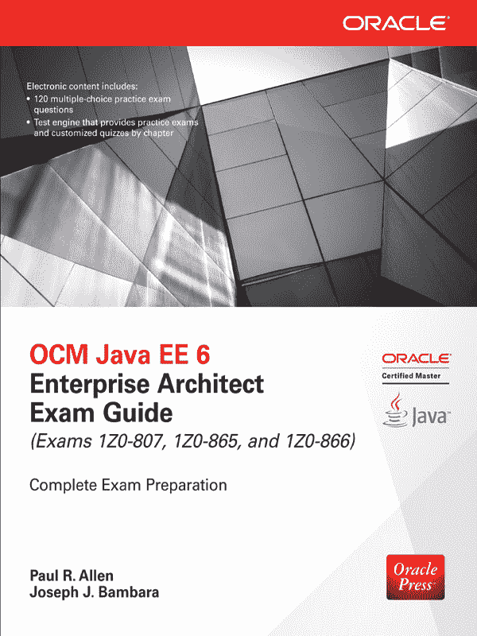

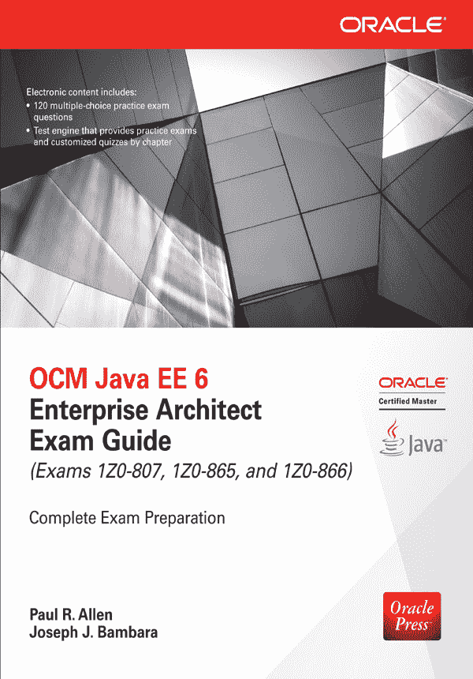


我想将这本书献给我的孩子们 Sophia 和 Terence。当你们开辟自己的道路并建立自己的城堡时，能与你们共度时光我非常开心。—Paul R. Allen

我想将这本书献给我的家人（Roseanne, Vanessa 和 Michael）和朋友们（尤其是 Hillary Brower 和 Rolando Marino），并希望我们在美国能够正确教育我们的年轻人，继续在技术和创新方面领先世界。—Joseph J. Bambara

## 关于作者

### Paul R. Allen

`Paul R. Allen` 是 UCNY, Inc. 的负责人，这是一家国际咨询公司，通过使用软件技术帮助财富 500 公司运营。他的电子邮箱是 `allen@ucny.com`。他已开发应用程序超过 20 年。他的行业经验包括金融、经纪、制药和制造业。他在纽约哥伦大学教授过计算机课程。他合著了多本书，包括《Certified Enterprise Architect for Java Study Guide》（McGraw-Hill, 2007 和 2003）、《JEE Unleashed》（Sams, 2002）、《SQL Server 7 Developer’s Guide》（IDG, 2000）、《Informix: Universal Data》（McGraw Hill, 1998）以及《PowerBuilder: A Guide to Developing Client/Server Applications》（McGraw-Hill, 1995）。他在柏林、哥本哈根、洛杉矶、纳什维尔、纽约、奥兰多、巴黎、斯德哥尔摩和华盛顿特区进行过多次课程教学。

### Joseph J. Bambara

`Joseph J. Bambara` 是 UCNY, Inc. 的负责人，通过使用数据库和对象技术帮助财富 500 公司运营。他的电子邮箱是 `jbambara@ucny.com`。他已开发应用程序超过 30 年，其中包括过去 25 年的关系数据库开发和过去 15 年的 Java 应用程序开发。他是认证培训师和开发者。他的行业经验包括金融、经纪、医疗和娱乐。Bambara 拥有计算机科学学士和硕士学位。他还有法博士学位并被纽约纽约律师。他在 CCNY 工程学院教授过各种课程。他合著了以下书籍：《PowerBuilder: A Guide to Developing Server Applications》（McGraw-Hill, 1995）、《Informix: Client/Server Application Development》（McGraw Hill, 1997）、《Informix: Universal Server》（McGraw Hill, 1998）、《Informix: Universal Data》（McGraw Hill, 1998）、《SQL Server 7 Developer’s Guide》（IDG, 2000）以及《J2EE Unleashed》（Sams, 2002）。他曾在 WebLogic、WebSphere 和 Sybase 在包括洛杉矶、维也纳、巴黎、柏林、纳什维尔、纽约、哥本哈根和斯德哥尔摩在多个城市进行过多次课程。

### 关于技术编辑

`Thomas Garben` 开发过多个不同行业的应用程序——从美国海军的引导系统到华尔街许多主要银行和结算所的金融应用程序——目前与 Azul Systems 合作支持低延迟虚拟机的实时需求。他自 1985 年以来一直开发应用程序，并专注于 Java 和 J2EE 技术。他拥有物理、数学和计算机工程学位，以及系统和计算机工程硕士学位。他是《J2EE Unleashed》（Sams, 2002）的合著者。

B. `JPA`

C. `JCA`

D. `JAX-WS`

18. `Ess Corp` 是一家期货交易所，白天通过 Web 应用程序接收针对大宗商品（如石油、燃气和棉花）的数百万电子报价和要价。成员的报价会被队列并处理，而不会由托管市场的 Java 应用程序立即确认。当报价和要价根据市场规则（批量、时间等）配对时会通知。在托管 Web 应用程序的服务器和托管市场的服务器之间，你会推荐哪种集成技术？

A. `JCA`

B. 使用 `JPA` 的 `EJB`

C. Java Web 服务 (`JAX-WS` 或 `JAX-RS`)

D. 带有 `MDB` 的 `JMS`

## 自测答案

**识别基于 Java EE 的系统与外部资源通信的可用 API，包括 JPA, JDBC, RMI, JMS 和 JCA。概述每种方法的优点和缺点。**

1. **D.** JMS 支持异步和同步通信。A、B、C 是错误的。`JAX-WS`、`JAX-RS` 和 `JCA` 不自动支持。

2. **B.** `JCA` 以通用方式暴露企业信息系统 (EIS) 资源。A、C、D 是错误的。`JMS`、`JAX-WS` 和 `JAX-RS` 不支持与企业信息系统 (EIS) 的通信。

3. **C.** `JAX-WS` 是支持安全、可靠性和事务行业标准的 Web 服务技术。A、B、D 是错误的。`JAX-SR` 是虚构的。`JAX-RS` 和 `JAXB` 不支持安全、可靠性和事务。

4. **A.** `JPA` 使用注解将数据库表映射到 Java 对象。B、C、D 是错误的。`JDBC`、`JDO` 和 `JCA` 不使用 ORM。

5. **B.** `JMS` 提供了一种方便的方法来创建、发送、接收和读取企业消息系统的消息。A、C、D 是错误的。`JDBC`、`JAX-WS` 和 `JPA` 不是消息。

6. **B.** 消息驱动 Bean (`MDB`) 允许 Java EE 应用程序异步处理消息。A、C、D 是错误的。`JDBC`、`JPA` 和 `JCA` 不是消息相关的。

7. **A.** `JAX-WS` 支持 WS-* 标准。B、C、D 是错误的。REST、`EJB` 和 `JAX-RS` 不支持 WS-* 标准。

8. **C.** `JCA` 用于创建支持访问企业信息系统 (EIS) 的资源适配器。A、B、D 是错误的。`JMS`、`JDBC` 和 `JPA` 不是资源适配器相关的。

9. **B.** `RMI` 未用于 Web 服务通信。A、C、D 是错误的。`XML`、`SOAP` 和 `JSON` 用于 Web 服务（尽管不一定同时）。

10. **D.** `JAX-WS` 使用行业标准进行 Web 服务通信。A、B、C 是错误的。`REST`、`JAX-RS` 和 `JCA` 不是 Web 服务相关的。

**识别面向服务性架构 (SOA) 如何促进系统集成和最佳实践**

11. **B.** `JAX-WS` 是 SOA 集成的行业标准。A、C、D 是错误的。`JCA`、`REST` 和 `JAX-RS` 不是 SOA 行业标准（至少）。

12. **E.** 以上所有。

13. **B.** 松耦合组件是面向服务架构 (SOA) 最相关的特征。A、C、D 是错误的。`EJB` 性能、Web 服务和负载均衡资源虽然有效，但不会在采用 SOA 架构后改进或降低。

**关于集成技术的附加问题**

14. **D.** `JMS` 是列出的唯一支持异步 Java 到 Java 集成的技术。A、B、C 是错误的。`JCA`、`JAX-WS` 和 `JAX-RS` 不自动支持通信。

15. **A.** `JCA` 是 EIS 集成技术的首选选择。B、C、D 是错误的。`JAX-WS`、`JAX-RS` 和 `JMS` 不是遗留 EIS 的首选集成选择。

16. **E.** 没有任何一个选项适用于 Java 应用程序的松耦合。A、B、C、D 是错误的。`RMI`、`EJB`、`JCA` 和 `JDBC` 不支持 Java 应用程序之间的松耦合。

17. **C.** `JCA` 是 EIS 集成技术的首选选择。A、B、D 是错误的。`EJB`、`JPA` 和 `JAX-WS` 不是遗留 EIS 的首选集成选择。

18. **D.** 带有 `MDB` 的 `JMS` 支持 Java 到 Java 集成，其额外功能是不需要立即确认传入报价或要价的成功或失败。考虑到 `JMS` 处理工作负载高峰以及报价与要价的异步配对和通知，它是理想的选择。A、B、C 是错误的。`JCA`、使用 `JPA` 的 `EJB` 以及 Java Web 服务 (`JAX-WS` 或 `JAX-RS`) 不满足异步和 Java 到 Java 的要求。

## 认证目标

5.01 识别适用于给定场景的正确 EJB 技术，包括实体类、会话 Bean、消息驱动 Bean、计时器、拦截器和 POJO

5.02 识别不同持久化技术的优点和缺点，如 BMP、CMP 和 JPA，包括易于开发、可扩展性和安全性

5.03 识别在 EJB 容器中实现 Web 服务的优缺点

5.04 在给定场景中适当使用 JPA 和 JPQL

## 问答自测

业务层包含解决业务领域需求（如保险、零售或金融）的代码。在 Java EE 环境中，业务功能通常放置在运行在业务层的企业 Bean 中（某些情况下企业 Bean 运行在 Web 层）。企业 Bean 从客户端接收数据，执行任何处理，然后将数据发送到存储层，例如数据库或企业系统。图 5-1 展示了 Java EE 应用程序的客户端、业务和持久化层。

### Java EE 6 新功能背景

重点并不关注 Java EE 的早期版本，而是关注 Java EE 6 的新功能。通常，Java EE 的设计目标是：

- 为构成平台的各种组件提供基础。

- 提高开发效率，如下：

  - 添加许多新注解。

  - 减少或消除对 XML 配置的需求。

  - 使用普通 Java 对象 (POJOs)。

Java EE 6 继续了 Java 5 确定的方向，可以总结为：

- 利用 Java 5 支持的功能（注解、泛型、类型安全枚举），使 Java EE 更加声明。

- 将 EJB 与基础设施解耦。

- 为 POJOs 添加持久化。

- 使业务方法中的代码不声明检查异常。

- 使部署描述符可选。

Java EE 6 还拥抱了补充框架中存在的许多值，这带来了更清晰、更轻量的框架，具有以下特征：

- **上下文和依赖注入 (CDI)**：组件的松耦合、作用域。

- **依赖注入**：更容易查找。在代码中声明外部资源。

- **约定优于配置**：也称为“异常配置”。简化开发者决策。

- **简化打包**：表 5-1 提供了企业 Bean (EJB) 新功能的细节。

### 表 5-1：企业 Bean (EJB) 新功能

## 认证目标 5.01

识别适用于给定场景的正确 EJB 技术，包括实体类、会话 Bean、消息驱动 Bean、计时器、拦截器和 POJO

### 企业 Bean 概述

企业 Bean（或 EJB）是包含应用程序业务逻辑的服务器端组件。企业 Bean 包含字段（变量）和方法（函数）以实现业务逻辑或功能。企业 Bean 简化了大型分布式应用程序的，如下：

- EJB 容器为企业 Bean 提供系统级服务，如安全和事务管理，让 Bean 开发者专注于实现业务需求的代码。

- 企业 Bean 包含应用程序的业务逻辑，让客户端开发者专注于客户端的展示。当客户端应用程序代码较少时，出现缺陷的机会更少，且对于较小设备，较小的代码占用是一个重要考虑因素。

- 只要使用标准 API，企业 Bean 就是可移植组件，并可以在任何符合 Java EE 的容器中运行。

### 使用企业 Bean 的场景

考试，使用企业 Bean 是以下场景的最合适实现：

- **可扩展性**：为了适应不断增长的用户数量，Java EE 服务器可以组成集群（多台机器），部署应用程序的企业 Bean 将在集群成员上运行。

- **事务**：事务确保数据完整性；将数据从已知状态更改另一个已知状态的操作性能。企业 Bean 支持事务，即管理共享对象并发访问的机制。

- **细粒度安全性**：企业 Bean 支持声明和程序的细粒度安全性。

- **复用**：涉及从多个类型的客户端（Web、Applet、浏览器）使用业务逻辑（功能）。通过少量代码，客户端可以轻松定位企业 Bean。

### 实体类

实体类是一个轻量级持久化领域。大多数情况下，实体类的实例将代表关系型数据库表或视图中的行。实体的状态通过字段或属性表示。

- 它们必须具有公共或保护的无参数构造函数。

- 类不能被声明为 `final`。

- 方法或持久化实例变量不能声明为 `final`。

- （可选）如果是参数（例如无状态会话 Bean 远程），它们必须实现 `Serializable` 接口。

### 普通 Java 对象 (POJO)

`EJB` 3 的发布极大简化开发者构建类来表示持久化层实体（例如数据库表）的方式。一个普通 Java 对象，或 `POJO`，就是需要的所有（带有新的注解和事务管理），用于企业应用程序。

### 实体 Bean

在 `EJB` 3.1 版本的简化和精简方面，企业 Bean 可以与 Web 层组件一起放在 Web 存档 (.war) 中。换句话说，企业 Bean 不需要包含在独立的 `ejb-jar` 中。`ejb-jar.xml` 文件是可选的，可以作为 `.war` 文件的一部分打包。

### 消息驱动 Bean (MDB)

消息驱动 Bean (`MDB`) 是一种允许 Java EE 应用程序异步方式处理消息的企业 Bean，与会话 Bean 允许你发送 `JMS` 消息并同步接收它们相反。`MDB` 通常通过充当 `JMS` 消息消费者来处理 `JMS` 消息，但它们也可以从其他提供者获取消息——例如，Java 连接器体系 (`JCA`)。消息可以从包括其他 Java EE 组件在许多源插入 `JMS` 主题或队列，也可以从非 Java EE 组件插入消息。所有 `MDB` 实例都是等的，Java EE 容器可以像静态会话 Bean 一样池化这些实例，以便同时处理消息流。MDBs 具有以下特征：

- 它们是非状态的，但它们可以访问和更新数据库中的共享数据。

- 它们在接收消息时执行。

- 它们是异步调用的。

- 它们执行时间较短。

- 它们可以在事务回滚时重做。

当消息到达时，容器调用消息驱动 Bean 的 `onMessage` 方法进行处理。

### 计时器服务

计时服务允许所有企业 Bean（除会话 Bean 外）调度定时通知。你可以根据日历计划、特定时间、持续时间后或按时间间隔调度定时通知。

### 会话 Bean

会话 Bean 是一种包含业务逻辑或特定工作流的企业 Bean。会话 Bean 的实例变量代表特定客户端/Bean 的状态，这种状态在客户端移除 Bean 或客户端终止时结束。会话 Bean 有三种类型：无状态、有状态和单例。

在以下场景中使用会话 Bean：

- 当时刻只有一个客户端访问 Bean 实例时。

- 如果会话 Bean 的状态不需要持久化。

### 单例会话 Bean (SSB)

单例会话 Bean 遵循命名模式，每个应用程序（每个 Java 虚拟机）实例化一次，直到应用程序停止。使用单例会话 Bean 的应用程序可能指定启动时实例化单例，允许单例为应用程序执行初始化任务。单例可能在应用程序关闭时执行清理任务，因为单例将在整个应用程序生命周期内运行。在以下情况下使用单例会话 Bean：

- 状态或功能跨应用程序共享（被多个线程访问）。

- 应用程序需要在启动和/或关闭期间执行任务。

- Bean 实现了 Web 端点。

单例会话 Bean 的并发控制有两种选择：

- **容器管理的并发 (CMC)**：Java EE 容器根据方法级锁控制对会话 Bean 实例的访问。在单例 Bean 上注解 `@ConcurrencyManagement(ConcurrencyType.CONTAINER)`。

- **Bean 管理的并发 (BMC)**：Java EE 容器允许对会话 Bean 实例进行完全并发访问，并将状态推推到单例 Bean 实例的代码中。在单例 Bean 上注解 `@ConcurrencyManagement(ConcurrencyType.BEAN)`。

## 场景与解决方案

| 给定场景 | 适当的 EJB 技术 |

| :--- | :--- |

| 表示从持久化层（例如关系型数据库）检索并保存到其中的数据 | 实体类（Entity classes）。如果你正在扩展现有的 EJB 2.x 实现的功能，则需要考虑实体豆（entity beans）。 |

| 不需要为特定客户端存储状态数据；在单个方法调用期间为任何客户端执行业务功能；实现 Web 服务端点 | 无状态会话豆（SLSB）。 |

| 为特定客户端表示状态（或信息）；为展示客户端与应用程序多个服务器端组件之间调解的简化视图 | 有状态会话豆（SFSB）。 |

| 如果状态（或功能）需要在跨应用程序（内部）或通过 Web 服务端点（外部）共享；在应用程序启动和/或关机期间执行任务 | 单例会话豆（SSB）。 |

| 与一个通过 JMS 接收消息的第三方应用程序集成；对于需要异步处理的长时间任务；当资源并非总是可用时；如果你想并行化处理 | 消息驱动豆（MDB）。 |

## 认证目标 5.02：识别不同持久化技术（如 BMP、CMP 和 JPA）的优缺点，包括开发易用性、性能、可扩展性、扩展性和安全性

Java EE 中提供了多种持久化技术，为了通过考试，你必须熟悉这些技术。

## 评估优缺点

在介绍持久化技术之前，让我们快速查看一眼通常用于衡量这些持久化技术优缺点的非功能性需求和特质。

### 开发易用性


开发易用性通常指那些能够让开发者提高效率，并使其能够在更短时间内通过简单或直接的方法实现更多功能的特性。具体到 Java EE 而言，我们可以通过注解（annotations）等功能来观察这些示例，它们可以用于与代码一起定义和连接功能，而不是单独在配置文件中定义。另一个例子是`JPA`，它将持久化细节留给`JPA`实现来处理，使开发者无需显式编写 SQL 代码，从而缩短了开发时间。旧的`EJB`（2.x 及以前版本）规范版本要求开发者进行大量的开销和实现工作。在`EJB` 3.0 规范以及后续的`EJB` 3.1 中，业界大力推行并简化所有类型`EJBs`的开发过程，从而提升了开发者的生产力。

### 性能

在持久化和性能方面，将持久化细节委托给容器或特定的持久化实现，与由开发者在代码中实现持久化细节之间，通常存在权衡。持久化委托的例子包括基于`JPA`的`EJB` 3.x 实体类和`EJB` 2.x`CMP`实体豆。通常情况下，为了开发和持续维护中实现的效率提升，可能会付出运行时性能的代价。与之形成对比的例子是开发者花费更多时间和精力通过`JDBC`实现 SQL 调用，这可能在所有或至少大多数测试用例中产生最快的性能。


委托式持久化方法可以调优到足以媲美甚至超过开发者编写代码的持久化方法的程度。持久化容器服务可以配置为包含缓存和预取方法，从而减少昂贵的 I/O 或网络调用次数。简而言之，表现各异——目前还没有明确的优胜者。

### 可扩展性

在持久化方法的可扩展性方面，`EJB`容器具有管理企业豆池的能力。底层的 Java EE 服务器具有用于调整和管理这些豆池的配置属性。这些属性可以通过考虑客户端请求的数量、频率和持续时间来设置。以下是一些通用的经验法则：


无状态会话豆（Stateless session beans）的可扩展性最高，因为容器可以在每次方法调用后重用豆实例。


有状态会话豆（Stateful session beans）的可扩展性较差，因为容器必须为每个并发客户端映射一个豆实例，直到客户端会话完成。

### 扩展性

当现有应用程序添加额外功能时，对于特定的持久化方法，委托持久化或显式编码化都没有明显的优势（或缺点）。对于关系型数据库表增加列的情况，无论采用何种持久化方法，都需要额外的努力来满足新需求。扩展易用性没有明显的优胜者。

### 安全性

同样，不同的持久化策略之间没有明显的优缺点，因为安全性一直是企业豆和`EJB`容器的核心特性之一。现在我们已经简要涵盖了通常用于衡量这些持久化技术优缺点的非功能性需求和特质。现在我们将详细介绍每种持久化方法，然后展示它们优缺点的对比。

## 豆管理的持久化 (BMP)

当使用豆管理的持久化（`BMP`）实体豆时，要求开发者实现代码将豆的状态保存到底层持久化层。这确实让开发者对持久化的发生方式有了精确控制，并且通常性能优于`CMP`实现，但它伴随着可能更复杂的代码增加的开销（尽管复杂性的增加并不总是如此）。`BMP`最适用于特定场景，即`CMP`无法提供性能或底层持久化层不支持`CMP`。

使用豆管理的持久化的优点包括：


- **基于标准**：可以使用标准的`EJB`和`JDBC` API 进行数据访问调用。


- **数据类型访问**：支持访问非标准数据类型和遗留应用程序的能力。


- **最大的灵活性**：支持任何复杂程度的数据验证逻辑。


- **数据库特定特性**：应用程序能够利用不同 SQL 服务器的非标准 SQL 特性。

使用豆管理的持久化的缺点包括：


- **数据库特定**：因为实体豆代码是特定数据库的，如果需要访问多个数据库，企业豆提供者必须在其数据访问方法考虑这一点。


- **SQL 知识**：企业豆提供者必须具备 SQL 知识。


- **开发时间**：这些豆的平均开发时间长得多。

## 容器管理的持久化 (CMP)

当使用容器管理的持久化（`CMP`）时，实体豆将其状态的持久化留给`EJB`容器。这简化了需要实现的代码量，从而提高了生产力。然而，提交到数据库生成的 SQL 可能并非最优。如果只是为了调试和排查`CMP`实现，开发者仍然需要 SQL 和底层数据库的知识。

容器管理的持久化的优点包括：


- **数据库独立性**：由容器而非企业豆提供者维护对大多数流行数据库的访问。


- **容器特定特性**：企业豆提供者可以使用如全文搜索等特性。


- **可移植性**：到其他`EJB`容器的可移植性是简单的，但无法保证相同的性能。

容器管理的持久化的缺点包括：


- **算法**：只能使用支持的算法。


- **访问**：开发者无法访问且无法修改实际代码。


- **效率**：有时生成的 SQL 性能不是最高的。

## Java 对象 (JDO)

Java 对象（`JDO`）API 是 Java 社区开发的一种基于接口的持久化模型。开发者可以使用`JDO`将 Java 模型存储到持久化存储中。

使用`JDO`的优点是：


- **易用性**：开发者关注领域模型；持久化细节由`JDO`实现处理。


- **可移植性**：`JDO`应用程序在多种`JDO`实现上运行无需更改。此外，`JDO`支持大量的关系和类型，并具有代理对象。


- **数据库独立性**：`JDO`应用程序独立于底层数据存储。事务数据存储不仅限于关系数据库；还支持 NoSQL 数据源、对象数据库和其他持久化层。从 SQL 切换到 NoSQL 数据更容易。


- **高性能**：持久化细节由`JDO`实现处理，因此可以通过优化的访问模式获得性能。


- **与 EJB 集成**：`JDO`应用程序仍然可以使用主要的`EJB`特性——如事务协调、安全远程消息处理。使用`JDO`的主要缺点是其更新频率不高。

## Java 数据库连接 (JDBC)

`JDBC` API 允许你从 Java 方法中调用 SQL 命令。你在多个 Java EE 组件（企业豆、servlet 和 JSP）中使用`JDBC` API 直接访问数据库，而不使用实体豆或实体类。JDBC API 有两部分：应用程序组件访问数据库的应用程序级接口，以及将`JDBC`驱动附加到 Java EE 服务的提供者接口。

使用`JDBC`的优点包括：


- 易于测试。


- 平台无关。


- 提供了最大化查询性能的。

使用`JDBC`的缺点包括：


- 开发者需要编写并处理所有检查异常。


- 不支持关系、继承和关联。


- 实现取决于开发者。


- 开发者需要了解 SQL 和关系模型。

## Java 持久化 API (JPA)

Java Persistence API（`JPA`）由 Java EE 5 规范引入并不断增强。它的目的是简化并标准化 Java 对象映射到关系数据库表的方法，通常被称为对象关系映射（ORM）。`JPA`还简化了实体持久化的编程模型，并添加了`EJB` 2.1 中不具备的能力。`JPA`建立了实体映射到关系表以及创建 ORM 配置元数据的标准。`EntityManager` API 暴露了`INSERT`、`SELECT`、`UPDATE`和`DELETE`实体的操作，实体是存储在关系数据库中的持久化数据的模型。

使用`JPA`的优点包括：


- 可以在容器之外使用，因此更容易测试。


- 可以与可插的第三方持久化提供者（`Hibernate`、`TopLink`、`OpenJPA`）一起使用。


- 提供更、更容易、标准的对象关系映射。特别是：


- 消除了查找代码的需求（`annotations`驱动此）。


- 减少或消除了部署描述符项（它改为使用注解）。

- 需要更少的类和接口。

- Java 持久化查询语言（JPQL`，增强型的`EJB QL`）可搜索和检索数据。

使用`JPA`的缺点包括：


- 存在性能欠佳的可能。生成的 SQL 语句可能并非最优。


- 由于`JPA`实现处理持久化细节，可能导致性能不理想。


- 这种持久化方法是关系数据库的，且取决于模型化数据提供者。

## 比较各种持久化技术的优缺点 

（表 5-2）

## 场景与解决方案

| 给定场景 | 是否适合使用 JPA 和 JPQL？ |

| :--- | :--- |

| 数据模型在规模和关系上都很简单，且开发团队希望开始使用 ORM 方式进行开发。 | 是的，使用`JPQL`和/或`JPA Criteria API`的`JPA`适用于该场景。 |

| 开发团队正在对一个现有的 EJB 2.x 应用程序进行微小更新。 | 否，现有的`EJB 2.x`应用程序应该继续使用`CMP`和/或`BMP`实体豆。 |

| 你正在构建一个新的 Java EE 应用程序，用于将 Java 对象表示的数据持久化到关系型数据库中。 | 是的，这是使用`JPA`和`JPQL`的适用场景。 |

# JPA Criteria API

JPA 2.0 引入的一个新特性是`JPA Criteria API`，它允许开发者动态地构建基于对象的查询，而不是使用 Java 持久查询语言 (`JPQL`) 来定义查询。`JPQL`查询是以字符串形式定义的（类似于`SQL`），而`JPA criteria`查询是通过实例化表示查询元素的 Java 节点来定义的。这两种查询方式在性能或效率上并无优劣之分，选择取决于开发者的个人偏好。

`JPA Criteria API`的优势在于：

 `Criteria API`是一个类型安全的 API，因此类型检查错误将在编译期间检测，而不是在运行时。 在整个应用程序逻辑中混用`SQL`字符串可能会引发问题。例如，某些开发者不熟悉`SQL`，或者某些人本身就不擅长`SQL`。使用`Criteria API`将缓解这些问题。 对于在运行时构建的动态查询，可能使用`Criteria API`而不是使用大量的字符串拼接操作来构建查询。表 5-3 显示了给定场景下`JPA`和`JPQL`的适当用法。

## 认证摘要

通过学习本章，你将理解考试中将测试的业务层技术。

## 两分钟演练

### 针对给定场景识别正确的 EJB 技术，包括实体类、会话豆、消息驱动豆、定时器、拦截器和 POJO

 使用实体类 (`EJB` 3.x) 来表示从持久化层（例如关系型数据库）检索和保存到该层的数据。注意：如果你正在扩展现有的`EJB` 2.x 实现的功能，则必须考虑实体豆（entity bean）。 在以下场景中使用无状态会话豆 (`SLSB`)： 不需要为特定客户端存储状态数据。 在单次方法调用期间为任何客户端执行业务功能。 实现 Web 服务端点。 在以下场景中使用有状态会话豆 (`SFSB`)： 为特定客户端表示状态（或信息）。 展示客户端与应用程序多个服务器端组件之间调的简化视图。 在以下场景中使用单例会话豆 (`SSB`)： 如果需要在应用程序内部（内部）或通过 Web 服务端点（外部）共享状态（或功能）。 在应用程序启动和/或关闭期间执行任务。 在以下场景中使用消息驱动豆 (`MDB`)： 与通过`JMS`接收消息的第三方应用程序集成。 异步处理长时间的任务。 当资源并非总是可用。 如果你想并行处理。

### 识别不同持久化技术（如 BMP、CMP 和 JPA）的优缺点，包括开发易用性、性能、可扩展性、扩展性和安全性

 豆管理持久化 (`BMP`) 的优势是： **基于标准**：用于数据访问调的标准`EJB`和`JDBC` API。 **数据类型访问**：支持非标准数据类型和遗留应用程序。 **最大活性**：支持复杂的数据验证逻辑。对发送到数据库的`SQL`进行精确控制，或实现匹配特定旧数据库模式的代码。例如，如果你的持久存储不是数据库系统，或者是不支持`EJB`容器`CMP`实现的旧数据库系统。 **数据库特性**：可以利用非标准的`SQL`特性。 **性能**：如果应用程序的查询需求超过了`CMP`的能力，或者应用程序需要细粒度的`SQL`代码才能有效运行。然而，建议使用数据访问对象 (`DAO`)。`DAO`能更好地让豆适应不同的数据库模式，或以后演进为`CMP`实体豆。 **向后兼容性**：如果你正在扩展现有的`EJB` 2.x`BMP`实现，则更合适。

豆管理持久化 (`BMP`) 的缺点是： **数据库特定性**：实体豆代码特定于数据库，移植性较差。需要更深的`SQL`知识。 **开发时间**：开发时间较长。

容器管理持久化 (`CMP`) 的优势是： **数据库独立性**：容器处理持久化细节。 **容器特性**：可以使用额外的容器功能。 **移植性**：对其他`EJB`容器具有很好的移植性。如果你正在扩展现有的`EJB` 2.x`CMP`实现，则更合适。

容器管理持久化 (`CMP`) 的缺点是： **算法**：只有容器支持的算法。 **访问**：无法访问视图，且生成的代码无法修改。 **效率**：生成的`SQL`可能无法达到要求的性能。

Java 数据对象 (`JDO`) 的优势是： **易用**：像`JPA`一样，开发者专注于构建模型并将持久化细节留给`JDO`。 **移植性**：`JDO`应用可以在多个`JDO`实现上运行而无需更改。 **数据库独立性**：`JDO`应用独立于底层存储。支持`SQL`以及其他数据存储类型。 **高性能**：`JDO`实现具有优化的数据访问模式。

Java 数据对象 (`JDO`) 的缺点是： **旧代码**：更新频率不高。

Java 数据库连接 (`JDBC`) 的优势是： **测试**：于测试使用`JDBC`的组件。 **数据库无关性**：平台无关。 **性能**：能够最大化查询性能。

Java 数据库连接 (`JDBC`) 的缺点是： **异常**：需要编写并处理所有异常。 **关系**：不支持关系、继承和关联。 **更多编码**：实现由开发者负责。 **SQL 知识**：开发者需要了解`SQL`和关系模型。


使用 Java 持久 API（`JPA`）的优势是： **测试**：可以在容器外使用因此更容易测试。 **插件**：可以使用可插的第三方持久化提供商（`Hibernate`、`TopLink`、`OpenJPA`）。 **标准**：更简洁、标准的对象关系映射：消除了查找代码（使用注解）。减少或消除了部署符（使用注解）。需要更少的类和接口。 **Java 持久查询语言（`JPQL`）**：使用增强的 `EJB Q` 来搜索和检索数据。 **Criteria API**：动态构建基于对象的查询。

使用 Java 持久 API（`JPA`）的缺点是： **潜在性能不足**：由于数据存储的设计和实现，生成的 `SQL` 语句可能无法运行。 **如果现有实现未使用 `JPA` 且你需要微调功能**：在这种情况下，通常不允许或没有理由重写整个层来使用 `JPA`（由于风险增加）。 **如果底层持久化层未被 `JPA` 实现支持**：这种情况主要发生在持久化层不是关系数据库时。

### 在 EJB 组件中实现 Web 服务的缺点

使用企业豆（`EJB`）和服务的优势是： 提高开发生产率以满足变化的业务需求。暴露 `EJB` 作为服务提供者，以及创建或修改 `EJB` 来消费服务。

使用企业豆（`EJB`）和服务的缺点包括： 直接作为服务提供者存在安全担忧，并且违背了定义良好且集中的集成层的架构方法。 当服务调用添加到企业豆（`EJB`）时，开发者必须确保发送和接收的数据是有效的，以防止数据泄露到应用程序或其持久化层。

### 在给定场景选择 `JPA` 和 `JPQL` 的适当使用

 如果你正在构建一个将 Java 对象持久化到关系数据库的 Java EE 应用，这是使用 `JPA` 和 `JPQL` 的适当场景。 如果你对现有的 `EJB` 2.x 应用进行微调，使用 `JPA` 和 `JPQL` 技术可能不是一个好的场景。继续 `EJB` 2.x `CMP` 和/或 `BMP` 实体豆更有意义。

## 测试

以下问题将帮助你衡量对本章内容的理解。仔细阅读所有选项，因为可能有多个正确答案。为每个问题选择所有正确答案。

### 针对给定场景识别正确的 EJB 技术，包括实体类、会话豆、消息驱动豆、定时器、拦截器和 POJO

1. Serengeti 公司开始开发一个新系统，允许世界各地的参与者以开放拍卖的方式买卖物品。Serengeti 的主要目标是确保所有参与者在各方面都平等对待；这包括为每个参与者分配资源以免他们互不影响。Serengeti 有足够的资金预算购买所需的任何技术来实现其目标。你推荐以下哪个方案？

**A**. 无状态会话豆（`SLSB`）

**B**. 有状态会话豆（`SFSB`）

**C**. 消息驱动豆（`MDB`）

**D**. BMP 实体豆

2. 应用程序需要从 `JMS` 队列读取消息，使用消息中的数据调用 Web 服务，并将服务的响应持久化到数据库表中。你将使用哪种类型的 EJB？

**A**. 有状态会话豆（`SFSB`）

**B**. 无状态会话豆（`SLSB`）

**C**. 消息驱动豆（`MDB`）

**D**. 实体类

3. 如果你遵循 Java EE 架构的最佳实践，你会把业务规则和功能放在哪里？

**A**. Java servlets

**B**. 企业豆（`EJB`）

**C**. JAX-RS Web 服务

**D**. JAX-WS Web 服务

4. 对于高可用、复杂的事务系统的业务逻辑，你推荐以下哪种？

**A**. 使用带有 `JPA` 的会话豆

**B**. 使用 `JPA`

**C**. 使用以 Web 为中心的架构

**D**. 使用有状态会话豆

5. 当你为大量用户设计应用程序时，应该避免以下哪种 EJB 类型？

**A**. 实体豆

**B**. 消息驱动豆（`MDB`）

**C**. 有状态会话豆（`SFSB`）

**D**. 无状态会话豆（`SLSB`）

## 测试答案

### 针对给定场景识别正确的 EJB 技术，包括实体类、会话豆、消息驱动豆、定时器、拦截器和 POJO

1. **B**. 有状态会话豆允许 Java EE 应用在用户的会话生命周期内访问并保留资源。

2. **C**. 消息驱动豆从 `JMS` 队列读取消息并启动工作。

3. **B**. 企业豆（`EJB`）是业务规则和功能的架构“最佳实践”位置。

4. **A**. 带有 `JPA` 的会话豆具有所需的事务支持。

5. **C**. EJB 容器每个并发用户需要一个有状态会话豆实例。

| 元素/章节 | 描述 |
| :--- | :--- |
| 名称（Name） | 用于帮助传达模式的核心。 |
| 分类（Classification） | 类别有： **创建型**模式关注创建； **结构型**模式关注组合； **行为型**模式关注交互和职责 |
| 意图（Intent） | 该模式解决了什么问题？它是做什么的？ |
| 又名（Also Known As） | 该模式的其他常见名称。 |
| 动机（Motivation） | 说明问题的场景。 |
| 适用性（Applicability） | 可以使用该模式的情况。 |
| 结构（Structure） | 表示模式中类和对象结构的图。GoF 使用对象建模技术（OMT）或 Booch 表示法。如今，通常使用 OMT、Booch 等等统一的统一建模语言（UML）。 |
| 参与者（Participants） | 参与设计模式的类和/对象及其职责。 |
| 协作（Collaborations） | 参与者如何共同工作以执行它们的职责。 |
| 结果（Consequences） | 该模式实现了什么目标？权衡和结果是什么？ |
| 实现（Implementation） | 需要考虑的实现细节（陷阱、提示或技术）。是否存在特定于语言的问题？ |
| 示例代码（Sample Code） | 示例代码。 |
| 已知用途（Known Uses） | 现实世界的示例。 |
| 相关模式（Related Patterns） | 对相关模式的比较和讨论；该模式可以与其他模式结合使用的场景。 |

## 指定 GoF 设计模式的优点

下表显示了每个 GoF 设计模式的优点：

| GoF 设计模式 | 优点 |
| :--- | :--- |
| 抽象工厂（Abstract Factory） | 将客户端与具体（实现）类隔离开。使对象族的交换更加容易。促进对象之间的一性。 |
| 构建器（Builder） | 允许你改变对象的内部表示。将构建和表示的代码隔离。对构建过程提供更精细的控制。 |
| 工厂方法（Factory Method） | 消除了将特定应用程序类绑定到代码中的需求。代码仅与结果接口交互，因此可以与实现该接口的类工作。因为在类内部创建对象比直接创建对象更灵活，它允许子类提供对象的扩展版本。 |
| 原型（Prototype） | 允许在运行时添加或删除对象。通过改变其值或结构来指定新对象。减少对子类化的需求。允许使用类动态配置应用程序。 |
| 单例（Singleton） | 控制类单个实例的访问。减少命名空间的使用。允许对操作和表示进行细化。允许数量变化的实例。比类方法（操作）更灵活。 |
| 适配器（Adapter） | 允许两个或多个以前不兼容的对象交互。允许现有功能的重用。 |
| 桥接（Bridge） | 实现实现与接口分离。提高扩展性。允许向客户端隐藏实现细节。 |
| 组合（Composite） | 定义由原始对象和复杂对象组成的类层次结构。使得添加新类型的组件变得容易。提供了具有良好接口的结构活性。 |
| 装饰器（Decorator） | 比静态继承更大的灵活性。避免了将功能丰富的类放在层次结构中高处的需求。通过允许开发一系列针对特定功能的类来简化编码，而不是将所有行为编码到对象中。增强了对象的扩展性，因为更改通过编写新类来实现。 |
| 门面（Facade） | 为复杂的子系统提供更简单的接口，而不减少子系统提供的选项。保护客户端免受子系统组件复杂性的影响。促进子系统与其客户端之间的松耦合。只要每个子系统都使用自己的 `Facade` 模式，并且系统的其他部分使用 `Facade` 模式与子系统通信，就可以减少子系统之间的耦合。 |
| 权重（Flyweight） | 减少需要处理的对象的数量。如果对象持久化，则减少内存和存储设备的使用。 |
| 代理（Proxy） | 远程代理隐藏了实现位于另一个地址空间的事实。虚拟代理执行优化——例如按需创建对象。 |
| 责任链（Chain of Responsibility） | 减少耦合。在对象分配职责时增加了灵活性。允许一组类作为一个整体来工作；在一个类中产生的事件可以发送到组合内的其他处理器类。 |
| 命令（Command） | 将调用操作的对象与执行操作的对象分离。简化了添加新命令，因为现有类保持不变。 |
| 解释器（Interpreter） | 使更改和扩展语法变得更容易。使实现语法变得简单直接。 |
| 迭代器（Iterator） | 支持集合遍历的变体。简化了集合的接口。 |
| 中介者（Mediator） | 解耦同事。简化对象协议。集中控制。单个组件变得更简单、更更容易处理，因为它们不需要相互传递消息。组件不需要包含处理相互通信的逻辑，因此更具通用性。 |
| 备忘录（Memento） | 保留封装边界。简化源对象。 |
| 观察者（Observer） | 抽象了主题和观察者之间的耦合。为广播类型的通信提供支持。 |
| 状态（State） | 将特定状态的行为局部化并为不同状态划分行为。使任何状态转换变得显式。 |
| 策略（Strategy） | 提供子类化的替代方案。在自己的类中定义每个行为，消除了对条件语句的需求。更容易在不更改应用程序的情况下扩展和整合新行为。 |
| 模板方法（Template Method） | 用于代码复用。 |

如果你是设计模式的新手，可能会发现下面的表格对你很有帮助。它提供了一个建议的顺序，让你可以更容易地学习 GoF 设计模式。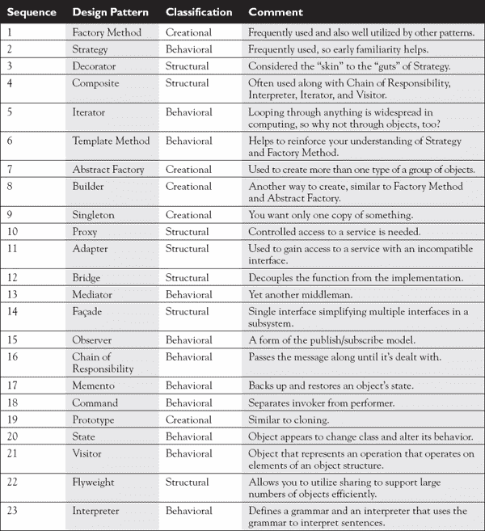

## 认证目标 7.01

## 为特定的应用挑战选择合适的四人组（GoF）模式

我们现在将回顾 Gamma 等人的每种设计模式，首先从用于创建对象的模式（创建型，Creational）开始，然后转向关注类和对象组合的模式（结构型，Structural），最后涵盖关注对象间交互和职责的模式（行为型，Behavioral）。

### GoF 创建型设计模式

创建型模式关注对象的创建方式。当在实例化类时必须做出决策时，就会使用这些模式。通常，要实例化的具体类的细节会被一个抽象类隐藏（且对调用类不可知），该抽象类只知道抽象类或其所实现的接口。GoF 描述了以下创建型模式： 抽象工厂 建造器 工厂方法 原型 单例

#### 抽象工厂（Abstract Factory）

抽象工厂模式的意图是提供一个接口用于创建一系列相关的（或依赖）对象，而无需实际指定它们的具体类。对于一组相关的抽象类，该模式提供了一种技术，从等一组具体子类中创建这些抽象类的实例。在某些情况下，你可能需要在不需要知道要创建哪个具体对象子类的情况下创建一个对象。

抽象工厂模式也被称为套件/工具包（Kit）。其 UML 示表示如图 7-1 所示。

**图 7-1** 抽象工厂模式的 UML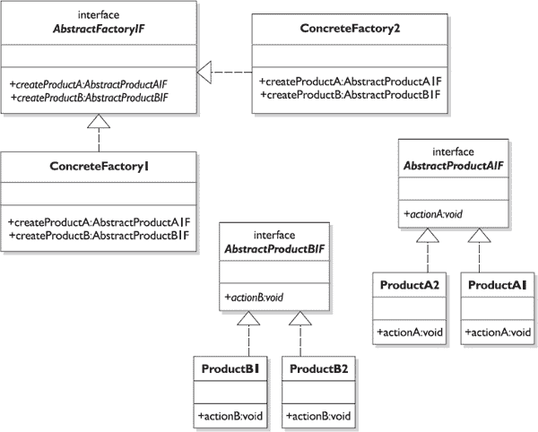

**益处**

以下是使用抽象工厂模式的益处列表：

- 它将客户端与具体（实现）类隔离开。
- 它方便了对象族的交换。
- 它促进了对象之间的一性。

**适用场景**

以下场景最适合抽象工厂模式：

- 系统需要独立于对象的创建、组合和表示方式。
- 系统需要用多个对象族中的一个进行配置。
- 相关的对象族旨在一起使用，并且需要强制这一约束。
- 你想提供一个不显示实现而仅暴露接口的对象库。

#### 建造器（Builder）

建造器模式的意图是将复杂对象的构建与其表示分离，以便相同的构建过程可以创建不同的对象。当几类具有相似组装规则的复杂对象需要在运行时组合，但产生不同类型的对象时，建造器模式非常有用。它通过将对象的构建过程与对象本身分离来实现这一点。

建造器模式通过多个步骤创建复杂对象，而不是像其他模式那样通过单个步骤。其 UML 如图 7-2 所示。

**图 7-2** 建造器模式的 UML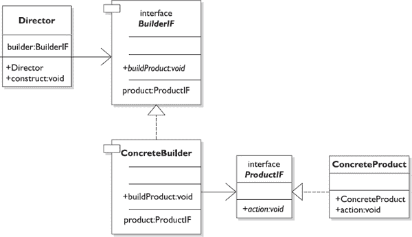

**益处**

使用建造器模式可以实现以下益处：

- 它允许你改变对象的内部表示。
- 它将构建和表示的代码隔离。
- 它对构建过程提供了更精细的控制。

**适用场景**

以下场景最适合建造器模式：

- 创建复杂对象的算法需要独立于组成该对象的组件以及它们的组装方式。
- 构建过程允许所构建的对象有不同的表示。

#### 工厂方法（Factory Method）

工厂方法模式的意图是为创建对象定义一个接口，但让子类决定实例化哪个类。换句话之，该类将实例化推迟给子类。工厂方法的客户端永远不需要知道被实例化并返回的具体类。它的客户端只需要知道公布的抽象接口即可。

工厂方法模式也被称为虚构造函数（Virtual Constructor）。图 7-3 显示了 UML。

**图 7-3** 工厂方法模式的 UML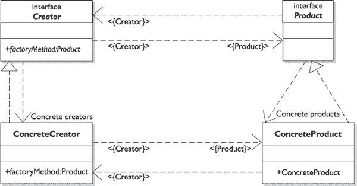

**益处**

以下是使用工厂方法模式的益处列表：

- 它消除了将特定应用程序类绑定到代码中的需求。代码仅与结果接口交互，因此它可以与任何实现该接口的类工作。
- 因为在类内部创建对象比直接创建对象更灵活，它允许子类提供一个扩展版本的对象。

**适用场景**

以下场景最适合工厂方法模式：

- 一个类无法预测它所需的对象类型。
- 一个类希望其子类来指定它实例化的对象。
- 类将责任分配给几个子类之一，并且你想将关于哪个子类是代理的知识局部化。

#### 原型（Prototype）

原型模式的意图是使用原型实例来指定需要创建的对象类型，并通过复制此原型来创建新对象。在 Java 中，对象的拷贝通常通过 `java.lang.Object` 的 `clone()` 方法完成。其 UML 如图 7-4 所示。

**图 7-4** 原型模式的 UML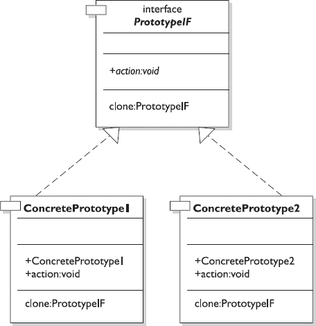

**益处**

以下是使用原型模式的益处：

- 它允许你在运行时添加或删除对象。
- 它允许你通过改变其值或结构来指定新对象。
- 它减少了对子类化的需求。
- 它允许动态地配置应用程序。

**适用场景**

以下场景最适合原型模式：

- 在运行时指定要实例化的类。
- 你需要避免构建与对象并行的类体系。
- 类的实例具有不同的状态组合。

#### 单例（Singleton）

单例模式的意图是确保一个类只有一个实例，并提供对它的全局访问点。它确保所有使用该实例的对象都使用同一个。图 7-5 显示了 UML。

**图 7-5** 单例模式的 UML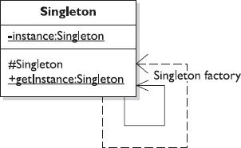

**益处**

以下是使用单例模式的益处：

- 它控制对单个实例的访问。
- 它减少了命名空间的使用。
- 它允许对操作进行精炼。
- 它还可以允许任意数量的实例。
- 它比类方法更灵活。

**适用场景**

当需要一个类的单个实例且必须从已知的访问点访问时。

### GoF 结构型设计模式

结构型模式关注类和对象的组织、类如何继承以及它们如何组合。常见的结构型模式包括适配器（Adapter）、代理（Proxy）和装饰器（Decorator）。复合模式（Composite）、外观模式（Facade）、重量模式（Flyweight）。

#### 适配器（Adapter）


适配器模式将类的接口转换为客户端所需的接口。它充当中间介，让由于接口不兼容而无法工作的类协作。适配器模式也称为包装（`Wrapper`）。其 UML 如图图 7-6 所示。

**图 7-6** 适配器模式的 UML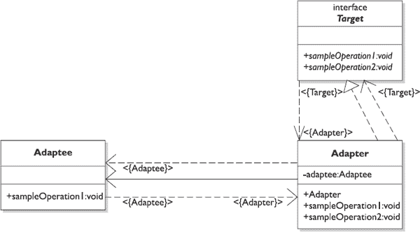

**益处**

以下是使用适配器模式的益处：

- 它允许两个或多个之前不兼容的对象进行交互。
- 它允许现有功能的重用。

**适用场景**

- 一个对象需要利用具有不兼容接口的类。
- 你想创建一个与没有兼容接口的类协作的可用类。
- 你需要通过子类化适配它们的接口。

#### 桥接（`Bridge`）

桥接模式的意图是将功能抽象与实现解耦，以便二者可以独立变化。桥接模式也称为句柄/实现（`Handle/Body`）。其 UML 如图图 7-7 所示。

**图 7-7** 桥接模式的 UML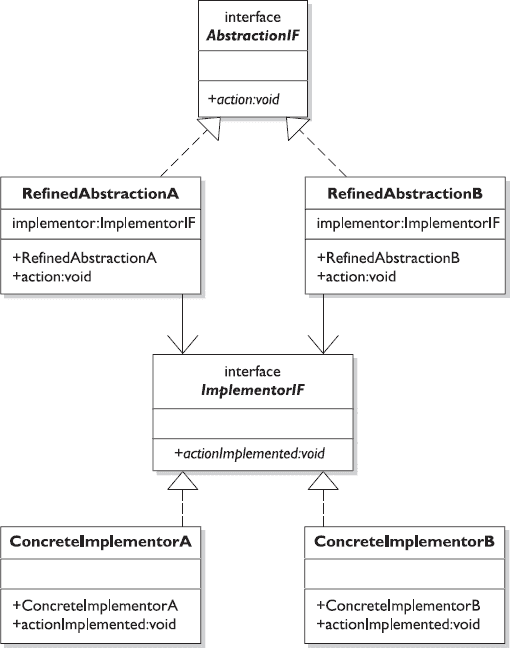

**益处**

以下是使用桥接模式的益处：

- 它实现了实现与接口的分离。
- 它改进了扩展性。
- 它允许向客户端隐藏实现细节。

**适用场景**

- 你想避免功能抽象与其实现之间的永久绑定。
- 功能抽象及其实现都需要通过子类化进行扩展。
- 对实现的更改不应影响客户端（重新编译）。

#### 复合（`Composite`）

复合模式的意图是允许客户端以通用的方式操作可能或不表示层次层次的对象。其 UML 如图图 7-8 所示。

**图 7-8** 复合模式的 UML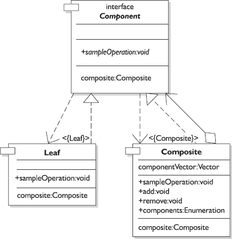

**益处**

以下是使用复合模式的益处：

- 它定义了由原始和复杂对象组成的类层次。
- 它让你更容易添加新类型的组件。
- 它提供了具有易于接口的结构活性。

**适用场景**

- 你想表示完整或部分的对象层次。
- 你想能够忽略层次中不同对象之间的差异。
- 结构是动态的，可以具有任何级别的复杂性——例如使用 `Java EE` 目录中的复合，这对于应用程序很有用。

#### 装饰器（`Decorator`）

作为子类化扩展功能的替代方案，装饰器模式的意图是动态地为对象附加灵活的额外职责。装饰器模式使用组合而不是继承来扩展对象的功能。装饰器模式也称为包装（`Wrapper`）。其 UML 如图图 7-9 所示。

**图 7-9** 装饰器模式的 UML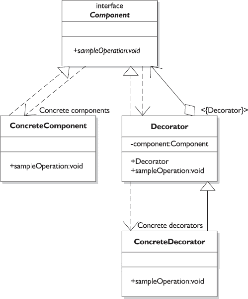

**益处**

以下是使用装饰器模式的益处列表：

- 它比静态继承提供了更大的灵活性。
- 它避免了在层次结构上方放置充满特征类的类。
- 它通过允许你开发一系列针对功能的类，而不是将所有行为编码到对象中。
- 它增强了对象的扩展性，因为更改是通过编写新类完成的。

**适用场景**

- 你想透明地、动态地为对象添加职责而不影响其他对象。
- 你想对未来可能想要更改的对象添加职责。
- 通过子类化扩展功能已不再实用。

#### 外观（`Facade`）

外观模式的意图是为子系统的接口提供一个统一且简化的接口。它描述了一个高层接口，使得子系统更易使用。实际上，每个抽象工厂都是一种外观。其 UML 如图图 7-10 所示。

**图 7-10** 外观模式的 UML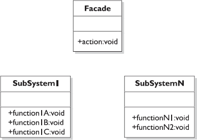

**益处**

以下是使用外观模式的益处列表：

- 它为复杂的子系统提供了更简单的接口，而不减少子系统提供的选项。
- 它保护客户端免受子系统复杂性的影响。
- 它促进了子系统与其客户端之间的松耦合。
- 每个子系统使用自己的外观模式与系统进行通信。

**适用场景**

- 你需要为复杂的子系统提供一个简单的接口。
- 抽象与其实现类之间存在依赖关系。
- 子系统的分层是必要的或需要的。

#### 重量模式（`Flyweight`）

重量模式的意图是利用共享以高效的方式支持大量细粒度对象。其 UML 如图图 7-11 所示。

**图 7-11** 重量模式模式的 UML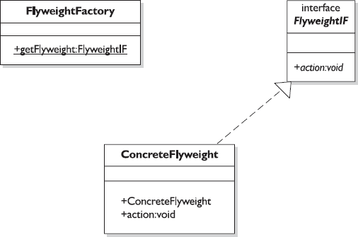

**益处**

以下是使用重量模式的益处：

- 它减少了需要处理的对象数量。
- 如果对象是持久化的，它减少了内存和存储设备的需求。

**适用场景**

- 应用程序使用了大量的对象。
- 由于对象的数量，存储成本很高。
- 应用不依赖于身份。

#### 代理（`Proxy`）

代理模式的意图是为另一个对象提供代理或占位符以控制其访问。最常见的实现是远程代理和虚拟代理。代理模式也称为替身（`Surrogate`）。其 UML 如图图 7-12 所示。

**图 7-12** 代理模式的 UML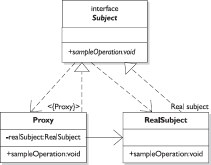

**益处**

以下是使用代理模式的益处列表：

- 远程代理可以隐藏实现在另一个地址空间的事。
- 虚拟代理可以执行优化——例如按需创建对象。

**适用场景**

- 当需要对对象使用更通用或更复杂的引用而不是简单的指针时。

### GoF 行为型设计模式

行为模式关注对象间的交互和职责。它们通过指定对象的职责以及它们通信的方式来帮助行为变得容易。GoF 描述了以下行为模式： 责任链 命令 解释器 迭代器 中介者 备忘录 观察者 状态 策略 模板方法 访问者

#### 责任链（`Chain of Responsibility`）

责任链模式的意图是通过给多个对象处理请求的机会，来避免请求发送者与其接收者耦合。请求沿着接收对象的链传递，直到某个对象处理它为止。其 UML 如图图 7-13 所示。

**图 7-13** 责任链模式的 UML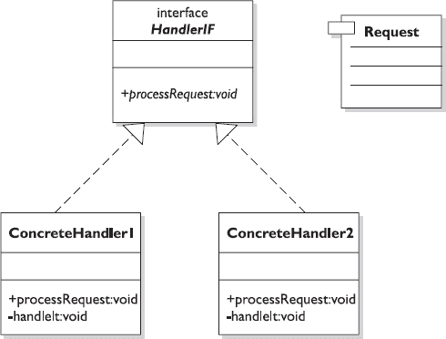

**益处**

以下是使用责任链模式的益处：

- 它减少了耦合。
- 它在给对象分配职责时增加了灵活性。
- 它允许一组类作为一个整体工作；在一个类产生的事件可以发送到组合中的其他处理器类。

**适用场景**

- 多个一个对象可以处理请求，且处理器是未知的。
- 请求被发送给几个对象之一，且没有明确指定接收者。
- 能够处理请求的对象集是动态指定的。

#### 命令（`Command`）

命令模式的意图是将请求封装为对象，从而允许你用不同的请求对客户端进行参数化、队列或记录请求，并支持回滚类型的操作。命令模式也称为动作（`Action`）或事务（`Transaction`）。其 UML 如图图 7-14 所示。

**图 7-14** 命令模式的 UML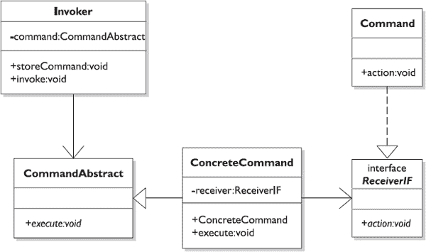

**益处**

以下是使用命令模式的益处列表：

- 它将调用操作的对象与实际执行操作的对象分离开。
- 它简化了新命令的添加，因为现有类保持不变。

**适用场景**

- 你需要根据执行的操作对对象进行参数化。
- 你在不同的时间创建、队列和执行请求。
- 你需要支持回滚、日志或事务功能。

#### 解释器（`Interpreter`）

解释器模式的意图是定义给定语言的表示，并带有一个使用该表示来解释语言中句子的解释器。其 UML 如图图 7-15 所示。

**图 7-15** 解释器模式的 UML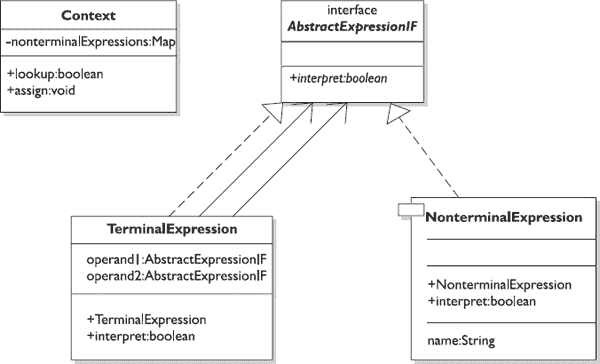

**益处**

以下是使用解释器模式的益处：

- 更改和扩展更容易。
- 实现语法是直接的。

**适用场景**

- 语言的表示是不复杂的。
- 效率不是优先考虑。

#### 迭代器（`Iterator`）

迭代器模式的意图是提供一种顺序访问聚合对象元素的方法而不暴露其底层实现。`java.util.Enumeration` 和 `java.util.Iterator` 是迭代器模式的示例。迭代器模式也称为光标（`Cursor`）。其 UML 如图图 7-16 所示。

**图 7-16** 迭代器模式的 UML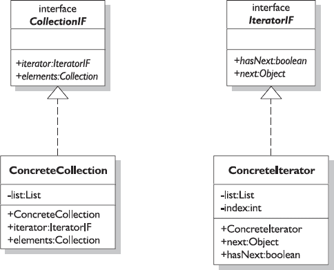

**益处**

以下是使用迭代器模式的益处列表：

- 它为集合提供了更简单的接口。
- 它支持集合的遍历变化。

**适用场景**

- 需要在不暴露底层实现的情况下访问集合对象。
- 集合中需要支持多次遍历。
- 需要提供一个通用的遍历接口。

#### 中介者（`Mediator`）

中介者模式的意图是定义一个对象来封装一组对象的交互。它通过防止对象相互引用来促进松耦合，从而允许任何交互独立变化。其 UML 如图图 7-17 所示。

**图 7-17** 中介者模式的 UML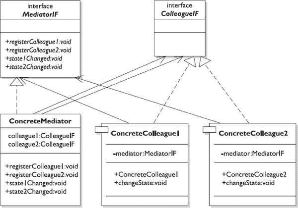

**益处**

以下是使用中介者模式的益处列表：

- 它解耦了同事。
- 它简化了对象协议。
- 它集中了控制。
- 单个组件变得更简单且更容易处理，因为它们不需要向另一个传递消息。
- 组件不需要处理它们的相互通信，因此更通用。

**适用场景**

- 一组对象以复杂但定义良好的方式通信。
- 需要在多个对象之间分布自定义行为而不需要通过子类化。

#### 备忘录（`Memento`）

备忘录模式的意图是捕获并内部化对象的状态，以便以后可以恢复到该状态。它必须在不违反封装的情况下完成。备忘录模式也称为令牌（`Token`）。其 UML 如图图 7-18 所示。

**图 7-18** 备忘录模式的 UML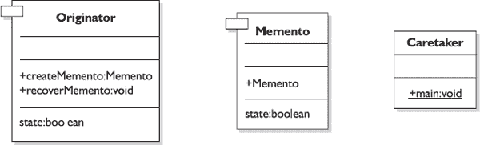

**益处**

以下是使用备忘录模式的益处列表：

- 它保留了封装边界。
- 它简化了源对象者。

**适用场景**

- 包含足够状态信息的快照可以被保存，以便使用快照信息恢复到完整状态。
- 使用直接接口获取状态将施加破坏对象封装规则的实现细节。

#### 观察者（`Observer`）

观察者模式的意图是定义一种一对多的依赖关系，以便当一个对象状态改变时，所有它的依赖者都会自动收到通知并更新。`Java` 通过 `java.util.Observer` 接口和 `java.util.Observable` 类提供了实现观察者模式的支持。观察者模式也被称为被依赖者（`Dependents`）或发布/订阅（`Publish-Subscribe`）。其 UML 如图图 7-19 所示。

**图 7-19** 观察者模式的 UML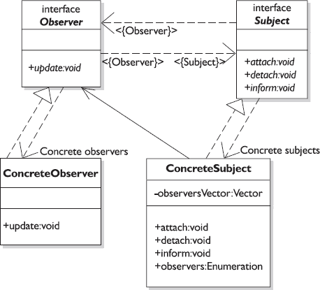

**益处**

以下是使用观察者模式的益处列表：

- 它抽象了主题和观察者之间的耦合。
- 它为广播类型的通信提供了支持。

**适用场景**

- 对象的改变需要更改其他对象，且需要更改的对象数量是未知的。
- 一个对象需要通知其他对象，而不对这些对象的身份做任何假设。

#### 状态（`State`）

状态模式的意图是允许对象在当内部状态改变时改变其行为，看起来对象本身改变了它的类。状态模式意图的另一种观点是将对象的状态封装为离散的对象，每个对象都属于抽象状态类的一个独立子类。状态模式也称为状态对象（`Objects for States`），并以类似的方式工作。其 UML 如图图 7-20 所示。

**图 7-20** 状态模式的 UML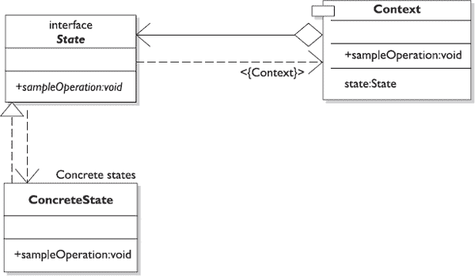

**益处**

以下是使用状态模式的益处：

- 它实现了实现与接口的分离。
- 它改进了可扩展性。
- 它允许向客户端隐藏实现细节。

**适用场景**

- 对象的行为依赖于其状态。
- 语言语法是不复杂的，实现语法是直接的。

#### 策略（`Strategy`）

策略模式的意图是定义一个算法族，并使其可以相互替换，允许它们独立地变化。策略模式也被称为策略（`Policy`）。其 UML 如图图 7-21 所示。

**图 7-21** 策略模式的 UML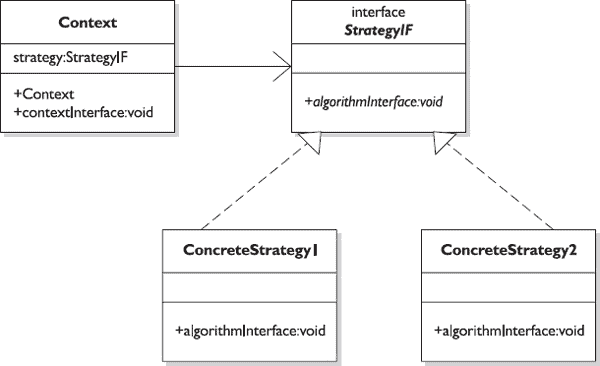

**益处**

以下是使用策略模式的益处列表：

- 它提供了子类化的替代方案。
- 它消除了对条件语句的需求。
- 它使其更容易扩展和引入新行为。

**适用场景**

- 你需要不同的算法。
- 许多类仅在行为上不同。
- 应用程序使用了大量的变体。

#### 模板方法（`Template Method`）

模板方法模式的意图是在操作中定义算法的骨架，但让子类重新定义某些步骤。模板方法在 `servlet API` 中这样做。其 UML 如图图 7-22 所示。

**图 7-22** 模板方法模式的 UML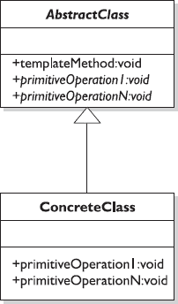

**益处**

模板方法是一种非常常用的代码重用技术。

**适用场景**

- 你想在单个类中实现算法的非变部分，并在子类中实现变部分。

#### 访问者（`Visitor`）

访问者模式的意图是表示对对象结构元素执行的操作，并带有一个使用该表示来解释语言中句子的解释器。其 UML 如图图 7-23 所示。

**图 7-23** 访问者模式的 UML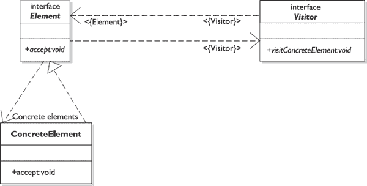

## 场景与解决方案

| 给定场景 | 适当的设计模式 |

| :--- | :--- |

| 系统需要独立于其对象的创建、组合和表示方式。系统需要配置多个对象族中的某一个。一组相关对象旨在被一起使用，并且需要强制执行这一约束。你希望提供一个对象库，该库不显示实现细节，仅揭示接口。 | 抽象工厂（`Abstract Factory`） |

| 创建复杂对象的算法需要独立于组成对象的组件以及它们的组装方式。构建过程允许所构建的对象有不同的表示形式。 | 构建器（`Builder`） |

| 一个类无法预测它需要创建的对象的类型。一个类希望其子类来指定它实例化的对象。类将责任委托给几个辅助子类中的一个，并且你希望本地化哪个辅助子类是代理的知识。 | 工厂方法（`Factory Method`） |

| 实例化的类在运行时指定。你希望避免构建一个与对象层次结构并行的工厂层次结构。类的实例只有少数几种不同的状态组合之一。 | 原型（`Prototype`） |

| 需要一个类的单个实例，并且它必须从一个已知的访问点被客户端访问。 | 单例（`Singleton`） |


| 你希望利用一个接口不兼容的现有类。你希望创建一个与不一定具有兼容接口的类协作的可用类。你需要使用几个现有的子类，但不想通过为每个子类创建类来适配它们的接口。 | 适配器 (Adapter) |

| 你希望避免功能抽象与其实现之间的永久绑定。功能抽象和其实现都需要通过子类进行扩展。对实现的更改不应影响客户端（甚至不需要重新编译）。 | 桥接 (Bridge) |

| 你希望表示一个完整或部分的对象的层次结构。你希望客户端能够忽略层次结构中变化对象之间的差异。结构是动态的，可以具有任何级别的复杂性。 | 组合 (Composite) |

| 你希望透明且动态地为对象添加职责，而不影响其他对象。你希望向一个未来可能想要更改的对象添加职责。通过子类化来扩展功能不再具有可行性。 | 装饰器 (Decorator) |

| 你希望为更复杂的子系统提供一个更简单的接口。客户端与抽象的实现类之间存在多个依赖关系。你希望对子系统进行分层。 | 门面 (Facade) |

| 应用使用了大量的对象。由于对象的数量，存储成本很高。应用不依赖于对象的标识性。 | 权重模式 (Flyweight) |

| 你需要对对象有一个更通用或更复杂的引用，而不是简单的指针。 | 代理 (Proxy) |

| 多个对象可以处理请求，且处理程序是未知的。请求被发送给几个对象之一，且没有显式指定接收者。能够处理请求的对象集是动态指定的。 | 责任链 (Chain of Responsibility) |

| 你需要通过要执行的操作对对象进行参数化。你在不同的时间指定、队列和执行请求。你需要支持回滚、日志或事务功能。 | 命令 (Command) |

| 语言的语法不复杂，效率不是优先考虑。 | 解释器 (Interpreter) |

| 需要访问集合对象而不必暴露其内部表示。你需要支持对集合中的对象进行多次遍历。你需要为遍历集合中不同的结构提供一个通用接口。 | 迭代器 (Iterator) |

| 一组对象以复杂但定义良好的方式通信。需要分布在几个对象之间的自定义行为，而无需通过子类化。 | 中介者 (Mediator) |

| 可以保存一个包含足够对象状态信息的快照，以便以后可以使用快照信息恢复到完整状态。使用直接接口获取状态将施加实现细节，从而破坏对象的封装规则。 | 备忘录 (Memento) |

| 修改对象需要更改其他对象，且需要更改的对象数量是未。对象需要通知其他对象，而不对这些对象的标识做出任何假设。 | 观察者 (Observer) |

| 对象的行为取决于它的状态，并且必须能够在运行时根据新状态改变其行为。操作具有依赖于对象状态的多部分条件语句。 | 状态 (State) |

| 多个类仅在行为上不同。你需要算法的不同变体。算法使用客户端未知的数据。 | 策略 (Strategy) |

| 你希望在单个类中实现算法的不变部分，并在子类中实现算法的可变部分。子类之间的共同行为应该移动到单一公共类中，以避免重复。 | 模板方法 (Template Method) |

| 对象结构包含许多具有不同接口的对象，你需要根据这些具体类的方式对这些对象执行操作。需要对结构中的对象执行许多不同且不相关的操作，你希望避免用这些操作弄乱类。定义对象结构的类很少更改，但你经常需要定义在结构上执行的新操作。 | 访问者 (Visitor) |

## 认证目标 7.02

### 使用特征描述识别四人行 (GoF) 设计模式

学习之前显示的每个`GoF`设计模式图。下表包含了与每个图相关的特征的简要描述和设计模式名称。

| 模式的功能 | 模式名称 |

| :--- | :--- |

| 提供一个接口来创建相关或依赖对象的族，而不指定具体类。 | 抽象工厂 (Abstract Factory) |

| 将复杂对象的构建与其表示分离，以便构建过程可以创建不同的表示形式。 | 构建器 (Builder) |

| 为创建对象定义一个接口，让子类决定实例化哪个类。允许类将实际实例化推迟给子类。 | 工厂方法 (Factory Method) |

| 使用原型实例指定要创建对象的类型，并通过复制此原型来创建新对象。 | 原型 (Prototype) |

| 确保一个类只有一个实例，并为其提供一个全局访问点。 | 单例 (Singleton) |

| 将类的接口转换为客户端期望的另一个接口。让原本由于接口不兼容而无法工作的类共同工作。 | 适配器 (Adapter) |

| 将抽象与其实现解耦，以便两者可以独立变化。 | 桥接 (Bridge) |

| 将对象组合成树结构以表示部分-整体层次结构。让客户端以统一的方式处理单个对象和对象的组合。 | 组合 (Composite) |

| 动态地向对象附加添加的职责。提供了一种比子类化扩展功能的灵活替代方案。 | 装饰器 (Decorator) |

| 为一个或多个子系统中的一组接口提供统一接口。定义一个更高层次的接口，使子系统更易使用。 | 门面 (Facade) |

| 使用共享高效地支持大量的细粒度对象。 | 权重模式 (Flyweight) |

| 为另一个对象提供占位符或代理，以控制对其的访问。 | 代理 (Proxy) |

## 设计模式概述

- **责任链模式 (Chain of Responsibility)**：通过赋予多个对象一个处理请求的机会，避免将请求发送者与接收者解耦。接收对象被链在一起，并沿着链传递请求，直到请求被处理为止。

- **命令模式 (Command)**：将请求封装为对象，允许客户端对不同的请求进行参数化、对请求进行队列化或记录，并支持撤销操作。

- **解释器模式 (Interpreter)**：给定一种语言，定义其语法的表示以及一个该语法的解释器，该解释器使用该表示来解释语言中的句子。

- **迭代器模式 (Iterator)**：提供一种顺序访问集合（聚合）对象元素的方法，而无需暴露其底层表示。

- **中者模式 (Mediator)**：定义一个封装一组对象如何相互作用的对象。通过防止对象直接相互引用并独立地改变它们的相互作用，来促进松耦合。

- **备忘模式 (Memento)**：在不违反封装的情况下，捕获并外部化对象的内部状态，以便稍后恢复对象的本质状态。

- **观察者模式 (Observer)**：定义对象之间的一对多的依赖关系，当一个对象改变状态时，所有的依赖项（订阅者）都会收到通知并自动更新。

- **状态模式 (State)**：允许对象在内部状态改变时改变其行为；对象看起来就像改变了自己的类。

- **策略模式 (Strategy)**：定义一组算法，封装每个算法并使它们可互换。允许算法从使用它的客户端中独立变化。

- **模板方法模式 (Template Method)**：在操作中定义算法（函数）的骨架，将某些步骤推给子类。允许子类在不改变算法结构的情况下重新定义算法的某些步骤。

- **访问者模式 (Visitor)**：代表在对象结构元素上执行的操作。允许在不改变所操作元素类的情况下，定义一种新操作。

## GoF 设计模式的别名

下表显示了某些 GoF 设计模式的别名。

| 模式名称 | 又称 |

| :--- | :--- |

| 抽象工厂 | Kit |

| 工厂方法 | Virtual Constructor |

| 适配器 | Wrapper |

| 桥接 | Handle/Body |

| 装饰器 | Wrapper |

| 代理 | Surrogate |

| 命令 | Action or Transaction |

| 迭代器 | Cursor |

| 备忘 | Token |

| 观察者 | Dependents or Publish-Subscribe |

| 状态 | Objects for States |

| 策略 | Policy |

# Java EE 模式

Java EE 模式已经过翻新，现在也包含在考试的所有部分。表示层不再涵盖在内，但也有针对业务层和集成层的模式，以及针对基础设施的模式。

**你会发现，对于考试的所有部分，学习 Java EE 模式至关重要，并将其作为你解决方案的一部分。**

## 认证目标 7.03

### 展示对 Java EE 设计模式的了解

与 GoF 设计模式（在本章前面的部分介绍）类似，Java EE 模式被划分为不同的部分，以处理组成应用程序大部分部分的层或区域。Java EE 模式细分为以下分层或区域：

 业务组件模式

 集成模式

 基础设施模式

在适用的情况下，每个 Java EE 模式将按照以下子章节进行拆分和描述：“问题”、“动力”、“解决方案”、“惯例”、“策略”和“后果”。

## 业务组件模式

业务组件提供应用程序客户端所需的服务并包含业务逻辑。应用程序所有的业务处理都汇集并放置在此组件中。使用企业级 JavaBean (`EJB`) 组件是在此层实现业务处理的方法之一。

以下是适用于业务组件的 Java EE 模式：

 流体逻辑 (Fluid Logic)

 网关 (Gateway)

 持久领域对象 (Persistent Domain Object)

 服务 (Service)

 服务外观 (Service Facade)

我们现在将涵盖这些每一个业务组件模式。

### 流体逻辑

Fluid Logic 模式的主要功能是将脚本业务逻辑整合到服务中。

#### 问题

当业务规则快速变化时，Java 的强类型和 Java EE 部署模型可能会阻碍对不影响类型或类结构的适应。

#### 动力

 构建领域特定语言 (DSL) 是不实际。

 服务的类型和结构不受逻辑变化的影响。

 你可以不依赖静态类型检查。

 你想根据需要更改业务逻辑的一些元素。

 你想编写业务逻辑。

#### 解决方案

 Java SE 6 支持 JSR-223 或 “Java 平台脚本”。

 使用`javax.script.ScriptEngine`作为 Service 模式的替代策略。

 不需要重新部署。

#### 后果

 不需要重新部署。

 性能糟糕的脚本仍会引起问题。

 在`EJB`上文中执行。

 关联实体可以传递给脚本。

 脚本安全上下文是`JVM SecurityManager`。

 事务服务可用。

 其他容器服务可用。

 没有类型安全检查。

 使用彻底的测试来补偿。

### 网关

Gateway 模式的主要功能是将持久领域对象 (`PDOs`) 直接暴露给表示层或客户端。这种模式也被称为反服务外观（anti-Service Facade）。

#### 问题

 PDOs 是被动的制品——所有 Java 持久 API (`JPA`) 实体 (`PDOs`) 在事务后脱离，客户端丢失状态。

 客户端的更改必须与持久层合并——将整个对象图传回服务器。

 客户端无法访问`EntityManager`。

 合并来自客户端的小更新的代码变得越来越笨拙。

 单体服务外观可能从这些需求演变而来。

#### 动力

 应用程序可能会数据添加列。

 PDOs 可以通过引用本地访问并封装逻辑。

 应用程序对持久层的访问不受限制。

 数据更改由用户驱动。

 数据验证不是简单的。

#### 解决方案

 使用网关直接向表示层暴露 PDO。

 注入实体管理器并声明持久化上下文类型使用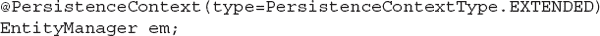

 用`save()`方法（或其他需要的方法）进行注解使用

 根据设计，始终会触发到持久层的刷新。

 将网关注入到有状态 Web 组件中。

#### 惯例

 根据其支持的缓存实体命名网关（需要包含“Gateway”）。

 在与 Service Facade 相同的包中创建网关。

### 策略

 **服务器端网关 (Server-Side Gateway)**：依赖注入意味着服务器端网关不需要业务接口。它可以服务于业务容器中。

 **富 Web 应用网关 (Rich Internet Application (RIA) Gateway)**：需要从容器外注入`EntityManager`。这不是标准的解决方案，但 RIA 平台通常提供支持。

 **混合网关 (Hybrid Gateway)**：在业务容器内代表客户端的代理。最灵活的方法可以认为是部分网关、部分外观。

#### 后果

 网关与客户端有 1:1 的关系。

 实体状态由事务管理。

 延迟加载和复杂对象管理的桥接。

 服务外观的反面。

 当 PDO 被重用时，你可以获得缓存的处。

 直接向表示层暴露 PDO。

### 持久领域对象

Persistent Domain Object 模式的主要功能与其操作的数据进行封装。

#### 问题

 分布式应用程序经常以过程化的方式构建。业务逻辑被分解为任务和资源，映射为规则、贫血的持久化实体。

 与数据的浅关系。

 分解为规则或服务。

 贫血领域模型（见后文的“反模式”）。

 类型检查可能支配业务逻辑。

#### 动力

 业务逻辑变得复杂且变化驱动。

 数据库设计是 JPA 兼容的（合理命名的表和列，没有过度规范）。

 验证规则是复杂的并关注领域对象（持久在数据库中）。

 你想要面向对象的模型。

#### 解决方案

 进行面向对象的类型检查。

 利用泛型行为。

 用对象建模应用程序。

 将类型检查从服务移动到领域对象。

 隔离持久层设计。

 使用 Builder 支持的方法链构建复杂的对象图。

#### 惯例

 PDO 的名称源自目标领域。

 在名为“domain”（或“entity”）的子包中放置 PDO。根据业务领域命名包含它的包。

 getter 和 setter 不是强制的——应该由证明的需求来证明。

 PDO 是包含领域逻辑而非技术的 JPA 实体。数据的技术细节不重要。

 PDO 业务逻辑应该始终在关联状态下执行。

 远程访问需要胖客户端或富 Web 应用（RIA）平台。

### 策略

 **DSL/测试/领域驱动**：测试驱动策略有利于以单元可测试的方式开发。

 **数据绑定 PDO (Data Bound PDO)**：DSL/测试/领域驱动的反面。应用 JavaBean 属性命名惯例来暴露数据；可以通过事件驱动的方式观察更改。

 **胖 PDO (Fat PDO)**：直接访问数据库，非常类似于数据访问对象 (`DAO`) 方法。适用于变通方案（例如，当数据库设计与 JPA 不兼容时）。

#### 后果

 领域知识更接近数据获取的地方。

 更容易维护复杂逻辑。

 促进流式接口。


 面向对象的技术取代分支类型检查。

 PDO 是带注解的普通 Java 对象（`POJO`）。

 简化单元测试。

 PDO 不应在脱离状态下运行：逻辑可以改变对象而不同步。不适合在层之间传递。

## 服务外观

Service Facade 模式的主要功能是暴露粗粒度的业务接口。

### 问题

 业务逻辑分散在细粒度的组件和服务上——网络延迟成为一个问题。

 需求规定了对面向领域的服务的需求。 服务有自己的视图。

### 动力

 业务方法必须具有稳定的接口和灵活的实现。

 组件状态在每次调用后应保持一致。

 API 可能作为另一项工作的一部分定义。

 API 必须对远程客户端可用。

### 解决方案

 创建无状态会话 bean（在异常情况下）。

 使用无状态会话 bean 局部，是支持的。 这种模式是面向客户端可用的。

### 惯例

 部署带有 `MANDATORY` 事务属性的本地。

 将 Service 放置在领域中，以支持其或远程的。

 部署时使用 `REQUI_NEW` 事务。

 避免在名称中使用“Service”。

### 策略

 **无状态会话 bean (Stateless session bean)**：提供无状态会话和容器提供的事务管理（优于 `POJO` 方案）。

 **POJO**：当无状态会话 bean 不可行或它已经成为现有框架的一部分时，它是选择的策略。

 **DAO 混合 (DAO hybrid)**：适应已存在的复杂查询，应与其支持的服务分开维护。一个例子是 Service 扩展包含复杂数据访问逻辑的 DAO。

#### 后果

 替换 J2EE 会话外观模式。

 促进细粒度逻辑的重用。

 增加了复杂度：

 从需求解构的。

 诱人为了未来需求做前瞻性。

 有利于面向服务的应用程序。

## 服务

Service 模式的主要功能是与其操作的数据进行封装。它是面向过程的。

### 问题

 业务逻辑分散在细粒度的组件和服务上——网络延迟成为一个问题。

 需求规定了对面向领域的服务的需求。 这种模式是面向过程的。

### 动力

 业务方法必须具有稳定的接口和灵活的实现。

 组件状态在每次调用后应保持一致。

 API 可能作为另一项工作的一部分定义。

 API 必须对远程客户端可用。

### 解决方案

 使用 Service 解构粗粒度方法。

 给它清晰的职责。

 强制本地可见性。

### 惯例

 在领域中创建一个子包以支持其 Service。

 不要在名称中使用“Service”。

 部署带有 `MANDATORY` 事务属性。

 偏好使用本地的无状态会话 bean。

### 策略

 **无状态会话 bean (Stateless session bean)**：提供无状态会话和容器提供的事务管理（优于 `POJO` 方案）。

 **POJO**：当无状态会话 bean 不可行或它已经成为现有框架的一部分时，它是选择的策略。

 **DAO 混合 (DAO hybrid)**：适应已存在的复杂查询，应与其支持的服务分开维护。一个例子是 Service 扩展包含复杂数据访问逻辑的 DAO。

#### 后果

 替换 J2EE 会话外观模式。

 促进细粒度逻辑的重用。

 增加了复杂度：

 从需求解构的。

 诱人为了未来需求做前瞻性。

 有利于面向服务的应用程序。

下表是业务层 Java EE 模式解决的场景列表。

## 场景与解决方案

| 给定场景 | 相应的业务层 Java EE 模式 |

| :--- | :--- |

| 在服务中整合“按需更改”的脚本化业务逻辑。 | 流式逻辑 (Fluid Logic) |

| 直接将持久化领域对象 (PDO) 暴露给表现层或客户端。 | 网关 (Gateway) |

| 通过将逻辑与其操作的数据封装来维护面向对象（OO）原则。 | 持久化领域对象 (Persistent Domain Object) |

| 暴露粗粒度（高层）的业务服务接口。 | 服务 FacFacade (Service Facade) |

| 将业务需求分解为受限制视图的技术实现。 | 服务 (Service) |

# 集成模式

集成层负责访问外部资源和系统，例如关系型和非关系型数据存储以及任何遗留应用程序。当业务层对象需要存在于资源级的数据或服务时，它会使用集成层。此层中的组件可以使用 `JDBC`、`Java EE` 适配器技术或其他专有软件来访问资源级的数据。

以下是集成层可用的 Java EE 模式：

 异步资源集成器 (Asynchronous Resource Integrator)

 数据访问对象 (Data Access Object)

 数据传输对象 (Data Transfer Object)

 Web 服务代理代理 (Web Service Broker)

我们现在将详细介绍这些集成模式中的每一个。

## 异步资源集成器

异步资源集成器将异步消息与业务容器内的事务服务集成。它提供了一种标准方法，将消息驱动的豆 (`MDB`) 与业务容器中的其他受管豆（managed beans）集成起来。

### 问题

越来越多的服务正在利用消息的异步优势。事务需要一致的（同步）作用域。

### 强制因素

 需要将异步消息纳入业务事务中。

 当发生回滚时，代码不应确认接收消息，这样消息服务器就可以重新投递消息。

### 解决方案

 提供一个 `JMS` 目标。

 提供一个消息驱动的豆来提取消息负载。

 处理损坏或类型不正确的消息。

 将验证过的负载转换为参数。

 将参数委托给 `EJB`。

 使用事务属性类型 `MANDATORY` 启用服务的事务，并在回滚后不确认消息。

### 策略

对于前端集成：

 接受源自表现层或客户端的消息。

 参数应该是粗粒度度的。

 包含面向用户的数据格式（`JSON` 和 `XML`）。

对于后端集成：

 遵循目标遗留的命名约定。

 接受来自遗留系统的消息。

 消息类型可能是专有的或缺乏灵活性的。

 负载可能需要复杂的参数提取。

### 惯例

 如果可能，你应该根据领域来命名目标。

 使用面向服务的名称和后缀（例如，`MDB`、`Listener`）。

 将前端策略实现与它们支持的服务或门面封装在一起。

 将后端实现与其他面向集成的包封装在一起。

### 结果

 燃后即忘式的消息处理是简单的，而双向消息传递并不简单。

 与仅同步的策略相比，扩展性有所提高。

 集成测试很困难。

 它对专有消息类型没有帮助。

 某些产品为 REST 操作提供了桥接（例如，`ActiveMQ` 和 `OpenMQ`）。

 严格的消息类型检查会导致更紧的耦合。

## 数据访问对象

数据访问对象 (`DAO`) 封装了数据访问逻辑并将对不同数据源的访问解耦。该模式基于变化原则。DAO 隔离访问数据的方式与收集参数实现模式（非 Java EE 模式）类似。

### 问题

`DAO` 模式在许多数据驱动的框架中是一个重要概念。

 其前提是将数据打包暴露给客户端。

 它促进了关注点分离，因为业务逻辑和数据访问逻辑的变化频率不同。

 用于解决某些容器托管 (`CMP`) 的限制。

### 强制因素

修订后的 `DAO` 模式解决了这些情况：

 `JPA EntityManager` 解决了 J2EE DAO 构建时面临的许多问题。

 某些数据源与 `JPA` 不兼容。

 需要一种简单的方法来测试访问。

 需要将数据源与业务逻辑解耦。

 希望面向服务的应用程序与它们使用的数据之间有清晰的界限。

 复杂的查询对比简单的 CRUD。

### 解决方案

客户端是访问 `DAO` 的会豆。`DAO` 是一个本地会豆，可以：

 封装数据访问 API。

 将逻辑与专有访问分离。

 `EntityManager` 是通用 `DAO` 的实现。

### 策略

 抽象 `DAO` 策略使用抽象类。如果许多方法封装数据访问，抽象类可以避免冗余。

 **附加结果 DAO (Attached-result DAO)**：当查询返回时确定实体的首选状态。

 **分离结果 DAO (Detached-result DAO)**：确定不支持 `JPA` 的数据源。在这种情况下，必须使用映射数据传输对象 (`DTO`) 的 `@NamedQuery` 获取数据。

 **后端集成 DAO (Back-end integration DAO)**：指的是专有的数据源。这需要适配器架构 (`JCA`) 来访问源。

 **领域特定 DAO (Domain-specific DAO)**：封装 `EntityManager` 方法以返回通用类型。除非查询参数推导出类型。

### 结果

 为代码增加了接口及其实现。

 这些必须随实体的变化而更新。

 存在泄漏抽象（参见“反模式”）。

 集中了数据访问逻辑；然而，代码复用可能较低。

 与 `JPA` 的功能重叠。

 可能是专有 API 最不笨拙的方法。

`DAO` 模式在其实现上倾向于无状态会豆。显著优点如下：

调用者与豆之间存在 1:1 的线程关系，这意味着方法保证在单线程内执行。

默认调用事务。

事务中的实体变为附加状态，并可以由豆管理。

## 数据传输对象

数据传输对象 (`DTO` 或 `TO`) 使数据跨服务边界可用。`DTO` 模式是底层数据的拷贝。`DTO` 模式权衡了数据数据的固有问题与在需要的地方交付数据的便利。

### 问题

数据传输对象将后端数据暴露给客户端或表现层。

 这在 J2EE（JEE 5 之前）存在以下问题：

 实体豆支持远程能力。

 容器支持两种持久化管理。

 `CMP` 2.x 标准不支持序列化。

Java EE 解决了一些问题：

 `JPA` 不暴露数据。

 实体具有附加和分离状态。

 面向服务的应用程序不应看到原始数据。

### 强制因素

 多个客户端类型需要一个共同的数据接口。

 实体数据连接到复杂的模式，但必须以简单的方式暴露。

 一个领域内需要相同数据的多个视图。

 需要以可形式提供面向对象的数据。

 需要元数据支持以 UI 开发。

### 解决方案

 `TransferObject` 是一个可以 `Serializable` 或 `Externalizable` 的 `POJO`（这在单 JVM 部署中是多余的）。

 每个数据列可以使用 `Getters`。

 组件必须创建、填充并将 `DTO` 返回给调用者。

### 策略

 **构建器风格 DTO (Builder-style DTO)**：每个有助于构造中对象的方法都返回该对象的引用。

 **不可变 DTO (Immutable DTO)**：通过构造函数设置字段。如果事务作用范围有效，后续逻辑会更简单。

 **客户端特定 DTO (Client-specific DTO)**：使用注解提供元数据。这种方法可以帮助将数据转换为所谓的“流式接口”。

 **泛型 DAO (Generic DAO)**：封装 `EntityManager` 方法以返回通用类型。客户端需要正确类型转换返回的对象。

### 结果

 传输对象复制数据。

 传输对象是值对象，而 `EntityManager` 是引用对象。

 考虑只读实体。

## Web 服务代理

Web 服务代理使业务服务作为 Web 服务可用。Web 服务代理模式自之前的 Java 版本。虽然在 EE 6 中可能被认为是不必要的，该模式强调了装饰现有服务使其作为 Web 服务可用。Web 服务代理类似于协议的门面（参见适配器模式）。

### 问题与强制因素

直接将业务服务作为 Web 服务暴露会导致以下情况：

 暴露的方法不是面向服务的。

 暴露的方法粒度过细。

 需要额外的监控、日志或安全代码。

 需要对方法进行重构。

### 解决方案

 `WebServiceBroker` 组件可以处理 Web 服务请求并调用服务组件。

 `EndPointProcessor` 可能会接收请求并调用 `WebServiceBroker`。


 `WebServiceBroker` 组件可以是无状态会话 Bean 或 POJO。

## 策略

 对于自定义 XML 消息，编写自定义 `EndPointProcessor` 组件。

 对于 XML Web 服务 API，通过 `JAX-WS` 实现 `EndPointProcessor`。

 使用 RESTful 服务 API（`JAX-RS`）。

 对于客户端-代理，可以将 EJB 3.1 代理注入到 servlet 中。

## 场景与解决方案

| 给定场景 | 相应的集成层 Java EE 模式 |
| :--- | :--- |
| 在业务容器内集成异步消息与事务服务。 | 异步资源集成器（Asynchronous Resource Integrator） |
| 减少业务层与资源层之间的耦合和复杂性，同时保持对资源层访问的集中。 | 数据访问对象（Data Access Object） |
| 跨服务边界提供数据。 | 数据传输对象（Data Transfer Object） |
| 将业务服务作为 Web 服务可用。 | Web 服务代理（Web Service Broker） |

# 基础设施模式

基础设施模式提供了一种处理常见需求的模型方法。它们强调 Java EE 服务器之间的可移植性，并使用依赖注入和注解来减少代码样板工作。它们对于封装旧 API 的产物也有用。

以下是基础设施可用的 Java EE 模式：

 Bean 定位（Bean Locator）

 资源绑定器（Resource Binder）

 服务启动器（Service Starter）

 单例（Singleton）

现在我们将介绍这些每一个基础设施模式。

## Bean 定位

Bean Locator 模式封装了 JNDI 服务并为非 Java EE 客户端提供服务。

### 问题

 Java 命名与目录接口（JNDI）API 早于 Java EE 和 Java SE 5。

 使用了检查异常：`NamingException`。

 返回一个对象。

 EJB 3.1 支持全局命名规范：

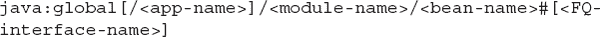

 两种形式对客户端来说都不方便。

 独立客户端和 POJO 无法使用依赖注入（DI）作为替代方案。

### 强制因素

 JNDI 细节应该始终对用户隐藏，因为：

 构建全局名称容易出现拼写错误。

 JNDI 方法的样板代码很麻烦。

 你需要一个可以在容器内或外执行的查找服务。

 你需要一个客户端无关的服务。

### 解决方案

 将 JNDI 查找代码封装在一个工具类中。

 添加一个 Builder 风格的 `GlobalJNDIName` 作为静态内部类。

### 导致的结果

 `GlobalJNDI` 的构造与 `Properties` 对象绑定。

 文件 I/O 可能成为热点。

 如果测试发现热点，考虑缓存等优化方案。

 解决方案在符合 Java EE 的环境中具有可移植性。

 在 Bean 创建时产生性能损耗。

 由于网络延迟，远程客户端可能感知不到。

 `computeBeanName()` 方法在第一次调用时很慢。

## 资源绑定器

Resource Binder 模式允许你向应用程序服务器注册自定义资源。

### 问题

每个应用程序服务器供应商都提供在服务器上注册自定义资源的能力。虽然 Java EE 规范没有提供标准方法，但此功能通常通过以下方式可用：

 带有钻取或向导过程的 Web 端管理工具

 具有特定特定语法的命令行界面。

### 强制因素

 你需要一种方便的方法来注册自定义资源，就像 Bean Locator 处理查找服务一样简单。

 该过程应该避免私有的应用程序服务器绑定。

 你希望将自定义资源注入到托管 Bean 中。

 资源是无状态的，不需要生命周期管理。

### 解决方案

 实现一个 POJO 作为 `CustomResource`。

 将 `CustomResource` 注入到 `CustomResourceClient` 中。

 使用 `ResourceBinder` 添加 `CustomResource`。

 使用注解断必要的顺序。

### 导致的结果

 自定义资源的注入减少了代码样板工作。

 这可能会增加服务器启动时间。

 取决于资源的启动需求。

 应在调用业务方法之前完成。

 资源绑定的 SPI 是特定于服务器的。

 Resource Binder 依赖 JNDI，但应针对每个服务器产品进行测试。

## 服务启动器

Service Starter 模式确保会话 Bean 在部署时启动。

### 问题

 基础设施 Bean 经常在客户端调用业务逻辑之前需要初始化。

 在 EJB 3.1 之前，没有标准方法在部署时初始化 Bean。

### 强制因素

 需要一种通用方法来尽早启动服务。

 该方法必须处理通常按需调用的无状态会话 Bean。

### 解决方案与策略

 对于 EJB 3.0：

 向 Servlet 注入 Bean。

 对于 EJB 3.1 及后续版本：

 使用带有 `@PostConstruct` 方法的 Bean。

 如果你想在 Service Starter 之前加载 Bean，使用 `@DependsOn` 注解。

### 导致的结果

 有多种方法：

 Servlet 2.5

 Servlet 3.0

 Java EE 5

 Java EE 6

## 单例

Singleton 为每个 JVM 实现一个资源的单实例——而你总是运行多个。

### 问题

 在企业级环境中是不可能的，因为：

 线程控制不受开发者控制。

 线程池未定义定义。

### 强制因素

 构建一个跨实现的可移植单例。

 单例必须是只读的或在更新期间提供同步。

### 解决方案

 EJB 3.1 将单例标准化为每个 JVM 实例。

 单例提供：

 共享状态

 并发（由容器管理）

 单例不提供启动服务。

### 策略

 在大多数情况下，Singleton 和 Service Starter 有相同的原理。

 门卫（Gatekeeper）

 启用旧资源限流。

 适用于单节点环境。

 如果基于 JCA 的限流太重则有用。

缓存单例：封装现有解决方案（例如 Ehcache、Memcached 或 Hazelcast）。

 可以自己构建。

### 导致的结果

 针对 EJB 3.1 及以后版本的硬编码解决方案。

 使用锁定类型可能会产生瓶颈：

```
@ConcurrencyManagement(ConcurrencyManagementType.CONTAINER)
@Lock(LockType.WRITE)
```

对于只读缓存使用：

```
@Lock(LockType.READ)
```

作为缓存实现的一部分可以提高性能，但也可能耗尽内存（通过负载/压力测试确定限制）。

 不满足高可用性要求。

# 拦截器模式

拦截器模式为 Java EE 平台提供了一种面向切面编程（AOP）的方法。它们受会话 Bean（session beans）和消息驱动 Bean（message-driven beans）的支持，可以包含在 Bean 内部或作为独立的类。可以通过注解应用并通过部署描述符进行配置。被拦截的类或方法使用 `@Interceptors(…)` 等注解。拦截器方法使用 `@AroundInvoke`，拦截器超时使用 `@AroundTimeout`。

以下是 Java EE 拦截器模式：

 上下文处理器（Context Holder）

 依赖注入扩展器（Dependency Injection Extender）

 负载提取器（Payload Extractor）

 线程跟踪器（Thread Tracker）

现在我们将介绍这些基础设施模式中的每一个一个。

## 上下文处理器

上下文处理器在事务的参与者之间共享数据。

### 问题

 在 Java EE 中，没有标准的方法在事务参与者之间传递上下文相关的信息。

### 强制条件

 需要在容器强制执行编程限制内向线程添加数据。

 目标环境可能使用多个线程池，`ThreadLocal` 可能不够。

 解决方案不应修改 Bean 的参数列表。

 可移植的解决方案是理想的。

### 解决方案

 Java EE 为每个事务支持对象类型的 `TransactionSynchronizationRegistry`。

 在单池目标中，`ThreadLocal<T>` 是合适的。

 使用 `@Resource` 注解进行注入。服务 Facade（Service Facade）是一个很好的选择。

 所有参与事务的 Bean 都能访问该注册表。

### 策略

 使用 `TransactionSynchronizationRegistry`：

 最可移植，但早于 Java 泛型。

 需要事务上下文。

 支持托管类。

 使用 `ThreadLocal`：

 有效但可移植性较差。

 需要线程与方法之间的 1:1 关联。

 不支持依赖注入，但支持所有参与者。

 任何一种策略都需要对获取的对象进行强制转换。

### 结果

 上下文处理器是一种跨关注方法，消除了业务服务的复杂性。

 `TransactionSynchronizationRegistry` 策略的性能取决于容器的实现。

 `ThreadLocal` 方法的性能取决于 Java SE 的实现。

 `ThreadLocal` 在复杂的池实现可能会失效。

## 依赖注入扩展器

依赖注入扩展器为其他框架的客户端提供引导能力。

### 问题

Google 的 Guice 和 SpringSource 的 Spring 组件具有不同形式的注入控制，与 Java EE 的依赖注入不兼容。它们无法直接作为 EJB 部署。

### 强制条件

 你不想修改这些组件将其集成到 Java EE 框架中。

 EJB 不应该感知这些组件的任何差异。

 你希望这些组件参与 EJB 的事务和安全上下文。

 你希望将旧组件（来自其他框架）集成到 EJB 应用中。

### 解决方案

 拦截器提供了一个可重用的跨关注服务。

 使用拦截器为旧组件提供引导支持和注入服务。

 Injector 实例化其旧组件，并使用 `@PostConstruct` 引导创建。

 Injector 使用 `@AroundInvoke` 对方法注入实例，并使用 `@PostConstruct` 对类注入实例。

 EJB 将 Injector 声明为拦截器。

### 策略

**有状态会话 Bean（Stateful session bean）**

不需要基于方法的注入方法。由于客户端与有状态会话之间存在 1:1 的关系，只需将旧组件的注入和引导逻辑一起包含在带有 `@PostConstruct` 注解的方法中即可。

**无状态会话 Bean（Stateless session bean）**

通常与客户端是多对一的关系，因此需要一个方法拦截器（除非所有方法本身是等幂的）。

**事务集成（Transactional integration）**

事务上下文已由容器启动。

### 结果

 实现在 Java EE 服务器上是可移植的。

 拦截器和依赖注入使用反射，但数据库访问延迟可以抵消对性能的影响。

 在 EJB 容器中测试拦截器是困难的。

## 负载提取器

负载提取器执行消息类型校验。

### 问题

 `onMessage()` 方法可能会抛出异常。

 没有办法通知生产者（错误或负载错误）。

 丢弃的消息可能会导致问题。

 将错误与业务方法关联。

### 强制条件

 你想将（无效消息）重定向到目的地。

 你想在消息到达逻辑之前进行校验。

 你倾向于可靠的解决方案。

### 解决方案

 使用拦截器来：

 提取负载。

 将消息交给处理器。

 处理无效消息（死信队列）。

 校验负载。

### 策略

 处理错误：

 返回消息。


### 结果

- 提取器在独立的类中，提供了跨关注性。
- 易于添加或移除拦截器。
- 测试变得简单。

## 线程跟踪器

线程跟踪器对线程命名，使其更容易识别。

### 问题

- 会话 bean 方法运行在服务线程。
- 服务线程是通用的，且通常按功能命名（例如`httpWorkerThread-8080-3`）。
- 关联死锁或延迟需要关联。

### 强制条件

线程跟踪器需要：

- 适用于任何 bean
- 易于禁用和卸载

### 解决方案

- 使用`Tracker`类拦截业务方法。
- 在`try`块中保存原始线程名并根据业务目的重命名。
- 在`finally`块中恢复原始线程名。

为生产使用注解拦截器（或使用部署描述符）。

### 结果

- 解决方案可能不受环境允许。
- EJB 规范不支持。
- 目标可能会抛出`AccessControlException`和/或`SecurityException`。
- Glassfish v3 允许。
- 在频繁调用的方法上可能会出现瓶颈。
- `InvocationContext`可能是基于反射的速度慢。
- 负载测试至关重要。
- MDB 可能是更好的用例。
- 监控解决方案可能不会刷新线程名称，但日志是可靠的。

以下表格是 Java EE 拦截器模式解决的挑战和场景列表。

## 场景与解决方案

| 既定场景 | 相应的 Java EE 拦截器模式 |
| :--- | :--- |
| 以可移植的方式在事务参与者之间共享数据。 | `Context Holder` |
| 为其他框架（例如 Guice 或 Spring）的客户端提供引导能力。 | `Dependency Injection Extender` |
| 提供一个用于消息类型转换和有效负载验证的通用类。 | `Payload Extractor` |
| 便于为监控和日志识别线程名称。 | `Thread Tracker` |

与早期版本的考试不同，第一部分现在要求掌握 Java EE 模式，而且你也会发现在第二部分和第三部分中也有必要使用它们。

## 认证目标 7.04

### 识别给定场景中对“抽象泄漏法则”（Law of Leaky Abstractions）或特定反模式的使用

在本节中，我们涵盖了“抽象泄漏法则”以及考试中将测试的反模式。

## 抽象泄漏法则 (Law of Leaky Abstractions)

抽象泄漏法则并不是真正的反模式，但它是导致系统产生负面影响的常见底层原因。它描述了这样一个事实：抽象越大、越复杂，它们就越容易泄漏或出现错误。Joel Spolsky 的的一句短语经常被引用来总结这一点：“所有非平凡的抽象在某种程度上都是泄漏的。”

再次总结一下：

- 抽象泄漏法则并不是真正的反模式，但是一个常见的底层原因。
- 分层软件迫使人们依赖“高层”抽象。
- 屏蔽或隐藏复杂性意味着某些关键细节未被。
- 对潜在细节缺乏意识导致了实践中的错误。

在考试的第一部分，你保证会看到关于抽象泄漏法则的题目！

## 反模式 (Anti-Patterns)

反模式识别并记录了对系统产生负面影响的习惯和做法。其目标是通过学习反模式，让架构师学会避免它们并使用优选的替代方案。许多 Java EE 模式通过通过记录已证明的技术被设计为避免这些习惯和做法。对于考试和架构师而言，反模式分为三类：

- 集成层反模式
- 业务层反模式
- 表示层反模式

## 集成层反模式 (Integration Tier Anti-Patterns)

以下是集成层反模式列表：

- 贫血域模型 (Anemic Domain Model)
- 臃肿消息 (Fat Message)
- 热土豆 (Hot Potato)
- 单体式消费者 (Monolithic Consumer)
- 连接未池化 (Not Pooling Connections)

我们现在将涵盖这些集成层反模式。

### 贫血域模型 (Anemic Domain Model)

贫血域模型是一种描述包含极少（或没有）业务逻辑模型的反模式。

#### 问题

- 业务逻辑是与其操作的域对象（或数据）分开实现的的。

#### 症状与后果

- 违反了封装原则！
- 迫使数据公共访问，从而加紧了耦合！
- 需要额外的层（DTOs）来协调多个数据消费者。

#### 解决方案

- 应用`PDO`模式将数据与其逻辑放在一起。
- 许多基于 J2EE 的应用程序被平台绑定到这种模型上。这可能是升级到新版本 Java EE 的良好理由。

### 臃肿消息 (Fat Message)

臃肿消息是一种描述消息的负载中包含大量数据的反模式。

#### 问题

- 异步消息的负载可能是臃肿的。

#### 症状与后果

- 高网络延迟。
- 消息服务器可扩展性下降。
- 反序列化消息负载是计算密集型任务。

#### 解决方案

- 审查企业集成模式 (EIP) 中的`Splitter`模式。
- 重构负载，仅包含与业务服务相关的数据。
- 传递`ID`或其他引用而不是巨大的负载，并让接收者去查找数据。

### 热土豆 (Hot Potato)

热土豆是一种描述消息服务器持续发送无法被消费者确认的消息的反模式，因为事务一直处于失败状态。

#### 问题

- 消息服务器不断重新投递消息，直到收到消费者的确认为止。
- 每次尝试都回滚的事务可能不会确认消息，导致持续重发（循环）。

#### 症状与后果

- 这是一个无限循环。
- 系统显示高利用率但低吞吐量。

#### 解决方案

- 如果事务回滚，确认消息并通过其他手段（电子邮件或发送到错误目标）转发它以解决问题。
- 在消息服务器上实现重发阈值。当达到阈值时，将消息重新分配到死信队列。

### 单体式消费者 (Monolithic Consumer)

单体式消费者是一种描述将任何业务逻辑都放在消费者的 MDB 中，而不是放在另一个类中（例如另一个 EJB 或 POJO）的反模式。

#### 问题

- 业务逻辑被放在 MDB 的`onMessage()`方法中。
- 逻辑在接收到 JMS 消息后被调用。

#### 症状与后果

- 客户端无法通过业务方法访问业务逻辑。
- 单元测试业务逻辑非常困难。

#### 解决方案

- 将消息驱动豆限制在：
- 验证负载。
- 调用业务方法。
- 同步客户端也可以调用服务（以及单元测试）。
- `Asynchronous Resource Integrator`模式采用了这一点。

### 连接未池化 (Not Pooling Connections)

连接未池化反模式描述了在没有连接池的情况下为每个请求创建并销毁数据库连接。

#### 问题

- 为每个查询创建并销毁数据库连接是昂贵的（且缓慢）。

#### 症状与后果

- 响应时间慢。
- 可扩展性差。
- 驱动初始化代码在系统中重复。

#### 解决方案

- 使用连接池。
- 使用`DataSource`接口。

## 业务层反模式 (Business Tier Anti-Patterns)

以下是业务层反模式列表：

- 无缓存 (Cacheless Cow)
- 对话包 (Conversational Baggage)
- 会话状态黄金 (Golden Hammers of Session State)
- 本地与远程接口 (Local and Remote Interfaces)
- 杀鸡用牛 (Sledgehammer for a Fly)

我们现在将涵盖这些反模式。

### 无缓存 (Cacheless Cow)

无缓存是一种描述当频繁检索但很少更改的资源没有放在缓存中的反模式。

#### 问题

- 当没有缓存策略时重复使用静态资源，服务器和网络资源被过度利用了（浪费）。

#### 症状与后果

- 可扩展性受到容器与外部资源之间往返的限制。

#### 强制要求

- 存储的结果可能比需要的新数据更足够。
- 可以根据应用使用确定合理的缓存大小。
- 有足够的内存缓存结果以实现有效的命中率。
- 在修改数据的同时可以满足快速并发读取。

#### 解决方案

- Java`EntityManager`提供了内置缓存。
- 对于对象重用的其他服务边界考虑缓存：
- 面向客户端的 Web 服务器
- 客户端与 Web 层组件之间
- Web 层与业务层组件之间
- 考虑供应商提供的缓存解决方案。
- 考虑如`Command` (GoF) 等面向缓存的模式。

### 对话包 (Conversational Baggage)

对话包反模式描述了在无会话豆已经足够的情况下使用了状态会话豆的场景。

#### 问题

- 默认情况下企业级应用程序中的许多任务使用状态会话。

#### 症状与后果

- 容器需求增加减少应用程序的可扩展性。
- 以无状态形式执行相同工作的状态服务看起来更消耗资源。

#### 解决方案

- 使用无状态会话作为模型。
- 通过列出可以证明的优点来证明状态会话豆的合理性。

### 会话状态黄金 (Golden Hammers of Session State)

会话状态黄金描述了选择单一位置方法来持久化会话状态。

#### 问题

存储会话状态的已知常见位置有：

- 客户端的 Cookie
- 表示层中的`HttpSession`类
- 业务层的状态会话豆

#### 症状与后果

- 提交到单一位置通常需要变通方法。
- 为会话数据提供中心站点的好处是有争议的。
- 使用站点时，每个应用程序的性能不同。

#### 解决方案

在选择会话状态工具时，考虑以下因素：

- 丢失数据的影响。（对于这种场景可以吗？）
- 使用数据的位置。
- 数据的大小和类型。

### 本地与远程接口 (Local and Remote Interfaces)

本地与远程接口反模式描述了提供了本地和远程接口。

#### 问题

- 远程接口可能会抛出`RemoteException`。

#### 症状与后果

- 本地和远程的影响不同。
- 性能差。

#### 解决方案

- 细粒分离本地和远程接口。
- 仅允许客户端细粒。

### 杀鸡用牛 (Sledgehammer for a Fly)

杀鸡用牛反模式描述了使用了带有开销的技术 EJB。

#### 问题

- EJB 容器管理。

#### 症状与后果

- 额外的复杂性。
- 对象比需要的多。
- 对扩展性的可能影响。

## 场景与反模式

| 给定场景 | 反模式 |
| :--- | :--- |
| 业务逻辑与其操作的领域对象（或数据）分离开实现。 | 贫血领域模型 (Anemic Domain Model) |
| 异步消息的有效负载可能很大（尺寸巨大），导致网络延迟和计算密集型的负载序列化/反序列化。 | 胖消息 (Fat Message) |
| 消息系统显示高利用率，但吞吐量极低。 | 烫手山芋 (Hot Potato) |
| 无法轻松地测试（或独立调用）放置在 MDB 中的业务逻辑。 | 单体消费者 (Monolithic Consumer) |
| 应用吞吐量缓慢，因为它为每个查询都创建并销毁数据库连接。 | 未使用连接池 (Not Pooling Connections) |
| 类静态资源被反复使用，导致服务器和网络资源显示为过度利用。 | 无缓存奶牛 (Cacheless Cow) |
| 默认使用有状态会话豆，并显示出更多资源密集型使用情况。 | 会话负担 (Conversational Baggage) |
| 根据规定，特定公司的所有应用程序都使用相同的方法存储会话状态，导致性能受影响或会话状态偶尔丢失。 | 会话状态的金大锤 (Golden Hammers of Session State) |
| 在本地和远程客户端之间经历不同的副作用（例如，细粒度服务的性能差）。 | 同时使用本地和远程接口 (Local and Remote Interfaces Simultaneously) |
| 应用程序所有业务组件都使用 EJB 而不是 POJO。 | 杀鸡用牛 (Sledgehammer for a Fly) |
| 模型或控制器的逻辑已从 JSP 页面移动到自定义标签中，导致难以从富客户端调用。 | 自定义标签库 (Ad Lib TagLibs) |
| 每当文件名或 URL 更改时，必须更新 JSP 页面。 | 嵌入导航信息 (Embedded Navigational Information) |
| 每个 Servlet 的结构都很糟糕，且每个 Servlet 的 service 方法都会调用相同的处理任务。 | 在每个 Servlet 中包含公共功能 (Including Common Functionality in Every Servlet) |

# 认证总结

通过学习本章，你现在已经了四人行（Gang of Four）的设计模式以及一些关于 Java EE 模式的介绍性材料。你还应该理解在特定场景哪些模式是最合适的。

## 两分钟演练

以下是本章每个认证目标的一些要点。

### 为给定的应用挑战选择合适的 GoF 模式


### 抽象工厂 (Abstract Factory)

当系统需要与其对象的创建、组合和表示方式保持独立时，最为合适。

### 适配器 (Adapter)

当你想要利用一个具有不兼容接口的现有类时，最为合适。

### 桥接 (Bridge)

当你想避免功能抽象与其实现之间存在永久性绑定时，最为合适。

### 构建器 (Builder)

当创建复杂对象的算法需要独立于组成该对象的组件以及它们的组装方式时，最为合适。

### 责任链 (Chain of Responsibility)

当有多个对象可以处理请求且具体的处理者未知时，最为合适。

### 命令 (Command)

当你需要通过要执行的动作对对象参数化时，最为合适。

### 组合 (Composite)

当你想要表示对象的完整或部分层次结构时，最为合适。

### 装饰器 (Decorator)

当你想要透明且动态地为对象添加职责而不影响其他对象时，最为合适。

### 门面 (Facade)

当你想要为一个更复杂的子系统提供更简单的接口时，最为合适。

### 工厂方法 (Factory Method)

当类无法预判它需要创建的类类型时，最为合适。

### 重量用模式 (Flyweight)

当应用使用大量对象时，最为合适。

### 解释器 (Interpreter)

当语言语法不复杂且效率不是首要考虑时，最为合适。

### 迭代器 (Iterator)

当需要访问集合对象而无需暴露其内部表示时，最为合适。

### 中介者 (Mediator)

当一组对象以复杂但定义良好的方式进行通信时，最为合适。

### 备忘录 (Memento)

当可以保存包含足够对象状态信息的快照，以便以后使用快照信息将其恢复到完整状态时，最为合适。

### 观察者 (Observer)

当对象的更改需要改变其他对象，且需要更改的对象数量未知时，最为合适。

### 原型 (Prototype)

当需要在运行时指定要实例化类时，最为合适。

### 代理 (Proxy)

当你需要对对象拥有一个更通用或更复杂的引用，而不是简单的指针时，最为合适。

### 单例 (Singleton)

当一个类只需要实例，且该实例必须能够通过已知的访问点供客户端访问时，最为合适。

### 状态 (State)

当对象的行为取决于其状态，并且必须根据新状态在运行时改变行为时，最为合适。

### 策略 (Strategy)

当多个类的区别在于它们的行为时，最为合适。

### 模板方法 (Template Method)

当你想要在单个类中实现算法的不变部分，并在子类中实现算法的变化部分，最为合适。

### 访问者 (Visitor)

当对象结构包含许多具有不同接口的对象，并且你需要以依赖其具体类的方式对这些对象执行操作时，最为合适。

## 根据特征描述识别四人行 (GoF) 设计模式

回顾本章前面出现的四人行（Gamma 等人）图表及相关描述。

## 对 Java EE 设计模式的理解


### 流逻辑 (Fluid Logic)

当你想要将“按需更改”的脚本业务逻辑整合到服务中时，最为合适。

### 网关 (Gateway)

当你想要直接将持久化领域对象 (PDO) 暴露给表现层或客户端时，最为合适。

### 持久化领域对象 (Persistent Domain Object)

当你想要通过封装操作数据的数据逻辑来维护面向对象（OO）原则时，最为合适。

### 服务门面 (Service Facade)

当你想要暴露一个粗粒度（高级）的业务服务接口时，最为合适。

### 服务 (Service)

当你想要将业务需求分解为具有受限视图的技术实现时，最为合适。

### 异步资源集成器 (Asynchronous Resource Integrator)

当你想要在业务容器内将异步消息与事务服务集成时，最为合适。

### 数据访问对象 (Data Access Object)

当你希望减少业务层与资源层之间的耦合和复杂性，同时仍保持资源访问的集中时，最为合适。

### 数据传输对象 (Data Transfer Object)

当你想要跨服务边界提供数据可用性时，最为合适。

### Web 服务代理 (Web Service Broker)

当你想要将业务服务作为 Web 服务提供可用时，最为合适。

### Bean 定位器 (Bean Locator)

当你想要封装 JNDI 服务并为非 EE 客户端提供服务时，最为合适。

### 资源绑定器 (Resource Binder)

当你想要在应用服务器上注册自定义资源时，最为合适。

### 服务启动器 (Service Starter)

当你确保会话 Bean 在部署时启动时，最为合适。

### 单例 (Singleton)

当你想要每个 JVM 实现一个单实例时，最为合适。

### 上下文持有者 (Context Holder)

当你想要以可移植的方式在参与者之间共享数据时，最为合适。

### 依赖注入扩展器 (Dependency Injection Extender)

当你想要为其他框架（例如 Guice 或 Spring）的客户端提供引导能力时，最为合适。

### 负载提取器 (Payload Extractor)

当你想要为类型转换和负载验证提供一个通用类时，最为合适。

### 线程跟踪器 (Thread Tracker)

当你想要更容易地识别用于监控和日志的线程名称时，最为合适。

## 在给定场景中识别抽象泄漏律或特定的反模式

回顾本章前面出现的“抽象泄漏律”（Law of Leaky Abstractions）和反模式描述。抽象泄漏律是系统产生负面影响的常见原因。越大越复杂的抽象越容易发生泄漏。所有非平凡的抽象都是泄露的。

## 集成层反模式

### 贫血领域模型 (Anemic Domain Model)

业务逻辑与其与其操作的领域对象（或数据）分开实现。

### 肥胖消息 (Fat Message)

异步消息的负载可能是沉重的。

### 热土豆 (Hot Potato)

消息服务器不断重发消息，直到收到确认为止。每次尝试都会回滚事务。

### 单体消费者 (Monolithic Consumer)

将业务逻辑放在 MDB 的 `onMessage()` 方法中，且逻辑仅在接收到 JMS 消息后才调用。

### 不池化连接 (Not Pooling Connections)

为每个查询创建并销毁数据库连接（昂贵且缓慢）。

## 业务层反模式

### 无缓存奶牛 (Cacheless Cow)

相当静态资源在没有缓存策略的情况下被重复使用，导致服务器和网络资源被过度利用（浪费）。

### 会话包 (Conversational Baggage)

默认情况下，企业应用程序中的许多任务使用有状态会话。

### 会话状态的金锤 (Golden Hammers of Session State)

会话状态存储在错误的层级中。

### 本地与远程接口同时 (Local and Remote Interfaces Simultaneously)

接口方法抛出 `RemoteException`，且远程接口应该是粗粒度的。

### 大锤打蚊子 (Sledgehammer for Fly)

使用 EJB 组件代替 POJO 进行轻量级处理。EJB 组件是由容器管理的，意味着额外的开销。

## 表现层反模式

### 随意标签 (Ad Lib Tag)

JSP 页面中的逻辑应移动到自定义标签中。

### 嵌入导航信息 (Embedded Navigational Information)

JSP 页面包含 URL 引用，因此每次文件名或 URL 更改都必须更新。

### 在每个 Servlet 中包含功能 (Including Functionality in Every Servlet)

每个 Servlet 在其服务方法中调用相同的预处理任务。

## 自测

以下问题将帮助你衡量对本章内容的理解。请仔细阅读选项并为每个问题选择正确答案。

### 为给定的应用挑战选择合适的 GoF 模式

1. 方法工厂设计模式在客户端必须创建具有不同的对象时有用。

   A. 子类

   B. 先祖

   C. 尺寸

   D. 相似性

2. 什么设计模式限制了类可以创建的实例数量？

   A. 命令

   B. 限制器

   C. 策略

   D. 单例

3. 迭代器在处理以下类型的类时有用？

   A. 动态

   B. 集合

   C. 单例

   D. 小

4. 什么模式隔离了客户端与（实现）类？

   A. 隔离器

   B. 状态

   C. 原型

   D. 抽象工厂

5. 什么模式让你更容易添加新种类的？

   A. 代理

   B. 访问者

   C. 组合

   D. 重量用

6. 什么模式为复杂的子系统提供简单的接口？

   A. 面面

   B. 桥接

   C. 状态

   D. 代理

7. 什么模式允许算法变体？

   A. 备忘录

   B. 策略

   C. 变化

   D. 重量用

8. 什么模式可以被另一个对象改变？

   A. 订阅者

   B. 发布者

   C. 观察者

   D. 备忘录

### 根据特征描述识别四人行 (GoF) 设计模式

9. 抽象工厂模式被称为？

   A. 工具包

   B. 包装

   C. 游标

   D. 构造函数

10. 当类无法预判它需要创建的对象类型时，可以使用什么模式？

    A. 抽象工厂

    B. 方法工厂

    C. 命令

    D. 责任链

11. 什么模式也称为构造函数？

    A. 抽象工厂

    B. 备忘录

    C. 包装

    D. 方法工厂

12. 什么模式将功能与实现解耦？

    A. 代理

    B. 装饰器

    C. 桥接

    D. 观察者

13. 适配器模式被称为？

    A. 代理

    B. 包装

    C. 令牌

    D. 代理

14. 什么模式为许多接口提供单一接口？

    A. 代理

    B. 面面

    C. 适配器

    D. 桥接

15. 什么模式也称为 Handle/Body？

    A. 代理

    B. 适配器

    C. 抽象工厂

    D. 桥接

16. 什么模式减少了耦合并允许一组类作为一个整体工作？

    A. 责任链

    B. 命令

    C. 备忘录

    D. 方法工厂

17. 装饰器模式被称为？

    A. 包装

    B. 适配器

    C. 组合

    D. 策略

18. 这种模式是复用代码的常用技术？

    A. 方法模板

    B. 命令

    C. 单例

    D. 状态

19. 什么模式也称为代理？

    A. 观察者

    B. 桥接

    C. 代理

    D. 装饰器

20. 命令模式也称为？

    A. 动作

    B. 事务

    C. 包装

    D. 代理

21. 命令设计模式在对象中 ____________ 请求。

    A. 分离

    B. 封装

    C. 处理

    D. 解耦

22. 以下哪些元素属于四人行 (GoF) 设计模式格式？

    A. 问题

    B. 解决方案

    C. 后果

    D. 意图

### 对 Java EE 设计模式的理解

23. 以下哪些方面可能阻止线程跟踪器模式工作？

    A. Java 规范

    B. 目标环境

    C. 使用的日志工具

    D. 拦截器

24. 以下需求适用于单例？

    A. servlet 顺序

    B. 实现每个 JVM 实例

    C. 实现每个服务器实例

    D. A 和 B

25. 为了创建一个正确的负载提取器，你必须保证：

    A. 事务回滚。

    B. 消息类型有效。

    C. 消费的消息将被转发。

    D. 负载不大。

26. 哪个注解描述了被注解类的前提类？

    A. `@Attach`

    B. `@DependsOn`

    C. `@Inject`

    D. `@Depends`

27. 服务和网关模式是 ____________。

    A. 可交换的

    B. 不流行的

    C. 可替代的

    D. 直接对立的

28. 什么模式确保会话 Bean 在部署时执行？

    A. 上下文持有者

    B. 服务启动器

    C. 资源绑定器

    D. 单例

29. 以下哪个可以封装 JNDI 服务并为非 EE 客户端提供？

    A. 资源绑定器

    B. 单例

    C. Bean 定位器

    D. 领域对象

30. 这种模式可用于在应用服务器上注册自定义资源？

    A. 资源绑定器

    B. Bean 定位器

    C. 持久化领域对象

    D. 单例
