# OCP Oracle Certified Professional Java SE 11 程序员 I 基础：1Z0-815 考试学习指南

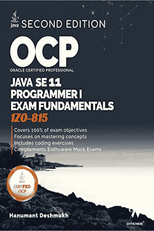

献给我的母校，印度理工学院瓦拉纳西 (Indian Institute of Technology, Varanasi)

## 致谢

我要感谢许多对本书做出贡献的个人。感谢 Liu Yang 担任技术编辑，感谢 Lisa Wright 担任文字编辑。感谢 Carol Davis 和 Robert Nyquist 进行技术校对。感谢 Aakash Jangid 和 Bill Bruening 验证了书中所有的代码段。

感谢 Maaike Van Putten 对封面设计提供的建议，感谢 Kino A. Lockhart (LOXarts Development, http://www.loxarts.com ) 设计封面。

如果没有 Enthuware 的许多人，这本书将是不可能实现的，包括 Paul A Prem，他在过去的十五年里一直在开发模拟考试。他们的经验帮助微调了书中的几个主题。

我还要感谢《Java 编程》(Thinking In Java) 的作者 Bruce Eckel，感谢他通过书籍向我以及无数其他人教授了 Java。

我同样感谢无数 CodeRanch.com 和 Enthuware.com 论坛的参与者，他们指出了读者经常难以理解的主题，并展示了让这些主题变得易懂的方法。

感谢 Edward Dang, Rajashekar Kommu, Kaushik Das, Gopal Krishna Gavara, Dinesh Chinalachiagari, Jignesh Malavia, Michael Tsuji, Hok Yee Wong, Ketan Patel, Anil Malladi, Bob Silver, Jim Swiderski, Krishna Mangallampalli, Shishiraj Kollengreth, Michael Knapp, Rajesh Velamala, Aamer Adam, 以及 Raghuveer Rawat 的包容 :)

我要感谢我的家人在我忙于写这本书期间的支持。

最后，我感谢以下读者，他们通过建议和报告错误帮助改进了本书的内容：

1. Zheng-Yu Wang
2. Fedor Lvovich Dobrotvorskii
3. Raphael Imahorn
4. Cristian Daniel Ortiz Cuellar, 委

## 关于作者

Hanumant Deshmukh 是一位专业的 Java 架构师、作者以及软件咨询公司 BetterCode Infosoft Pvt. Ltd. 的董事。Hanumant 专长金融领域基于 Java 的多层应用。他曾为摩根大通、瑞瑞银行和美国银行等顶级金融公司执行过项目。他在十五多年前创立了 Enthuware.com，通过该网站为各种 Java 认证考试提供培训课程和学习材料。他还合著了由 Manning 于 2003 年出版的关于 Java Servlets/JSP 认证的畅销书。

Hanumant 于 1997 年毕业于瓦拉纳西印度理工学院（现 IIT - Varanasi）获得计算机科学学士学位，并于 2010 年获得 ICFAI 的金融分析硕士学位。在美国与优秀的人士共事了十多年后，他回到印度攻读法律学位。他是言论和表达自由的信者，并在业余时间致力于促进这种自由。

您可以通过 `support@enthuware.com` 与他联系。

## 考试目标

以下为撰本文时的考试目标。Oracle 可能会随时调整目标，因此请在 [Oracle 上的 OCP Java 11 认证 Part 1 考试页面](https://education.oracle.com/java-se-11-programmer-i/pexam1Z0-815) 核实当前目标。

### 理解 Java 技术和环境

- 描述 Java 技术和 Java 环境
- 识别 Java 语言的关键特征

### 使用原始数据类型和 String API

- 声明和初始化变量（包括原始数据类型的强制转换和提升）
- 识别变量的作用范围
- 使用局部变量推断
- 创建和操作字符串
- 使用 `StringBuilder` 类及其方法处理数据

### 使用 Java 数组

- 使用一维数组进行声明、实例化和初始化
- 使用二维数组进行声明、实例化和初始化

### 创建和使用方法

- 创建带有参数和返回值的方法及构造函数
- 创建并调用重载方法
- 将 `static` 关键字应用于方法和字段

### 通过继承用实现

- 创建并使用子类和父类
- 创建并扩展抽象类
- 通过重写方法实现多态
- 利用多态进行类型转换和方法调用，区分对象类型与引用类型
- 区分重载、重写和隐藏

### 处理异常

- 描述异常处理的优点，并区分检查异常（checked exceptions）、未检查异常（unchecked exceptions）和错误（Errors）
- 创建 `try-catch` 块并确定异常如何改变程序的流程
- 创建并调用抛出异常的方法

### 创建简单的 Java 程序

- 创建带有 `main` 类的可执行 Java 程序
- 从命令行编译并运行 Java 程序
- 创建并导入包

### 使用运算符和决策结构

- 使用 Java 运算符，包括使用括号覆盖优先级
- 使用 Java 控制语句，包括 `if`、`else`、`break` 和 `continue`
- 创建和使用 `do/while` 循环、`while` 循环和 `for` 循环语句（嵌套循环）

### 描述对象和类

- 声明和实例化 Java 对象，并解释对象的生命周期（包括创建、重新赋值导致的引用丢失和垃圾回收）
- 定义 Java 类的结构
- 读取或写入对象字段

### 应用封装

- 应用访问修饰符
- 对类应用封装原则

## 通过接口进行抽象编程

- 创建并实现接口
- 区分类继承与接口继承（包括抽象类）
- 声明和使用 `List` 和 `ArrayList` 实例
- 理解 lambda 表达式

## 理解模块

- 描述模块化 JDK
- 声明模块并启用模块间的访问
- 描述模块化项目的编译和运行

# 第 1 章 初学者入门

## 1.1 OOP 核心要点

### 1.1.1 视角问题

### 1.1.2 API

### 1.1.3 类型、类、枚举和接口

## 1.2 为什么是这样？

## 1.3 声明与定义

## 1.4 类、对象与引用之间的关系

## 1.5 静态与实例

## 1.6 栈与堆

## 1.7 规范

### 1.7.1 什么是规范？

### 1.7.2 Java 中的规范

## 1.8 编译与执行

### 1.8.1 编译与执行详解

### 1.8.2 运行单文件源码程序

### 1.8.3 将类打包成 Jar 包

### 1.8.4 编译错误 vs 运行时异常

## 1.9 Java 开发中常用的术语

## 1.10 Java 标识符

# 第 2 章 创建一个简单的 Java 程序

## 2.1 创建带有 main 类的可执行 Java 程序

### 2.1.1 main 方法

### 2.1.2 命令行参数

### 2.1.3 main 方法的结束

## 2.2 从命令行运行 Java 程序

## 2.3 创建并导入包

### 2.3.1 package 语句

### 2.3.2 测验

### 2.3.3 import 语句

### 2.3.4 测验

## 2.4 练习

# 第 3 章 使用 Java 原始类型

## 3.1 数据类型

## 3.2 引用变量与基本类型变量

## 3.3 声明与初始化变量

### 3.3.1 变量的声明与初始化

### 3.3.2 未初始化的变量与默认值

### 3.3.3 给变量赋值

### 3.3.4 final 变量

## 3.4 包装类

### 3.4.1 什么是包装类？

### 3.4.2 创建包装对象

### 3.4.3 将包装对象转换为原始类型

## 3.5 练习

# 第 4 章 描述对象与类

## 4.1 声明并实例化对象

## 4.2 读取或写入字段

### 4.2.1 访问字段

### 4.2.2 什么是 "this"?

## 4.3 定义类的结构

### 4.3.1 类的辨析

### 4.3.2 Java 源文件的结构

### 4.3.3 类的成员

### 4.3.4 源文件名与类名的关系

### 4.3.5 测验

## 4.4 识别作用域

### 4.4.1 变量的作用域

### 4.4.2 作用域与可见性

### 4.4.3 作用域与生命周期

### 4.4.4 作用域图解

### 4.4.5 考试相关考点

### 4.4.6 测验

## 4.5 局部变量类型

## 4.6 解释对象的生命周期

### 4.6.1 对象的生命周期

### 4.6.2 垃圾回收

### 4.6.3 考试相关的垃圾回收

## 4.7 练习

# 第 5 章 使用 String API

## 5.1 创建并操作字符串

### 5.1.1 什么是 "string"?

### 5.1.2 创建字符串

### 5.1.3 字符串池化（interning）

### 5.1.4 字符串的不可变性

### 5.1.5 操作字符串

### 5.1.6 比较字符串

## 5.2 使用 StringBuilder 类及其方法操作数据

### 5.2.1 为什么用 StringBuilder

### 5.2.2 StringBuilder API

## 5.3 练习

# 第 6 章 使用运算符

## 6.1 Java 运算符

### 6.1.1 Java 中可用运算符概览

### 6.1.2 表达式与语句

### 6.1.3 自增/自减运算符

### 6.1.4 字符串拼接运算符 `+` 和 `+=`

### 6.1.5 数字提升与强制转换

### 6.1.6 运算符优先级与表达式求值

## 6.2 练习

# 第 7 章 决策结构

## 7.1 if-else 结构

### 7.1.1 if-else 的基础语法

### 7.1.2 考试相关的 if-else

## 7.2 三元条件运算符 `?:`

## 7.3 switch 语句

### 7.3.1 创建 switch 语句

### 7.3.2 在枚举中使用 switch

## 7.4 练习

# 第 8 章 循环结构

## 8.1 什么是循环

## 8.2 创建并使用 while 循环

### 8.2.1 while 循环

### 8.2.2 使用 while 循环

## 8.3 do-while 循环

## 8.4 创建并使用 for 循环

### 8.4.1 将 while 循环转换为 for 循环

### 8.4.2 for 循环的语法

### 8.4.3 for 循环的组成部分

## 8.5 创建并使用增强 for 循环（for-each）

### 8.5.1 增强 for 循环

### 8.5.2 增强 for 循环的语法

### 8.5.3 增强 for 循环的实践

## 8.6 使用 break 和 continue

### 8.6.1 使用 `break` 终止循环

### 8.6.2 使用 `continue` 终止循环迭代

## 8.7 嵌套循环

### 8.7.1 嵌套循环

### 8.7.2 退出嵌套循环及在嵌套循环中继续

## 8.8 循环结构的比较

## 8.9 练习题

# 第 9 章 创建和使用数组

## 9.1 声明、实例化、初始化和使用一维数组

### 9.1.1 声明数组变量

### 9.1.2 创建和初始化数组对象

## 9.2 使用数组

### 9.2.1 数组索引

### 9.2.2 数组对象的成员

### 9.2.3 数组的运行时行为

### 9.2.4 数组的用途

## 9.3 声明、实例化、初始化和使用多维数组

### 9.3.1 多维数组


# 第 10 章：创建和使用方法

## 10.1 创建带有参数和返回值的方法

### 10.1.1 创建方法

### 10.1.2 从方法返回值

### 10.1.3 可变参数 (Varargs)

## 10.2 创建重载方法

### 10.2.1 方法签名

### 10.2.2 方法重载

### 10.2.3 方法选择

## 10.3 向方法传递对象引用和基本类型值

### 10.3.1 向方法传递参数

### 10.3.2 向方法传递对象

### 10.3.3 从方法返回值

## 10.4 创建和重载构造函数

### 10.4.1 创建实例初始化器

### 10.4.2 创建构造函数

### 10.4.3 重载构造函数

### 10.4.4 实例初始化器 vs 构造函数

### 10.4.5 复习 `final` 变量

## 10.5 在方法和字段上应用 `static` 关键字

### 10.5.1 在方法和字段上应用 `static` 关键字

### 10.5.2 访问静态成员

### 10.5.3 在同一类中访问静态成员

### 10.5.4 导入静态字段

### 10.5.5 从静态方法访问实例成员

### 10.5.6 类加载和静态初始化器

## 10.6 练习题

# 第 11 章：封装

## 11.1 应用访问修饰符

### 11.1.1 可访问性

### 11.1.2 访问修饰符

### 11.1.3 `protected` 访问

### 11.1.4 对类型应用访问修饰符

## 11.2 在类中应用封装原则

### 11.2.1 封装

### 11.2.2 JavaBeans 命名规范

## 11.3 练习题

# 第 12 章：通过继承复用实现

## 12.1 创建和使用子类和父类

### 12.1.1 理解继承

### 12.1.2 从类继承特征

### 12.1.3 继承与访问修饰符

### 12.1.4 实例成员继承 vs 静态成员继承

### 12.1.5 继承的好处

## 12.2 使用 `super` 和 `this` 访问对象和构造函数

### 12.2.1 复习对象初始化

### 12.2.2 使用 `super()` 初始化父类

### 12.2.3 使用隐式变量 `super`

### 12.2.4 初始化顺序

## 12.3 创建和扩展抽象类

### 12.3.1 使用抽象类和抽象方法

### 12.3.2 使用 `final` 类和 `final` 方法

### 12.3.3 访问修饰符、`final` 和 `static` 的有效组合

## 12.4 通过重写方法实现多态

### 12.4.1 什么是多态

### 12.4.2 重写方法

### 12.4.3 无效重写

## 12.5 利用多态进行强制转换和调用方法

### 12.5.1 引用类型和对象类型

### 12.5.2 弥合编译时与运行之间的差距

### 12.5.3 Determine 何时需要强制转换

### 12.5.4 `instanceof` 算符

### 12.5.5 调用重写的方法

### 12.5.6 多态对 `==` 和 `equals` 方法的影响

## 12.6 区分重载、重写和隐藏

### 12.6.1 重写与隐藏

### 12.6.2 重载

### 12.6.3 重载与重写中的方法选择

## 12.7 练习题

# 第 13 章：通过接口进行抽象编程

## 13.1 创建和实现接口

### 13.1.1 使用接口

### 13.1.2 实现接口

### 13.1.3 扩展接口

### 13.1.4 实例化抽象类和接口

## 13.2 接口与抽象类的区别

## 13.3 声明和使用 `List` 和 `ArrayList` 实例

### 13.3.1 集合与泛型简介

### 13.3.2 泛型

### 13.3.3 测验

### 13.3.4 Collection 和 `List` API

### 13.3.5 `ArrayList` API

### 13.3.6 `ArrayList` vs `array`

### 13.3.7 `Map` 和 `HashMap`

### 13.3.8 测验

## 13.4 练习题

# 第 14 章：Lambda 表达式

## 14.1 理解 Lambda 表达式

### 14.1.1 Lambda 表达式

### 14.1.2 Lambda 表达式的组成

### 14.1.3 使用 `Predicate`

### 14.1.4 函数式接口

### 14.1.5 在集合 API 中使用函数式接口

### 14.1.6 表达式中变量的作用域

### 14.1.7 测验

## 14.2 练习题

# 第 15 章 异常处理

## 15.1 创建 `try-catch` 块并确定异常如何改变程序流

### 15.1.1 Java 异常处理

### 15.1.2 `try/catch` 方法的基础知识

### 15.1.3 异常处理机制的组成部分

### 15.1.4 `try-with-resources` 语句

## 15.2 区分检查异常、未检查异常和错误 (Errors)

### 15.2.1 检查异常与未检查异常

### 15.2.2 常用异常类

## 15.3 创建并调用抛出异常的方法

### 15.3.1 创建一个抛出异常的方法

### 15.3.2 从初始化器和构造函数中抛出异常

### 15.3.3 调用抛出异常的方法

### 15.3.4 使用多个 `catch` 块

### 15.3.5 使用多异常捕获 (multi-catch)

## 15.4 练习

# 第 16 章 理解模块

## 16.1 模块基础知识

### 16.1.1 什么是模块？

### 16.1.2 声明模块

### 16.1.3 模块的目录结构

## 16.2 描述模块化项目的编译与运行

### 16.2.1 编译模块

### 16.2.2 运行模块

## 16.3 声明模块并启用模块间的访问

### 16.3.1 启用模块间的访问

### 16.3.2 限定限定的导出 (Qualified exports)

### 16.3.3 传递性依赖

## 16.4 高级模块编译与执行

### 16.4.1 同时编译多个模块

### 16.4.2 模块 `jar` 与普通 `jar`

### 16.4.3 自动模块 (Automatic modules)

### 16.4.4 编译时的命令行开关总结

### 16.4.5 执行时的命令行开关总结

## 16.5 描述模块化 JDK

### 16.5.1 模块化 JDK

### 16.5.2 模块化 JDK 的结构

### 16.5.3 模块的新工具和命令行选项

### 16.5.4 模块化 JDK 的益处

## 16.6 练习

# 第 17 章 理解 Java 技术与环境

## 17.1 Java 技术和语言的关键特性

# 引言

我相信你已经开始接触 Java 编程，并且现在正认真对待你成为职业程序员的目标。首先，让我赞赞你考虑将 Java 认证作为迈向该目标一步的决定。我可以向你保证，朝着 Oracle Java 认证努力将是非常值得的，无论你在求职时是否会因为认证而获得加分。

Java SE 11 程序员 I 考试（考试代码 `1Z0-815`），即 `OCP-I` 考试，是你成为 Oracle 认证专家 - Java 11 开发者需要通过的两场考试中的第一场。这项考试侧重于 Java 的基础方面，通过并不困难。如果你能读一本不错的书并练习几次模拟考试，你应该在准备几个月后就能通过它。然而，该认证涵盖的主题是专业认证的第二步——即 Java SE 11 程序员 II 考试（考试代码 `1Z0-816`），即 `OCP-II` 考试的基础。`OCP-II` 是一场非常困难的考试，比 `OCP-I` 考试难得多。如果你的基础薄弱，通过那场考试将遇到困难。因此，不要只想着以最低分数（63%）通过 `OCP-I` 考试，而要将 90% 设为目标。我这本书的目标是帮助你在 `OCP-I` 考试中获得 90% 以上的分。

## 关于模拟考试

模拟考试是获得考试高分的的重要准备工具。然而，在为几项认证创建过模拟考试后，我可以告诉你，创建高质量的问题既不容易也不快。即使经过多次审查和质量检查，题目也需要经过数千名用户使用多年，才能消除所有的歧义、错误和失误。我见过用户对题目描述给出我们完全无法想象的合理解释。质量糟糕的模拟考试会轻易浪费你宝贵的时间，并可能打击你的信心。因此，我没有为这本书创建新的模拟考试。我们有一个专门开发模拟考试的团队，我建议你从我们的网站 Enthuware.com 该团队创建的考试模拟器。它的价格非常合理（仅 9.99 美元），并且经住了时间的考验。

## 0.1 这本书是谁看？ [☝](http://enthuware.com/forum/dbt.php?bid=2&sn=0.1.0&tn=who-is-this-book-for)

这本书面向 Java SE 11 程序员 I 考试 (`1Z0-815`) 的考生，他们知道如何编程，并且至少了解基本的 Java 术语。在继续学习本学习指南之前，请回答以下问题。记住，你不需要成为该领域的专家才能回答“是”。这里的意图是检查你是否至少熟悉基本概念。如果你不知道细节、语法或典型用法，也没关系。我将在书中介绍所有这些内容，但我不会在书中教授编程基础。

1. 你知道操作系统、内存和 CPU 是什么吗？

2. 你知道命令行吗？

3. 你知道基本的操作系统命令，如 `dir`、`cd` 和 `mkdir` 吗（如果你是 Linux/Mac 用户——你知道如何使用 `ls`、`cd` 和 `md` 吗）？

4. 你能用 Java 写一个简单的 Hello World 程序并从命令行运行它吗？

5. 你知道变量 (`variables`) 是什么吗？

6. 你知道循环（如 `for` 循环和 `while` 循环）是什么以及有什么用途吗？

7. 你了解数组吗？

8. 你知道 Java 有类和接口吗？

9. 你知道类和接口有方法吗？

10. 你在电脑上安装 `JDK 11` 了吗？

如果你对上述任何一个问题回答“否”，那么这本书就不适合你。最好先去读一本编程书或初学者计算机书籍，然后再来看这本书。或者，在阅读这本书的过程中，如果你对某个术语不确定，可以开放地去搜索。

## 1. 关注概念

我相信，如果你正确掌握了基础概念，其他一切都会迎刃而解。在与 Java 初学者一起工作时，我注意到了一些误解、理解偏差以及糟糕的捷径，这些问题会影响他们后续对复杂主题的学习。我见过许多人因为这个原因，虽然通过了考试但在技术面试中屡屡碰壁。在书中，我将从不同的角度解释重要的内容。这确实稍微增加了书的长度，但这种增加应该是非常值得你时间的。

## 2. 不进行“手术式”取舍

有些书试图紧密贴合考试目标。紧密到至于有时某个主题与现实完全脱节，导致读者掌握的是不精确的、有时甚至是错误的知识。这种策略对于回答 `OCPJP-I` 考试中出现的选择题很有用，但在技术面试和工作编写代码时，它会让你适得其反。我相信，回答选择题（`MCQs`）不应该是你的唯一目标。正确地学习概念同样重要。因此，在需要的时候和范围内，我会超出考试目标的范围。当然，在这样做时我会明确标注出来。

## 3. 练习

“多写代码”是一个你会经常听到的建议。虽然对于经验丰富的程序员来说这似乎是一项相当简单的任务，但我观察到初学者往往不知道自己具体应该写什么。当他们不确定一个测试程序具体应该做什么时，他们往往会完全跳过这个重要的学习步骤。在我的培训课程中，我会给出目标明确的代码编写练习。我在书中也同样做了。我没有在每个主题或章节的最后给出 `MCQs` 或测验，而是要求你编写使用该主题或章节所教概念的代码。

此外，实际考试中的问题通常需要涉及多个主题的知识。以下是考试中出现的一个典型代码片段：

```
int i = 10;
Long n = 20;
float f = 10.0;
String s = (String) i+n++;
```

为了判断这段代码是否可以编译，你需要学习四个主题——包装类、操作符、`String` 类和类型转换。因此，在主题末尾提供一个只关注该单一主题的 `MCQ` 会产生一种虚假的安全感。我相信，在准备的最后关注真实的 `MCQs` 更好。

## 4. 不做学呆

如果你正在准备 `OCPJP-I` 考试，我相信你的人生中已经经历过许多学术考试。你已经知道考试中会遇到什么。所以，我不会建议你考试前应该喝多少水以避免去厕所，也不会建议你考试前应该睡多久，或者或者在考前一天检查考中心的位置。如果你没有参加过任何包含选择题的机考，我强烈建议你使用 `Enhuware` 的考试模拟器来熟悉这种风格。它紧密地模仿了真实考试的用户界面。

## 0.3 本书是如何组织的？ [☝](http://enthuware.com/forum/dbt.php?bid=2&sn=0.3.0&tn=how-is-this-book-organized)

本书由十七章加上开头的这部分引言组成。除了第一章“初学者入门指南”外，其他章节直接对应官方考试目标。在大多数情况下，章节的节也直接对应考试目标中的项目。每章的开头都列出了该章节涵盖的考试目标，并在结尾包含了一系列编码练习。按顺序阅读本书是最好的，因为每一章都在前几章讨论的概念的基础上增量构建。我在书中穿插了简单的编码练习。尝试去完成它们。当你实际输入代码而不是仅仅阅读它时，你会学得更好、记得更牢。如果你已经有几年的 Java 开发经验，可以按任何顺序阅读章节。

### 本书使用的规范

本书使用了特定的排版样式来帮助你快速识别重要信息。这些样式如下：

- **代码字体**：此字体用于区分正文与出现在正文中的 Java 代码。包含多行代码的代码片段格式化为矩形块中的 Java 代码。

- **红色代码字体**：此字体用于显示无法编译的代码。这可能是因为语法错误或其他某些错误。

- **输出代码字体**：此字体用于显示代码在命令行上生成的输出。

- **粗体字**：我使用粗体字体强调了重要的单词、术语和短语，以帮助你在脑中对它们进行标记。如果你在快速翻读本书，粗体单词将帮助你保持方向，同时确保你没有错过任何重要内容。

- **注（Note）**：与当前主题不完全相关的内容将在注释中解释。我使用注释来提供你可能在工作中或技术面试中发现的额外信息，但这些信息考试通常不需要。

- **考试技巧（Exam Tip）**：考试技巧包含了你在考试期间应该特别注意的点。我也用它们来让你意识到在考试中会遇到的技巧和陷阱。

### 寻求澄清

如果你需要任何说明，对任何主题有任何疑问，或想报告错误，请随时在我们为本书设立的论坛上提问——http://enthuware.com/forum。如果你在电子设备上阅读本书，你会在每个主题标题旁边看到这个图标。点击此图标将带你进入同一论坛中关于该特定主题的现有讨论。如果现有讨论解决了你的问题，那太好了！你节省了时间和精力。如果没有，请在主题行中注明你的问题。我们在处理模拟考试问题时也使用同样的机制，并受到了用户的极大赞誉。

## 0.4 这些会在考试中出现吗？ [☝](http://enthuware.com/forum/dbt.php?bid=2&sn=0.4.0&tn=will-this-be-asked-in-the-exam)

在阅读本书的过程中，你会反复想问这个问题。让我从一开始就回答这个问题。我在书中确实讨论了一些没有在官方考试目标中明确列出的概念，但每当我偏离官方考试目标时，都会明确说明。你可以忽略该章节并继续阅读。但我建议你不要跳过这些章节，原因如下：

1. 在讨论语言规则时，为了完整性和技术准确性，我可能需要引用某些术语和概念。例如，假设我们正在讨论文件中的公共类。如果我规定一个文件中不能有多个公共类，这对于考试目的是可以的，但从技术上讲是错误的，因为你可以在一个文件中包含任意数量的公共嵌套类。因此，更好的说法是一个文件中不能有多个顶层公共类。那么，一个公共顶层类和一个公共接口呢？不，你不能这样做。因此，该陈述仍然是错误的。正确的陈述应该是文件中不能有多个公共顶层引用类型。正如你所见，对我来说引用类型、嵌套类和顶层这些术语的含义是关重要的，尽管考试中不会测试这些内容。

如果你绝对不想花任何时间学习考试范围之外的内容，那么这本书并不适合你。我已尽可能贴合考试目标，但如果我认为你解了解某些知识，即使它超出了考试范围，我也会进行讲解。

2. 我注意到，许多认证申请者是新的 Java 程序员，他们要么是在校，要么是想通过 Java 编程开启职业。他们希望获得认证是因为他们最终目标是找到一份 Java 程序员的工作。这些程序员也将面临许多技术面试。我希望这些程序员在技术面试中表现良好。

认证可能让你获得一张“入场券”，但在面试中，你将需要用实的基础知识来支撑这一点。因此，如果我认为某些内容对你来说很重要，或者某些内容对你的技术面试有帮助，无论它是否会在考试中出现，我都会进行讨论。

3. 官方考试目标既不详尽也不无遗漏。它们列出了你需要学习的高级主题，但忽略了细微之处。你将遇到一些要求你掌握这些概念的问题。

4. Oracle 在正式向官方考试目标中添加新主题之前，会向考试添加新题目。这些题目可能不会包含在你的最终得分中，也就是说，你在此类题目上的回答不会计入考试分数。然而，考者并不知道某个题目是否是不计分的，因此他们必须像该题目会计入最终分数一样去尝试。

由于我们在 Enthuware 也开展课堂培训，因此我们经常与许多考者互动。我们收到过考者关于在考试目标中未出现的题目的反馈。在收到此类多次报告后，我们可能会将该主题添加到我们的内容中。我们会明确说明包含它们的原因。

5. 官方考试目标不是固定不变的。虽然频率不高，但 Oracle 会不地从目标中添加或删除主题。这可能导致某些内容与考试无关。我将尽快更新内容。

如果你有兴趣打好基础，那么我建议你在学习这本书时，不要过度担心考试目标。即使你因为这些额外内容在准备工作上多花了一点时间（我承诺不超过 10%），这也将是值得的。


## 0.5 考试通用技巧 [☝](http://enthuware.com/forum/dbt.php?bid=2&sn=0.5.0&tn=general-tips-for-the-exam)

以下是你在准备考试时应该牢记的事项：

1. **代码格式** - 你可能在考试中找不到格式排版良好的代码。例如，你可能期望某段代码排版良好如下：

```
if(flag){
  while(b<10){
  }  
}else if(a>10) {
   invokeM(a);
}
else{
  System.out.println(10);
}
```

但你可能会得到格式如下相同的代码：

```
if(flag){ 
  while(b<10){ }  
  } else 
if(a>10) { invokeM(a); }
else {   System.out.println(10); }
```

他们这样做很可能是为了节省空间。但也可能是由于显示屏幕尺寸和分辨率的差异而意外导致的。

2. **假设** - 几道题会提供部分代码列表，即“代码片段”。例如，以下代码将打印什么？

```
ArrayList al = new ArrayList();
al.remove(0);
System.out.println(al);
```

显然，这段代码在给出的情况下是无法编译的，因为它只是一个代码片段。你必须假设这段代码出现在有效的上下文中，例如在类的方法内部。你还需要假设已经放置了适当的`import`语句。

你不必为缺失的内容烦恼。只需关注给定的代码，并假设其他所有都是无关的，且不需要即可得出答案。

3. **诡异代码** - 你会在考试中看到看起来非常奇怪的代码。那些你可能在现实生活中从未见过的代码。你会觉得考试像是在做谜题而不是 Java 编程。在某种程度上，这是正确的。如果你决定参加认证，就没有必要质疑它的相关性。如果你感到挫败，我完全理解。请随时在我们的论坛上发泄你的愤怒，然后回去工作！

4. **正确选项的数量** - 考试中的每道题都会准确告诉你需要选择几个选项来正确回答该题。记住，没有倒分机制。换句话说，回答错误问题不会扣分。因此，不要留空任何题目。如果你不知道答案，也选择所需数量的选项。你有很小的概率选中正确答案。

5. **排除错误选项** - 比不留空题目更好的方法是通过排除明显错误的选项来做出明智的猜测。你可能会看到相互矛盾的选项。这使得缩小正确选项范围变得容易一些。

就是这些。希望这本书在帮你获得认证之外，也能帮你成为一名更好的 Java 程序员。

## 0.6 官方考试详情和考试目标 [☝](http://enthuware.com/forum/dbt.php?bid=2&sn=0.6.0&tn=official-exam-details-and-exam-objectives)

以下是 Oracle 截至 2019 年 7 月 1 日发布的官方考试详情。与之前一样，Oracle 可能会更改这些细节。因此，在准备期间检查官方考试页面 `https://education.oracle.com/java-se-11-programmer-i/pexam_1Z0-815`。

### 考试详情

- **时长**: 180 分钟
- **题目数量**: 80
- **及格分数**: 63%
- **格式**: 多选题
- **考试费用**: 245 美元（因国家而异）

## 考试目标

### 理解 Java 技术和环境

- 描述 Java 技术和环境
- 识别 Java 语言的关键特性

#### 使用基本数据类型和字符串 API

- 声明和初始化变量（包括类型转换和类型提升）
- 识别变量的作用域
- 使用局部变量类型推断
- 创建并操作`Strings`
- 使用`StringBuilder`类及其方法处理数据

### 使用 Java 数组

- 声明、实例化、初始化并使用一维数组
- 声明、实例化、初始化并使用二维数组

### 创建和使用方法

- 创建带有参数和返回值的方法以及构造函数
- 创建并调用重载方法
- 对方法和字段应用`static`关键字

#### 通过继承复用实现

- 创建和使用子类和父类
- 创建并扩展抽象类
- 通过重写方法实现多态，区分对象类型和引用类型
- 区分重载、重写和隐藏

#### 异常处理

- 描述异常处理的优势，并区分编译异常、运行时异常和错误
- 创建`try-catch`块并确定异常如何改变程序流
- 创建并调用抛出异常的方法

### 创建简单的 Java 程序

- 创建带有`main`类的可执行 Java 程序
- 从命令行编译并运行 Java 程序
- 创建并导入包
- 使用`Java`控制语句，包括`if`、`else`、`break`和`continue`
- 创建并使用`do/while`循环、`while`循环以及`for`循环语句，包括嵌套循环

### 描述对象与类

- 声明并实例化`Java`对象，并解释对象的生命（包括创建、通过重新赋值取消引用以及垃圾回收）
- 定义`Java`类的结构
- 读取或写入对象字段

### 应用封装

- 应用访问修饰符
- 对类应用封装原则

## 通过接口进行抽象编程

- 创建并实现接口
- 区分类继承与接口继承（包括抽象类）
- 声明并使用`List`和`ArrayList`实例
- 理解 Lambda 表达式 (Lambda Expressions)

## 理解模块

- 描述模块化 JDK (Modular JDK)
- 声明模块并启用模块之间的访问
- 描述模块化项目是如何编译和运行的

## 0.7 反馈、勘误与评审 [☝](http://enthuware.com/forum/dbt.php?bid=2&sn=0.7.0&tn=feedback-errata-and-reviews)

如果你对本书的内容有任何疑问或发现任何错误，请在 [Enthuware 论坛](https://enthuware.com/forum) 告知我。

所有确认的错误已列在此：[勘误页面](https://enthuware.com/815/errata.php) 。

由于本书是“按需打印”出版的，每隔几周就会发布一个包含所有增强和修复的更新版本。你可以通过对比书籍描述中标题页提到的构建版本号来检查是否为最新版本，该描述可以在 [Amazon 网站](https://enthuware.com/815/amazon.php) 上查看到。如果你使用的是 Kindle 电子书版本且版本较旧，可以通过联系 Amazon 支持获取最新版本。他们会在你请求后将更新版本发送到你的设备。

希望你喜欢这本书。如果你学到了一些东西并觉得有趣，如果你愿意在 [Amazon](https://enthuware.com/815/amazon.php) 上留下几句好评，我将不胜感激。如果你收到了这本书的评审读用副本，请在评论中注明。

感谢，

Hanumant Deshmukh

# 第 1 章 初学者入门指南

本节专为`Java`初学者准备。它与任何考试目标没有直接关系，但旨在提供一个坚实的基础，帮助你轻松地理解后续章节中教授的概念。本节涵盖的概念非常重要，因为它们在本书中反复出现。如果我们现在就处理好这些重复内容，你以后会更愉快！

## 1.1 OOP 的核心要点

### 1.1.1 视角问题 [☝](http://enthuware.com/forum/dbt.php?bid=2&sn=1.1.1&tn=a-matter-of-perspective)

几年前，当我访问印度时，我发现要在三脚插座上插入我的笔记本电脑充电器非常困难。即使是那套带有各种尺寸适配器插头的国际插座适配器套装，也没有多大帮助。有时接收座会太小，导致插头无法稳定接触；或者插头会太宽，无法进入接收座。最后我不得不剪断电线，将裸露的铜线末端直接插入插座。我纳想，为什么同一个国家的这些插座会有细微的差异。在我留期间期间，我观察到其他事物也存在这种细微的变化：关不严的门、无法正常旋转的螺母、不停漏水的水龙头以及其他差异。在大多数情况下，那里的人在更换零件时采用试错法。他们的工作预期是，即使买到了尺寸正确的零件，也可能无法完美拟合。换句话说，细微差异是意料之中且被良好接受的。

这在美国是不可想象的，因为那里的一切都恰好合拍。我可以从一家商店买螺栓，从另一家商店买螺母，它们就能完美工作。从螺丝、螺母、螺栓到木板、电气零件、包装箱，一切都是标准化的。你可以轻松用完全不同公司制造的零件替换。你只需要指定正确的“尺寸”。

这段经历让我发现了某些`OOP`学习者觉得`OOP`概念很困惑的潜在原因。特别是非西方背景的初学者，掌握基本概念非常困难，因为他们不知道许多`OOP`规则背后的原理。这体现在他们的应用设计中。

在美国，我想在其他发达国家也是如此，事情被定义得非常明确。产品明确说明了它们应该如何使用以及在什么情况下会失效。人们可以并且确实依赖这些规范，因为产品运行符合预期，并按定义发生故障。同时，人们期望产品附带详细的规格说明。组装家具就是这些规格可以多详尽的典型例子。正是因为有了详细且清晰的规格，人们在购买复杂的组装家具时才会放心。

简而言之，人们在获取某物时清楚地知道自己得到了什么。我将其认为这种社会天生就是“面向对象”的。

**面向对象 (Object orientation)** 只是对事物之间完美契合这种自然感觉的名称。一段代码与我之前提到的物理实体并没有太大。如果你按照规范编写代码，它会像你的 0.16 英寸螺母配合 0.16 英寸螺栓一样完美契合，无论螺母是谁制造的，螺栓又是由谁制造的。这里的重点是，面向对象编程概念的来源是物理世界。如果你想真正掌握`OOP`，你必须开始将你的代码视为一个物理组件……一个具有良好定义的行为且可以被遵循相同行为的组件所替换的“东西”。

如果你买了一个不适合你车轮的轮胎，即使你买的是同样的“尺寸”，你也不会开心的，对吧？当你开发软件组件时也应该考虑同样的问题。某人会使用它，如果它在运行时抛出了你没有说过的会在特定情况下抛出的异常，他们将不会开心的。

### 1.1.2 API [☝](http://enthuware.com/forum/dbt.php?bid=2&sn=1.1.2&tn=api)

你可能知道`API`代表应用程序编程接口。但你真的理解它意味着什么吗？这回到了我之前关于编程概念与现实生活的联系。当你操作开关时，你真的在乎开关内部有什么吗？你真的在意它是如何工作的吗？你只需要将开关连接到灯泡，然后按下它开启或关闭灯泡。汽车也是一样。汽车为你提供了几个允许你转向、加速和刹车的控制装置。这些控制装置就是学习如何驾驶所需的所有知识。

你也应该以同样的方式来开发`software components`（软件组件）。一个软件组件并不意味着一组在 jar 文件中封装在一起的类和包。一个软件组件可以简单到只有一个方法的方法的类。但即使在开发最微小、最简单的软件组件时，你也应该考虑你期望用户如何使用它。你应该考虑用户使用该组件的各种方式。你还应该考虑当用户没有按照预期方式使用组件时，组件应该如何表现。换句话说，在你开始为它编写代码之前，你就应该为你的组件指定一个`interface`（接口）。在这里，我所说的接口并不是严格意义上的`Java interface`，而是一份详细说明如何与你的组件进行交互的规范。在物理世界中，任何电器的说明书基本上就是它的接口。在软件世界中，一个软件组件的公开可用的类、方法、字段、枚举等的规范就是它的接口。作为一名`application programmer`（应用程序程序员），如果你想使用别人开发的组件，你只需要关心该组件的接口。你不需要担心它可能包含其他什么，以及它是如何工作的。这就是“应用程序编程接口”（API）一词的由来。

在 Java 世界中，由提供者为特定目的提供的一组类被称为`library`（库），而这些类的`JavaDoc`文档描述了它的 API。当你安装`Java Runtime Environment`（`JRE`）时，它包含了大量的类和包。这些统称为标准 Java 库，其公共类和接口的集合被称为`Java API`。

`Java API`包含了大量的现成组件，用于基础编程活动，如文件操作、数据结构、网络、日期和格式化。当你编写 Java 程序时，你实际上是基于`Java API`来构建以实现你的目标。你不需要从零开始编写应用程序的所有逻辑，而是利用 Java 库免费提供给你的功能，只编写针对你特定需求的代码。这节省了大量的时间和精力。因此，对于 Java 程序员来说，对`Java API`有基础的理解是非常重要的。你不需要背诵所有的类及其方法。老实说，要记住它们所有实际上几乎是不可能的。但你应该对`Java API`在高层提供的内容有一个宽泛的了解，这样当需要出现时，你知道该去哪里寻找细节。例如，你应该知道标准 Java 库包含许多操作文件的类。现在，当你真正需要操作文件时，你应该能够浏览相关的 Java 包并找到一个可以帮助你实现目的的 Java 类。

`OCPJP 11 Part 1`考试要求你了解`Java API`中的少数包和类。我将在本书中详细介绍它们。

如果你能记住上述讨论，我相信对于你来说，掌握我将在整本书中要论述的概念将非常容易。

### 1.1.3 类型, 类, 枚举和接口 [☝](http://enthuware.com/forum/dbt.php?bid=2&sn=1.1.3&tn=type-class-enum-and-interface)

`type`（类型）无非赋予一个行为一个名称。例如，当你定义在与银行账户交互时它的行为时，你正在定义一个类型，如果你给这个行为起一个名字，比如`Account`（账户），那么你本质上就定义了`Account`类型。

从这个角度来看，`class`（类）、`enum`（枚举）和`interface`（接口）帮助你定义某些类型的行为，因此它们是“类型的类型”。

`class`（类）允许你将行为的描述和用于实现该行为的实现结合起来。实现包含了逻辑，也包含了数据。例如，账户允许你取款和存款，这是它行为的描述，并使用了“账户余额”，这是它为了实现该行为而操作的数据。因此，`Account`可以是一个类。一旦你定义了账户的行为并并提供了实现该行为的实现，你就可以拥有任意数量的账户。

`enum`（枚举）是 enumeration（枚举）的缩形式，也允许你将行为的描述和用于实现该行为的实现结合起来。此外，它还提供了该类型固定数量的实例，并限制你创建该类型的任何新实例。例如，一周只有 7 天（从周一到周日）。因此，如果你定义了`DayOfWeek`（星期），你就不想创建那些预定义的 7 天之外的日子。因此，`DayOfWeek`可以是一个具有 7 个预定义且不可变实例的枚举。

`interface`（接口）允许你只定义行为而不对其有任何实现。例如，如果你想描述某种会移动的东西，你可以称它为`Movable`（可移动）。它没有告诉你关于该实体如何移动的任何信息。一头牛、一辆汽车甚至一个股价都在移动，但显然，它们移动的方式非常不同。因此，`Movable`可以是一个接口。

接口的关键点在于，你不能拥有接口的实例，因为它仅仅是对你可以与某物交互方式的描述，而不是事物本身的描述。例如，你不能真的只拥有一个`Movable`。你必须有一头牛或一辆汽车或其他表现出`Movable`所描述行为的东西。在某种意义上，接口始终是`abstract`（抽象的）。它不能独立存在。你需要一个类来`implement`（实现）接口所描述的行为。

除了上述三种，还有一种叫做`abstract class`（抽象类）。抽象类介于类和接口之间。像类一样，它定义了行为也定义了实现，但它提供的实现不足以让你创建其实例。因此，和接口一样，它不能独立存在。例如，如果你在一个类中定义了所有动物的行为以及所有动物的通用实现，但你知道你不能真的拥有一个`Animal`（动物）。

## 1.2 为什么是这样

### 1.2.1 为什么是这样？ [☝](http://enthuware.com/forum/dbt.php?bid=2&sn=1.2.1&tn=why-is-something-so)

为什么 Java 没有`pointers`（指针）？为什么 Java 允许静态字段和方法？为什么 Java 不支持`multiple inheritance`（多继承）？为什么这个行不行？在学习 Java 时，好奇的心经常会产生这类问题。在本书中，你会遇到一些触发此类问题的规则和约定。大多数时候，原因并不复杂。我将在下面解释四点，它们将帮助你回答大多数此类问题。我会在书中需要的地方引用它们。

1. **为了帮助代码组件化**：正如之前在 API 部分讨论过的，在编写 Java 代码时，你应该考虑开发`components`（组件）而不仅仅是编写`programs`（程序）。两者之间的区别在于它们允许自己互换的方式。你能想象一个地线针在左侧而不是在顶部的三脚插座吗？没有人会制造那样的东西，因为无法让任何其他插头插进去。在某种意义上，组件就像通用的乐高积木。你可以混合组合具有基本功能的积木来构建更大的积木。你可以取出一个积木并将其替换为另一个具有相同连接点的积木。软件组件也是如此。

一个良好的软件组件尽可能具有通用性。它的构建是为了只做一件事，并允许其他组件使用它，而不会让它们产生依赖。这里的“依赖”意味着你应该能够轻松地将此组件替换为另一个具有相同功能的组件。事实上，你应该能够将一个制造商的 3 针插座替换为另一个，而不需要更换整个设备！

相比之下，程序是一个单式的代码堆，它试图完成所有事情，而没有暴露通用且清晰的接口。一旦你开始使用一个程序，几乎不可能在不影响所有与该程序协作的部分的情况下将其替换掉。这非常像一个连接设备到计算机的专有接口。你必须购买整块新的 PC 卡来支持该接口。如果连接线丢失了，你就得依赖该专有接口的制造商为你提供备件，到那时，你可能会后悔自己没有买一个带有 USB 接口的设备。只有少数公司能对他们的客户玩出这一招。


Java 在设计时就考虑到了这一点。你会发现，许多看似困惑的规则之所以存在，恰恰是因为它们促进了可交换组件的发展。例如，重写的方法抛出的异常不能比被重写方法所声明的异常更泛化。另一方面，子类的构造函数抛出的异常不能比父类构造函数抛出的异常更具体。想想这一点。

## 2. 消除 bug 的产生空间

Java 设计者试图限制或消除会增加代码中 bug 可能性的功能。`Pointer arithmetic`（指针算术）和 `goto` 就是这些例子。他们还尝试添加有助于编写无 bug 代码的功能。`Automatic Garbage Collection`（自动垃圾回收）和 `Generics`（泛型）也是这些例子。

## 3. 让程序员的生活更轻松

许多旧语言如 `C/C++` 的构建是为了处理各种事务的灵活性威力。对程序员能做什么进行限制被认为是一个坏主意。相反，如何添加让程序员做更多事情的功能一直是重点。每一个新语言都增加了更多的新功能。例如，`C++` 有指针算术、全局函数、运算符重载、`extern` 声明、预处理器指令、无符号数据类型以及许多其他 Java 根本没有的“功能”。这些在 `C++` 程序员手中是许多非常强大的工具。那么，为什么 Java 没有这些功能呢？事实上，Java 在功能上实际上是反其道而行之。Java 并没有包含许多在之前的之前的语言中出现的功能。原因很简单。Java 遵循让程序员的生活更简单的哲学。拥有越来越多的功能并不一定是一件好事。例如，拥有指针算术和对象的内存手动分配与释放是强大的，但它会让程序员的生活变成地狱。因此，与 `C++` 不同，Java 中不需要分配内存，因为所有对象都创建在堆上。程序员为什么要担心那些可以由语言处理的事情呢？与其专注于掌握复杂的特性，不如程序员应该花费更多时间在开发业务逻辑上。因此，与 `C++` 不同，Java 中不需要释放内存，因为 Java 会自动执行垃圾回收。

此外，维护复杂代码的成本会迅速级联。一段代码被编写一次，但会被读取和覆盖多次。对于一个程序员来说是“聪明”的代码，对于接替该程序员的人来说可能是一个噩梦。

因此，Java 引入了几种限制（我实际上认为它们是功能），使得 Java 开发整体上变得简单许多。例如，在 `C++` 中，对类所在的文件没有限制。但在 Java 中，`public class` 必须放在与该类同名的文件中。这个限制起初看起来没有意义，因为编译后所有类都在与类名相同的类文件中。但当你考虑到源代码的组织结构以及定位某个类代码的易用性时，它就完全合理了。强制每个类都编写在自己的独立文件中将是不现实的，而允许任何类位于任何命名的文件中将太混乱了。因此，强制 `public class` 存在于同名文件中是一个很好的平衡。

## 4. 获得商业成功

“如果 Java 是一门面向对象的语言，为什么它允许 XYZ 呢？”我看到这个问题被问了很多次。答案很简单。Java 是由务实的人而不是理想主义者设计的。Java 设计于 `C/C++` 极其流行的时期。Java 设计者想要创建一种尽可能忠实于 OOP（面向对象），但同时不会疏远庞大的 `C/C++` 程序员社区的语言。这个社区被视为潜在的 Java 开发者，为了让他们更容易在 Java 中进行编程，做出了一些妥协。此外，并不是所有的非 OOP 特性都是完全没用的。在某些常见情况下增加价值的功能在 Java 中也有一席之地，即使它们不是严格的 OOP。`Static methods`（静态方法）就是这样一种功能。

然后是一个“主判断”的问题。Java 设计者是一群聪明人。有些事情从纯粹的逻辑或技术角度来看可能完全说不通，但他们就是那样设计的。他们根据自己的经验和智慧做了决定。例如，在技术上，可以设计一个编译器，能够以 100% 的确定性算出以下代码中非 `final` 局部变量的值，但 Java 编译器在这里并没有标记为“unreachable code”（不可达代码）的错误：

```
int x = 0;
if(x==0){
     throw new Exception();
}
x = 20;
```

有时，看似困惑的规则有一个逻辑上的解释，但原因并不为人知。例如，以下代码编译正常，尽管编译器知道该代码是不可达的：

```
class ConditionalCompilation {
   public static final boolean DEBUG = false;
   public void method(){
     if(DEBUG){      
        System.out.println("debug statement here");
     } //正常
   }
}
```

但类似的代码会导致编译器标记“unreachable code”错误：

```
class ConditionalCompilation{
   public static final boolean DEBUG = false;
   public void method(){
     while(DEBUG){ //不工作
           System.out.println("debug statement here");
          } 
   }
}
```

原因是从历史上来说，开发者一直使用布尔变量和 `if` 语句的组合来在编译后的代码中包含或排除调试语句。程序员只需要在一个地方更改标志位的值，就可以消除所有的调试语句。

### 1.3.1 声明与定义 [☝](http://enthuware.com/forum/dbt.php?bid=2&sn=1.3.1&tn=declaration-and-definition)

在技术面试中，你应该始终清楚自己在谈论什么。如果你说话不严谨，聪明的面试官会很快识穿你的漏洞。如果你回答得不准确，你的信誉会像平底锅里的水一样消失得快。认证考试也需要同样的态度。如果你不了解基础知识，将会扣分。

令人惊讶的是，有很多人错误地使用 `declaration`（声明）和 `definition`（定义）这两个术语。所以，让我们从一开始就把它们搞清楚。声明仅仅意味着某东西存在。定义则准确地描述了它是什么。例如，

```java
class SomeClass //类声明
//类定义开始
{
   public void m1()//方法声明
   //方法定义开始
   {
   }
   //方法定义结束
}
//类定义结束
```

如你所示，声明只提供了部分信息。你无法利用部分信息。定义使得信息完整，从而变得可用。

在变量方面，Java 并没有区分声明和定义，因为定义变量所需的所有信息都包含在声明本身中。例如，

`int i;` //这种声明兼定义本身就是完整的

然而，Java 确实区分变量声明和变量初始化。初始化是给变量一个值。例如，`int i = 10;` 在这里，`i` 被定义为 `int` 并被初始化为 `10`。`Object obj = null;` 在这里，`obj` 被定义为 `Object` 并被初始化为 `null`。我稍后会详细讨论声明和初始化。

上述是一个通用的概念，但你应该意识到存在具有细微差异的多种观点。以下是一些详细说明这些内容的链接。你至少应该阅读下方的第一个链接。

- [StackOverflow - Java 中声明与定义的区别](http://stackoverflow.com/questions/11715485/what-is-the-difference-between-declaration-and-definition-in-java)

- [JavaRanch - 声明与定义](http://www.coderanch.com/t/409232/java/java/Declaration-Definition)

现在你是否能回答：接口包含什么——方法声明还是方法定义？

嗯，曾经有一个接口只包含方法声明，但从 Java 8 开始，接口包含了方法声明以及方法定义。

## 1.4 对象与引用

### 1.4.1 类、对象与引用之间的关系 [☝](http://enthuware.com/forum/dbt.php?bid=2&sn=1.4.1&tn=relation-between-a-class-an-object-and-a-reference)

`class`（类）是一个用于创建 `objects`（对象）的模板。换句话说，对象是 `class` 的实例。`class` 定义了一旦创建的对象将包含的内容。你可以把类比为饼干模具。就像你用饼干模具面团制作饼干一样，你使用类从内存空间创建对象。

要访问一个对象，你需要确切知道该对象位于内存的哪里。（注：原文中关于内存访问的部分包含高度重复的句子，已根据“核心内容”指令精简了冗余并保持了逻辑。）

要访问一个对象，你需要确切知道该对象位于内存的哪里。

如果你随后执行 `str = "goodbye";`，你只是改变了 `str` 指向了一个不同的字符串对象。这不会影响 `str2`。`str2` 仍然指向字符串 `"hello"`。

现在你脑海中应该浮出的问题是：如果一个引用变量没有指向任何对象，它会包含什么？在 Java 中，这样的变量被称为 `null`。毕竟，正如上文讨论的，从包含的内容来说，引用变量与基本类型变量没有区别。它们都包含一个数字。因此，一个不指向任何对象的引用实际上可能包含值 `0`。然而，这样说是错误的，因为 `JVM` 对引用变量的解释方式不同。`JVM` 的特定实现甚至可以在引用变量不指向任何对象时，在其中存储一个 `-1` 的值。正因如此，不指向任何对象的引用变量仅仅就是 `null`。同时，基本类型变量永远不可能是 `null`，因为 `JVM` 知道基本类型变量永远不会引用对象。它包含的是一个被按其本身进行解释的值。因此，

```
String str = null; //可以
int n = 0; //可以
String str = 0; //无法编译
int n = null; //无法编译
```

## 1.5 static 和 instance

### 1.5.1 静态与实例 [☝](http://enthuware.com/forum/dbt.php?bid=2&sn=1.5.1&tn=static-and-instance)

你在 Java 教程或书籍中经常读到 `static` 这个词。因此，最好尽快对这个词形成清晰的理解。在英语中，`static` 的意思是不改变或移动。从这个角度来看，这是一个误用。Java 有另一个表示不变化的词：`final`。我稍后会详细讨论 `final`。

在 Java 中，`static` 意味着某个属于类而不是属于该类的实例。正如我们在“对象和引用”部分中讨论的，类仅仅是一个模板。你可以根据需要多次实例化一个类，每次实例化类时你都创建了该类的一个实例。现在，回想我们这里的饼干模具类比。如果类是饼干模具，那么类中定义的字段就是它的形状。该类的每个实例就是饼干，每个字段都将烙印在饼干上——除了定义为 `static` 的字段。从这个意义上说，`static` 成员就像是贴在饼干模具上的标签。它不适用于实例。它只属于类。

考虑以下代码：

```
class Account {
   String accountNumber;
   static int numberOfAccounts;
}
...

// 创建一个新的 Account 实例
Account acct1 = new Account();

// 这个 Account 实例有自己的 accountNumber 字段
acct1.accountNumber = "A1";

// 但 numberOfAccounts 字段不属于实例，它属于 Account 类
Account.numberOfAccounts = Account.numberOfAccounts + 1;

// 创建另一个 Account 实例
Account acct2 = new Account();

// 这个实例有自己的 accountNumber 字段
acct2.accountNumber = "A2";

// 下面行访问了同一个类字段，因此，numberOfAccounts 增加到了 2
Account.numberOfAccounts = Account.numberOfAccounts + 1;
```

**关于 static 的重要点 -**

1. `static` 被认为一种非面向对象的特征，因为如你在上面的代码所示，`static` 字段不属于任何对象。那么，为什么 Java 要有它？查看“为什么是？”部分。

2. 这里有 Java 设计者的一句金句——尽管 `static` 字段属于一个类，并且应该通过类名（例如 `Account.numberOfAccounts`）来访问，但如果你通过该类的变量来访问它（即 `acct1.numberOfAccounts`），也不会报错。以这种方式访问不会改变它的行为。它仍然是静态的并属于该类。因此，`acct2.numberOfAccounts` 将与 `acct1.numberOfAccounts` 指向同一个字段。这种风格只会引起混惑，因此被强烈建议不要这样做。不要写这样的代码。理想情况下，他们应该通过编译错误来禁止这种用法。

3. 就像字段一样，方法也可以是静态的。`static` 方法属于类，既可以使用类名也可以通过该类的变量来访问它。

4. `static` 的反面是实例（instance）。尽管并没有这个名字的关键字。如果一个类成员没有被定义为 `static`，它就是实例成员。

## 1.6 栈（Stack）和堆（Heap）

### 1.6.1 栈与堆 [☝](http://enthuware.com/forum/dbt.php?bid=2&sn=1.6.1&tn=stack-and-heap)

当你执行一个程序时，操作系统（OS）会为该程序分配并提供内存。这些内存被程序用于存储其变量和数据。例如，每当你创建一个变量，只要程序还需要使用它，它的值就需要被保留。程序使用分配的内存来保留它。如果程序需要，它可能会向操作系统请求更多内存，如果操作系统有空闲内存，它将会答应。程序也可以向操作系统释放它不再需要的某些内存。一旦操作系统给了程序某块内存，管理这些内存就是程序的责任。一旦程序结束，内存就会释放。这基本上是程序的工作方式。

现在，考虑以下情况。你的程序有一个方法可以打印 100 次 "hello"。如下所示：

```
public class Test{
  private String str = new String("hello"); // 使用 new 创建字符串不是好方法，但请听我说

  public void print(){
      int i = 0;
      while(i++<100){
          System.out.println(this.str);
       }
    }

    public static void main(String[] args){
      Test t = new Test();
      t.print();
    }
}
```

在上面的类中，是 `main` 方法调用了 `print` 方法，但可能还有另一个类可以利用 `print` 方法打印 100 次 hello。当 `print` 方法被调用时，它创建了变量 `i` 来跟踪循环迭代的次数。这个变量在 `print` 方法运行期间需要在某个地方被保留。同样，它使用变量 `str` 来打印你想让 `print` 方法打印的字符串。

问题是，当 `print` 方法结束时会发生什么？变量 `i` 已经完成了它的使命，不再被需要了。它在该方法之外的地方没有被地方使用。因此，它不需要比 `print` 方法的执行时间更久。但变量 `str` 在每当 `print` 方法被调用时仍然可以使用。因此，无论 `print` 方法的执行周期如何，`str` 的值都需要被保留。

现在应该很清楚，程序需要两种内存空间来存储内容。一种用于存储在方法调用结束时就可以清理的临时内容，另一种用于存储比单次方法调用存活更久的永久内容。存储临时内容的空间被称为**栈空间（Stack space）**，存储所有其他内容的空间被称为**堆空间（Heap space）**。它们之所以被称为栈和堆的原因很快就会清楚。

在 Java 中，每个线程都被分配了固定数量的栈空间。在上面的示例中，当你执行程序时，会创建一个带有固定栈空间的 `main` 线程。所有这些空间在初始时都是空的。当该线程调用 `main` 方法时，由该方法创建的所有方法参数和临时变量都保存在这个栈空间上。在上面的示例中，`main` 方法获得了一个名为 `args` 的引用变量，在方法内部，它又创建了另一个名为 `t` 的引用变量。（注意，由于 `args` 和 `t` 是引用变量，它们包含了 `args` 和 `t` 分别指向的实际对象所在位置的地址）。因此，栈空间根据这些引用变量所需的空间被填充。在 `main` 方法结束之前，它调用了引用 `t` 上的 `print` 方法。由于 `print` 是一个实例方法，系统会自动在栈上为其放置一个名为 `"this"` 的变量，以便该方法访问该对象上的实例字段。`this` 变量也是一个引用变量，它包含了 `Test` 对象实际所在位置的地址。`print` 方法创建了一个临时变量 `i`。该变量也保存在同一个栈上，位于 `this` 之上。因此，栈因存储这两个变量所需的空间又填充了一部分。当 `print` 方法结束时，用于 `this` 和 `i` 的空间被还原到栈中，栈因此清空了一部分。控制权返回到 `main` 方法。该方法也结束，存储 `args` 和 `t` 的空间被清理。此时，栈上已经没有任何剩余了。因此，栈再次完全清空了。接下来的五张图说明了这一过程。

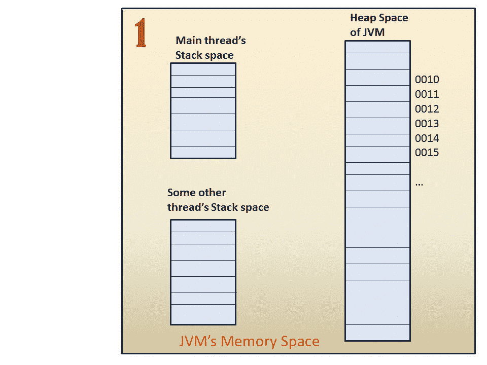

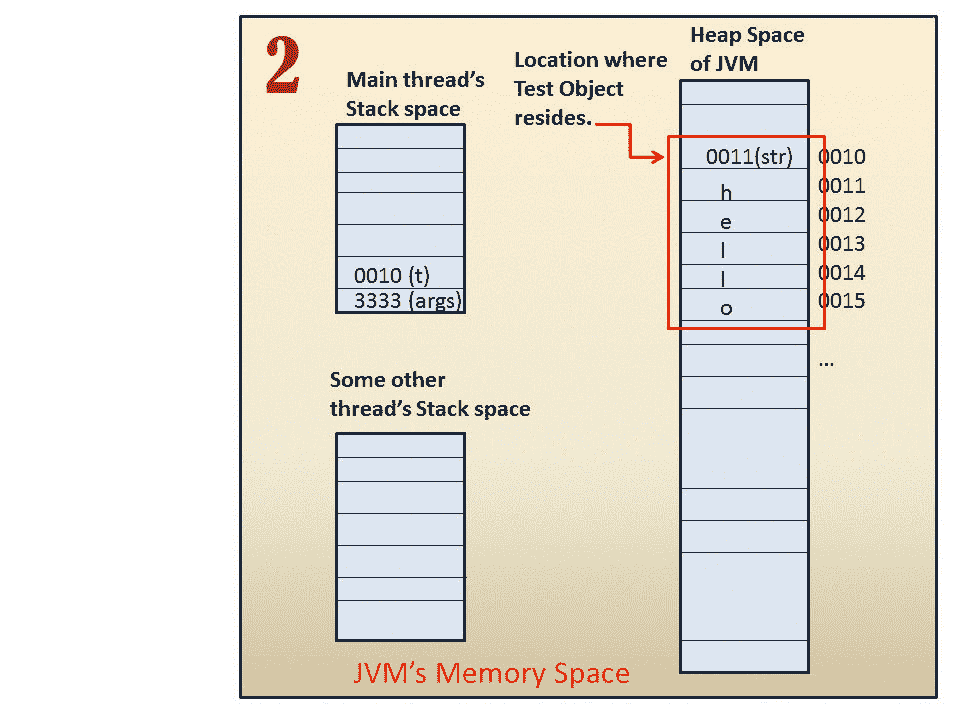

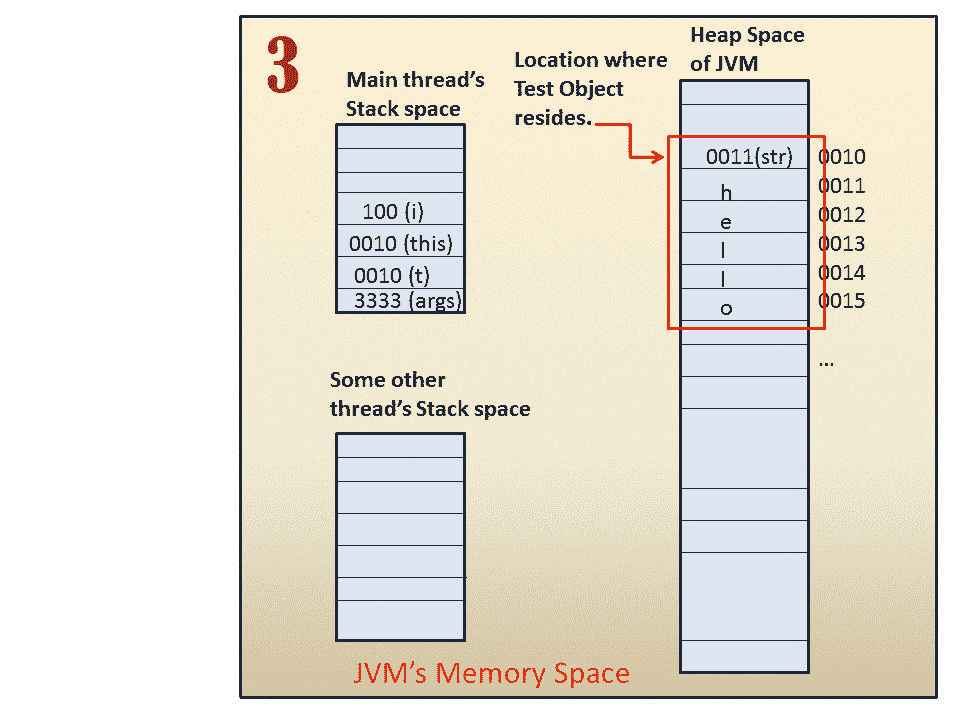

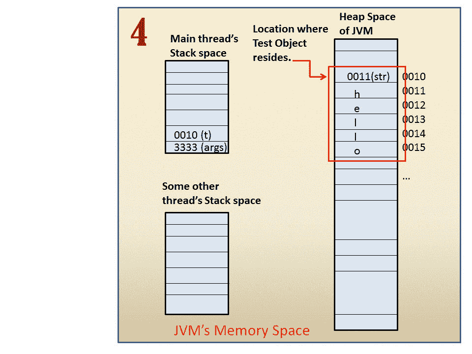

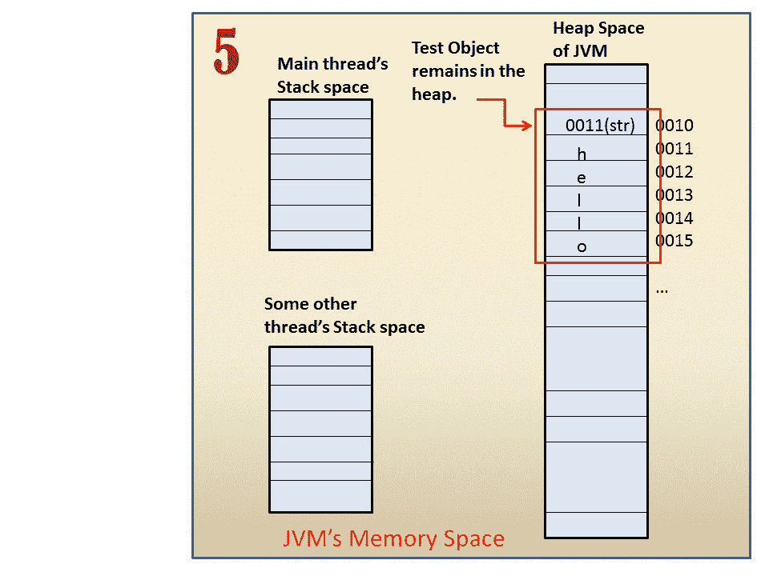


你可以观察到，栈空间看起来就像一堆叠在一起的芯片。首先，方法参数被放在栈上，然后由方法创建的所有临时变量会随着它们的创建一个接一个地添加到栈的顶端。一旦方法结束（即返回），方法参数和该方法添加到栈中的所有变量都会从栈顶移除。注意，它们只有在方法结束后才被移除。如果一个方法调用了另一个方法，那么被调用方法创建的变量就会推入同一个栈中，位于调用者方法所存储的变量之上。当一个线程死亡时，它的栈空间会被清空并还原给 `JVM`。由于这个空间的行为像一个栈，所以它被称为 `stack space`（栈空间）。

相反，`heap space`（堆空间）嗯，就像一个堆一样！对象在堆中的存放随心所欲。`JVM` 会尽力组织堆空间。堆空间的组织是一个高级主题，当你分析应用程序的性能时非常重要。然而，这与考试无关，因此我不会讨论它。从程序的角度来看，堆中并没有多复杂的组织。

每当代码的任何地方创建任何对象时（无论是在方法中还是在类中），`JVM` 都会在堆上为该对象分配空间并将其内容放入该空间中。在 `Java` 中，程序永远不会显式地释放这部分空间。它由 `JVM` 管理。再次记住，对象只能通过其引用被访问。一个方法要访问一个对象，它必须使用指向该对象的引用。它可以从保存在其栈空间中的变量中获取该引用（如果对象是在方法本身中创建的），也可以通过指向另一个对象的引用来获取（如果另一个对象拥有指向所需对象的引用）。在任何情况下，方法都必须从其栈空间上已的引用开始。如果没有没有任何栈空间可以直接或间接地访问某个对象，那么该对象就会被视为垃圾。它由 `JVM` 使用垃圾回收器自动清理。

回想一下我们对 `References`（引用）和 `Objects`（对象）的讨论，引用仅仅是一个存储实际对象所在位置地址的变量。从这个意义上说，引用变量与 `int` 变量没有区别。它们都存储一个数字。引用变量存储一个指示你可以找到实际对象的内存位置的数字，而 `int` 变量存储一个被解释为数值的数字。它不指示任何其他内容。如果你在方法中创建一个变量，无论是引用变量还是原始变量，它都保存在栈上，但当你创建一个对象时，该对象被存储在堆上。

通常，使用 `new` 关键字创建对象。但 `Java` 将 `Strings` 视为特殊的，因此即使没有 `new` 关键字你也可以创建 `String` 对象。因此，无论你是执行 `"hello"` 还是 `new String("hello")`，在两种情况下，堆上都会创建一个包含 `"hello"` 的 `String` 对象。

### 需要记忆的点

- 局部变量始终保存在栈上。对象始终存储在堆中。（一个优化的 `JVM` 可能会在栈空间上分配对象，但这是 `JVM` 的内部细节，你不需要担心。对我们来说，对象始终在堆上。）
- `JVM` 可能有多个线程。每个线程都被分配了固定数量的栈空间，该空间完全且专门供该线程使用。除了线程本身，没人可以访问它的栈空间。这被称为 `stack semantics`（栈语义）。线程通过创建和使用变量来访问其栈空间。没有其他访问栈空间的方法。
- 堆空间由所有线程共享。任何线程都可以通过创建对象使用堆空间。由于堆空间是共享的，如果一个线程拥有另一个对象的引用，就可以访问另一个线程创建的对象。这被称为 `heap semantics`（堆语义）。
- 程序的栈空间是有限的。因此，如果你有一个巨大的方法调用链，每个方法都创建大量的临时变量（`递归`是一个很好的例子），可能会耗尽栈空间。在 `Java` 中，默认栈空间大小为 `64KB`，但在执行程序时可以使用命令行选项 `-Xss` 进行更改。从程序的角度来看，堆空间是无限的。它仅限于机器上的可用空间。
- 只有临时变量，即方法参数和方法中创建的变量（也称为局部变量或自动变量）会被创建在栈空间上。其他所有内容创建在堆空间。如果你有任何疑问，问自己这个问题：这是一个临时变量吗？是？那么它在栈上创建。不是？那么就在堆上。实际对象总是在堆上创建。
- 当方法被线程调用时，它使用线程的栈空间来保留其临时变量。
- 方法添加到栈空间的变量在方法结束时从栈中移除。该方法创建的所有其他内容在方法结束后仍留在堆上。

你在餐厅结账单时付了 15% 的小费。这并没有法律规定。如果你不付小费，没有人会把你关进监狱。但你仍然这样做是因为这是一种惯例。世界上许多事情都是基于惯例的。在印度，你在道路的左侧行驶。这是一种惯例。这与技术上的正确没有关系。事实上，人们在美国从右侧行驶是完全没。但如果你在印度从道路右侧行驶，你就会导致事故，因为这不是其他人对你行为的预期。

编程世界也是如此。作为一名程序员，你是程序员社区的一一员。你编写的代码会被别人阅读，而在开发你的代码时，你也会阅读和使用别人编写的代码。如果代码遵循惯例，处理这段代码将节省每个人的时间和精力的。将循环变量命名为 `i`、`j` 或 `k` 听起来可能很荒谬，但这就是惯例。任何看到变量为 `i` 的代码的人都会立即认为它只是一个用于遍历某些循环的临时变量。

如果你决定使用一个名为 `i` 的变量来存储某些重要的程序元素，你的程序可以运行良好，但别人需要花时间才能意识到这一点，并且他们会为此咒骂你。

如果你对编程中惯例的重要性仍然不信服，让我换一种说法。如果我在面试中要求你写一些代码，而你使用一个名为 `hello` 的变量作为循环变量，我不会录取你。我可以向你，大多数面试官也不会喜欢那样。惯例就是如此。

## 1.7.2 Java 中的惯例

`Java` 中一些最重要的惯例如下：

1. **大小写 (Cases)** - `Java` 各处都使用“驼峰命名法”，但有细微差别。
   - 类名以大写字母开头。例如，`ReadOnlyArrayList` 是一个很好的名字，但 `Readonlyarraylist` 不是。
   - 包名通常全小写，但它们也可以是以小写字母开头的驼峰命名。例如，`datastructures` 是一个很好的包名，但 `DataStructures` 不是。
   - 变量名以小写字母开头并可以包含下划线。例如，`current_account` 是一个很好的变量名。
2. **命名 (Naming)** - 名字应该是有意义。具有业务目的的程序不应该有像 `foo`、`bar` 和 `fubar` 这样的变量名。尽管如此，这些无意义的名字在名称不重要的示例程序中用于说明或解释代码。
3. **包名 (Package names)** 使用反向域名结合组名和/或应用程序名称。例如，如果你在美国银行的固定收益技术部门工作，并且正在开发一个名为 `FX Blotter` 的应用程序，那么你该应用程序的所有包都可以以 `com.bofa.fit.fxblotter` 开头。名为 `ReadOnlyArrayList` 的类的全限定名可以是 `com.bofa.fit.fxblotter.dataStructures.ReadOnlyArrayList`。

使用反向域名的原因是它非常容易创建全球唯一的包名。例如，如果另一个小组的开发者也创建了自己的 `ReadOnlyArrayList`，那么他的类全限定名可以是 `com.bofa.derivatives.dataStructures.ReadOnlyArrayList`。如果第三个开发者想在代码中同时使用这两个类，将没有任何问题，因为它们的全限定名是不同的。重要的是，这些名字在任何程序员从未就其类名进行过交流的情况下，结果竟然是不同的。这些名字在在全球范围内也是唯一的，因为公司的域名是全球唯一的。

### 1.8 编译与执行

### 1.8.1 编译与执行

让我们快速回顾一下基础知识。你知道 `Java` 源文件被编译成 `Java` 类文件，而类文件是 `JVM` 执行的。你还知道通过在 `Java` 源文件的顶部放置 `package` 语句，可以将你的 `Java` 类组织成包。包名加上类名被称为 `Java` 类的全限定类名，简称为 `FQCN`。例如，考虑以下代码：

```
package accounting;

public class Account{

   private String accountNumber;

   public static void main(String[] args){

      System.out.println("Hello 1 2 3 testing...");

   }

}
```

在上述代码中，`accounting.Account` 是全限定类名。

在执行时，你必须告诉 `JVM` 在何处找到你要求它执行的类。`-classpath`（或其短格式 `-cp`）选项正是为此目的设计的。你使用此选项来指定你的类所在的位置。你可以在这里指定多个位置。例如，如果你有一个类位于 `c:\myclassfiles` 目录，且该类引用了了另一个存储在 `c:\someotherdirectory` 中的类，你应该像这样在 `classpath` 中同时指定这两个位置：

```
c:\>java -classpath c:\myclassfiles;c:\someotherdirectory accounting.Account
```

请注意，当你谈论类的位置时，你指的不是感兴趣的类文件的位置，而是类文件目录结构的位置。因此，在上面的命令行中，`c:\myclassfiles` 应该包含 `accounting` 目录，而不是 `Account.class` 文件。`Account.class` 应该位于 `accounting` 目录内部。`JVM`会在 `-classpath` 选项指定的所有位置搜索类。

注意：在基于 *nix* 的系统中，你需要使用冒号（`:`）代替分号（`;`），并使用正斜杠（`/`）代替反斜杠（`\`）。

`Java` 命令默认会扫描当前目录下的类文件（和包），因此通常不需要在 `-classpath` 选项中指定“点”（`.`）。我显式地指定它只是为了说明 `-classpath` 选项用法。

### 一次编译多个源文件

假设你在 `c:\javatest` 目录中有两个源文件 `A.java` 和 `B.java`，内容如下：

`A.java` 的内容：

```
package p1;
import p2.B;
public class A{
  B b  = new B();
}
```

`B.java` 的内容：

```
package p2;
public class B{
}
```

打开命令提示符，`cd` 到 `c:\javatest` 并编译 `A.java`。你会得到一个编译错误，因为类 `A` 依赖于类 `B`。显然，编译器将无法 `B.class`，因为你还没有编译 `B.java`！因此，你需要先编译 `B.java`。当然，如之前所述，在编译 `B.java` 时你需要使用 `-d .` 选项，以便 `javac` 在 `c:\javatest` 目录中创建相应的目录结构以及类文件。这会在 `c:\javatest\p2` 目录下创建 `B.class`。现在 `A.java` 的编译将成功了。

关键点在于，如果你有两个类，其中一个类依赖于另一个类，你需要先编译独立类的源文件，后编译依赖类的源文件。然而，大多数非复杂的 `Java` 都是由在多个源文件中编写的多个类组成的。手动确定源文件文件的编译顺序是不现实的。此外，两个类之间可能存在循环依赖。在这种情况下，你会先编译哪一个源文件呢？

幸运的是，有一个简单的解决方案。只需一次指定你想要编译的所有源文件，让编译器自己找出依赖关系。方法如下：

```
javac -d . A.java B.java
```

但再次，手动指定所有源文件的名称也是不现实的。嗯，这个问题也有解决方案：

```
javac -d . *.java
```

通过指定 `*.java`，你是在告诉编译器编译当前目录下存在的所有 `Java` 文件。编译器将检查所有源文件，找出依赖关系，为所有文件创建类文件，并将类文件存放在合适的目录结构中。这不是很巧妙吗？

如果你的 `Java` 源文件引用了存储在另一个目录中的预存在类文件，你可以使用与 `java` 命令执行类文件时相同的 `-classpath`（或 `-cp`）选项向 `javac` 声明它们的可用性。

我强烈建议你遵循上述步骤，熟练编译过程。

### 运行单文件源程序程序

`Java` 设计者认为，当你尝试执行简单的测试程序时，`Java` 程序的两步编译和执行太麻烦了。为了简化，`Java 11` 允许你使用 `java` 命令直接执行 `Java` 源文件。例如，考虑 `c:\javatest` 目录下 `TestClass.java` 文件的以下内容：

```
public class TestClass {
    public static void main(String[] args) {
        System.out.println("Hello world!");
    }
}
```

你可以使用以下命令从命令行直接执行此文件：

```
java TestClass.java
```

它将打印 Hello World!

这种方法的唯一限制是，你的 `Java` 代码不能引用任何其他 `Java` 文件中的代码。你可以在文件中包含任意数量的类，但文件中出现的第一个类必须包含 `main` 方法，因为那是 `JVM` 将选取并执行的 `main` 方法。尽管如此，在你的代码中引用其他类型（无论是否使用 `import` 语句）并没有限制。

虽然这种“编译即执行”的技术没有在考试目标中明确提到，但一些候选人报告收到过关于它的题目的问。无论如何，学习它是好的的，因为在你使用单文件程序尝试各种概念时，它将为你节省大量时间。你必须小心区分编译失败和运行时异常。如果你在控制台上看到 `error: compilation failed`，那就是编译错误，否则就是运行时异常。

### 将类打包成 Jar

管理一个文件无疑比管理多个文件容易得多。一个应用程序可能由成百上千个类组成，而如果你想让用户从你的网站下载该程序，你不能期望用户下载每个文件。你可以将它们压缩，但这样用户必须解压才能运行程序。为了避免这个问题，`Java` 创建了自己的归档格式，称为“Java 归档”（Jar），它与压缩文件非常相似，但扩展名为 `.jar`。

创建一个保持类文件包结构的 jar 文件非常简单。假设你有如下目录结构：

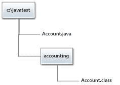

进入命令提示符，`cd` 到 `c:\javatest` 目录并运行以下命令：

```
jar -cvf accounting.jar accounting
```

该命令告诉 `jar` 工具创建 `accounting.jar` 文件，并将整个 `accounting` 目录及其内部文件和目录包含其中。你现在应该拥有如下目录结构：

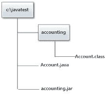

假设你在提示符仍在 `c:\javatest` 目录下，你现在可以这样通过 jar 文件运行该类：

```
java -classpath .\accounting.jar accounting.Account
```

注意，在创建 jar 文件时，必须维护类的包结构。如果你在 **WinZip** 或 **7zip** 中打开 `accounting.jar`，你会发现这个 jar 在 `accounting` 目录下包含 `Account.class`。

除了类文件外，`Jar` 文件还允许你在 jar 包内部保留有关 jar 包内容的信息。这些信息存储在一个名为 `MANIFEST.MF` 的特殊文件中，并存放在 jar 包的 `META-INF` 文件夹中。（这就像航空公司使用“舱单”来记录航班上的货物或乘客名单一样。）例如，你可以指定应用程序的入口点，这将允许你直接运行一个 `Jar` 文件（通过命令行，甚至只需通过在文件资源管理器中双击 jar 文件），而无需在命令行上指定包含 `main` 方法的类名。该文件的典型内容如下：

```
Manifest-Version: 1.0
Main-Class: accounting.Account
Created-By: 11.0.2 (Oracle Corporation)
```

你实际上可以直接在 `c:\javatest` 目录下创建一个仅包含一行内容 `Main-Class: accounting.Account` 的 `mymanifest.txt` 文件（确保冒号后有一个空格，并且文件末尾有一个换行符），并使用以下命令创建 jar：

```
jar -cvfm accounting.jar mymanifest.txt accounting
```

`c` 代表 create（创建），`v` 代表 verbose（详细输出，即在命令行上显示详细信息），`f` 代表 output file（输出文件），`m` 代表必须包含在 jar 包 manifest 中的文件内容。请注意，命令行上 manifest 文件的名称并不重要，只有文件的内容才重要。此命令会自动在 jar 包的 `META-INF` 文件夹内创建一个名为 `MANIFEST.MF` 的文件。

一旦你在 jar 包中包含了这些信息，运行程序唯一需要做的的就是在命令行上执行以下命令：

```
java -jar accounting.jar
```

虽然将类打包成 `Jar` 文件本身不是考试考点，但你将需要从模块执行的角度来了解它，而这部分是在考试范围内的。

## 1.8.4 编译错误与运行时异常（exception）

理解某项操作是在编译期间导致失败，还是会在运行时抛出异常，对于考试至关重要，因为考试中大量的题目会将这两种可能性作为候选项。初学者在尝试区分这两种情况时往往会感到沮丧。如果你能记住以下三点，情况会变得简单一点：


1. 首先，检查代码是否符合语言的语法规则是编译器的工作。这意味着，当遇到任何语法错误时，它都会生成错误。例如，Java 要求 `package` 语句（如果存在）必须是 Java 代码文件中的第一条语句。如果你尝试将 `package` 语句放在 `import` 语句之后，编译器会报错，因为这种代码在语法上是不准确的。你将在本书中读到许多此类规则。是的，你需要记忆所有这些规则。如果你使用 `Eclipse`、`NetBeans` 或 `IntelliJ` 等 IDE，你应该停止使用它们，因为你需要训练大脑去识破此类错误，而不是依赖 IDE。使用 `Notepad` 编写代码并使用命令行编译和运行测试程序，对于掌握考试的这方面非常有帮助。

2. 除了语法上正确外，编译器还想确保代码在逻辑上也是正确的。然而，编译器的局限性在于它无法执行任何代码，因此它永远无法识别代码中可能存在的所有逻辑错误。尽管如此，如果编译器根据代码中存在的信息判断代码存在明显的错误，它就会抛出错误。这类错误是让初学者感到最沮丧的根源。例如，`byte b = 200;` 语句在语法上是正确的，但编译器并不喜欢它。编译器知道值 `200` 太大了，无法放入 `byte` 中，它认为程序员在这里犯了逻辑错误。另一方面，编译器允许 `int i = 10/0;` 语句通过，尽管你光看一眼代码就知道这条语句是有问题的。

3. `JVM` 是始终维护 Java 虚拟机完整性和类型安全的终极守卫士。与编译器不同，`JVM` 了解代码尝试执行的一切，一旦它确定该操作可能会损害 `JVM` 的完整性或类型安全，它就会立即抛出异常（我在这里泛指地使用“异常”一词，而不是指 `java.lang.Exception` 类）。因此，任何逃过编译器的潜在非法活动都会被 `JVM` 捕获，并在运行时抛出异常。例如，除以零不会产生任何有意义的整数值，这就是为什么当代码尝试将整数除以零时，`JVM` 会抛出异常。

诚实地说，这不是一个容易掌握的主题。掌握它的唯一方法是了解所有这种区分并不直观的情况。如果你遵循这本书，你将学习考试所需的所有此类规则、它们的例外以及背后的原因。

## 1.9 术语

### 1.9.1 Java 开发中常用的术语

在你的编程生涯中，你会读很多东西。可能是书籍、文章、博客、手册、教程甚至是讨论论坛。你还将与各种角色的开发者进行互动，如面试官、团队成员、架构师和同事。为了充分利用互动，对常用术语形成清晰的理解是非常重要的。我将解释 Java 世界中常用的短语、名称和术语。

1. **类（Class）**：除非另有说明或上下文明确，“类”一词包含了接口（interface）和枚举（enum）。通常人们在说“类”时指的是“类型（type）”。然而，你应该始终精确，仅将“类”指代类。

2. **类型（Type）**：类型指的是类、接口、枚举以及基本类型（`byte`、`char`、`short`、`int`、`long`、`float`、`double`）。

3. **基本类型（Primitive types）**：`byte`、`char`、`short`、`int`、`long`、`float`、`double`被称为基本类型，因为它们只存储数据而没有行为。你可以对它们进行操作，但不能对它们调用方法。它们除了包含的数据值外，没有其他属性或状态。你直接访问它们，而不是通过引用。

4. **引用类型（Reference types）**：类、接口和枚举被称为引用类型，因为你通过引用来引用它们，而不是直接访问。与基本类型不同，引用类型具有行为和或状态。

5. **顶层引用类型（Top-level reference types）**：直接定义在包下的类、接口或枚举被称为顶层类、接口或枚举。

6. **嵌套引用类型（Nested reference types）**：定义在另一个类、接口或枚举内部的类、接口和枚举被称为嵌套类、接口或枚举。

7. **内部类型（Inner reference types）**：非静态嵌套类、接口和枚举被称为内部类、接口或枚举。

8. **本地类型（Local reference types）**：在方法内部（或另一个代码块内部而非直接在类、接口或枚举内部）定义的嵌套类型被称为本地类、接口或枚举。

9. **匿名类（Anonymous classes）**：这是嵌套类的一种特殊情况，代码中仅存在类定义，编译器会通过上下文自动推导出完整的声明。匿名类总是嵌套类，且永远不是静态的。

## 10. 编译时 vs 运行时（即执行时间）

你知道执行 Java 代码有两个步骤。第一步是使用 Java 编译器编译 Java 代码以创建类文件（class file），第二步是执行 JVM 并将类文件名作为参数。编译代码期间发生的任何事情，例如生成编译器警告或错误信息，都被说是发生在“编译时”。在程序执行期间发生的任何事情都被说是发生在“运行时”。例如，语法错误（如缺少括号、大括号或分号）在编译时被捕获，而在执行代码时生成的任何异常都会在运行时被抛出。这似乎是显而易见的，但我见过很多初学者发布过这样的问题，例如：“为什么我尝试编译这段代码时，它会抛出以下异常？”，而实际上他们想问的是：“为什么这段代码在编译时生成了以下错误信息？” 另一个常见问题是：“为什么这段代码在成功编译后仍然抛出异常？” 编译成功并不保证执行成功！尽管编译器试图通过在编译期间抛出警告和错误信息来防止许多 Bug，但编译成功仅仅意味着代码在语法上是正确的。

## 11. 编译时常量

通常情况下，是 JVM 在程序执行时设置变量的值。编译器不执行任何代码，它不知道变量在程序执行期间可能取到的值。尽管如此，在某些情况下，编译器可以确定变量的值。如果编译器能够确定变量在程序执行期间将取到的值，那么该变量实际上就是编译时常量。例如，如果你定义一个 `int` 变量为 `final int x = 10;`，那么 `x` 就是一个编译时常量，因为编译器知道 `x` 在运行时始终具有值 10。同样，字面量如数字 1、2 和 3，或者代码中用单引号括起来的字符（如 `'a'`），以及布尔值 `true` 和 `false` 都是编译时常量，因为编译器知道这些值永远不会改变。

我将在整个课程中引用这些术语并讨论它们的细节，所以如果你能记住这些术语的基本概念，将会是有帮助的。

# 第 2 章 创建简单的 Java 程序

## 考试目标

* 创建一个带有 main 类的可执行 Java 程序

* 从命令行编译并运行 Java 程序

* 创建并导入包

## 2.1 创建一个带有 main 类的可执行 Java 程序

### 2.1.1 main 方法 [☝](http://enthuware.com/forum/dbt.php?bid=2&sn=2.1.1&tn=the-main-method)

让我们先解决一个问题。Java 对变量、方法和类等事物的命名有特定的规则。所有这些名称都属于一个被称为“标识符”（identifiers）的类别。

Java 将标识符定义为 Java 字母和 Java 数字的无限制长度序列，其中第一个必须是 Java 字母。标识符的拼写不能与 Java 关键字或字面量（即 `true`、`false` 或 `null`）相同。以下是 Java 中的关键字列表：

| Java 关键字 | | | | |
| --- | --- | --- | --- | --- |
| abstract | continue | for | new | switch |
| assert | default | if | package | synchronized |
| boolean | do | goto | private | this |
| break | double | implements | protected | throw |
| byte | else | import | public | throws |
| case | enum | instanceof | return | transient |
| catch | extends | int | short | try |
| char | final | interface | static | void |
| class | finally | long | strictfp | volatile |
| const | float | native | super | while |
| _ (下划线) | | | | |

根据上述规则，例如，以下变量名是无效的：

```
int int; //int 是关键字
String class; //class 是关键字
Account 1a; //不能以数字开头
byte true; //true 是字面量
String _; //自 Java 9 起，_ (下划线) 已成为关键字
```

注意 `var` 不是一个关键字。它被归类为具有特殊含义的标识符。它实际上被编译器替换为从赋值给变量的值中推断出的类型。因此，`var var = "hello";` 是一个有效语句，因为第一个 `var` 将替换为 `String`。

Java 字母包括大写和小写的 ASCII 拉丁字母 A-Z (`\u0041-\u005a`) 和 a-z (`\u0061-\u007a`)，以及由于历史原因的 ASCII 下划线（`_` 或 `\u005f`）和美元符号（`$` 或 `\u0024`）。“Java 数字”包括 ASCII 数字 0-9 (`\u0030-\u0039`)。因此，虽然下划线本身不是有效的标识符，但有效的标识符可以以下划线开头。

旧版本的考试会测试候选人识别有效标识符。然而，目前的考试已偏离了让候选人充当人工编译器，不再包含这个主题。尽管你应该对什么是标识符有一个基本的概念，因为这个概念适用于 Java 中的各种名称。

### 1.10 Java 标识符

### 1.10.1 Java 标识符 [☝](http://enthuware.com/forum/dbt.php?bid=2&sn=1.10.1&tn=java-identifiers)

（注：由于提供的原始文本存在大量重复和乱序，此处已根据您的要求和逻辑对输入文本结构进行了处理。）

# 错误：类 `TestClass` 中的 main 方法不是静态的，请将 main 方法定义为：

`public static void main(String[] args)`

看起来非常规的 main 方法示例：

1. `public static native void main(String[] args);` - 超出考试范围，但了解它是有用的。这是一个有效的 main 方法。`native`（原生）方法意味着你将在一个单独的可执行库中实现此方法，该库将在运行时进行链接。在这种情况下，JVM 将动态链接库中查找你的 main 方法的实现。如果找到了实现，则一切正常。如果没有找到，它将抛出错误，说明无法找到该原生方法的实现。

2. `public abstract static void main(String[] args);` - 无效，因为静态方法不能是抽象的。

就像任何其他方法一样，在 Java 类中完全可以存在重载的 main 方法。我稍后会详细讨论重载，但目前，它意味着有多个同名但参数不同的方法。JVM 会寻找上述的特定 main 方法。所有其他 main 方法对 JVM 来说都没有特殊意义。认证考试中的许多问题都假设存在 main 方法。你可能会被给定一段代码片段并被要求确定输出。如果你在给代码中没有看到任何 main 方法，你需要假设某处有一个 main 方法被 JVM 调用，而给定的代码或方法是通过该方法被调用的。

## 2.1.2 命令行参数 [☝](http://enthuware.com/forum/dbt.php?bid=2&sn=2.1.2&tn=command-line-arguments)

在执行类时，可以通过在命令行类名后面直接指定参数来提供任意数量的参数。参数必须由空格字符分隔。例如，如果你想向名为 `TestClass` 的类传递三个参数，你的命令将是：

`java TestClass a b c`

JVM 通过其 `String[]` 参数将命令行上指定的参数传递给 main 方法。换句话说，main 方法的 `String[]` 参数包含了命令行指定的参数。这的一个重要影响是，所有参数都是作为 `Strings` 传递给 main 方法。例如，如果你的命令行是 `java TestClass 1`，main 方法将获得一个包含一个元素（`1`）的 `String` 数组，而不是一个 `int` 类型的 `1`。

现在让我向你展示以下程序，以解释如何使用命令行参数。这个简单的程序会打印从命令行传递给它的参数。

```java
public class TestClass{
   public static void main(String[] args) throws Exception{
      for(int i=0; i<args.length; i++){
          System.out.println("args["+i+"] = \""+args[i]+"\"");
      }
   }
}
```

该程序的输出将告诉你关于命令行参数所需的所有知识。以下是一个包含执行程序时使用的命令行以及程序生成的相应输出的表格：

| 使用的命令行 | 输出 | 推断 |
| :--- | :--- | :--- |
| `java TestClass` | | 如果没有指定参数，`args` 包含一个长度为 0 的 String 数组。注意 `args.length` 没有抛出 `NullPointerException`。这意味着 `args` 不是空。在这种情况下，`args` 指向一个长度为 0 的 String 数组。 |
| `java TestClass a` | `args[0] = "a"` | 第一个参数存储在索引 0 处。第一个参数**不是** "java"，甚至是类的名，即 "TestClass"。 |
| `java TestClass a b c` | `args[0] = "a" args[1] = "b" args[2] = "c"` | 参数可以由一个或多个空白字符分隔。所有此类分隔字符都会被移除。 |
| `java TestClass "a " b` | `args[0] = "a " args[1] = "b"` | 如果你在想要传递的值周围加上引号，则引号内的所有内容被视为一个参数。引号不被视为参数的一部分。注意第一个参数是 "a ",即一个包含字符 'a' 后面跟一个空格字符的 String。 |
| `java TestClass "\""` | `args[0] = """` | 要传递一个引号字符作为参数，你必须使用反斜杠对其转义。 |

顺便说一下，你能猜到为什么类名没有作为参数传递给 main 方法吗？记住，与可执行程序不同，你不能更改 Java 类文件的名称。Java 类文件的名称始终与在 Java 源文件中赋予该类的名称相同。因此，类的 main 方法始终知道它所属的类名。

## 2.1.3 main 的结束 [☝](http://enthuware.com/forum/dbt.php?bid=2&sn=2.1.3&tn=the-end-of-main)

如之前所述，一旦 JVM 将控制交给你尝试执行的类的 `main 方法`，将由 main 方法决定下一步做什么。对于 JVM 而言，在调用 main 方法后，你的应用程序已经“启动”。从这个意义上说，main 方法只是你应用程序的入口。那么，当 main 方法结束时会发生什么？应用程序也会结束吗？

## 2.2 从命令行编译并运行 Java 程序

### 2.2.1 从命令行运行 Java 程序 [☝](http://enthuware.com/forum/dbt.php?bid=2&sn=2.2.1&tn=run-a-java-program-from-the-command-line)

我们之前在“新手入门”下的“编译与执行”部分介绍过如何从命令行编译和执行 Java 程序的基础知识。我在这里总结一下你考试时需要知道的关键点。

1. 标准的 Oracle JDK 附带 Java 编译器。编译器的可执行文件名为 `javac`。换句话说，你用于编译 Java 代码的程序被称为 "javac"。你可以使用命令 `javac TestClass.java` 来编译名为 `TestClass.java` 的 Java 源文件。

注意，你必须指定包含扩展名的完整文件名。`javac` 确实支持多个选项来微调编译过程，但考试中不需要这些任何选项。

2. Java 文件的编译会根据 Java 源文件的内容生成一个或多个类文件（class files）。

3. 标准的 Oracle JDK 自带了一个 Java 虚拟机（`JVM`）。`JVM` 的可执行文件命名为 `java`。换句话说，启动 `JVM` 并执行你的 Java 程序所需的程序被称为 `java`。

4. 要执行一个 Java 类，可以使用以下命令 - `java TestClass`

注意在指定类名时没有文件扩展名 `.class`。但是，要编译 Java 源文件，你必须指定文件的扩展名，即 `.java`。与 `javac` 一样，`java` 命令也可以接受多个选项来微调 Java 程序的执行。考试中不需要了解这些选项中的任何。

5. Java 11 允许所谓的“单文件源代码程序”，这意味着如果你的程序存在于单个源文件中，你可以直接使用 `java` 命令运行该文件，而无需先使用 `javac` 将其编译。例如，`java TestClass.java`

## 2.3 创建和导入包

### 2.3.1 package 语句 [☝](http://enthuware.com/forum/dbt.php?bid=2&sn=2.3.1&tn=the-package-statement)


每个 Java 类都属于某个包。该包的名称通过源文件中的 `package` 语句来指定。整个源文件中最多可以有一个 `package` 语句，如果存在，它必须是文件中的第一条语句（当然，排除注释）。在该文件中定义的所有顶层类型都属于该包。如果 Java 文件中没有 `package` 语句，那么在该文件中定义的类将属于一个未命名包，该包也称为 `default` 包。换句话说，如果你有两个没有任何 `package` 语句的 Java 文件，那么这两个文件中定义的类属于同一个未命名包。

## 关于未命名包的重要要点 [☝](http://enthuware.com/forum/dbt.php?bid=2&sn=2.3.1&tn=important-points-about-the-unnamed-package)

1. 未命名包没有名字。废话！

2. `default` 不是未命名包的名称。没有名为 `default` 的包。不过，你无法通过为类指定 `default` 作为包名来创建一个名为 `default` 的包，因为 `default` 是一个关键字。

3. 由于未命名包没有名称，因此无法引用此包。换句话说，无法将属于未命名包的类导入到属于另一个包的类中。你不能在 Java 文件中写 `import *;`。这就是为什么不建议在不带 `package` 语句的情况下创建类的原因之一。

你可以为包命名为任何名称，但建议使用反向域名格式来命名包。例如，如果你在 `Amazon` 工作，你的包名应该以 `com.amazon` 开头。然后你应该将组名和应用程序名称追加到你的包名中，以确保你的类在全球范围内是唯一的。例如，如果你的组名是 `com.amazon`，应用程序名称是 `sales`，那么你的包名将是 `com.amazon.sales`。如果你将类命名为 `Item`，你的源文件看起来如下：

```java
package com.amazon.sales;
public class Item {
}
```

### 2.3.2 测验 [☝](http://enthuware.com/forum/dbt.php?bid=2&sn=2.3.2&tn=quiz)

以下代码段中哪些是有效的？

**A.**

```java
package taxes;
public class Test {
}
```

**B.**

```java
import taxes.Values;
public class Test {
}
```

**C.**

```java
import taxes.*;
public class Test {
}
```

**D.**

```java
import taxes.*;
package taxes;
public class Test {
}
```

正确答案是 `B`。`A` 是错误的，因为 `package` 语句必须是第一条语句。`C` 和 `D` 是错误的，因为 `import` 必须在 `package` 语句之后。

### 2.3.3 import 语句 [☝](http://enthuware.com/forum/dbt.php?bid=2&sn=2.3.3&tn=the-import-statement)

如果你想使用另一个包中的类，可以使用它的完全限定名（FQCN）。例如，`taxes.Values`。

```java
public class Test {
    public static void main(String[] args) {
        double rate = taxes.Values.TAX_RATE;
    }
}
```

如果你在代码中多次引用此类，最好使用 `import` 语句。例如：

```java
import taxes.Values;
public class Test {
    public static void main(String[] args) {
        double rate = Values.TAX_RATE;
    }
}
```

如果你的类引用了同一个包的多个类，你可以为每个类使用一个 `import` 语句，也可以只使用一个带有通配符 `*` 的 `import` 语句来针对整个包。例如：

```java
import taxes.*;
public class Test {
}
```

#### import static 语句 [☝](http://enthuware.com/forum/dbt.php?bid=2&sn=2.3.4&tn=the-import-static-statement)

有时你需要在应用程序的多个类中定义值。例如，如果你正在开发一个用于税务计算的应用程序，你可能希望定义一个供所有类使用的税率值。

```java
package taxes;
public class Values {
  public static double TAX_RATE = 0.15;
}
```

为了在不限定类名的情况下使用该静态成员，可以使用 `import static` 语句：

```java
import static taxes.Values.TAX_RATE;
public class Test {
    public static void main(String[] args) {
        double rate = TAX_RATE;
    }
}
```

## 选项 2

添加 `import taxes.Values;` 或 `import taxes.*;`，然后在你的类中使用 `Values.TAX_RATE`。

## 选项 3

从 Java 5 开始，你有了第三种选择，称为 `import static`。为了消除多次输入类名，你可以简单地使用 `import static` 语句导入任何类的静态成员。在这个示例中，你可以向类的 import 语句列表中添加 `import static taxes.Values.TAX_RATE;` 或 `import static taxes.Values.*;`（通配符格式会导入该类的所有静态成员），然后在代码中直接使用 `TAX_RATE`。

你还可以通过此语句导入静态字段和静态方法。因此，例如，如果你在 `Values` 类中有一个名为 `apply` 的静态工具方法，只要你包含了 `import static taxes.Values.apply;` 或 `import static taxes.values.*;`，你就可以直接使用方法名 `apply` 而不是 `Values.apply`。

请记住，`import static` 并不导入类。它只导入类的静态成员。因此，如果你没有使用普通的 `import` 语句导入 `taxes.*` 或 `taxes.Values`，你就不能在代码中使用简单名称 `Values`。

`import` 这个词在这里实际上是一个误导性名称。import 语句并没有将任何内容导入到你的类中。它只是对编译器的提示，让编译器去导入包中查找类。你基本上是在告诉编译器，此代码中引用的简单类名实际上是指向 import 语句中提到的包中的类。如果编译器无法解析简单类名（因为该类与当前类不在同一个包中），它将检查 import 语句，查看其中提到的包是否包含该类。如果是，则使用该类；如果否，则会产生编译错误。

### 关于 import 语句的重要要点

1. 你可以使用 `import packagename.classname;` 语句单独导入每个类，或者使用 `import packagename.*;` 导入一个包中的所有类，或使用这二者的任意组合。

2. `import` 语句是可选的。即使不使用 import 语句，你也可以引用另一个包中的类。在这种情况下，你需要在代码中编写该类的全限定类名（`FQCN`）。

3. 你可以导入任意数量的包或类。允许重复的 import 语句和冗余的 import 语句。即使你在代码中没有使用某个类，也可以导入它。记住，import 语句只是给人类使用的快捷方式。它并没有实际上向你的类中导入任何内容。

4. `java.lang` 包在所有类中都是自动导入的。即使你使用了 `java.lang` 包中的类，也不需要在类中编写 `import java.lang.*;`。但无论如何导入它都是没错的，因为允许冗余导入。

### 你不能做的操作

1. 没有方法使用 `import` 语句导入“子包”。例如，`import com.enthuware.*;` 将导入 `com.enthuware` 包中的所有类，但它不会导入 `com.enthuware.ocp` 包下的任何类。此外，`import com.enthuware.*.*;` 是非法的。这在本质上意味着从技术上讲，Java 中没有“子包”的概念。每个包都必须单独导入。

2. 你不能导入不存在的包或类。例如，如果你尝试使用某些随机包名，如 `import xyz.*;`，编译器将报错错误：

```
error: package xyz does not exist
import xyz.*;
^
1 error
```

你问编译器是如何知道一个包是否存在的？嗯，如果编译器在它的类路径（classpath）中找不到任何属于你想要导入的包的类，它就会推断该包不存在。

3. 未封装的类（“unpackaged classes”和“默认或未命名包中的类”这两个短语意思相同，即没有任何包声明的类）不能在任何其他包中导入。你不能执行像 `import *;` 这样的操作。

4. 如果多个包中存在同名的类，且你在代码中同时导入了这两个包，则你不能在代码中使用简单类名，因为使用简单名称将产生歧义。编译器无法确定你到底是指哪个类。因此，在这种情况下，你必须使用 `FQCN`。你可以使用 `import` 语句导入一个包或类，对该包中的类使用简单名称，而对另一个包中的类使用 `FQCN`。

使用两个同名但来自不同包的类的需求通常在使用 JDBC 时频繁出现。与 JDBC 相关的类位于 `java.sql` 包中，该包中的类使用 `java.sql.Date` 类代替 `java.util.Date`。但应用程序中与 JDBC 非相关的代码使用的是 `java.util.Date`。在这种情况下，最好在代码中使用每个类的 `FQCN` 以避免给读者带来困惑，尽管你可以导入一个包并使用简单名称 `Date` 来引用该包的类。

然而，从 Java 8 开始，你仍然应该使用 `java.time` 包中新的日期/时间类，这消除了这种烦恼。

### 2.3.4 测验 [☝](http://enthuware.com/forum/dbt.php?bid=2&sn=2.3.4&tn=quiz)

**Q.** 你下载了两个 Java 库。它们的包名分别为 `com.xyz.util` 和 `com.abc.util`。这两个包都有名为 `Calculator` 的类，且这两个类都有名为 `calculate` 的静态方法。

你在 `com.mycompany.app` 包中开发了一个名为 `MyClass` 的类，你的代码需要调用这两个类的方法如下：

```java
public class MyClass{
   public static void main(String[] args){
      //调用 xyz 的 calculate() 
      //调用 abc 的 calculate()
   }
}
```

以下哪种方法有效？

**A.** 在类中添加 `import com.*;`。然后使用 `xyz.util.Calculator.calculate()` 和 `abc.util.Calculator.calculate()`。

**B.** 添加 `import com.xyz.util.Calculator;`。然后使用 `Calculator.calculate()` 和 `com.abc.util.Calculator.calculate()`。

**C.** 使用任何 import 语句。在代码中使用 `com.xyz.util.Calculator.calculate()` 和 `com.abc.util.Calculator.calculate()`。

**D.** 实现。

正确答案是 B 和 C。选项 **A** 是错误的，因为不能导入部分包名。

## 2.4 练习 [☝](http://enthuware.com/forum/dbt.php?bid=2&sn=2.4.0&tn=exercises)

1. 在两个不同的包中创建类。在其中一个类中定义静态和实例字段，并在另一个类中访问这些字段。观察两个类互相访问字段会发生什么。

   提示：如果你在编译类时遇到困难，请查看《Kickstarter for Beginners》中的“编译与执行”章节。

2. 在方法中定义本地变量。在 while 循环中更新此变量并在循环结束后打印它。检查在 while 循环内部定义相同名称变量会发生什么。

3. 在 `hr` 包中创建一个类 `Admin`，在 `hr.reporting` 包中创建另一个类 `TimeCard`，并带有一个静态方法 `add()`。使用不同的 import 语句从 `Admin` 类中调用该静态方法。

4. 创建一个带有 main 方法的类并带参数执行该类。打印参数的数量。

5. 哪个 Java 特性（或缺失特性）最让你烦恼。为什么？

# 3.1 Java 中的数据类型 [☝](http://enthuware.com/forum/dbt.php?bid=2&sn=3.1.0&tn=data-types-in-java)

Java 支持两种类型的数据。

## 3.1.1 数据类型与变量类型 [☝](http://enthuware.com/forum/dbt.php?bid=2&sn=3.1.1&tn=data-types-and-variable-types)

`data type`（数据类型）本质上是赋予某类数据的名称。例如，在 Java 中，整数数据被命名为 `"int"`。布尔数据在 Java 中被命名为 `"boolean"`。将数据分类为不同的数据类型可以允许你以相同的方式处理相同类型的数据。它还允许你定义一组可以在同类数据上执行的操作。例如，如果你有一个 `int` 类型和 `boolean` 类型的数据，你就知道可以对 `int` 数据执行加法操作，但不能对 `boolean` 数据执行操作。数据类型还决定了存储该类数据所需的空间。例如，`byte` 只需要 8 位即可存储，而 `int` 则需要 32 位。

数据类型对于编程语言来说非常重要，因为它们允许你告诉编译器你想处理的数据种类。例如，当你写下 `int i;` 时，你是在告诉编译器 `i` 的类型是 `int`。编译器将只允许你在这个变量中存储整数值。除少数例外外，由于不同数据类型所需的空间大小不同以及/或由于它们的兼容性，无法将一种类型的数据存储到另一种类型的变量中。

变量的数据类型在编译时定义且在运行时无法更改的语言被称为“静态类型”语言。因此，Java 是一种静态类型语言。允许变量的数据类型在运行时更改的语言被称为动态类型语言。JavaScript 就是动态类型语言的一个例子。JavaScript 代码中的变量在一条语句中可能包含一个整数值，而在下一条语句中可能指向一个 `String`。每种方法都有优缺点，但讨论这些将超出范围。不过，为了面试目的，你应该在网上查阅相关内容。

通过定义一个特定类型的变量，你自动获得了在该变量上执行对该类型有效的操作的权利。例如，如果 `i` 被定义为 `int` 类型，编译器将只允许你对该变量执行数学和位运算。如果 `b` 被定义为 `boolean`，编译器将只允许你对该变量执行逻辑操作。

Java 有两种基本类型的数据类型：`primitive`（原始类型）和 `reference`（引用）。

**Primitive data types**（原始数据类型）设计用于处理整数、浮点数、字符和布尔值等原始数据。Java（我说的 Java 指 Java 编译器和 Java 虚拟机）天生知道这些数据类型的含义、它们占用多少空间以及可以对它们做什么。你不需要向 Java 解释关于它们的任何信息。原始数据类型是 Java 程序最基础的构建块。你在 `class` 中组合原始数据类型，以构建更复杂的数据类型。

另一方面，**Reference data types**（引用数据类型）设计用于处理对 Java 而言、代码具有特殊含义的数据。例如，如果你正在开发一个学生管理应用程序，你可能会定义诸如 `Student`（学生）、`Course`（课程）和 `Grade`（成绩）之类的实体。Java 并不知道 `Student`、`Course` 和 `Grade` 代表什么。它不知道它们占用多少空间、支持什么操作或拥有什么属性。Java 期望你定义所有这些内容。一旦你定义了它们，就可以使用它们来实现应用程序的业务逻辑。当你编写 `class`、`interface` 或 `enum` 时，你本质上是在定义一个引用数据类型。引用数据类型是通过组合原始数据类型和其他引用类型构建的。

在 Java 中，原始数据类型包括 `integral data types`（整数类型：`byte`、`char`、`short`、`int`、`long`）、`floating point data types`（浮点类型：`float`、`double`）和 `boolean data type`（只有一个——`boolean`）。而引用数据类型包括所有由定义的 `classes`、`interfaces` 和 `enums`。只要是 `class`、`interface` 或 `enum`，它就是引用数据类型。是的，`String` 也是引用数据类型，因为所有字符串都是 `java.lang.String` 类的实例 :) 我稍后会详细讨论字符串。

注意，`integral` 和 `floating point` 数据类型统称为 `numeric data types`（数值类型）。

以下表列出了原始数据类型的详细信息：

考试中不会要求你回答数据类型大小的细节。但作为一名 Java 程序员，了解这些信息非常重要。

Java 中的原始数据类型


| 数据类型 | 大小（位） | 取值范围 | 示例值 | 支持的操作 |
| --- | --- | --- | --- | --- |
| `byte` | 8 | -2⁷ 到 2⁷ -1，即 -128 到 127 | -1, 0, 1 | 数学运算，位运算 |
| `char` | 16 | 0 到 2¹⁶-1，即 0 到 65,535 | 0, 1, 2, 'a', '\u0061' | 数学运算，位运算 |
| `short` | 16 | -2¹⁵ 到 2¹⁵-1，即 -32768 到 32767 | -32768, 0, 32767 | 数学运算，位运算 |
| `int` | 32 | -2³¹ 到 2³¹-1 | -2147483648 到 2147483647 | 0, 1, 2 | 数学运算，位运算 |
| `long` | 64 | -2⁶³ 到 2⁶³-1 | -9223372036854775808 到 9223372036854775807 | 0, 1, 2 | 数学运算，位运算 |
| `float` | 32 | 约 ±3.4E+38 | 1.2f, 3.4f | 数学运算 |
| `double` | 64 | 约 ±1.8E+308 | 1.2, 3.4 | 数学运算 |
| `boolean` | 1 | | true, false | 逻辑运算 |

**注意：**

1. `byte`、`char`、`short`、`int` 和 `long` 称为`整数类型`，因为它们存储的是精确的值。
2. `char` 也是一种存储数字的整数类型，但它不能存储负数。`char` 中存储的数字被解释为 **unicode**。
3. `float` 和 `double` 存储的是不精确的值。Java 遵循 IEEE 754 标准。
4. `boolean` 只存储两个值，因此只需要一个位的内存。在 32 位系统中，`boolean` 甚至可能使用 4 字节。

#### 关于 void 的 [☝](http://enthuware.com/forum/dbt.php?bid=2&sn=3.1.1&tn=a-word-on-void)

`void` 是 Java 中的一个关键字，意思是“无”。它被用作方法的返回类型，表示该方法不返回任何内容。从这个意义上说，`void` 是一种类型规范而不是数据类型。这就是为什么尽管你可以声明一个方法返回 `void`，但你不能声明一个 `void` 变量。

#### null 和 void 的区别 [☝](http://enthuware.com/forum/dbt.php?bid=2&sn=3.1.1&tn=difference-between-null-and-void)

`null` 也是 Java 中的一个关键字，意思是“空”。然而，`null` 是一个值。它被用于表示引用变量当前没有指向任何对象。它不是一种数据类型，因此无法声明类型为 `null` 的变量。

注意 `null` 是引用变量的有效值，而 `void` 不是。当方法调用返回 `null` 时，意味着仅该次特定的调用没有返回有效引用。这并不意味着该方法从不返回有效引用。相反，`void` 意味着该方法根本不返回任何内容。因此，你不能在返回语句中使用 `void`。换句话说，`return null;` 可以是方法的有效返回语句，但 `return void;` 永远是无效的。

## 变量类型 [☝](http://enthuware.com/forum/dbt.php?bid=2&sn=3.1.1&tn=types-of-variables)

Java 有两种类型的变量来处理两种类型的数据类型，即基本类型变量（primitive variables）和引用变量（reference variables）。基本类型变量允许你处理基本类型数据，而引用变量允许你处理引用数据。因此，当你定义 `int i;` 时，`i` 是基本类型数据类型 `int` 的变量；但当你定义 `String str;` 时，`str` 是引用数据类型 `java.lang.String` 的变量。

理解这两种变量之间的根本区别非常重要。基本类型变量内部包含基本类型数据，而引用变量只存储实际数据所在位置的地址。例如，如果你执行 `i = 10;`，`i` 将包含值 `10`。但如果你执行 `str = "hello";`，`str` 只包含存储字符串 `"hello"` 所在内存位置的地址。你现在可以理解为什么它们被称为“引用”变量了。因为它们仅仅是对实际数据的引用！当你对引用进行任何操作时，该操作实际上是在位于其他地方的对象上执行的。在某种意义上，你可以将引用变量比作电视的“遥控器”。如果你在理解这方面有困难，在继续之前，你应该先过一遍“初学者入门”章节。）

这两种类型的变量都支持赋值操作，即它们允许你为它们赋值。例如，语句 `i = 20;` 将值 `20` 赋值给变量 `i`。

对于引用变量，你不能直接赋值一个对象的地址。你只能间接地通过这样做。例如，在语句 `String str = "hello";` 中，你是将存储字符串 `"hello"` 的内存位置地址赋值给变量 `str`。因此，`str` 现在包含一个内存位置的地址。同样地，在语句 `String str2 = str;` 中，你是将存储在 `str` 中的值赋值给 `str2`。你并没有将 `"hello"` 复制到 `str2`，你只是将存储在 `str` 中的地址复制到 `str2`。你不能直接给引用变量分配内存地址，因为你不知道实际地址。只有 JVM 知道对象存储在内存的哪个位置，它会在执行赋值操作时将该地址分配给变量。你唯一可以直接分配给引用变量的“地址”是 `null`。

## 变量的大小 [☝](http://enthuware.com/forum/dbt.php?bid=2&sn=3.1.1&tn=size-of-variables)

由于基本类型变量内部存储实际数据，基本类型变量的大小取决于基本类型数据的大小。因此，`byte` 变量需要 1 字节，而 `int` 变量需要 4 字节，依此类推。

由于引用变量只存储内存位置的地址，引用变量的大小取决于机器的寻址机制。在 32 位操作系统的系统上，引用变量将是 4 字节，而在 64 位系统上，它将是 8 字节。

### 引用数据类型的大小

引用数据类型（如类）的大小可以在编译时通过查看类中定义的实例变量来轻松确定。由于每个实例变量要么是基本类型变量，要么是引用变量，而且你知道这些每类型的大小，那么该类实例的大小就是其所有实例变量大小之和。

对于给定的类，这个大小永远不会改变。无论其内部变量持有什么值，给定类的所有实例在内存中始终占据完全相同的空间。

因此，不需要在运行时计算类实例所占内存空间的大小。正因如此，Java 中没有像 `"sizeof"` 这样的运算符。

## 3.2 引用变量与基本类型变量之间的区别

### 3.2.1 引用变量与基本类型变量 [☝](http://enthuware.com/forum/dbt.php?bid=2&sn=3.2.1&tn=reference-variables-and-primitive-variables)

在“对象与引用”课程中，我们讨论了类、对象和引用之间的关系。我解释了对象引用和基本类型的根本区别。回顾一下，从程序内存的角度来看，对象引用和基本类型变量之间没有区别。在内存中，两者都只是存储一个原始数字。区别在于 JVM 如何解释这个原始数字。在引用变量的情况下，JVM 将该数字解释为另一个内存位置的地址，实际对象存储在那里；但在基本类型变量的情况下，它将原始数字解释为基本数据类型（即 `byte`、`char`、`short`、`int`、`long`、`float`、`double` 或 `boolean`）。在某种意义上，基本类型没有引用。不存在所谓的基本类型“引用”，因为基本类型变量没有关联任何对象。

这里需要理解的另一个关键点是，是对象支持方法并拥有字段，而不是引用。因此，当你使用引用调用方法（或访问字段）时，JVM 是在该变量引用的实际对象上调用该方法，而不是在变量本身上调用。

由于基本类型不是对象，你无法在基本类型变量上“调用”任何方法。但你可以对它们执行数学（`+`、`-`、`*`、`/`、`and`、`%`）、逻辑（`||`、`&&`、`!`、`|`、`and`、`&`）和位（`^`、`|`、`and`、`&`）操作。

## 3.3 声明并初始化变量

### 3.3.1 声明并初始化变量 [☝](http://enthuware.com/forum/dbt.php?bid=2&sn=3.3.1&tn=declare-and-initialize-variables)

无论好坏，Java 有多种声明和初始化变量的方法。考试要求你掌握所有方法。虽然 Oracle 大幅减少了仅基于奇异语法的问题，但你仍然可能在测试其他内容的目的的代码片段中看到奇怪的语法。

所以，让我们一个一个过一遍，从最基础的——不初始化的声明开始。

1. 
```
int x;
String str;
Object obj;
```

2. 
```
int a, b, c; //a, b, 和 c 被声明为 int 类型
String s1, s2; //s1 和 s2 被声明为 String 类型
```

以下是同时声明和初始化的方法：

1. `int x = 10; // //使用 int 字面量 10 初始化 x`
2. `int y = x;` //通过赋值另一个变量 `x` 的值初始化 `y`
3. `String str = "123";` //通过创建一个新的 `String` 初始化 `str`
4. `SomeClass obj = new SomeClass();` //通过创建 `SomeClass` 的新实例初始化 `obj`
5. `Object obj2 = obj;` //使用另一个引用初始化 `obj2`
6. `int a = 10, b = 20, c = 30;` //用不同的值初始化相同类型的每个变量
7. `String s1 = "123", s2 = "hello";`
8. `int m = 20; int p = m = 10;` //将 `m` 重置为 10 并使用 `m` 的新值初始化 `p`

混合上述两种样式：

1. `int a, b = 10, c = 20;` // `a` 被声明但未初始化。`b` 和 `c` 同时被声明并初始化
2. `String s1 = "123", s2;` // 只有 `s1` 被初始化

以下是一些非法的：

1. `int a = 10, int b;` // 在一条语句中只能有一个类型名。
2. `int a, Object b;` // 在一条语句中只能有一个类型名。
3. `int x = y = 10;` // 无效，在用它初始化 `x` 之前必须定义 `y`。

注意，声明基本类型变量和引用变量的方式没有区别。然而，引用变量多了一种初始化方式——你可以为引用变量赋值 `null`。你不能对基本类型变量这样做。例如，`int i = null;` 是无效的。但 `String s1 = null;` 是合法的。

### 变量的命名规则 [☝](http://enthuware.com/forum/dbt.php?bid=2&sn=3.3.1&tn=naming-rules-for-a-variable)

变量名必须是有效的 Java 标识符。但按照习惯，变量名以小写字母开头，常量变量名使用大写。代码生成工具创建的变量通常以下划线或美元符号（`_` 或 `$`）开头。

### 3.3.2 未初始变量和默认值 [☝](http://enthuware.com/forum/dbt.php?bid=2&sn=3.3.2&tn=uninitialized-variables-and-default-values)

给定这条语句——`int i;`——`i` 的值将会是什么？

如果你来自 C/C++ 世界，你可能会说值是不确定的，即 `i` 可以有任何值。Java 设计者不喜欢这种未初始化变量的未定义行为，因为它是应用程序中常见的 Bug 源。程序员可能会忘记初始化变量，这可能导致应用程序出现意料之外的行为。未初始化的变量也没有任何用。要使用变量，你总得给它赋值。那么为什么要让它们处于未初始化状态呢？

出于这个原因，Java 设计者直接在 Java 中禁止使用未初始化的变量。事实上，他们更进了一，确保如果程序员没有初始化变量，JVM 会用已知的预定义值来初始化它们。嗯，在大多数情况下如此！

尝试编译以下代码：

```
public class TestClass{
  static int i;
  int y;
  public static void main(String[] name){
    int p;
  }
}
```

它编译正常，没有任何问题。运行也会正常，但不会产生任何输出。现在，尝试使用打印 `i` 和 `y` 的打印语句运行相同的代码。

```
public class TestClass{
  static int i;
  int y;
  public static void main(String[] name){
    int p;
    System.out.println(i+" "+new TestClass().y);
  }
}
```

这也编译正常。运行时，它将打印 0 0。现在，尝试以下尝试打印 `p` 的代码。

```
public class TestClass{
  static int i;
  int y;
  public static void main(String[] name){
    int p;
    System.out.println(p);
  }
} 
```

这无法编译。你将得到一个错误消息：

```
TestClass.java:6: error: variable p might not have been initialized
    System.out.println(p);
```

你可以从这个练习中得出以下结论：

1. 只要你不尝试使用它们，Java 拥有未初始化的变量并没有问题。这就是为什么即使变量没有初始化，第一段代码也能编译。
2. 如果你不显式初始化静态和实例变量，Java 会将它们初始化为默认值。这就是为什么第二段代码打印了 0 0。
3. 如果你不显式初始化局部变量，Java 就不会初始化它们，并且如果你尝试使用此类变量，它将不允许代码编译。这就是为什么第三段代码无法编译。

第一点显而易见。如果一个变量在任何地方都没有被使用，你不需要初始化它。智能优化的 Java 编译器甚至可能会从生成的类文件中删除这样的变量。

现在让我们来看第二和第三点。为了确保变量在被访问之前始终初始化为特定的预定义值，Java 采取了两种不同的方法。

**第一种方法**是如果程序员没有提供任何值，让 JVM 自动将变量初始化为预定义值。这种方法用于**实例**和**静态**变量。在这种方法中，JVM 给所有数值变量（`byte`, `char`, `int`, `long`, `float`, `double`）赋值 0（或 0.0），给布尔变量赋值 `false`，给引用变量赋值 `null`。这些值被称为默认值。

```
public class TestClass{
   static int i; //i 是数值类型，因此被初始化为 0
   static double d; //d 是浮点类型，因此被初始化为 0.0
   static boolean f; //f 是布尔类型，因此被初始化为 false
   static String s; //s 是引用类型，因此被初始化为 null
   public static void main(String[] args){
      System.out.println(i);
      System.out.println(d);
      System.out.println(f);
      System.out.println(s);
   }
}
```

注意由于 `s` 是引用变量，它被初始化为 `null`。你将在下一章学习数组也是对象，这意味着数组变量无论引用基本类型还是对象，都是引用变量，并且处理方式相同。

上面的代码使用了静态变量。使用实例变量也会得到相同的结果：

```
public class TestClass{
   int i; 
   double d;
   boolean f; 
   String s; 
   public static void main(String[] args){
      TestClass tc = new TestClass();
      System.out.println(tc.i);
      System.out.println(tc.d);
      System.out.println(tc.f);
      System.out.println(tc.s);
   }
}
```

**第二种方法**是强制程序员在访问变量之前显式初始化变量。在这种方法中，如果编译器发现变量在未初始化的情况下被访问，就会抛出错误。这种方法用于局部变量（即在方法或块中定义的变量）。

基本上，编译器充当警察防止你使用未初始化的变量。如果编译器在任何时候意识到某个变量在访问之前可能没有初始化，编译器就会标记错误。这被称为“确定赋值”原则。这意味着当发生任何对其值的访问时，局部变量必须有一个确定的赋值值。例如，以下代码编译正常，因为即使变量 `val` 在声明它的同一行没有初始化，但在被访问之前它已经被确定赋了值：

```
public class TestClass {
    public static void main(String[] args) throws Exception {
      int val; //此处未初始化 val
      val = 10;
      System.out.println(val); // 编译正常
    }
}
```


编译器必须对代码进行流分析，以确定是否存在一条执行路径，其中局部变量在未初始化的情况下被访问。如果存在这样的路径，它将拒绝编译该代码。编译器在流分析中仅允许考虑`constant expressions`（常量表达式）的值。Java 语言规范正式定义了“常量表达式”这一短语，但我在这里不会深入阐述，因为它超出了考试范围。其基本思想是，编译器无法执行代码，因此它无法根据代码执行的结果进行任何推断。它必须根据编译时可用的信息进行推断。只有当变量是`compile time constant`（编译时常量）时，编译器才能考虑该变量的值。以下代码所示：

```java
public class TestClass {
    public static void main(String[] args) throws Exception {
      int val;
      int i = 0; //LINE 4
      if(i == 0){
        val = 10;
      }
      System.out.println(val); //val may not be initialized
    }
}
```

这段代码无法编译。尽管我们知道`i`是 0，因此`i == 0`始终为真，但编译器并不知道在执行时变量`i`的实际值是多少，因为`i`不是编译时常量。因此，编译器得出结论：如果`if`条件为假，变量`val`将保持未初始化状态。换句话说，编译器注意到在访问变量`val`之前，存在一条该变量保持未初始化的执行路径。这就是它拒绝接受打印语句的原因。如果你将第 4 行改为`final int i = 0;`，编译器就可以在流分析中考虑`i`的值，因为`i`现在是一个编译时常量。编译器随后就可以得出结论：`i==0`始终为真，`if`块将始终被执行，并且`val`在被访问之前会被赋值。

同样地，如果我们像下面所示为`if`语句添加`else`子句呢？

```java
int val;
int i = 0; //i is not final 
if(i == 0){
  val = 10;
}else{
  val = 20;
}
System.out.println(val);
```

现在，`i`仍然不是编译时常量，但编译器不需要知道`i`的值。`If-else`是一个语句，编译器现在确定无论`i`的值是多少，`val`都一定会被赋值。因此，它接受了打印语句。

让我们现在修改一下`if`条件。

```java
if(i == 0){
    val = 10;
} 
if(i != 0){
    val = 20;
}
```

它无法编译。它存在我们在第一个版本中看到的完全相同的问题。我们通过观察代码知道，在这种情况下`val`一定会被初始化。我们之所以知道这一点，仅仅是因为我们在脑海中执行了代码。但对于编译器来说，这是两个独立的`if`语句。由于编译器无法根据非编译时常量的表达式执行结果进行推断，因此无法接受“`val`在打印语句访问之前一定会被赋值”这一论点。

结论是，如果你不显式初始化，Java 会自动初始化类的所有静态变量和实例变量。在使用局部变量之前，你必须显式地初始化它们。

## 3.3.3 给变量赋值

Java 和所有语言一样，在给变量赋值方面有自己的规则。给变量赋值的最基本方法是使用“literal”（字面量）。

### 字面量 (Literals)

字面量是源代码中表示固定值的某种记法。例如，`10`始终意味着数字`10`。在 Java 中，你不能改变它的含义或它所代表的内容为其他内容。它必须被字面上理解，因此被称为 literal（字面）。因为它代表一个数字，所以它是一个数字字面量（numeric literal）。同样，`true`和`false`是表示两个布尔值的字面量。`'a'`是字符字面量。`"hello"`是字符串字面量。语句`String name;`中的单词`String`和`name`并不是字面量，因为 Java 对这些单词没有固有的理解。它们是由程序员定义的。`int i;`中的单词`int`或`for(int i=0; i<5; i++)`中的单词`for`与字面量有点相似，因为它们有固定含义，且这种含义是由 Java 语言本身定义的，而不是由程序员定义。它们实际上比字面量多一点，因为它们告诉编译器以特定的方式处理后续代码。它们构成了 Java 编译器的指令集，你通过它编写 Java 程序，因此被称为“keywords”（关键字）。

让我列出几条关于字面量的重要规则：

1. 为了方便阅读和理解大数字，Java 允许在数字字面量中使用划线。例如，`1000000.0`也可以写成`1_000_000.0`。你不能用下划线开头或结尾字面量。你可以连续使用下划线。你不需要担心十六进制、二进制和八进制格式中下划线的使用。

2. 不带小数点的数字被视为`int literal`，而包含小数点的数字是`double literal`。

3. `long literal`可以通过数字后加上小写或大写的`L`来编写，而`float literal`可以通过数字后加上小写或大写的`f`来编写。

4. `char literal`可以通过单引号包围字符来编写，例如`'a'`或`'A'`。由于并不总是可以输入字符，Java 允许使用十六进制字符格式`\xxxx`来编写字面量，其中`xxxx`是字符的十六进制值。对于某些特殊字符，还可以使用转义字符`\`。例如，换行符可以写为`'\n'`。注意，使用 Unicode 或转义序列编写字符不在考试范围内。我提供这些简要信息是为了完整性。

5. 只有两个布尔字面量：`true`和`false`。

6. `null`也是一个字面量。它用于将引用变量指向空

7. Java 允许使用十六进制、八进制以及二进制格式编写数值。在十六进制格式（又称十六进制）中，值必须以`0x`或`0X`开头，后面跟着一个或多个十六进制数字。例如，你可以用`0xF`代替 15。在八进制格式中，数字必须以`0`开头，后面跟着一个或多个八进制数字。例如，八进制`017`是 15。在二进制格式中，数字必须以`0b`或`0B`开头，后面跟着一个或多个二进制数字（即 0 和 1）。考试不需要理解这些格式，因此我将不再进一步讨论这些格式。

### 使用另一个变量赋值

给变量赋值的第二种方法是从另一个变量中复制。例如，`int i = j;`或`String zipCode = zip;`或`Student topper = myStudent;`都是将一个变量包含的值复制到另一个变量的示例。这对于基本类型和引用变量的工作原理是相同的。回顾“对象和引用”部分，引用变量仅包含内存地址，而不是对象本身。因此，当你将一个引用变量赋值给另一个变量时，你只是将存储在一个变量中的内存地址复制到另一个变量中。你并没有创建变量所引用的实际对象的副本。

### 使用方法的返回值进行赋值

给变量赋值的第三种方法是使用方法的返回值。例如，`Student topper = findTopper();`或`int score = evaluate();`等。

### 将一种类型的值赋值给另一种类型的变量

在上面列出的所有情况中，我都向你展示了如何将一种类型的值赋值给相同类型的变量，即将一个`int`值赋值给`int`变量，或将一个`Student`对象赋值给`Student`变量。但是，将一种类型的值赋值给另一种类型的变量也是可能的。这个主题非常广泛，在本章中无法完全涵盖，因为此类赋值的规则涉及多个概念。我将在适当的时候讨论它们。让我先在这里列出它们：

1. 涉及原始类型的简单赋值 - 这包括编译时常量的赋值以及原始类型变量的强制转换概念。我将在接下来讨论这个主题。

2. 涉及数学/算术运算符的原始类型赋值 - 这包括使用二进制运算符和复合运算符生成的值，以及原始类型隐式拓宽和收窄的概念。我将在“使用运算符”章节中讨论这个主题。

3. 涉及引用类型的赋值 - 这将强制转换的范围扩大到引用类型。我将在“通过继承重用实现”章节中讨论。

### 原始类型赋值

如果值的类型可以放入变量的类型中，则不需要特殊处理。例如，你知道`byte`（8 位）的大小小于`int`（32 位）的大小，因此`byte`可以很容易地放入`int`中。因此，你可以简单地将`byte`值赋值给`int`变量。这里有一些类似的示例：

```java
byte b = 10; //b 是 8 位
char c = 'x'; //c 是 16 位
short s = 300; //s 是 16 位
int i; //i 是 32 位
long l; //l 是 64 位
float f; //f 是 32 位
double d; //d 是 64 位
//下面的任何赋值都不需要特殊处理
i = b;
i = s;
l = i;
f = i;
d = f;
//观察到上述的所有赋值中，目标变量的类型都大于源变量的类型。
```

将较小类型赋值给较大类型被称为“拓宽转换”（widening conversion）。由于这种赋值不需要强制转换，它也可以称为“隐式拓宽转换”。这比比将水从一个桶转移到另一个桶。如果你的源桶比目标桶小，那么你总是可以将所有的水从小桶转移到大桶，而不会任何溢出。

**如果源类型大于目标类型怎么办？** 再次想象桶的比喻，如果将大桶中的所有水转移到小桶会发生什么？简单！可能会溢出 :) 同样，当你将一个较大类型的值赋值给较小类型的变量时，可能会丢失信息。Java 编译器不喜欢那样。因此，通常情况下，它不允许你赋值一个比目标变量更大的的值。因此，以下行将导致编译错误：

```java
 //假设上面指定的变量声明
c = i; 
i = l;
b = i;
f = d;
//观察到上述的所有赋值中，左侧目标变量的类型都小于右侧源变量的类型。
```

但如果大桶并没有装满呢？如果大桶里的水只和小桶能装的那么多呢？在这种情况下将不会有溢出。由此推之，如果源值持有的实际值可以放入目标值，编译器应该允许你将较大类型的变量赋值给较小类型的变量。可以，但有一个条件。

这里的问题是，编译器不执行任何代码，因此它无法确定源变量持有的实际值，除非该变量是一个编译时常量。例如，回数字`10`实际上是一个`int`字面量。它不是`byte`而是`int`。因此，尽管`int`比`byte`大，`byte b = 10;`也能通过编译，因为值`10`可以放入`byte`。但`byte b = 128;`将无法编译，因为`byte`只能存储从`-128`到`127`的值。`128`太大了，`byte`无法持有。

同样，`final int i = 10; byte b = i;`也能通过编译，因为`i`现在是一个编译时常量。作为编译时常量，`i`的值对编译器是知的，由于该值足够小可以放入`byte`，编译器批准了赋值。

因此，如果源值持有的实际值可以放入目标值，你就可以将较大类型的变量赋值给较小类型的变量。可以，但有一个条件。这里的问题是，编译器不执行任何代码，因此它无法确定源变量持有的实际值，除非该变量是一个编译时常量。例如，回数字`10`实际上是一个`int`字面量。它不是`byte`而是`int`。因此，尽管`int`比`byte`大，`byte b = 10;`也能通过编译，因为值`10`可以放入`byte`。但`byte b = 128;`将无法编译，因为`byte`只能存储从`-128`到`127`的值。`128`太大了，`byte`无法持有。

`final int i = 10; byte b = i;`也能通过编译，因为`i`现在是一个编译时常量。作为编译时常量，`i`的值对编译器是知的，由于该值足够小可以放入`byte`，编译器批准了赋值。

因此，如果源值持有的实际值可以放入目标值，你就可以将较大类型的变量赋值给较小类型的变量。可以，但有一个条件。这里的问题是，编译器不执行任何代码，因此它无法确定源变量持有的实际值，除非该变量是一个编译时常量。例如，回数字`10`实际上是一个`int`字面量。它不是`byte`而是`int`。因此，尽管`int`比`byte`大，`byte b = 10;`也能通过编译，因为值`10`可以放入`byte`。但`byte b = 128;`将无法编译，因为`byte`只能存储从`-128`到`127`的值。`128`太大了，`byte`无法持有。

等等，提供的文本中有重复部分。我将根据原始逻辑提供一个清晰的版本。

基本类型的强制转换很就像将一个形状的对象推入另一个形状的模具。这可能会导致原始形状的某些被截断。为了理解这一点，你需要查看`int i`和`byte b`的位模式。`i`的大小为 32 位，它存储的值为 128，因此，它的位模式为：`00000000 00000000 00000000 10000000`。由于你现在正将其推入一个只有 8 位的`byte`中，JVM 将简单地切掉无法容入`byte`的额外高阶位，并将最低的 8 位（即`10000000`）赋值给`b`。因此，`b`的位模式为`10000000`。由于`byte`是有符号整数，最高位是符号位（1 表示它是负数）。由于负数是以**补码**形式存储的，这个数字实际上是 -128（而不是 -0!）。这个过程发生在所有目标类型小于源类型或范围与源类型不同的情况下。如你所见，对于人类来说，确定实际赋值给目标变量的值并不是一项简单的任务。事实上，这是 Bug 的常见来源。这正是为什么 Java 不允许你轻易地将任何值赋值给任何变量。通过强制你显式地将源值转换为目标类型，它试图引起你对在业务逻辑中可能创建的潜在问题的注意。因此，你应该对强制转换要非常小心。

### 将 short 或 byte 赋值给 char [☝](http://enthuware.com/forum/dbt.php?bid=2&sn=3.3.3&tn=assigning-short-or-byte-to-char)

如你所知，`short`和`char`的大小相同，都是 16 位。`int`和`float`的大小也相同，都是 32 位。因此，理论上可以将`short`赋值给`char`，将`float`赋值给`int`而没有任何问题。然而，请记住`char`是无符号的，而`short`不是。所以，尽管它们的大小相同，但范围是不同的。`char`可以存储从 0 到 65535 的值，而`short`可以存储从 -32768 到 32767 的值。因此，在进行此类赋值可能会丢失信息。同样，你不能将`byte`赋值给`char`，即使`byte`（8 位）比`char`类型小，但`char`无法存储负值而`byte`可以。

这里有几个清楚明确的示例：

```java
char c1 = '\u0061'; // ok，'a' 的 unicode 编码
short s1 = '\u0061'; // ok，不需要转换，因为 '\u0061' 是一个可以放入 short 的编译时常量。
```

```java
short s2 = c1; // 无法编译 - c1 不是编译时常量，需要显式转换。
```

```java
char c2 = '\uFEF0'; // ok，某些字符的 unicode 编码。 
```

```java
short s2 = '\uFEF0'; // 无法编译，值超出了 short 的范围。
```

```java
short s3 = (short) '\uFEF0'; // ok，因为存在显式转换。 

char c3 = 1; // ok，尽管 1 是 int，但它是一个值可以放入 char 的编译时常量。
```

```java
char c4 = -1; // 无法编译，因为 -1 无法放入 char
```

```java
short s4 = -1;
char c5 = (char) s4; // ok，因为存在显式转换
```

### 将 float 赋值给 int 或 double 赋值给 long，反之亦然 [☝](http://enthuware.com/forum/dbt.php?bid=2&sn=3.3.3&tn=assigning-float-to-int-or-double-to-long-and-vice-versa)

在`int`、`float`以及`long`和`double`的情况下发生相同的情况。尽管它们的大小相同，但范围不同。`int`和`long`存储精确的整数值，而`float`和`double`则。因此，当你将`float`赋值给`int`或将`double`赋值给`long`时，Java 要求显式转换。

然而，反过来则是另一回事。虽然当你将`int`或`long`分别赋值给`float`和`double`时，它们也会丢失信息，但 Java 仍然允许这种赋值。换句话说，Java 允许`int`和`long`分别到`float`和`double`的隐式宽转换。

这里有几个清楚明确的示例：

```java
int i = 2147483647; //Integer.MAX_VALUE
float f = i; // 丢失精度但 ok，允许 int 到 float 的隐式宽转换
long g = 9223372036854775807L; //Long.MAX_VALUE;
double d = g; // 丢失精度但 ok，允许 long 到 double 的隐式宽转换
```

```java
i = f; // 无法编译，不允许 float 到 int 的隐式窄转换
g = d; // 无法编译，不允许 double 到 long 的隐式窄转换
```

你当然可以将`float`赋值给`int`。

## 3.3.4 final [☝](http://enthuware.com/forum/dbt.php?bid=2&sn=3.3.3&tn=final)


基本类型的强制转换很就像将一个形状的对象推入另一个形状的模具。这可能会导致原始形状的某些被截断。为了理解这一点，你需要查看`int i`和`byte b`的位模式。`i`的大小为 32 位，它存储的值为 128，因此，它的位模式为：`00000000 00000000 00000000 10000000`。由于你现在正将其推入一个只有 8 位的`byte`中，JVM 将简单地切掉无法容入`byte`的额外高阶位，并将最低的 8 位（即`10000000`）赋值给`b`。因此，`b`的位模式为`10000000`。由于`byte`是有符号整数，最高位是符号位（1 表示它是负数）。由于负数是以补码形式存储的，这个数字实际上是 -128（而不是 -0!）。这个过程发生在所有目标类型小于源类型或范围与源类型不同的情况下。如你所见，对于人类来说，确定实际赋值给目标变量的值并不是一项简单的任务。事实上，这是 Bug 的常见来源。这正是为什么 Java 不允许你轻易地将任何值赋值给任何变量。通过强制你显式地将源值转换为目标类型，它试图引起你对在业务逻辑中可能创建的潜在问题的注意。因此，你应该对强制转换要非常小心。

将 short 或 byte 赋值给 char [☝](http://entware.com/forum/dbt.php?bid=2&sn=3.3.3&tn=assigning-short-or-byte-to-char)

如你所知，`short`和`char`的大小相同，都是 16 位。`int`和`float`的大小也相同，都是 32 位。因此，理论上可以将`short`赋值给`char`，将`float`赋值给`int`而没有任何问题。然而，请记住`char`是无符号的，而`short`不是。所以，尽管它们的大小相同，但范围是不同的。`char`可以存储从 0 到 65535 的值，而`short`可以存储从 -32768 到 32767 的值。因此，在进行此类赋值可能会丢失信息。同样，你不能将`byte`赋值给`char`，即使`byte`（8 位）比`char`类型小，但`char`无法存储负值而`byte`可以。

这里有几个清楚明确的示例：

```
char c1 = '\u0061'; // ok，'a' 的 unicode 编码
short s1 = '\u0061'; // ok，不需要转换，因为 '\u0061' 是一个可以放入 short 的编译时常量。
```

```
short s2 = c1; // 无法编译 - c1 不是编译时常量，需要显式转换。
```

```
char c2 = '\uFEF0'; // ok，某些字符的 unicode 编码。 
```

```
short s2 = '\uFEF0'; // 无法编译，值超出了 short 的范围。
```

```
short s3 = (short) '\uFEF0'; // ok，因为存在显式转换。 

char c3 = 1; // ok，尽管 1 是 int，但它是一个值可以放入 char 的编译时常量。
```

```
char c4 = -1; // 无法编译，因为 -1 无法放入 char
```

```
short s4 = -1;
char c5 = (char) s4; // ok，因为存在显式转换
```

将 float 赋值给 int 或 double 赋值给 long，反之亦然 [☝](http://enthuware.com/forum/dbt.php?bid=2&sn=3.3.3&tn=assigning-float-to-int-or-double-to-long-and-vice-versa)

在`int`、`float`以及`long`和`double`的情况下发生相同的情况。尽管它们的大小相同，但范围不同。`int`和`long`存储精确的整数值，而`float`和`double`则。因此，当你将`float`赋值给`int`或将`double`赋值给`long`时，Java 要求显式转换。

然而，反过来则是另一回事。虽然当你将`int`或`long`分别赋值给`float`和`double`时，它们也会丢失信息，但 Java 仍然允许这种赋值。换句话说，Java 允许`int`和`long`分别到`float`和`double`的隐式宽转换。

这里有几个清楚明确的示例：

```
int i = 2147483647; //Integer.MAX_VALUE
float f = i; // 丢失精度但 ok，允许 int 到 float 的隐式宽转换
long g = 9223372036854775807L; //Long.MAX_VALUE;
double d = g; // 丢失精度但 ok，允许 long 到 double 的隐式宽转换
```

```
i = f; // 无法编译，不允许 float 到 int 的隐式窄转换
g = d; // 无法编译，不允许 double 到 long 的隐式窄转换
```

你当然可以将`float`赋值给`int`。

如你所知，Java 被认为是一种面向对象的语言。Java 中的几乎所有内容都与对象有关。你也知道所有对象都存储在堆空间（heap space）中，并且只能通过引用来访问，而引用缓存在引用变量中。这很好，但从性能角度来看，与栈空间（stack space）相比，堆空间要重得多。它也比栈空间更持久。请记住，`JVM`会定期执行垃圾回收以消除不再使用的对象。对于循环、判断结构和临时数据存储等许多简单的编程活动，使用对象似乎太麻烦了。

为了解决这个问题，Java 提供了“原始”（primitive）数据类型。它们之所以被称为原始类型，是因为它们没有与之关联的行为。它们只是原始数据。如果你想运行一个 10 次的循环，只需要一个可以从`0`数到`9`的计数器。在循环结束后，计数器就不再有任何用途，因此你不需要任何持久性存储来存储计数器的值。一个在循环结束后就会被遗忘的简单`int`变量就足够实现此目的。栈空间非常适合存放此类值，因为一旦拥有该栈空间的线程结束，栈空间就会被清空。这里不需要发生任何垃圾回收。此外，程序可以直接操作原始变量的值，而无需通过引用的间接层。

拥有两种不同数据类型的问题在于，它在原始类型表示的数据和对象表示的数据之间创建了二元对立。由于存储、传递和访问它们的方式不同，程序无法以相同的方式处理原始类型和对象。例如，假设你开发了一些处理不同类型数据的逻辑，并将这些逻辑封装进一个方法中。你将使用什么类型的输入参数来将数据传递给这个方法？如果你决定使用`Object`，你将无法向此方法传递任何原始类型；如果你选择了原始类型，你将无法向它传递对象。你可能需要为每种类型编写不同的方法，或者让调用者将原始数据封装成对象并将对象传递给你的方法。

一个更具体的例子是管理数据集合的类。Java 有几个标准类用于管理集合。其中最常用的、也包含在考试目标中的类是`java.util.ArrayList`。我将在稍后详细讨论这个类，但基本上，你使用`ArrayList`来收集一组对象。如果你有一个想保留在由`ArrayList`管理的集合中的原始值，你需要将该值封装成对象，因为`ArrayList`仅对对象有效。

Java 设计者意识到了这个问题并在 Java 库中每个原始数据类型添加了现成的包装类（wrapper classes）。这些类是：`Byte`、`Character`、`Short`、`Integer`、`Long`、`Float`、`Double`和`Boolean`。所有类都在`java.lang`包中。

用于表示数值数据（即`Byte`、`Short`、`Integer`、`Long`、`Float`和`Double`）类型的包装类继承自名为`java.lang.Number`的公共基类。

此外，`Number`、`Character`和`Boolean`类继承自`java.lang.Object`。

### 3.4.2 创建包装对象

创建包装类对象有三种方法。让我们来看。

1. **使用构造函数 -** 像其他对象一样，包装类的对象可以使用构造函数创建。例如，

```
Integer i1 = new Integer(10);
Integer i2 = new Integer("10");

Character c = new Character('c');

Boolean b1 = new Boolean(true);
Boolean b2 = new Boolean("true");

float f = 10.2f;
Float f1 = new Float(f);
Float f2 = new Float(10.2); //有效，尽管 10.2 是一个 double
Float f3 = new Float("10.2");

short s  = 10;
Short s1 = new Short(s);
Short s2 = new Short("10");
```

```
Short s3 = new Short(10); // 这将无法编译。
```

观察上面的代码，我使用原始值和 String 值创建了包装类的实例。除了`java.lang.Character`之外，所有的包装类都提供了两个构造函数——一个接收相关的原始类型，另一个接收`String`。`java.lang.Character`类仅提供`char`构造函数，而不提供`String`构造函数。此外，`java.lang.Float`类提供了接收`double`的第三个构造函数，这就是为什么`Float f2 = new Float(10.2);`这一行可以运行，尽管字面量`10.2`是一个`double`。

进一步观察发现`Short s3 = new Short(10);`将无法编译，因为 10 是一个`int`，而且如上所述，`Short`没有任何接收`int`的构造函数。它只有两个构造函数——一个接收`String`，另一个接收`short`。（记住，方法或构造函数的参数中不会发生“隐式类型收缩”。）

2. **使用 valueOf 方法 -** 所有的包装类都各有两个静态的`valueOf`方法。一个接收相关类型作为参数，另一个接收`String`。`Character`类是一个例外，因为它只有一个接收`char`的`valueOf`方法。与构造函数不同，`Float`类没有接收`double`的第三个`valueOf`方法！这里有几个例子：

```
float f = 10.2f;
Float f1 = Float.valueOf(f);
Float f2 = Float.valueOf("10.2");
```

```
Float f2 = Float.valueOf(10.2);// 无法编译，因为 10.2 是 double
```

```
Integer i1 = Integer.valueOf(10);

Byte b = Byte.valueOf("10");

Boolean bool = Boolean.valueOf("true");
```

在`String`版本的`valueOf`方法（以及构造函数）中，你必须对传递的值小心，因为如果你传递了`null`或无法转换的值，将抛出`NumberFormatException`。例如，`Integer i = Integer.valueOf("10.2");`将抛出`NumberFormatException`，因为 10.2 无法解析为整数。

有趣的是，将`null`或任何字符串传递给`Boolean`的构造函数或`valueOf`方法都不会产生异常。所有此类都会创建一个包含`false`的 Boolean。要获得包含`true`的 Boolean，你可以以任何大小写传递`"true"`。

那么，既然可以使用构造函数实现的功能，拥有`valueOf`方法的意义何在呢？

它们之间的区别在于，构造函数总是创建一个新对象，而`valueOf`方法可能会返回一个缓存的对象。因此，`valueOf`方法比构造函数效率更高，在不需要为相同值使用单独包装对象时应该使用。

3. **通过自动箱（auto-boxing） -** 在 Java 1.4 之前，每当你想要使用包装对象时，都必须使用构造函数或`valueOf`方法来创建它。由于包装对象被频繁使用，这被认为对于如此平凡的事情需要太多的精力。

为了让事情变得更简单整洁，Java 1.5 引入了“自动箱”的概念。它的含义是，如果你将原始值赋值给包装变量，编译器将自动将原始值装箱包装对象。因此，基本上，与其编写`Integer i = Integer.valueOf(100);`，你只需要写`Integer i = 100;`。

同样，如果一个方法期望对象作为输入参数，你只需要传递原始值，编译器就会自动将其装箱为对象。例如，与其编写`myList.add(Integer.valueOf(100));`，你只需要写`myList.add(100);`。

注意，我使用了`valueOf`方法而不是构造函数来说明显式创建包装对象与自动装箱之间的等效性。这是刻意为之。原因是`byte`、`short`、`char`、`int`、`long`和`boolean`的自动装箱使用了缓存对象而不是创建新实例，就像`valueOf`方法一样。因此，代码中的`i1`和`i2`将引用同一个`Integer`包装对象：

```
Integer i1 = 100;
Integer i2 = 100; //i2 将引用与 i1 相同的对象。
```

与`valueOf`方法一样，对于`-128`到`127`、`true`和`false`以及`'\u0000'`到`'\u007f'`值的自动装箱将产生缓存对象。其他值的包装类也可能被缓存，但不能保证。

### 3.4.3 将包装对象转换为基本类型 [☝](http://enthuware.com/forum/dbt.php?bid=2&sn=3.4.3&tn=converting-wrapper-objects-to-primitives)

从包装对象获取基本类型值有两种方法：

1. **使用 xxxValue 方法** - 所有的包装类都提供一个实例方法，返回该包装对象所封装的基本类型类型值。该方法的命名遵循`<type>Value`模式。例如，`Integer`类有`intValue`，`Boolean`类有`booleanValue`，`Character`类有`charValue`，分别返回`int`、`boolean`和`char`。

   记住，数值类型的包装类（即`Byte`、`Short`、`Integer`、`Long`、`Float`和`Double`）有一个共同的基类称为`Number`。该类定义了`byteValue`和`shortValue`方法，并声明了`intValue`、`longValue`、`floatValue`和`doubleValue`方法。因此，从任何数值包装类对象获取其中任何类型的基本类型值。

2. **通过拆箱** - 这是自动装箱的相反。你可以直接将任何包装对象赋值（或作为参数传递）给基本类型的变量，编译器将自动从中提取基本类型值并将其赋值给目标。例如：

```
Integer i1 = 10; //将 int 值 10 自动装箱为 Integer 对象。
int i2 = i1; //拆箱 Integer 对象并将结果赋值给 int 变量。
```

   记住，只有当目标类型足够宽以容纳包装类的类型时，拆箱才能编译。例如，`byte b = i1;`将无法编译，因为`int`比`byte`宽，而`float f = i1;`可以正常编译，因为`float`足够容纳任何`int`值。

除了能让你将包装对象转换为基本类型外，包装类还包含`parseXxx`方法，允许你从`Strings`获取基本类型值。例如，`Integer`有`parseInt`方法，它接受一个`String`作为参数并返回一个`int`。当然，参数必须具有可以解析为`int`的有效值，否则将抛出`NumberFormatException`。该方法有几种变体，但考试时你只需要记住以下两个：

```
public static int parseInt(String s) : 将字符串参数解析为有符号的十进制整数。
public static int parseInt(String s, int radix) : 将字符串参数解析为第二个参数指定的基数的有符号整数。例如，`Integer.parseInt("10", 2)`将返回 2，因为十进制的 2 在二进制中表示为 10。
```

同样，`Double`有一个`parseDouble`方法，接受一个`String`并返回一个`double`。例如，`Double.parseDouble("10.00f");`返回`10.0`。不过`Double`没有两个参数的`parseDouble`方法。

包装类包含许多实用的方法，尽管它们不在考试范围内，我建议你快速浏览一下它们的 API 描述，因为这对你的工作会有帮助。

## 3.5 练习 [☝](http://enthuware.com/forum/dbt.php?bid=2&sn=3.5.0&tn=exercise)

1. 识别以下代码中使用的所有基本数据类型、引用数据类型以及基本变量和引用变量：


```
public class Person {
  int id;
  String name;
  java.util.Date dob;
  boolean VIP;
  public static void main(String[] args) {
      Person p1 = new Person();
      Person p2 = p1;
      int id = p2.id;
      p1.name = args[0];
   }
   public String getName(){ return name; }
}
```

2. 上述代码中使用的基本变量的值是什么？这些变量上可以执行哪些操作？

3. 识别使用上述代码中的引用变量可以调用的方法，并识别这些方法将调用的对象。

4. 修改 `Person` 类各种实例成员的声明，以包含初始值。

# 第 4 章 描述和使用对象与类

- 声明并实例化 Java 对象
- 定义 Java 类的结构
- 读取或写入对象字段
- 识别变量的作用域
- 使用局部变量类型推断
- 解释对象的生命周期（包括创建、通过重新赋值取消引用和垃圾回收）

## 4.1 声明并实例化 Java 对象

### 4.1.1 声明并实例化 Java 对象

注意，我使用了 `valueOf` 方法而不是构造函数来说明显式创建包装对象与自动装箱之间的等效性。这是刻意为之。原因是 `byte`、`short`、`char`、`int`、`long` 和 `boolean` 的自动装箱使用了缓存对象而不是创建新实例，就像 `valueOf` 方法一样。因此，代码中的 `i1` 和 `i2` 将引用同一个 `Integer` 包装对象：

```
Integer i1 = 100;
Integer i2 = 100; //i2 将引用与 i1 相同的对象。
```

与 `valueOf` 方法一样，对于 `-128` 到 `127`、`true` 和 `false` 以及 `'\u0000'` 到 `'\u007f'` 值的自动装箱将产生缓存对象。其他值的包装类也可能被缓存，但不能保证。

### 3.4.3 将包装对象转换为基本类型

从包装对象获取基本类型值有两种方法：

1. **使用 `xxxValue` 方法** - 所有的包装类都提供一个实例方法，返回该包装对象所封装的基本类型类型值。该方法的命名遵循 `<type>Value` 模式。例如，`Integer` 类有 `intValue`，`Boolean` 类有 `booleanValue`，`Character` 类有 `charValue`，分别返回 `int`、`boolean` 和 `char`。

   记住，数值类型的包装类（即 `Byte`、`Short`、`Integer`、`Long`、`Float` 和 `Double`）有一个共同的基类称为 `Number`。该类定义了 `byteValue` 和 `shortValue` 方法，并声明了 `intValue`、`longValue`、`floatValue` 和 `doubleValue` 方法。因此，从任何数值包装类对象获取其中任何类型的基本类型值。

2. **通过拆箱** - 这是自动装箱的相反。你可以直接将任何包装对象赋值（或作为参数传递）给基本类型的变量，编译器将自动从中提取基本类型值并将其赋值给目标。例如：

```
Integer i1 = 10; //将 int 值 10 自动装箱为 Integer 对象。
int i2 = i1; //拆箱 Integer 对象并将结果赋值给 int 变量。
```

   记住，只有当目标类型足够宽以容纳包装类的类型时，拆箱才能编译。例如，`byte b = i1;` 将无法编译，因为 `int` 比 `byte` 宽，而 `float f = i1;` 可以正常编译，因为 `float` 足够容纳任何 `int` 值。

除了能让你将包装对象转换为基本类型外，包装类还包含 `parseXxx` 方法，允许你从 `Strings` 获取基本类型值。例如，`Integer` 有 `parseInt` 方法，它接受一个 `String` 作为参数并返回一个 `int`。当然，参数必须具有可以解析为 `int` 的有效值，否则将抛出 `NumberFormatException`。该方法有几种变体，但考试时你只需要记住以下两个：

```
public static int parseInt(String s) : 将字符串参数解析为有符号的十进制整数。
public static int parseInt(String s, int radix) : 将字符串参数解析为第二个参数指定的基数的有符号整数。例如，`Integer.parseInt("10", 2)` 将返回 2，因为十进制的 2 在二进制中表示为 10。
```

同样，`Double` 有一个 `parseDouble` 方法，接受一个 `String` 并返回一个 `double`。例如，`Double.parseDouble("10.00f");` 返回 `10.0`。不过 `Double` 没有两个参数的 `parseDouble` 方法。

包装类包含许多实用的方法，尽管它们不在考试范围内，我建议你快速浏览一下它们的 API 描述，因为这对你的工作会有帮助。

### 3.5 练习

1. 识别以下代码中使用的所有基本数据类型、引用数据类型以及基本变量和引用变量：

```
public class Person {
  int id;
  String name;
  java.util.Date dob;
  boolean VIP;
  public static void main(String[] args) {
      Person p1 = new Person();
      Person p2 = p1;
      int id = p2.id;
      p1.name = args[0];
   }
   public String getName(){ return name; }
}
```

2. 上述代码中使用的基本变量的值是什么？这些变量上可以执行哪些操作？

3. 识别使用上述代码中的引用变量可以调用的方法，并识别这些方法将调用的对象。

4. 修改 `Person` 类各种实例成员的声明，以包含初始值。

# 第 4 章 描述和使用对象与类

- 声明并实例化 Java 对象
- 定义 Java 类的结构
- 读取或写入对象字段
- 识别变量的作用域
- 使用局部变量类型推断
- 解释对象的生命周期（包括创建、通过重新赋值取消引用和垃圾回收）

## 4.1 声明并实例化 Java 对象

### 4.1.1 声明并实例化 Java 对象

注意，我使用了 `valueOf` 方法而不是构造函数来说明显式创建包装对象与自动装箱之间的等效性。这是刻意为之。原因是 `byte`、`short`、`char`、`int`、`long` 和 `boolean` 的自动装箱使用了缓存对象而不是创建新实例，就像 `valueOf` 方法一样。因此，代码中的 `i1` 和 `i2` 将引用同一个 `Integer` 包装对象：

```
Integer i1 = 100;
Integer i2 = 100; //i2 将引用与 i1 相同的对象。
```

#### 实例化对象

正如上一章中讨论的，类定义了一个新的数据类型。你定义数据类型是因为它们允许你组合原始数据并给该组合一个特殊的含义。例如，如果你在应用程序中处理人的姓名、出生日期和地址，你可以将这三个原始数据元素组合进 `Person` 类，并从方法的角度为 `Person` 类添加行为。这样你就在应用程序中有了几个“个人”。每个人实际上都是 `Person` 类的实例。因此，两个人的姓名和其他细节可能不同，但它们具有相同的行为。这种行为的共同性允许应用程序以相同的方式处理所有个人实例。

一旦你定义了模板，构造对象就很简单。Java 只有三种实例化的方法——使用 `new` 关键字、通过反序列化对象数据、使用反射以及克隆现有对象。在这里，我们只关注 `new` 关键字，因为反序列化、反射和克隆不在第一部分考试范围内。

以下可能是使用 `new` 关键字实例化对象最简单的示例了：

```
new java.lang.Object();
```

上述语句创建了 `java.lang.Object` 类的实例。由于类仅仅是一个模板……如果你愿意的话，就像一个饼干模具，用于从空闲内存中切出对象，当你对一个类使用 `new` 关键字时，JVM 会获取一块空闲内存，并将该内存格式化为类中定义的各种字段。这块格式化后的内存就成了该类的一个对象。你可以使用此模板创建任意数量的实例。

根据类的定义方式，你可能可以在实例化对象时传递（甚至被要求传递）参数。例如，以下语句创建了一个带有字符串参数的 `String` 类实例：

```
new String("hello"); own
```

`new` 关键字实际上会导致该类的“构造函数”执行。构造函数负责初始化实例的成员变量。你将在“创建和使用方法”章节中看到对象创建的精确机制。

正如之前讨论的，引用变量并不包含实际的对象，而只是指向对象的地址（或引用）。该地址仅在实例化对象时可用，如果你以后想使用该对象，就必须将该地址保存到某处。通常，你会将其存储在变量中，例如：

```
String str = new String("1234");
```

由于 `String` 对象地址保存在 `str` 变量中，你可以使用 `str` 变量调用该对象的方法。如果你不将对象的地址保存在你可以访问的变量中，该对象在创建后将会丢失。在某些情况下，你可能恰恰这样做。你可能只想创建一个对象并在之后忘掉它。在这种情况下，没有必要将它的地址保存在变量中。

你可能会在文章和书籍中看到“实例化类”（instantiate a class）代替“实例化一个对象”（instantiate an object）。这两个术语的意思相同，且都是可以接受的。由于官方考试目标使用了“实例化一个对象”这一术语，我也使用了相同的术语。

同样，“创建”和“实例化”在对象的语文中也是互换使用的。因此，“创建一个对象”和“实例化一个对象”的意思相同。

### 将对象赋值给引用变量 [☝](http://enthuware.com/forum/dbt.php?bid=2&sn=4.1.1&tn=assigning-objects-to-reference-variables)

由于 Java 是一种强类型语言，你不能将任何对象赋值给任何类型的引用变量。关于对象赋值的规则其实很简单，但需要理解继承和多态。由于我还没有讨论这些概念，请假设如果变量类型为 `A`，那么只有类型为 `A` 或 `A` 的子类型的对象赋值给该变量。例如：`Object obj = new String();` 是有效的，因为 `String` 是 `Object` 的子类型，但 `String str = new Object();` 是无效的。在后面的章节中，你将看到此规则如何应用于接口、抽象类和变量。

## 4.2 读取或写入对象字段

### 4.2.1 访问对象字段 [☝](http://enthuware.com/forum/dbt.php?bid=2&sn=4.2.1&tn=accessing-object-fields)

我们对象字段指的是类的实例变量。类的每个实例都拥有这些变量的私有拷贝。因此，每个实例对这些变量可能具有不同的值。要访问这些变量（即读取这些变量的值或将这些变量设置为特定值），我们必须知道我们想要操作的变量属于哪个实例。我们必须有一个指向该精确对象的引用，以便操作该对象的字段。

回想我们之前关于对象如何留在内存中的讨论，引用变量只是定位该对象的一种。要访问对象的内容或对对象执行操作，你首先需要向 JVM 标识该对象。引用变量正是如此。它告诉 JVM 你想处理哪个对象。

例如，考虑以下代码：

```
class Student{
     String name;
}
public class TestClass{
    public static void main(String[] args){
        Student s1 = new Student();
        Student s2 = new Student();

        s1.name = "alice";
        System.out.println(s1.name); //打印 alice
        System.out.println(s2.name); //打印 null

        s2.name = "bob";
        System.out.println(s1.name); //打印 alice
        System.out.println(s2.name); //打印 bob
    }
}
```

在上述代码中，我们创建了两个 `Student` 对象。然后我们设置了其中一个 `Student` 对象的 name 变量，并打印了两个 `Student` 对象的名称。如所预期，第二个 `Student` 对象的名称打印为 `null`。这是因为我们从未设置过第二个 `Student` 对象的 name 变量。JVM 给它一个默认值 `null`。

接下来，我们设置了第二个 `Student` 对象的 name 变量并再次打印两个值。这次我们能够看到这两个值分别存储在两个 `Student` 实例中。

这个简单的练习展示了如何操作对象的字段。我们获取一个引用变量并应用点运算符和变量名来访问该变量所指向对象的字段。如果你不将对象的引用保存在变量中，则无法访问该字段。在某些情况下，你可能只想创建一个对象并直接在其上调用一次方法。以下代码片段说明了这一点：

```
class Calculator{
   public int calculate(int[] iArray){ 
       int sum = 0;
       for(int i : iArray){这是一个增强 for 循环，稍后会介绍
          sum = sum+i;
       }
       return sum;
   }
}
public class TestClass {   
  public static void main(String[] args) {
         int result  = new Calculator().calculate( new int[]{1, 2, 3, 4, 5} );
         System.out.println(result);
  }
}
```

观察我们在 `main` 方法中创建了两个对象但没有将它们的引用存储在任何地方——一个 `Calculator` 对象和一个数组对象。然后我们在没有引用变量的情况下直接调用了 `Calculator` 对象的实例方法。但在 `calculate` 方法内部，同一个 `Calculator` 对象是可以用的，通过一个名为 `this` 的特殊变量，这是下一节的主题。

同样，编译器为数组对象创建了一个临时引用变量并将其传递到方法调用中。然而，在该行之后我们没有该数组对象的任何引用。但在 `calculate` 方法内部，通过方法参数 `iArray` 可以获得该数组对象的引用。

### 4.2.2 什么是 "this"? [☝](http://enthuware.com/forum/dbt.php?bid=2&sn=4.2.2&tn=what-is-this)

让我们稍微修改一下 `Student` 类：

```
class Student{
   String name;

   public static void main(String[] args) {
      Student s1 = new Student(); //1
      s1.name = "mitchell"; //2
      s1.printName(); //3 打印 mitchell
   }

   public void printName(){
     System.out.println(name); //5
   }

}
```

我之前提到过，如果没有对该对象的引用，无法访问该对象的字段。但在 `//5` 处，我们并没有使用任何这样的引用。这为什么可能呢？JVM 又如何知道我们在这里指的是哪个 `Student` 实例呢？

请注意在 `//3` 处，我们使用引用变量 `s1` 调用了 `printName` 方法。因此，当 JVM 调用此方法时，它已经知道它正在哪个实例上调用该方法了。这正是 `s1` 所指向的那个实例。现在，在 Java 中，如果你在任何实例方法内部没有显式指定任何引用变量，JVM 会认为你想要访问调用该方法时的同一个对象。因此，在 `printName` 方法内部，JVM 确定它需要访问调用 `printName` 方法的同一个 `Student` 实例的 `name` 字段。你也可以通过关键字 `"this"` 来显式使用指向同一个对象的引用。例如，`//5` 可以写成：`System.out.println(this.name);`。

因此，关于拥有引用以访问对象实例字段的规则仍然适用。如果你没有显式指定，Java 会自动为你提供引用。

通过在访问对象的成员时自动假设引用变量 `"this"` 的存在，Java 为你节省了几个击键。然而，省略它并不被认为是一种良好的做法。即使你知道自己正在访问同一个对象的字段，也应该始终输入 `"this."`，因为这提高了代码的可读性。使用 `"this."` 使代码的意图非常清晰且易于理解。

### "this" 什么时候是必要的？ [☝](http://enthuware.com/forum/dbt.php?bid=2&sn=4.2.2&tn=when-is-this-necessary)

当代码中有多个同名变量可以访问时，你可能需要通过显式使用 `this` 引用消除消除义。这通常发生在类的构造函数和设置（setter）方法中。例如：


```java
class Student{
   String id;
   String name;
   public void setName(String code, String name){
      id = code;
      name = name;
   }
}
```

在`setName`方法中，有四个变量可用：两个方法参数 - `code`和`name`，以及两个实例变量 - `id`和`name`。现在，在方法内部，当你执行`id = code;`时，编译器知道你正在将方法参数`code`的值赋值给实例字段`id`，因为这些名称各指向唯一一个变量。但当你执行`name = name;`时，编译器无法区分这两个`name`变量。它认为`name`指的是方法参数，并将方法参数的值赋值给它自己，这基本上是多余的，而且并不是你想要的结果。从编译器的角度来看这没有问题，但从逻辑角度来看，上面的代码有一个严重的 bug。在技术术语中，这被称为“遮蔽”（shadowing）。在方法中定义的变量（即参数列表或局部变量中的）会遮蔽该类的实例字段或静态字段。无法通过简单的名称直接访问被遮蔽的变量。编译器需要程序员提供更多信息来消除名称歧义。

要修复这个问题，你必须告诉编译器`=`左侧的名称应该指向`Student`实例的实例字段。这是通过`"this"`实现的，即`this.name = name;`。

既然提到了遮蔽，我也可以顺便谈谈局部变量对类静态变量的遮蔽。这里有一个例子：

```java
class Student{
   static int count = 0;
   public void doSomething(){
       int count = 10;
       count = count; //技术上有效但逻辑错误
       Student.count = count; //在实例方法和静态方法中运行良好
       this.count = count; //在实例方法中运行良好
   }
}
```

上面的代码存在冗余赋值的问题。名为`count`的局部变量遮蔽了同名的静态变量。因此，在`doSomething()`内部，简单的名称`count`将始终指向局部变量而不是静态变量。为了消除`count`的歧义，如果你想引用静态变量，理想情况下应该使用`Student.count`；如果你在实例方法中使用它，也可以使用`this.count`。是的，使用`this`访问静态变量是一种糟糕的方法，但它是允许的。我将在“创建和使用方法”章节中详细讨论静态字段和方法。

冗余赋值是你在考试中会遇到的陷阱之一。当你尝试将变量的值赋值给同一个变量时，大多数 IDE 都会弹出警告。但在考试中，你不会得到 IDE，所以你必须通过仔细阅读代码来注意这一点。

关于此点的几个快速事实：

1. `this`是一个关键字。这意味着你不能用它来命名任何东西，例如变量或方法。

2. `this`的类型是使用它的类（或枚举）。例如，在`Student`类的`printName`方法中，`this`的类型是`Student`。

3. `this`就像任何其他局部变量，被设置为指向调用方法的实例。你可以将其复制到另一个变量。例如，你可以执行`Student s3 = this;`在`Student`类的方法方法。

4. 你不能修改`this`，即你不能将其设置为`null`。

5. `this`只能在实例上下文中使用。它在实例块、构造函数和实例方法中可用。在静态方法和静态块中不可用。

## 定义类的结构

### 4.3.1 类歧义 [☝](http://enthuware.com/forum/dbt.php?bid=2&sn=4.3.1&tn=class-disambiguated)

“类”这个词可能有多种含义。它可以指的是 OOP 的含义，即实体的抽象；它可以指的是 Java 源文件中的代码；也可以指的是 Java 编译器的输出，即具有`.class`扩展的文件。

例如，假设我们正在为学校开发一个应用程序。你可以将`Student`实体建模为一个类。在这种情况下，`Student`是 OOP 上的类。当你实际编写应用程序时，你会在`Student.java`文件中编写类代码。

考试主要关注类的源代码方面，即`Student.java`文件的内容。然而，你仍然需要 OOP 的基础知识，毕竟 Java 源代码文件是为了编写 OOP 类代码而准备的。

这三部分都是可选的。你还可以在单个源文件中定义多个引用类型。我稍后会讨论相关的规则。

### 4.3.3 类的成员 [☝](http://enthuware.com/forum/dbt.php?bid=2&sn=4.3.3&tn=members-of-a-class)

在类定义内部，你可以拥有`字段声明`、`方法`、`构造函数`和`初始化器`。你也可以拥有类、接口和枚举，但关于这些内容稍后会详细介绍。所有这些都被称为该类的“成员”。

成员可以定义为`static`（静态）或`non-static`（非静态，也称为`instance`，未定义为静态的成员自动是非静态的）。

例如，以下代码展示了类的各种成员：

```java
//package com.school; //可选

import java.util.Date; 
//必须的，因为我们在下面的代码中使用 Date 而不是 java.util.Date

public class Student
{
    private static int count = 0; // 静态字段
    private String studentId; // 实例字段

    static{ // 静态初始化器
       System.out.println("Student class loaded");
    }

    { // 实例初始化器
        Student.count = Student.count +1; 
        System.out.println("Student count incremented");
    }

    public Student(String id){  // 构造函数
        this.studentId = id;
        System.out.println(
             new Date() + 
             " Student instance created. Total students created = "+count);
    }

    public String toString(){ // 实例方法
         return "Student[studentId = "+studentId+"]";
    }

    public static void main(String[] args) {  // 静态方法
          Student s = new Student("A1234");
          System.out.println(s.toString());
    }

}
```

顶部的包语句使得`Student`类成为`com.school`包的成员。`import`语句允许你在代码中通过输入`Date`而不是`java.util.Date`来使用`java.util`包中的`Date`类。

该类使用一个名为`count`的静态字段来跟踪已创建的`Student`对象的数量。实例字段`studentId`存储每个`Student`实例的 ID。

`static 初始化器`在类首次被`JVM`加载时只执行一次，而`实例初始化器`在每次创建实例时都会在构造函数之前执行。如果不理解静态和实例初始化器块的作用，不要担心。我们稍后会深入探讨。

然后是一个构造函数，允许你使用给定的 id 创建`Student`对象，以及一个静态`main 方法`，允许你从命令行执行该类。（注意，我注释掉了包语句，这样更容易从命令行执行该类，而不必担心目录结构。）

执行该类后会产生以下输出：

```
Student class loaded
Student count incremented
Mon Jul 31 09:35:19 EST 2017 Student instance created. Total students created = 1
Student[studentId = A1234]
```

**重要** - 你不能在类中编写不属于上述任何一类别的语句。例如，以下内容将无法编译：

```java
public class Student{
  String id = ""; // 这是可以的，因为这是一个声明语句
```

```java
 id = "test"; // 这是不可以的，因为这是一个简单的语句，不是声明、初始化器块、方法或构造函数。
```

```java
 { // 这里的可以的，因为这是一个初始化器块
    id = "test"; // 这是可以的，因为它在实例初始化器块内部，而不是直接在类体中。
 }
}
```

#### 注释 [☝](http://enthuware.com/forum/dbt.php?bid=2&sn=4.3.3&tn=comments)

Java 源文件也可以包含注释。考试中不会考关于注释的题，但知道在 Java 源文件中编写注释的两种方法是有好处的：单行注释以`//`开头并在行尾自动结束（这意味着你不需要显式关闭它），以及多行注释，以`/*`开头并以`*/`结束。多行注释不支持嵌套。这意味着注释将从`/*`开始，一旦遇到第一个`*/`就会结束。

编译器会完全忽略注释，它们对最终生成的类文件没有影响。

以下是几个示例：

```
//这是一条短注释

/*

这是一个多行

注释。 

*/

/*

这是一个多行

注释。 

//这是注释内部的另一行 

*/
```

#### JavaDoc 注释 [☝](http://enthuware.com/forum/dbt.php?bid=2&sn=4.3.3&tn=javadoc-comments)

Java 提倡编写文档良好的代码。它允许你通过智能地使用注释为类的字段、方法和构造函数编写描述。如果你按照特定的格式编写注释，就可以使用`JavaDoc`工具为你的代码生成 HTML 文档。这种格式被称为 JavaDoc 注释格式，看起来如下：

```java
 /**
 * 观察注释的开始。它有一个额外的 
 * 每行都以 * 开头
 * 有一个空格
 * 这里的<h3>可以写 HTML 标签</h3>
 * 描述参数的 @param
 * 描述返回值的 @return
 * 引用另一个类的 @see
 */
 public sayHello(String name) {
    return "Hello, "+name;
 }
```

Java 提倡编写文档良好的代码。它允许你通过智能地使用注释为类的字段、方法和构造函数编写描述。如果你按照特定的格式编写注释，就可以使用`JavaDoc`工具为你的代码生成 HTML 文档。这种格式被称为 JavaDoc 注释格式，看起来如下：

（此处重复了示例中的内容以保持逻辑一致）

### 4.3.4 Java 源文件名与类名的关系 [☝](http://enthuware.com/forum/dbt.php?bid=2&sn=4.3.4&tn=relationship-between-java-source-file-name-and-class-name)

除了具有`.java`扩展之外，关于类名和文件名只有一条规则：顶级公共类型（类型意味着类、接口或枚举）必须编写在同名的 Java 文件中。

例如，如果你正在编写一个名为`Student`的公共类代码，那么文件名必须是`Student.java`。根据上述规则，让我们来看几个可能提出的问题：

**Q. 这意味着我不能在一个文件中包含多个类吗？**

**A. 不是，你完全可以在一个文件中包含多个类。但其中只能有一个是公共的，并且该公共类的名称必须与文件名相同。即使文件中没有公共类也是可以的。

**Q. 如果我没有公共类怎么办？在这种情况下文件名应该叫什么？**

**A. 你可以在任何命名的文件中编写非公共类。然而，良好的编程习惯是即使是非公共类也将其保持在同名的文件中。

**Q. 接口呢？枚举呢？**

**A. 该规则适用于所有类型，即类、接口和枚举。例如，你不能在同一个文件中包含一个公共类和一个公共接口。一个文件中只能有一个公共类型。

**Q. 嵌套类型呢？我可以在一个类内部有两个公共类吗？**

**A. 该规则仅适用于顶级类型。所以，是的，你可以在另一个类型内部拥有多个公共类型。例如，以下内容是有效的：

```java
public class TestClass
{
    public interface I1{ }
    public class C1{ }
    public static class C2{ }
    public enum E1{ }
}
```

`I1`, `C1`, `C2`和`E1`被称为“嵌套类型”，又称“嵌套类”，因为它们的声明出现在另一个类或接口的体内部。没有嵌套在其他类型中的类型被称为“顶层”类型。嵌套类的主题没有包含在第 1 部分考试中，但包含在第 2 部分考试中，因此，在这个阶段至少了解这些术语是有好的。

请记住，这种限制是由 Java 编译器施加的，而不是 JVM。编译器将源代码转换为类文件，并为该源文件中定义的每个类型（无论该类型是否为 public）生成一个独立的类文件。因此，如果你在 Java 文件中定义了三个类（一个公有的，两个非公有的），则将生成三个独立的类文件。JVM 并不知道这些类文件源自哪个 Java 源文件。

然而，一种常见的做法是将每个类型（无论是否为 public）都定义在它自己的文件中。如果你仔细考虑，将每个类型定义在它自己的独立文件中是一个非常实用的方法。在浏览 Java 项目的代码文件夹时，你只能看到文件名。由于你无法查看文件内部，如果你在单个 Java 文件中有多个定义，将很难发现哪个类定义在哪个 Java 文件中。

有趣的是（尽管考试并不要求），这种规则的施加实际上是`可选的`的。编译器可能会选择完全忽略这条规则。`Java 语言规范，第 7.6 节`提到，只有当源代码存储在文件系统中且该源文件中的类型被其他类型引用时，Java 编译器才可能施加这条规则。因此，如果代码存储在数据库中，编译器可能会忽略这条规则。或者如果文件中定义的类型没有被其他类型引用，编译器也可以忽略这条规则。

**出于考试目的**，你只需要知道的是 Oracle 的 Java 编译器强制执行这条规则。

你可能会在问题的代码列表中看到多个 public 类。但不要立即得出代码将无法编译的结论。除非题目说明明确说这些类是写在同一个文件中，否则 Oracle 希望你假设它们是写在不同的文件中。

### 源文件应该所在的目录 [☝️](http://enthuware.com/forum/dbt.php?bid=2&sn=4.3.4&tn=directory-in-which-source-files-should-reside)

尽管将源文件保存在与文件中包名匹配的目录中是一种常见的（且良好的）做法，但对源文件所在的目录并没有限制。例如，如果你的`Student.java`文件中的包声明是`com.university.admin`，那么你应该将`Student.java`文件放在`com/university/admin`目录下。IDE 通常会强制这一约定。因此，如果你正在使用 IDE，如果你将`Student.java`放在其他地方，你可能会看到错误，但请记住这不是 Java 语言强制要求的。你仍然可以从命令行编译该文件。查看`Kickstarter for Beginners`章节下的`Compilation and Execution`章节以了解手动编译过程。在`Modules`章节中，你将看到这样组织源文件还有一个额外的好处。

### 4.3.5 测验 [☝️](http://enthuware.com/forum/dbt.php?bid=2&sn=4.3.5&tn=quiz)

以下选项显示了名为`Student.java`的 Java 文件的完整代码列表。其中哪些可以无错误地编译？

选择 2 个正确选项。

**A.**

```java
 //文件开始
public class Student{
}
public enum Grade{ A , B, C, D }
//文件结束
```

**B.**

```java
 //文件开始
class Student{
}
enum Grade{ A , B, C, D }
enum Score{ A1 , A2, A3, A4 }
//文件结束
```

**C.**

```java
 //文件开始
public interface Gradable{
}
public interface Person{
}
//文件结束
```

**D.**

```java
 //文件开始
class Student{
}
public class Professor{
}
//文件结束
```

**E.**

```java
 //文件开始
package com.enthuware.ocajp;
//文件结束
```

**正确答案是 B, E。**

选项 **A** 和 **C** 是**错误的**，因为你不能在一个源文件中定义多个一个 public 顶层类型。选项 **D** 是**错误**的，因为`Professor`类是 public 的。公类类存在于同名的文件中，但这里的文件名是`Student.java`。选项 **B** 是**正确的**，因为 Java 允许一个文件拥有任意数量的非 public 类型。选项 **E** 是正确的，因为 Java 源文件的三个部分（即包声明、import 语句和类型声明）都是可选的。

## 4.4 识别变量的范围


### 4.4.1 变量的范围 [☝️](http://enthuware.com/forum/dbt.php?bid=2&sn=4.4.1&tn=scope-of-variables)

Java 变量有三种**可见性范围**（visibility scopes）——类、方法和块。

Java 变量有五种**生命周期范围**（lifespan scopes）——类、实例、方法、for 循环和块。

### 4.4.2 范围与可见性 [☝️](http://enthuware.com/forum/dbt.php?bid=2&sn=4.4.2&tn=scope-and-visibility)

**范围**（Scope）是指变量在程序内部何时是可见或可以直接访问的。

例如，一个国家的总统范围就是该国家。如果你说“总统”，它将被解释为你所在国家的总统。一个国家不能有两个总统。如果你真的想引用两个国家的总统，你必须指定国家的名字。例如，美国总统和印度总统。

与此同时，你确实可以在一个国家**内**有两个总统——国家的总统和该国家某个篮球协会的总统！如果你在一个篮球协会会议上，如果你在会议中谈论总统，它将被解释为协会的总统，而不是国家的总统。但如果你确实指的是国家的总统，你必须清楚地说成“我们国家的总统”。在这里，“我们国家的”就是消除“总统”一词歧义的引用机制。

通过这种方式，一个国家内可能存在多个“总统”。它们都有自己的**可见性**（visibility）。取决于上下文，一个总统可能会遮蔽或隐藏（是的，在 Java 中这两个词的含义不同）另一个总统。

这正是 Java（或任何其他编程语言）中“范围”的工作原理。例如，如果你在一个类中声明了一个静态变量，该变量的**可见性**就是定义它的那个类。实例变量的可见性也是定义它的那个类。由于它们具有相同的可见性，你不能在同一个类中拥有同名的静态变量和实例变量。这就像在一个国家里有两个总统一样。这是荒谬的，因此是无效的。

如果你在方法中声明一个变量（作为方法参数或在方法内部），该变量的可见性仅限于该方法。由于方法作用域与类作用域不同，你可以在方法中拥有一个同名的变量。如果你在方法内部并尝试直接引用该变量，它将被解释为方法中定义的变量，而不是类变量。在这里，方法作用域的变量 `shadows`（遮蔽）了类作用域的变量。当然，在这样的情况下，你仍然可以在方法内部引用类作用域的变量，但你必须使用类名（针对静态变量）或对象引用（实例变量）作为引用机制来实现这一点。`hiding`（隐藏）与此类似，即子类变量隐藏了父类中同名的变量。由于这涉及继承，我将在稍后详细讨论。

同样，如果你在循环中声明一个变量，该变量的可见性仅限于该循环。如果你在 `if`、`do/while` 或 `switch` 等块中声明一个变量，该变量的可见性仅限于该代码块。

在这里，可见性（visibility）不应与可访问性（accessibility，`public/private/protected`）混淆。可见性指的是编译器是否能够在特定位置直接看到该变量而无需任何帮助。

例如，考虑以下代码：

```
public class Area{
    public static String UNIT="sq mt"; //UNIT 在 Area 类内部处处可见的
    public void printUnit(){
         System.out.println(UNIT); //会打印 "sq mt" 因为 UNIT 在这里是可见的
    }
}

public class Volume{
     //Area 的 UNIT 在此类中可访问，但对编译器并非直接可见
     public static String UNIT="cu mt";

     public void printUnit(){
         System.out.println(UNIT); //会打印 "cu mt"
         System.out.println(Area.UNIT); //会打印 "sq mt"
     }
}
```

在上述代码中，类 `Area` 的名为 `UNIT` 的公共静态变量对所有其他类都是可访问的，但这并不意味着另一个类 `Volume` 不能拥有一个名为 `UNIT` 的静态变量。这是因为在 `Volume` 类内部，`Area` 的 `UNIT` 不是直接可见的。如果你想在类 `Volume` 中引用 `Area` 的 `UNIT`，你需要通过指定 `Area.UNIT` 来帮助编译器。如果没有这个帮助，编译器将假设你是在谈论 `Volume` 的 `UNIT`。

除了遮蔽（shadowing）和隐藏（hiding），第三类命名冲突被称为“模糊”（obscuring）。它发生在编译器无法确定简单名称指向什么时。例如，如果一个类有一个字段名与包名相同，如果你尝试在方法中使用该简单名称，编译器将不知道你是尝试引用该字段还是同名包的成员，并会生成错误。这种情况很少发生，对考试并不重要。

### 4.4.3 作用域与寿命 [☝](http://enthuware.com/forum/dbt.php?bid=2&sn=4.4.3&tn=scope-and-lifespan)

#### 作用域与寿命

除了可见性外，作用域（`scope`）还与变量的寿命（`lifespan` 或 `life time`）有关。可以这样想——如果你所在的当地篮球协会本身解散了，该协会主席的职位会发生什么？协会主席的职位将不再存在，对吧？换句话说，职位的生命取决于协会的存在。

同样，在 Java 中，变量的存在取决于其所属作用域的存在。一旦其寿命结束，变量就会被销毁，即为该变量分配的内存会被 `JVM` 回收。从这个角度来看，Java 有五种作用域：`block`（块）、`for loop`（for 循环）、`method`（方法）、`instance`（实例）和 `class`（类）。

当一个块结束时，在该块内部定义的变量停止存在。例如：

```
public class TestClass
{
  public static void main(String[] args){

    { 
       int i = 0; //i 仅在此块中存在
       System.out.println(i);//OK
     }
     System.out.println(i);//NOT OK 因为 i 已经离开了作用域。
  }

}
```

在 `for loop` 初始化部分定义的变量只要 `for loop` 执行就会一直存在。注意，这与在 `for block` 块内部定义的变量不同，后者在循环的每次迭代后都会消失。例如：

```
public class TestClass
{
  public static void main(String[] args){
    for(int i = 0; i<10; i++) 
    { 
       int k = 0; //k 是块作用域的。它在每次迭代中都会重置为 0。
       System.out.println(i);// i 保留了上一次迭代的值。
     }
     //i 和 k 在这里都离开了作用域。
  }

}
```

当方法结束时，在该方法中定义的变量停止存在。

当一个对象停止存在时，该对象的实例变量停止存在。

当一个类被 `JVM` 卸载时（对考试不重要），该类的静态变量停止存在。

这里重要的是，寿命作用域不影响编译。编译器只检查可见性作用域。在块、循环和方法的情况下，变量的寿命作用域与可见性作用域重合。但对于类和实例变量，情况并非如此。这里有一个例子：

```
public class TestClass
{
  int data = 10;
  public static void main(String[] args){
     TestClass t = new TestClass();
     t = null;
     System.out.println(t.data); //即使 t 停止存在了也能正常访问
  }
}
```

寿命作用域影响程序的运行执行。例如，上面的程序在运行时会抛出 `NullPointerException`，因为 `t` 不存在，`data` 也是。

### 4.4.4 作用域示例 [☝](http://enthuware.com/forum/dbt.php?bid=2&sn=4.4.4&tn=scopes-illustrated)

以下代码展示了各种作用域的作用。

```
class Scopes{
    int x;//整个类可见
    static int y;//整个类可见

    public static void method1(int param1){ //整个方法可见
        int local1 = 0; //整个方法可见

        {
            int anonymousBlock = 0;//仅在此块内可见
        }
```

```
 anonymousBlock = 1;//编译错误
```

```
 for(int loop1=0; loop1<10; loop1++){
            int loop2 = 0;
            //loop1 和 loop2 仅在此处可见。
        }
```

```
 loop1 = 0;//编译错误
        loop2 = 0;//编译错误
```

```
 if(local1==0){
            int block1 = 0;//仅在此块内可见
        } 
```

```
 block1 = 7; //编译错误
```

```
 switch(param1){
            case 0: 
                int block2 = 10;//整个 case 块可见
                break;
            case 1: 
                block2  = 5;//有效
                break;
            default:
```

```
 System.out.println(block2);//block2 在这里可见但编译错误，因为在访问前 block2 可能未初始化
```

```
 }
```

```
 block2 = 9;//编译错误
```

```
 int loop1 = 0, loop2 = 0, block1 = 0, block2 = 8;//全部有效
    }
}
```

### 4.4.5 考试范围的作用域 [☝](http://enthuware.com/forum/dbt.php?bid=2&sn=4.4.5&tn=scope-for-the-exam)

关于作用域，考试必须掌握的重要点是：何时可以何时不能让不同作用域的变量重叠。一个简单的规则是，你不能定义具有相同名称和相同可见性作用域的变量。例如，查看以下代码：

```
class Person{
  private String name; //class scope

  static String name = "rob"; //class scope. NOT OK because name with class scope already exists.

  public static void main(String[] args){
     for(int i = 0; i<10; i++){
          String name = "john"; //OK. name is scoped only within this for loop block
     }
     String name = "bob"; //OK. name is method scoped.
     System.out.println(name);//will print bob
  }

}
```

在上述代码中，`static` 变量和实例变量 `name` 有相同的可见性范围，因此它们不能共存。但方法内部和 `for` 循环内部的 `name` 变量具有不同的可见性范围，因此可以共存。

但这个规则有一个**例外**。考虑以下代码：

```java
class Person{
  private String name; //name is class scoped

  public static void main(String[] args){
     String name = "bob"; //method scope. OK. 与类中定义的实例字段 name 重叠
     int i = -1; //method scope

     for(int i = 0; i<10; i++){ //i has for loop scope. Not OK.
          String name = "john"; //block scope. Not OK.
     }

     {  //在这里开始一个新块
         int i = 2; //block scope. Not OK.
     }
  }
}
```

观察发现，实例字段可以与方法局部变量重叠，但方法作用域变量不能与循环或块作用域变量重叠。

### 4.4.6 测验 [☝](http://enthuware.com/forum/dbt.php?bid=2&sn=4.4.6&tn=quiz)

**Q1.** 下列代码在编译和运行时会打印什么？

```java
public class TestClass {
    public static void main(String[] args) {

         {
            int x = 10;
         }
         System.out.println(x);
    } 

} 
```

**选择 1 个正确选项**

**A.** 它将无法编译。

**B.** 它将打印 10

**C.** 它将打印一个未知数字

**正确答案是 A。**

注意 `x` 是定义在块内部的。它在块外部不可见。因此，`System.out.println(x);` 这一行将无法编译。

**Q.2** 下列代码在命令行编译和运行时会打印什么：

```bash
java ScopeTest hello world
```

```java
public class ScopeTest {
    private String[] args = new String[0];

    public static void main(String[] args) {
        args = new String[args.length];
        for(String arg: args){
            System.out.println(arg);
        }
        String arg = args[0];
        System.out.println(arg);
    }

}
```

**选择 1 个正确选项**

**A.** 它将无法编译。

**B.** 它将打印：

```
null
null
null
```

**C.** 它将打印：

```
null
null
hello
```

**答案是 B。**

`args = new String[args.length];` 这一行创建了一个新字符串数组，其长度与传递给程序的原始字符串数组长度相同，并将其赋值回同一个变量 `args`。此新数组的所有元素都是 `null`。

传递给程序的原始字符串数组丢失了。

实例变量 `args` 在这里没有被碰到，因为它在方法代码中被名为 `args` 的方法参数遮蔽了（shadowed）。此外，你必须拥有一个 `ScopeTest` 类对象的引用，才能从 `static` 方法中访问实例变量。

## 4.5 使用局部变量类型推断

### 4.5.1 局部变量类型推断 [☝](http://enthuware.com/forum/dbt.php?bid=2&sn=4.5.1&tn=local-variable-type-inference)

Java 的少数批评点之一是它过于冗长。这意味着，即使编写简单的代码也需要输入太多的字符。当一个打印 hello world 的简单程序大约需要一百个个字符时，这一点确实没法反驳！`extends` 关键字是另一个例子。在 C++ 中仅需一个字符（`:`），而在 Java 中需要七个字符。这并不是 Java 设计者的疏忽。Java 的设计实际上是为了让程序员以非常清晰、无歧且易于理解的方式表达他们的意图，而不是让读者根据上下文推断编码者的意图。

为 Java 辩护，冗长使得代码更具可读性，从而更容易维护。它还让代码产生 Bug 的概率降低。

另一方面，过度冗长也会带来自身的问题。如果你每次想声明并创建一个 `MultipleChoiceQuestion` 对象时都必须输入 `com.enthuware.ets.data.MultipleChoiceQuestion q = new com.enthuware.ets.data.MultipleChoiceQuestion();`（103 个字符），那会非常烦。当然，导入 `com.enthuware.ets.data` 包可以将其简化为 `MultipleChoiceQuestion q = new MultipleChoiceQuestion()`。这是可能的因为编译器能够从上下推断出，通过 `MultipleChoiceQuestion`，开发者真正指的是 `com.enthuware.ets.data.MultipleChoiceQuestion`。


嗯，Java 10 帮助你让上面的语句更短。从 Java 10 开始，你只需要写`var q = new MultipleChoiceQuestion();`效果是一样的，因为你在创建一个`MultipleChoiceQuestion`类型的对象，编译器没有问题推断出变量的类型是`MultipleChoiceQuestion`。这就是类型推断的本质含义。

现在关于“局部变量”部分。编译器可能在几种上下文中推断变量的类型。然而，Java 仅允许局部变量这样做。如你所知，局部变量是定义在方法内部的变量。因此，你只能在方法体内部使用此功能。该功能通常简称为`LVTI`，由于语法中使用了`var`单词，它也称为`var`声明。

让我们现在来看该功能的一些有效和无效用法示例。先看有效用法：

```java
public class LVT1 {
 static{
    var str1 = "hello1"; // 在静态块和实例初始化中都是有效的
 }
 public LVT1(){
    var str2 = "hello2"; // 在构造函数中是有效的
 } 
 public static void main(String[] args)
{
   var i = 10; // i 的类型是 int，因为 10 是 int
   var f = 1.0f; // f 的类型是 float，因为 1.0f 是 float
   var strA = new String[]{"a", "b" }; // strA 的类型是 String[]
   var d = Math.random(); // d 的类型是 double，因为 Math.random 的返回值是 double

   Object obj = "hello"; // 有效，将 String 赋值给 Object 变量
   var obj2 = obj; // obj2 的类型是 Object 而不是 String

   for(var str : strA){ // str 的类型是 String
     var p = str;  // p 的类型是 String，因为 str 的类型是 String
   }
   switch(strA[0]){
     case "a":
        var m = new Object();// m 的类型是 Object
   }
 }
}
```

观察发现所有的`var`用法都是局部的。在静态块中定义的变量也是局部的。上述代码的另一个重要点是，`obj2`的类型将被推断为`Object`而不是`String`。这是因为源变量`obj`的类型是`Object`。编译器不知道该变量在运行时指向的实际对象的类型。

以下是一些你将在考试中识别的无效用法示例：

```java
public class LVTITest2 {
 static var value1 = 10; //类成员变量不能使用 LVTI
 var value2 = 10; //实例成员变量不能使用 LVTI
 public static void main(var args)//方法参数不能使用 LVTI
 {
   var p;//未初始化的变量不能使用 LVTI
   var n = null;// 无效的，因为 null 的类型无法确定
   var doubleArray = {1, 2}; // 如果在变量上使用 LVTI，则必须在数组初始化器中指定类型
   var[] ia = new int[]{1 , 2}; // 因为 var 不是一种类型，所以不能对 var 应用 []
 }
 public static var getValue(){// 无法在声明返回类型作为方法的返回类型时使用 LVTI
   return "hello";
 }
}
```

请注意，在上述代码中，编译器无法推断出`p`的类型，因为在同一语句中，没有赋值给`p`的源变量或源值。换句话说，上下文没有提供足够的信息让编译器确定`p`的类型。同样，编译器无法确定`doubleArray`的类型，因为给定的值类型是模糊的。`{1, 2}`也可以被解释为整数数组或字节数组。事实上，为了避免混淆，如果数组初始化器中没有显式指定数组类型，Java 将禁止类型推断。

上述代码中字段`value1`和`value2`的情况很有趣。从值中推断变量的类型是可能的。然而，Java 禁止在类和实例成员中使用类型推断，因为这些成员是类 API 的一部分，因此会被其他类使用。使用推断类型而不是显式声明类型会导致字段的类型依赖于赋值给它的值。如果你以后更改了这个值，变量的类型可能会发生变化，这可能对其他类产生不利影响。

## Lambda 表达式中的 LVTI [☝](http://enthuware.com/forum/dbt.php?bid=2&sn=4.5.1&tn=lvti-in-lambda-expressions)

Java 11 允许在 lambda 表达式中使用 LVTI。我将在“Lambda 表达式”部分进行讨论。通常情况下，关于这个主题考试会有两类题。

第一类题，你需要判断特定的`var`声明用法是否有效。这很容易，因为在局部作用域之外（即方法、构造函数或初始化块）的任何`var`关键字的使用都是无效的。即使在局部作用域内，只有当有一个具有已知类型的值赋值给目标变量时，它才是有效的。

第二类题，你需要在使用`var`关键字声明变量时确定变量的类型。这也很简单，因为变量的类型将与赋值给该变量的源变量的类型完全相同。如果你直接给变量赋值，则变量的类型将与该值的类型相同。

## 应该何时使用 var？ [☝](http://enthuware.com/forum/dbt.php?bid=2&sn=4.5.1&tn=when-should-var-be-used)

LVTI 是一个强大的快捷径。但你应该记住，它确实就是如此。一个快捷径。它不是一个关键字，甚至不是一个保留字（所以，这实际上是一行有效的代码：`var var = 10;`）。当编译器看到`var`时，它只是将该语句转换为完整的声明。与所有的快捷径一样，必须确保它的使用不会影响代码的可读性。考虑以下出现在方法中的代码：

```
var x = getValue();
```

编译器可以确定`x`的类型并顺利接受这段代码，但你能通过观察上述代码看出`x`的类型吗？除非查看`getValue()`方法的声明，否则无法这样做。事实上，每次有人查看该方法，都必须检查方法声明才能确定类型。显然，减少几次击键在这里降低了可读性。现在，考虑以下代码行：

```
var mapOfStateCapitals = new HashMap<String, String>();
var state_listOfTownsMap = new HashMap<String, List<String>>();
```

上述代码中`var`的使用通过减少冗余提高了可读性。

# 解释对象的生命周期

## 对象的生命周期 [☝](http://enthuware.com/forum/dbt.php?bid=2&sn=4.6.1&tn=life-cycle-of-an-object)

你知道对象始终在**堆空间**中创建。JVM 在堆中分配空间来存储对象实例变量的值。由于每个类最终都继承自`java.lang.Object`，即使一个类没有定义任何自己的实例变量，它也会继承`Object`类中定义的变量。因此，每个对象都会占据堆中的某些空间。由于堆空间不是无限的，堆中只能存储有限数量的对象。因此，如果程序不断创建对象，可能会耗尽堆空间。因此，我们必须某种方法来处理不再需要的对象，对吧？很好，这正是 C++ 等某些语言提供的。C++ 允许你创建也可以删除对象。它允许你随时**分配**和**释放**内存。

另一方面，Java 的堆空间完全由 JVM 管理。程序员没有办法直接操作这个空间。程序员可以间接影响这个空间的唯一方法就是创建对象。Java 甚至不允许你“删除”对象。

既然我们已经确定了什么是“垃圾”，那么理解垃圾回收（garbage collection）的内容就简单了。垃圾回收是`JVM`定期执行的一种活动，用于回收不再使用的对象所占用的内存。让我们深入研究这句话的每一个部分：

### 1. 定期执行的活动

`JVM`按固定的时间间隔执行垃圾回收，以便在创建对象的请求因内存不足而失败之前，为程序提供可用的内存。程序无法控制此活动的周期性。程序员甚至无法强制让`JVM`立即执行此活动。在`java.lang.System`类中有一个名为`gc`的方法，它允许程序员请求`JVM`执行垃圾回收。你可以在任何认为适当清理内存的时刻调用`System.gc()`，但这只是一个请求。无法保证在调用此方法后`JVM`真的会执行垃圾回收。`JVM`可能提供一些选项，通过命令行参数来定制其垃圾回收过程的行为。虽然讨论这些参数将超出考试的范围，但我建议你抽空时间去一下它们，因为垃圾回收是技术经理们喜爱的面试题之一。

### 2. 回收内存

回收内存意味着对象占用的内存现在被标记为可用，可以存储新对象。在从多个对象回收内存后，`JVM`甚至可以通过移动对象并创建大块空内存来重新组织堆空间。这个过程非常类似于硬盘碎片整理，但是在程序的 RAM 中进行的。

### 3. 不再使用的对象

我之前提到过，如果一个对象没有被程序的任何活动部分引用，`JVM`就会认为该对象不再使用。虽然这个说法是正确的，但情况比看起来要复杂一些。让我们从以下代码开始：

```java
public class TestClass{   
   public static void main(String[] args){
       Object o1 = new Object(); //1
       o1 = new Object(); //2
   }
}
```

在标记为`//1`的行创建了一个对象，并将其引用赋值给变量`o1`。此时，只有一个引用变量指向该对象。在下一行，创建了另一个对象，并将它的引用赋值给同一个变量`o1`。观察发现`o1`持有的值被新值覆盖了。因此，在标记为`//2`的行之后，在`//1`处创建的对象不再被任何变量引用。我们现在无法访问该对象了，因为我们丢失了对该对象的唯一引用。`JVM`注意到了这一事实，并将该对象标记为待回收。

在标记为`//2`的行创建的对象被一个变量引用，可以通过该变量访问。因此，它不符合垃圾回收条件。嗯，至少在`main`方法结束之前如此，之后也没有引用指向该对象，它也将符合垃圾回收条件。

上面的代码说明了对象如何可能没有任何引用变量指向它的情况下存在。让我们增加难度：

```java
public class TestClass{   
   Object instanceVar;
   public TestClass(Object methodParam){
      instanceVar = methodParam;
   }
   public static void main(String[] args){
       Object tempVar = new Object(); //1
       TestClass tc = new TestClass(tempVar); //2
       tempVar = new Object(); //3
       tc.instanceVar = null; //4
   }
}
```

在`//1`处创建了一个`Object`类对象，并将其引用赋值给名为`tempVar`的局部变量。在`//2`处创建了一个`TestClass`类对象，并通过名为`methodParam`的方法参数将`tempVar`的值传递给`TestClass`的构造函数。`TestClass`的构造函数将此引用复制到名为`instanceVar`的实例变量。因此，在执行行`//2`后，`//1`处创建的对象被两个引用变量引用——`tempVar`和`instanceVar`。

现在，在`//3`处创建一个新对象并将其引用赋值给局部变量`tempVar`。因此，`tempVar`停止指向之前指向的对象并开始指向这个新对象。但观察发现实例变量`instanceVar`仍然指向`//1`处创建的对象。

在`//4`处，我们通过赋值`null`使`instanceVar`丢失了它的值。因此，在该行之后，`//1`处创建的对象没有引用指向它。在该行之后无法访问该对象，因此，该对象符合垃圾回收条件。

在上面的两个示例中，我向你展示了当没有引用变量指向对象时，对象如何被认为不再使用。事实上，如果没有变量指向一个对象，就不可能访问该对象。但是，是否存在一种虽然有变量指向对象但该对象仍然符合垃圾回收条件的情况？让我们稍微修改一下代码：

```java
public class TestClass{   
   Object instanceVar;
   public TestClass(Object methodParam){
      instanceVar = methodParam;
   }
   public static void main(String[] args){
       Object tempVar = new Object(); //1
       TestClass tc = new TestClass(tempVar); //2
       tempVar = new Object(); //3
       tc = null; //4
   }
}
```

我在这段代码中做的唯一改动是标记为`//4`的行。我没有将`tc.instanceVar`设置为`null`，而是将`tc`设置为`null`。因此，在该行之后，变量`tc`不再指向`TestClass`对象。事实上，没有任何变量指向在`//2`处创建的`TestClass`对象。因此，尽管这个`TestClass`对象的实例变量`instanceVar`仍然指向`//1`处创建的对象，但无法访问该对象，因为访问该对象的唯一方法是通过该`TestClass`实例，而该实例本身是不可访问的。因此，在`//2`处创建的`TestClass`实例和`//1`处创建的对象都符合垃圾回收条件。

换句话说，不仅没有引用的对象符合垃圾回收条件，那些仅被本身符合垃圾回收条件的对象引用的对象也符合垃圾回收条件。在上面的示例中，有一个由两个对象组成的链（`TestClass`实例和`Object`实例）符合垃圾回收条件，但如果该链中的没有任何一个对象可以从程序的活动部分引用，那么可能有任何数量这样的相互连接的对象符合垃圾回收条件。这种相互连接的对象图被称为“隔离孤岛”，并被认为是垃圾，因为尽管它们之间可以互相到达，但图中没有任何一个对象可以从程序的活动部分到达。

让我在上面的程序中做另一个小的改动：

```java
public class TestClass{   
   static Object staticVar; // 将从实例字段改为静态字段
   public TestClass(Object methodParam){
      staticVar = methodParam;
   }
   public static void main(String[] args){
       Object tempVar = new Object(); //1
       TestClass tc = new TestClass(tempVar); //2
       tempVar = new Object(); //3
       tc = null; //4
       System.gc(); //5
       System.out.println(TestClass.staticVar); //6
   }
}
```

我们知道在行`//4`之后，`tempVar`被赋值了一个新对象，并且没有引用指向在`//2`处创建的`TestClass`对象。因此，指向`//1`处创建对象的唯一引用是`TestClass`类中名为`staticVar`的静态字段。现在，`//1`处创建的对象可以在`//4`之后立即被垃圾回收吗？请记住，静态字段属于类而不是属于该类的实例。即使在`//4`之后我们无法访问任何`TestClass`实例，我们仍然可以通过`TestClass.staticVar`来访问由`staticVar`指向的对象。换句话说，无论是否可以访问`TestClass`的实例，`staticVar`指向的对象始终是可访问的。因此，该对象在`//4`之后无法被收集。事实上，类的静态变量在整个程序生命周期内都处于“作用范围内”，也就是说，它们始终是可访问的。实际上，它们会一直保持可访问，直到`JVM`卸载类本身，但对该点的讨论超出了本次考试的范围。因此，行`//6`不打印`null`。

我想在这里强调的另一点是，垃圾回收无法将引用变量置为`null`。如果一个变量处于“作用范围内”，即你可以从“程序的活跃部分”访问该变量，那么它所引用的对象就垃圾，因此它不会被销毁。如果一个变量已经离开了“作用范围”，你将永远不知道它是否为`null`，因为你根本无法访问它。请注意，引用还分为软引用（soft references）和弱引用（weak references），垃圾回收对它们的处理方式不同，但对它们的讨论也远超本次考试的范围。


现在让我来解释一下这个看起来晦懂的短语“程序的活跃部分”是什么意思。请注意，只有在执行程序中编写的语句时，对象会被创建。程序代码可能包含几条使用`new`关键字创建对象的语句，但如果这些语句没有被执行，显然就不会创建任何对象。事实上，我们编写的代码仅仅是给`JVM`的一组指令。如果这些指令没有执行，实际上什么都不会发生。在 Java 中，代码的执行是通过“线程”完成的。当你通过命令行运行程序时，会自动创建一个名为“主线程”（main thread）的线程，该线程开始执行在`main`方法中编写的语句。这些语句可能是简单的语句，如`i = 10;`，也可能是方法调用，在这种情况下，线程将先执行该方法内部的语句，然后再移动到`main`方法中的下一语句。Java 还允许你创建自己的线程，并给它们 set 一套独立的指令来执行。所有属于`main thread`范围以及程序员创建的线程范围的代码，都仅仅是程序的活跃部分。当一个线程死亡时（即它执行完其作用范围内的所有指令时，例如，`main thread`在到达`main`方法末尾时死亡），由该线程创建的任何对象都符合垃圾回收的条件，除非该对象的引用仍被其他存活线程持有。

为了 OCP Part 1 考试的目的，你不需要担心线程或线程对垃圾回收的影响。考试仅仅触及了这一主题的皮毛。考试仅要求你理解垃圾回收的含义，并理解当没有引用指向某个对象时，该对象可以被垃圾回收。你应该能够追踪指向对象的引用变量，并识别出该对象丢失所有引用的时间点。

然而，深入理解垃圾回收对于 Java 程序员来说至关重要，这也是为什么它是技术面试中喜讨论的话题。如果你想在 Java 技术面试中而出，我建议你阅读以下术语：终结（finalization）、`finalize`方法、对象复活（object resurrection）、引用类型、识别垃圾的算法、通过命令行选项自定义垃圾回收器的行为，以及对象代际（object generations）。

### 4.6.3 考试中的垃圾回收

通常，在考试中你会遇到两类问题：找出对象在某行之后开始符合垃圾回收条件；以及找出在某个特定行之后会有多少个对象符合垃圾回收条件。对于这两种类问题，你都需要每行跟踪引用以及这些引用所指向的对象。在脑海中完成这一切是可能的，但这些题的设计是为了让你丢失对对象和引用的追踪。因此，最好使用纸和笔，将你脑海中发生的一切画出来。让我向你展示如何做这一点。考虑以下代码，你需要找到第 3 行创建的对象在某行之后符合垃圾回收的条件。

```
1: public class TestClass {
2:    public static void main(String[] args){
3:       Object foo = new Object();
4:       Object bar = foo;
5:       foo = new Object();
6:       Object baz = bar;
7:       foo = null;
8:       bar = null;
9:       baz = new Object();
10:   }
11:}
```

为了得到答案，我将画一个图来显示每行代码执行后的状态。在左侧，我将写引用变量名，在右侧，我将画一个框来表示堆（heap）上的对象。我会在框内写一个数字以区分不同的对象。

**步骤 1：** 在第 3 行，创建了一个新对象并将其赋值给引用变量`foo`。

**步骤 2：** 在第 4 行，定义了一个新变量`bar`并将其设为`foo`的值。因此，`foo`和`bar`现在指向同一个对象。

**步骤 3：** 在第 5 行，创建了一个新对象并让`foo`指向它。

**步骤 4：** 在第 6 行，定义了一个新变量`baz`并赋值为`bar`所持的值。换句话说，`baz`现在指向`bar`指向的任何对象，即 obj 1。

**步骤 5：** 在第 7 行，`foo`被设为`null`。换句话说，`foo`不指向它之前指向的对象。观察发现，在执行第 7 行之后，没有任何变量指向 obj 2。因此，该对象在这一行之后符合垃圾回收条件。然而，这并不是你感兴趣的对象。所以，让我们继续执行语句。

**步骤 6：** 在第 8 行，`bar`也被设为`null`。

**步骤 7：** 在第 9 行，创建了一个新对象并赋值给`baz`。因此，在执行该行之后，`baz`停止指向 obj 1 并开始指向 obj 3。

观察发现，现在没有对象指向 obj 1。这就是在第 3 行创建的对象，由于它不再被任何变量引用，它在第 9 行之后符合垃圾回收条件。

# 字符串的垃圾回收 [☝](http://enthuware.com/forum/dbt.php?bid=2&sn=4.6.3&tn=garbage-collection-of-strings)

在做模拟题或其他备习材料时，你可能会遇到显示创建了多个`String`对象的代码段。例如：

```
String str = "hello";
for(int i=0; i<5; i++){
  str = str + i;
}
```

从表面上看上述代码，它在开始时创建了一个包含 "hello" 的`String`对象，然后在循环的每次迭代中又创建了两个对象 —— 一个包含变量`i`整数值的`String`和拼接后的`String`。因此，总的来说，上述代码创建了`1 + 2*5 = 11`个`Strings`。然而，在现实中，创建的字符串的确切数量取决于编译器以及 JVM 的优化。此外，如果你被问及有多少个字符串符合垃圾回收的条件，答案并不容易给出。《Java 语言规范》提到`+`运算符的非字符串操作数在运行时会被转换为`String`，但它并没有明确说明这个`String`是否会进入字符串池（如果是，它将不会被垃圾回收）。

让我给你看另一段代码：

```
String s = "hello";
int k = 100;
s = s +"123"+k;
```

在这种情况下，JLS 明确表示，编译器可以通过使用`StringBuffer`来完全避免创建多个字符串。因此，如果你不知道编译器和 JVM 是如何执行这些操作的，仅通过代码无法判断将创建多少个`Strings`以及有多少个符合垃圾回收条件。

不要担心，考试中不会出现关于`Strings`垃圾回收的问题。我在这里提到它只是为了让你意识到这个问题。`Strings`让垃圾回收这个主题变得非常复杂，以至于在解释垃圾回收时使用它们并不是一个好主意。你不需要在这个主题上花费更多时间了。

在 Java 7 之前，即使对某个字符串没有引用，内池字符串也永远不会被垃圾回收。因此，字符串池可能会耗尽内存。通常，程序在写入日志文件时会通过拼接创建大量的字符串。由于这个问题，此类程序在运行一段时间后开始出现`OutOfMemoryError`并不罕见。从 Java 7 开始，字符串池中的字符串也可以被垃圾回收。考试中不需要你回答关于`Strings`方面的问题。

## 4.7 练习 [☝](http://enthuware.com/forum/dbt.php?bid=2&sn=4.7.0&tn=exercise)

1. 定义一个名为`Bird`的引用类型。在`Bird`中定义一个名为`fly`的实例方法。在`Bird`中定义几个类型为`int`、`float`、`double`、`boolean`和`String`的实例变量静态变量。

2. 创建一个`TestClass`，它具有一个`Bird`静态变量。用一个有效的`Bird`对象初始化该变量。从`TestClass`的`main`方法中打印`Bird`的静态变量和实例变量的默认值。同时也从`main`方法打印`TestClass`的静态变量。观察输出。

3. 在`TestClass`中创建并初始化另一个`Bird`类型的实例变量。在`TestClass`的`main`方法中为该实例变量所指向的`Bird`实例的成员赋值。使用第二个`Bird`为第一个`Bird`的成员赋值。打印两个`Bird`对象的成员值。

4. 在`fly`方法中编写代码打印`Bird`所有成员的值。修改`TestClass`的`main`方法，以对两个`Bird`实例调用`fly`。观察打印的`Bird`静态变量的值。

5. 在`Bird`中添加一个`Bird`类型的实例变量。使用`new Bird()`语法在同一行初始化该变量。在`TestClass`的`main`中实例化一个`Bird`对象并执行。观察输出。

6. 移除你在上一个练习中添加到`Bird`的变量的初始化部分。在`TestClass`的`main`中用一个新的`Bird`对象初始化它。识别当`main`方法结束时，有多少个`Bird`对象被垃圾回收。

7. 为`Bird`的`fly`方法添加一个`Float`类型的参数。通过将方法参数强制转换为`int`从`fly`返回一个`int`值。从`TestClass`的`main`中多次调用`fly`，传递浮点数字面量、`Float`对象、双精度字面量、`int`、`Integer`以及包含浮点数值的字符串。观察哪些调用可以通过编译。

8. 将`fly`的返回值赋值给`int`变量、`float`变量、`String`变量和`boolean`变量。观察哪些赋值可以通过。尝试使用显式转换进行相同的赋值。打印这些变量并观察输出。

# 第 5 章 使用 String API

* 创建和操作字符串

* 使用`StringBuilder`类及其方法处理数据

## 5.1 创建和操作字符串

### 5.1.1 什么是“字符串”？[☝](http://enthuware.com/forum/dbt.php?bid=2&sn=5.1.1&tn=what-is-a-string)

在 Java 中，“字符串”是一个`java.String`对象。它表示了一系列字符。

`String`是一个`final`类，这意味着它不能被扩展。它继承自`Object`并实现了`CharSequence`。如果你确定`final`和`implements`是什么，不要担心，我们在讨论继承和接口时会涵盖这些概念。

在 Java 世界中，字符串对象通常被称为 "strings"。虽然字符串只是任何对象，但就创建、管理和使用而言，Java 对字符串提供了特殊处理。让我们现在来讨论这些方面。

### 5.1.2 创建字符串 [☝](http://enthuware.com/forum/dbt.php?bid=2&sn=5.1.2&tn=creating-strings)

创建字符串的另一种常用方法是使用拼接（即`+`）运算符。

#### 通过构造函数创建字符串 [☝](http://enthuware.com/forum/dbt.php?bid=2&sn=5.1.2&tn=creating-strings)

`String`类有多个构造函数，但为了考试你只需要了解以下：

1. `String()` —— 无参数构造函数创建一个空的`String`。

2. `String(String str)`, `String(StringBuilder sb)` 通过复制传递的`String`或`StringBuilder`中的字符序列创建一个新的`String`。

3. `String(byte[] bytes)` —— 使用默认字符集解码字节数组创建一个新的`String`。

4. `String(char[] value)` —— 创建一个新的`String`，其表示字符数组中的字符序列。

注意字符串是由`char`数组组成的。但这并不意味着字符串同于`char`数组。因此，你不能在字符串上应用数组索引运算符。因此，类似`char c = str[0];`（其中`str`是`String`）的代码无法编译。

#### 通过拼接创建字符串 [☝](http://enthuware.com/forum/dbt.php?bid=2&sn=5.1.2&tn=creating-strings-through-concatenation)

创建字符串的第二常用方法是使用拼接运算符`+`：

```
String s1 = "hello ";
String s12 = s1 + " world"; //产生 "hello world"
```

`+`运算符被重载了，如果两个操作数中有一个字符串，它会将另一个操作数转换为字符串并产生一个新的字符串。只要其中一个是字符串，对操作数的类型没有限制。

`+`将非字符串操作数转换为字符串的方式很重要：

1. 如果非字符串操作数是引用变量，则调用该引用的`toString()`方法以获取对象的字符串表示。

2. 如果非字符串操作数是原始类型变量或原始类型字面量，则使用该原始值创建一个相同类型的包装对象，然后通过调用包装对象的`toString()`方法获取字符串表示。

### 3. 如果操作数之一是 null 字面量或 null 引用变量，将使用字符串 "null" 而不是在其上面调用任何方法。

下面的示例可以清晰地说明这一点：

```
String s1 = "hello ";
String s11 = s1 + 1; //产生 "hello 1"

String s12 = 1 + " hello"; //产生 "1 hello"

String s2 = "" + true; //产生 "true";

double d = 0.0;
String s3 =  "-"+d +"-"; //产生 "-0.0-"

Object o = null;
String s4 = "hello "+o; //产生 "hello null"。这里没有发生空指针异常。
```

就像涉及`+`运算符的数学表达式一样，字符串拼接也是从左到右求值的。因此，在评估表达式`"1"+2+3`时，首先评估`"1"+2`产生`"12"`，然后评估`"12"+3`产生`"123"`。另一方面，表达式`1 + 2 +"3"`产生`"33"`。由于表达式`1 + 2`中`+`的两个操作数都不是`String`，它将作为数学表达式进行评估，因此产生整数`3`。接着`3 + "3"`将被评估为`"33"`。

记住，要触发`+`运算符的重载行为，其操作数中至少有一个必须是`String`。这就是为什么以下语句无法编译：

```
String x = true + 1;//无法编译。第一个操作数是 boolean，第二个是 int。

Object obj = "string";//OK
String y = obj + obj; //无法编译。尽管 obj 在运行时指向一个 String，但从编译器的角度来看，obj 是一个 Object 而不是 String。
```

由于`toString`方法在`Object`类中定义，Java 中的每个类都继承了它。理想情况下，你应该在自己的类中重写此方法，但如果你没有这样做，将使用由`Object`类提供的实现。这里的示例展示了在类中重写`toString`的好处：

```
class Account{
   String acctNo;
   Account(String  acctNo){
      this.acctNo = acctNo;
   }

   //重写 toString. 
   // 必须是 public，因为它在 Object 中是 public
   public String toString(){
      return "Account["+acctNo+"]";
   }
}

public class TestClass{
   public static void main(String[] args){
       Account a = new Account("A1234");
       String s = "Printing account  - "+a;
       System.out.println(s);
   }
}
```

上述代码在重写`toString`前后分别产生以下输出：

```
Printing account  - Account[A1234]
```

以及

```
Printing account  - Account@72bfaced
```

观察发现，与`Object`的`toString`相比，`Account`的`toString`生成了一个意义字符串。由于`Object`类不知道类代表什么，它只是返回一个通用字符串，由对象的类名、`@`符号以及对象哈希值的无符号十六进制表示组成。别担心，考试中不会要求你预测这个值。只要在考试中看到这样的值不要害怕就好。

顺便提一下，我们经常使用的`print`/`println`方法在生成传递给它们的字符串表示方面，行为也类似于`+`运算符。例如，当你调用`System.out.print(acct)`且`acct`指向`Account`对象时，`print`方法会对该`Account`对象调用`toString`并打印返回的字符串。

#### `+=`运算符 [☝](http://enthuware.com/forum/dbt.php?bid=2&sn=5.1.2&tn=the-operator)

在运算符章节中，我们看到`+=`是复合运算符。它对两个操作数应用`+`运算符，并将结果赋值回左侧的变量。与`+`运算符一样，当任一操作数的类型为`String`时，就会触发`+=`的字符串拼接行为。这是一个示例：

```
String s = "1";
s += 2; //展开为 s = s + 2;
System.out.println(s); //打印 "12"
```


此外，如果`+=`运算符的结果是字符串，左侧操作数的类型必须是能够引用字符串的类型，否则表达式将无法编译。除了`String`之外，只有 4 种类型——`String`的父类（即`CharSequence`和`Object`）以及`String`实现的接口（即`Serializable`和`Comparable`）。这是一个示例：

```
int x = 1;
x += "2"; //无法编译
```

由于上述表达式中一个操作数的类型是`String`，将触发`+=`的字符串拼接行为。然而，该表达式无法编译，因为你不能将类型为`String`的结果对象赋值给类型为`int`的变量。

观察发现，如果左侧操作数的类型是`String`，则右侧操作数可以是任何类型，因为在这种情况下，即使右侧操作数的类型不是`String`，根据上述规则也会转换为字符串。现在，你知道以下代码将打印什么吗？

```
Object m = 1;
m += "2";
System.out.println(m);
```

我们稍后会详细介绍`==`运算符，但目前，它简单地检查两个引用是否指向同一个对象，如果是则返回`true`。在上面的代码中，`str2`获取了之前创建的`String`对象的引用。然而，`str3`和`str4`获取的是两个完全不同的`String`对象的引用。这就是为什么`str1 == str2`返回`true`，而`str1 == str3`和`str3 == str4`返回`false`。事实上，当你执行`new String("hello")`时，如果这是字符串"hello"第一次在程序的任何地方被使用，会创建两个`String`对象而不是一个：一个因为使用了引号引字符串而位于字符串池中，另一个因为使用了`new`关键字而位于普通的堆空间中。

字符串池（String pooling）是 Java 通过避免创建多个包含相同值的`String`对象来节省程序内存的方法。通过`String`的`intern()`方法，可以从使用`new`关键字创建的字符串池中获取字符串。这被称为字符串对象的"内部化"（interning）。例如：

```java
String str1 = "hello";//str1 指向在字符串池中创建的 String
String str2 = new String("hello");//str2 指向在堆中创建的 String
String str3 = str2.intern(); //获取 str2 引用的内部化字符串
System.out.println(str1 == str2); //打印 false
System.out.println(str1 == str3); //打印 true
```

通常情况下，除非查看方法代码，否则无法判断方法返回的字符串是如何创建的。在这种情况下，`intern()`方法非常有用。如果你只想处理内部化的字符串，可以通过在方法返回的`String`引用上调用`intern()`方法来获取内部化版本。

### 5.1.4 字符串的不可变性

字符串是不可变的。一旦创建了字符串，就不可能更改它的内容。让我给你们看看起来像修改字符串的代码：

```java
String s1 = "12";
s1 = s1+"34";
System.out.println(s1);//打印 1234
```

上述代码的输出表明`s1`所向的字符串已从"12"变为"1234"。然而，实际上`s1`原本指向的字符串保持不变。相反创建了一个包含"1234"的新字符串，并将其地址赋值给`s1`。因此，在上述代码的最后一行之后，JVM 创建了三个不同的字符串——"12"、"34"和"1234"。

`String`类中的几个方法可能会让你认为它们改变了字符串，但请记住字符串是不可变的。以下是示例：

```java
String s1 = "ab";
s1.concat("cd");
System.out.println(s1); //打印 "ab"
s1.toUpperCase();
System.out.println(s1); //打印 "ab"
```

在上述代码中，`s1.concat("cd")`确实创建了一个包含"abcd"的新字符串，但这个新字符串没有赋值给`s1`。因此，第一个`println`语句打印的是"ab"而不是"abcd"。`s1.toUpperCase()`也如此。它产生了一个包含"AB"的新字符串，但由于该字符串没有赋值给`s1`，第二个`println`语句打印的是"ab"而不是"AB"。注意，新创建的字符串"abcd"和"AB"将留在字符串池中。JVM 在需要创建包含相同字符的字符串时将使用它们。但到目前，我们没有任何指向这些字符串的引用。

#### 可变性

通常，可变性指的是对象的属性。因此，不可变类意味着一旦实例创建，对象的实例变量就不能更改。这是通过将实例变量设为私有并仅提供读取其值的 getter 方法来实现。可变性是技术面试中一个重要的概念，有许多方面。

### 5.1.5 处理字符串

由于 Java 中的数组索引从 0 开始，任何处理字符串中字符位置或位置的方法都使用相同的索引逻辑。此外，任何尝试访问超出数组范围索引的方法都会抛出`IndexOutOfBoundsException`。

`String`类包含几个帮助你处理字符串的方法。为了理解这些方法如何工作，你可以将字符串想象成内部包含一个`char`数组的对象。以下是属于这一类的方法及其简要的 JavaDoc 描述：

1. `int length()` - 返回此字符串的长度。例如，`System.out.println("0123".length());`打印 4。注意最后一个字符的索引始终小于长度。

2. `char charAt(int index)` - 返回指定索引处的 char 值。如果参数`index`为负数或不小于此字符串的长度，则抛出`IndexOutOfBoundsException`。例如，`System.out.println("0123".charAt(3))`打印 3。

3. `int indexOf(int ch)` - 返回指定字符在此字符串中首次出现的索引。如果未找到该字符，则返回 -1。

   示例：

   `System.out.println("0123".indexOf('2'));` //打印 2

   `System.out.println("0123".indexOf('5'));` //打印 -1

Java 标准库中处理起始索引和结束索引的方法的设计哲学是：起始索引始终包含，而结束索引始终是不包含的。`String`的`substring`方法遵循这一点：

1. `String substring(int beginIndex, int endIndex)` - 返回字符串的子字符串。

   示例：

   `System.out.println("123456".substring(2, 4));` //打印 34。注意索引 4 的字符未包含在结果中。

   `System.out.println("123456".substring(2, 6));` //打印 3456

   `System.out.println("123456".substring(2, 7));` //抛出 StringOutOfBoundsException

2. `String substring(int beginIndex)` - 此方法的工作与其他`substring`方法类似，只是返回从`beginIndex`（即包含`beginIndex`字符）到字符串末尾（包括最后一个字符）的所有字符。

   示例：

   `System.out.println("123456".substring(2));` //打印 3456

   `System.out.println("123456".substring(7));` //抛出 StringOutOfBoundsException

不包含结束索引元素的规则不仅适用于 String 类的方法，也适用于具有位置概念的其他类，如`java.util.ArrayList`。以下方法返回带有所需更改的新`String`对象：

1. `String concat(String str)` - 将指定的字符串连接到此字符串的末尾。

   示例：`System.out.println("1234".concat("abcd"));` //打印 1234abcd

2. `String toLowerCase()/toUpperCase()` - 将字符串中的所有字符转换为小写/大写。

   示例：`System.out.println("ab".toUpperCase());` //打印 AB

3. `String replace(char oldChar, char newChar)` - 返回通过替换此字符串中所有`oldChar`为`newChar`产生的新字符串。

   示例：`System.out.println("ababa".replace('a', 'c'));` //打印 cbcbc

4. `String strip(),/stripLeading(),/stripTrailing(),/trim()` - 返回字符串的副本，并去除领先和/或末尾的空白。

```
System.out.println(" 123 ".strip()); //打印 "123" (不带引号)
System.out.println(" 123 ".stripLeading()); //打印 "123 " (不带引号)
System.out.println(" 123 ".stripTrailing()); //打印 "123" (不带引号)
System.out.println(" 123 ".trim()); //打印 "123" (不带引号)
```

上述详细的`String`操作方法中有一个有趣的点是：如果操作没有导致字符串发生任何变化，它们将返回相同的字符串。因此，以下所有的打印语句都输出`true`，因为所有这些操作都返回了同一个`String`对象：

```
String s1 = "aaa"; //此字符串的长度为 3
System.out.println(s1.substring(0,3) == s1);//打印 true，因为生成的子字符串与原始字符串相同
System.out.println(s1.substring(0) == s1);//打印 true，因为生成的子字符串与原始字符串相同
System.out.println(s1.replace('b', 'c') == s1);//没有进行替换，因为字符串中没有 b
System.out.println(s1.strip() == s1); //原始字符串的末端没有需要去除的内容
```

在同一行代码中通过链式调用这些方法是非常常见的：

```
String str = "  hello ";
str = str.concat("world ").trim().concat("!").toUpperCase();
System.out.println(str);
```

上述代码打印 HELLO WORLD! 。注意，这种链式调用之所以可行，是因为这些方法返回的是字符串。你会在`StringBuilder` / `StringBuffer`类中看到类似的方法链式调用。

### `trim()`和`strip()`的区别 [☝](http://enthuware.com/forum/dbt.php?bid=2&sn=5.1.5&tn=difference-between-trim-and-strip)

`String`类从一开始就拥有`trim`方法，而`strip`方法是在 Java 11 中添加的。这两个方法的作用相同，即从`String`的开头和结尾移除"空白字符"。区别在于这些方法确定什么是空白字符的方式。在不涉及过多细节的情况下，你应该意识到`strip`使用了比`trim`更好的空白定义，并且识别出比`trim`更多的空白字符。在新的代码中你应该使用`strip`而不是`trim`。你可以在 JavaDoc API 中查看差异的完整细节，但考试并不要求。

最后，这里有几个可以让你检查字符串内容的方法：

1. `boolean isBlank()` ：如果字符串为空或只包含空白字符，返回`true`，否则返回`false`。

2. `boolean isEmpty()` ：当且仅当`length()`为 0，返回`true`。

3. `boolean startsWith(String prefix)` ：如果此字符串以指定的`prefix`开头，返回`true`。

4. `boolean endsWith(String suffix)` ：如果此字符串以指定的`suffix`结尾，返回`true`。

5. `boolean contains(CharSequence s)` ：当且仅当此字符串包含指定的字符值序列时，返回`true`。

6. `boolean equals(Object anObject)` ：如果此字符串的内容与传入的字符串完全相同，则返回`true`。注意参数的类型是`Object`。这是因为该方法实际上定义在`Object`类中，而`String`类重写了这个方法。因此，你可以向此方法传递任何对象，但如果该对象不是字符串，它将返回`false`。

7. `boolean equalsIgnoreCase(String anotherString)` ：将此`String`与另一个`String`进行比较，忽略大小写。

上述方法非常浅显易懂，在查看名称后其功能正如人们预期的那样，因此，我在这里不会详细讨论它们，但我建议你查看它们的 JavaDoc 描述并编写几个测试程序来尝试。在考试中你不会在这些方法上遇到任何陷阱。

### 5.1.6 比较字符串 [☝](http://enthuware.com/forum/dbt.php?bid=2&sn=5.1.6&tn=comparing-strings)

你有两种方法可以比较字符串——使用`==`运算符和使用`String`类的`equals`方法。

#### 使用`==`运算符比较 [☝](http://enthuware.com/forum/dbt.php?bid=2&sn=5.1.6&tn=comparison-using-operator)

正如我之前讨论的，`==`运算符应用于引用时，会检查两个引用是否指向同一个对象。因此，你可以在字符串引用上使用此运算符来检查它们是否指向同一个`String`对象。如果两个引用指向同一个字符串，它们显然是"相等的"。例如，下面的代码由于这个原因打印了`true`：

```
String str = "hello";
System.out.println(str == "hello");//打印 true
```

由于在 Java 中创建字符串非常简单，因此使用`==`运算符来测试它们的相等性是非常具有吸引力的。然而，这样做是非常危险的，如下面的代码所示。下面的`checkCode`方法想做的只是检查传递给它的字符串是否与名为`code`的静态变量引用的字符串匹配。

```
public class TestClass{
  static String code = "1234";
  public static void checkCode(String str){
    System.out.println(code == str);
  }

  public static void main(String[] args){
        checkCode("1234");
        checkCode(new String("1234"));
  }
}
```

这段代码在第一次比较时打印`true`，第二次比较时打印`false`。理想情况下，它应该对两者都打印`true`。问题在于`checkCode`方法不知道传递给它的字符串是如何创建的。正如之前讨论的，当你使用`new`关键字创建字符串时，会创建一个全新的`String`对象。这就是为什么第二次检查返回`false`。这说明如果你想比较两个字符串的字符数据，`==`运算符无法为你提供正确的结果。

#### 使用`equals`方法比较 [☝](http://enthuware.com/forum/dbt.php?bid=2&sn=5.1.6&tn=comparison-using-equals-method)

`String`类有一个`equals`方法，它通过比较两个字符串的实际字符数据来确定它们是否相等。该方法在数据匹配时返回`true`，否则返回`false`。由于它比较的是两个字符串中实际字符，所以两个字符串引用是指向同一个`String`对象还是两个不同的`String`对象并不重要。因此，`new String("1234").equals("1234")`总是返回`true`，即使它们是两个不同的`String`对象。

因此，`equals`方法是比较两个字符串的更好方法。

要修复上面的代码，只需将`System.out.println(code == str);`替换为`System.out.println(code.equals(str));`通常在`String`字面量上调用`equals`并传递一个`String`变量，而不是反过来，即`"1234".equals(str);`优于`str.equals("1234")`，因为如果`str`为`null`，前者样式返回`false`，而后者样式会抛出`NullPointerException`。

## 5.2 使用`StringBuilder`类及其方法操作数据


### 5.2.1 为什么用 `StringBuilder`

`java.lang.StringBuilder` 是 `java.lang.String` 的可变兄弟。这两个类直接继承自 `Object` 并实现 `CharSequence`。它们都是 `final` 类。

你可能在想，既然 `String` 已经允许我们完成对字符串可能的所有操作，为什么我们还需要另一个类来处理字符串呢？其实，除了是可变的之外，`StringBuilder` 与 `String` 还有很大不同，原因在于 JVM 将 `StringBuilder` 对象视为与其他普通类的对象同一种对待。`StringBuilder` 对象不涉及任何“字符串池”或“内化（interning）”机制。`StringBuilder` 对象一旦超出作用范围就会像其他对象一样被垃圾回收，这意味着它们不会永久占用内存。这使得 `StringBuilder` 对象更适合创建在方法结束后就不再需要使用的临时字符串，例如创建很长的调试信息或构建长的 XML 文档。这可能难以置信，但程序可以很快地创建大量的 `String` 对象。例如，以下简单的代码生成了一个用于在浏览器中显示姓名列表的 HTML 视图：

```
public String showPerson(List persons){
   String html = "<h3>Persons</h3>";
   for(Object o : persons){
     Person p = (Person) o;
     html = html +p.getName()+"<br class=\"mynewline\" >";
   }
   return html;
}
```

上述代码具有破坏程序内存的潜力。根据列表的大小，它将创建大量的 `String` 对象，而且所有这些对象都将在内存中停留很长时间，可能持续整个程序的生命周期。使用 `StringBuilder` 编写的相同方法要高效得多：

```
public StringBuilder showPerson(List persons){
   StringBuilder html = new StringBuilder("<h3>Persons</h3>");
   for(Object o : persons){
     Person p = (Person) o;
     html.append(p.getName()).append("<br class=\"mynewline\" >");
   }
   return html;
}
```

无论 `List` 中有多少个元素，它都恰好创建了两个 `String` 对象和一个 `StringBuilder` 对象。此外，该 `StringBuilder` 对象一旦超出作用范围就会立即被垃圾回收。

另一方面，由于 `String` 对象会被内化，它们更适合创建在程序中重复使用的短字符串（例如上述代码中的 `"<br class=\"mynewline\" >"`）。此外，如果你想在 `switch` 语句中使用字符串，那么 `String` 是唯一的选择。

### 5.2.2 `StringBuilder` API

`StringBuilder` 提供了几个构造函数和方法，考试要求你掌握其中大部分、甚至是全部的方法。让我们先来看构造函数：

1. `StringBuilder()` : 构建一个不包含字符且初始容量为 `16` 个字符的 `StringBuilder`。在这里，“容量（capacity）”指的是用于存储字符的内部数组的大小。初始时，该数组是空的，随着你开始向 `StringBuilder` 中添加字符，它会被填满。一旦该数组满了，`StringBuilder` 对象会自动分配一个更大的新数组。

`StringBuilder` 的容量类似于一桶水。它在开始时是空的，随着你向里面加水，它会变满。一旦满了，你就需要找一个更大的桶，并将水从小桶转移到大桶中。

2. `StringBuilder(CharSequence seq)` : 构造一个包含与指定的 `CharSequence` 相同字符的 `StringBuilder`。记住 `String` 也实现了 `CharSequence`。因此，可以使用此构造函数来创建一个数据与现有的 `String` 或 `StringBuilder` 相同的新 `StringBuilder`。

3. `StringBuilder(int capacity)` : 构建一个不包含字符且初始容量由 `capacity` 参数指定的 `StringBuilder`。如果你预计要构建一个大字符串，可以在开始时指定大容量，以避免以后对内部存储数组进行重新分配。例如，如果你在方法中构建 HTML 页面，你可能想要创建一个大初始容量的 `StringBuilder`。

重要的一点是，指定容量并不意味着只能在 `StringBuilder` 中存储那么多字符。一旦你填满了现有的容量，`StringBuilder` 将自动分配一个新的、更大的数组来存储更多字符。

4. `StringBuilder(String str)` : 构建一个内容初始化为指定字符串内容的 `StringBuilder`。由于 `StringBuilder(CharSequence seq)` 构造函数的存在，这个构造函数实际上是多余的。它的存在仅仅是为了与 JDK `1.4` 之前编写的代码向后兼容（`CharSequence` 正是从那个版本开始首次引入的）。

由于拥有 `StringBuilder` 的整个目的就是为了获得可变的字符串，因此它拥有大量重载的 `append` 和 `insert` 方法也并不意外了。但不要被它们搞晕，因为所有这些方法都遵循相同的模式。`append` 方法只接收一个参数。该参数可以是任何类型。`insert` 方法接收两个参数——一个 `int`，用于指定你想插入第二个参数的位置。这两个方法的工作方式如下：

1. 如果你传递一个 `CharSequence`（再次意味着 `String` 和 `StringBuilder`）或一个 `char`，`append` 方法将将其添加。

2. `insert` 方法接收两个参数——一个 `int` 用于指定你想插入第二个参数的位置。

（注：此处原文逻辑描述略有混乱，翻译已按原意逻辑对齐）

返回自身的方法有 `reverse()`、`delete(int start, int end)`、`deleteCharAt(int index)` 和 `replace(int start, int end, String replacement)`。记住，`start index` 总是**包含（inclusive）**的，而 `end index` 总是**不包含（exclusive）**的，因此代码将打印 `0abcd34` 和 `0cd34`。

```
StringBuilder sb = new StringBuilder("01234"); 

   sb.replace(1, 3, "abcd"); // 仅将索引 1 和 2 字符替换为 "abcd"
   System.out.println(sb); // 输出 0abcd34 

   sb.delete(1, 3); // 删除索引 1 和 2 的字符
   System.out.println(sb); // 输出 0cd34
```

不能链式的方法有 `int capacity()`、`char charAt(int index)`、`int length()`、`int indexOf(String str)`、`int indexOf(String str, int startIndex)`、`void setLength(int len)`、`String substring(int start)`、`String substring(int start, int end)` 和 `String toString()`。

`setLength` 方法非常有趣。它会将 `StringBuilder` 中包含的现有字符串截断为传入参数的长度。因此，`StringBuilder sb = new StringBuilder("01234"); sb.setLength(2);` 将 `sb` 的内容截断为 `0`。

### `delete` vs `substring`

理解 `StringBuilder` 的 `delete` 方法和 `substring` 方法之间的区别非常重要。`delete` 方法会影响 `StringBuilder` 的内容，而 `substring` 方法不会。下面的代码说明了这一点：

```
StringBuilder sb = new StringBuilder("01234");

String str = sb.substring(0, 2);
System.out.println(str+" "+sb); 

StringBuilder sb2 = sb.delete(0, 2);
System.out.println(sb2+" "+sb); 
```

上述代码输出 `01 01234` 和 `234 234`。这对考试不重要，但你应该知道，在 Java 1.5 之前，Java 标准库只有 `java.lang.StringBuffer` 类来处理可变字符串。该类是线程安全的，这意味着它有一个内置保护机制，可以防止在多个线程尝试修改其内容时发生数据损坏。然而，Java 标准库的设计者意识到，`StringBuffer` 经常用于不需要这种保护的情况。由于这种保护会带来巨大的性能开销，他们在 JDK 1.5 中添加了 `java.lang.StringBuilder`，它提供了与 `StringBuffer` 完全相同的 API，但没有包含线程安全功能。

你可能会看到使用 `StringBuffer` 的旧代码，但除非你想从多个线程修改字符串，否则不需要使用 `StringBuffer`。使用 `StringBuffer` 的代码运行速度比使用 `StringBuilder` 的代码慢。

## 5.3 练习

1. 编写代码确定 `StringBuilder` 和 `String` 类的 `toString` 和 `substring` 方法返回的是否为内部字符串（interned string）。通过检查这些方法的 JavaDoc API 描述来确认你的结果。

2. 编写一个方法，接收一个 `String` 并返回一个长度相同的 `String`，除最后 4 个位置外所有位置都包含字符 `'X'`。最后 4 个位置的字符必须与原始字符串相同。例如，如果参数为 `"12345678"`，返回值应为 `"XXXX5678"`。

3. 实现上述相同的方法，但使用 `StringBuilder` 作为输入参数。

4. 编写一个方法，接收 `String[]` 作为参数并返回一个包含输入数组中所有字符串拼接的 `String`。使用不同的参数调用你的方法。确保你的代码处理了参数为 null、包含几个 null 或仅包含 null 的情况。这是使用 `StringBuilder` 的好地方吗？

# 第 6 章 使用运算符

- 使用 Java 运算符（包括括号）来覆盖运算符优先级

## 6.1 Java 运算符

程序无非对变量和对象所代表的数据进行操纵。你通过借助运算符编写语句和表达式来操纵这些数据。在这方面，运算符某种程度上是把你的代码连接在一起的胶水。你几乎无法在不使用任何运算符的情况下编写语句。像创建对象或在对象上调用方法这样简单的操作也需要运算符（`new` 运算符和点运算符 `!`）。因此，了解 Java 拥有的所有运算符并理解它们的工作原理是非常重要的。

### 6.1.1 Java 可用运算符概述

Java 拥有大量的运算符。它们可以根据其执行的操作类型（算术、关系、逻辑、位运算、赋值、杂项）或根据所需的操作数（一元、二元和三元）进行分类。它们也可以根据其操作的操作数类型进行分类，即基本类型（包括基本类型包装类）和对象。

#### 算术运算符

| 运算符 | 描述 |
| :--- | :--- |
| `+` | 加法 |
| `-` | 减法 |
| `*` | 乘法 |
| `/` | 除法 |
| `%` | 取模 |

#### 一元运算符

| 运算符 | 描述 |
| :--- | :--- |
| `-` | 一元负号 |
| `+` | 一元正 |
| `++` | 一元自增 |
| `--` | 一元自减 |

#### 关系运算符

关系运算符用于比较整数和浮点数值。由于自动拆箱机制，它们也可以应用于这些类型的包装对象。

| 运算符(s) | 简要描述与示例 |
| --- | --- |
| `<, >, <=, >=` (二元) | `小于、大于、小于等于、`和`大于等于`。其功能不言自明。它们仅作用于数值类型并返回一个布尔值。

示例：

```
int a = 10;
Integer b = 100; //在此使用基本类型包装类
boolean flag = a < b; // flag 被赋值为 true，因为 a 的值确实小于 b 的值
flag = (10.0 > 10); // flag 被赋值为 false，因为基本类型值 10.0 和 10 被认为是相等的
flag = (10.0f < 10L); // flag 被赋值为 false，因为基本类型值 10.0f 和 10L 被认为是相等的
flag = (10.0 > 10L); // flag 被赋值为 false，因为基本类型值 10.0 和 10L 被认为是相等的 
``` |
| `==, !=` (二元) | `等于`和`不等于`——这些运算符有点特殊，因为它们作用于所有基本类型（即不仅是数值类型，也布尔类型）以及引用类型。当用于两个基本类型或一个基本类型和一个基本类型包装类时，它们会检查这两个值是否相同。

示例：

```
int a = 10; Integer b = 20; char ch = 'a'; Double d = 10.0; Boolean flag = false;
System.out.println(a == b); // 比较 int 和 Integer，打印 false，因为 10 不等于 20
System.out.println(a == 10.0); // 比较 int 和 double，打印 true，因为 Java 认为 10 和 10.0 相等
System.out.println(a == ch); // 比较 int 和 char，打印 false，因为 10 不等于 'a'
System.out.println(97 == ch); // 比较 int 和 char，打印 true，因为 'a' 的 int 值确实是 97
System.out.println(a != d); // 比较 int 和 Double，打印 false，因为 a 和 d 的值相同
System.out.println(a != 10); // 比较两个 int，打印 false，因为 a 是 10
System.out.println(false != flag); // 比较 boolean 和 Boolean，打印 false，因为 flag 是 false 
``` |

你不能比较数值值和非数值值（例如 `double` 和 `boolean`，或者基本类型和引用类型——除非该引用指向的是基本类型包装类），甚至不能比较两个“不同类型”的引用。例如，Java 编译器知道数值值永远不会等于布尔值或指向非数值包装对象的引用。如果代码尝试进行这种无意义的比较，编译器将将其视为编码错误。因此，编译器认为这是一个编码错误。

```
if (condVar > someVal) {console.log("xxx")}
```

因此，编译器认为这是一个编码错误。

```
if (condVar > someVal) {console.log("xxx")}
```

这种行为在表达式的部分具有副作用的情况下非常有用，即使这些副作用的值与表达式的最终值无关，你也不希望避免这些副作用。例如，考虑以下表达式——`boolean accessGranted = authenticateUser(userid) & logToAudit(userid);`。现在，可以决定无论 `logToAudit` 方法返回什么，如果用户未通过验证，就不授予访问权限。然而，你可能仍然希望确保每次访问请求都被记录。因此，你可能希望无论 `authenticateUser` 方法返回 true 还是 false，`logToAudit` 方法都应该被调用。在这种情况下，使用 `&` 是合适的，因为如果你用 `&&` 代替 `&`，当 `authenticateUser` 方法返回 false 时，`logToAudit` 方法将不会被调用。

### `^` (二元)

**异或（或或）**——就像 `&` 和 `|` 一样，这也是一个位运算符，但当它应用于布尔操作数时，当且仅当操作数恰好有一个为真时，它返回真。

示例：


```
boolean a = false;
boolean b = true; 
boolean c = a^b; //c 被赋值为值 true
```

这里不存在短路逻辑的问题，因为两个操作数都必须求值以确定结果。换句话说，它永远不会对表达式进行短路。

### `!` (一元)

**否定** - 该运算符返回给定布尔值的取反值。

示例：

```
boolean hungry = false;
boolean stuffed = !hungry; //将 true 赋值给 stuffed
```

### `:?` (三元)

**三元** - 准确地说，“三元”并不是这个运算符的真实名称。“三元”意味着三，由于这是 Java 中唯一一个需要三个操作数的运算符，因此它被很方便地称为“三元”运算符。该运算符是 `if-else` 语句的一种简写形式，没有其他有意义的名字。它根据第一个操作数的值来评估第二个或第三个操作数。例如：

```
int a = 5;
String str = a == 5 ? "five" : "not five";
System.out.println( str ); //打印 five
```

有很多规则规定了三元表达式的类型以及每个操作数的类型。我将在下一章中同 `if/if-else` 一起讨论它们。

### 赋值运算符

赋值运算符用于将右侧给定的表达式的值赋值给左侧的变量。共有十二种：`=`，`*=`, `/=`, `%=`, `+=`, `-=`, `<<=`, `>>=`, `>>>=`, `&=`, `^=` 和 `|=`。第一个，即 `=` 是简单赋值运算符，其余被称为复合赋值运算符。

| 运算符(s) | 简要描述和示例 |
| --- | --- |
| `=` (二元) | **简单赋值** - 它只是将左侧的值复制到右侧变量中。对于基本类型，复制的是基本类型的值；对于引用，复制的是引用的值（而不是引用所指向的实际对象）到左侧变量中。

示例：

```
byte b1 = 1; //将 1 赋值给变量 b1
Object o1 = "1234"; //将字符串 "1234" 所在位置的地址赋值给变量 o1
Object o2 = o1; //将 o1 中包含的值赋值给 o2。 
//因此，o2 开始指向与 o1 相同的内存地址。 
//注意，包含 "1234" 的 String 只有一个实例，但有两个变量 o1 和 o2 指向它。
```

（如果你不清楚对象和引用之间的区别，我建议你阅读“初学者入门”章节中的“对象和引用”部分。） |
| `*=`, `/=`, `%=`, `+=`, `-=`, `<<=`, `>>=`, `>>>=`, `&=`, `^=`, `|=` (二元) | **复合赋值** - 这些运算符被称为复合赋值运算符是因为它们同时完成两件事。它们执行算术或位运算，然后将运算结果赋值给左侧变量。这些运算符仅适用于数值类型（基本类型以及包装类）。与简单赋值运算符不同，这些运算符不适用于布尔和引用类型。

示例：

```
int i1 = 2; //1 的位模式为 00000001
int i2 = 3;
i2 *= i1; //将 i2*i1 的值，即 3*2 赋值给 i2。

byte b1 = 8;
b1 /= 2; //将 4 赋值给 b1
```

理解这些运算符如何工作的最简单方法是在脑海中（或如果你喜欢在纸上）将它们展开为两个不同的操作。例如，`i2 *= i1;` 可以展开为 `i2 = (int) (i2 * i1);`。同样，`b1 /= 2;` 可以展开为 `b1 = (byte)(b1 / 2);`。

注意展开形式中的显式类型转换。我将在以后讨论数值提升时解释其原因。

`+=` 运算符也被重载以用于处理字符串。它将字符串拼接和赋值合为一处。

示例：

```
String s = "hello";
s += " world";
```
|
| 虽然赋值运算符的主要功能非常简单，但关于这些运算符有一些你应该知道的细微之处

1. 它们都是右结合的，这意味着 `a = b = c` 将被求值为 `a = (b = c)`。

2. 这些运算符的左侧操作数必须是一个变量。它可以是一个命名变量、字段或计算出的变量。因此，你不能执行 `10 = b`。

3. 这些运算符的右侧操作数必须是一个表达式，其类型必须与目标变量的类型“兼容”。例如，你不能将布尔表达式赋值给 int。对于基本类型，兼容性很容易理解。如果该值在类型的范围范围内，你可以将任何数值类型的值赋值给任何数值类型的变量。否则，你必须使用强制类型转换。我已经在“处理数据类型”中讨论过这一点。引用的兼容性稍微复杂一点。我将在以后讨论多态和子类时更多地探讨这一点。 |

### 位运算符（考试不需要，但了解会有益）

位运算符用于对给定数值（包括相应的包装对象）的单个位应用逻辑操作。我不会详细讨论它们，因为考试不需要。不过，它们应用起来非常直观。（如果你想更好地理解这些运算符，可以尝试对各种数值应用它们，并使用 `Integer.toBinaryString` 方法打印任何给定数值的位模式。）

| 运算符(s) | 简要描述和示例 |
| --- | --- |
| `&`, `|`, `^` (二元) | **位与、位或、位异或**

示例：

```
byte b1 = 1; //1 的位模式为 00000001
byte b2 = 2; //2 的位模式为 00000010
byte b3 = (byte) (b1 & b2); //b3 得到 0
byte b4 = (byte) (b1 | b2); //b4 得到 3
byte b5 = (byte) (b1 ^ b2); //b5 得到 3 
```

（我将在以后讨论数值提升时解释将结果显式转换为 byte 的原因。） |
| `~` (一元) | **按位取反** - 它会反转给定数值（包括基本类型数值包装对象）的每一个位，即将 0 变为 1，将 1 变为 0。

示例：

```
byte b1 = 1; //bit pattern of 1 is 00000001
byte b2 = (byte) ~b1; //b2 gets 11111110, which is -2. 
``` |
| `>>, <<` (二元) | **按位有符号右移和左移** - 它们将左操作数的给定位模式按照右操作数指定的位数向右或向左移动，同时保持数字符号不变。

示例：

```
byte b1 = -4; //bit pattern of 4 is 11111100
byte b2 = 1; 
byte b3 = (byte) (b1 >> b2); //b3 gets 11111110, i.e., -2
byte b4 = (byte) (b1 << b2); //b4 gets 11111000, i.e., -8
```

注意，当我们将 -2 的位向右移动 1 位时，符号位（即最左侧的位）被复制了。 |
| `>>>` (二元) | **按位无符号右移** - 该运算符的工作方式与 `>>` 相同，但它不会传递符号位。无论数字符号如何，它都会从左侧补零。因此，一个负数 int 将变成一个正数 int。

示例：

```
int i = -4; //bit pattern of -4 is 11111111 11111111 11111111 11111100 (32 bits)
int i2 = 1; 
int i3 = i1 >>> i2; //i3 gets 01111111 11111111 11111111 11111110, i.e. 2147483646
```

注意，当我们将 -4 的位向右移动 1 位时，符号位（即最左侧的位）没有被复制。同样注意，我在示例中使用了 `int` 而不是 `byte` 变量，以防止数值提升和类型转换影响结果。再次强调，考试并不要求，但你应该尝试用 `byte` 变量代替 `int` 来运行这个示例，并使用 `Integer.toBinaryString` 方法比较 `i3` 的值。 |

| 杂项 | |
| --- | --- |
| 运算符 | 要描述和示例 |
| `+` (二元) | **字符串拼接** - `+` 运算符也可以用于连接两个字符串。

示例：

```
String s1 = "hello";
String s2 = " world";
String s = s1 + s2; //创建了一个新字符串 "hello world"
```

<br>

上面的示例说明了 `+` 运算符最直接的用法。然而，你很快就会发现这个运算符非常多能，可以将任何类型的对象或基本值与 `String` 结合。 |
| `.` (点) (二元) | **点运算符** - 你一定见过它，但很可能没有注意到它 :) 每当你使用引用变量调用方法，或者访问类或或的成员时，你都会使用 `.` 运算符。它不执行其他事情，但它仍然是一个运算符。它被应用于引用，以访问该引用所指向的对象的成员。

如果将其应用于空引用（即未指向任何对象的引用），它将始终抛出 `NullPointerException` |
| `instanceof` (二元) | **instanceof** - 虽然考试不要求掌握它，但对于 Java 程序员来说，彻底理解这个运算符至关重要。由于它与多态（我尚未介绍过的一个概念）紧密相关，我将在稍后详细解释这个运算符。简而言之，`instanceof` 用于检查左侧给出的引用变量指向的对象是否为运算符右侧给定的类型。如果左侧引用变量指向的对象是右侧给定类型（或其子类型），则返回 true，否则返回 false。

示例：

```
Object obj = "hello"; //obj 的声明类型是 Object，但它实际上指向一个 String
boolean isString = (obj instanceof String); //因为 obj 指向一个 String 对象，所以给 isString 赋值为 true
boolean isNumber = (obj instanceof Number); //因为 obj 不指向一个 Number 对象，所以给 isNumber 赋值为 false
``` |
| `()` (二元) | **强制转换运算符** - 该运算符可用于数值和引用。你已经见过将较大类型的值赋值给较小类型的变量时使用它。例如，`int i = (int) 1.0;`。

当用于引用时，它将一种类型的引用转换为另一种类型。我将在稍后结合多态概念和 `instanceof` 运算符一起讨论这一点。 |
| `->` (二元) | **lambda 运算符** - 该运算符用于编写 lambda 表达式。我将在另外一个章节中讨论。 |
| `[]` (二元) | **数组运算符** - 该运算符用于访问数组的元素。 |

`++` 和 `--` 运算符可以应用于 `variable` 的 `postfix` 后置形式（即出现在变量之后）或 `prefix` 前置形式（即出现在变量之前）。在两种情况下，变量的值都会增加（或减少） 1。两者的区别在于，后置运算符返回变量的现有值，而前置运算符返回变量的更新后的值。下面的代码说明了这一点：

```
int i = 1, post = 0, pre = 0;
post = i++; 
System.out.println(i+",  "+post); //打印 2, 1
i = 1; //将 i 重置为 1。
pre = ++i; 
System.out.println(i+",  "+pre); //打印 2, 2
```

为了理解这一点，你需要逐步查看表达式 `post = i++` 的求值过程。表达式 `post = i++;` 由两部分组成——变量 `post` 和表达式 `i++`——通过赋值运算符（`=`）连接。要求值这个表达式，你首先需要对 `=` 右侧的表达式，即 `i++` 进行求值。

现在，由于后置运算符增加了变量的值但返回变量的现有值，且变量 `i` 的现有值为 1，即使 `i` 的值已经增加到 2，表达式 `i++` 的求值结果也是 1。因此，变量 `post` 被赋值为 1。

让我们对表达式 `pre = ++i` 执行相同的求值过程。在这里，由于前置运算符增加了变量的值并返回变量的更新后的值，且变量 `i` 的更新值为 2，表达式 `++i` 的求值结果为 2。因此，变量 `pre` 被赋值为 2。

你需要意识到变量 `i` 的值和表达式 `i++`（或 `++i`）的值是两个不同的东西，取决于你使用的是自增/自减运算符的前置还是后置，它们可能相同也可能不同。当你执行 `int x = ++i;` 时，你并不是将变量 `i` 的值赋给 `x`。你是将表达式 `++i` 的值赋给 `x`，这独立于对 `i` 应用 `++` 的过程。如果你真正理解了这一概念，你就应该能够确定以下代码的输出：

```
int i = 1;
i = i++;
System.out.println(i); //这一行将打印什么？
```

### 考试用的后置和前置 [☝](http://enthuware.com/forum/dbt.php?bid=2&sn=6.1.3&tn=br-postfix-and-prefix-for-the-exam)

在考试中，你可能会遇到需要求值包含多个前置/后置自增运算符的复合表达式的问题。这些问题有时很棘手，但解决此类问题的关键在于应用上述解释的概念而不丢失注意力。现在我将向你展示一个代表性问题以及得出答案的步骤。

**Q.** 下列代码将打印什么？

```
int a = 2;
int b = 5;
int c = a * (a++ - --b) * a * b;
System.out.println(a+" "+b+" "+c);
```

1. 我们从左到右将表达式中的变量值代入。由于求值开始时 `a` 的值为 2，表达式变为：

`c = 2 * (a++ - --b) * a * b`

2. 接下来，使用后置自增运算符增加 `a`。因此，表达式中使用的 `a` 值将是 `a` 的现有值，即 2，然后 `a` 增加到 3。因此，表达式现在变为：

`c = 2 * (2 - --b) * a * b ;` （此时 `a` 为 3）

3. 使用前置自减运算符减少 `b`。因此，`b` 先从 5 减到 4，然后在表达式中使用 `b` 的新值，即 4。因此，表达式变为：

`c = 2 * (2 - 4) * a * b;` （此时 `a` 为 3，`b` 为 4）

4. `a` 和 `b` 之间已经没有进一步的操作可以应用，因此它们的值可以代入表达式中。表达式现在变为：

`c = 2 * (2 - 4) * 3 * 4;`

5. 现在你可以应用通常的运算符优先级和括号规则来求值该表达式。你可以很容易地看到 `2 * (2 - 4) * 3 * 4` 的值是 -48，这就是赋值给变量 `c` 的值。

6. 因此，打印语句将打印 `3 4 -48`

在上述求值过程中你应该观察的关键点是，变量的值在表达式求值期间是如何变化的以及它们对表达式的影响。例如，在表达式求值期间，变量 `a` 的值从 2 变为 3。这种变化导致表达式的一部分使用了 `a` 的旧值，而随后的部分使用了 `a` 的更新值。虽然在表达式 `b` 的情况下类似的变化并不明显，因为在该处使用了前置自减而不是后置自减，如果之前是 `b`，就会使用 `b` 的旧值。

为了测试这个理论，尝试计算这个修改后的表达式：

`c = b * (a++ - --b) * a`

### 什么时候用后置，什么时候用前置 [☝](http://enthuware.com/forum/dbt.php?bid=2&sn=6.1.3&tn=when-to-use-postfix-and-prefix)

如所示，两者的区别非常微妙，明显的答案是：当你想要使用变量的现有值然后对其更新时，使用后置；当你想要先更新值时，使用前置。理想情况下避免在复合表达式中使用这些运算符，因为它们会导致混淆并是 Bug 的常见来源。我的建议是养成只使用一种自增/自减运算符的习惯。

### 在包装类上使用自增/自减 [☝](http://enthuware.com/forum/dbt.php?bid=2&sn=6.1.3&tn=using-increment-decrement-operators)

你可以对任何数值包装类使用 `++` 和 `--` 运算符，它们的工作方式与上述相同。然而，你应该记住原始包装类对象是不可变的，因此增加或减少包装类对象不会改变该对象。相反，一个新的包装类对象会被赋值给应用增加运算符的引用。以下代码说明了这一点：

```
Integer i = 1;
Integer j = i; //现在 i 和 j 指向同一个 Integer 对象
i++; //包含 2 的不同 Integer 对象被赋值给 i
//j 仍然指向包含 1 的 Integer 对象
System.out.println(i+" "+j);//打印 2 1
```

### 使用 + 和 += 运算符进行字符串拼接 [☝](http://enthuware.com/forum/dbt.php?bid=2&sn=6.1.4&tn=string-concatenation-using-and-operators)

`+` 运算符非常灵活。除了执行数值操作数的数学加法外，它还可以“加”两个字符串创建一个新的字符串。从这个意义上说，可以说 `+` 运算符被重载了，因为它的行为根据操作数的类型而改变。当两个操作数都是数值（或其原始包装类）时，它执行数学加法，但如果其中一个操作数是字符串，它就会执行字符串相加。

要触发 `+` 运算符的字符串拼接行为，其至少一个操作数的声明类型必须是 String。如果一个操作数是 String 而另一个不是，另一个操作数将先转换为 String，然后拼接两个操作数以生成新字符串。让我们看几个例子来使其明确：


```java
String s1 = "hello" + " world"; //both the operands are Strings
System.out.println(s1); //prints "hello world"

String s2 = "hello " + 1; //first operand is a String and second is an int
System.out.println(s2); //prints "hello 1"

Double d = 1.0;
String s = "2";
String s3 = d + s; //first operand is a Double and second is a String
System.out.println(s3); //prints "1.02"
```

对非字符串操作数的类型没有限制。它可以是任何类型。很有趣的地方在于非字符串操作数是如何转换为字符串的。答案很简单。回想`java.lang.Object`是 Java 中所有对象的根类。该类包含一个`toString()`方法，该方法返回该对象的字符串表示。`+`运算符会在非字符串操作数上调用此`toString()`方法以获取`String`值。如果非字符串操作数是基本类型，则该基本类型值会首先转换为对应的包装类对象，然后在生成的包装类对象上调用`toString()`。下面的程序说明了这一过程。

```java
public class TestClass{
  public static void main(String[] args){
    TestClass tc = new TestClass();
    String str = tc.toString();
    System.out.println( str );
    System.out.println( "hello " + tc );
  }
}
```

该程序产生以下输出：

```
TestClass@15db9742
hello TestClass@15db9742
```

如你所示，输出第二行拼接字符串中的`TestClass@15db9742`部分与`toString()`方法返回的字符串相同。

`+`运算符还有一个“小技巧”。看这段代码：

```java
public class TestClass{
  public static void main(String[] args){
    TestClass tc = null;
    System.out.println( "hello " + tc );
  }
}
```

它输出了`hello null`。通常情况下，当你使用 null 引用调用任何方法时，JVM 会抛出`NullPointerException`。但在这种情况下，并没有抛出`NullPointerException`。这是为什么呢？原因是`+`运算符在对其调用`toString()`之前会检查该操作数是否为`null`。如果是 null，它将使用字符串`"null"`来代替该操作数。

## 使用 `+=` 运算符进行字符串拼接

`+=`运算符的工作方式与`+`运算符相同，但额外带有赋值运算符的职责。`+=`左侧的操作数必须是一个`String`变量，但右侧的操作数可以是任何类型的值或变量。例如：

```java
String str = "2";
str += 1; //this is the same as str = str + 1;
System.out.print(str); //prints "21"
```

这是另一个例子：

```java
public class TestClass{
  public static void main(String[] args){
    TestClass tc = new TestClass();
    String str = null;
    str += tc; //same as str = str + tc;
    System.out.print( str ); //prints nullTestClass@15db9742
  }
}
```

在这里，尽管`str`为 null 且`+=`的第二个操作数不是`String`，但由于`str`的声明类型是`String`，`+=`的字符串拼接行为会被触发。因此，将在非字符串操作数`tc`上调用`toString()`。此外，由于`str`为 null，在拼接`str`和由调用`tc.toString()`返回的字符串值时，将使用字符串`"null"`。

你需要记住，复合赋值运算符不能在声明语句中使用。例如，语句`String str += "test";`将无法通过编译，因为`str`在该语句中正在被声明。

## 6.1.5 数值提升与类型转换

看以下代码：

```java
public class TestClass{
  public static void main(String[] args){
    byte b = 1;
    short s = -b;
    System.out.println(s);
  }
}
```

看起来非常简单，对吧？人们可能认为它会打印 -1。但事实是，它无法编译！它产生了以下错误信息：

```
TestClass.java:4: error: incompatible types: possible lossy conversion from int to short
    short s = -b;
              ^
1 error
```

代码中并没有任何地方使用`int`，但错误信息却在谈论从`int`到`short`的转换。原因是 Java 在处理涉及数值值的运算符时应用了“数值提升”规则，简而言之规则如下：

1. **一元数值提升** - 如果一元运算符的操作数类型小于`int`，则该操作数在应用运算符之前将自动提升为`int`。

2. **二元数值提升** - 二元运算符的两个操作数都被提升为`int`，但如果任何一个操作数大于`int`，另一个操作数将提升为与该类型相同的类型。

```
short s1 = 1;
byte b1 = 1;
byte b2 = 2;

short s2 = (short) +s1; 
byte b =  (byte)  (s1 + 2); 
b =  (byte) (b1 & b2); //位运算符也会发生数值类型提升
s2 = (short) (s1 << 1); 
s2 = (short)  (s1 * 1); 

float f = 1.0f; //记住，写浮点数字面量时，必须在它后面附加一个 f 或 F
double d = 1.0;

int x = (int) (f - 1);
float f2 = (float) (f + d);
```

这里需要注意的一个重要点是，这些规则只有在操作数涉及变量时才会生效，而当所有操作数都是常量且操作结果位于目标变量的范围内时则不会。在处理常量时，不需要进行提升，因为值在编译时就已经确定，因此在运行时不存在丢失信息的可能性。如果常量产生的值不符合目标变量，编译器会注意到这一点并拒绝编译。因此，语句`byte b = 200 - 100;`将可以正常编译，因为`200`和`100`是编译时常量，尽管`-`运算符的一个操作数超出了`byte`的范围，操作结果仍然符合`byte`。但`byte b = 100 + 100;`将无法编译，因为`100 + 100`的结果无法放入`byte`。同样，以下代码也可以无错误地编译：

```
final int I = 10;
byte b = I + 2; 
```

不需要强制类型转换，因为`I`是编译时常量，且`I + 2`的结果符合`byte`类型。

## 一元增/减和复合赋值运算符的特殊情况 [☝](http://enthuware.com/forum/dbt.php?bid=2&sn=6.1.5&tn=curious-case-of-unary-increment-decrement-and-compound-assignment-operators)

简单来说，数值提升规则不适用于`++`、`--`以及如`+=`、`-=`和`*=`等复合赋值运算符。它们是数值提升规则的例外。因此，以下语句可以在没有任何显式强制转换的情况下正常编译。

```
byte b1 = 1;
byte b2 = ++b1; // ++b1 的结果将是一个 byte
b2 = b1--; // b1-- 的结果将是一个 byte
b1 *= b2; // 结果是一个 byte
double d = 1.0;
float f = 2.0f;
f += d; // 结果将是一个 float
```

观察语句`b1 *= b2;`和`f += d;`。它们的行为就像是`b1 = (byte)(b1*b2);`和`f = (float)(f+d);`的简写。换句话说，复合赋值操作的结果无论第二个操作数的类型如何，都会隐式转换回目标类型。同样，`++b1;`的行为就像`b1 = (byte) (b1 + 1);`。确实可以针对复合赋值提出“产生来源”的论点，但便利性取代了这一观点。

## 数值提升与原始类型包装对象 [☝](http://enthuware.com/forum/dbt.php?bid=2&sn=6.1.5&tn=numeric-promotion-and-wrapper-objects)

记住，要对包装对象应用运算符，必须先将其拆箱为对应的原始值。因此，数值提升规则及其异常也会起作用。例如，对于`Byte bW = 1; bW = -bW;`将无法编译，但由于存在隐式转换，`--bW;`可以正常编译。在包装变量上使用`final`与在原始类型变量上使用`final`相要小心。例如，即使`b1`是`final`的，以下代码也无法编译：

```
final Byte b1 = 1;
Byte b2 = -b1;// 即使 b1 是 final 也可以编译
```

这行不通，是因为`b1`是指向一个对象的引用。是这个引用是`final`，而不是它所指向的对象的内容。我们知道包装对象是不可变的，因此一个`Byte`对象的值一旦初始化后就不会改变。因此，从编译器的角度来看，它不确定`-b1`的结果是否符合`byte`，所以它拒绝赋值。将其与之前的代码对比，之前我们可以将`int`变量赋值给`byte`。

## 6.1.6 运算符优先级与表达式求值 [☝](http://enthuware.com/forum/dbt.php?bid=2&sn=6.1.6&tn=evaluation-of-expressions)

我确定你在学校里遇到过如`2 + 6 / 2`这样简单的数学表达式。你知道这个表达式的值的结果是`5`而不是`4`，因为除法的优先级高于加法，所以`6 / 2`会分组在一起，而不是`2 + 6`。要改变默认的分组方式，你可以使用括号（也称为圆括号），即`(2+6)/2`。这有助于记忆传统的优先级顺序：括号先求值，然后是幂，然后是其余：BODMAS（或 PEDMAS）。

Java 表达式与数学表达式没有太大区别。它们的求值由类似的约定和规则决定。唯一的问题是有很多运算符需要考虑，而且正如我们之前看到的，这些运算符不仅仅是数学上的。它们还包括逻辑、关系、赋值等许多其他类型。这使得 Java 表达式求值比数学表达式复杂得多。但不用担心，考试中不需要你求值复杂的表达式。但你仍然需要一些表达式求值的原理来正确地分析代码段。

### 优先级 [☝](http://enthuware.com/forum/dbt.php?bid=2&sn=6.1.6&tn=precedence)

优先级在概念意义上决定了两个运算符中哪一个被“先”求值。另一种说法是，优先级决定了表达式中运算符与其他适用运算符相比，它与其操作数绑定得有多紧密。例如，在`2 + 6 / 2`的情况下，操作数`6`可以绑定到`+`也可以绑定到`/`。但除法运算符优先级高于加法运算符，它对操作数的绑定更紧密。因此，加法运算符无法获取`6`作为第二个操作数，必须等待除法运算符完成。在涉及多个运算符的表达式中，优先级最高的运算符获取操作数，然后是优先级第二，以此类推。

下表显示了 Java 所有运算符的优先级：

| 运算符 | 优先级 |
| --- | --- |
| 成员和数组访问运算符 | `.` 和 `[]` |
| 强制转换 | `()` |
| 后置 | `expr++` `expr--` |
| 一元 | `++expr` `--expr` `+expr` `-expr` `~` `!` |
| 乘法 | `*` `/` `%` |
| 加法 | `+` `-` |
| 移位 | `<<` `>>` `>>>` |
| 关系 | `<` `>` `<=` `>=` `instanceof` |
| Equality | `==` `!=` |
| 按位与 | `&` |
| 按位异或 | `^` |
| 按位或 | `\|` |
| 逻辑与 | `&&` |
| 逻辑或 | `\|\|` |
| 三元 | `?` `:` |
| 赋值 | `=` `+=` `-=` `*=` `/=` `%=` `&=` `^=` `\|=` `<<=` `>>=` `>>>=` |
| Lambda | `->` |

从上表中观察到的一个重要点是，访问运算符和强制转换运算符在所有运算符中优先级最高，而赋值运算符和 lambda 运算符优先级最低。这解释了为什么以下代码无法编译：

```
int i = 0;
byte b = (byte) i + 1;
```

由于强制转换运算符的优先级高于`+`运算符，`i`首先被转换为`byte`，然后执行加法。因此，最终结果是一个`int`而不是`byte`。你需要将`i + 1`放在括号中，如下：`byte b = (byte)(i + 1);`。

运算符的结合性决定了当表达式包含多个相同优先级的运算符时，运算符的分组方式。例如，表达式`2 - 3 + 4`的值取决于它是被分组为`(2 - 3) + 4`还是`2 - (3 + 4)`。如果`-`运算符是**左结合的**，则使用第一种分组；如果`-`运算符是**右结合的**，则使用第二种分组。事实证明，运算符的结合方式通常与我们读取表达式相同，即从**左到右**。换句话说，Java 中几乎所有的运算符都被定义为**左结合的**。唯一的例外是赋值运算符（简单赋值和复合赋值）以及三元运算符。因此，表达式`2 - 3 + 4`将被分组为`(2 - 3) + 4`并求结果为`3`。但表达式`a = b = c = 5;`将被分组为`a = (b = (c = 5));`，因为赋值运算符是右结合的。这里另一个展示结合性影响的例子：

```
String s1 = "hello";
int i = 1;   
String s2 = s1 + 1 + i;
System.out.println(s2); //prints hello11
```

上述代码打印 hello11 而不是 hello2，是因为`+`运算符是左结合的。表达式`s2 = s1 + 1 + i;`被分组为`s2 = (s1 + 1) + i;`。因此，首先计算`s1+1`，得到字符串`hello1`，然后将其与`1`拼接，产生`hello11`。

编程语言可以很容易禁止歧义表达式。当`2 + 6 / 2`可以被以两种方式解释时，并没有技术上的必要将其接受为有效表达式。接受歧义表达式的唯一原因是，当已经存在评估数学表达式的约定时，让程序员通过使用括号来解决所有歧义被认为负担太重。运算符优先级和结合性规则基本上是编程语言对包含各种运算符的相同约定的扩展。因此，你可以想象编译器使用运算符优先级和求值顺序在表达式中插入括号。所以当编译器看到`2 + 6 / 2`时，它会将表达式转换为`2 + (6 / 2)`，这正是程序员本该写出的代码。

在像`2 - 3 + 4`这种操作数分组不直观的表达式中，你应该始终使用括号。

#### 括号 [☝](http://enthuware.com/forum/dbt.php?bid=2&sn=6.1.6&tn=parenthesis)

如果基于优先级和结合性的默认分组不是你想要的，你可以使用括号来改变表达式项的分组方式。例如，如果你不希望`2 - 3 + 4`被分组为`(2 - 3) + 4`，你可以指定括号将分组更改为`2 - (3 + 4)`。

#### 求值顺序 [☝](http://enthuware.com/forum/dbt.php?bid=2&sn=6.1.6&tn=evaluation-order)

一旦表达式根据优先级和结合性规则完成分组，表达式的求值过程就开始了。这是发生表达式项计算的步骤。在 Java 中，表达式从左到右求值。因此，如果你有一个表达式`getA() - getB() + getC()`，将首先调用方法`getA`，然后是`getB`和`getC`。这意味着，如果调用`getA`导致异常，方法`getB`和`getC`将不会被调用。

Java 还确保在评估运算符本身之前已完全评估了运算符的操作数。显然，除非先获取`getA()`和`getB()`的值，否则无法计算`getA() + getB()`。

这里需要理解的关键点是，表达式的求值顺序不会随分组而改变。即使你使用括号将`getA() - getB() + getC()`的分组改为`getA() - (getB() + getC())`，`getA()`仍然会在`getB()`和`getC()`之前被调用。

让我给你展示另一个在评估表达式时应用上述规则的例子。考虑以下代码：


```
public class TestClass{
  static boolean a ;
  static boolean b ;
  static boolean c ;
  public static void main(String[] args) {
     boolean bool = (a = true) || (b = true) && (c = true) ;
     System.out.println(a + ", " + b + ", "+ c );
  }
}
```

你能猜出输出吗？它打印的是 `true, false, false`。感到惊讶吗？

许多新程序员认为，由于 `&&` 的优先级更高，`(b = true) && (c = true)` 会先被求值，因此会打印 `true, true, true`。在数学课上这样想是有合逻辑的。然而，评估编程语言表达式是一个两步过程。在第一步，你必须使用优先级和结合性规则对表达式的项进行分组以消除歧义。在这里，操作数 `(b = true)` 既可以应用于 `||` 也可以应用于 `&&`。但是，由于 `&&` 的优先级高于 `||`，该操作数将应用于 `&&`。因此，该表达式将被分组为 `(a = true) || ((b = true) && (c = true))`。

```
if( booleanExpression ) 单条语句;
 //此处需要分号
else 单条语句;
 //此处也需要分号，if-else 语句以这个分号结束。
```

同样，如果你有多个语句需要执行，而不仅仅是一个语句，你可以将它们放在一个块中：

```
if ( booleanExpression ) 单条语句;
 //此处需要分号
else {
   零个或多个语句;
}//此处不需要分号，但如果存在分号也不会报错。
```

或者，如果 `if` 部分和 `else` 部分都有多个语句：

```
if ( booleanExpression ) {
   零个或多个语句;
} //此处绝不能有分号，如果存在则报错
.
else {
   零个或多个语句;
}//此处不需要分号，但如果存在分号也不会报错。
```

如果 `booleanExpression` 的值为 `true`，则与 `if` 关联的语句（或语句块）将被执行；如果 `booleanExpression` 的求值为 `false`，则将执行 `else` 部分。

记住，一个空语句（即仅仅是一个分号）是一个有效的语句，因此，以下 `if` `if-else` 结构是有效的：

```
boolean flag = true;

if(flag); //什么都不做，但是合法的

if(flag); else; //什么都不做，但是合法的

if(flag);else System.out.println(true); //什么都不做，因为 flag 为 true

if(flag) System.out.println(true); else; // 输出 true
```

顺便提一下，你可能会看到 `if/if-else` 语句被称为 `if-then/if-then-else` 语句。这并不完全正确。在某些语言（如 Pascal）中，"then" 是语法的一部分，但在 Java 中并不包含。然而，"then" 在 Java 中并不是一个关键字，且在 `if/if-else` 的语法中并不涉及 "then"。

## 7.1.2 考试中 if 和 if-else 的用法 [☝](http://ententhuware.com/forum/dbt.php?bid=2&sn=7.1.2&tn=usage-of-if-and-if-else-in-the-exam)

让我们现在来看 `if/if-else` 在考试中用到的一些有趣方式，这些方式可能会让你感到困惑。

### 错误的语法 [☝](http://enthuware.com/forum/dbt.php?bid=2&sn=7.1.2&tn=bad-syntax)

```
boolean flag = true;
if( flag ) 
else System.out.println("false"); //编译错误
```

在上面的代码中，`if` 部分没有语句或语句块。如果你不想在条件为 `true` 时执行任何代码，但想让 `else` 部分有代码，你需要为 `if` 部分放置一个空代码块，如下：

```
boolean flag = false;
if( flag ) {
}
else System.out.println("false");
```

或者

```
boolean flag = false;
if( flag ) ; else System.out.println("false");
```

与其使用一个空 `if` 块，不如对 `if` 条件进行取反，并将代码放在 `if` 块中。如下所示：

```
boolean flag = false;
if( !
flag ) {
  System.out.println("false");
}
```

### 错误的缩进 [☝](http://enthuware.com/forum/dbt.php?bid=2&sn=7.1.2&tn=bad-indentation)

与 Python 等某些语言不同，缩进（以及额外的空格）在 Java 中没有特殊含义。缩进仅用于提高代码的可读性。请考虑以下两个代码片段：

```
boolean flag = false;
if(flag) 
System.out.println("false");
else System.out.println("true");
{
System.out.println("false");
}
```

以及

```
boolean flag = false;
if(flag) 
  System.out.println("false");
else 
  System.out.println("true");

{
  System.out.println("false");
}
```

上面的两个代码片段是等价的。然而，由于第二个片段缩进正确，很容易理解最后一个代码块实际上并不与 `if/else` 语句关联。它是一个独立的代码块，无论 `flag` 的值如何都会被执行。因此，这段代码将输出 `true` 和 `false`。

这里是另一个错误的缩进示例：

```
boolean flag = false; 
int i = 0;
if(flag) 
   i = i +1;    
   System.out.println("true");
else
   i = i + 2;
   System.out.println("false");
```

上面的代码试图误导你，让你认为 `if` 部分有两个语句，`else` 部分有两个语句。但通过正确的缩进，可以清楚地看出这段代码实际上在干什么：

```
boolean flag = false; 
int i = 0;

if(flag)  i = i +1;    

System.out.println("true");

else i = i + 2;

System.out.println("false");
```

事实证明，最后三行代码是独立的语句。`else` 语句完全脱离了位置，因为它没有与 `if` 语句关联。

### 缺失 else [☝](http://enthuware.com/forum/dbt.php?bid=2&sn=7.1.2&tn=missing-else)

正如我们之前看到的，`else` 部分在 `if` 语句中不是强制性的。但当配合错误的缩进时，`if` 语句可能会变得难以理解，如下所示：

```
boolean flag = true;
if(flag) 
System.out.println("true");
{
System.out.println("false");
}
```

上面的代码输出 `true` 和 `false`，因为没有关联的 `else` 部分。

### 悬空 else [☝](http://enthuware.com/forum/dbt.php?bid=2&sn=7.1.2&tn=dangling-else)

"悬空 else"是具有 `if` 以及 `if-else` 语句的语言中一个广为人知的问题。以下代码展示了这种情况，有两个 `if` 部分但只有一个 `else` 部分：

```
int value = 3;
if(value == 0) 
if(value == 1) System.out.println("b");
```

这里的 `else` 应该关联哪个 `if`？这里有两个同样合理的答案：

```
int value = 3;
if(value == 0) {
    if(value == 1) System.out.println("b");
}
else System.out.println("c");
```

以及

```
int value = 3;
if(value == 0) 
   if(value == 1) 
      System.out.println("b");
   else System.out.println("c");
```

在第一种解释中，`else` 关联第一个 `if`；而在第二种解释中，`else` 关联第二个 `if`。如果我们按照第一种解释，代码将输出 `c`；如果我们按照第二种解释，代码将什么都不输出。对于编译器来说，两种解释都是合法的，这使得代码具有歧义。

由于两种解释都不更优，Java 语言设计者通过选择第二种解释来打破僵局，即 `else` 关联最近的 `if`。这就是为什么上面的代码没有输出，因为第一个 `if` 没有关联 `else` 部分。基于上面的讨论，你现在应该能判断以下代码的输出：

```
int value = 3;
   if(value == 0) 
   if(value == 1) 
      System.out.println("b");
   else 
       System.out.println("c");
   else 
       System.out.println("d");
```

只需遵循 `else` 必须关联最近的 `if` 的规则。以下是上述语句分组方式：

```
int value = 3;

   if(value == 0){
       if(value == 1) 
           System.out.println("b");
       else 
           System.out.println("c");
   }
   else System.out.println("d");
```

它将输出 `d`。

### 在 if 条件中使用赋值语句 [☝](http://enthuware.com/forum/dbt.php?bid=2&sn=7.1.2&tn=using-assignment-statement-in-the-if-condition)

记住，每个赋值语句本身都是一个带有自身值的有效表达式。它的类型和值与目标变量相同。这一事实可以用于编写非常诡异的 `if` 语句，如下所示：

```
boolean flag = false;
if(flag = true
){
  System.out.println("true");
}
else {
 System.out.println("false");
}
```

注意，这里 `flag` 并没有与 `true` 进行比较。它被赋值了值 `true`。因此，表达式 `flag = true` 的值是 `true`，这就是为什么执行的是语句的 `if` 部分而不是 `else` 部分。虽然这种类型的代码在专业环境中并不推崇，但类似的结构非常常见：

```
String data = null;
if( (data = readData()) != null ) //假设 readData() 返回一个 String
{ 
  //执行操作
}
```

上面的代码是没问题的，因为赋值操作与比较操作被清晰的分离开。表达式 `data = readData()` 的值与 `null` 进行比较。记住，该表达式的值与赋值给 `data` 的值相同。因此，只有当 `data` 被赋值为一个非空值时，才会进入 `if` 体。

## 在 if 条件中使用自增和后自增操作 [☝](http://enthuware.com/forum/dbt.php?bid=2&sn=7.1.2&tn=using-pre-and-post-increment-operations-in-the-if-condition)

你会在考试中看到使用前置和后自增（以及自减）运算符的条件。类似于这样的：

```
int x = 0;
if(x++ > 0){ //第 2 行
  x--; //第 3 行
}

if (++x == 2){ //第 6 行
  x++; //第 7 行
}
System.out.println(x);
```

如果你理解表达式的值与在该表达式使用的变量的值之间的区别，就能很容易发现这个陷阱（我在"使用运算符"章节中解释过这一点）。在第 2 行，`x` 将增加到 1，但表达式 `x++` 的值是 0，因此，条件的评估求值结果为 `false`。因此，第 3 行不会执行。在第 6 行，`x` 增加到 2，表达式 `++x` 的值也是 2。因此，条件评估求值结果为 `true`，并执行第 7 行，从而将 `x` 的值增加到 3。因此，上面的代码将打印 3。

记住，条件也用于三元表达式和循环，所以你需要在那里同样留意这个陷阱。

## 7.2 创建三元结构

### 7.2.1 三元条件运算符 ?: [☝](http://enthuware.com/forum/dbt.php?bid=2&sn=7.2.1&tn=the-ternary-conditional-operator)

考试目标中没有明确提到三元运算符（尽管在 OCA 8 目标中明确提到过）。我们也没有见过任何人遇到关于它的问题。然而，它是 Java 中常用的运算符之一，从这个角度来看，它属于考试目标的范围。只有在你有时间的情况下阅读以下讨论。

三元运算符的语法如下：

`operand 1 ? operand 2 : operand 3;`

`Operand 1` 必须是一个返回 `boolean` 的表达式。该表达式的布尔值用于决定评估另外两个操作数中的哪一个。换句话说，评估操作数 2 和 3 中的哪一个取决于 `operand 1` 的返回值。如果 `operand 1` 中的布尔表达式返回 `true`，则三元运算符评估并返回 `operand 2` 的值；如果为 `false`，则评估并返回 `operand 3` 的值。从这个角度来看，它也是一个"条件运算符"（与之相对的是 `&`、`|`、`!` 和 `^`，它们实际上仅仅是"逻辑"运算符）。

**示例：**

```
boolean sweet = false;
int calories = sweet ? 200 : 100; //将 100 赋值给 calories
boolean sweetflag = (calories == 100 ? false : true);//将 false 赋值给 sweetflag

boolean hardcoded = false;
//假设 getRateFromDB() 方法返回一个 double。
double rate = hardcoded ? 10.0 : getRateFromDB(); //调用方法 getRateFromDB

String value = sweetflag ? "Sweetened" : "Unsweetened";

Object obj = sweetflag ? "Sweetened" : new Object(); 
```

三元条件运算符通常被认为是 `if/else 语句`的简写，但它与 `if/else` 语句仅在另外两个操作数的条件评估部分相似。它们的根本区别在于，三元表达式仅仅是一个 `expression`（表达式），而 `if/else` 语句是一个 `statement`（语句）。正如前面讨论的，每个表达式都必须有一个值，三元表达式也是如此。由于三元表达式的值是第二个或第三个操作数返回的值，三元运算符的第二个和第三操作操作数包含任何表达式。如上面的示例所示，它们还可以包含非 `void` 方法调用。`if/else` 语句没有这种限制。下面的示例凸显了这种区别：

```
boolean flag = true;
if(flag) System.out.println("true");
else System.out.println("false");
```

上面的 `if/else` 语句可以正常编译并打印 `true`，但使用三元表达式的类似代码则无法编译。

```
flag ? System.out.println("true") : System.out.println("false");
```

上述代码无法编译的原因有两个。首先，三元表达式本身不是一个有效的语句，这意味着你不能仅仅拥有一个孤立的三元表达式。它只能是有效语句的一部分，例如赋值语句。例如：

`int x = flag ? System.out.println("true") : System.out.println("false");`

这引出了我们的第二个原因。这个例子中的第二个和第三个操作数是返回 `void` 的方法调用。显然，你不能将 `void` 赋值给 `int` 变量。因此，编译失败。

#### 三元表达式的类型 [☝](http://enthuware.com/forum/dbt.php?bid=2&sn=7.2.1&tn=type-of-a-ternary-conditional-expression)

既然已经确定三元条件表达式必须返回一个值，剩下的讨论就是它可以返回值的类型。它可以返回三种类型的值：`boolean`、数值和引用（实际上，没有其他类型了！）。


如果第二个和第三操作数是 `boolean` 类型（或 `Boolean`）的表达式，那么三元表达式的返回类型就是 `boolean`。例如：

```
int a = 1, b = 2; 
boolean flag = a == b? true : false; //返回 boolean 的元表达式
```

如果第二个和第三操作数是数值类型（或其包装类）的表达式，那么三元表达式的返回类型是两个数值类型中范围较大的那个。例如，`double d = a == b? 5 : 10.0;`。在这里观察第二个操作数是 `int` 类型，而第三个是 `double`。由于 `double` 比 `int` 宽，因此该三元表达式的类型是 `double`。因此，你不能执行 `int d = a == b? 5 : 10.0;`，因为在没有强制转换的情况下不能将 `double` 值赋值给 `int` 变量。

如果第二个和第三操作数都不是上述类型，那么三元表达式的返回类型就是引用。例如，`Object str = a == b? "good bye" : "hello";` 这里操作数 2 和 3 既不是数值也不是布尔。因此，这个三元表达式的返回类型是引用类型。

前两种类型很直观，但第三种类型需要进一步的讨论。考虑以下行代码：

`Object obj = a == b? 5 : "hello";`

在这里，第二个操作数是数值类型，而第三个操作数是 `String` 类型。由于这属于第三类情况，表达式 `a == b? 5 : "hello";` 的返回类型必须是一个引用。编译器现在面临的问题是，表达式返回的引用的类型应该是什么。一个操作数 `int`，它可以被装箱（boxed）为 `Integer` 对象，另一个操作数是 `String` 对象。如果布尔条件结果为 `true`，表达式将返回一个 `Integer` 对象；如果条件结果为 `false`，表达式将返回一个 `String` 对象。请记住，编译器无法执行任何代码，因此它无法确定表达式在运行时会返回什么。因此，它需要选择一个与这两种值都兼容的类型。编译器通过选择这两个类型中最具体的公共父类作为表达式的类型来解决这个问题。在这种情况下，该类是 `java.lang.Object`。通过选择最具体的公共父类，编译器确保了无论条件的结果如何，此表达式返回的值始终将是相同的类型，在本例中为 `java.lang.Object`。这里是一个例子，其中最具体的公共父类不是 `Object`：

```
Double d = 10.0;
Byte by = 1;
Number n = a == b? d : by;
```

在这里，`Double` 和 `Byte` 的最具体的公共父类是 `Number`。（记住，所有整合类型的包装类都继承自 `java.lang.Number`，而它又继承自 `java.lang.Object`）。因此，你可以将表达式的值赋值给 `Number` 类型变量。

你现在应该能够判断以下两行代码的结果了：

```
int value = a ==  b? 10 : "hello"; //1
```

```
System.out.println(a ==  b? 10 : "hello"); //2
```

如上所述，表达式 `a == b? 10 : "hello";` 的类型是 `Object`。你可以将 `Object` 赋值给 `int` 变量吗？不能，对吧？因此，第一行将无法通过编译。你可以将 `Object` 传递给 `println` 方法吗？当然可以。因此，第二行将通过编译并正常运行。

### ?: 运算符的短路特性 [☝](http://enthuware.com/forum/dbt.php?bid=2&sn=7.2.1&tn=the-short-circuiting-property-of)

取决于第一个操作数的值是真还是假，只会评估第二个或第三个操作数。换句话说，如果条件为真，则第三个操作数不会被求值；如果条件为假，则第二个操作数不会被求值。在这方面，三元条件运算符与其他两个短路运算符（`&&` 和 `||`）相似。然而，它们之间有一个重要的区别。对于 `&&` 和 `||`，在某些情况下可能会评估两个操作数，但对于 `?:` 运算符绝不存在这种情况。在任何情况下，`?:` 都只评估两个操作数中的一个。

`?:` 的短路特性为考试中的陷题提供了很好的机会。例如，以下代码将打印什么？

```
int x = 0;
int y = 1;
System.out.println(x>y? ++x : y++);
System.out.println(x+" "+y);
```

这段代码输出：

```
1
0 2
```

由于 `x` 的值并不大于 `y`，`x>y` 结果为 `false`，因此三元表达式返回第三个操作数的值，即 `y++`。由于 `y++` 使用后自增运算符，`y++` 的返回值是 `y` 的当前值，即 1。然后 `y` 将增加到 2。注意，由于第一个操作数的评估结果为 `false`，第二个操作数的评估被短路了。因此，`++x` 永远不会被执行。因此，第二条打印语句输出 0 2。

## 7.3 使用 switch 语句

### 7.3.1 创建 switch 语句 [☝](http://enthuware.com/forum/dbt.php?bid=2&sn=7.3.1&tn=creating-a-switch-statement)

`switch` 语句允许你使用变量的值从多个代码块中选择执行哪一个或多个代码块。这里有一个示例：

```
public class TestClass {
   public static void main(String[] args){
      int i = args.length; 

      switch(i) {  //switch 块在此开始

          case 0 : System.out.println("No argument");
                        break;
          case 1 : System.out.println("Only one argument");
                        break; 
          case 2 : System.out.println("Two arguments");
                        break; 
          default : System.out.println("Too many arguments!");
                        break; 

       }//switch 块在此结束

       System.out.println("All done.");
   }
}
```

上述 `switch` 语句中有四个代码块。每个代码块与一个 `case label` 关联。根据变量 `i` 的值，控制将进入与特定 `case label` 关联的代码块，并继续执行语句，直到找到 `break` 语句。例如，如果 `i` 的值为 0，控制将进入第一个代码块。它会打印 No argument 然后遇到 `break` 语句。`break` 语句导致控制退出 `switch` 语句并继续执行后续。如果 `i` 的值不与任何 `case label` 匹配，控制将寻找 `default` 并进入该块。如果没有 `default` 块，控制将完全不进入 `switch` 块。由于这种“切换”是根据 `switch` 语句中指定的表达式（在本例中只是 `i`）完成的，这个表达式被恰地称为“switch 表达式”。

在操作上，这看起来与级联的 `if/else` 语句非常相似。事实上，上述代码完全可以使用 `if/else` 语句写如下：

```
public class TestClass {
   public static void main(String[] args){
      int i = args.length; 

      if(i == 0) { 
          System.out.println("No argument");
       } else if (i == 1) {
          System.out.println("Only one argument");
       } else if (i == 2) {
          System.out.println("Two arguments");
       } else {
          System.out.println("Too many arguments!");
       }
       System.out.println("All done.");
   }
}
```

那么，你可能会问，为什么还需要 `switch` 语句呢？首先，如你所见，`if/else` 语句比 `switch` 语句冗长得多。`switch` 版本也稍微更容易理解。但在这种语法上的简洁背后隐藏着一个复杂的机制。当我们更仔细地观察 `switch` 语句涉及的组成部分时，这一点显而可见。

#### switch 表达式 [☝](http://enthuware.com/forum/dbt.php?bid=2&sn=7.3.1&tn=the-switch-expression)

`switch` 表达式必须求值为以下三种类型之一：

1.  有限整型类型（`byte`, `char`, `short`, `int`）及其包装类。注意，尽管 `long` 是整型类型，但它不能作为 `switch` 变量的类型。`boolean`、`float` 和 `double` 本来不是整型，因此也不能作为 `switch` 变量的类型。

2.  `enum` 类型

3.  `java.lang.String` - 通常引用类型不允许作为 `switch` 表达式但 Java 7 对 `java.lang.String` 出了例外。因此，现在可以使用 `String` 表达式作为 `switch` 表达式。

`case` 标签（Case labels）必须由可以赋值给 `switch` 表达式类型的`编译时常量`组成。例如，如果你的 `switch` 表达式类型为 `byte`，你不能有一个值大于 `byte` 的 `case` 标签。同样，如果你的 `switch` 表达式类型为 `String`，`case` 标签必须是常量字符串值，如下代码所示：

```java
public static void main(String[] args){
 switch(args[0]){
   case "1" : System.out.println("one"); //有效，因为 "1" 是编译时常量
   case "1"+"2" : System.out.println("one"); //有效，因为 "1"+"2" 是编译时常量
```

```java
 case args[1] : System.out.println("same args");//无法编译，因为 args[1] 不是编译时常量
   case "abc".toUpperCase() : System.out.println("ABC");//无法编译，因为 "abc".toUpperCase() 不是编译时常量
```

```java
 }
}
```

注意 `"1"` 和 `"1"+"2"` 是编译时常量，因为这些表达式的值在编译时是已知的；而 `args[1]` 和 `"abc".toUpperCase()` 不是编译时常量，因为它们的值只能在代码执行的运行时才能确定。

`case` 标签有趣的地方在于它们是`可选的`（optional）。换句话说，`switch` 语句并不一定非要有 `case` 标签。因此，下面是一个多余但合法的 `switch` 语句：

```java
switch(i){
  default :  System.out.println("This will always be printed");
}
```

这里另一个值得重复的点是，虽然使用单个变量作为 `switch` 表达式很常见，但你可以在 `switch` 内部使用任何表达式。当你谈论表达式时，我们之前看到的关于数值提升、类型转换和运算符优先级的所有问题都会随之而来。在检查 `case` 标签的有效性时，你需要考虑所有这些。例如，虽然下面的代码无法编译：

```java
byte b = 10;
switch(b){ //此处 switch 表达式的类型是 byte
   case 1000 : //1000 太大，无法放入 byte
         System.out.println("hello!"); 
}
```

但下面的代码可以正常编译：

```java
byte b = 10;
switch(b+1){ //由于数值提升，此处 switch 表达式的类型现在是 int
   case 1000 : //1000 可以放入 int
         System.out.println("hello!"); 
}
```

### default 块 (The default block)

`switch` 语句中最多有一个 `default` 块。`default` 块的作用是指定当 `switch` 表达式的值不匹配任何 `case` 标签时，需要执行的代码块。和 `case` 标签一样，这个块也是`可选的`。

### case 块和 default 块的顺序

Java 对 `case` 语句和 `default` 块没有规定任何特定的顺序。因此，虽然习惯上将 `default` 块放在 `switch` 块的末尾，但你也可以将其放在开头。同样，Java 不在乎 `case` 标签的顺序。

然而，“不在乎”并不意味着“不重要”！正如我们看到的看到的，结合 `break` 语句的使用，`case` 和 `default` 块的顺序变得非常重要。

### break 语句 (The break statement)

我在开头提到过，`case` 标签决定进入 `switch` 语句的入口，而 `break` 语句决定退出。这是正确的，但有趣的是，即使是 `break` 语句也是`可选的`。`case` 块并不一定非要 `break` 结束。让我修改一下我在开头展示给你的程序：

```java
public class TestClass {
   public static void main(String[] args){

      switch(args.length) {  //switch 块在此开始

          case 1 : System.out.println("one arg"); break;
          case 0 : System.out.println("no args"); // 没有 break，会发生穿透 (fall through)
          case 1 : System.out.println("same args");
          case 2 : System.out.println("two args");
          default : System.out.println("This will always be printed");
      }
   }
}
```

和类一样，`enum`（枚举）有一个构造函数，但你无法访问它，因为你不允许创建 `enum` 的新实例。它也可能包含方法和字段。不过，在本次考试中我们不需要研究这些细节。我们感兴趣的是如何在 `switch` 语句中使用枚举。所以，让我们来看下面的代码：

```java
public class TestClass{
     public static void main(String[] args){
        ButtonState bs = ButtonState.ON; //以某种方式获取 ButtonState
        switch(bs){
            case ON: System.out.println("Button is ON"); break;
            case OFF: System.out.println("Button is OFF"); break;
            default : System.out.println("Invalid Button state"); //显然的！
       }
   }
}
```

上面的代码并没有特别之处。它和其他任何 `switch` 语句一样。唯一需要注意的是，`case` 语句使用的是 `ON` 和 `OFF`，而不是 `ButtonState.ON` 和 `ButtonState.OFF`。事实上，`case ButtonState.ON` 会导致编译错误。

在考试中，你可能会看到使用 `java.time` 包中定义的 `DayOfWeek` 枚举的问题。这个枚举为每一天定义了七个明显的值，从 `MONDAY` 到 `SUNDAY`。你不需要知道这个枚举的细节就能回答问题。只要你掌握 `switch` 语句的基础知识，你就能回答。例如，你能知道以下代码在周的不同一天会打印什么吗？

```java
import java.time.*;
public class TestClass{
     public static void main(String[] args){
        DayOfWeek dow = LocalDate.now().getDayOfWeek();//java.time.LocalDate.now() 返回当前日期
        switch(dow){
            case MONDAY: TUESDEY: System.out.println("MON/TUE"); break;
            case WEDNESDAY: FRIDAY: System.out.println("WED - FRI");
            default : System.out.println("SAT/SUN");
        }
   }
}
```


我告诉你，它可以正常通过通过。让我们看看对于 `MONDAY` 会发生什么。它有一个匹配的 `case`，所以它会打印 `MON/TUE`，然后由于 `break` 语句而跳出 `case`。现在，对于 `TUESDAY`，你看到匹配的 `case` 吗？没有。`TUESDAY:` 不是一个 `case` 语句。`TUESDAY` 只是应用到打印语句上的标签。所以，控制流不会进入这里。它将进入 `default` 并打印 `SAT/SUN`。你可以类似地推导出其他日期的输出。

## 7.4 练习 [☝](http://enthuware.com/forum/dbt.php?bid=2&sn=7.4.0&tn=exercise)

1. 编写一个方法接受一个数字作为输入，使用 `if/else` 语句以及三元表达式打印该数字是奇数还是偶数。

2. 接收一个 0 到 5 之间的数字作为输入，并利用 `switch` 语句的“贯穿（fall through）”行为打印从 1 到输入数字之和。

3. 接收一个数字作为输入，并使用级联和/或嵌套的 `if/else` 语句生成如下输出——如果数字是偶数则打印 "even"，如果能被 3 整除则打印 "three"，如果能被 5 整除则打印 "five"，如果不能被 2、3 或 5 整除则打印 "unknown"。如果数字既能被 2 整除又能被 3 整除，则打印 "23"，如果数字能被 2、3、5 整除，则打印 "235"。

4. 手对对代码进行缩进，使其反映正确的 `if - else` 关联。使用如记事本之类的纯文本编辑器。将代码复制到 Netbeans 或 Eclipse 等 Java 编辑器中，并使用编辑器的自动代码格式功能进行格式化。将你的格式与编辑器的进行比较。

```java
int a = 0, b = 0, c = 0, d = 0;
boolean flag = false;
if (a == b) 
if (c == 10) 
{
if (d > a) 
{
} else {
}
if (flag) 
System.out.println("");
else 
System.out.println("");
}
else if (flag == false) 
System.out.println("");
else if (a + b < d) {
System.out.println("");
}
else 
System.out.println("");
else d = b;
```

# 第 8 章 使用循环结构

- 创建并使用 `while` 循环

- 创建并使用 `do/while` 循环

- 创建并使用 `for` 和 `for each` 循环，包括嵌套循环

- 使用 `break` 和 `continue` 语句

## 8.1 什么是循环

### 8.1.1 什么是循环 [☝](http://enthuware.com/forum/dbt.php?bid=2&sn=8.1.1&tn=what-is-a-loop)

循环导致一组指令重复执行，直到达到某个条件。这就像当你开长途汽车时，孩子们不停问：“我们到了吗？”。它们在一个“循环”中问这个问题，直到你真的到达了那里 :) 或者直到你通过播放 DVD “打破”它们的循环。

嗯，在 Java 中，循环的操作是类似的。循环重复执行一组指令直到达到某个条件。Java 有三种创建循环的方法：使用 `while` 语句、使用 `do/while` 语句和 `for` 语句。

## 8.2 创建并使用循环

### 8.2.1 while 循环 [☝](http://enthuware.com/forum/dbt.php?bid=2&sn=8.2.1&tn=while-loop)

正如这种循环的名字，`while` 循环在条件为真时执行语句。`while` 的语法如下：

```java
while (boolean_expression) {
     statement(s);
}
```

这里是它的用法示例：

```java
public class TestClass {
   public static void main(String[] args){
      int i = 4;
      while(i>0){
        i--;
        System.out.println("i is "+i);
      }
     System.out.println("Value of i after the loop is "+i);
   }
}
```

它产生了以下输出：

```
i is 3
i is 2
i is 1
i is 0
Value of i after the loop is 0
```

注意在执行语句**之前**检查条件，一旦条件 `i>0` 返回 false，控制流跳转到块之后的后续语句。

正如你过去在 `if/else` 块中看到过的，如果你在循环中只需要执行单个语句，你可以省去大括号。在这种情况下，语法变为：

```java
while(boolean_expression) statement;
```

上面的示例程序也可以写成这样来使用单个语句：

```java
public class TestClass {
   public static void main(String[] args){
      int i = 4;
      while(i-->0) System.out.println("i is "+i); //没有大括号
      System.out.println("Value of i after the loop is "+i);
   }
}
```

这段代码看起来和之前的相似，但产生了略不同的输出：

```
i is 3
i is 2
i is 1
i is 0
Value of i after the loop is -1
```

区别在于我使用后自减运算符在条件表达式内部减少了 `i` 的值。记住，当你使用后自减（或后自增）运算符时，变量在使用原有值评估表达式**之后**进行递减（或增）。在这种情况下，当 `i` 为 `0 ` 时，条件表达式求值为 false，`while` 块不会执行，但变量 `i` 仍然被递减为 `-1`。因此，循环结束后 `i` 的值为 `-1`。

### 8.2.2 使用 while 循环 [☝](http://enthuware.com/forum/dbt.php?bid=2&sn=8.2.2&tn=using-a-while-loop)

#### 控制条件与控制变量 [☝](http://enthuware.com/forum/dbt.php?bid=2&sn=8.2.2&tn=control-condition-and-control-variable)

在使用 `while` 循环时，你应该注意用作 `while` 条件的表达式。大多数情况下，`while` 条件包含一个单一变量（也称为`控制变量`，因为它控制了是否是否进入循环体），你将该变量与一个值进行比较。例如，`i>4` 或 `name != null` 或 `bytesRead != -1` 等。然而，它可以变得任意庞大和复杂。例如，`account == null || (account != null && account.accountId == null) || (account != null && account.balance == 0)`。但是，该表达式必须返回一个布尔值。与 C 等某些语言不同，Java 不允许你使用整数值作为 `while` 条件。因此，`while(1) System.out.println("loop forever");` 将无法编译。

#### while 循环体 [☝](http://enthuware.com/forum/dbt.php?bid=2&sn=8.2.2&tn=while-body)

理想情况下，`while` 循环体中的代码应该修改`控制变量`，使得在需要结束循环时`控制条件` 结果为假。例如，如果你正在处理一个整数数组，你的`控制变量`可以设置为正在处理的元素索引，每次迭代都增加该变量。例如：

```
int[] myArrayOfInts = //获取数据的代码 
int i = 0; //控制变量
while(i<myArrayOfInts.length){ 
//对 myArrayOfInts[i] 进行操作
i++; //增加 i，以便在处理完最后一个元素后控制条件结果为假。
}
```

在某些情况下，你不希望循环结束。例如，一个监听 socket 以接收客户端连接的程序可能会如下所示使用 `while` 循环：

```
Socket clientSocket = null;
while( (clientSocket = serverSocket.accept() ) != null ){
  //将 clientSocket 交给另一个线程的代码，并返回 while 条件以继续监听来自客户端的连接请求。
}
```

上述是一个常用的 `while` 循环惯用法。

一个永不结束的 `while` 循环也可以这样简单：

```
while(true){
  System.out.println("永远打印这一行内容!");
}
```

相反，请注意一个永远不会让控制进入 `while` 循环体的条件：

```
int i = 0;
while(i>0){ //条件从开始就是假的
  System.out.println("hello"); //这永远不会被打印
   i++;
}
```

可以在不检查 `while` 条件的情况下跳出 `while` 循环。这是通过使用 `break` 语句实现的。我稍后会讨论它。

## 8.3 创建和使用 do/while 循环

### 8.3.1 do-while 循环 [☝](http://enthuware.com/forum/dbt.php?bid=2&sn=8.3.1&tn=the-do-while-loop)

`do-while` 循环与 `while` 循环相似。两者唯一的区别在于，在 `do-while` 循环中，循环条件是在执行循环体之后检查的。它的语法如下：

```
do {
  语句;
}while(布尔表达式);
```

注意 `do-while` 语句以 "do" 开头，但在 `while` 语句中地方地方 "do"。这里另一个需要理解的要点是，由于循环条件是在循环体执行后检查的，因此循环体将至少执行一次。

与 `while` 语句一样，如果循环体中只有一个语句，可以移除循环体的大括号。因此，以下两个代码段实际上是相同的：

```
int i = 4;
do {
   System.out.println("i is "+i);
} while(i-->0);
System.out.println("Loop finished. i is "+i);

int i = 4;
do 
   System.out.println("i is "+i);
while(i-->0);
System.out.println("Loop finished. i is "+i);
```

决定使用 `while` 循环还是 `do while` 循环很容易。如果你知道循环条件在开始时可能评估为假，即如果循环体可能一次都不执行，那么你必须使用 `while` 循环，因为它允许你先检查条件再执行循环体。例如，考虑以下代码：

```
Iterator<Account> acctIterator = accounts.iterator();
while(acctIterator.hasNext()){  //如果 accounts 集合为空，则不需要进入循环体。
   Account acct =  acctIterator.next();
   //对 acct 进行操作
}
```

不要担心上面代码中 `Iterator` 或 `<Account>` 的用法。这里需要理解的点是，你想处理 accounts 集合中的每个账户对象，如果集合为空，则不需要进入循环体。...

## 8.4 创建和使用 for 循环

### 8.4.1 从 while 循环转换为 for 循环 [☝](http://enthuware.com/forum/dbt.php?bid=2&sn=8.4.1&tn=going-from-while-loop-to-loop)

for 循环是循环之王。它是所有循环语句中最灵活、最复杂且最常用的。它遵循循环的基本思想，即让你多次执行一组语句。

为了方便理解，我将 `while` 循环转换为 `for` 循环。这里是使用 `while` 循环的代码：

```
public class TestClass {
  public static void main(String[] args) {
    int i = 4;
    while(i>0){
      System.out.println("i is "+i);
      i--;
    }
    System.out.println("Value of i after the loop is "+i);
  }
}
```

上述代码的输出是：

```
i is 4
i is 3
i is 2
i is 1
Value of i after the loop is 0
```

这里是使用 `for` 循环的相同代码：

```
public class TestClass {
  public static void main(String[] args) {
    for(int i = 4; i>0; i--){
      System.out.println("i is "+i);
    }
    //System.out.println("Value of i after the loop is "+i);
  }
}
```

它的输出是：

```
i is 4
i is 3
i is 2
i is 1
```

如你所见，它产生了相同的输出，除了最后一行。下面的图像显示了第一个代码中 `while` 循环的元素是如何映射到第二个代码的 `for` 循环的。


在上述转换你应该注意以下几点：

1. `while` 语句只包含比较，但 `for` 语句包含了初始化、比较和更新。

2. 在 `for` 语句中声明循环变量 `i` 意味着它的作用域仅限于 `for` 块，在 `for` 块外部不可见，这就是为什么我注释掉了第二个代码中的最后一个打印语句。

这个示例说明，从根本上说，两种循环结构之间没有太大区别。两种循环都具有三个基本组件：循环变量的声明和/或初始化、决定是否继续下一次迭代的布尔表达式，以及更新循环变量的语句。但你可以看到，与 `while` 循环相比，`for` 循环具有紧凑的语法，除了比较之外，它还有一个内置机制来控制循环变量的初始化和更新。

### 8.4.2 for 循环的语法 [☝](http://enthuware.com/forum/dbt.php?bid=2&sn=8.4.2&tn=syntax-of-a-for-loop)

`for` 循环具有以下语法：

```
for( optional initialization section ;
 optional condition section ;
 optional updation section ) {
  statement(s);
}
```

意所当然的是，如果你在 `for` 块中只有零或一条语句，你可以去掉大括号并用分号结束语句，如下所示：

```
for( optional initialization section ;
 optional condition section ;
 optional updation section ) ; 
//完全没有体
```

或者

```
for( optional initialization section ;
 optional condition section ;
 optional updation section )  
    single_statement; 
```

`for` 语句的三个部分都是可选的，但分隔这三个部分的**两个分号**不是可选的。你被允许省略一个、两个或全部三个部分。因此，`for( ; ;);` 实际上是一个有效的 `for` 语句，但 `for();` 和 `for(;);` 是不合法的。

#### 执行顺序 [☝](http://enthuware.com/forum/dbt.php?bid=2&sn=8.4.2&tn=order-of-execution)

`for` 循环的各个部分按特定顺序执行，如下：

1. `initialization section`（初始化部分）是第一个执行的。无论 `for` 循环迭代多少次，它都会**恰好执行一次**。如果该部分**为空**，则会被**忽略**。

2. 接下来执行 `condition section`（条件部分）。如果该部分表达式的结果为真，则启动下一次迭代，即执行 `for` 块中的语句。如果结果为假，循环立即终止，即 `for` 块和 `updation section` 都不会执行。如果该部分**为空**，则假设它为**真**。

3. 执行 `for block` 中的语句。

4. 执行 `updation section`（更新部分）。如果该部分**为空**，则会被**忽略**。

5. 控制返回 `condition section`。

让我们看看在以下 `for` 循环的上下文中，上述步骤是如何执行的。

```
 for(int i = 3; i>0; i--){
    System.out.println("i is "+i);
  }
```

1. 执行 `int i = 3;`。因此，`i` 现在是 `3`。

2. 求值表达式 `i>0`，由于 `3` 确实大于 `0`，结果为 `true`。因此，现在将开始下一次迭代。

3. 执行打印语句，打印 `3`。

4. 执行 `i--`，从而将 `i` 减到 `2`。


5. 控制返回条件部分。由于 `2` 大于 `0`，`i>0` 求值为 `true`。因此，现在将开始下一次迭代。

6. 执行打印语句，打印 `2`。

7. 执行 `i--`，从而将 `i` 减到 `1`。

8. 控制返回条件部分。由于 `1` 大于 `0`，`i>0` 求值为 `true`。因此，现在将开始下一次迭代。

9. 执行打印语句，打印 `1`。

10. 执行 `i--`，从而将 `i` 减到 `0`。

11. 控制返回条件部分。由于 `0` 不大于 `0`，`i>0` 求值为 `false`。因此，循环将终止。`for` 块中的语句和 `updation section` 将不会执行，控制将跳转到 `for` 块之后的下一个语句（在这种情况下是方法的结束）。

到目前为止，`for` 语句看起来非常直观。当我们把注意力转向 `for` 语句三个部分的复杂细节时，你将会看到复杂性。

### 8.4.3 for 循环的组成部分 [☝](http://enthuware.com/forum/dbt.php?bid=2&sn=8.4.3&tn=parts-of-a-for-loop)

#### 初始化部分 [☝](http://enthuware.com/forum/dbt.php?bid=2&sn=8.4.3&tn=the-initialization-section)

初始化部分允许你指定在 `for` 循环开始时执行的代码。这些代码必须属于被称为“表达式语句”（expression statements）的语句类别。表达式语句是可以单独作为语句使用的表达式。这些包括：`assignment`（赋值）、`前/后置增/减表达式`、`方法调用`以及`类实例创建表达式`（例如使用 `new` 运算符）。除了表达式语句外，该部分还允许你声明局部变量。

以下是 `for` 循环中一些有效的表达式语句示例：

```
int i = 0;
for(i = 5;
 i<10; i++); //赋值

Object obj;
for(obj = "hello";
 i<10; i++); //赋值

int i = 0;
int k = 0;
Object obj = "";
for(i = 0, k = 7, obj = "hello";
i<10; i++); //多次赋值

int k = 0;
for(++k;
 i<10; i++); //前置增

for(new ArrayList(); i<10; i++); //实例创建

int i = 0;
for(System.out.println("starting the loop now");
 i<10; i++); //方法调用

for(k++, i--, new String()
;i<10; i++); //多个表达式
```

注意，初始化部分中使用的变量与 `for` 循环其他部分使用的变量之间不需要任何关系。

以下是几个有效的局部变量声明示例：

```
for(int i = 5;
 i<10; i++); //单变量声明

for(int i = 5, k = 7; i<10; i++); //多变量声明
```

你只能声明一种类型的变量。因此以下是不合法的：

```
for(int i = 5, String str= "";
 i<10; i++);
```

声明变量也是不合法的：

```
int i = 0;
for(int i = 5;
 i<10; i++); //因为 i 已声明
```

另一个需要注意的重要点是，在初始化部分声明的变量仅在 `for` 循环中可见。因此，以下代码无法编译：

```
for(int i = 5;
 i<10; i++){
  System.out.println("i is "+i);
}

System.out.println("Final value of i is "+i); //此行无法编译
```

#### 条件部分 [☝](http://enthuware.com/forum/dbt.php?bid=2&sn=8.4.3&tn=the-condition-section)

这个非常简单。真的 :) 你在这个部分只能有一个返回 `boolean` 或 `Boolean` 的表达式。如果该部分没有表达式，则假设条件为 `true`。

#### 更新部分 [☝](http://enthuware.com/forum/dbt.php?bid=2&sn=8.4.3&tn=the-updation-section)

更新部分的规则与初始化部分相同，但你不能包含任何声明。该部分仅允许“表达式语句”，我上面已经讨论过了。通常，此部分用于更新循环变量（`i++` 或 `k = k + 2` 等），但正如你在上面的示例中看到的，这并不是唯一使用方法。这里指定的代码与其他部分的代码之间不需要任何关系。以下是几个有效示例：

```
int i = 0;
for(;i<10; i++
); //后置增

for(;i<10; i = i + 2
); //递增二

for(;i<10; i = someRef.getValue()
) //赋值

for(Object obj = new Object(); obj != null; ) { //空更新部分
   System.out.println(obj);
   obj = null;
}

for(int i = 0; i<10; callSomeMethod()
 ); //方法调用
```

注意表达式语句后面没有分号。它是由 `for` 语句的右括号结束的。

#### 无限 for 循环 [☝](http://enthuware.com/forum/dbt.php?bid=2&sn=8.4.3&tn=an-infinite-for-loop)

基于上述信息，现在应该非常容易分析以下循环：

```
for( ; ; ) ;
```

初始化部分是空的。条件部分是空的，这意味着它被假设为真。更新部分是空的。循环代码也是空的。没有任何东西让条件部分评估为假，因此，没有什么能阻止这个循环无限迭代。

现在，作为一个练习，请尝试分析以下循环并确定它的输出：

```
boolean b = false;
for(int i=0 ; b = !b ; ) {
  System.out.println(i++);
}
```

## 8.5 创建并使用 for-each 循环

### 8.5.1 增强 for 循环 [☝](http://enthuware.com/forum/dbt.php?bid=2&sn=8.5.1&tn=the-enhanced-for-loop)

#### 增强 for 循环的动机 [☝](http://enthuware.com/forum/dbt.php?bid=2&sn=8.5.1&tn=motive-behind-the-enhanced-for-loop)

在专业的 Java 编程中，遍历对象集合是非常常见的的需求。以下是可能的实现方式：

```
String[] values = { "a", "bb", "ccc" }; 
for(int i = 0; i<values.length; i++){ 
  System.out.println(values[i]); //对每个值执行某些操作
} 
```

上面的代码遍历了一个数组，但相同的模式也可以用于遍历任何其他集合，例如 `List`。你也可以使用 `while` 或 `do-while` 结构来编写此循环。

Java 设计者认为，为了执行如此简单的任务而编写这么多代码太了。创建迭代变量 `i` 以及在条件部分中检查集合边界的代码，其必要性仅仅是因为 `for`（或其他）循环的工作方式所决定的。从业务逻辑的角度来看，它们没有任何用处。你需要的只是一个对集合中的每个对象执行某些操作的方法。你并不真正关心该元素在集合中的索引。此外，某些集合（如 `Set`）并没有索引的概念。以下是遍历 `Set` 元素的代码，仅为了让你直观理解你如何遍历一个不支持基于索引检索的对象集合：

```
Set s = new HashSet();
s.add("a"); 
s.add("bb"); 
s.add("ccc"); 

Iterator it = s.iterator();

while(it.hasNext() ){   
  Object value = it.next();
  System.out.println(value); //对每个值执行某些操作
}
```

上面的代码必须创建一个 `Iterator` 对象来遍历元素，这与业务逻辑没有关系。这种业务逻辑不需要、但仅因为编程语言的工作方式而需要的代码被称为“样板代码”（boilerplate code）。如果编程语言提供更高级的结构来内部化这些代码的逻辑，这种代码就可以很容易地消除。

在 Java 5 中，Java 设计者通过恰恰这样做简化了迭代过程。他们引入了一种新的结构，将迭代变量的创建和边界检查内部化，并将其称为“增强 for 循环”或“for-each 循环”。

#### 增强 for 循环 [☝](http://enthuware.com/forum/dbt.php?bid=2&sn=8.5.1&tn=the-enhanced-for-loop)

让我先展示如何简化上述两个代码片段，然后我将进入细节部分：

```
String[] values = { "a", "bb", "ccc" }; 
for(String value : values){ 
  System.out.println(value); //对每个值执行某些操作
}
```

以及

```
Set s = new HashSet();
s.add("a"); 
s.add("bb"); 
s.add("ccc"); 

for(Object value : s){   
  System.out.println(value); //对每个值执行某些操作
}
```

这不简单吗？读起来也很容易——“对于 values 中的每个值，执行...”和“对于 s 中的每个值，执行...”

### 8.5.2 增强 for 循环的语法 [☝](http://enthuware.com/forum/dbt.php?bid=2&sn=8.5.2&tn=syntax-of-the-enhanced-for-loop)

增强 for 循环的语法如下：

```
for( Type variableName : array_or_Iterable ){
   statement(s);
}
```

或者如果 for 块中只有一个语句：

```
for( Type variableName : array_or_Iterable ) statement; 
```

`Type` 是数组或集合所包含的元素的类型，`variableName` 是你可以在块内部使用的用于处理数组或集合元素的局部变量，而 `array_or_iterable` 是数组或实现了 `java.lang.Iterable` 接口的对象。

我知道我一直一直在使用“collection”（集合）这个词，现在突然切换到了 `Iterable`。切换的原因是 `Iterable` 是 `java.util.Collection` 的超接口，尽管 for-each 循环主要用于集合，但从技术上讲，它可以遍历任何实现了 `Iterable` 的类的对象。换句话说，任何允许用户使用增强 for 循环遍历其所包含元素的类都必须实现 `Iterable` 接口。

`Iterable` 接口在 Java 1.5 中被引入，专门用于表示一个对象是可以迭代的。换句话说，任何允许用户使用增强 for 循环遍历其所包含元素的类都必须实现 `Iterable` 接口。（等等，重新阅读原文逻辑：`Iterable` 接口在 Java 1.5 中被引入，专门用于表示一个对象是可以迭代的。）

实际上，再次查看提供的文本：

```
while(it.hasNext() ){   
  Object value = it.next();
  System.out.println(value); //对每个值执行某些操作
}
```

上面的代码必须创建一个 `Iterator` 对象来遍历元素，这与业务逻辑没有关系。这种业务逻辑不需要、但仅因为编程语言的工作方式而需要的代码被称为“样板代码”。如果编程语言提供更高级的结构来内部化这些代码的逻辑，这种代码就可以很容易地消除。

在 Java 5 中，Java 设计者通过恰恰这样做简化了迭代过程。他们引入了一种新的结构，将迭代变量的创建和边界检查内部化，并将其称为“增强 for 循环”或“for-each 循环”。

### 8.6.1 使用 break 终止循环 [☝](http://enthuware.com/forum/dbt.php?bid=2&sn=8.6.1&tn=terminating-a-loop-using-break)

循环并不总是需要执行完整个过程。例如，如果你正在遍历一个名称列表以寻找特定的名称，在找到该名称后，没有必要继续执行剩余的迭代。`break` 语句的作用正是如此。以下是代码：

```
String[] names = { "ally", "bob", "charlie", "david" };
for(int i=0; i<names.length; i++){
  System.out.println(names[i]);
  if("bob".equals(names[i])){
     System.out.println("Found bob at "+i);
     break;
  }
}
```

上述代码的输出为：

```
ally
bob
Found bob at 1
```

注意，`charlie` 和 `david` 没有被打印，因为循环在到达 `bob` 后被中断了。

无论是哪种循环（即 `while`、`do-while`、`for` 或增强型 `for`）都一样。如果循环中的代码遇到 `break`，循环将立即中断。条件部分和更新部分（如果是 `for` 循环）将不再执行，控制流将移动到循环块之后的语句。

### 8.6.2 使用 continue 终止循环的迭代 [☝](http://enthuware.com/forum/dbt.php?bid=2&sn=8.6.2&tn=terminating-an-iteration-of-a-loop-using-continue)

`continue` 语句比 `break` 语句稍微不那么极端。`continue` 语句的目的是在执行特定迭代时，跳过循环中剩余的语句。换句话说，当循环遇到 `continue` 语句时，循环块内的剩余语句将被跳过。执行循环的其余步骤将照常进行，即控制流移动到更新部分（如果是 `for` 循环），然后检查循环条件以决定是否执行下一次迭代。

当你不想在遇到特定条件后执行循环的语句时，这种方法非常有用。这里有一个例子：

```
String[] names = { "ally", "bob", "charlie", "david" };

for(String name : names){ //这次使用了 for-each 循环

  if("bob".equals(name)){
     System.out.println("Ignoring bob!");
     continue;
  }
  System.out.println("Hi "+name+"!");
}
```

这段代码产生以下输出：

```
Hi ally!
Ignoring bob!
Hi charlie!
Hi david!
```

注意，只有当名称为 `bob` 时，打印 Hi 的语句才被跳过。

与 `break` 语句一样，`continue` 语句适用于所有类型的循环。

这两个语句都总是与条件语句（如 `if`/`if-else`）结合使用。如果 `continue` 或 `break` 无条件地执行，那么在 `continue` 或 `break` 之后编写代码就没有任何意义了。例如，以下代码将无法编译：

```
String[] names = { "ally", "bob", "charlie", "david" };

for(int i=0; i<names.length; i++){
    continue; //或 break;
    System.out.println("Hi "+names[i]+"!"); //这一行永远不会执行
}
```

编译器会报错说打印语句是不可达的（unreachable）。

## 8.7 嵌套循环

### 8.7.1 嵌套循环 [☝](http://enthuware.com/forum/dbt.php?bid=2&sn=8.7.1&tn=nested-loop)

嵌套循环是指存在另一个循环体内的循环。如果你意识到循环体只是另一组语句，那么这没什么大不了。在这些语句中，也可能包含一个循环语句。例如，在遍历 `String` 列表时，你也可以遍历每个单独 `String` 的字符，如下代码所示：

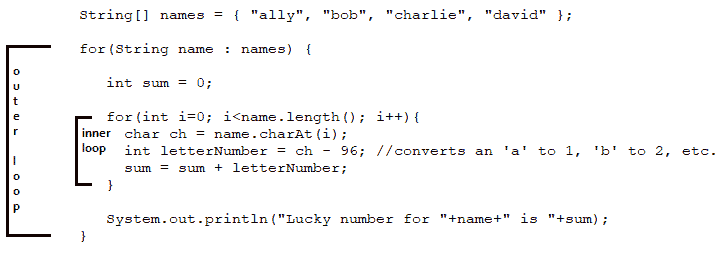

上述代码将一个普通的 `for` 循环嵌套在一个增强 `for` 循环内部。以下是该代码产生的输出：

```
Lucky number for ally is 50
Lucky number for bob is 19
Lucky number for charlie is 56
Lucky number for david is 40
```

在使用嵌套循环时需要非常小心的一点是正确管理循环变量。考虑以下程序，该程序旨在计算给定的多维 `int` 数组中所有值的和：

```
int[][] values = { {1, 2, 3} , { 2, 3}, {2 },  { 4, 5, 6, 7 } };

int sum = 0;
for(int i = 0; i<values.length; i++) {
   for(int j=0; j<values[i].length; i++) {
        sum = sum + values[i][j];
   }
}
System.out.println("Sum is "+sum);
```

仔细阅读上面的代码并尝试确定输出。


它实际上抛出了异常：`Exception in thread "main" java.lang.ArrayIndexOutOfBoundsException:`。

你可以在嵌套循环中使用 `break` 和 `continue` 语句，这就像我之前向你展示单层循环时完全一样。它们会让你跳出当前所在的循环或继续执行该循环。例如，查看以下代码，它尝试在多组名称中查找 "bob"：

```
String[][] groups = { { "ally", "bob", "charlie" } , { "bob", "alice", "boone"}, { "chad", "dave", "elliot" }  };

for(int i = 0; i<groups.length; i++){
   for(String name : groups[i]){
     System.out.println("Checking "+name);
     if("bob".equals(name)) {
        System.out.println("Found bob in Group "+i);
        break;
     }
   }
}
```

是上述代码的输出：

```
Checking ally
Checking bob
Found bob in Group 0
Checking bob
Found bob in Group 1
Checking chad
Checking dave
Checking elliot
```

当内部循环遇到字符串 "bob" 时，它会执行 `break`，这导致内部循环立即结束。控制权将执行外层循环的下一次迭代，即开始在下一组名称中查找 "bob"。这就是为什么上面的输出不包含 "Checking charlie"、Checking alice" 和 "Checking boone" 的原因。

现在，如果你想在任何一组中找到 "bob" 时立即停止所有检查该怎么办？换句话说，如果你想在找到 "bob" 时不仅跳出内部循环，而且跳出外层循环呢？Java 允许你这样做。你只需要指定你想要跳出的哪个循环即可。方法如下：

```
String[][] groups = { { "ally", "bob", "charlie" } ,
                                 { "bob", "alice", "boone"}, 
                                 { "chad", "dave", "elliot" }  };

MY_OUTER_LOOP:
for(int i = 0; i<groups.length; i++){
   for(String name : groups[i]){
     System.out.println("Checking "+name);
     if("bob".equals(name)) {
        System.out.println("Found bob in Group "+i);
        break MY_OUTER_LOOP;
     }
   }
}
```

是上述代码的输出：

```
Checking ally
Checking bob
Found bob in Group 0
```

我只是给外层 `for` 循环标记了标签 `MY_OUTER_LOOP`，并将相同的标签作为 `break` 语句的目标。这被称为“带标签的 break”（labeled break）。“带标签的 continue”（labeled continue）原理类似。

让我快速概述一下标签（labels），然后我回到使用带标签的 break 和 continue 的规则。

### 什么是标签（label）？

`label` 只是你通常提供给`语句块`（block of statements）或允许语句块的语句（意味着 `if`、`for`、`while`、`do-while`、增强型 for 和 `switch` 语句）的名字。考试不会测试你应用标签的精确规则或标签命名，但这里有几个例子：

```
SINGLE_STMT: System.out.println("hello");

HELLO: if(a==b) callM1();

COME_HERE : while(i=>0) {
 System.out.println("hello");
}

SOME_LABEL:  {  ok, 因为因为这是一个语句块
 System.out.println("hello1");
 System.out.println("hello2");
}
```

这里是标签的一些无效用法示例：

```
BAD1 : int x = 0; //不能对声明应用标签

BAD2 : public void m1() { //不能对方法应用标签
```

虽然没有必要，但惯例是使用大写字母作为标签名。此外，对语句应用标签并不意味着你必须将该标签作为任何 `break` 或 `continue` 的目标。你可以仅仅为了好玩而给语句标记标签。

### 带标签的 break 和 continue 的规则

回到使用带标签的 break 和 continue，你需要记住，如果你使用了带标签的 `break` 或带标签的 `continue`，那么该标签必须存在于带标签的 `break` 或 `continue` 所在的某一个嵌套循环语句中。因此，以下代码将无法编译：

```
LABEL_1 : for(String s : array) System.out.println(s); //在此处使用 LABEL_1 是有效的。
for(int i = 0; i<10++){
 if(i ==2) continue LABEL_1; //使用 continue 是无效的，因为 LABEL_1 没有出现在包含该 continue 的循环语句上
}
```

以下也是无效的：

```
for(int i = 0; i<10++){
  LABEL_1 : if(i ==2) System.out.println(2); //在此处使用 LABEL_1 是有效的。
  for(int j = 0; j<10++){
 if(i ==2) continue LABEL_1; //使用 continue 是无效的，因为 LABEL_1 没有出现在包含该 continue 的循环语句上。
 }
}
```

以下是有效的，因为 `continue` 语句使用了嵌套了该 `continue` 的标签：

```
LABEL_1 : for(int i = 0; i<10++){
  if(i == 2) System.out.println(2); 
  for(int j = 0; j<10++){
     if(i == 2) continue LABEL_1; //使用 continue 是有效的，因为它引用了外层循环。
  }
}
```

你也可以对非嵌套循环使用带标签的 `break` 和 `continue`，但由于无标签的 `break` 和 `continue` 已经足够跳出和继续执行非嵌套循环，因此在这种情况下很少使用标签。

实际上，可以在任何语句块中使用带标签的 `break`（但不是带标签的 `continue`）。语句块并不非要是循环块。例如，以下代码是有效的并打印 `1 3`：

```
public static void main (String[] args) {
   MYLABEL: {
      System.out.print("1 "); 
      if( args != null) break MYLABEL;
      System.out.print("2 ");
   }
   System.out.print("3 ");
}
```

然而，你不需要花时间学习奇怪的结构，因为考试不会测试晦涩的情况。`break` 和 `continue` 语句几乎总是用于循环块内部，这正是考试的重点。

为了正确回答考试中关于 `break` 和 `continue` 的问题，你需要练习在纸上执行简单的代码示例。以下是其中一个代码片段：

```
public static void doIt(int h){
  int x = 1;
  LOOP1 : do{

    LOOP2 : for(int y = 1; y < h; y++ ) {

        if( y == x ) continue;

        if( x*x + y*y == h*h){
          System.out.println("Found "+x+" "+y);
          break LOOP1;
        }
      }
      x++;
  }while(x<h);
}
```

在脑中或在纸上执行上述代码，找出当以 5 为参数以及以 6 为参数执行时它会打印什么。

## 8.8 比较循环结构

### 8.8.1 循环结构的比较

正如你之前看到的，四种循环类型之间只有极少数技术上的差异。`for`、`foreach` 和 `while` 循环在概念上与 `do-while` 循环略有不同，因为 `do-while` 循环至少执行一次迭代。`foreach` 循环与其他循环略有不同，因为它只能用于数组和实现了 `java.lang.Iterable` 接口的类。

除了这些差异外，它们都是可以互换的。例如，你总是可以用下面的方式将 `while` 循环替换为 `for` 循环：

```
while( booleanExpression ){

}

for( ; booleanExpression ; ){

}
```

你也可以像所示将 `foreach` 循环替换为 `for` 循环：

```
for( Object obj :  someIterable){

}

for( Iterator it = someIterable.iterator() ; it.hasNext() ; ){
  Object obj = it.next();
}
```

当然，`foreach` 版本比 `for` 版本简单得多，这就是重点。虽然你可以对特定问题使用任何循环，但你应该使用能产生最易理解或最直观代码的那一个。

一个通用的规则是：如果你提前知道迭代的次数，请使用 `for` 循环；如果执行下一次迭代的决定取决于之前迭代操作的结果，则使用 `while` 循环。例如，如果你想打印十次 "hello"，请使用 `for` 循环；但如果你想一直打印 "hello"，直到用户输入一个秘密代码作为响应，请使用 `while` 循环！

## 8.9 练习 [☝](http://enthuware.com/forum/dbt.php?bid=2&sn=8.9.0&tn=exercise)

1. 使用 `for` 循环初始化一个 `ints` 三角形矩阵，使得每个元素的值等于其行索引和列索引之和。使用 `while` 循环完成相同的操作。

2. 编写一个方法，通过将给定数字 `N` 除以 `2` 到 `N/2` 之间的所有数字并检查余数，来判断该数字是否为质数。

3. 使用嵌套的 `for` 循环打印从 `2` 到 `N` 的质数列表。

4. 使用嵌套的 `for` 循环按照 `[i][j][k] = N` 的格式打印 `_3D` 所指数组的每个元素：

```
int[] _1D1 = new int[]{1, 2, 3};        
int[][] _2D1 = new int[][]{ _1D1 };
int[][] _2D2 = new int[][]{ _1D1, _1D1 };
int[][][] _3D = new int[][][]{ _2D1, _2D2 };
```

5. 编写一个方法接受 `String` 作为输入，并统计从字符串开始到找到 `'x'` 为止的空间数量；如果字符串中没有 `'x'`，则统计到结束。

6. 下面代码包含一个在使用嵌套 `for` 循环时非常常见的错误。识别问题，修复它并打印 `chars` 数组的所有元素。

```
String[][] chars = new String[2][];
chars[0] = new String[2];
chars[1] = new String[4];
char cha = 97;
for(char c=0;c<chars.length; c++){
    for(char ch=0;ch<chars.length; ch++){
       chars[c][ch] = ""+cha;
       cha++;
    }
}
```

如果 `char[0]` 初始化为 `new String[1]` 而不是 `new String[2]`，会发生什么？

7. 为了避免无意中引入上述代码所示的错误，程序员决定使用 `for-each` 循环代替普通的 `for` 循环：

```
for(String[] chara : chars){
    for(String s : chara){
        s = ""+cha;
        cha++;
     }
} 
```

这是一个个好主意吗？

8. 使用增强型 `for` 循环打印数组的交替元素。你可以使用增强型 `for` 循环按逆序打印元素吗？

9. 给定两个长度和类型相同的数组，将第一个数组的元素按逆序复制到另一个数组中。

# 第 9 章 创建和使用数组

* 声明、实例化、初始化和使用一维数组

* 声明、实例化、初始化和使用多维数组

## 9.1 声明、实例化、初始化和使用一维数组

### 9.1.1 声明数组变量 [☝](http://enthuware.com/forum/dbt.php?bid=2&sn=9.1.1&tn=declaring-array-variables)

数组是一个持有固定数量给定类型值的对象。你可以将数组想象成一个蛋盒。如果你有一个 6 个槽的蛋盒，那么这个蛋盒只能装下六个蛋。蛋盒的每个槽可以放一个蛋，也可以是空的。注意，蛋盒本身并不是一个蛋。同样，如果你有一个大小为六的 `int` 值（或简称为 `ints`）数组，那么该数组可以包含六个 `ints`，但数组本身并不是一个 `int`。

给定类型的数组除了该类型的值外，不能包含任何其他内容。例如，`ints` 数组不能包含 `long` 或 `double` 值。同样，你可以拥有任何给定类型的引用的数组。例如，如果你有一个 `Strings` 数组，该数组只能包含指向 `String` 对象的引用。这里需要注意的一个重要点是，尽管我们称之为“字符串数组”，但它实际上并不包含 `String` 对象。它只包含对 `String` 对象的引用。你无法真正拥有一个包含实际对象的数组。

#### 数组声明 [☝](http://enthuware.com/forum/dbt.php?bid=2&sn=9.1.1&tn=array-declaration)

当你声明数组变量时，你基本上是在指定你想要通过该变量处理的值类型。在 Java 中指定该类型的方法是在值的类型后面应用 `[ ]`，即方括号。例如，如果你想通过一个变量来处理 `int` 标的值，你将写成 `int[]`。数组可以是多维的，每个维度都有一对成合括号。例如，

```
int i; //i 是一个 int
int[] ia1, ia2;  //ia1 和 ia2 是一维 int 数组
int[][] iaa; //iaa 是二维 int 数组
```

数组声明永远不能包含大小。因此，以下代码无法编译：

```
int[2];
int[];
```

实际上，Java 允许在变量名上应用方括号。例如：

```
int ia1[], ia2[]; //ia1 是一维 int 数组
int[][] iaa; //iaa 是二维 int 数组
```

对象的声明方式相同。例如：

```
Object[] obja, objaa[];
String[] strA;
String[] str;
```

注意上述语句只是声明了数组变量。它们并没有创建数组。数组创建是一个独立的课题，我将对此讨论。

### 9.1.2 创建和初始化数组对象 [☝](http://enthuware.com/forum/dbt.php?bid=2&sn=9.1.2&tn-creating-and-initializing-array-objects)

**使用创建表达式创建数组**

你使用 `new` 关键字来创建数组对象。例如：

```
int[] ia = new int[10]; // 大为 10 的 int 数组
boolean[] ba = new boolean[3]; // 大为 3 的布尔数组
String[] stra = new String[5]; // 大为 5 的 String 数组
MyClass[] myca = new MyClass[5]; // 大为 5 的 MyClass 数组
```

```
int[] invalid = new int[];//缺失大小。无法编译。
```

上述语句中 `=` 右侧的部分被称为“创建表达式”。这些表达式仅仅是为持有 **10 个 int**、**3 个 boolean**、**5 个 String 引用**和**5 个 MyClass 引用**分配空间。数组的每个元素也会由 JVM 初始化为默认值。数组元素的默认值非常直观——引用初始化为 `null`，数值类型初始化为 `0`，布尔值初始化为 `false`。在上述代码行中，`ia` 指向一个包含十个 int 值的数组，每个元素初始化为 `0`；`ba` 指向一个包含三个布尔值的数组，每个元素初始化为 `false`；`stra` 指向一个包含五个 String 引用的数组，每个元素初始化为 `null`；最后，`myca` 指向一个包含五个 MyClass 引用的数组，每个元素初始化为 `null`。观察到数组的所有元素都初始化为相同的值。这向我们展示了数组的另一个重要方面——数组可以具有**重复值**。


重要的是理解这一点：在上述陈述中，我们并没有创建数组元素类的实例。换句话说，我们没有创建`String`的实例或`MyClass`的实例。（就此而言，我们也没有创建`ints`或`booleans`的实例，因为它们是基本类型，而由于基本类型不是对象，所以它们根本没有实例。）

在 Java 中，数组（无论是基本类型还是对象）都是特定类的对象。换句话说，一个数组对象是某个类的实例。它不是`Object`类的实例，但由于`Object`是 Java 中所有类的根类，因此数组对象是一个`Object`，并且可以在数组上调用`Object`类的所有方法。现在，让我们来看下面的程序及其输出，以了解更多关于上述定义的数组对象的类的信息——

```java
public class TestClass{
  public static void main(String[] name){
    int[] ia = new int[10]; 
    boolean[] ba = new boolean[3]; 
    String[] stra = new String[5]; 
    TestClass[] ta = new TestClass[5];
    System.out.println(ia.getClass().getName()+" , "+ia.getClass().getSuperclass().getName());
    System.out.println(ba.getClass().getName()+" , "+ba.getClass().getSuperclass().getName());
    System.out.println(stra.getClass().getName()+" , "+stra.getClass().getSuperclass().getName());
    System.out.println(ta.getClass().getName()+" , "+ta.getClass().getSuperclass().getName());
  }
}
```

输出：

```
[I , java.lang.Object
[Z , java.lang.Object
[Ljava.lang.String; , java.lang.Object
[LTestClass; , java.lang.Object
```

输出显示，声明为`int[]`类型的`ia`并不是`int`的实例，而是名为`[I`的一个类的实例。声明为`String[]`类型的`stra`并不是`String`的实例，而是名为`[Ljava.lang.String`的一个类的实例，依此类推。这些类名看起来很奇怪。实际上，Java 通过查看维数和元素类型来构造数组类的名称。对于每个维度，都有一个左括号。随后是根据下表所示的元素类型的字母；如果数组不是基本类型，则类名后面会跟着一个分号。

| 类型 | 字母 |
| :--- | :--- |
| boolean | Z |
| byte | B |
| char | C |
| short | S |
| int | I |
| long | J |
| float | F |
| double | D |
| any Object | L |

根据上述表格，`long[][]`（即长整型的二维数组）的类名将是`[[J`，而`mypackage.SomeClass[][][]`（即`mypackage.SomeClass`的三维数组）的类名将是`[[[Lmypackage.SomeClass;`。

尽管关于数组类的讨论没有包含在考试目标中，但一些考生报告说在考试中遇到过需要此类信息的题目。

## 使用数组初始化器创建数组

在上一节中，我们使用`new`关键字创建了数组对象。可以在不使用`new`关键字的情况下创建数组对象。例如，我们上面创建的数组也可以如下所示创建：

```java
int[] ia = {0, 1, 2, 3, 4, 5, 6, 7, 8, 9 }; // 一个大小为 10 的 int 型数组
boolean[] ba = {true, false, false}; // 一个大小为 3 的 boolean 型数组
String[] str = {"a", "b", "c", "d", "e"}; // 一个大小为 5 的 String 型数组
MyClass[] myca = { new MyClass(), new MyClass(), new MyClass(), new MyClass(), new MyClass()} ; // 一个大小为 5 的 MyClass 对象数组
```

上述语句中`=`右侧的部分被称为“数组初始化器”。数组初始化器是一种快捷方式，允许你创建并用你想要的值来初始化数组的每个元素（而不是使用在你使用数组创建表达式时获得的默认值）。

由于编译器可以通过查看声明（即语句的左侧）来找到数组元素的类型，因此不需要在右侧指定相同的内容。同样，编译器也会通过计算初始化器中指定的数值个数来确定数组的长度。

数组初始化器也可以与数组创建表达式混合使用。例如：

```java
int[] ia = new int[]{ 1, 2, 3, 4, 5 };
```

请到右侧表达式中缺少了大小。Java 通过计算初始化列表中指定的元素个数来确定数组的大小。事实上，如果你指定了单个元素，则禁止指定大小。因此，以下代码是无效的：

```java
int[] ia = new int[2]{ 1, 2 }; // 将无法编译
```

## 9.2 使用数组

### 9.2.1 数组索引

在 Java 中，数组索引从 0 开始。换句话说，数组第一个元素的索引是 0。例如，如果你有一个名为`accounts`的数组变量指向一个包含 100 个`Account`对象的数组，那么你可以通过`accounts[0]`访问第一个对象，通过`accounts[99]`访问第 100 个对象。`accounts[0]`或`account[99]`与任何其他`Account`类型的变量一样。

同样，如果你有一个数组变量`ia`指向一个包含 5 个 int 的数组，可以使用`ia[0]`访问第一个元素，使用`ia[4]`访问最后一个元素。

#### java.lang.ArrayIndexOutOfBoundsException

如果你尝试访问超出数组范围的任何元素，JVM 将抛出一个`ArrayIndexOutOfBoundsException`实例。例如，如果你有`int[] ia = new int[3];`，语句`int i = ia[-1];`和`int i = ia[3];`将导致抛出`ArrayIndexOutOfBoundsException`。

如果你现在对异常并不了解，请不要担心。我将在稍后讨论异常。

#### 长度为 0 的数组

听起来可能奇怪，但可以拥有长度为 0 的数组。例如，`int[] ia = new int[0];`在这里，`ia`指向一个长度为 0 的 int 数组。该数组没有任何元素。重要的是，长度为 0 的数组不等于`null`。`ia = null`意味着`ia`指空；`ia = new int[0];`则意味着`ia`指向一个长度为 0 的数组。

长度为 0 的一个很好的例子是`main`方法的参数`args`。如果你没有任何参数运行一个类，`args`不为空，而是指向一个长度为 0 的 String 数组。

#### 修改数组的大小

Java 数组的大小总是固定的（长度）。一旦创建了数组，你就无法更改该数组可以拥有的元素数量。所以，例如，如果你创建了一个 5 个 int 的数组，而你有 6 个 int 值要存储，你需要创建一个新的 int 数组。没有方法可以增加或减少现有数组的大小。你可以更改数组变量指向不同的数组，你当然也可以更改数组所包含的值。

### 9.2.2 数组对象的成员

我们之前看到过数组实际上是特定类的对象。我们也见过这些类的一些名称。但这些类包含什么？这些类的成员是什么？这些类提供什么功能？让我们来看看：

**数组长度**

所有数组类都有一个名为`length`的字段，其类型为`int`。该字段是`public`的，它存储数组的长度。该字段也是`final`的，这反映了你无法在创建后更改数组的长度。由于数组的长度永远不会小于 0，该字段的值也永远不会小于 0。

**数组克隆**

所有的数组类都拥有一个名为`clone`的公共方法。该方法会创建数组对象的副本。请注意，它并不会创建数组元素所引用对象的副本。它仅仅创建一个长度相同的新数组对象，并将现有数组的内容复制到新数组中。这意味着，如果现有数组包含原始值，则这些值将被复制到新数组的元素中；如果现有数组包含指向对象的引用，则这些引用将被复制到新数组的元素中。因此，新数组的元素也将指向相同的对象。这被称为“浅拷贝”。

例如，下图精确展示了当你使用语句`int[] myIntArr2 = (int[]) myIntArr1.clone();`对变量`myIntArr1`引用的五个整型数组进行克隆时，具体发生了什么。暂时不要担心显式类型转换，但请观察创建一个具有相同槽数的新数组对象，并且现有数组槽的内容被复制到了新数组的槽中。

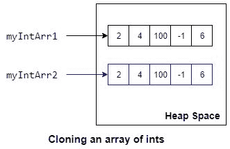

下图展示了当你使用语句`String[] myStringArr2 = (String[]) myStringArr1.clone();`对变量`myStringArr1`引用的字符串数组进行克隆时发生了什么。观察引用被复制到了新数组中，且堆空间中没有创建新的 String 对象。

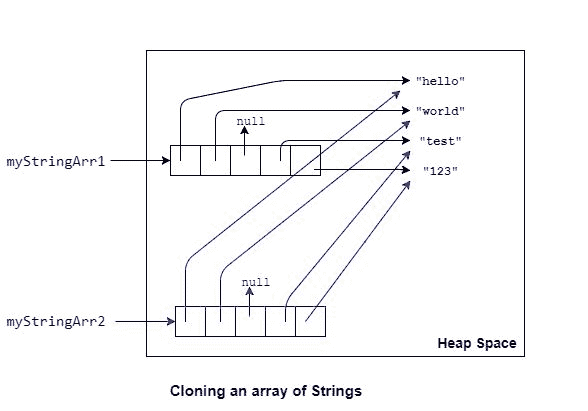

考试虽然要求掌握克隆，但它仍然是数组的一个重要方面。

## 继承自 Object 类的成员

请记住，由于`java.lang.Object`是所有类的根类，它也是所有数组类的根类，因此，数组类继承了`Object`类的所有成员。这包括`toString`、`equals`和`hashCode`方法。

### 9.2.3 数组的运行时行为

虽然数组是最简单的数据结构，但它们并非没有特殊之处。要正确且有效地使用数组，你必须意识到 Java 中数组的两个最重要的方面。

第一是它们是“实实例化的”（reified）。这意味着数组及其元素的类型检查是在运行时由 JVM 完成的，而不是在编译时由编译器完成的。换句话说，数组的类型信息被保留在编译后的字节码中，供 JVM 在运行时使用。JVM 知道数组的类型并对数组强制类型检查。

例如，如果你有一个 String 数组，JVM 不允许你将该数组的任何元素指向 String 以外的任何，尽管编译器可能没有注意到到这种违规行为，如下代码所示：

```
String[] sa = { "1", "2", "3" }; 
Object[] oa = sa; 
oa[0] = new Object(); 
```

上面的代码可以正常编译。当你尝试将一个 String 数组赋值给类型为 Object 数组的变量时，编译器没有意见。当你尝试将此 String 数组的元素指向一个非 String 的对象时，它也没有意见。但当你运行它时，JVM 会在第三行抛出`java.lang.ArrayStoreException`。这是因为 JVM 知道由`oa`指向的数组实际上是一个 String 数组。它不会允许你通过在其中存储随机对象来破坏该数组。

理解这个概念非常重要，因为它与泛型的工作原理完全截然相反。这就是数组和泛型能够良好协作的原因。你会在稍后学习泛型时会发现这一点。

关于数组的第二点是它们是“协变的”（covariant）。这意味着你可以在声明为父类类型的数组中存储子类对象。例如，如果你有一个类型为`java.lang.Number`的数组，你可以将`java.lang.Integer`或`java.lang.Float`对象存入该数组，因为它们都是`java.lang.Number`的子类。因此，以下代码可以正常编译并运行：

```
Number[] na = { 1, 2, 3 }; 
na[0] = new Float(1.2f); 
```

我们还没有在 OCP Java 11 Part 1 考试中见过有人问数组实例化和协变性的问题。然而，任何关于数组的讨论如果没有这两点就是完整的，这就是我在这里提到它们的原因。

### 9.2.4 数组的用途

数组作为数据结构非常强大，但作为数据类型它们又有些原始。正如我们之前看到的，数组只有一个字段，且只有几个方法。但由于其简单性，数组被用作其他数据类型和数据结构的构建模块。例如，`String`数据类型是基于`char s`数组构建的。`StringBuffer`和`StringBuilder`也是如此。这些高级类实际上只封装了一个字符数组，并提供了操作该数组的方法。

数组还被广泛用于构建高级数据结构，如`List`、`Stack`和`Queue`。你可能遇到过`ArrayList`类（顺便说一下，这个类也会考，我稍后会讨论它）。猜猜，它是一个`List`，使用内部数组来管理其对象集合。由于这些类在数组的基础上提供了许多额外功能，通常使用的是这些类而不是原始数组。

### java.util.Arrays 类

Java 标准库确实在`java.util`包中包含了一个名为`Arrays`的工具类，它让操作原始数组变得更容易。`java.util.Arrays`类包含许多用于操作给定数组对象的静态方法。虽然在考试目标中没有明确提到，但浏览`Arrays`的 JavaDoc 了解这些方法是一个好主意。我们在考试中见过关于 Java 9 添加到该类中的`compare`和`mismatch`方法的问题，因此我将详细讨论这两个方法。

### Arrays.compare 和 Arrays.mismatch 方法

`compare`和`mismatch`方法是静态方法，用于比较相同类型的数组。虽然它们可以比较原始类型数组也可以比较引用类型数组，但它们在比较原始数组时最有用。原始数组的高效比较是数据处理中的常见需求。由于这些方法分块比较数据，因此它们的性能通常比逐个比较元素的自定义代码好得多。这可能就是为什么 OCP Java 11 考试会有这些方法的问题。

如果你浏览 API JavaDoc，你会发现这些方法有许多变体。尽管这些方法被高度重载，但实际上对于考试目的，你只需要理解两种。其他的只是副本；每种数据类型一个。

在深入研究方法细节之前，你需要了解方法描述中经常使用的两个单词的含义。

## 1. 字典序 (Lexicographical)

这简单意味着“字典顺序”，即单词在字典中的排列方式。如果你要确定两个单词中哪一个在字典中排在前面，你需要从第一个字母开始逐字母地比较单词。例如，单词 "children" 会出现在单词 "chill" 之前（并且可以被认为更小），因为这两个单词的前四个字母相同，但 "children" 第五个位置的字母（即`d`）在 "chill" 第五个位置的字母（即`l`）之前（或比它小）。请注意，从长度来看，"children" 单词的索引比 "chill" 大，但长度在这里不是判别标准。由于同样的原因，包含`12345`的数组将排在包含`1235`的数组之前。

## 2. 前缀 (Prefix)

这指的是两个数组的共同部分。在上面的示例中，在比较 "children" 和 "chill" 时，“chil" 可以被称为前缀。同样，在比较`12345`和`1235`时，`123`是前缀。

现在让我们来看一下`compare`和`mismatch`方法的 JavaDoc 说明。

`public static int compare(int[] a, int[] b)` : 字典序地比较两个 int 数组。如果两个数组共享共同前缀，则字典序比较的结果是比较两个元素的结果，就像通过`Integer.compare(int, int)`一样，在各自数组中前缀长度对应的索引处进行。否则，一个数组是另一个的真前缀，字典序比较的结果是比较两个数组长度的结果。

null 数组引用被认为字典序小于非 null 数组引用。两个 null 数组引用被认为是相等。

如果第一个数组和第二个数组相等且以相同顺序包含相同元素，则返回 0；如果第一个数组字典序小于第二个数组，则返回小于 0 的值；如果第一个数组字典序大于第二个数组，则返回大于 0 的值。

例如，以下代码将打印 -1，因为第一个数组在索引 2 处的整数较小。

```
int[] ia1 = { 0, 1, 2, 6};
int[] ia2 = { 0, 1, 5};
System.out.print(Arrays.compare(ia1, ia2)); //打印 -1
```

请注意，返回的值 (-1) 不取决于两个元素之间的差异大小（`2 - 5 是 -3`）。

`public static int mismatch(int[] a, int[] b)` : 并返回两个 int 数组之间第一个不匹配处的索引，如果没有找到不匹配项，则返回 -1。该索引范围从 0（包含）到较小数组的长度（包含）。


如果两个数组共享共同前缀，则返回的索引是共同前缀的长度，这意味着各自数组在该索引处的两个元素之间存在不匹配。如果一个数组是另一个的真前缀，则返回的索引是较小数组的长度，这意味着该索引仅对较大数组有效。否则，没有不匹配。

两个非 null 数组 `a` 和 `b` 共享长度为 `pl` 的共同前缀，当且仅当以下表达式为真时：

```
pl >= 0 &&
   pl < Math.min(a.length, b.length) &&
   Arrays.equals(a, 0, pl, b, 0, pl) &&
   a[pl] != b[pl]
```

注意，共同前缀长度为 0 表示每个数组的第一个元素不匹配。

两个非 null 数组 `a` 和 `b` 共享一个真前缀，当且仅当以下表达式为真时：

```
a.length != b.length &&
   Arrays.equals(a, 0, Math.min(a.length, b.length),
               b, 0, Math.min(a.length, b.length))
```

例如，以下代码将打印 2，因为数组在索引 2 处不同：

```
int[] ia1 = { 0, 1, 2, 6};
int[] ia2 = { 0, 1, 5};
System.out.println(Arrays.mismatch(ia1, ia2)); //打印 2
```

请注意，2 也是前缀 `{0, 1}` 的长度。

你应该仔细阅读各种重载的 `compare` 和 `mismatch` 方法的 JavaDoc API 描述。你会发现它们的基本工作方式都相同。

## 9.3 声明、实例化、初始化和使用多维数组

### 9.3.1 多维数组

“多维数组”这个词会让人联想到矩阵的图像。但重要的是理解，Java 并没有矩阵类的多维数组。Java 拥有的是其元素本身也是数组的数组。记住，在 Java 中，每个数组对象都是特定类的对象。例如，`int` 数组的类是 `[I]`。现在，如果你想拥有一个该类对象的数组呢？换句话说，一个“`int` 数组的数组”。你可以这样声明它：

```java
int[][] iaa;
```

从视觉上看，该声明看起来像 `iaa` 是一个二维的 `int` 维矩阵。但实际上，`iaa` 指向一个一维数组，其中每个元素都可以是一个数组。

`iaa` 是使用数组创建表达式创建的。`iaa` 是一个长度为 3 的数组。你能猜猜这个数组的三个元素分别被初始化为什么值吗？请注意，每个元素的类型都是“整数数组”（array of ints），这意味着 `iaa` 是一个对象数组（而不是基本类型数组）。由于对象数组的每个元素都会被自动初始化为 `null`，因此 `iaa` 指向的数组的每个元素都被初始化为 `null`。你可以这样让它们指向整数数组：

```java
iaa[0] = new int[2]; //iaa[0] 指向一个长度为 2 的整数数组
iaa[1] = new int[3]; //iaa[1] 指向一个长度为 3 的整数数组
```

现在，这两个数组的每个元素都已初始化为 0，但 `iaa[2]` 仍然是 `null`。

这个示例说明了创建数组的另一个重要方面。注意示例 1 和本示例在维度大小指定的区别。示例 1 使用的是 `[2][3]`，而这里是 `[3][]`。我们省略了第二个维的大小。第一维的大小告诉 JVM 你想在数组中存储多少个引用。（记住，你想要存储的引用的类型是整数数组，即 `int[]`）。`[3]` 意味着你想存储三个引用。换句话说，你的数组（类型为整数数组）的长度是 3。然而，第二个维的大小是不需要的，因为这些引用指向的数组可以稍后创建，并且可以具有不同的长度。你只有在创建它们时才需要指定它们的长度。

当你创建一个三维整数数组时（即整数数组的数组的整数数组）会发生什么？过程是一样的。你只需要告诉 JVM 你想在数组中保留多少个引用（其类型将是整数数组的数组，即 `int[][]`）。如果你只需要 2 个这样的引用，可以使用 `new int[2][][]` 创建它。接下来的三张图说明了初始化一个三维整数数组时每一步发生的情况。

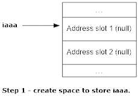

现在你可以使用 `iaaa[0] = new int[2][];` 将此数组的第一个槽指向一个长度为 2 的数组。

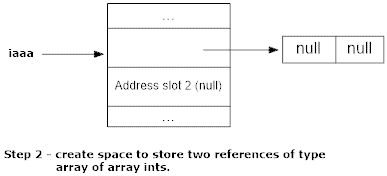

注意 `iaaa[1]` 仍然是 `null`。接下来，你可以使用 `iaaa[0][0] = new int[]{ 1, 2, 3, 4};` 将 `iaaa[0][0]` 指向一个包含 4 个整数的数组（你也可以 `iaaa[0][0] = new int[4];`，在这种情况下每个元素的值将为 0）。

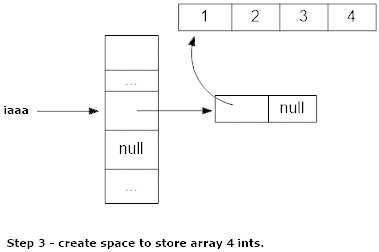

然而，如果你想指定低维的大小，就不能省略高维的大小。例如，你不能执行 `new int[][2];`。原因很简单——`new int[][2]` 尝试创建一个 `int[2]` 对象的数组。但它没有告诉 JVM 你想存储多少个 `int[2]` 对象。没有这个信息，JVM 不知道需要为该数组分配多少空间。另一方面，`new int[2][]` 是可以的，因为现在你正在告诉 JVM 你想创建一个长度为 2 的数组。在这种情况下，JVM 清楚它需要分配空间来存储 2 个引用。记住，引用的值并不取决于它指向的数组的长度。因此，JVM 并不关心这两个引用将指向的数组的长度。它只是分配空间来存储 2 个引用。

3. `int[][] iaa = new int[][]{ new int[]{ 1, 2 } };` 这条语句使用了数组创建表达式结合数组初始化器。

`int[][] iaa = { { 1, 2 } };` 这与上面相同，但使用了数组初始化器。

在两种情况下，`iaa` 都指向一个长度为 1 的数组。该数组中的第一个也是唯一一个元素指向一个长度为 2 的整数数组。

4. `Object[] obj[] = { {"string is also an object"}, {null } , { new Object() , new Integer(10)} };`

`obj` 指向一个对象数组的数组。该数组的长度为 3。第一个数组指向一个长度为 1 的对象数组。该对象数组的唯一元素指向包含 "string is also an object" 的字符串。第二个数组指向一个长度为 1 的数组。该数组的唯一元素指向 `null`。第三个数组指向一个长度为 2 的数组。该数组的第一个元素指向一个 `Object` 类对象，第二个元素指向一个 `Integer` 类对象。

这是一个简单的程序，用于打印来自数组数组的有用信息。我建议你通过更改数组来尝试运行。

```java
public class TestClass
{
    public static void main(String[] args) {
       Object[] iaa[] =  { {"string is also an object"}, {null } , { new Object() , new Integer(10)} };
       for(int i=0; i<iaa.length; i++){
          System.out.println("Element["+i+"] contains an array of length "+iaa[i].length);
          for(int j = 0; j<iaa[i].length; j++){
             System.out.println("Element["+i+"]["+j+"] contains "+iaa[i][j]);
          }
       }
    }
}
```

输出结果：

```
Element[0] contains an array of length 3
Element[0][0] contains string is also an object
Element[1] contains an array of length 1
Element[1][0] contains null
Element[2] contains an array of length 2
Element[2][0] contains java.lang.Object@...
Element[2][1] contains 10
```

6. 定义两个 `String` 数组类型的变量。使用上一个练习中创建的数组元素来初始化它们。

7. 定义一个名为 `Data` 的简单类，包含一个类型为 `int` 名为 `value` 的公共实例字段。在 `TestClass` 的 `main` 方法中创建并初始化一个名为 `d` 的 `Data` 变量。创建一个长度为 3 的 `Data` 数组，并用同一个 `Data` 实例初始化每个元素。使用数组中的任意元素来更新 `Data` 对象的 `value` 字段。使用数组的三个元素打印 `Data` 对象的 `value` 字段。最后，使用变量 `d` 打印原始 `Data` 对象的 `value` 字段。

8. 定义并初始化一个二维整数数组，使其看起来像一个整数三角形矩阵。

9. 声明另一个二维整数数组，并使用上一个练习中创建的数组元素对其进行初始化，使其看起来像一个倒三角形整数矩阵。

10. 声明并初始化一个长度为 3 的 `Object` 数组变量。将该数组的第一个元素初始化为 `int` 数组，第二个初始化为 `int[][]` 数组，第三个初始化为 `Object` 数组。查看是否有赋值会导致编译失败。

11. 给定语句 `int[][] nums = new int[1][3];`，`nums` 可以存储多少个 `int` 值？写下如何访问 `nums` 的每个元素。

12. 给定以下代码：

```
int[][][] nums = new int[1][4][2];
for(int i = 0; i<nums.length; i++){
  for(int j = 0; j<nums[i].length; j++){   
    for(int k = 0; k<nums[i][j].length; k++){
           nums[i][j][k] = i + j + k;
           System.out.println("num["+i+"]["+j+"]["+k+"] = "+nums[i][j][k]);
        }
  }
}
```

在脑中执行它并在纸上写下输出结果。运行代码并检查你的答案。

# 第 10 章：创建和使用方法

- 创建带有参数和返回类型的方法和构造函数
- 创建并调用重载方法
- 在方法和字段上应用 `static` 关键字

## 10.1 创建带有参数和返回类型的方法

### 10.1.1 创建方法

我们在之前的章节中已经见过方法了。事实上，我们一直都在使用 `main` 方法来运行我们的测试程序。但我们还没有正式地讨论过它们。

`method`（方法）是为类型提供 `behavior`（行为）的东西。Java 允许类、接口和枚举拥有行为。行为无非由一段代码执行的高级动作。如果你期望这个动作在需要时被执行，你就将这段代码放在方法中并给它起一个名称。这让你在需要的时候可以通过使用该名称来调用该动作。它就像一个黑盒，你给它一些输入，并得到一些输出。

因此，方法的基本结构如下：

```
returnType methodName(parameters) {
  methodBody
}
```

`ReturnType`（返回类型）指定了方法执行结果返回的内容。例如，一个返回两个整数之和的方法可以指定它返回一个 `int` 结果。一个返回 `Account` 对象的方法可以指定 `Account` 为返回类型。如果方法不返回任何内容，则必须使用 `void` 关键字进行指定。

需要重要的是，方法最多只能返回一个值。

`MethodName`（方法名）是给这个方法的名称。它必须是一个有效的 Java 标识符。记住，标识符是 Java 字母和 Java 数字组成的无长度限制序列，其中第一个字符必须是 Java 字母。它不能是预留字或关键字。

方法的 `Parameters`（参数）通过由逗号分隔的参数声明列表指定。每个参数声明由一个类型和一个指定参数名称的标识符组成。如果方法不接受任何参数，则参数列表将为空。以下是有效参数列表的几个示例：

```
void save() // 无参数
void saveAccount(Account acct) // 接受一个 Account 作为参数
void add(int a, int b) // 接受两个 int 作为参数 
```

注意，与普通声明不同，参数列表中的每个参数必须与其类型单独指定。因此，虽然 `int a, b;` 是一个声明两个 `int` 变量的有效语句，但 `add(int a, b)` 是方法参数 `b` 的无效声明。

如果方法中的代码没有改变其值，则参数列表中的每个参数也可以被声明为 `final`。例如：

```
void add(int a, final int b) // b 是 final 的。 
```

如果参数被声明为 `final` 且方法体尝试更改它的值，代码将无法编译。

`MethodBody`（方法体）包含了在调用该方法时执行的代码。它必须包含在大括号内。注意，这与 `if/else`、`for` 和 `while` 等块语句不同，在这些语句中，如果正体只有一个语句，你可以省略大括号。对于方法，即使正体只包含一条语句，也需要大括号。

方法还有许多相关的特性，如 `var-args`、`static`、`abstract`、`final` 以及异常处理。我们将在后面讨论这些内容。

### 10.1.2 从方法返回返回值

方法在成功完成时必须始终返回其返回类型的值。这意味着它不能有条件地返回，如下代码所示：

```
public int get2X(int x){
  if(x>0) return x;
}
```

编译器将生成“missing return statement”（缺少返回语句）的错误，因为 `if` 条件为假。如果你考虑语句 `int y = get2X(-1);` 应该给 `y` 分配什么值？并没有答案。因此，方法在所有情况下（抛出异常外）都必须返回一个 `int`。

此规则适用于返回引用类型的方法（不仅仅是基本类型），因为 `null` 是引用类型的有效值。换句话说，返回 `null` 等同于返回空内容。因此，以下方法是好的：

```
String getValue(int x){
   if(x > 0) return "good day!";
   else return null; // 这是可以的。
```

方法避免返回值的唯一情况是它抛出了异常，这意味着方法没有成功结束，因此无法期望它返回结果。

#### 方法返回 void

如果一个方法表示不返回任何内容（即其返回类型指定为 `void`），则它在任何情况下都不能返回任何内容。显然，它甚至不能返回 `null`，因为正如我们上面看到的，`null` 不等同于空。但有趣的是，它甚至不能返回 `void`。因此，以下方法将无法编译：

```
void doSomething(){
   System.out.println("hello");
   return void; // 无效
}
```

在这种情况下只有两种选择——没有任何返回语句，或者有一个空的返回语句，即 `return;`。例如：

```
void doSomething(){
   System.out.println("hello");
   return; // 空返回
}
```

或者

```
void doSomething(){
  System.out.println("hello");
  // 没有任何返回语句
}
```

通常规则是 Java 不允许方法返回与其声明中指定的类型不同的值。这意味着如果一个方法说它返回一个 `int`，它就不能返回一个 `boolean` 值。然而，该规则有三个例外。其中两个关于基本类型，一个关于引用。

1. **数值提升（Numeric promotion）** - 如果方法的返回类型是数值类型（即 `byte`、`char`、`short`、`int`、`long`、`float` 和 `double`），那么只要返回值的类型小于声明的返回类型，返回值可以是任何其他数值类型。例如，如果一个方法说它返回 `int`，那么该方法返回 `byte`、`short` 或 `char` 是可以的。但它不能返回 `long`、`float` 或 `double`。因此，以下代码可以通过编译：

```java
public int getVal(int x){
  char ch = 'a';
  byte b = 0;
  if(x>0) return ch;
  else return b;
}
```

这是允许的，因为较小的类型可以很容易地提升为较大的类型而不丢失信息。

2. **自动装箱/拆箱（Autoboxing/Unboxing）** - 如果返回类型是相同或更大类型的基本类型，Java 允许返回值为包装类的引用。因此，以下代码是正确的：

```java
public int getVal(){
     return new Short(10);//包装对象将被拆箱为基本类型
     //return new Long(10);//无法编译，Long 无法转换为 int
}
```

反过来也是允许的，但前提是方法的返回类型必须与所返回的基本类型值是同一种泛的包装类：


```java
public Integer getVal(){
     byte b = 10;
     return b; //可以，int 将装箱为 Integer
     // //无法编译，byte 无法转换为 Integer
}
```

3. 第三个例外与继承有关。由于我还没有讨论过这个话题，我将简要提到它。如果你不是完全理解，不要担心。方法返回声明为其返回类型的子类型的引用是允许的。这被称为“协变返回类型（covariant return types）”。例如，如果一个方法声明它返回`Object`，那么方法返回`String`是可以的，因为`String`也是一个`Object`。以下代码显示了一些有效的情况：

```java
Object getValue(){
     return "hello";
     //return 10; //这是可以的，10 将装箱为 Integer 对象，该对象是一个 Object
     //return null;//这也是可以的
}
```

这就像向某人承诺会给他们水果，然后给了他们一个香蕉。这是可以的，因为香蕉也是水果。但反过来不行。如果你向某人承诺会给他们香蕉，你就不能给任何其他水果。因此，以下代码将失败：

```java
String getValue(){
   return new Object();//无法编译，因为 Object 不是 String
}
```

在你学习继承之后，这一点会变得清晰。这些规则确保了只有那些可以“赋值”给声明返回类型的值会被方法返回。换句话说，如果你可以直接将一个特定值赋值给声明返回类型的变量，那么你就可以从该方法返回该值。例如，你可以直接将`char`值赋值给`int`变量，因此你可以从一个声明返回`int`的方法返回一个`char`值。

## 2. 从方法返回多个值

Java 不允许方法返回多个一个值。就是这样。如果你想从一个方法返回多个值，这似乎是一个难以克服的限制。例如，如果你的`getName`方法想要分别返回姓和名呢？嗯，在 Java 中实现该点的方法是使用类来捕获多个值，然后返回该类对象的引用。以下是你的`getName`方法可能的外观：

```java
Name getName(){
  Name n = new Name(); //在 Name 对象中捕获两个值
  n.firstName = "Ann";
  n.lastName = "Rand";
  return n; //返回 Name 对象的引用
}
```

这段代码假设存在一个独立的类`Name`，它可以捕获名字的两个部分：

```java
class Name{
  String firstName, lastName;
}
```

你也可以使用数组来克服这一限制。例如，`getName`方法也可以写成如下：

```java
String[] getName(){
 return new String[]{"ann", "rand" };
}
```

通常，类设计用于捕获相互相关的值。例如，你可能有一个`Student`类，用于捕获学生的 ID、姓名和地址。然而，你可能会遇到想要从同一个方法返回多个不相关值的情况。你可以使用相同的方法来返回这些值。用于捕获无关值的类被称为“持有类（holder classes）”。如果你在代码中经常遇到这种情况，那么它是设计不当的征象。对此的详细讨论超出了考试的范围。

## 10.1.3 变长参数（Varargs）

如果你知道参数的类型，但不知道调用者将传递给方法的精确数量，你可以将参数放在数组中并将数组传递给方法。例如，如果你想写一个计算任意数量整数值平均值的方法，你可以这样做：

```java
public double average(int[] values){
   /*顺便问一下，如果 sum 声明为 int 会发生什么？
      预计考试中会有看起来是关于一个话题
      但实际上是完全另一个话题的问题。
   */
   double sum = 0; 
   for(int i=0; i<values.length; i++) sum += values[i];
   return values.length==0?0 : sum/values.length;
}
```

该方法的调用者可以将整数值放入数组中并如下调用：

```java
int[] values = { 1, 2, 3, 4 };
double average = average(values);
```

这种方法运行良好，但写起来有点繁琐。Java 5 引入了一种名为“变长参数”的新语法，使得向方法传递数量数量的参数变得更容易。与其在方法声明中使用数组参数，不如通过在`int`后面添加三个点来使用变长参数：

```java
public double average(int... values){
   //之前显示的代码放在这里
}
```

方法体没有任何变化。在方法体内部，`values`仍然像以前一样是一个整数数组。然而，调用者不需要显式创建数组。它只需要在方法调用中传递任意数量的`int`参数。因此，以下都是新`average`方法的有效调用：

```java
double average = average(); //无参数
double average = average(1); //一个参数
double average = average(1, 2, 3, 4); //多个参数
```

请注意，如果你不传递任何参数，编译器将创建一个长度为零的数组并传递该数组。在这种情况下，方法不会接收到`null`，而是一个长度为零的数组。这与你调用该方法的数组版本的其他方式不同。在不传递任何参数的情况下调用数组版本是不可能的。如果你不想传递任何值，你必须传递`null`。尝试一下并看看会发生什么。

你可以将可变参数（varargs）方法应用于任何类型的参数，而不仅仅是基本数据类型。

## 可变参数的限制 [☝](http://enthuware.com/forum/dbt.php?bid=2&sn=10.1.3&tn=restrictions-on-varargs)

让我们尝试将可变参数的使用从一个参数扩展到两个。如果我们定义如下一个方法呢：

```java
public double test(int... p1, int... p2){
   System.out.println(p1.length+" "+p2.length);
}
```

并像下面这样调用该方法呢？

```java
test(1, 2);
```

这给编译器带来了一个问题。对于初始化`p1`和`p2`，它有三种等的可能性。它可以创建两个包含`{1}`和`{2}`的 int 数组，或者可以创建`{1, 2}`和`{ }`，或者可以创建`{ }`和`{ 1, 2 }`并将它们分别作为 p1 和`p2`的参数。

通过复杂的规则解决这种歧义会使可变参数功能变得过于复杂难以使用，因此，Java 对可变参数施加了以下两个限制：

1. 方法不能有多个一个可变参数参数。

2. 如果存在可变参数参数，它必须是方法参数列表中的最后一个参数。

有了上述两个规则，很容易理解如果你有如下方法会发生什么：

```java
void test(int x, int... y){
  // 此处是某些代码
}
```

并如下所示调用它：

```java
test(1, 2); //x 被赋值为 1, y 被赋值为 {2}
test(1); //x 被赋值为 1, y 被赋值为 { }
test(1, 2, 3, 4); //x 被赋值为 1, y 被赋值为 { 2, 3, 4}
```

注意，由于`x`是非可变参数，对方法`test`的任何调用必须包含`x`的值。因此，不带参数的`test()`调用将无法编译。

## 10.2 创建重载方法

### 10.2.1 方法签名 [☝](http://enthuware.com/forum/dbt.php?bid=2&sn=10.2.1&tn=method-signature)

在学习方法重载之前，你需要了解一些被称为“方法签名”的东西。

`方法签名`是方法的唯一标识。一个类可以有多个同名的方法，但不能有多个具有相同签名的方法。当你调用方法时，通过方法签名告诉编译器你想调用哪一个。`方法签名`基本上是方法的`id`。一个类可以有多个同名的方法，但不能有多个具有相同签名的方法。如果一个类具有多个相同的方法，编译器将无法确定你想调用哪一个。

那么究竟是什么构成了方法签名？简单。方法签名包括：

1. `void process(int a);`

2. `public void process(String a);`

3. `void process(int a) throws Exception;`

4. `void process(String a);`

5. `private void process(int a);`

6. `static void process(int a);`

注意，在所有这些情况下，由于方法签名不同，编译器可以确定你想调用哪一个。一个类可以有多个同名的方法，但不能有多个具有相同签名的方法。如果一个类具有多个相同的方法就会报错。在这种情况下，方法重载确实让你的生活变得更轻松。

### 10.2.2 方法重载 [☝](http://enthuware.com/forum/dbt.php?bid=2&sn=10.2.2&tn=method-overloading)

现在你知道了方法签名，方法重载是轻而易举的。一个类可以有多个同名的方法，但不能有多个具有相同签名的方法。如果一个类具有多个相同的方法，编译器将无法确定你想调用哪一个。

对于编译器来说，方法重载并没有特别。由于编译器只关心方法签名，无论是方法名、参数还是两者不同，对编译器来说都没有区别。然而，方法重载对于开发者和类的用户来说是有重要的，因为它可以让代码更加直观，也可以使其变得完全困惑。例如，你可以使用`System.out.println`方法向控制台打印各种值。查看`java.io.PrintStream`类的 JavaDoc 描述，看看它有多少种`println`方法。

现在，考虑以下代码：

```java
public class TestClass{
   static void doSomething(Integer i, short s){
      System.out.println("1");
   }

   static void doSomething(int in, Short s){
      System.out.println("1");
   }

   public static void main(String[] args){
      int b = 10;
      short x = 20;
      doSomething(b, x);
   }
}
```

猜上面的代码输出什么？不要担心，即使是经验丰富的程序员在解决这个问题时也会摇头。答案是它无法编译。但不是因为存在两个`doSomething`方法。这些方法本身没问题，它们有不同的签名。问题出在对`doSomething(b, x)`的调用上。编译器无法确定要用两个`doSomething`方法中的哪一个，因为两者都适用。

你在考试中不会遇到这么难的问题。我展示上面的代码仅仅是为了说明重载如何被误用来创建糟糕的代码。

### 10.2.3 方法选择 [☝](http://enthuware.com/forum/dbt.php?bid=2&sn=10.2.3&tn=method-selection)

我在上一节中向你展示说明了重载方法的一个问题。当它们的参数列表差异不大时，很难确定哪个重载方法会被拾取到方法调用中。如果参数太相似，这甚至可能变成一项无法完成的任务。

请记住，尽管实际方法是在运行时选择并执行的，但编译器的工作是验证代码并确保特定的方法调用可以无歧地绑定到多个可用方法中的某一个方法。由于实际对象是由`JVM`在运行时创建的，编译器并不总是知道引用变量所指向的对象的精确类型。因此，在确定应该调用哪种方法时，编译器仅考虑调用方法时变量的声明类型，以及作为参数传递的变量的声明类型。一旦确定了应该调用的方法，它就会将方法调用绑定到该特定的方法签名上。这部分非常重要，因为如果编译器允许在任何类型的引用上调用任何方法，该调用可能会在运行时失败。通过让编译器在编译时提前进行这种分析，我们减少了代码错误在运行时被发现的概率。如果你写过任何`JavaScript`代码，你就明白我在说什么了。这回到了`Java`语言的强类型特性。

在运行时，`JVM`获取编译器选择的方法签名，找到引用变量所指向的实际对象，并在该对象上调用该方法。这是继承发挥巨大作用的部分，也是多态魔力发生的地方。我将在下一章中讨论它，但目前我将只关注不涉及继承复杂性的方法重载。

虽然你在考试中不会遇到像上面那样复杂的问题，但你仍然需要知道一些基本规则来解决简单的情况。因此，规则如下：

1. 第一条规则是，拥有重载方法本身不会导致编译错误。换句话说，只要它们的方法签名不同，编译器并不关心它们是否太相似。只有当编译器无法成功消除特定方法调用的歧时，才会发生编译错误。`Java`规定了精确的规则，供编译器消除此类方法调用的歧。

2. **精确匹配** - 如果编译器发现方法的参数列表与方法调用的参数列表精确匹配，那么它将选择该方法。例如，考虑以下两个方法：

```java
void processData(Object obj){ }
void processData(String str){ } 
```

以及方法调用`processData(myString);`，其中`myString`是一个`String`变量。由于`String`是`Object`，因此`String`参数匹配这两个方法的参数列表，所以这两个方法都能接受该方法调用。然而，`String`与`myString`的声明类型是**精确匹配**的，因此编译器将选择第二个方法。

这条规则也适用于原始类型。因此，在以下两个方法中，当你调用`processData(10);`时会选择第一个方法，因为`10`是一个`int`，它与第一个方法的参数类型完全匹配，即使该方法的`long`版本也完全能够接受该值。

```java
void processData(int value){ }
void processData(long value){ } 
```

3. **最特定方法** - 如果有多个方法可以接受某个方法调用，且其中没有一个是精确匹配的，则编译器将选择**“最特定”**的方法。例如，考虑以下两个方法：

```java
void processData(Object obj){ }
void processData(CharSequence str){ } 
```

以及方法调用`processData("hello");`。记住`String`继承自`CharSequence`，而`CharSequence`继承自`Object`。因此，`String`是一个`CharSequence`，`String`也是一个`Object`。在这里，这两个方法的参数列表与参数类型都不是精确匹配，但两个方法都能接受`String`。然而，在`Object`和`CharSequence`之间，`CharSequence`更具体，因此编译器将选择第二个方法。

理解**“最特定”**的含义非常重要。它实际上意味着与传递的参数类型更接近或更相似。`String`比起`Object`更接近`CharSequence`。从技术上讲，子类（或子类型）总是比父类（或超类型）更具体。如果你理解这一点有困难，请记住`Cat`比`Animal`具体，`Apple`比`Fruit`具体。

由于原始类型不是类，它们之间本身没有所谓的子类/父类关系，但`Java`确实显式地定义了它们的子类型关系，如下：

`double > float > long > int > char`

以及

`int > short > byte`

这意味着`float`是`double`的子类型，`long`是`float`的子类型，`int`是`long`的子类型，`char`是`int`的子类型。同样，`short`是`int`的子类型，`byte`是`short`的子类型。

基于以上，你可以轻松判断当调用`processData(byteVar);`时会选择以下两个方法中的哪一个（假设`byteVar`被声明为`byte`）。

```java
void processData(int value){ }
void processData(short value){ } 
```

将选择短版本，因为`short`是`int`的子类型，因此比`int`更具体。

这里是另一个基于上述原始类型子类型层次可以轻松解释的有趣情况。以下代码在编译和运行时会打印什么？

```java
public class TestClass{
    public void m(char ch){
      System.out.println("in char");
    }
    public static void main(String[] args) {
      byte b = 10;
      new TestClass().m(b);   
    }
}
```

上述代码会导致编译错误，提示为“错误：从 byte 到 char 类型不转换”。注意`char`不是`byte`的超类型。因此，方法`m(char)`不适用于调用`m(b)`。这是因为`char`无法存储负值，而`byte`可以。

4. **宽化优先于装箱** - 由于自动装箱是在 Java 5 中引入的，如果参数可以宽化到方法参数类型，则有必要给原始类型版本更高的优先级，以便现有代码能够继续运行。因此，当你调用以下两个方法中的某一个方法时，会选择短版本而不是`Byte`版本，即使`Byte`版本在装箱后是精确匹配的。


```
void processData(short value){ }
void processData(Byte value){ } 
```

**装箱优先于可变参数** - 这条规则规定，如果参数可以装箱为方法参数类型，则应考虑该方法，即使存在相同类型的可变参数方法。这解释了为什么当你调用`processData(10);`时，从以下方法中选择的是`Integer`版本（而不是`int...`版本）。

```
void processData(int... values){ }
void processData(Integer value){ } 
```

让我们现在尝试弄清楚调用`processData((byte) 10);`且存在上述两个方法时会发生什么。

```
void processData(int... values){ }
void processData(Integer value){ } 
```

只需逐条应用规则：

- **应用规则 1** - 不需要应用。
- **应用规则 2** - 没有可用方法的参数类型与`byte`精确匹配，因为`byte`不精确匹配`int...`（即`int[]`）或`Integer`。
- **应用规则 3** - 没有可用方法的参数类型在将`byte`宽化到`byte`可以宽化的任何类型（即`short, int, long`）后仍匹配`byte`。注意`byte`无法宽化为`int[]`。
- **应用规则 4** - 没有可用的方法可以将`byte`自动装箱为`Byte`后参数类型与之匹配。请记住，基本数据类型只能自动装箱为相同的包装类型。因此，`byte`只能装箱为`Byte`，而不能装箱为`Short`或`Integer`等其他类型。
- **应用规则 5** - `byte`可以扩展为`int`，而`int`可以被接收`int`的方法接受……因此，将调用方法的变长参数版本。

让我给你看另一个例子。如果在存在以下两个方法的情况下调用`processData(10)`，会发生什么：

```
void processData(Long value){ }
void processData(Long... values){ } 
```

注意`10`是一个`int`类型。我们有接收`int`的`processData`方法吗？没有。因此，关于精确匹配的规则 2 并不适用。`int`不是`Long`或`Long[]`的子类型，所以规则 3 也不适用。让我们看看规则 4 是否有用。`10`可以扩展为`long`、`float`或`double`，但我们没有接收其中任何一种类型的方法。最后，根据规则 5，`10`可以装箱为`Integer`，但那也不行，因为没有接收`Integer`的方法。记住，`processData(Long)`不能接受`Integer`，因为`Integer`不是`Long`的子类型。

好了，我们没有其他选项可以尝试了。这意味着编译器无法将此调用关联到任何方法，因此将抛出一个错误，显示`"Error: no suitable method found for processData(int)"`。方法选择不是一个简单的课题。Java 语言规范（JLS）花费了大量的篇幅来定义方法选择的规则。由于很容易陷入这些规则中，我尝试简化它们，使其易于记忆。你将能够回答考试中的问题，并根据我上面提到的这四点，在现实生活中弄清楚一段代码的功能。

请注意，有几种情况无法通过这些点来解释。大多数情况涉及`Generics`（泛型），这是一个不在范围范围的话。如果你对进一步探索这个主题感兴趣，应该查阅 JLS 的相关章节。你在这个主题上可能只会遇到题。如果你忘记了上述规则并发现自己在思考答案上花费了太多时间，我建议你放弃那道题继续后续。在一个很容易答错的问题上浪费太多时间是没有意义的。

## 10.3 将对象引用和基本类型值传入方法

### 10.3.1 向方法传递参数 [☝](http://enthuware.com/forum/dbt.php?bid=2&sn=10.3.1&tn=passing-arguments-to-methods)

这一节要求你对对象和引用之间的区别有清晰的理解。我建议你在继续这个主题之前，复习“学者入门指南”中的“对象与引用”章节，以及“处理 Java 数据类型”章节中的“引用变量与基本类型变量的区别”部分，以刷新你的记忆。

#### 按值传递 [☝](http://enthuware.com/forum/dbt.php?bid=2&sn=10.3.1&tn=pass-by-value)

为了理解 Java 如何向方法传递参数，你只需要记住一条规则——Java 使用**按值传递**（pass-by-value）语义来向方法传递参数。没有例外。我在开头就提到了这条规则，因为如果你脑中记住这条规则，这个主题对你来说就会像吃菜一样简单。你永远不会被考试给你的任何代码搞混乱。

让我从以下简单的代码开始：

```
public class TestClass {

  public static void main(String[] args){
    int  a = doubleIt(100);
    System.out.println(a);//打印 200
  }

  public static int doubleIt(int x){
    return 2*x;
  }

}
```

在上面的代码中，`main`方法调用了`doubleIt`方法并将值`100`传递给该方法。在开始执行`doubleIt`方法之前，JVM 用传递的值（即`100`）初始化参数`x`。因此，`x`现在包含值`100`。`return`语句将语句`2*x`产生的值返回给调用者。JVM 将此值分配给变量`a`。因此，`a`现在包含值`200`。这就是打印的内容。

到目前为止非常简单，对吧？现在让我稍微修改一下代码：

```
public class TestClass {

  public static void main(String[] args){
    int a = 100;
    int b = doubleIt(a);
    System.out.println(a+", "+b);
  }

  static int doubleIt(int x){
    return 2*x;
  }  

}
```

我唯一改变的是不是直接将值`100`传递给`doubleIt`方法，而是传递了变量`a`。JVM 注意到方法调用使用变量作为参数。它获取该变量中包含的值（即`100`）并将其传递给方法。其余与之前完全相同。在开始执行`doubleIt`方法之前，JVM 用传递的值（即`100`）初始化参数`x`。因此，`x`现在包含值`100`。`return`语句将语句`2*x`产生的值返回给调用者。JVM 将此值分配给变量`a`（注：此处原文逻辑笔误为`a`，实际应为`b`）。

你跟上我吗？好了，转折来了。看这段代码：

```
public class TestClass {

  public static void main(String[] args){
    int a = 100;
    int b = doubleIt(a);
    System.out.println(a+", "+b);
  }

  static int doubleIt(int x){
    x = 200;
    return 2*x;
  }
}
```

如果你理解了我之前解释的逻辑，就能推出上述代码打印的内容。让我们按照相同的流程分析发生的情况。JVM 注意到方法调用使用变量作为参数。它获取该变量中包含的值（即`100`）并将其传递给`doubleIt`方法。在开始执行`doubleIt`方法之前，JVM 用传递的值（即`100`）初始化参数`x`。因此，`x`现在包含值`100`。接下来，`x`被语句`x = 200`赋值新值`200`；也就是说，`x`被覆盖为新值`200`。这里需要理解的点是，这个赋值对于调用方法中使用的变量`a`没有任何影响，因为`doubleIt`完全不知道它作为参数传递的原始值 100 来自何处。它仅仅接收值 100 作为参数。

接下来，`return`语句将语句`2*x`产生的值返回给调用者，即`400`。JVM 将此值分配给变量`b`。因此，`b`现在包含`400`。在此时，你应该意识到对变量`a`的值没有进行任何改变。它仍然包含与之前相同的值，即`100`。因此，打印语句输出`100, 400`。

上面的例子还说明，方法是不可能改变调用者作为参数传递的变量值的，因为该变量从未被发送给方法。发送的是它的值。这就是为什么使用“**按值传递**”术语来描述 Java 的参数传递。

### 10.3.2 向方法传递对象 [☝](http://enthuware.com/forum/dbt.php?bid=2&sn=10.3.2&tn=passing-objects-to-methods)

在上一节中，你看到了如何向方法传递基本类型变量。传递引用变量的工作方式完全相同。查看以下代码：

```java
class Data{
   int value = 100;
}

public class TestClass {

  public static void main(String[] args){
    Data d = new Data();
    modifyData(d);
    System.out.println(d.value);//打印 200
  }

  public static void modifyData(Data x){
    x.value = 2*x.value;
  }

}
```

在上述代码中，`main`方法创建了一个`Data`对象并将其引用保存在变量`d`中。接着它调用了`modifyData`方法。在执行过程中，JVM 注意到对`modifyData`方法的调用使用了引用变量。回想我们在“处理数据类型”章节中对引用变量的讨论，引用变量实际上并不持有对象。它只是存储了对象所在的内存位置地址。在调用`modifyData`方法时，JVM 将变量`d`中存储的值复制到方法参数`x`中。例如，如果`Data`对象存储在内存地址`10001`，那么变量`d`包含`10001`，JVM 将此值复制到变量`x`。因此，变量`x`现在也包含了与`d`相同的地址，可以说，变量`x`也开始指向与变量`d`指向的同一个对象。这种情况在下面的图 1 中所示。

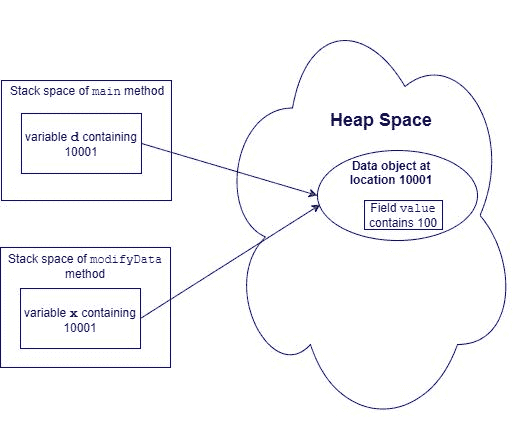

这里需要注意的一点是，尽管看起来我们是将`main`方法中创建的`Data`对象传递给了`modifyData`，但我们实际上传递给`modifyData`的只是变量`d`中存储的值（即`Data`对象的地址）。`Data`对象本身仍然保持在它原来的内存位置。我们没有移动它、传递它或复制它到任何地方。

`modifyData`方法使用引用变量`x`将`x`指向的`Data`对象的 value 字段修改为`200`。当控制返回`main`方法时，它打印`d.value`，此时该值是`200`。

让我们对上述代码的`modifyData`方法进行一个小小的修改：

```java
 public static void modifyData(Data x){
    x = new Data();
    x.value = 2*x.value;  
  }
```

我们做的只是插入了语句`x = new Data();`。你能告诉我们`main`方法现在会打印什么吗？

当 JVM 调用`modifyData`方法时，它让`x`指向与变量`d`指向相同的`Data`对象。这部分与之前相同。但更新后的方法的第一条语句创建了一个新的`Data`对象并让`x`指向这个新对象。例如，如果这个新的`Data`对象位于地址`20001`，那么`x`现在包含`20001`（而不是`10001`）。下一语句使用变量`x`更新 value 字段。由于`x`现在指向新的`Data`对象，该更新语句更新的是新`Data`对象的 value 字段，而不是旧的`Data`对象。当控制返回`main`方法时，它打印`d.value`。这会打印`100`，因为我们从未修改过变量`d`，所以`d`仍然指向原始的`Data`对象。这在下面的图 2 中所示。

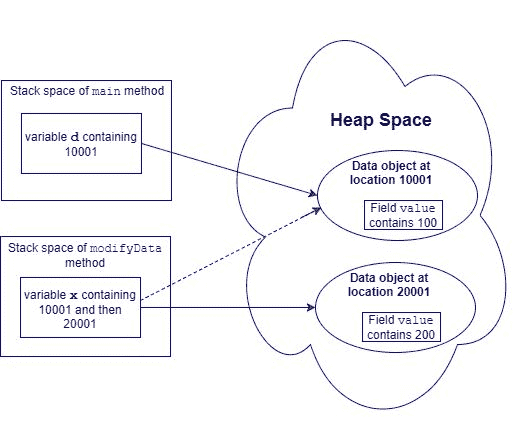

在上面的两个例子中，我们将一个变量（局部变量`d`）作为参数传递给`modifyData`方法。现在，看下面的代码：

```java
class Data{
   int value = 100;
}

public class TestClass {

  public static void main(String[] args){
    modifyData(new Data());
  }

  public static void modifyData(Data x){
    x.value = 2*x.value;
  }

}
```

观察语句`modifyData(new Data());`。在这里，我们没有向`modifyData`方法传递任何变量。那么，我们是真的直接将`Data`对象传递给方法的吗？不，虽然我们没有任何显式的变量来存储`Data`对象的地址，但编译器隐式地创建一个临时引用变量。它在堆空间中创建`Data`对象并将其赋值给这个临时变量。在进行方法调用时，传递给`modifyData`方法的是这个变量的值。当然，由于我们没有在`main`方法中保存对该`Data`对象的引用，在`modifyData`方法返回后，我们将无法再次引用该对象。

这种技术在通过`print/println`方法向控制台打印消息时一直在使用。例如，当你执行`System.out.println("hello world")`时，编译器将指向包含 "hello world" 的`String`对象的临时变量的值传递给`println`方法。

### 10.3.3 从方法返回结果 [☝](http://enthuware.com/forum/dbt.php?bid=2&sn=10.3.3&tn=returning-a-value-from-a-method)

与参数一样，从方法返回结果也使用了“按值传递”语义。

对于基本类型，`return`语句可以直接返回一个值（例如`return 100;`、`return true;`、`return 'a';`），也可以返回变量的值（例如`return i;`，其中`i`是 int）。

对于对象，`return`语句可以返回显式变量的值（例如`return str;`，其中`str`是 String），也可以返回引用对象的临时变量的值（例如`return new Student();`）。在这两种情况下，返回的都是存储位置的地址。

## 10.4 创建并重载构造函数

### 初始化块 [☝](http://enthuware.com/forum/dbt.php?bid=2&sn=10.4.1&tn=creating-initializers)

当你请求 JVM 创建类的实例时，执行以下操作：

1. 首先，它检查该类是否已经初始化。如果没有，JVM 将先加载并初始化该类。
2. 其次，它在堆空间中分配存储实例变量所需的内存。
3. 然后，它将这些实例变量初始化为默认值（即数值变量为 0，布尔变量为 false，引用变量为 null）。
4. 最后，JVM 通过执行编写在特殊区域的代码，为实例提供了根据类逻辑设置实例变量的机会。这些特殊区域就是`初始化块`和构造函数。

只有在这四个步骤完成后，实例才被认为“可以可以使用”。记得使用`new`运算符创建类实例吗？JVM 执行上述所有四个活动，然后将新创建并初始对象的引用返回给你的代码。

在列出的四个活动中，你已经在上一节中看到了第一项的详细说明。后两个活动由 JVM 透明地执行，不需要程序员做任何事情。第四项活动是本节的主题，它依赖于程序员，因为它涉及程序员编写的代码。

让我们先看看初始化块，因为它们先被 JVM 执行。

#### 初始化块

初始化块是直接写在类作用范围内的代码块。这里有一个例子：

```java
class TestClass{

  {
    System.out.println("In instance initializer");
  }

}
```

注意，在大括号内部没有方法声明或其他任何内容，只有嵌套的一行代码。初始化块内部的代码是普通代码。初始化块可以包含的语句数量或语句类型没有限制。类中可以拥有任意数量的此类初始化块。JVM 按照它们在类中出现的顺序执行它们。例如，下面的代码使用类中不同位置的两个初始化块打印了 Hello World!：

```java
class TestClass{

  //第一个实例初始化器
  {
    System.out.print("Hello ");
  }

  public static void main(String[] args){
    new TestClass();
  }

  //第二个实例初始化器
  {
    System.out.print("World!");
  }
}
```

注意到`main`方法除了创建一个`TestClass`实例之外，什么都没做。由于这次创建操作，`JVM`执行了两个实例初始化器中的每一个，然后将新创建的实例返回给`main`方法。当然，`main`方法没有将新创建实例的引用赋值给任何变量，但没关系。

实例初始化器必须直接出现在类的作用域内。因此，在下面的代码中`main`方法中的代码块并不是实例初始化器。它只是普通的方法体代码。不过，它是有效的。


```java
public class TestClass{

  {
    System.out.print("Hello ");
  }

  public static void main(String[] args){
     // 下这个不是一个实例初始化器
     {
       System.out.print("World!");
     }

     new TestClass();
  }
}
```

你能知道它会打印什么吗？没错。它会打印 `"World!Hello "`（当然不带引号）。在执行 `main` 方法时，`JVM` 遇到了打印 `"World!"` 的打印语句，因此它被打印了。接下来，它遇到了一个创建 `TestClass` 实例的指令。注意，这是它将创建的第一个 `TestClass` 实例。在完成该实例的创建时，它执行了打印 `"Hello "` 的实例初始化器。因此，控制台上的最终输出是 `"World!Hello "`。

### 从实例初始化器访问成员 [☝](http://enthuware.com/forum/dbt.php?bid=2&sn=10.4.1&tn=accessing-members-from-instance-initializers)

实例初始化器可以访问类的所有的成员。这包括静态字段和实例字段以及方法。就像实例方法一样，实例初始化器可以访问隐式变量 `this` 和 `super`（我稍后会介绍 `super`）。

### 前向引用 [☝](http://enthuware.com/forum/dbt.php?bid=2&sn=10.4.1&tn=forward-referencing)

在访问实例字段时，它们相对于初始化器块的出现顺序很重要。虽然类中任何地方声明的实例变量对所有实例初始化器都是可见的，但如果一个变量声明在初始化器下方，则实例初始化器不允许使用该变量的值。不过，它可以为这样的变量赋值。例如，请考虑以下代码：

```java
public class TestClass{

 {
 System.out.print(i); // 1
 - 无效的前向引用

```java i = 20; //2 - 有效的前向引用

  }

  int i = 10;

  public static void main(String[] args){

     new TestClass();

  }

}
```

上述代码中标记为 `//1` 的行将无法编译，因为它正尝试使用变量 `i` 的值，而该变量声明在初始化器下方；但标记为 `//2` 的行可以正常编译，因为它是在给 `i` 赋值。

此此规则仅适用于变量，而不适用于方法。因此，下面的代码可以正常编译：

```java
public class TestClass{

  {

    printI(); // 有效的前向引用

  }

  void printI(){

    System.out.print(i);

  }

  int i = 10;

  public static void main(String[] args){

     new TestClass();

  }

}
```

虽然代码可以正常编译和运行，但你可能会它的打印结果感到惊讶。`JVM` 按照它们出现的顺序执行实例初始化器块和实例变量初始化语句。因此，在上面的代码中，`JVM` 在执行语句 `int i = 10;` 中的变量初始化之前，执行了实例初始化器块。

（注意 `JVM` 已经为变量 `i` 分配了空间，并且在主题开始时描述的步骤 1 和步骤 2 的过程中，已经为 `i` 提供了一个默认值 `0`。）

在执行实例初始化器时，`JVM` 调用了 `printI` 方法。`printI` 方法随后打印了 `i` 的值，此时 `i` 的值为 `0`。

### 10.4.2 创建构造函数 [☝](http://enthuware.com/forum/dbt.php?bid=2&sn=10.4.2&tn=creating-constructors)

#### 类的构造函数 [☝](http://enthuware.com/forum/dbt.php?bid=2&sn=10.4.2&tn=constructor-of-a-class)

类的构造函数看起来非常像类的方法，但有两个点使得方法成为构造函数：

1. **名称** - 构造函数的名称总是与类名完全相同。
2. **返回值** - 构造函数没有返回值类型。它甚至不能说它返回 `void`。

下面是一个带有构造函数的类示例。

```java
class TestClass{

   int someValue;

   String someStr;

   TestClass(int x) 

 // 未指定返回值类型

   {

      this.someValue = x; // 初始化 someValue

   }

}
```

注意，构造函数的名称与类名相同，且没有返回值类型。上面的 `void TestClass(int x)` 并不是构造函数，它只是一个有效的方法，因此它可以正常编译。

关于默认构造函数的讨论也给了我机会谈谈一个我经常听到的误解，即构造函数必须初始化类中的所有实例成员。事实并非如此。构造函数是由你（程序员）提供的，你可以决定想要初始化哪些实例成员。例如，我之前展示的用于 `TestClass` 的构造函数并没有触碰 `someStr` 变量。编译器提供的默认构造函数也没有为实例成员分配任何值。请记住，无论如何，`JVM` 总是会为静态和实例成员提供默认值。

你肯定会遇到测试你对默认构造函数熟悉程度的问题。请留心注意那些在类显式提供了构造函数的情况下，却假定默认构造函数存在的代码。

## 默认构造函数与用户定义构造函数的区别 [☝](http://enthuware.com/forum/dbt.php?bid=2&sn=10.4.2&tn=difference-between-default-and-user-defined-constructors)

关于默认构造函数，你只需要记住两点：

1. **何时何时提供** - 只有当类没有显式定义 `any` 构造函数时，编译器才会提供它。
2. **它看起来是什么样的** - 默认构造函数是你见过的最简单的构造函数。它不接受任何参数，没有任何 `throws` 子句，并且不包含任何代码。

但默认构造函数有一个特殊之处在于它的访问性。默认构造函数的访问性与类的访问性相同。这意味着，如果类是 `public` 的，那么默认构造函数也是 `public`；如果类具有默认访问性，那么默认构造函数也有默认访问性。如果你不了解访问性，不用担心，我将在下一个主题中讨论它。

默认构造函数有时也被称为“默认无参数”构造函数，因为它不接受任何参数。但这在技术上是不精确的，因为默认构造函数始终是无参数构造函数。不存在所谓的带参数的默认构造函数！

相反，你可以在类中显式地写一个带有 `throws` 子句且不同访问性的无参数构造函数。例如，如果你不想让任何人创建该类的实例，那么让类拥有一个 `private` 无参数构造函数是非常常见的。我将在下一个主题中对此详细讨论。

## 构造函数的好处 [☝](http://enthuware.com/forum/dbt.php?bid=2&sn=10.4.2&tn=benefit-of-constructors)

你在方法中可以做的任何事情在构造函数中也可以做，反之亦然。方法或构造函数能做什么并没有限制。为什么直接用一个方法并将其命名为 `init()` 之类的名称呢？事实上，你会遇到诸如 `servlets` 这样的 Java 框架，它们正是这样做的。那么你为什么还需要构造函数呢？嗯，对构造函数优劣的详细讨论超出了本书的范围，但我会给你提供一些提示。

正如我之前提到的，在构造函数执行完成之前，实例不被认为是“准备好就用的”。因此，构造函数可以帮助你确保在任何人使用它之前，类的实例已经按照你的需求完成了初始化。在这里，“使用”本质上意味着其他代码通过其字段或方法访问该实例。

在方法而不是构造函数中执行相同的初始化是可能的，但在那种情况下，你类的用户必须记住在创建实例后显式地调用该方法。如果你类的用户在创建类实例后未能调用那个特殊方法会怎样？该实例可能处于一个逻辑上的不一致状态，并且当用户稍后在实例实例上调用其他方法时，可能会产生错误的结果。因此，构造函数是执行对象所有初始化活动的正确位置。在这个位置，你确保实例已经准备就绪，包含了在其他方法中执行预期活动所需的一切。

构造函数还提供了线程安全性，因为在构造函数完成之前，没有线程可以访问该对象。这种保护是由 `JVM` 为构造函数保证的，而方法并不总是可用的。

## 10.4.3 构造函数重载 [☝](http://enthuware.com/forum/dbt.php?bid=2&sn=10.4.3&tn=overloading-constructors)

类可以拥有任意数量的构造函数，只要它们的签名不同。由于构造函数的名称始终与类名相同，你拥有多个构造函数的唯一方法就是它们的参数类型列表不同。

就像同名方法一样，如果一个类有多个构造函数，那么这就被称为“构造函数重载”，因为构造函数之间的区别仅在于参数类型列表。

不过，方法重载和构造函数重载之间存在一些区别。请记住，在方法重载的情况下，方法可以调用另一个同名方法，就像它调用任何其他方法一样，即通过使用方法名并在括号中传递参数。在构造函数重载的情况下，当一个构造函数调用同一类的另一个构造函数时，被称为“构造函数链”，它的工作方式有点不同。让我给你演示如何操作。

### 构造函数链 [☝](http://enthuware.com/forum/dbt.php?bid=2&sn=10.4.3&tn=constructor-chaining)

构造函数可以使用 `this` 关键字和括号中的参数来调用另一个构造函数。这是一个示例：

```java
class Account{

    int id;

    String name;

    Account(String name){ 

       this(111, name);

       System.out.println("returned from args constructor");

    }

    Account(int id, String name){ 

       this.id = id;

       this.name = name;

    } 

    public static void main(String[] args) {

       Account a = new Account("amy");

    }

}
```

注意，代码没有使用构造函数的名称而是使用了 `this`。也就是说，代码不是调用 `Account(111, name)`，而是调用 `this(111, name)` 来调用另一个构造函数。事实上，使用构造函数名称尝试调用另一个构造函数是违反规则的，会导致编译错误。

从构造函数调用另一个构造函数是一种常用技术，用于用不同数量的参数初始化实例。如上面的所示，带一个参数的构造函数调用带两个参数的构造函数。它向第二个构造函数传递了一个用户的值和一个默认值。这有助于将所有的初始化逻辑保持在一个构造中，同时允许类的用户使用不同的参数创建实例。

调用另一个构造函数的唯一限制是它必须是构造函数的第一行代码。这意味着构造函数最多只能调用另一个构造函数一次。因此，以下三个 `Account` 类构造函数的代码段将无法编译：

```java
Account(String name){ 

    System.out.println("calling two args constructor");

    this(111, name); //调用另一个构造函数必须是第一行

} 

Account(){ 

    this(111);

    this(111, "amy"); //调用另一个构造函数必须是第一行

} 

Account(String name){ 

   Account(111, name); //调用另一个构造函数的方法错误，但如果 Account 类有一个名为 Account 的方法，这将是对该方法的有效调用。

}
```

#### 调用构造函数

无法直接调用类的构造函数。它只会在使用 `new` 关键字创建新实例时作为结果被调用。该规则的唯一例外是，如上所述，构造函数通过 `this`（以及 `super`，我将在另一章节中讨论）调用另一个构造函数。换句话说，如果你得到了一个对象的引用，你不能使用该引用来调用该对象的构造函数。

现在，考虑以下程序。你能告诉我在标记为 `LINE A`、`LINE B`、`LINE C` 和 `LINE D` 的四行代码中，哪一行应该取消注释以便打印出 `111, dummy` 吗？

```java
class Account{

   int id;

   String name;

   public Account(){

      id = 111;

      name = "dummy";

   }

   public void reset(){

     //this();   //<-- LINE A

     //Account();  //<-- LINE B

     //this = new Account(); //<-- LINE C

     //new Account(); //<-- LINE D

   }

   public static void main(String[] args) {

       Account a =  new Account();

       a.id = 2; 

       a.name = "amy";

       a.reset();

       System.out.println(a.id+", "+a.name);

    }

}
```

答案不是这些中的任何一个。前三个都是调用构造函数的无效尝试——`this()` 只能在构造函数内部使用，`Account()` 被解释为对名为 `Account` 的方法的调用，但在给定代码中不存在该方法，而 `this = new Account()` 尝试更改 `this`（这是一个 final 变量）以指向另一个对象。因此，这三条语句都无法编译。

`new Account()` 是一个合法的语句，但它创建了一个完全新的 `Account` 对象。这个新 `Account` 对象的实例变量确实被设置为 `111` 和 `"dummy"`，但这不会改变当前 `Account` 对象的值。

### 10.4.4 实例初始化器 vs 构造函数

实例初始化器和构造函数的目的是相同的，即为程序员提供一个初始化实例的机会。但它们之间存在一些根本性的区别：

1. 在创建类的实例时，`JVM` 会逐顺序执行该类所有的实例初始化器，但它只会执行其中一个构造函数（取决于传递的参数）。当然，正如你之前看到的，构造函数可以使用 `this` 调用另一个构造函数。但实例初始化器之间这种显式的链式调用是不可能的。

2. 对实例初始化器下方声明的变量的使用限制不适用于构造函数。如前所述，实例初始化器可以对变量进行前向引用，但前提是它仅仅在为该变量赋值，而不是尝试使用该变量的值。

3. 第三个区别与异常有关，我还没有讨论过这个话题，所以如果你没有完全理解请不要担心。编译器期望实例初始化器在执行时不抛出异常。如果编译器能够判断出某个实例初始化器最终总是以异常结束，它将拒绝编译该代码。这里有一个例子：

```java
class TestClass{

  {

         throw new RuntimeException(); //这一行无法编译

      }

      int i = 10;

      public static void main(String[] args){

         new TestClass();

      }

      TestClass(){

        throw new RuntimeException(); //这一行是没问题的

      }

    }
```

上面的代码将编译失败，并显示错误信息：“error: initializer must be able to complete normally”。编译器注意到没有办法让这个初始化器能够成功完成，因此，该类的实例永远无法创建。

此限制不适用于构造函数。这就是为什么上面代码中的构造函数是没问题的。

除了上述三个区别外，实例初始化器和构造函数的工作方式相同。那么，你应该何时使用实例初始化器呢？理想情况下，永远不要使用。实例初始化器会让代码难以追踪，最好尽量避免。一个设计良好的类不应该需要使用实例初始化器。然而，如果你有一个具有多个构造函数的类，并且你想为它的每个构造函数添加一些通用的初始化逻辑，你可以将这些逻辑放在实例初始化器中。这可以避免你在每个构造函数中重复相同的代码。从这个意义上说，实例初始化器是一种强大的黑科技 :)

在考试中，你可能会看到关于实例初始化器基础知识的问题，但我们还没有见过有人遇到过需要本节讨论的细节的问题。我之所以提到它们，是因为它们对于面试和实际编程很重要。

## 10.4.5 重新复习 final 变量

现在你已经了解了初始化器和构造函数，让我暂时回到 final 变量上。

由于 final 变量的值不能更改，Java 不会为它分配默认值，而是强制程序员在其他类使用它之前显式地给它赋值。这种显式初始化的思想驱动了以下关于它们初始化的规则：

1. **static final 变量的显式初始化** - 静态变量只有在类加载后才能被其他类使用。这意味着该变量在类加载完成时必须已经初始化。因此，你可以在声明时给 final 变量赋值，也可以在任何一个静态初始化器（即类初始化器）中赋值，如下所示：

```java
class TestClass{

    static final boolean DEBUG = true; //声明时初始化

    static final int value; //在此处未初始化

    static

   {
```


`value = 10; // 在静态初始化器中初始化`

`}`

`public static void main(String[] args){`

`System.out.println(value);`

`}`

`}`

由于一个类可以有多个静态初始化器，且它们在类加载时都会执行，你可以在其中任何一个初始化静态 `final` 变量，但不能初始化多个，因为第一个静态初始化器已经设置了它的值，而第二个将更改现有值，这是不允许的。因此，下面的代码无法编译：

```java
class TestClass{

    final static int value; 

    static {
       value = 10; 
    }

    static {
       value = 20; //无法编译，因为 value 已初始化
    }
}
```

## 2. 实例 `final` 变量的显式初始化

由于实例变量只有在创建类的对象后才能被其他类使用，因此推导出实例 `final` 变量可以在声明时、任何实例初始化器中或在所有的构造函数中初始化。例如：

```java
class TestClass{

    final int value; //在此处未初始化

    {
       value = 10;  // 在实例初始化器中初始化
    }
}
```

同样，与静态初始化器一样，一个类可以有多个实例初始化器，由于它们在创建实例时都会执行，实例 `final` 变量只能在一个实例初始化器中初始化。如果变量在任何实例初始化器中都没有初始化，则它必须在每个构造函数中初始化。例如：

```java
class TestClass{

    final int value; //在此处未初始化

    {
        //在此处也没有初始化 value
    }

    TestClass(){
      value = 10;
    }

    TestClass(int x){
      value = x;
    } 
}
```

```java
TestClass(int a, int b){ //此构造函数将无法编译，因为它留下了未初始化的值
}
```

注意构造函数中的初始化与实例初始化器中的初始化方式不同。这种区别源于：在创建类的实例时，所有的实例初始化器都会执行，但只有一个构造函数会被执行。

## 3. 局部变量的显式初始化（又名方法或自动变量）

方法变量只能在该方法内部使用，因此它可以在被访问之前的任何时候进行初始化。如果它在方法的任何地方都没有使用，甚至可以保持未初始化状态。例如，以下代码可以正常编译并运行：

```java
class TestClass {

    public static void main(String[] args){

      final int x;  //没有在任何地方初始化 x

      final int y; 

      System.out.println("hello");

      y = 10; // 在访问 y 之前初始化

      System.out.println(y);
    }
}
```

## 10.5 对方法和字段应用 `static` 关键字

### 10.5.1 对方法和字段应用 `static` 关键字

我已经在“初学者入门”章节中讨论过 `static` 单词的含义以及它应用于方法或字段时的内涵。

在本节中，我将深入探讨，并从考试的角度解释 `static` 的细微差别。让我们从语法开始。

你可以使用 `static` 关键字将类的任何成员（即方法、字段或任何嵌套类型定义）声明为 `static`。对于方法或字段，该关键字必须分别出现在方法的返回类型之前或字段的类型之前。例如：

```java
class ConnectionHelper{

  static int idle_timeout;

  static String url;

  private static void ping(){ } // 修饰符的顺序不重要

  static public final void check(){ } // 修饰符的顺序不重要
}
```

对于嵌套类型定义，`static` 关键字必须紧挨在类型之前。例如：

```java
class Request{

  static class Data{
  }

  static interface Operation{
  }

  static enum RequestTypes{ 
  }
}
```

顶层类、接口或枚举不能声明为 `static`。这也没有意义，因为 `static` 是所有者与被所有类型之间关系的一个属性。例如，类 `Request` 静态地拥有 `Data`。类 `Request` 不能是 `static` 的，因为它没有被任何其他类型拥有。

局部成员（即定义在方法内部的成员）不能是 `static`。因此，以下代码将编译失败：

```java
class TestClass {

   public static void main(String[] args){

      static int x; // 不能是 static

      static class Y{ // 不能是 static
      }
   }
}
```

这是否意味着变量 `x` 和类 `Y` 分别是实例变量和实例类呢？不是，这些成员根本不是类的成员，因此 `static/instance`（静态/实例）概念不适用于它们。这些成员是方法局部的，一旦方法执行完成就会消失。它们无法从方法外部被引用。

### 10.5.2 访问静态成员

静态成员作为所有者类的成员存在，而不是作为所有者类某个实例的成员存在。换句话说，静态成员不需要所有者类的实例即可存在。因此，可以通过指定所有者类的名称来访问静态成员。例如，`ConnectionHelper` 和 `Request` 的静态成员可以这样从另一个类访问：

```java
class TestClass{

  public static void main(String[] args){

     System.out.println(ConnectionHelper.idle_timeout); // 打印 0 (为什么?)

     System.out.println(ConnectionHelper.url); // 打印 null (为什么?)

     Request.Data rc = new Request.Data();
  }
}
```

使用所有者类的名称访问静态成员是访问静态成员的标准且推荐的方法。然而，Java 也允许通过变量来访问静态成员。例如，`ConnectionHelper` 类的静态变量 `idle_timeout` 也可以这样访问：

```java
class TestClass{

  public static void main(String[] args){

     ConnectionHelper c = null; 

     System.out.println(c.idle_timeout); // 打印 ConnectionHelper 的 idle_timeout
  }
}
```

注意 `c` 是 `null`。但编译器并不关心 `c` 是否为 `null`，因为它注意到 `idle_timeout` 是一个静态变量，访问 `idle_timeout` 不需要 `ConnectionHelper` 的实例。编译器知道语句 `c.idle_timeout` 中的 `idle_timeout` 意味着什么，并有效地将其翻译为 `ConnectionHelper.idle_timeout`。

这个简单的示例突显了访问静态成员的一个重要方面：对静态成员的访问是由编译器在编译时通过检查变量类型决定的。编译器知道变量 `c` 的类型是 `ConnectionHelper`，并且 `idle_timeout` 是 `ConnectionHelper` 的静态成员，因此将调用 `c.idle_timeout` 绑定到 `ConnectionHelper.idle_timeout`。

现在，掌握了这些知识，你能告诉以下代码将做什么吗？

```java
class TestClass{

  public static void main(String[] args){

     ConnectionHelper c = null; 

     ping(); 
  }
}
```

*(等等，原文这里是 `pint()` 而不是 `ping()`，我将根据上下文保持逻辑)*：

```java
class TestClass{

  public static void main(String[] args){

     ConnectionHelper c = null; 

     ping(); 
  }
}
```

没错。它可以正常编译并运行（当然，没有任何输出）。但有趣的是，不会发生 `NullPointerException`。由于引用变量 `c` 的类型是 `ConnectionHelper`，且 `ping()` 是 `ConnectionHelper` 的静态方法，编译器将 `c.ping()` 绑定到 `ConnectionHelper.ping()`。

这被称为**静态绑定**或**编译时绑定**，因为编译器没有将绑定决策交给 JVM。这个概念在我们讨论继承和多态时将发挥重要作用。

### 10.5.3 从同一类访问静态成员

类的静态成员也可以直接从同一类的静态成员或实例成员中访问，而无需使用类名。例如，以下类使用静态变量来计算该类的实例数量：

```java
class InstanceCounter{

   static int count;

   InstanceCounter(){

      // 从构造函数直接访问 count
      count++; 
   }

   static void printCount(){

      // 从静态方法直接访问 count
      System.out.println(count); 
   }

   void reduceCount(){

      // 从实例方法直接访问 count
      count--; 
   }
}
```

以下类展示了从另一个类访问类静态成员的各种方式：

```java
class TestClass {

   public static void main(String[] args){

     InstanceCounter ic = new InstanceCounter();

     ic.printCount();// 通过实例引用访问静态方法

     new InstanceCounter().printCount(); // 通过实例的隐式引用访问静态方法

     InstanceCounter.printCount(); // 使用类名访问静态方法

     System.out.println(InstanceCounter.count); // 使用类名访问静态字段
   }
}
```

你应该能够判断出上述代码会打印什么。

### 10.5.4 导入静态字段

在“Java 基础”章节中，我讨论了 `import` 语句。我向你展示了如何导入类以及类的静态成员。如果你需要多次访问某个类的静态成员，`import static` 语句提供了一种易于减少击键次数的方便方法。

有趣的是，`import static` 语句是在 Java 5 中引入的，仅为了避免访问全局常量时使用拙劣的替代方案。在 Java 5 之前，如果开发者需要定义全局常量，他们会像这样在接口中定义常量：

```java
public interface Constants{

   public static final double INTEREST_RATE = 0.15;

   public static final boolean COMPOUNDING = true;

   public static final int PERIOD = 1;
}
```

要在任何类中使用这些常量，他们需要让该类实现上面的接口，如下：

```java
public class InterestCalculator implements Constants
{
   public static double compute(double principle, double time){

      if(COMPOUNDING){
         //计算并返回复利
      }else{
         //计算并返回单利
      }
   }
}
```

让类实现 `Constants` 接口的好处是它避免了开发者输入定义常量的类名，也就是说，与其输入 `Constants.COMPOUNDING`，他们只需要输入 `COMPOUNDING`。但许多专家认为这使得代码难以理解。这也是对 `implements` 关键字的滥用，因为在这里没有实现任何功能。接口的使用也是令人反感的，因为我们也没有在接口中定义任何行为。

`import static` 语句通过简化导入类的静态成员，避免了对这种技术的需求。你现在可以在类中定义常量并像这样静态地导入这些常量：

```java
package accounting; //需要将此类放在包中，因为记住无法从无名包中导入任何内容

public class Constants{

   public static final double INTEREST_RATE = 0.15;

   public static final boolean COMPOUNDING = true;

   public static final int PERIOD = 1;
}
```

```java
import static accounting.Constants.*;

public class InterestCalculator {

   public static double compute(double principle, double time){

      if(COMPOUNDING){
         //计算并返回复利
      }else{
         //计算并返回单利
      }
   }
}
```

技术上，你也可以导入接口的静态成员，但从设计角度来看，最好使用类来定义常量，并将接口的使用留给通过方法定义行为。

### 10.5.5 从静态方法访问实例成员

由于静态方法属于一个类而不是属于该类的对象，因此静态方法不会在该类的任何实例的上下文中执行。另一方面，实例方法总是在类的某个特定实例上被调用的，因此它在被调用的实例的上下文中执行。实例方法可以使用隐式变量 `this` 访问该实例。由于静态方法没有与实例关联，因此 `this` 变量在静态方法中是不可用的。

`this` 变量被称为隐式变量的原因在这里变得非常重要。这个变量在任何地方都没有被显式声明，编译器假设它在实例方法中存在。每当编译器看到直接从方法内部访问某个实例成员时，即使你没有在代码中显式输入它，编译器也会使用 `this` 变量访问该成员。然而，当静态方法尝试访问实例成员时，`this` 是不可用的，因此编译器会报错，无法从静态上下文引用非静态变量。

以下代码说明了这一点：

```java
class Book{

   int name;

   static void printName1(){
      System.out.println(this.name); //将无法编译
      System.out.println(name);//与上面一样。无法编译
   } 

   void printName2(){
       System.out.println(this.name); //这是可以的。
       System.out.println(name); //与上面一样。这是可以的。
   } 
}
```

在上面的代码中，编译器意识到 `name` 是一个实例变量，因此尝试通过 `this` 访问它，即 `this.name`。但由于 `this` 在 `printName1` 中不可用，它生成了句错误。`printName2` 没有问题，因为 `printName2` 是实例方法，而 `this` 在实例方法中是可用的。

记住，你并不总是需要显式地使用变量 `this` 来访问实例成员。只有当方法中也声明了同名的局部变量，且你想要引用实例变量而不是局部变量时，你才需要使用它。技术上，这用于当实例变量被同名的局部变量遮蔽（shadowed）时进行“取消遮蔽”。

初学者中一个常见的误解是静态方法无法访问类的实例字段。这种误解之所以是因为他们在很多地方看到或听到这种说法。然而，这是一个不完整的陈述。正确的表述是：静态方法在不指定想要访问其成员的实例的情况下无法访问实例成员。当你看到下面的代码时，这一点就会变得清晰：

```java
class Book{

   int name;

   static void printName(){

       Book b1 = new Book();

       Book b2 = new Book();

       System.out.println(b1.name); //可以编译
   }
}
```


在上面的代码中，我们在静态方法内部访问实例变量。注意有两个`Book`实例。每个实例都有自己的`name`拷贝。但由于使用了引用`b1`，编译器知道我们要访问哪一个。这就是为什么没有问题。

## 10.5.6 类加载与静态初始化

执行 Java 程序或 Java 类本质上意味着执行该类的`main`方法。但在 JVM 将控制传递给`main`方法之前，它必须找到类文件并将其“加载”到内存中。类的加载是由类加载器完成的。别担心，考试时不需要担心类加载器和整个类加载过程。但你需要了解在类加载后调用`main`方法之前发生在类上的一件事。

在执行代码时，每当 JVM 第一次遇到某个类时，它会为该类的静态字段分配并初始化空间。由于静态字段属于类而不是类的对象，因此此类字段只有一个。JVM 将这些字段初始化为默认值，并执行类中定义的“静态初始化”。静态初始化无非是用`static`关键字标记的代码块，如下所示：

```
class TestClass{

   //以下是静态初始化

   static {

     System.out.println("In static block");

   }

   public static void main(String[] args){

     System.out.println("In main");

   }

}
```

上面的程序产生以下输出：

```
In static block

In main
```

如你从上述输出所示，`main`方法在静态块之后执行。静态块为开发者提供了一个机会，用于初始化类的静态字段，并在类被其他代码使用之前执行开发者想要执行的其他任何业务逻辑。下面的类展示了开发者如何使用静态初始化器：

```
class InterestCalulator{

  static double RATE;

  static {

    System.out.println("In static block. RATE = "+RATE);

    RATE = 10;

  }

  public static double computeInterest(double principle, int yrs){

    return RATE*principle*yrs/100;

  }

  public static void main(String[] args){

    double interest = computeInterest(100, 1);

    System.out.println(interest);

    interest  = computeInterest(100, 2);

    System.out.println(interest);

  }

}
```

上述的`InterestCalculator`类根据`RATE`的值计算单利，`RATE`是在静态初始化器中设置的。它产生了以下输出：

```
In static block. RATE = 0.0

10.0

20.0
```

上述输出中需要观察的重要点是`RATE`的值被打印为`0.0`。这是因为 JVM 已经将`RATE`变量初始化为默认值`0.0`。打印出来的是那个值。在该打印语句之后，`RATE`被设置为`10`。你需要注意的第二点是`RATE`只被打印了一次。这是因为静态块在类加载和初始化时只执行一次。无论之后该类被使用多少次，JVM 永远不会再次执行该静态块。

关于静态块只有几个简单的规则：

1. 一个类可以有任意数量的静态块。它们按照在类中出现的顺序被执行。

2. 静态块可以访问类的所有的静态变量和静态方法。然而，如果静态变量的声明出现在静态块之后，那么你只能在静态块中设置该变量的值。这里有一个例子：

```
class TestClass{

   static int a;

   static{

     System.out.println(a);//有效，a 在静态块之前声明了

     System.out.println(b);//无效，无法读取 b 的值，因为 b 定义在静态块之后

     b = 10; //有效，因为 b 正在被赋值。

     m(); //有效，即使 m 是在后面定义的

   }

   static void m(){ 

     System.out.println(b);//有效，方法可以对代码中后声明的变量进行任何操作

   }

   static int b;

   public static void main(String[] args){

   }

   //另一个静态块

   static{

     System.out.println(b);

   }

}
```

3. 如果类有一个父类，且父类尚未被初始化，JVM 将先初始化父类，然后进行该类的初始化。下面的示例解释了这一过程：

```
class Parent{

  static{

    System.out.println("Initializing Parent");

  }

}

class ChildA extends Parent{

  static{

    System.out.println("Initializing ChildA");

  }

}

class ChildB extends Parent{

  static{

    System.out.println("Initializing ChildB");

  }

}

public class TestClass{

  public static void main(String[] args) {

    ChildA a = new ChildA(); //会引起类 Parent 然后是类 ChildA 的初始化

    ChildB b = new ChildB(); //会引起只有 ChildB 被初始化

  }

}
```

上述代码生成了以下输出：

```
Initializing Parent

Initializing ChildA

Initializing ChildB
```

当 JVM 遇到语句`ChildA a = new ChildA()`时，它意识到`ChildA`在这里被第一次使用。因此，在创建`ChildA`类的对象之前，它需要初始化`ChildA`类。由于`ChildA`继承自`Parent`，JVM 必须先初始化`Parent`类。这就是为什么`Initializing Parent`在`Initializing ChildA`之前打印。一旦`ChildA`被加载并初始化，JVM 会创建一个`ChildA`的对象并将其引用赋值给变量`a`。同样，当 JVM 遇到语句`ChildB b = new ChildB()`时，它尝试初始化`ChildB`类。在初始化`ChildB`期间，JVM 意识到它的父类（即`Parent`）已经初始化过了，因此它不再再次执行`Parent`的初始化逻辑。因此，这次只打印了`Initializing ChildB`。你现在可能奇怪为什么我们停在了`Parent`类上。`Object`类又是怎么了？毕竟，`Object`是`Parent`的父类！没错，`Object`确实是`Parent`的父类。但它也是`TestClass`的父类。JVM 在初始化`TestClass`类时已经初始化了`Object`类。

4. 没有办法可以访问或引用静态块。这意味着你不能从任何地方显式地“调用”或“触发”静态块。它只能由 JVM 调用，而且只能调用一次。

从技术上讲，每个类在每个类加载器中都有一个静态字段副本，但是...

面向对象开发的目标之一是鼓励组件（可以是类、接口或枚举）的用户仅依赖于用户与组件开发者之间约定的契约，而不是依赖于组件不愿共享的任何其他信息。

例如，如果一个组件提供了一个用于计算购物车中商品税费的方法，那么该组件的用户只需要传递所需的参数并获取结果即可。它不应该尝试访问该类的内部变量或逻辑，因为使用此类信息会将该组件的用户与该组件紧密地耦合在一起。想象一个开发者为`TaxCalculator`类编写了如下代码：

```
class TaxCalculator{

  double rate = 0.1;

  double getTaxAmount(double price){

    return rate*price;

  }

}
```

理想情况下，上述类的用户应该使用`getTaxAmount`方法，但假设他们没有这样做，而是访问了`rate`变量，如下所示：

```java
//在某个其他类中的代码
double price = 95.0;
TaxCalculator tc = new TaxCalculator();
double taxAmt = price*tc.rate;
```

后来，开发者意识到“税率”不能硬编码为`0.1`。它需要从数据库中检索，因此，开发者对类进行了以下更改：

```java
class TaxCalculator{

  //double rate = 0.1; //不再进行硬编码

  double getTaxAmount(double price){

    return getRateFromDB()*price;

  }

  double getRateFromDB(){

    //使用 jdbc 从数据库获取费率

  }

}
```

由于该类中不再存在`rate`变量，所有访问该变量的其他代码现在将无法编译。如果他们坚持使用`getTaxAmount`方法，就完全不会遇到任何问题。为了防止编译失败，开发者现在被迫在他们的新代码中维护`rate`变量，尽管该类已经不再需要这个变量。如果数据库中的税率发生了变化，但`TaxCalculator`类中的`rate`变量没有更新怎么办？如果一个鲁莽的用户在不恰当的时间更新了`rate`变量，而另一个用户正在使用它计算税费又怎么办？在这两种情况下，用户计算的税费都是错误的。而且也没有错误消息让开发者意识到这个问题。这是一个严重的问题。

但问题不仅在于用户依赖于类的内部细节。`TaxCalculator`类并没有提供任何关于它支持哪些功能的线索。用户如何知道他们应该只使用`getTaxAmount`方法而不是`rate`变量呢？换句话说，`TaxCalculator`类没有明确它的公共契约，因此，只指责此类的用户是不公平的。这就是 Java 的“访问修饰符”（access modifiers）大显用场的地方。

## 11.1.2 访问修饰符

Java 类及其成员可以通过三种访问修饰符显式指定谁可以访问该类和成员：`private`、`protected`和`public`。除了这三个之外，不存在任何访问修饰符也被视为一种访问修饰符。这被称为“默认（default）”访问。这些访问修饰符不仅让类的用户，也让编译器对你某个成员的意图非常清晰。编译器随后通过拒绝编译违反你意图的代码来帮助执行意图。以下是这些修饰符如何影响访问权限：

- `private` - 私有成员仅从该类内部可访问。它不能被任何其他类的代码访问。

例如，我向你展示的`TaxCalculator`类的问题，如果开发者简单地将`rate`变量声明为`private`，就可以很容易地避免。这将使得变量从任何其他类都不可访问。编译器将通过拒绝编译尝试使用它的代码，来防止该类的用户使用`rate`变量。由于不再对`rate`变量有依赖，开发者可以轻松地删除此变量，而不会对任何人产生任何影响。

- `"default"` - 未应用访问修饰符的成员对所有属于同一个包的类都是可见的。无论尝试访问另一个类默认成员的类是该类的子类还是父类都无关。如果两个类属于同一个包，它们就可以访问彼此的默认成员。这也被称为“包私有（package private）”或简单称为“包访问（package access）”。

- `protected` - 受保护成员从两个地方可以访问——如果访问类属于同一个包，或者如果访问类是子类（无论该子类属于哪个包）。第一种情况很简单，因为它与默认访问完全相同。所有属于同一个包的类都可以访问彼此的受保护成员。第二种情况没那么简单，我稍后会专门详细解释。

- `public` - 公共成员从随处都可以访问。任何类中的任何代码都可以使用另一个类的公共成员。例如，`getTaxAmount`方法可以被设为公共。这将给用户提供一个清晰的信号，如果他们想计算税额，就使用此方法。

如果你按照限制程度对四种访问修饰符进行排序，那么`private`是限制最严格的，而`public`是限制最松的。另外两个即`default`和`protected`位于两者之间。因此，访问修饰符从严格到松的顺序为：`private` > `default` > `protected` > `public`。

在考试中，注意不存在的访问修饰符，如`"friend"`、`"private protected"`和`"default"`。

## 11.1.3 理解保护访问

我之前提到，受保护成员可以从同一个包的类访问，无论子类属于哪个包，都可以从子类访问。这听起来很直接，但该陈述的后部分并不完全正确。由于涉及到继承概念（我还没有讨论），我将通过一个例子来解释这种情况。考虑两个属于不同包的类：

```java
//Account.java
package com.mybank.accts;

public class Account{ //观察类的公共修饰符

  protected String acctId;

  //对 acctId 进行操作

}
```

```java
//HRAccount.java
package com.mybank.hr;

import com.mybank.accts.*;

public class HRAccount extends Account{

  public static void main(String[] args){

    Account simpleAcct = new Account();

    simpleAcct.acctId = "111";//无法编译

    HRAccount hrAcct = new HRAccount();

    hrAcct.acctId = "111";//编译正常

  }

}
```

在代码中，编译器不允许使用引用`simpleAcct`访问`acctId`，但允许通过引用`hrAcct`访问`acctId`。理想情况下，由于`acctId`是`protected`，且由于受保护成员可以从子类访问（无论子类的包如何），`simpleAcct.acctId`应该是有效的。那么问题出在哪里？

实际上，`protected`允许子类访问其从父类继承的自己的字段。`HRAccount`类继承了`Account`类的`acctId`字段，因此`HRAccount`类拥有任何`HRAccount`对象中的`acctId`字段，但`HRAccount`类并不拥有`Account`对象的`acctId`字段。这就是`HRAccount`类被允许访问`HRAccount`对象的`acctId`字段，但不被允许访问`Account`对象的`acctId`字段的原因。

从技术角度上来说，来自不同包的子类允许访问父类的`protected`成员，前提是该子类参与了它尝试用于访问该成员的引用类型类的实现。在上面的示例中，`simpleAcct.acctId`这一行违反了此规则，因为`simpleAcct`是类型为`Account`的引用，但`HRAccount`类并没有参与`Account`类的实现。即使`simpleAcct`指向一个类型为`HRAccount`的对象，也无法编译，因为编译器检查的是引用的声明类型，而不是运行时引用所指向的实际对象的类型。

让我在这个组合中再添加一个类：

```java
//In file NewHRAccount.java
package com.mybank.newhr;

import com.mybank.hr.*;

public class NewHRAccount extends HRAccount{

  protected String name;

}
```

上述类是`HRAccount`的子类，并属于一个名为`com.mybank.newhr`的第三方包。现在，如果我修改`HRAccount`的代码，如下所示来访问`NewHRAccount`：

```java
//In file HRAccount.java
package com.mybank.hr;

import com.mybank.accts.*;

import com.mybank.newhr.*;

public class HRAccount extends Account{

  public static void main(String[] args){
```


```java
NewHRAccount newHRAcct = new NewHRAccount();

newHRAcct.acctId = "111";//这可以通过编译吗？

newHRAcct.name = "John";//这可以通过编译吗？
```

在上面的代码中，我正尝试从`HRAccount`访问`NewHRAccount`的`acctId`字段。`HRAccount`拥有`NewHRAccount`的`acctId`字段吗？是的，因为`NewHRAccount`通过`HRAccount`继承了它。因此，上述代码对`acctId`的访问是有效的。然而，对`name`的访问是无效的，因为`name`定义在`NewHRAccount`中，因此`HRAccount`并不拥有该字段。

听起来很困惑，而且确实很困惑。但如果你仔细考虑，它是有道理的。想象你开发了一个类。这个类以你认为合适的方式提供某些功能。但现在你想让其他人使用你的类，并让他们能够以自己的方式对该功能进行实现、增强或微调。你不希望他们改变你类的工作方式，你只是希望他们能够重用你的类，并在自己的类中以他们认为合适的方式实现该功能。例如，`com.mybank.accts`包中的`Account`类可能会以某种方式管理它的`acctId`字段。来自`com.mybank.hr`包的`HRAccount`类继承了`acctId`，现在可以以自己的方式管理`acctId`，但`HRAccount`不应该能够改变`Account`类管理`acctId`的方式。如果允许`HRAccount`干扰`Account`的`acctId`字段，那么`Account`类的内部逻辑可能会完全错乱。这就是`protected`想要实现的。它让子类能够对其从父类继承的字段进行完全控制，而损害父类本身的完整性。

## 11.1.4 将访问修饰符应用于类型

到目前为止，你已经看到了访问修饰符在类的字段和方法上的用法。你也可以将它们应用于引用类型定义，即类、接口和枚举的定义。然而，存在某些限制。

### 将访问修饰符应用于类定义

顶层类（即未定义在另一个引用类型内部的类）只能有两种访问权限 - `public`和`default`。但嵌套类可以使用四种访问修饰符中的任意一种。例如：

```java
public class Outer{ //不能是private或protected

   private class Inner1 { } // 有效

   protected class Inner2 { } // 有效
}
```

同样，顶层接口或枚举也只能有`public`或`default`访问，但嵌套接口或枚举可以拥有四种访问修饰符中的任意一种。

### 将访问修饰符应用于接口成员

从 Java 8 开始，接口的成员始终是`public`的。如果你将它们定义为`private`或`protected`，编译器将生成错误。如果你没有为接口成员指定任何访问修饰符，编译器将自动将其设为`public`（而不是`default`，与类的情况不同）。例如：

```java
interface Movable { //不能是private或protected

   int STEP = 10; //接口字段即使没有声明为public也始终是public的

   void move(); //接口方法始终是public的，除非声明为private（接口方法不允许使用protected）
}
```

Java 9 允许接口拥有`private`方法。然而，接口的字段仍然始终是`public`的。

### 将访问修饰符应用于枚举成员

未指定访问修饰符时，枚举常量始终是`public`的。另一方面，枚举构造函数始终是`private`的。如果你尝试将它们变为`public`或`protected`，编译器将生成错误。例如：

```java
enum Day{ //只能是public或default

    WEEKDAY, HOLIDAY; //枚举常量始终是public的 

    Day(){ //枚举构造函数始终是private的
    }

   private int value; //枚举字段可以是public或protected

   public void count(){ //枚举方法可以是public或protected
   }
}
```

我们还没有看到候选人被问到关于应用于枚举的访问修饰符细节的问题。我只是为了完整性才提到这一点。然而，你确实需要知道修饰符在类、接口及其成员上的应用。

## 11.2 对类应用封装原则

### 11.2.1 封装

`封装`被认为是面向对象编程三大柱之一，另外两个是`继承`和`多态`。在编程世界，`封装`一词可能指的是限制直接访问对象数据字段语言机制，也可能指的是促进数据与操作数据的方法相结合的语言特性。为了考试目的，我们将关注第一种含义，即限制对字段的直接访问。

正如我在之前关于`访问修饰符`的节中解释的那样，让其他类直接访问实例变量会导致类之间的“紧耦合”，并降低代码的可维护性。在设计类时，你的目标应该是通过方法而不是变量来展示该类的功能。换句话之，类的用户应该能够通过调用方法而不是通过访问变量来使用你的类。这种方法有两个优势：

1. 你赋予了自己修改功能实现的自由，而不会影响类的用户。事实上，良好封装类的用户甚至不会意识到该类用于交付该功能而使用的内部变量，因为功能的实现细节对用户是隐藏的。从这个意义上说，`封装`和`信息隐藏`是并辅相成的。

2. 你可以确保变量的值始终与类的业务逻辑一致。例如，`Person`类的`age`变量具有负值是不符合逻辑的。如果你将此变量设为`public`，任何人都可以通过设置年龄为负值来搞破坏`Person`对象。因此，让`Person`类拥有一个公共的 setter 方法更好，如下所示：

```java
class Person{

   private int age;

   public void setAge(int yrs){

      if(yrs<0) throw new IllegalArgumentException();

          else this.age = yrs;

   } 

   //other code
}
```

## Java 中的封装

由于从其他类限制对类变量的唯一方法是将它们设为`private`，因此一个封装良好的类会将其变量定义为`private`。你对变量的访问限制放得得越宽，该类的封装性就越低。因此，一个具有`public`字段的类完全没有被封装。另一方面，方法的可见性可以是从`private`到`public`的任何范围，取决于该类的业务目的。

## 静态成员的封装

封装是一个面向对象编程（OOP）概念，通常适用于类的实例成员，而不适用于`static`成员。然而，如果你理解了封装的精髓，你会注意到我们想要做的仅仅是防止他人无意或错误地访问他们不应该访问的内容。对于`static`变量也是如此。因此，即使是`static`变量，将其设为`private`更好。理想情况下，唯一值得成为`public`的变量是常量。

### 11.2.2 JavaBeans 命名规范

在上一节中，我解释了为什么一个类应该通过方法而不是变量来暴露其功能。如果你从用户的角度看一个封装良好的类，你将无法看到任何变量（因为它们是`private`的！）。例如，考虑以下类：

```java
package library;

public class Book{

   private String title;

   public String getTitle(){ return title; }

   public void setTitle(String title){ this.title = title; }
}
```

如果你尝试在代码中使用此类，你将看不到变量`title`。你只会看到用于获取和设置其`title`值的方法，而没有一个名为`title`的变量。以下代码说明了这一点：

```java
import library.Book;

class TestClass{

   public static void main(String[] args){

      Book b = new Book();

      //b.title = "Java Gems"; //无法工作，因为title是private的

      b.setTitle("Java Gems");

      System.out.println(b.getTitle());      

   }
}
```

因此，就你而言，一个`Book`对象似乎没有任何名为`title`的变量，尽管它确实有一个标题的概念。在技术术语中，这种概念被称为“属性”（property），即`Book`类有一个名为`title`的属性。

## JavaBeans

`JavaBeans`是一套规范，让任何人都能通过轻松识别这些对象拥有的属性来使用这些对象。关于 JavaBeans，你只需要记住两条规则用于考试：

1. 如果一个类有一个非`private`方法，其名称以 "get" 开头并紧跟一个大写字母，那么该类就有一个以 get 之后的名称命名的属性。该属性的类型与该方法的返回类型相同。例如，上述`Book`类有一个名为`getTitle`的`public`方法，因此它有一个类型为`String`的名为`title`的属性。该方法被称为标题属性的“getter”方法。

   如果属性类型为`boolean`（或`Boolean`），则 getter 方法名也可以以 "is" 而不是 "get" 开头。

2. 同样，如果同一个类也有一个非`private`方法，其名称匹配 "set" 后紧跟首字母大写的属性名，并接收一个与关联 getter 方法相同类型的参数，则该属性被认为是可编辑的，且该方法被称为该属性的“setter”方法。例如，由于`Book`类确实有一个接收`String`参数的`public.setTitle`方法，因此`title`属性是可编辑的。如果它没有`setTitle`方法，`title`属性将是“只读”的。

注意，这里没有提到该属性背后的变量名称。让我向你展示几个例子来说清楚这一点：

```java
package library;

public class Book{

   private String writer;

   public String getAuthor(){ 

     return writer; 

   }

   public void setAuthor(String value){ 

     this.writer = value; 

   }

   public String getJunkTitle(){

      return "junk";

   }

  private double price;

  public double getprice(){ return price; }

  boolean isJunk(){ return true; }

  boolean getJunk(){ return true; }
}
```

让我们将条规则应用于上述类：

1. 方法`getAuthor`不是`private`的，且以 get 开头后跟着大写字母。因此，`author`是`Book`类的一个有效属性，`getAuthor`是该属性的 getter 方法。

2. `getJunkTitle`不是`private`的，且以 get 开头后跟着大写字母。因此，`junkTitle`是`Book`类的一个有效属性，`getJunkTitle`是该属性的 getter 方法。

3. `getprice`（小写）以 get 开头但后面没有跟着大写字母，因此`getprice`不是任何属性的有效 getter 方法。

4. 方法`isJunk`不是`private`的，且以 is 开头后跟着大写字母并返回`boolean`。因此，`junk`是`Book`类的一个有效布尔属性，`isJunk`是该属性的 getter 方法。同样，`getJunk`是该属性的有效 getter 方法。

现在，让我们应用第二规则：

1. 由于`Book`类也有`public.setAuthor`方法，`author`属性是可以编辑的。

2. 由于`Book`类没有`setJunkTitle`方法，`junkTitle`属性是不可编辑的，即只读。

3. 由于`Book`类没有`setJunk`方法，`junk`属性是不可编辑的，即只读。

由于 JavaBeans 是属性命名的全球通用规范，即使是工具也可以查看并访问任何对象的属性。对象本身（而不是类）被称为“beans”。

## 11.3 练习

1. 按照限制性逐渐的顺序列出访问修饰符。

2. 如果将类的包`protected`实例成员的访问权限更改为`public`或`private`会产生什么影响？

3. 根据封装原则评估以下类代码：

```java
class Book{

     public String isbn;

     public String title;

     private String author;

     public Book(){

     }

    getAuthor(){ return author; }   

    static int noOfAuthors;
}
```


# 第 12 章 通过继承重用实现

- 创建和使用子类和父类
- 创建和扩展抽象类
- 通过重写方法实现多态
- 利用多态进行类型转换和方法调用，区分对象类型与引用类型
- 区分重载、重写和隐藏

## 12.1 创建和使用子类与父类

### 12.1.1 理解继承

从通俗来说，当一个类 `extends` 另一个类时，我们说该类继承自另一个类。但这种对继承的理解非常模糊。理解该类究竟从另一个类继承了什么，以及继承某些东西究竟意味着什么是非常重要的。

从面向对象（OO）的角度来看，类包含两个内容：在类中定义的实例字段，即 `state`（状态）；为类提供行为的实例方法，即 `implementation`（实现）。此外，类本身还定义了一个 `type`（类型）。这三者中的任何一个都可以被扩展类继承。因此，继承可以是状态的，可以是实现的，也可以是类型的。

当一个类继承某些东西时，意味着它会自动获得这些东西，而你不需要在类中显式定义它们。这非常像现实世界的物体。当你说 `Poodle`（贵宾）是一种 `Dog`（狗），或 `Beagle`（比格）是一种 `Dog` 时，你隐含地知道 `Poodle` 有尾巴且会叫。`Beagle` 也是。你不需要通过 `Poodle` 或 `Beagle` 显式传递这些信息。换句话说，`Poodle` 和 `Beagle` 都从 `Dog` 继承了尾巴和叫的行为。注意，`Poodle` 和 `Beagle` 并不包含一个 `Dog`。`Poodle` 是一个 `Dog`。`Beagle` 是一个 `Dog`。“是”与“包含”是完全不同的。如果 `Poodles` 和 `Beagles` 包含一个 `Dog`，那么它们总是会以完全相同的方式叫，即像 `Dog` 一样。但你知道它们叫的方式并不相同。它们都会叫，但方式不同。

#### 状态的继承

只有类可以包含状态，因此，只有类可以扩展另一个类。此外，Java 限制一个类只能扩展一个类，这就是为什么经常说 Java 不支持多继承。然而，从技术上来说，更准确的说是 Java 不支持状态的多重继承。

#### 实现的继承

在 Java 8 之前，只有类允许拥有实现。从第 8 版本开始，Java 允许接口以 `"default"` 方法的形式包含实现。因此，类可以通过扩展类和/或通过实现接口来继承实现。这允许类从多个类型中继承实现。这是多重实现继承的形式之一。然而，由于默认方法在类中继承的方式，在 Java 中一个类仍然无法继承同一个方法的多个不同实现。我稍后会更多地讨论默认方法。

#### 类型的继承

Java 允许类通过扩展类和/或通过实现接口来继承实现。这允许类从多个类型中继承实现。这是多重实现继承的形式之一。然而，由于默认方法在类中继承的方式，在 Java 中一个类仍然无法继承同一个方法的多个不同实现。我稍后会更多地讨论默认方法。

当你说 `Poodle` 是一种 `Dog`，或 `Beagle` 是一种 `Dog` 时，你隐含地知道 `Poodle` 有尾巴且会叫。`Beagle` 也是。你不需要通过 `Poodle` 或 `Beagle` 显式传递这些信息。换句话说，`Poodle` 和 `Beagle` 都从 `Dog` 继承了尾巴和叫的行为。注意，`Poodle` 和 `Beagle` 并不包含一个 `Dog`。`Poodle` 是一个 `Dog`。`Beagle` 是一个 `Dog`。“是”与“包含”是完全不同的。如果 `Poodles` 和 `Beagles` 包含一个 `Dog`，那么它们总是会以完全相同的方式叫，即像 `Dog` 一样。但你知道它们叫的方式并不相同。它们都会叫，但方式不同。

### 12.1.2 从类继承特征

要从类继承特征，你必须使用 `extends` 关键字。例如，考虑以下代码：

```java
class Dog {
    String name;
    void bark() {
        System.out.println("Woof!");
    }
}

class Poodle extends Dog {
}
```

在示例 `if (condVar > someVal) {console.log("xxx")}` 中，如果 `Poodle extends Dog`，那么 `Poodle` 继承了 `Dog` 的所有字段和方法。

等等，`Poodle` 是狗。`Beagle` 是狗。“是”与“包含”是完全不同的。如果 `Poodles` 和 `Beagles` 包含一个 `Dog`，那么它们总是会以完全相同的方式叫，即像 `Dog` 一样。但你知道它们叫的方式并不相同。它们都会叫，但方式不同。

```java
class Dog {
    String name;
    void bark() {
        System.out.println("Woof!");
    }
}

class Poodle extends Dog {
    @Override
    void bark() {
        System.out.println("High-pitched woof!");
    }
}
```

### 12.1.3 继承构造函数和初始化器

构造函数是不被继承的。例如：

```java
class Person {
    String name;
    Person(String name) {
        this.name = name;
    }
}

class Employee extends Person {
    public Employee(String name) {
        super(name);
    }
}
```

`Employee` 类没有继承 `Person` 构造函数。它必须定义自己的构造函数并使用 `super` 调用父构造函数。

### 12.1.4 java.lang.Object 类

`java.lang.Object` 是所有类的根类。这意味着如果一个类没有显式地扩展另一个类，它就会隐式地扩展 `Object` 类。因此，每个类都直接或通过其父类继承 `Object` 类中定义的成员。这个类中有几个方法，但对于 OCP Java 11 Part 1 考试，你只需要关注的方法是 `equals` 和 `toString` 方法。正因为 `Object` 类中存在这些方法，你可以在任何类型的对象上调用它们。我稍后会更多地讨论它们。

### 12.1.5 扩展多个类

正如我之前提到的，Java 不支持状态的多重继承。由于类包含状态，一个类无法扩展多个类。因此，类似下面的代码将无法编译：

```java
public class Programmer{
}

// 不能扩展类一个类
public class Consultant extends Person, Programmer{ 
}
```

### 12.1.6 继承与访问修饰符

你可能已经注意到我在 `Person` 和 `Employee` 类中违反了面向对象编程（OOP）的一个重要原则。这些类没有良好的封装。回想一下在上一章，我解释了为什么使用 `public` 字段是糟糕的。但在这里，`Person` 类以及由于 `Employee` 类继承了 `Person`，`Employee` 类都拥有一个向全世界暴露的字段。根据封装原则，我应该将 `name` 字段设置为 `private`。然而，如果我将 `name` 设置为 `private`，`Employee` 将无法编译并出现以下错误信息：

```
Error: name has private access in Person
```

你可能会问为什么？事实证明访问修饰符对继承有很大影响。事实上，只有那些根据访问修饰符规则对类可见的成员才会被子类继承。记住，`private` 成员在声明类之外的任何地方都是不可见的。因此，子类完全无法继承父类的 `private` 成员。为什么如果你将 `name` 设置为 `private`，`Employee` 就不会从 `Person` 继承 `name` 就在于。

考虑到上述规则，让我们来看访问修饰符对继承的影响：

- **private**：如上所述，`private` 成员不被子类继承。
- **default（默认）**：由于具有 `default` 访问权限的成员仅对同一个包中的类可见，因此只有当子类也属于同一个包时，它才能被继承。
- **protected**：这种访问修饰符实际上是为了克服 `default` 修饰符带来的限制而设计的。回想一下，`protected` 成员除了对同一个包中的所有类可见外，如果另一个类是该类的子类，它对对属于不同包的类可见。因此，即使是另一个包的子类也会继承该类的 `protected` 成员。
- **public**：`public` 成员总是会被子类继承。

例如，假设你正在设计一个拥有三种账户的应用：`CheckingAccount`（支票账户）、`SavingsAccount`（储蓄账户）和 `RetirementAccount`（退休账户）。这三个类都需要账户号码和 `balance`（余额）。除了这些共同特征外，每种账户类型还有特定于该账户类型的特征。`CheckingAccount` 有 `overdraftLimit`（透支额度），`SavingsAccount` 有 `interestRate`（利率），而 `RetirementAccount` 有 `maturityDate`（到期日）。下图显示了类的层次结构。

由于所有账户都有 `accountNumber` 和 `balance`，我将这些成员放在一个名为 `Account` 的公共父类中。以下是这些类的代码：

```java
package accts;

class Account{
   int accountNumber;
   protected double balance;
   // 上述字段的 getter 和 setter 方法
}

package accts;

public class CheckingAccount extends Account{
   private double odLimit;
   // odLimit 的 getter 和 setter 方法
}

package accts;

public class SavingsAccount extends Account{
   double interestRate;
   // interestRate 的 getter 和 setter 方法
}

package specialAccts;

import accts.SavingsAccount;

public class RetirementAccount extends SavingsAccount
{
   private String maturityDate;
   // maturityDate 的 getter 和 setter 方法

   public static void main(String[] args){
      Account a = new Account(); //无法编译
      RetirementAccount ra = new RetirementAccount(); //有效
      ra.balance = 100.0;//有效
      ra.setAccountNumber(10);//有效
      ra.setInterestRate(7.0);//有效

      SavingsAccount sa = new SavingsAccount();//有效
      sa.balance = 10.0; //无法编译
      ra.accountNumber = 10;//无法编译
      ra.interestRate = 7.0;//无法编译
   }
}
```

为了增加趣味性，我将 `RetirementAccount` 放在了与其他类不同的包中。现在让我们来看各种访问修饰符对这些类的影响：

1. 由于 `Account` 具有 `default` 访问权限，它只在 `accts` 包中可见，因此 `RetirementAccount` 无法访问或扩展 `Account` 类。

2. 由于 `accountNumber` 具有 `default` 访问权限，它只在 `accts` 包中可见，因此它会被属于同一个包的所有 `Account` 子类继承。因此，`accountNumber` 将被 `CheckingAccount` 和 `SavingsAccount` 继承。

3. 由于 `balance` 具有 `protected` 访问权限，它在 `accts` 包的所有类以及 `Account` 类的所有子类中可见（无论属于哪个包）。因此，它将被 `CheckingAccount` 和 `SavingsAccount` 继承。由于 `Account` 在 `accts` 包外可见，将 `balance` 设置为 `protected` 似乎没什么意义，但确实如此。观察 `RetirementAccount` 发生了什么。

4. 由于 `RetirementAccount` 继承了 `SavingsAccount` 但属于不同的包，它只继承 `SavingsAccount` 的 `public` 和 `protected`（但不包括 `default`）成员。这意味着受保护字段 `balance` 也被传递给了 `RetirementAccount`。由于 `SavingsAccount` 的 `interestRate` 字段具有 `default` 访问权限，它在 `RetirementAccount` 中可见，因此没有被 `RetirementAccount` 继承。

5. 即使 `Account` 的 `balance` 字段在 `RetirementAccount` 中可见并被继承，`sa.balance` 仍然无法编译，因为正如上一章所，`RetirementAccount` 类并不拥有 `SavingsAccount` 的 `balance`。

有趣的是，我把 `RetirementAccount` 放在了与其它类不同的包中。

### 12.1.7 实例成员与静态成员的继承

#### 实例变量与静态变量的继承

在早期的示例中，你看到 `Employee` 类继承了其父类 `Person` 的实例变量和静态变量。然而，实例变量和静态变量的继承方式之间存在根本的区别。这种差异在以下代码中突出显示：

```java
public class Person{
  public String name;
  public static int personCount;
}

public class Employee extends Person{
   //inherits instance as well as static fields of Person
}

class TestClass{
   public static void main(String[] args){
       Person p = new Person();
       Employee e = new Employee();
       p.name = "Amy";
       e.name = "Betty";
       System.out.print(p.name+" ");
       System.out.println(e.name);

       Employee.personCount = 2; 
       System.out.print(Person.personCount+" ");
       System.out.println(Employee.personCount);
   }
}
```

上述代码生成以下输出：

```
Amy  Betty
2 2
```


观察发现它为`name`打印了不同的值——每个对象都有一个值，但`personCount`的值是相同的。这意味着这两个对象都拥有自己的`name`个人副本，它们可以对该副本进行操作而不会影响对方的副本，但静态变量`personCount`是由这两个类共享的。当代码更新`Employee`的`personCount`时，`Person`的`personCount`也随之更新了。事实上，`Employee`完全没有获得它自己的`personCount`副本。它仅仅获得了访问`Person`的`personCount`的权限。

### 实例方法与静态方法的继承 [☝](http://enthuware.com/forum/dbt.php?bid=2&sn=12.1.4&tn=inheritance-of-instance-methods-vs-static-methods)

由于方法不占用对象（或类）的任何空间，因此无论它是实例方法还是静态方法，方法都只有一个副本。

但从概念上来说，我上面强调的变量差异也存在于方法中。从概念上，子类继承了它自己的实例方法副本。这一点由以下事实证明：子类可以通过`重写`（overriding）自己的新实现，来`完全替换`子类对象对继承的实例方法的行为，而不会影响父类实现对父类对象的行为。另一方面，子类仅仅获得了对父类静态方法的访问权限，因此子类无法改变继承的静态方法的行为。子类可以通过提供新的实现来`隐藏`（hide）父类静态方法的行为，但它不能替换父类的方法。

`Overriding`（重写）和`hiding`（隐藏）具有精确含义的技术术语，与`polymorphism`（多态）密切相关。理解它们对于考试以及成为一名优秀的 Java 开发者都至关重要。在我们学习扩展类和实现接口的基础知识之后，我将深入探讨这些术语。

### 12.1.5 继承的益处 [☝](http://enthuware.com/forum/dbt.php?bid=2&sn=12.1.5&tn=benefits-of-inheritance)

首先，继承允许你通过让类继承共同的父类来对类分组。所有此类类共有的功能只需要在父类中定义一次。例如，在本章开头我使用的由`Account`、`CheckingAccount`和`SavingsAccount`类组成的类层级结构中，我将账户号码和检查余额的方法等通用功能放在一个名为`Account`的父类中，并将每种账户类型的独特特征放在单独的子类中。这种方法有几个优点。让我们逐一检查。

#### 代码复用 [☝](http://enthuware.com/forum/dbt.php?bid=2&sn=12.1.5&tn=code-reuse)

你只需要在一个地方为通用字段编写逻辑，并与所有类共享该逻辑。在上面的示例中，管理账户号码的代码只有一个副本。由于此逻辑位于父类中，它会被所有子类自动继承。

拥有一个共同的基类也便于添加新功能或修改所有类共有的现有功能。这使得代码整体更具扩展性和可维护性。

#### 信息隐藏 [☝](http://enthuware.com/forum/dbt.php?bid=2&sn=12.1.5&tn=information-hiding)

将通用特征隔离到共同的父类中有助于你向不需要知道这些特征的过程隐藏单个子类的特征。如之前讨论的，暴露得越多意味着意外依赖的风险越大，即耦合越紧，这是我们不希望看到的。例如，如果你有一个遍历所有账户并打印它们的账户号码和余额的过程，那么这个过程不需要知道透支限额、利率或到期日。你只需要向这个过程传递一个`Accounts`数组就足够了。类似于：

```java
public class DumpAccountInfo{
  public static void printAccounts(Account[] accts){
    for(Account acct :  accts){
       System.out.println(acct.getAccountNumber()+" "+acct.getBalance());
    }
  }
}
```

当然，数组将包含各种类型的`Account`对象（即`Account`类的子类的对象），但该过程只会将它们视为`Account`对象，而不是`CheckingAccount`、`SavingsAccount`或`RetirementAccount`对象。上面的代码并不关心`Account`对象是否真的是`SavingsAccount`。它只是打印账户号码和余额。这只有由于继承才可能。

#### 多态 [☝](http://enthuware.com/forum/dbt.php?bid=2&sn=12.1.5&tn=polymorphism)

最后，也是重要的一点，继承使得多态成为可能。多态本身是一个课题，我很快会在专门的章节中进行讨论。

## 12.2 使用 super 和 this 访问对象和构造函数

### 12.2.1 对象初始化 [☝](http://enthuware.com/forum/dbt.php?bid=2&sn=12.2.1&tn=object-initialization-revisited)

记得在“方法与封装”章节的“创建和重载构造函数”部分，我提到了 JVM 在实例化时采取的四个步骤。让我们看看当涉及继承时这些步骤是如何受到影响的。

1. 第一步是在类尚未加载和初始化时进行加载和初始化。

2. 第二步是在堆空间中分配内存以持有对象的实例变量。由于父类定义的实例变量也包含在子类中（子类是否可见是另一个问题），JVM 为子类对象分配的内存必须包含存储父类实例变量的空间。

3. 第三步是将这些变量初始化为默认值。这意味着继承的变量也需要初始化为默认值。

4. 第四步是通过执行写在实例初始化器和构造函数中的代码，为实例提供按业务逻辑设置实例变量的机会。当类扩展另一个类时，这一步变得有点复杂。记住，继承父类特征（即变量以及方法）的完全目的是让子类能够使用这些特征！子类甚至可以在其初始化期间使用这些特征。但为了能够使用这些特征，那些特征必须先初始化。这意味着除非父类的特征已经过初始化，否则子类无法初始化自己的特征。

你可以预见到接下来的发展。在父类的父类初始化之前，父类不能被初始化，以此类推，直到没有父类存在为止。这种初始化链会一直延伸到`Object`类，因为`Object`是所有类的根类，而且它是唯一一个没有父类的类。

你已经看到，当尝试尝试使用`new`关键字创建该类的实例时，初始化就会被触发。当`JVM`遇到应用于某个类的`new`关键字时，它会调用该类的相应构造函数。但如上所述，在父类初始化完成之前，该构造函数的执行无法进行。

### 12.2.2 使用 "super" 初始化父类 [☝](http://enthuware.com/forum/dbt.php?bid=2&sn=12.2.2&tn=initializing-super-class-using-super)

为了确保从父类继承的字段得到初始化，构造函数必须首先调用其父类构造函数中的某一个。这是通过`super(<arguments>)`语法完成的。例如：

```
class Person{
  String name;
  Person(String name){
      this.name = name;
  }
}

public class Employee extends Person{
   public Employee(String s){
     super(s);
   }
   public static void main(String args[]){
      Employee ee = new Employee("Bob");
   }

}
```

此时你可能会提出的问题是关于`Person`类。这个类没有`extends`子句，这意味着它隐式地扩展了`java.lang.Object`。那么在`Person`的构造函数中，调用`Object`构造函数在哪里？

好问题。调用父类的构造函数非常重要，以至于如果类的构造函数没有显式调用父类的任何构造函数，编译器会自动在该构造函数的第一行插入对父类默认构造函数的调用。编译器不会检查父类拥有哪些构造函数，它只是假设默认构造的存在并插入对该构造函数的调用。因此，基本上，`Person`的构造函数被编译器修改如下：

```
class Person{
  String name;
  Person(String name){
      super();
 //由编译器自动插入
      this.name = name;
  }
}
```

这意味着在继续执行`Person`构造函数之前，会先调用`Object`的无参构造函数。掌握了这些知识，让我们看看当我按如下修改`Employee`时会发生什么：

```
public class Employee extends Person{
   public Employee(String s){
      name = s;
   }
   public static void main(String args[]){
      Employee ee = new Employee("Bob");
   }

}
```

有什么想法吗？没错。它将无法编译。由于`Employee`的构造函数没有显式调用父类的构造函数，编译器会自动插入一个`super()`调用。这意味着`Employee`的构造函数实际上看起来是这样：

```
 public Employee(String s){
      super(); //由编译器自动插入
      name = s;
   }
```

但`Person`没有任何无参构造函数！记住，只有当类完全没有定义任何构造函数时，编译器才会为类提供默认的无参构造函数。在这种情况下，`Person`显式定义了一个构造函数，因此编译器不会在`Person`类中插入无参构造函数。因此，`Employee`将编译失败。

让我再一次修改。如果我移除`Employee`类中所有的构造函数会怎样？

```
public class Employee extends Person{
   public static void main(String args[]){
      Employee ee = new Employee();
   }

}
```

再次，记住关于默认构造函数的规则。由于`Employee`没有显式定义任何构造函数，编译器会自动插入一个无参构造函数，如下所示：

```
public class Employee extends Person{
   public Employee(){  //由编译器插入
       super(); //由编译器插入
   }
   public static void main(String args[]){
      Employee ee = new Employee();
   }

}
```

注意，这个默认的无参构造函数也包含对`super();`的调用（看到调用父类构造函数有多重要了吗？但如上所述，`Person`没有无参构造函数，因此，上述代码无法编译！

由于对象只能初始化一次，因此`super(<arguments>);`的调用也只能进行一次。如果你尝试调用多次，代码将编译失败。

#### 使用 this(<arguments>) 调用另一个构造函数 [☝](http://enthuware.com/forum/dbt.php?bid=2&sn=12.2.2&tn=invoking-another-constructor-using-this-lt-arguments-gt)

在上一章中，你看到了构造函数如何使用`this(<arguments>);`语法调用同一类的另一个构造函数。记住，调用另一个构造函数只有当它是构造函数的第一条语句时才是允许的。但这产生了一个小问题：`this(<arguments>);`和`super(<arguments>);`如何同时成为构造函数的第一语句呢？它们不能。事实上，Java 在构造函数只允许这两个语句中的之一。换句话说，如果你调用了`this(<arguments>);`，你就不能调用`super(<arguments>);`；如果你调用了`super(<arguments>);`，你就不能调用`this(<arguments>);`。

注意，这并没有违反父类特征必须先初始化的前提。如果你调用`this(<arguments>);`，你不需要调用`super(<arguments>);`，因为另一个构造函数已经调用了`super(<arguments>);`并初始化了父类的特征。如果你调用`super(<arguments>);`，Java 通过禁止你调用`this(<arguments>);`来防止多次调用父类的构造函数。

根据上面的讨论，你能确定从命令行运行`TestClass`时生成的输出吗：

```
class Person{
  String name;
  Person(String name){
     System.out.println("In Person's constructor ");
     this.name = name;
  }
}
class Employee extends Person{
  String empId;
  Employee(){
    this("dummy", "000");
    System.out.println("In Employee() constructor ");
  }

  Employee(String name, String empId){
    super(name);
    System.out.println("In Employee(name, empid) constructor ");
  }
}
class Manager extends Employee{
  String grade;
  Manager(String grade){
    System.out.println("In Manager(grade) constructor ");
    this.grade = grade;
  }
}

class TestClass{
  public static void main(String[] args){
    Manager m = new Manager("A");
  }
}
```

现在，我们必须开始回溯这一调用链。在完成`Object`构造函数的执行后，控制权返回到`Person`构造函数的下一个语句，即`System.out.println("In Person's constructor ")`。因此，输出的第一行是 "In Person's constructor"。接下来，将`name`参数赋值给`name`实例变量，然后调用返回到`Employee`构造函数。该构造函数的下一条语句是`System.out.println("In Employee(name, empid) constructor ");`，它打印出 "In Employee(name, empid) constructor "然后控制权回到`Employee`的无参构造函数，它打印出 "In Employee() constructor "。控制权返回`Manager`的单参数构造函数，它打印出 "In Manager(grade) constructor "。这就完成了在创建`Manager`对象期间执行的构造函数调用链。因此，输出如下：

```
In Person's constructor 
In Employee(name, empid) constructor 
In Employee() constructor 
In Manager(grade) constructor 
```

这一调用链如图所示。

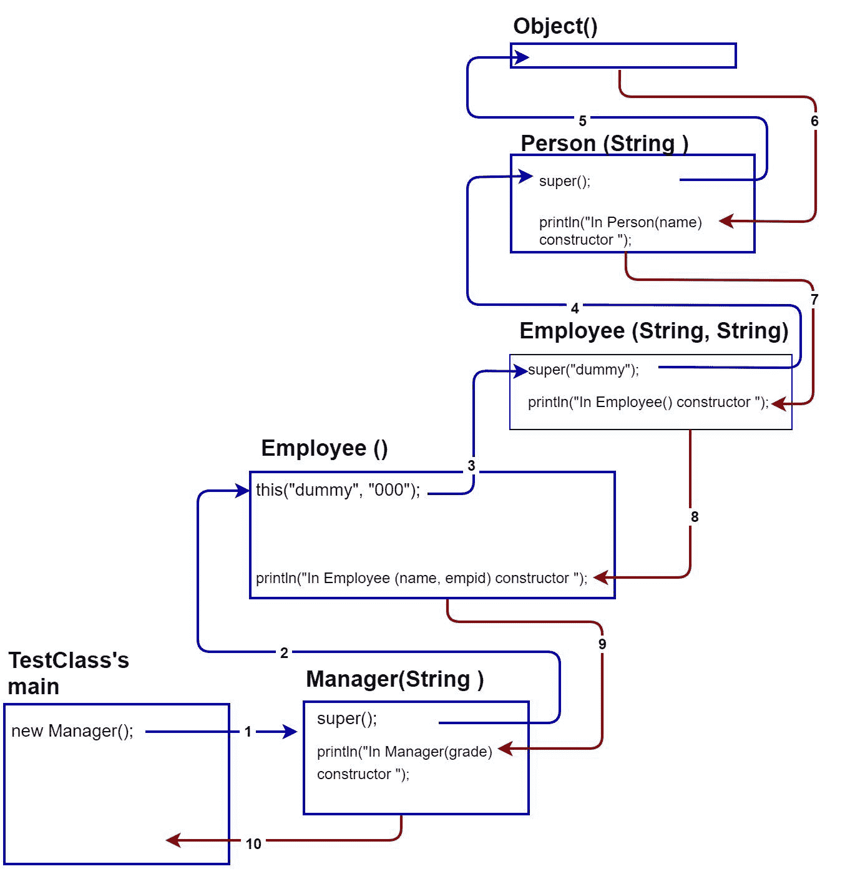

### 12.2.3 使用隐式变量 "super" [☝](http://enthuware.com/forum/dbt.php?bid=2&sn=12.2.3&tn=using-the-implicit-variable-super)

当方法被子类重写时，任何无关类都无法在子类对象上执行父类版本的该方法。然而，子类本身可以使用名为`super`的隐式变量来访问其父类版本的方法。类的每个`instance method`都会获得这个变量。这与你之前看到的另一个隐式变量`this`非常相似。`this`指向当前对象，而`super`指向该类从其父类继承的成员。以下代码展示了如何使用它：


```
class InterestCalculator{
   public double computeInterest(double principle, int yrs, double rate){
       return principle*yrs*rate;
   }
}

class CompoundInterestCalculator extends InterestCalculator{
   public double computeInterest(double principle, int yrs, double rate){
         return principle*Math.pow(1 + rate, yrs) - principle;
   }

   //invoke this method from TestClass's main
   public void test(){
       double interest = super.computeInterest(100, 2, 0.1);
       System.out.println(interest); //prints 20.0

       interest = computeInterest(100, 2, 0.1);
       System.out.println(interest); //prints 21.000000000000014
   }

}

public class TestClass{
    public static void main(String[] args){
          CompoundInterestCalculator cic = new CompoundInterestCalculator();
          cic.test();
    }
}
```

上述代码中对`super.computeInterest(100, 2, 0.1)`的调用触发了`InterestCalculator`版本，而对`computeInterest(100, 2, 0.1)`的调用触发了`CompoundInterestCalculator`版本。

变量`super`仅在类的实例方法中可用，并可用于访问父类的任何继承成员（包括静态和实例成员）。你现在是否在考虑形成一个父类链？类似于`super.super.someMethod()`？不，你不能这样做，因为在父类中没有名为`super`的成员。事实上，你不能在任何类中定义名为`super`的变量或方法。这引出了一个问题：类如何访问定义在祖父类和父类中的同一个祖父类版本的方法？例如，如果你有以下孙子类，并且你想在该类中访问`InterestCalculator`版本的`computeInterest`：

```
class SubCompoundInterestCalculator
           extends CompoundInterestCalculator{

   public void test(){

       //invokes CompoundInterest's computeInterest
       super.computeInterest(100, 2, 0.1);

       //can't do super.super
       //super.super.computeInterest(100, 2, 0.1);
   }

}
```

答案是你不能。没有办法可以向上追溯一级。换句话说，子类只能通过`super`访问其直接父类版本的方法。

请注意，此限制仅适用于被父类重写的方法。如果父类没有重写其父类的方法，那么父类将从祖父类继承该方法，而子类可以访问祖父类版本的方法，就像它是父类版本的一样。

## 12.2.4 初始化顺序总结 [☝](http://enthuware.com/forum/dbt.php?bid=2&sn=12.2.4&tn=order-of-initialization-summarized)

你现在已经看到了 JVM 从加载类到执行类构造函数创建一个类对象所采取的所有步骤。以下是这些步骤的顺序，供快速参考：

1. 如果存在父类，按照出现的顺序初始化父类的静态字段并执行父类的静态初始化器（每个类仅执行一次）
2. 按照出现的顺序初始化类的静态字段并执行类的初始化器
3. 如果存在父类，按照出现的顺序初始化父类的实例字段并执行父类的实例初始化器
4. 执行父类的构造函数
5. 按照出现的顺序初始化类的实例字段并执行类的初始化器
6. 执行类的构造函数

以下示例说明了上述步骤：

```
class A {
   static{ System.out.println("In A's static initializer"); }

   A(){ System.out.println("In A's constructor"); }

   { System.out.println("In A's instance initializer"); }
}

public class B extends A {
   static{ System.out.println("In B's static initializer"); }

   { System.out.println("In B's instance initializer"); }

   B(){ System.out.println("In B's constructor"); }

   public static void main(String[] args) {
      System.out.println("In B.main()");
      B b = new New(); 
      B b2 = new B(); //再次创建 B 对象
   }
}
```

运行类 B 时会生成以下输出：

```
In A's static initializer
In B's static initializer
In B.main()
In A's instance initializer
In A's constructor
In B's instance initializer
In B's constructor
In A's instance initializer
In A's constructor
In B's instance initializer
In B's constructor
```

你应该在上述输出中观察到以下几点：

1. `A`和`B`的静态初始化器在`B.main()`执行之前被调用，因为 JVM 在调用其方法之前需要加载该类。
2. 即使创建了两个`B`对象，`A`和`B`的静态初始化器也只执行一次。
3. `A`的实例初始化器在`A`的构造函数之前执行，尽管在`A`代码中实例初始化出现在构造函数之后。
4. 在创建`B`对象时，`A`的实例初始化器和构造函数在`B`的实例初始化器和构造函数之前调用。
5. 每创建一个`B`对象，`A`的实例初始化器和构造函数都会被调用。

类及其父类中各种成员的执行顺序有时会变得难以追踪。然而，考试在这个主题上并没有太刁难你。如果你能理解上面的示例，在处理真实考试中的代码时就不会有任何问题。

我在“Kickstarter 入门”章节中简要提到过`abstract class`（抽象类）作为一种“类型的类型（type of type）”。当你想要捕捉多个相关对象类型的共同特征，同时又知道没有任何仅体现抽象类所捕捉特征的对象实际上存在时，就会使用抽象类。例如，如果你正在创建一个处理猫和狗的应用程序，你可能想将猫和狗的共同特征提取到一个名为`Animal`（动物）的类中。但你知道你不能拥有一个`Animal`。你可以有一只猫或一只狗，但不能有一个既不是猫不是狗或其他动物的“动物”。从这个意义上说，`Animal`是一个“抽象概念”。`Furniture`（家具）是另一个此类概念。如果你想有一个`Furniture`，你必须得到一把椅子或一张桌子，因为`Furniture`本身并不存在。它是一个抽象概念。

抽象类用于捕捉此类抽象概念。声明时使用`abstract`关键字来定义抽象类。例如，以下是定义`Furniture`的方式：

```
 abstract
 class Furniture{
  private String material;
  //public getter and setter
}
```

请注意，`Furniture`几乎与具有公共和私有字段及方法的普通类相似。然而，由于它被声明为抽象的，因此不能被实例化。因此，如果你尝试执行`new Furniture()`，编译器将生成错误并显示“Furniture is abstract; cannot be instantiated”。

但`Chair`（椅子）和`Table`（桌子）是具体概念。它们独立存在。由于它们都是`Furniture`的类型，你可以将它们建模为两个扩展`Furniture`的类。

```
class Chair extends Furniture{
   //fields and methods specific to Chair
}
class Table extends Furniture{
   //fields and methods specific to Table
}
```

由于`Chair`和`Table`继承了`Furniture`，它们将继承`Furniture`的所有特征，就像任何子类继承父类的所有特征一样。

注意，非抽象类也被称为“具体”类，因为它们代表真实的对象。

## 向抽象类中添加抽象方法 [☝](http://enthuware.com/forum/dbt.php?bid=2&sn=12.3.1&tn=adding-an-abstract-method-to-an-abstract-class)

假设商店里的每件家具都必须提供一个组装方法。由于组装椅子的步骤将与组装桌子的步骤不同，我们不能在`Furniture`类中包含它们的组装步骤。换句话说，我们认为组装方法的声明对所有家具都是通用的，但它们的实现对于每种家具类型都是唯一的。Java 允许以`abstract method`（抽象方法）的形式捕捉不带实现的声明。抽象方法通过在方法声明上应用`abstract`关键字来声明。它也不应该有方法体。例如：

```
abstract class Furniture{
  private String material;
  //public getter and setter

  public abstract
 void assemble(); //以分号结尾，没有开合大括号
}
```

向类中添加抽象方法的用处是，其他组件可以统一地处理所有对象。例如，一个组装家具的类不需要担心它正在组装的是`Chair`还是`Table`。它只需对获取的任何种家具调用`assemble()`即可。如下：

```
class FurnitureAssembler{
   public static void assembleAllFurniture(Furniture[] allFurniture){
      for(Furniture f : allFurniture){
         f.assemble();
      }
   }
}
```

但向父类添加抽象方法会对子类产生影响，因为子类现在有义务为抽象方法提供实现。例如，我们现在需要如下所示更新`Chair`和`Table`类的代码：

```
class Chair extends Furniture{
   //fields and methods specific to Chair
   public void assemble(){
     System.out.println("Assembling chair!");
   }
}
class Table extends Furniture{
   //fields and methods specific to Table
   public void assemble(){
     System.out.println("Assembling table!");
   }
}
```

这是合理的，因为如果某件家具实际上存在，那么我们必须能够根据对`Furniture`的定义来组装它。`Furniture`的子类可能无法组装方法的唯一情况，是该子类本身是抽象的！例如，如果你有一个名为`FoldingFurniture`（折叠家具）的`Furniture`子类呢？`FoldingFurniture`是一个抽象概念，可以建模为扩展`Furniture`的抽象类。由于它是抽象的，它可以不实现`assemble`方法。但`FoldingFurniture`的任何具体子类都必须为`assemble`方法提供实现。

如果你对`FurnitureAssembler`的代码如何在不知道它们存在的情况下调用`Chair`和`Table`的`assemble`方法感到困惑，不要担心。我很快会在关于“多态（polymorphism）”的章节详细讨论。

## 12.3.2 使用 final 类和 final 方法 [☝](http://enthuware.com/forum/dbt.php?bid=2&sn=12.3.2&tn=using-final-classes-and-final-methods)

你在声明变量时已经见过`final`关键字的使用。它意味着变量是一个“常量（constant）”，即变量的值在程序的执行过程中不会改变。`final`关键字也可以应用于类和方法（包括静态和实例方法），其含义类似。这意味着类或方法的行为不能被改变。

请注意`final`与`abstract`是对立的。你将一个类或方法设为抽象，是因为你希望子类为该类或方法提供不同的实现。相反，你将一个类或方法设为 final，是因为你不希望该类或方法的行为被改变。在技术术语中，我们说`final`类不能被“子类化（subclassed）”，“final”方法不能被“重写（overridden）”。我很快会详细讨论重写，但你现在可以明白为什么`abstract`和`final`不能一起使用。

`final`类不一定要有`final`方法。但实际上，由于`final`类无法被扩展，它的任何方法都无法被重写。重要的是`final`类不能有抽象方法。为什么？因为完全没有实现该抽象方法的可能。因此，如果`final`类从它的任何祖先继承了抽象方法，它就必须提供该方法的实现。

这是一个`final`类的示例：

```
public final class Chair extends Furniture{

   //由于 assemble 是 Furniture 中的抽象方法，必须在此类中实现
   public void assemble(){
       System.out.println("Assembling Chair");
   }
}
```

观察`Chair`没有任何`final`方法，并且它必须实现从父类继承的抽象方法。

`final`方法的定义类似：

```
public abstract
 class Bed extends Furniture{

   //因为 Bed 是抽象的，所以没有实现 assemble()

   public final
 int getNumberOfLegs(){
      return 4;
   }

   public static final void make(Bed b){
      System.out.println("Making Bed: "+b);
   }
}

public final class DoubleBed extends Bed{

   //因为 DoubleBed 不是抽象的，必须实现 assemble   
   public void assemble(){
       System.out.println("Assembling DoubleBed");
   }

   //在这里不能重写 getNumberOfLegs，因为它在 Bed 中是 final 的

   final
 int getHeight(){
     return 18;
   }
}
```

请注意，尽管`Bed`有一个`final`方法，但`Bed`本身不仅不是`final`的，它还是`abstract`（抽象的）。我将其设为`abstract`只是说明任何类无论其是`final`、`abstract`还是两者都不是，都可以包含一个`final`方法。

Java 标准类库包含了几个`final`类。其中最重要的是`java.lang.String`类，我们在第 5 章中见过它。

## 12.3.3 访问修饰符、abstract、final 和 static 的有效组合 [☝](http://enthuware.com/forum/dbt.php?bid=2&sn=12.3.3&tn=valid-combinations-of-access-modifiers-abstract-final-and-static)

### 访问修饰符对 abstract 和 final 的影响 [☝](http://enthuware.com/forum/dbt.php?bid=2&sn=12.3.3&tn=impact-of-access-modifiers-on-abstract-and-final)

`abstract`的用法只有在存在继承的情况下才有意义。如果一个东西从不被继承，那么讨论它是`abstract`还是`final`就没有意义了。你也知道`private`成员永远不会被继承。根据这些知识，你能判断以下代码会发生什么吗：

```
abstract class Sofa {
   private abstract void recline();
}
```


没错。编译器将拒绝上述代码，并显示消息：“非法修饰符组合：abstract and private”。因为`private`方法永远不会被继承，所以`Sofa`的任何子类都无法为这个`abstract`方法提供实现。

如果`recline`方法是`protected`或`default`呢？在这种情况下是可以的，因为子类可以继承具有`protected`和`default`访问权限的方法。

现在让我们来看看当你将一个`private`方法设为`final`时会发生什么：

```
class Sofa {
   private final void recline(){ 
   }
}
```

你认为会发生什么？你说它无法通过编译？错了！如果一个方法根本无法被任何子类继承，它还可能被重写吗？不能。因此，一个`private`方法在实践上已经是`final`了！编译器会接受上述代码，因为`private`和`final`之间没有矛盾。因此，将`private`方法标记为`final`并不是错误的，而是多余的。

### abstract 和 static [☝](http://enthuware.com/forum/dbt.php?bid=2&sn=12.3.3&tn=abstract-and-static)

`abstract`关键字严格来说关于重写的，而`static`方法永远不能被重写。因此，`abstract`和`static`不能同时使用。因此，以下代码无法编译：

```
abstract class Bed extends Furniture{
   static abstract void getWidth();
}
```

编译器将生成一条错误消息，显示：“非法修饰符组合：abstract and static”。

### final 和 static [☝](http://enthuware.com/forum/dbt.php?bid=2&sn=12.3.3&tn=final-and-static)

尽管`static`方法不能被重写，但它仍然会被子类继承并可以被子类隐藏（hide）。我稍后会详细讨论重写和隐藏的区别，但现在只需记住，`final`防止子类隐藏父类的`static`方法。因此，以下代码可以正常编译：

```
class Bed{
   static final int getWidth(){ 
      return 36;
   }
}
```

但下面的代码将无法通过，因为`getWidth`在`Bed`中是`final`的：

```
class DoubleBed extends Bed
{
   static int getWidth(){ //无法编译
     return 60;
   }
}
```

### 访问修饰符、final、abstract 和 static 关键字的应用总结 [☝](http://enthuware.com/forum/dbt.php?bid=2&sn=12.3.3&tn=summary-of-the-application-of-access-modifiers-final-abstract-and-static-keywords)

根据之前的讨论，让我来总结一下`abstract`、具体类以及`final`类和方法的规则：

1. `abstract class`并不一定非要有`abstract method`，但如果一个类有一个`abstract`方法，它必须被声明为`abstract`。换句话说，具体类不能拥有`abstract method`。

2. `abstract class`无论是否拥有`abstract method`都不能被实例化。

3. `final class`或`final method`不能是`abstract`。

4. `final class`不能包含`abstract method`，但`abstract class`可以包含`final method`。

5. `private`方法始终是`final`的。

6. `private`方法永远不能是`abstract`。

7. `static method`可以是`final`，但永远不能是`abstract`。

考试会测试你在访问修饰符以及`final`、`abstract`和`static`关键字应用于类和方法时的各种组合。你应该非常清楚在何 way 可以和不能应用这些修饰符。

然而，考试并没有试图在访问修饰符以及`final`和`abstract`关键字的顺序上为难你。例如，它不会要求你从以下三个声明中选出正确的：

```
public abstract void m();
final public void m(){ }
abstract protected void m();
```

对于编译器而言，返回类型必须紧跟在方法名之前。它并不关心其他修饰符的顺序。因此，上述三种方法都是有效的。

尽管如此，你应该知道，按照习惯，修饰符以及`final`和`abstract`关键字的顺序是：

`访问修饰符` > `static` > `final or abstract` > 返回类型 > `方法名(参数列表)`

如果你对顺序感到困惑，只需记住主方法的签名：

```
public static final void main(String[] args)
```

当然，主方法不需要是`final`的。

## 12.4 通过重写实现多态

### 12.4.1 什么是多态 [☝](http://enthuware.com/forum/dbt.php?bid=2&sn=12.4.1&tn=what-is-polymorphism)

简单来说，**多态**（Polymorphism）指的是对象表现出与其类型相关行为的能力。换句话说，如果同一个对象根据你观察它的哪个“侧”表现出不同的行为，那么该对象就是多态的。例如，如果你使用继承自`Fruit`的`Apple`类来建模苹果，那么苹果既可以像`Apple`也可以像`Fruit`。之后，如果你有一个继承自`Apple`类的`RedApple`类，那么红苹果既可以像`Apple`也可以像`Fruit`，此外还是`RedApple`。同样，你之前看到的`StockPrice`类的对象既可以像`Readable`也可以像`Movable`，此外还是`StockPrice`！因此，苹果和股票价格都是多态对象。

非常重要的一点是理解对象本身没有任何变化。对象本身保持不变。红苹果永远是红苹果。它不会突然变成苹果或水果。它一直一直是苹果和水果，此外还是红苹果。由此推，如果一个对象本身不支持某种特定行为，它就不会开始支持该行为。无论你做什么，红苹果永远不会变成绿苹果。

记住，当我们多态的语境下讨论对象的行为时，我们本质上是在讨论它的实例方法。我们不是在讨论它的`static`方法，因为`static`方法定义的是类的行为而不是对象的行为。（是的，你可以使用对象引用而不是类名来访问静态方法，但那只是 Java 语言的一种特性，与多态无关）。我们也没有在讨论实例变量，因为变量仅仅存储数据（原始数据或指向对象的引用），而不具备任何行为。而且，如果类封装得良好，这些变量对任何其他类来说都是不可见的。

#### Java 中的多态 [☝](http://enthuware.com/forum/dbt.php?bid=2&sn=12.4.1&tn=polymorphism-in-java)

Java 允许类通过继承另一个类和/或实现接口来实现对象的多态性。由于 Java 中的每个类都隐式地继承了`java.lang.Object`，你可以说每个对象都是多态的，因为每个对象都至少表现出两个类的行为（当然，`java.lang.Object`的实例除外）。

因此，一个对象的多态性取决于它所继承的类的数量（包括直接和间接）以及它所实现的接口的数量（包括直接以及通过祖先类间接实现）。

## 多态的重要性 [☝](http://enthuware.com/forum/dbt.php?bid=2&sn=12.4.1&tn=importance-of-polymorphism)

在“初学者入门 Kickstarter”章节中，我讨论了如果两个组件承诺遵守相同的行为，那么一个组件就可以轻松替换为另一个。这之所以可能，完全是因为`多态`。如果一个对象只被允许作为单一类型来表现，那么你永远无法将该对象替换为不同类型的对象。

例如，如果你需要的只是一个`Fruit`（水果），那么给你的是一个`Apple`（苹果）还是一个`Orange`（橘子）并不重要。它们都承诺遵守`Fruit`描述的行为，因此它们是同样接受的水果。下面的代码说明了这种情况：

```
abstract class Fruit{ //必须声明为抽象类，因为它有一个抽象方法
   abstract void consume();
}

class Apple extends Fruit{
   void consume(){
       System.out.println("Consuming Apple...");
   }
}

class Orange extends Fruit{
   void consume(){
       System.out.println("Consuming Orange...");
   }
}

class Person{
   void eatFruit(Fruit f){
      f.consume();
   }
}

class TestClass{
   public static void main(String[] args){
      Apple a = new Apple();
      Orange o = new Orange();
      Person p = new Person();
      p.eatFruit(a);
      p.eatFruit(o);
   }
}
```

观察发现，`Person`对象并不知道它正在吃什么。它关心的只是`Fruit`。只要你传递它一个`Fruit`，就没有问题。你可以轻松地向`Person`传递一个`Orange`而不是`Apple`。这之所以可能，是因为`Apple`和`Orange`是多态的，它们除了分别表现得`Apple`或`Orange`之外，还表现得像`Fruit`。

如果没有多态，你的代码看起来会像：

```
class Apple{
   void consume(){
       System.out.println("Consuming Apple...");
   }
}

class Orange{
   void consume(){
       System.out.println("Consuming Orange...");
   }
}

class Person{
   void eatApple(Apple a){
      a.consume();
   }
   void eatOrange(Orange o){
      o.consume();
   }
}

class TestClass{
   public static void main(String[] args){
      Apple a = new Apple();
      Orange o = new Orange();
      Person p = new Person();
      p.eatApple(a);
      p.eatOrange(o);
   }
}
```

观察发现，在没有公共`Fruit`类的情况下，`Person`必须有两个不同的方法——一个用于吃`Apple`，另一个用于吃`Orange`。`Person`类的用户（即`TestClass`）也必须调用两个不同的方法。如果你想给人喂一个香蕉怎么办？你必须在`Person`中编写一个新方法来接受`Banana`，并且还要修改`TestClass`中的代码。而且你知道这些不是世界上唯一的水果，对吧？你明白我的意思。想象一下你需要写多少个吃法方法！

但这并不是唯一的问题。假设你在`Person`类中为你已知的每种水果都编写了一个方法，并将这个类交付给其他人使用。如果你或其他人发现了一种全新的水果，并想给`Person`对象喂这种水果怎么办？在这个阶段你无法更改`Person`类的代码，因为你必须让所有使用旧类的人都获取新版本的`Person`类。根据不同项目中人员的多样性，每当发现新水果时，这可能变成一场噩梦。

如果你逻辑地思考，发现一种新水果对`Person`来说并不重要。只要它是水果，`Person`就应该接受它。这就是多态性大光之处。在我们的第一个设计中，`Person`的吃方法只接受`Fruit`。如果你发现了一个新水果，比如`Custard Apple`（番荔，顺便说一下，非常棒的水果），你只需要定义一个继承`Fruit`的`CustardApple`类，并将该类的对象传递给`Person`的`eatFruit(Fruit)`方法。`Person`类不需要任何更改。这之所以可能，是因为`CustardApple`通过声明继承`Fruit`履行了`Fruit`定义的合同。

关于多态性的另一个重要点是，它允许组件不仅在编译时，而且在`运行时`（runtime）切换。你实际上可以在已经在运行的应用程序中引入继承现有类（或实现现有接口）的完全新类。现有的类或接口作为特定行为的合同，如果一个新类承诺通过继承该类或实现该接口来履行此合同，那么任何代码都可以在现有类实例的地方使用此新类的实例。

## 多态与继承 [☝](http://enthuware.com/forum/dbt.php?bid=2&sn=12.4.1&tn=polymorphism-and-inheritance)

正如你上面看到的，类或接口的方法基本上构成了一个子类或实现类承诺履行的`合同`。当一个类说它继承另一个类或说它实现一个接口时，它同意拥有父类或接口拥的方法。然而，这些方法具体要做什么并没有涵盖在合同中。换句话说，合同并没有详细到会影响方法的内部逻辑。方法的内部逻辑仅受方法名称中隐含的非正式合同约束。例如，如果父类声明了一个方法`computeInterest`（计算利），可以合理预期子类的实现在该方法中计算某种利益。这在抽象方法上不是问题，因为子类被要求自己实现抽象方法，但在非抽象方法的情况下可能会有问题。如果父类以一种方式计算利，而子类想以另一种方式计算呢？如果你仔细考虑，这是类组件化的一个重要方面。你希望类组件化是为了可以方便地替换一个组件。始终记住，多态的整个目标是使类变成可以在不影响其他组件的情况下交换的标准组件。如果你对某个特定规则感到困惑，始终思考它是如何影响组件间的互操作性的。透明地替换另一个对象的能力被称为`可替换性`。可替换性原则规定类型对象可以被其子类型替换而不改变程序的任何理想属性。

正如本章前面讨论过的，只有`non-private` `instance methods`可以被`overridden`重写）。在重写方法时，你需要遵循几条规则。这些规则规定了方法的`accessibility`可访问性、`return type`返回类型、`parameter types`参数类型以及`throws clause`抛出子句。理解和记忆这些规则最好的方法是记住：这些规则的存在是为了确保类的实例可以被子类的实例替换，而不破坏现有代码。目标是能够透明地用一个组件替换另一个组件，同时为子类实现其方法提供灵活性。

当你在子类中重写一个方法时，请考虑依赖于父类对象的代码会发生什么，以及如果你传递它一个子类对象而不是父类对象，会发生什么。如果这种替换不需要重新编译代码，那么你就正确地重写了该方法。从这个角度来看，以下规则也适用于方法隐藏（这发生在非私有的`static`方法上）。

现在，让我列出所有规则，然后我将通过示例向你展示这些规则背后的逻辑。（记住，“重写方法”指的是父类中的方法，而“重写方法”指的是子类中的方法）。

### 重写规则

1. **Accessibility（可访问性）**：重写方法的可访问性不能低于被重写方法。这意味着，如果父类方法是`protected`，那么重写方法可以是`protected`或`public`。如果父类方法是`public`，那么重写方法只能是`public`。

2. **Return type（返回类型）**：重写方法的返回类型可以是被重写方法的返回类型或其子类。例如，如果被重写方法返回`Fruit`，那么重写方法可以返回`Apple`或`Mango`等子类。在基本类型的情况下，重写方法的返回类型必须与被重写方法的返回类型完全相同。这种现象被称为**协变返回类型**（covariant returns）。

3. **parameters（参数）**：重写方法的参数列表必须与被重写方法完全匹配（包括类型和顺序），参数名称并不重要。事实上，如果参数在类型或顺序上与被重写方法不一致，那么它将是方法重载（overload）而不是重写。

4. **throws clause（抛出子句）**：重写方法抛出的异常范围不能比被重写方法抛出的异常更宽。也就是说，如果被重写方法抛出`IOException`，那么重写方法可以抛出`IOException`或其子类，但不能抛出更通用的`Exception`。重写方法也可以完全不抛出任何异常。

### 示例

让我们看看这些规则在类中是如何工作的：


```java
class InterestCalculator {
    public Number getInterest(double principal, double rate) throws Exception {
        if (rate < 0) {
            throw new IllegalArgumentException("rate should be > 0");
        }
        return principal * rate;
    }
}

class CompoundInterestCalculator extends InterestCalculator {
    @Override
    public Double getInterest(double principal, double rate) throws Exception {
        // 这里演示了协变返回类型的应用
        return principal * Math.pow(1 + rate, rate);
    }
}

class InterestManager {
    public static void main(String[] args) {
        InterestCalculator ic = new CompoundInterestCalculator();
        try {
            Number interest = ic.getInterest(1000, 0.05);
            System.out.println(interest.doubleValue());
        } catch (Exception e) {
            e.printStackTrace();
        }
    }
}
```

在示例中，`CompoundInterestCalculator` 重写了 `InterestCalculator` 的 `getInterest` 方法：

- 返回类型从 `Number` 变为了 `Double`（`Double` 是 `Number` 的子类），这是允许的（协变返回）。
- 参数列表 `double, double` 完全匹配。
- 抛出异常子句 `throws Exception` 保持不变，这也是允许的。

## 4. throws 子句 (throws clause)

由于 `InterestCalculator` 的 `computeInterest` 方法声明它可能会抛出一个 `Exception`，该方法的调用者（即 `Account` 的 `getInterest`）已经准备好处理此异常。它有一个用于捕获 `Exception` 的 catch 块。即使 `getInterest` 方法抛出了 `IllegalArgumentException`，代码也能正常工作，因为 `IllegalArgumentException` 是 `Exception` 的子类，并且会被 `catch(Exception)` 子句捕获。如果 `computeInterest` 完全没有抛出任何异常，也没有问题。但如果重写的方法决定抛出父类异常（如 `Throwable`），那么 `Account` 的 `getInterest` 中的代码将会失败，因为它没有准备好处理 `Throwable`。你将不得不将 catch 子句更新为 `catch(Throwable)` 并重新编译 `Account`。

我建议你也写一个类似的示例来验证上述规则，以防发生静态方法的隐藏问题。

## 12.4.3 无效的重写

### 用实例方法重写静态方法，反之亦然

Java 不允许子类改变父类中定义的非私有方法的静态/实例类型。因此，以下代码将无法编译：

```java
class Person{
   static void message(){
   }
   void initialize(){
   }
}

class Employee extends Person{
   void message(){ // 无法编译，因为被重写的方法是静态的
   }

   static void initialize(){ // 无法编译，因为重写的方法是静态的
   }
}
```

### 重写私有方法

由于私有方法不会被子类继承，因此无法重写它们。但子类允许拥有与父类私有方法签名相同的方法。

### 重写 final 方法

通过将方法标记为 `final`，你可以禁止子类重写该方法。因此，如果你尝试定义一个与父类 final 方法签名相同的方法，它将无法编译。`final` 关键字对静态方法也起类似的作用，它防止你在子类中隐藏静态方法。

注意，`final` 在字段上的作用方式非常不同。即使该字段在父类中被声明为 `final`，子类也允许拥有一个同名的字段。正如之前讨论的，`final` 只是防止了你修改该字段的值。

## 12.5 利用多态进行类型转换和方法调用

### 12.5.1 引用的类型和对象的类型

在“初学者入门 Kickstarter”章节中，我详细讨论了引用和对象之间的区别。我使用了遥控器和电视机的类比来解释引用是你访问对象的句柄。正如遥控器和它控制的电视是两个不同的东西，引用和引用指向的对象也是两个不同的东西。

变量的类型在定义变量时指定。例如，`String str;` 定义了一个类型为 `String` 的变量 `str`。指定变量类型很重要，因为编译器借此能够确定你可以通过该变量访问的变量和方法。这使得 Java 成为一种强类型语言。Java 编译器不允许你调用你所使用的引用类型中不存在的方法。

另一方面，对象是在运行时创建的。虽然编译器有时可以猜出运行时创建的对象的类型（例如当使用 `new` 关键字实例化类时），但并非总是如此。例如，在编译以下方法时，编译器无法知道方法参数 `obj` 所指的实际对象的类型：

```java
public class Test{
   public void dump(Object obj){
      // 对 obj 执行某些操作
   }
}
```

编译器并不知道谁可能会调用 `dump`，以及他们可能会传递什么作为参数。它只知道 `obj` 将引用一个 `Object`，但对该对象的具体类型一无所知。例如，另一个开发者可能在另一个类中编写一个方法，用 `String` 或 `Integer` 作为参数调用 `Test` 的 `dump` 方法：

```java
public class Other{
   public void testDump(){
      new Test().dump("hello");
      new Test().dump(new Integer(1));
   }
}
```

上面的示例实际上展示了多态的应用。`dump` 中的变量 `obj` 可能会表现得像 `String`、`Integer` 或任何其他子类。

### 12.5.2 弥合编译时与运行时的差距

编写多态代码，关键在于理解多态发生在运行时，但实现多态的代码是在编译时编写的。编译器掌握程序的信息与 JVM 执行程序时掌握的信息之间存在差异。例如，当你定义一个变量时，编译器只知道该变量的类型，但不知道它所引用的对象，因为对象只在运行时才创建。现在，Java 是一种强类型语言，这意味着一旦定义了变量类型就无法更改。这意味着编译器必须确保代码不会将一种类型的对象赋值给另一种类型的变量。它不允许代码调用该变量类型不支持的方法。然而，仅依赖编译时的可用类型信息将对代码施加过多的限制。例如，如果你定义了一个类型为 `java.util.List` 的引用变量，编译器将不允许代码调用其他类定义的方法。这种僵化性将使多态无法实现，因为多态的前提是对象在运行时的行为可能与编译时承诺的不符。

你可以看到编译器需要满足两个矛盾的要求。一方面，你希望编译器对代码进行类型检查，以确保代码不会使用引用调用的方法；另一方面，你希望编译器在某些情况下允许类型检查。Java 通过让编译器做出某些假设，并让程序员向编译器保证其没有试图做任何违规操作，尝试满足这两个目标。

让我们现在看看这些在实践中是如何实现的。

#### “is a”测试

`is-a` 测试是一种直观的测试，用于确定两个引用类型之间的关系。它允许你检查两个引用类型之间是否存在父子关系，以及如果存在，则这两个类型中哪一个是父类，哪一个是子类。例如，说“狗是一种宠物”或“猫是一种宠物”是合理的，但如果说“狗是一只猫”就不合理了。苹果和水果之间、或者芒果果和水果之间也存在类似的关系。苹果是水果，芒果果是水果，但苹果不是芒果果。如果你将 `Apple`、`Mango` 和 `Fruit` 建模为类，你会将所有水果的共同特征放在 `Fruit` 类中，并让 `Apple` 和 `Mango` 类继承 `Fruit`。建立这种关系的重要性在于，它允许你在任何地方用子类对象来代替父类对象。诚然，如果你承诺给某人一个水果，你完全可以给他们一个苹果，因为苹果是水果。反之显然是不成立的。如果你承诺给某人一个苹果，你不能随便给他们任何水果。它必须是一个苹果。但如果你有一个麦克风苹果，你就可以给他们那个，因为麦克风苹果是一个苹果。

Java 编译器会识别两个类型之间是否存在 `is-a` 关系，并允许你将子类对象赋值给父类类型的引用。例如：

```java
class Fruit{   }
class Apple extends Fruit{ }
class Mango extends Fruit{ }
...
Apple a = new Apple();
Mango m =  new Mango();
Fruit f1 = a; //可以，因为 Apple 是一个 Fruit
```

```java
m = a; //不会编译，因为苹果不是芒果
```

```java
Fruit f2 = m; //可以，因为 Mango 是一个 Fruit
```

```java
m = f1; //不会编译，因为不是所有水果都是芒果
m = f2; //不会编译，因为不是所有水果都是芒果
```

注意，实际对象只在运行时创建，但编译器知道变量 `a` 在运行时始终指向一个 `Apple`（即指向一个满足与 `Apple` `is-a` 测试的类对象），因为它不会编译尝试将任何其他内容赋值给它的代码。这一点通过 `Mango m = a;` 这一行无法编译证明了。同样，编译器知道 `f1` 和 `f2` 在运行时始终指向一个 `Fruit`，因为它不允许你编写尝试将任何其他内容赋值给 `f1` 和 `f2` 的代码。

最后一行，即 `m = f2;`，是重要的。尽管我们知道 `f2` 确实指向一个 `Mango`，编译器也拒绝编译这一行。记住，编译器不执行任何代码，因此，编译器不知道 `f2` 确实指向一个 `Mango`。它只知道 `f2` 可能指向任何类型的 `Fruit`。该水果可能是 `Mango` 也可能是 `Apple`。由于编译器无法确定 `f2` 在运行时指向什么，因此它不允许将 `f2` 赋值给 `m`。如果它允许这一行编译，当 `f2` 指向 `Apple` 而不是 `Mango` 时，执行期间将违反类型安全。

上述讨论的逻辑同样适用于接口。如果一个类实现了一个接口，那么该类的对象就“是”该接口。例如，如果 `Fruit` 实现了一个名为 `Edible` 的接口，那么任何水果都满足 `Edible` 的 `is-a` 测试。换句话说，`Fruit` 是一个 `Edible`。

### 强制转换运算符 `()`

你在上面看到，编译器不允许行 `Mango m = f1;` 和 `Mango m = f2;` 编译，因为编译器无法确定 `f1` 和 `f2` 在运行时是否会指向 `Mango` 对象。与其让 `Apple` 被赋值给 `m` 从而违反类型安全，它直接拒绝了这段代码。然而，程序员知道她期望 `f2` 在运行时指向什么（毕竟代码是她写的！）。Java 语言允许程序员利用他们对程序的知识，使用强制转换运算符向编译器保证引用在运行时将指向正确类型的对象。这种保证说服了编译器，让允许进行赋值。以下是其工作原理：

```java
m = (Mango) f1;
m = (Mango) f2;
```

通过将 `f1` 和 `f2` 转换为 `Mango`，程序员基本上向编译器保证了 `f1` 和 `f2` 在运行时将指向 `Mango` 对象。编译器接受了这个保证，因为它知道 `Mango` 是一个 `Fruit`，并且类型为 `Fruit` 的变量可以指向 `Mango`。编译器之前拒绝代码是因为变量也可能指向 `Apple` 对象，但有了程序员提供的关于运行时指向 `Mango` 对象的显式保证，编译器接受了代码。

### java.lang.ClassCastException

如果你仔细观察上面的代码，你将会知道 `f1` 在运行时并不会指向 `Mango`。`Fruit f1 = a;` 这一行实际上让 `f1` 指向与 `a` 相同的对象，而 `a` 指向一个 `Apple`。因此，`f1` 实际上指向一个 `Apple`。

JVM 本质上是防止违反类型安全的第二道防线。它在运行时检查编译器无法的内容。如果 JVM 发现一个引用变量被强制转换为不符合其指向的对象类的 `is-a` 测试的类型，它将抛出 `ClassCastException`。因此，程序的类型安全永远不会受到破坏。

在这种情况下，欺骗编译器并不意味着你可以通过提供虚假的保证来欺骗编译器。看这段代码：

```java
Mango m = new Mango();
Apple a = (Apple) m;
```

尽管你保证了 `m` 将指向 `Apple`，编译器仍然拒绝了上面的代码。事实证明编译器并非一无知。它知道 `m` 绝对不可能指向 `Apple`，因为 `m` 的声明类型是 `Mango`，且 `Mango` 和 `Apple` 之间没有 `is-a` 关系。因此，为了让强制转换通过编译，转换至少是合理的！

### 将引用转换为接口

编译器很容易判断一个类的引用是否曾经可以指向另一个类的对象，因为一个类最多只能扩展一个类。因此，如果转换中提到的类是引用声明类的子类，编译器知道强制转换在运行时可能会成功。

对于接口来说没那么简单了。由于一个类可以扩展一个类并同时实现任意数量的接口，编译器无法排除引用永远无法指向转换中所述接口的类实例的情况。我的意思是：

```java
interface Poisonous{ }
class TestClass{
   public static void main(String[] args){
       Fruit f = new Mango();//可以，因为 Mango 是 Fruit
       Poisonous p = (Poisonous) f; //编译正常，但在运行时抛出 ClassCastException
   }
}
```

尽管编译器知道 `Fruit` 没有实现 `Poisonous`，但它仍然接受将 `f` 转换为 `Poisonous`。这是因为编译器也知道，虽然 `Fruit` 没有实现 `Poisonous`，但可能存在一个实现了 `Poisonous` 的 `Fruit` 的子类，而由于该子类本身也是 `Fruit`，因此 `f` 可能会指向一个实现了 `Poisonous` 的类的对象。类似于下面的代码：

```java
class StarFruit extends Fruit implements Poisonous{ }
...
Fruit f = new StarFruit();
Poisonous p = (Poisonous) f; // 编译并运行正常
```

上述推理意味着你可以将任何类型的引用强制转换为任何接口。除一种情况外，这种想法是正确的。如果变量的声明类是 `final`，且该类没有实现强制转换中给出的接口，编译器知道该类永远不会有任何子类，因此，它知道引用没有可能指向扩展了该类且实现了给定接口的类的对象。例如，`String` 是一个 `final` 类，以下代码将由于相同的原因无法编译：

```java
String s = new String();
Poisonous p = (Poisonous) s; // 无法编译
```

#### 向下转换 vs 向上转换


将一个类型的变量强制转换为子类型（例如，将类型为`Fruit`的变量`f`转换为`Apple`）被称为“向下转换”（downcasting）。之所以被称为“向下”转换，是因为在 UML 图中，子类总是画在父类的下方。此外，类型为`Fruit`的变量可以引用任何种类的水，但当你将其转换为`Apple`时，你本质上减少了该变量可能引用的水果种类。换句话说，当你将一个变量转换为子类型时，你是将该变量指向的对象的类型缩小到了更具体的类型。因此，使用了“收窄”（narrowing）一词。它与向下转换的意思相同。向下转换的反面是“向上转换”（upcasting）或“拓宽”（widening）。

如上所述，向下转换始终需要 JVM 进行检查，以确保变量确实指向程序员声称其指向的类型对象。另一方面，向上转换不需要这种检查，事实上，它几乎总是冗余的（我很快会向你展示一种不冗余的情况）。由于`Apple`是一个`Fruit`，你可以始终将类型为`Apple`的变量赋值给类型为`Fruit`的变量，而无需任何显式的强制转换。

## 12.5.3 什么时候才需要强制转换

在上一节中，我使用了遥控器和电视的类比向你说明了变量的类型和该变量引用的实际对象的类型是两个不同的东西，并不一定相同。

让我继续使用类比，向你展示如何处理变量类型与变量引用对象类型之间的差异。假设你有一个旧型号的遥控器，按钮有限，而你正在用这个遥控器控制一台有很多功能的新型号电视。显然，你只能使用遥控器上有对应按钮的功能。尽管电视支持更多功能，但你无法用旧遥控器使用它们，因为旧遥控器对新功能一无所知。

引用和对象的行为是相同的。引用的类型类似于遥控器的型号，而对象的类型类似于电视的型号。以下代码清楚了这一点：

```
Object obj = "hello";
int h = obj.hashCode(); // 正常，因为 hashCode 在 Object 中已定义
```

```
int i  = obj.length(); // 无法编译
```

```
String str = "hello";
int j  = str.length(); // OK
```

在上述代码中，引用变量`obj`的声明类型是`Object`，它在运行时引用的对象类型是`String`。由于`String`是`Object`的子类，`String`是一个`Object`，因此，将`String`对象赋值给`obj`是允许的。

你可以说`String`是`Object`的一种新型号，除了具有`Object`的所有功能外，它还具有几个新特性。然而，由于`obj`的声明类型是`Object`，编译器只允许你使用`Object`支持的功能，因为编译器不知道`obj`在运行时实际上指向一个字符串。

如果你想通过`obj`使用`String`类的新功能，你需要使用强制转换运算符将其转换为`String`：

```
Object obj = "hello";
String str =  (String) obj; // 将 obj 转换为 String 
int i  = str.length(); 

int j  = ((String) obj).length(); // 同时进行强制转换并访问
```

因此，关于“什么时候需要强制转换”的答案很简单。当你想要使用一个声明类型为父类的引用来使用子类中定义的特性（即实例变量和方法）时，就需要强制转换。

记住，强制转换不会改变实际对象。强制转换的目的是为编译器提供变量将指向的实际对象的类型信息。因此，强制转换改变的是编译器查看对象的视角。

## 强制转换对静态成员的影响

强制转换本质上是面向对象的一个方面，而“静态”不是。然而，由于 Java 语言的特殊性，可以通过变量访问类型的静态成员。回想“处理数据类型”章节，类型的静态成员会“隐藏”（shadow）父类中同名的静态成员。将变量转换为父类型就是你“取消隐藏”这些成员的方法。这是一个示例：

```
class Fruit{
   static int count = 5;
   static int getCount(){ return count; }
}
class Apple extends Fruit{
   static int count = 10; // 隐藏了 Fruit 的 count
   static int getCount(){ // 隐藏了 Fruit 的 getCount
       return count; 
    }
}
class TestClass{
   public static void main(String[] args){
      Apple a = new Apple();
      System.out.println(a.count); // 输出 10;
      System.out.println(a.getCount()); // 输出 10;

      System.out.println(  ((Fruit) a).count ); // 输出 5;
      System.out.println(  ((Fruit) a).getCount() ); // 输出 5;

      Fruit f = a; // 注意不需要强制转换，因为我们正在拓宽
      System.out.println(  f.count); // 输出 5;
      System.out.println(  f.getCount() ); // 输出 5;

   }
}
```

正如我承诺过的，上述代码显示向上转换并不总是冗余的。但我无法再强调了，上述代码是完全不专业的。你不应该通过变量访问静态成员。虽然强制转换很重要，但在专业设计的代码中它被节节使用，因为毕竟它是规避编译器类型安全机制的手段。当你将引用强制转换为另一种类型时，你基本上是在说程序执行了某些代码本身显而见的操作，并且正在强迫编译器接受这些代码。这反映了糟糕的设计。理想情况下，你永远不需要使用强制转换。

## 12.5.4 instanceof 运算符

`instanceof`运算符虽然不在 OCP Part 1 考试中，但了解这个运算符对于深入理解多态至关重要。事实上，考试中涉及的类型转换运算符（cast operator）与`instanceof`运算符经常一起使用，这就是为什么我要将详细介绍它。由于变量所指向的对象的实际类型并不总是能从代码中显而易见，Java 提供了`instanceof`运算符，让程序员检查实际对象是否是程序员所感兴趣的特定引用类型（即类、接口或枚举）的实例。它接受两个参数——左侧是一个引用，右侧是一个类型名称。如果变量所指向的对象满足给定类型名称的“是...关系”（is-a）测试，则返回布尔值`true`，否则返回`false`。例如，如果你向一个方法传递了一个`Fruit`作为参数，以下是你如何使用`instanceof`来判断你是否真的收到了`Mango`：

```
class Fruit{ }

class Mango extends Fruit{ }

class Apple extends Fruit{ }

public class Juicer{
   public void crush(Fruit f){
      if(f instanceof Mango
){
         System.out.println("crushing mango...");
      } else {
         System.out.println("crushing some other fruit...");
      }
   }

   public static void main(String[] args){
       Mango m = new Mango();
       new Juicer().crush(m);
   }
}
```

在上述代码中，`crush`方法不知道`f`所引用的实际对象的类型，但通过使用`instanceof`运算符，你可以检查该对象是否是一个`Mango`。

当你想要以不同的方式处理特定类型的对象时，`instanceof`运算符非常有用。例如，如果`Mango`有一个名为`removeSeed`的方法，并且你想在粉碎它之前调用该方法，那么在将你的`Fruit`引用`f`转换为`Mango`之前，你需要先知道你是否真的收到了`Mango`，否则，如果`f`指向的不是`Mango`，你将在运行时抛出`ClassCastException`。以下是实现方法：

```
class Mango extends Fruit{ 
   public void removeSeed(){ }
}

class Juicer{ 
   public void crush(Fruit f){

      if(f instanceof Mango){
         Mango m = (Mango) f;
         m.removeSeed();
      } 
      System.out.println("crushing fruit...");
  }

  ...
}
```

记住，你不能在`f`上调用`removeSeed`，因为`f`的类型是`Fruit`，而`Fruit`并没有这个方法。但`Mango`有。在使用`instanceof`运算符之前，你需要明确了解以下几点：

1. `instanceof`运算符在你想以不同方式处理特定类型的对象时非常方便。例如，如果`Mango`有一个名为`removeSeed`的方法，并且你想在粉碎它之前调用该方法，那么在将`Fruit`引用`f`转换为`Mango`之前，你需要先知道你是否真的收到了`Mango`，否则，如果`f`指向的不是`Mango`，你将在运行时抛出`ClassCastException`。

2. `instanceof`运算符可以告诉你对象是否是某个类型。如果变量所指向的对象满足给定类型名称的“是...关系”测试，则返回`true`，否则返回`false`。例如，如果你向一个方法传递了一个`Fruit`作为参数，以下是你如何使用`instanceof`来判断你是否真的收到了`Mango`：

记住，你不能在`f`上调用`removeSeed`，因为`f`的类型是`Fruit`，而`Fruit`并没有这个方法。但`Mango`有。在使用`instanceof`运算符之前，你需要明确了解以下几点：

1. `instanceof`运算符可以告诉你对象是否是某个类型。如果变量所指向的对象满足给定类型名称的“是...关系”测试，则返回`true`，否则返回`false`。例如，如果你向一个方法传递了一个`Fruit`作为参数，以下是你如何使用`instanceof`来判断你是否真的收到了`Mango`：

2. `instanceof`运算符可以告诉你对象是否是某个类型。如果变量所指向的对象满足给定类型名称的“是...关系”测试，则返回`true`，否则返回`false`。

- `instanceof`运算符可以告诉你对象是否是某个类型。如果变量所指向的对象满足给定类型名称的“是...关系”测试，则返回`true`，否则返回`false`。

`instanceof`运算符不在 OCP Part 1 考试中，但了解这个运算符对于深入理解多态至关重要。事实上，考试中涉及的类型转换运算符（cast operator）与`instanceof`运算符经常一起使用，这就是为什么我要将详细介绍它。由于变量所指向的对象的实际类型并不总是能从代码中显而易见，Java 提供了`instanceof`运算符，让程序员检查实际对象是否是程序员所感兴趣的特定引用类型（即类、接口或枚举）的实例。它接受两个参数——左侧是一个引用，右侧是一个类型名称。如果变量所指向的对象满足给定类型名称的“是...关系”测试，则返回布尔值`true`，否则返回`false`。例如，如果你向一个方法传递了一个`Fruit`作为参数，以下是你如何使用`instanceof`来判断你是否真的收到了`Mango`：

```
class Fruit{ }

class Mango extends Fruit{ }

class Apple extends Fruit{ }

public class Juicer{
   public void crush(Fruit f){
      if(f instanceof Mango
){
         System.out.println("crushing mango...");
      } else {
         System.out.println("crushing some other fruit...");
      }
   }

   public static void main(String[] args){
       Mango m = new Mango();
       new Juicer().crush(m);
   }
}
```

在上述代码中，方法`crush`不知道`f`所引用的实际对象的类型，但通过使用`instanceof`运算符，你可以检查该对象是否是一个`Mango`。

`instanceof`运算符在你想以不同的方式处理特定类型的对象时非常方便。例如，如果`Mango`有一个名为`removeSeed`的方法，并且你想在粉碎它之前调用该方法，那么在将你的`Fruit`引用`f`转换为`Mango`之前，你需要先知道你是否真的收到了`Mango`，否则，如果`f`指向的不是`Mango`，你将在运行时抛出`ClassCastException`。以下是实现方法：

```
class Mango extends Fruit{ 
   public void removeSeed(){ }
}

class Juicer{ 
   public void crush(Fruit f){

      if(f instanceof Mango){
         Mango m = (Mango) f;
         m.removeSeed();
      } 
      System.out.println("crushing fruit...");
  }

  ...
}
```

记住，你不能在`f`上调用`removeSeed`，因为`f`的类型是`Fruit`，而`Fruit`并没有这个方法。但`Mango`有。在使用`instanceof`运算符之前，你需要明确了解以下几点：

### 12.5.5 调用被重写的方法


如果还没有深刻理解，让我再说一次——多态的核心在于：只要对象遵循约定的契约，就可以用一个对象替换另一个对象，而无需重新编译现有代码。例如，如果某个方法要求传入某个类的对象作为参数，那么它也应该能正常处理该类的子类对象。如果某个方法期望传入一个接口作为参数，那么只要传入对象的类实现了该接口，这个对象的类是什么并不重要。这种灵活性使得应用程序的开发和维护更加容易，也因此成本更低。

从技术上讲，你必须记住，多态之所以有效，完全是因为方法调用的**动态绑定**。当你使用引用变量调用实例方法时，决定执行哪段代码的不是编译器，而是`JVM`，它根据变量实际引用的对象的类来确定。

有些语言允许程序员自行决定，是将方法调用绑定到声明类提供的版本，还是让`JVM`在运行时根据变量所引用对象的类来绑定调用。在这类语言中，不由编译器绑定的方法被称为**“虚方法”**。`Java`不提供程序员自定义此行为的能力。在`Java`中，对**非私有**和**非最终**实例方法的调用由`JVM`**动态**绑定，因此它们始终是**“虚”**的。其他所有调用都由编译器**静态**绑定。

为了利用多态，建议使用接口和非最终类作为方法参数类型。例如，我之前展示的利息计算器可以重新设计如下：

```
interface InterestCalculator{

   //interface methods are public by default
    double computeInterest(double p, double r, double t);
}

class Account{
    double balance, rate;

    double getInterest(InterestCalculator ic, double time){
        return ic.computeInterest(balance, rate, time);
    }
}

class SimpleInterestCalculator implements InterestCalculator{

   //must be public because an overriding method must not reduce accessibility
   public double computeInterest(double principle, double yrs, double rate) {
       return principle*yrs*rate;
   }
}

class CompoundInterestCalculator implements InterestCalculator{
   public double computeInterest(double principle, double yrs, double rate) {
       return principle*Math.pow(1 + rate, yrs) - principle;
   }
}
```

如果你不小心，方法调用的动态绑定可能会导致意想不到的结果。考虑以下代码：

```java
class Account{
   double balance = 0.0;

   Account(double balance){
     this.balance = balance;
     this.printBalance();
   }

   void printBalance(){
      System.out.println(balance); 
   }

}

class DummyAccount extends Account{

   DummyAccount(double b ){
     super(b);
   }

   public void printBalance(){
     System.out.println("No balance in dummy account"); 
   }
}

public class TestClass{
   public static void main(String[] args){
      Account a =  new DummyAccount(100.0);
   }
}
```

你能猜出它会打印什么吗？

你可能认为`Account`构造函数中的`this.printBalance()`调用将绑定到`Account`的`printBalance`方法，但请注意该方法被`DummyAccount`重写了。由于实际对象的类是`DummyAccount`，`JVM`将把调用绑定到`DummyAccount`的`printBalance`而不是`Account`的`printBalance`。因此，它将打印 "No balance in DummyAccount"。

这个例子表明，在构造函数中调用非私有方法需要非常小心。我所说的“小心”是指，不要这样做 :) 构造函数的目的是将对象的状态变量初始化为适当的值，但如果你在构造函数中调用非私有方法，子类可以通过重写该方法轻易地破坏你构造函数的逻辑。

## 12.5.6 多态对 == 和 equals 方法的影响 [☝](http://enthuware.com/forum/dbt.php?bid=2&sn=12.5.6&tn=impact-of-polymorphism-on-and-equals-method)

你已经知道，当用于引用时，`==`运算符检查的是两个操作数是否指向内存中的同一个对象。那么，你能猜出以下代码会打印什么吗？

```
String s = "hello";
Integer n = 10;
System.out.println(n == s);
```

你认为是`false`？嗯，这段代码甚至无法通过编译。编译器应用了与其应用于类型转换和`instanceof`运算符相同的逻辑，来检查两个引用变量是否可能指向同一个对象。如果不是，它就会拒绝这种比较。在上面的代码中，`s`和`n`不指向同一个对象，因为`s`和`n`是两个不同且无关类型的变量。因此，编译器知道这种比较是无意义的，而且很可能是程序员的错误。这里是相同的代码但有一处微小的变化：

```
Object s = "hello";
Integer n = 10;
System.out.println(n == s);
```

上面的代码确实打印`false`。现在编译器无法拒绝这种比较了，因为`s`的类型是`Object`，因此`s`可能指向一个`Integer`对象（因为`Integer`是一个`Object`）。

另一方面，`equals`方法的行为则不同。请记住，`equals`定义在`Object`类中，其签名是`equals(Object )`。因此，它必须接受任何类型的引用。因此，编译器别无选择，只能接受即使是不合逻辑的`equals`方法调用，例如`"1234".equals(n);`。正由于相同的原因，当一个类重写了`equals`方法时，方法中的第一行代码通常是一个`instanceof`检查：

```
class X{
  int val;
  public boolean equals(Object x){
    if( ! (x instanceof X) ) return false;
    //现在比较此实例和 x 的实例字段的值，并相应返回 true/false
    return this.val == ((X) x).val
;
  }
}
```

如果你记得重写的规则，重写方法不允许将输入参数的类型更改为更窄的类型。因此，如果一个类尝试重写`equals`方法但将输入参数的类型从`Object`更改为更具体的类型，它将不是一个有效的“重写”。尽管它是一个有效的“重载”。例如，下面的代码可以正常编译，但`equals`方法并没有重写`X`从`Object`继承的`equals`方法：

```java
class X{
    int val; 
    public boolean equals(X x){ // 没有重写，而是重载了 equals 方法
        return this.val == x.val;
    }
    public static void main(String[] args){
      X x1 = new X(); x1.val = 1;
      X x2 = new X(); x2.val = 1;
      System.out.println(x1.equals(x2)); //打印 true
    }
}
```

从表面上看，上面写的`equals`方法在尝试比较两个`X`对象时似乎没有太大区别。但让我们如下修改`main`方法中的代码并观察发生什么：

```
 X x1 = new X(); x1.val = 1;
      Object x2 = new X();  ((X) x2).val = 1;
      System.out.println(x1.equals(x2)); //它会打印什么？ 
```

如果你理解了我们在“处理方法与封装”章节中讨论的方法选择规则，你应该能够推出上述代码将打印`false`。当尝试调用`x1.equals(x2)`时，编译器看到`X`类有两个`equals`方法可供选择：一个是从`Object`继承的接受`Object`参数的版本，另一个是`X`类实现的接受`X`参数的版本。由于`x2`的声明类型是`Object`，编译器将绑定到`Object`版本而不是`X`版本。

## 12.6 区分重载、重写和隐藏

### 12.6.1 重写和隐藏 [☝](http://enthuware.com/forum/dbt.php?bid=2&sn=12.6.1&tn=overriding-and-hiding)

你已经看到类如何通过扩展另一个类来继承特征。这些特征包括静态和实例字段以及静态和实例方法。在上节中，我解释了继承特征通常是好事，因为它允许类在不编写代码的情况下获取功能。但如果类无法提供适当的行为，就会出现问题。

例如，如果有一个`SpecialInterestCalculator`扩展`InterestCalculator`并继承了`computeInterest`方法，但它想改变计算方式？或者它想定义变量`interestRate`但该变量已经在`InterestCalculator`中定义了呢？

`Java`对于子类可以调整哪些特征以及如何调整这些特征有特定的规则。这些规则分为两类：**重写**和**隐藏**。重写的规则关于**多态**，因此只适用于**实例方法**，而隐藏的规则适用于其他所有内容，即**静态方法**以及**静态和实例变量**。

请记住，在两种情况下，类的成员必须首先被子类继承。由于类的私有成员不被子类继承，因此重写和隐藏的概念不适用于它们。同样，类的构造函数也不被继承，因此在重写和隐藏的范畴之外。

在上述代码中，`CompoundInterestCalculator`用它自己的实现替换了其父类提供的`computeInterest`方法的实现。如果你对一个`CompoundInterestCalculator`对象调用`computeInterest`方法，将调用`CompoundInterestCalculator`版本的方法。以下代码证明了这一点。

```java
class TestClass{
  public static void main(String[] args){
       InterestCalculator ic = new InterestCalculator();
       double interest  = ic.computeInterest(100, 2, 0.1); 
       System.out.println(interest); //打印 20.0

       CompoundInterestCalculator cic = new CompoundInterestCalculator();
       interest  = cic.computeInterest(100, 2, 0.1);
       System.out.println(interest); //打印 21.0
  }
}
```

请注意，我使用“替换”（replace）这个词是为了强调：在`CompoundInterestCalculator`对象中，任何其他类都看不到由`InterestCalculator`类实现的`computeInterest`方法的行为，因为父类的行为已经被子类提供的行为所替换了。从技术上讲，我们说`CompoundInterestCalculator`“重写”（overridden）了`InterestCalculator`的`computeInterest`方法。让我对上述代码稍作修改以明确这一点：

```java
class TestClass{
  public static void main(String[] args){
       InterestCalculator ic = new CompoundInterestCalculator();
       double interest  = ic.computeInterest(100, 2, 0.1);
       System.out.println(interest); //打印 21.0
  }
}
```

在上述代码中，变量`ic`的声明类型是`InterestCalculator`，但它指向的实际对象类型是`CompoundInterestCalculator`。因此，当你调用`computeInterest`时，执行的是`CompoundInterestCalculator`版本的方法，而不是`InterestCalculator`版本。

这里需要理解的点是：在实例方法的情况下，调用的总是由对象所属类所实现的方法。

## 隐藏 (Hiding)

隐藏是重写（overriding）的一种不那么极端的形式。与重写类似，隐藏允许类定义其对父类已实现特性的自己的版本，但与重写不同，隐藏不会用子类的版本完全替换它们。因此，子类现在拥有同一特性的两个版本，且任何无关的类都可以访问这两个版本。以下代码说明了这一点：


```java
class InterestCalculator{
   public int yrs = 10;
   public static double rate = 0.1;
   public static String getClassName(){
         return "InterestCalculator";
   }
}

class CompoundInterestCalculator extends InterestCalculator{
   public int yrs = 20;
   public static double rate = 0.2;
   public static String getClassName(){
         return "CompoundInterestCalculator";
   }
}
```

在上述代码中，`CompoundInterestCalculator` 从 `InterestCalculator` 继承了实例变量 `yrs`、静态变量 `rate` 和静态方法 `getClassName`。同时，`CompoundInterestCalculator` 也自己定义了所有内容。所以，现在 `CompoundInterestCalculator` 有两个 `yrs` 变量、两个 `rate` 变量和两个版本的 `getClassName` 方法。如下所示，无关类可以访问这两个版本：

```java
class TestClass{
  public static void main(String[] args){
       CompoundInterestCalculator cic = new CompoundInterestCalculator();

       System.out.println(cic.yrs); //打印 20
       System.out.println( ((InterestCalculator) cic).yrs); //打印 10

       System.out.println(cic.rate); //打印 0.2
       System.out.println( ((InterestCalculator) cic).rate); //打印 0.1

       System.out.println(cic.getClassName()); //打印 CompoundInterestCalculator
       System.out.println( ((InterestCalculator) cic).getClassName()); //打印 InterestCalculator
  }
}
```

观察到我使用了强制类型转换（cast）来访问父类提供的版本。变量 `cic` 的声明类型是 `CompoundInterestCalculator`，但我将其强制转换为 `InterestCalculator`，以绕过 `CompoundInterestCalculator` 并访问 `InterestCalculator` 提供的版本。强制转换告诉编译器将变量视为其声明类型为转换中提到的类型。

正如早之前在强制转换规则中讨论的，这里需要理解的点是：静态方法、静态变量和实例变量的访问是根据访问它们的变量的声明类型，而不是根据变量所引对象的实际类型。这与重写形成对比，在重写中，变量的类型对调用的实例方法版本没有影响。

## 12.6.2 重载 (Overloading)

由于我们已经在第 10.2 节中详细讨论过重载，我在这里只需简要回顾一下：重载发生在一个类中的两个（或多个）方法具有相同名称但具有不同参数列表时。换句话说，重载方法具有不同的签名（signatures），但具有相同的名称。

重载方法不需要定义在同一个类中。只要一个类中有多个同名方法（无论是继承的还是定义的），它在那个类中就被视为一个重载方法。例如，如果你在父类中有一个可继承的方法，在子类中定义了另一个同名方法，它在那个类中仍然是一个有效的重载。注意我在上面使用了“可继承的”（inheritable）一词。如你所知，私有方法（private methods）永远无法继承，包私有方法也不会被另一个包的子类继承。因此，此类方法在子类中不构成有效的重载。

## 12.6.3 重载与重写的方法选择

在学习本节之前，请确保你理解了第 10 节中讨论的方法选择规则。让我回顾一下你应该始终牢记于心的核心原则：

在确定应该调用哪个方法时，编译器只考虑调用方法的变量的声明类型以及作为参数传递的变量的声明类型。在运行时，JVM 获取由编译器选择的方法签名，找到引用变量指向的实际对象，并在该对象上调用方法。

如果你记住上面的规则，在回答涉及多态调用的问题时将没有任何困难。下面的示例将所有规则结合在一起：

```java
class Fruit{
    public void mash(Collection fruits){ 
        System.out.println("In Fruit's mash(Collection )");
    }
}
class Apple extends Fruit{
    public void mash(Collection apples){ 
        System.out.println("In Apple's mash(Collection )");
    }
    public void mash(List apples){
        System.out.println("In Apple's mash(List )");
    }
    public void mash(Apple apple){
        System.out.println("In Apple's mash(Apple )");
    }
}
public class TestClass {
    public static void main(String[] args) {
        Collection c = new ArrayList();
        Fruit f = new Fruit();
        Fruit fa = new Apple();
        Apple a = new Apple();

        f.mash(c); //1
        fa.mash(c); //2
        a.mash(c); //3
        f.mash(a); //4

        List<Apple> la = new ArrayList<>();
        Collection<Apple> ca = la;

        a.mash(la); //5
        a.mash(ca); //6
    }
}
```

观察到 `Apple` 有三个 `mash` 方法 - `mash(Collection )`、`mash(List)` 和 `mash(Apple)`。因此，它重写了基类 `Fruit` 的 `mash(Collection)` 方法，并且通过 `mash(List)` 和 `mash(Apple)` 对其进行了重载。现在让我们来评估一下这六次方法调用：

1. `f.mash(c)` : 编译器注意到 `f` 的声明类型是 `Fruit`。因此，它仅考虑 `Fruit` 类中可用的方法来绑定此调用。它还注意到参数 `c` 的声明类型是 `Collection`。由于 `Fruit` 确确有一个可以接受 `Collection` 的 `mash` 方法，因此它将调用绑定到 `Fruit` 的 `mash(Collection c)` 方法。

在运行时，`JVM` 发现 `f` 指向一个 `Fruit` 类的对象，因此它在该 `Fruit` 实例上调用了 `mash(c)`。因此，它打印出 `In Fruit's mash(Collection )`。

2. `fa.mash(c)` : 编译器注意到 `fa` 的声明类型是 `Fruit`。因此，它仅考虑 `Fruit` 类中可用的方法来绑定此调用。它还注意到参数 `c` 的声明类型是 `Collection`。由于 `Fruit` 确确有一个可以接受 `Collection` 的 `mash` 方法，因此它将调用绑定到 `Fruit` 的 `mash(Collection c)` 方法。

在运行时，`JVM` 发现 `fa` 指向一个 `Apple` 类的对象，因此它在该 `Apple` 实例上调用了 `mash(c)`。因此，它打印出 `In Apple's mash(Collection )`。

3. `a.mash(c)` : 编译器注意到 `a` 的声明类型是 `Apple`。因此，它仅考虑 `Apple` 类中可用的方法来绑定此调用。它还注意到参数 `c` 的声明类型是 `Collection`。`Apple` 类有两个可以接受 `Collection` 的方法 - `mash(Collection)` 和 `mash(List)`。由于参数 `c` 的声明类型与 `mash(Collection)` 确匹配，它将调用绑定到 `Apple` 的 `mash(Collection c)` 方法。

在运行时，`JVM` 发现 `a` 指向一个 `Apple` 类的对象，因此它调用了 `Apple's mash(Collection)`。此时 `c` 实际上指向一个 `ArrayList` 对象这一事实是无关的。因此，它打印出 `In Apple's mash(Collection )`。

4. `f.mash(a)` : 编译器注意到 `f` 的声明类型是 `Fruit`。因此，它仅考虑 `Fruit` 类中可用的方法来绑定此调用。它还注意到参数 `a` 的声明类型是 `Apple`。由于 `Fruit` 没有可以接受 `Apple` 的 `mash` 方法，它拒绝编译该代码。`f` 在运行时将指向一个 `Apple` 对象（该对象拥有 `mash(Apple)` 方法）这一事实对编译器是无关的，因为编译器无法确保 `f` 在运行时始终指向一个 `Apple` 对象。

5. `a.mash(la)` : 编译器注意到 `a` 的声明类型是 `Apple`。因此，它仅考虑 `Apple` 类中可用的方法来绑定此调用。它还注意到参数 `la` 的声明类型是 `List`。`Apple` 类有两个可以接受 `List` 的方法 - `mash(Collection)` 和 `mash(List)`。由于参数 `la` 的声明类型与 `mash(List)` 确匹配，它将调用绑定到 `Apple` 的 `mash(List)` 方法。

在运行时，`JVM` 发现 `a` 指向一个 `Apple` 类的对象，因此它调用了 `Apple's mash(List)`。因此，它打印出 `In Apple's mash(List )`。

6. `a.mash(ca)` : 编译器注意到 `a` 的声明类型是 `Apple`。因此，它仅考虑 `Apple` 类中可用的方法来绑定此调用。它还注意到参数 `ca` 的声明类型是 `Collection`。`Apple` 类只有一个可以接受 `Collection` 的方法 - `mash(Collection)`。因此，它将调用绑定到 `Apple` 的 `mash(Collection)` 方法。

在运行时，`JVM` 发现 `a` 指向一个 `Apple` 类的对象，因此它调用了 `Apple's mash(Collection)`。因此，它打印出 `In In Apple's mash(Collection )`。

## 12.7 练习 [☝](http://enthuware.com/forum/dbt.php?bid=2&sn=12.7.0&tn=exercise)

1. 你正在开发一个允许用户比较汽车的应用程序。使用抽象类、类和接口来对 `Car`、`Truck`、`Vehicle` 和 `Drivable` 实体进行建模。在适当的地方声明并定义名为 `drive()` 的方法。

2. 每辆车辆都必须有品牌和型号。你可以做什么来确保在每辆车辆上都可以调用名为 `getMakeAndModel()` 的方法。

3. 你需要通过在任何车辆上调用 `getVIN()` 来获取车辆的车辆识别码 (`VIN`)。此外，你不希望任何子类改变 `getVIN` 方法的行为。你将在哪里以及如何编写 `getVIN` 方法？

4. 创建一个名为 `Drivable` 的接口，并带有一个默认方法 `start()`。

5. 确保每个车辆都有一个品牌和型号。

6. 在实现 `Drivable` 的类上调用 `start()` 方法。

7. 创建一个名为 `ToyCar` 的类，重写 `start()` 方法以打印不同的消息。

8. 创建一个名为 `VehicleHelper` 的接口，带有一个静态方法 `register(Vehicle v)` 以打印 VIN。

# 13 通过接口进行抽象编程

* 创建和实现接口

* 区分类继承和接口继承

* 声明和使用 `ArrayList`

## 13.1 创建和实现接口

### 13.1.1 使用接口 [☝](http://enthuware.com/forum/dbt.php?bid=2&sn=13.1.1&tn=using-interfaces)

`interface` 用于通过一组方法描述的行为。它没有告诉你关于背后对象的任何信息，除了接口中声明的方法可以对其进行调用。因此，这组方法是与对象交互的方式。

接口使用 `interface` 关键字定义，例如：

```
interface Movable{
  void move(int x);
}
```

从纯面向的角度来看，接口不应该包含实现。它应该只包含方法声明。然而，Java 一直允许接口包含静态字段。此外，从 Java 8 开始，Java 允许接口包含 `default methods` 和 `static methods`，而 Java 9 允许接口包含 `private methods`（静态和非静态）。

关于接口有几条规则你必须记在心里。因此，让我逐一介绍。

#### 接口默认是公开的 [☝](http://enthuware.com/forum/dbt.php?bid=2&sn=13.1.1&tn=everything-is-public-in-an-interface-by-default)

接口内部声明的所有内容除了显式声明为 `private` 的方法外都是隐式的 `public`。这意味着接口的成员无论你如何定义它们，始终是公开的。事实上，你禁止将它们定义为 `private` 或 `protected`。下面的示例说明了这一点：

```
interface Movable{
  void move1(int x); // 正确，move1 是隐式的 public
  public void move2(int x); // 正确，move2 是显式的 public

```

```
 private void move3(int x); // 错误，抽象方法总是公开的
  protected void move4(int x); // 错误，抽象方法总是公开的
  private int PVT_VALUE = 10; // 错误，字段不能是保护的或私有的
```

```
 int VALUE = 10; // 正确，VALUE 是隐式的公开的
  private void pvtMethod(){ }; // 正确，非抽象方法可以是私有的
}
```

这是合理的，因为接口的全部目的就是向世界提供一种与对象交互的方式。记住，接口并不关乎对象是如何实现的，它关乎的是如何与对象进行交互。从这个意义上说，接口是对象与应用程序其余组件之间的一个 `contract`（合约），由于合约中的所有内容必须是公开的，因此接口中的所有内容也必须是公开的。

如果你只想对同一个包中的成员公开接口的成员怎么办？那么，将接口设置为 `"default"`。正如之前所讨论的，`default` 访问权限允许某些内容仅对同一个包的成员可见。如果接口本身在包外部不可见，那么它的成员肯定也可见。

私有方法在概念上并不真正适用于接口，但在 `Java 8` 引入默认方法（default methods）之后，人们对私有方法的需求便运然而生。如果一个方法变得过于巨大，或者有多个方法包含大量公共代码，那么在不将它们重构为更小方法的情况下，无法将它们全部暴露给外部，因为接口中的一切内容都必须是公共的。`Java 9` 通过在接口中使用 `private methods` 解决了这个问题。

### 接口始终是抽象的 [☝](http://enthuware.com/forum/dbt.php?bid=2&sn=13.1.1&tn=an-interface-is-always-abstract)

如上所述，接口仅仅是对某些行为的契约性描述。它不是一个可以实际履行该合约的实体。例如，你可以使用一个名为 `Movable` 的接口来描述移动的行为，但你需要一个像动物或车辆这样的对象来表现这种行为。因此，实例化接口是没有意义的。出于这个原因，接口是 `implicitly abstract`（隐式抽象的）。尽管在法律上有效，但将接口声明为 `abstract` 是多余的。

### 接口中的变量定义 [☝](http://enthuware.com/forum/dbt.php?bid=2&sn=13.1.1&tn=variable-definitions-in-an-interface)

在接口中定义的所有变量都是隐式的 `public`（公共）、`static`（静态）和 `final`（最终）。接下来的示例说明了这一点：

```
interface Movable{
   int UNIT1 = 1;
   static int UNIT2 = 1;
   static final int UNIT3 = 1;
   public static final int UNIT4 = 1;
}
```


上述四个变量声明都是有效的。尽管前三个没有声明为这些属性，但所有变量都是`public`、`static`和`final`。这意味着你不能在接口中拥有实例变量。

记住，实例变量是为了存储`state`（状态），这意味着它们实际上是`implementation`（实现）的一部分。因此，实例变量在接口中没有位置。坦诚地说，在接口中使用静态变量也不是一个好主意，但由于语言设计者所知的原因，Java 允许在接口中使用静态常量。许多人使用这一特性来定义`"global constants"`（全局常量），但这仅仅是一个糟糕的设计选择。在你的代码中避免使用它们。

## 接口中的方法

接口可以有四种方法：

1. **abstract methods**（抽象方法） - 你在之前关于抽象类的节中见过抽象方法。它们只包含声明而没有方法体。这里也是一样，只不过`abstract`关键字是可选的。例如：

```
interface Movable{
  void move1(int x); //隐式抽象
  abstract void move2(int x); // 显式抽象
}
```

上面声明的两个方法都是抽象的。

2. **default methods**（默认方法） - 默认方法是接口为方法包含默认实现的一种。它们使用`default`关键字定义如下：

```
interface Movable{
   default
     void move(int x){
         System.out.println("Dummy implementation. Moving by "+x+" points");
       }
}
```

请观察，默认方法与抽象方法完全相反——抽象方法不能有实现，而默认方法的全部目的是提供一个实现。因此，一个方法不能既是默认的又是抽象的。因此，以下代码将无法编译：

```
interface Movable{
   // 必须标记为 default 或 private，因为它有方法体
   void move1(int x){ 
     System.out.println("Dummy implementation. Moving by "+x+" points");
   } 
   void move2(int x); // 好的，没有方法体
}
```

`Default`方法总是公共的，即使你没有显式地这样声明它们。你不能将它们标记为`private`或`protected`。

3. **static methods**（静态方法） - 如名所示，静态方法属于接口本身，而不是实现该接口的对象。它们使用`static`关键字定义如下：

```
interface Movable{
   static
     void sayHello(){
         System.out.println("Hello!");
       }
}
```

由于`sayHello`是静态方法，你不需要任何对象的实例来调用它。你可以直接在接口上调用它，就像在类上调用静态方法一样。例如：

```java
public class TestClass{
   public static void main(String[] args){
      Movable.sayHello();
   }
}
```

`Static`方法可以标记为`public`或`private`，但不能标记为`protected`。如果没有指定访问修饰符，它们是隐式的`public`。静态方法也不能标记为`default`。

4. **private methods**（私有方法） - 私有方法（静态以及非静态）自`Java 9`起被允许，正如上面所解释的，当默认方法过大且需要重构为较小的内部方法而不向世界暴露这些内部方法时，它们非常有用。这里有一个示例：

```
interface Movable{
   private 
   void moveInternal(){不想让外部访问
         System.out.println("in moveInternal");
       }
   default void move(int n){while(n-- > 0) moveInternal();
       }
}
```

注意，由于私有方法在接口外部可见，它们不能标记为`default`。

由于接口的方法旨在由实现接口的类来实现，因此接口的方法不能声明为`final`。注意这与应用于变量的规则相反。接口变量总是`final`。虽然对考试重要，可以在接口内部定义类、接口和枚举。它们不能是公共以外的任何类型。

### Marker interface（标记接口）

你可能会遇到一个完全没有任何内容的接口。这种接口被称为“标记接口”。例如：

```
interface SpecialThing{
}
```

在上面的代码中，`SpecialThing`是一个标记接口。

标记接口的目的是为类本身打上一个额外信息的标签。例如，如果任何类实现了`SpecialThing`，就意味着该类是一个`SpecialThing`。这种信息也被称为元数据（metadata），可以被某些特定方式处理所有`SpecialThing`的代码或工具使用。

Java 中常用的标记接口是`java.io.Serializable`接口。它向 JVM 表示实现此接口的对象可以被序列化和反序列化。

在第一部分考试中，你不需要了解标记接口或`Serializable`接口，但它们在技术面试中经常被问到。

## 13.1.2 实现接口

类可以通过在其`implements`子句中指定接口名称来实现任意数量的接口。例如，在下面的代码中，`Price`类实现了两个接口：

```
interface Movable{
  void move();
}

interface Readable{
  void read();
}

class Price implements Movable, Readable{
  public void move() { System.out.println("Moving..."); }

  public void read() { System.out.println("Reading..."); }
}
```

当然，一旦类声明它实现了某个接口，它就必须对该接口中声明的所有抽象方法提供实现。它可以自己实现这些方法，也可以从它的祖先类继承它们。如果接口以默认方法（default method）的形式为方法提供了默认实现，那么实现类并不一定需要为该方法提供实现。

如果类没有为它声称实现的接口中声明的抽象抽象方法提供实现，该类必须被声明为`abstract`（抽象）。否则，编译器将拒绝编译该类。

例如，如果`StockPrice`类没有为`Readable`接口中声明的`read`方法提供实现，它必须像这样声明为抽象类：

```
 abstract
 class StockPrice implements Movable, Readable{
  public void move() { System.out.println("Moving..."); }
}
```

类被允许在继承另一个类的同时实现任意数量的接口。在这种情况下，类声明将既有`extends`子句，也有`implements`子句。例如：

```
interface Printable{
   void print();
}
public class StockPrice extends
 Price implements
Printable{
   public void print(){
       System.out.println("Printing StockPrice...");
   }
}
```

在上面的代码中，`StockPrice`显式地实现了`Printable`，由于它继承了`Price`，因此隐式地实现了`Movable`和`Readable`。此外，`StockPrice`继承了`Price`的`move`和`read`方法，因此它不需要再次定义它们。

注意，`extends`子句和`implements`子句的顺序是重要的。`extends`子句必须出现在`implements`子句之前。

### 接口静态方法的继承

与类的静态方法不同，接口的静态方法不能被继承。下面的代码说明了这种差异：

```
class Price{
   static void m(){
       System.out.println("In Price.m()");
   }
}
interface Printable{
   static void p(){
       System.out.println("In Printable.p()");
   }    
}
class StockPrice extends Price implements Printable{
}
class TestClass{
   public static void main(String[] args){
       StockPrice.m(); //正常工作
```

```
 StockPrice.p(); //无法编译
```

```
 }
}
```

在上面的代码中，由于`StockPrice`继承了`Price`，`StockPrice`继承了在`Price`中定义的静态方法`m()`。然而，尽管`StockPrice`实现了`Printable`，它并没有继承`Printable`中定义的静态方法`p()`。这就是为什么调用`StockPrice.p()`无法编译的原因。

### 默认方法的多个版本的继承

由于类可以实现多个接口，因此类可能会从多个接口中继承同一个默认方法的多个实现。例如：

```
interface Task{
   public default void doIt(){
      System.out.println("Doing Task");
   }
}

interface Activity{
   public default void doIt(){
      System.out.println("Doing Activity");
   }

}
```

```
 //无法编译
class Process implements Task, Activity{

}
```

在上面的代码中，`Process`实现了两个接口，由于每个接口都包含一个签名相同的名为`doIt`的默认方法，`Process`现在拥有了两个实现。这是一个问题，因为当你在`Process`对象上调用`doIt`方法时，JVM 无法确定哪一个实现。Java 通过强制类提供自己的实现来解决这个问题：

```
class Process implements Task, Activity{
  // 这里需要实现
}
```

上面的代码现在可以正常编译了。让我们看一个更有趣的例子。当你尝试编译以下代码时会发生什么：

```
interface Task{
   int SIZE = 10;
   default void doIt(){
      System.out.println("Doing Task");
   }
}

interface Activity{
   long SIZE = 20;
   void doIt();
}

class Process implements Task, Activity{
   public static void main(String[] args){
       Process p = new Process();
       p.doIt();
   }
}
```

观察`doIt`方法被两个接口声明，但只有其中一个提供了实现。因此，`Process`只继承了一个`doIt`方法实现。JVM 在确定调用哪个`doIt`实现时没有歧义。所以它应该编译，对吧？错！Java 设计者认为，即使`doIt`方法只有一个实现，也无法保证该实现适用于另一个接口。当完全没有可用实现时，这种问题就不会出现，因为在这种情况下类必须提供实现。

### 变量多个版本的继承

上述代码中`SIZE`变量的情况有点特殊。接口的字段被子类继承，因此`Process`获得了两个版本的`SIZE`。Java 允许类继承同名的字段，只要你不以歧义的方式使用这些字段。这意味着只有当你直接在`Process`中使用`SIZE`而不指定使用哪个`SIZE`时，才会得到编译错误。如下所示：

```
interface Activity{
   long SIZE = 20;
   //void doIt(); //我们移除它以避免方法问题
}
class Process implements Task, Activity{

   public static void main(String[] args){
       System.out.println(SIZE);//无法编译
   }
}
```

上面的代码将编译失败，错误信息为“reference to SIZE is ambiguous”，编译器无法确定你试图使用哪一个`SIZE`。但下面的代码可以正常编译，因为编译器对你在这里指的是哪个`SIZE`没有困惑：

```
class Process implements Task, Activity{

   public static void main(String[] args){
       System.out.println(Activity.SIZE);
       System.out.println(Task.SIZE);
   }
}
```

## 13.1.3 扩展接口

接口可以`extend`任意数量的接口。例如：

```
interface Readable{
   int SIZE = 0;
   void read();
}
interface Writable{
   void write();
}

interface ReadWritable extends Readable, Writable{
  //从 Readable 继承 SIZE 和 read() 
  //从 Writable 继承 write()

  void delete(); 
}
```

记住，类不能扩展接口，它只能实现接口。相反，接口不能实现任何接口，它只能扩展接口。因此，以下对`Writer`的定义将无法编译：

```java
interface Writer implements Writable{ //接口不能“实现”任何接口
   public void write(){ }
}

class Writer extends Writable{ //类不能“扩展”任何接口
   public void write(){ }
}
```

扩展接口继承每个其他被扩展接口的所有成员，静态方法除外。

### 继承多个版本的默认方法

接口可能会从它的两个父接口继承具有签名的字段或抽象方法。但继承多个具有相同签名的默认方法，或者一个相同签名的默认方法和一个或多个抽象方法，会产生你之前在实现多个接口的类中看到的相同问题。Java 不允许这种操作。这里有一个例子：


```java
interface Readable{
   int SIZE = 10;

   void read();

   static void staticMethod(){ 
      System.out.println("In Readable.staticMethod"); 
   };

   default void defaultMethod(){ 
      System.out.println("In Readable.defaultMethod"); 
   };
}

interface Writable{
   int SIZE = 20;

   void write();

   static void staticMethod(){ 
      System.out.println("In Writable.staticMethod"); 
   };

   /* 注释掉以下两个方法

   default void defaultMethod(){ 
      System.out.println("In Writable.defaultMethod"); 
   };

   void defaultMethod();
  */

}

interface ReadWritable extends Readable, Writable{
  // 从 Readable 继承 SIZE, read(), 和 defaultMethod() 

  // 从 Writable 继承 SIZE 和 write()
}
```

上述代码可以正常编译。但如果你取消了`Writable`中任何一个`defaultMethod`的注释，`ReadWritable`将无法编译，因为它将继承两个不同的`defaultMethod`实现（或一个实现和一个声明）。解决方案与我们在处理类时做的一样。`ReadWritable`必须提供它自己的`defaultMethod`实现以解决冲突：

```java
interface ReadWritable extends Readable, Writable{
   default
 void defaultMethod(){ 
      System.out.println("In ReadWritable.defaultMethod"); 
   };
}
```

注意到`staticMethod`在两个父接口中都有定义，但它没有导致任何问题，因为接口的静态方法永远不会被继承，这意味着`ReadWritable`甚至没有从任何一个父接口中获得`staticMethod`的实现，更不用说两个了（那会导致歧义）。

### 继承同名的多个变量 [☝](http://enthuware.com/forum/dbt.php?bid=2&sn=13.1.3&tn=inheriting-multiple-variables-with-same-name) (等待, bid=2&sn=13.1.3&tn=inheriting-multiple-variables-with-same-name)

`SIZE`变量的情况（记住它是隐式的静态且最终的）再次与你在一个从多个接口继承多个版本字段的类中看到的情况相同。接口的静态字段会被子接口继承，因此`ReadWritable`获得了两个版本的`SIZE`变量。Java允许接口继承多个同名的字段，只要你不尝试歧义地使用这些字段。例如，以下代码将无法编译：

```java
interface ReadWritable extends Readable, Writable{
  int NEWSIZE  = SIZE; //无法编译，因为 SIZE 的使用存在歧义
}
```

上述代码将失败并报错错误信息 "reference to SIZE is ambiguous"，因为编译器无法确定你正尝试使用哪个`SIZE`。但以下代码可以正常编译，因为编译器对你在这里引用的`SIZE`没有产生困惑：

```java
interface ReadWritable extends Readable, Writable{
  int NEWSIZE  = Readable.SIZE; // 正常
}
```

### 13.1.4 实例化抽象类和接口 [☝](http://enthuware.com/forum/dbt.php?bid=2&sn=13.1.4&tn=instantiating-abstract-classes-and-interfaces) (等待, bid=2&sn=13.1.4&tn=instantiating-abstract-classes-and-interfaces)

抽象类和接口是抽象的。它们的对象并不存在，这就是为什么它们最初被称为“抽象”的。因此，它们不能被实例化，就。

我看到许多学生在看到看起来像是在实例化抽象类的代码时感到困惑。例如：

```java
abstract class Animal{
   public static void main(String[] args){
      Animal a = new Animal(){  };
   }
}
```

上述代码似乎在实例化`Animal`，尽管`Animal`是抽象的！下面是一个似乎在实例化接口的例子：

```java
interface Dummy{
}
public class TestClass{
   public static void main(String[] args){
      Dummy d = new Dummy(){ };
   }
}
```

首先，你应该观察到`new Animal()`和`;`之间存在`{ }`。这不是实例化类的语法。若要实例化`Animal`，你必须编写`new Animal();`，如果你尝试这样做，将得到一个提示为 "Animal is abstract; cannot be instantiated " 的编译错误。

另一方面，当你谈起`Automobile`（汽车）时，脑海中会立即形成一个对象的形象。你可以感觉到`Automobile`一定是一个拥有引擎、轮子并且会移动的东西。你直觉地知道`StockPrice`（股价）或`Cat`（猫）不可能是`Automobile`，尽管它们都在移动。抽象类的目的正是此此：一旦你确定了一个概念性对象，就不需要担心它的行为。行为会自然而然出来。如果你创建一个名为`Automobile`的抽象类，你可以确定它会有像`move`、`turn`、`accelerate`或`brake`等方法。它将会有用于记录内部细节的字段，如`Engine`、`Wheels`和`Gears`。你只需要说出`Automobile`这个词，就能获得这一切信息。

通过上述讨论应该很清楚，接口和抽象类不是可以互换的。尽管一个没有非抽象方法的抽象类在功能上与接口相似，但它们在本质上是不同的。如果你正在捕获一种行为，必须使用接口；如果你正在捕获一个概念性对象，必须使用抽象类。

## 13.3 声明使用 List 和 ArrayList 实例

### 13.3.1 集合与泛型简介 [☝](http://enthuware.com/forum/dbt.php?bid=2&sn=13.3.1&tn=introduction-to-collections-and-generics)

以相同的方式处理多个同类对象通常是应用程序中的需求。打印`Employees`列表中所有`Employees`的名称、计算`Accounts`列表的利息，或者像计算数字列表平均值这样简单的操作，都要求你处理对象列表而不是单个对象。你已经见过过一种能够容纳多个同类对象的数据结构——数组。数组允许你持有同一类型的多个对象的引用，并将它们作为一个整体进行传递。然而，数组有几个局限性。首先，数组在创建后其长度不能增长或收缩。如果你创建了一个长度为 10 的`Employees`数组，后来发现有 11 个`Employees`需要存放，你将需要创建一个具有 11 个槽位的新数组。你不能直接在现有数组中增加一个槽位。其次，在数组中间插入一个值有点困难。如果你想在最后一个元素之前插入一个元素，你必须先将最后一个元素移动到下一个位置，然后放入该值。想象一下如果你想在列表中间插入一个元素！

虽然这两个局限性可以通过编写额外的代码来克服，但这些需求是非常常见的，反复编写相同的代码并不是一个好主意。`java.util.ArrayList`是一个内置了这些以及其他许多特性的类。下面的示例展示了使用`ArrayList`管理对象列表是多么简单：

```java
import java.util.ArrayList;
public class TestClass{
  public static void main(String[] args){
      ArrayList al = new ArrayList();

      al.add("alice");//[alice]
      al.add("bob");//[alice, bob]
      al.add("charlie");//[alice, bob, charlie]

      al.add(2, "david");//[alice, bob, david, charlie]

      al.remove(0);//[bod, david, charlie]

      for(Object o : al){  //处理列表中的对象
         String name = (String) o;
         System.out.println(name+" "+name.length());
      }

      //打印列表内容
      System.out.println("All names: "+al);
  }
}
```

当你编译上述程序时会得到几个警告信息。目前忽略它们即可。运行时会输出以下内容：

```
bob 3
david 5
charlie 7
All names: [bob, david, charlie]
```

上面的程序说明了使用`ArrayList`的基础，即添加对象、删除、遍历以及打印`ArrayList`的内容。我建议你写一个使用字符串数组而不是`ArrayList`实现相同功能的程序。这将让你体会到`ArrayList`相比原始数组所增加的价值。

我向你展示上述代码是为了让你领略 Java 库中一个现成的类。你还可以用它做更多事情，但在那之前，你需要理解大局，即像`ArrayList`等类所属的宏蓝图。

#### 集合（Collections）与集合 API [☝](http://enthuware.com/forum/dbt.php?bid=2&sn=13.3.1&tn=collections-and-collections-api)

`ArrayList`属于一类被称为“集合”（collections）的类。“集合”无非是以某种形式组合在一起的一组对象。你可以将集合想象成一个包，你在里面放了多件东西。就像你用包从商店把各种杂货带回家里一样，你将对象放入集合中，以便将它们传递给其他对象和方法。包对物品本身一无所知，它仅仅是持有物品。你可以向它添加物品，也可以取出物品。它不在乎你放入物品的顺序，也不乎是否有重复，或者它们如何在包内部存储。包的行为由名为`Collection`的接口捕获，该接口存在于`util`包中。

现在，如果你想要一个能够按照添加顺序从中检索对象的集合呢？或者如果你想要一个不允许重复对象的集合？你可以考虑在基础集合之上添加许多功能。正如你之前学过的，子类化或接口是扩展现有类或接口的方法。Java 标准库采取了相同的路径，扩展`Collection`以提供多个接口。事实上，Java 标准库提供了一个巨大的接口树以及实现这些接口的类。这些类和接口统称为“集合 API”。

你问，`ArrayList`与此有什么关系呢？很好，`ArrayList`是实现名为`List`的集合接口的类。`java.util.List`扩展`java.util.Collection`，在简单集合之上增加了排序行为。`List`应该记住对象被添加到集合的顺序。好了，这解决了`ArrayList`的“List”部分，那么“Array”部分呢？再次，正如你在之前的章节中中学到的，接口仅仅描述了一种行为。它并没有真正实现该行为。你需要一个类来实现该行为。在这种情况下，`ArrayList`是实现`java.util.List`所描述行为的类，为了实现这种行为，它使用了数组。因此名为`ArrayList`。记得我提到过编写代码来克服数组无法自动增加大小的局限性吗？`ArrayList`包含了代码。当你向`ArrayList`添加对象时，它会检查数组是否有剩余空间。如果没有，它会分配一个更大的数组，将旧数组中的元素复制到新数组，然后将传递的对象添加到新数组。同样，它还包含了在数组中间插入对象的代码。这一切对于`ArrayList`的用户来说都是透明的。用户只需调用`ArrayList`上的`add`和`remove`等方法，无需了解内部用于存储对象的数组。

#### 泛型（Generics） [☝](http://enthuware.com/forum/dbt.php?bid=2&sn=13.3.1&tn=generics)

现在关于我要求你忽略的警告信息。观察上面代码中的`for`循环。循环变量`o`的类型是`Object`（而不是`String`）。为了在`o`上调用`String`的`length`方法，我们需要将`o`转换为`String`。这是因为，就像袋子不知道里面装了什么一样，`ArrayList`对象对于添加到它的对象类型一无所知。将从列表中获取的对象转换为适当类型是程序员的责任。在这个程序中，我们知道已经向此列表添加了`String s`，因此我们知道可以将从此列表中获取的对象强制转换为`String`。但如果我们只是被给一个预先填充好的列表作为参数呢？由于该列表是由其他人编写的另一个类填充的，我们对在列表中找到的对象类型有什么保证呢？实际上，什么都没有。而且，正如你所意识到的，如果我们尝试将一个对象转换为不适当的类型，会在运行时得到一个`ClassCastException`异常。在运行时获得`ClassCastException`是一个只有在运行时才能被发现的编码错误。在运行时发现编码错误不是一件好事，编译器只是试图通过在编译代码时生成警告信息来就这一潜在问题警告我们。

它打印的第一条警告信息是，针对第 6 行的代码`al.add("alice");`，“Warning: unchecked call to add(E) as a member of the raw type java.util.ArrayList”。每当向列表添加对象时，它都会打印相同的警告。编译器正试图告诉我们，它不知道这个`ArrayList`应该持有什么种的对象，而且没有办法检查我们向此列表添加了什么。通过打印警告，编译器在告诉我们，它不对放入此列表的对象负责。任何想要从此列表中获取对象的人必须已经知道列表中存在什么类型的对象，并在获取时自担风险地恰当转换这些对象。换句话说，这个列表基本上是“类型不安全的”（type unsafe）。它是不安全的，因为它取决于人类对列表内容的假设。编译器不会检查或验证该假设的真实性。人们可以将任何种的对象放入列表，而其他人在尝试将获取的对象转换为其预期类型时，直到运行时遇到`ClassCastException`之前都不会察觉到。

Java 通过允许我们在声明列表类型的同时指定指定要存储在列表中的对象类型来解决这个问题。如果我们不是写`ArrayList al = new ArrayList();`，而是写`ArrayList<String> al = new ArrayList<String>();`，所有的警告信息都会消失。编译器现在知道由`al`指向的`ArrayList`应该只持有`String s`。因此，它能够监控代码尝试添加到此列表的对象的类型。如果它看到任何尝试向列表添加非`String`内容的代码，它将拒绝编译该代码。以下代码生成的错误信息说明了这一点：

```
ArrayList<String> al = new ArrayList<String>();
al.add(new Object());
```

错误信息是：

```
Error: no suitable method found for add(java.lang.Object)
    method java.util.Collection.add(java.lang.String) is not applicable
```

编译器不会让你通过添加此列表不应持有的对象来损坏列表。同样，编译器也不会让你进行错误的赋值。这里有一个例子：

```
List<String> al = new ArrayList<String>();//al 指向一个 String 列表。
al.add("hello");//有效
String s = al.get(0); //有效，不需要强制转换
Object obj = al.get(0); //有效，因为 String 是一个 Object
```

```
Integer in = al.get(0); //无效。无法编译。
```

错误信息是：

```
Error: incompatible types: java.lang.String cannot be converted to java.lang.Integer
```

注意，我们通过在变量声明和`ArrayList`创建后附加`<String>`提供了列表应该持有的对象类型的信息。这种指定类型信息的方法是 Java 5 中引入的一项名为“泛型”（generics）特性的一部分。


上面的讨论应该让你明白，`List`/`ArrayList`、`Collections` 和 `Generics` 这些主题是互相关联的。这三者结合在一起，为你提供了一个强大的机制，来编写类型安全且无 bug 代码。尽管考试目标中明确提到了 `List` 和 `ArrayList`，但我们在考试中也见过一些要求你对 `Collections API`、`Collection` 和 `Map` 接口、`HashMap` 类以及泛型有基础理解的问题。因此，在我继续介绍重要类的 API 细节之前，我将转而更详细地讨论泛型。

## 13.3.2 泛型

虽然泛型是一个巨大且复杂的课题，值得专门用一两个章节来介绍，但我将尝试用一种易于理解的方式向你介绍。我在这里的目标不是用太多的复杂性让你压力不堪，而是为你提供 OCP Java 11 Part 1 考试所需的字体。

在 Java 中引入泛型的全部目的是增强代码的类型安全性。类型安全很重要，因为它有助于防止由于在运行时对对象类型假设错误而产生的一类 bug。例如，如果开发者假设变量指向的对象将是 `CheckingAccount` 类型并据此编写代码，如果运行时发现该对象实际上是 `SavingsAccount` 类型，代码就会失败。如果编译器当时能警告开发者他们的假设将会被证明是错误的，开发者就会在当时修复代码。

因此，增强代码类型安全性的第一个挑战是为类添加类型信息，编译器可以使用这些信息来防止不当的强制转换。可以通过创建一个具有更特定类型的类而不是 `Object` 类来实现这一点。例如，你可以从 `ArrayList` 复制代码，对其进行修改，并创建一个 `StringList` 类，该类在方法中使用 `String` 而不是 `Object` 作为输入参数和返回类型的类型。这种解决方案有一个明显的缺点：每当你需要创建一个新类型的列表时，都需要定义一个新类。想象一下，如果你在代码中发现了一个错误，将是多么可怕。你必须在所有克隆的类中修复它。这是一个不切行的解决方案。因此，第二个挑战是防止代码重复。所以，我们真正需要的是一种通用的方式编写类，而不将其硬编码为任何特定类型，并且允许在使用该类时根据需求将该类指定为任何类型。

这正是 Java 中的“参数化”类允许你做的事情。在编写类时，你不使用实际类型，而是使用一个占位符。之后使用该类的人必须为该占位符指定值，以便该类被指定为该类型。我知道这听起来很复杂，但下面的示例将使变得清晰：

```java
public class DataHolder<E> {
    E data;
    public E getData(){ return data;  }
    public void setData(E e){ data = e;  }
}
```

在上面的代码中，我没有使用任何特定类作为 `data` 变量的类型，而是使用名为 `E` 的占位符。占位符的名字不必是 `E`。你可以将其命名为任何名称，但习惯上，此目的只使用单个大写字母。观察类声明中 `<E>` 的部分。这告诉编译器 `E` 只是一个占位符，当该类被其他代码实际使用时，`E` 将被实际类型替换。`DataHolder` 中的代码编写方式就像 `data` 变量的类型是 `E` 一样。该类中的代码足够通用，无需关心 `E` 被替换的类型。在技术术语中，`DataHolder` 是一个`参数化`类，因为它在代码中使用的类型使用了`类型参数`（在这种情况下，`E` 就是类型参数）。

现在让我们来看看其他人如何使用这个类。假设有一个类消耗一个包含 `String` 的 `DataHolder` 对象。以下是此类类的代码：

```java
public class SomeClass {
    public static void consumeData(DataHolder<String> stringData){
        String s =  stringData.getData(); //不需要强制转换
        //do something with s
        //Integer i =  (Integer) stringData.getData(); //将无法编译
    }
}
```

观察在声明 `stringData` 参数时对 `<String>` 的使用。这里，`String` 是传递给参数化类 `DataHolder` 的参数（准确地说是一个`类型参数`）。在技术术语中，我们称之为将 `DataHolder` “类型化”为 `String`。它告诉编译器只有包含 `String` 的 `DataHolder` 对象可以传递给此方法。通过此声明，编译器获得了所需的所有信息，防止程序员对参数包含的内容做出错误假设。注意，这种类型化仅适用于 `stringData` 变量，而不适用于程序中的所有 `DataHolder` 对象。在这里仅保证 `stringData` 变量引用的 `DataHolder` 对象包含 `String`。程序完全可以使用另一个被指定为不同类型的 `DataHolder` 变量。

上面的代码中有三个重要的点需要理解。

第一，将 `getData()` 返回的值赋值给 `s` 不需要强制转换。编译器知道 `stringData` 指向的 `DataHolder` 对象已经被类型化为 `String`。因此，`stringData.getData()` 将始终返回一个 `String`。

第二，编译器不允许你将 `stringData.getData()` 返回的值强制转换为任何非 `String` 的类型。原因相同。编译器知道 `stringData.getData()` 永远不会返回 `String` 外的任何内容，因此将返回值强制转换为 `Integer` 是一个编程错误。

最后，第三，编译器不允许你使用任何非类型为 `String` 的 `DataHolder` 调用 `consumeData` 方法。例如，另一个类中的以下代码将无法编译：

```java
public class TestClass {
    public static void main(String[] args){
        DataHolder<Integer> dh = new DataHolder<Integer>();
        SomeClass.consumeData(dh);//将无法编译
    }
}
```

编译器知道 `SomeClass.consumeData` 期望一个包含 `String` 的 `DataHolder`。因此，它不会程序员犯用使用类型为 `Integer` 的 `DataHolder` 调用此方法的错误。

观察发现，编译器能够保证 `consumeData()` 方法内部对 `stringData.getData()` 的调用将返回 `String`，仅仅是因为它从根本阻止了使用类型为 `String` 以外任何类型的 `DataHolder` 调用 `consumeData` 方法的编译！没有任何漏洞，对吧？

你此时可能会疑惑上面的代码为什么比简单地将 `data` 变量声明为 `Object` 更好。类似这样的代码：

```java
public class DataHolder{
    Object data;
    public Object getData(){ return data;  }
    public void setData(Object e){ data = e;  }
}
```

毕竟，上面的代码也允许 `DataHolder` 包含任何类型的对象。但问题就在这里。我们不知道给定的 `DataHolder` 对象包含的对象的类型。换句话说，我们确实希望在决定它包含什么种类型的对象后，让 `DataHolder` 对象能够包含任何类型的对象。

```java
List<> iList; //无效，在声明变量时必须在 <> 内部指定类型
```

2. 可以通过在 `<` 和 `>` 中指定类型，以类似的方式实例化参数化类。例如：

```java
new ArrayList<String>();
new ArrayList<Integer>();
new ArrayList<com.acme.Person>();
```

3. 如果你在同一条语句中实例化类型安全的 `ArrayList` 的同时将其赋值给类型安全的变量，那么你可以像下面所示，从实例化中省略类型名：

```java
ArrayList<String> al = new ArrayList<>();
```

当遇到 `<>` 时，编译器会根据变量的类型推断 `ArrayList` 对象的类型。`<>` 运算符被称为`菱形运算符`（diamond operator）。它只能在 `new` 语句中使用。因此，语句 `ArrayList<> al;` 将无法编译，但 `new ArrayList<>()` 可以通过编译。该运算符是在 Java 7 中引入的，唯一目的是为了为了你少输入几次额外的按键。

记住，你不能将 `< >` 语法应用到几乎任何类。你只能将其应用于已经过参数化的类。

## 泛型与类型擦除

泛型引入 Java 的时间非常晚（仅在 1.5 版本），因此向后兼容是一个重要的考虑因素。此外，由于它是一个相当复杂的特性，预计其广泛使用需要一些时间。因此，有必要使用泛型的代码必须与不使用泛型的代码一起工作。基本上，必须支持两种场景：感知泛型的 Java 源码应该能够使用没有使用泛型的预存类，而非泛型源码应该能够使用新的感知泛泛的库。

为了实现这一设计目标，使用了`类型擦除`（type erasure）机制，在运行时所有的泛型信息都会从类中被剥离。换句话说，`JVM` 无法得知类文件中以泛型形式存在的任何类型信息。这些信息仅供编译器在编译时对源码进行类型检查。因此，即使你在代码中写了 `ArrayList<String> al = new ArrayList<>();`，`JVM` 看到的也只是 `ArrayList al = new ArrayList();`。类型信息对于 `JVM` 来说实际上是从类中被“擦除”了。这意味着 Java 代码 `String str = al.get(0);` 在类文件中被翻译为 `String str = (String) al.get(0);`。注意，这与数组显示的行为完全相反。正如在`Arrays`章节中所讨论的，数组是具体化的（reified），这意味着类型信息始终与保留在数组中。

类型擦除消除了为不同类型使用的参数化类创建单独类文件的需要。这确保了向后兼容性，因为从 `JVM` 的角度来看，感知泛型的代码与普通代码本质没有区别。

类型擦除对方法的重载（overloading）和重写（overriding）有严重影响。虽然没有明确提到，但考试中会有涉及这一方面的问题。所以，让我们深入研究一下。

## 类型擦除对方法重载的影响

如前面的章节所述，重载方法是指签名不同的方法。回想一下，方法签名由方法名加参数类型组成。由于类型擦除，泛型信息在运行时被移除，因此泛型信息不能作为签名的一部分。因此，两个仅在类型参数上不同的方法并不是有效的重载。编译器将拒绝编译此类代码，因为它知道 `JVM` 在运行时无法区分它们。例如，以下代码将无法编译：

```java
public class TestClass{
   public void processData(DataHolder<String> stringData){
      String s = stringData.getData();
      System.out.println(s);
   }

   public void processData(DataHolder<Integer> intData){
      Integer i = intData.getData();
      System.out.println(i);
   }
}
```

错误信息将是 `error: name clash: processData(DataHolder<Integer>) and processData(DataHolder<String>) have the same erasure`。事实上，一旦泛型信息被移除，两个方法的签名就是相同的，`JVM` 没有任何方法可以将此方法的调用绑定到任何一个版本。

## 类型擦除对方法重写的影响

重写使用泛型类型的方法存在我上面提到的的问题。以下代码无法编译：

```java
class Base{
   public void processData(DataHolder<String> stringData){
      String s = stringData.getData();
      System.out.println(s);
   }
}
public class SubClass extends Base{
   public void processData(DataHolder<Integer> intData){
      Integer i = intData.getData();
      System.out.println(i);
   }
}
```

在这种情况下错误信息是：`error: name clash: processData(DataHolder<Integer>) and processData(DataHolder<String>)`。

在这种情况下，`SubClass` 中的 `processData(DataHolder<Integer>)` 和 `Base` 中的 `processData(DataHolder<String>)` 相同的擦除类型，但它们都没有重写对方。基类的 `processData` 期望一个 `String`，而子类方法期望一个 `Integer`。泛型的存在会在重载方面引发复杂的情况。然而，考试不会在这个主题上刁难你。你只需要识别重载和重写的简单情况。

## 13.3.3 测验

给定以下两个类：

```java
class Base{
   public <T> List<T> processList(List<T> list){ return null; }
}
```

和

```java
public class SubClass extends Base{
   //在此处添加方法
}
```

如果将方法添加到 `SubClass` 中，以下哪些选项是正确的？

**A.** `public <T> List<T> processList(List<T> list){ return null;}` 正确地**重写**了 `Base` 的 `processList`。

**B.** `public <T> Collection<T> processList(List<T> list){ return null;}` 正确地**重写**了 `Base` 的 `processList`。

**C.** `public List<String> processList(List<String> list){ return null;}` 正确地**重写**了 `Base` 的 `processList`。

**D.** `public <T> ArrayList<T> processList(List<T> list){ return null;}` 正确地**重写**了 `Base` 的 `processList`。

**E.** `public <T> List<T> processList(ArrayList<T> list){ return null;}` 正确地**重载**了 `Base` 的 `processList`。

**F.** `public <T> List<T> processList(List<T> list){ return null;}` 正确地**重载**了 `Base` 的 `processList`。

**G.** `public <T> List<T> acceptList(List<T> list){ return null;}` 正确地**重载**了 `Base` 的 `processList`。

**正确答案是 A, D, E**

请记住，当子类包含一个与父类方法签名相同的方法时，它被称为 `override`（重写）；当一个类包含（或继承）多个同名但参数类型不同的方法时，它被称为 `overload`（重载）。

选项 `A` 显然是 `correct`（正确的），因为子类中方法的签名与父类中某个方法的签名完全匹配。这是一个有效的 `override`。

选项 `B` 本可以是一个有效的重写，但被重写方法的返回类型不能是更宽的类型。回协变返回（`covariant returns`）规则。因此，它是 `incorrect`（错误的）。

正如本节所解释的，选项 `C` 是 `incorrect`（错误的），因为方法参数的泛型与返回类型不匹配。

请注意，在这个选项中，在类型擦除后（即在运行时），基类和子类方法将具有相同的签名，这应该使其成为一个有效的 `override`。然而，这恰恰困扰了编译器。编译器理解给定方法的签名在擦除后是相同的（这意味着在运行时是 `override`），但在编译时并不相同（这意味着在编译时不是 `override` 而是 `overload`）。这种矛盾导致编译器拒绝该代码。该规则有一个例外，虽然对考试不是太重要，但了解它是好的。我将在下面的注释中解释。

选项 `D` 是 `correct`（正确的），因为方法签名匹配，且子类方法遵循协变返回规则。`ArrayList` 比 `List` 更窄的类型，因为 `ArrayList` 实现了 `List`。

选项 `E` 是 `correct`（正确的），因为子类方法的参数类型不同。因此，子类有两个同名但参数类型不同的方法（一个自己的，一个继承的）。因此，这是一个有效的 `overload`。

选项 `F` 是 `incorrect`（错误的），因为它是一个有效的 `override` 而不是有效的 `overload`。

选项 `G` 是 `incorrect`（错误的），因为方法名不匹配。它既不是 `overload` 也不是 `override`。尽管这是一个有效的方法。


成功`override`的通用规则是：子类方法的签名在编译时必须与基类方法的签名完全匹配（即：不经过类型擦除）。该规则的例外是，非泛型方法重写泛型方法是有效的。换句话说，如果子类方法在类型擦除前的签名与基类方法在类型擦除后的签名匹配，那么它就是有效的`override`。例如：以下代码可以通过编译而不报错：

```
class Base{
  public List<String> processList(List<String> list){ 
     System.out.println("In Base");
     return null; 
  }
}
class SubClass extends Base{
  public List processList(List list){  //valid override
    System.out.println("In Sub");
    return null; 
  }
  public static void main(String[] args) {
    Base b = new SubClass();
    System.out.println(b.processList(null)); //will print In Sub
  }
}
```

Java 语言设计者允许这个例外，以便库提供者（即提供基类的人员）能够对其方法进行泛型化而不影响其现有用户（即使用和扩展基类的用户）。换句话说，如果你创建了一个非泛型方法，并且其他人在他们的类中重写了该方法，你仍然可以对你的方法进行泛型化而不影响他们。

## 13.3.4 Collection 和 List API [☝](http://enthuware.com/forum/dbt.php?bid=2&sn=13.3.4&tn=collection-and-list-api)

### 13.3.4.1 Collection API [☝](http://enthuware.com/forum/dbt.php?bid=2&sn=13.3.4&tn=collection-api)

`java.util.Collection`是集合层次结构中的根接口。它抽象了通用的集合概念。它只声明了适用于所有集合的方法，并将处理特殊特性（如元素的顺序或唯一性）的方法留给如`List`和`Set`等子接口。例如，`Collection`声明了`add(Object e)`和`remove(Object e)`方法，但没有声明`add(int index, Object e)`和`remove(int index)`，因为顺序的概念并不适用于所有集合。当我们不想对对象组的特征做任何假设时，我们使用`Collection`接口。换句话说，如果我们得到一个`Collection`对象，我们只知道它包含了一组元素。我们不知道这些元素是否按某种方式排序，不知道该组是否包含重复元素，也不知道使用了什么数据结构来存储该集合中的元素。

下图显示了你在考试中看到的接口和类的层次结构。虚线框的矩形是接口，实线框的矩形是类。

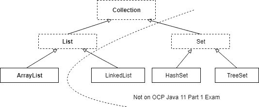

虽然考试并没有要求你记住哪些方法声明在`Collection`中，哪些没有声明，但查阅该接口的 JavaDoc API 描述并检查在该接口中声明的方法仍然是一个好主意。方法名非常有描述性，方法的作用与其名称一致。你应该关注的一些方法是：`add`、`addAll`、`remove`、`removeAll`、`removeIf`、`contains`、`isEmpty`和`clear`。

### 13.3.4.2 List API [☝](http://enthuware.com/forum/dbt.php?...list-api)

`java.util.List`接口定义了保持顺序的集合的行为。列表元素可以通过索引访问。它还允许在任何索引插入或删除元素。允许重复元素和空。由于它只是一个接口，因此没有指定功能是如何实现的。实际的实现类如`ArrayList`和`LinkedList`使用不同的机制来实现。正如后面在`ArrayList`中看到的，实现类可以在`List`之上提供额外的功能。

再次，你应该通过 JavaDoc 浏览`List`接口的所有方法。考试不会在方法名上为难，也不会要求你记忆某个方法是否存在。考试题目基于对给定方法行为的理解。你需要知道在调用方法后现有列表发生了什么。技巧在于了解“边界条件”。例如，如果你尝试从列表中删除不存在的对象或空，或者尝试添加空，会发生什么。

我在下面列出了`List`接口的重要方法。记住索引是基于零的，这意味着第一个元素的索引为零。

1. `E get(int index)`：返回索引处的元素。
2. `E set(int index, E e)`：用传递的对象替换索引处的元素，并返回被替换的原始元素。
3. `boolean add(E e)`：在列表末尾添加对象。返回`true`。
4. `void add(int index, E e)`：在指定的索引添加对象，并将索引处的现有元素向右移动。
5. `boolean addAll(Collection<? extends E> c)`：将给定集合的所有元素添加到此列表的末尾。如果由于调用列表发生了变化，则返回`true`。
6. `boolean addAll(int index, Collection<? extends E> c)`：在指定的索引处添加给定集合的所有元素。如果由于调用列表发生了变化，则返回`true`。
7. `E remove(int index)`：从指定的索引处删除对象，并将索引处的现有元素向左移动。它返回从列表中删除的原始元素。
8. `boolean remove(Object obj)`：从列表中移除指定对象的首次出现。如果找到了该对象，则返回 true。传递的对象使用`equals`方法与列表中的对象进行匹配。
9. `boolean removeAll(Collection<?> c)`：从此列表中移除所有存在于传递集合中的元素。如果此列表由于该调用而发生变化，则返回 true。
10. `boolean retainAll(Collection c)`：从此列表中移除所有不在传递集合中的元素。如果此列表由于该调用而发生变化，则返回 true。
11. `void clear()`：列表中的所有元素。
12. `int size()`：返回列表中的元素数量。
13. `default void forEach(Consumer<? super T> action)`：继承自`java.lang.Iterable`。对`Iterable`的每个元素执行指定的操作，直到所有元素处理完毕或操作抛出异常。

你将经常看到此方法配合 lambda 表达式使用。

请记住，对于`get`和`remove`方法，索引必须在 0 到列表大小减 1 之间（均包含边界），否则将抛出`IndexOutOfBoundsException`；但在`add`方法中，最高索引值与列表的大小相同，这意味着你是在最后一个元素之后添加元素，即在列表末尾添加。

一个测试你对上述方法理解的典型问题是预测以下代码的输出：

```
List<Integer> list =  new ArrayList<Integer>(); //注意此时列表的大小为 0
list.add(0, 1);
list.add(0, 2);
list.add(0, 3);
System.out.println(list);
```

如果你认为输出是`[1, 2, 3]`，那么你被误骗了。输出是`[3, 2, 1]`，因为元素被插入到了第 0 索引处。

以下是几个帮助你检查列表的方法：

1. `boolean isEmpty()`：如果列表没有元素，则返回 true。
2. `boolean contains(Object o)`：如果列表包含指定对象，则返回 true。
3. `boolean containsAll(Collection c)`：如果列表包含给定集合中的所有元素，则返回 true。
4. `List subList(int fromIndex, int toIndex)`：返回此列表在指定的`fromIndex`（包含）和`toIndex`（不包含）之间部分的视图。如果`fromIndex`和`toIndex`相等，则返回的列表为空。
5. `int indexOf(Object o)`：返回给定对象在列表中找到的索引。如果未找到，则返回 -1。
6. `int lastIndexOf(Object o)`：返回给定对象在列表中找到最后一个索引。如果未找到，则返回 -1。
7. `Object[] toArray()`：返回包含此列表所有元素的 Object 数组。
8. `<T> T[] toArray(T[] a)`：返回一个包含此列表所有元素的数组，其类型由参数指定。列表中的对象类型必须是参数中传递的类型。当你想要将列表转换为特定类型的数组时，此方法非常有用。例如，`String[] strArray = listOfString.toArray(new String[0])`将返回一个包含列表所有元素的`String[]`。

上述方法列表中的`subList(int fromIndex, int toIndex)`方法特别有趣。它并不返回一个新的新的独立列表，而只是原始列表的一个视图。因此，你对视图进行的任何更改都会反映在原始列表中，如下例所示：

```
List<String> al = new ArrayList<String>();
al.addAll(Arrays.asList( new String[]{"a", "b", "c", "d", "e" } ));
List<String> al2 = al.subList(2, 4); 
System.out.println(al2); //打印 [c, d]
al2.add("x");
System.out.println(al2); //打印 [c, d, x]
System.out.println(al); //打印 [a, b, c, d, x, e]
al.add("y"); // 对原始列表进行结构性修改
System.out.println(al2); // 出 java.util.ConcurrentModificationException
```

观察输出的最后两行。`x`被添加到`al2`指向的列表末尾。然而，由于`al2`只是`al`指向的原始列表部分的视图，因此`x`在列表中间可见。此外，所有的结构性修改必须通过视图进行。如果你对底层列表进行了结构性修改然后尝试使用视图，结果将是不可预测的。结构性修改意味着列表大小的任何变化。这就是为什么上述代码的最后一行抛出了`java.util.ConcurrentModificationException`异常。

## List.of 和 List.copyOf 方法 [☝](http://enthuware.com/forum/dbt.php?bid=2&sn=13.3.4&tn=list-of-and-list-copyof-methods)

自 Java 1.2 引入 Collections API 以来，Java 就有了`java.util.List`接口。它在 Java 9 和 10 中通过几个静态方法进行了增强，考试期望你了解它们。这些是 1 十二 个重载的`of`方法（Java 9 添加）和一个`copyOf`方法（Java 10 添加）。

重载的`of`方法仅仅是便利方法，它们接收 0 个参数并返回一个不可修改的 List。例如，如果你想创建一个包含 3 个 String 的列表，可以执行`List<String> list1 = List.of("a", "b", "c");`。

同样，`copyOf`方法是一个使用现有集合的元素创建不可修改列表的便利方法。例如，`List<String> list2 = List.copyOf(list1);`。

你将在考试各处看到这些方法的使用，即使问题不是关于列表的。由于理解这些方法返回的列表的行为非常重要，让我先记录下它们的特征：

1. 它们是不可修改的。元素不能添加、删除或替换。在列表上调用任何变异方法将始终导致`UnsupportedOperationException`。然而，如果包含的元素本身是可变的，这可能会导致列表的内容似乎发生了变化。
2. 它们不允许`null`元素。尝试用`null`创建它们会导致`NullPointerException`。
3. 如果所有元素都是可序列化的，则它们也是可序列化的。（对考试不重要）
4. 列表中元素的顺序与提供的参数顺序或提供的数组中的元素顺序相同。
5. 它们是基于值的。调用者不应对返回实例的身份做任何假设。工厂可以创建新实例，也可以复用现有实例。因此，对这些实例进行身份敏感的操作（引用相等`==`、标识哈希、同步）是不可靠的，应该避免。

这里我上面展示的相同代码的微小修改：

```
List<Integer> list =  List.of(); 
list.add(0, 1);
list.add(0, 2);
list.add(0, 3);
System.out.println(list);
```

在这次跳入回答`[3, 2, 1]`之前，你需要意识到`List.of`返回的列表是不可修改的！所以，代码可以编译，但第一次调用`list.add`将运行时抛出`java.lang.UnsupportedOperationException`异常。

## 13.3.5 ArrayList API [☝](http://enthuware.com/forum/dbt.php?bid=2&sn=13.3.5&tn=arraylist-api)

正如前面提到的，ArrayList 是 List 接口的一个实现类。它有三个构造函数：

1. `ArrayList()`：创建一个初始容量为 10 的空列表。正如你在 StringBuilder 类中看到的那样，容量仅仅是存储对象的初始数组的大小。一旦你添加第 11 个对象，将分配一个更大容量的新数组并将所有现有对象传输到新数组中。
2. `ArrayList(Collection c)`：创建一个包含指定集合中元素的列表。
3. `ArrayList(int initialCapacity)`：创建具有指定初始容量的空列表。当你知道想要向列表中添加的大致对象数量时，这个构造函数非常有用。指定一个大于列表将要容纳的对象数的初始容量，可以通过避免每次用完现有容量时都分配新数组，从而提高性能。

在创建`ArrayList`之后，通过调用该`ArrayList`实例上的`ensureCapacity(int n)`也可以增加其容量。在向`ArrayList`插入大量元素之前，使用适当的数字调用此方法，可以减少内部数组增量重新分配的需要，从而提高`add`操作的性能。`ensureCapacity`的相反方法是`trimToSize()`方法，它通过将容量缩小到与列表中元素数量匹配来消除所有未使用的空间。

以下是你在考试中可能会看到的几种声明：

```
List<String> list = new ArrayList<>(); //正确，因为 ArrayList 实现了 List

var al = new ArrayList<Integer>(50); // 初始容量为 50

ArrayList<String> al2 = new ArrayList<>(list); // 复制现有列表，观察菱操作符

var list1 = new ArrayList<>(); // 正确，list1 的类型为 ArrayList<Object>观察 var 声明和菱操作符的结合
```

```
List list2 = new List(list); // 将无法编译，因为 List 是接口，不能实例化
```

### `ArrayList`的重要方法 [☝](http://enthuware.com/forum/dbt.php?bid=2&sn=13.3.5&tn=important-methods-of-arraylist)

`ArrayList`有很多方法。然而，由于`ArrayList`实现了`List`（后者扩展了`Collection`），`ArrayList`的几个方法是在`List`和`Collection`接口中声明的。考试并没有要求你区分继承自`List`/`Collection`的方法与在`ArrayList`中声明的方法。

以下是考试中需要掌握的：

1. `String toString()`：嗯，`toString()`并不是`ArrayList`最重要的方法，但由于我们在示例中将依赖它的输出，最好还是了解一下。`ArrayList`的`toString()`首先获取其每个元素的字符串表示（通过调用它们元素的`toString`），然后将它们组合成一个以`[`开头并以`]`结尾的单一字符串。例如，以下代码打印`[a, b, c]`：

```
var al = new ArrayList<String>();
al.add("a");
al.add("b");
al.add("c");
System.out.println(al);
```

观察输出中元素的顺序。它与它们被添加到列表的顺序相同。对空`ArrayList`调用`toString()`会得到`[ ]`。我将在代码示例中使用相同的相同的格式来显示列表的内容。

#### 向`ArrayList`添加元素的方法：

1. `boolean add(E e)`：将指定的元素添加到此列表的末尾。正如泛型部分所述，`E`只是你在创建`ArrayList`时所指定的任何类型的占位符。例如，如果你创建一个 String 的`ArrayList`，即`ArrayList<String>`，则`E`代表`String`。


此方法实际上在`Collection`接口中声明，如果元素添加成功，则返回值为`true`。

2. `void add(int index, E element)`：将指定的元素插入到列表中指定的索引处。

3. `boolean addAll(Collection<? extends E> c)`：将指定集合的所有元素添加到此列表的末尾。

4. `boolean addAll(int index, Collection<? extends E> c)`：将指定集合的元素插入到列表中指定的索引处。

### 从`ArrayList`移除元素的方法

1. `E remove(int index)`：移除指定位置的元素。它返回被移除的元素。

2. `boolean remove(Object o)`：从列表中移除指定元素的首次出现。

3. `boolean removeAll(Collection<?> c)`：从此列表中移除包含在指定集合中的所有元素。

4. `void clear()`：移除此列表中的所有元素。

### 替换`ArrayList`中元素的方法

#### `set(int index, E element)`

用指定的元素替换列表中指定位置上的元素。它返回被替换的那个元素。

示例：

```
ArrayList<String> al = ... // 创建一个包含 [a, b, c] 的列表
String oldVal = al.set(1, "x"); 
System.out.println(al); // 输出 [a, x, c]
System.out.println(oldVal); // 输出 b
```

### 读取`ArrayList`但不对其修改的方法

#### `boolean contains(Object o)`

将传入参数的对象使用`equals`方法与列表中的每个元素进行比较。一旦找到匹配项，就将立即返回`true`，否则返回`false`。以下是几个示例：

```java
ArrayList<String> al = new ArrayList<>();
al.addAll(Arrays.asList( new String[]{"a", null, "b", "c" } ));
System.out.println(al.contains("c")); // 输出 true
System.out.println(al.contains("z")); // 输出 false
System.out.println(al.contains(null)); // 输出 true
```

注意，即使你传入了`null`，也不会抛出`NullPointerException`。事实上，`null`参数会匹配一个`null`元素。

#### `E get(int index)`

返回列表中指定位置上的元素。如果传入的是无效值（即小于 0 或大于`size-1`的值），它将抛出`IndexOutOfBoundsException`。

#### `int indexOf(Object o)`

将传入参数的对象使用`equals`方法与列表中的每个元素进行比较。返回第一个匹配元素的索引。如果此列表不包含匹配元素，则返回 -1。以下是几个示例：

```java
ArrayList<String> al = new ArrayList<>();
al.addAll(Arrays.asList( new String[]{"a", null, "b", "c", null } ));
System.out.println(al.indexOf("c")); // 输出 3
System.out.println(al.indexOf("z")); // 输出 -1
System.out.println(al.indexOf(null)); // 输出 1
```

注意，和`contains`一样，即使你传入了`null`，`indexOf`也不会抛出`NullPointerException`。`null`参数匹配一个`null`元素。

#### `boolean isEmpty()`

如果列表不包含元素，则返回`true`。

#### `int size()`

返回列表中的元素数量。记住，要获取简单数组中的元素数量，你需要使用该数组名为`length`的变量。

我上面提供的示例仅用于说明单个方法。但在考试中，你将看到使用了多个方法的代码。这里有你在考试中应该记住的几点：

1. **添加 null 值**：`ArrayList`支持`null`元素。

2. **添加重复项**：`ArrayList`支持重复元素。

3. **异常**：除了`toArray(T[] a)`外，`ArrayList`的方法都没有抛出`NullPointerException`。如果你尝试访问列表范围之外的元素，它们会抛出`IndexOutOfBoundsException`。

4. **方法链**：与`StringBuilder`不同，`ArrayList`的方法没有方法返回同一个`ArrayList`对象的引用。因此，无法进行链式调用。

以下是一些你将在考试中看到的此类代码示例。尝试确定以下代码段在编译和执行时的输出：

```
var al = new ArrayList<Integer>(); // 注意类型规范在右侧
al.add(1).add(2); 
System.out.println(al);
```

```java
ArrayList<String> al = new ArrayList<>();// 注意菱操作符的使用
if( al.add("a") ){
  if( al.contains("a") ){
    al.add(al.indexOf("a"), "b");
  }
}
System.out.println(al);
```

```java
ArrayList<String> al = new ArrayList<>();
al.add("a"); al.add("b");
al.add(al.size(), "x");
System.out.println(al);
```

```java
var list1 = new ArrayList<String>();
var list2 = new ArrayList<String>();
list1.add( "a"); list1.add("b");
list2.add("b"); list2.add("c"); list2.add("d");
list1.addAll(list2);
list1.remove("b");
System.out.println(list1);
```

```java
ArrayList<String> list1 = new ArrayList<>();
ArrayList<String> list2 = new ArrayList<>();
list1.add( "a"); list1.add("b");
list2.add("b"); list2.add("c"); list2.add("d");
list1.addAll(list2);
System.out.println(list1);
list1.remove("b");
System.out.println(list1);
```

```java
ArrayList<String> list1 = new ArrayList<>();
ArrayList<String> list2 = new ArrayList<>();
list1.add( "a"); list1.add("b");
list2.add("b"); list2.add("c"); list2.add("d");
list1.addAll(list2);
list1.remove("b");
System.out.println(list1);
```

## 大小与容量

大小是`ArrayList`中当前存储的元素数量。容量是`ArrayList`用于存储元素的内部数组的长度。

记住在 Java 中，数组是固定长度的。你必须在创建数组时指定长度，并且永远无法更改此长度。那么，当向`ArrayList`添加更多元素时会发生什么？它初始容量为 10，一旦满额，就会不断增加容量。这可能需要`ArrayList`执行分配和传输操作，这种操作是非常昂贵的。

这就是`ArrayList(int capacity)`构造函数和`ensureCapacity(int capacity)`方法大显身场的地方。如果你知道添加到`ArrayList`的元素数量，应该使用这个构造函数/方法来确保内部数组足够容纳所有元素。

然而，元素的插入取决于`size`而不是`capacity`。例如，如果`ArrayList`的大小为 5，即使其容量为 10，你也无法在索引 6 插入元素。它将抛出`IndexOutOfBoundsException`。

### 13.3.6 ArrayList 与数组

考试中可能会遇到一些关于`ArrayList`相比数组优优点的理论问题。你已经看到了我们用`ArrayList`和数组能做的所有事情，所以我在这里在这里总结一下它们的优缺点。

#### ArrayList 的优点

1. **动态伸缩**：`ArrayList`可以根据需要调整大小。程序员在向其添加元素时，不需要担心`ArrayList`的长度。

2. **类型安全**：通过泛型可以使`ArrayList`实现类型安全。

3. **现成功能**：`ArrayList`提供了搜索以及在列表任一位置插入元素的方法。

#### ArrayList 的缺点

1. **内存占用较高**：与数组中存储相同数量的元素相比，`ArrayList`通常需要更多空间。

2. **没有类型安全**：在没有泛型的情况下，`ArrayList`完全不是类型安全的。

#### 不支持原生值

`ArrayLists`不能存储原生值，而数组可以。这一缺点在 Java 5 引入自动装箱（autoboxing）后在一定程度上得到了缓解，使得将原生值传递给`ArrayList`的各种方法成为可能。然而，自动装箱会对性能产生影响。

#### ArrayList 与数组之间的相似之处

1. **顺序** - 两者都保持元素的顺序。

2. **重复性** - 两者都允许存储重复元素。

3. **null 值** - 两者都允许存储`null`。

4. **性能** - 由于`ArrayList`内部由数组数组支持，因此在`ArrayList`和数组上进行搜索等各种操作的性能没有区别。

5. **线程安全** - 两者都不是线程安全的。别担心，线程安全不在考点范围内，但你应该意识到，从多个线程访问它们中的任何一个，在某些情况下可能会产生错误的结果。

### 13.3.7 Map 和 HashMap

`Map`是一种数据结构，允许你使用另一条信息（即键 key）来查找信息（即值 value）。例如，国家代码和国家名称的映射允许你通过国家代码查找国家名称，学生 ID 和姓名的映射允许你通过学生 ID 查找姓名，以此此类推。在这里，`countrycode`和`student id`是键，`country name`和`student name`是值。从这个意义上说，`Map`是键值对的集合。

Collections API 中的`java.util.Map`接口捕获了这种行为。有几个实现类实现了`Map`接口。最常用的是`java.util.HashMap`。

重要的是，`Map`并没有扩展`Collection`接口。`Map`是一个独立的类和接口层次结构的根，与`Collection`层次结构无关。虽然考试中没有明确提到`Map`和`HashMap`，但我们在考试中见过某些要求你掌握以下`Map`方法 get：

1. `V get(Object key)`：返回与指定的`key`映射的值，如果此映射不包含该`key`的映射，则返回`null`。

2. `V put(K key, V value)`：将指定的值与此映射中指定的`key`关联。如果映射之前包含该`key`的映射，则旧值被指定的值替换，并返回旧值。如果没有`key`的映射，则返回`null`。

3. `V remove(Object key)`：如果映射中存在`key`，则移除该`key`的映射。如果不存在，则返回值或`null`。

4. `Set<K> keySet()`：返回映射中存在的键的`Set`。注意键是唯一的，因此返回类型是`Set`（而不是`Collection`或`List`）。

5. `Collection<V> values()`：返回映射中存在的值的`Collection`。注意值可能是重复的，因此返回类型是`Collection`。

6. `void clear()`：移除映射中存储的所有条目。

7. `int size()`：返回映射中存储的条目数量。

8. `default void forEach(BiConsumer<? super K, ? super V> action)`：对映射中的每个条目执行给的操作，直到所有条目都处理完毕或操作抛出异常。**注意：** 这完全超出了 Part 1 考试的范围，尽管我们在考试中见过一道关于 lambda 表达式的题目提到了这个方法。这可能是 Part 1 考试中误出的题目。

上述方法及其描述对于考试足够了，但`Map`中还有许多有趣且有用，通过 JavaDoc 学习更多内容是一个好主意。

以下代码说明了通常如何使用 map：

```java
import java.util.*;
public class TestClass{
  static Map<String, String> idNameMap = new HashMap<>();
  static List<String> keys = new ArrayList(List.of("0", "1", "2"));
  static List<String> values = List.of("a", "b", "c");

  public static void buildMap(){
    //在 map 中添加键值对
    for(int i=0; i<keys.size(); i++){
       idNameMap.put(keys.get(i), values.get(i));
    }
    System.out.println(idNameMap); //打印 {0=a, 1=b, 2=c}
  }
  public static void main(String[] args) {
    buildMap();
    String value = idNameMap.get("2");
    System.out.println(value);//打印 c
    //Integer ivalue = idNameMap.get("2"); //无法通过编译
    keys.clear(); //从 keys List 中移除所有元素，不影响 map
    System.out.println(keys.size()); //打印 0，keys 现在是空的
    System.out.println(idNameMap.size());//打印 3，map 仍有键值条目
    idNameMap.remove("1"); //从 map 中移除键 1 及其关联的值
    idNameMap.clear(); //移除所有条目
  }
}
```

以下是上述代码中你应该观察的几点：

1. `Map`和`HashMap`是泛型类。然而，与`List`和`ArrayList`不同，它们使用两个参数。一个用于键（用`K`表示），一个用于值（用`V`表示）。在上面的程序中，键和值是相同的，即`String`，编译器既不允许你放入任何其他内容，也不允许你从中获取`String`的任何内容。

2. 由于键和值已经被类型为`String`，`Map`和`HashMap`在开发中被频繁使用，并且是面试的热点。你应该一定要阅读它们。

```java
class Radio {
   private double frequency=1.1;
   //插入合适的 getter 和 setter
}
class TV {
   private int channel = 5;
   //插入合适的 getter 和 setter
}
public class TestClass{  
    public static void main(String[] args){
           TV t = new TV();
           Radio r = new Radio();
           reset(t);
           reset(r);
           System.out.println(r.getFrequency()); //应该打印 0.0
           System.out.println(t.getChannel()); //应该打印 0
      }
}
```

为`TestClass`类编写`reset`方法的代码，使得`TestClass`在执行时能够打印`0.0`和`0`。

3. 你预计在未来需要重置若干电子设备。请重构上述代码，使得`TestClass`的`reset`方法能够重置任何新设备，而无需更改方法代码。

4. 给定以下代码：


```java
class Pie{
  public void makePie(){
    System.out.println("making pie");
  }
}
```

创建两个继承`Pie`的类`PumpkinPie`和`ApplePie`。在这些类中重写`makePie`方法。确保当对这些类的对象调用`makePie`时，重写后的方法也会被调用。

5. 在`Pie`中添加一个名为`getCalories`的静态方法：

```java
public static int getCalories(){
   return 100;
}
```

创建一个名为`Nutritionist`的新类，包含一个名为`printCalories`的方法。该方法应该接受任意类型的`Pie`，并根据给`Pie`类型打印相应的卡路里数。

6. 给以下两个类：

```java
class XMLTransformer {
  public String transform(String Data){ return "xmldata"; }
}

class NetworkTransformer {
  public String transform(String Data) throws IOException { return "data from network"; }
}
```

通过添加一个名为`Transformer`的抽象超类型来重构这两个类。

7. 创建一个名为`TransformerFactory`的类，包含一个名为`getTransformer`的方法。该方法根据参数返回不同类型的转换器。使用此工厂类获取不同类型的转换器，并调用它们的`transform`方法。

8. 创建一个接收字符串数组并返回包含相同字符串的`ArrayList`的方法。

9. 更新上述方法，在返回之前移除`ArrayList`中的重复元素。

10. 创建一个签名名为`switchIt(ArrayList al, int a, int b)`的方法。该方法应该返回相同的列表，但要交换位置`a`和`b`处的元素。

# 第 14 章 Lambda 表达式

## 理解 Lambda 表达式

### 14.1 理解 Lambda 表达式

#### 14.1.1 Lambda 表达式

在进行培训课程时，我观察到很多 Java 初学者对 lambda 表达式感到畏惧。大多数时候，这种恐惧是因为“lambda”这个名字。lambda 这个词本身并没有产生任何有用的心理概念，这使得它变得难以联系。此外，大多数书籍和教程一开始将 lambda 表达式解释为一种“函数式”编程的方法，而当一个人只是在学习“常规”编程时，这又是另一个难以产生联系的流行术语！

好了，我可以告诉你完全不需要担心。Lambda 表达式实际上非常简单。在编写测试程序时，你是否曾在反复输入`public static void main(String[] args)`时感到沮丧？我确定你一定过。如果你正在使用如 NetBeans 或 Eclipse 这样的 IDE，你可能知道`psvm`这样的快捷键。你输入`psvm`，按下 tab 键，IDE 立即将`psvm`替换为文本`public static void main(String[] args)`。lambda 表达式就像这样，但是针对编译器的。把 lambda 表达式想象成编译器的快捷方式，它执行两件事——定义一个带有方法的类，并实例化该类。编译器一看到 lambda 表达式，就会将该表达式展开为类定义和实例化该类的语句。如果你将其视为一个可以节省你大量击键次数的工具，你就会开始喜欢它。你会非常喜欢它，以至于寻找机会尽可能使用它。让我向你展示它是有多酷。

想象一下你正在为一家汽车店开发一个应用程序。你有一个汽车列表，你需要根据各种标准过滤该列表。你可能需要按公司过滤，可能需要按价格过滤，或者根据用户可能任何其他属性过滤。下面的代码展示了如何实现。你实际上应该将以下所有代码复制到名为`TestClass.java`的单文件中，以便你可以尝试。只需在顶部添加`import java.util.*;`即可。

```java
 class Car
{
    String company; int year; double price; String type; 
    Car(String c, int y, double p, String t){
        this.company = c; this.year = y;
        this.price = p; this.type = t;
    }
    public String toString(){  return "("+company+" "+year+")"; }
}
```

`Car`类表示具有几个属性的汽车。同意，`Car`没有良好的封装。理想情况下，`Car`应该拥有私有字段和公共访问器。但由于封装在这里并不相关，为了节省空间，我没有显示这些方法。

```java
 class CarMall
 {
    List<Car> cars = new ArrayList<>();

    CarMall(){
        cars.add(new Car("Honda", 2012, 9000.0, "SUV"));
        cars.add(new Car("Toyota", 2018, 17000.0, "SEDAN"));
        cars.add(new Car("Ford", 2014, 13000.0, "HATCH"));
        cars.add(new Car("Nissan", 2017, 8000.0, "SPORTS"));
    }

    List<Car> showCars(CarFilter cf){
        ArrayList<Car> carsToShow = new ArrayList<>();
        for(Car c : cars){
            if(cf.showCar(c)) carsToShow.add(c);
        }
        return carsToShow;
    }
}

interface CarFilter
{
    boolean showCar(Car c);
}
```

`Car`类表示具有几个属性的汽车。同意，`Car`没有良好的封装。理想情况下，`Car`应该拥有私有字段和公共访问器。但由于封装在这里并不相关，我没有显示这些方法以节省空间。

`CarMall`代表商店。它创建了一个汽车列表。该列表包含了商店拥有的所有汽车。它有一个`showCars`方法，可以根据任何给定的标准返回列表。而不是在`showCars`方法内部指定具体的过滤标准，而是使用一个`CarFilter`实例来确定汽车是否需要列出。`CarFilter`接口只是声明了过滤器的基本结构。注意，在`showCars`方法内部无法编写实际过滤标准，因为标准是由`CarMall`类的用户决定的。通过接受接口作为参数，`showCars`方法让调用者决定标准。

```java
public class TestClass{
    public static void main(String[] args) {
        CarMall cm = new CarMall();
        CarFilter cf = new CompanyFilter("Honda");
        List<Car> carsByCompany = cm.showCars(cf);
        System.out.println(carsByCompany);
     }
}
class CompanyFilter implements CarFilter
{
    private String company;
    public CompanyFilter(String c){
        this.company = c;
    }
    public boolean showCar(Car c){
        return company.equals(c.company);
    }
}
```

`TestClass`代表使用`CarMall`的第三方类。它想要获取特定公司的汽车详情，例如 Honda。为了实现这一点，它定义了一个`CompanyFilter`类，该类包含了基于公司名称过滤汽车的实际逻辑。在运行时，它创建了一个`CompanyFilter`对象并将其传递给`CarMall`的`showCars`方法。

现在看使用 lambda 表达式的`TestClass`代码：

```java
public class TestClass{
    public static void main(String[] args) {
        CarMall cm = new CarMall();
        List<Car> carsByCompany = cm.showCars(c -> c.company.equals("Honda")
);
        System.out.println(carsByCompany);
     }
}
```

注意，这里没有实现`CarFilter`的独立类，也没有显式地实例化`CarFilter`对象。这两个任务都被一个非常短的语句——`c -> c.company.equals("Honda")`取代了。仅此。通过这一改动，我们实际上删除了 10 行代码！去吧，数数看 :)

正如我之前提到的，上面使用的 lambda 表达式可以看作是编译器的一种快捷方式。编译器实际上可以将此表达式展开为一个完整的类定义，加上实例化该类对象的代码。一旦你理解了编译器是如何进行这种展开的，lambda 表达式对你来说就会易如反掌。

执行展开所需的所有信息在`cm.showCars(...)`方法调用的上下文中已经可用。编译器知道它必须向`showCars(CarFilter cf)`方法传递一个实现`CarFilter`的类的对象。它知道该类必须实现布尔类型的`showCar(Car c)`方法，因为那是`CarFilter`接口中声明的抽象方法。编译器从该方法的签名中获取该方法接收一个类型为`Car`的参数并返回一个`boolean`。根据这些信息，它可以轻松地自己生成以下代码：

```java
 //此类是由编译器创建的。编译器可以给类起任何随机名称！
class XYZ implements CarFilter{
   public boolean showCar(Car <<parameterName>>
){
      return <<这里必须出现一个返回布尔值的表达式>>
;
   }
}
```

编译器无法独立生成的唯一内容是`showCar`方法内部的布尔表达式。我们的 lambda 表达式`c -> c.company.equals("Honda")`恰恰包含这一点，这并非巧合。编译器简单地从 lambda 表达式`->`左侧获取变量名（即`c`），将`->`右侧给出的表达式（即`c.company.equals("Honda")`）插入到上述方法的体中，就拥有了实现`CarFilter`的类的完整代码！最后，它还额外赠送了一个实例化表达式`new XYZ()`！这些就是调用`cm.showCars(CarFilter cf)`方法所需的全部两个要素：即实现`CarFilter`的类的代码以及一个实例化该类对象的表达式！

我建议你在继续之前仔细阅读上面的讨论几次，以吸收编译器将 lambda 表达式展开为完整类的所采用步骤。作为一个练习，尝试将 lambda 表达式`x -> x.price>10000`展开为一个实现`CarFilter`的类。

注意，lambda 表达式并没有指定方法名、参数类型和返回类型。编译器从你放置 lambda 表达式的上下推断出这三项信息。因此，lambda 表达式必须存在于一个能够提供所有信息的环境中。此外，你知道在 Java 中，方法不能独立存在。它只能作为类（或接口）的成员存在。这意味着编译器为 lambda 表达式生成的方法也无法独立存在。编译器必须创建一个类来包含该方法。由于 lambda 表达式没有名称，该类必须满足：它恰好需要实现一个抽象方法，编译器可以使用该方法的名称作为生成方法的名称。这种情况发生的唯一方式是，编译器生成的类实现了一个恰好有一个抽象方法的接口，或者扩展了一个恰好有一个抽象方法的抽象类。如果接口或类有多个抽象方法或没有抽象方法，编译器就不知道 lambda 表达式中的代码属于哪一个方法。

Java 语言设计者决定不允许抽象类使用 lambda 表达式以降低复杂度。因此，剩下的唯一问题是生成的类应该实现哪个接口。这取决于上下文。上下文期望的类型被描述为“目标类型”（target type），它是编译器生成的类必须实现的接口。在上面的代码中，`showCars`方法期望一个`CarFilter`对象（即实现`CarFilter`的类的对象）。因此，生成的类必须实现`CarFilter`。在技术术语中，`CarFilter`是作为参数传递给`showCars`方法的 lambda 表达式的目标类型。

你此时可能会疑惑，为什么编译器不能像为生成的类那样，为生成的方法提供一个虚构的名字？嗯，它可以为方法提供一个虚构的名字，但这样做有什么意义呢？既然程序员不知道这个虚构的名字，他们该如何调用这个方法呢？记住，程序员不需要知道类的名称，因为编译器传递的是该类的对象，而程序员知道父类或接口名称。你在多态部分已经学习过，父类/接口类型的引用可以用来调用子类的方法。这正是这里发生的情况。lambda 表达式的接收者并不关心它收到的实际对象的类型，因为接收代码是通过接口引用在该对象上调用方法。再次查看`CarMall`的`showCars`方法。它使用`CarFilter`引用来调用`showCar`方法。对于这段代码来说，编译器给它起什么名字都无重要。

## 2. **单个参数** - 如果 lambda 表达式仅接受一个参数，则可以在括号内指定参数名称，即`( pName )`，也可以不使用括号，即`pName`。例如：

```
a -> a*a //有效
(a) -> a*a //有效
```

如果你愿意，也可以为参数名称中包含该参数的类型，但这样你就需要使用括号。例如：

```
(int a) -> a*a //有效
```

```
int a -> a*a //无效
```

## 3. **多个参数** - 如果 lambda 表达式接受多个参数，则所有参数名称都必须在括号内指定，即`( pName1, pName2, pName3 )`。例如：

```
(a, b, c) -> a + b + c //有效
```

```
a, b -> a+b //无效，参数必须在 ( ) 内
```

同样，参数类型是可选的。例如：

`(int a, int b, c) -> a + b + c //有效`

如果你指定了参数类型，则必须为所有参数指定类型。因此，`(int a, int b, c) -> a + b + c`是无效的，因为它没有指定`c`的类型。

Java 11 增加了另一种声明参数的方式。你可以像这样使用`var`类型来声明参数：

```
(var a) -> a*a //有效。注意括号，如果你使用 var，则括号是强制的。
```

通常情况下，不需要为 lambda 参数指定类型。但是，除非指定了类型，否则无法在参数上应用注解。例如，以下代码将无法编译，因为注解（这是一个第 1 部分考试未涉及的话题）不能直接指定在变量上：`(@NotNull a) -> a*a`。

为了能够应用注解，你需要为变量一个类型，如下：`(@NotNull Integer a) -> a*a`。所以，如果你想在 lambda 参数上使用注解但不想指定类型，可以使用`var`声明，如下所示：`(@NotNull var a) -> a*a`。

lambda 表达式中代码部分的语法非常简单。它可以是一个表达式，也可以是包含在花括号内的代码块。由于主体可能返回也可能不返回值，有四种可能性：

### 1. **带或不带返回值的表达式** - 这是最常见的用例，因此最短。你可以简单地将表达式放在`->`的右侧。如果表达式有返回值且 lambda 表达式预期返回一个值，编译器将识别出表达式生成的值应该被返回，并会自动插入一个`return`语句。你不能写`return`关键字。例如：

`a -> a + 2 //有效`

`a -> return a + 2 //无效，不能有 return 关键字`

同样，不返回任何值的表达式也可以直接作为 lambda 表达式的主体。例如：

`(a, b) -> System.out.println(a+b)`

//方法调用是一个有效的表达式

### 2. **带或不带返回值的代码块** - 如果你有多行代码，必须将它们写在花括号内，即`{ }`。如果表达式预期返回返回值，你必须使用`return`语句来返回所需的值。

这与编写带或不带返回值的方法体几乎相同。即使主体中只有一个语句，你也可以使用这种语法。例如，这里有一个返回值的 Lambda 表达式：

```
(a) -> {
          int x = 2;
          int y = x+a;
          return y;
           }
```

这里是一个不返回值的：

```
() -> {
          int x = 2;
          int y = 3;
          System.out.println(x+y);
           }
```

注意，与仅以表达式作为主体的 lambda 不同，块内的语句以分号结尾。这与普通的代码块完全一样。适用于方法体内部代码的所有规则也适用于 lambda 表达式代码块内的代码。毕竟，编译器是使用此代码块来生成方法体。


OCP Java 11 第 1 部分考试不会尝试用复杂的 lambda 表达式来为难你。只要你学习了上面所示的基本规则，识别有效和无效的 lambda 表达式将不会有困难。

### 14.1.3 使用 Predicate

让我们再次看一眼我们在 `CarMall` 示例中定义的 `CarFilter` 接口：

```
interface CarFilter{
    boolean showCar(Car c);
}
```

该接口的完全目的是让你检查 `Car` 是否满足给定标准，以便你可以过滤 `Cars` 列表。通过对象列表进行过滤是 Java 应用中非常常见的需求，因此 Java 标准库包含一个为此目的泛型接口 - `java.util.function.Predicate`。它看起来如下：

```
interface Predicate<T>{
  boolean test(T t);
}
```

`<T>` 部分意味着此接口可以为任何类类型，正如上一节解释的那样。如果 `Predicate` 被类型为 `T`，那么 `test` 方法将接受一个 `T` 类型的对象并返回一个布尔值。让我们更改 `CarMall` 中的 `showCars` 方法以使用 `Predicate`：

```
List<Car> showCars(Predicate<Car> cp){
        ArrayList<Car> carsToShow = new ArrayList<>();
        for(Car c : cars){
            if(cp.test(c)) carsToShow.add(c);
        }
        return carsToShow;
    }
```

注意我们在上面的代码中使用了 `Predicate`。除此之外，上面的代码与之前相同。但通过使用 `Predicate` 接口而不是自定义接口，我们删除了三行代码。

调用 `showCars` 的代码没有变化。我们之前使用的 lambda 表达式，即 `showCars(c -> c.equals("Honda"))` 也适用于这个新方法，因为 lambda 表达式从不需要我们使用任何接口或方法的名称。因此，lambda 表达式没有绑定到特定的接口或方法。它只绑定到特定的行为 - 即接受 `Car` 参数并返回 `boolean`。我们依赖编译器来生成相应的类。我们只提供了方法体的原始代码。早期编译器生成一个实现 `CarFilter` 的类，而现在它使用我们写的相同代码生成一个实现 `Predicate<Car>` 的类。事实上，这种变化非常微妙，如果你在 `CarMall` 中有两个版本的 `showCars` 方法，编译器将拒绝 `showCars(c -> c.equals("Honda"))`，报错信息为：“reference to showCars is ambiguous. Both method showCars(java.util.function.Predicate<Car>) in CarMall and method showCars(CarFilter) in CarMall match ”

除了抽象的 `test` 方法外，`Predicate` 接口实际上还有三个默认方法和一个静态方法。我之前没有提到它们，因为它们与 lambda 表达式没有关系。你会发现这些方法基本上是有用的工具方法。我们从未见过有人就这些方法提问，但了解它们比较好。

1. `default Predicate<T> and(Predicate<? super T> other)` : 返回一个复合谓词，表示此谓词与另一个谓词的短路逻辑与（AND）。当你需要执行多个检查时这非常有用。例如，以下代码通过两次调用 `test()` 来检查 `Car` 是否满足两个谓词：

```
Predicate<Car> p1 = c -> c.company.equals("Honda");
Predicate<Car> p2 = c -> c.price>(20000.0); 

Car c = ...
if(p1.test(c) && p2.test(c)
) System.out.println("yes");
```

与其调用两次 `test()`，你也可以将两个谓词合并为一个，并只调用一次 `test`，如下所示：

```
Predicate<Car> p3 = p1.and(p2);
Car c = ...
if( p3.test(c)) System.out.println("yes");
```

你不需要担心 `? super T` 部分。它与泛型中的“边界类型”（bounded types）有关，这部分不在第一部分的考试范围之内。

2. `default Predicate<T> negate()`：返回一个表示该谓词的逻辑取反的谓词。例如，如果你有一个 `Predicate<Car> p = c -> c.price<20000;`，那么 `Predicate<Car> notP = p.negate();` 就表示一个价格 `>= 20000` 的谓词。

3. `default Predicate<T> or(Predicate<? super T> other)`：返回一个复合谓词，表示该谓词与另一个谓词之间的短路逻辑或（Logical OR）。例如，如果你有一个 `Predicate<Car> isHonda = c -> c.company.equals("Honda");` 和一个 `Predicate<Car> isToyota = c -> c.company.equals("Toyota");`，那么 `Predicate<Car> isHondaOrToyota = isHonda().or(isToyota);` 表示一个公司名称为 "Honda" 或 "Toyota" 的谓词。

4. `static <T> Predicate<T> isEqual(Object targetRef)`：返回一个谓词，用于根据 `Object.equals(Object, Object)` 测试两个参数是否相等。该方法是将类的 `equals` 方法转换为 `Predicate` 的一种方法。例如，通常情况下你会使用 `c1.equals(c2)` 来比较两个 `Car` 对象。你可以这样通过 `equals` 方法创建一个 `Predicate`——`Predicate equals = Predicate.isEqual(c1);`，然后使用这个 `Predicate` 将 `c1` 与其他 `Car` 对象进行比较，即 `equals.test(c2)`。

### 14.1.4 函式接口 (Functional Interfaces)

你刚刚看到的 `Predicate` 接口是 `java.util.function` 包中定义的几个接口之一。`Predicate` 接口捕获了测试条件的用例。同样，Java 设计者识别了日常 Java 开发中遇到的几种用例，并为它们创建了现成的接口，这样每个项目就无需反复定义相同类型的接口。这些接口属于被称为“函式接口”（Functional interfaces）的类别。不要被这个听起来很高级的名字吓到。任何只有一个抽象方法的接口都是函式接口。它可以有其他的静态或默认方法，但必须有一个且只有一个抽象方法。这个抽象方法也被称为该函式接口的“函式方法”（functional method）。例如，`Predicate` 接口的函式方法是 `boolean test(T t)`。恰好有一个抽象方法是一个重要的属性，因为它允许你使用 Lambda 表达式来实现此类接口。

它们之所以被称为函式接口，是因为它们表示一个单一函数且不维护任何状态。函式接口旨在恰好只做一件事。例如，如果你查看 `Predicate` 接口，你会发现它是为了检查一个条件的。但实际条件的逻辑并不在函式方法中（因为它是一个抽象方法）。该逻辑是由实现接口的代码提供的，例如通过 Lambda 表达式。这种方法的用处是，它允许你将逻辑与应用于该逻辑的数据分离开来。这就是它被称为“函式编程”（functional programming）的原因。请注意，这与面向对象编程（Object-Oriented Programming）采用的方法完全相反，在 OOP 中，对象包含了数据以及操作这些数据的逻辑。

OCP Java 11 第一部分考试没有显式提到函式接口主题，但它包含了引用 `java.util.function` 包中定义的几个函式接口的问题，即 `Predicate`、`Consumer`、`Supplier`、`Function` 和 `BiFunction`。考试要求你了解这些接口的基本用法，而不需要过细节。你已经见过 `Predicate` 接口的用法。现在我将介绍剩下的。

#### java.util.function.Consumer

`Consumer<T>` 用于“消费”一个类型为 `T` 的对象。通过消费，我们的意思是想对给的对象做某些事情。`Consumer` 接口的函式方法命名为 `accept(T t)`。你只需要编写你想对传入此方法的对象所执行的代码即可。例如：

```
//创建一个消费 String 的 Consumer。
Consumer<String> strConsumer = s -> System.out.println(s.length());
strConsumer.accept("hello"); //打印 5
```

在上面的代码中，Lambda 表达式只包含消费 `String` 参数的逻辑。它不包含应用于该逻辑的实际数据。实际数据出现在下一个语句中。

#### java.util.function.Supplier

`Supplier<T>` 每次被调用时都会提供一个类型为 `T` 的对象。它的函式方法是 `get()`。这里有一个说明其用处的示例（等等，下面的示例使用了列表）：

```
public List<Car> getCars(Supplier<Car> carSupplier){
    List<Car> cars = new ArrayList<>();
    for(int i=0; i<10; i++) cars.add(carSupplier.get());
    return cars;
}
```

上面的方法可以这样调用：

```
List<Car> cars = getCars(()->new Car()); //假设 Car 有默认构造函数
```

#### java.util.function.Function

`Function<T, R>` 接收类型为 `T` 的参数，对该参数进行某些转换并返回类型为 `R` 的结果。结果可以是与参数相同的类型，也可以另一种类型。它的函式方法是 `apply(T t)`。这里有一个说明其用处的示例：

```
public List<String> getCarPropertyList(List<Car> cars, Function<Car, String> carPropertyFunction){
    List<String> carPropertyList = new ArrayList<>();
    for(Car car : cars) carPropertyList.add(carPropertyFunction.apply(car));
    return carPropertyList;
}
```

上面的方法接收一个汽车列表并返回一个包含汽车属性的列表。`carPropertyFunction` 是一个接收 `Car` 实例并返回 `String` 的“函数”。例如，你想获取汽车的公司名称，可以这样调用上面的方法：

```
List<Car> cars = //某种方式获取汽车列表
List<String> companyNames = getCarPropertyList(cars,c->c.getCompany());//观察 c 的类型将是 Car
```

除了 `apply` 方法外，`Function` 还有两个默认方法，即 `andThen` 和 `compose`。在这里我不讨论它们，因为考试并没有要求。但是，查看它们的 JavaDoc API 描述并通过修改上面的代码尝试使用它们是一个好主意。

#### java.util.function.BiFunction

`BiFunction<T,U,R>` 与 `Function` 类似，不同之处在于它接收类型分别为 `T` 和 `U` 的两个参数并返回类型为 `R` 的结果。它的函式方法是 `apply(T t, U u)`。这里有一个说明其用处的示例：

```
public List<Double> getDeliveryCharges(Car car, List<String> cities, BiFunction<Car, String, Double> costBiF){
    List<Double> deliveryChargesList = new ArrayList<>();
    for(String city : cities) deliveryChargesList.add(costBiF.apply(car, city));
    return deliveryChargesList;
}
```

上面的方法接收一个汽车和一个城市列表，并返回交付该汽车到每个给定城市所需的金额。`costBiF` 参数引用一个根据汽车和城市确定成本逻辑的 `BiFunction`。以下是一个简单的实现，无论城市如何都根据汽车价格返回一个值：

```
List<String> cities = List.of("New York", "Chicago", "Dallas");
Car car = new Car("Honda", 2020, 30000.0, CarType.SUV);
List<Double> deliveryCharges = getDeliveryCharges(car, cities, (kar, city)->kar.getPrice()*0.01);//using kar instead of car as the variable name here, why?
```

除了 `apply` 方法外，`BiFunction` 还有一个默认方法，命名为 `andThen`。`BiFunction` 通常用于实现接受两个参数并返回操作结果的数学函数。例如，`BiFunction<Double, Double, Double> areaBiF = (a, b)->a*b;`。

关于上述函数式接口，需要注意的一个重要点是它们只能与引用类型配合，而不能与基本类型配合。例如，你不能：`BiFunction<double, double, double> areaBiF = (a, b)->a*b;`。

### 14.1.5 在集合 API 中使用函数式接口 [☝](http://enthuware.com/forum/dbt.php?bid=2&sn=14.1.5&tn=using-functional-interfaces-with-collections-api)

泛型使得 Java 集合类型安全，而 Lambda 表达式配合函数式接口赋予了它们超能力。集合 API 的大多数类和接口在 Java 8 中都进行了更新，包含了接受函数式接口的方法，以便程序员可以使用 lambda 表达式调用这些方法。诸如迭代、过滤和替换元素等以前需要几行代码的操作，现在只需一行代码即可完成。

由于 Part 1 考试明确提到了 `List` 和 `ArrayList`，让我们来看函数式接口和 `Lists` 如何结合使用的的一些示例。

#### `forEach` 方法 [☝](http://enthuware.com/forum/dbt.php?bid=2&sn=14.1.5&tn=the-foreach-method)

正如你之前看到的，遍历集合是一个非常常见的需求。在 Java 8 之前，遍历集合的常用方法是使用普通的 `for` 循环。`Collection` 接口实际上扩展了 `java.lang.Iterable` 接口，因此也可以使用增强型 `for` 循环（又称为 `for-each` 循环）来实现此。

在 Java 8 中，`Iterable` 接口添加了一个名为 `forEach(Consumer<E> consumer)` 的默认方法，使得遍历任何集合的元素变成了一件乐事。以下代码片段展示了实现相同操作的新旧方法：

```
List<String> list = List.of("a", "b", "c");
//旧方法
for(String s :  list){
    System.out.println(s);
}

//新方法
list.forEach(s->System.out.println(s));
```

由于其简单性，新方法几乎已经完全取代。

同样，`Map` 接口定义了一个默认的 `forEach` 方法，它接受 `BiConsumer` 而不是 `Consumer`。`BiConsumer` 与 `Consumer` 类似，区别在于它接受两个参数而不是一个。它的函数方法是 `void accept(T, U)`。这里有一个使用它处理 `Map` 元素的示例：

```
BiConsumer<String, Integer> bc = (s, i) -> System.out.println(s+" is mapped to "+i);
Map<String, Integer> map = new HashMap<>();
map.put("One", 1);map.put("Two", 2);
map.forEach(bc);

//你可以直接将 lambda 表达式作为参数
map.forEach((s, i) -> System.out.println(s+" is mapped to "+i));
```

你应该熟悉 `forEach` 方法的使用，因为你会在考试中看到它。不过，考试中关于这个方法没有陷阱题。


#### `removeIf` 方法 [☝](http://enthuware.com/forum/dbt.php?bid=2&sn=14.1.5&tn=the-removeif-method)

集合执行的另一个常见操作是过滤。`Collection` 接口有一个默认的 `removeIf(Predicate<? super E> filter)` 方法用于此目的。该方法移除列表中所有满足给定谓词的元素。这里有一个简单的示例：

```java
List<Integer> iList = new ArrayList<>(List.of(1, 2, 3, 4, 5, 6));
Predicate<Integer> p = x->x%2==0;
iList.removeIf(p);
System.out.println(iList);
```

上述代码输出了 `[1, 3, 5]`。正如你可能猜到的，如果元素是偶数，lambda 表达式返回 `true`。`removeIf` 方法对列表中的每个元素执行此 lambda 表达式，如果表达式对该元素返回 `true`，则移除该元素。

再次，我们在上面的代码中并不真的需要使用变量 `p`。我们可以直接将 lambda 表达式传递给 `removeIf` 方法，即 `iList.removeIf( x->x%2==0 )`

#### `sort` 方法 [☝](http://enthuware.com/forum/dbt.php?bid=2&sn=14.1.5&tn=the-sort-method)

集合没有顺序的概念，但列表有。因此，`List` 接口有一个 `sort(Comparator<? super E)` 方法，允许根据确定的顺序排序列表。`java.util.Comparator` 自 Java 2 以来一直存在，但在 Java 8 中变成了函数式接口。它的函数方法比较两个参数，如果第一个参数小于、等于或大于第二个参数，则返回负整数、零或正整数。这帮助我们通过单行代码排序：

```java
List<String> games = new ArrayList<>(List.of("football", "cricket", "baseball", "tennis"));
games.sort((a, b)->a.compareTo(b));
games.forEach(s->System.out.println(s));
```

输出是：

```
baseball
cricket
football
tennis
```

如果你想反序排序列表，可以将 lambda 表达式改为 `(a, b)->-a.compareTo(b)`。注意 `a.compareTo(b)` 前面的负号。我们将 lambda 表达式转换为匿名类的实例化如下：

```java
new Comparator<String>(){
   public int compare(String a, String b){
       return a.compareTo(b);
   }
```

上述方法在考试目标并未明确提及。然而，我们在考试中见过关于这些方法的题目。这些题目并不困难，根据给出的信息你应该能够回答。

### 14.1.6 Lambda 表达式中的变量范围 [☝](http://enthuware.com/forum/dbt.php?bid=2&sn=14.1.6&tn=scope-of-variables-in-lambda-expression)

关于 lambda 表达式，你还需要知道的最后一点是你在 lambda 表达式变量部分定义的变量与 lambda 表达式所在的范围相同。这意味着，你不能重新定义该范围内已存在的变量。如下所示代码所示：

```java
List<String> names = Arrays.asList(new String[]{ "alex", "bob", "casy", "abel"});
for(String n :  names){
     Predicate p = n->n.startsWith("a"); //无法编译
     if(p.test(n))  {
         System.out.println(n);
     }
}
```

上述代码编译失败，错误信息显示“变量 `n` 已定义”。这是因为 `n` 在 for 循环中和 lambda 表达式中都在作用范围内。因此，当 lambda 表达式尝试定义 `n` 时，编译器会报错。

可以在 lambda 表达式内部访问其作用范围内的变量，但前提是该变量被声明为 `final` 或是“有效最终的”。有效最终意味着，尽管该变量没有显式声明为 `final`，但它的值在其存在的范围内值都没有发生变化，因此编译器假设它是 `final` 的。这里有一个示例：

```java
List<String> names = Arrays.asList(new String[]{ "alex", "bob", "casy", "abel"});
int x = 0;
for(String n :  names){
     Predicate<String> p = k->{
         System.out.println(n); //valid
         //System.out.println(x); //will not compile
         return k.startsWith("a");
     };
     if(p.test(n))  {
         System.out.println(n);
     }
}
x = 1; //x is being changed here
```

在上述代码中，变量 `n` 在赋值后从未没有被改变。因此，`n` 是事实最终的（effectively final）。但 `x` 则不是，因为它在代码后部分被赋值了新值。

### 14.1.7 测验 [☝](http://enthuware.com/forum/dbt.php?bid=2&sn=14.1.7&tn=quiz)

**Q.** 假定以下类：

```java
public class Item{
     String name; double price;
     public Item(String name, double price){
         this.name = name; this.price = price;
     }
}
```

并在另一个类中出现以下代码：

```java
double price = 100.0;
Supplier<Item> itemSupplier = ()-> new Item("dummy", price);
price = 200.0;
System.out.println(itemSupplier.get().price);
```

输出将是什么？

**A.** 100.0

**B.** 200.0

**C.** 什么都没有打印。

**D.** 编译失败。

**E.** 运行时抛出异常。

**正确答案是 D。**

注意，变量 `price` 并不是事实最终的，因为它的值在代码中被改变了。因此，它不能在 lambda 表达式中使用。

## 14.2 练习 [☝](http://enthuware.com/forum/dbt.php?bid=2&sn=14.2.0&tn=exercise)

1. 给定以下 lambda 表达式，定义一个可以使用这些 lambda 表达式实现的适当接口。

   `() -> true`

   `k -> k>5`

2. 给定以下接口，创建可以用于捕获这些接口的 lambda 表达式。

   ```java
   interface Shape{
      double computeArea();
   }

   interface Operation{
      void operate(String name, double[] params);
   }
   ```

3. 写一个方法接收 `Image` 对象列表和一个 `Predicate` 作为参数，并返回另一个仅包含满足该谓词的 `Images` 列表。

4. 假设 `Image` 类具有 `width` 和 `height` 属性，调用上述方法过滤掉小于 100 x 100 的图像。

# 第 15 章 异常

- 描述异常处理的优势，并区分检查异常（checked exceptions）、未检查异常（unchecked exceptions）和错误（Errors）

- 创建 try-catch 块并确定异常如何改变程序流

- 创建并调用一个抛出异常的方法

## 15.1 创建 try-catch 块并确定异常如何改变程序流

### 15.1.1 Java 异常处理 [☝](http://enthuware.com/forum/dbt.php?bid=2&sn=15.1.1&tn=java-exception-handling)

异常用于用于管理特殊情况。对于一个文件复制程序，正常的执行流程可能是——打开文件 A，读取文件 A 的内容，创建文件 B，并将内容写入文件 B。但如果程序无法打开文件 A 呢？如果程序无法创建或写入文件 B 呢？此类失败可能有许多原因，例如文件名拼写错误、权限不足、磁盘空间不足甚至磁盘故障。现在，你不期望这些问题总是发生，但期望它们有时会发生是合理的。由于我们不期望这些问题在正常运行过程中定期发生，因此我们称它们为“异常”（exceptional）。

在异常情况下，你可能想要向用户提供反馈，或者你可能想采取替代方案。例如，如果找不到输入文件，你可能希望用户输入另一个源文件名；或者如果给定位置空间不足，则输入另一个目标位置。即使你不想在这些情况下采取任何特殊行动，你至少也希望程序能够优雅地结束，而不是在运行时意外崩溃。这意味着你应该为程序提供一条在这种情况下可以走的路径。一种方法是在继续复制之前检查每种情况，如下所示：

```java
if(checkFileAccess(file1)){
    if(checkWritePermission(targetDirectory){
        //正常执行流程的代码
     }else{
        System.out.println("Unable to create file2");
    }
}else{
    System.out.println("Unable to read file1");
}
```

你可以看出这将走向何方。你会有大量的 if-else 语句。这不仅编码起来繁琐，日后的阅读和维护也将是一场噩梦。

上述方法还有另一个严重问题。它没有提供为你在编写代码时甚至不知道的情况编写代码的方法。例如，如果用户在一个要求文件名遵循特定格式的环境中运行此代码呢？所以，现在你有两种“异常情况”：一种是你编写代码时已知的，另一种是你未知的。

Java 异常机制旨在帮助你编写覆盖程序可能执行的所有路径——1. 正常路径 2. 异常情况路径 3. 未知路径。上述程序可以这样写：

```java
try{
   //正常执行流程
}catch(SecurityException se){
   // 已知异常情况
   System.out.println("No permission!");
}
catch(Throwable t){
   // 未知异常情况
   System.out.println("Some problem in copying: "+t.getMessage());
   t.printStackTrace();
}
```

注意这里的视角反了。在 if/else 方法中，你检查每种异常情况并在良好时继续；而在 try/catch 方法中，你假设一切良好，只有在遇到问题时才根据问题决定做什么。try/catch 方法的优势显而易见。它将正常执行代码与异常情况代码清晰分离，使得代码更容易阅读和维护。Java 的异常处理并非没有争议。对于什么是“异常情况”以及处理此类情况的正确方法，存在大量的争论。在本章中的目标是教你 Java 的异常处理方法，因此我不会进入与其他语言相比优劣的学术讨论。然而，这是技术面试中非常重要的话题。我建议你搜索关于 Java 异常处理的批评并与 C# 进行比较。

### 15.1.2 try/catch 方法的基础知识 [☝](http://enthuware.com/forum/dbt.php?bid=2&sn=15.1.2&tn=fundamentals-of-the-try-catch-approach)

当你把开发代码看作开发组件时，你会发现其中总有两个利益相关者——组件的提供者/开发者以及组件的客户端或用户。为了让客户端可以使用组件，提供者必须告诉客户端它是“如何”工作的。这种“如何”不仅包括组件的输入输出细节，还包括关于异常情况的信息，即组件知道可能发生但并不处理的情况。

例如，假设你正在开发一个将一个文件的内容复制到另一个文件的方法，该方法将由另一个团队的开发者使用。你必须让其他开发者知道你已经意识到了读写文件相关的输入/输出（I/O）问题，但你不会对它们进行任何处理。换句话说，你必须传达出你的方法会尽力复制文件，但如果发生 I/O 问题，它将放弃尝试并通知她失败了，以便她根据自己的意愿进行处理。这是通过在方法声明中使用 `throws` 子句来实现的：

```java
public void copyFile(String inputPath, String outputPath) throws IOException
 {
   //复制文件的代码
}
```

在上述代码中，如果 `copyFile` 方法在复制文件时遇到任何 I/O 问题，它将直接停止复制并向调用者抛出一个 `IOException`。如果没有遇到任何 I/O 问，该方法将成功结束。

在组件的另一端是该组件的用户，她使用组件提供者提供的信息来编写她的代码。用户必须决定她想如何处理这种异常情况。如果她认为自己有能力“解决”这种情况，她会将该组件的使用放在 `try` 块中，并关联一个 `catch` 块，其中包含“解决”问题的代码。当这种异常情况实际发生时，控制将转移到 `catch` 块，而不是继续执行执行异常的方法调用之后的后续语句。

如果用户决定她无法处理这种异常情况，她会将异常传播给其组件的调用者。

例如，创建一个文件备份的程序可能会在内部使用文件复制程序来复制文件。如果文件复制程序抛出 `IOException`，备份程序可能会捕获该异常并向用户显示消息。

```java
public void createBackup(String input) {
   String output  = input+".backup";
   try{
      copyFile(input, output);
      System.out.println("backup successful");
   }catch(IOException ioe
){
      System.out.println("backup failure");
   }
}
```

如果 `copyFile` 方法在没有任何问题的情况下完成，控制将进入 `println` 语句。如果 `copyFile` 方法抛出 `IOException`，控制将进入 `catch` 块，从而提供了一个采取不同行动的机会。在这里，代码可以向用户显示失败消息。从备份程序开发者的角度来看，向用户显示错误消息就是解决 I/O 问题的解决方法。还可以编写代码让用户指定另一个文件或目录来创建备份。

当异常在 `catch` 块中被捕获时，它被认为已“被处理”。如果备份创建方法在 `copyFile` 未成功时不知道该做什么，那么它应该通过使用自己的 `throws` 子句让异常传播给它的调用者：

```java
public void createBackup(String input) throws IOException
{
   String output  = input+".backup";
   copyFile(input, output);
   System.out.println("backup successful");
}
```

在上述代码中，如果 `copyFile` 方法在没有任何问题的情况下完成，控制将进入 `println` 语句。但如果 `copyFile` 方法抛出 `IOException`，`createBackup` 方法将立即结束，调用者将接收到一个 `IOException`。注意，这将是它从 `copyFile` 方法接收到的相同的 `IOException`。这就是异常从一个方法传播到另一个方法的方法。可能存在长长的调用链，异常在被处理之前会在链中向上冒泡。如果异常在调用链冒泡泡过程中没有地方地方被捕获，它最终将到达 `JVM` 代码。由于 `JVM` 并不知道它正在执行的程序的业务逻辑，它通过杀死（又称终止）程序来“处理”异常（实际上，JVM 只杀掉了用于调用方法调用链的线程，但线程内容不在 OCP Java 11 第一部分考试的考核范围内，所以你可以假设程序只由一个线程组成，杀死该线程等同于杀死程序）。

### 15.1.3 异常处理谜图的碎片

Java 异常处理机制由几个活动部分组成。使这个机制变得有点复杂的是，你需要将每个部分放在正确的位置才能使整个系统正常工作。所以，让我先简要介绍一下这些部分。

#### java.lang.Throwable 对象

`Throwable` 是所有异常的根类。它捕获了创建时程序及其周围环境的细节。除其他外，`Throwable` 对象还包括导致异常的方法调用链（被称为“堆栈跟踪轨迹”）以及程序员在创建该异常时指定的任何信息消息。这些信息在调试程序时确定异常的位置和原因非常有帮助。你可能在程序崩溃时在控制台上看到包含方法名的、看起来非常疯狂的输出。这种输出实际上是 `Throwable` 对象中包含的堆栈跟踪。


`Throwable` 有两个子类——`java.lang.Error` 和 `java.lang.Exception`，以及大量的孙类。每个类都用于特定的情况。例如，当代码尝试访问空引用时，会抛出 `java.lang.NullPointerException`；当尝试访问超出数组大小的数组时，会抛出 `java.lang.ArrayIndexOutOfBoundsException`。如果现有类不能表示异常情况，你也可以通过扩展这些类中的任何一个来创建自己的子类。例如，会计应用程序可以为取款金额超过账户余额的情况定义一个 `LowBalanceException`。

在口语中被称为“异常”（即小写 'e' 的 exception）的，实际上是 `java.lang.Throwable` 类的对象或其子类之一。

`java.lang.Exception` 的一个特殊子类是 `java.lang.RuntimeException`。`RuntimeException` 及其子类属于一类被称为“未检查异常”的异常。你很快就会看到它们的重要性。

## throw 语句

`throw` 语句被程序员用于显式地“抛出异常”或“引发异常”。程序员可能会在遇到使得继续执行代码无效的情况下决定抛出异常。例如，在执行方法时，如果你发现必需参数的值无效，你可以使用 `throw` 语句抛出一个 `IllegalArgumentException`：

```java
public double computeSimpleInterest(double p, double r, double t){
   if( t<0) {
      IllegalArgumentException iae = new IllegalArgumentException("time is less than 0");
      throw iae;
   }
   //其他代码
}
```

通常，异常对象的创建仅仅是为了“抛出”，因此没有必要将其引用存储在变量中。这就是为什么它们通常在同一语句中创建并抛出，如下所示：

```java
public double computeSimpleInterest(double p, double r, double t){
  if( t<0) throw new IllegalArgumentException("time is less than 0");
  //其他代码
}
```

抛出异常意味着代码遇到了它不希望处理的意外情况。例如，上面的代码期望 `time` 参数大于 0。对于这段代码来说，`time` 小于 0 就是一个意外情况。它不希望处理这种情况（可能因为程序员不确定在在这种情况下该怎么办），因此在发生这种情况时它会抛出一个异常。这也意味着该方法将决定在 `time` 小于 0 时应该做什么的责任交给了该方法的调用者。

请注意，只有 `Throwable` 的实例（或其子类）才能使用 `throw` 语句进行抛出。你不能执行诸如 `throw new Object();` 或 `throw "bad situation";` 这样的操作。

使用 `throw` 语句显式抛出异常并不是抛出异常的唯一方法。如果代码尝试某些错误操作（例如在空引用上调用方法），JVM 也可能决定抛出异常。例如：

```java
public void printLength(String str){
    System.out.println(str.length());
}
```

如果你向上述方法传递 `null`，JVM 将创建一个 `NullPointerException` 的新实例，并在尝试执行 `str.length()` 时抛出该实例。

## throws 子句

Java 要求你在方法的 `throws` 子句中列出该方法可能抛出的异常。这回到了 Java 的设计目标，即让用户了解方法的完整行为。它希望确保如果方法遇到异常情况，该方法要么自己处理该情况，要么让调用者知道该情况。`throws` 子句就是为此目的设计的。它向方法的用户传达了该方法可能会抛出 `throws` 子句中提到的异常。例如：

```java
public double computeSimpleInterest(double p, double r, double t) throws Exception
{
  if( t<0) throw new Exception("time is less than 0");
  //other code
}
```

现在，任何使用上述方法的人都知道该方法可能会抛出异常而不是返回利息。这有助于用户在出现异常情况时编写适当的代码来处理它。

## try 语句

`try` 语句为程序员提供了一个机会从中恢复/或挽救执行代码块时可能出现的异常情况。`try` 语句由一个 `try` 块、零或多个 `catch` 块以及可选的 `finally` 块组成。其语法如下：

```java
try {
  //可能抛出异常的代码
}catch(<ExceptionClass1> e1){
  // 如果 try 中的代码抛出异常 1，则执行的代码
}
catch(<ExceptionClass2> e2){
  // 如果 try 中的代码抛出异常 2，则执行的代码
}
catch(<ExceptionClassN> en){
  // 如果 try 中的代码抛出异常 N，则执行的代码
}
finally{
  // 在 try 块和 catch 块执行完毕后执行的代码
}
```

请注意，即使这些块中只有一个语句，`try`、`catch` 和 `finally` 块的大括号也是必须的（与 `if`、`while`、`do/while` 和 `for` 块相比，如果块中只有一个语句，则不需要大括号）。此外，`try` 块后面必须至少跟一个 `catch` 块或 `finally` 块。后面既没有 `catch` 块也没有 `finally` 块的 `try` 块将无法编译。

`try` 语句是 `throw` 语句的对应物，因为将一段代码放在 `try` 块中意味着程序员想在该段代码抛出异常时做某些处理。换句话说，`try` 块让程序员能够处理异常情况，而 `throw` 语句则让程序员避免处理它。

虽然 `try` 块包含了程序正常运行的代码，但 `catch` 块是程序员尝试从 `try` 块出现的异常情况中恢复的地方。如果 `try` 块中的代码抛出异常，该 `try` 块中的正常执行流将被中断（即不再执行 `try` 块中的后续代码），并且控制权将转移到 `catch` 块。在这里，程序员可以采取替代方案来完成方法的处理。例如，程序员可能决定只向用户显示一个关于异常的弹出消息，然后继续执行 `try` 语句之后的语句。

`catch` 块与 `catch` 子句关联，该子句指定了 `catch` 块旨在处理的异常。例如，带有 `catch(IllegalArgumentException e)` 这种子句的 `catch` 块用于处理 `IllegalArgumentException` 及其子类。因此，只有当 `try` 块中的代码抛出 `IllegalArgumentException` 或其子类异常时，此 `catch` 块才会被执行。你可以在 `catch` 子句中指定任何有效的异常类（包括 `java.lang.Throwable`）。

`finally` 块是程序员尝试挽救局面或控制控制损害的地方，而不是尝试从异常中恢复。例如，一个尝试复制文件的程序可能无论复制操作是否成功都想要关闭任何已打开的文件。程序员可以在 `finally` 块中这样做。你可以将 `finally` 块视为汽车技师无论他是否能够修好汽车，都会重新装配零件的步骤！

下面是一个在 `try` 语句中调用上述 `computeSimpleInterest` 方法的方法：

```java
public void doInterest(){

   try{
      double interest = computeSimpleInterest(1000.0, 10.0, -1);
      System.out.println("Computed interest "+interest);
   }catch(Exception e){
      System.out.println("Problem in computing interest:"+e.getMessage());
      e.printStackTrace();
   }finally{
      System.out.println("all done");
   }

}
```

在上述代码中，调用 `computeSimpleInterest` 抛出了 `IllegalArgumentException`，因为 `t` 是负数。因此，方法调用之后的 `println` 语句没有执行。该异常在 `catch` 块中被捕获，因为它的 `catch` 子句即 `catch(Exception )` 匹配 `try` 块抛出的异常，控制权进入该 catch 块的第一条语句。它在控制台上打印异常的消息和堆栈轨迹。最后，控制进入 `finally` 块，打印 "all done"。如果你省略了 `catch` 块，控制将在调用 `computeSimpleInterest` 方法后直接进入 `finally` 块。在执行 `finally` 块后，`doInterest` 方法的调用者将接收到相同的 `IllegalArgumentException`。

注意，存在的 `finally` 块无论 `try` 块或 `catch` 块发生了什么，总是执行的。即使 `try` 块抛出了异常且没有 `catch` 块来捕获异常，JVM 也会执行 `finally` 块。它只会在 `finally` 块完成后才将异常抛给调用者。`finally` 块不执行的唯一情况是 `try` 或 `catch` 块中的代码通过调用 `System.exit()` 方法强制 JVM 关闭。

以下是一个完整的程序，阐明了异常如何改变程序的正常执行流：

```java
public class TestClass{

  public static void main(String[] args){
    TestClass tc = new TestClass();
    tc.doInterest();
  }

  public double computeSimpleInterest(double p, double r, double t){
     if( t<0) throw new IllegalArgumentException("time is less than 0");
     return p*r*t/100;
  }

  public void doInterest(){
     try{
        double interest = computeSimpleInterest(1000.0, 10.0, -1);
        System.out.println("Computed interest "+interest);
     }catch(IllegalArgumentException iae){
        System.out.println("Problem in computing interest:"+iae.getMessage());
        iae.printStackTrace();
     }finally{
        System.out.println("all done");
     }
  }  

}
```

它在控制台上生成了以下输出：

```
Problem in computing interest:time is less than 0
java.lang.IllegalArgumentException: time is less than 0
        at TestClass.computeSimpleInterest(TestClass.java:8)
        at TestClass.doInterest(TestClass.java:14)
        at TestClass.main(TestClass.java:4)
all done
```

你应该在上述代码中观察到以下几点：

1. `computeSimpleInterest` 方法中的 `return` 语句没有执行，因为之前的语句抛出了异常。

2. `doInterest` 方法中 `try` 块的 `println` 语句没有执行，因为对 `computeSimpleInterest` 的调用是以异常结束而不是返回值。控制在方法调用后直接跳转到 `catch` 块。

3. `catch` 块打印了异常对象中捕获的详细信息。它显示了从创建 `IllegalArgumentException` 对象的位置开始反序的方法调用序列。你应该尝试移除 `catch` 块并查看输出。

4. 一旦 `catch` 块执行完毕，控制将进入 `finally` 块。

5. `doInterest` 方法在执行 `finally` 块后返回。

6. 尽管 `computeSimpleInterest` 方法抛出了异常，但它并没有 `throws` 子句。原因将在下一节中讨论检查异常（checked exceptions）和未检查异常（unchecked exceptions）时变得清晰。

## try-with-resources 语句

`try/catch` 块的典型用法是在 `try` 块中打开并使用资源（如 `File`、网络套字、数据库连接或远程对象的句柄），在需要时在 `catch` 块中进行异常处理，并在 `finally` 块中执行清理。大部分清理涉及关闭你在 `try` 块中打开或使用的资源。例如：

```java
FileInputStream fis = null;//在 try 块外部声明，以便 fis 在 finally 块中才具有作用域
try{
    fis = new FileInputStream("test.txt"); //在 try 块内部实例化，因为它可能会抛出异常
    byte[] data = fis.readAllBytes();
    System.out.println(new String(data));
}catch(IOException e){
    System.out.println("Exception while opening or reading the file "+e.getMessage());
}
finally{
    //如果输入流已打开则关闭
    if(fis != null){ //如果打开操作失败，它可能为 null
        try{
          fis.close();//需要封装在 try/catch 块中，因为即使 close 方法也声明了 IOException
        } catch(IOException ioe){
            //已尽力关闭资源
            //不在乎关闭操作是否失败
        }
    }
}
```

上述代码存在两个问题。第一，它太繁琐了。我们想要做的仅仅是“如果资源已打开则关闭它”，但实现此操作所需的代码行数太多了。此外，这些代码在代码使用任何类型资源的地方都是重复的。第二，程序员非常容易忘记在用后关闭资源。这导致代码变得脆弱。

Java 设计者以“带资源的 try（try with resources）”语句的形式提出了一个解决方案。请看下面的代码：

```java
try(FileInputStream fis = new FileInputStream("test.txt") ) { //观察这行代码
    byte[] data = fis.readAllBytes();
    System.out.println(new String(data));
}catch(IOException e){
    System.out.println("Exception while opening or reading file "+e.getMessage());
}
```

我们现在不仅仅是 "try"，而是有了 `try(FileInputStream fis = new FileInputStream("test.txt") )`。括号部分是你指定计划在接后的 `try` 块中使用的资源。Java 编译器会自动添加一个隐式的 `finally` 块，其中包含关闭你在此指定的资源的代码。这个隐藏的 `finally` 块无论 `try` 块或 `catch` 块中的代码是否抛出异常都会执行。

如果你对处理从 `try` 块可能抛出的任何异常感兴趣，也可以移除 `catch` 子句。这进一步简化了上述代码：

```java
try(FileInputStream fis = new FileInputStream("test.txt") ) {
    byte[] data = fis.readAllBytes();
    System.out.println(new String(data));
}
```

现在不仅仅是 "try"，我们现在有了 `try(FileInputStream fis = new FileInputStream("test.txt") )`。括号部分是你指定计划在接后的 `try` 块中使用的资源。Java 编译器会自动添加一个隐式的 `finally` 块，其中包含关闭你在此处指定的资源的代码。这个隐藏的 `finally` 块无论 `try` 块或 `catch` 块中的代码是否抛出异常都会执行。

如果你对处理从 `try` 块可能抛出的任何异常感兴趣，也可以移除 `catch` 子句。这进一步简化了上述代码。


```java
try(FileInputStream fis = new FileInputStream("test.txt") ) {
    byte[] data = fis.readAllBytes();
    System.out.println(new String(data));
}
```

当然，你现在需要在该代码存在的方法中声明 `IOException`。正如你所见，这一特性使得代码既健壮又易于维护。在此指定的资源也被称为“保护资源”。由于资源的关闭被处理，这一特性被称为“自动资源”。虽然没有在考试中提到，但许多考生报告了关于此主题的问题。因此，让我们进入该特性的细节。

## try-with-resources 语法 [☝](http://enthuware.com/forum/dbt.php?bid=2&sn=15.1.4&tn=syntax-of-with-resources)

`try-with-resources` 语句的一个重大变化是，你可以像方法一样为 `try` 语句指定参数。然而，与方法不同，这些参数用分号（`;`）而不是逗号（`,`）分隔。基本上，你可以是变量声明或现有的引用变量。这里是一些有效的示例：

```java
FileInputStream fis1 = new FileInputStream("test.txt");

try(fis1;) { } //使用单个预定义的初始化变量（分号是可选的）

try(FileInputStream fis2 = new FileInputStream("test.txt"); fis1;){ } //声明新变量并使用预定义的引用变量（最后一个分号是可选的）

try(
   Connection db = connectionManager.getConnection(); 
   var ss = new ServerSocket(8888); //使用 var 声明
   FileInputStream fis2 = new FileInputStream("test.txt");
   fis1
){ //允许多个声明语句
}
```

对于你想保护的资源类型或数量没有限制。但是，你在此指定的变量必须是 `final` 的或有效 `final`（effectively final）。

此外，在 `try-with-resources` 子句中定义的变量的作用域是 `try` 块。换句话说，你不能在 `catch` 块或 `try` 语句之后访问这些变量。这里是一些无效的用法：

```java
FileInputStream fis1 = null;
try(fis1 = new FileInputStream("test.txt")) //无法编译。这既不是变量声明也不是引用变量。
{ }

try(
   FileInputStream fis1 = new FileInputStream("test.txt"), fis2 = new FileInputStream("test2.txt");
   ){ //不能在同一个声明语句中声明多个变量。
} 

try(FileInputStream fis = new FileInputStream("test.txt")){  
  //对 fis 进行操作 
}finally{
   fis.reset(); //无法编译，因为 fis 已经出了作用域
}
```

用于解释 `try-with-resources` 语句的示例大多数使用了 `File` 操作。虽然 `File I/O`、数据库访问和网络 I/O 不在考试范围内，但你可能会在题设中看到相关类的使用。在这些问题中，你可以安全地假设使用这些类的代码部分是有效的。具体来说，你不需要了解这些方法的细节，或者这些类的方法所抛出的精确异常。你应该关注与 `try-with-resources` 语句特定的部分以找到答案。

## 关闭资源 [☝](http://enthuware.com/forum/dbt.php?bid=2&sn=15.1.4&tn=closing-the-resources)

关闭资源意味着给资源对象一个释放它可能获取的任何系统资源的机会。如果系统资源不再需要，那么释放它们是非常重要的，以便将其提供其他用户使用。按照惯例，获取资源的类会提供一个 `close()` 方法，可以通过调用该方法来表示该实例不再需要。`close()` 方法包含了释放该对象所获取资源的代码。

Java 7 将这种惯正式化为一个名为 `java.lang.AutoCloseable` 的接口。该接口仅声明了一个方法：`void close() throws Exception`。`try-with-resources` 语句基于此接口构建，仅允许实现此接口的类用于 `try-with-resources` 子句。如果一个类实现了 `AutoCloseable`，编译器就能确定可以在其实例上调用 `close()` 方法。这允许编译器生成用于释放资源的适当代码。Java 7 还对几个现有的类进行了重构以实现此接口。最重要的是，许多文件 I/O 类在 Java 7 之前就已经实现了 `java.io.Closeable` 接口。Java 7 让 `java.io.Closeable` 继承自 `java.lang.AutoCloseable`，从而使所有类一次性适用于自动资源管理。注意 `AutoCloseable` 位于 `java` 包中，因为它并不特定于 I/O 资源。换句话说，对于 Java 而言，任何实现 `AutoCloseable` 的类都是可以自动管理的资源。

## 资源的关闭顺序 [☝](http://enthuware.com/forum/dbt.php?bid=2&sn=15.1.4&tn=order-of-closing-the-resources)

`close()` 方法会在 `try` 块结束后立即在 `try` 子句中指定的每个资源上被调用（这意味着在执行任何 `catch` 或显式 `finally` 块之前），调用顺序与指定的顺序相反。这个看起来很复杂的语句在代码的帮助下实际上很容易理解。以下代码显示了一个名为 `Device` 的虚拟资源类，其中包含打印语句以帮助我们理解这个过程：

```java
public class Device implements AutoCloseable{
    private int index;
    public Device(int index){
        this.index = index;
        System.out.println("Device "+index+" opened");
    }

    public String read() throws Exception{
        if(index == 2) throw new Exception("Unable to read Device "+index);
        System.out.println("Device "+index+" reading");
        return "Device "+index+" data";
    }

    public void close(){
        System.out.println("Device "+index+" closed");
    }
}
```

以下类测试了 `Device` 的用法：

```java
public class TestClass{
    public static void main(String[] args){ //因为有 catch 块，这里不需要 throws 子句
        Device d1 = new Device(1);
        try(d1; Device d2 = new Device(2)){
            d1.read();
            d2.read(); //throws Exception
        }catch(Exception e){ 
            System.out.println("Exception received : "+e.getMessage());
        }finally{
            System.out.println("In Finally");
        }
    }
}
```

以下是 `TestClass` 生成的输出：

```
Device 1 opened
Device 2 opened
Device 1 reading
Device 2 closed
Device 1 closed
Exception received : Unable to read Device 2
In Finally
```

你应该观察到以下几点：

1. 资源按照 `try` 子句指定的顺序打开（`Device 1` 然后是 `Device 2`）。
2. `close` 方法按反序在资源上被调用（`Device 2` 然后是 `Device 1`）。
3. `try` 子句中提到的两个资源都调用了 `close` 方法，尽管在 `try` 子句中只实例化了 `Device 2`。
4. `catch` 和 `finally` 块在资源关闭**之后**执行。

尝试通过在构造函数和/或 `close` 方法中添加 `throw` 语句修改上述代码，然后观察输出。

# 15.2 区分检查异常、未检查异常和错误

## 15.2.1 检查异常和未检查异常 [☝](http://enthuware.com/forum/dbt.php?bid=2&sn=15.2.1&tn=checked-and-unchecked-exceptions)

如之前讨论的，方法抛出的异常是方法与该方法用户之间约的一部分。如果用户不知道方法可能抛出的异常，她将在运行时感到措手不及，因为她的代码没有准备好处理该异常。方法的 `throws` 子句旨在列出该方法可能抛出的所有异常。如果异常列在 `throws` 子句中，用户将知道需要以某种方式处理这种情况。

但如果开发者忘记在方法的 `throws` 子句中列出异常怎么办？在这种情况下，我们回到了运行时让用户措手不及的问题。这就是编译器发挥作用的地方。在编译方法时，编译器会检查可能抛给调用者的任何异常。如果该异常未在 `throws` 子句列表中，它将拒绝编译方法。

这听起来是一个很好的解决方案，但问题在于，编译器并不检查代码抛出的所有类型异常。它只检查被称为**检查异常**的特定类型异常，并强制你在 `throws` 子句中仅列出属于此类类别的异常。

不属于检查异常类别的异常被称为**未检查异常**。它们之所以被称为未检查，是因为编译器并不关心代码是否抛出了此类异常。在 `throws` 子句中列未检查异常是可选的。

判断一个异常是否为检查异常很容易的。Java 语言设计者假设任何继承自 `java.lang.Throwable` 但未继承 `java.lang.RuntimeException` 或 `java.lang.Error` 的异常都是检查异常。其余（即 `java.lang.Error`、`java.lang.RuntimeException` 及其子类）都是未检查异常。

下图说明了这些异常的分组。

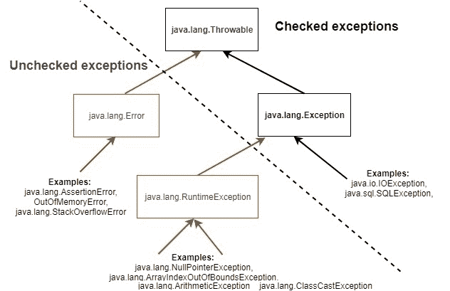

注意，Java 具有深层的异常类层次结构，这意味着在异常树中存在多个类、子类以及子类的子类。因此，仅仅一个异常是 `RuntimeException` 并不意味着该异常直接继承自 `RuntimeException`。它甚至可能是 `RuntimeException` 的孙类。例如，`ArrayIndexOutOfBoundsException` 实际上继承自 `IndexOutOfBoundsException`，后者继承自 `RuntimeException`。同样，仅仅一个异常是检查异常并不意味着它直接继承自 `Exception`。它可以继承 `Exception` 的任何子类（当然，`RuntimeException` 除外）。

回想我们关于异常情况的讨论，当时我提到了两种异常情况——开发者预料的异常，以及开发者完全没有料到会发生的异常。虽然开发者可能希望为已知会发生的情况提供备用执行路径，但对于完全未预料会发生的情况，提供备用执行路径是没有意义的。

例如，如果一段代码尝试写入文件，当开发者无法写入文件系统时，可能会采取不同的处理方法。但如果它尝试写入的数据数组为 `null`，那么他也无能为力。这种意料之外的情况通常是由于代码编写不当导致的。换句话说，如果代码陷入了意料之外的情况，最可能是因为编程错误，即代码中的缺陷（bug）。此类问题应该在开发过程中自行修复。但如果它们在生产环境中发生，应该在比组件级别更高的层次进行处理。

`unchecked`（未检）异常用于此类 `unexpected`（意料之外）的情况。Java 语言设计者认为，未检异常不需要在方法声明中声明，因为强制调用者捕获它们并无益处。只有 checked（受检）异常需要声明，因为方法的调用者可能有恢复它们的计划。未检异常有两种类型——继承 `java.lang.RuntimeException` 的异常（又称 `runtime exceptions`）以及继承 `java.lang.Error` 的异常（又称 `errors`）。

## 运行时异常与错误 [☝](http://enthuware.com/forum/dbt.php?bid=2&sn=15.2.1&tn=runtime-exceptions-and-errors)

将一种情况归类为意料之中或意料之外，是一个取决于方法业务目的的设计决策。一个方法可能期望接收一个 `null` 参数，并且在收到 `null` 参数时可以良好运行；而另一个方法可能不期望接收 `null` 参数，在尝试访问该 `null` 值时最终会抛出 `NullPointerException`。在第二种情况下，向该方法传递 `null` 被视为代码中的一个 bug，必须在测试期间识别并修复。此类表示代码中存在 bug 的异常被分类为 `runtime exceptions`（运行时异常）。

在这里，`RuntimeException` 中的 runtime（运行时）一词并不意味着只有继承 `RuntimeException` 的异常才能在运行时抛出。所有异常只在程序执行时（即运行时）被抛出。它指的是开发者只有在程序运行时（即运行期间）才会发现导致 `RuntimeException` 的情况发生。如果程序员在编译时就预料到该情况发生，他就会修复代码，在这种情况下，异常在运行程序时就不会抛出。出于相同的原因，运行时异常通常不会使用 `throw` 语句显式地抛出。事实上，如果你都不预料到那种情况发生，为什么要编写代码来抛出异常呢？当 JVM 遇到意料之外的情况时，会自动抛出运行时异常。例如，如果你尝试访问 `null` 引用，JVM 将抛出 `NullPointerException`；或者如果你尝试访问超出数组大小范围，JVM 将抛出 `ArrayIndexOutOfBoundsException`。从运行时异常中恢复是可能的，但从理想情况下，由于它们指示了代码中的 bug，你不应该尝试捕获它们并从中恢复。一个编写得良好的程序不应该导致 JVM 抛出运行时异常。

`errors`（错误）的情况与 `runtime exceptions` 类似。区别在于，错误保留给 JVM 本身的操作面临危险的情况。例如，编写不当的代码可能会消耗大量内存，导致没有剩余内存。一旦发生这种情况，JVM 可能会抛出 `OutOfMemoryError`。同样，糟糕的递归可能会导致 `StackOverflowError`，且无法从中恢复。错误标志着代码与 JVM 交互之间发生了严重问题，并且专门由 JVM 抛出。显式地抛出它们或尝试从中恢复永远不是一个好主意，因为一旦 JVM 开始抛出 `Errors`，代码很可能无法按预期工作。

尽管考试并不侧重于将异常分为受检和未检异常的原因，但对于专业开发者来说，理解这一主题实际上是一个非常重要的。你还应该将 Java 的异常处理机制与 C# 进行对比。

## 识别异常是受检还是未检 [☝](http://enthuware.com/forum/dbt.php?bid=2&sn=15.2.1&tn=identifying-exceptions-as-checked-or-unchecked)

Java 遵循异常类的命名惯例。这种惯例对于确定你正在处理的异常类型有时很有帮助。任何继承 `Error` 的类名都以 `Error` 结尾，任何继承 `Exception` 的类名都以 `Exception` 结尾。例如`OutOfMemoryError` 和 `StackOverflowError` 是 Errors，而 `IOException`、`SecurityException`、`IndexOutOfBoundsException` 是 Exceptions。

然而，无法仅通过名称来区分继承 `RuntimeException` 的未检异常和受检异常。因此，记住几个重要的运行时异常类名称是非常重要的，即——`NullPointerException`、`ArrayIndexOutOfBoundsException`、`ArithmeticException`、`ClassCastException` 和 `SecurityException`。

## 15.2.2 常用异常类 [☝](http://enthuware.com/forum/dbt.php?bid=2&sn=15.2.2&tn=commonly-used-exception-classes)

Java 标准库包含了大量的异常类，但考试要求你了解其中少数几个，我现在将涵盖这些内容。这些异常类非常重要，因为你在处理 Java 工作时会经常遇到它们。

你可能读到过根据异常是由程序员抛出还是由 JVM 抛出来进行分类。确实有少数异常是 JVM 自动抛出的。然而，没有任何异常是专门由 JVM 抛出的。事实上，Java 标准库的许多方法都使用 `throw` 语句显式地抛出相同的异常。

为了简洁起见，我省略了下面类的包名，但请注意以下异常类都属于 `java.lang` 包。


#### 通常由 JVM 抛出的常见异常 [☝](http://enthuware.com/forum/dbt.php?bid=2&sn=15.2.2&tn=common-exceptions-that-are-usually-thrown-by-the-jvm)

1. `ArithmeticException` 继承 `RuntimeException`

当你尝试除以零时，JVM 会抛出此异常。

示例：

```
public class X { 
  static int k = 0;
  public static void main(String[] args){
     k = 10/0; //ArithmeticException
     }
}
```

2. `ClassCastException` 继承 `RuntimeException`

当你尝试将引用变量转换为通过 IS-A 测试的类型时，JVM 会抛出此异常。我们在第 12 章已经过过了。

示例：

```
Object s = "asdf";

StringBuffer sb = (StringBuffer) s; //ClassCastException 因为 s 指向的是 String 而不是 StringBuffer。
```

3. `IndexOutOfBoundsException` 继承 `RuntimeException`

该异常是使用无效索引访问支持索引访问的值时抛出的异常的通用父类。

例如，当你尝试使用无效的索引值（例如负值或大于数组长度——当然，是减去 1 之后的值）访问数组时，JVM 会抛出其子类 `ArrayIndexOutOfBoundsException`。当你尝试访问无效索引处的字符时，`String` 类的方法会抛出另一个子类 `StringIndexOutOfBoundsException`。

示例：

```
int[] ia = new int[]{ 1, 2, 3}; // ia 的长度为 3。
System.out.println(ia[-1]); //ArrayIndexOutOfBoundsException
System.out.println(ia[3]); //ArrayIndexOutOfBoundsException

System.out.println("0123".charAt(4));//StringIndexOutOfBoundsException
```

### 4. `NullPointerException` 继承自 `RuntimeException`

当你尝试使用指向 null 的引用变量调用方法或访问字段时，JVM 会抛出此异常。

示例：

```java
String s = null;
System.out.println(s.length()); //NullPointerException，因为 s 是 null。
```

#### JVM 通常抛出的常见错误 [☝](http://enthuware.com/forum/dbt.php?bid=2&sn=15.2.2&tn=common-errors-usually-thrown-by-the-jvm)

1. `ExceptionInInitializerError` 继承自 `Error`

当初始化静态变量或静态块时抛出任何异常时，JVM 会抛出此 `Error`。

示例：

```java
public class X { 
   static int k = 0;
   static{
          k = 10/0; //抛出 ArithmeticException 但它被包装成 ExceptionInInitializationError
       }
}
```

2. `OutOfMemoryError` 继承自 `Error`

当内存耗尽时，JVM 会抛出此 `Error`。这通常发生在程序创建了过多的对象时。

示例：

```java
public static void main (String[] args) {
   StringBuilder sb = new StringBuilder("a long string");
   for(int i=0; i<Integer.MAX_VALUE; i++){
          sb.append(sb.toString());
   }
}
```

3. `StackOverflowError` 继承自 `Error`

当执行方法的线程栈空间耗尽时，JVM 会抛出此 `Error`。这通常发生在方法递归调用自己且没有边界条件停止递归时。

示例：

```java
public void m1(int k){
   m1(k++); //StackOverflowError
}
```

#### 应用程序程序员抛出的异常 [☝](http://enthuware.com/forum/dbt.php?bid=2&sn=15.2.2&tn=exceptions-thrown-by-application-programmer)

所有 `Exception` 及其子类的实例（`RuntimeException` 除外）通常由应用程序程序员使用 `throw` 语句抛出。在某些情况下，应用程序程序员也可能抛出 `RuntimeException`s。

1. `IllegalArgumentException` 继承自 `RuntimeException`

当方法接收到的被程序员确定为不合法的参数时，会抛出此异常。

示例：

```java
public void processData(byte[] data, int datatype)
{
   if(datatype != 1 && datatype != 2) 
            throw new IllegalArgumentException("Invalid datatype "+datatype);
       else System.out.println("Data Processed.");
}
```

2. `NumberFormatException` 继承自 `IllegalArgumentException`

当将 `String` 转换为数字的方法接收到一个无法转换的 `String` 时，会抛出此异常。

示例：

```java
int i = Integer.parseInt("asdf");//parseInt 方法将抛出一个 NumberFormatException
```

3. `SecurityException` 继承自 `RuntimeException`

如果 `Security Manager`（安全管理器）由于 JVM 设置的限制而拒绝允许请求的操作，则抛出此异常。例如，当 Java 程序运行在沙箱中（如 applet）并尝试使用如 `File I/O` 等被禁止的 API 时，安全管理器会抛出此异常。由于此异常是由安全管理器类使用 `new` 关键字显式抛出的，因此它可以被认为是由应用程序程序员抛出的。

4. `java.io.IOException` 继承自 `Exception`

此异常是所有执行任何类型 I/O 操作的类所抛出的异常的根类。例如，尝试打开文件的方法可能会抛出 `java.io.FileNotFoundException`，它是 `IOException` 的一个子类。虽然 I/O 不在第一部分考试范围内，但你可能会看到使用这些异常类的代码。

5. `NoClassDefFoundError` 继承自 `Error`

虽然是一个 Error，但它不是由 JVM 抛出的。它是由类加载器（这只是 Java 标准库中的另一个类）在无法找到其尝试加载的类的定义时抛出的。初学者在尝试运行程序时经常遇到这个错误。例如，如果你的类有包声明语句，但你没有将类文件放在其正确的目录结构中，那么系统类加载器在你尝试运行它时将无法找到该类并抛出此错误。

## 15.3 创建并调用抛出异常的方法

### 15.3.1 创建一个抛出异常的方法 [☝](http://enthuware.com/forum/dbt.php?bid=2&sn=15.3.1&tn=creating-a-method-that-throws-an-exception)

既然你已经了解了 `throws` 子句和异常类型，让我们来看看创建抛出异常的方法的规则。实际上，只有一个规则——如果方法可能抛出检查异常（checked exception），则该异常或其父类必须在 `throws` 子句中声明。

```java
void process(int x) throws Exception
{
    if(x == 2) throw new Exception();
}
```

无论代码是总是抛出异常还是有时抛出并不重要。如果执行路径中抛出异常，方法必须在 `throws` 子句中列出该异常。

```java
void process() { //不需要 throws 子句
    if(someCondition) throw new RuntimeException();
    else throw new Error();
}
```

`RuntimeException` 和 `Error` 是非异常（unchecked exceptions），因此不需要在 `throws` 子句中声明。尽管在 `throws` 子句中声明它们是有效的。

```java
void process() throws Exception
{
    if(someCondition) throw new IOException(); //有效的
}
```

在 `throws` 子句中声明父类异常并在方法中抛出子类异常是可以的。但反过来不可：

```java
void process() throws java.io.IOException
{ //无法编译
    if(someCondition) throw new Exception(); //抛出了父类异常
}
```

记住，`throws` 子句是对方法用户的一种承诺，承诺该方法可能只抛出 `throws` 子句中列出的异常。如果你承诺可能只抛出 `IOException`，但实际上抛出了 `Exception`，那么调用者将面临问题，因为调用者只准备好了处理 `IOException` 而不是 `Exception`。抛出 `Exception` 会破坏调用者的代码。

声明更泛的异常（即父类异常）并抛出更窄的异常（即子类异常）是可以的，因为调用者已经准备好处理更泛的异常，它们可以在不更改代码的情况下处理更窄的。例如，`IOException` 是 `Exception`，通过抛出 `IOException`，如果你承诺可能抛出 `Exception`，你并没有违反承诺。

```java
void process() throws java.io.IOException, java.sql.SQLException 
//也可以抛出共同的父类异常。
{  
    if(someCondition) throw new java.io.IOException();
    else throw new java.sql.SQLException();
}
```

如果一个方法抛出多个异常，你可以分别列出它们，也可以列出一个公共父类。这背后的逻辑与之前相同。只要该方法符合它在声明中所承诺的内容，就是好的！

```java
void process() throws Exception, java.io.IOException
{//指明 IOException 是多余的，因为 IOException 是 Exception 的子类
    if(someCondition) throw new java.io.IOException();
    else throw new java.sql.SQLException();
}
```

方法同时声明父类异常和子类异常是允许的，尽管在已存在父类异常的情况下向列表中添加子类异常是多余的。

```java
void process() throws Exception
{ //尽管方法体没有抛出该异常，但在 throws 子句中声明了 Exception
   System.out.println("hello");
}
```

方法可以在其 `throws` 子句中声明任何异常，无论该方法实际上是否真的抛出了该异常。如果你认为方法的实现以后可能会发生变化，那么在 `throws` 子句中声明 `Exception` 有时对于对方法进行“未来扩展”是有用的。通过在 `throws` 子句中声明 `Exception`，方法的用户在以后方法实际上开始抛出 `Exception` 或任何 `Exception` 的子类时，不需要更改他们的代码。

```java
void process1() {
    try{
       if(someCondition) throw new Exception(); //将被 catch 块捕获
       else return;
    }catch(Exception e){

    }
}
```

在 `throws` 子句中列出异常的要求仅适用于异常从方法抛出给调用者的情况。如果方法内部的代码抛出了异常，但该异常在方法内部被捕获，则不需要在方法的 `throws` 子句中声明它。

请记住，异常只能被 `catch` 块捕获，而不能被 `finally` 块捕获。因此，在以下方法中 `throws` 子句是必要的：

```java
void process2() throws Exception
{
    try{
       if(someCondition) throw new Exception(); 
       else return;
    }finally {
       System.out.println("in finally"); //会被执行，但异常在这里没有被捕获
    }
}
```

```java
void process() throws Throwable
{
    if(true) throw new Exception();
    else return;
}
```

如你所知，`Throwable` 是所有异常类的根，因此，如果你在 `throws` 子句中声明 `Throwable`，你就可以在方法中抛出任何异常。虽然这对考试并不重要，但决定抛出哪个异常以及声明哪个异常是一件大事。

### 声明异常 [☝](http://enthuware.com/forum/dbt.php?bid=2&sn=15.3.1&tn=declaring-exceptions)

如上述第 8 点所示，在 `throws` 子句中声明一个宽泛的异常类是消除方法编译错误的一种简单方法，如果该方法从代码的不同部分抛出不同类型的异常。然而，这被认为是一种坏做法，因为这增加了方法用户处理宽范围异常的负担。

另一方面，逐个列出特定的异常类会限制方法未来的可修改性，因为以后抛出新异常将破坏他人的代码。

建议在处理 `throws` 子句中的异常列出时采取平衡的方法。你应该尝试尽可能尽可能具体，同时又不损害方法的修修改性。例如，I/O 相关的方法在读取文件时可能会遇到不同的问题。在编写方法时，可能无法识别所有此类问题。以后可能会发现新问题，你可能需要修改方法来适应这些问题。因此，在 `throws` 子句中声明一个公共父类 `IOException` 比列出各个子类（如 `FileNotFoundException` 或 `EOFException`）更好。

### 抛出异常 [☝](http://enthuware.com/forum/dbt.php?bid=2&sn=15.3.1&tn=throwing-exceptions)

你应该抛出尽可能具体的异常。例如，如果你在尝试打开文件时没有找到，你应该抛出 `FileNotFoundException` 而不是 `IOException` 或 `Exception`。通过抛出最具体的异常，你向调用者提供了更多关于问题的信息。这有助于调用者确定问题最合适的解决方案。

### 15.3.2 从初始化器和构造函数抛出异常 [☝](http://enthuware.com/forum/dbt.php?bid=2&sn=15.3.2&tn=throwing-exceptions-from-initializers-and-constructors)

#### 从静态初始化器抛出异常 [☝](http://enthuware.com/forum/dbt.php?bid=2&sn=15.3.2&tn=throwing-exceptions-from-static-initializers)

JVM 在加载类时会自动执行静态初始化器。虽然 JVM 是由于应用程序代码的某些操作（如创建类的对象或调用该类的静态方法）而加载类，但应用程序并没有直接调用静态初始化器。因此，如果静态初始化器最终抛出了异常，应用程序没有方法处理该异常并从中恢复。出于这个原因，静态初始化器不允许抛出任何检查异常（checked exception）。如果编译器看到静态初始化器有抛出检查异常的可能性，它将生成错误。例如，以下代码将无法编译：

```java
public class TestClass{
  static int i = 5;
  static{
    if(i == 0) throw new Exception();
  }
}
```

生成的错误信息显示：“未报告异常 java.lang.Exception；必须捕获或声明”，这有点误导性，因为没有地方可以声明异常！

#### 从实例初始化器抛出异常 [☝](http://enthuware.com/forum/dbt.php?bid=2&sn=15.3.2&tn=throwing-exceptions-from-initializers)


当应用程序代码创建类的实例时，总是执行实例初始化器。因此，应用程序代码可以捕获实例初始化器抛出的异常，由于同样的原因，实例初始化器允许抛出检查异常。然而，实例初始化器面临与初始化器相同的问题——没有办法为实例初始化器指定 `throws` 子句。记住，无论调用类的哪个构造函数，实例初始化器都会执行。从这个意义上说，实例初始化是每个构造函数的一部分。因此，从实例初始化器抛出的异常可以被认为是每个构造函数抛出的异常。如果在每个构造函数的 `throws` 子句中声明从实例初始化器抛出的异常，我们应该是好的。这正是 Java 强制要求的。这是一个例子：

```java
public class TestClass{
  int i = 5;

  {
    if(i == 0) throw new Exception();
  }

  TestClass() throws Exception{
  }

  TestClass(int x) throws Exception{ 
  }
}
```

在上述代码中，由于 `TestClass` 的实例初始化器抛出了 `Exception`，它的两个构造函数都必须在 `throws` 子句中声明 `Exception`。现在，你能猜到以下代码是否可以编译吗？

```java
public class TestClass{
   int i = 5;

   {
      if(i == 0) throw new Exception();
   }

}
```

注意 `TestClass` 没有显式定义任何构造函数。因此，编译器将为该类提供默认的无参数构造函数。然而，默认构造函数没有 `throws` 子句。因此，实例初始化器抛出的异常没有被该构造函数声明。因此，上述代码将无法编译。

## 从构造函数中抛出异常 [☝](http://enthuware.com/forum/dbt.php?bid=2&sn=15.3.2&tn=throwing-exceptions-from-constructors)

就像方法一样，构造函数在 `throws` 子句中声明了该异常，就可以抛出任何异常。然而，方法和构造函数之间有一个重要的区别。请记住，每个构造函数的第一行总是调用其父类的构造函数或同类中的另一个构造函数。因此，如果一个构造函数决定抛出异常，它会对子类产生影响，因为该异常也会传播到子类构造函数。因此，如果子类构造函数调用了抛出异常的父类构造函数，该子类构造函数也必须在它的 `throws` 子句中声明该异常。这是一个示例：

```java
class Fruit{
   Fruit() throws Exception{
     if(Math.random()>0.5) throws Exception; //随机抛出异常
   }

  Fruit(int calories){
  }

}
```

上面的 `Fruit` 类有两个构造函数——一个带有 `throws` 子句，另一个没有。现在让我们来看看 `Fruit` 的子类：

```java
class Apple extends Fruit{ //将无法编译。
}
```

注意，由于 `Apple` 没有显式定义任何构造函数，编译器将为该类提供默认的无参构造函数。此外，编译器会在默认构造中插入对 `super();` 的调用。这个默认构造函数会导致 `Apple` 类编译失败，因为它既没有 `throws` 子句，也没有包裹 `try/catch` 块来捕获调用 `super()` 抛出的异常（`super()` 只是调用了 `Fruit` 的无参构造函数）。为了使其通过编译，你必须自己提供带有适当 `throws` 子句的无参构造函数：

```java
class Apple extends Fruit{ 
  Apple() throws Exception{
  }

  Apple(int calories) { //不需要 throws 子句
    super(calories); 
  }
}
```

观察到 `Apple` 的 `int` 构造函数不需要任何 `throws` 子句，因为它调用了 `Fruit` 的 `int` 构造函数，而后者没有抛出任何异常。你也可以通过 `this(100);` 将 `Apple` 的无参构造函数更改为调用 `Apple` 的 `int` 构造函数，以避免使用 `throws` 子句：

```java
class Apple extends Fruit{ 
  Apple() {
    this(100);
  }

  Apple(int calories) { //不需要 throws 子句
    super(calories); 
  }
}
```

子类构造函数可以抛出任何新异常以及父类构造函数 `throws` 子句中列出的异常。

注意，子类构造函数是不可能捕捉父类构造函数抛出的异常的，因为你必须将对 `super(...)` 的调用放在 `try` 块中，在这种情况下 `super(...)` 的调用将不再构造函数的第一行！

### 15.3.3 调用抛出异常的方法 [☝](http://enthuware.com/forum/dbt.php?bid=2&sn=15.3.3&tn=invoking-a-method-that-throws-an-exception)

调用抛出异常方法的规则与创建抛出异常方法的规则相似。对于编译器而言，使用 `throw` 语句抛出异常与调用一个抛出异常的方法来抛出异常之间没有区别。在这两种情况下，编译器都强迫你要么在 `throws` 子句中声明异常，要么使用 `try/catch` 块处理异常。当然，如之前讨论的那样，编译器只关心**检查异常（checked exceptions）**。以下示例说明了这一点：

```java
public class TestClass{
  public static void message() throws Exception{
     if(true) throw new Exception();
     else return;
  }
  public static void main(String[] args) throws Exception {
      message();
  }
}
```

在上面的代码中，`message()` 方法使用 `throw` 语句抛出了 `Exception`。由于 `Exception` 是检查异常，编译器强制要求在 `throws` 子句中声明它。另一方面，`main` 没有使用 `throw` 语句显式抛出异常，而是调用了 `message`。但编译器知道调用 `message` 可能会导致 `Exception`（因为它在 `message` 的 `throws` 子句中被提到），因此编译器也强迫 `main` 在它的 `throws` 子句中声明 `Exception`。`main` 的另一个选项是自己处理异常：

```java
 public static void main(String[] args) { //不需要 throws 子句
      try{
         message();
      }catch(Exception e){
         e.printStackTrace();
      }
  }
```

使用范围更广异常类的 `catch` 块来捕捉更窄的异常是可以的。例如，如果你正在调用一个在 `throws` 子句中声明了 `Exception` 方法，你可以使用 `catch(Throwable e)` 来处理该异常：

```java
 public static void message() throws Exception{
    //某些抛出异常的代码
  }

  public static void main(String[] args) {
      try{
         message();
      }catch(Throwable e)
{
         e.printStackTrace();
      }
  }
```

反之，即使用范围更窄的异常 `catch` 块来捕捉更宽的异常是不可接受的。因此，以下代码无法编译：

```java
 public static void main(String[] args) {
      try{
         message();
      }catch(java.io.IOException e) //catch 子句太窄，无法捕捉 Exception
         e.printStackTrace();
      }
```

你可以将 `catch` 子句想象成特定大小的容器。可以使用较大的容器来捕捉较小的异常，但不能使用较小的容器来捕捉较大的异常。注意，这里使用的“更大”是指该异常比“较小”的异常拥有更多的子类。例如，`Throwable` 比 `Exception` 拥有更多子类，因为 `Throwable` 包含了 `Exception`。同样，`Exception` 比 `IOException` 拥有更多子类。

如果一个方法想要抛出异常，它必须在它的 `throws` 子句中声明该异常（或其父类）。这与之前看到的创建抛出异常方法的规则不同。例如，假设方法 `message` 抛出 `Exception`，这里是调用 `message` 方法的有效 `throws` 子句：

```java
 //声明相同的异常类
  public static void callMessage() throws Exception {
         message();
  }

  //声明 message 抛出的异常类的父类
  public static void callMessage() throws Throwable {
         message();
  }
```

当然，`callMessage` 不限于抛出 `message` `throws` 子句中声明的异常。无论方法内部的代码是否抛出了这些异常，它都可以向 `throws` 子句中添加自己的异常类。

#### 捕捉异常或让其传播 [☝](http://enthuware.com/forum/dbt.php?bid=2&sn=15.3.3&tn=to-catch-or-to-throw)

捕捉异常或让其传播给调用者取决于你是否解决了抛出的异常。考虑以下计算简单利的方法代码：

```java
public static double computeInterest(double p, double r, int t) throws Exception{
   if(t<0) throw new Exception("t must be > 0");
   else return p*r*t;
}
```

以及使用上述代码：

```java
public static void main(String[] args){
   double interest = 0.0;
   try{
      computeInterest(100, 0.1, -1);
  }catch(Exception e){
  }
  System.out.println(interest);
} 
```

执行后，`main` 方法打印的利息为 0.0，尽管 `computeInterest` 方法实际上并没有计算任何利息。它抛出了异常，因为 `t` 小于 0。然而，作为程序的用户，你并不知道在计算利息的过程中实际上发生了失败。

虽然 `computeInterest` 方法通过抛出异常完成了告知 `main` 方法计算过程中出现问题的任务，但 `main` 方法通过使用一个空的 `catch` 块静静地将这个问题掩盖在了盖下。这被称为“吞除异常”（swallowing the exception），是一种糟糕的做法。

`catch` 块的目的是解决问题，而不是掩盖问题。通过掩盖问题，程序会继续运行，但开始产生不符合逻辑的结果。理想情况下，`main` 不应该捕获该异常，而应该在它的 `throws` 子句中声明该异常，因为它没有能力解决这个问题。对于带有 GUI 的程序，捕获异常并要求用户输入有效的参数是合适的。

有时，即使在当时无法提供解决方案，捕获异常也是有必要的。在这种情况下，正确的方法是将异常记录到控制台中，以便程序以后通过检查日志来轻松调试程序。

```java
public static void main(String[] args){
   double interest = 0.0;
   try{
      computeInterest(100, 0.1, -1);
  }catch(Exception e){
     e.printStackTrace();
     //or System.out.println(e);
  }
  System.out.println(interest);
} 
```

### 15.3.4 使用多个 catch 块 [☝](http://enthuware.com/forum/dbt.php?bid=2&sn=15.3.4&tn=using-multiple-catch-blocks)

Java 标准库拥有大量的异常类。除此，Java 还允许你创建自己的异常类。拥有如此多的异常类而不是少数通用异常类的目的，是为了尽可能地捕获异常情况的细节。这些细节有助于方法的调用者解决问题。例如，当未找到文件时，与其抛出一个通用的 `IOException`，你应该抛出一个更具体的 `FileNotFoundException`，因为它向调用者更准确地描述了问题。如果一个方法预期遇到不同的问题，它应该为每种问题抛出不同的异常。调用者可以使用多个 `catch` 块来捕获这些异常，并根据方法抛出的是种异常采取行动。方法如下——

```java
import java.io.*;
public class TestClass{

   //假设 CharConversionException, FileNotFoundException, 和 EOFException 继承自 IOException

   void process(int x) throws IOException{
      if(x == 0) throw new CharConversionException();
      else if(x == 1) throw new FileNotFoundException();
      else throw new EOFException();
   }

   public static void main(String[] args){
      TestClass tc = new TestClass();
      try{
         tc.process(2);
      }catch(EOFException eofe){
         System.out.println("End of file reached");
      }
      catch(CharConversionException cce){
         System.out.println("Some problem with file system");
      }
      catch(FileNotFoundException fnfe){
         System.out.println("No such file found");
      }
      catch(IOException ioe){
         System.out.println("Unknown I/O Exception");
      }
   }
}
```

在上面的代码中，如果调用 `process` 抛出异常，控制将逐个检查每个 `catch` 子句，看它是否能够捕获该异常。控制将进入第一个能够处理该异常的 `catch` 块。例如，如果调用 `process` 抛出 `FileNotFoundException`，第一个能够此异常的 `catch` 块是第三个，即 `catch(FileNotFoundException fnfe)` 块。最后一个 `catch` 子句，即 `catch(IOException ioe)` 也能处理 `FileNotFoundException`，但控制不会理会它，因为它在到达 `catch(IOException )` 子句之前已经找到了一个匹配的 `catch` 块。

#### 不可达的 catch 块 [☝](http://enthuware.com/forum/dbt.php?bid=2&sn=15.3.4&tn=unreachable-catch-blocks)

上面的程序产生了一个有趣的问题。如果你将 `catch(IOException ioe)` 块移动到 `catch(FileNotFoundException fnfe)` 块之前会怎样？代码将无法编译。`catch(IOException ioe)` 子句将始终满足 `FileNotFoundException`，因此控制永远无法进入 `catch(FileNotFoundException fnfe)` 块。因此，编译器将认为 `catch(FileNotFoundException fnfe)` 块是不可达的。这就像在一个小篮子上面放在大篮子。由于上方有一个大篮子，小篮子永远无法捕捉任何东西！

如果你将上述程序中 `process` 的 `throws` 子句从 `throws IOException` 改为 `throws CharConversionException, FileNotFoundException, EOFException`，也会发生类似的问题。在这种情况下，编译器将意识到 `process` 无法抛出 `IOException`（因为它不再列在 `process` 的 `throws` 子句中），它实际上可以抛出的三个异常都已经被三个 `catch` 块捕获了，因此 `catch(IOException ioe)` 块永远不会被执行。理想情况下，编译器应该拒绝编译代码，但 Java 语言规范（JLS）允许这样做，并仅要求编译器生成警告。


还有一点，如果你将`main`方法中的`catch(IOException ioe)`改为`catch(Exception e)`会怎样？你知道`process`没有抛出`Exception`。那么你认为编译器会做什么？实际上，编译器对此没有问题。记住`Exception`的子类之一是`RuntimeException`，它是运行时异常。任何方法都可以自由抛出`RuntimeException`而无需在`throws`子句中声明它。因此，编译器需要考虑`process`可能抛出`RuntimeException`，如果发生这种情况，`catch(Exception e)`块将被执行。因此编译器只能接受这段代码。

## 嵌套的 try 语句 [☝](http://enthuware.com/forum/dbt.php?bid=2&sn=15.3.4&tn=nested-try-statements)

可以将`try`语句嵌套在其他的`try`、`catch`或`finally`块中。此类`try`语句的规则与普通`try`语句完全相同。但记住，与嵌套`try`语句相关的`catch`块无法捕获外部`try`块抛出的异常。例如：

```java
void process() throws EOFException {
   try{
      if(true) throw new FileNotFoundException();
      else throw new EOFException();
   }catch(FileNotFoundException fnfe){
       try{
          throw new EOFException();
       }catch(EOFException eofe){
          eofe.printStackTrace();
       }
   }
}
```

在上面的代码中，`catch(EOFException eofe)`块与`catch(FileNotFoundException fnfe)`块内部的`try`语句相关。因此，它无法捕获外部`try`块抛出的`EOFException`。事实上，如果外部`try`块抛出`EOFException`，控制甚至不会进入`catch(FileNotFoundException )`块，因为`catch(FileNotFoundException fnfe)`子句不能满足`EOFException`。因此，外部`try`块抛出的`EOFException`将保持未处理，这意味着它必须在方法的`throws`子句中声明。

## 在 catch 或 finally 中抛出异常 [☝](http://enthuware.com/forum/dbt.php?bid=2&sn=15.3.4&tn=throwing-an-exception-from-catch-or-finally)

可以在`catch`块中重新抛出异常（或抛出一个新异常）。如果你想在异常传递到调用链上之前对其进行某些处理，你可能会这样做。当然，如果是受检异常，你需要在方法的`throws`子句中声明它。这里有一个示例：

```java
void doIt() throws EOFException {
   try{
      process();
   }catch(EOFException eofe){
      //在此处做一些，然后再次抛出相同的异常。
        throw eofe;
   }
}
```

可以使用`finally`块实现相同的效果：

```java
void doIt() throws EOFException {
   try{
      process();
   }finally{
      //在此处做一些
   }
}
```

由于没有`catch`块来捕获`process`抛出的`EOFException`，该异常将自动抛出`doIt()`方法并传递给调用者，但前提是在`finally`块中的代码执行之后。

从`catch`块中显式地重新抛出异常仅在你有多个`catch`块并且想在每个`catch`块中执行不同操作时才有用。

在`catch`和`finally`块中抛出一个完全全新的异常也是可能的。这是一个示例：

```java
void doIt() throws Exception {
   try{
      process();
   }catch(EOFException eofe){
      throw new Exception();
   }
}
```

`doIt`抛出的`EOFException`将被`catch(EOFException eofe)`块捕获。由于`catch`块抛出了`Exception`，`doIt`将向其调用者抛出`Exception`。因此，`doIt`必须在它的`throws`句中列出`Exception`。

如果你从`finally`块抛出异常，则从`try`块或`catch`块抛出的异常将被忽略，而从`finally`块抛出的异常将是输出方法的异常。下面的示例说明了这一点：

```java
void doIt() throws IOException {
   try{
      process();
   }catch(EOFException eofe){
      throw new Exception();
   }
   finally{
      throw new IOException();
   }
}
```

即使`catch`块抛出了`Exception`，JVM也会不会立即将其抛给`doIt`的调用者。它会等待`finally`块执行完毕。然而，`finally`块抛出了一个新的`IOException`。因此，JVM忽略了正准备抛给调用者的`Exception`，转而抛出`IOException`。对于编译器来说，它意识到由于`finally`块中的代码，`doIt`只能向调用者抛出`IOException`而不是`Exception`，因此在`doIt`的`throws`句中仅列出`IOException`是可以的。

## 15.3.5 使用多异常捕获 [☝](http://enthuware.com/forum/dbt.php?bid=2&sn=15.3.5&tn=using-multi-catch)

正如你在上一节看到的，`try`块拥有多个`catch`块在你需要在接收不同类型异常时执行不同操作时是有用的。但如果`try`块中的代码抛出了不同类型的异常，而你想对这些每种异常执行相同的操作（例如，记录异常消息）呢？实际上这很容易。你只需要放置一个包含所有这些异常中最具体的父类的`catch`子句即可。例如，如果代码抛出了`FileNotFoundException`、`ArrayIndexOutOfBoundsException`、`NullPointerException`和`IllegalArgumentException`，并且你想以相同的方式处理所有这些异常，你可以拥有以下`catch`块：

```java
try{
  // 代码可能抛出 FileNotFoundException, ArrayIndexOutOfBoundsException, NullPointerException 和 IllegalArgumentException 中的任意一个
}
catch(Exception e) { //捕获一个公共父类异常
   System.out.println(e.getMessage()); //所有异常都在这里被记录
} 
```

让我们让它变得更有趣一点。如果你只想记录`FileNotFoundException`和`ArrayIndexOutOfBoundsException`并重新抛出所有其他`RuntimeException`呢？这并不简单，因为如果你放置一个使用`FileNotFoundException`和`ArrayIndexOutOfBoundsException`父类（顺便说一下，是`Exception`）的`catch`子句，它将捕获四个异常类，因为`Exception`是它们所有类的父类。如果你放置一个使用`NullPointerException`和`IllegalArgumentException`父类（顺便说一下，是`RuntimeException`）的`catch`子句，它也会捕获`ArrayIndexOutOfBoundsException`。因此，你至少需要三个`catch`块。

Java在Java 7中引入`multi-catch`块的形式了解决此问题的新方法。看以下代码：

```java
try{
  // 代码可能抛出 FileNotFoundException, ArrayIndexOutOfBoundsException, NullPointerException 和 IllegalArgumentException 中的任意一个
  if(true) throw new FileNotFoundException();//一种模拟 FNFE 可能性的简单方法
}
catch(FileNotFoundException | ArrayIndexOutOfBoundsException e) { //在此处仅捕获 FileNotFoundException 和 ArrayIndexOutOfBoundsException
   System.out.println(e.getMessage()); //只有上述两个异常会在这里记录
}
catch(RuntimeException re) { //在此处捕获所有其他 RuntimeException
   throw re;
} 
```

`catch(FileNotFoundException | ArrayIndexOutOfBoundsException e)`子句被称为多异常捕获子句，因为它允许你在同一个`catch`子句中捕获多个异常。虽然这个功能在现实生活中并不经常使用，但你可能会在考试中看到关于它的一个一两个问题。所以，让我们检查一下该子句的规则。实际上只有两个：

1. 任意数量的类都可以列在多异常捕获子句中，但它们之间不能具有继承关系。例如，你不能拥有`catch(NullPointerException|Exception e)`，因为`Exception`是`NullPointerException`的祖类（实际上是祖父类）。因为如果`catch`子句可以捕获`Exception`，它也会捕获它的子类。因此，在该子句中添加`NullPointerException`或任何`Exception`的子类都是多余的。注意，多异常捕获中异常类的顺序并不重要。

2. 获变量的声明类型与多异常捕获中列出的异常中最具体的父类相同。例如，`catch(NullPointerException | IllegalArgumentException e)`中变量`e`的类型是`RuntimeException`。当然，在运行时，如果抛出了异常，`e`将指向被抛出的异常对象。

尽管考试不需要文件操作细节，但你应该知道这些操作会抛出`java.io.IOException`。你还需要了解一些与IO相关的异常。记住`FileNotFoundException`继承`IOException`，而`IOException`继承`Exception`。这意味着你不能拥有像`catch(FileNotFoundException | IOException)`这样的多异常捕获块，因为不允许捕获具有父子关系的类。如果你想捕获此类异常，必须在不具体的异常之前使用更具体的异常（在本例中为`FileNotFoundException`）。

## 15.4 练习 [☝](http://enthuware.com/forum/dbt.php?bid=2&sn=15.4.0&tn=exercise)

1. 创建一个`countVowels`方法，接收字符数组作为输入并返回数组中元音的数量。此外，如果数组包含字母'x'，该方法应抛出一个检查异常。

2. 在`main`方法中循环调用`countVowels`方法并为每个命令行参数打印其返回值。观察在以下情况下发生什么：没有命令行参数、有多个参数、有多个参数但第一个参数包含'x'。（使用`String`的`toCharArray`方法从字符串获取字符数组。）

3. 确保即使某个参数包含'x'，你的`main`方法也会打印其他命令行参数的元音数量。

4. 将`null`传递给`countVowels`方法并观察输出。

5. 修改`countVowels`方法，如果传递`null`则抛出`IllegalArgumentException`。

6. 修改`countVowels`方法，如果输入数组为`null`则返回`-1`，如果输入数组长度小于10则返回`0`。不要使用`if`语句。

7. 创建一个方法`int sum(int[] values, int start, int end)`，当传入长度为0的数组时，抛出`IllegalArgumentException`；当传入`null`时抛出`NullPointerException`；当`start`和`end`不在给定数组范围内时抛出`ArrayIndexOutOfBoundsException`。它应该返回数组从`start`到`end`的值的和，但当和为0时必须抛出`Exception`。

8. 从`main`调用上面创建的`sum`方法。将调用封装在适当的try/catch语句中。根据调用结果导致的是受检查异常还是未检查异常，在控制台上打印两条不同的消息。将所有异常向上传递给调用链。

# 第 16 章：理解模块

- 描述模块化项目如何编译和运行

- 声明模块并启用模块间的访问

- 描述模块化 JDK

## 16.1 模块基础

### 16.1.1 什么是模块？[☝](http://enthuware.com/forum/dbt.php?bid=2&sn=16.1.1&tn=what-are-modules)

在《入门 Kickstarter》章节中，你学习了如何将应用程序的单个类打包到jar文件中，以及如何使用该jar文件运行应用程序。jar文件方法是将多个文件打包成单个文件，并向用户交付应用程序以及类库的一种很好的方法。

然而，Jar文件并不是没有问题的。在没有周全计划的情况下将类打包到jar文件中，会导致应用程序臃肿，难以更新和/或复用。Jar文件还使得在没有整组jar文件的情况下，难以使用应用程序的一部分。如果你是Java初学者，或者没有参与过很多专业级别的Java开发，你可能很难相信jar文件方法还导致Java社区陷入了所谓的“Jar地狱（Jar Hell）”。“Jar地狱”是一个术语，用来描述由于类路径上存在多个版本的类库，和/或由于应用程序的不同部分使用了不同版本的库，导致应用程序出现难以调试的的行为。例如，如果一个应用程序使用了Spring和Hibernate，而这些库需要不同版本的同一个jdbc驱动程序或日志库怎么办？

尽管JDK没有为这些问题提供任何开箱即用的解决方案，但各种Java社区项目（如Ant、Maven和Gradle）已尝试提供管理这些问题的方法。

随着Java 9，Java语言设计者提出了一种名为Java模块系统（Java Module System，也称为Project Jigsaw）的新方法来打包Java类，试图解决上述至少部分问题。它设想Java应用程序（或库）不再由类或jar文件组成，而是由模块组成，应用程序的每个模块都明确指定了它依赖于哪些模块以及它向其他模块提供了哪些功能。而模块又是由类组成的。因此，模块是应用程序中比类粒度粗得多的组件。换句话说，类被打包在jar文件中形成模块，而模块在运行时混合组合形成一个应用程序。下面的图说明了类和模块如何组合成一个应用程序。

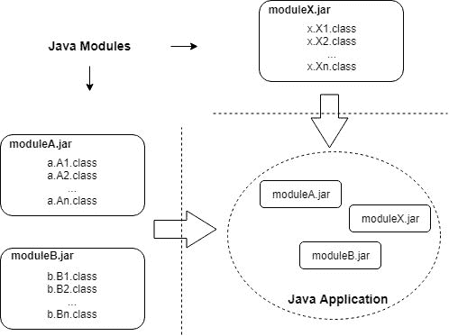

上面的图显示了三个名为`moduleA.jar`、`moduleB.jar`和`moduleX.jar`的jar文件。这些模块jar文件被一起用于创建一个应用程序。注意，应用程序只是模块的松耦合集合，它本身并不被打包成jar文件。你很快就会发现，应用程序是在运行时通过命令行指定来自不同团队、小组或公司的所需模块来创建的。

这并不是说专业的应用程序团队之前没有将应用程序的独立部分分组到单独的jar文件。事实上，即使在模块出现之前，Java应用程序也是由来自各个团队的jar组成的。但类的分组过程，以及更重要的是记录jar文件需要和提供的内容，在不同团队之间、不同构建工具之间各异。Java 9汲取了行业盛行的最佳实践，并将其正式化为模块系统。

除了正式地为应用程序指定结构化设计外，Java 9还包含了新工具并增强了现有工具，以帮助开发者将他们的代码打包成模块。

### 包 vs 模块 [☝](http://enthuware.com/forum/dbt.php?bid=2&sn=16.1.1&tn=package-vs-module)

你现在可能在想包在这幅图中处于什么位置。毕竟，从久以来我们一直在使用包来组织Java代码。嗯，包仍然发挥着相同的作用。它们仍然被用于组织我们的代码，但在更细的粒度上。


从概念上说，包创建了一个命名空间，实现特定功能所需的所有代码都位于其中。它通过将逻辑分离到多个密切相关的类中，来减少类文件中包含代码的大小。这有助于阅读、理解和导航代码。但这是从功能开发者的角度来看的，而不是从功能使用者的角度来看。该功能的用户并不关心代码是如何组织的。他们感兴趣的是使用该功能需要什么。用户只想把该功能当作一个黑盒来使用。遗憾的是，包并没有提供这些信息。开发者们一直依赖于非正式的方法，例如根据自己的约定命名 jar 文件，并添加发布日志来交付这些信息。

这就是模块大显用场。模块提供了一种在单一构件中交付功能的方法，其中不仅包含代码，还包含了代码提供的服务信息以及它可能具有任何依赖关系。

因此，如果你是某个功能的开发者，你仍然会将你的代码组织成包。但随后你还将用于实现此功能的所有类（以及任何其他资源，如图像文件、xml 文件或属性文件）打包成单一交付物，并以预定义格式的模块形式提供对你的功能及其依赖的描述。换句话说，模块不是包的替代品，而是构建在包之上的。

Java 模块系统是一个相当大的话题，有专门的书来涵盖它。然而，OCP Java SE 11 Part 1 考试仅关注模块系统的基础知识。

# 声明模块

由于从用户的角度来看，模块是功能的逻辑单元，因此最好首先识别我们想要作为模块交付的功能。例如，假设我们正在为金融开发一个应用程序，其功能之一是计算单利。我们希望将这个单利计算器作为一个模块来交付。

## 模块的命名

模块名称遵循与你之前看到的命名包和类时相同的规则和约定。因此，一个有效的包名将是一个有效的模块名。简而言之，该名称必须是一个有效的 Java 标识符（因此，连字符和斜杠等特殊字符是不允许的，但下划线和点允许），并且它应该遵循反域名模式以避免名称冲突。理想情况下，名称应该具有足够的描述性，告诉用户模块的用途和/或功能，而不是像 `tools` 或 `utils` 那样过于通用。因此，`com.abc.finance.calculators.simpleinterest` 是我们模块的一个很好的名称。然而，为了本章的目的，我将模块命名为简单的 `simpleinterest`，以减少杂乱并方便尝试我在这里展示的代码。出于相同的原因，我们决定类的完全限定类名（FQCN）将是 `simpleinterest.SimpleInterestCalculator`，而不是 `com.abc.finance.calculators.simpleinterest.SimpleInterestCalculator`。注意，模块名称与该模块包含的类的包名之间没有关系。但是，由于两者都遵循反域名命名约定，它们很有可能是相同的。

考试要求你能够识别有效和无效的模块名称。如上所述，命名模块的规则与命名包的规则相同。因此，例如，以下是有效的模块名称：`a`（长度并不重要）、`_m`（可以以 `_` 开头并包含 `_`）、`n$`（可以以 `$` 开头并包含 `$`）、`x1`（可以包含数字）和 `a.b`（可以包含点），但以下是无效的：`1x`（不能以数字开头）、`a-b`（不能包含连字符）以及 `a..b`（不能包含连续的点）。

# 模块描述符

记得我提到过缺乏任何正式方式来描述包吗？这就是模块与包的区别。模块描述符是描述模块的正式方式。每个模块都必须有一个模块描述符，用于指定模块的名称、它提供了什么以及它需要什么。模块描述符无非名为 `module-info.java` 的文件。是的，文件的扩展名是 `java`。它是一个 Java 文件，将被编译以生成名为 `module-info.class` 的类文件。当我们谈论模块时，我们通常指的是这个描述符。事实上，模块本身是一个黑盒，用户只需要关心模块描述符即可。在我们的案例中，模块描述符的内容如下：

```
 //in file module-info.java
module simpleinterest{
}
```

这个模块描述符里没有多少内容。它只是说这是一个名为 `simpleinterest` 的模块。但它仍然是一个有效的模块描述符，并说明了定义模块的基本语法。你有 `module` 关键字和模块名称，后面跟着大括号。随着学习的进行，我们将在此描述符中添加更多信息。然而，到目前为止，这是一个很好的开始！

`module-info.java` 文件不能为空。

## 模块的目录结构

模块源代码和编译类的目录结构与包的结构几乎完全相同。区别在于，虽然包可能位于任何文件夹中，但模块位于一个与模块同名的文件夹中。此规则适用于源代码和类文件。如果模块目录包含源代码，则被称为“源模块定义”；如果模块目录包含编译后的类，则被称为“模块定义”。

因此，在我们的示例中，我们模块的源代码和编译类必须位于名为 `simpleinterest` 的文件夹中。接下来的图片说明了我将用于开发和执行我们模块代码的目录结构：

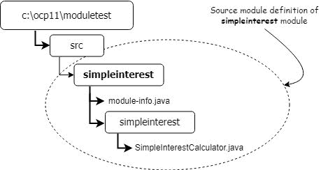

我的基础目录是 `c:\ocp11\moduletest`。这是我将在此开发和运行本章介绍的所有代码的目录。如果你使用 unix，可能想在 `/home/<username>` 下创建一个 `moduletest` 目录。（如果你使用 unix，记得将目录路径中的 `\` 切换为 `/`。）

在基础目录下，我有一个 `src` 目录，我将把其中存放所有模块的源代码。由于这个特定模块命名为 `simpleinterest`，我在 `src` 下有一个同名的目录。因此，以 `simpleinterest` 为根的目录树就是 `simpleinterest` 模块的源模块定义。此外，由于我们的 `SimpleInterestCalculator` 类属于 `simpleinterest` 包，我将 `SimpleInterestCalculator.java` 保留在 `simpleinterest\simpleinterest` 下。

注意，没有必要按照包结构来组织 Java 源文件。你也可以将所有的 Java 源文件直接放在模块根文件夹下。然而，按照包组织源代码有几个优点。除了让源代码易于之外，Java 编译器也能良好理解。编译器可以自动定位并编译源模块定义中存在的代码。

`SimpleInterestCalculator.java` 的内容如下：

```
package simpleinterest;
public class SimpleInterestCalculator{
   public double calculate(double principle, double rate, double time){
      return principle*rate*time;
   }
   public static void main(String[] args){
     System.out.println(new SimpleInterestCalculator().calculate(100, .05, 2));
   }
}
```

# 描述模块化项目如何编译和运行

## 编译模块

现在我们模块的目录结构和代码库已经准备就绪，让我们编译它。打开命令行/终端提示符，进入 `c:\ocp11\moduletest` 目录并运行以下命令：

```
c:\ocp11\moduletest>javac -d out --module-source-path src --module simpleinterest
```

上述命令使用了三个命令行开关：`-d`、`--module-source-path` 和 `--module`。

你以前用过 `-d` 开关将 Java 编译器的输出指向特定目录。在这里原理是一样的。因此，`-d out` 将导致编译器在 `out` 目录中产生输出。如果 `out` 目录不存在，编译器将创建它。

`--module-source-path` 开关告诉编译器源模块定义的位置。由于我们将源代码保存在 `src` 目录下的目录中，因此我们在这里也指定了它。注意此开关中的双横杠。

由于模块名称是 `simpleinterest`，编译器将在 `out` 下创建一个 `simpleinterest` 目录。`out\simpleinterest` 目录是 `simpleinterest` 模块的“根目录”，而位于 `simpleinterest` 下的树就是 `simpleinterest` 模块的“模块定义”。

编译器将根据该模块类的包驱动目录结构，将该模块的类文件保存在 `out\simpleinterest` 中。例如，由于 `SimpleInterestCalculator` 类位于 `simpleinterest` 包，编译器会将 `SimpleInterestCalculator.class` 放在 `out\simpleinterest\simpleinterest` 目录下。

`--module` 选项指定我们想要编译的模块名称。编译器会尝试在 `module-source-path` 指定路径中查找该模块。在这种情况下，我们想要编译 `simpleinterest` 模块。再次，请注意双短横线。

根据上述选项，编译器将在 `src\simpleinterest` 目录下查找 `module-info.java`，并编译 `src\simpleinterest` 目录下所有子目录下的所有 Java 文件。

成功执行上述命令后，你应该能看到如下所示的目录结构：

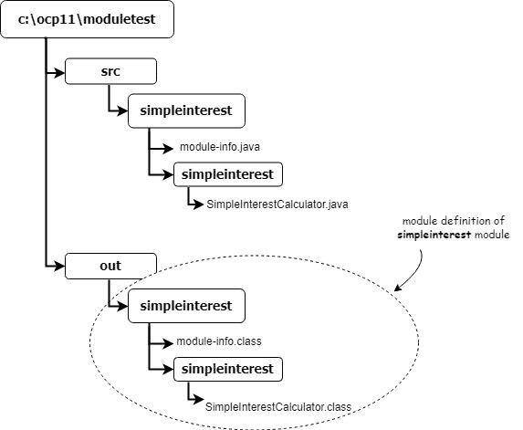

观察编译器在 `out\simpleinterest` 下生成的目录结构。它与你编译非模块化 Java 源文件后得到的结果是相同的。

我建议你通过更改此设置的细节来尝试运行上述命令。例如，将模块源目录重命名为其他名称，或者将 Java 源文件移动到模块源目录内的另一个位置，并观察编译器生成的错误信息。

### 编译单个模块源文件

可以通过列出你想要编译的文件（单独列出或使用通配符），在不使用 `--module` 选项的情况下编译模块源文件。例如，以下旧式命令产生的结果与上面使用的命令相同：

```
c:\ocp11\moduletest>javac -d out\simpleinterest src\simpleinterest\module-info.java src\simpleinterest\simpleinterest\SimpleInterestCalculator.java
```

注意，你必须在输出路径中显式指定模块根目录组件 `simpleinterest`。如果不这样做，编译器将把输出保存到 `out` 而不是 `out\simpleinterest`。列出单独的文件进行编译不是编译模块的优选方法，而且很少使用。考试中也不会测试这一点。出于考试之目的，你只需要知道如何使用 `--module` 选项来编译模块。

## 运行模块

运行模块意味着执行该模块中包含的类的 `main` 方法。因此，我们想要执行的类必须具有标准的 `main` 方法。以下命令显示了如何运行我们刚刚编译的 `simpleinterest` 模块。

```
c:\ocp11\moduletest>java --module-path out --module simpleinterest/simpleinterest.SimpleInterestCalculator
```

此命令使用了两个选项：`--module-path` 和 `--module`。

`--module-path` 选项用于告诉 Java 模块定义的位置。这是模块根目录所在的目录，或者如果模块被打包成 jar 文件，则 `module-path` 是该 jar 文件所在的目录。在我们的案例中，我们在 `module-path` 中指定了 `out`，因为我们模块的根目录（即 `simpleinterest`）位于 `out` 之中。

`--module` 选项用于告诉 Java 我们想要执行的模块名称。观察为 `--module` 指定的值。它的格式为 `<模块名称>/<主类名称>`，因为到目前为止，我们的模块是以解压格式（exploded format）存在的，并且不包含任何关于主类的信息。因此，我们还需要告诉 JVM 我们想要运行的类。一旦我们将模块打包成 jar，就不需要在命令行上指定主类了。

### 打包模块

将模块的类打包成 jar 文件的过程与我们看到的将类打包成普通 jar 的过程相同。模块 jar 特殊之处在于，习惯的名称与模块名称相同（当然带有 `.jar` 扩展）。在 jar 文件内部，类文件必须像以前一样按照包驱动的目录结构存在。因此，jar 文件的名称对应模块目录，jar 内部文件的组织对应模块目录内文件的组织。由于模块在其根文件夹中也有 `module-info.class`，jar 文件的根文件夹中也必须有这个类。注意，在 jar 根文件夹中有 `module-info.class` 的要求意味着无法在同一个 jar 中打包多个模块。换句话说，每个 jar 只能有一个模块。

由于模块化 jar（包括其名称）模仿了模块的组织，因此模块化 jar 也被认为是模块的“模块定义”。

以下是将我们的模块打包成 jar 文件的命令：

```
c:\ocp11\moduletest>jar --create --file simpleinterest.jar --main-class simpleinterest.SimpleInterestCalculator -C out\simpleinterest .
```

这应该会在 `moduletest` 目录下创建 `simpleinterest.jar`。

`--create` 选项告诉 `jar` 工具我们想要创建内容，而 `--file` 及其后续值指定了我们要创建的 jar 文件。`--main-class` 选项让 `jar` 工具在生成的 jar 文件清单（manifest）中添加 `Main-Class` 条目。

`-C` 选项需要一些解释。我们希望 jar 文件模仿模块的目录结构，这意味着 jar 内部的结构应该与模块相同。但我们是从 `moduletest` 执行命令的。在 `moduletest` 下有两个额外的级别（`out` 和 `simpleinterest`），我们不希望反映在 jar 文件中。`-C` 是为了让 `jar` 工具在添加文件之前切换目录。

命令末尾的点意味着我们希望当前目录（由于使用了 `-C` 现在是 `out\simpleinterest`）中的所有内容包含在 jar 中。以下两张图片显示了由上述命令创建的 `simpleinterest.jar` 的内容（我使用了 7zip 应用程序来查看 jar 文件的内容）。第一张图片显示了根级别的内容，第二张图片显示了 `simpleinterest` 文件夹的内容：


现在运行这个模块非常简单了：

```
c:\ocp11\moduletest>java --module-path . 
           --module simpleinterest
```

注意，由于我们在清单中添加了 `Main-Class` 属性，我们能够“运行”该模块。

你在上述图片中观察到的另一个重要点是，模块 jar 内部 `SimpleInterestCalculator.class` 的位置与该类文件被放在普通 jar 时完全相同，即位于 `<root>/simpleinterest`。这意味着任何不理解模块的应用程序都可以像普通 jar 一样使用模块化 jar。模块 jar 中额外的是根文件夹中的 `module-info.class` 文件，非模块化应用程序会忽略它。例如，你可以通过以下命令以旧方式运行 `SimpleInterestCalculator`：

```
c:\ocp11\moduletest>java -classpath .\simpleinterest.jar simpleinterest.SimpleInterestCalculator
```

你不需要过度担心 `jar` 命令中使用的各种选项。考试中不会测试如何创建 jar 文件。然而，执行封装在 jar 中的模块是在考试范围内的。因此，如果你理解如何创建模块化 jar 文件将会很好。

### 理解 module-path


上述命令中另一个有趣的点是我们为`module-path`指定的值。我们只为`module-path`指定了一个点（`.`），这是因为我们的模块 jar 包位于当前目录。`module-path`包含了你希望让`JVM`搜索模块定义的所有位置。在尝试加载模块时，`JVM`会在`module-path`指定的所有位置中查找该模块。它期望恰好找到以下两种情况之一——一个与模块名称同名的目录，或者一个包含该模块`module-info.class`的 jar 文件。jar 文件的名字并不重要，因为`JVM`会从 jar 包中包含的`module-info.class`获取模块名称。同一个模块不应在`module-path`上出现多次，否则`JVM`将报错。

在上面使用的命令中，当搜索名为`simpleinterest`的模块时，`JVM`将查找一个根目录下包含模块名为`simpleinterest`的`module-info.class`文件的 jar 包，或者查找一个名为`simpleinterest`且包含相应`module-info.class`的目录。

将此与`-classpath`选项进行比较，后者要求所有你想要放在类路径上的 jar 包显式列出，而不是只需要包含这些 jar 包的目录。

## 16.3 声明模块并启用模块间的访问

### 16.3.1 启用模块间的访问

让我们稍微改进一下`simpleinterest`模块的设计。以接口的形式定义功能并让实际实现去实现该接口，是一种良好的设计实践。这确保了功能的用户能够用一个实现替换另一个，而不会对其代码产生太大的影响。Java 模块允许我们通过在它们自己的模块中单独定义功能来进一步利用这种技术。将接口和实现分离到不同的模块中，允许我们通过混合和组合模块来构建应用程序，而无需绑定应用程序中所需的类。

在我们的案例中，我们将在`calculators`模块中创建一个`calculators.InterestCalculator`接口。然后我们将让`SimpleInterestCalculator`类实现此接口。以下是接口的定义：

```
 //位于文件 calculators\calculators\InterestCalculator.java
package calculators;
public interface InterestCalculator{
   public double calculate(double principle, double rate, double time);
}
```

接下来的是新模块的模块描述符：

```
 //位于文件 calculators\module-info.java
module calculators{
   exports calculators;
}
```

该模块定义中唯一的新内容是`exports`子句。模块是包的封装单元。一个模块的成员通常对属于其他模块的代码不可见。要使一个包能够被其他模块访问，必须首先在模块描述符中显式地“导出”（exported）该包。只有通过显式的`exports`子句使某些变得可访问，才能确保其他模块的代码不会无意中访问该模块内部的代码。请注意，我谈论的是包而不是类，因为只有包可以被导出，而单个类不能。当你导出一个包时，该包中包含的所有公共类型都可以可以被其他模块访问。在模块术语中，访问一个模块被称为“读取”（reading）该模块。因此，上述代码中的`exports`子句使得`InterestCalculator`接口可以被其他模块中的类读取。我使用“可以被读取”这个短语是因为`exports`子句只是模块访问另一个模块类时必须满足的两个要求之一。第二个要求是`requires`子句，我稍后会介绍。

该模块的目录结构按照之前解释的源模块定义格式。`c:\ocp11\moduletest\src\calculators`目录是该模块的源代码。它包含了`module-info.java`和`calculators\InterestCalculator.java`文件。让我们运行以下命令来编译此模块：

```
c:\ocp11\moduletest>javac -d out --module-source-path src --module calculators
```

这应该在`out`目录下创建相应的输出。

现在让我们关注转向`simpleinterest`模块。由于我们希望`SimpleInterestCalculator`实现`InterestCalculator`接口，我们需要通过如下所示修改`simpleinterest`的模块描述符来明确我们的意图，即我们的`simpleinterest`模块“需要”对`calculators`模块的访问：

```
module simpleinterest{
   requires calculators;
}
```

`requires`子句是`exports`子句的对应项。`requires`子句使得另一个模块对当前模块是“可读的”。这被称为**模块可读性**（module readability）。换句话说，其他模块导出的所有包都可以被使用`requires`子句声明依赖该模块的模块访问。

拥有`requires`子句的目的是让模块的依赖关系对用户显式清晰。模块用户无需通过模块每个类的`import`语句来了解该模块依赖于哪些其他模块。他们只需要检查`module-info`即可。

我们现在如下修改`SimpleInterestCalculator.java`：

```
package simpleinterest;
import calculators.InterestCalculator;
public class SimpleInterestCalculator implements InterestCalculator{
   public double calculate(double principle, double rate, double time){
      return principle*rate*time;
   }
   public static void main(String[] args){
      InterestCalculator ic =  new SimpleInterestCalculator();
      System.out.println(ic.calculate(100, .05, 2));
   }
}
```

可以使用以下命令编译此模块：

```
c:\ocp11\moduletest>javac -d out --module-source-path src --module simpleinterest
```

编译此模块后，我们的目录结构如下：


我们现在可以像之前使用以下命令执行`simpleinterest`模块：

```
c:\ocp11\moduletest>java --module-path out --module simpleinterest/SimpleInterestCalculator
```

### 16.3.2 限定导出

`exports`子句向所有模块开放包。一旦包导出，无法阻止其他模块访问它。这类似于将类的成员设为公共，就像`public`修饰符一样，`exports`子句降低了模块的封装性。

Java 模块允许你通过`exports`子句的变体对特定模块限制访问。它被称为`exports-to`子句或限定导出（qualified exports）。其用法如下：

```
module <modulename>{
   exports <packagename> to <modulename(s)>;
}
```

例如，在下面的`module-info`中，`com.abc.datatransfer`包仅对`db`和`service`模块可见：

```
module datatransfer{
   exports com.abc.datatransfer to db, service;
}
```

对包包变为可读的模块被称为“友好模块”（friendly modules）。Java 标准库在其内部模块中大量地使用此功能。例如，JDK 的`java.base`模块有几个包应该只被少数几个内部模块使用。它使用限定导出来实现这一点。以下是来自`java.base`模块`module-info`的部分代码片段：

```
module java.base {
   ...
   exports jdk.internal.logger to
      java.logging;
   exports jdk.internal.perf to
      java.desktop,
      java.management,
      jdk.jvmstat;
   ...
}
```

在`module-info`中，未限定导出（unqualified exports）和限定导出（qualified exports）的出现顺序没有特殊规定。但按照惯例，限定导出列在所有未限定导出之后。

使用限定导出可以防止无意中对那些并非供所有人使用的包创建依赖关系。因此，尽多地使用限定导出是一个是一个好主意。只有当你完全确定该包可以被任何其他模块使用时，才使用未限定导出。

### 16.3.3 传递性依赖

模块`A`可以通过其`module-info`中的`requires`子句来读取另一个模块`B`。但如果模块`B`又读取另一个模块`C`呢？这意味着模块`A`也读取了模块`C`吗？通常情况下不是。模块依赖不是传递的，如果模块`A`指明它只需要模块`B`，那么它不能因为`B`读取了`C`就读取`C`。

现在，让我们看看在以下情况下是如何处理的。如果模块`A`中的某个类需要调用模块`B`中某个类的方法，而该方法的返回类型定义在模块`C`中呢？类似于这样：

```
module ui{
   requires hr;
}
module hr{
   requires valueobjects;
   exports hrservice;
}
```

```java
 //ui 模块中类中出现的代码
HRService hrService = new HRService(); //HRService 定义在 hr 模块中
Employee e = hrService.getEmployee(employeeId); //Employee 定义在 valueObjects 模块中
```

由于`ui`模块没有`requires valuesobjects;`子句，`ui`模块无法访问来自`valuesobjects`模块的`Employee`类。因此，上述代码将无法编译。显而易见的解决方案是在`ui`模块中添加`requires valuesobjects;`子句。但这个解决方案有一个问题。如果`hr`模块有多个`requires`子句怎么办？`ui`模块如何知道应该将`hr`模块的哪些`requires`子句添加到它的`module-info`中？只有通过多次编译失败才能让`ui`模块知道这些信息！

这就是`requires transitive`子句派上用场的地方。由于`hr`模块知道任何需要`hrservice`包的模块也需要`valueobjects`模块中的类，它使用`requires transitive`子句记录了这一信息，如下：

```
module hr{
   requires transitive valueobjects;
   exports hrservice;
}
```

这基本上是说如果你需要`hr`模块，那么你也需要`valueobjects`模块。但不仅仅是记录了这一事实，`requires transitive`子句还消除了在`ui`模块中添加额外`requires valuesobjects;`子句的需求。`ui`模块中的`requires hr;`子句会自动让所有被`hr`模块传递所需的模块对`ui`模块可见。这被称为“隐式可读性”（implied readability）。

目前还不清楚限定导出和`requires transitive`子句是否出现在 OCP Java 11 第 1 部分考试中。有些候选人报告看到过使用这些子句的选项，因此，了解它们的作用是一个好主意。

#### 重复的导入语句与重复的 requires/export 子句

在 Java 源文件中存在重复的导入语句是没有意义的，但 Java 在历史上允许重复的导入语句。然而，Java 不允许在`module-info`中存在重复的`requires`子句。因此，以下`module-info.java`将无法编译：

```
module hr{
   requires valueobjects;
   requires valueobjects; // 重复，不允许
}
```

在`requires`子句和`requires transitive`子句中要求同一个模块也是不允许的。因此，以下内容无法编译：

```
module hr{
   requires valueobjects;
   requires transitive valueobjects; // 重复，不允许
}
```

同样，重复的`exports`和`exports to`子句也是不允许的。

#### 循环/循环依赖

Java 不允许模块之间产生循环依赖。例如，如果模块`a`包含一个`requires b;`子句，那么模块`b`就不能有`requires a;`子句。同样，即使是间接循环依赖（即`a`需要`b`，`b`需要`c`，而`c`需要`a`）也是不允许的。

### 16.4 高级模块编译与执行

看到所有新的模块相关命令行切换起初会感到压力很大。但一旦你理解了这些选项背后的核心主题，你就会发现它们与你到为止使用的`-classpath`（以及`-sourcepath`）选项没有太大区别。`module-path`和`module-source-path`切换对于模块化项目就像`classpath`和`sourcepath`切换对于普通项目一样。早，你在启动应用程序时只需指定主类的 FQCN（全限定类名），现在你使用`--module`选项指定模块名。基本上就是这样。

我观察到很多学生因为`classpath`和`module-path`并不互斥而感到困惑。同时使用这两个切换是可能的，有时也是必要的。在编译以及执行模块时，同时使用这两个切换。虽然这种用法不在 OCP Java 11 第 1 部分考试的范围内，但有些考生报告遇到过使用这两个切换的题目。

另一个困惑的原因是存在多个含义相同的切换。例如，`--module-path`等于`-p`，而`--module`等于`-m`。

在本节中，我将总结编译和执行模块时需要的所有选项。

#### 16.4.1 一次编译多个模块

在之前的示例中，我们分别编译了`calculators`和`simpleinterest`模块。我们可以通过在`--module`切换中列出这两个模块，轻松地同时编译它们：

```bash
c:\ocp11\moduletest>javac -d out --module-source-path src --module calculators,simpleinterest
```

注意模块名之间是用逗号分隔的。事实上，即使我们没有在`--module`切换中指定它，Java 也会编译`calculators`模块，因为它注意到`simpleinterest`需要`calculators`，因此会先编译`calculators`。然而，只有当模块源代码按照包驱动目录结构组织时，这才可行。如果源码组织方式不同，javac 将无法自动定位它们。

#### 使用无源码的模块

在开发模块时，你可能需要使用没有源码的第三方模块。例如，如果`calculators`模块是由另一个团队开发的，你只有它的`calculators.jar`怎么办？

我们可以可以使用`--module-path`切换来告诉 javac 模块的位置，就像我们在执行模块时使用它一样。假设我们将`calculators.jar`放在`c:\ocp11\moduletest\modulejars`目录下。我们现在可以使用以下命令编译`simpleinterest`模块：


```bash
c:\ocp11\moduletest>javac --module-path modulejars -d out --module-source-path src --module simpleinterest
```

注意，我们并没有在模块路径中指定具体的 jar 文件名（尽管我们也可以这样做）。我们只指定了包含它的目录。我们可以根据需要指定多个目录，并用路径分隔符（Windows 上为 `;`，nix 系统上为 `:`）隔开。指定目录和指定 jar 文件的区别在于：当你指定一个目录时，该目录下所有的 jar 包以及解压后的模块定义（exploded module definitions）都对编译器（或在执行时对 `jvm`）可用；而在另一种情况下，只有你在模块路径上指定的那个 jar 包是可用的。在学习阶段，在模块路径上指定一个目录是可以接受的，但在开发专业应用程序时，指定具体的 jar 文件总是更好的。在模块路径中显式列出 jar 文件来运行 `simpleinterest` 的命令如下所示：

```bash
c:\ocp11\moduletest>java --module-path 
    modulejars\simpleinterest.jar;modulejars\calculators.jar  --module simpleinterest
```

### 16.4.2 模块 jar 与普通 jar

如你之前看到的，从结构上来说，模块 jar 和普通非模块 jar 没有区别。模块 jar 中唯一额外的内容是其根目录下的 `module-info.class`。事实上，可以像使用非模块 jar 一样使用模块 jar。如果你想知道是否可以使用旧方法运行模块 jar 文件的主类，答案是肯定的。例如，假设你已经按照上一节介绍的方法将两个模块打包成两个 jar 包，并将它们放在 `c:\ocp11\moduletest` 目录下，你可以通过以下命令运行我们的 `SimpleInterestCalculator` 类：

```bash
c:\ocp11\moduletest>java -classpath calculators.jar;simpleinterest.jar simpleinterest.SimpleInterestCalculator
```

然而，当你使用 `-classpath` 或 `-jar` 选项运行类时，你将失去模块的所有优势。这意味着 `JVM` 将不会强制模块描述符中指定的访问规则。换句话说，模块的 `module-info` 将被完全忽略。任何 jar 包中的类都可以访问另一个 jar 包中的类。

当一个团队尚未将其项目迁移到模块化结构，但又想使用另一个团队产生的模块 jar 时，这种机制非常有帮助。它还允许团队在不影响其非模块用户的情况下对代码进行模块化。

### 16.4.3 自动模块

自动模块以及在执行模块化应用程序时使用 classpath 是自上而下和自下向上迁移策略的一部分，这些策略用于将现有应用程序迁移到模块化应用程序，或创建一个需要非模块库的新模块化应用程序。

这个主题在 OCP Java 11 Part 2 考试目标中明确提到。该主题不在 Part 1 考试中。然而，某些候选人报告说，在同一个 `java` 和/或 `javac` 命令中出现了同时包含 `classpath` 和 `module-path` 的命令行选项。我们的观察是，此类选项的存在仅仅是为了混淆候选人，而且很可能是错误的选项。因此，在选择此类选项时要务必小心。

关于模块有一个重要点需要记住：当你使用 `module-path` 选项运行应用程序时，只有当应用程序的模块信息对其想要读取的模块具有适当的 `requires` 子句时，该应用程序才能读取其他模块。此外，正如之前讨论，这些模块还应该使用适当的 `exports` 子句导出相关包。

如果你想开发一个依赖于第三方非模块 jar 的模块，就会产生一个问题。你的代码将如何访问非模块 jar 中的类呢？这实际上是非常常见的场景。你可能想在应用程序中使用第三方日志框架、`JDBC` 驱动程序或连接管理器。但你不想等到此类功能的提供者将他们的 jar 更新为模块化 jar，显然，你不能自己来对别人的代码进行模块化。

Java 模块功能提供了一种处理此类情况的好方法。如果你简单地将非模块 jar 放在 `module-path` 上，Java 将认为该非模块 jar 是一个模块。这种模块被称为 `自动模块`（automatic module），该模块的名称使用 jar 文件名自动创建。例如，如果你将 `mysql-driver-6.0.jar` 放入 `--module-path`，它将作为名为 `mysql.driver` 的自动模块加载。因此，与普通的显式命名的模块一样，自动模块也是一个`命名模块`（named module）。

自动模块的名称派生在 `java.lang.module.ModuleFinder` 的 JavaDoc 中详细解释，且不在考试范围内，但基本上，是将连字符转换为点，并删除版本号和文件扩展名部分。

非模块 jar 也可以在 jar 的 `MANIFEST.MF` 中使用 `Automatic-Module-Name: <module name>` 条目来指定其未来的模块名称。

由于非模块 jar 中没有 `module-info.class`，因此无法通过 `exports` 子句指定它导出的包，也无法通过 `requires` 子句指定它依赖的 jar 包。出于这个原因，Java 提供了具有两种特殊力量的自动模块：

1. 自动模块导出其所有的包（这样任何模块都可以“读取”这些包），以及

2. 自动模块允许读取位于 module-path 上的可用的模块的所有导出的包。

因此，我们只需要在 java 命令中如下将此 jar 包包含类路径（classpath）中：

```bash
java -classpath jars\commons-logging.jar --module-path jars\mysql-driver-6.0.jar; --module simpleinterest/simpleinterest.SimpleInterestCalculator
```

如你所见，自动模块与其他命名模块类似，但由于它的强大功能，它充当了模块化与非模块化代码之间的桥梁。如果没有自动模块，模块化代码将无法利用现有的非模块代码。

另一方面，路径上的所有类都由 JVM 加载为单个`unnamed module`（未命名模块）的一部分。与自动模块的类一样，未命名模块的类也允许“读取”模块路径上所有可用模块的所有导出的包，以及路径上的所有类。然而，由于该模块没有名称，因此无法在任何模块的 `requires` 子句中包含该模块。因此，未命名模块的类对路径上的其他类以及自动模块中的类是可见的，但对显式命名的模块不可见。

### 16.4.4 编译时使用的命令行开关总结

为了编译 Java 类和/或模块，你需要记住以下五个命令行选项：

1.  `--module-source-path`: 该开关用于指定模块源文件的位置。它应该指向包含源模块定义的目录。换句话说，它应该指向存储模块 `module-info.java` 所在目录的父目录。例如，如果你的模块名称为 `moduleA`，那么该模块的 `module-info.java` 将位于 `moduleA` 目录下，如果 `moduleA` 目录存在于 `src` 目录下，则应在 `--module-source-path` 选项中指定 `src`，即 `--module-source-path src`。

如果 `moduleA` 依赖于另一个名为 `moduleB` 的模块，且 `moduleB` 目录存在于 `src2` 目录下，你也可以将该目录添加到 `--module-source-path` 中，即 `--module-source-path src;src2`。

2.  `-d`: 编译模块时需要此开关。它用于指定输出目录。该目录是 `javac` 将生成模块和包驱动的目录结构以及源文件类文件的地方。例如，如果你指定 `out` 为输出目录，`javac` 将在 `out` 下创建一个与模块名同名的目录，并在该目录下创建具有适当的包驱动目录结构的类文件。

3.  `--module` 或 `-m`: 当你想要编译特定模块的所有源文件时，使用此开关。当你想要一次编译所有文件，而无需在命令中单独列出模块的任何源文件时，此选项非常有帮助。

例如，如果你在 `moduleA` 中有两个 Java 文件，分别存储在 `moduleA\a\A1.java` 和 `moduleA\a\A2.java`，你可以使用命令同时编译它们：`javac --module-source-path src -d out --module moduleA`。

`javac` 将找到 `moduleA` 下的所有 Java 源文件并编译所有它们。它将在 `-d` 选项指定的输出目录（即 `out`）下创建类文件。因此，`out` 目录现在将有两个类文件——`moduleA/a/A1.class` 和 `moduleA/a/A2.class`。

4.  `--module-path` 或 `-p`: 此选项指定被编译模块的依赖的任何其他模块的位置。你可以在这里指定包含模块类的模块目录或 jar 文件。例如，如果你想编译 `moduleA` 且它依赖于名为 `abc.util` 的其他模块，你可以像这样将其添加到你的 `javac` 命令中：

```bash
javac --module-source-path src --module-path thirdpartymodules/abc.util.jar -d out --module moduleA
```

5.  `-classpath` 或 `-cp` 或 `--class-path`: 此选项用于非模块代码的编译。如果你正在编译普通的非模块化代码，但该代码依赖于某些类，你可以使用 `-classpath` 选项将这些类/jar 放在类路径上。

**注意：** 此选项对于模块化代码的编译没有帮助，因为模块化代码中的类无法读取路径上的类。模块化代码只能看到其他模块化代码。这就是为什么非模块化类必须转换为“自动模块”，并如前所述指定在 `--module-path` 上。

### 16.4.5 运行时使用的命令行开关总结

对于运行包含在模块中的类，你需要了解以下三个命令行开关：

1.  `--module-path` 或 `-p`: 此开关告知模块定义的位置。如果模块被封装在 jar 文件中，你可以指定 jar 的路径，也可以指定存储 jar 文件的目录路径（相对于当前目录或绝对路径）。例如，`--module-path c:\javatest`。

你还可以指定以解压形式存在的模块位置。例如，如果你的模块名为 `abc.util` 且该模块存储在 `c:\javatest\output`，你可以使用 `--module-path c:\javatest\output`。记住，`c:\javatest\output` 必须包含 `abc.util` 以及模块文件（包括 `module-info`）。你可以根据需要使用路径分隔符（`;` 或 `:`）指定多个模块位置。

2.  `--module` 或 `-m`: 此开关用于指定你想要运行的模块。例如，如果你想运行 `abc.util` 的 `utils.Main` 类，你应该写 `--module abc.util/utils.Main`。

如果模块 jar 的清单包含 `Main-Class` 属性，你可以在命令中省略主类。例如，你可以写 `--module abc.util` 而不是 `--module abc.util/utils.Main`。

3.  `-classpath` 或 `--class-path` 或 `-cp`: 此开关用于执行非模块代码。它也用于执行模块化代码时指定项目所需的非模块 jar。在第一部分考试中不需要了解这些信息。但了解它是好事，因为它是第二部分考试所要求的。

可以通过完全忽略模块选项将模块化代码视为非模块化代码。例如，如果你想使用旧的类路径选项运行同一个类，可以这样做：

```bash
java -classpath mathutils.jar utils.Main
```

记住，模块化代码无法访问路径上的代码，但“自动模块”是这一规则的例外。当非模块 jar 放在 `--module-path` 上时，它变成了一个“自动模块”，但它仍然可以访问所有的模块化和非模块化代码。换句话说，自动模块的类可以访问 `--module-path` 以及类路径上的类，而无需任何 `requires` 子句（记住自动模块没有 `module-info`）。

因此，如果你的模块化 jar `A` 依赖于非模块 jar `B`，你必须将该非模块 jar `B` 放在 `--module-path` 上。你还必须在模块 `A` 的 `module-info` 中添加相应的 `requires` 子句，否则你的模块将无法成功。此外，如果非模块 jar `B` 依赖于另一个非模块 jar `C`，那么非模块 jar `C` 可以放在类路径上或模块路径上。

在本章的节节中，我向你展示了如何创建和使用模块。首先讨论模块的基本概念是非常重要的，因为 Java 9 遵循相同的概念将 JDK 中所有的类和包模块化了。虽然关于模块还有一些主题需要理解，只有在理解这些主题后，才能充分体会 JDK 9 所做的重构工作量，但这些主题并不在 Java 11 第一部分的认证考试范围内。因此，我将尝试在不过于依赖此类主题的情况下来解释模块化的 JDK。

如果你看看 Java 运行时库的大小，很难相信 Java 最初的设计是为了在即使是最小的设备上运行。现在，二十年后，Java 已经远超它的最初目标。它在构建大型任务关键型应用程序以及小型桌面应用程序方面都极其有用。它成功的原因之一是 Java 随附的功能、工具和库的不断演进。

Java 的另一个核心承诺是 WORA，即“一次编写，随运行”（Write Once Run Anywhere）。Java 自带了一套标准的 API，你可以使用它来编写在所有平台上运行效果相同的应用程序。Java 通过开发运行时环境，隐藏了底层硬件的差异并提供了一套通用功能，实现了这一成就。

多年来，设备的类型和能力差异巨大，已经不再可能隐藏许多平台之间硬件能力的差异。但如果你为某个设备准备了 Java 运行时，而该运行时无法运行为另一个设备开发的 Java 应用程序，那么就等同于背弃了 WORA 承诺。Java 在推出多个版本的运行时环境（如 J2SE、J2EE 和 J2ME）时最终确实放弃了 WORA。J2ME 是 Java 运行时的一个轻量级版本，可以在第一代移动手机上运行。在能力方面，它与 J2SE 和 J2EE 有很大不同。然而，Java 核心库仍然保持不变。

到 Java 8 为止，标准 Java 库拥有四千多个类，已经变成了一个由相互依赖的类和包构成的巨大单体结构，无法拆分成更小的独立部分。即使应用程序只使用了运行时库的一小部分，它也必须与整个库打包在一起。你可能听过每个 Java 安装程序都带有一个名为 `rt.jar` 的 jar 文件。这个 60 MB 的 jar 文件包含了完整的 Java SE 库。如果你想分发仅包含一个类的 Java 应用程序，你必须将这个巨大的 jar 文件一并包含在内。

模块化 JDK 是为了解决这个问题而做的努力。它将 JDK 划分为若干松耦合的模块，这些模块可以在编译时、构建时以及运行时，根据应用程序的需求组合成各种配置。例如，大型服务器端应用程序可以使用完整的 JDK，但微服务可以只与绝对必需的模块进行打包。它还允许与运行时打包在一起的应用程序以较小的配置方案（profiles）发布，从而增加了 Java 应用程序在更多设备和平台上的覆盖。

## 16.5.2 模块化 JDK 的组织

Java 平台中包含的包（或技术术语中的 API 包）被分布在不同的模块中。这些模块可以分为大类：标准模块和非标准模块。由 Java 社区进程（JCP）管理的模块称为标准模块。它们的名称以 `java` 开头。例如，`java.base`、`java.sql` 和 `java.logging` 是标准模块。所有其他特定于 JDK 的模块被称为非标准模块。它们的名称以 `jdk` 开头。例如，`jdk.jdeps`、`jdk.rmic` 和 `jdk.javadoc` 是非标准模块。

同样，标准包的名称以 `java` 或 `javax` 开头，例如 `java.lang`、`java.sql`、`javax.crypto` 和 `javax.net`；而 JDK 特定的非标准包通常以 `jdk` 开头，例如 `jdk.internal.perf`、`jdk.internal.logger` 和 `jdk.internal.util`。取决于 JDK 的提供者，它可能包含反映公司名称的包以及 `sun.net` 或 `sun.utils.resource`。

重要重要的是，标准模块可能包含非标准包，但非标准模块不包含任何标准包。

标准模块和非标准模块随后被组合形成各种 Java 配置，例如**全量 Java SE 平台**、**全量 JRE** 和**全量 JDK**。

为了考试，我们需要关注 Java SE 平台。

### Java SE 平台


Java 标准版（Java SE）是用于通用计算的**核心 Java 平台**。它仅由标准模块（即名称以`java`开头的模块）组成，并且要求所有 Java 实现都必须提供支持。你不需要记忆该平台中所有的可用模块，但平台中一些最常用的模块包括`java.base`、`java.desktop`、`java.logging`、`java.sql`、`java.prefs`和`java.net.http`。你为准备 Java 认证考试而编写或将编写的所有程序都需要这个平台。

注意，这并不意味着 Java SE 平台包含了所有的标准模块。例如，`java.cardio`是一个标准模块（由 JCP 管理），但它并不是 Java SE 平台的一部分。也不意味着该平台本身不会使用非标准包中的类。正如我之前提到的，标准模块可能包含非标准包。这意味着 Java 平台中包含的模块没有任何一个“导出”了非标准包。换句话说，如果你的模块“需要”Java 平台中包含的模块，那么它将只依赖标准包，并可以移植到所有 Java SE 实现。

## `java.base`模块

该模块定义了 Java SE 平台的**基础 API**。所谓基础，是指它位于所有 Java 平台的核心。该模块不需要任何其他模块，但所有其他模块都依赖于它。再次，你不需要记住该模块包含的包完整列表，但这里有一些你应该关注的重要包——`java.lang`、`java.lang.annotation`、`java.io`、`java.nio`、`java.net`、`java.util`、`java.util.concurrent`、`java.security`和`java.time`。

我们在书中使用的所有 Java API 类和包都属于该模块。我们在书中编写的每个类都依赖于该模块中的类。当然，`java.lang.Object`归属于该模块，毕竟如此！但你有没有注意到在上一节中开发的模块的模块声明中，我们从未写过`requires java.base`？其原因在于由于 Java 中的所有内容都需要该模块导出的包，因此 Java 编译器并不要求显式地指定它。换句话说，就像`java.lang`包不需要在类中显式导入一样，`java.base`模块不需要在模块的`requires`子句中显式指定。它总是被假设为是“需要的”。

请注意，在考试题描述或选项中，你可能会看到“core APIs”（核心 API）或“core packages”（核心包）等短语。你应该将此类选项标记为错误。相反，“foundational APIs”（基础 API）是官方 API 描述中使用的词，因此是正确的。所以，就考试而言，`java.base`定义了所有的“foundational APIs”，而不是 Java 平台所有的“core APIs”。

不过，存在一个“core Java platform”。它由 Java 平台标准版（Java SE）API 定义，这些 API 定义在多个标准模块中（而不仅仅是在`java.base`模块中）。

## 16.5.3 模块的新工具和命令行选项 [☝](http://enthuware.com/forum/dbt.php?bid=2&sn=16.5.3&tn=new-tools-and-command-line-options-for-modules)

如果你查看 JDK 的`bin`目录（例如 Windows 上的`C:\Program Files\Java\jdk-11.0.2\bin`），你会看到几个可执行文件。这些大部分是随 JDK 捆带的工具。这些工具用于执行我们在开发、测试和运行 Java 应用程序时进行的各种活动。你已经使用过其中三个——`javac.exe`（启动 Java 编译器）、`java.exe`（启动 JVM）以及`jar.exe`（创建 jar 文件）。当你进阶到开发工业级 Java 应用程序时，你将使用其他几个工具，如`jdb`、`javadoc`、`javap`和`javaw`。

随着 Java 模块的出现，JDK 为现有工具添加了新工具以及一些新开关（即命令行选项），这些新增内容专门用于处理 Java 模块。对于 OCP Java 11 Part 1 考试，你需要了解这些选项和工具是什么以及它们的作用。

### 与模块相关的命令行选项 [☝](http://enthuware.com/forum/dbt.php?bid=2&sn=16.5.3&tn=command-line-options-related-to-modules)

我们已经详细讨论过`--module-path`和`--module-source-path`选项。这些选项同样适用于`java`命令和`javac`命令。

`--show-module-resolution`：这个新开关应用于`java`命令，使其在执行 Java 程序时打印模块解析信息。基本上，如果你想知道在运行程序时引用了所有模块，就使用这个选项。例如，查看在执行我们的`simpleinterest`模块时使用该选项运行`java`所产生的输出。

```
c:\ocp11\moduletest\>java --show-module-resolution --module-path out --module simpleinterest/simpleinterest.SimpleInterestCalculator
```

**输出：**

```
root simpleinterest file:///C:/ocp11/moduletest/out/simpleinterest/
simpleinterest requires calculators file:///C://ocp11/moduletest/out/calculators/
java.base binds jdk.jdeps jrt:/jdk.jdeps
...
... 省略了许多此类行
...
java.rmi requires java.logging jrt:/java.logging
10.0
```

输出的第一行显示根模块是`simpleinterest`（因为这是 Java 准备执行的模块），并且它是从`C:/ocp11/moduletest/out/simpleinterest/`加载的。

第二行显示`simpleinterest`需要`calculators`模块，该模块是从`C:/ocp11/moduletest/out/calculators`加载的。

我们知道`calculators`不需要任何其他模块。然而，每个模块都需要`java.base`模块。因此，其余行显示了加载`java.base`模块的详情。

最后一行是`SimpleInterestCalculator`的`main`方法的输出。

请注意，`show-module-resolution`选项仅显示模块级别的细节。它不会告诉你实际需要模块中的哪个包或哪个类。

### `jdeps` [☝](http://enthuware.com/forum/dbt.php?bid=2&sn=16.5.3&tn=jdeps)

`jdeps`是一个专门设计的新工具，用于帮助你在不执行模块的情况下处理模块。使用此工具，你可以找到给定模块的模块级、包级以及类级依赖。它可以分析解压后的模块或模块 jar 包。让我们在`simpleinterest`模块上运行它，看看会产生什么。

```
c:\ocp11\moduletest\>jdeps --module-path out --module simpleinterest
```

**输出：**

```
[file:///C:/ocp11/moduletest/out/simpleinterest/]
   requires calculators
   requires mandated java.base (@11.0.2)
simpleinterest -> calculators
simpleinterest -> java.base
   simpleinterest          -> calculators    calculators
   simpleinterest          -> java.io        java.base
   simpleinterest          -> java.lang      java.base
```

它显示`simpleinterest`使用了`calculators`和`java.base`模块。它还显示`simpleinterest`依赖于`calculators`模块中的`calculators`包以及`java.base`模块中的`java.io`和`java.lang`包。

如果你想查看类级别的依赖，可以尝试`verbose:class`选项：

```
c:\ocp11\moduletest\>jdeps --verbose:class --module-path out --module simpleinterest
```

**输出：**

```
[file:///C:/ocp11/moduletest/out/simpleinterest/]
   requires calculators
   requires mandated java.base (@11.0.2)
simpleinterest -> calculators
simpleinterest -> java.base
   simpleinterest          -> calculators    calculators
   simpleinterest          -> java.io        java.base
   simpleinterest          -> java.lang      java.base
```

`jdeps`是一个强大的工具，你在准备 Part 2 时会更多地使用它。但对于 Part 1，上述信息已经足够。

### `jmod` [☝](http://enthuware.com/forum/dbt.php?bid=2&sn=16.5.3&tn=jmod)

Java 9 还引入了将代码打包成`jmod`文件的新方法。这种打包方法用于无法放入 jar 包的原生代码。然而，`jmod`文件无法执行，因此仅在编译和链接时使用。它不是 jar 文件的替代品。不用担心，不需要研究`jmod`文件的细节。但你可能在考试中看到`jmod`命令。为此，你需要记住`jmod`命令的基本语法：

`jmod (create|extract|list|describe|hash) [options] jmod-file`

`jmod`的第一个参数是操作模式。它必须是五个中的之一：`create`、`extract`、`list`、`describe`、`hash`。

1. `create`：创建一个新的 JMOD 存档文件

2. `extract`：从 JMOD 存档提取所有文件

3. `describe`：打印模块详情

4. `list`：打印 jmod 文件包含的所有条目（即文件）

5. `hash`：确定叶模块并记录直接或间接需要它们的哈希

在上述操作中，只有`describe`模式与模块相关。`jmod`命令与`java/javac`命令的一个重要区别在于，不使用连字符（即 -）来指定模式。

2. 它提高了安全性和可维护性。在模块化之前，无论其访问修饰符如何，所有类的所有成员都可以通过反射 API 访问。现在，通过将包封装到模块中，`JVM`能够将反射访问限制在显式允许的包上。使用显式的`exports`和`requires`子句可以防止无意中依赖并非设计用于模块外使用的类。

3. 它通过不需要对不必要的类进行打包和/或加载提高了应用程序性能。

4. 它是向后兼容的。应用程序不需要结构化为模块化即可在模块化的`JDK`上运行。非模块化的应用程序仍然可以使用`-classpath`选项在模块化的`JDK`上像以前一样运行。

5. 可以进行自定义定制。通过使用适当的命令行选项，可以使模块描述符中未显式导出的包变得可访问。例如，如果一个模块没有导出某个包，你仍然可以使用`--add-exports`选项使该包对其他模块可访问。当然，这种选项破坏了封装机制，是不尽人意的。它应该只在特殊情况下使用。

正如我之前提到的，Java 模块是一个非常庞大的话题。还有几个重要的概念，如模块图、依赖分析以及使用非模块化的 jar 包，我还没有讨论过。原因在于这些概念需要大量时间来讨论，而 OCP Java 11 认证部分 1 考试仅仅触及了这个主题的皮毛。你最多只会得到一个关于它的问题，你可以根据本章提供的信息来回答。由于这个原因，目前最好忽略它，但你将在部分 2 考试中被要求彻底学习这个主题。

## 16.6 练习 [☝](http://enthuware.com/forum/dbt.php?bid=2&sn=16.6.0&tn=exercise)

1. 创建一个名为`compoundinterest`的模块，包含一个名为`CompoundInterestCalculator`的类，类似于本章描述的`simpleinterest`模块。

2. 分别使用和不使用`--module`开编译`compoundinterest`模块的源代码。使用`-d`选项将输出重定向到你的输出目录。

3. 分别使用和不使用`--module-path`运行`CompoundInterestCalculator`类。

4. 通过让`CompoundInterestCalculator`类实现`calculators`模块的`InterestCalculator`接口来增强你的模块。

5. 将`compoundinterest`模块打包成`jar`并使用`--module-path`关运行此模块。

6. 创建一个名为`finance`的模块，其中包含一个`TestClass`类。它应该有一个`main`方法，用于计算单利和复利。为了此目的，对`simpleinterest`和`compundinterest`模块进行适当修改。

# 第 17 章 理解 Java 技术和环境

* 描述 Java 技术和 Java 开发

* 识别 Java 语言的关键特性

## 17.1 Java 技术和 Java 语言的关键特性 [☝](http://enthuware.com/forum/dbt.php?bid=2&sn=17.1.0&tn=java-technology-and-key-features-of-the-java-language)

在学习了之前的章节之后，你已经知道了关于这个目标所需的所有知识。我在这里简单总结一下要点。

### Java 技术和 Java 开发的关键点

1. **平台独立性** - Java 代码被编译成`Java 字节码`，由一个名为`Java Virtual Machine`（`JVM`）的虚拟机进行解释。`JVM`适用于多种平台（CPU+OS 架构）。这意味着字节码可以在所有这些平台上运行而无需任何更改。因此，你不需要为想要运行 Java 类的每个平台都准备一个 Java 编译器。在一个平台上产生的类文件，只要该平台有`JVM`，它就可以在任何其他平台上原封不动地运行。如果某个平台没有`JVM`（例如 Android 或 iPhone），你无法在该平台上运行 Java 程序。

2. **Java 安装** - Java 并不是操作系统的一部分。它本身就是一个应用程序，并独立地安装在操作系统之上。对于大多数主流桌面操作系统（如 Windows、MacOS 和 Linux），都有一个独立的安装程序可用。到目前为止，Java 平台尚未适用于 Android 和 iOS。

3. **JRE vs JDK** - Java 运行环境（`JRE`）仅包含运行 Java 程序所需的类库和可执行文件，而 Java 开发工具包（`JDK`）除了包含`JRE`，还包含了开发 Java 程序所需的 Java 编译器和 Java 调试器等工具。因此，如果你只想运行 Java 程序，没有必要安装`JDK`，但安装`JDK`需要先安装`JRE`。

4. **开发工具** - Java 开发工具包（`JDK`）附带几个应用程序。有些是必须的，例如编译器（`javac`），有些在开发过程中很有用，如调试器（`jdb`）、类检查器（`javap`）以及文档生成器（`javadoc`）。它还带有适用于大多数常用平台的`JVM`（`java`）。

5. **IDE** - 集成开发环境（`IDE`）是一个让 Java 开发更轻松的额外第三方工具。它在`JDK`可用工具之上包含多个工具，如代码编辑器、语法高亮和源码组织器。然而，开发 Java 程序并非必须使用`IDE`。Netbeans、Eclipse 和 IntelliJ 是一些常用的 IDE。

6. **Java 平台配置** - 由于`JDK`的模块化，现在可以将 Java 运行时以及库拆分为不同特性和大小的配置。虽然核心 Java 特性封装在一个名为 Java SE 平台的现成配置中，但也可以仅使用应用程序所需的模块为应用程序创建一个最小的 JRE 镜像。

### Java 的关键特性

1. **面向对象** - Java 具有类、对象和访问控制等特性，允许你进行面向对象的开发。它消除了一些非面向对象的特性，如独立函数。以下是 Java 的一些“面向对象特性”：

    1. **封装** 确保了类的设计使得只有对象的某些字段和方法可以从其他对象访问。Java 通过将数据成员标记为`public`/`protected`/`private`（或默认）允许精确的访问控制，从而促进了封装。

    2. Java 允许类最多扩展一个类，但允许一个类实现多个接口。Java 支持类型的多继承，但不支持状态和实现多继承。


### 3. 多态

多态确保了在运行时执行的方法取决于引用引用的实际对象。如果子类重写了基类的方法，并且变量引用的对象是子类类型，那么即使变量的声明类型是基类，也会使用子类的方法版本。这也称为动态绑定。Java 支持动态绑定和多态。

### 4. 巨大的标准库

Java 运行环境包含了大量的现成类，这些类对各种应用程序非常有用，如网络、文件和数据库 I/O、文本处理、数据结构等。它包含了多种网络协议的实现（如 HTTP）以及与数据库服务器通信的协议。不过它不包含数据库引擎。

### 5. 更简单

Java 消除了许多复杂的编程结构，使代码更不容易出错。例如，Java 没有指针、多重类继承、运算符重载、`goto` 和 pragma。

### 6. 垃圾回收

Java 将开发者从主动编写垃圾回收代码的工作中解放出来。它会在后台进行检查以识别未使用的对象并对其进行清理。垃圾回收是以低优先级执行的，因此不会影响性能。

### 7. 安全

Java 应用可以在安全管理器（security manager）中运行。该安全管理器可以进行自定义，从而仅允许你希望该应用程序执行的操作。从互联网下载的第三方 Java 应用可以在沙箱中运行，这限制了程序在主机上可以执行的操作。

### 8. 多线程

Java 让开发多线程应用程序变得比其他语言简单得多。它提供了低层级的语言结构（如监视器 monitors）以及高层的多线程 API（例如 `Fork/Join framework`），这些框架可以帮助你开发多线程和并发程序。然而，Java 本身并不会自动对代码执行进行并行。

### 9. 高性能

Java 在过去的某个时期曾因性能差而受到许多批评。但那是很久以前的事了。现在的 Java 解释器已经过高度优化，提供的性能与原生应用程序几乎相似。Java 解释器对高性能贡献的最重要特性之一，是它们能够监控并优化应用程序中频繁执行的代码块。

以下是几个值得阅读以详细讨论的链接：

- 平台无关性 - [`stackoverflow.com/questions/2748910/how-is-java-platform-independent-when-it-needs-a-jvm-to-run`](http://stackoverflow.com/questions/2748910/how-is-java-platform-independent-when-it-needs-a-jvm-to-run) 以及 [`functionspace.org/topic/1689/Why-is-java--called-a-platform-independent-language-`](http://functionspace.org/topic/1689/Why-is-java--called-a-platform-independent-language-)

- 面对象概念 - [`docs.oracle.com/javase/tutorial/java/concepts/`](http://docs.oracle.com/javase/tutorial/java/concepts/)

- 封装 - [`en.wikipedia.org/wiki/Encapsulation_(object-oriented_programming)`](http://en.wikipedia.org/wiki/Encapsulation_(object-oriented_programming))

#### ENTHUWARE 最终用户许可协议

访问`www.enthuware.com/eula`以获取 Enthuware 电子书 EULA。
