# OCP Oracle Certified Professional Java SE 11 Programmer I 学习指南；考试 1Z0-815

包含交互式在线学习环境和学习工具：

- 2 份自定义练习题
- 250 多张电子闪卡
- 可搜索的关键术语词表

JEANNE BOYARSKY

SCOTT SELIKOFF


Jeanne Boyarsky

Scott Selikoff


纪念在 World Maker 和 Stuyvesant 机器人实验室的精彩时光。——Jeanne

我最小的女儿 Elysia，你们每天都让我微笑大笑。——Scott

# 致谢

Scott 和 Jeanne 感谢对本书做出贡献的许多个人。感谢 Kathryn Duggan 引导我们完成过程并使本书变得更好。感谢 Janeice DelVecchio 担任我们的技术编辑。感谢 Elena Felder 发现了我们漏掉的细微错误。如果没有 Wiley 的许多人，这本书也将无法完成，包括 Kenyon Brown、Pete Gaugh、Kim Wisimpsett、Nancy Carrasco 等人。

Jeanne 个人特别感谢 Chris Kreussling，在过去的十年里一直是她优秀的导师，并深刻地影响了她的职业生涯。Jeanne 还感谢 Cathy Sung 的支持和指导，Nicolai Parlog 和 Juan Moreno 在我撰写自己的章节以及寻找信息时提供了帮助。非常感谢 CodeRanch.com 上所有提问和回复评论的人。最后，Jeanne 感谢所有机器人团队 694、310 和 479，提醒我们新程序员是如何思考的。

作为一个深爱教育的人，Scott 一直向他人教授新概念。如果没有他亲爱的妻子 Patti、家人以及三个优秀的女儿 Olivia、Sophia 和小 Elysia 的耐心和理解（尤其是当“爸爸要去上班”时），Scott 无法达到这一步。他想感谢非常有耐心的合作者 Jeanne，他不知道她是如何忍受他的，但很高兴她愿意，并对我们制作的书质量感到满意。感谢 Matt Dalen，他是一位伟大的朋友和智囊。Joel McNary 让 Scott 认识了 CodeRanch.com 并鼓励他经常发帖，这改变了他的生活。最后，Scott 想感谢他的母亲、退休教师 Barbara Selikoff，教会了他教育的价值；以及他的父亲 Mark Selikoff，教会了他努力工作的益处。

最后，Scott 和 Jeanne 非常感谢阅读我们书籍的读者。听到你们喜欢这本书并通过了考试的感觉非常棒。特别感谢 Campbell Ritchie，他在 CodeRanch.com 上回答了无数问题，帮助读者更好地理解材料。我们还感谢那些指出练习题错误并提出改进建议的人。截至 2019 年 8 月，两位是 Juerg Bauman 和 Tamas Seres。

# 关于作者

Jeanne Boyarsky 在 2019 年被选为 Java Champion。她在纽约的一家银行担任 Java 开发人员已超过 17 年。在空闲时间，她是 `CodeRanch.com` 的高级版主，活跃于论坛。Jeanne 还担任机器人团队的编程导师，指导那些刚开始学习 Java 的学生。她每年还会在多个会议上演讲。

Jeanne 于 2002 年获得学士学位，并在 2005 年获得计算机技术硕士学位。她是在全职工作的同时通过在线课程获得硕士位的，这在在线教育还不流行的时候！Jeanne 还是一名卓越演讲大师（Distinguished Toastmasters）和 Scrum Master。你可以在 `www.jeanneboyarsky.com` 了解更多关于 Jeanne 的信息。

Scott Selikoff 是一位专业软件顾问、作者以及 `Selikoff Solutions, LLC` 的所有者，该公司为纽约三州地区的企业提供软件开发解决方案。Scott 精通多种软件语言和平台，擅长全栈数据库驱动系统、云应用程序、微服务架构和面向服务的架构。

Scott 是新泽西州汤姆河的人，在学习了三年后，他于 2002 年在康奈尔大学获得数学和计算机科学学士学位。2003 年，他同样在康奈尔大学获得计算机科学硕士学位。

作为一个热爱教育的人，Scott 一直向他人教授新概念。他曾在康奈尔大学和罗格斯大学进行过演讲，并参加过 Oracle Code One 和 Server Side Java 研讨会等会议。Scott 住在新泽西州，与亲爱的妻子 Patti、三个优秀的女儿 Olivia、Sophia 和小 Elysia，以及两只顽皮的狗 Webby 和 Georgette 生活在一起。你可以在 `www.linkedin.com/in/selikoff` 了解更多关于 Scott 的信息。

Jeanne 和 Scott 都是 `CodeRanch.com` 论坛的版主，您可以在那里向他们提问或提供意见。他们还在 `www.selikoff.net` 共同编写了一本名为 Down Home Country Coding 的技术博客。

除了这本书之外，Scott 和 Jeanne 还是以下几本畅销 Java 8 认证书籍的作者：《OCA Oracle Certified Associate Java SE 8 Programmer I Study Guide* (Sybex, 2015) 和 *OCP Oracle Certified Professional Java SE 8 Programmer II Study Guide* (Sybex, 2016)。这两本书已合并成一个版本：*OCA/OCP Java SE 8 Programmer Certification Kit: Exam 1Z0-808 and Exam 1Z0-809* (Sybex 2016)。他们还编写了一本针对 Java 8 认证考试的练习题集：《OCA/OCP Java SE 8 Programmer Practice Tests* (Sybex, 2017)。

## 引言

- 图 L1 过去及现在的 Java 认证
- 图 L2 最新 Java 认证

## 第一章

- 图 1.1 使用包编译
- 图 1.2 使用包和目录编译

## 第二章

- 图 2.1 内存中的对象只能通过引用访问
- 图 2.2 第 5 行后的图
- 图 2.3 第 7 行后的图

## 第三章

- 图 3.1 &, |, ^ 的逻辑真表

## 第四章

- 图 4.1 if 语句结构
- 图 4.2 else 语句结构
- 图 4.3 switch 语句结构
- 图 4.4 while 语句结构
- 图 4.5 do/while 语句结构
- 图 4.6 基础 for 循环结构
- 图 4.7 增强 for-each 循环结构
- 图 4.8 break 语句结构
- 图 4.9 continue 语句结构

## 第五章

- 图 5.1 字符串索引
- 图 5.2 字符串索引
- 图 5.3 数组的基础结构
- 图 5.4 空数组
- 图 5.5 初始化数组
- 图 5.6 指向字符串的数组
- 图 5.7 稀疏多维数组
- 图 5.8 非对称多维数组
- 图 5.9 集合示例
- 图 5.10 映射示例

## 第六章

- 图 6.1 省略部分的 Lambda 语法
- 图 6.2 包含部分的 Lambda 语法

## 第七章

- 图 7.1 方法声明
- 图 7.2 显示私有默认访问的类
- 图 7.3 显示保护访问的类
- 图 7.4 按值传递复制引用

## 第八章

- 图 8.1 继承类型
- 图 8.2 对象继承
- 图 8.3 定义和扩展类
- 图 8.4 对象与引用

## 第九章

- 图 9.1 定义接口
- 图 9.2 实现接口
- 图 9.3 接口继承

## 第十章

- 图 10.1 异常分类
- 图 10.2 try 语句语法
- 图 10.3 多 catch 块语法
- 图 10.4 带有 finally 的 try 语句语法
- 图 10.5 基础 try-with-resources 语法
- 图 10.6 包含 catch/finally 的 try-with-resources 语法
- 图 10.7 方法栈

## 第十一章

- 图 11.1 模块化系统设计
- 图 11.2 查看模块内部
- 图 11.3 zoo.animal.feeding 的内容
- 图 11.4 zoo.animal.feeding 目录结构
- 图 11.5 使用 .java 运行模块
- 图 11.6 带有类和 jar 文件的 zoo.animal.feeding 目录结构
- 图 11.7 依赖于 zoo.animal.feeding 的模块
- 图 11.8 zoo.animal.care 的内容
- 图 11.9 zoo.animal.care 模块目录结构
- 图 11.10 zoo.animal.talks 的依赖
- 图 11.11 zoo.animal.talks 的内容
- 图 11.12 zoo.staff 的内容
- 图 11.13 zoo.staff 的依赖
- 图 11.14 我们的模块的传递依赖版本

## 引言

本书适用于那些正在准备 `1Z0-815` (Java SE 程序员 I) 或 `1Z0-811` (Java 基础) 考试的人，以及那些希望更深入地学习 Java 的读者。

如果你已经参加过 OCA 7 或 OCA 8 考试，请注意 `1Z0-815` 考试要困难得多。虽然它涵盖了更多基础主题，但其难度水平与 OCP 7 和 OCP 8 考试相当。

在引言中，我们在介绍有关本书的信息之前，将介绍有关考试的重要信息。最后，引言将以一个评估测试结束，以便让你看到自己还有多少学习要做。

## 了解考试

归根结底，考试就是一份问题列表。你对考试结构越了解，表现就可能越好。例如，知道考试包含多少道题，可以让你更好地管理自己的进度和剩余时间。在本节中，我们将讨论考试的细节，并简要介绍过往认证考试的历史。

## 选择参加哪种考试

Java 已经有大约 25 年历史了，于 1995 年“出生”。像任何有 25 年历史的事物一样，Java 的不同版本之间有大量的历史和差异。多年来，认证考试不断变化以涵盖不同的主题。考试的名称甚至发生了变化。

Oracle 为 Java 7 和 Java 8 发布了两种考试。第一种考试通常较简单，完成考试后你将获得 Oracle 认证关联工程师 (OCA) 的头衔。第二种考试困难得多，题目也长得多，完成考试后你将获得 Oracle 认证专业人员 (OCP) 的头衔。

Oracle 没有为 Java 9 或 Java 10 发布考试，可能是因为这两个版本都不是长期支持 (LTS) 版本（关于此点的更多内容请见第 1 章“欢迎来到 Java”）。从 Java 11 开始，Oracle 决定取消所有的 OCA 认证及其相关考试。你仍然需要参加两次考试才能获得 OCP 头衔。此外，我们还将描述一个基础 Java Java（Java Foundations）考试。

图 I.1 显示了这些过去和现在的 Java 认证。如果你在网上遇到引用旧版考试的材料，这张图片将非常有帮助。如果你有一个旧的认证并试图确定它所处的位置，这张图片也会很有帮助。

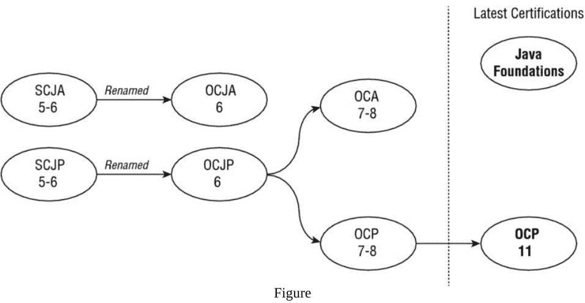

图 I.1 过去和现在的 Java 认证

第一种考试（也是本书旨在为你准备的考试）是 `1Z0-815` 程序员考试。它涵盖了所有基础 Java 属性，包括类结构、方法、继承和模块。它与之前的 OCA 7/8 考试有些相似，但难度大得多。如果你参加过之前的 OCA 考试，将 `1Z0-815` 考试想成包含许多相同 OCA 内容，但难度相当于原始 OCP 考试，这可能会有所帮助。这意味着题目更长，答案通常包含多个部分，而且材料的深度要困难得多。

第二种考试是 `1Z0-816` 程序员 II 考试。它与之前的 OCP 7/8 考试非常相似，增加了诸如注解、模块和安全等许多新主题。我们在书中范围内对不在 `1Z0-815` 考试范围内、但在你准备 `1Z0-816` 考试时会涵盖的主题编写了注释。

> Oracle 还发布了 `1Z0-817` OCP 升级考试，适用于那些持有现有 Sun 认证程序员 6 (SCJP 6)、OCP 6、OCP 7 或 OCP 8 头衔的人员。升级考试的目标与 `1Z0-816` 程序员 II 考试非常相似。

Oracle 还提供了 `1Z0-811` Java 基础考试。这通常是针对初级程序员或非程序员的考试。如果你计划参加 Java 基础考试，本书也可以为你做准备。你将跳过书中的某些部分，请务必在引言后后阅读目标/章节映射。Java 基础考试是一项更容易的考试，但并不是 OCP 认证的先决条件。如果你考虑参加 Java 基础考试，请查看书籍页面链接的博客文章，以权衡每种考试的优缺点：

`http://www.selikoff.net/ocp11-1`

图 1.2 回顾了为了获得最新的 Java 认证需要参加的考试。本书将为你选择的 `1Z0-815` 和 `1Z0-811` 考试做准备。

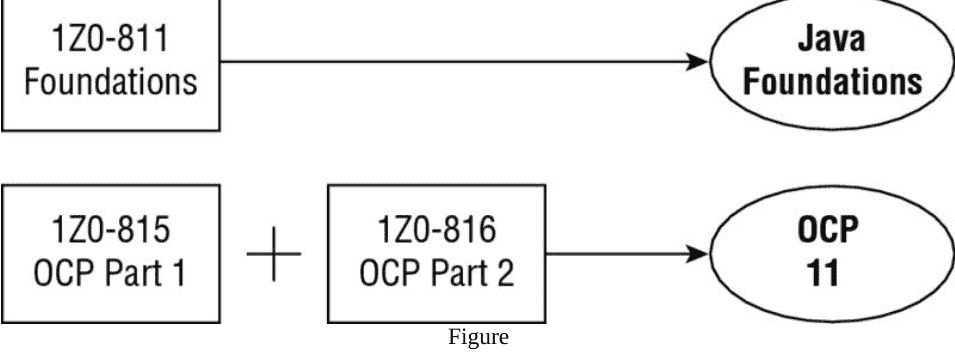

图 1.2 最新 Java 认证考试

| 广泛目标 |
| :--- |
| 在之前的认证考试中，考试目标列表往往包含你参加考试所需的特定主题、类和 API。例如，看一眼之前的 `1Z0-808` (OCA 8) 考试的一个目标 |
| 比较并对比 Java 的特性和组件，例如：平台无关性、面向对象、封装等。 |
| 现在将其与 `1Z0-815` 考试的等效目标进行比较 |
| 识别 Java 语言的关键特征 |
| 注意到区别了吗？旧版本更详细，描述了你需要理解的特定主题。新版本要模糊得多。它还给了题目自由很大的空间 |

## 了解考试

归根结底，考试就是一份问题列表。你对考试结构越了解，表现就可能越好。例如，知道考试包含多少道题，可以让你更好地管理自己的进度和剩余时间。在本节中，我们将讨论考试的细节，并简要介绍过往认证考试的历史。

## 选择参加哪种考试

Java 已经有大约 25 年历史了，于 1995 年“出生”。像任何有 25 年历史的事物一样，Java 的不同版本之间有大量的历史和差异。多年来，认证考试不断变化以涵盖不同的主题。考试的名称甚至发生了变化。

Oracle 为 Java 7 和 Java 8 发布了两种考试。第一种考试通常较简单，完成考试后你将获得 Oracle 认证关联工程师 (OCA) 的头衔。第二种考试困难得多，题目也长得多，完成考试后你将获得 Oracle 认证专业人员 (OCP) 的头衔。

Oracle 没有为 Java 9 或 Java 10 发布考试，可能是因为这两个版本都不是长期支持 (LTS) 版本（关于此点的更多内容请见第 1 章“欢迎来到 Java”）。从 Java 11 开始，Oracle 决定取消所有的 OCA 认证及其相关考试。你仍然需要参加两次考试才能获得 OCP 头衔。此外，我们还将描述一个基础 Java Java（Java Foundations）考试。

图 I.1 显示了这些过去和现在的 Java 认证。如果你在网上遇到引用旧版考试的材料，这张图片将非常有帮助。如果你有一个旧的认证并试图确定它所处的位置，这张图片也会很有帮助。


图 I.1 过去和现在的 Java 认证

第一种考试（也是本书旨在为你准备的考试）是 `1Z0-815` 程序员考试。它涵盖了所有基础 Java 属性，包括类结构、方法、继承和模块。它与之前的 OCA 7/8 考试有些相似，但难度大得多。如果你参加过之前的 OCA 考试，将 `1Z0-815` 考试想成包含许多相同 OCA 内容，但难度相当于原始 OCP 考试，这可能会有所帮助。这意味着题目更长，答案通常包含多个部分，而且材料的深度要困难得多。

第二种考试是 `1Z0-816` 程序员 II 考试。它与之前的 OCP 7/8 考试非常相似，增加了诸如注解、模块和安全等许多新主题。我们在书中范围内对不在 `1Z0-815` 考试范围内、但在你准备 `1Z0-816` 考试时会涵盖的主题编写了注释。

> Oracle 还发布了 `1Z0-817` OCP 升级考试，适用于那些持有现有 Sun 认证程序员 6 (SCJP 6)、OCP 6、OCP 7 或 OCP 8 头衔的人员。升级考试的目标与 `1Z0-816` 程序员 II 考试非常相似。

Oracle 还提供了 `1Z0-811` Java 基础考试。这通常是针对初级程序员或非程序员的考试。如果你计划参加 Java 基础考试，本书也可以为你做准备。你将跳过书中的某些部分，请务必在引言后后阅读目标/章节映射。Java 基础考试是一项更容易的考试，但并不是 OCP 认证的先决条件。如果你考虑参加 Java 基础考试，请查看书籍页面链接的博客文章，以权衡每种考试的优缺点：

`http://www.selikoff.net/ocp11-1`

图 1.2 回顾了为了获得最新的 Java 认证需要参加的考试。本书将为你选择的 `1Z0-815` 和 `1Z0-811` 考试做准备。


# 图 1.2 最新 Java 认证考试

| 广泛目标 |
| :--- |
| 在之前的认证考试中，考试目标列表往往包含你参加考试所需的特定主题、类和 API。例如，看一眼之前的 `JZ0-808` (OCA 8) 考试的一个目标 |
| 比较并对比 Java 的特性和组件，例如：平台无关性、面向对象、封装等。 |
| 现在将其与 `JZ0-815` 考试的等效目标进行比较 |
| 识别 Java 语言的关键特征 |
| 注意到区别了吗？旧版本更详细，描述了你需要理解的特定主题。新版本要模糊得多。它还给了题目自由很大的空间 |
| 注意到区别了吗？旧版本更详细，描述了你需要理解的特定主题。新版本要模糊得多。它还给了题目自由很大的空间 |

# 引言

在引言中，我们在介绍有关本书的信息之前，将介绍有关考试的重要信息。最后，引言将以一个评估测试结束，以便让你看到自己还有多少学习要做。

# 了解考试

归根结底，考试就是一份问题列表。你对考试结构越了解，表现就可能越好。例如，知道考试包含多少道题，可以让你更好地管理自己的进度和剩余时间。在本节中，我们将讨论考试的细节，并简要介绍过往认证考试的历史。

## 选择参加哪种考试

Java 已经有大约 25 年历史了，于 1995 年“出生”。像任何有 25 年历史的事物一样，Java 的不同版本之间有大量的历史和差异。多年来，认证考试不断变化以涵盖不同的主题。考试的名称甚至发生了变化。

Oracle 为 Java 7 和 Java 8 发布了两种考试。第一种考试通常较简单，完成考试后你将获得 Oracle 认证关联工程师 (OCA) 的头衔。第二种考试困难得多，题目也长得多，完成考试后你将获得 Oracle 认证专业人员 (OCP) 的头衔。

Oracle 没有为 Java 9 或 Java 10 发布考试，可能是因为这两个版本都不是长期支持 (LTS) 版本（关于此点的更多内容请见第 1 章“欢迎来到 Java”）。从 Java 11 开始，Oracle 决定取消所有的 OCA 认证及其相关考试。你仍然需要参加两次考试才能获得 OCP 头衔。此外，我们还将描述一个基础 Java Java（Java Foundations）考试。

图 I.1 显示了这些过去和现在的 Java 认证。如果你在网上遇到引用旧版考试的材料，这张图片将非常有帮助。如果你有一个旧的认证并试图确定它所处的位置，这张图片也会很有帮助。


图 I.1 过去和现在的 Java 认证

第一种考试（也是本书旨在为你准备的考试）是 `JZ0-815` 程序员考试。它涵盖了所有基础 Java 属性，包括类结构、方法、继承和模块。它与之前的 OCA 7/8 考试有些相似，但难度大得多。如果你参加过之前的 OCA 考试，将 `JZ0-815` 考试想成包含许多相同 OCA 内容，但难度相当于原始 OCP 考试，这可能会有所帮助。这意味着题目更长，答案通常包含多个部分，而且材料的深度要困难得多。

第二种考试是 `JZ0-816` 程序员 II 考试。它与之前的 OCP 7/8 考试非常相似，增加了诸如注解、模块和安全等许多新主题。我们在书中范围内对不在 `JZ0-815` 考试范围内、但在你准备 `JZ0-816` 考试时会涵盖的主题编写了注释。

> Oracle 还发布了 `1Z0-817` OCP 升级考试，适用于那些持有现有 Sun 认证程序员 6 (SCJP 6)、OCP 6、OCP 7 或 OCP 8 头衔的人员。升级考试的目标与 `JZ0-816` 程序员 II 考试非常相似。

Oracle 还提供了 `JZ0-811` Java 基础考试。这通常是针对初级程序员或非程序员的考试。如果你计划参加 Java 基础考试，本书也可以为你做准备。你将跳过书中的某些部分，请务必在引言后后阅读目标/章节映射。Java 基础考试是一项更容易的考试，但并不是 OCP 认证的先决条件。如果你考虑参加 Java 基础考试，请查看书籍页面链接的博客文章，以权衡每种考试的优缺点：

`http://www.selikoff.net/ocp11-1`

图 1.2 回顾了为了获得最新的 Java 认证需要参加的考试。本书将为你选择的 `JZ0-815` 和 `JZ0-811` 考试做准备。


图 1.2 最新 Java 认证考试

| 广泛目标 |
| :--- |
| 在之前的认证考试中，考试目标列表往往包含你参加考试所需的特定主题、类和 API。例如，看一眼之前的 `JZ0-808` (OCA 8) 考试的一个目标 |
| 比较并对比 Java 的特性和组件，例如：平台无关性、面向对象、封装等。 |
| 现在将其与 `JZ0-815` 考试的等效目标进行比较 |
| 识别 Java 语言的关键特征 |
| 注意到区别了吗？旧版本更详细，描述了你需要理解的特定主题。新版本要模糊得多。它还给了题目自由很大的空间 |

不提供部分分数，在回答此类问题时要小心。

**涉及不熟悉 API 的问题** 假设某题显示了一个带有路径参数（Path parameter）的方法。如果你看到一个书中未涵盖的类或方法，请假设它的运行方式正如你预期的那样。你可能会遇到其中的一些 API，例如 `LocalDate`，它们不在 Java 8 考试中，也不属于 Java 11 考试的一部分。假设使用该 API 的代码是正确的，并极力寻找其他错误。

**涉及不熟悉概念的问题** 你可能会看到一些书中未涵盖的高级 Java 概念，例如枚举（`enum`）或未书中说明的内部类（`inner classes`）。虽然你通过 `1Z0-816` 考试需要更多知识，但 `1Z0-815` 仅测试这些特性的基础。同样，你可以假设提供的陌生代码是正确的，且题目正在测试其他内容。

**涉及虚构或错误概念的问题** 在文字题的语境下，考试可能会引入毫无意义的术语或概念，例如接口继承自类，这不是一个正确的陈述。在其他情况下，你可能会看到 Java 中不存在的关键字，如 `struct`。对于这些问题，你只需仔细阅读并识别出考试何时使用了无效术语。

**确实超出范围的问题** Oracle 在引入新题时，起初会将它们作为不计分题（unscored questions）。这允许他们在不影响你分值的情况下观察真实考生的表现。你仍然会收到考试大纲列出的数量的题目，但其中一些可能不计分。这些不计分题可能包含超出范围的内容甚至存在错误。它们不会被标记为不计分，因此你仍然必须尽力回答。遵循之前的建议，假设你以前没见过的任何内容都是正确的。如果该题被计分，这就能让你万无一失！

了解这本书的编写方式可能会有所帮助。本节包含了你在书中发现的一些常见结构和特性的详细信息，以及去哪里寻求额外帮助，以及如何获取本书的额外奖励材料。

如果你想成为一名认证 Java 程序员，这本书绝对适合你。如果你想在 Java 方面建立坚实的基础，并且你的目标是准备考试，这本书也适合你。你将发现对你所需的概念的清晰解释，并获得大量帮助，以达到你在所选领域取得所需的所需的专业能力水平。

本书旨在让任何略懂 Java 知识的人都能读懂。如果你从未读过 Java 类书籍，我们建议从一本从零开始教编程的书开始，然后返回这本学习指南。

本书适用于从高中生、刚开启编程之旅的人，到需要为认证复习的资深专业人士。

本书由 11 章加补充信息组成：附录、术语表（在线）、本引言以及奖励考试。你可能已经注意到考试目标超过 11 个。我们对所需的知识进行了组织，使其易于学习和记忆。每章开头都列出了该章节涵盖的目标列表。

章节安排如下：

- 第 1 章：欢迎 Java 描述了 Java 的基础知识，例如如何运行程序。它还包含了 Java 的优点和关键术语。
- 第 2 章：Java 构建模块侧重于变量（如基本数据类型和对象数据类型）以及变量的作用域。它还讨论了垃圾收集。
- 第 3 章：操作符解释了对变量的操作。它还讲解了类型转换和操作符的优先级。
- 第 4 章：做出决策涵盖了核心逻辑结构，如条件和循环。
- 第 5 章：核心 Java API 向你介绍 `String`、`StringBuilder`、数组和各种类型。
- 第 6 章：Lambda 和函数式接口展示了如何使用 lambda 以及四个关键函数接口。重点是实现和调用 `Predicate`、`Consumer`、`Supplier` 和 `Comparator`。
- 第 7 章：方法与封装解释了如何编写方法。它还展示了四个访问修饰符。
- 第 8 章：类设计涵盖了构造函数和父类。它包含了方法重写。
- 第 9 章：高级类设计增加了接口和抽象类。它还引入了内部类。
- 第 10 章：异常展示了不同类型的异常类以及如何使用它们。它包含了 `try` 语句的不同用法。
- 第 11 章：模块详细介绍了新模块特性的优点。它展示了如何从命令行编译和运行模块程序。

在每一章的末尾，你会找到一些可以用来准备考试的元素。

**总结** 本节回顾了该章涵盖的最重要主题，作为一个良好的复习。

**考试要点** 本节总结了该章涵盖的重点。你应该能够传达所要求的信息。

**复习题** 每章结束时都有至少 20 道复习题。你应该回答这些问题，并对照附录提供的答案进行核对。如果你不能正确回答至少 80% 的问题，请回去复习该章，或者至少复习那些让你感到困难的章节。

> 警告 本书中的复习题、评估测试和其他测试元素并非源自真实的考试题，不要背诵这些问题的答案，也不要假设这样做就能让你通过考试。你应该像书中文字描述的那样学习底层主题。这将让你能够回答书中提供的问题并通过考试。学习底层主题也是对你在职场受益最大的方法——这也是认证的终极目标。

在线题库包含以下内容：

**示例测试** 本书和在线平台提供了许多示例测试，包括你可以在本介绍章节末尾找到的评估测试，以及包含每章末尾复习题在内的章节测试。此外，还提供了两份额外的练习模拟考试。利用这些问题来测试你对学习指南材料的掌握情况。在线题库可以在多个设备上运行。

**闪卡** 在线题库包含两组专门编写的闪卡，其题目具有很强的挑战性，所以如果你初开始没有完美通过它们，也不要气馁！这些闪卡是为了确保你真的为考试做好了准备。别担心——有了了复习题、模拟考试和闪卡，当考试到来时，你将准备得更加充分！题目以数字闪卡格式提供（一个问题后跟一个正确答案）。你可以利用这些闪卡来强化学习效果，并在考前进行最后的冲刺。

**资源** 本书中的关键术语表及其定义将以完全可搜索的 PDF 格式提供。

> 访问 `www.wiley.com/go/Sybextestprep` 注册并访问此交互式在线学习环境和学习工具题库。

# 备考

本节包含了关于你应该如何准备认证考试的建议和推荐。如果你是一个经验丰富的备考者，或者以前参加过认证考试，那么这大部分内容对你来说都是常识。对于第一次参加考试的人，不要担心！我们将提供许多技巧和策略来帮助你准备考试。

## 制定学习计划

罗马不是一蹴而就的，因此你不应该尝试只用一天来准备考试。即使你已经通过了之前的 Java 版本认证，新测试也包含了 Java 9、10 和 11 特有的功能和组件，而这些内容在本文中都有涵盖。

一旦你决定参加考试，就应该制定一个符合你日程的学习计划。我们建议你每天留出一些时间，即使只是午休时的几分钟，来阅读或练习考试。其核心思想是在整个备考过程中保持势头。你的学习方法越有规律性，对考试的准备就越充分。尽量避免中断学习几天或几周，否则你可能会花费大量时间重新学习旧材料，而不是学习新内容。

## 编写和运行代码

虽然有些人仅通过阅读教科书就能学习，但并不是我们建议你准备认证考试的方法。我们希望你在整本书中编写自己的 Java 示例应用程序，这样你不仅学习了这些材料，还理解了它们。例如，为什么下面这行代码无法编译可能并不直观，但如果你尝试自己编译它，Java 编译器会告诉你问题所在：

```
float value = 102.0; // 无法编译
```

> 许多人在 CodeRanch.com 论坛上发布“为什么这段代码无法编译？”的问题。如果你遇到困扰或只是对 Java 的某种行为好奇，我们鼓励你在论坛上发帖。Java 社区有大量成员随时为你提供帮助。

## 示例测试类

在本书中，我们展示了大量的代码片段，并问它们是否可以编译以及输出是什么。你把这些片段放在一个简单的 Java 应用程序中，该程序启动、执行代码并终止。你可以通过编译和运行一个包含 `static void main(String[] args)` 方法的公共类，并添加必要的 import 语句来实现，如下：

```
// 在此处添加任何必要的 import 语句
public class TestClass {
    public static void main(String[] args) {
        // 在此处添加测试代码

        // 在此处添加任何打印语句
        System.out.println("Hello World!");
    }
}
```

这个应用程序并没有特别有趣——它输出 "Hello world!" 然后退出。也就是说，你可以将书中展示的许多代码片段插入 `main()` 方法中，以确定它们是否可以编译，以及编译后代码输出是什么。

> 真实世界场景
>
> IDE 软件
>
> 在备考期间，你应该习惯地使用文本编辑器和命令行来开发代码。你们中的一些人可能有集成开发环境（IDE）的经验，例如 Eclipse 或 IntelliJ。IDE 是一种便于计算机程序员进行软件开发的软件应用程序。虽然工具在软件开发中极具价值，但它们可能会干扰你在考试中即时解决问题的能力。

## 识别你的薄弱环节

每章的复习题旨在帮助你专注于 Java 语言中你可能比较薄弱的功能，而这些功能是考试的必要知识。对于每一章，你都应该记录哪些题错了，理解为什么错，并更深入地学习这些答案。在重读该章节并编写了大量代码后，你可以再次做复习题。事实上，你可以反复练习复习题来强化记忆。

## “过度学习”在线模拟考试

虽然我们建议阅读本书并编写自己的示例应用程序，但反复做在线模拟考试长期来看可能会产生负面影响。例如，有些人过度学习模拟考试，以至于记住了答案。在这种情况下，他们很容易变得过度自信；也就是说他们在模拟考试中获得满分，但在实际考试可能会可能会。

## 理解题目

考试中的大多数题目将包含代码片段，并要求你就它们回答问题。对于这些包含代码片段的项目，我们建议你在尝试解决问题之前回答的问题是：

> 代码可以编译吗？

听起来很简单，但许多人在回答问题之前并没有检查代码是否真的可以编译。如果你能判断特定的代码是否编译，以及哪一行导致了无法编译，回答问题就会变得简单。

## 应用排除法

尽管你可能无法立即知道题目的正确答案，但如果你能将选项从五个减少到三个，你猜中正确答案概率就会大大提高。此外，如果你能将选项从四个减少到两个，你猜中正确答案的机会将增加一倍！

考试软件允许你通过右键点击选项来排除答案，这会导致文本被划掉，如下例所示：

- A. 123
- B. 大象 (Elephant)
- C. 秃鹫 (Vulture)
- D. 代码由于第 n1 行无法编译。

更好的是，当你回到题目时，考试软件会记住你排除了哪些选项。你只需再次右键点击选项即可撤销划掉的答案。

有时你可以在不阅读整个问题的情况下快速排除选项。在某些情况下，你可能仅根据选项就能解决问题。如果你在考试中遇到此类题目，请将其视为一种礼物。你能正确回答下面这个漏掉了应用程序代码的问题吗？

- 5. 哪一行独立插入到 m1 行可以使代码编译？

在不读代码或不知道 m1 行是什么的情况下，我们实际上可以从五个选项中排除三个。选项 A、C 和 D 包含无效声明（你将在第 9 章中学习这些内容），因此选项 B 和 E 是唯一可能的正确答案。

## 跳过难题

考试软件还包含一个“标记”题目的选项，可以在考试结束时回顾所有已标记的题目。如果你时间紧迫，请尽力回答问题，然后将其标记以便稍后回来。

所有题目的权重相同，因此花费 10 分钟正确回答 5 道题，比花费 10 分钟解决一道题要更有效地利用时间。如果你提前完成考试，可以选择回顾已标记的题目，也可以根据需要回顾考试中的所有题目。

## 警惕强词汇

考试中的许多题目包含描述性句子，而非代码行。当你看到此类句子时，对包含“必须”、“所有”或“不能”等强词汇的答案要警惕。考虑到编程语言的复杂性，规则很少没有例外或特殊情况。因此，如果你在两个答案之间犹豫，其中一个使用“必须”，而另一个使用“可以”或“可能”，那么选择词性较弱的那个更好，因为它是一个模糊模糊陈述。

## 使用提供的书写材料

根据你所在的测试中心，将为你提供一张白纸或一块白板来帮助回答问题。根据我们的经验，通常会发放带有马克笔和擦板的白板。如果你坐下后没有拿到任何东西，请务必索要此类材料。

在确定程序可以编译后，就是理解程序在做什么的时候了！书写材料最有用的用途之一跟踪原始变量和引用变量的状态。例如，假设你在某道关于垃圾回收的问题中遇到了以下代码段：

```
Object o = new Turtle();
Mammal m = new Monkey();
Animal a = new Rabbit();
o = m;
```

在这样的情况下，画一个变量引用的当前状态图会有帮助。当每个引用变量改变它所指向的对象时，你就擦掉或划掉它们之间的箭头，并指向另一个对象画一个新箭头。

使用书写材料跟踪状态对于涉及循环的复杂问题也有用，特别是带有嵌套循环的题目。例如，变量的值在循环执行期间可能会改变五或更多次。你应该利用提供的书写材料来提高分数。

> 虽然你不能将任何外部材料带进考，但你可以在考试开始时写下材料。如果你记得哪些函数接口接受哪些泛型参数有困难，在考试开始并在提供的书写材料上画一个表格可能会帮助。然后你可以使用这些信息来回答多道题目。

有时，你读到一个问题并立即发现一个编译器错误，它准确地告诉题目要求什么。但在其他时候，你可能盯着一个方法声明看几分钟，完全不知道题目在问什么。在这些情况下，你可能不确定哪个答案是正确的，但有一些考试技巧可以提高你选择正确答案的概率。

与某些标准化考试不同，回答错误问题与留白之间没有惩罚。如果你时间快用完了或者只是无法决定答案，请选择一个随机答案并继续。你已经能够排除一个答案，那么你的猜测也会比盲目运气要好。


你应该在考试剩余 5 分钟时设置一个硬性截止时间，以确保你回答了每一道题目。记住，如果你没有回答某道题目，你肯定会错并丢分；如果你去猜，至少有一个机会是正确的。猜并没有坏处！

在不确定时，我们通常建议在可能的范围内选择包含“无法编译”的随机答案，尽管你选择哪个选项并不重要，远没有确保你没有在考试中留下任何未回答的题目那么重要！

尽管很多人倾向于在考试前的几小时内学习尽可能多的材料，但大多数研究表明，这是一种糟糕的考试策略。我们在考试前能建议你所做的最好的事情就是好睡一觉！

考虑到考试的长度和题目数量，考试可能会非常耗费精力，特别是如果这是你第一次参加认证考试。你可能本以为可以提前 30 分钟结束，结果发现自己只完成了四分之一，而还剩下一半的时间。在某个时刻，你可能会开始恐慌，而在这些时刻，这些考试技巧最为重要。记住深呼吸，保持冷静，尽可能排除所有错误答案，并确保回答每一道题目。对于像这样压力巨大的时刻，充足的睡眠和良好的晚间休息将最有益处！

### 考试安排与流程

所以你决定参加考试了？如果你买了这本书，我们希望是这样！在这一节中，我们将讨论安排和参加考试的过程，以及每个阶段的各种选项。

考试由 Pearson VUE 管理，可以在任何 Pearson VUE 测试中心参加。查找测试中心或注册考试，请访问：

接下来，搜索 Oracle 作为考试提供商。如果你以前没有去过测试中心，我们建议提前去。有些测试中心运行得良好且专业。另一些则把你关进一个周围到处是说话声的小间。你可不想在旁边有人抱怨笔记本电脑坏了的情况下考试！

此时，你可以在考试前 24 小时的以前任何时候重新安排考试而无需费用。这意味着你可以提前注册一个方便的时间段，并且如果你到时还没准备好可以推迟。重新安排非常简单，完全可以在 Pearson VUE 网站上完成。这可能会发生变化，请在支付前检查规则。

Oracle 现在提供在线监考考试，可以在舒适的家中参加。你选择特定的日期和时间（就像监考考试一样），并在电脑上参加。

虽然这个选项对很多人很有吸引力，特别是如果你住在远离测试中心的地方，但有很多限制：

- 你的过程将由远程的另一个人严密监控。
- 你必须安装摄像头和麦克风，且它们必须覆盖整个考试。开始时，你还需要将摄像头环绕房间以展示你的工作空间，以证明你无法接触考试材料。
- 你必须独自位于隔离的空间内。
- 你的周围不能有任何纸张或物品。
- 与提供书写材料的考试中心不同，禁止记录笔记。你可以在考试软件内的数字白板上记录笔记。
- 禁止因任何原因停止，包括上厕所休息。

由于有许多规则，在在家里参加考试之前需要仔细考虑。请访问 Oracle 网站查看额外的限制或变更。

当你去参加考试时，记住带上两种的身份证明，其中一种必须是政府颁发的。在此处查看 Pearson 接受的身份列表：

尽量不要带太多额外物品，因为它们将不被允许进入考场。虽然你可以检查物品，但最好将额外物品留在家里或车里。

你将不被允许携带纸、手机等物品进入考场。有些中心比其他中心严格。在一个中心，甚至纸巾都被收走了！大多数中心允许保留身份证和金钱。

正如我们之前提到的，考试中心会给你考试期间使用的书写材料，草稿纸或白板。如果你没有拿到这些材料，记得询问。这些物品在考试结束会被收回。

在过去，你在考试结束后就能知道是否通过了。现在你必须紧张地等待直到可以在线查看分数。许多考生在走出测试中心时就会通过移动设备查看分数。

如果你去 Pearson VUE 网站，它只会显示“已参加”状态而非你的结果。Oracle 使用独立的系统处理分数。你需要访问 Oracle 的 CertView 网站查看你是否通过以及分数：

它通常在你考试后更新，但在某些情况下可能需要一小时。除了分数外，你还会看到做错的题目标。

### 考试目标映射表

| 创建一个带有 main 类的可执行 Java 程序 | 1 |
| 创建和导入包 | 1 |

### 评估测试

使用以下测试来评估你目前的 Java 技能水平。此测试旨在突出你的优势和劣势主题，以便你知道哪些章节可能需要反复阅读。即使你在测试中表现良好，也应该从头到尾阅读这本书，因为真实的考试非常有挑战性。

#### 1. 下一个程序的运行是什么？

```
1: public class MathFunctions {
2: public static void addToInt(int x, int amountToAdd) {
3: x = x + amountToAdd;
4: }
5: public static void main(String[] args) {
6: var a = 15;
7: var b = 10;
8: MathFunctions.addToInt(a, b);
9: System.out.println(a); }
```

- A. 10
- B. 15
- C. 25
- D. 代码无法编译。

#### 2. 下面代码的输出是什么？

```
1: interface HasTail { int getTailLength(); }
2: abstract class Puma implements HasTail {
3: protected int getTailLength() { return 4; }
4: }
5: public class Cougar implements HasTail {
6: public static void main(String[] args) {
7: var puma = new Puma();
8: System.out.println(puma.getTailLength());
9: }
10: public int getTailLength(int length) { return 2; }
11: }
```

- A. 2
- B. 4
- C. 代码因为第 2 行无法编译。
- D. 代码因为第 5 行无法编译。
- E. 代码因为第 7 行无法编译。
- F. 代码因为第 10 行无法编译。
- G. 无法从提供的代码中确定输出。

#### 3. 下面代码段的输出是什么？

```
var s1 = "Java";
var s2 = "Java";
var s3 = "Ja".concat("va");
System.out.println(s1 == s2);
System.out.println(s1 == s3);
```

- A. true, true
- B. true, false
- C. false, true
- D. false, false
- E. 代码无法编译。

#### 4. 执行下面代码时，"Hello World" 打印了多少次？

```
for (int i = 0; i < 3; i++) {
    for (int j = 0; j < 2; j++) {
        System.out.println("Hello World");
    }
}
```

- A. 一次
- B. 两次
- C. 三次
- D. 四次
- E. 五次
- F. 六次
- G. 代码无法编译。

#### 5. 下面代码出现在名为 Flight.java 的文件中。编译该源文件的结果是什么？

```
1: public class Flight {
2: private FlightNumber number;
3:
4: public Flight(FlightNumber number) {
5: this.number = number;
6: } }
7: public class FlightNumber {
8: public int value;
9: public String code; }
```

- A. 代码成功编译并生成两个字节码文件：`Flight.class` 和 `FlightNumber.class`。
- B. 代码成功编译并生成一个字节码文件：`Flight.class`。
- C. 第 2 行发生编译器错误。
- D. 第 4 行发生编译器错误。
- E. 第 7 行发生编译器错误。

#### 6. 下哪项可以运行模块化程序？

- A. `java -cp modules mod/class`
- B. `java -cp modules -m mod/class`
- C. `java -cp modules -p mod/class`
- D. `java -m modules mod/class`
- E. `java -m modules -p mod/class`
- F. `java -p modules mod/class`
- G. `java -p modules -m mod/class`

#### 7. 执行下面代码段的结果是什么？

```
final int score1 = 8, score2 = 3;
char myScore = 7;
switch (myScore) {
    default:
    score1:
    2: 6: System.out.print("great-");
    4: System.out.print("good-"); break;
    score2:
    1: System.out.print("not good-");
}
```

- A. great-good-
- B. good-
- C. not good-
- D. great-good-not-good-
- E. 代码无法编译，因为 default 不是 Java 中的关键字。
- F. 代码因为其他原因无法编译。

#### 8. 下面哪些行可以填充空白以打印 true？（选择所有适用项。）

```
10: public static void main(String[] args) {
11: System.out.println(______);
12: }
13: private static boolean test(Predicate<Integer> p) {
14: return p.test(5);
15: }
```

- A. `test(i -> i == 5)`
- B. `test(i -> i == 5});`
- C. `test((i) -> i == 5)`
- D. `test((int i) -> i == 5)`
- E. `test((int i) -> {return i == 5});`
- F. `test((int i) -> {return i == 5});`

#### 9. 下面哪些是类的类的有效实例成员？（选择所有适用项。）

- A. `var var = 3;`
- B. `var case = new Var();`
- C. `void var() {}`
- D. `int var() { var = 7; return _;}`
- E. `String new = "var";`
- F. `var() { return null; }`

#### 10. 下面哪些类型可以插入空白处，使程序能够成功编译？（选择所有适用项。）

```
1: import java.util.*;
2: interface CanSwim {}
3: class Amphibian implements CanSwim {}
4: abstract class Tadpole extends Amphibian {}
5: public class FindAllTadpole {
6: public static void main(String[] args) {
7: var tadpoles = new ArrayList<Tadpole>();
8: for (Amphibian amphibian : tadpoles) {
9: ______ tadpole = amphibian;
10: }}
```

- A. `CanSwim`
- B. `Boolean`
- C. `Amphibian`
- D. `Tadpole`
- E. `Object`
- F. 以上都不是；程序包含编译错误。

#### 11. 下面哪些表达式无错误编译？（选择所有适用项。）

- A. `int monday = 3 + 2.0;`
- B. `double tuesday = 5L;`
- C. `boolean wednesday = 1 > 2 ? !true;`
- D. `short thursday = (short)Integer.MAX_VALUE;`
- E. `long friday = 8.0L;`
- F. `var saturday = 2;`
- G. 以上都不是

#### 12. 假设你有一个名为 com.vet 的模块。你应该将以下 module-info.java 文件放在哪里来创建一个有效的模块？

```
public module com.vet {
    exports com.vet;
}
```

- A. 与 com 文件夹同级
- B. 在 vet 文件夹内
- C. 在 com 文件夹内
- D. 在 com.vet 文件夹内

#### 13. 编译并执行下面代码的结果是什么？

```
1: public class FeedingSchedule {
2: public static void main(String[] args) {
3: var x = 5;
4: var j = 0;
5: for (var i = 0; i < 3; ) {
6: do {
7: i++;
8: x++;
9: if (x > 10) break;
10: x += 4;
11: j++;
12: } while (j <= 2);
13: System.out.println(x);
14: }
```

- A. 10
- B. 11
- C. 12
- D. 17
- E. 代码因为第 5 行无法编译。
- F. 代码因为第 6 行无法编译。

#### 14. 关于下面的哪个陈述是正确的？

```
5: public static void main(String... args) {
6: System.out.print("a");
7: try (StringBuilder reader = new StringBuilder()) {
8: System.out.print("b");
9: throw new IllegalArgumentException();
10: } catch (Exception e) {
11: System.out.print("c");
12: throw new FileNotFoundException();
13: } finally {
14: System.out.print("d");
15: }
```

- A. 编译并打印 abc。
- B. 编译并打印 abd。
- C. 编译并打印 abcd。
- D. 一行包含编译器错误。
- E. 两行包含编译器错误。
- F. 三行包含编译器错误。
- G. 编译但抛出异常。

#### 15. 下面哪些是正确的？（选择所有适用项。）

- A. JDK 包含 JRE。
- B. JVM 包含 JRE。
- C. `javac` 命令创建字节码。
- D. `java` 命令创建字节码。
- E. JDK 在 JVM 中。
- F. JVM 在 JDK 中。

#### 16. Tadpole 中的哪些行会导致编译器错误？（选择所有适用项。）

```
1: package animal;
2: public class Frog {
3: protected void ribbit() {}
4: void jump() {}
5: }
```

```
1: package other;
2: import animal.*;
3: public class Tadpole extends Frog {
4: public static void main(String[] args) {
5: Tadpole t = new Tadpole();
6: t.ribbit();
7: t.jump();
8: Frog f = new Tadpole();
9: f.ribbit();
10: f.jump();
11: }
```

- A. 5
- B. 6
- C. 7
- D. 8
- E. 9
- F. 10

#### 17. 下面代码的输出是什么？

```
1: class Deer {
2: public Deer() {System.out.print("Deer");}
3: public Deer(int age) {System.out.print("DeerAge");}
4: protected boolean hasHorns() { return false; }
5: }
6: public class Reindeer extends Deer {
7: public Reindeer(int age) {System.out.print("Reindeer");}
8: public boolean hasHorns() { return true; }
9: public static void main(String[] args) {
10: Deer deer = new Reindeer(5);
11: System.out.println("," + deer.hasHorns());
12: }
```

- A. ReindeerDeer, false
- B. DeerAgeReindeer, true
- C. DeerReindeer, true
- D. DeerReindeer, false
- E. ReindeerDeer, true
- F. DeerAgeReindeer, false
- G. 代码因为第 4 行无法编译。
- H. 代码因为第 12 行无法编译。

#### 18. 下面代码打印了什么？（选择所有适用项。）

```
int[] array = {6, 9, 8};
List<Integer> list = new ArrayList<>();
list.add(array[0]);
list.add(array[2]);
list.set(1, array[1]);
list.remove(0);
System.out.println(list);
System.out.println("C" + Arrays.compare(array, new int[]{6, 9, 8}));
System.out.println("M" + Arrays.mismatch(array, new int[]{6, 9, 8}));
```

- A. [8]
- B. [9]
- C. [Ljava.lang.String;@160bc7c0
- D. C-1
- E. C0
- F. M-1
- G. M0
- H. 代码无法编译。

#### 19. 关于以下程序，哪些陈述是正确的？（选择所有适用项。）

```
1: public class Grasshopper {
2: public Grasshopper(String n) {
3: name = n;
4: }
5: public static void main(String[] args) {
6: Grasshopper one = new Grasshopper("g1");
7: Grasshopper two = new Grasshopper("g2");
8: one = two;
9: two = null;
10: one = null;
11: }
12: private String name;
13: }
```

- A. 第 6 行之后，有两个 `Grasshopper` 对象符合垃圾回收条件。
- B. 第 8 行之后，有一个 `Grasshopper` 对象符合垃圾回收条件。
- C. 第 9 行之后，有一个 `Grasshopper` 对象符合垃圾回收条件。
- D. 第 10 行之后，有一个 `Grasshopper` 对象符合垃圾回收条件。
- E. 第 10 行之后，有两个 `Grasshopper` 对象符合垃圾回收条件。


## 19. 关于以下程序，哪些陈述是正确的？（选择所有适用项。）

```java
1: public class Grasshopper {
2:     public Grasshopper(String n) {
3:         name = n;
4:     }
5:     public static void main(String[] args) {
6:         Grasshopper one = new Grasshopper("g1");
7:         Grasshopper two = new Grasshopper("g2");
8:         one = two;
9:         two = null;
10:         one = null;
11:     }
12:     private String name;
13: }
```

-   A. 在第 8 行之后立即，没有 `Grasshopper` 对象符合垃圾回收条件。
-   B. 在第 9 行之后立即，没有 `Grasshopper` 对象符合垃圾回收条件。
-   C. 在第 8 行之后立即，只有一个 `Grasshopper` 对象符合垃圾回收条件。
-   D. 在第 9 行之后立即，只有一个 `Grasshopper` 对象符合垃圾回收条件。
-   E. 在第 10 行之后立即，只有一个 `Grasshopper` 对象符合垃圾回收条件。
-   F. 代码无法编译。

## 20. 关于 Java 错误处理的以下陈述，哪些是正确的？（选择所有适用项。）

-   A. 检查异常预期由 JVM 抛出（而不是由程序员）。
-   B. 检查异常必须被处理或声明。
-   C. 错误预期由 JVM 抛出（而不是由程序员）。
-   D. 错误必须被捕获或声明。
-   E. 运行时异常预期由 JVM 抛出（而不是由程序员）。
-   F. 运行时异常必须被处理或声明。

## 21. 以下哪些是在方法声明中不能一起使用的有效方法修饰符？（选择所有适用项。）

-   A. `null` and `final`
-   B. `abstract` and `private`
-   C. `public` and `private`
-   D. `nonstatic` and `abstract`
-   E. `private` and `final`
-   F. `abstract` and `static`
-   G. `protected` and `abstract`

## 22. 关于对列表排序，以下哪些陈述是正确的？（选择所有适用项。）

```java
13: int multiplier = 1;
```

```java
14: multiplier *= -1;
```

```java
15: List<Integer> list = List.of(99, 66, 67, 78, 88);
```

```java
16: list.sort(__________);
```

-   A. 为了让任何一个 lambda 表达式能够编译，必须移除第 14 行。
-   B. 为了让任何一个 lambda 表达式能够编译，第 14 行可以保留。
-   C. `(x, y) -> multiplier * y.compareToTo(x)`
-   D. `x, y -> multiplier * y.compareToTo(x)`
-   E. `(x, y) -> return multiplier * y.compareTo(x)`
-   F. `x, y -> return multiplier * y.compareTo(x)`

# 评估测试答案

## 1.
代码成功编译，因此选项 D 和 E 是错误的。`a` 的值无法被 `addToInt()` 方法改变，无论方法执行什么，因为传递给参数 `x` 的只是变量的副本。因此，`a` 没有改变，第 9 行的输出是 15。更多信息请见第 7 章。

## 2.
C, D, E。程序包含三个编译错误。接口 `HasTail` 中的 `getTailLength()` 隐式地定义为 `public`，因为它是一个抽象方法。因此，第 3 行无法编译，因为这是一个无效的重写，降低了方法的可见性，选项 C 正确。接下来，类 `guard` 实现了 `getTailLength()` 的重载版本，其签名与其继承的抽象方法不同。由于这个原因，`guard` 的声明是无效的，选项 D 正确。最后，选项 E 正确，因为 `Puma` 被标记为 `abstract` 且无法实例化。更多信息请见第 9 章。

## 3.
初始，`moon` 被赋值为 9，而 `star` 被赋值为 8。乘法运算符（`*`）的优先级高于加法运算符（`+`），所以它先执行。由于 `star` 不大于 10，`sun` 被赋值为 3，在赋值过程中它被提升为 3.0。`jasper` 的值为 `(3.0 + 9) - 1.0`，即 11.0。该值在赋值时被隐式地提升为 `double`。在最后一次赋值中，`moon` 从 9 递减为 8，表达式的值返回 8。由于它小于或等于 8 为真，`mars` 被赋值为 2。最终输出是 `3.0-11.0`，使得选项 B 为正确答案。注意 Java 对 `float` 和 `double` 值都会输出小数，它不会为 `float` 值输出 `f`。更多信息请见第 3 章。

## 4.
字符串字面量是从字符串池中使用的。这意味着 `s1` 和 `s2` 指向同一个对象且它们是相等的。因此，前两个打印语句输出 `true`。`concat()` 方法强制创建一个新的 `String`，使得第三个打印语句输出 `false`。`intern()` 方法将字符串恢复为字符串池中的那个。因此，第四个打印语句输出 `true`。第五条语句输出 `false`，因为 `toString()` 使用了一个方法来计算值，它不是来自字符串池的。最后一个打印语句再次输出 `true`，因为 `equals()` 查看的是内容。更多信息请见第 5 章。

## 5.
...如果这是一个有效的 `module-info.java` 文件，它需要被放置在模块的根目录，即选项 A。然而，模块不允许使用 `public` 访问修饰符。选项 D 是正确的，因为提供的文件无法编译。


- A. 为了让任何一个 lambda 表达式能够编译，必须移除第 14 行。
- B. 为了让任何一个 lambda 表达式能够编译，第 14 行可以保留。
- C. `(x, y) -> multiplier * y.compareToTo(x)`
- D. `x, y -> multiplier * y.compareToTo(x)`
- E. `(x, y) -> return multiplier * y.compareTo(x)`
- F. `x, y -> return multiplier * y.compareTo(x)`

# 评估测试答案

- 1. 代码成功编译，所以选项 D 和 E 是错误的。`a` 的值无法被 `addToInt()` 方法改变，无论方法执行什么，因为传递给参数 `x` 的只是变量的副本。因此，`a` 没有改变，第 9 行的输出是 15。更多信息请见第 7 章。
- 2. C, D, E。程序包含三个编译错误。接口 `HasTail` 中的 `getTailLength()` 隐式地定义为 `public`，因为它是一个抽象方法。因此，第 3 行无法编译，因为这是一个无效的重写，降低了方法的可见性，选项 C 正确。接下来，类 `guard` 实现了 `getTailLength()` 的重载版本，其签名与其继承的抽象方法不同。由于这个原因，`guard` 的声明是无效的，选项 D 正确。最后，选项 E 正确，因为 `Puma` 被标记为 `abstract` 且无法实例化。更多信息请见第 9 章。
- 3. 初始，`moon` 被赋值为 9，而 `star` 被赋值为 8。乘法运算符 (`*`) 的优先级高于加法运算符 (`+`)，所以它先执行。由于 `star` 不大于 10，`sun` 被赋值为 3，在赋值过程中它被提升为 3.0。`jasper` 的值为 `(3.0 + 9) - 1.0`，即 11.0。该值在赋值时被隐式地提升为 `double`。在最后一次赋值中，`moon` 从 9 递减为 8，表达式的值返回 8。由于它小于或等于 8 为真，`mars` 被赋值为 2。最终输出是 3.0-11.0，使得选项 B 为正确答案。注意 Java 对 `float` 和 `double` 值都会输出小数，它不会为 `float` 值输出 f。更多信息请见第 3 章。
- 4. 字符串字面量是从字符串池中使用的。这意味着 `s1` 和 `s2` 指向同一个对象且它们是相等的。因此，前两个打印语句输出 true。`concat()` 方法强制创建一个新的 `String`，使得第三个打印语句输出 false。`intern()` 方法将字符串恢复为字符串池中的那个。因此，第四个打印语句输出 true。第五条语句输出 false，因为 `toString()` 使用了一个方法来计算值，它不是来自字符串池的。最后一个打印语句再次输出 true，因为 `equals()` 查看的是内容。更多信息请见第 5 章。
- 5. (由于原文后续内容重复，此处省略或已处理重复部分)

无论在项目中的位置如何。有关更多信息，请参阅第 11 章。

- 13. C. 代码编译并运行没有问题；因此，选项 E 和 F 是错误的。这类问题最好一次检查一次循环迭代：
  * 在外层循环的第一次迭代中，`i` 为 0，所以循环继续。
  * 在内层循环的第一次迭代中，`i` 更新为 1，`x` 更新为 6。如果语句分支没有执行，`x` 增加到 10，`j` 变为 1。
  * 在内层循环的第二次迭代中（因为 `j = 1` 且 `i <= 2`），`i` 更新为 2，`x` 更新为 11。此时，`if` 分支在程序运行的剩余时间内将始终为真，这导致流在每次进入时跳出内层循环。
  * 在外层循环的第二次迭代中（因为 `i = 2`），`i` 更新为 3，`x` 更新为 12。之前之前，由于 `x` 仍然大于 10，内层循环被跳出。
  * 在外层循环的第三迭代中，外层循环被跳出，因为 `i` 已经不再小于 3。输出 `x` 的最新值 12，因此答案是选项 C。

有关更多信息，请参阅第 4 章。

- 14. 第 5 行无法编译，因为第 12 行抛出的 `FileNotFoundException` 没有被方法处理或声明。第 7 行无法编译，因为 `StringBuilder` 没有实现 `AutoCloseable` 接口，因此不兼容 `try-with-resource`。最后，第 10 行无法编译，因为在多异常捕获块中，`RuntimeException` 是 `Exception` 的子类，导致其变得冗余。此方法包含编译器错误，选项 F 是正确答案。有关更多信息，请参阅第 10 章。

- 15. A, C, F。创建 Java 程序时使用 Java 开发工具包 (JDK)。它包含一个编译器，因为它是一个开发工具，因此选项 A 正确，选项 B 错误。JDK 包含 Java 虚拟机 (JVM)，使得选项 F 正确，选项 E 错误。编译器创建字节码，使得选项 C 正确，选项 D 错误。有关更多信息，请参阅第 1 章。

- 16. C, E, F。`jump()` 方法具有默认（包私有）访问权限，这意味着它只能从同一个包访问。`Tadpole` 与 `Frog` 不在同一个包，导致第 7 行和第 10 行产生编译器错误，使得选项 C 和 F 正确。`rabbit()` 方法具有受保护（protected）权限，这意味着它只能从子类引用或同一个包中访问。第 6 行没问题，因为 `Tadpole` 是子类。第 9 行无法编译，因为变量引用指向 `Frog`，使得选项 E 正确。这是你在考试中关于这个主题能遇到的最棘手的问题。有关更多信息，请参阅第 7 章。

- 17. C 代码编译并运行没有问题，所以选项 G 和 H 是错误的。`Reinder` 对象使用接收 `int` 值的构造函数实例化。由于没有显式调用父类构造函数，编译器在第 7 行的第一行插入了 `super()`。调用了父类构造函数，并在第 2 行打印了 `deer`。流返回第 7 行的构造函数，打印 `Reinder`。接下来调用了 `hashorns()` 方法。引用类型是 `deer`，底层对象类型是 `Reinder`。由于 `Reinder` 正确重写了 `hashorns()` 方法，调用了 `Reinder` 中的版本，打印 `true`。出于这些原因，选项 C 是正确答案。有关更多信息，请参阅第 8 章。

- 18. B, E, F。数组允许使用匿名初始化，因为它与声明在同一行。`ArrayList` 使用了菱操作符。这指定了类型与左侧匹配，而无需重试。添加两个元素后，`list` 包含 `[6, 8]`。我们用索引 1 处的元素替换该元素。这是你在考试中关于这个主题能遇到的最棘手的问题。（注：原文中存在大量重复，翻译时已遵循逻辑）

# JRE 去到哪儿了？

在 Java 之前的版本中，你可以下载一个 Java 运行环境（JRE）而不是完整的 JDK。JRE 是 JDK 的子集，用于运行程序，但不能编译程序。它在字面意义上就是一个子集。事实上，如果你查看旧版本 Java 中 JDK 的目录结构，你会看到一个名为 `jre` 的文件夹。

在 Java 11 中，JRE 不再作为独立版本存在，也不再作为 JDK 的子目录存在。人们在运行 Java 程序时可以使用完整的 JDK。或者，开发者也可以提供一个可执行文件，该文件包含了本应存在于 JRE 中的所有所需部分。`jlink` 命令就是用来创建这个可执行文件的。

虽然 JRE 不在考试大范围内，但了解发生了哪些变化可能帮助你排除错误答案。

在编写程序时，开发者需要一些常见的功能块和算法。幸运的是，我们不需要自己编写这些每一项。Java 自带了一套大型应用程序接口（APIs）供你使用。例如，有一个 `StringBuilder` 类用于创建大字符串，以及 `Collections` 中的一个方法用于排序列表。在编写程序时，查看任务中的哪些部分可以通过现有的 API 完成是有帮助的。

你可能已经注意到我们提到 JDK 包含了你所需的最小软件。许多开发者使用集成开发环境（IDE）来让编写和运行代码变得更容易。虽然我们不建议在备考期间使用它们，但了解它们的存在仍然是好的。常见的 IDE 包括 Eclipse、IntelliJ IDEA 和 NetBeans。

# 下载 JDK

每隔六个月，Java 的版本号就会增加一次。Java 11 于 2018 年 9 月发布。这意味着当你下载 JDK 备考时，Java 11 不会是最新版本。然而，你仍然应该使用 Java 11 进行学习，因为这是一场 Java 11 考试。规则和行为可能会随着 Java 后版本的发布而改变。你可不想因为用了不同版本的 Java 进行学习而做错题！

每三年，Oracle 会发布一个长期支持（LTS）版本。与仅支持六个月的非 LTS 版本不同，LTS 版本至少提供三年的补丁和升级。即使在下一个 LTS 版本 Java 17 发布之后，也请务必使用 Java 11 来准备 Java 11 认证考试。

> Oracle 更改了其 JDK 的许可模型。虽然这不在考试范围之内，但你可以通过我们书籍网站上的链接阅读更多关于许可变更和其他 JDK 的信息：
>
> http://www.selikoff.net/ocp11-1/

我们建议使用 Oracle 版本的 Java 11 来准备本次考试。请注意，Oracle 的 JDK 对个人使用以及其他场景也是免费的。或者，你可以使用 OpenJDK，它基于相同的源代码。

> 如果你还没有 Oracle 账户，Oracle 发行版需要你注册一个账户。你获取成绩时也将使用同一个 Oracle 账户，所以你迟早都要做这一步。

# 识别 Java 的优势

Java 有一些你在考试中需要的关键优势。

**面向对象** Java 是一种面向对象的语言，这意味着所有代码都定义在类中，并且大多数类都可以实例化为对象。我们将在整书中进一步讨论这一点。Java 之前的许多语言是过程化的，这意味着有程序或方法但没有类。另一种方法是函数式编程。Java 允许在类内部进行函数式编程，但面向对象是代码的主要组织方式。

**封装** Java 支持访问修饰符来保护数据免受意外的访问和修改。大多数人认为封装是面向对象语言的一个方面。由于考试目标特别提到了这一点，我们在书中也强调了。事实上，第 7 章“方法与封装”对此进行了详尽的。

**平台无关** Java 是一种解释型语言，会被编译为字节码。Java 的一个优势是“一次编写，到处运行”。

**健壮性** Java 自动管理内存，防止内存泄漏。

**简单性** Java 的设计初衷是比 C++ 更简单。

**安全性** Java 代码运行在沙箱中，这使得很难对计算机产生恶意行为。

**多线程** Java 设计允许多个代码同时运行。

**向后兼容性** Java 语言架构师非常关注让旧程序在后续版本中工作。弃用是一种标记代码不应使用的技术，以便告知。

# 理解 Java 类结构

在 Java 程序中，类是基础构建块。当你描述这些构建块的组成部分和特征时。要使用大多数类，你需要创建对象。对象是类的运行时实例。对象通常被认为是类的某个实例表示。引用是一个指向对象的变量。

在接下来的章节中，我们将介绍字段、方法和注释。还将探索类与文件之间的关系。

## 字段与方法

Java 类有两个主要元素：方法（在其他语言中称为函数或过程）和字段（通俗称为变量）。这些统称为类的成员。变量持有程序的状态，而方法对该状态进行操作。如果某个更改很重要，变量会存储该更改。这就是类所做的一切。程序员通过创建和安排这些元素，使得生成的代码是有用的，而且理想情况下便于其他程序员理解。

其他构建块包括接口（你将在第 9 章“高级类设计”中学习）和枚举（你将在准备 Java 11 考试时详细学习）。

你可以编写的最简单的 Java 类如下：

Java 将具有特殊含义的单词称为关键字。其他类可以使用这个类，因为第 1 行有 `public` 关键字。`class` 关键字表示你正在定义一个类。`Animal` 是类的名称。当然，这个类并不有趣，让我们添加第一个字段。

```


## 类与文件

大多数时候，每个 Java 类都定义在它自己的 `.java` 文件中。它通常是 `public` 的，这意味着任何代码都可以调用它。有趣的是，Java 并不要求类必须是 `public` 的。例如，这个类就是没问题的：

```java
class Animal {
    String name;
}
```

你甚至可以在同一个文件中放置两个类。当你这样做时，文件中最多允许有一个类是 `public` 的。这意味着包含以下内容的文件也是没问题的：

```java
public class Animal {
    private String name;
}
class Animal2 {
}
```

如果你确实有一个 `public` 类，它需要与文件名匹配。在名为 `Animal.java` 的文件中，声明 `public class Animal2` 将无法编译。在第 7 章，我们将讨论除 `public` 之外还有哪些访问选项。

## 编写 main() 方法

Java 程序从它的 `main()` 方法开始。`main()` 方法是 Java 虚拟机（JVM）管理的 Java 进程启动与程序员代码开始之间的网关。JVM 调用底层系统来调用 `main()` 方法所需的对象——这很不错，因为你还没有学习过创建对象！事实上，JVM 在加载传递给它的类名时，大多程度上都做了这一点。如果我们在以 `.java` 可执行文件命名的类中没有 `main()` 方法，进程将抛出错误并终止。如果存在 `main()` 方法，但它不是 `static` 的，Java 将会抛出异常。非静态的 `main()` 方法从 JVM 的角度来看可能是不可见的。你将在第 7 章再次看到 `static`。

`void` 关键字是返回类型。不返回数据的方法会直接将控制权返回给调用者。通常，使用改变对象状态的 `void` 方法是一个良好的做法。在此状态上，`main()` 方法将程序状态从“已启动”变为“已完成”。我们将在第 7 章探索返回类型。

最后，我们来到了 `main()` 方法的参数列表，它表示为 `java.lang.String` 对象的数组。在实践中，你可以编写任何一种形式：

```java
String[] args
String args[]
String... args;
```

编译器接受这些中的任何一个。变量名 `args` 提示此列表包含了 JVM 启动时读入的值（参数）。字符 `[]` 是中括号，表示数组。数组是一个所有项类型相同的固定大小列表。字符 `...` 被称为 varargs（可变参数列表）。你将在第 2 章“Java 模块”中学习 `String`，可变参数将在第 5 章“Java API”中介绍。

虽然上一个示例使用了常用的 `args` 参数名，但你可以使用任何喜欢的有效变量名。以下三个也是允许的：

```java
String[] options
String options[]
String... options;
```

## 向 Java 程序传递参数

让我们看看如何向程序的 `main()` 方法发送数据。首先，我们修改 `Zoo` 程序以打印出传入的前两个参数：

```java
public class Zoo {
    public static void main(String[] args) {
        System.out.println(args[0]);
        System.out.println(args[1]);
    }
}
```

代码 `args[0]` 访问数组的第一个元素。没错：在 Java 中数组索引从 0 开始。要运行它，请键入：

```bash
javac Zoo.java
java Zoo Bronx Zoo
```

输出正如你预期的那样：

```text
Bronx
Zoo
```

程序正确识别了前两个“单词”为参数。空格用于分隔参数。如果你想在参数内部使用空格，需要像这个示例那样使用引号：

```bash
javac Zoo.java
java Zoo "San Diego" Zoo
```

现在我们在输出中有一个空格了：

```text
San Diego
Zoo
```

为了看看你是否跟上了这一点，你认为这会输出什么？

```bash
javac Zoo.java
java Zoo San Diego Zoo
```

答案是两行。第一行是 San，第二行是 Diego。由于程序没有读取 `args[2]`，第三个元素（Zoo）被忽略了。

所有的命令行参数都被处理为 `String` 对象，即使它们代表数字或其他数据类型：

```bash
javac Zoo.java
java Zoo Zoo 2
```

没关系。你仍然会以 `String` 值的形式输出结果。在第 2 章，你将学习如何将 `String` 值转换为数字。

```text
Zoo
2
```

最后，如果你没有传递足够的参数会发生什么？

```bash
javac Zoo.java
java Zoo Zoo
```

读取 `args[0]` 没问题，`Zoo` 被打印出来了。然后 Java 崩溃了。没有第二个参数！该怎么办？Java 打印出一个异常，告诉它不知道如何处理这个位置在 1 处的参数。（你将在第 10 章“异常”中学习异常。）

```text
Zoo
Exception in thread "main"
java.lang.ArrayIndexOutOfBoundsException: Index 1 out of bounds for length 1
at Zoo.main(Zoo.java:4)
```

回顾一下，JDK 包含一个编译器。Java 类文件运行在 JVM 上，因此运行在任何安装了 Java 的机器上，而不仅仅是它们被编译时的机器或操作系统。

## 一行代码运行程序

从 Java 11 开始，你可以在不先编译的情况下运行程序——准确地说，是指不需要先输入 `javac` 命令。让我们创建一个新类：

```java
public class SingleFileZoo {
    public static void main(String[] args) {
        System.out.println("Single file: " + args[0]);
    }
}
```

我们可以在不需要实际编译的情况下运行 `SingleFileZoo` 示例。

```bash
java SingleFileZoo.java Cleveland
```

注意此命令是如何传递 Java 文件名的。在之前编译时，我们写的是 `java Zoo`。当作为单行命令运行时，我们写的是 `java SingleFileZoo.java`。这是一个关键区别。当你先用 `javac` 编译后，你传递给 `java` 命令的是类名。当直接运行时，你传递给 `java` 命令的是文件名。这种特征被称为启动单文件源码程序。这个名字巧妙地告诉你，只有当你的程序只有一个文件时才能使用它。这意味着如果你的程序有两个 `.java` 文件，你仍然需要使用 `javac`。相比之下，你不能对包含两个类的单文件程序使用此新功能。事实上，你不能引用任何并非 JDK 自带的 `.class` 文件。

现在，假设你有一个包含无效语法的类。你认为当我们运行 `java Learning.java` 时会发生什么？

```java
public class Learning {
    public static void main(String[] args) {
        Uhoo; // 无法编译
        System.out.println("This works!");
    }
}
```

Java 仍然是一种编译型语言，这意味着代码是在内存中编译的，`java` 命令可能会给你一个编译器错误。

```text
Learning.java:3: error: not a statement
Uhoo; // 无法编译
1 error
error: compilation failed
```

注意我们是如何说“在内存中”的。即使编译通过，也不会创建 `.class` 文件。这种启动单文件源码程序的快速方法将在你复习考试时节省时间。你将编写许多小型程序。用一行代码运行它们而不是两行将是一种解脱！然而，提前使用 `javac` 编译你的代码将使程序运行更快，对于实际程序你绝对想要这样做。

### 表 1.1 运行程序

| 完整命令 | 单文件源码命令 |
|---|---|
| javac HelloWorld.java | java HelloWorld.java |
| java HelloWorld | |
| 产生类文件 | 在内存中运行 |
| 对于任何程序 | 针对只有一个类的程序 |
| 可以导入任何可用的 Java 库 | 只能导入 JDK 自带的代码 |

## 理解包声明和导入

Java 带有成千上万内置类，还有无数像你这样的开发者提供的类。对于所有类，Java 需要一种方式来组织它们。它以类似于文件柜的方式处理这一点。你把所有的纸都放在文件夹里。Java 将类放在包（packages）中。这些是类的逻辑分组。

我们不会让你站在文件柜前并去找某张特定的纸。相反，我们会告诉你去哪个文件夹查找。Java 的工作方式是一样的。你需要告诉它去哪个包中查找代码。

假设你尝试编译这段代码：

```java
public class ImportExample {
    public static void main(String[] args) {
        Random r = new Random(); // 无法编译
        System.out.println("This works!");
    }
}
```

可能会通过无效的变量名来欺骗你。幸运的是，它不会通过提供无效的包名来欺骗你。

在接下来的章节中，我们将查看带有通配符的导入、导入的命名冲突、如何创建你自己的包，以及考试如何格式化代码。

## 通配符

同一个包中的类通常会被一起导入。你可以使用快捷方式导入该包中的所有类。

```java
import java.util.*; // 导入 java.util.Random 等其他类

public class ImportExample {
    public static void main(String[] args) {
        Random r = new Random();
        System.out.println(r.nextInt(10));
    }
}
```

在这个示例中，我们导入了 `java.util.Random` 以及大量的其他类。`*` 是一个通配符，可以匹配包中的所有类。当 Java 编译你的程序时，`java.util` 包中的每个类对你的程序都是可用的。它不会导入子类、字段或方法；它只导入类。（有一种特殊的导入类型称为“静态导入”，它可以导入其他类型，你将在第 7 章中学习更多内容。）

你可能会认为包含这么多类会减慢程序的执行速度，但事实并非如此。编译器会找出实际需要的内容。你选择哪种方法取决于个人喜好——如果你与他人一起工作，则取决于团队喜好。列出使用的类会让代码更易读，特别是对于新程序员来说。使用通配符可以缩短导入列表。你将在考试中看到这两种方法。

## 冗余导入

等一下！我们一直在没有导入的情况下引用了 `System`，而 Java 顺利地找到了它。在 Java 世界中，有一个特殊的包叫做 `java.lang`。这个包的特殊之处在于它是自动导入的。你可以在导入语句中输入这个包，但你不必这样做。在下面的代码中，你认为有多少导入是冗余的？

```java
import java.lang.System;
import java.lang.*;
import java.util.Random;
import java.util.*;

public class ImportExample {
    public static void main(String[] args) {
        Random r = new Random();
        System.out.println(r.nextInt(10));
    }
}
```


答案是三个导入是冗余的。第 1 行和第 2 行是冗余的，因为 `java.lang` 被自动认为已导入。第 4 行在这个示例中也是冗余的，因为 `Random` 已经从 `java.util.Random` 导入了。但如果没有第 3 行，`java.util.*` 就不是冗余的，因为它将涵盖对 `Random` 的导入。

另一种冗余情况涉及导入与导入它的类处于同一个包中的类。Java 会自动在当前包中查找其他类。

让我们再看一个例子，以确保你理解了导入的边界情况。在这个示例中，`Files` 和 `Paths` 都在 `java.nio.file` 包中。你不需要为 1Z0-816 考试记住这个包（但你应该为 1Z0-815 考试记住它）。当在测试你对包和导入的理解时，1Z0-815 考试可能会使用你从未见过的包。如果你需要知道某个包类来回答问题，题目会告诉你该类在哪个包中。

你认为什么样的导入可以让这段代码通过编译？

```java
public class InputImports {

  public void read(Files files) {

    Paths.get("name");

  }

}
```

有两个可能的答案。较短的方法是使用通配符同时导入两个类。

```java
import java.nio.file.*;
```

另一个答案是显式地导入这两个类。

```java
import java.nio.file.Files;

import java.nio.file.Paths;
```

现在，让我们考虑一些不起作用的导入。

```java
import java.nio.*; // 不行 - 通配符只匹配类名，而不是 "file.Files"
```

```java
import java.nio.*;.*;.*; // 不行 - 你只能有一个通配符且它必须在最后
```

```java
import java.nio.file.Paths.*; // 不行 - 你不能只导入类名
```

# 命名冲突

使用包的原因之一是，类名在整个 Java 中不需要是唯一的。这意味着你有时想要导入一个可以在多个地方找到的类。一个常见的例子是 `Date` 类。Java 提供了 `java.util.Date` 和 `java.sql.Date` 的实现。这是另一个你不需要为 1Z0-815 考试知道包名的例子——它们将为你提供给你。如果我们想使用 `java.util.Date` 版本，我们可以使用什么导入？

```java
public class Conflicts {

  Date date;

  // 一些代码

}
```

到目前答案应该是很容易的。你可以导入 `java.util.*` 或者导入 `java.util.Date`。当棘手的情况发生在存在其他导入时。

```java
import java.util.*;

import java.sql.*; // 导致 Date 声明无法编译
```

当类在多个包中被找到时，Java 会给出一个编译器错误。

```text
error: reference to Date is ambiguous
  date;both class java.sql.Date in java.sql and class java.util.Date in java.util match
```

在我们的示例中，解决方案是简单的：移除 `java.sql`。但如果我们需要 `java.util` 中的默认值呢？

```java
import java.util.*;

import java.sql.*;
```

Java 聪明到能检测出这一点。

## 如果你真的需要使用同名的类

有时你确实需要从两个不同的包使用 `Date`。当这种情况发生时，你可以对其中一个使用导入，而对另一个使用完全限定类名来指定它。这里有一个例子：

```java
import java.util.Date;

public class Conflicts {

    Date date;

    java.sql.Date sqlDate;

}
```

或者你可以什么都不导入，始终使用完全限定类名。

```java
public class Conflicts {

    java.util.Date date;

    java.sql.Date sqlDate;

}
```

# 创建新包

到为止，我们在本章编写的所有代码都在默认包中。这是一个特殊的无名包，你应该只将其用于丢弃代码。你可以告诉默认包中的代码，因为没有包名。在考试中，你会经常看到默认包被用来节省代码列表的空间。在现实生活中，始终命名你的包以避免命名冲突并允许他人重用你的代码。现在是创建一个新包了。计算机上的目录结构与包名相关。在本节中，只需阅读即可。我们将在下一节介绍如何编译代码。

假设我们在 `c:\temp` 目录下有这两个类：

```java
package packagea;

public class ClassA {

}
```

```java
package packageb;

import packagea.ClassA;

public class ClassB {

    public static void main(String[] args) {

        ClassA a;

        System.out.println("Got it");

    }

}
```

当你运行 Java 程序时，Java 知道哪里查找这些包名。在这种情况下，从 `C:\temp` 运行可行，因为 `packagea` 和 `packageb` 都在下方。

你认为如果运行 `java packageb/ClassB.java` 会发生什么？这不可行。记住，只有当程序包含在单个文件中时，你才能使用 `java` 命令直接运行文件。这里，`ClassB.java` 依赖于 `ClassA`。

# 表 1.2 按操作系统划分的设置程序

| 步骤 | Windows | Mac/Linux |
| :--- | :--- | :--- |
| 1. 创建第一个类。 | `C:\temp\packagea\ClassA.java` | `/tmp/packagea/ClassA.java` |
| 2. 创建第二个类。 | `C:\temp\packageb\ClassB.java` | `/tmp/packageb/ClassB.java` |
| 3. 进入目录。 | `cd C:\temp` | `cd /tmp` |

现在是编译代码了。幸运的是，无论什么操作系统，这都是相同的。要编译，请输入以下命令：

```
javac packagea/ClassA.java packageb/ClassB.java
```

如果此命令不起作用，你将收到错误信息。请仔细检查你的文件是否与提供的文件相比拼写错误。如果命令有效，将创建两个新文件：`packagea/ClassA.class` 和 `packageb/ClassB.class`。

## 使用通配符编译
你可以使用星号 `*` 来指定你想包含目录中的所有 Java 文件。当一个包中有许多文件时，这非常方便。我们可以这样重写之前的 `javac` 命令：

```
javac packagea/*.java packageb/*.java
```

然而，你不能使用通配符来包含子目录。如果你写 `javac *.java`，包中的代码将不会被捕获。

现在你的代码已经编译完成，可以通过输入以下命令来运行它：

```
java packageb.ClassB
```

如果运行成功，你将看到打印出 "got it"。你可能已经注意到我们输入的是 `ClassB` 而不是 `ClassB.class`。正如之前讨论的，在运行程序时，不需要传递扩展名。

图 1.1 显示了 `.class` 文件在目录结构中被创建的位置。

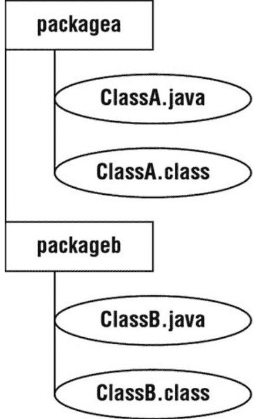

图 1.1 使用包编译

# 使用备目录

默认情况下，`javac` 命令将编译后的类放在与源代码相同的目录中。它还提供了一个选项将类文件放在不同的目录中。`-d` 选项指定此目标目录。

Java 选项是区分大小写的。这意味着你不能用 `-D` 代替 `-d`。

如果你正在跟着操作，请删除上一节中创建的 `ClassA.class` 和 `ClassB.class` 文件。

你认为这个命令会在哪里创建 `ClassA.class` 文件？

```
javac -d classes packagea/ClassA.java packageb/ClassB.java
```

正确答案是 `classes/packagea/ClassA.class`。包结构在请求的目标目录下被保留。图 1.2 显示了这一新结构。

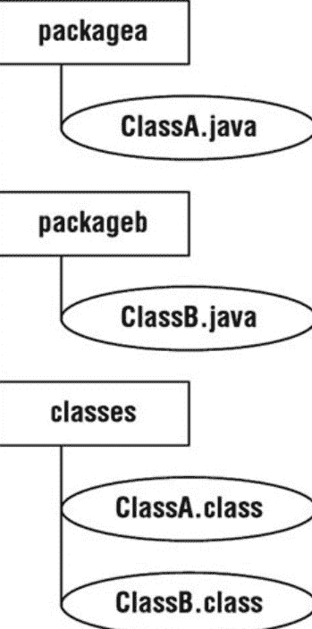

图 1.2 使用包和目录编译

要运行程序，你需要指定类路径（classpath），以便 Java 知道去哪里寻找类。你可以使用三个选项。这三个选项的作用相同：

```
java -cp classes packageb.ClassB

java -classpath classes packageb.ClassB

java --class-path classes packageb.ClassB
```

请注意，最后一个选项需要两个横杠 (`--`)，而前两个需要一个横杠 (`-`)。如果横杠数量错误，程序将无法运行。

# 三种类路径选项

你可能会奇怪为什么类路径有三个选项。`-cp` 选项是短形式。开发者经常选择短形式是因为我们是懒打字员。`-classpath` 和 `--class-path` 版本更容易读，但需要输入更多字符。你可以使用其中任何一个，所以请务必学习考试需要的所有表 1.3 和表 1.4 中的所有选项。在第 1 章中，你将学习特定模块的选项。

## 表 1.3 考试所需的选项：javac

| 选项 | 描述 |
| :--- | :--- |
| `-cp <classpath>` | 编译程序所需的类的位置 |
| `-classpath <classpath>` | |
| `--class-path <classpath>` | |
| `-d <dir>` | 放置生成的类的目录 |

## 表 1.4 考试所需的选项：java

| 选项 | 描述 |
| :--- | :--- |
| `-cp <classpath>` | 运行程序所需的类的位置 |
| `-classpath <classpath>` | |
| `--class-path <classpath>` | |

# 使用 JAR 文件编译

就像上一个示例中的类一样，你也可以使用类路径显式地指定文件位置。当类位于其他地方或 JAR 文件中，这种技术非常有用。Java 归档（JAR）文件就像包含许多类文件的 zip 压缩包。

在 Windows 上，你输入以下内容：

```
java -cp "C:\temp\someLocation;myJar.jar" package.MyClass
```

在 macOS/Linux 上，你输入以下内容：

```
java -cp "./:someLocation:myJar.jar" package.MyClass
```

点 (`.`) 表示你想将当前目录包含在类路径中。Windows 使用分号 (`;`) 分隔类路径部分；其他操作系统使用冒号 (`:`)。就像编译一样，你可以使用通配符 (`*`) 来匹配目录中的所有类。这里有一个例子：

```
java -cp "C:\temp\directoryWithJars\*" package.MyClass
```

此命令将 `directoryWithJars` 目录中的所有类添加到类路径中。它不会包含 `directoryWithJars` 子目录中的任何类。

# 创建 JAR 文件

某些 JAR 是由他人创建的，例如从互联网下载的或同事创建的。或者，你可以自己创建一个 JAR 文件。要这样做，你需要使用 `jar` 命令。最简单的命令会创建一个包含当前目录中文件的 jar。你可以对每个选项使用短形式或长形式。

```
jar -cvf myNewFile.jar

jar --create --verbose --file myNewFile.jar
```

或者，你可以指定一个目录而不是使用当前目录。

```
jar -cvf myNewFile.jar -C dir
```

`-c` 选项没有长形式。表 1.5 列出了你使用 `jar` 创建 jar 文件时所需的选项。在第 1 章中，你将学习另一个特定模块的选项。

## 表 1.5 考试所需的选项：jar

| 选项 | 描述 |
| :--- | :--- |
| `-c` | 创建一个新的 JAR 文件 |
| `--create` | |
| `-v` | 输出详细信息 |
| `--verbose` | |
| `-f <filename>` | 指定文件名 |
| `--file <filename>` | |
| `-C <dir>` | 切换到目录 |

# 在带包的情况下运行程序

在带包的情况下运行程序，你需要指定类路径，这样 Java 就知道去哪里找到类。

```java
package structure;

import java.util.*;

public class Learning {

    public static void main(String[] args) {

        System.out.println("got it");

    }

}
```

一个文件也可以不包含 `public` 类。只要一个文件中没有多个 `public` 类，就是可以的。

现在你已经知道如何创建和安排一个类。随后的章节将向你展示如何创建具有更强大操作的类。

## 考试中的代码格式

并不是所有问题都会包含包声明（package declarations）和导入（imports）。除非题目要求你回答这些内容，否则不必担心缺少包语句或导入。以下是不需要检查导入语句的常见情况：

- 以类名开始的代码
- 以方法声明开始的代码
- 以通常位于类或方法内部的代码片段开始的代码
- 行号不从 1 开始的代码

这一点至关重要，以至于我们将通过一个示例来强化这一概念。这段代码可以编译吗？

```java
public class MissingImports {

  date;

  public void today() {

}
```

是的！问题并不是关于导入的，所以你必须假设 `import java.util.*` 是存在的。

另一方面，如果问题问你关于包、导入或类中元素的正确顺序，这在提示你：该问题几乎肯定是在测试这些知识点！还要注意，如果存在包语句，为了节省空间不会删除导入语句。这是因为导入位于包语句之后。

你可能会看到没有 `main()` 方法的代码。当这种情况发生时，假设任何必要的辅助代码（如 `main()` 方法和类定义）已正确编写。你只是被问所展示的代码部分在放入有效的周围代码时是否可以编译。

考试为了节省空间的另一种方法是将同一行的代码合并。你应该预期会看到像下面的代码，并被问它是否可以编译。（你将在第 5 章学习 `ArrayList`——目前假设那部分没问题。）

```java
6: public void get(ArrayList list) {

7: if (list.isEmpty()) { System.out.println("e");

8: } else { System.out.println("n");

9: }}
```

答案是可以编译的，`if` 语句和 `println()` 之间的换行不是必要的。此外，你仍然可以假设必要的类定义和导入是存在的。现在，这一个呢？它可以编译吗？

```java
1: public class LineNumbers {

2: public void get(ArrayList list) {

3: if (list.isEmpty()) { System.out.println("e");

4: } else { System.out.println("n");

5: }}
```


对于这一个，你的回答应该是“无法编译”。由于代码从第 1 行开始，你不能假设之前提供了无效的导入。考试会告知你哪些包包含哪些类，除非它们在涵盖大纲范围内。你应该知道 `ArrayList` 在 `java.util` 中——至少当你读到这本书的第 5 章时知道！

> 记住，在 Java 语法中，额外的空白字符并不重要。考试可能会使用不同数量的空白来欺骗你。

## 总结

Java 开发工具包（JDK）用于软件开发。它包含了编译器（`javac`），可将源代码转换为字节码。它还包含了 Java 虚拟机（JVM）启动器（`java`），它负责启动 JVM 然后调用代码。应用程序编程接口（API）可用于调用可用的代码段。

Java 代码是面向对象的，这意味着所有代码都定义在类中。访问修饰符允许类封装数据。Java 是平台无关的，编译为字节码。它通过不提供指针或运算符重载而具有健壮性和简单性。Java 是安全的，因为它在虚拟机内部运行。最后，该语言便于多线程编程并努力保持向后兼容。

Java 类由成员字段和方法组成。对象是 Java 类的实例。有三种类型的注释：单行注释（`//`）、多行注释（`/* */`）和 Javadoc 注释（`/** */`）。

Java 程序从 `main()` 方法开始执行。该方法从命令行运行的最常见签名是 `public static void main(String[]) args`。参数在类名之后传递，例如 `Java NameOf firstArgument`。参数的索引从 0 开始。

Java 代码被组织在折叠的包中。要引用其他包中的类，你使用 `import` 语句。导入语句末尾的通配符表示你想要导入该包中的所有类。它不包含该包内部的子包。`java.lang` 包是特殊的，它不需要导入。

对于某些类元素，顺序在文件内是重要的。如果存在包语句，它在最前面。然后是导入语句（如果存在）。接着是类声明。字段和方法在类声明中可以以任何顺序排列。

## 考试要点

**识别 Java 的优势。** Java 的优势包括面向对象设计、封装、平台无关性、健壮性、简单性、安全性、多线程和向后兼容性。

**定义常见缩写。** JDK 代表 Java Development Kit，包含编译器和 JVM 启动器。JVM 代表 Java Virtual Machine。API 是应用程序编程接口，是可以调用的代码。

**能够使用 `main()` 方法编写代码。** `main()` 方法通常写为 `public static void main(String[]) args`。参数从 `args[0]` 开始引用。访问未传递的参数将导致代码抛出异常。

理解使用包和导入的影响。包包含 Java 类。类可以通过类名或通配符导入。通配符不会查找子目录。在发生冲突时，类名导入优先。

**能够识别类中位置错的语句。** 包语句和导入语句是可选的。如果存在，两者都位于类声明之前，且顺序如上。字段和方法也是可选的，并在类声明中可以以任何顺序排列。

# 复习题

1. 下列哪些是正确的陈述？（选择所有适用项）
   A. Java 允许运算符重载。
   B. Java 代码在 Windows 上编译可以在 Linux 上运行。
   C. Java 有指向内存中特定位置的指针。
   D. Java 是过程化语言。
   E. Java 是面向对象的语言。
   F. Java 是一种函数编程语言。

2. 下列哪些是正确的？（选择所有适用项）
   A. `javac` 将 .class 文件编译为 .java 文件。
   B. `javac` 将 .java 文件编译为 .bytecode（字节码）文件。
   C. `javac` 将 .java 文件编译为 .class 文件。
   D. `java` 接受类名作为参数。
   E. `java` 接受 .bytecode 文件的文件名作为参数。
   F. `java` 接受 .class文件的文件名作为参数。

3. 如果此命令完成，以下哪些正确的？（选择所有适用项）
   `java Program.java`
   A. 创建了 .class 文件。
   B. 程序可以引用 com.sybex 中的类。
   C. 程序可以引用 `java.lang` 包中的类。
   D. 程序可以引用 `java.util` 包中的类。
   E. 以上都不是。程序需要作为 `java` 运行。

4. 给定以下类，下列哪些可以独立替换 `INSERT IMPORTS HERE` 使代码编译？（选择所有适用项）

```java
package aquarium.jellies;

public class Jelly { }
```

```java
package visitor;

INSERT IMPORTS HERE

public class AquariumVisitor {

    public admire(Jelly jelly) { }
}
```
   A. `import aquarium.*;Jelly;`
   B. `import aquarium.*Jelly;`
   C. `import aquarium.jellies.Jelly;`
   D. `import aquarium.jellies.*;`
   E. `import aquarium.jellies.Jelly.*`
   F. 以上都不行。

5. JDK 中包含哪些？（选择所有适用项）
   A. `javac`
   B. Eclipse
   C. JVM
   D. `javadoc`
   E. `jar`
   F. 以上都不是

6. 给定以下类，最多可以移除多少个导入语句而代码仍可编译？

```java
package aquarium;

public class Water { }
```

```java
package aquarium;

import java.*;

import java.lang.System;

import aquarium.Water;

import aquarium.*;

public class Tank {

    public void print(Water water) {
        System.out.println(water);
    }
}
```
   A. 0
   B. 1
   C. 2
   D. 3
   E. 4
   F. 无法编译

7. 给定以下类，下列哪些片段可以独立插入到 `INSERT IMPORTS HERE` 位置并使代码编译？（选择所有适用项）

```java
package aquarium;

public class Water {
    boolean salty = false;
}
```

```java
package aquarium.jellies;

public class Water {
    boolean salty = true;
}
```

```java
package employee;

INSERT IMPORTS HERE

public class WaterFiller {
    Water water;
}
```

   A. `import aquarium.*;`
   B. `import aquarium.Water; import aquarium.jellies.*;`
   C. `import aquarium.*; import aquarium.jellies.Water;`
   D. `import aquarium.*; import aquarium.jellies.*;`
   E. `import aquarium.Water; import aquarium.jellies.Water;`
   F. 这些导入均不能使代码通过编译。

8. 给定以下命令，下列哪些类会被包含在编译？（选择所有选项。）
   `javac *.java`
   A. Hyena.java
   B. Warthog.java
   C. land/Hyena.java
   D. land/Warthog.java
   E. Hyena.groovy
   F. Warthog.groovy

9. 给定以下类，下列哪些调用会打印出 Blue Jay？（选择所有选项。）

```java
public class BirdDisplay {
    public static void main(String[] name) {
        System.out.println(name[1]);
    }
}
```
   A. `java BirdDisplay Sparrow "Blue Jay"`
   B. `java BirdDisplay Sparrow "Blue Jay"`
   C. `java BirdDisplay Blue Jay Sparrow`
   D. `java BirdDisplay "Blue Jay" Sparrow`
   E. `java BirdDisplay.class Sparrow "Blue Jay"`
   F. `java BirdDisplay.class "Blue Jay" Sparrow`

10. 下列哪些是可以从命令行运行的合法入口点方法？（选择所有选项。）
    A. `private static void main(String[] args)`
    B. `public static final main(String[] args)`
    C. `public void main(String[] args)`
    D. `public static void test(String[] args)`
    E. `public static void main(String[] args)`
    F. `public static main(String[] args)`

11. 关于 Java 的下列哪些是正确的？（选择所有选项。）
    A. 保证代码没有 Bug。
    B. 弃用的特性永远不会被移除。
    C. 允许多线程代码。
    D. 安全性是一个设计目标。
    E. 横向兼容性是一个设计目标。

12. 在不考虑模块选项的情况下，`javac` 命令的哪些选项是有效的？（选择所有选项。）
    A. `-c`
    B. `-C`
    C. `-cp`
    D. `-CP`
    E. `-d`
    F. `-f`
    G. `-p`

13. 在不考虑模块选项的情况下，`java` 命令的哪些选项是有效的？（选择所有选项。）
    A. `-c`
    B. `-c`
    C. `-cp`
    D. `-d`
    E. `-f`
    F. `-p`

14. 在不考虑模块选项的情况下，`jar` 命令的哪些选项是有效的？（选择所有选项。）
    A. `-c`
    B. `-c`
    C. `-cp`
    D. `-d`
    E. `-f`
    F. `-p`

15. 当作为 `java Duck Duck Goose` 运行时，以下代码输出什么？

```java
public class Duck {
    public void main(String[] args) {
        for (int i = 1; i <= args.length; i++) {
            System.out.println(args[i]);
        }
    }
}
```
    A. Duck Goose
    B. Duck ArrayIndexOutOfBoundsException
    C. Goose
    D. Goose ArrayIndexOutOfBoundsException
    E. 以上都不是

16. 假设我们在文件 `/my/directory/named/A/Bird.java` 中有以下类。如果从 `/my/directory` 编译，哪些答案选项可以替换独立添加的 `INSERT CODE HERE`？（选择所有选项。）

```java
INSERT CODE HERE

public class Bird { }
```
    A. `package my.directory.named.a;`
    B. `package my.directory.named.A;`
    C. `package named.a;`
    D. `package named.A;`
    E. `package a;`
    F. `package A;`

17. 下列哪些是正确的？（选择所有选项。）

```java
public class Bunny {
    public static void main(String[] x) {
        Bunny bun = new Bunny();
    }
}
```
    A. Bunny 是一个类。
    B. bun 是一个类。
    C. main 是一个类。
    D. Bunny 是一个对象的引用。
    E. bun 是一个对象的引用。
    F. main 是一个对象的引用。
    G. main() 方法没有运行，因为参数名错误。

18. 哪些答案选项代表了以下语句组合成可以成功编译的程序的顺序？（选择所有选项。）
    Y: `import java.util.*;`
    Z: `package animals;`
    A. X, Y, Z
    B. Y, Z, X
    C. Z, Y, X
    D. Y, X
    E. Z, X
    F. X, Z

19. 下列哪些可以从 Oracle 下载 Java 11？（选择所有选项。）
    A. JDK
    B. JRE
    C. Eclipse
    D. 以上均从 Oracle 提供。

20. 编译时指定 classpath 的哪些方式有效？（选择所有选项。）
    A. `-cp`
    B. `-classpath`
    C. `--classpath`
    D. `-class-path`
    E. `--class-path`

# 第 2 章
Java 基础模块

本章涵盖的 OCP 目标：

- 使用 Java 原始数据类型和 String API
  - 声明和初始化变量（包括原始数据类型的转换和提升）
  - 识别变量的作用域
  - 使用局部变量类型推断
- 对象与类
  - 声明和实例化 Java 对象并解释对象的生命周期（包括创建、重新赋值释放引用和垃圾回收）
  - 读取或写入对象字段


```java
package aquarium.jellies;

public class Water {
    boolean salty = true;
}
```

```java
package employee;

INSERT IMPORTS HERE

public class WaterFiller {
    Water water;
}
```

   A. `import aquarium.*;`
   B. `import aquarium.Water; import aquarium.jellies.*;`
   C. `import aquarium.*; import aquarium.jellies.Water;`
   D. `import aquarium.*; import aquarium.jellies.*;`
   E. `import aquarium.Water; import aquarium.jellies.Water;`
   F. 这些导入均不能使代码通过编译。

8. 给定以下命令，下列哪些类会被包含在编译？（选择所有选项。）
   `javac *.java`
   A. Hyena.java
   B. Warthog.java
   C. land/Hyena.java
   D. land/Warthog.java
   E. Hyena.groovy
   F. Warthog.groovy

9. 给定以下类，下列哪些调用会打印出 Blue Jay？（选择所有选项。）

```java
public class BirdDisplay {
    public static void main(String[] name) {
        System.out.println(name[1]);
    }
}
```


# 第 2 章
## Java 基础模块

本章涵盖的 OCP 目标：

- 使用 Java 原始数据类型和 String API
  - 声明和初始化变量（包括原始数据类型的转换和提升）
  - 识别变量的作用域
  - 使用局部变量类型推断
- 对象与类
  - 声明和实例化 Java 对象并解释对象的生命周期（包括创建、重新赋值释放引用和垃圾回收）
  - 读取或写入对象字段


```java
package aquarium.jellies;

public class Water {
    boolean salty = true;
}
```

```java
package employee;

INSERT IMPORTS HERE

public class WaterFiller {
    Water water;
}
```

- A. `import aquarium.*;`
- B. `import aquarium.Water;`
  `import aquarium.jellies.*;`
- A. `import aquarium.*;`
  `import aquarium.jellies.Water;`
- A. `import aquarium.*;`
  `import aquarium.jellies.*;`
- A. `import aquarium.Water;`
  `import aquarium.jellies.Water;`
- A. 这些导入均不能使代码通过编译。

### 8. 给定以下命令，下列哪些类会被包含在编译？（选择所有选项。）
`javac *.java`
- A. `Hyena.java`
- B. `Warthog.java`
- C. `land/Hyena.java`
- D. `land/Warthog.java`
- E. `Hyena.groovy`
- F. `Warthog.groovy`

### 9. 给定以下类，下列哪些调用会打印出 Blue Jay？（选择所有选项。）

```java
public class BirdDisplay {
    public static void main(String[] name) {
        System.out.println(name[1]);
    }
}
```

- A. `java BirdDisplay Sparrow "Blue Jay"`
- B. `java BirdDisplay Sparrow "Blue Jay"`
- C. `java BirdDisplay Blue Jay Sparrow`
- D. `java BirdDisplay "Blue Jay" Sparrow`
- E. `java BirdDisplay.class Sparrow "Blue Jay"`
- F. `java BirdDisplay.class "Blue Jay" Sparrow`

### 10. 下列哪些是可以从命令行运行的合法入口点方法？（选择所有选项。）
- A. `private static void main(String[] args)`
- B. `public static final main(String[] args)`
- C. `public void main(String[] args)`
- D. `public static void test(String[] args)`
- E. `public static void main(String[] args)`
- F. `public static main(String[] args)`

### 11. 关于 Java 的下列哪些是正确的？（选择所有选项。）
- A. 保证代码没有 Bug。
- B. 弃用的特性永远不会被移除。
- C. 允许多线程代码。
- D. 安全性是一个设计目标。
- E. 横向兼容性是一个设计目标。

### 12. 在不考虑模块选项的情况下，`javac` 命令的哪些选项是有效的？（选择所有选项。）
- A. `-c`
- B. `-C`
- C. `-cp`
- D. `-CP`
- E. `-d`
- F. `-f`
- G. `-p`

### 13. 在不考虑模块选项的情况下，`java` 命令的哪些选项是有效的？（选择所有选项。）
- A. `-c`
- B. `-c`
- C. `-cp`
- D. `-d`
- E. `-f`
- F. `-p`

### 14. 在不考虑模块选项的情况下，`jar` 命令的哪些选项是有效的？（选择所有选项。）
- A. `-c`
- B. `-c`
- C. `-cp`
- D. `-d`
- E. `-f`
- F. `-p`

### 15. 当作为 `java Duck Duck Goose` 运行时，以下代码输出什么？

```java
public class Duck {
    public void main(String[] args) {
        for (int i = 1; i <= args.length; i++) {
            System.out.println(args[i]);
        }
    }
}
```

- A. Duck Goose
- B. Duck ArrayIndexOutOfBoundsException
- C. Goose
- D. Goose ArrayIndexOutOfBoundsException
- E. 以上都不是

### 16. 假设我们在文件 `/my/directory/named/A/Bird.java` 中有以下类。如果从 `/my/directory` 编译，哪些答案选项可以替换独立添加的 `INSERT CODE HERE`？（选择所有选项。）

```java
INSERT CODE HERE
public class Bird { }
```

- A. `package my.directory.named.a;`
- B. `package my.directory.named.A;`
- C. `package named.a;`
- D. `package named.A;`
- E. `package a;`
- F. `package A;`

### 17. 下列哪些是正确的？（选择所有选项。）

```java
public class Bunny {
    public static void main(String[] x) {
        Bunny bun = new Bunny();
    }
}
```

- A. `Bunny` 是一个类。
- B. `bun` 是一个类。
- C. `main` 是一个类。
- D. `Bunny` 是一个对象的引用。
- E. `bun` 是一个对象的引用。
- F. `main` 是一个对象的引用。
- G. `main()` 方法没有运行，因为参数名错误。

### 18. 哪些答案选项代表了以下语句组合成可以成功编译的程序的顺序？（选择所有选项。）
Y: `import java.util.*;`
Z: `package animals;`
- A. X, Y, Z
- B. Y, Z, X
- C. Z, Y, X
- D. Y, X
- E. Z, X
- F. X, Z

### 19. 下列哪些可以从 Oracle 下载 Java 11？（选择所有选项。）
- A. JDK
- B. JRE
- C. Eclipse
- D. 以上均从 Oracle 提供。

### 20. 编译时指定 classpath 的哪些方式有效？（选择所有选项。）
- A. `-cp`
- B. `-classpath`
- C. `--classpath`
- D. `-class-path`
- E. `--class-path`

```java
3: { System.out.println("Feathers"); }
4: }
5: { System.out.println("Snowy"); }
6: }
```


此示例中有四个代码块：类定义、一个方法声明、一个内部块和一个实例初始化器。数代码块非常简单：如果你的左大括号 `{` 和右大括号 `}` 数量不相等，或者定义顺序不正确，代码将无法编译。例如，如果代码中早些时候没有匹配的左大括号 `{`，你就不能使用一个闭合的右大括号 `}`。在编程中，这被称为括号平衡问题，它经常出现在工作面试题中。

当你数点初始化器的数量时，请记住它们不能存在于方法内部。第 5 行是一个实例初始化器，它的大括号位于方法之外。相反，第 3 行不是实例初始化器，因为它只在执行 `main()` 方法时被调用。第 1 行和第 6 行还有额外的一对括号，构成了类声明。

## 遵循初始化顺序

在编写在多个处初始化字段的代码时，你必须跟踪初始化的顺序。这简单来说就是当类的实例创建时，不同方法、构造函数或块被调用的顺序。我们将在第 8 章为初始化顺序添加更多规则。在此期间，你需要记住：

- 字段和实例初始化块按照它们在文件中出现的顺序运行。
- 构造函数在所有字段和实例初始化块运行之后执行。

让我们来看一个例子：

```java
1: public class Chick {
2: private String name = "Fluffy";
3: { System.out.println("setting field"); }
4: public Chick() {
5: name = "Tiny";
6: System.out.println("setting constructor");
7: }
8: public static void main(String[] args) {
9: Chick chick = new Chick();
10: System.out.println(chick.name); }
```

运行此示例将输出：

```
setting field
setting constructor
Tiny
```

让我们看看这里发生了什么。我们从 `main()` 方法开始，因为那是 Java 开始执行的地方。在第 9 行，我们调用了 `Chick` 的构造函数。Java 创建了一个新对象。首先，它在第 2 行将 `name` 初始化为 "Fluffy"。接下来，它执行了第 3 行实例初始化器中的 `println()` 语句。一旦所有字段和实例初始化器运行完毕，Java 回到构造函数。第 5 行将 `name` 的值改为 "Tiny"，第 6 行打印了另一个语句。此时，构造函数执行完毕，然后执行回到第 10 行的 `println()` 语句。

对于字段和代码块，顺序至关重要。你不能在变量定义之前引用它：

```java
{ System.out.println(name); } // 无法编译
private String name = "Fluffy";
```

你应该预料在考试中会看到一个关于初始化的问题。让我们再试一个。你认为这行代码会输出什么？

```java
public class Egg {
    public Egg() {
        number = 5;
    }
    public static void main(String[] args) {
        Egg egg = new Egg();
        System.out.println(egg.number);
    }
    private int number = 3;
    { number = 4; }
}
```

如果你回答的是 5，说明你答对了。字段和块首先按顺序运行，将 `number` 设置为 3 和 4。然后构造函数运行，将 `number` 设置为 5。你将在第 8 章看到更多关于初始化顺序的规则和示例。

## 理解数据类型

Java 包含两种类型的数据：基本类型和引用类型。在本节中，我们将讨论基本类型和引用类型之间的差异。

## 使用基本类型

Java 拥有八种内置类型，用于基本类型。基本类型，例如整数或浮点数。

## 基本类型

这些基本类型的位大小以及它们可以存储的内容。表 2.1 显示了基本类型及其位大小以及它们可以存储的范围。

### 表 2.1 基本类型

| 关键字 | 类型 | 示例 |
| :--- | :--- | :--- |
| boolean | 布尔值 | true 或 false |
| byte | 8 位整数值 | 123 |
| short | 16 位整数值 | 123 |
| int | 32 位整数值 | 123 |
| long | 64 位整数值 | 123L |
| float | 32 位浮点值 | 123.45f |
| double | 64 位浮点值 | 123.456 |
| char | 16 位 Unicode 值 | 'a' |

## String 是基本类型吗？

不是。尽管如此，String 经常被误认为，因为 Java 包含了对 String 字面量和运算符的支持。你将在第 5 章学习更多关于 String 的知识，但现在记住它们不是。

表 2.1 中有很多信息。让我们来看关键点：

- `float` 和 `double` 类型用于浮点（小数）值。
- `float` 需要在数字后面跟着字母 `f`，以便 Java 知道它是 `float`。
- `byte`、`short`、`int` 和 `long` 类型用于没有小数点的数字。在数学中，这些被称为整数，但在 Java 中，指的是特定的类型。
- 每个数值类型使用的位都是较小类型的两倍。例如，`short` 使用的位是 `byte` 的两倍。
- Java 中所有的数值类型都是有符号的。这意味着它们留了一个位来覆盖负数范围。例如，`byte` 的范围是 -128 到 127。你可能会惊讶范围不是 -128 到 128。不要忘记，范围也需要考虑 0。

你不会被问及大多数类型的确切大小。

## 浮点数和科学计数法

虽然整数值很短且容易计算范围，但像 `double` 和 `float` 这样的浮点值显然不是。大多数计算机系统中，浮点数以科学计数法存储。这意味着数字是以两个数字 $a$ 和 $b$ 的形式存储的，形式为 $a \times 10^b$。

这种方法允许存储更大的值，是以准确性为代价的。例如，你可以在 `double` 中存储 $3 \times 10^{20}$，如果存储每个数字，这将比 8 字节得多。为了实现这一点，你只存储数字的前十几个左右数字。科学计数法的名称源于科学，在科学中，计算通常只需要前几个科学数字。

别担心，考试不需要你知道科学计数法或浮点值是如何存储的。

## 编写字面量

关于数值基本类型，你应该知道更多几点。当数字出现在代码中，它被称为字面量。默认情况下，Java 假设你正在用数值字面量定义一个 `int` 值。在下面的示例中，列出的数字比 `int` 能容纳的要大。

记住，你并不需要背下 `int` 的最大值。如果涉及到这个点，考试会在题目中包含它。

```java
long max = 3123456789; // 无法编译
```

Java 报错说该数字超出范围。确实如此——对于 `int` 而言。然而，我们这里没有 `int`。解决方案是在数字后添加字符 `L`：

```java
long max = 3123456789L; // 现在 Java 知道它是一个 long
```

或者，你可以在数字后面添加一个小写的 `l`。但请务必使用大写的 `L`。小写的 `l` 看起来像数字 `1`。

指定数字的另一种方法是更改“进制”。当你学习数数时，你学习的是数字 0–9。由于有 10 个数字，这种计数系统被称为 10 进制（进制）。也被称为十进制系统。Java 允许你用几种其他格式指定数字：

- 八进制（数字 0–7），使用数字 0 作为前缀——例如 `017`
- 十六进制（数字 0–9 和字母 A–F/a–f），使用 `0x` 或 `0X` 作为前缀——例如 `0xFF`, `0Xf`。十六进制对所有这些示例都不敏感，它们代表相同的值。
- 二进制（数字 0–1），使用数字 0 后紧跟 `b` 或 `B` 作为前缀——例如 `0b10`, `0B10`

在考试中你不需要在数字进制之间进行转换。你只需要识别可以赋值给数字的有效字面量。

## 字面量与下划线字符

关于数字字面量，你需要知道的最后一点是，可以在数字中使用下划线使它们更易读：

```java
int million1 = 10000000;
int million2 = 1_000_000;
```

我们更倾向于阅读后一个，因为零不会连在一起。
你可以在任何地方添加下划线，但字面量的开头、字面量的结尾、小数点之前或小数点之后除外。
你甚至可以将多个下划线字符相邻，尽管我们不建议这样做。

让我们来看几个例子：

```java
double notAtStart = _1000.00;      // 无法编译
double notAtEnd = 1000_.00;           // 无法编译
double notByDecimal = 1000_.00;        // 无法编译
double annoyingButLegal = 1_00_0_0;    // 丑，但可以编译
double reallyUgly = 1;               // 也可以编译
```

## 使用引用类型

引用指的是一个对象（类的实例）。与在变量分配的内存中持有其值的原始类型不同，引用并不持有它们所引用对象的值。相反，引用通过存储对象所在的内存地址来“指向”一个对象，这个概念被称为指针。与其他语言不同，Java 不允许你获取物理内存地址是什么。你只能使用引用来引用对象。

让我们来看一些声明和初始化引用类型的示例。假设我们声明了一个类型为 `java.util.Date` 的引用和一个类型为 `String` 的引用：

```java
java.util.Date today;
String greeting;
```

`today` 变量是一个 `Date` 类型的引用，只能指向一个 `Date` 对象。`greeting` 变量是一个只能指向 `String` 对象的引用。值可以通过两种方式赋值给引用：

- 引用可以赋值给相同类型或兼容类型的另一个对象。
- 引用可以使用 `new` 关键字赋值给一个新对象。

例如，以下语句将这些引用赋值给新对象：

```java
today = new java.util.Date();
greeting = new String("How are you?");
```

`today` 引用现在指向内存中的一个新 `Date` 对象，可以使用 `today` 来访问该 `Date` 对象的各种字段和方法。同样，`greeting` 引用指向一个新的 `String` 对象 "How are you?"。这些 `String` 和 `Date` 对象没有名称，只能通过它们对应的引用访问。图 2.1 显示了引用类型在内存中出现的形式。

## 区分原始类型和引用类型

你应该知道原始类型和引用类型之间有几点重要的区别。首先，引用类型可以为 `null`，这意味着它们目前没有指向任何对象。如果你尝试分配 `null`，原始类型将给你一个编译器错误。在这个示例中，`value` 不能指向 `null`，因为它是 `int` 类型：

```java
int value = null;      // 无法编译
String s = null;
```

但如果你不知道 `int` 的值并想将其赋值为 `null` 呢？在这种情况下，你应该使用包装类（如 `Integer`）代替它。包装类将在第 5 章介绍。

接下来，引用类型可以用于调用方法，前提是引用不是 `null`。原始类型上没有声明任何方法。在这个示例中，我们可以在引用上调用方法，因为它是引用类型。看看你是否理解为什么以下代码段无法编译：

```java
4: String reference = "hello";
5: int len = reference.length();
6: int bad = len.length(); // 无法编译
```

第 6 行是正确的。`len` 上不存在方法，因为它是原始类型。原始类型没有方法。记住，`String` 是可以调用 `length()` 的。原始类型如 `int`。请注意，Java 是区分大小写的。

## 变量声明

你已经看到了一些变量。Java 保留了一些不能作为变量关键字。例如：

```java
int value;
```

## 标识符

你可能很惊讶，Java 对标识符有严格规定。标识符是变量、方法、类或包的。幸运的是，标识符只有四个规则：

- 标识符必须以字母、`$` 符号或 `_` 开头。
- 标识符可以包含数字，但不能以数字开头。
- 从 Java 9 开始，单个下划线 `_` 不允许作为标识符。
- 标识符不能与保留字同名。保留字。

不要担心——你不需要背诵整个保留字列表。考试只会问你常用的那些，例如 `class` 和 `for`。表 2.2 列出了 Java 中所有的保留字。

### 表 2.2 保留字

| abstract | assert | boolean | break | byte |
| :--- | :--- | :--- | :--- | :--- |
| case | catch | char | class | const* |
| continue | default | do | else | |
| enum | extends | false** | final | finally |
| float | for | goto* | if | implements |
| import | instanceof | int | interface | long |
| native | new | null** | package | private |
| protected | public | return | short | static |
| strictfp | super | switch | synchronized | this |
| throw | throws | transient | true** | try |
| void | volatile | while | (underscore) | |

* `const` 保留字在 Java 中并未实际使用。保留它们是为了防止来自其他编程语言的人误用它们——
** `true/false` 并不是真正的保留字，而是字面量。由于它们不能作为标识符名称，我们将它们包含在表中。

准备好测试这些规则。以下示例是合法的：

```java
long okidentifier;
float $OK2Identifier;
boolean _alsoOK1dntifier3r;
char __Sstill0butKnotsonice;
```

这些示例是不合法的：

```java
int 3DointClass; // 标识符不能以数字开头
byte hollywood@vine; // @ 不是字母、数字或 $
String $coffee; // * 不是字母、数字或 _
double public; // public 是保留字
short _; // 单下划线不允许
```

## 样式：camelCase

虽然你可以在标识符名称上进行疯狂的操作，但请不要这样做。Java 有一套约定，以确保代码的可读性和一致性。这种一致性包含了驼峰命名法（camel case），为了强调，通常写为 `camelCase`。在 camelCase 中，每个单词的首字母都大写。

camelCase 格式让标识符更易读。你更倾向于读 `Thismyclass name` 还是 `ThisIsClassName name`？考试将主要使用标识符的通用惯例，但并非总是如此。当你看到非标准的标识符时，请务必检查它是否合法。如果你不确定，可以把答案标记为“无法编译”，并跳过对问题其他部分的分析。


大多数 Java 开发者遵循以下标识符命名约定：

- 方法和变量名使用 camelCase，且首字母小写。
- 类和接口名使用 camelCase，且首字母大写。此外，不要用 `$` 开头类名，因为编译器会将此符号用于某些文件。

此外，要知道 Java 中有效的字母不仅是英语字母表中的字符。Java 支持 Unicode 字符集，因此有数千个字符可以作为合法的 Java 标识符的开头。有些是非阿拉伯数字字符，可能会出现在合法标识符的第一个字符之后。幸运的是，你不需要为了考试记忆这些内容。如果你在一个不使用英语字母的国家，了解这些对找工作非常有帮助。

## 样式：snake_case

另一种你可能在考试、现实世界或其他语言中看到的样式被称为 `snake_case`（蛇形命名法），为了强调，通常写为 `snake_case`。它简单地使用下划线 (`_`) 来分隔单词，通常完全全小写。上一个的例子在 snake_case 中将写为 `this_is_my_class name`。

> 注意：虽然 camelCase 和 snake_case 在 Java 中都是完全有效的语法，但当每个人都采用相同的风格约定时，开发社区的运行得更好。考虑到这一点，Oracle（以及在此之前的 Sun）建议所有人对类名和变量名使用 camelCase。不过，也有例外。常量 `static final` 值通常用 snake_case 表示，例如 `THIS_IS_A_CONSTANT`。此外，枚举值倾向于用 snake_case 表示，例如 `Color.RED`、`Color.DARK_GRAY` 等。

## 声明多个变量

你还可以在同一条语句中声明并初始化多个变量。你认为在以下示例中声明并初始化了几个变量？

```java
void sandFence() {
  String s1, s2;
  String s3 = "yes", s4 = "no";
}
```


# 变量声明与初始化

声明了四个 `String` 变量：`s1`、`s2`、`s3` 和 `s4`。只要它们是同一种类型，你可以在同一个声明中声明许多变量。你可以在声明中内联初始化这些值中的任何一个或所有值。在上一个示例中，我们有两个已初始化的变量：`s3` 和 `s4`。另外两个变量处于已声明但未初始化的状态。

这里变得复杂了。注意这些陷阱！考试将会尝试欺骗你。再次，你认为这段代码中声明并初始化了多少个变量？

```java
void paintFence() {
  int i11, i12, i13 = 0;
}
```

正如你所预期的，声明了三个变量：`i11`、`i12` 和 `i13`。然而，其中只有一个值被初始化了：`i13`。另外两个已声明但尚未初始化。这就是陷阱所在。每个用逗号分隔的片段都是一个独立的小声明。`= 0` 的初始化仅适用于 `i13`。如你所见，在初始化它们之前，你实际上无法使用 `i11` 或 `i12`。考试尝试欺骗你的另一种方式是向你展示这样的代码：

```java
int num, String value; // 无法编译
```

这段代码无法编译，因为试图在同一条语句中声明不同类型的多个变量。在同一条语句中声明多个变量的快捷方法仅在它们共享相同类型时合法。在 Java 世界中，“合法”、“有效”和“编译”都是同义词。我们使用了你在考试中可能遇到的所有术语。为了确保你理解这一点，请看看能否找出以下哪些是合法的：

- 第 4 行：`boolean b1, b2;`
- 第 5 行：`String s1 = "1", s2;`
- 第 6 行：`double d1, d2;`
- 第 7 行：`int i1; i2;`
- 第 8 行：`int i3; i4;`

第 4 行的第一条语句是合法的。它声明了两个变量但没有初始化。第 5 行的第二个语句也是合法的。它声明了两个变量并只初始化其中一个。第 6 行的第三条语句非法。Java 不允许在同一条语句中声明不同类型。等一下！变量 `d1` 和 `d2` 都是 `double` 类型。虽然确实如此，但这是允许的。如果你想在同一条语句中声明多个变量，它们必须共享相同类型且不重复。`d1, d2;` 将是合法的。第 7 行的第四条语句是合法的。虽然出现了两次，但每一个都是一个独立的语句。Java 中用分号 (`;`) 分隔语句。只是恰好同一行上有完全不同的语句。第 8 行的第五条语句是不合法的。再次，我们在同一行中有两个不同的语句。第 8 行的第二个语句不是有效声明，因为它省略了类型。当你在考试上看到位置奇怪的分号时，假装代码是分开的。只是恰好同一行上有不同的语句。第 8 行的第二个语句不是有效声明，因为它省略了类型。

你可以在同一条语句中声明并初始化多个变量。

这些变量在方法被调用之前由调用者进行初始化。构造函数和方法参数的初始化规则相同，因此我们将主要关注方法参数。

在上一个示例中，`check` 是一个方法参数。

看看同一个类中的以下 `checkAnswer()` 方法：

```java
public void checkAnswer() {
  boolean value;
  findAnswer(value); // 无法编译
}
```

对 `findAnswer()` 的调用无法编译，因为它尝试使用一个未初始化的变量。虽然方法 `checkAnswer()` 的调用者需要担心变量是否初始化，但一旦进入 `findAnswer()` 方法，我们可以假设局部变量已经初始化为某个值。

## 定义实例变量和类变量

不是局部变量的变量被定义为实例变量或类变量。实例变量（通常称为字段）是定义在对象实例中的值。假设我们有一个 `Person` 类，其中有一个名为 `name` 的 `String` 类型实例变量。该类的每个实例将有自己的 `name` 值，例如 Elysia 或 Sarah。两个实例可以具有相同的 `name` 值，但更改其中一个的值不会修改另一个。

另一方面，类变量是定义在类级别并在该类的所有实例之间共享的变量。它可以公开供类之外的类访问，而不需要实例即可使用。在我们之前的 `Person` 示例中，可以使用一个共享类变量来表示今天动物园的人员列表。你可以通过变量前面的是否有 `static` 关键字来判断它是否是类变量。你将在第 7 章中学习到这些。现在，只需要知道如果变量在声明中带有 `static` 关键字，它就是类变量。

实例变量和类变量不需要你进行初始化。一旦你声明了这些变量，它们就会被赋予默认值。你需要记住表 2.3 中的所有内容，但 `char` 的默认值除外。为了更容易记忆，请记住编译器不知道应该使用什么值，因此它想要给该类型最简单的值：对象为 `null`，基本类型为 `false`。

## 表 2.3 按类型划分的默认初始化值

| 变量类型 | 默认初始化值 |
|---|---|
| boolean | false |
| byte, short, int, long | 0 |
| float, double | 0.0 |
| char | '\u0000' (NUL) |
| 所有对象引用（其他所有） | null |

## 引入 var

从 Java 10 开始，在某些条件下，你可以选择使用 `var` 关键字而不是类型来声明局部变量。要使用此功能，只需用 `var` 代替基本类型或引用类型即可。这是一个示例：

```java
public void whatTypeAmI() {
    var name = "Hello";
    var size = 7;
}
```

该功能的正式名称是“局部变量类型推断”。让我们拆解一下。首先是“局部变量”。这意味着正如字面意思，你只能对局部变量使用此功能。考试可能会尝试用这样的代码来骗你：

```java
public class VarKeyword {
    var tricky = "Hello"; // 无法编译
}
```

等一下！我们刚刚学习了实例变量和局部变量之间的区别。变量 `tricky` 是实例变量。局部变量类型推断适用于局部变量，而不适用于实例变量。

> **注意**：在第 4 章中，你将学习到 `var` 可以用于循环，而且在第 6 章“Lambda 和函数式接口”中也会看到它用于某些 Lambda 表达式。在第 10 章“异常”中，你还将学习 `var` 可以与 `try-with-resources` 使用。所有这些情况仍然在方法内部，因此与你在本章中学的内容一致。

## var 的类型推断

现在你已经理解了局部变量部分，是时候了解类型推断意味着什么了。好消息是，这正如字面意思。当你输入 `var` 时，你是在指示编译器为你确定类型。编译器查看声明行的代码，并利用它来推断类型。看看这个示例：

```java
7: public void reassignment() {
8:   var number = 7;
9:   number = 4;
10:  number = "five"; // 无法编译
11 }
```

在第 8 行，编译器确定我们需要一个 `int` 类型的变量。在第 9 行，我们可以轻松地给它分配一个不同的值。在第 10 行，Java 出现了问题。我们要求它给 `int` 变量分配一个 `String`。这是不允许的。这等同于输入：

```java
int number = "five";
```

> **注意**：如果你熟悉像 JavaScript 这样的语言，你可能期望 `var` 表示在运行时可以接受任何类型的变量。在 Java 中，`var` 仍然是在编译时定义的特定类型。它在运行时不会改变。

所以，`var` 的类型在运行时不能更改，但值呢？看看下面的代码：

```java
var apples = 10;
apples = 5;
apples = 1000000; // 无法编译
```

第一行创建了一个名为 `apples` 的类型为 `short` 的 `var`。然后它给它分配了一个 `byte` 值 5 而不改变数据类型。正如你在第 3 章中将学的，`byte` 可以自动提升为 `short`，因为 `byte` 足够小可以放入 `short` 中。因此，存储在 `apples` 中的值是一个 `short`。事实上，让我们重写这个示例，展示编译器在看到 `var` 时到底在做什么：

```java
short apples = 10;
apples = 5;
apples = 1000000; // 无法编译
```

最后一行无法编译，因为一百万远超 `short` 的限制。编译器将该值视为 `int` 并报告错误，指示其无法赋值给 `apples`。

如果你没有跟上那个示例，不要担心，我们将在下一章介绍数值提升和强制转换。现在，你只需要知道 `var` 的值可以在声明后更改，但类型永远不会更改。为了简单起见，在后续章节中讨论 `var` 时，我们假设变量声明是在单行完成的。例如，如果在变量名和它的初始化值之间插入换行符，如下所示：

```java
7: public void breakingDeclaration() {
8:   var silly
9:   = 1;
10 }
```

这个示例无效，因为我们认为 `silly` 的声明和初始化发生在同一行。

## var 的示例

让我们再过一些场景，这样考试就不会在这个主题上难住你了！关于 `var` 的示例，你认为以下代码可以编译吗？

```java
3: public void doesCompile(boolean check) {
4:   var question;
5:   question = 1;
6:   var answer;
7:   if (check) {
8:     answer = 2;
9:   } else {
10:    answer = 3;
11:  }
12:   System.out.println(answer);
13: }
```

代码无法编译，因为 `var` 需要在声明时确定类型。第 4 行可以编译，因为 `n` 的类型是 `String`。另一方面，第 6 行无法编译，因为 `m` 的类型是基本类型 `int`，不能赋值为 `null`。

现在我们知道了 `var` 的赋值。与我们在 `findAnswer()` 方法中讨论的初始化行为进行对比。你能发现为什么下面这两条语句无法编译吗？

```java
4: public void twoTypes() {
5:   int a, var b = 3; // 无法编译
6:   var n = null;    // 无法编译
7 }
```

第 5 行即使你把 `var` 替换为真实类型也不行。同一行内声明的所有类型必须是相同的。同样，这种是不允许的：

```java
5: var a = 2, b = 3; // 无法编译
```

也就是说，Java 不允许在多个变量声明中使用 `var`。

第 6 行是单行。编译器被要求推断 `null` 的类型。可以是任何引用类型。编译器可以做的选择是 `Object`。然而，这绝对不是代码作者的意图。Java 的设计者认为，与其允许 `var` 用于 `null`，不如去猜测意图。

```java
return a + b;
}
```

在这个示例中，`a` 和 `b` 是方法参数。它们不是局部变量。请留意在构造函数、方法参数或实例变量中使用 `var`。在这些地方其中之一使用 `var` 是检查你是否留心的一种良好方法。记住，`var` 仅用于局部变量类型推断！

还有两个例子。你认为这些是合法的吗？

```java
package var;

public class Var {
    public void var() {
        var var = "var";
    }

    public void Var() {
        Var var = new Var();
    }
}
```

信不信由，这段代码是可以编译的。Java 是不区分大小写的，因此 `var` 作为类名时不会引入任何冲突。将局部变量命名为 `var` 是合法的。请不要在工作中写出像这样的代码！但理解它为什么能运行将帮助你准备好 Oracle 可能会抛给你的任何刁钻考试题！

你应该注意的还有最后一个规则。虽然 `var` 不是保留字并允许作为标识符使用，但它被视为一个保留类型名称。保留类型名称意味着它不能用于定义类型，例如类、接口或枚举。例如，下面的代码段由于类名的原因无法编译：

```java
public class var { // 无法编译
    public var() {
    }
}
```

> **注意**：我们确信，如果 Java 的编写者们有一台时光机，他们可能会回到过去并在 Java 1.0 中将 `var` 设为保留字。他们可以从 Java 10 或 11 开始将 `var` 设为保留字，但这会破坏使用 `var` 作为变量名的旧代码。对于足够大的项目，将 `var` 设为保留字可能涉及检查和重新编译数行代码！另一方面，在 Java 11 之前，以小写字母开头的类或接口被认为是一种坏习惯，他们认为将其标记为保留类型名称是非常安全的。

在代码中将 `var` 作为每个局部变量的类型通常是不恰当的。这会让代码难以理解。如果你不确定是否恰宜使用 `var`，有许多指南可以提供帮助。我们推荐标题为《Java 局部变量类型推断风格指南》的文章，它可以在以下位置找到。该资源包含了极好的风格建议。

<https://openjdk.java.net/projects/amber/LVTIstyle.html>

# var 规则回顾

我们通过总结在代码中使用 `var` 的所有各种规则来完成本节内容。以下是 `var` 规则的快速回顾：

1. `var` 在构造函数、方法或初始化块中作为局部变量使用。
2. `var` 不能在构造函数参数、方法参数、实例变量或类变量中使用。
3. `var` 始终在声明的同一行（或语句）上初始化。
4. `var` 的值可以改变，但类型不能改变。
5. `var` 不能在没有类型的情况下用 `null` 值初始化。
6. 在多变量声明中不允许使用 `var`。
7. `var` 是保留类型名称但不是保留字，这意味着它可以作为标识符使用，但不能作为类、接口或枚举名称。

规则很多，但我们希望大多数规则都直观易懂。由于 `var` 自上次考试以来对 Java 来说是新特性，预计在考试上会经常看到它。你还将在书中看到 `var` 的多种使用方式。

> **现实世界场景**
>
> **现实世界中的 var**
>
> `var` 关键字对于考试出题者来说非常棒，因为它让编写刁钻的代码变得更容易。当你处理真实项目时，你希望代码是易读的。一旦你开始拥有类似下面的代码，就是时候考虑你的 `var` 了：
>
> ```java
> PileOfPapersToFileInFilingCabinet pileOfPapersToFile =
> new PileOfPapersToFileInFilingCabinet();
> ```
>
> 你可以看到缩短它如何在不丢失任何信息的情况下进行改进：
>
> ```java
> var pileOfPapersToFile = new
> PileOfPapersToFileInFilingCabinet();
> ```

# 管理变量作用域

你已经学习了局部变量在方法内部。在这个示例中你看到了多少局部变量？

```java
public void eat(int piecesOfCheese) {
  int bitesOfCheese = 1;
}
```

这个方法中有两个局部变量。`bitesOfCheese` 变量在方法内部声明。`piecesOfCheese` 是一个方法参数，正如之前讨论的，它也是一个局部变量。这两个变量都被说具有方法范围的作用域。这意味着它们不能在定义之外使用。

## 限制作用域

局部变量的作用域永远大于它们所在的方法。然而，它们可以有更小的作用域。考虑这个示例：

```java
3: public void eatIfHungry(boolean hungry) {
4:   if (hungry) {
5:     int bitsOfCheese = 1;
6:   } // bitsOfCheese 在此处超出作用域
7:   System.out.println(bitsOfCheese); // 无法编译
8: }
```

变量 `hungry` 的作用域是整个方法，而变量 `bitsOfCheese` 的作用域较小。它只能在 `if` 语句中使用，因为它是在内部声明的。当你在代码中看到大括号 (`{}`) 时，意味着你进入了一个新的代码块。每个代码块都有自己的作用域。

## 嵌套作用域

记住块可以包含其他块。这是一个例子：

```java
16: public void eatIfHungry(boolean hungry) {
17:   if (hungry) {
18:     int bitsOfCheese = 1;
19:   } // bitsOfCheese 在此处超出作用域
20:   System.out.println(bitsOfCheese); // 无法编译
21: }
```

变量 `hungry` 的作用域是整个方法，而变量 `bitsOfCheese` 的作用域较小。它只能在 `if` 语句中使用，因为它是在内部声明的。当你在代码中看到大括号 (`{}`) 时，意味着你进入了一个新的代码块。每个代码块都有自己的作用域。

## 追踪作用域

考试会尝试在作用域问题上难为你。我们来尝试：

```java
11: public void eatMore(boolean hungry, int amountFood) {
12:     int roomBelly = 5;
13:     if (hungry) {
14:         var timeEat = true;
15:         while (amountFood > 0) {
16:             int amountEaten = 2;
```


17: `roomBelly = amountEaten;`

18: `amountFood = amountEaten;`

19: `}`

20: `}`

21: `System.out.println(timeEat);`

22: `}`

```

确定作用域的第一步是识别块。在这种情况下，有三组大括号。从最内层开始，我们可以看到 `while` 循环的开始和结束。重复此处理 `if` 语句和方法块。表 2.4 显示了每个块开始和结束的行号。

| 行 | 块开始 | 块结束 |
|---|---|---|
| while | 15 | 19 |
| if | 13 | 20 |
| Method | 11 | 22 |

知道了块，我们可以查看每个变量的作用域。`hungry` 和 `amountFood` 是方法参数。这意味着它们的作用域是 11 到 22 行。变量 `roomBelly` 在 12 行声明后进入作用域。它在方法的剩余部分一直有效，并在 22 行超出作用域。变量 `timeEat` 在 14 行声明后进入作用域。它在 20 行 `if` 块结束时超出作用域。最后，变量 `amountEaten` 在 16 行声明后进入作用域。它在 19 行 `while` 块结束时超出作用域。

# 类作用域的应用

以上都是关于局部变量的。幸运的是，实例变量更简单：它们一旦定义就可用，并贯穿整个对象的生命周期。类（即静态）变量的规则更简单：它们像其他变量类型一样在声明时进入作用域。然而，它们在程序的整个寿命范围内保持有效。

让我们再做一个例子以确保你掌握了这一点。再次，尝试确定这四个变量的类型以及它们何时进入和退出作用域。

```java
1: public class Mouse {
2:   final static int MAX_LENGTH = 5;
3:   int length;
4:   public void grow(int inches) {
5:     if (length < MAX_LENGTH) {
6:       int newSize = length + inches;
7:       length = newSize;
8:     }
9:   }
10: }
```

在这个类中，我们有一个类变量 `MAX_LENGTH`；一个实例变量 `length` 以及两个局部变量 `inches` 和 `newSize`。`MAX_LENGTH` 是一个类变量，因为它在声明中使用了 `static` 关键字。在这种情况下，`MAX_LENGTH` 在第 2 行定义进入作用域。它不会在第 9 行方法结束时离开作用域。它一直处于作用域内直到程序结束。

接下来，`length` 在第 3 行定义进入作用域。只要这个 `Mouse` 对象存在，它就一直处于作用域内。`inches` 在第 4 行定义处进入作用域。它在第 9 行方法结束时离开作用域。`newSize` 在第 6 行定义进入作用域。由于它定义在 `if` 语句块内部，它在第 8 行该块结束时离开作用域。

## 回顾作用域

都明白了吗？让我们复习一下作用域的规则：

- 局部变量：从声明开始到块结束处于作用域内
- 实例变量：从声明开始到对象可以被垃圾回收为止处于作用域内
- 类变量：从声明开始直到程序结束处于作用域内

不确定什么是垃圾收集吗？放松，这是本章的下一个也是最后一个部分。

## 销毁对象

现在我们已经玩过了对象，是时候把它们收起来了。幸运的是，JVM 会自动为你处理这些工作。Java 提供了一个垃圾回收器来自动寻找不再需要的对象。

记得[第 1 章]，你的代码并不是 Java 程序中运行的唯一进程。Java 代码存在于 Java 虚拟机 (JVM) 内部，它包含了许多独立于你的应用程序代码的进程。其中最重要的进程之一就是内置的垃圾回收器。

所有的 Java 对象都存储在程序内存的*堆*（heap）中。堆也被称为*空闲存储区*（free store），代表了分配给应用程序的一大块未使用内存池。堆可能很大，取决于你的环境，但它的大小是有限制的。毕竟，不存在拥有无限内存的计算机。如果你的程序不断实例化对象并将它们遗留在堆上，最终它将会耗尽内存并崩溃。在接下来的章节中，我们将介绍垃圾收集。

## Java 中的垃圾回收

Java 从第一个版本开始，其显著特征之一就是它会自动替你完成垃圾回收。事实上，除了移除对对象的引用之外，你几乎无法做任何事情来直接控制垃圾回收。

虽然垃圾回收在大多数编程语言中都是标准配置，但有些语言并不是。当开发者完成对内存中对象的使用时，他们必须手动释放它以便回收内存。未能妥善处理垃圾回收会导致性能问题，最常见的问题是你的应用程序耗尽内存。

## 理解垃圾回收

垃圾回收是指通过自动删除不再需要的对象来释放内存的过程。

## 可达性

## 追踪可达性

JVM 如何知道一个对象何时可以被回收？JVM 会耐心地监控每个对象，直到确定代码不再需要该内存。当以下情况发生时，对象变得不再可达：

- 对象不再有任何引用指向它
- 指向对象的所有引用都离开了作用域。

## 对象与引用

不要混淆引用和它所指的对象；它们是两个不同的实体。引用是一个带有名称的变量，可以访问对象的内容。引用可以赋值给另一个引用、作为方法参数传递或从方法返回。无论类型如何，所有引用的大小都是相同的。

对象位于堆上且没有名称。因此，你无法通过引用访问对象。对象不能赋值给另一个对象，对象也无法传递给方法或从方法返回。被垃圾回收的是对象，而不是它的引用。

### 堆

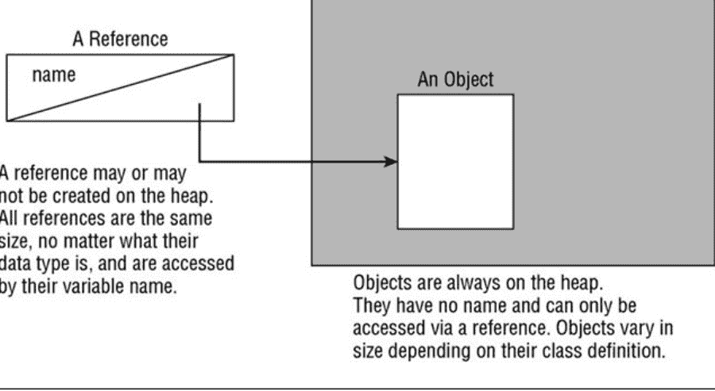

引用可能可能在堆上创建。无论数据类型如何，所有引用的大小都是相同的，并通过变量名访问。理解引用和对象的区别对于理解垃圾回收、`new` 运算符以及 Java 语言的许多方面非常有帮助。观察这段代码，看看你是否能看出对象何时第一次变为可用：

```java
public class Scope {
  public static void main(String[] args) {
    String one, two;
    one = new String("a");
    two = new String("b");
    one = two;
    String three = one;
    one = null;
  }
}
```

当你在考试中遇到关于垃圾收集的问题时，我们建议画出执行过程。脑中需要跟踪很多内容，试图把所有内容都留在记忆里很容易犯低级错误。让我们现在试一试。真的。拿好铅笔和纸。我们等你们。

纸好了吗？好的，我们开始吧。第一行和第二行（只写单词——现在不需要画框或箭头，因为还没有对象进入堆中）。在第 4 行，我们有了第一个对象。画一个里面有字符串 "a" 的框，并从单词 `one` 画一个指向该框的箭头。第 5 行类似。这次再画一个里面有字符串 "b" 的框，并从单词 `two` 画一个箭头。到此时，你的图画看起来应该像图 2.2。

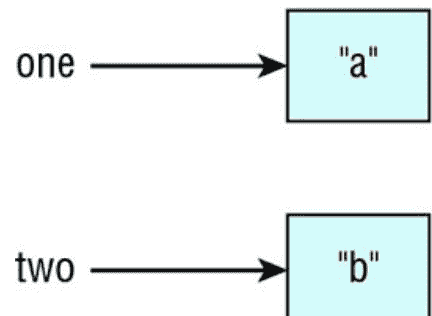

图 2.2 第 5 行后的图

在第 6 行，变量 `one` 改变为指向 "b"。删除或划掉从 `one` 发出的箭头，并从 `one` 画一个指向 "b" 的新箭头。在第 7 行，我们有一个新变量，所以写下单词 `three` 并从 `three` 画一个指向 "b" 的箭头。注意，`three` 现在指向 `one` 所指向的对象，而不是它最初指向的对象。这就是为什么要画图的原因。这种东西很容易忘记。到此时，你的图画看起来应该像图 2.3。

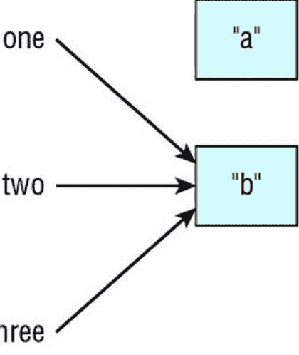

**图 2.3** 第 7 行后的图

最后，划掉 `one` 和 "b" 之间的线，因为第 8 行将该变量设置为 `null`。现在，我们正试图找出对象何时首次可以垃圾收集。在第 6 行，我们去掉了唯一指向 "a" 的箭头，使得该对象可以被垃圾收集。"b" 在它超出作用范围之前，一直有箭头指向它。这意味着 "b" 直到第 9 行方法结束时都没有超出作用范围。

## `finalize()`

Java 允许对象实现一个名为 `finalize()` 的方法。这个功能可能会让人困惑且难以正确使用。简而言之，垃圾收集器会调用一次 `finalize()` 方法。如果垃圾收集器没有运行，就不会调用 `finalize()`。如果垃圾收集器未能收集该对象并在稍后重试，则没有第二次调用 `finalize()`。
这个主题不再出现在考试中了。事实上，从 Java 9 开始，它在对象中已被弃用，官方文档指出：“终结机制本质上存在问题”。我们提到 Oracle 恰好是借用了一道旧考题。只需记住 `finalize()` 可能运行零次或一次。它不能运行两次。

## 总结

在本章中，我们描述了 Java 的构建模块——最重要的是，什么是 Java 对象，它是如何被引用和使用的，以及它是如何被销毁的。这一章为我们在书中将回顾的许多主题奠定了基础。

例如，我们将在第 3 章详细详细讨论基本类型以及如何使用它们。创建方法将在第 7 章介绍。在第 8 章，我们将讨论创建和管理对象的许多规则。换句话说，如果你在本章中没有找到所有内容，不要担心。我们将在书的其余部分对许多这些主题进行深入探讨。

首先，构造函数创建 Java 对象。构造函数是一个与类名匹配且省略返回类型的方法。当对象被实例化时，首先会初始化字段和代码块。然后运行构造函数。

接下来，基本类型是 Java 类型的类型构建模块。它们被组合成引用类型。引用类型可以拥有方法并赋值为 `null`。数字字面量允许包含下划线 (`_`)，只要它们不在字面量的开头或结尾，且不相邻小数点 (`.`)。

声明变量涉及陈明数据类型并给出变量名。表示类中字段的变量在对象实例化期间会自动初始化为它们对应的 `null` 或 `false` 值。局部变量在使用之前必须特异地进行初始化。标识符可以包含字母、数字、`$` 或 `_`。标识符不能与数字开头。局部变量可以使用 `var` 关键字代替实际类型。使用 `var` 时，类型在编译时设置且不会改变。

继续，作用域是指变量可以访问的代码部分。Java 中有三种变量，取决于它们的作用域：实例变量、类变量和局部变量。实例变量是类中的非静态字段。类变量是类中的静态字段。局部变量声明在构造函数、方法或初始化块中。

最后，垃圾收集负责在对象永远无法再次使用时从内存中移除它们。当不再有它的引用，或者它的引用已超出作用范围时，该对象就变得可以垃圾收集。

## 考试要点

- **能够识别构造函数。** 构造函数的名称与类名相同。它看起来是一个没有返回类型的方法。

- **能够识别合法和非法的声明。** 声明变量涉及陈明数据类型并给出变量名。表示类中字段的变量在对象实例化期间会自动初始化为它们对应的 `null` 或 `false` 值。局部变量在使用之前必须特异地进行初始化。标识符可以包含字母、数字、`$` 或 `_`。标识符不能与数字开头。局部变量可以使用 `var` 关键字代替实际类型。使用 `var` 时，类型在编译时设置且不会改变。

- **作用域是指变量可以访问的代码部分。** Java 中有三种变量，取决于它们的作用域：实例变量、类变量和局部变量。实例变量是类中的非静态字段。类变量是类中的静态字段。局部变量声明在构造函数、方法或初始化块中。

- **垃圾收集负责在对象永远无法再次使用时从内存中移除它们。** 当不再有它的引用，或者它的引用已超出作用范围时，该对象就变得可以垃圾收集。

# 复习题

1. 哪些是合法的 Java 标识符？（多选）
- A. `_`
- B. `_helloworld$`
- C. `true`
- D. `java.lang`
- E. `Public`
- F. `1980_`
- G. `_q2`

2. 下程序会打印哪些行？（多选）
```java
1: public class WaterBottle {
2: private String brand;
3: private boolean empty;
4: static float code;
5: public static void main(String[] args) {
6: WaterBottle wb = new WaterBottle();
7: System.out.println("Empty = " + wb.empty);
8: System.out.println("Brand = " + wb.brand);
9: System.out.println("Code = " + code);
10: }
```
- A. 第 8 行产生编译错误。
- B. 第 9 行产生编译错误。
- C. Empty =
- D. Empty = false
- E. Brand =
- F. Brand = null
- G. Code = 0.0

3. 下面关于 `var` 的代码段在方法中使用编译没有问题？（多选）
- A. `var spring = null;`
- B. `var fall = "leaves"`
- C. `var evening = 2; evening = null;`
- D. `var night = new Object();`
- E. `var day = 1/0;`
- F. `var winter = 12, cold;`
- H. `var morning = ""; morning = null;`

4. 关于这段代码片段的以下陈述哪些正确的？（选择所有适用项）。
```java
4: short numPets = 5L;
5: int numGrains = 2.0;
6: String name = "Scruffy";
7: int d = numPets.length();
8: int e = numGrains.length;
9: int f = name.length();
```
- A. 第 4 行产生编译错误。
- B. 第 5 行产生编译错误。
- C. 第 6 行产生编译错误。
- D. 第 7 行产生编译错误。
- E. 第 8 行产生编译错误。
- F. 第 9 行产生编译错误。

5. 关于以下类的哪些陈述是正确的？（选择所有适用项）。
```java
1: public class River {
2: int Depth = 1;
3: float temp = 50.0;
4: public void flow() {
5: for (int i = 0; i < 1; i++) {
6: int depth = 2;
7: depth++;
8: temp--;
9: }
10: System.out.println(depth);
11: System.out.println(temp);
12: public static void main(String... s) {
13: new River().flow();
14: }
```


+ A. 第 3 行产生编译错误。
B. 第 6 行产生编译错误。
C. 第 7 行产生编译错误。
D. 第 10 行产生编译错误。
E. 程序在第 10 行打印 3。
F. 程序在第 10 行打印 4。
G. 程序在第 11 行打印 50.0。
H. 程序在第 11 行打印 49.0。

+ 6. 以下哪些是正确的？（选择所有适用项）
A. `float` 类型的实例变量默认值为 0。
B. `char` 类型的实例变量默认值为 `null`。
C. `double` 类型的实例变量默认值为 0。
D. `int` 类型的实例变量默认值为 `null`。
E. `String` 类型的实例变量默认值为 `null`。
F. `String` 类型的实例变量默认值为空字符串 `""`
G. 以上均不是。

+ 7. 以下哪些是正确的？（选择所有适用项）
A. `boolean` 类型的局部变量默认值为 `null`。
B. `float` 类型的局部变量默认值为 0。
C. `double` 类型的局部变量默认值为 0。
D. `Object` 类型的局部变量默认值为 `null`。
E. `boolean` 类型的局部变量默认值为 `false`。
F. `float` 类型的局部变量默认值为 0.0。
G. 以上均不是。

+ 8. 以下哪些是正确的？（选择所有适用项。）
A. `boolean` 类型的类变量默认值为 0。
B. `boolean` 类型的类变量默认值为 `false`。
C. `boolean` 类型的类变量默认值为 `null`。
D. `long` 类型的类变量默认值为 `null`。
E. `long` 类型的类变量默认值为 `0L`。
F. `long` 类型的类变量默认值为 0。

+ 9. 关于垃圾回收的以下陈述哪些是正确的？（选择所有适用项）
A. 调用 `System.gc()` 保证通过销毁符合垃圾回收的对象来释放内存。
B. 垃圾回收按照固定的调度运行。
C. 垃圾回收允许 JVM 为其他对象回收内存。
D. 当你的程序用完一半可用内存时，垃圾回收运行。
E. 一个对象可能符合垃圾回收条件，但永远不会从堆中移除。
F. 一旦程序中没有可以访问它的引用，该对象就符合垃圾回收。
G. 将变量标记为 `final` 意味着其关联的对象将永远被垃圾回收。

+ 10. 关于以下类的哪些陈述是正确的？（选择所有适用项。）

```java
1: public class PoliceBox {
2: String color;
3: long age;
4: public void PoliceBox() {
5: color = "blue";
6: age = 1200;
7: }
8: public static void main(String []time) {
9: var p = new PoliceBox();
10: var q = new PoliceBox();
11: p.color = "green";
12: p.age = 1400;
13: p = q;
14: System.out.println("Q1="+q.color);
15: System.out.println("Q2="+q.age);
16: System.out.println("P1="+p.color);
17: System.out.println("P2="+p.age);
18: }
```

+ A. 它打印 Q1=blue。
B. 它打印 Q2=1200。
C. 它打印 P1=null。
D. 它打印 P2=1400。
E. 第 4 行无法编译。
F. 第 12 行无法编译。
G. 第 13 行无法编译。
H. 以上均不是。

11. 以下哪些可以合法填充空白以便你从命令行运行 `main()` 方法？（选择所有适用项）。

```java
public static void main(________________) {
```

+ A. `String... var`
B. `String My.Names[]`
C. `String[] 123`
D. `String[] _n`
E. `String... $n`
F. `var names`
G. `String myArgs`

12. 以下哪些表达式在独立插入空白行时，允许代码编译？（选择所有适用项）。

```java
public void printMagicData() {
double magic =;
System.out.println(magic);
}
```

+ A. `3_1`
B. `1_329._0`
C. `3_13._0`
D. `5_291._2`
E. `2_234.0_0`
F. `9__6`
G. `_1_3_5_0`
H. 以上均不是。

13. 假设我们有一个名为 `Rabbit` 的类。以下哪些陈述是正确的？（选择所有适用项）。

```java
1: public class Rabbit {
2: public static void main(String[] args) {
3: Rabbit one = new Rabbit();
4: Rabbit two = new Rabbit();
5: Rabbit three = one;
6: one = null;
7: Rabbit four = one;
8: three = null;
9: two = null;
10: four = new Rabbit();
11: System.gc();
12: }
```

+ A. 第 3 行创建的对象在第 6 行后符合垃圾回收条件。
B. 第 3 行创建的对象在第 8 行后符合垃圾回收条件。
C. 第 3 行创建的对象在第 12 行后符合垃圾回收条件。
D. 第 4 行创建的对象在第 9 行后符合垃圾回收条件。
E. 第 4 行创建的对象在第 11 行后符合垃圾回收条件。
F. 第 4 行创建的对象在第 12 行后符合垃圾回收条件。
G. 第 10 行创建的对象在第 11 行后符合垃圾回收条件。
H. 第 10 行创建的对象在第 12 行后符合。

14. 关于 `var` 的以下陈述哪些正确的？（选择所有适用项。）

+ A. `var` 可以作为构造函数参数。
B. `var` 的类型在编译时是已知的。
C. `var` 不能作为实例变量。
D. `var` 可以用于多重赋值。
E. `var` 的值在运行时不能改变。
F. `var` 的类型在运行时不能改变。
G. `var` 是保留字。

15. 给定以下类，以下哪些行可以独立替换 INSERT CODE 使代码编译？（选择所有适用项）。

```java
public class Price {
  public void admission() {
    INSERT CODE
    System.out.print(amount);
  }
}
```

+ A. `int Amount = 0b11;`
B. `int amount = 9L;`
C. `int amount = 0xE;`
D. `int amount = 1_2_0;`
E. `double amount = 1_0_.0;`
F. `int amount = 0b101;`
G. `double amount = 9_2.1_2;`
H. `double amount = 1_2_.0_0;`

16. 关于以下类的哪些陈述是正确的？（选择所有适用项）。

```java
1: public class ClownFish {
2: int gills = 0, double weight=2;
3: { int fins = gills; }
4: void print(int length = 3) {
5: System.out.println(gills);
6: System.out.println(weight);
7: System.out.println(fins);
8: System.out.println(length);
9: } }
```

+ A. 第 2 行包含编译错误。
B. 第 3 行包含编译错误。
C. 第 4 行包含编译错误。
D. 第 7 行包含编译错误。
E. 程序打印 0。
F. 程序打印 2.0。
G. 程序打印 2。
H. 程序打印 3。

17. 关于类及其成员的以下陈述哪些正确的？（选择所有适用项。）

+ A. 在循环中声明的变量不能在循环外被引用。
B. 变量不能在实例初始化块中声明。
C. 构造函数参数的作用域在其所属类的实例生命周期内有效。
D. 实例方法只能访问声明在实例方法声明之前定义的实例变量。
E. 变量可以在实例初始化块中声明，但不能在块之外引用。
F. 构造函数可以访问所有实例变量。
G. 实例方法可以访问所有实例变量。

18. 关于以下代码段，哪些描述是正确的？（选择所有选项。）

```java
3: var squirrel = new Object();
4: int capybara = 2, mouse, beaver = -1;
5: char chipmunk = -1;
6: squirrel = "";
7: beaver = capybara;
8: System.out.println(capybara);
9: System.out.println(mouse);
10: System.out.println(beaver);
11: System.out.println(chipmunk);
```

- A. 代码输出 2。
- B. 代码输出 -1。
- C. 代码输出空字符串。
- D. 代码输出：`null`。
- E. 第 4 行包含编译错误。
- F. 第 5 行包含编译错误。 
- G. 第 9 行包含编译错误。
- H. 第 10 行包含编译错误。

19. 假设以下类可以编译，在第 14 行标记为 `// SCOPE` 的行上，类或方法中定义的多少个变量在作用范围内？

```java
1: public class Camel {
2: { int hairs = 3_000_0; }
3: long water, air=2;
4: boolean twoHumps = true;
5: public void spit(float distance) {
6: var path = ""
7: { double teeth = 32 + distance++; }
8: while(water > 0) {
9: int age = twoHumps ? 1 : 2;
10: short i=-1;
11: for(i=0; i<10; i++) {
12: var Private = 2;
13: }
14: // SCOPE
15: }
16: }
17: }
```

- A. 2
- B. 3
- C. 4
- D. 5
- E. 6
- F. 7
- G. 以上都不是

20. 执行以下类的输出是什么？

```java
1: public class Salmon {
2: int count;
3: { System.out.print(count+"-"); }
4: { count++; }
5: public Salmon() {
6: count = 4;
7: System.out.print(2+"- ");
8: }
9: public static void main(String[] args) {
10: System.out.print(7+"- ");
11: var s = new Salmon();
12: System.out.print(s.count+"- "); } }
```

- A. 7-0-2-1
- B. 7-0-1-
- C. 0-7-2-1-
- D. 7-0-2-4-
- E. 0-7-1-
- F. 因为第 3 行导致类无法编译。
- G. 因为第 4 行导致类无法编译。
- H. 以上都不是。

21. 关于以下程序，哪些描述是正确的？（选择所有选项。）

```java
1: public class Bear {
2: private Bear pandaBear;
3: protected void finalize(Bear b) {
4: private void roar(Bear b) {
5: System.out.println("Roar!");
6: pandaBear = b;
7: }
8: public static void main(String[] args) {
9: Bear brownBear = new Bear();
10: Bear polarBear = new Bear();
11: brownBear.roar(polarBear);
12: polarBear = null;
13: brownBear = null;
14: System.gc(); }
```

- A. 第 9 行创建的对象在第 13 行后可以进行垃圾回收。
- B. 第 9 行创建的对象在第 14 行后可以进行垃圾回收。
- C. 第 10 行创建的对象在第 12 行后可以进行垃圾回收。
- D. 第 10 行创建的对象在第 13 行后可以进行垃圾回收。
- E. 保证垃圾回收运行。
- F. 垃圾回收可能会运行也可能不运行。
- G. 保证垃圾回收不运行。
- H. 代码无法编译。

22. 以下是有效的实例变量声明？（选择所有选项。）

- A. `var _ = 6000_0;`
- B. `var null = 6_000;`
- C. `var $_ = 6_000;`
- D. `var $2 = 6_000f;`
- E. `var var = 3_0_00;`
- F. `var #CONS = 2_000.0;`
- G. `var %C = 6_000_L;`
- H. 以上都不是

# 第 3 章
## 运算符

本章涵盖的 OCP 考试目标：

- 使用运算符和决策结构
- 使用 Java 运算符，包括使用括号覆盖运算符优先级
- 处理 Java 原始数据类型和 `String` API
- 声明和初始化变量（包括原始数据类型的强制转换和提升）


在上一章中，我们讨论了许多定义变量，但在变量创建后你可以对它做什么？本章介绍了运算符，并展示了如何使用它们组合现有值并创建新值。我们将教你如何将运算符应用于各种原始数据类型，并介绍可以应用于对象的运算符。

## 理解 Java 运算符

在进入有趣的内容之前，让我们先了解一些术语。Java 运算符是一种特殊的符号，可以应用于一组变量、值或字面量（称为操作数），并返回结果。我们在本章中使用的操作数，它指的是运算符所应用的值或变量。操作的输出简单是指结果。

## 运算符类型

在上一章中，我们讨论了许多定义变量，但在变量创建后你可以对它做什么？本章介绍了运算符，并展示了如何使用它们组合现有值并创建新值。我们将教你如何将运算符应用于各种原始数据类型，并介绍可以应用于对象的运算符。

## 运算符优先级

在进入有趣的内容之前，让我们先了解一些术语。Java 运算符是一种特殊的符号，可以应用于一组变量、值或字面量（称为操作数），并返回结果。我们在本章中使用的操作数，它指的是运算符所应用的值或变量。操作的输出简单是指结果。

## 一元运算符

根据定义，一元运算符是指仅需一个操作数（变量）即可运行的运算符。如表 3.2 所示，它们通常执行简单的任务，如增加数值或取反布尔值。

## 逻辑取反和取反运算符

由于我们在本章中将处理许多数值运算符，让我们先处理布尔部分。逻辑取反运算符 (`!`) 会翻转布尔表达式的值。例如，如果值为 `true`，它将被转换为 `false`，反之亦然。为了说明这一点，请比较以下语句的输出：

```java
boolean isAnimalSleep = false;
System.out.println(isAnimalSleep); // false
isAnimalSleep = !isAnimalSleep;
System.out.println(isAnimalSleep); // true
```

同样地，否定运算符 (`-`) 会反转数值表达式的符号，如下语句所示：

```java
double zooTemperature = 1.21;
System.out.println(zooTemperature); // 1.21
zooTemperature = -zooTemperature;
System.out.println(zooTemperature); // -1.21
zooTemperature = -(zooTemperature);
System.out.println(zooTemperature); // -1.21
```

注意，在最后一个示例中，我们使用了括号 `()` 用于否定运算符 (`-`)，以应用两次否定。如果我们写成 `--`，它将被解释为递减运算符并打印 `-2.21`。你很快就会看到更多关于递减运算符的内容。

根据描述，可能显而易见，某些运算符要求其作用的变量或表达式必须是特定类型。例如，你不能对布尔表达式应用否定运算符 (`-`)，也不能对数值表达式应用逻辑取反运算符 (`!`)。在考试中要小心尝试此点的题目，因为它们会导致代码编译失败。因为，以下任何行代码都无法编译：

```java
int pelican = !!; // 无法编译
boolean penguin = -true; // 无法编译
boolean peacock = !; // 无法编译
```

第一个语句无法编译，因为在 Java 中无法对数值值执行逻辑反转。第二个语句无法编译，因为你不能对布尔值进行数值取反；你需要使用逻辑取反运算符。最后，最后一个语句无法编译，因为你不能对数值值取逻辑取反，也不能将整数赋值给布尔变量。


> 注意考试中那些使用逻辑取反运算符或在布尔表达式、变量中使用数值的题目。与某些其他编程语言不同，在 Java 中，`1` 和 `true` 之间没有任何关系，就像 `0` 和 `false` 没有一样。

# 递增和递减运算符

递增和递减运算符分别是 `++` 和 `--`，可以应用于数值变量，且与二进制运算符相比，它们的优先级更高。换句话说，它们在表达式中通常首先应用。

递增和递减运算符需要特别 care，因为它们附加到关联变量的顺序会影响表达式的处理方式。如果运算符置于操作数之前，称为**前递增运算符**和**前递减运算符**，则运算符首先应用，返回的值是表达式的新值。或者，如果运算符放在操作数之后，称为**后递增运算符**和**后递减运算符**，则返回表达式的原始值，运算符在值返回后应用。

下面的代码段说明了这种区别：

```java
int parkAttendance = 0;
System.out.println(parkAttendance); // 0
System.out.println(++parkAttendance); // 1
System.out.println(parkAttendance); // 1
System.out.println(parkAttendance--); // 1
System.out.println(parkAttendance); // 0
```

第一个前递增运算符更新了 `parkAttendance` 的值并输出新值 1。下一个后递减运算符也更新了 `parkAttendance` 的值，但输出的是递减之前的值。

> 对于考试来说，了解如 `parkAttendance++` 和 `++parkAttendance` 等表达式之间的差异至关重要。递增和递减运算符将出现在多道题目中，对返回哪个值的混淆可能会导致你在考试中丢掉很多分数。

认证考试中的常见做法（尽管在现实世界中不常见）是在同一行内对同一个变量应用多个递增或递减运算符：

```java
int lion = 3;
int tiger = ++lion * 5 / lion--;
System.out.println("lion is " + lion);
System.out.println("tiger is " + tiger);
```

这比上示例更复杂，因为 `lion` 在同一行内被修改了两次。每当它被修改时，随着表达式从左到右移动，`lion` 的值都会改变，并将不同的值赋予变量。正如你记得我们在运算符优先级上的讨论，操作顺序在评估此示例时起着重要作用。

那么你是如何阅读这段代码的？首先，`lion` 递增并返回给表达式，乘以 5。我们可以将其简化为：

```java
int tiger = 4 * 5 / lion--; // lion 被赋值为 4
```

接下来，`lion` 递减，但表达式使用的是原始值 4，导致结果如下：

```java
int tiger = 4 * 5 / 4; // lion 被赋值为 3
```

最后，我们从左到右计算乘法和除法。前两个数的乘积是 20。除数整除 20，结果给 `tiger` 赋值为 5。然后打印结果：

lion is 3

tiger is 5

# 使用二进制算术运算符

接下来，我们处理接收两个参数的运算符，称为**二进制运算符**。二进制运算符是 Java 中最常用的运算符。它们可以用于对变量执行数学运算、创建逻辑表达式并执行基础变量赋值。二进制运算符经常与其他运算符在复杂的表达式中结合。

在本节中，我们将从表 3.3 所示的二进制运算符开始。在接下来的章节中，我们将扩展到所需的其他二进制运算符。

## 表 3.3 二进制运算符

| 运算符 | 描述 |
| --- | --- |
| + | 加两个数值 |
| - | 减两个数值 |
| * | 乘两个数值 |
| / | 将一个数值除以另一个 |
| % | 模运算符返回一个数值除以另一个数值后的余数 |

# 算术运算符

算术运算符经常在数学中遇到，包括加 (`+`)、减 (`-`)、乘 (`*`)、除 (`/`) 和模 (`%`)。如果你不知道模，不用担心——稍后我们会介绍。算术运算符还包括涵盖过的元运算符 `++` 和 `--`。正如你在表 3.1 中看到的，乘法运算符 (`*`、`/`、`%`) 的优先级高于加法运算符 (`+`、`-`)。看下面的表达式：

```java
int price = 2 * 5 + 3 * 4 - 8;
```

首先，你计算 `2 * 5` 和 `3 * 4`，这使得表达式变为：

```java
int price = 10 + 12 - 8;
```

然后，你按照左到右的顺序计算剩余项，结果 `price` 的值为 14。确保你理解为什么结果是 14，因为考试中可能会遇到这种运算符优先级的问题。

> 所有的算术运算符都可以应用于任何 Java 原型类型。此外，只有加法运算符 `+` 和 `+=` 可以应用于字符串值，这会导致字符串拼接。你将在第 5 章“核心 Java API”中学习更多关于这些运算符以及它们如何应用于字符串值的知识。

# 添加括号

你可能注意到我们在展示表 3.1 运算符优先级之前提过“除非用括号覆盖”。这是因为你可以通过包裹想要操作的部分来显式地改变操作顺序。

# 改变操作顺序

回到之前的 price 示例。下面的代码段包含相同的数值和运算符，顺序相同，但添加了两组括号：

```java
int price = 2 * ((5 + 3) * 4 - 8);
```

这一次你将先计算加法运算符 `5 + 3`，这使得表达式变为：

```java
int price = 2 * (8 * 4 - 8);
```

你可以通过乘以括号内的前两个值来简化此表达式：

```java
int price = 2 * (32 - 8);
```

接下来，在应用括号外的项之前，你先减去括号内的值：

```java
int price = 2 * 24;
```

最后，你将结果乘以 2，得到 price 的值为 48。

在考试中涉及数值的几乎任何题目中，括号都可能出现，因此，请确保你在看到它们时，能够理解它们是如何改变运算顺序的。

## 验证括号语法

在处理括号时，你需要确保它们始终有效且平衡。请考虑以下示例：

```java
long pigeon = 1 + ((3 * 5) / 3; // 无法编译
int blueJay = ((9 + 2) / (2 * 4; // 无法编译
short robin = 3 + [[4 * 2) + 4]; // 无法编译
```

第一个示例无法编译，因为括号没有平衡。有一个左括号没有匹配的右括号。第二个示例的左、右括号数量相等，但它们没有被正确平衡。从左到右读取时，右括号必须匹配之前的左括号。同样，所有的左括号都必须在表达式结束之前由右括号关闭。最后一个示例无法编译，是因为 Java 与某些其他编程语言不同，它不允许使用方括号 `[]` 代替括号。如果你将方括号替换为括号，最后一个示例就可以编译。

## 除法和取模运算符

虽然我们确定你已经见过大多数算术运算符，但取模运算符 `%` 对你来说可能是新的。取模运算符通常称为*余数运算符*（remainder operator），它简单来说就是两个数相除后的余数。例如，9 除以 3 可以整除且没有余数；因此，`9 % 3` 的结果为 0。相反，11 除以 3 不能整除；因此，`11 % 3` 的结果为 2。

示例阐明了这种区别：

```java
System.out.println(9 / 3);   // 3
System.out.println(9 % 3);   // 0

System.out.println(10 / 3);  // 3
System.out.println(10 % 3);  // 1

System.out.println(11 / 3);  // 3
System.out.println(11 % 3);  // 2

System.out.println(12 / 3);  // 4
System.out.println(12 % 3);  // 0
```

如你所见，只有当左侧的值从 11 变为 12 时，除法结果才会增加，而取模余数每左侧增加一次都会增加 1，直到循环回到零。对于给定的除数 `y`（在这些示例中为 3），对于正被除数，取模操作的结果是在 0 到 `(y - 1)` 之间的值。这意味着取模操作的结果始终是 0、1 或 2。

请务必理解算术除法和取模之间的区别。对于整数值，除法的结果是满足该操作的最邻整数的下值（floor value），而取模是余数值。如果你听到 *floor value*（地板值）这个词，它只是指没有小数点后任何内容的值。例如，4.0、4.5 和 4.9999999 的 floor value 都是 4。与我们将在第 5 章介绍的四舍五入不同，你只需要取小数点位之前的值，无论小数点位之后是什么。

> 在 Java 中，取模操作不仅限于正整数值；它也可以应用于负整数和浮点数。例如，如果除数是 5，那么负数的取模值在 -4 到 0 之间。对于考试来说，你不需要能够对负整数或浮点数进行取模。

## 数值提升

现在你已经理解了算术运算符的基础，讨论基本数值类型提升（primitive numeric promotion）至关重要，因为 Java 可能会执行你起初看起来很异常的操作。正如我们在第 2 章“Java 基础构建块”所示，每个基本数值类型都有一个位长度。考试时不需要知道这些类型的精确大小，但你应该知道哪些比其他类型大。例如，你应该知道 `long` 占据的空间比 `int` 大，而 `int` 占据的空间又比 `short` 大，以此类推。

你需要记忆 Java 在将运算符应用于数据类型时遵循的某些规则：

- **数值提升规则**：如果两个值具有不同的数据类型，Java 将自动将其中一个值提升为较大的两种数据类型。
- 如果其中一个值是整数而另一个是浮点数，Java 将自动将整数值提升为浮点值的数据类型。
- 较小的数据类型，即 `byte`、`short` 和 `char`，在任何与 Java 二元算术运算符一起时首先都会提升为 `int`，即使两个操作数都不是 `int`。
- 在所有提升发生且操作数具有相同数据类型后，结果的值将具有与其提升后的操作数相同的数据类型。

## 赋值值

（注意）为了精通赋值运算符，你应该熟练地理解数值提升以及何时需要强制类型转换（casting）。

### 赋值运算符

赋值运算符是一种二元运算符，用于修改或赋值运算符左侧的变量，等式右侧值的结果。最简单的赋值运算符是 `=` 赋值，你已经见过了：

```java
int herd = 1;
```

该语句将值 1 赋值给变量 `herd`。

Java 会自动从小到大提升数据类型（正如你在之前的算术运算符部分所示），但如果它检测到你正尝试在没有转换的情况下从大到小转换类型，它将抛出编译器异常。表 3.4 列出了你考试所需的第一个赋值运算符。我们将在本节稍后介绍其他赋值运算符。

## 表 3.4 简单赋值运算符

| 运算符 | 描述 |
| :--- | :--- |
| = | 将右侧的值赋值给左侧的变量 |

### 转换值

目前为止顺利吧？在涵盖转换之前，我们无法详细讨论赋值运算符。转换是一种单元操作，将一种数据类型显式解释为另一种数据类型。在转换为更大或扩展的数据类型时，转换是可选且必要的，但在转换为更小或收窄的数据类型时，转换是强制的。如果没有转换，当将较大的数据类型放入较小类型中时，编译器将生成错误。

转换通过将数据类型放在括号内并放在要转换值的左侧来实现。以下是一些转换的示例：

```java
int fur = (int)5;
short hair = (short) 2;
String type = (String) "Bird";
short tail = (short)(4 + 10);
long feathers = (long); // 无法编译
```

强制转换符与值之间的空格是可选的。如倒数第二个示例所示，右侧也放在括号内是常见做法。由于强制转换是一个一元操作，如果我们不把 `4 + 10` 括在括号内，它将只会作用于 `4`。最后一个示例无法编译，因为类型位于值的错误的侧侧。

一方面，编译器自动将较小的数据类型转换为较大的数据类型是非常既方便的。但另一方面，当你进行相反操作时，这会成为极佳的考试题，用来检查你是否留了神。尝试找出为什么以下代码行可以编译：

```java
float egg = 2.0 / 9; // 无法编译
int tadpole = (int)5 * 2L; // 无法编译
short frog = 3 - 2.0; // 无法编译
```

这些示例都涉及将较大的值放入较小的数据类型中。如果你还没有理解这一点，不要担心；我们将在本章的这部分介绍许多此类示例。

在本章中，强制转换主要涉及将数值数据类型转换为其他数据类型。正如你将在后面的章节中看到的，强制转换也可以应用于对象和引用。但在这些情况下，并没有执行任何转换，因为只有当底层对象已经是类或接口的成员时，才允许强制转换。

在考试期间，记住在任何涉及强制转换时都要紧留意括号和返回类型！

# 复习基本类型赋值

让我们回到一些与第 2 章看到的类似的示例，以展示强制转换如何解决这些问题：

```java
int fish = 1.0; // 无法编译
short bird = 1921222; // 无法编译
int mammal = 9f; // 无法编译
long reptile = 19230198193810323L; // 无法编译
```

第一条语句无法编译，因为你正试图将双精度类型的 `1.0` 赋值给整数值。尽管该值在数学上是一个整数，但通过添加 `.0`，你是在指示编译器将其视为双精度类型。第二条语句无法编译，因为字面量 `1921222` 超出了 `short` 的范围，编译器检测到了它。第三条语句无法编译，因为数字末尾添加的 `f` 指示编译器将数字视为浮点值，但赋值目标是 `int`。最后，最后一条语句无法编译，因为 Java 将字面量解释为 `int`，并注意到该值大于 `int` 允许的范围。该字面量需要后缀 `L` 或 `1` 才能被视为 `long`。

# 应用强制转换

我们可以通过将结果强制转换为较小的数据类型来修复之前的示例。记住，每当你从一个较大的数值数据类型转换为较小的数值数据类型，或者从浮点数转换为整型值时，都需要对基本类型进行强制转换。

```java
int trainer = (int)1.0;
short ticketTaker = (short)1921222; // 存储为 20678
int usher = (int)9f;
long manager = 19230198193810323L;
```

# 溢出与下溢

上一个示例中的表达式现在可以编译，尽管是有代价的。第二个值 `1,921,222` 太大，无法作为 `short` 存储，因此发生了数值溢出，它变成了 `20,678`。溢出是指一个数字大到无法放入数据类型中，因此系统“回绕”到最小的负值并从那里开始计数，类似于模运算的工作原理。还有类似的下溢，即当数字太小而无法放入数据类型中时，例如在 `byte` 字段中存储 `-200`。

这超出了考试的范围，但在你自己的代码中需要注意。例如，以下语句会输出一个负数：

```java
System.out.print(2147483647+1); // -2147483648
```

由于 `2147483647` 是 `int` 的最大值，对其添加任何严格正的值都会导致它回绕到最小的负值。

让我们回到本章前面“数值提升”部分的一个类似示例。

```java
short mouse = 10;
short hamster = 3;
short capybara = mouse * hamster; // 无法编译
```

根据你目前学到的关于数值提升和强制转换的所有知识，你理解为什么该语句的最后一行无法编译吗？正如你所记得，当应用任何算术运算符时，`short` 值会自动提升为 `int`，结果的类型为 `int`。尝试将一个 `int` 值赋值给 `short` 变量会导致编译器错误，因为 Java 认为你正试图从较大的数据类型隐式转换为较小的数据类型。

我们可以通过强制转换来修复这个表达式，因为有时你可能想要覆盖编译器的默认行为。在这个示例中，我们知道 `10 * 3` 的结果是 `30`，它可以放入 `short` 中。

```java
short mouse = 10;
short hamster = 3;
short capybara = (short)(mouse * hamster);
```

通过将较大的值转换为较小的数据类型，你是在指示编译器忽略其默认行为。最后但同样重要的，强制转换可以出现在表达式的任何位置。例如，来看之前示例的修改形式：

```java
short mouse = 10;
short hamster = 3;
short capybara = (short)mouse * hamster; // 无法编译
short gerbil = (short)(mouse * hamster); // 编译通过
```

那么，最后两行发生了什么？嗯，记得当我们应用于 `mouse` 时，两个操作数都被提升为 `int`，导致结果为 `int` 并产生编译器错误。在第二个示例中，强制转换成功执行，因为它配合赋值运算符使用。

# 复合赋值运算符

除了简单赋值运算符 `=` 之外，Java 还支持许多复合赋值运算符。对于考试，你应该熟悉表 3.5 中的运算符。

复合运算符只是简单赋值运算符的增强形式，内置了算术或逻辑操作，应用于语句的左右两侧并将结果存储在语句的左侧。例如，在声明 `camel` 和 `giraffe` 后，以下两个语句独立运行时是等价的：

```java
int camel = 2, giraffe = 3;
camel = camel * giraffe; // 赋值运算符
camel *= giraffe; // 复合赋值运算符
```

复合运算符的左侧只能应用于已定义的变量，不能用于声明新变量。在这个示例中，如果 `camel` 尚未定义，表达式 `camel *= giraffe` 将无法编译。

复合运算符不仅用于简写——它们还可以节省我们显式转换值的麻烦。例如，考虑以下示例。你可以找出为什么最后一行无法编译：


```java
long goat = 10;
int sheep = 5;
sheep = sheep * goat; // 无法编译
```

从上一节开始，你应该能看出最后一行的问题所在。我们正试图将一个 `long` 值赋值给 `int` 变量。

# 表 3.5 复合运算符

| 运算符 | 描述 |
| --- | --- |
| `+=` | 将右侧的值加到左侧变量并将和赋值给该变量 |
| `-=` | 从左侧变量减去右侧的值并将差赋值给该变量 |
| `*=` | 将右侧的值乘以左侧变量并将积赋值给该变量 |
| `/=` | 将左侧变量除以右侧变量并将商赋值给该变量 |

该行可以通过显式强制转换为 `(int)` 来修复，但有一种更好的方法，使用复合赋值运算符：

```java
long goat = 10;
int sheep = 5;
sheep *= goat;
```

复合运算符会先将 `sheep` 转换为 `long`，应用两个 `long` 值之间的乘法运算，然后将结果转换为 `int`。与之前编译器报告错误的示例不同，在这个示例中，我们看到编译器将自动将结果值转换为复合运算符左侧值所对应的数据类型。

# 赋值运算符的返回值

关于赋值运算符，需要了解的一点是：赋值的结果是一个表达式，并且该表达式本身等于赋值的值。例如，下面的代码段是完全有效的，尽管它看起来有点奇怪：

```java
long wolf = 5;
long coyote = (wolf=3);
System.out.println(wolf);   // 3
System.out.println(coyote);  // 3
```

这里的关键在于 `(wolf=3)` 做了两件事：首先，它将变量 `wolf` 的值设置为 3；其次，它返回赋值的结果，而该值也是 3。

考试出题者喜欢在表达式中间插入赋值运算符 (`=`)，并将赋值的值作为更复杂表达式的一部分。例如，如果你在考试中看到类似下面的 `if` 语句，请不要惊讶：

```java
boolean healthy = false;
if(healthy = true)
    System.out.print("Good!");
```

虽然这看起来像是在测试 `healthy` 是否为真，但实际上实际上是给 `healthy` 赋值为 `true`。赋值的结果就是该值的值。

- 比较两个数值或字符基本类型。如果数值值的数据类型不同，则值会自动进行类型提升。例如，`5 == 5.00` 返回 `true`，因为左侧被提升为 `double`。
- 比较两个布尔值。
- 比较两个对象，包括 `null` 和 `String` 值。

等性比较仅限于这三种情况，因此你不能混合匹配不同的类型。例如，以下每种情况都将导致编译错误：

```java
boolean monkey = true == 3;           // 无法编译
boolean ape = false! == "Grape"; // 无法编译
boolean gorilla = 10.2 == "Koko"; // 无法编译
```

在考试中使用等价运算符时，请密切注意数据类型。正如我们在上一节中提到的，出题者也会混合使用赋值运算符和等价运算符。

```java
boolean bear = false;
boolean polar = (bear = true);
System.out.println(polar); // true
```

一眼看，你可能认为输出应该是 `false`，如果表达式是 `(bear == true)`，那么你是正确的。但在在这个示例中，表达式是将 `true` 的值赋值给 `bear`，正如你在赋值运算符章节中看到的，赋值本身具有赋值的值。因此，`polar` 也被赋值为 `true`，输出结果为 `true`。

对于对象比较，等价运算符应用于对象的引用，而不是它们所指向的对象。只有当两个引用指向同一个对象，或者它们都指向 `null` 时，这两个引用才是相等的。让我们来看一些示例：

```java
File monday = new File("schedule.txt");
File tuesday = new File("schedule.txt");
File wednesday = tuesday;
System.out.println(monday == tuesday); // false
System.out.println(tuesday == wednesday); // true
```

尽管所有变量都指向同一个文件信息，但在 `==` 方面，只有两个引用 `tuesday` 和 `wednesday` 是相等的，因为它们指向同一个对象。

> 等待，`File` 类是什么？在这个示例中以及考试期间，你可能会遇到不熟悉的类名，例如 `File`。很多时候，你可以在不知道这些类具体细节的情况下回答关于这些类的问题。在上一个示例中，你应该能够回答指示 `monday` 和 `tuesday` 是两个独立且不同对象的问题，因为使用了 `new` 关键字，即使你不熟悉这些对象的数据类型。

在某些语言中，将 `null` 与任何其他值比较始终为 `false`，但在 Java 中并非如此。

```java
System.out.print(null == null); // true
```

在第 5 章中，我们将通过引入两个不同对象等价的含义来继续讨论对象相等。我们还将涵盖 `String` 相等，并展示这如何成为一个复杂的话题。

# 关系运算符

我们现在转向关系运算符，它比较两个表达式并返回一个布尔值。表 3.7 描述了考试中需要了解的关系运算符。

# 表 3.7 关系运算符

| 运算符 | 描述 |
| --- | --- |
| `<` | 如果左侧的值严格小于右侧的值，返回 `true` |
| `<=` | 如果左侧的值小于或等于右侧的值，返回 `true` |
| `>` | 如果左侧的值严格大于右侧的值，返回 `true` |
| `>=` | 如果左侧的值大于或等于右侧的值，返回 `true` |
| `instanceof` | 如果对象是指定类型的实例，返回 `true` |

## 数值比较

关系运算符仅适用于数值类型。如果操作数不是相同类型，它们将进行提升。让我们来看一些示例：

```java
int x = 10;
double y = 10.0;
System.out.println(x < y); // false
System.out.println(x <= y); // true
System.out.println(x > y); // false
System.out.println(x >= y); // true
```

## instanceof 运算符

你需要了解最后一个运算符是 `instanceof`。它用于在运行时确定对象是否是特定类或接口的成员。例如，在下面的代码中：

```java
Object obj = 10;
if (obj instanceof Integer) {
    System.out.println("It is Integer");
}
```

现在，我们有一个可以智能处理 `Integer` 和其他值的方法。

```java
public static void openZoo(Number time) {
    if(time instanceof Integer)
        System.out.print((Integer) time + "0clock");
    else
        System.out.print(time);
}
```

注意我们在示例中对 `Integer` 进行转换。在处理多种类型的对象时，通常会将 `instanceof` 和强制转换结合使用，因为它可以访问特定类特有的字段。

## 无效的 instanceof

考试可能会设难你的一个领域是与不兼容类型使用 `instanceof`。例如，`Number` 不可能持有 `String` 值，所以以下代码会导致编译错误：

```java
public static void openZoo(Number time) {
    if(time instanceof String) // 无法编译
}
```

情况变得更加复杂，因为之前的规则适用于类，但不适用于接口。如果这对你来说是新概念，请不要担心；我们将在讨论多态时进行详细说明。

## null 和 instanceof 运算符

如果你对 `null` 变量调用 `instanceof` 会发生什么？对于考试，你应该知道对 `null` 字面量或 `null` 引用调用 `instanceof` 始终返回 `false`。

```java
System.out.print(null instanceof Object);

Object noObjectHere = null;
System.out.print(noObjectHere instanceof String);
```

先前的示例都打印 `false`。表达式的右侧是什么几乎并不重要。我们说“几乎”是因为存在例外。最后一个示例无法编译，因为 `null` 被用在 `instanceof` 运算符的右侧：

```java
System.out.print(null instanceof null); // 无法编译
```

# 逻辑运算符

如果你学习过计算机科学，可能之前已经遇到过逻辑运算符了。如果没有，也不要慌——我们将在本节中详细介绍它们。

逻辑运算符 `&` 和 `|` 可以同时应用于数值和布尔数据类型；它们列在表 3.8 所示。当它们被应用于布尔数据类型时，被称为逻辑运算符。相反，当它们被应用于数值数据类型时，被称为按位运算符，因为它们对组成数字的位进行按位比较。不过对于考试，你不需要了解任何按位比较的知识，所以我们将这方面的教育留给其他书籍。

表 3.8 逻辑运算符

| 运算符 | 描述 |
| --- | --- |
| `&` | 逻辑与 (AND) 仅当两个值都为真时为真。 |
| `|` | 包含或 (OR) 只要至少有一个值为真即为真。 |
| `^` | 逻辑异或 (XOR) 仅当一个值为真而另一个值为假时为真。 |

你应该熟悉图 3.1 中的真值表，其中假设 `x` 和 `y` 是布尔数据类型。

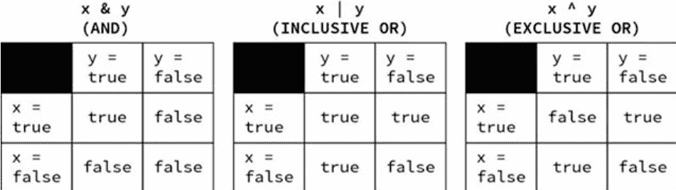

图 3.1 `&`、`|` 和 `^` 的真值表

这里是一些帮助你记住这个表的提示：

- 与仅当两个操作数都为真时为真。
- 包含或仅当两个操作数都为假时为假。
- 异或仅当操作数不同时为真。

让我们来看一些例子：

```java
boolean eyesClosed = true;
boolean breathingSlowly = true;

boolean resting = eyesClosed | breathingSlowly;
boolean asleep = eyesClosed & breathingSlowly;
boolean awake = eyesClosed ^ breathingSlowly;
System.out.println(resting); // true
System.out.println(asleep); // true
System.out.println(awake); // false
```

你应该尝试自己操作，改变 `eyesClosed` 和 `breathingSlowly` 的值并研究结果。

# 短路运算符

接下来，我们介绍条件运算符 `&&` 和 `||`，它们通常被称为短路运算符，并如表 3.9 所示。

表 3.9 短路运算符

| 运算符 | 描述 |
| --- | --- |
| `&&` | 短路与仅当两个值都为真时为真。如果左侧为假，则右侧将不会被求值。 |
| `||` | 短路或只要至少有一个值为真即为真。如果左侧为真，则右侧将不会被求值。 |

短路运算符与逻辑运算符 `|` 几乎相同，不同在于如果最终结果可以通过表达式的左侧确定，则表达式的右侧可能永远不会评估。例如，考虑以下语句：

```java
int hour = 10;
boolean zooOpen = true || (hour < 4);
System.out.println(zooOpen); // true
```

参考真值表，`open` 的值只有在表达式的两边都为假时才为假。由于我们知道左侧为真，因此不需要评估右侧，因为 `hour` 的任何值都不会让这段代码输出为假。换句话说，`hour` 可能是 -10 或 892；输出将是相同的。

# 避免空指针异常

短路运算符的一个更常见的用例是在执行操作之前检查空对象。在下面的示例中，如果 `duck` 为 `null`，程序将在运行时抛出 `NullPointerException`：

```java
if(duck!=null & duck.getAge()<5) { // 可能会抛出空指针异常
    // 执行某些操作
}
```

问题在于逻辑与 `&` 会评估表达式的两个边。我们可以添加第二个语句，但如果有许多变量需要检查，这可能会变得臃肿。一个简单易读的解决方案是使用短路与 `&&`：

```java
if(duck!=null && duck.getAge()<5) {
    // 执行某些操作
}
```

在这个示例中，如果 `duck` 为 `null`，短路处理防止了空指针异常的发生。

考试中会有许多问题表面上是在测试某项内容，例如 `StringBuilder` 或异常处理，但实际上答案与某个特定运算符的误用有关会导致会导致无法编译。当你在考试中看到涉及数字的运算符时，务必检查是否使用了适当的数据类型，并在适用情况下它们是否匹配。

运算符贯穿整个考试，几乎出现在每个代码示例中，因此你对这一章理解得越深，考试准备得越充分。

## 考试要点

- 能够编写使用 Java 运算符的代码。本章涵盖了各种运算符符号。回去复习几次，以便你在阅读书的其余部分时对它们熟悉。
- 能够识别哪些运算符与哪些数据类型相关。某些运算符可能仅适用于数值基本数据类型，某些仅适用于布尔值，而某些则适用于对象。注意运算符和操作数之间不匹配的情况非常重要，因为这个问题可能会出现在几道考试题中。
- 理解何时需要进行类型转换（casting）或何时发生数值提升（numeric promotion）。每当你混合两种不同类型的操作数时，编译器需要决定如何处理数据类型。当你从较小的数据类型转换为较大的数据类型时，会自动应用数值提升。当你从较大的数据类型转换为较小的数据类型时，则需要类型转换。
- 理解 Java 运算符的优先级。你将处理的大多数 Java 运算符是二元的，但表达式的数量通常大于两个。因此，你必须理解 Java 评估每个运算符符号的顺序。
- 能够编写使用括号覆盖运算符优先级的代码。你可以在代码中使用括号手动更改优先级的顺序。

# 复习题

1. 以下哪些 Java 运算符可以用于布尔变量？（选择所有适用项。）
   - A. `==`
   - B. `+`
   - C. `-`
   - D. `!`
   - E. `%`
   - F. `<=`
   - G. 使用 `(boolean)` 进行强制转换

2. 哪种数据类型（或类型）允许以下代码段编译？（选择所有适用项）

```java
byte apples = 5;
short oranges = 10;
bananas = apples + oranges;
```

   - A. `int`
   - B. `long`
   - C. `boolean`
   - D. `double`
   - E. `short`
   - F. `byte`

3. 独立应用以下哪种更改可以让以下代码段编译？（选择所有适用项）

```java
3: long ear = 10;
4: int hearing = 2 * ear;
```

   - A. 无需更改；按样编译。
   - B. 将第 4 行的 `ear` 强制转换为 `int`。
   - C. 将第 3 行 `ear` 的数据类型改为 `short`。
   - D. 将第 4 行的 `2 * ear` 强制转换为 `int`。
   - E. 将第 4 行 `hearing` 的数据类型改为 `short`。
   - F. 将第 4 行 `hearing` 的数据类型改为 `long`。

4. 以下代码段的输出是什么？

```java
3: boolean canine = true, wolf = true;
4: int teeth = 20;
5: canine = (teeth != 10) ^ (wolf=false);
6: System.out.println(canine+", "teeth+", "wolf);
```

   - A. true, 20, true
   - B. true, 20, false
   - C. false, 10, true
   - D. false, 20, false
   - E. 代码因为第 5 行无法编译。
   - F. 以上皆非

5. 以下哪些运算符的优先级按递或相同相同排列？假设 `+` 运算符是二元加法，而非一元形式。（选择所有适用项。）
   - A. `+`, `*`, `%`, `-`
   - B. `++`, `(int)`, `*`
   - C. `==`, `!`
   - D. `(short)`, `=`, `*`
   - E. `*`, `/`, `%`, `==`
   - F. `!`, `||`, `&`
   - G. `^`, `+`, `=`, `+=`

6. 以下程序的输出是什么？

```java
1: public class CandyCounter {
2: static long addCandy(double fruit, float vegetables)
{
3: return (int)fruit+vegetables;
4: }
5:
6: public static void main(String[] args) {
7: System.out.print(addCandy(1.4, 2.4f) + "-");
8: System.out.print(addCandy(1.9, (float)4) + "-");
9: System.out.print(addCandy((long)(int)(short)2,
(float)4)); } }
```

   - A. 4-6-6.0
   - B. 3-5-6
   - C. 3-6-6
   - D. 4-5-6


- E. 代码因为第 9 行无法编译。
- F. 以上皆非

### 7. 以下代码段的输出是什么？

```
int ph = 7, vis = 2;
boolean clear = vis > 1 & (vis < 9 || ph < 2);
boolean safe = (vis > 2) && (ph++ > 1);
boolean tasty = 7 <= --ph;
System.out.println(clear+"-"+safe+"-"+tasty);
```

- A. true-true-true
- B. true-true-false
- C. true-false-true
- D. true-false-false
- E. false-true-true
- F. false-true-false
- G. false-false-true
- H. false-false-false

### 8. 以下代码段的输出是什么？

```
4: int pig = (short)4;
5: pig = pig++;
6: long goat = (int)2;
7: goat -= 1.0;
8: System.out.print(pig + " " + goat);
```

- A. 4 - 1
- B. 4 - 2
- C. 5 - 1
- D. 5 - 2
- E. 代码由于第 7 行无法编译。
- F. 以上皆非

### 9. 以下代码的唯一输出是什么？（选择所有适用项）

```
int a = 2, b = 4, c = 2;
System.out.println(a > 2 ? --c : b++);
System.out.println(a!=c ? b++ :);
```

- A. 1
- B. 2
- C. 3
- D. 4
- E. 5
- F. 6
- G. 代码无法编译。（注：原文存在括号不匹配错误）

### 10. 以下代码的唯一输出是什么？（选择所有适用项）

```
short height = 1, weight = 3;
short zebra = (byte) weight * (byte) height;
double ox = 1 + height * 2;
long giraffe = 1 + height + 1;
System.out.println(zebra);
System.out.println(ox);
System.out.println(giraffe);
```

- A. 1
- B. 2
- C. 3
- D. 4
- E. 5
- F. 6
- G. 代码无法编译。

### 11. 以下代码的输出是什么？

```
1: public class ArithmeticSample {
2: public static void main(String[] args) {
3: int sample1 = (2 * 4) % 3;
4: int sample2 = 3 * 2 % 3;
5: int sample3 = 5 * (1 % 2);
6: System.out.println(sample1+"-"+sample2+"-"+sample3);
7: }
```

- A. 0-0-5
- B. 1-2-10
- C. 2-1-5
- D. 2-0-5
- E. 3-1-10
- F. 3-2-6
- G. 代码无法编译。

### 12. __ 运算符增加值并返回原始值，而 __ 运算符减少值并返回新值。

- A. post-increment, post-increment
- B. post-decrement, post-decrement
- C. post-increment, post-increment
- D. post-increment, pre-decrement
- E. pre-increment, pre-decrement
- F. pre-increment, post-decrement

### 13. 以下代码段的输出是什么？

```
boolean sunny = true, raining = false, sunday = true;
boolean goingTheStore = sunny & raining ^ sunday;
boolean goingToZoo = sunday && !raining;
boolean stayingHome = !(goingTheStore && goingToZoo);
System.out.println(goingTheStore + "-" + goingToZoo + "-" +stayingHome);
```

- A. true-false-false
- B. false-true-false
- C. true-true-true
- D. false-true-true
- E. false-false-false
- F. true-true-false
- G. 以上皆非

### 14. 以下哪些陈述是正确的？（选择所有适用项）。

- A. 赋值操作表达式的返回值可以是 void。
- B. 不等运算符 (!=) 可以用于比较对象。
- C. 等运算符 (==) 可以用于比较布尔值与数值值。
- D. 在运行时，&& 和 | 运算符可能只评估表达式的左侧。
- E. 赋值操作表达式的返回值是新赋值变量的值。
- F. 在 Java 中，and 和 false 可以交叉使用。
- G. 逻辑取反运算符 (! ) 不能用于翻转数值。

### 15. 哪些运算符带有三个操作数或值？（选择所有适用项）。

- A. =
- B. &&
- C. *=
- D. ? :
- E. &
- F. ++
- G. /

### 16. 以下代码中有多少行包含编译器错误？

```
int note = 1 * 2 + (long)3;
short melody = (byte)(double)(note *= 2);
double song = melody;
float symphony = (float)((song == 1_000f) ? song * 2L : song);
```

- A. 0
- B. 1
- C. 2
- D. 3
- E. 4

### 17. 给定以下代码段，执行后变量的值是多少？（选择所有适用项。）

```
int ticketsTaken = 1;
int ticketsSold = 3;
ticketsSold += 1 + ticketsTaken++;
ticksTaken *= 2;
ticksSold += (long)1;
```

- A. ticketsSold is 8
- B. ticketsTaken is 2
- C. ticketsSold is 6
- D. ticketsTaken is 6
- E. ticketsSold is 7
- F. ticketsTaken is 4
- G. 代码无法编译。

### 18. 以下哪些项可以用于更改表达式中的运算顺序？（选择所有适用项。）

- A. [ ]
- B. < >
- C. ( )
- D. \ / /
- E. { }
- F. " ""

### 19. 执行以下代码段的结果是什么？（选择所有适用项。）

```
3: int start = 7;
4: int end = 4;
5: end += ++start;
6: start = (byte)(Byte.MAX_VALUE + 1);
```

- A. start 为 0
- B. start 为 -128
- C. start 为 127
- D. end 为 8
- E. end 为 11
- F. end 为 12
- G. 代码无法编译。
- H. 代码可以编译但在运行时抛出异常。

### 20. 关于一元运算符，以下哪些陈述是正确的？（选择所有适用项。）

- A. 一元运算符始终会在任何周围的二元或三元运算符之前执行。
- B. - 运算符可以用于翻转布尔值。
- C. 前递增运算符（++）返回应用增加之前的变量值。
- D. 后递减运算符（--）返回应用递减之前的变量值。
- E. ! 运算符不能用于数值值。
- F. 以上都不是

# 第 4 章

## 做决策

本章涵盖的 OCP 考试目标：

- 使用运算符和决策结构
- 使用 Java 控制语句，包括 `if`, `if/else`, `switch`
- 创建并使用 `do/while`, `while`, `for` 和 `for each` 循环，包括嵌套循环，使用 `break` 和 `continue` 语句


与许多编程语言一样，Java 主要由变量、运算符和语句按照某种逻辑顺序组合而成。在此之前，我们涵盖了如何创建和操作变量。然而，编写软件不仅仅是管理变量；它关乎创建可以做出智能决策的应用程序。在本章中，我们将向你介绍该语言中提供的各种决策语句。这些知识将允许你构建在本书中出现的复杂函数和类结构。

## 创建决策语句

Java 运算符允许你创建许多复杂的表达式，但它们在控制程序流方面是有局限性的。想象一下，你希望一个方法仅在某些在运行时无法评估的条件下执行。例如，在下雨天，动物园应该提醒游客带伞；或者在下雪天，动物园可能需要关闭。软件没有改变，但软件的行为应该根据当时提供的输入而发生变化。在本节中，我们将讨论包括 `if`、`else` 和 `switch` 语句在内的决策语句。

## 语句和块

正如你可能从第 2 章“Java 构建模块”中回想到的，Java 语句是 Java 中一个完整的执行单元，以分号（;）结束。在本章的剩余部分中，我们将向你介绍各种 Java 控制流语句。控制流语句通过决策、循环和分支打破执行流，允许应用程序选择性地执行特定的代码段。

这些语句既适用于单个表达式，也适用于 Java 代码块。如第 2 章所描述的，Java 中的代码块是位于平衡括号 `{}` 之间的零个或多个语句的组，可以用于任何允许单个语句的地方。例如，以下两个代码段是等价的，第一个是单个表达式，第二个是语句块的：

```
// 单条语句
patrons++;
```

```
// 块中的语句
{
  patrons++;
}
```

语句或块通常作为决策语句的目标。例如，我们可以将决策性的 `if` 语句附加到这两个示例之前：

```
// 单条语句
if(ticketsTaken > 1)
patrons++;
```

```
// 块中的语句
if(ticketsTaken > 1)
{
  patrons++;
}
```

同样，这两个代码段都是等价的。只需记住，决策语句的目标可以是单条语句，也可以是语句块。在本章的其余部分中，我们将同时使用这两种形式，以让你更好地准备考试中可能看到的内容。

> 虽然之前的两个例子是等价的，但从风格上看，通常更倾向于第二种形式，即使块只有一个语句。第二种形式的优势在于你可以快速地向块中插入新行代码，而无需修改周围的结构。虽然这形式都是正确的，但这可能解释了为什么你经常看到开发者对所有决策语句都始终使用块。

## if 语句

通常，我们希望仅在特定情况下执行代码块。如图 4.1 所示，`if` 语句通过允许我们的应用程序仅当布尔表达式在运行时求为真时执行特定代码块来实现这一点。

```
if (booleanExpression) {
    // 如果为真则分支
}
```

图 4.1 `if` 语句的结构

例如，假设我们有一个函数，使用小时（从 0 到 23 的整数值）来向用户显示消息：

```
if(hourOfDay < 11)
System.out.println("Good Morning");
```

如果小时小于 11，将显示该消息。现在，假设我们还想在每次打印问候时增加某个值 `morningGreetingCount`。我们可以写两次 `if` 语句，但幸运的是 Java 为我们提供了使用块的更自然的方法：

```
if(hourDay < 11) {
    System.out.println("Good Morning");
    morningGreetingCount++;
}
```

块允许根据 `if` 评估执行多条语句。注意，第一条语句没有在打印部分周围包含块，但它完全可以加上。正如上一节讨论的，在 `if` 语句以及许多其他控制流语句的执行部分周围加上块通常被认为是良好的编码习惯，尽管这显然不是要求的。

## 注意缩进和括号

考试出题者试图绊你的区域是不带括号（`{}`）的 `if` 语句。例如，看看我们示例稍微修改后的形式：

```
if(hourOfDay < 11)
   System.out.println("Good Morning");
   morningGreetingCount++;
```

根据缩进，你可能会认为变量 `GreetingCount` 只有在 `hourOfDay` 小于 11 时才会增加，但这不是这段代码的作用。它只会在满足条件时执行打印语句，但它始终执行递增操作。

记住，在 Java 中（与其他语言不同），制表符只是空白符，不是执行的一部分。当你在题目中看到控制流语句时，务必追踪块的括号。

## else 语句

让我们稍微扩展一下示例。如果我们想在上午 11 点以后显示不同的消息怎么办？我们可以使用有的工具来实现吗？当然可以！

```
if(hourOfDay < 11) {
   System.out.println("Good Morning");
}
if(hourOfDay >= 11) {
   System.out.println("Good Afternoon");
}
```

这看起来有点冗余，因为我们对 `hourOfDay` 执行了两次评估。它也是浪费的，因为在某些情况下，我们评估的布尔表达式开销很大。幸运的是，Java 以 `else` 语句的形式为我们更有用的方法，如图 4.2 所示。

```
if 关键字括号（必须的）
```

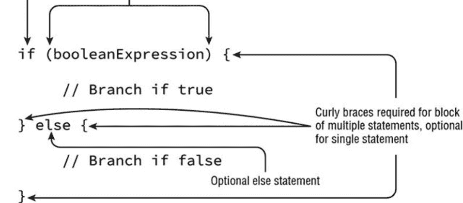

图 4.2 `else` 语句的结构

回到这个示例：

```
if(hourDay < 11) {
  System.out.println("Good Morning");
} else {
  System.out.println("Good Afternoon");
}
```

我们的代码确实是在两个可能的选项之间进行分支，布尔评估只发生一次。`else` 运算符接收语句或语句块的方式与 `if` 语句相同。同样，我们可以在 `else` 块中附加额外的语句，得到一个更精炼的示例：

```
if(hourDay < 11) {
  System.out.println("Good Morning");
} else if(hourDay < 15) {
  System.out.println("Good Afternoon");
} else {
  System.out.println("Good Evening");
}
```

在本示例中，Java 进程将继续执行，直到遇到一个值为真的的语句。如果前两个表达式均不为真，它将执行 `else` 块中的最终代码。在创建复杂的 `if` 和 `else` 语句时，需要记住的一点是顺序很重要。例如，看看如果我们按照如下方式重新排列之前的代码会发生什么：

```java
if(hourOfDay < 15) {
    System.out.println("Good Afternoon");
} else if (hourOfDay < 11) {
    System.out.println("Good Morning"); // 编译通过但
不可达的
} else {
    System.out.println("Good Evening");
}
```

对于小于 11 点的小时数，这段代码的行为与之前的代码段完全不同。你是否看到为什么无论 `hourOfDay` 的值是什么，第二个块都永远无法被执行了？

如果一个值小于 11，那么根据定义，它一定小于 15。因此，如果示例中的第二个分支可以到达，那么第一个分支也可以到达。由于在这个示例中，每个分支的执行是相互互斥的（也就是说只能执行一个分支），那么如果执行了第一个分支，第二个分支就无法执行。因此，第二个分支永远不会被执行，该代码被视为不可达的。

## 验证 if 语句是否求值为布尔表达式

考试可能误导你的另一个常见地方是提供一段代码，其中 `if` 语句内部的布尔表达式实际上并不是布尔表达式。例如，查看以下几行代码：

```java
int hourOfDay = 1;
if(hourOfDay) { // 无法编译
...
}
```

该语句在某些其他编程和脚本语言中可能是有效的，但在 Java 中不是，因为布尔值和 `1` 不被视为布尔值。

此外，正如你在第 3 章“运算符”中看到的，要警惕赋值运算符在语句中被当作等运算符（`==`）使用：

```java
int hourOfDay = 1;
if(hourOfDay = 5) { // 无法编译
...
}
```

## switch 语句

如果我们对一个值有许多可能的分支怎么办？例如，我们可能想根据星期几打印不同的消息。我们完全可以通过组合 `if` 或 `else` 语句来实现，但这往往会创建出冗长、难以阅读且通常难以维护的代码。例如，以下代码对每个决策语句使用各种不同样式，根据星期几打印不同的值：

```java
int dayOfWeek = 5;

if(dayWeek == 0) System.out.print("Sunday");
else if(dayWeek == 1) {
  System.out.print("Monday");
}
else if(dayWeek == 2) {
  System.out.print("Tuesday");
} else if(dayWeek == 3) {
  System.out.print("Wednesday");
}
```


幸运的是，Java 以及许多其他语言提供了一种更简洁的方法。如图 4.3 所示，`switch` 语句是一种复杂的决策结构，其中对单个值进行求值，并将流重定向到第一个匹配的分支（称为 `case` 语句）。如果没有找到与该值匹配的 `case` 语句，将调用一个可选的 `default` 语句。如果没有可用的 `default` 选项，整个 `switch` 语句将被跳过。

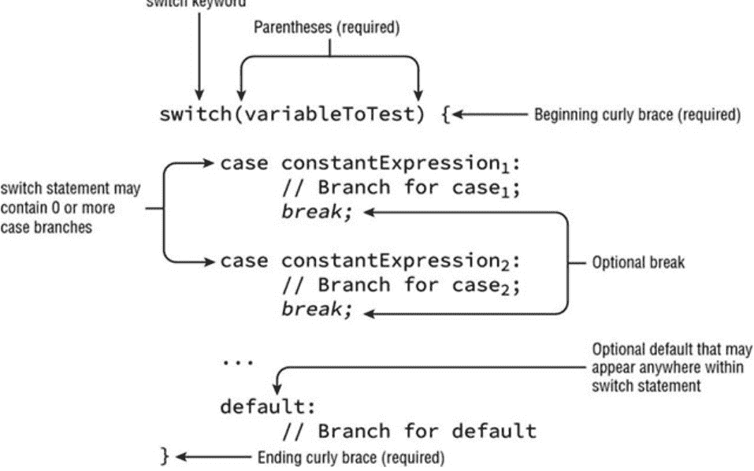

图 4.3 switch 语句的结构

## 正确的 switch 语法

由于 `switch` 语句可能比大多数决策语句长，考试可能会呈现无效的 `switch` 语法来检查你是否在关注。尝试找出为什么以下每个 `switch` 语句无法编译：

```java
int month = 5;

switch month {  // 无法编译
case 1: System.out.print("January");
}
```

```java
switch (month) { // 无法编译
case 1: System.out.print("January");
```

```java
switch (month) {
case 1: 2: System.out.print("January"); // 无法编译
}
```

```java
switch (month) {
case 1 || 2: System.out.print("January"); // 无法编译
}
```

第一个 `switch` 语句无法编译是因为在 `switch` 变量周围缺少括号。第二个语句无法编译是因为 `switch` 体周围缺少大括号。第三个语句无法编译是因为在 `2:` 标签之前缺少 `case` 关键字。每个 `case` 语句都需要 `case` 关键字，后跟一个值和一个冒号（`:`）。

最后，最后一个 `switch` 语句无法编译是因为 `1 || 2` 使用了短路布尔运算符，它不能应用于数值。尽管对这的解释可能不是你的预期。它只会匹配值为 `1 | 2` 位结果（即 3）的 `month` 值，而不会匹配值为 1 或 2 的 `month`。考试不需要了解位运算，但你需要了解 `case` 语句的正确语法。

注意最后两个语句都尝试以无效的方式组合 `case` 语句。关于考试你还需要注意一点：`switch` 语句不需要包含任何 `case` 语句。对于考试，请确保记住图 4.3 中使用的语法。正如你将在下一节中看到的，虽然 `switch` 语句的某些方面发生了变化，但很多地方并没有。

## Switch 类型

如图 4.3 所示，`switch` 语句有一个在运行时求值的目标变量。在 Java 5.0 之前，`switch` 只能是 `int` 值或可以提升为 `int` 的值，特别是 `byte`、`short`、`char` 或 `int`。

`switch` 语句也支持任何包装类型，例如 `Byte`、`Short`、`Character` 或 `Integer`。

当枚举（符号 `enum`）在 Java 5.0 中引入时，`switch` 语句增加了对枚举值的支持。枚举是一组常量集合。在 Java 7 中，`switch` 语句进一步更新以允许匹配 `String` 值。在 Java 10 中，如果 `var` 类型解析为 `switch` 语句支持的类型，那么 `var` 也可以用于 `switch` 语句。

以下是 `switch` 语句支持的所有类型列表：

- `int` 和 `Integer`
- `byte` 和 `Byte`
- `short` 和 `Short`
- `char` 和 `Character`
- `String`
- enum
- `var`（如果解析为上述类型之一）

对于考试，我们建议记忆此列表。记住，`boolean`、`long`、`float`、`double` 以及它们各自的包装类都不受 `switch` 语句支持。

## Switch 的历史与变化

正如你看到的，`switch` 语句在多个 Java 版本中被修改过。你不需要担心记住历史——只需要知道哪些类型是被允许的。历史课程是为使用旧版本 Java 并可能没有意识到 `switch` 语句众多变化的资深 Java 开发者准备的。但是，Java 12 发布了一项强大新功能的预览版——Switch 表达式（Switch Expressions），这种构造将 `switch` 语句与 lambda 表达式结合起来，并允许 `switch` 语句返回值。你考试不需要了解 Switch 表达式，但这仅仅表明 Java 的编写者远未停止对 `switch` 语句进行增强。

让我们来看一个使用星日的简单 switch 示例，其中0代表周日，1代表周一，以此此类推：

```java
int dayOfWeek = 5;
switch(dayOfWeek) {
    default:
        System.out.println("Weekday");
        break;
    case 0:
        System.out.println("Sunday");
        break;
    case 6:
        System.out.println("Saturday");
        break;
}
```

当 `dayOfWeek` 的值为 5 时，这段代码将输出如下：

Weekday

你可能注意到的第一点是，每个 `case` 和 `default` 部分末尾都有一个 `break` 语句。我们会在讨论分支时更详细讨论 `break` 语句，但现在你只需要知道它们会终止 switch 语句并将控制流返回给外部语句。正如你很快会看到的，如果你漏掉了 `break` 语句，流将自动继续执行到后续的 `case` 或 `default` 块。

你可能注意到的另一点是 `default` 块并不在 switch 语句的末尾。`case` 或 `default` 语句没有特定的顺序要求，除非你打算让路径在单次执行中到达 switch 块的多个部分。

为了说明上述两点，请考虑以下变体：

```java
var dayOfWeek = 5;
switch(dayOfWeek) {
    case 0:
        System.out.println("Sunday");
    default:
        System.out.println("Weekday");
    case 6:
        System.out.println("Saturday");
break;
}
```

这段代码看起来和之前的示例相似。注意我们 switch 变量使用了 `var`，这是允许的，因为编译器将其解析为 `int`。接下来，删除了两个 `break` 语句，并更改了顺序。这意味着对于值为 5 的 `dayOfWeek`，代码将跳转到 `default` 块并顺序执行所有后续的 `case` 语句，直到找到 `break` 语句或完成 switch 语句：

Weekday

Saturday

现在 `case` 和 `default` 语句的顺序变得重要了，因为将 `default` 语句放在 switch 语句末尾会导致只输出一个单词。

如果在这个例子中 `dayOfWeek` 的值为 6 呢？`default` 块还会被执行吗？当 `dayOfWeek` 设置为 6 时，该示例的输出如下：

Saturday

尽管 `default` 块在 `case` 块之前，但只有 case 块被执行。如果你记得 `default` 块的定义，只有当 switch 语句没有匹配的 `case` 值时才会跳转到它，无论它在 switch 语句中的位置如何。

最后，如果 `dayOfWeek` 的值为 0，三个语句都将被输出：

Sunday

Weekday

Saturday

注意在这个示例中，执行了 `default` 语句，因为在之前的 `case` 块末尾没有 `break` 语句。如果在 switch 语句中有匹配的 `case` 值，代码不会跳转到 `default` 语句，但如果在遇到一个没有终止 `break` 语句的 `case` 语句后，它将执行 `default` 语句。

出题者非常喜欢缺少 `break` 语句的 switch 示例！在考试中评估 switch 语句时，始终要考虑单次执行可能会访问多个分支。

## 可接受的 Case 值

在结束对 switch 语句的讨论之前，我们来谈谈给定特定 switch 变量时 `case` 语句的可接受值。并不是任何变量或值都可以用于 `case` 语句中！

首先，每个 `case` 语句中的值必须是与 switch 值相同数据类型的编译时常量。这意味着你只能使用相同数据类型的字面量、枚举常量（enum constants）或 `final` 变量。我们说的 `final` 常量是指该变量必须标记为 `final` 修饰符，并在声明它的同一个表达式中使用字面量进行初始化。例如，你不能拥有一个需要在运行时执行某个方法的 `case` 语句，即使该方法始终返回相同的值。由于这些原因，以下示例中只有第一个和最后一个 `case` 语句有效：

```java
final int getCookies() { return 4; }
void feedAnimals() {
    final int bananas = 1;
    int apples = 2;
    int numberOfAnimals = 3;
    final int cookies = getCookies();
    switch (numberOfAnimals) {
        case bananas:
            case apples: // 无法编译
            case getCookies(): // 无法编译
            case cookies : // 无法编译
        case 3 * 5 :
    }
}
```

`bananas` 变量被标记为 `final`，且其值在编译时已知，因此它是有效的。`apples` 变量没有标记为 `final`，尽管它的值已知，但是不允许的。接两个值为 `getCookies()` 和 `cookies` 的 `case` 语句无法编译，因为方法在运行时才求值，所以它们不能作为 `case` 语句的值，即使其中一个值存储在 `final` 变量中。最后一个值为 `3 * 5` 的 `case` 语句可以编译，因为允许表达式作为 `case` 值，只要该值可以在编译时被解析。它们还必须能够在没有显式类型转换的情况下适应 switch 数据类型。我们稍后会详细介绍这一点。

接下来，`case` 语句的数据类型必须与 switch 变量的数据类型匹配。例如，如果 switch 变量是 `int` 类型，你不能有一个 `String` 类型的 `case` 语句，因为这些类型是不可比较的。

## 更复杂的示例

我们现在展示一个大型 switch 语句，类似于你在考试中可能看到的，包含许多 `case` 语句。看看你是否能看出为什么某些 `case` 语句可以编译而另一些不能。

```java
private int getSortOrder(String firstName, final String lastName) {
  String middleName = "Patricia";
  String suffix = "JR";
  int id = 0;
  switch(firstName) {
    case "Test":
      return 52;
    case middleName: // 无法编译
      id = 5;
      break;
    case suffix:
      id = 0;
      break;
    case lastName: // 无法编译
      id = 8;
      break;
    case 5:
      id = 7;
      break;
  }
  return id;
}
```

第一个 `case` 语句 "Test" 可以顺利编译，因为它是一个字符串字面量，这说明了 `return` 语句像 `break` 语句一样可以提前退出 switch 语句。第二个 `case` 语句无法编译，因为 `middleName` 不是常量，尽管在这一行中值已知。如果为 `middleName` 的声明添加 `final` 修饰符，该 `case` 语句就能编译了。第三个 `case` 语句可以编译，因为 `suffix` 是常量。在第四个 `case` 语句中，尽管 `lastName` 是 `final` 的，但它是传递给函数的，不是常量；因此该行无法编译。最后，最后的 `case` 语句无法编译，因为它们没有匹配的 `String` 类型，最后一个是枚举值。

## 数值提升与转换

最后但同样重要的是，switch 语句支持不需要显式转换的数值提升。例如，如果你能理解为什么这些 `case` 语句中只有一个可以编译：

```java
short size = 4;
final int small = 15;
final int big = 1_000_000;
switch(size) {
  case small:
    case 1+2 :
  case big:    // 无法编译
}
```

正如你可能记得我们在第三章中对数值提升和转换的讨论，编译器可以轻松地在编译时将 `small` 从 `int` 转换为 `short`，因为值 15 小到放入 `short` 中。如果 `small` 不是编译时常量，这种操作是不允许的。同样，它可以在编译时将表达式 `1+2` 从 `int` 转换为 `short`。另一方面，1,000,000 太大了，在没有显式转换的情况下无法放入 `short`，因此最后一个 `case` 语句无法编译。

## 编写 while 循环

编写软件时的一种常见做法是需要执行某些次数相同的任务。你可以使用到目前为止介绍的决策结构来实现这一点，但这将导致一个非常长的 if 或 else 语句链，特别是当你需要执行相同内容 100 次或更多时。

循环（Loop）引入了。循环是一种重复性控制结构，可以连续多次执行一段代码语句。通过利用变量可以赋予新值的特性，语句的每次执行都可能是不同的。在下面的示例中，循环增加一个计数器变量，导致 `price` 的值在每次循环执行时增加 10。该循环总共执行 10 次。

```java
int counter = 0;
while (counter < 10) {
  double price = counter * 10;
  System.out.println(price);
  counter++;
}
```

如果你没有跟上这段代码，不要恐慌——我们很快就会介绍。在本节中，我们将讨论 while 循环及其两种形式。在下一节中，我们将转向 for 循环，for 循环的根源在于 while 循环。

## while 语句

Java 中最简单的重复控制结构是 while 语句，如图 4.4 所示。与所有重复控制结构一样，它有一个终止条件，该条件通过布尔表达式实现，只要表达式求值为真（true），它就会继续执行。

## 图 4.4 while 语句的结构

如图 4.4 所示，while 循环与 if 语句相似，因为它由一个布尔表达式、一个语句或一个语句块组成。在执行期间，在循环的每次迭代之前都会评估布尔表达式，如果求值结果为假（false），则退出。

让我们回到第 2 章中的老鼠示例，展示如何使用循环来模拟老鼠吃肉。

```java
int roomInBelly = 5;
public void eatCheese(int bitesOfCheese) {
    while (bitesOfCheese > 0 && roomInBelly > 0) {
        bitesOfCheese--;
        roomInBelly--;
    }
    System.out.println(bitesOfCheese+" pieces of cheese left");
}
```

该方法接收数量的食物（在本例中），并持续执行直到老鼠肚子里没有空间或没有食物可以吃。在循环的每次迭代中，老鼠“吃掉”一口食物并失去肚子里的一个位置。通过使用复合布尔语句，你可以确保 while 循环可以在任何一个条件满足结束。

需要记住的一点是，while 循环可能会在第一次评估布尔表达式后就终止。例如，在下面的示例中，“Not full!”打印了多少次？

```java
int full = 5;
```

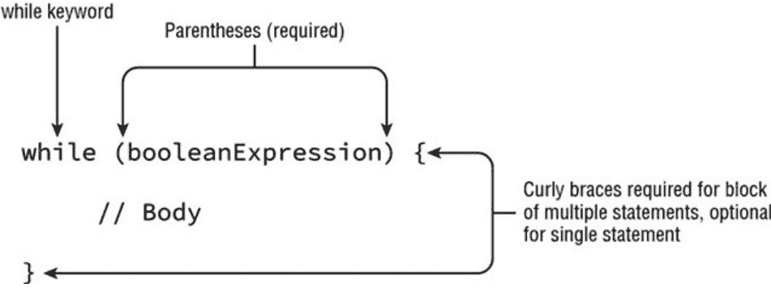

```java
while(full < 5) {
    System.out.println("Not full!");
    full++;
}
```

答案是？零！在循环的第一次迭代中，达到了条件，循环便退出。这就是为什么 while 循环通常用于预期循环执行零次或多次的地方。简单来说，循环体可能完全不执行，也可能执行多次。

## do/while 语句

while 循环可以采取的第二形式被称为 do/while 循环，它和 while 循环一样，都是具有终止条件和语句（或语句块）的重复控制结构，如图 4.5 所示。与 while 循环不同，do/while 循环保证语句或块至少会被执行一次。而 while 循环执行零次或多次，do/while 循环执行一次或多次。

### do 关键字

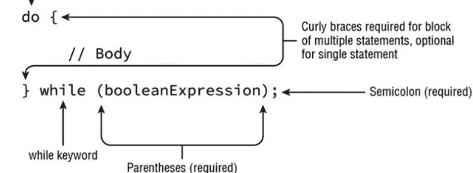

## 图 4.5 do/while 语句的结构

do/while 循环与 while 循环在语法结构上的主要区别在于，do/while 循环刻意将循环体置于条件表达式之前，以确保循环体至少执行一次。例如，以下语句的输出是什么？


```java
int lizard = 0;
do {
    lizard++;
} while(false);
System.out.println(lizard);   // 1
```

Java 会先执行语句块，然后检查循环条件。即使循环立即退出，语句块仍然被执行一次，程序打印 1。

## 比较 while 和 do/while 循环

在实践中，可能很难确定何时应该使用 `while` 循环，何时应该使用 `do/while` 循环。简短的答案是这并不重要。任何 `while` 循环都可以转换为 `do/while` 循环，反之亦然。例如，比较这个循环：

```java
while(llama > 10) {
    System.out.println("Llama!");
    llama--;
}
```

和这个 `do/while` 循环：

```java
if(llama > 10) {
  do {
    System.out.println("Llama!");
    llama--;
  } while(llama > 10);
}
```

虽然其中一个循环更容易阅读，但它们在功能上是等价的。考虑一下：如果 `llama` 小于或等于 10，两个循环可能都不会执行。简单来说，循环体可能完全不执行，也可能执行多次。虽然其中一个循环显然更容易读，但它们在功能上是等价的。考虑一下：如果 `llama` 小于或等于 10，两个循环可能都不会执行。简单来说，循环体可能完全不执行，也可能执行多次。我们建议在代码执行零次或多次时使用 `while` 循环，在代码执行一次或多次时使用 `do/while` 循环。尽管如此，在决定使用 `while` 循环还是 `do/while` 循环有时取决于个人偏好和代码可读性。例如，虽然上一个语句更短，但 `do/while` 语句有其优势，如下所示：

```java
if(llama > 10) {
  do {
    System.out.println("Llama!");
    llama--;
  } while(llama > 10);
} else {
  llama++;
}
```

## 死循环

在使用任何控制结构时，最重要的一点是确保它们总是终止。不终止循环会导致许多问题，包括溢出异常、内存泄漏和性能缓慢。让我们来看一个示例：

```java
int pen = 2;
int pigs = 5;
while(pen < 10)
    pigs++;
```

你可能注意到这个语句有一个明显的问题：它永远不会结束。变量 `pen` 没有被修改，因此 `(pen < 10)` 始终为真。结果是循环永远结束，这被称为死循环。死循环是指无法达到终止条件的循环。每当你编写循环时，都应该检查它以确定终止条件是否总是满足。例如，在两次执行之间没有变量变化的循环，表明终止条件可能无法满足。循环变量应该始终朝着某个方向移动。换句话说，确保循环条件或条件所依赖的变量在执行之间发生变化。确保最终能够达到终止条件。正如我们在本章最后一节中看到的，循环还可能根据其他条件退出，例如 `break` 语句。

## 现实场景

## 死循环的实际应用

在实践中，死循环可以用于监控程序生命周期内存在的进程——例如一个每 30 秒唤醒一次寻找要做的工作然后进入睡眠的进程。在创建这种死循环时，你需要确保应用程序只创建固定数量的，否则可能会耗尽内存。你还必须确保有停止它们的方法，通常作为应用程序关闭的一部分。最后，创建死循环的现代替代方案（例如使用调度线程执行器）远超考试的范围。

# 构建 for 循环

虽然 `while` 和 `do/while` 语句非常强大，但某些任务在编写软件时非常常见，因此创建了特殊的循环类型——例如，恰恰迭代 10 次或遍历一个名称列表。你可以通过目前为止见过的各种循环轻松地完成这些任务，但它们通常需要编写多行代码并手动管理变量。如果有一种循环结构能用单行代码完成相同的操作，那不是太棒了？

基于此，我们介绍了最方便的重复控制结构：`for` 循环。`for` 循环有两种类型，尽管它们都使用相同的 `for` 关键字。第一种被称为*基础型* `for` 循环，第二种通常称为*增强型* `for` 循环。为了清晰起见，在本书中，我们将分别称之为 `for` 循环和 `for-each` 循环（增强型循环）。

## for 循环

基础的 *for 循环* 与 `while` 循环具有相同的条件布尔表达式和语句（或语句块），此外还有两个新部分：*初始化*块和*更新*语句。图 4.6 显示了这些组件的布局方式。

for 关键字

```java
for (initialization; booleanExpression; updateStatement) {
    // 体
}
```

多条语句块需要大括号，单个语句则可选

- 1. 执行初始化语句
- 2. 如果 `booleanExpression` 为真则继续，否则退出循环
- 3. 执行循环体
- 4. 执行 `updateStatement`
- 5. 返回步骤 2

图 4.6 基础 for 循环的结构

尽管图 4.6 起初看起来有些混乱且几乎是任意，但组件的组织和流程允许我们在单行代码中创建极其强大的语句，而如果使用 `while` 循环则需要多行。请注意每个部分之间都用分号分隔。此外，初始化和更新部分可以包含多个用逗号分隔的语句。

在 `for` 循环初始化块中声明的变量作用域有限，且仅在 `for` 循环内部访问。要小心任何考试题，其中变量在 `for` 循环的初始化块中声明并在循环外读取。例如，这段代码无法编译，因为变量 `i` 在循环外被引用了：

```java
for(int i=0; i < 10; i++) {
    System.out.print("Value is: "+i);
}
System.out.println(""); // 编译
```

或者，在 `for` 循环之前声明并在初始化块中赋值的变量可以在 `for` 循环外使用，因为它们的作用域早于 `for` 循环的创建。

让我们来看一个从零开始打印前五个数的示例：

```java
for(int i = 0; i < 5; i++) {
  System.out.print(i + " ");
}
```

局部变量 `i` 初始化为 0。变量 `i` 仅在循环期间有效，循环完成后在循环外部不可用。与 `while` 循环一样，循环的布尔条件在每次迭代执行前都会被评估。如果返回真，则循环执行并输出 0 后面跟一个空格。接下来，循环执行更新部分，其中将 `i` 的值增加到 1。然后循环第二次评估布尔表达式，该过程重复多次，打印出以下内容：

0 1 2 3 4

在循环的第五次迭代中，`i` 的值达到 4 并加 1 达到 5。在循环的第六次迭代中，评估了布尔表达式，由于 `(5 < 5)` 返回假，循环终止而不执行语句体。

## 现实世界场景

为什么在 for 循环中使用 i？

你可能注意到，将 `for` 循环的循环变量命名为 `i` 是一种常见做法。在 Java 出现很久以前，程序员就开始使用 `i` 作为 increment variable 的缩写，这种做法今天仍然存在，尽管许多此类编程语言已不再这样做！

对于双层或三层循环，如果 `i` 已被使用，通常会分别使用字母表中随后的字母 `j` 和 `k`。在 `for` 循环中使用单字母变量名的一个优势是它不占用大量空间，使得 `for` 循环声明可以适合放在单行内。

对于考试，也为了你自己的编码经验，你应该知道使用单字母变量名并不是强制要求的。尽管如此，在你整个职业软件开发生涯中，很可能会在 `for` 循环中反复遇到 `i`。

## 反序打印元素

假设你想像上一节一样打印从零开始的前五个数，但这次是倒序的。目标是打印 4 3 2 1 0。

```java
for (var counter = 5; counter > 0; counter--) {
  System.out.print(counter + " ");
}
```

首先，`var` 是如何解释的？由于它被赋值为值 5，编译器将其视为 `int` 类型。接下来，示例的输出是什么？虽然这段代码确实输出了五个不同的值且看起来像我们的第一个 `for` 循环示例，但它输出的并不是相同的五个值。相反，输出是：

5 4 3 2 1

等等，那不是我们想要的！我们想要 4 3 2 1 0。它从 5 开始，因为那是赋值给它的第一个值。让我们从 4 开始来修复它：

```java
for (var counter = 4; counter > 0; counter--) {
  System.out.print(counter + " ");
}
```

现在打印了什么？它打印了以下内容：

4 3 2 1

接近了！问题是它以 1 结束而不是 0，因为我们告诉它在 0 时退出。如果我们想包含 0，我们需要将终止条件改为 `>= 0`，如下所示：

```java
for (var counter = 4; counter >= 0; counter--) { // 修改这里
  System.out.print(counter + " ");
}
```

最后！这段代码打印 4 3 2 1 0，并匹配了之前的示例。

> 注意：在考试中，如果你看到 `for` 循环中使用递减运算符，要小心。从 0 开始递增比递减更直观。

## 循环操作

尽管你在职业开发经验中遇到的多数循环都是定义良好的，并且与之前的示例类似，但为了说明目的，让我们处理一些示例：

### 1. 创建无限循环

```java
for(;;)
  System.out.println("Hello World");
```

尽管这个 `for` 循环看起来无法编译，但它实际上可以编译并运行。它是一个不断打印相同语句的无限循环。注意分隔三个部分的分号是必要的，`for()` 没有分号将无法编译。

### 2. 在 for 语句中添加多个项

```java
int x = 0;
for(
```

这段代码展示了你可能没过的三种变体。首先，你可以在循环开始之前声明一个变量（例如示例中的 `x`），并在完成后使用它。其次，你的初始化块、布尔表达式和更新语句可以包含可能相互引用的额外变量。例如，`z` 定义在初始化块中但从未被使用。最后，更新语句可以修改多个变量。这段代码执行时将打印以下内容：

0 1 2 3 4 5

### 3. 在初始化块中声明变量

```java
int x = 0;
for(int x = 4; x < 5; x++) { // 无法编译
    System.out.print(x + " ");
}
```

这个示例与上一个相似，但它由于初始化块而无法编译。区别在于 `x` 在初始化块中重复出现，而它在循环之前已经声明过了，导致编译器因变量重复声明而停止。我们可以通过从 `for` 循环中移除 `x` 的声明来修复此循环：

```java
int x = 0;
for(x = 0; x < 5; x++) {
    System.out.print(x + " ");
}
```

注意，这种变体现在可以编译了，因为初始化块是给 `x` 赋值而不是声明它。

### 4. 在初始化块中使用不兼容的数据类型

```java
int x = 0;
for(long y = 0, int z = 4; x < 5; x++) { // 无法编译
    System.out.print(y + " ");
}
```

与第三个示例一样，这段代码无法编译，尽管这次是因为不同的原因。初始化块中的变量必须全部是相同类型。在多项项的示例中，`y` 和 `z` 都是 `long` 类型，因此代码可以无问题地编译，但在本示例中，它们的类型不同，因此代码将无法编译。

### 5. 在循环外部使用循环

```java
for(long y = 0, x = 4; x < 5 && y < 10; x++, y++)
  System.out.print(y + " ");
}
System.out.print(x); // 无法编译
```

我们已经在本节的开头介绍过这一点，但它对于通过考试非常重要，因此我们再次讨论了它。如果你注意的话，`x` 是在循环的初始化块中定义的，然后在循环结束后才被使用。由于 `x` 的作用域仅限于循环，因此在循环外部使用它会导致编译器错误。

## 修改循环变量

如果你在 `for` 循环或任何其他循环中修改变量会发生什么？Java 允许你修改这些变量吗？请看以下三个示例，看看你是否能确定它们独立运行时会发生什么。

```java
for(int i=0; i<10; i++)
  i = 0;
```

```java
for(int j=1; j<10; j++)
  j--;
```

```java
for(int k=0; k<10; )
  k++;
```

所有这些示例都可以编译，因为 Java 允许你修改变量，无论它们是在 `for`、`while` 还是 `do/while` 循环中。前两个示例创建了无限循环，因为循环条件 `<10` 和 `j<10` 独立来看无法满足。在第一个示例中，`i` 在每次循环中都会重置为 0，增加到 1，然后重置为 0，以此类推。在第二个示例中，`j` 减到 0，然后增加到 1，然后减到 0，以此类推。最后一个示例恰好执行了 10 次循环，所以它是有效的，尽管有点不寻常。

Java 确实允许修改循环变量，但如果你在考试中看到这样做，应该警惕。虽然观察一个 `for` 循环并确定其执行次数通常是直接的，但一旦我们开始修改循环变量，行为可能会变得极其不可预测。这在涉及嵌套循环时尤为如此，我们将在本章后面的部分介绍。

在循环内部修改集合对象时，还有一些特殊的考虑。例如，如果你在迭代 `List` 时从其删除元素，可能会遇到 `ConcurrentModificationException`。虽然这个主题不在考试范围范围内，但你在学习 Z10-816 考试内容时会再次遇到它。

> 作为一条一般规则，由于结果的不可预测性，修改循环变量被认为是一种糟糕的编码实践。它往往会使代码难以他人阅读。如果你需要提前退出循环或更改流程，可以使用 `break`、`continue` 或 `return`，我们将在本章稍后讨论这些。

## for-each 循环

假设你想遍历一组值（例如名称列表）并打印其中的每一个。使用 `for` 循环，可以通过一个计数器变量来实现：

```java
public void printNames(String[] names) {
  for(int counter=0; counter<names.length; counter++) {
    System.out.println(names[counter]);
  }
}
```

这种方法行得通，虽然有点冗长。我们创建了一个计数器变量，但我们并不在乎它的值——只要它能按顺序遍历数组即可。

在编写了近 20 年这样的 `for` 循环后，Java 的作者借鉴了其他编程语言，并添加了增强 `for` 循环，或者说我们喜欢的 `for-each` 循环。`for-each` 循环是一种专门设计的结构，用于遍历数组和各种 Collection Framework 类，如图 4.7 所示。

for 关键字 括号（必需）

```
for (datatype instance : collection) {
    // 循环体
    datatype of collection member
}
```

可迭代的对象集合 大括号（对于多条语句块是必需，单条语句则可选）

### 图 4.7 增强型 for-each 循环的结构

`for-each` 循环的声明由初始化部分和一个要被迭代的对象组成。`for-each` 循环的右侧必须是以下内容之一：

- 内置的 Java 数组
- 类型实现了 `java.lang.Iterable` 的对象

我们将在第 9 章“高级类设计”中介绍 `implements` 的含义，但现在你只需要知道右侧必须是一个数组或项的集合，如 `List` 或 `Set`。对于考试，你应该知道这不包括所有的 Collections Framework 类或接口，而仅包括实现或扩展 `Collection` 接口的类。例如，`for-each` 循环不支持 `Map`，尽管 `Map` 包含了返回 `Collection` 实例的方法。

在第 5 章中，我们将详细介绍如何创建 `List` 对象以及它们与传统的 Java 数组有何不同。同样，在下一章中看到的 `String` 和 `StringBuilder` 并没有实现 `Iterable`，不能作为 `for-each` 语句的右侧。

`for-each` 循环的左侧必须包含一个变量实例的声明，其类型与语句右侧数组或集合的类型兼容。`var` 也可以用于变量类型声明，具体类型由 `for-each` 语句的右侧确定。在每次迭代中，左侧变量都会被语句右侧的值赋值。让我们回到之前的示例，看看如何将 `for-each` 应用于：

```java
public void printNames(String[] names) {
  for(String name : names) {
    System.out.println(name);
  }
}
```

这要简洁得多，不是吗？`for-each` 循环是为了让代码更易读，就像使用 `for` 循环一样，让你关注真正重要的部分。

## 处理 for-each 语句

让我们处理一些例子：

- 这段代码会输出什么？

```java
final String[] names = new String[3];
names[0] = "Lisa";
names[1] = "Kevin";
names[2] = "Roger";

for(String name : names) {
  System.out.print(name + " ");
}
```

- 这是一个简单的例子，没有技巧。代码可以编译并输出：

Lisa, Kevin, Roger,

- 这段代码会输出什么？

```java
List<String> values = new ArrayList<String>();
values.add("Lisa");
values.add("Kevin");
values.add("Roger");

for(var value : values) {
  System.out.print(value + ", ");
}
```

- 代码可以编译并打印相同的值：

Lisa, Kevin, Roger,


- 和普通循环一样，`for-each` 循环也接受 `var` 作为循环变量。在考试中看到 `for-each` 循环时，请确保右侧是数组或 `Iterable` 对象，且左侧具有匹配的类型。

- 为什么这段代码无法编译？

```java
String names = "Lisa";
for(String name : names) {
  System.out.print(name + " ");
}
```

- 在这个示例中，`String` `names` 不是数组，也没有定义项列表，因此编译器会抛出异常，因为它不知道如何遍历该 `String`。作为开发者，你可以遍历 `String` 的每个字符，但这需要使用 `charAt()` 方法，该方法与 `for-each` 循环不兼容。`charAt()` 方法其他 `String` 方法将在第 5 章介绍。

- 为什么这段代码无法编译

```java
String[] names = new String[3];
for(int name : names) { // 无法编译
  System.out.print(name + " ");
}
```

- 这将无法编译是因为 `for-each` 语句的左侧没有定义 `String` 的实例。注意在最后一个示例中，数组被初始化为三个空值。这本身不会导致代码无法编译，因为修正后的循环将输出三次 `null`。

```java
for(int i=0; i<names.size(); i++) {
  String name = names.get(i);
  if(i > 0) {
    System.out.print(",");
  }
}
```

这段示例代码将输出以下内容：

Lisa, Kevin, Roger

这没有我们的 `for-each` 示例那么短，但它创建了我们想要的输出，且没有多余的逗号。

如果在单次迭代的循环中比较多个元素，使用标准循环而不是 `for-each` 循环也是很常见的，如下例所示：

```java
int[] values = new int[3];
values[0] = 1;
values[1] = Integer.valueOf(3);
values[2] = 6;

for(int i=1; i<values.length; i++) {
  System.out.print((values[i]-values[i-1])+" ");
}
```

这段示例代码将输出以下内容：

2, 3,

注意我们跳过了数组的第一个索引，因为 `value[-1]` 是未定义的，如果用 `i=0` 调用它将抛出 `IndexOutOfBoundsException`。当对列表的 n 个元素进行相互比较时，我们的循环应该执行 n-1 次。

尽管有这些示例，增强型 `for-each` 循环在各种情况下都非常方便。但是，作为开发者，如果你需要精细的控制，可以随时回退到标准循环。

## 比较 for 和 for-each 循环

由于 `for` 和 `for-each` 都使用相同的关键字，你可能在好奇它们之间有什么联系。虽然这个讨论不在考试范围之内，但让我们花点时间探索一下编译器是如何将 `for-each` 循环转换为 `for` 循环的。

当 `for-each` 在 Java 5 中引入时，它是作为一种编译时增强添加的。这意味着 Java 实际上在编译期间将 `for-each` 循环转换为标准的 `for` 循环。例如，假设 `names` 是一个 `String` 数组（正如我们在第一个示例中所所示），以下两个循环是等效的：

```java
for(String name : names) {
  System.out.print(name + " , ");
}
for(int i=0; i < names.length; i++) {
  String name = names[i];
  System.out.print(name + " , ");
}
```

对于继承 `Iterable` 的对象，存在不同但相似的转换。例如，假设 `values` 是 `List<Integer>` 的实例，以下两个循环是等效的：

```java
for(int value : values) {
  System.out.print(value + " , ");
}
for(Iterator<Integer> i = values.iterator(); i.hasNext(); ) {
  int value = i.next();
  System.out.print(value + " , ");
}
```

注意在第二个版本中，`for` 循环中没有更新语句，因为 `next()` 同时获取了下一个值并移动迭代器向前。

## 使用分支控制流

在本章中涵盖的最后一种控制流结构是分支语句。到为止，我们处理的是单层循环，这些循环只在布尔表达式求值为 `false` 时结束。现在我们将向你展示其他循环如何结束和分支，你会发现运行期间采取的路径可能不像之前的示例那样直接。

## 嵌套循环

在进入分支语句之前，我们需要引入嵌套循环的概念。嵌套循环是包含另一个循环的循环，包括 `while`、`do/while` 和 `for-each` 循环。例如，考虑以下代码，它遍历一个二维数组，该数组包含其他数组作为其成员。我们将在第 5 章中详细介绍多维数组，但现在假设以下是您声明二维数组的方式：

```java
int[][] myComplexArray = {{5,2,1,3},{3,9,8,9},{5,7,12,7}};
for(int[] mySimpleArray : myComplexArray) {
  for (int i=0; i<mySimpleArray.length; i++) {
    System.out.print(mySimpleArray[i]+"\t");
  }
  System.out.println();
}
```

注意，我们在这个示例中特意混合了 `for` 循环和 `for-each` 循环。外层循环将总共执行三次。外层循环每执行一次，内层循环就会执行四次。当我们执行这段代码时，我们看到以下输出：

| 5 2 1 3 |
| 3 9 8 9 |
| 5 7 12 7 |

嵌套循环可以包含 `while` 和 `do/while`，正如这个示例所示。看看你能否确定这段代码将输出什么：

```java
int hungryHippopotamus = 8;
while(hungryHippopotamus>0) {
  do {
    hungryHippopotamus -= 2;
  } while (hungryHippopotamus>5);
  hungryHippopotamus--;
  System.out.print(hungryHippopotamus+", ");
}
```

当该循环第一次执行时，内层循环会重复直到 `hungryHippopotamus` 的值为 4。然后该值将递减到 3，这将是外层循环第一次迭代结束时的输出。

在外层循环的第二次迭代中，内层的 `do/while` 将执行一次，即使 `hungryHippopotamus` 已经不再大于 5。正如你记得的，`do/while` 语句始终至少执行一次体。这将值减少到 1，然后通过外层循环中的递减运算符进一步降低。

if(positionX==-1 || positionY==-1) {
```java
System.out.println("Value " + searchValue + " not found");
} else {
  System.out.println("Value " + searchValue + " found at: " + (positionX + "," + positionY + ")");
}
```

执行此代码时，将输出以下内容：

Value 2 found at: (1,1)

特别，请注意 `break PARENT_LOOP` 语句。该语句一旦找到第一个匹配值，就会跳出整个循环结构。现在，想象一下如果我们内部循环循环体替换为以下内容会发生什么：

```java
if(list[i][j] == searchValue) {
  positionX = i;
  positionY = j;
  break;
}
```

这种变化将如何影响我们的流程，输出会有变化吗？程序不再是在找到第一个匹配值时退出，而是只有满足条件时才退出内部循环。换句话说，结构现在将找到包含该值的最后一个内部循环的第一个匹配值，导致如下输出：

Value 2 found at: (2,0)

最后，如果我们完全移除 `break` 会怎样？

```java
if(list[i][j] == searchValue) {
  positionX = i;
  positionY = j;
}
```

在这种情况下，代码将搜索整个结构中具有匹配值的最后一个值。输出将如下：

Value 2 found at: (2,1)

从这个示例中可以看出，在嵌套循环的 `break` 语句在使用标签，或者完全不使用 `break` 语句，都会导致循环结构的行为完全不同。

## continue 语句

现在让我们通过 `continue` 语句来扩展对高级循环控制的讨论，该语句会导致流程结束当前循环的执行，如图 4.9 所示。

循环头的可选引用

```java
optionalLabel: while(booleanExpression) {
    // 循环体
    // 循环中的某处
    continue optionalLabel;
}
```

冒号（如果存在 `optionalLabel` 则必须包含）
分号（必须）
`continue` 关键字

**图 4.9** `continue` 语句的结构与 `break` 语句镜像。

你可能注意到 `continue` 语句的语法与 `break` 语句镜像。事实上，这些语句在用法上是相同的，但结果不同。虽然 `break` 语句将控制转移到封装语句，但 `continue` 语句将控制转移到决定循环是否继续的布尔表达式。换句话说，它结束了循环的当前迭代。此外，类似于 `break` 语句，`continue` 语句应用于最近的内部循环执行，可以使用可选标签语句覆盖此行为。

让我们来看示例。假设我们有一个动物管理员，他应该清理四个圈舍中每个的第一只豹子，但完全跳过 b 圈。

```java
1: public class CleaningSchedule {
2:   public static void main(String[] args) {
3:     CLEANING: for(char stables = 'a'; stables<='d'; stables++) {
4:       for(int leopard = 1; leopard<4; leopard++) {
5:         if(stables=='b' || leopard==2) {
6:           continue CLEANING;
7:       }
8:       System.out.println("Cleaning:\n"+stables+","++leopard);
9:     } }
```

按照定义的结构，当值为 b 或第二个值为 2 时，循环将把控制权返回给父循环。在外部循环的第一次、第三次和第四次执行中，内部循环精确打印一次语句，然后在当 `leopard` 为 2 时在下一个内部循环时退出。在外部循环的第二次执行中，内部循环立即退出且不打印任何内容，因为很快遇到了 b。打印内容如下：

```
Cleaning: a, 1
Cleaning: c, 1
Cleaning: d, 1
```

现在，想象如果我们从 `continue` 语句中移除了 `CLEANING` 标签，以便控制返回到内部循环而不是外部循环。第 6 行变为：

```java
continue;
```

这对应于动物管理员跳过所有标记为 2 或在 b 圈的豹子。输出将是：

```
Cleaning: a, 1
Cleaning: a, 3
Cleaning: c, 1
Cleaning: c, 3
Cleaning: d, 1
Cleaning: d, 3
```

最后，如果我们通过删除第 5-7 行完全移除 `continue` 语句和相关的 `if` 语句，我们将得到一个输出所有值的结构，如下：

```
Cleaning: a, 1
Cleaning: a, 2
Cleaning: a, 3
Cleaning: b, 1
Cleaning: b, 2
Cleaning: b, 3
Cleaning: c, 1
Cleaning: c, 2
Cleaning: d, 1
Cleaning: d, 2
Cleaning: d, 3
```

## return 语句

考虑到这本书不应该是你首次尝试编程，我们希望你已经遇到过包含 `return` 语句的方法。无论如何，我们将在第 7 章“方法与封装”中详细介绍如何设计和创建使用 `return` 语句的方法。

现在，你应该熟悉创建方法和使用 `return` 语句可以作为标签和 `break` 语句的替代方案。例如，看看我们之前对 `FindInMatrix` 类的重写：

```java
public class FindInMatrixUsingReturn {
    private static int[] searchValue(int[][] list, int v) {
```


```java
for (int i = 0; i < list.length; i++) {
    for (int j = 0; j < list[i].length; j++) {
        if (list[i][j] == v) {
            return new int[]{i, j};
        }
    }
}
return null;
}

public static void main(String[] args) {
    int[][] list = {{1, 2, 3}, {4, 5, 6}, {7, 8, 9}};
    int searchValue = 2;
    int[] results = searchValue(list, searchValue);
    if (results == null) {
        System.out.println("Value " + searchValue + " not found");
    } else {
        System.out.println("Value " + searchValue + " found at: " + (results[0] + "," + results[1] + ")");
    }
}
```

## 表 4.1 高级流程控制用法

| 允许可选标签 | 允许 break 语句 | 允许 continue 语句 |
|---|---|---|
| while | 是 | 是 |
| do while | 是 | 是 |
| for | 是 | 是 |
| switch | 是 | 否 |

最后但同样重要的是，所有的测试中心都应该提供某种形式的草稿纸或白板供考试使用。如果您遇到涉及嵌套循环和分支语句的复杂问题，我们强烈建议您利用这些测试工具。

## 总结

本章介绍了如何在 Java 中做出智能决策。我们涵盖了基本的决策构造结构，如 `if`、`else` 和 `switch` 语句，并展示了如何使用它们在运行时更改处理路径。记住，`switch` 语句允许许多以前不支持的数据类型，例如 `String`、`enum` 以及在某些情况下的 `var`。

我们将讨论转向循环控制结构，从 `while` 和 `do/while` 循环开始。我们展示了如何使用它们来创建循环多次的过程，并展示了确保它们最终终止有多么。记住，这些结构中的大多数需要评估一个特定的布尔表达式才能完成。

接下来，我们涵盖了极其方便的循环控制结构——`for-each` 循环。虽然它们的语法比传统的 `while` 或 `do/while` 循环复杂，但它们在日常编码中非常有用且允许代码简洁。使用 `for-each` 循环，你不需要显式地编写布尔表达式，因为编译器会为你构建一个。为了清晰起见，我们将增强 for 循环称为 for-each 循环，但在语法上两者都使用 `for` 关键字编写。

最后讨论了高级控制选项以及通过嵌套循环结合 `break`、`continue` 和 `return` 语句增强流程。注意考试中使用嵌套循环的问题（特别是带有标签的），并验证它们用法正确。

本章特别重要，因为本章中至少有一个组件可能会出现在每个带有示例代码的考试题中。考试中的许多问题关注于这些结构的语法用法，因为它们将是导致“无法编译”类问题的大来源。在进入后续章节之前，你应该能够正确回答所有复习题，或完全理解你之前答错的题目。

## 考试要点

**理解 if 和 else 决策控制语句。** `if` 和 `else` 语句会出现在整个考试中与决策控制无关的问题中，因此确保你完全理解这些 Java 的基础构建模块。

**理解 switch 语句及其正确用法。** 你应该能够在考试中识别出格式不佳的 `switch` 语句。`switch` 的值和数据类型应与 `case` 语句兼容，且 `case` 语句的值必须评估为编译时常量。最后，在运行时，`switch` 语句跳转到第一个匹配的 `case`，或者如果没有匹配则跳转到 `default`，如果没有默认的 `break` 则完全退出。然后过程继续进入任何后续的 `case` 或 `default` 语句，直到遇到 `break` 或 `return` 语句。

**理解 while 循环。** 了解所有 `while` 和 `do/while` 循环的语法结构。特别是要知道何时使用其中一个而不是另一个。

**能够使用 for 循环。** 你应该熟悉 `for` 循环和 `for-each` 循环并知道如何编写和评估它们。每个循环都有自己的特殊属性和结构。你应该知道如何使用 `for-each` 循环来遍历列表和数组。

**理解 break、continue 和 return 如何改变流程控制。** 知道如何通过应用 `break`、`continue` 或 `return` 语句来更改语句内的流程控制。还要知道哪些控制语句可以接受 `break` 语句，哪些可以接受 `continue` 语句。最后，你应该理解这些语句在嵌入循环或 `switch` 语句内部是如何工作的。

# 复习题

1. 下列数据类型可以在 `switch` 语句中使用？（多选）
   A. enum
   B. int
   C. Byte
   D. long
   E. String
   F. char
   G. var
   H. double

2. 下述代码段的输出是什么？（多选）
   ```java
   3: int temperature = 4;
   4: long humidity = -temperature + temperature * 3;
   5: if (temperature>=4)
   6: if (humidity < 6) System.out.println("Too Low")
   7: else System.out.println("Just Right")
   8: else System.out.println("Too High")
   ```
   A. Too Low
   B. Just Right
   C. Too High
   D. 运行时抛出了 NullPointerException。
   E. 因为第 7 行无法编译。
   F. 因为第 8 行代码无法编译。

3. 下述代码段的输出是什么？
   ```java
   List<Integer> myFavoriteNumbers = new ArrayList<>();
   myFavoriteNumbers.add(10);
   myFavoriteNumbers.add(14);
   for (var a : myFavoriteNumbers) {
     System.out.print(a + " ");
     break;
   }
   for (int b : myFavoriteNumbers) {
     continue;
     System.out.print(b + " ");
   }
   for (Object c : myFavoriteNumbers) {
     System.out.print(c + " ");
   }
   ```
   A. 它编译并运行没有问题，但没有产生输出。
   B. 10, 14,
   C. 10, 10, 14,
   D. 10, 10, 14, 10, 14,
   E. 正好有一行代码无法编译。
   F. 正好有两行代码无法编译。
   G. 三行或更多行代码无法编译。
   H. 代码包含无限循环且不会终止。

4. 关于决策结构的哪些陈述是正确的？（多选）
   A. for-each 循环可以在任何集合上执行。
   B. while 循环体保证至少执行一次。
   C. for 循环的条件表达式在循环体执行前评估。
   D. 没有匹配项 case 的 switch 语句需要一个 default 语句。
   E. do/while 循环体保证至少执行一次。
   F. if 语句可以有多个对应的 else 语句。

5. 假设 weather 是一个非空数组，哪种代码段独立插入到下面的空白处，可以打印 weather 的所有元素？（多选）
   ```java
   private void print(int[] weather) {
   for( ) {
   System.out.println(weather[i]);
   }
   }
   ```
   A. int i=weather.length; i>0
   B. int i=0; i<=weather.length-1; ++i
   C. var w : weather
   D. int i=weather.length-1; i>=0; i--
   E. int i=0, int j=3; i<weather.length; ++i
   F. int i=0; ++i<weather.length
   G. 以上都不是

6. 哪些语句独立插入到空白处，会导致代码运行时打印 2？（多选）
   ```java
   int count = 0;
   BUNNY: for(int row = 1; row <=3; row++)
   RABBIT: for(int col = 0; col < 3; col++)
   if((col + row) % 2 == 0)
       count++;
   System.out.println(count);
   ```
   A. break BUNNY
   B. break RABBIT
   C. continue BUNNY
   D. continue RABBIT
   E. break
   F. continue
   G. 以上都不是，代码包含编译错误

7. 给定方法有多少行包含编译错误？（多选）
   ```java
   private DayOfWeek getDay(int day, final int thursday) {
       int otherDay = day;
       int Sunday = 0;
       switch(otherDay) {
       default:
       case 1: continue;
       case thursday: return DayOfWeek.THURSDAY;
       case 2: break;
       case Sunday: return DayOfWeek.SUNDAY;
       case DayOfWeek.MONDAY: return DayOfWeek.MONDAY;
       }
       return DayOfWeek.FRIDAY;
   }
   ```
   A. 无，代码无问题编译。
   B. 1
   C. 2
   D. 3
   E. 4
   F. 5
   G. 6
   H. 代码编译但在运行时可能会出错。

8. 下述代码段的结果是什么？
   ```java
   3: int sing = 8, squawk = 2, notes = 0;
   4: while(sing > squawk) {
   5: sing--;
   6: squawk += 2;
   7: notes += sing + squawk;
   8: }
   9: System.out.println(notes);
   ```
   A. 11
   B. 13
   C. 23
   D. 33
   E. 50
   F. 代码由于第 7 行的原因无法编译。

9. 下面代码段的输出结果是什么？
   ```java
   2: boolean keepGoing = true;
   3: int result = 15, meters = 10;
   4: do {
   5: meters--;
   6: if(meters==8) keepGoing = false;
   7: result -= 2;
   8: } while keepGoing;
   9: System.out.println(result);
   ```
   A. 7
   B. 9
   C. 10
   D. 11
   E. 15
   F. 代码由于第 6 行的原因无法编译。
   G. 代码由于其他原因无法编译。

10. 关于以下代码段，哪些陈述是正确的？（选择所有适用项。）
    ```java
    for(var penguin : new int[2])
    System.out.println(penguin);
    var ostrich = new Character[3];
    for(var emu : ostrich)
    System.out.println(emu);
    List parrots = new ArrayList();
    for(var macaw : parrots)
    System.out.println(macaw);
    ```
    A. penguin 的数据类型是 Integer。
    B. penguin 的数据类型是 int。
    C. emu 的数据类型未定义。
    D. emu 的数据类型是 Character。
    E. macaw 的数据类型未定义。
    F. macaw 的数据类型是 Object。
    G. 以上均非，因为代码无法编译

11. 下面代码段的结果是什么？
    ```java
    final char a = 'A', e = 'E';
    char grade = 'B';
    switch (grade) {
        default:
        case 'B': 
        case 'C': System.out.print(" great ");
        case 'D': System.out.print("good "); break;
        case e:
        case 'F': System.out.print("not good ");
    }
    ```
    A. great
    B. great good
    C. good
    D. 代码由于一个或多个 case 语句的数据类型与 switch 变量的数据类型不匹配而无法编译。
    F. 以上均非

12. 给定以下数组，哪些代码段按其声明的倒序打印元素？（选择所有适用项。）
    ```java
    char[] wolf = {'W', 'e', 'b', 'b', 'y'};
    ```
    A.
    ```java
    int q = wolf.length;
    for( ; q>0; q--) {
    System.out.print(wolf[q]);
    if(q==0) break;
    }
    ```
    B.
    ```java
    for(int m=wolf.length-1; m>=0; --m)
    System.out.print(wolf[m]);
    ```
    C.
    ```java
    for(int z=0; z<wolf.length; z++)
    System.out.print(wolf[wolf.length-z-1]);
    ```
    D.
    ```java
    int x = wolf.length-1;
    for(int j=0; x>=0 && j==0; x --)
    System.out.print(wolf[x]);
    ```
    E.
    ```java
    final int r = wolf.length;
    for(int w = r-1; w>-1; w--)
    System.out.print(wolf[w]);
    ```
    F.
    ```java
    for(int i=wolf.length-1; i>=0; --i)
    System.out.print(wolf[i]);
    ```
    G. 以上均非

13. 执行以下方法时，打印了哪些不同的数字？（选择所有适用项。）
    ```java
    private void countAttendees() {
    int participants = 4, animals = 2, performers = -1;
    while((participants = participants+1) < 10) {
    do {} while (animals++ <= 1);
    for( ; performers<2; performers+=2) {
    System.out.println(participants);
    System.out.println(animals);
    System.out.println(performers);
    }
    }
    }
    ```
    A. 6
    B. 3
    C. 4
    D. 5
    E. 10
    F. 9
    G. 代码无法编译。
    H. 以上输出都不是

14. 下面代码段的输出结果是什么？
    ```java
    2: double iguana = 0;
    3: do {
    4: int snake = 1;
    5: System.out.print(snake++ + " ");
    6: iguana--;
    7: } while (snake <= 5);
    8: System.out.println(iguana);
    ```
    A. 1 2 3 4 -4.0
    B. 1 2 3 4 -5.0
    C. 1 2 3 4 5 -4.0
    D. 0 1 2 3 4 5 -5.0
    E. 代码无法编译。
    F. 代码可以编译，但在运行时会产生死循环。
    G. 以上均非

15. 将哪些陈述插入以下空白处，允许代码编译并运行且不产生死循环？（选择所有适用项。）
    ```java
    4: int height = 1;
    5: L1: while(height++ < 10) {
    6: long humidity = 12;
    7: L2: do {
    8: if(humidity-- % 12 == 0) ___________;
    9: int temperature = 30;
    10: L3: for( ; ; ) {
    11: temperature++;
    12: if(temperature>50) ____________________;
    13: }
    14: } while (humidity > 4);
    15: }
    ```


## 9. 下面代码段的输出结果是什么？

```java
2: boolean keepGoing = true;
3: int result = 15, meters = 10;
4: do {
5: meters--;
6: if(meters==8) keepGoing = false;
7: result -= 2;
8: } while keepGoing;
9: System.out.println(result);
```

+ A. 7
+ B. 9
+ C. 10
+ D. 11
+ E. 15
+ F. 代码由于第 6 行的原因无法编译。
+ G. 代码由于其他原因无法编译。

## 10. 关于以下代码段，哪些陈述是正确的？（选择所有适用项。）

```java
for(var penguin : new int[2])
System.out.println(penguin);

var ostrich = new Character[3];
for(var emu : ostrich)
System.out.println(emu);

List parrots = new ArrayList();
for(var macaw : parrots)
System.out.println(macaw);
```

+ A. `penguin` 的数据类型是 `Integer`。
+ B. `penguin` 的数据类型是 `int`。
+ C. `emu` 的数据类型未定义。
+ D. `emu` 的数据类型是 `Character`。
+ E. `macaw` 的数据类型未定义。
+ F. `macaw` 的数据类型是 `Object`。
+ G. 以上均非，因为代码无法编译。

## 11. 下面代码段的结果是什么？

```java
final char a = 'A', e = 'E';
char grade = 'B';
switch (grade) {
    default:
    case 'B': 
    case 'C': System.out.print(" great ");
    case 'D': System.out.print("good "); break;
    case e:
    case 'F': System.out.print("not good ");
}
```

+ A. great
+ B. great good
+ C. good
+ D. 代码由于一个或多个 `case` 语句的数据类型与 `switch` 变量的数据类型不匹配而无法编译。
+ F. 以上均非

## 12. 给定以下数组，哪些代码段按其声明的倒序打印元素？（选择所有适用项。）

```java
char[] wolf = {'W', 'e', 'b', 'b', 'y'};
```

+ A.
```java
int q = wolf.length;
for( ; q>0; q--) {
    System.out.print(wolf[q]);
    if(q==0) break;
}
```

+ B.
```java
for(int m=wolf.length-1; m>=0; --m)
    System.out.print(wolf[m]);
```

+ C.
```java
for(int z=0; z<wolf.length; z++)
    System.out.print(wolf[wolf.length-z-1]);
```

+ D.
```java
int x = wolf.length-1;
for(int j=0; x>=0 && j==0; x--)
    System.out.print(wolf[x]);
```

+ E.
```java
final int r = wolf.length;
for(int w = r-1; w>-1; w--)
    System.out.print(wolf[w]);
```

+ F.
```java
for(int i=wolf.length-1; i>=0; --i)
    System.out.print(wolf[i]);
```

+ G. 以上均非

## 13. 执行以下方法时，打印了哪些不同的数字？（选择所有适用项。）

```java
private void countAttendees() {
    int participants = 4, animals = 2, performers = -1;

    while((participants = participants+1) < 10) {
        do {} while (animals++ <= 1);
        for( ; performers<2; performers+=2) {
            System.out.println(participants);
            System.out.println(animals);
            System.out.println(performers);
        }
    }
}
```

+ A. 6
+ B. 3
+ C. 4
+ D. 5
+ E. 10
+ F. 9
+ G. 代码无法编译。
+ H. 以上输出都不是

## 14. 下面代码段的输出结果是什么？

```java
2: double iguana = 0;
3: do {
4: int snake = 1;
5: System.out.print(snake++ + " ");
6: iguana--;
7: } while (snake <= 5);
8: System.out.println(iguana);
```

+ A. 1 2 3 4 -4.0
+ B. 1 2 3 4 -5.0
+ C. 1 2 3 4 5 -4.0
+ D. 0 1 2 3 4 5 -5.0
+ E. 代码无法编译。
+ F. 代码可以编译，但在运行时会产生死循环。
+ G. 以上均非

## 15. 将哪些陈述插入以下空白处，允许代码编译并运行且不产生死循环？（选择所有适用项。）

```java
4: int height = 1;
5: L1: while(height++ < 10) {
6: long humidity = 12;
7: L2: do {
8: if(humidity-- % 12 == 0) ___________;
9: int temperature = 30;
10: L3: for( ; ; ) {
11: temperature++;
12: if(temperature>50) ____________________;
13: }
14: } while (humidity > 4);
15: }
```

+ A. 在第8 行 `break L2`；在第12 行 `continue L2`
+ B. 在第8 行 `continue`；在第12 行 `continue`
+ C. 在第8 行 `break L3`；在第12 行 `break L1`
+ D. 在第8 行 `continue L2`；在第12 行 `continue L3`
+ E. 在第8 行 `continue L2`；在第12 行 `continue L2`

## 16. 关于以下代码段，哪些陈述是正确的？（选择所有适用项。）

（此处省略重复的翻译内容）

---

同一行代码。关于这没有复杂的规则需要记忆，但你必须熟记它们：

1. 如果两个操作数都是数字，`+` 表示数值相加。
2. 如果其中任一个操作数是字符串（`String`），`+` 表示字符串拼接。
3. 表达式从左到右进行求值。

现在让我们来看一些例子：

```java
System.out.println("a" + 2);      // 3
System.out.println("a" + "b");    // ab
System.out.println("a" + "b" + 3); // ab3
System.out.println(1 + 2 + "c");   // 3c
System.out.println(1 + 1 + 2);      // 12
```

第一个例子使用了第一个规则。两个操作数都是数字，所以我们使用普通的加法。第二个例子是简单的字符串拼接，在第二个规则中描述。字符串的引号只在代码中使用——它们不会被输出。

第三个例子结合了第二条和第三条规则。由于我们从左侧开始，Java 确定了 `"a" + "b"` 结果为 `"ab"`。你已经知道这个了：它是 `"ab"`。然后 Java 查看剩余的表达式 `"ab" + 3`。第二条规则告诉我们，由于其中一个操作数是字符串，要进行拼接。

第四个例子中，我们从第三条规则开始，它告诉我们考虑 `1 + 2`。两个操作数都是数字，第一条规则告诉我们答案是 `3`。然后我们得到 `3 + "c"`，它使用第二条规则给出 `"3c"`。注意所有三条规则都在同一行中了吗？

最后，第五个例子展示了第三条规则的重要性。首先我们有 `"c" + 1`，它使用第二条规则给出 `"c1"`。然后我们有 `"c1" + 2`，它再次使用第二条规则给出 `"c12"`。

考试会更进阶，并会尝试用类似这样的内容来骗你：

```java
int three = 3;
```


String four = "4";

System.out.println(1 + 2 + three + four);

当你看到这个时，放慢速度并记住这三条规则——并务必检查变量类型。在这个例子中，我们从第三条规则开始，它告诉我们考虑 `1 + 2`。第一条规则给了我们 `3`。接下来我们有 `3 + three`。由于 `three` 是 `int` 类型，我们将使用第一条规则，得到 `6`。接下来我们有 `6 + four`。由于 `four` 是 `String` 类型，切换到第二条规则，并得到最终答案 `"64"`。当你遇到这类问题时，只需花些时间检查类型。有条不紊会有回报的。

关于拼接只有一点需要知道，但它是很容易的。在这个例子中，你只需要记住 `+= "2"` 的意思等同于 `s = s + "2"`。

```
4: String s = "1";      // s 当前持有 "1"
5: s += "2";             // s 当前持有 "12"
6: s += 3;               // s 当前持有 "123"
7: System.out.println(s);  // 123
```

在第 5 行，我们正在“相加”两个字符串，这意味着我们将它们拼接在一起。第 6 行试图通过增加一个数字来骗你，但它和我们写的 `s = s + 3` 一样。我们知道字符串“加上”任何其他内容意味着使用拼接。

再次复习规则：如果涉及两个数字，使用数值相加；否则使用拼接，并从左到右进行求值。你记住这些规则了吗？考试前请务必记住！

# 不变性 (Immutability)

一旦创建了 `String` 对象，就不允许更改。它不能变大或变小，你无法更改内部的字符。

你可以把 `String` 成一个完全装满且侧面不能凸出的存储箱。你无法添加对象，也不能在不破坏整个布局的情况下替换对象。优化打包的代价是零灵活性。

Mutable（可变的）是变化的另一个词。Immutable（不可变的）是反义词——一个一旦创建就无法更改的对象。在考试中，你需要知道 `String` 是不可变的。

## 关于不变性

在 OCP 第一部分考试中，你不会被要求识别自定义类是否不可变，但看一个示例是有帮助的。考虑以下代码：

```java
class Mutable {
  private String s;
  public void set(String newS) { s = newS; } // Setter
  public String get() { return s; }
}

final class Immutable {
  private String s = "name";
  public String get() { return s; }
}
```

`Immutable` 只有一个 getter。一旦设置了 `s`，就无法更改 `s` 的值。`Mutable` 有一个 setter。这允许引用 `s` 在以后改变以指向不同的 `String`。注意，尽管 `String` 类是不可变的，但它仍然可以在可变类中使用。你甚至可以将实例变量设为 `final`，这样如果你不小心更改了 `s`，编译器会提醒你。

此外， Java 中的不可变类是 `final` 的，这防止了子类的创建。你不会希望子类添加可变行为。

你学习了在 Java 中 `+` 被用于字符串拼接。另一种方法，虽然它在实际项目中并不多用，但非常适合在考试中欺骗人：

```java
String s1 = "1";
String s2 = s1.concat("2");
s2.concat("3");
System.out.println(s2);
```

你说 `"12"` 吗？很好。技巧在于通过向你抛出方法调用，看你是否忘记了 `String` 类是不可变的。

# 重要的 String 方法

`String` 类有几十个方法。幸运的是，你考试只需要知道少数几个。对于所有这些方法，你需要记住字符串是字符序列，且 Java 在索引时从 0 开始计数。图 5.1 显示了 `"animals"` 中的每个字符是如何索引的。

| a | n | i | m | a | l | s |
|---|---|---|---|---|---|---|
| 0 | 1 | 2 | 3 | 4 | 5 | 6 |

## 字符串的索引

让我们看看 `String` 类方法的数量。其中许多是直观的，所以我们不会详细讨论它们。你需要知道如何使用这些方法。

### length()

`length()` 方法返回 `String` 中的字符数量。其方法签名如下：

```
int length()
```

以下代码展示了如何使用 `length()`：

```java
String string = "animals";
System.out.println(string.length()); // 7
```

### charAt()

`charAt()` 方法返回指定索引位置的字符。其方法签名如下：

```
char charAt(int index)
```

以下代码展示了如何使用 `charAt()`：

```java
String string = "animals";
System.out.println(string.charAt(0)); // a
```

### indexOf()

`indexOf()` 方法返回指定字符或字符串首次出现的索引。其方法签名如下：

```
int indexOf(int ch)
int indexOf(int ch, int fromIndex)
int indexOf(String str)
int indexOf(String str, int fromIndex)
```

以下代码展示了如何使用 `indexOf()`：

```java
String string = "animals";
System.out.println(string.indexOf('a')); // 0
```

### substring()

`substring()` 方法返回字符串的子部分。其方法签名如下：

```
String substring(int beginIndex)
String substring(int beginIndex, int endIndex)
```

以下代码展示了如何使用 `substring()`：

```java
String string = "animals";
System.out.println(string.substring(0, 4)); // anim
```

6 的索引。紧跟在最后一个字符之后的带有 7 个点的箭头。这将帮助你记住，当 `endIndex` 位于字符串末尾的一个位置时，不会抛出越界异常。

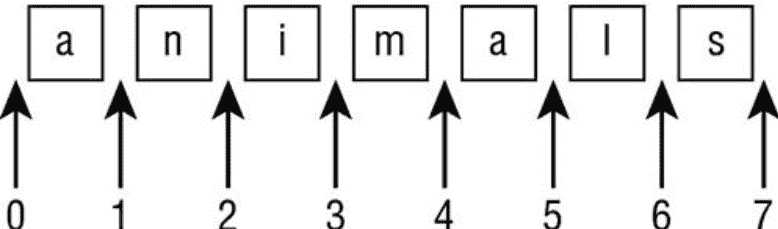

图 5.2 子字符串的索引

以下代码展示了如何使用 `substring()`：

```java
String string = "animals";
System.out.println(string.substring(3)); // mals
System.out.println(string.substring(string.indexOf('m'))); // mals
System.out.println(string.substring(3, 4)); // m
System.out.println(string.substring(3, 7)); // mals
```

`substring()` 方法是考试中最难的 `String` 方法。第一个示例取从索引 3 开始到结束的字符，我们得到了 `"mals"`。第二个示例做了相同的事情，但它调用了 `indexOf()` 来获取索引而不是硬编码它。这是编码中的常见做法，因为你可能无法提前知道索引。

第三个示例取从索引 3 开始直到但不包含索引 4 处的字符——这是一种复杂的说法，表示我们想要一个包含一个字符的字符串：即索引 3 处的字符。结果是 `"m"`。最后一个示例取从索引 3 开始直到索引 7。由于索引 7 等于字符串的末尾，因此它与第一个示例等效。

我们希望这不会太困惑。接下来的例子没那么直观：

```java
System.out.println(string.substring(3, 3)); // empty string
System.out.println(string.substring(3, 2)); // throws exception
System.out.println(string.substring(3, 8)); // throws exception
```

这组中的第一个示例打印空字符串。请求是取从索引 3 开始直到到达索引 3 的字符。由于起始和结束索引相同，它们之间没有字符。这组中的第二个示例抛出异常，因为索引不能是倒序的。Java 非常清楚，如果从索引 3 开始，永远无法到达索引 2。第三个示例表示继续到第八个字符。虽然同样没有第七个字符，但至少有一个不可见的“字符串末尾”位置。

让我们再复习一下，因为 `substring()` 非常复杂。该方法返回从请求索引开始的字符串。如果请求了结束索引，它会在该索引之前停止。否则，它将到字符串的末尾。

### toLowerCase() 和 toUpperCase()

呼。经过脑力体操后，有这些完全名副其实的方法真是太好了！这些方法让你轻松地转换数据。方法签名如下：

```
String toLowerCase()
String toUpperCase()
```

以下代码展示了如何使用这些方法：

```java
String string = "animals";
System.out.println(string.toUpperCase()); // ANIMALS
System.out.println("Ab123".toLowerCase()); // abc123
```

这些方法名如其言。`toUpperCase()` 将返回字符串中的任何小写字母转换为大写。`toLowerCase()` 将返回字符串中的任何大写字母转换为小写。这些方法会忽略字母以外的任何字符。此外，记住字符串是不可变的，因此原始字符串保持不变。

## equals() 和 equalsIgnoreCase()

`equals()` 方法检查两个 `String` 对象是否包含相同顺序的完全相同的字符。`equalsIgnoreCase()` 方法检查两个 `String` 对象是否包含相同的字符，例外是它会在需要时转换字符的大小。方法签名如下：

```
boolean equals(Object obj)
boolean equalsIgnoreCase(String str)
```

你可能已经注意到 `equals()` 接收的是 `Object` 而不是 `String`。这是因为该方法对所有对象都是通用的。如果你传递一个不是 `String` 的内容，它只会返回 `false`。相比之下，`equalsIgnoreCase` 只适用于 `String` 对象，因此它可以接受更具体的类型作为参数。

以下代码展示了如何使用这些方法：

```java
System.out.println("abc".equals("ABC")); // false
System.out.println("ABC".equals("ABC")); // true
System.out.println("abc".equalsIgnoreCase("ABC")); // true
```

这个示例应该非常直观。在第一个示例中，值并不完全相同。在第二个示例中，它们完全相同。在第三个中，它们仅大小不同，但没关系，因为我们调用了忽略大小差异的方法。

## startsWith() 和 endsWith()

`startsWith()` 和 `endsWith()` 方法检查提供的值是否匹配字符串的一部分。方法签名如下：

```
boolean startsWith(String prefix)
boolean endsWith(String suffix)
```

以下代码展示了如何使用这些方法：

```java
System.out.println("abc".startsWith("a")); // true
System.out.println("abc".startsWith("A")); // false
System.out.println("abc".endsWith("c")); // true
System.out.println("abc".endsWith("a")); // false
```

同样，这里没什么意外的。Java 对提供的值进行大小敏感检查。

## replace()

`replace()` 方法在字符串上执行简单的搜索和替换。有一个版本接受 `char` 参数，另一个版本接受 `CharSequence` 参数。方法签名如下：

```
String replace(char oldChar, char newChar)
String replace(CharSequence target, CharSequence replacement)
```

以下代码展示了如何使用这些方法：

```java
System.out.println("abc".replace('a', 'A')); // Abc
System.out.println("abc".replace("a", "A")); // Abc
```

第一个示例使用了第一个方法签名，传递了 `char` 参数。第二个示例使用了第二个方法签名，传递了 `String` 参数。

## contains()

`contains()` 方法在字符串中查找匹配项。方法签名如下：

```
boolean contains(CharSequence seq)
```

以下代码展示了如何使用这些方法：

```java
System.out.println("abc".contains("b")); // true
System.out.println("abc".contains("B")); // false
```

## trim(), strip(), stripLeading(), 和 stripTrailing()

`stripLeading()` 和 `stripTrailing()` 方法是在 Java 11 中引入的。`strip()` 方法的功能与 `trim()` 类似，但它支持 Unicode。`stripLeading()` 方法移除字符串开头的空白字符。`stripTrailing()` 方法相反。方法签名如下：

```
String strip()
String stripLeading()
String stripTrailing()
String trim()
```

以下代码展示了如何使用这些方法：

```java
System.out.println("abc".strip()); // abc
System.out.println("\t a c\n".strip()); // a c
```

```java
String text = " \t abc ";
System.out.println(text.trim().length()); // 3
System.out.println(text.strip().length()); // 3
System.out.println(text.stripLeading().length()); // 5
System.out.println(text.stripTrailing().length()); // 4
```

首先，记住 `\` 是单个字符。反斜杠转义了 `t` 以表示制表符。第一个示例打印原始字符串，因为开头或结尾没有空白字符。第二个示例去掉了制表符、随后的空格以及末尾的换行符。它保留了字符串中间的空格。

剩余的示例只是打印剩余字符的数量。我们可以看到 `trim()` 和 `strip()` 都留下了相同的字符 `"abc"`，因为它们移除了开头和结尾的空白字符。`stripLeading()` 方法只移除字符串开头的那个空白字符。留下了结尾的制表符和空格。`stripTrailing()` 移除结尾的这两个字符，但留了字符串开头的字符。

这仅仅是一系列 `String` 方法。每当调用其中一个方法时，返回值会被放入一个新变量中。过程中产生了四个 `String` 值，并输出了 `AnimAl`。

然而，在考试中往往于在很小的空间内挤入尽可能多的代码。你会看到使用名为“方法链式”（method chaining）技术的代码。这是一个示例：

```java
String result = "Animal".trim().toLowerCase().replace('a', 'A');
System.out.println(result);
```

这段代码与之前的示例等效。它也创建了 `String` 对象并输出 `AnimAl`。要阅读使用方法链式的代码，从左侧开始评估第一个方法。然后对第一个方法的返回值上调用下一个方法。持续进行，直到遇到分号。

记住 `String` 是不可变的。你认为这段代码的结果是什么？

```java
5: String a = "abc";
6: String b = a.toUpperCase();
7: b = b.replace("B", "2").replace('C', '3');
8: System.out.println("a" + a);
9: System.out.println("b" + b);
```

在第 5 行，我们设置 `a` 指向 `"abc"`，且从未指向过其他内容。由于我们处理的是不可变对象，第 6 行和第 7 行的任何代码都没有改变 `a`，值仍然是 `"abc"`。

`b` 稍微复杂一点。第 6 行 `b` 指向了 `"ABC"`

## 使用 StringBuilder 类

一个小型程序可以非常快速创建很多 `String` 对象。例如，你认为这段代码创建了多少个？

```java
10: String alpha = "";
11: for(char current = 'a'; current <= 'z'; current++)
12:   alpha += current;
```


## StringBuilder 与 String 的性能对比

第 10 行实例化了一个空 String，然后第 12 行追加了一个 "a"。但是，因为 String 对象是不可变的，一个新的 String 对象被分配给 `alpha`，而原来的 " " 对象变为可以垃圾回收的对象。在下一次循环中，`alpha` 被分配了一个新的 String 对象 "ab"，而 "a" 对象变为可以垃圾回收的对象。下一次迭代将 `alpha` 赋值为 "abc"，"ab" 对象变为可以垃圾回收的对象。

这一系列事件持续进行，在循环 26 次后，总共实例化了 27 个对象，其中大多数立即可以被垃圾回收。

这是非常无效的。幸运的是，Java 有一种解决方案。`StringBuilder` 类创建 String 时不需要存储那些中间 String 值。与 String 类不同，`StringBuilder` 不是不可变的。

```java
15: StringBuilder alpha = new StringBuilder();
16: for(char current = 'a'; current <= 'z'; current++)
17:   alpha.append(current);
18: System.out.println(alpha);
```

在第 15 行，实例化了一个新的 `StringBuilder` 对象。第 17 行对 `append()` 的调用在每次 for 循环中向 `StringBuilder` 对象添加一个字符，将 `current` 的值追加到 `alpha` 的末尾。这段代码重用了同一个 `StringBuilder`，而每次都创建一个中间 String。

在旧代码中，你可能会看到对 `StringBuffer` 的引用。它的工作方式相同，只是它支持线程，你将在准备 1ZO-816 考试时学到它。`StringBuffer` 不再出现在任何一个考试中了。它的性能比 `StringBuilder` 慢，所以直接使用 `StringBuilder` 即可。

在这一节中，我们将查看创建 `StringBuilder` 以及使用它的常用方法。

## 可变性与链式调用

我们确定你从上一个示例中注意到了这一点，但 `StringBuilder` 不是不可变的。事实上，在示例中我们给了它 27 个不同的值（空字符串加上字母表中的每个字母）。考试可能会尝试在 String 和 `StringBuilder` 是可变的这一点上欺骗你。

链式调用让这变得更有趣。当我们链式调用 String 方法时，结果是一个带有答案的新 String。链式调用 `StringBuilder` 方法并不是这样。相反，`StringBuilder` 会改变它的状态并返回它自身的引用。让我们来看一个示例让它更清晰：

```java
4: StringBuilder sb = new StringBuilder("start");
5: sb.append("+middle"); // sb = "start+middle"
6: StringBuilder same = sb.append("+end"); // "start+middle+end"
```

第 5 行在 `sb` 的末尾添加文本。它还返回了 `sb` 的引用，但该引用被忽略了。第 6 行也向 `sb` 的末尾添加文本并返回 `sb` 的引用。这次该引用被存储在 `same` 中——这意味着 `sb` 和 `same` 指向同一个对象，并将打印出相同的值。

示例并不总是通过每行只用一个方法来使代码易读。你认为这个示例会打印什么？

```java
4: StringBuilder a = new StringBuilder("abc");
5: StringBuilder b = a.append("+de");
6: b = b.append("+f").append("+g");
7: System.out.println("a=" + a);
8: System.out.println("b=" + b);
```

你说回是 "abcdef" 吗？很好。这里只有一个 `StringBuilder` 对象。我们知道这一点是因为 `new StringBuilder()` 只被调用了一次。在第 5 行，有两个变量指向值为 "abcde" 的对象。在第 6 行，这两个变量仍然指向那同一个对象，该对象现在的值为 "abcdef"。顺便提一下，重新赋值给 `b` 的操作完全没有任何作用。`b` 已经指向了该对象。

## 创建 StringBuilder

有三种方法可以构造 `StringBuilder`：

```java
StringBuilder sb1 = new StringBuilder();
StringBuilder sb2 = new StringBuilder("animal");
StringBuilder sb3 = new StringBuilder(10);
```

第一个是创建一个空的 `StringBuilder`。第二个是创建一个包含 "animal" 的 `StringBuilder`。第三个是创建一个容量为 10 的 `StringBuilder`。

## 重要的 StringBuilder 方法

和 String 一样，我们不会涵盖每一个方法。这些是你可能在考试中看到的。

### charAt(), indexOf(), length(), 和 substring()

这四个方法的工作方式与 String 类完全相同。确保你能识别这个示例的输出：

```java
StringBuilder sb = new StringBuilder("animals");
String sub = sb.substring(sb.indexOf("a"), sb.indexOf("al"));
int len = sb.length();
char ch = sb.charAt(6);
System.out.println(sub + " " + len + " " + ch);
```

正确答案是 `anim 7 s`。`indexOf()` 分别返回 0 和 4。`substring()` 返回从索引 0 开始的 String。`length()` 返回 7，因为它是 `StringBuilder` 中字符的数量而不是索引。最后，`charAt()` 返回索引 6 的字符。这里我们从 0 开始是因为使用的是索引。如果这些听起来陌生，请回去重读 String 的部分。

注意 `substring()` 返回的是 String 而不是 `StringBuilder`。这就是为什么 `sb` 没有被改变。`substring()` 实际上只是一个查询 `StringBuilder` 当前状态的方法。

### append()

`append()` 方法是 `StringBuilder` 中被频繁使用的方法。事实上，它被使用得如此频繁，以至于我们在使用它时没有注释。幸运的是，这个方法正如它听起来的那样：它将参数添加到 `StringBuilder` 中并返回当前的引用。其中一个方法签名如下：

```java
StringBuilder append(String str)
```

注意我们说其中一个方法签名。有超过 10 个相似但接受不同数据类型参数的方法签名。提供所有方法是为了让你写出这样的代码：

```java
StringBuilder sb = new StringBuilder().append(1).append('c');
sb.append("-").append(true);
System.out.println(sb); // 1c-true
```

很棒的方法式调用吧？`append()` 直接在构造函数之后被调用。通过拥有所有这些方法签名，你可以直接调用 `append()` 而不需要先将你的参数转换为 String。

### insert()

`insert()` 方法在指定的索引处将字符添加到 `StringBuilder` 中并返回当前的引用。就像 `append()` 一样，有很多针对不同类型的方法签名。这里是一个：

```java
StringBuilder insert(int offset, String str)
```

注意这些示例中的偏移量（offset）。它是我们要插入请求参数的索引。

```java
3: StringBuilder sb = new StringBuilder("animals");
4: sb.insert(7, "-"); // sb = animals-
5: sb.insert(0, "-"); // sb = -animals-
6: sb.insert(4, "-"); // sb = -ani-mals-
7: System.out.println(sb);
```

第 4 行在索引 7 处插入连字符，这恰好是字符序列的结尾。第 5 行表示在索引 0 处插入连字符，这恰好是正开头。最后，第 6 行在索引 4 之前插入一个连字符。出题者会试图刁难你。当我们添加和删除字符时，它们的索引会发生变化。当你看到处理此类操作的问题时，要弄清楚发生了什么，以免产生困惑。

## delete() 和 deleteCharAt()

`delete()` 方法是 `insert()` 方法的反操作。它从序列中删除字符并返回当前 `StringBuilder` 的引用。当你只想删除一个字符时，`deleteCharAt()` 方法非常方便。方法签名如下：

```java
StringBuilder delete(int startIndex, int endIndex)
StringBuilder deleteCharAt(int index)
```

以下代码展示了如何使用这些方法：

```java
StringBuilder sb = new StringBuilder("abcdef");
sb.delete(1, 3); // sb = adef
sb.deleteCharAt(5); // 抛出异常
```

首先，我们删除从索引 1 开始到索引 3 正之前结束的字符。这让我们得到了 adef。接下来，我们要求 Java 删除位置 5 处的字符。然而，剩余的值只有四个字符长，所以它会抛出 `StringIndexOutOfBoundsException`。

在处理数组索引方面，`delete()` 方法比其他方法更灵活。如果你指定的第二个参数超过了 `StringBuilder` 的末尾，Java 会直接认为你指的是末尾。这意味着这段代码是合法的：

```java
StringBuilder sb = new StringBuilder("abcdef");
sb.delete(1, 100); // sb = a
```

## replace()

`replace()` 方法对 `StringBuilder` 的工作方式与 String 不同。方法签名如下：

```java
StringBuilder replace(int startIndex, int endIndex, String newString)
```

以下代码展示了如何使用此方法：

```java
StringBuilder builder = new StringBuilder("pigeon dirty");
builder.replace(3, 6, "sty");
System.out.println(builder); // pigsty dirty
```

首先，Java 删除从索引 3 开始到索引 6 正之前结束的字符。这让我们得到了 pig dirty。然后 Java 在该位置插入了值 "sty"。

在这个示例中，删除和插入的字符数量是相同的。然而，并没有理由规定必须相同。你认为这段代码会做什么？

```java
StringBuilder builder = new StringBuilder("pigeon dirty");
builder.replace(3, 100, "");
System.out.println(builder);
```

它实际上打印了 "pig"。记住，该方法执行的是逻辑删除。`replace()` 方法允许指定一个超过 `StringBuilder` 末尾的第二个参数。这意味着只剩下前三个字符。

## reverse()

在经历了这一切之后，该轮用一个简单方便的方法了。`reverse()` 方法顾名思义：它反转序列中的字符并返回当前 `StringBuilder` 的引用。方法签名如下：

```java
StringBuilder reverse()
```

以下代码展示了如何使用此方法：

```java
StringBuilder sb = new StringBuilder("ABC");
sb.reverse();
System.out.println(sb);
```

如所预期的，它打印出 CBA。这个方法并不有趣。也许出题者喜欢包含它，是为了鼓励你写下值，而不是依靠记忆索引。

## toString()

最后一个方法将 `StringBuilder` 转换为 String。方法签名如下：

```java
String toString()
```

以下代码展示了如何使用此方法：

```java
StringBuilder sb = new StringBuilder("ABC");
String s = sb.toString();
```

通常 `StringBuilder` 在内部是为了性能考虑而被使用的，但最终结果需要一个 String。例如，它可能需要被传递给另一个期望 String 的方法。

## 理解等价性

在第 3 章中，你学习了如何使用 `==` 来比较数字，以及对象引用如何指向同一个对象。在本节中，我们将观察两个对象等价或相同意味着什么。我们还将观察字符串池对相等性的影响。

## 比较 equals() 和 ==

考虑以下使用 `==` 操作对象的代码：

```java
StringBuilder one = new StringBuilder();
StringBuilder two = new StringBuilder();
StringBuilder three = one.append("a");
System.out.println(one == two); // false
System.out.println(one == three); // true
```

由于这不涉及原始数据类型，我们知道要检查引用是否指向同一个对象。`one` 和 `two` 是两个完全独立的 `StringBuilder` 对象，给了我们两个对象。因此，第一条语句返回 false。`three` 更有趣。还记得 `StringBuilder` 方法如何喜欢返回当前引用以实现链式调用吗？这意味着 `one` 和 `three` 都指向同一个对象，第二条语句返回 true。

你之前看到过，对于 String，你可以说想要的是逻辑相等性而不是对象相等性：

```java
String x = "Hello World";
String z = " Hello World".trim();
System.out.println(x.equals(z)); // true
```

你也可以采取相反的操作：告诉 Java 使用字符串池。如果字符串池中已经存在对象，`intern()` 方法将使用字符串池中的该对象。如果字面量不在字符串池中，此时 Java 会将其添加其中。

```java
String name = "Hello World";
String name2 = new String("Hello World").intern();
System.out.println(name == name2); // true
```

首先，我们告诉 Java 对 `name` 正常地使用字符串池。对于 `name2`，我们告诉 Java 使用构造函数创建一个新对象并对其进行 `intern()` 操作，无论如何都使用字符串池。由于两个变量都指向字符串池中的同一个引用，我们可以使用 `==` 运算符。

让我们再试一个。你认为这说明了什么？注意看，这很有陷阱性。

```java
15: String first = "rat" + 1;
16: String second = "" + "a" + "t" + "1";
17: String third = "r" + "a" + "t" + new String("1");
18: System.out.println(first == second);
19: System.out.println(first == second.intern());
20: System.out.println(first == third);
21: System.out.println(first == third.intern());
```


在第 15 行，我们有一个编译时常量，它会自动作为 "rat" 放入字符串池。在第 16 行，我们有一个更复杂的表达式，但它也是一个编译时常量。因此，`first` 和 `second` 共享同一个字符串池引用。这使得第 18 行和第 19 行输出 `true`。

在第 17 行，我们使用了 `String` 构造函数。这意味着我们不再拥有编译时常量，`third` 不指向字符串池中的引用。因此，第 20 行输出 `false`。在第 21 行，`intern()` 调用会查找字符串池。Java 发现 `first` 指向相同的 `String` 并输出 `true`。

在编写程序时，你可能不想创建一个 `String` 字符串或使用 `intern()` 方法。对于考试，你需要知道这两者都是允许的，以及它们的行为如何。

> 记住，永远不要在代码中使用 `intern()` 或 `==` 来比较 `String` 对象。你只需要在考试中处理这些情况。

# 理解 Java 数组

到目前为止，我们一直把 `String` 和 `StringBuilder` 类称为“字符序列”。这是正确的。它们是使用字符数组实现的。数组是堆（heap）上的一块内存区域，留有存储指定数量元素的空间。`String` 的实现是一个数组，并带有一些方法，当你专门处理字符时可能可能需要它们。`StringBuilder` 的实现是一个数组，当其空间不足以存储所有字符时，该数组对象会被替换为一个新的更大的对象。一个很大的区别是，数组可以是任何其他 Java 类型。如果由于某种原因我们不想使用 `String`，我们可以直接使用基本类型数组：

```java
char[] letters;
```

这将不再非常方便，因为我们将失去 `String` 提供的所有特殊属性，例如编写 "Java"。请记住，`letters` 是一个引用变量，而不是基本类型。`char` 是存入数组的内容，而不是数组本身的类型。数组本身的类型是 `char[]`。你可以在脑中将方括号 `[]` 读作“数组”。

换句话说，数组是一个有序列表。它可以包含重复项。在本节中，我们将查看创建基本类型和对象的数组、排序、搜索、可变参数（varargs）以及多维数组。

## 创建基本类型数组

创建数组最常见的方法如下：

```java
int[] numbers1 = new int[3];
```

基础部分如图 5.3 所示。它指定了数组的类型（int）和大小（3）。方括号告诉你这是一个数组。

### 数组的类型

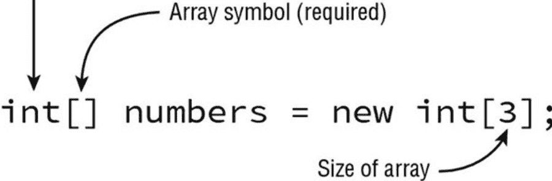

图 5.3 数组的基本结构

当你使用这种形式实例化数组时，所有元素都会被设置为该类型的默认值。正如你在第 2 章中所学到的，`int` 的默认值是 0。由于 `numbers1` 是一个引用变量，它指向数组对象，如图 5.4 所示。你可以看到，所有元素的默认值都是 0。此外，索引从 0 开始递增，就像它们在 `String` 中一样。

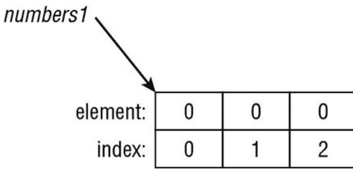

图 5.4 一个空数组

创建数组的另一种方法是指定它初始包含的所有元素：

```java
int[] numbers2 = new int[] {42, 55, 99};
```

在这个例子中，我们也创建了一个大小为 3 的 `int` 数组。这次，我们指定了这三个元素的初始值，而不是使用默认值。图 5.5 显示了这个数组的样子。

# numbers2

| 元素: | 42 | 55 | 99 |
|---|---|---|---|
| 索引: | 0 | 1 | 2 |

图 5.5 一个初始化的数组

Java 识别出这个表达式是冗余的。因为你在等号左侧指定了数组类型，Java 已经知道了。而且由于你指定了初始值，它已经知道了。

```java
int[] numbers2 = {42, 55, 99};
```

这种简写方式常用于初始化数组。

```java
int[] numbers3 = new int[3];

numbers3[0] = 10;

numbers3[1] = 20;

numbers3[2] = 30;
```

你也可以先创建数组再进行赋值：

```java
int[] numbers4 = new int[5];

numbers4[0] = 1;

numbers4[1] = 2;

numbers4[2] = 3;

numbers4[3] = 4;

numbers4[4] = 5;
```

你还可以通过索引访问数组元素：

```java
System.out.println(numbers4[0]); // 输出 1

System.out.println(numbers4[2]); // 输出 3
```

你还可以修改数组元素：

```java
numbers4[1] = 100;

System.out.println(numbers4[1]); // 输出 100
```

最后，你还可以遍历数组：

```java
for (int i = 0; i < numbers4.length; i++) {

    System.out.println(numbers4[i]);

}
```

或者使用增强型 for 循环：

```java
for (int number : numbers4) {

    System.out.println(number);

}
```

```java
4: String[] mammals = {"monkey", "chimp", "donkey"};

5: System.out.println(mammals.length);      // 3

6: System.out.println(mammals[0]);      // monkey

7: System.out.println(mammals[1]);      // chimp

8: System.out.println(mammals[2]);      // donkey
```

第 4 行声明并初始化了数组。第 5 行告诉我们数组可以包含多少元素。其余代码打印了该数组。注意元素是从 0 开始索引的。这在 String 和 StringBuilder 中应该很熟悉，因为它们也从 0 开始计数。这些类也将将长度计算为元素的数量。注意 `length` 后面没有括号，因为它不是一个方法。

为了确保你理解了 `length` 是如何工作的，你认为它会打印什么？

```java
String[] birds = new String[6];

System.out.println(birds.length);
```

答案是 6。尽管数组的所有六个元素都是 `null`，但它们仍然有六个。`length` 不考虑数组中的内容；它只考虑分配了多少槽位。

在读写或写入数组时，使用循环是非常常见的。这个循环将每个数字元素设置为当前索引大 5：

```java
5: int[] numbers = new int[10];

6: for (int i = 0; i < numbers.length; i++)

7 numbers[i] = i + 5;
```

第 5 行只是实例化了一个具有 10 个槽位的数组。第 6 行是一个使用极其常见模式的 `for` 循环。它从索引 0 开始，数组也从这里开始。它一个接一个继续运行，直到到达数组末。第 7 行设置了 `numbers` 的当前元素。

考试将通过尝试访问数组不存在的元素来测试你是否在观察。你能告诉为什么对于这个大小为 10 的数组，这些操作每个都抛出了 `ArrayIndexOutOfBoundsException` 吗？

```java
numbers[10] = 3;

numbers[numbers.length] = 5;

for (int i = 0; i <= numbers.length; i++) numbers[i] = i + 5;
```

第一个是在尝试看你是否知道索引是从 0 开始的。
由于我们的数组中有 10 个元素，这意味着只有 `numbers[0]` 到 `numbers[9]` 是有效的。第二个例子假设你足够聪明知道 10 是无效的，并通过使用 `length` 字段禁用了它。
然而，`length` 总是比最大有效索引大一个。
最后，`for` 循环错误地使用了 `<=` 而不是 `<`，这也是引用第 10 个元素的一种方式。

# 排序

Java 通过提供 `sort` 方法——或者准确地说，一组排序方法来轻松地对数组。就像 `StringBuilder` 允许你向 `append()` 传递几乎任何内容一样，你可以向 `Arrays.sort()` 传递几乎任何数组。

`Arrays` 是我们使用过的第一个需要导入的 Java 类。要使用它，你必须在类中包含以下两个语句之一：

```java
import java.util.*; // 导入包含 Arrays 在整个包

import java.util.Arrays; // 仅导入 Arrays
```

有一个例外，尽管它在考试中不会出现。你可以在类中每次使用时都写 `java.util.Arrays`，而不是将其指定为导入项。

记住，如果你看到一个行号不是从 1 开始的代码段，你可以假设必要的导入已经存在了。同样，如果你看到一个方法的片段，你也可以假设导入已经存在。

这个简单的示例对三个数字进行了排序：

```java
int[] numbers = { 6, 9, 1 };

Arrays.sort(numbers);
```

```java
for (int i = 0; i < numbers.length; i++)

System.out.print(numbers[i] + " ");
```

结果是 1 6 9，正如你预期的那样。注意我们遍历了输出来打印数组中的值。直接打印数组将得到令人讨厌的哈希值 `[I@2bd9c3e7`。
或者，我们可以打印 `Arrays.toString(numbers)` 而不是使用循环。那将输出 `[1, 6, 9]`。

用 `String` 类型再次尝试一次：

```java
String[] strings = {"0", "9", "100"};

Arrays.sort(strings);

for (String string : strings)

System.out.print(string + " ");
```

这个结果可能不是你预期的。这段代码输出的是 `100 9`。问题是 `String` 按字母顺序排序的，而 `1` 在 `9` 之前。（如果你好奇的话，数字在字母之前排序，大写字母在小写字母之前排序）。对于 1Z0-816 考试，你将学习如何使用名为 `comparator` 的东西创建自定义顺序。

你注意到我们在在这个例子中悄悄用了增强型 `for` 循环吗？由于我们没有使用索引，所以不需要传统的 `for` 循环。不过，这阻止不了出题者使用它，所以我们会确保两种都使用，以保持你的敏锐！

## 搜索

Java 还提供了一种方便的搜索方法——但前提是数组已经排序过的。表 5.1 涵盖了二分查找的规则。

### 表 5.1 二分查找规则

| 场景 | 结果 |
| :--- | :--- |
| 在排序的数组中找到目标 | 匹配的索引 |
| 在排序的数组中未找到目标 | 显示插入位置的负值 |
| 未排序的数组 | 不可预测的结果 |

让我们用这些规则尝试：

```java
3: int[] numbers = {3,2,1};

4: System.out.println(Arrays.binarySearch(numbers, 2)); // 0

5: System.out.println(Arrays.binarySearch(numbers, 4)); // 1

6: System.out.println(Arrays.binarySearch(numbers, 1)); // -1

7: System.out.println(Arrays.binarySearch(numbers, 3)); // -2

8: System.out.println(Arrays.binarySearch(numbers, 9)); // -5
```

注意第 5 行，数组没有排序。这意味着输出是不可预测的。测试这个示例时，第 6 行正确输出了 1。然而，第 7 行给了错误的答案。出题者不会要求你知道什么样的错误值。一旦你看到数组未排序，寻找关于不可预测输出的选项。

在考试中，你需要知道二分查找在各种情况下返回什么。奇怪的是，你不需要知道为什么名字里有“binary”。如果你好奇，二分查找将数组分成两个等份（记住 2 是二进制）并确定目标在哪个部分。它重复这个过程直到只剩下一个元素。

# 比较

Java 还提供了比较两个数组的方法以确定哪一个更“小”。我们首先介绍 `compare()` 方法，然后介绍 `mismatch()`。

## compare()

在调用 `compare()` 之前，你需要了解许多规则。幸运的是，这些规则也是你在参加 1Z0-816 考试时编写 `Comparator` 时需要知道的规则。

首先你需要学习返回值的含义。你不需要知道确切的返回值，但你需要知道以下内容：

- 负数意味着第一个数组比第二个数组小。
- 零意味着数组相等。
- 正数意味着第一个数组比第二个数组大。

这是一个例子：

```java
System.out.println(Arrays.compare(new int[] {1}, new int[] {2}));
```

这段代码打印一个负数。这应该是很直观的，1 比 2 小，因此第一个数组更小。

现在你已经知道了如何比较单个值，让我们来看看来看如何比较不同长度的数组：

- 如果两个数组的长度相同，且每个位置上的值相同且顺序一致，则返回零。
- 如果所有元素都相同，但第二个数组末尾有额外的元素，返回一个负数。
- 如果所有元素都相同，但第一个数组末尾有额外的元素，返回一个正数。
- 如果第一个不同的元素在第一个数组中较小，返回一个负数。
- 如果第一个不同的元素在第一个数组中较大，返回一个正数。

最后，“小”意味着什么？这里有一些适用于此处以及适用于 `compareTo()` 的更多规则，你将在第 6 章“Lambda 和函数接口”中看到：

- `null` 比任何其他值都小。
- 对于数字，适用数值顺序。
- 对于字符串，如果一个是另一个的前缀，则它较小。
- 对于字符串/字符，数字比字母小。
- 对于字符串/字符，大写比小写小。

表 5.2 显示了这些规则的应用示例。

## 表 5.2 Arrays.compare() 示例

| 第一个数组 | 第二个数组 | 结果 | 原因 |
| --- | --- | --- | --- |
| new int[] {1, 2} | new int[] {1} | 正数 | 第一个元素相同，但第一个数组更长。 |
| new int[] {1, 2} | new int[] {1, 2} | 零 | 精确匹配 |
| new String[] {"a"} | new String[] {"aa"} | 负数 | 第一个元素是第二个元素的子字符串。 |
| new String[] {"a"} | new String[] {"A"} | 正数 | 大写比小写小。 |
| new String[] {"a"} | new String[] {null} | 正数 | `null` 比字母小。 |

最后，这段代码无法编译，因为类型不同。比较两个数组时，它们必须是相同的数组类型。

```java
System.out.println(Arrays.compare(

new int[] {1}, String[] {"a"})); // 无法编译
```

## mismatch()

现在你已经熟悉了 `compare()`，是时候学习 `mismatch()` 了。如果数组相等，`mismatch()` 返回 -1。否则，它返回它们不同的第一个索引。你能猜出这些代码会打印什么吗？

```java
System.out.println(Arrays.mismatch(new int[] {1}, new int[] {1}));

System.out.println(Arrays.mismatch(new String[] {"a"}, new String[] {"A"}

System.out.println(Arrays.mismatch(new int[] {1, 2}, new int[] {1}));
```

在第一个示例中，数组相同，所以结果是 -1。在第二个示例中，元素 0 处不相等，所以结果是 0。在第三个示例中，元素 0 处相等，所以我们继续查找。更具体地说，索引 1 处的元素不等。一个数组在索引 1 处有元素，另一个没有。因此，结果是 1。

为了确保你理解了 `compare()` 和 `mismatch()` 方法，请学习表 5.3。如果你不理解为什么会有这些值，请返回学习本节。

## 表 5.3 等值比较：compare vs. mismatch

| 方法 | 当数组相同时 | 当数组不同时 |
|---|---|---|
| equals() | true | false |
| compare() | | 正索引或负索引 |
| mismatch() | -1 | 零或正索引 |

## 可变参数 (Varargs)

当你自己创建一个数组时，它看起来就像我们目前看到的样子。当它传递给你的方法时，它还有另一种形式。这里有三个带有 `main()` 方法的示例：

```java
public static void main(String[] args)

public static void main(String args[])

public static void main(String... args) // 可变参数
```


第三个示例使用了称为 varargs（可变参数）的语法，你在第 1 章“欢迎来到 Java...”中见过它。你将在第 7 章“方法与封装”中学习如何使用可变参数调用方法。现在，你只需要知道可以使用使用可变参数定义的变量，像普通数组一样使用它。例如，`args.length` 和 `args[]` 都是合法的。

## 多维数组

数组是对象，当然数组组件也可以是对象。将这两个事实结合起来并不费时间，你就会思考数组是否可以包含其他数组，而它们是可以的。

## 创建多维数组

多个数组分隔符即可声明多个维度的数组。你可以像以前一样，通过声明中的类型或变量名找到它们：

```java
int[][] vars1;           // 2D 数组
int[] vars2[];           // 2D 数组
int vars3[];             // 2D 数组
int vars4[][], space[][][];  // 一个 2D 数组和一个 3D 数组
```

前两个示例并不意外，声明了一个二维（2D）数组。第三个示例也声明了一个 2D 数组。除了混淆读代码的读者之外，没有理由使用这种风格。最后一个示例在同一行上声明了两个数组。加上括号，我们看到 `vars4` 是一个 2D 数组而 `space` 是一个 3D 数组。再次，没有理由使用这种风格，除了混淆读代码的读者之外。

> 经验丰富的程序员们，请注意：本节经过了简化，没有涵盖许多超出考试范围的话题。

## 创建 ArrayList

与 `StringBuilder` 类似，创建 `ArrayList` 有三种方法：

```java
ArrayList list1 = new ArrayList();
ArrayList list2 = new ArrayList(10);
ArrayList list3 = new ArrayList(list2);
```

第一种表示创建一个包含默认数量元素空间的 `ArrayList`，但并不填充任何槽位。第二种表示创建一个包含特定数量槽位的 `ArrayList`，但同样不分配任何元素。最后一个示例告诉 Java 我们想制作另一个 `ArrayList` 的副本。我们复制了该 `ArrayList` 的大小和内容。诚然，在示例中 `list2` 是空的，所以它并没有特别有趣。

虽然这些是你唯一需要了解的三个构造函数，但你确实需要学习它的某些变体。之前的示例是 Java 5 时代创建 `ArrayList` 的旧方法。它们仍然有效，而且你仍然需要知道它们是有效的。你还需要知道新的、改进后的方法。Java 5 引入了泛型，它允许你指定 `ArrayList` 将包含的类类型。

```java
ArrayList<String> list4 = new ArrayList<String>();
ArrayList<String> list5 = new ArrayList<>();
```

Java 5 允许你在 `< >` 之间指定类型来告诉编译器类型是什么。从 Java 7 开始，你甚至可以在右侧省略该类型。不过，`< >` 仍然是必需的。这被称为钻石运算符，因为 `<>` 看起来像一个菱形。

## 在 ArrayList 中使用 var

既然 `var` 可以用来隐藏数据类型，那么使用泛型就可以提出一整组新问题。考虑一下这段混合了这两者的代码：

```java
var strings = new ArrayList<String>();
strings.add("a");
for (String s : strings) { }
```

`var` 的类型是 `ArrayList<String>`。这意味着你可以添加一个 `String` 或遍历 `String` 对象。如果我们在 `var` 上使用菱形运算符会怎样？

```java
var list = new ArrayList<>();
```

信你不信，这是可以编译的。`var` 的类型是 `ArrayList<Object>`。由于泛型没有指定类型，Java 必须假设最终的超类。这是非常愚蠢且意料之外的，所以请不要这样写。但如果你在考试中看到它，你将知道预期发生什么。现在你能想出为什么这不能编译了吗？

```java
var list = new ArrayList<>();
list.add("a");
for (String s : list) { } // 无法编译
```

`var` 的类型是 `ArrayList<Object>`。由于菱形运算符中没有类型，Java 必须假设它能找到的最通用的选项。因此，它选择了 `Object`，即最终的超类。向列表添加一个 `String` 是可以的。你可以添加 `Object` 的任何子类。然而，在循环中，我们需要使用 `Object` 类型而不是 `String`。

正当你认为自己了解了关于创建 `ArrayList` 的一切时，还有一件事你需要了解。`ArrayList` 实现了一个名为 `List` 的接口。换句话说，`ArrayList` 是一个 `List`。你将在书的后面部分学习接口。在此期间，只需知道你可以将 `ArrayList` 存储在 `List` 引用变量中——反之则不然。原因是 `List` 是一个接口，而接口不能实例化。

```java
List<String> list6 = new ArrayList<>();
ArrayList<String> list7 = new List<>(); // 无法编译
```

## 使用 ArrayList

`ArrayList` 有许多方法，但你只需要了解其中几个——甚至比你对 `String` 和 `StringBuilder` 需要的还要少。

在继续阅读之前，你将在方法签名中看到新东西：一个名为 `E` 的“类”。不要担心——它实际上并不是一个类。`E` 在泛型中按约定表示“此数组可以包含的任何类”。如果你在创建 `ArrayList` 时没有指定类型，`E` 意味着 `Object`。否则，它意味着你放在 `<` 和 `>` 之间的类。

你还应该知道 `ArrayList` 重写了 `toString()`，所以你可以通过打印它轻松查看内容。数组默认不会产生这种整洁的输出。

### add()

`add()` 方法在 `ArrayList` 中插入一个新值。该方法的签名如下：

```java
boolean add(E element)
void add(int index, E element)
```

不要担心布尔值返回值。它总是返回 `true`。正如我们在本章稍后将看到的，它确实在那里。由于 `add()` 是你考试中需要知道的最关键的 `ArrayList` 方法，我们将展示它的几个示例。让我们从最简单的情况开始：

```java
ArrayList list = new ArrayList();
list.add("hawk"); // [hawk]
list.add(Boolean.TRUE); // [hawk, true]
System.out.println(list); // [hawk, true]
```

`add()` 正如它所预期的那样工作：在 `ArrayList` 中存储该 `String`。然后它对 `Boolean` 执行同样的操作。这是可以的，因为我们没有为 `ArrayList` 指定类型；因此类型是 `Object`，它包含了除原始类型之外的一切。这可能不是我们本意的意图，但编译器并不知道。现在让我们告诉编译器我们只允许添加 `String` 对象：

```java
ArrayList<String> birds = new ArrayList<>();
birds.add("hawk");
birds.add(Boolean.TRUE); // 无法编译
```

这次编译器知道只允许 `String` 对象，并阻止了添加 `Boolean` 的尝试。现在让我们尝试向不同的位置添加多个值。

```java
List<String> birds = new ArrayList<>();
birds.add("hawk");        // [hawk]
birds.add("robin");       // [hawk, robin]
birds.add(1, "blue");     // [hawk, blue, robin]
birds.add(0, "cardinal"); // [cardinal, hawk, blue, robin]
System.out.println(birds); // [cardinal, hawk, blue, robin]
```


`var` 的类型是 `ArrayList<Object>`。由于菱形运算符中没有类型，Java 必须假设它能找到的最通用的选项。因此，它选择了 `Object`，即最终的超类。向列表添加一个 `String` 是可以的。你可以添加 `Object` 的任何子类。然而，在循环中，我们需要使用 `Object` 类型而不是 `String`。

正当你认为自己了解了关于创建 `ArrayList` 的一切时，还有一件事你需要了解。`ArrayList` 实现了一个名为 `List` 的接口。换句话说，`ArrayList` 是一个 `List`。你将在书的后面部分学习接口。在此期间，只需知道你可以将 `ArrayList` 存储在 `List` 引用变量中——反之则不然。原因是 `List` 是一个接口，而接口不能实例化。

```java
List<String> list6 = new ArrayList<>();

ArrayList<String> list7 = new List<>(); // 无法编译
```

## 使用 ArrayList

`ArrayList` 有许多方法，但你只需要了解其中几个——甚至比你对 `String` 和 `StringBuilder` 需要的还要少。

在继续阅读之前，你将在方法签名中看到新东西：一个名为 `E` 的“类”。不要担心——它实际上并不是一个类。`E` 在泛型中按约定表示“此数组可以包含的任何类”。如果你在创建 `ArrayList` 时没有指定类型，`E` 意味着 `Object`。否则，它意味着你放在 `<` 和 `>` 之间的类。

你还应该知道 `ArrayList` 实现了 `toString()`，所以你可以通过打印它轻松查看内容。数组默认不会产生这种整洁的输出。

## add()

`add()` 方法在 `ArrayList` 中插入一个新值。该方法的签名如下：

```java
boolean add(E element)

void add(int index, E element)
```

不要担心布尔值返回值。它总是返回 `true`。正如我们在本章稍后将看到的，它确实在那里。由于 `add()` 是你考试中需要知道的最关键的 `ArrayList` 方法，我们将展示它的几个示例。让我们从最简单的情况开始：

```java
ArrayList list = new ArrayList();

list.add("hawk"); // [hawk]
```

```java
list.add(Boolean); // [hawk, true]

System.out.println(list); // [hawk, true]
```

`add()` 正如它所预期的那样工作：在较长的 `ArrayList` 中存储该 `String`。然后它对 `Boolean` 执行同样的操作。这是可以的，因为我们没有为 `ArrayList` 指定类型；因此类型是 `Object`，它包含了除原始类型之外的一切。这可能不是我们本意的意图，但编译器并不知道。现在让我们告诉编译器我们只允许添加 `String` 对象：

```java
ArrayList<String> birds = new ArrayList<>();

birds.add("hawk");

birds.add(Boolean); // 无法编译
```

这次编译器知道只允许 `String` 对象，并阻止了添加 `Boolean` 的尝试。现在让我们尝试向不同的位置添加多个值。

## clear()

`clear()` 方法移除 `ArrayList` 中的所有元素。该方法的签名如下：

```java
void clear()
```

以下显示了如何使用此方法：

```java
List<String> birds = new ArrayList<>();

birds.add("hawk"); // [hawk]
birds.add("hawk"); // [hawk, hawk]
System.out.println(birds.isEmpty()); // false
System.out.println(birds.size()); // 2
birds.clear(); // []
System.out.println(birds.isEmpty()); // true
System.out.println(birds.size()); // 0
```

调用 `clear()` 之后，`birds` 回到了一个大小为 0 的空 `ArrayList`。

## contains()

`contains()` 方法检查 `ArrayList` 中是否包含某个特定值。该方法的签名如下：

```java
boolean contains(Object object)
```

以下显示了如何使用此方法：

```java
List<String> birds = new ArrayList<>();

birds.add("hawk"); // [hawk]
System.out.println(birds.contains("hawk")); // true
System.out.println(birds.contains("robin")); // false
```

该方法对 `ArrayList` 中的每个元素调用 `equals()` 以检查是否有匹配项。由于 `String` 实现了 `equals()`，因此这种工作运行得很好。

## equals()

最后，`ArrayList` 有 `equals()` 的自定义实现，因此你可以比较两个列表以检查它们是否以相同的顺序包含相同的元素。

```java
boolean equals(Object object)
```

以下是一个示例：

```java
List<String> one = new ArrayList<>();
List<String> two = new ArrayList<>();
System.out.println(one.equals(two)); // true
one.add("a");                        // [a]
System.out.println(one.equals(two)); // false
two.add("a");                         // [a]
System.out.println(one.equals(two)); // true
one.add("b");                        // [a,b]
two.add(0, "b");                       // [b,a]
System.out.println(one.equals(two)); // false
```

第 3 行，两个 `ArrayList` 对象是相等的。空列表显然具有相同顺序的元素。第 5 行，`ArrayList` 对象不相等，因为大小不同。第 7 行，它们又是相等的，因为每个列表中都有同一个元素。第 10 行，它们不相等。大小相同且值也相同，但顺序不同。

## 包装类

到目前为止，我们只在 `ArrayList` 中放入了对象。如果我们想放入基本类型会怎样？每个基本类型都有一个包装类，它是一个与基本类型对应的对象类型。表 5.4 列出了所有包装类以及如何创建它们。

### 表 5.4 包装类

| 基本类型 | 包装类 | 创建示例 |
|---|---|---|
| boolean | Boolean | `Boolean.valueOf(true)` |
| byte | Byte | `Byte.valueOf((byte) 1)` |
| short | Short | `Short.valueOf((short) 1)` |
| int | Integer | `Integer.valueOf(1)` |
| long | Long | `Long.valueOf(1)` |
| float | Float | `Float.valueOf((float) 1.0)` |
| double | Double | `Double.valueOf(1.0)` |
| char | Character | `Character.valueOf('c')` |

每个包装类也有一个构造函数。它的作用与 `valueOf()` 相同，但不建议在新的代码中使用。记得当值相同时 `String` 是如何被共享的吗？包装类是不可变的，并且也利用了缓存。

包装类还有一个转换回基本类型的方法。对于考试，你不需要过多了解 `valueOf()` 或 `intValue()` 等类型方法，因为自动装箱已经消除了对它们的需求（见下一节）。你只需要能够阅读代码，而不要在其中寻找技巧。

还有一些将 `String` 转换为基本类型或包装类的方法。你确实需要知道这些方法。parse 方法（如 `parseInt()`）返回一个基本类型，而 `valueOf()` 方法返回一个包装类。这很容易记忆，因为返回的基本类型名称包含在方法名中。这里有一个示例：

```java
int primitive = Integer.parseInt("123");
Integer wrapper = Integer.valueOf("123");
```

第一行将 `String` 转换为 `int` 基本类型。第二行将 `String` 转换为 `Integer` 包装类。如果传递的 `String` 对于给定类型无效，Java 将抛出异常。在这些示例中，字母和点对于整数值是无效的：

```java
int bad1 = Integer.parseInt("a"); // 抛出 NumberFormatException
Integer bad2 = Integer.valueOf("123.45"); // 抛出 NumberFormatException
```

在担心之前，考试不会让你识别是使用 `parseInt()` 而不是 `parseinteger()`。你只需要在方法呈现在面前时能够识别它们。此外，`Character` 类不参与 parse/valueOf 方法。由于 `String` 由字符组成，你可以直接正常地调用 `charAt()`。

### 表 5.5 从 String 转换

| 包装类 | 转换为基本类型 | 转换为包装类 |
|---|---|---|
| Boolean | `parseBoolean()` | `valueOf()` |
| Byte | `parseByte()` | `valueOf()` |
| Short | `parseShort()` | `valueOf()` |
| Integer | `parseInt()` | `valueOf()` |
| Long | `parseLong()` | `valueOf()` |
| Float | `parseFloat()` | `valueOf()` |
| Double | `parseDouble()` | `valueOf()` |
| Character | --- | `valueOf()` |

## 自动装箱与拆箱

自动装箱是 Java 自动将基本类型转换为对应包装类对象的过程。拆箱是自动将包装类对象转换为对应基本类型的过程。这消除了手动调用 `valueOf()` 或 `intValue()` 等方法的需要。

```java
ArrayList<Integer> list = new ArrayList<>();
list.add(10);        // 自动装箱: int -> Integer
int value = list.get(0); // 拆箱: Integer -> int
```

## 在数组与 List 之间转换

你应该知道如何在数组和 `List` 之间转换。让我们从将 `ArrayList` 转换为数组开始：

```java
List<String> list = new ArrayList<>();
list.add("hawk");
list.add("robin");
Object[] array = list.toArray();
String[] stringArray = list.toArray(new String[0]);
list.clear();
System.out.println(array.length);      // 2
System.out.println(stringArray.length);    // 2
```


第 16 行显示 `ArrayList` 知道如何将其转换为数组。唯一的问题是它默认指向 `Object` 类的数组。这通常不是你需要的。第 17 行指定了数组的类型并执行了我们实际的操作。指定大小为 0 的优势在于参数是 Java 将为返回值创建一个合适大小的新数组。如果你愿意，你可以建议使用一个更大的数组来代替。如果 `ArrayList` 能够容纳该数组，则将返回该数组。否则，将创建一个新数组。

此外，注意第 18 行清除了原始列表。这不会影响任何一个数组。数组是一个新创建的对象，与原始 `List` 没有任何关系。它仅仅是一个副本。

将数组转换为 `List` 更有趣一些。我们将向你展示两种进行这种转换的方法。请注意，你无法保证从任何一种方法中获得 `java.util.ArrayList`。这意味着每种方法都有需要学习的特殊行为。

一种选择是创建一个与原始数组链接的 `List`。当对其中一个进行更改时，另一个也会随之变化。这是一个固定大小的列表，也被称为受支持列表，因为数组会随之改变。请仔细注意这里的这些值：

第 21 行将数组转换为 `List`。注意，这不是我们熟悉的 `java.util.ArrayList`。它是一个固定大小、受支持的 `List` 版本。第 23 行也可以，因为它仅仅替换了现有的值。它会同时更新数组和列表，因为它们指向同一个数据存储。第 24 行也更改了数组和列表。第 25 行显示数组已变为 `{new, test}`。第 26 行抛出了一个异常，因为我们不允许更改列表的大小。

另一种选择是创建一个不可变列表。这意味着你不能更改 `List` 的大小。你可以更改原始数组，但更改不会反映在不可变 `List` 中。再次，请仔细注意这些值：

```
32: String[] array = { "hawk", "robin" }; // [hawk, robin]
33: List<String> list = List.of(array); // 返回不可变列表
34: System.out.println(list.size()); // 2
35: array[0] = "new";
36: System.out.println(Arrays.toString(array)); // [new, robin]
37: System.out.println(list); // [hawk, robin]
38: list.set(1, "test"); // 抛出异常
```

第 33 行创建了不可变列表。它包含了创建 `List` 时的两个值。第 35 行显示数组发生了变化。第 36 行显示 `list` 仍然拥有原始值，因为它是原始数组的副本。第 38 行显示在不可变列表中设置是不允许的。

# 使用可变参数创建 List

使用可变参数允许你用一种酷的方式创建 `List`：

```
List<String> list1 = Arrays.asList("one", "two");
List<String> list2 = List.of("one", "two");
```

这两个方法都接受可变参数，你可以传入一个数组或直接写出 `String` 值。这在测试时非常有用，你可以轻松在一行内创建并填充 `List`。两种方法都创建了固定大小的数组。如果你需要添加或删除元素，你仍然需要使用构造函数创建一个 `ArrayList`。这里有很多可以学的，让我们来看表 5.6。

## 表 5.6 数组和列表转换

| toArray() | Arrays.asList() | List.of() |
|---|---|---|
| 转换类型 | List | Array (或可变参数) | Array (或可变参数) |
| 创建类型 | Array | List | List |
| 允许从创建的对象中移除值 | 是 | 否 | 否 |
| 允许更改创建的对象的值 | 是 | 是 | 否 |
| 更改创建的对象会影响原始对象或反之亦然 | 否 | 是 | 不适用 |

注意，没有任何选项允许你更改元素数量。如果你想这样做，你实际上需要编写逻辑来创建新对象。这是一个示例：

```
List<String> fixedSizeList = Arrays.asList("a", "b", "c");
List<String> expandableList = new ArrayList<>(fixedSizeList);
```

# 排序

对 `ArrayList` 排序类似于对数组排序。你只需要不同的类：

```java
List<Integer> numbers = new ArrayList<>();
numbers.add(99);
numbers.add(5);
numbers.add(1);
Collections.sort(numbers);
System.out.println(numbers); // [1, 5, 99]
```

如你所见，`numbers` 被排序了，正如你预期的那样。这很好吗？

# 创建 Sets 和 Maps

虽然尚未涵盖高级集合，但你现在仍然应该知道 `Set` 和 `Map` 的基础。

## 介绍 Sets

`Set` 是一个不允许重复对象的集合。如果你尝试向 `set` 中添加重复项，API 将无法满足。你可以想象 `set` 如图 5.9 所示。


图 5.9 Set 的示例

`ArrayList` 的所有方法都适用于 `Set`，接收索引参数的方法除外。为什么要这样？因为 `set` 是无序的，所以讨论 `set(index, value)` 或 `remove(index)` 没有意义。你可以调用其他方法如 `add(value)` 或 `remove(value)`。你记得 `ArrayList` 的 `add()` 返回 `true` 吗？添加重复值时，方法返回 `false` 且不添加该值。有两个实现 `Set` 的常用类。`HashSet` 是最常用的。排序很重要时使用 `TreeSet`。为了确保理解 `Set`，请参考以下代码：

```java
3: Set<Integer> set = new HashSet<>();
4: System.out.println(set.add(66)); // true
5: System.out.println(set.add(66)); // false
6: System.out.println(set.size()); // 1
7: set.remove(66);
8: System.out.println(set);
```

## 介绍 Maps

`Map` 是一个将键映射到值的集合。每个键都是唯一的，但多个键可以映射到相同的值。你可以想象 `map` 如图 5.10 所示。

`map` 最常用的方法是 `get()`、`put()`、`remove()` 和 `containsKey()`。使用这些方法与 `map` 中存储的数据交互。`map` 最常见的实现有 `HashMap`、`LinkedHashMap` 和 `TreeMap`。

## 表 5.7 Map 方法

| 方法 | 说明 |
|---|---|
| `get(Object key)` | 返回与键关联的值 |
| `getOrDefault(Object key, V defaultValue)` | 返回与键关联的值，如果没有则返回默认值 |
| `put(K key, V value)` | 将指定的值与指定的键关联 |
| `remove(Object key)` | 移除键的映射 |
| `boolean containsKey(Object key)` | 如果 `map` 包含指定的键返回 `true` |
| `boolean containsValue(Object value)` | 如果 `map` 将键映射到该值则返回 `true` |
| `Set<K> keySet()` | 返回 `map` 中包含的键的集合 |
| `Collection<V> values()` | 返回 `map` 中包含的值的集合 |

注意，没有任何选项允许你更改元素的数量。如果你想这样做，你实际上需要编写逻辑来创建新对象。这里有一个示例：

```java
Map<String, Integer> map = new HashMap<>();
map.put("Apple", 1);
map.put("Banana", 2);
```

# 使用 Math 计算

计算机擅长数字计算这并不意外。Java 自带了一个强大的 `Math` 类，拥有许多方法让你的生活更轻松。我们将只介绍最可能出现在考试中的几个常用方法。在你自己的项目中，查看 `Math` Javadoc 看看哪些其他方法可以帮助你。

特别注意数学题中的返回类型。它们是圈法的绝佳机会！

## min() 和 max()

`min()` 和 `max()` 方法比较两个值并返回其中一个。`min()` 的方法签名如下：

```
double min(double a, double b)
float min(float a, float b)
int min(int a, int b)
long min(long a, long b)
```

有四个重载方法，因此你总有一个相同类型的 API 可用。每个方法返回 `a` 或 `b` 中较小的那个。`max()` 方法的工作方式相同，只是它返回较大的值。以下显示了如何使用这些方法：

```
int first = Math.max(3, 7); // 7
int second = Math.min(7, -9); // -9
```

## round()

`round` 方法去掉数值的小部分，并在合适时选择更大的整数。如果小数部分为 `.5` 或更高，我们四舍五入。

```
long round(double num)
int round(float num)
```

有两个重载方法来确保在需要时有足够的空间存储四舍五入后的 `double`。以下显示了如何使用这些方法：

```
long low = Math.round(123.45); // 123
long high = Math.round(123.50); // 124
int fromFloat = Math.round(123.45f); // 123
```

第一行返回 `123`，因为 `.45` 小于半。第二行返回 `124`，因为小数部分恰好是半。最后一行显示，显式的 `float` 会触发返回 `int` 的方法签名。

## pow()

`pow()` 方法处理指数。正如你可能在小学数学课上回想起的那样，`3²` 意味着 `3` 的平方。这意味着 `3 * 3` 或 `9`。它也允许分数指数。`16` 的 `.5` 次方意味着 `16` 的平方根，即 `4`。（别担心，你不需要在考试中做平方根。）

该方法签名如下：

```
double pow(double number, double exponent)
```

以下显示了如何使用该方法：

```
double squared = Math.pow(5, 2); // 25.0
```

注意结果是 `25.0` 而不是 `25`，因为它是一个 `double`。（再次，别担心，考试不会要求你做任何复杂的数学计算。）

## random()

`random()` 方法返回一个大于等于 `0` 且小于 `1` 的值。方法签名如下：

```
double random()
```

以下显示了如何使用该方法：

```
double num = Math.random();
```

由于它是随机数，我们无法预知结果。但是，我们可以排除某些数字。例如，它不能是负数，因为小于 `0`。它不能是 `1.0`，因为不小于 `1`。

## 总结

在本章中，你学习了 `String` 是不可变的字符序列。新运算符是可选的。拼接运算符 (`+`) 会创建一个新的 `String`，其包含第一个字符串的内容，后跟第二个字符串的内容。如果 `+` 表达式涉及的任何操作数是 `String`，则使用拼接；否则，字符串字面量将存储在字符串池中。`String` 类有许多方法。

`StringBuilder` 是可变的字符序列。大多数方法返回当前对象的引用，以允许方法链调用。`StringBuilder` 类有许多方法。

在 `String` 对象上调用 `==` 会检查它们是否指向池中的同一个对象。在 `StringBuilder` 引用上调用 `==` 将检查它们是否指向同一个 `StringBuilder` 对象。在 `String` 对象上调用 `equals()` 将检查字符序列是否相同。在 `StringBuilder` 对象上调用 `equals()` 将检查它们是否指向同一个对象，而不是查看内部的值。

数组是堆上固定大小的内存，有空间存储原始类型或指向对象的指针。你在创建它时指定大小——例如，`int[] a = new int[6];`。索引从 `0` 开始，使用 `a[0]` 引用元素。`Arrays.sort()` 方法对数组排序。`Arrays.binarySearch()` 搜索排序数组并返回匹配项的索引。如果没有找到匹配项，它会将元素需要插入的位置取反并减 `1`。`Arrays.compare()` 和 `Arrays.mismatch()` 检查两个数组是否等效。传递变长参数 (`...`) 的方法可以像传递普通数组一样使用。在多维数组中，第二级及以上的数组大小可以是不同的。

`ArrayList` 可以在生命周期内改变大小。它可以存储在 `ArrayList` 或 `List` 引用中。泛型可以指定进入 `ArrayList` 的类型。虽然 `ArrayList` 不允许包含原始类型，但 Java 会对传入的适当包装类型进行自动装箱。`Collections.sort()` 对 `ArrayList` 排序。

`Set` 是具有唯一值的集合。`Map` 由键/值对组成。`Math` 类提供了许多静态方法来方便编程。

## 考试要点

- 能够确定使用 `String` 的代码输出。了解拼接字符串的规则以及如何使用常用的 `String` 方法。知道 `String` 是不可变的序列。特别注意索引是从 `0` 开始的，并且 `substring()` 获取的是直到第二个参数索引正之前的字符串。
- 能够确定使用 `StringBuilder` 的代码输出。知道 `StringBuilder` 是可变的，以及如何使用常用的 `StringBuilder` 方法。知道 `substring()` 不改变 `StringBuilder` 的值，而 `append()`、`delete()` 和 `insert()` 会改变。还要注意，大多数 `StringBuilder` 方法返回 `StringBuilder` 当前实例的引用。
- 理解 `==` 和 `equals()` 之间的区别。`==` 检查对象相等性。`equals()` 取决于它被调用对象的实现。对于 `String`，`equals()` 检查其内部的字符。
- 能够确定使用数组的代码输出。知道如何声明和实例化一维和多维数组。能够访问每个元素以及何时索引越界。在搜索和排序时识别正确和错误的输出。
- 能够确定使用 `ArrayList` 的代码输出。知道 `ArrayList` 可以增加大小。能够识别声明和实例化 `ArrayList` 的不同方式。识别 `ArrayList` 方法的正确输出，包括自动装箱的影响。

# 复习题

- 1. 以下代码的输出是什么？（选择所有适用项。）

```java
1: public class Fish {
2: public static void main(String[] args) {
3: int numFish = 4;
4: String fishType = "tuna";
5: System.out.println(numFish + " " + fishType);
6: }
```

A. 4 tuna
B. 5
C. 4 tuna
D. 4

- 2. 以下代码会输出什么？（选择所有适用项。）

```java
1: String s = "Hello";
2: String t = new String(s);
3: if (s == t) System.out.println("one");
4: if (s.equals(t)) System.out.println("two");
5: if ("Hello" == s) System.out.println("three");
6: if ("Hello" == t) System.out.println("four");
```

A. one
B. two
C. three
D. four
E. five

- 3. 关于以下代码的描述是正确的？（选择所有适用项。）

```java
List<String> gorillas = new ArrayList<>();
for (var koko : gorillas) System.out.println(koko);
```

```java
List<Integer> monkeys = new ArrayList<>();
for (var albert : monkeys) System.out.println(albert);
```

```java
List<String> chimpanzees = new ArrayList<>();
for (var ham : chimpanzees) System.out.println(ham);
```


## 1. 以下代码的结果是什么？

```java
7: StringBuilder sb = new StringBuilder();
8: sb.append("aaa").insert(1, "bb").insert(4, "ccc");
9: System.out.println(sb);
```

A. abbaaccc
B. abbaaccc
C. bbaaccc
D. bbaaccc
E. An line

## 2. 代码的结果是什么？

```java
12: int count = 0;
13: String s1 = "java";
14: String s2 = "java";
15: StringBuilder s3 = new StringBuilder("java");
16: if (s1 == s2) count++;
17: if (s1.equals(s2)) count++;
18: if (s1 == s3) count++;
19: if (s1.equals(s3)) count++;
20: System.out.println(count);
```

A. 0
B. 1
C. 2
D. 3
E. 4

## 3. 以下代码的结果是什么？

```java
public class Lion {
    public void roar(String roar1, StringBuilder roar2) {
        roar1.concat("!!!!");
        roar2.append("!!!!");
    }

    public static void main(String[] args) {
        String roar1 = "roar";
        StringBuilder roar2 = new StringBuilder("roar");
        new Lion().roar(roar1, roar2);
        System.out.println(roar1 + " " + roar2);
    }
}
```

A. roar roar
B. roar!!!
C. roar!!! roar
D. roar!!! roar!

## 4. 以下代码独立运行时返回数字 5 吗？（选择所有适用项。）

```java
var string = "12345";
var builder = new StringBuilder("12345");
```

A. `builder.charAt(4)`
B. `builder.replace(2, 4, "6").charAt(3)`
C. `builder.replace(2, 5, "6").charAt(2)`
D. `string.charAt(5)`
F. `string.replace("123", "1").charAt(2)`
G. 以上都不是

## 5. 下列代码的输出是什么？（选择所有适用项。）

```java
String numbers = "012345678";
System.out.println(numbers.substring(1, 3));
System.out.println(numbers.substring(7, 7));
System.out.println(numbers.substring(7));
```

A. 12
B. 123
C. 7
D. 78
E. 一个空行
F. 代码无法编译。
G. 抛出异常。

## 6. 下列代码的结果是什么？（选择所有适用项。）

```java
14: String s1 = "purr";
15: String s2 = "";
16:
17: s1.toUpperCase();
18: s1.trim();
19: s1.substring(1, 3);
20: s1 += "two";
21:
22: s2 += 2;
23: s2 += 'c';
24: s2 += false;
25:
26: if ( s2 == "2cfalse") System.out.println("==");
27: if ( s2.equals("2cfalse")) { // ... }
```

A. 2
B. 4
C. 7
D. 10
E. ==
F. equals
G. 抛出异常。
H. 代码无法编译。（选择所有适用项。）

## 7. 下列陈述中是正确的？

```java
var letters = new StringBuilder("abcdef");
```

A. `letters.substring(1, 2)` 返回一个单字符字符串。
B. `letters.substring(2, 2)` 返回一个单字符字符串。
C. `letters.substring(6, 5)` 返回一个单字符字符串。
D. `letters.substring(6, 6)` 返回一个单字符字符串。
E. `letters.substring(1, 2)` 抛出异常。
F. `letters.substring(2, 2)` 抛出异常。
G. `letters.substring(6, 5)` 抛出异常。
H. `letters.substring(6, 6)` 抛出异常。

## 8. 下列代码的结果是什么？

```java
StringBuilder numbers = new StringBuilder("0123456789");
numbers.delete(2, 8);
numbers.append("-").insert(2, "+");
System.out.println(numbers);
```

A. 01+89-
B. 012+9-
C. 0123456789
E. 抛出异常。
F. 代码无法编译。

## 9. 下列代码的结果是什么？

```java
StringBuilder b = new StringBuilder("rumble"); // 注意：OCR 可能漏掉了 StringBuilder 构造函数
b.append(4).deleteCharAt(3).delete(3, b.length() - 1);
System.out.println(b);
```

A. rum
B. rum4
C. rumb4
D. rumble4
E. 抛出异常。
F. 代码无法编译。

## 10. 下列哪项可以替换第 4 行以打印 "avaJ"（选择所有适用项。）

```java
3: var puzzle = new StringBuilder("Java");
4: //在此处插入代码
5: System.out.println(puzzle);
```

A. `puzzle.append("vaJ$").substring(0, 4);`
B. `puzzle.append("vaJ$").delete(0, 3).deleteCharAt(puzzle.length() - 1);`
C. `puzzle.append("vaJ$").delete(0, 3).deleteCharAt(puzzle.length());`
D. 以上都不是

## 11. 下列数组声明中哪个是非法的？（选择所有适用项。）

A. `int[][] scores = new int[5][];`
B. `Object[][][] cubbies = new Object[3][0][5];`
C. `String beans[] = new beans[6];`
D. `java.util.Date[] dates[] = new java.util.Date[2][];`
E. `int[][] types = new int[][];`
F. `int[][] java = new int[][];`

## 12. 下列哪些项可以填充空格使代码通过编译？（选择两个。）

```java
6: char[] c = new char[2];
7: ArrayList l = new ArrayList();
8: int length = ________ + ________;
```

A. `c.length`
B. `c.length()`
C. `c.size`
D. `c.size()`
E. `l.length`
F. `l.length()`
G. `l.size`
H. `l.size()`

## 13. 下列哪些是正确的？（选择所有适用项。）

A. 数组的大小是固定的。
B. `ArrayList` 的大小是固定的。
C. 数组是不可变的。
D. `ArrayList` 是不可变的。
E. 对两个数组调用 `equals()` 返回 true。
F. 对两个 `ArrayList` 对象调用 `equals()` 返回 true。
G. 如果在空 `ArrayList` 上调用 `remove(0)`，它可以通过编译。
H. 如果在空 `ArrayList` 上调用 `remove(0)`，它将成功运行。

## 14. 下列语句的结果是什么？

```java
6: var list = new ArrayList<String>();
7: list.add("one");
8: list.add("two");
9: for(var s : list) System.out.print(s);
```

A. oneto
B. oneto
C. 异常 oneto
D. 第 6 行编译错误
E. 第 7 行编译错误
F. 第 9 行编译错误
G. 第 10 行编译错误

## 15. 下列哪对组合可以填充空格以输出 6？

```java
3: var values = new ArrayList<Integer>();
4: values.add(4);
5: values.add(4);
6: values__________;
7: values.remove(0);
8: for (var v : values) System.out.print(v);
```

A. `ArrayList` and `put(1, 6)`
B. `ArrayList` and `replace(1, 6)`
C. `ArrayList` and `set(1, 6)`
D. `HashSet` and `put(1, 6)`
E. `HashSet` and `replace(1, 6)`
F. `HashSet` and `set(1, 6)`
G. 使用任何这些代码都无法编译。

## 16. 下列代码的输出是什么？（选择所有适用项。）

```java
8: List<Integer> list = Arrays.asList(10, 4, -1, 5);
9: int[] array = { 6, -4, 12, 0, -10 };
10: Collections.sort(list);
11: Integer[] converted = list.toArray(new Integer[4]);
12: System.out.println(converted[0]);
13: System.out.println(Arrays.binarySearch(array, 12));
```

A. -1
B. 2
C. 4
D. 6
E. 10
F. 其中一个输出未定义。
G. 抛出异常。
H. 代码无法编译。

## 17. 哪些行包含编译错误？（选择所有适用项。）

```java
23: double one = Math.pow(1, 2);
24: int two = Math.round(1.0);
25: float three = Math.random();
26: double[] doubles = {one, two, three};
27: String[] names = {"Tom", "Harry"};
28: List<String> list = Arrays.asList(names);
29: var other = List.of(names);
30: other.set(0, "Sue");
```

A. 第23 行
B. 第24 行
C. 第25 行
D. 第26 行
E. 第29 行
F. 第30 行
G. 29

## 18. 下列的结果是什么？

```java
List<String> hex = Arrays.asList("30", "8", "FF");
Collections.sort(hex);
int x = Collections.binarySearch(hex, "8");
int y = Collections.binarySearch(hex, "3A");
int z = Collections.binarySearch(hex, "4F");
System.out.println(x + " " + y + " " + z);
```

A. 0 2
B. 0 3
C. 2 1
D. 2 3
E. 代码未编译。

## 19. 下列关于代码的陈述哪些是正确的？（选择所有适用项。）

```java
4: List<Integer> ages = new ArrayList<>();
5: ages.add(Integer.parseInt("5"));
6: ages.add(Integer.valueOf("6"));
7: ages.add(7);
8: ages.add(null);
9: for (int age : ages) System.out.print(age);
```

A. 代码编译。
B. 代码抛出运行时异常。
C. 一个 add 方法使用了装箱。
D. 使用 add 方法使用了装箱。
E. 三个 add 方法使用了装箱

## 20. 下列代码的结果是什么？

```java
List<String> one = new ArrayList<String>();
one.add("abc");
List<String> two = new ArrayList<>();
two.add("abc");

if (one == two)
    System.out.println("A");
else if (one.equals(two))
    System.out.println("B");
else
    System.out.println("C");
```

A. A
B. B
C. C
D. 抛出异常。
E. 代码无法编译。

## 21. 关于列代码哪些陈述是正确的？（选择所有适用项。）

```java
public void run(Integer[] ints, double[] doubles) {
    List<Integer> intList = Arrays.asList(ints);
    List<Double> doubleList = List.of(doubles);
    // 更多代码
}
```

A. 可以向 `doubleList` 添加元素。
B. 可以向 `intList` 添加元素。
C. 修改 `doubleList` 的第一个元素会改变 `doubles`。
D. 修改 `intList` 的第一个元素会改变 `ints`。
E. `doubleList` 是不可变的。
F. `intList` 是不可变的。

## 22. 下列关于代码的陈述哪些正确的？（选择所有适用项。）

```java
String[] s1 = { "Camel", "Peacock", "Llama" };
String[] s2 = { "Camel", "llama", "Peacock" };
String[] s3 = { "Camel" };
String[] s4 = { "Camel", null };
```


+ A. `Arrays.compare(s1, s2)` 返回正整数。
B. `Arrays.mismatch(s1, s2)` 返回正整数。
C. `Arrays.compare(s3, s4)` 返回正整数。
D. `Arrays.mismatch(s3, s4)` 返回正整数。

# 第6 章
## Lambda 表达式与函数接口

本章涵盖的 OCP 考试目标：

- 通过接口进行抽象编程
- 声明和使用 `List` 和 `ArrayList` 实例
- 理解 Lambda 表达式


在上一节介绍 Java API 时，我们没有涵盖使用 lambda 语法的 API。本章弥补了这一空白！你将学习 lambda 的用途、常见的函数接口、如何带有变量编写 lambda，以及考试中依赖 lambda 的 API。

## 编写简单的 Lambda

Java 本质上是一门面向对象的语言。到目前你已经看到了很多对象。在 Java 8 中，语言增加了使用另一种风格编写代码的能力。

函数式编程是一种更具声明性的编写代码方式。你指定你想做什么，而不是处理对象的状态。你更多地关注表达式而不是循环。

函数式编程使用 lambda 表达式来编写代码。lambda 表达式是一个可以传递的代码块。你可以将 lambda 表达式看作一个匿名方法。它拥有参数和方法体，就像完整的方法一样，但它没有真实方法的种种名称。lambda 表达式通常简称为 *lambdas*。如果 Java 不是你的第一语言，你可能也知道它们被称为闭包（closures）。如果你过去对闭包有糟糕的经历，不用担心。它们在 Java 中要简单得多。

换句话说，lambda 表达式就像一个你可以像传递变量一样传递它的方法。例如，计算年龄有不同的方法。一个人类年等于七狗年。你想写一个接受 `age()` 方法作为输入的方法。为了在面向对象的程序中实现这一点，你需要定义一个 `Human` 子类和一个 `Dog` 子类。而使用 lambda，你只需要传入计算年龄的相应表达式即可。

Lambda 允许你在 Java 中编写强大的代码。本次考试仅包含最简单的 lambda 表达式。目标是让你熟悉这些语法和概念。你将在 1Z0-816 考试中再次看到 lambda。

在本节中，我们将介绍一个说明为什么 lambda 有帮助的示例以及 lambda 的语法。

### Lambda 示例

我们的目标是根据某些标准打印列表中的所有动物。我们将向你展示如何在不使用 lambda 的情况下实现这一点，以说明 lambda 的用处。我们从 `Animal` 类开始：

```java
public class Animal {

    private String species;

    private boolean canHop;

    private boolean canSwim;

    public Animal(String speciesName, boolean hopper, boolean swimmer) {

        species = speciesName;

        canHop = hopper;

        canSwim = swimmer;

    }

    public boolean canHop() { return canHop; }

    public boolean canSwim() { return canSwim; }

    public String toString() { return species; }

}
```

`Animal` 类有三个实例变量，在构造函数中设置。它有两个方法来获取动物是否跳跃或游泳的状态。它还有一个 `toString()` 方法，以便我们在程序中轻松识别 `Animal`。

我们计划编写许多不同的检查，因此我们需要一个接口。你将在第9章“高级类设计”中学习更多关于接口的内容。现在，记住接口指定了我们的类需要实现的方法即可：

```java
public interface CheckTrait {

    boolean test(Animal a);

}
```

我们第一个想检查的是动物是否能跳跃。我们提供了一个可以检查此点的类：

```java
public class CheckIfHopper implements CheckTrait {

    public boolean test(Animal a) {

        return a.canHop();

    }

}
```

这个类看起来可能很简单——它确实如此。这实际上是 lambda 解决的问题之一。请稍等一下。我们已经拥有了编写代码来寻找跳跃动物所需的一切：

```java
import java.util.*;

public class TraditionalSearch {

    public static void main(String[] args) {

        // 动物列表
        List<Animal> animals = new ArrayList<Animal>();
        animals.add(new Animal("fish", false, true));
        animals.add(new Animal("kangaroo", true, false));
        animals.add(new Animal("rabbit", true, false));
        animals.add(new Animal("turtle", false, true));

        // 传递检查的类
        print(animals, new CheckIfHopper());
    }

    private static void print(List<Animal> animals, CheckTrait checker) {
        for (Animal animal : animals) {

            // 通用检查
            if (checker.test(animal))
                System.out.print(animal + " ");
        }
        System.out.println();
    }
}
```

第13 行的 `print()` 方法非常通用——它可以检查任何特征。这是一个良好的设计。为了打印动物列表，它不应该知道我们具体在搜索什么。

现在，如果我们想打印游泳的动物会发生什么？与其为每种特征创建一个新类，不如使用 lambda。我们可以将 `new CheckIfHopper()` 替换为 lambda 表达式。

```java
print(animals, a -> a.canSwim());
```

### Lambda 语法

你可以编写的最简单的表达式之一就是你刚刚看到的：

`a -> a.canHop()`

Lambda 适用于只有一个方法的接口。在这种情况下，Java 查看只有一个方法的 `CheckTrait` 接口。Java 指明 lambda 看起来应该是：

```java
boolean test(a);
```

Lambda 的语法很复杂，因为很多部分都是可选的。这两行代码的作用完全相同：

```
a -> a.canHop()

(Animal a) -> { return a.canHop(); }
```

让我们看看这里的情况。第一个示例（如图6.1所示）包含三个部分：

- 一个命名为 `a` 的单个参数
- 箭头运算符分隔参数和方法体
- 调用单个方法并返回该方法结果的方法体

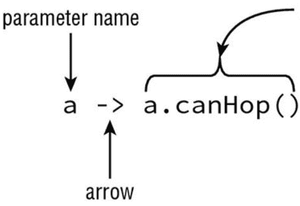

图6.1 省略部分的 Lambda 语法

第二个示例显示了返回布尔值的 lambda 最详细的形式（见图6.2）：

- 一个命名为 `a` 且类型为 `Animal` 的单个参数
- 箭头运算符分隔参数和方法体
- 一个包含一行或多行代码的方法体，包括分号和返回语句

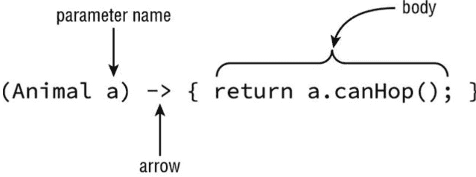

**图 6.2** Lambda 语法，包括可选部分

如果只有一个参数且没有显式声明其类型，可以省略圆括号。Java 这样做是因为开发者通常这样使用 lambda 表达式，并且尽可能减少输入字符的数量。

对你来说，当我们只有一个语句时可以省略大括号这可能并不算新鲜事。我们已经在 `if` 语句和循环中这样做了。这里的不同在于，当你省略大括号时，规则会发生变化。不使用大括号时，Java 不需要你输入 `return` 或使用分号。当我们有两个或多个语句时，这个特殊的快捷方式就不起作用了。至少这与在地方使用 `{}` 创建代码块是一致的。

> 注意：这里有一个有趣的小知识：`s -> {}` 是一个有效的 lambda。如果表达式右侧没有代码，你就不需要分号或 return 语句。

表 6.1 显示了返回布尔值的有效 lambda 示例。

## 表 6.1 有效的 lambda

| Lambda | 参数数量 |
| --- | --- |
| `() -> true` | 0 |
| `a -> a.startsWith("test")` | 1 |
| `(String a) -> a.startsWith("test")` | 1 |
| `(a, b) -> a.startsWith("test")` | 2 |
| `(String a, String b) -> a.startsWith("test")` | 2 |

注意，除了那个接收一个参数且不指定类型的示例外，所有这些示例在参数列表周围都有圆括号。第一行接收零个参数，并始终返回布尔值 `true`。第二行接收一个参数并在其上调用方法，返回结果。第三行做了相同的操作，只是它显式定义了变量的类型。最后两个接收两个参数并忽略了其中一个——规则并没有规定你必须使用所有定义的参数。

现在，让我们确保你能识别表 6.2 中每一行的无效语法，其中每行都应该返回一个布尔值。确保你理解这些示例中的每一个错误。

## 表 6.2 返回布尔值的无效 lambda

| 无效 lambda | 原因 |
| --- | --- |
| `a, b -> a.startsWith("test")` | 缺少圆括号 |
| `a -> { a.startsWith("test") };` | 缺少 return |
| `a -> { return a.startsWith("test") }` | 缺少分号 |

记住，*只有*当有一个参数且它没有声明类型时，圆括号才是可选的。

### 引入函数式接口

在我们早期的示例中，我们创建了一个有一个方法的接口。

```java
boolean test(Animal a);
```

Lambda 适用于只有一个抽象方法的接口。这些被称为函数式接口。（实际上情况比这复杂，但对于这次考试来说，这个简化的定义就足够。在 1Z0-816 考试中，你将遇到函数式接口的完整定义。）

我们提到函数式接口只有一个抽象方法。你的朋友 Sam 可以帮你记住这一点，因为它的正式名称是单一抽象方法（SAM）规则。

Java 在某些（不是所有）函数式接口上提供了 `@FunctionalInterface` 注解。这个注解意味着接口的作者承诺在未来在 lambda 中使用它是安全的。然而，仅仅因为你没有看到该注解，并不意味着它不是函数式接口。记住，恰好有一个抽象方法才使其成为函数式接口，而不是注解。

你可能会在考试中看到四个函数式接口。接下来的章节将查看 `Predicate`、`Consumer`、`Supplier` 和 `Comparator`。

#### Predicate

你可以想象我们必须创建许多这样的接口来使用 lambda。我们想要测试 `Animal`、`String`、`Plant` 以及我们遇到的任何其他东西。

幸运的是，Java 识别出这是一个常见问题，并为我们提供了这样的接口。它位于 `java.util.function` 包中，其核心内容如下：

```java
public interface Predicate<T> {

    boolean test(T t);

}
```

这看起来非常像 `test(Animal)` 方法。唯一的区别是它使用类型 `T` 而不是 `Animal`。那是泛型的语法。就像我们创建 `ArrayList` 并可以指定存其中的任何类型一样。

这意味着我们不再需要自己的接口，可以将与我们的搜索相关的所有内容都放在一个类中：

```java
import java.util.*;
import java.util.function.*;

public class PredicateSearch {

    public static void main(String[] args) {
        List<Animal> animals = new ArrayList<Animal>();
        animals.add(new Animal("fish", false, true));

        print(animals, a -> a.canHop());
    }

    private static void print(List<Animal> animals, Predicate<Animal> checker) {
        for (Animal animal : animals) {
            if (checker.test(animal))
                System.out.print(animal + " ");
        }
        System.out.println(")");
    }
}
```

这次，只有第 11 行发生了变化。

#### Consumer

`Consumer` 接口有一个方法：

```java
void accept(T t)
```

为什么你可能想要接收一个值？可能是为了打印消息：

```java
Consumer<String> consumer = x -> System.out.println(x);
```

这打印 Hello World。让我们看看使用 `Consumer` 的代码：

```java
public static void main(String[] args) {
    Consumer<String> consumer = x -> System.out.println(x);
    print(consumer, "Hello World");
}

private static void print(Consumer<String> consumer, String value) {
    consumer.accept(value);
}
```

当 `print()` 方法被调用时，它调用 lambda 接收值。

#### Supplier

`Supplier` 函数式接口只有一个方法：

```java
T get()
```

`Supplier` 的一个用例是生成值。这里有两个例子：

```java
Supplier<Integer> number = () -> 42;
Supplier<Integer> random = () -> new Random().nextInt();
```

第一个示例每次调用 lambda 都返回 42。第二个示例每次调用时都会生成一个随机数。让我们看看使用 `Supplier` 的代码：

```java
public static void main(String[] args) {
    Supplier<Integer> number = () -> 42;
    System.out.println(returnNumber(number));
}

private static int returnNumber(Supplier<Integer> supplier) {
    return supplier.get();
}
```

当 `returnNumber()` 方法被调用时，它调用 lambda 返回期望的值。

#### Comparator

在第 5 章“核心 Java API”中，我们比较了数字。我们没有提供 `Comparator`，因为我们使用的是默认排序顺序。我们确实学习了规则。负数表示第一个值较小，零表示它们相等，正数表示第一个值更大。方法签名如下：

```java
int compare(T o1, T o2)
```

该接口是一个函数式接口，因为它只有一个未实现的方法。它有许多静态和默认方法来方便编写复杂的比较器。

> `Comparator` 接口在添加 lambda 之前就已经存在了。它位于不同的包中。你可以在 `java.util` 中找到 `Comparator`。

考试只需要知道 `compare()`。你能判断这个是升序还是降序排序吗？

```java
Comparator<Integer> ints = (i1, i2) -> i1 - i2;
```


`ints` 比较器使用自然排序。如果第一个数字更大，它将返回一个正数。试一下。假设我们正在比较 5 和 3。比较器用 `5-3` 得到 2。这是一个正数，意味着第一个数字更大，我们正在按升序排序。

让我们再试另一个。你认为这两个语句会按升序还是降序排序？

```java
Comparator<String> strings = (s1, s2) -> s2.compareTo(s1);
Comparator<String> moreStrings = (s1, s2) -> -s1.compareTo(s2);
```

这两个比较器实际上执行相同的操作：降序排列。在第一个示例中，`compareTo()` 的调用是“反向”的，使其变为降序。在第二个示例中，调用使用了默认顺序；但它对结果应用了负号，从而将其反转。

请务必理解表 6.3，以识别你正在看的是哪种类型的 lambda。

## 表 6.3 基础函数接口

| 函数接口 | 参数数量 | 返回类型 |
| :--- | :--- | :--- |
| `Comparator` | 两个 | `int` |
| `Consumer` | 一个 | `void` |
| `Predicate` | 一个 | `boolean` |
| `Supplier` | 无 | 一个（类型异） |

## 在 Lambda 中使用变量

变量相对于 lambda 出现在三个地方：参数列表、在 lambda 体内部声明的局部变量，以及从 lambda 体中引用的变量。这三者都是考试中用来陷害你的机会。我们将探索每一个，以便在陷阱出现时你保持警惕！

## 参数列表

在本章的开头，你已经学习了指定参数类型是可选的。此外，`var` 可以用来代替特定类型。这意味着这三条语句是可以互换的：

```java
Predicate<String> p = x -> true;
Predicate<String> p = (var x) -> true;
Predicate<String> p = (String x) -> true;
```

考试可能会要求你识别 lambda 参数的类型。在我们的示例中，答案是 `String`。我们是如何得出的？lambda 会从周围上下文推断类型。这意味着你也可以这样做。

在这种情况下，该 lambda 被赋值给一个接收 `String` 的 `Predicate`。另一个查找类型的地方是在方法签名中。让我们尝试另一个例子。你能猜出 `x` 的类型吗？

```java
public void whatAmI() {
  consume((var x) -> System.out.print(x), 123);
}

public void consume(Consumer<Integer> c, int num) {
  c.accept(num);
}
```

如果你猜的是 `Integer`，那么你是正确的。`whatAmI()` 方法创建了一个 lambda 传递给 `consume()` 方法。由于 `consume()` 方法期望一个 `Integer` 作为泛型，我们知道 `x` 的推断类型将是它。

等一下；还有。在某些情况下，你甚至不需要看到方法签名就能确定类型。你认为这里 `x` 的类型是什么？

```java
public void counts(List<Integer> list) {
  list.sort((var x, var y) -> x.compareTo(y));
}
```

答案又是 `Integer`。由于我们正在对列表进行排序，可以使用列表的类型来确定 lambda 参数的类型。

## Lambda 体内部的局部变量

虽然 lambda 体是单个表达式是最常见的，但定义一个块也是合法的。该块可以包含普通 Java 块中任何有效的内容，包括局部变量声明。

以下代码正是如此。它创建了一个名为 `c` 的局部变量，其作用域限于 lambda 块。

```java
(a, b) -> { int c = 0; return 5; }
```

> 注意：编写自己的代码时，带有局部变量的 lambda 块是一个很好的提示，说明你应该将该代码提取到方法中。

让我们尝试另一个。你发现这里有问题了吗？

```java
(a, b) -> { int a = 0; return 5; } // 无法编译
```

我们尝试重新声明 `a`，这是不允许的。Java 不允许你创建一个与作用域内已声明的变量同名的局部变量。现在来试一个难的。在这个方法中你看到了多少语法错误？

```java
11: public void variables(int a) {
12:   int b = 1;
13:   Predicate<Integer> p1 = a -> {
14:     int b = 0;
15:     int c = 0;
16:
17:   return b == c;}
}
```

有三个语法错误。第一个在第 13 行。变量 `a` 已经在该作用域内作为方法参数使用过，因此不能重用。下一个语法错误出现在第 14 行，代码尝试重新声明局部变量 `b`。第三个语法错误非常微妙，在第 16 行。看到了吗？仔细看。

变量 `p1` 在末尾缺少一个分号。它前面有一个分号，但那是块内部的。虽然你通常不需要寻找缺失的分号，但 lambda 在这个领域很诡异，所以要小心！

## 从 Lambda 体引用的变量

Lambda 体允许引用周围代码中的某些变量。以下代码是合法的：

```java
public class Crow {
    private String color;

    public void caw(String name) {
        String volume = "loudly";
        Consumer<String> consumer = s -> System.out.println(name + " says "
            + volume + " that she is " + color);
    }
}
```

这表明 lambda 在某些条件下可以访问实例变量、方法参数或局部变量。实例变量（类变量）总是允许的。

如果方法参数和局部变量是“有效的最终的”（effectively final），则允许引用它们。这意味着变量在初始化后不再被更改。你可以使用 `final` 关键字来确保这一点。

## 表 6.4 从 lambda 体访问的规则

| 变量类型 | 规则 |
| :--- | :--- |
| 实例变量 | 允许 |
| 静态变量 | 允许 |
| 局部变量 | 必须有效 final |
| 方法参数 | 有效 final |
| Lambda 参数 | 允许 |

## 使用 Lambda 调用 API

现在你已经熟悉了 lambda 和函数接口，我们可以查看使用它们的常用方法。考试将涵盖更多使用 lambda 的 API。

### removeIf()

`List` 和 `Set` 声明了 `removeIf()` 方法，接收一个 `Predicate`。假设我们有一个宠物名称列表。我们决定删除所有不以字母 'h' 开头的名称，因为我们的表弟真的很想选一个。我们可以通过循环来解决。或者用一行代码解决：

```java
3: List<String> bunnies = new ArrayList<>();
4: bunnies.add("long ear");
5: bunnies.add("floppy");
6: bunnies.add("hoppy");
7: System.out.println(bunnies); // [long ear, floppy, hoppy]
8: bunnies.removeIf(s -> s.charAt(0) != 'h');
9: System.out.println(bunnies); // [hoppy]
```

第 8 行处理了一切。它定义了一个接收 `String` 并返回布尔值的谓词。`removeIf()` 方法完成了剩下的工作。

`removeIf()` 方法在 `Set` 上的工作相同。它移除集合中匹配 `Predicate` 的任何值。`Map` 没有 `removeIf()` 方法。记住 map 同时拥有键和值。这将不清楚要删除的是什么。

### sort()

虽然你可以调用 `Collections.sort(list)`，但你现在可以直接在列表对象上进行排序。

```java
3: List<String> bunnies = new ArrayList<>();
4: bunnies.add("long ear");
5: bunnies.add("floppy");
6: bunnies.add("hoppy");
7: System.out.println(bunnies); // [long ear, floppy, hoppy]
8: bunnies.sort((b1, b2) -> b1.compareTo(b2));
9: System.out.println(bunnies); // [floppy, hoppy, long ear]
```

在第 8 行，我们按字母顺序对列表。`sort()` 方法接收 `Comparator` 来提供排序顺序。记住 `Comparator` 接收两个参数并返回一个 `int`。如果你需要复习返回 `compare()` 操作的值含义，请查阅本章的比较器（comparator）章节或第 5 章的比较（Comparing）章节。记住这一点非常重要！

`Set` 或 `Map` 上没有 `sort` 方法。这两种类型都没有索引，因此对它们进行排序没有意义。

### forEach()

我们的最后一个方法是 `forEach()`。它接收一个 `Consumer` 并对遇到的每个元素调用该 lambda 表达式。

```java
3: List<String> bunnies = new ArrayList<>();
4: bunnies.add("long ear");
5: bunnies.add("floppy");
6: bunnies.add("hoppy");
7:
8: bunnies.forEach(b -> System.out.println(b));
9: System.out.println(bunnies);
```

这段代码输出以下内容：

```
long ear
floppy
hoppy
[long ear, floppy, hoppy]
```

第 8 行的方法每行打印一个条目。第 9 行的方法将整行打印在一行。

我们可以对 `Set` 或 `Map` 使用 `forEach()`。对于 `Set`，它的工作方式与 `List` 相同。

```java
Set<String> bunnies = Set.of("long ear", "floppy", "hoppy");
bunnies.forEach(b -> System.out.println(b));
```

对于 `Map`，你可以选择要遍历键（keys）还是值（values）：

```java
Map<String, Integer> bunnies = new HashMap<>();
bunnies.put("long ear", 3);
bunnies.put("floppy", 8);
bunnies.put("hoppy", 1);
bunnies.keySet().forEach(b -> System.out.println(b));
bunnies.values().forEach(b -> System.out.println(b));
```

事实上 `keySet()` 和 `values()` 方法各返回一个 `Set`。我们知道如何在 `Set` 上使用 `forEach()`，这很简单！

## 现实场景：直接在 Map 上使用 forEach()

考试不需要知道这个，但 Java 有一个名为 `BiConsumer` 的函数接口。它的工作方式与 `Consumer` 相似，但它可以接收两个参数。这个函数接口允许你对 `Map` 的键/值对使用 `forEach()`。

```java
Map<String, Integer> bunnies = new HashMap<>();
bunnies.put("long ear", 3);
bunnies.put("floppy", 8);
bunnies.put("hoppy", 1);
bunnies.forEach((k, v) -> System.out.println(k + " " + v));
```

## Lambda 表达式

Lambda 表达式（或称为 lambdas）允许传递代码块。完整语法如下：

```java
(String a, String b) -> { return a.equals(b); }
```

可以省略参数类型。当只指定一个参数且未指定类型时，括号也可以省略。对于单个语句，大括号和返回语句（`return`）可以省略，其短形式如下：

```java
-> a.equals(b)
```

Lambdas 被传递给期望函数接口实例的方法。

函数接口是指带有一个单一抽象方法的接口。`Predicate` 是一个常用的接口，返回一个布尔值并接受任何类型。`Consumer` 接受任何类型且不返回值。`Supplier` 返回一个值但不接受任何参数。`Comparator` 接收两个参数并返回一个 `int`。

Lambda 可以在体中定义参数或变量，只要它们的名称与现有的局部变量不同。Lambda 的体允许使用任何实例或类变量。此外，它可以使用任何“有效最终的”（effectively final）的局部变量或方法参数。

我们涵盖了三个使用 lambdas 的常用 API。`List` 和 `Set` 上的 `removeIf()` 方法接收一个 `Predicate`。`List` 上的 `sort()` 方法接收一个 `Comparator`。`List` 和 `Set` 接口上的 `forEach()` 方法都接收一个 `Consumer`。

## 考试要点

- 编写简单的 lambda 表达式。注意 lambda 代码中存在或不存在可选元素。参数类型是可选的。当体为单个语句时，大括号和 `return` 关键字是可选的。当只指定一个参数且类型是隐式的时，括号是可选的。
- 识别常见的函数接口。从代码段中，判断 lambda 是 `Comparator`、`Consumer`、`Predicate` 还是 `Supplier`。你可以根据参数的数量和返回类型来区分它们。
- 确定变量是否可以在 lambda 体中使用。局部变量和方法参数必须是“有效最终的”（effectively final）才能被引用。这意味着如果你为这些变量添加 `final` 关键字，代码必须能够编译。实例和类变量总是被允许的。
- 将 lambdas 使用常用 API。能够读写使用 `forEach()`、`removeIf()` 和 `sort()` 的代码。

# 复习题

1. 下述类的结果是什么？

```java
1: import java.util.function.*;
2:
3: public class Panda {
4:   int age;
5:   public static void main(String[] args) {
6:     Panda p1 = new Panda();
7:     p1.age = 1;
8:     check(p1, p -> p.age < 5);
9:   }
10:  private static void check(Panda panda,
11:    Predicate<Panda> pred) {
12:    String result =
13:    pred.test(panda) ? "match" : "not match";
14:    System.out.print(result);
15:  }
}
```

A. match
B. not match
C. 第 11 行编译错误
D. 第 12 行编译错误
E. 第 12 行编译错误

2. 下述代码的结果是什么？

```java
1: interface Climb {
2:   boolean isHigh(int height);
3: }
4: class Climber {
5:   public static void main(String[] args) {
6:     check(h -> h > 10, 15);
7:   }
8:   static void check(Climb climb, int limit) {
9:     if (limit))
10:       System.out.println("ok");
11:     else
12:       System.out.println("too high");
13:   }
}
```

A. ok
B. too high
C. 第 7 行编译错误
D. 第 10 行编译错误
E. 第 12 行编译错误
F. 运行时异常

3. 以下哪个可以填充空白？

```java
List<Character> list = new ArrayList<>();
list.removeIf(c -> ________);
```


A. `c >= 'a'`
B. `c == null`
C. `list.size() > 0`
D. `c <= 'z'`

4. 哪个 lambda 可以替换 `magic`？

```java
interface Secret {
    String magic(double d);
}

class MySecret {
    public static void main(String[] args) {
        check(d -> ________);
    }
}
```

A. `d > 10 ? "high" : "low"`
B. `"high"`
C. `"low"`
D. `d.toString`

5. 以下哪些 lambda 表达式可以传递给 `Predicate<String>`？

A. `s -> s.isEmpty()`
B. `s -> s.length() > 5`
C. `s -> true`
D. `(s, h) -> "high"`

6. 关于以下代码哪个说法是正确的？

```java
public void method() {
    x((var x) -> {}, (var y) -> 0);
}

private void x(Consumer<String> x, Comparator<Integer> y) {}
```

A. 因为变量 x 编译错误
B. 因为变量 y 编译错误
C. 因为其他原因编译错误
D. 代码通过编译，var 指向相同类型
E. 代码编译，var 指向不同类型

7. 以下哪些项在填充空白后可以编译？

```java
List list = List.of(1, 2, 3);
Set set = Set.of(1, 2, 3);
Map map = Map.of(1, 2, 3, 4);

____.forEach(x -> System.out.println(x));
```

A. `list`
B. `set`
C. `map`
D. `map.keys()`
E. `map.keySet()`
F. `map.values()`
G. `map.valueSet()`

8. 哪些语句是正确的？

A. `Consumer` 接口最适合输出值。
B. `Supplier` 接口最适合输出值。
C. `Comparator` 接口返回一个 `int`。
D. `Predicate` 接口返回一个 `int`。
E. `Comparator` 接口有一个名为 `test()` 方法。
F. `Predicate` 接口有一个名为 `test()` 方法。

9. 插入内容不会导致编译错误？

```java
public void remove(List<Character> chars) {
    char end = 'z';
    chars.removeIf(c -> {
        char start = 'a'; return start <= c && c <= end;
        // 在此处插入行
    });
}
```

A. `char start = 'a';`
B. `char c = 'x';`
C. `chars = null;`
D. `end = '1';`
E. 以上均不是

10. 这段代码输出多少行？

```java
Set<String> set = Set.of("mickey", "mininnie");
List<String> list = new ArrayList<>(set);

set.forEach(s -> System.out.println(s));
list.forEach(s -> System.out.println(s));
```

A. 0
B. 2
C. 4
D. 代码无法编译。
E. 抛出了运行时异常。

11. 下面代码的输出是什么？

```java
List<String> cats = new ArrayList<>();
cats.add("leo");
cats.add("Olivia");

cats.sort((c1, c2) -> -c1.compareTo(c2)); // line X
System.out.println(cats);
```

A. `[leo, Olivia]`
B. `[Olivia, leo]`
C. 因为行 X，代码无法编译。
D. 代码因为其他原因无法编译。
E. 抛出了运行时异常。

12. 哪些代码片段可以填充空白？（选择所有适用项）

```java
first = () -> Set.of(1.23);
second = x -> true;
```

A. `Consumer<Set<Double>>`
B. `Consumer<Set<Float>>`
C. `Predicate<Set<Double>>`
D. `Predicate<Set<Float>>`
E. `Supplier<Set<Double>>`
F. `Supplier<Set<Float>>`

13. 关于下面的代码，哪个是正确的？

```java
int length = 3;

for (int i = 0; i<3; i++) {
  if (i%2 == 0) {
    Supplier<Integer> supplier = () -> length; // A
    System.out.println(supplier.get()); // B
  } else {
    int j = i;
    Supplier<Integer> supplier = () -> j; // C
    System.out.println(supplier.get()); // D
  }
}
```

A. 第一个编译器错误在行 A。
B. 第一个编译器错误在行 B。
C. 第一个编译器错误在行 C。
D. 第一个编译器错误在行 D。
E. 代码成功编译。

14. 下面哪些内容后不会引起编译错误？（选择所有适用项）

```java
public void remove(List<Character> chars) {
  char end = 'z';
  // 在此处插入行
  chars.removeIf(c -> {
char start = 'a'; return start <= c && c <= end; });
}
```

A. `char start = 'a';`
B. `char c = 'x';`
C. `chars = null;`
D. `end = '1';`
E. 以上均不是

15. 下面代码的输出是什么？

```java
Set<String> cats = new HashSet<>();
cats.add("leo");
cats.add("Olivia");

cats.sort((c1, c2) -> -c1.compareTo(c2)); // line X
System.out.println(cats);
```

A. `[leo, Olivia]`
B. `[Olivia, leo]`
C. 因为行 X，代码无法编译。
D. 代码因为其他原因无法编译。
E. 抛出了运行时异常。

16. 哪些变量是有效 final（effectively final）？（选择所有适用项）

```java
public void isIt(String param1, String param2) {
    String local1 = param1 + param2;
    String local2 = param1 + param2;

    param1 = null;
    local2 = null;
}
```

A. `local1`
B. `local2`
C. `param1`
D. `param2`
E. 以上均不是

17. 下面类的结果是什么？

```java
1: import java.util.function.*;
2:
3: public class Panda {
4: int age;
5: public static void main(String[] args) {
6: Panda p1 = new Panda();
7: p1.age = 1;
8: check(p1, p -> {p.age < 5});
9: }
10: private static void check(Panda panda,
11: Predicate<Panda> pred) {
12: String result = pred.test(panda)
13: ? "match" : "not match";
14: System.out.print(result);
15: } }
```

A. match
B. not match
C. 第 8 行编译错误。
D. 第 10 行编译错误。
E. 第 12 行编译错误。
F. 抛出了运行时异常。

18. 这段代码输出多少行？

```java
Set<String> s = Set.of("mickey", "minnie");
List<String> x = new ArrayList<>(s);

s.forEach(s -> System.out.println(s));
x.forEach(x -> System.out.println(x));
```

A. 0
B. 2
C. 4
D. 代码无法编译。
E. 抛出了运行时异常。

19. 哪个 lambda 可以替换 MySecret 类？（选择所有适用项）

```java
interface Secret {
    String concat(String a, String b);
}

class MySecret implements Secret {
    public String concat(String a, String b) {
        return a + b;
    }
}
```

A. `(a, b) -> a + b`
B. `(String a, b) -> a + b`
C. `(String a, b) -> a + b`
D. `(a, b) -> a + b`
E. `(String a, b) -> a + b`
F. `(a, b) -> a + b`

20. 下面哪些 lambda 表达式可以传递 Predicate<String> 类型？（选择所有适用项）

A. `s -> isEmpty()`
B. `s -> isEmpty()`
C. `(String s) -> isEmpty()`
D. `(String s) -> isEmpty()`
E. `(StringBuilder s) -> isEmpty()`
F. `s -> isEmpty()`

# 第 7 章 方法与封装

OCP 考试目标涵盖：
- 创建方法
- 带参数和返回值的方法
- 创建静态方法
- 应用访问修饰符
- 封装
- 应用访问修饰符

在之前的章节中，我们学习了方法的用法。在本章中，我们将深入探讨方法的元素、重载以及封装。

## 方法设计
在本章中，我们将看到方法：
- 实例方法
- 静态方法
- 访问修饰符
- 对象的访问修饰符
- 封装

在之前的章节中，你看到了 `main()` 方法。在本章中，我们将介绍方法的各种形式。

## 7.1 方法声明
在 7.1 中，我们将看到方法的声明，哪些方法的声明是正确的。

| 方法 7.1 | 是否需要 |
| :--- | :--- |
| 访问修饰符 | public |
| 可选指定符 | final |
| 返回类型 | void | 是 |
| 方法名 | nap | 是 |
| 参数列表 | (int) | 是 |
| 可选异常列表 | throws InterruptedException | 否 |
| 方法体 | { } | 是，可以为空 |

我们将查看 `nap`。

## 访问修饰符
Java 提供了四种访问修饰符选择：

**private** `private` 修饰符方法只能在类内部调用。

**默认（包私有）访问** 默认修饰符方法可以在包内调用。这很特殊，因为不需要访问修饰符。

**protected** `protected` 修饰符方法可以在包内或子类调用。我们将在第 8 章“类设计”中学习子类。

**public** `public` 修饰符方法可以从任何类调用。这是 `static` 关键字。

在本章中，我们将探讨访问修饰符的影响。现在，出题者喜欢通过错误的元素顺序或使用错误的值来误导你。

我们将通过每个方法的示例来学习。请确保你理解这里的每一个是有效还是无效的方法声明。插入到类中：

```java
public void walk1() {}

default void walk2() {} // 无法编译

void public walk3() {} // 无法编译

void walk4() {}
```

`walk1()` 方法是有效的 `public` 声明。`walk4()` 方法是有效的默认声明。`walk2()` 方法无法编译，因为 `default` 不是访问修饰符。`walk3()` 方法无法编译，因为访问修饰符在返回类型之后。

## 可选指定符
有很多可选修饰符，但大多数并不在考试范围内。可选指定符来自以下列表。与访问修饰符不同，你可以在同一个方法中使用多个修饰符（尽管并非所有组合都是合法的）。在这种情况下，你可以以任何顺序指定它们。由于这些是可选的，允许不使用任何。

**static** `static` 修饰符用于类方法，将在本章后面讨论。

**abstract** `abstract` 修饰符用于没有提供方法体的情况。将在第 9 章讨论。

**final** `final` 修饰符用于方法不允许被子类重写。我们将在第 8 章讨论。

**synchronized** `synchronized` 修饰符用于多线程代码。它出现在 1Z0-816 考试中，不在 1Z0-815 考试中。

**native** `native` 修饰符用于与另一种语言（如 C++）编写的代码交互。它不在 OCP 11 考试中。

**strictfp** `strictfp` 修饰符用于提高浮点计算的可移植性。它不在 OCP 11 考试中。

再次，现在只需关注语法。你看到为什么这些代码可以编译或无法编译了吗？

```java
public void walk1() {}

public final void walk2() {}

public static final void walk3() {}

public final static void walk4() {}

public modifier void walk5() {}    // 无法编译

public void final walk6() {}    // 无法编译

public final void walk7() {}
```

`walk1()` 方法是一个有效的声明，没有可选修饰符。这是可以的——毕竟它是可选的。`walk2()` 方法是一个有效的声明，`final` 是可选修饰符。`walk3()` 和 `walk4()` 方法是有效的声明，同时包含 `final` 和 `static` 作为修饰符。这两个关键字的顺序并不重要。`walk5()` 无法编译，因为 `modifier` 不是可选修饰符。`walk6()` 方法无法编译，因为可选修饰符在返回类型之后。

`walk7()` 方法可以编译。Java 允许可选修饰符出现在访问修饰符之前。这是一个奇怪的案例，你在考试中不需要知道它。我们提到它是为了防止你在练习时感到困惑。

## 返回类型

方法声明中的下一个项是返回类型。返回类型可能是一个真实的 Java 类型，如 `String` 或 `int`。如果没有返回类型，则使用 `void` 关键字。`void` 意味着没有内容。在 Java 中，那里没有返回类型。

> 记住，方法必须有一个返回类型。如果没有返回任何值，返回类型就是 `void`。你不能省略返回类型。

在检查返回类型时，你还必须查看方法体。除 `void` 以外返回类型的方法要求在方法体内部有一个 `return` 语句。该 `return` 语句必须包含要返回的原始类型或对象。返回类型为 `void` 的方法允许有一个没有值的 `return` 语句，或者完全省略 `return` 语句。

准备好看一些例子了吗？你能解释为什么这些方法编译或不编译吗？

```java
public void walk1() {}

public void walk2() { return; }

public String walk3() { return ""; }

public String walk4() {}                                   // 无法编译

public void walk5() {}                              // 无法编译

public String int walk6() {}                         // 无法编译

String walk7(int a) { if (a == 4) return ""; }    // 无法编译
```

由于 `walk1()` 方法的返回类型是 `void`，因此 `return` 语句是可选的。`walk2()` 方法展示了可选的 `return` 语句，它正确地没有返回任何内容。`walk3()` 方法是一个有效的声明，具有 `String` 返回类型和一个返回 `String` 的 `return` 语句。`walk4()` 方法无法编译是因为缺少 `return` 语句。`walk5()` 方法无法编译是因为缺少返回类型。`walk6()` 方法无法编译是因为它尝试使用两个返回类型。你只能有一个返回类型。

`walk7()` 方法有点复杂。它有一个 `return` 语句，但它并不总是执行。如果 `a` 是 6，`return` 语句就不会执行。由于 `String` 总是需要被返回，编译器就会报错。

在返回值时，它必须能够赋值给返回类型。假设有一个该类型的局部变量，在返回之前将其赋值给该变量。你能考虑一下如何在这两个方法中添加一行带有局部变量的代码吗？


## 方法返回类型

这是一个相当机械的练习。你只需要添加一行带有局部变量的代码。局部变量的类型与返回类型匹配。然后你返回该局部变量而不是直接返回值：

```java
int integerExpanded() {
  int temp = 9;
  return temp;
}

int longExpanded() {
  int temp = 9L; // 无法编译
  return temp;
}
```

这更清楚地说明了为什么你可以在返回 `int` 的方法中返回 `long` 原始类型。你不能将那个 `long` 塞进 `int` 变量中，因此你也不能直接返回它。

## 方法名

方法名遵循与我们在第 2 章“Java 基础构建”中练习过的变量名相同的规则。复习一下，标识符只能包含字母、数字、`$` 或 `_`。此外，第一个字符不允许是数字，且不允许使用保留字。最后，不允许单个下划线字符。按照惯例，方法以小写字母开头，但不是强制要求的。由于这是对第 2 章的复习，我们可以直接通过一些示例进入练习：

```java
public void walk1() {}
public void walk2() {} // 无法编译
public void walk3() {} // 无法编译
public void _() {} // 无法编译
public void walk() {} // 无法编译
```

`walk1()` 方法是一个带有传统名称的变量声明。`walk2()` 方法无法编译是因为标识符不允许数字开头。`walk3()` 方法无法编译是因为方法名在返回类型之前。`walk_$()` 方法是一个有效的声明。虽然让方法名以大写字母开头并标点符号结尾显然不是良好的做法，但它是合法的。`_` 方法是不允许的，因为它由单个下划线组成。最后一行代码无法编译是因为缺少方法名。

## 参数列表

虽然参数列表是强制性的，但它不必包含任何参数。这意味着你只需要在方法名后留一对空的括号。如果你有多个参数，用逗号将它们分开。关于可变参数（varargs）还有几点很快会看到。现在让我们用普通参数进行练习：

```java
public void walk1() {}
public void walk2() {} // 无法编译
public void walk3() {}
public void walk4(int a) {} // 无法编译
public void walk5(int a) {}
```

`walk1()` 方法是一个没有任何参数的有效声明。`walk2()` 方法无法编译是因为缺少参数括号。`walk3()` 方法是一个有一个参数的有效声明。`walk4()` 方法无法编译是因为参数使用了分号而不是逗号。`walk5()` 方法是一个有两个参数的有效声明。

## 可选异常列表

在 Java 中，代码可以通过抛出异常来指示某些错误。我们将在第 10 章涵盖这一内容。现在你只需要知道它是可选的，以及它在方法声明中的位置。例如，`InterruptedException` 是异常的一种类型。你可以列出许多异常类型并用逗号分开。这里有一个例子：

```java
public void zeroExceptions() {}
public void oneException() throws IllegalArgumentException {}
public void twoExceptions() throws IllegalArgumentException, InterruptedException {}
```

你可能在想方法如何处理这些异常。调用方法可以抛出相同的异常或处理它们。你将在第 10 章学习更多。

## 方法体

方法声明的最后部分是方法体（抽象方法和接口除外，但你现在不需要了解任何一个）。方法体简单来说就是一个代码块。它包含零个或多个 Java 语句。到目前我们已经看了几章 Java 语句，所以你应该很容易发现为什么这些代码编译或不编译：

```java
public void walk1() {}
public void walk2()                      // 无法编译
public void walk3(int name = 5); }
```

`walk1()` 方法是一个带有空方法体的有效声明。`walk2()` 方法无法编译是因为缺少空方法体的括号。`walk3()` 方法是一个方法体内有一个语句的有效声明。你已经学习了识别正确和错误方法声明的基础知识。现在你可以深入更多细节。

## 使用可变参数

正如你在第 5 章“核心 Java API”中所看到的，方法可以像使用数组一样使用可变参数（varargs）。不过，它与数组略有不同。可变参数参数必须是方法参数列表的最后一个元素。这意味着你被允许只有一个可变参数方法。你能识别为什么这些方法编译或不编译吗？（是的，这一章有很多练习。你必须非常擅长识别它们的有效和无效方法。）

```java
public void walk1(int... nums) {}
public void walk2(int start, int... nums) {}
```

```java
public void walk3(int... nums, int start) { // 无法编译
public void walk4(int... start, int... nums) {} // 无法编译
```

`walk1()` 方法是一个带有一个变长参数（varargs）的有效声明。`walk2()` 方法带有一个 `int` 参数和一个变长参数的有效声明。`walk3()` 和 `walk4()` 方法无法编译，因为它们将变长参数放置在了不是最后一位的位置。

在调用带有变长参数的方法时，你有一个选择。你可以传递一个数组，也可以列出数组的元素并让 Java 为你创建它。你可以在方法调用中省略变长参数值，Java 会为你创建一个长度为 0 的数组。

终于！你可以做一些除了识别方法声明是否以外的事情了。相反，你可以观察方法调用。你能弄清楚为什么每个方法调用会输出对应的结果吗？

```java
15: public static void walk(1, int... nums) {
16:     System.out.println(nums.length);
17: }
18: public static void main(String[] args) {
19:     walk(1); // 0
20:     walk(1, 2); // 1
21:     walk(1, 2, 3); // 2
22:     walk(1, new int[] {4, 5}); // 2
23: }
```

第 19 行传入 `1` 作为 `start` 但没有其他其他参数。这意味着 Java 为 `nums` 创建了一个长度为 0 的数组。第 20 行传入 `1` 作为 `start` 以及另一个值。Java 将这一个值转换为长度为 1 的数组。第 21 行传入 `1` 作为 `start` 和另外两个值。Java 将这两个值转换为长度为 2 的数组。第 22 行传入 `1` 作为 `start` 并直接将一个长度为 2 的数组作为 `nums`。

你已经看到，如果没有为变长参数传递任何参数，Java 会创建一个空数组。然而，仍然显式地传递 `null`：

```java
walk(1, null); // 在 walk() 中抛出 NullPointerException
```

由于 `null` 不是 `int`，Java 将其视为一个恰好为 `null` 的数组引用。它只是将 `null` 对象传递给 `walk`。然后 `walk()` 方法会抛出一个异常，因为它试图确定 `null` 的长度。访问变长参数就像访问数组一样。它使用数组索引。这里有一个例子：

```java
16: public static void run(int... nums) {
17:     System.out.println(nums[1]);
18: }
19: public static void main(String[] args) {
20:     run(11, 22);      // 22
21: }
```

第 20 行调用了一个带有两个参数的变长方法。当方法被调用时，它看到了一个大小为 2 的数组。打印出 22。

# 应用访问修饰符

你已经看到有四种访问修饰符：`public`、`private`、`protected` 和默认（default）访问。我们将按照从最严格到最宽松的顺序来讨论它们：

- `private`：仅在同一个类内可见
- 默认（包私有）访问：`private` 加上同包中的其他类
- `protected`：默认访问加上子类
- `public`：其他包中的受保护的类

我们将探索这四种访问级别对类成员的影响。正如你在第 1 章“欢迎来到 Java”中学到的，成员是一个实例变量或实例方法。

## 私有访问

私有访问很简单。只有同一个类中的代码可以调用私有方法或访问私有字段。

首先，看看图 7.2。它展示了你将用于探索私有和默认访问的类。大框是包名。它们内部的小框是每个包中的类。如果你想快速查看类之间的关系，可以回头参考这张图。

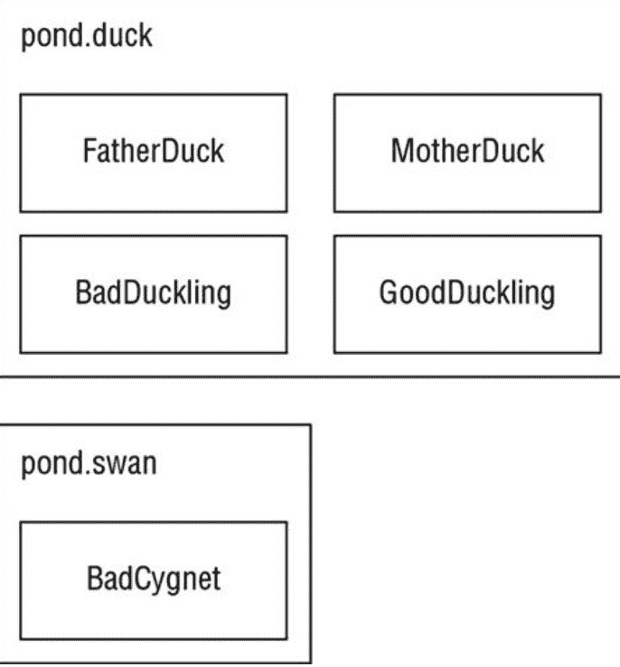

**图 7.2** 用于显示私有和默认访问的类

这是完全合法的代码，因为所有内容都在同一个类中：

```java
1: package pond.duck;
2: public class FatherDuck {
3:     private String noise = "quack";
4:     private void quack() {
5:         System.out.println(noise); // 私有访问是可以的
6:     }
7:     private void makeNoise() { // 私有访问允许的
8:         quack();
9:     }
```

到目前为止良好。`FatherDuck` 在第 8 行调用了私有方法 `quack()`，并在第 5 行使用了私有实例变量 `noise`。

现在我们添加另一个类：

```java
1: package pond.duck;
2: public class BadDuckling {
3:   public void makeNoise() {
4:     FatherDuck duck = new FatherDuck();
5:     duck.quack(); // 无法编译
6:     System.out.println(duck.noise); // 无法编译
7:   }
```

`BadDuckling` 尝试访问它不该访问的变量和方法。第 5 行它试图访问私有方法。第 6 行它试图访问私有实例变量。

## 默认访问

当没有指定访问修饰符时，Java 使用默认访问。这意味着该成员仅对同包内的类可见。

```java
1: package pond.duck;
2: public class FatherDuck {
3:     String noise = "quack";
4:     void quack() {
5:         System.out.println(noise); // 默认访问是可以的
6:     }
7:     void makeNoise() { // 默认访问允许的
8:         quack();
9:     }
```

到目前为止良好。`FatherDuck` 在第 8 行调用了默认方法 `quack()`，并在第 5 行使用了默认实例变量 `noise`。

现在我们添加另一个类：

```java
1: package pond.duck;
2: public class BadDuckling {
3:   public void makeNoise() {
4:     FatherDuck duck = new FatherDuck();
5:     duck.quack(); // 无法编译
6:     System.out.println(duck.noise); // 无法编译
7:   }
```

`BadDuckling` 尝试访问它不该访问的变量和方法。第 5 行它试图访问默认方法。第 6 行它试图访问默认实例变量。

## 受保护访问

受保护访问允许访问子类和同包中的类。这个示例使用了定义中同包的部分。

```java
package pond.shore;

public class Bird {
    protected String text = "floating"; // 受保护访问
    protected void floatInWater() { // 受保护访问
        System.out.println(text);
    }
}
```

接下来，我们创建一个子类：

```java
package pond.goose; // 在不同的包
import pond.shore.Bird; // extends 表示继承

public class Gosling extends Bird {
    // 子类
    public void swim() { // 调用受保护方法
        floatInWater();
        System.out.println(text); // 访问受保护变量
    }
}
```

这是一个简单的子类。它继承了 `Bird` 类。继承意味着子类可以访问父类的任何受保护或公共的成员。运行这段代码会打印两次 floating：一次是因为调用了 `floatInWater()`，另一次是因为 `swim()` 方法中的打印语句。由于 `Gosling` 是 `Bird` 的子类，即使它在不同的包中，也可以访问这些成员。

记住，受保护访问也提供了默认访问所具有的所有权限。这意味着与 `Bird` 同包的类可以访问它的受保护成员。

```java
package pond.shore; // 与 Bird 同包

public class BirdWatcher {
    public void watchBird() {
        Bird bird = new Bird();
        bird.floatInWater(); // 调用受保护方法
        System.out.println(bird.text); // 访问受保护变量
    }
}
```

现在让我们从另一个包尝试相同的操作：

```java
package pond.inland;
import pond.shore.Bird; // 与 Bird 不同的包

public class BirdWatcherFromA {
    public void watchBird() {
        Bird bird = new Bird();
        bird.floatInWater(); // 无法编译
        System.out.println(bird.text); // 无法编译
    }
}
```

`BirdWatcherFromA` 与 `Bird` 不在同一个包中，而且它没有继承自 `Bird`。这意味着它不允许访问 `Bird` 的 `protected` 成员。

明白了吗？只有子类和同一个包中的类才被允许访问 `protected` 成员。

对于 `protected` 访问，有一个陷阱。考虑一下这个类：

```java
1: package pond.swan; // 与 Bird 不同的包
2: import pond.shore.Bird;
3: public class Swan extends Bird { // 但是 Bird 的子类
4:     public void swim() {
5:         floatInWater(); // 子类访问父类
6:         System.out.println(text); // 子类访问父类
7:     }
8:     public void helpOtherSwanSwim() {
9:         Swan other = new Swan();
10:        other.floatInWater(); // 子类访问父类
11:        System.out.println(other.text); // 子类访问父类
12:    }
13:    public void helpOtherBirdSwim() {
14:        Bird other = new Bird();
15:        other.floatInWater(); // 无法编译
16:        System.out.println(other.text); // 无法编译
17:    }
18: }
```


深呼吸。这很有趣。`Swan` 与 `Bird` 不在同一个包中，但它确实扩展了 `Bird`——这意味着由于它是子类，它有权访问 `Bird` 的 `protected` 成员。它确实可以。第 5 和第 6 行通过继承引用了 `protected` 成员。

第 10 和第 11 行也成功使用了 `Bird` 的 `protected` 成员。这是允许的，因为这些行引用的是一个 `Swan` 对象。`Swan` 继承自 `Bird`，所以这是没问题的。这某种程度上是一个两阶段检查。`Swan` 类被允许使用 `Bird` 的 `protected` 成员，而我们引用的是一个 `Swan` 对象。诚然，它是第 9 行创建的 `Swan` 对象，而不是继承来的，但它仍然是一个 `Swan` 对象。

第 16 和第 17 行无法编译。等等。它们和第 10 和第 11 行几乎完全一样！有一个关键区别。这次使用的是 `Bird` 引用而不是继承。它是在第 15 行创建的。`Bird` 位于不同的包中，且这段代码没有继承自 `Bird`，所以它无法使用 `protected` 成员。你说什么？“我们刚刚反复说了 `Swan` 继承自 `Bird`。它确实是。然而，变量引用并不是 `Swan`。这段代码恰好位于 `Swan` 类中。”

感到困惑是正常的。这可以称是考试中最令人困惑的点之一。观察可以发现，`protected` 规则在两种场景下适用：

- 在不引用变量的情况下使用成员。第 5 和第 6 行就是这种情况。在这种情况下，我们利用了继承，并允许 `protected` 访问。
- 通过变量使用成员。第 10、11、16 和 17 行就是这种情况。在这种情况下，变量的引用类型才是关键。如果它是子类，则允许 `protected` 访问。这对于指向同一类或其子类的引用都有效。

我们将再次尝试，以确保你理解了发生了什么。你能想出为什么这些示例无法编译吗？

```java
package pond.goose;

import pond.shore.Bird;

public class Goose extends Bird {

    public void helpGooseSwim() {
        Goose other = new Goose();
        other.floatInWater();
        System.out.println(other.text);
    }

    public void helpOtherGooseSwim() {
        Bird other = new Goose();
        other.floatInWater(); // 无法编译
        System.out.println(other.text); // 无法编译
    }
}
```

第一个方法没问题。事实上，它等于 `Swan` 示例。`Goose` 继承自 `Bird`。由于我们处于 `Goose` 子类中并且引用的是 `Goose` 引用，它可以访问 `protected` 成员。第二个方法有问题了。虽然对象恰好是一个 `Goose`，但它被存储在 `Bird` 引用中。我们不允许引用 `Bird` 类的成员，因为 `other` 的引用类型不是 `Goose` 的子类。

这一个呢？

```java
package pond.duck;

import pond.goose.GooseWatcher;

public class GooseWatcher {

    public void watch() {
        Goose goose = new Goose();
        goose.floatInWater(); // 无法编译
    }
}
```

这段代码无法编译，是因为我们不在 `goose` 对象内部。`floatInWater()` 方法声明在 `Bird` 中。`GooseWatcher` 与 `Bird` 不在同一个包中，也没有继承自 `Bird`。`Goose` 继承自 `Bird`。这只允许 `Goose` 引用 `floatInWater()`，而不允许 `Goose` 的调用者引用它。

如果这仍然让你困惑，请试一一下。输入代码并尝试让它通过编译。

引用的类型而不是对象本身——这是 Java 的一个狡猾之处。这段代码是完全合法的：

```java
5: Koala k = new Koala();
6: System.out.println(k.count);      // k 是一个 Koala
7: k = null;
8: System.out.println(k.count);      // k 仍然是一个 Koala
```

信不信，这段代码会输出两次 0。第 6 行看到 `k` 是一个 `Koala` 且 `count` 是静态变量，因此它读取了静态变量。第 8 行执行了相同的操作。Java 并不关心它恰好为 `null`。由于我们寻找的是静态变量，这并不重要。

> 记住，当你看到静态方法或变量时，要查看变量的引用类型。考试出题者会试图欺骗你，让你认为抛出了 `NullPointerException`，因为该变量恰好为 `null`。不要被骗了！

再次强调一次，这非常重要：以下输出的结果是什么？

```java
Koala.count = 4;
Koala koala1 = new Koala();
Koala koala2 = new Koala();
koala1.count = 6;
koala2.count = 5;
System.out.println(Koala.count);
```

我们希望你的答案是 5。只有一个 `count` 变量是静态的。它被设置为 4，然后是 6，最后变为 5。所有的 `Koala` 变量都只是干扰项。

## 静态 vs 实例

考试出题者在静态和实例成员方面还有另一种欺骗你的方法。静态成员在不引用类实例的情况下调用实例成员。这并不令人意外，因为静态成员不需要类的任何实例即可存在。

以下是初级程序员常犯的错误：

```java
public class Static {
    private String name = "Static class";
    public static void first() { }
    public static void second() { }
    public static void third() { System.out.println(name); }
    public static void main(String args[]) {
        first();
        second();
        third();
    } // 无法编译
}
```

编译器会向你报一个关于对非静态方法进行静态引用的错误。如果我们通过给 `third()` 添加 `static` 来修复这个问题，就会产生一个新问题。你能猜出那是什么吗？

这一切只是移动了问题。现在，`third()` 指向非静态的 `name`。为 `name` 也添加 `static` 就能解决问题。另一种解决方案是将 `third()` 作为实例方法调用——例如，`new Static().third()`。

出题者喜欢这个主题。静态方法或实例方法可以调用静态方法，因为静态方法不需要对象即可使用。只有实例方法可以在不使用引用变量的情况下调用同一类中的另一个实例方法，因为实例方法确实需要对象。类似的逻辑也适用于实例和静态变量。

假设我们有一个 `Giraffe`（长颈鹿）类：

```java
public class Giraffe {
    public void eat(Giraffe g) {}
    public void drink() {}
    public static void allGiraffeGoHome(Giraffe g) {}
    public static void allGiraffeComeOut() {}
}
```

继续之前，请确保你理解了表 7.3。

### 表 7.3 静态 vs 实例调用

| 类型 | 调用 | 合法吗？ |
| :--- | :--- | :--- |
| `allGiraffeGoHome()` | `allGiraffeComeOut()` | 是 |
| `allGiraffeGoHome()` | `drink()` | 否 |
| `allGiraffeGoHome()` | `g.eat()` | 是 |
| `eat()` | `allGiraffeComeOut()` | 是 |
| `eat()` | `drink()` | 是 |
| `eat()` | `g.eat()` | 是 |

让我们再试一个例子，让你有更多识别这种场景的练习。你理解为什么以下几行无法编译吗？

```java
1: public class Gorilla {
2:   public static int count;
3:   public static void addGorilla() { count++; }
4:   public void babyGorilla() { count++; }
5:   public void announceBabies() {
6:     addGorilla();
7:     babyGorilla();
8:   }
9:   public static void announceBabiesToEveryone() {
10:    addGorilla();
11:    babyGorilla(); // 无法编译
12:  }
13:  public static int total;
14:  public static double average
15:    = count / count; // 无法编译
16: }
```

第 3 和第 4 行是正常的，因为静态和实例方法可以引用静态变量。第 5-8 行是正常的，因为实例方法可以调用静态方法。第 11 行无法编译，因为静态方法不能调用实例方法。同样，第 15 行无法编译，因为静态变量试图使用实例变量。

静态变量的一个常见用途是计算实例的数量：

```java
public class Counter {
  private static int count;

  public Counter() { count++; }

  public static void main(String[] args) {
      Counter c1 = new Counter();
      Counter c2 = new Counter();
      Counter c3 = new Counter();
      System.out.println(count); // 3
  }
}
```

每次调用构造函数时，`count` 都会加 1。这个例子基于这样一个事实：静态（以及实例）变量会自动初始化为该类型的默认值，对于 `int` 来说是 0。请参阅第 2 章回顾默认值。

另外注意，我们没有写 `Counter.count`。我们可以那样写，但没必要，因为我们已经在该类中了，编译器可以推断出来。

## 每个实例都有自己的代码副本吗？

每个对象都有一份实例变量的副本。实例方法的代码只有一份。类的每个实例都可以根据需要多次调用它。然而，每次对实例方法（或任何方法）的调用都会在栈上为方法参数和局部变量分配空间。

静态方法也是如此。代码只有一份。参数和局部变量放在栈上。

只需记住，只有数据会有“自己的副本”。不需要复制代码本身。

## 静态变量

某些静态变量旨在程序运行期间更改。计数器就是一个常见的例子。我们希望计数随时间增加。就像实例变量一样，你可以在声明静态变量的行上初始化它：

```java
public class Initializers {
    private static int counter = 0; // 初始化
}
```

其他静态变量旨在程序运行期间永远**不**改变。这种变量被称为常量。它使用 `final` 修饰符来确保变量永远不改变。常量使用 `static final` 修饰符和不同的命名规范。它们使用全大写字母并在“单词”之间使用下划线。这里有一个例子：

```java
public class Initializers {
    private static final int NUM_BUCKETS = 45;

    public static void main(String[] args) {
        NUM_BUCKETS = 5; // 无法编译
    }
}
```

编译器会确保你不会意外尝试更新一个变量。这可能会变得有趣。你认为以下代码可以编译吗？

```java
private static final ArrayList<String> values = new ArrayList<>();

public static void main(String[] args) {
    values.add("changed");
}
```

实际上是可以编译的，因为 `values` 是一个引用变量。我们允许对引用变量调用方法。编译器所做的只是检查我们是否尝试将 `final` 重新赋值一个新的对象。

## 静态初始化

在第 2 章中，我们涵盖了实例初始化，它们看起来像无名方法——在大括号内部。静态初始化相似。它们添加 `static` 关键字以指定它们在类首次加载时运行。这里有一个例子：

```java
private static final int NUM_SECONDS_PER_MINUTE;
private static final int NUM_MINUTES_PER_HOUR;
private static final int NUM_SECONDS_PER_HOUR;

static {
    NUM_SECONDS_PER_MINUTE = 60;
    NUM_MINUTES_PER_HOUR = 60;
}

NUM_SECONDS_PER_HOUR = NUM_SECONDS_PER_MINUTE * NUM_MINUTES_PER_HOUR;
```

所有静态初始化在类首次被使用时按照定义的顺序运行。静态初始化中的语句运行并根据需要分配任何静态变量。这个例子有些特别。我们刚刚说过 `final` 变量不允许重新赋值。这里的关键是静态初始化是第一次赋值。由于它发生在前面，所以是可以的。

再举一个例子以确保你理解这种区别：

```java
14: private static int one;
15: private static final int two;
16: private static final int three = 3;
17: private static final int four; // 无法编译
18: static {
19:     one = 1; // 无法编译
20:     two = 2;
21:    three = 3; // 无法编译
22:    two = 4;
23: }
```

## 尝试避免静态和实例初始化器

使用静态和实例初始化器会使你的代码变得难以阅读很多。相反，所有可以在实例初始化器中完成的工作都可以在构造函数中完成。许多人发现构造函数方法更易读。

使用静态初始化器有一个常见场景：当你需要初始化一个静态字段，且执行该操作的代码多于一行时。这在你想要初始化像 `ArrayList` 这样的集合时经常发生。当你需要使用静态初始化器时，将所有的静态初始化放在同一个块中。这样，顺序就一目了然。

## 静态导入

在第 1 章中，你看到我们可以导入特定的类或一个包中的所有类：

```java
import java.util.ArrayList;
import java.util.*;
```

我们可以使用这种技术来导入两个类：

```java
import java.util.List;
import java.util.Arrays;

public class Imports {
    public static void main(String[] args) {
        List<String> list = Arrays.asList("one", "two");
    }
}
```

导入非常方便，因为你不需要在每次使用每个类时都指定它来自哪里。另一种类型的导入被称为静态导入。普通导入用于导入类。静态导入用于导入类的静态成员。就像普通导入一样，你可以使用通配符或导入特定的成员。其核心是，你不应该在每次使用每个静态方法或变量时都指定它来自哪里。静态导入发挥作用的一个例子是当你引用另一个类中的大量常量时。

> 在大型程序中，静态导入可能会被误用。当从太多的地方导入时，很难记住每个静态成员来自哪里。

上一个方法有一个静态方法调用：`Arrays.asList`。重写代码使用静态导入将得到以下结果：

```java
import java.util.*;
import static java.util.Arrays.asList; // 静态导入

public class StaticImports {
    public static void main(String[] args) {
        List<String> list = asList("one", "two"); // 无需 Arrays.
    }
}
```

在这个示例中，我们专门导入了 `asList` 方法。这意味着在类中任何引用 `asList` 时，它都会调用 `Arrays.asList()`。

一个有趣的情况是，如果我们在 `StaticImports` 类中创建了一个 `asList` 方法会发生什么？Java 会优先使用类中定义的方法，并使用代码定义的方法。

考试会尝试通过误用静态导入来欺骗你。这个示例展示了几乎所有你可能犯的错误。你能看出每个代码块的错在哪里吗？

```java
1: import static java.util.Arrays; // 编译失败
2: import static java.util.Arrays.asList;
```


### 静态导入错误示例

```java
3: import static java.util.Arrays.*; // 编译失败

4: public class BadStaticImports {

5:     public static void main(String[] args) {

6:         Arrays.asList("one"); // 编译失败

7:     }

}
```

第 1 行尝试使用静态导入来导入类。记住，静态导入仅用于导入静态成员。普通导入用于导入类。第 3 行试图测试你是否关注关键字的顺序，而不是反过来。语法是 `import static` 而不是反过来。第 6 行很狡猾。`asList` 方法在第 2 行被导入了。然而，`Arrays` 类没有在任何地方被导入。这使得编写 `asList("one")` 是可以的，但编写 `Arrays.asList("one")` 就不行。

在第 1 章中只有一种情况，你学过导入两个同名的类会导致编译器错误。静态导入也是如此。如果你尝试显式地静态导入两个同名的方法或两个同名的静态变量，编译器会报错。这里有一个例子：

```java
import static statics.A.TYPE;
import static statics.B.TYPE;      // 编译失败
```

幸运的是，当这种情况发生时，我们只需要在尝试使用静态导入的代码中，通过类名来引用这些静态成员即可。

### 在方法之间传递数据

Java 是一种“按值传递”（pass-by-value）语言。这意味着会创建变量的副本，方法接收该副本。在方法中进行的赋值不会影响调用者。让我们来看一个例子：

```java
2: public static void main(String[] args) {
3:     int num = 4;
4:     newNumber(num);
5:     System.out.println(num);      // 4
6: }
7: public static void newNumber(int num) {
8:     num = 8;
9: }
```

在第 3 行，`num` 被赋值为值 4。在第 8 行，方法中的 `num` 参数被设置为 8。虽然这个参数的名称与第 3 行的变量相同，但这只是巧合。名称可以是任何名字。考试经常会使用相同的名称来试图混淆你。第 3 行的变量永远不会改变，因为没有对它进行任何赋值。

现在你已经看到了基本类型，让我们尝试一个引用类型的示例。你认为以下代码的输出是什么？

```java
public static void main(String[] args) {
  String name = "Webby";
  speak(name);
  System.out.println(name);
}

public static void speak(String name) {
  name = "Webby";
}
```

正确答案是 Webby。正如基本类型示例一样，它不会影响调用者。注意字符串是不可变的，但即使它们是可变的，按值传递也适用于引用。

等，让我们再看另一个例子：

```java
public static void main(String[] args) {
  String name = "Webby";
  speak(name);
  System.out.println(name);
}

public static void speak(String name) {
  name = "Other";
}
```

输出仍然是 Webby，因为 `speak` 方法中的 `name` 变量只是引用的副本。

### 按值传递与引用传递

Java 使用按值传递将数据传入方法。为参数赋值一个新的基本类型或引用不会改变调用者。调用引用的方法可以影响调用者。从方法获取数据更简单。基本类型或引用会创建一个副本并从方法返回。大多数情况下，这个返回值会被使用。例如，它可能被存储在变量中。如果返回值没有被使用，就会被忽略。在考试中注意这一点。被忽略的返回值很棘手。

来看例子。注意返回类型。

```java
1: public class ReturningValues {
2: public static void main(String[] args) {
3: int number = 1; // number=1
4: String letters = "abc"
5: letters=abc
6: number(number); // number=1
7: letters = letters(letters)
8: letters=abcd
9: System.out.println(number + letters); // 1abcd
10: }
11: public static int number(int number) {
12: number++;
13: return number;
14: }
15: public static String letters(String letters) {
16: letters += "d";
17: return letters;
18: }
19: }
```

这是一个很棘手的问题，因为有很多需要跟踪。当你在考试中看到这些问题时，写下每个变量的值。第 3 行和第 4 行是简单的赋值。第 5 行调用了方法。第 10 行增加了方法参数，但 `main()` 方法中的 `number` 变量保持为 1。虽然第 11 行返回了值，但调用者忽略了它。第 6 行的方法调用没有忽略结果，因此 `letters` 变成了 "abcd"。记住，这是由于返回值引起的，而不是方法参数。

### 方法重载

现在你已经熟悉了声明方法的规则，现在是时候查看在同一个类中创建同名方法了。方法重载发生在方法具有相同名称但不同的方法签名时，这意味着它们在方法参数上有所不同。（重载与重写不同，你将在第 8 章中学习重写。）

一直以来我们已经展示了一段时间如何调用重载方法了。`System.out.println` 和 `StringBuilder` 的 `append` 方法提供了许多重载版本，因此你可以向它们传递几乎任何内容，而无需思索。在这两个示例中，唯一变化的是参数的类型。重载还允许不同数量的参数。

对于重载方法，除了方法名以外的所有内容都可以发生变化。这意味着可以有不同的访问修饰符、限定符（如 `static`）、返回类型和异常列表。

这些都是重载方法：

如你所示，我们可以通过更改参数列表中的任何内容来重载。我们可以有不同的类型、更多的类型，或者以不同顺序的相同类型。还要注意，返回类型、访问修饰符和异常列表与重载无关。

现在让我们来看一个不是重载的例子：

```java
public void fly(int numMiles) {}
public int fly(int numMiles) {} // 无法编译
```

此方法无法编译，因为它与原始方法仅在返回类型上不同。参数列表是相同的，因此在 Java 看来它们是重复的方法。

那么这两个呢？为什么第二个无法编译？

```java
public void fly(int numMiles) {
public static void fly(int numMiles) {}  // 无法编译
```

再次，参数列表是相同的。你不能拥有两个区别仅在于一个是实例方法而另一个是静态方法的方法。

调用重载方法很容易。你只需要编写代码，Java 就会调用正确的一个。例如，看这些方法：

```java
public void fly(int numMiles) {
  System.out.println("int");
}

public void fly(short numFeet) {
  System.out.println("short");
}
```

调用 `fly((short)1)` 会打印 `short`。它寻找匹配的类型并调用适当的方法。当然，它可能比这更复杂。

既然你已经了解了重载的基础，让我们来看一些你在考试中可能会遇到的更复杂的场景。

### 可变参数 (Varargs)

你认为如果我们传递一个 `int[]`，会调用哪个方法？

```java
public void fly(int[] lengths) {}
public void fly(int... lengths) {}  // 无法编译
```

陷阱！记住，Java 处理可变参数就像它们是数组一样。这意味着这两个方法的方法签名是相同的。由于我们不允许使用相同的参数列表来重载方法，因此这段代码无法编译。尽管代码看起来不一样，但它被编译成了相同的参数列表。

既然我们刚刚解释了它们是相同的，现在是时候提到它们不相同的地方了。你可以通过传递数组来调用任何一个方法，这不应该让你意外：

`fly(new int[] { 1, 2, 3 });`

然而，你只能使用独立参数调用可变参数版本：

`fly(1, 2, 3);`

显然，这意味着它们的编译方式并不*完全*相同。不过，参数列表是相同的，这就是你关于考试重载方面需要知道的。

### 自动装箱 (Autoboxing)

在第 5 章中，你看到了 Java 如何通过自动装箱的奇之处将基本类型 `int` 转换为对象 `Integer`，以便添加到 `ArrayList` 中。这适用于你编写的代码。

```java
public void fly(Integer numMiles) {
```

这意味着 `fly(3)` 将如预期地调用前面的方法。然而，如果你同时有一个基本类型和一个整数版本，会发生什么？

```java
public void fly(int numMiles) {}
public void fly(Integer numMiles) {
```

Java 将匹配 `int numMiles` 版本。Java 尝试使用它能找到的最具体的参数列表。当基本类型 `int` 不存在时，它会自动装箱。但是当提供了基本类型 `int` 时，Java 没有理由去做自动装箱的额外工作。

### 引用类型

根据 Java 选择它能找到的最特定版本方法的规则，你认为这段代码会输出什么？

```java
public class ReferenceTypes {
    public void fly(String s) {
        System.out.print("string");
    }

    public void fly(Object o) {
        System.out.print("object");
    }

    public static void main(String[] args) {
        ReferenceTypes r = new ReferenceTypes();
        r.fly("test");
        System.out.print("-");
        r.fly(56);
    }
}
```

答案是 `string-object`。当有一个等待调用的很好的 `String` 参数列表时，没有理由使用对象版本。第二次调用寻找 `int` 参数列表。当没找到时，它自动装箱为 `Integer`。由于它仍然没有匹配项，它就到了 `Object` 上。

让我们尝试另一个。

```java
public static void print(Iterable i) {
    System.out.print("I");
}

public static void print(CharSequence c) {
    System.out.print("C");
}

public static void print(Object o) {
    System.out.print("O");
}

public static void main(String[] args) {
    print("abc");
    print("def");
    print(5);
}
```

答案是 `CO-O`。第一个调用匹配 `CharSequence`。第二个调用也匹配 `CharSequence`。第三个调用没有匹配 `CharSequence`，所以它装箱为 `Object`。

### 基本类型 (Primitives)

根据 Java 选择它能找到的最特定方法版本的规则，你认为这段代码会输出什么？

```java
public class Plane {
    public void fly(int i) {
        System.out.print("int");
    }

    public void fly(long l) {
        System.out.print("long");
    }

    public static void main(String[] args) {
        Plane p = new Plane();
        p.fly(123);
        p.fly(123L);
    }
}
```

答案是 `intlong`。第一个调用传递 `int`，第二个调用传递 `long`。

### 泛型 (Generics)

你可能会惊讶地发现这些并不是有效的重载：

```java
public void walk(List<String> strings) {}
public void walk(List<Integer> integers) {} // 无法编译
```

Java 有一种称为泛型擦除的概念，泛型仅编译编译有效。这意味着编译后的代码如下：

```java
public void walk(List strings) {}
public void walk(List integers) {} // 无法编译
```

我们显然不能有两个相同方法签名的方法，因此这段代码无法编译。记住，方法重载必须在方法参数的至少一个上不同。

### 数组 (Arrays)

与之前的示例不同，这段代码只是：数组从 Java 诞生初就存在了。它们指定实际类型并且不参与泛型擦除。

### 总结 (Putting It All Together)

到为止，重载方法何时调用的规则应该是逻辑性的。Java 调用它能找到的最特定方法。当某些类型相互作用时，Java 规则关注向后兼容性。很久以前，自动装箱和可变参数不存在。由于旧代码仍然运行，这意味着自动装箱和可变参数最后。Java 查看重载方法。准备好官方顺序了吗？表 7.4 为你列出了。

**表 7.4 Java 选择正确重载方法的顺序**

| 规则 | 对于 `glide(1,2)` 选择的示例 |
|---|---|
| 类型精确匹配 | `String glide(int i, int j)` |
| 更大的基本类型 | `String glide(long i, long j)` |
| 自动装箱类型 | `String glide(Integer i, Integer j)` |
| 可变参数 | `String glide(int... nums)` |

让我们使用表 7.4 中的规则进行一次练习。你认为这个会输出什么？

```java
public class Glider2 {
    public static String glide(String s) {
        return "1";
    }

    public static String glide(String... s) {
        return "2";
    }

    public static String glide(Object o) {
        return "3";
    }

    public static String glide(String s, String t) {
        return "4";
    }

    public static void main(String[] args) {
        System.out.print(glide("a"));
        System.out.print(glide("a", "b"));
        System.out.print(glide("a", "b", "c"));
    }
}
```

它的输出是 142。第一次调用匹配了接收单个 `String` 的签名，因为这是最具体的匹配。第二次调用匹配了接收两个 `String` 参数的签名，因为那是精确匹配。直到第三次调用，才会使用变长参数版本，因为没有更好的匹配项。

尽管 Java 在寻找匹配项时尽力宽容，但它只会进行一次转换：

```java
public class TooManyConversions {
    public static void play(Long l) {}
    public static void play(Long... l) {}

    public static void main(String[] args) {
        play(4); // 编译失败
        play(4L); // 调用了 Long 版本
    }
}
```

我们遇到了问题。Java 乐于将 `int` 4 转换为 `Long` 或 `Integer` 4。但它无法处理先转换为 `Long` 再转换为 `Long`。如果我们有一个 `public static void play(Object o) {}`，它将只会匹配一次且转换一次转换：从 `int` 转换为 `Integer`。记住，如果一个变量不是基本类型，它就是一个 `Object`，你将在第 8 章中看到。

### 数据封装

在第 2 章中，你看到了一个字段不是私有的类示例：

```java
public class Swan {
    int numberEggs;      // 实例变量
}
```


我们为什么要关心这个？由于有默认的（包私有）访问权限，这意味着该包中的任何类都可以设置 `numberEggs`。我们不再对你自己的类中设置的内容拥有控制。调用者甚至可以这样写：

```java
mother.numberEggs = -1;
```

这显然是不好的。我们不希望母天鹅拥有负数量的蛋！

封装来救场。封装意味着只有类中带有变量的方法可以引用实例变量。调用者必须使用这些方法。让我们来看看新封装的 `Swan` 类：

```java
1: public class Swan
2:     private int numberEggs;      // 私有
3:     public int getNumberEggs() {      // getter
4:         return numberEggs;
5:     }
6:     public void setNumberEggs(int newNumber) { // setter
7:         if (newNumber >= 0) {      // 守
8:             numberEggs = newNumber;
9:     }
```

注意第 2 行的 `numberEggs` 是私有的。这意味着只有类内部的代码可以读取或写入 `numberEggs` 的值。由于我们编写了这个类，我们知道不应该将其设置为负数的蛋。我们在第 3–5 行添加了一个读取值的方法，这被称为访问器方法或 `getter`。我们还于第 6–9 行添加了更新值的方法，这被称为修改器方法或 `setter`。此示例中的 setter 有一个 `if` 语句来防止将实例变量设置为无效值。这个守护条件保护了实例变量。

对于封装，请记住数据（实例变量）是私有的，而 `getter/setter` 是公共的。Java 为 `getter` 和 `setter` 定义了命名规范，列于表 7.5。

## 表 7.5 getter 和 setter 的命名规范

| 规则 | 示例 |
|---|---|
| 如果属性是布尔值，getter 方法通常以 is 开头 | public boolean isHappy() { return happy; } |
| 如果属性不是布尔值，getter 方法以 get 开头 | public int getNumberEggs() { return numberEggs; } |
| setter 方法以 set 开头 | public void setHappy(boolean _happy) { happy = _happy; } |

在表 7.5 的最后一个示例中，你可能注意到你可以将方法参数命名为任何你喜欢的名称。这里只有方法名和属性名有命名规范。

是时候练习了。看看你能否判断出哪些行遵循了这些命名规范：

```java
12: private boolean playing;
13: private String name;
14: public boolean isPlaying() { return playing; }
15: public String name() { return name; }
16: public void updateName(String n) { name = n; }
17: public void setName(String n) { name = n; }
```

第 12 行和 13 行是正确的。它们是私有实例变量。第 14 行是正确的。由于 `playing` 是布尔值，第 14 行是一个正确的 `getter`。第 15 行没有遵循命名规范，它应该被称为 `getName()`。第 16 行没有遵循 setter 的命名规范，但第 17 行符合。

为了封装数据，你不必提供 `getter` 和 `setter`。只要实例变量是私有的，就没有问题。例如，这是一个封装良好的类：

```java
public class Swan {
    private int numberEggs;
    public int getNumberEggs() {
        return numberEggs;
    }
    public void setNumberEggs(int newNumber) {
        if (newNumber >= 0) {
            numberEggs = newNumber;
        }
    }
}
```

---

### 3. 下方法中哪些可以编译？（选择所有适用项）。
- A. `public void methodA() { return; }`
- B. `public int methodB() { return null; }`
- C. `public void methodC() { }`
- D. `public int methodD() { return 9; }`
- E. `public int methodE() { return 9.0; }`
- F. `public int methodF() { return; }`

### 4. 下方法中哪些可以编译？（选择所有适用项）。
- A. `public void moreA(int... nums) { }`
- B. `public void moreB(String values, int... nums) { }`
- C. `public void moreC(int... nums, String values) { }`
- D. `public void moreD(String... values, int... nums) { }`
- E. `public void moreE(String[] values, ...int nums) { }`
- F. `public void moreG(String[] values, int[] nums) { }`

### 5. 给定以下方法，哪些方法调用返回 2？（选择所有适用项）。

```java
public int howMany(boolean b, boolean... b2) {
  return b2.length;
}
```
- A. `howMany();`
- B. `howMany(true);`
- C. `howMany(true, true);`
- D. `howMany(true, true, true);`
- E. `howMany(true, {true, true});`
- F. `howMany(true, new boolean[2]);`

### 6. 下述哪个陈述是正确的？
- A. 包私有访问比受保护访问更宽松。
- B. 一个具有私有字段和包私有方法的公有类，对包之外的类是不可可见的。
- C. 你可以使用访问修饰符，使得包中的某些类可以看到特定的包私有类。
- D. 你可以使用访问修饰符允许访问所有方法，但不访问任何实例变量。
- E. 你可以使用访问修饰符限制访问所有以 Test 单词开头的类。

### 7. 给定以下 `my.school.Classroom` 和 `my.city.School` 的定义，`main()` 中的哪些行号会产生编译器错误？（选择所有适用项）。

```java
1: package my.school;
2: public class Classroom {
3: private int roomNumber;
4: protected static String teacherName;
5: static int globalKey = 54321;
6: public static int floor = 3;
7: Classroom(int r, String t) {
8: roomNumber = r;
9: teacherName = t; } }
```

```java
1: package my.city;
2: import my.school.*;
3: public class School {
4: public static void main(String[] args) {
5: System.out.println(Classroom.globalKey);
6: Classroom room = new Classroom(101, "Mrs. Anderson");
7: System.out.println(room.roomNumber);
8: System.out.println(Classroom.floor);
9: System.out.println(Classroom.teacherName); } }
```
- A. 无，代码正常编译。
- B. 第 5 行
- C. 第 6 行
- D. 第 7 行
- E. 第 8 行
- F. 第 9 行

### 8. 关于封装，以下哪些描述是正确的？（选择所有适用项）。
- A. 它允许获取方法（getters）。
- B. 它允许设置方法（setters）。
- C. 它要求特定的命名规范。
- D. 它使用了包私有实例变量。
- E. 它使用了私有实例变量。

### 9. 方法对是有效的重载对？（选择所有适用项）。
- A.
```java
public void hiss(Iterable i) {}
and
public int hiss(Iterable i) { return 0; }
```
- C.
```java
public var meow(List<String> l) {}
and
```
- D.
```java
public void moo(Object o) {}
and
public void moo(String s) {}
```
- E.
```java
public void roar(List<Boolean> b) {}
and
public void roar(List<Character> c) {}
```
- F.
```java
public void woof(boolean[] b1) {}
and
public void woof(Boolean[] b) {}
```

### 10. 下述代码的输出是什么？

```java
1: package rope;
2: public class Rope {
3: public static int LENGTH = 5;
4: static {
5: LENGTH = 10;
6: }
7: public static void swing() {
8: System.out.print("swing ");
9: }}
```

```java
1: import rope.*;
2: import static rope.Rope.*;
3: public class Chimp {
4: public static void main(String[] args) {
5: Rope.swing();
6: new Rope().swing();
7: System.out.println(LENGTH);
8: } }
```
- A. swing swing 5
- B. swing swing 10
- C. chimp 第 2 行编译器错误
- D. Chimp 第 5 行编译器错误
- E. Chimp 第 6 行编译器错误
- F. Chimp 第 7 行编译器错误

### 11. 关于述代码哪些陈述是正确的？（选择所有适用项。）

```java
1: public class Rope {
2: public static void swing() {
3: System.out.print("swing");
4: }
5: public void climb() {
6: System.out.println("climb");
7: }
8: public static void play() {
9: swing();
10: climb();
11: }
12: public static void main(String[] args) {
13: Rope rope = new Rope();
14: rope.play();
15: Rope rope2 = null;
16: System.out.println("swing");
17: }
```
- A. 代码可以直接编译。
- B. 代码中有一个编译器错误。
- C. 代码中有两个错误。
- D. 如果移除错误行后，输出是 swing-climb。
- E. 如果移除错误行后，输出是 swing。
- F. 如果移除错误行后，代码抛出 NullPointerException。

### 12. 下述代码的输出是什么？

```java
import rope.*;
import static rope.Rope.*;

public class RopeSwing {
    private static Rope rope1 = new Rope();
    private static Rope rope2 = new Rope();
    static {
        System.out.println(rope1.length);
    }
    public static void main(String[] args) {
        rope1.length = 2;
        rope2.length = 8;
        System.out.println(rope1.length);
    }
}

package rope;
public class Rope {
public static int length = 0;
}
```
- A. 0
- B. 0
- C. 2
- D. 8
- E. 代码未编译。
- F. 抛出了异常。

### 13. 下述代码中有多少行编译器错误？

```java
1: class RopeSwing {
2: private static String rope1;
3: private static String rope2;
4: private static String bench;
5: private static String name = "name";
6: static {
7: rope1 = "left";
8: rope2 = "right";
9: }
10: static {
11: name = "name";
12: rope2 = "right"
13: }
14: public static void main(String[] args) {
15: bench = "bench";
16: }
```
- A. 0
- B. 1
- C. 2
- D. 3
- E. 4
- F. 5

### 14. 下列哪个可以替换第 2 行使代码通过编译？（选择所有适用项。）

```java
1: import java.util.*;
2: // 代码
3: public class Imports {
4: void method(ArrayList<String> list) {
5: sort(list);
6: }
7: }
```
- A. `import static java.util.Collections`
- B. `import static java.util.*`
- C. `import static java.util.Collections.sort(ArrayList<String>)`
- D. `static import java.util.Collections`
- E. `static java.util.*`
- F. `static import java.util.Collections.sort(ArrayList<String>)`

### 15. 下述陈述的结果是什么？

```java
1: public class Test {
2: public void print(byte x) {
3: System.out.print("byte");
4: }
5: public void print(int x) {
6: System.out.print("int");
7: }
8: public void print(float x) {
9: System.out.print("float");
10: }
11: public void print(Object x) {
12: System.out.print("Object");
13: }
14: public static void main(String[] args) {
15: Test t = new Test();
16: short s = 123;
17: t.print(s);
18: t.print(true);
19: t.print(6.789);
20: }
}
```
- A. byte-float-Object
- B. int-float-Object
- C. byte-Object-float
- D. int-Object-float
- E. int-Object-Object
- F. byte-Object-Object

### 16. 下述程序的结果是什么？

```java
1: public class Squares {
2: public static long square(int x) {
3: var y = x * (long) x;
4: x = -1;
5: return y;
6: }
7: public static void main(String[] args) {
8: var value = 9;
9: var result = square(value);
10: System.out.println(value);
11: }
```
- A. -1
- B. 9
- C. 81
- D. 第 9 行编译器错误
- E. 其他行的编译器错误

### 17. 下述代码的输出是哪些？（选择所有适用项。）


public class StringBuilders {

    public static StringBuilder work(StringBuilder a, StringBuilder b) {
        a = new StringBuilder("a");
        b.append("b");
        return a;
    }

    public static void main(String[] args) {
        var s1 = new StringBuilder("s1");
        var s2 = new StringBuilder("s2");
        var s3 = work(s1, s2);
        System.out.println("s1 = " + s1);
        System.out.println("s2 = " + s2);
        System.out.println("s3 = " + s3);
    }
}

- A. s1 = a
- B. s1 = s1
- C. s2 = s2
- D. s2 = s2b
- E. s3 = a
- F. 代码未编译。

## 18. 下列哪些项在独立插入以下代码时，代码可以通过编译？（选择所有适用项）。

```java
1: public class Order3 {
2:     final String value1 = "red";
3:     static String value2 = "blue";
4:     String value3 = "yellow";
5:     {
6:         // 代码段 1
7:     }
8:     static {
9:         // CODE SNIPPET 2
10:    }
}
```

- A. 在第 6 行插入：`value1 = "green"`
- B. 在第 6 行插入：`value2 = "purple"`
- C. 在第 6 行插入：`value3 = "orange"`
- D. 在第 9 行插入：`value1 = "magenta"`
- E. 在第 9 行插入：`value2 = "cyan"`
- F. 在第 9 行插入：`value3 = "turquoise"`

## 19. 关于以下代码，哪些叙述是正确的？（多选题）

```java
public class Run {
    static void execute() {
        System.out.print("1-");
    }
    static void execute(int num) {
        System.out.print("2-");
    }
    static void execute(Integer num) {
        System.out.print("3-");
    }
    static void execute(Object num) {
        System.out.print("4-");
    }
    static void execute(int... nums) {
        System.out.print("5-");
    }
}
```

```java
public static void main(String[] args) {
    Run.execute(100);
    Run.execute(100L);
}
```

- A. 代码输出 2-4。
- B. 代码输出 3-4。
- C. 代码输出 4-2。
- D. 代码输出 4-4。
- E. 如果你删除了 `static void execute(int num)`，代码将输出 3-4-。
- F. 如果你删除了构造函数 `static void execute(int num)`，代码将输出 4-4-。

## 20. 哪些方法对是有效的重载？（多选题）

- A.
  `public void hiss(Set<String> s) {}`
  和
  `public void hiss(List<String> l) {}`

- B.
  `public void baa(var c) {}`
  和
  `public void baa(String s) {}`

- C.
  `public void meow(char ch) {}`
  和
  `public void meow(String s) {}`

- D.
- E.
- F.

## 21. 哪些项可以填入空白以创建一个正确封装的类？（多选题）

```java
public class Rabbits {
    ____ int numRabbits = 0;
    ____ void multiply() {
        numRabbits *= 6;
    }
    ____ int getNumberOfRabbits() {
        return numRabbits;
    }
}
```

- A. private, public, and public
- B. private, protected, and private
- C. private, private, and protected
- D. public, public, and public
- E. 以上都不对，因为 `multiply()` 不以 set 开头
- F. 以上都不是，但原因并非于 `multiply()` 方法

# 第 8 章
## 类设计

本章涵盖的 OCP 考试目标：

- 创建和使用方法
  - 创建带有参数和返回值的方法及构造函数
- 通过继承重用实现
  - 创建和使用子类与父类
  - 通过重写方法实现多态
  - 利用多态进行类型转换和方法调用，区分对象类型与引用类型
  - 区分重载、重写和隐藏


在第 2 章“Java 构建模块”中，我们引入了 Java 类的基本定义。在第 7 章“方法与封装”中，我们深入研究了方法和修饰符，并展示了如何使用它们来构建更有结构化的类。在本章中，我们将更进一步，展示类结构和继承是如何 Java 语言中最强大的特性之一。

从核心上说，良好的 Java 类设计关于代码的可重用、功能增强和标准化。例如，通过创建一个扩展现有类的类，你可能会获得大量继承来的原始类型、对象和方法，从而增加了代码重用性。通过多态，你还可以获得一个动态层次结构，支持在运行时替换子类中的方法实现。

本章是 Java 中一些重要主题的总结，包括类设计、构造函数重载与继承、初始化顺序、方法重写/隐藏以及多态。请仔细阅读本章，并确保你充分理解所有主题。本章是第 9 章“高级类设计”的基础，在该章中扩展对类型的讨论，引入抽象类和接口。

## 理解继承

在 Java 中创建新类时，你可以将该类定义为继承自现有类。*继承*是子类自动包含父类定义的任何 `public` 或 `protected` 成员（包括原始类型、对象或方法）的过程。

为了便于说明，我们将任何继承自另一个类的类称为*子类*（subclass）或*子类*（child class），因为它被认为是该类的后代。相反，我们将被继承的类称为*超类*（superclass）或*父类*（parent class），因为它被认为是该类的祖先。继承具有传递性。如果类 X 继承自父类 Y，那么类 X 继承自父类 Y 的所有祖先。

在上一章中，你学习了有不同的访问级别：`public`、`protected`、`package-private`（包级私有）和 `private`。当 Java 继承一个类时，子类被认为是该类的后代。

```java
public class BigCat {
    public double size;
}

public class Jaguar extends BigCat {
    public Jaguar() {
        size = 10.2;
    }
    public void printDetails() {
        System.out.println(size);
    }
}
```

为了理解单继承，将其与多重继承进行对比可能会有帮助，后者类可能有多个父类。图 8.1 展示了各种继承类型。左侧的项目被认为是单继承，因为每个类只有一个父类。右侧显示了多重继承。你可以看到 Dog 有多个标记。多重继承复杂之处之一在于冲突时确定继承哪一个。例如，如果你在所有父类中都定义了对象或方法，类应该继承哪一个？这就是为什么 Java 通过不允许多重继承来避免这些问题。

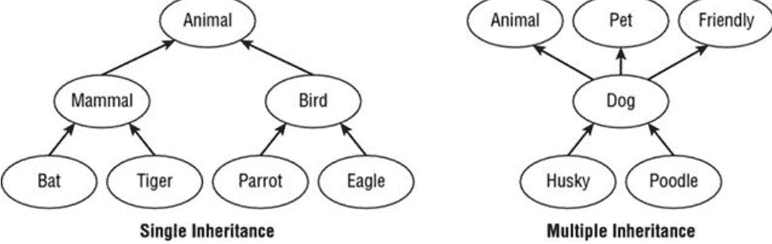

**图 8.1** 继承类型

在 Java 中，可以通过给类标记 `final` 修饰符来防止类被扩展。如果你尝试定义一个继承自 `final` 类的类，该类将编译失败。除非另有说明，在本章中假设我们处理的类都没有被标记为 `final`。

## 继承 Object

在我们对 Java 的讨论中，我们多次使用了 object（对象）一词——而且很有道理。在 Java 中，所有的类都继承自一个类：`java.lang.Object`，或简称为 `Object`。此外，`Object` 是唯一没有父类的类。

你可能会想：“到目前为止我写的所有类都没有扩展 `Object`，那么它们是如何继承它的呢？”答案是，编译器会在你写的任何没有扩展特定类的类中自动插入代码。例如，考虑以下两个等效的类定义：

```java
public class Zoo { }
```

```java
public class Zoo extends java.lang.Object { }
```

关键在于，当 Java 看到你定义了一个没有扩展其他类的类时，它会自动添加 `extends java.lang.Object` 语法到类定义中。结果是每个类都可以访问 `Object` 类中任何可访问的方法。例如，`toString()` 和 `equals()` 方法在 `Object` 中是可用；因此它们在所有类中都是可用的。不过，如果没有在子类中被重写，它们可能并不特别有用。我们将在本章稍后介绍重写方法。

另一方面，当你定义一个扩展现有类的新类时，Java 不会自动扩展 `Object` 类。由于所有类都继承自 `Object`，扩展现有类意味着子类从定义上讲已经继承了 `Object`。如果你查看任何类的继承结构，它在树的顶部总是以 `Object` 结束，如图 8.2 所示。

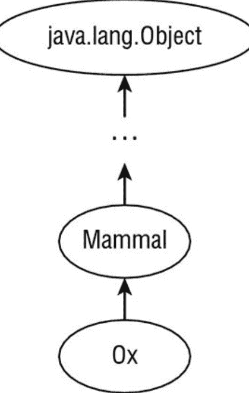

## 所有对象都继承 java.lang.Object

**图 8.2** Java 对象的继承

`int` 和 `boolean` 等原始类型不继承自 `Object`，因为它们不是类。正如你在第 5 章“核心 Java API”中所学到的，通过自动装箱，它们可以作为相关包装类的实例被赋值或传递，而该包装类确实继承 `Object`。

## 创建类

现在我们已经确定了继承在 Java 中是有效的，我们可以利用它来定义和创建复杂的类关系。在本节中，我们将回顾创建和使用类的基础知识。

## 扩展类

使用 `extends` 关键字定义和扩展类的完整语法如图 8.3 所示。

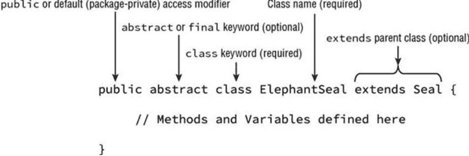

记住，`final` 意味着一个类不能被扩展。我们将在第 9 章讨论类是抽象的含义。

让我们创建两个文件，`Animal.java` 和 `Lion.java`，其中 `Lion` 类扩展 `Animal` 类。假设它们在同一个包中，在 `Lion.java` 中不需要 `import` 语句即可访问 `Animal` 类。

以下是 `Animal.java` 的内容：

```java
public class Animal {
    private int age;
    protected String name;
    public int getAge() {
        return age;
    }
    public void setAge(int newAge) {
        age = newAge;
    }
}
```

以及以下是 `Lion.java` 的内容：

```java
public class Lion extends Animal {
    public void setProperties(int age, String n) {
        setAge(age);
        name = n;
    }
    public void roar() {
        System.out.print(name + " " + age + " " + getAge() + " ");
    }
}
```

`extends` 关键字用于表示 `Lion` 类继承 `Animal` 类。执行时，`Lion` 程序将打印如下：

lion, age 3, says: Roar!

让我们来看 `Lion` 类的成员。实例变量 `age` 被标记为 `private`，无法从子类 `Lion` 直接访问。因此，以下代码将无法通过编译：

```java
public class Lion extends Animal {
    ...
    public void roar() {
        System.out.print("Lions age: "+age); // 无法编译
    }
...}
```

`age` 变量可以通过 `Animal` 类中标记为 `public` 的 `getAge()` 和 `setAge()` 方法间接访问。`name` 变量可以在 `Lion` 类中直接访问，因为它在 `Animal` 类中被标记为 `protected`。

## 应用类访问修饰符

你已经知道可以对方法和变量应用访问修饰符。对类定义应用访问修饰符可能并不意外，因为直到目前为止我们一直在给类添加 `public` 访问修饰符。

在 Java 中，顶层类（top-level class）是指定义在另一个类内部的类。书中大多数类都是顶层类。它们只能有 `public` 或包私有（package-private）访问。对类应用 `public` 访问意味着可以在任何类中引用和使用。应用默认（包私有）访问（即没有任何访问修饰符），意味着该类只能被同一包内的类访问。

> 内部类（inner class）是定义在另一个类内部的类，是顶层类的相反。除了 `public` 和包私有访问外，内部类还可以具有 `protected` 和 `private` 访问。我们将在第 9 章讨论内部类。

正如你可能记得的，一个 Java 文件可以有多个顶层类，但最多只能有一个 `public` 顶层类。事实上，它可能一个 `public` 类都没有。也没有要求唯一的 `public` 类必须是文件的第一个类。使用包私有访问的一个好处是，你可以在同一个 Java 文件中定义类。例如，以下定义可以出现在名为 `Groundhog.java` 的单个 Java 文件中，因为它只包含一个 `public` 类：

```java
class Rodent {}
public class Groundhog extends Rodent {}
```

如果我们更新 `Rodent` 类以 `public` 访问修饰符，`Groundhog.java` 文件将无法通过编译，除非 `Rodent` 类被移动到自己的 `Rodent.java` 文件中。

> 为了简单起见，每当你在书中同一个代码示例中看到多个 `public` 类或接口时，假设每个类都定义在自己的 Java 文件中。

## 访问 this 引用

当方法参数与实例变量同名时会发生什么？让我们来看一个例子。你认为以下程序会打印什么？

```java
public class Flamingo {
    private String color;
    public void setColor(String color) {
        this.color = color;
    }
    public static void main(String[] args) {
        Flamingo f = new Flamingo();
        f.setColor("PINK");
        System.out.print(f.color);
    }
}
```

程序打印 PINK。`this` 引用用于在参数和实例变量同名时区分它们。在很多情况下这种引用是可选的，但你可能会在考试中看到它。以下示例：

```java
class Duck {
    private String color;
    private int height;
    private int length;
    public void setData(int length, int height) {
        this.length = length;
        this.height = height;
        color = "white";
    }
    public static void main(String[] args) {
        Duck b = new Duck();
        b.setData(0,2);
        System.out.print(b.length + " " + b.height + " " + b.color);
    }
}
```


这段代码打印：

```
0 2 white
```

不过，这可能不是你预期的结果。第 7 行是错误的，你应该在考试中注意。实例变量 `length` 保持了值。第 8 行更直观。参数 `height` 和实例变量名称不同。由于没有命名冲突，这并不是必须的。最后，第 9 行显示允许使用赋值。

## 调用 super 引用

在 Java 中，变量或方法可以同时定义在父类和子类中。当这种情况发生时，我们如何引用父类版本而不是当前类？

要实现这一点，你可以使用 `super` 引用或关键字。`super` 引用与 `this` 引用相似，但它排除了当前类中发现的。换句话说，该成员可以通过继承访问。以下类展示了如何对方法中的同名变量应用 `super`：

```java
class Mammal {
  String type = "mammal";
}

class Bat extends Mammal {
  String type = "bat";

  public String getType() {
    return super.type + ":" + this.type;
  }

  public static void main(String... zoo) {
    System.out.print(new Bat().getType());
  }
}
```

程序打印 `mammal:bat`。你认为如果删掉 `super` 引用会发生什么？程序打印 `bat:bat`。Java 使用尽可能窄的作用范围——在这种情况下是定义在 `Bat` 类中的 `type` 变量。注意在上一个例子中 `this` 引用是可选的，其输出与删掉它时的输出相同。

让我们看看你是否掌握了 `this` 和 `super`。以下程序的输出是什么？

```java
1: class Insect {
  protected int numberOfLegs = 4;
  String label = "buggy";
}

4: }

5:

6: public class Beetle extends Insect {
7:   protected int numberOfLegs = 6;
8:   short age = 3;
9:   public void printData() {
10:    System.out.print(this.label);
11:    System.out.print(super.label);
12:    System.out.print(this.age);
13:    System.out.print(super.age);
14:    System.out.print(numberOfLegs);
15:  }
16:  public static void main(String [] args) {
17:    new Beetle().printData();
18:  }
19: }
```

这是一个陷阱题——这段程序代码无法编译！让我们检查 `printData()` 方法的每一行。由于 `label` 定义在父类中，因此可以通过 `this` 和 `super` 引用访问。因此，第 10 行和第 11 行可以通过编译，如果类通过编译，它们将打印相同的结果。另一方面，变量 `age` 仅定义在当前类中，可以通过 `this` 访问但不能通过 `super` 访问。因此，第 12 行可以编译，但第 13 行不能。记住，`this` 包含了当前成员和继承成员，而 `super` 只包含继承的成员。在这个示例中，如果代码编译，第 12 行将打印 `3`。

最后，如果第 13 行被注释掉，第 14 行会打印什么？尽管 `numberOfLegs` 变量在 `Beetle` 中是可以访问的，但 Java 会从最窄范围向外检查。因此，`Beetle` 类中 `numberOfLegs` 的值会被使用，并将打印 `6`。在这个示例中，`this.numberOfLegs` 和 `super.numberOfLegs` 指向具有不同的值。

由于这涉及到继承中的命名冲突，通常只有当当前类中定义了与父类方法或变量匹配的方法或变量时，你才会使用 `super`。这通常出现在方法重写和变量隐藏中，我们将在本章稍后讨论。

## 声明构造函数

正如你在第 2 章中所学的那样，构造函数是一个特殊方法，它的名称与类名匹配且没有返回类型。它在创建类的新实例时被调用。对于考试，你需要了解许多关于构造函数的规则。在本节中，我们将展示如何创建默认构造函数、重载构造函数、调用父类构造函数、final 字段以及类中的初始化顺序。

### 创建构造函数

让我们从一个简单的构造函数开始：

```java
public class Bunny {
    public Bunny() {
        System.out.println("constructor");
    }
}
```

构造函数的名称 `Bunny` 与类名 `Bunny` 匹配，并且没有返回类型，甚至没有 `void`。这使得它成为了构造函数。你能看出为什么这两个不是 `Bunny` 类的有效构造函数吗？

```java
public class Bunny {
    public bunny() {} // 无法编译
    public void Bunny() { }
}
```

第一个与类名不匹配，因为 Java 是大小写敏感的。由于不匹配，Java 知道它不可能是构造函数，而应该是普通方法。然而，它缺少返回类型，因此无法编译。第二个是一个完美的方法，但不是构造函数，因为它有返回类型。

和方法参数一样，构造函数参数可以是任何有效的类、数组或原始类型，包括泛型，但不能包含 `var`。以下代码无法编译：

```java
class Bonobo {
    public Bonobo(var food) {} // 无法编译
}
```

一个类可以有多个构造函数，只要每个构造函数都有唯一的签名。在这种情况下，这意味着构造函数参数必须是不同的。就像同名但签名不同的方法一样，声明不同签名的多个构造函数被称为构造函数重载。下方的 `Turtle` 类有四个不同的重载构造函数：

```java
public class Turtle {
    private String name;

    public Turtle() {
        name = "John Doe";
    }

    public Turtle(int age) {}

    public Turtle(long age) {}

    public Turtle(String newName, String... favoriteFoods) {
        name = newName;
    }
}
```

构造函数在创建新对象时使用。这个过程被称为实例化，因为它创建了类的新实例。当我们写下 `new` 后面跟想要实例化的类名时，就会调用构造函数。这里有一个例子：

```java
new Turtle()
```

当 Java 看到 `new` 关键字时，它会为新对象分配内存，然后寻找具有匹配签名的构造函数并调用它。

### 默认构造函数

Java 中的每个类都有构造函数，无论你是否编写了它。如果你没有在类中包含任何构造函数，Java 会为你创建一个没有任何参数的构造函数。这个由 Java 创建的构造函数被称为默认构造函数，每当一个没有构造函数的类时，它就会被添加。为了清晰起见，我们通常称为默认无参构造函数。这里有一个例子：

```java
public class Rabbit {
    public static void main(String[] args) {
        Rabbit rabbit = new Rabbit(); // 调用默认构造函数
    }
}
```

在 `Rabbit` 类中，Java 看到没有编写构造函数，于是创建了一个。这个默认构造函数等同于输入以下内容：

```java
public Rabbit() {}
```

默认构造函数有一个空的参数列表和空的方法体。你自己输入这些是没问题的。但是，由于它什么都不做，Java 乐意为你生成它并节省一些打字时间。

### 使用 this() 调用重载构造函数

Java 提供了一个解决方案：`this()`——这就是我们用来引用实例成员时使用的相同的关键字。当 `this()` 配合括号使用时，Java 会在该类的同一个实例上调用另一个构造函数。

```java
public Hamster(int weight) {
    this(weight, "brown");
}
```

成功！现在 Java 调用了接受两个参数的构造函数，其中 `weight` 和 `color` 被如预期地设置了。

调用 `this()` 有一个你需要了解的特殊规则。如果你选择调用它，`this()` 必须是构造函数中的第一条语句。此副作用是，任何构造函数中只能有一个 `this()` 的调用。

```java
3:    public Hamster(int weight) {
4:        System.out.println("in constructor");
5:        // Set weight and default color
6:        this(weight, "brown");    // 无法编译
7:}
```

即使第 4 行的打印语句没有改变任何变量，但它仍然是一个 Java 语句，并且不允许在调用 `this()` 之前插入。第 5 行的注释是没问题的。注释不视为语句，可以出现在任何地方。

对于重载构造函数，还有一个你应该注意的最后规则。考虑以下 `Gopher` 类的类定义：

```java
public class Gopher {
    public Gopher(int dugHoles) {
        this(5);    // 无法编译
    }
}
```

编译器能够检测到此构造函数正在无限地调用自己。由于这段代码永远不会结束，编译器会停止并将其报告为错误。同样，此代码无法编译：

```java
public class Gopher {
    public Gopher() {
        this(5);      // 无法编译
    }

    public Gopher(int dugHoles) {
        this();      // 无法编译
    }
}
```

在这个示例中，构造函数相互调用，该过程无限持续。由于编译器可以检测到这一点，它会将其报告为错误。

### this vs. this()

尽管使用了相同的关键字，但 `this` 和 `this()` 是不同的。第一个 `this` 指向类的实例，而第二个 `this()` 指向类内部的构造函数调用。可能会尝试通过同时使用两者来欺骗你，请确保你知道应该使用哪一个以及为什么。

### 使用 super() 调用父类构造函数

在 Java 中，每个构造函数的第一条语句要么使用 `this()` 调用类内的另一个构造函数，要么使用 `super()` 调用直接父类中的构造函数。如果父类构造函数接受参数，那么 `super()` 调用也会接受参数。为了本节的简单起见，我们将 `super()` 命令称为任何父类构造函数，即使是那些接受参数的构造函数。让我们看看 `Animal` 类及其子类 `Zebra`，看看它们的构造函数如何被正确编写以调用另一个：

```java
public class Animal {
    private int age;

    public Animal(int age) {
        super();      // 指向 java.lang.Object 中的构造函数
        this.age = age;
    }
}
```

```java
public class Zebra extends Animal {
    public Zebra(int age) {
        super(age);  // 指向 Animal 中的构造函数
    }

    public Zebra() {
        this(4); // 指向带有 int 参数的 Zebra 构造函数
    }
}
```


# Java 构造函数中的 `this()` 与 `super()` 调用

## this vs. this()

尽管使用了相同的关键字，`this` 和 `this()` 是不同的。第一个 `this` 指向类的实例，而第二个 `this()` 指向类内部的构造函数调用。考试可能会尝试通过同时使用两者来欺骗你，请确保你知道应该使用哪一个以及为什么。

## 使用 `super()` 调用父类构造函数

在 Java 中，每个构造函数的第一条语句要么使用 `this()` 调用类内的另一个构造函数，要么使用 `super()` 调用直接父类中的构造函数。如果父类构造函数接受参数，那么 `super()` 调用也会接受参数。为了本节的简单起见，我们将 `super()` 命令称为任何父类构造函数，即使是那些接受参数的构造函数。

让我们看看 `Animal` 类及其子类 `Zebra`，看看它们的构造函数如何被正确编写以调用另一个：

```java
public class Animal {

    private int age;

    public Animal(int age) {
        super();      // 指向 java.lang.Object 中的构造函数
        this.age = age;
    }
}
```

```java
public class Zebra extends Animal {

    public Zebra(int age) {
        super(age);  // 指向 Animal 中的构造函数
    }

    public Zebra() {
        this(4); // 指向带有 int 参数的 Zebra 构造函数
    }
}
```

在第一个类 `Animal` 中，构造函数的第一条语句是调用定义在 `java.lang.Object` 中的父类构造函数，它不接受任何参数。在第二个类 `Zebra` 中，第一个构造函数的第一条语句是调用 `Animal` 的构造函数，它接受一个参数。`Zebra` 类还包含一个无参数的构造函数，它没有调用 `super()`，而是通过 `this(4)` 调用 `Zebra` 类中的另一个构造函数。

就像调用 `this()` 一样，调用 `super()` 只能作为构造函数的第一条语句使用。例如，以下两个类定义将无法编译：

```java
public class Zoo {

    public Zoo() {
        System.out.println("Zoo created");
        super(); // 无法编译
    }
}
```

```java
public class Zoo {

    public Zoo() {
        super();
        System.out.println("Zoo created");
        super(); // 无法编译
    }
}
```

第一个类将无法编译，因为对父类构造函数的调用必须是构造函数的第一条语句。在第二个代码段中，`super()` 是构造函数的第一条语句，但它也被用作第三条语句。由于 `super()` 只能作为构造函数的第一条语句调用一次，代码将无法编译。

如果父类有多个构造函数，子类可以在其定义中使用任何有效的父类构造函数，如下所示：

```java
public class Animal {

    private int age;
    private String name;

    public Animal(int age, String name) {
        this.age = age;
        this.name = name;
    }

    public Animal(int age) {
        super();
        this.age = age;
        this.name = null;
    }
}

public class Gorilla extends Animal {

    public Gorilla(int age) {
        super(age, "Gorilla");
    }

    public Gorilla() {
        super(5);
    }
}
```

在这个示例中，第一个子类构造函数接受一个参数 `age`，并调用了接受两个参数 `age` 和 `name` 的父类构造函数。第二个子类构造函数不接受参数，它调用了接受一个参数 `age` 的父类构造函数。在这个示例中，注意子类构造函数。


# Java 构造函数详解：`this()` 与 `super()`

## 使用 `this()` 调用重载构造函数

Java 提供了一个解决方案：`this()`——这就是我们用来引用实例成员时使用的相同的关键字。当 `this()` 配合括号使用时，Java 会在该类的同一个实例上调用另一个构造函数。

```java
public Hamster(int weight) {
    this(weight, "brown");
}
```

成功！现在 Java 调用了接受两个参数的构造函数，其中 `weight` 和 `color` 被如预期地设置了。

调用 `this()` 有一个你需要了解的特殊规则。如果你选择调用它，`this()` 必须是构造函数中的第一条语句。此副作用是，任何构造函数中只能有一个 `this()` 的调用。

```java
3:    public Hamster(int weight) {
4:        System.out.println("in constructor");
5:        // Set weight and default color
6:        this(weight, "brown");    // 无法编译
7:}
```

即使第 4 行的打印语句没有改变任何变量，但它仍然是一个 Java 语句，并且不允许在调用 `this()` 之前插入。第 5 行的注释是没问题的。注释不视为语句，可以出现在任何地方。

对于重载构造函数，还有一个你应该注意的最后规则。考虑以下 `Gopher` 类的类定义：

```java
public class Gopher {
    public Gopher(int dugHoles) {
        this(5);    // 无法编译
    }
}
```

编译器能够检测到此构造函数正在无限地调用自己。由于这段代码永远不会结束，编译器会停止并将其报告为错误。同样，此代码无法编译：

```java
public class Gopher {
    public Gopher() {
        this(5);      // 无法编译
    }

    public Gopher(int dugHoles) {
        this();      // 无法编译
    }
}
```

在这个示例中，构造函数相互调用，该过程无限持续。由于编译器可以检测到这一点，它会将其报告为错误。

## `this` vs. `this()`

尽管使用了相同的关键字，但 `this` 和 `this()` 是不同的。第一个 `this` 指向类的实例，而第二个 `this()` 指向类内部的构造函数调用。考试可能会尝试通过同时使用两者来欺骗你，请确保你知道应该使用哪一个以及为什么。

## 使用 `super()` 调用父类构造函数

在 Java 中，每个构造函数的第一条语句要么使用 `this()` 调用类内的另一个构造函数，要么使用 `super()` 调用直接父类中的构造函数。如果父类构造函数接受参数，那么 `super()` 调用也会接受参数。为了本节的简单起见，我们将 `super()` 命令称为任何父类构造函数，即使是那些接受参数的构造函数。让我们看看 `Animal` 类及其子类 `Zebra`，看看它们的构造函数如何被正确编写以调用另一个：

```java
public class Animal {
    private int age;

    public Animal(int age) {
        super();      // 指向 java.lang.Object 中的构造函数
        this.age = age;
    }
}
```

```java
public class Zebra extends Animal {
    public Zebra(int age) {
        super(age);  // 指向 Animal 中的构造函数
    }

    public Zebra() {
        this(4); // 指向带有 int 参数的 Zebra 构造函数
    }
}
```

在第一个类 `Animal` 中，构造函数的第一条语句是调用定义在 `java.lang.Object` 中的父类构造函数，它不接受任何参数。在第二个类 `Zebra` 中，第一个构造函数的第一条语句是调用 `Animal` 的构造函数，它接受一个参数。`Zebra` 类还包含一个无参数的构造函数，它没有调用 `super()`，而是通过 `this(4)` 调用 `Zebra` 类中的另一个构造函数。

就像调用 `this()` 一样，调用 `super()` 只能作为构造函数的第一条语句使用。例如，以下两个类定义将无法编译：

```java
public class Zoo {
    public Zoo() {
        System.out.println("Zoo created");
        super(); // 无法编译
    }
}
```

```java
public class Zoo {
    public Zoo() {
        super();
        System.out.println("Zoo created");
        super(); // 无法编译
    }
}
```

第一个类将无法编译，因为对父类构造函数的调用必须是构造函数的第一条语句。在第二个代码段中，`super()` 是构造函数的第一条语句，但它也被用作第三条语句。由于 `super()` 只能作为构造函数的第一条语句调用一次，代码将无法编译。

如果父类有多个构造函数，子类可以在其定义中使用任何有效的父类构造函数，如下所示：

```java
public class Animal {
    private int age;
    private String name;

    public Animal(int age, String name) {
        this.age = age;
        this.name = name;
    }

    public Animal(int age) {
        super();
        this.age = age;
        this.name = null;
    }
}

public class Gorilla extends Animal {
    public Gorilla(int age) {
        super(age, "Gorilla");
    }

    public Gorilla() {
        super(5);
    }
}
```

在这个示例中，第一个子类构造函数接受一个参数 `age`，并调用了接受两个参数 `age` 和 `name` 的父类构造函数。第二个子类构造函数不接受参数，它调用了接受一个参数 `age` 的父类构造函数。在这个示例中，注意子类构造函数。


在这个示例中，构造函数相互调用，该过程无限持续。由于编译器可以检测到这一点，它会将其报告为错误。

## this vs. this()

尽管使用了相同的关键字，但 `this` 和 `this()` 是不同的。第一个 `this` 指向类的实例，而第二个 `this()` 指向类内部的构造函数调用。考试可能会尝试通过同时使用两者来欺骗你，请确保你知道应该使用哪一个以及为什么。

## 使用 super() 调用父类构造函数

在 Java 中，每个构造函数的第一条语句要么使用 `this()` 调用类内的另一个构造函数，要么使用 `super()` 调用直接父类中的构造函数。如果父类构造函数接受参数，那么 `super()` 调用也会接受参数。为了本节的简单起见，我们将 `super()` 命令称为任何父类构造函数，即使是那些接受参数的构造函数。让我们看看 `Animal` 类及其子类 `Zebra`，看看它们的构造函数如何被正确编写以调用另一个：

```java
public class Animal {

    private int age;

    public Animal(int age) {

        super();      // 指向 java.lang.Object 中的构造函数

        this.age = age;

    }

}
```

```java
public class Zebra extends Animal {

    public Zebra(int age) {

        super(age);  // 指向 Animal 中的构造函数

    }

    public Zebra() {

        this(4); // 指向带有 int 参数的 Zebra构造函数

    }

}
```

在第一个类 `Animal` 中，构造函数的第一条语句是调用定义在 `java.lang.Object` 中的父类构造函数，它不接受任何参数。在第二个类 `Zebra` 中，第一个构造函数的第一条语句是调用 `Animal` 的构造函数，它接受一个参数。`Zebra` 类还包含一个无参数的构造函数，它没有调用 `super()`，而是通过 `this(4)` 调用 `Zebra` 类中的另一个构造函数。

就像调用 `this()` 一样，调用 `super()` 只能作为构造函数的第一条语句使用。例如，以下两个类定义将无法编译：

```java
public class Zoo {

    public Zoo() {

        System.out.println("Zoo created");

        super(); // 无法编译

    }

}
```

```java
public class Zoo {

    public Zoo() {

        super();

        System.out.println("Zoo created");

        super(); // 无法编译

    }

}
```

第一个类将无法编译，因为对父类构造函数的调用必须是构造函数的第一条语句。在第二个代码段中，`super()` 是构造函数的第一条语句，但它也被用第三条语句。由于 `super()` 只能作为构造函数的第一条语句调用一次，代码将无法编译。

如果父类有多个构造函数，子类可以在其定义中使用任何有效的父类构造函数，如下所示：

```java
public class Animal {

    private int age;

    private String name;

    public Animal(int age, String name) {

        this.age = age;

        this.name = name;

    }

    public Animal(int age) {

        super();

        this.age = age;

        this.name = null;

    }

}

public class Gorilla extends Animal {

    public Gorilla(int age) {

        super(age, "Gorilla");

    }

    public Gorilla() {

        super(5);

    }

}
```

在这个示例中，第一个子类构造函数接受一个参数 `age`，并调用了接受两个参数 `age` 和 `name` 的父类构造函数。第二个子类构造函数不接受参数，它调用了接受一个参数 `age` 的父类构造函数。在这个示例中，注意子类构造函数。

这段代码可以编译，因为我们添加了一个显式调用父类构造函数的构造函数。请注意，`Elephant` 类现在有了一个无参数构造函数，尽管它的父类 `Mammal` 并没有。即使父类没有定义，子类也可以定义显式的无参数构造函数，只要子类的构造函数通过 `super()` 命令的显式调用映射到父类构造函数。这意味着 `Elephant` 的子类现在可以依赖编译器的增强。例如，以下类可以编译，因为 `Elephant` 现在有了一个无参数构造函数，尽管它是显式定义的：

```java
public class AfricanElephant extends Elephant {
```

在任何考试中，如果一个类定义了带参数的构造函数而没有定义无参数构造函数，要注意。在回答关于此类问题之前，务必检查代码能够编译，特别是当有任何类继承了它时。对于考试来说，你应该能够一眼看出为什么像我们第一个 `Elephant` 实现那样的类无法编译。

### super() 始终指向最直接的父类

一个类可能通过继承拥有多个祖先。在我们之前的示例中，`AfricanElephant` 是 `Elephant` 的子类，而 `Elephant` 又是 `Mammal` 的子类。但对于构造函数，`super()` 始终指向最直接的父类。在这个示例中，在 `AfricanElephant` 类内部调用 `super()` 始终指向 `Elephant` 类，而永远不会指向 `Mammal` 类。

## 构造函数与 final 字段

正如你可能从第7章记得的，“final static` 变量必须恰好赋值一次。你看到这发生在声明行和静态初始化器中。标记为 `final` 的实例变量遵循类似的规则。它们可以在声明的行或实例初始化器中被赋值。

```java
public class MouseHouse {

private final int volume;

private final String name = "The Mouse House";

{

  volume = 10;

}

}
```

与其他 `final` 变量一样，一旦分配了值，就不能更改。它们还有一个可以被赋值值的地方——构造函数。构造函数是初始化过程的一部分，因此允许在其中为 `final` 实例变量赋值。对于考试，你需要知道一个重要的规则：在构造函数执行完成之前，所有 `final` 实例变量都必须被赋值。让我们在一个示例中尝试一下：

```java
public class MouseHouse {

  private final int volume;

  private final String type;

  public MouseHouse() {

    this.volume = 10;

    type = "happy";

  }

}
```

在我们的 `MouseHouse` 实现中，`volume` 和 `type` 的值是在构造函数赋值赋值。记住 `this` 关键字是可选的，因为实例变量是类声明的一部分，并且没有同名的构造函数参数。

与局部 `final` 变量不同（除非实际使用，否则不需要），`final` 实例变量必须赋值。这些变量不使用默认值。如果它们在声明行或实例初始化器中没有赋值，则必须在构造函数声明中赋值。未能这样做会导致声明构造函数的行出现编译错误。

```java
public class MouseHouse {

  private final int volume;

  private final String type;

  {

    this.volume = 10;

  }

  public MouseHouse(String type) {

    this.type = type;

  }

  public MouseHouse() { // 无法编译

    this.volume = 2; // 无法编译

  }

}
```

在这个示例中，第一个接受 `String` 参数的构造函数可以编译。虽然一个 `final` 实例变量只能赋值一次，但在赋值方面，每个构造函数是独立考虑的。第二个构造函数无法编译，有两个原因：首先，构造函数未能为 `type` 变量赋值。编译器检测到 `type` 从未被赋值，并在声明构造函数的行报告错误。其次，构造函数为 `volume` 变量设置了值，尽管它已经被实例初始化器赋过值。编译器在设置 `volume` 的行报告了此错误。

> 在考试中，要小心任何标记为 `final` 的实例变量。确保它们在声明行、实例初始化器或构造函数中被赋值。它们应该只被赋值一次，在构造函数中未赋值被视为编译错误。

当构造函数调用同一类中的另一个构造函数时，`final` 实例变量该如何处理？在这种情况下，你必须仔细遵循构造函数的逻辑路径，确保每个 `final` 实例变量都恰好被赋值一次。我们可以将之前的错误构造函数替换为以下可以编译的构造函数：

```java
public MouseHouse() {

  this(null);

}
```

这个构造函数没有对任何 `final` 实例变量进行任何赋值，但它调用了 `MouseHouse(String)` 构造函数，我们观察到它是无问题地编译的。我们在这里使用 `null` 是为了说明变量不需要对象值。只要显式设置，我们就可以为 `final` 实例变量分配 `null`。

## 初始化顺序

在第2章中，我们介绍了初始化顺序。但是，通过继承，实例的初始化顺序变得有点复杂。我们将从如何初始化类开始，然后扩展到初始化实例。

## 类初始化

首先，你需要初始化类，这涉及调用类层次结构中的所有静态成员，从最高的父类开始向下进行。这通常被称为加载类。JVM 控制类何时进行初始化，虽然你可以假设类在初始化之前已经加载了。类可能在程序首次启动时初始化、在引用该类的静态成员时初始化，或者在创建类的实例之前不久初始化。类初始化最重要的规则是，每个类最多发生一次。如果类在程序中未使用，它可能永远不会被加载。我们将类的初始化顺序总结如下：

### 初始化类 X

1. 如果 X 有父类 Y，则先初始化 Y。
2. 按照它们在类中出现的顺序处理所有静态声明。
3. 按照它们在类中出现的顺序处理所有静态初始化器。

看一个示例，以下程序会打印什么？

```java
public class Animal {

    static { System.out.print("A"); }

}

public class Hippo extends Animal {

    static { System.out.print("B"); }

    public static void main(String[] grass) {

        System.out.print("C");

        new Hippo();

        new Hippo();

        new Hippo();

    }

}
```

它恰好打印一次 `ABC`。由于 `main()` 方法在 `Hippo` 类内部，该类将首先初始化，从父类开始并打印 `AB`。之后执行 `main()` 方法，打印 `C`。尽管 `main()` 方法创建了三个实例，类也只加载了一次。

### 为什么 Hippo 程序在 AB 之后打印 C

在之前的示例中，`Hippo` 类在 `main()` 方法执行之前就已经初始化了。这是因为我们的 `main()` 方法位于执行的类内部，所以它在启动时必须加载。如果你在另一个程序中调用 `Hippo` 会怎样？

```java
public class HippoFriend {

    public static void main(String[] grass) {

        System.out.print("C");

    }

}
```

假设该类在其他地方没有被引用，这个程序可能会打印 `CAB`，`Hippo` 类在 `main()` 方法内部需要时才被加载。我们说“可能”，是因为关于 JVM 运行时加载类的规则。对于考试，你只需要知道类在被引用或使用之前必须初始化。此外，包含程序入口点（即 `main()` 方法）的类在 `main()` 方法执行之前会被加载。

## 实例初始化

每当使用 `new` 关键字时，就会初始化实例。在我们之前的示例中，有三次 `new Hippo()` 调用，导致了三个 `Hippo` 实例被初始化。实例初始化比类初始化复杂一点，因为一个类或父类可能声明了许多构造函数，但只有一少数作为实例初始化的一部分。

首先，从使用 `new` 关键字的最底层构造函数开始。记住，每个构造函数的第一行都是对 `this()` 或 `super()` 的调用，如果省略，编译器将自动插入对父类无参数构造函数 `super()` 的调用。然后，向上移动并注意构造函数的顺序。最后，从父类开始初始化每个类，按照它们被调用的反序处理每个实例初始化器和构造函数。我们将实例的初始化顺序总结如下：

### 初始化 X 的实例

1. 如果 X 有父类 Y，则先初始化 Y 的实例。
2. 按照实例变量在类中出现的顺序处理所有实例变量声明。
3. 按照实例初始化器在类中出现的顺序处理所有实例初始化器。
4. 初始化构造函数，包括任何通过 `this()` 引用的重载构造函数。

让我们尝试一个没有继承的简单示例。看看你能否猜出以下程序的输出：

```java
1: public class ZooTickets {

2:   private String name = "BestZoo";

3:   { System.out.print(name+"-");

4:   static { System.out.print("0"); }

5:   static { System.out.print("10-"); }

6:   }

7:   public ZooTickets() {

8:     System.out.print("z-");

9:   }

10:  public static void main(String[] args) {

11:    new ZooTickets();

12:  }

13: }
```

输出如下：

```
0-10-BestZoo-z-
```

首先，我们必须初始化类。由于没有声明父类（这意味着父类是 `Object`），我们可以从 `ZooTickets` 的静态组件开始。在这种情况下，执行了第 4、5、6 行，打印了 `0` 和 `10-`。接下来，我们初始化实例。同样，由于没有声明父类，我们从实例组件开始。执行第 2 和 3 行，打印了 `BestZoo-`。最后，运行第 8-10 行的构造函数，输出 `z-`。

接下来，让我们尝试一个带有继承的简单示例。

```java
class Primate {

    public Primate() {

        System.out.print("Primate-");

    }

}
```

```java
class Ape extends Primate {

    public Ape(int fur) {

        System.out.print("Ape1-");

    }

    public Ape() {

        System.out.print("Ape2-");

    }

}
```

```java
public class Chimpanzee extends Ape {

    public Chimpanzee() {

        super(2);

        System.out.print("Chimpanzee-");

    }

    public static void main(String[] args) {

        new Chimpanzee();

    }

}
```

编译器在 `Primate` 和 `Ape` 构造函数的第一语句插入了 `super()` 命令。代码执行时会先调用父类构造函数，产生以下输出：

```
Primate-Ape1-Chimpanzee-
```

注意两个 `Ape()` 构造函数中有一个被调用。你需要从调用 `new Chimpanzee()` 开始来确定哪些构造函数将被执行。记住，构造函数是从底向上执行的，但由于每个构造函数的第一行都是对另一个构造函数的调用，流实际上导致父类构造函数在子类构造函数之前执行。

下一个例子稍微有点难度。你认为这里会发生什么？

```java
1: public class Cuttlefish {

2: private String name = "swimmy";

3: { System.out.println(name); }

4: private static int COUNT = 0;

5: static { System.out.println(COUNT); }

6: { COUNT++; System.out.println(COUNT); }

7: 

8: public Cuttlefish() {

9: System.out.println("Constructor");

10: }

11: 

12: public static void main(String[] args) {

13: System.out.println("Ready");

14: 

15: new Cuttlefish();

16: } 
}
```

输出如下：

```
0
Ready
swimmy
1
Constructor
```

没有声明子类，因此我们可以跳过任何与继承相关的步骤。我们首先处理静态变量和静态初始化器——第 4 和 5 行，其中第 5 行打印 `0`。现在静态初始化器处理完毕，`main()` 方法可以运行，打印 `Ready`。处理第 2、3 和 6 行，其中第 3 行打印 `swimmy`，第 6 行打印 `1`。最后，运行第 8–10 行的构造函数，打印 `Constructor`。

准备好接受更困难的例子了吗？以下输出是什么？


# Java 类初始化与继承详解

## 示例：GiraffeFamily 与 Okapi

```java
class GiraffeFamily {
    static { System.out.print("A"); }
    { System.out.print("B"); };

    public GiraffeFamily(String name) {
        this(1);
        System.out.print("C");
    }

    public GiraffeFamily() {
        System.out.print("D");
    }

    public GiraffeFamily(int stripes) {
        System.out.print("E");
    }
}

public class Okapi extends GiraffeFamily {
    static { System.out.print("F"); }

    public Okapi(int stripes) {
        super("sugar");
        System.out.print("G");
    }
    { System.out.print("H"); }

    public static void main(String[] args) {
        new Okapi(1);
    }
}
```

程序打印以下内容：

**ABCFG**

---

## 初始化实例的顺序

首先，从使用 `new` 关键字的最底层构造函数开始。记住，每个构造函数的第一行都是对 `this()` 或 `super()` 的调用，如果省略，编译器将自动插入对父类无参数构造函数 `super()` 的调用。然后，向上移动并注意构造函数的顺序。最后，从父类开始初始化每个类，按照它们被调用的反序处理每个实例初始化器和构造函数。我们将实例的初始化顺序总结如下：

### 初始化 X 的实例

1. 如果 X 有父类 Y，则先初始化 Y 的实例。
2. 按照实例变量在类中出现的顺序处理所有实例变量声明。
3. 按照实例初始化器在类中出现的顺序处理所有实例初始化器。
4. 初始化构造函数，包括任何通过 `this()` 引用的重载构造函数。

---

## 简单示例：无继承

让我们尝试一个没有继承的简单示例。看看你能否猜出以下程序的输出：

```java
public class ZooTickets {
    private String name = "BestZoo";
    { System.out.print(name+"-"); }
    private static int COUNT = 0;
    static { System.out.print(COUNT); }
    static { COUNT += 10; System.out.print(COUNT+"-"); }

    public ZooTickets() {
        System.out.print("z-");
    }

    public static void main(String[] args) {
        System.out.print("0-");
        new ZooTickets();
    }
}
```

输出如下：

**0-10-BestZoo-z-**

首先，我们必须初始化类。由于没有声明父类（这意味着父类是 `Object`），我们可以从 `ZooTickets` 的静态组件开始。在这种情况下，执行了静态初始化器，打印了 0 和 10-。接下来，我们初始化实例。同样，由于没有声明父类，我们从实例组件开始。执行实例变量声明和实例初始化器，打印了 BestZoo-。最后，运行构造函数，输出 z-。

---

## 简单示例：带继承

接下来，让我们尝试一个带有继承的简单示例。

```java
class Primate {
    public Primate() {
        System.out.print("Primate-");
    }
}

class Ape extends Primate {
    public Ape(int fur) {
        System.out.print("Ape1-");
    }

    public Ape() {
        System.out.print("Ape2-");
    }
}

public class Chimpanzee extends Ape {
    public Chimpanzee() {
        super(2);
        System.out.print("Chimpanzee-");
    }

    public static void main(String[] args) {
        new Chimpanzee();
    }
}
```

编译器在 `Primate` 和 `Ape` 构造函数的第一语句插入了 `super()` 命令。代码执行时会先调用父类构造函数，产生以下输出：

**Primate-Ape1-Chimpanzee-**

注意两个 `Ape()` 构造函数中有一个被调用。你需要从调用 `new Chimpanzee()` 开始来确定哪些构造函数将被执行。记住，构造函数是从底向上执行的，但由于每个构造函数的第一行都是对另一个构造函数的调用，流实际上导致父类构造函数在子类构造函数之前执行。

---

## 稍复杂示例：静态与实例初始化器混合

下一个例子稍微有点复杂。你认为这里会发生什么？

```java
public class Cuttlefish {
    private String name = "swimmy";
    { System.out.println(name); }
    private static int COUNT = 0;
    static { System.out.println(COUNT); }
    { COUNT++; System.out.println(COUNT); }

    public Cuttlefish() {
        System.out.println("Constructor");
    }

    public static void main(String[] args) {
        System.out.println("Ready");
        new Cuttlefish();
    }
}
```

输出如下：

```
0
Ready
swimmy
1
Constructor
```

没有声明子类，因此我们可以跳过任何与继承相关的步骤。我们首先处理静态变量和静态初始化器——第 4 和 5 行，其中第 5 行打印 0。现在静态初始化器处理完毕，`main()` 方法可以运行，打印 Ready。处理第 2、3 和 6 行，其中第 3 行打印 swimmy，第 6 行打印 1。最后，运行第 8–10 行的构造函数，打印 Constructor。

---

## 综合示例：再看 GiraffeFamily 与 Okapi

准备好接受更困难的例子了吗？以下输出是什么？

```java
class GiraffeFamily {
    static { System.out.print("A"); }
    { System.out.print("B"); };

    public GiraffeFamily(String name) {
        this(1);
        System.out.print("C");
    }

    public GiraffeFamily() {
        System.out.print("D");
    }

    public GiraffeFamily(int stripes) {
        System.out.print("E");
    }
}

public class Okapi extends GiraffeFamily {
    static { System.out.print("F"); }

    public Okapi(int stripes) {
        super("sugar");
        System.out.print("G");
    }
    { System.out.print("H"); }

    public static void main(String[] args) {
        new Okapi(1);
    }
}
```

程序打印以下内容：

**ABCFG**

---

## 回顾构造规则

让我们回顾在本部分涵盖的一些重要的构造规则。

- 每个构造函数的第一行都是对 `this()` 或 `super()` 的调用。
- 如果构造函数的第一语句不是对 `this()` 或 `super()` 的调用，那么编译器将自动插入无参数 `super()`。
- 在构造函数的第一语句之后调用 `this()` 和 `super()` 会导致错误。
- 如果父类没有无参数构造函数，那么子类中的每个构造函数都必须以显式的 `this()` 或 `super()` 调用开头。
- 如果一个类只定义了私有构造函数，那么它不能被扩展。
- 所有 `final` 实例变量在构造函数结束时必须被赋值一次。任何未赋值的 `final` 实例变量将在声明处报告编译错误。

在考试时，请特别注意任何涉及两个或多个继承类的问题。在尝试回答之前，你应该检查构造函数是否根据之前的规则正确定义。你还应该验证类包含了有效的访问修饰符。

---

# 继承成员

现在我们创建了一个类，我们可以用它做什么？Java 的最大优势之一是利用继承模型来简化代码。例如，假设有五个动物类每个都继承自 `Animal` 类。此外，每个类都定义了实现相同的 `eat()` 方法。在这种情况下，在 `Animal` 类中通过正确的访问修饰符定义一次 `eat()` 比在五个独立的类中维护相同的方法要简单得多。正如我们在本节中看到的，Java 允许任何一个子类在运行时替换（或重写）父类的方法实现。

Java 类可以使用父类的任何公共或受保护的成员，包括方法、基类型数据类型或对象引用。如果父类和子类属于同一个包，那么子类还可以使用父类中定义的任何包私有（package-private）成员。最后，子类永远无法访问父类的私有成员，至少不能通过任何直接引用。正如你在本章的早些时候看到的，私有成员 `age` 是通过公共或受保护的方法间接访问的。

要引用父类中的成员，你可以直接调用它，如下面的输出函数 `displaySharkDetails()` 所示：

```java
class Fish {
    protected int size;
    private int age;

    public Fish(int age) {
        this.age = age;
    }

    public int getAge() {
        return age;
    }
}

public class Shark extends Fish {
    private int numberOfFins = 8;

    public Shark(int age) {
        super(age);
        this.size = 4;
    }

    public void displaySharkDetails() {
        System.out.print("Shark with age: " + getAge());
        System.out.print(" and " + size + " meters long");
        System.out.print(" with " + numberOfFins + " fins");
    }
}
```

在子类中，我们使用公共方法 `getAge()` 和受保护成员 `size` 来访问父类中的值。记住，你可以使用 `this` 来访问当前类或父类的可见成员，并且你可以使用 `super` 来访问父类的可见成员。

```java
public void displaySharkDetails() {
    System.out.print("Shark with age: " + super.getAge());
    System.out.print(" and " + super.size + " meters long");
    System.out.print(" with " + this.numberOfFins + " fins");
}
```

在这个例子中，`getAge()` 和 `size` 可以通过 `this` 或 `super` 访问，因为它们定义在父类中；而 `numberOfFins` 只能通过 `this` 访问而不能通过 `super`，因为它不是被继承的属性。

---

# 方法继承

继承一个类不仅赋予了对父类继承方法的访问权限，还为父类和子类中定义的方法之间的冲突埋下了伏笔。在本节中，我们将回顾方法继承的规则以及 Java 如何处理这些场景。

## 重写方法

如果父类和子类中定义了签名相同的方法会怎样？例如，你可能想要定义该方法的新版本并使其在该子类中具有不同的行为。解决方案是在子类中重写该方法。在 Java 中，当子类对具有相同签名和兼容返回类型的继承方法声明新的实现时，发生了方法重写。记住，方法签名包含了方法名和方法参数。

当你重写方法时，可以使用 `super` 关键字引用方法的父类版本。通过这种方式，`this` 和 `super` 关键字分别允许你在当前版本和父类版本之间进行选择。我们通过以下示例来说明这一点：

```java
public class Canine {
    public double getAverageWeight() {
        return 50;
    }
}

public class Wolf extends Canine {
    public double getAverageWeight() {
        return super.getAverageWeight() + 20;
    }

    public static void main(String[] args) {
        System.out.println(new Canine().getAverageWeight());
        System.out.println(new Wolf().getAverageWeight());
    }
}
```

在这个示例中，子类 `Wolf` 重写了父类 `Canine` 的方法 `getAverageWeight()`，程序显示如下内容：

```
50.0
70.0
```

### 方法重写与递归调用

你可能在想在上一个示例中使用 `super` 是否必须的。例如，如果我们移除 `super` 关键字，以下代码会输出什么？

```java
public double getAverageWeight() {
    return getAverageWeight() + 20; // StackOverflowError
}
```

在这个例子中，编译器不会调用父类 `Canine` 方法；它会调用当前的 `Wolf` 方法，因为它会认为你正在执行一个递归调用。递归方法是在执行过程中会调用自身的方法。这在编程中很常见，但必须有一个终止条件，以便在某个点或深度触发递归的结束。在这个示例中，没有终止条件；因此，应用程序将尝试无限调用自身并在运行时产生 `StackOverflowError`。

要重写方法，你必须遵循若干规则。当你重写方法时，编译器会执行以下检查：

1. 子类中的方法必须与父类中的方法具有相同的签名。
2. 子类中的方法的访问权限至少要与父类中的方法相同。
3. 子类中的方法**不能**声明比父类方法中所声明的任何异常类更新或范围更大的受检异常。
4. 如果方法返回值，它必须是父类中方法的相同类型或其子类型，这被称为**协变类型**（covariant types）。

---

## 定义子类型和超类型

在讨论继承和多态时，我们通常使用“子类型”（subtype）而不是“子类”（subclass），因为 Java 包含了接口。**子类型**（subtype）是两个类型之间的关系，其中一个类型继承另一个。如果我们定义 X 是 Y 的子类型，那么满足以下条件之一：

- X 和 Y 都是类，且 X 是 Y 的子类。
- X 和 Y 都是接口，且 X 扩展了 Y。
- X 是类而 Y 是接口，且 X 实现了 Y。

同样，**超类型**（supertype）是两个类型之间的关系，其中一个类型继承另一个。如果 X 是 Y 的子类型，则 Y 是 X 的超类型。

---

## 重载 vs 重写

方法重载和重写方法的相似之处在于它们都涉及相同的名称。它们的区别在于重载方法使用不同的参数。

```java
class Bird {
    public void fly() {
```


```java
System.out.println("Bird flies");

}

public void fly(int altitude) {

    System.out.println("Bird flies at " + altitude);

}

}

class Eagle extends Bird {

    @Override

    public void fly() {

        System.out.println("Eagle flies high");

    }

}
```

访问修饰符的方法必须比继承方法中的版本更易于访问。

第三条规则规定，重写方法不能声明新的检查异常，也不能声明比继承方法更宽泛的检查异常。这与限制访问修饰符有类似的多态原因。换句话说，你可能会得到一个比其赋值的引用更具限制的对象，并且处于未处理或未声明的检查异常中。我们将在第 10 章“异常”中讨论检查异常的含义。现在，你应该意识到，如果在重写方法中声明了更泛的检查异常，代码将无法编译。让我们来看一个例子：

```java
public class Reptile {
    protected void sleepInShell() throws IOException {}
    protected void hideInShell() throws NumberFormatException {}
    protected void exitShell() throws FileNotFoundException {}
}

public class GalapagosTortoise extends Reptile {
    public void sleepInShell() throws FileNotFoundException {}
    public void hideInShell() throws IllegalArgumentException {}
    public void exitShell() throws IOException // 无法编译
}
```

在这个示例中，我们有三个重写方法。这些重写方法使用了更易访问的 `public` 修饰符，根据我们关于重写方法的第二条规则，这是允许的。重写的 `sleepInShell()` 方法声明了 `FileNotFoundException`，它是继承方法中声明的异常 `IOException` 的子类。根据我们关于重写方法的第三条规则，这是一个成功的重写，因为重写方法中的异常更窄。

重写的 `hideInShell()` 方法声明了 `IllegalArgumentException`，它是继承方法中声明的异常 `NumberFormatException` 的父类。虽然这看起来是一个无效的重写，因为重写方法使用了更泛的异常，但这两个异常都是非检查异常，所以第三条规则不适用。

第三个重写方法 `exitShell()` 声明了 `IOException`，它是继承方法中声明的异常 `FileNotFoundException` 的父类。由于这些是检查异常且 `IOException` 更泛，因此重写的 `exitShell()` 方法在 `GalagosTortoise` 类中无法编译。我们将在第 10 章重新讨论这些异常类，包括记忆哪些是彼此的子类。

关于重写方法的第四条也是最后一个规则可能是最复杂的，因为它需要知道返回类型之间的关系。重写方法必须使用与继承方法的返回类型协变的返回类型。

让我们为了说明目的来看一个例子：

```java
public class Rhino {
    protected CharSequence getName() {
        return "rhino";
    }
    protected String getColor() {
        return "grey, black, or white";
    }
}

class JavanRhino extends Rhino {
    public String getName() {
        return "javan rhino";
    }
    public CharSequence getColor() { // 无法编译
        return "grey";
    }
}
```

子类 `JavanRhino` 尝试重写来自 `Rhino` 的两个方法：`getName()` 和 `getColor()`。这两个重写方法与继承方法具有相同的名称和签名。重写方法具有比继承方法更泛的访问修饰符 `public`。根据第二条规则，更泛的访问修饰符是可以接受的。

从第 5 章，你应该已经知道 `String` 实现了 `CharSequence` 接口，使得 `String` 成为 `CharSequence` 的子类型。因此，`JavaRhino` 中 `getName()` 的返回类型与 `Rhino` 中 `getName()` 的返回类型是协变的。

另一方面，重写的 `getColor()` 方法无法编译，因为 `CharSequence` 不是 `String` 的子类型。换句话说，所有的 `String` 值都是 `CharSequence` 值，但并不是所有的 `CharSequence` 值都是 `String` 值。例如，`StringBuilder` 是一个 `CharSequence` 但不是 `String`。对于考试，你需要知道重写方法的返回类型是否与继承方法的返回类型相同或为其子类型。

> 协变的一个简单测试方法是：给定一个继承返回类型 A 和一个重写返回类型 B，你是否可以在不进行强制转换的情况下将 B 的实例赋值给 A 的引用变量？如果是，它们就是协变的。这条规则同样适用于原始类型和对象类型。如果其中一个返回类型是 `void`，那么它们都必须是 `void`，因为除了自身之外没有什么是与 `void` 协变的。

重写方法的最后三个规则初看起来可能是任意的或令人困惑的，正如你在本章后面讨论多态性时看到的，它们对于一致性是必要的。如果没有这些规则，可能会在 Java 语言中产生矛盾。

# 重写泛型方法

重写方法已经足够复杂了，但加入泛型后情况只会变得更具挑战性。在本节中，我们将提供对重写泛型方法方面的讨论，这些是你考试所需的。

# 重载泛型方法回顾

在第 7 章，你学习了由于类型擦除，无法通过更改泛型类型来重载方法。回顾一下，类中只允许这两个方法之一，因为类型擦除会将组参数还原为 `(List input)`。

```java
public class LongTailAnimal {
    protected void chew(List<Object> input) {}
    protected void chew(List<Double> input) {} // 无法编译
}
```

出于相同的原因，你也不能在类中重载泛型方法。

```java
public class LongTailAnimal {
    protected void chew(List<Object> input) {}
}

public class Anteater extends LongTailAnimal {
    protected void chew(List<Double> input) {} // 无法编译
}
```

这两个示例都因为类型擦除而无法编译。在编译后的形式中，泛型类型被删除，它表现为一个无效的重载方法。

# 泛型方法参数

另一方面，你可以重写带有泛型参数的方法，但你必须匹配包括泛型类型在内的签名。例如，`Anteater` 的这个版本由于使用了与父类相同的泛型类型，可以编译：

```java
public class LongTailAnimal {
    protected void chew(List<String> input) {}
}

public class Anteater extends LongTailAnimal {
    protected void chew(List<String> input) {}
}
```

泛型类型必须匹配，但泛型类或接口呢？看下面的示例。根据你目前的知识，你认为这些类可以编译吗？

```java
public class LongTailAnimal {
    protected void chew(List<Object> input) {}
}

public class Anteater extends LongTailAnimal {
    protected void chew(ArrayList<Double> input) {}
}
```

是的，这些类可以编译。然而，它们被认为是重载方法而不是重写方法。类型擦除并没有改变方法参数是 `List` 而另一个是 `ArrayList` 的事实。

# 泛型与通配符

Java 使用问号 (`?`) 提供泛型通配符。它甚至支持边界通配符。

```java
void sing1(List<?> v) {} // 无界通配符
void sing2(List<? super String> v) {} // 下界通配符
void sing3(List<? extends String> v) {} // 上界通配符
```

将泛型与通配符、重载方法和重写方法可能会非常复杂。幸运的是，通配符不在 1Z0-815 考试的范围范围内。然而，当你参加 1Z0-816 考试时，它们是要求的知识。

# 泛型返回类型

在处理泛型时最好是协变的。在泛型方面，这意味着重写方法中声明的类或接口的返回类型必须是父类定义类的子类型。泛型参数类型必须与其父类类型完全匹配。

给定以下 `Mammal` 类的声明，两个子类 `Monkey` 和 `Goat` 哪个可以编译？

```java
public class Mammal {
    public List<CharSequence> play() { ... }
    public CharSequence sleep() { ... }
}

public class Monkey extends Mammal {
    public ArrayList<CharSequence> play() { ... }
}

public class Goat extends Mammal {
    public List<String> play() { ... } // 无法编译
    public String sleep() { ... }
}
```

`Monkey` 类可以编译通过，因为 `ArrayList` 是 `List` 的子类型。然而，`Goat` 类中的 `play()` 方法无法编译。为了使返回类型是协变的，泛型类型参数必须匹配。尽管 `String` 是 `CharSequence` 的子类型，但它并没有完全匹配 `Mammal` 类中定义的泛型类型。因此，这被认为一次无效的重写。

请注意，`Goat` 类中的 `sleep()` 方法可以编译，因为 `String` 是 `CharSequence` 的子类型。这个示例表明协变适用于返回类型，而不仅仅是泛型参数类型。

对于考试来说，对涉及泛型的题目应用类型擦除（type erasure）可能会对你有帮助，以确保它们能够正确编译。一旦你确定了哪些方法被重写了，哪些方法被重载了，请反向操作，确保重写方法的泛型类型匹配。记住，泛型方法不能仅通过更改泛型参数类型来重载。

## 声明私有方法

如果你尝试重写一个私有方法会发生什么？在 Java 中，你不能重写私有方法，因为它们没有被继承。仅仅因为子类无法访问父类方法，并不意味着子类不能定义它自己的方法版本。这仅仅意味着严格来说，新方法并不是父类方法的重写版本。

Java 允许在子类中重新声明一个与父类方法具有相同但修改后签名的新方法。子类中的这个方法是一个独立的独立方法，与父类版本的方法无关，因此不会触发任何重写方法的规则。让我们回到上一节中使用的 `Camel` 示例，展示两个定义了相同方法的相关类：

```java
public class Camel {
    private String getNumberOfHumps() {
        return "Undefined";
    }
}

public class DromedaryCamel extends Camel {
    private int getNumberOfOfHumps() {
        return 1;
    }
}
```

这段代码无问题地编译。请注意，子类方法的返回类型从 `String` 变为 `int`。在这个示例中，父类中的方法 `getNumberOfHumps()` 被重新声明了，因此子类中的方法是一个新方法，而不是对父类中方法的重写。正如你在上一节中看到的，如果父类中的方法是 `public` 或 `protected`，那么子类中的方法将无法编译，因为它违反了重写方法的两条规则。此示例中的父类方法是私有的，所以没有这些此类问题。

## 隐藏静态方法

当子类定义了一个与父类中定义的继承静态具有相同名称和签名的静态方法时，就会发生方法隐藏。方法隐藏与方法重写相似但并不完全相同。在隐藏方法时，必须遵循之前的重写方法规则。此外，隐藏方法还增加了一条新规则：

- 5. 如果方法在父类中被标记为 `static`，则在子类中定义的方法也必须标记为 `static`。

简单来说，如果两个方法都被标记为 `static`，则是方法隐藏；如果未被标记为 `static`，则是方法重写。如果一个被标记为 `static` 而另一个不是，则类将无法编译。

让我们回顾一些关于新规则的类示例：

```java
public class Bear {
  public static void eat() {
    System.out.println("Bear is eating");
  }
}
```

```java
public class Panda extends Bear {
  public static void eat() {
    System.out.println("Panda is chewing");
  }
  public static void main(String[] args) {
    eat();
  }
}
```

在这个示例中，代码可以编译并运行。`Panda` 类中的 `eat()` 方法隐藏了 `Bear` 类中的 `eat()` 方法，在运行时打印 "Panda is chewing"。因为它们都被标记为 `static`，所以这不被视为重写方法。尽管如此，仍然存在某种继承关系。如果你删除 `Panda` 类中的 `eat()` 方法，那么程序在运行时将打印 "Bear is eating"。

让我们与一个违反第五条规则的示例进行对比：

```java
public class Bear {
  public static void sneeze() {
    System.out.println("Bear is sneezing");
  }
  public void hibernate() {
    System.out.println("Bear is hibernating");
  }
  public static void laugh() {
    System.out.println("Bear is laughing");
  }
}
```

```java
public class Panda extends Bear {
  public void sneeze() { // 无法编译
    System.out.println("Panda sneezes quietly");
  public static void hibernate() { // 无法编译
    System.out.println("Panda is going to sleep");
  }
  protected static void laugh() { // 无法编译
    System.out.println("Panda is laughing");
  }
}
```

在这个示例中，`sneeze()` 在父类中被标记为 `static`，但在子类中不是。编译器检测到你正尝试重写一个实例方法。然而，`sneeze()` 是一个应该被隐藏的静态方法，导致编译器生成错误。在第二个方法中，`hibernate()` 是一个静态方法（等等，代码显示父类中是实例，子类中是静态？不，`hibernate` 在父类 `Bear` 中是实例）。

就像隐藏静态方法一样，你不能重写变量；你只能隐藏它。让我们来看一个隐藏的变量。你认为以下程序会输出什么？

```java
class Carnivore {
    protected boolean hasFur = false;
}

public class Meerkat extends Carnivore {
    protected boolean hasFur = true;
    public static void main(String[] args) {
    Meerkat m = new Meerkat();
    Carnivore c = m;
    System.out.println(m.hasFur);
    System.out.println(c.hasFur);
  }
}
```


它输出 `true`，然后是 `false`。困惑吗？这两个类都定义了一个 `hasFur` 变量，但值不同。尽管 `main()` 方法只创建了一个对象，但这两个变量是独立存在的。输出结果取决于所使用的引用的类型。

如果你没有理解最后一个例子，不要担心。下一节关于多态的节将详细说明重写和隐藏之间的区别。目前，你只需要知道：重写方法会替换所有引用变量（`super` 除外）上的父类方法，而隐藏方法或变量仅在使用子类引用类型时才会替换成员。

## 理解多态

Java 支持多态，即对象可以采取许多不同形式的属性。更准确地说，Java 对象可以使用与对象类型相同的引用进行访问，可以使用该对象的父类引用，或者可以使用定义该对象所实现的（直接或通过父类）接口的引用进行访问。此外，如果将对象重新赋值给该对象的父类型或接口，则不需要强制类型转换。

# 接口入门

我们将在下一章详细讨论接口。对于本章，你需要了解以下内容：

- 接口可以定义抽象方法。
- 类可以实现任意数量的接口。
- 类通过重写继承而来的抽象方法来实现接口。
- 实现接口的对象可以赋值给该接口的引用。

正如你将在下一节中看到的，重写方法和多态的规则同样适用。

让我们通过以下示例来阐明这种多态属性：

```java
public class Primate {

    public boolean hasHair() {

        return true;

    }

}

public interface HasTail {

    public abstract boolean isTailStriped();

}

public class Lemur extends Primate implements HasTail {

    public boolean isTailStriped() {

        return false;

    }

    public int age = 10;

    public static void main(String[] args) {

        Lemur lemur = new Lemur();

        System.out.println(lemur.age);

        HasTail hasTail = lemur;

        System.out.println(hasTail.isTailStriped());

        Primate primate = lemur;

        System.out.println(primate.hasHair());

    }

}
```

这段代码可以编译并输出以下内容：

```
10
false
true
```

这个例子最重要的点是：只创建并引用了一个对象，即 `Lemur`。多态允许 `Lemur` 实例可以使用其任一父类型（如 `Primate` 或 `HasTail`）重新赋值或传递给方法。

一旦对象被赋值给新的引用类型，只有该引用类型可用的方法和变量才能在显式强制转换的情况下调用。例如，以下代码段将无法编译：

```java
HasTail hasTail = lemur;
System.out.println(hasTail.age); // 无法编译
```

```java
Primate primate = lemur;
System.out.println(primate.isTailStriped()); // 无法编译
```

在这个例子中，引用 `hasTail` 只能直接访问用 `HasTail` 接口定义的方法；因此，它不知道变量 `age` 是对象的一部分。同样，引用 `primate` 只能访问 `Primate` 类中定义的方法，它无法直接访问 `isTailStriped()` 方法。

## 对象 vs 引用

在 Java 中，所有对象都通过引用进行访问，因此作为开发者，你永远无法直接访问对象本身。从概念上讲，你应该将对象视为存在内存中的实体，由 Java 运行时环境分配。无论你对内存中的对象使用的引用类型是什么，对象本身都不会改变。例如，由于所有对象都继承自 `java.lang.Object`，它们都可以被重新赋值为 `java.lang.Object`，如下所示：

```java
Lemur lemur = new Lemur();
Object lemurAsObject = lemur;
```

尽管 `Object` 对象已经被赋值给一个不同类型的引用，但对象本身并没有改变，仍然在内存中作为一个 `Lemur` 对象存在。那么，改变的是我们通过 `lemurAsObject` 引用访问 `Lemur` 类中方法的能力。如果不显式转换回 `Lemur`（正如你将在下一节看到的），我们不再能够访问对象的 `Lemur` 属性。

我们可以用以下两个规则总结这一原则：

1. 对象的类型决定了内存中对象存在哪些属性。
2. 引用类型决定了 Java 程序可以访问哪些方法和变量。

因此，成功将对象的引用更改为新的引用类型可能会让你访问对象的新属性，但请记住：

| 特性 | 描述 |
| :--- | :--- |
| 对象类型 | 决定内存中存在哪些属性。 |
| 引用类型 | 决定程序可以访问哪些方法和变量。 |

```java
public static void main(String[] args) {

    Fish fish = new Fish();

    Bird bird = (Bird)fish; // 无法编译

}
```

在这个示例中，`Fish` 类和 `Bird` 类之间没有通过编译器感知的类层次级结构关联；因此，代码无法编译。虽然它们隐式地继承了 `object`，但它们被认为是不无关的类型，因为其中一个不能是另一个的子类型。

> 虽然编译器可以对类执行关于向无关类型强制转换的规则，但它对接口无法执行相同的操作，因为子类可能会实现该接口。我们将在下一章重新讨论这个话题。现在，你只需要知道强制转换的第三条规则适用于类类型，而不适用于接口。

转换并不是没有限制的。即使两个类共享相关的层次级结构，也不意味着其中一个类的实例可以自动转换为另一个。这里有一个示例：

```java
public class Rodent {}

public class Capybara extends Rodent {

    public static void main(String[] args) {

        Rodent rodent = new Rodent();

        Capybara capybara = (Capybara)rodent; // ClassCastException

    }

}
```

这段代码创建了一个 `Rodent` 实例，然后尝试将其强制转换为 `Rodent` 的子类 `Capybara`。虽然这段代码可以编译，但它会在运行时抛出 `ClassCastException`，因为引用的对象不是 `Capybara` 类的实例。在这个示例中需要记住，创建的 `Rodent` 对象并没有以任何方式继承 `Capybara` 类。

在回顾涉及强制转换和多态的考试题时，务必记住对象的实例实际上是什么。然后，关注编译器是否允许在带或不带显式转换的情况下引用该对象。

## instanceof 运算符

在第 3 章中，我们介绍了 `instanceof` 运算符，它可以检查对象是否属于某个特定的类或接口，并防止运行时出现 `ClassCastException`。与之前的示例不同，以下代码段在运行时不会抛出异常，并且仅在 `instanceof` 运算符返回 true 时执行转换：

```java
if (rodent instanceof Capybara) {

  Capybara capybara = (Capybara)rodent;

}
```

正如编译器不允许将对象转换为无关类型一样，也不允许 `instanceof` 用于无关类型。我们可以通过无关的 `Bird` 和 `Fish` 类来演示这一点：

```java
public static void main(String[] args) {

  Fish fish = new Fish();

  if (fish instanceof Bird) { // 无法编译

    Bird bird = (Bird) fish; // 无法编译

  }

}
```

在这一段代码中，无论是 `instanceof` 运算符还是显式转换操作都无法编译。

# 多态与方法重写

在 Java 中，多态是指当你重写一个方法时，你会替换所有对该方法的调用，即使这些方法是定义在父类中的。例如，你认为以下代码段会输出什么？

```java
class Penguin {

  public int getHeight() { return 3; }

  public void printInfo() {

    System.out.print(this.getHeight());

  }

}
```

```java
public class EmperorPenguin extends Penguin {

    public int getHeight() { return 8; }

    public static void main(String[] args) {

        new EmperorPenguin().printInfo();

    }

}
```

如果你说 8，那么你已经在理解多态的道路上了。在这个示例中，内存中操作的对象是一个 `EmperorPenguin`。`getHeight()` 方法在子类中被重写了，这意味着对它的调用在运行时被替换了。尽管 `printInfo()` 定义在 `Penguin` 类中，但在对象上调用 `getHeight()` 会调用与内存中该对象关联的方法，而不是调用它时的当前引用类型。即使使用了 `this` 引用（这在示例中是可选的），它也没有调用父类版本，因为该方法已经被替换了。

多态中通过重写来替换方法的这一方面是 Java 所有特性中最重要的属性之一。它允许你创建复杂的继承模型，子类对被重写的方法有它们自己的自定义实现。这意味着父类不需要更新以使用自定义或重写后的方法。如果方法被正确地重写，那么重写后的版本将在所有调用它的地方被使用。

记住，你可以通过将方法标记为 `final` 来限制多态行为，从而防止它们被子类重写。

# 调用重写方法的父类版本

正如你之前在本章中看到的，重写方法有一个例外，即仍然可以调用父类方法，那就是使用 `super` 引用时。你如何修改我们的 `EmperorPenguin` 示例来打印 `Penguin` `getHeight()` 方法中定义的 3 ？你可以尝试在 `Penguin` 类的 `printInfo()` 方法中调用 `super.getHeight()`。

```java
class Penguin {

  ...

    public void printInfo() {

        System.out.print(super.getHeight()); // 无法编译

    }

}
```

遗憾的是这无法编译，因为 `super` 指向 `Penguin` 的父类，在这种情况下是 `Object`。解决方案是在 `EmperorPenguin` 类中重写 `printInfo()` 并在那里使用 `super`。

```java
public class EmperorPenguin extends Penguin {

  ...

    public void printInfo() {

        System.out.print(super.getHeight());

    }

  ...

}
```

这个新版本的 `EmperorPenguin` 使用了在父类中定义的 `getHeight()` 方法并打印 3。

# 重写与隐藏成员

虽然方法重写替换了各处的方法，但变量隐藏对引用类型及其使用位置非常敏感。与方法重写不同，隐藏不是多态的形式，因为静态方法和变量保持各自的属性。来看一个隐藏的示例：

```java
class Penguin {

    public static int getHeight() { return 3; }

    public void printInfo() {

        System.out.print(this.getHeight());

    }

}
```

```java
public class EmperorPenguin extends Penguin {

    public static int getHeight() { return 8; }

    public static void main(String[] args) {

        new EmperorPenguin().printInfo();

    }

}
```

`Penguin` 示例与我们的 `EmperorPenguin` 示例几乎相同，尽管正如所料，它打印的是 3 而不是 8。`getHeight()` 方法是静态的，因此是被隐藏的而不是重写的。

关于我们使用 `this` 访问静态方法的情况呢？正如第 7 章提到的，虽然允许使用实例引用访问静态方法，但这通常是不推荐的。事实上，当你以非静态方式访问静态成员时，编译器会警告你。在这种情况下，`this` 对程序输出没有影响。

除了位置之外，当你处理隐藏成员时，引用类型也可以决定值。准备好了吗？让我们尝试一个复杂的示例：

```java
class Marsupial {

    protected int age = 2;

    public static boolean isBiped() {

        return false;

    }

}
```

```java
public class Kangaroo extends Marsupial {

    protected int age = 6;

    public static boolean isBiped() {

        return true;

    }

    public static void main(String[] args) {

        Kangaroo joey = new Kangaroo();

        Marsupial moe = joey;

        System.out.println(joey.isBiped());

        System.out.println(moe.isBiped());

        System.out.println(joey.age);

        System.out.println(moe.age);

    }

}
```


程序打印以下内容：

```
true
false
6
```

记住，在这个示例中，内存中只创建并存储了一个类型为 `Kangaroo` 的对象。由于静态方法只能被隐藏不能重写，Java 使用引用类型来决定调用哪个版本的 `isBiped()`，导致 `joey.isBiped()` 打印 `true` 而 `moe.isBiped()` 打印 `false`。同样，`age` 变量被隐藏而非重写，因此使用引用类型来确定输出什么值。这导致 `joey.age` 返回 `6`，而 `moe.age` 返回 `2`。

## 真实场景

### 在实践中不要隐藏成员

尽管 Java 允许你隐藏变量和静态方法，但这被认为是一种极其糟糕的编码实践。正如你在上一个示例中看到的，变量或方法的值取决于所使用的引用，这会使你的代码变得非常困惑、难以追踪，并让他人难以维护。当你开始在父方法和子方法中同时修改变量的值时，情况会更加复杂，因为你可能不清楚自己更新的是哪一个变量。

在子类中定义新变量或静态方法时，选择一个未被继承成员使用的名称被认为是良好的编码实践。尽管如此，重新声明私有方法和变量被认为问题较小，因为子类本身就无法访问父类中的变量。

对于考试，请确保你理解这些示例，因为它们展示了隐藏（hidden）和重写（overridden）方法本质上是不同的。在实践中，方法重写是多态的基石，是一项极其强大的特性。

## 总结

本章基于我们在书中介绍的基本类结构，并通过引入继承的概念对其进行了扩展。Java 类遵循多级单继承模式，每个类恰恰有一个直接父类，所有类最终都继承自 `java.lang.Object`。

继承一个类可以让你访问该类所有的公共和受保护成员。如果类位于同一个包中，你还可以访问类的包私有（package-private）成员。所有实例方法、构造函数和实例初始化器都可以访问两个特殊的引用变量：`this` 和 `super`。`this` 和 `super` 都可以访问所有继承的成员，但只有 `this` 可以访问当前类声明中的所有成员。

构造函数是使用类名且没有返回类型的特殊方法。它们用于实例化新对象。声明构造函数需要遵循许多重要规则。如果没有提供构造函数，编译器会自动在类中插入一个无参构造函数。每个构造函数的第一行都是对重载构造函数 `this()` 或父类构造函数 `super()` 的调用，否则编译器会将 `super()` 的调用作为构造函数的第一行。在某些情况下，如果父类没有定义无参构造函数，会导致编译错误。请密切注意任何定义了带参构造函数但没有定义无参构造函数的类。

类的初始化遵循规定的顺序：父类初始化；静态变量和静态初始化器按出现的顺序初始化；实例变量和实例初始化器按出现的顺序初始化；最后是构造函数。所有 `final` 实例变量必须且赋值一次。如果在构造函数完成时，`final` 实例变量未赋值，则构造函数将无法编译。

我们回顾了重载、重写、隐藏和重新声明的方法，并展示了它们的区别，特别是在多态方面。如果一个方法与另一个可访问方法的名称相同但签名（`signature`）不同，则该方法被重载。如果一个方法与继承的方法签名相同，且访问修饰符、异常和返回类型兼容，则该方法被重写。如果一个静态方法与继承的静态方法签名相同，则该方法被隐藏。最后，如果一个方法与一个未继承的方法名称相同（且可能签名也相同），则该方法被重新声明。

我们还引入了隐藏变量的概念，尽管我们在实践中强烈建议不要这样做，因为这通常会导致困惑且难以维护的代码。

最后，本章引入了多态性概念（这是 Java 语言的核心），并展示了如何以多种形式访问对象。请确保你理解何时需要对访问对象进行类型转换，并能够识别编译时和运行时类型转换问题的区别。

## 考试要点

- 能够编写扩展其他类的代码。继承另一个类的 Java 类会继承其所有的公共和受保护方法及变量。如果类在同一个包中，它还会继承该类所有的包私有成员。标记为 `final` 的类不能被扩展。最后，Java 中的所有类都直接或通过父类继承 `java.lang.Object`。
- 能够区分并使用 `this`、`this()`、`super` 和 `super()`。访问类的当前或继承成员，可以使用 `this` 引用。访问继承的成员，可以使用 `super` 引用。`super` 引用通常用于消除歧义，例如当类重用继承的方法或变量名称时。对 `this()` 和 `super()` 的调用分别用于访问同类和父类中的构造函数。
- 评估涉及构造函数的代码。每个构造函数的第一行都是使用 `this()` 调用类内的另一个构造函数，或使用 `super()` 调用父类的构造函数。如果没有声明构造函数，编译器将插入 `super()` 调用。如果父类不包含无参构造函数，则必须提供对父类构造函数的显式调用。能够识别何时提供了默认构造函数。记住初始化顺序是初始化类层次结构中的所有类，从父类开始。然后初始化实例，同样是从父类开始。所有 `final` 变量必须在构造函数完成时被赋值一次。
- 理解方法重写的规则。Java 允许子类对方法进行重写和替换，前提是必须遵循某些规则：方法必须具有相同的签名、访问权限至少要与父方法相当、不能声明任何新的或更广泛的异常，并使用协变返回类型。任何泛型方法参数或泛型返回类型中的泛型类型必须完全匹配。标记为 `final` 方法不能被重写或隐藏。
- 理解隐藏方法和变量的规则。当在子类中重写静态方法时，被称为方法隐藏（method hiding）。同样，变量隐藏是指在子类中重用继承的变量名。在这两种情况下，原始方法或变量仍然存在，取决于访问的位置和所使用的引用类型。对于方法隐藏，父子类之间 `static` 关键字的使用必须一致。最后，通常应避免变量和方法隐藏，因为这会导致困惑且难以追踪的代码。
- 识别方法重写和重载的区别。方法重载和重写都涉及创建一个与现有方法同名的新方法。当签名相同时，它被称为方法重写，并且必须遵循特定的规则才能编译。当签名不同（方法接收输入不同）时，它被称为方法重载，不需要任何重写规则。方法重写对于多态至关重要，因为它替换了所有的调用，包括在父类中调用。
- 理解多态。对象可以以多种形式呈现，被称为多态。对象在内存中以一种具体形式存在，但通过引用变量可以多种形式访问。更改引用类型可能会获得访问新成员的权限，但成员始终存在于内存中。
- 识别有效的引用转换。实例可以自动转换为子类而无需显式转换。相反，如果引用被缩小为子类，则需要显式转换。Java 编译器不允许对无关类类型进行转换。能够区分编译时的类型转换错误和运行时才会发生并抛出 `ClassCastException` 的错误。

# 复习题

### 1. 插入哪些代码可以拥有代码点 2？

```java
public class BirdSeed {

    private int numberBags;

    boolean call();

    public BirdSeed() {
        // LINE 1
        call = false;
        // LINE 2
    }

    public BirdSeed(int numberBags) {
        this.numberBags = numberBags;
    }

    public static void main(String[] args) {
        BirdSeed seed = new BirdSeed();
        System.out.print(seed.numberBags);
    }
}
```

- A. 将第 1 行替换为 `BirdSeed(2);`
- B. 将第 2 行替换为 `BirdSeed(2);`
- C. 将第 1 行替换为 `BirdSeed(2);`
- D. 将第 2 行替换为 `BirdSeed(2);`
- E. 将第 1 行替换为 `this(2);`
- F. 将第 2 行替换为 `this(2);`
- G. 代码在没有任何更改的情况下会打印 2。

### 2. 关于方法的下列陈述哪些是正确的？（选择所有适用项。）

- A. 重载方法必须具有相同的签名（`signature`）。
- B. 重写方法必须具有相同的签名。
- C. 隐藏方法必须具有相同的签名。
- D. 重载方法必须具有相同的返回类型。
- E. 重写方法必须具有相同的返回类型。
- F. 隐藏方法必须具有相同的返回类型。

### 3. 下一个程序的输出是什么？

```java
1: class Mammal {
2: private void sneeze() {}
3: public Mammal(int age) {
4: System.out.print("Mammal");
5: }
6: public class Platypus extends Mammal {
7: int sneeze() { return 1; }
8: public Platypus() {
9: System.out.print("Platypus");
10: }
11: public static void main(String[] args) {
12: new Mammal(5);
13: }
```

- A. Platypus
- B. Mammal
- C. PlatypusMammal
- D. MammalPlatypus
- E. 如果更改第 7 行，代码将通过。
- F. 如果更改第 9 行，代码将通过。

### 4. 下列哪项可以完成构造函数，使得此代码打印 50？（选择所有适用项。）

```java
class Speedster {
    int numSpots;
}

public class Cheetah extends Speedster {
    int numSpots;

    public Cheetah(int numSpots) {
        // 在此处插入代码
    }

    public static void main(String[] args) {
        Speedster s = new Cheetah(50);
        System.out.print(s.numSpots);
    }
}
```

- A. `numSpots = numSpots;`
- B. `numSpots = this.numSpots;`
- C. `this.numSpots = numSpots;`
- D. `numSpots = super.numSpots;`
- E. `super.numSpots = numSpots;`
- F. 无论在构造函数中插入什么代码，代码都通过编译。
- G. 以上都不是

### 5. 下列代码的输出是什么？

```java
1: class Arthropod {
2: protected void printName(long input) {
3: System.out.print("Arthropod");
4: }
5: void printName(int input) {
6: System.out.print("Spooky");
7: }
8: public class Spider extends Arthropod
9: protected void printName(int input) {
10: System.out.print("Spider");
11: }
12: public static void main(String[] args) {
13: Arthropod a = new Spider((short)4);
14: a.printName(4);
15: a.printName(5L);
16: }
17: } }
```

- A. SpiderSpiderArthropod
- B. SpiderSpiderSpider
- C. SpiderSpookyArthropod
- D. SpookySpiderArthropod
- E. 因为第 5 行，代码无法编译。
- F. 因为第 9 行，代码无法编译。

### 6. 关于重写方法的下列陈述哪些是正确的？（选择所有适用项。）

- A. 重写方法包含与被继承方法参数相同或具有协变（covariant）关系的方法参数。
- B. 重写方法可以声明一个新的异常，只要它不是受检异常（checked exception）。
- C. 重写方法必须比父类中的方法具有更高的访问权限。
- D. 重写方法可以声明比父类中方法更广泛的受检异常。
- E. 如果重写方法返回 void，则重写后的方法版本必须返回 void。
- F. 以上都不是

### 7. 下列哪对组合插入到空白处可以使代码通过编译？（选择所有适用项。）

```java
1: public class Howler {
2: public Howler(long shadow) {
3: ________________;
4: }
5: private Howler(int moon) {
6: super();
7: }
8: }
9: class Wolf extends Howler {
10: protected Wolf(String stars) {
11: super(2L);
12: }
13: public Wolf() {
14: ________________;
15: }
16: }
```

- A. 第 3 行使用 `this(3)`，第 14 行使用 `this("")`
- B. 第 3 行使用 `super()`，第 14 行使用 `1)`
- C. 第 3 行使用 `(short)1)`，第 14 行使用 `null`
- D. 第 3 行使用 `super()`，第 14 行使用 `super()`
- E. 第 3 行使用 `this(2L)`，第 14 行使用 `(short)2)`
- F. 第 3 行使用 `5)`，第 14 行使用 `null`
- G. 删除第 3 行和第 14 行

### 8. 下列代码的结果是

```java
1: public class PolarBear {
2: StringBuilder = new StringBuilder("t");
3: {
4: }
5: private PolarBear() {
6: return;
7: }
8: public PolarBear(s) {
9:
10: return;("c");
11: }
12: public PolarBear(p) {
13:
14: }
15: public static void main(String[] args) {
16: bear = new StringBuilder("a");
17:
18: }
19: }
20: }
```

- A. b
- B. f
- C. a
- D. c
- E. 代码通过编译。
- F. 抛出异常。

### 9. 下列哪些签名是父类方法的有效重写？

```java
import java.util.*;
public class Howler {
    protected void shadow() {
        return null;
    }
}
class Wolf extends Howler {
    public void shadow {
        return null;
    }
}
```

- A. `protected void shadow`
- B. `public void shadow`
- C. `public void shadow`
- D. `protected void shadow`
- E. `static void shadow`
- F. `private void shadow`
- G. 以上都不是

### 10. 下列程序中有多少行包含错误？

```java
1: public class Rodent
2: public void chew(x) {}
3: throws Exception
4: System.out.println("Rodent");
5: return 1;
6: }
7: }
8: class Beaver extends Rodent
9: public void chew()
10: System.out.println("Beaver");
11: return 2;
12: }
```

- A. 无错误
- B. 1
- C. 2
- D. 3
- E. 4
- F. 5

### 11. 关于多态的下列陈述哪些是正确的？（选择所有适用项。）

- A. 对象可以转换为子类型。
- B. 如果方法参数是接口，则实现接口的变量可以传递给它。
- C. 接收 `Object` 类型的方法可以传递任何变量。
- D. 所有异常都可以在编译时检测。
- E. 通过在父类中定义 `final` 方法，可以保证运行时调用该方法。
- F. 多态仅适用于类，不适用于接口。

### 12. 在空白处插入哪些语句可以使代码成功编译？（选择所有适用项。）

```java
public class Snake {}
public class Cobra extends Snake {}
public class GardenSnake extends Cobra {}
public class SnakeHandler {
    private Snake snake;
    public void setSnake(Snake snake) { this.snake = snake; }
    public static void main(String[] args) {
        new SnakeHandler().setSnake(_______);
    }
}
```

- A. `new Cobra()`
- B. `new Snake()`
- C. `new Object()`
- D. `new String("Snake")`
- E. `new GardenSnake()`
- F. `null`
- G. 以上都不是。无论空白处插入什么值，类都不会通过编译。

### 13. 下列类类编译并包含编译器生成的默认构造函数？（选择所有适用项。）

- A.
```java
public class Bird {}
```

- B.
```java
public class Bird {
    public bird() {
    }
}
```

- C.
```java
public class Bird {
```


## 考试练习题

### 13. 以下哪些类定义能够编译通过？（选择所有适用项）。

- A.
```java
public class Bird {
    public bird(String name) {
    }
}
```

- B.
```java
public class Bird {
    public Bird(String name) {
        return name;
    }
}
```

- C.
```java
public class Bird {
    public Bird(String name) {
    }
}
```

- D.
```java
public class Bird {
    public Bird() {
    }
}
```

- E.
```java
public class Bird {
    Bird(String name) {
    }
}
```

- F.
```java
public class Bird {
    private Bird(int age) {
    }
}
```

- G.
```java
public class Bird {
    public Bird() {return null;}
}
```

### 14. 关于继承的下列陈述哪些正确？（选择所有适用项）。

- A. 类可以直接扩展任意数量的类。
- B. 类可以实现任意数量的接口。
- C. 所有变量都继承自 `java.lang.Object`。
- D. 如果类 A 被 B 扩展，那么 B 是 A 的父类。
- E. 如果类 C 实现了接口 D，那么 C 是 D 的子类型。
- F. 多重继承是指一个类拥有多个直接父类的属性。

### 15. 以下代码的结果是什么？

```java
1: class Arachnid {
2: static StringBuilder sb = new StringBuilder();
3: { sb.append("c"); }
4: static
5: { sb.append("u"); }
6: { sb.append("r"); }
7: }
8: public class Scorpion extends Arachnid {
9: static
10: { sb.append("q"); }
11: { sb.append("m"); }
12: public static void main(String[] args) {
13: System.out.print(Scorpion.sb + " ");
14: System.out.print(Scorpion.sb + " ");
15: new Arachnid();
16: new Scorpion();
17: System.out.print(Scorpion.sb);
18: } }
```

A. qu qu qumrcrc
B. u u ucrmm
C. uq uq uqmcrcr
D. uq uq uqcrcrm
E. qu qu qumcrcr
F. qu qu qucrcrm
G. 代码无法编译。

### 16. 以下哪些方法是 `Llama` 类中 `friendly()` 方法的有效重写？（选择所有适用项）。

```java
import java.util.*;

public class Llama {
    void friendly(List<String> laugh, Iterable<Short> s) {
    }
}
```

A. `void friendly(List<CharSequence> laugh, Iterable<Short> s) {}`
B. `void friendly(List<String> laugh, Iterable<Short> s) {}`
C. `void friendly(ArrayList<String> laugh, Iterable<Short> s) {}`
D. `void friendly(List<String> laugh, Iterable<Integer> s) {}`
E. `void friendly(ArrayList<CharSequence> laugh, Object s) {}`
F. `void friendly(ArrayList<String> laugh, Iterable... s) {}`
G. 以上都不是

### 17. 关于继承和变量，以下哪些陈述是正确的？（选择所有适用项）。

- A. 实例变量可以在子类中被重写。
- B. 如果声明的实例变量与继承的变量同名，那么该变量的类型必须是协变的。
- C. 如果声明的实例变量与继承的变量同名，那么其访问修饰符必须至少与父类中变量的访问权限相同。
- D. 如果声明的变量与继承的静态变量同名，那么它也必须是静态的。
- E. 子类中的变量可能抛出比父类变量中抛出的任何异常类更新或范围更广的受检异常。
- F. 以上都不是

### 18. 以下哪些项是正确的？（选择所有适用项）。

- A. `this()` 可以在构造函数的任何地方被调用。
- B. `this()` 可以在实例方法的任何地方被调用。
- C. `this.variableName` 可以在类中的任何实例方法中调用。
- D. `this.variableName` 可以在类中的任何静态方法中调用。
- E. 你可以使用 `this()` 调用编译器编写的默认构造函数。
- F. 你可以在同一类中使用 `main()` 方法访问私有构造函数。

### 19. 关于以下类，哪些陈述是正确的？（选择所有适用项）。

```java
1: public class Mammal {
2: private void eat() {}
3: protected static void drink() {}
4: public Integer dance(String p) { return null; }
5: }
```

```java
6: class Primate extends Mammal {
7: public void eat(String p) {
8: }
9: class Monkey extends Primate {
10: public static void drink() throws RuntimeException {}
11: public Number dance(CharSequence p) { return null; }
12: public int eat(String p) {
13: }
```

A. `Mammal` 中的 `eat()` 方法在第 7 行正确重写了。
B. `Mammal` 中的 `eat()` 方法在第 7 行正确重载了。
C. `Mammal` 中的 `drink()` 方法在第 10 行正确隐藏了。
D. `Mammal` 中的 `drink()` 方法在第 10 行正确重写了。
E. `Mammal` 中的 `dance()` 方法在第 11 行正确重写了。
F. `Mammal` 中的 `dance()` 方法在第 11 行正确重载了。
G. `Primate` 中的 `eat()` 方法在第 12 行正确隐藏了。
H. `Primate` 中的 `eat()` 方法在第 12 行正确重载了。

### 20. 以下代码的输出是什么？

```java
1: class Reptile {
2: {System.out.print("A");}
3: public Reptile(int hatch) {
4: void layEggs() {
5: System.out.print("Reptile");
6: }
7: public class Lizard extends Reptile {
8: static {System.out.print("B");};
```

```java
9: public Lizard(int hatch) { 
10: public void layEggs() {
11: System.out.print("Lizard");
12: }
13: public static void main(String[] args) { 
14: Reptile reptile = new Lizard(1);
15: reptile.layEggs();
16: }
```

A. AALizard
B. BALizard
C. BLizard
D. Alizard
E. 因为第 10 行代码无法编译。
F. 以上

### 21. 关于以下程序，哪个陈述是正确的？

```java
1: class Bird {
2: int feathers = 0;
3: Bird(int x) { this.feathers = x; }
4: Bird fly() {
5: return new Bird(1);
6: }
7: class Parrot extends Bird {
8: protected Parrot(int y) { super(y); }
9: protected Parrot fly() {
10: return new Parrot(2);
11: }
```

```java
12: public class Macaw extends Parrot {
13: public Macaw(int z) { super(z); }
14: public Macaw fly() {
15: return new Macaw(3);
16: }
17: public static void main(String[] args) {
18: Bird p = new Macaw(4);
19: System.out.print((Parrot)p.fly()).feathers);
20: }
```

A. 一行编译错误。
B. 两行编译错误。
C. 三行编译错误。
D. 代码编译通过但在运行时抛出 Exception。
E. 程序编译通过并输出 3。
F. 输出都不是。

### 22. 以下程序输出什么？

```java
1: class Person {
2: static String name;
3: void setName(String q) { name = q; }
4: class Child extends Person {
5: static String name;
6: void setName(String w) { name = w; }
7: public static void main(String[] p) {
8: final Child m = new Child();
9: final Person t = m;
10: m.name = "Elysia";
```

```java
11: t.name = "Sophia";
12: m.setName("Webby");
13: t.setName("Olivia");
14: System.out.println(m.name + " " + t.name);
15: } }
```

A. Elysia Sophia
B. Webby Olivia
C. Olivia Olivia
D. Olivia Sophia
E. 代码无法编译。
F. 以上都不是

### 23. 以下代码的输出是什么？

```java
1: class Canine {
2: public Canine(boolean t) { logger.append("a"); }
3: public Canine() { logger.append("q"); }
4:
5: private StringBuilder logger = new StringBuilder();
6: protected void print(String v) { logger.append(v); }
7: protected String view() { return logger.toString(); }
8: }
9:
10: class Fox extends Canine {
11: public Fox(long x) { print("p"); }
12: public Fox(String name) {
13: this(2); }
```

```java
14: print("z");
15: }
16:
17: public class Fennec extends Fox {
18: public Fennec(int e) {
19: super("tails");
20: print("j");
21: }
22: public Fennec(short f) {
23: super("eevee");
24: print("m");
25: }
26:
27: public static void main(String... unused) {
28: System.out.println(new Fennec(1).view());
29: }
```

A. qpz
B. qpzj
C. jzpa
D. apj
E. apjm
F. 代码无法编译。
G. 以上都不是

### 24. 关于多态和方法继承，哪些陈述是正确的？（选择所有适用项）。

A. 在运行时之前无法确定父类中将执行哪个重写方法。
B. 在运行时之前无法确定父类中执行哪个隐藏方法。
C. 将方法标记为 `static` 防止其被重写或隐藏。
D. 将方法标记为 `final` 防止其被重写或隐藏。
E. 变量的类型决定了运行时调用哪个重写方法。
F. 变量的类型决定了运行时调用哪个隐藏方法。

### 25. 以下程序打印了什么？

```java
1: class Antelope {
2: public Antelope(int p) {
3: System.out.print("4");
4: }
5: { System.out.print("2"); }
6: static { System.out.print("1"); }
7: }
8: public class Gazelle extends Antelope {
9: public Gazelle(int p) {
10: super(6);
11: System.out.print("3");
12: }
13: public static void main(String hopping[]) {
14: new Gazelle(0);
15: }
```

```java
16: static { System.out.print("8"); }
17: { System.out.print("9"); }
18: }
```

A. 182640
B. 182943
C. 182493
D. 代码无法编译。
F. 输出在运行时之前无法确定。

### 26. 以下程序中有多少行包含编译错误？

```java
1: class Primate {
2: protected int age = 2;
3: { age = 1; }
4: public Primate() {
5: this().age = 3;
6: }
7: }
8: public class Orangutan {
9: protected int age = 4;
10: { age = 5; }
11: public Orangutan() {
12: this().age = 6;
13: }
14: public static void main(String[] bananas) {
15: final Primate x = (Primate)new Orangutan();
16: System.out.println(x.age);
17: }
```

```java
17: }
18: }
```

+ A. 无，且程序运行时打印 1。
+ B. 无，且程序运行时打印 3。
+ C. 无，但在运行时会抛出 `ClassCastException`。
+ D. 1
+ E. 2
+ F. 3
+ G. 4

---

# 第 9 章

## 高级类设计

本章涵盖的 OCP 考试目标：

- **通过继承重用实现**
  - 创建并扩展抽象类
- **通过接口进行抽象化编程**
  - 区分类继承与接口继承（包括抽象类）


在第 8 章“类设计”中，我们向你展示了如何利用继承和多态来创建类。在本章中，我们将从抽象类开始继续讨论类设计。通过创建抽象类的定义，你正在定义一个其他开发者可以扩展并在其基础上构建的平台。随后，我们将转向接口，并展示如何使用它们为具有不同实现的跨类设计一套标准方法集。最后，我们将通过对内部类的简要介绍结束本章。

## 创建抽象类

我们从抽象类开始对高级类设计的讨论。正如你所看到的，抽象类在定义其他开发者可以使用的框架方面具有重要用途。

## 引入抽象类

在第 8 章中，你学习了子类可以重写在父类中定义的继承方法。重写方法可能会改变父类中方法的行为。例如，看下面的 `Bird` 类及其子类 `Stork` 类：

```java
class Bird {
    public String getName() { return null; }
    public void printName() {
        System.out.print(getName());
    }
}

public class Stork extends Bird {
    public String getName() { return "Stork"; }
    public static void main(String[] args) {
        new Stork().printName();
    }
}
```

该程序在运行时打印 "Stork!"。注意 `getName()` 方法在子类中被重写了。尽管 `printName()` 的实现定义在 `Bird` 类中，但 `getName()` 在子类中被重写的这一事实意味着它在任何地方都被替换了，即使在父类中也是如此。

让我们进一步。假设你想定义一个其他开发者可以扩展和使用的 `Bird` 类，但你希望开发者指定特定类型的 `Bird`。此外，与其让 `Bird` 版本的 `getName()`（或抛出异常），你希望确保每个继承自 `Bird` 的类都要求提供它们自己的重写 `getName()` 方法版本。

这就是抽象类。抽象类是一种不能被实例化的类，并且它可能包含抽象方法。抽象方法是在声明时没有定义实现的方法。抽象类和抽象方法都用 `abstract` 修饰符标记。将我们之前的实现与这个使用抽象 `Bird` 类的新实现进行比较：


```java
abstract class Bird {
    public abstract String getName();
    public void print() {
        System.out.print(getName());
    }
}

public class Stork extends Bird {
    public String getName() { return "Stork!"; }
    public static void main(String[] args) {
        new Stork().print();
    }
}
```

有什么不同？首先，`Bird` 类被标记为 `abstract`。接下来，`Bird` 类中的 `getName()` 方法也被标记为 `abstract`。最后，`getName()` 的实现（包括大括号 `{}`）被替换为单个分号 (`;`)。

`Stork` 类呢？它和之前完全一样。尽管它看起来一样，但关于类必须如何实现的规则已经改变了。特别是，`Stork` 类现在必须重写抽象的 `getName()` 方法。例如，下面的实现无法编译，因为 `Stork` 没有重写所需的抽象 `getName()` 方法。

```java
public class Stork extends Bird {} // 无法编译
```

虽然这些差异可能看起来很小，但想象一下 `Bird` 和 `Stork` 类分别是由不同的人编写的。通过一个人在 `Bird` 类中将 `getName()` 标记为抽象，他们正在向编写 `Stork` 类的另一个开发者发送了一条信息：“嘿，要使用这个类，你需要写一个 `getName()` 方法！”

抽象类最常用的用法是当你希望另一个类继承特定类的属性，但你又希望子类填充某些实现细节时。在我们的示例中，`Bird` 类的作者编写了 `print()` 方法，但不知道它在运行时会做什么，因为 `getName()` 的实现尚未提供。

## 重写 (Override) 与 实现 (Implement)

很多时候，当子类中重写抽象方法时，它被称为“实现”该方法。这样描述是因为子类正在为一个还没有实现的方法提供实现。虽然我们倾向于使用“实现”（implement）和“重写”（override）这两个术语，但“重写”更为准确。

在重写抽象方法时，你在第 8 章中学到的所有关于重写方法的规则都适用。例如，你可以用协变返回类型重写抽象方法。同样，你可以在重写的方法中声明新的未检查异常（unchecked exceptions）而不是检查异常。此外，你可以在一个类中重写抽象方法，并在该类的子类中再次重写它。

方法重写规则无论抽象方法是在抽象类中声明，还是正如我们稍后将在接口中看到的，都适用。在本章中，我们将继续交替使用 `override` 和 `implement`，就像这种情况一样。早些时候说抽象类是不能被实例化的。这意味着如果你尝试实例化它，编译器将会报错，如下：

```java
abstract class Alligator {
  public static void main(String[] args) {
    new Alligator(); // 无法编译
  }
}
```

## 定义抽象方法

正如你在上一个示例中看到的，抽象类可以包含非抽象方法。事实上，抽象类可以包含变量、静态和实例方法。正如你将在下一节中看到的，抽象类还可以包含构造函数。

抽象类最重要的特征之一是它不需要声明任何抽象方法。例如，下面的代码可以编译，尽管它没有定义任何抽象方法：

```java
public abstract class Llama {
    public chew() {}
}
```

虽然抽象类不需要声明任何抽象方法，但抽象方法只能在抽象类（或接口）中定义。例如，下面的代码无法编译，因为该类不是抽象的：

```java
public class Egret { // 无法编译
    public abstract void peck();
}
```

对于 `abstract` 修饰符的放置有一些限制。`abstract` 修饰符不能放在类声明中 `class` 关键字之后，也不能放在方法声明中返回类型之后。下面的 `Jackal` 和 `howl()` 声明由于这些原因无法编译：

```java
public class abstract Jackal {  // 无法编译
    public int abstract howl();      // 无法编译
}
```

> 注意：定义具有方法体（或默认实现）的抽象方法是不可能的。你仍然可以定义带有方法体的方法——但你不能将其标记为抽象。只要你不将该方法标记为 `final`，子类就有重写继承方法的选项。

## 抽象类中的构造函数

尽管抽象类不能被实例化，但它们仍然通过子类的构造函数进行初始化。例如，下面的程序可以编译吗？

```java
abstract class Bear {
    abstract CharSequence chew();
    public Bear() {
        System.out.println(chew()); // 这能编译吗？
    }
}
public class Panda extends Bear {
    String chew() { return "yummy"; }
    public static void main(String[] args) {
        new Panda();
    }
}
```

使用你在第 8 章学到的构造规则，编译器会在 `Panda` 类中插入一个默认无参数构造函数，它首先调用 `Bear` 类中的 `super()`。`Bear` 构造函数只有通过子类初始化抽象类时才被调用；因此，存在在调用构造函数时 `chew()` 的实现。这段代码在运行时会编译并打印 `yummy!`。

对于考试，请记住抽象类的构造函数初始化方式与非抽象相同。例如，如果抽象类没有提供构造函数，编译器将自动插入一个默认的无参数构造函数。

抽象类中的构造函数与非抽象类构造函数的主要区别在于，抽象类中的构造函数只有在被非抽象子类初始化时才能被调用。这是合理的，因为抽象类不能被实例化。

## 无效的抽象方法声明

考试出题者也喜欢那些将方法标记为 `abstract` 但又定义了实现的题目。例如，你能看出为什么以下每个方法无法编译吗？

```java
public abstract class Turtle {
    public abstract long eat(); // 无法编译
    public abstract void swim() {}; // 无法编译
    public abstract int getAge() { // 无法编译
        return 10;
    }
    public void sleep(); // 无法编译
    public void goInShell(); // 无法编译
}
```

第一个方法 `eat()` 无法编译，因为它被标记为 `abstract` 但没有以分号 (`;`) 结尾。接两个方法 `swim()` 和 `getAge()` 无法编译，是因为它们被标记为 `abstract`，但提供了用大括号 `{}` 包围的实现块。对于考试，请记住抽象方法的声明必须以分号结尾，不能有任何大括号。下一个方法 `sleep` 无法编译，是因为缺少了方法参数的括号 `()`。最后一个方法 `goInShell()` 无法编译，是因为它没有标记为 `abstract`，因此必须提供用大括号 `{}` 包围的方法体。

确保你理解了为什么上述每个方法无法编译，并且你能够在考试中识别出此类错误。如果你在考试中遇到类或方法被标记为 `abstract` 的问题，在尝试解决问题之前，确保该类已正确实现。

## 无效的修饰符

在第 7 章“方法与封装”中，你学习了方法和类的各种修饰符。在本节中，我们将复习 `abstract` 修饰符以及它与哪些修饰符不兼容。

### abstract 和 final 修饰符

如果你将一个类或方法同时标记为 `abstract` 和 `final` 会发生什么呢？如果你将某物标记为 `abstract`，意味着你打算让别人去扩展或实现它。但如果你将某物标记为 `final`，你是在阻止任何人对其进行扩展或实现。这两个概念是相互冲突的。

由于这种不兼容性，Java 不允许一个类或方法同时被标记为 `abstract` 和 `final`。例如，以下代码段将无法编译：

```java
public abstract class Tortoise { // 无法编译
    public abstract final void walk(); // 无法编译
}
```

在这个示例中，类声明或方法声明都无法编译，因为它们同时被标记为 `abstract` 和 `final`。考试通常不会经常在类或方法上使用 `final` 修饰符，如果你看到了它们，请确保它们没有与 `abstract` 修饰符一起使用。

### abstract 和 private 修饰符

方法不能同时被标记为 `abstract` 和 `private`。如果你仔细考虑，这个规则是合理的。如果一个方法没有被子类继承，那么你该如何定义一个实现该方法的子类呢？答案是你不能，这就是为什么当你尝试以下操作时，编译器会报错：

```java
public abstract class Whale {
    private abstract void sing(); // 无法编译
}
public class HumpbackWhale extends Whale {
  private void sing() {
    System.out.println("Humpback whale is singing");
  }
}
```

在这个示例中，在父类 `Whale` 中定义的抽象方法 `sing()` 对子类 `HumpbackWhale` 是不可见的。尽管 `HumpbackWhale` 没有提供实现，它也不被视为对抽象方法的重写，因为该抽象方法没有被继承。编译器在父类中识别了这一点并报告错误，因为 `private` 和 `abstract` 应用于同一个方法。

> 注意：虽然无法将方法声明为 `private`，但可以将方法声明为 `final` 且 `private`（尽管这是多余的）。

如果我们将父类 `Whale` 中的修饰符从 `private` 改为 `protected`，代码还能编译吗？让我们来看：

```java
public abstract class Whale {
  protected abstract void sing();
}
public class HumpbackWhale extends Whale {
  private void sing() { // 无法编译
    System.out.println("Humpback whale is singing");
  }
}
```

在修改后的示例中，代码仍然无法编译，但原因完全不同。如果你记得重写方法的规则，子类不能降低父类方法 `sing()` 的可见性。由于该方法在父类中被声明为 `protected`，它在子类中必须被标记为 `protected` 或 `public`。即使对于抽象方法，也必须遵守重写方法的规则。

### abstract 和 static 修饰符

正如你在第 8 章所看到的，`static` 方法不能被重写。它被定义为属于类，而不是类的实例。如果一个 `static` 方法不能被重写，那么推之，它也不能被标记为 `abstract`，因为它永远无法被实现。例如，以下类无法编译：

```java
abstract class Hippopotamus {
    abstract static void swim(); // 无法编译
}
```

对于考试，确保你知道哪些修饰符可以和不能一起使用，特别是对于抽象类和接口。

## 创建具体类

当一个抽象类被一个具体子类扩展时，它就变得毫无意义。具体类是非抽象类。扩展抽象类的第一个具体子类必须实现所有继承的方法。这包括实现来自接口的任何抽象方法，我们将在本章后面介绍。

当你在考试中看到一个具体类扩展抽象类时，请检查它是否实现了所有的抽象方法。你能看出为什么下面的 `Walrus` 类无法编译吗？

```java
public abstract class Animal {
    public abstract String getName();
}
public class Walrus extends Animal { // 无法编译
}
```

在这个示例中，我们看到 `Animal` 被标记为抽象，而 `Walrus` 不是，使得 `Walrus` 成了一个具体子类。由于 `Walrus` 是第一个具体子类，它必须实现 `getName()`。因为它没有实现，编译器会对 `Walrus` 的声明报错。

我们强调第一个具体类是有原因的。抽象类可以扩展具体类，反之亦然。任何当具体类扩展抽象类时，必须实现所有以抽象形式继承的方法。让我们用一组继承的类来说明这一点：

```java
abstract class Mammal {
  abstract void showHorn();
  abstract void eatLeaf();
}
```

```java
abstract class Rhino extends Mammal {
  void showHorn() {}
}
```

```java
public class BlackRhino extends Rhino {
  void eatLeaf() {}
}
```

在这个示例中，`BlackRhino` 类是具体子类，而 `Mammal` 和 `Rhino` 类是抽象的。`BlackRhino` 类继承了抽象方法 `eatLeaf()`，因此要求提供实现，它确实这样做了。

`showHorn()` 方法呢？由于父类 `Rhino` 提供了 `showHorn()` 的实现，该方法在 `BlackRhino` 中被继承时是非抽象方法。出于这个原因，`BlackRhino` 类允许但不需要重写 `showHorn()` 方法。此示例中的三个类定义正确且可以编译。

如果我们修改 `Rhino` 的声明以去掉 `abstract` 修饰符会怎样？

```java
class Rhino extends Mammal { // 无法编译
  void showHorn() {}
}
```

将 `Rhino` 改为具体类，它变成了第一个扩展抽象 `Mammal` 类的非抽象类。因此，它必须提供 `showHorn()` 和 `eatLeaf()` 方法的实现。由于它只提供了其中一个，修改后的 `Rhino` 声明无法编译。

让我们来看一个例子。具体的类 `Lion` 继承了两个抽象方法 `getName()` 和 `roar()`：

```java
public abstract class Animal {
    abstract String getName();
}
```

```java
public abstract class BigCat extends Animal {
    protected abstract void roar();
}
```

```java
public class Lion extends BigCat {
    public String getName() {
        return "Lion";
    }
    public void roar() {
        System.out.println("The Lion lets out a loud ROAR!");
    }
}
```

在这个示例代码中，`BigCat` 继承自 `Animal` 但被标记为抽象；因此，不需要为 `getName()` 方法提供实现。`Lion` 类没有标记为抽象，作为第一个具体的子类，它必须实现所有未在父类中定义的继承抽象方法。这三个类都能成功编译。

## 复习抽象类规则

对于考试，你应该了解关于抽象类和抽象方法的以下规则。虽然看起来需要记忆的内容很多，但大部分大多数规则都非常直观。例如，将一个类或方法同时标记为 `abstract`（抽象）和 `final`（最终）将导致其无法使用。请确保你在考试中遇到此类矛盾时能够识别出它们。

### 抽象类定义规则

1. 抽象类不能实例化。
2. 所有顶层类型（包括抽象类）都不能标记为 `protected`（保护）或 `private`（私有）。
3. 抽象类不能标记为 `final`。
4. 抽象类可以包含零或多个抽象和非抽象方法。
5. 继承另一个抽象类的抽象类继承了它所有的抽象方法。
6. 继承抽象类的第一个具体类必须为所有继承的抽象方法提供实现。
7. 抽象类的构造函数遵循与普通构造相同的初始化规则，但它们只能作为子类初始化的一部分被调用。

这些抽象方法的规则适用于抽象方法是定义在抽象类中还是接口中。

### 抽象方法定义规则

1. 抽象方法只能在抽象类或接口中定义。
2. 抽象方法不能声明为 `private` 或 `final`。
3. 抽象方法在声明它的抽象类中不能提供方法体/实现。
4. 在子类中实现抽象方法遵循重写方法的相同规则，包括协变返回类型、异常声明等。

## 实现接口

尽管 Java 不允许状态的多重继承，但它允许一个类实现任意数量的接口。接口是一种抽象数据类型，声明了一个抽象方法列表，任何实现接口的类都必须提供这些方法。接口还可以包含常量变量。接口包含的抽象方法和常量变量都被假设为 `public`（公共）。

## 接口与非抽象方法

对于 1Z0-815 考试，你只需要了解接口的两个成员：抽象方法和常量变量。从 Java 8 开始，接口更新为包含 `static`（静态）和 `default`（默认）方法。默认方法是指接口方法具有方法体且没有标记为 `abstract` 的方法。它的引入是为了向后兼容，允许旧类使用包含新方法的新版本接口，而无需修改现有的类。

在 Java 9 中，接口更新以支持 `private` 和 `private static` 方法。这两种类型都是为了接口声明内部的代码重用而添加的，且不能在接口定义外部调用。


# 定义接口

当你学习 1Z0-816 考试时，你需要了解其他类型的接口成员。对于 1Z0-815 考试，你只需要了解抽象方法和常量变量。

## 定义接口

在 Java 中，接口使用 `interface` 关键字定义，这类似于定义类时使用的 `class` 关键字。请参考图 9.1 了解正确的接口声明。

```java
public interface CanBurrow {
    public abstract Float getSpeed(int age); // 抽象接口方法
    public static final int MINIMUM_DEPTH = 2; // 接口变量
}
```

图 9.1 定义接口

在图 9.1 中，我们的接口声明包含了一个常量变量和一个抽象方法。接口变量被称为常量，是因为它们被假设是 `public`、`static` 且 `final` 的。它们在声明时用常量值初始化。由于它们是 `public` 且 `static` 的，可以在接口声明之外使用，而不需要接口的实例。图 9.1 还包含一个抽象方法，与接口变量一样，它也被假设是 `public` 的。

> 为了简洁起见，我们有时说“接口的实例”是指实现该接口的类的实例。

一个变量或方法被假设为某种类型意味着什么？接口声明与抽象类不同的一个方面是它包含隐式修饰符。隐式修饰符是编译器自动添加到类、方法或变量声明中的修饰符。例如，接口始终被认为是 `abstract` 的，即使它没有被标记。我们将在本章后面详细介绍隐式修饰符的规则和示例。

让我们从一个例子开始。假设我们有一个 `WalksOnTwoLegs` 接口，定义如下：

```java
public interface WalksOnTwoLegs {}
```

它可以通过编译，因为接口不需要定义任何方法。此例子中的 `abstract` 修饰符对于接口来说是可选的，如果没有提供，编译器会自动插入它。现在，考虑以下两个无法编译的例子：

```java
public class Biped {
    public static void main(String[] args) {
        var e = new WalksOnTwoLegs(); // 无法编译
    }
}
```

```java
public final interface WalksEightLegs {} // 无法编译
```

第一个例子无法编译，因为 `WalksOnTwoLegs` 是接口，无法实例化。第二个例子 `WalksEightLegs` 无法编译，因为接口不能标记为 `final`，这与抽象类相同。也就是说，将接口标记为 `final` 意味着没有类可以实现它。

如何使用接口？假设我们有一个如下接口 `Climb`：

```java
interface Climb {
    Number getSpeed(int age);
}
```

接下来，我们有一个具体类 `FieldMouse` 通过使用 `implements` 关键字来实现 `Climb` 接口，如图 9.2 所示。


图 9.2 实现接口

`FieldMouse` 声明它实现了 `Climb`，并包含了来自 `Climb` 的重写方法 `getSpeed()`。`getSpeed()` 方法签名匹配，且返回类型是协变的。访问修饰符在 `Climb` 中被假设为 `public`，尽管具体类必须显式声明。

如图 9.2 所示，类可以实现多个接口，每个接口之间用逗号（`,`）隔开。如果任何接口定义了抽象方法，那么具体类就被要求重写它们。在这种情况下，`FieldMouse` 还实现了我们在图 9.1 中看到的 `CanBurrow` 接口。通过这种方式，类在一个方法声明中重写了两个抽象方法。稍后我们将学习更多关于重复和兼容接口方法的知识。

类一样，接口可以使用 `extends` 关键字继承另一个接口。

与类只能继承一个类不同，接口可以继承多个接口。

```java
interface Nocturnal {
  public int hunt();
}
```

```java
interface CanFly {
  public void flap();
}
```

```java
public class Owl implements Nocturnal, CanFly {
  public int hunt() { return 5; }
  public void flap() { System.out.println("Flap!"); }
}
```

在这个例子中，`Owl` 类实现了 `Nocturnal` 和 `CanFly` 接口，并且实现 `hunt()` 和 `flap()` 方法。继承两个接口是允许的，因为接口不是作为类层次结构的一部分进行初始化的。

许多类声明的规则也适用于接口，包括以下内容：

- Java 文件最多可以有一个公共（public）顶级类或接口，且其名称必须与文件名匹配。
- 顶级类或接口只能用公共（public）或包级私有（package-private）访问权限进行声明。

将接口理解为一种特殊的抽象类可能有所帮助，因为许多规则是通用的。只需记住，接口在单继承和通过构造函数进行实例初始化方面，并不遵循与类相同的规则。

## 枚举（Enums）如何？

在这一节中，我们描述了 Java 类最多有一个公共顶层元素，即类或接口。这个公共顶层元素也可以是一个枚举，简称为 enum。枚举是一种定义了一组固定值的特殊类型。它使用 `enum` 关键字进行声明。以下展示了一个关于颜色（Color）的枚举的简单示例：

```java
public enum Color {
  RED, YELLOW, BLUE, GREEN, ORANGE, PURPLE
}
```

和类和接口一样，枚举也可以拥有更复杂的结构，包括方法、私有构造函数和实例变量。

对你来说的是，枚举不在 1Z0-815 考试的范围内。就像我们之前描述的一些高级接口成员一样，你在准备 1Z0-816 考试时需要学习枚举。

# 插入隐式修饰符

如前所述，隐式修饰符是编译器会自动插入的一个。这让人联想到编译器在你没有定义构造函数时插入一个默认参数构造函数，这是你在第 8 章学过的。你可以选择自己插入这些隐式修饰符，也可以让编译器为你插入。

以下列表包含了考试中需要的接口隐式修饰符：

- 接口被假设为抽象的（abstract）。
- 接口变量被假设为公共的（public）、静态（static）且最后的（final）。
- 没有体的接口方法被假设为抽象的（abstract）且公共（public）。

例如，以下两个接口定义是等价的，因为编译器会将它们转换为第二个声明：

```java
public interface Soar {
    int MAX_HEIGHT = 10;
    final static boolean UNDERWATER = true;
    void fly(int speed);
    abstract void takeoff();
    public abstract double dive();
}
```

```java
public abstract interface Soar {
    public static int MAX_HEIGHT = 10;
    public static boolean UNDERWATER = true;
    public abstract void fly(int speed);
    public abstract void takeoff();
    public abstract double dive();
}
```

在这个示例中，我们标记了编译器自动插入的隐式修饰符。首先，接口声明中添加了 `abstract` 关键字。接下来，如果接口变量不存在，则会添加 `public`、`static` 和 `final` 关键字。最后，如果每个抽象方法没有包含这些关键字，则会在其前面加上 `abstract` 和 `public` 关键字。

# 冲突的修饰符

如果开发者用与隐式修饰符冲突的修饰符标记方法或变量会发生什么？例如，如果一个抽象方法被假设为公共的，那么它可以被显式标记为受保护（protected）或私有（private）吗？

```java
public interface Dance {
    private int count = 4; // 无法编译
    protected void step(); // 无法编译
}
```

这两个接口成员声明都无法编译，因为编译器会对两者都应用公共修饰符，导致冲突。

虽然接口中私有和受保护访问修饰符的问题很容易发现，但包级私有访问权限呢？例如，以下两个元素 `volume` 和 `start()` 的访问级别意味着什么？

```java
public interface Sing {
    float volume = 10;
    abstract void start();
}
```

如果你说是公共的（public），那么你是正确的！在处理类成员时，省略访问修饰符表示默认（包级私有）访问。然而，在处理接口成员时，缺少访问修饰符始终表示公共访问。

让我们再试一个。这个顶级接口声明的哪一行或几行无法编译？

```java
1: private final interface Craw {
2: String distance;
3: private int MAXIMUM_DEPTH = 100;
4: protected abstract boolean UNDERWATER = false;
5: private void dig(int depth);
6: protected abstract double depth();
7: public final void surface(); }
```

这个示例中的每一行（包括接口声明）都无法编译，原因有两个。首先，它被标记为 `final`，这不能应用于接口，因为这与隐式的 `abstract` 关键字冲突。其次，它被标记为 `private`，这与顶级接口的公共或包级私有访问权限冲突。

第 2 行无法编译，是因为 `distance` 变量没有初始化。记住，接口变量被假设为静态最后的（static final）常量，并在声明时进行初始化。第 3 行和第 4 行无法编译，是因为接口变量也被假设为公共的，这些行上的访问修饰符与此冲突。第 4 行也无法编译，因为变量不能被标记为抽象（abstract）。

接下来，第 5 行和第 6 行无法编译，因为所有接口抽象方法都被假设为公共的，不允许将它们标记为私有或受保护。最后，最后一行无法编译，是因为该方法被标记为 `final`，由于没有实体的接口被假设为抽象的，编译器在方法上同时使用 `abstract` 和 `final` 关键字时会抛出异常。

仔细学习这些带有冲突修饰符的示例，确保你知道它们为什么无法编译。在考试中，你可能会遇到至少一题，其中接口包含了一个带有无效修饰符的成员。

## 接口与抽象类的区别

尽管抽象类和接口都被认为是抽象类型，但只有接口使用隐式修饰符。这意味着声明相似的抽象类和接口可能具有非常不同的属性。例如，两者中的 `play()` 方法有何不同？

```java
abstract class Husky {
    abstract void play();
}
```

```java
interface Poodle {
    void play();
}
```

这两个方法定义都被认为是抽象的。尽管如此，如果 `play()` 方法没有标记为 `abstract`，`Husky` 类将无法编译，而 `Poodle` 接口中的方法无论是否标记抽象都可以编译。

`play()` 方法的访问级别如何？尽管两者都没有修饰符，但它们的访问级别并不相同。`Husky` 类中的 `play()` 方法是默认（包级私有），而 `Poodle` 接口中的方法被假设为公共。当你创建这些类时，这一点尤为重要。例如，你能发现以下使用抽象类型的类定义有什么问题吗？

```java
class Webby extends Husky {
  void play() {}
}
```

```java
class Georgette implements Poodle {
  void play() {}
}
```

`Webby` 类可以编译，但 `Georgette` 类不能。尽管两个方法的实现相同，但 `Georgette` 类中的方法违反了重写规则。从 `Poodle` 接口来看，继承的抽象方法被假设为公共的。因此，`Georgette` 类中的 `play` 定义将方法的可见性从公共缩小到了包级私有，导致编译错误。以下是 `Georgette` 类的正确实现：

```java
class Georgette implements Poodle {
  public void play() {}
}
```

# 继承接口

接口可以通过三种方式之一继承。

- 接口可以扩展另一个接口。
- 类可以实现一个接口。
- 类可以扩展一个祖先实现了接口的类。

当接口被继承时，所有的抽象方法都会被继承。正如我们在抽象类中所见，如果继承接口的类型也是抽象的（例如接口或抽象类），则不需要实现接口方法。相反，第一个具体的继承接口的子类必须实现所有继承的抽象方法。

我们在图 9.3 中说明了这一原则。具体的 `Swan` 类继承了多少个抽象方法？

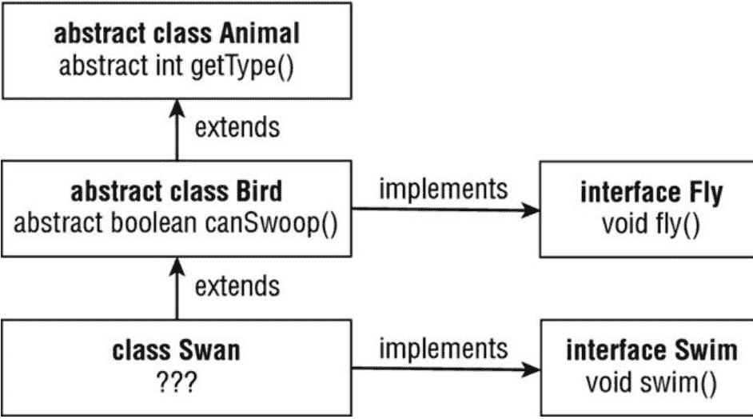

图 9.3 接口继承

`Swan` 类继承了四个方法：公共的 `fly()` 和 `swim()` 方法，以及包私有的 `getType()` 和 `canSwoop()` 方法。

让我们来看另一个涉及实现接口的抽象类的示例：

```java
public interface HasTail {
    public int getTailLength();
}
```

```java
public interface HasWhiskers {
    public int getNumberOfWhiskers();
}
```

```java
public abstract class HarborSeal implements HasTail, HasWhiskers {
}
```

```java
public class CommonSeal extends HarborSeal { // 无法编译
}
```

`HarborSeal` 类被标记为抽象类，因此不需要实现从 `HasTail` 和 `HasWhiskers` 继承的任何抽象方法。继承 `HarborSeal` 的具体类 `CommonSeal` 则要求实现所有继承的抽象方法。在这个示例中，`CommonSeal` 没有为继承的抽象接口方法提供实现，因此 `CommonSeal` 无法编译。

## 类与接口关键字的混合

考试出题者喜欢混合类和接口术语的题目。虽然类可以实现接口，但类不能扩展接口。同样，虽然接口可以扩展另一个接口，但接口不能实现另一个接口。以下示例说明了这些原则：

```java
public interface CanRun {}
public class Cheetah extends CanRun {}  // 无法编译
```

```java
public class Hyena {}
public interface HasFur extends Hyena {}  // 无法编译
```

第一个示例显示了一个类试图扩展一个接口，导致无法编译。第二个示例显示了一个接口试图扩展一个类，这同样无法编译。请注意考试中可能会混合类和接口的定义。以下是在声明中关联类和接口的唯一有效语法：

```
class1 extends class2
interface1 extends interface2, interface3, ... 
class1 implements interface2, interface3, ...
```

## 重复的接口方法声明

由于 Java 允许通过接口实现多继承，你可能会好奇如果定义一个继承自两个包含相同抽象方法的接口的类会发生什么。

```java
public interface Herbivore {
    public void eatPlants();
}
```

```java
public interface Omnivore {
    public void eatPlants();
    public void eatMeat();
}
```

在这种情况下，由于两个接口方法 `eatPlants()` 的签名是重复的。由于它们具有相同的方法声明，它们也被认为是兼容的。所谓兼容，是指编译器可以解析这两个声明之间的差异，而不会发现任何冲突。你可以定义一个同时满足这两个接口的类。

```java
public class Bear implements Herbivore, Omnivore {
    public void eatMeat() {
        System.out.println("Eating meat");
    }
    public void eatPlants() {
        System.out.println("Eating plants");
    }
}
```

正如我们之前说的，接口仅仅定义了实现它们的类必须遵循的一组规则。如果两个抽象接口方法具有相同的行为——在本例中，具有相同的方法声明——你只需要能够创建一个方法来同时重写这两个继承的抽象方法即可。

如果重复方法的签名不同会怎样？如果方法名相同但输入参数不同，则没有冲突，因为这被认为是方法重载。我们在下面的示例中演示了这一原则：

```java
public interface Herbivore {
    public int eatPlants(int quantity);
}
```

```java
public interface Omnivore {
    public void eatPlants();
}
```


```java
public class Bear implements Herbivore, Omnivore {
    public int eatPlants(int quantity) {
        System.out.println("Eating plants: "+quantity);
        return quantity;
    }
    public void eatPlants() {
        System.out.println("Eating plants");
    }
}
```

在这个示例中，我们看到实现两个接口的类必须提供两个版本 `eatPlants()` 的实现，因为它们被认为是独立的方法。

如果重复方法的签名相同但返回类型不同会怎样？在这种情况下，你需要回顾重写方法的规则。让我们尝试一个示例：

```java
interface Dances {
    String swingArms();
}
interface EatsFish {
    CharSequence swingArms();
}
```

```java
public class Penguin implements Dances, EatsFish {
    public String swingArms() {
        return "swing";
    }
}
```

在这个示例中，`Penguin` 类可以编译。`Dances` 版本的 `swingArms()` 方法在 `Penguin` 类中被自然重写，因为 `Dances` 和 `Penguin` 中的声明具有相同的方法声明。`EatsFish` 版本的 `swingArms()` 也被重写，因为 `String` 和 `CharSequence` 是协变返回类型。

让我们来看返回类型不协变的示例：

```java
interface Dances {
    int countMoves();
}
interface EatsFish {
    boolean countMoves();
}
public class Penguin implements Dances, EatsFish { // 无法编译
    ...
}
```

由于无法定义一个既返回 `int` 又返回 `boolean` 的 `countMoves()`，没有任何 `Penguin` 的实现允许其编译。这等同于定义一个继承自两个冲突类型的抽象类或接口，如下：

```java
interface Longars {
    int softSkin();
}
interface LongNose {
    void softSkin();
}
interface Donkey extends Longars, LongNose {} // 无法编译
abstract class Aardvark implements Longars, LongNose {} // 无法编译
```

此示例中的所有类型都是抽象的，没有具体的类。编译器检测到 `Donkey` 和 `Aardvark` 包含不兼容的方法，并阻止它们编译。

## 多态与接口

在第 8 章中，我们引入了多态，并展示了对象如何通过引用呈现许多形式。虽然许多相同的规则适用，但类可以继承多个接口的事实限制了编译器可以执行的一些检查。

## 抽象引用类型

在处理抽象类型时，你可能更倾向于使用抽象引用类型而不是具体类。这在定义方法参数时尤为常见。考虑以下实现：

```java
import java.util.*;
public class Zoo {
    public void sortAndPrintZooAnimals(List<String> animals) {
        Collections.sort(animals);
        for(String a : animals) {
            System.out.println(a);
        }
    }
}
```

## 接口转换

假设你有一个抽象引用类型变量，它由具体子类实例化。如果你需要访问仅在具体子类中声明的方法，那么你需要将接口引用转换为该类型，前提该转换在运行时是支持的。这让我们回到了第 8 章中讨论过的规则，即编译器不允许向无关类型进行转换。例如，下面的操作是不允许的，因为编译器检测到 `String` 和 `Long` 类无法关联：

```java
String lion = "Bert";
Long tiger = (Long)lion;
```

对于接口，编译器可以验证的内容存在限制。例如，下面的程序可以编译吗？

```java
interface Canine {}
class Dog implements Canine {}
class Wolf implements Canine {}

public class BadCasts {
    public static void main(String[] args) {
        Canine canine = new Wolf();
        Canine badDog = (Dog)canine;
    }
}
```

在该程序中，第 7 行创建了一个狼（wolf）对象并将其赋值给 `Canine` 引用类型。由于多态性，Java 无法确定第 8 行中 `canine` 实例的具体的类类型。因此，它允许这种到 `Dog` 引用类型的无效转换，尽管 `Dog` 和 `Wolf` 之间没有关系。代码可以编译，但在运行时会抛出 `ClassCastException`。

除了这个局限性，编译器可以强制执行关于接口转换的规则。编译器不允许将接口引用转换为未实现该接口的对象类型。例如，对第 8 行的以下更改会导致程序编译失败。

```java
Object badDog = (String)canine; // 无法编译
```

由于 `String` 没有实现 `Canine`，编译器识别出这种转换是不可能的。

## 接口与 instanceof 运算符

在第 3 章“运算符”中，我们展示了如果你尝试对两个不相关的类使用 `instanceof` 运算符，编译器将报告错误，如下所示：

```java
Number tickets = 4;
if(tickets instanceof String) {} // 无法编译
```

对于接口，编译器强制执行此规则的能力有限，因为即使引用类型可能没有实现某个接口，但它的某个子类可能会实现。例如，以下代码可以编译：

```java
Number tickets = 5;
if(tickets instanceof List) {}
```

尽管 `Number` 没有继承 `List`，但 `tickets` 变量可能指向一个继承了 `List` 的 `Number` 子类的引用。作为一个示例，`tickets` 变量可以被赋值为以下 `MyNumber` 类的实例（假设所有继承的方法都已实现）：

```java
public class MyNumber extends Number implements List {
}
```

话虽如此，如果引用是一个标记为 `final` 的类，编译器可以检查是否存在不相关的接口。

```java
Integer tickets = 6;
if(tickets instanceof List) {} // 无法编译
```

编译器拒绝了这段代码，因为 `Integer` 类被标记为 `final` 且没有继承 `List`。因此，创建一个继承 `List` 接口的 `Integer` 子类是不可能的。

## 复习接口规则

我们在本章的这部分总结了接口规则。如果你将此列表与抽象类定义的规则列表进行比较，前四条规则是相似的。

1. **接口定义规则**：接口不能实例化。
2. 所有顶级类型（包括接口）都不能标记为 `protected` 或 `private`。
3. 接口被假设是抽象的，且不能标记为 `final`。
4. 接口可以包含零或多个抽象方法。
5. 接口可以扩展任意数量的接口。
6. 接口引用可以转换为任何继承该接口的引用，尽管如果类之间没有关系，这在运行时可能会产生异常。
7. 只有当左侧引用是一个不继承该接口的 `final` 类时，编译器才会对右侧为接口的 `instanceof` 操作报告不相关的类型错误。
8. 带有主体的接口方法必须标记为 `default`、`private`、`static` 或 `private static`（在学习 1Z0-816 考试时涵盖）。

以下是在接口中定义的抽象方法的五条规则。

## 抽象接口方法规则

1. 抽象方法只能在抽象类或接口中定义。
2. 抽象方法不能声明为 `private` 或 `final`。
3. 抽象方法在声明它的抽象类中必须不能提供方法主体/实现。
4. 在子类中实现抽象方法遵循与重写方法的相同规则，包括协变返回类型、异常声明等。
5. 没有主体的接口方法被假设是抽象的且 `public` 的。

注意到了什么吗？无论定义在抽象类中还是接口中，抽象方法的前四条规则是完全相同的！你唯一需要为接口学习的新规则是最后一条。

最后，接口变量有两条规则需要记住。

## 接口变量规则

1. 接口变量被假设是 `public`、`static` 且 `final` 的。
2. 由于接口变量被标记为 `final`，因此在声明时必须初始化一个值。

将接口看作一种特殊的抽象类可能会很有帮助，因为它与抽象类共享许多相同的属性和规则。两者之间的主要区别在于接口包含隐式修饰符，不包含构造函数，不参与实例初始化过程，并且支持多继承。

## 定义成员内部类

成员**内部类**（inner class）是定义在类成员层级的类（与方法、实例变量和构造函数相同）。它是顶级类的相反面，因为除非它在另一个类内部，否则不能被声明。

如果两个类之间的关系非常紧密，开发者通常会在另一个类内部定义一个成员内部类。例如，动物园为顾客出售门票；因此，它可能想要管理 `Ticket` 对象的生命周期。

> 对于 1Z0-816 考试，你需要了解四种类型的嵌套类：成员内部类、局部类、匿名类和静态嵌套类。你还需了解更多关于成员内部类的细节。对于本章，我们将讨论限制在成员内部类的基础知识，因为这是你在 1Z0-815 考试中需要的全部内容。

## 使用成员内部类

成员内部类的一种使用方式是在外部类中调用。继续我们之前的示例，让我们在 `Zoo` 中定义一个使用内部类的方法。

```java
public class Zoo {
    interface Paper {
        String getId();
    }
    class Ticket implements Paper {
        private String serialNumber;
        public String getId() { return serialNumber; }
    }
    public Ticket sellTicket(String serialNumber) {
        Ticket t = new Ticket();
        t.serialNumber = serialNumber;
        return t;
    }
}
```

让我们为这个示例添加一个入口。

```java
public class Zoo {
    // ...
    public static void main(String[] args) {
        Zoo z = new Zoo();
        Object t = z.sellTicket("12345");
        System.out.println(t.getId() + " Ticket sold!");
    }
}
```

这段代码可以编译并在运行时打印 `12345 Ticket sold!`。对于 1Z0-815 考试，这就是你关于内部类需要了解全部。

## 总结

在本章中，我们介绍了类设计的高级主题，从抽象类开始。抽象类与普通类一样，只是它不能被实例化且可以包含抽象方法。抽象类可以扩展非抽象类，反之亦然。抽象类可以用于定义一个框架，开发者据此编写子类。

抽象方法是在声明时不包含主体的方法。抽象方法可以放置在抽象类或接口内部。接下来，抽象方法可以通过另一个抽象声明或具体实现进行重写，前提是遵循重写方法的规则。第一个具体类必须实现所有的方法，无论这些方法是继承自抽象类还是接口。

编译器通常可以防止向无关类型进行强制转换，但在处理接口时，它防止无效强制转换的能力有限。

我们通过对成员内部类的简要介绍结束了本章内容。对于考试，你应该能够识别成员内部类，并知道哪些访问修饰符是允许的。成员内部类与其他类型的嵌套类，将在你准备 1Z0-816 考试时进行更详细的介绍。

## 考试要点

- 能够编写创建和扩展抽象类的代码。在 Java 中，类和方法可以被声明为 `abstract`（抽象）的。抽象类不能被实例化。抽象类的实例只能通过具体的子类获得。抽象类可以包含任意数量（包括零个）的抽象方法和非抽象方法。抽象方法遵循所有的重写规则，并且只能定义在抽象类中。抽象类的第一个具体子类必须实现所继承的方法。抽象类和抽象方法不能标记为 `final`（最终的）。
- 能够编写创建、扩展和实现接口的代码。接口是特殊的抽象类型，侧重于抽象方法和常量变量。接口可以扩展任意数量的接口，并由此继承其抽象方法。接口不能扩展类，类也不能扩展接口。类可以实现任意数量的接口。
- 了解编译器自动应用于接口的隐式修饰符。所有接口都被假设是抽象的。没有主体的接口方法被假设是 `public` 且 `abstract` 的。接口变量被假设是 `public`、`static` 且 `final`，并在声明时初始化。使用与这些隐式修饰符冲突的修饰符会导致编译器错误。
- 区分顶层类与内部类/接口，并知道哪些访问修饰符是允许的。顶层类或接口不是定义在另一个类声明内部，而内部类或接口是定义在另一个类内部。内部类可以标记为 `public`、`protected`、`package-private`（包私有）或 `private`。

# 复习题

1. 哪些修饰符隐式应用于所有未声明主体的接口方法？（选择所有可能的选项。）

   - A. protected
   - B. public
   - C. static
   - D. void
   - E. abstract
   - F. default

2. 下述哪些语句可以插入空行并使代码成功编译？（选择所有可能的选项。）

   ```java
   interface CanHop {}
   public class Frog implements CanHop {
       public static void main(String[] args) {
           __________ frog = new TurtleFrog();
       }
       class BrazilianHornedFrog extends Frog {}
       class TurtleFrog extends Frog {}
   }
   ```

   - A. Frog
   - B. TurtleFrog
   - C. BrazilianHornedFrog
   - D. CanHop
   - E. Object
   - F. Long
   - G. 以上均不是；代码包含编译错误。

3. 关于具体类，以下哪些说法是正确的？（选择所有可能的选项。）

   - A. 具体类可以被声明为 `abstract`。
   - B. 具体类必须实现所有继承的抽象方法。
   - C. 具体类可以被标记为 `final`。
   - D. 如果一个具体类从它的一个父类继承了接口，那么它必须为该接口定义的所有方法声明实现。
   - E. 实现抽象方法的具体方法必须与抽象方法的声明完全匹配。

4. 关于以下程序，哪些陈述是正确的？（选择所有可能的选项。）

   ```java
   1: interface HasExoskeleton {
   2:     double size = 2.0f;
   3:     abstract int getNumberOfSections();
   4: }
   5: abstract class Insect implements HasExoskeleton {
   6:     abstract int getNumberOfLegs();
   7: }
   8: public class Beetle extends Insect {
   9:     int getNumberOfLegs() { return 6; }
   10:    int getNumberOfSections(int count) { return 3; }
   11: }
   ```

   - A. 编译无问题。
   - B. 代码在运行时会产生 `ClassCastException`。
   - C. 代码因为第 2 行无法编译。
   - D. 代码因为第 5 行无法编译。
   - E. 代码因为第 8 行无法编译。
   - F. 代码因为第 10 行无法编译。

5. 哪些修饰符隐式应用于所有接口变量？（选择所有可能的选项。）

   - A. private
   - B. nonstatic
   - C. final
   - D. const
   - E. abstract
   - F. public
   - G. default (package-private)

6. 关于以下程序，哪些陈述是正确的？（选择所有可能的选项。）


## 6. 关于以下程序，哪些陈述是正确的？（选择所有可能的选项。）

```java
1: public abstract interface Herbivore {
2: int amount = 10;
3: public void eatGrass() { return 13; }
4: public abstract int chew() {
5: }
6:
7: abstract class ISPlant extends Herbivore {
8: Object eatGrass(int season) { return null; }
9: }
```

- A. 编译并运行无问题。
- B. 代码因为第 1 行无法编译。
- C. 代码因为第 2 行无法编译。
- D. 代码因为第 4 行无法编译。
- E. 代码因为第 7 行无法编译。

## 7. 关于以下程序，哪些陈述是正确的？（选择所有可能的选项。）

```java
1: public abstract interface Herbivore {
2: int amount = 10;
3: public void eatGrass() { return 13; }
4: public abstract int chew() {
5: }
6:
7: abstract class ISPlant extends Herbivore {
8: Object eatGrass(int season) { return null; }
9: }
```

- A. 编译并运行无问题。
- B. 代码因为第 1 行无法编译。
- C. 代码因为第 2 行无法编译。
- D. 代码因为第 4 行无法编译。
- E. 代码因为第 7 行无法编译。

## 7. 关于以下程序，哪些陈述是正确的？（选择所有可能的选项。）

```java
1: interface HasExoskeleton
2: double size = 2.0f;
3: abstract int getNumberOfSections();
4: }
5: abstract class Insect implements HasExoskeleton
6: abstract int getNumberOfOfLegs();
7: }
8: public class Beetle extends Insect {
9: int getNumberOfOfLegs() { return 6; }
10: int getNumberOfSections(int count) { return 3 }
11: }
```

- A. 编译无问题。
- B. 代码在运行时会产生 `ClassCastException`。
- C. 代码因为第 2 行无法编译。
- D. 代码因为第 5 行无法编译。
- E. 代码因为第 8 行无法编译。
- F. 代码因为第 10 行无法编译。

## 7. 关于以下程序，哪些陈述是正确的？（选择所有可能的选项。）

```java
1: public abstract interface Herbivore {
2: int amount = 10;
3: public void eatGrass() { return 13; }
4: public abstract int chew() {
5: }
6:
7: abstract class ISPlant extends Herbivore {
8: Object eatGrass(int season) { return null; }
9: }
```

- A. 编译并运行无问题。
- B. 代码因为第 1 行无法编译。
- C. 代码因为第 2 行无法编译。
- D. 代码因为第 4 行无法编译。
- E. 代码因为第 7 行无法编译。

## 7. 关于以下程序，哪些陈述是正确的？（选择所有可能的选项。）

```java
1: interface HasExoskeleton
2: double size = 2.0f;
3: abstract int getNumberOfSections();
4: }
5: abstract class Insect implements HasExoskeleton
6: abstract int getNumberOfOfLegs();
7: }
8: public class Beetle extends Insect {
9: int getNumberOfOfLegs() { return 6; }
10: int getNumberOfSections(int count) { return 3 }
11: }
```

- A. 编译无问题。
- B. 代码在运行时会产生 `ClassCastException`。
- C. 代码因为第 2 行无法编译。
- D. 代码因为第 5 行无法编译。
- E. 代码因为第 8 行无法编译。
- F. 代码因为第 10 行无法编译。

## 7. 关于以下程序，哪些陈述是正确的？（选择所有可能的选项。）

```java
1: public abstract interface Herbivore {
2: int amount = 10;
3: public void eatGrass() { return 13; }
4: public abstract int chew() {
5: }
6:
7: abstract class ISPlant extends Herbivore {
8: Object eatGrass(int season) { return null; }
9: }
```

- A. 编译并运行无问题。
- B. 代码因为第 1 行无法编译。
- C. 代码因为第 2 行无法编译。
- D. 代码因为第 4 行无法编译。
- E. 代码因为第 7 行无法编译。


```java
6: public static void main(String[] args) {
7: Whale whale = new Orca();
8: whale.dive(3);
9: }
10: }
11: class Orca extends Whale {
12: public void dive() {
13: System.out.println("Orca diving");
14: }
15: public void dive(int... depth) {
16: System.out.println("Orca diving deeper " + MAX);
17: }
```

- A. Orca diving
- B. Orca diving deeper 3
- C. 代码因为第 2 行无法编译。
- D. 代码因为第 4 行无法编译。
- E. 代码因为第 11 行无法编译。
- F. 代码因为第 16 行无法编译。

### 14. 关于抽象类和接口，哪些描述是正确的？（选择所有适用项）

- A. 都可以使用 `extends` 关键字进行扩展。
- B. 它们内部的所有方法都被假认为是抽象的。
- C. 两者都可以包含 `public static final` 变量。
- D. 如果没有声明方法体的方法没有标记为抽象，编译器会自动为其插入隐式的 `abstract` 修饰符。
- E. 接口和抽象类都可以用 `abstract` 修饰符声明。
- F. 两者都继承自 `java.lang.Object`。

### 15. 下述代码的结果是什么？

```java
1: abstract class Bird {
2: private final void fly() {
    System.out.println("Bird");
3: protected Bird() { System.out.print("Wow-"); }
4: }
5: public class Pelican extends Bird {
6: public Pelican() { System.out.print("Oh-"); }
7: protected void fly() {
    System.out.println("Pelican");
8: public static void main(String[] args) {
9: var chirp = new Pelican();
10: chirp.fly();
11: } }
```

- A. Oh-Bird
- B. Oh-Pelican
- C. Wow-Oh-Bird
- D. Wow-Oh-Pelican
- E. 代码包含编译错误。
- F. 以上均不是

### 16. 关于此程序，以下哪些说法是正确的？

```java
1: interface Aquatic {
2: int getNumGills(int p);
3: }
4: public class ClownFish implements Aquatic {
5: String getNumOfGills() { return "14"; }
6: int getNumOfGills(int input) { return 15; }
7: public static void main(String[] args) {
8: System.out.println(new ClownFish().getNumOfGills(-1));
9: }
```

- A. 编译并打印 14。
- B. 编译并打印 15。
- C. 代码因为第 4 行无法编译。
- D. 代码因为第 5 行无法编译。
- E. 代码因为第 6 行无法编译。
- F. 以上均不是

### 17. 关于顶层类型和成员内部类，哪些描述是正确的？（选择所有适用项）

- A. 成员内部类可以标记为 `final`。
- B. 顶层类型可以标记为 `protected`。
- C. 成员内部类不能标记为 `public`，因为那会使其变成顶层类。
- D. 顶层类型必须存储在 `.java` 文件中，且文件名与类名匹配。
- E. 如果成员内部类被标记为 `private`，则它只能在定义它的外部类中引用。

### 18. 标记为 x 和 z 的行可以插入什么类型以使代码通过编译？（选择所有适用项）

```java
interface Walk { public List move(); }
interface Run extends Walk { public ArrayList move(); }
public class Leopard {
public ____ move() { // X
return null;
}

public class Panther implements Run {
public ____ move() { // Z
return null;
}
```

- A. 标记为 x 的行使用 `Integer`
- B. 标记为 x 的行使用 `ArrayList`
- C. 标记为 z 的行使用 `List`
- D. 标记为 z 的行使用 `ArrayList`
- E. 以上都不是，因为 `Run` 接口无法编译。
- F. 代码因为其他原因无法编译。

### 19. 关于接口，哪些描述是正确的？（选择所有适用项）

- A. 类不能扩展多个接口。
- B. Java 通过接口实现了真正的多继承。
- C. 接口不能被声明为 `abstract`。
- D. 如果接口不包含构造函数，编译器会自动插入一个。
- E. 接口可以扩展多个接口。
- F. 接口不能实例化。

### 20. 下列类和接口哪些是正确且可以编译的？（选择所有适用项）

```java
abstract class Camel {
    void travel();
}
interface EatsGrass {
    protected int chew();
}
abstract class Elephant {
    abstract private class SleepsAlot {
        abstract int sleep();
    }
}
class Eagle {
    abstract soar();
}
```

- A. SleepsAlot
- B. Eagle
- C. Camel
- D. Elephant
- E. EatsGrass

# 第 10 章 异常

## 异常

本章涵盖的目标：

- 处理异常
- 区分受检异常（checked exceptions）和未检异常（unchecked exceptions）
- 创建 `try-catch` 块
- 确定异常如何影响流程

 {
        System.out.println(args[0]);
        System.out.println(args[1]);
    }
}
```

然后你在没有足够参数的情况下调用了它：

```
$ javac Zoo.java
$ java 4 Zoo Zoo
```

在第 4 行，Java 意识到数组中只有一个元素，索引 1 是不允许的。Java 摊开手表示投降并抛出了异常。它没有尝试处理异常。它只是说“我无法处理”，并显示了异常：

```
Zoo
Exception in thread "main"
java.lang.ArrayOutOfBoundsException: Index 1 out of bounds for length 1
at Zoo.main(Zoo.java:4)
```

## 返回码 vs. 异常

当“出现某些问题”时会使用异常。然而，“问题”这个词是主观的。如果未找到匹配项，以下代码将返回 -1 而不是抛出异常：

```java
public int indexOf(String[] names, String name) {
  for (int i = 0; i < names.length; i++) {
    if (names[i].equals(name)) { return i; }
  }
  return -1;
}
```

这种方法在编写搜索方法时很常见。例如，想象你被要求在数组中找到名为 "Joe" 的名字。Joe 可能不在数组中，这是完全合理的。当这种情况发生时，会返回一个特殊值。异常应该预留给特殊情况，例如名称为 `null`。

通常情况下，尽量避免使用返回码。返回码通常用于搜索，因此程序员对它们有所预期。在其他方法中，你返回一个特殊值会令调用者感到意外。异常会强制程序处理该问题，或者在未被处理时通过异常结束程序；而返回码可能会被意外忽略，并在程序的后部分引起问题。更糟的是，返回值可能与真实数据混淆。在学校的语境下，-1 代表错误，还是从班级中移除的学生人数？异常就像在大声喊：“处理我！”，并避免了可能的歧义。

## 理解异常类型

我们已经解释过，异常是一种改变程序执行流的事件。Java 有一个 `Throwable` 超类，用于表示这些事件的所有对象。并不是所有对象的类名都包含“exception”这个词，这可能会引起混淆。图 10.1 显示了 `Throwable` 的关键子类。

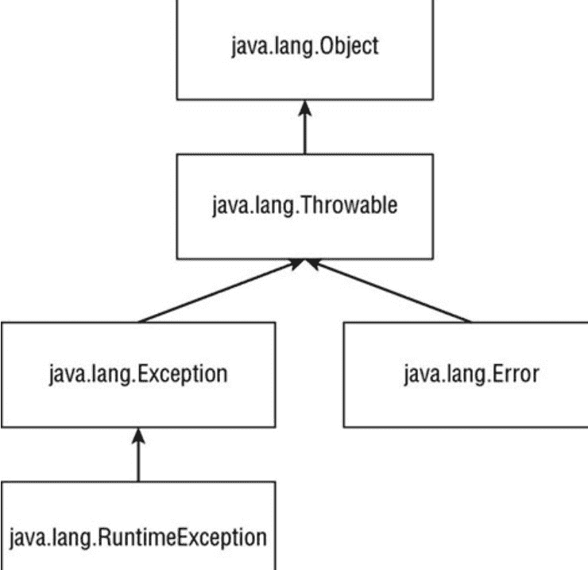

**图 10.1** 异常分类

`Error` 表示发生了严重的错误，导致你的程序不应该尝试从中恢复。例如，磁盘驱动器“消失”了或程序内存耗尽。这些是你可能遇到且无法恢复的异常状况。

对于考试来说，你关于 `Throwable` 需要知道的就是它是所有异常（包括 `Error` 类）的父类。虽然你可以处理 `Throwable` 和 `Error` 异常，但不建议在应用程序代码中这样做。在本章中，当我们谈及异常时，通常指的是任何继承自 `Throwable` 的类，尽管我们几乎总是在处理 `Exception` 类或其子类。

### 检查异常 (Checked Exceptions)

检查异常是在抛出它的应用程序代码中必须声明或处理的异常。在 Java 中，所有检查异常都继承自 `Exception`，但不继承自 `RuntimeException`。检查异常往往更具可预期性——例如，尝试读取一个不存在的文件。

> 注意：检查异常包括任何继承自 `Throwable` 的类，但不包括 `Error` 或 `RuntimeException`。例如，直接扩展 `Throwable` 的类将是一个检查异常。但对于考试，你只需要知道扩展自 `Exception` 的检查异常即可。

检查异常？我们在检查什么？Java 有一条规则称为“处理或声明规则”（handle or declare rule）。“处理或声明规则”意味着，所有可能被抛出的检查异常必须被封装在兼容的 `try` 和 `catch` 块中，或者在方法签名中声明。

由于检查异常通常是可预见的，Java 强制执行这样一条规则：程序员必须采取某些措施来表明已经考虑过该异常。也许它在方法中被处理了。也许该方法声明它无法处理该异常，应该由其他人来处理。

> 注意：虽然只有检查异常，但未检查异常（我们将在下一节介绍）也可以被处理或声明。区别在于，检查异常必须被处理或声明，而未检查异常可以选择地被处理或声明。

让我们来看一个例子。以下 `fall()` 方法声明了它可能会抛出一个 `IOException`，这是一个检查异常：

```java
void fall(int distance) throws IOException {
  if(distance > 10) {
    throw new IOException();
  }
}
```

注意你这里使用了两个不同的关键字。`throw` 关键字告诉 Java 你想要抛出一个 `Exception`，而 `throws` 关键字只是声明该方法可能会抛出一个 `Exception`。它也可能不抛出。你将在章节后面再次看到 `throws` 关键字。

现在你已经知道如何声明异常，那么该如何处理它呢？以下 `fall()` 方法的备版本处理了异常：

```java
void fall(int distance) {
  try {
    if(distance > 10) {
      throw new IOException();
    }
  } catch (Exception e) {
    e.printStackTrace();
  }
}
```

注意 `catch` 语句使用的是 `Exception` 而不是 `IOException`。由于 `IOException` 是 `Exception` 的子类，`catch` 块允许捕获它。我们将在本章后面详细介绍 `try` 和 `catch` 块。

### 未检查异常 (Unchecked Exceptions)

未检查异常是指任何不需要抛出它的应用程序代码中声明或处理的异常。未检查异常通常被称为运行时异常，尽管在 Java 中，未检查异常包括任何继承自 `RuntimeException` 或 `Error` 的类。

运行时异常定义为 `RuntimeException` 类及其子类。运行时异常通常是意外的，但不一定是致命的。例如，访问无效的数组索引是意外的。尽管它们继承了 `Exception` 类，但它们不是检查异常。

#### 运行时 vs. 程序运行时

运行时（未检查）异常是特定类型的异常。所有异常都发生在程序运行时（另一种是编译时）。人们不称它们为“运行时”异常，因为那太容易与检查性异常混淆了。当你看到运行时（runtime）时，意味着未检查的。

未检查异常可以发生在几乎任何代码行。由于我们在 Java 中频繁处理对象，如果到处都要声明未检查异常，每个方法都会变得臃肿！如果不声明它们，代码将可以通过编译。例如：

```java
void fall(String input) {
    System.out.println(input.toLowerCase());
}
```

### 检查与未检查（运行时）异常

过去，开发者比现在更多检查异常。根据 Oracle 的说法，它们用于程序员预计可以恢复的问题。然后开发者开始使用未检查异常。许多程序员对哪种方法更好存在争议。对于考试，你需要知道检查与未检查异常函数的规则。你不需要在哲学上决定异常应该是检查还是未检查的。

## 抛出异常

任何 Java 代码都可以抛出异常；这包括你编写的代码。考试仅限于他人创建的异常。很大可能，它们是 Java 提供的异常。你可能会遇到为了考试而虚构的异常。这没关系。题目会通过类名以 `Exception` 结尾来明确这些是异常。例如，`MyMadeUpException` 显然是一个异常。

在考试中，你会看到两种导致异常的代码类型。第一种是错误的。这里有一个例子：

```java
String[] animals = new String[0];
System.out.println(animals[0]);
```

这段代码会抛出 `ArrayOutOfBoundsException`，因为数组没有元素。这意味着关于异常的问题可能隐藏在看似其他的问题中。

> 在考试中，许多题目包含编译和抛出异常的选择。特别注意在空引用上调用方法或引用无效数组或 List 索引的代码。如果你发现了这些，你就知道正确答案是代码在运行时抛出了异常。

代码导致异常的第二种方式是显式请求 Java 抛出一个。Java 允许你编写这样的语句：

```java
throw new Exception();
throw new Exception("Ow! I fell.");
throw new RuntimeException();
throw new RuntimeException("Ow! I fell.");
```

`throw` 关键字告诉你想代码的其他部分来处理该异常。这就像小女孩哭着找爸爸一样。需要其他人来决定如何处理这个异常。

### throw 与 throws 的区别

每当你在考试中看到 `throw` 或 `throws` 时，请务必确保使用了正确的一个。`throw` 关键字作为代码块内部的语句，用于抛出一个新异常或重新抛出一个已有的异常；而 `throws` 关键字仅用于方法声明的末尾，用于指示该方法支持哪些异常。在考试中，你可能开始阅读一个很长的类定义，结果发现由于使用了错误的关键字导致整个代码无法编译。

在创建异常时，你通常可以传递一个带有消息的 `String` 参数，也可以不传递任何参数并使用默认值。我们之所以说“通常”，是因为这是一种约定。有人可能会创建一个不包含接收消息的构造函数的异常类。前两个示例创建了 `Exception` 类型的新对象并将其抛出。最后两个示例显示，无论你抛出哪种类型的异常，代码看起来都是相同的。

此外，你应该知道 `Exception` 是一个对象（Object）。这意味着你可以将其存储在变量中，这是合法的：

```java
Exception e = new RuntimeException();
throw e;
```

这段代码在第一行实例化异常，在下一行将其抛出。异常可以来自任何地方，甚至是传递给方法的。只要它是有效的异常，就可以被抛出。

考试还可能尝试陷你。你看出为什么这段代码无法编译了吗？


```
throw RuntimeException(); // 无法编译
```

如果你的答案是缺少了一个关键字，那么你完全正确。异常永远不会使用 `new` 关键字来实例化。

让我们来看另一个考试可能设置陷阱的地方。你认看出为什么以下代码无法编译吗？

```
3: try {
4:     throw new RuntimeException();
5:     throw new ArrayIndexOutOfBoundsException(); // 无法编译
6: } catch (Exception e) {
7: }
```

由于第 4 行抛出了异常，在运行时永远无法到达第 5 行。编译器会识别并报告一个不可达的错误（unreachable error）。

异常的类型非常重要。请务必记住表 10.1 中的所有内容。记住 `Throwable` 要么是 `Exception`，要么是 `Error`。你不应该在代码中直接捕获 `Throwable`。

### 10.1 异常与错误的类型

| 类型 | 如何识别 | 程序可以捕获吗？ | 程序必须处理或声明吗？ |
|---|---|---|---|
| Runtime | `RuntimeException` 的子类 | 是 | 否 |
| Checked | `Exception` 的子类但不是 `RuntimeException` 的子类 | 是 | 是 |
| Error | `Error` 的子类 | 否 | 否 |

## 识别异常类

考试你需要识别三组异常：`RuntimeException`、检查 `Exception` 和 `Error`。我们将查看每种类型的常见示例。在考试中，你需要识别它是哪种异常，以及它是由 Java 虚拟机 (JVM) 还是程序员抛出的。为了方便你识别，我们将展示这些异常的某些代码示例。对于某些异常，你还需要知道它们之间是相互继承的。

## RuntimeException 类

`RuntimeException` 及其子类是未检查异常（unchecked exceptions），不需要处理或声明。它们可以由程序员或 JVM 抛出。常见的 `RuntimeException` 类包括：

- `ArithmeticException`：当代码尝试除以 0 时
- `ArrayIndexOutOfBoundsException`：当代码使用非法索引访问数组时
- `ClassCastException`：当尝试将对象转换为其不是其实实例的类时抛出
- `NullPointerException`：当在需要对象的地方出现空引用时抛出
- `IllegalArgumentException`：由程序员抛出，用于指示方法传递了非法或不适当的参数
- `NumberFormatException`：`IllegalArgumentException` 的子类，当尝试将字符串转换为数值类型但字符串格式不正确时抛出

## ArithmeticException

尝试将一个 int 除以 0 会得到一个未定义的结果。当发生这种情况时，JVM 将抛出 `ArithmeticException`：

```
int answer = 11 / 0;
```

运行这段代码将产生以下输出：

```
Exception in thread "main" java.lang.ArithmeticException: / by zero
```

Java 没有写出 divide（除法）这个词。不过没关系，因为我们知道 `/` 是除法运算符，Java 正在试图告诉你发生了除以零的操作。

线程 "main" 告诉你代码是直接或间接从一个带有 main 方法的程序调用的。在考试中，这就是你将看到的所有输出。接下来是异常名称，随后是与异常相关的额外信息（如果有）。

## ArrayIndexOutOfBoundsException

你现在知道数组索引是从 0 开始，到数组长度减 1——这意味着这段代码将抛出 `ArrayIndexOutOfBoundsException`：

```
int[] countsOfMoose = new int[3];
System.out.println(countsOfMoose[-1]);
```

这是一个问题，因为不存在负数数组索引。运行代码产生以下输出：

```
Exception in thread "main"
java.lang.ArrayIndexOutOfBoundsException:
Index -1 out of bounds for length 3
```

至少 Java 告诉了我们索引为何无效。你能看出这个代码哪里有问题吗？

```
int total = 0;
int[] countsOfMoose = new int[3];
for (int i = 0; i <= countsOfMoose.length; i++)
    total += countsOfMoose[i];
```

问题是循环应该使用 `<` 而不是 `<=`。在循环的最后一次迭代中，Java 抛出了 `ArrayIndexOutOfBoundsException`。输出如下：

```
Exception in thread "main"
java.lang.ArrayIndexOutOfBoundsException:
Index 3 out of bounds for length 3
```

## ClassCastException

当程序对类型不满意时会抛出异常。当运行时转换失败时，Java 会抛出 `ClassCastException`：

```
String type = "moose";
Integer number = (Integer) type;
```

```
Exception in thread "main" java.lang.ClassCastException: "moose" cannot be cast to Integer
```

## NullPointerException

实例变量和方法必须在空引用上调用。如果引用为空，JVM 将抛出 `NullPointerException`。这通常是微妙的，例如下面的示例，实例引用默认为为空：

```
String name;
public void printLength() {
  System.out.println(name.length());
}
```

```
Exception in thread "main" java.lang.NullPointerException
```

## IllegalArgumentException

`IllegalArgumentException` 是程序保护自身的一种方式。你在第7章“方法与封装”中先看到了下面的 setter 方法：

```
6: public void setNumberEggs(int numberEggs) { // setter
7:     if (numberEggs >= 0) // 保护条件
8:         this.numberEggs = numberEggs;
9: }
```

这段代码可以运行，但当有人告诉你有 -2 个蛋时，你不想忽略调用者的请求。你想告诉调用者出问题了——最好用调用者无法忽略明显方式。异常是实现此点的有效方法。看到代码以异常结束是一个极佳的提醒：

```java
public void setNumberEggs(int numberEggs) {
    if (numberEggs < 0) {
        throw new IllegalArgumentException(" eggs must not be negative");
    }
    this.numberEggs = numberEggs;
}
```

```
Exception in thread "main"
java.lang.IllegalArgumentException:  eggs must not be negative
```

## NumberFormatException

Java 提供了将字符串转换为数字的方法。当这些方法接收到无效值时，它们会抛出 `NumberFormatException`。这与 `IllegalArgumentException` 类似。由于这是一个常见问题，Java 给它一个单独类。事实上，`NumberFormatException` 是 `IllegalArgumentException` 的子类。这里有一个尝试将非数字内容转换为 int 的示例：

```
Integer.parseInt("abc");
```

```
Exception in thread "main" java.lang.NumberFormatException: For input string: "abc"
```

## 线程 "main" 中的异常

```
java.lang.NumberFormatException: For input string: "abc"
```

对于考试，你需要知道 `NumberFormatException` 是 `IllegalArgumentException` 的子类。我们将在章节后后部分介绍更多关于为什么这很重要。

## 检查异常类 (Checked Exception Classes)

检查异常的层级结构中包含 `Exception` 但不包含 `RuntimeException`。它们必须被处理或声明。常见的检查异常包括：

- `IOException`：当读取文件出现问题时，由程序化抛出。
- `FileNotFoundException`：`IOException` 的子类，当代码尝试引用不存在的文件时由程序化抛出。

对于考试，你需要知道这两者都是检查异常。你还需要知道 `FileNotFoundException` 是 `IOException` 的子类。你很快就会看到这为什么很重要。

## 错误类 (Error Classes)

错误是自 `Error` 类的未检查异常。它们由 JVM 抛出，不应该被处理或声明。错误很少见，但你可能会看到这些：

- `ExceptionInitializerError`：当静态初始化器抛出异常且未处理时抛出。
- `StackOverflowError`：当方法调用自身次数过多时抛出（这被称为无限递归，因为方法通常无休止地调用自己）。
- `NoClassDefFoundError`：当代码使用的类在编译时可用但在运行时不可时抛出。

### ExceptionInitializerError

Java 在第一次使用一个类时运行静态初始化器。如果其中一个静态初始化器抛出异常，Java 就无法开始使用该类。它通过抛出 `ExceptionInInitializerError` 来宣告失败。以下代码在静态初始化器中抛出了一个 `ArrayIndexOutOfBoundsException`：

```
static {
    int[] countsOfMoose = new int[3];
    int num = countsOfMoose[-1];
}
static void main(String... args) {
```

这段代码输出了关于该错误以及后续异常的信息：

```
Exception in thread "main"
java.lang.ExceptionInInitializerError
used by: java.lang.ArrayIndexOutOfBoundsException: -1 out of bounds for length 3
```

执行时，你会得到一个 `ExceptionInInitializerError`，因为错误发生在静态初始化器中。仅凭这些信息对于解决问题并不特别有用。Java 还会告诉你问题的原始原因：你需要修复的 `ArrayIndexOutOfBoundsException`。

`ExceptionInInitializerError` 是一个错误，因为 Java 未能加载整个类。这种失败阻止了 Java 的继续运行。

## OverflowError (溢出错误)

当 Java 调用方法时，会将参数和局部变量放在栈上。在执行大量次数后，栈空间耗尽并溢出。这被称为 `StackOverflowError`。大多数情况下，此错误在方法调用自身时发生。

```
public static void doNotCodeThis(int num) {
    doNotCodeThis(1);
}
```

输出包含这一行：

```
Exception in thread "main" java.lang.StackOverflowError
```

由于方法调用了自身，它永远不会结束。最终，Java 栈上的空间耗尽并抛出此错误。这被称为无限递归。这比无限循环好，因为至少 Java 会捕获它并抛出错误。如果是无限循环，Java 只会占用你所有的 CPU 直到你杀死程序。

## NoClassDefFoundError (类定义未错误)

当 Java 在运行时找不到类时，会发生 `NoClassDefFoundError`。通常，这意味着编译时可用的库在代码执行时不可用。

## 处理异常 (Handling Exceptions)

当你遇到异常时该怎么办？你如何处理或从异常中恢复？在本节中，我们将展示 Java 中用于支持处理异常并确保某些代码（如关闭资源）始终执行的各种语句。

## 使用 try 和 catch 语句 (Using try and catch Statements)

现在你已经知道异常是什么，让我们探索如何处理它们。Java 使用 `try` 语句将可能抛出异常的逻辑与处理该异常的逻辑隔离开。图 10.2 显示了 `try` 语句的语法。

### try 关键字

```
try {
  // 受保护的代码
} catch (exception_type identifier) {
  // 异常处理器
}
```

- `catch` 关键字
- 异常对象的标识符
- 正在被捕获的异常类型
- 必须的大括号。

图 10.2 `try` 语句的语法

`try` 块中的代码正常运行。如果任何语句抛出了可以被 `catch` 块列出的异常类型捕获的异常，`try` 块将停止运行，执行跳转到 `catch` 语句。如果 `try` 块中没有任何语句抛出可以被捕获的异常，则 `catch` 子句不会运行。

你很敏注意到 `block`（块）和 `clause`（子句）这两个词互换使用。考试也是如此，所以请习惯它。两者都是正确的。`block` 是正确的，因为存在大括号；`clause` 是正确的，因为它们是 `try` 语句的一部分。

这里并没有大量的语法规则。`try` 和 `catch` 块需要大括号。

在我们的示例中，小女孩在第一次跌倒时自己站了起来。它看起来像这样：

```
3: void explore() {
4:   try {
5:     fall();
6:     System.out.println("never get here");
7:   } catch (RuntimeException e) {
8:     getUp();
9:   }
10:  seeAnimals();
11: }
12: void fall() {  throw new RuntimeException(); }
```

首先，第 5 行调用 `fall()` 方法。第 12 行抛出一个异常。这意味着 Java 直接跳转到 `catch` 块，跳过了第 6 行。女孩在第 8 行站了起来。现在 `try` 语句结束，执行通过第 10 行正常继续。

现在，让我们看看可以被 `catch` 块列出的异常类型捕获的无效 `try` 语句。你看到这一个有问题了吗？

```
try // 编译
();
catch (Exception e
System...println("get up");
```

问题是缺少大括号 `{}`。它需要像这样：

```
try {
    fall();
} catch (Exception e) {
    System.out.println("get up");
}
```

`try` 语句即使代码内部只有一个语句，也需要大括号，而语句和循环是特殊的，允许你省略大括号。

这一个呢？

```
try // 编译
fall();
}
```

这段代码无法通过编译，因为 `try` 块后面不能有任何内容。记住 `try` 语句的点在于当抛出异常时某些代码能运行。另一个子句 `try` 语句是孤立的。正如你很快就会看到，有一种特殊的 `try` 语句包含 `finally` 块，尽管其语法非常不同。

## 异常接块 (Chaining catch Blocks)

到目前为止，你只捕获一种类型的异常。现在让我们看看当不同类型的异常可以从同一个 `try/catch` 块抛出时会发生什么。

对于考试，你不会被要求创建自己的异常，但可能会给你异常类并让你理解它们如何运行。这里是处理它们的方法。首先，你必须识别异常是检查异常还是未检查异常。其次，你需要判断异常之间是否存在子类关系。

```java
class AnimalsForwalk extends RuntimeException {}

class ExhibitClosed extends RuntimeException {}

class ExhibitClosedForLunch extends ExhibitClosed { }
```

在这个示例中，有三个自定义异常。它们直接或间接继承 `RuntimeException`，因此都是未检查异常。现在我们通过两个 `catch` 块连接异常类型，并通过打印适当的消息来处理它们：

```java
public void visitPorcupine() {
  try {
    seeAnimal();
  } catch (AnimalsForwalk e) { // 第一个 catch 块
    System.out.print("try back later");
  } catch (ExhibitClosed e) { // 第二个 catch 块
```


```java
System.out.print("not today");

}
}
```

当运行这段代码时，有三种可能性。如果 `seeAnimal()` 没有抛出异常，则什么都不会打印。如果动物在散步，则运行第一个 `catch` 块。如果展厅关闭了，则运行第二个 `catch` 块。当这样链联时，两个 `catch` 块都不可能执行。

`catch` 块的顺序存在一条规则。Java 按照它们出现的顺序进行检查。如果其中一个 `catch` 块无法被执行，就会发生不可达代码的编译错误。例如，当父类 `catch` 块出现在子类 `catch` 块之前时，就会发生这种情况。

... 块。记住，我们警告过你要注意任何子类异常。

在刺猬的例子中，`catch` 块的顺序可以反过来，因为这些异常之间互没有继承关系。而且，我们确实见过刺猬被牵着绳子散步。

下面的示例展示了相互继承的异常类型：

```java
public void visitMonkeys() {
  try {
    seeAnimal();
  } catch (ExhibitClosedLunch e) { // 子类异常
    System.out.print("try back later");
  } catch (ExhibitClosed e) { // 父类异常
    System.out.print("not today");
  }
}
```

如果抛出了更具体的 `ExhibitClosedLunch` 异常，则运行第一个 `catch` 块。如果没有，Java 会检查是否抛出了父类 `ExhibitClosed` 异常并将其捕获。这一次，`catch` 块的顺序变得**重要**。反过来是不行的。

```java
public void visitMonkeys() {
  try {
    seeAnimal();
  } catch (ExhibitClosed e) {
    System.out.print("not today");
  } catch (ExhibitClosedLunch e) { // 无法编译
    System.out.print("try back later");
  }
}
```

这一次，如果抛出了更具体的 `ExhibitClosedLunch` 异常，运行针对 `ExhibitClosed` 的 `catch` 块——这意味着第二个 `catch` 块永远不会运行。Java 正确地告诉你有**一个**不可达的 `catch` 块。

让我们再试一次。你看出为什么这段代码无法编译了吗？

```java
public void visitSnakes() {
  try {
  } catch (IllegalArgumentException e) {
  } catch (NumberFormatException e) { // 无法编译
  }
}
```

记得我们告诉过你要知道 `NumberFormatException` 是 `IllegalArgumentException` 的子类吗？这就是原因所在。`NumberFormatException` 是一个子类，它总是会被第一个 `catch` 块捕获，导致第二个 `catch` 块变得不可达，因此无法编译。同样，在考试中，你需要知道 `FileNotFoundException` 是 `IOException` 的子类，且不能以类似的方式使用。

要复习多个 `catch` 块，请记住最多有一个 `catch` 块会运行，而且它将是能够处理它的第一个 `catch` 块。另外，记住，由 `catch` 语句定义的异常仅在对应的 `catch` 块范围内有效。例如，下面的代码会导致编译器错误，因为它尝试在定义它的块之外使用异常类：

```java
public void visitManates() {
  try {
  } catch (FormatException e1) {
    System.out.println(e1);
  } catch (IllegalArgumentException e2) {
    System.out.println(e1); // 无法编译
  }
}
```

## 应用多捕获块

很多时候，我们希望异常抛出的结果相同，无论抛出的是哪种具体的异常。例如，看这个方法：

```java
public static void main(String args[]) {
  try {
    System.out.println(Integer.parseInt(args[1]));
  } catch (ArrayIndexOutOfBoundsException e) {
    System.out.println("Missing or invalid input");
  } catch (NumberFormatException e) {
    System.out.println("Missing or invalid input");
  }
}
```

注意，我们为两个不同的块使用了相同的 `println()` 语句。你如何减少重复代码呢？一种方法是让相关的异常类继承同一个接口或扩展同一个类。例如，你可以用一个 `catch` 块来捕获 `Exception`。这将捕获所有异常。另一种方法是将 `println()` 语句移动到单独的方法中，并让每个相关的 `catch` 块调用该方法。

虽然这些解决方案是有效的，但 Java 提供了另一种更优雅的处理这种情况的结构，称为多捕获块。多捕获块允许用同一个 `catch` 块捕获多个异常类型。让我们使用多捕获块重写这个静态示例：

```java
public static void main(String[] args) {
    try {
        System.out.println(Integer.parseInt(args[1]));
    } catch (ArrayIndexOutOfBoundsException | NumberFormatException e) {
        System.out.println("Missing or invalid input");
    }
}
```

这好得多。没有了重复代码，逻辑都在一个地方，而且逻辑恰好在你预期找到的地方。如果你愿意，仍然可以为 `Exception` 留一个第二个 `catch` 块，以防你需要单独处理其他类型的异常。

图 10.3 显示了多捕获的语法。它类似于普通的 `catch` 子句，不同之处在于用竖线分隔了两个或多个异常类型。竖线 (`|`) 也用作“或”运算符，这让你很容易记住可以使用这些异常类型中的任一类型。注意 `catch` 子句中只有一个变量名。Java 在表示变量名 `e` 可以是 `Exception1` 类型也可以是 `Exception2` 类型。

```java
try {
    // 受保护代码
} catch (Exception1 | Exception2 e) {
    // 异常处理器
    // 异常类型之间必须有 |
}
```

**图 10.3** 多捕获块的语法

考试可能会用无效语法来欺骗你。记住，异常可以在 `catch` 子句中以任何顺序列出。然而，变量名必须只出现一次且位于最后。你看出为什么这些是有效或无效的了吗？

```java
catch(Exception1 e | Exception2 e | Exception3 e) // 无法编译
catch(Exception1 e1 | Exception2 e2 | Exception3 e3) // 无法编译
catch(Exception1 | Exception2 | Exception3 e) // 有效
```

第一行无效，**因为**变量名出现了三次。仅仅因为变量名相同并不让它可行。第二行也是无效，**因为**变量名再次出现了三次。使用不同的变量名也不会让情况变好。第三行**有效**。它显示了指定三个异常的正确语法。

Java 的意图让多捕获用于不相关的异常，并防止你在多捕获中指定重复类型。你看出这里有什么问题了吗？

```java
try {
    new IOException();
} catch (FileNotFoundException | IOException) {} // 无法编译
```

在多捕获中指定它是冗余的，编译器会给出如下信息：

> 异常 FileNotFoundException 已由 IOException 捕获

由于 `FileNotFoundException` 是 `IOException` 的子类，这段代码无法编译。多捕获遵循的规则与之前看到的链式 `catch` 块相似。多捕获与链式 `catch` 块的区别在于顺序无关。

回到示例，正确的代码就是去掉多余的引用，如下：

```java
try {
  new IOException();
} catch (IOException e) {
}
```

为了复习多捕获，看看你在这个语句中能找到多少错误：

```java
11: public void doesNotCompile() { // 方法可以编译
12:   try {
13:     mightThrow();
14:   } catch (FileNotFoundException | IllegalState
15: e) {
16:     } catch (InputMismatchException |
17: MissingResourceException e) {
18:     } catch (FileNotFoundException |
19: IllegalArgumentException e) {
20:     } catch (Exception e) {
21:     } catch (IOException e) {
22:     }
23:   }
24: private void mightThrow() throws DateTimeParseException,
25: IOException { }
```

这段代码到处都是错误。事实上，某些错误会隐藏其他错误，所以你可能在编译器中无法看到所有错误。一旦开始修复某些错误，你就会发现其他的。以下是问题：

- 第 15 行多了一个变量名。记住每个 `catch` 块只能有一个异常变量。
- 第 16 行无法捕获 `FileNotFoundException`，因为该异常已经在第 14 行被捕获了。你不能在同一个 `try` 语句中列出相同的异常类型，就像普通的 `catch` 块一样。
- 第 17 行和 18 行**顺序反了**。更通用的父类必须在子类之后捕获。虽然这与多捕获无关，但你会在多捕获中看到普通的 `catch` 块的问题。

## 添加 finally 块

`try` 语句还允许通过 `finally` 子句在无论是否抛出异常的情况下在最后运行代码。图 10.4 显示了具有此额外功能的 `try` 语句语法。

```java
try {
    // 受保护代码
} catch (ExceptionType identifier) {
    // 异常处理器
} finally {
    // finally 块
}
```

当使用 `finally` 时，`catch` 块是可选的。

`finally` 块无论是否发生异常始终会被执行。

**图 10.4** 带有 finally 的 `try` 语句语法

同时包含 `catch` 和 `finally` 的代码有两条执行路径。如果抛出了异常，`finally` 块会在 `catch` 块之后运行。如果没有抛出异常，`finally` 块会在 `try` 块完成后运行。

让我们回到那个小女孩的例子，这次加上了 `finally`：

```java
12: void explore() {
13:   try {
14:     seeAnimals();
15:     fall();
16:   } catch (Exception e) {
17:       getHugFromDaddy();
18:   } finally {
19:       seeAnimals();
20:   }
21:   goHome();
22: }
```

小女孩在第 15 行摔倒了。如果她自己站了起来，代码将进入 `finally` 块并执行第 19 行。然后 `try` 语句结束，代码继续执行第 21 行。如果小女孩没有自己起来，她就会抛出一个异常。`catch` 块运行，她在第 17 行得到了拥抱。有了这个拥抱，她准备好在第 19 行看更多的动物了。然后 `try` 语句结束，代码继续执行第 21 行。无论哪种情况，结果都是一样的。`finally` 块被执行，执行在 `try` 语句之后继续。

考试会尝试通过缺失子句或顺序错误的子句来为难你。你看出为什么以下代码无法编译了吗？

```java
25: try { // 无法编译
26:     fall();
27: } finally {
28:     System.out.println("all better");
29: } catch (Exception e) {
30:     System.out.println("get up");
31: }

32:

33: try { // 无法编译
34:     fall();
35: }

36:

37: try {
38:     fall();
39: } finally {
40:     System.out.println("all better");
41: }
```

第一个示例（第 25–31 行）无法编译，因为 `catch` 和 `finally` 块的顺序错误。第二个示例（第 33–35 行）无法编译，因为必须有一个 `catch` 或 `finally` 块。第三个示例（第 37–41 行）是**完全合法的**。如果存在 `finally`，则不需要 `catch` 块。

`finally` 的一个**问题是**，任何实际的用途都**不在**考试的范围**内**。`finally` 块通常用于关闭文件或数据库等资源——这两者都不是本次考试的主题。这意味着你在考试中遇到的大多数带有 `finally` 的示例看起来都是很生造的。例如，你会被问到如下代码的输出是什么：

```java
public static void main(String[] unused) {
    StringBuilder sb = new StringBuilder();
    try {
        sb.append("t");
    } catch (Exception e) {
        sb.append("c");
    } finally {
        sb.append("f");
    }
    sb.append("a");
    System.out.print(sb.toString());
}
```

答案是 `tfa`。`try` 块被执行。由于没有抛出异常，Java 直接进入 `finally` 块。然后运行 `try` 语句之后的代码。我们知道这是一个愚蠢的例子，但你可以预期在考试中看到类似的示例。

关于 `finally` 块，你应该知道另外一个额外规则。如果进入了带有 `finally` 块的 `try` 语句，那么无论是否发生异常，`finally` 块都会执行。请看以下代码：

```java
12: void explore() {
13:   try {
14:     seeAnimals();
15:     fall();
16:   } catch (Exception e) {
17:       getHugFromDaddy();
18:   } finally {
19:       seeAnimals();
20:   }
21:   goHome();
22: }
```

小女孩在第 15 行摔倒了。如果她自己站了起来，代码将进入 `finally` 块并执行第 19 行。然后 `try` 语句结束，代码继续执行第 21 行。如果小女孩没有自己起来，她就会抛出一个异常。`catch` 块运行，她在第 17 行得到了拥抱。有了这个拥抱，她准备好在第 19 行看更多的动物了。然后 `try` 语句结束，代码继续执行第 21 行。无论哪种情况，结果都是一样的。`finally` 块被执行，执行在 `try` 语句之后继续。

考试会尝试通过缺失子句或顺序错误的子句来为难你。你看出为什么以下代码无法编译了吗？

```java
25: try { // 无法编译
26:     fall();
27: } finally {
28:     System.out.println("all better");
29: } catch (Exception e) {
30:     System.out.println("get up");
31: }

32:

33: try { // 无法编译
34:     fall();
35: }

36:

37: try {
38:     fall();
39: } finally {
40:     System.out.println("all better");
41: }
```

第一个示例（第 25–31 行）无法编译，因为 `catch` 和 `finally` 块的顺序错误。第二个示例（第 33–35 行）无法编译，因为必须有一个 `catch` 或 `finally` 块。第三个示例（第 37–41 行）是**完全合法的**。如果存在 `finally`，则不需要 `catch` 块。

`finally` 的一个**问题是**，任何实际的用途都**不在**考试的范围**内**。`finally` 块通常用于关闭文件或数据库等资源——这两者都不是本次考试的主题。这意味着你在考试中遇到的大多数带有 `finally` 的示例看起来都是很生造的。例如，你会被问到如下代码的输出是什么：

```java
public static void main(String[] unused) {
    StringBuilder sb = new StringBuilder();
    try {
        sb.append("t");
    } catch (Exception e) {
        sb.append("c");
    } finally {
        sb.append("f");
    }
    sb.append("a");
    System.out.print(sb.toString());
}
```


## Java 异常处理与 Try-with-resources 详解

### 基础异常处理示例

```java
public static void main(String[] unused) {
    StringBuilder sb = new StringBuilder();
    try {
        sb.append("t");
    } catch (Exception e) {
        sb.append("c");
    } finally {
        sb.append("f");
    }
    sb.append("a");
    System.out.print(sb.toString());
}
```

答案是 `tfa`。`try` 块被执行。由于没有抛出异常，Java 直接进入 `finally` 块。然后运行 `try` 语句之后的代码。我们知道这是一个愚蠢的例子，但你可以预期在考试中看到类似的示例。

关于 `finally` 块，你应该知道另外一个额外规则。如果进入了带有 `finally` 块的 `try` 语句，那么无论是否发生异常，`finally` 块都会执行。请看以下代码：

```java
void explore() {
    try {
        seeAnimals();
        fall();
    } catch (Exception e) {
        getHugFromDaddy();
    } finally {
        seeAnimals();
    }
    goHome();
}
```

小女孩在第 15 行摔倒了。如果她自己站了起来，代码将进入 `finally` 块并执行第 19 行。然后 `try` 语句结束，代码继续执行第 21 行。如果小女孩没有自己起来，她就会抛出一个异常。`catch` 块运行，她在第 17 行得到了拥抱。有了这个拥抱，她准备好在第 19 行看更多的动物了。然后 `try` 语句结束，代码继续执行第 21 行。无论哪种情况，结果都是一样的。`finally` 块被执行，执行在 `try` 语句之后继续。

### 关闭资源

通常，你的应用程序与文件、数据库和各种对象交互。通常，这些外部源被称为资源。为了解决这个问题，Java 包含了 `try-with-resources` 语句来自动关闭 `try` 子句中打开的所有资源。此功能也被称为自动资源管理，因为 Java 会自动处理关闭。

> **注意** 对于 1Z0-815 考试，你不需要了解任何 IO、网络或数据库类，但你需要了解 `try-with-resources`。如果你在考试或本章节中看到使用此类资源的问题，请假设代码部分编译没有问题。换句话说，这些问题实际上是礼物，因为你知道问题在于基础语法或异常处理。尽管如此，对于 1Z0-816 考试，你将需要了解大量的资源类。

让我们来看看使用 `try-with-resources` 语句的示例：

```java
public void readFile(String file) {
    try (FileInputStream is = new FileInputStream("myfile.txt")) {
        // 读取文件数据
    }
}
```

在功能上，两者都非常相似，但我们的新版本行数更多。更重要的是，通过使用 `try-with-resources` 语句，我们保证一旦连接离开作用范围，Java 将在同一个方法内尝试关闭它。

在接下来的节中，我们将查看 `try-with-resources` 语法以及如何指示资源可以自动关闭。

在隐式 finally 场景下，编译器会将 `try-with-resources` 块替换为 `try` 和 `finally` 块。我们将这种“隐藏”的 `finally` 块称为隐式 `finally` 块，因为它是由编译器自动创建并使用的。在使用 `try-with-resources` 语句时，你仍然可以创建程序员定义的 `finally` 块；只需注意隐式块也会被调用即可。

### Try-with-resources 基础

图 10.5 显示了 `try-with-resources` 语句的样式。请注意，`try` 子句中可以打开一个或多个资源。当打开了多个资源时，它们将按照创建顺序的反序进行关闭。此外，请注意使用括号来列出这些资源，并使用分号来分隔声明。这与在 `for` 循环中声明多个索引一样。

```java
try (FileInputStream in = new FileInputStream("data.txt");
     FileOutputStream out = new FileOutputStream("output.txt")) {
    // 受保护的代码
} // 资源在此处关闭。
```

**图 10.5 基础 try-with-resources 的语法**

图 10.5 中的 `catch` 块去哪了？事实证明，在 `try-with-resources` 语句中 `catch` 块是可选的。例如，我们可以重写之前的 `readFile()` 示例，让方法获取异常以变得更短：

```java
public void readFile(String file) throws IOException {
    try (FileInputStream is = new FileInputStream("myfile.txt")) {
        // 读取文件数据
    }
}
```

在章的开头，你已经学过 `try` 语句必须包含一个或多个 `catch` 块或一个 `finally` 块。这仍然成立。`finally` 子句是隐式存在的。你只是不需要输入它。

> **注意** 记住，只有 `try-with-resources` 语句允许同时省略 `catch` 和 `finally` 块。传统的语句必须具有其中之一或两者兼具。你可以通过判断 `try` 关键字后是否存在括号 `()` 轻松地区分两者。

图 10.6 显示 `try-with-resources` 语句仍然允许拥有 `catch` 和/或 `finally` 块。事实上，如果 `try` 块内的代码抛出了由定义它的方法所声明的受检异常，或者由另一个 `try/catch` 块处理，那么它将需要由 `catch` 块处理。此外，除了关闭资源的隐式 `finally` 块外，`catch` 和 `finally` 块也会运行。对于考试，你需要知道隐式 `finally` 块会在任何程序员编写的代码块之前运行。

```java
try (FileInputStream in = new FileInputStream("data.txt");
     FileOutputStream out = new FileOutputStream("output.txt")) {
    // 受保护的代码
} catch (IOException e) {
    // 异常处理器
} finally {
    // finally 块
}
// 资源在此处关闭。
```

**图 10.6 包括 catch/finally 代码的 try-with-resources 语法**

为了确保你已经理解了这些差异，你应该能够在表 10.2 和表 10.3 中填写任何合法的 `catch` 和 `finally` 块组合。

#### 表 10.2 传统 try 语句的合法与非法配置

| | 0 个 finally 块 | 1 个 finally 块 | 2 个或更多 finally 块 |
|---|---|---|---|
| 0 个 catch 块 | 不合法 | 合法 | 不合法 |
| 1 个或更多 catch 块 | 合法 | 合法 | 不合法 |

#### 表 10.3 try-with-resources 语句的合法与非法配置

| | 0 个 finally 块 | 1 个 finally 块 | 2 个或更多 finally 块 |
|---|---|---|---|
| 0 个 catch 块 | 合法 | 合法 | 不合法 |
| 1 个或更多 catch 块 | 合法 | 合法 | 不合法 |

你可以看到，对于这两个 `try` 语句都不允许两个或多个程序员定义的 `finally` 块。记住，编译器定义的隐式 `finally` 块在此计数。

#### AutoCloseable

你不能在 `try-with-resources` 语句中放置任意类。Java 要求 `try-with-resources` 语句中的类实现 `AutoCloseable` 接口，该接口包含一个 `void close()` 方法。在准备 1Z0-816 考试时，你将学习更多关于实现此方法的资源。

### 声明资源

虽然 `try-with-resources` 支持声明多个变量，但每个变量必须在单独语句中声明。例如，以下代码无法编译：

```java
try (MyFileClass is = new MyFileClass(1), // 无法编译
     os = new MyFileClass(2)) {
}
```

```java
try (MyFileClass ab = new MyFileClass(1), // 无法编译
     MyFileClass cd = new MyFileClass(2)) {
}
```

`try-resources` 语句不支持多个变量声明。第一个示例无法编译是因为它缺少数据类型，并且使用了逗号（`,`）而不是分号（`;`）。第二个示例无法编译是因为也使用了逗号（`,`）而不是分号（`;`）。每个资源必须包含数据类型并用分号（`;`）分隔。

你可以在 `try-with-resources` 语句中使用 `var` 作为数据类型声明资源，因为资源是局部变量。

```java
try (var f = new BufferedInputStream(new FileInputStream("it.txt"))) {
    // 处理文件
}
```

声明资源是一个使用 `var` 非常有用的常见场景。

### Try-Resources 的范围

在 `try` 块中声明的资源仅在 `try` 块可用。这是一个很好的特性。让我们来看一个例子：

```java
try (Scanner s = new Scanner(System.in)) {
    // 读取文件数据
}
System.out.println(s.nextLine()); // 错误
```

### 执行顺序

你学习了 `try-resources` 语句代码运行顺序的新规则：

- 资源在 `try` 子句结束后、任何 `catch`/`finally` 块之前关闭。
- 资源按照创建顺序的反序关闭。

让我们通过一个复杂的示例来回顾这些原则。首先，我们定义一个实现 `AutoCloseable` 的自定义类：

```java
public class MyFileClass implements AutoCloseable {
    private final int num;

    public MyFileClass(int num) { this.num = num; }

    public void close() {
        System.out.println("Closing: " + num);
    }
}
```

这是一个在资源关闭时打印由构造函数设置的数字的类。根据这些规则，你能算出此方法打印什么吗？

```java
public static void main(String... args) {
    try (MyFileClass a1 = new MyFileClass(1);
         MyFileClass a2 = new MyFileClass(2)) {
        throw new RuntimeException();
    } catch (Exception e) {
        System.out.println("ex");
    } finally {
        System.out.println("finally");
    }
}
```

由于资源按照创建顺序的反序关闭，因此我们得到了 `Closing: 2` 和 `Closing: 1`。之后，`catch` 块和 `finally` 块运行——就像在普通的 `try` 语句中一样输出如下：

```
Closing: 2
Closing: 1
ex
finally
```

对于考试，确保你理解为什么方法按此顺序打印语句。记住，资源按照声明顺序的反序关闭，并且隐式 `finally` 在程序员定义的 `finally` 之前执行。

### 抛出额外的异常

`catch` 或 `finally` 块中可以包含任何有效的 Java 代码——包括另一个 `try` 语句。当在 `catch` 或 `finally` 块内部抛出异常时会发生什么？

为了回答这个问题，让我们来看一个具体的示例：

```java
public static void main(String[] a) {
    FileReader reader = null;
    try {
        reader = read();
    } catch (IOException e) {
        try {
            if (reader != null) reader.close();
        } catch (IOException inner) {
        }
    }
}

private static FileReader read() throws IOException {
    // CODE GOES HERE
}
```

最简单的情况是第 28 行没有抛出异常。那么第 20–25 行的整个 `catch` 块将被跳过。接下来，如果第 28 行抛出了 `NullPointerException`。这不是 `IOException`，所以第 20–25 行的 `catch` 块仍然会被跳过，导致 `main()` 方法提前终止。

如果第 28 行确实抛出了 `IOException`，第 20–25 行的 `catch` 块就会执行。第 22 行尝试关闭 `reader`。如果执行顺利，代码将完成，`main()` 方法正常结束。如果 `close()` 方法确实抛出了异常，Java 将寻找更多的 `catch` 块。该异常在第 23 行被捕获。无论如何，第 28 行的异常都得到了处理。可能会抛出不同的异常，但第 28 行抛出的那个异常已经处理完毕。

你在考试中看到的大多数异常处理的示例都是抽象的。它们使用字母或数字来确保你理解执行流程。这个例子展示了只有最后一个被抛出的异常才是重要的：

```java
try {
    throw new RuntimeException();
} catch (RuntimeException e) {
    throw new RuntimeException();
} finally {
    throw new Exception();
}
```

第 27 行抛出一个异常，该异常在第 28 行被捕获。然后 `catch` 块在第 29 行抛出一个异常。如果没有 `finally` 块，第 29 行的异常将被抛出。然而，`finally` 块会在 `catch` 块之后运行。由于 `finally` 块在第 31 行抛出了自己的异常，因此这个异常会被抛出。`catch` 块的异常被遗忘了。这就是为什么你经常在 `finally` 块内部看到另一个 `try/catch`——为了确保它不会掩盖来自 `catch` 块的异常。

接下来，我们将向你展示与异常相关的你可能被问的最复杂的例子之一。你认为这个方法返回什么？慢点思考。这很诡。

```java
public String exceptions() {
    StringBuilder result = new StringBuilder();
    String v = null;
    try {
        result.append("before_");
        v.length();
        result.append("after_");
    } catch (NullPointerException e) {
        result.append("catch_");
        throw new RuntimeException();
    } finally {
        result.append("finally_");
        throw new Exception();
    }
} catch (Exception e) {
    result.append("done_");
}
return result.toString();
```


*注：原始 OCR 在第 44-48 行由于额外的右大括号存在语法错误；我已根据上下文修正了逻辑结构。*

正确答案是 `before_catch_finally_done`。在第 35 行，添加了 "before_"。第 36 行抛出一个 `NullPointerException`。由于 Java 跳转到 catch 块，第 37 行被跳过。第 38 行捕获了异常，第 39 行添加了 "catch_"。第 40 行抛出一个 `RuntimeException`。无论是否抛出异常，`finally` 块都会在 catch 块之后运行；它向 result 添加了 "finally_"。此时，我们已经完成了在第 34–44 行运行的内部 `try` 语句。随后，外部 `catch` 块看到抛出了异常，并在第 45 行将其捕获；它向 result 添加了 "done"。

你答对了吗？如果是的话，你已经在通关考试这部分的道路上了。如果不是，我们建议在继续之前再次阅读这一节。

## 调用抛出异常的方法

当你调用一个抛出异常的方法时，规则与在方法内部是相同的。你看出为什么以下代码无法编译了吗？

```java
class NoMoreCarrotsException extends Exception {}

public class Bunny {

    public static void main(String[] args) {

        eatCarrot(); // 无法编译

    }

    private static void eatCarrot() throws NoMoreCarrotsException {

    }

}
```

问题在于 `NoMoreCarrotsException` 是一个检查异常（checked exception）。检查异常必须被处理或声明。如果你将 `main()` 方法更改为以下任意一种，代码即可通过编译：

```java
public static void main(String[] args) throws NoMoreCarrotsException { // 声明异常
    eatCarrot();
}
```

```java
public static void main(String[] args) {

    try {

        eatCarrot();

    } catch (NoMoreCarrotsException e) { // 处理异常

        System.out.print("sad rabbit");

    }

}
```

你可能注意到 `eatCarrot()` 并没有实际抛出异常；它只是声明了它可以抛出。这足以让编译器要求调用者处理或声明该异常了。

```
at Handling.hop(Handling.java:15)
at Handling.main(Handling.java:7)
```

第一行显示了 Java 默认输出的内容：异常类型和消息。第二行仅显示消息。其余部分是堆栈跟踪（stack trace）。

堆栈跟踪通常是最有用的，因为它是异常抛出瞬间的快照。它展示了为了到达抛出异常的行而执行的方法调用层次结构。在考试中，你主要看到第一种方法。这是因为考试展示的是代码片段。

堆栈跟踪显示了栈上的所有方法。图 10.7 显示了此代码对应的栈。每当你调用一个方法时，Java 都会向栈中添加，直到其完成。当抛出异常时，它会遍历栈，直到找到可以处理它的方法或栈耗尽。

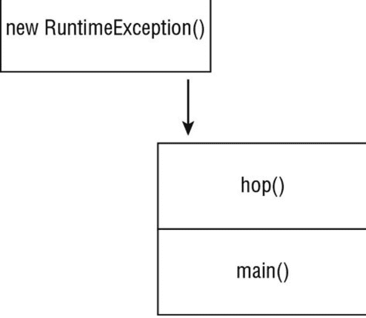

图 10.7 方法栈

# 为什么吞没异常是不好的

因为检查异常（checked exceptions）要求你对其进行处理或声明，所以人们倾向于捕获它们并让它们“走开”。但这样做会导致问题。在下面的代码中，读取文件时存在问题：

```java
public static void main(String... p) {

    String textInFile = null;

    try {

        textFile = readFile();

    } catch (IOException e) {

        // 忽略异常

    }

    // 假设这里有很多行代码

    System.out.println(textFileInFile.replace("", ""));

}

private static String readFile() throws IOException {

    throw new IOException();

}
```

这段代码会导致 `NullPointerException`。Java 不会告诉你任何关于原始 `IOException` 信息，因为它已经被处理了。诚然，它处理得不好，但确实被处理了。

在编写这本书时，我们倾向于吞没异常，因为我们的许多示例本质上是人工的。然而，当你编写自己的代码时，在捕获异常时应该打印堆栈跟踪或至少打印一条消息。此外，考虑继续是否是最佳行动。在我们的示例中，程序在无法读取文件后什么也做不了。它不如直接抛出 `IOException`。

## 总结

异常表示发生了意料之外的事情。方法可以通过捕获异常或将其声明为由调用者处理来处理异常。

许多异常是由 Java 库抛出的。你可以使用如 `throw new Exception()` 的代码抛出自己的异常。

所有异常都继承自 `Throwable`。`Error` 的子类是程序员不应尝试处理的异常。继承 `RuntimeException` 和 `Error` 的类是运行时（未检查）异常。继承 `Exception` 但未继承 `RuntimeException` 的类是检查异常。Java 要求检查异常必须通过 `catch` 块处理或用 `throws` 关键字声明。

`try` 语句必须包含至少一个 `catch` 块或一个 `finally` 块。多捕获块（multi-catch block）是在单个 `catch` 块中捕获多个不相关的异常。如果一个 `try` 语句链了多个 `catch` 块，最多有一个 `catch` 块可以运行。Java 按它们出现的顺序查找每个 `catch` 块可以捕获的异常，并运行第一个匹配项。然后执行在 `try` 语句之后继续。如果 `catch` 和 `finally` 都抛出了异常，则抛出来自 `finally` 的异常。

`try-with-resources` 块用于确保资源或文件在创建后被正确关闭。`try-with-resources` 语句不需要 `catch` 或 `finally` 块，但可以选择性包含它们。隐式的 `finally` 块会在任何程序员定义的 `catch` 或 `finally` 块之前执行。

考试中你应该了解的 `RuntimeException` 类包括：

- `ArithmeticException`
- `ArrayOutOfBoundsException`
- `ClassCastException`
- `IllegalArgumentException`
- `NullPointerException`
- `NumberFormatException`

`IllegalArgumentException` 通常由程序员抛出，而其他异常通常由标准 Java 库抛出。

考试中你应该了解的检查异常（Checked Exception）类包括：

- `IOException`
- `FileNotFoundException`

考试中你应该了解的 `Error` 类包括：

- `ExceptionInInitializerError`
- `StackOverflowError`
- `NoClassDefFoundError`

对于考试，请记住 `NumberFormatException` 是 `IllegalArgumentException` 的子类，而 `FileNotFoundException` 是 `IOException` 的子类。

当方法重写父类或接口中的方法时，不允许添加检查异常。它允许声明较少的异常，或者声明一个已声明异常的子类。

方法使用 `throws` 关键字声明异常。

## 考试要点

- 理解各种类型的异常。所有异常都是 `java.lang.Throwable` 的子类。不应永远捕获 `Error` 的子类。在应用代码中应仅处理 `Exception` 的子类。

- 区分检查异常和未检查异常。未检查异常不需要捕获，它们是 `RuntimeException` 和 `Error` 的子类。`Exception` 的所有其他子类都是检查异常，必须处理或声明。

- 理解语句的流程。`try` 语句必须有 `catch` 或 `finally` 块。多个 `catch` 块可以链在一起，前提是父类异常类型不会出现在其子类更早的 `catch` 块中。可以使用多捕获表达式（multi-catch expression）在同一个 `catch` 块中处理多个异常，前提是一个异常不是另一个异常的子类。`finally` 块无论是否抛出异常都会最后运行。

- **能够遵循 `try-with-resources` 语句的顺序。** `try-with-resources` 语句是一种特殊的 `try` 块，其中一个或多个资源被声明并按照它们声明的反向顺序自动关闭。它可以带有 `catch` 块，也可以没有，隐式的 `finally` 先执行。

- **识别异常是由程序员抛出还是 JVM 抛出。** `IllegalArgumentException` 和 `NumberFormatException` 通常由程序员抛出。大多数其他未检查异常由 JVM 抛出。

- **编写声明异常的方法。** `throws` 关键字用于方法表示可能会抛出异常。重写方法时，允许抛出比原始方法少或范围更小的检查异常。

- **识别何时使用 throw 与 throws。** `throw` 关键字用在你真正想抛出异常时——例如 `throw new RuntimeException()`。`throws` 关键字用于方法声明。

# 复习题

1. 下列哪些是正确的？（多选）
   - `RuntimeException` 异常是未检查的。
   - `RuntimeException` 异常是检查的。
   - 你可以声明未检查异常。
   - 你可以声明检查异常。
   - 你只能处理 `Exception` 子类。
   - 所有异常都是 `Throwable` 的子类。

2. 哪些组合可以填充空白使代码通过编译？（多选）

```java
6: public void ohNo(ArithmeticException ae) throws

7: if(ae==null)

8: else ae;

9: }
```

- A. 第 6 行填充 `throw`
- B. 第 6 行填充 `throws`
- C. 第 7 行填充 `throw`
- D. 第 7 行填充 `throw new`
- E. 第 8 行填充 `throw new`
- F. 第 8 行填充 `throw new`
- G. 以上都不是

3. 下列代码打印了什么？（多选）

```java
1: public class Mouse {

2: public String name;

3: public void findCheese() {

4: System.out.print("1");

5: try {

6: System.out.print("2");

7: name.toString();

8: System.out.print("3");

9: } catch (NullPointerException e | ClassCastException e) {

10: System.out.print("4");

11: throw e;

12: }

13: System.out.print("5");

14: }

}

14: }

15: public static void main(String... tom) {

16: Mouse jerry = new Mouse();

17: jerry.findCheese();

18: }

```

-   A. 1
-   B. 2
-   C. 3
-   D. 4
-   E. 5
-   F. `NullPointerException` 的堆栈轨迹
-   G. 以上都不是

## 4. 关于 finally 块，以下哪些陈述哪些是正确的？（选择所有适用项）

-   A. 在普通的 try 语句中，不需要 finally 块。
-   B. 当普通的 try 语句中没有 catch 块时，需要一个 finally 块。
-   C. 当程序代码不会自动终止时，需要一个 finally 块。
-   D. 对于 try-with-resources 语句，永远不需要 finally 块。
-   E. 当 try-with-resources 语句中没有 catch 块时，需要一个 finally 块。
-   F. 为了确保 try-with-resources 语句中的所有资源都关闭，需要一个 finally 块。
-   G. finally 块在 try-with-resources 语句中声明的资源关闭之前执行

## 5. 下述方法将抛出什么异常？

```java
3: public static void main(String[] other) {

4: Object obj = Integer.valueOf(3);

5: String str = (String) obj;

6: obj = null;

7: System.out.println(obj.equals(null));

8: }

```

-   A. `ArrayIndexOutOfBoundsException`
-   B. `IllegalArgumentException`
-   C. `ClassCastException`
-   D. `NumberFormatException`
-   E. `NullPointerException`
-   F. 以上都不是

## 6. 下述方法会打印什么？

```java
11: public void tryAgain(String s) {

12: try(FileReader r = null, p = new FileReader(""))

13: System.out.print("X");

14: throw new IllegalArgumentException();

15: } catch (Exception s) {

16: System.out.print("A");

17: throw new FileNotFoundException();

18: } finally {

19: System.out.print("0");

20: }

21: }

```

-   A. XAO
-   B. XOA
-   C. 该方法中有一行包含一个编译错误。
-   D. 该方法中有两行包含编译错误。
-   E. 该方法中有三行包含编译错误。
-   F. 代码可以编译，但在运行时抛出了 `NullPointerException`。
-   G. 以上都不是

## 7. 如果在一个运行良好的 main() 方法中添加以下语句，会发生什么？

```java
System.out.print(4 / 0);
```

-   A. 它无法编译。
-   B. 它不会运行。
-   C. 它将运行并抛出 `ArithmeticException`。
-   D. 它将运行并抛出 `IllegalArgumentException`。
-   E. 以上都不是

## 8. 下述程序打印什么内容？

```java
1: public class DoSomething {

2: public void go() {

3: System.out.print("A");

4: try {

5: stop();

6: catch (ArithmeticException e) {

7: System.out.print("B");

8: } finally {

9: System.out.print("C");

10: }

11: System.out.print("D");

12: }

13: public void stop() {

14: System.out.print("E");

15: Object x = null;

16: x.toString();

17: System.out.print("F");

18: }

19: public static void main(String n[]) {

20: new DoSomething().go();

21: }

22: }

```

-   A. AE
-   B. AEBCD
-   C. AEC
-   D. AECD
-   E. AE 后接一个堆栈轨迹
-   F. AEBCD 后接一个堆栈轨迹
-   G. AEC 后接一个堆栈轨迹
-   H. 一个带有其他输出的堆栈轨迹

## 9. 假设 a 和 b 都是 0，下述代码段的输出是什么？

```java
3: try {

4: System.out.print(a / b);

5: } catch (RuntimeException e) {

6: System.out.print(-1);

7: } catch (ArithmeticException e) {

8: System.out.print(0);

9: } finally {

10: System.out.print("done");

11: }

```

-   A. -1
-   B. 0
-   C. done-1
-   D. done
-   E. 代码无法编译。
-   F. 抛出了一个未捕获的异常。
-   G. 以上都不是

## 10. 下述程序的输出是什么？

```java
```


## 10. 下述程序的输出是什么？

```java
1: public class Laptop {
2:   public void start() {
3:     try {
4:       System.out.print("Starting up_");
5:       throw new Exception();
6:     } catch (Exception e) {
7:       System.out.print("Problem_");
8:       System.exit(0);
9:     } finally {
10:      System.out.print("Shutting down");
11:    }
12:  }
13:  public static void main(String[] w) {
14:    new Laptop().start();
15:  }
}
```

- A. Starting up_
- B. Starting up_Problem_
- C. Starting up_Shutting down
- D. Starting up_Shutting down
- E. 代码无法编译。
- F. 抛出了一个未捕获的异常。

## 11. 下述程序的输出是什么？

```java
1: public class Dog {
2:   public String name;
3:   public void runAway() {
4:     System.out.print("1");
5:     try {
6:       System.out.print("2");
7:       int x = Integer.parseInt(name);
8:       System.out.print("3");
9:     } catch (NumberFormatException e) {
10:      System.out.print("4");
11:    }
12:    System.out.print("5");
13:  }
14:  public void main(String... args) {
15:    Dog webby = new Dog();
16:    webby.name = "Webby";
17:    webby.runAway();
18:    System.out.print("5");
19:  }
}
```

- A. 1234
- B. 1235
- C. 124
- D. 1245
- E. 代码无法编译。
- F. 抛出了一个未捕获的异常。
- G. 以上都不是

## 12. 下述程序的输出是什么？

```java
1: public class Cat {
2:   public String name;
3:   public void knockStuff() {
4:     System.out.print("1");
5:     try {
6:       System.out.print("2");
7:       int x = Integer.parseInt(name);
8:       System.out.print("3");
9:     } catch (NullPointerException e) {
10:      System.out.print("4");
11:    }
12:    System.out.print("5");
13:  }
14:  public static void main(String args[]) {
15:    Cat loki = new Cat();
16:    loki.name = "Loki";
17:    loki.knockStuff();
18:    System.out.print("6");
19:  }
}
```

- A. 12，后接 `NumberFormatException` 的堆栈轨迹。
- B. 124，后接 `NumberFormatException` 的堆栈轨迹。
- C. 12456。
- D. 1256，后接 `NumberFormatException` 的堆栈轨迹。
- E. 代码无法编译。
- F. 抛出了一个未捕获的异常。
- G. 以上都不是

## 13. 下述哪些陈述是正确的？（选择所有适用项）

- A. 你可以声明返回类型为 `Exception`。
- B. 你可以声明返回类型为 `RuntimeException`。
- C. 你可以在方法声明中 `throws` 任何 `Error` 的子类。
- D. 你可以在方法声明中 `throws` 任何 `Exception` 的子类。
- E. 你可以在方法声明中 `throws` 任何 `Object` 的子类。
- F. 你可以在方法声明中 `throws` 任何 `RuntimeException` 的子类。

## 14. 下述哪些项可以插入第 8 行以使代码编译？（选择所有适用项）

```java
7: public void whatHappensNext() throws IOException {
8:   // 在此处插入代码
9: }
```

- A. `System.out.println("it's ok");`
- B. `throw new Exception();`
- C. `throw new IllegalArgumentException();`
- D. `throw new java.io.IOException();`
- E. `throw new RuntimeException();`
- F. 以上都不是

## 15. 下述程序打印什么？（选择所有适用项）

```java
1: public class Help {
2:   public void callSuperhero() {
3:     try (String raspberry) = new String("Olivia") {
4:       System.out.print("Q");
5:     } catch (Error e) {
6:       System.out.print("X");
7:     } finally {
8:       System.out.print("M");
9:     }
10:  }
11:  public static void main(String[] args) {
12:    new Help().callSuperhero();
13:    System.out.print("S");
14:  }
}
```

- A. SQM
- B. QXMS
- C. QSM
- D. QMS
- E. 一个堆栈轨迹
- F. 代码无法编译，因为 `NumberFormatException` 未声明或捕获。
- G. 以上都不是

## 16. 下述哪些项不需要处理或声明？（选择所有适用项）

- A. `ArrayIndexOutOfBoundsException`
- B. `IllegalArgumentException`
- C. `IOException`
- D. `Error`
- E. `NumberFormatException`
- F. 任何继承 `RuntimeException` 的异常
- G. 任何继承 `Exception` 的异常

## 17. 哪些行可以填充空白以使以下代码编译？（选择所有适用项）

```java
void rollout() throws ClassCastException {}

public void transform(String c) {
  try {
    rollout();
  } catch (IllegalArgumentException | ________ ) {
  }
}
```

- A. `IOException a`
- B. `Error b`
- C. `NullPointerException c`
- D. `RuntimeException d`
- E. `NumberFormatException e`
- F. `ClassCastException f`
- G. 以上都不是。无论在空白处插入什么，代码都包含编译错误。

## 18. 异常的最佳使用场景是什么？

- A. 在列表中时未找到元素。
- B. 向方法传递了意外的参数。
- C. 电脑着火了。
- D. 你想循环代码编写方法。
- E. 你不知道如何编写方法。

## 19. 下述哪些项可以插入 `Lion` 以使代码编译？（选择所有适用项）

```java
class SoreThroatException extends Exception {}

class TiredException extends RuntimeException {}

interface Roar {
  void roar() throws SoreThroatException;
}

class Lion implements Roar {
  // 在此处插入代码
}
```

- E. `public void roar() throws IllegalArgumentException {}`

## 20. 下述哪些陈述是正确的？（选择所有适用项）

- A. 检查异常可以处理或声明，但不是强制。
- B. 检查异常必须处理或声明。
- C. 错误可以处理或声明，但不是强制。
- D. 错误必须处理或声明。
- E. 未检查异常可以处理或声明，但不是强制。
- F. 未检查异常必须处理或声明。

## 21. 下面中哪一组组合可以填充空白处以使代码通过编译？（选择所有适用项。）

```java
6: public void ohNo(IOException ie) ________ Exception {
7:   ________ FileNotFoundException();
8:   ________ ie;
9: }
```

- A. 在第 6 行，填入 `throw`
- B. 在第 6 行，填入 `throws`
- C. 在第 7 行，填入 `throw`
- D. 在第 7 行，填入 `throw new`
- E. 在第 8 行，填入 `throw`
- F. 在第 8 行，填入 `throw new`
- G. 以上均非

## 22. 下面哪一个项可以插入空白处以使代码通过编译？（选择所有适用项。）

```java
public void dontFail() {
  try {
    System.out.println("work real hard");
  } catch (________ e) {
  } catch (RuntimeException e) {
  }
}
```

- A. `var`
- B. `Exception`
- C. `IOException`
- D. `IllegalArgumentException`
- E. `RuntimeException`
- F. `StackOverflowError`
- G. 以上均非

## 23. 下述方法的输出包含什么？（选择所有适用项。）

```java
12: public static void main(String[] args) {
13:   System.out.print("a");
14:   try {
15:     System.out.print("b");
16:     throw new IllegalArgumentException();
17:   } catch (IllegalArgumentException e) {
18:     System.out.print("c");
19:     throw new RuntimeException("1");
20:   } catch (RuntimeException e) {
21:     System.out.print("d");
22:     throw new RuntimeException("2");
23:   } finally {
24:     System.out.print("e");
25:     throw new RuntimeException("3");
26:   }
27: }
```

- A. abce
- B. abde
- C. 消息设置为 "1" 的异常
- D. 消息设置为 "2" 的异常
- E. 消息设置为 "3" 的异常
- F. 无输出；代码无法编译。

## 24. 下述类的输出输出什么？

```java
1: public class MoreHelp {
2:   class Sidekick implements AutoCloseable {
3:     protected String n;
4:     public Sidekick(String n) { this.n = n; }
5:     public void close() { System.out.print("L"); }
6:   }
7:   public void requiresAssistance() {
8:     try (Sidekick is = new Sidekick("Adeline")) {
9:       System.out.print("0");
10:    } finally {
11:      System.out.print("K");
12:    }
13:  }
14:  public static void main(String... league) {
15:    new MoreHelp().requiresAssistance();
16:    System.out.print("I");
17:  }
}
```

- A. LOKI
- B. OKLI
- C. OLKI
- D. OKIL
- E. 在运行时无法确定输出。
- F. 无输出；代码无法编译。
- G. 以上均非

## 25. 假设 a 和 b 均为 1，以下代码段返回什么？

```java
13: try {
14:   return a / b;
15: } catch (ClassCastException e) {
16:   return 10;
17: } catch (RuntimeException e) {
18:   return 20;
19: } finally {
20:   return 30;
21: }
```


- A. 1
- B. 10
- C. 20
- D. 30
- E. 代码无法编译。
- F. 抛出一个未捕获的异常。
- G. 以上均非

# 第 11 章
模块

本章涵盖的 OCP 考试目标：

- 理解模块
- 描述模块化 JDK
- 声明模块并启用模块间的访问
- 描述模块化项目如何编译和运行


从 Java 9 开始，包可以被分组为模块。在本章中，我们将解释模块的作用以及如何构建你自己的模块。我们还将展示如何运行它们以及如何发现现有的模块。本书仅涵盖你为 1Z0-815 考试需要的模块基础知识。

我们已经在网上提供了本章中的代码。由于创建目录结构可能非常繁琐，这将为你节省一些时间。此外，命令必须完全正确，以便你可以复制粘贴并与你输入的命令进行比较。这两者在题库的资源部分均可用，并链接至：http://www.selik.net/

（我们提到过 JAR 地狱，对吧？）

在完全模块化的环境中，每个开源项目都将会在 `module-info.java` 文件中指定它们的依赖项。当启动程序时，Java 会抱怨 Hamcrest 不在模块路径中，你会立即发现问题。

## 自定义 Java 构建

Java 开发工具包 (JDK) 的大小大于 150 MB。即使是 Java 运行环境 (JRE)，在作为单独下载包提供时也相当大。事实上，Java 曾尝试通过紧凑型配置来解决这个问题。提供的三个紧凑配置提供了内置 Java 类的子集，以便为移动和嵌入式设备提供更小的包。

然而，紧凑型配置缺乏灵活性。它包含了许多开发者不太可能使用的包，例如 Java Native Interface (JNI)，它用于与特定操作系统的程序交互。同时，像 I/O 等其他包还需要完整的 JRE。

Java 平台模块系统（Java Platform Module System）允许开发者指定他们实际需要的模块。这使得创建一个更小的运行时镜像成为可能，该镜像根据应用程序的需求定制，不再多余。用户可以在不安装 Java 的情况下运行该镜像。

使用工具 `jlink` 创建这种运行时镜像。幸运的是，你只需要知道什么是自定义运行时。如何创建它们不在考试的范围之内。

除了更小的包之外，这种方法还提高了安全性。如果你不使用 AWT 且 AWT 报告了安全漏洞，那么打包了没有 AWT 的运行时镜像的应用程序就不会受到影响。

## 提高性能

由于 Java 现在知道需要哪些模块，它只需要查看相应的类加载时间。这改进了大型程序的启动时间，并且需要更少的内存运行。

虽然这些优点对于我们编写的小程序来说可能并不显著，但一个 Web 应用程序很容易花费一分钟启动。此外，对于金融应用程序，每一毫秒的性能都很重要。

## Unique 包强制

JAR 地狱的另一个表现是同一个包出现在两个 JAR 包中。这个问题有几个原因，包括重命名 JAR、聪明的开发者使用了已占用的包名，以及在类路径上存在相同版本的 JAR。

Java 平台模块系统防止了这种情况。一个包只允许由一个模块提供。运行时不再有关于包的不愉快惊喜了。

## 现有代码的模块

虽然使用模块有很多益处，但对于现有的大型应用程序来说，切换过去需要大量工作。特别是当应用程序运行在不支持模块的旧开源库上时。在切换到模块时，所有这些技术债的代价出现了。

并不是所有开源项目都已切换，已经超过 4000 个。GitHub 上的 Java 模块位于 https://github.com/sormuas/modules/blob/master/README.md。

IZO-816 考试涵盖了将应用程序迁移到模块的一些策略。目前，请注意 IZO-815 考试涵盖了模块最简单的用例。

## 创建和运行模块化程序

在本节中，我们将创建、构建并运行 `zoo.animal.feeding` 模块。我们选择这个作为开始，因为所有其他模块都依赖它。图 11.3 显示了该模块的设计。除了 `module-info.java` 文件外，它还有一个包含一个类的包。

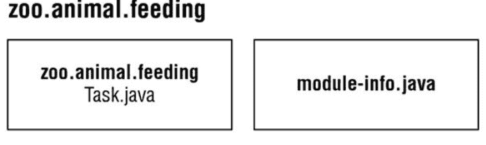

> 图 11.3 zoo.animal.feeding 的内容

在接下来的章节中，我们将创建、编译、运行并打包 `zoo.animal.feeding` 模块。

## 创建文件

首先，我们有一个非常简单的类，在 `main()` 方法中打印一行内容。我们知道，这算不上什么实现。我们雇佣的所有程序员都可以用业务逻辑填充它。在本书中，我们将关注你考试中需要的知识。所以，让我们创建一个简单的类吧。

```
package zoo.animal.feeding;

public class Task {

    public static void main(String... args) {

        System.out.println("All fed!");

    }

}
```

接下来是 `module-info.java` 文件。这是最简单的一个。

```
module zoo.animal.feeding {
}
```

`module-info` 文件与普通 Java 类之间有几点关键区别：

- `module-info` 文件必须位于模块的根目录中。普通 Java 类必须放在包中。
- `module-info` 文件必须使用关键字 `module` 而不是 `class`、`interface` 或 `enum`。
- 模块名遵循包的命名规则。它的名称中通常包含点 (.)。普通类名和包名不允许包含连字符 (-)。模块名遵循相同的规则。

对于最简单的文件来说，这些规则非常多。当我们在本章稍后详细阐述它时，还会有很多规则。

`module-info.java` 文件可以是空的吗？
可以。作为一个冷知识，即使在模块出现之前，编译一个带有 `.java` 扩展名的空文件也是合法的。编译器在里面没有看到类，就会退出且不创建 `.class` 文件。

下一步是确保文件位于正确的目录结构中。图 11.4 显示了预期的目录结构。

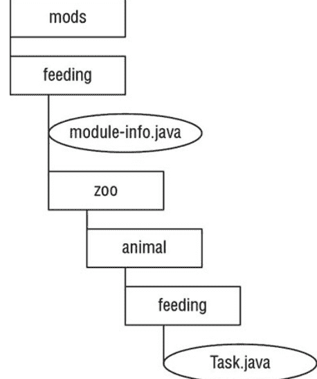

图 11.4 Module zoo.animal.feeding

`module-info.java` 文件必须位于模块的根目录中。普通 Java 类必须放在包中。`module-info` 文件必须使用关键字 `module` 而不是 `class`、`interface` 或 `enum`。模块名遵循包的命名规则。它的名称中通常包含点 (.)。普通类名和包名不允许包含连字符 (-)。模块名遵循相同的规则。

## 编译我们的第一个模块

在模块出现之前，很少手动运行 `javac` 和 `java` 命令。它们很快变得长而复杂。大多数开发者使用 Maven 或 Gradle 等构建工具。这些构建工具建议了放置文件的目录，例如 `target/classes`。

有了模块后，手动运行这些命令会有更多要求。此外，有了模块后，根据定义你正在管理更多的目录。这意味着当你参加考试时，可能你只需要知道这些命令的语法。概念本身无论如何都是有用的。

务必记住模块语法。你将在考试中对此进行测试。我们将为你提供大量的练习题来强化记忆。

| 用途 | 缩写 | 完整形式 |
|---|---|---|
| 类文件目录 | -d <dir> | n/a |
| 模块路径 | -p <path> | --module-path <path> |


图 11.5 使用 java 运行模块

现在我们已经知道了语法，就可以编写运行 `zoo.animal.feeding` 包中 `Task` 类的命令。在下面的示例中，包名和模块名相同。模块名通常与全包名或其开头相同。

```
java --module-path feeding --module zoo.animal.feeding/zoo.animal.feeding.Task
```

既然你已经看到 `--module-path` 使用了 `-p` 的短形式，我们打赌你不会惊讶 `--module` 也有短形式。短选项是 `-m`。这意味着以下命令是等效的：

```
java -p feeding -m zoo.animal.feeding/zoo.animal.feeding.Task
```

在这些示例中，我们使用 `feeding` 作为模块路径，因为那是我们编译代码的地方。一旦我们打包了模块路径和我们的，情况就会改变。

表 11.2 列出了使用 `java` 命令时需要的选项。

表 11.2 使用 java 使用模块时需要的选项

| 用途 | 缩写 | 全称 |
|---|---|---|
| 模块名 | -m <name> | --module <name> |
| 模块路径 | -p <path> | --module-path <path> |

## 打包我们的第一个模块

如果一个模块只能在创建它的文件夹中运行，那么它就没有什么用处。我们的下一步是将其打包。在运行此命令之前，我们先创建一个目录：

```
jar -cvf mods/zoo.animal.feeding.jar -C feeding/ .
```

这里没有任何与模块特定的内容。事实上，你可能记得在第 1 章中见过这个命令。我们正在打包 `feeding` 目录下的所有内容，并将其存储在 `mods` 文件夹下名为 `zoo.animal.feeding.jar` 的 JAR 文件中。这代表了模块 JAR 对使用它的其他代码的样子。

> 使用 `--module-version` 选项对你的模块进行版本控制。这不在考试范围内，但当你准备好与他人共享模块时，这样做很好。

现在让我们再次运行程序，但这次使用松散类内部的模块目录：

```
java -p mods -m zoo.animal.feeding/zoo.animal.feeding.Task
```

你可能会注意到，这个命令与上一个节中的命令完全相同，除了目录不同外。在上一个示例中，它是 `feeding`。在这个示例中，它是 `mods` 的模块路径。由于使用了模块路径，因此运行的是模块 JAR。

图 11.6 显示了在我们编译并打包代码后目录结构的当前状况。

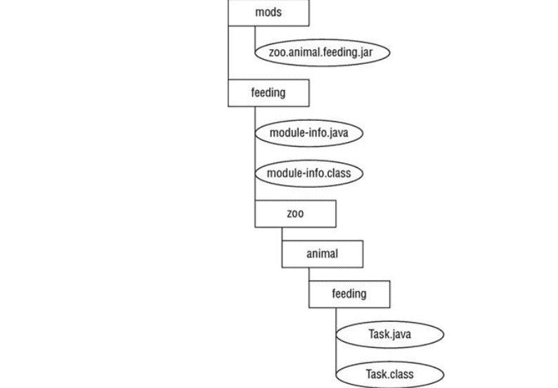

## 为多个模块更新我们的示例

现在我们看到 `zoo.animal.feeding` 模块已经稳固了，我们可以开始考虑其他模块了。你可以从图 11.7 中看到，系统中的其他三个模块都依赖于 `zoo.animal.feeding` 模块。

## Zoo

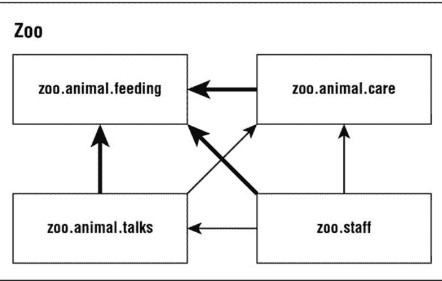

## 更新 Feeding 模块

由于我们的其他模块将调用 `zoo.animal.feeding` 包中的代码，我们需要在 `module-info` 文件中声明这一意图。

`exports` 关键字用于指示该模块意图让模块外部的 Java 代码使用这些包。正如你预期的那样，如果没有 `exports` 关键字，该模块只能通过从命令行独立可用。在接下来的示例中，我们导出了一个：

```
module zoo.animal.feeding {
    exports zoo.animal.feeding;
}
```

重新编译并重新打包模块将更新我们 `zoo.animals.feeding.jar` 文件内部的 `module-info`。这些是你之前运行过的 `javac` 和 `jar` 命令。

```
javac -p mods -d feeding feeding/zoo/animal/feeding/*.java feeding/module-info.java

jar -cvf zoo.animal.feeding.jar -C feeding/ .
```

## 创建 Care 模块

接下来，让我们创建 `zoo.animal.care` 模块。这一次，我们将有两个包。`zoo.animal.care.medical` 包将包含其他模块使用的类和方法。`zoo.animal.care.details` 包仅供此模块使用。它不会从模块导出。把它想象成动物的医疗隐私。

图 11.8 显示此模块的内容。记住，所有模块都必须有一个 `module-info` 文件。

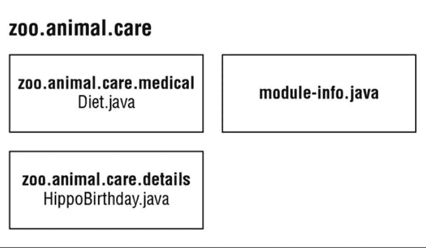

图 11.8 zoo.animal.care 的内容

该模块除了 `module-info.java` 文件外，包含两个基础包和类：

```
// HippoBirthday.java
package zoo.animal.care.details;

import zoo.animal.feeding.*;

public class HippoBirthday {

    private Task task;

}

// Diet.java
package zoo.animal.care.medical;

public class Diet { }
```

这一次，`module-info.java` 文件指定了三件事：

```
module zoo.animal.care {
    exports zoo.animal.care.medical;
    requires zoo.animal.feeding;
}
```

第 1 行指定了模块的名称。第 2 行列出了我们正在导出的包，以便其他模块可以使用。到目前为止，这与 `zoo.animal.feeding` 类似。

在第 3 行，我们看到了一个新的关键字。`requires` 语句指定需要一个模块。`zoo.animal.care` 模块依赖于 `zoo.animal.feeding`。

接下来我们需要确定目录结构。我们将创建两个包。第一个 `zoo.animal.care.details` 包含一个名为 `HippoBirthday` 的类。第二个 `zoo.animal.care.medical` 包含一个名为 `Diet` 的类。尝试在纸上画出目录结构或在你的计算机上创建它。如果你尝试在不使用 `module-info.java` 代码的情况下运行这些示例，请为 `module-info.java` 之外的所有项创建不带变量或方法的类。

图 11.9 显示了此结构。注意 `module-info.java` 位于模块的根目录下。两个包在下方。

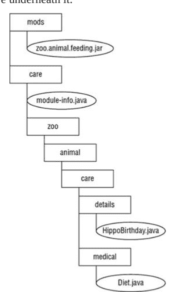

图 11.9 zoo.animal.care 目录结构

你可能注意到包以与模块相同的名前缀开头。这是故意的。你可以将其认为是模块名称“声明”了匹配的包和所有子包。

回顾一下，我们现在编译并打包模块：

```
javac -p mods -d care care/zoo/animal/care/details/*.java care/zoo/animal/care/medical/*.java care/module-info.java
```

我们编译两个包和 `module-info` 文件。在现实世界中，你会使用构建工具而不是手动这样做。对于考试，你只需要列出所有想要编译的包和/或文件。

```
javac -p mods -d care care/module-info.java care/zoo/animal/care/details/*.java care/zoo/animal/care/medical/*.java
```

编译器抱怨它不认识 `zoo.animal.care.medical` 包。

```
care/module-info.java:3: error: package is empty or does not exist: zoo.animal.care.medical
exports zoo.animal.care.medical.
```

一个包必须至少包含一个类才能导出。由于我们还没有编译 `zoo.animal.care.diet`，编译器表现就像它不存在一样。如果你收到这个错误消息，你需要重新调整 `javac` 语句的顺序。或者，你可以在编译 `module-info` 文件之前，在单独的 `javac` 命令中编译包。

现在我们已经编译了代码，是时候编译模块 JAR 了：

```
jar -cvf mods/zoo.animal.care.jar -C care/ .
```


## 创建 Talks 模块

到为止，我们在模块中只使用了 `exports` 和 `requires` 语句。现在你将学习如何处理多个包或需要多个模块。在图 11.10 中，观察到 `zoo.animal.talk` 模块依赖于两个模块：`zoo.animal.feeding` 和 `zoo.animal.care`。这意味着 `module-info` 文件必须有两个 `requires` 语句。

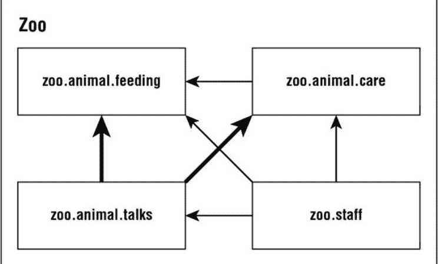

图 11.10 zoo.animal.talks 的依赖关系

图 11.11 显示此模块的内容。我们将导出此模块中的三个包。

### zoo.animal.talks

| zoo.animal.talks.content | zoo.animal.talks.schedule |
|--- |--- |
| ElephantScript.java SeaLionScript.java | Weekday.java Weekend.java |
| zoo.animal.talks.media | module-info.java |
| Announcement.java Signage.java | |

图 11.11 zoo.animal.talks 的 zoo.animal.java 内容

让我们先看 `module-info.java` 文件：

```
module zoo.animal.talks {

exports zoo.animal.talks.content;

exports zoo.animal.talks.media;

exports zoo.animal.talks.schedule;

requires zoo.animal.feeding;

requires zoo.animal.care;

}
```

第 1 行显示模块名称。第 2–4 行允许其他模块引用所有三个包。第 6–7 行指定该模块依赖的两个模块。

然后我们有这六个类，所示：

```
// ElephantScript.java
package zoo.animal.talks.content;
public class ElephantScript { }

// SealionScript.java
package zoo.animal.talks.content;
public class SealionScript { }

// Announcement.java
package zoo.animal.talks.media;
public class Announcement {
    public static void main(String[] args) {
        System.out.println("we will be having talks");
    }
}

// Signage.java
package zoo.animal.talks.media;
public class Signage { }

// Weekday.java
package zoo.animal.talks.schedule;
public class weekday { }

// Weekend.java
package zoo.animal.talks.schedule;
public class Weekend { }
```

如果你仍在电脑上跟着练习进行操作，请在包中创建空类。以下是编译和构建模块的命令：

```
javac -p mods \
talks/zoo/animal/talks/content/*.java \
talks/zoo/animal/talks/media/*.java \
talks/zoo/animal/talks/schedule/*.java \
talks/module-info.java

jar -cvf mods/zoo.animal.talks.jar -C talks/
```

## 创建员工模块

我们的最后一个模块是 `zoo.staff`。图 11.12 显示内部只有一个包。我们不会向模块外部暴露此包。


**图 11.12** zoo.staff 的内容

基于这些信息，你知道 `module-info` 中应该写什么吗？

```
module zoo.staff {
    requires zoo.animal.feeding;
    requires zoo.animal.care;
    requires zoo.animal.talks;
}
```

图 11.13 中有三个箭头从 `zoo.staff` 指向其他模块。这些代表了所需的三个模块。由于不需要从 `zoo.staff` 暴露任何包，因此没有 `exports` 语句。

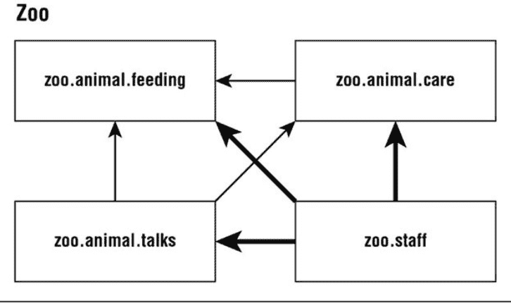

**图 11.13** zoo.staff 的依赖

在此模块中，我们在 `Jobs.java` 中有一个单类：

```
package zoo.staff;
public class Jobs { }
```

对于在电脑上跟着练习的同学，请在包中创建一个空类。以下是编译和构建模块的命令：

```
javac -p mods -d staff \
staff/zoo/staff/*.java \
staff/module-info.java

jar -cvf mods/zoo.staff.jar -C staff/ .
```

## 深入研究 module-info 文件

现在我们已经成功创建了模块，可以学习更多关于 `module-info` 文件的内容。在本节中，我们将查看 `exports`、`requires`、`provides`、`uses` 和 `opens`。现在是时候提到，这些关键字可以在 `module-info` 文件中以任何顺序出现。

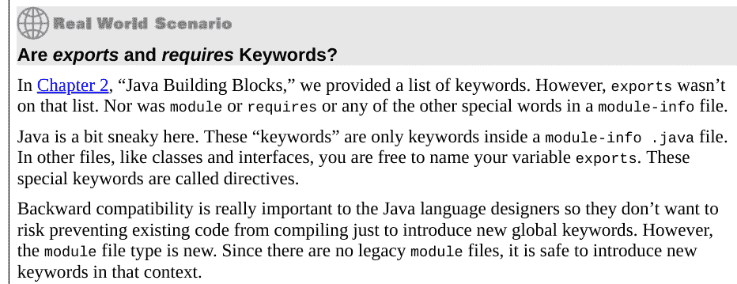

## exports

我们已经看到 `exports packageName` 如何将一个包导出到其他模块。也可以将一个包导出到特定的模块。假设动物园决定只有员工才能访问讲座。我们可以如下所示更新模块声明：

```
module zoo.animal.talks {
    exports zoo.animal.talks.content to zoo.animal.staff;
    exports zoo.animal.talks.media;
    exports zoo.animal.talks.schedule;
    requires zoo.animal.feeding;
    requires zoo.animal.care;
}
```

对于 `zoo.animal.staff` 模块，没有任何变化。但其他模块将不再被允许访问该包。

你可能注意到，我们的其他模块最初并没有需要 `zoo.animal.talks`。然而，我们不知道未来还会存在哪些其他模块。在设计模块时，考虑未来是重要的。由于我们只想让这一个模块访问，因此我们只允许该模块访问。

我们一直在讨论导出一个包。但这到底意味着什么？所有的公共类、接口、枚举都会被导出。此外，这些文件中任何公共和受保护的字段和方法都是可见的。

私有的字段和方法是不可见的，因为它们在类外部无法访问。同样，包私有的（package-private）字段和方法也是不可见的，因为它们在包外部无法访问。

`exports` 关键字本质上为我们提供了更多级别的访问控制。表 11.3 列出了完全的访问控制选项。

表 11.3 模块的访问控制

| 级别 | 模块代码内部 | 模块外部 |
| --- | --- | --- |
| private | 仅在类内可用 | 无访问 |
| default (包私有) | 仅在包内可用 | 无访问 |
| protected | 仅在包内或对子类可用 | 仅在包导出时可供子类访问 |
| public | 对所有类可用 | 仅在包导出时可访问 |

## requires transitive

正如你在本章早些时候看到的，`requires moduleName` 指定了模块依赖的模块。

## uses

`uses` 关键字指定一个模块依赖于某个服务。要编写代码，你需要提供想要调用的 API：

```
uses zoo.staff.ZooApi
```


Java 允许调用者使用名为反射（reflection）的技术在运行时检查并调用代码。这是一种强大的方法，允许调用编译时可能不可用的代码。它甚至可以用来绕过访问控制！别担心——为了示例，你不需要知道如何使用反射编写代码。

由于反射可能是危险的，如果你想让调用模块使用你的模块，模块系统要求开发者在 `module-info` 中显式地允许反射。这里有两个示例：

```
opens zoo.animal.talks.schedule;

opens zoo.animal.talks.media to zoo.staff;
```

第一个示例允许任何使用此模块的模块使用反射。第二个示例只赋予 `zoo.staff` 包权限。

## 发现模块

到目前为止，我们一直在处理自己编写的模块。从 Java 9 开始，JDK 内置的类也被模块化了。在本节中，我们将向你展示如何使用命令来了解模块。

你不需要知道本节中命令的输出结果。然而，你需要了解命令的语法以及它们的作用。我们在有助于记忆发生的情况时输出内容。但你不需要死记记忆（这可以在你的大脑中留出更多空间来记忆命令行选项）。

## java 命令

`java` 命令有三个与模块相关的选项。其中一个描述模块，另一个列出可用模块，第三个显示模块解析逻辑。

> 也可以在命令行中添加模块、导出包等。但请不要这样做。这会让人很混乱且难以维护。请注意，这些标志在 `java` 中可用，但并非所有命令都可用。

## 描述模块

假设你得到了一个 `zoo.animal.feeding` JAR 文件，并想了解它的模块结构。你可以使用 "jar" 来打开 `module-info` 文件。这将向你显示该模块导出了一个包，并且不需要任何模块。

```
module zoo.animal.feeding {

  exports zoo.animal.feeding;

}
```

然而，有一种更简单的方法。`java` 命令现在有一个用于描述模块的选项。以下两个命令是等价的：

```bash
java -p mods -d zoo.animal.feeding
java -p mods --describe-module zoo.animal.feeding
```

每个命令都会打印关于该模块的信息。例如，它可能会打印：

```
zoo.animal.feeding file:///absolutePath/mods/zoo.animal.feeding
exports zoo.animal.feeding
requires java.base-mandated
```

第一行是我们查询的模块：`zoo.animal.feeding`。第二行开始是关于模块的信息。在我们的案例中，它是与 `module-info` 中相同的包导出语句。

在第三行，我们要求了 `java.base-mandated`。等一下。`module-info` 文件显然没有指定 `zoo.animal.feeding` 依赖任何模块。

`java.base` 会自动作为所有模块的依赖添加。该模块包含了像 `zoo.util` 这样频繁使用的包。这就是“mandated”（强制性）的含义。无论你是否请求，都会获得 `java.base`。

在类中，无论你是否输入，`java.lang` 都会自动导入。`java.base` 模块的工作方式正如你所希望。它对所有其他模块都是自动可用的。

## 关于描述模块的更多信息

你只需要知道如何为考试运行 `--describe-module`。然而，当你尝试此功能时，可能会遇到一些惊喜，因此我们在这里对它们进行更详细描述。

提醒一下，以下是 `zoo.animal.care` 中 `module-info` 的内容：

```
module zoo.animal.care {

  exports zoo.animal.care.medical to zoo.staff;

  requires transitive zoo.animal.feeding;

}
```

现在我们有了描述模块的命令和输出。

```bash
java -p mods -d zoo.animal.care
```

```
zoo.animal.care file:///absolutePath/mods/zoo.animal.care.jar
requires zoo.animal.feeding transitive
requires java.base-mandated
qualified exports zoo.animal.care.medical to zoo.staff
contains zoo.animal.care.details
```

输出的第一行是模块文件的绝对路径。另外两行看起来也很眼。第一行在 `module-info` 中，另一个是添加到所有模块中的。接下来是某些新内容。`qualified exports`（限定导出）是导出到特定模块的全名。

最后，`contains` 意味着模块中有一个包完全没有被导出。这是事实的。我们的模块有两个包，其中一个可以在模块内部的代码中使用。

## 列出可用模块

除了描述模块外，你还可以使用 `java` 命令列出可用的模块。最简单的形式列出属于 JDK 部分的模块：

```bash
java --list-modules
```

当我们运行它时，输出持续了 70 行，看起来如下：

```
java.base@11.0.2
java.compiler@11.0.2
java.datatransfer@11.0.2
```

这是随 Java 一起的所有模块列表及其版本号。你可以看出我们在测试此示例时正在使用 Java 11.0.2。

更有趣的是，你可以配合自定义代码使用此命令。让我们再次尝试包含 zoo 模块的目录。

```bash
java -p mods --list-modules
```

你预计会有多少行？无论如何，输出看起来如下：

```
zoo.animal.care file:///absolutePath/mods/zoo.animal.care.jar
zoo.animal.feeding file:///absolutePath/mods/zoo.animal.feeding.jar
zoo.animal.talks file:///absolutePath/mods/zoo.animal.talks.jar
zoo.staff file:///absolutePath/mods/zoo.staff.jar
```

## 显示模块解析

如果列出模块不能满足你，你还可以使用 `--show-resolution` 选项。你可以将其认为是在调试模块。

```bash
java -p mods --show-resolution zoo.animal.feeding
```

输出显示了依赖关系：

```
zoo.animal.feeding file:///absolutePath/mods/zoo.animal.feeding
requires java.base-mandated
```

## jar 命令

与 `java` 命令一样，`jar` 命令也可以描述模块。两个命令都是等价的：

```bash
jar -f mods/zoo.animal.feeding.jar --describe-module
```

当我们使用 `jar` 命令描述模块时，输出略有不同。使用 `jar` 时，它输出：

```
zoo.animal.feeding:file:///absolutePath/mods/zoo.animal.feeding.jar/module-info.class
exports zoo.animal.feeding
requires java.base-mandated
```

## jdeps 命令

`jdeps` 命令提供模块内部依赖信息。与描述模块不同，它除了查看 `module-info` 文件外，还会查看代码。这告诉你是实际使用了哪些依赖，而不仅仅是声明了哪些。

让我们从一个简单的示例开始，查看 `zoo.animal.feeding` 的依赖摘要。

```bash
jdeps -s mods/zoo.animal.feeding.jar
jdeps -summary mods/zoo.animal.feeding.jar
```

注意，摘要是一个横杠（`-s`）而不是两个。无论如何，输出告诉你只有一个包，并且它依赖于内置的 `java.base` 模块。

或者，你可以在不使用摘要的情况下调用 `jdeps` 并获取长格式：

```bash
jdeps mods/zoo.animal.feeding.jar
```

```
[file:///absolutePath/mods/zoo.animal.feeding.jar]
requires mandated java.base (@11.0.2)
zoo.animal.feeding -> java.base
zoo.animal.feeding -> java.io
```

```
java.base
zoo.animal.feeding --> java.lang
java.base
```

输出的第一部分显示模块文件名和路径。第二部分列出了所需的 `java.base` 依赖和版本号。这与之前的示例匹配的高级摘要。

最后，输出的最后四行列出了 `zoo.animal.feeding` 使用的 `java.base` 模块中的特定包。

现在，让我们来看更复杂的例子。这次，我们选择了一个依赖于 `zoo.animal.feeding` 的模块。我们需要指定模块路径，以便 `jdeps` 知道去哪里查找依赖模块的信息。之前我们不需要这样做，因为所有依赖项都构建在 JDK 中。

按照惯例，这两个命令是等价的：

```bash
jdeps --module-path mods mods/zoo.animal.care.jar
jdeps -summary --module-path mods mods/zoo.animal.care.jar
```

`jdeps` 命令中没有 `--module-path` 的简写形式。输出只有两行：

```
zoo.animal.care -> java.base
zoo.animal.care -> zoo.animal.feeding
```

我们可以看到 `zoo.animal.care` 模块依赖于我们的自定义 `zoo.animal.feeding` 模块以及内置的 `java.base`。

如果你担心输出太短，我们可以在全模式下运行：

```bash
jdeps --module-path mods mods/zoo.animal.care.jar
```

这次我们得到了列表：

```
zoo.animal.care
[::/absolutePath/mods/zoo.animal.care.jar]
requires mandated java.base ((11.0.2))
requires transitive zoo.animal.feeding
zoo.animal.care -> java.base
zoo.animal.care -> zoo.animal.feeding
zoo.animal.details -> java.lang
java.base
zoo.animal.care.details -> zoo.animal.feeding
zoo.animal.feeding
zoo.animal.care.medical -> java.lang
java.base
```


和之前一样，分为三个部分。第一部分是文件名和所需的依赖。第二部分是摘要，用箭头显示两个模块依赖关系。最后六行显示了包级别的依赖。

## jmod 命令

考试中需要知道的最后一个命令是 `jmod`。你可能认为 JMOD 文件是一个 Java 模块文件。并非如此，Oracle 建议对大多数模块使用 JAR 文件。只有当你有原生库或无法放入 JAR 文件的内容时，才建议使用 JMOD 文件。这在这个领域不太可能影响你。

最需要记住的一点是 `jmod` 仅用于处理 JMOD 文件。方便的是，你不需要背诵 `jmod` 的语法。表 11.4 列出了常用模式。

### 表 11.4 使用 jmod 的模式

| 操作 | 描述 |
|---|---|
| create | 创建 JMOD 文件。 |
| extract | 从 JMOD 中提取所有文件。作用类似于解压。 |
| describe | 打印模块详情（如 `requires`）。 |
| list | 列出 JMOD 文件中的所有文件。 |
| hash | 显示与文件关联的长字符串。 |

## 复习命令行选项

恭喜你到达了本书的最后一个章节。本部分包含若干表格，涵盖了参加 1Z0-815 考试时运行命令行选项所需的全部知识。

表 11.5 显示了你预计在考试中会遇到的命令行。

### 表 11.5 命令行操作对比

| 描述 | 语法 |
| --- | --- |
| 编译非模块代码 | `javac -cp classpath -d directory classesToCompile` `java --class-path classpath -d directory classesToCompile` `javac -classpath -d directory classesToCompile` |
| 运行非模块代码 | `java -cp classpath package.className` `java -classpath package.className` `java --class-path classpath package.className` |
| 编译模块 | `javac -p folderName -d classesToCompileIncludingModuleInfo` `javac --module-path folderName -d directory classesToCompileIncludingModuleInfo` |
| 运行模块 | `java -p folderName -m moduleName/package.className` `java --module-path folderName --module moduleName/package.classNameName` |
| 描述模块 | `java -p folderName -d moduleName` `java --module-path folderName --describe-module moduleName` `jar --file jarName --describe-module` `jar -f jarName -d` |
| 列出可用模块 | `java --module-path folderName --list-modules` `java -p folderName --list-modules` |
| 查看依赖关系 | `jdeps --summary --module-path folderName jarName` `jdeps -s --module-path folderName jarName` |
| 显示模块解析 | `java --show-resolution -p folderName -d moduleName` `java --show-resolution --module-path folderName --describe-moduleName` |

由于有很多你需要知道的命令，我们制作了多个表格来复习考试所需的可用选项。`javac` 上有一个 `--module` 选项，可以将编译限制到该模块。幸运的是，你不需要知道这些。

表 11.6 显示了 `javac` 的选项，表 11.7 显示了 `java` 的选项，表 11.8 显示了 `jar` 的选项，而表 11.9 显示了 `jdeps` 的选项。

### 表 11.6 考试所需的选项：javac

| 选项 | 描述 |
| --- | --- |
| `--module <module>` | 将编译限制到该模块 |
| `-cp <classpath>` | 指定类路径 |
| `-d <directory>` | 指定输出目录 |
| `-p <folderName>` | 指定模块路径 |
| `-m <moduleName>` | 指定模块名称 |

### 表 11.7 考试所需的选项：java

| 选项 | 描述 |
| --- | --- |
| `-cp <classpath>` | 指定类路径 |
| `-p <folderName>` | 指定模块路径 |
| `-m <moduleName>` | 指定模块名称 |
| `--module-path <folderName>` | 指定模块路径 |
| `--module <moduleName>` | 指定模块名称 |
| `--list-modules` | 列出可用模块 |
| `--show-resolution` | 显示模块解析 |

### 表 11.8 考试所需的选项：jar

| 选项 | 描述 |
| --- | --- |
| `-c` | 创建新的 JAR 文件 |
| `-v` | 详细输出 |
| `-f` | 指定 jar 文件 |
| `-d` | 指定目录 |
| `--describe-module` | 描述模块详情 |

### 表 11.9 考试所需的选项：jdeps

| 选项 | 描述 |
| --- | --- |
| `--summary` | 提供摘要输出 |
| `--module-path <folderName>` | 指定模块路径 |
| `-s` | 摘要输出 |

# 复习题

- 1. 下列哪是 Java 平台模块系统（Java Platform Module System）的优势？
  A. 所有模块的中央仓库
  B. 封装包
  C. 封装对象
  D. 无定义类型
  E. 平台无关性

- 2. 关于以下模块，哪个说法是正确的？
  zoo.staff
  | --zoo
  | --staff
  | --Vet.java
  A. 显示的目录结构是一个有效的模块。
  B. 如果直接在 zoo.staff 下添加 module.java，则该目录结构将是一个有效的模块。
  C. 如果直接在 zoo 下添加 module.java，则该目录结构将是一个有效的模块。
  D. 如果直接在 zoo.staff 下添加 module-info.java，则该目录结构将是一个有效的模块。
  E. 如果直接在 zoo 下添加 module-info.java，则该目录结构将是一个有效的模块。
  F. 这些更改都不会使该目录结构成为有效的模块。

- 3. 假设模块 puppy 依赖模块 dog，而模块 dog 依赖模块 animal。在空白处填入，使得 module dog 中的代码可以访问 module animal 中的 animal.behavior 包。
  ```java
  module animal {
      animal.behavior;
  }
  ```
  A. export
  B. exports
  C. require
  D. requires
  E. require transitive
  F. requires transitive
  G. 以上均非

- 4. 填空以使此运行程序的命令正确：
  ```
  zoo.animal.talks/zoo/animal/talks/Peacocks modules
  ```
  A. -d 和 -m
  B. -d 和 -p
  C. -m 和 -d
  D. -m 和 -p
  E. -p 和 -d
  F. -p 和 -m
  G. 以上均非

- 5. 下列哪些语句在 module-info.java 文件中是正确的？（选择所有适用项。）
  A. opens 关键字允许使用反射。
  B. opens 关键字声明一个 API 被调用。
  C. use 关键字允许使用反射。
  D. use 关键字声明一个 API 被调用。
  E. uses 关键字允许使用反射。
  F. uses 关键字声明一个 API 被调用。
  G. 该文件可以是空的（0字节）。

- 6. 对于包含以下内容的名为 module-info.java 文件的模块，哪个说法是正确的？（选择所有适用项。）
  ```java
  module com.food.supplier {}
  ```
  A. 模块内部所有的包都会自动导出。
  B. 模块内部没有包会被自动导出。
  C. 模块内部的 main 方法可以运行。
  D. 模块内部的 main 方法无法运行，因为类被暴露了。
  E. module-info.java 文件包含编译错误。
  F. module-info.java 文件名错误。

- 7. 假设模块 puppy 依赖模块 dog，而模块 dog 依赖模块 animal。哪两行允许模块 puppy 访问 module animal 中的 animal.behavior 包？（选择两项。）
  ```java
  module animal {
      exports animal.behavior to dog;
  }
  module dog {
      animal; // line S
  }
  ```
  ```java
  module puppy {
      dog; // line T
  }
  ```
  A. line S 使用 require
  B. line T 使用 require
  C. line S 使用 requires
  D. line T 使用 requires
  E. line S 使用 require transitive
  F. line T 使用 require transitive
  G. line S 使用 requires transitive
  H. line T 使用 requires transitive

- 8. 下列命令接受 --module-path 参数？（选择所有适用项。）
  A. javac
  B. java
  C. jar
  D. jdeps
  E. jmod
  F. 以上均非

- 9. 下列哪些命令是运行模块化程序的合法命令？（选择所有适用项。）
  A. java -p x -m x/x
  B. java -p x-x -m x/x
  C. java -p x -m x-x/x
  D. java -p x -m x/x-x
  E. java -p x -m x.x
  F. java -p x.x -m x.x
  G. 以上均非

- 10. 哪个最能填补空白以完成以下代码？
  ```java
  module _____
  exports com.unicorn.horn;
  exports com.unicorn.magic;
  }
  ```
  A. com
  B. com.unicorn
  C. com.unicorn.horn
  D. com.unicorn.magic
  E. 代码无法编译。
  F. 代码可以编译，但这些都不是良好的选择。

- 11. jmod 命令哪些模式是有效的？（选择所有适用项。）
  A. add
  B. create
  C. delete
  D. extract
  F. list
  G. show

- 12. 假设你有 javac、java 和 jar 命令。其中有多少个支持 --show-module-resolution 选项？
  A. 0
  B. 1
  C. 2
  D. 3

- 13. 关于以下模块，哪些说法是正确的？（选择所有适用项。）
  ```java
  class dragon {
      exports com.dragon.fire;
      exports com.dragon.scales to castle;
  }
  ```


# 第 1 章：Java 基础

- 1. B, E, G. 选项 A 无效，因为从 Java 9 开始，单个下划线不再允许作为标识符。选项 B 是有效的，因为你可以在标识符中使用下划线，美元符号 (`$`) 也是有效字符。选项 C 不是有效的标识符，因为 `true` 是 Java 的保留字。选项 D 是无效的，因为标识符中不允许点 (`.`)。选项 E 是有效的，因为 Java 是大小写敏感的。由于 `Public` 不是保留字，允许作为标识符，而 `public` 则不允许。选项 F 是无效的，因为第一个字符不是字母、美元符号 (`$`) 或下划线 (`_`)。最后，选项 G 是有效的，因为标识符可以包含下划线 (`_`) 和数字，数字不作为标识符开头。

- 2. D, F, G. 选项 B 是有效的，因为你可以在标识符中使用下划线，美元符号 (`$`) 也是有效字符。选项 C 不是有效的标识符，因为 `true` 是 Java 的保留字。选项 D 是无效的，因为标识符中不允许点 (`.`)。选项 E 是有效的，因为 Java 是大小写敏感的。由于 `Public` 不是保留字，允许作为标识符，而 `public` 则不允许。选项 F 是无效的，因为第一个字符不是字母、美元符号 (`$`) 或下划线 (`_`)。最后，选项 G 是有效的，因为标识符可以包含下划线 (`_`) 和数字，数字不作为标识符开头。

程序在垃圾回收运行之前结束了。选项 F 是对的，它是垃圾回收算法判断对象是否符合垃圾回收条件的主要手段。最后，选项 G 是错误的，因为标记变量为 `final` 意味着它在自己的作用域内是常量。例如，被标记为 `final` 的局部变量将在方法结束后符合垃圾回收条件，这确保了方法外部没有其他对该对象的引用。

- 10. 该类存在编译问题，因此选项 E、F 和 G 都是错误的。关键在于第 4 行没有定义构造函数，而是定义了一个名为 `PoliceBox()` 的方法，因为它的返回类型为 `void`。该方法在程序运行期间从未执行，`color` 和 `age` 分别保持默认值 `null` 和 `0`。第 11 行和第 12 行改变与 `p` 关联的对象的值，但在第 13 行，变量 `p` 被指向与 `q` 关联的对象，该对象具有默认值。为此，程序输出 `q1=null`、`q2=0`、`p1=null` 和 `p2=0`，使得选项 C 成为唯一答案。

- 11. A、D、E。根据第 1 章，`main()` 方法必须有一个类型为 `String[]` 的有效标识符。由于这个原因，可以直接排除选项 G。选项 A 是正确的，因为 `var` 不是 Java 中的保留字，可以作为标识符使用。选项 B 是错误的，因为点（`.`）不能用于标识符。选项 C 也是错误的，因为标识符可以包含数字，但不能以数字开头。选项 D 和 E 是正确的，因为下划线（`_`）和美元符号（`$`）可以出现在标识符的任何位置。最后，选项 F 是错误的，因为 `var` 不能作为方法参数。

- 12. A、E、F。下划线（`_`）可以放在任何数字字面量中，只要它不在开头、结尾或紧邻小数点（`.`）即可。下划线可以相邻放置。由于这些原因，选项 A、E 和 F 是正确的。选项 B 和 D 是错误的，因为下划线（`_`）紧邻小数点（`.`）。选项 C 和 G 是错误的，因为下划线（`_`）不能放在字面量的开头或结尾。

- 13. B、D、H。第 3 行的 `Rabbit` 对象有两个引用：`one` 和 `three`。这两个引用分别在第 6 行和第 8 行设置为 `null`。选项 B 是正确的，因为这使得对象在第 8 行之后符合垃圾回收条件。第 7 行将引用 `four` 设置为 `null`，因为那是 `one` 的值，这意味着它对垃圾回收没有影响。第 4 行的 `Rabbit` 对象只有一个引用指向它：`two`。选项 D 是正确的，因为这个单一引用在第 9 行变为 `null`。第 10 行声明的 `Rabbit` 对象在第 12 行方法结束时符合垃圾回收条件，使得选项 H 是正确的。调用 `System.gc()` 对是否符合垃圾回收条件没有影响。

- 14. B、C、F。`var` 不能用于构造函数或实例变量/类变量的方法参数，使得选项 A 是错误的，选项 C 是正确的。`var` 的类型在编译时已确定，在运行时无法更改类型，尽管它的值可以在运行时更改。由于这些原因，选项 B 和 F 是正确的，选项 E 是错误的。选项 D 是正确的，因为在多变量声明中不允许使用 `var`。最后，选项 G 是错误的，因为 `var` 不是 Java 中的保留字。

- 15. C、F、G。首先，`0b` 是二进制值的前缀，而 `0x` 是十六进制值的前缀。这些值可以赋值给许多原始数据类型，包括 `int` 和 `double`，使得选项 C 和 F 是正确的。选项 A 是错误的，因为将变量改为 `Amount` 会导致下一行的 `system.out.print(amount)` 调用无法编译。选项 B 是错误的，因为 `9l` 是一个 `long` 值。如果将类型改为 `long`，那么它就能编译。选项 D 是错误的，因为 `1.2` 是一个 `double` 值。如果将类型改为 `double amount = 1.2`，那么它就能编译。选项 E 和 H 是错误的，因为下划线（`_`）紧邻小数点（`.`），这是不允许的。最后，选项 G 是正确的，下划线和赋值是有效的。

- 16. A、C、D。代码包含三个编译错误，因此选项 E、F、G 和 H 都是错误的。第 2 行无法编译，因为这是声明多个变量的错误语法，使得选项 A 是正确的。数据类型只声明一次，并在多变量声明中供所有变量共享。第 3 行可以正常编译，因为它在实例初始化器内部声明了一个从未使用的局部变量。第 4 行无法编译，Java 与其他某些编程语言不同，不支持设置默认方法参数值，使得选项 C 是正确的。最后，第 7 行无法编译，因为 `fins` 在作用域内且仅在第 3 行的实例初始化器内部可见，使得选项 D 是正确的。

- 17. A、E、F、G。这个问题主要关于变量作用域。在循环或初始化块等语句中定义的变量仅在相应语句内部可见。由于这个原因，选项 A 和 E 是正确的。选项 B 是错误的，因为变量可以在初始化块内部定义。选项 C 是错误的，因为构造函数参数只在构造函数内部可见，而不是实例类的生命周期内。构造函数和实例方法可以访问任何实例变量，即使是在声明后定义的变量，使得选项 D 是错误的，而 F 和 G 是正确的。

- 18. F, G。代码无法编译，因此选项 A、B、C 和 D 都是错误的。第一个编译错误发生在第 5 行。由于 `char` 无法赋值给 `long` 类型，无法编译，选项 F 是正确的。第二个编译错误在第 9 行。

- 19. 这个问题主要关于变量作用域。在循环或初始化块等语句中定义的变量仅在相应语句内部可见。由于这个原因，选项 A 和 E 是正确的。选项 B 是错误的，因为变量可以在初始化块内部定义。选项 C 是错误的，因为构造函数参数只在构造函数内部可见，而不是实例类的生命周期内。构造函数和实例方法可以访问任何实例变量，即使是在声明后定义的变量，使得选项 D 是错误的，而 F 和 G 是正确的。

- 20. 类编译成功且运行没有问题，选项 F 和 G 是错误的。我们从 `main()` 方法开始，打印 7。接下来在第 11 行创建新的 `Salmon` 实例。在第 3 和 4 行执行两个初始化器。`int` 实例变量的默认值是 0，所以打印 0。接下来调用构造函数。这为 `count` 赋值 1。最后，第 12 行打印 4。综上所述，我们得到了 7-0-4，因此选项 D 是正确答案。

- 21. A、D。代码编译且运行没有问题，选项 H 是错误的。程序创建了两个 `Rabbit` 对象，分别在第 9 行和第 10 行。第一个 `Rabbit` 对象在第 13 行之前可以通过 `brownBear` 引用访问。第二个 `Rabbit` 对象在第 11 行传递给第一个对象的 `roar()` 方法，这意味着可以通过 `polarBear` 引用和 `brownBear.pandaBear` 引用访问。在第 12 行之后，仍然可以通过 `brownBear.pandaBear` 访问。但在第 13 行之后它不再可访问。换句话说，两个对象在第 13 行之后都符合垃圾回收条件，使得选项 A 和 D 是正确的。最后，由 JVM 决定垃圾回收何时运行。由于这个原因，选项 F 是正确的，选项 E 和 G 也是正确的。该类包含一个 `finalize()` 方法，尽管这与答案无关。对于考试，你可能会在问题中看到 `finalize()`，但由于从 Java 9 开始被弃用，你不会被就此进行测试。

- 22. 这些声明中没有有效的变量声明，因为 `var` 不能用于实例变量，只能用于局部变量。由于这个原因，选项 H 是唯一正确的。如果将问题改为局部变量声明，那么正确答案将是选项 C、D 和 E。标识符必须以字母、`$` 或 `_` 开头，因此选项 F 和 G 是错误的。自 Java 9 起，单个下划线不允许作为标识符，因此选项 A 是错误的。选项 A 和 G 也是错误的，因为它们的数字字面量错误地使用了下划线。下划线不能位于字面值的末尾，也不能出现在小数点（`.`）旁边。最后，`null` 是一个保留字，但 `var` 不是，所以选项 B 是错误的，而选项 E 是正确的。

## 第 2 章：Java 基础

- 1. B, E, G. 选项 A 无效，因为从 Java 9 开始，单个下划线不再允许作为标识符。选项 B 是有效的，因为你可以在标识符中使用下划线，美元符号 (`$`) 也是有效字符。选项 C 不是有效的标识符，因为 `true` 是 Java 的保留字。选项 D 是无效的，因为标识符中不允许点 (`.`)。选项 E 是有效的，因为 Java 是大小写敏感的。由于 `Public` 不是保留字，允许作为标识符，而 `public` 则不允许。选项 F 是无效的，因为第一个字符不是字母、美元符号 (`$`) 或下划线 (`_`)。最后，选项 G 是有效的，因为标识符可以包含下划线 (`_`) 和数字，数字不作为标识符开头。

- 2. D, F, G. 选项 B 是有效的，因为你可以在标识符中使用下划线，美元符号 (`$`) 也是有效字符。选项 C 不是有效的标识符，因为 `true` 是 Java 的保留字。选项 D 是无效的，因为标识符中不允许点 (`.`)。选项 E 是有效的，因为 Java 是大小写敏感的。由于 `Public` 不是保留字，允许作为标识符，而 `public` 则不允许。选项 F 是无效的，因为第一个字符不是字母、美元符号 (`$`) 或下划线 (`_`)。最后，选项 G 是有效的，因为标识符可以包含下划线 (`_`) 和数字，数字不作为标识符开头。

## 第 3 章：运算符

- A, D, G. 选项 A 是等号运算符，可以用于原始类型和对象引用。选项 B 和 C 都是算术运算符，不能应用于布尔值。选项 D 是逻辑取反运算符，专门用于布尔值。选项 E 是取模运算符，只能用于数值原始类型。选项 F 是关系运算符，用于比较两个数字的值。最后，选项 G 是正确的，因为你可以对布尔变量进行强制类型转换，因为 `boolean` 是...

- A, B, D. 表达式 `apples + oranges` 会自动提升为 `int`，可以从 `int` 自动提升的数据类型都可以工作。选项 A、B 和 D 都是此类类型。选项 C 将无法工作，因为 `boolean` 不是数值类型。如果没有显式强制转换为较小的数据类型，选项 E 和 F 将无法工作。

- B, C, D. 代码将无法编译，因此选项 A 不是正确的。值 `2 * ear` 会自动提升为 `long`，不能自动存储在 `int` 类型的 `hearing` 中。选项 B、C 和 D 通过减少 `long` 值解决了这个问题。选项 E 没有解决问题，并且实际上通过尝试将该值放在较小的数据类型中使问题变得更糟。选项 F 通过增加赋值的数据类型解决了问题，从而允许使用 `long`。

- 代码可以编译并运行没有问题，所以选项 E 不是正确的。这个例子具有误导性，因为第二个赋值运算符嵌入在第 5 行。表达式 `(wolf=false)` 将值赋给 `wolf` 并为整个表达式返回 `false`。由于 `teeth` 不等于 10，左侧返回 `true`；因此，赋值给 `canine` 的表达式的异或（^）结果为 `true`。输出反映了这些赋值，`teeth` 没有发生变化，所以选项 B 是唯一的正确答案。

- A, C. 按优先级递增或相同的顺序显示运算符。选项 B 和 E 是优先级递减顺序。选项 D、F 和 G 既不是优先级递增顺序也不是递减顺序。在选项 D 中，赋值运算符（=）位于一元运算符之间，乘法运算符（*）错误地具有最高优先级。在选项 F 中，逻辑取反运算符（!）具有最高优先级，所以它应该在最后。在选项 G 中，赋值运算符的优先级最低，而不是最高，所以最后两个运算符应该在前面。

- 6. 代码无法编译，因为第 3 行包含编译错误。强制类型转换 `(int)` 应用于 `fruit`，而不是表达式 `fruit+vegetables`。由于强制转换运算符的优先级高于加法运算符，它被应用于 `fruit`，但由于 `vegetables` 是 `float`，该表达式被提升为 `float`。在不进行强制转换的情况下，`addCandy()` 方法无法返回 `long` 类型结果。由于这个原因，选项 F 是正确的。如果在 `fruit+vegetables` 周围加上括号，输出将是 3-5-6，那么选项 B 就是正确的。记住，将浮点数转换为整数值时是截断而不是四舍五入。

- 7. 在第一个布尔表达式中，`vis` 是 2，`ph` 是 7，该表达式求值为 `true` (`true || false`)，简化为 `true`。第二个布尔表达式使用了短路运算符，由于 `(vis > 2)` 为 `false`，右侧不被计算，使 `ph` 保持为 7。在最后的赋值中，`ph` 是 7，首先应用预减运算符，将表达式简化为 `7 <= 6` 并导致赋值为 `false`。由于这些原因，选项 D 是正确答案。

- 8. 代码可以编译并运行没有问题，所以选项 E 是错误的。第 7 行没有产生编译错误，因为复合运算符会自动应用强制转换。第 5 行将 `pig` 加了 1，但由于使用的是后增运算符，它返回原始值 4。然后 `pig` 变量被赋了此值，递增操作被丢弃。第 7 行将 `goat` 的值减了 1，导致输出为 4 -1，使选项 A 成为正确答案。

- 9. A, D, E. 代码编译有问题，所以选项 G 是错误的。在第一个表达式中，`a > 2` 为 `false`，所以 `b` 增加到 5，但由于使用了后增运算符，打印了 4，使选项 D 正确。`--c` 没有被应用，因为三元表达式只有一个右侧被计算了。在第二个表达式中，`a!=c` 为 `false`，因为 `c` 从未被修改过。由于上一行 `b` 是 5 且使用了后增运算符，`b++` 返回 5。然后使用赋值运算符将结果赋给 `b`，覆盖了 `b` 的递增值并打印 5，使选项 E 正确。在最后一个表达式中，不需要括号，但缺少括号会使三元表达式难以阅读。从之前的几行来看，`a` 是 2，`b` 是 5，`c` 是 2。我们可以得到 `a=2, b=5, c=2`。不需要括号，但缺少括号可以使三元表达式难以读。从之前的行，`a` ` 是 `b`， ` ``  `  ` 赋值为 5，使选项 F 是正确的。

- 10. 代码可以编译但有问题。第 1 行包含编译错误。`1 * 2` 求值为 `int`，但在与 3 相加时提升为 `long`。尝试将 `long` 值存储在 `int` 中会触发编译错误。其他行没有包含编译错误，因为它们将较小的值存储在更大或相同大小的数据类型中，第三行和第四行通过强制转换来实现。

- 11. 按优先级递增或相同的顺序显示运算符。按优先级递增或相同的顺序显示运算符。按优先级递增或相同的顺序显示。由于 `*` 和 `%` 优先级相同，提升为 `float`。由于 `weight` 是 `float`，表达式被提升为 `float`。由于 `*` 和 `%` 优先级相同，提升为 `float`。由于 `float` 是 `` 提升为 `float` 结果为 5，使选项 A 正确。

- 12. 预减运算符首先应用，返回原始值。递增运算符增加了值。由于这些原因，选项 D 是正确答案。

- 13. 逻辑取反运算符（!）首先应用，返回 `true`。`true && true` 结果为 `true`。最后一个表达式是 `!true`，结果为 `false`。

- 14. B, E, G. 赋值操作的结果与新赋值变量相同。由于这个原因，选项 A 是错误的，而选项 E 是正确的。选项 B 是正确的，等号（==）和不等号（!=）运算符可以用于对象。

- 15. 三元运算符是唯一接受三个值的运算符，使选项 D 唯一的正确选择。选项 A、B、C、E 和 G 都是二元运算符。虽然它们可以组合在表达式中，但每次操作只使用两个值。选项 F 是一元运算符，只接受一个值。

- 16. 第一行包含编译错误。`1 * 2` 求值为 `int`，但在与 3 相加时提升为 `long`。尝试将 `long` 值存储在 `int` 中会触发编译错误。其他行没有包含编译错误，因为它们将较小的值存储在更大或相同大小的数据类型中，第三行和第四行通过强制转换来实现。

变量 `ticketsTaken` 和 `ticketsSold` 的值分别为 4 和 6，因此选项 C 和 F 是正确答案。注意，最后一行没有触发编译错误，因为复合运算符会自动对右操作数进行类型转换。

- 18. 只有括号 `( )` 可以用于更改表达式中的操作顺序。其他运算符如 `[ ]`、`<`、`>` 和 `{ }` 在 Java 中不能作为括号。

- 19. B, F。代码可以编译并成功运行，因此选项 G 和 H 是错误的。在第 5 行，先增运算符首先执行，因此 `start` 增加到 8，并将新值作为表达式的右侧返回。`end` 的值通过在原始值 4 上加 8 计算得出，得到 `end` 为 12，使得选项 F 为正确答案。在第 6 行，我们正在增加一个超过字节类型最大值的数值。由于溢出，这将导致一个负数，使得选项 B 为正确答案。即使你不知道 `byte` 的最大值，也应该知道代码可以编译并运行，并寻找 `start` 为负数的答案。

- 20. A, D, E。一元运算符的优先级最高，使得选项 A 正确。否定运算符 (`-`) 仅用于数值，而逻辑取反运算符 (`!`) 专门用于布尔值。由于这些原因，选项 B 是错误的，而选项 E 是正确的。最后，先增/先减运算符返回变量的新值，而后增/后减运算符返回变量原始值。由于这些原因，选项 C 是错误的。

## 第 4 章：做出决策

- 1. A, B, C, E, F, G。`switch` 语句支持基本类型 `int`、`byte`、`short` 和 `char`，以及它们对应的包装类 `Integer`、`Byte`、`Short` 和 `Character`，因此选项 B、C 和 F 正确。它还支持 `enum` 和 `String`，使得选项 A 和 E 正确。最后，如果类型可以解析为支持的数据类型，`switch` 支持 `var`，使得选项 G 正确。选项 D 和 H 是错误的，因为 `long`、`float`、`double` 以及它们对应的类 `Long`、`Float` 和 `Double` 分别在 `switch` 语句中不受支持。

- 2. B。代码编译运行没有问题，因此选项 D、E 和 F 是错误的。虽然第 7 行和第 8 行的两个连续语句看起来有点奇怪，但它们分别关联第 5 行和第 6 行的独立 `if` 语句。第 4 行 `humidity` 的值等于 -4 + 12，即 8。第 5 行的第一个 `if` 语句为真，因此执行第 6 行而不执行其关联的第 8 行语句。第 6 行的 `if` 语句为假，导致第 7 行的 `else` 语句激活。结果是代码打印 Just Right，使得选项 B 为正确答案。

- 3. 第二个 `for-each` 循环包含一个 `continue` 后跟一个 `print()` 语句。由于 `continue` 没有条件限制且始终作为 `for-each` 循环的一部分，因此 `print()` 语句是不可到达的。由于原因，`print()` 语句无法编译。由于这是唯一的编译错误，选项 E 正确。其他代码行均无问题地编译。特别是 `myFavoriteNumbers` 元素的数据类型是 `Integer`，它们可以轻松地拆箱为 `int` 或作为对象引用。由于原因，包含 `for-each` 表达式的行可以编译。

- 4. C, E `for-each` 循环可以在任何实现 `java.lang.Iterable` 的集合对象（如 `List` 或 `Set`）上执行，但并不是所有的集合类（如 `Map`），因此选项 A 是错误的。`do/while` 循环体会至少执行一次或多次，而 `while` 循环体执行零或多次，使得选项 E 正确而选项 B 错误。`for` 循环的条件表达式在循环执行开始时求值，这意味着 `for` 循环可能执行零或多次，使得选项 C 正确。选项 D 是错误的，因为 `switch` 语句不需要 `default` 语句。如果没有匹配的 `case` 语句且没有 `default` 语句，应用程序将退出 `switch` 语句而不执行任何分支。最后，如果每个语句最多对应一个匹配的 `else` 语句，这使得选项 F 是错误的。你可以将 `if` 和 `else` 语句链联在一起，但每个 `else` 语句都需要一个新的 `if`。

- 5. B, D。选项 A 是错误的，因为第一次迭代尝试访问非空数组的 `weather[weather.length]`，这导致抛出 `ArrayOutOfBoundsException`。选项 B 是正确的，并将按顺序打印元素。它只是对常用 `for` 循环的微调，将 `i=weather.length-1` 替换为等价的 `i=length-1`。选项 C 是错误的，因为该片段在 `for` 循环体中创建了编译问题，因为 `i` 在 `weather[1]` 中未定义。要使其工作，`for-each` 循环体也必须更新。选项 D 也是正确的（因此是错误的）。你可以在 `for` 循环中声明多个元素，但数据类型只能列一次，例如 `for (int i=0, j=3; ...)`。最后，选项 F 是错误的，因为数组的第一个元素被跳过了。循环更新操作只执行一次，所以该部分可以编译，增量作为循环条件检查的一部分应用。由于条件表达式在循环第一次执行之前进行检查，因此循环体内使用的 `i` 的值将是 1。

- 6. B, C, E。代码包含一个嵌套循环和一个条件表达式，如果 `sum` 为偶数则执行，否则 `count` 递增。注意选项 E 和 F 分别在第一次内部循环时 `row` 为 1 `col` 为 1。选项 A 是错误的，因为会导致循环退出。选项 B、C 在第一次内部循环时 `count` 被设置为 1。在外部层循环的下次迭代中，`row` 为 2 `col` 为 0，然后内部循环退出。在外部层循环的第三次迭代中，`row` 为 3 `col` 为 0，因此 `count` 增加到 2。在内部循环的下次迭代中，和为偶数，我们退出，程序完成，使得 B、C 和 E 正确。

- 7. 此代码包含许多编译错误，使得 A 和 H 错误。所有的编译错误都在 `switch` 语句内部。`default` 语句正常且没有问题。第一个 `case` 语句无法编译，因为 `switch` 语句内部不能 `continue`。虽然 `thursday` 变量被标记为 `final`，但它不是 `switch` 语句所需的编译常量，因为运行时可以传递任何值。第三个 `case` 语句有效且可以编译，因为 `break` 与 `switch` 语句兼容。第四个 `case` 无法编译。尽管 Sunday 实际上是 `final` 的，但它并不是编译常量。如果它显式标记为 `final`，则该语句可以编译。最后，最后一个 `case` 语句无法编译，因为 `DayOfWeek.MOND` 不是 `int` 值。虽然 `switch` 语句支持 `enum`，但每个 `case` 语句必须与变量 `otherDay` 相同的数据类型（即 int）。恰好四行无法编译，选项 E 是正确答案。

- 8. 在第一次迭代之前，`sing = 8`, `squawk = 2`, `notes = 0`。在第一次循环迭代后，`sing` 更新为 7，`squawk` 更新为 4，`notes` 为 `sing + squawk` 新值之和，$7 + 4 = 11$。在第二次循环迭代后，`sing` 更新为 6，`squawk` 更新为 6，`notes` 为自身与 `sing + squawk` 新值之和，$11 + 6 + 6 = 23$。在循环的第三次迭代中，`sing > squawk` 结果为假，因为 $6 > 6$ 为假。循环结束并输出 `notes` 的最新值 23，因此正确答案是选项 C。

- 9. 这个例子看起来很复杂，代码无法编译。第 8 行缺少了布尔条件表达式所需的括号。由于代码无法编译，且并非因为第 6 行的原因，因此选项 G 是正确答案。如果对第 8 行通过括号进行了修正，循环将执行两次，输出结果将为 11。

- 10. B, D, F。代码可以编译，因此选项 G 错误。在第一个 for 循环中，for-each 循环的右侧类型为 `int[]`，因此每个元素 penguin 的类型为 `int`，使得选项 B 正确。在第二个 for-each 循环中，ostrich 的类型为 `Character[]`，因此 emu 的数据类型为 `Character`，使得选项 D 正确。在最后一个 for-each 循环中，parrots 的数据类型为 `List`。由于没有使用泛型，默认类型是 `Object` 值的列表，macaw 的数据类型为 `Object`，使得选项 F 正确。

- 11. F。代码无法编译，尽管不是因为选项 E 中指定的原因。第二个 case 语句包含无效语法。每个 case 语句都必须有一个 `case` 关键字——换句话说，你不能像 `case 'B': 'C':` 所示用冒号将它们链起来。由于这个原因，选项 F 是正确答案。如果将此行修复为 'C' 之前的关键字，代码其余部分将通过编译并在运行时打印 great。

- 12. A, B, D。要倒序打印 `wolf` 数组中的项，代码需要从 `wolf[wolf.length-1]` 开始，到 `wolf[0]` 结束。选项 A 实现了这一点是第一个答案，尽管它没有使用任何 for 循环结构，且当索引为 0 时。选项 B 也是正确的，它是编写反向循环最常见的方式之一。终止条件通常是 `m=0` 或 `m->1`，两者都是正确的。选项 C 和 F 在运行时都会抛出 `ArrayIndexOutOfBoundsException`，因为它们都先从 `wolf[.length]` 读取，传递的索引超过了从 0 开始的数组 `wolf` 的长度。如果值改为 `wolf[wolf.length-z-1]`，则选项 C 的形式将成功。选项 D 也是正确的，`j` 是多余的，在本例中可以忽略。最后，选项 E 是错误的，会在运行时产生无限循环，因为 `w` 在每次循环迭代中都被反复设置为 `r-1`（在本例中为 4）。由于更新语句在第一次迭代后没有作用，条件永远不会满足，循环永远不会终止。

- 13. B, E。代码无问题编译并在运行时打印三个不同的数字，因此选项 G 和 H 是错误的。第一个循环总共执行了五次，当 `participants` 的值为 10 时循环结束。由于这个原因，选项 E 是正确的。在第二个循环中，`animals` 的初始值并不大于或等于 1，但由于它是 `do/while` 循环，它至少会执行一次。通过这种方式，`animals` 取值为 3 循环终止，使得选项 B 正确。最后，最后一个循环总共执行了两次，`performers` 的初始值为 -1，在第一个循环结束时变为 1，在第二个循环结束后变为 3，从而打破循环。这使得选项 B 两次都是正确答案。

- 14. E。变量 `snake` 在 `do/while` 语句体内部声明，因此它在第 7 行作用域外。由于这个原因，选项 E 是正确答案。如果 `snake` 在第 3 行之前声明并赋值为 1，那么输出将是 1 2 3 4 5 -5.0，选项 G 将是正确答案。

- 15. A, E。阅读这段代码时最重要的点是，最内层的循环是一个无限循环，且没有跳出它的语句，因为没有循环终止条件。因此，你正在寻找完全跳过内层循环的或退出该循环的解决方案。选项 A 是正确的，因为第 8 行的 `break L2` 导致第二个内层循环每次进入时都会执行，从而完全跳过内层循环。对于选项 B，第 8 行的第一个 `continue` 导致在第二个循环的第一次迭代中跳过内层循环，但不会跳过第二个循环的第二次迭代。内层循环会被执行，配合第 12 行的 `continue` 在运行时产生无限循环，使得选项 B 错误。选项 C 是错误的，因为它包含编译错误。标签 `L3` 不在它的循环之外。选项 D 是错误的，因为它等同于选项 B，因为无标签的 `break` 和 `continue` 应用于最近的循环并在运行时产生无限循环。与选项 A 类似，第 8 行的 `continue L2` 允许内层循环在第二个循环第二次调用时执行。然而，第 12 行的 `continue L2` 退出了无限循环，导致控制返回第二个循环。由于第一个和第二个循环都终止，代码终止，选项 E 是正确答案。

- 16. E。代码顺利编译，使得选项 F 和 G 错误。从 Java 10 开始，`switch` 和 `while` 循环都支持，只要该类型可以由编译器确定。此外，变量 `one` 被允许在 `case` 语句中使用，因为它是一个 `final` 局部变量，是一个编译时常量。`tailFeathers` 的值为 3，匹配第二个 case 语句，使得 5 成为第一个输出。`while` 循环执行了两次，递减运算符 `--` 将 `tailFeathers` 的值从 3 修改为 2，然后在第二次循环中修改为 1。由于这个原因，最终输出是 5 2 1，使得选项 E 是正确答案。

- 17. F。第 19 行以 `else` 语句开头，但没有与之匹配的前置语句。由于这个原因，第 19 行无法编译，使得选项 F 是正确答案。如果从第 19 行移除 `else` 关键字，代码段将打印。

- 18. A, D, E。`for-each` 的右侧必须是原始数组或实现 `java.lang.Iterable` 的类，这包含了 `Collection` 接口，但并不是所有的集合框架类都是。由于这些原因，选项 A、D 和 E 是正确的。选项 B 是错误的，因为 `Map` 没有实现 `Collection` 也没有实现 `Iterable`，因为它不是项的列表，而是项与其他项的映射。选项 C 和 F 也是错误的。你可以将它们视为字符列表，但严格来说，它们在 Java 中不被视为 `Iterable`，因为它们没有实现 `Iterable`。尽管如此，你可以使用传统的 `for` 循环和成员方法（如 `charAt()` 和 `length()`）对它们进行迭代。

- 19. D。代码无法编译，因此选项 F 错误。第 8 行创建的 `viola` 变量从未被使用，可以忽略。如果它被用作第 15 行的 case 值，将会导致编译错误，因为它没有标记为 `final`。由于 "violin" 和 "VIOLIN" 不完全匹配，`switch` 语句的默认分支在运行时执行。此执行路径将 `p` 总共增加了三次，使 `p` 的最终值变为 2，使得选项 D 是正确答案。

- 20. F。代码段不包含任何编译错误，因此选项 D 和 E 是错误的。但这段代码片段存在问题。虽然它看起来很复杂，但关键在于注意到 `r` 在 `do/while` 循环之外进行更新。这从编译角度来看是允许的，因为它在循环之前定义，但内层循环永远不会打破终止条件。运行时，进入内层循环时将产生无限循环，使得选项 F 是正确答案。

4. 此示例使用了方法链调用。在调用 `append()` 后，`sb` 包含 "aaa"。该结果传递给第一个 `insert()` 调用，它在索引 1 处插入。此时 `sb` 包含 abaa。该结果再次传递给最后一个 `insert()`，它在索引 4 处插入，结果为 abbacca。

5. 这个问题试图分散你对逻辑相等性与对象引用的注意力。出题者希望你忽略“第 18 行无法编译”这一事实。Java 不允许你使用 `==` 来比较 `String` 和 `StringBuilder`。

6. `String` 是不可变的。调用 `concat()` 会返回一个新的 `String` 但不会改变原始字符串。`StringBuilder` 在向现有字符序列添加字符的同时，会返回相同对象的引用。

7. A, B。记住索引是从 0 开始的，这意味着索引 4 对应 5，选项 A 是正确的。对于选项 B，`replace()` 方法从索引 2 开始替换，并在索引 4 之前结束。这两个字符被替换，并且在中间值 1265 上调用了 `charAt(3)`。索引 3 处的字符是 5，使得选项 B 正确。选项 C 类似，产生中间值 126 并返回 6。选项 D 会导致异常，因为索引 5 处没有字符。选项 E 是错误的。它无法编译，因为缺少 `length()` 方法的括号。最后，选项 F 的 `replace` 结果产生中间值 145。索引 2 处的字符是 5，所以选项 F 是正确的。

8. A, D, E。`substring()` 有两种形式。第一种接收起始索引和结束前的索引。第二种接收起始索引并一直到字符串的末尾。记住索引是从 0 开始的。第一次调用从索引 1 开始，在索引 2 结束（它需要在索引 3 之前停止）。第二次调用从索引 7 开始并在相同的位置结束，产生一个空字符串。这会打印出一个空行。最后一次调用从索引 7 开始到字符串的末尾。

9. C, F。这个问题很狡猾，因为它有两个部分。第一部分是看你是否知道 `String` 对象是不可变的。第 17 行返回 "PURR"，但结果被忽略了，没有存储在 `s1` 中。第 18 行返回 "purr"，因为没有空格，但结果再次被忽略。第 19 行返回 "ur"，是因为它使用从 0 开始的索引从 1 开始并在 3 之前结束。结果再次被忽略。最后，在第 20 行发生了某些。我们向 `s1` 拼接了三个新字符，现在有了一个长度为 7 的字符串，使得选项 C 正确。对于第二部分，`a += 2` 展开为 `a = a + 2`。`String` 与任何其他类型拼接都会得到一个 `String`。第 22、23 和 24 行都追加到 `a`，结果为 "2cfalse"。第 27 行的 `if` 语句返回 `true`，因为使用对象相等判断两个 `String` 对象的值相同。第 26 行的 `if` 语句返回 `false`，因为两个 `String` 对象在内存中不相同。一个直接来自字符串池，另一个来自字符串构建操作。

10. A, G。`substring()` 方法包含起始索引但不包含结束索引。当参数为 1 和 2 时，它返回单个字符，使得选项 A 正确、E 错误。用 2 作为两个参数调用 `substring()` 是合法的。它返回空字符串，使得选项 B 和 F 错误。Java 不允许反向指定索引。选项 G 是正确的，因为它抛出了 `StringIndexOutOfBoundsException`。最后，选项 H 是错误的，因为它返回了一个空字符串。

11. 首先，我们删除从索引 2 到索引 8 之前的字符。此时，`numbers` 中是 0189。下一行使用了方法链调用。它在字符序列末尾追加一个连字符，得到 0189-，然后在索引 2 处插入一个加号，得到 0189+-。

12. 这是一个陷阱题。第一行无法编译，因为你不能将 `String` 赋值给 `StringBuilder`。如果该行是 `StringBuilder sb = new StringBuilder("rumble")`，代码将编译并打印 rumble。注意考试中的此类陷阱。你可能会无缘无故浪费一分钟去计算字符位置。

13. A，`reverse()` 方法是反转 `StringBuilder` 中字符最简单的方法；因此，选项 A 是正确的。在选项 B 中，`substring()` 返回一个 `String`，但没有存储在任何地方。选项 C 使用了方法链。首先，它创建了值 "JavaJS$"。然后，移除前三个字符，得到 "avaJ$"。最后移除最后一个字符，得到 "avax"。选项 D 抛出异常，因为你不能删除最后一个索引之后的字符。记住 `deleteCharAt()` 使用的是从 0 开始的索引，而 `length()` 从 1 开始计数。

14. C, E。选项 C 将变量名当作类型使用，这显然是非法的。选项 E 和 F 没有指定任何大小。虽然在多维数组的后续维度省略大小是合法的，但第一个维度是必须的。选项 A 声明了一个合法的 2D 数组。选项 B 声明了一个合法的 3D 数组。选项 D 声明了一个合法的 2D 数组。记住，在考试中看到你可能没学过的内容是正常的，并没有要求你掌握这些。

15. A, H。下一行使用了方法链调用。它在字符序列末尾追加一个连字符，得到 0189-，然后在索引 2 处插入一个加号，得到 0189+-。

25. A, B, D. 当数组不同且 s1 较大时，`compare()` 方法返回正整数。选项 A 符合此情况，因为索引 1 处的元素在字母表中顺序靠前。选项 C 不符合，因为 s4 较长；选项 E 不符合，因为数组相同。`mismatch()` 方法当数组在索引 1 或更大的位置上不同时返回正整数。选项 B 符合此情况，因为差异在索引 1 处。选项 D 不符合，因为 s3 比 s4 短；选项 F 不符合，因为没有差异。

# 第 6 章：Lambda 表达式与函数接口

+ 1. A. 这段代码是正确的。第 8 行创建了一个 lambda 表达式，用于检查年龄是否小于 5。由于只有一个参数且没有指定类型，类型参数周围的括号是可选的。第 11 行和第 13 行使用了 `Predicate` 接口，它声明了 `test()` 方法。

+ 2. C. 接口接收 `int` 参数。第 7 行的代码尝试将它们用得就像其中一个是字符串一样。在 lambda 中隐式指定类型时使用类型是比较微妙的。记得检查接口以获取真实类型。

+ 3. A, D, F. `removeItem()` 方法期望一个 `Predicate`，它接收一个使用指定类型的单参数参数列表。选项 B 和 C 是错误的，因为它们没有使用 `return` 关键字。该关键字必须在 lambda 体的大括号内部。选项 E 是错误的，因为参数列表周围缺少括号。这仅适用于具有推断类型的单个参数。

+ 4. A. 选项 B 是错误的，因为没有使用 `return` 关键字。选项 C、D 和 E 是错误的，因为变量 `e` 已经在 lambda 中被使用，不能重新定义。此外，选项 C 缺少 `return` 关键字，而选项 E 缺少分号。

+ 5. B. `Predicate<String>` 接收一个使用指定类型 String 的单参数参数列表。选项 A 和 F 是错误的，因为它们指定的参数数量错误。选项 C 是错误的，因为当指定类型时，参数列表周围必须有括号。选项 E 是错误的，因为参数列表中使用的名称与体中使用的名称不匹配。

+ 6. E. 虽然编写这段代码时似乎存在变量名称冲突的问题，但它是可以编译的。Lambda 变量和方法名允许相同。`x` lambda 参数的作用范围限于每个 lambda 内部，因此允许重用。类型通过它调用的方法进行推断。第一个 lambda 将 `x` 映射到 `String`，第二个映射到 `Boolean`。因此，选项 E 是正确的。

+ 7. A, B, E, F. 对于带有一个 lambda 参数的 `forEach()` 方法，适用于 `List` 或 `Set`。因此，选项 A 和 B 是正确的。此外，选项 E 和 F 返回 `Set` 也可以使用。选项 D 和 G 指的是不存在的方法。选项 C 是比较微妙的，因为 `Map` 虽然有 `forEach()` 方法，但它使用的是两个 lambda 参数而不是一个。

+ 8. A, C, F. 选项 A 是正确的，因为 `Supplier` 返回一个值，`Consumer` 接收并对其处理。选项 C 是正确的，因为 `Comparator` 根据传递的值返回负数、零或正数。`Predicate` 总是返回一个布尔值。它确实有一个 `test()` 方法，因此选项 F 是正确的。

+ 9. A, B, C. `start` 和 `c` 的范围在 lambda 内部，变量可以在它们之后声明而没有问题，因此选项 A、B 和 C 是正确的。选项 D 是错误的，因为设置 `end` 导致它无法成为有效最终变量（effectively final）。Lambda 仅允许引用有效最终变量。

+ 10. 由于 `new ArrayList<>(set)` 构造函数创建了 `set` 的副本，因此 `set` 和 `list` 中各有两个元素。`forEach()` 方法分行打印每个元素。因此，打印了四行，选项 C 是答案。

+ 11. 该代码正确地按降序排序。由于大写字母通常排在小写字母之前，因此顺序反转了，选项 A 是正确的。

+ 12. C, D, E. 第一行不接收参数，使其成为一个 `Supplier`。选项 E 是正确的，因为 Java 可以将原始类型 `double` 自动装箱为 `Double` 对象。选项 F 是错误的，因为它是 `float` 而不是 `double`。第二行接收一个参数并返回布尔值，使其成为一个 `Predicate`。由于 lambda 参数未被使用，任何泛型都是接受的，选项 C 和 D 都是正确的。

+ 13. E. Lambda 仅允许引用有效最终变量。你可以看出变量 `j` 是有效最终的，因为在它前面添加 `final` 关键字不会引入编译错误。每次执行 `else` 语句时，变量都会重新声明并超出作用范围。因此，它没有被重新赋值。同样，`length` 是有效最终的。没有编译错误，选项 E 是正确的。

+ 14. C. Lambda 不允许重新声明局部变量，因此选项 A 和 B 是错误的。选项 D 是错误的，因为设置 `end` 防止了它成为 `final`。Lambda 仅允许引用有效最终变量。选项 C 是比较微妙的，因为它可以通过编译但在运行时抛出异常。由于问题只询问编译情况，选项 C 是正确的。

+ 15. C. `Set` 不是有序的集合。由于它没有 `sort()` 方法，代码无法编译，选项 C 是正确的。

+ 16. A, D. 如果方法参数和局部变量在初始化后没有改变，它们就是有效最终的。选项 A 和 D 符合这一标准。

+ 17. C. 第 8 行使用了大括号。`return` 关键字和分号是必须的。

+ 18. D. Lambda 参数不允许与另一个变量同名。

+ 19. A, C. 此接口指定两个参数。我们可以提供带或不带类型的参数列表。然而，它需要箭头，因此选项 B 是错误的。

+ 20. A, C. `Predicate<String>` 接收一个使用指定类型 String 的单参数列表。选项 E 和 F 是错误的，因为它们指定的类型错误。选项 D 和 B 是错误的，因为它们没有使用箭头。

# 第 7 章：方法与封装

+ 1. B, C. `void` 关键字是一个返回类型。只有访问修饰符放在返回类型之前。选项 C 是正确的，创建了一个 `private` 权限的方法。选项 B 也是正确的，创建了一个带有默认权限和 `final` 修饰符的方法。由于默认权限不需要修饰符，我们得到了 `final`。选项 A 是错误的，因为它省略了访问修饰符而不是指定默认。如果选项是 `public` 则是正确的。选项 E 是错误的，因为方法已经有了返回类型。选项 F 是错误的，因为方法不允许标签。

+ 2. A, D. 选项 A 和 D 是正确的，因为修饰符的顺序任意。选项 B 和 C 是错误的，因为它们有两个返回类型。选项 E 和 F 是错误的，因为返回类型分别在修饰符和访问修饰符之前。

+ 3. A, C. 选项 A 和 C 是正确的，因为方法允许带有 `return` 语句只要不返回数值。选项 B 无法编译，因为 `null` 需要引用对象，而 `int` 是原始类型，它不是引用对象。选项 D 是正确的，因为它返回一个 `int` 值。选项 E 无法编译，因为它在返回类型为 `int` 时尝试返回 `double`。由于 `double` 无法赋值给 `int`，因此无法作为任何类型返回。选项 F 无法编译，因为实际上返回了 `value`。

+ 4. A, B. 选项 A 和 B 是正确的，因为单个变长参数是最后一个定义的参数。选项 F 是正确的，因为它没有使用任何变长参数。选项 C 是错误的，因为变长参数不是最后一个。选项 D 是错误的，因为同一个方法中不允许两个变长参数。选项 E 是错误的，因为变长的 `...` 必须在类型之后，而不是之前。

+ 5. D, F. 选项 D 传递初始参数加上另外两个，以转换为大小为 2 的变长数组。选项 F 传递初始参数和数组大小为2。选项 A 无法编译，因为它没有通过初始参数。选项 E 无法编译，因为它没有正确声明数组。它应该是 `new boolean[] {true, true}`。选项 B 创建了一个大小为 0 的变长参数，而选项 C 创建了一个大小为 1 的变长参数。

+ 6. D. 选项 D 是正确的。这是封装的常用实现方式，将所有字段设为 private，并将所有方法设为 public。选项 A 是错误的，因为 `protected` 访问允许包私有访问，而包私有访问不仅允许包内类访问，还额外允许子类访问。选项 B 是错误的，因为该类是 public 的。这意味着其他类可以看见该类。但是，它们不能调用任何方法或读取任何字段。这本质上是一个没有意义的类。选项 C 是错误的，因为包私有访问适用于整个包。选项 E 是错误的，因为 Java 没有通配符访问权限。

+ 7. B, C, D, F. 这两个类位于不同的包中，这意味着 `private` 访问和 `default`（包私有）访问将无法编译。这导致第 5、6、7 行出现编译错误，使得选项 B、C 和 D 是正确答案。此外，`protected` 访问无法编译，因为 `school` 没有继承自 `Classroom`。这导致了第 9 行的编译器错误，使得选项 F 也是正确答案。

+ 8. A, B, E. 封装允许使用方法来获取和设置实例变量，以便其他类不会直接使用它们，使得选项 A 和 B 是正确的。实例变量必须是 `private` 的才能起此作用，这使得选项 E 是正确的而选项 D 是错误的。虽然有常见的命名规范，但它们不是强制要求的，因此选项 C 是错误的。

+ 9. B, D, F. 选项 A 是错误的，因为这些方法仅在返回类型不同。选项 C 具有误导性。它是错误的，因为 `var` 不是有效的返回类型。请记住 `var` 只能用于局部变量。选项 E 是错误的，因为一旦泛型被擦除，方法签名是完全相同的。选项 B 和 D 是正确的，因为它们代表了接口和父类的关系。选项 F 是正确的，因为数组的类型是不同的。

+ 10. B. `Rope` 执行第 3 行，将 `LENGTH` 设为 5，紧接着运行静态初始化器，将其设置为 10。`Chimp` 类中的第 5 行正常调用静态方法并打印 `swing` 和一个空格。第 6 行也调用了静态方法。Java 允许通过实例变量调用，尽管不建议这样做。第 7 行使用第 2 行的静态导入来引用 `LENGTH`。

+ 11. E. 第 10 行无法编译，因为静态方法不允许调用实例方法。尽管我们像调用实例方法一样调用 `play()` 且实例存在，但 Java 知道 `play()` 实际上是一个静态方法并以此方式处理它。如果删除第 10 行，代码可以运行。第 17 行不会抛出 `NullPointerException`，因为 `play()` 是静态方法。Java 查看了引用 `rope2` 的类型，并将代码翻译为 `Rope.play()`。

+ 12. D. 这段代码中有两个细节需要注意。首先，注意 `RopeSwing` 拥有的是实例初始化器而不是静态初始化器。由于 `RopeSwing` 从未被构造，实例初始化器不会运行。其他细节是 `length` 是 `static` 的。对一个对象的更改会更新这个公共的静态变量。

+ 13. E. 如果变量是 `static final`，它必须只被设置一次，且必须在声明行或静态初始化块中。第 4 行无法编译，因为 `final` 变量不允许在赋值后再次设置。第 15 行无法编译，因为 `final` 变量是不允许的。第 11 行无法编译，因为 `name` 被设置了两次：一次在声明中，一次在静态块中。第 12 行无法编译，因为 `rightRope` 也被设置了两次。都在初始化块中。

+ 14. B. 执行此操作的两种有效方法是 `import static java.util.Collections.*;` 和 `import static java.util.Collections.sort;`。

+ 15. E. 第 10 行无法编译，因为静态方法不允许调用实例方法。尽管我们像调用实例方法一样调用 `play()` 且实例存在，但 Java 知道 `play()` 实际上是一个静态方法并以此方式处理。如果删除第 10 行，代码可以运行。第 17 行不会抛出 `NullPointerException`，因为 `play()` 是静态方法。Java 查看了引用 `rope2` 的类型，并将代码翻译为 `Rope.play()`。

+ 12. D. 这段代码中有两个细节需要注意。首先，注意 `RopeSwing` 拥有的是实例初始化器而不是静态初始化器。由于 `RopeSwing` 从未被构造，实例初始化器不会运行。其他细节是 `length` 是 `static` 的。对一个对象的更改会更新这个公共的静态变量。

+ 13. E. 如果变量是 `static final`，它必须只被设置一次，且必须在声明行或静态初始化块中。第 4 行无法编译，因为 `final` 变量不允许在赋值后再次设置。第 15 行无法编译，因为 `final` 变量是不允许的。第 11 行无法编译，因为 `name` 被设置了两次：一次在声明中，一次在静态块中。第 12 行无法编译，因为 `rightRope` 也被设置了两次。都在初始化块中。

+ 14. B. 执行此操作的两种有效方法是 `import static java.util.Collections.*;` 和 `import static java.util.Collections.sort;`。

+ 15. E. 第 10 行无法编译，因为静态方法不允许调用实例方法。尽管我们像调用实例方法一样调用 `play()` 且实例存在，但 Java 知道 `play()` 实际上是一个静态方法并以此方式处理。如果删除第 10 行，代码可以运行……（此处由于原文大量重复，已按要求去重翻译）

Cheetah 中实例变量的参数值，即 θ。选项 C 是错误的，因为它将值赋值给了 Cheetah 中的实例变量，而不是 Speedster。选项 D 是错误的，因为它将 Speedster 中实例变量的方法参数赋值了值，该值为 θ。选项 A、B、C 和 D 在运行时都会打印 θ。选项 E 是唯一正确答案，因为它将 Speedster 类中的实例变量 `numSpots` 赋值为值 50。Speedster 类中的 `numSpots` 变量在 `main()` 方法中被正确引用，在运行时打印 50。

- 5. 代码编译并运行，没有问题，因此选项 E 和 F 是错误的。Arthropod 类定义了 `printName()` 方法的两个重载版本。第 5 行接收 `int` 值的 `printName()` 方法在第 9 行的 `Spider` 类中被重写。记住，重写的方法可以具有更宽的访问修饰符，而 `protected` 访问权限比包私有（package-private）权限宽；在多态中，重写的方法会替换所有调用中的方法，如果使用了 `Arthropod` 引用（如 `main()` 方法中所所示）。由于这些原因，重写的方法在第 15 行和第 16 行被调用，打印两次。注意，`short` 值会自动转换为更大的类型 `int`，然后使用重写的方法。第 17 行调用了 `Arthropod` 类中的重载方法，因为 `long` 值 `sl` 不匹配重写方法，导致打印 `Arthropod`。因此，选项 A 是正确答案。

- 6. B, E。签名必须完全匹配，因此选项 A 错误。不存在协变签名（covariant signature）。重写的方法不能声明任何新的检查异常，或声明比继承方法更宽的检查异常。由于这个原因，选项 B 是正确的，选项 D 是错误的。选项 C 是错误的，因为重写方法的访问修饰符可以与父类中的版本相同。最后，重写方法必须具有协变返回类型，而只有 `void` 与 `void` 是协变的，因此选项 E 是正确的。

- 7. A, 错误，因为没有匹配的构造函数。选项 C 是正确的，因为 `short` 可以隐式强制转换为 `int`，导致 `this((short)1)` 调用了第 5 行定义的构造函数。此外，`this(null)` 调用了第 10 行定义的 `String` 构造函数。选项 D 无法编译，因为在第 14 行插入 `super()` 会导致无效的构造函数调用。Howler 类不包含无参数构造函数。选项 E 也是正确的。在第 3 行插入 `this(2)` 会导致递归构造函数定义。编译器检测到这一点并报错。选项 F 是错误的，因为在第 14 行使用 `super(null)` 不匹配任何父构造函数。如果使用了显式强制转换，如 `super((Integer)null)`，则代码可以编译，但在运行时拆箱（unboxing）期间会抛出异常。最后，选项 G 是错误的，因为父类 `Howler` 不包含无参数构造函数。因此，在没有显式转换为重载或父构造函数的情况下，第 13 行定义的构造函数将无法编译。

- 8. C。代码编译并运行，没有问题，使得选项 F 和 G 错误。第 16 行初始化了一个 `PolarBear` 实例并将其赋值给 `bear` 引用。首先运行变量声明和实例初始化器，将 `value` 设置为 `tac`。第 5 行定义的构造函数是 `b`，导致 `value` 被设置为 `tacb`。记住，静态 `main()` 方法可以访问同一类中定义的私有构造函数。第 17 行创建了另一个 `PolarBear` 实例，替换了第 16 行定义的 `bear` 引用。首先，`value` 初始化初始化为 `tac`。第 17 行调用了第 8 行定义的构造函数，因为 `string` 是字符串字面量最窄的匹配。该构造函数随后调用了第 5 行定义的重载构造函数，导致 `value` 更新为 `tacb`。控制返回上一个构造函数，第 10 行将 `value` 更新为 `tacf`，使得选项 C 正确。注意，如果第 8 行定义的构造函数不存在，则第 12 行的构造函数将匹配。最后，第 18 行将 `bear` 引用正确强制转换为 `PolarBear`，使得 `value` 参数可访问。

- 9. B, F。带有泛型参数方法的有效重写必须具有协变的返回类型，并具有匹配的泛型类型参数。选项 B 是正确的，因为它只是重申了原始返回类型。选项 F 也是正确的，因为 `ArrayList` 是 `List` 的子类型。其余方法声明无法编译。选项 A 和 D 是无效的，因为访问级别（包私和私有）比继承的访问修饰符 `protected` 更严格。选项 C 是错误的，因为 `CharSequence` 是 `String` 的子类型，泛型类型参数必须完全匹配。最后，选项 E 是错误的，因为 `Object` 是 `List` 的子类型，因此不是协变的。

- 10. 代码无法编译，所以选项 错误。第一个编译错误在第 2 行，因为 `var` 不能作为构造方法的参数类型。第二个编译错误在第 8 行。由于 `Rodent` 声明了至少一个构造函数且它不是无参数构造函数，`Beaver` 必须声明一个显式调用 `super()` 构造函数的构造函数。第 9 行包含两个编译错误。首先，返回类型不是协变的，因为 `Number` 是 `Integer` 的父类而非子类。其次，继承的方法是静态的，但重写的方法不是，这导致了无效的重写。代码包含四个编译错误，尽管仅限于三行，使得 D 是正确的。

- 11. B, C, E。代码无法编译，所以选项 A 错误。第一个编译错误在第 2 行，因为 `var` 不能作为构造方法的参数类型。第二个编译错误在第 8 行。由于 `Rodent` 声明了至少一个构造函数且它不是无参数构造函数，`Beaver` 必须声明一个显式调用 `super()` 构造函数的构造函数。第 9 行包含两个编译错误。首先，返回类型不是协变的，因为 `Number` 是 `Integer` 的父类而非子类。其次，继承的方法是静态的，但重写的方法不是，这导致了无效的重写。代码包含四个编译错误，尽管仅限于三行，使得 D 是正确的。

16. 带有泛型参数方法的有效重写必须具有相同的签名和相同的泛型。因此，只有选项 B 是正确的。由于类型擦除，泛型类型参数在代码编译时会被移除。因此，编译器要求类型匹配。由于此原因，选项 A 和 D 无法编译。选项 C、E 和 F 可以编译，但由于泛型类发生了变化，它们是重载而非重写。请记住，协变类型仅适用于重写方法的返回值，不适用于方法参数。

17. 选项 A–E 关于继承和变量的描述错误，因此选项 F 是正确答案。选项 A 是错误的，因为变量只能被隐藏，而不能通过继承被重写。这意味着它们在父类中仍然可以访问，并且不会像重写那样在任何地方替换变量。选项 B、C 和 E 也是错误的，因为它们更符合方法重写的规则。此外，选项 E 是无效的，因为变量不会抛出异常。最后，选项 D 是错误的，因为这是隐藏静态方法的规则。

18. C。使用 `this()` 调用重载构造函数可以作为构造函数的第一行，这使得选项 A 和 B 错误。访问 `this.variableName` 可以在实例方法、构造函数或实例初始化器中执行，但不能从静态方法或静态初始化器中执行。由于此原因，选项 C 是正确的，选项 D 是错误的。选项 E 具有误导性。如果没有提供用户定义的构造函数，编译器会编写默认构造函数。而 `this()` 只能在同一类的构造函数中调用。由于创建了默认构造函数，类中就不存在用户定义的构造函数，因此选项 E 不可能。由于 `main()` 方法位于同一类，它可以调用类中的私有方法，使得选项 F 是正确的。

19. F。`eat()` 方法在 `Mammal` 类中是私有的。由于它在 `Primate` 类中没有继承，因此既没有被重写也没有重载，使得选项 A 和 B 错误。`Mammal` 中的 `drink()` 方法在 `Monkey` 类中正确隐藏，因为签名相同，使得选项 C 是正确的，选项 D 是错误的。`Monkey` 类中的版本抛出了新异常，但它是非检查的；因此，这是允许的。`Mammal` 中的 `dance()` 方法在 `Monkey` 类中被正确重载，因为签名不同，使得选项 E 错误，选项 F 正确。方法要被重写，签名必须完全匹配。最后，第 12 行是一个无效重写且无法编译，因为 `int` 与 `void` 不协变，使得选项 G 和 H 都是错误的。

+ 20. `Reptile` 类定义了一个构造函数，但它不是无参数构造函数。因此，`Lizard` 构造函数必须显式调用 `super()` 并传入一个 `int` 值。由于此原因，第 9 行无法编译，选项 F 是正确答案。如果将 `Lizard` 类修正为调用相应的 `super()` 构造函数，程序在运行时将打印 `BALizard`，随后是实例初始化器，最后是使用重写方法的方法。

+ 21. 程序编译并运行无误，因此选项 A 到 D 均错误。`fly()` 方法在每个子类中都已正确重写，因为签名相同、访问修饰符限制更少，且返回类型是协变的。对于协变，`Macaw` 是 `Bird` 的子类型，因此重写的返回类型是有效的。同样，所有构造函数都实现正确，根据需要显式调用父类构造函数。第 19 行调用了在 `Macaw` 类中定义的重写版 `fly()`，因为无论引用类型如何，重写都会替换方法。这导致 `feathers` 被赋值为3。随后将 `Macaw` 对象强制转换为 `Parrot`，这是允许的，因为 `Macaw` 继承了 `Parrot`。`feathers` 变量是的，因为它定义在 `Bird` 类中，第 19 行打印了它，使得选项 E 是正确答案。

+ 22. D 代码编译并运行无误，因此选项 E 错误。`Child` 类重写了 `setName()` 方法并隐藏了继承自 `Person` 类的静态变量。由于变量只被隐藏而不重写，因此根据位置和引用类型，可以访问两个不同的变量。第 8 行创建了一个 `Child` 实例，它在第 9 行被隐式转换为 `Person` 引用类型。第 10 行使用 `Child` 引用类型，将 `Child.name` 更新为 `Elysia`。第 11 行使用 `Person` 引用类型，将 `Person.name` 更新为 `Sophia`。第 12 行和 13 行都调用了第 6 行声明的重写 `setName()` 实例方法。这在第 12 行将 `Child.name` 设置为 `webby`，第 13 行设置为 `Olivia`。`Child.name` 和 `Person.name` 的最终值分别为 `Olivia` 和 `Sophia`，使得选项 D 是正确答案。

+ 23. B。程序编译，因此选项 F 错误。构造函数从子类向上调用，但由于构造函数的每一行都是通过 `this()` 或 `super()` 调用另一个构造函数，它们最终按自上而下的方式执行。在第 29 行，`main()` 方法调用了第 19 行定义的 `Fence()` 构造函数。记住，Java 中的整数字面量默认被视为 `int`。此构造函数调用了第 12 行定义的 `Fox()` 构造函数，进而调用了第 11 行定义的重载 `Fox()` 构造函数。由于第 11 行的构造函数没有显式调用父类构造函数，编译器会插入对无参数 `super()` 构造函数的调用，该构造存在于 `Canine` 类的第 3 行。由于 `Canine` 没有继承任何类，编译器还会插入对 `java.lang.Object` 中无参数 `super()` 构造函数的调用，尽管这对输出影响很小。执行第 3 行，向输出添加 `q`，编译器链回溯。然后执行第 11 行，添加 `p`，随后是第 14 行。最后执行第 21 行，添加 `j`，结果为 `qpj`，使得选项 B 正确。考试时，记住从底层向上跟踪构造函数以确定正确的路径，然后从自上而下执行。

+ 24. A, D, F。多态是对象具有多种形式的特性。多态的一个部分是无论在父类还是子类中调用，方法都会被替换。由于此原因，选项 A 正确，E 错误。对于静态方法，Java 依赖位置和引用类型来确定调用哪个方法，使得 B 错误 F 正确。最后，将方法设为 `final` 而不是 `static` 可以防止其被重写，使得选项 D 正确，C 错误。

+ 25. C。代码编译并运行无误，因此选项 E 和 F 错误。首先初始化类，从父类 `Antelope` 开始到子类 `Gazelle`。这涉及调用静态变量声明和静态初始化。程序首先打印 1，随后是 8。然后，我们从第 14 行创建的对象向上跟踪构造函数路径，使用自上而下的方法初始化每个类。在每个类中，运行实例初始化器，随后是引用的构造函数。`Antelope` 实例初始化 93，打印 24，随后是 `Gazelle` 实例打印 93。最终输出为 182493，使得选项 C 是正确答案。

+ 26. F。代码无法编译，因此选项 A 到 C 错误。第 5 行和第 12 行无法编译，因为使用了 `this()` 而不是 `this`。记住，`this()` 指调用构造函数，而 `this` 是当前实例的引用。接下来，编译器不允许转换为无关的类类型。由于 `orangutan` 不是 `Primate` 的子类，第 15 行的强制转换无效，代码无法编译。由于这三行包含编译错误，选项 F 是正确答案。注意，如果将 `orangutan` 变为 `Primate` 的子类并将 `this()` 引用改为 `this`，则代码将编译。

# 第 9 章：高级类设计

- 1. B, E. 根据定义，不声明方法体的方法是抽象的，因此选项 E 正确。所有的抽象接口方法都被假定是 public 的，因此选项 B 正确。接口方法不能被标记为 protected，因此选项 A 错误。接口方法可以标记为 static 或 default，但如果是那样的话，它们必须提供方法体，因此选项 C 和 F 正确。最后，void 是一个返回类型，而不是修饰符，因此选项 D 错误。

- 2. A, B, D. 代码编译编译没有问题，所以选项 G 是错误的。空白处可以填充任何作为 TurtleFrog 超类型的类或接口，且选项 B 是同一个类，因此两者都是正确的。BrazilianHornnedFrog 不是 TurtleFrog 的父类，因此选项 C 是错误的。TurtleFrog 继承了 CanHop 接口，因此选项 D 正确。所有类都继承自 Object，因此选项 E 也是正确的。最后，Long 是一个无关的类，不是 TurtleFrog 的父类，因此是错误的。

- 3. B, C. 根据定义，具体类不是抽象的，因此选项 A 错误。具体类必须实现所有继承的抽象方法，因此选项 B 正确。具体类可以可选地标记为 final，因此选项 C 正确。选项 D 是错误的；父类可能已经实现了一个继承的接口方法。具体类只需要实现继承的抽象方法。最后，在实现继承的抽象方法的类中的方法重写了该方法。虽然方法签名匹配，但方法声明不匹配，例如使用协变返回类型或更改 throws 声明。由于这些原因，选项 E 是错误的。

- 4. 首先，HasExkeleton 和 Insect 的声明是正确的且不包含任何错误，因此选项 C 和 D 正确。具体类 Beetle 继承自 Insect 并继承了两个抽象方法 getNumberOfSections() 和 getNumberOfLegs()。Beetle 类包含了 getNumberOfSections() 的重载版本，它接收一个 int 值。该方法声明是有效的，因此选项 F 错误，尽管它没有满足抽象方法的要求。由于这个原因，两个抽象方法中只有一个被正确重写。Beetle 类编译失败，因此选项 E 正确。由于代码编译失败，选项 A 和 B 是错误的。

- 5. C, F. 所有的接口变量都被隐式假定为 public、static 和 final，因此选项 C 和 F 正确。选项 A 和 G，private 和 default（包私有）是错误的，因为它们与隐式的 public 访问修饰符冲突。选项 B 和 D 是错误的，因为 nonstatic 和 const 不是修饰符。最后，选项 E 是错误的，因为变量不能被标记为 abstract。

- 6. D, E. 第 1 行和第 2 行声明正确，隐式修饰符应用于接口，隐式修饰符 public、static 和 final 被应用到接口变量，因此选项 B 和 C 正确。选项 D 是正确的，因为抽象方法不能包含方法体。选项 E 也是正确的，因为使用了错误的关键字。类实现接口；它是“扩展”了接口。选项 F 是错误的，因为 IsPlant 中 isGrass() 的实现没有相同的签名；因此，它是重载，而不是重写。

- 7. C. 代码无法编译，因为 Nocturnal 中的 isBlind() 方法不是抽象的且不包含方法体。其余行编译没有问题，因此选项 C 是唯一正确答案。如果给第 2 行添加 abstract 修饰符，那么代码将编译并在运行时打印 false，使得选项 B 是正确答案。

- 8. C. 代码编译没有问题，所以选项 A 正确。选项 B 是错误的，因为抽象类可以实现 HasVocalC 而不需要重写 makeSound() 方法。选项 C 是正确的；实现 Bark 的类会自动继承它的抽象方法，在此例中为 makeSound() 和 bark()。选项 D 是错误的，因为实现接口的具体类可以可选地标记为 final。最后，接口可以扩展多个接口，因此选项 E 是错误的。

- 9. B, C, E, F. 成员内部类（包括类和接口）可以标记为四种访问修饰符中的任何：public、protected、default（包私有）或 private。由于由于原因，选项 B、C、E 和 F 是正确的。选项 A 和 D 是错误的，因为 static 和 final 不是访问修饰符。

- 10. C, G. 第 6 行的隐式抽象方法无法编译，因为缺少分号 (；)，因此选项 C 正确，因为它编译了 fly() 的重载版本。第 5 行、9 行和第 10 行不包含任何编译错误，因此选项 A、E 和 F 是错误的。第 13 行无法编译，因为在第 6 行和第 10 行声明的两个继承的 fly() 方法相互冲突。编译器意识到无法创建一个重写 fly() 同时返回 string 和 int 的类，因为它们不是协变返回类型，并阻止了 Falcon 类的编译。由于这个原因，选项 G 是正确的。

- 11. A, B, F. final 修饰符可以与 private 和 static 使用，因此选项 A 和 F 正确。将私有方法标记为 final 是多余的但允许的。私有方法也可以是 static 的，因此选项 B 正确。选项 C、D 和 E 是错误的，因为被标记为 static、private 或 final 的方法不能被重写；因此它们不能被标记为 abstract。

- 13. G. 接口和类结构正确，但 main() 方法体包含一个编译器错误。Orca 对象在第 7 行被隐式强制转换为 whale 引用。这是被允许的，因为 Orca 是 whale 的子类。执行转换后，第 8 行的 whale 引用没有 dive(int) 方法。由于这个原因，第 8 行无法编译。由于这是唯一的编译错误，选项 G 是正确答案。如果将 whale 的引用类型改为 Orca，那么 main() 将编译并在运行时打印 3，使得选项 B 是正确答案。

- 14. A, C, E. 类可以扩展另一个类，接口可以扩展另一个接口，因此选项 A 正确。选项 B 是错误的。抽象类可以包含具体和静态方法。接口也可以包含抽象方法，尽管 120-815 考试并不要求知道这一点。选项 C 正确，因为两者都可以包含静态方法。选项 D 是错误的。编译器只为接口插入隐式修饰符。对于抽象类，任何没有定义体的方法必须使用 abstract 关键字。抽象类必须用 abstract 关键字声明，而接口是可选的。由于两者都可以这样声明，选项 E 正确。最后，接口不扩展 java.lang.Object。如果它们扩展，java 将支持真正的多继承，在初始化过程中会调用多个父类构造函数。因此，选项 F 是错误的。

- 15. D. 代码编译没有问题。这个问题是让你了解父类构造函数的调用方式与抽象类是相同的。第 9 行调用了第 6 行的构造函数。编译器会自动在第 6 行定义的构造函数的第一行插入 super()。程序调用了第 3 行的构造函数并打印 wow-。随后控制权返回第 6 行，并在第 10 行使用了 Pelican 类中的 fly() 版本，因为被标记为 private 且 var 的引用类型解析为 Pelican。最终输出为 Wow-Oh-Pelican，使得选项 D 是正确答案。记住私有方法不能被重写。

如果是 Bird，那么代码将无法编译，因为它在类外部无法访问。

+ 16. E. 继承的接口方法 `getNumberOfGills(int)` 是隐式的 public；因此，在任何实现该接口的具体类中，必须将其声明为 public。由于该方法在 `ClownFish` 类中使用了默认（包私有）修饰符，第 6 行无法编译，因此选项 E 是正确答案。如果将第 6 行的方法声明修正为包含 `public`，则程序将编译并在运行时打印 15，选项 B 将是正确答案。

+ 17. A. 内部类可以像普通类一样标记为 `abstract` 或 `final`，因此选项 A 正确。顶层类型（如类、接口或枚举）只能被标记为 `public` 或默认（包私有），因此选项 B 错误。选项 C 是错误的，因为成员类可以被标记为 `public`，这不会使其成为顶层类。一个 `.java` 文件可以包含多个顶层类，使得选项 D 错误。准确的规则是最多只有一个 public 级类型，且该类型用于文件名。最后，选项 E 正确。当内部类被标记为 `private` 时，它的行为就像其他私有成员一样，只能在定义它的类中被引用。

+ 18. A, B, D. `Run` 接口使用协变返回类型正确地覆盖了从 `walk` 接口继承的方法 `move()`。选项 A 和 B 都是正确的。注意 `Leopard` 类没有实现或继承任何接口，因此 `move()` 的返回类型可以是任何与返回 `null` 体兼容的有效引用类型。由于 `Panther` 类继承了两个接口，它必须覆盖一个与这两个接口都协变的 `move()` 版本。选项 C 是错误的，因为 `List` 不是 `ArrayList` 的子类型，在这里使用它会与 `Run` 接口的声明冲突。选项 D 是正确的，因为 `ArrayList` 与 `List` 和 `ArrayList` 类型兼容。由于代码能够编译，选项 E 和 F 是错误的。

+ 19. A, E, F. 类不能扩展任何接口，因为类只能扩展其他类，而接口只能扩展其他接口，因此选项 A 正确。Java 接口仅支持有限的继承，使得选项 B 错误。真正的多继承应该是一个类可以直接扩展多个类。选项 C 是错误的，因为接口被隐式地标记为 `abstract`。选项 D 也是错误的，因为接口不包含构造函数且不参与对象初始化。选项 E 是正确的，接口可以扩展多个接口。选项 F 也是正确的，因为抽象类型无法实例化。

+ 20. A, D. `Elephant` 及其成员内部类 `SleepsAlong` 的实现是有效的，使得选项 A 和 D 正确。选项 B 是错误的，因为 `Eagle` 必须标记为 `abstract` 才能包含抽象方法。选项 C 也是错误的。由于 `travel()` 方法没有声明体，它在抽象类中必须被标记为 `abstract`。最后，选项 E 是错误的，因为接口方法是隐式的 public。将它们标记为 `protected` 会导致编译错误。

## 第 10 章：异常

+ 1. A, C, D. 运行时异常是未检查的（unchecked），使得选项 A 正确，选项 B 错误。运行时异常和检查异常都可以被声明，尽管只有检查异常必须被处理或声明，使得选项 C 和 D 正确。在法律上，你可以处理不是 `Exception` 子类的 `java.lang.Error` 子类，但这不是一个好主意，所以选项 E 是错误的。最后，所有异常都是 `Throwable` 的子类，这是选项 F 正确。

+ 2. B, D, E. 在方法声明中使用关键字 `throws`，使得选项 B 正确，选项 A 错误。要实际抛出异常，如果在创建异常，则使用 `throw` 关键字。抛出异常时不使用 `new` 关键字。由于这些原因，选项 D 和 E 是正确的，而选项 C 和 F 是错误的。由于代码在选项 B、D 下可以编译，选项 G 是正确的。

+ 3. 使用多异常捕获块时，只能声明一个变量。由于这个原因，第 9 行无法编译，选项 G 正确。

+ 4. B, D. 普通的 `try` 语句需要 `catch` 子句和/或 `finally` 子句。如果普通的 `try` 语句没有 `catch` 子句，则它必须有一个 `finally` 块，使得选项 B 正确，选项 A 错误。或者，`try-with-resources` 块不需要具有 `catch` 或 `finally` 块，使得选项 B 正确，选项 A 错误。（此处原文存在大量重复，已去重）。

16. A, B, D, E, F. 继承 `RuntimeException` 或 `Error` 的类（包括类本身）都是未检查异常，因此选项 D 和 F 正确。`ArrayIndexOutOfBoundsException`、`IllegalArgumentException` 和 `NumberFormatException` 类都继承自 `RuntimeException`，它们是未检查异常，选项 A、B 和 E 正确。（抱歉，你必须记住它们。）继承 `Exception` 但不是 `RuntimeException` 的类是检查异常，因此选项 C 和 G 错误。

17. B, F. `try` 块无法抛出 `IOException`。由于原因，在 `catch` 块中声明它被视为不可到达的代码，因此选项 A 正确。选项 B 和 F 正确，因为它们都是未扩展或继承 `IllegalArgumentException` 的未检查异常。记住，在实践中捕获 `Error` 不是一个好主意，尽管由于这是可能的，它可能会在考试中出现。选项 C 正确，但不是因为数据类型的原因。变量 `c` 已经在方法声明中定义了，因此它不能在 `catch` 块中作为局部变量。如果更改变量名，选项 C 将是正确的。选项 D 错误，因为 `IllegalArgumentException` 继承自 `RuntimeException`，使得第一个声明没有必要。同样，选项 E 错误，因为 `NumberFormatException` 继承自 `IllegalArgumentException`，使得第二个声明没有必要。由于选项 B 和 F 正确，选项 G 错误。

18. 当向方法传递意外参数时，会使用 `IllegalArgumentException`。选项 A 错误，因为返回 `null` 或 `-1` 是搜索数据的常见返回值。选项 D 错误，因为这种场景通常使用循环。选项 E 正确，因为你应该找出如何编写该方法，而不是把它留给调用你方法的毫无防备的程序员。选项 C 错误，因为你应该运行（run）！

19. A, D, E, F. 重写的方法允许不抛出任何异常，因此选项 A 正确。它允许抛出新的未检查异常，因此选项 E 和 F 正确。选项 D 也是正确的，因为它与接口中的签名匹配。选项 B 错误，因为它的方法签名的返回类型错误。选项 C 错误，因为重写的方法不能抛出新的或更广泛的检查异常。

20. B, C, E. 检查异常必须处理或声明，因此选项 B 正确。未检查异常包括运行时异常和错误，两者都可以被处理或声明，但不是强制的，使得选项 C 和 E 正确。注意，处理和声明 `Error` 是一种坏习惯。

21. G. 无论在空白处插入什么，代码都无法编译。你不能在抛出异常的行之后添加语句。由于这个原因，在第 7 行抛出异常后，第 8 行是不可到达的，因此选项 G 正确。

22. D, F. `catch` 块不允许使用 `a`，因为它没有指示被捕获的异常，因此选项 A 错误。在使用多个 `catch` 块时，异常必须从具体到广泛进行排序，或者处于不相关的继承树中。由于这些原因，选项 D 和 F 分别是正确的。或者，如果在特定异常之前列出了广泛异常，或者列出两次相同的异常，它将变为不可到达。由于这些原因，选项 B 和 E 分别错误。最后，选项 C 错误，因为 `try` 块内部调用的方法没有声明抛出 `IOException`。编译器意识到 `IOException` 将是一个不可到达的 `catch` 块。

23. A, E. 代码正常运行并在第 13 行打印 `a`，随后在第 15 行打印 `b`。在第 16 行，它抛出一个异常并在第 17 行被捕获。记住，只有最具体的匹配的 `catch` 会执行。第 18 行打印 `c`，然后第 19 行抛出另一个异常。无论如何，`finally` 块都会执行，打印 `e`。由于 `finally` 块也抛出了异常，那就是被打印的内容。

24. C. 代码无问题地编译并运行，因此选项 E 和 F 错误。由于 `Sidekick` 正确地实现了 `AutoCloseable`，它可以在 `try-with-resources` 语句中使用。第一个打印的值是第 9 行的 `o`。对于这个问题，你需要记住 `try-with-resources` 语句会在程序员定义的 `finally` 块之前执行资源的 `close()` 方法。由于这个原因，在第 5 行打印了 `l`。接下来，是预期的 `finally` 块，当 `requiresAssistance()` 方法结束时打印 `k`，`main()` 在第 16 行打印 `I`。组合输出是 `OLKI`，选项 C 是正确答案。

D. 代码无问题地编译，因为 `ClassCastException` 是 `RuntimeException` 的子类且它被正确地列在前面，因此选项 E 错误。第 14 行单独执行 `1`，结果为 `1`。由于没有抛出异常，选项 B 和 C 错误。返回的值本应该是 `1`，但 `finally` 块中断了执行流，导致方法返回 `30`，使得选项 D 正确。记住，除非使用 `System.exit()`，只要进入了 `try` 语句，即使没有抛出异常或使用了返回语句，`finally` 块总是会被执行。

## 第 11 章：模块

1. B. 选项 B 正确是因为模块允许你指定哪些包可以被外部代码调用。选项 C 和 E 错误，因为它们是不带模块系统的 Java 提供的。选项 A 错误，因为没有模块的中央仓库。选项 D 错误，因为 Java 定义了类型。

2. D. 模块要求在模块的根目录下有一个 `module-info.java` 文件。选项 D 匹配这一要求。

3. B. 选项 A、C 和 E 错误是因为它们引用了不存在的关键字。`exports` 关键字允许包被其他模块调用，因此选项 B 是答案。

4. G. `-m` 或 `--module` 选项用于指定模块，它由斜杠分隔成两部分。`-p` 或 `--module-path` 选项用于指定模块的位置。选项 E 和 F 错误是因为没有斜杠。第一部分是模块名。它由点 (`.`) 分隔而不是连字符 (`-`)，因此选项 C 错误。第二部分是包和类名。连字符是不允许的，排除了选项 D。

5. A, F. `opens` 关键字用于反射并声明服务。选项 C 和 D 错误，因为没有该命令。命令错误，选项 G 正确。

6. B. 模块内部的包默认是不导出的，因此选项 B 正确，选项 A 错误。其他代码使用 `main()` 方法需要导出，使得选项 D 错误。`module-info.java` 文件可以是空的。

这只是一个你必须记住的知识点。

7. G. 选项 A、B 和 E 错误是因为它们引用了不存在的关键字。`transitive` 关键字在指定被请求模块使用的模块时使用。因此，`dog` 需要指定传递关系，选项 G 正确。

8. A, B, D. `-p` (`module-path`) 选项可以在编译或运行程序时传递。这只是一个目录，所以所有选项都是有效路径。选项 D 也是正确的，`jdeps` 在列出依赖时可以使用 `-module-path`。

9. A, B. `-m` 指定模块，它由斜杠分隔成两部分。选项 E 和 F 错误是因为没有斜杠。第一部分是模块名。它由点 (`.`) 分隔而不是连字符 (`-`)，因此选项 C 错误。

10. B. 模块声明下方的包。因此，选项 C 和 D 不是好的名字。它们都不会排除掉另一个包名。选项 A 和 B 都符合上层包的标准。然而，选项 A 会声明包括 `com.system` 在内的许多包。这不是一个好的选择，使得选项 B 是正确答案。

11. B, D, E, F. `jmod` 有五种你需要能够列出的模式：`create`、`extract`、`describe`、`list` 和 `hash`。`hash` 操作不是选项。其他四个使得选项 B、D、E 和 F正确。

12. B. `java` 命令使用此选项在程序加载时打印信息。你可能认为 `jar` 也执行相同的操作，因为它也运行程序。遗憾的是，`jar` 没有这个参数。

13. E. 这里有一个陷阱。模块定义使用 `module` 关键字而不是 `class`。由于代码无法编译，选项 E 正确。如果代码可以编译，选项 A 和 D 将是正确的。

14. A. 当使用 -d 选项运行 java 时，会列出所有需要的模块。此外，java.base 模块也会列出，因为它是自动包含的。行以 mandated 结尾，因此选项 A 是确的。java.lang 是一个陷阱，因为它是类中默认导入的包，而不是模块。

15. B, D. `java` 命令有一个 --add-exports 选项，允许在运行时导出包。然而，并不建议使用它，因此选项 B 和 D 是答案。

16. B, C. 选项 A 会运行，但它会打印详细信息而不是摘要。选项 B 和 C 是 `jdeps` 命令的有效选项。记住 -summary 使用的是单横线 (-)。

17. E. 模块名是有效的，exports 语句也是如此。第 4 行和第 5 行具有迷惑性，因为每一行单独来看都是有效的。但是，两个 `requires` 语句不允许使用相同的模块名。第 5 行的编译失败，因此选项 E 是答案。

18. A, 模块名看起来非常像包名。每个段都用点 (.) 分隔，并使用 Java 标识符中有效的字符。由于标识符不允许数字开头，因此选项 E 和 F 是错误的。也不允许使用横线 (-)，因此排除了选项 B 和 D。剩下的选项 A 和 C 为正确答案。

19. B, C. 选项 A 是错误的，因为无论 JPMS 如何，JAR 文件一直都是可用。选项 D 是错误的，因为根据定义，字节码运行在 JVM 上，而不是特定于操作系统的。虽然可以运行 `tar` 命令，但这与 Java 无关，因此选项 E 是错误的。选项 B 是正确答案之一，因为 `jmod` 命令创建 JMOD 文件。选项 C 是另一个正确答案，因为指定依赖项是 JPMS 的用处之一。

20. B, E. 选项 A 是错误的，因为 `describe-module` 有对应的 `d` 选项。选项 C 是错误的，因为 `module` 有对应的 `m` 选项。选项 D 是错误的，因为 `module-path` 有对应的 `p` 选项。选项 F 是错误的，因为 `summary` 有对应的 `s` 选项。选项 B 和 E 是正确答案，因为它们没有等效选项。

21. C. -p 选项是 --module-path 的简短形式。由于不能指定两次相同的选项，因此选项 B、D 和 F 是错误的。--module-path 选项是 -p 的另一种形式。模块名和类名之间用斜杠隔开，因此选项 C 是答案。

# 索引

# 数字与符号

- - (否定)运算符, 83
- -- (递减)运算符, 83
- ! (逻辑取反)运算符, 83
- { (大括号), if语句, 117
- ++ (递增)运算符, 83
- 2D (二维)数组, 193

# A

- 抽象类 (abstract classes), 364–366
- 接口比较 (interface comparison), 379–380
- 方法构造 (method constructors), 367–368
- 规则 (rules), 372
- 抽象方法 (abstract method), 252
- 抽象方法 (abstract methods), 365
- 声明 (declarations), 无效, 368
- 修饰符 (modifiers)
  - 抽象 (abstract), 369–370
  - Final (final), 369
  - 私有 (private), 369–380
  - 静态 (static), 370
  - 规则 (rules), 373
- 抽象引用类型 (abstract reference types), 384–385
- 访问控制 (access control), 模块和 454
- 访问修饰符 (access modifiers), 9
- 类 (classes), 301
- super 引用 (super reference), 303–305
- this 引用 (this reference), 302–303
- 默认 (包私有) 访问 (default (package-private) access), 251, 258, 259–260
  - 私有 (private), 251, 258–259
  -  (protected), 251, 258, 261–265
  - 公有 (public), 251, 258, 265–266
- 访问器访问方法 (accessor accessor methods), 284
- add( ) 方法, 197–198
- 备用目录 (alternate directories), 20–22
- 匿名数组 (anonymous array), 184
- 复习题答案 (answers to review questions)
- APIs (应用程序编程接口 (application programming interface)), 505–508
- 类设计 (class design), 513–518
  - 高级 (advanced), 518–522
- 决策制定 (decision making), 501–505
- 封装 (encapsulation), 511–513
- 异常 (exceptions), 522–525
- 函数式接口 (functional interfaces), 509–510
- Java, 492–494
- Java 基础构建块 (Java building blocks), 494–498
- Lambda 表达式 (lambdas), 509–510
- 方法 (methods), 511–513
- 模块 (modules), 526–528
- 运算符 (operators), 498–501
- APIs (应用程序编程接口 (application programming interfaces)), 3, 164
- 复习题答案 (answers to review questions), 505–508
- lambdas 和
- forEach( ) 方法, 237–238
- removeIf( ) 方法, 236
- sort( ) 方法, 237
- append( ) 方法, 176–177
- 算术运算符 (arithmetic operators), 85–86
- 除法 (division), 87–88
- 取模 (modulus), 87–88
- 括号 (parentheses), 86–87
- 算术异常 (ArithmeticException), 409, 410
- 索引越界异常 (ArrayIndexException), 409, 410
- ArrayList
- 转换为数组 (converting to array), 203–205
- 创建 (creating), 195–197
- 方法
  - add( ), 197–198
  - clear( ), 199–200
  - contains( ), 200
  - equals( ), 199
  - remove( ), 198
  - set( ), 198
  - size( ), 199
- 排序 (sorting), 206
- 数组 (arrays), 182–183
- 匿名 (anonymous), 184
- 自动装箱 (autoboxing), 203
- 比较 (comparisons)
- compare( ) 方法, 190–111
- 不匹配方法 (mismatch( ) method), 191–192
- 转换为 List (converting to List), 203–205
- 索引 (indexes), 10–11
- 方法重载 (method overloading), 282
- 多维 (multidimensional), 192–194
- 多个 (multiple), 184–185
- 原始类型 (primitives), 183–185
- 引用变量 (reference variables), 185–186
- 搜索 (searching), 189–190
- 自动拆箱 (unboxing), 203
- 可变参数 (varargs), 192
- 包装类 (wrapper classes), 201–202
- 赋值运算符 (assignment operator), 90
- 转换 (casting), 90–91
- 应用 (application), 92–93
- 原始类型赋值 (primitive assignments), 91
- 复合赋值 (compound), 93–94
- 返回值 (return value), 94–95
- 方法重载 (method overloading), 279
- AutoCloseable 接口 (AutoCloseable interface), 428
- 自动资源管理 (automatic resource management), 425–428

# B
- 向后兼容性 (backward compatibility), 5
- 数字 10 (base 10 numbers), 43
- 二元运算符 (binary operators)
- 算术 (arithmetic), 85–86
- 除法 (division), 87–88
- 取模 (modulus), 87–88
- 括号 (parentheses), 86–87
- 赋值运算符 (assignment operator), 90
- 复合赋值 (compound), 93–94
- 返回值 (return value), 94–95
- 位运算运算符 (bitwise operators), 99–100
- 逻辑运算符 (logical operators), 99–100
- 数值提升 (numeric promotion), 88–89
- 短路运算符 (short-circuit operators), 100–101
- 二进制搜索 (binary search), 189–190
- 位运算运算符 (bitwise operators), 99–100
- 块 (blocks), 415
- 多重 catch 块 (multi-catch blocks), 418–421
- 代码 (code), 115
- finally, 421–424
- 隐式 (implicit), 226
- 主体 (body), methods, 256
- 布尔表达式 (boolean expressions)
- if 语句 (if statements), 119
- Lambda (lambdas), 229
- 分支 (branching)
- break 语句 (break statement), 144–146
- continue 语句 (continue statement), 146–147
- 标签 (labels), 143–144
- 嵌套循环 (nested loops), 142–143
- 返回语句 (return statement), 148
- 不可达代码 (unreachable code), 149
- break 语句, 分支 (break statement, branching), 144–146
- 字节码 (bytecode), 2

# C
- 转换 (casting), 90–91
- 应用 (application), 92–93
- 接口 (interfaces), 385
- 对象 (objects), 340–341
- 原始类型赋值 (primitive assignments), 91
- switch 语句 (switch statement), 126
- catch 块 (catch blocks)
- 链式 (chaining), 416–418
- 多重 catch 块 (multi-catch blocks), 418–421
- catch 语句 (catch statements), 414–416
- 链式, catch 块 (chaining, catch blocks), 416–418
- charAt( ) 方法, 168, 176
- CharSequence 接口 (CharSequence interface), 164
- 检查异常 (checked exceptions), 405–406
- 类 (classes)
  - FileNotFoundException, 412
  - IOException, 412
- 与运行时 (versus runtime), 407
- 子类 (child classes), 296
- 子包 (child packages), 14
- 类变量 (class variables), 53
- ClassCastException, 409, 411
- 类 (classes), 5, 8
- 抽象 (abstract), 364–366
- 方法构造 (method constructors), 367–368
- 规则 (rules), 372
- 访问修饰符 (access modifiers), 301
- super 引用 (super reference), 303–305
- this 引用 (this reference), 302–303
- 子类 (child classes), 296
- 具体的 (concrete), 370–372
- 构造函数 (constructors), 305–307
- 默认 (default), 306
- 重载 (overloading), 306
- 声明 (declaration), 24
- 元素顺序 (element order), 24–25
- 错误类 (Error classes)
  - ExceptionInInitializer, 413
  - NoClassDefFoundError, 413, 414
  - StackOverflowError, 413–414
- 异常类, RuntimeException (exception classes, RuntimeException), 409–301
-  (extending), 299–301
- 字段 (fields), 5
- 实例 (instance), 296
- 初始化 (initialization), 316–368
- 内部类 (inner classes), 301
- 成员内部类 (member inner classes), 388–390
- 成员 (members), 5
- 方法 (methods), 5
- String, 164
- 子类 (subclasses), 296
- 带异常重写 (overriding methods with exceptions), 434–435
- 顶层 (top-level), 301
- 类路径 (classpath), 21–22
- 类路径 (classpath), 459
- 子句 (clauses), 415
- clear( ) 方法, 199–200
- 代码 (code)

数据类型

字面量, 43–44
- 进制 10, 43
- 十进制计数系统, 43
- 下划线字符, 44
- 原型, 40–43
- byte, 41
- char, 42
- double, 41
- float, 41
- int, 41
- long, 41
- short, 41, 42

引用类型, 44–45

保留类型名称, 57

十进制计数系统, 43
决策语句, 控制流语句, 115
默认（包私有）访问权限, 258, 259–260
默认包, 18–19
延迟执行, 227
delete() 方法, 177–178
deleteCharAt() 方法, 177–178
依赖, 模块, 453
- 管理, 454–455
- 传递性依赖, 472–473
弃用, 5
目录, 备用, 20–22
do while 循环, 128–129
while比较, 129–130

# E
else 语句, 117–119
封装, 4, 283–284
- 访问器方法, 284
- getters, 284–285
- 修改器, 284
- setters, 284–285
endswith() 字符串方法, 171
枚举, 376–377
等性, 179–180
等价运算符, 95–97
equals() 方法, 171, 179, 200–201, 298–299
equalsIgnoreCase() 字符串方法, 171
错误类
ExceptionInitializerError, 413
NoClassDefFoundError, 413, 414
StackOverflowError, 413–414
错误, 409

异常类
- RuntimeException
- ArithmeticException, 409, 410
- ArrayIndexOutOfBoundsException, 409, 410
- ClassCastException, 409, 411
- IllegalArgumentException, 409, 411–412
- NullPointerException, 409, 411
- NumberFormatException, 410, 412

异常处理
- catch 块
- 链式, 416–418
- 多重 catch 块, 418–421
- catch 语句, 414–416
- finally 块, 421–424
- 隐式, 426
- try 语句, 414–416

异常, 402–403
类别, 404
- 检查异常, 405–406, 409
FileNotFoundException 类, 412
IOException 类, 412
错误, 409
打印, 435–437
与返回码对比, 403–404
运行时, 406, 409
抛出, 407–409, 432–437
额外的, 430–432
- 未检查异常, 406–407
错误类, 413
执行, 延迟, 227
exports 关键字, 463
表达式, 布尔, if 语句, 119
类的类, 299–301
extends 关键字, 299–301

# F
字段, 5
声明, 24
static 关键字, 266–267
文件, 8
模块化程序, 457–458
单文件源程序, 12
final 方法, 252, 335–336
final static 变量, 314–316
finalize() 方法, 66
finally 块, 421–424
隐式, 426
浮点数值, 34–43
流程控制, 分支
- break 语句, 144–146
- continue 语句, 146–147
- 标签, 143–144
- 嵌套循环, 142–143
- return 语句, 148
- 不可达代码, 149
- for 循环, 131–133
- for-each 循环, switch, 140–141
- 反向打印, 133–134
- 变量, 136–137
- for-each 循环, 137–139
- for 循环, switch, 140–141
- forEach() 方法, 237–238
代码格式化, 26–27
空存储, 62
蛇形命名法, 48–49
if 语句, 116–117
{ } (大括号), 117
布尔表达式, 119
IllegalArgumentException, 409, 411–412
不可变性, 字符串, 166–167
隐式修饰符, 接口, 374
- 冲突, 378–379
- 插入, 377–378
import 语句, 13–14, 24, 25
通配符, 16
导入, 13–14
- 同名的类, 18
命名冲突, 16–18
- 冗余, 15–16
- static, 15, 272–274
indexOf() 方法, 168–169, 176
无限循环, 130–131
继承, 296
接口, 380–381
- 类, 381
- 重复方法声明, 382–384
- 关键字, 381
- 成员, 调用, 323–324
方法
- final, 335–336
- 泛型, 重写, 330–332
- 隐藏, 333–335
- 重写, 324–330
- private, 重新声明, 332–333
- 多个, 297–298
- object 类, 298–299
- 单一的, 297–298
- 子类型, 326
- 变量, 336–337
初始化
- 顺序, 39–40
- 类, 316–318
- 实例, 318–322
- static, 271–272
- 内部类, 301
- 成员类, 388–388
- 使用, 389–390
- insert() 方法, 177
实例, 53
instanceof 运算符, 341–342
异常, 402–403
类别, 404
- 检查异常, 405–406, 409
FileNotFoundException 类, 412
IOException 类, 412
错误, 409
打印, 435–437
与返回码对比, 403–404
运行时, 406, 409
抛出, 407–409, 432–437
额外的, 430–432
- 未检查异常, 406–407
错误类, 413
执行, 延迟, 227
exports 关键字, 463
表达式, 布尔, if 语句, 119
类的类, 299–301
extends 关键字, 299–301

# F
字段, 5
声明, 24
static 关键字, 266–267
文件, 8
模块化程序, 457–458
单文件源程序, 12
final 方法, 252, 335–336
final static 变量, 314–316
finalize() 方法, 66
finally 块, 421–424
隐式, 426
浮点数值, 34–43
流程控制, 分支
- break 语句, 144–146
- continue 语句, 146–147
- 标签, 143–144
- 嵌套循环, 142–143
- return 语句, 148
- 不可达代码, 149
- for 循环, 131–133
- for-each 循环, switch, 140–141
- 反向打印, 133–134
- 变量, 136–137
- for-each 循环, 137–139
- for 循环, switch, 140–141
- forEach() 方法, 237–238
代码格式化, 26–27
空存储, 62
蛇形命名法, 48–49
if 语句, 116–117
{ } (大括号), 117
布尔表达式, 119
IllegalArgumentException, 409, 411–412
不可变性, 字符串, 166–167
隐式修饰符, 接口, 374
- 冲突, 378–379
- 插入, 377–378
import 语句, 13–14, 24, 25
通配符, 16
导入, 13–14
- 同名的类, 18
命名冲突, 16–18
- 冗余, 15–16
- static, 15, 272–274
indexOf() 方法, 168–169, 176
无限循环, 130–131
继承, 296
接口, 380–381
- 类, 381
- 重复方法声明, 382–384
- 关键字, 381
- 成员, 调用, 323–324
方法
- final, 335–336
- 泛型, 重写, 330–332
- 隐藏, 333–335
- 重写, 324–330
- private, 重新声明, 332–333
- 多个, 297–298
- object 类, 298–299
- 单一的, 297–298
- 子类型, 326
- 变量, 336–337
初始化
- 顺序, 39–40
- 类, 316–318
- 实例, 318–322
- static, 271–272
- 内部类, 301
- 成员类, 388–388
- 使用, 389–390
- insert() 方法, 177
实例, 53
instanceof 运算符, 341–342
异常, 402–403
类别, 404
- 检查异常, 405–406, 409
FileNotFoundException 类, 412
IOException 类, 412
错误, 409
打印, 435–437
与返回码对比, 403–404
运行时, 406, 409
抛出, 407–409, 432–437
额外的, 430–432
- 未检查异常, 406–407
错误类, 413
执行, 延迟, 227
exports 关键字, 463
表达式, 布尔, if 语句, 119
类的类, 299–301
extends 关键字, 299–301

# G
- 垃圾回收 (garbage collection), 63–66
- 资格 (eligibility), 64–65
- System.gc() 命令, 64
- getters, 284–285

# H
- 哈希码 (hash code), 179–180
- 隐藏方法 (hidden methods), 333–335
- 隐藏变量 (hidden variables), 336–337

# I
- 标识符 (identifiers), 46–48
- if 语句 (if statements), 116–117
- 实现 (implements), 380–381
- 导入 (imports), 13–14
- 继承 (inheritance), 296
- 初始化 (initialization), 39–40
- 实例 (instance), 53
- instanceof 运算符 (instanceof operator), 341–342
- 接口 (interfaces), 374–375
- 内部类 (inner classes), 388–390
- 插入 (insert) 方法, 177
- 实例 (instances), 53
- 整数 (integers), 41
- 交互式 (interactive), 12

# J
- Java, 2–3
- Java 11, 3
- Java 9, 3
- Java 基础 (Java basics), 492–498
- Java 运行时 (Java runtime), 2
- javac, 19–20
- jdeps 命令 (jdeps command), 478–480
- jmod 命令 (jmod command), 480

# K
- 关键字 (keywords), 47

# L
- Lambda 表达式 (lambda expressions), 224–225
- 语法 (syntax), 227–229
- 变量作用域 (variable scope), 233–236
- 语言特性 (language features), 4–5
- 循环 (loops)
- do/while, 128–129
- for, 131–133
- for-each, 137–139
- 无限 (infinite), 130–131
- while, 127–128

# M
- main() 方法 (main() method), 10–12
- 方法 (methods), 5
- 方法重载 (method overloading), 277–283
- 方法重写 (method overriding), 324–330
- 模块 (modules), 452–453
- 多态 (polymorphism), 337–338
- 多维数组 (multidimensional arrays), 192–194

# N
- 命名 (naming), 包, 16–18
- 原生方法 (native methods), 252
- 嵌套循环 (nested loops), 142–143
- 无参构造函数 (no-argument constructor), 313–314
- null, var 和, 56
- NullPointerException, 101, 409, 411
- NumberFormatException, 410, 412
- 数字提升 (numeric promotion), 88–89
- switch 语句, 126

# O
- object 类, 继承, 298–299
- 面向对象语言 (object-oriented language), 4
- 对象 (objects), 5
- 转换 (casting), 340–341
- 代码块 (code blocks), 38–39
- 构造函数, 调用 (constructors, calling), 36–37
- 初始化顺序 (initialization order), 39–40
- 实例初始化器 (instance initializers), 38–39
- 成员字段, 读取/写入 (member fields, reading/writing), 37–38
- 相比引用 (versus references), 64
- 多态和 (polymorphism and), 339–340
- 开源 (open source), 452
- 开启连接 (open connection), 424
- opens 关键字 (opens keyword), 474
- 操作数 (operands), 80
- 运算符优先级 (operator precedence), 81–82
- 运算顺序 (order of operations), 81
- + 运算符 (operator), 80
- 二进制 (binary), 80
- + 算术 (arithmetic), 85–88
- 赋值 (assignment), 90–95
- + 位运算运算符 (bitwise operators), 99–100
- + 逻辑运算符 (logical operators), 99–100
- 数字提升 (numeric promotion), 88–89
- + 短路运算符 (short-circuit operators), 100–101
- + 等于 (equality), 95–97
- instanceof, 341–342, 386
- + 关系型 (relational), 97
- 数字比较 (numeric comparison), 97–99
- + 三元 (ternary), 80, 102–103
- 一元 (unary), 80, 82–83
- + - (取反运算符), 83
- -- (递减), 83
- + ! (逻辑取反运算符), 83
- ++ (自增), 83
- 后递减 (post-decrement), 83
- 后自增 (post-increment), 83
- 前递减 (pre-decrement), 83
- 前自增 (pre-increment), 83
- 可选异常列表 (optional exception list), 255–256
- 可选修饰符 (optional modifiers)
- abstract, 252
- final, 252
- native, 252
- static, 252
- strictftp, 252
- synchronized, 252

# Oracle
- 许可模型 (licensing model), 3
- LTS (长期支持), 3
- 初始化顺序 (initialization order), 39–40
- 类 (classes), 316–318
- 实例 (instances), 318–322
- OSS (开源软件), 452
- 溢出 (overflow), 92
- 构造载构造函数 (overloaded constructors), 306
- 调用重载的, this( ) (calling overloaded, this()), 308–318
- 重载方法 (overloaded methods), 277–283
- 重载与重写 (overloading vs overriding), 326–327
- 重写方法 (overriding methods)
- 泛型 (generics), 330–332
- 参数 (parameters), 330–331
- 返回类型 (return types), 332
- 相比隐藏 (vs hiding), 344–346
- 父类版本, 调用 (parent version, calling), 343
- 多态和 (polymorphism and), 342–443
- 重写与 (overriding vs), 366

# P
- package 语句 (package statement), 25
- 包 (packages)
- 子类 (child), 14
- 编译代码 (compiling code), 19–20
- 声明 (declaration), 13–14, 24
- default, 18–19
- 模块和 (modules and), 455–456, 461–462
- 名称 (names), 14
- 冲突 (conflicts), 16–18
- 相同 (same), 18
- 运行代码 (running code), 19–20
- 单文件源代码 (single-file source code), 24
- 列表 (list), 255
- 方法参数 (method parameters), 传递 (passing), 10–12
- 可变参数 (varargs), 256–257
- 父类构造函数 (parent constructors), super() 和, 310–312
- 引用传递 (pass by reference), 相比值传递 (vs pass by value), 276
- 值传递 (pass by value), 274–277
- 性能和 (performance and), 455
- PIC (package import, 类), 25
- 平台独立性 (platform independence), 4
- 指针 (pointers), 多态 (polymorphism), 337–338
- instanceof 运算符 (instanceof operator), 341–342
- 抽象引用类型 (abstract reference types), 384–385
- 转换 (casting), 340–341 相比引用 (versus references), 339–340
- 重写方法 (overriding methods), 342–343
- 父类版本, 调用 (parent version, calling), 343
- 相比隐藏 (vs hiding), 344–346
- pow() 方法 (pow() method), 209
- Predicate 函数式接口 (Predicate functional interface), 230
- 原始类型 (primitive types)
- 数组 (arrays), 183–185
- 自动装箱 (autoboxing), 203
- byte, 41
- char, 42
- double, 41
- float, 41
- int, 41
- long, 41
- 相比引用类型 (vs reference types), 45–46
- short, 41, 42
- 解箱 (unboxing), 203
- 原始类型 (primitive types)
- 转换 (casting), 340
- 方法重载 (method overloading), 281
- print() 方法 (print() method), 226
- 打印 (printing), 异常 (exceptions), 435–437
- private 修饰符 (private modifier), 258–259
- 编程 (programming), 函数式编程 (functional programming), 224
- 程序 (programs), 运行 (running), 单行 (single-line), 12–13
- protected 修饰符 (protected modifier), 258, 261–265
- provides 关键字 (provides keyword), 474
- public 修饰符 (public modifier), 258, 265–266

# R
- random() 方法 (random() method), 210
- 读取/写入 (reading/writing), 424
- 递归方法 (recursive methods), 325
- 冗余导入 (redundant imports), 15–16
- 引用类型 (reference types), 44–45
- 方法重载 (method overloading), 279–280
- 引用变量 (reference variables), 数组 (arrays), 185–186
- 引用 (references), 5
- 相比对象 (vs objects), 64
- 多态 (polymorphism), 339–340
- this, 302–303
- 关系运算符 (relational operators), 97
- instanceof, 98–99
- 数字比较 (numeric comparison), 97–98
- remove() 方法 (remove() method), 198
- removeIf() 方法 (removeIf() method), 236
- replace() 方法 (replace() method), 171–172, 178
- 留留类型名称 (reserved type names), 57
- 保留字 (reserved words), 47
- 资源 (resources)
- 自动资源管理 (automatic resource management), 425–428
- 关闭 (closing), 424–426
- 声明 (declaring), 428–429
- 泄漏 (leaks), 424
- 读取/写入 (reading/writing), 424
- try-with-resources 语句 (try-with-resources statement), 425–428
- 运算顺序 (order of operations), 429–430
- 范围 (scope), 429
- 返回码相比异常 (return codes vs exceptions), 403–404
- return 语句 (return statement), 分支 (branching), 148
- 返回类型 (return types), 10
- 方法设计 (method design), 253–254
- reverse() 方法 (reverse() method), 178–179
- 健壮性 (robustness), 4
- round() 方法 (round() method), 209
- 运行代码 (running code), 包 (packages), 19–42
- 运行时异常 (runtime exceptions), 406
- 检查与与未检查 (checked vs unchecked), 407

# RuntimeException 类
- ArithmeticException, 409, 410
- ArrayIndexOutOfBoundsException, 409, 411
- ClassCastException, 409, 411
- IllegalArgumentException, 409, 411–412
- NullPointerException, 409, 411
- NumberFormatException, 410, 412

# S
- SAM (单抽象方法), 229
- 科学计数法 (scientific notation), 浮点数 (floating-point), 42–43
- 范围 (scope)
- 类 (classes), 61–62
- 限制 (restrictions), 59
- 嵌套 (nested), 60
- 追踪 (tracing), 60–61
- 搜索 (searching)
- 数组 (arrays), 189–190
- 二分查找规则 (binary search rules), 189–190
- 安全性 (security), 4
- set() 方法 (set() method), 198–199
- setName() 方法 (setName() method), 6
- 集合 (sets), 206–207
- 短路运算符 (short-circuit operators), 100–101
- 简单性 (simplicity), 4
- 单继承 (single inheritance), 297–298
- 单文件源代码 (single-file source code), 12, 24
- size() 方法 (size() method), 199
- sort() 方法 (sort() method), 237
- ArrayList, 206
- 数组和 (arrays and), 188
- 单文件源代码 (single-file source code), 12, 24
- startsWith() 方法 (startsWith() method), 171
- 块 (blocks), 415
- break, 144–146
- 子句 (clauses), 415
- 决策 (decisions), 控制流语句 (control flow statements), 115–119
- if, 116–117
- import, 13–14, 25
- return, 148, switch, 120
- case 值 (case values), 124–127
- 控制流 (control flow), 123–124
- 数据类型 (data types), 121–123
- 原始数字 (primitive numbers), 121–122
- 语法 (syntax), 121
- synchronized 方法 (synchronized methods), 252
- 语法 (syntax)
- Lambda表达式 (lambda expressions), 227–229
- switch 语句 (switch statement), 121
- System.exit() 方法 (System.exit() method), 424
- System.gc() 命令 (System.gc() command), 64

# T
- 三元运算符 (ternary operator), 102–103
- this 引用 (this reference), 302–303
- 重载构造函数 (overloaded constructors), 308–310
- throw 关键字 (throw keyword), 408
- 抛出异常 (throwing exceptions), 407–409, 430–432
- toLowerCase() 字符串方法 (toLowerCase() string method), 170
- 顶层类 (top-level classes), 301
- toString() 方法 (toString() method), 179, 298–299
- toUpperCase() 字符串方法 (toUpperCase() string method), 170
- 传递依赖模块 (transitive dependency modules), 472–473
- opens 关键字 (opens keyword), 474
- provides 关键字 (provides keyword), 474
- requires 语句 (requires statement), 474
- requires 传递 (requires transitive), 472–473
- trim() 字符串方法 (trim() string method), 172–173
- try 语句 (try statement), 414–416
- 配置 (configuration), 427–428
- try-with-resources 语句 (try-with-resources statement), 425–428
- 操作顺序 (order of operations), 429–430
- 作用域 (scope), 429
- 类型推断 (type inference), 54–55
- 留类型名称 (reserved type names), 57

# U
- 一元运算符 (unary operators), 82–83
- - (否定运算符), 83
- -- (递减), 83
- ! (逻辑取反运算符), 83
- ++ (递增), 83
- 后置递减 (post-decrement), 83
- 后置递增 (post-increment), 83
- 前置递减 (pre-decrement), 83
- 前置递增 (pre-increment), 83
- 解箱 (unboxing), 203
- 未检出异常 (unchecked exceptions), 406–407
- - Error 类 (Error classes), 413
- 相对运行时 (versus runtime), 407

# V
- 有效 (valid), 50
- 值 (value), 传递 (passing), 274–277
- var 关键字 (var keyword), 53–54, 54–59
- 可变参数 (varargs), 192
- - List 的创建 (List creation), 205
- 方法重载 (method overloading), 279
- 参数 (parameters), 256–257

## 变量
- 类 (class), 53
- 定义 (definition), 6
- final static, 314–316
- 隐藏 (hiding), 336–337
- 标识符 (identifiers), 46–48
- 驼峰命名法 (camelCase), 48
- 蛇形命名法 (snake_case), 48–49
- 继承 (inheritance), 336–337
- 初始化 (initialization), 46, 50–58
- 实例 (instance), 53
## Lambda
- 有效的 final (effectively final), 235
- 局部 (local), 233–234
- 参数列表 (parameter list), 233
- 从 lambda 主体引用 (referencing from lambda body), 234–236
- 局部，创建 (local, creating), 51–52
- 局部变量类型推断 (local variable type inference), 53–59
- for 循环 (for loop), 136–137
- 多个 (multiple), 24–50
- 数组引用 (array references), 185–186
## 作用域
- 类 (class), 61–62
- 限制 (restrictions), 59
- 嵌套 (nested), 60
- 追踪 (tracing), 60–61
- 静态 (static), 267–268, 270–271
- 类型 (type), 49–50
- void 关键字 (void keyword), 6, 10

# W–Z
- while 循环 (while loop), 127–128
- do/while 比较 (do/while comparison), 129–130
- 空格字符 (whitespace characters), 172–173
- 通配符 (wildcards)
- 编译与 (compilation and), 20
- 导入 (imports), 16
- 包装类 (wrapper classes), 201–202
- 从字符串转换 (converting from strings), 202

# 在线测试题库

注册即可获得一年的在线互动测试题库免费访问权限，帮助您准备 OCP Java SE 11 Programmer I 认证——购买此本书时已包含！书中所有的章节复习题和练习测试都包含在在线测试题库中，您可以在限时和评分环境下进行练习。

# 注册并访问在线测试题库

注册您的书籍并访问在线测试题库，请按照以下步骤操作：

1. 访问 bit.ly/SybexTest（此地址区分大小写）！
2. 从列表中选择您的书籍。
3. 完成所需的注册信息，包括回答安全验证以证明书籍所有权。您将通过电子邮件收到一个 PIN 码。
4. 按照邮件中的说明或访问 www.wiley.com/go/sybextestprep。
5. 在页面上找到您的书籍，点击其旁边的“注册或登录”链接。然后输入您收到的 PIN 码并点击“激活 PIN”按钮。
6. 在创建账户或登录页面，输入您的用户名和密码，并点击登录；或者，如果您还没有账户，请创建一个新账户。
7. 此时，您应该已进入测试网站，您的新测试题库列在页面顶部。如果您在那里没有看到，请刷新页面或注销并重新登录。

# WILEY 用户许可协议

访问 www.wiley.com/go/eula 以访问 Wiley 的电子书 EULA。
