# OCP Oracle Certified Professional Java SE 11 Programmer II 学习指南：考试 1Z0-816 和考试 1Z0-817

## 表列表

### 第 1 章

- 表 1.1 嵌套类中的修饰符
- 表 1.2 嵌套类中的成员
- 表 1.3 嵌套类访问规则
- 表 1.4 接口成员类型
- 表 1.5 接口成员访问

### 第 2 章

- 表 2.1 `@Target` 注解的值
- 表 2.2 `@Retention` 注解的值
- 表 2.3 特定注解的注解
- 表 2.4 常见的 `@SuppressWarnings` 值
- 表 2.5 理解常用注解
- 表 2.6 应用常用注解

### 第 3 章

- 表 3.1 本章使用的函数式接口
- 表 3.2 方法引用
- 表 3.3 包装类
- 表 3.4 创建 `List` 的工厂方法
- 表 3.5 `List` 方法
- 表 3.6 `Queue` 方法
- 表 3.7 `Map` 方法
- 表 3.8 `merge()` 方法的行为
- 表 3.9 Java 集合框架类型
- 表 3.10 集合属性
- 表 3.11 `Comparable` 和 `Comparator` 的比较
- 表 3.12 构建 `Comparator` 的辅助静态方法
- 表 3.13 构建 `Comparator` 的辅助默认方法
- 表 3.14 边界类型
- 表 3.15 为什么我们需要下界

### 第 4 章

- 表 4.1 常见的函数式接口
- 表 4.2 简便方法
- 表 4.3 `Optional` 实例方法
- 表 4.4 中间操作与终端操作
- 表 4.5 创建源
- 表 4.6 终端流操作
- 表 4.7 常见的原始类型流方法
- 表 4.8 不同类型流之间的映射方法
- 表 4.9 流类型间映射时的函数参数
- 表 4.10 原始类型对应的 `Optional` 类型
- 表 4.11 原始类型对应的常用函数式接口
- 表 4.12 原始类型特定的函数式接口
- 表 4.13 分组/分区收集器的示例

### 第 5 章

- 表 5.1 运行时异常
- 表 5.2 检查异常
- 表 5.3 断言应用
- 表 5.4 日期和时间类型
- 表 5.5 常见的日期/时间符号
- 表 5.6 支持的日期/时间符号
- 表 5.7 获取 `NumberFormat` 的工厂方法
- 表 5.8 `DecimalFormat` 符号
- 表 5.9 获取 `DateTimeFormatter` 的工厂方法
- 表 5.10 `Locale.Category` 值
- 表 5.11 为法国/默认区域选择资源包
- 表 5.12 资源包属性

### 第 6 章

- 表 6.1 常见模块指令
- 表 6.2 自动模块命名
- 表 6.3 模块类型
- 表 6.4 常见模块
- 表 6.5 以 `java` 前缀的模块
- 表 6.6 以 `jdk` 前缀的模块
- 表 6.7 迁移策略
- 表 6.8 服务回顾

### 第 7 章

- 表 7.1 `ExecutorService` 方法
- 表 7.2 `Future` 方法
- 表 7.3 `TimeUnit` 值
- 表 7.4 `ScheduledExecutorService` 方法
- 表 7.5 `Executors` 工厂方法
- 表 7.6 原子类
- 表 7.7 常见原子方法
- 表 7.8 `Lock` 方法
- 表 7.9 并发集合类
- 表 7.10 `BlockingQueue` 等待方法
- 表 7.11 同步集合方法

### 第 8 章

- 表 8.1 常用的 `java.io.File` 方法
- 表 8.2 `java.io` 抽象类
- 表 8.3 `java.io` 具体类
- 表 8.4 常见 I/O 流
- 表 8.5 常见打印符号

### 第 9 章

- 表 9.1 文件系统
- 表 9.2 常见 `NIO.2` 参数
- 表 9.3 `Path` 方法
- 表 9.4 `Files` 方法
- 表 9.5 属性和视图类型
- 表 9.6 使用广度优先搜索遍历目录
- 表 9.7 `java.io.File` 和 `NIO.2` 方法的比较

### 第 10 章

- 表 10.1 CRUD 操作
- 表 10.2 `execute` 方法可的 SQL
- 表 10.3 `execute` 方法的类型
- 表 10.4 `PreparedStatement` 方法
- 表 10.5 `ResultSet` 获取方法
- 表 10.6 存储过程示例
- 表 10.7 存储过程参数

### 第 11 章

- 表 11.1 敏感数据类型
- 表 11.2 序列化与反序列化方法

### 附录 A

- 表 A.1 使用 `javac` 模块需要的选项
- 表 A.2 使用 `java` 模块需要的选项
- 表 A.3 模块访问控制
- 表 A.4 使用 `jmod` 的模式
- 表 A.5 命令行操作比较
- 表 A.6 考试中需要的 `javac` 选项
- 表 A.7 考试中需要的 `java` 选项
- 表 A.8 考试需要的选项：`jar`
- 表 A.9 考试需要的选项：`jdeps`

## 图表列表

### 引言

- 图 I.1 过去和现在的 Java 认证
- 图 I.2 最新的 Java 认证考试
- 图 I.3 考试前提条件

### 第 1 章

- 图 1.1 省略可选部分的 Lambda 语法
- 图 1.2 包含可选部分的 Lambda 语法

### 第 2 章

- 图 2.1 注解声明
- 图 2.2 使用注解

### 第 3 章

- 图 3.1 `Collection` 接口是除 `Map` 之外所有集合的根
- 图 3.2 `List` 的示例
- 图 3.3 `Set` 的示例
- 图 3.4 `HashSet` 和 `TreeSet` 的示例
- 图 3.5 `Queue` 的示例
- 图 3.6 队列操作
- 图 3.7 `Map` 的示例

### 第 4 章

- 图 4.1 `Optional`
- 图 4.2 流水线管道
- 图 4.3 运行流水线管道的步骤
- 图 4.4 带有限制的流水线管道
- 图 4.5 带有多个中间操作的流水线管道

### 第 5 章

- 图 5.1 `try` 语句的语法
- 图 5.2 `try-with-resources` 语句的语法
- 图 5.3 异常的分类
- 图 5.4 `assert` 语句的语法
- 图 5.5 `Locale` 格式

### 第 6 章

- 图 6.1 一个命名模块
- 图 6.2 一个自动模块
- 图 6.3 一个未命名模块
- 图 6.4 确定顺序
- 图 6.5 不唯一时的顺序确定
- 图 6.6 自底向上的迁移
- 图 6.7 自上而下的迁移
- 图 6.8 首次尝试分解
- 图 6.9 移除循环依赖
- 图 6.10 应用中的模块

### 第 7 章

- 图 7.1 进程模型
- 图 7.2 `ExecutorService` 生命周期
- 图 7.3 缺少线程同步
- 图 7.4 使用原子操作的线程同步
- 图 7.5 创建时的竞态条件

### 第 8 章

- 图 8.1 目录层次结构
- 图 8.2 流的视觉化表示
- 图 8.3 序列化过程
- 图 8.4 I/O 流

### 第 9 章

- 图 9.1 带有符号链接的文件系统
- 图 9.2 `NIO.2` 类和接口
- 图 9.3 使用符号的相对路径
- 图 9.4 文件唯一性比较
- 图 9.5 作为树结构的文件和目录
- 图 9.6 带有循环的文件系统

### 第 10 章

- 图 10.1 关系型数据库中的表
- 图 10.2 JDBC 接口
- 图 10.3 JDBC URL 格式
- 图 10.4 语句类型
- 图 10.5 `ResultSet` 游标

### 第 11 章

- 图 11.1 `Cloneable` 逻辑
- 图 11.2 小表
- 图 11.3 目录结构
- 图 11.4 员工写入与读取

### 附录 A

- 图 A.1 模块化系统设计
- 图 A.2 模块模块内部
- 图 A.3 `zoo.animal.feeding` 的内容
- 图 A.4 `zoo.animal.feeding` 模块目录结构
- 图 A.5 使用 `java` 运行模块
- 图 A.6 带有 `class` 和 `jar` 的 `zoo.animal.feeding` 模块目录结构
- 图 A.7 依赖于 `zoo.animal.feeding` 的模块
- 图 A.8 `zoo.animal.care` 的内容
- 图 A.9 `zoo.animal.care` 模块目录结构
- 图 A.10 `zoo.animal.talks` 的依赖
- 图 A.11 `zoo.animal.talks` 的内容（推断上下文）
- 图 A.12 `zoo.animal.talks` 的内容（推断上下文）
- 图 A.13 `zoo.animal.talks` 的依赖（推断上下文）

## 指南

### 封面

### 目录

### 页码

- i
- ii
- iii
- iv
- v
- vi
- vii
- viii
- ix
- x
- xi
- xii
- xiii
- xiv
- xv
- xvi
- xvii
- xviii
- xix
- xx
- xxi
- xxii
- xxiii
- xxiv
- xxv
- xxvi
- xxvii
- xxviii
- xxix
- xxx
- xli
- lii
- liii
- liv
- lv
- lvi
- lvii
- lviii
- lix
- l
- li
- lii
- liii
- liv
- lv
- lvi
- lvii
- 1
- 2
- 3
- 4
- 5
- 6
- 7
- 8
- 9
- 10
- 11
- 12
- 13
- 14
- 15
- 16
- 17
- 18
- 19
- 20
- 21
- 22
- 23
- 24
- 25
- 26
- 27
- 28
- 29
- 30
- 31
- 32
- 33
- 34
- 35
- 36
- 37
- 38
- 39
- 40
- 41
- 42
- 43
- 44
- 45
- 46
- 47
- 48
- 49
- 50
- 51
- 52
- 53
- 54
- 55
- 56
- 57
- 58
- 59
- 60
- 61
- 62
- 63
- 64
- 65
- 66
- 67
- 68
- 69
- 70
- 71
- 72
- 73
- 74
- 75
- 76
- 77
- 78
- 79
- 80
- 81
- 82
- 83
- 84
- 85
- 86
- 87
- 88
- 89
- 90
- 91
- 92
- 93
- 94
- 95
- 96
- 97
- 98
- 99
- 100
- 101
- 102
- 103
- 105
- 106
- 107
- 108
- 109
- 110
- 111
- 112
- 113
- 114
- 115
- 116
- 117
- 118
- 119
- 120
- 121
- 122
- 123
- 124
- 125
- 126
- 127
- 128
- 129
- 130
- 131
- 132
- 133
- 134
- 135
- 136
- 137
- 138
- 139
- 140
- 141
- 142
- 143
- 144
- 145
- 146
- 147
- 148
- 149
- 150
- 151
- 152
- 153
- 154
- 155
- 156
- 157
- 158
- 159
- 160
- 161
- 162
- 163
- 164
- 165
- 166
- 167
- 168
- 169
- 170
- 171
- 172
- 173
- 174
- 175
- 176
- 177
- 178
- 179
- 180
- 181
- 182
- 183
- 184
- 185
- 186
- 187
- 188
- 189
- 190
- 191
- 192
- 193
- 194
- 195
- 196
- 197
- 198
- 199
- 200
- 201
- 202
- 203
- 204
- 205
- 206
- 207
- 208
- 209
- 210
- 211
- 212
- 213
- 214
- 215
- 216
- 217
- 218
- 219
- 220
- 221
- 222
- 223
- 224
- 225
- 226
- 227
- 228
- 229
- 230
- 231
- 232
- 233
- 234
- 235
- 236
- 237
- 238
- 239
- 240
- 241
- 242
- 243
- 244
- 245
- 246
- 247
- 248
- 249
- 250
- 251
- 252
- 253
- 254
- 255
- 256
- 257
- 258
- 259
- 260
- 261
- 262
- 263
- 264
- 265
- 266
- 267
- 268
- 269
- 270
- 271
- 272
- 273
- 274
- 275
- 276
- 277
- 278
- 279
- 280
- 281
- 282
- 283
- 284
- 285
- 286
- 287
- 288
- 289
- 290
- 291
- 292
- 293
- 294
- 295
- 296
- 297
- 298
- 299
- 300
- 301
- 302
- 303
- 304
- 305
- 306
- 307
- 309
- 310
- 311
- 312
- 313
- 314
- 315
- 316
- 317
- 318
- 319
- 320
- 321
- 322
- 323
- 324
- 325
- 326
- 327
- 328
- 329
- 330
- 331
- 332
- 333
- 334
- 335
- 336
- 337
- 338
- 339
- 340
- 341
- 342
- 343
- 344
- 345
- 346
- 347
- 348
- 349
- 350
- 351
- 352
- 353
- 354
- 355
- 356
- 357
- 358
- 359
- 360
- 361
- 362
- 363
- 364
- 365
- 366


407. 367

408. 368

409. 369

410. 370

411. 371

412. 372

413. 373

414. 374

415. 375

416. 376

417. 377

418. 378

419. 379

420. 380

421. 381

422. 382

423. 383

424. 384

425. 385

426. 386

427. 387

428. 388

429. 389

430. 390

431. 391

432. 392

433. 393

434. 394

435. 395

436. 396

437. 397

438. 398

439. 399

440. 400

441. 401

442. 402

443. 403

444. 404

445. 405

446. 406

447. 407

448. 408

449. 409

450. 410

451. 411

452. 412

453. 413

454. 414

455. 415

456. 416

457. 417

458. 418

459. 419

460. 420

461. 421

462. 422

463. 423

464. 424

465. 425

466. 426

467. 427

468. 428

469. 429

470. 430

471. 431

472. 432

473. 433

474. 434

475. 475

476. 476

477. 477

478. 478

479. 479

480. 480

481. 481

482. 482

483. 483

484. 484

485. 485

486. 486

487. 487

488. 488

489. 489

490. 490

491. 491

492. 492

- 493

- 494

- 495

- 496

- 497

- 498

- 499

- 500

- 501

- 502

- 503

- 504

- 505

- 506

- 507

- 508

- 509

- 510

- 511

- 512

- 513

- 514

- 515

- 516

- 517

- 518

- 519

- 520

- 521

- 522

- 523

- 524

- 525

- 526

- 527

- 529

- 530

- 531

- 532

- 533

- 534

- 535

- 536

- 537

- 538

- 539

- 540

- 541

- 542

- 543

- 544

- 545

- 546

- 547

- 548

- 549

- 550

- 551

- 552

- 553

- 554

- 555

- 556

- 557

- 558

- 559

- 560

- 561

- 562

- 563

- 564

- 565

- 566

- 567

- 568

- 569

- 570

- 571

- 572

- 573

- 574

- 575

- 576

- 577

- 578

- 579

- 580

- 581

- 582

- 583

- 584

- 585

- 586

- 587

- 588

- 589

- 590

- 591

- 592

- 593

- 594

- 595

- 596

- 597

- 598

- 599

- 600

- 601

- 602

- 603

- 604

- 605

- 606

- 607

- 608

- 609

- 610

- 611

- 612

- 613

- 614

- 615

- 616

- 617

- 618

- 619

- 620

- 621

- 622

- 623

- 624

- 625

- 626

- 627

- 628

- 629

- 630

- 631

- 632

- 633

- 634

- 635

- 636

- 637

- 638

- 639

- 640

- 641

- 642

- 643

- 644

- 645

- 646

- 647

- 648

- 649

- 650

- 651

- 652

- 653

- 654

- 655

- 656

- 657

- 658

- 659

- 660

- 661

- 662

- 663

- 664

- 665

- 666

- 667

- 668

- 669

- 670

- 671

- 672

- 673

- 674

- 675

- 676

- 677

- 678

- 679

- 680

- 681

- 682

- 683

- 684

- 685

- 686

- 687

- 688

- 689

- 690

- 691

- 692

- 693

- 694

- 695

- 696

- 697

- 698

- 699

- 700

- 701

- 702

- 703

- 704

- 705

- 706

- 707

- 708

- 709

- 710

- 711

Copyright © 2020 by John Wiley & Sons, Inc., Indianapolis, Indiana

Published simultaneously in Canada and the United Kingdom.

ISBN: 978-1-119-61762-4

ISBN: 978-1-119-61763-1 (ebk)

ISBN: 978-1-119-61758-7 (ebk)

本出版物的任何部分均不得重复制、存储在检索系统中或以任何形式或通过任何手段（电子、机械、复印、录音、扫描或其他）传输，除非符合《1976 年美国版权法》第 `107` 条或第 `108` 条的规定，否则必须获得出版者的事先书面许可，或通过向版权许可中心支付相应的每份费用获得授权（地址：222 Rosewood Drive, Danvers, MA 01923, (978) 750-8400，传真 (978) 646-8600）。向出版者申请许可，请咨询：Permissions Department, John Wiley & Sons, Inc., 111 River Street, Hoboken, NJ 07030, (201) 748-6011，传真 (201) 748-6008，或在线访问 [`www.wiley.com/go/permissions`](http://www.wiley.com/go/permissions)。

## 责任限制/免责声明

出版者和作者对本书内容的准确性或完整性不作任何陈述或保证，并特别否认所有保证，包括但不限于对特定用途的适用性的保证。销售或促销材料不得创建或扩展任何保证。书中所包含的建议和策略可能不适用于所有情况。本书的销售基于这样一种理解，即出版者并未从事法律、会计或其他专业服务。如果需要专业协助，应寻求能力胜任的专业人士的服务。出版者和作者对由此产生的损害均不承担责任。书中提及某个机构或网站仅作为引文和/或进一步信息的潜在来源，这并不意味着作者或出版者认可该机构或网站可能提供的信息或其可能做出的建议。此外，读者应当注意，书中列出的互联网网站在本书编写与阅读期间之间可能已经发生了变化或消失。

## 联系信息

欲获取有关我们其他产品和服务的通用信息，或获取技术支持，请联系我们的美国客户服务部门，电话 (877) 762-2974；美国境外请拨打 (317) 572-3993 或传真至 (317) 572-4002。

Wiley 以多种纸质和电子格式以及按需打印的形式出版。本书标准纸质版中包含的部分材料可能未包含在电子书或按需打印中。如果本书提到的媒体（如 CD 或 DVD）未包含在你购买的版本中，您可以在 [`booksupport.wiley.com`](http://booksupport.wiley.com) 下载这些材料。欲更多关于 Wiley 产品的信息，请访问 [`www.wiley.com`](http://www.wiley.com)。

## 美国国会图书馆控制号：2020938185

## 商标

Wiley、Wiley Logo 和 Sybex Logo 是 John Wiley & Sons, Inc. 及/或其关联公司在美国和其他国家的商标或注册商标，未经书面许可不得使用。`Oracle` 和 `Java` 是 Oracle America, Inc. 的注册商标。所有其他商标均为其所有者的财产。John Wiley & Sons, Inc. 与书中提到的任何产品或供应商均无关。

*写给我的女儿 Sophia，你是超级调皮与超级严肃的完美结合。你总是清楚自己想要什么。愿你在成长为一名坚强的女性时，永远不要失去这一特质。*

*—Scott*

*祝 NYC FIRST 和 StuyPulse FRC Team 694 20 周快乐。*

*—Jeanne*

# 致谢

Scott 和 Jeanne 感谢许多对本书做出贡献的个人。感谢 Kathryn Duggan 引导我们完成整个创作过程，并在许多方面让这本书变得更好。感谢 Janeice DelVecchio 在我们写书期间担任我们的技术编辑。Janeice 除了指出大错误外，还指出了许多细微的错误。感谢 Elena Felder 担任我们的技术校对，并发现了我们那些设法瞒过 Janeice 的错误。如果没有 Wiley 许多人的帮助，这本书也无法完成，包括 Kenyon Brown、Pete Gaughan、Christine O'Connor、Kim Wimpsett、Johnna VanHoose Dinse 等许多人。

如果没有他的妻子 Patti 和家人，Scott 就无法走到这一步，他们的爱和支持使本书成为可能。他想感谢他的双胞女儿 Olivia 和 Sophia，以及小女儿 Elysia，感谢他们的耐心与理解，特别是当“爸爸要去办公室工作了”的时候。Scott 向他极具耐心的合作者 Jeanne 表示谢意，这已经是他们的第五本书了。他不知道她是如何忍受他的，但他很高兴她忍受了，并对我们制作的书籍质量感到兴奋。非常感谢 Matt Dalen，他是一位伟大的朋友、倾听者，也是 Olivia、Adeline 和新生 Henry 体贴的父亲。最后，Scott 感谢他的母亲、退休教师 Barbara Selikoff 教会他教育的价值，感谢他的父亲 Mark Selikoff 培养了他努力工作的益处。

Jeanne 个人想感谢 Chris Kreussling，早在十多年前就看出她有一天会写一本书。多年来他一直是一位伟大的导师，并塑造了她的职业生涯。Sibon Barman 在获取模块章节的反馈方面很有帮助，Susanta Chattopadhyay 为两项服务提供了真实的用例。Stuart Dabbs Halloway 的 2001 书提供了示例。Scott 是一个优秀的合作者，改进了 Jeanne 写的所有内容。最后，Jeanne 感谢 [`Ranch.com`](http://coderanch.com) 上所有对我们的书籍提问并回答的人。

我们都想感谢 Marcus Biel 为我们的内容提供见解。最后，Scott 和 Jeanne 想感谢所有本书的读者。听到你们喜欢这本书并通过了考试，感觉棒极了。我们还感谢那些指出错误并提出改进建议的人。截至 2020 年 4 月，排名前二的是 Nikolai Vinoku 和 Edmond Yong。同时也感谢 Jakub Chrobak。

# 关于作者

**Scott Selikoff** 是一位专业软件顾问、作者以及 Selikoff Solutions, LLC 的所有者，该公司为纽约地区的企业提供软件开发解决方案。Scott 精通多种编程语言和平台，专注于全栈数据库驱动系统、云应用程序、微服务架构以及面向服务的架构。

Scott 出生于新泽西州 Toms River，2002 年在康奈尔大学获得数学和计算机科学学士学位。2003 年，他从康奈尔大学获得计算机科学工程硕士学位。

作为一个深爱教育的人，Scott 一直很喜欢教学。他曾在康奈尔大学和罗格斯大学进行讲座，并参加 Oracle Code One 和 Server Side Java Symposium 等会议。Scott 住在新泽西州，与他爱的妻子 Patti、三个了女儿（双胞胎 Olivia 和 Sophia 以及 Elysia）以及两只活泼的狗 Webby 和 Georgette 生活在一起。您可以通过 [`www.linkedin.com/in/selikoff`](http://www.linkedin.com/in/selikoff) 更多关于 Scott 的信息，或在 Twitter 上关注 [@ScottSelikoff`](https://twitter.com/scottselikoff)。

**Jeanne Boyarsky** 于 2019 年入选 Java Champion。她在纽约市的一家银行担任了超过 18 年的 Java 开发人员，负责开发、指导和开展培训。在业余时间，她还是 [`CodeRanch.com`](http://coderanch.com) 的高级版主，并参与论坛代码库的工作。Jeanne 还担任一个 FIRST 机器人团队编程部门的导师，指导那些初次接触 Java 的学生。她每年还会在多个会议上进行演讲。

Jeanne 于 2002 年获得文学士学位，并于 2005 年获得计算机信息技术硕士学位。她享受在全职工作的同时通过在线课程获得硕士学位，这在在线教育还不流行的那个时代！Jeanne 还是一名卓越演讲大师（Distinguished Toastmaster）和 Scrum 大师（Scrum Master）。你可以在 [`www.jeanneboyarsky.com`](http://www.jeanneboyarsky.com)了解更多关于 Jeanne 的信息，或在 Twitter 上关注她的 [@@JeanneBoyarsky](https://twitter.com/jeanneboyarsky)。

Scott 和 Jeanne 都是 [`CodeRanch.com`](http://coderanch.com) 论坛的版主，可以在那里向他们提问或发表评论。他们还合写了一个名为 Down Home Country Coding 的技术博客，地址为 [`www.selikoff.net`](http://www.selikoff.net)。

除了这本书，Scott 和 Jeanne 还是以下几本畅销 Java 8 认证丛书的作者：*OCA Oracle Certified Associate Java SE 8 Programmer I Study Guide* (Sybex, 2015) 和 *OCP Oracle Certified Professional Java SE 8 Programmer II Study Guide* (Sybex, 2016)。这两本书已合并为单一版本：*OCA/OCP Java SE 8 Programmer Certification Kit: Exam 1Z0-808 and Exam 1Z0-809* (Sybex 2016)。他们还编写了一了一本针对 Java 8 认证考试的练习题集：*OCA/OCP Java SE 8 Programmer Practice Tests* (Sybex, 2017)。他们最近的著作是 *OCP Oracle Certified Professional Java SE 11 Programmer I Study Guide: Exam 1Z0-815* (Sybex, 2019)。

## 引言

恭喜！如果你正在阅读这本书，你可能已经通过了 `1Z0-815` Programmer I 考试，现在准备好开启 `1Z0-816`（Java SE Programmer II）考试的旅程了。或者你可能是旧版本的认证过来的，现在正在参加 `IZ0-817`（将 OCP Java 6, 7 & 8 升级到 Java SE 11 Developer）考试。无论何种情况，本书都将引导你成为 Java 11 Oracle 认证专业人员。

Programmer II 考试建立在 Programmer I 考试的基础上。在参加第二次考试时，你应当掌握所有 Programmer I 的内容。`1Z0-816` 考试中的某些目标与 `1Z0-815` 考试的目标相同，例如 `final` 修饰符。但大部分内容是隐含的。例如，`1Z0-816` 考试目标没有提到 `if` 语句、循环和构造函数。显然，你仍然需要了解这些。我们还将指出 Java 11 中的区别，以帮助那些 Java 11 的初学者。

如果你在 `1Z0-815` 考试中得分不高，或者距离上次考试已有一段时间，建议你复习学习时使用的书籍。你真的需要很好掌握基础知识。如果你弄丢了学习材料，可以查看我们的 `1Z0-815` 书籍——*OCP Oracle Certified Professional Java SE 11 Programmer I Study Guide: Exam 1Z0-815* (Sybex, 2019)。

在引言部分，我们在介绍本书信息之前将先介绍考试的重要信息。最后，引言以一个评估测试结束，让你看到面前还有多少学习任务。

## 理解考试

归结底，考试就是一个问题列表。你对考试结构越了解，表现就可能越好。例如，知道考试包含多少道题可以让你更好地管理进度和剩余时间。在本节中，我们将讨论考试的细节，以及之前认证考试的历史。

Java 现在已经 25 岁了，庆祝它于 1995 年“诞生”。正如任何有 25 年历史的事物一样，不同的 Java 版本之间存在大量的历史和差异。多年来，认证考试不断变化以涵盖不同的主题。考试的名称也发生了变化。本书涵盖了 Java 11 考试。


拥有较新认证的人可能记得，Oracle 为 Java 7 和 Java 8 分别发布了两次考试。第一场考试通常较简单，通过后获得 Oracle 认证关联人员（OCA）头衔。第二次考试困难得多，题目也长得多，通过后可获得 Oracle 认证专业人员（OCP）头衔。

Oracle 没有发布 Java 9 或 Java 10 的考试，可能是因为这两个版本都不是长期支持（LTS）版本。随着 Java 11 发布，Oracle 决定取消 OCA 认证及其相关考试。你仍然需要参加两次考试才能获得 OCP 头衔。区别在于现在

本书的章节结构是为参加`1Z0-816`程序员 II 考试的读者设计的。不过，正如我们之前提到的，你也可以轻松地依赖本书来准备`1Z0-817`考试。如果你在读完上一节内容后，决定要参加`1Z0-817`考试，那么你应该意识到两次考试之间的目标并不是完全相同的。

为了帮助参加`1Z0-817`考试的读者，我们在书中包含了附录 A“升级考试”，并作为本书的一部分。该附录包含了你在参加`1Z0-815`程序员 I 考试时学过的内容，而这些内容在参加`1Z0-817`考试时是需要的。因此，你实际上应该先阅读这个附录。例如，在第 6 章“模块化应用”中创建模块服务之前，你需要先知道如何创建一个模块。

虽然我们认为每一章都值得阅读，但如果你参加的是`1Z0-817`考试，可以跳过以下章节：

*   第 2 章“注解”
*   第 8 章“I/O”
*   第 10 章“JDBC”
*   第 11 章“安全”

对于其他章节，`1Z0-817`考试可能涉及理解整个章节或该章节的部分内容。我们在引言的“回顾考试目标”部分中包含了所有升级考试目标及其相关章节的映射表。

## 考试变更

在本书出版时，所有的 OCP 11 认证考试都包含 80 道题，持续时间为 3 小时。`1Z0-816`考试需要 63% 的及格分，而`1Z0-817`考试需要 61% 的及格分。

Oracle 有倾向在考试发布后调整考试时长及及分数。Oracle 还喜欢随着时间的推移“微调”考试题目。如果 Oracle 在此书印刷后对考试目标、题目数量或及格分进行微调，这并不意外。

如果在本书出版后考试发生任何变化，我们会在博客的书籍页面记录这些变化。

`www.selikoff.net/ocp11-2` (http://www.selikoff.net/ocp11-2)

## 考试题目

考试完全由多选题组成。每题有四到七个可能的答案。如果一个问题有多个答案，题目会明确说明具体有多少个正确答案。本书并没有那样做。我们使用“选择所有适用项”来增加题难度。这意味着书中的题目通常比考试中的题目更难。其意图是为你提供更多练习，以便你在真实考试中能更容易发现正确答案。

如果你在网上读到关于旧版本考试的介绍，可能会看到对拖放题的引用。这类题目让你像做拼图一样完成如何完成某段代码。幸运的是，这些题目不再出现在考试中了。

考试中的许多题目是代码片段而不是完整的类。通过不包含导入语句和/或类定义来节省空间，为许多其他代码留出空间。例如，在考试中经常遇到省略某些部分的类，如下：

```java
public class Zoo {
   String name;
   // 省略了 Getters/Setters/Constructors
}
```

在这种情况下，你应该假设方法如`getName()`和`setName()`以及相关的构造函数是存在的。例如，我们预计这段代码可以编译：

```java
var name = new Zoo("Java Zoo").getName();
```

## 范围外内容

参加考试时，你可能会看到一些似乎在范围之外的题目。不要慌！通常情况下，回答这些问题不需要了解该主题的任何知识。例如，读完本书后，你应该能发现以下代码无法编译，即使你从未听说说过`LocalDate`和`ChronoUnit`：

```java
final LocalDate holiday = LocalDate.now();
holiday = LocalDate.now().plus(5, ChronoUnit.HOURS);
```

此题中使用的类和枚举不在考试范围之内，但它无法编译的原因是在范围内的。特别地，你应该知道你不能给被标记为`final`的变量重新赋值。

看，没那么可怕吧？预想在考试中可能会看到一些你不熟悉的结构。如果它们不是你考试复习材料的一部分，那么你不需要理解它们就能回答问题。

## 题目主题提示

以下主题列表旨在让你了解在考试中可能遇到的题目类型和奇特之处。意识到这些类别的题目将帮助你在考试中获得更高的分数。

*   **提供额外信息的题目**：假设题目包含一条陈述，说明`XMLParseException`是一个检查异常（checked exception）。如果你不知道`XMLParseException`是什么，或者 XML 是做什么用的，也没关系。（如果你好奇的话，它是一种数据格式。）这种题目是一份礼物。你知道这题是关于检查异常和未检查异常的。

*   **带有嵌套问题的题目**：为了回答考试中的某些问题，你可能需要回答子问题。例如，题目可能包含多行，并要求你选择答案。遗憾的是，考试不给步骤分，所以在回答这类问题时要小心。

*   **涉及不熟悉 API 的题目**：如果你看到书中未涵盖的类或方法，请假设它按照你预期的方式工作。你可能会遇到的一些 API（如`LocalDate`）出现在 Java 8 考试中，并不是 11 考试的一部分。

*   **包含虚构或错误概念的题目**：在应用题背景下，考试可能会引入不合理的术语或概念，例如说接口继承自类，这是一个错误的陈述。在其他情况下，它们可能会使用 Java 中不存在的关键字，如`struct`。

*   **真正超出范围的题目**：Oracle 在引入新题时，最初将其作为不计分题包含。这允许他们观察真实考生的表现，而不影响你的分数。你仍然会收到考试列出的题目数量，但其中一些可能不计入。这些不计分题可能包含范围外的内容甚至错误。它们不会被标记为不计，所以你仍然需要尽力回答。

# 如何阅读本书

了解本书是如何编写的可能会有所帮助。本节详细介绍了书中常见的一些结构和特征，去哪里寻求额外帮助，以及如何获取本书的奖励材料。

## 谁应该买这本书

如果你想获得 OCP 11 Java 程序员认证，这本书非常适合你。如果你想建立 Java 的坚实基础，并且目标是准备考试，那么这本书也适合你。你将在这里找到对所需概念的清晰解释，并获得大量的帮助，以在你选择的领域获得所需的高水平专业能力。

由于`1Z0-816`和`1Z0-817`考试都有先决条件，我们假设你在阅读此书之前至少参加过一次 Java 认证考试。不过，为了帮助平稳过渡，我们在书中穿插了许多复习材料。例如，在介绍高级异常处理主题之前，我们会先复习核心异常类。同样，我们还会复习如何从零创建函数式接口和 lambda 表达式，因为这个主题是许多其他主题的基础。

## 本书的结构

本书由引言、11 个章节和两个附录组成。你可能已经注意到考试目标超过了 11 个。我们对你需要掌握的知识进行了组织，以便于学习和记忆。每个章节的开头都列出了该章节涵盖的目标列表。

章节和附录的安排如下：

*   **第 1 章:Java 基础** 涵盖了核心 Java 主题，包括枚举、`final`修饰符、内部类和接口。现在你需要在考试中了解多种类型的接口方法。它还介绍了如何创建函数式接口和 lambda 表达式。

*   **第 2 章:注解** 描述了如何定义和应用自己的自定义注解，以及如何使用常用的内置注解。

*   **第 3 章:泛型与集合** 超越了基础内容，演示了方法引用、带通配符的泛型以及集合（Collections）。集合部分涵盖了许多对考试和日常软件开发非常有用的常用接口、类和方法。

*   **第 4 章:函数式编程** 详细解释了 lambdas 和流流水线（stream pipelines）。它还涵盖了内置的函数式接口和`Optional`类。如果你想精通创建流，请多读几遍章！

*   **第 5 章:异常、断言与本地化** 展示了高级异常处理主题，包括创建自定义异常、try-with-resources 语句和被压抑的异常（suppressed exceptions）。它还涵盖了如何使用断言来验证你的程序。最后以本地化和格式化结束，这让你的程序能够优雅地支持多个国家或语言。

*   **第 6 章:模块化应用** 展示了高级的模块化概念，包括服务以及如何将应用程序迁移到模块化基础。

*   **第 7 章:并发** 引入了线程管理的概念，并教你如何使用并发 API 和并行流构建多线程程序。

*   **第 8 章:I/O** 介绍如何使用`java.io` API 管理文件和目录。它涵盖了若干 I/O 流类，教你如何序列化数据，并展示了如何与用户交互。

*   **第 9 章:NIO.2** 展示如何使用较新的 NIO.2 API 管理文件和目录。它包含了使用流来遍历和搜索文件系统的技术。

*   **第 10 章:JDBC** 提供了 Java 中操作数据库的基础知识，包括处理存储过程。

*   **第 11 章:安全** 描述了如何安全地构建你的程序并防御常见的恶意攻击。

*   **附录 A:升级考试** 涵盖了`1Z0-815` Programmer I 考试中的主题，这些主题出现在`1Z0-817`升级考试中，但在`1Z0-816` Programmer II 考试中。

*   **附录 B:复习题答案** 列出了每个章节末尾复习题的答案。

在每个章节的结束，你会发现一些可以用于考试的元素：

*   **总结 (Summary)**：此部分回顾了章节中涵盖的最重要主题，作为一个很好的回顾。

*   **考试要点 (Exam Essentials)**：此部分总结了章节中涵盖的重点。你应该能够传达此处所描述的信息。

*   **复习题 (Review Questions)**：每个章节末尾至少有 20 道复习题。你应该回答这些问题，并与附录 B 提供的答案进行比对。如果你不能正确回答至少 80% 的问题，请回去复习该章节，或者至少复习那些让你感到困难的部分。

为了充分利用本书，你应该在查看章节末尾的元素之前，从头到尾读完每个章节。它们对于检查和强化你的理解最有帮助。即使你已经熟悉某个主题，也应该浏览一下该章节。Java 中有很多细微之处，即使你使用 Java 多年，也可能无法轻易遇到。

## 本书使用的约定

本书使用了某些排版样式来帮助你快速识别重要信息，并避免对屏幕提示等词汇含义产生混义。请特别注意以下样式：

*   *斜体文本 (Italicized text)* 表示在章节中首次详细描述的关键术语。（斜体也用于强调。）

*   `单等宽字体 (A monospaced font)` 表示代码或命令行文本。

*   `*斜体等宽字体* (*Italicized monospaced text*)` 表示变量。

除了这些可以应用于单个单词或整个段落的文本约定外（此处应为“此外”），还有一些约定用于高亮文本段落。

## 获取帮助

两位作者都是 [`CodeRanch.com`](http://coderanch.com) 的版主。该网站是一个非常大且活跃的编程论坛，对 Java 初学者非常友好。它有一个针对此考试的论坛叫 Programmer Certification。还有一个名为 Java in General 的论坛用于解答非考试问题。在你阅读本书时，随时可以在这些论坛中提问。这可能是你在编译类时遇到困难，或者对某些内容感到困惑。你将获得来自 Java 程序员的答案，那可能就是我们之一。

## 交互式在线学习环境与题库

我们整合了一些非常棒的在线工具来帮助你通过 IZ816 考试。本学习指南的交互式在线学习环境提供了题库和学习工具来帮助准备考试。通过使用这些工具，你可以大大增加第一次通过考试的概率。

在线题库包含：

*   **模拟考试 (Practice Exams)**：书中和在线都提供了许多示例测试，包括你在引言末尾看到的评估测试，以及包含每个章节末尾复习题的章节测试。此外还有两个额外的模拟考试。使用这些问题来测试你对学习指南内容的掌握情况。在线题库支持多个设备。

*   **抽闪卡 (Flashcards)**：在线题库包含两组专门编写的抽闪卡，针对性很强，所以如果初次没有通过，不要气馁！它们是为了确保你真的为考试做好了准备。不用担心——有了复习题、模拟考试和抽闪卡，当考试日到来时你将准备得充分充分！问题以数字抽闪卡格式提供（问题后跟一个单一正确答案）。你可以使用抽闪卡来强化学习，并在考试前进行最后的冲刺。

*   **资源 (Resources)**：本书关键术语的词汇表及其定义以完全可搜索的 PDF 格式提供。

本节包含了关于你应该如何准备认证考试的建议和推荐。如果你是一个经验丰富的考生，或者以前参加过认证测试，那么大部分内容对你来说应该是常识。对于第一次参加考试的同学，不要担心！我们将提供许多技巧和策略来帮助你准备考试。

## 制定学习计划

罗马不是一一日而就的，因此你不应该尝试只用一天时间为考试做准备。即使你已经通过了之前版本的 认证，新测试也包含了 Java 9、10 和 11 特有的功能和组件，这些内容在本文中都有涵盖。

一旦你决定参加考试，就应该制定一个符合你时间安排的学习计划。我们建议你每天留出一些时间，即使只是午休期间的几分钟，来阅读或练习考试内容。其核心思想是在整个备考过程中保持势头。你学习得越有恒性，对考试的准备就越充分。尽量避免中断学习几天或几周，否则你可能会花费大量时间去重新学习旧材料，而不是进展学习新内容。

## 编写和运行代码

虽然有些人仅通过阅读教材就能学习 Java，但并不是我们推荐的准备认证考试的方法。我们希望你在整本书中编写自己的 Java 示例应用程序，这样你不仅能学习这些材料，还能理解这些材料。例如，可能无法一眼看出为什么下面行代码无法编译，但如果你尝试自己编译它，Java 编译器会告诉你问题所在：

```
Predicate pred = String::compareTo // 编译
```

## 示例测试类

在整本书中，我们展示了大量的代码片段，并询问它们是否可以编译以及输出是什么。你将这些代码片段放在一个简单的 Java 应用程序中，该程序启动、执行代码并终止。你可以通过编译和运行一个包含`public static void main(String[] args)`方法的`public`类并添加必要的导入语句来实现，如下：

```
// 在此处添加任何必要的导入语句
public class TestClass {
   public static void main(String[] args) {
      // 在此处添加测试代码

      // 在此处添加任何打印语句
      System.out.println("Hello World!");
   }
}
```

这个应用程序并不特别有趣——它只是输出`Hello World!`然后退出。尽管如此，你可以将书中提供的许多代码片段插入`main()`方法中，以确定代码是否可以编译，以及代码在编译后的输出是什么。

## 识别你的薄弱环节

每章的复习题旨在帮助你专注于 Java 语言中你可能较薄弱且是考试所需的知识点。对于每一章，你都应该记录哪些题做错了，理解为什么做错，并更深入地学习这些领域。在重读该章节并编写了大量代码后，你可以再次做这些复习题。事实上，只要你能向自己解释为什么它是正确的，你就可以反复做这些复习题来强化你的记忆。

## 理解题目

考试中的大多数问题将包含代码片段，并要求你针对它们回答问题。对于包含代码片段的题目，我们建议你在尝试解决问题之前回答的首要问题是：

- `代码可以编译吗？`

这听起来很简单，但许多人在没有检查代码是否实际上可以编译的情况下就开始回答问题。如果你能确定某组代码是否可以编译，以及哪一行或几行导致了无法编译，回答问题通常就会变得简单。

## 应用排除法

虽然你可能无法立即知道问题的正确答案，但如果你能将选项从五个减少到三个，你猜中正确答案的几率将显著提高。此外，如果你能将选项从四个减少到两个，你猜中正确答案的机会将增加一倍！

考试软件允许你通过右键点击选项来排除答案，这会导致文本被划掉，如下例所示：

* A. 123
* `B. Elephant`
* C. Vulture
* D. 代码由于第`n1`行无法编译。

更好的是，考试软件会在你每次回到题目时记住你排除了哪些选项。你只需再次右键点击该选项即可取消取消划掉的答案。

有时，你不需要阅读整个题目就能快速排除选项。在某些情况下，你甚至可能仅根据选项就能解决问题。如果你在考试中遇到此类问题，请将其看作是一份礼物。你能正确回答以下问题（应用程序代码已被省略）吗？

1. 哪一行在独立插入第`m1`行时，允许代码通过编译？

```
 - 代码已省略 -
```

1. `public abstract final int swim();`
2. `public abstract void swim();`
3. `public abstract swim();`
4. `public abstract void swim() {}`
5. `public void swim() {}`

在不阅读代码或不知道第`m1`是哪行的情况下，我们实际上可以排除五个选项中的三个。选项 A、C 和 D 包含无效的声明，留下的选项 B 和 E 是唯一可能的正确答案。

## 跳过难题

考试软件还包含一个“标记”题目的选项，并在考试结束时复习所有标记的题目。如果你时间紧迫，请尽力回答问题，然后将其标记以便稍后处理。

所有题目的权重都是相同的，因此花费 10 分钟回答五道题比在一道题上花费 10 分钟更有意义。如果你早早完成了考试，你可以选择复习标记的题目，也可以复习所有的题目。

## 警惕强词汇

考试中的许多题目包含描述性句子，而不是代码行。当你看到此类题目时，要警惕包含“必须”、“所有”或“不能”等强词汇的选项。如果你考虑到编程语言的复杂性，规则很少完全没有例外或特殊情况。因此，如果你在两个答案之间犹豫不决，其中一个使用了“必须”，而另一个使用了“可以”或“可能”，选择词汇较弱的那个会更好。

## 使用提供的写作材料


根据你所在的测试中心，将为你提供一张空白纸或白板来帮助你回答问题。根据我们的经验，带有记笔和擦板的白板更为常见。如果你坐下后没有提供任何材料，请确保要求提供。

在 `1Z0-815` 考试中，你更有可能遇到追踪许多变量的问题。这在 `1Z0-816` 和 `1Z0-817` 考试中可能性较低。写作材料还有其他很好的用途。例如，你可以在考试开始时立即写下你难以记忆的知识。例如，你可以在开始时写下 `Comparable` 和 `Comparator` 的区别。或者，你可以写下你不确定的知识。有时来自另一个题目的信息会帮助你。

### 选择最佳答案

有时候，你看到一个问题并立即发现一个编译器错误，它准确地告诉了你要求什么。但在其他时候，你可能盯着一个方法声明看几分钟，完全不知道题目在问什么。虽然在这些情况下你可能无法确定哪个答案是正确的，但有一些应试技巧可以提高你选对正确答案的概率。

与其他一些标准化考试不同，回答错误与留空之间没有惩罚。如果你的时间快用完了，或者你只是无法决定一个答案，请随机选择一个答案并继续。如果你能排除掉至少一个选项，那么你的猜测也会比盲目运气要好。

### 获得充足的休息

尽管许多人倾向于在考试前的几小时内尽可能地复习材料，但大多数研究表明，这是一种糟糕的应试策略。在考试之前，我们能建议你做的最好的事情就是保证充足晚晚睡眠！

考虑到考试的长度和题目数量，考试可能会非常耗体力，尤其是如果这是你第一次参加认证考试的话。你可能本以为可以提前 30 分钟完成，结果发现自己只完成了四分之一，还剩下一半的时间。在某个时刻，你可能会开始恐慌，而这些时刻正是这些应试技巧最重要的时候。记住深呼吸，保持冷静，尽可能排除所有错误答案，并确保回答每一个问题。正是对于这些压力巨大的时刻，良好的休息和充足的睡眠将是最有利的！

## 参加考试

所以，你决定参加考试了吗？如果你买了这本书，我们希望是这么认为！在这一节中，我们将讨论预约考试和参加考试的过程，以及每个阶段的各种选项。

### 预约考试

考试由 `Pearson VUE` 管理，可以在任何 `Pearson VUE` 考试中心参加。要查找考试中心或注册考试，请访问：

[`www.pearsonvue.com`](http://www.pearsonvue.com)

接下来，搜索 `Oracle` 作为考试提供商。如果你以前没有去过测试中心，我们建议提前去看看。有些测试中心运行得很好且专业。另一些则会把你关进一间小储室里，周围有许多人在说话。你可不想在旁边有人抱怨笔记本电脑坏了的情况下参加考试！

此时，你可以在考试前最多 24 小时内重新安排考试而无需缴纳费用。这意味着你可以提前预约一个方便的时间段，并知道如果到时你还没准备好可以推迟。重新预约非常简单，完全可以在 `Pearson VUE` 网站上完成。这可能会发生变化，因此请在付款前检查规则。

### 考试当天

去参加考试时，记得带两种形式的身份证，其中一种必须是政府发的。在此处查看 `Pearson` 接受的身份证列表：

[`www.pearsonvue.com/policies/1S.pdf`](http://www.pearsonvue.com/policies/1S.pdf)

尽量不要带太多杂物，因为它们不被进入考场。虽然你会被允许检查物品，但最好将额外的物品留在家里或车里。

你不被允许携带纸张、手机等物品进入考场。有些中心比其他中心更严格。在某个中心，纸巾甚至被我们那里拿走了！大多数中心允许保留身份证和金钱。不过，他们会监视你的考试过程，所以别想在钱币上写笔记。

正如我们之前提到的，考试中心会为你提供考试期间使用的书用品，草稿纸或白板。如果你没有这些这些材料，记得询问。这些物品将在考试结束时收回。

### 查询你的分数

在过去，你会在完成考试后立即知道是否通过。现在，你必须紧张地等待直到你可以在网上检查分数。许多考者在离开考试中心时会在移动设备检查分数。

如果你进入 `Pearson VUE` 网站，它只会显示“已参加（Taken）”，而不是你的结果。`Oracle` 使用独立的系统处理分数。你需要访问 `Oracle` 的 `CertView` 网站来查询是否通过以及你的分数。

[`certview.oracle.com`](http://certview.oracle.com)

它通常在你完成考试后不久就会更新，但在某些情况下可能需要一小时。除了分数外，你还会看到你做错题的目标。一旦你通过考试，`OCP` 称号将在几天内授予。

## 目标映射图

在开始之前，你应该复习考试目标列表，如果你仍然需要决定是参加 `1Z0-816` 考试还是 `1Z0-817` 考试的话。当你认为自己准备好参加考试时，也应该回顾这些目标，以确保你理解了每个主题。

### Java SE 11 Programmer II (1Z0–816) 考试

下表提供了本书针对 `Java SE 11 Programmer II (1Z0–816)` 考试的覆盖范围细，显示了每个目标或子目标涵盖的章节。

| 考试目标 | 章节 |
| --- | --- |
| **Java 基础** |   |
| 创建和使用 `final` 类 | 1 |
| 创建和使用内部、嵌套和匿名类 | 1 |
| 创建和使用枚举 | 1 |
| **异常处理与断言** |   |
| 使用 `try-with-resources` 结构 | 5 |
| 创建和使用自定义异常 | 5 |
| 使用断言测试 | 5 |
| **Java 接口** |   |
| 使用默认方法的接口 | 1 |
| 使用私有方法的接口 | 1 |
| **泛型与集合** |   |
| 使用包装类、自动装箱和拆箱 | 3 |
| 创建和使用泛型类、带泛型通配符的方法 | 3 |
| 描述集合框架并使用集合接口 | 3 |
| 使用 `Comparator` 和 `Comparable` 接口 | 3 |
| 创建集合便利方法 | 3 |
| **函数式接口与 Lambda 表达式** |   |
| 定义和编写函数式接口 | 1 |
| 创建和使用 `lambda` 表达式，包括语句 `lambda` 和局部变量 | 1 |
| **Java Stream API** |   |
| 描述 `Stream` 接口和流水线 | 4 |
| 使用 `lambda` 表达式和方法引用 | 4 |
| **内置函数式接口** |   |
| 使用 `java.util.function` 包中的接口 | 4 |
| 使用 `Predicate`、`Consumer`、`Function` 和 `Supplier` 等核心函数接口 | 4 |
| 使用 `java.util.function` 基础接口的原始类型和二进制变体 | 4 |
| **流上的 Lambda 操作** |   |
| 使用 `map`、`peek` 和 `flatMap` 方法提取流数据 | 4 |
| 使用 `findFirst`、`findAny`、`anyMatch`、`allMatch` 和 `noneMatch` 方法搜索流数据 | 4 |
| 使用 `Optional` 类 | 4 |
| 使用 `count`、`max`、`min`、`average` 和 `sum` 流操作计算 | 4 |
| 使用 `lambda` 表达式排序集合 | 4 |
| 在流中使用 `Collectors`，包括 `groupingBy` 和 `partitioningBy` 操作 | 4 |
| **迁移到模块化应用程序** |   |
| 将使用 `Java 9` 之前开发的应用程序迁移到 `SE 11`，包括自上而下和自下向上迁移，将 `Java SE 8` 应用程序拆分为模块以迁移 | 6 |
| 使用 `jdeps` 确定依赖关系并识别解决循环依赖的方法 | 6 |

### 模块化应用程序中的服务

- 描述服务的组件，包括指令。
- 设计服务类型，使用 `ServiceLoader` 加载服务，检查服务的依赖关系，包括消费者模块和提供者模块。

### 并发

- 使用 `Runnable`、`Callable` 创建工作线程并使用 `ExecutorService` 并发执行任务。
- 使用 `java.util.concurrent` 集合和类，包括 `CyclicBarrier` 和 `CopyOnWriteArrayList`。
- 编写线程安全。
- 识别线程问题，如死锁和活锁。

### 并行流

- 开发使用并行流的代码。
- 使用流实现分解和归约。

### I/O（基础与 NIO.2）

- 使用 `I/O` `Streams` 从控制台和文件读取数据并写入文件数据。
- 使用 `I/O` `Streams` 读写文件。
- 通过序列化读取和写入对象。
- 使用 `Path` 接口操作文件和目录路径。
- 使用 `Files` 类检查、删除、复制或移动文件或目录。
- 结合 `Files` 使用 `Stream` API。

### Java SE 应用程序安全编码

- 防止 `Java` 应用程序拒绝服务攻击。
- 保护 `Java` 应用程序中的机密信息。
- 实现数据完整性指南——注入、包含和输入验证。
- 通过限制访问性和扩展性、妥善处理输入验证以及可变性来防止代码外部攻击。
- 安全构造敏感对象。
- 安全序列化与反序列化。

### 使用 JDBC 的数据库应用

- 使用 `JDBC` URL 和 `DriverManager` 连接数据库。
- 使用 `PreparedStatement` 执行 CRUD 操作。
- 使用 `PreparedStatement` 和 `CallableStatement` API 执行数据库操作。

### 本地化

- 使用 `Locale` 类。
- 使用资源包。
- 使用 `Java` 格式化消息、日期和数字。

### 注解

- 描述注解的作用和典型用法模式。
- 在类和方法上应用注解。
- 描述 `JDK` 中常用的注解。
- 声明自定义注解。

### OCP Java 6, 7 & 8 升级到 Java SE 11 开发者 (1Z0–817) 考试

下表列出了 `OCP Java 6, 7 & 8` 升级到 `Java SE 11` 开发者 (`1Z0–817`) 考试的涵盖范围，显示了每个目标或子目标对应的章节。请记住，如果你参加的是升级考试，应该从 `Appendix A` 开始。

| 考试目标 | 章节/附录 |
| :--- | :--- |
| **理解模块** | |
| 描述模块化 `JDK` | `A` |
| 声明模块并启用模块间的访问 | `A` |
| 描述模块化项目如何编译和运行 | `A` |
| **迁移到模块化应用程序** | |
| 将使用 `SE 9` 之前的 `Java` 版本开发的应用程序迁移到 `SE 11`，包括自上向下和自下向上迁移，将 `Java SE 8` 应用程序拆分为模块进行迁移 | `6` |
| 使用 `jdeps` 确定依赖关系并识别解决循环依赖的方法 | `6` |
| **模块化应用程序中的服务** | |
| 描述服务的组件，包括指令 | `6` |
| 设计服务类型，使用 `ServiceLoader` 加载服务，检查服务的依赖关系，包括消费者模块和提供者模块 | `6` |
| **局部变量类型推断** | |
| 使用局部变量类型推断 | `A` |
| 使用带有局部变量类型推断参数创建并使用 `lambda` 表达式 | `A` |
| **Java 接口** | |
| 在接口中创建并使用方法 | `1` |
| 定义并编写函数接口 | `1` |
| **Lambda 表达式** | |
| 创建并使用 `lambda` 表达式 | `1` |
| 使用 `lambda` 表达式和方法引用 | `4` |
| 使用内置函数接口，包括 `Predicate`、`Consumer`、`Function` 和 `Supplier` | `4` |
| 使用 `java.util.function` 包 | `4` |
| **流上的 Lambda 操作** | |
| 使用 `map`、`peek` 和 `flatMap` 提取流数据 | `4` |
| 使用 `findFirst`、`findAny`、`anyMatch`、`allMatch` 搜索流数据 | `4` |
| 使用 `Optional` 类 | `4` |
| 使用 `count`、`max`、`min`、`average` 进行计算 | `4` |
| 使用 `lambda` 表达式排序集合 | `4` |
| 在流在使用 `Collectors`，包括 `groupingBy` 和 `partitioningBy` | `4` |
| **并行流** | |
| 开发使用并行流的代码 | `7` |
| 使用流实现分解和归约 | `7` |
| **Java 文件 I/O (NIO.2)** | |
| 使用 `Path` 接口操作文件和目录路径 | `9` |
| 使用 `Files` 类检查、删除、复制或移动文件或目录 | `9` |
| 结合 `Files` 使用 `Stream` API | `9` |
| **语言增强** | |
| 使用 `try-with-resources` 结构 | `5` |
| 开发在 `catch` 块中处理多种 `Exception` 类型的代码 | `5` |

## 参加评估测试

使用以下评估测试来衡量你当前的 `Java` 技能水平。该测试旨在突出你的优势和劣势领域，让你知道哪些章节可能需要反复阅读。即使你在评估测试中表现良好，也应该从头到尾阅读这本书，因为真实考试非常有挑战。

## 评估测试

1. CRUD 缩写中的哪些操作不允许调用 `executeUpdate()`？（选择所有适用）

   - `Delete`
   - `Deletion`
   - `Disable`
   - `Read`
   - `Reading`
   - `Select`
   - 以上都不是。所有操作均允许。

2. 假设当前目录为 `/bats/day` 且引用的所有文件和目录均。执行以下代码的结果是什么？

```java
var path1 = Path.of("/bats/night","..")
      .resolve(Paths.get( "./sleep.txt")).normalize();
   var path2 = new File("../sleep.txt").toPath().toRealPath();
   System.out.print(Files.isSameFile(path1,path2));
   System.out.print(" " + path1.equals(path2));
```

   - `true true`
   - `true false`
   - `false true`
   - `false false`
   - 代码无法通过编译。
   - 代码编译通过但在运行时抛出异常。

3. A(n) ______________ 模块始终包含 `module-info` 文件，而 a(n)____________ 模块始终向其他模块导出其所有包。

   - `automatic`, `named`
   - `automatic`, `unnamed`
   - `named`, `automatic`
   - `named`, `unnamed`
   - `unnamed`, `automatic`
   - `unnamed`, `named`
   - 以上都不是。

4. 以下哪些行代码无法通过编译？（选择所有适用）

```java
1:  import java.lang.annotation.*;
2:  class IsAware {}
3:  enum Mode {AUTONOMOUS,DEPENDENT}
4:  @interface CleaningProgram {
5:     Mode mode();
6:  }
7:  @Documented public @interface Robot {
8:     CleaningProgram cp() 
9:        default @CleaningProgram(Mode.AUTONOMOUS);
10:    final int MAX_CYCLES = 10;
11:    IsAware aware();
12:    String name() = 10; 
13: }
```

1. 第 5 行
2. 第 7 行
3. 第 8 行
4. 第 9 行
5. 第 10 行
6. 第 11 行
7. 第 12 行
8. 所有行均编译。

### 5. 执行以下应用程序的结果是什么？

```java
final var cb = new CyclicBarrier(3,
      () -> System.out.println("Clean!"));  // u1
   ExecutorService service = Executors.newSingleThreadExecutor();
   try {
      IntStream.generate(() -> 1)
         .limit(12)
         .parallel()
         .forEach(i -> service.submit(
               () -> cb.await()));  // u2
   } finally {
      if (service != null) service.shutdown();
   }
```

1. 它至少输出一次 `Clean!`。
2. 它恰好输出四次 `Clean!`。
3. 代码因为行 `u1` 无法编译。
4. 代码因为行 `u2` 无法编译。
5. 代码编译但在运行时抛出异常。
6. 代码编译但在运行时无限等待。

### 6. 类中的 `serialPersistentFields` 字段必须使用哪些修饰符？（选择所有适用项。）

1. `final`
2. `private`
3. `protected`
4. `public`
5. `transient`
6. `static`

### 7. 以下代码的输出是什么？


```java
import java.io.*;
public class RaceCar {
    static class Door implements AutoCloseable {
        public void close() { System.out.print("D"); }
    }
    static class Window implements Closeable {
        public void close() { System.out.print("W"); }
    }
    public static void main(String[] args) {
        Window w = new Window() {};
        Door d = new Door();
        try (w; d) {
            System.out.print("T");
        } catch (Exception e) {
            System.out.print("E");
        } finally {
            System.out.print("F");
        }
        d = null;
        w = null;
    }
}
```

1. `TF`
2. `TEF`
3. `TDWF`
4. `TWDF`
5. 发生了编译错误。

### 8. 执行以下代码段可能的结果是什么？（选择所有适用项。）

```java
String line;
Console c = System.console();
if ((line = c.readLine()) != null)
    System.out.print("Your requested meal: "+line);
```

1. 什么都没有输出。
2. 输出一条消息，随后是用户输入的文本。
3. 抛出了 `ArrayIndexOutOfBoundsException`。
4. 抛出了 `NullPointerException`。
5. 抛出了 `IOException`。
6. 以上均不是，因为代码无法编译。

### 9. 假设你为服务提供接口、服务提供者、服务定位器和消费者分别准备了独立的模块。如果你在服务提供接口中添加了一个新的 `abstract` 方法并在消费者模块中调用它，你需要重新编译这些模块中的几个？

1. 零个
2. 一个
3. 两个
4. 三个
5. 四个

### 10. 以下哪个语句可以填充空白以使代码成功编译？（选择所有适用项。）

```java
Set<? extends RuntimeException> mySet = new ____________ ();
```

1. `HashSet<? extends RuntimeException>`
2. `HashSet<Exception>`
3. `TreeSet<RuntimeException>`
4. `TreeSet<NullPointerException>`
5. 以上都不是

### 11. 假设我们有以下属性文件和代码。第 8 行和第 9 行分别使用了哪个包（bundle）？

```properties
Dolphins.properties
name=The Dolphin
age=0

Dolphins_de.properties
name=Dolly
age=4

Dolphins_en.properties
name=Dolly
```

```java
5: Locale fr = new Locale("fr");
6: Locale.setDefault(new Locale("en", "US"));
7: var b = ResourceBundle.getBundle("Dolphins", fr);
8: b.getString("name");
9: b.getString("age");
```

1. 使用了 `Dolphins.properties` 和 `Dolphins.properties`。
2. 使用了 `Dolphins.properties` 和 `Dolphins_en.properties`。
3. 使用了 `Dolphins_en.properties` 和 `Dolphins.properties`。
4. 使用了 `Dolphins_en.properties` 和 `Dolphins_de.properties`。
5. 使用了 `Dolphins_de.properties` 和 `Dolphins.properties`。
6. 代码不编译。

### 12. 给定以下程序，空白处可以插入什么使其编译并打印 `Poof!`？（选择所有适用项。）

```java
class Wizard {
    enum Hat {
        BIG, SMALL
    } 
    protected class Magicand {
        void abracabra() {
            System.out.print("Poof!");
        }
    }
}
public class Spells {
    public static void main(String[] args) {
        var w = new Wizard();
        ____________.abracabra();
    }
}
```

1. `class Dark extends Wizard}.new Magicand()`
2. `new Wizard().new Magicand()`
3. `Wizard.new Magicand()`
4. `w.new Magicand() void abracabra(int spell) {}`
5. `new Magicand()`
6. `w.new Magic()`

### 13. 假设 `birds.dat` 存在、可访问且包含 `Bird` 对象的数据。执行以下代码的结果是什么？（选择所有适用项。）

```java
1:  import java.io.*;
2:  public class Bird {
3:     private String name;
4:     transient Integer age;
5:
6:     // Getters/setters omitted
7:
8:     public static void main(String[] args) {
9:        try(var is = new ObjectInputStream(
10:             BufferedInputStream(
11:             FileInputStream("birds.dat")))) {
12:          Bird b = is.readObject();
13:          System.out.println(b.age);
14:       } } }
```

1. 编译并打印 0。
2. 编译并打印 `null`。
3. 编译并打印一个数字。
4. 代码因 9–11 编译。
5. 代码因 12 无法编译。
6. 编译但在运行时抛出异常。

### 14. 以下哪些说法是正确的？（选择所有适用项。）

```java
private static void magic(Stream<Integer> s) {
    Optional o = s
        .filter(x -> x < 5)
        .limit(3)
        .max((x, y) -> x-y);
    System.out.println(o.get()); 
}
```

1. `magic(Stream.empty());` 无限运行。
2. `magic(Stream.empty());` 抛出异常。
3. `magic(Stream.iterate(1, x -> x++));` 无限运行。
4. `magic(Stream.iterate(1, x -> x++));` 抛出异常。
5. `magic(Stream.of(5, 10));` 无限运行。
6. `magic(Stream.of(5, 10));` 抛出异常。
7. 方法不编译。

### 15. 假设文件系统中存在文件 `/gorilla/signs.txt`。关于以下代码段的哪些描述是正确的？（选择所有适用项。）

```java
var x = Path.of("/gorilla/signs.txt");
Files.find(x.getParent(), 10.0, // k1
    (Path p) -> p.toString().endsWith(".txt")) // k2
    .collect(Collectors.toList())
    .forEach(System.out::println);

Files.readAllLines(x) // k3
    .flatMap(p -> Stream.of(p.split(" "))) // k4
    .map(s -> s.toLowerCase())
    .forEach(System.out::println);
```

1. 没有任何输出。
2. 目录树中所有的 `.txt` 文件和目录都被打印出来。
3. `signs.txt` 中的所有单词都被打印出来。
4. 第 `k1` 行包含一个编译错误。
5. 第 `k2` 行包含一个编译错误。
6. 第 `k3` 行包含一个编译错误。
7. 第 `k4` 行包含一个编译错误。

### 16. 使用哪个接口来运行存储过程？

1. `Callable`
2. `CallableStatement`
3. `PreparedStatement`
4. `ProceduralStatement`
5. `Statement`
6. `StoredStatement`

### 17. 下一个类的结果是什么？

```java
1:  public class Box<T> {
2:     T value;
3:
4:     public Box(T value) {
5:        this.value = value;
6:     }
7:     public T getValue() {
8:        return value;
9:     }
10:    public static void main(String[] args) {
11:       var one = new Box<String>("a string");
12:       var two = new Box<Integer>(123);
13:       System.out.print(one.getValue());
14:       System.out.print(two.getValue());
15: } }
```

1. 第 1 行编译错误
2. 第 2 行编译错误
3. 第 11 行编译错误
4. 第 12 行编译错误
5. `astring123`
6. 抛出一个异常。

### 18. 独立进行哪些更改后，可以保证代码段在运行时打印 `100`？（选择所有适用项。）

```java
List<Integer> data = new ArrayList<>();
IntStream.range(0,100).parallel().forEach(s -> data.add(s));
System.out.println(data.size());
```

1. 将 `data` 的实现类改为 `CopyOnWriteArrayList`。
2. 移除流操作中的 `parallel()`。
3. 将流操作中的 `forEach()` 更改为 `forEachOrdered()`。
4. 将流操作中的 `parallel()` 更改为 `serial()`。
5. 使用 `Collections.synchronizedList()` 包装 `data` 的实现类。
6. 该代码段将始终原样总是打印 `100`。

### 19. 填空：_____________ 注解可以用于指示某个方法在未来的版本中可能会被删除，而 _____________ 注解可以用于忽略它。

1. `@Ignore`, `@Suppress`
2. `@Retention`, `@SuppressWarnings`
3. `@Deprecated`, `@Suppress`
4. `@ForRemoval`, `@Ignore`
5. `@Deprecated`, `@SuppressWarnings`
6. `@Deprecated`, `@Ignore`

### 20. 这段代码的输出是什么？

```java
20: Predicate<String> empty = String::isEmpty;
21: Predicate<String> notEmpty = empty.negate();
22: 
23: var result = Stream.generate(() -> "")
24:    .filter(notEmpty)
25:    .collect(Collectors.groupingBy(k -> k))
26:    .entrySet()
27:    .stream()
28:    .map(Entry::getValue)
29:    .flatMap(Collection::stream)
30:    .collect(Collectors.partitioningBy(notEmpty));
31: System.out.println(result);
```

1. 输出：`{}`
2. 输出：`{false=[], true=[]}`
3. 代码无法编译。
4. 代码不会终止。

### 21. 哪种攻击可以利用这段代码？

```java
public boolean isValid(String hashedPassword) 
        throws SQLException {

    var sql = "SELECT * FROM users WHERE password = '" 
        + hashedPassword +"'";
    try (var stmt = conn.prepareStatement(sql);
        var rs = stmt.executeQuery(sql)) {
        return rs.next();
    }
}
```

1. 命令注入
2. 机密数据泄露
3. 拒绝服务
4. SQL 注入
5. SQL 窃取
6. 以上都不是

### 22. 下列接口中的哪些行无法编译？（选择所有适用项。）

```java
1: @FunctionalInterface
2: public interface Play {
3:    int take();
4:    static void run();
5:    void move();
6:    default void startGame();
7:    void end();
8:    boolean equals(Object o);
9: }
```

1. 第 1 行
2. 第 3 行
3. 第 4 行
4. 第 5 行
5. 第 6 行
6. 第 7 行
7. 第 8 行

## 评估答案

1. D. CRUD 代表创建、更新、删除，因此 B、C、E 和 F 是错误的。`executeUpdate()` 方法在函数式接口中是不允许的。选项 D 是正确答案。

2. F. 代码可以编译，因此 A 是错误的。理解这段代码的关键在于注意到我们的线程执行器包含一个线程，而我们的 `CyclicBarrier` 限制是 `3`。尽管提交了 12 个任务，但第一个任务会在 `await()` 上永久阻塞。由于没有到达屏障，没有任何输出，程序将挂起，因此选项 F 是正确的。

3. A、B、F。`serialPersistentFields` 字段用于指定哪些字段应该被序列化。它必须声明为 `private static final`，否则会被忽略。因此，选项 A、B 和 F 是正确的。

4. D、F、G。第 9 行无法编译，因为 `@Cleaning` 缺少元素名称。只有当元素名为 `value()` 时才能省略名称。第 11 行无法编译，因为注解元素必须是基本类型、字符串、类、枚举、另一个注解或这些类型的数组。第 12 行无法编译，因为元素使用 `default` 关键字来分配默认值，而不是等号（`=`）。

5. E. 在 try-with-resources 语句中使用的资源必须标记为 `final` 或是有效的 `final`。由于变量 `d` 和 `w` 在 try-with-resources 语句之后被重新赋值，它们不是有效的 final。因此，代码无法编译，选项 E 是正确的。如果删除了那两行，程序将能够编译并在运行时打印 `TDWF`。

### 8. B, D. 如果控制台不可用，`System.console()` 返回 `null`，因此选项 D 正确。另一方面，如果控制台可用，它将读取用户输入并打印结果，因此选项 B 正确。更多信息，请参阅第 8 章。

### 9. D. 由于你更改了服务提供者接口，你必须重新编译它。同样，你需要重新编译服务提供者，因为它现在需要实现新方法。消费者模块也需要重新编译，因为代码已经更改以调用新方法。因此，有三个模块需要重新编译，选项 D 正确。服务定位器不需要重新编译，因为它仅仅是查找接口。更多信息，请参阅第 6 章。


## 10. C, D. `mySet` 的声明定义了类型为 `RuntimeException` 的上界。这意味着类可以指定 `RuntimeException` 或 `RuntimeException` 的任何子类作为类型参数。选项 B 是错误的，因为 `Exception` 是 `RuntimeException` 的父类，而不是子类。选项 A 是错误的，因为通配符不能出现在赋值的右侧。选项 C 和 D 可以编译并是答案。更多信息，请参阅第 3 章。

## 11. C. Java 将在第 7 行使用 `Dolphins_en.properties` 作为匹配的资源包。由于没有法语的匹配项，将使用默认本地区域。第 8 行在该文件中找到了匹配的键。第 9 行在该文件中没有找到匹配；因此，它必须在层次结构更高处查找。更多信息，请参阅第 5 章。

## 12. B, D, F. `MagicWand` 类是一个内部类，需要外部类 `Wizard` 的实例来实例化。选项 A 是错误的，因为 `DarkWizard` 声明了一个局部类但没有创建该局部类的实例。选项 B 和 F 都正确地从外部类实例创建了内部类实例，并在运行时打印 `Poof!`。选项 C 和 E 是错误的，因为它们各自都需要一个外部类的实例。记住，`MagicWand` 不是静态嵌套类。最后，选项 D 是正确的，因为它创建了 `MagicWand` 的匿名类。尽管如此，匿名类中声明的方法从未被调用，因为它是原始方法的重载（签名不同），而不是重写。通过这种方式，运行时仍然打印 `Poof!`。更多信息，请参阅第 1 章。

## 13. D, E. 第 10 行包含一个未处理的检查 `IOException`，而第 11 行包含一个未处理的检查 `FileNotFoundException`，因此选项 D 正确。第 12 行无法编译，因为 `is.readObject()` 必须强制转换为 `Bird` 对象才能赋值给 `b`。它也无法编译因为它包含了两个未处理的检查异常 `IOException` 和 `ClassNotFoundException`，因此选项 E 正确。如果在第 13 行添加强制转换并更新第 8 行的 `main()` 方法以声明各种检查异常，那么代码将可以通过编译但在运行时抛出异常，因为 `Bird` 没有实现 `Serializable`。最后，如果类确实实现了 `Serializable`，那么程序将在运行时打印 `null`，因为那是 `trans` 字段 `age` 的默认值。更多信息，请参阅第 8 章。

## 14. B, F. 在空的 `Optional` 上调用 `get()` 会导致抛出异常，因此选项 B 正确。选项 F 也是正确的，因为 `filter()` 在调用 `get()` 之前让 `Optional` 为空。选项 C 是错误的，因为无限流通过中间的 `limit()` 操作变成了有限流。选项 A 和 E 是错误的，因为源流不是无限的。因此，`max()` 的调用只看到三个元素并终止。更多信息，请参阅第 4 章。

## 15. D, E, G. 代码包含多个编译器错误。首先，`Files.find()` 的第二个参数接收的是 `int` 深度限制，而不是 `double`，所以第 `k1` 行无法编译。接下来，第 `k2` 行的 lambda 表达式无法编译。参数必须是 `BiPredicate<Path, BasicFileAttributes>` 类型。最后，第 `k3` 行的 `readAllLines()` 返回 `List<String>` 而不是 `Stream<String>`，导致第 `k4` 行无法编译。为了让代码通过编译，应该使用 `Files.lines()` 方法。如果代码被修正，那么第一个流操作将打印目录树中深度限制为 10 的所有以 `.txt` 结尾的文件和目录。第二个流操作将把 `sign.txt` 中的每个单词小写形式分行打印。更多信息，请参阅第 9 章。

## 16. B. 选项 A 是错误的，因为 `Callable` 用于并发而不是 JDBC 代码。选项 B 是正确答案，因为 `CallableStatement` 用于运行存储过程。选项 C 是错误的，因为 `PreparedStatement` 用于在应用程序中指定的 SQL。选项 E 是错误的，因为 `Statement` 是通用接口，不具有特定于存储过程的功能。选项 D 和 F 是错误的，因为它们不是 JDK 中的接口。更多信息，请参阅第 10 章。

## 17. E. 该类是泛型的正确用法。`Box` 使用了泛型 `T`。在第 11 行，泛型是 `String`。在第 12 行，泛型是 `Integer`。第 11 和 12 行使用 `var` 来表示类型，所以你必须跟踪它们。更多信息，请参阅第 3 章。

## 18. A, B, C, E. 代码在没有任何更改的情况下可能会打印 100，但由于数据类不是安全的，代码可能会打印其他值。由于这个原因，选项 F 是错误的。选项 A 和 E 都将数据类改为安全的并保证打印 100。选项 B 和 C 也是正确的，因为它们都以串行方式应用 `add()` 操作。选项 D 是错误的，因为 `serial()` 不是流方法。更多信息，请参阅第 7 章。

## 19. E. `@Deprecated` 注解可以标记方法或类在未来版本中移除。带有 `"deprecation"` 值的 `@SuppressWarnings` 可用于忽略警告。由于这些原因，选项 E 是正确的。`@Retention` 注解用于指定注解信息何时被丢弃。其他选项不是内置的注解。更多信息，请参阅第 2 章。

## 20. D. 首先，这段乱码可以编译。但是源是一个无限流。过滤操作将依次检查每个元素是否为空。虽然没有元素通过过滤，但代码并没有终止。因此，选项 D 正确。更多信息，请参阅第 4 章。

## 21. D. 选项 E 是错误的，因为 SQL 窃不是攻击名称。选项 C 是错误的，因为 `PreparedStatement` 和 `ResultSet` 在 try-with-resources 块中已关闭。虽然我们没有看到 `Connection` 关闭，但也没有看到它打开。考试允许我们假设看不到的代码是正确的。选项 D 是答案，因为没有使用绑定变量。潜在不提供的方法参数 `hashedPassword` 被直接传递给 SQL 语句。记住，使用 `PreparedStatement` 是防止 SQL 注入的必要但不充分的步骤。更多信息，请参阅第 11 章。

## 22. E, F. 第 1 行编译，因为这是一个函数接口且恰好包含一个抽象方法：`startGame()`。注意第 8 行的 `equals(Object)` 并不计入抽象方法计数，因为它始终由 `java.lang.Object` 提供的。第 3 行编译，但如果执行，它将在运行时产生无限递归调用。第 4 行编译，因为私有接口方法可以调用静态接口方法。第 6 行无法编译，因为默认接口方法必须包含方法体。第 7 行也无法编译，因为静态接口方法不允许调用默认、抽象或非静态私有接口方法。由于这些原因，选项 E 和 F 是正确的。有关更多信息，请参阅第 1 章。

# 第 1 章：Java 基础

欢迎来到你通往 1Z0-816 Programmer II 考试之路的第一章！如果你最近参加过 1Z0-815 Programmer I 考试，那么你对类结构、继承、作用域、抽象类型等应该已经非常熟悉了。如果不是，你可能想要复习之前的学习材料。考试要求你对这些主题有坚实的基础。你也可以阅读我们的 1Z0-815 考试书籍，*OCP Oracle Certified Professional Java SE 11 Programmer I Study Guide: Exam 1Z0-815* (Sybex, 2019)。

在这一章中，我们将扩展你对 Java 基础的理解，包括枚举和嵌套类、各种接口成员、函数接口和 lambda 表达式。在本章中注意，因为这些许多主题将贯穿本书的其余部分。即使你一直使用，也存在你可能没有意识到的细微规则。

最后，我们衷心祝贺你开启准备 1Z0-816 Programmer II 考试的旅程！

## 应用 final 修饰符

根据你之前的学习材料，你应该记得 `final` 修饰符可以应用于变量、方法和类。将变量标记为 `final` 意味着值在赋值后不能被更改。将方法或类标记为 `final` 意味着它们分别无法被重写或扩展。在本节中，我们将回顾使用 `final` 修饰符的规则。

### 声明 final 局部变量

让我们来看一些被标记为 `final` 修饰符的局部变量：

```
private void printZooInfo(boolean isWeekend) {
   final int giraffe = 5;
   final long lemur;
   if(isWeekend) lemur = 5;
   else lemur = 10;
   System.out.println(giraffe+" "+lemur);
}
```

如 `lemur` 变量所示，在声明 `final` 变量时不需要赋值。规则仅仅是它在使用之前必须赋值。将此与下面的示例进行对比：

```
private void printZooInfo(boolean isWeekend) {
   final int giraffe = 5;
   final long lemur;
   if(isWeekend) lemur = 5;
   giraffe = 3;                            // 无法编译
   System.out.println(giraffe+" "+lemur);  // 无法编译
}
```

这段代码段包含两个编译错误。`giraffe` 变量已经赋值了，因此尝试给它赋新值是不被允许的。第二个编译错误源于尝试使用 `lemur` 变量，如果 `isWeekend` 为 `false`，该变量将不会被赋值。编译器不允许使用可能未赋值的局部变量，无论它们是否被标记为 `final`。

仅仅因为变量引用被标记为 `final`，并不意味着与其关联的对象不能被修改。考虑以下代码段：

```
final StringBuilder cobra = new StringBuilder();
cobra.append("Hssssss");
cobra.append("Hssssss!!!");
```

在 `cobra` 示例中，对象引用是常数，但并不意味着类中的数据是常量。

### 为实例变量和静态变量添加 final

实例变量和 `static` 类变量也可以标记为 `final`。如果一个实例变量被标记为 `final`，那么它在声明时或实例化对象时必须赋值。与局部 `final` 变量一样，它不能被赋值多次。下面的 `PolarBear` 类演示了这些属性：

```
public class PolarBear {
   final int age = 10;
   final int fishEaten;
   final String name;

   { fishEaten = 10; }

   public PolarBear() {
      name = "Robert";
   }
   public PolarBear(int height) {
      this();
   }
}
```

`age` 变量在声明时赋值，而 `fishEaten` 变量在实例初始化器中赋值。`name` 变量在无参数构造函数中赋值。注意第二个构造函数没有给 `name` 赋值，但由于它先调用了无参数构造函数，可以保证 `name` 在该构造函数的第一行赋值。

`static final` 变量的规则与实例 `final` 变量类似，它们它们使用 `static` 构造函数（没有这种东西！），而是使用 `static` 初始化器代替实例初始化器。

```
public class Panda {
   final static String name = "Ronda";
   static final int bamboo;
   static final double height; // 无法编译
   static { bamboo = 5;}
}
```

`name` 变量在声明时赋值，而 `bamboo` 变量在静态初始化器中赋值。`height` 变量在类定义中没有赋值，因此该行无法编译。

### 编写 final 方法

标记为 `final` 的方法不能被子类重写。这本质上阻止了方法的多态行为，并确保调用的是特定版本。

记住方法可以被赋予 `abstract` 或 `final` 修饰符。`abstract` 方法是不定义方法体的方法，只能出现在抽象类或接口中。`final` 方法是不能被子类重写的。让我们来看一个例子：

```
public abstract class Animal {
   abstract void chew();
}

public class Hippo extends Animal {
   final void chew() {}
}

public class Pygmyppo extends Hippo {
   void chew() {} // 无法编译
}
```

`chew()` 方法在 `Animal` 类中被声明为 `abstract`。它在具体的 `Hippo` 类中实现，并在那里被标记为 `final`，从而阻止了子类重写它。由于这些原因，`Pygmyppo` 中的 `chew()` 方法无法编译，因为它继承的是 `final` 方法。

如果方法同时被标记为 `abstract` 和 `final` 会发生什么呢？这就像是在说：“我想声明一个由别人提供实现的方法，同时又告诉他们他们不允许提供实现。”由于这些原因，编译器不允许这样做。

```
abstract class ZooKeeper {
   public abstract void openZoo();  // 无法编译
}
```

### 标记类为 final

最后，`final` 修饰符也可以应用于类声明。`final` 类是不能被扩展的。例如，以下代码无法编译：

```
public final class Reptile {}

public class Snake extends Reptile {}  // 无法编译
```

正如我们看到的 `final` 方法一样，类不能同时被标记为 `abstract` 和 `final`。例如，以下两个声明无法编译：

```
public abstract final class Eagle {}  // 无法编译

public final interface Hawk {}        // 无法编译
```

无法编写类来提供抽象 `Eagle` 类的具体实现，因为它被标记为 `final` 且无法扩展。`Hawk` 接口也无法编译，尽管原因更为微妙。编译器会自动为每个接口声明应用隐式的 `abstract` 修饰符。与抽象类一样，接口不能被标记为 `final`。

## 使用枚举

在编程中，通常会有某种类型只能拥有一组有限的值，例如星期、季节、原色等。`enumeration`（枚举）就像一组固定的常量。在 Java 中，`enum` 是“enumerated type”（枚举类型）的缩写，它可以像 `class` 或 `interface` 一样作为顶层类型，也可以像内部类那样的嵌套类型。

使用 `enum` 比使用一组常量要好得多，因为它提供了类型安全的检查。对于数值或 `String` 常量，你可以传递一个无效的值，直到运行时才能被发现。而对于枚举，在不引入编译器错误的情况下，是不可能创建一个无效的枚举值的。

每当你拥有一组类型在编译时已知的项目时，枚举就会出现。常见的例子包括指南针方向、月份、太阳系中的行星或扑克牌中的牌（嗯，考虑到冥王星被取消了行星地位，也许可能不包括太阳系中的行星）。

### 创建简单枚举

要创建一个枚举，请使用 `enum` 关键字而不是 `class` 或 `interface` 关键字。然后列出该枚举的所有有效类型。

```
public enum Season {
   WINTER, SPRING, SUMMER, FALL
}
```

随手保留 `Season` 枚举，因为我们将在整个章节中一直使用它。

在底层，枚举是一类类，主要包含 `static` 成员。它还包含一些辅助方法，如 `name()`。使用枚举非常简单。

```
Season s = Season.SUMMER;
System.out.println(Season.SUMMER);      // SUMMER
System.out.println(s == Season.SUMMER); // true
```

如你所见的，当调用 `toString()` 时，枚举会打印出枚举的名称。它们可以使用 `==` 进行比较，因为它们类似于 `static final` 常量。换句话说，你可以使用 `equals()` 或 `==` 来比较枚举，因为每个枚举值在 Java 虚拟机 (JVM) 中只初始化一次。

枚举提供了一个 `values()` 方法来获取包含所有值的数组。你可以像使用普通数组一样使用它，包括在增强型 `for` 循环（通常称为 for-each 循环）中使用。

```
for(Season season: Season.values()) {
   System.out.println(season.name() + " " + season.ordinal());
}
```

输出显示每个枚举值都有一个对应的 `int` 值，并且这些值是按照声明的顺序列出的。

```
WINTER 0
SPRING 1
SUMMER 2
FALL 3
```

`int` 值在你的程序运行期间保持不变，但如果你坚持使用可读的枚举值，程序将更易读。

无论如何，你无法直接比较 `int` 和枚举值，因为枚举是一种类型，类似于 Java `class`，而不是原始类型 `int`。

```
if ( Season.SUMMER == 2) {} // 无法编译
```


另一个有用特性是使用`valueOf()`方法从`String`获取枚举值。这在处理旧代码时很有帮助。不过，传递进去的`String`必须与枚举值完全匹配。

```
Season s = Season.valueOf("SUMMER"); // SUMMER

Season t = Season.valueOf("summer"); // 在运行时抛出异常
```

第一条语句有效，并将正确的枚举值分配给`s`。请注意，这一行并没有创建一个枚举值，至少不是直接创建。每个枚举值在枚举第一次加载时创建一次。一旦枚举加载，它就会检索具有匹配名称的单个枚举值。

第二条语句遇到了问题。没有小写名称`summer`的枚举值。Java只能败下阵并抛出`IllegalArgumentException`。

```
Exception in thread "main" java.lang.IllegalArgumentException:
   No enum constant enums.Season.summer
```

你不能做的一件事是扩展枚举。

```
public enum ExtendedSeason extends Season { } // 无法编译
```

枚举中的值是所有允许的。你不能通过扩展枚举来添加更多值。

### 在 switch 语句中使用枚举

枚举可以在`switch`语句中使用。注意这段代码中的`case`值：

```
Season summer = Season.SUMMER;
switch (summer) {
   case WINTER:
      System.out.println("Get out the sled!");
      break;
   case SUMMER:
      System.out.println("Time for the pool!");
      break;
   default:
      System.out.println("Is it summer yet?");
}
```

代码打印`"Time for the pool!"`因为因为它匹配`SUMMER`。在每个`case`语句中，我们直接输入了枚举的值，而不是编写`Season.WINTER`。毕竟，编译器已经知道唯一可能的匹配可以是枚举值。Java将枚举类型视为是隐式的。事实上，如果你输入`case Season.WINTER`，它将无法编译。不相信？看一眼下面的示例：

```
switch (summer) {
   case Season.FALL:  // 无法编译
      System.out.println("Rake some leaves!");
      break;
   case 0:            // 无法编译
      System.out.println("Get out the sled!");
      break;
}
```

第一个`case`语句无法编译，是因为`case`值中使用了`Season`。如果我们把`Season.FALL`改为简单的`FALL`，那么该行就可以编译。至于第二个`case`语句呢？正如前面所说，你不能与`int`比较。这也是`switch`语句。

### 添加构造函数、字段和方法

枚举可以包含比值列表以外的内容。枚举拥有的不仅仅是值。假设我们想要跟踪每个季节的流量。

```
1: public enum Season {
2:    WINTER("Low"), SPRING("Medium"), SUMMER("High"), FALL("Medium");
3:    private final String expectedVisitors;
4:    private Season(String expectedVisitors) {
5:       this.expectedVisitors = expectedVisitors;
6:    }
7:    public void printExpectedVisitors() {
8:       System.out.println(expectedVisitors);
9:    } }
```

这里有几点需要注意。在第2行，枚举值以分号（`;`）结束。当枚举仅由值组成时，分号是可选的，但如果枚举中有其他内容，它是必须的。3-9行是普通的Java代码。我们有一个实例变量、一个构造构造方法。我们在第3行将实例变量标记为`final`，以便我们的枚举值是不可变的。虽然这不是要求的，但是良好的编程实践。

所有枚举构造函数都是隐式的`private`，修饰符可选。这是合理的，因为枚举不能被扩展，构造函数只能在枚举内部调用。如果枚举构造函数包含`public`或`protected`修饰符，将无法编译。

我们如何调用枚举方法？很简单。

```
Season.SUMMER.printExpectedVisitors();
```

注意我们似乎并没有调用构造函数。我们只是说我们要那个枚举值。当我们第一次请求任何枚举值时，Java会构造所有的枚举值。之后，Java只是返回已经构造好的枚举值。根据这个解释，你可以看到为什么这只调用一次构造函数：

```
public enum OnlyOne {
   ONCE(true);
   private OnlyOne(boolean b) {
      System.out.print("constructing,");
   }   
}

public class PrintTheOne {
   public static void main(String[] args) {
      System.out.print("begin,");
      OnlyOne firstCall = OnlyOne.ONCE;  // 打印 constructing,
      OnlyOne secondCall = OnlyOne.ONCE; // 不打印任何内容
      System.out.print("end");
   }
}
```

这个类输出：

```
begin,constructing,end
```

如果`OnlyOne`枚举更早被使用，从而更早地初始化，那么声明`firstCall`变量的行将不会打印任何内容。

这种构造函数和状态的技术允许你将逻辑与值列表的优势结合。有时，你想执行更多操作。例如，我们的动物园有不同的季节性营业时间。冬季寒冷且黑得早。我们可以通过实例变量来跟踪这些时间，也可以让每个枚举值自己管理自己的时间。

```java
public enum Season {
   WINTER {
      public String getHours() { return "10am-3pm"; }
   },
   SPRING {
      public String getHours() { return "9am-5pm"; }
   },
   SUMMER {
      public String getHours() { return "9am-7pm"; }
   },
   FALL {
      public String getHours() { return "9am-5pm"; }
   };
   public abstract String getHours();
}
```

这里发生了什么？看起来我们似乎创建了一个`abstract`类和一堆微小的子类。在某种程度上，我们确实是这样。枚举本身有一个`abstract`方法。这意味着每一个枚举值都被要求实现此方法。如果我们忘记为其中一个值实现方法，就会得到编译错误。

```
The enum constant WINTER must implement the abstract method getHours()
```

如果我们不希望每一个枚举值都拥有一个方法，我们可以创建一个默认实现，并仅对特殊情况对其进行重写。

```java
public enum Season {
   WINTER {
      public String getHours() { return "10am-3pm"; }
   },
   SUMMER {
      public String getHours() { return "9am-7pm"; }
   },
   SPRING, FALL;
   public String getHours() { return "9am-5pm"; }
}
```

这种写法看起来更好。我们只为特殊情况编写代码，让其他情况使用枚举提供的实现。当然，只有在`getHours()`没有被标记为`final`时，才可以重写。

枚举拥有有很多方法并不意味着它就应该拥有这么多方法。尝试保持你的枚举简单。如果你的枚举超过了一一两页，那么它就太长了。大多数枚举只有几行代码。它们变长的主要原因是，当你从一个一或两行的方法开始，然后为你的十几个枚举类型都声明它时，它就会变长。当它们变得太长或太复杂时，会让枚举变得难以阅读。

## 创建嵌套类

`nested class`（嵌套类）是定义在另一个类中的类。嵌套类有四形式：

*   `Inner class`（内部类）：定义在类成员层级上的非`static`类型

*   `Static nested class`（静态嵌套类）：定义在类成员层级的`static`类型

*   `Local class`（局部类）：定义在方法体内的类

*   `Anonymous class`（匿名类）：局部类的一种特殊特殊情况

使用嵌套类有很多益处。它们可以通过将辅助类限制在包含类中来封装它们。它们可以轻松创建一个只在一个地方使用的类。它们可以使代码更整洁、易读。本节涵盖了嵌套类的所有四类型。

然而，如果使用不当，嵌套类有时会让代码更难以阅读。它们倾向于将外部类和内部类紧密耦合，而在某些情况下你可能想要单独使用内部类。在这种情况下，你应该将内部类移动到独立的顶层类中。

不幸的是，考试会测试这些程序员通常不会使用嵌套类的边缘情况。例如，考试可能会给出一个内部类内部嵌套另一个内部类的情况。这倾向于创建难以阅读的代码，所以请在实践中永远不要这样做！

### 声明内部类

`inner class`（内部类），也称为`member inner class`（成员内部类），是定义在类成员层级上的非`static`类型（与方法、实例变量和构造处于同一级）。内部类具有以下属性：

*   可以声明为`public`、`protected`、包级私有（默认）或`private`

*   可以扩展任何类并实现接口

*   可以标记为`abstract`或`final`

*   不能声明`static`字段或方法，`static final`字段除外

*   可以访问外部类的成员，包括`private`成员

最后一个属性其实非常酷。这意味着内部类可以在不进行任何特殊操作的情况下访问外部类的变量。准备好用一种复杂的方式打印三次`Hi`吗？

```java
1:  public class Outer {
2:     private String greeting = "Hi";
3:     
4:     protected class Inner {
5:        public int repeat = 3;
6:        public void go() {
7:           for (int i = 0; i < repeat; i++)
8:              System.out.println(greeting);
9:        }
10:    }
11:    
12:    public void callInner() {
13:       Inner inner = new Inner();
14:       inner.go();
15:    }
16:    public static void main(String[] args) {
17:       Outer outer = new Outer();
18:       outer.callInner();
19: } }
```

内部类的声明看起来和独立类的声明完全一样，只是它恰好位于另一个类内部。第8行显示内部类直接引用`greeting`就像它是可用的一样。这之所以可行是因为它实际上是可用的。即使该变量是`private`的，也是可以访问的。

### 创建静态嵌套类 (static Nested Class)

`static nested class`是在成员级别定义的`static`类型。与内部类（inner class）不同，`static`嵌套类不需要外部类的实例即可实例化。尽管如此，它无法直接访问外部类中的实例变量或方法。可以这样做，但需要显式地引用外部类的变量。

换句话说，它就像一个顶层类，仅有以下不同：

*   嵌套创建了一个命名空间，因为必须使用外部类的类名来引用它。

*   它可以被设置为`private`或使用其他访问修饰符之一对其进行封装。

*   外部类可以引用`static`嵌套类的字段和方法。

让我们来看一个例子：

```
1: public class Enclosing {
2:    static class Nested {
3:       private int price = 6;
4:    }
5:    public static void main(String[] args) {
6:       Nested nested = new Nested();
7:       System.out.println(nested.price);
8: } }
```

第6行实例化了嵌套类。由于该类是`static`的，你不需要`Enclosing`的实例即可使用它。你被允许访问`private`实例变量，如第7行所示。

### 编写局部类 (Local Class)

`local class`是定义在方法内部的嵌套类。与局部变量一样，局部类的声明在方法被调用之前并不存在，并在方法返回时超出作用域。这意味着你只能在方法内部创建实例。这些实例仍然可以从方法返回。这正是局部变量的工作方式。

局部类具有以下属性：

*   它们没有访问修饰符。

*   它们不能被声明为`static`，且不能声明`static`字段或方法，但`static final`字段除外）。

*   它们可以访问外部类的所有字段和方法（当定义在实例方法中时）。

*   如果局部变量是`final`或有效最终的（effectively final），它们就可以访问这些变量。

准备好看例子了吗？这里有一个相乘两个数字的复杂方法：

```
1:  public class PrintNumbers {
2:     private int length = 5;
3:     public void calculate() {
4:        final int width = 20;
5:        class MyLocalClass {
6:           public void multiply() {
7:              System.out.print(length * width);
8:           }
9:        }
10:       MyLocalClass local = new MyLocalClass();
11:       local.multiply();
12:    }
13:    public static void main(String[] args) {
14:       PrintNumbers outer = new PrintNumbers();
15:       outer.calculate();
16:    }
17: }
```

第5到第9行是局部类。该类的作用域在第12行方法结束处结束。第7行引用了实例变量和一个final局部变量，因此在局部类内部允许对这两个变量进行引用。

之前我们提到过，如果局部变量是`final`或有效最终的，则允许引用局部变量。现在我们来谈谈这个。编译器会从你的局部类生成`.class`文件。独立的类没有办法引用局部变量。如果局部变量是`final`的，Java可以将其传递给局部类的构造函数或将其存储在`.class`文件中。如果不是有效最终的，这些技巧将不起作用，因为值在复制后可能会发生变化。

作为一个说明性示例，考虑以下内容：

```
public void processData() {
   final int length = 5;
   int width = 10;
   int height = 2;
   class VolumeCalculator {
      public int multiply() {
         return length * width * height; // 无法编译
      }
   }
   width = 2;
}
```

`length`和`height`变量分别是`final`和有效最终的，因此都不会导致编译问题。另一方面，`width`变量在方法期间被重新赋值，因此它不能是最终的。由于这个原因，局部类的声明无法编译。

### 定义匿名类 (Anonymous Class)

`anonymous class`是局部类的一种特殊形式，它没有名称。它在一个语句中通过`new`关键字、带括号的类型名以及一组大括号`{}`同时完成声明和实例化。匿名类需要扩展现有的类或实现现有的接口。当你有一个不会在任何其他地方使用的简短实现时，它们非常有用。这里有一个例子：


```
public class ZooGiftShop {
    abstract class SaleTodayOnly {
        abstract int dollarsOff();
    }
    public int admission(int basePrice) {
        SaleTodayOnly sale = new SaleTodayOnly() {
            int dollarsOff() { return 3; }
        };  // 别忘记分号！
        return basePrice - sale.dollarsOff();
    }
}
```

第 2 到第 4 行定义了一个 `abstract` 类。第 6 到第 8 行定义了匿名类。注意这个匿名类没有名称。代码表示实例化一个新的 `SaleTodayOnly` 对象。但是 `SaleTodayOnly` 是 `abstract` 的。这没关系，因为我们提供了方法体。

现在我们将相同的示例转换为实现 `interface` 而不是 `abstract` 类。

```java
public class ZooGiftShop {
    interface SaleTodayOnly {
        int dollarsOff();
    }
    public int admission(int basePrice) {
        SaleTodayOnly sale = new SaleTodayOnly() {
            public int dollarsOff() { return 3; }
        };
        return basePrice - sale.dollarsOff();
    }
}
```

对于匿名类你还可以做一件事。你可以在需要的地方直接定义它们，即使是作为另一个方法的参数。

```java
public class ZooGiftShop {
    interface SaleTodayOnly {
        int dollarsOff();
    }
    public int pay() {
        return admission(5, new SaleTodayOnly() {
            public int dollarsOff() { return 3; }
        });
    }
    public int admission(int basePrice, SaleTodayOnly sale) {
        return basePrice - sale.dollarsOff();
    }
}
```

你甚至可以在方法体之外定义匿名类。以下代码看起来像是我们正在将接口实例化为成员变量，但接口名称后的 `{}` 表示这是一个实现该接口的匿名内部类。

```
public class Gorilla {
    interface Climb {}
    Climb climbing = new Climb() {};
}
```

## 复习嵌套类

为了应对考试，请确保你了解表 1.1 和表 1.2 中关于 Java 允许的语法规则的信息。

| 允许的修饰符 | 内部类 | `static` 嵌套类 | 局部类 | 匿名类 |
| --- | --- | --- | --- | --- |
| 访问修饰符 | 所有 | 所有 | 无 | 无 |
| `abstract` | 是 | 是 | 是 | 否 |
| `Final` | 是 | 是 | 是 | 否 |

`表 1.1` 嵌套类中的修饰符

| 允许的成员 | 内部类 | `static` 嵌套类 | 局部类 | 匿名类 |
| --- | --- | --- | --- | --- |
| 实例方法 | 是 | 是 | 是 | 是 |
| 实例变量 | 是 | 是 | 是 | 是 |
| `static` 方法 | 否 | 是 | 否 | 否 |
| `static` 变量 | 是 (如果 `final`) | 是 | 是 (如果 `final`) | 是 (如果 `final`) |

`表 1.2` 嵌套类中的成员

你还应该了解表 1.3 中关于访问类型的信息。例如，考试可能会尝试通过让一个 `static` 类在没有外部类引用的情况下访问外部类的实例变量来为难你。

| | 内部类 | `static` 嵌套类 | 局部类 | 匿名类 |
| --- | --- | --- | --- | --- |
| 可以扩展任何类或实现任意数量的接口 | 是 | 是 | 是 | 否——必须恰好有一个父类或接口 |
| 可以在没有引用的情况下访问外层类的实例成员 | 是 | 否 | 是 (如果在实例方法中声明) | 是 (如果在实例方法中声明) |
| 可以访问外部方法的局部变量 | 不/适用 | 不/适用 | 是 (如果为 `final` 或有效 final) | 是 (如果为 `final` 或有效 final) |

`表 1.3` 嵌套类访问规则

## 理解接口成员

在 Java 最初发布时，接口声明只能包含两种类型的成员：抽象方法和常量（`static final`）变量。自从 Java 8 和 9 发布以来，又增加了四种新的方法类型，我们将在本节中介绍这些内容。在本节讨论各种接口类型时，请随手备阅表 1.4。

| | 自 Java 版本起 | 成员类型 | 要求的修饰符 | 隐式修饰符 | 是否有值或方法体 |
| --- | --- | --- | --- | --- | --- |
| 常量变量 | 1.0 | 类 | — | `public` `static` `final` | 是 |
| 抽象方法 | 1.0 | 实例 | — | `public` `abstract` | 否 |
| Default 方法 | `8` | 实例 | `default` | `public` | 是 |
| 静态方法 | `8` | 类 | `static` | `public` | 是 |
| 私有方法 | `9` | 实例 | `private` | — | 是 |
| 私有静态方法 | `9` | 类 | `private` `static` | — | 是 |

`表 1.4` 接口成员类型

我们根据你之前的学习假设你已经知道如何定义常量变量和抽象方法，因此我们将转向较新的接口成员类型。

### 依赖默认接口方法

`default method` 是在接口中使用 `default` 关键字定义的方法，并包含方法体。将 `default` 方法与接口中的抽象方法进行对比，后者不定义方法体。

实现接口的类可以重写 `default method`。`default` 这个词源于这样一个概念：它被视为具有默认实现的抽象接口方法。该类可以选择重写 `default method`，但如果对其进行重写，则将使用默认实现。

以下是在接口中定义的 `default method` 示例：

```
public interface IsWarmBlooded {
    boolean hasScales();
    default double getTemperature() {
        return 10.0;
    }
}
```

此示例定义了两个接口方法：一个是抽象的 `hasScales()` 方法，另一个是 `default getTemperature()` 方法。任何实现 `IsWarmBlooded` 的类都可能依赖 `getTemperature()` 的默认实现，或者用它们自己的版本重写该方法。这两个方法都包含了隐式的 `public` 修饰符，因此不允许用不同的访问修饰符来重写它们。

对于考试，你应该熟悉声明 `default` 方法的各种规则。

#### Default 方法定义

1. `default method` 可以在接口内部声明。
2. `default method` 必须包含方法体。
3. `default methods` 是隐式 `public` 的。
4. `default methods` 不能标记为 `abstract`、`final` 或 `static`。
5. 实现接口的类可以重写 `default method`。
6. 如果类继承了两个或多个签名相同的 `default methods`，则类必须重写该方法。

### 继承重复的 default 方法

关于 `default methods` 我们还有一个规则需要讨论。你可能意识到，通过允许接口拥有 `default methods`，加上类可以实现多个接口的事实，Java 实际上开启了多继承问题的门。例如，以下代码会输出什么值？

```
public interface Walk {
    public default int getSpeed() { return 5; }
}

public interface Run {
    public default int getSpeed() { return 10; }
}

public class Cat implements Walk, Run {  // 无法编译
    public static void main(String[] args) {
        System.out.println(new Cat().getSpeed());
    }
}
```

通过重写冲突的方法，消除了关于调用哪个版本方法的歧义。例如，以下对 `Cat` 的修改后的实现将编译并输出 `1`：

```
public class Cat implements Walk, Run {  
    public int getSpeed() { return 1; }

    public static void main(String[] args) {
        System.out.println(new Cat().getSpeed());
    }
}
```

#### 调用隐藏的默认方法

让我们通过回顾 `Cat` 示例来结束对 `default` 方法的讨论，这里有两个继承的 `default getSpeed()` 方法。在我们修正后的 `Cat` 实现中重写了 `getSpeed()` 方法并返回 `1`，你会如何调用 `Walk` 接口中的 `default` 方法版本？请花几分钟考虑以下不完整的代码：

```
public class Cat implements Walk, Run {
    public int getSpeed() { return 1; }

    public int getWalkSpeed() {
        return ____________; // TODO: 调用 Walk 版本的 getSpeed()
    }

    public static void main(String[] args) {
        System.out.println(new Cat().getWalkSpeed());
    }
}
```

这是一个 `default` 方法同时表现出 `static` 方法和实例方法特性的区域。准备好答案了吗？首先，你绝对不能调用 `Walk.getSpeed()`。`default` 方法被视为实例的一部分，因为它们被重写，所以它们不能像 `static` 方法那样被调用。

调用 `super.getSpeed()` 呢？这让我们离答案近了一点，但在两个继承的 `default` 方法中调用哪一个呢？这是歧义的，因此是不允许的。事实上，即使只有一个继承的 `default` 方法，编译器也不会允许，因为接口不属于类层次结构的一部分。

解决方案是这两个答案的结合。看看这个 `Cat` 类实现中的 `getWalkSpeed()` 方法：

```
public class Cat implements Walk, Run {
    public int getSpeed() {
        return 1;
    }

    public int getWalkSpeed() {
        return Walk.super.getSpeed();
    }

    public static void main(String[] args) {
        System.out.println(new Cat().getWalkSpeed());
    }
}
```

在这个示例中，我们首先使用接口名称，后面跟着 `super` 关键字，然后是我们要调用的 `default` 方法。我们将对继承的 `default` 方法的调用放在实例方法 `getWalkSpeed()` 内部，因为 `super` 在 `main()` 方法中不可用。

恭喜——如果你理解了这部分，那么你已经准备好应对考试中关于 `default` 方法可能出现的最复杂的问题了！

#### 使用静态接口方法

如果你一直在使用旧版本的 Java，你可能不知道 Java 现在支持 `static` 接口方法。这些方法使用 `static` 关键字显式定义，在大多数情况下，它们的行为与在类中定义的 `static` 方法相同。

#### 静态接口方法的定义规则

1. `static` 方法必须标记为 `static` 关键字并包含方法体。
2. 对于没有指定访问修饰符的 `static` 方法被假设为 `public`。
3. `static` 方法不能标记为 `abstract` 或 `final`。
4. `static` 方法不被继承，在实现接口的类中无法在没有接口名称引用的情况下访问。

这些规则应该符合你目前对类、接口和 `static` 方法的了解。例如，你也不能在类中声明没有方法体的 `static` 方法。与 `default` 和抽象接口方法一样，如果声明时没有访问修饰符，`static` 接口方法隐式为 `public`。正如我们很快将看到的，你可以在 `static` 方法中使用 `private` 访问修饰符。

让我们来看 `static` 接口方法。

```
public interface Hop {
    static int getJumpHeight() {
        return 8;
    }
}
```

`getJumpHeight()` 方法的工作方式与类中定义的 `static` 方法一样。换句话说，可以使用 `Hop.getJumpHeight()` 语法在没有类实例的情况下访问。由于定义时没有访问修饰符，编译器会自动插入 `public` 访问修饰符。

关于继承的第四条规则可能有点困惑，让我们来看一个例子。以下是一个实现 `Hop` 的类 `Bunny` 的示例，它是无法编译的：

```
public class Bunny implements Hop {
    public void printDetails() {
        System.out.println(getJumpHeight());  // 无法编译
    }
}
```

在没有显式引用接口名称的情况下，代码无法编译，尽管 `Bunny` 实现了 `Hop`。在这种情况下，`static` 接口方法不会被实现接口的类继承，就像当该方法定义在父类中时那样。由于 `static` 方法不需要类的实例，可以通过接口名称并调用 `public static` 方法来轻松解决此问题。

```
public class Bunny implements Hop {
    public void printDetails() {
        System.out.println(Hop.getJumpHeight());
    }
}
```

Java 通过不允许继承这些方法，"解决"了 `static` 接口方法的多重继承问题。这同时适用于子接口和实现接口的类。例如，实现两个接口且包含相同签名 `static` 方法的类仍然可以编译。将其与你在上一节看到的 `default` 接口方法的行为进行对比。

#### 引入私有接口方法

从 Java 9 开始，接口现在可以包含 `private` 接口方法。动动脑筋，你认为 `private` 方法有什么用？由于它们是 `private` 的，它们无法在接口定义之外使用。正如我们稍后将看到的，它们在 `static` 方法中也无法使用，除非带有 `static` 方法修饰符。有了这些限制，为什么要把它们加入 Java 语言？

放弃了吗？答案是 `private` 接口方法可以减少代码重复。例如，假设我们有一个有很多 `default` 方法的 `Schedule` 接口。在每个 `default` 方法中，我们都想根据 `hour` 值检查并记录某些信息。我们可以将相同的代码复制到每个方法中，也可以使用 `private` 接口方法。看下面的示例：

```
public interface Schedule {
    default void wakeUp()        { checkTime(7);  }
    default void haveBreakfast() { checkTime(9);  }
    default void haveLunch()     { checkTime(12); }
    default void workOut()       { checkTime(18); }
    private void checkTime(int hour) {
        if (hour > 17) {
            System.out.println("你迟到了！");
        } else {
            System.out.println("你还有 "+(17-hour)+" 小时"
                    + "来预约");
        }
    }
}
```

虽然你可以通过将 `checkTime()` 方法的内容复制到每个 `default` 方法中而不使用 `private` 接口方法来编写这段代码，但如果不这样做，代码会短得多且易读。既然 Java 的作者为了方便我们而添加了这个功能，我们何不利用一下它呢！


`private` 接口方法的规则非常直观。

1. `private` 接口方法必须标记为 `private` 修饰符并包含方法体。
2. `private` 接口方法只能被接口定义内部 `default` 和 `private`（非 `static`）方法调用。

`private` 接口方法的行为非常像类中的实例方法。与类中的 `private` 方法一样，它们不能被声明为 `abstract`，因为它们不被继承。

除了 `private` 接口方法外，Java 9 还增加了 `private static` 接口方法。正如你可能已经猜到的，`private static` 接口方法的目的是为了减少接口声明中 `static` 方法的代码重复。此外，由于实例方法可以访问类内部的 `static` 方法，因此它们也可以被 `default` 和 `private` 方法访问。

以下是一个 `Swim` 接口的示例，它使用 `private static` 方法来减少接口中声明的其他方法之间的代码重复：

```java
public interface Swim {
   private static void breathe(String type) {
      System.out.println("Inhale");
      System.out.println("Performing stroke: " + type);
      System.out.println("Exhale");
   }
   static void butterfly()        { breathe("butterfly");  }
   public static void freestyle() { breathe("freestyle");  }
   default void backstroke()      { breathe("backstroke"); }
   private void breaststroke()    { breathe("breaststroke"); }
}
```

`breathe()` 方法可以在 `static butterfly()` 和 `freestyle()` 方法中调用，也可以在 `default backstroke()` 和 `private breaststroke()` 方法中调用。此外，注意 `butterfly()` 在没有任何访问修饰符的情况下被假设是 `public static` 的。`private static` 接口方法的规则与 `private` 接口方法的规则几乎相同。

### Private Static 接口方法定义规则

1. `private static` 方法必须标记为 `private` 和 `static` 修饰符，并包含方法体。
2. `private static` 接口方法只能由接口定义内部的其他方法调用。

所有的 `private` 和 `private static` 方法都可以从 `default` 和 `private` 方法调用。这等于实例方法可以调用 `static` 和实例方法。另一方面，`private` 方法不能从 `private static` 方法中调用。这就像尝试在类的 `static` 方法中访问实例方法一样。

### 审查接口成员

我们通过表 1.5 结束对接口成员的讨论。

| | 是否可从接口定义内的 `default` 和 `private` 方法访问？ | 是否可从接口定义内的 `static` 方法访问？ | 是否可从实现或扩展接口的实例方法访问？ | 是否可以在没有接口实例的情况下从接口外部访问？ |
| --- | --- | --- | --- | --- |
| 常量变量 | 是 | 是 | 是 | 是 |
| 抽象方法 | 是 | 否 | 是 | 否 |
| `default` 方法 | 是 | 否 | 是 | 否 |
| `private` 方法 | 是 | 否 | 否 | 否 |
| `static` 方法 | 是 | 是 | 是 | 是 |
| `private static` 方法 | 是 | 是 | 否 | 否 |

**表 1.5** 接口成员访问

表 1.5 的前两列数据指的是同一接口定义内的访问。例如，`private` 方法可以访问同一接口声明内定义的 `private` 和 `private static` 方法。

在处理接口时，我们将抽象、`default` 和 `private` 接口方法视为实例方法。基于此想法，表 1.5 的最后两列符合你对类访问修饰符和 `private` 成员的了解。记住，实例方法可以访问类中的 `static` 成员，但 `static` 成员在没有实例引用的情况下无法访问实例方法。此外，`private` 成员永远不会被继承，因此实现接口的类永远无法直接访问。

## 引入函数式编程

函数式接口是函数式编程中 lambda 表达式的基础。`函数式接口`是一个包含单个抽象方法的接口。你的朋友 Sam 可以帮助你记住这一点，因为它的正式名称是 `单抽象抽象方法 (SAM)` 规则。

`lambda 表达式` 是一段可以传递的代码块，类似于定义了一个方法的匿名类。正如你将在本节中看到的，它可以以多种短或长形式编写。

### 定义函数式接口

让我们来看一个函数式接口以及实现它的类的示例：

```java
@FunctionalInterface
public interface Sprint {
   public void sprint(int speed);
}

public class Tiger implements Sprint {
   public void sprint(int speed) {
      System.out.println("Animal is sprinting fast! " + speed);
   }
}
```

在这个示例中，`Sprint` 接口是一个函数式接口，因为它包含恰好一个抽象方法，而 `Tiger` 类是实现该接口的有效类。

考虑以下四个接口。根据我们之前的 `Sprint` 函数式接口，以下哪些是函数式接口？

```java
public interface Dash extends Sprint {}

public interface Skip extends Sprint {
   void skip();
}

public interface Sleep {
   private void snore() {}
   default int getZzz() { return 1; }
}

public interface Climb {
   void reach();
   default void fall() {}
   static int getBackUp() { return 100; }
   private static boolean checkHeight() { return true; }
}
```

这四个接口都是有效接口，但并非全都是函数式接口。`Dash` 接口是一个函数式接口，因为它扩展了 `Sprint` 并继承了唯一的抽象方法 `sprint()`。`Skip` 接口不是函数式接口，因为它有两个抽象方法：继承的 `sprint()` 和声明的 `skip()`。`Sleep` 接口也不是函数式接口。`snore()` 或 `getZzz()` 都不满足单个抽象方法的标准。尽管 `default` 方法的功能像抽象方法，但它们并不够格。最后，`Climb` 接口是一个函数式接口。尽管定义了很多方法，但它只包含一个抽象方法：`reach()`。

### 带 Object 方法的函数式接口

正如你从之前的学习中所记忆的，所有类都继承自 `Object`。对于考试，你应该熟悉以下 `Object` 方法声明：

- `toString()`
- `equals(Object)`
- `hashCode()`

我们现在提到这一点是因为单抽象方法规则有一个你应当熟悉的的例外。如果一个函数式接口包含一个与 `Object` 中找到的 `public` 方法签名相同的抽象方法，那么这些方法不计入单个抽象方法的计数。该规则的动机是，任何实现接口的类都会继承 `Object`（正如所有类都是那样），并且总是实现这些方法。

让我们来看一个示例。`Soar` 类是函数式接口吗？

```java
public interface Soar {
   abstract String toString();
}
```

不是。由于 `toString()` 是 `Object` 中实现的 `public` 方法，它不计入单个抽象方法的测试。

另一方面，以下 `Dive` 的实现是一个函数式接口：

```java
public interface Dive {
   String toString();
   public boolean equals(Object o);
   public abstract int hashCode();
   public void dive();
}
```

`dive()` 方法是唯一的抽象方法，而其他方法不计数，因为它们是在 `Object` 类中定义的 `public` 方法。

注意那些类似于 `Object` 类方法但实际上未在 `Object` 类中定义的示例。你明白为什么以下不是一个有效的函数式接口了吗？

```java
public interface Hibernate {
   String toString();
   public boolean equals(Hibernate o);
   public abstract int hashCode();
   public void rest();
}
```

尽管 `Hibernate` 接口看起来与我们的 `Dive` 接口非常相似，但它使用的是 `equals(Hibernate)` 而不是 `equals(Object)`。由于这与 `Object` 类中定义的 `equals(Object)` 方法签名不匹配，因此该接口被计为包含两个抽象方法：`equals(Hibernate)` 和 `rest()`。

## 使用 Lambda 实现函数式接口

除了你自己编写的函数式接口外，Java 还提供了许多预定义的函数式接口。你将在第 4 章“函数编程”中学习其中许多内容。现在，让我们先处理 `Predicate` 接口。排除接口中定义的任何 `static` 或 `default` 方法，我们拥有如下内容：

```java
public interface Predicate<T> {
   boolean test(T t);
}
```

我们将在第 3 章“泛型与集合”中复习泛型，但现在你只需要知道 `<T>` 接口接受指定类型的对象。既然我们已经有了函数式接口，我们将向你展示如何使用 lambda 表达式来实现它。函数式接口与 lambda 表达式之间的关系如下：*任何函数式接口都可以实现为 lambda 表达式*。

即使是更早的通过单个抽象方法测试的 Java 接口也是函数式接口，可以使用 lambda 表达式来实现。

让我们来看一个说明性的例子。我们的目标是根据某些标准打印出列表中的所有动物。我们从 `Animal` 类开始。

```java
public class Animal {
   private String species;
   private boolean canHop;
   private boolean canSwim;
   public Animal(String speciesName, boolean hopper, boolean swimmer) {
      species = speciesName;
      canHop = hopper;
      canSwim = swimmer;
   }
   public boolean canHop()  { return canHop; }
   public boolean canSwim() { return canSwim; }
   public String toString() { return species; }
}
```

`Animal` 类有三个实例变量，在构造函数中设置。它有两个方法来获取动物是否能跳跃或游泳的状态。它还有一个 `toString()` 方法，以便我们在程序中轻松识别 `Animal`。

现在我们已经有了编写代码来查找每个跳跃的 `Animal` 所需的一切。

```java
1:  import java.util.*;
2:  import java.util.function.Predicate; 
3:  public class TraditionalSearch {
4:     public static void main(String[] args) {
5:
6:        // 动物列表
7:        var animals = new ArrayList<Animal>();  
8:        animals.add(new Animal("fish",     false, true));
9:        animals.add(new Animal("kangaroo", true,  true));
10:       animals.add(new Animal("rabbit",   true,  false));
11:       animals.add(new Animal("turtle",   false, true));
12:     
13:       // 传递检查方法的 lambda
14:       print(animals, a -> a.canHop());
15:    }
16:    private static void print(List<Animal> animals, 
17:       Predicate<Animal> checker) {
18:       for (Animal animal : animals) {
19:          if (checker.test(animal)) 
20:             System.out.print(animal + " ");
21:       }
22:    }
23: }
```

该程序可以编译并在运行时打印出 `kangaroo rabbit`。第 14 行的 `print()` 方法非常通用——它可以检查任何特征。这是一个很好的设计。为了打印动物列表，它不需要知道我们具体在搜索什么。

现在，如果我们想打印会游泳的 `Animal` 会发生什么呢？我们只需要添加一行代码——不需要为了执行简单操作而编写额外的类。这里是另一行代码：

```java
14:       print(animals, a -> a.canSwim());
```

这在运行时打印出 `fish kangaroo turtle`。那么不能游泳的 `Animal` 呢？

```java
14:       print(animals, a -> !a.canSwim()); 
```

这会单独打印 `rabbit`。这里的重点是，一旦你掌握了基础知识，编写使用 lambda 的代码非常简单。

## 编写 Lambda 表达式

lambda 表达式的语法很复杂，因为许多部分是可选的。尽管如此，其整体结构是相同的。lambda 表达式的左侧列出变量。它必须与函数式接口单个抽象方法的输入参数类型和数量兼容。

lambda 表达式的右侧表示表达式的体。它必须与函数式接口抽象方法的返回类型兼容。例如，如果抽象方法返回 `int`，那么 lambda 表达式必须返回一个 `int`、一个可以隐式转换为 `int` 的值，或者抛出一个异常。

让我们看看函数式接口的短形式和长形式。图 1.1 显示了该函数式接口的短形式，包含三个部分：

*   一个指定名为 `a` 的单个参数
*   用于分隔参数和体的箭头运算符
*   一个调用单个方法并返回该方法结果的体

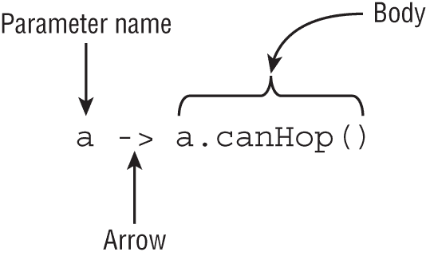

**图 1.1** 省略了可选部分的 Lambda 语法

现在让我们来看该表达式的更详尽的版本，所示在图 1.2 中。它也包含三个部分：

*   一个指定名为 `a` 类型为 `Animal` 的单个参数
*   用于分隔参数和体的箭头运算符
*   一个调用单个方法并返回结果的体

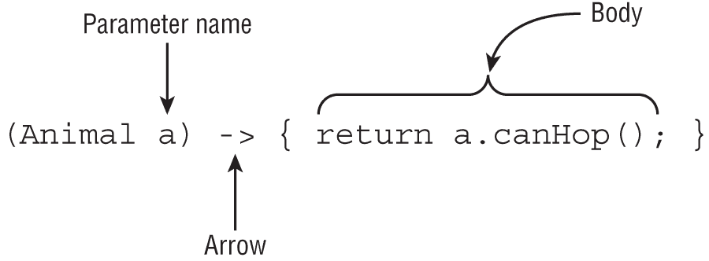

**图 1.2** 包含可选部分的 Lambda 语法

只有当只有一个参数且未说明其类型时，才能省略括号。开发者通常这样做这样使用 lambda 表达式，以便尽可能减少代码。

当我们只有一个语句时，可以省略括号，这对你来说应该并不陌生。我们已经在 `if` 语句和循环中这样做过了。这里的不同之处在于省略括号时规则改变了。不使用括号时，Java 不需要你输入 `return` 或使用分号。这种特殊的快捷方式在有两个或多个语句时不起作用。至少这与使用 `{}` 创建代码块是一致的。

让我们来看一些例子。以下都是有效的 lambda 表达式，假设有相应的函数式接口可以使用它们：

```java
() -> new Duck()
d -> {return d.quack();}
(Duck d) -> d.quack()
(Animal a, Duck d) -> d.quack()
```


第一个 lambda 表达式可以被一个不接受参数并返回 `Duck` 对象的函数式接口使用。第二个和第三个 lambda 表达式都可以被一个接受 `Duck` 并返回 `quack()` 返回类型的函数式接口使用。最后一个 lambda 表达式可以被一个接受 `Animal` 和 `Duck` 对象输入并返回 `quack()` 返回类型的函数式接口使用。

现在让我们确保你能识别无效语法。假设我们需要一个返回 `boolean` 值的 lambda。你看到这些表达式中的每一个哪里出了问题吗？

```
3: a, b -> a.startsWith("test")         // 无法编译
4: Duck d -> d.canQuack();              // 无法编译
5: a -> { a.startsWith("test"); }       // 无法编译
6: a -> { return a.startsWith("test") } // 无法编译
7: (Swan s, t) -> s.compareTo(t) != 0   // 无法编译
```

第 3 行和第 4 行需要为每个参数列表加上括号。请记住，*仅*当只有一个参数且该参数没有声明类型时，括号才是可选的。第 5 行缺少了 `return` 关键字，由于我们之前说过该 lambda 必须返回一个 `boolean`。第 6 行在花括号 `{}` 内部缺少了分号。最后，第 7 行缺少了 `t` 的参数类型。如果其中一个参数指定了参数类型，那么所有参数都必须指定类型。

## 使用 Lambda 变量

变量在相对于 Lambda 时可以出现在三个地方：参数列表、在 Lambda 体内部声明的局部变量，以及从 Lambda 体中引用的变量。这三者都是考试中可能陷阱的地方。

### 参数列表

你之前已经学过，指定参数类型是可选的。现在 `var` 可以用于 Lambda 参数列表中。这意味着这三个语句是可以互换的：

```
Predicate<String> p = x -> true;
Predicate<String> p = (var x) -> true;
Predicate<String> p = (String x) -> true;
```

考试可能会要求你识别 Lambda 参数的类型。在之前的示例中，答案是 `String`。好的，但我们是如何得出的呢？Lambda 会从周围环境中推断类型。这意味着你也可以这样做！

在这种情况下，Lambda 被赋值给一个接收 `String` 的 `Predicate`。寻找类型的另一个地方是方法签名。让我们尝试另一个例子。你能猜出 `x` 的类型吗？

```
public void whatAmI() {
   test((var x) -> x>2, 123);
}

public void test(Predicate<Integer> c, int num) {
   c.test(num);
}
```

如果你猜的是 `Integer`，那么你是的。`whatAmI()` 方法创建了一个 lambda 传递给 `test()` 方法。由于 `test()` 方法期望 `Integer` 作为泛型，我们知道 `x` 的推断类型就是它。

等等，还有！在某些情况下，你甚至不需要看到方法签名就能确定类型。你认为这里 `x` 的类型是什么？

```java
 public void counts(List<Integer> list) {
      list.sort((var x, var y) -> x.compareTo(y));
   }
```

答案仍然是 `Integer`。由于我们正在对列表进行排序，可以使用列表的类型来确定 Lambda 参数的类型。

### 在参数列表中使用 var 的限制

虽然你可以在 Lambda 参数列表中使用 `var`，但有一条规则你需要注意。如果 `var` 被用于参数列表中的一种类型，那么它必须在列表中的所有参数上都使用 `var`。根据这条规则，如果将以下 Lambda 表达式赋值给变量，哪些表达式将无法编译？

```
3: (var num) -> 1
4: var w -> 99
5: (var a, var b) -> "Hello"
6: (var a, Integer b) -> true
7: (String x, var y, Integer z) -> true
8: (var b, var k, var m) -> 3.14159
9: (var x, y) -> "goodbye"
```

第 3 行可以编译，与我们之前的示例类似。第 4 行无法编译，因为使用参数名称时需要括号 `()`。第 5 行和第 8 行可以编译，因为列表中的所有参数都使用了 `var`。第 6 行和第 7 行无法编译，因为参数类型包含了 `var` 和类型名的混合。最后，第 9 行无法编译，因为第二个参数 `y` 缺少参数类型。即使对所有参数类型都使用 `var`，每个参数类型也必须写出来。

### Lambda 体内部的局部变量

虽然 Lambda 体通常是单个表达式，但定义一个块也是合法的。该块可以包含普通 Java 块中任何有效的内容，包括局部变量声明。

以下代码正是如此。它创建了一个名为 `c` 的局部变量，其作用域限于 Lambda 块。

```
(a, b) -> { int c = 0; return 5;}
```

现在让我们尝试另一个。你发现这里有问题了吗？

```
(a, b) -> { int a = 0; return 5;}     // 无法编译
```

我们尝试重新声明 `a`，这是不允许的。Java 不允许你创建一个与该作用范围内已声明的变量同名的局部变量。现在让我们尝试一个难的。在这个方法中你看到了多少语法错误？

```
11: public void variables(int a) {
12:    int b = 1;
13:    Predicate<Integer> p1 = a -> { 
14:       int b = 0; 
15:       int c = 0; 
16:       return b == c;}
17: }
```

实际上有三个语法错误。第一个在第 13 行。变量 `a` 已经在该作用范围内作为方法参数使用，因此不能再次使用。下一个语法错误出现在第 14 行，代码尝试重新声明局部变量 `b`。第三个语法错误非常微妙，在第 16 行。看到了吗？仔细看。

变量 `p1` 在结尾缺少一个分号。虽然有一个 `}`，但那是块内部。

### 从 Lambda 体引用的变量

Lambda 体可以使用 `static` 变量、实例变量，以及是 `final` 或有效 final 的局部变量。听起来熟悉吗？Lambda 遵循与匿名类相同的规则！让我们来看一个例子：

```
4:  public class Crow {
5:     private String color;
6:     public void caw(String name) {
7:        String volume = "loudly";
8:        Predicate<String> p = s -> (name+volume+color).length();
9:     }
10: }
```

在这个示例中，`name` 和 `volume` 的值在第 9 行和第 10 行被重新赋值。因此，在第 11 行和第 12 行声明的 lambda 表达式无法编译，因为它引用的局部变量不是 `final` 或有效 final。如果删除了第 9 行和第 10 行，该类就可以编译。（等等，让我重新调整逻辑）。

局部类是在方法内部内部的类。局部类可以访问 `final` 和有效 final 的局部变量。匿名类是局部类的一种特殊类型，没有名称。匿名类要求扩展一个一个类或实现恰一个 `interface`。

从 Java 9 开始，接口现在支持六种不同的成员。常量变量（`static final`）和 `abstract` 方法你应该已经很熟悉了。新的成员类型包括 `default`、`static`、`private` 和 `private static` 方法。虽然接口现在包含了许多成员类型，但它们与抽象类仍有区别，并且不参与类的实例化。

最后但同样重要的是，本章还介绍了函数式接口和 lambda 表达式。函数式接口是恰好包含一个抽象方法的接口。任何函数式接口都可以用 lambda 表达式来实现。lambda 表达式可以用多种不同的形式编写，因为许多部分是可选的。请确保你理解编写 lambda 表达式的基础知识，因为你将在整本书中使用它们。

## 考试要点

- **能够正确地应用 `final` 修饰符。** 对变量应用 `final` 修饰符意味着它的值在赋值后不能更改，尽管它的内容可以被修改。实例 `final` 变量必须在声明时、实例初始化器中或构造函数中最多赋值一次值。`static final` 变量必须在声明时或在 `static` 初始化器中赋值。`final` 方法是不能被子类覆盖的方法，而 `final` 类是不能被扩展的。

- **能够创建并使用枚举类型。** 枚举是一种定义了值列表的数据结构。如果枚举不包含任何其他元素，则值后面的分号（`;`）是可选的。枚举可以有实例变量、构造函数和方法。枚举构造函数是隐式的 `private`。枚举可以包含方法，既可以作为成员，也可以包含在单个枚举值内部。如果枚举声明了 `abstract` 方法，则每个枚举值必须实现它。

- **识别并区分嵌套类的类型。** 嵌套类型有四种：内部类、`static` 类、局部类和匿名类。前两种是作为类声明的一部分定义的。局部类使用在方法体内部，其作用域限制在当前代码块的末尾。匿名类被创建并使用一次，通常是即时创建的。最近，它们通常被实现为 lambda 表达式。

- **能够声明和使用嵌套类。** 实例化内部类需要外部类的实例，例如调用 `new Outer.new Inner()`。另一方面，`static` 嵌套类可以在没有外部类引用的情况下创建，尽管在没有引用的情况下它们无法访问外部类的实例成员。局部类和匿名类不能带有访问修饰符。匿名类局限于扩展单个类或实现一个接口。

- **能够创建 `default, static, private` 和 `private static` 接口方法。** `default` 接口方法是一个包含体的 `public` 接口，它可以被实现接口的类覆盖。如果一个类继承了两个签名相同的 `default` 方法，则该类必须用它自己的实现来覆盖该 `default` 方法。接口可以包含 `public static` 和 `private static` 方法，后者只能由接口内部声明的方法访问。接口还可以包含 `private` 方法，这些方法只能由接口声明中的 `default` 和其他 `private` 方法调用。

- **确定接口是否为函数式接口。** 使用单抽象方法 (SAM) 规则来确定一个接口是否为函数式接口。其他接口方法类型（`default`、`private`、`static` 和 `private static`）不计入单抽象方法计数，任何在 `Object` 中找到签名的 `public` 方法也不计入。

- **编写简单的 lambda 表达式。** 观察 lambda 代码中是否存在可选元素。参数类型是可选的。当主体是单个语句时，大括号和 `return` 关键字是可选的。当仅指定一个参数且类型是隐式的，括号是可选的。如果其中一个参数是 `var`，那么它们都必须使用 `var`。

- **确定变量是否可以在 lambda 体中使用。** 局部变量和方法参数必须是 `final` 或有效最终（effectively final）才能在 lambda 表达式中引用。类变量总是允许的。如果 lambda 使用在实例方法内部，则允许实例变量。

## 复习题

章节复习题的答案可以在附录 B](#b02.xhtml) 中找到。

1. 关于 `final` 修饰符的哪些描述是正确的？（选择所有适用项。）

    1. 实例和静态变量可以标记为 `final`。

    2. 如果变量被标记为 `final`，则它是有效最终的。

    3. `final` 修饰符可以应用于类和接口。

    4. `final` 类不能被扩展。

    5. 被标记为 `final` 的对象不能被修改。

    6. 局部变量不能带有类型 `var` 和 `final` 修饰符。

2. 下面程序的运行是什么？

```
public class FlavorsEnum {
    enum Flavors {
        VANILLA, CHOCOLATE, STRAWBERRY
        static final Flavors DEFAULT = STRAWBERRY;
    }
    public static void main(String[] args) {
        for(final var e : Flavors.values())
           System.out.print(e.ordinal()+" ");
    }
}
```

    1. `0 1 2`

    2. `1 2 3`

    3. 正好有一行代码无法编译。

    4. 多行代码无法编译。

    5. 代码编译通过但在运行时抛出异常。

    6. 以上都不是。

3. 下面代码的结果是什么？（选择所有适用项。）

```
1:  public class Movie {
     2:     private int butter = 5;
     3:     private Movie() {}
     4:     protected class Popcorn {
     5:        private Popcorn() {}
     6:        public static int butter = 10;
     7:        public void startMovie() {
     8:           System.out.println(butter);
     9:        }
     10:    }
     11:    public static void main(String[] args) {
     12:       var movie = new Movie();
     13:       Movie.Popcorn in = movie.new Popcorn();
     14:       in.startMovie();
     15:    } }
```

    1. 输出为 `5`。

    2. 输出为 `10`。

    3. 第 6 行编译错误。

    4. 第 12 行编译错误。

    5. 第 13 行编译错误。

    6. 运行时产生异常。

4. 关于 `default` 和 `private` 接口方法的哪些描述是正确的？（选择所有适用项。）

    1. `default` 接口方法可以是 `private`。

    2. `default` 接口方法可以是 `public`。

    3. `default` 接口方法可以是 `static`。

    4. `private` 接口方法可以是 `abstract`。

    5. `private` 接口方法可以是 `protected`。

    6. `private` 接口方法可以是 `static`。

5. 下列哪些是有效的 lambda 表达式？（选择所有适用项。）

    1. `(Wolf w, var c) -> 39`

    2. `(final Camel c) -> {}`

    3. `(a,b,c) -> {int b = 3; return 2;}`

    4. `(x,y) -> new RuntimeException()`

    5. `(var y) -> return 0;`

    6. `() -> {float r}`

    7. `(Cat a, b) -> {}`

6. 使用 `private` 接口方法的优点有哪些？（选择所有适用项。）

    1. 提高多态

    2. 提高运行时性能

    3. 减少代码重复

    4. 向后兼容

    5. 封装接口实现

    6. 可移植性

7. 下面程序的运行是什么？

```java
public class IceCream {
    enum Flavors {
        CHOCOLATE, STRAWBERRY, VANILLA
    }

    public static void main(String[] args) {
        Flavors STRAWBERRY = null;
        switch (STRAWBERRY) {
            case Flavors.VANILLA: System.out.print("v");
            case Flavors.CHOCOLATE: System.out.print("c");
            case Flavors.STRAWBERRY: System.out.print("s");
            break;
            default: System.out.println("missing flavor"); 
        }
    }
}
```

1. `v`

2. `vc`

3. `s`

4. `missing flavor`

5. 正好有一行代码无法编译。

6. 多于一行代码无法编译。

7. 代码编译通过但在运行时抛出异常。

8. 关于函数式接口（functional interfaces）哪些描述是正确的？（选择所有项。）

1. 函数式接口可以包含 `default` 和 `private` 方法。

2. 函数式接口可以由类或接口定义。


3. 签名与`java.lang.Object`的`public`方法相同的抽象方法不计入函数式接口的抽象方法计数中。

4. 函数式接口不能包含`static`或`private static`方法。

5. 函数式接口包含至少一个抽象方法。

6. 函数式接口必须标记有`@FunctionalInterface`注解。

9. 下列哪些行独立输入到空白处时，允许代码在运行时打印`Not scared`？（选择所有项。）

```java
public class Ghost {
    public static void boo() {
        System.out.println("Not scared");
    }
    protected final class Spirit {
        public void boo() {
            System.out.println("Booo!!!");
        }
    }
    public static void main(String… haunt) {
        var g = new Ghost().new Spirit() {};
        __________________________;
    }
}
```

1. `g.boo()`

2. `g.super.boo()`

3. `new Ghost().boo()`

4. `g.Ghost.boo()`

5. `new Spirit().boo()`

6. `Ghost.boo()`

7. 以上均非

10. 下列代码出现在名为`Ostrich.java`的文件中。编译该源文件的结果是什么？

```java
1: public class Ostrich {
     2:    private int count;
     3:    private interface Wild {}
     4:    static class OstrichWrangler implements Wild {
     5:       public int stampede() {
     6:          return count;
     7:       } } }
```

1. 代码编译成功，生成一个字节码文件：`Ostrich.class`。

2. 代码编译成功，生成两个字节码文件：`Ostrich.class`和`OstrichWrangler.class`。

3. 代码编译成功，生成两个字节码文件：`Ostrich.class`和`Ostrich$OstrichWrangler.class`。

4. 第 4 行发生编译器错误。

5. 第 6 行发生编译器错误。

11. 下列代码的结果是什么？

```java
1:  public interface CanWalk {
     2:     default void walk() { System.out.print("Walking"); }
     3:     private void testWalk() {}
     4:  }
     5:  public interface CanRun {
     6:     abstract public void run();
     7:     private void testWalk() {}
     8:     default void walk() { System.out.print("Running"); }
     9:  }
10: public interface CanSprint extends CanWalk, CanRun {
11:    void sprint();
12:    default void walk(int speed) { 
13:       System.out.print("Sprinting");
14:    }
15:    private void testWalk() {}
16: }
```

1. 代码编译没有问题。

2. 代码因为第 6 行无法编译。

3. 代码因为第 8 行无法编译。

4. 代码因为第 10 行无法编译。

5. 代码因为第 12 行无法编译。

6. 以上均非。

12. 执行以下程序的结果是什么？

```java
interface Sing {
    boolean isTooLoud(int volume, int limit);
}
public class OperaSinger {
    public static void main(String[] args) {
        check((h, l) -> h.toString(), 5);  // m1
    }
    private static void check(Sing sing, int volume) {
        if (sing.isTooLoud(volume, 10))   // m2
           System.out.println("not so great");
        else System.out.println("great");
    }
}
```

1. `great`

2. `not so`

3. `m1`处编译器错误

4. `m2`处编译器错误

5. `Sing`处编译器错误

6. 抛出一个异常。

13. 下列接口中哪些行无法编译？（选择所有项。）

```java
1: public interface Herbivore {
     2:    int amount = 10;
     3:    static boolean gather = true;
     4:    void eat() {}
     5:    int findMore() { return 2; }
     6:    default float rest() { return 2; }
     7:    int chew() { return 3; }
     8:    protected void eat() {}
9: }
```

1. 所有行均编译。

2. 第 2 行

3. 第 3 行

4. 第 4 行

5. 第 5 行

6. 第 6 行

7. 第 7 行

8. 第 8 行

14. 下列程序打印什么？

```java
public class Deer {
    enum Food {APPLES, BERRIES, GRASS}
    protected class Diet {
        private Food getFavorite() {
            return Food.BERRIES;
        }
    }
    public static void main(String[] seasons) {
        switch(new Diet().getFavorite()) {
            case APPLES: System.out.print("a");
            case BERRIES: System.out.print("b");
            default: System.out.print("c");
        }
    }
}
```

1. `b`

2. `bc`

3. `abc`

4. `Diet`类无法编译。

5. `main()`方法无法编译。

6. 代码编译通过但抛出异常。

7. 以上均非

15. 下列哪些是`Bear`程序打印的？（选择所有项。）

```java
public class Bear {
    enum FOOD {
        BERRIES, INSECTS {
            public boolean isHealthy() { return true; }
        }},
        FISH, ROOTS, COOKIES, HONEY;
        abstract boolean isHealthy();
    }
    public static void main(String[] args) {
        System.out.print(FOOD.INSECTS);
        System.out.print(FOOD.INSECTS.ordinal());
        System.out.print(FOOD.INSECTS.isHealthy());
        System.out.print(FOOD.COOKIES.isHealthy());
    }
}
```

1. `insects`

2. `INSECTS`

3. `0`

4. `1`

5. `false`

6. `true`

7. 代码无法编译。

16. 下列哪些是有效的函数式接口？（选择所有项。）

```java
public interface Transport {
    public int go();
    public boolean equals(Object o);
}
public abstract class Car {
    public abstract Object swim(double speed, int duration);
}
public interface Locomotive extends Train {
    public int getSpeed();
}
public interface Train extends Transport {}

abstract interface Spaceship extends Transport {
    default int blastOff();
}
public interface Boat {
    int hashCode();
    int hashCode(String input);
}
```

1. `Boat`

2. `Car`

3. `Locomotive`

4. `Tranport`

5. `Train`

6. `Spaceship`

7. 这些中没有有效的函数接口。

17. 将哪个 lambda 表达式输入到以下代码的空行中会导致程序打印`hahaha`？（选择所有适用项。）

```java
import java.util.function.Predicate;
public class Hyena {
   private int age = 1;
   public static void main(String[] args) {
      var p = new Hyena();
      double height = 10;
      int age = 1;
      testLaugh(p,___________________);
      age = 2;
   }
   static void testLaugh(Hyena panda, Predicate<Hyena> joke) {
      var r = joke.test(panda) ? "hahaha" : "silence";
      System.out.print(r);
   }
}
```

1. `var -> p.age <= 10`

2. `shenzi -> age==1`

3. `p -> true`

4. `age==1`

5. `shenzi -> age==2`

6. `h -> h.age < 5`

7. 以上均不是，因为代码无法编译。

18. 下列哪些可以插入到`rest()`方法中？（选择所有适用项。）

```java
public class Lion {
   class Cub {}
   static class Den {}
   static void rest() {
      _______________;
   }
}
```

1. `Cub a = Lion.new Cub()`

2. `Lion.Cub b = new Lion().Cub()`

3. `Lion.Cub c = new Lion().new Cub()`

4. `var d = new Den()`

5. `var e = Lion.new Cub()`

6. `Lion.Den f = Lion.new Den()`

7. `Lion.Den g = new Lion.Den()`

8. `var h = new Cub()`

19. 给定以下程序，在空行中插入什么内容可以使其在运行时打印`Swim!`？

```java
interface Swim {
   default void perform() { System.out.print("Swim!"); }
}
interface Dance {
   default void perform() { System.out.print("Dance!"); }
}
public class Penguin implements Swim, Dance {
   public void perform() { System.out.print("Smile!"); }
   private void doShow() {
      ____________________
   }
   public static void main(String[] eggs) {
      new Penguin().doShow();
   }
}
```

1. `super.perform();`

2. `Swim.perform();`

3. `super.Swim.perform();`

4. `Swim.super.perform();`

5. 无论在空行插入什么，代码无法编译。

6. 代码可以编译，但由于多态性，不创建新对象无法产生所需的输出。

20. 关于有效最终变量（effectively final variables）的哪些陈述是正确的？（选择所有适用项。）

1. 有效最终变量的值在设置后不会被修改。

2. lambda 表达式可以引用有效最终变量。

3. lambda 表达式可以引用`final`变量。

4. 如果加上`final`修饰符，代码仍然编译。

5. 实例变量可以是有效最终的。

6. 静态变量可以是有效最终的。

21. 下述接口中的哪些行无法编译？（选择所有适用项。）

```java
1: public interface BigCat {
   2:    abstract String getName();
   3:    static int hunt() { getName(); return 5; }
   4:    default void climb() { rest(); }
   5:    private void roar() { getName();  climb(); hunt(); }
   6:    private static boolean sneak() { roar(); return true; }
   7:    private int rest() { return 2; };
8: }
```

1. 第 2 行

2. 第 3 行

3. 第 4 行

4. 第 5 行

5. 第 6 行

6. 第 7 行

7. 以上都不是

使用`default`接口方法有哪些优点？（选择所有适用项。）

1. 自动资源管理

2. 提高运行时性能

3. 更好的异常处理

4. 向后兼容性

5. 高并发执行

6. 实现该接口的类更加方便

23. 关于以下枚举的哪些陈述是正确的？（选择所有适用项。）

```java
1:  public enum AnimalClasses {
   2:     MAMMAL(true), INVERTIBRATE(Boolean.FALSE), BIRD(false),
   3:     REPTILE(false), AMPHIBIAN(false), FISH(false) {
   4:        public int swim() { return 4; }
   5:     }
   6:     final boolean hasHair;
   7:     public AnimalClasses(boolean hasHair) {
   8:        this.hasHair = hasHair;
   9:     }
10:    }
```

1. 第 2 行编译错误

2. 第 3 行编译错误

3. 第 7 行编译错误

4. 第 8 行编译错误

5. 第 10 行编译错误

6. 代码编译。

哪些 lambda 可以替换方法中的`new Sloth()`并产生相同的输出？（选择所有适用项。）

```java
import java.util.List;
interface Yawn {
   String yawn(double d, List<Integer> time);
}
class Sloth implements Yawn {
   public String yawn(double zzz, List<Integer> time) {
      return "Sleep: " + zzz;
   }
}
public class Vet {
   public String takeNap(Yawn y) {
      return y.yawn(10, null);
   }
   public static void main(String[] args) {
      System.out.print(takeNap(new Sloth()));
   }
}
```

1. `(z,f) -> { String x = ""; return "Sleep: " + x; }`


2. `(t,s) -> { String t = ""; return "Sleep: " + t; }`

3. `(w,q) -> "Sleep: " + w`

4. `(e,u) -> { String g = ""; "Sleep:" + e }`

5. `(a,b) -> "Sleep:" + (b==null ? a)`

6. `(r,k) -> { String g = ""; }`

7. 以上都不是，因为代码无法编译。

25. 下程序打印什么？

```java
1:  public class Zebra {
   2:     private int x = 24;
   3:     public int hunt() {
   4:        String message = "x is ";
   5:        abstract class Stripes {
          6:           private int x = 0;
          7:           public void print() {
          8:              System.out.print(message + Zebra.this.x);
          9:           }
          10:      }
   11:       var s = new Stripes() {};
   12:       s.print();
   13:       return x;
   14:    }
   15:    public static void main(String[] args) {
   16:       new Zebra().hunt();
   17:    } }
```

1. `x is 0`

2. `x is 24`

3. 第 6 行编译错误。

4. 第 8 行编译错误。

5. 第 11 行编译错误。

6. 以上都不是。

注解（Annotations）的核心在于元数据。这初听起来可能并不那么有趣，但它们为 Java 语言增加了大量价值。或者更准确地说，它们允许你为自己的代码添加大量价值。

## 理解元数据

到底什么是元数据？`Metadata` 是提供关于其他数据的数据。想象一下我们的动物园正在售票。`attribute data`（属性数据）包括价格、过期日期和购买门票数量。换句话说，属性数据是构成门票销售及其内容的交易信息。

另一方面，`metadata`（元数据）包含了围绕门票销售的规则、属性或关系。顾客必须至少购买一张票，因为销售零张或负数量的票是愚蠢的。也许动物园面临黄牛贩的问题，因此他们添加了一条规则：每个人每天最多购买五张票。这些元数据规则描述了关于门票销售的信息，但它们本身并不是门票销售的一部分。

正如你在本章中将学习，注解提供了一种简单方便的方法，可以将此类元数据插入到应用程序中。

## 注释的作用

`annotation`（注解）的作用是将元数据属性分配给类、方法、变量和其他 Java 类型。让我们从为我们的动物园定义一个简单的注解开始：`@ZooAnimal`。先不要担心这个注解是如何定义的， own 调用它的语法是什么；稍后我们会深入探讨。现在，你只需要知道注解以 at（`@`）符号开头，并可以包含称为 `elements`（元素）的属性/值对。

```java
public class Mammal {}
public class Bird {}

@ZooAnimal public class Lion extends Mammal {}

@ZooAnimal public class Peacock extends Bird {}
```

在这种情况下，注解被应用于 `Lion` 和 `Peacock` 类。我们也可以让它们继承一个名为 `ZooAnimal` 的类，但那样我们就必须更改类的层级结构。通过使用注解，我们保持了类结构不变。

这引出了我们关于注解的第一条规则：`注解的作用功能非常像接口`。在这个例子中，注解允许我们在不改变继承结构的情况下，将一个类 `mark`（标记）为 `ZooAnimal`（动物园动物）。

既然注解的功能很像接口，我们为什么不直接使用接口呢？虽然接口只能应用于类，但注解可以应用于任何声明，包括类、方法、表达式甚至其他注解。此外，与接口不同，注解允许我们在应用时传递一组值。

考虑以下 `Veterinarian` 类：

```java
public class Veterinarian {
   @ZooAnimal(habitat="Infirmary") private Lion sickLion;

   @ZooAnimal(habitat="Safari") private Lion healthyLion;

   @ZooAnimal(habitat="Special Enclosure") private Lion blindLion;
}
```

这个类定义了三个变量，每个变量都有一个关联的 `habitat` 值。`habitat` 值是每个变量类型声明的一部分，而不是单个对象的属性。例如，`healthyLion` 可能会改变它指向的对象，但注解的值不会改变。如果没有注解，我们必须为每个 `habitat` 值定义一个新的 `Lion` 类型，在应用程序足够足够大的情况下，这可能会变得非常繁琐。

这引出了我们关于注解的第二条规则：`注解建立了关系，使我们更容易管理关于我们应用程序的数据`。

当然，我们可以在不使用注解的情况下编写应用程序，但这通常需要创建大量的额外的类、接口或数据文件（XML、JSON 等）来管理这些复杂的关系。糟糕的是，由于这些额外的类或文件可能定义在它们被使用的类之外，我们必须花费大量工作来保持数据和关系的同步。

考虑以下方法，它们使用假设的 `@ZooSchedule` 注解来指示何时应该执行任务。

```java
// Lion.java
public class Lion {
   @ZooSchedule(hours={"9am","5pm","10pm"}) void feedLions() {
      System.out.print("Time to feed the lions!");
   }
}

// Peacock.java
public class Peacock {
   @ZooSchedule(hours={"4am","5pm"}) void cleanPeacocksPen() {
      System.out.print("Time to sweep up!");
   }
}
```

这些方法定义在完全不同的类中，但对注解的解释是相同的。通过这种方法，任务及其时间表被定义在一起。这引出了我们关于注解的第三条规则：`注解在它定义的声明处赋予了自定义信息`。事实证明这是一个强大的工具，因为同一个注解通常可以应用于完全无关的类或变量。

关于注解，你还有应该熟悉的最后一条规则：`注解是可选的元数据，它们本身什么都不做`。这意味着你可以取一个充斥着成上万个注解的项目并移除所有注解，它仍然可以编译和运行，尽管在运行时可能会有不同的行为。

这条规则起初看起来可能有点违反直觉，但它指的是注解在定义的地方并没有被利用。这取决于应用程序的其他部分（或者更可能是底层框架）去强制或使用注解来完成任务。例如，在方法上标记 `@SafeVarargs` 会告诉其他开发者和开发工具，方法体不存在任何不安全的操作。它并不能阻止不安全操作的发生！

对于考试，你需要知道如何定义你自己的自定义注解、如何正确应用注解以及如何使用常用注解。考试不需要编写处理或强制执行注解的代码。

## 创建自定义注解

创建你自己的注解比出奇地简单。你只需要给它起一个名字，定义一个可选和强制性元素的列表，并指定它的用处。在本节中，我们将从最简单的注解开始，逐步进阶。

### 创建注解

假设我们的动物园想要使用注解为各种动物园居民指定练习元数据。我们使用 `@interface` 注解（全小写）来声明一个注解。像类和接口一样，它们通常定义在自己的文件中作为顶级类型，也可以定义在类内部。

```java
public @interface Exercise {}
```

是的，我们使用注解来创建一个注解！`Exercise` 注解被称为 `marker annotation`（标记注解），因为它不包含任何元素。在第八章“输入/输出”中，你实际上会学习到所谓的标记接口，它与注解有很多相似之处。

如何使用我们的新注解？很简单。我们使用 at（`@`）符号，后跟类型名称。在这种情况下，注解是 `@Exercise`。然后，我们将注解应用于其他 Java 代码，例如类。

```java
@Exercise() public class Cheetah {}

@Exercise public class Sloth {}

@Exercise
public class ZooEmployee {}
```

噢，我们把动物和动物园员工混在一起了！这完全没问题。没有任何规则规定 `@Exercise` 注解必须应用于动物。正如接口一样，注解可以应用于无关。你可能注意到 `Cheetah` 和 `Sloth` 在使用注解时有所不同。一个使用了括号 `()`，而另一个没有。当使用标记注解时，括号是可选的。但一旦我们开始添加元素，它们就是强制性的。

```java
@Scaley       @Flexible
   @Food("insect") @Food("rodent")      @FriendlyPet
@Limbless public class Snake {}
```

有些注解在同一行上，有些单独占一行，有些则与 `Snake` 的声明在同一行。无论如何，所有注解都适用于 `Snake`。与 Java 中的其他声明一样，元素之间的空格和制表符会被忽略。

在例示例中，某些注解全都是小写字母，而另一些是大小大小写的。注解名称是区分大小写的。与类和接口名称一样，通常的做法是让它们以大写字母开头，尽管这不是强制要求的。

最后，某些注解（如 `@Food`）可以多次应用。我们将在本章稍后的部分介绍可重复注解（repeatable annotations）。

### 指定必需元素

`annotation element`（注解元素）是一种属性，用于存储关于注解特定用法的值。为了让我们之前的示例更有用，让我们把 `@Exercise` 从一个标记注解（marker annotation）改为一个包含元素的注解。

```java
public @interface Exercise {
   int hoursPerDay();
}
```

`hoursPerDay()` 元素的语法起初看起来可能有点奇怪。它看起来非常像抽象方法，尽管我们称之为元素（或属性）。记住，注解的根源在于接口。在后台，JVM 正在将元素创建为接口方法，并将注解创建为这些接口的实现。幸运的是，你不需要担心这些细节；编译器会为你完成。

让我们来看看这个新元素是如何改变我们的用法的：

```java
@Exercise(hoursPerDay=3) public class Cheetah {}

@Exercise hoursPerDay=0 public class Sloth {}     // 无法编译

@Exercise public class ZooEmployee {}             // 无法编译
```

`Cheetah` 类通过编译并正确使用了该注解，为该元素提供了值。`Sloth` 类无法编译，因为它在注解参数周围缺少括号。记住，只有在不包含任何值时，括号才是可选的。

`ZooEmployee` 呢？这个类无法编译，因为 `hoursPerDay` 字段是必需的。还记得我们之前说注解是可选的元数据吗？虽然注解本身是可选的，但编译器仍然关心它们是否被正确使用。

等一下，我们什么时候把 `hoursPerDay()` 标记为必需的？我们并没有。但我们也没有指定默认值。`在声明注解时，任何没有默认值的元素都被认为是必需的`。接下来我们将向你展示如何声明可选元素。

### 提供可选元素

要使一个元素成为可选的而非必需的，它必须包含一个默认值。让我们更新我们的注解以包含一个可选值。

```java
public @interface Exercise {
   int hoursPerDay();
   int startHour() default 6;
}
```

接下来，我们将更新后的注解应用到我们的类中。

```java
@Exercise(startHour=5, hoursPerDay=3) public class Cheetah {}

@Exercise(hoursPerDay=0) public class Sloth {}

@Exercise(hoursPerDay=7, startHour="8")  // 无法编译
public class ZooEmployee {}
```

这里有几点需要解释。首先，当一个注解中有多个元素值时，我们用逗号（`,`）将它们隔开。接下来，每个元素使用 `elementName` = `elementValue` 语法编写。这就像是 `Map` 的简写。此外，每个元素的顺序并不重要。`Cheetah` 可以先列出 `hoursPerDay`。

我们还看到 `Sloth` 没有指定 `startHour` 的值，这意味着它将使用默认值 `6` 进行实例化。

在这个版本中，`ZooEmployee` 类无法编译，因为它定义了一个与 `startHour` 的 `int` 类型不兼容的值。编译器正在履行它的职责来验证类型！

### 选择元素类型

与默认元素值类似，注解元素不能用任何类型声明。它必须是原始类型、`String`、`Class`、枚举（enum）、另一个注解，或者其中任何一种类型的数组。

根据这些信息以及我们之前的 `Exercise` 注解，以下哪些元素可以编译？

```java
public class Bear {}

public enum Size{SMALL, MEDIUM, LARGE}

public @interface Panda {
   Integer height();
   String[][] generalInfo();
   Size size() default Size.SMALL;
   Bear friendlyBear();
   Exercise exercise() default @Exercise(hoursPerDay=2);
}
```

`height()` 元素无法编译。虽然支持 `int` 和 `long` 等原始类型，但不支持像 `Integer` 和 `Long` 这样的包装类。`generalInfo()` 元素也无法编译。`String[]` 类型是被支持的，因为它是 `String` 值的数组，但 `String[][]` 不是。

`size()` 和 `exercise()` 元素都可以编译，其中一个是枚举，另一个是注解。要为 `exercise()` 设置默认值，我们使用 `@Exercise` 注解。记住，这是创建注解值的唯一方法。与实例化类不同，永远不会使用 `new` 关键字来创建注解。

最后，`friendlyBear()` 元素无法编译。`friendlyBear()` 的类型是 `Bear`（而不是 `Class`）。即使将 `Bear`改为接口，`friendlyBear()` 元素仍然无法编译，因为它不是支持的类型之一。

### 应用元素修饰符

与抽象接口方法一样，无论你如何声明，注解元素隐式的 `abstract`（抽象的）且 `public`（公共的）。

```java
public @interface Material {}

public @interface Fluffy {
   int cuteness();
   public int softness() default 11;
   protected Material();  // 无法编译
   private String friendly();      // 无法编译
   final boolean isny();        // 无法编译
}
```

`cuteness()` 和 `softness()` 都是 `abstract` 且 `public` 的，尽管其中只有一个标记了这些。`material()` 和 `friendly()` 无法编译，因为访问修饰符与隐式的 `public` 冲突。`isny()` 无法编译，因为像抽象方法一样，它不能标记为 `final`。

### 添加常量

注解可以包含常量，这些常量可以在不创建注解的情况下被类访问。

```java
public @interface ElectricitySource {
   public int voltage();
   int MIN_VOLTAGE = 2;
   static final int MAX_VOLTAGE = 18;
}
```

是的，就像接口变量一样，注解变量隐式的 `public`、`static` 且 `final`。不过，这些常量并不视为元素。例如，标记注解可以包含常量。

### 复习注解规则

我们通过图 2.1 结束创建自定义注解，它总结了你到为止学习的许多语法规则。

图 2.2 显示了如何将此注解应用到类中。作为对比，它还包含了一个简单的标记注解 `@Alert`。记住，标记注解是不包含任何元素的注解。

如果你理解这两个图的所有部分，那么你已经在掌握注解的道路上了。如果没有，那么我们建议重读这一节。本章的其余部分将在此基础上建立；你将看到更高级的用法，将注解应用于其他注解上，并学习你考试所需的内置注解。

现在我们已经描述了如何创建和使用简单的注解，是时候讨论应用注解的其他方式了。

## 在声明中使用注解

到目前为止，我们只将注解应用于类和方法，但它们可以应用于任何 Java 声明，包括以下内容：

* 类、接口、枚举和模块

* 变量（`static`、实例变量、局部变量）

* 方法和构造函数

* 方法参数、构造函数和 lambda 参数

* 强制转换表达式

* 其他注解

假设在代码中引用的注解存在，以下代码可以通过编译：


```
1:  @FunctionalInterface interface Speedster {
2:     void go(String name);
3:  } 
4:  @LongEars
5:  @Soft @Cuddly public class Rabbit {
6:     @Deprecated public Rabbit(@NotNull Integer size) {}
7:     
8:     @Speed(velocity="fast") public void eat(@Edible String input) {
9:        @Food(vegetarian=true) String m = (@Tasty String) "carrots";
10:        
11:       Speedster s1 = new @Racer Speedster() {
12:          public void go(@FirstName @NotEmpty String name) {
13:             System.out.print("Start! "+name);
14:          }
15:       };
16:       
17:       Speedster s2 = (@Valid String n) -> System.out.print(n);
18:    }
19: }
```

我们知道这有些刻意。第 1、4 和第 5 行将注解应用于接口和类声明。某些注解（如`@Cuddly`）不需要任何值，而另一些（如`@Speed`）则提供了值。你需要查看注解的声明来确定这些值是可选的还是强制的。

第 6 和第 8 行包含了应用于构造函数和方法声明的注解。这些行还包含了应用于其参数的注解。

第 9 行包含了应用于局部变量的`@Food`注解，以及应用于强制转换表达式的`@Tasty`注解。

第 11 行将注解应用于匿名类声明中的类型，第 17 行显示了 lambda 表达式参数中的注解。这两个例子初看起来看起来可能有点奇怪，但它们允许的。事实上，你在考试中看到此类例子的概率比在现实生活中更高。

在这个示例中，我们把注解应用于各种声明，但这并不总是允许的。注解可以使用`@Target`注解来指定它们可以应用于哪些声明类型。我们将在本章的下一部分讨论这一点，以及其他针对特定注解的注解。

### 混合强制性和可选元素

应用注解时最重要的规则之一是：*要使用某个注解，必须提供所有强制性值*。虽然一个注解可能有许多元素，但只有对于没有默认值的元素才需要提供值。

让我们尝试一下。给定以下注解：

```
public @interface Swimmer {
   int armLength = 10;
   String stroke();
   String name();
   String favoriteStroke() default "Backstroke";
}
```

以下哪些代码可以通过编译？

```
@Swimmer class Amphibian {}

@Swimmer(favoriteStroke="Breaststroke", name="Sally") class Tadpole {}

@Swimmer(stroke="FrogKick", name="Kermit") class Frog {}

@Swimmer(stroke="Butterfly", name="Kip", armLength=1) class Reptile {}

@Swimmer(stroke="", name="", favoriteStroke="") class Snake {}
```

`Amphibian`无法编译，因为它缺少强制性元素`stroke()`和`name()`。同样，`Tadpole`无法编译，因为缺少强制性元素`stroke()`。

`Frog`提供了所有强制性元素且没有提供任何可选元素，因此它可以编译。`Reptile`无法编译，因为`armLength`是一个常量而不是元素，不能包含在注解中。最后，`Snake`可以编译的，因为它提供了所有强制和可选的值。

### 创建`value()`元素

在开发经验中，你可能见过一个带有值的注解，其在编写时没有写`elementName`。例如，在正确的条件下，以下语法是有效的：

```
@Injured("Broken Tail") public class Monkey {}
```

这被视为简写或缩略注解符号。什么是*正确的条件*？注解在不带名称的情况下使用，必须遵守以下规则：

* 注解声明必须包含一个名为`value()`的元素，该元素可以是可选或强制的。

* 注解声明不能包含任何其他强制性的元素。

* 注解的使用不得为任何其他元素提供值。

让我们创建一个符合这些要求的注解。

```
public @interface Injured {
   String veterinarian() default "unassigned";
   String value() default "foot";
   int age() default 1;
}
```

此注解由多个可选元素组成。在这个示例中，我们为`value()`赋了一个默认值，但我们也可以将其设为强制性。使用此声明，以下注解是有效的：

```
public abstract class Elephant {
   @Injured("Legs") public void fallDown() {}
   @Injured(value="Legs") public abstract int trip();
   @Injured String injuries[];
}
```

前两个注解的用法是等价的，因为编译器会将简写形式转换为带有`value()`元素名称的长格式。最后一个没有值的值的注解是被允许的，因为`@Injured`没有任何强制性元素。

对于考试来说，请确保如果使用了简写符号，则有一个名为`value()`的元素。此外，检查是否还有其他强制性元素。例如，以下注解声明不能使用简写注解：

```
public @interface Sleep {
   int value();
   String hours();   
}

public @interface Wake {
   String hours();   
}
```

第一个声明包含两个强制性元素，而第二个注解没有包含名为`value()`的元素。

同样，以下注解是无效的，因为它提供了多个值：

```
@Injured("Fur",age=2) public class Bear {} // 无法编译
```

### 传递数组值

注解支持使用简写符号提供包含单个元素的数组。假设我们如下定义注解`Music`：

```
public @interface Music {
   String[] genres();
}
```

如果我们想为数组只提供一个值，我们有两种方式来写注解。以下任何一种都是正确的：

```
public class Giraffe {
   @Music(genres={"Rock and roll"}) String mostDisliked;
   @Music(genres="Classical") String favorite;
}
```

第一个注解被认为是标准格式，因为很清楚用法用于数组。第二个注解是简写符号，为了方便省略了数组大括号（`{}`）。请记住这仍然为数组元素提供值；编译器只是为你插入了缺失的数组大括号。

这种符号仅在数组由单个元素组成时才能使用。例如，只有以下注解中的一个可以通过编译：

```
public class Reindeer {
   @Music(genres="Blues","Jazz") String favorite;  // 无法编译
   @Music(genres=) String mostdisliked;            // 无法编译
   @Music(genres=null) String other;               // 无法编译
   @Music(genres={}) String alternate;
}
```

第一个提供了多个值，而后两个没有提供任何值。最后一个是可以编译的，因为没有元素的数组仍然是一个有效的数组。

虽然这种简写符号可以用于数组，但它不适用于`List`或`Collection`。如之前所述，它们不在注解支持的元素类型列表中。

恭恭喜你——如果你已经读到了这里，说明你已经掌握了我们教给你的所有注解通用规则！从现在开始，你需要学习特定的注解以及它们与考试相关的规则。这些规则中许多是直观易懂的，尽管某些需要死背记忆。

在本节中，我们将介绍应用于其他注解的内置注解。是的，关于元数据的元数据！由于这些注解是 Java 内置的，因此它们主要影响编译器。在最后一节中，我们将介绍应用于各种 Java 数据类型的内置注解。

## 使用`@Target`限制使用范围

早些时候，我们向你展示了应用于各种 Java 类型（如类、方法和表达式）的注解示例。在定义自己的注解时，你可能想将其限制在特定类型或一组类型上。毕竟，将某个注解应用于方法参数或局部变量可能没有意义。

许多注解声明都包含`@Target`注解，它限制了注解可以应用的类型。具体来说，`@Target`注解接受`ElementType`枚举值数组作为其`value()`元素。

### 学习`ElementType`值

表 2.1 显示了`@Target`注解的所有可用值。

| `ElementType`值 | 应用于 |
| --- | --- |
| `TYPE` | 类、接口、枚举、注解 |
| `FIELD` | 实例变量和`static`变量、枚举值 |
| `METHOD` | 方法声明 |
| `PARAMETER` | 构造函数、方法和 lambda 参数 |
| `CONSTRUCTOR` | 构造函数声明 |
| `LOCAL_VARIABLE` | 局部变量 |
| `ANNOTATION_TYPE` | 注解 |
| `PACKAGE` * | 在`package-info.java`中声明的包 |
| `TYPE_PARAMETER` ^* | 泛型类型、泛型声明 |
| `TYPE_USE` | 可应用于任何声明或使用 Java 类型的地方 |
| `MODULE` ^* | 模块 |

^(*) 在注解中使用这些应用方式不在考试范围之内。

**表 2.1** `@Target`注解的值

你可能会发现，某些`ElementType`的应用范围存在重叠。例如，为了创建一个可以使用于其他注解的注解，你可以声明一个带有`ANNOTATION_TYPE`或`TYPE`的`@Target`。这两种对于注解来说都是有效的，但第二种方案会将注解的使用扩展到类和接口等其他类型。

虽然你可能不会被要求测试所有这些类型，但在考试中可能会看到其中几个。请确保你能够识别它们的正确用法。大多数用法是不言自明的。

请考虑以下注解：

```java
import java.lang.annotation.ElementType;
import java.lang.annotation.Target;

@Target({ElementType.METHOD,ElementType.CONSTRUCTOR})
public @interface ZooAttraction {}
```

基于此注解，以下哪行代码可以编译？

```
1: @ZooAttraction class RollerCoaster {}
2: class Events {
3:    @ZooAttraction String rideTrain() {
4:       return (@ZooAttraction String) "Fun!";
5:    }
6:    @ZooAttraction Events(@ZooAttraction String description) {
7:       super();
8:    }
9:    @ZooAttraction int numPassengers; }
```

此示例包含了六次`@ZooAttraction`，但只有两个有效。第 1 行无法编译，因为注解被应用于类类型。第 3 行可以编译，因为它被允许在方法声明中使用。第 4 行无法编译，因为它不允许用于类型转换操作。

第 6 行比较棘手。第一个注解是允许的，因为它被应用于构造函数声明。第二个注解是不允许的，因为该注解未标记用于构造函数参数。最后，第 9 行是不允许的，因为它不能应用于字段或变量。

### 理解`TYPE_USE`值

虽然表 2.1 中的大多数值都直观易懂，但`TYPE_USE`无疑是最复杂的。`TYPE_USE`参数可以用于任何有 Java 类型的地方。通过将其包含在`@Target`中，它实际上包含了表 2.1 中的几乎所有值，包括类、接口、构造函数、参数等。这里有少数例外；例如，它只能用于返回值的方法。返回`void`的方法仍然需要在注解中定义`METHOD`值。

它还允许将注解放在使用类型的地方，例如类型转换操作、使用`new`创建对象、在类型声明内部等。这些初看之下可能有点奇怪，但以下是有效的`TYPE_USE`应用：

```java
// Technical.java
import java.lang.annotation.ElementType;
import java.lang.annotation.Target;

@Target(ElementType.TYPE_USE)
@interface Technical {}
```

*(注：由于原文存在大量重复的`NetworkRepair.java`示例，此处仅保留代表性结构)*

在本示例中，`@Hunter`注解将与`Lion`Javadoc 信息一起发布，因为它被标记了`@Documented`注解。

### 使用`@Inherited`继承注解

考试中你还应该了解的另一个标记注解是`@Inherited`。当此注解应用于一个类时，子类将继承父类中找到的注解信息。

```
// Vertebrate.java
import java.lang.annotation.Inherited;
@Inherited public @interface Vertebrate {} 

// Mammal.java
@Vertebrate public class Mammal {}

// Dolphin.java
public class Dolphin extends Mammal {}
```

在这个示例中，`@Vertebrate`注解将同时应用于`Mammal`和`Dolphin`实例。如果没有`@Inherited`注解，`@Vertebrate`将只被应用到`Mammal`实例上。

### 使用`@Repeatable`支持重复

考试中你需要了解的最后一个特定注解无疑是使用起来最复杂的，因为它实际上需要创建两个注解。当你想要在一个类型上多次指定同一个注解时，就会使用`@Repeatable`注解。

为什么你想指定两次呢？嗯，如果它是一个没有任何元素的标记注解，你可能不会这样做。通常情况下，当你想要用不同的值应用同一个注解时，就会使用重复注解。

让我们假设有一个可重复的注解`@Risk`，它为动物园动物分配一组风险值。我们将展示它是如何使用的，然后反向推创建过程。

```
public class Zoo {
   public static class Monkey {}

   @Risk(danger="Silly")
   @Risk(danger="Aggressive",level=5)
   @Risk(danger="Violent",level=10)
   private Monkey monkey;
}
```

接下来，让我们定义实现这些元素的简单注解：

```
public @interface Risk {
   String danger();
   int level() default 1;
}
```

现在，按照目前的写法，`Zoo`类无法编译。为什么？因为`Risk`注解缺少了`@Repeatable`注解！这引出了我们的第一个规则：*如果没有`@Repeatable`注解，注解只能被应用一次*。所以，让我们加上`@Repeatable`注解。

```
import java.lang.annotation.Repeatable;

@Repeatable  // 无法编译
public @interface Risk {
   String danger();
   int level() default 1;
}
```

这段代码也无法编译，但这次是因为`@Repeatable`注解声明得不正确。它需要引用第二个注解。这引出了我们的下一个规则：*要声明一个`@Repeatable`注解，你必须定义一个容器注解类型值（containing annotation type value）*。

*容器注解类型*是一个独立的注解，它定义了一个`value()`数组元素。该数组的类型是你想要重复的特定注解。按照惯例，注解名称通常是可重复注解的复数形式。

将这一切结合起来，下面的`Risks`声明是`Risk`注解的容器注解类型：

```
public @interface Risks {
   Risk[] value();
}
```

最后，回到我们原始的`Risk`注解，并指定容器注解类：

```
import java.lang.annotation.Repeatable;

@Repeatable(Risks.class)
public @interface Risk {
   String danger();
   int level() default 1;
}
```


有了这两个注解，我们原始的`Zoo`类现在就可以编译了。注意，我们从未在`Zoo`类中真正使用过`@Risks`。考虑到`Risk`和`Risks`注解的声明，编译器会替我们处理这些注解。

以下总结了声明可重复注解的规则，以及相关的容器类型注解：

- 可重复注解必须使用`@Repeatable`声明，并包含一个指向容器类型注解的值。
- 容器类型注解必须包含一个名为`value()`的元素，该元素是可重复注解类型的数组（primitive array）。

一旦你理解了声明可重复注解的基本结构，操作起来就很方便了。

### 复习特定注解

我们用[表 2.3]结束本章的这部分，它显示了可以应用于考试中可能出现的注解的其他注解。

| 注解 | 标记注解 | `value()`的类型 | 默认编译器行为（如果注解不存在） |
| --- | --- | --- | --- |
| `@Target` | 否 | `ElementType`数组 | 注解可以应用于`TYPE_USE`和`TYPE_PARAMETER`之外的所有位置 |
| `@Retention` | 否 | `RetentionPolicy` | `RetentionPolicy.CLASS` |
| `@Documented` | 是 | — | 注解不包含在生成的 Javadoc 中。 |
| `@Inherited` | 是 | — | 超类中的注解不会被继承。 |
| `@Repeatable` | 否 | 注解 | 注解不能重复。 |

**表 2.3** 特定于注解。

在本节之前，我们创建了许多注解，但我们从未使用过[表 2.3]中的任何注解。那么，编译器做了什么呢？类似于隐式修饰符和默认无参构造函数一样，编译器会根据缺失的情况自动插入信息。[表 2.3]中大多数注解的默认行为通常是符合直觉的。例如，如果没有`@Documented`或`@Inherited`注解，这些功能将不受支持。同样，如果你尝试在没有`@Repeatable`的情况下多次使用一个注解，编译器将报告错误。

`@Target`注解是一个特殊情况。当没有`@Target`时，注解可以应用于`TYPE_USE`或`TYPE_PARAMETER`场景以外的地方（类型转换操作、对象创建、泛型声明等）。

## 使用常用注解

对于考试来说，你需要了解一组应用于各种类型和方法的内置注解。与你可能编写的自定义注解不同，这些注解中的许多有特殊的规则。事实上，如果它们使用不当，编译器会报告错误。

这些注解中的一些（如`@Override`）非常有用，我们建议在实践中使用它们。另另一些（如`@Safevarargs`），你可能只会在考试中看到。对于每个注解，你都需要理解它的用途，识别何时使用它（或不使用），并知道它接受哪些元素（如果有）。

### 使用`@Override`标记方法

`@Override`是一个标记注解，用于指示方法正在重写继承的方法，无论它是继承自接口还是父类。根据你的 1Z0-815 学习，你应该知道重写的方法具有相同的签名、相同或更宽的访问修饰符以及协变返回类型，并且不声明新的或更宽的检查异常。

让我们来看一个例子：

```
public interface Intelligence {
   int cunning();
}
public class Canine implements Intelligence {
   @Override public int cunning() { return 500; }
   void howl() { System.out.print("Woof!"); }
}
public class Wolf extends Canine {
   @Override
   public int cunning() { return Integer.MAX_VALUE; }
   @Override void howl() { System.out.print("Howl!"); }
}
```

在这个示例中，`@Override`注解被应用于三个从父类或接口继承来的方法。

在考试期间，你应该能够识别出任何错误使用该注解的地方。例如，使用相同的`Canine`类，这个`Dog`类无法编译：

```
public class Dog extends Canine {
   @Override
   public boolean playFetch() { return true; }  // 无法编译
   @Override void howl(int timeOfDay) {}        // 无法编译   
}
```

`playFetch()`方法无法编译，因为没有名为该方法的继承方法。在`Dog`类中，`howl()`是一个重载方法，而不是重写方法。虽然父类中定义了一个`howl()`方法，但它没有具有相同的签名。这属于方法重载，而不是方法重写。

移除`Dog`类中的两处`@Override`注解将允许该类通过编译。使用这些注解不是强制的，但禁止错误地使用它们。

## 使用`@FunctionalInterface`声明接口

在第 1 章中，我们向你展示了如何创建和识别函数式接口，即仅恰好有一个抽象方法的接口。`@FunctionalInterface`标记注解可以应用于任何有效的函数接口。例如，我们之前的`Intelligence`示例实际上就是一个函数式接口。

```
@FunctionalInterface public interface Intelligence {
   int cunning();
}
```

但是，如果将其应用于有效函数接口以外的任何内容，编译器将报告错误。根据你从第 1 章中学到的知识，以下哪些声明可以编译？

```
@FunctionalInterface abstract class Reptile {
   abstract String getName();
}

@FunctionalInterface interface Slimy {}

@FunctionalInterface interface Scaley {
   boolean isSnake();
}

@FunctionalInterface interface Rough extends Scaley {
   void checkType();
}

@FunctionalInterface interface Smooth extends Scaley {
   boolean equals(Object unused);
}
```

`Reptile`声明无法编译，因为`@FunctionalInterface`注解只能应用于接口。`Slimy`接口无法编译，因为它没有包含任何抽象方法。`Scaley`接口可以编译，因为它恰好包含一个抽象方法。

`Rough`接口无法编译，因为它包含了两个抽象方法，其中一个是从从`Scaley`继承的。最后，`Smooth`接口包含了两个抽象方法，尽管其中一个与`java.lang.Object`中的某个方法签名匹配，但它是可以编译的。

正如我们在`@Override`注解中看到的那样，在无效声明中移除`@FunctionalInterface`注解将允许代码通过编译。如果你在这些示例上遇到任何困难，请回顾第 1 章中的函数式接口。

## 使用`@Deprecated`弃代码

在专业的软件开发中，你很少编写一次库后就永不再回头。更有可能的情况是库会在多年内不断开发和维护。库会因为外部原因发生变化（例如新的业务需求或新版本的 Java），或者因为内部原因（例如发现并修复了错误）。

有时，一个方法的变化太大，以至于我们需要使用完全不同的签名完全创建一个新版本。然而，我们并不一定想要移除旧版本的方法，因为如果方法突然消失，可能会给用户带来大量的编译麻烦。我们需要的是一种方法来通知用户可用新版本的方法，并在我们最终删除旧版本之前，给他们时间将代码迁移到新版本。

考虑到这些想法，Java 包含了`@Deprecated`注解。`@Deprecated`注解类似于标记注解，可以在不带任何值的情况下使用，但它包含了一些可选元素。`@Deprecated`注解可以应用于任何 Java 声明，例如类、方法或变量。

假设我们有一个旧类`ZooPlanner`，并且写了一个替代类`ParkPlanner`。我们想通知所有旧类的用户切换到新版本。

```
/**
 * 设计并规划动物园。
 * @deprecated 使用 ParkPlanner 代替。
 */
@Deprecated
public class ZooPlanner { … }
```

就是这样！`ZooPlanner`类的用户现在如果使用`ZooPlanner`，将收到编译器警告。在下一节中，我们将展示他们如何使用另一个注解来忽略这些警告。

虽然这在考试中可能出现也可能不出现，但`@Deprecated`注解支持两个可选值：`String since()`和`boolean forRemoval()`。它们提供了关于过去何时发生弃用的额外信息，以及该类型预计在未来是否会被完全移除。

```
/**
 * 制定动物园布局的方法。
 * @deprecated 使用 ParkPlanner.planPark(String… data) 代替。
 */
@Deprecated(since="1.8", forRemoval=true)
public void plan() {}
```

注意，`@Deprecated`注解不允许你提供任何建议的替代方案。对于这一点，你应该使用 Javadoc 注解。

## 使用`@SuppressWarnings`忽略警告

一种方法并不适用于所有人。虽然编译器可以帮助你警告潜在的编码问题，但有时你需要执行特定的操作，而你并不关心它是否是一个潜在的编程问题。

引入`@SuppressWarnings`。将此注解应用于类、方法或类型，基本上是告诉编译器：“我知道我在做什么；不要就此警告我”。与之前的注解不同，它需要一个`String[] value()`参数。表 2.4 列出了此注解可用的一些值。

| Value | 说明 |
| --- | --- |
| `"deprecation"` | 忽略与标记有`@Deprecated`注解的类型或方法相关的警告。 |
| `"unchecked"` | 忽略与使用原始类型相关的警告，例如使用`List`而不是`List<String>`。 |

**表 2.4** 常见的`@SuppressWarnings`值

该注解实际上支持许多其他值，但对于考试，你只需要知道表中列出的值。让我们尝试一个示例：

```
import java.util.*;

class SongBird {
   @Deprecated static void sing(int volume) {}
   static Object chirp(List<String> data) { return data.size(); }
}

public class Nightingale {
   public void wakeUp() {
      SongBird.sing(10);
   }
   public void goToBed() {
      SongBird.chirp(new ArrayList());
   }
   public static void main(String[] args) {
      var birdy = new Nightingale();
      birdy.wakeUp();
      birdy.goToBed();
   }
}
```

这段代码可以编译并运行，但产生了两个编译器警告。

```
Nightingale.java 使用或覆盖了弃用的 API。
Nightingale.java 使用了未检查的操作。
```

第一个警告是因为我们使用了弃用的方法`SongBird.sing()`。第二个警告是由调用`new ArrayList()`引起的，因为它没有定义泛型。改进后的应该是使用`new ArrayList<String>()`。

假设我们绝对不想更改`Nightingale`实现，并且不希望编译器再就这些警告骚扰我们。带有正确值的`@SuppressWarnings`注解可以实现这一点。

```
 @SuppressWarnings("deprecation") public void wakeUp() {
      SongBird.sing(10);
   }

   @SuppressWarnings("unchecked") public void goToBed() {
      SongBird.chirp(new ArrayList());
   }
```

现在我们的代码可以编译，且没有生成警告。

## 使用`@SafeVarargs`保护参数

`@SafeVarargs`标记注解表示方法没有对其可变参数执行任何潜在的不安全操作。它只能应用于构造函数或无法重写的方法（即标记为`private`、`static`或`final`的方法）。

让我们回顾一下可变参数。可变参数用于表示方法可以传递零个或多个相同类型的值，通过提供省略号（`…`）。此外，一个方法最多有一个可变参数，且它必须列在最后。

回到`@SafeArgs`，该注解用于指示其他开发者你的方法没有执行任何不安全的操作。它基本上是在告诉其他开发者：“不用担心变长参数（varargs）参数；我承诺这个方法不会对它做任何坏事！”它还会抑制针对变长参数的未检查编译器警告。

在下面的示例中，`thisIsUnsafe()`使用其变长参数执行了某种不安全的操作：

```
1:  import java.util.*;
2:
3:  public class NeverDoThis {
4:     final int thisIsUnsafe(List<Integer>… carrot) {
5:        Object[] stick = carrot;
6:        stick[0] = Arrays.asList("nope!");
7:        return carrot[0].get(0);  // 运行时产生 ClassCastException
8:     }
9:     public static void main(String[] a) {
10:       var carrot = new ArrayList<Integer>();
11:       new NeverDoThis().thisIsUnsafe(carrot);
12:    }
13: }
```

这段代码可以编译，尽管它会生成两个编译器警告。两者都与类型安全有关。

```
[Line 4]  Type safety: Potential heap pollution via varargs
   parameter carrot
[Line 11] Type safety: A generic array of List<Integer> is created
   for a varargs parameter
```

我们可以通过在第 4 行添加`@SafeVarargs`注解来移除这两个编译器警告。

```
3:     @SafeVarargs final int thisIsUnsafe(List<Integer>… carrot) {
```

我们真的修复了不安全的操作吗？没有！它在第 7 行运行时仍然会抛出`ClassCastException`。但是，我们让编译器不再对其发出警告了。

对于考试，你不需要知道如何创建或解决不安全的操作，因为那可能复杂。你只需要能够识别不安全的操作，并知道它们通常涉及泛型。

你还应该知道该注解只能应用于包含变长参数且无法被重写的方法。例如，以下代码无法编译：

```
@SafeVarargs
public static void eat(int meal) {}       // 无法编译

@SafeVarargs
protected void drink(String… cup) {}      // 无法编译

@SafeVarargs void chew(boolean… food) {}  // 无法编译
```

`eat()`方法缺少变长参数，而`drink()`和`chew()`方法没有被标记为`static`、`final`或`private`。

## 复习常用注解

表 2.5 列出了考试需要掌握的常用注解及其结构。

| 注解 | 标记注解 (Marker annotation) | `value()`的类型 | 可选成员 |
| --- | --- | --- | --- |
| `@Override` | 是 | — | — |
| `@FunctionalInterface` | 是 | — | — |
| `@Deprecated` | 否 | — | `String since()` `boolean forRemoval()` |
| `@SuppressWarnings` | 否 | `String[]` | — |
| `@SafeVarargs` | 是 | — | — |

**表 2.5** 理解常用注解

这些注解中的某些具有特殊规则，如果使用不当会触发编译器错误，如表 2.6 所示。

| 注解 | 应用 | 何种情况下触发编译器错误 |
| --- | --- | --- |
| `@Override` | 方法 | 方法签名与继承方法的签名不匹配 |
| `@FunctionalInterface` | 接口 | 接口不包含单一抽象方法 |
| `@Deprecated` | 大多数 Java 声明 | — |
| `@SuppressWarnings` | 大多数 Java 声明 | — |
| `@SafeVarargs` | 方法、构造函数 | 方法或构造函数不包含变长参数，或应用于未标记为`private`、`static`或`final`的方法 |


**表 2.6** 应用常用注解

虽然这些注解都不是强制要求的，但它们可以提高你的代码质量。它们还能帮助防止你犯错。

假设你重写了一个方法，但不小心更改了签名，导致编译器认为它是一个重载。如果你使用`@Override`注解，编译器将立即报告错误，而不是在之后的测试期间发现它。

## 总结

在本章中，我们教了你考试所需关于注解的所有知识。理想情况下，我们还教了你如何在日常编程生活中创建和使用自定义注解。正如我们早早提到的，注解是 Java 语言提供的最方便的工具之一。

对于考试，你需要了解注解声明的结构，包括如何声明必需元素、可选元素和常量变量。你还需要知道如何正确应用注解并确保必需元素有值。你还应该熟悉在本章中讨论的两种简记符号。第一种允许你在某些条件下省略`elementName`。第二种允许你在不使用数组大括号（`{}`）的情况下为数组元素指定单个值。

你需要了解 Java 语言中提供的各种内置注解。我们将它们分为两组：应用于其他注解的注解和常用注解。特定特定的注解提供了编译器如何处理注解的规则，例如指定继承或保留策略。它们也可以用于禁止某些用法，例如针对方法的注解。

第二组注解是你应该知道的常用注解。许多注解，如`@Override`和`@FunctionalInterface`非常用，并为其他开发者提供了有关你应用程序的额外信息。

### 将常用注解应用于各种 Java 类型

Java 包含了许多内置注解，这些注解适用于类、方法、变量和表达式。`@Override`注解用于指示一个方法正在重写一个类的方法。`@FunctionalInterface`注解确认接口恰好包含一个抽象方法。将类型标记为`@Deprecated`意味着编译器在引用它时会生成一个弃用警告。在声明中添加带有一组值的`@SuppressWarnings`会导致编译器忽略这组指定的警告。在构造函数或`private`、`static`或`final`方法上添加`@SafeVarargs`是为了指示其他开发者，对其变长参数（varargs）不会执行任何不安全的操作。虽然这些注解都是可选的，但它们在用时非常有用，并能提高代码质量。

## 复习题

章节复习题的答案可以在附录 B 中找到。

1. 使用什么修饰符来标记注解元素是必须的？

   1. `optional`

   2. `default`

   3. `required`

   4. `*`

   5. 以上都不是

2. 下列代码行中哪些无法编译？（选择所有适用项。）

   ```
   1: import java.lang.annotation.Documented;
   2: enum Color {GREY, BROWN}
   3: @Documented public @interface Dirt {
   4:    boolean wet();
   5:    String type() = "unknown";
   6:    public Color color();
   7:    private static final int slippery = 5;
   8: }
   ```

   1. 第 2 行

   2. 第 3 行

   3. 第 4 行

   4. 第 5 行

   5. 第 6 行

   6. 第 7 行

   7. 所有行均编译

3. 哪些内置注解可以应用于注解声明？（选择所有适用项。）

   1. `@Override`

   2. `@Deprecated`

   3. `@Document`

   4. `@Target`

   5. `@Repeatable`

   6. `@Functional`

4. 给定一个汽车销售系统，以下信息最适合使用注解存储？

   1. 车辆价格

   2. 购买车辆的人员列表

   3. 车辆销售税

   4. 车辆额定的乘客人数

   5. 库存中车型的数量

5. 下列代码行中哪些无法编译？（选择所有适用项。）

   ```
   1: import java.lang.annotation.*;
   2: class Food {}
   3: @Inherited public @interface Unexpected {
   4:    public String rsvp() default null;
   5:    Food food();
   6:    public String[] dessert();
   7:    final int numberOfGuests = 5;
   8:    long startTime() default 0L;
   9: }
   ```

   1. 第 3 行

   2. 第 4 行

   3. 第 5 行

   4. 第 6 行

   5. 第 7 行

   6. 第 8 行

   7. 所有行均编译

6. 哪些注解在独立应用时，允许以下程序编译？（选择所有适用项。）

   ```
   import java.lang.annotation.*;
   @Documented @Deprecated
   public @interface Driver {
      int[] directions();
      String name() default "";
   }
   ________________ class Taxi {}
   ```

   1. `@Driver`

   2. `@Driver(1)`

   3. `@Driver(3,4)`

   4. `@Driver({5,6})`

   5. `@Driver(directions=7)`

   6. `@Driver(directions=8,9)`

   7. `@Driver(directions={0,1})`

   8. 以上都不是

7. 注解可以应用于以下哪些项？（选择所有适用项。）

   1. 类声明

   2. 构造函数参数

   3. 局部变量声明

   4. 转换操作

   5. Lambda 表达式参数

   6. 接口声明

   7. 以上都不是

8. 用正确答案填充空缺，使整个程序能够编译。（选择所有适用项。）

   ```
   @interface FerociousPack {
          __________________;           // m1
        }         

        @Repeatable(_________________)  // m2
        public @interface Ferocious {}

        @Ferocious @Ferocious class Lion {}
   ```

   1. 第`m1`行上的`Ferocious value()`。

   2. 第`m1`行上的`Ferocious[] value()`。

   3. 第`m1`行上的`Object[] value()`。

   4. 第`m2`行上的`@FerociousPack`。

   5. 第`m2`行上的`FerociousPack`。

   6. 第`m2`行上的`FerociousPack.class`。

   7. 以上都不是。由于使用了`Lion`类，代码将无法编译。

9. 使用带有元素值但没有元素名称的注解，必须满足哪些属性？（选择所有适用项。）

   1. 元素必须是`values()`。

   2. 元素必须是必须的。

   3. 注解声明不能包含其他元素。

   4. 注解不能包含任何值。

   5. 元素必须是数组。

   6. 以上都不是

10. 关于以下代码的哪种陈述是正确的？

    ```
    import java.lang.annotation.*;
    @Target(TYPE) public @interface Furry {
       String value();
       boolean cute() default true;
    }
    class Bunny {
       @Furry("Soft") static int hop() {
          return 1;
       }
    }
    ```

    1. 代码无需更改即可编译。

    2. `value()`改为`String`时编译。

    3. 从注解声明中删除`cute()`时编译。

    4. `@Furry`包含`cute()`时编译。

    5. `@Furry`包含元素`value`时编译。

    6. `Furry`改为数组时编译。

11. 关于`@Safevarargs`的哪些属性是正确的？（选择所有适用项。）

    1. 应用该注解确保操作安全的。

    2. 注解可以抽象方法。

    3. 注解可以构造函数声明。

    4. 当注解应用于方法时，该方法必须包含变长参数。

    5. 注解可以方法参数。

    6. 注解可以静态方法。

12. 下列代码行中哪些无法编译？（选择所有适用项。）

    ```
    1: import java.lang.annotation.*;
    2: enum UnitOfTemp { C, F }
    3: @interface Snow { boolean value(); }
    4: @Target(METHOD) public @interface Cold {
    5:    private Cold() {}
    6:    int temperature;
    7:    UnitOfTemp unit default UnitOfTemp.C;
    8:    Snow snow() default @Snow(true);
    9: }
    ```

    1. 第 4 行

    2. 第 5 行

    3. 第 6 行

    4. 第 7 行

    5. 第 8 行

    6. 所有行均编译

13. 关于可选注解的哪些陈述是正确的？（选择所有适用项。）

    1. 注解声明包含默认值。

    2. 注解声明包含默认值。

    3. 注解包含值。

    4. 注解包含值。

    5. 注解不能包含值。

    6. 以上都不是

14. 填充空缺：`____________`决定注解在运行时是否被丢弃，而`____________`注解决定它们是否在生成的 Javadoc 中被丢弃。

    1. `@Target`, `@Deprecated`

    2. `@Discard`, `@SuppressWarnings`

    3. `@Retention`, `@Generated`

    4. `@Retention`, `@Documented`

    5. `@Inherited`, `@Retention`

    6. `@Target`, `@Repeatable`

    7. 以上都不是

15. 关于标记注解的哪种陈述是正确的？

    1. 标记注解不包含任何元素或常量变量。

## 注解基础

    2. 标记注解（marker annotation）不包含任何元素，但可以包含常量变量。

    3. 标记注解（marker annotation）不包含任何强制元素，但可以包含可选元素。

    4. 标记注解（marker annotation）不包含任何可选元素，但可以包含强制元素。

    5. 标记注解（marker annotation）是可以扩展的。

## 16. 哪些选项插入代码的空白处，可以允许代码在没有任何警告的情况下编译？（选择所有适用项。）

```java
import java.util.*;
import java.lang.annotation.*;
public class Donkey {
   ________________________ 
   public String kick(List… t) {
      t[0] = new ArrayList();
      t[0].add(1);
      return (String)t[0].get(0);
   }
}
```

1. `@SafeVarargs`

2. `@SafeVarargs("unchecked")`

3. `@Inherited`

4. `@SuppressWarnings`

5. `@SuppressWarnings("ignore")`

6. `@SuppressWarnings("unchecked")`

7. 以上均都不是

## 17. 开发者在接口上应用`@FunctionalInterface`注解的动机是什么？（选择所有适用项。）

1. 允许接口在 lambda 表达式中使用

2. 为其他开发者提供文档

3. 允许接口作为方法引用使用

4. 没有理由使用此注解

5. 如果错误使用该注解，则触发编译器错误

## 18. 下列哪些行代码无法编译？（选择所有适用项。）

```java
1: @interface Strong {
   2:    int force(); }
   3: @interface Wind {
   4:    public static final int temperature = 20; 
   5:    Boolean storm() default true;
   6:    public void kiteFlying();
   7:    protected String gusts();
   8:    Strong power() default @Strong(10);
   9: }
```

1. 第 2 行

2. 第 4 行

3. 第 5 行

4. 第 6 行

5. 第 7 行

6. 第 8 行

7. 所有行均编译

## 19. 哪些注解可以添加到现有的方法声明中，但可能根据方法签名导致编译器错误？（选择所有适用项。）

1. `@Override`

2. `@Deprecated`

3. `@FunctionalInterface`

4. `@Repeatable`

5. `@Retention`

6. `@SafeVarargs`

## 20. 给定`Floats`注解声明，`Birch`类中的哪些行包含编译器错误？（选择所有适用项。）

```java
// Floats.java
import java.lang.annotation.*;
@Target(ElementType.TYPE_USE)
public @interface Floats {
   int buoyancy() default 2;
}

// Birch.java
1: import java.util.function.Predicate;
2: interface Wood {}
   3: @Floats class Duck {}
   4: @Floats
   5: public class Birch implements @Floats Wood {
   6:    @Floats(10) boolean mill() {
   7:       Predicate<Integer> t = (@Floats a) -> a>10;
   8:       return (@Floats) t.test(12);
   9: }
```

1. 第 3 行

2. 第 4 行

3. 第 5 行

4. 第 6 行

5. 第 7 行

6. 第 8 行

7. 以上均不是。所有行均编译

## 21. 填空：`______________`注解决定了从父类或接口的哪些注解被应用，而`________________`注解决定了可以应用到哪些声明上。

1. `@Target`, `@Retention`

2. `@Inherited`, `@ElementType`

3. `@Documented`, `@Deprecated`

4. `@Target`, `@Generated`

5. `@Repeatable`, `@Element`

6. `@Inherited`, `@Retention`

7. 以上均不是

## 22. 哪个注解可以在编译时消除使用`@Deprecated` API 的方法上的警告？

1. `@FunctionalInterface`

2. `@Ignore`

3. `@Deprecated`

4. `@Retention`

5. `@SafeVarargs`

6. `@SuppressWarnings`

7. 以上均都不是

## 23. 下面程序中的`main()`方法在运行时对`Team`的每个成员读取`Plumber`的`value()`注解。它编译并运行没有错误。基于此，`Mario`被打印了多少次？


```java
import java.lang.annotation.*;
import java.lang.reflect.Field;
@interface Plumber {
   String value() default "Mario";
}

public class Team {
   @Plumber("") String foreman = "Mario";
   @Plumber String worker = "Kelly";
   @Plumber("Kelly") String trainee;

   public static void main(String[] args) {
      var t = new Team();
      var fields = t.getClass().getDeclaredFields();
      for (Field field : fields)
         if(field.isAnnotationPresent(Plumber.class))
            System.out.print(field.getAnnotation(Plumber.class).value());
   }
}
```

1. 零
2. 一
3. 两次
4. 三次
5. 在运行时无法确定

## 24. 哪些注解在独立应用时，可以允许以下程序编译？（选择所有适用项。）

```java
public @interface Dance {
   long rhythm() default 66;
   String value();
   String track() default "";
   final boolean fast = true;
}
class Sing {
   ____________________;
}
```

1. `@Dance(77)`
2. `@Dance(33)`
3. `@Dance(5, fast=false)`
4. `@Dance(5)`
5. `@Dance(5, track="Samba")`
6. `@Dance()`
7. 以上都不是

## 25. 使用 `@Deprecated` 注解时，应该使用什么其他注解以及为什么？

1. `@repeatable`, 包含类型
2. `@retention`, 所在位置
3. `@deprecated`, 建议的替代方案
4. `@SuppressWarnings`, 产生
5. `@Override`, 继承引用

# 第 3 章：泛型与集合

你在学习 1Z0-815 考试时已经学习了 Java 集合框架的基础、泛型和排序。我们在深入研究这些主题时将回顾它们。

首先，我们将涵盖如何使用方法引用。在回顾了装箱和拆箱后，我们将探索 Java 集合中更多的类和 API。线程安全的集合将在第 7 章“并发”中讨论。

接下来，我们将涵盖 `Comparator` 和 `Comparable`。最后，我们将讨论如何创建使用泛型的类和方法，以便同一个类可以应用于许多类型。

在第 1 章“Java 基础”中，我们介绍了函数接口 `Predicate` 并展示了如何使用它。在学习 1Z0-815 考试时，你应该学习过其他函数接口，如 `Consumer`、`Function` 和 `Supplier`。我们将在第 4 章“函数式编程”中回顾所有这些函数接口，但由于它们在本章中会被用到，提供了表 3.1 作为方便参考。字母 `R`、`T` 和 `U` 是泛型，当你使用这些函数接口时，可以传递任何类型。

表 3.1

| 函数接口 | 返回类型 | 方法名 | 参数个数 |
| --- | --- | --- | --- |
| `Supplier<T>` | `T` | `get()` | 0 |
| `Consumer<T>` | `void` | `accept(T)` | 1 (`T`) |
| `BiConsumer<T, U>` | `void` | `accept(T,U)` | 2 (`T`, `U`) |
| `Predicate<T>` | `boolean` | `test(T)` | 1 (`T`) |
| `BiPredicate<T, U>` | `boolean` | `test(T, U)` | 2 (`T`, `U`) |
| `Function<T, R>` | `R` | `apply(T)` | 1 `(T)` |
| `BiFunction<T, U, R>` | `R` | `apply(T,U)` | 2 `(T`, `U)` |
| `UnaryOperator<T>` | `T` | `apply(T)` | 1 `(T)` |

#### 表 3.1 本章使用的函数式接口

对于本章，你可以直接使用这些函数式接口。但在下一章中，我们将介绍并测试你对这些接口的掌握情况。

## 使用方法引用

在第 1 章中，我们回顾了 lambda，并展示了它们如何让代码变得简洁。方法引用是另一种让代码更易读的方法，例如简单地提到方法名。和 lambda 一样，适应新语法需要一些时间。

在本节中，我们将展示四种类型方法引用的语法。我们还会将 lambda 与方法引用混合使用。如果你想回顾 lambda 的用法，请参阅第 1 章。这将为你学习下一章做好充分准备，因为下一章将大量使用这两者。

假设我们正在编写一个尝试学习如何嘎叫的小鸭子的代码。首先，我们有一个函数式接口。正如你在第 1 章中所回的，这是一个恰好有一个抽象方法的接口。

```java
@FunctionalInterface
public interface LearnToSpeak {
   void speak(String sound);
}
```

接下来，我们发现我们的小鸭子是幸运的。有一个小鸭子可以使用辅助类。我们省略了教小鸭子如何嘎叫的细节，留下了调用函数式接口的部分。

```java
public class DuckHelper {
   public static void teacher(String name, LearnToSpeak trainer) {
      // 保持耐心
      trainer.speak(name);
   }
}
```

最后，是时候它们整合在一起并见到我们的小 `Duckling` 了。这段代码使用 lambda 实现了函数式接口：

```java
public class Duckling {
   public static void makeSound(String sound) {
      LearnToSpeak learner = s -> System.out.println(s);
      DuckHelper.teacher(sound, learner);
   }
}
```

还不不错。不过，有一点冗余。lambda 声明了一个名为 `s` 的参数。然而，它除了将该参数传递给另一个方法之外什么都没做。方法引用让我们消除这种冗余，改为这样写：

```java
LearnToSpeak learner = System::out::println;
```

`::` 运算符告诉 Java 后调用 `println()` 方法。适应这种语法需要一点时间。一旦习惯了，你可能会发现由于少写了 lambda，你的代码变得更短且不易分散注意力。

方法引用和 lambda 在运行时的行为相同。你可以假装编译器已经为你将方法引用转换成了 lambda。

方法引用有四种格式：

- 静态方法
- 特定实例上的实例方法
- 运行时待确定的参数的实例方法
- 构造函数

让我们逐一简要查看这些内容。在每个示例中，我们将展示方法引用及其对应的 lambda 等效形式。我们将在这些示例中使用一些内置的函数式接口。在每个示例之前，我们会提醒你它们的作用。在第 4 章中，我们将涵盖许多此类接口。

#### 调用静态方法

`Collections` 类有一个可以用于排序的 `static` 方法。根据表 3.1，`Consumer` 函数式接口接受一个参数且不返回任何内容。在这里我们将方法引用和 lambda 赋值给这个函数式接口：

```java
14: Consumer<List<Integer>> methodRef = Collections::sort;
15: Consumer<List<Integer>> lambda = x -> Collections.sort(x);
```

在第 14 行，我们引用了一个带有一个参数的方法，Java 知道它像一个带有一个参数的 lambda。此外，Java 知道将该参数传递给方法。

等一下。你可能意识到 `sort()` 方法被重载了。Java 如何知道我们想要调用只有一个参数的版本呢？无论是 lambda 还是方法引用，Java 都会从上下文中推断信息。在这种情况下，我们说正在声明一个 `Consumer`，它只接受一个参数。Java 会寻找匹配该描述的方法。如果找不到，或者找到了多个可以匹配多个方法的方法，编译器将报告错误。后者有时被称为歧义类型错误。

#### 调用特定对象的实例方法

`String` 类有一个 `startsWith()` 方法，它接受一个参数并返回一个 `boolean`。方便的是，`Predicate` 是一个接受一个参数并返回 `boolean` 的函数式接口。让我们看看如何在这段代码中使用方法引用：

```java
18: var str = "abc";
19: Predicate<String> methodRef = str::startsWith;
20: Predicate<String> lambda = s -> str.startsWith(s);
```

第 19 行显示我们想要调用 `str.startsWith()` 并传递一个运行时提供的单个参数。这将是列表中数据的一种很好的方法。事实上，我们将在本章的晚些时候这样做。

方法引用不需要接受任何参数。在这个示例中，我们使用了 `Supplier`，它接受零参数并返回一个值：

```java
var random = new Random();
Supplier<Integer> methodRef = random::nextInt;
Supplier<Integer> lambda = () -> random.nextInt();
```

由于 `Random` 上的方法是实例方法。

#### 调用待确定参数的实例方法

这一次，我们将调用一个不接受任何参数的实例方法。技巧在于我们不需要预先知道实例。

```java
23: Predicate<String> methodRef = String::isEmpty;
24: Predicate<String> lambda = s -> s.isEmpty();
```

第 23 行说我们要调用的方法定义在 `String` 中。它看起来像是一个 `static` 方法，但并不是。相反，Java 知道 `isEmpty()` 是一个不接受任何参数的实例方法。Java 使用运行时提供的参数作为调用方法的实例。

你甚至可以结合两种实例方法引用。我们将使用一个名为 `BiPredicate` 的函数式接口，它接受两个参数并返回 `boolean`。

```java
26: BiPredicate<String, String> methodRef = String::startsWith;
27: BiPredicate<String, String> lambda = (s, prefix) -> s.startsWith(prefix);
```

由于函数式接口接受两个参数，Java 必须弄清楚它们代表什么。第一个始终是对象的实例。其他的都是方法参数。记住第 26 行可能看起来是一个 `static` 方法，但它实际上是一个方法引用，声明对象实例将在稍后指定。第 27 行显示了方法引用的一些威力。这一次我们能够替换两个 lambda 参数。

#### 调用构造函数

构造函数引用是一种特殊的方法引用，它使用 `new` 而不是方法，并且会实例化对象。构造函数引用通常使用 `Supplier`，如下所示：

```java
30: Supplier<List<String>> methodRef = ArrayList::new;
31: Supplier<List<String>> lambda = () -> new ArrayList();
```

它像你到为止看到的方法引用一样展开。在上一个示例中，lambda 没有任何参数。

方法引用可能会很复杂。在我们的下一个示例中，我们将使用 `Function` 函数式接口，它接受一个参数并返回一个结果。注意后续示例中的第 32 行与上一个示例中的第 30 行具有相同的方法引用：

```java
32: Function<Integer, List<String>> methodRef = ArrayList::new;
33: Function<Integer, List<String>> lambda = x -> new ArrayList(x);
```

这意味着你不能总是通过查看方法引用来确定可以调用哪种方法。相反，你必须查看上下文，使用了哪些参数以及是否有返回值。在这个示例中，Java 看到我们正在传递一个 `Integer` 参数，并调用了接受参数的 `ArrayList` 构造函数。

### 复习方法引用

阅读方法引用有助于理解代码。表 3.2 显示了四种类型的方法引用。如果这个表看起来难以理解，请重读上一节。方法引用可能需要尝试几次才能变得易于理解。

| 类型 | 冒号之前 | 冒号之后 | 示例 |
| --- | --- | --- | --- |
| 静态方法 | 类名 | 方法名 | `Collections::sort` |
| 特定对象上的实例方法 | 实例变量名 | 方法名 | `str::startsWith` |
| 参数上的实例方法 | 类名 | 方法名 | `String::isEmpty` |
| 构造函数 | 类名 | `new` | `ArrayList::new` |

**表 3.2** 方法引用

### 使用包装类

从你的 1Z0-815 学习中，你应该记得每个 Java 原始类型都有对应的包装类，如表 3.3 所示。通过*自动装箱*（autoboxing），编译器会自动将原始类型转换为对应的包装类。意料的是，*拆箱*（unboxing）是编译器自动将包装类转换回原始类型的过程。

| 原始类型 | 包装类 | 初始化示例 |
| --- | --- | --- |
| `boolean` | `Boolean` | `Boolean.valueOf(true)` |
| `byte` | `Byte` | `Byte.valueOf((byte) 1)` |
| `short` | `Short` | `Short.valueOf((short) 1)` |
| `int` | `Integer` | `Integer.valueOf(1)` |
| `long` | `Long` | `Long.valueOf(1)` |
| `float` | `Float` | `Float.valueOf((float) 1.0)` |
| `double` | `Double` | `Double.valueOf(1.0)` |
| `char` | `Character` | `Character.valueOf('c')` |

**表 3.3** 包装类

你能在这个示例中发现自动装箱和拆箱吗？

```java
12: Integer pounds = 120;
13: Character letter = "robot".charAt(0);
14: char r = letter;
```

第 12 行是自动装箱的示例，因为 `int` 原始类型被自动装箱为 `Integer` 对象。第 13 行演示自动装箱可以涉及方法。`charAt()` 方法返回一个原始 `char`。然后它被自动装箱为包装对象 `Character`。最后，第 14 行显示了拆箱的示例。`Character` 对象被拆箱为原始 `char`。

在自动装箱和拆箱方面有两个技巧。第一个与 `null` 值有关。这段看起来无害的代码会抛出异常：

```java
15: var heights = new ArrayList<Integer>();
16: heights.add(null);
17: int h = heights.get(0); // NullPointerException
```

在第 16 行，我们向列表添加了 `null`。这是合法的，因为 `null` 引用可以赋值给任何引用变量。在第 17 行，我们尝试将该 `null` 拆箱为 `int` 原始类型。这是一个问题。Java 尝试获取 `null` 的 `int` 值。由于在 `null` 上调用任何方法都会导致 `NullPointerException`，这就是我们得到的结果。当你看到自动装箱涉及 `null` 时要小心。

此外，在装箱为 `Integer` 时也要小心。你认为这段代码会输出什么？

```java
23: List<Integer> numbers = new ArrayList<Integer>();
24: numbers.add(1);
25: numbers.add(Integer.valueOf(3));
26: numbers.add(Integer.valueOf(5));
27: numbers.remove(1);
28: numbers.remove(Integer.valueOf(5));
29: System.out.println(numbers);
```


它实际上输出的是 `[1]`。让我们来看一下原因。在第 24 行到 26 行，我们向 `numbers` 添加了三个 `Integer` 对象。第 24 行依赖自动装箱来完成操作，但它被成功添加了。此时，`numbers` 包含 `[1, 3, 5]`。

第 27 行包含了第二个技巧。`remove()` 方法被重载了。一个签名接收 `int` 作为要删除元素的索引。另一个签名接收一个要删除的 `Object`。在第 27 行，Java 看到与 `int` 匹配的签名，因此它不需要对方法调用进行自动装箱。现在 `numbers` 包含 `[1, 5]`。第 28 行调用另一个 `remove()` 方法，它删除了匹配的对象，最后只剩下 `[1]`。

## 使用菱操作符

在过去，我们使用泛型编写如下代码：

```
List<Integer> list = new ArrayList<Integer>();
Map<String, Integer> map = new HashMap<String, Integer>();
```

菱操作符 `<>` 允许你在赋值的右侧省略类型参数：

```
List<Integer> list = new ArrayList<>();
Map<String, Integer> map = new HashMap<>();
```

菱操作符 `<>` 在 Java 7 中引入是为了使代码更简洁。编译器从赋值的左侧推断类型参数。但是，当左侧没有类型信息时，无法使用菱操作符：

```
var list = new ArrayList<>(); // 错误
```

**图 3.1** `Collection` 接口是 map 之外所有集合的根接口。

注意 `Map` 没有实现 `Collection` 接口。尽管它在技术上不是一个 `Collection`，但它被认为是 Java 集合框架的一部分。不过，它确实是一个 collection（注意字母小写），因为它包含了一组对象。map 之所以被区别对待，是因为它们是键/值对，因此需要不同的方法。

我们将首先讨论 `Collection` 为所有实现类的方法。然后，我们将介绍不同类型的集合，包括何时使用每种集合以及具体的子类。最后，我们将比较这些类型。

### 常用集合方法

`Collection` 接口包含了用于处理列表、集合和队列的实用方法。在接下来的章节中，我们将讨论最常用的方法。我们将在下一章介绍流（streams）。这些方法中的许多是*便利方法*，可以通过其他方式实现，但它们让你的代码更易编写和阅读。这就是它们很方便的原因。

在本节中，我们使用 `ArrayList` 和 `HashSet` 作为实现类，但它们也适用于任何继承 `Collection` 接口的类。我们将在下一节中介绍每个 `Collection` 类的特定属性。

#### `add()`

`add()` 方法将新元素插入到 `Collection` 中并返回操作是否成功。方法签名如下：

```
boolean add(E element)
```

记得集合框架使用了泛型。你会频繁看到 `E` 出现。它表示创建该集合时使用的泛型类型。对于某些 `Collection` 类型，`add()` 总是返回 `true`。对于其他类型，则会有逻辑来判断 `add()` 调用是否成功。以下显示了如何使用此方法：

```
3: Collection<String> list = new ArrayList<>();
4: System.out.println(list.add("Sparrow")); // true
5: System.out.println(list.add("Sparrow")); // true
6:
7: Collection<String> set = new HashSet<>();
8: System.out.println(set.add("Sparrow")); // true
9: System.out.println(set.add("Sparrow")); // false
```

`List` 允许重复，因此每次都返回 `true`。`Set` 不允许重复。在第 9 行，我们尝试添加一个重复元素，因此 Java 的 `add()` 方法返回 `false`。

#### `remove()`

`remove()` 方法从 `Collection` 中删除一个匹配的值并返回操作是否成功。方法签名如下：

```
boolean remove(Object object)
```

这一次，`boolean` 返回值告诉我们是否删除了匹配项。以下显示了如何使用此方法：

```
3: Collection<String> birds = new ArrayList<>();
4: birds.add("hawk");                            // [hawk]
5: birds.add("hawk");                            // [hawk, hawk]
6: System.out.println(birds.remove("cardinal")); // false
7: System.out.println(birds.remove("hawk"));     // true
8: System.out.println(birds);                    // [hawk]
```

第 6 行尝试删除 `birds` 中不存在的元素。它返回 `false` 是因为没有找到该元素。第 7 行尝试删除 `birds` 中存在的元素，因此返回 `true`。注意，它只删除了一个匹配项。由于在 `List` 上对 `int` 调用 `remove()` 使用的是索引，不存在的索引将抛出 `IndexOutOfBoundsException`。记住有重载的 `remove()` 方法。一个接收要删除的元素，另一个接收要删除的索引。这里调用的是后者。

#### `isEmpty()` 和 `size()`

`isEmpty()` 和 `size()` 方法查看 `Collection` 中的元素数量。方法签名如下：

```
boolean isEmpty()
int size()
```

以下显示了如何使用这些方法：

```
Collection<String> birds = new ArrayList<>();
System.out.println(birds.isEmpty()); // true
System.out.println(birds.size());    // 0
birds.add("hawk");                   // [hawk]
birds.add("hawk");                   // [hawk, hawk]
System.out.println(birds.isEmpty()); // false
System.out.println(birds.size());    // 2
```

开始时，`birds` 的大小为 `0` 且为空。在我们添加元素后，大小变为正数，且不再为空。

#### `clear()`

`clear()` 方法提供了一种简单丢弃 `Collection` 中所有元素的方法。方法签名如下：

```
void clear()
```

以下显示了如何使用此方法：

```
Collection<String> birds = new ArrayList<>();
birds.add("hawk");                   // [hawk]
birds.add("hawk");                   // [hawk, hawk]
System.out.println(birds.isEmpty()); // false
System.out.println(birds.size());    // 2
birds.clear();                       // []
System.out.println(birds.isEmpty()); // true
System.out.println(birds.size());    // 0
```

调用 `clear()` 后，`birds` 回到一个大小为 `0` 的空 `ArrayList`。

#### `contains()`

`contains()` 方法检查某个值是否在 `Collection` 中。方法签名如下：

```
boolean contains(Object object)
```

以下显示了如何使用此方法：

```
Collection<String> birds = new ArrayList<>();
birds.add("hawk"); // [hawk]
System.out.println(birds.contains("hawk"));  // true
System.out.println(birds.contains("robin")); // false
```

`contains()` 方法对 `ArrayList` 的元素调用 `equals()` 以检查是否存在任何匹配项。

#### `removeIf()`

`removeIf()` 方法移除所有符合条件的元素。我们可以使用代码块甚至方法引用来指定应该删除的内容。方法签名所示。（我们将在本章后半部分的“处理泛型”部分解释 `? super` 的含义。）

```
boolean removeIf(Predicate<? super E> filter)
```

它使用 `Predicate`，该接口接收一个参数并返回一个 `boolean`。让我们来看一个例子：

```
4: Collection<String> list = new ArrayList<>();
5: list.add("Magician");
6: list.add("Assistant");
7: System.out.println(list);     // [Magician, Assistant]
8: list.removeIf(s -> s.startsWith("A"));
9: System.out.println(list);     // [Magician]
```

第 8 行显示了如何移除所有以 `A` 开头的 `String` 值。这允许我们让 `Assistant` 消失。

如何用方法引用替换第 8 行？脑筋题——你不能。`removeIf()` 方法接收一个 `Predicate`。我们只能通过这种方法引用传递一个值。由于 `startsWith` 需要一个字面量，因此必须用“长写法”指定。

让我们尝试另一个确实使用方法方法的例子。

```
11: Collection<String> set = new HashSet<>();
12: set.add("Wand");
13: set.add("");
14: set.removeIf(String::isEmpty); // s -> s.isEmpty()
15: System.out.println(set);       // [Wand]
```

在第 14 行，我们从集合中移除空 `String` 对象。该行的注释显示了方法的 Lambda 等效形式。第 15 行显示 `removeIf()` 方法成功从列表中删除了一个元素。

#### `forEach()`

遍历 `Collection` 是常见的。在 1Z0-815 考试中，你写了很多循环。你可以在 `Collection` 上调用 `forEach()` 方法。它使用一个接收单个参数且不返回任何内容的 `Consumer`。方法签名如下：

```
void forEach(Consumer<? super T> action)
```

猫喜欢探索，让我们分别使用方法引用和流打印它们中的两个。

```
Collection<String> cats = Arrays.asList("Annie", "Ripley");
cats.forEach(System.out::println);
cats.forEach(c -> System.out.println(c));
```

猫们发现了如何打印自己的名字。现在它们有更多时间玩耍了（我们也是）！

现在你已经熟悉了一些常用的 `Collection` 接口方法，让我们进入具体的类。当你需要一个可以包含重复条目的有序集合时，就会使用列表（list）。就像数组一样，你可以根据 `int` 索引在列表的特定位置检索和插入项。不过，与数组不同的是，许多 `List` 实现在声明后可以改变其大小。

`List` 经常被使用，是因为在编程中有很多情况你需要跟踪一个对象列表。

例如，你可能会为你想在动物园里看的东西列一个列表：首先，看狮子，因为它们睡得早；其次，看熊猫，因为晚晚些时候会排很长的队。以此类推。

图 3.2 展示了你如何想象一个 `List`。`List` 的每个元素都有一个索引，索引从零开始。

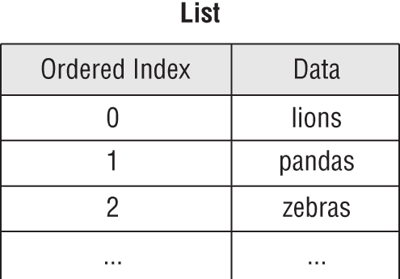

图 3.2 `List` 示例

有时候，你并不真正在乎列表中元素的顺序。`List` 就像是一种“随意的”数据类型。当我们去商店之前列购物清单时，列表的顺序恰好是我们我们想到这些物品的顺序。我们可能并不执着于特定的顺序，但这并没有产生任何坏处。

虽然实现 `List` 接口的类有很多方法，但你只需要知道最常用的几个。方便的是，这些方法对于可能出现在考试中的所有实现类来说都是相同的。

所有 `List` 实现的共同点是它们是有序的并且允许重复项。除此，它们各自提供了不同的功能。我们将介绍你需要了解的实现类以及可用方法。

### 比较 List 的实现

`ArrayList` 就像一个可调整大小的数组。当添加元素时，`ArrayList` 会自动增长。当你不确定应该使用哪种集合时，请使用 `ArrayList`。

`ArrayList` 的主要优势是你可以在常数时间内查找任何元素。添加或删除元素的速度比访问元素慢。当你对 `ArrayList` 的读取操作多于（或等于）写入操作时，`ArrayList` 是一个很好的选择。

`LinkedList` 是一个特殊的，因为它同时实现了 `List` 和 `Queue`。它拥有 `List` 的所有方法，还有额外的方法方便从列表的开头和/或结尾添加或删除元素。

`LinkedList` 的主要优势是你可以在常数时间内从列表的开头和结尾进行访问、添加和删除。代价是处理任意索引需要线性时间。当你将其作为 `Queue` 使用时，`LinkedList` 是很好的选择。正如你在图 3.1 中所示，`LinkedList` 同时实现了 `List` 和 `Queue` 接口。

### 使用工厂创建列表

当你创建一个类型为 `ArrayList` 或 `LinkedList` 的 `List` 时，你知道它的类型。有一些特殊方法可以让你返回一个 `List` 但未知类型。这些方法允许你使用工厂方法在一行内创建一个包含数据的 `List`。这非常方便，特别是在测试时。其中一些方法返回一个不可变对象。正如我们在第 1 章中所所示，不可变对象无法被更改或修改。表 3.4 总结了这三个列表。

| 方法 | 描述 | 可以添加元素吗？ | 可以替换元素吗？ | 可以删除元素吗？ |
| --- | --- | --- | --- | --- |
| `Arrays.asList(varargs)` | 返回由数组固定大小列表 | 否 | 是 | 否 |
| `List.of(varargs)` | 返回不可变列表 | 否 | 否 | 否 |
| `List.copyOf(collection)` | 返回带有原始集合值拷贝的不可变列表 | 否 | 否 | 否 |

表 3.4 创建 List 的工厂方法

让我们来看看这三个方法的示例。

```
16: String[] array = new String[] {"a", "b", "c"};
17: List<String> asList = Arrays.asList(array); // [a, b, c]
18: List<String> of = List.of(array);           // [a, b, c]
19: List<String> copy = List.copyOf(asList);    // [a, b, c]
20: 
21: array[0] = "z";
22:
23: System.out.println(asList); // [z, b, c]
24: System.out.println(of);     // [a, b, c]
25: System.out.println(copy);   // [a, b, c]
26:
27: asList.set(0, "x");
28: System.out.println(Arrays.toString(array)); // [x, b, c]
```

### 使用 List 方法

以下语句演示了这些 `List` 的大部分方法：

```
3: String[] array = new String[] {"a", "b", "c"};
4: List<String> asList = Arrays.asList(array); // [a, b, c]
5: List<String> of = List.of(array);           // [a, b, c]
6: List<String> copy = List.copyOf(asList);    // [a, b, c]
7: 
8: array[0] = "z";
9:
10: System.out.println(asList); // [z, b, c]
```


11: `System.out.println(of);`     // [a, b, c]

12: `System.out.println(copy);`   // [a, b, c]

13:

14: `asList.set(0, "x");`

15: `System.out.println(Arrays.toString(array));` // [x, b, c]

当你不允许出现重复条目时，就会使用 `Set`。例如，你可能想记录下在动物园里看到的独特动物。你并不关心看这些动物的顺序，但没有时间多次看它们。你只需要确保看过了那些对你重要的动物，并在看完后将它们从“待待访的动物”的集合中移除即可。

图 3.3 展示了你可以如何构思一个 `Set`。所有 `Set` 实现的共同点是它们不允许重复。我们将查看考试中所需的每种实现，以及如何使用 `Set` 编写代码。

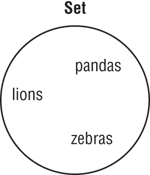

图 3.3 `Set` 示例

## 比较 `Set` 实现

`HashSet` 将其元素存储在 `hash table`（哈希表）中，这意味着键（keys）是一个哈希值，而值（values）是一个 `Object`。这意味着它使用对象的 `hashCode()` 方法来更高效地检索它们。

主要优点是添加元素和检查元素是否在集合中都具有常数时间复杂度。代价是你会丢失插入元素的顺序。在大多数情况下，无论在集合中，你并不关心这一点，这使得 `HashSet` 成为最常见的集合。

`TreeSet` 将其元素存储在排序的树形结构中。主要优点是集合始终处于排序状态。代价是添加元素和检查元素是否存在需要比 `HashSet` 花费更长时间，特别是当树变得越来越大时。

图 3.4 展示了你可以如何构思 `HashSet` 和 `TreeSet` 的存储方式。在现实中，`HashSet` 更加复杂，但对于考试目的来说这足够了。

## 使用 `Set` 方法

像 `List` 一样，你可以用一行代码创建一个不可变的 `Set`，或者创建现有集合的副本。

```
Set<Character> letters = Set.of('z', 'o', 'o');
Set<Character> copy = Set.copyOf(letters);
```

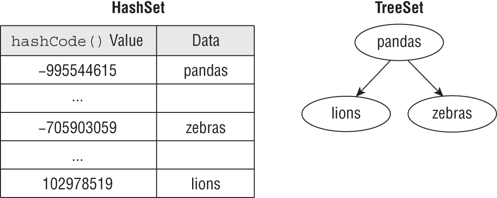

图 3.4 `HashSet` 和 `TreeSet` 示例

这些是你考试中 `Set` 接口需要掌握全部额外方法！你必须知道集合相对于传统的 `Collection` 方法的行为。你还需要知道不同类型集合之间的区别。让我们从 `HashSet` 开始：

```
3: Set<Integer> set = new HashSet<>();
4: boolean b1 = set.add(66);    // true
5: boolean b2 = set.add(10);    // true
6: boolean b3 = set.add(66);    // false
7: boolean b4 = set.add(8);     // true
8: set.forEach(System.out::println);
```

这段代码打印了三行：

```
66
8
10
```

`add()` 方法应该是直观的。除非 `Integer` 已经在集合中，否则它们会返回 `true`。第 6 行返回 `false`，因为集合中已经有了 66，而集合必须保持唯一性。第 8 行按任意打印集合中的元素。在这种情况下，它们恰好不是排序顺序，也不是我们添加元素的顺序。

记住 `equals()` 方法被用于判断相等性。`hashCode()` 方法用于确定应该在哪个桶中查找，这样 Java 就不需要遍历整个集合来查找对象是否存在。最好的情况是哈希值是唯一的，Java 只需要对一个对象调用 `equals()`。最坏的情况是所有实现都返回相同的 `hashCode()`，这样 Java 无论如何都对集合中的每个元素调用 `equals()`。

现在让我们来看 `TreeSet` 的相同示例：

```
3: Set<Integer> set = new TreeSet<>();
4: boolean b1 = set.add(66); // true
5: boolean b2 = set.add(10); // true
6: boolean b3 = set.add(66); // false
7: boolean b4 = set.add(8);    // true
8: set.forEach(System.out::println);
```

这次，代码打印了以下内容：

```
8
10
66
```

元素按照它们的自然排序顺序打印。数字在 Java 中实现了 `Comparable` 接口，用于排序。在本章节后面，你将学习如何创建自己的 `Comparable` 对象。

## 使用 `Queue` 接口

当元素按特定顺序添加和移除时，你会使用队列（Queue）。队列通常用于在处理元素之前对其进行排序。例如，你想买票而有人在排队时。

```
12: Queue<Integer> queue = new LinkedList<>();
13: System.out.println(queue.offer(10)); // true
14: System.out.println(queue.offer(4));  // true
15: System.out.println(queue.peek());    // 10
16: System.out.println(queue.poll());    // 10
17: System.out.println(queue.poll());    // 4
18: System.out.println(queue.peek());    // null
```

图 3.6 显示了代码每一步执行时队列的样子。第 13 行和第 14 行成功将元素添加到队列末尾。某些队列有大小限制，这会导致向队列添加元素失败。在考试中你不会遇到这种情况。第 15 行查看队列中的第一个元素，但不会移除它。第 16 行和第 17 行实际上从队列中移元素，导致队列为空。第 18 行尝试查看队列的第一个元素，结果为 `null`。

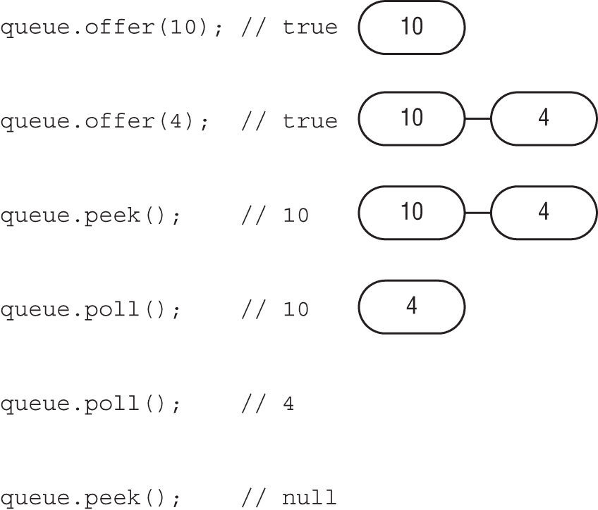

图 3.6 操作队列

## 使用 `Map` 接口

当你想要通过键（key）来标识值（value）时，可以使用 map。例如，当你使用手机中的联系人列表时，你查找“George”而不是逐个查找电话号码。

你可以将 `Map` 想象成图 3.7 所示的样子。你不需要知道不同 map 实现的特定接口名称，但你需要需要 `TreeMap` 是排序的。

所有 `Map` 类的主要共同点是它们都拥有键（keys）和值（values）。除此之外，它们各自提供不同的功能。我们将介绍你需要了解的实现类以及可用方法。

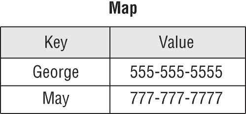

图 3.7 `Map` 示例

## 比较 `Map` 实现

`HashMap` 将键存储在哈希表中。这意味着它使用键的 `hashCode()` 方法更高效地检索其值。

主要优点是添加元素和通过键检索元素的时间都是常数级。代价是你丢失了插入元素的顺序。在大多数情况下，你对 map 并不关心这个问题。如果你在乎，可以使用 `LinkedHashMap`，但那不在考试范围之内。

`TreeMap` 将键存储在排序的树结构中。主要优点是键始终处于排序顺序排列的。与 `TreeSet` 一样，代价是随着树的变大，添加元素和检查键是否存在的时间会变得更长。

## 使用 `Map` 方法

鉴于 `Map` 没有继承 `Collection`，因此在 `Map` 接口上指定了更多方法。由于既有键又有值，我们需要对两者都使用泛型类型参数。该类使用 `K` 表示键，使用 `V` 表示值。考试中需要的方法在表 3.7 中。某些方法签名经过简化，以便于理解。

| 方法 | 描述 |
| --- | --- |
| `void clear()` | 从 map 中移除所有键和值。 |
| `boolean containsKey(Object key)` | 返回键是否存在于 map 中。 |
| `boolean containsValue(Object value)` | 返回值是否存在于 map 中。 |
| `Set<Map.Entry<K,V>> entrySet()` | 返回键/值对的 `Set`。 |
| `void forEach(BiConsumer(K key, V value))` | 遍历每个键/值对。 |
| `V get(Object key)` | 返回键映射的值，如果无映射，则返回 `null`。 |
| `V getOrDefault(Object key, V defaultValue)` | 返回键映射的值，如果无映射，则返回默认值。 |
| `boolean isEmpty()` | 返回 map 是否为空。 |
| `Set<K> keySet()` | 返回所有键的集合。 |
| `V merge(K key, V value, Function(<V, V, V> func))` | 如果键未设置则设置值。如果键已设置，则运行函数以确定新值。如果是 `null` 则移除。 |
| `V put(K key, V value)` | 添加或替换键/值对。返回之前的值或 `null`。 |
| `V putIfAbsent(K key, V value)` | 如果键不存在则添加值并返回 `null`。否则，返回已有的值。 |
| `V remove(Object key)` | 移除并返回映射到键的值。如果没有，则返回 `null`。 |
| `V replace(Object key)` | 替换指定键的值。 |
| `V replace(Object key, V value)` | 替换指定键的值。 |
| `boolean replace(Object key, V oldValue, V newValue)` | 仅当键映射到指定的旧值时，替换为新值。 |
| `int size()` | 返回键值映射的数量。 |
| `boolean isEmpty()` | 如果 map 不包含任何键值映射，则返回 `true`。 |
| `Set<K> keySet()` | 返回 map 中包含的键的视图。 |
| `Collection<V> values()` | 返回 map 中包含的值的视图。 |
| `Set<Map.Entry<K,V>> entrySet()` | 返回 map 中键值映射的视图。 |

表 3.7 `Map` 方法

### 基础方法

由于 `Map` 没有扩展 `Collection`，`Map` 接口提供了更多与数据交互的方法。常用的有 `put()`、`get()`、`remove()` 和 `clear()`。

`put(K key, V value)` 将指定的值与指定的键关联。如果 map 已经包含该键，则替换并返回旧值。

`get(Object key)` 返回键映射的值，如果 map 不包含该键的映射，则返回 `null`。

`remove(Object key)` 如果存在，则从 map 中移除该键的映射并返回。

`clear()` 移除 map 中的所有映射。

要检查键或值是否存在，请使用 `containsKey(Object key)` 和 `containsValue(Object value)`。它们都返回一个表示 map 是否包含指定元素的布尔值。

`size()` 返回键值映射的数量，`isEmpty()` 在 map 不包含任何键值映射时返回 `true`。

### 高级方法

更高级的方法允许代码更简洁。例如，`getOrDefault(Object key, V defaultValue)` 返回指定键映射的值，如果 map 不包含该键的映射，则返回 `defaultValue`。`putIfAbsent(K key, V value)` 仅当键不存在时才添加映射。`merge(K key, V value, Function<? super V, ? super V, ? V> remappingFunction)` 是一个根据函数更新现有值或添加新值的强大工具。

如果请求的键不在 `map` 中，`get()` 方法将返回 `null`。有时你可能希望返回一个不同的值。幸运的是，`getOrDefault()` 方法让这一切变得简单。让我们来比较这两个方法。

```
3: Map<Character, String> map = new HashMap<>();
4: map.put('x', "spot");
5: System.out.println("X marks the " + map.get('x'));
6: System.out.println("X marks the " + map.getOrDefault('x', ""));
7: System.out.println("Y marks the " + map.get('y'));
8: System.out.println("Y marks the " + map.getOrDefault('y', ""));
```

这段代码打印以下内容：

```
X marks the spot
X marks the spot
Y marks the null
Y marks the
```

如你所见，第 5 行和第 6 行的输出相同，因为当键存在时，`get()` 和 `getOrDefault()` 的行为相同。它们都返回该键映射的值。第 7 行和第 8 行给出了不同的输出，说明当键不存在时，`get()` 返回 `null`。相比之下，`getOrDefault()` 返回了我们作为参数传递的空字符串。

### `replace()` 和 `replaceAll()`

这些方法与 `Collection` 版本相似，区别在于它们涉及到键。

```
21: Map<Integer, Integer> map = new HashMap<>();
22: map.put(1, 2);
23: map.put(2, 4);
24: Integer original = map.replace(2, 10); // 4
25: System.out.println(map);    // {1=2, 2=10}
26: map.replaceAll((k, v) -> k + v);
27: System.out.println(map);    // {1=3, 2=12}
```

第 24 行替换了键 `2` 的值并返回原始值。第 26 行调用了一个函数，并将 `map` 中每个元素的值设置为该函数的结果。在我们的案例中，我们将键和值相加了。

### `putIfAbsent()`

`putIfAbsent()` 方法在 `map` 中设置一个值，但如果该值已经设置为非 `null` 值，则会跳过。

```
Map<String, String> favorites = new HashMap<>();
favorites.put("Jenny", "Bus Tour");
favorites.put("Tom", null);
favorites.putIfAbsent("Jenny", "Tram");
favorites.putIfAbsent("Sam", "Tram");
favorites.putIfAbsent("Tom", "Tram");
System.out.println(favorites); // {Tom=Tram, Jenny=Bus Tour, Sam=Tram}
```

如你所见，`Jenny` 的值没有更新，因为已经存在一个值。Sam 完全不在，所以他被添加了。Tom 作为键存在，但其值为 `null`。因此，他也被添加了。

### `merge()`

`merge()` 方法增加了关于“选择”内容的逻辑。假设我们想选择名称最长的游项目。我们可以通过向 `merge()` 方法传递一个映射函数来编写代码表达这一点。

```
11: BiFunction<String, String, String> mapper = (v1, v2)
12:    -> v1.length()> v2.length() ? v1: v2;
13:
14: Map<String, String> favorites = new HashMap<>();
15: favorites.put("Jenny", "Bus Tour");
16: favorites.put("Tom", "Tram");
17:
18: String jenny = favorites.merge("Jenny", "Skyride", mapper);
19: String tom = favorites.merge("Tom", "Skyride", mapper);
20:
21: System.out.println(favorites); // {Tom=Skyride, Jenny=Bus Tour}
22: System.out.println(jenny);     // Bus Tour
23: System.out.println(tom);       // Skyride
```


第 11 行和 12 行的代码接收两个参数并返回一个值。我们的实现返回名称最长的那个。第 18 行调用了此映射函数，它发现 `Bus Tour` 比 `Skyride` 长，因此保留原值 `Bus Tour`。第 19 行再次调用此映射函数。这次，`Tram` 不比 `Skyride` 长，因此更新了 map。第 21 行打印出新的 map 内容。第 22 行和第 23 行显示结果是从 `merge()` 返回的。

`merge()` 方法还处理了当涉及 `null` 值或缺失键时的逻辑。在这种情况下，它根本不会调用 `BiFunction`，而是直接使用新值。

```
BiFunction<String, String, String> mapper = 
   (v1, v2) -> v1.length() > v2.length() ? v1 : v2;

Map<String, String> favorites = new HashMap<>();
favorites.put("Sam", null);
favorites.merge("Tom", "Skyride", mapper);
favorites.merge("Sam", "Skyride", mapper);
System.out.println(favorites);   // {Tom=Skyride, Sam=Skyride}
```

注意，映射函数没有被调用。如果被调用了，将会导致 `NullPointerException`。映射函数只有在存在两个实际值时才会被使用。

你也可以对你自己创建的对象进行排序。Java 提供了一个名为 `Comparable` 的接口。如果你的类实现了 `Comparable`，它就可以用于这些需要比较的数据结构中。还有一个名为 `Comparator` 的类，它用于指定你想使用与对象本身提供的不同的排序。

`Comparable` 和 `Comparator` 相似之处大得容易产生混淆。考试喜欢考察你是否会被诱导而混淆这两者。不要被困扰！在本节中，我们将首先讨论 `Comparable`。然后，在学习 `Comparator` 时，我们会指出所有的区别。

## 创建一个 `Comparable` 类

`Comparable` 接口只有一个方法。事实上，这就是整个接口的内容：

```
public interface Comparable<T> {
   int compareTo(T o);
}
```

泛型 `T` 允许你实现此方法并指定你的对象的类型。这可以让你在实现 `compareTo()` 时避免类型转换。任何对象都可以是 `Comparable` 的。例如，我们有一群鸭子并想按名称对它们进行排序。首先，我们更新类声明继承 `Comparable<Duck>`，然后实现 `compareTo()` 方法。

```
import java.util.*;

public class Duck implements Comparable<Duck> {
   private String name;

   public Duck(String name) {
      this.name = name;
   }

   public String toString() { // 使用可读输出
      return name;
   }

   public int compareTo(Duck d) {
      return name.compareTo(d.name); // 按名称升序排序
   }

   public static void main(String[] args) {
      var ducks = new ArrayList<Duck>();
      ducks.add(new Duck("Quack"));
      ducks.add(new Duck("Puddles"));
      Collections.sort(ducks);   // 按名称排序
      System.out.println(ducks); // [Puddles, Quack]
   }
}
```

如果没有实现该接口，我们拥有的只是一个 `compareTo()` 方法，但它将不是 `Comparable` 对象。我们也可以实现 `Comparable<Object>` 或为 `T` 指定其他类，但对于对一组 `Duck` 对象进行相互排序来说并没有那么有用。

最后，`Duck` 类实现了 `compareTo()`。由于 `Duck` 比较的是 `String` 类型的对象，而 `String` 类已经有一个 `compareTo()` 方法，因此它可以直接委托。

我们仍然需要知道 `compareTo()` 方法返回什么，以便我们编写自己的方法。有三个规则需要记住：

- 当当前对象等同于 `compareTo()` 的参数时，返回数字 `0`。
- 当当前对象小于 `compareTo()` 的参数时，返回一个负数（小于 `0`）。
- 当当前对象大于 `compareTo()` 的参数时，返回一个正数（大于 `0`）。

让我们来看一个比较数字而不是 `String` 对象的 `compareTo()` 实现。

```
1:  public class Animal implements Comparable<Animal> {
2:     private int id;
3:     public int compareTo(Animal a) {
4:        return id – a.id; // 按 id 升序排序
5:     }
6:     public static void main(String[] args) {
7:        var a1 = new Animal();
8:        var a2 = new Animal();
9:        a1.id = 5;
10:       a2.id = 7;
11:       System.out.println(a1.compareTo(a2)); // -2
12:       System.out.println(a1.compareTo(a1)); // 0
13:       System.out.println(a2.compareTo(a1)); // 2
14:    }
15: }
```

第 7 和 8 行创建了两个 `Animal` 对象。第 9 和 10 行设置了它们的 `id` 值。这不是设置实例变量的好方法。使用构造函数或 setter 方法会更好。由于考试显示了非传统的代码以确保你理解规则，因此我们也加入了一些非传统的代码。

第 3-5 行显示了比较两个 `int` 值的一种方法。我们本可以使用 `Integer.compare(id, a.id)`。请确保你能够识别这两种方法。

第 11 行到 13 行确认了我们正确实现了 `compareTo()`。第 11 行将较小的 `id` 与较大的 `id` 比较，因此打印出一个负数。第 12 行比较具有相同 `id` 的动物，因此打印出 `0`。第 13 行将较大的 `id` 与较小的 `id` 比较，因此返回一个正数。

## 转换 `compareTo()` 参数

在处理遗留代码或不使用泛型的代码时，`compareTo()` 方法需要类型转换，因为它传递的是 `Object`。

```
public class LegacyDuck implements Comparable {
   private String name;

   public int compareTo(Object obj) {
      LegacyDuck d = (LegacyDuck) obj;
      return name.compareTo(d);
   }
}
```

由于我们没有指定泛型，我们假设它是 `Object`，这意味着在访问实例变量之前我们必须强制转换 `LegacyDuck`。

## 检查 null

在本章中使用 `Comparable` 和 `Comparator` 时，我们假设数据已经过验证，但情况并非总是如此。你应该检查 `null`。

```
public class MissingDuck implements Comparable<MissingDuck> {
   private String name;

   public int compareTo(MissingDuck quack) {
      if (quack == null)
         throw new IllegalArgumentException("Poorly formed duck!");
      if (name == null && quack.name == null)
         return 0;
      else if (name == null) return -1;
      else if (quack.name == null) return 1;
      else return name.compareTo(quack.name);
   }
}
```

## 保持 `compareTo()` 和 `equals()` 一致

如果你编写一个实现 `Comparable` 的类，你就引入了确定相等性的新逻辑。`compareTo()` 方法在对象相等时返回 `0`，而你的 `equals()` 方法在对象相等时返回 `true`。一个使用 `compareTo()` 的*自然排序*当且仅当 `x.compareTo(y)` 等于 `0` 时被认为是*与 equals 一致的*。

同样，当 `x.compareTo(y)` 不为 `0` 时，`x.equals(y)` 必须为 `false`。强烈建议让你的 `Comparable` 类与 `equals` 一致，因为集合类的行为取决于此。

例如，下面的 `Product` 类定义了一个与 `equals` 不一致的 `compareTo()` 方法：

```
public class Product implements Comparable<Product> {
   private int id;
   private String name;

   public int hashCode() { return id; }

   public boolean equals(Object obj) {
      if(!(obj instanceof Product)) return false;
      var other = (Product) obj;
      return this.id == other.id;
   }

   public int compareTo(Product obj) {
      return this.name.compareTo(obj.name);
   }
}
```

你可能按名称排序 `Product` 对象，但名称不是唯一的。因此，在比较两个相等的 `Product` 对象时，`compareTo()` 的返回值可能不是 `0`，所以这个 `compareTo()` 方法与 equals 不一致。解决此问题的一种方法是使用 `Comparator` 在其他地方定义排序。

## 使用 Comparator 比较数据

有时你想对没有实现 `Comparable` 的对象进行排序，或者你想在不同时间以不同的方式对对象进行排序。假设我们在 `Duck` 类中添加了 `weight`。我们现在有了：

```
1:  import java.util.ArrayList;
2:  import java.util.Collections;
3:  import java.util.Comparator;
4:
5:  public class Duck implements Comparable<Duck> {
6:     private String name;
7:     private int weight;
8:
9:     // 假设提供了 getters/setters/constructors
10:
11:    public String toString() { return name; }
12:
13:    public int compareTo(Duck d) {
14:       return name.compareTo(d.name);
15:    }
16:
17:    public static void main(String[] args) {
18:       Comparator<Duck> byWeight = new Comparator<Duck>() {
19:          public int compare(Duck d1, Duck d2) {
20:             return d1.getWeight()-d2.getWeight();
21:          }
22:       };
23:       var ducks = new ArrayList<Duck>();
24:       ducks.add(new Duck("Quack", 7));
25:       ducks.add(new Duck("Puddles", 10));
26:       Collections.sort(ducks);
27:       System.out.println(ducks); // [Puddles, Quack]
28:       Collections.sort(ducks, byWeight);
29:       System.out.println(ducks); // [Quack, Puddles]
30:    }
31: }
```

首先，注意这个程序在第 3 行导入了 `java.util.Comparator`。我们并不总是显示导入语句，因为如果没有显示的话，你可以假设它们是存在的。在这里，我们显示了导入是为了引起注意：`Comparable` 和 `Comparator` 位于不同的包中，分别为 `java.lang` 和 `java.util`。这意味着 `Comparable` 可以在没有 `import` 语句的情况下使用，而 `Comparator` 则不能。

`Duck` 类本身只能定义一个 `compareTo()` 方法。在这种情况下，选择了 `name`。如果我们想根据其他内容进行排序，我们必须在 `compareTo()` 方法之外使用独立的类或 lambda 表达式定义该排序顺序。

`main()` 方法的第 18-22 行展示了如何使用内部类定义 `Comparator`。在第 26-29 行，我们先不使用比较器进行排序，然后使用比较器进行排序，以查看输出的差异。

`Comparator` 是函数式接口，因为它只有一个抽象方法需要实现。这意味着我们可以使用 lambda 表达式重写第 18-22 行的比较器，如下所示：

```
Comparator<Duck> byWeight = (d1, d2) -> d1.getWeight()-d2.getWeight();
```

或者，我们可以使用方法引用和辅助方法来指定我们想要按重量排序。

```
Comparator<Duck> byWeight = Comparator.comparing(Duck::getWeight);
```

在这个示例中，`Comparator.comparing()` 是 `static` 接口方法，它根据 lambda 表达式或方法引用创建一个 `Comparator`。很方便，不是吗？

## 比较 `Comparable` 和 `Comparator`

`Comparable` 和 `Comparator` 之间有很多不同之处。我们已经把它们列在表 3.11 中了。

| 差异 | `Comparable` | `Comparator` |
| --- | --- | --- |
| 包名 | `java.lang` | `java.util` |
| 比较的类必须实现接口吗？ | 是 | 否 |
| 接口中的方法名 | `compareTo()` | `compare()` |
| 参数数量 | 1 | 2 |
| 是否常使用 lambda 声明 | 否 | 是 |

**表 3.11** Comparable 和 Comparator 比较

记住这张表——真的。考试会试图通过混淆这两者来陷害你，并看你是否能发现。你看到为什么这一段代码无法编译了吗？

```
var byWeight = new Comparator<Duck>() { // 无法编译
   public int compareTo(Duck d1, Duck d2) {
      return d1.getWeight()-d2.getWeight();
   }
};
```

方法名错了。`Comparator` 必须实现一个名为 `compare()` 的方法。在问题中看到 `Comparator` 和 `Comparable` 时，请特别注意方法名和参数数量。

## 比较多个字段

当编写一个比较多个实例变量的 `Comparator` 时，代码会变得有点混乱。假设我们有一个 `Squirrel` 类，如下所示：

```
public class Squirrel {
   private int weight;
   private String species;
   // 假设提供了 getters/setters/constructors
}
```

我们想写一个 `Comparator` 来按物种名称排序。如果两只松鼠是同一种物，我们想先对重量最轻的排序。可以使用下面的代码来实现：


`public class MultiFieldComparator implements Comparator<Squirrel>` {

   `public int compare(Squirrel s1, Squirrel s2)` {

      `int result = s1.getSpecies().compareTo(s2.getSpecies())`;

      `if (result != 0) return result`;

      `return s1.getWeight()-s2.getWeight()`;

   }}

```

这在假设没有物种名称为 `null` 的情况下是有效的。它检查一个字段。如果它们不匹配，排序就结束了。如果它们匹配，则查看下一个字段。不过，这并不容易阅读，也很容易出错。将 `!=` 改为 `==` 会完全破坏排序。

另一种方法是使用方法引用并构建比较器。这段代码代表了相同比较的逻辑。

```
Comparator<Squirrel> c = Comparator.comparing(Squirrel::getSpecies)
   .thenComparingInt(Squirrel::getWeight);
```

这一次，我们链式使用了方法。首先，我们创建一个按物种升序的比较器。然后，如果有平局，则按重量排序。我们也可以按降序排序。`Comparator` 上的某些方法（如 `thenComparingInt()`）是 `default` 方法。正如第一章中提到的，`reversed()` 方法也可以用于反转顺序。

表 3.12 显示了构建 `Comparator` 时你应该了解的方法。为了让你关注方法本身，我们省略了参数类型。

| 方法 | 描述 |
| --- | --- |
| `comparing(function)` | 根据返回任何 `Object` 的函数进行比较（或自动装箱）。 |
| `comparingDouble(function)` | 根据返回 `double` 的函数进行比较。 |
| `comparingInt(function)` | 根据返回 `int` 的函数进行比较。 |
| `comparingLong(function)` | 根据返回 `long` 的函数进行比较。 |
| `naturalOrder()` | 使用 `Comparable` 实现的排序。 |
| `reverseOrder()` | 使用 `Comparable` 实现的反序排序。 |

**表 3.12** 构建 `Comparator` 的辅助静态方法

表 3.13 显示了你可以链接到 `Comparator` 上以进一步指定其行为的方法。

| 方法 | 描述 |
| --- | --- |
| `reversed()` | 反转链式 `Comparator` 的顺序。 |
| `thenComparing(function)` | 如果上一个比较器返回 `0`，则使用这个返回 `Object` 或可自动装箱的比较器。 |
| `thenComparingDouble(function)` | 如果上一个比较器返回 `0`，则使用这个返回 `double` 的比较器。否则，返回上一个比较器的值。 |
| `thenComparingInt(function)` | 如果上一个比较器返回 `0`，则使用这个返回 `int` 的比较器。否则，返回上一个比较器的值。 |
| `thenComparingLong(function)` | 如果上一个比较器返回 `0`，则使用这个返回 `long` 的比较器。否则，返回上一个比较器的值。 |

**表 3.13** 构建 `Comparator` 的辅助默认方法

## 排序与搜索

现在你已经学习了所有 `Comparable` 和 `Comparator`，我们终于可以使用它们做一些实用的事情，比如排序。`Collections.sort()` 方法使用 `compareTo()` 方法进行排序。它期望被排序的对象是 `Comparable` 的。

```
2: public class SortRabbits {
3:    static class Rabbit{ int id; }
4:    public static void main(String[] args) {
5:       List<Rabbit> rabbits = new ArrayList<>();
6:       rabbits.add(new Rabbit());
7:       Collections.sort(rabbits); // 无法编译
8:    } }
```

Java 知道 `Rabbit` 类没有实现 `Comparable`。它知道排序将失败，因此甚至不会让代码通过编译。你可以通过向 `sort()` 传递一个 `Comparator` 来修复这个问题。记住，当你想要在不使用 `compareTo()` 方法的情况下指定排序时，`Comparator` 是非常有用的。

```java
2: public class SortRabbits {
3:    static class Rabbit{ int id; }
4:    public static void main(String[] args) {
5:       List<Rabbit> rabbits = new ArrayList<>();
6:       rabbits.add(new Rabbit());
7:       Comparator<Rabbit> c = (r1, r2) -> r1.id - r2.id;
8:       Collections.sort(rabbits, c);
9:    } }
```

`sort()` 和 `binarySearch()` 方法允许在你不想使用自然顺序时传入一个 `Comparator` 对象。

在使用 `binarySearch()` 的时候有一个技巧。你认为以下输出结果是什么？

```java
3: var names = Arrays.asList("Fluffy", "Hoppy");
4: Comparator<String> c = Comparator.reverseOrder();
5: var index = Collections.binarySearch(names, "Hoppy", c);
6: System.out.println(index);
```

正确答案是 `-1`。在恐慌之前，你不需要知道答案是 `-1`。你确实需要知道答案是未定义的。第 3 行创建了一个列表 `[Fluffy, Hoppy]`。这个列表恰好是升序排列的。第 4 行创建了一个反转自然顺序的 `Comparator`。第 5 行请求按降序进行二分搜索。由于列表是升序的，我们不满足执行搜索的前提条件。

在章的较早部分，我们讨论了需要类实现 `Comparable` 的集合。与排序不同，它们不会在编译时检查你是否真的实现了 `Comparable`。

回到我们没有实现 `Comparable` 的 `Rabbit`，我们尝试将其添加到 `TreeSet` 中。

```java
2:  public class UseTreeSet {
3:     static class Rabbit{ int id; }
4:     public static void main(String[] args) {
5:        Set<Duck> ducks = new TreeSet<>();
6:        ducks.add(new Duck("Puddles"));
7:
8:        Set<Rabbit> rabbits = new TreeSet<>();
9:        rabbits.add(new Rabbit());  // ClassCastException
10: } }
```

第 6 行是好的。`Duck` 实现了 `Comparable`。`TreeSet` 能够将其排序到集合中的正确位置。第 9 行有问题。当 `TreeSet` 尝试对其排序时，Java 发现 `Rabbit` 没有实现 `Comparable`。Java 抛出了类似这样的异常：

```
Exception in thread "main" java.lang.ClassCastException: 
   class Duck cannot be cast to class java.lang.Comparable 
```

在向集合添加第一个对象时抛出此异常似乎很奇怪。毕竟，现在还没有任何东西可以比较。Java 这样做是为了保持一致性。

就像搜索和排序一样，你可以告诉需要排序的集合你想使用一个特定的 `Comparator`，例如：

```java
8: Set<Rabbit> rabbits = new TreeSet<>((r1, r2) -> r1.id-r2.id);
9: rabbits.add(new Rabbit());
```

现在 Java 知道你想按 `id` 排序了，一切正常。`Comparator` 是一个非常有用的对象。它们允许你将排序顺序与被排序的对象分离开。注意之前两个示例中的第 9 行是相同的。改变的是 `TreeSet` 的声明。

## 使用泛型

我们用 Java 语言中最有用且有时也最令人困惑的特性之一来结束本章：泛型。我们为什么需要泛型？嗯，记得我们说过，我们必须寄希望调用者不要向列表中放入我们意料之外的内容吗？下面的代码正是这么做的：

```java
14: static void printNames(List list) {
15:    for (int i = 0; i < list.size(); i++) {
16:       String name = (String) list.get(i); // ClassCastException
17:       System.out.println(name);
18:    }
19: }
20: public static void main(String[] args) {
21:    List names = new ArrayList();
22:    names.add(new StringBuilder("Webby"));
23:    printNames(names);
24: }
```

这段代码抛出了 `ClassCastException`。第 22 行向 `list` 添加了 `StringBuilder`。这是合法的，因为非泛型列表可以包含任何内容。然而，第 16 行的编写预期其中有一个特定的类。它强制转换为 `String` 反映了这个假设。由于假设是错误的，代码抛出了 `ClassCastException`，即 `java.lang.StringBuilder` 无法转换为 `java.lang.String`。

泛型通过允许你编写和使用参数化类型解决了这个问题。你指定了一个 `String` 对象的 `ArrayList`。现在编译器拥有足够的信息来防止你从源头上引起这个问题。

```java
List<String> names = new ArrayList<String>();
names.add(new StringBuilder("Webby")); // 无法编译
```

得到编译错误是件好事。你会立即知道哪里出了问题，而不是希望以后才发现。

### 泛型类

你可以为你自己的类引入泛型。引入泛型的语法是在尖括号中声明一个形式类型参数。例如，下面名为 `Crate` 的类在类名之后声明了一个泛型类型变量。

```java
public class Crate<T> {
   private T contents;
   public T emptyCrate() {
      return contents;
   }
   public void packCrate(T contents) {
      this.contents = contents;
   }
}
```

泛型类型 `T` 在 `Crate` 类内部任何地方都是可用的。

泛型类并不限于仅有一个类型参数。这个类展示了两个泛型参数。

```java
public class SizeLimitedCrate<T, U> {
   private T contents;
   private U sizeLimit;
   public SizeLimitedCrate(T contents, U sizeLimit) {
      this.contents = contents;
      this.sizeLimit = sizeLimit;
   } }
```

`T` 代表我们放入箱中的类型。`U` 代表我们用于衡量箱子最大尺寸的单位。要使用这个泛型类，我们可以写如下代码：

```java
Elephant elephant = new Elephant();
Integer numPounds = 15_000;
SizeLimitedCrate<Elephant, Integer> c1 
   = new SizeLimiteCrate<>(elephant, numPounds);
```

在这里，我们指定类型为 `Elephant`，单位为 `Integer`。我们还提醒一下，数字字面量可以包含下划线。

### 泛型接口

和类一样，接口也可以声明形式的类型参数。例如，以下 `Shippable` 接口使用泛型类型作为其 `ship()` 方法的参数：

```java
public interface Shippable<T> {
   void ship(T t);
}
```

类有三种方式可以实现此接口。第一种是在类中指定泛型类型。以下具体类表示它只处理机器人。这使得它可以声明一个带有 `Robot` 参数的 `ship()` 方法。

```java
class ShippableRobotCrate implements Shippable<Robot> {
   public void ship(Robot t) { }
}
```

另一种方法是创建一个泛型类。以下具体类允许调用者指定泛型的类型：

```java
class ShippableAbstractCrate<U> implements Shippable<U> {
   public void ship(U t) { }
}
```

在这个示例中，类型参数可以命名为任何名称，包括 `T`。我们在示例中使用 `U` 是为了避免对 `T` 指代的内容产生混淆。考试不会介意通过相同的类型参数名称来困扰你。

### 原始类型

最后一种方法是完全不使用泛型。这是编写代码的老方法。它会产生关于 `Shippable` 是 `raw type`（原始类型）的编译器警告，但它是可以编译的。在这里，由于没有定义泛型类型，`ship()` 方法有一个 `Object` 参数：

```java
class ShippableCrate implements Shippable {
   public void ship(Object t) { }
}
```

### 泛型方法

到目前为止，你已经看到了在类或接口级别声明的形式类型参数。也可以在方法级别声明它们。这对于 `static` 方法通常非常有用，因为它们不属于可以声明类型的实例。然而，非 `static` 方法也是允许的。

在这个示例中，两个方法都使用了泛型参数：

```java
public class Handler {
   public static <T> void prepare(T t) {
      System.out.println("Preparing " + t);
   }
   public static <T> Crate<T> ship(T t) {
      System.out.println("Shipping " + t);
      return new Crate<T>();
   }
}
```

方法参数是泛型类型 `T`。在返回类型之前，我们声明了形式类型参数 `<T>`。在 `ship()` 方法中，我们展示了如何在一个方法的返回类型 `Crate<T>` 中使用泛型参数。

除非方法是从类/接口中获取泛型形式类型参数，否则它被指定在方法的返回类型之前。这可能会导致一些看起来有趣的代码！

```java
2: public class More {
3:    public static <T> void sink(T t) { }
4:    public static <T> T identity(T t) { return t; }
5:    public static T noGood(T t) { return t; } // 无法编译
6: }
```

第 3 行在 `void` 返回类型之前紧邻显示形式参数类型。第 4 行显示返回类型为形式参数类型。看起来很奇怪，但它是正确的。第 5 行省略了形式参数类型，因此它无法编译。

当一个方法声明泛型参数类型时，它与类的泛型是独立的。看这个类，它在两个级别都声明了泛型 `T`：

```java
1: public class Crate<T> {
2:    public <T> T tricky(T t) {
3:       return t;
4:    }
5: }
```

当我们如下调用代码时，看看能否找出第 1 行和第 2 行中 `T` 的类型：

```java
10: public static String createName() {
11:    Crate<Robot> crate = new Crate<>();
12:    return crate.tricky("bot");
13: }
```

显然，“T 代表 tricky”。让我们看看发生了什么。在第 1 行，`T` 是 `Robot`，因为在构建 `Crate` 时引用的是它。在第 2 行，`T` 是 `String`，因为传递给方法的是它。当你看到这样的代码时，深吸一口气并写下发生的事情，以防感到困惑。

### 边界泛型类型

到这里，你可能已经注意到泛型似乎并不特别有用。边界泛型类型通过限制可以使用范围来解决这个问题。


| 边界类型 | 语法 | 示例 |
| :--- | :--- | :--- |
| 无界通配符 | `?` | `List<?> a = new ArrayList<>();` |
| 上界 | `? extends T` | `List<? extends Number> a = new ArrayList<>();` |
| 下界 | `? super T` | `List<? super Integer> a = new ArrayList<>();` |

到这里，你可能已经注意到泛型似乎并不特别有用。边界泛型类型通过限制可以使用范围来解决这个问题。

最后，让我们来看看 `var` 的影响。你认为这两个语句是等价的？

```java
List<?> x1 = new ArrayList<>();
var x2 = new ArrayList<>();
```

它们不是。这里有两个关键区别。首先，`x1` 的类型是 `List`，而 `x2` 的类型是 `ArrayList`。此外，我们只能将 `x2` 赋值给 `List<Object>`。这两个变量确实有一个共同点：在调用 `get()` 方法时，返回类型都是 `Object`。

## 上界通配符 (Upper-Bounded Wildcards)

让我们尝试写一个方法来计算一个数字列表的总和。我们已经确定了泛型不能直接使用子类。

```java
ArrayList<Number> list = new ArrayList<Integer>(); // 无法编译
```

相反，我们需要使用通配符。

```java
List<? extends Number> list = new ArrayList<Integer>();
```

上界通配符表示，任何继承自 `Number` 的类或 `Number` 本身都可以作为形式参数类型：

```java
public static long total(List<? extends Number> list) {
   long count = 0;
   for (Number number: list)
      count += number.longValue();
   return count;
}
```

还记得我们一直说类型擦除（type erasure）让 Java 认为泛型类型是 `Object` 吗？这里仍然发生了。Java 将之前的代码转换为与以下等效的内容：

```java
public static long total(List list) {
   long count = 0;
   for (Object obj: list) {
      Number number = (Number) obj;
      count += number.longValue();
   }
   return count;
}
```

当我们处理上界或无界通配符时，会发生一些有趣的事情。列表在逻辑上变得不可变的，因此无法修改。从技术上讲，你可以从列表中删除元素，但考试不会问到这个。

```java
2: static class Sparrow extends Bird { }
3: static class Bird { }
4:
5: public static void main(String[] args) {
6:    List<? extends Bird> birds = new ArrayList<Bird>();
7:    birds.add(new Sparrow()); // 无法编译
8:    birds.add(new Bird());    // 无法编译
9: }
```

问题源于 Java 并不知道 `List<? extends Bird>` 到底是什么类型。它可能是 `List<Bird>`、`List<Sparrow>` 或者某些尚未编写的泛型类型。第 7 行无法编译，是因为我们不能向 `List<? extends Bird>` 中添加一个 `Sparrow`；第 8 行无法编译，是因为我们不能向 `List<Sparrow>` 中添加一个 `Bird`。从 Java 的角度来看，这两种情况同样可能，因此二者都不被允许。

现在让我们尝试一个接口的示例。我们有一个接口和两个实现它的类。

```java
interface Flyer { void fly(); }
class HangGlider implements Flyer { public void fly() {} }
class Goose implements Flyer { public void fly() {} }
```

我们还有两个使用它的方法。一个只是列出接口，另一个使用了上界。

```java
private void anyFlyer(List<Flyer> flyer) {}
private void groupOfFlyers(List<? extends Flyer> flyer) {}
```

注意，我们使用的是关键字 `extends` 而不是 `implements`。上界就像匿名类一样，无论我们处理的是类还是接口，它们都使用 `extends`。

你已经学习过类型为 `List<Flyer>` 的变量可以传递给任一个方法。类型为 `List<Goose>` 的变量只能传递给带有上界的那一个。这展示了泛型的用处之一：随机的飞行员不会一起飞行。我们希望 `groupOfFlyers()` 方法只在传入相同类型时被调用。鹅聚在一起飞，但不会和滑翔伞一起飞。

## 下界通配符 (Lower-Bounded Wildcards)

让我们尝试写一个方法向两个列表添加字符串 "quack"。

```java
List<String> strings = new ArrayList<String>();
strings.add("tweet");

List<Object> objects = new ArrayList<Object>(strings);
addSound(strings);
addSound(objects);
```

问题是，我们想将 `List<String>` 和 `List<Object>` 传递给同一个方法。首先，确保你理解为什么 表 3.15 中的前三个例子没有解决这个问题。

| `public static void addSound(___________ list) {list.add("quack");}` | 方法通过编译 | 可以传递 `List<String>` | 可以传递 `List<Object>` |
| --- | --- | --- | --- |
| `List<?>` | 否（无界泛型是不可变的） | 是 | 是 |
| `List<? extends Object>` | 否（上界泛型是不可变的） | 是 | 是 |
| `List<Object>` | 是 | 否（对于泛型，必须精确匹配） | 是 |
| `List<? super String>` | 是 | 是 | 是 |

**表 3.15** 为什么我们需要下界

为了解决这个问题，我们需要使用下界。

```java
public static void addSound(List<? super String> list) {
   list.add("quack");
}
```

通过下界，我们是在告诉 Java 该列表将是一个 `String` 对象的列表或一个 `Object` 对象的列表。

## 综合运用 (Putting All Together)

问题源于 Java 并知道 `List<? extends Bird>` 到底是什么类型。它可能是 `List<Bird>`、`List<Sparrow>` 或者某些尚未编写的泛型类型。第 7 行无法编译，是因为我们不能向 `List<? extends Bird>` 中添加一个 `Sparrow`；第 8 行无法编译，是因为我们不能向 `List<Sparrow>` 中添加一个 `Bird`。从 Java 的角度来看，这两种情况同样可能，因此二者都不被允许。

## 泛泛型 (Combining Generic Declarations)

让我们尝试一个示例。首先，我们声明三个类。

```java
class A {}
class B extends A {}
class C extends B {}
```

准备好了吗？你能看出这些代码是否可以编译吗？

```java
6: List<?> list1 = new ArrayList<A>();
7: List<? extends A> list2 = new ArrayList<A>();
8: List<? super A> list3 = new ArrayList<A>();
```

第 6 行创建了一个包含 `A` 实例的 `ArrayList`。它存储在无界通配符变量中，这是允许的。第 7 行将 `ArrayList` 存储在上界通配符变量中。这是允许的。第 8 行有一个下界通配符；你可以引用的最低类型是 `A`。

让我们再尝试几个：

```java
9:  List<? extends B> list4 = new ArrayList<A>(); // 无法编译
10: List<? super B> list5 = new ArrayList<A>();
11: List<?> list6 = new ArrayList<? extends A>(); // 无法编译
```

第 9 行的上界通配符允许引用 `ArrayList<B>` 或 `ArrayList<C>`。由于你尝试引用的是 `ArrayList<A>`，因此代码无法编译。第 10 行有一个下界通配符，允许引用 `ArrayList<A>`、`ArrayList<B>` 或 `ArrayList<Object>`。最后，第 11 行允许引用任何泛型类型，因为它是无界通配符。问题在于，你在实例化时需要知道该类型是什么。

## 传递泛型参数 (Passing Generic Arguments)

现在来看方法。弄清楚它们为什么无法编译或者它们的作用是什么。我们将一个一个展示方法，因为有更多需要思考的内容。

```java
<T> T first(List<? extends T> list) {
   return list.get(0);
}
```

第一种方法 `first()` 是泛型的完全标准的用法。它使用了一个方法特定的类型参数 `T`。它接收一个 `List<T>` 或 `T` 的某个子类作为参数，并返回该 `T` 类型的单个对象。例如，你可以传入一个 `List<String>` 参数调用它，让它返回一个 `String`。或者，你可以传入一个 `List<Number>` 参数调用它，让它返回一个 `Number`。或者……嗯，你明白我的意思。

既然如此，你应该能看出这一个代码的问题所在：

```java
<T> <? extends T> second(List<? extends T> list) { // 无法编译
   return list.get(0);
}
```

下一个方法 `second()` 无法编译，因为返回类型实际上并不是一个类型。你正在编写该方法，你清楚它应该返回什么类型。你不能将其指定为通配符（wildcard）。

现在小心——这一个格外棘手：

```java
<B extends A> B third(List<B> list) {
   return new B(); // 无法编译
}
```

这个方法 `third()` 无法编译。`<B extends A>` 表示你想在该特定方法中使用 `B` 作为类型参数，并且它需要扩展 `A` 类。巧合的是，`B` 也是一个类的名字。这并非巧合，这是一个阴险的技巧。在方法的作用范围内，`B` 可以代表类 `A`、`B` 或 `C`，因为它们都扩展了 `A` 类。由于 `B` 在方法中不再指代 `B` 类，所以你无法对其进行实例化。

之后，如果能得到一些直观的东西就不错：

```java
void fourth(List<? super B> list) {}
```

我们终于得到了一个方法 `fourth()`，它是泛型的正常用法。你可以传递类型 `List<B>`、`List<A>` 或 `List<Object>`。

最后，你能弄明白为什么这个示例无法编译的吗？

```java
<X> void fifth(List<X super B> list) { // 无法编译
}
```

最后一个方法 `fifth()` 无法编译，因为它试图将一个方法特定的类型参数与通配符混合使用。通配符必须包含一个 `?`。

呼。你终于通过了泛型章节。这是本章中最难的话题（这也是为什么我们最后讲它的原因！）。记住，如果你需要反复阅读这些材料才能理解它们，那是没问题的。

## 总结

方法引用（method reference）是编写引用方法的 lambda 表达式的紧凑语法。它有四种类型：`static` 方法、特定对象的实例方法、参数的实例方法以及构造器引用。

每个基本数据类型都有一个对应的包装类。例如，`long` 的包装类是 `Long`。Java 可以在需要时在基本类型和包装类之间自动转换。这被称为自动装箱（autoboxing）和自动拆箱（unboxing）。只有当 Java 找不到与基本类型相匹配的方法签名时，它才会使用自动装箱。例如，当传入一个 `int` 时，会调用 `remove(int n)` 而不是 `remove(Object o)`。

钻石运算符（`<>`）用于告诉 Java 泛型类型与声明匹配，而无需再次指定。钻石运算符可以用于局部变量、实例变量，也可以用于单行声明。

Java 集合框架包含了四种主要的数据结构：列表（lists）、集合（sets）、队列（queues）和映射（maps）。`Collection` 接口是 `List`、`Set` 和 `Queue` 的父接口。`Map` 接口没有扩展 `Collection`。你需要识别以下内容：

* `List`: 允许重复元素的有序集合
  * `ArrayList`: 标准的可伸缩列表
  * `LinkedList`: 可以方便地从开头或结尾添加/删除
* `Set`: 不允许重复
  * `HashSet`: 使用 `hashCode()` 查找无序元素
  * `TreeSet`: 有排序的。不允许 `null` 值
* `Queue`: 为处理对元素进行排序
  * `LinkedList`: 可以方便地从开头或结尾添加/删除
* `Map`: 将唯一键映射到值上
  * `HashMap`: 使用 `hashCode()` 查找键
  * `TreeMap`: 有排序的映射。不允许 `null` 键

`Comparable` 接口声明了 `compareTo()` 方法。如果对象小于其参数，该方法返回负数；如果两个对象相等，则返回 0；否则返回正数。`compareTo()` 方法声明在被比较的对象上，并接收一个参数。`Comparator` 接口定义了 `compare()` 方法。如果第一个参数较小，返回负数；如果它们相等，返回 0；否则返回正数。`compare()` 方法可以声明在任何代码中，并接收两个参数。`Comparator` 通常使用 lambda 实现。

`Arrays` 和 `Collections` 类拥有 `sort()` 和 `binarySearch()` 方法。它们都接收一个可选的 `Comparator` 参数。在进行排序和搜索时必须使用相同的排序顺序，以确保结果不是未定义的。

泛型是代码的类型参数。要创建一个带有泛型参数的类，请在类名后添加 `<T>`。你可以为类型参数使用你喜欢的任何名称。单个大写字母是常见的选择。

泛型允许你指定通配符。`<?>` 是无界通配符。

## 考试要点

* **将方法引用翻译为“长形式”lambda**：能够将方法引用转换为普通的 lambda 表达式，反之亦然。例如，`System.out::print` 和 `x -> System.out.print(x)` 是等价的。
* **使用自动装箱和自动拆箱**：将基本类型转换为 `Object`。例如，`int` 自动装箱为 `Integer`。将 `Object` 转换为基本类型。例如，`Character` 自动拆箱为 `char`。
* **根据描述选择集合类型**：`List` 允许重复并排序元素。`Set` 不允许重复。`Queue` 对元素排序。`Map` 将键映射到值。熟悉这些接口的实现。
* **区分 Comparable 和 Comparator**：实现 `Comparable` 的类具有自然排序并实现了 `compareTo()` 方法。类允许有一个自然排序。`Comparator` 在 `compare()` 方法中接收两个对象。不同的 `Comparator` 有不同的排序顺序。`Comparator` 通常使用 lambda 实现，如 `(a, b) -> a.num – b.num`。
* **使用钻石运算符编写代码**：钻石运算符（`<>`）用于编写更简洁的代码。泛型类型从周围代码推断。例如，在 `List<String> c = new ArrayList<>()` 中，钻石运算符的类型推断为 `String`。
* **识别泛型和通配符的有效用法**：`<T>` 表示类型参数。可以使用任何名称，但约定使用单个大写字母。`<?>` 是无界通配符。`<? extends X>` 是上界通配符，适用于类和接口。`<? super X>` 是下界通配符。

## 复习题

章节复习题的答案可以在 附录 B 中找到。

1. 假设你的数据库中有一组待售的产品集合，并且你需要显示这些产品。这些产品不是唯一的。在 `java.util` 包中，以下哪一个集合类最符合你在此场景下的需求？

   1. `Arrays`
   2. `ArrayList`
   3. `HashMap`
   4. `HashSet`
   5. `LinkedList`


2. 假设你需要处理一组元素集合，这些元素需要按照它们的自然顺序进行排序，并且每个元素都有一个唯一的文本 `id`，你想用它来存储和检索记录。在 `java.util` 包中，以下哪一个集合类最符合你在此场景下的需求？

   1. `ArrayList`
   2. `HashMap`
   3. `HashSet`
   4. `TreeMap`
   5. `TreeSet`
   6. 以上都不是

3. 下列哪些是正确的？（选择所有适用项。）

```java
12: List<?> q = List.of("mouse", "parrot");
13: var v = List.of("mouse", "parrot");
14:
15: q.removeIf(String::isEmpty);
16: q.removeIf(s -> s.length() == 4);
17: v.removeIf(String::isEmpty);
18: v.removeIf(s -> s.length() == 4);
```

   1. 此代码可以编译并运行，没有错误。
   2. 这些行中恰好有一行包含编译器错误。
   3. 这些行中恰好有两行包含编译器错误。
   4. 这些行中恰好有三行包含编译器错误。
   5. 这些行中恰好有四行包含编译器错误。
   6. 如果移除任何带有编译错误的行，此代码运行将不会抛出异常。
   7. 如果移除所有带有编译错误的行，此代码将抛出异常。

4. 下述语句的结果是什么？

```java
3:  var greetings = new LinkedList<String>();
4:  greetings.offer("hello");
5:  greetings.offer("hi");
6:  greetings.offer("ola");
7:  greetings.pop();
8:  greetings.peek();
9:  while (greetings.peek() != null)
10:    System.out.print(greetings.pop());
```

   1. `hello`
   2. `hellohi`
   3. `hellohiola`
   4. `hiola`
   5. `ola`
   6. 代码无法编译。
   7. 抛出了异常。

5. 下列语句中哪些可以编译？（选择所有适用项。）

   1. `HashSet<Number> hs = new HashSet<Integer>();`
   2. `HashSet<? super ClassCastException> set = new HashSet<Exception>();`
   3. `List<> list = new ArrayList<String>();`
   4. `List<Object> values = new HashSet<Object>();`
   5. `List<Object> objects = new ArrayList<? extends Object>();`
   6. `Map<String, ? extends Number> hm = new HashMap<String, Integer>();`

6. 下述代码的结果是什么？

```java
1:  public class Hello<T> {
2:     T t;
3:     public Hello(T t) { this.t = t; }
4:     public String toString() { return t.toString(); }
5:     private <T> void println(T message) {
6:        System.out.print(t + "-" + message);
7:     }
8:     public static void main(String[] args) {
9:        new Hello<String>("hi").println(1);
10:       new Hello("hola").println(true);
11:    } }
```

   1. `hi` 后面跟着一个运行时异常
   2. `hi-1hola-true`
   3. 第一个编译器错误在第 1 行。
   4. 第一个编译器错误在第 4 行。
   5. 第一个编译器错误在第 5 行。
   6. 第一个编译器错误在第 9 行。
   7. 第一个编译器错误在第 10 行。

7. 下列哪些语句是正确的？（选择所有适用项。）

```java
3:  var numbers = new HashSet<Number>();
4:  numbers.add(Integer.valueOf(86));
5:  numbers.add(75);
6:  numbers.add(Integer.valueOf(86));
7:  numbers.add(null);
8:  numbers.add(309L);
9:  Iterator iter = numbers.iterator();
10: while (iter.hasNext())
11:    System.out.print(iter.next());
```

   1. 代码成功编译。
   2. 输出为 `8675null309`。
   3. 输出为 `867586null309`。
   4. 输出是不确定的。
   5. 第 3 行有编译器错误。
   6. 第 9 行有编译器错误。
   7. 抛出了异常。

8. 下列哪些项可以填充空白以打印 `[7, 5, 3]`？（选择所有适用项。）

```java
3:  public class Platypus {
4:     String name;
5:     int beakLength;
6:
7:     // 假设有 getters/setters/constructors
8:
9:     public String toString() {
10:        return "[" + name + ", " + beakLength + "]";
11:    }
12:    public static void main(String[] args) {
13:        Platypus p1 = new Platypus("Paula", 3);
14:        Platypus p2 = new Platypus("Peter", 5);
15:        Platypus p3 = new Platypus("X", 7);
16:
17:       List<Platypus> list = Arrays.asList(p1, p2, p3);
18:       Collections.sort(list, 
19:
20:       System.out.println(list);
21:    }
22: }
```

   1. `Comparator.comparingInt(p -> p.beakLength)`
   2. `Comparator.comparingInt(p -> p.beakLength).reversed()`
   3. `Comparator.comparing(p -> p.name)`
   4. `Comparator.comparing(p -> p.name).reversed()`
   5. `Comparator.comparingInt(p -> p.beakLength).thenComparing(Comparator.comparing(p -> p.name))`
   6. `Comparator.comparing(p -> p.name).thenComparing(Comparator.comparingInt(p -> p.beakLength))`

9. 给定以下代码，哪些选项是有效的？（选择所有适用项。）

```java
Map<String, Double> map = new HashMap<>();
```

   1. `map.put("pi", 3.14159);`
   2. `map.put("e", 2L);`
   3. `map.put("log)", 0.0);`
   4. `map.put('x', 123.4);`
   5. 以上都不是

10. 下述程序的结果是什么？

```java
3:  class MyComparator implements Comparator<String> {
4:     public int compare(String a, String b) {
5:        return b.toLowerCase().compareTo(a.toLowerCase());
6:     }
7:     public static void main(String[] args) {
8:        String[] values = { "123", "Abb", "aab" };
9:        Arrays.sort(values, new MyComparator());
10:       for (var s: values)
11:          System.out.print(s + " ");
12:    }
13: }
```

   1. `Abb aab 123 `
   2. `aab Abb 123 `
   3. `123 Abb aab `
   4. `123 aab Abb `
   5. 代码无法编译。
   6. 抛出了异常。

11. 下述代码的结果是什么？

```java
3: var map = new HashMap<Integer, Integer>(10);
4:  for (int i = 1; i <= 10; i++) {
5:    map.put(i, i * i);
6: }
7: System.out.println(map.get(4));
```

   1. `16`
   2. `25`
   3. 第 3 行有编译器错误。
   4. 第 5 行有编译器错误。
   5. 第 7 行有编译器错误。
   6. 抛出了异常。

12. 下列哪些语句可以填充空白以使 `Helper` 类成功编译？（选择所有适用项。）

```java
2:  public class Helper {
3:     public static <U extends Exception> 
4:        void printException(U u) {
5:
6:        System.out.println(u.getMessage());
7:     }
8:     public static void main(String[] args) {
9:        Helper.________________________________;
10:    } }
```

   1. `printException(new FileNotFoundException("A"))`
   2. `printException(new Exception("B"))`
   3. `<Throwable>printException(new Exception("C"))`
   4. `<NullPointerException>printException(new NullPointerException ("D"))`
   5. `printException(new Throwable("E"))`

### 13. 哪些陈述可以填入空白，使得 `Wildcard` 类成功编译？（选择所有适用项。）

```java
3:  public class Wildcard {
   4:     public void showSize(List<?> list) {
   5:        System.out.println(list.size());
   6:     }
   7:     public static void main(String[] args) {
   8:        Wildcard card = new Wildcard();
   9:        __________________________________;
  10:       card.showSize(list);
  11:    } }
```

1. `List<?> list = new HashSet <String>()`
2. `ArrayList<? super Date> list = new ArrayList<Date>()`
3. `List<?> list = new ArrayList<?>()`
4. `List<Exception> list = new LinkedList<java.io.IOException>()`
5. `ArrayList <? extends Number> list = new ArrayList <Integer>()`
6. 以上都不是

### 14. 下述程序的运行是什么？

```java
3:  public class Sorted 
   4:     implements Comparable<Sorted>, Comparator<Sorted> {
   5:
   6:     private int num;
   7:     private String text;
   8: 
   9:     // 假设提供了 getters/setters/constructors
  10:  
  11:    public String toString() { return "" + num; }
  12:    public int compareTo(Sorted s) { 
  13:       return text.compareTo(s.text); 
  14:    }
  15:    public int compare(Sorted s1, Sorted s2) { 
  16:       return s1.num - s2.num; 
  17:    }
  18:    public static void main(String[] args) {
  19:       var s1 = new Sorted(88, "a");
  20:       var s2 = new Sorted(55, "b");
  21:       var t1 = new TreeSet<Sorted>();
  22:       t1.add(s1); t1.add(s2);
  23:       var t2 = new TreeSet<Sorted>(s1);
  24:       t2.add(s1); t2.add(s2);
  25:       System.out.println(t1 + " " + t2);
  26:    } }
```

1. `[55, 88] [55, 88]`
2. `[55, 88] [88, 55]`
3. `[88, 55] [55, 88]`
4. `[88, 55] [88, 55]`
5. 代码无法编译。
6. 抛出运行时异常。

### 15. 下述代码的运行是什么？（选择所有适用项。）

```java
Comparator<Integer> c1 = (o1, o2) -> o2 - o1;
Comparator<Integer> c2 = Comparator.naturalOrder();
Comparator<Integer> c3 = Comparator.reverseOrder();

var list = Arrays.asList(5, 4, 7, 2);
Collections.sort(list,_____________);
System.out.println(Collections.binarySearch(list, 2));
```

1. 一个或多个比较器可以填入空白，使得代码打印 `0`。
2. 一个或多个比较器可以填入空白，使得代码打印 `1`。
3. 一个或多个比较器可以填入空白，使得代码打印 `2`。
4. 无论使用哪种比较器，结果都是未定义的。
5. 无论使用哪种比较器，都会抛出运行时异常。
6. 代码无法编译。

### 16. 下述哪些陈述中哪些是正确的？（选择所有适用项。）

1. `Comparable` 在 `java.util` 包中。
2. `Comparator` 在 `java.util` 包中。
3. `compare()` 在 `Comparable` 接口中。
4. `compare()` 在 `Comparator` 接口中。
5. `compare()` 接收一个方法参数。
6. `compare()` 接收两个方法参数。

### 17. 哪些选项可以填入空白使此代码编译？（选择所有适用项。）

```java
1: public class Generic____________{
  2:    public static void main(String[] args) {
  3:       Generic<String> g = new Generic_____________();
  4:       Generic<Object> g2 = new Generic();
  5:    }
  6: }
```

1. 在第 1 行，填入 `<>`。
2. 在第 1 行，填入 `<T>`。
3. 在第 1 行，填入 `<?>`。
4. 在第 3 行，填入 `<>`。
5. 在第 3 行，填入 `<T>`。
6. 在第 3 行，填入 `<?>`。


## 18. 下述哪些行可以插入以使代码编译？（选择所有适用项。）

```java
class W {}
class X extends W {}
class Y extends X {}
class Z<Y> {
// 在处插入代码
}
```

1. `W w1 = new W();`
2. `W w2 = new X();`
3. `W w3 = new Y();`
4. `Y y1 = new W();`
5. `Y y2 = new X();`
6. `Y y1 = new Y();`

## 19. 下述哪些选项是正确的？（选择所有适用项。）

```java
3:_______________<Integer> q = new LinkedList<>();
  4: q.add(10);
  5: q.add(12);
  6: q.remove(1);
  7: System.out.print(q);
```

1. 如果在空白处填入 `List`，输出为 `[10]`。
2. 如果在空白处填入 `List`，输出为 `[10, 12]`。
3. 如果在空白处填入 `Queue`，输出为 `[10]`。
4. 如果在空白处填入 `Queue`，输出为 `[10, 12]`。
5. 两种情况下无法编译。
6. 抛出运行时异常。

## 20. 下述代码的运行是什么？

```java
4: Map m = new HashMap();
  5: m.put(123, "456");
  6: m.put("abc", "def");
  7: System.out.println(m.contains("123"));
```

1. `false`
2. `true`
3. 第 4 行编译错误
4. 第 5 行编译错误
5. 第 7 行编译错误
6. 抛出运行时异常。

## 21. 下述代码的运行是什么？（选择所有适用项。）

```java
48: var map = Map.of(1,2, 3, 6);
  49: var list = List.copyOf(map.entrySet());
  50:
  51: List<Integer> one = List.of(8, 16);
  52: var copy = List.copyOf(one);
  53: var copyOf = List.copyOf(copy);
  54: var thirdCopy = new ArrayList<>(copyOfCopy);
  55:
  56: list.replaceAll(x -> 2);
  57: one.replaceAll(x -> 2);
  58: thirdCopy.replaceAll(x -> 2);
  59: 
  60: System.out.println(thirdCopy);
```

1. 一行编译失败。
2. 两行编译失败。
3. 三行编译失败。
4. 代码编译通过但抛出运行时异常。
5. 如果删除所有编译错误的行，代码抛出运行时异常。
6. 如果删除所有编译错误的行，输出为 `[16, 32, 4]`。
7. 代码无需任何更改即可编译并输出 `[16, 32, 4]`。

## 22. 假设没有名为 `T` 的类，需要什么代码更改使方法编译？

```java
public static T identity(T t) {
   return t;
}
```

1. 在 `public` 之后添加 `<T>`。
2. 在 `static` 之后添加 `<T>`。
3. 在 `T` 之后添加 `<T>`。
4. 在 `public` 之后添加 `<?>`。
5. 在 `static` 之后添加 `<?>`。
6. 不需要更改。代码已经编译通过。

## 23. 哪些答案选项适合用 lambda 实现？（选择所有适用项。）

1. `Comparable` 接口
2. `Comparator` 接口
3. `Collection` 的 `remove` 方法
4. `Collection` 的 `removeAll` 方法
5. `Collection` 的 `removeIf` 方法

## 24. 下述哪些项可以编译并打印整个集合？（选择所有适用项。）

```java
Set<?> set = Set.of("lion", "tiger", "bear");
  var s = Set.copyOf(set);
  s.forEach(______________________);
```

1. `() -> System.out.println(s)`
2. `s -> System.out.println(s)`
3. `(s) -> System.out.println(s)`
4. `System.out.println(s)`
5. `System::out::println`
6. `System.out::println`
7. 以上都不是

## 25. 下述代码的运行是什么？

```java
var map = new HashMap<Integer, Integer>();
  map.put(1, 10);
  map.put(2, 20);
  map.put(3, null);
  map.merge(1, 3, (a,b) -> a + b);
  map.merge(3, 3, (a,b) -> a + b);
  System.out.println(map);
```

1. `{1=10, 2=20}`
2. `{1=10, 2=20, 3=null}`
3. `{1=10, 2=20, 3=3}`
4. `{1=13, 2=20}`
5. `{1=13, 2=20, 3=null}`
6. `{1=13, 2=20, 3=3}`
7. 代码无法编译。
8. 抛出了异常。

# 第 4 章 函数式编程

到此时，你应该已经熟悉 lambda 表达式和方法引用语法了。它们在实现函数式接口时都会用到。如果你需要更多练习，可能想要回顾第 1 章“Java 基础”和第 3 章“泛型与集合”。你甚至在第 3 章中使用过 `forEach()` 和 `merge()` 等方法。在本章中，我们将引入真正的函数式编程，重点关注 `Streams API`。

注意，本章中的 `Streams API` 用于函数式编程。相比之下，还有 `java.io` 流，我们将在第 8 章“I/O”中讨论。尽管两者都使用了 `stream` 一词，但它们完全不相同。

在本章中，我们将引入更多的函数式接口和 `Optional` 类。然后，我们将引入 `Stream` 流水线并将它们整合在一起。你可能已经注意到本章涵盖了很长的一系列目标。如果你觉得这个列表望而生畏，不必担心。当你完成本章时，你会发现许多目标涵盖了相似的话题。你甚至可能想在做复习题之前读两遍章，以便真正掌握它。函数式编程的学习曲线往往很陡，但一旦你掌握了，就会非常有趣。

## 使用内置函数式接口

在表 3.1 中，我们介绍了一些与集合配合使用的函数式接口。现在我们将更详细、更彻底地学习它们。正如第 1 章所述，函数式接口仅有一个抽象方法。我们在这里将关注该方法。

表 4.1 中的所有函数式接口都由 `java.util.function` 包提供。这里的约定使用泛型类型 `T` 作为参数。如果需要第二个参数，则使用字母 `U`。如果需要不同的返回类型，则使用 `R` 作为返回值。

| 函数式接口 | 返回类型 | 方法名 | 参数个数 |
| --- | --- | --- | --- |
| `Supplier<T>` | `T` | `get()` | 0 |
| `Consumer<T>` | `void` | `accept(T)` | 1 |
| `BiConsumer<T, U>` | `void` | `accept(T,U)` | 2 |
| `Predicate<T>` | `boolean` | `test(T)` | 1 |
| `BiPredicate<T, U>` | `boolean` | `test(T,U)` | 2 |
| `Function<T, R>` | `R` | `apply(T)` | 1 |
| `BiFunction<T, U, R>` | `R` | `apply(T,U)` | 2 |
| `UnaryOperator<T>` | `T` | `apply(T)` | 1 |
| `BinaryOperator<T>` | `T` | `apply(T,T)` | 2 |

**表 4.1** 常见函数式接口

这里有一个函数式接口在表 3.1 中没有出现（`BinaryOperator`）。我们在第 3 章中只介绍了你需要的部分。表 4.1 是你需要的子集。许多函数式接口定义在 `java.util.function` 包中。甚至还有处理原始类型的函数式接口，你将在本章后面看到。

虽然你需要了解许多函数式接口，但幸运的是，许多名称与表 4.1 中的接口相同。记住这一点，你需要记忆这些。在本节中，我们将提供大量的练习来帮助记忆。在你提问之前，大多数时候我们不会将接口的实现赋值给变量。接口名称是隐含的，直接传递给需要它的方法。我们引入名称是为了让你更好地理解并记住发生的情况。一旦进入本章的流部分，我们将假设你已经掌握了这些，并不再创建中间变量。

正如你在第 1 章中所看到的，你可以为函数式接口命名任何名称。唯一的要求是它必须是一个有效的接口名称并包含单个抽象方法。表 4.1 意义重大，因为这些接口经常用于流以及 Java 自带的其他类，这就是为什么你需要在考试中记忆它们。

让我们来看函数式接口。

### 实现 `Supplier`

`Supplier` 用于在不接受任何输入的情况下生成值。接口定义如下：

```java
@FunctionalInterface
public interface Supplier<T> {
   T get();
}
```

你可以使用 `Supplier` 来生成值。这是一个示例：

```java
Supplier<Double> s1 = Math::random;
Supplier<String> s2 = () -> "Hello World";

System.out.println(s1.get());
System.out.println(s2.get());
```

### 实现 `Consumer`

`Consumer` 用于对参数进行操作但不返回任何内容。接口定义如下：

```java
@FunctionalInterface
public interface Consumer<T> {
   void accept(T t);
   // 省略默认方法
}
```

你在第 3 章中使用 `forEach()` 时用过 `Consumer`。这里是该示例实际赋值给 `Consumer` 接口的代码：

```java
Consumer<String> c1 = System.out::println;
Consumer<String> c2 = x -> System.out.println(x);

c1.accept("Annie");
c2.accept("Annie");
```

### 实现 `BiConsumer`

`BiConsumer` 的功能与 `Consumer` 相同，但它接受两个参数。接口定义如下：

```java
@FunctionalInterface
public interface BiConsumer<T, U> {
   void accept(T t, U u);
   // 省略默认方法
}
```

你可以使用 `BiConsumer` 处理两个值。这是一个示例：

```java
BiConsumer<String, Integer> b1 = (s, i) -> System.out.println(s + ": " + i);
b1.accept("Age", 25);
```

此示例打印了两次 `Annie`。`BiConsumer` 被调用时带有两个参数。它们的类型不需要是相同的。例如，我们可以使用此接口在 map 中放入一个键和一个值：

```java
var map = new HashMap<String, Integer>();
BiConsumer<String, Integer> b1 = map::put;
BiConsumer<String, Integer> b2 = (k, v) -> map.put(k, v);

b1.accept("chicken", 7);
b2.accept("chick", 1);

System.out.println(map);
```

输出为 `{chicken=7, chick=1}`，这表明两个 `BiConsumer` 实现都被调用了。在声明 `b1` 时，我们对对象使用了实例方法引用，因为我们想在局部变量 `map` 上调用方法。实例化 `b1` 的代码比 `b2` 的代码短得多。这可能就是考试如此青睐方法引用。

另一个例子是，对两个泛型参数使用了相同的类型。

```java
var map = new HashMap<String, String>();
BiConsumer<String, String> b1 = map::put;
BiConsumer<String, String> b2 = (k, v) -> map.put(k, v);

b1.accept("chicken", "Cluck");
b2.accept("chick", "Tweep");

System.out.println(map);
```

输出为 `{chicken=Cluck, chick=Tweep}`，这表明 `BiConsumer` 可以对两个泛型参数 `T` 和 `U` 使用相同的类型。

### 实现 `Predicate` 和 `BiPredicate`

你自 1Z0-815 考试以来一直在使用 `Predicate`，并且最近在第 3 章的 `removeIf()` 中再次看到了它。`Predicate` 通常用于过滤或匹配。这两者都是常用操作。`BiPredicate` 就像 `Predicate`，区别在于它接收两个参数而不是一个。这些接口定义如下：

```java
@FunctionalInterface
public interface Predicate<T> {
   boolean test(T t);
   // 省略默认和静态方法
}

@FunctionalInterface
public interface BiPredicate<T, U> {
   boolean test(T t, U u);
   // 省略默认方法
}
```

现在你应该已经很熟悉了，你可以使用 `Predicate` 来测试条件。

```java
Predicate<String> p1 = String::isEmpty;
Predicate<String> p2 = x -> x.isEmpty();

System.out.println(p1.test(""));  // true
System.out.println(p2.test(""));  // true
```

这打印了两次 `true`。更有趣的是 `BiPredicate`。这个示例也打印了两次 `true`：

```java
BiPredicate<String, String> b1 = String::startsWith;
BiPredicate<String, String> b2 = 
   (string, prefix) -> string.startsWith(prefix);

System.out.println(b1.test("chicken", "chick"));  // true
System.out.println(b2.test("chicken", "chick"));  // true
```

方法引用包含了 `startsWith()` 的实例变量和参数。这是一个方法引用如何节省大量打字工作的良好例子。缺点是它们不那么显式，你必须真正理解正在发生什么！

### 实现 `Function` 和 `BiFunction`

在第 3 章中，我们在 `merge()` 方法中使用了 `Function`。`Function` 负责将一个参数转换为可能不同类型的值并返回它。同样，`BiFunction` 负责将两个参数转换为一个值并返回它。接口定义如下：

```java
@FunctionalInterface
public interface Function<T, R> {
   R apply(T t);
   // 省略默认和静态方法
}

@FunctionalInterface
public interface BiFunction<T, U, R> {
   R apply(T t, U u);
   // 省略默认方法
}
```

例如，这里有一个可以工作的 `Function`：

```java
Function<String, Integer> f1 = String::length;
Function<String, Integer> f2 = s -> s.length();

System.out.println(f1.apply("")); // 0
System.out.println(f2.apply("")); // 0
```

这里是一个 `BiFunction`：

```java
BiFunction<String, String, Integer> b1 = (s1, s2) -> s1.length() + s2.length();
BiFunction<String, String, Integer> b2 = (s1, s2) -> s1.concat(s2).length();

System.out.println(b1.apply("chicken", "chick")); // 12
System.out.println(b2.apply("chicken", "chick")); // 12
```


```
6: ____________<List> ex1 = x -> "".equals(x.get(0));
7: ____________<Long> ex2 = (Long l) -> System.out.println(l);
8: ____________<String, String> ex3 = (s1, s2) -> false;
```

在继续之前，再次思考答案。准备好了吗？第 6 行向 lambda 传递了一个 `List` 参数并返回一个 `boolean`。这告诉我们它是一个 `Predicate` 或 `Function`。由于泛型声明只有一个参数，它是 `Predicate`。

第 7 行向 lambda 传递了一个 `Long` 参数且不返回任何内容。这告诉我们它是一个 `Consumer`。第 8 行接收两个参数并返回一个 `boolean`。当你看到返回 `boolean` 时，除非泛型指定了返回类型为 `Boolean`，否则请考虑 `Predicate`。在这种情况下，由于有两个参数，所以它是 `BiPredicate`。

你觉得这些容易吗？如果不是的话，请再次查看表 4.1。我们不是在开玩笑。你真的需要非常熟悉这张表。既然你刚复习完表格，我们将玩玩“找错误”。这些题目是故意设计得很刁钻的：

```
6: Function<List<String>> ex1 = x -> x.get(0); // 编译
7: UnaryOperator<Long> ex2 = (Long l) -> 3.14; // 编译
8: Predicate ex4 = String::isEmpty;            // 编译
```

第 6 行声称是一个 `Function`。`Function` 需要指定两个泛型——输入参数类型和返回值的类型。第 6 行缺少返回值的类型，导致代码无法编译。第 7 行是 `UnaryOperator`，它返回与传入相同的类型。该示例返回的是一个 `double` 而不是 `Long`，导致代码无法编译。

第 8 行缺少 `Predicate` 的泛型声明。这使得传递的参数变成了 `Object` 而不是 `String`。lambda 期望一个 `String`，因为它调用了 `String` 类中存在的方法，而不是 `Object` 类。因此，它无法编译。

## 函数式接口上的便利方法

根据定义，所有函数式接口都有一个抽象方法。但这并不意味着它们只能有一个方法。几个常见的函数式接口提供了许多有用的 `default` 方法。

表 4.2 显示了考试中需要掌握内置函数式接口的便利方法。所有这些方法都便于修改或组合相同类型的函数式接口。注意，表 4.2 仅显示了主要接口。`BiConsumer`、`BiFunction` 和 `BiPredicate` 接口也有类似的方法。

让我们从这两个 `Predicate` 变量开始。

```
Predicate<String> egg = s -> s.contains("egg");
Predicate<String> brown = s -> s.contains("brown");
```

| 接口实例 | 方法返回类型 | 方法名称 | 方法参数 |
| --- | --- | --- | --- |
| `Consumer` | `Consumer` | `andThen()` | `Consumer` |
| `Function` | `Function` | `andThen()` | `Function` |
| `Function` | `Function` | `compose()` | `Function` |
| `Predicate` | `Predicate` | `and()` | `Predicate` |
| `Predicate` | `Predicate` | `negate()` | — |
| `Predicate` | `Predicate` | `or()` | `Predicate` |

**表 4.2** 便利方法

现在我们想要一个针对棕色蛋的 `Predicate`，另一个针对所有其他颜色蛋的 `Predicate`。我们可以手动编写，如下所示：

```
Predicate<String> brownEggs = 
   s -> s.contains("egg") && s.contains("brown");
Predicate<String> otherEggs = 
   s -> s.contains("egg") && ! s.contains("brown");
```

这样做可行，但并不完美。读起来有点长，而且包含了重复内容。如果我们决定 *egg* 中的字母 *e* 应该大写呢？我们需要在三个变量中修改它：`egg`、`brownEggs` 和 `otherEggs`。处理这种情况的更好方法是使用 `Predicate` 上的两个 `default` 方法。

```
Predicate<String> brownEggs = egg.and(brown);
Predicate<String> otherEggs = egg.and(brown.negate());
```

很简洁！现在我们正在重用原始 `Predicate` 变量中的逻辑来构建两个新变量。这样变量之间的关系更加简洁、更清晰。我们可以在一个地方更改 *egg* 的拼写，另外两个对象将因为引用了它而拥有新的逻辑。

转向 `Consumer`，让我们来看看 `andThen()` 方法，它按顺序运行两个函数式接口。

```
Consumer<String> c1 = x -> System.out.print("1: " + x);
Consumer<String> c2 = x -> System.out.print(",2: " + x);

Consumer<String> combined = c1.andThen(c2);
```

## 返回 Optional

### 创建 Optional

这里是我们的平均值方法的代码：

```
public static Optional<Double> average(int... scores) {
    if (scores.length == 0) return Optional.empty();
    int sum = 0;
    for (int score: scores) sum += score;
    return Optional.of((double) sum / scores.length);
}
```

第 11 行在无法计算平均值时返回一个空的 `Optional`。第 12 行和 13 行累计分数。这种数学有一种函数式编程的方法，但我们将在本章之后介绍。事实上，整个方法可以用一行写完，但那样无法教你 `Optional` 是如何工作的！第 14 行创建一个 `Optional` 来封装平均值。

调用方法显示了我们两个盒子中的内容：

```
System.out.println(average(90, 100)); // Optional[95.0]
System.out.println(average());        // Optional.empty
```

你可以看到一个 `Optional` 包含值而另一个是空的。通常，我们需要检查是否存在值以及/或从从中取出。这是这样做的一种方法：

```
Optional<Double> opt = average(90, 100);
if (opt.isPresent())
    System.out.println(opt.get()); // 95.0
```

第 21 行检查 `Optional` 是否确实包含值。第 22 行将其打印。如果我们不检查且 `Optional` 是空的会怎样？

```
26: Optional<Double> opt = average();
27: System.out.println(opt.get()); // NoSuchElementException
```

由于 `Optional` 内部没有值，我们会得到一个异常。

```
java.util.NoSuchElementException: No value present
```

在创建 `Optional` 时，通常希望在值为 `null` 时使用 `empty()`。你可以通过 `if` 语句或三元运算符来实现。我们使用三元运算符（`?:`）来简化代码。在准备 1Z0-815 考试时，你应该学习过这个运算符以及许多其他运算符。

```
Optional o = (value == null) ? Optional.empty() : Optional.of(value);
```

如果 `value` 为 `null`，则 `o` 被赋值为空的 `Optional`。否则，我们对值进行包装。由于这是一个非常常见的模式，Java 提供了一个工厂方法来实现相同的操作。

```
Optional o = Optional.ofNullable(value);
```

这涵盖了你需要的关于 `Optional` 的 `static` 方法。表 4.3 总结了考试需要的大多数 `Optional` 实例方法。还有几个涉及链式调用的方法，我们将在本章节后面介绍。

| 方法 | 当 `Optional` 为空时 | 当 `Optional` 包含值时 |
| --- | --- | --- |
| `get()` | 抛出异常 | 返回值 |
| `ifPresent(Consumer c)` | 什么都不做 | 使用值调用 `Consumer` |
| `isPresent()` | 返回 `false` | 返回 `true` |
| `orElse(T other)` | 返回参数 `other` | 返回值 |
| `orElseGet(Supplier s)` | 返回调用 `Supplier` 的结果 | 返回值 |
| `orElseThrow()` | 抛出 `NoSuchElementException` | 返回值 |
| `orElseThrow(Supplier s)` | 抛出由调用 `Supplier` 创建的异常 | 返回值 |

**表 4.3** `Optional` 实例方法

你已经见过 `get()` 和 `isPresent()`。其他方法允许你用单行编写使用 `Optional` 的代码，而无需使用三元运算符。这使得代码更易读。与其使用我们之前检查平均值时用的 `if` 语句，我们可以指定当 `Optional` 内部有值时运行 `Consumer`。当没有值时，方法将简单地跳过 `Consumer` 的执行。

```
Optional<Double> opt = average(90, 100);
opt.ifPresent(System.out::println);
```

使用 `ifPresent()` 更好地表达了意图。我们希望在值存在时执行某些操作。你可以将其认为一个没有 `else` 部分的 `if` 语句。

### 处理空的 `Optional`

剩余的方法允许你指定当值不存在时该做什么。有几种选择。前两种允许你直接指定或使用 `Supplier` 来指定返回值。

```
30: Optional<Double> opt = average();
31: System.out.println(opt.orElse(Double.NaN));
32: System.out.println(opt.orElseGet(() -> Math.random()));
```

这会打印类似如下的内容：

```
NaN
0.49775932295380165
```

第 31 行显示你可以返回特定的值或变量。在我们的案例中，我们打印“不是数字”的值。第 32 行显示使用 `Supplier` 在运行时生成一个值并返回。不过，我感谢我们的教授没有给我们一个随机的平均值！

另一种，当 `Optional` 为空时，可以让代码抛出异常。

```
30: Optional<Double> opt = average();
31: System.out.println(opt.orElseThrow());
```

这会打印类似如下的内容：

```
Exception in thread "main" java.util.NoSuchElementException: 
   No value present
   at java.base/java.util.Optional.orElseThrow(Optional.java:382)
```

在没有为异常指定 `Supplier` 的情况下，Java 将抛出 `NoSuchElementException`。该方法是在 Java 10 中添加的。记住堆栈跟踪看起来很奇怪，是因为 lambda 是生成的，而不是具名类。另一种，当 `Optional` 为空时，可以让代码抛出自定义异常。

```
30: Optional<Double> opt = average();
31: System.out.println(opt.orElseThrow(
32:    () -> new IllegalStateException()));
```

这会打印类似如下的内容：

```
Exception in thread "main" java.lang.IllegalStateException
   at optionals.Methods.lambda$orElse$1(Methods.java:30)
   at java.base/java.util.Optional.orElseThrow(Optional.java:408)
```

第 32 行显示使用 `Supplier` 创建一个应该被抛出的异常。注意我们没有写 `throw new IllegalStateException()`。`orElseThrow()` 方法会在我们运行时时负责实际抛出该异常。

接收 `Supplier` 的两个方法名称不同。你看到为什么这段代码无法通过编译了吗？

```
System.out.println(opt.orElseGet(
   () -> new IllegalStateException())); // 这无法通过编译
```

## 操作

- **中间操作：** 将流转换为另一个流。你可以根据需要设置尽可能少或尽可能多的中间操作。由于流使用了惰性求值（lazy evaluation），在运行终端操作运行之前，中间操作不会执行。
- **终端操作：** 实际产生结果。由于流只能使用一次，在终端操作完成后，该流将不再有效。


**图 4.2** 流流水线

请注意，这些操作的具体细节对我们来说是未知的。当从外部观察流水线时，你只关心输入和输出。中间发生了什么是实现细节。

你需要很好掌握中间操作和终端操作之间的区别。确保你能够填好表 4.4。

| 场景 | 中间操作 | 终端操作 |
| --- | --- | --- |
| 是否是有用流水线的必要部分？ | 否 | 是 |
| 是否可以在流水线中存在多个次？ | 是 | 否 |
| 返回类型是否为流类型？ | 是 | 否 |
| 调用方法时是否会执行？ | 否 | 是 |
| 调用后流是否有效？ | 是 | 否 |

**表 4.4** 中间操作 vs. 终端操作

工厂通常有一个监督工作的工头。在处理流流水线时，Java 就充了工头的角色。这是一个非常重要的角色，特别是在处理惰性求值和无限流时。将声明流看作是给工头下指令。当工头发现需要做什么时，他会布置工作站并告诉工人他们的职责是什么。然而，在工头命令他们开始之前，工人是不会开始的。工头会一直等到终端操作才会真正启动工作。他还会监控工作，并在工作完成后立即停止流水线。

让我们来看几个例子。在这些示例中我们没有使用代码，因为在开始编写代码之前，理解流流水线的概念非常重要。图 4.3 展示了一个包含一个中间操作的流流水线。

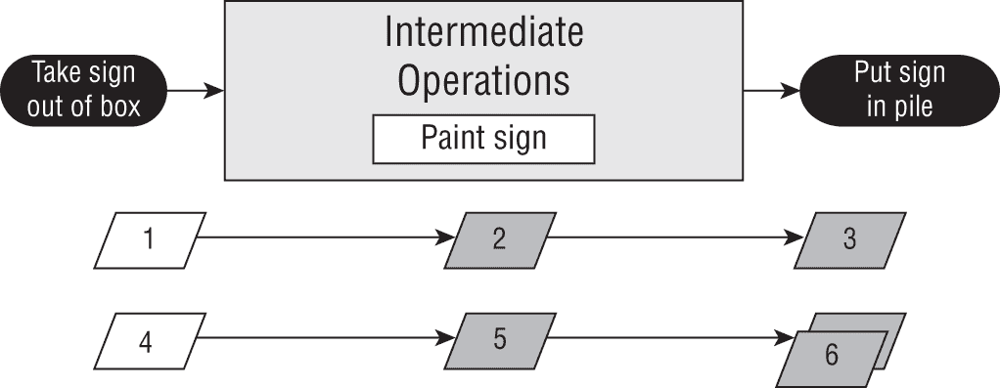

**图 4.3** 流流水线的步骤

让我们从工头的视角来看发生了什么。首先，他看到源从箱子里取出标志。工头在桌旁安排了一个工人拆箱，并说等待开始信号。接着，工头看到了给标志上漆的中间操作。他安排了一个带油漆的工人，并说等待开始信号。最后，工头看到了将标志堆成一堆的终端操作。他安排了一个工人执行此操作，并大喊所有三个工人开始工作。

假设箱子里有两个标志。步骤 1 是第一个工人从箱子里拿出一个标志并把它交给第二个工人。步骤 2 是第二个工人给它上漆并交给第三个工人。步骤 3 是第三个工人将其放入堆中。步骤 4–6 是对另一个标志的相同过程。然后，工头看到没有更多标志了，于是关闭了整个企业。

工头很聪明。他可以根据需要对如何最好完成工作做出决策。例如，让我们探索图 4.4 中的流流水线。

工头仍然看到源从箱子里取出标志，并分配了一个工人按命令执行该操作。他仍然看到了一个用于上漆的中间操作，并安排了另一个工人，指示他等待然后上漆。接着，他看到了一个我们只需要两个标志的中间步骤。他安排了一个工人计算流过的标志数量，并在工人看到两个标志时通知他。最后，他安排了一个工人执行终端操作，将标志堆成一堆。


**图 4.4** 带有限制的流流水线

这一次，假设箱子里有 10 个标志。我们像上次一样开始。第一个标志沿着流水线向下移动。第二个标志也沿着流水线向下移动。当负责数的工人看到第二个标志时，她告诉了工头。工头让执行终端操作的工人完成任务，然后大喊“停止流水线”。箱子里还有八个标志这没关系。我们不需要它们，所以给它们上漆是多余的工作。而我们都想避免不必要的工作！

同样，如果终端操作是找到创建的第一个标志，工头会在第一个标志出现后停止流水线。


在接下来的章节中，我们将涵盖流水线的三个部分。我们还将讨论针对原始类型的特殊流以及如何打印流。

## 创建流源

在 Java 中，我们讨论的流由 `Stream<T>` 接口表示，定义在 `java.util.stream` 包中。

### 创建有限流

为了简单起见，我们从有限流开始。创建它们有几种方法。

```
11: Stream<String> empty = Stream.empty();          // 数量为 0
12: Stream<Integer> singleElement = Stream.of(1);   // 数量为 1
13: Stream<Integer> fromArray = Stream.of(1, 2, 3); // 数量为 3
```

11 行显示了如何创建一个空流。12 行显示了如何创建一个带有单个流。13 行显示了如何从变长参数创建流。你一定注意到 13 行并没有数组。该方法使用了变长参数，允许你指定数组或单独元素。

Java 还提供了将 `Collection` 转换为流的方便方法。

```
14: var list = List.of("a", "b", "c");
15: Stream<String> fromList = list.stream();
```

15 行显示了从列表创建流是一个简单的方法调用。由于这种转换很常见，这非常有帮助。

### 创建无限流

到为止，这没什么了不起的。我们可以用列表完成这一切。但我们无法创建无限列表，这使得流变得更强大。

```
17: Stream<Double> randoms = Stream.generate(Math::random);
18: Stream<Integer> oddNumbers = Stream.iterate(1, n -> n + 2);
```

17 行生成了一个随机数流。多少个随机数？你需要多少。如果你调用 `randoms.forEach(System.out::println)`，程序将一直打印随机数直到你杀死它。在章节后半部分，你将学习如 `limit()` 等操作，将无限流转换为有限流。

18 行提供了更多的控制。`iterate()` 方法将种子或起始值作为第一个参数。这是流将部分的第一个元素。另一个参数是一个 Lambda 表达式，用于获取上一个值并生成下一个值。与随机数示例一样，只要你需要，它就会一直产生奇数。

如果你只需要小于 100 的奇数呢？Java 9 引入了 `iterate()` 的重载版本，正好可以解决这个问题。

```
19: Stream<Integer> oddNumberUnder100 = Stream.iterate(
20:    1,                // 种子
21:    n -> n < 100,     // 用于指定何时结束的谓词
22:    n -> n + 2);      // 获取下一个值的一元运算符
```

该方法接受三个参数。注意它们是如何像所有其他方法一样通过逗号（`,`）分隔开的。考试可能会尝试使用分号来欺骗你，因为它与 `for` 循环相似。与 `for` 循环类似，你必须注意不要无意中创建一个无限流。

## 复习流的创建方法

复习，请确保你熟悉表 4.5 中的所有方法。这些是在给定 `Collection` 实例 `coll` 的情况下创建流式数据源的方法。

| 方法 | 有限或无限？ | 备注 |
| --- | --- | --- |
| `Stream.empty()` | 有限 | 创建包含零元素的 `Stream` |
| `Stream.of(varargs)` | 有限 | 创建包含列出元素的 `Stream` |
| `coll.stream()` | 有限 | 从 `Collection` 创建 `Stream` |
| `coll.parallelStream()` | 有限 | 从 `Collection` 创建一个流可以并行运行的 `Stream` |
| `Stream.generate(supplier)` | 无限 | 通过在请求每个元素时调用 `Supplier` 来创建 `Stream` |
| `Stream.iterate(seed, unaryOperator)` | 无限 | 通过使用种子作为第一个元素，并在请求每个后续元素时调用 `UnaryOperator` 来创建 `Stream` |
| `Stream.iterate(seed, predicate, unaryOperator)` | 有限或无限 | 通过使用种子作为第一个元素，并在请求每个后续元素时调用 `UnaryOperator` 来创建 `Stream`。如果 `Predicate` 返回 `false` 则停止。 |

**表 4.5** 创建数据源

## 使用常用的终端操作

你可以在可以在不进行任何中间操作的情况下执行终端操作，但反之则不然。这就是为什么我们将先讨论终端操作。*规约（Reductions）* 是一种特殊的终端操作，它将流的所有内容合并为单个原始类型或 `Object`。例如，你可能会得到一个 `int` 或一个 `Collection`。

表 4.6 总结了本节。在我们逐一介绍每个操作时，你可以将其作为指南来记住最重要的要点。我们从简单到复杂进行解释，而不是按照字母顺序。

| 方法 | 对于无限流会发生什么 | 返回值 | 规约 |
| --- | --- | --- | --- |
| `count()` | 不终止 | `long` | 是 |
| `min()` `max()` | 不终止 | `Optional<T>` | 是 |
| `findAny()` `findFirst()` | 终止 | `Optional<T>` | 否 |
| `allMatch()` `anyMatch()` `noneMatch()` | 有时终止 | `boolean` | 否 |
| `forEach()` | 不终止 | `void` | 否 |
| `reduce()` | 不终止 | 取决于具体 | 是 |
| `collect()` | 不终止 | 取决于具体 | 是 |

**表 4.6** 流终端操作

### `count()`

`count()` 方法确定有限流中的元素数量。对于无限流，它永远不会终止。为什么？从 1 数到无限大并在你完成时告诉我们。或者说，不要这样做，因为我们宁愿你为考试学习，而不是用尽余生去数数。`count()` 方法是一种规约，因为它查看流中的每个元素并返回一个单一值。该方法的签名如下：

```
long count()
```

此示例展示了在有限流上调用 `count()`：

```
Stream<String> s = Stream.of("monkey", "gorilla", "bonobo");
System.out.println(s.count());   // 3
```

### `min()` 和 `max()`

`min()` 和 `max()` 方法允许你传递一个自定义的比较器，并根据该排序找到有限流中的最小或最大值。与 `count()` 方法一样，`min()` 和 `max()` 会挂在无限流上，因为它们无法确定流的后面是否还会出现更小或更大的值。这两个方法都是规约，因为它们在查看整个流后返回一个单一值。方法签名如下：

```
Optional<T> min(Comparator<? super T> comparator)
Optional<T> max(Comparator<? super T> comparator)
```

此示例找到了名字中字母最少的动物：

```
Stream<String> s = Stream.of("monkey", "ape", "bonobo");
Optional<String> min = s.min((s1, s2) -> s1.length()-s2.length());
min.ifPresent(System.out::println); // ape
```

注意代码返回的是一个 `Optional` 而不是值。这允许方法指定未找到最小值或最大值。我们使用 `Optional` 方法 `ifPresent()` 和方法引用，仅在找到值时才打印出该值。作为没有最小值的用例，让我们来看一个空流。

```
Optional<?> minEmpty = Stream.empty().min((s1, s2) -> 0);
System.out.println(minEmpty.isPresent()); // false
```

由于流是空的，因此比较器从未被调用，`Optional` 中不存在值。

### `findAny()` 和 `findFirst()`

`findAny()` 和 `findFirst()` 方法在流不空时返回流中的一个元素。它们返回 `Optional` 是因为流可能是空的。方法签名如下：

```
Optional<T> findAny()
Optional<T> findFirst()
```

此示例找到了一个动物：

```
Stream<String> s = Stream.of("monkey", "gorilla", "bonobo");
Stream<String> infinite = Stream.generate(() -> "chimp");

s.findAny().ifPresent(System.out::println);        // monkey (通常)
infinite.findAny().ifPresent(System.out::println); // chimp
```

`findAny()` 和 `findFirst()` 方法是终端操作但不是规约。注意代码返回的是一个 `Optional` 而不是值。这允许方法指定未找到最小值或最大值。我们使用 `Optional` 方法 `ifPresent()` 和方法引用来打印结果。

### `allMatch()`、`anyMatch()` 和 `noneMatch()`

`allMatch()`、`anyMatch()` 和 `noneMatch()` 方法搜索流并返回关于流与谓词（predicate）关系的信息。对于无限流，这些方法可能会终止也可能终止。这取决于数据。与查找方法一样，它们不是规约，因为它们并不一定会查看所有元素。

方法签名如下：

```
boolean anyMatch(Predicate <? super T> predicate)
boolean allMatch(Predicate <? super T> predicate)
boolean noneMatch(Predicate <? super T> predicate)
```

此示例检查动物名称是否以字母开头：

```
var list = List.of("monkey", "2", "chimp");
Stream<String> infinite = Stream.generate(() -> "chimp");
Predicate<String> pred = x -> Character.isLetter(x.charAt(0));

System.out.println(list.stream().anyMatch(pred));  // true
System.out.println(list.stream().allMatch(pred));  // false
System.out.println(list.stream().noneMatch(pred)); // false
System.out.println(infinite.anyMatch(pred));       // true
```

这显示我们可以重用同一个谓词，但每次都需要不同的流。`anyMatch()` 方法返回 `true` 是因为三个元素中有两个匹配的。`allMatch()` 方法返回 `false` 是因为有一个不匹配。`noneMatch()` 方法也返回 `false` 是因为有一个匹配的。在无限流上，找到了一个匹配项，因此调用终止。如果我们调用 `allMatch()`，它将一直运行直到我们杀掉程序为止。

### `forEach()`

就像在 Java Collections Framework 中，遍历流（stream）的元素是常见的操作。正如预期的那样，在无限流上调用 `forEach()` 不终止。由于它没有返回值，因此它不是归约操作（reduction）。

在使用之前，请考虑是否有其他更好的方法。先学习编写循环的开发者倾向于用循环来处理一切。例如，带有 `if` 语句的循环可以用 `filter`（过滤器）来代替。你将在中间操作部分学习关于过滤器的知识。

该方法的签名如下：

```
void forEach(Consumer<? super T> action)
```

注意，这是唯一返回类型为 `void` 的终端操作。如果你希望执行某些操作，必须在 `Consumer` 中实现它。这里是打印流元素的一种方法（还有其他方法，我们将在章节稍后的部分介绍）：

```
Stream<String> s = Stream.of("Monkey", "Gorilla", "Bonobo");
s.forEach(System.out::print); // MonkeyGorillaBonobo
```

注意，你不能在流上使用传统的 `for` 循环。

```
Stream<Integer> s = Stream.of(1);
for (Integer i  : s) {} // 无法编译
```

虽然 `forEach()` 听起来像一个循环，但它实际上是流的终端操作符。流不能作为 `for-each` 循环的源来运行，因为它们没有实现 `Iterable` 接口。

### `reduce()`

`reduce()` 方法将流合并为一个单个对象。它是一个归约操作，意味着它会处理所有元素。三个方法签名如下：

```
T reduce(T identity, BinaryOperator<T> accumulator)

Optional<T> reduce(BinaryOperator<T> accumulator)

<U> U reduce(U identity, 
   BiFunction<U,? super T,U> accumulator, 
   BinaryOperator<U> combiner)
```

让我们逐一个来看。最常见的归约方法是从一个初始值开始，并将其与下一个值不断合并。思考如果不使用函数式编程，你会如何将一个 `String` 对象数组拼接成单个 `String`。它看起来可能像这样：

```
var array = new String[] { "w", "o", "l", "f" };
var result = "";
for (var s: array) result = result + s;
System.out.println(result); // wolf
```

`identity` 是归约的初始值，在本例中是一个空 `String`。`accumulator`（累加器）将当前结果与流中的当前值合并。使用 lambda，我们可以对流和归约执行相同的操作：

```
Stream<String> stream = Stream.of("w", "o", "l", "f");
String word = stream.reduce("", (s, c) -> s + c);
System.out.println(word); // wolf
```

注意我们仍然使用空 `String` 作为 `identity`。我们仍然通过拼接 `String` 对象来获取下一个值。我们甚至可以使用方法引用来重写它。

```
Stream<String> stream = Stream.of("w", "o", "l", "f");
String word = stream.reduce("", String::concat);
System.out.println(word); // wolf
```

让我们再尝试另一个。你能写一个归约操作来乘以流中所有的 `Integer` 对象吗？试一下。我们的解决方案如下：

```
Stream<Integer> stream = Stream.of(3, 5, 6);
System.out.println(stream.reduce(1, (a, b) -> a*b));  // 90
```

我们将 `identity` 设置为 `1`，并将 `accumulator` 设置为乘法。在很多情况下，`identity` 并不是必需的，因此 Java 允许我们省略它。当你不指定 `identity` 时，会返回一个 `Optional`，因为可能没有数据。`Optional` 中的内容有三种选择：

- 如果流是空的，则返回一个空 `Optional`。
- 如果流有一个元素，则返回该元素。
- 如果流有多个元素，则应用 `accumulator` 将它们合并。

以下示例说明了每种场景：

```
BinaryOperator<Integer> op = (a, b) -> a * b;
Stream<Integer> empty = Stream.empty();
Stream<Integer> oneElement = Stream.of(3);
Stream<Integer> threeElements = Stream.of(3, 5, 6);

empty.reduce(op).ifPresent(System.out::println);         // 无输出
oneElement.reduce(op).ifPresent(System.out::println);    // 3
threeElements.reduce(op).ifPresent(System.out::println); // 90
```


为什么有两个相似的方法？为什么不总是要求 `identity` 呢？Java 完全可以那样做。然而，有时区分“流为空”的情况与“计算结果恰好匹配返回的 `identity`”的情况是有好处的。返回 `Optional` 的签名让我们能够区分这些情况。例如，当流为空时，我们可能返回 `Optional.empty()`，当有值时，我们返回 `Optional.of(3)`。

第三个方法签名用于处理不同类型的情况。它允许 Java 创建中间归约并在最后将它们合并。让我们来看一个计算每个 `String` 字符数的示例：

```
Stream<String> stream = Stream.of("w", "o", "l", "f");
int length = stream.reduce(0, (a, s) -> a + s.length(), (a, b) -> a + b);
System.out.println(length); // 4
```

### `collect()`

`collect()` 方法是一种特殊的归约类型，被称为*可变归约*（mutable reduction）。它比普通的归约更高效，因为我们在累加过程中使用的是同一个对象。常见的可变对象包括 `StringBuilder` 和 `ArrayList`。这是一个非常有用的方法，因为它允许我们将数据从流中提取并转换为另一种形式。方法签名如下：

```
<R> R collect(Supplier<R> supplier, 
   BiConsumer<R, ? super T> accumulator, 
   BiConsumer<R, R> combiner)

<R,A> R collect(Collector<? super T, A,R> collector)
```

让我们从第一个签名开始，当我们想要具体指定收集应该如何工作时使用它。我们在 `reduce` 中的那个 wolf 示例可以转换为使用 `collect()`。

```
Stream<String> stream = Stream.of("w", "o", "l", "f");

StringBuilder word = stream.collect(
   StringBuilder::new,
   StringBuilder::append, 
   StringBuilder::append)

System.out.println(word); // wolf
```

第一个参数是 `supplier`，用于创建一个在我们收集数据时存储结果的对象。记住 `Supplier` 不接受任何参数并返回一个值。在本例中，它构造了一个新的 `StringBuilder`。

第二个参数是 `accumulator`，它是一个 `BiConsumer`，接受两个参数且不返回任何内容。它负责将更多元素添加到数据集合中。在本例中，它将下一个 `String` 附加到 `StringBuilder`。

最后一个参数是 `combiner`，它是另一个 `BiConsumer`。它负责获取两个数据集合并合并它们。这在并行处理时非常有用。会形成两个较小的集合，然后将其合并为一个。只有当我们不在乎字母顺序时，这对 `StringBuilder` 才有效。在这种情况下，`accumulator` 和 `combiner` 的逻辑是相似的。

```
Stream<String> stream = Stream.of("w", "o", "l", "f");

TreeSet<String> set = stream.collect(
   TreeSet::new, 
   TreeSet::add,
   TreeSet::addAll);

System.out.println(set); // [f, l, o, w]
```

收集器（collector）与之前一样包含三个部分。`supplier` 创建一个空的 `TreeSet`。`accumulator` 将 `Stream` 中的单个 `String` 添加到 `TreeSet` 中。`combiner` 则在操作是并行执行并需要合并时，将一个 `TreeSet` 的所有元素添加到另一个 `TreeSet` 中。

我们之所以从长签名开始，是因为这是实现自定义收集器的方法。对于考试来说，了解如何这样做以及理解收集器的工作原理至关重要。在实践中，有很多常见的收集器反复出现。为了避免让开发者重复实现相同的收集器，Java 提供了一个巧妙命名为 `Collectors` 的类，其中包含了常用的收集器。这种方法也让代码更易读，因为它的表达性更强。例如，我们可以将之前的示例重写如下：

```
Stream<String> stream = Stream.of("w", "o", "l", "f");
TreeSet<String> set = 
   stream.collect(Collectors.toCollection(TreeSet::new));
System.out.println(set); // [f, l, o, w]
```

如果我们不需要集合进行排序，可以将代码写得更短：

```
Stream<String> stream = Stream.of("w", "o", "l", "f");
Set<String> set = stream.collect(Collectors.toSet());
System.out.println(set); // [f, w, l, o]
```

对于最后一个例子，你可能会得到不同的输出，因为 `toSet()`并不保证你会得到哪种 `Set` 的实现。它可能是一个 `HashSet`，但你不应该预期或依赖这一点。

在本章的后半部分，我们将会展示许多用于数据分组的 `Collectors`。这是一个大话题，因此在混合加入过多的 `Collectors` 之前，最好先掌握流（streams）是如何工作的。

### 使用常用的中间操作

与终端操作（terminal operation）不同，中间操作（intermediate operation）产生的结果是一个流。中间操作也可以通过简单地返回另一个无限流来处理无限流。由于元素只在需要时才产生，这种方式运行良好良好。流水线工人不需要担心还有多少元素通过，而是可以关注于当前的元素。

#### `filter()`

`filter()` 方法返回一个包含匹配给定表达式的元素的 `Stream`。其方法签名如下：

```
Stream<T> filter(Predicate<? super T> predicate)
```

这个操作易于记忆且功能强大，因为我们可以向它传递任何 `Predicate`。例如，这过滤了所有以字母 `m` 开头的元素：

```
Stream<String> s = Stream.of("monkey", "gorilla", "bonobo");
s.filter(x -> x.startsWith("m"))
   .forEach(System.out::print); // monkey
```

#### `distinct()`

`distinct()` 方法返回一个去除了重复值的流。重复值不需要相邻即可被移除。正如你所想象的那样，Java 调用 `equals()` 来判断对象是否相同。方法签名如下：

```
Stream<T> distinct()
```

这是一个示例：

```
Stream<String> s = Stream.of("duck", "duck", "duck", "goose");
s.distinct()
   .forEach(System.out::print); // duckgoose
```

#### `limit()` 和 `skip()`

`limit()` 和 `skip()` 方法可以让 `Stream` 变小，或者从无限流创建一个有限流。方法签名所示处：

```
Stream<T> limit(long maxSize)
Stream<T> skip(long n)
```

以下代码创建了一个从 1 开始计数的无限数字流。`skip()` 操作返回一个从 6 开始计数的无限流，因为它跳过了前五个元素。`limit()` 调用取了其中的前两个。现在我们有一个包含两个元素的有限流，然后可以用 `forEach()` 方法将其打印出来。

```
Stream<Integer> s = Stream.iterate(1, n -> n + 1);
s.skip(5)
   .limit(2)
   .forEach(System.out::print); // 67
```

#### `map()`

`map()` 方法在流中的元素到流中下一步的元素之间建立一对一的映射。方法签名如下：

```
<R> Stream<R> map(Function<? super T, ? extends R> mapper)
```

这看起来比你看到的其他操作复杂。它使用 lambda 表达式来确定传递给函数的类型和返回的类型。返回类型就是被返回的流。

例如，这段代码将 `String` 对象列表转换为表示其长度的 `Integer` 对象列表。

```
Stream<String> s = Stream.of("monkey", "gorilla", "bonobo");
s.map(String::length)
   .forEach(System.out::print); // 676
```

记住 `String::length` 是 lambda `x -> x.length()` 的缩写，它清楚地显示了这是一个将 `String` 转换为 `String` 的函数。

#### `flatMap()`

`flatMap()` 方法获取流的每个元素并将其转换为流，然后将这些流展平为单个流。方法签名是：

```
<R> Stream<R> flatMap(Function<? super T, ? extends Stream<? extends R>> mapper)
```

当你将每个元素映射到多个元素并展平结果时，这个方法非常有用。这是一个示例：

```
List<String> zero = List.of();
var one = List.of("Mama Gorilla");
var two = List.of("Baby Gorilla");
Stream<String> animals = Stream.of(zero, one, two);

animals.flatMap(m -> m.stream())
   .forEach(System.out::println);
```

```
Mama Gorilla
Baby Gorilla
```

#### `sorted()`

`sorted()` 方法返回一个元素排序后的流。就像排序数组，除非我们指定比较器，否则 Java 使用自然排序。方法签名如下：

```
Stream<T> sorted()
Stream<T> sorted(Comparator<? super T> comparator)
```

调用第一个签名将使用默认排序顺序。

```
Stream<String> s = Stream.of("brown-", "bear-");
s.sorted()
   .forEach(System.out::print); // bear-brown-
```

我们可以通过方法或 lambda 可选择使用 `Comparator` 实现。在示例中，我们正在使用方法：

```
Stream<String> s = Stream.of("brown bear-", "grizzly-");
s.sorted(Comparator.reverseOrder())
   .forEach(System.out::print); // grizzly-brown bear-
```

#### `peek()`

`peek()` 方法是我们的最后一个中间操作。它对调试非常有用，因为它允许我们在不改变流的情况下的情况下执行流操作。方法签名如下：

```
Stream<T> peek(Consumer<? super T> action)
```

你可能会注意到，中间操作 `peek()` 接收的参数与终端操作 `forEach()` 相同。可以将 `peek()` 视为 `forEach()` 的一个中间版本，它会将原始流重新返回给你。

`peek()` 最常用的用途是在流通过时输出其内容。假设我们写错了一个拼写错误，统计了以字母 `g` 开头的熊，而不是 `b`。我们感到很困惑，为什么计数是 1 而不是 2。我们可以添加一个 `peek()` 方法来找出原因。

```
var stream = Stream.of("black bear", "brown bear", "grizzly");
long count = stream.filter(s -> s.startsWith("g"))
   .peek(System.out::println).count();              // grizzly
System.out.println(count);                          // 1
```

在第 3 章中，你已经看到在处理 `Queue` 时，`peek()` 只查看第一个元素。在流中，`peek()` 会查看通过流流水线该部分的每一个元素。这就像有一个工人对流程中特定步骤的执行情况进行记录。

### 组合流水线

流允许你使用链式调用并表达你想要实现的目标，而不是如何实现。假设我们想要获取朋友中按字母顺序排序且长度为 4 的前两个名字。如果没有流，我们需要编写类似下面的代码：

```
var list = List.of("Toby", "Anna", "Leroy", "Alex");
List<String> filtered = new ArrayList<>();
for (String name: list) 
   if (name.length() == 4) filtered.add(name);
Collections.sort(filtered);
var iter = filtered.iterator();
if (iter.hasNext()) System.out.println(iter.next());
if (iter.hasNext()) System.out.println(iter.next());
```

这段代码可以工作。但它需要一些阅读和思考才能弄清楚发生了什么。我们试图解决的问题在实现细节中迷失了。它也非常关注“如何做”，而不是“做什么”。使用流，等效的代码如下：

```
var list = List.of("Toby", "Anna", "Leroy", "Alex");
list.stream().filter(n -> n.length() == 4).sorted()
   .limit(2).forEach(System.out::println);
```

在你说它更难读之前，我们可以对其进行格式化。

```
var list = List.of("Toby", "Anna", "Leroy", "Alex");
list.stream()
   .filter(n -> n.length() == 4)
   .sorted()
   .limit(2)
   .forEach(System.out::println); 
```


区别在于，我们表达了正在发生什么。我们关注长度为 4 的 `String` 对象。然后我们想要它们进行排序。然后我们要前两个。最后我们想要打印它们。这更好地契合了我们要解决的问题，而且更简单。

一旦你开始在代码中使用流，你可能会发现自己在很多地方都使用它们。拥有更短、更简洁、清晰的代码绝对是好事！

在这个示例中，你看到了流水线的三个部分。图 4.5 展示了流水线中的每个中间操作是如何传递给下一个的。

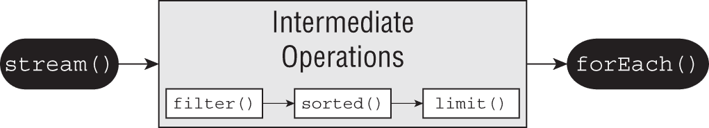

**图 4.5** 带有多个中间操作的流流水线

记住，流水线主管正在思考如何最好实现流流水线。他设置了所有表格，并指示在开始前等待。他告诉 `limit()` 工人在两个元素通过时通知他。他告诉 `sorted()` 工人，她应该收集所有进入的元素并一次性排序。排序后，她应该开始逐个将它们传递给 `limit()` 工人。数据流如下：

1. `stream()` 方法将 Toby 发送到 `filter()`。`filter()` 方法看到长度合适，将 Toby 发送到 `sorted()`。`sorted()` 方法还无法排序，因为它需要所有数据，所以它留了 Toby。

2. `stream()` 方法将 Anna 发送到 `filter()`。`filter()` 方法看到长度合适，将 Anna 发送到 `sorted()`。`sorted()` 方法还无法排序，因为它需要所有数据，所以它留了 Anna。

3. `stream()` 方法将 Leroy 发送到 `filter()`。`filter()` 方法看到长度不匹配，将 Leroy 从流水线处理中移除。

4. `stream()` 方法将 Alex 发送到 `filter()`。`filter()` 方法看到长度合适，将 Alex 发送到 `sorted()`。`sorted()` 方法还无法排序，因为它需要所有数据，所以它留了 Alex。事实证明 `sorted()` 确实拥有了所有需要的数据，但它还不知道。

5. 主管告诉 `sorted()` 是时候排序了，随后排序。

6. `sorted()` 方法将 Alex 发送到 `limit()`。`limit()` 方法记住它已经见过一个元素，并将 Alex 发送到 `forEach()`，打印出 `Alex`。

7. `sorted()` 方法将 Alex 发送到 `limit()`。`limit()` 方法记住它已经见过一个元素，并将 Alex 发送到 `forEach()`，打印出 `Alex`。

8. `sorted()` 方法将 Alex 发送到 `limit()`。`limit()` 方法记住它已经见过一个元素，并将 Alex 发送到 `forEach()`，打印出 `Alex`。

Java 实际上包含了 `Stream` 类之外的其他流类，你可以使用它们来处理特定的原始类型：`int`、`double` 和 `long`。让我们来看看为什么需要这些。假设我们要计算一个有限流中数字之和。

```java
Stream<Integer> stream = Stream.of(1, 2, 3);

System.out.println(stream.reduce(0, (s, n) -> s + n));  // 6
```

还不错。编写一个归约操作（reduction）并不困难。我们从零初始化累加器，然后随着每个数字在流中出现，就将其加到该运行总和中。还有另一种实现方法，在此所示：

```java
Stream<Integer> stream = Stream.of(1, 2, 3);

System.out.println(stream.mapToInt(x -> x).sum());  // 6
```

这一次，我们将 `Stream<Integer>` 转换为 `IntStream`，并让 `IntStream` 为我们计算总和。`IntStream` 拥有许多与 `Stream` 相同的中间操作和终端方法，但包含了专门用于处理数值数据的方法。原始流知道如何自动执行某些常用操作。

到目前为止，这似乎是一个很方便的特性，但并不重要。现在考虑你如何计算平均值。你需要将总和除以元素的数量。问题是流只允许通过一次。Java 意识到计算平均值是一项常见操作，因此在原始类型流类上提供了一个计算平均值的方法。

```java
IntStream intStream = IntStream.of(1, 2, 3);

OptionalDouble avg = intStream.average();

System.out.println(avg.getAsDouble());  // 2.0
```

不仅可以计算平均值，而且非常简单。显然，原始流是非常重要的。我们将介绍创建和使用此类流，包括可选类型（option）和函数式接口。

### 创建原始流

这里有三种类型的原始流。

- `IntStream`: 用于原始类型 `int`、`short`、`byte` 和 `char`
- `LongStream`: 用于原始类型 `long`
- `DoubleStream`: 用于原始类型 `double` 和 `float`

为什么每个原始类型没有自己的独立的原始流呢？这三种是最常见的，所以 API 设计者选择了它们。

Table 4.7 显示了一些原始流特有的方法。注意，我们没有在表中包含你在 `Stream` 接口已经熟悉的方法，例如 `empty()`。

| 方法 | 原始流 | 描述 |
| --- | --- | --- |
| `OptionalDouble average()` | `IntStream`, `LongStream`, `DoubleStream` | 元素的算术平均值 |
| `Stream<T> boxed()` | `IntStream`, `LongStream`, `DoubleStream` | 一个 `Stream<T>`，其中 `T` 与原始值相关的包装类 |
| `OptionalInt max()` | `IntStream` | 流中的最大元素 |
| `OptionalLong max()` | `LongStream` | |
| `OptionalDouble max()` | `DoubleStream` | |
| `OptionalInt min()` | `IntStream` | 流中的最小元素 |
| `OptionalLong min()` | `LongStream` | |
| `OptionalDouble min()` | `DoubleStream` | |
| `IntStream range(int a, int b)` | `IntStream` | 返回从 `a`（包含）到 `b`（不包含）的原始流 |
| `LongStream range(long a, long b)` | `LongStream` | |
| `IntStream rangeClosed(int a, int b)` | `IntStream` | 返回从 `a`（包含）到 `b`（包含）的原始流 |

此函数接收一个 `Object`，在本例中是一个 `String`。该函数返回一个 `int`。这里的函数映射非常直观。它们接收源类型并返回目标类型。在这个示例中，实际的函数类型是 `ToIntFunction`。表 4.9 显示了映射函数的名称。如你所见，它们正如你所期待的那样。

| 源流类 | 创建 `Stream` | 创建 `DoubleStream` | 创建 `IntStream` | 创建 `LongStream` |
| --- | --- | --- | --- | --- |
| `Stream<T>` | `Function<T,R>` | `ToDoubleFunction<T>` | `ToIntFunction<T>` | `ToLongFunction<T>` |
| `DoubleStream` | `DoubleFunction<R>` | `DoubleUnaryOperator` | `DoubleToIntFunction` | `DoubleToLongFunction` |
| `IntStream` | `IntFunction<R>` | `IntToDoubleFunction` | `IntUnaryOperator` | `IntToLongFunction` |
| `LongStream` | `LongFunction<R>` | `LongToDoubleFunction` | `LongToIntFunction` | `LongUnaryOperator` |

表 4.9 在流类型之间映射时的函数参数

你确实需要记忆表 4.8 和表 4.9。这并不像看起来那么困难。如果你记住几个规则，名称中是有模式的。对于表 4.8，映射到与起始类型相同的类型只需被称为 `map()`。当返回对象流时，该方法是 `mapToObj()`。除此之外，它就是 map 方法名中原始类型类型的名称。

对于表 4.9，你可以从思考源类型和目标类型开始。当目标类型是对象时，你去掉名称中的 `To`。当映射到与起始类型相同的类型时，对于原始流，你使用一元运算符而不是函数。

此外，你可以从原始流创建一个 `Stream`。这些方法展示了实现此点的两种方式：

```java
private static Stream<Integer> mapping(IntStream stream) {

   return stream.mapToObj(x -> x);

}

private static Stream<Integer> boxing(IntStream stream) {

  return stream.boxed();

}
```

第一个使用我们之前见过的 `mapToObj()` 方法。第二个更简洁。它不需要映射函数，因为它所做的只是将每个原始类型自动箱（autobox）为相应的包装对象。`boxed()` 方法存在于三种类型的原始流上。

### 在原始流中使用 `Optional`

在本章较早之前，我们写了一个方法来计算 `int[]` 的平均值，并承诺稍后会有更好的方法。现在你了解了原始流，就可以一行代码计算平均值了。

```java
var stream = IntStream.rangeClosed(1,10);

OptionalDouble optional = stream.average();
```

返回类型不是你习惯使用的 `Optional`。它是一个名为 `OptionalDouble` 的新类型。你可能会想，为什么我们需要单独的类型？为什么不直接使用 `Optional<Double>`？区别在于 `OptionalDouble` 是针对原始类型的，而 `Optional<Double>` 是针对 `Double` 包装类的。与原始可选类的操作与与 `Optional` 类本身的操作相似。

```java
optional.ifPresent(System.out::println);                  // 5.5

System.out.println(optional.getAsDouble());               // 5.5

System.out.println(optional.orElseGet(() -> Double.NaN)); // 5.5
```

唯一的区别是我们调用的是 `getAsDouble()` 而不是 `get()`。这让我们清楚我们处理的是原始类型。此外，`orElseGet()` 接收一个 `DoubleSupplier` 而不是 `Supplier`。

与原始流一样，针对原始类型有三种特定类型的类。表 4.10 显示了这三者之间的微小差异。你可能不会也需要记忆它感到意外。这非常容易记忆，因为原始类型名称是唯一的变化。正如你在终端操作部分应该记得的，许多流方法返回一个可选值，例如 `min()` 或 `findAny()`。它们每个都返回对应的可选类型。原始流的实现还增加了两个你需要知道的新方法。`sum()` 方法不返回可选值。如果你尝试相加空流，你只会得到零。`average()` 方法始终返回 `OptionalDouble`，因为任何类型的平均值都可能包含小数数据。

| | `OptionalDouble` | `OptionalInt` | `OptionalLong` |
| --- | --- | --- | --- |
| 以原始类型获取 | `getAsDouble()` | `getAsInt()` | `getAsLong()` |
| `orElseGet()` 参数类型 | `DoubleSupplier` | `IntSupplier` | `LongSupplier` |
| `max()` 和 `min()` 的返回类型 | `OptionalDouble` | `OptionalInt` | `OptionalLong` |
| `average()` 的返回类型 | `OptionalDouble` | | |
| `sum()` 的返回类型 | | |

### 汇总统计

我们想要修改方法以接收一个 `IntStream` 并返回一个范围。范围是最大值减去最小值。哦不，`min()` 和 `max()` 都是终端操作，这意味着它们在运行时会消耗流。我们不能对同一个流运行两个终端操作。幸运的是，这是一个常见问题，原始流通过汇总统计解决了它。*Statistic* 只是一个从数据计算出的数字的大词。

```java
private static int range(IntStream ints) {

   IntSummaryStatistics stats = ints.summaryStatistics();

   if (stats.getCount() == 0) throw new RuntimeException();

   return stats.getMax()-stats.getMin();

}
```

在这里我们让 Java 执行许多计算。汇总统计包括：

*   最小数字（最小）：`getMin()`
*   最大数字（最大）：`getMax()`
*   平均值：`getAverage()`
*   和：`getSum()`
*   数值数量：`getCount()`

如果流是空的，我们将获得计数和和零。其他方法将返回一个空的可选值。

### 学习原始类型的函数接口

`BooleanSupplier` 是一个单独的类型。它有一个要实现的方法：

```java
boolean getAsBoolean()
```

它的工作方式正如你对函数式接口的预期。这是一个示例：

```java
12: BooleanSupplier b1 = () -> true;

13: BooleanSupplier b2 = () -> Math.random()> .5;

14: System.out.println(b1.getAsBoolean());  // true

15: System.out.println(b2.getAsBoolean());  // false
```


第 12 行和第 13 行分别创建一个 `BooleanSupplier`，它是 `boolean` 唯一的函数式接口。第 14 行打印 `true`，因为这是 `b1` 的结果。第 15 行打印 `true` 或 `false`，取决于生成的随机值。

### 用于 double、int 和 long 的函数接口

大多数函数式接口都是针对 `double`、`int` 和 `long` 的，以匹配我们一直用于基本类型的流（streams）和可选（optionals）。表 4.11 显示了这些基本类型对应于表 4.1 的内容。你可能并不会对必须记住它们感到意外。幸运的是，你现在已经记住了表 4.1，可以将所学知识应用到表 4.11。

| 函数式接口 | 参数数量 | 返回类型 | 单个抽象方法 |
| --- | --- | --- | --- |
| `DoubleSupplier` `IntSupplier` `LongSupplier` | 0 | `double` `int` `long` | `getAsDouble` `getAsInt` `getAsLong` |
| `DoubleConsumer` `IntConsumer` `LongConsumer` | 1 (`double`) 1 (`int`) 1 (`long`) | `void` | `accept` |
| `DoublePredicate` `IntPredicate` `LongPredicate` | 1 (`double`) 1 (`int`) 1 (`long`) | `boolean` | `test` |
| `DoubleFunction<R>` `IntFunction<R>` `LongFunction<R>` | 1 (`double`) 1 (`int`) 1 (`long`) | `R` | `apply` |
| `DoubleUnaryOperator` `IntUnaryOperator` `LongUnaryOperator` | 1 (`double`) 1 (`int`) 1 (`long`) | `double` `int` `long` | `applyAsDouble` `applyAsInt` `applyAsLong` |
| `DoubleBinaryOperator` `IntBinaryOperator` `LongBinaryOperator` | 2 (`double, double`) 2 (`int`, `int`) 2 (`long`, `long`) | `double` `int` `long` | `applyAsDouble` `applyAsInt` `applyAsLong` |

**[表 4.11]](#c04.xhtml_R_c04-tbl-0011)** 基本类型的常用函数式接口

注意表 4.1 和表 4.11 之间有几点不同之处：

- 某些接口中去除了泛型（Generics），取而代之的是类型名称告诉我们涉及哪种基本类型。在其他情况下，例如 `IntFunction`，只需要返回类型的泛型，因为我们正在将基本类型 `int` 转换为对象。
- 当返回基本类型时，单个抽象方法通常会被重命名。

除了表 4.1 之外，某些接口是专门针对基本类型的。表 4.12 列出了这些接口。

| 函数式接口 | 参数数量 | 返回类型 | 单个抽象方法 |
| --- | --- | --- | --- |
| `ToDoubleFunction<T>` `ToIntFunction<T>` `ToLongFunction<T>` | 1 (`T`) | `double` `int` `long` | `applyAsDouble` `applyAsInt` `applyAsLong` |
| `ToDoubleBiFunction<T, U>` `ToIntBiFunction<T, U>` `ToLongBiFunction<T, U>` | 2 (`T`, `U`) | `double` `int` `long` | `applyAsDouble` `applyAsInt` `applyAsLong` |
| `DoubleToIntFunction` `DoubleToLongFunction` `IntToDoubleFunction` `IntToLongFunction` `LongToDoubleFunction` `LongToIntFunction` | 1 (`double`) 1 (`double`) 1 (`int`) 1 (`int`) 1 (`long`) 1 (`long`) | `int` `long` `double` `long` `int` | `applyAsInt` `applyAsLong` `applyAsDouble` `applyAsLong` `applyAsDouble` `applyAsInt` |
| `ObjDoubleConsumer<T>` `ObjIntConsumer<T>` `ObjLongConsumer<T>` | 2 `(T`, `double)` 2 `(T`, `int)` 2 `(T`, `long)` | `void` | `accept` |

问题是 `calculator` 返回的是 `Optional<Integer>`。`map()` 方法增加了另一个 `Optional`，导致我们得到 `Optional<Optional<Integer>>`。这并不好。解决方案是调用 `flatMap()` 而不是 `map()`。

```
Optional<Integer> result = optional
   .flatMap(ChainingOptionals::calculator);
```

这种有效是因为 `flatMap` 去除了不必要的层。换句话说，它展平了结果。当你想要将一个 `Optional` 类型转换为另一种时，链式调用 `flatMap()` 是很有用的。

### 收集结果

你几乎完成了关于流的学习。最后一个主题基于你目前所学的知识来对结果进行分组。在章节早期，你看到了 `collect()` 终端操作。有很多预定义的收集器，包括表 4.13 所示所示。这些收集器可以通过 `Collectors` 接口上的 `static` 方法可用。我们将在接下来的章节中查看不同类型的收集器。

| 收集器 | 描述 | 传递给 `collect` 时的返回值 |
| --- | --- | --- |
| `averagingDouble(ToDoubleFunction f)` `averagingInt(ToIntFunction f)` `averagingLong(ToLongFunction f)` | 为我们的三个核心原始类型计算平均值 | `Double` |
| `counting()` | 计算元素数量 | `Long` |
| `groupingBy(Function f)` `groupingBy(Function f, Collector dc)` `groupingBy(Function f, Supplier s, Collector dc)` | 根据指定的函数创建分组 map，带有可选的 map 类型供应商和可选的下游收集器 | `Map<K, List<T>>` |
| `joining(CharSequence cs)` | 如果指定了 `cs`，则使用作为元素之间的分隔符创建一个单个 `String` | `String` |
| `maxBy(Comparator c)` `minBy(Comparator c)` | 找到最大/最小元素 | `Optional<T>` |
| `mapping(Function f, Collector dc)` | 增加另一层收集器 | `Collector` |
| `partitioningBy(Predicate p)` `partitioningBy(Predicate p, Collector dc)` | 根据指定的谓词创建分组 map，带有可选的进一步下游收集器 | `Map<Boolean, List<T>>` |
| `summarizingDouble(ToDoubleFunction f)` `summarizingInt(ToIntFunction f)` `summarizingLong(ToLongFunction f)` | 计算平均值、最小、最大等 | `DoubleSummaryStatistics IntSummaryStatistics LongSummaryStatistics` |
| `summingDouble(ToDoubleFunction f)` `summingInt(ToIntFunction f)` `summingLong(ToLongFunction f)` | 为我们的三个核心原始类型计算和 | `Double` `Integer` `Long` |
| `toList()` `toSet()` | 创建任意类型的列表或集合 | `List` `Set` |
| `toCollection(Supplier s)` | 创建指定类型的 `Collection` | `Collection` |
| `toMap(Function k, Function v)` `toMap(Function k, Function v, BinaryOperator m)` `toMap(Function k, Function v, BinaryOperator m, Supplier s)` | 使用函数映射键、值、可选的合并函数以及可选的 map 类型供应商创建 map | `Map` |

**表 4.13** 分组/分区收集器示例

#### 使用基础收集器收集

幸运的是，这些许多收集器的工作方式相同。让我们来看一个例子。

```
var ohMy = Stream.of("lions", "tigers", "bears");
String result = ohMy.collect(Collectors.joining(", "));
System.out.println(result); // lions, tigers, bears
```

注意预定义的收集器是在 `Collectors` 类中而不是 `Collector` 接口中。这是一个常见的主题，你在对比 `Collection` 和 `Collections` 时见过它。事实上，当你在第 9 章“NIO.2”中处理 `Paths` 和 `Path` 以及其他相关类型时会再次看到这种模式。

我们将预定义的 `joining()` 收集器传递给 `collect()` 方法。流的所有元素随后合并成一个 `String`，每个元素之间使用指定的分隔符。将 `Collector` 传递给 `collect` 方法很重要。它的存在是为了帮助收集元素。`Collector` 本身什么都不做。

让我们尝试另一个。这三个动物名称的平均长度是多少？

```
var ohMy = Stream.of("lions", "tigers", "bears");
Double result = ohMy.collect(Collectors.averagingInt(String::length));
System.out.println(result); // 5.333333333333333
```

模式是相同的。我们将一个收集器传递给 `collect()`，它为我们执行平均计算。这次，我们需要传递一个函数来告诉收集器要平均什么值。我们使用了方法引用，它在执行时返回一个 `int`。对于原始流，平均值的结果始终是 `double`，无论正在平均的是什么类型。对于收集器，它是 `Double`，因为那些需要一个 `Object`。

通常，你会发现自己正在与没有使用流编写的代码交互。这意味着它将期望一个 `Collection` 类型而不是 `Stream` 类型。没问题。你仍然可以使用 `Stream` 来表达自己，然后转换为流。

```
var ohMy = Stream.of("lions", "tigers", "bears");
Set<String> result = ohMy.collect(Collectors.toSet());
System.out.println(result); // lions, tigers, bears
```

```java
var ohMy = Stream.of("lions", "tigers", "bears");
TreeMap<Integer, String> map = ohMy.collect(Collectors.toMap(
   String::length, 
   k -> k, 
   (s1, s2) -> s1 + "," + s2,
   TreeMap::new));
System.out.println(map); //         {5=lions,bears, 6=tigers}
System.out.println(map.getClass()); // class java.util.TreeMap
```

这次我们得到了指定的类型。到目前为止还好吗？这段代码很长，但并不特别复杂。我们确实向你承诺过代码会很长的！

## 使用分组、分区和映射进行收集

进展到这里做得很好。考试出题者喜欢问及 `groupingBy()` 和 `partitioningBy()`，所以请确保你非常理解这些部分。现在假设我们想根据长度对名称分组。我们可以通过指定按长度分组来实现。

```java
var ohMy = Stream.of("lions", "tigers", "bears");
Map<Integer, List<String>> map = ohMy.collect(
   Collectors.groupingBy(String::length));
System.out.println(map);    // {5=[lions, bears], 6=[tigers]}
```

`groupingBy()` 收集器告诉 `collect()` 它应该将流中的所有元素分组到一个 `Map` 中。该函数决定了 `Map` 的键。`Map` 中的每个值都是匹配该键的所有条目的 `List`。

假设我们不想让 `List` 作为 map 的值，而是倾向于使用 `Set`。没问题。还有另一种方法签名允许我们传递一个“下游收集器”（downstream collector）。这是第二个收集器，用于对值进行特殊处理。

```java
var ohMy = Stream.of("lions", "tigers", "bears");
Map<Integer, Set<String>> map = ohMy.collect(
   Collectors.groupingBy(
      String::length, 
      Collectors.toSet()));
System.out.println(map);    // {5=[lions, bears], 6=[tigers]}
```

我们甚至可以通过另一个参数来更改返回的 `Map` 类型。

```java
var ohMy = Stream.of("lions", "tigers", "bears");
TreeMap<Integer, Set<String>> map = ohMy.collect(
   Collectors.groupingBy(
      String::length, 
      TreeMap::new, 
      Collectors.toSet()));
System.out.println(map); // {5=[lions, bears], 6=[tigers]}
```

这非常灵活。如果我们想更改返回的 `Map` 类型，但保持值的类型为 `List` 不变呢？这没有专门的方法，因为通过使用现有的方法就能写出来。

```java
var ohMy = Stream.of("lions", "tigers", "bears");
TreeMap<Integer, List<String>> map = ohMy.collect(
   Collectors.groupingBy(
       String::length,
       TreeMap::new,
       Collectors.toList()));
System.out.println(map);
```

分区（Partitioning）是分组的一种特殊例。在分区中，只有两种可能的组——true 和 false。`Partitioning` 就像将列表分成两部分。

假设我们正在为每个动物展区外侧制作标牌。我们有两种尺寸的牌子。一种可以容纳五个或更少字符的名称。另一种用于较长的名称。我们可以根据需要的牌子对列表进行分区。

```java
var ohMy = Stream.of("lions", "tigers", "bears");
Map<Boolean, List<String>> map = ohMy.collect(
   Collectors.partitioningBy(s -> s.length() <= 5));
System.out.println(map);    // {false=[tigers], true=[lions, bears]}
```

在这里我们传递了一个 `Predicate`，其逻辑决定了动物名称属于哪一组。现在假设我们已经知道了如何使用不同的字体，七个字符现在可以放入较小的标牌中。不用担心，我们只需要更改 `Predicate` 即可。

```java
var ohMy = Stream.of("lions", "tigers", "bears");
Map<Boolean, List<String>> map = ohMy.collect(
   Collectors.partitioningBy(s -> s.length() <= 7));
```


`System.out.println(map);    // {false=[], true=[lions, tigers, bears]}`

注意 `map` 中仍然有两个键——每个 `boolean` 值一个。碰巧其中一个值是一个空列表，但它仍然在那里。和 `groupingBy()` 一样，我们可以将 `List` 的类型更改为其他。

```java
var ohMy = Stream.of("lions", "tigers", "bears");

Map<Boolean, Set<String>> map = ohMy.collect(
   Collectors.partitioningBy(
      s -> s.length() <= 7, 
      Collectors.toSet()));

System.out.println(map);    // {false=[], true=[lions, tigers, bears]}
```

与 `groupingBy()` 不同，我们无法更改返回的 `Map` 类型。然而，`map` 中只有两个键，所以哪种 `Map` 类型真的重要吗？

与其使用下游收集器来指定类型，我们可以使用任何下游收集器。

```java
var ohMy = Stream.of("lions", "tigers", "bears");

Map<Integer, Long> map = ohMy.collect(Collectors.groupingBy(
      String::length,
      Collectors.counting()));

System.out.println(map);    // {5=1, 6=2}
```

最后，有一个接收参数的 `mapping()`。你可能会看到带有值的 `mapping()`。这意味着你可能会看到：

```java
var ohMy = Stream.of("lions", "tigers", "bears");

Map<Integer, List<Character>> map = ohMy.collect(
   Collectors.groupingBy(
      String::length,
      Collectors.mapping(s -> s.charAt(0), Collectors.toList())));

System.out.println(map);    // {5=[l, b], 6=[t]}
```

## 总结

函数式接口只有一个抽象方法。你必须了解函数式接口。

- `Supplier<T>`，方法为 `get()`
- `Consumer<T>`，方法为 `accept(T t)`
- `BiConsumer<T, U>`，方法为 `accept(T t, U u)`
- `Predicate<T>`，方法为 `test(T t)`
- `BiPredicate<T, U>`，方法为 `test(T t, U u)`
- `Function<T, R>`，方法为 `apply(T t)`
- `BiFunction<T, U, R>`，方法为 `apply(T t, U u)`
- `UnaryOperator<T>`，方法为 `apply(T t)`
- `BinaryOperator<T>`，方法为 `apply(T t1, T t2)`

`Optional<T>` 可以是空的也可以存储一个值。你可以通过 `isPresent()` 检查它是否包含值，并使用 `get()` 获取内部的值。你可以通过 `orElse(T t)` 返回不同的值，或者通过 `orElseThrow()` 抛出异常。甚至有三个接收函数式接口参数的方法：`ifPresent(Consumer c)`、`orElseGet(Supplier s)` 和 `orElseThrow(Supplier s)`。对于原始类型有三种可选类型：`OptionalDouble`、`OptionalInt` 和 `OptionalLong`。它们分别拥有 `getAsDouble()`、`getAsInt()` 和 `getAsLong()` 方法。

流管道（stream pipeline）由三部分组成。源（source）是必须的，它创建流中的数据。可以有零或多个中间操作，这些操作在终端操作（terminal operation）运行之前不会执行。我们过的第一个流类是 `Stream<T>`，它接受一个泛型参数 `T`。`Stream<T>` 类包含了许多用的中间操作，包括 `filter()`、`map()`、`flatMap()` 和 `sorted()`。终端操作示例包括 `allMatch()`、`count()` 和 `forEach()`。

除了 `Stream<T>` 类，还有三种原始类型流：`DoubleStream`、`IntStream` 和 `LongStream`。除了常用的 `Stream<T>` 方法外，`IntStream` 和 `LongStream` 还具有 `range()` 和 `rangeClosed()`。在 `IntStream` 和 `LongStream` 上调用 `range(1, 10)` 会创建一个从 1 到 9 的原始类型流。相比之下，`rangeClosed(1, 10)` 创建一个从 1 到 10 的原始类型流。原始类型流具有数学操作，包括 `average()`、`max()` 和 `sum()`。它们还具有 `summaryStatistics()`，可以在一次调用中获取许多统计数据。此外专门针对流的函数式接口。除了 `BooleanSupplier` 之外，它们也都适用于 `double`、`int` 和 `long` 原始类型。

你可以使用 `Collector` 将流转换为传统的集合。你甚至可以用一行代码对字段进行分组以创建一个复杂的 `map`。分区（Partitioning）的工作与分组（grouping）相同，但键总是 `true` 和 `false`。即使某个键的值为空，分区后的 `map` 也始终有两个键。

你应该复习本章中的表格。虽然有很多表格，但许多具有共同的模式，这使得它们更容易记忆。你必须背下表 4.1。你应该背下表 4.8 和表 4.9，但如果你无法背下这两个表，至少要能够识别不兼容之处（例如类型差异）。最后，记住流是惰性求值的（lazily evaluated）。它们接受 lambda 表达式或方法引用作为参数，这些在方法运行时才会执行。

## 考试要点

- **根据参数数量、返回类型和方法名识别正确的函数式接口——反之亦然。** 最常见的函数式接口是 `Supplier`、`Consumer`、`Function` 和 `Predicate`。许多这些方法还有二进制版本和原始类型版本。
- **编写使用 `Optional` 的代码。** 创建 `Optional` 使用 `Optional.empty()` 或 `Optional.of()`。获取频繁使用 `isPresent()` 和 `get()`。或者，还有函数式的 `ifPresent()` 和 `orElseGet()` 方法。
- **识别哪些操作会导致流管道执行。** 中间操作在遇到终端操作之前不会运行。如果管道中没有终端操作，将返回一个 `Stream` 但不执行。终端操作的示例包括 `collect()`、`forEach()`、`min()` 和 `reduce()`。
- **确定哪些终端操作是归约（reductions）。** 归约操作使用流的所有元素来确定结果。你需要掌握的归约操作有 `collect()`、`count()`、`max()`、`min()` 和 `reduce()`。可变归约在执行过程中收集到同一个对象中。`collect()` 方法就是一个可变归约。
- **编写常用中间操作的代码。** `filter()` 方法返回一个根据 `Predicate<T>` 过滤的 `Stream<T>`。`map()` 方法返回一个通过 `Function<T,R>` 将类型为 `T` 的每个元素转换为类型 `R` 的 `Stream`。`flatMap()` 方法将嵌套的流平化为单层并移除空流。
- **比较原始类型流与 `Stream<T>`。** 原始类型流对于对数值类型执行常用操作非常有用，包括 `average()`、`sum()` 等统计数据。三种原始类型流类：`DoubleStream`、`IntStream` 和 `LongStream`。还有三种原始 `Optional` 类：`OptionalDouble`、`OptionalInt` 和 `OptionalLong`。除了 `BooleanSupplier` 之外，它们都涉及 `double`、`int` 或 `long` 原始类型。
- **将原始类型流类型转换为其他原始类型流类型。** 通常在映射时，你只需要调用 `map()` 方法。当更改用于流的类时，需要不同的方法。要转换为 `Stream`，使用 `mapToObj()`。要转换为 `DoubleStream`，使用 `mapToDouble()`。要转换为 `IntStream`，使用 `mapToInt()`。要转换为 `LongStream`，使用 `mapToLong()`。
- **使用 `peek()` 检查流。** `peek()` 方法是一个经常用于调试的中间操作。它在输入上执行 lambda 或方法引用，并将该输入传递通过管道到下一个操作符。它对于打印通过流中某点的内容很有用。
- **搜索流。** `findFirst()` 和 `findAny()` 方法从 `Optional` 中返回流中的单个元素。`anyMatch()`、`allMatch()` 和 `noneMatch()` 方法返回 `boolean`。注意，因为这三个方法如果在带有某些数据的无限流上调用，它们可能会导致挂起（hang）。所有这些方法都是终端操作。
- **排序流。** `sorted()` 方法是一个对流进行排序的中间操作。

## 复习题

本章的答案可以在附录 B 中找到。

1. 以下代码的输出可能是什么？

```java
var stream = Stream.iterate("", s -> s + "1");

System.out.println(stream.limit(2).map(x -> x + "2"));
```

- `1212`
- `2`
- `212`
- `java.util.stream.ReferencePipeline$3@451793`
- 代码编译错误。
- 出异常。
- 代码挂起。

2. 以下代码的输出可能是什么？

```java
Predicate<String> predicate = s -> s.startsWith("g");

var stream1 = Stream.generate(() -> "growl!");

var stream2 = Stream.generate(() -> "growl!");

var b1 = stream1.anyMatch(predicate);

var b2 = stream2.allMatch(predicate);

System.out.println(b1 + " " + b2);
```

- `true false`
- `true true`
- `java.util.stream.ReferencePipeline$3@451793`
- 代码编译错误。
- 出异常。
- 代码挂起。

3. 以下代码的输出可能是什么？

```java
Predicate<String> predicate = s -> s.length() > 3;

var stream = Stream.iterate("-", s -> ! s.isEmpty(), (s) -> s + s);

var b1 = stream.noneMatch(predicate);

var b2 = stream.anyMatch(predicate);

System.out.println(b1 + " " + b2);
```

- `false false`
- `false true`
- `java.util.stream.ReferencePipeline$3@451793`
- 代码编译错误。
- 出异常。
- 代码挂起。

4. 关于成功运行的流的终端操作，哪些陈述是正确的？（选择所有适用）

- 流管道中最多有一个终端操作。
- 为了获得结果，终端操作是流管道的必要部分。
- 终端操作的返回类型为 `Stream`。
- `peek()` 方法是终端操作的一个示例。

5. 引用的 `Stream` 在调用终端操作后可能仍被使用。

### 5. 下列哪一组代码将 `result` 设置为 `8.0`？（选择所有适用项。）

1. ```java
double result = LongStream.of(6L, 8L, 10L)
   .mapToInt(x -> (int) x)
   .collect(Collectors.groupingBy(x -> x))
   .keySet()
   .stream()
   .collect(Collectors.averagingInt(x -> x));
```

2. ```java
double result = LongStream.of(6L, 8L, 10L)
   .mapToInt(x -> x)
   .boxed()
   .collect(Collectors.groupingBy(x -> x))
   .keySet()
   .stream()
   .collect(Collectors.averagingInt(x -> x));
```

3. ```java
double result = LongStream.of(6L, 8L, 10L)
   .mapToInt(x -> (int) x)
   .boxed()
   .collect(Collectors.groupingBy(x -> x))
   .keySet()
   .stream()
   .collect(Collectors.averagingInt(x -> x));
```

4. ```java
double result = LongStream.of(6L, 8L, 10L)
   .mapToInt(x -> (int) x)
   .collect(Collectors.groupingBy(x -> x, Collectors.toSet()))
   .keySet()
   .stream()
   .collect(Collectors.averagingInt(x -> x));
```

5. ```java
double result = LongStream.of(6L, 8L, 10L)
   .mapToInt(x -> x)
   .boxed()
   .collect(Collectors.groupingBy(x -> x, Collectors.toSet()))
   .keySet()
   .stream()
   .collect(Collectors.averagingInt(x -> x));
```

6. ```java
double result = LongStream.of(6L, 8L, 10L)
   .mapToInt(x -> (int) x)
   .boxed()
   .collect(Collectors.groupingBy(x -> x, Collectors.toSet()))
   .keySet()
   .stream()
   .collect(Collectors.averagingInt(x -> x));
```

### 6. 下列哪项可以填充空白处，使得代码打印 `false`？（选择所有适用项。）

```java
var s = Stream.generate(() -> "meow");

var match = s.________________(String::isEmpty);

System.out.println(match);
```

1. `allMatch`
2. `anyMatch`
3. `findAny`
4. `findFirst`
5. `noneMatch`
6. 以上均不是

### 7. 我们有一个方法返回一个排序后的列表而不改变原始列表。下列哪项可以使用流替换该方法的实现以达到相同的功能？

```java
private static List<String> sort(List<String> list) {
   var copy = new ArrayList<String>(list);
   Collections.sort(copy, (a, b) -> b.compareTo(a));
   return copy;
}
```

1. ```java
return list.stream() 
   .compare((a, b) -> b.compareTo(a))
   .collect(Collectors.toList());
```

2. ```java
return list.stream() 
   .compare((a, b) -> b.compareTo(a))
   .sort();
```

3. ```java
return list.stream() 
   .compareTo((a, b) -> b.compareTo(a))
   .collect(Collectors.toList());
```

4. ```java
return list.stream() 
   .compareTo((a, b) -> b.compareTo(a))
   .sort();
```

5. ```java
return list.stream() 
   .sorted((a, b) -> b.compareTo(a))
```


`.collect()`；

```java
return list.stream()
   .sorted((a, b) -> b.compareTo(a))
   .collect(Collectors.toList());
```

### 8. 给定此声明，下列哪些项是正确的？（选择所有适用项。）

```java
var is = IntStream.empty();
```

1. `is.average()` 返回类型 `int`。
2. `is.average()` 返回类型 `OptionalInt`。
3. `is.findAny()` 返回类型 `int`。
4. `is.findAny()` 返回类型 `OptionalInt`。
5. `is.sum()` 返回类型 `int`。
6. `is.sum()` 返回类型 `OptionalInt`。

### 9. 在第 6 行之后可以添加哪些内容，使代码运行不报错且不产生任何输出？（选择所有适用项。）

```java
4: var stream = LongStream.of(1, 2, 3);
5: var opt = stream.map(n -> n * 10)
6:    .filter(n -> n < 5).findFirst();
```

1. ```java
if (opt.isPresent())
   System.out.println(opt.get());
```
2. ```java
if (opt.isPresent())
   System.out.println(opt.getAsLong());
```
3. ```java
opt.ifPresent(System.out.println);
```
4. ```java
opt.ifPresent(System::println);
```
5. 以上均不是；代码无法编译。
6. 以上均不是；第 5 行抛出异常。

### 10. 给定四个语句（`L`、`M`、`N`、`O`），选择能够完成表达式并导致代码输出 10 行的项。（选择所有适用项。）

```java
Stream.generate(() -> "1")
   L: .filter(x -> x.length())
   M: .forEach(System.out::println)
   N: .limit(10)
   O: .peek(System.out::println)
;
```

1. `L`, `N`
2. `L`, `O`
3. `L`, `M`
4. `L`, `N`, `O`
5. `O`, `M`
6. `N`, `M`
7. `N`, `O`

### 11. 为了使此代码打印字符串 `12345`，需要进行哪些更改？（选择所有适用项。）

```java
Stream.iterate(1, x -> x < 5, x -> x++)
   .map(String::valueOf)
   .collect();
```

1. 将 `()` 改为 `Collectors.joining()`。
2. 将 `map(String::valueOf)` 改为 `x)`。
3. 将 `x++` 改为 `x`。
4. 在 `collect()` 之前添加 `forEach(System.out::println)`。
5. 以上均不是。代码无法编译。

### 12. 哪些函数式接口可以完成代码？假设 `m` 和 `n` 的类型与 `y` 相同。（选择三项。）

```java
6: ________________ x = String::new;
7: ________________ y = m.andThen(n);
8: ________________ z = a;
```

1. `BinaryConsumer<String, String>`
2. `BiConsumer<String, String>`
3. `BinaryFunction<String, String>`
4. `BiFunction<String, String>`
5. `Predicate<String>`
6. `Supplier<String>`
7. `UnaryOperator<String>`
8. `UnaryOperator<String, String>`

### 13. 下列哪项是正确的？

```java
List<Integer> x1 = List.of(1, 2, 3);
List<Integer> x2 = List.of(4, 5, 6);
List<Integer> x3 = List.of();

Stream.of(x1, x2, x3).map(x -> x + 1)
   .flatMap(x -> x.stream())
   .forEach(System.out::print);
```

1. 代码编译并打印 `12345`。
2. 代码编译并打印 `23456`。
3. 代码编译但没有打印输出。
4. 代码编译但打印流引用。
5. 代码无限运行。
6. 代码无法编译。
7. 代码抛出异常。

### 14. 下列哪些项是正确的？（选择所有适用项。）

```java
4: Stream<Integer> s = Stream.of(1);
5: IntStream is = s.boxed();
6: DoubleStream ds = s.mapToDouble(x -> x);
7: Stream<Integer> s2 = ds.mapToInt(x -> x);
8: s2.forEach(System.out::print);
```

1. 第 4 行导致编译错误。
2. 第 5 行导致编译错误。
3. 第 6 行导致编译错误。
4. 第 7 行导致编译错误。
5. 第 8 行导致编译错误。
6. 代码编译但在运行时抛出异常。
7. 代码编译并打印 `1`。

### 15. 给定泛型 `String`，`partitioningBy()` 收集器在默认调用 `collect()` 时创建一个 `Map<Boolean, List<String>>`。当将下游收集器传递给 `partitioningBy()` 时，可以创建哪些类型？（选择所有适用项。）

1. `Map<boolean, List<String>>`
2. `Map<Boolean, List<String>>`
3. `Map<Boolean, Map<String>>`
4. `Map<Boolean, Set<String>>`
5. `Map<Long, TreeSet<String>>`
6. 以上均不是。

## 16. 关于这段代码，以下哪些描述是正确的？（选择所有项）

```java
20: Predicate<String> empty = String::isEmpty;
21: Predicate<String> notEmpty = empty.negate();
22:
23: var result = Stream.generate(() -> "")
24:    .limit(10)
25:    .filter(notEmpty)
26:    .collect(Collectors.groupingBy(k -> k))
27:    .entrySet()
28:    .stream()
29:    .map(Entry::getValue)
30:    .flatMap(Collection::stream)
31:    .collect(Collectors.partitioningBy(notEmpty));
32: System.out.println(result);
```

1. 它输出：`{}`
2. 它输出：`{false=[], true=[]}`
3. 如果我们将第 31 行从 `partitioningBy(notEmpty)` 改为 `groupingBy(n -> n)`，它将输出：`{}`
4. 如果我们将第 31 行从 `partitioningBy(notEmpty)` 改为 `groupingBy(n -> n)`，它将输出：`{false=[], true=[]}`
5. 代码无法编译。
6. 代码可以编译，但在运行时不会终止。

## 17. 以下哪个代码与此代码等效？（选择所有项）

```java
UnaryOperator<Integer> u = x -> x * x;
```

1. `BiFunction<Integer> f = x -> x*x;`
2. `BiFunction<Integer, Integer> f = x -> x*x;`
3. `BinaryOperator<Integer, Integer> f = x -> x*x;`
4. `Function<Integer> f = x -> x*x;`
5. `Function<Integer, Integer> f = x -> x*x;`
6. 以上都不是

## 18. 以下代码的结果是什么？

```java
var s = DoubleStream.of(1.2, 2.4);
s.peek(System.out::println).filter(x -> x> 2).count();
```

1. `1`
2. `2`
3. `2.4`
4. `1.2` 和 `2.4`
5. 没有输出。
6. 代码无法编译。
7. 抛出一个异常。

## 19. 以下代码的输出是什么？

```java
Function<Integer, Integer> s = a -> a + 4;
Function<Integer, Integer> t = a -> a * 3;
Function<Integer, Integer> c = s.compose(t);
System.out.println(c.apply(1));
```

1. `7`
2. `15`
3. 因为 lambda 表达式中的数据类型，代码无法编译。
4. 因为 `compose()` 调用代码无法编译。
5. 因为其他原因代码无法编译。

## 20. 以下哪些函数式接口包含一个返回原始值的抽象方法？（选择所有项）

1. `BooleanSupplier`
2. `CharSupplier`
3. `DoubleSupplier`
4. `FloatSupplier`
5. `IntSupplier`
6. `StringSupplier`

## 21. 重写这段代码的最简单方法是？

```java
List<Integer> x = IntStream.range(1, 6)
         .mapToObj(i -> i)
         .collect(Collectors.toList());
x.forEach(System.out::println);
```

1. ```java
IntStream.range(1, 6);
```
2. ```java
IntStream.range(1, 6)
   .forEach(System.out::println);
```
3. ```java
IntStream.range(1, 6)
   .mapToObj(i -> i)
   .forEach(System.out::println);
```
4. 以上均不等效。
5. 提供的代码无法编译。

## 22. 当 `Optional` 为空时，以下哪些项会抛出异常？（选择所有项）

1. `opt.orElse("");`
2. `opt.orElseGet(() -> "");`
3. `opt.orElseThrow();`
4. `opt.orElseThrow(() -> throw new Exception());`
5. `opt.orElseThrow(RuntimeException::new);`
6. `opt.get();`
7. `opt.get("");`

## 第 5 章

## 异常、断言与本地化

本章介绍如何创建能够适应变化的应用程序。如果用户在网页上输入了无效数据，或者我们在销售过程中与数据库的连接中断了该怎么办？我们如何确保数据规则得到执行？最后，我们该如何构建支持多种语言或地理地区的应用程序呢？

在本章中，我们将使用异常、断言和本地化来讨论这些问题及其解决方案。

## 复习异常

*异常*（exception）是 Java 表示“我不知道该怎么办”的方式。在本章结束时，我们希望已经提供了更好的结构。

### 处理异常

*try 语句*（try statement）用于处理异常。它由一个 `try` 子句、零或多个用于处理异常的 *catch 子句*（catch clauses）以及一个可选的 *finally 子句*组成，无论是否抛出异常`finally` 子句都会执行。传统的 `try` 语句必须至少有一个 `catch` 块。它可以有多个 `catch` 块，但最多有一个 `finally` 块。

`ZooMaintenance` 类展示了一个处理异常的方法示例以及一个声明异常的方法示例。

```java
public class ZooMaintenance {
   public void open() {
      try {
         throw new Exception();
      } catch (Exception e) {
         // 处理异常
      }
   }

   public void close() throws Exception {  // 声明异常
      throw new Exception();
   }
}
```

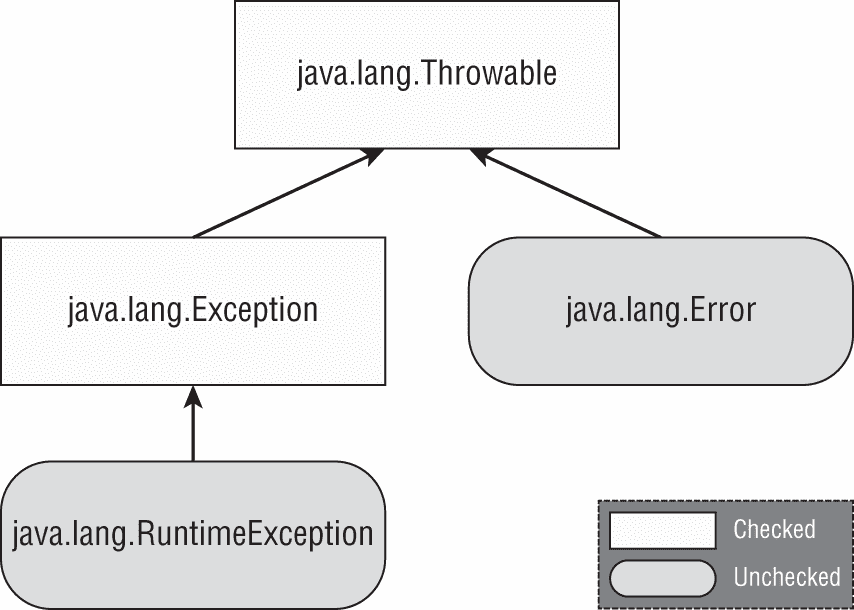

`图 5.3` 异常分类

在 Java 中，所有继承 `Exception` 但未继承 `RuntimeException` 的异常都被视为检查异常。

另一方面，`未检查异常`（unchecked exception）不需要被处理或声明。虽然未检查异常通常被称为运行时异常，但在 Java 中，未检查异常包括任何继承 `RuntimeException` 或 `Error` 的类。`Error` 是致命的，捕获它被认为是一种不良实践。

对于考试，你需要记忆一些常见的异常类。你还需要知道它们是检查异常还是未检查异常。`下表 5.1` 列出了你在考试中应该熟悉的继承自 `RuntimeException` 的未检查异常。

| `ArithmeticException` | `ArrayIndexOutOfBoundsException` |
| --- | --- |
| `ArrayStoreException` | `ClassCastException` |
| `IllegalArgumentException` | `IllegalStateException` |
| `MissingResourceException` | `NullPointerException` |
| `NumberFormatException` | `UnsupportedOperationException` |

`表 5.1` 未检查异常

`表 5.2` 展示了你也应该熟悉的检查异常。

| `FileNotFoundException` | `IOException` |
| --- | --- |
| `NotSerializableException` | `ParseException` |
| `SQLException` |  |

`表 5.2` 检查异常

### 继承异常类

在评估 `catch` 块时，异常类型的继承关系可能非常重要。对于考试，你应该知道 `NumberFormatException` 继承自 `IllegalArgumentException`。你还应该知道 `FileNotFoundException` 和 `NotSerializableException` 都继承自 `IOException`。

这在多`catch` 表达式中经常出现。例如，为什么下面的代码无法编译？

```java
try {
   throw new IOException();
} catch (IOException | FileNotFoundException e) {} // 无法编译
```

由于 `FileNotFoundException` 是 `IOException` 的子类，在多`catch` 表达式中列出两者是冗余的，会导致编译错误。

连续 `catch` 块中异常的顺序也很重要。你理解为什么下面的代码无法编译吗？

```java
try {
   throw new IOException();
} catch (IOException e) {
} catch (FileNotFoundException e) {} // 无法编译
```

对于考试，请记住：在已经捕获了更宽泛的异常后，尝试捕获更具体的异常会导致代码不可达并产生编译器错误。

### 创建自定义异常

Java 提供了许多现成的异常类。有时，你想编写一个具有更特殊类型异常的方法。你可以创建自己的异常类来实现此。

#### 声明异常类

在创建自己的异常时，你需要决定它应该是检查异常还是未检查异常。虽然你可以扩展任何异常类，但最常见的是扩展 `Exception`（检查异常）或 `RuntimeException`（未检查异常）。

创建自己的异常类非常简单。你能看出此示例中的异常是检查异常还是未检查异常吗？

```java
1: class CannotSwimException extends Exception {}
2: class DangerInTheWater extends RuntimeException {}
```


## 异常类与自定义构造函数

在第 1 行，我们有一个检查异常，因为它直接继承自 `Exception`。当我们尝试游泳时不能游泳是非常糟糕的，所以我们希望强制调用者处理这种情况。第 2 行声明了一个未检查异常，因为它直接继承自 `RuntimeException`。在第 3 行，我们有另一个未检查异常，因为它间接继承自 `RuntimeException`。水里出现鲨鱼的可能性非常小。我们甚至可能在游泳池里游泳，鲨鱼出现的概率为 0%！我们不希望强制调用者处理任何细微可能发生的事情，所以我们将其留为未检查异常。

第 5–7 行的方法声明了它可能会抛出检查异常 `CannotSwimException`。方法的实现可以写为实际抛出它，也可以不抛出。方法的实现也可以写为抛出 `SharkInTheWaterException`、`ArrayIndexOutOfBoundsException` 或任何其他运行时异常。

### 添加自定义构造函数

这些单行异常声明非常有用，特别是在考试中，它们需要快速交流异常是检查异常还是未检查异常。让我们看看如何在异常中传递更多信息。

接下来的示例显示了 `Exception` 类定义的三个最常见的构造函数：

```java
public class CannotSwimException extends Exception {

   public CannotSwimException() {
      super();  // 可选，编译器插入
   }

   public CannotSwimException(Exception e) {
      super(e);
   }

   public CannotSwimException(String message) {
      super(message);
   }
}
```

第一个构造函数是不带参数的构造函数。第二个构造函数显示了如何封装另一个异常。第三个构造函数显示了如何传递自定义消息。

在这些示例中，我们的构造函数和父构造函数接收相同的参数，但这并不是要求的。例如，下面的构造函数接收一个 `Exception` 并调用接收 `String` 的父构造函数：

```java
public CannotSwimException(Exception e) {
     super("无法游泳因为：" + e.toString());
}
```

使用不同的构造函数允许你对发生了什么提供更多信息。例如，假设我们有一个如下的 `main()` 方法：

```java
15: public static void main(String[] unused) throws Exception {
16:    throw new CannotSwimException();
17: }
```

该方法的输出如下：

```
Exception in thread "main" CannotSwimException
   at CannotSwimException.main(CannotSwimException.java:16)
```

JVM 只给了我们异常类型及其位置。有用，但我们可以获取更多。现在，让我们修改 `main()` 方法以包含一些文本，如下所示：

```java
15: public static void main(String[] unused) throws Exception {
16:    throw new CannotSwimException("鳍损坏");
17: }
```

这个新 `main()` 方法的输出如下：

```
Exception in thread "main" CannotSwimException: 鳍损坏
   at CannotSwimException.main(CannotSwimException.java:16)
```

我们在结果中看到了消息文本。根据问题，你可能想对异常提供更多信息。

如果异常有底层原因，我们甚至可以传递另一个异常。看看我们 `main()` 方法的这个版本：

```java
15: public static void main(String[] unused) throws Exception {
16:    throw new CannotSwimException(
17:       new FileNotFoundException("找不到鲨鱼文件"));
18: }
```

这将产生目前为止最长的输出：

```
Exception in thread "main" CannotSwimException: 
   java.io.FileNotFoundException: Cannot find shark file
   at CannotSwimException.main(CannotSwimException.java:16)
Caused by: java.io.FileNotFoundException: Cannot find shark file
   … 1 more
```

## 打印堆栈轨迹 (Printing Stack Traces)

我们一直显示的错误信息被称为 `stack traces`（堆栈轨迹）。堆栈轨迹显示了异常本身以及到达该位置所经过的方法调用。当程序抛出一个未被处理的异常时，JVM 会自动打印堆栈轨迹。

你也可以自己打印堆栈轨迹。这样做的好处是你可以读取或记录堆栈轨迹中的信息，然后继续处理甚至重新抛出它。

```
try {
   throw new CannotSwimException();
} catch (CannotSwimException e) {
   e.printStackTrace();
}
```

## 自动化资源管理 (Automating Resource Management)

正如之前描述的，try-with-resources 语句确保 `try` 子句中声明的任何资源在 `try` 块结束时自动关闭。这一特性也被称为 `automatic resource management`（自动资源管理），因为 Java 会自动为你处理关闭资源的工作。

对于考试来说，`resource`（资源）通常是指需要某种流或连接来读写数据的文件或数据库。在第 8 章“I/O”、第 9 章“NIO.2”以及第 10 章“JDBC”中，你会创建许多资源，它们在使用后需要被关闭。在第 11 章“安全”中，我们将讨论未关闭资源如何导致资源泄漏，从而可能使你的程序更容易受到攻击。

### 构建 Try-With-Resources 语句 (Constructing Try‐With‐Resources Statements)

哪些类型的资源可以用于 try-with-resources 语句？你应该知道的第一条规则是：`try-with-resources` 语句需要实现 `AutoCloseable` 接口的资源。例如，以下代码无法编译，因为 `String` 没有实现 `AutoCloseable` 接口：

```
try (String reptile = "lizard") {
}
```

继承 `AutoCloseable` 需要实现一个兼容的 `close()` 方法。

```
interface AutoCloseable {
   public void close() throws Exception;
}
```

根据你对方法重写的学习，这意味着 `close()` 的实现版本可以选择抛出 `Exception` 或其子类，或者完全不抛出任何异常。

让我们定义一个自定义的资源类，供 try-with-resources 语句使用。

```
public class MyFileReader implements AutoCloseable {
   private String tag;
   public MyFileReader(String tag) { this.tag = tag;}
   @Override public void close() {
      System.out.println("Closed: "+tag);
   }
}
```

下面的代码片段使用了我们自定义的读取类：

```
try (var bookReader = new MyFileReader("monkey")) {
   System.out.println("Try Block");
} finally {
   System.out.println("Finally Block");
}
```

该代码在运行时输出以下内容：

```
Try Block
Closed: monkey
Finally Block
```

你可以看到，资源在 `try` 语句结束时被关闭，在执行任何 `catch` 或 `finally` 块之前。在背后，JVM 会在一个隐藏的 `finally` 块中调用 `close()` 方法，我们可以将其称为隐式的 `finally` 块。程序员声明的 `finally` 块可以被称为显式的 `finally` 块。

你还应该熟悉的第二条规则是：`try-with-resources` 语句可以包含多个资源，这些资源按照它们声明的反反顺序进行关闭。资源通过分号（`;`）分隔，最后一个是可选的。

考虑以下代码片段：

```
try (var bookReader = new MyFileReader("1");
     var movieReader = new MyFileReader("2");
     var tvReader = new MyFileReader("3");) {
   System.out.println("Try Block");
} finally {
   System.out.println("Finally Block");
}
```

执行时，这段代码输出以下内容：

```
Try Block
Closed: 3
Closed: 2
Closed: 1
Finally Block
```

你应该知道的最后一条规则是：在 `try-with-resources` 语句内声明的资源作用域仅限于 `try` 块。

这是另一种记忆资源在执行任何 `catch` 或 `finally` 块之前就会关闭的方法，因为这些资源不再可用。你看到为什么这个示例中的第 6 行和第 8 行无法编译了吗？

```
3: try (Scanner s = new Scanner(System.in)) {
4:    s.nextLine();
5: } catch(Exception e) {
6:    s.nextInt(); // 无法编译
7: } finally {
8:    s.nextInt(); // 无法编译
9: }
```

由于 `Scanner` 在 try 子句结束时已经离开了作用域，第 6 行和第 8 行无法访问它。这实际上是一个很好的特性。你不会意外使用一个已经关闭的对象。

不过，资源并不需要在 try-with-resources 语句内部声明，正如我们在下一节中看到的。

### 有效学习新的“有效 final”特性 (Learning the New Effectively Final Feature)

从 Java 9 开始，可以在 try "with-resources" 语句之前声明资源，只要它们被标记为 `final` 或有效 final（effectively final）。语法是直接使用资源名来代替资源声明，并用分号（`;`）分隔。

```
11: public void relax() {
12:    final var bookReader = MyFileReader("4");
13:    MyFileReader movieReader = MyFileReader("5");
14:    try (bookReader;
15:         var tvReader = MyFileReader("6");
16:         movieReader) {
17:       System.out.println("Try Block");
18:    } finally {
19:       System.out.println("Finally Block");
20:    }
21: }
```

让我们逐行分析。第 12 行声明了 `final` 变量 `bookReader`，而第 13 行声明了有效 final 变量 `movieReader`。这两个资源都可以用于 try-with-resources 语句。我们知道 `movieReader` 是有效 final，因为它只被赋值了一次。记住，如果在声明变量时插入 `final` 关键字，代码仍然编译。

第 14 行和第 16 行使用新语法在 try-resources 语句中声明资源。第 15 行使用了在 try 子句内声明新资源的正常语法。

执行时，代码输出以下内容：

```
Try Block
Closed: 5
Closed: 6
Closed: 4
Finally Block
```

如果你在考试中遇到使用在 try 子句外声明的变量进行 try-resources 语句的问题，请确保它是有效 final。例如，以下代码无法编译：

```
31: var writer = Files.newBufferedWriter(path);
32: try(writer) {  // 无法编译
33:    writer.append("Welcome to the zoo!");
34: }
35: writer = null;
```

变量 `writer` 在第 35 行被重新赋值，导致编译器不认为它是有效 final。由于它不是有效 final 变量，因此无法在第 32 行的 try 语句中使用。

考试可能会欺骗你的另一个地方是在资源关闭后访问它。考虑以下代码：

```
41: var writer = Files.newBufferedWriter(path);
42: writer.append("This write is permitted but a really bad idea!");
43: try(writer) {
44:    writer.append("Welcome to the zoo!");
45: }
46: writer.append("This write will fail!");  // IOException
```

这段代码可以编译，但在第 46 行抛出异常，信息为 `Stream closed`。虽然在 try-resources 语句之前可以向资源写入，但在之后就不行。

### 理解受抑异常 (Understanding Suppressed Exceptions)

如果 `close()` 方法抛出了异常会发生什么？让我们尝试一个说明性示例：

```java
public class TurkeyCage implements AutoCloseable {
   public void close() {
      System.out.println("Close gate");
   }
   public static void main(String[] args) {
      try (var t = new TurkeyCage()) {
         System.out.println("Put turkeys in");
      }
   }
}
```

如果 `TurkeyCage` 没有关闭，所有的火鸡可能都会逃跑。显然，我们需要处理这种情况。我们已经知道，资源在任何程序员编写的 `catch` 块运行之前就已经关闭了。这意味着如果我们愿意，可以捕获由 `close()` 抛出的异常。或者，我们可以允许调用者来处理它。

让我们用一个新的 `JammedTurkeyCage` 实现来扩展我们的示例，如下所示：

```java
1:  public class JammedTurkeyCage implements AutoCloseable {
2:     public void close() throws IllegalStateException {
3:        throw new IllegalStateException("Cage door does not close");
4:     }
5:     public static void main(String[] args) {
6:        try (JammedTurkeyCage t = new JammedTurkeyCage()) {
7:           System.out.println("Put turkeys in");
8:        } catch (IllegalStateException e) {
9:           System.out.println("Caught: " + e.getMessage());
10:       }
11:    }
12: }
```

`close()` 方法由 try-with-resources 自动调用。它抛出一个异常，该异常被我们的 `catch` 块捕获并打印出以下内容：

```
Caught: Cage door does not close
```


这看起来足够合理了。如果 `try` 块也抛出了异常会发生什么？当抛出多个异常时，除了第一个之外的所有异常都被称为*抑制异常*（suppressed exceptions）。其思想是 Java 将第一个异常视为主异常，并在自动关闭期间出现的任何异常附加在其上。

你认为以下 `main()` 方法的实现会输出什么？

```java
5:     public static void main(String[] args) {
6:        try (JammedTurkeyCage t = new JammedTurkeyCage()) {
7:           throw new IllegalStateException("Turkeys ran off");
8:        } catch (IllegalStateException e) {
9:           System.out.println("Caught: " + e.getMessage());
10:          for (Throwable t: e.getSuppressed())
11:             System.out.println("Suppressed: "+t.getMessage());
12:       }
13:    }
```

第 7 行抛出了主异常。此时，`try` 子句结束，Java 自动调用 `close()` 方法。`JammedTurkeyCage` 的第 3 行抛出一个 `IllegalStateException`，它被添加为抑制异常。然后第 8 行捕获了主异常。第 9 行打印了主异常的消息。第 10–11 行遍历任何抑制异常并打印它们。程序打印以下内容：

```
Caught: Turkeys ran off
Suppressed: Cage door does not close
```

请记住，`catch` 块会查找主异常的匹配。你认为这段代码会打印什么？

```java
5:     public static void main(String[] args) {
6:        try (JammedTurkeyCage t = new JammedTurkeyCage()) {
7:           throw new RuntimeException("Turkeys ran off");
8:        } catch (IllegalStateException e) {
9:           System.out.println("caught: " + e.getMessage());
10:       }
11:    }
```

第 7 行再次抛出主异常。Java 调用 `close()` 方法并添加了一个抑制异常。第 8 行本可以捕获 `IllegalStateException`。然而，我们并没有这种异常。主异常是一个 `RuntimeException`。由于它不匹配 `catch` 子句，异常被抛给了调用者。最终，`main()` 方法将输出类似内容：

```
Exception in thread "main" java.lang.RuntimeException: Turkeys ran off
   at JammedTurkeyCage.main(JammedTurkeyCage.java:7)
   Suppressed: java.lang.IllegalStateException: 
         Cage door does not close
      at JammedTurkeyCage.close(JammedTurkeyCage.java:3)
      at JammedTurkeyCage.main(JammedTurkeyCage.java:8)
```

即使我们不在代码中处理它们，Java 也会记住与主异常一起的抑制异常。

请记住，抑制异常仅适用于在 `try` 子句中抛出的异常。以下示例并没有抛出抑制异常：

```java
5:     public static void main(String[] args) {
6:        try (JammedTurkeyCage t = new JammedTurkeyCage()) {
7:           throw new IllegalStateException("Turkeys ran off");
8:        } finally {
9:           throw new RuntimeException("and we couldn't find them");
10:       }
11:    }
```

第 7 行抛出一个异常。然后 Java 尝试关闭资源并对其添加一个抑制异常。现在我们遇到了问题。`finally` 块在这一切之后运行。由于第 9 行也抛出了异常，来自第 7 行的异常丢失了，代码打印出以下内容：

```
Exception in thread "main" java.lang.RuntimeException:
   and we couldn't find them
   at JammedTurkeyCage.main(JammedTurkeyCage.java:9)
```

这一直以来都是一种糟糕的编程习惯。

## 声明断言

*断言*（assertion）是一个 `boolean`（布尔）表达式，你将其放置在在你预期某事为真的地方。在接下来的章节中，我们将介绍使用断言的语法、如何开启/关闭以及一些常见用途。

### 使用 `assert` 语句验证数据

断言的语法有两种形式。断言可以包含可选的括号和消息。例如，以下每个都是有效的：

```
assert 1 == age;
assert(2 == height);
assert 100.0 == length : "Problem with length";
assert ("Cecelia".equals(name)): "Failed to verify user data";
```

我们可以通过使用单文件源码命令执行程序来启用断言，如下所示：

```
java –ea Party.java
```

哎呀，我们在 `Party` 类中写了一个拼写错误。我们本意是有五位客人，而不是负五位客人。第 4 行的断言检测到了这个问题。Java 在此时抛出 `AssertionError`。由于抛出了错误，第 5 行永远不会执行。

程序将以类似下面的堆栈跟踪结束：

```
Exception in thread "main" java.lang.AssertionError 
   at asserts.Assertions.main(Assertions.java:4)
```

如果我们使用命令行 `java Party` 运行相同的程序，将得到不同的结果。程序会打印 `‐5`。现在，在这个例子中，问题非常显而易见，因为程序只有七行。在更复杂的程序中，了解事态的状况会更有用。

## 启用断言

默认情况下，JVM 在运行时会忽略 `assert` 语句。要启用断言，请在命令行上使用 `-enableassertions` 标记。

```
java -enableassertions Rectangle
```

你也可以使用快捷标记 `-ea`。

```
java -ea Rectangle
```

在不带任何参数的情况下使用 `-enableassertions` 或 `-ea` 标记可以启用所有类的断言（系统类除外）。你也可以为特定的类或包启用断言。例如，以下命令仅对 `com.demos` 包及其任何子包中的类启用断言：

```
java -ea:com.demos… my.programs.Main
```

省略号（`…`）表示指定包或子包中的任何类。你也可以为特定类启用断言。

```
java -ea:com.demos.TestColors my.programs.Main
```

## 禁用断言

有时，你想对整个应用程序启用断言，但对某些特定的包或类禁用。Java 提供了 `-disableassertions` 或 `-da` 标记专门用于这种情况。以下命令为 `com.demos` 包启用断言，但禁用了 `TestColors` 类的断言：

```
java -ea:com.demos… -da:com.demos.TestColors my.programs.Main
```

对于考试，请确保你理解如何结合使用 `-ea` 和 `-da` 标记。

## 应用断言

表 5.3 列出了断言的一些常见用途。考试中不会要求你识别断言的类型。这只是为了给你提供一些如何使用它们的思路。

| 用法 | 说明 |
| --- | --- |
| 内部不变性 | 断言某个值在特定约束范围内，例如 `assert x < 0`。 |
| 类不变性 | 断言对象状态的有效性。类不变性通常是类中返回 `boolean` 的 `private` 方法。 |
| 控制流不变性 | 断言你认为无法到达的代码行永远不会被到达。 |
| 前置条件 | 断言在调用方法之前满足了某些条件。 |
| 后置条件 | 断言在方法成功执行后满足了某些条件。 |

**表 5.3** 断言应用

## 正确地编写断言

从这一节中你应该记住的最重要规则之一是：*断言永远不应该改变结果*。这一点尤为重要，因为断言在生产环境中可以、应该、而且很可能会被关闭。

例如，以下断言并不是一个良好的设计，因为它改变了变量的值：

```
int x = 10;
assert ++x> 10; // 不是一个良好的设计！
```

当断言开启时，`x` 递增到 `11`；但当断言关闭时，`x` 的值为 `10`。这不是使用断言的良好方法，因为代码的结果将取决于断言是否开启。

断言用于调试目的，允许你在编码阶段验证你在编码期间认为为正确的事物在运行时是否真的为正确。

## 处理日期和时间

旧的 Java 8 认证考试要求你对日期和时间 API 有深入的了解。这包括了解许多不同的日期/时间类及其各种方法，如何使用 `Period` 和 `Duration` 类指定时间跨度，甚至如何解决具有夏令时时的跨时区值。

对于 Java 11 考试，这些主题都不在范围内。

### 创建日期和时间

在现实世界中，我们通常相对于当前位置来讨论日期和时间。例如，“周五上午 11 点”。你也可以独立地使用日期和时间，比如：“周五 7:15”。最后，你可能还会使用跨时区的会议，例如，“EST 时间 10:45”。

#### 日期和时间类型

Java 包含了许多类来建模这些示例。这些类型列在表 5.3 中。

| 类 | 说明 | 示例 |
| --- | --- | --- |
| `java.time.LocalDate` | 日期 | 2020-10-14 |
| `java.time.LocalTime` | 时间 | 12:45 |
| `java.time.LocalDateTime` | 日期和时间 | 2020-10-14T12:45 |
| `java.time.ZonedDateTime` | 带有时区的日期和时间 | 2020-10-14T12:45:20-04:00 |

#### 使用 `of()` 方法

我们可以使用每个类的 `of()` 方法创建某些日期和时间值。

```java
LocalDate date1 = LocalDate.of(2020, Month.OCTOBER, 20);
LocalDate date2 = LocalDate.of(2020, 10, 20);
```

两者都传递了年份、月份日期。虽然使用 `Month` 常量更好（使代码更易读），但你可以直接传递月份的 `int` 数字。

在创建时间时，你可以选择所需的详细程度。你可以只指定小时和分钟，也可以包含秒。如果你想非常精确，甚至可以纳秒（纳秒是秒的十分之一）。

```java
LocalTime time1 = LocalTime.of(6, 15);           // 小时和分钟
LocalTime time2 = LocalTime.of(6, 15, 30);       // + 秒
LocalTime time3 = LocalTime.of(6, 15, 30, 200);  // + 纳秒
```

这三个时间都是不同的，但在几分钟之内。你可以通过多种方式组合日期和时间。

```java
var dt1 = LocalDateTime.of(2020, Month.OCTOBER, 20, 6, 15, 30);
LocalDate date = LocalDate.of(2020, Month.OCTOBER, 20);
LocalTime time = LocalTime.of(6, 15);
var dt2 = LocalDateTime.of(date, time);
```

`dt1` 示例展示了你如何在同一行中指定关于 `LocalDateTime` 的所有信息。`dt2` 示例展示了如何分别创建 `LocalDate` 和 `LocalTime` 对象，然后将它们组合以创建一个 `LocalDateTime` 对象。

### 格式化日期和时间

日期和时间类支持许多方法从它们中提取数据。

```
LocalDate date = LocalDate.of(2020, Month.OCTOBER, 20);
System.out.println(date.getDayOfWeek());  // TUESDAY
System.out.println(date.getMonth());      // OCTOBER
System.out.println(date.getYear());       // 2020
System.out.println(date.getDayOfYear());  // 294
```

Java 提供了一个名为 `DateTimeFormatter` 的类来用于显示标准格式。

```
LocalDate date = LocalDate.of(2020, Month.OCTOBER, 20);
LocalTime time = LocalTime.of(11, 12, 34);
LocalDateTime dt = LocalDateTime.of(date, time);
System.out.println(date.format(DateTimeFormatter.ISO_LOCAL_DATE));
System.out.println(time.format(DateTimeFormatter.ISO_LOCAL_TIME));
System.out.println(dt.format(DateTimeFormatter.ISO_LOCAL_DATE_TIME));
```

代码段输出以下内容：

```
2020-10-20
11:12:34
2020-10-20T11:12:34
```

如果 `DateTimeFormatter` 遇到不兼容的类型，将抛出异常。例如，以下每个操作在运行时都会产生异常，因为它们尝试用时间值格式化日期，反之亦然：

```
System.out.println(date.format(DateTimeFormatter.ISO_LOCAL_TIME));
System.out.println(time.format(DateTimeFormatter.ISO_LOCAL_DATE));
```

如果你不想使用预定义的格式之一，`DateTimeFormatter` 支持使用日期格式 `String` 进行自定义格式。

```
var f = DateTimeFormatter.ofPattern("MMMM dd, yyyy 'at' hh:mm");
System.out.println(dt.format(f));  // October 20, 2020 at 11:12
```

让我们详细分析一下。Java 为每个字母或符号分配了特定的日期/时间部分。例如，`M` 用于月份，而 `y` 用于年份。大小写非常敏感！使用 `m` 代替 `M` 意味着它将返回每小时的分钟，而不是年份的月份。

符号的数量呢？数量通常决定了日期/时间部分的格式。单独使用 `M` 输出月份的最少字符数，例如一月份输出 `1`，而使用 `MM` 则始终输出两个数字，例如 `01`。此外，使用 `MMM` 打印三个字母的缩写，例如七月的 `Jul`，而 `MMMM` 则打印完整的月份名称。

### 学习标准日期/时间符号

对于考试，你应该足够熟悉各种符号，以便在查看日期/时间 `String` 时能对输出结果有一个良好的预期。表 5.5 包含了你考试时应该熟悉的符号。

| 符号 | 含义 | 示例 |
| --- | --- | --- |
| `y` | 年份 | `20`, `2020` |
| `M` | 月份 | `1`, `01`, `Jan`, `January` |
| `d` | 日期 | `5`, `05` |
| `h` | 小时 | `9`, `09` |
| `m` | 分钟 | `45` |
| `s` | 秒 | `52` |
| `a` | 上午/下午 | `AM`, `PM` |
| `z` | 时区名称 | `Eastern Standard Time`, `EST` |
| `Z` | 时区偏移量 | `‐0400` |

表 5.5 常见日期/时间符号

让我们来试几个例子。你认为以下代码会输出什么？

```
var dt = LocalDateTime.of(2020, Month.OCTOBER, 20, 6, 15, 30);
var formatter1 = DateTimeFormatter.ofPattern("MM/dd/yyyy hh:mm:ss");
System.out.println(dt.format(formatter1));
```


`var formatter2 = DateTimeFormatter.ofPattern("MM_yyyy_-_dd");`

`System.out.println(dt.format(formatter2));`

`var formatter3 = DateTimeFormatter.ofPattern("h:mm z");`

`System.out.println(dt.format(formatter3));`

输出如下：

```
10/20/2020 06:15:30
10_2020_-_20
Exception in thread "main" java.time.DateTimeException:
   Unable to extract ZoneId from temporal 2020-10-20T06:15:30
```

第一个示例打印了日期，月份在日期之前。第三个示例抛出了异常，因为 `LocalDateTime` 不包含时区。如果改用 `ZonedDateTime`，它就可以正常运行。

如果不使用单引号转义文本值，当文本无法被解释为日期/时间符号时，在运行时将抛出异常。

```
DateTimeFormatter.ofPattern("The time is hh:mm");  // Exception thrown
```

这一行会抛出异常，因为 `T` 是未知符号。考试还可能向你展示一个不完整的转义序列。

```
DateTimeFormatter.ofPattern("'Time is: hh:mm: ");  // Exception thrown
```

未终止转义序列将在运行时触发异常。

## 支持国际化与本地化

许多应用程序需要在不同的国家和使用不同的语言运行。例如，考虑这样一个句子：“动物园将于 4/1/15 举办一个特别活动来观察动物行为。”活动是什么时候举行？在美国，是 4 月 1 日。然而，英国读者会将其解释为 1 月 4 日。英国读者可能还会奇怪为什么我们不写成“behaviours”。如果我们正在制作一个将在多个国家使用的网站或程序，我们希望使用正确的语言和格式。

`Internationalization`（国际化）是设计程序使其能够适应的过程。这涉及到将字符串放在属性文件中，并确保使用了适当的数据格式化器。`Localization`（本地化）意味着实际上支持多个区域或地理区域。你可以将区域（locale）想象成语言和国家的配对。本地化包括将字符串翻译成不同的语言，还包括以该区域的正确格式输出日期和数字。

在本节中，我们将查看如何定义一个区域并使用它来格式化日期、数字和字符串。

### 选择区域

虽然 Oracle 将区域定义为“一个特定的地理、政治或文化区域”，但在考试中，你只会看到语言和国家。Oracle 肯定不会深入探讨不是国家的政治区域。对于考试来说，那太具有争议性了！

`Locale` 类位于 `java.util` 包中。第一个要找到的实用 `Locale` 是用户的当前区域设置。试着在你的计算机上运行以下代码：

```
Locale locale = Locale.getDefault();
System.out.println(locale);
```

当我们运行它时，它会打印 `en_US`。对你来说可能会不同。这个默认输出告诉我们我们的计算机正在使用英语并位于美国。

注意这种格式。首先是小写的语言代码。语言是必须的。然后是一个下划线，后面跟着大写的国家代码。国家是可选的。图 5.5 显示了你需要记忆的 `Locale` 对象的两种格式。

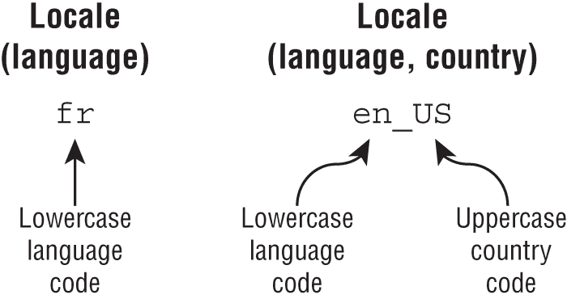

图 5.5 `Locale` 格式

作为练习，确保你理解为什么这些 `Locale` 标识符是无效的：

```
US    // 没有语言不能有国家
enUS  // 缺少下划线
US_en // 国家和语言反反了
EN    // 语言必须小写
```

修正后的版本是 `en` 和 `en_US`。

作为开发者，你经常需要根据区域格式化数字或日期。在 Java 中有几种方法可以。一种方法是使用 `Locale` 类中的内置常量，例如 `Locale.GERMANY`、`Locale.FRANCE` 或 `Locale.CHINA`。另一种方法是使用 `Locale` 构造函数创建一个具有特定语言和国家的区域，例如 `new Locale("en", "US")`。

最灵活的方法是使用 `Locale.Builder` 类，它允许你指定更详细的区域，例如变体（variant）。例如：

```
Locale locale = new Locale.Builder().setLanguage("en").setCountry("US").setVariant("u").build();
```

一旦你有一个 `Locale` 对象，就可以用它来格式化数字、日期和字符串。例如，你可以使用 `NumberFormat` 类来格式化数字：

```java
NumberFormat formatter = NumberFormat.getInstance(locale);
String formattedNumber = formatter.format(1234.56);
System.out.println(formattedNumber);
```

### 本地化数字

格式化或解析货币可能会根据你的区域而改变，这可能会让你感到。例如，在美国，美元符号位于带有小数点的数值之前，例如 `$2.15`。在德国，欧元符号附加在带有逗号的数值之后，例如 `2,15 €`。

幸运的是，`java.text` 包包含了解决问题的类。接下来的章节将将如何格式化数字和货币。

格式化或解析数据的第一步是相同的：获取 `NumberFormat` 实例。表 5.7 显示了可工厂方法。

| 说明 | 使用默认 `Locale` 和指定的 `Locale` |
| --- | --- |
| 通用格式化器 | `NumberFormat.getInstance()` `NumberFormat.getInstance(locale)` |
| 与 `getInstance` 相同 | `NumberFormat.getNumberInstance()` `NumberFormat.getNumberInstance(locale)` |
| 用于格式化货币金额 | `NumberFormat.getCurrencyInstance()` `NumberFormat.getCurrencyInstance(locale)` |
| 用于格式化百分比 | `NumberFormat.getPercentInstance()` `NumberFormat.getPercentInstance(locale)` |
| 在显示前对小数进行四舍五入 | `NumberFormat.getIntegerInstance()` `NumberFormat.getIntegerInstance(locale)` |

一旦有了 `NumberFormat` 实例，就可以调用 `format()` 将数字转换为 `String`，或者可以使用 `parse()` 将 `String` 转换为数字。

```java
int attendeesPerYear = 3_200_000;
int attendeesPerMonth = attendeesPerYear / 12;
var us = NumberFormat.getInstance(Locale.US);
System.out.println(us.format(attendeesPerMonth));
var gr = NumberFormat.getInstance(Locale.GERMANY);
System.out.println(gr.format(attendeesPerMonth));
var ca = NumberFormat.getInstance(Locale.CANADA_FRENCH);
System.out.println(ca.format(attendeesPerMonth));
```

输出如下：

```
266,666
266.666
266 666
```

这展示了我们的美国、德国和加拿大法语裔宾客如何都能以他们习惯使用的数字格式查看相同的信息。在实践中，我们只需要调用 `NumberFormat.getInstance()` 并依赖用户的默认区域设置（locale）来格式化输出。

货币的格式化原理相同。

```java
double price = 48;
var myLocale = NumberFormat.getCurrencyInstance();
System.out.println(myLocale.format(price));
```

当使用美国的 `en_US` 默认区域设置运行时，它输出 `$48.00`。相反，当使用英国的 `en_GB` 默认区域设置运行时，它输出 `£48.00`。

### 解析数字

当我们解析数据时，是将它从 `String` 转换为结构化对象或原始数据类型值。`NumberFormat.parse()` 方法完成了这一操作，并考虑了区域设置。

例如，如果区域设置是英语/美国（`en_US`）且数字包含逗号，则逗号被视为格式化符号。如果区域设置与使用逗号作为小数点分隔符的国家或语言有关，则逗号被视为小数点。

让我们来看一个例子。以下代码使用不同的区域设置解析了折扣后的票价。`parse()` 方法实际上会抛出一个受检异常 `ParseException`，因此请确保在您自己的代码中处理或声明它。

```java
String s = "40.45";
var en = NumberFormat.getInstance(Locale.US);
System.out.println(en.parse(s));  // 40.45
var fr = NumberFormat.getInstance(Locale.FRANCE);
System.out.println(fr.parse(s));  // 40
```

在美国，点（`.`）是数字的一部分，数字按照你预期的方式进行解析。法国不使用小数点来分隔数字。Java 将其解析为格式字符，并停止查找数字的其余部分。教训是：确保使用正确的区域设置进行解析！

`parse()` 方法也用于解析货币。例如，我们可以读取动物园门票销售的月收入。

```java
String income = "$92,807.99";
var cf = NumberFormat.getCurrencyInstance();
double value = (Double) cf.parse(income);
System.out.println(value); // 92807.99
```

货币字符串 `"$92,807.99"` 包含一个美元符号和一个逗号。`parse` 方法会剥离这些字符并将值转换为数字。`parse` 的返回值是一个 `Number` 对象。`Number` 是所有 `java.lang` 包装类的父类，因此返回值可以转换为其适当的数据类型。`Number` 被转换为 `Double`，然后自动拆箱为 `double`。

### 编写自定义数字格式化器

正如你之前处理日期时所看到的，你也可以使用 `DecimalFormat` 类创建自己的数字格式字符串，该类扩展了 `NumberFormat`。在创建 `DecimalFormat` 对象时，你使用的是构造函数而不是工厂方法。你传递想要使用的模式。这些模式可能会变得复杂，但你只需要了解两个格式化字符，如表 5.8 所示。

| 符号 | 含义 | 示例 |
| --- | --- | --- |
| `#` | 如果没有数字，则省略该位置。 | `$2.2` |
| `0` | 如果该位置没有数字，则放置一个 `0`。 | `$002.20` |

表 5.8 `DecimalFormat` 符号

这些示例应该有助于理解这些符号是如何工作的：

```java
12: double d = 1234567.467;
13: NumberFormat f1 = new DecimalFormat("###,###,###.0");
14: System.out.println(f1.format(d));  // 1,234,567.5
15:
16: NumberFormat f2 = new DecimalFormat("000,000,000.00000");
17: System.out.println(f2.format(d));  // 001,234,567.46700
18:
19: NumberFormat f3 = new DecimalFormat("$#,###,###.##");
20: System.out.println(f3.format(d));  // $1,234,567.47
```

### 日期本地化

和数字一样，日期格式随区域设置而变化。表 5.9 显示了可能的样式。

| 描述 | 使用 `Locale` |
| --- | --- |
| 用于日期 | `DateTimeFormatter.ofLocalizedDate(FormatStyle)` |
| 用于时间 | `DateTimeFormatter.ofLocalizedTime(FormatStyle)` |
| 用于日期和时间 | `DateTimeFormatter.ofLocalizedDateTime(FormatStyle, FormatStyle)` |

如果你需要特定的区域设置怎么办？只需在方法后附加 `withLocale(locale)`。让我们将它们整合在一起。查看以下代码，它使用了 `java.time.format.FormatStyle.SHORT`：

```java
public static void print(DateTimeFormatter dtf, LocalDateTime dateTime, Locale locale) {
   System.out.println(dtf.format(dateTime) + ", " 
      + dtf.withLocale(locale).format(dateTime));
}

public static void main(String[] args) {
   Locale.setDefault(new Locale("en", "US"));
   var italy = new Locale("it", "IT");
   var dt = LocalDateTime.of(2020, Month.OCTOBER, 20, 15, 12, 34);
   // 10/20/20
   print(DateTimeFormatter.ofLocalizedDate(FormatStyle.SHORT), dt, italy);
   // 3:12 PM
   print(DateTimeFormatter.ofLocalizedTime(FormatStyle.SHORT), dt, italy);
   // 10/20/20, 3:12 PM
   print(DateTimeFormatter.ofLocalizedDateTime(FormatStyle.SHORT, FormatStyle.SHORT), dt, italy);
}
```

```java
10: public static void printCurrency(Locale locale, double money) {
11:    System.out.println(
12:       NumberFormat.getCurrencyInstance().format(money) 
13:       + ", " + locale.getDisplayLanguage());
14: }
15: public static void main(String[] args) {
16:    var spain = new Locale("es", "ES");
17:    var money = 1.23;
18:
19:    // 使用默认 locale 打印
20:    Locale.setDefault(new Locale("en", "US"));
21:    printCurrency(spain, money);  // $1.23, Spanish
22:
23:    // 使用默认 locale 和选定的 locale 显示打印
24:    Locale.setDefault(Category.DISPLAY, spain);
25:    printCurrency(spain, money);  // $1.23, español
26:
27:    // 使用默认 locale 和选定的 locale 格式打印
28:    Locale.setDefault(Category.FORMAT, spain);
29:    printCurrency(spain, money);  // 1,23 €, español
30: }
```


这段代码打印了三次相同的数据。首先，它使用 locale `en_US` 打印 `spain` 和 `money` 变量语言。然后，它使用 `es_ES` 的 `DISPLAY` 类别打印，而 `FORMAT` 类别保持为 `en_US`。最后，它在将两个类别都设置为 `es_ES` 的情况下打印数据。

对于考试，你不需要记忆每个类别的各种显示和格式化选项。你只需要知道可以独立设置 locale 的部分。你还应该知道，在之前的代码段之后调用 `Locale.setDefault(us)` 将将两个 locale 类别都更改 `en_US`。

# 使用资源包（Resource Bundles）加载属性

到目前为止，我们一直将显示给用户的所有文本字符串作为程序的一部分保留在使用它们的类中。本地化需要将它们外部化到其他地方。

`resource bundle`（资源包）包含了程序使用的特定于 locale 的对象。它像一个带有键和值的映射。资源包通常存储在属性文件中。`properties file`（属性文件）是一种特定格式的包含键/值对的文本文件。

我们的动物园程序非常成功。我们现在收到了在另外三个动物园使用它的请求！我们已经有了对美国动物园的支持。现在我们需要添加法国的 Zoo de La Palmyre、加拿大英语地区的大温哥华动物园，以及加拿大法语地区的格 Granby 动物园。我们立刻意识到我们要对程序进行国际化了。资源包将非常有帮助。它们将允许我们把应用程序翻译到多个 locale，甚至同时支持多个 locale。如果我们在更多国家有了动物园，添加更多 locale 将变得很容易。我们考虑了需要哪些 locale，得出了四个：

```java
Locale us = new Locale("en", "US");
Locale france = new Locale("fr", "FR");
Locale englishCanada = new Locale("en", "CA");
Locale frenchCanada = new Locale("fr", "CA");
```

在接下来的章节中，我们将使用属性文件创建一个资源包。`properties file` 是包含键/值对列表的文本文件。它在概念上类似于 `Map<String, String>`，每行代表一个键/值。键和值由等号 (`=`) 或冒号 (`:`) 隔开。为了简单，我们在全文中使用中使用等号。我们还将查看 Java 如何决定使用哪个资源包。

## 创建资源包

我们将更新应用程序以支持列出的四个 locale。幸运的是，Java 并不要求我们创建四个不同的包。如果没有特定于国家的包，Java 将使用特定于语言的包。这比这要复杂一点，但让我们从一个简单的示例开始。现在，我们需要为我们的 `Zoo` 资源包准备英语和法语属性文件。首先，创建两个属性文件：

```
Zoo_en.properties
hello=Hello
open=The zoo open

Zoo_fr.properties
hello=Bonjour
open=Le zoo ouvert
```

文件名与我们的资源包名称 `Zoo` 匹配。随后是下划线 (`_`)、目标 locale 和 `.properties` 扩展名。我们可以编写第一个使用资源包来打印这些信息的程序：

```java
10: public static void printWelcomeMessage(Locale locale) {
11:    var rb = ResourceBundle.getBundle("Zoo", locale);
12:    System.out.println(rb.getString("hello") 
13:       + ", " + rb.getString("open"));
14: }
15: public static void main(String[] args) {
16:    var us = new Locale("en", "US");
17:    var france = new Locale("fr", "FR");
18:    printWelcomeMessage(us);     // Hello, The zoo open
19:    printWelcomeMessage(france); // Bonjour, Le zoo ouvert
20: }
```

第 16–17 行创建了我们要测试的两个 locale，但第 10–14 行的方法执行了实际工作。第 11 行调用 `ResourceBundle` 上的工厂方法来获取正确的资源包。第 12 和 13 行从资源包中检索正确的字符串并打印结果。

记得我们说过在本章中会再次看到工厂模式吗？由于资源包包含键/值对，你可以甚至遍历它们来列出所有的键。这在书中经常出现。

```java
var us = new Locale("en", "US");
ResourceBundle rb = ResourceBundle.getBundle("Zoo", us);
rb.keySet().stream
   .map(k -> k + ": " + rb.getString(k))
   .forEach(System.out::println);
```

这个示例遍历所有的键。它将每个键映射到一个 `String`，然后打印：

```
hello: Hello
open: The zoo open
```

## 选择资源包

有两种获取资源包的方法，你应该熟悉：

```java
ResourceBundle.getBundle("name");
ResourceBundle.getBundle("name", locale);
```

第一个使用默认 locale。你可能会在你编写的程序中使用它。Java 处理了为给定键选择最佳可用资源包的逻辑。表 5.11 显示了当请求 locale 为 `new Locale("fr", "FR")` 且默认 locale 为美国英语时，Java 经过的过程。

| 步骤 | 查找文件 | 原因 |
| --- | --- | --- |
| 1 | `Zoo_fr_FR.properties` | 请求的 locale |
| 2 | `Zoo_fr.properties` | 请求的语言 |
| 3 | `Zoo_en_US.properties` | 默认 locale |
| 4 | `Zoo_en.properties` | 默认 locale 的语言 |
| 5 | `Zoo.properties` | 没有任何 locale——默认包 |
| 6 | 如果仍未找到，抛出 `MissingResourceException` | 无可用 locale 或默认包 |

**表 5.11** 为默认 locale 为英语选择法语/法国资源包

另一种记忆表 5.11 顺序的方法是学习这些步骤：

1. 查找请求 locale 的资源包，然后查找默认 locale 的资源包。
2. 对于每个 locale，检查语言/国家，然后只检查语言。
3. 如果没有找到匹配的 locale，使用默认资源包。

让我们看看你是否理解了表 5.11。对于以下代码，Java 需要考虑多少个文件来找到相应的资源包？

```java
Locale.setDefault(new Locale("hi"));
ResourceBundle rb = ResourceBundle.getBundle("Zoo", new Locale("en"));
```

答案是三个。它们列在此处：

1. `Zoo_en.properties`
2. `Zoo_hi.properties`
3. `Zoo.properties`

### 选择资源包值

以上都明白了吗？很好——因为这里有一个转折。我们到为止讨论的步骤是用于查找匹配的资源包作为基础。Java 并不要求从同一个资源包中获取所有的键。它可以从匹配资源包的任何父级包中获取。层级结构中的父级资源包会移除名称中的组件，直到到达顶层。表 5.12 显示了如何进行操作。

| 匹配的资源包 | 属性文件键可能源于 |
| --- | --- |
| `Zoo_fr_FR` | `Zoo_fr_FR.properties` `Zoo_fr.properties` `Zoo.properties` |

表 5.12 选择资源包属性

一旦选择了资源包，只有单条层级结构上的属性会被使用。将此行为与表 5.11 进行对比，在后者，如果没有其他可用的资源包，则使用默认的 `en_US` 资源包。

这具体意味着什么？假设请求的区域是 `fr_FR`，默认区域是 `en_US`。JVM `只有在没有匹配的 `fr_FR` 或 `fr` 资源包时`才会提供来自 `en_US` 的数据。如果它找到了 `fr_FR` 或 `fr` 资源包，那么将只会使用这些包以及默认包。

让我们把这一切整合起来，打印一些关于我们动物园的信息。这次我们有多个属性文件。

```
Zoo.properties
name=Vancouver Zoo

Zoo_en.properties
hello=Hello
open=is open

Zoo_en_US.properties
name=The Zoo

Zoo_en_CA.properties
visitors=Canada visitors
```

假设我们有一位来自魁北克（默认区域为加拿大法语）的访问者，他要求程序提供英语信息。你认为这会输出什么？

```java
11: Locale.setDefault(new Locale("en", "US"));
12: Locale locale = new Locale("en", "CA");
13: ResourceBundle rb = ResourceBundle.getBundle("Zoo", locale);
14: System.out.print(rb.getString("hello"));
15: System.out.print(". ");
16: System.out.print(rb.getString("name"));
17: System.out.print(" ");
18: System.out.print(rb.getString("open"));
19: System.out.print(" ");
20: System.out.print(rb.getString("visitors"));
```

程序打印了以下内容：

```
Hello. Vancouver Zoo is open Canada visitors
```

默认区域是 `en_US`，请求的区域是 `en_CA`。首先，Java 遍历可用的资源包以查找匹配项。它立即通过 `Zoo_en_CA.properties` 找到了匹配。这意味着默认区域 `en_US` 是无关的。

第 14 行在 `Zoo_en_CA.properties` 中没有找到键 `hello` 的匹配项，因此它向上层级移动到 `Zoo_en.properties`。第 16 行在前两个属性文件中都没有找到 `name` 的匹配项，因此它必须一直到层级结构的顶端 `Zoo.properties`。第 18 行的经历与第 14 行相同，使用了 `Zoo_en.properties`。最后，第 20 行的任务简单得多，在 `Zoo_en_CA.properties` 中找到了匹配的键。

在这个示例中，只使用了三个属性文件：`Zoo_en_CA.properties`、`Zoo_en.properties` 和 `Zoo.properties`。即使在 `en_CA` 或 `en` 资源包中没有找到该属性，程序也倾向于使用 `Zoo.properties`（默认资源包），而不是 `Zoo_en_US.properties`（默认区域）。

如果在任何资源包中未找到某个属性会怎样？那么会抛出一个异常。例如，在之前的程序中尝试调用 `rb.getString("close")` 会在运行时抛出 `MissingResourceException`。

### 格式化消息

通常，我们只想输出资源包中的文本数据，但有时你想用参数对数据进行格式化。在实际程序中，在资源包的 `String` 中替换变量是常见的。惯例是在花括号中使用数字，例如 `{0}`、`{1}` 等。数字表示参数传递的顺序。虽然资源包不直接支持此功能，但 `MessageFormat` 类支持。

例如，假设我们定义了如下属性：

```
helloByName=Hello, {0} and {1}
```

在 Java 中，我们可以正常地读取该值。之后，我们可以通过 `MessageFormat` 类运行它以替换参数。`format()` 方法的第二个参数是一个可变参数（vararg），允许指定任意数量的输入值。

给定一个资源包 `rb`：

```java
String format = rb.getString("helloByName");
System.out.print(MessageFormat.format(format, "Tammy", "Henry"));
```

那将打印以下内容：

```
Hello, Tammy and Henry
```

### 使用 Properties 类

在处理 `ResourceBundle` 类时，你可能会遇到 `Properties` 类。让我们创建一个并设置一些值。

```java
import java.util.Properties;

public class ZooOptions {
   public static void main(String[] args) {
      var props = new Properties();
      props.setProperty("name", "Our zoo");
      props.setProperty("open", "10am");
   }
}
```

`Properties` 类通常用于处理可能不存在的值。

```java
System.out.println(props.getProperty("camel"));         // null
System.out.println(props.getProperty("camel", "Bob"));  // Bob
```

如果传递的键实际上存在，这两个语句都会打印它。这通常被称为为缺失键提供默认值或备份值。`Properties` 类还有一个 `get()` 方法，但只有 `getProperty()` 允许默认值。例如，以下调用是无效的，因为 `get()` 只接受一个参数：

```java
props.get("open");
props.get("The zoo will be soon"); // 编译
```

### 总结

本章涵盖了围绕构建良好响应变化的各种主题。我们从异常处理开始讨论。异常可以分为两类：检查异常和未检查异常。在 Java 中，检查异常继承 `Exception` 但不是 `RuntimeException`，并且必须处理或声明。未检查异常继承 `RuntimeException` 或 `Error`，不需要处理或声明。捕获 `Error` 被认为是不良实践。

你可以通过扩展 `Exception` 或 `RuntimeException` 来创建自己的检查或未检查异常。你还可以为这些异常定义自定义构造函数和消息，它们将显示在堆栈跟踪中。

可以通过 try-with-resources 语句启用自动资源管理，以确保资源正确关闭。资源在 `try` 块结束时按照它们声明的反向顺序关闭。当发生多个异常时，会产生抑制异常，这通常作为 `finally` 块或 try-with-resources `close()` 操作的一部分。遇到的第一个异常将是主异常，额外的异常将被抑制。Java 9 的新功能是在 try-with-resources 语句中使用现有的资源。

你可以创建一个 `Locale` 类，它包含一个强制性的小写语言代码和一个可选的大写国家代码。例如，`en` 和 `en_US` 分别是英语和美国英语的区域设置。对于考试，你不需要了解如何创建日期，但你需要了解如何使用区域设置来格式化日期和数字。你还需要了解如何创建自定义的日期和数字格式化器。

`ResourceBundle` 允许在属性文件中指定键/值对。Java 会按照从具体到最通用的顺序遍历候选资源包以查找匹配项。如果请求的区域设置没有匹配项，Java 将切换到默认区域设置，最后切换到默认资源包。一旦找到匹配的资源包，Java 将仅在该资源包的层级结构中查找值。

通过将在本章中学到的原理应用于你自己的项目，你可以构建出寿命更长的应用程序，并对可能出现的意外事件提供内置支持。

## 考试要点

- **能够创建自定义异常类。** 可以通过扩展 `Exception` 创建新的检查异常类，而可以通过扩展 `RuntimeException` 创建未检查异常类。你可以创建许多构造函数来调用具有相似参数的父类构造函数。这可以对异常处理和堆栈跟踪中报告的消息提供更大的控制。

- **使用 try-with-resources 语句进行自动资源管理。** try-with-resources 语句支持继承 `AutoCloseable` 接口的类。它会按照声明的反序自动关闭资源。try-with-resources 语句以及带有 `finally` 块的 `try` 语句可能会产生多个异常。第一个成为主异常，其余的是被抑制的异常（suppressed exceptions）。

- **将 try-with-resources 应用现有资源。** try-with-resources 语句可以使用语句开始之前声明的资源，前提是它们是 `final` 或有效最终的（effectively final）。它们在 try-with-resources 体执行后被关闭。


- **知道如何编写断言语句并启用断言。** 断言通过`assert`关键字、`boolean`条件和可选消息来实现。断言默认是禁用的。注意留意那些使用了断言但未启用的题目，或者测试你如何从命令行启用或选择性禁用断言知识的题目。

- **识别有效的区域设置字符串。** 知道语言代码是小写且强制的，而国家代码是大写且可选的。能够使用内置常量、构造函数或构建器类选择区域设置。

- **格式化日期、数字和消息。** 能够将日期、数字和消息格式化为各种`String`格式。还需要知道如何使用符号定义自定义的日期或数字格式化器，包括如何转义字面量。对于消息，你应该熟悉使用`MessageFormat`和`Properties`类。

- **确定 Java 将使用哪个资源包来查找键。** 能够使用属性文件为一组区域设置创建资源包。知道 Java 选择资源包的搜索顺序，以及如何考虑默认区域设置和默认资源包。一旦找到资源包，识别用于选择值的层级结构。

## 复习题

章节复习题的答案可以在附录 B 中找到。

1. 下哪些类包含至少一个编译错误？（选择所有项。）

```
class Danger extends RuntimeException {
    public Danger(String message) {
       super();
    }
    public Danger(int value) {
       super((String) null);
    }
}
class Catastrophe extends Exception {
    public Catastrophe(Throwable c) throws RuntimeException {
       super(new Exception());
       c.printStackTrace();
    }
}
class Emergency extends Danger {
    public Emergency() {}
    public Emergency(String message) {
       super(message);
    }
}
```

1. `Danger`

2. `Catastrophe`

3. `Emergency`

4. 这些类都能正确编译。

5. 无法从提供的信息中确定。

2. 下哪些是常见的需要本地化类型？（选择所有项。）

1. 日期

2. Lambda 表达式

3. 类名

4. 货币

5. 数字

6. 变量名

3. 下列代码的输出是什么？

```
import java.io.*;
public class EntertainmentCenter {
    static class TV implements AutoCloseable {
        public void close() {
           System.out.print("D");
        }
    }
    static class MediaStreamer implements Closeable {
        public void close() {
           System.out.print("W");
        }
    }
    public static void main(String[] args) {
        var w = new MediaStreamer();
        try {
            TV d = new TV(); w;
        }
        {
            System.out.print("T");
        } catch (Exception e) {
            System.out.print("E");
        } finally {
            System.out.print("F");
        }
    }
}
```

1. `TWF`

2. `TWDF`

3. `TWDEF`

4. `TWF` 后跟一个异常。

5. `TWDF` 后跟一个异常。

6. `TWEF` 后跟一个异常。

7. 代码无法编译。

4. 关于以下类的哪个陈述正确？

```
class Problem extends Exception {
    public Problem() {}
}
class YesProblem extends Problem {}
public class MyDatabase {
    public static void connectDatabase() throws Problem {
       new YesProblem();
    }
    public static void main(String[] c) throws Exception {
       connectDatabase();
    }
}
```

1. 代码通过编译，并在运行时打印 `YesProblem` 的堆栈跟踪。

2. 代码通过编译，并在运行时打印 `Problem` 的堆栈跟踪。

3. 代码无法编译，因为 `Problem` 定义了构造函数。

4. 代码无法编译，因为 `YesProblem` 没有定义构造函数。

5. 代码无法编译，但如果交换第 6 行和第 7 行的 `Problem` 和 `YesProblem`，则可以编译。

6. 以上都不是

5. 下列代码的输出是什么？

```
LocalDate date = LocalDate.parse("2020–04–30",
        DateTimeFormatter.ISO_LOCAL_DATE);
System.out.println(date.getYear() + " "
    + date.getMonth() + " "+ date.getDayOfMonth());
```

1. `2020 APRIL 2`

2. `2020 APRIL 30`

3. `2020 MAY 2`

4. 代码无法编译。

5. 抛出了运行时异常。

6. 假设答案中提到的所有文件都存在并了相同的键。哪一个将用于查找第 8 行的键？

```
Locale.setDefault(new Locale("en", "US"));
var b = ResourceBundle.getBundle("Dolphins");
System.out.println(b.getString("name"));
```

1. `Dolphins.properties`

2. `Dolphins_US.properties`

3. `Dolphins_en.properties`

4. `Whales.properties`

5. `Whales_en_US.properties`

6. 代码无法编译。

7. 对于`pattern`的什么值，以下内容将打印 `<005.21> <008.49> <1,234.0>`？

```java
String pattern = "__________________";
var message = DoubleStream.of(5.21, 8.49, 1234)
    .mapToObj(v -> new DecimalFormat(pattern).format(v))
    .collect(Collectors.joining("> <"));
System.out.println("<"+message+">");
```

1. `##.#`

2. `0,000.0#`

3. `#,###.0`

4. `#,###,000.0#`

5. 无论在空白处填写什么内容，代码都无法编译。

6. 以上都不是

8. 当数字`magic`为正数时，以下哪项会在发生断言失败时打印 `OhNo` ？（选择所有适用项。）

1. `assert magic < 0: "OhNo";`

2. `assert magic < 0, "OhNo";`

3. `assert magic < 0 ("OhNo");`

4. `assert(magic < 0): "OhNo";`

5. `assert(magic < 0, "OhNo");`

9. 在抛出异常的方法中，必须处理或声明以下哪些异常？（选择所有适用项。）

```java
class Apple extends RuntimeException{}
class Orange extends Exception{}
class Banana extends Error{}
class Pear extends Apple{}
class Tomato extends Orange{}
class Peach extends Banana{}
```

1. `Apple`

2. `Orange`

3. `Banana`

4. `Pear`

5. `Tomato`

6. `Peach`

10. 哪些更改如果独立进行，将使此代码能够编译？（选择所有适用项。）

```java
1:  import java.io.*; 
2:  public class StuckTurkeyCage implements AutoCloseable {
3:     public void close() throws IOException {
4:        throw new FileNotFoundException("Cage not closed");
5:     }
6:     public static void main(String[] args) {
7:        try (StuckTurkeyCage t = new StuckTurkeyCage()) {
8:           System.out.println("put turkeys in");
9:        }
10:    } }
```

1. 从第 3 行的声明中移除 `throws IOException`。

2. 在第 6 行的声明中添加 `throws Exception`。

3. 将第 9 行更改为 `} catch (Exception e) {}`。

4. 将第 9 行更改为 `} finally {}`。

5. 代码按即可编译。

6. 以上都不是。

11. 运行以下代码 `java EnterPark bird.java sing` 的结果是什么？

```java
public class EnterPark extends Exception {
    public EnterPark(String message) {
       super();
    }
    private static void checkInput(String[] v) {
       if (v.length <= 3)
          assert(false) : "Invalid input";
    }
    public static void main(String… args) {
       checkInput(args);
       System.out.println(args[0] + args[1] + args[2]);
    }
}
```

1. `birdsing`

2. `assert` 语句抛出 `AssertionError`。

3. 代码抛出 `ArrayIndexOutOfBoundsException`。

4. 代码成功编译并运行，但没有输出。

5. 代码无法编译。

12. 关于 Java 中的异常处理，以下哪些描述是正确的？（选择所有适用项。）

1. 没有 `catch` 块的传统 `try` 语句需要一个 `finally` 块。

2. 没有 `finally` 块的传统 `try` 语句需要一个 `catch` 块。

3. 只有一个语句的传统 `try` 语句可以省略 `{}`。

4. 没有 `catch` 块的 try-with-resources 语句需要一个 `finally` 块。

5. 没有 `finally` 块的 try-with-resources 语句需要一个 `catch` 块。

6. 只有一个语句的 try-with-resources 语句可以省略 `{}`。

13. 以下哪些内容在独立插入空白处时，使用了格式化正确的本地化（locale）参数？（选择所有适用项。）

```java
import java.util.Locale;
public class ReadMap implements AutoCloseable {
    private Locale locale;
    private boolean closed = false;
    void check() {
       assert !closed;
    }
    @Override public void close() {
       check();
       System.out.println("Folding map");
       locale = null;
       closed = true;
    }
    public void open() {
       check();
       this.locale = _______________;
    }
    public void use() {
       // Implementation omitted
    }
}
```

1. `new Locale("xM");`

2. `new Locale("MQ", "ks");`

3. `new Locale("qw");`

4. `new Locale("wp", "VW");`

5. `Locale.create("zp");`

6. `Locale.create("FF");`

7. 无论在空白处填写什么内容，代码都无法编译。

14. 在创建自定义异常类时，以下哪个是正确的？

1. 必须编写一个或多个构造函数。

2. 只能创建自定义的检查异常类（checked exception）。

3. 只能创建自定义的未检查异常类（unchecked exception）。

4. 可以创建自定义的 `Error` 类。

5. 必须编写 `toString()` 方法。

6. 以上都不是。

15. 以下哪些内容可以插入空白处，使代码能够编译且不抛出异常？（选择所有适用项。）

```java
var f = DateTimeFormatter.ofPattern("hh o'clock");
System.out.println(f.format(________________()));
```

1. `ZonedDateTime`

2. `LocalDate`

3. `LocalDateTime`

4. `LocalTime`

5. 无论在空白处填写什么内容，代码都无法编译。

6. 以上都不是。

16. 以下命令行会导致程序产生错误？（选择所有适用项。）

```java
public class On {
      public static void main(String[] args) {
         String s = null;
         int check = 10;
         assert s != null : check++;
    }
}
```

1. `java –da`

2. `java –ea`

3. `java ‐da ea:On`

4. `java ‐ea da:On`

5. 代码无法编译。

17. 关于资源包，以下哪些是正确的？（选择所有适用项。）

1. 所有键必须在同一个资源包中才能使用。

2. 资源包是通过调用 `ResourceBundle()` 构造函数加载的。

3. 资源包的值始终使用 `Properties` 类读取。

4. 默认本地化的更改仅单次运行有效。

5. 如果请求特定本地化的资源包，则不会使用默认本地化的资源包。

6. 可以不指定默认本地化的情况下使用资源包。

18. 以下代码的输出是什么？

```java
import java.io.*;
public class FamilyCar {
    static class Door implements AutoCloseable {
       public void close() {
            System.out.print("D");
       } }
    static class Window implements Closeable {
       public void close() {
            System.out.print("W");
            throw new RuntimeException();
        } }
    public static void main(String[] args) {
       var d = new Door();
       try (d; var w = new Window()) {
            System.out.print("T");
       } catch (Exception e) {
            System.out.print("E");
       } finally {
            System.out.print("F");
       }
    } }
```

1. `TWF`

2. `TWDF`

3. `TWDEF`

4. `TWF` 之后跟随异常。

5. `TWDF` 之后跟随异常。

6. `TWEF` 之后跟随异常。

7. 代码无法编译。

19. 假设有以下三个属性文件和代码。第 8 行和第 9 行分别使用了哪些资源包？


```
Dolphins.properties
name=The Dolphin
age=0

Dolphins_en.properties
name=Dolly
age=4

Dolphins_fr.properties
name=Dolly

5: var fr = new Locale("fr");
6: Locale.setDefault(new Locale("en", "US"));
7: var b = ResourceBundle.getBundle("Dolphins", fr);
8: b.getString("name");
9: b.getString("age");
```

1. `Dolphins.properties` 和 `Dolphins.properties`

2. `Dolphins.properties` 和 `Dolphins_en.properties`

3. `Dolphins_en.properties` 和 `Dolphins_en.properties`

4. `Dolphins_fr.properties` 和 `Dolphins.properties`

5. `Dolphins_fr.properties` 和 `Dolphins_en.properties`

6. 代码无法编译。

7. 以上均不是

20. 填空：在格式化文本数据时，_________________ 类支持参数化的 `String` 值，而 _________________ 类对缺失值有内置支持。

1. `TextFormat`, `Properties`

2. `MessageFormat`, `Properties`

3. `Properties`, `Formatter`

4. `StringFormat`, `Properties`

5. `Properties`, `TextFormat`

6. `Properties`, `TextHandler`

7. 以上均不是

21. 哪些更改独立进行时可以让以下程序编译？（选择所有适用项。）

```
1: public class AhChoo {
2:    static class SneezeException extends Exception {}
3:    static class SniffleException extends SneezeException {}
4:    public static void main(String[] args) {
5:       try {
6:          throw new SneezeException();
7:       } catch (SneezeException | SniffleException e) {
8:       } finally {}
9:    } }
```

1. 在第 4 行的声明中添加 `throws SneezeException`。

2. 在第 4 行的声明中添加 `throws Throwable`。

3. 将第 7 行更改为 `} catch (SneezeException e) {.`。

4. 将第 7 行更改为 `} catch (SniffleException e) {.`。

5. 移除第 7 行。

6. 代码目前可以正确编译。

7. 以上均不是

22. 以下代码的输出是什么？

```
LocalDateTime ldt = LocalDateTime.of(2020, 5, 10, 11, 22, 33);
var f = DateTimeFormatter.ofLocalizedTime(FormatStyle.SHORT);
System.out.println(ldt.format(f));
```

1. `3/7/19 11:22 AM`

2. `5/10/20 11:22 AM`

3. `3/7/19`

4. `5/10/20`

5. `11:22 AM`

6. 代码无法编译。

7. 抛出了运行时异常。

23. 填空：实现 _________________ 的类可以用于 try-with-resources 语句。（选择所有适用项。）

1. `AutoCloseable`

2. `Resource`

3. `Exception`

4. `AutomaticResource`

5. `Closeable`

6. `RuntimeException`

7. `Serializable`

24. 如果 `props` 包含 `{veggies=brontosaurus, meat=velociraptor}`，则以下方法的输出是什么？

```
private static void print(Properties props) {
       System.out.println(props.get("veggies", "none")
          + " " + props.get("omni", "none"));
}
```

1. `brontosaurus none`

2. `brontosaurus null`

3. `none none`

4. `none null`

5. 代码无法编译。

6. 抛出了运行时异常。

25. 以下程序的输出是什么？

```
public class SnowStorm {
   static class WalkToSchool implements AutoCloseable {
      public void close() {
         throw new RuntimeException("flurry");
      }
   }
   public static void main(String[] args) {
      WalkToSchool walk1 = new WalkToSchool();
      try (walk1; WalkToSchool walk2 = new WalkToSchool()) {
         throw new RuntimeException("blizzard");
      } catch(Exception e) {
         System.out.println(e.getMessage()
            + " " + e.getSuppressed().length);
      }
      walk1 = null;
   }
}
```

1. `blizzard 0`

2. `blizzard 1`

3. `blizzard 2`

4. `flurry 0`

5. `flurry 1`

6. `flurry 2`

26. 关于代码以下哪些是正确的？（选择所有适用项。）

```
4: int addPlus(int a, int b) {
5:    boolean assert = false;
6:    assert a > 0;
7:    assert b > 0;
8:    return a + b;
9 }
```

1. 第 5 行无法编译。

2. 第 6 行和第 7 行因为消息无法编译。

3. 第 6 行和第 7 行因为括号无法编译。

4. 第 6 行是一个断言。

5. 第 7 行是一个断言。

27. 以下程序的输出是什么？

```
import java.text.NumberFormat;
import java.util.Locale;
import java.util.Currency;
public class Wallet {
   private double money;
   private String openWallet() {
      Locale.setDefault(Locale.GERMANY);
      return NumberFormat.getCurrencyInstance(Locale.US).format(money);
   }
   public void printBalance() {
      System.out.println(openWallet());
   }
   public static void main(String[] args) {
      new Wallet().printBalance();
   }
}
```

1. `2,40 €`

2. `$2.4`

3. `2.4`

4. 在未知系统区域设置的情况下无法确定输出。

5. 代码无法编译。

6. 以上均不是。

你为 1Z0-815 考试学习的模块（或在 附录 A 中）被称为`named modules`命名模块）。还有两种类型的模块：自动模块和未命名模块。在本节中，我们将描述这三种模块。在考试中，你将需要对它们进行比较。

## 命名模块

`named module` 是包含 `module-info` 文件的模块。回顾一下，该文件出现在 JAR 的根目录下，与一个或多个包并列。除非另有说明，否则模块都是命名模块。命名模块出现在模块路径（module path）而不是类路径（classpath）。你将学习到如果包含 `module-info` 文件的 JAR 位于类路径上会发生什么。目前，只需知道它不被视为命名模块，因为它不在模块路径上。

为了记住这一点，命名模块的名称位于 `module-info` 文件内部，并且位于模块路径上。图 6.1 显示了命名模块 JAR 文件的内容。除了 `module-info.class` 之外，它还包含两个包。

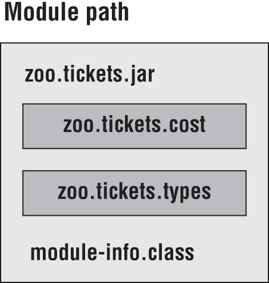

**图 6.1** 命名模块

## 自动模块

`automatic module` 出现在模块路径上，但不包含 `module-info` 文件。它只是一个放置在模块路径上的普通 JAR 文件，并被视为模块。

为了记住这一点，Java 会自动确定模块名称。图 6.2 显示了一个带有两个包的自动模块。

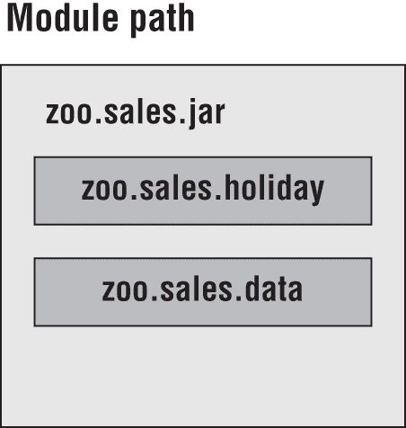

**图 6.2** 自动模块

引用自动模块的代码将其处理为存在一个 `module-info` 文件。它会自动导出所有包。它还会确定模块名称。你问它是如何确定模块名称的？这个问题问得好。

当 Java 9 发布时，Java 库的作者被鼓励声明他们以后打算为模块使用的名称。他们所做的就是在 `MANIFEST.MF` 文件中设置一个名为 `Automatic-Module-Name` 的属性。

在清单（manifest）中指定单个属性，允许库提供者能够为那些希望在模块化应用程序中使用其库的应用程序提供便利。你可以将其理解为一种承诺：当该库变为命名模块时，它将使用指定的模块名称。

如果 JAR 文件没有指定自动模块名称，Java 仍然允许你在模块路径中使用它。在这种情况下， Java 将自动为你确定模块名称。我们会说这是自动发生的，但这个笑话现在可能已经听得厌了。

Java 根据 JAR 文件的文件名来确定自动模块名称。让我们从一个示例开始回顾这些规则。假设我们有一个名为 `holiday-calendar-1.0.0.jar` 的 JAR 文件。

首先，Java 会从名称中删除扩展名 `.jar`。然后，Java 会从 JAR 文件名的末尾删除版本号。这很重要，因为我们希望模块名称保持一致。每次升级到新版本时都有不同的自动模块名称将是不妙的！毕竟，这将迫使你每次拉取更高版本的日历 JAR 时，都要修改你那份整洁、模块化应用程序的 `module-info` 文件。

删除版本号和扩展名后我们得到了 `holiday-calendar`。这给我们带来了一个问题。模块名称中不允许出现连字符（`-`）。Java 通过将名称中的任何特殊字符转换为点（`.`）来解决这个问题。结果是模块名称为 `holiday.calendar`。除了字母和数字以外的任何字符在替换时都被视为特殊字符。最后，任何相邻的点或开头/结尾的点都会被删除。

由于有许多规则，让我们用列表回顾一下确定自动模块名称的算法：

- 如果 `MANIFEST.MF` 指定了 `Automatic-Module-Name`，则使用它。否则，继续执行剩余规则。

- 从 JAR 名称中删除文件扩展名。

- 从名称末尾删除任何版本信息。版本是数字和点，末尾可能带有额外信息，例如 `-1.0.0` 或 `-1.0-RC`。

- 将除字母和数字以外的剩余字符替换为点。

- 将任何连续的点序列替换为单个点。

- 如果点是结果的第一个或最后一个字符，将其删除。

表 6.2 显示了如何将这些规则应用于两个清单未指定自动模块名称的示例。

| # | 描述 | 示例 1 | 示例 2 |

| --- | --- | --- | --- |

| 1 |  JAR 名称 | `commons2-x-1.0.0-SNAPSHOT.jar` | `mod_$-1.0.jar` |

| 2 | 删除文件扩展名 | `commons2-x-1.0.0-SNAPSHOT` | `mod_$-1.0` |

| 3 | 删除末尾版本信息 | `commons2-x` | `mod_$` |

| 4 | 替换特殊字符 | `commons2.x` | `mod` |

| 5 | 替换连续的点 | `commons2.x` | `mod` |

| 6 | 删除开头或结尾的点 | `commons2.x` | `mod` |

*(注：上表内容根据正文逻辑进行了调整)*

## 未命名模块

`unnamed module` 出现在类路径。与自动模块一样，它是一个普通 JAR。与自动模块不同，它位于类路径而不是模块路径。这意味着未命名模块是模块中的二等公民。图 6.3 显示了一个带有一个包的未命名模块。

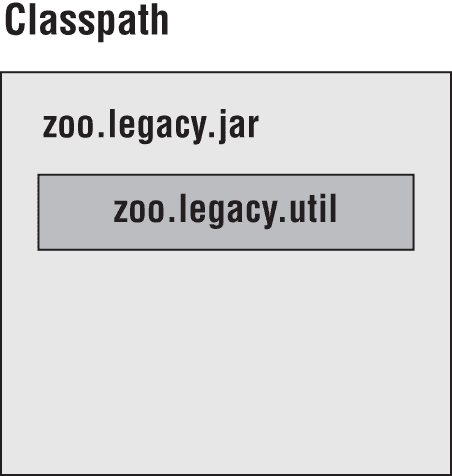

**图 6.3** 未命名模块

未命名模块通常不包含 `module-info` 文件。如果它包含，由于它在类路径上将被忽略。

未命名模块不向命名或自动模块导出任何包。未命名模块可以从类路径或模块路径上的任何 JAR 读取。你可以将未命名模块视为以前 Java 工作的方式。

## 比较模块类型

预计考试会遇到比较这三种模块的问题。请彻底学习 表 6.3，并准备好以任何组合回答这些问题。一个需要记住的关键点是，类路径上的代码可以访问模块路径。相反，模块路径上的代码无法从类路径读取。

| 属性 | 命名 | 自动 | 未命名 |

| --- | --- | --- | --- |

| 模块包含 `module-info` 文件？ | 是 | 否 | 存在则忽略 |

| 模块向其他模块导出哪些包？ | `module-info` 文件中的 | 所有包 | 无包 |

| 模块可被模块路径上的其他模块读取？ | 是 | 是 | 否 |

| 模块可被类路径上的其他 JAR 读取？ | 是 | 是 | 是 |

## 分析 JDK 依赖

在本章的范围内，我们将查看 JDK 提供的模块。我们还将查看用于识别此类模块依赖的 `jdeps` 命令。

### 识别内置模块

在 Java 9 之前，开发者只需将包导入到应用程序中，即可使用 JDK 中的任何包。这意味着在运行时整个 JDK 都必须必须可用，因为程序可能需要任何内容。有了模块（modules）之后，你的应用程序可以指定它使用了 JDK 的哪些部分。这允许应用程序运行在完整的 JDK 或其子集上。

你可能会想，如果尝试运行一个引用了子集中不存在的包的应用程序会发生什么？别担心！`module-info` 文件中的 `requires` 指令指定了在编译和运行时都需要哪些模块。这意味着这些模块保证对应用程序运行是可用的。

最需要的模块是 `java.base`。它包含了你为考试所学习的大部分包。事实上，它重要到你甚至不需要使用 `requires` 指令即可；它对所有模块化应用程序都是可用的。如果你显式地要求 `java.base`，你的 `module-info.java` 文件仍然可以编译。然而，这是多余的，因此最好省略它。表 6.4 列出了一些常见模块及其包含的内容。

| 模块名称 | 包含内容 | 在书中的范围 |

| --- | --- | --- |

| `java.base` | 集合、数学、IO、NIO.2、并发等。 | 本书的大部分内容 |

| `java.desktop` | 抽象 Windows 工具包 (AWT) 和 Swing | 考试中模块名外不考细节 |

| `java.logging` | 日志 | 考试中模块名外不考细节 |

| `java.sql` | JDBC | 第 10 章，“JDBC” |

| `java.xml` | 可扩展标记语言 (XML) | 考试中模块名外不考细节 |

**表 6.4** 常见模块

考试命题者认为识别 JDK 提供的模块名称是重要的。虽然你不需要背下这些名称，但你确实需要能够从列表中挑选出它们。

对于考试来说，你需要知道：对于你可能使用的 API，模块名称以 `java` 开头；对于特定于 JDK 的 API，则以 `jdk` 开头。表 6.5 列出了所有以 `java` 开头的模块。

| `java.base` | `java.naming` | `java.smartcardio` |

| --- | --- | --- |

| `java.compiler` | `java.net` `.http` | `java.sql` |

| `java.datatransfer` | `java.prefs` | `java.sql.rowset` |

| `java.desktop` | `java.rmi` | `java.transaction.xa` |

| `java.instrument` | `java.scripting` | `java.xml` |

| `java.logging` | `java.se` | `java.xml.crypto` |


### 使用 `jdeps`

`jdeps` 命令为你提供有关依赖关系的信息。幸运的是，你不需要为 1Z0-816 考试背诵所有选项。（如果你参加的是 1Z0-817 考试，你*确实*需要记住它们。）附录 A 仔细阅读。

如果你尝试运行一个引用了子集中不存在的包的应用程序会发生什么？别担心！`module-info` 文件中的 `requires` 指令指定了在编译和运行时都需要哪些模块。这意味着这些模块保证对应用程序运行是可用的。

最需要的模块是 `java.base`。它包含了你为考试所学习的大部分包。事实上，它重要到你甚至不需要使用 `requires` 指令即可；它对所有模块化应用程序都是可用的。如果你显式地要求 `java.base`，你的 `module-info.java` 文件仍然可以编译。然而，这是多余的，因此最好省略它。表 6.4 列出了一些常见模块及其包含的内容。

| 模块名称 | 包含内容 | 在书中的范围 |
| --- | --- | --- |
| `java.base` | 集合、数学、IO、NIO.2、并发等。 | 本书的大部分内容 |
| `java.desktop` | 抽象 Windows 工具包 (AWT) 和 Swing | 考试中模块名外不考细节 |
| `java.logging` | 日志 | 考试中模块名外不考细节 |
| `java.sql` | JDBC | 第 10 章，“JDBC” |
| `java.xml` | 可扩展标记语言 (XML) | 考试中模块名外不考细节 |

**表 6.4** 常见模块

考试命题者认为识别 JDK 提供的模块名称是重要的。虽然你不需要背下这些名称，但你确实需要能够从列表中挑选出它们。

对于考试来说，你需要知道：对于你可能使用的 API，模块名称以 `java` 开头；对于特定于 JDK 的 API，则以 `jdk` 开头。表 6.5 列出了所有以 `java` 开头的模块。

| `java.base` | `java.naming` | `java.smartcardio` |
| --- | --- | --- |
| `java.compiler` | `java.net.http` | `java.sql` |
| `java.datatransfer` | `java.prefs` | `java.sql.rowset` |
| `java.desktop` | `java.rmi` | `java.transaction.xa` |
| `java.instrument` | `java.scripting` | `java.xml` |
| `java.logging` | `java.se` | `java.xml.crypto` |
| `java.management` | `java.security.jgss` | |
| `java.management.rmi` | `java.security.sasl` | |

**表 6.5** 以 java 为缀的 Java 模块

表 6.6 列出了所有以 `jdk` 开头的模块。我们建议在考试前复习这些内容，以增加它们听起来熟悉的概率。你不需要背诵它们，但你能够能够从列表中挑选出它们。

| `jdk.accessiblity` | `jdk.jconsole` | `jdk.naming.dns` |
| --- | --- | --- |
| `jdk.attach` | `jdk.jdeps` | `jdk.naming.rmi` |
| `jdk.charsets` | `jdk.jdi` | `jdk.net` |
| `jdk.compiler` | `jdk.jdwp.agent` | `jdk.pack` |
| `jdk.crypto.cryptoki` | `jdk.jfr` | `jdk.rmic` |
| `jdk.crypto.ec` | `jdk.jlink` | `jdk.scripting.nashorn` |
| `jdk.dynalink` | `jdk.jshell` | `jdk.sctp` |
| `jdk.editpad` | `jdk.jsobject` | `jdk.security.auth` |
| `jdk.hotspot.agent` | `jdk.jstatd` | `jdk.security.jgss` |
| `jdk.httpserver` | `jdk.localdata` | `jdk.xml.dom` |
| `jdk.jartool` | `jdk.management` | `jdk.zipfs` |
| `jdk.javadoc` | `jdk.management.agent` | |
| `jdk.jcmd` | `jdk.management.jfr` | |

**表 6.6** 以 jdk 为缀的 Java 模块

### 使用 `jdeps`

`jdeps` 命令为你提供有关依赖关系的信息。幸运的是，你不需要为 1Z0-816 考试背诵所有选项。（如果你参加的是 1Z0-817 考试，你*确实*需要记住它们。）附录 A 仔细阅读。

如果你尝试运行一个引用了子集中不存在的包的应用程序会发生什么？别担心！`module-info` 文件中的 `requires` 指令指定了在编译和运行时都需要哪些模块。这意味着这些模块保证对应用程序运行是可用的。

最需要的模块是 `java.base`。它包含了你为考试所学习的大部分包。事实上，它重要到你甚至不需要使用 `requires` 指令即可；它对所有模块化应用程序都是可用的。如果你显式地要求 `java.base`，你的 `module-info.java` 文件仍然可以编译。然而，这是多余的，因此最好省略它。表 6.4 列出了一些常见模块及其包含的内容。

| 模块名称 | 包含内容 | 在书中的范围 |
| --- | --- | --- |
| `java.base` | 集合、数学、IO、NIO.2、并发等。 | 本书的大部分内容 |
| `java.desktop` | 抽象 Windows 工具包 (AWT) 和 Swing | 考试中模块名外不考细节 |
| `java.logging` | 日志 | 考试中模块名外不考细节 |
| `java.sql` | JDBC | 第 10 章，“JDBC” |
| `java.xml` | 可扩展标记语言 (XML) | 考试中模块名外不考细节 |

**表 6.4** 常见模块

考试命题者认为识别 JDK 提供的模块名称是重要的。虽然你不需要背下这些名称，但你确实需要能够从列表中挑选出它们。

对于考试来说，你需要知道：对于你可能使用的 API，模块名称以 `java` 开头；对于特定于 JDK 的 API，则以 `jdk` 开头。表 6.5 列出了所有以 `java` 开头的模块。

| `java.base` | `java.naming` | `java.smartcardio` |
| --- | --- | --- |
| `java.compiler` | `java.net.http` | `java.sql` |
| `java.datatransfer` | `java.prefs` | `java.sql.rowset` |
| `java.desktop` | `java.rmi` | `java.transaction.xa` |
| `java.instrument` | `java.scripting` | `java.xml` |
| `java.logging` | `java.se` | `java.xml.crypto` |
| `java.management` | `java.security.jgss` | |
| `java.management.rmi` | `java.security.sasl` | |

**表 6.5** 以 java 为缀的 Java 模块

表 6.6 列出了所有以 `jdk` 开头的模块。我们建议在考试前复习这些内容，以增加它们听起来熟悉的概率。你不需要背诵它们，但你能够能够从列表中挑选出它们。

| `jdk.accessiblity` | `jdk.jconsole` | `jdk.naming.dns` |
| --- | --- | --- |
| `jdk.attach` | `jdk.jdeps` | `jdk.naming.rmi` |
| `jdk.charsets` | `jdk.jdi` | `jdk.net` |
| `jdk.compiler` | `jdk.jdwp.agent` | `jdk.pack` |
| `jdk.crypto.cryptoki` | `jdk.jfr` | `jdk.rmic` |
| `jdk.crypto.ec` | `jdk.jlink` | `jdk.scripting.nashorn` |
| `jdk.dynalink` | `jdk.jshell` | `jdk.sctp` |
| `jdk.editpad` | `jdk.jsobject` | `jdk.security.auth` |
| `jdk.hotspot.agent` | `jdk.jstatd` | `jdk.security.jgss` |
| `jdk.httpserver` | `jdk.localdata` | `jdk.xml.dom` |
| `jdk.jartool` | `jdk.management` | `jdk.zipfs` |
| `jdk.javadoc` | `jdk.management.agent` | |
| `jdk.jcmd` | `jdk.management.jfr` | |

**表 6.6** 以 jdk 为缀的 Java 模块

### 使用 `jdeps`

`jdeps` 命令为你提供有关依赖关系的信息。幸运的是，你不需要为 1Z0-816 考试背诵所有选项。（如果你参加的是 1Z0-817 考试，你*确实*需要记住它们。）附录 A 仔细阅读。

```java
// Animatronic.java
package zoo.dinos;

import java.time.*;
import java.util.*;
import sun.misc;

public class Animatronic {
   private List<String> names;
   private LocalDate visitDate;

   public Animatronic(List<String> names, LocalDate visitDate) {
      this.names = names;
      this.visitDate = visitDate;
   }
   public void unsafeMethod() {
      Unsafe unsafe = Unsafe.getUnsafe();
   }
}
```

```java
module zoo.dinos {
   requires java.time;
   requires java.util;
}
```

编译此文件。

```bash
javac zoo/dinos/*.java
```

接下来，我们创建一个 JAR。

```bash
jar -cvf zoo.dino.jar .
```

我们可以对这个 JAR 运行 `jdeps` 以了解它的依赖关系。首先，我们在不带任何选项的情况下运行命令。

```bash
jdeps zoo.dino.jar 

zoo.dino.jar -> java.base
zoo.dino.jar -> jdk.unsupported
   zoo.dinos -> java.base
   zoo.dinos -> java.time
   zoo.dinos -> java.util
   zoo.dinos -> sun.misc
```

如果我们运行摘要模式，我们只看到 `jdeps` 列出模块的部分。这种方法更容易查看 `jdk.unsupported` 是否在列表中。

```bash
jdeps -s zoo.dino.jar 

zoo.dino.jar -> java.base
zoo.dino.jar -> jdk.unsupported
```

对于真实的项目，依赖列表可能包含几十或数百个包。查看模块的摘要是有用的。这种方法更容易看到 `jdk.unsupported` 是否在列表中。

`jdeps` 命令有一个选项可以提供这些不支持的 API 的细节。输出如下：

```bash
jdeps --jdk-internals zoo.dino.jar 

zoo.dino.jar -> jdk.unsupported
   zoo.dinos.Animatronic  -> sun.misc.Unsafe     
      JDK internal API (jdk.unsupported)

Warning: <omitted warning>

JDK Internal API      Suggested Replacement
________________      _____________________

sun.misc.Unsafe       See http://openjdk.java.net/jeps/260
```

`--jdk-internals` 选项列出了你使用的任何调用内部 API 的类以及哪个 API。最后，它提供了一个表格建议你应该做什么。如果你编写了调用内部 API 的代码，这个信息是有用的。如果不是，这个信息对编写该代码的团队是有用的。你，可能需要更新或完全替换该 JAR 文件，用解决该问题的版本。注意 `jdkinternals` 等于 `--jdk-internals`。

所有为 Java 8 及更早版本开发的应用程序都没有设计为使用 Java 平台模块系统（Java Platform Module System），因为当时还不存在。理想情况下，它们至少是按照项目进行设计的，而不是一个巨大的“大泥球”。本节将为您概述将现有应用程序迁移到模块的策略。我们将涵盖模块排序、自下向上迁移、自上而下迁移以及如何拆分现有项目。

## 确定顺序

在将应用程序迁移到模块之前，我们需要先了解现有应用程序中的包和库是如何结构化的。假设我们有一个包含三个 JAR 文件的简单应用程序，如图图 6.4 所示。项目之间的依赖关系形成了一个图。图 6.4 所示中的两种表示方式是等价的。箭头通过从需要依赖的项目指向提供该依赖的项目来显示依赖关系。在模块的语言中，箭头将从 `requires` 指向 `exports`。

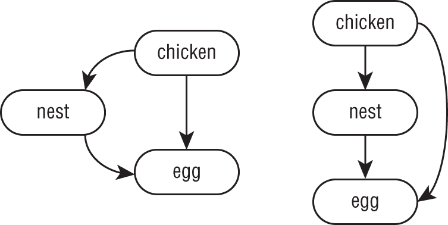

**图 6.4** 确定顺序

图表的右侧更容易识别自上而下和自下向上迁移所指的“顶部”和“底部”。没有任何依赖的项目位于底部。具有依赖的项目位于顶部。

在这个示例中，只有一种从上到下的顺序符合所有依赖关系。图 6.5 显示，这种顺序并不总是唯一的。由于其中两个项目之间没有箭头，因此在决定迁移顺序时，任何顺序都是允许的。

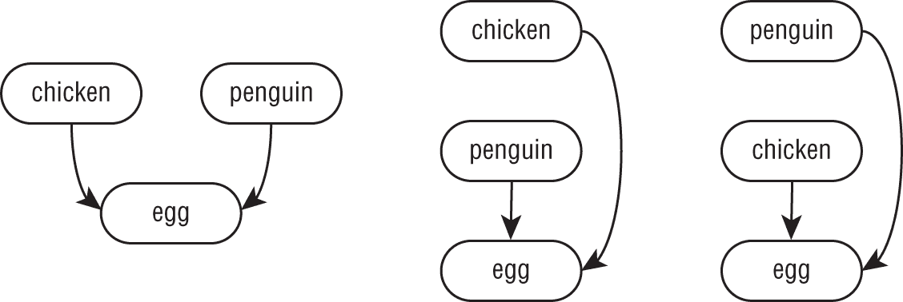

**图 6.5** 不唯一时的顺序确定

## 探索自下向上的迁移策略

最简单的迁移方法是自下向上迁移。当你有权限转换任何尚未模块化的 JAR 文件时，这种方法效果最好。对于自下向上的迁移，你遵循以下步骤：

1. 选择尚未迁移的最低级项目。（还记得我们在上一节中根据依赖关系对它们排序的方式吗？）


## 自下而上迁移

为该项目添加`module-info.java`文件。确保添加任何`exports`以暴露高层级 JAR 文件使用的任何包。此外，为它所依赖的任何模块添加`requires`指令。

将此新迁移的具名模块从类路径（`classpath`）移动到模块路径（`module path`）。

确保任何尚未迁移的项目作为未命名模块（`unnamed modules`）保留在类路径上。

对下一个低级项目重复此操作，直到完成。

你可以在图 6.6 中看到此过程被用于迁移三个项目。注意每个项目都依次转换为模块。

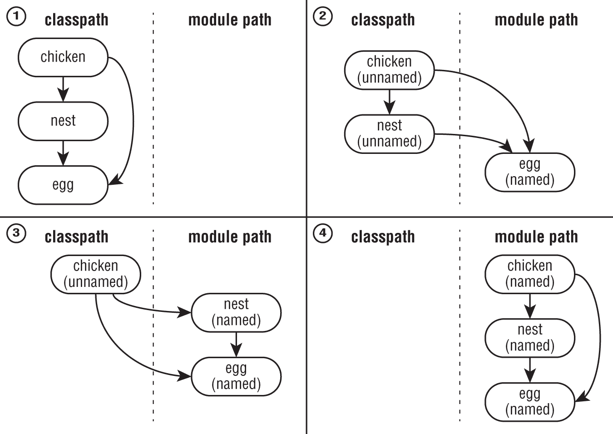

**图 6.6** 自下向上迁移

通过自下向上的迁移，你正在让低级项目处于良好状态。这使得最后迁移顶层项目变得更容易。它还鼓励在暴露内容时更加谨慎。

在迁移期间，你拥有具名模块和未命名模块的混合。具名模块是已迁移的底层项目。它们在模块路径上，并且不允许访问任何未命名模块。

未命名模块在类路径上。它们可以访问类路径和模块路径上的 JAR 文件。

## 探索自上而下的迁移策略

当你无法控制应用程序使用的每个 JAR 文件时，自上而下的迁移策略最有用。例如，假设另一个团队拥有一个项目。他们太忙了，无法迁移。你不希望这种情况阻碍你的整个迁移。

对于自上而下的迁移，你遵循以下步骤：

1. 将所有项目放在模块路径上。
2. 选择尚未迁移的最层级项目。
3. 为该项目添加`module-info`文件，将自动模块（`automatic module`）转换为具名模块。同样，记得添加任何`exports`或`requires`指令。在编写`requires`指令时，可以使用其他模块的自动模块名称，因为模块路径上的大多数项目还没有名称。
4. 对下一个低级项目重复此操作，直到完成。

你可以在图 6.7 中看到此过程按顺序迁移三个项目。注意每个项目都依次转换为模块。

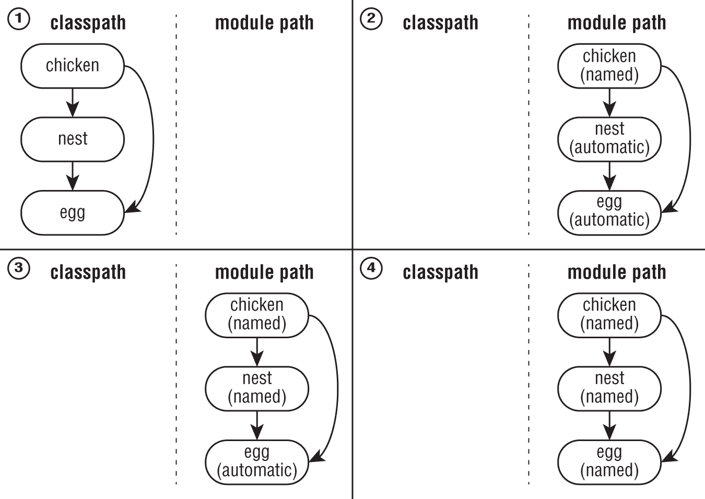

**图 6.7** 自上而下迁移

通过自上而下的迁移，你承认所有底层依赖项尚未准备就绪，但你想让应用程序本身成为模块。在迁移期间，你拥有具名模块和自动模块的混合。具名模块是已迁移的高层项目。它们在模块路径上，并且可以访问自动模块。自动模块也在模块路径上。

表 6.7 回顾了关于两种迁移策略你需要了解的知识。确保你烂于它。

| 类别 | 自下向上 | 自上而下 |
| --- | --- | --- |
| 依赖于所有其他项目 | 类路径上的未命名模块 | 模块路径上的具名模块 |
| 没有依赖关系的项目 | 模块路径上的具名模块 | 模块路径上的自动模块 |

**表 6.7** 迁移策略比较

## 将大项目拆分为模块

对于考试，你需要理解将大项目拆分为模块的基本过程。当然，你不会被给你一个大项目。毕竟，答题空间有限的。幸运的是，小项目的过程也是一样的。

假设你从包含许多包的应用程序开始。第一步是将它们拆分为逻辑分组，并画出它们之间的依赖关系。图 6.8 显示了一个虚拟系统的分解。注意左右两侧都有七个包。由于某些包共享一个模块，模块的数量较少。

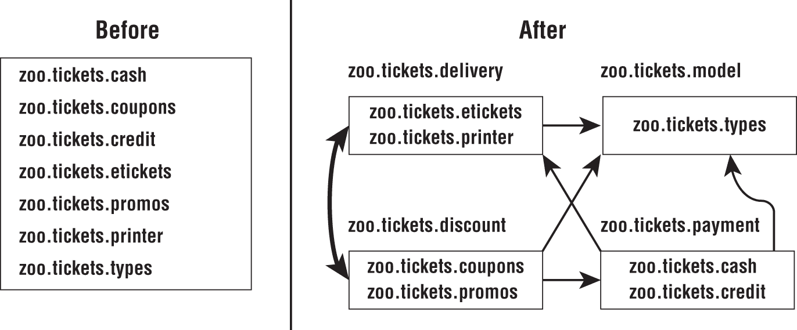

**图 6.8** 首次尝试分解

这种分解存在问题。你看到了吗？Java 平台模块系统不允许*循环依赖*（`cyclic dependencies`）。循环依赖（或环形依赖）是指两个事物直接或间接地地相互依赖。如果`zoo.tickets.delivery`模块需要`zoo.tickets.discount`模块，则`zoo.tickets.discount`模块就不允许需要`zoo.tickets.delivery`模块。

既然我们已经知道图 6.8 中的分解方法行不通，我们能为此做什么呢？一种常用的技术是引入另一个模块。该模块包含另外两个模块共享的代码。图 6.9 展示了没有任何循环依赖的新模块。注意这个新模块`zoo.tickets.discount`。我们创建了一个新包来存放该模块。这允许开发者将公共代码放在其中并打破依赖关系。不再有循环依赖了！

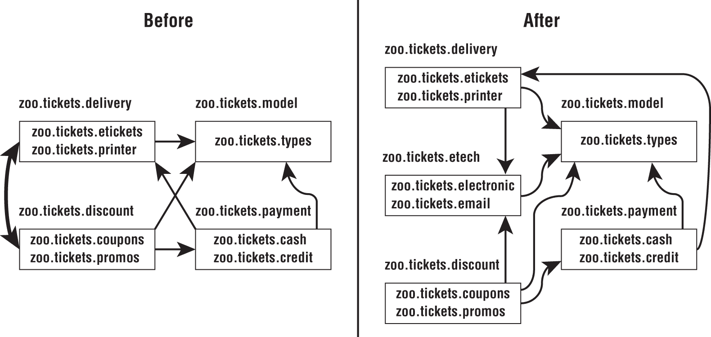

**图 6.9** 移除循环依赖

### 循环依赖导致编译失败

极其重要的一点是，Java 不允许你编译之间存在循环依赖的模块。在本节中，我们将查看一个导致该编译错误的示例。

首先，让我们创建一个名为`zoo.butterfly`的模块，除了`module-info.java`文件外，它只有一个类。如果你需要提醒文件在目录结构中的位置，请参见附录 A 或在线代码示例。

```
// Butterfly.java
package zoo.butterfly;
public class Butterfly {
}

// module-info.java
module zoo.butterfly {
   exports zoo.butterfly;
}
```

我们可以编译蝴蝶模块并在`mods`目录中创建一个名为`zoo.butterfly.jar`的 JAR 文件。记住如果你的文件夹结构中不存在`mods`目录，请先创建一个。

```
javac -d butterflyModule 
   butterflyModule/zoo/butterfly/Butterfly.java
   butterflyModule/module-info.java

jar -cvf mods/zoo.butterfly.jar -C butterflyModule/ .
```

现在我们创建一个新模块`zoo.caterpillar`，它依赖于现有的`zoo.butterfly`模块。这次，我们将创建一个除了`module-info.java`文件外，还包含两个类的模块。

```
// Caterpillar.java
package zoo.caterpillar;
public class Caterpillar {
}

// CaterpillarLifecycle.java
package zoo.caterpillar;
import zoo.butterfly.Butterfly;
public interface CaterpillarLifecycle {
   Butterfly emergeCocoon();
}

// module-info.java
module zoo.caterpillar {
   requires zoo.butterfly;
}
```

再次，我们将编译并创建一个 JAR 文件。这次它命名为`zoo.caterpillar.jar`。

```
javac -p mods -d caterpillarModule 
   caterpillarModule/zoo/caterpillar/*.java 
   caterpillarModule/module-info.java
jar -cvf mods/zoo.caterpillar.jar -C caterpillarModule/ .
```

此时，我们想为蝴蝶添加一个方法来产下毛虫卵。为了演示循环依赖，我们决定将其放在`Butterfly`模块中，而不是`CaterpillarLifecycle`类。

我们知道这需要添加依赖，所以先执行这一步。更新`zoo.butterfly`模块中的`module-info.java`文件如下：

```
module zoo.butterfly {
   exports zoo.butterfly; 
   requires zoo.caterpillar;
}
```

然后我们使用模块路径`mods`对其编译，以便`zoo.caterpillar`可见：

```
javac -p mods -d butterflyModule 
   butterflyModule/zoo/butterfly/Butterfly.java 
   butterflyModule/module-info.java
```

编译器对我们的循环依赖报错了。

```
butterflyModule/module-info.java:3: error: 
   cyclic dependence involving zoo.caterpillar
      requires zoo.caterpillar;
```

这是模块系统的优点之一。它防止你编写具有循环依赖的代码。这种代码甚至无法通过编译！

你可能在想，如果涉及三个模块会发生什么。假设模块`ballA`依赖模块`ballB`，而`ballB`依赖模块`ballC`。模块`ballC`可以依赖模块`ballA`吗？不能。这将创建一个循环依赖。不相信？试着画画看。你可以沿着铅笔绕圆圈从`ballA`画到`ballB`再到`ballC`最后回到`ballA`然后……嗯，你明白我的意思。这里的这里的球实在太多了！

## 创建服务

在本节中，你将学习如何创建一个服务。一个*服务*由一个接口、该接口引用的任何类以及一种查找接口实现的方法组成。实现类不是服务的一部分。

服务对 Java 来说并不新。事实上，`ServiceLoader`类是在 Java 6 中引入的。它用于使应用程序具有*可扩展性*，这样你就可以不重新编译整个应用程序的情况下添加功能。新之处在于与模块的集成。

我们将在服务部分使用一个导览应用程序。它在图 6.10 中展示了四个模块。在这个示例中，`zoo.tours.api`和`zoo.tours.reservations`模型组服务，因为它们包含了接口和查找功能。

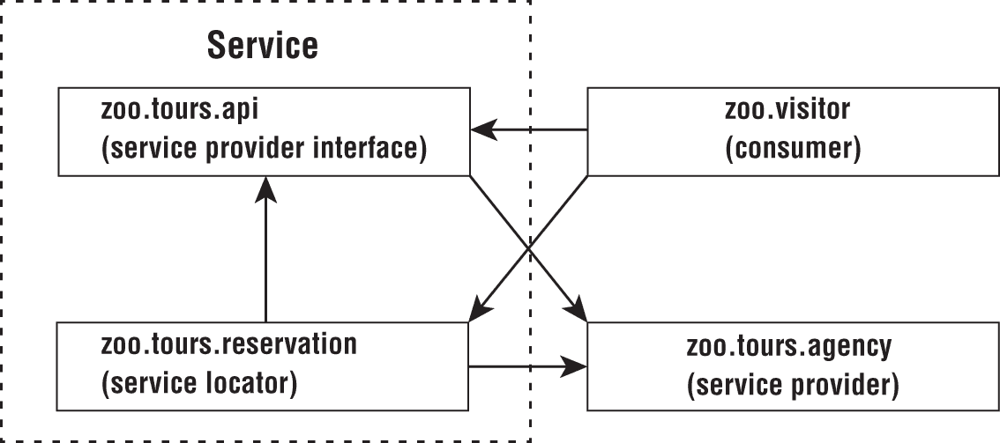

**图 6.10** 导览应用程序中的模块

### 声明服务提供接口

首先，`zoo.tours.api`模块定义了一个名为`Souvenir`的 Java 对象。它是服务的一部分，因为它会被接口引用。

```java
// Souvenir.java
package zoo.tours.api;

public class Souvenir {
   private String description;

   public String getDescription() { 
      return description;
   }
   public void setDescription(String description) { 
      this.description = description;
   }
}
```

接下来，模块包含一个 Java `interface`类型。这个接口是*服务提供接口*，因为它规定了服务将具有的行为。在这种情况下，它是包含三个方法的简单 API。

```java
// Tour.java
package zoo.tours.api;

public interface Tour {
   String name();
   int length();
   Souvenir getSouvenir();
}
```

三个方法都使用了`public`修饰符，如第 1 章“Java 基础”。由于我们正在使用模块，我们还需要创建一个`module-info.java`文件，以便我们的模块导出接口所在的包。

```java
// module-info.java
module zoo.tours.api {
   exports zoo.tours.api;
}
```

现在我们有了这两个文件，可以编译并打包该模块。

```
javac -d serviceProviderModule 
   serviceProviderModule/zoo/tours/api/*.java 
   serviceProviderModule/module-info.java

jar -cvf mods/zoo.tours.api.jar -C serviceProviderModule/ .
```

回顾一下，服务包含了服务提供接口及其引用的支持类。服务还包含查找功能，我们下一步定义。

### 创建服务定位器

为了完成我们的服务，我们需要一个服务定位器。*服务定位器*能够找到实现服务提供接口的任何类。

幸运的是，Java 提供了`ServiceLocator`类来协助完成这项任务。将其传递给方法，Java 将返回它可以找到的任何实现服务。以下类展示了它的用法：

```java
// TourFinder.java
package zoo.tours.reservations;

import java.util.*;
import zoo.tours.api.*;

public class TourFinder {

   public static Tour findSingleTour() {
      ServiceLoader<Tour> loader = ServiceLoader.load(Tour.class);
      for (Tour tour : loader)
         return tour;
      return null;
   }
   public static List<Tour> findAllTours() {
      List<Tour> tours = new ArrayList<>();
      ServiceLoader<Tour> loader = ServiceLoader.load(Tour.class);
      for (Tour tour : loader)
         tours.add(tour);
      return tours;
   }
}
```

如你所见，我们提供了两种查找方法。如果你期望恰好返回一个`Tour`，则第一种是一个便利方法。另一种则返回一个`List`，它可以适应任意数量的服务提供者。在运行时，服务定位器可能会找到许多（或没有）服务提供者。

我们的模块定义导出了带有查找类`TourFinder`的包。它需要服务提供者接口包。它还包含`uses`指令，因为它将查找服务。

```
// module-info.java
module zoo.tours.reservations {
   exports zoo.tours.reservations;
   requires zoo.tours.api;
   uses zoo.tours.api.Tour;
}
```

记住，`requires`和`uses`都是需要的，一个用于编译，一个用于查找。最后，我们编译并打包该模块。

```
javac -p mods -d serviceLocatorModule 
   serviceLocatorModule/zoo/tours/reservations/*.java 
   serviceLocatorModule/module-info.java

jar -cvf mods/zoo.tours.reservations.jar -C serviceLocatorModule/ .
```

现在我们已经有了`interface`和查找逻辑，我们已经完成了我们的服务。

### 从消费者端调用

下一步是让消费者来调用服务定位器。`consumer`（或客户端）指的是一个获取并使用服务的模块。一旦消费者通过服务定位器获取了了服务，它就可以调用由服务提供者接口提供的方法。

```
// Tourist.java
package zoo.visitor;

import java.util.*;
import zoo.tours.api.*;
import zoo.tours.reservations.*;

public class Tourist {
   public static void main(String[] args) {
      Tour tour = TourFinder.findSingleTour();
      System.out.println("Single tour: " + tour);

      List<Tour> tours = TourFinder.findAllTours();
      System.out.println("# tours: " + tours.size());
   }
}
```

我们的模块定义不需要知道关于实现的任何信息，因为`zoo.tours.reservations`模块正在处理查找。

```
// module-info.java
module zoo.visitor {
   requires zoo.tours.api;
   requires zoo.tours.reservations;
}
```

这次，我们在编译和打包后可以运行程序。

```
javac -p mods -d consumerModule 
   consumerModule/zoo/visitor/*.java 
   consumerModule/module-info.java

jar -cvf mods/zoo.visitor.jar -C consumerModule/ .

java -p mods -m zoo.visitor/zoo.visitor.Tourist
```

程序输出以下内容：

```
Single tour: null
# tours: 0
```

嗯，这很合理。我们还没有编写实现该接口的类。

### 添加服务提供者


`service provider` 是服务提供者接口的实现。正如我们之前所说，在运行时可能有多个实现类或模块。为了简单起见，我们在这里只保留一个。

我们的服务提供者是`zoo.tours.agency`包，因为我们已经将行程的运行外包给了第三方。

```java
// TourImpl.java
package zoo.tours.agency;

import zoo.tours.api.*;

public class TourImpl implements Tour {
   public String name() {
      return "Behind the Scenes";
   }
   public int length() {
      return 120;
   }
   public Souvenir getSouvenir() {
      Souvenir gift = new Souvenir();
      gift.setDescription("stuffed animal");
      return gift;
   }
}
```

同样，我们需要一个`module-info.java`文件来创建一个模块。

```java
// module-info.java
module zoo.tours.agency {
   requires zoo.tours.api;
   provides zoo.tours.api.Tour with zoo.tours.agency.TourImpl;
}
```

模块声明要求包含接口的模块作为依赖项。我们不导出实现接口的包，因为我们不希望调用者直接引用它。相反，我们使用`provides`指令。这允许我们指定通过特定的特定的实现类来提供该接口的实现。语法如下：

```java
provides interfaceName with className;
```

最后，我们编译并打包。

```bash
javac -p mods -d serviceProviderModule 
   serviceProviderModule/zoo/tours/agency/*.java 
   serviceProviderModule/module-info.java
jar -cvf mods/zoo.tours.agency.jar -C serviceProviderModule/ .
```

现在到了最酷的部分。我们可以再次运行 Java 程序。

```bash
java -p mods -m zoo.visitor/zoo.visitor.Tourist
```

这次我们看到了以下输出：

```text
Single tour: zoo.tours.agency.TourImpl@1936f0f5
# tours: 1
```

注意看我们没有重新编译`zoo.tours.reservations`或`zoo.visitor`包。服务定位器能够观察到现在有一个服务提供者实现可用，并为我们找到了它。

当你有一个独立于代码库其他部分的功能时，这非常有用。例如，你可能拥有自定义报告或日志。

Java 一个模块中的服务提供者接口只允许一个服务提供者。如果你需要，你需要另一个模块。

## 合并服务定位器与消费者

正如我们提到的，有一个额外的方法调用`get()`来从`Provider`中提取值，因为我们正在使用`Stream`。

现在我们可以创建一个合并服务定位器和消费者的类。

```java
package zoo.tours.hybrid;

import java.util.*;
import java.util.ServiceLoader.Provider;
import zoo.tours.api.*;

public class TourCheck {

   public static void main(String[] args) {
      OptionalInt max = ServiceLoader.load(Tour.class)
         .stream()
         .map(Provider::get)
         .mapToInt(Tour::length)
         .max();
      max.ifPresent(System.out::println);

      OptionalInt min = ServiceLoader.load(Tour.class)
         .stream()
         .map(Provider::get)
         .mapToInt(Tour::length)
         .min();
      min.ifPresent(System.out::println);
   }
}
```

等等，让我们再次查看`ServiceLoader`API。它实际上非常强大。

```java
public final class ServiceLoader<S> implements Iterable<S> {

   public static <S> ServiceLoader<S> load(Class<S> service) { ... }

   public Stream<S> stream() { ... }
}
```

等等，`stream()`方法返回`Stream<S>`，其中`S`是`Provider`。为了获取实际对象，必须使用`map(Provider::get)`。这就是为什么`get()`调用是必要的。

现在，让我们查看新模块的`module-info.java`。

```java
module zoo.tours.hybrid {
   requires zoo.tours.api;
   provides zoo.tours.api.Tour with zoo.tours.hybrid.QuickTourImpl;
   uses zoo.tours.api.Tour;
}
```

最后一次，让我们编译、打包并运行。

```bash
javac -p mods -d multiPurposeModule 
   multiPurposeModule/zoo/tours/hybrid/*.java 
   multiPurposeModule/module-info.java
jar -cvf mods/zoo.tours.hybrid.jar -C multiPurposeModule/ .

java -p mods -m zoo.tours.hybrid/zoo.tours.hybrid.TourLengthCheck
```

它运行正常。输出显示了两个服务提供者，并为最大和最小行程长度了不同的值：

```text
120
30
```

## 复习服务

表 6.8 总结了我们在服务章节中涵盖的内容。我们建议深入掌握当每个构件位于独立模块时需要学习哪些知识。这很可能是你在考试中遇到的内容，并确保你理解了这些概念。

| 构件 | 服务的一部分 | `module-info.java` 中需要的指令 |
| --- | --- | --- |
| 服务提供者接口 | 是 | `exports` |
| 服务提供者 | 否 | `requires` `provides` |
| 服务定位器 | 是 | `exports` `requires` `uses` |
| 消费者 | 否 | `requires` |

表 6.8 复习服务

## 总结

模块有三种类型。命名模块（Named modules）包含`module-info.java`文件并位于模块路径上。它们只能从模块路径读取内容。自动模块（Automatic modules）也位于模块路径上，但尚未被模块化。它们在清单文件中可能设置了自动模块名称。未命名模块（Unnamed modules）位于类路径上。

`java.base`模块是最常见的，它作为依赖项自动提供给所有模块。你必须熟悉 JDK 提供的完整模块列表。`jdeps`命令提供了 JAR 所需的依赖列表。它可以在摘要级别或详细级别执行。此外，它还可以指定有关 JDK 内部模块的信息并建议替代方案。

两种最常见的迁移策略是自上而下迁移和自下向上迁移。自上而下迁移从依赖项最多的模块开始迁移，并将所有其他模块放在模块路径上。自下向上迁移从没有依赖的模块开始迁移，一次移动一个模块到模块路径上。这两种策略都需要确保你没有任何循环依赖，因为 Java 模块系统不允许循环依赖编译。

一个服务由服务提供者接口和服务定位器组成。服务提供者接口是服务的 API。一个或多个模块包含服务提供者。这些模块包含了服务提供者接口的实现类。服务定位器调用`ServiceLoader`来动态获取任何服务提供者。它可以返回结果，以便你遍历它们，或获取一个流。最后，消费者调用服务提供者接口。

## 考试要点

- **识别三种模块类型。** 命名模块是已经模块化的 JAR。未命名模块尚未模块化。自动模块介于两者之间。它们位于模块路径上，但没有`module-info.java`文件。

- **列出内置的 JDK 模块。** `java.base`模块对所有模块可用。JDK 还提供了约 20 个以`java.*`开头的模块，以及约 30 个以`jdk.*`开头的模块。

- **使用`jdeps`列出所需的包和内部包。** `-s`标志通过仅包含模块名称来提供摘要。`--jdk-internals` (`-jdkinternals`) 标志提供有关不支持的 API 的信息并建议替代方案。

- **解释自上而下和自下向上迁移。** 自上而下迁移将所有 JAR 放在模块路径上，在从上到下的迁移过程中将它们变为自动模块。自下向上迁移将所有 JAR 留在类路径上，在从下到上的迁移过程中将它们变为未命名模块。

- **区分服务的四个主要部分。** 服务提供者接口声明服务必须实现的接口。服务定位器查找服务，消费者调用服务。最后，服务提供者实现服务。

- **用于服务的代码指令。** 服务提供者实现必须存有`provides`指令，以指定它提供了什么服务提供者接口以及它用什么类`with`实现它。包含服务定位器的模块必须有`uses`指令，以指定它将查找哪个服务提供者实现。

## 复习题

章节复习题的答案可以在附录 B](#b02.xhtml) 中找到。

1. 下面组合组成了一个服务？

   1. 消费者和服务定位器

   2. 消费者和服务提供者接口

   3. 服务定位器和服务提供者

   4. 服务定位器和服务提供者接口

   5. 服务提供者和服务提供者接口

2. ____________________ 模块位于类路径上，而 ____________________ 模块位于模块路径上。（选择所有正确项）

   1. 自动、命名的

   2. 自动、未命名的

   3. 命名的、自动

   4. 命名的、未命名的

   5. 未命名、自动

   6. 未命名、命名的

   7. 以上都不是

3. 如果未提供，则生成自动模块名称。以下哪些 JAR 文件名和生成的自动模块名称配对是正确的？（选择所有正确项）

   1. `emily-1.0.0.jar` 和 `emily`

   2. `emily-1.0.0.jar` 和 `emily`

   3. `emily_the_cat-1.0.0.jar` 和 `emily_the_cat`

   4. `emily_the_cat-1.0.0.jar` 和 `emily_the_cat`

   5. `emily.$.jar` 和 `emily`

   6. `emily.$.jar` 和 `emily`

   7. `emily.$.jar` 和 `emily`

4. 下述哪些正确？（选择所有正确项）

   1. 具有循环依赖的模块无法编译。

   2. 具有循环依赖的包无法编译。

   3. 循环依赖涉及两个模块。

   4. 循环依赖涉及三个或更多模块。

   5. 循环依赖涉及`requires`语句。

   6. 未命名模块可以参与循环依赖

5. 哪个模块不需要`requires`即可供命名模块使用？

   1. `all`

   2. `java.base`

   3. `default`

   4. `java.lang`

   5. 以上都不是

6. 假设你正在创建一个包含以下类的服务提供者。哪行代码需要放在`module-info.java`中？

```java
package dragon;
import magic.*;
public class Dragon implements Magic {
   public String getPower() {
      return "breathe fire";
   }
}
```

   1. `provides dragon.Dragon by magic.Magic;`

   2. `provides dragon.Dragon using magic.Magic;`

   3. `provides dragon.Dragon with magic.Magic;`

   4. `provides magic.Magic by dragon.Dragon;`

   5. `provides magic.Magic using dragon.Dragon;`

   6. `provides magic.Magic with dragon.Dragon;`

7. 下面模块由 JDK 提供？（选择所有正确项）

   1. `java.base;`

   2. `java.desktop;`

   3. `java.logging;`

   4. `java.util;`

   5. `jdk.base;`

   6. `jdk.compiler;`

   7. `jdk.xerces;`

8. 下面哪些代码可以编译并等同于此循环？

```java
List<Unicorn> all = new ArrayList<>();
for (Unicorn current : ServiceLoader.load(Unicorn.class)) {
   all.add(current);
}
```

   1.

```java
    List<Unicorn> all = ServiceLoader.load(Unicorn.class)
       .getStream()
       .collect(Collectors.toList());
```

   2.

```java
    List<Unicorn> all = ServiceLoader.load(Unicorn.class)
       .stream()
       .collect(Collectors.toList());
```

   3.

```java
    List<Unicorn> all = ServiceLoader.load(Unicorn.class)
       .getStream()
       .map(Provider::get)
       .collect(Collectors.toList());
```

4.

```java
List<Unicorn> all = ServiceLoader.load(Unicorn.class)
   .stream()
   .map(Provider::get)
   .collect(Collectors.toList());
```

5. 以上均不是

9. 你可以运行哪个命令来确定 JAR 文件中是否存在依赖于不支持的内部 API 的代码，并获取替代方案？

1. `jdeps -internal-jdk`

2. `jdeps --internaljdk`

3. `jdeps --internal-jdk`

4. `jdeps -s`

5. `jdeps -unsupported`

6. `jdeps –unsupportedapi`

7. `jdeps –unsupported-api`

8. 以上均不是

10. 对于自上而下的迁移，除了命名模块以外的所有模块都是 _____________ 模块，并位于 ______________ 上。

1. 自动模块，classpath

2. 自动模块，模块路径

3. 未命名模块，classpath

4. 未命名模块，模块路径

5. 以上均不是

11. 假设你为服务提供者接口、服务提供者、服务定位器和消费者分别创建了模块。如果你添加了第二个服务提供者模块，你需要重新编译这些模块中的几个？

1. 零

2. 一个

3. 两个

4. 三个

5. 四个

12. 下哪些模块包含`java.util`包？（选择所有适用项）

1. `java.all;`

2. `java.base;`

3. `java.main;`

4. `java.util;`

5. 以上均不是

13. 假设你为服务提供者接口、服务提供者、服务定位器和消费者分别创建了模块。关于你需要指定的指令，哪些描述是正确的？（选择所有适用项）

1. 服务提供者接口必须使用`exports`指令。

2. 服务提供者接口必须使用`provides`指令。

3. 服务提供者接口必须使用`requires`指令。

4. 服务提供者必须使用`exports`指令。

5. 服务提供者必须使用`provides`指令。

6. 服务提供者必须使用`requires`指令。

14. 假设你有一个项目，其中包含名为`magic.wand`的包；另一个项目包含一个名为`magic.potion`的包。这些项目之间存在循环依赖，因此你决定创建一个名为`magic.helper`的第三方项目。`magic.helper`模块包含一个名为`magic.util`包的公共代码。为了简单起见，让我们将每个模块命名为与其包相同。以下哪些需要出现在你的`module-info`文件中？（选择所有适用项）


1. `potion` 项目中的 `exports magic.potion;`

2. `magic helper` 项目中的 `exports magic.util;`

3. `wand` 项目中的 `exports magic.wand;`

4. `magic helper` 项目中的 `requires magic.util;`

5. `potion` 项目中的 `requires magic.util;`

6. `wand` 项目中的 `requires magic.util;`

15. 假设你为服务提供者接口、服务提供者、服务定位器和消费者分别创建了模块。哪些模块需要对服务提供者指明一个 `requires` 指令？

1. 服务定位器
2. 服务提供者接口
3. 消费者
4. 消费者和服务定位器
5. 消费者和服务提供者
6. 服务定位器和服务提供者接口
7. 消费者、服务定位器和服务提供者接口
8. 以上均不是

16. 关于 classpath 上包含 `module-info` 文件的 JAR 包中的包，哪些描述是正确的？（选择所有适用项）

1. 它可能对 classpath 上的所有其他模块可用。
2. 它可能对模块路径上的所有其他模块可用。
3. 它可能对 classpath 上的恰好另一个特定模块可用。
4. 它可能对模块路径上的恰好另一个特定模块有用。
5. 它可以确保它对 classpath 上的任何其他模块都不可用。

17. 哪些描述是正确的？（选择所有适用项）

1. 自动模块向命名模块导出所有包。
2. 自动模块只向命名模块导出指定的包。
3. 自动模块不向命名模块导出任何包。
4. 未命名模块只向命名模块导出命名的包。
5. 未命名模块向命名模块导出所有包。
6. 未命名模块不向命名模块导出任何包。

18. 假设你为服务提供者接口、服务提供者、服务定位器和消费者分别创建了模块。关于你需要指定的指令，哪些描述是正确的？（选择所有适用项）

1. 消费者必须使用 `requires` 指令。
2. 消费者必须使用 `uses` 指令。
3. 服务定位器必须使用 `requires` 指令。
4. 服务定位器必须使用 `uses` 指令。

19. 关于 `jdeps` 命令，哪个描述是正确的？（选择所有适用项）

1. 它只能提供类级别的信息。
2. 它只能提供包级别的信息。
3. 它可以提供类或包级别的信息。
4. 它只能针对命名模块运行。
5. 它可以针对普通的 JAR。

20. 假设我们有一个 JAR 文件 `cat-1.2.3-RC1.jar`，且 `Automatic-Module-Name` 设置为 `dog`。未命名模块应该在 `MANIFEST.MF` 中包含什么？

1. `requires cat;`
2. `requires RC;`
3. `requires cat-RC;`
4. `requires dog;`
5. 以上均不是

## 第 7 章

## 并发

正如你将在第 8 章“I/O”、第 9 章“NIO.2”以及第 10 章“JDBC”中所学到的，计算机能够读写外部资源。遗憾的是，与 CPU 操作相比，这些磁盘/网络操作通常非常缓慢——事实上，如果你的计算机操作系统停止并等待每个磁盘或网络操作完成，你的计算机将会频繁死机或锁定。

幸运的是，所有现代操作系统都支持所谓的*多线程处理*。多线程处理的想法是允许应用程序或一组应用程序同时执行多个任务。

自早期以来，Java 就通过 `Thread` 类支持多线程编程。最近，引入了并发 API。它包含了许多用于复杂线程任务的类。其设计理念很简单：复杂的线程交互对于最熟练的开发者来说也是困难的，因此创建了一套可重用的特性。并发 API 多年来一直在增长，包含了许多类来帮助开发复杂的多线程应用程序。在本章中，我们将向你介绍线程的概念，并提供多种使用并发 API 管理线程的方法。

## 线程

本章首先回顾与线程相关的常用术语。线程是操作系统调度的最小执行单元。进程是一是一组在相同、共享环境中执行的关联线程。因此，单线程进程是包含恰好一个线程的进程，而多线程进程是包含一个或多个线程的进程。

我们所说的*共享环境*，是指同一进程中的线程共享相同的内存空间，并彼此直接通信。请参考图 7.1 了解线程及其在进程内共享环境的概述。

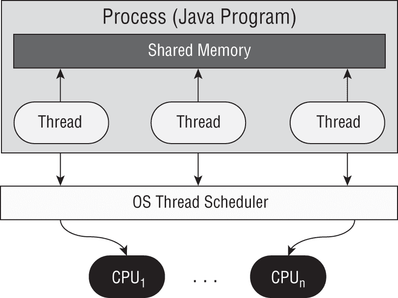

**图 7.1** 进程模型

图 7.1 显示了一个包含三个线程的单进程。它还展示了它们是如何映射到系统内任意数量的 *n* 个可用 CPU。当我们在本节稍后的部分讨论任务调度器时，请记住这张图。

在本章中，我们将大量讨论任务及其与线程之间的关系。*任务*是线程执行的单个工作单元。在整个章节中，任务通常被实现为 lambda 表达式。一个线程可以完成多个独立任务，但同一时间只能执行一个任务。

在图 7.1 中，共享内存指的是 `static` 变量，以及传递给线程的实例变量局部变量。是的，你最终会看到 `static` 变量对于执行复杂的多线程任务是有用的！记得 1Z0-815 考试的学习，`static` 方法和变量定义在单个类对象上，所有实例共享该对象。例如，如果一个线程更新了 `static` 对象的值，那么该信息将立即供进程内的其他线程读取。

### 区分线程类型

可能会让你惊讶的是，所有的 Java 应用（包括我们在书中介绍的所有应用）都是多线程的。即使是一个简单的在屏幕上打印 `Hello World` 的 Java 应用程序也是多线程的。为了帮助你理解这一点，我们引入了系统线程和用户定义线程的概念。

*系统线程*由 JVM 创建并在应用程序后台运行。例如，垃圾回收是由 JVM 创建并在后台运行的系统线程管理的，它帮助释放不再使用的内存。在大多数情况下，系统定义线程的执行对应用程序开发者来说是不可见的。当系统定义线程遇到问题且无法恢复时（例如内存溢出），它会产生 Java `Error`，而不是 `Exception`。

另一种，*用户定义线程*是由应用程序开发者创建以完成特定任务的线程。除了第 4 章简要介绍的并行流“函数编程”外，我们到目前创建的所有应用都是多线程的，但它们只包含一个调用 `main()` 方法的用户定义线程。为了简单起见，我们通常将只包含单个用户定义线程的线程称为单线程应用程序，因为我们通常对系统线程不感兴趣。

### 理解线程并发

在章节开始时，我们提到多线程处理允许操作系统同时执行线程。同时执行多个线程和进程的属性被称为*并发*（concurrency）。当然，在单核 CPU 系统上，在给定时间实际上只有一个任务在执行。即使在多核或多 CPU 系统中，可用的线程通常远多于可用的 CPU 处理器。当有多个线程可用时，系统如何决定执行什么呢？

操作系统使用*线程调度器*来决定哪些线程应该当前执行，如图 7.1 所示。例如，线程调度器可能会采用*轮询调度*，其中每个可用的线程获得相等数量的 CPU 周期来执行，并按循环顺序访问线程。如果有 10 个可用线程，它们可能每个获得 100 毫秒的执行时间，在最后一个线程执行后，进程返回到第一个线程。

当一个线程分配的时间结束但该线程尚未完成处理时，就会发生上下文切换。*上下文切换*（context switch）是存储线程的当前状态并在稍后恢复线程状态以继续执行的过程。请注意，上下文切换通常伴随着代价，表现为丢失的时间节省和重新加载线程的状态。智能的线程调度尽力减少上下文切换的次数，同时保持应用程序顺利运行。

最后，如果一个线程的线程优先级高于另一个线程，它可以中断或取代另一个线程。*线程优先级*（thread priority）是与线程关联的数值，线程调度器在确定哪些线程应该当前执行时会考虑该值值。在 Java 中，线程优先级指定为整数值。

### 使用 *Runnable* 定义任务

正如我们在第 4 章中提到的，`java.lang.Runnable` 是一个不接受参数且不返回数据的函数接口。以下是 `Runnable` 接口的定义：

```
@FunctionalInterface public interface Runnable {
   void run();
}
```

`Runnable` 接口通常用于定义线程将执行的任务或工作，与主应用程序线程分离。在整个章节中，我们将依赖 `Runnable` 接口，特别是在我们讨论将并行操作应用于流时。

以下 lambda 表达式每个都实现了 `Runnable` 接口：

```
Runnable sloth = () -> System.out.println("Hello World");
Runnable snake = () -> {int=10;};
Runnable beaver = () -> {return;};
Runnable coyote = () {};
```

注意这些 lambda 表达式都以一对空括号 `()` 开头。此外，这些 lambda 表达式都没有返回值。以下 lambda 对于其他函数接口是有效的，但与 `Runnable` 不兼容，因为它们有返回值。

```
Runnable capybara = () -> "";                 // 编译错误
Runnable Hippamus = () -> 5;              // 编译错误
Runnable emu = () -> {return new Object();};  // 编译错误
```

### 创建线程

执行线程简单的方法是使用 `java.lang.Thread` 类。使用 `Thread` 执行任务是一个两步过程。首先，定义要执行的 `Thread`。然后，使用 `start()` 方法启动任务。

正如我们在章节稍后部分讨论的，Java 不保证线程一旦启动后的处理顺序。它可能立即执行，也可能延迟一段时间。

定义 `Thread` 实例将执行的任务可以通过 Java 的两种方式完成：

*   向 `Thread` 构造函数传递 `Runnable` 对象或 lambda 表达式。
*   创建一个扩展 `Thread` 的类并重写 `run()` 方法。

以下是这些示例：

```
public class PrintData implements Runnable {
   @Override public void run() { // 重写 Runnable 方法
      for(int i = 0; i < 3; i++)
         System.out.println("Printing record: "+i);
   }
   public static void main(String[] args) {
      (new Thread(new PrintData())).start();
   }
}

public class ReadInventoryThread extends Thread {
   @Override public void run() { // 重写 Thread 方法
      System.out.println("Printing zoo inventory");
   }
   public static void main(String[] args) {
      (new ReadInventoryThread()).start();
   }
}
```

第一个示例使用 `Runnable` 实例创建了 `Thread`，而第二个示例则使用了不常用的做法，即扩展 `Thread` 类并重写 `run()` 方法。每当你创建一个 `Thread` 实例时，请务必记得使用 `Thread.start()` 方法来启动任务。这会在独立的操作系统线程中启动任务。

让我们试一下。使用这两个类时，以下代码段的输出是什么？

```
2: public static void main(String[] args) {
3:    System.out.println("begin");
4:    (new ReadInventoryThread()).start();
5:    (new Thread(new PrintData())).start();
6:    (new ReadInventoryThread()).start();
7:    System.out.println("end");
8: }
```

答案是在运行时之前结果是未知的。以下只是可能的输出之一：

```
begin
Printing zoo inventory
Printing record: 0
end
Printing zoo inventory
Printing record: 1
Printing record: 2
```

这个示例总共使用了四个线程——`main()` 用户线程以及在第 4-6 行创建的三个额外线程。在这些行上创建的每个线程都是作为异步任务执行的。我们所说的*异步*是指执行 `main()` 方法的线程在继续执行之前不需要等待每个新创建线程的结果。例如，第 5 行和第 6 行可能会在第 4 行创建的线程完成之前就执行。这种行为的反面是*同步*任务，即程序会在第 4 行等待（或阻塞）线程执行完毕后才移动到下一行。到目前为止，书中使用的绝大多数方法调用都是同步的。

虽然线程一旦启动，它们的执行顺序是不确定的，但单个线程内部的顺序仍然是线性的。特别是 `PrintData` 中的 `for()` 循环仍然是有序的。此外，在 `main()` 方法中，`begin` 出现在 `end` 之前。

通常情况下，你应该在特定情况下才扩展 `Thread` 类，例如当你正在创建自己的基于优先级的线程时。在大多数情况下，你应该实现 `Runnable` 接口而不是扩展 `Thread` 类。

我们在此处结束对 `Thread` 类的讨论。虽然之前的版本的考试非常关注理解扩展 `Thread` 和实现 `Runnable` 之间的区别，但现在的考试强烈鼓励开发者使用并发 API（Concurrency API）。

对于考试，你不需要了解其他与线程相关的方法，例如 `Object.wait()`、`Object.notify()`、`Thread.join()` 等。事实上，通常你应该避免使用它们，并尽可能地使用并发 API。正确使用这些方法需要大量的技巧（以及一些运气！）。

### 使用 Sleep 进行轮询

尽管多线程编程允许你同时执行多个任务，但一个线程通常需要等待另一个线程的结果才能继续。一种解决方案是使用轮询。*轮询*是在固定间隔内间歇性检查数据的过程。例如，假设你有一个线程在修改共享的 `static counter` 值，而你的 `main()` 线程等待该线程将值增加到大于 `100`，如下所示：

```
public class CheckResults {
   private static int counter = 0;
   public static void main(String[] args) {
      new Thread(() -> {
         for(int i = 0; i < 500; i++) CheckResults.counter++;
      }).start();
      while(CheckResults.counter < 100) {
         System.out.println("Not reached yet");
      }
      System.out.println("Reached!");
   }
}
```

这个程序打印多少次 `Not reached yet`？答案是，我们不知道！它可能输出零次、十次或百万次。如果我们的线程调度器特别糟糕，它可能会无限运行！在没有某种延迟的情况下使用 `while()` 循环检查数据被认为是一种糟糕的编码习惯，因为它无故占用了 CPU 资源。

我们可以通过使用 `Thread.sleep()` 方法来实现轮询来改进这一结果。`Thread.sleep()` 方法请求当前执行线程休息指定的毫秒数。在 `main()` 方法体内使用时，与 `main()` 方法关联的线程将，而独立的线程将继续运行。将之前的实现与以下使用 `Thread.sleep()` 的实现进行比较：

```
public class CheckResults {
   private static int counter = 0;
   public static void main(String[] a) throws InterruptedException {
      new Thread(() -> {
         for(int i = 0; i < 500; i++) CheckResults.counter++;
      }).start();
      while(CheckResults.counter < 100) {
         System.out.println("Not reached yet");
         Thread.sleep(1000); // 1 秒
      }
      System.out.println("Reached!");
   }
}
```

在这个示例中，我们在循环结束处延迟了 1000 毫秒，即 1 秒。虽然这看起来很短，但我们现在防止了可能的无限循环执行并锁定我们的程序。注意，我们还更改了 `main()` 方法的签名，因为 `Thread.sleep()` 会抛出受检异常 `InterruptedException`。或者，我们可以将每个 `Thread.sleep()` 方法调用封装在 `try/catch` 块中。

在这个示例中 `while()` 循环执行了多少次？仍然未知！虽然轮询防止了 CPU 被无限循环淹没，但它不能保证循环何时终止。例如，独立线程可能会由于高优先级进程而丢失 CPU 时间，导致在完成之前多次执行 `while()` 循环。

另一个需要担心的问题是共享的 `counter`。如果一个线程在读取 `counter` 时，另一个线程正在写入它会怎样？读取变量的线程可能会得到一个无效或错误的值。我们将在后续关于编写线程安全代码的章节中详细讨论这些问题。


正如你可能注意到的，这只是我们之前的`PrintData`和`ReadInventoryThread`类的重写，使用了 lambda 表达式和`ExecutorService`实例。

在这个示例中，我们使用`Executors.newSingleThreadExecutor()`方法来创建服务。与我们之前的示例不同（之前的示例为新创建的任务创建了三个额外的线程），此示例只使用一个线程，这意味着线程将按照顺序处理结果。例如，以下是该代码段可能的输出：

```
begin
Printing zoo inventory
Printing record: 0
Printing record: 1
end
Printing record: 2
Printing zoo inventory
```

使用单线程执行器，可以保证结果是顺序执行的。请注意，当我们的线程执行器任务仍在运行时，输出了`end`文本。这是因为`main()`方法仍然是一个独立于`ExecutorService`的线程。

## 关闭线程执行器

一旦你完成了对线程执行器的使用，调用`shutdown()`方法是非常重要的。线程执行器在执行第一个任务时会创建一个非守护线程，因此，未调用`shutdown()`将导致你的应用程序永远不会终止。

线程执行器的关闭过程涉及：首先拒绝任何提交到线程执行器的新任务，同时继续执行任何之前提交的任务。在此期间，调用`isShutdown()`将返回`true`，而`isTerminated()`将返回`false`。如果在线程执行器正在关闭期间提交了新任务，将抛出`RejectedExecutionException`。一旦所有活动任务完成，`isShutdown()`和`isTerminated()`都将返回`true`。图 7.2 显示了`ExecutorService`对象的生命周期。

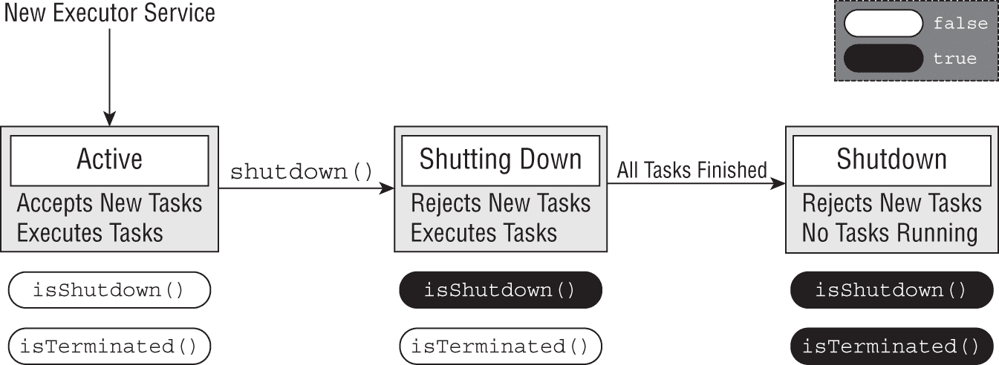

图 7.2 `ExecutorService`生命周期

对于考试，你应该意识到`shutdown()`实际上并不会停止任何已经提交到线程执行器的任务。

如果你想取消所有正在运行和即将执行的任务怎么办？`ExecutorService`提供了一个名为`shutdownNow()`的方法，它尝试停止所有运行任务并丢弃任何尚未启动的任务。可能会创建一个永远不会终止的线程，因此任何中断它的尝试都被忽略。最后，`shutdownNow()`返回一个`List<Runnable>`，包含已提交到线程执行器但从未启动过的任务。

## 提交任务

你可以通过多种方式向`ExecutorService`实例提交任务。我们介绍的第一种方法`execute()`继承自`Executor`接口，而`ExecutorService`接口扩展了该接口。`execute()`方法接收一个`Runnable`lambda 表达式或实例，并异步完成任务。由于该方法的返回类型为`void`，它不会告诉我们关于任务结果的任何信息。它被认为是一种“触发后遗忘”的方法，因为一旦提交，调用线程就无法直接获取结果。

幸运的是，Java 的作者在`ExecutorService`接口中添加了`submit()`方法，它与`execute()`一样可以用于异步完成任务。但与`execute()`不同，`submit()`返回一个`Future`实例，可以用它判断任务是否完成。它还可以在任务完成后返回一个泛型结果对象。

表 7.1 显示了五个方法，包括`execute()`和两个`submit()`方法，这些是你考试中需要掌握的。如果你以前没见过`Future`或`Callable`，不要担心；我们稍后会详细讨论它们。

在实践中，使用`submit()`方法与使用`execute()`方法非常相似，区别在于`submit()`方法返回一个`Future`实例，可以用它判断任务是否已执行。

| 方法名称 | 描述 |
| --- | --- |
| `void execute(Runnable command)` | 在未来的某个时刻执行`Runnable`任务 |
| `Future<?> submit(Runnable task)` | 在未来的某个时刻执行`Runnable`任务并返回一个表示该任务的`Future` |
| `<T> Future<T> submit(Callable<T> task)` | 在未来的某个时刻执行`Callable`任务并返回一个表示任务待处理结果的`Future` |
| `<T> List<Future<T>> invokeAll(Collection<? extends Callable<T>> tasks) throws InterruptedException` | 执行给定的任务并等待所有任务完成。返回一个`Future`实例列表，顺序与原始集合中的顺序一致 |
| `<T> T invokeAny(Collection<? extends Callable<T>> tasks) throws InterruptedException, ExecutionException` | 执行给定的任务并等待至少一个完成。返回一个已完成任务的`Future`实例，并取消任何未完成的任务 |

表 7.1 `ExecutorService`方法

## 等待结果

我们如何知道提交到`ExecutorService`的任务何时完成？正如上一节提到的，`submit()`方法返回一个`java.util.concurrent.Future<V>`实例，可以用它来确定这个结果。

```
Future<?> future = service.submit(() -> System.out.println("Hello"));
```

`Future`类型实际上是一个接口。对于考试，你不需要了解实现`Future`的类，只需要知道各种 API 方法返回`Future`实例即可。表 7.2 包含了确定任务状态的方法。

| 方法名称 | 描述 |
| --- | --- |
| `boolean isDone()` | 如果任务完成、抛出异常或被取消，则返回`true` |
| `boolean isCancelled()` | 如果任务在完成前被取消，则返回`true` |
| `boolean cancel(boolean interruptIfRunning)` | 尝试取消任务执行，如果取消成功返回`true`，如果无法取消或已完成返回`false` |
| `V get()` | 获取任务结果，如果尚未完成则无限等待 |
| `V get(long timeout, TimeUnit unit)` | 获取任务结果，等待指定的时间。如果超时结果未就绪，将抛出检查异常`TimeoutException` |

表 7.2 `Future`方法

以下是我们之前的轮询示例`CheckResults`类的更新版本，它使用`Future`实例来等待结果：

```
import java.util.concurrent.*;
public class CheckResults {
   private static int counter = 0;
   public static void main(String[] unused) throws Exception {
      ExecutorService service = null;
      try {
         service = Executors.newSingleThreadExecutor();
         Future<?> result = service.submit(() -> {
            for(int i = 0; i < 500; i++) CheckResults.counter++;
         });
         result.get(10, TimeUnit.SECONDS);
         System.out.println("Reached!");
      } catch (TimeoutException e) {
         System.out.println("Not reached in time");
      } finally {
         if(service != null) service.shutdown();
      } }
```

这个示例与我们之前的轮询实现相似，但它没有直接使用`Thread`类。在某种，这就是并发 API 的精髓：在不需要直接管理线程的情况下进行操作。它还最多等待 10 秒，如果任务未完成，会在调用`result.get()`时抛出`TimeoutException`。

此任务的返回值是什么？由于`Future<V>`是一个泛型接口，类型`V`由`Runnable`方法的返回类型决定。由于`Runnable.run()`的返回类型为`void`，因此在处理`Runnable`表达式时，`get()`方法始终返回`null`。

`Future.get()`方法可以接受一个可选的值和枚举类型`java.util.concurrent.TimeUnit`。我们在表 7.3 中按持续时间增加的顺序列出了`TimeUnit`值的完整列表。并发 API 中的许多方法都使用了`TimeUnit`枚举。

| 枚举名称 | 描述 |
| --- | --- |
| `TimeUnit.NANOSECONDS` | 十亿分之一秒 (1/1,000,000,000) |
| `TimeUnit.MICROSECONDS` | 百万分之一秒 (1/1,000,000) |
| `TimeUnit.MILLISECONDS` | 千分之一秒 (1/1,000) |
| `TimeUnit.SECONDS` | 秒 |
| `TimeUnit.MINUTES` | 分 |
| `TimeUnit.HOURS` | 小 |
| `TimeUnit.DAYS` | 天 |

表 7.3 `TimeUnit`值

## 介绍 Callable

`java.util.concurrent.Callable`函数式接口与`Runnable`类似，不同在于它的`call()`方法返回一个值并可以抛出检查异常。以下是`Callable`接口的定义：

```java
@FunctionalInterface public interface Callable<V> {
   V call() throws Exception;
}
```

`Callable`接口通常比`Runnable`更优，因为它允许在任务完成后更容易地获取更多详细信息。尽管如此，我们在整个章中使用了这两个接口，因为在 lambda 不抛出异常且没有返回类型的情况下，它们是可以互换的。幸运的是，`ExecutorService`包含了重载的`submit()`方法，该方法接受一个`Callable`对象并返回一个泛型`Future<T>`实例。

与`Runnable`不同（`Runnable`的`get()`方法始终返回`null`），`Future`实例上的`get()`方法返回匹配的泛型类型（也可以是`null`值）。

让我们来看一个使用`Callable`的示例。

```java
import java.util.concurrent.*;
public class AddData {
   public static void main(String[] args) throws Exception {
      ExecutorService service = null;
      try {
         service = Executors.newSingleThreadExecutor();
         Future<Integer> result = service.submit(() -> 30 + 11);
         System.out.println(result.get());   // 41
      } finally {
         if(service != null) service.shutdown();
      }
   }
}
```

结果也可以使用`Runnable`和一些共享的（可能是`static`）对象来获取，尽管这种依赖`Callable`的解决方案要简单得多且更容易理解。

### 等待所有任务完成

在向线程执行器提交一组任务后，等待结果是常见的操作。正如你在前面的节中看到的，一种解决方案是对对`submit()`方法返回的每个`Future`对象调用`get()`。如果我们不需要任务的结果并且已经完成了对线程执行器的使用，那么有一种更简单的方法。

首先，使用`shutdown()`方法关闭线程执行器。接下来，我们使用所有线程执行器可用的`awaitTermination()`方法。该方法等待指定的时间以完成所有任务，如果所有任务完成或检测到`InterruptedException`，则会提前返回。你可以在下面的代码段中看到示例：

```java
ExecutorService service = null;
try {
   service = Executors.newSingleThreadExecutor();
   // 向线程执行器添加任务
   …
} finally {
   if(service != null) service.shutdown();
}
if(service != null) {
   service.awaitTermination(1, TimeUnit.MINUTES);

   // 检查所有任务是否已完成
   if(service.isTerminated()) System.out.println("Finished!");
   else System.out.println("至少有一个任务仍在运行");
}
```

在这个示例中，我们向线程执行器提交了若干任务，然后关闭线程执行器并等待结果最多分钟。注意，我们可以在`awaitTermination()`方法完成后调用`isTerminated()`来确认所有任务实际上已完成。

### 提交任务集合

你在考试中应该了解的表 7.2 中列出的最后两个方法是`invokeAll()`和`invokeAny()`。这两个方法都是同步执行的，并接受任务的`Collection`。记住，同步意味着与其他向线程执行器提交任务的方法不同，这些方法会在将控制权返回给封装程序之前等待结果可用。

`invokeAll()`方法执行所提供集合中的所有任务，并返回一个有序的`Future`实例`List`，其中每个`Future`实例对应每个提交的任务，顺序与它们在原始集合中的顺序一致。

```java
20: ExecutorService service = …
21: System.out.println("begin");
22: Callable<String> task = () -> "result";
23: List<Future<String>> list = service.invokeAll(List.of(task));
24: for (Future<String> future : list) {
25:    System.out.println(future.get());
26: }
27: System.out.println("end");
```

在这个示例中，JVM 在第 23 行等待所有任务完成，然后移动到第 25 行。这意味着`end`将总是最后打印。

另一方面，`invokeAny()`方法执行任务集合，并返回其中一个成功完成的任务的结果。通常返回第一个完成的任务：

```java
20: ExecutorService service = …
21: System.out.println("begin");
22: Callable<String> task = () -> "result";
23: String data = service.invokeAny(List.of(task, task));
24: System.out.println(data);
25: System.out.println("end");
```

与之前一样，JVM 在第 23 行等待任务完成后移动到下一行。其他未完成的任务将被取消。

对于考试，记住`invokeAll()`方法会无限等待直到所有任务完成，而`invokeAny()`方法会无限等待直到至少有一个任务完成。`ExecutorService`接口还包含了接受`timeout`值和`TimeUnit`的重载`invokeAll()`和`invokeAny()`。

### 调度任务

在 Java 中，我们经常需要在未来的时间调度任务。我们可能还需要按照设定的间隔重复调度任务。例如，想象我们要每小时检查一次动物园的食物供应并根据需要补充。`ScheduledExecutorService`是`ExecutorService`的子接口，可以用于此类任务。

与`ExecutorService`一，我们使用`Executors`类中的工厂方法获取`ScheduledExecutorService`实例，如下：

```java
ScheduledExecutorService service 
   = Executors.newSingleThreadScheduledExecutor();
```


可以将`ScheduledExecutorService`实例存储在`ExecutorService`变量中，尽管这样做意味着我们需要转换对象以调用任何调度方法。

请参阅表 7.4 获取`ScheduledExecutorService`方法的总结。

| 方法名称 | 描述 |
| --- | --- |
| `schedule(Callable<V> callable, long delay, TimeUnit unit)` | 在指定的延迟后创建并执行`Callable`任务 |
| `schedule(Runnable command, long delay, TimeUnit unit)` | 在指定的延迟后创建并执行`Runnable`任务 |
| `scheduleAtFixedRate(Runnable command, long initialDelay, long period, TimeUnit unit)` | 在给定的初始延迟后创建并执行`Runnable`任务，并且每隔一个`period`值就创建一个新任务 |
| `scheduleWithFixedDelay(Runnable command, long initialDelay, long delay, TimeUnit unit)` | 在给定的初始延迟后创建并执行`Runnable`任务，随后在一次执行结束和下一次执行开始之间按照给定的延迟进行执行 |

#### 表 7.4 `ScheduledExecutorService`方法

在实践中，这些方法是并发 API 中最方便的方法之一，因为它们只需要一行代码就能执行相对复杂的任务。`delay`和`period`参数依赖`TimeUnit`参数来确定值的格式，例如秒或毫秒。

表 7.4 中的前两个`schedule()`方法分别接收一个`Callable`或`Runnable`；在某些延迟后执行任务；并返回一个`ScheduledFuture`实例。`ScheduledFuture`接口与`Future`接口相同，但它包含了返回剩余延迟的`getDelay()`方法。以下使用了带有`Callable`和`Runnable`任务的`schedule()`方法：

```
ScheduledExecutorService service
   = Executors.newSingleThreadScheduledExecutor();
Runnable task1 = () -> System.out.println("Hello Zoo");
Callable<String> task2 = () -> "Monkey";
ScheduledFuture<?> r1 = service.schedule(task1, 10, TimeUnit.SECONDS);
ScheduledFuture<?> r2 = service.schedule(task2, 8,  TimeUnit.MINUTES);
```

第一个任务被调度在 10 秒后执行，而第二个任务被调度在 8 分钟后执行。

`ScheduledExecutorService`的每个方法都非常重要且具有实际应用价值。例如，你可以使用`schedule()`命令来检查任务处理的状态，如果未完成则发送通知，甚至可以再次调用`schedule()`来推迟处理。

表 7.4 中的最后两个方法如果你以前没见过它们，可能会有一点困惑。从概念上讲，它们是相似的，因为它们在完成某些初始延迟后都会重复执行相同的任务。区别在于处理的时机以及下一个任务的开始时间。

`scheduleAtFixedRate()`方法每隔一个周期创建一个新任务并将其提交给执行器，无论上一个任务是否完成。以下示例在经过五分钟初始延迟后，每分钟执行一次`Runnable`任务：

```
service.scheduleAtFixedRate(command, 5, 1, TimeUnit.MINUTES);
```

`scheduleAtFixedRate()`方法适用于需要在特定间隔内运行的任务，例如每天检查一次动物的健康状况。即使周一检查动物花费了两小时，这并不意味着周二的检查应该在当天的更晚时间开始。

另一方面，`scheduleWithFixedDelay()`方法仅在上一个任务完成后才会创建一个新任务。例如，如果一个任务在 12:00 并耗时五分钟完成，且执行之间的间隔为两分钟，那么下一个任务将在 12:07 开始。

```
service.scheduleWithFixedDelay(command, 0, 2, TimeUnit.MINUTES);
```

`scheduleWithFixedDelay()`适用于你希望重复发生但对具体时间不重要的过程。例如，想象我们有一位动物园食堂的员工，他在全天范围内定期补充沙拉吧。这个过程可能需要 20 分钟或更长时间，因为需要员工从后室搬运大量物品。一旦员工用新鲜食物填满沙拉吧，他就不需要在某个特定时间检查，只需要在过了足够的时间让库存再次变低之后即可。

### 使用线程池增加并发性

到目前为止我们所有的示例都是使用单线程执行器的，虽然这很有趣，但并没有特别有用。毕竟，本章的标题是“并发”，而你无法通过单线程执行器做很多并发操作！

我们现在介绍`Executors`类中的另外三个工厂方法，它们作用于线程池，而不是单个线程。*线程池*是一组预先实例化的可重用线程，可用于执行一组任意任务。表 7.5 包含了我们之前的两个单线程执行器方法，以及你为了考试应该掌握的新方法。

| 方法 | 描述 |
| --- | --- |
| `ExecutorService` `newSingleThreadExecutor()` | 创建一个单线程执行器，它使用一个在无界队列上运行的单一工作线程。结果按照提交的顺序顺序处理。 |
| `ScheduledExecutorService` `newSingleThreadScheduledExecutor()` | 创建一个单线程执行器，可以调度命令在给定的延迟后运行或定期执行 |
| `ExecutorService` `newCachedThreadPool()` | 创建一个线程池，它根据需要创建新线程，但在线程可用时将重用之前构建的线程 |
| `ExecutorService` `newFixedThreadPool(int)` | 创建一个线程池，它重用在共享无界队列上运行的固定数量线程 |
| `ScheduledExecutorService` `newScheduledThreadPool(int)` | 创建一个线程池，可以调度命令在给定的延迟后运行或定期执行 |

#### 表 7.5 `Executors`工厂方法

如表 7.5 所示，这些方法返回与我们之前使用的相同的实例类型`ExecutorService`和`ScheduledExecutorService`。也就是说，我们之前的所有示例与这些新的执行器都是兼容的！

## 编写线程安全的代码

*线程安全*是对象的一个属性，保证在多个线程同时执行时是安全的。由于线程在共享的环境和内存空间中运行，我们如何防止两个线程相互干扰？我们必须组织对数据的方式，以免产生无效或意外的结果。

在本章的这部分，我们展示了如何使用各种技术来保护数据，包括：原子类、`synchronized`块、`Lock`框架以及循环屏障。

### 理解线程安全

想象一下，我们的动物园有一个数羊的程序，最好是一个不会让动物园工作人员睡着着的程序！每位动物园工作人员都跑到草地，向羊群中增加一只新羊，计算羊的总数，然后回来向我们报告结果。我们通过以下代码在概念上表示这一过程，并选择了一个线程池的大小以便所有任务都能并发运行：

```java
import java.util.concurrent.*;
public class SheepManager {
   private int sheepCount = 0;
   private void incrementAndReport() {
      System.out.print((++sheepCount)+" ");
   }
   public static void main(String[] args) {
      ExecutorService service = null;
      try {
         service = Executors.newFixedThreadPool(20);
         SheepManager manager = new SheepManager();
         for(int i = 0; i < 10; i++)
            service.submit(() -> manager.incrementAndReport());
      } finally {
         if(service != null) service.shutdown();
      }
   }
}
```

这个程序的输出是什么？你可能认为它会按顺序输出从`1`到`10`的数字，但这远不能保证。它可能会以不同的顺序输出。更糟糕，它可能会重复打印某些数字，而完全不打印某些数字！以下是该程序所有可能的输出：

```
1 2 3 4 5 6 7 8 9 10
1 9 8 7 3 6 6 2 4 5
1 8 7 3 2 6 5 4 2 9
```

那么，问题出在哪里了？在这一例中，我们使用自增（`++`）运算符来更新`sheepCount`变量。当两个线程都执行表达式的右侧时，会在任何线程写入变量的“新”值之前，它们都读取了“旧”值。两次赋值变得冗余；它们都分配了相同的新值，导致其中一个线程覆盖了另一个线程的结果。图 7.3 在假设`sheepCount`初始值为`1`的情况下，通过两个线程演示了这个问题。

你可以从图 7.3 中看到，两个线程读取并写入了相同的值，导致两个`++sheepCount`操作中的一个丢失。因此，自增运算符`++`不是线程安全的。正如你在本章后面的部分将看到的，两个任务同时执行产生的意外结果被称为**竞态条件**（race condition）。

从概念上说，这里的想法是某些动物园工作人员在前往草地的路上可能更快，但在回来的路上较慢，导致报告延迟。其他工作人员可能最后到达草地，但由于由于却是第一个回来报告结果的人。

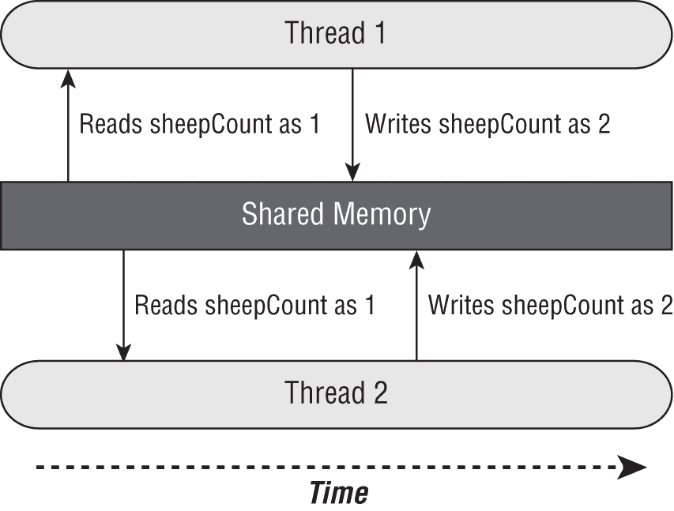

**图 7.3** 缺乏线程同步

### 使用原子类保护数据

改进我们数羊示例的一种方法是使用`java.util.concurrent.atomic`包。正如并发 API 中的许多类一样，这些类的存在是为了让你的生活更轻松。

在我们的第一个`SheepManager`输出中，相同的值被打印了两次，最高计数是`9`而不是`10`。正如我们在上一节中演示的，自增运算符`++`不是线程安全的。此外，它不是线程安全的由于该操作不是原子的，它执行了读取和写入两个任务，这两个任务可能会被其他线程中断。

*原子性*（Atomic）是指操作作为一个单个执行单元执行且不受另一个线程干扰的属性。一个线程安全的自增运算符原子版本应该是将对变量的读取和写入视为单一操作的版本，不允许任何其他线程在操作期间访问该变量。图 7.4 显示了将`sheepCount`变量原子化的结果。

图 7.4 类似于我们早的图 7.3，不同之处在于对于`sheepCount`变量，数据的读取和写入是原子的。任何在原子操作进行期间尝试访问`sheepCount`变量的线程都必须等待该变量上的原子操作完成。从概念上说，这就像为我们的动物园工作人员制定了一条规则：同一时间草地上只能有一名员工，尽管他们可能不会顺序报告自己的结果。

由于在 Java 共享环境中访问基本类型和引用是常见的，因此并发 API 包含了许多有用类，这些类在概念上与我们的基本类相同，但支持原子操作。表 7.6 列出了你参加考试时应该熟悉的原子类。

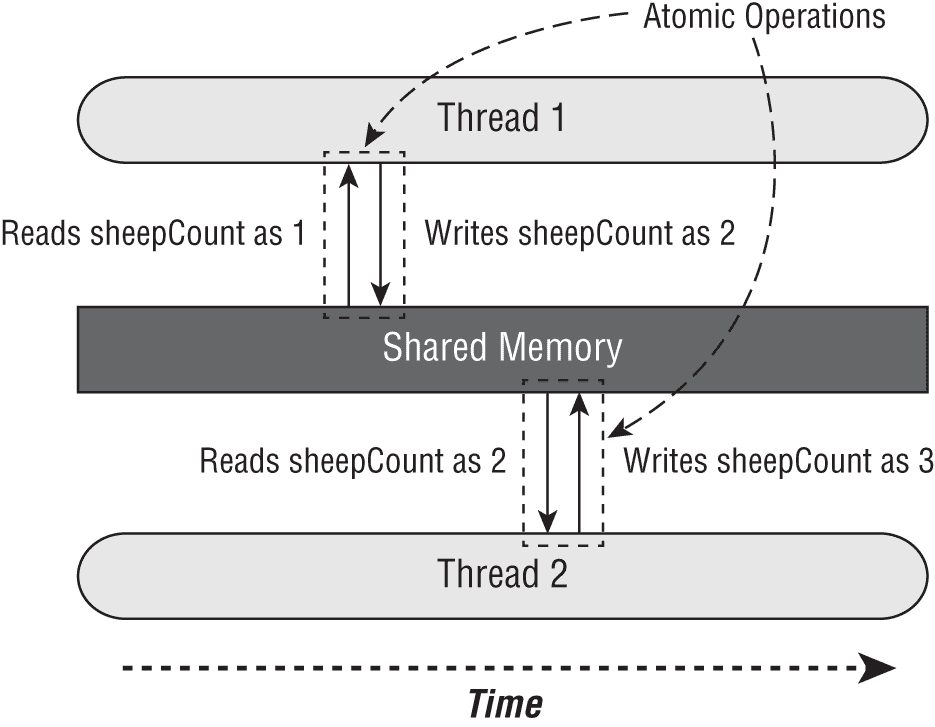

**图 7.4** 使用原子操作线程同步

| 类名 | 描述 |
| --- | --- |
| `AtomicBoolean` | 可更新的`boolean`值 |
| `AtomicInteger` | 可更新的`int`值 |
| `AtomicLong` | 可更新的`long`值 |

**表 7.6** 原子类

我们如何使用原子类？每个类包含了许多与内置运算符对应的方法，例如赋值（`=`）和自增（`++`）。在下面的示例中，我们用`AtomicInteger`更新了`SheepManager`：

```java
private AtomicInteger sheepCount = new AtomicInteger(0);
private void incrementAndReport() {
   System.out.print(sheepCount.incrementAndGet()+" ");
}
```

这种实现与之前的相比如何？当我们运行时它，会得到不同的输出，如下：

```
2 3 1 4 5 6 7 8 9 10
1 4 3 5 6 7 8 9
1 4 3 5 6 2 7 8 
```

与我们之前的输出不同，数字`1`到`10`总是会被打印，尽管顺序仍然无法保证。别担心，我们很快就会解决这个问题。本节的关键在于，使用原子类可以确保工作人员之间的数据是一致的，并且不会由于并发修改而丢失值。

| 方法 | 描述 |
| --- | --- |
| `get()` | 当前值 |
| `set()` | 设置给定值，相当于`=`运算符 |
| `getAndSet()` | 原子地设置新值并返回旧值 |
| `incrementAndGet()` | 对于数值类，原子预自增等于`++value` |
| `getAndIncrement()` | 对于数值类，原子后自增等于`value++` |
| `decrementAndGet()` | 对于数值类，原子预自减等于`--value` |
| `getAndDecrement()` | 对于数值类，原子后自减等于`value--` |

**表 7.7** 常见的原子方法

### 使用同步块改进访问

虽然原子类在保护单个变量方面非常棒，但如果你需要执行一系列命令或调用一个方法，它们就不特别有用。我们如何改进结果，以便每位工作人员都能按顺序增加并报告结果？最常用的技术是使用监视器（monitor），也称为锁（lock），来同步访问。监视器是一种支持互斥（mutual exclusion）的结构，互斥是指在给定时间内最多有一个线程执行特定的代码段的属性。

在 Java 中，任何`Object`都可以配合`synchronized`关键字用作监视器，如下所示：

```
SheepManager manager = new SheepManager();
synchronized(manager) {
   // Work to be completed by one thread at a time
}
```

这个示例被称为`synchronized block`（同步块）。每个到达的线程都会首先检查是否有线程已经在该块中。通过这种方式，线程会为监视器“获取锁”。如果锁是可用，单个线程将进入该块，获取锁并阻止所有其他线程进入。当第一个线程执行该块时，所有到达的线程都将尝试获取同一个锁并等待第一个线程执行完毕。一旦某个线程执行完该块，它将释放锁，允许等待的线程之一继续执行。

让我们重新回到`SheepManager`示例，看看我们是否可以改进结果，以便每个工作人员都能按顺序递增并输出计数器。假设我们用以下实现替换了`for()`循环：

```
for(int i = 0; i < 10; i++) {
   synchronized(manager) {
      service.submit(() -> manager.incrementAndReport());
   }
}
```

这个解决方案解决问题了吗？没有，并没有！你能发现问题在哪里吗？我们同步了线程的*创建*过程，而不是线程的*执行*过程。在这个示例中，每个线程会逐个被创建，但它们可能仍然同时执行并完成它们的工作，导致与你之前看到的相同类型的输出。诊断和解决线程问题通常是任何编程语言中是最困难的任务之一。

现在我们展示`SheepManager`类的更正版本，它对工作人员进行了排序。

```java
import java.util.concurrent.*;
public class SheepManager {
   private int sheepCount = 0;
   private void incrementAndReport() {
      synchronized(this) {
         System.out.print((++sheepCount)+" ");
      }
   }
   public static void main(String[] args) {
      ExecutorService service = null;
      try {
         service = Executors.newFixedThreadPool(20);
         var manager = new SheepManager();
         for(int i = 0; i < 10; i++)
            service.submit(() -> manager.incrementAndReport());
      } finally {
         if(service != null) service.shutdown();
      }
   }
}
```

当这段代码执行时，它将始终输出以下内容：


```
1 2 3 4 5 6 7 8 9 10
```

虽然所有线程仍然同时创建并执行，但它们在进入之前都会在 `synchronized` 块处等待工作人员完成递增并报告结果。通过这种方式，每个动物园工作人员在跑出场地之前，都会等待上一个动物园工作人员回来。虽然哪一个动物园工作人员下一个跑出场是随机的，但可以保证场地里最多有一个人，并且结果将按顺序报告。

我们可以对任何对象进行同步，只要它是同一个对象即可。例如，以下代码段也能正常工作：

```
private final Object herd = new Object();
private void incrementAndReport() {
   synchronized(herd) {
      System.out.print((++sheepCount)+" ");
   }
}
```

虽然我们不需要将 `herd` 变量声明为 `final`，但这样做可以确保它在线程开始使用它之后不会被重新赋值。

### 在方法上同步 (Synchronizing on Methods)

在在上一个示例中，我们在方法体周围使用 `synchronized(this)` 建立了监视器。Java 实际上提供了一个更方便的编译器增强来实现此。我们可以在任何实例方法上添加 `synchronized` 修饰符，以便对对象本身进行自动同步。例如，以下两个方法定义是等价的：

```
private void incrementAndReport() {
   synchronized(this) {
      System.out.print((++sheepCount)+" ");
   }
}
private synchronized void incrementAndReport() {
   System.out.print((++sheepCount)+" ");
}
```

第一个使用 `synchronized` 块，而第二个使用 `synchronized` 方法修饰符。使用哪一个完全取决于你。

我们还可以对 `static` 方法应用 `synchronized` 修饰符。对 `static` 方法进行同步时，使用哪个对象作为监视器？当然是类对象！例如，对于我们的 `SheepManager` 类内部的 `static` 同步，以下两个方法是等价的：

```
public static void printDaysWork() {
   synchronized(SheepManager.class) {
      System.out.print("Finished work");
   }
}
public static synchronized void printDaysWork() {
   System.out.print("Finished work");
}
```

与之前一样，第一个使用 `synchronized` 块，第二个示例使用 `synchronized` 修饰符。如果你需要跨所有实例排序线程访问，而不是单个实例，可以使用 `static` 同步。

### 理解 `Lock` 框架 (Understanding the `Lock` Framework)

`synchronized` 块仅支持有限的功能。例如，如果我们想检查锁是否可用，如果不可用则执行其他任务会怎样？此外，如果锁永远可用而我们对它进行同步，可能会永远挂起。

并发 API 包含了 `Lock` 接口，它在概念上与使用 `synchronized` 关键字相似，但具有许多花哨功能。不过，我们不是对任何 `Object` 进行同步，而是只对实现了 `Lock` 接口的对象进行“加锁”。

#### 应用 `ReentrantLock` 接口 (Applying a `ReentrantLock` Interface)

使用 `Lock` 接口非常简单。当你需要保护一段代码免受多线程处理时，创建一个所有线程都可以访问的 `Lock` 实例。每个线程在进入代码前调用 `lock()`，在退出时调用 `unlock()`。

作为对比，下面展示了两种实现，一种使用 `synchronized` 块，另一种使用 `Lock`。

```
// 使用 synchronized 块的实现 1
Object object = new Object();
synchronized(object) {
   //保护代码
}

// 使用 Lock 的实现 2
Lock lock = new ReentrantLock();
try {
   lock.lock();
   //保护代码
} finally {
   lock.unlock();
}
```

这两种实现在概念上是等价的。`ReentrantLock` 类是一个实现了 `Lock` 接口的简单监视器。也就是说，在任何时刻最多允许一个线程持有锁。

`ReentrantLock` 类确保一旦线程调用了 `lock()` 获取了锁，所有其他调用 `lock()` 的线程将等待第一个线程调用 `unlock()`。至于哪个线程获得锁，取决于创建 `Lock` 对象时使用的参数。除了始终确保释放锁之外，你还需要确保只释放你拥有的锁。如果你尝试释放一个你没有拥有的锁，将在运行时得到异常。

```
Lock lock = new ReentrantLock();
lock.unlock();  // IllegalMonitorStateException
```

`Lock` 接口包含了你在考试中需要的四个方法，如表 7.8 所示。

| 方法 | 描述 |
| --- | --- |
| `void lock()` | 请求锁并阻塞直到获取锁 |
| `void unlock()` | 释放锁 |
| `boolean tryLock()` | 请求锁并立即返回。返回一个 `boolean` 值表示是否成功获取了锁 |
| `boolean tryLock(long,TimeUnit)` | 请求锁并阻塞指定的时间直到锁被获取。返回一个 `boolean` 值表示是否成功获取了锁 |

**表 7.8** `Lock` 方法

#### 尝试获取锁 (Attempting to Acquire a Lock)

虽然 `ReentrantLock` 类允许你等待锁，但它目前仍然存在着与 `synchronized` 块相同的问题。线程可能会永远地等待以获取锁。幸运的是，表 7.8 包含了两个额外的方法，使得 `Lock` 接口使用起来比 `synchronized` 块要安全得多。

为了方便起见，我们在本节的代码中将使用以下 `printMessage()` 方法：

```
public static void printMessage(Lock lock) {
   try {
      lock.lock();
   } finally {
      lock.unlock();
   }
}
```

### `tryLock()`

`tryLock()` 方法会尝试获取锁并立即返回一个 `boolean` 结果，表示是否获取了锁。与 `lock()` 方法不同，如果另一个线程已经持有锁，它将不会等待。无论是否有可用锁，它都会立即返回。

以下是使用 `tryLock()` 方法的示例实现：

```
Lock lock = new ReentrantLock();
new Thread(() -> printMessage(lock)).start();
if(lock.tryLock()) {
   try {
      System.out.println("Lock obtained, entering protected code");
   } finally {
      lock.unlock();
   }
} else {
   System.out.println("Unable to acquire lock, doing something else");
}
```

运行这段代码时，可能会产生两种消息，取决于执行顺序。一个有趣的练习是在此片段中插入一些 `Thread.sleep()` 延迟，以鼓励显示特定的消息。

与 `lock()` 一样，`tryLock()` 方法应该与 `try`/`finally` 块一起使用。幸运的是，你只需要在成功获取锁时才释放它。

### `tryLock(long,TimeUnit)`

`Lock` 接口包含一个重载版本的 `tryLock(long,TimeUnit)`，它的类似于 `lock()` 和 `tryLock()` 的混合体。与另外两个方法一样，如果锁可用，它将立即返回并返回。然而，如果锁不可用，将在指定的超时限制内等待锁。

下面的代码段使用了重载版本的 `tryLock(long,TimeUnit)`：

```
Lock lock = new ReentrantLock();
new Thread(() -> printMessage(lock)).start();
if(lock.tryLock(10,TimeUnit.SECONDS)) {
   try {
      System.out.println("Lock obtained, entering protected code");
   } finally {
      lock.unlock();
   }
} else {
   System.out.println("Unable to acquire lock, doing something else");
}
```

代码与之前相同，但这一次其中一个线程等待最多 10 秒来获取锁。

#### 重复锁请求

`ReentrantLock` 类维护了一个计数器，记录锁授予线程的次数。为了让其他线程释放锁，调用 `unlock()` 的次数必须与授予的次数相同。下面的代码段包含一个错误。你能发现它吗？

```
Lock lock = new ReentrantLock();
if(lock.tryLock()) {
   try {
      lock.lock();
      System.out.println("Lock obtained, entering protected code");
   } finally {
      lock.unlock();
   }
}
```

该线程获取了两次锁，但只释放了一次。你可以在代码运行后启动一个新线程尝试获取锁来验证这一点。以下代码将打印 `false`：

```
new Thread(() -> System.out.print(lock.tryLock())).start();
```

释放锁的次数与获取锁的次数相同至关重要。对于 `tryLock()` 的调用，只有当方法返回 `true` 时你才需要调用 `unlock()`。

#### 回顾 `Lock` 框架

回顾一下，`ReentrantLock` 类支持与 `synchronized` 块相同的功能，同时增加了许多改进。

*   在不阻塞的情况下请求锁的能力
*   在阻塞指定时间的情况下请求锁的能力
*   可以创建一个具有公平特性的锁，其中锁将按照请求的顺序授予线程。

并发 API 还包含了其他基于锁的类，尽管对于考试来说，你只需要了解 `ReentrantLock` 一个。

### 使用 `CyclicBarrier` 协调任务

我们在讨论线程安全时，从保护单个变量开始，然后转向代码块和锁。我们通过讨论如何在许多事物之间协调复杂任务来完成对线程安全的讨论。

我们的动物园工作人员回来了，这次他们正在清理圈舍。想象一下有一个狮子圈需要清空、清理，然后重新放回狮子。为了完成这项任务，我们分配了四名动物园工作人员。显然，我们不想在狮子在里面活动时开始清理圈舍，否则我们可能会失去一名动物园工作人员！此外，我们不想在圈舍仍在清理时让狮子回到圈内。

我们可以让一个工作人员完成所有工作，但这将很慢，并且忽略了我们有三名动物园工作人员随时命的事实。更好的解决方案是让四名动物园员工并发工作，在一组任务结束和下一组开始之间暂停。

为了协调这些任务，我们可以使用 `CyclicBarrier` 类。现在，让我们从一个不包含 `CyclicBarrier` 的代码示例开始。

```
import java.util.concurrent.*;
public class LionPenManager {
   private void removeLions() {System.out.println("Removing lions");}
   private void cleanPen() {System.out.println("Cleaning the pen");}
   private void addLions() {System.out.println("Adding lions");}
   public void performTask() {
      removeLions();
      cleanPen();
      addLions();
   }
   public static void main(String[] args) {
      ExecutorService service = null;
      try {
         service = Executors.newFixedThreadPool(4);
         var manager = new LionPenManager();
         for (int i = 0; i < 4; i++)
            service.submit(() -> manager.performTask());
      } finally {
         if (service != null) service.shutdown();
      }
   }
}
```

以下是基于此实现的示例输出：

```
Removing lions
Removing lions
Cleaning the pen
Adding lions
Removing lions
Cleaning the pen
Adding lions
Removing lions
Cleaning the pen
Adding lions
Cleaning the pen
Adding lions
```

虽然在单个线程内结果是有序的，但在多个工作人员之间输出是完全随机的。我们看到在清理圈舍时，有些狮子仍在移除，而且在清理过程完成之前就加入了狮子。在我们的概念示例中，这将非常混乱，并且无法得到非常干净的圈舍。

我们可以使用 `CyclicBarrier` 类来改进这些结果。`CyclicBarrier` 在其构造函数中接收一个限制值，表示等待的线程数。当每个线程完成时，它会调用循环屏障的 `await()` 方法。一旦指定数量的线程都调用了 `await()` 后，屏障就会释放，所有线程都可以继续。

以下是使用 `CyclicBarrier` 对象协调访问的 `LionPenManager` 类的重新实现：

```java
import java.util.concurrent.*;
public class LionPenManager {
   private void removeLions() {System.out.println("Removing lions");}
   private void cleanPen() {System.out.println("Cleaning the pen");}
   private void addLions() {System.out.println("Adding lions");}
   public void performTask(CyclicBarrier c1, CyclicBarrier c2) {
      try {
         removeLions();
         c1.await();
         cleanPen();
         c2.await();
         addLions();
      } catch (InterruptedException | BrokenBarrierException e) {
         // Handle checked exceptions here
      }
   }
   public static void main(String[] args) {
      ExecutorService service = null;
      try {
         service = Executors.newFixedThreadPool(4);
         var manager = new LionPenManager();
         var c1 = new CyclicBarrier(4);
         var c2 = new CyclicBarrier(4, 
            () -> System.out.println("*** Pen Cleaned!"));
         for (int i = 0; i < 4; i++)
            service.submit(() -> manager.performTask(c1, c2));
      } finally {
         if (service != null) service.shutdown();
      }
   }
}
```

在这个示例中，我们更新了 `performTask()` 方法以使用 `CyclicBarrier` 对象。与对同一个对象进行同步一样，使用 `CyclicBarrier` 协调任务需要该对象是 `static` 的，或者传递给执行任务的线程。我们还在 `performTask()` 方法中添加了 `try`/`catch` 块，因为 `await()` 方法会抛出多个检查异常。

以下是基于我们修改后的 `LionPenManager` 类来实现的示例输出：


```
Removing lions
Removing lions
Removing lions
Removing lions
Cleaning the pen
Cleaning the pen
Cleaning the pen
Cleaning the pen
*** Pen Cleaned!
Adding lions
Adding lions
Adding lions
Adding lions
```

如你所见，所有的结果现在都组织好了。移除狮子的操作在一个步骤中完成，清理围栏和放回狮子也是如此。在这个示例中，我们为`CyclicBarrier`对象使用了两个不同的构造函数，后者在完成时调用了`Runnable`方法。

`CyclicBarrier`类允许我们执行复杂的多线程任务，同时所有线程在逻辑屏障处停止并等待。这种解决方案优于单线程解决方案，因为各个任务（如移除狮子）可以由四位动物园工作人员并行完成。

使用`CyclicBarrier`会有预期的性能损失。例如，某一个工人移除狮子的速度极慢，导致其他三个人必须等待他完成。尽管由于我们无法在挤满狮子的情况下清理围栏，但这种解决方案已经尽可能并发了。

## 使用并发集合

除了管理之外，并发 API 还包含了接口和类，帮助你协调多个任务对共享集合的访问。我们所说的集合是指我们在第 3 章“泛型与集合”中介绍的 Java 集合框架。在本节中，我们将演示在使用并发 API 时可用的许多并发类。

### 理解内存一致性错误

并发集合类的目的是解决常见的内存一致性错误。当两个线程对本应相同的数据视图不一致时，就会发生`内存一致性错误`。从概念上说，我们希望一个线程上的写入操作，如果另一个线程在写入发生后访问并发集合，那么该写入应该是可用的。

当两个线程尝试修改同一个非并发集合时，JVM 可能会在运行时抛出`ConcurrentModificationException`。事实上，这在单线程中也可能发生。看下面的代码段：

```
var foodData = new HashMap<String, Integer>();
foodData.put("penguin", 1);
foodData.put("flamingo", 2);
for(String key: foodData.keySet())
   foodData.remove(key);
```

这段代码会在循环的第二次迭代期间抛出`ConcurrentModificationException`，因为`keySet()`上的迭代器在第一个元素被删除后没有正确更新。将第一行更改为使用`ConcurrentHashMap`可以防止代码在运行时抛出异常。

```
var foodData = new ConcurrentHashMap<String, Integer>();
foodData.put("penguin", 1);
foodData.put("flamingo", 2);
for(String key: foodData.keySet())
   foodData.remove(key);
```

虽然我们通常不修改循环变量，但这个例子突显了一个事实：`ConcurrentHashMap`对读/写访问进行了排序，使得对该类的所有访问都是一致的。在此代码段中，一旦对象从`Map`中删除，由`keySet()`创建的迭代器就会更新。

创建并发类是为了帮助避免多个线程从同一个集合中添加和删除对象的常见问题。在任何给定实例，所有线程都应该对集合结构具有相同的一致视图。

### 与并发类一起工作

当你准备要在`synchronized`块或方法之外让多个线程修改集合对象时，都应该使用并发集合类，即使你不预计会遇到并发问题。另一方面，不可变或只读对象可以被任何数量的线程访问，而不需要并发集合。

就像我们实例化`ArrayList`对象但传递`List`引用一样，实例化并发集合但使用非并发接口传递它被认为是一种良好的做法。在某些情况下，调用者可能需要知道它是一个并发集合以便使用并发接口或类，但在大多数情况下，这种区别是不必要的。

表 7.9 列出了你应该熟悉的常用并发类。

| 类名 | Java 集合框架接口 | 元素有序？ | 排序？ | 阻塞？ |
| --- | --- | --- | --- | --- |
| `ConcurrentHashMap` | `ConcurrentMap` | 否 | 否 | 否 |
| `ConcurrentLinkedQueue` | `Queue` | 是 | 否 | 否 |
| `ConcurrentSkipListMap` | `ConcurrentMap SortedMap NavigableMap` | 是 | 是 | 否 |
| `ConcurrentSkipListSet` | `SortedSet NavigableSet` | 是 | 是 | 否 |
| `CopyOnWriteArrayList` | `List` | 是 | 否 | 否 |
| `CopyOnWriteArraySet` | `Set` | 否 | 否 | 否 |
| `LinkedBlockingQueue` | `BlockingQueue` | 是 | 否 | 是 |

#### *SkipList* 集合

`SkipList`类——`ConcurrentSkipListSet`和`ConcurrentSkipListMap`分别是对应的排序类`TreeSet`和`TreeMap`的并发版本。它们按照元素的自然顺序维护其元素或键。通过这种方式，使用它们的方法与你在第 3 章中处理过的代码是一致的。

```java
Set<String> gardenAnimals = new ConcurrentSkipListSet<>();
gardenAnimals.add("rabbit");
gardenAnimals.add("gopher");
System.out.println(gardenAnimals.stream()
   .collect(Collectors.joining(",")));  // gopher,rabbit

Map<String, String> rainForestAnimalDiet 
   = new ConcurrentSkipListMap<>();
rainForestAnimalDiet.put("koala", "bamboo");
rainForestAnimalDiet.entrySet()
   .stream()
   .forEach((e) -> System.out.println(
      e.getKey() + "-" + e.getValue())); // koala-bamboo
```

当考试中遇到`SkipList`或`SkipSet`时，只需考虑“排序”并发集合即可，其他部分自然就明白了。

### 理解 `CopyOnWrite` 集合

表 7.9 包含了两个类：`CopyOnWriteArrayList`和`CopyOnWriteArraySet`，它们的行为与你过的其他并发示例略有不同。这些类在集合中添加、修改或删除任何元素时，会将所有元素复制到一个新的底层结构中。我们所说的`已修改`元素是指集合中的引用发生了变化。修改集合内对象的实际内容不会导致分配新的结构。

尽管数据被复制到新的底层结构，但我们对`Collection`对象的引用并没有改变。这在需要遍历集合的多线程环境中特别有用。任何在修改之前建立的迭代器将不会看到变化，相反，它将遍历修改之前的原始元素。

让我们通过一个示例来看它是如何工作的。以下程序会终止吗？如果是，循环执行了多少次？

```java
List<Integer> favNumbers = 
   new CopyOnWriteArrayList<>(List.of(4,3,42));
for(var n: favNumbers) {
   System.out.print(n + " ");
   favNumbers.add(9);
}
System.out.println();
System.out.println("Size: " + favNumbers.size());
```

当作为程序的一部分执行时，此代码段输出：

```
4 3 42
Size: 6
```

尽管在遍历数组时添加了元素，但`for`循环只遍历了循环开始时创建的元素。或者，如果我们使用普通的`ArrayList`对象，运行时将抛出`ConcurrentModificationException`。然而，使用这两个类中的任何一个都避免了进入无限循环（即在遍历时不断向数组添加元素）。

`CopyOnWriteArraySet`的用法与`HashSet`相似，并且与`CopyOnWriteArrayList`类具有类似的属性。

```java
Set<Character> favLetters =
   new CopyOnWriteArraySet<>(List.of('a','t'));
for(char c: favLetters) {
   System.out.print(c+" ");
   favLetters.add('s');
}
System.out.println();
System.out.println("Size: "+ favLetters.size());
```

此代码段打印：

```
a t 
Size: 3
```

`CopyOnWrite`类可能会消耗大量内存，因为每次集合被修改时都需要分配新的集合结构。它们通常用于读操作远于写操作的多线程环境。

### 理解阻塞队列

在表 7.9 中，你应该考试掌握的最后一个集合类是`LinkedBlockingQueue`，它实现了`BlockingQueue`接口。`BlockingQueue`与普通`Queue`相似，但它包含了等待特定时间以完成操作的方法。

由于`BlockingQueue`继承了`Queue`的所有方法，我们跳过了你在第 3 章中学过的继承方法，并在表 7.10 中展示新方法。

| 方法名 | 描述 |
| --- | --- |
| `offer(E e, long timeout, TimeUnit unit)` | 向队列中添加项，等待指定时间，如果在可用空间之前时间到期，则返回`false` |
| `poll(long timeout, TimeUnit unit)` | 从队列中检索并移除项，等待指定时间，如果在项可用之前时间到期，则返回`null` |

**表 7.10** `BlockingQueue`等待方法

实现类`LinkedBlockingQueue`正如其所示，在元素之间维护一个链表。以下示例使用`LinkedBlockingQueue`等待操作的结果。表 7.10 中的方法都可能抛出受检异常`InterruptedException`，因为它们在完成等待结果之前可能会被中断；因此，必须对其进行捕获。

```java
try {
   var blockingQueue = new LinkedBlockingQueue<Integer>();
   blockingQueue.offer(39);
   blockingQueue.offer(3, TimeUnit.SECONDS);
   System.out.println(blockingQueue.poll());
   System.out.println(blockingQueue.poll(10, TimeUnit.MILLISECONDS));
} catch (InterruptedException e) {
   // 处理异常
}
```

此代码段打印：

```
39
```

如示例所示，由于`LinkedBlockingQueue`实现了`Queue`和`BlockingQueue`，我们可以使用不需要参数的方法。

### 获取同步集合

除了我们涵盖的并发集合类外，并发 API 还包含获取非集合对象的同步版本的方法。这些同步方法定义在`Collections`类中。它们作用于输入的集合，并返回与底层集合类型相同的引用。我们在表 7.11 中列出了这些方法。

| `synchronizedCollection(Collection<T> c)` |
| `synchronizedList(List<T> list)` |
| `synchronizedMap(Map<K,V> m)` |
| `synchronizedNavigableMap(NavigableMap<K,V> m)` |
| `synchronizedNavigableSet(NavigableSet<T> s)` |
| `synchronizedSet(Set<T> s)` |
| `synchronizedSortedMap(SortedMap<K,V> m)` |
| `synchronizedSortedSet(SortedSet<T> s)` |

**表 7.11** 同步方法

何时应该使用这些方法？如果你在创建时就知道你的对象需要同步，那么你应该使用表 7.9 中列出的并发集合类。相反，如果你获得了一个非并发类的现有集合并需要在多线程之间访问它，可以使用表 7.11 中的方法对其进行包装。

与并发集合不同，同步集合如果在单线程中通过迭代器对其进行修改，也会抛出异常。例如，查看我们之前示例的修改：

```java
var foodData = new HashMap<String, Object>();
foodData.put("penguin", 1);
foodData.put("flamingo", 2);
var synFoodData = Collections.synchronizedMap(foodData);
for(String key: synFoodData.keySet())
   synFoodData.remove(key);
```

此循环会抛出`ConcurrentModificationException`，而我们使用`ConcurrentHashMap`的示例则不会。除了遍历集合外，表 7.11 中方法返回的对象对于内存一致性错误是安全的，可以在多线程之间使用。

并发 API（Concurrency API）的创建是为了帮助所有开发者消除常见的潜在线程问题。正如你所看到的，并发 API 会替你创建线程并管理复杂的线程交互，通常只需要几行代码即可完成。

尽管并发 API 减少了线程问题的可能性，但它并没有消除这些问题。在实践中，发现和识别应用程序中的线程问题通常是开发者可以承担的最困难的任务之一。

## 理解活跃性（Liveness）

正如你在本章看到的，许多线程操作可以独立执行，但某些操作则需要协作。例如，在方法上进行同步需要所有调用该方法的线程都等待其他线程完成后才能继续。你之前在章节前面的部分还看到，`CyclicBarrier`（循环屏障）中的线程将各自等待达到屏障限制后继续执行。

当所有这些线程都在等待时，应用程序会发生什么？在很多情况下，这种等待是转瞬即逝的，用户几乎察觉不到任何延迟。但在其他情况下，等待可能会非常长，甚至是无限的。

`Liveness`（活跃性）是指应用程序及时执行的能力。那么，活跃性问题就是应用程序变得无响应或处于某种“卡住”状态的问题。对于考试来说，你应该熟悉三种类型的活跃性问题：死锁（deadlock）、饥饿（starvation）和活锁（livelock）。

### 死锁（Deadlock）

当两个或更多线程永久阻塞，每个都在等待对方时，就会发生`Deadlock`。我们可以通过示例来说明这一原理。假设我们的动物园有两只狐狸：Foxy 和 Tails。Foxy 喜欢先吃饭再喝水，而 Tails 喜欢先喝水再吃饭。此外，这两只动物都不喜欢分享，只有在获得食物和水的独占访问权时，它们才能完成用餐。

动物园员将食物放在环境的一侧，将水放在另一侧。尽管我们的狐狸动作很快，但它们从环境的一侧运行到另一侧仍需要 100 毫秒。

如果 Foxy 先拿到了食物，而 Tails 先拿到了水，会发生什么？下面的应用程序模拟了这种行为：


```java
import java.util.concurrent.*;
class Food {}
class Water {}
public class Fox {
   public void eatAndDrink(Food food, Water water) {
      synchronized(food) {
         System.out.println("Got Food!");
         move();
         synchronized(water) {
            System.out.println("Got Water!");
         }
      }
   }
   public void drinkAndEat(Food food, Water water) {
      synchronized(water) {
         System.out.println("Got Water!");
         move();
         synchronized(food) {
            System.out.println("Got Food!");
         }
      }
   }
   public void move() {
      try {
         Thread.sleep(100);
      } catch (InterruptedException e) {
         // Handle exception
      }
   }
   public static void main(String[] args) {
      // Create participants and resources
      Fox foxy = new Fox();
      Fox tails = new Fox();
      Food food = new Food();
      Water water = new Water();
      // Process data
      ExecutorService service = null;
      try {
         service = Executors.newScheduledThreadPool(10);
         service.submit(() -> foxy.eatAndDrink(food,water));
         service.submit(() -> tails.drinkAndEat(food,water));
      } finally {
         if(service != null) service.shutdown();
      }
   }
}
```

在这个示例中，`Foxy` 获取了食物，然后移动到环境的另一侧获取水。不幸的是，`Tails` 已经喝了水，正在等待食物可用。结果是我们的程序输出了以下内容，并无限挂起：

```
Got Food!
Got Water!
```

这个示例被认为是死锁，因为两个参与者都被永久阻塞了，等待永远不会可用的资源。

### 饥饿（Starvation）

当单个线程被永久拒绝访问共享资源或锁时，就会发生`Starvation`。该线程仍然处于活跃状态，但无法获得资源。

### 活锁（Livelock）

`Livelock` 发生在两个或多个线程永久阻塞，但它们又都在等待对方时（注：此处原文不完整，通常活锁是指线程不断改变状态以试图避免死锁的循环）。

在设计我们的 Web 服务器时，哪种结果是最理想的？第一种可能性，即两个用户都能使用相同的用户名创建账户，这可能会导致严重问题并破坏系统的许多不变性。假设用户名是登录网站所必需，那么他们如何使用相同的用户名和不同的密码进行登录呢？在这种情况下，网站无法区分他们。这是这种竞态条件（race condition）最坏的结果，因为它会导致严重且可能无法恢复的数据问题。

第二种情况又是怎样的？如果两个用户都无法创建账户，他们都将收到错误信息并被告知重试。在这种情况下，数据得到了保护，因为系统中不存在两个具有相同用户名的账户。用户可以自由地使用相同的用户名 `ZooFan` 重试，因为还没有人获得该用户的访问权限。尽管这看起来像是某种活锁（livelock），但其者之间存在细微的区别。当用户尝试再次创建账户时，他们遇到竞态条件的几率往往会降低。例如，如果一个用户比另一个用户早几秒提交请求，通过系统告知第二个用户用户名已被占用，他们可能完全避免另一次竞态条件。

第三种情况是一个用户获得了账户而另一个没有，这通常被认为是解决此类竞态条件的最佳方案。与第二情况一样，我们维护了数据完整性；但与第二情况不同的是，至少有一个用户可以在第一个请求上继续进行，避免了额外的竞态条件场景。与之前的场景也不同，我们可以为未竞胜的用户提供更清晰的错误信息，因为我们现在可以确定该账户用户名在系统中已不可用。

对于考试，你应该理解，如果不妥善处理，竞态条件会导致无效数据。即使是两个参与者都无法继续执行的解决方案，也比允许无效数据进入系统的方案要好。

竞态条件往往出现在高并发应用程序中。随着软件系统的增长和更多用户的加入，它们往往会更频繁地出现。解决方案之一是使用监视器（monitor）对相关的重叠任务进行同步。在上一个例子中，相关的任务是确定账户用户名是否被占用的方法，如果可用则在系统中将其预留。

## 使用并行流 (Working with Parallel Streams)

Stream API 最强大的功能之一是内置的并发支持。到目前，你处理过的所有流都是串行流（serial streams）。`serial stream`（串行流）是一种结果是有序的流，并且一次只处理一个条目。

`parallel stream`（并行流）是一种能够使用多个线程并发处理结果的流。例如，你可以使用并行流和 `map()` 操作对流中的元素进行并发操作，这比一次处理一个元素的性能要提高得多。

使用并行流不仅可以改变你应用程序的性能，还可能改变预期的结果。正如你将看到的，某些操作还需要特殊处理才能以并行方式处理。

### 创建并行流 (Creating Parallel Streams)

Stream API 的设计使得创建并行流变得非常简单。对于考试，你应该熟悉创建并行流的两种方法。

### 在现有流上调用 `parallel()` (Calling `parallel()` on an Existing Stream)

创建并行流的第一种方法是从现有流。你只需要在现有流上调用 `parallel()` 将其转换为支持多线程处理的流，如下代码所示：

```
Stream<Integer> s1 = List.of(1,2).stream();
Stream<Integer> s2 = s1.parallel();
```

注意，`parallel()` 是在原始流上操作的中间操作。例如，对 `s2` 应用终端操作也会使 `s1` 无法进一步使用。

### 在 `Collection` 对象上调用 `parallelStream()` (Calling `parallelStream()` on a `Collection` Object)

创建并行流的第二种方法是从 Java `Collection` 类。`Collection` 接口包含一个方法 `parallelStream()`，可以在任何集合上调用并返回一个并行流。以下直接从 `List` 对象创建并行流：

```
Stream<Integer> s3 = List.of(1,2).parallelStream();
```

我们将在整个章节中使用用 `parallel()` 和 `parallelStream()`。

### 执行并行分解 (Performing a Parallel Decomposition)

正如你可能注意到的，创建并行流是简单的一部分。有趣的部分在于执行并行分解。`parallel decomposition`（并行分解）是将一个任务拆分为多个可以并发执行的较小部分，然后重新组合结果的过程。并发分解程度越高，使用并行流带来的性能提升就越大。

让我们试一下。首先，让我们定义一个重用的函数，它通过等待五秒来“执行工作”。

```
private static int doWork(int input) {
   try {
      Thread.sleep(5000);
   } catch (InterruptedException e) {}
   return input;
}
```

我们可以假定在实际应用中，这可能是在调用数据库或读取文件。现在让我们在串行流中使用这个方法。

```
long start = System.currentTimeMillis();
List.of(1,2,3,4,5)
   .stream()
   .map(w -> doWork(w))
   .forEach(s -> System.out.print(s + " "));

System.out.println();
var timeTaken = (System.currentTimeMillis()-start)/1000;
System.out.println("Time: "+timeTaken+" seconds");
```

你认为这段代码在 `main()` 方法中执行时会输出什么？让我们来看看。

```
1 2 3 4 5 
Time: 25 seconds
```

正如你预期的，结果是有序且可预测的，因为我们使用的是串行流。处理所有元素大约花费了 25 秒。但如果我们使用并行流会发生什么呢？

```
long start = System.currentTimeMillis();
List.of(1,2,3,4,5)
   .parallelStream()
   .map(w -> doWork(w))
   .forEach(s -> System.out.print(s + " "));

System.out.println();
var timeTaken = (System.currentTimeMillis()-start)/1000;
System.out.println("Time: "+timeTaken+" seconds");
```

对于并行流，`map()` 和 `forEach()` 操作是并发执行的。以下是示例输出：

```
3 2 1 5 4 
Time: 5 seconds
```

你可以看到，结果不再是有序或可预测的。并行流上的 `map()` 和 `forEach()` 操作等同于向池线程执行器提交多个 `Runnable` 表达式并等待结果。

所需的时间如何？在这种情况下，我们的系统有足够的 CPU 同时运行所有任务。如果你在处理器较少的计算机上运行相同的代码，可能会输出 10 秒、15 秒或其他数值。

### 处理并行归约 (Processing Parallel Reductions)

除了可能提高性能，还会影响你编写应用程序的方式。并行流上的归约操作被称为 `parallel reductions`（并行归约）。在处理串行流时，并行归约的结果可能与你预期的不同。

#### 执行基于顺序的任务 (Performing Order-Based Tasks)

由于并行流不保证顺序，在并行流上使用 `findAny()` 等方法可能会导致意外的行为。让我们来看看 `findAny()` 应用于串行流的结果。

```
System.out.print(List.of(1,2,3,4,5,6)
   .stream()
   .findAny().get());
```

这段代码经常输出串行流中的第一个值 `1`，尽管这并不是保证的。`findAny()` 方法可以自由地选择串行流或并行流中的任何元素。

对于并行流，JVM 可以创建任意数量的线程来处理该流流。当你在并行流上调用 `findAny()` 时，JVM 会选择第一个完成任务的线程并获取其数据。

```
System.out.print(List.of(1,2,3,4,5,6)
   .parallelStream()
   .findAny().get());
```

结果是，输出可能是 `4`、`1` 或流中的任何实际值。你可以看到，对于并行流，`findAny()` 的结果并不那样可预测。

任何基于顺序的流操作（包括 `findFirst()`、`limit()` 或 `skip()`）在并行环境中的实际执行速度可能会更慢。这是由于并行处理任务被强制以类似于同步的方式协调其所有线程导致的。

从良好的一面上，并行流上有序操作的结果将与串行流保持一致。例如，调用 `skip(5).limit(2).findFirst()` 在有序的串行流和并行流上将返回相同的结果。

#### 使用 `reduce()` 组合结果

正如你在第 4 章中所学习到的，流操作 `reduce()` 将流合并为单个对象。记住，`reduce()` 方法的第一个参数称为 `identity`（标识值），第二个参数称为 `accumulator`（累加器），第三个参数称为 `combiner`（合并器）。以下是方法的签名：

```
<U> U reduce(U identity, 
   BiFunction<U,? super T,U> accumulator, 
   BinaryOperator<U> combiner)
```

我们可以使用 `reduce()` 方法来连接 `char` 值的列表，如下例所示：

```
System.out.println(List.of('w', 'o', 'l', 'f')
   .parallelStream()                                   
   .reduce("", 
      (s1,c) -> s1 + c, 
      (s2,s3) -> s2 + s3));  // wolf
```

在并行流上，`reduce()` 方法通过对流中的元素对对应用归约来创建中间值，然后组合这些中间值以产生最终结果。换句话说，在串行流中，`wolf` 是逐个字符构建的；在并行流中，中间值 `wo` 和 `lf` 被创建然后被组合。

对于并行流，我们现在必须担心顺序问题。如果字符串的元素以错误的顺序组合，产生 `wlfo` 或 `flwo` 怎么办？Stream API 防止了这个问题出现，同时仍然允许流进行并行处理，只要你遵循这一个简单的规则：确保 `accumulator` 和 `combiner` 无论它们被调用的顺序如何都能正常工作。例如，如果我们在相加数字，可以任何顺序进行。

让我们来看一个使用有问题的累加器的示例。特别是在相减数字时，顺序很重要；因此，以下代码输出不同的值，取决于你使用的是串行流还是并行流。在这些示例中，我们可以省略 `combiner` 参数，因为当中间数据类型相同时，可以使用累加器。

```
System.out.println(List.of(1,2,3,4,5,6)
   .parallelStream()
   .reduce(0, (a,b) -> (a - b)));  // 有问题的累加器
```

它可能会输出 `-21`、`3` 或其他值。

如果我们使用一个并非真正标识值的 `identity` 参数，就会看到其他问题。例如，你期望以下代码输出什么？

```
System.out.println(List.of("w","o","l","f")
   .parallelStream()
   .reduce("X", String::concat));  // XwXoXlXf
```

在串行流上，它打印 `Xwolf`，但在并行流上，结果是 `XwXoXlXf`。作为并行过程的一部分，`identity` 被应用于流中的多个元素，导致了非常意想不到的数据。

#### 使用 `collect()` 组合结果

与 `reduce()` 类似，Stream API 包含一个三参数版本的 `collect()`，它接收 `accumulator` 和 `combiner` 操作，并使用 `supplier` 操作代替 `identity`。

```
<R> R collect(Supplier<R> supplier,
   BiConsumer<R, ? super T> accumulator,
   BiConsumer<R, R> combiner)
```

同样，与 `reduce()` 一一样，累加器和合并器操作必须能够任何顺序处理结果。通过这种方式，三参数版本的 `collect()` 可以作为并行归约执行，如下例所示：

```
Stream<String> stream = Stream.of("w", "o", "l", "f").parallel();
SortedSet<String> set = stream.collect(ConcurrentSkipListSet::new,
   Set::add,
   Set::addAll);
System.out.println(set);  // [f, l, o, w]
```

记住 `ConcurrentSkipListSet` 中的元素根据它们的自然顺序排序。你应该使用并发集合来组合结果，确保并发线程的结果不会导致 `ConcurrentModificationException`。

使用收集器（collector）执行并行归约需要额外的考虑。例如，如果你插入的集合是 `List`，则顺序可能无法保留。

#### 在收集器上执行并行归约

虽然我们在第 4 章中介绍过 `Collector`，但没有详细讨论其属性。使用 `Collector` 执行并行归约时，必须满足某些属性。否则 `collect()` 操作将以单线程方式执行。

*   流是并行的。

*   `collect()` 操作的具有 `CONCURRENT` 特性。

*   流是无序的或者收集器具有 `ORDERED` 特性。

例如，虽然 `Collectors.toSet()` 有 `ORDERED` 特性，但它没有 `CONCURRENT` 特性。因此，即使对于并行流，以下操作也不是并行归约：


`stream.collect(Collectors.toSet());`  // 不是并行归约

`Collectors` 类包含了两组静态器方法 `toConcurrentMap()` 和 `groupingByConcurrent()`，它们都是 `ORDERED` 且 `CONCURRENT`。这些方法产生了能够高效并行归约的 `Collector` 实例。与非并发版本一样，还有带有额外参数的重载版本。

这是第 4 章中示例的重写，使用并行流和并行归约：

```
Stream<String> ohMy = Stream.of("lions","tigers","bears").parallel();
ConcurrentMap<Integer, String> map = ohMy
   .collect(Collectors.toConcurrentMap(String::length,
      k -> k,
      (s1, s2) -> s1 + "," + s2));
System.out.println(map); // {5=lions,bears, 6=tigers}
System.out.println(map.getClass());  // java.util.concurrent.ConcurrentHashMap
```

我们使用 `ConcurrentMap` 引用，尽管实际的类可能是 `ConcurrentHashMap`。具体的类是不保证的；它将是实现 `ConcurrentMap` 接口的类。

最后，我们可以重写第 4 章中的 `groupingBy()` 示例，使用并行流和并行归约。

```java
var ohMy = Stream.of("lions","tigers","bears").parallel();
ConcurrentMap<Integer, List<String>> map = ohMy.collect(
   Collectors.groupingByConcurrent(String::length));
System.out.println(map); // {5=[lions, bears], 6=[tigers]}
```

与之前一样，返回的对象可以赋值 `ConcurrentMap` 引用。

### 避免状态操作

如果你的 lambda 表达式是有状态的，那么并行流中可能会出现副作用。`有状态 lambda 表达式`（stateful lambda expression）的结果依赖于管道执行过程中可能变化的任何状态。相反，`无状态 lambda 表达式`（stateless lambda expression）的结果则不依赖于管道执行过程中可能变化的任何状态。

让我们来看一个例子。假设我们需要一个方法，在流中只保留偶数并将它们添加到列表中。同时，我们希望流和列表中数字的顺序保持一致。以下 `addValues()` 方法实现了这一点：

```
public List<Integer> addValues(IntStream source) {
   var data = Collections.synchronizedList(new ArrayList<Integer>());
   source.filter(s -> s % 2 == 0)
      .forEach(i -> { data.add(i); });  // 有状态：不要这样做！
   return data;
}
```

假设该方法在以下流上执行：

```
var list = addValues(IntStream.range(1, 11));
System.out.println(list);
```

那么，输出如下：

```
[2, 4, 6, 8, 10]
```

但如果有人写了一个实现，给我们的方法传递了一个并行流呢？

```
var list = addValues(IntStream.range(1, 11).parallel());
System.out.println(list);
```

使用并行流时，输出的顺序将变成随机的。

```
[6, 8, 10, 2, 4]
```

问题在于我们的 lambda 表达式是有状态的，并且修改了流外部的列表。我们可以使用 `forEachOrdered()` 将元素添加到列表中，但这会强制并行流变为串行执行，可能会导致丢失并发带来的增强。虽然我们示例中的这些流操作非常简单，但想象一下在与许多中间操作一起使用时。

我们可以通过重写流操作，使其不再具有有状态 lambda 表达式来修复此方案。

```
public static List<Integer> addValues(IntStream source) {
   return source.filter(s -> s % 2 == 0)
      .boxed()
      .collect(Collectors.toList());
}
```

该方法处理流并将所有结果收集到一个新列表中。它在串行和并行流上都会产生相同的结果。

```
[2, 4, 6, 8, 10]
```

这种实现消除了有状态操作，并依赖收集器（collector）来组合元素。我们也可以使用并发收集器来并行构建列表。目标是编写代码允许并行处理，并让 JVM 处理其余部分。

强烈建议在使用并行流时避免使用有状态操作，以消除任何潜在的数据副作用。事实上，在串行流中也应该避免这样做，因为这样做会限制代码未来利用并行化的能力。

## 总结

本章向你介绍了线程，并向展示了如何使用并发 API 并行处理任务。线程执行的工作可以用 lambda 表达式或 `Runnable` 或 `Callable` 的实例表示。

对于考试，你应该知道如何使用 `ExecutorService` 并发执行任务。你还应该知道哪些情况下需要使用 `ExecutorService`。

## 考试重点

*   **使用 `Runnable` 和 `Callable` 创建任务。** `ExecutorService` 允许你按固定间隔调度任务。`Callable` 与 `Runnable` 的区别在于 `Callable` 会返回结果。

*   **应用原子类。** 原子操作是在不被另一个线程干扰的情况下发生的。并发 API 包含了原子类，可以确保操作以原子方式执行。

*   **编写线程安全的代码。** 线程安全关乎保护共享数据。可以使用监视器（monitor）确保一次只有一个线程处理一段代码。`ReentrantLock` 相比 `synchronized` 块具有许多优势，包括可以在阻塞的情况下检查锁是否可用。

*   **使用 `CyclicBarrier` 管理进程。** `CyclicBarrier` 类可以用于强制一组线程等待，直到它们到达某个阶段。

*   **使用并发集合。** 并发 API 包含了许多内置多线程处理支持的集合，例如 `ConcurrentHashMap`。它还包含了 `CopyWriteArrayList`，它在每次修改时都会创建其底层列表的副本。

*   **识别潜在的线程问题。** 死锁（Deadlock）、饥饿（starvation）和活锁（livelock）是可能导致线程永远无法完成任务的三种问题。死锁发生在两个或多个线程永久阻塞时。饥饿发生在单个线程被永久拒绝访问时。活锁是饥饿的一种形式，两个或多个线程处于活跃状态但在概念上是阻塞的。最后，竞态条件（race conditions）发生在两个线程同时执行时，导致意外的结果。

*   **理解使用并行流的影响。** Stream API 允许轻松创建并行流。使用并行流可能会导致意外结果，因为操作顺序可能不再可预测。

## 复习题

章节习题的答案可以在 附录 B 中找到。

1.  给定一个 `Stream s` 实例和一个 `Collection c`，创建并行流的有效方法是？（选择所有适用项。）

    1.  `new ParallelStream(s)`

    2.  `c.parallel()`

    3.  `s.parallelStream()`

    4.  `c.parallelStream()`

    5.  `new ParallelStream(c)`

    6.  `s.parallel()`

## 2. 定从 1（包含）到 10（不包含）的数字和为 45，执行以下程序的可能结果是什么？（选择所有适用项。）

```java
import java.util.concurrent.locks.*;
import java.util.stream.*;
public class Bank {
   private Lock vault = new ReentrantLock();
   private int total = 0;
   public void deposit(int value) {
      try {
         vault.tryLock();
         total += value;
      } finally {
         vault.unlock();
      }
   }
   public static void main(String[] unused) {
      var bank = new Bank();
      IntStream.range(1, 10).parallel()
         .forEach(s -> bank.deposit(s));
      System.out.println(bank.total);
   } }
```

1. 打印 `45`。

2. 打印一个小于 `45` 的数字。

3. 打印一个大于 `45` 的数字。

4. 抛出一个异常。

5. 以上均不是，因为代码无法编译。

## 3. 关于 `Callable call()` 和 `Runnable run()` 方法，以下哪些描述正确？（选择所有适用项。）

1. 两者都可以抛出未检查异常（unchecked exceptions）。

2. `Callable` 接受一个泛型方法参数。

3. `Callable` 可以抛出检查异常（checked exception）。

4. 两者都可以用 lambda 表达式实现。

5. `Runnable` 返回一个泛型。

6. `Callable` 返回一个泛型。

7. 两个方法都返回 `void`。

## 4. 哪些行需要修改才能通过编译？（选择所有适用项。）

```java
ExecutorService service =   // w1
      Executors.newSingleThreadScheduledExecutor();
service.scheduleWithFixedDelay(() -> {
   System.out.println("Open Zoo");
   return null;   // w2
}, 0, 1, TimeUnit.MINUTES);
var result = service.submit(() ->   // w3
   System.out.println("Wake Staff"));
System.out.println(result.get());   // w4
```

1. 代码可以编译并运行，没有问题。

2. 第 `w1` 行

3. 第 `w2` 行

4. 第 `w3` 行

5. 第 `w4` 行

6. 代码可以编译但在运行时抛出异常。

7. 以上都不是

## 5. 关于以下代码，哪种描述是正确的？

```java
var value1 = new AtomicLong(0);
final long[] value2 = {0};
IntStream.iterate(1, i -> 1).limit(100).parallel()
   .forEach(i -> value1.incrementAndGet());
IntStream.iterate(1, i -> 1).limit(100).parallel()
   .forEach(i -> ++value2[0]);
System.out.println(value1+" "+value2[0]);
```

1. 输出 `100 100`。

2. 输出 `100 99`。

3. 输出结果无法提前确定。

4. 代码无法编译。

5. 代码可以编译但在运行时抛出异常。

6. 代码可以编译但在运行时进入无限循环。

7. 以上均不是

## 6. 关于以下代码，哪些描述是正确的？（选择所有适用项。）

```java
public static void main(String[] args) throws Exception {
   var data = List.of(2,5,1,9,8);
   data.stream().parallel()
      .mapToInt(s -> s)
      .peek(System.out::println)
      .forEachOrdered(System.out::println);
}
```

1. `peek()` 方法按照 `1 2 5 8 9` 的顺序打印项。

2. `peek()` 方法按照 `2 5 1 9 8` 的顺序打印项。

3. `peek()` 方法按照无法提前确定的顺序打印项。

4. `forEachOrdered()` 方法按照 `1 2 5 8 9` 的顺序打印项。

5. `forEachOrdered()` 方法按照 `2 5 1 9 8` 的顺序打印项。

6. `forEachOrdered()` 方法按照无法提前确定的顺序打印项。

7. 代码无法编译。

## 7. 空空：当两个或多个线程被永久阻塞但看起来都是活跃状态时，会发生 ___________。当两个或多个线程尝试同时完成相关任务时，导致无效或意外数据时，会发生 ___________。

1. 活锁 (Livelock), 死锁 (Deadlock)

2. 死锁 (Deadlock), 饥饿 (Starvation)

3. 竞态条件 (Race conditions), 死锁 (Deadlock)

4. 活锁 (Livelock), 竞态条件 (Race conditions)

5. 饥饿 (Starvation), 竞态条件 (Race conditions)

6. 死锁 (Deadlock), 活锁 (Livelock)

## 8. 假设该类一次仅被线程访问，调用 `countCreamFlors()` 的结果是什么？

```java
import java.util.stream.LongStream;
class Flavors {
   private static int counter;
   public static void countCreamFlors() {
      counter = 0;
      Runnable task = () -> counter++;
      LongStream.range(1, 500)
         .forEach(m -> new Thread(task).run());
      System.out.println(counter);
   } }
```

1. 方法始终打印 `499`。

2. 方法始终打印 `500`。

3. 方法的结果无法提前确定。

4. 方法无法编译。

5. 代码可以编译但在运行时抛出异常。

6. 以上都不是

## 9. 当提交到一个没有可用线程的 `ExecutorService` 时，会发生什么？

1. 提交任务时抛出异常。

2. 执行器丢弃该任务。

3. 执行器将任务加入队列并等待线程可用。

4. 提交任务的线程会阻塞，直到线程可用。

5. 执行器创建一个临时线程来完成任务。

## 10. 执行以下片段的结果是什么？

```java
List<Integer> lions = new ArrayList<>(List.of(1,2,3));
List<Integer> tigers = new CopyOnWriteArrayList<>(lions);
Set<Integer> bears = new ConcurrentHashSet<>();
bears.addAll(lions);
for(Integer item: tigers) bears.add(4); // x1
for(Integer item: bears) bears.add(5); // x2
System.out.println(lions.size() + " " + tigers.size() + " " + bears.size());
```

1. 输出 `3 6 4`。

2. 输出 `6 6 6`。

3. 输出 `6 3 4`。

4. 代码无法编译。

5. 代码可以编译但在 `x1` 行抛出异常。

6. 代码可以编译但在 `x2` 行抛出异常。

7. 代码可以编译但进入无限循环。

## 11. 关于以下代码，哪些描述是正确的？（选择所有适用项。）

```java
Integer i1 = List.of(1, 2, 3, 4, 5).stream().findAny().get();
synchronized(i1) { // y1
   Integer i2 = List.of(6, 7, 8, 9, 10)
      .parallelStream()
      .sorted()
      .findAny().get(); // y2
   System.out.println(i1 + " " + i2);
}
```

1. 打印的第一个值始终是 `1`。

2. 打印的第二个值始终是 `6`。

3. 代码在 `y1` 行无法编译。

4. 代码在 `y2` 行无法编译。

5. 代码可以编译但在运行时抛出异常。

6. 输出结果无法提前确定。

7. 代码可以编译但在运行时永久等待。

## 12. 假设 `takeNap()` 是一个执行五秒且不抛异常的方法，执行以下代码片段的预期结果是什么？


```java
ExecutorService service = null;
try {
   service = Executors.newFixedThreadPool(4);
   service.execute(() -> takeNap());
   service.execute(() -> takeNap());
   service.execute(() -> takeNap());
} finally {
   if (service != null) service.shutdown();
}
service.awaitTermination(2, TimeUnit.SECONDS);
System.out.println("DONE!");
```

1. 它会立即打印 `DONE!`。
2. 它会暂停 2 秒然后打印 `DONE!`。
3. 它会暂停 5 秒然后打印 `DONE!`。
4. 它会暂停 15 秒然后打印 `DONE!`。
5. 它会在运行时抛出异常。
6. 以上都不是，因为代码无法编译。

### 13. 关于以下代码，哪些陈述是正确的？（选择所有适用项。）

```java
System.out.print(List.of("duck","flamingo","pelican")
       .parallelStream().parallel()   // q1
       .reduce(0,
         (c1, c2) -> c1.length() + c2.length(),   // q2
         (s1, s2) -> s1 + s2));   // q3
```

1. 它可以编译并无问题运行，输出流中所有字符串的总长度。
2. 代码因为第 `q1` 行无法编译。
3. 代码因为第 `q2` 行无法编译。
4. 代码因为第 `q3` 行无法编译。
5. 它可以编译但在运行时抛出异常。
6. 以上都不是。

### 14. 关于以下代码段，哪些陈述是正确的？（选择所有适用项。）

```java
Object o1 = new Object();
Object o2 = new Object();
var service = Executors.newFixedThreadPool(2);
var f1 = service.submit(() -> {
   synchronized (o1) {
      synchronized (o2) { System.out.print("Tortoise"); }
   }
});
var f2 = service.submit(() -> {
   synchronized (o2) {
      synchronized (o1) { System.out.print("Hare"); }
   }
});
f1.get();
f2.get();
```

1. 代码始终输出 `Tortoise` 后面是 `Hare`。
2. 代码始终输出 `Hare` 后面是 `Tortoise`。
3. 如果代码输出了任何内容，则顺序无法确定。
4. 代码无法编译。
5. 代码可以编译但在运行时可能会产生死锁（deadlock）。
6. 代码可以编译但在运行时可能会产生活锁（livelock）。
7. 它可以编译但在运行时抛出异常。

### 15. 关于以下代码段，哪个陈述是正确的？

```java
2: var cats = Stream.of("leopard", "lynx", "ocelot", "puma")
3:    .parallel();
4: var bears = Stream.of("panda","grizzly","polar").parallel();
5: var data = Stream.of(cats,bears).flatMap(s -> s)
6:    .collect(Collectors.groupingByConcurrent(
7:       s -> !s.startsWith("p")));
8: System.out.println(data.get(false).size()
9:    + " " + data.get(true).size());
```

1. 它输出 `3 4`。
2. 它输出 `4 3`。
3. 代码因为第 6 行无法编译。
4. 代码因为第 7 行无法编译。
5. 代码因为第 8 行无法编译。
6. 它可以编译但在运行时抛出异常。

### 16. 关于 `ReentrantLock` 中的方法，哪些陈述是正确的？（选择所有适用项。）

1. `lock()` 方法会尝试获取锁，而不会无限期等待。
2. `testLock()` 方法会尝试获取锁，而不会无限期等待。
3. `attemptLock()` 方法会尝试获取锁，而不会无限期等待。
4. 默认情况下，`ReentrantLock` 会按照请求顺序公平地（fairly）释放锁给每个线程。
5. 调用一次 `unlock()` 方法将释放资源，以便其他线程可以获取锁。
6. 以上都不是。

### 17. 调用以下方法的执行是什么？

```java
3: public void addAndPrintItems(BlockingQueue<Integer> queue) {
   4:    queue.offer(103);
   5:    queue.offer(20, 1, TimeUnit.SECONDS);
   6:    queue.offer(85, 7, TimeUnit.HOURS);
   7:    System.out.print(queue.poll(200, TimeUnit.NANOSECONDS));
   8:    System.out.print(" " + queue.poll(1, TimeUnit.MINUTES));
   9: }
```

1. 它输出 `20 85`。
2. 它输出 `103 20`。
3. 它输出 `20 103`。
4. 代码无法编译。
5. 它可以编译但在运行时抛出异常。
6. 输出结果无法提前确定。
7. 以上都不是。

### 18. 下列哪些是有效的 `Callable` 表达式？（选择所有适用项。）

1. `a -> {return;}`
2. `() -> {String s = "";}`
3. `() -> 5`
4. `() -> {return null}`
5. `() -> "The"`
6. `(int) -> count+1`
7. `() -> {System.out.println("Giraffe");`

### 19. 执行以下应用的结果是什么？（选择所有适用项。）

```java
import java.util.concurrent.*;
import java.util.stream.*;
public class PrintConstants {
   public static void main(String[] args) {
      ExecutorService s = Executors.newScheduledThreadPool(10);
      DoubleStream.of(3.14159,2.7128)
         .forEach(c -> s.submit(() -> System.out.println(c)));
   }
}
```

1. 输出两个数字，后面跟着 `Printed`。
2. 代码因为 `b1` 行无法编译。
3. 代码因为 `b2` 行无法编译。
4. 代码因为 `b3` 行无法编译。
5. 代码因为 `b4` 行无法编译。
6. 代码可以编译，但输出无法提前确定。
7. 它可以编译但抛出异常。
8. 它可以编译但永久等待。

### 20. 执行以下代码的结果？（选择所有适用项。）

```java
import java.util.*;
import java.util.concurrent.*;
import java.util.stream.*;
class PrintCounter {
   static int count = 0;
   public static void main(String[] args) throws InterruptedException, ExecutionException {
      ExecutorService service = null;
      try {
         service = Executors.newSingleThreadExecutor();
         var r = new ArrayList<Future<?>>();
         IntStream.iterate(0,i -> i+1).limit(5).forEach(
            i -> r.add(service.execute(() -> {count++;}))); // n1
         );
         for(Future<?> result : r) {
            System.out.print(result.get()+" "); // n2
         }
      } finally {
         if(service != null) service.shutdown();
      }
   }
}
```

1. 输出 `0 1 2 3 4`。
2. 输出 `1 2 3 4 5`。
3. 输出 `null null null null null `。
4. 永久挂起。
5. 输出无法确定。
6. 代码因为 `n1` 行无法编译。
7. 代码因为 `n2` 行无法编译。

### 21. 给定以下代码段以及空行 `p1, p2`，哪些值能保证运行时打印 `1`？（选择所有适用项。）

```java
var data = List.of(List.of(1,2),
       List.of(3,4),
       List.of(5,6));
    data.___________   // p1
      .flatMap(s -> s.stream())
      .____________ // p2
      .ifPresent(System.out::print);
```

1. `p1` 为 `stream()`，`p2` 为 `findFirst()`。
2. `p1` 为 `stream()`，`p2` 为 `findAny()`。
3. `p1` 为 `parallelStream()`，`p2` 为 `findAny()`。
4. `p1` 为 `parallelStream()`，`p2` 为 `findFirst()`。
5. 无论在空行处插入什么，代码都无法编译。
6. 以上都不是。

### 22. 假设提交给服务执行器的任务有 100 毫秒的时间完成，执行以下方法的执行是什么？（选择所有适用项。）

```java
private AtomicInteger s1 = new AtomicInteger(0); // w1
private int s2 = 0;

private void countSheep() throws InterruptedException {
   ExecutorService service = null;
   try {
      service = Executors.newSingleThreadExecutor(); // w2
      for (int i = 0; i < 100; i++)
         service.execute(() -> {
            s1.getAndIncrement(); s2++; }); // w3
      Thread.sleep(100);
      System.out.println(s1 + " " + s2);
   } finally {
      if(service != null) service.shutdown();
   }
}
```

1. 该方法始终打印 `100 99`。
2. 该方法始终打印 `100 100`。
3. 输出结果无法提前确定。
4. 代码因为行 `w1` 无法编译。
5. 代码因为行 `w2` 无法编译。
6. 代码因为行 `w3` 无法编译。
7. 代码可以编译，但在运行时抛出异常。

### 23. 执行以下应用程序的结果是什么？（选择所有适用项。）

```java
import java.util.concurrent.*;
import java.util.stream.*;
public class StockRoomTracker {
   public static void await(CyclicBarrier cb) { // j1
      try { cb.await(); } catch (Exception e) {}
   }
   public static void main(String[] args) {
      var cb = new CyclicBarrier(10,
         () -> System.out.println("Stock Room Full!")); // j2
      IntStream.iterate(1, i -> 1).limit(9).parallel()
         .forEach(i -> await(cb)); // j3
   }
}
```

1. 它输出 `Stock Room Full!`。
2. 代码因为行 `j1` 无法编译。
3. 代码因为行 `j2` 无法编译。
4. 代码因为行 `j3` 无法编译。
5. 代码可以编译，但在运行时抛出异常。
6. 代码可以编译，但在运行时永久等待。

### 24. 关于以下类定义的哪些陈述是正确的？（选择所有适用项。）

```java
public class TicketManager {
   private int tickets;
   private static TicketManager instance;
   private TicketManager() {}
   static synchronized TicketManager getInstance() {      // k1
      if (instance==null) instance = new TicketManager(); // k2
      return instance;
   }

   public int getTicketCount() { return tickets; }
   public void addTickets(int value) {tickets += value;}  // k3
   public void sellTickets(int value) {
      synchronized (this) { // k4
         tickets -= value;
      }
   }
}
```

1. 它无问题地编译。
2. 代码因为行 `k2` 无法编译。
3. 代码因为行 `k3` 无法编译。
4. 在 `k1` 和 `k4` 上获取的锁是同一个对象。
5. 该类正确地保护了 `tickets` 数据免竞态条件的影响。
6. 在使用该类的应用程序中，`TicketManager` 最只会创建一个实例。

### 25. 关于并发的哪些属性是正确的？（选择所有适用项。）

1. 并发本身不保证哪个任务将先完成。
2. 并发总是能提高应用程序的性能。
3. 使用单处理器 CPU 的计算机无法从并发中受益。
4. 具有许多资源密集型任务的应用程序往往比 CPU 密集型任务的应用程序更从并发。
5. 并发任务不共享相同的内存。

### 26. 假设在运行时之前提供了 `performCount()` 方法的实现，执行以下应用程序的可能结果有哪些？（选择所有适用项。）


以下代码创建了一个`ExecutorService`，并向其提交了10个任务。每个任务调用`performCount(animal)`方法，其中`animal`是循环变量`i`的值。然后，它遍历`Future`对象的列表，并调用`printResults(f)`方法，该方法尝试获取每个任务的结果。

```
import java.util.*;
import java.util.concurrent.*;
public class CountZooAnimals {
   public static void performCount(int animal) {
      // IMPLEMENTATION OMITTED
   }
   public static void printResults(Future<?> f) {
      try {
         System.out.println(f.get(1, TimeUnit.DAYS)); // o1
      } catch (Exception e) {
         System.out.println("Exception!");
      }
   }
   public static void main(String[] args) throws Exception {
      ExecutorService s = null;
      final var r = new ArrayList<Future<?>>();
      try {
         s = Executors.newSingleThreadExecutor();
         for(int i = 0; i < 10; i++) {
            final int animal = i;
            r.add(s.submit(() -> performCount(animal))); // o2
         }
         r.forEach(f -> printResults(f));
      } finally {
         if(s != null) s.shutdown();
      } } }
```

1. 它输出 10 次数字。

2. 它输出 10 次 `Boolean` 值。

3. 它输出 10 次 `null` 值。

4. 它输出 10 次 `Exception!`。

5. 它在运行时无限挂起。

6. 代码因为行 `o1` 无法编译。

7. 代码因为行 `o2` 无法编译。

最后，`path` 是文件系统内文件或目录的 `String` 类型表示。每个文件系统都定义了自身的路径分隔符，用于目录条目之间。分隔符左侧的值是分隔符右侧值的父级目录。例如，路径值 `/user/home/zoo.txt` 意味着 `zoo.txt` 文件位于 `home` 目录内，而 `home` 目录位于 `user` 目录内。在本章后面的部分，你将看到路径可以是绝对路径或相对路径的。

我们在图 8.1 中展示了目录和文件系统是如何以分级方式组织的。

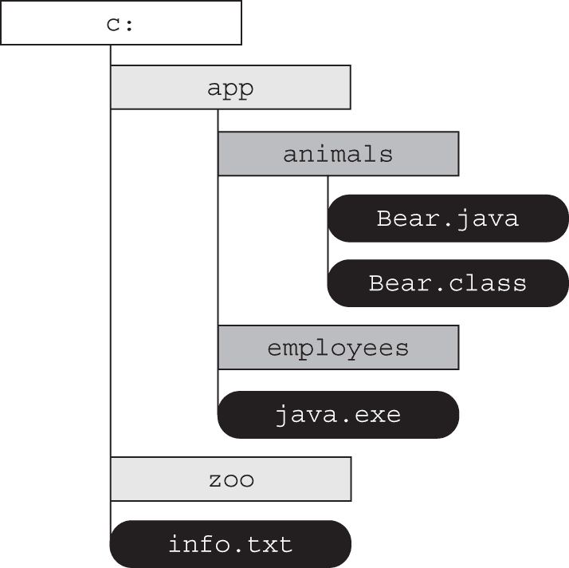

**图 8.1** 目录和文件分级结构

此图显示了根目录 `c:` 包含两个目录 `app` 和 `zoo`，以及文件 `info.txt`。在 `app` 目录下，还有两个文件夹 `animals` 和 `employees`，以及文件 `java.exe`。最后，`animals` 目录包含两个文件 `Bear.java` 和 `Bear.class`。

### 以字节形式存储数据

数据在文件系统（以及内存）中以 `0` 或 `1` 的形式存储，称为 `bit`（位）。由于对于人类来说，读/写全是 `0` 和 `1` 的数据非常困难，因此它们被组成 8 位一组，称为 `byte`（字节）。

Java 的 `byte` 原始类型又是怎样的？正如你稍后学习 I/O 流时将看到的，通常使用 `byte` 值和数组对流进行读取或写入。

### 引入 `File` 类

我们将讨论的第一个类是 `java.io` API 中最常用的类之一：`java.io.File` 类。`File` 类用于读取现有文件和目录的信息、列出目录的内容以及创建/删除文件和目录。

`File` 类的实例表示文件系统中特定文件或目录的路径。`File` 类不能读取或写入文件内部的数据，尽管正如你在下一节中看到的，它可以作为引用传递给许多流类以读取或写入数据。

#### 创建 File 对象

`File` 对象通常用一个 `String` 初始化，该字符串包含指向文件系统内文件或目录的绝对路径或相对路径。文件或目录的`absolute path`是从根目录到该文件或目录的完整路径，包括包含该文件或目录的所有子目录。或者，文件或目录的`relative path` 是从当前工作目录到该文件或目录的路径。例如，以下是 `stripes.txt` 文件的绝对路径：

```
/home/tiger/data/stripes.txt
```

假设用户当前目录设置为 `/home/tiger`，则以下是该同一文件的相对路径：

```
data/stripes.txt
```

不同的操作系统系统的其路径名的格式各不相同。例如，基于 Unix 的系统使用正斜杠 `/` 作为路径，而基于 Windows 的系统使用反斜杠 `\` 字符。尽管如此，许多编程语言和文件系统在编写路径语句时都支持这两种斜杠。为了方便起见，Java 提供了两种获取本地分隔符字符的方法：一个系统属性和一个在 `File` 类中定义的 `static` 变量。以下两个示例将输出当前环境的分隔符：

```
System.out.println(System.getProperty("file.separator"));
System.out.println(java.io.File.separator);
```

以下代码创建了一个 `File` 对象并判断其引用的路径是否存在于文件系统中：

```
var zooFile1 = new File("/home/tiger/data/stripes.txt");
System.out.println(zooFile1.exists());  // 如果文件存在则输出 true
```

此示例提供了一个文件的绝对路径，并根据文件是否存在输出 `true` 或 `false`。在考试中，你应该了解三个 `File` 构造函数。

```
public File(String pathname)

public File(File parent, String child)

public File(String parent, String child)
```

第一个通过 `String` 路径创建 `File`。另外两个构造函数用于从父路径和子级路径创建 `File`，如下所示：

```
File zooFile2 = new File("/home/tiger", "data/stripes.txt");

File parent = new File("/home/tiger");
File zooFile3 = new File(parent, "data/stripes.txt");
```

在这个示例中，我们创建了两个与之前的 `zooFile1` 实例等效的新 `File` 实例。如果 `parent` 实例为 `null`，则它将被跳过，方法将退回到单字符串 `String` 构造函数。

#### File 对象与实际文件

在处理 `File` 类的实例时，请记住它只代表一个指向文件的路径。除非进行操作，否则它并没有与文件系统中的实际文件连接。

例如，你可以创建一个新的 `File` 对象来测试文件系统中是否存在某个文件。然后你可以调用各种方法来读取文件属性。还有一些用于修改文件名称或位置的方法，以及删除它的方法。JVM 和底层文件系统将使用你对 `File` 调用的方法来读取或修改文件。如果你尝试操作一个不存在或你没有访问权限的文件，某些 `File` 方法将抛出异常。其他方法将返回 `false`。

#### 使用 File 对象

`File` 类包含许多与文件和目录交互的方法。我们在表 8.1 中展示了最常用的方法。虽然这个表看起来有很多方法需要学习，但其中许多是自言自语的。

| 方法名称 | 描述 |

| --- | --- |

| `boolean delete()` | 删除文件或目录，且仅在成功时返回 `true`。如果此实例表示目录，则该目录必须为空才能被删除。 |

| `boolean exists()` | 检查文件是否存在 |

| `String getPath()` | 获取文件系统内文件或目录的绝对名称 |

| `String getName()` | 获取文件或目录的名称。 |

| `String getParent()` | 获取路径所在的父目录，如果没有则返回 `null` |

| `boolean isDirectory()` | 检查 `File` 引用是否为文件系统中的目录 |

| `boolean isFile()` | 检查 `File` 引用是否为文件系统中的文件 |

| `long lastModified()` | 返回文件最后修改自那时以来的毫秒数（从 UTC 1970 年 1 月 1 日凌晨 0:00 开始的毫秒数） |

| `long length()` | 获取文件的字节数 |

| `File[] listFiles()` | 获取目录内的文件列表 |

| `boolean mkdir()` | 创建由路径命名的目录 |

| `boolean mkdirs()` | 创建由路径命名的目录，包括不存在的父目录 |

| `boolean renameTo(File dest)` | 将此路径表示的文件或目录重命名为 `dest`，且仅在成功时返回 `true` |

**表 8.1** 常用的 java.io.File 方法

以下是一个示例程序，它可以根据文件路径输出关于文件或目录的信息，例如它是否存在、其中包含哪些文件等：

```java
var file = new File("c:\\data\\zoo.txt");
System.out.println("File Exists: " + file.exists());
if (file.exists()) {
   System.out.println("Absolute Path: " + file.getAbsolutePath());
   System.out.println("Is Directory: " + file.isDirectory());
   System.out.println("Parent Path: " + file.getParent());
   if (file.isFile()) {
      System.out.println("Size: " + file.length());
      System.out.println("Last Modified: " + file.lastModified());
   } else {
      for (File subfile : file.listFiles()) {
         System.out.println("   " + subfile.getName());
      }
   }
}
```

如果提供的路径没有指向文件，它将输出以下内容：

```
File Exists: false
```

如果提供的路径指向一个有效文件，它将输出类似下面的内容：

```
File Exists: true
Absolute Path: c:\data\zoo.txt
Is Directory: false
Parent Path: c:\data
Size: 12382
Last Modified: 1606860000000
```

最后，如果提供的路径指向一个有效目录（例如 `c:\data`），它将输出类似下面的内容：

```
File Exists: true
Absolute Path: c:\data
Is Directory: true
Parent Path: c:\
   employees.txt
   zoo.txt
   zoo-backup.txt
```

在这些示例中，看到基于 I/O 的程序的输出完全取决于运行时底层文件系统中可用目录和文件。

在考试中，你可能会遇到看起来像文件实际上是目录，或者反之的路径。例如 `/data/zoo.txt` 可能是一个文件也可能是一个目录，尽管它有文件扩展名。除非题目告诉你是，否则不要假设它是其中某一种！

## 介绍 I/O 流

现在我们已经掌握了基础知识，让我们进入更有趣的 I/O 流的世界。在本节中，我们将向你展示如何使用 I/O 流来读取和写入数据。“I/O”指的是数据访问的性质，即从资源中读取数据（输入）或将数据写入资源（输出）。

### 理解 I/O 流基础

文件的内容可以通过*流*（stream）进行访问或写入，流是按顺序呈现的数据元素列表。在概念上，流应该被认为是一个长长的、几乎永无止的“水流”，数据每次以一个“波”的形式呈现。

我们在图 8.2 中演示了这一原理。流非常大，以至于一旦我们开始读取它，就不知道开头或结尾在哪里。我们只有一个指向流中当前位置的指针，并一次读取一个块的数据。

每种类型的流都以特定的方式将数据分段为“波”或“数据块”。例如，某些流类以单个字节为单位读取或写入数据。其他流类则读取或写入单个字符或字符字符串。此外，某些流类一次性读取或写入更大组的字节或字符，特别是那些名称中带有 `Buffered`（缓冲）字样的类。

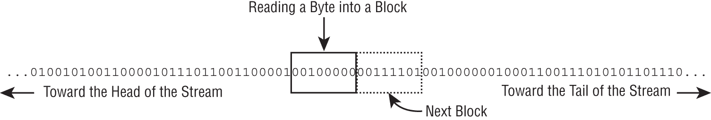

**图 8.2** 流的视觉化表示

虽然流常用于文件 I/O，但它们更通用地被用于处理任何顺序数据源的读取/写入。例如，你可以构建一个 Java 应用程序，使用输出流向网站提交数据，并通过输入流读取结果。

### 学习 I/O 流术语

`java.io` API 提供了许多类用于创建、访问和操作流——类之多，以至于让许多新的 Java 开发者感到无从。。保持冷静！我们将回顾每个流类之间的主要区别，并向你展示如何区分它们。

即使你在考试中遇到一个不熟悉的特定流，通常流的名称也能为你提供足够的信息，让你确切理解它的作用。

本节的目标是让你熟悉与流相关的常用术语和命名规范。如果你不认识本节中使用的特定流类名称或其功能，不要担心；我们将在章节的下一部分详细介绍每一种类。

#### 字节流 vs. 字符流

`java.io` API 定义了两组流类用于读取和写入流：字节流和字符流。我们在整个章节中都会使用这两种流。

##### 字节流与字符流的区别

*   字节流读取/写入二进制数据（`0` 和 `1`），其类名以 `InputStream` 或 `OutputStream` 结尾。

*   字符流读取/写入文本数据，其类名以 `Reader` 或 `Writer` 结尾。

API 经常为字节流和字符流包含相似的类，例如 `FileInputStream` 和 `FileReader`。这两个类之间的区别在于流的字节是如何读取或写入的。

重要的是，尽管字符流的类名中不包含 `Stream`（流）字样，但它们仍然是 I/O 流。在名称中使用 `Reader`/`Writer` 只是为了区分它们与字节流。

另一种方式是，`high-level stream`（高级流）是通过包装（wrapping）在另一个流之上构建的。`Wrapping` 是将一个实例传递给另一个类的构造函数的过程，并对生成的实例进行的操作经过过滤后应用到原始实例上。例如，看看下面示例代码中的 `FileReader` 和 `BufferedReader` 对象：

```
try (var br = new BufferedReader(new FileReader("zoo-data.txt"))) {
   System.out.println(br.readLine());
}
```

在这个示例中，`FileReader` 是低层流读取器，而 `BufferedReader` 是一个以 `FileReader` 为输入的高层流。高层流上的许多操作会作为操作传递给底层低层流，例如 `read()` 或 `close()`。其他操作则会重写或为低层流方法添加新功能。高层流可能会添加新方法（如 `readLine()`），并对读取和过滤低层数据进行性能增强。

高层流可以接受其他高层流作为输入。例如，虽然下面的代码初看起来可能有点奇怪，但这种包装流风格在实践中非常常见：

```
try (var ois = new ObjectInputStream(
      new BufferedInputStream(
         new FileInputStream("zoo-data.txt")))) {
   System.out.print(ois.readObject());
}
```

在这个示例中，`FileInputStream` 是直接与文件交互的低层流，它被高层的 `BufferedInputStream` 包装以提高性能。最后，整个对象被一个高层的 `ObjectInputStream` 包装，这允许我们把数据解释为 Java 对象。

对于考试来说，你只需要熟悉的低层流类是那些操作文件的类。其余非抽象流类都是高层流。

### 流基类

`java.io` 库定义了四个抽象类，它们是 API 中定义的所有流类的父类：`InputStream`、`OutputStream`、`Reader` 和 `Writer`。

高层流的构造函数通常接受抽象类的引用。例如，`BufferedWriter` 接收一个 `Writer` 对象作为输入，这允许它接收 `Writer` 的任何子类。


考试喜欢在你身上玩花招的一个常见领域是混合使用互不兼容的流类。例如，看看下面的每个示例，看你能否判断为什么它们无法编译：

```
new BufferedInputStream(new FileReader("z.txt"));  // 无法编译
new BufferedWriter(new FileOutputStream("z.txt")); // 无法编译
new ObjectInputStream(
   new FileOutputStream("z.txt"));                 // 无法编译
new BufferedInputStream(new InputStream());        // 无法编译
```

前两个示例无法编译，是因为它们分别混合了 `Reader`/`Writer` 类与 `InputStream`/`OutputStream` 类。第三个示例无法编译是因为我们正在将 `OutputStream` 与 `InputStream` 混合使用。虽然可以从 `InputStream` 读取数据并将其写入 `OutputStream`，但包装流并不是实现这一点的方法。正如你将在本节后面看到的，数据必须被复制，且通常是迭代地复制。最后，最后一个示例无法编译是因为 `InputStream` 是一个抽象类，因此你无法创建它的实例。

## 解码 I/O 类名

密切关注考试中 I/O 类的名称，因为解码它通常能给你提供关于该类功能的上下文线索。例如，不需要查阅，应该明显看出 `FileReader` 是一个以字符或字符串形式从文件中读取数据的类。此外，`ObjectOutputStream` 听起来是一个将对象数据写入字节流的类。

### java.io 类名属性回顾

- 名称中包含 `InputStream` 或 `OutputStream` 的类分别用于读取或写入二进制或字节数据。
- 名称中包含 `Reader` 或 `Writer` 的类分别用于读取或写入字符或字符串数据。
- 大多数（但不是所有）输入类都有对应的输出类。
- 低层流直接连接数据源。
- 高层流是通过包装在另一个流之上构建的。
- 名称中包含 `Buffered` 的类以字节或字符组为单位读取或写入数据，并且通常能提高顺序文件系统的性能。
- 除少数例外外，只有当两个流共享相同的抽象父类时，你才会用另一个流包装它。

对于最后一条规则，我们将在本章后面介绍其中一些异常情况（例如用 `PrintWriter` 包装 `OutputStream`）。

表 8.2 列出了所有 I/O 流继承的抽象基类。

| 类名 | 描述 |
| --- | --- |
| `InputStream` | 用于所有输入字节流的抽象类 |
| `OutputStream` | 用于所有输出字节流的抽象类 |
| `Reader` | 用于所有输入字符流的抽象类 |
| `Writer` | 用于所有输出字符流的抽象类 |

**表 8.2** java.io 抽象流基类

表 8.3 列出了你考试时应该熟悉的具体 I/O 流。注意，关于每个流的大部分信息（例如它是输入流还是输出流，或者它访问字节还是字符）都可以通过类名解码。

| 类名 | 低层/高层 | 描述 |
| --- | --- | --- |
| `FileInputStream` | 低 | 读取字节文件 |
| `FileOutputStream` | 低 | 字节文件 |
| `FileReader` | 低 | 读取字符文件 |
| `FileWriter` | 低 | 写入字符文件 |
| `BufferedInputStream` | 高 | 以缓冲方式从现有的 `InputStream` 读取字节数据，提高性能 |
| `BufferedOutputStream` | 高 | 以缓冲方式向现有的 `OutputStream` 写入字节数据，提高性能 |
| `BufferedReader` | 高 | 以缓冲方式从现有的 `Reader` 读取字符数据，提高性能 |
| `BufferedWriter` | 高 | 以缓冲方式向现有的 `Writer` 写入字符数据，提高性能 |
| `ObjectInputStream` | 高 | 从现有的 `InputStream` 反序列化原始数据类型和 Java 对象图 |
| `ObjectOutputStream` | 高 | 向现有的 `OutputStream` 序列化原始数据类型和 Java 对象图 |
| `PrintStream` | 高 | 向字节流写入 Java 对象的格式化表示 |
| `PrintWriter` | 高 | 向字符流写入 Java 对象的格式化表示 |

等一下。我们说我们正在读写字节（bytes），那么为什么方法使用的是 `int` 而不是 `byte` 呢？记住，`byte` 数据类型的范围是 256 个字符。我们需要一个额外的值来表示流的结束。Java 的作者们决定使用更大的数据类型 `int`，这样像 `-1` 这样的特殊值就可以表示流的结束。输出流类也使用 `int`，以便与输入流类保持一致。

下面的 `copyStream()` 方法展示了读取 `InputStream` 和 `Reader` 的所有值并将它们分别写入 `OutputStream` 和 `Writer` 的示例。在两个示例中，`-1` 都用于表示流的结束。

```
void copyStream(InputStream in, OutputStream out) throws IOException {
   int b;
   while ((b = in.read()) != -1) {
      out.write(b);
   }
}

void copyStream(Reader in, Writer out) throws IOException {
   int b;
   while ((b = in.read()) != -1) {
      out.write(b);
   }
}
```

字节流类还包括用于一次读写多个字节的重载方法。

```
// InputStream
public int read(byte[] b) throws IOException
public int read(byte[] b, int offset, int length) throws IOException
// OutputStream
public void write(byte[] b) throws IOException
public void write(byte[] b, int offset, int length) throws IOException
```

`offset` 和 `length` 应用于数组本身。例如，`offset` 为 `5` 且 `length` 为 `3` 表示流应该读取最多 `3` 个字节的数据，并将它们从位置 `5` 开始放入数组中。

字符流类也有相对应的方法，它们使用 `char` 代替 `byte`。

```
// Reader
public int read(char[] c) throws IOException
public int read(char[] c, int offset, int length) throws IOException

// Writer
public void write(char[] c) throws IOException
public void write(char[] c, int offset, int length) throws IOException
```

我们将在本章节的后续部分看到这些方法的示例。

## 关闭流

所有的 I/O 流都包含一个方法，用于在流不再需要时释放流中的任何资源。

```
// 所有 I/O 流类
public void close() throws IOException
```

由于流被视为资源，因此在使用后关闭所有 I/O 流是至关重要的，否则可能会导致资源泄漏。由于所有 I/O 流都实现了 `Closeable` 接口，最好的方法是使用 try-with-resources（try 资源管理）语句，这你在第 5 章已经学过。例如，下面的代码片段展示了如何使用 try-with-resources 来读取文件：

```
try (var fis = new FileInputStream("zoo.txt")) {
   System.out.print(fis.read());
}
```

在许多文件系统中，未能正确关闭文件可能会导致文件被操作系统锁定，在程序终止之前，其他进程无法对其进行读写。在整个章节中，我们将使用 try-with-resources 语法来关闭流资源，因为这是 Java 中关闭资源的推荐方式。我们还将使用 `var` 来缩短声明，因为这些语句可能会非常长！

如果需要将一个流传递给一个方法怎么办？这没问题，但流应该在创建它的方法中关闭。

```
public void printData(InputStream is) throws IOException {
   int b;
   while ((b = is.read()) != -1) {
      System.out.print(b);
   }
}

public void readFile(String fileName) throws IOException {
   try (var fis = new FileInputStream(fileName)) {
      printData(fis);
   }
}
```

在这个示例中，流在 `readFile()` 方法中创建并关闭，而由 `printData()` 处理内容。

## 操作输入流

所有输入流类都包含以下方法，用于操作从流中读取数据的顺序：

```
// InputStream and Reader
public boolean markSupported()
public void mark(int readLimit)
public void reset() throws IOException
public long skip(long n) throws IOException
```

`mark()` 和 `reset()` 方法可以将流返回到较早的位置。在调用这两个方法之一之前，你应该调用 `markSupported()` 方法，只有当支持 `mark()` 时，该方法才会返回 `true`。`skip()` 方法非常简单；它基本上是从流中读取数据并丢弃内容。

### `mark()` 和 `reset()`

假设我们有一个 `InputStream` 实例，其下一个值为 `LION`。考虑下面的代码片段：

```
public void readData(InputStream is) throws IOException {
   System.out.print((char) is.read());     // L
   if (is.markSupported()) {
      is.mark(100);  // 标记最多 100 字节
      System.out.print((char) is.read());  // I
      System.out.print((char) is.read());  // O
      is.reset();    // 将流重置到 I 之前的位置
   }
   System.out.print((char) is.read());    // I
   System.out.print((char) is.read());    // O
   System.out.print((char) is.read());    // N
}
```

如果支持 `mark()`，该代码片段将输出 `LIOION`。


进入`/path/to/xxx`目录，找到`xxx.json`。

在表达式`cvar = avar + bvar`中，加法运算符（`+`）将`avar`与`bvar`相加，得到它们的和`cvar`。

在`List.of(arg0, arg1, arg2)`中，`List`接口的工厂方法`of()`接受一系列的元素，返回包含它们的只读列表。

之后我们这样调用`cmd`命令：`cmd arg0 arg1 arg2`。

```
if (condVar > someVal) {console.log("xxx")}
```

---

```
System.out.print((char) is.read());    // O

System.out.print((char) is.read());    // N

}
```

如果支持`mark()`，代码片段将输出`LIOION`。

`mark()`和`reset()`方法可以将流返回到较早的位置。在调用这两个方法之一之前，你应该调用`markSupported()`方法，只有当支持`mark()`时，该方法才会返回`true`。`skip()`方法非常简单；它基本上是从流中读取数据并丢弃内容。

### `skip()`

假设我们有一个`InputStream`实例，其下一个值为`TIGERS`。考虑下面的代码片段：

```
System.out.print ((char) is.read()); // T

is.skip(2);  // 跳过 I 和 G

is.read();   // 读取 E 但没有输出

System.out.print((char)is.read());  // R

System.out.print((char)is.read());  // S
```

这段代码在运行时打印`TRS`。我们跳过了两个字符，`I`和`G`。我们读取了`E`但没有存储它，所以它的行为就像`skip(1)`。

`skip()`的返回值告诉我们实际上跳过了多少值。例如，如果我们在流的末尾并调用`skip(1000)`，返回值可能是`20`，表示到达结尾。使用`skip()`的返回值对于需要跟踪自己在流中的位置以及处理了多少字节是非常重要的。

## 刷新输出流

当数据被写入输出流时，底层操作系统并不保证数据到达文件系统。在许多操作系统中，数据可能会缓存在内存中，只有在缓冲区填充或经过一段时间后才会进行写入。

如果数据缓存在内存中且应用程序意外终止，数据将会丢失，因为它们从未写入文件系统。为了解决这个问题，所有的输出流类都提供了`flush()`方法，该方法请求立即写入所有积累的数据。

```
// OutputStream and Writer

public void flush() throws IOException
```

在下面的示例中，1000 个字符被写入文件流。对`flush()`的调用确保了每 100 个字符至少将数据发送到硬盘。JVM 或操作系统可以更频繁地发送数据。

```java
try (var fos = new FileOutputStream(fileName)) {

   for(int i=0; i<1000; i++) {

      fos.write('a');

      if(i % 100 == 0) {

         fos.flush();

      }

   }

}
```

`flush()`方法有助于减少应用程序终止时丢失的数据量。然而，这并不是免费的。每次使用它都可能导致应用程序出现明显的延迟，特别是对于大文件。除非你写入的数据极其关键，否则应该间歇地使用`flush()`方法。例如，不一定在每次写入后调用它。

当你完成数据写入后，也不需要调用`flush()`方法，因为`close()`方法会自动执行此操作。

## 复习常用的 I/O 流方法

表 8.4 回顾了本章你应该掌握的常用流方法。对于接收原始数组的`read()`和`write()`方法，方法的参数类型取决于流类型。以`InputStream`/`OutputStream`结尾的字节流使用`byte[]`，而以`Reader`/`Writer`结尾的字符流使用`char[]`。

| 流类 | 方法名 | 说明 |
| --- | --- | --- |
| 所有流 | `void close()` | 关闭流并释放资源 |
| 所有输入流 | `int read()` | 读取单个字节，若无可用字节则返回`-1` |
| `InputStream` | `int read(byte[] b)` | 将值读入缓冲区。返回读取的字节数 |
| `Reader` | `int read(char[] c)` | |
| `InputStream` | `int read(byte[] b, int offset, int length)` | 从位置`offset`开始向缓冲区读入最多`length`个值。返回读取的字节数 |
| `Reader` | `int read(char[] c, int offset, int length)` | |
| 所有输出流 | `void write(int)` | 写入单个字节 |
| `OutputStream` | `void write(byte[] b)` | 将值数组写入流中 |
| `Writer` | `void write(char[] c)` | |
| `OutputStream` | `void write(byte[] b, int offset, int length)` | 从索引`offset`开始从数组向流中写入`length`个值 |
| `Writer` | `void write(char[] c, int offset, int length)` | |
| 所有输入流 | `boolean markSupported()` | 如果流类支持`mark()`则返回`true` |
| 所有输入流 | `mark(int readLimit)` | 标记流中的当前位置 |
| 所有输入流 | `void reset()` | 尝试将流重置为`mark()`位置 |
| 所有输入流 | `long skip(long n)` | 读取并丢弃指定数量的字符 |
| 所有输出流 | `void flush()` | 刷新流中的缓冲区数据 |

表 8.4 常用 I/O 流方法

记住，在本章中，输入和输出流可以是指字节流和字符流。

## 使用 I/O 流类

现在我们已经回顾了流的类型及其属性，是时候开始处理具体的 I/O 流类了。访问流的一些技巧对你来说可能有些陌生，但正如你所看到的，它们在不同的类之间是相似的。

### 读取和写入二进制数据

我们将详细讨论的流类是最基础的文件流类：`FileInputStream`和`FileOutputStream`。它们分别从文件读取字节或向文件写入字节。这些类使用以下构造函数连接到文件：

```
public FileInputStream(File file) throws FileNotFoundException

public FileInputStream(String name) throws FileNotFoundException

public FileOutputStream(File file) throws FileNotFoundException

public FileOutputStream(String name) throws FileNotFoundException
```

以下代码使用`FileInputStream`和`FileOutputStream`复制文件。它与我们之前的`copyStream()`方法几乎相同，只是它是专门针对文件操作的。

```
void copyFile(File src, File dest) throws IOException {

   try (var in = new FileInputStream(src);

        var out = new FileOutputStream(dest)) {

      int b;

      while ((b = in.read()) != -1) {

         out.write(b);

      }

   }

}
```

如果源文件不存在，将抛出继承自`IOException`的`FileNotFoundException`。如果目标文件已存在，此实现将覆盖它，因为没有发送`append`标记。`copy()`方法一次复制一个字节，直到读取到的值为`-1`为止。

### 二进制数据的缓冲处理

虽然我们的`copyFile()`方法是有效的，但在处理大文件时性能往往较差。正如之前提到的，这是因为每次与文件系统的交互都有成本。我们可以轻松地使用`BufferedInputStream`和`BufferedOutputStream`来增强我们的实现。作为高级流，这些类包含了接收其他流作为输入的构造函数。

```
public BufferedInputStream(InputStream in)

public BufferedOutputStream(OutputStream out)
```

以下展示了如何应用这些流：

```
void copyFileWithBuffer(File src, File dest) throws IOException {

   try (var in = new BufferedInputStream(

           new FileInputStream(src));

        var out = new BufferedOutputStream(

           new FileOutputStream(dest))) {

      var buffer = new byte[1024];

      int lengthRead;

      while ((lengthRead = in.read(buffer))> 0) {

         out.write(buffer, 0, lengthRead);

         out.flush();

      }

   }

}
```

我们不是一次读取一个字节数据，而是一次读取并写入最多`1024`个字节。

### 读取和写入字符数据

`FileReader`和`FileWriter`类及其关联缓冲区类由于对文本的内置支持，是最方便的 I/O 类之一。它们包含了与二进制文件类相同的输入构造函数。

```
public FileReader(File file) throws FileNotFoundException

public FileReader(String name) throws FileNotFoundException

public FileWriter(File file) throws FileNotFoundException

public FileWriter(String name) throws FileNotFoundException
```

以下是使用这些类复制文件的示例：

```
void copyTextFile(File src, File dest) throws IOException {

   try (var reader = new FileReader(src);

        var writer = new FileWriter(dest)) {

      int b;

      while ((b = reader.read()) != -1) {

         writer.write(b);

      }

   }

}
```

`FileWriter`继承了`Writer`类的一个方法，允许它写入`String`值。

```
// Writer

public void write(String str) throws IOException
```

例如，以下在`FileWriter`中支持但在`FileOutputStream`中不支持：

```
writer.write("Hello World");
```

### 字符数据的缓冲

正如我们在字节流中所看到的，Java 包含了提高性能的高级缓冲字符流。构造函数接收现有`Reader`和`Writer`实例作为输入。

```
public BufferedReader(Reader in)

public BufferedWriter(Writer out)
```

它们增加了两个新方法`readLine()`和`newLine()`，这些在处理`String`值时特别有用。

```
// BufferedReader

public String readLine() throws IOException

// BufferedWriter

public void newLine() throws IOException
```

将所有内容整合在一起，以下展示了如何按行复制文件：

```
void copyTextFileWithBuffer(File src, File dest) throws IOException {

   try (var reader = new BufferedReader(new FileReader(src));

        var writer = new BufferedWriter(new FileWriter(dest))) {

      String s;

      while ((s = reader.readLine()) != null) {

         writer.write(s);

         writer.newLine();

      }

   }

}
```

在这个示例中，每次循环迭代对应于读取和写入文件的一行。假设文件中的行长度大小合理，这种实现将运行得良好。

这种方法与我们之前处理字节流的`copyFileWithBuffer()`方法之间存在一些重要的区别。首先，我们没有使用缓冲区数组，而是使用一个`String`来存储在每次循环迭代中读取的数据。通过将数据临时存储为`String`，我们可以像处理任何`String`值一样对它进行操作。例如，我们可以调用`replaceAll()`或`toUpperCase()`来创建新值。

接下来，我们使用`null`值而不是`-1`来检查流的末尾。最后，我们在循环的每次迭代中都会插入一个`newLine()`。这是因为`readLine()`会剥离换行符。如果不调用`newLine()`，复制的文件将移除所有的换行符。

### 序列化数据

在整本书中，我们一直使用类来管理我们的数据模型，因此我们希望在程序执行之间保存这些对象也是合乎逻辑的。如果动物园动物的健康状况每次运行程序都要重新输入，那么它将变得毫无用处！

你完全可以使用到为止学过的 I/O 流类来存储文本和二进制数据，但你仍然需要弄清楚如何将数据放入流并在以后对其进行解码。你有像 XML 和 CSV 这样的各种文件格式可以进行标准化处理，但通常你必须自己构建转换器。

幸运的是，我们可以使用序列化来解决如何将对象转换为流流的问题。序列化（`Serialization`）是将内存中的对象转换为字节流的过程。同样，反序列化（`deserialization`）是从字节流转换为对象的过程。序列化通常涉及将对象写入存储或可传输的格式，而反序列化是其相反的过程。

`图 8.3`显示了将`Giraffe`对象序列化到`giraffe.txt`文件以及从其反序列化的视觉表示。

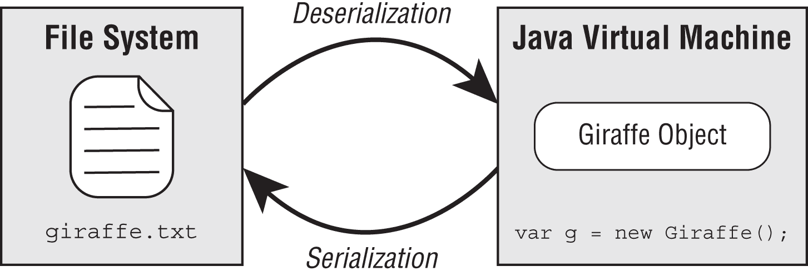

`图 8.3`序列化过程

在本节中，我们将向你展示 Java 如何提供内置机制，分别将对象流直接序列化到磁盘和从磁盘反序列化。

#### 应用`Serializable`接口

要使用 I/O API 序列化对象，对象必须实现`java.io.Serializable`接口。`Serializable`接口是一个标记接口（marker interface），类似于你在第 2 章“注解”中学习过的标记注解。通过标记接口，意味着该接口没有任何方法。任何类都可以实现`Serializable`接口，因为没有强制要求实现的方法。

使用`Serializable`接口的目的是通知任何尝试序列化该对象的进程，你已经采取了正确的步骤使对象变得可序列化。所有的 Java 原始类型以及你在整本书中过的许多内置 Java 类都是`Serializable`的。例如，此类可以被序列化：

```
import java.io.Serializable;

public class Gorilla implements Serializable {

   private static final long serialVersionUID = 1L;

   private String name;

   private int age;

   private Boolean friendly;

   private transient String favoriteFood;

   // 构造函数/Getters/Setters/toString() 省

}
```


在这个示例中，`Gorilla` 类包含三个实例成员（`name`、`age`、`friendly`），如果类被序列化，这些成员将被保存到流中。注意，由于 `Serializable` 不属于 `java.lang` 包，因此必须导入或使用包名引用。

被标记为 `transient` 的 `favoriteFood` 字段怎么办？任何被标记为 `transient` 的字段在类序列化时都不会保存到流中。我们将在接下来详细讨论。

## 将数据标记为 `transient`

通常，`transient` 修饰符用于类的敏感数据，例如 `password`。你将在第 11 章“安全”中学习更多关于此主题的知识。还有其他不适合序列化的对象，例如内存中 `Thread` 的状态。如果该对象是可序列化对象的一部分，我们只需将其标记为 `transient` 以忽略这些特定的实例成员。

被标记为 `transient` 的数据在反序列化会发生什么？它将恢复到 Java 的默认值，例如 `double` 的 `0.0`，或对象的 `null`。当我们之后介绍对象流类时，很快就会看到这些示例。

## 确保类是 `Serializable` 的

由于 `Serializable` 是一个标记接口，你可能认为使用它没有规则。并非如此！如果类没有正确实现 `Serializable` 接口，任何尝试序列化对象的进程都将抛出 `NotSerializableException`。

**如何使类可序列化**

- 该类必须被标记为 `Serializable`。
- 类的每个实例成员要么是序列化的，要么标记为 `transient`，要么在序列化时为 `null` 值。

小心第二个规则。为了使类可序列化，我们必须递归地应用第二个规则。你看出为什么下面的 `Cat` 类不可序列化吗？

```java
public class Cat implements Serializable {

   private tail = new Tail();

}

public class Tail implements Serializable {

   private fur = new Fur();

}

public class Fur {}
```

`Cat` 包含一个 `Tail` 实例，这两个类都是 `Serializable`，所以那里没有问题。遗憾的是，`Tail` 包含一个没有标记为 `Serializable` 的 `Fur` 实例。

以下任何修改都可以解决问题并允许 `Cat` 被序列化：

```java
public class Tail implements Serializable {

   private transient fur = new Fur();

}

public class Fur implements Serializable {}
```

我们也可以将 `tail` 或 `fur` 实例成员设置为 `null`，尽管这将使 `Cat` 仅对特定实例序列化。

## 使用 `ObjectOutputStream` 和 `ObjectInputStream` 存储数据

`ObjectInputStream` 类用于从流反序列化对象，而 `ObjectOutputStream` 用于将对象写入流。它们是在现有流的高级流。

```java
public ObjectInputStream(InputStream in) throws IOException
public ObjectOutputStream(OutputStream out) throws IOException
```

虽然这两个类都包含许多针对内置数据类型（如原始类型）的方法，但你考试需要记住的是与对象操作相关的方法。

```java
// ObjectInputStream
public Object readObject() throws IOException, ClassNotFoundException

// ObjectOutputStream
public void writeObject(Object obj) throws IOException
```

我们现在提供一个示例方法，将 `Gorilla` 对象的 `List` 序列化到文件。

```java
void saveToFile(List<Gorilla> gorillas, File dataFile)
      throws IOException {

   try (var out = new ObjectOutputStream(
           new BufferedOutputStream(
              new FileOutputStream(dataFile)))) {

      for (Gorilla gorilla : gorillas)
         out.writeObject(gorilla);
   }
}
```

非常简单，对吧？注意我们从文件流开始，将其封装在缓冲流中以提高性能，然后用对象流包装它。序列化数据只需将其传递给 `writeObject()` 即可简单。

一旦数据存储在文件中，我们就可以以下方法对其进行反序列化：

```java
List<Gorilla> readFromFile(File dataFile) throws IOException,
      ClassNotFoundException {

   var gorillas = new ArrayList<Gorilla>();

   try (var in = new ObjectInputStream(
           new BufferedInputStream(
              new FileInputStream(dataFile)))) {

      while (true) {
         var object = in.readObject();
         if (object instanceof Gorilla)
            gorillas.add((Gorilla) object);
      }
   } catch (EOFException e) {
      // 文件末尾
   }

   return gorillas;
}
```

啊，这不像我们的保存方法那么简单，对吧？在调用 `readObject()` 时，`null` 和 `-1` 没有任何特殊含义，因为有人可能序列化了带有这些值的对象。与我们之前从输入流中读取数据的方法不同，我们需要使用无限循环来处理数据，当流到达末尾时，该循环会抛出一个 `EOFException`。

由于 `readObject()` 的返回类型是 `Object`，我们需要进行显式的类型转换才能访问我们的 `Gorilla` 属性。注意，`readObject()` 声明了一个检查异常 `ClassNotFoundException`，因为在反序列化时该类可能不存在。

下面的代码段展示了如何调用序列化方法：

```java
var gorillas = new ArrayList<Gorilla>();
gorillas.add(new Gorilla("Grodd", 5, false));
gorillas.add(new Gorilla("Ishmael", 8, true));

File dataFile = new File("gorilla.data");
saveToFile(gorillas, dataFile);

var gorillasFromDisk = readFromFile(dataFile);
System.out.print(gorillasFromDisk);
```

假设 `Gorilla` 类中重写了 `toString()` 方法，这在运行时将打印以下内容：

```java
[[name=Grodd, age=5, friendly=false], 
 [name=Ishmael, age=8, friendly=true]]
```

## 理解反序列化的过程

为了考试，你需要理解反序列化对象是如何创建的。当你反序列化一个对象时，*创建对象时，序列化类的构造函数以及任何实例初始化器都不会被调用*。Java 将调用类层次结构中能找到的第一个不可序列化父类的无参构造函数。在我们的 `Gorilla` 示例中，这只是 `Object` 的无参构造函数。

正如我们之前提到的，任何 `static` 或 `transient` 字段都会被忽略。未提供的值将获得其 Java 默认值，例如 `String` 的 `null` 或 `int` 值的 `0`。

让我们来看一个新的 `Chimpanzee` 类。这次我们确实列出了构造函数，以说明在反序列化时没有任何一个构造函数被使用。

```java
import java.io.Serializable;

public class Chimpanzee implements Serializable {
   private static final long serialVersionUID = 2L;
   private transient String name;
   private transient int age = 10;
   private static char type = 'C';

   { this.age = 14; }

   public Chimpanzee() {
      this.name = "Unknown";
      this.age = 12;
      this.type = 'Q';
   }

   public Chimpanzee(String name, int age, char type) {
      this.name = name;
      this.age = age;
      this.type = type;
   }

   // Getters/Setters/toString() omitted
}
```

假设我们重写之前的序列化和反序列化方法来处理 `Chimpanzee` 对象而不是 `Gorilla` 对象，你认为下面的代码会打印什么？

```java
var chimpanzees = new ArrayList<Chimpanzee>();
chimpanzees.add(new Chimpanzee("Ham", 2, 'A'));
chimpanzees.add(new Chimpanzee("Enos", 4, 'B'));

File dataFile = new File("chimpanzee.data");
saveToFile(chimpanzees, dataFile);

var chimpanzeesFromDisk = readFromFile(dataFile);
System.out.println(chimpanzeesFromDisk);
```

思考一下。继续吧，我们会等的。

准备好看答案了吗？首先，没有任何一个实例成员会被序列化到文件中。`name` 和 `age` 变量都被标记为 `transient`，而 `type` 变量是 `static` 的。我们特意使用 `this` 访问了 `type` 变量，以看看你是否在关注。

反序列化时，`Chimpanzee` 中的任何构造函数都不会被调用。即使是设置值 [`name=Unknown,age=12,type=Q]` 的无参构造函数也被忽略了。将 `age` 设置为 `14` 的实例初始化器也没有执行。

在这种情况下，`name` 变量被初始化为 `null`，因为那是 Java 中 `String` 的默认值。同样，`age` 变量被初始化为 `0`。假设实现了 `toString()` 方法，程序将打印如下：

```java
[[name=null,age=0,type=B],
 [name=null,age=0,type=B]]
```

`type` 变量呢？因为它是 `static` 的，它实际上会显示最后设置的值。如果数据在同一次执行过程中序列化并反序列化，那么它将显示 `B`，因为那是我们创建的最后一个 `Chimpanzee`。

## 输出数据

`PrintStream` 和 `PrintWriter` 是用于写入数据的高级输出流类。我们合并介绍它们，因为它们包含许多相同的方法。只需记住，一个操作 `OutputStream`，而另一个操作 `Writer`。

打印流类的特殊之处在于，它们是我们涵盖的 I/O 流类中没有对应输入流类的。与 `OutputStream` 类不同，`PrintStream` 的名称中并不包含 `Output`。

打印流类包含以下构造函数：

```java
public PrintStream(OutputStream out)
public PrintWriter(Writer out)
```

为了方便，这些类还包含了将打印流封装在底层流周围的构造函数，例如 `FileOutputStream` 和 `FileWriter`。

```java
public PrintStream(File file) throws FileNotFoundException
public PrintStream(String fileName) throws FileNotFoundException
public PrintWriter(File file) throws FileNotFoundException
public PrintWriter(String fileName) throws FileNotFoundException
```

此外，`PrintWriter` 类甚至有一个接收 `OutputStream` 作为输入的构造函数。这是我们可以混合字节流和字符流的少数异常之一。

```java
除了继承的 `write()` 方法外，打印流类包含了许多写入数据方法，包括 `print()`、`println()` 和 `format()`。与我们涵盖的大多数流不同，打印流类的方法不会抛出任何检查异常。如果它们抛出，那么你每次调用 `System.out.print()` 时都必须捕获检查异常！流类确实提供了一个 `checkError()` 方法，可用于写入后检查错误。

在处理 `String` 数据时，应该使用 `Writer`，因此本章这部分的示例使用了 `PrintWriter`。只需注意，这些示例中的许多内容都可以轻松地重写为使用 `PrintStream`。

### `print()`

基于打印的方法中最基础的是 `print()`。打印流类包含了许多重载的 `print()` 方法，它们可以接收从基本类型和 `String` 值到对象的任何参数。在内部，这些方法通常只是对参数执行 `String.valueOf()`，并调用底层流的 `write()` 方法将其添加到流中。例如，以下组 `print`/`write` 代码是等价的：

```java
try (PrintWriter out = new PrintWriter("zoo.log")) {
   out.write(String.valueOf(5));  // Writer method
   out.print(5);                  // PrintWriter method

   var a = new Chimpanzee();
   out.write(a==null ? "null": a.toString()); // Writer method
   out.print(a);                              // PrintWriter method
}
```

### `println()`

`PrintStream` 和 `PrintWriter` 类中后续可用的方法是 `println()` 方法，它们与 `print()` 方法几乎相同，不同在于它们在写入 `String` 值后还会打印一个换行符。这些打印流类还包含一个无参数的 `println()` 版本，它只打印一个单独的换行符。

`println()` 方法特别有用，因为换行符取决于操作系统。例如，在某些系统中，换行符 `\n` 表示换行，而其他系统则使用回车符号紧接换行符 `\r\n` 来表示换行。类似于 `file.separator` 属性，`line.separator` 的值可以通过两个地方获取：作为 Java 系统属性以及通过 `static` 方法。

```java
System.getProperty("line.separator");
System.lineSeparator();
```

### `format()`

在第 5 章中，你学习了许多关于针对不同区域格式化消息、日期和数字的知识。每个打印流类都包含一个 `format()` 方法，其中接受 `Locale` 的重载版本。

```java
// PrintStream
public PrintStream format(String format, Object args…)
public PrintStream format(Locale loc, String format, Object args…)

// PrintWriter
public PrintWriter format(String format, Object args…)
public PrintWriter format(Locale loc, String format, Object args…)
```

方法参数用于在单次方法调用中构造格式化的 `String`，而不是通过大量的格式化和拼接操作。它们返回对被调用实例的引用，以便对操作进行链式调用。

例如，以下两个 `format()` 调用打印了相同的文本：


```
String name = "Lindsey";
int orderId = 5;

// 均打印：Hello Lindsey, order 5 is ready
System.out.format("Hello "+name+", order "+orderId+" is ready");
System.out.format("Hello %s, order %d is ready", name, orderId);
```

在第二次`format()`操作中，参数通过符号按照它们在变长参数提供的顺序进行插入和格式化。表 8.5 列出了考试中需要掌握的符号。

| 符号 | 描述 |
| --- | --- |
| `%s` | 适用于任何类型，通常为`String`值 |
| `%d` | 适用于`int`和`long`等整数值 |
| `%f` | 适用于`float`和`double`等浮点数值 |
| `%n` | 使用依赖于系统的换行符插入换行 |

**表 8.5** 常见的打印流`format()`符号

以下示例使用了表 8.5 中的所有四个符号：

```
String name = "James";
double score = 90.25;
int total = 100;
System.out.format("%s:%n   Score: %f out of %d", name, score, total);
```

这输出如下内容：

```
James:
   Score: 90.250000 out of 100
```

混合数据类型可能会在运行时抛出异常。例如，以下代码在期望整数值时使用了浮点数，因此会抛出异常：

```
System.out.format("Food: %d tons", 2.0); // IllegalFormatConversionException
```

### `PrintWriter` 程序

让我们将它们整合。以下示例代码展示了`PrintWriter`类的用法：

```
File source = new File("zoo.log");
try (var out = new PrintWriter(
   new BufferedWriter(new FileWriter(source)))) {
   out.print("Today's weather is: ");
   out.println("Sunny");
   out.print("Today's temperature at the zoo is: ");
   out.print(1 / 3.0);
   out.println('C');
   out.format("It has rained %5.2f inches this year %d", 10.2, 2021);
   out.println();
   out.printf("It may rain %s more inches this year", 1.2);
}
```

程序运行后，`zoo.log`包含如下：

```
Today's weather is: Sunny
Today's temperature at the zoo is: 0.3333333333333333C
It has rained 10.20 inches this year 2021
It may rain 1.2 more inches this year
```

你应该密切注意示例中的换行符。例如，我们在`format()`之后调用了`println()`，因为`format()`不会在文本后自动插入换行符。实践中打印数据最常见的 Bug 之一未能正确处理换行符。

### 流类回顾

我们结束对流类的讨论。这些类很少直接使用。这是因为实践中打印数据最常见的 Bug 之一未能正确处理换行符。


`System`流由整个应用程序共享。JVM 创建并打开了它们。它们可以使用 try 资源（try-with-resources）语句或调用`close()`，尽管*不建议关闭它们*。

### 与用户交互

Java 包含两个`PrintStream`实例向用户提供信息：`System.out`和`System.err`。虽然`System.out`对你来说应该，但`System.err`可能是新的。它们在实践中有何不同？部分程度上取决于执行程序的环境。例如，如果你从命令行提示符运行，它们的格式可能相同。另一方面，如果你在集成开发环境（IDE）中工作，可能会以不同的颜色打印`System.err`文字。最后，如果代码在服务器上运行，`System.err`流可能会写入不同的日志文件。

### 作为流读取输入

`System.in`返回一个`InputStream`并用于检索用户的文本输入。它通常通过`InputStreamReader`封装为`BufferedReader`以使用`readLine()`方法。

```
var reader = new BufferedReader(new InputStreamReader(System.in));
String userInput = reader.readLine();
System.out.println("You entered: " + userInput);
```

执行时，此应用程序首先从用户获取文本，直到用户按下回车键。然后将用户输入的文本输出到屏幕。

### 关闭系统流

你可能注意到，当我们使用它们时，从未创建或关闭`System.out`、`System.err`和`System.in`。事实上，这些是整个章节中我们没有在 try 资源块上的唯一 I/O 流！

由于这些是`static`对象，`System`流由整个应用程序共享。JVM 创建并打开了它们。

你认为以下代码段会打印什么？

```
try (var out = System.out) {}
System.out.println("Hello"); 
```

什么都没有输出。请记住，`PrintStream`的方法不会抛出任何检查异常（checked exceptions），而是依赖`checkError()`来报告错误，因此它们会静默失败。

这个例子呢？

```
try (var err = System.err) {}
System.err.println("Hello"); 
```

这个例子也没有输出。和`System.out`一样，`System.err`是一个`PrintStream`。即使它真的抛出了异常，我们也很难看到它，因为我们用于报告错误的流已经关闭了！关闭`System.err`是一个特别糟糕的主意，因为所有异常的堆栈轨迹都将被隐藏。

最后，你认为这段代码段会做什么？

```
var reader = new BufferedReader(new InputStreamReader(System.in));
try (reader) {}
String data = reader.readLine();  // IOException
```

它在运行时抛出一个异常。与`PrintStream`类不同，大多数`InputStream`实现在你尝试对关闭的流进行操作时会抛出异常。

### 使用控制台获取输入

`java.io.Console`类专门为处理用户交互而设计。毕竟，`System.in`和`System.out`只是原始流，而`Console`是一个拥有许多围绕用户输入的方法的类。

`Console`类是一个单例，因为它只能通过工厂方法访问，并且 JVM 只会创建一个它的实例。例如，如果你在考试中遇到类似下面的代码，它是无法编译的，因为所有构造函数都是私有的（`private`）：

```
Console c = new Console();  // 编译
```

下面的代码段展示了如何获取`Console`并使用它来检索用户输入：

```
Console console = System.console();
if (console != null) {
   String userInput = console.readLine();
   console.writer().println("You entered: " + userInput);
} else {
   System.err.println("Console not available");
}
```

该程序首先获取`Console`实例并验证它是否可用，如果不可用则向`System.err`输出消息。如果可用，则它将从用户处读取一行输入并打印结果。正如你可能注意到的，这个例子与我们之前使用`System.in`和`System.out`读取用户输入的示例等效。

### reader() 和 writer()

`Console`类包含了用于读取和写入数据的两个流。

```
public Reader reader()

public PrintWriter writer()
```

访问这些类比于直接调用`System.in`和`System.out`，尽管它们使用的是字符流而不是字节流。通过这种方式，它们更适合处理文本数据。

### format()

使用`Console`打印数据时，你可以跳过调用`writer().format()`，直接在次调用中将数据输出到流中。

```
public Console format(String format, Object… args)
```

`format()`方法的行为与流类上的`format()`方法相同，它在应用各种参数的同时格式化并打印一个`String`。事实上，它们非常相似，甚至有一个等效的`Console printf()`方法，功能与`format()`相同。我们不想让以前的 C 语言开发者去学习新的方法名！

下面的示例代码向用户打印信息：

```
Console console = System.console();
if (console == null) {
   throw new RuntimeException("Console not available");
} else {
   console.writer().println("Welcome to Our Zoo!");
   console.format("It has %d animals and employs %d people", 391, 25);
   console.writer().println();
   console.printf("The zoo spans %5.1f acres", 128.91);
}
```

假设`Console`在运行时可用，它将输出如下：

```
Welcome to Our Zoo!
It has 391 animals and employs 25 people
The zoo spans 128.9 acres.
```

### readLine() 和 readPassword()

`Console`类包含了四个用于从用户处检索普通文本数据的方法。

```
public String readLine()
public String readLine(String fmt, Object… args)

public char[] readPassword()
public char[] readPassword(String fmt, Object… args)
```

配合`BufferedReader`使用`System.in`一样，`Console readLine()`方法会读取直到用户按下回车键。`readLine()`的重载版本会在请求输入之前显示格式化的消息提示。

`readPassword()`方法与`readLine()`方法相似，但有两个重要的区别：

*   用户输入的文本在输入时不会回显并显示在屏幕上。

*   数据以`char[]`而不是`String`返回。

第一个特征通过不在屏幕上显示密码（即使有人恰好坐在你旁边）提高了安全性。第二个特征涉及防止密码进入`String`常量池，这将在第 11 章中讨论。

### 复习 Console 方法

我们展示的最后一个代码示例向用户提出了一系列问题，并根据这些信息使用在本节中学到的许多各种方法打印结果：

```
Console console = System.console();
if (console == null) {
   throw new RuntimeException("Console not available");
} else {
   String name = console.readLine("Please enter your name: ");
   console.writer().format("Hi %s", name);
   console.writer().println();

   String address = console.readLine("What is your address? ");
   console.writer().format("Address: %s", address);
   console.writer().println();

   char[] password = console.readPassword("Enter a password between %d and %d characters: ", 5, 10);
   if (java.util.Arrays.equals(password, null)) {
      console.printf("Passwords match");
   } else {
      console.printf("Passwords do not match");
   }
}
```

假设`Console`可用，输出应该类似于：

```
Please enter your name: Max
Hi Max
What is your address? Spoonerville
Enter a password between 5 and 10 characters: 
Passwords match
```

- **区分字节流和字符流。** 流分为字节流或字符流。字节流处理二进制数据，其名称以`Stream`结尾；而字符流处理文本数据，其名称以`Reader`或`Writer`结尾。

- **区分输入流和输出流。** 对流的操作涉及接收数据或发送数据。`InputStream`和`Reader`类是接收数据的顶层抽象类，而`OutputStream`和`Writer`类是发送数据的顶层抽象类。本章中涵盖的所有 I/O 输出流都有对应的输入流，但`PrintStream`和`PrintWriter`除外。`PrintStream`的独特之处在于，它是唯一一个在名称中不包含`Output`单词的`OutputStream`。

- **区分低级流和高级级流。** 低级流是直接在底层资源（如文件或网络连接）上操作的流。高级流则是对低级流或其他高级级流进行操作，以过滤数据、转换数据或提高性能。

- **能够执行常见的流操作。** 所有流都包含一个`close()`方法，该方法可以通过`try-with-resources`语句自动调用。输入流包含操纵流的方法，包括`mark()`、`reset()`和`skip()`。在使用`mark()`和`reset()`之前，请记住调用`markSupported()`，因为某些流不支持此操作。输出流包含`flush()`方法，用于强制将任何缓冲区中的数据写入底层资源。

- **能够识别并了解如何使用各种流类。** 除了四个顶层抽象类外，你应该熟悉文件、缓冲、打印和对象流类。你还应该知道如何恰地用另一个流来包装一个流。

- **理解如何使用 Java 序列化。** 如果一个类实现了`java.io.Serializable`接口，并且包含可序列化或标记为`transient`的实例成员，则该类被认为是可序列化的。所有的 Java 原始数据类型和`String`类都是可序列化的。`ObjectInputStream`和`ObjectOutputStream`类可以分别用于从流中读取和向流写入`Serializable`对象。

- **能够与用户交互。** 能够使用系统流（`System.out`、`System.err`和`System.in`）以及`Console`类与用户进行交互。`Console`类包含了用于格式化数据和获取复杂输入（如密码）的特殊方法。

## 复习题

章节复习题的答案可以在附录 B 中找到。

1. 使用哪个类读取二进制文件到 Java 对象效果最好？

    1. `ObjectWriter`

    2. `ObjectOutputStream`

    3. `BufferedStream`

    4. `ObjectReader`

    5. `FileReader`

    6. `ObjectInputStream`

    7. 以上都不是

2. 下列哪些方法是`java.io.File`类实例的可用方法？（选择所有适用）

    1. `mv()`

    2. `createDirectory()`

    3. `mkdirs()`

    4. `move()`

    5. `renameTo()`

    6. `copy()`

    7. `mkdir()`

3. 在`main()`方法中创建的`Eagle`实例序列化后反序列化化，`name`的值是多少？


```java
import java.io.Serializable;
class Bird {
   protected transient String name;
   public void setName(String name) { this.name = name; }
   public String getName() { return name; }
   public Bird() {
      this.name = "Matt";
   }
}
public class Eagle extends Bird implements Serializable {
   { this.name = "Olivia"; }
   public Eagle() {
      this.name = "Bridget";
   }
   public static void main(String[] args) {
      var e = new Eagle();
      e.name = "Adeline";
   }
}
```

1. `Adeline`

2. `Matt`

3. `Olivia`

4. `Bridget`

5. `null`

6. 代码无法编译。

7. 代码可以编译但在运行时抛出异常。

## 4. 哪些类允许以下代码通过编译？（选择所有适用）

```java
var is = new BufferedInputStream(new FileInputStream("z.txt"));
InputStream wrapper = new ____________(is);
try (wrapper) {}
```

1. `BufferedInputStream`

2. `FileInputStream`

3. `BufferedWriter`

4. `ObjectInputStream`

5. `ObjectOutputStream`

6. `BufferedReader`

7. 以上都不是，因为第一行无法编译。

## 5. 下列哪些是正确的？（选择所有适用）

1. 如果没有 `Console`，`System.console()` 将抛出 `IOException`。

2. 如果没有 `Console`，`System.console()` 将返回 `null`。

3. 每次调用 `System.console()` 都会创建一个新的 `Console` 对象。

4. `Console` 只能用于写入输出，不能读取输入。

5. `Console` 包含一个 `format()` 方法，将数据写入控制台输出流。

6. `Console` 包含一个 `println()` 方法，将数据写入控制台输出流。

## 6. 关于关闭 I/O 流的哪些描述是正确的？（选择所有适用）

1. `InputStream` 和 `Reader` 实例是使用后应该关闭的唯一 I/O 流。

2. `OutputStream` 和 `Writer` 实例是使用后应该关闭的唯一 I/O 流。

3. `InputStream`/`OutputStream` 和 `Reader`/`Writer` 使用后都应该关闭。

4. 传统的 `try` 语句可以用于关闭 I/O 流。

5. `try-with-resources` 可以用于关闭 I/O 流。

6. 以上都不是。

## 7. 假设 `in` 是有效流，其后续字节为 `XYZABC`。在 `count` 为 `3` 的情况下，对流调用以下方法的结果是什么？

```java
public static String pullBytes(InputStream in, int count)
           throws IOException {
   in.mark(count);
   var sb = new StringBuilder();
   for(int i=0; i<count; i++)
      sb.append((char)in.read());
   in.reset();
   in.skip(1);
   sb.append((char)in.read());
   return sb.toString();
}
```

1. 返回 `String` 值为 `XYZ`。

2. 返回 `String` 值为 `XYZA`。

3. 返回 `String` 值为 `XYZX`。

4. 返回 `String` 值为 `XYZY`。

5. 代码无法编译。

6. 代码可以编译但在运行时抛出异常。

7. 根据给出的信息无法确定结果。

## 8. 关于序列化的哪些陈述是正确的？（选择所有适用）

1. 反序列化涉及将数据转换为 Java 对象。

2. 序列化涉及将数据转换为 Java 对象。

3. 所有非线程类都应该标记为 `Serializable`。

4. `Serializable` 接口要求实现 `serialize()` 和 `deserialize()` 方法。

5. `Serializable` 是函数式接口。

6. 即使结果没有转换为特定类型，`ObjectInputStream` 的 `readObject()` 方法也可能抛出 `ClassNotFoundException`。

## 9. 假设 `/` 是文件系统中的根目录，以下哪些正确的？（选择所有适用）

1. `/home/parrot` 是绝对路径。

2. `/home/parrot` 是目录。

3. `/home/parrot` 是相对路径。

4. 如果 `/home` 不存在，`new File("/home")` 将抛出异常。

5. 如果 `/home` 不存在，`new File("/home").delete()` 将抛出异常。

## 10. 你想要将类序列化到流中，该类有什么要求？（选择所有适用）

1. 该类必须标记为 `final`。

2. 该类必须继承 `Serializable` 类。

3. 该类必须声明一个 `static serialVersionUID` 变量。

4. 类中所有的 `static` 成员必须标记为 `transient`。

5. 该类必须实现 `Serializable` 接口。

6. 类的所有实例成员必须是可序列化的，或者标记为 `transient`。

## 11. 给定一个包含多个文件和目录的目录 `/storage`，在其上执行 `deleteTree("/storage")` 方法的结果是什么？

```java
public static void deleteTree(File file) {
    if(!file.isFile())                    // f1
        for(File entry: file.listFiles())  // f2
           deleteTree(entry);
     else file.delete();
  }
```

1. 它只会删除空目录。

2. 它会删除整个目录树，包括 `/storage` 目录本身。

3. 它会删除目录树中的所有文件。

4. 代码将因为行 `f1` 而无法编译。

5. 代码将因为行 `f2` 而无法编译。

6. 以上均不是。

## 12. 执行以下代码可能的结果有哪些？（选择所有适用项。）

```java
public static void main(String[] args) {
    String line;
    var c = System.console();
    Writer w = c.writer();
    try (w) {
        if ((line = c.readLine("Enter your name: ")) != null)
           w.append(line);
        w.flush();
     }
  }
```

1. 代码运行但没有打印任何内容。

2. 代码打印了用户输入的内容。

3. 抛出了 `ArrayIndexOutOfBoundsException`。

4. 抛出了 `NullPointerException`。

5. 以上均不是，因为代码无法编译。

## 13. 假设绝对路径 `/weather/winter/snow.dat` 代表文件系统中存在的一个文件。以下哪行代码创建了表示该文件的文件的对象？（选择所有适用项。）

1. `new File("/weather", "winter", "snow.dat")`

2. `new File("/weather/winter/snow.dat")`

3. `new File("/weather/winter", new File("snow.dat"))`

4. `new File("weather", "/winter/snow.dat")`

5. `new File(new File("/weather/winter"), "snow.dat")`

6. 以上均不是。

## 14. 以下哪些是 Java 中内置的流？（选择所有适用项。）

1. `System.err`

2. `System.error`

3. `System.in`

4. `System.input`

5. `System.out`

6. `System.output`

## 15. 下列哪些不是 `java.io` 类？（选择所有适用项。）

1. `BufferedReader`

2. `BufferedWriter`

3. `FileReader`

4. `FileWriter`

5. `PrintReader`

6. `PrintWriter`

## 16. 假设 `zoo-data.txt` 存在且不为空，关于以下方法的描述哪些是正确的？（选择所有适用项。）

```java
private void echo() throws IOException {
    var o = new FileWriter("new-zoo.txt");
    try (var f = new FileReader("zoo-data.txt");
         var b = new BufferedReader(f); o) {
        o.write(b.readLine());
     }
    o.write("");
  }
```

1. 运行时，该方法会创建一个包含有一行文本的新文件。

2. 运行时，该方法会创建一个包含两行文本的新文件。

3. 运行时，该方法会创建一个与原始文件行数相同的新文件。

4. 该方法可以编译，但在运行时会抛出异常。

5. 该方法无法编译。

6. 该方法使用的是字节流。

## 17. 假设 `reader` 是一个支持 `mark()` 且字符为 `PEKS` 的流。以下代码片段的预期输出是什么？

```java
var sb = new StringBuilder();
     sb.append(reader.read());
     reader.mark(10);
     for(int i=0; i<2; i++) {
         sb.append(reader.read());
         reader.skip(2);
      }
     reader.reset();
     reader.skip(0);
     sb.append(reader.read());
     System.out.println(sb.toString());
```

1. `PEAE`

2. `PEOA`

3. `PEOE`

4. `PEOS`

5. 代码无法编译。

6. 代码编译但在运行时抛出异常。

7. 根据给定信息无法确定。

## 18. 假设你需要将 `int`、`double`、`boolean` 和 `String` 值写入文件并保持原始数据类型。你还希望对大文件具有良好的性能。哪三个 `java.io` 流类可以组合来实现结果？（选择三项。）

1. `FileWriter`

2. `FileOutputStream`

3. `BufferedOutputStream`

4. `ObjectOutputStream`

5. `DirectoryOutputStream`

6. `PrintWriter`

7. `PrintStream`

## 19. 对于以下方法，哪些描述是正确的？（选择所有适用项。）

```java
public void copyFile(File file1, File file2) throws Exception {
    var reader = new InputStreamReader(
        new FileInputStream(file1));
    try (var writer = new FileWriter(file2)) {
        char[] buffer = new char[10];
        while(reader.read(buffer) != -1) {
           writer.write(buffer);
           // n1
        }
     }
  }
```

1. 代码无法编译，因为 `reader` 不是 `Buffered` 流。

2. 代码无法编译，因为 `writer` 不是 `Buffered` 流。

3. 代码编译并正确拷贝某些文件的数据。

4. 代码编译并正确拷贝所有文件的数据。

5. 如果在 `while` 循环迭代次后检查 `file2`，它可能是空的。

6. 如果在 `while` 循环迭代次后检查 `file2`，它将包含好 50 个字符。

7. 该方法存在资源泄漏。

## 20. 独立插入空白处的哪些值可以允许代码编译？（选择所有适用项。）

```java
Console console = System.console();
     String color = console.readLine("Favorite color? ");
     console.________________("Your favorite color is %s", color);
```

1. `reader().print`

2. `reader().println`

3. `format`

4. `writer().print`

5. `writer().println`

6. 以上均不是。

## 21. 使用字符流（如 `Reader`/`Writer`）而不是字节流（如 `InputStream`/`OutputStream`）的理由有哪些？（选择所有适用项。）

1. 处理 `String` 数据时代码语法更方便

2. 性能提高

3. 自动字符编码

4. 内置的序列化和反序列化

5. 字符流是高层流。

6. 多线程支持。

## 22. 在对第 15 行创建的类实例使用 `ObjectOutputStream` 序列化并通过 `ObjectInputStream` 反序列化后，哪些字段将为 `null`？（选择所有适用项。）

```java
import java.io.Serializable;
import java.util.List;
public class Zebra implements Serializable {
   private transient String name = "George";
   private static String birthPlace = "Africa";
   private transient Integer age;
   List<Zebra> friends = new java.util.ArrayList<>();
   private Object stripes = new Object();
   { age = 10;}
   public Zebra() {
      this.name = "Sophia";
   }
   static Zebra writeAndRead(Zebra z) {
      // Implementation omitted
   }
   public static void main(String[] args) {
      var zebra = new Zebra();
      zebra = writeAndRead(zebra);
   }
}
```

1. `name`

2. `stripes`

3. `age`

4. `friends`

5. `birthPlace`

6. 代码无法编译。

7. 代码可以编译但在运行时抛出异常。

# 第 9 章：NIO.2

在第 8 章“I/O”中，我们介绍了 `java.io` API 并讨论了如何使用它与文件和流进行交互。在本章中，我们将关注 `java.nio` 版本 2 API，简称 `NIO.2`，用于与文件进行交互。`NIO.2` 是非阻塞输入输出 API（Non-blocking Input/Output API）第二个版本的缩写，有时被称为“新 I/O”。


在本章中，我们将展示 `NIO.2` 如何让我们比原始的 `java.io` API 能够更多地处理文件和目录。我们还将展示如何应用 `Streams` API 来执行复杂的文件和目录操作。最后，我们将展示使用 `NIO.2` 读写文件属性的各种方法。

## 介绍 NIO.2

从核心角度来看，`NIO.2` 是对你在第 8 章中学习过的旧版 `java.io.File` 类的替换。该 API 的目标是为文件和目录操作提供一个更直观、功能更丰富的 API。

我们所说的“旧版”，是指在较新的软件应用程序中处理文件和目录的首选方法是使用 `NIO.2` 而不是 `java.io.File`。正如你很快看到的，`NIO.2` 比所支持的旧类提供了许多功能和性能改进。

### 介绍 Path

`NIO.2` 的基石是 `java.nio.file.Path` 接口。`Path` 实例表示存储系统上指向文件或目录的层级路径。你可以将 `Path` 视为 `java.io.File` 类的 `NIO.2` 替代品，尽管它的用法略有不同。

在深入讨论之前，让我们聊聊这两种实现之间的相似之处。`java.io.File` 和 `Path` 对象都可以指向文件系统中的绝对路径或相对路径。此外，它们都可能指向文件或目录。正如我们在第 8 章中所做并在在本章中继续做的那样，我们将指向目录的实例视为文件，因为它们存储在文件系统中具有相似的属性。例如，我们可以在两个 API 中通过相同的命令重命名文件或目录。

现在来看一些完全不同的。与 `java.io.File` 类不同，`Path` 接口包含了对符号链接（symbolic links）的支持。*符号链接*是文件系统中的特殊文件，用作指向另一个位置的快捷方式。

这些示例中的某些在运行时可能会抛出 `IllegalArgumentException`，因为某些系统要求 URI 必须绝对的。`URI` 类确实有一个 `isAbsolute()` 方法，尽管它指的是 URI 是否包含架构（schema），而不是文件位置。

### 从 `FileSystem` 类获取 `Path`

`NIO.2` 大量使用工厂类来创建对象。正如你已经看到的，`Paths` 类创建了 `Path` 接口的实例。同样，`FileSystems` 类创建了抽象类 `FileSystem` 的实例。

```
// FileSystems 工厂方法
public static FileSystem getDefault()
```

`FileSystem` 类包含了直接与文件系统操作的方法。事实上，`Paths.get()` 和 `Path.of()` 实际上都是这个 `FileSystem` 方法的快捷方式：

```
// FileSystem 实例方法
public default Path getPath​(String first, String… more)
```

让我们再次重写之前的三个示例，向你展示如何通过“长路 way”获取 `Path` 实例。

```
Path path1 = FileSystems.getDefault().getPath("pandas/cuddly.png");
Path path2 = FileSystems.getDefault()
   .getPath("c:\\zooinfo\\November\\employees.txt");
Path path3 = FileSystems.getDefault().getPath("/home/zoodirectory");
```

### 从 `java.io.File` 类获取 `Path`

最后但同样重要的是，我们可以使用旧的 `java.io.File` 类获取 `Path` 实例。事实上，我们也可以从 `Path` 实例获取 `java.io.File` 对象。

```
// Path 转 File，使用 Path 实例方法
public default File toFile()

// File 转 Path，使用 java.io.File 实例方法
public Path toPath()
```

提供这些方法是为了方便操作，也是为了有助于旧新 API 之间的集成。以下是每个方法的示例：

```
File file = new File("husky.png");
Path path = file.toPath();
File backToFile = path.toFile();
```

尽管，在处理较新的应用程序时，你应该依赖 `NIO.2` 的 `Path` 接口，因为它包含了更多的功能。

### 复习 NIO.2 关系

到此时，你应该意识到 `NIO.2` 大量使用了工厂模式。你应该习惯这种范式。你与 `NIO.2` 的许多交互都需要两种类型：抽象类或接口，以及一个工厂或辅助类。图 9.2 显示了 `NIO.2` 类之间的关系，以及选定的 `java.io` 和 `java.net` 类。

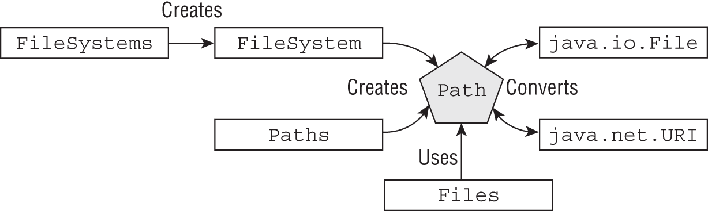

图 9.2 NIO.2 类与接口关系

仔细复习 图 9.2。在使用 `NIO.2` 时，请注意类名是单数还是复数。名称为复数的类包含了创建或操作单数名称类/接口实例的方法。记住，`Path` 也可以通过静态工厂方法 `of()` 从 `Path` 接口创建。

包含在 图 9.2 中的类是 `java.nio.file.Files`，我们将在本章介绍。现在你只需要知道它是辅助或工具类，主要对 `Path` 实例进行操作，以读取或修改实际的文件和目录。

### 理解常见的 NIO.2 特性

在本章中，我们介绍了许多你考试需要掌握的方法。在进入每个方法的具体细节之前，我们在本节中介绍了许多常见特性，以便在你看到它们时不会感到意外。

#### 应用路径符号

绝对路径和相对路径可以包含路径符号。*路径符号*是在某些文件系统中具有特殊含义的保留字符序列。对于考试，你需要了解两个路径符号，如 表 9.1 所示。

| 符号 | 描述 |
| --- | --- |
| `.` | 对当前目录的引用 |
| `..` | 对当前目录父目录的引用 |

表 9.1 文件系统符号

我们在 图 9.3 中阐明了路径符号的使用。

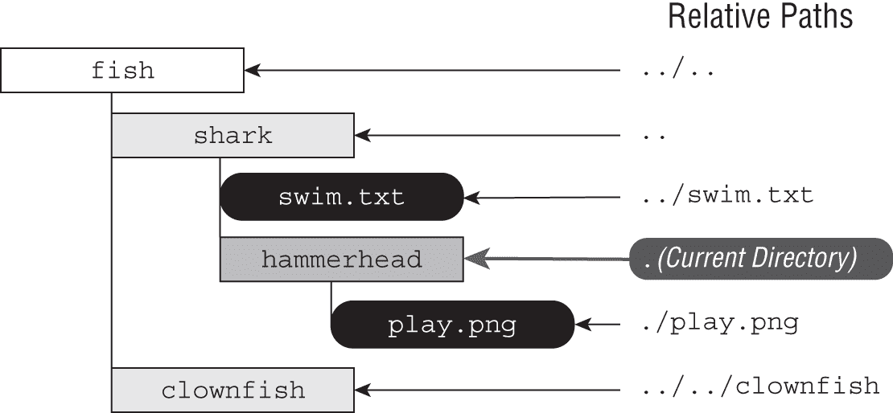

图 9.3 使用路径符号的相对路径

在 图 9.3 中，当前目录是 `/fish/shark/hammerhead`。在这种情况下，`../swim.txt` 指向当前父目录下的文件 `swim.txt`。同样，`./play.png` 指向 `play.png`。

本章中的许多方法都包含一个接受可选值的变长参数。表 9.2 展示了你应该熟悉的参数。

| 枚举类型 | 继承的接口 | 枚举值 | 细节 |
| --- | --- | --- | --- |
| `LinkOption` | `CopyOption` / `OpenOption` | `NOFOLLOW_LINKS` | 不跟随链接 |
| `StandardCopyOption` | `CopyOption` | `ATOMIC_MOVE` | 作为原子系统操作移动文件 |
| | | `COPY_ATTRIBUTES` | 将现有属性拷贝到新文件 |
| | | `REPLACE_EXISTING` | 如果文件已存在则覆盖文件 |
| `StandardOpenOption` | `OpenOption` | `APPEND` | 如果文件已打开写入，则追加到末尾 |
| | | `CREATE` | 如果文件不存在则创建新文件 |
| | | `CREATE_NEW` | 仅当文件不存在时创建新文件，否则失败 |
| | | `READ` | 以只读模式打开 |
| | | `TRUNCATE_EXISTING` | 如果文件已打开写入，则删除文件并从头开始 |
| | | `WRITE` | 以读写模式打开 |
| `FileVisitOption` | N/A | `FOLLOW_LINKS` | 跟随链接 |


除了`Files.copy()`和`Files.move()`（我们稍后会介绍）之外，我们不会在介绍每个方法时讨论这些变长参数。不过，它们的行为应该是直观的。例如，你能猜出以下代码中带有`LinkOption`的`Files.exists()`调用是做什么的吗？

```
Path path = Paths.get("schedule.xml");
boolean exists = Files.exists(path, LinkOption.NOFOLLOW_LINKS);
```

`Files.exists()`检查文件是否存在。但是，如果参数是符号链接，该方法将检查符号链接的目标是否存在。提供`LinkOption.NOFOLLOW_LINKS`意味着将覆盖默认行为，并检查符号链接本身是否存在。

## 处理声明了`IOException`方法

在本章中的许多方法都声明了`IOException`。抛出此异常的常见原因包括：

* 与底层文件系统的通信丢失。
* 文件或目录存在但无法访问或修改。
* 文件存在但无法覆盖。
* 需要文件或目录但其不存在。

通常情况下，对抽象`Path`值操作的方法（例如`Path`接口或`Paths`类中的方法）通常不会抛出任何检查异常（checked exceptions）。另一方面，操作或更改文件和目录的方法（例如`Files`类中的方法）通常会声明`IOException`。

正如我们所见到的，这一规则是有例外的。例如，`Files.exists()`方法没有声明`IOException`。如果它在文件不存在时抛出异常，那么它将永远无法返回`false`！

## 与`Path`交互

既然我们已经涵盖了NIO.2的基础知识，你可能会问，我们可以用它做什么？简单的回答是：非常多。NIO.2提供了大量操作`Path`对象的方法和类——远多于`java.io` API中提供的方法。在本节中，我们将根据相关功能对齐，介绍考试中需要掌握的`Path`方法。

与`String`值一样，`Path`实例是不可变的。在下面的示例中，第二行的`Path`操作丢失了，因为`p`是不可变的：

```
Path p = Path.of("whale");
p.resolve("krill");
System.out.println(p);  // whale
```

`Path`接口中的许多方法会以某种方式转换路径值并返回一个新的`Path`对象，从而允许方法进行链式调用。我们在下面的示例演示了链式调用，细节将在本章的该部分进行讨论：

```
Path.of("/zoo/../home").getParent().normalize().toAbsolutePath();
```

本章此部分的许多代码片段可以在它们所引用的路径实际不存在的情况下运行。JVM与文件系统进行通信，以确定路径组件或文件的父目录，而不需要文件实际存在。根据经验法则，如果一个方法声明了`IOException`，那么它通常要求其所操作的路径必须存在。

### 使用`toString()`、`getNameCount()`和`getName()`查看`Path`

`Path`接口包含三个用于获取路径表示的基本信息的方法。

```
public String toString()

public int getNameCount()

public Path getName(int index)
```

第一个方法`toString()`返回整个路径的`String`表示。事实上，它是`Path`接口中唯一返回`String`的方法。`Path`接口中的许多其他方法返回`Path`实例。

`getNameCount()`和`getName()`方法经常结合使用，分别获取路径中的元素数量和每个元素的引用。这两个方法不包括根目录作为路径的一部分。

```
Path path = Paths.get("/land/hippo/harry.happy");
System.out.println("The Path Name is: " + path);
for(int i=0; i<path.getNameCount(); i++) {
   System.out.println("   Element " + i + " is: " + path.getName(i));
}
```

注意，我们没有在第二行显式地调用`toString()`。记住，Java在字符串拼接时会任何任何`Object`调用`toString()`。我们将在本章的示例示例中使用这一特性。

代码打印以下内容：

```
The Path Name is: /land/hippo/harry.happy
   Element 0 is: land
   Element 1 is: hippo
   Element 2 is: harry.happy
```

尽管这是一个绝对路径，但根元素未包含在名称列表中。正如我们所说的，这些方法不将根目录视为路径的一部分。

```
var p = Path.of("/");
System.out.print(p.getNameCount()); // 0
System.out.print(p.getName(0));     // IllegalArgumentException
```

注意，如果你尝试使用无效索引调用`getName()`，它将在运行时抛出异常。

### 使用`subpath()`创建新`Path`

`Path`接口包含一个用于选择路径部分的方法。

```
public Path subpath(int beginIndex, int endIndex)
```

引用包含`beginIndex`但不包含`endIndex`。`subpath()`方法与之前的`getName()`方法类似，不同之处`subpath()`可能会返回多个路径组件，而`getName()`只返回一个。尽管如此两者都返回`Path`实例。

下面的代码片段显示了`subpath()`如何工作。我们还使用`getName()`打印了`Path`的元素，以便你可以看到索引是如何使用的。

```
var p = Paths.get("/mammal/omnivore/raccoon.image");
System.out.println("Path is: " + p);
for (int i = 0; i < p.getNameCount(); i++) {
   System.out.println("   Element " + i + " is: " + p.getName(i));
}
System.out.println();
System.out.println("subpath(0,3): " + p.subpath(0, 3));
System.out.println("subpath(1,2): " + p.subpath(1, 2));
System.out.println("subpath(1,3): " + p.subpath(1, 3));
```

此代码片段的输出如下：

```
Path is: /mammal/omnivore/raccoon.image
   Element 0 is: mammal
   Element 1 is: omnivore
   Element 2 is: raccoon.image

subpath(0,3): mammal/omnivore
subpath(1,2): omnivore
subpath(1,3): omnivore/raccoon.image
```

### 使用`getFileName()`、`getParent()`和`getRoot()`查看`Path`

`Path`接口包含许多用于获取特定`Path`元素的方法，返回类型为`Path`对象。

```
public Path getFileName()

public Path getParent()

public Path getRoot()
```

`getFileName()`返回当前文件的`Path`元素，而`getParent()`返回目录的完整路径。`getParent()`在操作根路径或相对路径顶部时返回`null`。`getRoot()`方法返回文件系统中的根元素，如果路径是相对路径则返回`null`。

考虑以下方法，它打印了各种`Path`元素：

```
public void printPathInformation(Path path) {
   System.out.println("Filename is: " + path.getFileName());
   System.out.println("   Root is: " + path.getRoot());
   Path currentParent = path;
   while((currentParent = currentParent.getParent()) != null) {
      System.out.println("   Current parent is: " + currentParent);
   }
}
```

`printPathInformation()`方法中的`while`循环持续运行直到`getParent()`返回`null`。我们将此方法应用于以下三个路径：

```
printPathInformation(Path.of("zoo"));
printPathInformation(Path.of("/zoo/armadillo/shells.txt"));
printPathInformation(Path.of("./armadillo/../shells.txt"));
```

此示例程序产生以下输出：

```
Filename is: zoo
   Root is: null

Filename is: shells.txt
   Root is: /
   Current parent is: /zoo/armadillo
   Current parent is: /zoo
   Current parent is: /

Filename is: shells.txt
   Root is: null
   Current parent is: ./armadillo/..
   Current parent is: ./armadillo
   Current parent is: .
```

回顾示例输出，你可以看到`getRoot()`在绝对路径和相对路径行为差异。正如示例所示，`getParent()`不遍历工作目录之外的相对路径。

你还会看到这些方法没有解析路径符号，并将它们视为路径的独立部分。虽然本章此部分的大多数方法将把路径符号视为路径的一部分，但我们很快会介绍一个清理路径符号的方法。

### 使用`isAbsolute()`和`toAbsolutePath()`检查`Path`类型

`Path`接口包含两个方法，用于辅助处理相对和绝对路径：

```
public boolean isAbsolute()

public Path toAbsolutePath()
```

第一个方法`isAbsolute()`如果对象引用的路径是绝对路径，则返回`true`；如果引用的路径是相对路径，则返回`false`。正如在本章之前讨论的，路径是绝对的还是相对通常取决于文件系统，尽管我们和出题者一样，为了简单起见，在本书中采用了通用约定。

第二个方法`toAbsolutePath()`通过将相对`Path`对象与当前工作目录合并，将其转换为绝对`Path`对象。如果该`Path`对象已经是绝对路径了，则该方法将直接返回该`Path`对象。

下面的代码段展示了分别在Windows和Linux系统上运行时，这两个方法的用法：

```
var path1 = Paths.get("C:\\birds\\egret.txt");
System.out.println("Path1 is Absolute? " + path1.isAbsolute());
System.out.println("Absolute Path1: " + path1.toAbsolutePath());

var path2 = Paths.get("birds/condor.txt");
System.out.println("Path2 is Absolute? " + path2.isAbsolute());
System.out.println("Absolute Path2 " + path2.toAbsolutePath());
```

每个系统中运行该代码段的输出如下方的示例输出所示。对于第二个示例，假设当前工作目录为`/home/work`。

```
Path1 is Absolute? true
Absolute Path1: C:\birds\egret.txt

Path2 is Absolute? false
Absolute Path2 /home/work/birds/condor.txt
```

### 使用`resolve()`合并路径

假设你想以类似于拼接字符串的方式连接路径。`Path`接口提供了两个`resolve()`方法来实现这一操作。

```
public Path resolve(Path other)

public Path resolve(String other)
```

第一个方法接收一个`Path`参数，而重载版本是第一个方法的简写形式，接收一个`String`（并为你构建相应的`Path`）。调用`resolve()`方法的对象将成为新`Path`对象的基础，输入参数将追加到该`Path`之后。让我们看看如果对绝对路径和相对路径应用`resolve()`会发生什么：

```
Path path1 = Path.of("/cats/../panther");
Path path2 = Path.of("food");
System.out.println(path1.resolve(path2));
```

该代码段产生以下输出：

```
/cats/../panther/food
```

与我们目前为止看到的其他方法一样，`resolve()`不会清理路径符号。在这个示例中，`resolve()`方法的输入参数是一个相对路径，但如果它是绝对路径呢？

```
Path path3 = Path.of("/turkey/food");
System.out.println(path3.resolve("/tiger/cage"));
```

由于输入参数`path3`是绝对路径，输出将是：

```
/tiger/cage
```

对于考试来说，你应该注意到在使用`resolve()`方法时混合使用绝对路径和相对路径。如果提供绝对路径作为方法的输入，那么返回的就是该值。简单来说，你不能使用`resolve()`合并两个绝对路径。

### 使用`relativize()`导出路径

`Path`接口包含一个方法，用于从一个`Path`构建到另一个`Path`的相对路径，通常会使用路径符号。

```
public Path relativize()
```

你认为以下使用`relativize()`的示例会打印什么？

```
var path1 = Path.of("fish.txt");
var path2 = Path.of("friendly/birds.txt");
System.out.println(path1.relativize(path2));
System.out.println(path2.relativize(path1));
```

这些示例打印的内容如下：

```
../friendly/birds.txt
../../fish.txt
```

其核心思想是：如果你指向文件系统中的某个路径，你需要采取哪些步骤才能到达另一个路径？例如，从`friendly/birds.txt`到`fish.txt`，你需要向上移动两级（文件本身算作一级），然后选择`fish.txt`。

如果两个路径值都是相对的，那么`relativize()`方法计算路径的方式就像它们处于同一个当前工作目录中一样。或者，如果两个路径值都是绝对的，那么该方法将计算从一个绝对位置到另一个绝对位置的相对路径，无论当前工作目录是什么。下面的示例在Windows电脑上运行时演示了这一属性：

```
Path path3 = Paths.get("E:\\habitat");
Path path4 = Paths.get("E:\\sanctuary\\raven\\poe.txt");
System.out.println(path3.relativize(path4));
System.out.println(path4.relativize(path3));
```

此代码段产生以下输出：

```
..\sanctuary\raven\poe.txt
..\..\..\habitat
```

即使你的系统中没有`E:`盘，该代码段也能工作。请记住，`Path`接口中定义的多数方法并不要求路径存在。

`relativize()`方法要求两个路径都是绝对的或都是相对的，如果类型混合则会抛出异常。

```
Path path1 = Paths.get("/primate/chimzee");
Path path2 = Paths.get("bananas.txt");
path1.relativize(path2); // IllegalArgumentException
```

### 使用`normalize()`清理路径

到为止，我们看到的许多示例包含了路径符号。幸运的是，Java提供了一个方法来消除冗余内容。

```
public Path normalize()
```


记住，路径符号 `..` 指上级目录，而路径符号 `.` 指当前目录。我们可以将 `normalize()` 应用于我们的一些路径上。

```
var p1 = Path.of("./armadillo/../shells.txt");
System.out.println(p1.normalize()); // shells.txt

var p2 = Path.of("/cats/../panther/food");
System.out.println(p2.normalize()); // /panther/food

var p3 = Path.of("../../fish.txt");
System.out.println(p3.normalize()); // ../fish.txt
```

前两个示例应用路径符号来移除冗余，但最后一个呢？那已经是最了。`normalize()` 方法并没有移除所有的路径符号；只移除可以简化的符号。

`normalize()` 方法允许我们比较等效路径。考虑以下示例：

```
var p1 = Paths.get("/pony/../weather.txt");
var p2 = Paths.get("/weather.txt");
System.out.println(p1.equals(p2)); // false
System.out.println(p1.normalize().equals(p2.normalize())); // true
```

`equals()` 方法在两个路径代表相同值时返回 `true`。在第一次比较中，路径值是不同的。在第二次比较中，路径值都已还原为相同的归一化值 `/weather.txt`。这就是 `normalize()` 方法的主要功能，以便我们更好地比较不同的路径。

## 使用 `toRealPath()` 获取文件系统路径

虽然处理理论路径很有用，但有时你想验证路径是否在文件系统中真实存在。

```
public Path toRealPath(LinkOption… options) throws IOException
```

该方法与 `normalize()` 相似，因为它消除任何冗余的路径符号。它也与 `toAbsolutePath()` 相似，如果路径是相对的，它会将路径与当前工作目录合并。

然而，与这两个方法不同的是，如果路径不存在，`toRealPath()` 将抛异常。此外，它会遵循符号链接，并带有一个可选的可变参数来忽略它们。

假设我们有一个文件系统，其中有一个从 `/zebra` 指向 `/horse` 的符号链接。在当前工作目录为 `/horse/schedule` 的情况下，你认为以下代码会打印什么？

```
System.out.println(Paths.get("/zebra/food.txt").toRealPath());
System.out.println(Paths.get(".././food.txt").toRealPath());
```

这两行的输出如下：

```
/horse/food.txt
```

在这个例中，绝对路径和相对路径都都解析到同一个绝对文件，因为符号链接指向文件系统中的一个真实文件。我们还可以使用 `toRealPath()` 方法来以 `Path` 对象的形式获取当前工作目录。

```
System.out.println(Paths.get(".").toRealPath());
```

## 复习 `Path` 方法

我们用表 9.3 结束本节，该表展示了考试时需要掌握的 `Path` 方法。

| `Path.of(String, String…)` | `Path.getParent()` |
| --- | --- |
| `URI.toURI()` | `Path.getRoot()` |
| `File.toFile()` | `boolean isAbsolute()` |
| `String.toString()` | `Path.toAbsolutePath()` |
| `int getNameCount()` | `Path.relativize()` |
| `Path.getName(int)` | `Path.resolve(Path)` |
| `Path.subpath(int, int)` | `Path.normalize()` |
| `Path.getFileName()` | `Path.toRealPath(LinkOption…)` |

**表 9.3** Path 方法

除了静态方法 `static Path.of()` 外，表 9.3 中的所有方法都是可以在任何 `Path` 实例上调用的实例方法。此外，只有 `toRealPath()` 声明了 `IOException`。

## 对文件和目录的操作

我们在 `Path` 接口中涵盖的大多数方法都是针对理论路径的，这些路径并不要求在文件系统中存在。如果你想重命名目录、复制文件或读取文件内容该怎么办？

进入 NIO.2 的 `Files` 类。`Files` 辅助类能够与系统中的真实文件和目录进行交互。正如此，本章此部分的大多数方法都带有可选参数，并在路径不存在时抛出 `IOException`。`Files` 类还复制了 `java.io.File` 中找到的许多方法，尽管它们的名称或参数列表通常不同。

### 使用 `exists()` 检查是否存在

我们介绍的第一个 `Files` 方法是最简单的。它只是检查文件是否存在。

```
public static boolean exists(Path path, LinkOption… options)
```

让我们来看一些操作 `/ostrich` 目录下 `features.png` 文件的示例代码。

```
var b1 = Files.exists(Paths.get("/ostrich/feathers.png"));
System.System.out.println("Path " + (b1 ? "Exists" : "Missing"));

var b2 = Files.exists(Paths.get("/ostrich"));
System.out.println("Path " + (b2 ? "Exists" : "Missing"));
```

第一个示例检查文件是否存在，而第二个示例检查目录是否存在。如果文件不存在，该方法不会抛出异常，因为这样做将阻止该方法在运行时返回 `false`。

### 使用 `isSameFile()` 测试唯一性

由于路径可能包含文件系统中的路径符号和符号链接，很难判断两个 `Path` 实例是否指向同一个文件。幸运的是，`Files` 类中有一个这样的方法：

```
public static boolean isSameFile(Path path, Path path2)
   throws IOException
```

该方法接受两个 `Path` 对象作为输入，解析所有路径符号并跟踪符号链接。尽管名称如此，该方法也可以用于判断两个 `Path` 对象是否指向同一个目录。

虽然 `isSameFile()` 的大多数用法在路径不存在时会触发异常，但有一种特殊情况并不会。如果两个路径对象在 `equals()` 方面是相等的，那么该方法将直接返回 `true`，而不检查文件是否存在。

假设文件系统如图 9.4 所示，其中有一个从 `/animals/snake` 指向 `/animals/cobra` 的符号链接。

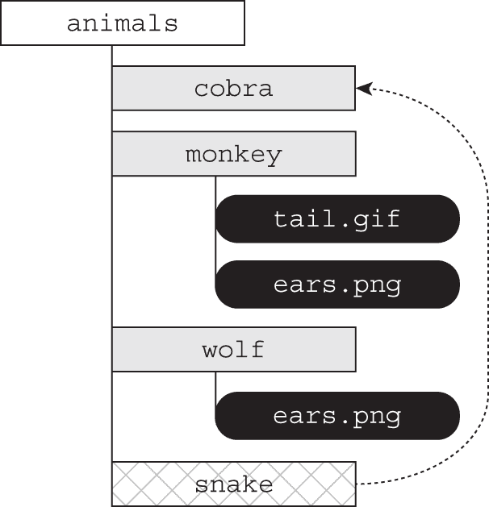

**图 9.4** 比较文件唯一性

给定图 9.4 中定义的结构，以下输出结果什么？

```
System.out.println(Files.isSameFile(
   Path.of("/animals/cobra"),
   Path.of("/animals/snake")));

System.out.println(Files.isSameFile(
   Path.of("/animals/monkey/ears.png"),
   Path.of("/animals/wolf/ears.png")));
```

由于 cobra 是符号链接，第一个示例输出 true。第二个示例指向不同的文件，因此输出 false。

### 使用 `createDirectory()` 和 `createDirectories()` 创建目录

要创建目录，我们使用这些 `Files` 方法：

```
public static Path createDirectory(Path dir, FileAttribute… attrs) throws IOException

public static Path createDirectories(Path dir, FileAttribute… attrs) throws IOException
```

`createDirectory()` 会创建一个目录，如果已存在则抛出异常。与之相比，`createDirectories()` 类似于 `java.io.File.mkdirs()`，它会创建任何不存在的父目录。如果所有目录都已存在，`createDirectories()` 将直接完成。

以下展示了如何创建目录：

```
Files.createDirectory(Path.of("/bison/field"));
Files.createDirectories(Path.of("/bison/field/pasture"));
```

### 使用 `copy()` 复制文件

`Files` 类提供了复制文件和目录的方法。

```
public static Path copy(Path source, Path target, CopyOption… options) throws IOException
```

该方法使用 `Path` 对象从一个位置复制到另一个位置。以下是复制文件和目录的示例：

```
Files.copy(Paths.get("/panda/bamboo.txt"),
   Paths.get("/panda-save/bamboo.txt"));

Files.copy(Paths.get("/turtle"), Paths.get("/turtleCopy"));
```

复制目录时是浅拷贝。*浅拷贝*意味着目录内部的文件和子目录不会被复制。*深拷贝*意味着整个树都会复制，包括其所有的内容和子目录。我们将在本章稍后介绍如何使用流执行目录的深拷贝。

#### 复制和替换文件

默认情况下，如果目标已存在，`copy()` 方法将抛出异常。通过向方法提供 `StandardCopyOption` 枚举值 `REPLACE_EXISTING` 可以更改此行为。以下方法调用如果 `movie.txt` 文件已存在，将覆盖它：

```
Files.copy(Paths.get("book.txt"), Paths.get("movie.txt"),
   StandardCopyOption.REPLACE_EXISTING);
```

对于考试，你需要知道如果没有 `REPLACE_EXISTING` 选项，该方法在文件已存在时将抛出异常。

#### 使用 I/O 流复制文件

`Files` 类包含了两个与 I/O 流操作的 `copy()` 方法。

```
public static long copy​(InputStream in, Path target,
   CopyOption… options) throws IOException

public static long copy​(Path source, OutputStream out)
   throws IOException
```

第一个方法读取流的内容并将输出写入文件。第二个方法读取文件的内容并将输出写入流中。如果你需要快速从磁盘读取/或向磁盘写入数据，这两个方法非常方便。

以下是每个 `copy()` 方法的示例：

```
try (var is = new FileInputStream("source-data.txt")) {
   // 将流数据写入文件
   Files.copy(is, Paths.get("/mammals/wolf.txt"));
}

Files.copy(Paths.get("/fish/clown.xsl"), System.out);
```

虽然我们在第一个示例中使用了 `FileInputStream`，但该流也可以是任何有效的 I/O 流，包括网站连接、内存中的流资源等。第二个示例直接将文件内容打印到 `System.out` 流中。

#### 将文件复制到目录中

对于考试来说，理解 `copy()` 方法如何操作文件和目录至关重要。例如，假设我们有一个文件 `food.txt` 和一个目录 `/enclosure`。这两个文件和目录都存在。你认为执行以下过程的结果是什么？

```
var file = Paths.get("food.txt");
var directory = Paths.get("/enclosure");
Files.copy(file, directory);
```

如果你认为它会在 `/enclosure/food.txt` 创建新文件，那么你就完全错了。它实际上会抛出一个异常。该命令尝试创建一个名为 `/enclosure` 的新文件。由于路径 `/enclosure` 已经存在，在运行时会抛出异常。

另一方面，如果目录不存在，它将创建一个包含 `food.txt` 内容的新文件，但它的名称将是 `/enclosure`。记住，我们说过文件可能不需要扩展名，而在例子中，这一点很重要。

这种行为同时适用于 `copy()` 和 `move()` 方法，我们将将介绍后者。如果你好奇，将文件复制到目录的正确方法是如下：

```
var file = Paths.get("food.txt");
var directory = Paths.get("/enclosure/food.txt");
Files.copy(file, directory);
```

你还可以使用之前见过的 `resolve()` 方法来定义 `directory`，这可以避免你编写两次文件名。

```
var directory = Paths.get("/enclosure").resolve(file.getFileName());
```

#### 使用 `move()` 移动或重命名路径

`Files` 类提供了一个实用的方法用于移动或重命名文件和目录。

```
public static Path move​(Path source, Path target,
   CopyOption… options) throws IOException
```

以下是使用 `move()` 方法的一些示例代码：

```
Files.move(Path.of("c:\\zoo"), Path.of("c:\\zoo-new"));

Files.move(Path.of("c:\\user\\addresses.txt"),
   Path.of("c:\\zoo-new\\addresses2.txt"));
```

第一个示例将 `zoo` 目录重命名为 `zoo-new` 目录，保留源目录的所有原始内容。第二个示例将 `addresses.txt` 文件从 `user` 目录移动到 `zoo-new` 目录，并将其重命名为 `addresses2.txt`。

#### `move()` 和 `copy()` 的相似之处

与 `copy()` 类似，如果目标存在，`move()` 需要 `REPLACE_EXISTING` 来覆盖它。与 `copy()` 类似，如果文件已存在，`move()` 将不会创建文件。

#### 执行原子移动

考试中你需要了解的另一个值是 `ATOMIC_MOVE`。

```
Files.move(Path.of("source.txt"), Path.of("target.txt"), StandardCopyOption.ATOMIC_MOVE);
```

#### 使用 `delete()` 和 `deleteIfExists()` 删除文件

`Files` 类包含了两个用于删除文件的方法。

```
var path = Path.of("/animals/gopher.txt");
final List<String> lines = Files.readAllLines(path);
lines.forEach(System.out::println);
```

请注意，当调用 `readAllLines()` 时，会读取整个文件，结果生成的 `List<String>` 会一次性将文件的所有内容存储在内存中。如果文件很大，那么在尝试将所有内容加载到内存时可能会触发 `OutOfMemoryError`。在章节的后后部分，我们将再次回顾此方法，并提供一种基于流的 NIO.2 方法，该方法可以使用更小的内存占用运行。

#### 复习 `Files` 方法

表 9.4 显示了 `Files` 类中你为了考试应该熟悉的 `static` 静态方法。

| `boolean exists(Path,` `LinkOption…)` | `Path move(Path, Path,` `CopyOption…)` |
| --- | --- |
| `boolean isSameFile(Path, Path)` | `void delete(Path)` |
| `Path createDirectory(Path,` `FileAttribute<?>…)` | `boolean deleteIfExists(Path)` |
| `Path createDirectories(Path,` `FileAttribute<?>…)` | `BufferedReader` `newBufferedReader(Path)` |


| `Path copy(Path, Path, CopyOption…)` | `BufferedWriter newBufferedWriter(Path, OpenOption…)` |
| --- | --- |
| `long copy(InputStream, Path, CopyOption…)` | `List<String> readAllLines(Path)` |
| `long copy(Path, OutputStream)` | |

**表 9.4** `Files` 方法

除了`exists()`之外，所有这些方法都声明了`IOException`。

## 管理文件属性

`Files`类还提供了许多用于访问文件和目录元数据的方法，这些被称为“文件属性”（file attributes）。文件属性是系统内部关于文件的数据，例如大小和可见性，它们不属于文件内容。在本节中，我们将展示如何单独读取文件属性，或者通过单一的流式调用来读取。

### 发现文件属性

我们从介绍读取文件属性的基本方法开始讨论。这些方法可以在任何文件系统中使用，尽管它们在某些文件系统中意义可能有限。

#### 使用`isDirectory()`、`isSymbolicLink()`和`isRegularFile()`读取常用属性

`Files`类包含了三个用于判断`Path`类型的方法。

```
public static boolean isDirectory(Path path, LinkOption… options)
public static boolean isSymbolicLink(Path path)
public static boolean isRegularFile(Path path, LinkOption… options)
```

`isDirectory()`和`isSymbolicLink()`方法应该是不言自明的的，尽管`isRegularFile()`值得讨论。Java将“普通文件”（regular file）定义为可以包含内容的文件，与某些操作系统中可能存在的符号链接、目录、资源或其他非文件相对。如果符号链接指向实际文件，Java将对符号链接的目标执行检查。换句话说，只要链接解析为普通文件，`isRegularFile()`对符号链接返回`true`是可能的。

让我们来看一些示例代码。

```
System.out.print(Files.isDirectory(Paths.get("/canine/fur.jpg")));
System.out.print(Files.isSymbolicLink(Paths.get("/canine/coyote")));
System.out.print(Files.isRegularFile(Paths.get("/canine/types.txt")));
```

第一个示例如果`fur.jpg`是目录或指向目录的符号链接，则打印`true`，否则打印`false`。第二个示例如果`/canine/coyote`是符号链接，无论其指向的文件或目录是否存在，都会打印`true`。第三个示例如果`types.txt`指向一个普通文件，或者指向一个指向普通文件的符号链接，则打印`true`。

#### 使用`isHidden()`、`isReadable()`、`isWritable()`和`isExecutable()`检查文件访问性

在许多文件系统中，可以为文件设置一个`boolean`属性，将其标记为隐藏、可读或可执行。`Files`类包含了暴露这些信息的方法。

```
public static boolean isHidden(Path path) throws IOException
public static boolean isReadable(Path path)
public static boolean isWritable(Path path)
public static boolean isExecutable(Path path)
```

在列出目录内容时，通常无法查看隐藏文件。在文件名可见但用户可能没有权限打开文件内容、修改文件或将文件作为程序运行的文件系统中，可读、可写和可执行标志是非常重要的。

这里我们展示每个方法的示例用法：

```
System.out.print(Files.isHidden(Paths.get("/walrus.txt")));
System.out.print(Files.isReadable(Paths.get("/seal/baby.png")));
System.out.print(Files.isWritable(Paths.get("dolphin.txt")));
System.out.print(Files.isExecutable(Paths.get("whale.png")));
```

如果`walrus.txt`存在于文件系统中且是隐藏的，那么第一个示例打印`true`。如果`baby.png`文件存在且其内容可读，第二个示例打印`true`。如果`dolphin.txt`文件存在且可写，第三个示例打印`true`。最后，如果`whale.png`是可执行的，上一个示例打印`true`。

#### 使用`size()`读取文件大小

`Files`类包含一个用于确定文件大小的方法。

```
public static long size(Path path) throws IOException
```

此方法返回的大小表示逻辑上的大小，这可能与存储设备上的实际大小有所不同。以下是`size()`方法的示例调用：

```
System.out.print(Files.size(Paths.get("/zoo/animals.txt")));
```

#### 使用`getLastModifiedTime()`检查文件变化

大多数操作系统支持为每个文件跟踪修改日期/时间。某些应用程序利用此判断何时读取文件内容。在大多数情况下，检查单个文件属性比重新加载整个内容快得多。

`Files`类提供了以下方法来获取最后修改时间：

```
public static FileTime getLastModifiedTime(Path path, LinkOption… options) throws IOException
```

该方法返回一个`FileTime`对象，代表时间戳。为了方便，它有一个`toMillis()`方法，返回自 UTC 1970 年 1 月 1 日以来的毫秒数。

以下显示如何以时间戳值打印文件的修改值：

```
final Path path = Paths.get("/rabbit/food.jpg");
System.out.println(Files.getLastModifiedTime(path).toMillis());
```

### 改进属性访问

到为止，我们一直通过多次方法调用来访问单个属性。虽然这在功能上是正确的，但每次调用这些方法时通常都会产生开销。简单来说，一次性向文件系统请求所有属性比多次往返文件系统要高效得多。此外，某些属性是特定文件系统的，无法为所有文件系统进行泛化。

NIO.2通过允许使用单一方法调用为各种文件系统构建视图（views），解决了这两个问题。一个视图是特定文件系统类型的一组相关属性。

#### 理解属性和视图类型

NIO.2提供了两种在单个方法调用中处理属性的方法：一种只读属性方法和一种可更新视图方法。对于每种方法，你都需要提供一个文件系统类型对象，它会告诉NIO.2方法你请求的是哪种视图。我们所说的可更新视图，是指我们可以使用同一个对象对属性进行读取和写入。

表 9.5 列出了常用的属性和视图类型。对于考试来说，你只需要了解基础文件属性类型。其他视图用于管理特定于操作系统的信息。

| 属性接口 | 视图接口 | 描述 |
| --- | --- | --- |
| `BasicFileAttributes` | `BasicFileAttributeView` | 所有文件系统支持的基础属性集 |
| `DosFileAttributes` | `DosFileAttributeView` | 基础属性集以及基于 DOS/Windows 的系统支持的属性 |
| `PosixFileAttributes` | `PosixFileAttributeView` | 基础属性集以及由 POSIX 系统（如 UNIX、Linux、Mac 等）支持的属性 |

**表 9.5** 属性和视图类型

#### 使用`readAttributes()`获取属性

`Files`类包含以下方法，用于以只读方式读取类的类的属性：

```java
public static <A extends BasicFileAttributes> A readAttributes(
   Path path,
   Class<A> type,
   LinkOption… options) throws IOException
```

应用该方法需要指定`Path`和`BasicFileAttributes.class`参数。

```java
var path = Paths.get("/turtles/sea.txt");
BasicFileAttributes data = Files.readAttributes(path,
   BasicFileAttributes.class);

System.out.println("Is a directory? " + data.isDirectory());
System.out.println("Is a regular file? " + data.isRegularFile());
System.out.println("Is a symbolic link? " + data.isSymbolicLink());
System.out.println("Size (in bytes): " + data.size());
System.out.println("Last modified: " + data.lastModifiedTime());
```

`BasicFileAttributes`类包含了许多与`Files`类中属性方法同名的值。尽管如此，使用这种方法的优势在于，所有属性都可以一次性获取。

#### 使用`getFileAttributeView()`修改属性

以下`Files`方法返回一个可更新的视图：

```java
public static <V extends FileAttributeView> V getFileAttributeView(
   Path path,
   Class<V> type,
   LinkOption… options)
```

我们可以使用该可更新视图将文件的最后修改日期/时间值增加 10,000 毫秒（即 10 秒）。

```java
// 读取文件属性
var path = Paths.get("/turtles/sea.txt");
BasicFileAttributeView view = Files.getFileAttributeView(path,
   BasicFileAttributeView.class);
BasicFileAttributes attributes = view.readAttributes();

// 修改文件的最后修改时间
FileTime lastModifiedTime = FileTime.fromMillis(
   attributes.lastModifiedTime().toMillis() + 10_000);
view.setTimes(lastModifiedTime, null, null);
```

获取可更新视图后，我们需要在视图上调用`readAttributes()`来获取文件元数据。从那里，我们创建一个新的`FileTime`值并使用`setTimes()`方法设置它。

```java
// BasicFileAttributeView 实例方法
public void setTimes(FileTime lastModifiedTime,
   FileTime lastAccessTime, FileTime createTime)
```

该方法允许对任何不想修改的日期/时间值传递`null`。在我们的示例代码中，只更改了最后修改日期/时间。

## 应用函数式编程

我们将好戏留到了最后！在本章的最后，我们将目前展示的所有内容与函数式编程相结合，执行极其强大的文件操作，通常只需要几行代码。`Files`类包含了一些非常有用的 Stream API 方法，用于对文件、目录和目录树的操作。

### 列出目录内容

让我们从简单的 Stream API 方法开始。以下`Files`方法列出目录的内容：

```java
public static Stream<Path> list(Path dir) throws IOException
```

`Files.list()`与`java.io.File`的`listFiles()`方法类似，区别在于它返回的是`Stream<Path>`而不是`File[]`。由于流使用了惰性求值，这意味着该方法会根据需要加载每个路径元素，而不是一次性加载整个目录。

打印目录的内容很容易。

```java
try (Stream<Path> s = Files.list(Path.of("/home"))) {
   s.forEach(System.out::println);
}
```

不过，让我们做些更有趣的。在此之前，我们介绍了`Files.copy()`方法并展示了它只对目录执行浅拷贝。我们可以使用`Files.list()`执行深拷贝。

```java
public void copyPath(Path source, Path target) {
   try {
      Files.copy(source, target);
      if(Files.isDirectory(source))
         try (Stream<Path> s = Files.list(source)) {
            s.forEach(p -> copyPath(p, target.resolve(p.getFileName())));
         }
   } catch (IOException e) {
      // 处理异常
   }
}
```

该方法首先检查路径是否为目录，如果是，则对其每个元素执行递归拷贝。如果方法遇到符号链接怎么办？别担心，我们将在下一节讨论。目前，你只需要知道在使用该方法时它不会遵循符号链接。

### 遍历目录树

虽然`Files.list()`方法很有用，但它只遍历单个目录的内容。如果我们想访问目录树中的所有路径呢？在继续之前，我们需要回顾一些文件系统的基本概念。当我们最初在[第 8 章]中描述目录时，我们提到它是按层级组织的。例如，一个目录可以包含文件和其他目录。文件系统中的每个记录都只有一个父级，根目录除外，它位于顶部。

文件系统通常被可视化为具有单个根节点和许多分支及叶子的树，如图 9.5 所示。在这个模型中，目录是分支或内部节点，而文件是叶子节点。

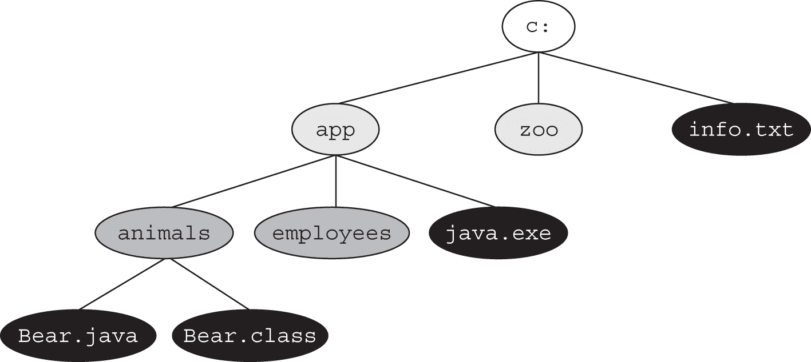

#### 选择搜索策略

遍历目录树通常有两种常见的策略：深度优先搜索和广度优先搜索。`depth-first search`（深度优先搜索）从根节点到任意叶子节点，然后返回根节点，完整遍历途中跳过的任何路径。`search depth`（搜索深度）是从根节点到当前节点的距离。为了防止无限搜索，Java包含了一个搜索深度，用于限制搜索允许离开根节点的层数（或跳数）。

另一种方法，`breadth-first search`（广度优先搜索）从根节点开始处理每个特定深度的所有元素，然后再进入下一个深度层。结果按深度排序，深度为`1`的所有节点会在深度`2`的所有节点之前被读取，依此类推。虽然广度优先搜索倾向于平衡和可预测性，但它也需要更多的内存，因为必须维护一个已访问节点列表。

对于考试，你不需要理解Java采用的每种搜索策略的细节；你只需要知道`NIO.2 Streams API`方法使用带有深度限制的深度优先搜索，该限制可以任意更改。

## 使用`walk()`遍历目录

背景信息已经足够了；让我们来看更多 Files API 方法。`Files`类包含了两个使用深度优先搜索遍历目录树的方法。

```
public static Stream<Path> walk​(Path start,
   FileVisitOption… options) throws IOException

public static Stream<Path> walk​(Path start, int maxDepth,
   FileVisitOption… options) throws IOException
```

与我们的其他流方法一样，`walk()`使用懒求值，并且仅在处理某个`Path`时对其进行求值。这意味着即使目录树包含数百或数千个文件，处理目录树所需的内存也是很低的。第一个`walk()`方法依赖于`Integer.MAX_VALUE`的默认最大深度，而重载版本允许用户设置最大深度。这在文件系统可能很大且我们知道要查找的信息靠近根节点的情况下非常有用。

我们不仅仅是打印目录树的内容，还可以再次做一些更有趣的事情。以下`getPathSize()`方法遍历目录树并返回目录中所有文件的总大小：


```java
private long getSize(Path p) {
   try {
      return  Files.size(p);
   } catch (IOException e) {
      // Handle exception
   }
   return 0L;
}

public long getPathSize(Path source) throws IOException {
   try (var s = Files.walk(source)) {
      return s.parallel()
            .filter(p -> !Files.isDirectory(p))
            .mapToLong(this::getSize)
            .sum();
   }
}
```

需要`getSize()`辅助方法是因为`Files.size()`声明了`IOException`，而我们不想在 lambda 表达式内部放置`try`/`catch`块。可以使用上一节中过的`format()`方法打印数据：

```java
var size = getPathSize(Path.of("/fox/data"));
System.out.format("Total Size: %.2f megabytes", (size/1000000.0));
```

取决于你运行代码的目录，它将输出类似的内容：

```
Total Directory Tree Size: 15.30 megabytes
```

## 应用深度限制

假设我们的目录树非常深，通过更改`getPathSize()`方法中的一行代码来应用深度限制。

```java
 try (var s = Files.walk(source, 5)) {
```

这个新版本只检查起始节点`5`步范围的文件。深度值`0`表示当前路径本身。由于该方法只对文件计算值，因此当此方法应用于目录树时，你必须将深度限制设置为至少`1`才能得到非结果。

## 避免循环路径

我们之前的 NIO.2 方法默认遍历符号链接，并使用`NOFOLLOW_LINKS`来禁用此行为。`walk()`方法的不同之处在于它默认*不*跟踪符号链接，并且需要启用`FOLLOW_LINKS`选项。我们可以通过添加`FileVisitOption`来修改`getPathSize()`方法以启用跟踪符号链接：

```java
 try (var s = Files.walk(source, 
          FileVisitOption.FOLLOW_LINKS)) {
```

在遍历目录树时，如果启用了符号链接，你的程序需要小心。例如，如果进程遇到指向文件系统根目录的符号链接，那么系统的每个文件都将被搜索！

更糟糕的是，符号链接可能会导致循环，即路径被重复访问。循环（cycle）是一种无限的循环依赖，目录树中的一个项指向其其中一个祖先目录。假设我们有一个如图 9.6 所示的目录树，符号链接`/birds/robin/allBirds`指向`/birds`。

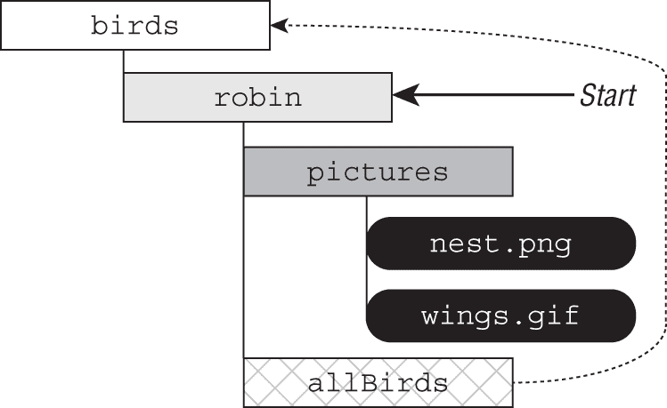

**图 9.6** 具有循环的文件系统

如果我们尝试遍历这棵树会发生什么？表 9.6 显示了遍历深度为`3`后访问的路径。

| 深度 | 路径 |
| --- | --- |
| 0 | `/birds` |
| 1 | `/birds/robin` |
| 2 | `/birds/robin/allBirds` |
| 3 | `/birds` |

（注：原文结尾包含碎片化的表格数据，已根据上下文重构为标准的 Markdown 表格）。

请注意，当使用`FOLLOW_LINKS`时，`walk()`方法会跟踪所有访问过的路径，如果路径被访问两次，将抛出`FileSystemLoopException`。

### 使用`find()`搜索目录

在之前的示例中，我们对`Stream<Path>`应用了过滤器来筛选结果，尽管 NIO.2 提供了一个更方便的方法。

```java
public static Stream<Path> find​(Path start,
   int maxDepth,
   BiPredicate<Path,BasicFileAttributes> matcher,
   FileVisitOption… options) throws IOException
```

`find()`方法的行为与`walk()`方法相似，但它接受一个`BiPredicate`来过滤数据。它还要求设置深度限制。像`walk()`一样，`find()`也支持`FOLLOW_LINK`。

`BiPredicate`的两个参数是`Path`对象和`BasicFileAttributes`对象，你在本节之前见过它们。通过这种方式，NIO.2 自动为你检索基本文件信息，允许你编写可以直接访问该对象的复杂 lambda 表达式。我们通过以下示例说明这一点：

```java
Path path = Paths.get("/bigcats");
long minSize = 1_000;
try (var s = Files.find(path, 10, 
      (p, a) -> a.isRegularFile()
         && p.toString().endsWith(".java")
         && a.size() > minSize)) {
   s.forEach(System.out::println);
}
```

此示例搜索目录树并打印所有大小至少为 1,000 字节的`.java`文件，且深度限制为`10`。虽然我们可以使用`walk()`方法配合`readAttributes()`调用来实现这一目标，但这种实现比那些方法要短得多且方便得多。我们不需要担心 lambda 表达式中的任何方法声明受检异常，正如我们在`getPathSize()`示例所示的那样。

### 使用`lines()`读取文件

在章的早期部分，我们介绍了`Files.readAllLines()`并注释说使用它读取非常大的文件可能会导致`OutOfMemoryError`问题。幸运的是，NIO.2 通过 Stream API 方法解决了这个问题。

```java
public static Stream<String> lines(Path path) throws IOException
```

文件内容是以延迟方式读取和处理的，这意味着在任何时刻只有文件的一小部分存储在内存中。

```java
Path path = Paths.get("/fish/sharks.log");
try (var s = Files.lines(path)) {
   s.forEach(System.out::println);
}
```

更进一步，我们可以利用其他流方法来编写一个更强大的示例。

```java
Path path = Paths.get("/fish/sharks.log");
try (var s = Files.lines(path)) {
   s.filter(f -> f.startsWith("WARN:"))
      .map(f -> f.substring(5))
      .forEach(System.out::println);
}
```

这段示例代码搜索日志中以`WARN:`开头的行，并输出其后的文本。假设输入文件`sharks.log`如下：

```
INFO:Server starting
DEBUG:Processes available = 10
WARN:No database could be detected
DEBUG:Processes available reset to 0
WARN:Performing manual recovery
INFO:Server successfully started
```

那么，示例输出将如下：

```
No database could be detected
Performing manual recovery
```

如你所见，函数式编程加上 NIO.2 为我们提供了复杂方式操作文件的能力，通常只需要几个短表达式。

字体 比较传统的`java.io.File`和 NIO.2 方法

我们用表 9.7 结束本章，该表展示了 第 8 章 中描述的一些传统`java.io.File`方法与本章描述的新型 NIO.2 方法之间的比较。在表中，`file`指`java.io.File`类的实例，而`path`和`otherPath`指 NIO.2`Path`接口的实例。

| 传统的 I/O File 方法 | NIO.2 方法 |
| --- | --- |
| `file.delete()` | `Files.delete(path)` |
| `file.exists()` | `Files.exists(path)` |
| `file.getAbsolutePath()` | `path.toAbsolutePath()` |
| `file.getName()` | `path.getFileName()` |
| `file.getParent()` | `path.getParent()` |
| `file.isDirectory()` | `Files.isDirectory(path)` |
| `file.isFile()` | `Files.isRegularFile(path)` |
| `file.lastModified()` | `Files.getLastModifiedTime(path)` |
| `file.length()` | `Files.size(path)` |
| `file.listFiles()` | `Files.list(path)` |
| `file.mkdir()` | `Files.createDirectory(path)` |
| `file.mkdirs()` | `Files.createDirectories(path)` |
| `file.renameTo(otherFile)` | `Files.move(path,otherPath)` |

**表 9.7** `java.io.File`与 NIO.2 方法比较

请记住，NIO.2 提供了许多传统 API 中没有的方法和特性，例如对符号链接的支持、设置特定文件系统的属性等。NIO.2 是一个比传统的`java.io.File`类更成熟、功能得强大的 API。

### 总结

本章介绍了使用`Path`接口处理文件和目录的 NIO.2。对于考试，你需要了解什么是 NIO.2 的`Path`接口，以及它与传统的`java.io.File`类有何区别。你应该熟悉如何创建和使用`Path`对象，包括如何将其与其他`Path`对象组合或解析。

我们花时间回顾了`Files`辅助类中提供的各种方法。正如所讨论的，函数的名称通常会准确告诉它的功能。我们解释了这些方法中的大多数能够抛出`IOException`，并且许多方法接受可选的可变参数枚举值。

我们还讨论了 NIO.2 如何提供读取和写入文件元数据的方法。NIO.2 包含两个方法，可以在单个调用中检索路径的所有文件系统属性，而无需与操作系统进行多次交互。其中一种方法需要只读属性类型，而第二种方法需要可更新的视图类型。它还允许 NIO.2 支持特定操作系统的文件属性。

最后，NIO.2 包含了可以处理文件和目录的 Stream API 方法。我们讨论了列出目录、遍历目录树、搜索目录树以及读取文件行的方法。

### 考试重点

*   **理解如何创建`Path`对象。** `Path`接口是一个不可变对象，可以通过`FileSystem`、`java.net.URI`或`java.io.File`使用`Paths.get()`或`Path.of()`创建。

*   **理解`Path`对象。** NIO.2 包含了许多查看、操作和组合`Path`值的方法。这些方法消除了冗余或不必要的符号。

*   **能够使用`Files`类操作文件和目录。** `Files`辅助类包含了检查文件是否存在、复制/移动文件、创建目录或删除目录的方法。这些方法大多声明了`IOException`，因为路径可能不存在。

*   **管理文件属性。** `Files`类包含了读取单个文件属性的方法，例如其大小或是否为目录。NIO.2 还支持在单个调用中读取所有属性。属性类型用于支持特定操作系统的视图。最后，NIO.2 支持可更新的视图。

*   **能够使用函数式编程操作目录。** NIO.2 包含了操作目录的 Stream API。`Files.list()`方法遍历目录的内容，而`Files.walk()`方法以深度优先的方式延迟遍历目录树。`Files.find()`方法也遍历目录但需要应用过滤器。`Files.walk()`和`Files.find()`都支持搜索深度。如果指示跟踪符号链接，这两个方法都会抛出异常。

*   **理解`readAllLines()`和`lines()`的区别。** `Files.readAllLines()`方法将文件的所有行读入内存并返回`List<String>`结果。`Files.lines()`方法延迟读取文件的行，而是返回一个函数的`Stream<Path>`对象。

### 复习题

本章复习题的答案可以在附录 B 找到。

1.  以下代码的输出是什么？

    ```java
     4: var path = Path.of("/user/./root","../kodiac.txt");
     5: path.normalize().relativize("/lion");
     6: System.out.println(path); 
    ```

    1.  `../../lion`

    2.  `/user/kodiac.txt`

    3.  `../user/kodiac.txt`

    4.  `/user/./root/../kodiac.txt`

5. 代码无法编译。

6. 以上都不是。

2. 传递给此方法的`path`哪些值可能导致以下代码输出`Success`？（选择所有适用项。）

```java
public void removeBadFile(Path path) {
    if(Files.isDirectory(path))
      System.out.println(Files.deleteIfExists(path) 
         ? "Success": "Try Again");
}
```

1. `path`指文件系统中的一个普通文件。

2. `path`指文件系统中的一个符号链接。

3. `path`指文件系统中的一个空目录。

4. `path`指文件系统中一个包含内容的目录。

5. `path`指文件系统中不存在的记录。

6. 代码无法编译。

3. 执行以下代码的结果是什么？（选择所有适用项。）

```java
4: var p = Paths.get("sloth.schedule");
5: var a = Files.readAttributes(p, BasicFileAttributes.class);
6: Files.mkdir(p.resolve(".backup"));
7: if(a.size()>0 && a.isDirectory()) {
8:    a.setTimes(null,null,null);
9: }
```

1. 它可以编译并无问题运行。

2. 代码因为第 5 行而无法编译。

3. 代码因为第 6 行而无法编译。

4. 代码因为第 7 行而无法编译。

5. 代码因为第 8 行而无法编译。

6. 以上都不是。

4. 如果当前工作目录是`/user/home`，以下代码的输出是什么？

```java
var p = Paths.get("/zoo/animals/bear/koala/food.txt");
System.out.print(p.subpath(1,3).getName(1).toAbsolutePath());
```

1. `bear`

2. `animals`

3. `/user/home/bear`

4. `/user/home/animals`

5. `/user/home/food.txt`

6. 代码无法编译。

7. 代码可以编译但在运行时抛出异常。

5. 假设`/kang`是文件系统中指向目录`/mammal/kangaroo`的符号链接。关于这段代码片段，以下哪些述是正确的？（选择所有适用项。）

```java
var path = Paths.get("/kang");
if(Files.isDirectory(path) && Files.isSymbolicLink(path))
   Files.createDirectory(path.resolve("joey"));
```

1. 将始终创建一个新目录。

2. 可能会创建一个新目录。

3. 如果代码创建了目录，它可以通过`/kang/joey`访问。

4. 如果代码创建了目录，它可以通过`/mammal/joey`访问。

5. 代码无法编译。

6. 代码可以编译但在运行时总是抛出异常。

6. 假设目录`/animals`存在且为空。执行以下代码的结果是什么？


```java
Path path = Path.of("/animals");
try (var z = Files.walk(path)) {
    boolean b = z
       .filter((p) -> a.isDirectory() && !path.equals(p)) // x
       .findFirst().isPresent(); // y
    System.out.print(b ? "No Sub": "Has Sub");
}
```

1. 它打印 `No Sub`。
2. 它打印 `Has Sub`。
3. 代码因为 `x` 而无法编译。
4. 代码因为 `y` 而无法编译。
5. 输出无法确定。
6. 它产生无限循环。

7. 如果当前工作目录是 `/zoo` 且路径 `/zoo/turkey` 不存在，执行以下代码的结果是什么？（选择所有适用。）

```java
Path path = Paths.get("turkey");
if(Files.isSameFile(path,Paths.get("/zoo/turkey"))) // z1
   Files.createDirectories(path.resolve("info")); // z2
```

1. 代码可以编译并无问题运行，但不创建任何目录。
2. 创建了目录 `/zoo/turkey`。
3. 创建了目录 `/zoo/turkey/info`。
4. 代码因为第 `z1` 行无法编译。
5. 代码因为第 `z2` 行无法编译。
6. 代码可以编译但在运行时抛出异常。

8. 以下哪些项正确创建了 `Path` 实例？（选择所有适用。）

1. `new Path("jaguar.txt")`
2. `FileSystems.getDefault().getPath("puma.txt")`
3. `Path.get("lynx.txt")`
4. `new java.io.File("tiger.txt").toPath()`
5. `new FileSystem().getPath("lion")`
6. `Paths.getPath("ocelot.txt")`
7. `Path.of(Path.of(".").toUri())`

9. 以下代码的输出是什么？

```java
var path1 = Path.of("/pets/../cat.txt");
var path2 = Paths.get("./dog.txt");
System.out.println(path1.resolve(path2));
System.out.println(path2.resolve(path1));
```

1. `/cat.txt`, `/dog.txt`
2. `/cat.txt`, `./dog.txt`
3. `/cat.txt/dog.txt`, `./cat.txt`
4. `pets/../cat.txt`
5. 以上都不是

10. 相比 `readAllLines()`，使用 `lines()` 有哪些优势？（选择所有适用。）

1. 通常更快。
2. 内存占用较少。
3. 可以与 `filter()` 和 `map()` 等函数式方法链式调用。
4. 它修改文件内容。
5. 它确保文件不被文件系统锁定。
6. 没有区别。

11. 假设 `monkey.txt` 是当前工作目录下的一个文件。关于以下代码，哪些描述是正确的？（选择所有适用。）

```java
Files.move(Path.of("monkey.txt"), Paths.get("/animals"),
       StandardCopyOption.ATOMIC_MOVE,
       LinkOption.NOFOLLOW_LINKS);
```

1. 如果 `/animals` 存在，则会被覆盖。
2. 如果 `/animals` 是空目录，则它是文件的新位置。
3. 如果 `monkey.txt` 是符号链接，则它指向的文件将被移动。
4. 如果移动成功且有进程正在监控文件系统，它们将看到不完整的文件。
5. 代码运行时总是抛出异常。
6. 以上都不是

12. 与传统的 `java.io.File` 类相比，NIO.2 处理文件方面有哪些优势？（选择三个。）

1. NIO.2 支持文件系统相关的属性。
2. NIO.2 包含列出目录内容。
3. NIO.2 包含遍历目录树的方法。
4. NIO.2 包含删除整个目录树的方法。
5. NIO.2 包含感知符号链接的方法。
6. NIO.2 支持发送邮件。

13. 对于此处的 `copy()` 方法，假设源文件存在且目标文件不存在。以下代码的结果是什么？

```java
var p1 = Path.of(".", "/goat.txt").normalize(); // k1
var p2 = Path.of("mule.png");
Files.copy(p1, p2, StandardCopyOption.COPY_ATTRIBUTES); // k2
System.out.println(Files.isSameFile(p1, p2));
```

1. 它输出 `false`。
2. 它输出 `true`。
3. 代码因为第 `k1` 行无法编译。
4. 代码因为第 `k2` 行无法编译。
5. 以上都不是

14. 假设 `/monkeys` 是包含多个文件、符号链接和子目录的目录。关于以下代码的哪个描述是正确的？

```java
var f = Path.of("/monkeys");
try (var m = 
      Files.find(f, 0, (p,a) -> a.isSymbolicLink())) { // y1
   m.map(s -> s.toString())
      .collect(Collectors.toList())
      .stream()
      .filter(s -> s.toString().endsWith(".txt")) // y2
      .forEach(System.out::println);
}
```

1. 它将打印目录树中以 `.txt` 结尾的所有符号链接。
2. 它将打印目录中以 `.txt` 结尾的所有符号链接的目标。
3. 它将什么都不打印。
4. 因为行 `y1` 导致无法编译。
5. 因为行 `y2` 导致无法编译。
6. 它可以编译，但在运行时抛出异常。

15. 哪种 NIO.2 方法与旧的 `java.io.File` 方法 `listFiles` 最相似？

1. `Path.listFiles()`
2. `Files.dir()`
3. `Files.ls()`
4. `Files.files()`
5. `Files.list()`
6. `Files.walk()`

16. 使用 NIO.2 的 `Files.readAttributes()` 方法而不是从文件中逐个读取属性，有哪些优势？（选择所有适用项。）

1. 它可以同时用于文件和目录。
2. 对于读取单个属性，它的性能通常更高。
3. 它允许你读取符号链接。
4. 它减少了与文件系统之间的往返次数。
5. 它可以访问依赖于文件系统的属性。
6. 对于读取多个属性，它的性能通常更高。

17. 假设 `/fox/food-schedule.csv` 文件存在且包含指定内容，对其调用 `printData()` 的预期输出是什么？

```
 /fox/food-schedule.csv
     6am,Breakfast
     9am,SecondBreakfast
     12pm,Lunch
     6pm,Dinner

 void printData(Path path) throws IOException {
    Files.readAllLines(path) // r1
      .flatMap(p -> Stream.of(p.split(","))) // r2
      .map(q -> q.toUpperCase())  // r3
      .forEach(System.out::println);
 }
```

1. 代码因为行 `r1` 无法编译。
2. 代码因为行 `r2` 无法编译。
3. 代码因为行 `r3` 无法编译。
4. 它在运行时抛出异常。
5. 它在运行时什么都不打印。
6. 以上都不是。

18. 执行以下代码可能有哪些结果？（选择所有适用项。）

```
 var x = Path.of("/animals/fluffy/..");
    Files.walk(x.toRealPath().getParent()) // u1
      .map(p -> p.toAbsolutePath().toString()) // u2
      .filter(s -> s.endsWith(".java")) // u3
      .collect(Collectors.toList())
      .forEach(System.out::println);
```

1. 它打印根目录下的某些文件。
2. 它打印根目录下的所有文件。
3. 运行时抛出 `FileSystemLoopException`。
4. 运行时抛出另一个异常。
5. 代码因为行 `u1` 无法编译。
6. 代码因为行 `u2` 无法编译。

19. 假设引用的目录和文件存在且符号链接，执行以下代码的结果是什么？

```
 var p1 = Path.of("/lizard",".")
        .resolve(Path.of("walking.txt"));
 var p2 = new File("/lizard/././actions/../walking.txt")
    .toPath();
 System.out.print(Files.isSameFile(p1,p2));
 System.out.print(" ");
 System.out.print(p1.equals(p2));
 System.out.print(" ");
 System.out.print(p1.normalize().equals(p2.normalize()));
```

1. `true true true`
2. `false false false`
3. `false true false`
4. `true false true`
5. `true false false`
6. 代码无法编译。

20. 假设当前目录是 `/seals/harp/food`，执行以下代码的结果是什么？

```
 final Path path = Paths.get(".").normalize();
    int count = 0;
     for(int i=0; i<path.getNameCount(); ++i) {
        count++;
     }
     System.out.println(count);
```

1. `0`
2. `1`
3. `2`
4. `3`
5. `4`
6. 代码可以编译，但在运行时抛出异常。

21. 假设传递给以下方法的 `source` 实例代表一个存在的文件。同样假设在执行此方法之前，`/flip/sounds.txt` 作为文件存在。当执行此方法时，哪个语句正确地将文件复制到 `/flip/sounds.txt` 指定路径？

```
 void copyIntoFlipDirectory(Path source) throws IOException {
    var dolphinDir = Path.of("/flip");
    dolphinDir = Files.createDirectories(dolphinDir);
    var n = Paths.get("sounds.txt");
    ________________________;
 }
```

1. `Files.copy(source, dolphinDir)`
2. `Files.copy(source, dolphinDir.resolve(n), StandardCopyOption.REPLACE_EXISTING)`
3. `Files.copy(source, dolphinDir, StandardCopyOption.REPLACE_EXISTING)`
4. `Files.copy(source, dolphinDir.resolve(n))`
5. 无论在空白处填什么，方法都无法编译。
6. 无论在空白处填什么，方法都可以编译，但在运行时抛出异常。

22. 假设路径 `m` 作为文件存在，关于以下方法的描述哪些是正确的？（选择所有适用项。）

```
 void duplicateFile(Path m, Path x) throws Exception {
    var r = Files.newBufferedReader(m);
    var w = Files.newBufferedWriter(x,
       StandardOpenOption.APPEND);
    String currentLine = null;
    while ((currentLine = r.readLine()) != null)
       w.write(currentLine);
 }
```

1. 如果路径 `x` 不存在，它将正确地复制文件。
2. 如果路径 `x` 不存在，将创建一个新文件。
3. 如果路径 `x` 不存在，运行时将抛出异常。
4. 如果路径 `x` 存在，运行时将抛出异常。
5. 该方法存在资源泄漏。
6. 方法无法编译。

除了关系型数据库外，另一种类型的数据库被称为 `NoSQL database`。这种数据库以非表格的格式存储数据，例如键/值存储、文档存储和基于图的数据库。NoSQL 也不在考试范围内。

在接下来的章节中，我们将介绍一个小型关系型数据库，它将用于本章的示例，并介绍访问它的 SQL。我们还将涵盖一些你需要了解的术语。

## 识别关系型数据库的结构

我们的示例数据库有两个表。一个表为动物园中的每种物种提供行；另一个表为每只动物提供行。这两个表之间相互关联，因为动物属于特定的物种。正是这些关系使得这种数据库被称为 `relational database`。图 10.1 显示了我们数据库的结构。

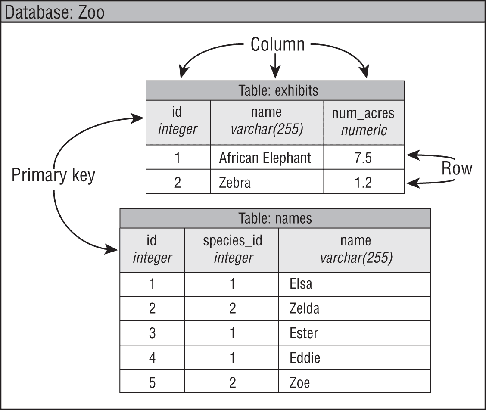

**图 10.1** 我们关系型数据库中的表

如你在图 10.1 所示，我们有两个表。一个命名为 `exhibits`，另一个命名为 `names`。每个表都有一个 `primary key`（主键），它提供了引用每行的唯一方法。毕竟，两只动物可能有相同的名称，但不能有相同的 ID。考试不需要了解键。我们提到它是为了提供一些背景。在我们的示例中，主键恰好只有一个列。在某些情况下，它是列的组合，被称为 `compound key`（复合键）。例如，学生标识符和年份可能就是一个复合键。

`exhibits` 表中有行三列，`names` 表有五行三列。考试时确实需要了解行和列。

## 编写基础 SQL 语句

关于 SQL，你在考试中需要的最重要的一点是，有四种用于处理表数据的语句类型。它们被称为 CRUD（创建、读取、更新、删除）。SQL 关键字与这些缩写并不对应，因此请注意表 10.1 中每种对应的 SQL 关键字。

| 操作 | SQL 关键字 |  |
| --- | --- | --- |
| **C**reate (创建) | `INSERT` | 向表中添加新行 |
| **R**ead (读取) | `SELECT` | 从表中检索数据 |
| **U**pdate (更新) | `UPDATE` | 修改表中的零或多行 |
| **D**elete (删除) | `DELETE` | 从表中删除零或多行 |

**表 10.1** CRUD 操作

就这些了。不需要你判断 SQL 语句是否正确。不需要你发现 SQL 语句中的语法错误。不需要你编写 SQL 语句。发现规律了吗？

如果你已经了解 SQL，可以跳到 JDBC 章节。我们涵盖基础知识是为了让新开发者了解发生了什么，至少在高层面上如此。我们承诺在本节的 SQL 内容中没有其他你需要了解的内容。事实上，你可能已经了解很多这里没有涵盖的内容。就考试而言，连接两个表（joining）是一个不存在的概念！

与 Java 不同，SQL 关键字是不区分大小写的。这意味着 `select`、`SELECT` 和 `Select` 都是等价。许多人使用大写字母作为数据库关键字，以便突出。在列名中使用 `snake case`（用下划线分隔“单词”）也是常见做法。我们遵循这些惯例。注意，在某些数据库中，表名和列名可能是区分大小写的。

像 Java 的基本类型一样，SQL 有许多数据类型。大多数是自言易明的，例如 `INTEGER`。还有 `DECIMAL`，它的功能非常像 Java 中的 `double`。最奇怪的是 `VARCHAR`，代表“可变字符”，类似于 Java 中的 `String`。`variable` 部分意味着数据库只使用存储该值所需的空间。

现在是时候写代码了。`INSERT` 语句通常用于在表中创建一个新行；这里有一个示例：

```sql
INSERT INTO exhibits
VALUES (3, 'Asian Elephant', 7.5);
```

如果在该命令成功运行之前表中有两行，那么运行之后就有三行。`INSERT` 语句列出了我们想要插入的值。默认情况下，它使用列定义时的相同顺序。`String` 数据包含在单引号中。

`SELECT` 语句从表中读取数据。

```sql
SELECT * 
FROM exhibits 
WHERE ID = 3;
```


`WHERE` 子句是可选的。如果你省略了它，将返回整个表的内容。`*` 表示按照定义的顺序返回所有列。或者，你可以列出你想要返回的列。

```sql
SELECT name, num_acres 
FROM exhibits 
WHERE ID = 3;
```

你可能已经注意到，我们并没有告诉你在任何真实的数据库中实现类称什么。关键点在于，你不应该知道。在 JDBC 中，你在代码中只使用接口，而从不直接使用实现类。事实上，它们可能不是 `public` 类。

这五个接口的作用是什么？从高层次来看，我们有：

*   `Driver`: 建立数据库连接
*   `Connection`: 向数据库发送命令
*   `PreparedStatement`: 执行 SQL 查询
*   `CallableStatement`: 执行存储在数据库中的命令
*   `ResultSet`: 读取查询结果

所有数据库接口都在 `java.sql` 包中，因此我们经常会省略导入语句。

在接下来的示例中，我们将向你展示 JDBC 代码从端到端的样子的。如果你是 JDBC 的初学者，只需注意代码中五个接口里有三个即可。如果你有经验，请记住考试中使用的是 `DriverManager` 而不是 `DataSource`。

```
public class MyFirstDatabaseConnection {
   public static void main(String[] args) throws SQLException {
      String url = "jdbc:derby:zoo";
      try (Connection conn = DriverManager.getConnection(url);
         PreparedStatement ps = conn.prepareStatement(
            "SELECT name FROM animal");
         ResultSet rs = ps.executeQuery()) {
         while (rs.next())
            System.out.println(rs.getString(1));
      }
   }
}
```

如果 URL 使用我们假设的 `Foo` 驱动，`DriverManager` 将返回一个 `FooConnection` 实例。调用 `prepareStatement()` 将返回一个 `FooPreparedStatement` 实例，而调用 `executeQuery()` 将返回一个 `FooResultSet` 实例。由于 URL 使用的是 `derby`，它返回的是 `derby` 为这些接口提供的实现。你不需要知道它们的名称。在章的其余部分中，我们将解释如何使用所有五个接口，并详细详细介绍它们的作用。到本章结束时，你将能够自己编写这样的代码。

## 连接到数据库

与数据库进行任何操作的第一步都是连接到它。首先，我们将向你展示如何构建 JDBC URL。然后，我们将展示如何使用它来获取数据库的 `Connection`。

### 构建 JDBC URL

要访问网站，你需要知道网站的 URL。要访问邮箱，你需要知道用户名和密码。JDBC 也不一样。要访问数据库，你需要知道关于它的这些信息。

与 Web URL 不同，JDBC URL 有多种格式。它们有三个共同部分，如图 10.3

**图 10.3** JDBC URL 格式

子名通常包含关于数据库的信息，例如数据库的位置和/或名称。语法各不相同。你需要了解这三个主要部分。你不需要背诵子名的格式。呼！你已经见过一个这样的 URL 了。

```
jdbc:derby:zoo
```

注意这三个部分。它以 `jdbc` 开始，然后是子协议 `derby`，最后以子名结束，即数据库名称。不需要位置，因为 Derby 是一个内存数据库。

这里是子名的其他示例：

```
jdbc:postgresql://localhost/zoo
jdbc:oracle:thin:@123.123.123.123:1521:zoo
jdbc:mysql://localhost:3306
jdbc:mysql://localhost:3306/zoo?profileSQL=true
```

你可以看到这些 JDBC URL 都以 `jdbc` 开头，后面跟着一个冒号，然后是厂商/产品名称。之后则不相同了。注意它们都包含了数据库的位置，即 `localhost`、`123.123.123.123:1521` 和 `localhost:3306`。另外，注意当使用默认位置时，端口是可选的。

为了确保你理解了，你看到以下每一项的错误之处了吗？

```
jdbc:postgresql://local/zoo
jdbc:mysql://123456/zoo
jdbc;oracle;thin;/localhost/zoo
```

第一个项使用了 `local` 而不是 `localhost`。字面量 `localhost` 是一个特殊定义的名称。你不能随便编造一个名称。尽管我们的数据库服务器可能被命名为 `local`，但考试不会让你假设名称。如果数据库服务器有一个特殊名称，题目会告诉你。第二个项说数据库的位置是 `123456`。这不符合逻辑。位置可以是 `localhost`、IP 地址或域名。第三个项不行，因为它使用了分号（`;`）而不是冒号（`:`）。

### 获取数据库

获取 `Connection` 有两种主要方式：`DriverManager` 或 `DataSource`。`DriverManager` 是考试涵盖的内容。例如，`DataSource` 具有更多功能。

容易记忆的名字是 `getConnection()`。从 Derby 数据库获取 `Connection`，你写如下：

```
import java.sql.*;
public class TestConnect {
   public static void main(String[] args) throws SQLException {
      Connection conn = DriverManager.getConnection("jdbc:derby:zoo");
      System.out.println(conn);
   }
}
```

通过 `java TestConnect.java` 运行此示例将得到类似下面的错误：

```
Exception in thread "main" java.sql.SQLException: No suitable driver found for jdbc:derby:zoo
   at java.sql/java.sql.DriverManager.getConnection(DriverManager.java:702)
   at java.sql/java.sql.DriverManager.getConnection(DriverManager.java:251)
```

看到 `SQLException` 意味着“在连接或访问数据库时发生了错误”。你需要识别出何时抛出了 `SQLException`，但不需要具体的消息。正如你在第 5 章“异常、断言和本地化”中所学到的，`SQLException` 是一个检查异常。

在这种情况下，我们没有告诉 Java 去哪里寻找数据库驱动 JAR 包。记住 `Connection` 的实现类位于驱动 JAR 中。我们通过添加以下类路径再次尝试：

```
java -cp "<path_to_derby>/derby.jar" TestConnect.java
```

请替换 Derby JAR 所在的位置。

这次程序成功运行并打印如下内容：

```
org.apache.derby.impl.jdbc.EmbedConnection40@1372082959
(XID = 156), (SESSIONID = 1), (DATABASE = zoo), (DRDAID = null)
```

输出细节并不重要。只需注意该类不是 `Connection`。它是 `Connection` 的厂商实现。

还有一个带有一个用户名和密码的签名。

```java
import java.sql.*;
public class TestExternal {
   public static void main(String[] args) throws SQLException {
      Connection conn = DriverManager.getConnection(
         "jdbc:postgresql://localhost:5432/ocp-book",
         "username",
         "Password20182");
      System.out.println(conn);
   }
}
```

注意传递给 `getConnection()` 的三个参数。第一个是你在上一个节中学习过的 JDBC URL。第二个是访问数据库的用户名，第三个是访问数据库的密码。不言而明，我们的密码不是 `Password20182`。另外，不要将密码写在实际代码中。这是一种糟糕的做法。始终从某种配置中加载它，理想情况下使用一种对存储值加密的配置。

如果你使用 Postgres 驱动 JAR 运行此代码，它将打印类似下面的内容：

```
org.postgresql.jdbc4.Jdbc4Connection@eed1f14
```

再次注意，这是一个特定驱动的实现类。你可以从包名中看出。由于包名是 `org.postgresql.jdbc4`，它是 PostgreSQL 驱动的一部分。

除非考试指明了命令行，否则你可以假设正确的 JDBC 驱动 JAR 已经在类路径中。如果出者想让你考虑这个问题，他们会显式地询问驱动 JAR 的问题。

工厂模式的优之处在于它替你处理了创建类的逻辑。你不需要知道实现 `Connection` 的类名，也不需要知道它是如何创建的。不过，你可能有点好奇。

`DriverManager` 会查找它能找到任何驱动程序，检查它们是否能处理该 JDBC URL。如果是，它将使用该 `Driver` 创建一个 `Connection`。如果不是，它将放弃并抛出 `SQLException`。

## 使用 PreparedStatement

在 Java 中，你可以选择使用 `Statement`、`PreparedStatement` 或 `CallableStatement`。后两者都是 `Statement` 的子接口，如图 10.4 所示。

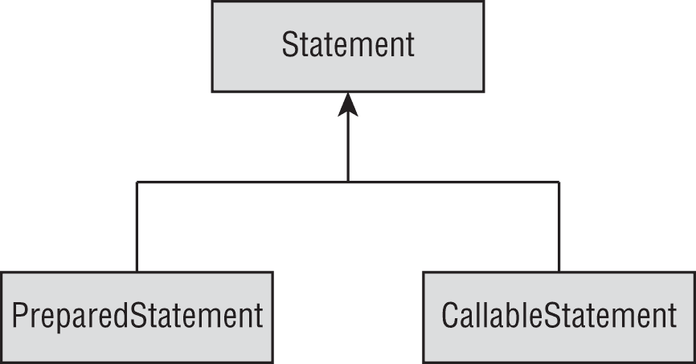

**图 10.4** 语句类型

在章节的稍后部分，你将学习如何使用 `CallableStatement` 执行数据库内部的查询。在本节中，我们将查看 `PreparedStatement`。

你问 `Statement` 呢？它是一个 `PreparedStatement` 和 `CallableStatement` 均扩展的接口。`Statement` 和 `PreparedStatement` 相似，区别在于 `PreparedStatement` 接收参数，而 `Statement` 不接收。`Statement` 只执行你提供给它的任何 SQL 查询。

虽然可以使用 `Statement` 直接运行 SQL，但你不应该这样做。由于以下原因，`PreparedStatement` 优越得多：

*   **性能**：在大多数程序中，你会多次运行相似的查询。`PreparedStatement` 会计算出一个运行 SQL 的计划并记住它。
*   **安全性**：正如你在第 11 章“安全性”中所看到的，正确使用 `PreparedStatement` 可以让你免受 SQL 注入攻击的侵害。
*   **可读性**：在构建带有大量参数的查询字符串时，不需要处理字符串拼接是非常棒的。
*   **未来使用**：即使你的查询只运行一次或没有任何参数，你也应该使用 `PreparedStatement`。这样，代码未来的编辑者在添加变量时，就不必忘记改为 `PreparedStatement`。

使用 `Statement` 接口也不在 JDBC 考试的范围之内，因此我们没有在书中介绍它。在接下来的章节中，我们将介绍如何获取 `PreparedStatement`、执行它、处理参数以及运行多次更新。

### 获取 PreparedStatement

要运行 SQL，你需要告诉 `PreparedStatement` 相关的信息。从 `Connection` 获取 `PreparedStatement` 很容易。

```
try (PreparedStatement ps = conn.prepareStatement(
   "SELECT * FROM exhibits")) {
   // 使用 ps
}
```

`PreparedStatement` 实例代表了你想通过 `Connection` 运行的 SQL 语句。它还没有实际执行查询！我们很快就会讨论这一点。

在创建对象时传递 SQL 语句是强制性的。你可能会在考试中看到一种技巧。

```
try (var ps = conn.prepareStatement()) { // 无法编译
}
```

上面的示例无法编译，因为在请求 `PreparedStatement` 时没有提供 SQL。我们在这个示例中还使用了 `var`。我们将同时使用 `var` 和实际类名来编写 JDBC 代码，以便你习惯这两种方法。

存在重载签名，允许你指定 `ResultSet` 类型和并发模式。在考试中，你只需要知道如何使用默认选项，它会按顺序处理结果。

### 执行 PreparedStatement

现在我们有了 `PreparedStatement`，就可以运行 SQL 语句了。运行 SQL 的方式取决于它是哪种 SQL 语句。记住，并不要求你能够读懂 SQL，但你确实需要知道第一个关键字的意思。

#### 使用 executeUpdate() 修改数据

让我们从更改表中数据的语句开始。这些将是以 `DELETE`、`INSERT` 或 `UPDATE` 开头的 SQL 语句。它们通常使用一个名为 `executeUpdate()` 的方法。这个名字有点微妙，因为 SQL `UPDATE` 语句并不是唯一使用该方法的语句。

该方法将要运行的 SQL 语句作为参数传递。它返回插入、删除或更改的行数。这里是所有三种方法的示例：

```
10: var insertSql = "INSERT INTO exhibits VALUES(10, 'Deer', 3)";
11: var updateSql = "UPDATE exhibits SET name = '' "
12:    "WHERE name = 'None'";
13: var deleteSql = "DELETE FROM exhibits WHERE id = 10";
14:
15: try (var ps = conn.prepareStatement(insertSql)) {
16:    int result = ps.executeUpdate();
17:    System.out.println(result); // 1
18: }
19:
20: try (var ps = conn.prepareStatement(updateSql)) {
21:    int result = ps.executeUpdate();
22:    System.out.println(result); // 0
23: }
24:
25: try (var ps = conn.prepareStatement(deleteSql)) {
26:    int result = ps.executeUpdate();
27:    System.out.println(result); // 1
28: }
```

对于考试，你不需要阅读 SQL。题目会告诉你受影响的行数。注意每个不同的 SQL 语句都需要自己的 `prepareStatement()` 调用。

#### 使用 executeQuery() 读取数据

接下来，让我们查看以 `SELECT` 开头的 SQL 语句。这次我们使用 `executeQuery()` 方法。

```
30: var sql = "SELECT * FROM exhibits";
31: try (var ps = conn.prepareStatement(sql);
32:    ResultSet rs = ps.executeQuery() ) {
33:
34:    // 使用 rs
35: }
```

在第 31 行，我们为我们的 `SELECT` 查询创建一个 `PreparedStatement`。在第 32 行，我们实际运行它。由于我们在运行查询以获取结果，返回类型是 `ResultSet`。在下一节中，我们将展示如何处理 `ResultSet`。

#### 使用 execute() 处理数据

还有第三种方法称为 `execute()`，它可以运行查询也可以运行更新。它返回一个 `boolean` 值，以便我们知道是否有 `ResultSet`。这样，我们就可以调用适当的方法来获取更多细节。该模式如下：


`boolean isResultSet = ps.execute();`
`if (isResultSet) {`
   `try (ResultSet rs = ps.getResultSet()) {`
      `System.out.println("ran a query");`
   `}`
`} else {`
   `int result = ps.getUpdateCount();`
   `System.out.println("ran an update");`
`}`

如果 `PreparedStatement` 指向的 `sql` 是 `SELECT`，则 `boolean` 为 `true`，我们就可以获取 `ResultSet`。如果它不是 `SELECT`，我们就可以获取更新的行数。

你认为如果对 SQL 语句使用了错误的方法会发生什么？让我们来看。

```java
var sql = "SELECT * FROM names";
try (var conn = DriverManager.getConnection("jdbc:derby:zoo");
   var ps = conn.prepareStatement(sql)) {

   var result = ps.executeUpdate();
}
```

这会抛出一个类似下面的 `SQLException`：

```
Statement.executeUpdate() cannot be called with a statement 
that returns a ResultSet.
```

我们无法获得编译时错误，因为 SQL 是一个 `String`。不过，我们可以获取异常，而且我们确实得到了。当对更改数据库的 SQL 使用 `executeQuery()` 时，也会得到 `SQLException`。

```
Statement.executeQuery() cannot be called with a statement 
that returns a row count.
```

同样，我们得到了一个异常，因为驱动程序无法将查询转换为预期的返回类型。

## 复习 `PreparedStatement` 方法

为了复习，请确保你熟悉表 10.2 和表 10.3。表 10.2 显示了 `PreparedStatement` 的三个关键方法分别可以运行哪些 SQL 语句。

| 方法 | `DELETE` | `INSERT` | `SELECT` | `UPDATE` |
| --- | --- | --- | --- | --- |
| `ps.execute()` | 是 | 是 | 是 | 是 |
| `ps.executeQuery()` | 否 | 否 | 是 | 否 |
| `ps.executeUpdate()` | 是 | 是 | 否 | 是 |

**表 10.2** execute 方法可运行 SQL

表 10.3 显示了每个方法返回的内容。

| 方法 | 返回类型 | `SELECT` 返回什么 | `DELETE/INSERT/UPDATE` 返回什么 |
| --- | --- | --- | --- |
| `ps.execute()` | `boolean` | `true` | `false` |
| `ps.executeQuery()` | `ResultSet` | 返回的行和列 | n/a |
| `ps.executeUpdate()` | `int` | n/a | 添加/修改/删除的行数 |

**表 10.3** execute 方法的返回类型

## 使用参数

假设我们的动物园获得了一头新大象，我们想在 `names` 表中注册它。我们已经学习了足够的知识来进行。

```java
public static void register(Connection conn) throws SQLException {
   var sql = "INSERT INTO names VALUES(6, 1, 'Edith')";

   try (var ps = conn.prepareStatement(sql)) {
      ps.executeUpdate();
   }
}
```

然而，所有内容都是硬编码的。我们希望能够将值作为参数传递。但是，我们不希望此方法的调用者需要编写 SQL 或了解我们数据库的准确细节。

幸运的是，`PreparedStatement` 允许我们设置参数。与其在 SQL 中指定这三个值，我们可以使用问号（`?`）代替。绑定变量（bind variable）是一个占位符，允许你在运行时指定实际值。绑定变量就像参数，你会看到绑定变量既被视为变量也被视为参数引用。我们可以使用绑定变量重写我们的 SQL 语句。

```java
String sql = "INSERT INTO names VALUES(?, ?, ?)";
```

绑定变量让 SQL 更加易读，因为你不再需要在 SQL 中为 `String` 值加引号。现在，我们可以将参数传递给方法本身了。

```java
14: public static void register(Connection conn, int key, 
15:    int type, String name) throws SQLException {
16:
17:    String sql = "INSERT INTO names VALUES(?, ?, ?)";
18:
19:    try (PreparedStatement ps = conn.prepareStatement(sql)) {
20:       ps.setInt(1, key);
21:       ps.setString(3, name);
22:       ps.setInt(2, type);
23:       ps.executeUpdate();
24:    }
25: }
```

第 19 行使用我们包含三个绑定变量的 SQL 创建了一个 `PreparedStatement`。第 20、21 和 22 行设置了这些变量。你可以将绑定变量视为参数列表，每个参数被依次设置。注意绑定变量可以按任何顺序设置。第 23 行实际上执行了查询并运行了更新。

注意绑定变量是从 1 开始计数的，而不是 0。这非常重要，所以我们将重复一遍。

在上一个例子中，我们乱序地设置了参数。这完全没问题。规则仅仅是它们在查询执行之前都必须被设置。让我们看看如果不设置所有的绑定变量会发生什么。

```java
var sql = "INSERT INTO names VALUES(?, ?, ?)";
try (var ps = conn.prepareStatement(sql)) {
   ps.setInt(1, key);
   ps.setInt(2, type);
   // 缺少 3
}
```

等待，上面的示例只是片段。让我们看看实际错误：

```java
var sql = "INSERT INTO names VALUES(?, ?, ?)";
try (var ps = conn.prepareStatement(sql)) {
   ps.setInt(1, key);
   ps.setInt(2, type);
   // 缺少 3
}
```

实际上，如果你没有设置所有的绑定变量，你会得到一个 `SQLException`：

```java
var sql = "INSERT INTO names VALUES(?, ?, ?)";
try (var ps = conn.prepareStatement(sql)) {
   ps.setInt(1, key);
   ps.setInt(2, type);
   // 缺少 3
}
```

等待，让我们重新检查代码：

```java
var sql = "INSERT INTO names VALUES(?, ?, ?)";
try (var ps = conn.prepareStatement(sql)) {
   ps.setInt(1, key);
   ps.setInt(2, type);
   // 缺少 3
}
```

（注：由于原文中存在大量重复的错误示例描述，译文已根据逻辑提取了核心内容）

```java
20: String sql = "SELECT id, name FROM exhibits";
21: Map<Integer, String> idToNameMap = new HashMap<>();
22:
23: try (var ps = conn.prepareStatement(sql);
24:    ResultSet rs = ps.executeQuery()) {
25:
26:    while (rs.next()) {
27:       int id = rs.getInt("id");
28:       String name = rs.getString("name");
29:       idToNameMap.put(id, name);
30:    }
31:    System.out.println(idToNameMap);
32: }
```

它的输出如下：

```
{1=African Elephant, 2=Zebra}
```

这里有几点需要注意。首先，我们在第 24 行使用了 `executeQuery()` 方法，因为我们希望返回一个 `ResultSet`。在第 26 行，我们遍历了结果。循环的每次迭代都代表 `ResultSet` 中的一行。第 27 行和第 28 行展示了获取特定行列数据的最佳方式。

`ResultSet` 拥有一个 `cursor`（游标），它指向数据中的当前位置。图 10.5 显示了我们在循环时的位置。

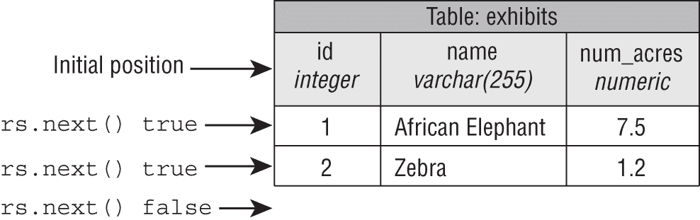

图 10.5 `ResultSet` 游标

在第 24 行，游标开始指向 `ResultSet` 中第一行之前的位置。在第一次循环迭代中，`rs.next()` 返回 `true`，游标移动到指向数据的第一行。在第二次循环迭代中，`rs.next()` 再次返回 `true`，游标移动到指向数据的第二行。下一次调用 `rs.next()` 返回 `false`。游标移过了数据的末尾。`false` 表示没有更多可获取的数据了。

我们确实提说是“最佳方式”。其实还有另一种访问列的方法。你可以使用索引而不是列名。使用列名更好，因为在阅读代码时更清楚发生了什么。它还允许你更改 SQL 来重新排列列。

使用列号重写相同的示例如下所示：

```java
20: String sql = "SELECT id, name FROM exhibits";
21: Map<Integer, String> idToNameMap = new HashMap<>();
22:
23: try (var ps = conn.prepareStatement(sql);
24:    ResultSet rs = ps.executeQuery()) {
25:
26:    while (rs.next()) {
27:       int id = rs.getInt(1);
28:       String name = rs.getString(2);
29:       idToNameMap.put(id, name);
30:    }
31:    System.out.println(idToNameMap);
32: }
```

这一次，你可以看到第 27 行和第 28 行的列位置。注意列是从 1 开始计数的，而不是 0。就像使用 `PreparedStatement` 一样，JDBC 在 `ResultSet` 中也是从 1 开始计数。

有时你只想从表中获取一行。也许你只需要一条数据。或者可能 SQL 只是返回表中的行数。当你只需要一行时，你使用 `if` 语句而不是 `while` 循环。

```java
var sql = "SELECT count(*) FROM exhibits";

try (var ps = conn.prepareStatement(sql);
   var rs = ps.executeQuery()) {

   if (rs.next()) {
      int count = rs.getInt(1);
      System.out.println(count);
   }
}
```

在尝试对 `ResultSet` 调用 getter 方法之前，检查 `rs.next()` 是否返回 `true` 是重要的。如果查询没有返回任何行，它将抛出 `SQLException`，因此 `if` 语句会检查调用是否是安全的。或者，你可以使用列名。

```java
var sql = "SELECT count(*) AS count FROM exhibits";

try (var ps = conn.prepareStatement(sql);
   var rs = ps.executeQuery()) {

   if (rs.next()) {
      var count = rs.getInt("count");
      System.out.println(count);
   }
}
```

让我们尝试读取一个不存在的列。

```java
var sql = "SELECT count(*) AS count FROM exhibits";

try (var ps = conn.prepareStatement(sql);
   var rs = ps.executeQuery()) {

   if (rs.next()) {
      var count = rs.getInt("total");
      System.out.println(count);
   }
}
```

这会抛出一个带有如下消息的 `SQLException`：

```
Column 'total' not found.
```

尝试访问不存在的列名或索引会抛出 `SQLException`，当 `ResultSet` 未指向有效行时从中获取数据也是如此。你需要能够识别这样的代码。这里有几个需要注意的示例。当没有行匹配时，你看到这里哪里错了吗？

```java
var sql = "SELECT count(*) FROM exhibits";

try (var ps = conn.prepareStatement(sql);
   var rs = ps.executeQuery()) {

   if (rs.next()) {
      var count = rs.getInt("total");
      System.out.println(count);
   }
}
```

这会抛出一个 `SQLException`，消息如下：

```
Column 'total' not found.
```

尝试访问不存在的列名或索引会抛出 `SQLException`，当 `ResultSet` 未指向有效行时从中获取数据也是如此。你需要能够识别这样的代码。这里有几个需要注意的示例。当没有行匹配时，你看到这里哪里错了吗？

总结这一部分，重要的是记住：
* 在调用 `rs.next()` 时始终使用 `if` 语句或 `while` 循环。
* 列索引从 1 开始。

## 获取列数据

`ResultSet` 有许多 `get` 方法。表 10.5 显示了你需要的 `get` 方法。这些是 表 10.4 中 setter 的等效方法。

| 方法名 | 返回类型 |
| --- | --- |
| `getBoolean` | `boolean` |
| `getDouble` | `double` |
| `getInt` | `int` |
| `getLong` | `long` |
| `getObject` | `Object` |
| `getString` | `String` |

表 10.5 `ResultSet get` 方法

你可能注意到并不是所有的基本类型都在 表 10.5 中。存在 `getByte()` 和 `getFloat()` 方法，但考试时不需要了解它们。没有 `getChar()` 方法。坦率说，你不需要记住这个。考试不会使用不存在的 `get` 方法名来欺骗你。

`getObject()` 方法可以返回任何类型。对于基本类型，它使用包装类。让我们看看这个示例：

```java
16: var sql = "SELECT id, name FROM exhibits";
17: try (var ps = conn.prepareStatement(sql);
18:    var rs = ps.executeQuery()) {
19:
20:    while (rs.next()) {
21:       Object idField = rs.getObject("id");
22:       Object nameField = rs.getObject("name");
23:       if (idField instanceof Integer) {
24:          int id = (Integer) idField;
25:          System.out.println(id);
26:       }
27:       if (nameField instanceof String) {
28:          String name = (String) nameField;
29:          System.out.println(name);
30:       }
31:    }
32: }
```


第 21 行和第 22 行根据最合适的 `Object` 类型获取列。第 23–26 行向你展示了如何在强制转换并将其解箱化为 `int` 之前确认该类型为 `Integer`。第 27–30 行向你展示了如何确认该类型为 `String` 并对其进行强制转换。在编写工作代码时你可能不会用到 `getObject()`，但为了考试了解它是有好处的。

### 使用绑定变量

我们一直都在同一个 `try-with-resources` 语句中创建 `PreparedStatement` 和 `ResultSet`。如果你有绑定变量，这种方法就失效了，因为它们需要在它们之间进行设置。幸运的是，我们可以嵌套 `try-with-resources` 来处理这个问题。这段代码打印任何匹配给定名称的展品的 ID：

```
30: var sql = "SELECT id FROM exhibits WHERE name = ?";
31:
32: try (var ps = conn.prepareStatement(sql)) {
33:    ps.setString(1, "Zebra");
34:
35:    try (var rs = ps.executeQuery()) {
36:       while (rs.next()) {
37:          int id = rs.getInt("id");
38:          System.out.println(id);
39:       }
40:    }
41: }
```

请注意这里的流程。首先，我们在第 32 行创建 `PreparedStatement`。然后我们在第 33 行设置绑定变量。只有在这两者都完成后，我们才在第 35 行通过嵌套的 `try-with-resources` 来创建 `ResultSet`。

### 调用 CallableStatement

有时你希望 SQL 直接存储在数据库中，而不是封装在你的 Java 代码中。当你有很多查询且它们很复杂时，这特别有用。*存储过程*是预编译并存储在数据库中的代码。存储过程通常用特定数据库 SQL 变体编写，这些变体在不同的数据库供应商之间有所不同。

使用存储过程可以减少网络往返。它还允许数据库专家拥有那部分代码。然而，存储过程是数据库特定的，并且增加了维护应用程序的复杂性。考试中，你需要知道如何调用存储过程，但不需要决定何时使用它。

对于考试来说，你不需要知道如何读取或编写存储过程。因此，我们没有在书中包含任何存储过程。如果你想尝试示例，可以通过此处链接设置程序和源代码：

[`www.selikoff.net/ocp11-2`](http://www.selikoff.net/ocp11-2)

我们在本节将使用四个存储过程。表 10.6 总结了你需要的关于它们的知识。在现实世界中，这些一个都不是良好的实现，因为它们不够复杂，不足以作为存储过程。正如你在表中看到的，存储过程允许参数仅输入、仅输出或两者兼有。

| 名称 | 参数名 | 参数类型 | 说明 |
| --- | --- | --- | --- |
| `read_e_names()` | n/a | n/a | 返回 `names` 表中所有以 `E` 开头的名称行 |
| `read_names_by_letter()` | `prefix` | `IN` | 返回 `names` 表中所有以指定参数开头的名称行 |
| `magic_number()` | `Num` | `OUT` | 返回数字 `42` |
| `double_number()` | `Num` | `INOUT` | 将参数乘以二并返回该数字 |

**表 10.6** 示例存储过程

### 调用无参数的过程

我们的 `read_e_names()` 存储过程不接受任何参数。它确实返回一个 `ResultSet`。由于我们在 `PreparedStatement` 部分处理过 `ResultSet`，因此在这里我们可以重点关注如何调用存储过程的。

```
12: String sql = "{call read_e_names()}";
13: try (CallableStatement cs = conn.prepareCall(sql);
14:    ResultSet rs = cs.executeQuery()) {
15:
16:    while (rs.next()) {
17:       System.out.println(rs.getString(3));
18:    }
19: }
```

第 12 行引入了新的语法。通过在括号 (`{}`) 中放入 `call` 单词和过程名称来调用存储过程。

第 13 行创建了一个 `CallableStatement` 对象。当我们创建 `PreparedStatement` 时，我们使用了 `prepareStatement()` 方法。在这里，我们改用 `prepareCall()` 方法。

第 14–18 行应该看起来熟悉。它们是我们一直一直的获取 `ResultSet` 并遍历它的标准逻辑。此存储过程返回底层表，因此列是相同的。

### 传递 IN 参数

一个总是返回相同内容的存储过程只有部分用处。我们创建了该存储过程的新版本，它更通用。`read_names_by_letter()` 存储过程接受一个用于存储过程前缀或首字母的参数。`IN` 参数用于输入。

与我们之前的调用相比，调用它有两个不同点。

```
25: String sql = "{call read_names_by_letter(?)}";
26: try (CallableStatement cs = conn.prepareCall(sql)) {
27:    cs.setString(1, "Z");
28:
29:    try (ResultSet rs = cs.executeQuery()) {
30:       while (rs.next()) {
31:          System.out.println(rs.getString(3));
32:       }
33:    }
34: }
```

第 25 行使用 `?` 表明我们需要输入参数。

第 27 行设置了参数的值。与我们之前的存储过程相比，这里有两个不同点。

我们可以使用参数编号（1）或参数名称。这意味着以下两种语句是等效的：

```java
cs.setString(1, "Z");
cs.setString("prefix", "Z");
```

```
29:    try (ResultSet rs = cs.executeQuery()) {
30:       while (rs.next()) {
31:          System.out.println(rs.getString(3));
32:       }
33:    }
```

### 返回 OUT 参数

在之前的示例中，我们返回 `ResultSet`。存储过程有输出。

```
40: String sql = "{call magic_number(?)}";
41: try (CallableStatement cs = conn.prepareCall(sql)) {
42:    cs.registerOutParameter(1, Types.INTEGER);
43:    cs.execute();
44:    System.out.println(cs.getInt(1));
45: }
```

第 40 行包含了特殊字符 (`?=`) 以明存储过程有输出。第 42 行我们注册了 `OUT` 参数。

### 使用 INOUT 参数

最后，可以使用同一个参数同时用于输入和输出。阅读这段代码时，看看你能否识别出哪些行是 `IN` 部分需要的，哪些是 `OUT` 部分需要的。

```
50: String sql = "{call double_number(?)}";
51: try (CallableStatement cs = conn.prepareCall(sql)) {
52:    cs.setInt(1, 8);
53:    cs.registerOutParameter(1, Types.INTEGER);
54:    cs.execute();
55:    System.out.println(cs.getInt(1));
56: }
```

对于 `IN` 参数，第 50 行是必要的，因为它传递了参数。同样，第 52 行是必要的，因为它设置了参数。对于 `OUT` 参数，第 53 行是必要的，以注册参数。第 54 行再次使用 `execute()`，因为我们没有返回 `ResultSet`。

### 比较 CallableStatement 参数

表 10.7 回顾了不同的参数类型。考试中你需要很好地掌握这一点。

| | `IN` | `OUT` | `INOUT` |
| --- | --- | --- | --- |
| 用于输入 | 是 | 否 | 是 |
| 用于输出 | 否 | 是 | 是 |
| 必须设置参数值 | 是 | 否 | 是 |
| 必须调用 `registerOutParameter()` | 否 | 是 | 是 |
| 可以包含 `?=` | 否 | 是 | 是 |

# 表 10.7 存储过程参数类型

## 关闭数据库资源

正如你在第 8 章“I/O”和第 9 章“NIO.2”中所看到的，在完成资源的使用后关闭它们是非常重要的。JDBC 也是如此。`JDBC` 资源（如 `Connection`）的创建成本很高。不关闭它们会导致`resource leak`，最终减慢你的程序。

在整个章节中，我们一直使用第 5 章中的 try-with-resources 语法。资源需要按照特定顺序关闭。首先关闭 `ResultSet`，然后是 `PreparedStatement`（或 `CallableStatement`），最后是 `Connection`。

虽然关闭所有三个资源是一个好习惯，但并不是严格必要的。关闭 JDBC 资源应该关闭它创建的任何资源。特别是，以下情况是成立的：

*   关闭 `Connection` 也会关闭 `PreparedStatement`（或 `CallableStatement`）和 `ResultSet`。
*   关闭 `PreparedStatement`（或 `CallableStatement`）也会关闭 `ResultSet`。

按照正确的顺序关闭资源非常重要。这可以避免资源泄漏和异常。

关闭 `ResultSet` 还有另一种方法。当你从同一个 `Statement` 运行另一个 SQL 语句时，JDBC 会自动关闭该 `ResultSet`。这可能是一个 `PreparedStatement` 或 `CallableStatement`。在这段代码中关闭了多少个资源？

```
14: var url = "jdbc:derby:zoo";
15: var sql = "SELECT count(*) FROM names where id = ?";
16: try (var conn = DriverManager.getConnection(url);
17:    var ps = conn.prepareStatement(sql)) {
18:
19:    ps.setInt(1, 1);
20:
21:    var rs1 = ps.executeQuery();
22:    while (rs1.next()) {
23:       System.out.println("Count: " + rs1.getInt(1));
24:    }
25:
26:    ps.setInt(1, 2);
27:
28:    var rs2 = ps.executeQuery();
29:    while (rs2.next()) {
30:       System.out.println("Count: " + rs2.getInt(1));
31:    }
32:    rs2.close();
33: }
```


正确答案是四个。在第 28 行，`rs1` 被关闭了，因为同一个 `PreparedStatement` 运行了另一个查询。在第 32 行，`rs2` 在方法调用中被关闭。然后 try-with-resources 语句运行并关闭了 `PreparedSatement` 和 `Connection` 对象。

## 总结

对于考试，你应该掌握四种关键 SQL 语句，每个对应一个 CRUD 操作：创建（`INSERT`）新行、读取（`SELECT`）数据、更新（`UPDATE`）一行或多行以及删除（`DELETE`）一行或多行。

考试，你应该熟悉五个 JDBC 接口：`Driver`、`Connection`、`PreparedStatement`、`CallableStatement` 和 `ResultSet`。这些接口是 Java API 的一部分。特定的数据库 JAR 文件提供了实现。

要连接到数据库，你需要 JDBC URL。一个 JDBC URL 有三个由冒号分隔的部分。第一部分是 `jdbc`。第二部分是供应商/产品名称。第三部分因数据库而异，但它包含了数据库的位置和/或名称。位置可以是 `localhost` 或 IP 地址，后跟一个可选的端口。

`DriverManager` 类提供了一个名为 `getConnection()` 的工厂方法来获取 `Connection` 实现。你分别使用 `prepareStatement()` 和 `prepareCall()` 来创建 `PreparedStatement` 或 `CallableStatement`。当 SQL 在你的应用程序中指定时，使用 `PreparedStatement`；而当 SQL 在数据库中时，使用 `CallableStatement`。`PreparedStatement` 允许你设置绑定变量的值。`CallableStatement` 也允许你设置 `IN`、`OUT` 和 `INOUT` 参数。

当运行 `SELECT` SQL 语句时，`executeQuery()` 方法返回 `ResultSet`。当运行 `DELETE`、`INSERT` 或 `UPDATE` SQL 语句时，`executeUpdate()` 方法返回受影响的行数。还有一个 `execute()` 方法，它返回一个 `boolean` 来指示语句是否为查询。

你从 `if` 语句或 `while` 循环中调用 `rs.next()` 来移动光标位置。要从列获取数据，调用类似 `getString(1)` 或 `getString("a")` 的方法。列索引从 1 开始，而不是 0 开始。除了获取 `String` 或基本数据类型外，你还可以调用 `getObject()` 获取任何类型。

完成资源使用后关闭 JDBC 资源很重要，以避免资源泄漏。关闭 `Connection` 会自动关闭 `Statement` 和 `ResultSet` 对象。关闭 `Statement` 会自动关闭 `ResultSet` 对象。此外，运行另一个 SQL 语句会关闭该 `Statement` 之前的 `ResultSet` 对象。

## 考试要点

* **列出考试需要的核心五个 JDBC 接口及其定义位置。** 这五个关键接口是 `Driver`、`Connection`、`PreparedStatement`、`CallableStatement` 和 `ResultSet`。这些接口是核心 Java API 的一部分。
* **列出考试需要的核心五个 JDBC 接口及其定义位置。** 这五个关键接口是 `Driver`、`Connection`、`PreparedStatement`、`CallableStatement` 和 `ResultSet`。接口是核心 Java API 的一部分。
* **连接到数据库，你需要 JDBC URL。** JDBC URL 有三个由冒号分隔的部分。第一部分是 `jdbc`。第二部分是供应商/产品名称。第三部分因数据库而异，但它包含了数据库的位置和/或名称。位置可以是 `localhost` 或 IP 地址，后跟一个可选的端口。
* **`DriverManager` 类提供了一个名为 `getConnection()` 的工厂方法来获取 `Connection` 实现。** 你分别使用 `prepareStatement()` 和 `prepareCall()` 来创建 `PreparedStatement` 或 `CallableStatement`。当 SQL 在你的应用程序中指定时，使用 `PreparedStatement`；而当 SQL 在数据库中时，使用 `CallableStatement`。`PreparedStatement` 允许你设置绑定变量的值。`CallableStatement` 也允许你设置 `IN`、`OUT` 和 `INOUT` 参数。
* **运行 `SELECT` SQL 语句时，`executeQuery()` 方法返回 `ResultSet`。** 运行 `DELETE`、`INSERT` 或 `UPDATE` SQL 语句时，`executeUpdate()` 方法返回受影响的行数。还有一个 `execute()` 方法，它返回一个 `boolean` 来指示语句是否为查询。
* **你从 `if` 语句或 `while` 循环中调用 `rs.next()` 来移动光标位置。** 要从列获取数据，调用类似 `getString(1)` 或 `getString("a")` 的方法。列索引从 1 开始，而不是 0 开始。除了获取 `String` 或基本数据类型外，你还可以调用 `getObject()` 获取任何类型。
* **完成资源使用后关闭 JDBC 资源很重要，以避免资源泄漏。** 关闭 `Connection` 会自动关闭 `Statement` 和 `ResultSet` 对象。关闭 `Statement` 会自动关闭 `ResultSet` 对象。此外，运行另一个 SQL 语句会关闭该 `Statement` 之前的 `ResultSet` 对象。

## 习题

章节习题的答案可以在附录 B。

1. 哪些接口或类位于特定的数据库 JAR 文件中？（多选）
   * `Driver`
   * `Driver` 的实现
   * `DriverManager`
   * `DriverManager` 的实现
   * `PreparedStatement`
   * `PreparedStatement` 的实现

2. 哪些是 JDBC URL 的必要部分？（多选）
   * 连接参数
   * 数据库 IP 地址
   * `jdbc`
   * 密码
   * 端口
   * 供应商特定字符串

3. 以下哪个是有效的 JDBC URL？
   * `jdbc:sybase:localhost:1234/db`
   * `jdbc::sybase::localhost::/db`
   * `jdbc::sybase:localhost::1234/db`
   * `sybase:localhost:1234/db`
   * `sybase::localhost::/db`
   * `sybase::localhost::1234/db`

### 4. 哪些选项可以填入空白使代码编译并运行无错误？（选择所有适用项。）

```java
var sql = "UPDATE habitat WHERE environment = ?";

try (var ps = conn.prepareStatement(sql)) {

   ____________ 

   ps.executeUpdate();

}
```

1. `ps.setString(0, "snow");`
2. `ps.setString(1, "snow");`
3. `ps.setString("environment", "snow");`
4. `ps.setString(1, "snow"); ps.setString(1, "snow");`
5. `ps.setString(1, "snow"); ps.setString(2, "snow");`
6. `ps.setString("environment", "snow");ps.setString("environment", "snow");`

### 5. 假设你有一个名为 `animal` 的表，包含两行。以下代码的结果是什么？

```java
6:  var conn = new Connection(url, userName, password);
7:  var ps = conn.prepareStatement(
8:     "SELECT  count(*) FROM animal");
9:  var rs = ps.executeQuery();
10: if (rs.next()) System.out.println(rs.getInt(1));
```

1. `0`
2. `2`
3. 第 6 行有编译错误。
4. 第 10 行有编译错误。
5. 另一行有编译错误。
6. 抛出了运行时异常。

### 6. 哪些选项可以填入空白使代码编译？

```java
boolean bool = ps.______________();
int num = ps.______________();
ResultSet rs = ps.______________();
```

1. `execute`, `executeQuery`, `executeUpdate`
2. `execute`, `executeUpdate`, `executeQuery`
3. `executeQuery`, `execute`, `executeUpdate`
4. `executeQuery`, `executeUpdate`, `execute`
5. `executeUpdate`, `execute`, `executeQuery`
6. `executeUpdate`, `executeQuery`, `execute`

### 7. 以下哪些词是 CRUD 缩写词中的单词？（选择所有适用项。）

1. Create
2. Delete
3. Disable
4. Relate
5. Read
6. Upgrade

### 8. 假设表 `animal` 有五行，以下 SQL 语句更新了所有行。此代码的结果是什么？

```java
public static void main(String[] args) throws SQLException {

   var sql = "UPDATE names SET name = 'Animal'";

   try (var conn = DriverManager.getConnection("jdbc:derby:zoo");

      var ps = conn.prepareStatement(sql)) {

      var result = ps.executeUpdate();

      System.out.println(result);

   }

}
```

1. `0`
2. `1`
3. `5`
4. 代码无法编译。
5. 抛出了 `SQLException`。
6. 抛出了不同的异常。

### 9. 假设 `learn()` 是接受一个 `IN` 参数的存储过程。以下代码哪里有问题？（选择所有适用项。）

```java
18: var sql = "call learn()";
19: try (var cs = conn.prepareCall(sql)) {
20:    cs.setString(1, "java");
21:    try (var rs = cs.executeQuery()) {
22:       while (rs.next()) {
23:          System.out.println(rs.getString(3));
24:       }
25:    }
26: }
```

1. 第 18 行缺少大括号。
2. 第 18 行缺少一个 `?`。
3. 第 19 行不允许使用 `var`。
4. 第 20 行无法编译。
5. 第 22 行无法编译。
6. 代码还有其他问题。
7. 以上均不是。此代码是正确的。

### 10. 假设表 `enrichment` 有三行，动物分别为 `bat`、`rat` 和 `snake`。此段代码打印了多少行？

```java
var sql = "SELECT toy FROM enrichment WHERE animal = ?";

try (var ps = conn.prepareStatement(sql)) {

   ps.setString(1, "bat");

   try (var rs = ps.executeQuery(sql)) {

      while (rs.next())

         System.out.println(rs.getString(1));

   }

}
```

1. 0
2. 1
3. 3
4. 代码无法编译。
5. 抛出了 `SQLException`。
6. 抛出了不同的异常。

### 11. 假设表 `food` 有五行，此 SQL 语句更新了所有行。此代码的结果是什么？

```java
public static void main(String[] args) {

   var sql = "UPDATE food SET amount = amount + 1";

   try (var conn = DriverManager.getConnection("jdbc:derby:zoo");

      var ps = conn.prepareStatement(sql)) {

      var result = ps.executeUpdate();

      System.out.println(result);

   }

}
```

1. `0`
2. `1`
3. `5`
4. 代码无法编译。
5. 抛出了 `SQLException`。

### 12. 假设我们有一个调用存储过程并返回结果集的 JDBC 程序。关闭资源的正确顺序是哪个？

1. `Connection`, `ResultSet`, `CallableStatement`
2. `Connection`, `CallableStatement`, `ResultSet`
3. `ResultSet`, `Connection`, `CallableStatement`
4. `ResultSet`, `CallableStatement`, `Connection`
5. `CallableStatement`, `ResultSet`, `Connection`
6. `CallableStatement`, `Connection`, `ResultSet`

### 13. 假设 `counts` 表有五行，数字从 1 到 5。此代码打印多少行？

```java
var sql = "SELECT num FROM counts WHERE num=?";

try (var ps = conn.prepareStatement(sql)) {

   ps.setInt(1, 3);

   try (var rs = ps.executeQuery()) {

      while (rs.next())

         System.out.println(rs.getObject(1));

   }

}
```

*(注：13 题的输入文本已清理)*

### 14. 以下哪些项可以正确填入空白？（选择所有适用项。）

```java
var rs = ps.executeQuery();

if (rs.next()) {

   ________________________________;

}
```

1. `String s = rs.getString(0)`
2. `String s = rs.getString(1)`
3. `String s = rs.getObject(0)`
4. `String s = rs.getObject(1)`
5. `Object s = rs.getString(0)`
6. `Object s = rs.getString(1)`

### 15. 假设 `learn()` 是一个接受一个 `IN` 参数和一个 `OUT` 参数的存储过程。以下代码哪里有问题？（选择所有适用项。）

```java
18: var sql = "{?= call(?)}";
19: try (var cs = conn.prepareCall(sql)) {
20:    cs.setInt(1, 8);
21:    cs.execute();
22:    System.out.println(cs.getInt(1));
23: }
```

1. 第 18 行没有正确调用存储过程。
2. 未设置输入值。
3. 参数未注册输出。
4. 代码无法编译。
5. 代码还有其他问题。
6. 以上均不是。此代码是正确的。

### 16. 以下哪些项可以填入空白？（选择所有适用项。）

```java
var sql = "________________";

try (var ps = conn.prepareStatement(sql)) {

   ps.setObject(3, "red");

   ps.setInt(2, 8);

   ps.setString(1, "ball");

   ps.executeUpdate();

}
```


1. `{ call insert_toys(?, ?) }`
2. `{ call insert_toys(?, ?, ?) }`
3. `{ call insert_toys(?, ?, ?, ?) }`
4. `INSERT INTO toys VALUES (?, ?)`
5. `INSERT INTO toys VALUES (?, ?, ?)`
6. `INSERT INTO toys VALUES (?, ?, ?, ?)`

```java
var sql = "SELECT num FROM counts WHERE num> ?";

try (var ps = conn.prepareStatement(sql)) {

   ps.setInt(1, 3);

   try (var rs = ps.executeQuery()) {

      while (rs.next())

         System.out.println(rs.getObject(1));

   }

   try (var rs = ps.executeQuery()) {

      while (rs.next())

         System.out.println(rs.getObject(1));

   }

}
```

1. 0
2. 1
3. 2
4. 4
5. 代码无法编译。
6. 代码抛出异常。

18. 在插入新行之前，`species` 表中当前有 100 行数据。以下代码的输出是什么？

```java
String insert = "INSERT INTO species VALUES (3, 'Ant', .05)";

String select = "SELECT count(*) FROM species";

try (var ps = conn.prepareStatement(insert)) {

   ps.executeUpdate();

}

try (var ps = conn.prepareStatement(select)) {

   var rs = ps.executeQuery();

   System.out.println(rs.getInt(1));

}
```

1. 100
2. 101
3. 代码无法编译。
4. 抛出 `SQLException`。
5. 抛出了另一个异常。

19. 哪些选项可以填充空白，使代码能够编译并运行且没有错误？（选择所有项。）

```java
var sql = "UPDATE habitat WHERE environment = ?";

try (var ps = conn.prepareCall(sql)) {

   ________________

   ps.executeUpdate();

}
```

1. `ps.setString(0, "snow");`
2. `ps.setString(1, "snow");`
3. `ps.setString("environment", "snow");`
4. 代码无法编译。
5. 代码在运行时抛出异常。

20. 关于以下代码，以下哪些项可能是正确的？（选择所有项。）

```java
var sql = "{call transform(?)}";

try (var cs = conn.prepareCall(sql)) {

   cs.registerOutParameter(1, Types.INTEGER);

   cs.execute();

   System.out.println(cs.getInt(1));

}
```

1. 存储过程可以声明一个 `IN` 或 `INOUT` 参数。
2. 存储过程可以声明一个 `INOUT` 或 `OUT` 参数。
3. 存储过程必须声明一个 `IN` 参数。
4. 存储过程必须声明一个 `INOUT` 参数。
5. 存储过程必须声明一个 `OUT` 参数。

21. 哪一行包含编译错误？

```java
25: String url = "jdbc:derby:zoo";

26: try (var conn = DriverManager.getConnection(url);

27:    var ps = conn.prepareStatement();

28:    var rs = ps.executeQuery("SELECT * FROM swings")) {

29:    while (rs.next()) {

30:       System.out.println(rs.getInteger(1));

31:    }

32: }
```

1. 第 26 行
2. 第 27 行
3. 第 28 行
4. 第 29 行
5. 第 30 行
6. 以上均不是

## 第 11 章

## 安全

现在读新闻时很难不听到关于数据泄露的消息。作为开发者，我们的工作是编写出能够抵御攻击的安全代码。在本章中，你将学习在独立 Java 应用程序中编写安全代码的基础知识。

我们将学习黑客哈里（Hacker Harry）如何尝试做坏事，以及安全专家西耶娜（Security Sienna）如何保护她的应用程序。在本章结束时，你应该能够像西耶娜一样保护应用程序免受哈里的攻击。

考试仅涵盖 Java SE（标准版）应用程序。它不涵盖 Web 应用程序或其他任何高级 Java。

## 设计安全的对象

Java 为我们提供了许多工具来保护我们创建的对象。在本节中，我们将查看访问控制、扩展性、验证以及创建不可变对象。所有这些技术都可以保护你的对象免受黑客哈里的侵扰。

### 限制访问性

黑客哈里听说动物园对动物围栏使用了组合锁。他非常想获得所有的组合密码。

让我们从一个糟糕的实现开始。

```java
package animals.security;

public class ComboLocks {

   public Map<String, String> combos;

}
```

这种非常糟糕，因为 `combos` 对象具有 `public` 访问权限。这也是封装性很差。一个关键的安全原则是尽可能地限制访问。将其看作是对象的“按需知道”。这被称为“最小权限原则”（`principle of least privilege`）。

在复习 1Z0-815 考试时，你学习了四种级别的访问控制。将 `combos` 对象设为 `private` 并编写一个方法来提供必要的功能会更好。

```java
package animals.security;

public class ComboLocks {

   private Map<String, String> combos;

   public boolean isComboValid(String animal, String combo) {

      var correctCombo = combos.get(animal);

      return combo.equals(correctCombo);

   }

}
```

这好得多；我们没有向 `ComboLocks` 类之外的任何类暴露组合映射。例如，包私有（package-private）比 `public` 好，而 `private` 比包私有更好。

为了挫败黑客哈里和他的随从，一种良好的做法是尽可能将实例变量设为 `private` 或包私有。如果你的应用程序使用了模块，你可以通过仅向应该访问的模块导出安全包做得更好。这里有一个例子：

```java
exports animals.security;
```

在这个例子中，只有 `staff` 模块可以访问 `public` 类。

### 限制扩展性

假设你正在编写一个使用 `ComboLocks` 的类。

```java
public class GrasshopperCage {

   public static void openLock(ComboLocks comboLocks, String combo) {

      if (comboLocks.isComboValid("grasshopper", combo))

         System.out.println("Open!");

   }

}
```

情况下，传递给方法的变量是 `ComboLocks` 的实例。然而，黑客哈里正在努力工作并创建了这个 `ComboLocks` 的子类。

```java
public class EvilComboLocks extends ComboLocks {

   public boolean isComboValid(String animal, String combo) {

      var valid = super.isComboValid(animal, combo);

      if (valid) {

         // 将密码发送给黑客哈里

      }

      return valid;

   }

}
```

这太棒了。黑客哈里可以检查密码是否有效并将所有密码发给自己。混乱发生了！幸运的是，有一种解决此问题的简单方法。将敏感类标记为 `final` 可以防止任何子类的创建。

```java
public final class ComboLocks {

   private Map<String, String> combos;

   // 实例化 combos 对象

   public boolean isComboValid(String animal, String combo) {

      var correctCombo = combos.get(animal);

      return combo.equals(correctCombo);

   }

}
```

黑客哈里无法创建他的邪恶类，`GrasshopperCage` 的用户可以确保只有预期的 `ComboLocks` 类出现。

### 创建不可变对象

正如你可能从第 1 章“Java 基础”记得的，不可变对象是在创建后无法更改状态的对象。在编写安全代码时，不可变对象很有，因为你不需要担心值的改变。它们在处理并发时也能简化代码。

我们在书中中使用了一些不可变对象。贯穿书籍的 `String` 类是不变的。在第 3 章“泛型与集合”中，你使用了 `List.of()`、`Set.of()` 和 `Map.of()`。这三个方法都返回不可变类型。

虽然有多种编写不可变类的技术，但你应该熟悉一种使类变为不可变的常用策略。

1. 将类标记为 `final`。
2. 将所有实例变量标记为 `private`。
3. 不要定义任何 setter 方法并将字段设为 `final`。
4. 不要允许引用的可变对象被修改。

## 5. 使用构造函数设置对象的所有属性，并在需要时创建副本。

第一条规则防止任何人创建可变的子类。你可能会注意到，这与我们限制扩展性时使用的技术相同。第二条规则提供了良好的封装。第三条规则确保调用者和类本身都不会对实例变量进行修改。

第四条规则则更为微妙。基本上，它意味着你不应该为可变对象暴露 getter 方法。例如，你能看出为什么以下代码不是一个不可变对象吗？

```java
1:  import java.util.*;

2:

3:  public final class Animal {

4:     private final ArrayList<String> favoriteFoods;

5:

6:     public Animal() {

7:        this.favoriteFoods = new ArrayList<String>();

8:        this.favoriteFoods.add("Apples");

9:     }

10:    public List<String> getFavoriteFoods() { 

11:       return favoriteFoods;

12:    }

13: }
```

我们仔细遵循了前三条规则，遗憾的是，黑客哈利（Hacker Harry）可以通过调用 `getFavoriteFoods().clear()` 或向列表添加动物不喜吃的食物来修改我们的数据。如果我们能改变它的内容，它就不是一个不可变对象！如果我们没有为 `favoriteFoods` 对象提供 getter，调用者如何访问它？简单，通过使用委托方法来读取数据，如下所示：

```java
1:  import java.util.*;

2:

3:  public final class Animal {

4:     private final ArrayList<String> favoriteFoods;

5:

6:     public Animal() {

7:        this.favoriteFoods = new ArrayList<String>();

8:        this.favoriteFoods.add("Apples");

9:     }

10:    public int getFavoriteFoodsCount() { 

11:       return favoriteFoods.size();

12:    }

13:    public String getFavoriteFoodsElement(int index) { 

14:       return favoriteFoods.get(index);

15:    }

16: }
```

在这个改进版本中，数据仍然可用。然而，它是一个真正的不可变对象，因为可变变量无法被调用者修改。另一个选项是创建一个 `favoriteFoods` 对象的副本，并在每次请求时返回该副本，这样原始对象就能保持安全。

```java
10:    public ArrayList<String> getFavoriteFoods() { 

11:       return new ArrayList<String>(this.favoriteFoods);

12:    }
```

当然，副本中的更改不会反映在原始对象中，但至少原始对象受到了不受外部变化的保护。在下一节中，我们将看到如果类实现了特定的接口，还有另一种复制对象的方法。

那么，关于创建不可变对象的最后一条规则是什么呢？假设我们允许用户提供 `favoriteFoods` 数据，因此我们实现了以下代码：

```java
1:  import java.util.*;

2:

3:  public final class Animal {

4:     private final ArrayList<String> favoriteFoods;

5:

6:     public Animal(ArrayList<String> favoriteFoods) {

7:        if(favoriteFoods == null)

8:           throw new RuntimeException("favoriteFoods is required");

9:        this.favoriteFoods = favoriteFoods;

10:    }

11:    public int getFavoriteFoodsCount() { 

12:       return favoriteFoods.size();

13:    }

14:    public String getFavoriteFoodsElement(int index) { 

15:       return favoriteFoods.get(index);

16:    }

17: }
```

为了确保 `favoriteFoods` 不为 `null`，我们在构造函数中对其进行验证，如果未提供则抛出异常。然而，黑客哈利非常狡猾。他决定向我们发送 `favoriteFood` 对象，但保留了他对该对象的秘密引用，并可以直接修改该引用。

```java
void modifyNotSoImmutableObject() {

      var favorites = new ArrayList<String>();

      favorites.add("Apples");

      var animal = new Animal(favorites);

      System.out.print(animal.getFavoriteFoodsCount());

      favorites.clear();

      System.out.print(animal.getFavoriteFoodsCount());

}
```

这个方法打印了 `1`，然后是 `0`。哎！看来 `Animal` 不再是不可变的了，因为它的内容在创建后可以改变。解决方案是使用*拷贝构造函数*（copy constructor）来为包含相同元素的列表对象创建一个副本。

```java
6:     public Animal(List<String> favoriteFoods) {

7:        if(favoriteFoods == null)

8:           throw new RuntimeException("favoriteFoods is required");

9:        this.favoriteFoods = new ArrayList<String>(favoriteFoods);

10:    }
```


这种复制操作被称为*防御性拷贝*（defensive copy），因为创建副本是为了防止其他代码执行意想不到的操作。这与防御性驾驶的原理相同。安全西娜（Security Sienna）必须保持安全，因为她无法控制别人的行为。通过这种方法，黑客哈利被击败了。他可以随意修改原始的 `favoriteFoods`，但这改变 `Animal` 对象的内容。

## 克隆对象（Cloning Objects）

Java 有一个 `Cloneable` 接口，如果你希望类能够对你的对象调用 `clone()` 方法，就可以实现它。这有助于制作防御性拷贝。

`ArrayList` 没有实现 `Cloneable`，但你可以对 `ArrayList` 实例调用 `clone()` 来制作防御性拷贝。这是因为 `ArrayList` 实现了 `Cloneable`，并且它的 `clone()` 方法返回一个新的 `ArrayList`。

```java
ArrayList<String> list = new ArrayList<>();
list.add("Apples");
ArrayList<String> copy = (ArrayList<String>) list.clone();
```

`exploit`（利用程序）是一种利用安全漏洞的攻击。黑客 Harry 准备好尝试利用他能找到任何代码。他特别喜欢不可信的数据。

不可信的数据有许多来源。对于考试，你需要注意用户输入、从文件读取以及从数据库中检索数据。在现实世界中，任何并非源于你程序的数据都应该被视为可疑。

## 使用 `PreparedStatement` 防止注入

我们的动物园应用程序有一个名为 `hours` 的表，用于记录动物园向公众开放的时间。图 11.2 显示了表中的列。

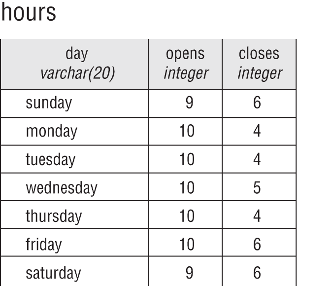

**图 11.2** 小时表

在接下来的章节中，我们将查看两个不安全的示例，然后给出正确的修复方法。

### 使用 `Statement`

我们写了一个使用 `Statement` 的方法。在第 10 章“JDBC”中，我们没有使用 `Statement`，因为它通常是不安全的。

```java
public int getOpening(Connection conn, String day) 
      throws SQLException {
   String sql = "SELECT opens FROM hours WHERE day = '" + day +"'";
   try (var stmt = conn.createStatement();
      var rs = stmt.executeQuery(sql)) {
      if (rs.next())
         return rs.getInt("opens");
   }
   return -1;
}
```

然后，我们使用表中的其中一天调用了代码。

```java
int opening = attack.getOpening(conn, "monday");  // 10
```

这段代码实现了我们想要的功能。它查询数据库并返回请求日期的开放时间。到目前为止一切良好。然后黑客 Harry 上来调用这个方法。他写了以下代码：

```java
int evil = attack.getOpening(conn, 
   "monday' OR day IS NOT NULL OR day = 'sunday");  // 9
```

这并没有返回预期的值。当我们运行它时，它返回了 9。让我们看看黑客 Harry 诱骗我们的数据库做了什么。

黑客 Harry 的参数导致了以下 SQL，为了可读性我们对其进行了格式化：

```sql
SELECT opens FROM hours 
   WHERE day = 'monday' 
      OR day IS NOT NULL
      OR day = 'sunday'
```

它要求返回任何 `day` 为 `sunday`、`monday` 或非 `null` 值的行。由于图 11.2 中没有任何一个值是 `null`，这意味着所有行都被返回了。幸运的是，数据库足够好，按照插入顺序返回了行；我们的代码读取了第一行。

### 使用 `PreparedStatement`

显然，我们在使用 `Statement` 时存在问题，于是请了安全专家 Sienna。她提醒我们 `Statement` 是不安全的，因为它容易受到 SQL 注入攻击。既然黑客 Harry 刚刚向我们展示了攻击，我们必须认同。

我们将代码切换为使用 `PreparedStatement`。

```java
public int getOpening(Connection conn, String day)
      throws SQLException {
   String sql = "SELECT opens FROM hours WHERE day = '" + day +"'";
   try (var ps = conn.prepareStatement(sql);
      var rs = ps.executeQuery()) {
      if (rs.next())
         return rs.getInt("opens");
   }
   return -1;
}
```

黑客 Harry 运行了他的代码，行为并没有改变。我们还没有修复问题！`PreparedStatement` 并不是魔法。它提供了安全能力，但前提是你要正确使用它。

安全专家 Sienna 向我们展示了我们需要像第 10 章](#c10.xhtml)那样使用绑定变量来重写 SQL 语句。

```java
public int getOpening(Connection conn, String day)
      throws SQLException {
   String sql = "SELECT opens FROM hours WHERE day = ?";
   try (var ps = conn.prepareStatement(sql)) {
      ps.setString(1, day);
      try (var rs = ps.executeQuery()) {
         if (rs.next())
            return rs.getInt("opens");
      }
   }
   return -1;
}
```

这一次，黑客 Harry 的代码行为发生了变化。

```java
int evil = attack.getOpening(conn, 
   "monday' OR day IS NOT NULL OR day = 'sunday");  // -1
```

整个字符串与 `day` 列进行匹配。由于没有匹配项，没有返回任何行。这要好得多！

如果你只记住关于 SQL 安全的两件事，请记住使用 `PreparedStatement` 和绑定变量。

## 通过验证消除无效输入

SQL 注入并不是注入类型。命令注入是另一种类型，它利用操作系统命令来执行意外的操作。

在我们的示例中，我们将使用第 8 章“I/O”中的 `Console` 类以及第 9 章“NIO.2”中的 `Files` 类。图 11.3 显示了目录。

```java
Console console = System.console();
String dirName = console.readLine();
Path path = Paths.get("data/diets/" + dirName);
try (Stream<Path> stream = Files.walk(path)) {
   stream.filter(p -> p.toString().endsWith(".txt"))
      .forEach(System.out::println);
}
```

## 处理机密信息

在开发项目时，你经常遇到机密或敏感数据。有时法律规定必须妥善处理这些数据，例如美国的《健康保险责任法案》（HIPAA）。表 11.1 列出了机密信息的示例。

| 类别 | 示例 |
| --- | --- |
| 登录信息 | 用户名<br> 密码<br> 密码哈希值 |
| 银行 | 信用卡号<br> 账户余额<br> 信用评分 |
| PII（个人身份信息） | 社会安全号码（或其他政府 ID）<br> 母亲姓<br> 安全问题/答案 |

## 防止敏感数据输出

安全专家 Sienna 确保机密信息不会发生泄露。她采取的第一步是避免将机密信息放在 `toString()` 方法中。这样做只会导致信息被记录在某些你无意之外的地方。

在这些敏感上下文中，她非常小心要调的方法，以确保机密信息不会泄露。此类敏感上下文包括：

*   写入日志文件
*   打印异常或堆栈跟踪
*   `System.out` 和 `System.err` 消息
*   写入数据文件

黑客哈里（Hacker Harry）正在所有这些地方寻找机密信息。有时你必须处理敏感信息。确保这些信息仅根据需求共享是非常重要的。

## 保护内存中的数据

安全西娜（Security Sienna）需要小心内存中的内容。如果她的应用程序崩溃，可能会生成一个转储文件。该文件包含了内存中所有项的值。

在 `Console` 上调用 `readPassword()` 时，它返回的是 `char[]` 而不是 `String`。这样做更安全出于：

*   它没有以 `String` 的形式存储，因此 Java 不会将其放入 `String` 池中，在运行它的代码运行之后，它可能仍然存在于内存中。
*   你可以将数组元素的值置为 `null`，而不是等待垃圾回收器处理。

例如，这段代码用字母 `x` 覆盖了密码字符：

```java
Console console = System.console();
char[] password = console.readPassword();
Arrays.fill(password, 'x');
```

当敏感数据无法被覆盖时，在用完后将机密数据设置为 `null` 是良好的做法。如果数据可以被垃圾回收，你就不必担心它以后被暴露。这里有一个示例：

```java
LocalDate dateOfBirth = getDateOfBirth();
// 使用出生日期
dateOfBirth = null;
```

核心思想是让机密数据在内存中存在尽可能短。这让黑客哈里减少出手的时间。

## 限制文件访问

我们之前看到过如何通过验证请求来防止命令注入。另一种方法是使用安全策略来控制程序可以的内容。

对于考试，你不需要知道如何编写或运行策略。但你需要能够读懂策略以理解其安全影响。幸运的是，它们非常自言自懂。这里有一个策略示例：

```java
grant {
   permission java.io.FilePermission 
      "C:\\water\\fish.txt",
      "read";   
};
```

该策略允许程序员读取但不能更新 `fish.txt` 文件。如果允许程序读取和写入该文件，我们指定以下内容：

```java
grant {
   permission java.io.FilePermission 
      "C:\\water\\fish.txt",
      "read, write";   
};
```

查看策略时，注意该策略是否授予的权限大于运行程序所需的权限。如果我们的应用程序需要读取文件，它应该只拥有 `read` 权限。这就是之前向你展示的最小权限原则。

## 对象的序列化与反序列化

假设我们正在 `Employee` 记录中存储数据。我们想将这些数据写入文件并读回内存，但我们希望不要将任何潜在敏感数据写入磁盘。从第 8 章，你应该已经知道如何通过序列化来实现。

回想第 8 章，Java 在反序列化对象时会跳过构造函数的调用。这意味着不要依赖构造函数来进行自定义验证逻辑是非常重要的。

让我们定义在本节中使用的 `Employee` 类。记住，将其标记为 `Serializable` 是重要的。

```java
import java.io.*;

public class Employee implements Serializable {
   private String name;
   private int age;
   // 构造函数/getters/setters
}
```

在接下来的章节中，我们将查看如何通过指定哪些字段被序列化以及控制序列化本身的过程来使序列化更安全。

### 指定要序列化的字段

我们的动物园决定员工年龄信息是敏感的，不应写入磁盘。从第 8 章，你应该已经知道如何做到这一点。安全西娜提醒我们，将字段标记为 `transient` 可以防止它被序列化。

```java
 private transient int age;
```

或者，你可以在一个数组中指定要序列化的字段。

```java
private static final ObjectStreamField[] serialPersistentFields = 
   { new ObjectStreamField("name", String.class) };
```

你可以将 `serialPersistentFields` 视为 `transient` 的反面。前者是应该序列化的字段的白名单，而后者是不应该序列化的字段的黑名单。

### 自定义序列化过程

安全性可能要求自定义序列化。在我们的情况下，我们得到了一个新需求，即向对象添加社会安全号（Social Security number）（对于美国外的读者，社会安全号用于向政府报告收入等。）与年龄不同，我们确实需要序列化这些信息。但是，我们不想以明文存储社会安全号，因此我们需要编写一些自定义代码。

查看以下使用 `writeObject()` 和 `readObject()` 进行序列化的实现，这是你在第 8 章中学习过的。为了简见，我们使用 `ssn` 来代表社会安全号。

```java
import java.io.*;

public class Employee implements Serializable {
   private String name;
   private String ssn;
   private int age;
   // 构造函数/getters/setters

   private static final ObjectStreamField[] serialPersistentFields = 
      { new ObjectStreamField("name", String.class),
      new ObjectStreamField("ssn", String.class) };

   private static String encrypt(String input) {
      // 省略实现
   }

   private static String decrypt(String input) {
      // 省略实现
   }

   private void writeObject(ObjectOutputStream s) throws Exception {
      ObjectOutputStream.PutField fields = s.putFields();
      fields.put("name", name);
      fields.put("ssn", encrypt(ssn));
      s.writeFields();
   }

   private void readObject(ObjectInputStream s) throws Exception {
      ObjectInputStream.GetField fields = s.readFields();
      this.name = (String)fields.get("name", null);
      this.ssn = decrypt((String)fields.get("ssn", null));
   }
}
```

这个版本像以前一样跳过了 `age` 变量，尽管这次没有使用 `transient` 修饰符。它还使用了自定义的读写方法来安全地加密/解密社会安全号。注意使用了 `PutField` 和 `GetField` 类来写入和读取字段。

假设我们要用 `age` 变量更新我们的 `writeObject()` 方法。

```java
 fields.put("age", age);
```

使用序列化时，代码将导致异常。

```java
java.lang.IllegalArgumentException: no such field with type int
```

这显示 `serialPersistentFields` 变量确实被使用了。Java 正在阻止我们引用未声明为可序列化的字段。

### 序列化前/后处理

现在我们想要将员工数据读写到磁盘，但我们遇到了一个问题。当某人从磁盘读取数据时，它会被反序列化为一个新对象，而不是内存池中的那个对象。这可能导致两个用户在内存中持有不同版本的 `Employee` 对象！

引入 `readResolve()` 方法。当此方法存在时，它会在 `readObject()` 方法*之后*运行，并能够替换反序列化返回对象的引用。

```java
import java.io.*;
import java.util.Map;
import java.util.concurrent.ConcurrentHashMap;

public class Employee implements Serializable {
   … 
```


`public synchronized Object readResolve()` 方法抛出 `ObjectStreamException`：

```
public synchronized Object readResolve() throws ObjectStreamException {
   var existingEmployee = pool.get(name);
   if (pool.get(name) == null) {
      // 新员工不在内存中
      pool.put(name, this);
      return this;
   } else {
      // 内存中已存在该用户
      existingEmployee.name = this.name;
      existingEmployee.ssn = this.ssn;
      return existingEmployee;
   }
}
```

如果对象不在内存中，它会被添加到池中并返回。否则，内存中的版本将被更新，并返回其引用。

注意，我们在此方法上添加了 `synchronized` 修饰符。Java 允许 `readResolve()` 方法使用任何修饰符（`static` 除外），包括任何访问修饰符。此规则也适用于接下来介绍的 `writeReplace()`。

## 应用 `writeReplace()`

现在，如果我们想将一个 `Employee` 记录写入磁盘，但我们并不完全信任所持有的实例怎么办？例如，我们希望始终写入池中对象的版本，而不是 `this` 实例。根据构造原理，内存中应该只有一个该对象的版本，但为了这个例子，让我们假装我们对此并没有 100% 的把握。

`writeReplace()` 方法在 `writeObject()` 之前运行，并允许我们替换被序列化的对象。

```java
import java.io.*;
import java.util.Map;
import java.util.concurrent.ConcurrentHashMap;

public class Employee implements Serializable {
   // ...
   public Object writeReplace() throws ObjectStreamException {
      var e = pool.get(name);
      return e != null ? e : this;
   }
}
```

此实现检查池中是否找到了该对象。如果在池中找到，则将该版本发送用于序列化；否则，使用当前实例。我们也可以更新此示例，如果对象由于某种原因缺失，则将其添加到池中。

## 复习序列化方法

在这一章中你遇到了许多方法。表 11.2 总结了你考试需要掌握的每个方法的重要特征。

| 返回类型 | 方法 | 参数 | 描述 |
| --- | --- | --- | --- |
| `Object` | `writeReplace()` | 无 | 允许在序列化之前替换对象 |
| `void` | `writeObject()` | `ObjectInputStream` | 可选择使用 `PutField` 进行序列化 |
| `void` | `readObject()` | `ObjectOutputStream` | 可选择使用 `GetField` 进行反序列化 |
| `Object` | `readResolve()` | 无 | 允许在反序列化之后替换对象 |

表 11.2 序列化与反序列化方法

我们还在图 11.4 中提供了读写记录过程的可视化。

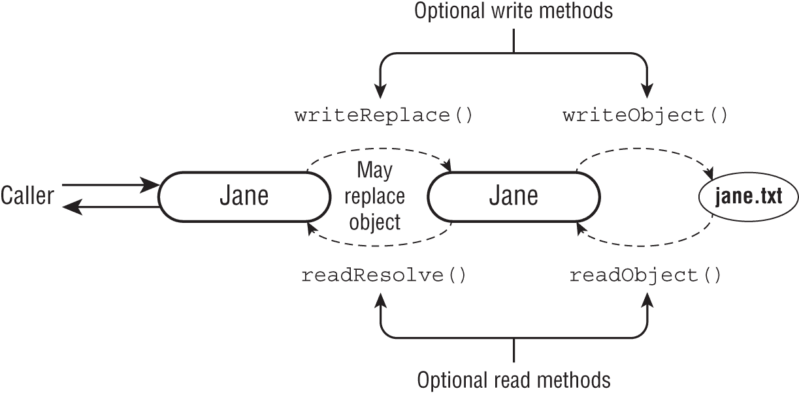

图 11.4 员工的写入与读取

在图 11.4 中，我们展示了 Jane 的员工记录如何被序列化、写入磁盘、然后从磁盘读取并返回给调用者。我们还展示了 `writeReplace()` 在 `writeObject()` 之前发生，而 `readResolve()` 在 `readObject()` 之后发生。记住，这四个方法都是可选的，必须在 `Serializable` 对象中声明才能使用。

## 构建敏感对象

在构建敏感对象时，你需要确保子类不能改变行为。假设我们有一个 `FoodOrder` 类。

```java
public class FoodOrder {
   private String item;
   private int count;

   public FoodOrder(String item, int count) {
      setItem(item);
      setCount(count);
   }

   public String getItem() { return item; }
   public void setItem(String item) { this.item = item; }
   public int getCount() { return count; }
   public void setCount(int count) { this.count = count; }
}
```

这看起来足够简单。这是一个带有两个实例变量和相应的 getter/setter 的 Java 对象。我们甚至可以写一个方法来计算订单中有多少项。

```java
public static int total(List<FoodOrder> orders) {
   return orders.stream()
      .mapToInt(FoodOrder::getCount)
      .sum();
}
```

等等，提供的文本在末尾有一些重复/合并的部分。让我们根据核心逻辑清理：这看起来足够简单。它是一个带有两个实例变量和相应 getter/setter 的 Java 对象。

### 将方法标记为 final

为了防止子类改变行为，我们可以将方法标记为 `final`。

```java
public class FoodOrder {
   private String item;
   private int count;

   public FoodOrder(String item, int count) {
      setItem(item);
      setCount(count);
   }

   public final String getItem() { return item; }
   public final void setItem(String item) { this.item = item; }
   public final int getCount() { return count; }
   public final void setCount(int count) { this.count = count; }
}
```

### 将类标记为 final

如果类本身是 `final`，则它无法被子类化。

```java
public final class FoodOrder {
   private String item;
   private int count;

   public FoodOrder(String item, int count) {
      setItem(item);
      setCount(count);
   }

   public String getItem() { return item; }
   public void setItem(String item) { this.item = item; }
   public int getCount() { return count; }
   public void setCount(int count) { this.count = count; }
}
```

### 将构造函数标记为 private

将构造函数标记为 `private` 可以防止继承并强制使用 `static` 工厂方法。

```java
public class FoodOrder {
   private String item;
   private int count;

   private FoodOrder(String item, int count) {
      setItem(item);
      setCount(count);
   }

   public static FoodOrder getOrder(String item, int count) {
      return new FoodOrder(item, count);
   }

   public String getItem() { return item; }
   public void setItem(String item) { this.item = item; }
   public int getCount() { return count; }
   public void setCount(int count) { this.count = count; }
}
```

`denial of service`（DoS）攻击是指黑客发送一个或多个请求，意图破坏合法请求。大多数拒绝服务攻击需要多个请求才能击垮目标。某些攻击会发送一个巨大的请求，甚至可以一次性击垮应用程序。在本书中，我们将关注拒绝服务攻击。

除非另有说明，拒绝服务攻击来自一台机器。它可能会发送许多请求，但它们具有相同的源头。相比之下，`distributed denial of service`（DDoS）攻击是同时来自多个源的拒绝服务攻击。例如，许多机器可能会攻击同一个目标。在本节中，我们将查看一些拒绝服务问题的常见来源。

## 资源泄露

黑客哈里可以发动拒绝服务攻击的一种方法是利用编写不当的代码。这种简单的方法使用我们在第 9 章中见过的 `NIO.2` 方法来计算文件的行数：

```java
public long countLines(Path path) throws IOException {
   return Files.lines(path).count();
}
```

黑客哈里喜欢这种方法。他可以在循环中调用它。由于该方法打开了文件系统资源且从未关闭它，因此存在 `resource leak`。在黑客哈里调用足够次数后，程序会因为没有可用的文件句柄而崩溃。

幸运的是，资源泄露的修复方法非常简单，而且你已经在第 9 章中见过。安全西娜通过使用我们在第 5 章“异常、断言与本地化”中见过的 `try-with-resources` 语句修复了代码。这里是一个示例：

```java
public long countLines(Path path) throws IOException {
   try (var stream = Files.lines(path)) {
      return stream.count();
   }
}
```

## 读取巨大的资源

拒绝服务攻击的另一个来源是巨大的资源。假设我们有一个简单的方法，将文件读取到内存中，对其进行一些转换，然后写入新文件。

```java
public void transform(Path in, Path out) throws IOException {
   var list = Files.readAllLines(in);
   list.removeIf(s -> s.trim().isBlank());
   Files.write(out, list);
}
```

对于小文件，这种方法运行得良好。然而，对于极大的文件，你的程序可能会耗尽内存并崩溃。黑客哈里又来了！为了防止这个问题，你可以在读取文件之前检查文件的大小。

## 包含潜在巨大的资源

`inclusion` 攻击是指多个文件或组件被嵌入单个文件中。任何不是你创建的文件都是可疑的。某些类型看起来可能比实际要小。例如，某些类型的图像可能包含“压缩弹”（zip bomb），文件在磁盘上被高度压缩。当你尝试读取它时，文件使用的空间比你想象的要大得多。

可扩展标记语言（XML）文件也存在相同的问题。一种攻击被称为“十亿次攻击”（billion laughs attack），文件会呈指数级扩展。

这些文件之所以变得意料之外的大，是因为它们可以包含其他实体。这意味着一个 1 KB 的东西如果被包含足够多次，就会变成指数级大得多。

虽然处理大文件超出了考试范围，但你应该理解这些问题可能何时以及如何出现。

## 数字溢出

在检查文件大小时，要小心 `int` 类型和循环。由于 `int` 有最大值，超过该值会导致整数溢出。在最大值上递增 `int` 会导致负数，因此验证可能无法按预期工作。在这个示例中，我们有一个要求，确保我们可以向文件中添加一行，并保持大小在一百万以下。

```java
public static void main(String[] args) {
   System.out.println(enoughRoomToAddLine(100));
   System.out.println(enoughRoomToAddLine(2_000_000));
   System.out.println(enoughRoomToAddLine(Integer.MAX_VALUE));
}

public static boolean enoughRoomToAddLine(int requestedSize) {
   int maxLength = 1_000_000;
   String newLine = "END OF FILE";
   int newLineSize = newLine.length();
   return requestedSize + newLineSize < maxLength;
}
```

该程序的输出如下：

```
true
false
true
```

第一个 `true` 应该是合理的。我们从一个小文件开始，向它添加了一个短行。这确实小于一百万。第二个值是 `false`，因为即使在添加了短行后，两百万已经超过了一百万。

然后我们得到了最后的输出 `true`。我们从一个超过一百万的巨大数字开始。加上一个较小的数字超过了 `int` 的容量。Java 将该数字溢出为一个非常小的负数。由于所有负数都小于一百万，验证没有起到我们想要的作用。

在接受数字输入时，你需要验证它是否过大或过小。在这个示例中，输入值 `requestedSize` 应该在将其加到 `newLineSize` 之前进行检查。

## 浪费数据结构

使用 `HashMap` 的优势之一可以通过键快速查找元素。即使映射非常大，只要哈希键的分布良好，查找就会很快。

黑客哈里喜欢假设。他创建了一个类，其中 `hashCode()` 始终返回 42，并放了一百万个这样的对象。

## 总结

设计类时，要考虑它的用途。这将允许你选择符合要求的限制性最大的访问修饰符。它还将帮助你确定是否需要子类，或者类是否应该是 `final`。如果类的实例将被到处传递，那么将类设为不可变是有意义的，以保证状态不会改变。

- **识别防止拒绝服务攻击的方法。** 对所有的 `I/O` 和 `JDBC` 操作使用 `try-with-resources` 语句可以防止资源泄漏。在读取文件时检查文件大小可以防止其消耗意外的内存。确认是否有效使用了大型数据结构可以防止性能问题。
- **保护内存中的机密信息。** 选择一个能最小化暴露的数据结构是重要的。最常用的是使用 `char[]` 存储密码。此外，允许机密信息尽快被垃圾回收可以缩短暴露窗口。
- **比较注入、包含和输入验证。** `SQL injection` 和 `command injection` 允许攻击者运行预期的命令。包含是指一个文件包含另一个文件。输入验证则检查用户输入的有效或无效字符。
- **设计安全对象。** 安全对象限制了实例变量和方法的访问性。它们对于何时允许子类化经过深思考虑。通常安全对象是不可变的并且会验证任何输入参数。
- **安全地编写序列化和反序列化代码。** `transient` 修饰符表示实例变量不应被序列化。或者，`serialPersistenceFields` 指定了哪些应该被序列化。`readObject()`、`writeObject()`、`readResolve()` 和 `writeReplace()` 方法是可选方法，提供了对该过程的进一步控制。

## 复习题

章节复习题的答案可以在附录 B 中找到。

1. 发生攻击需要多少请求？
   1. 无
   2. 一个
   3. 两个
   4. 许多

2. 下列哪个是代码的示例？（选择所有项）

```java
public final class Worm {
   private int length;

   public Worm(int length) {
      this.length = length;
   }

   public int getLength() {
      return length;
   }
}
```

   1. 不可变
   2. 输入验证
   3. 限制访问性
   4. 限制扩展性
   5. 以上都不是

3. 哪一项可以填入空白使此代码编译？

```java
import java.io.*;

public class AnimalCheckup {
   private String name;
   private int age;
```


`private static final ObjectStreamField[] serialPersistentFields = { new ObjectStreamField("name", String.class)};`

`private void writeObject(ObjectOutputStream stream) throws Exception { ObjectOutputStream.__________ fields = stream.putFields(); fields.put("name", name); stream.writeFields(); }`

// 省略 `readObject` 方法

```
1. `PutField`
2. `PutItem`
3. `PutObject`
4. `UpdateField`
5. `UpdateItem`
6. `UpdateObject`
```

4. 下列哪项可以填入空白为 `weights` 创建防御拷贝？（选择所有项）

```java
public class Turkey {
   private ArrayList<Double> weights;
   public Turkey(ArrayList<Double> weights) {
      this.weights = ______________;
   }
}
```

1. `weights`
2. `new ArrayList<>(weights)`
3. `weights.clone()`
4. `(ArrayList) weights.clone()`
5. `weights.copy()`
6. `(ArrayList) weights.copy()`

5. 一个对象在构造函数中有一个验证代码。在反序列化对象时，会调用哪一个构造函数？

1. `readObject()`
2. `readResolve()`
3. 都是
4. 都不是

6. 关于 `clone()` 方法哪些描述是正确的？（选择所有项）

1. 对任何对象调用 `clone()` 都会编译。
2. 只有当类实现了 `Cloneable` 时，调用 `clone()` 才能编译。
3. 如果 `clone()` 运行没有抛异常，它将始终创建一个深拷贝。
4. 如果 `clone()` 运行没有抛异常，它将始终创建一个浅拷贝。
5. 如果 `clone()` 未被重写且运行没有异常，它将创建一个深拷贝。
6. 如果 `clone()` 未被重写且运行没有异常，它将创建一个浅拷贝。

7. 哪种攻击可以利用这段代码？

```java
public boolean isValid(String hashedPassword) 
      throws SQLException {
      var sql = "SELECT * FROM users WHERE password = ?";
      try (var stmt = conn.prepareStatement(sql)) {
         stmt.setString(1, hashedPassword);
         try (var rs = stmt.executeQuery(sql)) {
            return rs.next();
         }
      }
}
```

1. 命令注入
2. 机密数据暴露
3. 拒绝服务
4. SQL 注入
5. SQL 泄露
6. 以上都不是

8. 你去图书馆想读一本书。哪项是正确的？

```java
grant {
      permission java.io.FilePermission 
         "/usr/local/library/book.txt",
         "read,write";
   };
```

1. 策略是正确的。
2. 策略是错误的，因为不能这样授予文件权限。
3. 策略是错误的，因为没有包含 `read`。
4. 策略是错误的，因为权限应该用分号分隔。
5. 策略是错误的，因为没有包含 `write`。

9. 关于信息安全哪些是正确的？（选择所有项）

1. 在程序中访问它是可以的。
2. 在异常消息中包含它是可以的。
3. 将它放入 `char[]` 中是可以的。
4. 与其他用户共享是可以的。
5. 以上都不是

10. 为了帮助避免拒绝服务，你需要关闭哪些类型的资源？（选择所有项）

1. 注解
2. 异常
3. `I/O`
4. `JDBC`
5. `String`

11. 下列哪些被认为是包含攻击？（选择所有项）

1. 十亿玩笑攻击 (Billion laughs attack)
2. 命令注入
3. CSRF
4. SQL 注入
5. XSS
6. 压缩炸弹

12. 这代码是哪内容的示例？

```java
public void validate(String amount) {
   for (var ch : amount.toCharArray())
      if (ch < '0' || ch> '9')
         throw new IllegalArgumentException("invalid");
}
```

1. 黑名单
2. 灰名单
3. 橙色白名单
4. 白名单
5. 以上都不是

13. 关于一个具有单个实例变量 `List<String> species` 的类 `Camel`，哪些描述是正确的？（选择所有项）

1. 如果 `Camel` 封装良好，它就必须限制扩展性。
2. 如果 `Camel` 封装良好，它必须是不可变的。
3. 如果 `Camel` 限制了扩展性，它必须有良好的封装。
4. 如果 `Camel` 限制了扩展性，它必须是不可变的。
5. 如果 `Camel` 是不可变的，它必须有良好的封装。
6. 如果 `Camel` 是不可变的，它必须限制扩展性。

14. 处理敏感数据时，哪些位置需要小心以确保不泄露？（选择所有项）

1. 注释
2. 异常堆栈跟踪
3. 日志文件
4. `System.out`
5. 变量名
6. 以上都不是

15. 类中的 `serialPersistentFields` 必须使用哪些修饰符？（选择所有项）

1. `final`
2. `private`
3. `protected`
4. `public`
5. `transient`
6. `static`

16. 当输入验证失败时，你的代码应该做什么？（选择所有项）

1. 立即调用 `System.exit()`。
2. 继续执行。
3. 记录消息。
4. 抛出异常。
5. 以上都不是。

17. 哪些技术可以防止攻击者创建一个覆盖了从构造函数调用的方法的顶层子类？（多选）

1. 给类添加 `final`
2. 给方法添加 `final`
3. 给类添加 `transient`
4. 给方法添加 `transient`
5. 将构造函数设为 `private`（私有）
6. 以上都不是

18. 当程序检查文件大小时时，它正试图防止以下哪种攻击？

1. 拒绝服务 (Denial of service)
2. 包含 (Inclusion)
3. 注入 (Injection)
4. 以上都不是

19. 在空白处填入正确的方法来反序列化对象。

```java
public Object ____________ throws ObjectStreamException {
    // return an object
}
```

1. `readObject()`
2. `readReplace()`
3. `readResolve()`
4. `writeObject()`
5. `writeReplace()`
6. `writeResolve()`

20. 以下代码打印 `true`。关于 `Wombats` 类对 `clone()` 方法的实现，哪个说法是正确的？

```java
Wombats original = new Wombats();
original.names = new ArrayList<>();
Wombats cloned = (Wombats) original.clone();
System.out.println(original.getNames() == cloned.getNames());
```

1. 它创建了一个深拷贝（deep copy）。
2. 它创建了一个窄拷贝（narrow copy）。
3. 它创建了一个浅拷贝（shallow copy）。
4. 它创建了一个宽拷贝（wide copy）。

## 附录 A

## 升级考试

本附录适用于参加 1Z0-817 升级考试的人。如果是，请在阅读本书其他部分之前阅读本附录。本附录包含了 1Z0-815 考试所需的知识（而非 1Z0-816），这些知识现在出现在 1Z0-817 考试中。

首先，我们将详细讨论本地变量类型推断，即使用 `var`。你需要非常熟悉这一点。在书的其余部分，我们在许多代码示例中使用 `var` 表示类型。在本附录中，我们将详细介绍这些规则，以确保你能够正确回答这些问题。

理解模块（modules）是我们涵盖的第二个主题，占据了本附录的大部分。如果你从未用过模块，它们是打包和引用 Java 库的全新方式。本附录为模块提供了基础，并允许你理解更高级的主题，例如第 6 章“模块化应用”中讨论的内容。

附录中的大部分材料重印自我们 1Z0-815 书中的第 2 章“Java 构建基块”和第 11 章“模块”。我们已经在网上提供了这些模块的代码。由于创建目录结构可能非常繁琐，这将为你节省一些时间。此外，命令必须完全正确，因此我们将这些命令包含在网上，以便你可以复制粘贴并与你输入的内容进行比较。这些内容在在线题库的资源部分以及我们的 1Z0-815 GitHub 仓库中均可用，该仓库通过 [`www.selikoff.net/ocp11-2`](http://www.selikoff.net/ocp11-2) 链接。

## 使用本地变量类型推断

从 Java 10 开始，在某些条件下，你可以选择使用关键字 `var` 代替本地变量的类型。要使用此功能，只需在代码块中使用 `var` 代替基本类型或引用类型即可。这里有一个示例：

```java
public void whatTypeAmI() {
   var name = "Hello";
   var size = 7;
}
```

该功能的正式名称是`本地变量类型推断`（local variable type inference）。让我们来拆解它。首先是 `本地变量`。这正如其字面意思。你只能将此功能用于本地变量。考试可能会用这样的代码来欺骗你：

```java
public class VarKeyword {
   var tricky = "Hello"; //无法编译
}
```

等一下！我们知道实例变量和本地变量的区别。变量 `tricky` 是一个实例变量。本地变量类型推断适用于本地变量，而不适用于实例变量。

### `var` 的类型推断

现在你理解了本地变量部分，是时候讨论`类型推断`（type inference）的意思了。好消息是，这也是它的字面意思。当你输入 `var` 时，你是在指示编译器为你确定类型。编译器查看声明行的代码并利用它来推断类型。看这个示例：

```java
7:  public void reassignment() {
8:     var number = 7;
9:     number = 4;
10:    number = "five";  //无法编译
11: }
```

在第 8 行，编译器确定我们想要一个 `int` 变量。在第 9 行，我们可以轻松地给它赋值一个不同的 `int`。在第 10 行，Java 遇到了问题。我们要求它将一个 `String` 赋值给 `int` 变量。这是不允许的。这等同于输入以下：

```java
int number = "five";
```

因此，`var` 的类型在运行时不能改变，但值呢？看下面的代码段：

```java
var apples = (short)10;
apples = (byte)5;
apples = 1_000_000;
```

在第一行，编译器确定 `apples` 是一个 `short` 变量。在第二行，我们没有问题地给它赋值一个 `byte`。在第三行，`apples` 出现了问题。我们要求它赋值 `1_000_000`。这是不允许的，因为它超出了 `short` 的范围。

所以，`var` 的类型在运行时不能改变，但值呢？看下面的代码段：

```java
var apples = (short)10;
apples = (byte)5;
apples = 1_000_000; //无法编译
```

在第一行，编译器确定 `apples` 是一个 `short` 变量。在第二行，我们没有问题地给它赋值一个 `byte`。在第三行，`apples` 出现了问题。我们要求它赋值 `1_000_000`。这是不允许的，因为它超出了 `short` 的范围。

所以，`var` 的类型在运行时不能改变，但值呢？看下面的代码段：

```java
var apples = (short)10;
apples = (byte)5;
apples = 1_000_000; // 编译
```

在编译器，，`apples` 是一个 `short` 变量。在第二行，我们给它赋值 `byte` 是 `short` 的一个 `short`。

```java
public void doesThisCompile(boolean check) {
     var question;
     question = 1;
     var answer;
     if (check) {
        answer = 2;
     } else {
       answer = 3;
     }
    System.out.println(answer);
}
```

### `var` 的示例

为了让考试不欺骗你，我们过一下更多场景。你认为以下代码可以编译吗？

```java
public void doesThisCompile() {
     var question;
     question = 1;
     var answer;
 1;
}
```

代码无法编译。请记住，对于本地变量推断，编译器只查看声明所在的行。由于 `question` 和 `answer` 在定义行上没有赋值，编译器不知道该如何处理它们。由于这个原因，第 4 行和第 6 行都无法编译。

你可能觉得这很奇怪，因为 `if`/`else` 分支都赋值了值。不幸的是，赋值没有在声明的同一行，所以对 `var` 无效。

现在我们知道，确定类型的初始值需要是语句的一部分。你能弄出为什么这两个语句不能编译吗？

```java
public void twoTypes() {
   int a, var b = 3;  //无法编译
   var n = null;      //无法编译
}
```

第 5 行即使你把 `var` 替换为真实类型也无法工作。单行内声明的所有类型必须是相同类型并共享同一个声明。我们不能写成 `int a, int b = 3;`。同样，这种写法也不允许：

```java
var a = 2, b = 3;  //无法编译
```

也就是说，Java 不允许在多个变量声明中使用 `var`。

第 6 行是单行。编译器被要求推断 `null` 的类型。这可以是任何引用类型。编译器能做的选择是 `Object`。然而，这几乎肯定不是代码作者的意图。Java 的设计者认为，与其允许 `null` 使用 `var`，不如让让去猜测意图。

让我们尝试另一个例子。你看到为什么这无法编译了吗？

```java
public int addition(var a, var b) {  // 无法编译
   return a + b;
}
```

在这个例子中，`a` 和 `b` 是方法参数。它们不是局部变量。请注意在构造函数、方法参数或实例变量中使用的 `var`。在这些地方使用 `var` 是一个很好的考试陷阱，用来检查你是否留了神。记住 `var` 仅用于局部变量的类型推断！

还有两个例子。你认为这是合法的吗？

```java
package var;

public class Var {
   public void var() {
      var var = "var";
   }
   public void Var() {
      Var var = new Var();
   }
}
```

信不由你，这段代码是可以编译的。Java 是大小敏感的，因此 `Var` 作为类名不会引入任何冲突。将局部变量命名为 `var` 是合法的。请不要在工作中写出像这样的代码！但理解它为什么能运行将帮助你应对 Oracle 可能会抛给你的任何棘手考试题！

还有一个你应该注意的最后一个规则。虽然 `var` 不是保留字，并允许作为标识符使用，但它被视为一个保留类型名。*保留类型名* 意味着它不能用于定义类型，例如类、接口或 `enum`。例如，下面的代码段由于类名的原因无法编译：

```java
public class var {  // 无法编译
   public var() {
   }
}
```


在代码中对每个局部变量都使用`var`作为类型通常是不恰当的。这会让代码变得难以理解。如果你不确定是否使用`var`适当，有许多风格指南可以提供帮助。我们推荐标题为“Java 局部变量类型推断风格指南”的文件，可以在以下位置找到。该资源包含了很好的风格建议。

[`https://openjdk.java.net/projects/amber/LVTIstyle.html`](https://openjdk.java.net/projects/amber/LVTIstyle.html)

### var 规则回顾

我们通过总结在代码中使用`var`的各种规则来完成本节。以下是`var`规则的快速回顾：

1. `var`用作构造函数、方法或初始化块中的局部变量使用。
2. `var`不能用在构造函数参数、方法参数、实例变量或类变量中。
3. `var`始终在声明的同一行（或同一语句）上初始化。
4. `var`的值可以改变，但类型不能改变。
5. `var`不能在没有类型的情况下用`null`值初始化。
6. 在多变量声明中不允许使用`var`。
7. `var`是保留类型名但不是保留字，这意味着它可以作为标识符使用，但不能作为类、接口或`enum`的名称。

规则很多，但理想情况下大多数都非常直观。预计在考试和本书书中会频繁看到`var`。

## 引入模块 (Modules)

在为考试编写代码时，你通常会看到很小的类。毕竟，考试题必须能够在一个屏幕上显示！当你编写真实的程序时，它们要大得多。一个真实的项目将由成百或上千个类组成，并分成包。这些包被组成 *Java 归档 (JAR)* 文件。`JAR`是一个带有额外信息的 zip 文件，扩展名为`.jar`。

除了你团队编写的代码外，大多数应用程序还使用他人编写的代码。*开源*是指提供代码的软件，通常免费使用。Java 拥有充满活力的开源软件 (OSS) 社区，这些库也以`JAR`文件的提供。例如，有读取文件、连接数据库等许多功能的库。

某些开源项目甚至依赖于其他开源项目的功能。例如，`Spring`是一个常用的框架，而`JUnit`是一个常用的测试库。要使用其中任何一个，你都需要确保运行时可用所有相关`JAR`的兼容版本。这种复杂的依赖链和最低版本限制通常被社区称为 *JAR 地狱 (JAR hell)*。“地狱”是描述加载了错误版本的类，甚至在运行时抛出`ClassNotFoundException`的极佳词汇。

*Java 平台模块系统* (JPMS) 引入于 Java 9，用于在更高层次对代码进行分组，并尝试解决 Java 自诞生以来一直困扰它的。模块的主要目的是提供一组相关的包，为开发者提供一组特定的功能。它就像一个`JAR`文件，不同的是开发者可以选择哪些包可以在模块外访问。让我们看看模块是什么以及它们旨在解决什么问题。

Java 平台模块系统包括：

* 模块`JAR`文件的格式
* 将`JDK`分为模块
* Java 工具的额外命令行选项

### 探索模块

本书中的大多数程序都是很小的。现在想象我们有一群程序员，正在使动物园的操作自动化。*模块* 是一个或多个包的组合，加上一个名为`module-info.java`的特殊文件。图 A.1 列出了动物园可能需要的几个模块。

在图 A.1 中，注意许多模块之间有箭头。这些表示*依赖关系*，即一个模块依赖另一个模块的代码。员工需要喂养动物才能工作。从`zoo.staff`到`animal.feeding`的线条表示前者依赖于后者。

现在让我们深入研究这些模块之一。图 A.2 显示了`animal.talks`模块内部的内容。有三个包，每个包有两个类（这是一个很小的动物园）。还有一个奇怪的文件`module-info.java`。该文件是所有模块都要求的。我们稍后会详细解释。

### 模块的优势

模块看起来像是为了编程需要学习的另一层内容。虽然使用模块是可选的，但理解它们旨在解决的问题是非常重要的。此外，了解模块的用处是考试要求的！

#### 更好的访问控制

Java 类文件中有四种访问级别：`private`、`package-private`（包私有）、`protected`和`public`。这些访问控制级别允许你限制对特定类或包的访问。你甚至可以允许子类访问，而不将其暴露给全世界。

然而，如果我们想写一些复杂的逻辑，并希望将其限制在某些包中呢？例如，我们希望`zoo.animal.talks`模块中的包仅能被`zoo.staff`模块中的包访问，而不让任何其他代码访问。我们传统的访问修饰符无法处理这种场景。

开发者通常会求助于一些黑客手段，例如将包命名为`zoo.animal.internal`。但这种方法并不行，因为其他开发者仍然可以调用这些“内部”代码。曾经有一个名为`sun.misc.Unsafe`的类，它在很多地方被使用。而且这个类的名字里就带有`Unsafe`。显然，在过去，仅仅依靠命名约定无法防止开发者调用它。

模块通过充当第五级访问控制来解决这个问题。它们可以将模块化 JAR 内部的包暴露给特定的其他包。这种更强形式的封装确实创建了真正的“内部包”。当我们在稍后讨论到`module-info.java`时，你将看到看到如何编写代码。

## 更清晰的依赖管理

库依赖其他库是常见现象。例如，JUnit 4 测试库依赖 Hamcrest 库来进行匹配逻辑。开发者必须通过阅读文档或项目本身的文件来发现这一点。

如果你忘记在类路径（classpath）中包含 Hamcrest，你的代码将一直运行良好，直到你使用 Hamcrest 类为止。那时，它会在运行时崩溃，并显示一条关于未找到必需类的信息。（我们确实提到过 JAR 地狱，对吧？）

在完全模块化的环境中，每个开源项目都应该在`module-info.java`文件中指定它们的依赖项。启动程序时，Java 会报错说 Hamcrest 不在模块路径中，你会立即发现。

## 自定义 Java 构建

Java 开发工具包 (JDK) 大于 150 MB。即使是 Java 运行环境 (JRE)，在作为单独下载可用时也相当大。过去，Java 曾尝试通过`compact profile*`（紧凑配置）来解决这个问题。三个紧凑配置提供了内置 Java 类的子集，以便为移动和嵌入式设备提供一个更小的包。

然而，紧凑配置缺乏灵活性。它包含了许多开发者不太可能使用的包，例如 Java Native Interface (JNI)，它用于与特定操作系统的程序交互。同时，使用 Image I/O 等其他包则需要完整的 JRE。

Java 模块系统允许开发者指定他们实际需要的模块。这使得创建一个更小的运行时镜像成为可能，该镜像根据应用程序的需求定制，没有任何多余的内容。用户可以在不安装 Java 的情况下运行该镜像。

使用一个名为`jlink`的工具来创建这种运行时镜像。幸运的是，你只需要知道自定义更小的运行时是可能的。如何创建它们不在考试范围内。

除了更小规模的包，这种方法还提高了安全性。如果你没有使用 AWT 而 AWT 报告了安全漏洞，那么打包了没有 AWT 的运行时镜像的应用就不会受到影响。

## 性能提升

由于 Java 现在知道需要哪些模块，它在类加载时只需要查看这些模块。这改进了大型程序的启动时间，并且运行时所需的内存更。

虽然这些好处对于我们编写的小程序来说可能并不显著，但对于大型应用程序来说重要得多。一个 Web 应用可能需要启动分钟。此外，对于某些金融应用程序，每一毫秒的性能都很重要。

## 唯一的包强制

JAR 地狱的另一个表现是同一个包出现在两个 JAR 中。产生这个问题有很多原因，包括重命名 JAR、聪明的开发者使用了已占用的包名，以及在类路径上存在同一个 JAR 的两个版本。

Java 模块系统防止了这种情况。一个包只允许由一个模块提供。运行时运行时不再有关于包的令人不快的惊喜。

## 创建和运行模块化程序

在本节中，我们将创建、构建并运行`zoo.animal.feeding`模块。我们选择这一个作为开始是因为所有其他模块都依赖于它。图 A.3 显示该模块的设计。除了`module-info.java`文件外，它包含一个包含一个类的包。

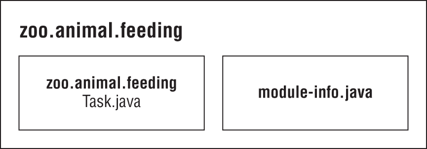

FIGURE A.3 `zoo.animal.feeding`内容

在接下来的章节中，我们将创建、编译、运行并打包`zoo.animal.feeding`模块。

### 创建文件

首先，我们有一个非常简单的类，在`main()`方法中打印一行。我们知道，这算不上什么实现。我们雇佣的所有程序员都可以用业务逻辑填充它。在本书中，我们将关注你考试中需要知道的知识。所以，让我们创建一个简单的类。

```java
package zoo.animal.feeding;

public class Task {

   public static void main(String… args) {

      System.out.println("All fed!");

   }

}
```

接下来是`module-info.java`文件。这是最简单的一个。

```java
module zoo.animal.feeding {

}
```

`module-info`文件和普通的 Java 类之间有几点关键区别。

- `module-info`文件必须位于模块的根目录下。
- `module-info`文件使用`module`关键字而不是`class`、`interface`或`enum`。
- 模块名称遵循与包名相同的命名规则。
- 模块名称通常包含点（`.`）。

这些规则适用于最简单的文件。我们稍后会在附录中说明该文件。

下一步是确保文件位于正确的目录结构。图 A.4 显示了

包含一个类的包的`zoo.animal.feeding`模块结构](images/bapp01f004.png)

FIGURE A.4 模块 目录结构

特别是，`feeding`是模块目录，`module-info`文件位于其下方。与普通的 JAR 文件一样，我们也有`zoo.animal.feeding`包，其中包含一个类。`Task`类位于其对应的子目录中。

此外，注意我们在模块同级创建了一个名为`mods`的目录。我们将在之后使用它存储模块产物。该目录可以命名为任何名称，但`mods`是一个常见的名称。如果你跟着在线代码示例，请注意`mods`目录是空的。

### 编译我们的第一个模块

在运行模块化代码之前，我们需要编译它。除了`module-path`选项，这段代码看起来很熟悉：

```
javac --module-path mods
   -d feeding
   feeding/zoo/animal/feeding/*.java
   feeding/module-info.java
```

作为回顾，`-d`选项指定放置类文件的目录。命令的末尾是要编译的`.java`文件列表。你可以单独列出文件，也可以使用通配符处理子目录下所有的`.java`文件。

新部分是`module-path`。此选项指示任何自定义模块文件的位置。在示例中，由于没有依赖项，可以省略`module-path`。你可以认为`module-path`在你处理模块化程序时替代了`classpath`选项。

就像`classpath`一样，你可以在命令中使用缩写。`--module-path`和`-p`语法是等价的。这意味着我们可以编写许多命令来代替之前的命令。以下四个命令展示了`-p`选项：

```
javac -p mods
   -d feeding
   feeding/zoo/animal/feeding/*.java
   feeding/*.java

javac -p mods
   -d feeding
   feeding/zoo/animal/feeding/*.java
   feeding/module-info.java

javac -p mods
   -d feeding
   feeding/zoo/animal/feeding/Task.java
   feeding/module-info.java

javac -p mods
   -d feeding
   feeding/zoo/animal/feeding/Task.java
   feeding/*.java
```

虽然你可以使用你最喜欢的形式，但请确保你能够识别考试中所有有效的形式。表 A.1 列出了在编译模块时需要熟练掌握的选项。你还可以传递给`javac`命令许多其他选项，但这些是你预期会被测试到的点。

| 用途 | 缩写 | 全称 |
| --- | --- | --- |
| 类文件目录 | `-d <dir>` | n/a |
| 模块路径 | `-p <path>` | `--module-path <path>` |

`表 A.1` 使用`javac`使用模块时需要知道的选项

### 运行我们的第一个模块

在打包模块之前，我们应该通过运行它来确保它可以工作。为了做到，我们需要学习完整的语法。假设有一个名为`book.module`的模块。该模块内部有一个名为`com.sybex`的包，其中有一个名为`OCP`的类，该类包含一个`main()`方法。图 A.5 显示了运行模块的语法。请特别注意`book.module/com.sybex.OCP`部分。记住，你必须指定模块名，后面跟着一个斜杠（`/`），然后是全限定类名。

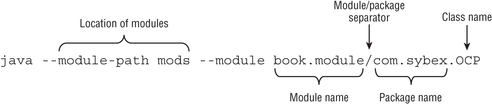

`图 A.5` 使用`java`运行模块

现在我们已经看到了语法，可以编写命令来运行`zoo.animal.feeding`包中的`Task`类。在下面的示例中，包名和模块名是相同的。模块名匹配完整包名或包名的开头是很常见的。

```
java --module-path feeding
   --module zoo.animal.feeding/zoo.animal.feeding.Task
```

既然你已经看到`--module-path`使用`-p`的短形式，我们打赌你不会意外发现`--module`也有短形式。短选项是`-m`。这意味着以下命令是等价的：

```
java -p feeding
   -m zoo.animal.feeding/zoo.animal.feeding.Task
```

在这些示例中，我们使用`feeding`作为模块路径，因为我们是在那里编译代码的。一旦我们打包并运行模块，这一点就会改变。

表 A.2 列出了使用`java`命令需要知道的选项。

| 用途 | 缩写 | 全称 |
| --- | --- | --- |
| 模块名 | `-m <name>` | `--module <name>` |
| 模块路径 | `-p <path>` | `--module-path <path>` |

`表 A.2` 使用`java`使用模块时需要知道的选项

### 打包我们的第一个模块

如果模块只能在创建它的文件夹中运行，那么它没什么意义。我们的下一步是打包它。在运行此命令之前，请确保创建一个`mods`目录：

```
jar -cvf mods/zoo.animal.feeding.jar -C feeding/ .
```

这里没有特定模块的内容。我们正在打包`feeding`目录下的所有内容，将其存储在`mods`文件夹下名为`zoo.animal.feeding.jar`的 JAR 文件中。这代表了模块 JAR 对使用它的其他代码看起来的样子。

现在让我们再次运行程序，但这次使用`mods`目录而不是散乱的类。

```
java -p mods
   -m zoo.animal.feeding/zoo.animal.feeding.Task
```

你可能会注意到此命令与上一节中的命令除了目录外完全相同。在上一个例子中，它是`feeding`。在这一次中，它是`mods`的模块路径。由于使用了模块路径，因此正在运行一个模块 JAR。

图 A.6 显示了在我们编译和打包代码后，现在的目录结构。

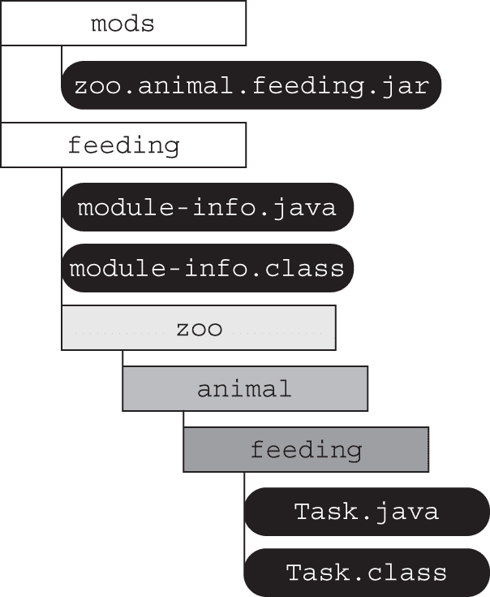

`图 A.6` 带有`class`和`jar`文件的`zoo.animal.feeding`模块

### 更新多模块示例

现在我们的`zoo.animal.feeding`模块已经稳定了，我们可以开始考虑其他模块了。如图 A.7 所示，所有三个模块都依赖于`animal.feeding`。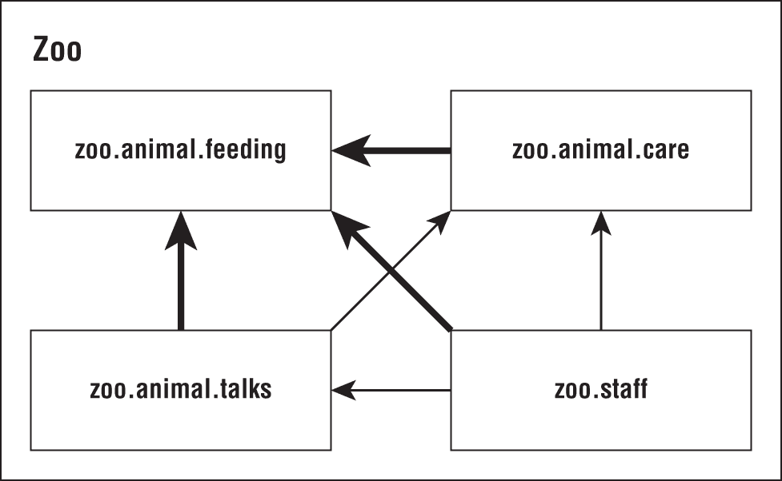

`图 A.7` 依赖于`animal.feeding`的模块

### 更新 Feeding 模块

由于会有其他模块调用`zoo.animal.feeding`包，我们需要在`module-info`文件中声明这一点。`exports`关键字用于指示包在模块外可用。在下面的示例中，我们导出了一个包：

```
module zoo.animal.feeding {

   exports zoo.animal.feeding;

}
```

重新编译并重新打包模块将更新`zoo.animal.feeding.jar`。这些是你运行的`javac`和`jar`命令：

```
javac -p mods
   -d feeding
   feeding/zoo/animal/feeding/*.java
   feeding/module-info.java

jar -cvf mods/zoo.animal.feeding.jar -C feeding/ .
```


### 创建 Care 模块

接下来，让我们创建 `zoo.animal.care` 模块。这次，我们将有两个包。`zoo.animal.care.medical` 包将供其他模块使用。`zoo.animal.care.details` 包仅供此模块内部使用。它不会从模块导出。将其想象为动物的医疗保健。

图 A.8 显示了该模块的内容。记住，所有模块必须有一个 `module-info` 文件。

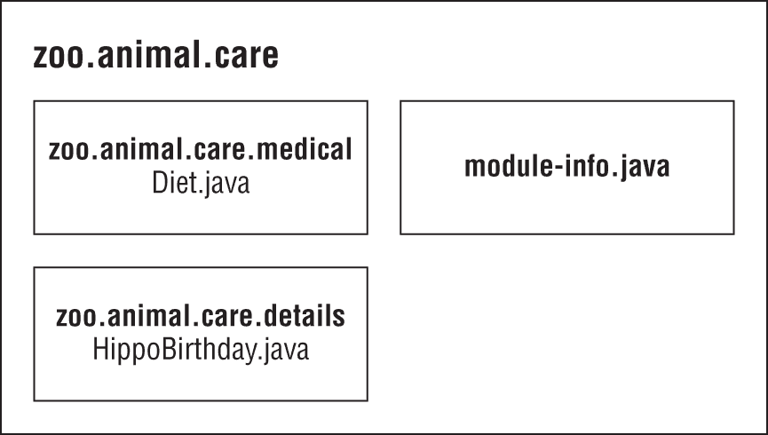

`图 A.8` `zoo.animal.care` 模块的内容

除了 `module-info.java` 文件外，该模块包含两个包和类。

```
// HippoBirthday.java
package zoo.animal.care.details;

import zoo.animal.feeding.*;

public class HippoBirthday {
   private Task task;
}

// Diet.java
package zoo.animal.care.medical;

public class Diet { }
```

这次 `module-info.java` 文件指定了三件事：

```
1: module zoo.animal.care {
2:    exports zoo.animal.care.medical;
3:    requires zoo.animal.feeding;
4: }
```

第一行指定了模块名称。第二行列出了我们要导出的包，以便其他模块使用。到目前为止，这与 `zoo.animal.feeding` 模块相似。

在第三行，我们看到了一个新关键字。`requires` 语句指定需要某个模块。`zoo.animal.care` 模块依赖于 `zoo.animal.feeding` 模块。

接下来，我们需要确定目录结构。我们将创建两个包。第一个是 `zoo.animal.care.details`，包含一个名为 `HippoBirthday` 的类。第二个是 `zoo.animal.care.medical`，包含一个名为 `Diet` 的类。尝试在纸上画出目录结构或在你的计算机上创建它。如果你尝试在不使用在线代码的情况下运行这些示例，除了 `module-info.java` 文件外，为所有内容创建不带变量或方法的类。

图 A.9 显示此模块的目录结构。注意 `module-info.java` 位于模块的根目录下。两个包位于下方。

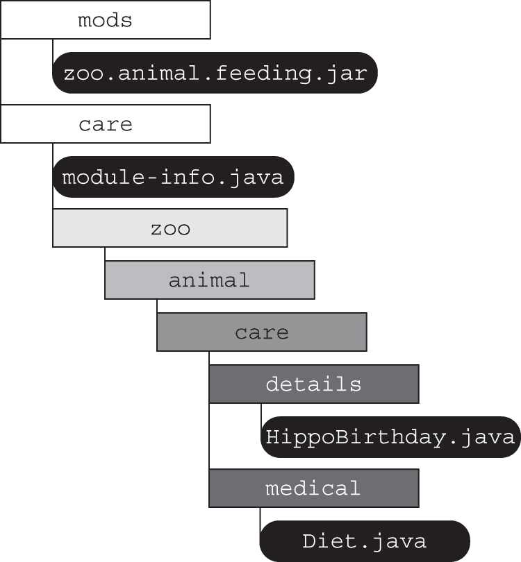

图 A.9 `zoo.animal.care` 模块目录结构

你可能已经注意到包的前缀与模块名相同。这是刻意为之。你可以将其想象为模块名“声称”了匹配的包以及所有的子包。

回顾一下，我们现在编译并打包该模块。

```
javac -p mods
   -d care
   care/zoo/animal/care/details/*.java
   care/zoo/animal/care/medical/*.java
   care/module-info.java
```

我们编译了两个包和 `module-info` 文件。在现实世界中，你将使用构建工具而不是手动进行操作。对于考试，你只需要列出你想要编译的所有包和/或文件即可。

现在我们已经编译了代码，是时候创建模块 JAR 包了。

```
jar -cvf mods/zoo.animal.care.jar -C care/ .
```

### 创建 Talks 模块

到目前为止，我们在模块中只使用了一个 `exports` 和 `requires` 语句。现在你将学习如何处理导出多个包或需要多个模块的情形。在图 A.10 中，观察到 `zoo.animal.talks` 模块依赖于两个模块：`zoo.animal.feeding` 和 `zoo.animal.care`。这意味着 `module-info.java` 文件中必须有两个 `requires` 语句。

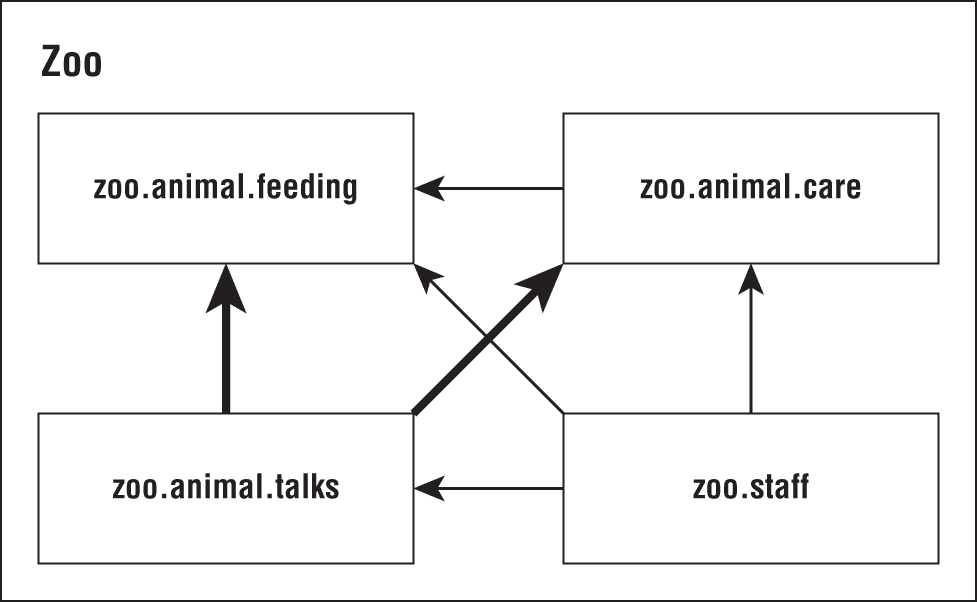

图 A.10 `zoo.animal.talks` 的依赖关系

图 A.11 显示此模块的内容。我们将导出此模块中的所有三个包。

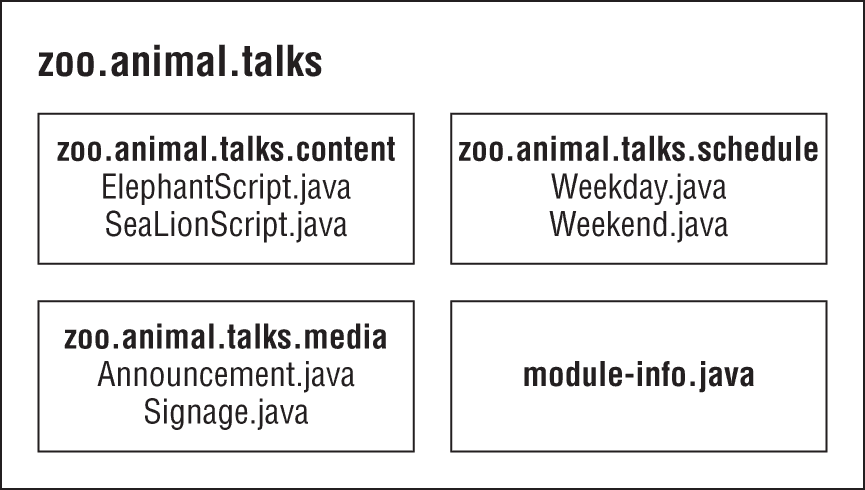

图 A.11 `zoo.animal.talks` 的内容

首先让我们看看 `zoo.animal.talks` 的 `module-info.java` 文件。

```
1: module zoo.animal.talks {
2:    exports zoo.animal.talks.content;
3:    exports zoo.animal.talks.media;
4:    exports zoo.animal.talks.schedule;
5:
6:    requires zoo.animal.feeding;
7:    requires zoo.animal.care;
8: }
```

第 1 行显示模块名。第 2–4 行允许其他模块引用所有的包。第 6–7 行指定该模块依赖的两个模块。

然后我们有六个类，如下：

```
// ElephantScript.java
package zoo.animal.talks.content;

public class ElephantScript { }

// SeaLionScript.java
package zoo.animal.talks.content;

public class SeaLionScript { }

// Announcement.java
package zoo.animal.talks.media;

public class Announcement {
   public static void main(String[] args) {
      System.out.println("We will be having talks");
   }
}

// Signage.java
package zoo.animal.talks.media;

public class Signage { }

// Weekday.java
package zoo.animal.talks.schedule;

public class Weekday { }

// Weekend.java
package zoo.animal.talks.schedule;

public class Weekend {}
```

如果你仍在你的计算机上跟进操作，请在包中创建空类。以下是编译和构建模块的命令：

```
javac -p mods
   -d talks
   talks/zoo/animal/talks/content/*.java
   talks/zoo/animal/talks/media/*.java
   talks/zoo/animal/talks/schedule/*.java
   talks/module-info.java

jar -cvf mods/zoo.animal.care.jar -C care/ .
```

### 创建 Staff 模块

我们的最后一个模块是 `zoo.staff`。图 A.12 显示只有一个包。

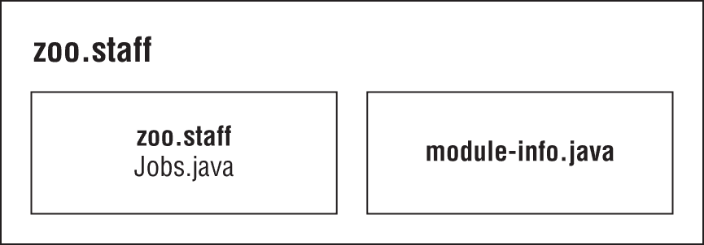

图 A.12 `zoo.staff` 模块

在此模块中，我们有一个类 `Jobs.java`。

```java
package zoo.staff;

public class Jobs { }
```

对于那些在计算机上跟进的同学，请在包中创建空类。以下是编译和构建模块的命令：

```
javac -p mods
   -d staff
   staff/zoo/staff/*.java
   staff/module-info.java
```

## 深入研究 module-info

现在我们已经成功创建了模块，可以详细讨论 `module-info` 文件。在这些章节中，我们将查看 `exports`、`requires`、`provides`、`uses` 和 `opens`。现在是时候提到这些关键词可以任何顺序出现。

### exports

我们之前已经见过 `exports` `packageName` 如何将包导出给其他模块。也可以将其导出给特定的模块。假设动物园决定只有工作人员才能访问讲座。我们可以如下更新模块声明：

```
module zoo.animal.talks {
   exports zoo.animal.talks.content to zoo.staff;
   exports zoo.animal.talks.media;
   exports zoo.animal.talks.schedule;

   requires zoo.animal.feeding;
   requires zoo.animal.care;
}
```

对于 `zoo.staff` 模块来说没有任何变化。然而，没有其他模块被允许访问该包。

你可能注意到，我们的其他模块根本就不需要 `zoo.animal.talks`。然而，我们不知道未来会出现哪些模块。在设计模块时考虑未来的用途是重要的。由于我们只想让一个模块访问，因此只允许该模块访问。

`exports` 关键词本质上给了我们更多访问控制级别。表 A.3 列出了完整的访问控制选项。

| 级别 | 模块内代码 | 模块外 |
| --- | --- | --- |
| `private` | 仅在类内可用 | 无访问权限 |
| default (包私有) | 仅在包内可用 | 无访问权限 |
| `protected` | 仅在包内或子类可用 | 仅在导出时可对子类访问 |
| `public` | 对所有类可用 | 仅在包导出时可访问 |

### requires transitive

正如你之前看到的，`requires` `moduleName` 指定当前模块依赖于 `moduleName`。还有 `requires transitive` `moduleName`，这意味着任何需要该模块的模块也会依赖于 `moduleName`。

嗯，这一段可够长的。让我们来看一个例子。图 A.14 显示了模块，其中虚线表示冗余关系，实线表示在 `module-info` 中指定的关系。这展示了如果我们只使用传递性依赖，模块关系将是怎样的。

例如，`zoo.animals.talks` 依赖于 `zoo.animals.care`，而 `zoo.animals.care` 依赖于 `zoo.animals.feeding`。这意味着 `zoo.animals.talks` 和 `zoo.animals.feeding` 之间的箭头不再出现在 图 A.14 中。

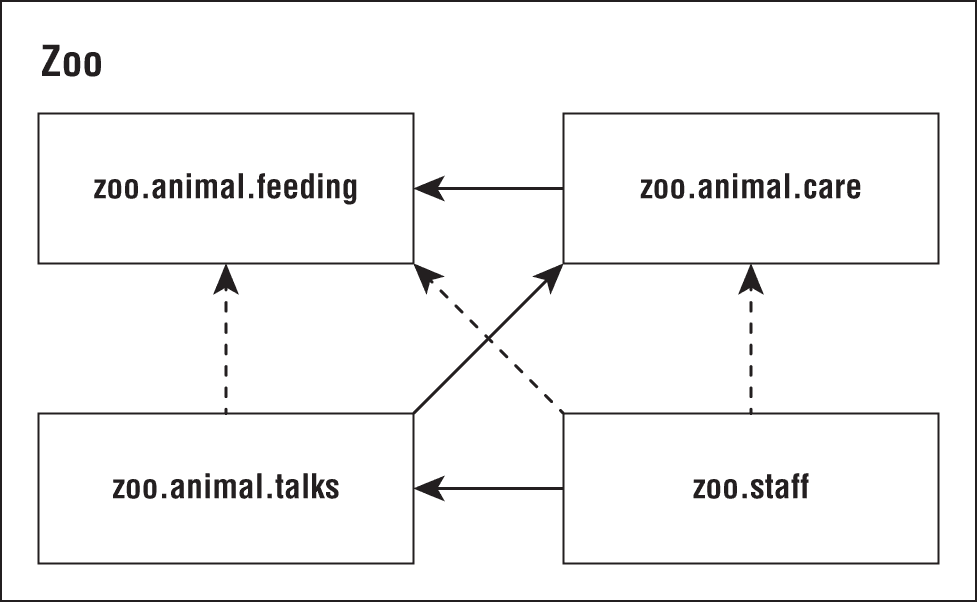

**图 A.14** 我们模块的传递依赖版本

现在让我们来看这四个 `module-info` 文件。第一个模块保持不变。我们向任何使用该模块的包导出一个包。

```
module zoo.animal.feeding {
   exports zoo.animal.feeding;
}
```

`zoo.animal.care` 模块是第一个改进的机会。代码并没有强制所有剩余模块显式指定 `zoo.animal.feeding`，而是使用了 `requires transitive`。

```
module zoo.animal.care {
   exports zoo.animal.care.medical;
   requires transitive zoo.animal.feeding;
}
```

在 `zoo.animal.talks` 模块中，我们做了类似的更改，不再强制其他模块指定 `zoo.animal.care`。我们也不再需要指定 `zoo.animal.feeding`，所以那行代码被注释掉了。

```
module zoo.animal.talks {
   exports zoo.animal.talks.content to zoo.staff;
   exports zoo.animal.talks.media;
   exports zoo.animal.talks.schedule;

   // no longer needed requires zoo.animal.feeding;
   // no longer needed requires zoo.animal.care;
   requires transitive zoo.animal.care;
}
```

最后，在 `zoo.staff` 模块中，我们可以去掉两个 `requires` 语句。

```
module zoo.staff {
   // no longer needed requires zoo.animal.feeding;
   // no longer needed requires zoo.animal.care;
   requires zoo.animal.talks;
}
```

模块越模块，`requires transitive` 的收益就越明显。这对于调用者来说也更加方便。如果你尝试操作这个动物园，只需要要求 `zoo.staff`，剩余的依赖就会自动推断。

### `requires transitive` 的效果

给定我们新更新的 `module-info` 文件并使用 图 A.14，在我们的 `zoo.animal.care` 模块的 `requires` 语句中应用 `transitive` 修饰符是什么？应用 `transitive` 修饰符具有以下效果：

*   模块 `zoo.animal.talks` 可以选择性声明它需要 `zoo.animal.feeding` 模块，但这不是强制。
*   如果没有访问 `zoo.animal.feeding` 模块，模块 `zoo.animal.care` 将无法编译或执行。
*   如果没有访问 `zoo.animal.feeding` 模块，模块 `zoo.animal.talks` 将无法编译或执行。

即使 `zoo.animal.care` 和 `zoo.animal.talks` 模块没有显式引用 `zoo.animal.feeding` 模块中的任何包，这些规则仍然有效。另一方面，如果没有在 `zoo.animal.care` 的 `module-info` 文件中使用 `transitive` 修饰符，其他模块必须显式使用 `requires` 才能引用 `zoo.animal.feeding` 模块中的包。

### 重复的 `requires` 语句

考试可能会欺骗你的地方是将 `requires` 和 `requires transitive` 混合在一起。你想出为什么这段代码无法编译了吗？

```
module bad.module {
   requires zoo.animal.talks;
   requires transitive zoo.animal.talks;
}
```

Java 不允许在 `requires` 子句中重复同一个模块。这是冗余的，而且极可能是一个编码错误。请记住，`requires transitive` 就像是 `requires` 加上一些额外的行为。

### `provides`, `uses`, 和 `opens`

对于剩下的三个关键字（`provides`、`uses` 和 `opens`），我们在这里只介绍基础。它们在 第 6 章 中会有更详细的介绍。

`provides` 关键字指定一个类提供了某个服务的实现。目前，你只需要将服务看作高级的接口即可。要使用它，你需要提供 API 和实现该 API 的类名。

```
provides zoo.staff.ZooApi with zoo.staff.ZooImpl
```

`uses` 关键字指定一个模块依赖于某个服务。编写代码时，你提供你想要调用的 API。

```
uses zoo.staff.ZooApi
```

Java 允许调用者在运行时使用称为“反射”（reflection）的技术来检查并调用代码。这是一种强大的方法，允许调用编译时可能不可的代码。它甚至可以用于绕过访问控制！

示例允许调用编译时可能不可的代码。它甚至可以用于绕过访问控制！

```
opens zoo.animal.talks;
opens zoo.animal.talks.media to zoo.staff;
```

## 发现模块

到目前，我们一直在处理模块。从 Java 9 开始，内置类已经模块化了。在本节中，我们将展示如何使用命令来了解模块。

### `java` 命令

`java` 命令有三个模块相关的选项。一个描述模块，另一个列出模块，第三个显示模块解析。

#### 描述模块

假设你有一个 `zoo.animal.feeding` 模块并想知道它的结构。你可以解压该模块并打开 `module-info` 文件。这将显示该模块导出一个包，并且不需要任何模块。


```
module zoo.animal.feeding {
   exports zoo.animal.feeding;
}
```

然而，有一种更简单的方法。`java` 命令现在有一个描述模块的选项。以下两个命令是等价的：

```
java -p mods
   -d zoo.animal.feeding

java -p mods
   --describe-module zoo.animal.feeding
```

每个打印关于模块的信息。例如，它可能会输出：

```
zoo.animal.feeding file:///absolutePath/mods/zoo.animal.feeding.jar
exports zoo.animal.feeding
requires java.base mandated
```

第一行是我们询问的模块：`zoo.animal.feeding`。第二行开始关于模块的信息。在我们的案例中，它是我们在 `module-info` 文件中相同的 `exports` 语句。

在第三行，我们看到 `requires java.base mandated`。等等。`module-info` 文件显然没有指定 `zoo.animal.feeding` 有任何依赖模块。

`java.base` 模块是特殊的。它被自动作为所有模块的依赖。这个模块包含了频繁使用的包，如 `java.util`。这就是 `mandated` 的含义。无论你是否请求，都会获得 `java.base`。

在类中，`java.lang` 包无论是否输入都会自动导入。`java.base` 模块的作用相同。它对所有其他模块都是可用。

## 列出可用模块

除了描述模块，你还可以使用 `java` 命令列出可用的模块。最简单的形式列出 JDK 部分的模块。

```
java --list-modules
```

当我们运行它时，输出持续了 70 行，看起来如下：

```
java.base@11.0.2
java.compiler@11.0.2
java.datatransfer@11.0.2
```

这是 Java 自带的所有模块及其版本号的列表。你可以看出来，我们在测试此示例时使用的是 Java 11.0.2。

更有趣的是，你可以将此命令用于自定义代码。让我们再次对包含我们动物园模块的目录尝试一次：

```
java -p mods --list-modules
```

你预计这次输出会有多少行？现在有 74 行：70 个内置模块加上我们动物园系统中的 4 个模块。自定义行看起来如下：

```
zoo.animal.care file:///absolutePath/mods/zoo.animal.care.jar
zoo.animal.feeding file:///absolutePath/mods/zoo.animal.feeding.jar
zoo.animal.talks file:///absolutePath/mods/zoo.animal.talks.jar
zoo.staff file:///absolutePath/mods/zoo.staff.jar
```

由于这些是自定义模块，我们得到了在文件系统上的位置。如果项目有模块版本号，它将同时包含版本号和文件系统路径。

## 显示模块解析

如果列出模块没有给你提供足够的输出，你也可以使用 `--show-module-resolution` 选项。你可以将其视为一种调试模块的方法。它在程序启动时会产生大量输出，然后运行程序。

```
java --show-module-resolution 
   -p feeding 
   -m zoo.animal.feeding/zoo.animal.feeding.Task
```

幸运的是，你不需要理解这些输出。尽管如此，见过它会让记忆变得更容易。这里是输出的一个片段：

```
root zoo.animal.feeding file:///absolutePath/feeding/
java.base binds java.desktop jrt:/java.desktop
java.base binds jdk.jartool jrt:/jdk.jartool
…
jdk.security.auth requires java.naming jrt:/java.naming
jdk.security.auth requires java.security.jgss jrt:/java.security.jgss
…
All fed!
```

它从列出根模块开始。那是我们正在运行的那个：`zoo.animal.feeding`。然后它列出了强制模块 `java.base` 包含的许多包。过了一会儿，它列出了具有依赖关系的模块。最后，它输出了程序的运行 `All fed!`。该命令的总输出为 66 行。

## `jar` 命令

与 `java` 命令一样，`jar` 命令也可以描述模块。这两个命令是等效的：

```
jar -f mods/zoo.animal.feeding.jar -d
jar --file mods/zoo.animal.feeding.jar --describe-module
```

输出与我们使用 `java` 命令描述模块时略有不同。使用 `jar` 时，它输出以下内容：

```
zoo.animal.feeding jar:file:///absolutePath/mods/
   zoo.animal.feeding.jar/!module-info.class
exports zoo.animal.feeding
requires java.base mandated 
```

JAR 版本在文件名中包含了 `module-info`，这从大局来看并不是特别显著的区别。你不需要知道这个差异。你确实需要知道这两个命令都可以描述模块。

## `jdeps` 命令

`jdeps` 命令提供了关于模块内部依赖关系的信息。与描述模块不同，它除了查看 `module-info` 文件外还会查看代码。这会告诉你实际使用了哪些依赖，而不仅仅是声明了哪些依赖。

让我们从一个简单的示例开始，请求 `zoo.animal.feeding` 中依赖的摘要。这两个命令提供的输出相同，所示：

```
jdeps -s mods/zoo.animal.feeding.jar

jdeps -summary mods/zoo.animal.feeding.jar
```

注意 `-summary` 之前有一个横杠（`-`）而不是两个。无论如何，输出告诉你只有一个包，并且依赖于内置的 `java.base` 模块。

```
zoo.animal.feeding -> java.base
```

或者，你也可以调用 `jdeps` 时不带摘要选项获取长格式：

```
jdeps mods/zoo.animal.feeding.jar
[file:///absolutePath/mods/zoo.animal.feeding.jar]
   requires mandated java.base (@11.0.2)
zoo.animal.feeding -> java.base
   zoo.animal.feeding         -> java.io
      java.base
   zoo.animal.feeding         -> java.lang
      java.base
```

输出的第一部分显示了模块文件名和路径。第二部分列出了所需的 `java.base` 依赖和版本号。这包含了与之前的示例匹配的高级摘要。

最后，输出的最后四行列出了 `zoo.animal.feeding` 使用的 `java.base` 模块中的特定包。

现在，让我们来看更复杂的示例。这次我们选择一个依赖 `zoo.animal.feeding` 的模块。我们需要指定模块路径，以便 `jdeps` 知道去哪里查找依赖模块的信息。我们之前不需要这样做，因为所有依赖模块都已构建在其中。

表 A.6 显示了 `javac` 的选项，表 A.7 显示了 `java` 的选项，表 A.8 显示了 `jar` 的选项，表 A.9 显示了 `jdeps` 的选项。

| 描述 | 语法 |
| --- | --- |
| 编译非模块代码 |  
```
javac -cp classpath -d directory classesToCompile
javac --class-path classpath -d directory classesToCompile
javac -classpath classpath -d directory classesToCompile
``` |
| 运行非模块代码 |  
```
java -cp classpath package.className
java -classpath classpath package.className
java --class-path classpath package.className
``` |
| 编译模块 |  
```
javac -p moduleFolderName -d directory classesToCompileIncludingModuleInfo
javac --module-path moduleFolderName -d directory classesToCompileIncludingModuleInfo
``` |
| 运行模块 |  
```
java -p moduleFolderName -m moduleName/package.className
java --module-path moduleFolderName --module moduleName/package.className
``` |
| 描述模块 |  
```
java -p moduleFolderName -d moduleName
java --module-path moduleFolderName --describe-module moduleName
jar --file jarName --describe-module
jar -f jarName -d
``` |
| 列出可用模块 |  
```
java --module-path moduleFolderName --list-modules
java -p moduleFolderName --list-modules
java --list-modules
``` |
| 查看依赖 |  
```
jdeps -summary --module-path moduleFolderName jarName
jdeps -s --module-path moduleFolderName jarName
``` |
| 显示模块解析过程 |  
```
java --show-module-resolution -p moduleFolderName -d moduleName
java --show-module-resolution --module-path moduleFolderName --describe-module moduleName
``` |

**表 A.5** 命令行操作对比

| 选项 | 描述 |
| --- | --- |
| `-cp <classpath>` `-classpath <classpath>` `--class-path <classpath>` | 非模块程序中 JAR 的位置 |
| `-d <dir>` | 放置生成的类文件的目录 |
| `-p <path>` `--module-path <path>` | 模块化程序中 JAR 的位置 |

**表 A.6** 考试需要的选项：`javac`

| 选项 | 描述 |
| --- | --- |
| `-cp <classpath>` `-classpath <classpath>` `--class-path <classpath>` | 非模块程序中 JAR 的位置 |
| `-p <path>` `--module-path <path>` | 模块化程序中 JAR 的位置 |
| `-m <name>` `--module <name>` | 要运行的模块名称 |
| `-d` `--describe-module` | 描述模块的细节 |
| `--list-modules` | 在不运行程序的情况下列出可观察模块 |
| `--show-module-resolution` | 运行程序时显示模块 |

**表 A.7** 考试需要的选项：`java`

| 选项 | 描述 |
| --- | --- |
| `-c` `--create` | 创建新的 JAR 文件 |
| `-v` `--verbose` | 在处理 JAR 文件时打印细节 |
| `-f` `--file` | JAR 文件名 |
| `-C` | 包含用于 JAR 用文件的目录 |
| `-d` `--describe-module` | 描述模块的细节 |

**表 A.8** 考试需要的选项：`jar`

| 选项 | 描述 |
| --- | --- |
| `--module-path <path>` | 模块化程序中 JAR 的位置 |
| `-s` `-summary` | 汇总输出 |

**表 A.9** 考试需要的选项：`jdeps`

## 总结

在 Java 中，局部变量类型推断使用 `var` 关键字代替实际类型对局部变量进行处理。当使用 `var` 时，类型在编译时设置一次且不会改变。局部变量类型推断适用于方法、构造函数或初始化块中的局部变量。它们也可以用于 try-with-resources 语句中的 lambda 参数和资源声明。

Java 平台模块系统（JPMS）在包更高的级别组织代码。每个模块包含一个或多个包和一个 `module-info` 文件。Java 平台模块系统的优势包括更好的访问控制、更清晰的依赖管理、自定义的运行时镜像、改进的性能以及独特的包强制。

编译和运行模块的过程使用 `--module-path`，也称为 `-p`。运行模块使用 `--module` 选项，也称为 `-m`。要运行的类格式为 `moduleName/packageName.className`。

`module-info` 文件支持许多关键字。`exports` 关键字指定某个包应该是可访问的。`requires` 关键字指定一个模块依赖于另一个模块。`opens` 关键字指定一个包可以被反射访问。`provides` 关键字指定一个模块实现某个接口。`uses` 关键字指定一个模块使用某个接口。`requires transitive` 关键字允许依赖关系传递给使用该模块的任何模块。

## 考试要点

- **正确使用 `var`**：`var` 用于方法、构造函数或初始化块中的局部变量。它不能用于实例变量或类变量。`var` 必须在声明同一行进行初始化，且类型不能改变。

- **识别 Java 模块系统的优势**：识别 JPMS 的优势，如访问控制、依赖管理、自定义镜像、性能和包强制。还要区分 JPMS 优势与 Java 特性，例如垃圾回收不是 JPMS 的优势。

- **使用命令行操作模块**：使用 `javac`、`java` 和 `jar` 的命令行。特别是理解模块 (`-m`) 和模块路径 (`-p`) 选项。

- **创建基础 `module-info` 文件**：将 `module-info.java` 文件放在模块的根目录下。了解如何使用 `exports` 导出包，以及如何导出到特定模块。此外，了解如何使用 `requires` 和 `requires transitive` 来声明对包的依赖或向使用该模块的任何模块共享该依赖。

- **识别高级 `module-info` 关键字**：`provides` 关键字用于暴露 API。`uses` 关键字用于消费 API。`opens` 关键字允许反射的使用。

- **显示模块信息**：`java` 命令可以描述模块、列出可用模块或显示模块解析。`jar` 命令可以像 `java` 命令一样描述模块。`jdeps` 命令打印模块和包的详细信息。`jmod` 命令提供了多种模式 JMOD 文件而非 JAR 文件。

## 复习题

附录 A 复习题的答案可以在附录 B。

1. 关于 `var` 的以下代码片段在方法中使用时哪些可以通过编译？（选择多项）

   1. `var spring = null;`

   2. `var fall = "leaves";`

   3. `var evening = 2; evening = null;`

   4. `var night = new Object();`

   5. `var day = 1/0;`

   6. `var winter = 12, cold;`

   7. `var fall = 2, autumn = 2;`

   8. `var morning = ""; morning = null;`

## 2. 关于 `var` 的以下哪些陈述是正确的？（选择所有多项。）

1. `var` 可以作为构造函数参数。

2. `var` 的类型在编译时已知。

3. `var` 不能用作实例变量。

4. `var` 可以在多变量赋值语句中使用。

5. `var` 的值在运行时不能改变。

6. `var` 的类型在运行时不能改变。

7. `var` 单词是 `Java` 中的一个保留字。

## 3. 下面哪些是有效的实例变量声明？（选择所有多项。）

1. `var null = 6_000;`

2. `var $_ = 6_000;`

3. `var $2 = 6_000f;`

4. `var var = 3_0_00.0;`

5. `var #CONS = 2_000.0;`

6. `var %C = 6_000_L;`

7. 以上都不是

## 4. 下面哪一个是 Java 平台模块系统（Java Platform Module System）的优点？

1. 所有模块的中央仓库

2. 封装包

3. 封装对象


## 4. 无定义类型

## 5. 平台无关性

## 5. 关于以下模块，哪个描述正确？

```
zoo.staff
   |---zoo
      |-- staff
         |-- Vet.java
```

1. 显示的目录结构是一个有效的模块。

2. 如果在 `zoo.staff` 下直接添加 `module.java`，该目录结构就是有效的模块。

3. 如果在 `zoo` 下直接添加 `module.java`，该目录结构就是有效的模块。

4. 如果在 `zoo.staff` 下直接添加 `module-info.java`，该目录结构就是有效的模块。

5. 如果在 `zoo` 下直接添加 `module-info.java`，该目录结构就是有效的模块。

6. 这些更改都不会让该目录结构成为有效的模块。

## 6. 假设模块 `puppy` 依赖于模块 `dog`，而模块 `dog` 依赖于模块 `animal`。请填充空白，使得模块 `dog` 中的代码可以访问模块 `animal` 中的 `animal.behavior` 包。

```
module animal {
     _______ animal.behavior;
}
```

1. `export`

2. `exports`

3. `require`

4. `requires`

5. `require transitive`

6. `requires transitive`

7. 以上都不是

## 7. 填充空白，使运行该程序的命令正确：

```
java  
   _______ zoo.animal.talks/zoo/animal/talks/Peacocks 
   _______ modules
```

1. `-d` 和 `-m`

2. `-d` 和 `-p`

3. `-m` 和 `-d`

4. `-m` 和 `-p`

5. `-p` 和 `-d`

6. `-p` 和 `-m`

7. 以上都不是

## 8. 在 `module-info.java` 文件中，以下哪些陈述是正确的？（选择所有多项。）

1. `opens` 关键字允许使用反射。

2. `opens` 关键字声明一个 API 被调用。

3. `use` 关键字允许使用反射。

4. `use` 关键字声明一个 API 被调用。

5. `uses` 关键字允许使用反射。

6. `uses` 关键字声明一个 API 被调用。

7. 该文件可以为空（零字节）。

## 9. 关于一个包含名为 `module-info.java` 且内容如下文件的模块，哪个描述是正确的？（选择所有多项。）

```
module com.food.supplier {}
```

1. 模块内部所有的包都会自动导出。

2. 模块内部没有包会被自动导出。

3. 模块内部的 main 方法可以运行。

4. 模块内部的 main 方法无法运行，因为类没有被暴露。

5. `module-info.java` 文件包含编译错误。

6. `module-info.java` 文件名不正确。

## 10. 假设模块 `puppy` 依赖于模块 `dog`，而模块 `dog` 依赖于模块 `animal`。哪两行允许模块 `puppy` 访问模块 `animal` 中的 `animal.behavior` 包？（选择两个。）

```
module animal {
     exports animal.behavior;
}
module dog {
    _______ animal;  // line S
}
module puppy {
    _______ dog;     // line T
}
```

1. 行 S 使用 `require`

2. 行 T 使用 `require`

3. 行 S 使用 `requires`

4. 行 T 使用 `requires`

5. 行 S 使用 `require transitive`

6. 行 T 使用 `require transitive`

7. 行 S 使用 `requires transitive`

8. 行 T 使用 `requires transitive`

## 11. 哪些命令带有 `--module-path` 参数？（选择所有多项。）

1. `javac`

2. `java`

3. `jar`

4. `jdeps`

5. `jmod`

6. 以上都不是

## 12. 下面哪些是运行模块化程序的合法命令？（选择所有多项。）

1. `java -p x/x`

2. `java -x -m x`

3. `java -m x/x`

4. `java -p x-x`

5. `java -m x-x`

6. `java -p x/x`

7. 以上都不是

## 13. 哪个词最适合填充代码中的空白？

```
module __________ {
      exports horn;
      exports magic;
}
```

1. `com`

2. `unicorn`

3. `horn`

4. `magic`

5. 代码通过编译

6. 通过

## 14. 哪些是 `jmod` 命令的有效模式？（选择所有多项。）

1. `add`

2. `create`

3. `delete`

4. `describe`

5. `extract`

6. `list`

7. `show`

## 15. 假设你有命令 `javac`、`java` 和 `jar`。其中多少个支持 `--show-resolution`？

1. 零

2. 一个

3. 两个

4. 三

## 16. 关于以下模块，哪些描述是正确的？（选择所有多项。）

```
module dragon {
      exports fire;
      exports scales to castle;
}
```

1. 所有模块都可以引用 `fire` 包。

2. 所有模块都可以引用 `scales` 包。

3. 只有 `castle` 模块可以引用 `fire` 包。

4. 只有 `castle` 模块可以引用 `scales` 包。

5. 以上都不是

## 17. 描述任何模块时，你会看到什么？

1. `requires java.base`

2. `requires java.core`

3. `requires java.lang`

4. `requires mandated.base`

5. `requires mandated.core`

6. `requires mandated.lang`

7. 以上都不是

## 18. 哪些是列出依赖的有效调用？（选择所有多项。）

1. `jdeps flea.jar`

2. `jdeps -s flea.jar`

3. `jdeps -summary flea.jar`

4. `jdeps --summary flea.jar`

5. 以上都不是

## 19. 哪一行包含编译错误？

```
1: module snake {
2:    exports com.snake.tail;
3:    exports com.snake.fangs to bird;
4:    requires skin;
5:    requires transitive skin;
6: }
```

1. 第 1 行

2. 第 2 行

3. 第 3 行

4. 第 4 行

5. 第 5 行

6. 代码不包含任何编译错误

## 20. 下面哪些是合法的模块名？（选择所有多项。）

1. `com.book`

2. `com-book`

3. `com.book$`

4. `com-book$`

5. `4com.book`

6. `4com-book`

## 21. 使用 Java 平台模块系统可以创建哪些以前无法创建的内容？（选择所有多项。）

1. JAR 文件

2. JMOD 文件

3. 用于分发的更小的运行时镜像

4. 特定操作系统的字节码

5. TAR 文件

6. 以上都不是

## 22. 下面哪些选项没有单字符快捷方式？（选择所有多项。）

1. `describe-module`

2. `list-modules`

3. `module`

4. `module-path`

5. `show-module-resolution`

6. `summary`

**23.** 下列哪些是运行模块化程序的合法命令，其中 `n` 是模块名，`c` 是类名？（选择所有适用项。）

1. `java –module-path x -m n.c`

2. `java --module-path x -p n.c`

3. `java --module-path x -m n/c`

4. `java --module-path x -p n/c`

5. `java --module-path x -m n c`

6. `java --module-path x -p n c`

7. 以上都不是

# 附 B

## 复习题答案

### 第 1 章：Java 基础

1. A, D. 实例变量和 `static` 变量可以标记为 `final`，因此选项 A 正确。实际上，`final` 意味着局部变量没有标记为 `final` 但其值在设置后不会改变，因此选项 B 错误。`final` 修饰符可以应用于类，但不能应用于接口，因此选项 C 错误。记住，接口是隐式的 `abstract`，这与 `final` 不兼容。选项 D 正确，因为 `final` 类的定义是它不能被扩展。选项 E 错误，因为 `final` 指的是对象的引用，而不是它的内容。最后，选项 F 错误，因为 `var` 和 `final` 可以一起使用。

2. C. 当枚举（enum）只包含一个值列表时，列表后的分号（`;`）是可选的。当枚举包含任何其他成员（如构造函数或变量）时，分号是必须的。由于代码缺少分号，它无法编译，因此选项 C 是正确答案。此代码中没有其他编译错误。如果加上缺失的分号，程序将在运行时打印 `0 1 2`。

3. C. `Popcorn` 是一个内部类。内部类允许包含标记为 `final` 的 `static` 变量。由于没有其他编译错误，选项 C 是唯一正确的答案。如果如果在第 6 行添加 `final` 修饰符，代码在运行时将打印 `10`。注意，`private` 构造函数可以被同一类中的任何方法使用。

4. B, F. `default` 接口方法始终是 `public`，无论你是否包含标识符，因此选项 B 正确而选项 A 错误。接口不能包含 `default static` 方法，因此选项 C 错误。选项 D 错误，因为 `private` 接口方法不会被继承且不能标记为 `abstract`。选项 E 错误，因为方法不能同时被标记为 `protected` 和 `private`。最后，接口可以包含 `private` 和 `private static` 方法，因此选项 F 正确。

5. B, D. 选项 B 是有效的函数式接口，可以赋值给 `Consumer<Camel>` 引用。注意，参数列表中的变量允许使用 `final` 修饰符。选项 D 正确，因为异常是作为对象返回而不是抛出。这与返回类型为 `RuntimeException` 的 `BiFunction` 是兼容的。

选项 A 是错误的，因为它混用了 `var` 参数和非 `var` 参数。如果一个参数使用了 `var`，那么所有参数都必须使用 `var`。选项 C 无效，因为变量 `b` 被使用了两次。选项 E 错误，因为 `return` 语句只允许在大括号（`{}`）内部使用。选项 F 错误，因为变量声明后面需要一个分号（`;`）。最后，选项 G 是错误的。如果为一个参数指定了类型，则每个参数都必须指定。

6. C, E. 你可以通过将共享代码从 `default` 或 `static` 方法移动到 `private` 或 `private static` 方法来减少代码重复。出于此原因，选项 C 正确。选项 E 也是正确的，因为将接口方法变为 `private` 意味着接口的用户无法访问它们。其他选项与 `private` 方法无关，尽管 `default` 方法适用于向后兼容性。

7. F. 在 `switch` 语句中使用枚举时，`case` 语句必须仅由枚举值组成。如果在 `case` 语句的值使用了枚举名称，则代码无法编译。例如，`VANILLA` 是接受的，但 `Flavors.VANILLA` 不行。由于由于原因，这三个 `case` 语句无法编译，因此选项 F 是正确答案。如果修正了这三行，代码将编译并在运行时产生 `NullPointerException`。

8. A, C. 函数式接口可以包含任意数量的非抽象方法，包括 `default`、`private`、`static` 和 `private static`。出于此原因，选项 A 正确，选项 D 错误。选项 B 错误，因为类永远不会被视为函数式接口。函数式接口恰好有一个抽象方法，尽管签名与 `java.lang.Object` 中的 `public` 方法匹配的方法不计单一方法测试。由于这些原因，选项 C 正确，选项 E 错误。最后，选项 F 是错误的。虽然函数式接口可以标记 `@FunctionalInterface` 注解，但并不是必须的。

9. G. 陷阱——代码无法编译！`Spirit` 类被标记为 `final`，所以它不能被扩展。`main()` 方法使用了继承自 `Spirit` 的匿名内部类，这是不允许允许的。如果 `Spirit` 没有标记为 `final`，则选项 C 和 F 是正确的。

10. E. `OstrichWrangler` 类是 `static` 的；因此它无法访问实例成员 `count`。出于此原因，第 6 行无法编译，选项 E 正确。

11. D. 在此示例中，`CanWalk` 和 `CanRun` 都实现了一个 `default walk()` 方法。`CanSprint` 的定义扩展了这两个接口，除非它重写两个方法，否则无法编译。第 12 行的 `walk()` 版本是重载而不是重写，因为它接收一个 `int`。

12. C. 函数式接口接收两个 `int` 参数。`m1` 上的代码尝试将它们用作其中一个是 `Object`，导致编译器错误，使得选项 C 是正确答案。它还尝试返回 `String`，尽管函数式接口的返回类型是 `boolean`。

13. E, G. 对于这个问题，记住编译器会插入哪些隐式修饰符以及哪些不会会有帮助。第 2 行和第 3 行编译，接口变量被假设为 `public`、`static` 和 `final`。第 4 行也可以编译，因为如果没有其他标记，`static` 方法被假设为 `public`。第 5 行无法编译。接口内部非 `static` 方法必须显式标记为 `private` 或 `default`。第 6 行编译，编译器会添加 `public` 修饰符。第 7 行无法编译，因为接口没有 `protected` 成员。最后，第 8 行编译，编译器没有添加任何修饰符。

14. E. `Diet` 是内部类，需要一个 `Deer` 的实例来实例化。由于 `main()` 方法是 `static` 的，没有这样的实例。因此，`main()` 方法无法编译，选项 E 正确。如果使用了 `Deer` 的引用，例如调用 `new Deer().new Diet()`，则代码将编译并在运行时打印 `bc`。

### 15. G

`isHealthy()` 方法在枚举中被标记为 `abstract`（抽象的）；因此，它必须在每个枚举值声明中被实现。由于只有 `INSECTS` 实现了它，代码无法编译，因此选项 G 正确。如果代码被修复为在每个枚举值中实现 `isHealthy()` 方法，那么打印的前三个值将是 `INSECTS`、`1` 和 `true`，第四个将取决于 `COOKIES.isHealthy()` 的实现。

### 16. A, D, E.

有效的函数式接口是指包含单个抽象方法的接口，其中排除了 `java.lang.Object` 类中已经定义的任何 `public` 方法。`Transport` 和 `Boat` 是有效的函数式接口，因为它们各自包含一个抽象方法：分别为 `go()` 和 `hashCode(String)`。由于其他方法是 `Object` 的一部分，因此它们不被视为抽象方法。`Train` 也是函数式接口，因为它扩展了 `Transport` 且没有定义任何额外的抽象方法。

`Car` 不是函数式接口，因为它是一个抽象类。`Locomotive` 不是函数式接口，因为它包含了两个抽象方法，其中一个是继承的。最后，`Spaceship` 不是有效的接口，更不用说是函数式接口，因为 `default` 方法必须提供方法体。测试接口是否为函数式接口的一种快速方法是应用 `@FunctionalInterface` 注解并检查代码是否仍然编译。

### 17. A, F.

选项 A 是一个有效的 lambda 表达式。虽然 `main()` 是 `static` 方法，但它可以访问 `age`，因为它使用了 `Hyena` 实例的引用，而该实例在该方法中是有效最终的（effectively final）。记住你在 1Z0-815 学习中学，`var` 是一个保留类型而不是保留关键字，可以用于变量名。选项 F 也是正确的，lambda 变量是 `Hyena` 对象的引用。该变量在 `testLaugh()` 方法中使用延迟执行进行处理的。

选项 B 和 E 是错误的；由于局部变量 `age` 不是有效最终的，这将会导致编译错误。选项 C 也会导致编译错误，因为该表达式使用了变量名 `p`，而该变量已经在方法内部声明了。最后，选项 D 是错误的，因为这甚至不是一个 lambda 表达式。

### 18. C, D, G.


选项 C 是使用外部类 `Lion` 的实例创建内部类 `Cub` 实例的正确方法。语法看起来很奇怪，但它创建了一个外部类的对象，然后从该对象创建一个内部类的对象。选项 A、B 和 E 使用了错误的语法创建 `Cub` 类实例。选项 D 和 G 是创建静态嵌套类 `Den` 实例的正确方法，因为它不需要 `Lion` 的实例，而选项 F 使用了无效语法。最后，选项 H 是错误的，因为它缺少 `Lion` 的实例。如果 `rest()` 是实例方法而不是 `static` 方法，那么选项 H 将是正确的。

### 19. D.

首先，如果一个类或接口继承了两个包含相同签名的 `default` 方法的接口，那么它必须用自己的实现来重写该方法。`Penguin` 类正确地做到了，因此选项 E 是错误的。访问继承的 `default` 方法的方法是使用 `Swim.super.perform()` 语法，使得选项 D 正确。我们同意这种语法很怪异，但你需要学习它。选项 A、B 和 C 是错误的，会导致编译器错误。

### 20. A, B, C, D.

有效最终（Effectively final）指的是值在设置后不再改变的局部变量。出于这个原因，选项 A 是正确的，选项 E 和 F 是错误的。选项 B 和 C 是正确的，因为 lambda 表达式可以访问 `final` 和有效最终的变量。选项 D 也是正确的，它是有效最终变量的一个常见测试点。

### 21. B, E.

像类一样，接口允许实例方法访问 `static` 成员，但反之不然。非 `static private`、`abstract` 和 `default` 方法在接口中被视为实例方法。第 3 行无法编译，因为 `static` 方法 `hunt()` 无法访问 `abstract` 实例方法 `getName()`。第 6 行无法编译，因为 `private static` 方法 `sneak()` 无法访问 `private` 实例方法 `roar()`。其余行均可正常编译。

### 22. D, F.

Java 添加 `default` 方法主要是为了向后兼容。使用 `default` 方法允许你向接口添加新方法，而无需重新编译使用旧版本接口的类。出于这个原因，选项 D 是正确的。选项 F 也是正确的，因为某些 API 中的 `default` 方法为实现该接口的类提供了许多便利方法。其他选项与 `default` 方法无关。

### 23. C, F.

如果枚举中包含任何其他内容，则枚举值列表后必须有一个分号（`;`）。别担心，你不需要在整个考试中寻找缺失的分号——只需要在枚举相关的题中寻找即可。出于这个原因，第 5 行后面应该有一个分号，因为它是枚举列表的结束，使得选项 F 正确。枚举构造函数是隐式 `private` 的，使得选项 C 也是正确的。枚举的其余部分可以正常编译。

### 24. E.

选项 A 无法编译，因为块中的第二个语句结尾缺少分号（`;`）。选项 B 是无效的 lambda 表达式，因为 `t` 定义了两次：在参数列表中和 lambda 表达式内部。选项 C 和 D 都缺少 `return` 语句。选项 E 和 F 都是有效的 lambda 表达式，尽管选项 E 符合 `Sloth` 类的行为。特别是，选项 F 只打印了 `Sleep:`。

### 25. B.

`Zebra.this.x` 是引用 `Zebra` 类中 `x` 的正确方法。第 5 行在方法内部定义了一个抽象类，而第 11 行定义了一个扩展 `Stripes` 的匿名类。代码编译正常并在运行时打印 `x is 24`，因此选项 B 是正确答案。

# 第 2 章：注解 (Annotations)

### 1. E.

在注解中，可选元素通过 `default` 修饰符指定，必需元素通过不提供 `default` 值来指定。因此，缺少 default 终端表示该元素是必需的。出于这个原因，选项 E 是正确的。

### 2. D, F.

第 5 行无法编译，因为它使用了 `=` 给默认赋值，而不是 `default` 修饰符。第 7 行无法编译，因为注解和接口常量是隐式的 `public`，不能是 `private`。其余行没有编译错误。

### 3. B, D, E.

`@Target` 和 `@Repeatable` 注解专门设计用于注解，使得选项 D 和 E 正确。选项 B 也是正确的，因为 `@Deprecated` 可以应用于几乎任何声明。选项 A 是错误的，因为 `@Override` 只能应用于方法。选项 C 和 F 是错误的，因为它们不是内置注解的名称。

### 4. D.

注解应该包含是相对恒定的元数据（关于数据的数据），而不是属性数据（对象的一部分且会频繁变化）。车辆的价格、销售情况、库存以及购买车辆的人可能会经常波动，因此使用注解是一个糟糕的选择。相反，车辆额定的最大载客人数是关于车辆的额外信息，一旦确定就不可能改变。因此，它是适当的元数据，最适合使用注解。

### 5. B, C.

第 4 行无法编译，因为元素的默认值必须是一个非-`null` 常量表达式。第 5 行无法编译，因为元素类型必须是预定义的不可变类型之一：基本类型、`String`、`Class`、枚举（enum）、另一个注解或这些类型的数组。其余行不包含任何编译错误。

### 6. E, G.

注解声明包含一个必需的元素，使得选项 A 错误。选项 B、C 和 D 是错误的，因为 `Driver` 声明中不包含名为 `value()` 的元素。如果 `Driver` 中的 `directions()` 被重命名为 `value()`，那么选项 B 和 D 将是正确的。答案是选项 E 和 G。选项 E 使用了简写形式，当只有一个元素时，可以省略数组大括号（`{}`）。选项 C 和 F 不是有效的注解用法，无论注解声明如何如何。在这道题中，`@Documented` 和 `@Deprecated` 注解对结果没有影响。

### 7. A, B, C, D, E, F.

注解可以应用于列出的所有声明。只要使用了类型名称，就可以应用注解。

### 8. B, F.

在此题中，`Ferocious` 是可重复注解，而 `FerociousPack` 是容器类型注解。容器类型注解应该包含一个的 `value()` 元素，该元素是可重复注解类型的数组。因此，选项 B 是正确的。选项 A 会允许 `FerociousPack` 编译，但不会允许 `Ferocious` 编译。选项 C 是无效的注解元素类型。

可重复注解需要指定其容器类型注解的类名，使得选项 F 正确。虽然预计可重复注解包含元素来区分其用法，但并不是强制要求的。因此，`@Ferocious` 的用法在 `Lion` 类上是一个有效的标记注解（marker annotation），这使得选项 G 是错误的。

### 9. D.

要要使用带有值但没有元素名的注解，该元素必须命名为 `value()` 而不是 `values()`，使得选项 A 错误。`value()` 注解可以是必需的也可以是可选的，使得选项 B 错误。注解声明可以包含其他元素，只要这些元素不是必需的即可，使得选项 C 错误。选项 D 是正确的，因为注解不能包含任何其他值。最后，选项 E 是错误的，因为这不是使用 `value()` 简写的的属性。

### 10. G.

`Furry` 是一个只能应用于类型的注解。在 `Bunny` 中，它被应用于方法；因此，它无法编译。如果将 `@Target` 的值改为 `ElementType.METHOD`（或完全移除 `@Target`），则其余代码将无问题地编译。使用简写符号指定数组的 `value()` 是正确的。

### 11. C, D, F.

`@SafeVarargs` 注解可以应用于包含变长参数（varargs）的构造函数或 `private`、`static` 或 `final` 方法。因此，选项 C、D 和 F 是正确的。选项 A 是错误的，因为编译器实际上无法强制执行操作是安全的。这由编写方法的开发者来验证。选项 B 是错误的，因为注解只能应用于不可被重写的方法，而 `abstract`（抽象）方法总是可以被重写的。最后，选项 E 是错误的，因为它是应用于声明而不是参数。

### 12. B, C, D.

注解不能有构造函数，所以第 5 行无法编译。注解可以有变量，但它们必须用常量值声明。因此，第 6 行无法编译。第 7 行无法编译，因为元素 `unit` 在元素名后缺少括号。第 8 行可以编译，并展示了如何使用带有默认值的注解类型。

### 13. A, D.

可选的注解元素是指用默认值声明的元素，在注解中使用时可以可选地替换该值。因此，选项 A 和 D 是正确的。

### 14. D.

`@Retention` 注解决定注解是在代码编译时、运行时丢弃还是完全不丢弃。`@Documented` 注解的存在与否决定了注解是否在生成的 Javadoc 中被丢弃。因此，选项 D 是正确的。

### 15. B.

标记注解（marker annotation）是不带任何元素的注解。它可能有常量变量，也可能没有，使得选项 B 正确。选项 E 是错误的，因为没有任何注解可以被扩展。

### 16. F.

`@SafeVarargs` 注解不接受值，只能应用于不可被重写的方法（标记为 `private`、`static` 或 `final` 的方法）。因此，选项 A 和 B 会产生编译错误。选项 C 也无法编译，因为此注解只能应用于其他注解。即使你不记得这一点，也很清楚它与隐藏编译器警告没有关系。选项 D 无法编译，因为 `@SuppressWarnings` 需要一个值。选项 E 和 F 允许代码无错误地编译，但只有选项 F 会无警告地编译。在执行未检查的泛型操作时，需要 `unchecked` 值。

### 17. B, E.

`@FunctionalInterface` 标记注解用于说明接口是一个有效的函数式接口，恰好包含一个抽象方法，使得选项 B 正确。它在判断接口是否为有效的函数式接口也有用，因为如果使用不当编译器将报告错误，使得选项 E 正确。即使没有注解，编译器也可以检测接口是否为函数式接口，使得选项 A 和 C 错误。

### 18. C, D, E, F.

第 5 行和 6 行无法编译，因为 `Boolean` 和 `void` 不是支持的注解元素类型。它必须是基本类型、`String`、`Class`、枚举、另一个注解或这些类型的数组。第 7 行无法编译，因为注解元素隐式为 `public`。最后，第 8 行无法编译，因为 `Strong` 注解不包含 `value()` 元素，不能使用简写符号。如果将第 2 行从 `force()` 改为 `value()`，则第 8 行即可编译。尽管没有修改，编译错误在第 8 行。其余行不包含任何编译错误，使得选项 C、D、E 和 F 正确。

### 19. A, F.

`@Override` 注解可以应用于方法，但如果方法签名与继承的方法不匹配，将触发编译错误，使得选项 A 正确。`@Deprecated` 注解可以应用于方法，但不会根据方法签名触发任何编译错误。`@FunctionalInterface`、`@Repeatable` 和 `@Retention` 注解不能应用于方法，使得这些选项错误。最后，`@SafeVarargs` 可以应用于方法，但如果方法不包含变长参数或可以被重写（未标记为 `private`、`static` 或 `final`）。

### 20. D, F.

第 6 行包含编译错误，因为注解声明中要求元素名 `buoyancy`。如果将元素重命名为 `value()`，则元素名是可选的。第 8 行也包含编译错误。虽然注解可以在转换操作中使用，但它需要一个类型。如果将转换表达式改为 `(@Floats boolean)`，则它可以通过编译。其余代码无问题地编译。

### 21. G.

`@Inherited` 注解决定定义在父类型中的注解是否会自动继承到子类型中。`@Target` 注解决定了注解可以应用的位置或位置。由于这不是一个选项，所以选项 G 是正确的。注意 `ElementType` 是 `@Target` 使用的枚举，但它不是注解。

### 22. F.

如果将 `@SuppressWarnings("deprecation")` 应用于使用已弃 API 的方法上，则与使用相关的警告将不会在编译时显示，因此选项 F 是正确的。请注意，没有名为 `@Ignore` 或 `@IgnoreDeprecated` 的内置注解。

### 23. A.

这个问题就像考试中的某些问题一样，包含了你解决它时不需要的冗余信息。因此，你可以假设反射代码是有效的。尽管如此，这段代码并非没有问题。如果没有显式说明，所有注解的默认保留策略是 `RetentionPolicy.CLASS`。这意味着注解信息在编译时被丢弃，并且在运行时不可用。由于这个原因，任何一个成员都不会打印任何内容，因此选项 A 是正确的。

如果在 `Plumber` 的声明中添加了 `@Retention(RetentionPolicy.RUNTIME)`，那么 `worker` 成员将导致在运行时打印默认注解 `value()` 的值 `Mario`，选项 B 将是正确答案。请注意，即使修正了保留策略注解，`foreman` 也不会导致打印 Mario。设置注解的值等同于设置变量 `foreman` 的值。

### 24. A, E.

该注解仅包含一个必需元素，且命名为 `value()`，因此只要它是注解中的唯一值，就可以在不提供元素名称的情况下使用。由于这个原因，选项 A 是正确的，选项 B 和 D 是错误的。由于 `value()` 的类型是数组，如果将其更改为 `@Dance({33, 10})`，则选项 B 将可行。选项 C 是错误的，因为它尝试给 `fast` 赋值，而 `fast` 是一个常量变量而不是元素。选项 E 是正确的，它是注解替换所有可选值的的一个示例。选项 F 是错误的，因为 `value()` 是一个必需元素。

### 25. C.

应该使用 Javadoc 的 `@deprecated` 注解，它为弃用提供了理由并建议替代方案。所有其他答案都是错误的，选项 A 和 B 的大小写也错了。由于这些是 Java 注解，它们应该写成 `@Repeatable` 和 `@Retention`。

# 第 3 章：泛型与集合

### 1. B.

答案需要实现 `List`，因为场景允许重复。由于你需要一个 `List`，可以立即排除选项 C 和 D，因为 `HashMap` 是一个 `Map`，而 `HashSet` 是一个 `Set`。选项 A `Arrays` 试图干扰你的判断。它是一个工具类，而不是 `Collection`。数组不是集合。这让你剩下选项 B 和 E。选项 B 是比选项 E 更好的答案，因为 `LinkedList` 既是 `List` 也是 `Queue`，而你只需要一个普通的 `List`。

### 2. D.

答案需要实现 `Map`，因为根据唯一的 `id` 字段，你正在处理键值对。你可以立即排除选项 A、C 和 E，因为它们不是 `Map`。`ArrayList` 是一个 `List`。`HashSet` 和 `TreeSet` 都是 `Set`。现在在 `HashMap` 和 `TreeMap` 之间选择。由于问题提到了排序，你需要 `TreeMap`。因此，答案是选项 D。

### 3. C, G.

第 12 行创建了一个 `List<?>`，这意味着它被处理为所有元素类型都是 `Object` 而不是 `String`。第 15 行和 16 行无法编译，因为它们调用了 `String` 的方法 `isEmpty()` 和 `length()`，而这些方法在 `Object` 上并没有定义。第 13 行创建了一个 `List<String>`，因为 `var` 使用了它从上下推断出的类型。第 17 行和 18 行可以编译。然而，`List.of()` 创建了一个不可变列表，所以如果运行这两行，都会抛出 `UnsupportedOperationException`。因此，选项 C 和 G 是正确的。

### 4. D.

这是一个 FIFO（先进先出）队列。在第 7 行，我们移除了第一个添加的元素，即 `"hello"`。在第 8 行，我们查看了新的第一个元素（`hi`）但没有移除它。在第 9 行和 10 行，我们逐个移除每个元素，直到没有元素剩余，并一起打印 `hi` 和 `ola`。请注意，我们没有使用 `Iterator` 来遍历 `LinkedList` 以避免并发修改问题。元素在内部存储的顺序不属于 API 合约的一部分。

### 5. B, F.

选项 A 无法编译，因为泛型类型不兼容。我们可以说 `HashSet<? extends Number> hs2 = new HashSet<Integer>();`。选项 B 使用了下界，因此它允许父类泛型类型。选项 C 无法编译，因为菱操作符只允许右侧。选项 D 无法编译，因为 `Set` 不是 `List`。选项 E 无法编译，因为在实例化类型时不允许使用上界。最后，选项 F 可以编译，因为上界在 `=` 的正确一侧。

### 6. B.

该类可以编译并运行，没有问题。第 10 行由于没有使用泛型而产生编译器警告，但不是编译器错误。第 4 行编译正常，因为 `toString()` 在 `Object` 类中定义，因此始终可以调用。

第 9 行创建了泛型类型为 `String` 的 `Hello` 类。它还向 `println()` 方法传递了一个 `int`，该 `int` 被自动装箱为 `Integer`。虽然 `println()` 方法接收一个类型为 `T` 的泛型参数，但它与第 1 行为类定义的 `<T>` 不同。相反，它是定义为不同 `T` 的在第 5 行的声明中。`String` 传递给 `println()`。在第 10 行传递了 `boolean`，它被自动装箱为 `Boolean`。结果打印了 `hi-true`，选项 B 是正确的。

### 7. A, D.

代码可以正常编译。它允许添加任何 `Number` 的实现。第 5 行和 8 行分别将原始类型装箱为 `Integer` 和 `Long`。`HashSet` 不保证迭代顺序，因此选项 A 和 D 是正确的。


8. B, F. 我们寻找一个按 `beakLength` 降序排序的 `Comparator` 定义。选项 A 是错误的，因为它按升序排序 `beakLength`。同样，选项 C 是错误的，因为它在具有相同 `name` 的情况下按升序排序 `beakLength`。选项 E 是错误的，因为没有 `thenComparingNumber()` 方法。选项 B 是正确答案，因为它按 `beakLength` 降序排序。选项 D 和 F 更加复杂。首先注意到我们可以调用 `thenComparing()` 或 `thenComparingInt()`，因为前者将简单 `int` 装箱为 `Integer`。然后观察 `reversed()` 应用于什么。选项 D 是错误的，因为它按名称升序排序，并只反转了相同名称的喙长度。选项 F 创建了一个按名称升序排序、再按喙大小升序排序的比较器。最后，它反转了结果。这正是我们想要的，所以选项 F 是正确的。

9. E. 陷阱题！`Map` 接口使用 `put()` 而不是 `add()` 向 map 添加元素。如果这些示例使用 `put()`，答案将是选项 A 和 C。选项 B 不行的，因为 `long` 在没有显式强制转换的情况下无法放入 `Double`。选项 D 不行的，因为 `char` 不是 `String`。

10. A. 数组使用 `MyComparator` 进行排序，它以不区分大小写的方式反序排序元素。通常情况下，数字在字母之前。这段代码通过调用 `b` 的 `compareTo()` 方法而不是 `a` 反转了这一点。

11. A. 第 3 行使用本地变量类型推断创建 map。第 5 行和 7 行使用自动装箱在 `int` 原始类型和 `Integer` 包装类之间转换。键映射到它们的平方值。`1` 映射到 `1`，`2` 映射到 `4`，`3` 映射到 `9`，`4` 映射到 `16`，以此此类推。

12. A, B, D. 泛型必须是 `Exception` 或 `Exception` 的子类，因为这是一个上界。选项 C 和 E 是错误的，因为 `Throwable` 是 `Exception` 的父类。选项 D 使用了一种奇特的语法，通过显式列列出类型，但你应该能够识别出它是可以的。

13. B, E. `showSize()` 方法可以接受任何类型的 `List`，因为它使用了无界通配符。选项 A 是错误的，因为它是 `Set` 而不是 `List`。选项 C 是错误的，因为通配符不允许出现在赋值语句的右侧。选项 D 是错误的，因为泛型类型不兼容。

选项 B 是对的，因为下界通配符允许该相同类型作为泛型。选项 E 是对的，因为 `Integer` 是 `Number` 的子类。

14. C. 这道题很困难，因为它在同一个对象上同时定义了 `Comparable` 和 `Comparator`。`t1` 对象没有指定 `Comparator`，所以它使用 `Comparable` 对象的 `compareTo()` 方法。这根据 `text` 实例变量进行排序。`t2` 对象在调用构造函数时指定了 `Comparator`，所以它使用 `compare()` 方法，根据 `int` 进行排序。

15. A. 当使用 `binarySearch()` 时，`List` 必须按照 `Comparator` 使用的顺序排序。由于 `binarySearch()` 方法没有显式指定 `Comparator`，因此使用了默认排序。只有 `c2` 使用了该排序，并正确识别出值 `2` 位于索引 `0` 处。因此，选项 A 是正确的。另外两个比较器按降序排序。因此，`binarySearch()` 的前提条件不满足，那两个的结果是未定义的。

16. B, D, F. `java.lang.Comparable` 接口实现在用于比较的对象上。它指定了 `compareTo()` 方法，该方法接受一个参数。`java.util.Comparator` 接口指定了 `compare()` 方法，该方法接受两个参数。

17. B, D. 第 1 行是一个泛型类，需要为类型指定名称。选项 A 和 C 是错误的，因为没有指定类型。虽然你可以在变量和参数上使用菱运算符 `<>` 和通配符 `?`，但你不能在类声明中使用它们。这意味着选项 B 是第 1 行的唯一正确答案。这允许你填充第 3 行。选项 E 是错误的，因为 `T` 不是一个类，而且显然不是与 `String` 兼容的类。选项 F 是错误的，因为在实例化对象时不能在右侧指定通配符。我们只剩下菱运算符，使得选项 D 是正确的。

18. A, B. `Y` 既是一个类也是一个类型参数。这意味着在类 `Z` 内部，当我们引用 `Y` 时，它使用的是类型参数。所有提到类 `Y` 的选项都是错误的，因为这里不再代表类 `Y`。

19. A, D. `LinkedList` 同时实现了 `List` 和 `Queue`。`List` 接口有一个按索引删除的方法。由于该方法存在，Java 不会为了自动装箱（autobox）来调用另一个方法。`Queue` 只有按对象删除的方法，所以 Java 在那里会进行自动装箱。由于数字 `1` 不在列表中，Java 不会为 `Queue` 移除任何内容。

20. E. 这道题看起来是关于泛型的，但其实不是。它试图测试你是否注意到 `Map` 没有 `contains()` 方法。它拥有的是 `containsKey()` 和 `containsValue()`。如果调用了 `containsKey()`，答案将是 `false`，因为 `123` 是 `Map` 中的一个 `Integer` 键，而不是 `String`。

21. A, E. 这道题的关键在于跟踪类型。第 48 行是一个 `Map<Integer, Integer>`。第 49 行由 `Entry` 对象的 `Set` 构建了一个 `List`，给我们得到了 `List<Entry<Integer, Integer>>`。这导致第 56 行出现编译错误，因为我们不能将一个 `Entry` 对象乘以 2。

第 51 行到第 54 行都是 `List<Integer>` 类型。前三个是不可变的，第 54 行的是可变的。这意味着第 57 行会抛出 `UnsupportedOperationException`，因为我们尝试修改该列表。如果能执行到那里，第 58 行将可以工作。由于有一个编译错误和一个运行时错误，选项 A 和 E 是正确的。

22. B. 在方法中使用泛型类型时，泛型规范位于返回类型之前。

23. B, E. `Comparator` 和 `Comparable` 都是函数式接口。然而，`Comparable` 旨在用于被比较的对象，这使得选项 B 是正确的。`removeIf()` 方法允许指定 lambda 表达式以便在删除元素时进行检查，使得选项 E 是正确的。选项 C 是错误的，因为 `remove()` 方法接受一个对象实例以便在 `Collection` 中查找并移除。选项 D 是错误的，因为 `removeAll()` 接受一个对象 `Collection` 以便在 `Collection` 中查找并移除。

24. F. 前两行正确地创建了一个 `Set` 并对其进行了复制。选项 A 是错误的，因为 `forEach` 接受一个 `Consumer` 参数，该参数需要一个参数。选项 B 和 C 接近。lambda 的语法是正确的。但是 `s` 已经定义为一个变量了。选项 D 和 E 使用了错误的方法引用语法。选项 F 是正确的。

25. F. 第一个 `merge()` 调用了映射函数并将两个数字相加得到 13。第二个 `merge()` 调用发现当前值是 `null`。它将其替换为新值 3。

# 第 4 章：函数式编程

1. D. 没有调用终止操作，所以流没有执行。第一行创建了一个无限流。如果对第二行执行流，它将获取两个元素 `""` 和 `"1"` 并增加一个字符，分别得到 `"2"` 和 `"12"`。由于流没有执行，打印的是引用。

2. F. 此代码段中创建的所有流都是无限流。变量 `b1` 被设置为 `true`，因为 `anyMatch()` 会终止。尽管流是无限的，Java 在第一个元素上找到了匹配并停止查找。然而，当 `allMatch()` 运行时，由于一直找到匹配，它需要一直运行。

3. E. 生成了一个元素都是前一个元素倍数的无限流。虽然这段代码使用了三个参数的 `iterate()` 方法，但条件从未为 `false`。变量 `b1` 被设置为 `false`，因为 Java 在到达元素 `4` 时找到了匹配项。然而，下一行尝试操作同一个流。由于流只能使用一次，这将抛出“流已操作过或关闭”的异常。如果使用不同的流，结果将是选项 B。

接下来，我们遇到了第二个区别。选项 A 和 D 是错误的，因为它们在调用 `collect()` 之前缺少了 `boxed()`。由于 `groupingBy()` 创建的是一个 `Collection`，我们需要一个非原始类型的 `Stream`。最后的区别是选项 F 指定了 `Collection` 的类型。不过，这是被允许的，这意味着选项 C 和 F 都是正确的。

6. A. 选项 C 和 D 无法编译，因为这些方法不接受 `Predicate` 参数且不返回 `boolean`。在处理流（streams）时，记住底层函数式接口的行为是非常重要的。选项 B 和 E 是错误的。虽然代码可以编译，但它会无限运行。流没有办法知道稍后是否会出现匹配项。选项 A 是正确的，因为当流中通过一个不匹配的元素时，立即返回 `false` 是安全的。

7. F. 没有名为 `compare()` 或 `compareTo()` 的 `Stream<T>` 方法，因此可以排除选项 A 到 D。在流管道线（stream pipeline）中使用 `sorted()` 方法是正确的，它可以返回一个排序后的 `Stream`。`collect()` 方法可以将流转换为 `List`。`collect()` 方法需要选择一个收集器（collector），这使得选项 E 是错误的，选项 F 是正确的。

8. D, E. `average()` 方法返回 `OptionalDouble`，因为任何类型的平均值都可能产生分数。因此，选项 A 和 B 都是错误的。`findAny()` 方法返回 `OptionalInt`，因为可能没有元素可以找到。因此，选项 D 是正确的。`sum()` 方法返回 `int` 而不是 `OptionalInt`，因为空列表之和为零。因此，选项 E 是正确的。

9. B, D. 第 4–6 行可以编译并运行而没有问题，这使得选项 F 是错误的。第 4 行创建一个包含元素 `[1, 2, 3]` 的流。第 5 行将流映射为具有值 `[10, 20, 30]` 的新流。第 6 行过滤掉所有不小于 5 的项，这在这种情况下导致了一个空流。由于这个原因，`findFirst()` 返回了一个空的 `Optional`。

选项 A 无法编译。它对于 `Stream<T>` 对象可以工作，但我们拥有的是 `LongStream`，因此需要调用 `getAsLong()`。选项 C 无法编译，因为它缺少了可以使其成为方法引用的 `::`。选项 B 和 D 都可以编译并运行而没有错误，尽管它们在运行时都不会产生任何输出，因为流是空的。

10. F. 只有方法调用 `forEach()` 是一个终端操作（terminal operation），因此在任何 M 不是最后一行的答案中都不会执行该管道。这排除了除了 C、E 和 F 之外的所有选项。选项 C 是错误的，因为在调用 `limit()` 之前调用了 `filter()`。由于流中没有任何一个元素符合 `Predicate<String>` 的要求，`filter()` 操作将无限运行，永远不会将任何元素传递给 `limit()`。选项 E 是错误的，因为没有 `limit()` 操作，这意味着代码将无限运行。只有选项 F 是正确的。它首先将无限流限制为包含 10 个元素的有限流，然后打印结果。

11. B, C, E. 按照目前的写法，代码无法编译，因为 `Collectors.joining()` 期望得到一个 `Stream<String>`。选项 B 修复了这个问题，此时没有任何输出，因为收集器创建了 `String` 但没有输出结果。选项 E 修复了这个问题并导致输出为 `11111`。由于使用了后置增位运算符，流包含了无限多个字符 `1`。选项 C 修复了这个问题并导致流包含不断增加的数字。

12. B, F, G. 我们可以立即排除四个选项。选项 A 和 C 是为了误导你；这些接口实际上不存在。选项 D 是错误的，因为 `BiFunction<T,U,R>` 接受三个泛型参数，而不是两个。选项 E 是错误的，因为没有一个示例返回 `boolean`。

继续看剩下的选项，第 6 行的声明不接受任何参数，并返回一个 `String`，所以 `Supplier<String>` 可以填充空白处，使得选项 F 是正确的。另一个线索是它使用了构造函数引用，这应该让你立刻想到 `Supplier`！这使得选项 F 是正确的。

第 7 行的声明要求你识别出 `Consumer` 和 `Function`，以及它们的二进制等价物有一个 `andThen()` 方法。这使得选项 B 是正确的。

最后，第 8 行接受单个参数，并返回相同的类型，即 `UnaryOperator`。由于类型相同，只需要一个泛型参数，使得选项 G 是正确的。

13. F. 如果 `map()` 和 `flatMap()` 调用反转，选项 B 将是正确的。在这种情况下，从源创建的 `Stream` 类型是 `Stream<List>`。在 Java 中对 `List` 使用加法运算符（`+`）是不支持的。因此，代码无法编译，选项 F 是正确的。

14. B, D. 第 4 行创建一个 `Stream` 并使用装箱（autoboxing）将 `1` 的 `Integer` 包装放入其中。第 5 行无法编译，因为 `boxed()` 只对原始流（如 `IntStream`）可用，而不是 `Stream<Integer>`。第 6 行转换为 `double` 原始类型，这是可行的，因为 `Integer` 可以拆箱为可以隐式强制转换为 `double` 的值。第 7 行无法编译，有两个原因。首先，`mapToInt()` 返回一个 `IntStream`。此外，从 `double` 转换为 `int` 需要显式转换。

15. B, D. `boxed()` 方法仅对原始流可用，而不是 `Stream<Integer>`。代码的其他部分可以工作。

16. B, C. 首先，这段代码可以编译。虽然这段代码在第 23 行是无限流，但由于第 24 行的 `limit()`，它变成了有限的。`peek()` 操作在 `filter()` 之前，所以两个数字都被打印了。在 `filter()` 之后，`count()` 的结果是 1，因为有一个数字被过滤掉了。然而，管道的结果没有存储在变量中或打印，它被忽略了。

第 27 和 28 行创建了一个空 `Set` 然后是空流。第 29 和 30 行将流转换为 `List<String>` 然后 `String`。最后，33 行给了我们另一个 `Map<Boolean, List<String>>`。

`partitioningBy()` 操作总是返回一个具有两个键的映射，如果它们存在对应的值。因此，如果保持不变，选项 B 是正确的。相比之下，`groupingBy()` 只返回需要的键，如果修改第 31 行的代码，则选项 C 是正确的。

17. E. 问题以 `UnaryOperator<Integer>` 开头，它接受一个参数并返回相同类型的值。因此，选项 E 是正确的，因为 `UnaryOperator` 实际上扩展了 `Function`。注意其他选项甚至无法编译，因为泛型类型的数量与提供的函数式接口不匹配。你应该知道 `BiFunction<T,U,R>` 接受三个泛型参数，`BinaryOperator<T>` 接受一个参数，而 `Function<T,R>` 接受两个。

18. D. 终端操作是 `count()`。由于存在终端操作，中间操作会执行。`peek()` 操作在 `filter()` 之前，所以两个数字都被打印了。在 `filter()` 之后，`count()` 的结果是 1，因为有一个数字被过滤掉了。然而，管道的结果没有存储在变量中或打印，它被忽略了。

19. A. `a.compose(b)` 方法在调用引用 `Function` 变量 `a` 之前调用参数 `Function` `b`。在这种情况下，这意味着我们在加 4 之前乘以 3。这得到了 7 的结果，使得选项 A 是正确的。

## 20. A, C, E. Java 支持三种基本类型流（primitive streams），以及对应的许多函数式接口：`int`、`double` 和 `long`。因此，选项 C 和 E 是正确的。该规则有一个例外：虽然没有 `BooleanStream` 类，但有一个 `BooleanSupplier` 函数式接口，因此选项 A 是正确的。Java 没有包含其他数值数据类型的基本类型流或相关的函数式接口，因此选项 B 和 D 是错误的。选项 F 是错误的，因为 `String` 不是基本类型，而是一个对象。只有基本类型才有自定义的供应者（suppliers）。

## 21. B. 列表（lists）和流（streams）都有 `forEach()` 方法。没有理由仅仅为了遍历而将其收集到列表中。选项 A 是错误的，因为它没有包含终端操作也没有打印任何内容。选项 B 和 C 均有效。然而，题目问的是简单的方法，即选项 B。


## 22. C, E, F

选项 A 和 B 可以编译并返回空字符串且不抛出异常，分别使用了 `String` 和 `Supplier` 参数。选项 G 无法编译，因为 `get()` 方法不接受参数。选项 C 和 F 抛出 `NoSuchElementException`。选项 E 抛出 `RuntimeException`。选项 D 看起来正确，但只有在移除 `throw` 的情况下才能编译。记住，`orElseThrow()` 应该获取返回异常的 lambda 表达式或方法引用，而不是一个抛出异常的方法。

# 第 5 章：异常、断言与本地化

## 1. C

`Exception` 和 `RuntimeException` 以及 Java API 中的许多其他异常都定义了一个无参数构造函数、一个接收 `String` 的构造函数以及一个接收 `Throwable` 的构造函数。因此，`Danger` 编译没有问题。`Catastrophe` 也可以无问题编译。仅仅创建一个新的检查异常（checked exception）而不抛出它，不需要对其进行处理或声明。最后，`Emergency` 无法编译。`Emergency` 中的无参数构造函数必须显式调用父类构造函数，因为 `Danger` 没有定义无参数构造函数。

## 2. A, D, E

本地化（Localization）指的是面向元素。日期、货币和数字在不同国家通常有不同的格式。类名、变量名以及 lambda 表达式是应用程序内部的，因此不需要为用户翻译它们。

## 3. G

`try-with-resources` 语句使用括号 `()` 而不是大括号 `{}` 来表示 `try` 部分。这可能比你在考试中会遇到的问题要微妙，但对细节保持警惕仍然很重要。如果使用大括号而不是圆括号，代码将可以通过编译并在运行时打印 `TWDF`。

## 4. F

代码无法编译，因为 `throw` 和 `throws` 关键字在第 6、7 和 9 行的使用错误。如果修复了这些关键字，代码的其他部分将编译并在运行时打印带有 `YesProblem` 的堆栈跟踪（stack track）。

## 5. E

`LocalDate` 不包含时间元素。因此，日期/时间格式化器（Date/Time formatter）并不合适。代码可以编译但在运行时会抛出异常。如果使用了 `ISO_LOCAL_DATE`，代码将编译且选项 B 将是正确答案。

## 6. C

Java 将首先查找它可以找到的最具体的匹配项，从 `Dolphins_en_US.properties` 开始。由于它不是候选项，程序将忽略国家代码并查找 `Dolphins_en.properties`，使得选项 C 正确。选项 B 是错误的，因为没有语言的国家不是有效的本地化区域（locale）。

## 7. D

当使用自定义数字格式化器时，`0` 符号会将数字显示为 `0`，即使它不存在；而 `#` 符号在数字不存在时会省略 `String` 开头或结尾的数字。根据请求的输出，需要一个在小数点前至少显示三个数字（包括逗号）且在小数点后至少显示一个数字的 `String`。如果有第二个数字，它应该应该在小数点后显示。因此，选项 D 是正确答案。如果你感兴趣，选项 A 在小数点右侧最多只显示一个值，打印 `<5.2> <8.5> <1234>`。选项 B 接近正确答案，但始终会在小数点左侧显示四位数字，打印 `<0,005.21> <0,008.49> <1,234.0>`。最后，选项 C 缺少了小数点左侧的补零以及小数点右侧可选的两个值，打印 `<5.2> <8.5> <1,234.0>`。

## 8. A, D

断言由一个 `boolean` 表达式后面跟着可选的冒号（`:`）和消息组成。`boolean` 表达式允许放在括号中，但这不是要求的。因此，选项 A 和 D 是正确的。

## 9. B, E

必须处理或声明的异常是检查异常（checked exception）。检查异常继承自 `Exception` 但不是 `RuntimeException`。整个层级结构都计算，因此选项 B 和 E 都是正确的。

## 10. B, C

代码无法编译，因此选项 E 是错误的。选项 A 是错误的，因为从声明中移除异常会导致第 4 行编译错误，因为 `FileNotFoundException` 是一个必须处理或声明的检查异常。选项 B 是正确的，因为 `main()` 方法内部未处理的异常变成了声明异常。选项 C 也是正确的，因为异常被处理了。选项 D 是错误的，因为异常未被处理。最后，选项 F 是错误的，因为选项 B 或 C 的更改允许代码编译。

## 11. C

代码可以编译，因此选项 E 是错误的。命令行只有两个参数，所以 `args.length` 为 `2`，`if` 语句为 `true`。然而，由于断言未启用，它不会抛出 `AssertionError`，所以选项 B 是错误的。`println()` 方法尝试打印 `args[2]`，这会导致 `ArrayIndexOutOfBoundsException`，所以答案是 C。

## 12. A, B

`try-with-resources` 语句不需要 `catch` 或 `finally` 块。传统的 `try` 语句至少需要其中一个。两者都不可以在没有大括号 `{}` 的编写。

## 13. C, D

代码使用正确的输入可以编译，因此选项 G 是错误的。本地化由一个必需的小写语言代码和一个可选的大写国家代码组成。在 `Locale()` 构造中，语言代码优先。由于这些原因，选项 C 和 D 是正确的。

## 14. D

你可以创建自定义检查异常、未检查异常甚至是错误。如果不提供，则使用默认构造函数。不要求实现任何特定方法。

## 15. F

代码可以编译，但无论在空白处填写什么，第一行都会产生运行时异常。在创建自定义格式化器时，任何非符号代码必须使用成对的单引号（`''`）进行正确转义。在这种情况下，失败是因为 `o` 不是符号。即使你不知道 `o` 不是符号，代码也包含一个不匹配的单引号。如果使用了正确转义的值 `"hh' o''clock'"`，那么答案将是 `ZonedDateTime`、`LocalDateTime` 和 `LocalTime`。选项 B 不是正确的，因为 `LocalDate` 值没有小时部分。

## 16. B, C

代码可以编译，因此选项 E 是错误的。虽然在断言语句中修改变量是一种不良实践，但它是允许的。要启用断言，请使用标记 `–ea` 或 `–enableassertions`。要禁用断言，请使用标记 `–da` 或 `–disableassertions`。冒号表示特定的类。选项 A 是错误的，因为断言默认是禁用的。选项 B 是正确的，因为它开启了所有类（系统类除外）的断言。选项 C 是正确的，因为它禁用了所有类的断言，然后又为该类重新开启。最后，选项 D 是错误的，因为它在除了 `On` 类以外的地方都开启了断言。

## 17. D, F

选项 A 是错误的，因为如果在指定的资源包中未找到键，Java 将查找父级资源包。选项 B 是错误的，因为资源包是从 `static` 工厂方法加载的。事实上，`ResourceBundle` 是一个 `abstract` 类，因此调用该构造函数甚至是不可能的。选项 C 是错误的，因为资源包的值是直接从 `ResourceBundle` 对象读取的。选项 D 是正确的，因为区域仅在内存中更改了。选项 E 是错误的，如果没有为指定区域提供资源包（或其不带国家代码的区域），则可能会使用默认区域的资源包。最后，选项 F 是正确的。JVM 会自动设置默认区域，使得即使没有显式设置区域，也可以为某个区域使用资源包。

## 18. C

在 `try-with-resources` 语句中声明并创建了两个资源后，`T` 作为正体的一部分被打印。然后 `try-with-resources` 完成并按照声明的反向顺序关闭资源。在打印 `W` 之后，会抛出一个异常。然而，剩余的资源仍然需要关闭，因此打印 `D`。一旦所有资源都关闭，异常将被抛出并在 `catch` 块中捕获并忽略，导致 `E` 被打印。最后，运行 `finally` 块，打印 `F`。因此，答案是 `TWDEF`。

## 19. D

Java 将在第 7 行使用 `Dolphins_fr.properties` 作为匹配的资源包，因为它与请求区域的语言完全匹配。第 8 行在该文件中找到了匹配的键。第 9 行在该文件中未找到匹配项；因此，它必须在更高层级的层次中查找。一旦选择了包，就只允许使用该层次中的资源。它不能再使用默认区域，但可以使用由 `Dolphins.properties` 指定的默认资源包。

## 20. B

`MessageFormat` 类支持带有输入值的参数化 `String` 值，而 `Properties` 类支持在属性未设置时提供默认值。出于这个原因，选项 B 是正确的。

## 21. C

代码无法编译，因为第 7 行的多重 `catch` 块无法同时捕获父类和相关的相关的子类。选项 A 和 B 都没有解决这个问题，所以它们是错误的。由于 `try` 语句体抛出了 `SneezeException`，它可以在 `catch` 块中被捕获，使得选项 C 是正确的。选项 D 允许 `catch` 块编译，但在第 6 行导致了编译器错误。这两个自定义异常都是受检异常（checked exceptions），必须在 `main()` 方法中处理或声明。`SneezeException` 不是 `SniffleException`，因此异常未被处理。同样，选项 E 导致第 6 行出现未处理异常的编译器错误。

## 22. E

尽管 `ldt` 同时包含日期和时间，但格式化器只输出时间。

## 23. A, E

资源必须继承 `AutoCloseable` 才能在 `try-with-resources` 块中使用。由于用于 I/O 类的 `Closeable` 继承了 `AutoCloseable`，因此两者都可以使用。

## 24. E

`Properties` 类定义了一个 `get()` 方法，该方法不允许设置默认值。它还有一个 `getProperty()` 方法，在未提供键时该方法返回默认值。

## 25. G

代码可以编译，因为资源 `walk1` 不是 `final` 或有效最终的（effectively final），不能在 `try-with-resources` 语句的声明中使用。如果删除了将 `walk1` 设置为 `null` 的那行，那么代码将能够编译并在运行时打印 `blizzard 2`，由于 `try` 块内部的异常是先抛出的，因此它是主要异常。然后当尝试关闭 `AutoCloseable` 资源时，会向其添加两个抑制异常（suppressed exceptions）。

## 26. A, E

第 5 行无法编译，因为 `assert` 是关键字，所以选项 A 是正确的。选项 B 和 C 都是错误的，因为括号和消息都是可选的。选项 D 是错误的，因为断言永远不应该改变结果，因为它们在运行时可能会被禁用。选项 E 是正确的，因为检查从程序其他地方传递的参数是断言的恰当用法。

## 27. E

`Locale.Builder` 类要求调用 `build()` 方法才能实际创建 `Locale` 对象。出于这个原因，两个 `Locale.setDefault()` 语句无法编译，因为输入不是 `Locale` 类型，使得选项 E 是正确答案。如果添加了正确的 `build()` 调用，代码将编译并打印德国的值 `2,40 €`。尽管如此，在考试中，你不需要知道特定区域货币数值的格式。

# 第 6 章：模块化应用

## 1. D

服务由服务提供者接口和查找实现的逻辑组成。使用服务定位器查找。这使得选项 D 是正确的。

## 2. E, F

自动模块在模块路径上但没有 `module-info` 文件。命名模块在模块路径上且有 `module-info`。未命名模块在类路径上。因此，E 和 F 是正确的。

## 3. A, B, E

文件名末尾的版本信息被移除，因此 A 和 B 是正确的。下划线（`_`）会被转换为点（`.`），因此 C 和 D 是错误的。其他特殊字符如美元符号（`$`）也会转换为点。然而，相邻的点会被合并，开头和结尾的点会被移除。因此，选项 E 是正确的。

## 4. A, E

循环依赖是指模块图形成环。选项 A 是正确的，因为 Java 模块系统不允许模块之间的循环依赖。包没有这种限制，因此选项 B 是错误的。循环依赖可以涉及多个相互需要的模块，使得选项 E 是正确的，而 C 和 D 是错误的。

## 5. B

选项 B 是正确的，因为 `java.base` 是默认提供的。它包含了 `java.lang` 包以及其他包。

## 6. F

`provides` 指令首先接收接口名，然后是实现类名。使用 `with` 关键字。只有选项 F 符合这两个标准，因此它是正确答案。

## 7. A, B, C, F

选项 D 是错误的，因为它是一个包名而不是模块名。选项 E 是错误的，因为模块名是 `java.base` 而不是 `jdk.base`。选项 G 是错误的，因为我们造出来的。A、B、C 和 F 是正确的。

## 8. D

`ServiceLoader` 没有 `getStream()` 方法，因此 A 和 C 是错误的。选项 B 无法编译，因为 `stream()` 方法返回 `Provider` 接口列表，需要转换为我们感兴趣的 `Unicorn` 接口。因此，选项 D 是正确的。

## 9. C

`jdeps` 命令有一个选项 `--internal-jdk`，它可以列出任何使用不支持/内部 API 的代码，并打印出一个带有建议替代方案的表格。这使得选项 C 是正确的。选项 D 是错误的，因为它没有打印出带有建议替代方案的表格。选项 A、B、E、F 和 G 是错误的，因为这些选项不存在。

## 10. B

自顶向下的迁移策略首先将所有 `JARs` 放在模块路径上。然后将顶层模块迁移为命名模块，并将其他模块留为自动模块。选项 B 是正确的，因为它符合这这两个特征。

## 11. A

由于这是一个新模块，你需要编译这个新模块。然而，现有的任何模块都不需要重新编译，因此选项 A 是正确的。服务定位器只需通过将新的服务提供者放在模块路径上，就能看到新的服务提供者。

## 12. B

最常用的包在 `java.base` 模块中，使得选项 B 是正确的。

## 13. A, E, F

选项 A 是正确的，因为服务提供者接口必须为任何其他模块指定 `exports`，它们才能引用它。选项 F 是正确的，因为服务提供者需要访问服务提供者接口。选项 E 也是正确的，因为服务提供者需要声明它提供了该服务。

## 14. B, E, F

由于新项目提取了公共代码，它必须对该代码有一个 `exports` 指令，这使得选项 B 是正确的。另外两个模块不需要暴露任何内容。它们必须有一个 `requires` 指令才能使用导出的代码，使得选项 E 和 F 是正确的。

## 15. H

这个问题很有误骗性。服务提供者必须有一个 `uses` 指令，但该指令是在服务提供者接口上的。没有任何模块需要在服务提供者上指定 `requires`，因为那是实现部分。

## 16. A

由于 JAR 在类路径上，它被视为一个普通的未命名模块，尽管它内部有一个 `module-info` 文件。记住在学习自顶向下的迁移时，位于模块路径上的模块不允许引用类路径，这使得选项 B 和 D 是错误的。类路径没有限制包的功能，因此选项 A 是正确的，而选项 C 和 E 是错误的。

## 17. A, F

自动模块导出所有包，使得选项 A 是正确的。未命名模块对模块路径上的任何模块都是不可用的。因此，它不导出任何包，选项 F 是正确的。

## 18. A, C, D

选项 A 和 C 是正确的，因为消费者和服务定位器都依赖于服务提供者接口。此外，选项 D 是正确的，因为服务定位器必须指定它 `uses` 服务提供者接口来查找它。

## 19. C, E

`jdeps` 命令根据传递的选项提供类级或包级的信息，使得选项 C 是正确的。它经常被用于确定在转换为模块时需要哪些依赖项。这使得它针对普通 JAR 运行是非常有用的，使得选项 E 是正确的。

## 20. E

陷阱题！未命名模块不使用 `module-info` 文件。因此，选项 E 是正确的。未命名模块可以访问自动模块。未命名模块只会简单将自动模块视为一个普通的 JAR，而不涉及 `module.info` 文件。

# 第 7 章：并发

## 1. D, F

Java API 中不存在名为 `ParallelStream` 的类，因此选项 A 和 E 是错误的。`Stream` 类中定义的从现有流创建并行流的方法是 `parallel()`；因此，选项 F 是正确的，而选项 C 是错误的。`Collection` 类中定义的从集合创建并行流的方法是 `parallelStream()`；因此，选项 D 是正确的，而选项 B 是错误的。

## 2. A, D

如果无法获取锁，`tryLock()` 方法会立即返回值 `false`。与 `lock()` 不同，它不会等待锁可用。这段代码没有检查返回值，导致无论是否获得锁，都会进入受保护的代码。在某些执行中（当 `tryLock()` 每次调用都返回 `true` 时），代码将成功完成并在运行时打印 `45`，使得选项 A 是正确的。在其他执行中（当 `tryLock()` 至少返回一次 `false` 时），`unlock()` 方法将在运行时抛出 `IllegalMonitorStateException`，使得选项 D 是正确的。如果完全没有锁，选项 B 可能是可能的，但在这种情况下，无法获取锁会导致运行时抛出异常。


3. A, C, D, F. 所有方法都能抛出未检查的异常，因此选项 A 是正确的。`Runnable` 和 `Callable` 语句都不接受任何参数，因此选项 B 是错误的。只有 `Callable` 能够抛出已检查异常，因此选项 C 也是正确的。`Runnable` 和 `Callable` 都是函数接口，可以使用 lambda 表达式实现，因此选项 D 也是正确的。最后，`Runnable` 返回 `void`，而 `Callable` 返回泛型类型，使得选项 F 是正确的，使得选项 E 和 G 是错误的。

4. B, C. 代码无法编译，因此选项 A 和 F 是错误的。第一个问题是，虽然创建了 `ScheduledExecutorService`，但它被赋值给了 `ExecutorService`。行 `w1` 变量类型必须更新为 `ScheduledExecutorService`，代码才能编译，使得选项 B 是正确的。第二个问题是 `scheduleWithFixedDelay()` 只支持 `Runnable` 而不支持 `Callable`，且在 `Runnable` lambda 表达式中任何返回值的尝试都是无效的；因此，`w2` 也无法编译，选项 C 是正确的。其他行没有问题，因此 D 和 E 是错误的。

5. C. 代码可以编译并运行，没有抛出异常或进入无限循环，因此 D、E 和 F 是错误的。这里的关键在于增加运算符 `++` 不是原子的。虽然输出的第一部分始终是 `100`，但第二部分是不确定的。它可以输出 `1` 到 `100` 之间的任何值，因为线程会覆盖彼此的工作。因此，选项 C 是正确的，而 A 和 B 是错误的。

6. C, E. 代码可以编译，因此选项 G 是错误的。并行流上的 `peek()` 方法会并发处理元素，因此无法预先顺序，选项 C 是正确的。`forEachOrdered()` 方法将按照元素在流中的顺序处理元素，使得选项 E 是正确的。它不对元素进行排序，因此选项 D 是错误的。

7. D. 活锁（Livelock）发生在两个或多个线程在概念上永久阻塞，尽管它们都在活动并尝试完成任务。竞态条件（Race condition）是在两个任务同时完成时发生的意外结果，它们本应该是顺序完成的。

8. A. 方法看起来是并发执行任务，但实际上是同步运行的。在 `forEach()` 循环的每次迭代中，进程都会等待 `run()` 方法完成后后再继续。由于这个原因，代码实际上是线程安全的。它总共执行 499 次，因为 `range()` 的第二个值不包含 500。由于程序在运行时始终打印 `499`，选项 A 是正确的。注意，如果使用的是 `start()` 而不是 `run()`（或者流是并行的），那么输出将是不确定的，选项 C 将是正确的。

9. C. 调用任务将立即返回，任务在线程执行器内部被队列。由于这个原因，选项 C 是正确答案。

10. A. 代码编译没有问题，所以选项 D 错误。`CopyOnWriteArrrayList` 类设计用于在迭代时保留原始列表，因此第一个循环将恰好执行三次，在此过程中会将 `tigers` 的大小增加到六个元素。`ConcurrentSkipListSet` 类允许修改，由于它强制执行了元素的唯一性，值 `5` 只会被添加一次，导致 `bears` 中总共有四个元素。最后，尽管使用了 `lions` 的元素来填充集合，但 `tigers` 和 `bears` 并不由原始列表支持，因此在整个过程中 `lions` 的大小始终为 `3`。由于这些原因，程序打印 `3 6 4`，选项 A 正确。

11. F. 代码编译并运行没有问题，所以选项 C、D、E 和 G 错误。有两点需要注意：首先，在第一个变量上进行同步（synchronizing）实际上并没有影响代码的结果。其次，在并行流（parallel stream）上排序并不意味着 `findAny()` 将返回第一条记录。`findAny()` 方法将返回第一个获取记录的线程的值。因此，输出是不保证的，选项 F 正确。选项 A 看起来是正确的，但即使在串行流上，`findAny()` 也可以选择任何元素。

12. B. 代码段向 `ExecutorService` 提交了三个任务，将其关闭，然后等待结果。`awaitTermination()` 方法会等待指定的时间直到所有任务完成且服务完成关闭。由于每个五秒钟的任务仍在执行，`awaitTermination()` 方法将在两秒后返回值 `false`，但不会抛出异常。由于这些原因，选项 B 正确。

13. C. 代码无法编译，所以选项 A 和 E 错误。这里的问题是 `c1` 是 `int` 类型而 `c2` 是 `String` 类型，因此代码在 `q2` 行无法合并，因为不允许在 `int` 上调用 `length()` 方法，所以选项 C 正确。其余行代码编译均没有问题。请注意，在已经并行的流上调用 `parallel()` 是允许的，它实际上可能会返回同一个对象。

14. C, E. 代码编译没有问题，所以选项 D 错误。由于两个任务都提交到了同一个线程执行池，顺序无法确定，因此选项 A 和 B 错误，选项 C 正确。这里的在于资源 `o1` 和 `o2` 同步的顺序会导致死锁。例如，如果第一个线程获取了 `o1` 的锁，而第二个线程在任何一个线程获取第二个锁之前获取了 `o2` 的锁，那么代码将在运行时挂起，使得选项 E 正确。代码不会产生活锁（livelock），因为两个线程都在等待，所以选项 F 错误。最后，如果发生了死锁，不会抛出异常，所以选项 G 错误。

15. A. 代码编译并运行没有问题，所以选项 C、D、E 和 F 错误。`collect()` 操作将动物分组为以字母 `p` 开头和不以 `p` 开头的动物。注意，有四个动物不以 `p` 开头，三个以 `p` 开头。`startsWith()` 方法前的逻辑取反运算符（`!`）意味着结果反转，因此输出为 `3 4`，选项 A 正确，导致选项 B 错误。

16. F. `lock()` 方法将无限等待锁，所以选项 A 错误。选项 B 和 C 也是错误的，因为尝试获取锁的正确方法名是 `tryLock()`。选项 D 错误，因为公平性默认设置为 `false`，必须通过使用重载构造函数来启用。最后，选项 E 是错误的，因为持有锁的线程可能多次调用了 `lock()` 或 `tryLock()`。一个线程每调用一次 `lock()` 和 `tryLock()`，就需要调用一次 `unlock()`。

17. D. 第 5、6、7 和 8 行的方法每个都抛出 `InterruptedException`，这是一个受检的异常（checked exception）；因此该方法无法编译，选项 D 是唯一正确答案。如果在第 3 行的方法签名中声明明了 `InterruptedException`，那么答案将是选项 F，因为向 `queue` 添加项在运行时可能会被阻塞。在这种情况下，队列被传递到方法中，因此可能有其他线程在对其进行操作。最后，如果操作没有被阻塞且 `queue` 上没有其他操作，那么输出将是 `103 20`，答案将是选项 B。

18. C, E, G. `Callable` lambda 表达式不接受值并返回泛型；因此，选项 C、E 和 G 正确。选项 A 和 F 错误，因为它们都接受一个输入参数。选项 B 错误，因为它没有返回值。选项 D 不是一个有效的 lambda 表达式，因为它在 `return` 语句末尾缺少分号，而这在大括号 `{}` 内部是必须的。

19. F, H. 应用程序编译且没有抛出异常，所以选项 B、C、D、E 和 G 错误。尽管流是按顺序处理的，但任务被提交到了线程执行器，它可能会以任何顺序完成任务。因此，输出无法提前确定，选项 F 正确。最后，线程执行器从未被关闭；因此程序永远不会终止，使得选项 H 正确。

20. F. 此题的关键是记住 `execute()` 返回的是 `void`，而不是 `Future` 对象。因此 `n1` 无法编译，答案是 F。如果使用的是 `submit()`，那么答案将是 C。

21. A, D. `findFirst()` 方法保证返回流中的第一个元素，无论是串行还是并行，这使得选项 A 和 D 正确。虽然选项 B 在运行时始终打印 `1`，但 `findAny()` 是不保证的。

22. B. 代码编译并运行没有问题，所以选项 D、E、F 和 G 错误。代码中的关键在于使用的是单线程执行器，这意味着任务不会并发执行。因此，结果是有效且可预测的，输出为 `100 100`，选项 B 正确。如果使用了具有至少两个线程的池执行器，`sheepCount2++` 操作可能会相互覆盖，导致程序结束时的第二个值不确定。在这种情况下，答案将是 C。

23. F. 代码编译没有问题，所以选项 B、C 和 D 错误。循环屏（cyclic barrier）限制为 10，但流最多只能生成 9 个到达屏器的线程；因此永远无法限制，选项 F 正确，使得选项 A 和 E 错误。即使将 `limit(9)` 语句改为 `limit(10)`，程序仍可能挂起，因为 JVM 可能不会为并行流分配 10 个线程。

24. A, F. 类编译没有问题，所以选项 A 正确，选项 B 和 C 错误。由于 `getInstance()` 是 `static` 方法而 `sellTickets()` 是实例方法，行 `k1` 和 `k4` 在不同的对象上进行同步，导致选项 D 错误。该类不是线程安全的，因为 `addTickets()` 方法没有同步，选项 E 错误。例如，一个线程调用 `sellTickets()` 的同时另一个线程可能调用 `addTickets()`。这些方法之间没有同步，可能会由于竞态条件导致错误的票务数量。

最后，选项 F 是正确的，因为 `getInstance()` 方法是 `synchronized` 的。由于构造函数是 `private` 的，该方法是在类外部创建 `TicketManager` 实例的唯一方法。第一个进入方法的线程将设置 `instance` 变量，而所有其他线程将使用现有值。这实际上是一个单例模式。

25. A, D. 并发本身不能保证哪个任务会先完成，因此选项 A 是正确的。此外，具有大量资源请求的应用程序通常会处于等待资源的状态，这允许其他任务运行。因此，它们比 CPU 密集型任务更能从并发中受益，所以选项 D 也是正确的。选项 B 是错误的，因为如果一个应用程序本质上是单线程的，并发实际上可能会让应用程序运行变慢。请记住，分配额外的内存和 CPU 时间来管理并发进程是有成本的。选项 C 是错误的，因为单处理器 CPU 几十年来一直从并发中获益。最后，选项 E 是错误的；本章中有许多并发任务共享内存的例子。

26. C, D. 代码可以编译并运行而没有问题，因此选项 F 和 G 是错误的。`performCount()` 的返回类型是 `void`，所以 `submit()` 被解释为应用于 `Runnable` 表达式。虽然 `submit(Runnable)` 确实返回一个 `Future<?>`，但对其调用 `get()` 总是返回 `null`。由于此原因，选项 A 和 B 是错误的，选项 C 是正确的。`performCount()` 方法还可以抛出运行时异常，该异常会被 `get()` 调用作为 `ExecutionException` 抛出；因此，选项 D 也是正确答案。最后，我们的 `performCount()` 也可能无限挂起，例如死锁或无限循环。幸运的是，`get()` 调用包含一个超时值。虽然每次对 `Future.get()` 调用最多可以等待一天的结果，但它最终会完成，所以选项 E 是错误的。

# 第 8 章：I/O

1. F. 由于问题询问的是将数据放入结构化对象中，最好的类将是反序列化数据的类。因此，`ObjectInputStream` 是最佳选择。`ObjectWriter`、`BufferedStream` 和 `ObjectReader` 不是 I/O 流类。`ObjectOutputStream` 是一个 I/O 类，但用于序列化数据而不是反序列化数据。`FileReader` 可用于读取文本文件数据并构建对象，但问题询问的是用于二进制数据的最佳类是什么。

2. C, E, G. 使用 `File` 移动文件或目录的命令是 `renameTo()`，而不是 `mv()` 或 `move()`，使得选项 A 和 D 错误的，选项 E 是正确的。使用 `File` 创建目录的命令是 `mkdir()` 和 `mkdirs()`，而不是 `createDirectory()`，使得选项 B 是错误的，而选项 C 和 G 是正确的。`mkdirs()` 与 `mkdir()` 的区别在于它会创建路径上任何缺失的目录。最后，选项 F 是错误的，因为 `File` 类中没有拷贝文件的命令。你需要使用 I/O 流来拷贝文件及其内容。

3. B. 代码可以编译并运行而没有问题，因此选项 F 和 G 是错误的。这里的关键是，虽然 `Eagle` 是可序列化的，但它的父类 `Bird` 不是。因此，`Bird` 的任何成员都不会被序列化。即使你不知道这一点，你也应该知道在反序列化期间会发生什么。在反序列化期间，Java 会调用第一个非可序列化父类的构造函数。在这种情况下，调用了 `Bird` 构造函数，并将 `name` 设置为 `Matt`，使得选项 B 是正确的。注意，`Eagle` 中的没有任何构造函数或实例初始化器作为反序列化的一部分被执行。

4. A, D. 如果使用了正确的类，代码将编译，因此选项 G 是错误的。记住，try-with-resources 语句可以使用语句之前声明的资源。`wrapper` 的引用类型是 `InputStream`，所以我们需要一个继承 `InputStream` 的类。我们可以排除 `BufferedWriter`、`ObjectOutputStream` 和 `BufferedReader`，因为它们的名称不以 `InputStream` 结尾。接下来，我们看到该类必须接受另一个流作为输入，因此我们需要选择剩余的高层流。`BufferedInputStream` 是一个高层流，所以选项 A 是正确的。即使实例已经是一个 `BufferedInputStream`，也没有任何规则规定它不能被高层流多次包装。选项 B 是错误的，因为 `FileInputStream` 作用于文件，而不是另一个流。最后，选项 D 是正确的——`ObjectInputStream` 是作用于其他流的高层流。

5. B, E. JVM 创建一个 `Console` 对象的实例作为单例，使得选项 C 是错误的。如果控制台不可用，`System.console()` 将返回 `null`，使得选项 B 是正确的。该方法不能抛出 `IOException`，因为它没有声明为受检异常。因此，选项 A 是错误的。选项 D 是错误的，因为 `Console` 可以同时用于读取和写入数据。`Console` 类包含一个 `format()` 方法向输出流写入数据，使得选项 E 是正确的。由于没有 `println()` 方法（因为必须先调用 `writer()`），选项 F 是错误的。

6. C, D, E. 所有 I/O 流在使用后都应该关闭，否则可能会导致资源泄漏，使得选项 C 是正确的。虽然 try-with-resources 语句是关闭 I/O 流的首选方法，但可以使用带有 `finally` 块的传统 `try` 语句关闭。由于此原因，D 和 E 都是正确的。

7. G. 不是 I/O 流都支持 `mark()` 操作；因此在对流调用 `markSupported()` 之前结果是未知的。如果流支持 `mark()` 操作，结果将是 `XYZY`，选项 D 是正确的。`reset()` 操作将流恢复到调用 `mark()` 之前的位置，而 `skip(1)` 将跳过 `X`。

如果流不支持 `mark()` 操作，可能会抛出运行时异常，选项 F 是正确的。由于不知道输入流是否支持 `mark()` 操作，选项 G 是唯一的正确选择。

8. A, F. 在 Java 中，序列化是将对象转换为流的过程，而反序列化是将该流转换回对象的过程。由于此原因，选项 A 是正确的，选项 B 是错误的。选项 C 是错误的，因为许多非类由于各种原因没有标记为 `Serializable`。`Serializable` 接口是一个标记接口，不包含任何抽象方法，使得 D 和 E 是错误的。最后，选项 F 是正确的，因为 `readObject()` 声明了 `ClassNotFoundException`，即使该类没有强制转换为特定类型。

9. A. 以根目录开始的路径是绝对路径，所以选项 A 是正确的，选项 C 是错误的。选项 B 是错误的，因为路径可以是文件系统中的文件或目录。没有规则规定文件必须以扩展名结尾。选项 D 是错误的，因为可以创建不存在的文件和目录的 `File` 引用。选项 E 也是错误的。如果无法删除文件或目录，`delete()` 方法将返回 `false`。

## 10. E, F. 一个类要被序列化，它必须实现 `Serializable` 接口，并包含可序列化或被标记为 `transient` 的实例成员。由于这些原因，选项 E 和 F 是正确的。将类标记为 `final` 不影响其可序列化的能力，因此选项 A 是错误的。选项 B 是错误的，因为 `Serializable` 是一个接口，而不是类。选项 C 是错误的。虽然对于可序列化类包含 `static serialVersionUID` 变量是一个良好做法，但并不是强制要求的。最后，选项 D 是错误的，因为类的 `static` 成员在序列化时已经会被忽略了。

## 11. C. 代码可以编译，所以选项 D 和 E 是错误的。该方法看起来会删除目录树，但它包含一个错误。它永远不会删除任何目录，只删除文件。该程序执行的结果是它将删除目录树内的所有文件，但不会删除任何目录。由于这个原因，选项 C 是正确的。


## 12. E

代码无法编译，因为`Writer`方法`append()`和`flush()`都会抛出必须处理或声明的`IOException`。即使没有这些行代码，try-with-resources 语句本身也必须被处理或声明，因为`close()`方法抛出一个受检的`IOException`异常。由于这个原因，选项 E 是正确的。如果`main()`方法修正为声明`IOException`，那么代码就可以编译。如果`Console`不可用，在调用`c.writer()`时会抛出`NullPointerException`；否则它将打印用户输入的任何内容。由于这些原因，选项 B 和 D 将是正确的。

## 13. B, E

选项 A 编译，因为没有接受三个参数的`File`构造函数。选项 B 是正确的，它是使用单个`String`参数创建`File`实例的正确方法。选项 C 是错误的，因为没有先接受`String`后后接`File`的构造函数。但有一个先接受`File`后后接`String`的构造函数，这使得选项 E 是正确的。选项 D 是错误的，因为第一个参数缺少了斜杠（`/`）来指示它是绝对路径。由于它是相对路径，只有当用户的当前目录是根目录时，它才是正确的。

## 14. A, C, E

`System`类有三个流：`in`用于输入，`err`用于错误，`out`用于输出。因此，选项 A、C 和 E 是正确的。其他的并不存在。

## 15. E

`PrintStream`和`PrintWriter`是你需要知道的唯一没有相应的`InputStream`或`Reader`类的 I/O 类，所以选项 E 是正确的。

## 16. A, D

方法可以编译，所以选项 E 是错误的。该方法创建了一个`new-zoo.txt`文件，并将`zoo-data.txt`的第一行复制到其中，使得选项 A 是正确的。try-with-resources 语句关闭了所有声明的资源，包括`FileWriter o`。由于这个原因，当调用最后一次`o.write()`时，`Writer`被关闭，导致在运行时抛出`IOException`，使得选项 D 是正确的。选项 F 是错误的，因为这种实现使用了字符流类，这些类继承自`Reader`或`Writer`。

## 17. C

代码编译没有问题。由于我们被告知`Reader`支持`mark()`，代码运行也没有抛出异常。`P`首先被添加到`StringBuilder`中。接下来，在`E`之前标记了流中的位置。`E`被添加到`StringBuilder`中，期间跳过了`AC`，然后`O`被添加到`StringBuilder`中，期间跳过了`CK`。然后流被`reset()`到`E`之前的位置。`skip(0)`的调用什么都没做，因为没有可以跳跳的字符，因此在下次`read()`调用中，`E`被添加到`StringBuilder`中。打印值`PEOE`，选项 C 是正确的。

## 18. B, C, D

由于你需要写入基本数据类型和`String`值，所以`OutputStream`类是合适的。因此，你可以排除选项 A 和 F，因为它们使用了`Writer`类。接下来，`DirectoryOutputStream`不是`java.io`类，所以选项 E 是错误的。数据应该直接使用`FileOutputStream`类写入文件，使用`BufferedOutputStream`类进行缓冲，并使用`ObjectOutputStream`类进行自动序列化，所以选项 B、C 和 D 是正确的。`PrintStream`是一个`OutputStream`，因此可以使用它来格式化数据。遗憾的是，由于所有内容都被转换为了`String`，底层的数据类型信息将会丢失。由于这个原因，选项 G 是错误的。

## 19. C, E, G

首先，方法可以编译，所以选项 A 和 B 是错误的。读/写`byte[]`值的方法存在所有 I/O 流类的抽象父类中。然而，这种实现是不正确的，因为`read(buffer)`的返回值没有被正确使用。它只会正确拷贝字符数是 10 的倍数的文件，使得选项 C 是正确的，选项 D 是错误的。选项 E 也是正确的，因为数据可能还没有到达磁盘。如果在每次写入后都调用`flush()`方法，选项 F 将是正确的。最后，选项 G 是正确的，因为`reader`流从未被关闭。

## 20. C

`Console`包含一个`format()`方法，它接受一个`String`以及一个参数列表。由于这个原因，选项 C 是正确的。选项 A 和 B 是错误的，因为`reader()`返回的是`Reader`，它不直接打印。由于这两个方法都不打印，它们是错误的。

## 21. A, C

字符流类通常包含处理`String`数据的便利方法，所以选项 A 是正确的。它们也处理编码，所以选项 C 也是正确的。其余陈述是无关或错误的。

## 22. G

代码可以编译，所以选项 F 是错误的。要被序列化，类必须实现`Serializable`接口，`Zebra`实现了。它还必须包含被标记为`transient`或可序列化的实例成员。实例成员`stripes`的类型为`Object`，它是序列化的。如果`Object`实现了`Serializable`，那么所有对象都将序列化，使得`Serializable`接口失去了意义。因此，`Zebra`类是不可序列化的，序列化时会抛出异常，选项 G 是正确的。如果从类中移除`stripes`，那么选项 A 和 C 将是答案，因为`name`和`age`都被标记为`transient`。

## 第 9 章 NIO.2

### 1. E

`relativize()`方法接受`Path`值而不是`String`。由于这个原因，第 5 行无法编译，选项 E 是正确的。如果第 5 行修正为使用`Path`值，那么代码就可以编译，但它将打印第 4 行创建的`Path`值。由于`Path`是不可变的，第 5 行的操作没有被保存到任何地方。由于这个原因，选项 D 将是正确的。

### 2. F

代码无法编译，因为`Files.deleteIfExists()`声明了必须处理或声明的受检`IOException`。记住，大多数`Files`方法都会声明`IOException`，特别是修改文件或目录的方法。由于这个原因，选项 F 是正确的。如果方法修正为声明适当的异常，那么选项 C 将是正确的。如果为方法提供一个指向空目录的符号链接，选项 B 也是正确的。选项 A 和 E 不打印任何内容，因为`Files.isDirectory()`对这两者都返回`false`。最后，选项 D 在运行时会抛出`DirectoryNotEmptyException`。

### 3. C, E

在`Files`类中创建目录的方法是`createDirectory()`，而不是`mkdir()`。因此，第 6 行无法编译，选项 C 是正确的。此外，`setTimes()`方法仅在`BasicFileAttributeView`上可用，而不在只读的`BasicFileAttributes`，所以第 8 行也无法编译，使得选项 E 也是正确的。

### 4. C

首先，代码可以编译并运行且没有问题，因此选项 F 和 G 是错误的。让我们一步步分析：首先，将`subpath()`方法应用于绝对路径，返回相对路径`animals/bear`。接下来，将`getName()`方法应用于相对路径，由于其索引从 0 开始，它返回了相对路径`bear`。最后，将`toAbsolutePath()`方法应用于相对路径`bear`，结果是将当前目录`/user/home`合并到路径。最终输出是绝对路径`/user/home/bear`，因此选项 C 是正确的。

### 5. B, C

如果符号链接的目标存在且是一个目录，则该代码段将尝试创建一个目录。然而，如果目录已经存在，它将抛出异常。因如此，选项 A 是错误的，而选项 B 是正确的。它将在`/mammal/kangaroo/joey`中创建，由于符号链接，也可以通过`/kang/joey`访问，因此选项 C 是正确的。

### 6. C

应用于`Stream<Path>`的`filter()`操作只接受一个参数而不是两个，因此代码无法编译，选项 C 是正确的。如果将代码重写为使用`Files.find()`方法并将`BiPredicate`作为输入（连同`maxDepth`值），那么输出将是选项 B，`Has Sub`，因为已知该目录是空的。为了好玩，我们反转了三元运算符的预期输出。

### 7. F

代码编译编译且没有问题，因此选项 D 和 E 是错误的。`Files.isSameFile()`方法首先检查`Path`值在`equals()`方面是否相同。由于第一个路径是相对路径而第二个路径是绝对路径，此比较将返回`false`，迫使`isSameFile()`在文件系统中检查两个路径是否存在。由于我们知道`/zoo/turkey`不存在，将抛出`NoSuchFileException`，选项 F 是正确答案。由于在运行时抛出了异常，选项 A、B 和 C 是错误的。

### 8. B, D, G

选项 A 和 E 是错误的，因为`Path`和`FileSystem`分别是抽象类型，应该使用工厂方法实例化。选项 C 是错误的，因为`Path`接口中的`static`方法是`of()`而不是`get()`。选项 F 是错误的，因为`Paths`类中的`static`方法是`get()`而不是`getPath()`。选项 B 和 D 是获取`Path`实例的正确方法。选项 G 也是正确的，因为`Path`中有一个重载的`static`方法可以接收`URI`而不是`String`。

### 9. C

代码可以编译并运行且没有问题，因此选项 E 是错误的。对于这个问题，你必须记住两点：首先，`resolve()`方法不会归一化任何路径符号，因此选项 A 和 B 是错误的。其次，使用绝对路径作为参数调用`resolve()`会返回绝对路径，因此选项 C 是正确的，而选项 D 是错误的。

### 10. B, C

这两个方法是不相同的，因为`Files.lines()`返回的是`Stream<String>`，而`Files.readAllLines()`返回的是`List<String>`，所以选项 F 是错误的。选项 A 是错误的，因为性能通常不是偏好其中某者的理由。`Files.lines()`通过惰性求处理每一行，而`Files.readAllLines()`则一次性将整个文件读取到内存中。因此，`Files.lines()`在内存有限的大文件上效果更好，选项 B 是正确的。虽然`List`可以转换为流，但这需要额外的步骤；因此，选项 C 是正确的，因为结果对象可以直接链式到流上。最后，选项 D 和 E 是错误的，因为它们对于两种方法都是的。

### 11. D

执行`move()`操作后文件的目标路径是`/animals`，而不是`/animals/monkey.txt`，因此选项 A 和 B 都是错误的。选项 B 实际上会在运行时抛出异常，因为`/animals`已经存在且是一个目录。接下来，`NOFOLLOW_LINKS`意味着如果源是符号链接，则运行时将复制链接本身而不是目标，因此选项 C 也是错误的。`ATOMIC_MOVE`选项意味着监控文件系统的任何进程在移动期间都不会看到不完整的文件，因此选项 D 是正确的。选项 E 是错误的，因为在某些情况下操作是被允许的。特别是，如果`/animals`不存在，则操作将成功完成。

### 12. A, C, E

选项 A、C 和 E 都是 NIO.2 的属性，这也是使用它而不是`java.io.File`类的理由。选项 B 是错误的，因为`java.io.File`和 NIO.2 都包含出目录内容的方法。选项 D 也是错误的，因为两个 API 只能删除空目录，不能删除目录树。最后，选项 F 是错误的，因为发送邮件不是任何 API 的功能。

### 13. A

代码可以编译并运行且没有问题，因此选项 C、D 和 E 是错误的。尽管复制了属性，但该文件被视为独立文件，因此输出为`false`，选项 A 是正确的，选项 B 是错误的。记住，`isSameFile()`只在文件系统中的文件相同时返回`true`，而不考虑文件内容。

### 14. C

代码可以编译并运行且没有问题，因此选项 D、E 和 F 是错误的。最重要的是`find()`方法的第二个参数指定为`0`，这意味着被搜索的记录只有顶层目录。由于我们知道顶级目录是目录而不是符号链接，没有其他路径会被访问，因此没有内容输出。由于这些原因，选项 C 是正确答案。

### 15. E

`java.io.File`方法`listFiles()`获取当前目录的成员，而不遍历任何子目录。选项 E 是正确的，因为`Files.list()`返回单个目录的`Stream<Path>`。`Files.walk()`接近，但它会遍历整个目录树，而不是单个目录。其余方法不存在。

### 16. D, E, F

路径是符号链接、文件还是目录并不相关，因此选项 A 和 C 是错误的。使用视图读取多个属性可以减少进程与文件系统之间的往返次数并提高性能，因此选项 D 和 F 是正确的。对于读取单个属性，预计没有或几乎没有收益，因此选项 B 是错误的。最后，可以使用视图访问`Files`方法不可用的文件系统特定属性；因此，选项 E 是正确的。

### 17. B

`readAllLines()`方法返回`List`而不是`Stream`。因此，对`flatMap()`的调用是无效的，选项 B 是正确的。如果`Files.lines()`方法改为下所示，它将以一次一个大写单词的方式打印文件内容，并移除逗号。

### 18. A, D

代码编译无问题，因此选项 E 和 F 是错误的。`toRealPath()`方法会将路径简化为`/animals`，如果该路径不存在则会抛出异常，这使得选项 D 正确。如果路径存在，对它调用`getParent()`将返回根目录。使用过滤表达式遍历根目录将打印根目录下的所有`.java`文件（以及目录树中所有的`.java`文件），这使得选项 A 正确。选项 B 是错误的，因为它会跳过不以`.java`扩展的文件和目录。选项 C 也是错误的，因为`Files.walk()`默认不会跟进符号链接。只有在提供了`FOLLOW_LINKS`选项且遇到循环时，才会抛出异常。

### 19. D

代码编译并运行无问题，因此选项 F 是错误的。如果简化了冗余的路径符号，那么`p1`和`p2`代表相同的路径`/lizard/walking.txt`。因此，`isSameFile()`返回`true`。第二个输出是`false`，因为`equals()`只检查路径值是否相同，而不会减少路径符号。最后，归一化后的路径是相同的，因为所有额外的符号都已移除，所以最后一行输出`true`。由于这些原因，选项 D 是对的。

### 20. B

`normalize()`方法不会将相对路径转换为绝对路径；因此，第一行之后的路径值只是当前目录符号。`for()`循环迭代名称值，但由于只有一个条目，循环在迭代一次后终止。因此，选项 B 是对的。

### 21. B

方法编译无问题，因此选项 E 是错误的。选项 F 也是错误的。即使`/flip`存在，如果路径已经存在，`createDirectories()`也不会抛出异常。如果使用`createDirectory()`，那么选项 F 将是正确的。接下来，`copy()`命令接收的目标是新文件位置的路径，而不是要复制到其中的目录。因此，目标路径应为`/flip/sounds.txt`，而不是`/flip`。由于这个原因，选项 A 和 C 是错误的。由于题目说文件已经存在，必须指定`REPLACE_EXISTING`选项，否则将在运行时抛出异常，这使得选项 B 是正确答案。

### 22. B, E

选项 F 是错误的，因为代码可以编译。该方法复制文件内容，但删除了所有换行符。`while()`循环需要包含对`w.newLine()`的调用才能正确复制文件。由于这个原因，选项 A 是错误的。选项 B 是正确的，选项 C 和 D 是错误的。`APPEND`选项在文件不存在时创建文件；否则它从文件末尾开始写入。选项 E 是正确的，因为在方法中创建的资源没有关闭，也没有在`try-with-resources`语句中声明。

## 第 10 章：JDBC

### 1. B, F

`Driver`和`PreparedStatement`接口是 JDK 的一部分，使得选项 A 和 E 错误。具体的`DriverManager`类也是 JDK 的一部分，使得选项 C 和 D 错误。选项 B 和 F 是正确的，因为这些接口的实现是特定数据库驱动程序 JAR 包的一部分。

### 2. C, F

一个 JDBC URL 有三个部分。第一部分是字符串`jdbc`，使得选项 C 正确。第二部分是子协议（subprotocol）。这是厂商/产品名称，不是选项之一。子名（subname）是特定厂商的，因此选项 F 也是正确的。

### 3. A

一个 JDBC URL 由三个主要部分组成，用单号分隔，使得选项 B、C、E 和 F 错误。第一部分总是`jdbc`，使得选项 D 错误。因此，正确答案是选项 A。注意，即使你从未听过 Sybase 数据库，也可以做对这个题。


4. B, D. 在`PreparedStatement`上设置参数时，只有接收索引的选项，使得选项 C 和 F 错误。索引从 1 开始，使得选项 A 错误。此查询只有一个参数，所以选项 E 也是错误的。选项 B 是正确的，因为它只是设置了参数。选项 D 也是正确的，因为它设置了参数，然后立即用相同的值覆盖了它。

5. C. `Connection`是使用`DriverManager`上的`static`方法创建的。它没有构造函数。因此，选项 C 是正确的。如果`Connection`创建得当，答案将是选项 B。

6. B. 第一行的返回类型为`boolean`，使其是一个`execute()`调用。第二行返回被修改的行数，使其是一个`executeUpdate()`调用。第三行返回查询结果，使其是一个`executeQuery()`调用。

7. A, B, E. CRUD 代表 Create（创建）、Read（读取）、Update（更新）、Delete（删除），使得选项 A、B 和 E 正确。

8. C. 此代码运行符合预期。它更新表中五行中的每一行，并返回更新的行数。因此，选项 C 是正确的。

9. A, B. 选项 A 是答案之一，因为在`CallableStatement`中所有的 SQL 都应该使用大括号 (`{}`)。选项 B 是另一个答案，因为每个参数都应该用问号 (`?`) 传递。代码的其他部分是正确的。注意，你的数据库行为可能与这里描述的不同，但你仍然需要为考试掌握这种语法。

10. E. 代码编译是因为`PreparedStatement`允许绑定变量，而`Statement`不可以。由于`PreparedStatement`允许传递`String`，它在运行时失败。抛出了`SQLException`，使得选项 E 正确。

11. D. JDBC 代码抛出`SQLException`，这是一个受检异常。代码没有处理或声明此异常，因此无法编译。选项 D 是正确的。如果处理了异常，答案将是 C。

12. D. JDBC 资源应该以与打开相反的顺序关闭。打开顺序是`Connection`、`CallableStatement`和`ResultSet`。关闭顺序是`ResultSet`、`CallableStatement`和`Connection`。

13. C. 此代码调用两次`PreparedStatement`。第一次它获取大于 3 的数字。由于有两个这样的数字，它打印了两行。第二次它获取大于 100 的数字。没有这样的数字，所以`ResultSet`是空的。总共打印了两个行，使得选项 C 正确。

14. B, F. 在`ResultSet`中，列索引从 1 开始，而不是 0。因此，选项 A、C 和 E 是错误的。有方法以`String`或`Object`获取列。但是，选项 D 是错误的，因为`Object`在不进行转换的情况下无法赋值给`String`。

15. C. 由于使用了`OUT`参数，代码应该调用`registerOutParameter()`。由于缺少了这一点，选项 C 是正确的。

16. E. 首先，注意此代码使用了`PreparedStatement`。选项 A、B 和 C 是错误的，因为它们是用于`CallableStatement`的。记住参数数量必须完全匹配，使得选项 E 正确。记住你将不会被测试 SQL 语法。

17. D. 此代码调用两次`PreparedStatement`。第一次它获取大于 3 的数字。由于有两个这样的数字，它打印了两行。由于在第一次和第二次调用之间没有设置参数，第二次尝试也打印了两个行。总共打印了四行，使得选项 D 正确。

18. D. 在从`ResultSet`获取数据之前，需要移动游标。此代码中缺少对`rs.next()`的调用。

## 题目分析

19. E. 此代码应该调用`prepareStatement()`而不是`prepareCall()`，因为它没有在执行存储过程。由于我们使用了`var`，所以它是可以编译的。Java 会很乐意地为你创建一个`CallableStatement`。由于丢失了这种编译时的安全性，代码在运行之前不会产生问题。等到了那时，Java 会报错说你正尝试像执行存储过程一样执行 SQL，因此选项 E 是对的。

20. E. 由于代码调用了`registerOutParameter()`，我们知道该存储过程不能使用`IN`参数。此外，由于没有`setInt()`，因此它也不可能是`INOUT`参数。因此，存储过程必须使用`OUT`参数，因此选项 E 是正确答案。

21. B. `prepareStatement()`方法要求传入 SQL。由于省略了此参数，第 27 行无法编译，因此选项 B 是对的。第 30 行也无法编译，因为该方法应该是`getInt()`。然而，题目问的是第一个编译错误。

# 第 11 章：安全

1. D. 根据定义，分布式拒绝服务（DDoS）攻击需要多个请求。即使是普通的拒绝服务攻击通常也需要多个请求。例如，如果你忘记关闭资源，你的应用程序需要多次尝试才会耗尽资源。因此，选项 D 是对的。

2. A, C, D. 由于该类是`final`的，它限制了扩展性，因此选项 D 是对的。`private`变量限制了访问性，因此选项 C 是对的。最后，选项 A 是对的。这是一个不可变类，因为在构造后无法更改其状态。该类没有进行任何验证，因此选项 B 是错误的。

3. A. `PutField`类配合`writeObject()`方法使用，因此选项 A 是对的。还有一个`GetField`类配合`readObject()`方法使用。

4. B, D. 选项 A 是错误的，因为它没有进行复制。选项 E 和 F 是错误的，因为`ArrayList`没有`copy()`方法。选项 C 是错误的，因为`clone()`方法返回的是一个`Object`并需要进行强制类型转换，所以该选项无法编译。选项 B 和 D 是正确的，因为它们分别使用拷贝构造函数和`clone()`方法复制了`ArrayList`。

5. D. 在反序列化对象时，Java 不调用构造函数。因此，选项 D 是对的。

6. A, F. `clone()`方法定义在`Object`类上。选项 A 是正确的，因为它总是可以通过编译。然而，如果被复制的类没有实现`Cloneable`接口，则调用将抛出异常。假设实现了该接口，默认实现会创建一个浅拷贝，因此选项 F 是对的。如果该类想要实现深拷贝，它必须用自定义实现重写`clone()`方法。

7. F. 这是一个陷阱题——并没有攻击。选项 E 是错误的，因为 SQL 泄露（SQL leak）并不是攻击的名称。选项 C 是错误的，因为`PreparedStatement`和`ResultSet`在 try-with-resources 块中关闭了。虽然我们没有看到`Connection`被关闭，但也没有看到它被打开。考试允许我们假设看不到的代码是正确的。选项 D 是错误答案，因为绑定变量通过`PreparedStatement`正当地使用了。选项 A 和 B 是错误的，因为它们与示例无关。由于这些攻击中没有一个适用于这里，所以选项 F 是对的。

8. E. 该策略可以编译并使用了正确的语法。然而，它赋予的权限过于广泛。用户需要读取一本书，因此不应授予`write`权限。

9. A, C. 许多程序安全地使用机密，因此选项 A 是对的。毕竟，如果程序无法处理机密，你就无法在线银行了。将它放在某些数据结构中也是可以的。Java 的一个内置 API 将密码放在`char[]`中，因此选项 C 是对的。无意中暴露信息是不行的，因此选项 B 是错误的。与他人共享机密绝对是不行的，因此选项 D 是错误的。

10. C, D. 任何访问程序外部内容的资源都应该关闭。选项 C 和 D 是正确的，因为 I/O 和 JDBC 符合这一标准。

11. A, F. 包含攻击（inclusion attack）需要包含某些东西。选项 A 和 F 是正确的，因为它们分别用于 XML 和 ZIP 文件。选项 B 和 D 是错误的，因为注入（injection）不是包含攻击。选项 C 和 E 也不是包含攻击。事实上，你可能没听过它们。它们都是针对 Web 的攻击。如果你在考试中看到没听过的东西，不要担心；它不是正确答案。

12. D. 验证代码检查每个字符是否在 0 到 9 之间。由于它是与允许的值进行比较，这是一个白名单示例，选项 D 是对的。如果是相反，它就是黑名单。不存在所谓的灰色或橙色列表。

13. E, F. 选项 A 是错误的，因为良好的封装需要`private`状态，而不是将类声明为`final`。选项 B 是错误的，因为封装良好的`Camel`类可以有一个 getter 方法，暴露`species`变量以便其被修改。选项 C 和 D 是错误的，因为一个类可以是`final`的，同时拥有`public`变量并且是可变的。选项 E 是正确的，因为暴露`species`的方法可以改变它，从而防止不可变性。选项 F 是正确的，因为你无法在子类中强制执行不可变性。

14. B, C, D. 用户能看到的任何信息都需要小心处理。选项 B、C 和 D 是正确的。注释和变量名是程序的一部分，而不是它处理的数据，因此选项 A 和 E 是错误的。

15. A, B, F. `serialPersistentFields`字段用于指定序列化时使用哪些字段。它必须声明为`private static final`，否则会被忽略。因此，选项 A、B 和 F 是正确的。

16. C, D. 应用程序应该记录消息或抛出异常，因此选项 C 和 D 是正确的。不应该使用`System.exit()`立即终止程序，因为这样做并不优雅，因此选项 A 是错误的。也不应该忽略这个问题，因此选项 B 是错误的。

17. A, B, E. 选项 A 和 E 是正确的，因为它们阻止在类定义之外创建子类。选项 B 也是正确的，因为它阻止了重写该方法。选项 C 和 D 是错误的，因为`transient`是修饰变量，而不是类或方法。

18. A. 读取巨大的文件是拒绝服务攻击的一种形式，因此选项 A 是对的。

19. C. 选项 B 和 F 是错误的，因为这些方法名没有被任何序列化或反序列化过程使用。选项 A 和 D 是错误的，因为这些方法的返回类型是`void`而不是`Object`。选项 E 几乎正确，因为这是一个有效的方法签名，但我们的问题问的是反序列化使用的方法，而不是序列化。选项 C 是正确答案。

20. C. 浅拷贝不会创建嵌套对象的副本，因此选项 C 是正确的。选项 B 和 D 是错误的，因为窄拷贝和宽拷贝不是术语。选项 A 是错误的，因为深拷贝会复制嵌套对象。

1. **B, D, E, H.** `var`不能直接用`null`值进行初始化，但如果其底层类型不是基本类型，则可以给它赋值`null`值。由于这些原因，选项 H 是正确的，但选项 A 和 C 是错误的。选项 B 和 D 是正确的，因为它们的底层类型分别是`String`和`Object`。选项 E 是正确的，因为这是一个有效的数值表达式。你可能知道除以零会产生运行时异常，但问题仅关乎代码是否可以编译。最后，选项 F 和 G 是错误的，因为`var`不能用于多变量赋值。

2. **B, C, F.** `var`不能用作构造函数或方法参数，也不能用作实例变量或类变量，这使得选项 A 是错误的，选项 C 是正确的。`var`的类型在编译时是已知的，且类型在运行时不能更改，尽管它的值在运行时可以改变。由于这些原因，选项 B 和 F 是正确的，而选项 E 是错误的。选项 D 是错误的，因为在多变量声明中不允许使用`var`。最后，选项 G 是错误的，因为`var`不是 Java 中的保留字。

3. **G.** 这些声明中没有一个是有效的实例变量声明，因为`var`不能用于实例变量，只能用于局部变量。由于这个原因，选项 G 是唯一的正确答案。不过，如果问题改为关于局部变量声明，那么正确答案将是 B、C 和 D。标识符必须以字母、`$`或`_`开头，因此选项 E 和 F 是错误的。最后，`null`是保留字但`var`不是，所以选项 A 是错误的。

4. **B.** 选项 B 是正确的，因为模块允许你指定哪些包可以被外部代码调用。选项 C 和 E 是错误的，因为它们是在没有模块系统的情况下由 Java 提供的。选项 A 是错误的，因为没有模块的中心化存储库。选项 D 是错误的，因为 Java 定义了类型。

5. **D.** 模块要求在模块的根目录下有一个`module-info.java`文件。选项 D 符合这一要求。

6. **B.** 选项 A、C 和 E 是错误的，因为它们引用了不存在的关键字。当允许模块外的代码调用包时，使用`exports`关键字，这使得选项 B 是正确答案。注意选项 D 和 F 是错误的，因为`requires`使用的是模块名而不是包名。

7. **G.** `-m`或`--module`选项用于指定模块和类名。`-p`或`--module-path`选项用于指定模块的位置。如果命令的其他部分是正确的，那么选项 D 就是正确的。然而，运行程序需要使用点（`.`）而不是斜杠（`/`）来指定包名。由于命令错误，选项 G 是正确的。

8. **A, F, G.** 选项 C 和 D 是错误的，因为没有`use`关键字。选项 A 和 F 是正确的，因为`opens`用于反射，而`uses`声明了一个服务的 API。选项 G 也是正确的，因为文件可以完全为空。这只是你必须记忆的内容。

9. **B, C.** 模块内部的包默认不导出，这使得选项 B 是正确的，选项 A 是错误的。导出对于其他代码使用这些包是必要的；但不需要在命令行中调用`main`方法，这使得选项 C 是正确的，选项 D 是错误的。`module-info.java`文件名称正确且可以编译，使得选项 E 和 F 是错误的。

10. **D, G.** 选项 A、B、E 和 F 是错误的，因为它们引用了不存在的关键字。`requires transitive`关键字用于指定一个请求模块以及任何使用该请求模块的其他模块使用的模块。因此，`dog`需要指定传递关系，选项 G 是正确的。模块`puppy`只需要`require dog`，就能获得传递依赖，这使得选项 D 是正确的。

11. **A, B, D.** 选项 A 和 B 是正确的，因为在编译或运行程序时可以传递`-p`（`--module-path`）选项。选项 D 也是正确的，因为`jdeps`在列出依赖信息时可以使用`--module-path`选项。

12. **A, B.** `-p`指定模块路径。这只是一个目录，所以所有选项都有合法的模块路径。`-m`指定模块，它包含由斜杠隔开的两个部分。选项 E 和 F 是错误的，因为没有斜杠。第一部分是模块名。它是用点（`.`）而不是连字符（`-`）分隔的，使得选项 C 是错误的。第二部分是包名和类名，同样由点分隔。包名和类名必须是合法的 Java 标识符。不允许连字符（`-`），因此排除了选项 D。剩下选项 A 和 B 为正确答案。

13. **B.** 模块声明它下属的包。因此，选项 C 和 D 不是良好的模块名。任何一个都会排除掉另一个包名。选项 A 和 B 都符合作为更层级包的标准。然而，选项 A 会声明包括`com.sybex`在内的许多其他包。这不是一个好的选择，使得选项 B 是正确答案。

14. **B, D, E, F.** 这是另一个你必须记忆的问题。`jmod`命令有五种你需要能够列出的模式：`create`、`extract`、`describe`、`list`和`hash`。`hash`操作不是答案。另外四个使得 B、D、E 和 F 正确。

15. **B.** 这是另一个必须记忆的问题。`java`命令使用此选项来打印信息。`jar`同样这样做。遗憾，这个参数不存在。

16. **E.** 这里有一个陷阱。模块定义使用`module`而不是`class`。由于代码无法编译，选项 E 是正确的。如果代码可以编译，选项 A 和 D 将是正确的。

17. **A.** 当使用`-d`选项运行`java`时会列出所有需要的模块。此外，`java.base`模块是被包含的。`java.lang`是默认导入的包。

18. **B, C.** 选项 A 可以运行，但它打印的是详情而不是摘要。选项 B 和 C 都是`jdeps`的有效选项。记住`-summary`使用单个连字符（`-`）。

19. **E.** 模块名是有效的，`exports`语句也是。第 4 行和第 5 行具有误导性，因为它们都是有效的。但是不允许在两个`requires`语句中使用同一个模块名。第二个编译失败，使得 E 是答案。

20. **A, C.** 模块名看起来很像包名。每个部分用点（`.`）分隔并使用 Java 标识符的字符。由于标识符不允许以数字开头，因此选项 E 和 F 是错误的。连字符（`-`）也不允许，因此排除了选项 B 和 D。剩下选项 A 和 C 为正确答案。

21. **B, C.** 选项 A 是错误的，因为无论是否有模块系统，JAR 文件一直可用。选项 D 是错误的，因为字节码在 JVM 上运行，根据定义并不是特定操作系统的。虽然可以运行`tar`命令，但这与 Java 无关，使得选项 E 是错误的。选项 B 是正确答案之一，因为`jmod`命令创建一个 JMOD 文件。选项 C 是另一个正确答案，因为更小的运行时镜像是 JPMS 的优势之一。

22. **B, E.** 选项 A 是错误的，因为`describe-module`对应的是`d`。选项 C 是错误的，因为`module`对应的是`m`。选项 D 是错误的，因为`module-path`对应的是`p`。选项 F 是错误的，因为`summary`对应的是`s`。选项 B 和 E 是正确答案，因为它们没有对应的等价选项。


23. C. `-p` 选项是`--module-path`的短形式。由于不能指定两次相同的选项，因此选项 B、D 和 F 是错误的。`--module`选项是`-m`的替代形式。模块名和类名之间用斜杠分隔，因此选项 C 是答案。

# 索引

## 符号

* `<>`菱形运算符，113–114
* `::`运算符，108

## A

* 绝对路径，422–423, 478–479
* 抽象类，与接口对比，32
* `abstract`方法，5, 11
* `add()`方法，116
* `allMatch()`方法，197, 199–200
* 歧义类型错误，108
* `and()`方法，186
* `andThen()`方法，186
* 注解
  * `@`符号，61
  * 数组，值的传递，73–74
  * 常量变量，68
  * 包含的类型，80
  * 创建，64–69
  * 在声明中，69–70
  * 声明，65, 92
    * 特定于注解的，74–82
  * `@Deprecated`，85–86
  * `@Documented`，78–79
  * 元素，61, 92
    * `abstract`，67–68
    * 默认值，66–67
    * 修饰符，67–68
    * 可可选，66
    * `public`，67–68
    * 必须的与可选的，71
    * 指定，65
    * 类型，选择，67
    * `value()`，71–73
  * `@FunctionalInterface`，84–85
  * `@Inherited`，79
  * Javadoc，78–79
  * 标记注解，64
  * 元数据和，60–61, 63
  * 目的，61–63
  * 关系和，62
  * `@Repeatable`，79–81
  * `@Retention`，77–78
  * 规则，68–69
  * `@SafeVarargs`，88–89
  * 简写符号，73–74
  * Spring Framework，63
  * `@SuppressWarnings`，86–88
  * `@Target`，74
    * 默认行为，82
    * `ElementType`值，74
    * `TYPE_USE`参数，76–77
  * 匿名类
    * 定义，18–20
    * lambda 表达式，20
    * `anyMatch()`方法，199–200
  * 迁移
    * 自底向上，322–323
    * 循环依赖，326–328
    * 顺序，321–322
    * 项目拆分，325–326
    * 自上而下，324–325
  * 参数，传递，160–161
  * 数组，注解，73–74
  * ASCII 字符，422
  * `assert`关键字，265
  * `assert`语句，264–265
  * 断言
    * 应用，268
    * 应用，267–268
    * 声明，264–268
    * 禁用，267
    * 启用，266–267
    * 语法错误，265
    * 与单元测试，264
    * 编写，268
  * 异步任务，线程，352
  * 属性数据，60
  * 自动装箱，111–112
  * 自动模块，312–315
  * 自动资源管理，256

## B

* `BiConsumer`接口，106, 177
  * 实现，179–180
* `BiFunction`接口，106, 177
  * 实现，181–183
* `BinaryOperator`接口，177
  * 实现，183–184
* 绑定变量，556–557
* `BiPredicate`接口，106, 177
  * 实现，180–181
* 黑名单，588
* `BlockingQueue`接口，387–388
* `boolean add()`方法，122, 127
* `boolean containsKey()`方法，130
* `boolean containsValue()`方法，130
* `boolean isEmpty()`方法，130
* `boolean offer()`方法，127
* `Boolean`包装类，112
* `BooleanSupplier`，221
* 有边界的类型，154
* 缓冲类，441
* `Buffered`流，430
* 缓冲，字符数据，444
* 模式，278
* `Byte`包装类，112
* 字节，422

## C

* `CallableStatement`，557
  * 对比，560
  * 存储过程，557
  * 调用参数，558
  * `IN`参数，560
  * `OUT`参数，559
  * `IN`参数，559
* `call()`方法，13
* `case`语句，9
* `Character`包装类，112
* `charAt()`方法，112
* 检查型异常，226, 250, 252
* `class`文件，内部类，14
* `ClassCastException`，148
* 类。另见包装类
  * 匿名，18–20
  * `Duration`，268
  * 异常
    * 声明，253
    * 继承，252
  * `File`，422–423
  * `FileInputStream`，440–441
  * `FileOutputStream`，440–441
  * `FileReader`，443–444
  * `FileWriter`，443–444
  * `final`，5–6
  * `final`修饰符，598–599
  * 泛型，148–151
  * I/O 流，440–443
  * `java.io.File`，420
  * 本地，写入，17–18
  * `Locale`，276–278
  * 嵌套，44
  * 创建，12–22
  * 成员，21
  * 修饰符，21
  * `Period`，268
  * `Properties`，292–293
  * `Runnable`接口，350
  * 流基础，431
* `classpath versus module path`，311
* `clear()`方法，117–118
* `close()`方法，261–264
* `collect()`方法，197, 202–204, 233–234
* `Collection`接口，方法，115
  * `add()`，116
  * `clear()`，117–118
  * `contains()`，118
  * `forEach()`，119
  * `isEmpty()`，117
  * `remove()`，116
  * `removeIf()`，118–119
  * `size()`，117
* `Collection()`方法，131
* 集合，114
  * 并发，382–389
* `coll.parallelStream()`方法，196
* `coll.stream()`方法，196
* 命令行操作，645–648
* 紧凑配置，620
* `Comparable`接口，137–139
  * 类，137–139
  * `Comparator`接口以及，142–143
  * `compareTo()`参数，139, 140–141
  * `equals()`参数，140–141
  * `null`值，140
* `Comparator`接口，23, 141–142
  * `Comparable`接口以及，142–143
  * 默认方法，145
  * 静态方法，144
* `compose()`方法，186
* 并发，346
  * 线程，348–349
* 并发 API
  * `Callable`接口，360–361
  * `ExecutorService`接口，355–356
  * 线程池，366–367
  * 结果，358–360
  * 单线程执行器，355–356
  * 任务集合，362–363
  * 任务调度，363–367
  * 任务提交，357–358
  * 任务，361–362
  * 线程执行器，向下，356
* 并发集合，382–383
  * `BlockingQueue`接口，387–388
  * 类，383–385
  * `CopyOnWrite`集合，385–387
  * 内存一致性错误，383
  * `SkipList`集合，385
  * 同步集合，388–389
* 机密数据，588–589
  * 文件访问限制，590
  * 输出保护，589
  * 内存数据，589
* `Console`类
  * `format()`方法，461–462
  * 方法，463
  * `reader()`方法，461
  * `readLine()`方法，462–463
  * `readPassword()`方法，462–463
  * `writer()`方法，461
* 构造函数引用，110
* 构造函数
  * 枚举，9–11
  * 异常，253–255
  * 私有，599
* `Consumer`接口，106, 177
  * 实现，179–180
* `contains()`方法，118
* 上下文切换，349
* 便利方法，115
  * 函数式接口，185–187
* `copyStream()`方法，434
* `count()`方法，197–198

## D

* 守护线程，348
* 数据
  * 属性数据，60
  * 字节，422
  * I/O 流的读写，433–435
* 数据库
  * 连接到，537–541
  * `Connection`，539–541
  * `DataSource`，539
  * `DriverManager`类，539
  * 关系型，530–531
    * 结构，532–533
  * 资源关闭，561–563
  * 资源泄漏，561–562
  * `ResultSet`，551–555
    * 方法，555–556
    * 软件，531–532
* 日期和时间
  * 格式化，271–272
    * `format()`方法，274–275
    * 符号，272
    * 文本，自定义值，275–276
  * `of()`方法，270
  * 类型，269
* 日期和时间 API，268–269
* `DateTime`，272
* DDL 语言，533
* DDoS（拒绝服务攻击），600
* 死锁防御，390
* `default`关键字，23
  * `default()`方法，23–24
  * 默认，25–26
  * 隐藏，590
* 延迟执行，Lambda 表达式，38
* `@Deprecated`注解，85–86
* 反序列化，450–452
* `<>`运算符，113–114
* 指令，模块，310–311
* 目录，420–421
  * 层级结构，421
  * 列出内容，508–509
  * 读取文件，515–516
  * 根目录，421
  * 搜索，514–515
* 目录树，510–511
  * 形路径，513–514
  * 深度限制，513
  * 搜索，511
  * 遍历，511–512
* `@Documented`注解，78–79
* DoS（拒绝服务）攻击，600
  * 包含攻击，601
  * 溢出，601–602
  * 资源泄漏，600
  * 结构浪费，602–603
* `Double`包装类，112
* `Duration`类，268

## E

* `E element()`方法，127
* `E get()`方法，122
* `E peek()`方法，127
* `E poll()`方法，127
* `E remove()`方法，122, 127
* `E set()`方法，122
* 有效最终的 (effectively final)，17, 259–261
* `entrySet()`方法，132
* `enum`关键字，6–7
* 枚举类 (enumerations)，6
* 枚举 (enums)，6, 44
  * 构造函数，9–11
  * 创建，6–8
  * 字段，9–11
  * 方法，9–11
  * `static`成员，7
  * `switch`语句，8–9
* `equals(Object)`方法，35
* 异常 (exceptions)
  * `catch`块，248
  * catch 子句和，248
  * 分类，250–252
  * 检举异常 (checked)，226–227, 250, 252
  * 类
    * 声明，253
    * 继承，252
  * 构造函数，自定义，253–255
  * `finally`块，248
  * finally 子句，248
  * 堆栈轨迹，打印，255
  * 抑制 (suppressed)，261–264
  * 吞获 (swallowing)，248
  * `throw`关键字，250
  * `throws`关键字，250
  * `try`子句和，248
  * `try`语句和，248
  * `try-with-resources`语句，249
  * 运行时异常 (unchecked)，251
* 表达式，lambda，107–108
  * 匿名类，20
  * 延迟执行和，38
  * 函数式接口和，36–38
  * 有状态的 (stateful)，403–404
  * 编写，38–40, 45

## F

* 工厂模式，271
* 字段
  * 枚举，9–11
  * 序列化，591
* 文件属性
  * 可访问性，504, 506
  * 更改，505–506
  * 修改，507–508
  * 读取，503–504
  * 获取，507
  * 大小，505
  * 视图类型，506
* `File`类，`File`对象，422–423
* `File`对象，424–426
  * 文件比较，423–424
  * 方法，424–425
* 文件系统，420–421
  * 路径
    * 绝对路径，422–423
    * 相对路径，422–423
  * 根目录，421
* `FileInputStream`类，440–441
* `FileOutputStream`类，440–441
* `FileReader`类，443–444
* 文件，420–421
  * `copy()`方法，498
  * 拷贝，498
    * 到目录，499
    * I/O 流和，498–499
    * 替换，498
  * `createDirectories()`方法，497–498
  * `createDirectory()`方法，497–498
  * `exists()`方法，495
  * 层级结构，421
  * `isSameFile()`方法，496–497
  * 元数据，62
* `FileWriter`类，443–444
* `final`修饰符，2–3, 44, 259–261
  * 类，5–6, 598–599
  * 有效最终的 (effectively final)，17
  * 实例变量，4


# 索引

## A

* 地变量, 3
* 方法, 5, 598
* 静态变量, 4
* `findAny()` 方法, 197, 198
* `findFirst()` 方法, 197, 198
* 有限流, 191, 194
* `Float` 包装类, 112
* `for` 循环, 移除元素, 117
* `for-each` 循环, 7
* `forEach()` 方法, 119, 132, 197, 200
* `forEach()` 操作, 397
* 格式参数, 148
* `Function` 接口, 106, 177
  * 实现, 181–183
* 函数式接口, 44
  * `BiConsumer`, 106, 177
    * 实现, 179–180
  * `BiFunction`, 106, 177
    * 实现, 181–183
  * `BinaryOperator`, 177
    * 实现, 183–184
  * `BiPredicate`, 106, 177
    * 实现, 180–181
  * 内置 (built-in), 176–177
  * 检举异常 (checked), 226–227
  * 检查, 184–185
  * `Consumer`, 106, 177
    * 实现, 179–180
  * 便利方法, 185–187
  * 创建, 182–183
  * 定义, 32
  * `Function`, 106, 177
    * 实现, 181–183
  * `@FunctionalInterface` 注解, 84–85
  * lambda 表达式和, 36–38
  * `Object` 方法和, 34–35
  * `Predicate`, 106, 177
    * 实现, 180–181
  * 基本类型流 (primitive streams), 223
    * `BooleanSupplier`, 221
    * 基本类型特定的 (primitive-specific), 223
  * `Supplier`, 106, 177
    * 实现, 179–180
  * `UnaryOperator`, 106, 177
    * 实现, 183–184

## F

* 函数式编程
  * 目录
    * 列出内容, 508–509
    * 读取文件, 515–516
    * 搜索, 514–515
  * 目录树, 510–511, 510–514
    * 循环路径, 513–514
    * 深度限制, 513
    * 搜索, 511
    * 遍历, 511–512

## G

* `@FunctionalInterface` 注解, 84–85
* 泛型
  * 声明, 160
  * 接口, 151–152
  * 方法, 153–154
  * 命名规范, 149
  * 原始类型, 152
  * 超类型, 159
  * 类型
    * 边界参数, 154
    * 边界, 154–159
    * 通配符, 154
* `getOrDefault()` 方法, 132–133
* `groupingBy()`, 231

## H

* 哈希表, 124
* `hashCode()` 方法, 35
* `hasNext()` 方法, 123
* 层次结构
  * 目录, 421
  * 文件, 421

## I

* 不可变对象模式, 9
* 无限流, 创建, 195–196
* 继承, 异常类, 252
* `@Inherited` 注解, 79
* 注入, 防止, 583–586
* 内部类
  * `.class` 文件, 14
  * 实例, 15
  * 成员内部类, 12–15
* `Inner()` 方法, 13–14
* 实例方法, 110
  * 调用
    * 在对象上, 109
    * 在参数上, 109–110
  * `Optional`, 189
* 实例变量, `final` 修饰符, 4–5
* 内部类实例, 15
* `int size()` 方法, 131
* `int` 值, 7
* `Integer` 包装类, 112
* 接口
  * 与抽象类的对比, 32
  * 注解与, 61
  * `Comparable`, 137–139
    * `compareTo()` 参数, 139, 140–141
    * `equals()` 参数, 140–141
    * `null` 值, 140
  * `Comparator`, 141–142
  * `default` 方法, 23–25, 44
    * 重复, 25–26
    * 隐藏, 26–27
  * 函数式, 44
    * `BiConsumer`, 106, 177
    * `BiFunction`, 106, 177
    * `BinaryOperator`, 177
    * `BiPredicate`, 106, 177
    * 内置, 176–187
    * 检查, 184–185
    * `Consumer`, 106, 177
    * 便捷方法, 185–187
    * 创建, 182–183
    * 定义, 32–34
    * `Function`, 106, 177
    * 与 lambda 表达式, 36–38
    * 与 `Object` 方法, 34–35
    * `Predicate`, 106, 177
    * `Supplier`, 106, 177, 178
    * `UnaryOperator`, 106, 177
  * 泛型, 151–152
  * JDBC, 535–537
  * 成员访问, 31
  * 成员类型, 22–23
  * `private` 方法, 28–29, 44
  * `private static` 方法, 29–30, 44
  * `Runnable`, 349–350
  * `static` 方法, 27–28, 44
* 中间操作, 192
* 国际化, 276–285
* I/O 流, 426–427
  * `Buffered` 流, 430
  * 字节流, 428–429
  * 字节, 427
  * 字符数据
    * 缓冲, 444–445
    * 读取/写入, 443–444
  * 字符编码, 428
  * 字符流, 428–429
  * 类名, 431–433
  * 类, 440–441, 457–458
    * 缓冲的, 441–443
  * 关闭流, 435–436
  * 反序列化, 450–452
  * `FileReader` 类, 443–444
  * `FileWriter` 类, 443–444
  * 高层流, 429–430
  * 输入流, 428–429, 437
    * `mark()`, 437
    * `reset()`, 437
    * `skip()`, 438
  * 低层流, 429–430
  * 方法, 439–440
  * 命名法, 427–438
  * 输出流, 438–439
    * `flush()`, 438–439
    * 刷新, 439
  * `Print` 类, 452–453
    * `format()`, 454
    * `print()`, 454
    * `println()`, 454
  * `PrintWriter` 类, 456–457
  * 读取/写入, 433–435
  * 序列化数据, 450–452
    * `ObjectInputStream`, 448–449
    * `ObjectOutputStream`, 448–449
    * `Serializable` 接口, 446–447
    * `transient`, 447
  * 尺寸, 427
  * 流类, 431
  * 包装, 429–430
    * 关闭, 436
* 迭代, 123

## J

* JAR 归档文件, 618
* Java 集合框架, 114
  * `Collection` 接口, 115–119
  * `List` 接口, 114, 119–123, 135
  * `Map` 接口, 115, 128–135
  * `Queue` 接口, 115, 126–128, 135
  * `Set` 接口, 114, 124–126, 135
* JavaBean, 注解验证, 91
* Javadoc, 注解, 78–79
* `java.io.File` 类, 420
  * 遗留方法, NIO.2 对比, 517
* JDBC (Java 连接), 530, 531
  * 接口, 535–537
  * URL, 537–539
* JDK
  * `jdeps` 命令, 318–321
  * 模块，内置，316–318
* JNI (Java 原生接口), 620
* JPA (Java 持久化 API), 531
* JPMS (Java 模块系统), 618
* JRE (Java 运行时环境), 620

## K

* 关键字
  * `assert`, 265
  * `default`, 23–24
  * `enum`, 6–7
  * `new`, 18–19
  * `open`, 639
  * `provides`, 639
  * `throw`, 250
  * `throws`, 250
  * `uses`, 639

## L

* lambda 表达式, 107–108
  * 匿名类, 20
  * 延迟执行, 38
  * 函数式接口和, 36–38
  * 有状态的, 403–404
  * 变量
    * 局部, 41–42
    * 参数列表, 40–41
    * 从体中引用, 42–43
  * 编写, 38–40, 45
* 懒求值, 192
* 遗留, 476
* 链接，符号链接, 477
* `List` 接口, 119
  * `ArrayList`, 120
  * `boolean add()` 方法, 122
  * `E get()` 方法, 122
  * `E remove()` 方法, 122
  * `E set()` 方法, 122
  * 工厂方法, 121–122
  * 实现类, 120
  * 遍历, 123
  * `LinkedList`, 120
  * `void add()` 方法, 122
  * `void replaceAll()` 方法, 122
* 死锁, 392–393
* 局部类，编写, 17–18
* 局部变量推推接口, 612–617
* 局部变量
  * `final` 修饰符, 3–4
  * lambda 表达式, 41–42
* `Locale` 类, 276–278
  * 国际化, 276–277
  * 日期, 283–284
  * 区域语言类别, 284–285
  * 数字, 279–280
    * 自定义格式化, 282–283
    * 格式化, 280–281
    * 解析, 281–282
* 日志 API, 459–460
* `Long` 包装类, 112
* 循环
  * while 循环, 387
  * for-each 循环, 7
* 下界通配符, 158–159

## M

* MANIFEST.MF 文件, 312–313
* `Map` 接口, 128
  * `HashMap`, 129, 131
  * `LinkedHashMap`, 129
  * 方法
    * 基础, 131–132
    * `boolean containsKey()`, 130
    * `boolean containsValue()`, 130
    * `boolean isEmpty()`, 130
    * `Collection()`, 131
    * `entrySet()`, 132
    * `forEach()`, 132
    * `getOrDefault()`, 132
    * `int size()`, 131
    * `merge()`, 134–135
    * `putIfAbsent()`, 133
    * `replace()`, 133
    * `replaceAll()`, 133
    * `Set()`, 130
    * `V get()`, 130
    * `V getOrDefault()`, 130
    * `V merge()`, 130
    * `V put()`, 130
    * `V putIfAbsent()`, 130
    * `V remove()`, 130
    * `V replace()`, 131
    * `void clear()`, 130
    * `void forEach()`, 130
    * `void replaceAll()`, 131
  * `TreeMap`, 129, 131–132
* 标记注解, 64
* `max()` 方法, 197, 198
* 成员内部类, 12–15
* `merge()` 方法, 134–135
* 元数据, 60
  * 外部文件, 62
  * 可选, 63
* 方法引用, 107
  * 构造函数, 110
  * 实例方法, 110
    * 在对象上调用, 109
    * 在类上调用, 109
  * 参数, 111
  * 静态方法, 110
    * 调用, 108
* 方法
  * `abstract`, 5
  * `and()`, 186
  * `andThen()`, 186
  * `anyMatch()`, 199
  * `call()`, 13
  * `charAt()`, 12
  * `collect()`, 202
  * `Collection` 接口, 15
    * `add()`, 16
    * `clear()`, 17
    * `contains()`, 18
    * `forEach()`, 19
    * `isEmpty()`, 17
    * `remove()`, 16
    * `removeIf()`, 18
    * `size()`, 17
  * `parallelStream()`, 196
  * `stream()`, 196
  * `compose()`, 186
  * `copyStream()`, 434
  * `default`, 23–27
  * 枚举, 9–11
  * `File` 对象, 424
  * `final` 修饰符, 5, 598
  * `forEach()`, 200
  * 泛型, 153
    * 语法, 154
  * `hasNext()`, 123
  * `Inner()`, 13
  * 实例, 109
  * `isEmpty()`, 109
  * `iterate()`, 195
  * `List` 接口
    * `boolean add()`, 122
    * `E get()`, 122
    * `E remove()`, 122
    * `E set()`, 122
    * `void add()`, 122
    * `void replaceAll()`, 122
  * `Map` 接口
    * `boolean containsKey()`, 130
    * `boolean containsValue()`, 130
    * `boolean isEmpty()`, 130
    * `Collection()`, 131


* `entrySet(),`, 132
* `forEach(),`, 132
* `getOrDefault(),`, 132–133
* `int size(),`, 131
* `merge(),`, 134–135
* `putIfAbsent(),`, 133
* `replace(),`, 133
* `replaceAll(),`, 133
* `Set(),`, 130
* `V get(),`, 130
* `V getOrDefault(),`, 130
* `V merge(),`, 130
* `V put(),`, 130
* `V putIfAbsent(),`, 130
* `V remove(),`, 130
* `V replace(),`, 131
* `void clear(),`, 130
* `void forEach(),`, 130
* `void replaceAll(),`, 131
* `negate(),`, 186
* `noneMatch(),`, 199–200
* `of(),`, 270–271
* `or(),`, 186
* `println(),`, 108
* `private,`, 28–29
* `private static,`, 29–30

### `Queue` 接口

* `boolean add(),`, 127
* `boolean offer(),`, 127
* `E element(),`, 127
* `E peek(),`, 127
* `E poll(),`, 127
* `E remove(),`, 127
* `read(),`, 433–435
* `reduce(),`, 201–202
* `sort(),`, 108
* `startsWith(),`, 109
* static, 108
* `static,`, 27–28
* 流方法, 196
* `Stream.empty(),`, 196
* `Stream.generate(),`, 196
* `Stream.iterate(),`, 196
* `Stream.of(),`, 196
* `valueOf(),`, 7
* `write(),`, 433–435
* `min()` 方法, 197, 198

### `module-info` 文件

* `exports,`, 635–636
* `opens` 关键字, 639
* `provides` 关键字, 639
* `requires,`, 638
* `requires transitive` 影响, 638
* `uses` 关键字, 639

### `modules`

* 访问控制, 619–620
* 自动, 312–315
* 内置, 316–318
* 编译, 623–625
* 依赖管理, 620
* 指令, 310–311
* 现有代码, 621
* 文件创建, 622–623
* `jar` 命令, 643
* JAR 文件, 618
* 自定义 构建, 620
* `java` 命令, 639–642
* `jdeps` 命令, 643–645
* `jmod` 命令, 645
* 多个, 628–635
* 命名的, 311–312
* 包强制执行, 621
* 打包, 327
* 性能改进, 621
* 程序创建, 621–628
* 属性, 316
* 运行, 625–626
* 运行, 621–628
* 类型比较, 315–316
* 未命名的, 315
* `MultiFieldComparator,`, 143–145
* 多线程进程, 347
* 多线程处理, 346

### N

* 命名的模块, 311–312
* 命名规范，泛型, 149
* `negate()` 方法, 186
* 嵌套类, 44

    * 访问规则, 22
    * 匿名, 18–20
    * 创建, 12–22
    * 内部类, 12–15
    * 局部, 17–18
    * 成员, 21
    * 修饰符, 21
    * 审查, 21–22
    * 静态, 15–16

* `new` 关键字, 18–19
* `NIO` 库, 476–477
* `NIO.2`, 476

    * 原子子的, 500
    * `Files` 类

        * `copy,`, 498, 500
        * `createDirectories,`, 497
        * `createDirectory,`, 497
        * `delete,`, 500
        * `deleteIfExists,`, 500
        * `exists,`, 495
        * `getFileAttribute,`, 507
        * `getLastModified,`, 505
        * `isDirectory,`, 503
        * `isExecutable,`, 504
        * `isHidden,`, 504
        * `isReadable,`, 504
        * `isRegularFile,`, 503
        * `isSameFile,`, 496
        * `isSymbolicLink,`, 503
        * `isWritable,`, 504
        * `move,`, 500
        * `newBufferedReader,`, 501
        * `newBufferedWriter,`, 501
        * `readAllLines,`, 502
        * `readAttributes,`, 507
        * `size,`, 505

    * 方法, `IOException` 声明, 485
    * 可选参数, 484–485

* `Path` 接口, 477–478

    * 创建路径, 478–482
    * 路径符号, 483
    * 路径

        * 访问元素, 488–489
        * 清理, 493
        * 创建, 487–488
        * 导出, 491–492
        * 文件系统，检索, 493–494
        * `getFileName()` 方法, 488–489
        * `getName()` 方法, 486–487
        * `getNameCount()` 方法, 486–487
        * `getParent()` 方法, 488–489
        * `getRoot()` 方法, 488–489

* `isAbsolute()` 方法, 490
* 合并, 491
* 移动, 500
* `normalize()` 方法, 493
* `relativize()` 方法, 491–492
* 重命名, 500
* `resolve()` 方法, 491
* `subpath()` 方法, 487–488
* `toAbsolutePath()` 方法, 490
* `toRealPath()` 方法, 493–494
* `toString()` 方法, 486–487
* 类型, 490
* 查看, 486–487
* 关系, 482
* `noneMatch()` 方法, 197, 199–200
* NoSQL 数据库, 531
* 符号、简写、注解以及, 73–74
* `null` 值

    * `Optional` 和, 191
    * 包装类, 113

### O

* `Object` 方法、函数式接口以及, 34–35
* 对象

    * 对象克隆, 581–582
    * 不变对象, 578–581
    * 不变对象模式, 9
    * 敏感, 597–599

* `of()` 方法, 270–271
* `open` 关键字, 639
* 开源软件, 618
* 运算符

    * `<>` (菱形), 113–114
    * `::`, 108

* `Optional,` 187

    * 创建, 188–189
    * 空值, 189–191
    * 实例方法, 189

* `or()` 方法, 186
* 基于顺序的任务, 398
* ORM (对象-关系映射), 531

### P

* 并行分解, 396–397
* 并行流, 195, 394–395

    * `collect(),`, 401
    * 并行分解, 396–397
    * `parallel()` 方法, 395
    * 并行归约, 398–402
    * `parallelStream()` 方法, 395–396
    * `reduce(),`, 399–400
    * 有状态操作, 403–404
    * 无序, 398–399
    * 参数

        * 格式类型, 148–149
        * 方法引用, 111
        * `PreparedStatement,`, 546

    * 分区, 流, 231
    * `partitionBy(),`, 231
    * 传递参数, 160
    * 传递值数组、注解, 73
    * 密码, 593
    * 路径, 421

        * 绝对路径, 422–423, 478
        * 相对路径, 422–423, 478

    * `Path` 接口, 477–478

        * 绝对路径, 478
        * `FileSystem` 类, 480
        * `java.io.File` 类, 481
        * `Paths` 类, 479
        * 相对路径, 478
        * `URI` (统一资源标识符) 类, 479–480

    * `peek()` 方法, 212–213

* `Period` 类, 268
* 轮询, 353–354
* `Predicate` 接口, 106, 177

    * 实现, 180–181

* `PreparedStatement,`, 542–546

    * 绑定变量, 556–557
    * 注入预防, 583–586
    * 参数, 546–549
    * `ResultSet,`, 551–556
    * 更新, 549–551

* 基本类型流, 213–214

    * 创建, 214–217
    * 函数式接口, 223

        * `BooleanSupplier,`, 221

    * 映射, 217–219
    * `Optional,`, 219–220
    * 统计, 220–221

* 打印

    * 将输入作为流, 460
    * 给用户, 459

* `println()` 方法, 108
* `private` 方法, 28–29
* `private static` 方法, 29–30
* 进程, 347

    * 上文切换, 349
    * 多线程进程, 347
    * 单线程进程, 347

* 属性

    * 模块, 316
    * 资源包, 285–286
    * `Properties` 类, 292
    * 属性文件, 286

* `provides` 关键字, 639
* `putIf()` 方法, 133

### Q

* `Queue` 接口

    * 双端, 126
    * `LinkedList,`, 126–127

        * `add()`, 127
        * `offer()`, 127
        * `element()`, 127
        * `peek()`, 127
        * `poll()`, 127
        * `remove()`, 127

### R

* 竞态条件, 393–394
* 原始类型, 152
* `read()` 方法, 433–435
* `resolve()` 方法, 594
* `reduce()` 方法, 197, 199–200
* 引用, 107

    * 构造函数, 110
    * 实例方法, 109
    * 参数, 111
    * 静态方法, 108

* 关系型数据库, 530

    * 复合键, 532
    * 主键, 532
    * 结构, 532

* 相对路径, 422–423, 478
* `remove()` 方法, 116
* `removeIf()` 方法, 118–119
* `@Repeatable` 注解, 79–81
* `replace()` 方法, 133
* `replaceAll()` 方法, 133
* 资源包, 285–286

    * 创建, 286–288
    * 消息格式, 291–292
    * 选择, 288–289
    * 值, 289–291

* 资源泄漏

    * 数据库, 561–562
    * 拒绝服务 (DoS) 攻击, 600

* 资源管理

    * *对比*垃圾回收, 256
    * try-with-resources 语句, 256–259

* 资源，非常大的, 600
* `@Retention` 注解, 77–78
* 根目录, 421
* 轮询调度，349
* `Runnable` 接口，349–350

## S

* `@SafeVarargs` 注解，88–89
* SAM（单抽象方法）规则，32, 44
* 安全 (security)

    * 可访问性，限制，576–577
    * 机密数据，588–590
    * 深度防御，590
    * 可扩展性，限制，577–578
    * 注入，防止，583–586
    * 对象

        * 挂隆，581–582
        * 不变性，578–581

    * 验证，586–588

* 敏感对象，构造，597–599
* 序列化流，394
* 序列化 (serialization)

    * 字段，591
    * 前/后处理，593–595
    * 过程自定义，592–593

* 服务，328–329, 337

    * 消费者，332

        * 定位器合并，334–336

    * 服务定位器，330–331

        * 消费者合并，334–336

    * 服务提供接口，329–330
    * 服务提供者，添加，333–334

* `Set` 接口

    * 哈希表，124
    * `HashSet`，124
    * 方法，124–126
    * `TreeSet`，124

* `Set()` 方法，130
* 共享环境，347
* `Short` 包装类，112
* 简记符号，注解，73–74
* 单线程进程，347
* `size()` 方法，117
* 蛇形命名法 (snake case)，534
* 软件，开源，618
* `sort()` 方法，108
* 排序 (sorting)

    * `Comparable` 接口，137–139

        * `compareTo()` 参数，139, 140–141
        * `equals()` 参数，140–141
        * `null` 值，140

    * `Comparator` 接口，141–142
    * `MultiFieldComparator`，143–145
    * 与查找，145–147

* Spring Boot 框架，63
* Spring Framework，63
* SQL（结构化查询语言），530–531

    * CRUD（创建、读取、删除），533
    * DDL（数据库定义语言），533
    * 蛇形命名法，534
    * 语句，533

        * `CallableStatement`，557–561

    * 堆栈跟踪，255
    * `startsWith()` 方法，109
    * 饥饿，392
    * 有状态表达式，403–404
    * `Statement`，542
    * 静态方法，110

        * 调用，108
        * `Comparator` 接口，144

    * 静态方法，27
    * 静态嵌套类，15–16
    * 静态变量，347

        * lambda 表达式，42–43

    * 静态变量，`final` 修饰符，4–5
    * 流操作，终结操作

        * `allMatch()`，197
        * `collect()`，197
        * `count()`，197
        * `findAny()`，197
        * `findFirst()`，197
        * `forEach()`，197
        * `max()`，197
        * `min()`，197
        * `noneMatch()`，197
        * `reduce()`，197

* 存储，字节，422
* 存储过程，557


# 流基础类，431

- `Stream` 接口，395–396
- 流操作，192
  - 中间操作，192
    - `distinct()`，205
    - `filter()`，205
    - `flatMap()`，206–207
    - `limit()`，205
    - `map()`，205–206
    - `peek()`，207–208, 212–213
    - `skip()`，205
    - `sorted()`，207
  - 源，192
  - 终结操作，192
- 流流水线，191
  - 链式，224–227
  - 收集器，227–229
    - 基础收集器，229–230
    - 分组，231–234
    - 映射，231–234
    - 分区，231–234
  - 有限流，191
  - 流，191
  - 中间操作，192
    - 多路，210
  - 惰性求，192
  - 链接，224
  - 源，192
  - 终结操作，192
- `sun.misc.Unsafe`，320–321
- `Supplier` 函数式接口，106
- `Supplier` 接口，177
  - 实现，178–179
- 抑制异常，261–264
- `@SuppressWarnings` 注解，86–88
- `switch` 语句，8–9
- 符号链接，477
- 同步集合，388–389
- 语法，断言，265
- 系统流，关闭，460
- 系统线程，348

## T

- `@Target` 注解，74–77
- 任务，347
  - 基于顺序的，398
  - `Runnable` 接口，349–350
- `collect()`，197
- `count()`，197
- `findAny()`，197
- `findFirst()`，197
- `forEach()`，197
- `max()`，197
- `min()`，197
- `noneMatch()`，197
- `reduce()`，197
- 线程优先级，349
- 线程，347
  - 异步任务，352
  - 并发，348–349
  - 并发 API
    - `Callable` 接口，360–361
    - `ExecutorService` 接口，355–356
    - 线程池，366–367
    - 结果，358–360
    - 单线程执行器，355–356
    - 任务集合，362–363
    - 任务调度，363–367
    - 任务提交，357–358
    - 任务，361–362
    - 线程执行器，关闭，356–357
  - 创建，351–353
  - 守护线程，348
  - 死锁，390–392
  - 活锁，392–393
  - 活跃性，390
  - 多线程进程，347
  - 竞态条件，393–394
  - 单线程进程，347
  - 饥饿，392
  - 系统线程，348
  - 线程调度器，348–349
    - 轮询调度，349
  - 类型，348
  - 用户定义，348
- 线程安全，367–369
  - 原子类，369–371
  - `CyclicBarrier` 类，379–382
  - 锁框架，`ReentrantLock` 接口，375–379
  - 同步方法，373–374
  - 同步块，371–373
- `Thread.start()` 方法，351
- `throw` 关键字，250
- `throws` 关键字，250
- `toString()` 方法，35
- try-with-resources 语句
  - 异常，249
  - 资源管理，256–259
  - 类型擦除，150–151
  - 类型推断，`var`，613–614

## U

- `UnaryOperator` 接口，106, 177
  - 实现，183–184
  - 无界通配符，155–156
  - 未检查的异常，251
  - 单元测试与断言，264
  - 无名模块，315
  - 上界通配符，156–158
  - `URI` 标识符类，479–480
  - URL，JDBC，537–539
  - 用户定义线程，348
  - `uses` 关键字，639

## V

- `V get()` 方法，130
- `V getOrDefault()` 方法，130
- `V merge()` 方法，130
- `V put()` 方法，130
- `V putIfAbsent()` 方法，130
- `V remove()` 方法，130
- `V replace()` 方法，131
- 验证，586
- `value()` 元素，注解，71–73
- `valueOf()` 方法，7
- `var`，612–613
  - 示例，614–616
  - lambda 参数列表，41
  - 规则，617
  - 类型推断，613–614
- 变量
  - 绑定变量，556–557
  - `final` 修饰符，2–3
  - 实例，`final` 修饰符，4–5
  - lambda
    - 局部，41–42
    - 参数列表，40–41
    - 从正体引用，42–43
  - 局部
    - `final` 修饰符，3–4
    - lambda 表达式，41–42
  - `static`，347
  - `final` 修饰符，4–5
- `void add()` 方法，122
- `void clear()` 方法，130
- `void forEach()` 方法，130
- `void replaceAll()` 方法，122, 131

## W

- 通配符泛型，154
  - 下界通配符，158–159
  - 无界通配符，155–156
  - 上界通配符，156
- 包装类，429–430
  - 关闭，436
- `write()` 方法，433
- `writeReplace()` 方法，595

## X–Y–Z

- XML（可扩展标记语言）文件，62, 601
