# OCP Oracle Certified Professional Java SE 17 Developer 实践指南：考试 1Z0-829

提供超过 1,000 道练习题，涵盖所有考试目标。

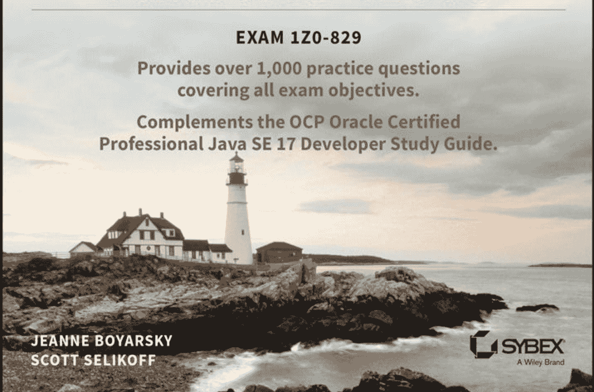

JEANNE BOYARSKY

SCOTT SELIKOFF

## 第 1 章：处理日期、时间、文本、数值和布尔值

## 第 2 章：控制程序流

## 第 3 章：利用 Java 面对象方法

## 第 4 章：处理异常

## 第 5 章：使用数组和集合

## 第 6 章：使用流和 Lambda 表达式

## 第 7 章：打包和部署 Java 代码并使用 Java 平台模块系统

## 第 8 章：管理并发代码执行

## 第 9 章：使用 Java I/O API

## 第 10 章：使用 JDBC 数据库

## 第 11 章：实现本地化

## 第 12 章：模拟考试 1

## 第 13 章：模拟考试 2

## 第 14 章：模拟考试 3

## 引言

表格 1.1：Java 17 专业认证考试

表格 1.2：Oracle 目标及相关学习指南章节


Jeanne Boyarsky

Scott Selikoff


献给我的母亲 Dalene，她每天都带给我快乐。

——Jeanne

Scott


## 致谢

Jeanne 和 Scott 感谢对本书做出贡献的许多个人。感谢 Kezia Endsley 和 Archana Pragash 引导我们完成这一工作过程并让这本书变得更好。感谢 Janeice DelVecchio 在我们创作本书期间担任我们的编辑。感谢 Elena Fender 担任我们的校对员并发现我们漏掉的错误。这本书的出版离不开 Wiley 的许多人员，包括 Kenyon Brown、Pete Gaughan、Christine O’Connor 以及其他人。

Jeanne 个人特别感谢所有为恢复活动付出精力的人，包括 DevNexus 和 KCDC 领导团队、NYC/Hudson FIRST 委员会，以及创造奇的 Joe Bray。Scott 是一位非常出色的合著者，改进了 Jeanne 写的所有内容。非常感谢 CodeRanch.com 的所有人，他们提出并回答了关于我们书籍的问题。最后，Jeanne 感谢所有的新程序员，以及 FRC 和 FTC 的不断提醒。

没有妻子 Patti 和家人的爱与支持，Scott 无法走到这一步。他想感谢他的两个女儿 Olivia 和 Sophia，以及小女儿 Elysia，感谢他们的耐心和理解，并在“爸爸该去办公室工作了”时给爸爸送上冷咖啡！Scott 想对他在本书创作过程中极具耐心的合著者 Jeanne 表达谢意。他不知道她是如何忍受他的，但他很庆幸她这样做，并对我们制作的书籍质量感到兴奋。最后，Scott 感谢他的母亲 Barbara Selikoff（一位退休教师），她教会了他教育的价值；感谢他的父亲 Mark Selikoff，他灌输了努力工作的好处。

Jeanne 和 Scott 都非常感谢书籍的读者。听到你们这些喜欢这本书并通过考试的人的反馈感觉非常好。我们还感谢那些指出错误并对我们的书籍提出建议的人。Radu Pana 和 Vlad Alin 是第一个发现我们《Java 17 学习指南》中错误的人。

## 关于作者

**Jeanne Boyarsky** 于 2019 年被选为 Java 冠军，是 NYJavaSIG 的领导者。她在纽约市的一家银行担任了 20 多年的 Java 开发人员，在那里负责开发、指导和开展培训。在空余时间，她还是 CodeRanch.com 的高级版主，并负责该论坛的代码库维护。Jeanne 还担任一个 FIRST 机器人小组编程部门的导师，指导学生初学者学习 Java。此外，她每年都会在多个会议上进行演讲。

Jeanne 于 2005 年获得了文学学士学位和计算机信息技术硕士学位。她享受在全职工作的同时通过在线课程获得硕士学位，这在在线教育还不流行的时代是非常领先的！Jeanne 还是一名杰出的演讲力会演讲大师和敏捷大师。你可以在 www.jeanneboyarsky.com 了解关于她的信息，或在 Twitter 上关注她 @JeanneBoyarsky。

**Scott Selikoff** 是一位专业软件开发人员和作者，在全栈数据库驱动系统开发方面拥有超过 20 年的经验。他精通多种软件语言和平台，目前在 Google 担任首席软件工程师，专注于架构和云服务。

Scott 出生于新泽西州的汤姆河，他于 2002 年通过三年的学习，从康奈尔大学获得了数学和计算机科学的文学学士学位。2003 年，他同样在康奈尔大学获得了计算机科学工程硕士学位。作为一名深爱教育的人，Scott 一直喜欢教授新概念。Scott 是 Garden State Java 用户组的领导者，帮助促进社区内的讨论和思想交流。他还在多所大学和会议上授过课。

Scott 住在新泽西州，与他亲爱的妻子 Patti、三个出色的女儿（双胞女 Olivia 和 Sophia 以及小女儿 Elysia）、一只非常活泼的狗 Georgette，以及三只调皮的猫（Snow、Sugar 和 Minnie Mouse）。在空闲时间，他在汤姆河多代际交响乐团演奏小提琴。你可以在 www.linkedin.com/in/selikoff 了解更多关于 Scott 的信息，或在 Twitter 上关注他 @ScottSelikoff。

Jeanne 和 Scott 都是 CodeRanch.com 论坛的版主，欢迎就问题和建议联系他们。他们还在 www.selikoff.net 撰写了名为 Down Home Country Coding 的技术博客。

除了这本书之外，Jeanne 和 Scott 还是八本畅销 Java 书籍的作者：

- OCA: Java 8 Programmer I Study Guide (Sybex, 2015)
- OCP: Java 8 Programmer II Study Guide (Sybex, 2016)
- OCA / OCP Java 8 Practice Tests (Sybex, 2017)
- OCP Java 11 Programmer I Study Guide (Sybex, 2019)
- OCP Java 11 Programmer II Study Guide (Sybex, 2020)
- OCP Java 11 Developer Complete Study Guide (Sybex, 2021)
- OCP Java 11 Practice Tests (Sybex, 2021)
- OCP Java 17 Developer Study Guide (Sybex, 2022)

## 关于技术编辑

Janeice DelVecchio 担任专业软件开发人员已有 12 年，她对编程和计算机有着终生的热情。编辑技术书籍对她来说是一项很有趣的任务，因为她喜欢发现并修复各种类型的缺陷。

在日常工作中，她运用了广泛的技术技能，包括云计算、流程自动化、高级单元测试和 DevOps。她还在 CodeRanch.com 担任志愿者，在那里运营名为“Cattle Drive”的 Java 课程。

她是 Java 编程语言的专家。如果你问她哪种语言最好，她会告诉你语言是工具，要根据你的用例选择最合适的一种。她学习的第一门语言是 BASIC，她希望有一天能学习游戏开发。

在空余时间，她喜欢烹饪、解谜、玩视频游戏和养鸡。她非常喜欢吃寿司、喝精酿啤酒和摸狗——她的特殊爱好是 80 年代的流行音乐。她住在康涅狄格州的利奇菲尔县。

## 关于技术校对

**Elena Felder** 在 Java 语言甚至还没有泛型时就开始接触 Java 开发，她对这种语言、其工具及其社区的持续增长和适应，并成功跟上不断变化的世界感到非常高兴。她曾出于兴趣为 Jeanne 和 Scott 的首批 *Java 8 Certification Study Guide* 章节之一进行了校对，从那时就开始专业地从事这项工作。

## 引言

《OCP Oracle Certified Professional Java SE 17 Developer Practice Tests》旨在帮助想要通过 1Z0-829 考试成为 Java 17 Oracle 认证专业人员 (OCP) 的人员，以及想要测试自己 Java 17 知识的人。如果你是 Java 17 的新手，我们强烈建议你先从学习指南开始，学习语言的所有方面，一旦考虑参加考试，再回来这本书。

我们建议从畅销的《OCP Oracle Certified Professional Java SE 17 Developer Study Guide: Exam 1Z0-829》(Sybex, 2022)（这本书恰好由我们编写）开始学习。与我们学习指南中设计得比实际更简单的题目不同，这本书中的题目会告诉你正确答案的数量。如果有多个正确答案，题目会显示为“选择两个”或“选择三个”。

无论你使用哪种学习指南进行准备，都可以通过这本书来磨练技能，因为它是基于实际考试题目的。

## 理解考试

归结底，考试就是一份题目列表。你对考试结构越了解，表现就可能越好。例如，知道考试包含多少题可以帮助你管理进度和剩余时间。表 I.1 描述了考试的整体结构。

| 考试代码 | 1Z0-829 |
| :--- | :--- |
| 时间限制 | 90 分钟 |
| 题目数量 | 50 题 |
| 及格分数 | 68% |

对于数学好的人来说，这意味着你需要在 50 道题中正确回答大约 34 道才能通过。我们之所以说“大约”，是因为 Oracle 可能会包含用于测试的题目，这些题目是不计分的。

如果 Oracle 更改此内容或对 1Z0-829 考试有任何调整，我们建议查看我们的博客。

尽管如此，这本书的章节是围绕 Oracle 的目标组织的，以便你可以测试自己的技能。虽然在使用本书中这种基于目标的章节之前，你不需要阅读整本学习指南，但你确实需要学习相关的目标。

表格 L.2 显示了在练习本书中的问题之前，你至少需要在 Java 17 学习指南中阅读的哪些章节。

| 本书章节 | 目标 | 学习指南章节 |
|---|---|---|
| 1 | 处理日期、时间、文本、数值和布尔值 | 1, 2, 4 |
| 2 | 控制程序流 | 3 |
| 3 | 利用 Java 面对象方法 | 1, 3, 5, 6, 8 |
| 4 | 处理异常 | 11 |
| 5 | 使用数组和集合 | 4, 9 |
| 6 | 使用流和 Lambda 表达式 | 10, 13 |
| 7 | Java 代码的打包与部署以及使用 Java 平台模块系统 | 12 |
| 8 | 管理并发代码执行 | 13 |
| 9 | 使用 Java I/O API | 14 |
| 10 | 使用 JDBC 访问数据库 | 15 |
| 11 | 实现本地化 | 11 |

我们的一些章节包含很多问题。例如，第 3 章包含 200 多个问题。这是基于 Oracle 选择组织其目标的方式。我们建议每批完成 30–50 题来处理这些较大的章节。这样，你就可以在做更多题之前强化你的学习效果。这也能让你练习一组更接近考试长度的题集。

## 参加模拟考试

本书的第 12、13 和 14 章包含三份全长度的模拟考试卷。这些章节中的问题与基于目标的章节在许多方面都不同。这些模拟考试题通常更难，因为它们的设计目的是测试你的累积知识，而不是强化现有的技能。换句话说，你可能会遇到一个同时测试两个离散主题的问题。

与目标章节一样，我们在模拟考试章节中明确指出了正确答案的数量，就像在真实考试中那样。两个模拟考试章节都设计为 90 分钟内完成，及格分数为 68%。这意味着你需要至少正确回答 34 个问题。记住，在感到准备就绪之前不要参加模拟考试。模拟考试次数是有限的，所以你不想浪费新鲜的尝试机会。

虽然一个基于目标的章节可以在几天内完成，但每个模拟考试章节都设计为一次性完成。你应该尽力模拟考试的体验。这意味着留出 90 分钟，拿上一块白板或草稿纸，即使你不确定答案，也要回答每一个问题。记住，猜答案没有惩罚，你排除的错误答案越多，就越好。

## 审阅考试变更

Oracle 会经常更改题目数量、及格分和时间限制。Jeanne 和 Scott 维护着博客，跟踪真实考试的更新，速度与 Oracle 更新的速度同步。

www.selikoff.net/ocp17-pt

我们建议你在参加真实考试之前阅读此页面，以防自本书出版以来任何信息发生了变化。虽然不常见，但 Oracle 确实会添加、删除或重做目标。当这种情况发生时，我们会在网站上以博客文章的形式提供免费补充材料。

## 需要更多准备帮助吗？

两位作者都是 CodeRanch.com 的版主。该网站是一个很大且活跃的编程论坛，对 Java 初学者非常友好。它有一个专门针对此考试的论坛叫做 Programmer Certification。

www.coderanch.com/f/24

在阅读本书时，随时可以在上述任何一个论坛中提问。你可能遇到了编译类的困难，或者只是对某些事情感到困惑。你将获得来自丰富的 Java 程序员的解答。那甚至可能是我们的一员！

在我们的 Telegram 频道获取更多 Java 书籍：https://t.me/javalib

## 额外内容

本书有一个网页，使用 Wiley 的交互式在线测试引擎提供书中所有的问题。

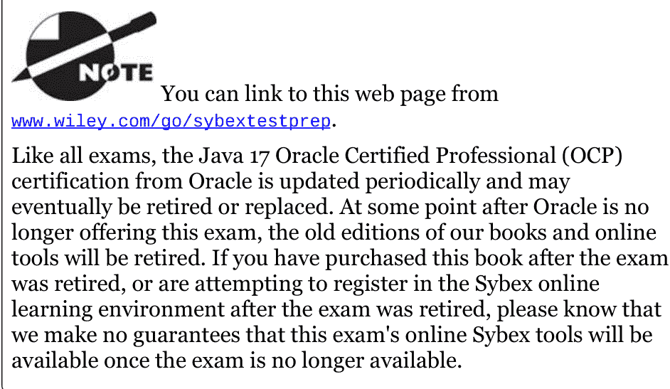

与所有考试一样，Oracle 的 Java 17 Oracle 专业人员 (OCP) 认证会定期更新，并最终可能被淘汰或取代。在某个时刻，当 Oracle 不再提供此考试时，我们的书籍和在线工具也将被淘汰。如果你在考试淘汰后购买了本书，或者在考试淘汰后尝试在 Sybex 在线学习环境中注册，请知晓我们不保证一旦考试淘汰，考试的在线 Sybex 工具仍然可用。

如果你认为书中存在错误，请向我们的客户团队反映。我们尽力提供准确的内容，但即使如此也可能出现错误。请邮件至 support

OCP 考试涵盖的主题：

- 处理日期、时间、文本、数值和布尔值
- 使用 Java 平台模块系统
- Java 代码的打包与部署
- 管理并发代码执行
- 使用流和 Lambda 表达式
- 使用数组和集合
- 利用 Java 面对象方法
- 控制程序流
- 处理异常
- 使用 Java I/O API
- 使用 JDBC 访问数据库
- 实现本地化

我们的一些章节包含很多问题。例如，第 3 章包含 200 多个问题。这是基于 Oracle 选择组织其目标的方式。我们建议每批完成 30–50 题来处理这些较大的章节。这样，你就可以在做更多题之前强化你的学习效果。这也能让你练习一组更接近考试长度的题集。

## 1. 哪些不是变量名？

A.

B.

C.

D.

## 2. 哪些是？

A.

B.

C.

D.

## 3. 哪些是有效的？

A.

B.

C.

D.

## 4. 哪个类有 `getSeconds()` 方法？

A.

B.

C.

D.

## 5. 以下代码输出什么？

```java
int meal = 5;
int tip = 2;
var total = meal>6 ? tip++ : tip--;
```

## 6. 执行上述代码后 `tip` 的值是多少？

A. 1

B. 2

C. 3

D. 7

E. 以上均非

## 7. 以下代码输出什么？

```java
int year = 1874;
int month = Month.MARCH;
int day = 24;
LocalDate date = LocalDate.of(year, month, day);
System.out.println(date.isBefore(LocalDate.now()));
```

A. false

B. true

C. 代码无法编译。

D. 代码编译但在运行时抛出异常。

## 8. 以下代码的输出是什么？

```java
var b = "12";
b += "3";
b.reverse();
System.out.println(b.toString());
```

A. 12

B. 21

C. 123

D. 321

E. 代码无法编译。

## 9. 以下代码的输出是什么？

```java
var line = new StringBuilder("-");
```

A. false 1

B. false 2

C. true 1

D. true 2

E. 它无法编译。

## 10. 于夏令时间从 2022 年 3 月 13 日凌晨 2 点开始，时钟从凌晨 1:59 跳到凌晨 03:00，以下哪项可以填充空白使得代码不抛出异常？

```java
var localDate = LocalDate.of(2022, 3, 13);
var localTime = LocalTime.of(_______);
var zone = ZoneId.of("America/New_York");
var z = ZonedDateTime.of(localDate, localTime, zone);
```

A. 2, 0

B. 3, 0

C. 以上任一均可运行而不抛出异常。

D. 这两项都会导致抛出异常。

## 11. 关于此文本块，哪个描述是正确的？

```java
var block = """

green
yellow
"""
```

- A. 只有实质性空白（essential whitespace）。
- B. 只有偶然空白（incidental whitespace）。
- C. 既有实质性空白也有偶然空白。
- D. 代码无法编译。

## 12. `cat`、`moose` 和 `penguin` 的返回类型分别是什么？


```java
var cat = Math.ceil(65);
var moose = Math.max(7,8);
var penguin = Math.pow(2, 3);
```

- A. double, double, double
- B. double, int, double
- C. double, int, int
- D. int, double, double
- E. int, int, double
- F. int, int, int

## 13. 以下代码的结果是什么？

```java
11: var waffleDay = LocalDate.of(2022, Month.MARCH, 25);
12: var period = Period.of(1, 6, 3);
13: var later = waffleDay.plus(period)
14: later.plusDays(1);
15: var thisOne = LocalDate.of(2023, Month.SEPTEMBER, 28);
16: var thatOne = LocalDate.of(2023, Month.SEPTEMBER, 29);
17: System.out.println(later.isBefore(thisOne) + " "
18: + later.isBefore(thatOne));
```

- A. false false
- B. false true
- C. true true
- D. true false
- E. 代码无法编译。

## 14. 哪些操作符与一个或多个布尔类型配合？（选择三个。）

- A. ^
- B. ~
- C. &
- D. +
- E. ||
- F. @

## 15. 以下代码可能的结果是什么？

```java
var montyPythonDay = LocalDate.of(2023, Month.MAY, 10);
var aprilFools = LocalDate.of(2023, Month.APRIL, 1);
var duration = Duration.ofDays(1);
var result = montyPythonDay.minus(duration);
System.out.println(result + " " + aprilFools.isBefore(result));
```

- A. 2023-05-09 false
- B. 2023-05-09 true
- C. 代码无法编译。
- D. 以上均不是。

## 16. 以下代码的输出是什么？

```java
5: var line = new String("--");
6: var anotherLine = line.concat("--");
7: System.out.print(line == anotherLine);
8: System.out.print(" ");
9: System.out.print(line.length());
```

- A. false 1
- B. false 2
- C. true 1
- D. true 2
- E. 无法编译

## 17. 这些行中有多少行包含编译器错误？

```java
public void pi() {
  byte b = 3.14;
  double d = 3.14;
  float f = 3.14;
  short s = 3.14;
}
```

- A. 无
- B. 一
- C. 两
- D. 三
- E. 四

## 18. 在美国，夏令时间于 2022 年 11 月 6 日凌晨 02:00 结束，我们会重复上一个小时。以下代码的输出是什么？

```java
var localDate = LocalDate.of(2022, Month.NOVEMBER, 6);
var localTime = LocalDateTime.of(1, 0);
var zone = ZoneId.of("America/New_York");
var z = ZonedDateTime.of(localDate, localTime, zone);
var offset = z.getOffset();

for (int i = 0; i < 6; i++)
  z.plusHours(1);

System.out.print(z.getHour() + " " 
+ offset.equals(z.getOffset()));
```

- A. 5 false
- B. 5 true
- C. 6 false
- D. 6 true
- E. 7 false
- F. 7 true
- G. 以上均不是

## 19. 以下代码输出什么？

```java
var baa = 8;
var bleat = -baa;
var sheep = -bleat;
System.out.printf(bleat + " " + sheep);
```

- A. -8 8
- B. -8 9
- C. -9 8
- D. -9 9
- E. 以上均不是

## 20. 该方法的作者忘记包含数据类型。以下哪些引用类型最适合填充空白处以完成此方法？

```java
public static void secret(__________ mystery) {
  char ch = mystery.charAt(3);
  mystery = mystery.insert(1, "more");
  int num = mystery.length();
}
```

- A. String
- B. StringBuilder
- C. 都是
- D. 都不是

## 21. LocalTime.of() 有多个重载方法。以下不是其中之一？

- A. LocalTime.of(int hour, int minute)
- B. LocalTime.of(int hour, int minute, int second)
- C. LocalTime.of(int hour, int minute, int second, int nanoSecond)
- D. LocalTime.of(int hour, int minute, int second, int nanoSecond, int picoSeconds)

## 22. 关于此代码的输出，哪些描述是正确的？（选择三个。）

```java
var text = """
ant antelope \s \n
cat "kitten" \
seal sea lion
"""
System.out.print(text);
```

- A. 它包含两个引号。
- B. 它包含八个引号。
- C. 它是三行。
- D. 其中一行是空的。
- E. 两行是空的。
- F. 第一行包含尾部空白。
- G. 第一行不包含空白。

## 23. 填充空白：操作符 !=、 和 ++ 列表在相同的递增优先级级别。（选择两个。）

- A. ==, *
- B. /, %
- C. *, -
- D. !, %
- E. +=, *
- F. *, /

## 24. LocalDate, Period 和 ZonedDateTime 类中有多少个获取年份的方法？

- A. 无
- B. 一
- C. 两
- D. 三

## 25. 给给定的维恩图和变量 apples, oranges, 和 bananas，哪个表达式表示图中填充的区域？


- A. apples && !bananas
- B. oranges && !bananas
- C. (apples || bananas) && oranges
- D. oranges && apples
- E. (apples || oranges) && !bananas
- F. apples

## 26. 以下代码的可能输出是什么？

```java
var time = LocalTime.of(1,2,3,4);
System.out.println(time);
```

- A. 01:02:03
- B. 01:02:03.4
- C. 01/01/1970 01:02:03
- D. 01/01/1970 01:02:03.4

## 27. 以下代码的输出是什么？

```java
var teams = new StringBuilder("333");
teams.append(" 806");
teams.append("1601");
System.out.print(teams);
```

- A. 333
- B. 333 8061601
- C. 代码编译但输出其他。
- D. 代码无法编译。

## 28. 以下哪个声明无法编译？

- A. double num1, int num2 = 0;
- B. int num1, num2;
- C. int num1, num2 = 0;
- D. int num1 = 0, num2 = 0;
- E. 以上都是
- F. 以上都不是

## 29. 包含

- A. ChronoUnit
- B. Duration
- C. Instant
- D. Period
- E. 以上都不是

## 30. 哪些方法组合后与 strip() 功能相同？（选择两个。）

- A. stripAfter()
- B. stripBefore()
- C. stripEnding()
- D. stripIndent()
- E. stripLeading()
- F. stripTrailing()

## 31. 美国在 2022 年 3 月 13 日通过将钟拨快一小时来实行夏令。以下代码输出什么？

```java
var localDate = LocalDate.of(2022, 3, 13);
var localTime = LocalTime.of(13, 0);
var zone = ZoneId.of("America/New_York");
var z = ZonedDateTime.of(localDate, localTime, zone);
var offset = z.getOffset();
var duration = Duration.ofHours(3);
var later = z.plus(duration);

System.out.println(later.getHour() + " "
+ offset.equals(z.getOffset()));
```

- A. 13 false
- B. 13 true
- C. 16 false
- D. 16 true
- E. 17 false
- F. 17 true
- G. 以上都不是

## 32. 以下哪个可以填充空白处使代码打印 true？

```java
var happy = " ) - (: ";
var really = happy.trim();
var question = happy.substring(
System.out.println(really.equals(question));
```

- A. 0, happy.length() - 1
- B. 0, happy.length()
- C. 1, happy.length() - 1
- D. 1, happy.length()
- E. 以上都不是

## 33. 以下行中有多少行包含编译器错误？

```java
double num1 = 2.718;
double num2 = 2._718;
double num3 = 2.7_1_8;
double num4 = .2.718;
```

- A. 0
- B. 1
- C. 2
- D. 3
- E. 4

## 34. 以下代码可能的结果是什么？

```java
var montyPythonDay = LocalDate.of(2022, Month.MAY, 10);
var time = LocalTime.of(5, 40);
var dateTime = LocalDateTime.of(montyPythonDay, time);
var duration = Duration.ofDays(1);
var result = dateTime.minus(duration)
System.out.println(result);
```

- A. 2022-05-09
- B. 2022-05-09T05:40
- C. 2022-05-10T05:40
- D. 代码无法编译。
- E. 以上都不是。

## 35. 关于以下代码，哪个是正确的？（选择两个。）

```java
var numPigeons = Long.________________("100");
System.out.println(numPigeons.toString());
```

- A. 当空白处填充 parseLong 时，代码无法编译。
- B. 当空白处填充 parseLong 时，代码会抛出异常。
- C. 当空白处填充 parseLong 时，输出为 100。
- D. 当空白处填充 valueOf 时，代码无法编译。
- E. 当空白处填充 valueOf 时，代码会抛出异常。
- F. 当空白处填充 valueOf 时，输出为 100。

## 36. 以下应用程序的输出是什么？

```java
public class Airplane {
    static int start = 2;
    final int end;
    public Airplane(int x) {
        x = 4;
        end = x;
    }
    public void fly(int distance) {
        System.out.print(end-start+" ");
        System.out.print(distance);
    }
    public static void main(String... start) {
        new Airplane(10).fly(5);
    }
}
```

- A. 2 5
- B. 8 5
- C. 6 5
- D. 代码无法编译。
- E. 以上都不是

## 37. 下列代码的输出是什么？

```java
var date1 = LocalDate.of(2022, Month.MARCH, 3);
var date2 = LocalDate.of(2022, Month.FEBRUARY, 31);
System.out.println(date1.equals(date2));
```

- A. false
- B. true
- C. 代码无法编译。
- D. 代码可以编译但在运行时抛出异常。

## 38. 这段代码打印多少行？

```java
System.out.print(""
"ape"
"baboon"
"gorilla" """");
```

- A. 三行
- B. 四行
- C. 五行
- D. 代码无法编译。

## 39. 下述类的输出是什么？

```java
1: package rocket;
2: public class Countdown {
3: static void main(String[] blastOff) {
4: var builder = "54321";
5: builder = builder.substring(4);
6: System.out.println(builder.charAt(2));
7: }
```

- A. 2
- B. 3
- C. 4
- D. 代码无法编译。
- E. 以上都不是

## 40. 在美国，2022年的夏令时间从 3 月 13 日凌晨 2 点开始，到 11 月 6 日凌晨 2 点结束。给定图片中的序列，3 月 13 日、7 月 4 日和 11 月 6 日的下一个时间分别是什么？


- A. 01:00, 01:00, 01:00
- B. 01:00, 02:00, 01:00
- C. 01:00, 02:00, 03:00
- D. 02:00, 02:00, 02:00
- E. 03:00, 02:00, 01:00
- F. 03:00, 02:00, 03:00

## 41. 下列代码的输出是什么？

```java
var baa = false;
var bleat = -baa;
var sheep = -bleat;
System.out.printf(bleat + " " + sheep);
```

- A. false false
- B. false true
- C. true false
- D. true true
- E. 以上都不是

## 42. 下列代码的可能的输出是什么？

```java
var trainDay = LocalDate.of(2022, 5, 13);
var time = LocalTime.of(10, 0);
var zone = ZoneId.of("America/Los_Angeles");
var zdt = ZonedDateTime.of(trainDay, time, zone);
var instant = zdt.toInstant();
instant = instant.plus(1, ChronoUnit.DAYS);
System.out.println(instant);
```

- A. 2022-05-13T10:00:00:00Z[America/Los_Angeles]
- B. 2022-05-13T00:00:00:00Z
- C. 2022-05-13T17:00:00:00Z


- D. 2022-05-13T14:00:00:00Z[America/Los_Angeles]
- E. 2022-05-13T14:00:00:00Z
- F. 2022-05-13T17:00:00:00Z

### 43. 下述程序的输出是什么？

```java
package transporter;
public class Rematerialize {
    public static void main(String[] input) {
        int init = 11;
        int split = 3;
        int partA = init / split;
        int partB = init % split;
        int result = split * (partB + partA);
        System.out.print(result);
    }
}
```

- A. 9
- B. 11
- C. 12
- D. 15
- E. 代码无法编译。
- F. 以上都不是

### 44. 下列代码的输出是什么？

```java
var math = new Math();
var sum = 0;
sum += math.min(3, 5);
sum += math.floor(8);
sum += math.round(5);
System.out.println(sum);
```

- A. 9
- B. 9.0
- C. 10
- D. 10.0
- E. 11
- F. 11.0
- G. 以上都不是

### 45. 下列代码的输出是什么？

```java
var date = LocalDate.of(2022, Month.JULY, 17);
var time = LocalTime.of(10, 0);
var zone = ZoneId.of("America/New_York");
var iceCreamDay = ZonedDateTime.of(date, time, zone);
time = time.plusMonths(1);
System.out.println(iceCreamDay.getMonthValue());
```

- A. 6
- B. 7
- C. 8
- D. 9
- E. 代码无法编译。

### 46. 下列哪些项可以替换 `isEmpty()` 和 `trim()` 以产生相同的输出？（选择两个）

```java
String curious = "george likes bananas \n";
System.out.println(curious.isEmpty());
System.out.println(curious.trim());
```

- A. empty()
- B. isBlank()
- C. isMissing()
- D. removeBlanks()
- E. shorten()
- F. strip()

### 47. 下列代码的结果是什么？

```java
var sb = new StringBuilder("radical");
sb.insert(sb.length(), "robots");
System.out.println(sb);
```

- A. radicarobots
- B. radicalrobots
- C. radical robots
- D. 代码无法编译。
- E. 代码可以编译但在运行时抛出异常。

### 48. 给定下面的代码，执行后 `dinner` 的值是多少？

```java
int time = 9;
int day = 3;
dinner = ++time>= 10 ? day-- <= 2 ? "Takeout" : "Salad" : "Leftovers";
```

- A. Takeout
- B. Leftovers
- C. Salad
- D. 代码无法编译，但加上括号就可以编译。
- E. 以上都不是。

### 49. `waffleDay` 的结果是什么？

```java
1: var waffleDay = LocalDate.of(2022, Month.MARCH, 25);
2: var period = Period.ofYears(1).ofMonths(6).ofDays(3);
3: var later = waffleDay.plus(period);
4: later.plusDays(1);
5: var thisOne = LocalDate.of(2022, Month.SEPTEMBER, 28);
6: var thatOne = LocalDate.of(2022, Month.SEPTEMBER, 29);
7: System.out.println(later.isBefore(thisOne) + " " + later.isBefore(thatOne));
```

- A. false false
- B. false true
- C. true true
- D. true false
- E. 代码无法编译。

### 50. 可以移除多少对括号并让代码打印 6？

```java
System.out.println((((1+1))*((1+2))));
```

- A. 无
- B. 一对
- C. 两对
- D. 三对
- E. 四对
- F. 五对
- G. 以上都不是

### 51. 下列代码的输出是什么？

```java
var teams = new String("694");
teams.concat(" 155");
teams.concat(" 265");
teams.concat(" 269");
System.out.println(teams);
```

- A. 694
- B. 694 155 265 269
- C. 代码可以编译但输出 else。
- D. 代码无法编译。

### 52. 下列哪项不是包装类？

- A. Boolean
- B. Char
- C. Double
- D. Integer
- E. Long
- F. 以上所有都是包装类。

### 53. 下列代码的输出是什么？

```java
var date = LocalDate.of(2022, Month.JULY, 17);
var time = LocalTime.of(10, 0);
var zone = ZoneId.of("America/New_York");
var iceCreamDay = ZonedDateTime.of(date, time, zone);
date = date.plusMonths(1);
System.out.println(iceCreamDay.getMonthValue());
```

- A. 6
- B. 7
- C. 代码无法编译。
- E. 运行时抛出异常。

### 54. 下列有多少行输出是相同的？

```java
6: var phrase = "prickly \nporcupine";
7: System.out.println(phrase.length());
8: System.out.println(phrase.indent(1).length());
9: System.out.println(phrase.indent(0).length());
10: System.out.println(phrase.indent(-1).length());
```

- A. 无
- B. 一
- C. 两
- D. 三
- E. 四
- F. 代码无法编译。

### 55. 下列有多少行可以编译？

```java
bool b = null;
Bool bl = null;
int i = null;
Integer in = null;
String s = null;
```

- A. 无
- B. 一
- C. 两
- D. 三
- E. 四
- F. 五

### 56. 这段代码打印多少行？

```java
System.out.print(""ape"
"baboon"
"gorilla" """");
```

- A. 三行
- B. 四行
- C. 五行
- D. 代码无法编译。

### 57. 下列哪项可以填充空白使这段代码编译？

```java
public boolean isBirthday(LocalDate dateTime) {
    return now.getMonth() == dateTime.getMonth()
    && now.getDayOfMonth() == dateTime.getDayOfMonth();
}
```

- A. LocalDate now = LocalDate.now()
- B. LocalDate now = new LocalDate()
- C. ZonedDateTime now = ZonedDateTime.now()
- D. ZonedDateTime now = new ZonedDateTime()

### 58. 下列有多少行输出两行？

```java
18: System.out.println("cheetah\ncub")
19: System.out.println("cheetah\ncub")
20: System.out.println("cheetah\ncub".translateEscapes());
21: System.out.println("cheetah\ncub".translateEscapes());
```

- A. 无
- B. 一
- C. 两
- D. 三
- E. 四
- F. 代码无法编译。

### 59. 下述代码片段的输出是什么？

```java
int height = 2, length = 3;
boolean w = height==1 | --length < 4;
var x = height!=2 ? length++ : height;
boolean z = height % length == 0;
System.out.println(w + "-" + x + "-" + z);
```

- A. true-2-true
- B. false-2-false
- C. true-2-false
- D. true-3-false
- E. true-3-false
- F. false-3-false

### 60. 可以移除多少个反斜杠而不改变文本块的值？

```java
12: var quotes = ""
13: \" Quotes that"
14: """
15: """;
```

- A. 无
- B. 一个
- C. 
- D. 三
- E. 四
- F. 代码无法编译。

```java
38: Long.valueOf(88).byteValue();
```

- A. 无
- B. 一个
- C. 二
- D. 三
- E. 四

## 64. 哪一个陈述是正确的？

- A. 如果 `s.contains("abc")` 为 true，那么 `s.equals("abc")` 也为 true。
- B. 如果 `s.contains("abc")` 为 true，那么 `s.startsWith("abc")` 也为 true。
- C. 如果 `s.startsWith("abc")` 为 true，那么 `s.equals("abc")` 也为 true。
- D. 如果 `s.startsWith("abc")` 为 true，那么 `s.contains("abc")` 也为 true。

## 65. 以下代码可能的输出是什么？

```java
var date = LocalDate.of(2022, 5, 13);
var time = LocalTime.of(10, 0);
var trainDay = LocalDateTime.of(date, time);
var instant = trainDay.toInstant();
instant = instant.plus(1, ChronoUnit.DAYS);
System.out.println(instant);
```

- A. 2022-05-14T10:00-07:00[America/Los_Angeles]
- B. 2022-05-14T17:00:00Z
- C. 代码无法编译。
- D. 代码可以编译但在运行时抛出异常。

## 66. 关于这个文本块，哪个陈述是正确的？

```java
var block = """
      green
      yellow
    "\";"
``````
```

- A. 只有必要的空白符。
- B. 只有偶然的空白符。
- C. 同时有必要偶然的空白符。
- D. 代码无法编译。

## 67. 以下代码段的输出是什么？

```java
boolean carrot = true;
Boolean potato = false;
var broccoli = true;
carrot = carrot & potato;
broccoli = broccoli ? carrot : potato;
potato = broccoli ^ carrot;
System.out.println(carrot + "," + potato + "," + broccoli);
```

- A. true, false, true
- B. true, true, true
- C. false, false, false
- D. false, true, false
- E. false, false, true
- F. 代码无法编译。

## 68. 夏令时于 2022 年 11 月 6 日凌晨 2 点结束，此时小时数会重复。假设我们有一个 `ZonedDateTime`，在调用 `toString()` 时显示为 `2012-11-06T01:00-04:00[America/New_York]`。在此值基础上增加一小时后得到的 `ZonedDateTime` 可能的值是什么？

- A. 2022-11-06T01:00-04:00[America/New_York]
- B. 2022-11-06T02:00-04:00[America/New_York]
- C. 2022-11-06T01:00-05:00[America/New_York]
- D. 2022-11-06T02:00-05:00[America/New_York]

## 69. 以下类的类的输出是什么？

```java
1: package rocket;
2: public class Countdown {
3: public static void main(String[] fuel) {
4: var builder = new StringBuilder("54321");
5: builder.substring(2);
6: System.out.println(builder.charAt(1));
```

- A. 1
- B. 2
- C. 3
- D. 4
- E. 5
- F. 不编译

## 70. 以下代码的输出是什么？

```java
var sum = 0.0;
sum = sum + Math.min(3, 5);
sum = sum + Math.floor(8);
sum = sum + Math.round(5.6);
System.out.println(sum);
```

- A. 9
- B. 9.0
- C. 10
- D. 10.0
- E. 11
- F. 11.0
- G. 以上都不是

## 第 2 章 程序流

本次测试涵盖的考点包括：

✓ 程序流

*   包含 `if/else`、`switch` 语句和表达式、循环以及 `break` 和 `continue` 语句的流控制

### 1. 以下哪些语句是正确的？（选择两个）

```java
public class Penguins {
    public static void main(String[] args) {
        var pen = new Penguins();
        pen.length("penguins");
        pen.length(5);
        pen.length(new Object());
    }
    public void length(Object obj) {
        if (obj instanceof String x)
            System.out.println(x.length());
    }
}
```

- A. 代码可以直接编译。
- B. 一行导致编译器错误。
- C. 两行导致编译器错误。
- D. 删除不编译的行后，代码不输出任何内容。
- E. 删除不编译的行后，代码输出一行。
- F. 删除不编译的行后，代码输出两行。

### 2. 以下声明为类型的变量在 `switch` 语句中是不允许的？（选择两个）

- A. var
- B. double
- C. int
- D. String
- E. char
- F. Object

### 3. 什么时候可以省略 `switch` 中的 `default`？（选择两个）

- A. 当枚举的所有值都已覆盖时
- B. 没有返回值时
- C. 当类型为 Boolean
- D. 当类型为 Byte
- E. 当类型为 Boolean 或 Byte

### 4. 运行以下代码会发生什么？


```java
var gas = true;
do {
  System.out.println("helium");
  gas = gas ^ gas;
  gas = !gas;
} while (!gas);
```

- A. 成功完成无输出。
- B. 输出一次 helium。
- C. 重复输出。
- D. 第 6 行无法编译。
- E. 以上都不是。

### 5. 以下代码的输出是什么？

```java
int m = 0, n = 0;
while (m < 5) {
  n++;
  if (m == 3) {
    continue;
  }
  switch (m) {
    case 0:
    case 1:
      n++;
    default:
      n++;
  }
  m++;
}
System.out.println(m + " " + n);
```

- A. 3 10
- B. 3 12
- C. 5 10
- D. 5 12
- E. 代码无法编译。
- F. 以上都不是。

### 6. 关于以下程序，哪个是正确的？

```java
enum Admission { ADULT, SENIOR, CHILD }
public class Movie {
  public static void main(String[] args) {
    var price = switch (Admission.CHILD) {
      case ADULT -> 12.50;
      case SENIOR, CHILD -> 10;
    };
    System.out.println(price);
  }
}
```

- A. 代码无法编译，因为 case 分支的类型不同。
- B. 代码无法编译，因为其中一个 case 分支有两个值。
- C. 代码无法编译，因为 switch 中评估的值是硬编码的。
- D. 代码无法编译，因为分号太多。
- E. 代码可以编译并输出 10。
- F. 代码可以编译并输出 10.0。

### 7. 给定以下内容，哪些内容可以填充空白并允许代码编译？（选择三个）

```java
var quest = ;
for(var zelda : quest) {
  System.out.print(zelda);
}
```

- A. 3
- B. new int[] {3}
- C. new StringBuilder("3")
- D. List.of(3)
- E. new String[3]
- F. "Link"

### 8. 关于向此 switch 语句添加 default 分支，以下规则中哪个是正确的？（选择两个）

```java
switch(numPenguins) {
  case 0 : System.out.println("no penguins");
  case 1 : System.out.println("one penguin");
}
```

- A. 此 switch 语句需要声明 default 语句
- B. default 语句必须放在所有 case 语句之后
- C. default 语句可以放在任何 case 语句之间
- D. 与 case 语句不同，default 语句不接受值
- E. 此 switch 语句可以包含多个 default 语句
- F. 只有当存在一个 case 语句时才能 default 语句。

## 9. 以下方法的输出是什么？

```java
void dance() {
  var singer = 0;
  while (singer) {
    System.out.print(singer++);
  }
}
```

- A. 方法无法编译。
- B. 无输出。
- C. 输出 0 然后终止。
- D. 进入死循环。
- E. 以上都不是。

## 10. 多少行包含编译器错误？

```java
int magicNumber = 7;
var ok = switch (magicNumber) {
  case 7 -> true; break;
  case 9 -> { yield true
  case 11 -> yield true;
  case 13 -> {yield true;
  default -> false;
}
```

- A. 无
- B. 一行
- C. 两行
- D. 三行
- E. 四行
- F. 五行

### 11. 关于 for-each 和传统的 for 循环，哪些陈述是正确的？（选择两个）

- A. 都可以从第一个元素开始遍历数组。
- B. 只有 for-each 可以从第一个元素开始遍历数组。
- C. 只有传统的 for 可以从第一个元素开始遍历数组。
- D. 都可以从结尾遍历数组。
- E. 只有 for-each 可以从结尾遍历数组。
- F. 只有传统的 for 可以从结尾遍历数组。

### 12. 关于填充空白并调用 zero()，以下哪些陈述是正确的？（选择两个）

```java
public void zero(Object number) {
    if (number instanceof Integer n) Math.abs(n) == 0
        System.out.println("zero");
    else
        System.out.println("non-zero");
}
```

- A. 当空白处为 `Integer n ||` 时，代码无法编译。
- B. 当空白处为 `Integer n ||` 时，输出为 zero。
- C. 当空白处为 `Integer n ||` 时，输出为 non-zero。
- D. 当空白处为 `int n &&` 时，代码不编译。
- E. 当在空白处填充 `int n &&` 时，输出为零。
- F. 当在空白处填充 `int n &&` 时，输出为非零。

### 13. 下一个应用程序的输出是什么？

```java
package planning;
public class ThePlan {
    public static void main(String[] input) {
        var plan = 1;
        plan = plan++ + --plan;
        if(plan==1) {
            System.out.print("Plan A");
        } else if(plan==2) System.out.print("Plan B"); 
        else System.out.print("Plan C");
    }
}
```

- A. Plan A
- B. Plan B
- C. Plan C
- D. 该类无法编译。
- E. 以上都不是。

### 14. 关于以下代码，哪项是正确的？（选择两个）。

```java
23: var race = "";
24: loop {
25: do {
26: race += "x";
27: break loop;
28: } while (true);
29: System.out.println(race);
```

- A. 它输出 x。
- B. 它无法编译。
- C. 它是一个无限循环。
- D. 移除第 25 行和 28 行后，它输出 x。
- E. 移除第 25 行和 28 行后，它无法编译。
- F. 移除第 25 行和 28 行后，它是一个无限循环。

### 15. 以下代码输出什么？

```java
int count = 0;
char letter = 'A';
switch (letter) {
    case 'A' -> count++;
    case 'B' -> count++;
}
```

- A. 0
- B. 1
- C. 2
- D. 代码无法编译。

### 16. 下列哪些可以替换 perform() 方法体以便在任何非空输入上产生相同的输出？（选择两个。）

```java
public void perform(String[] circus) {
    for (int i=circus.length-1; i>=0; i--)
    System.out.print(circus[i]);
}
```

- A.
```java
for (int i=circus.length; i>0; i--)
System.out.print(circus[i-1]);
```

- B.
```java
for-reversed (String c = circus)
System.out.print(c);
```

- C.
```java
for (var c : circus)
System.out.print(c);
```

- D.
```java
for (var i=0; i<circus.length; i++)
System.out.print(circus[circus.length-i-1]);
```

- E.
```java
for (int i=circus.length; i>0; i--)
System.out.print(circus[i+1]);
```

- F.
```java
for-each (String c circus)
System.out.print(c);
```

### 17. 以下代码片段输出什么？

```java
var bottles = List.of("glass"
```

- A. glass-end
- B. glass-plastic-can-end
- C. plastic-end
- D. plastic-can-end
- E. 代码无法编译。
- F. 以上都不是。

### 18. 执行以下代码片段的结果是什么？

```java
final var GOOD = 100;
var score = 10;
switch (score) {
  default:
    1 : System.out.print("1-");
    -1 : System.out.print("2-"); break;
    4,5 : System.out.print("3-");
    6 : System.out.print("4-");
    9 : System.out.print("5-");
}
```

- A. 1-
- B. 1-2-
- C. 2-
- D. 3-
- E. 4-
- F. 以上都不是

### 19. 下一个应用程序的输出是什么？

```java
package dinosaur;
public Class Park {
  public final static void main(String... arguments) {
    int pterodactyl = 8;
    long treratops = 3;
    if(pterodactyl % 3 > 1 + 1)
      triceratops++;
    triceratops--;
    System.out.print(triceratops);
  }
}
```

- A. 2
- B. 3
- C. 4
- D. 代码无法编译。
- E. 代码可以编译但在运行时抛出异常。

### 20. 什么变量类型的 red 允许以下应用程序编译？

```java
package tornado;
public class Kansas {
    public static void main(String[] args) {
        int colorOfRainbow = 10;
        red = 5;
        switch(colorOfRainbow) {
            default:
                System.out.print("Home");
                break;
            case red:
                System.out.print("Away");
        }
    }
}
```

- A. long
- B. double
- C. int
- D. var
- E. String
- F. 以上都不是

### 21. 当使用空 ArrayList 调用以下方法时，关于哪项是正确的？（选择两个。）

```java
public void meow(Collection<String> kitties) {
    if (kitties instanceof List c) {
        System.out.println("L " + c.size());
    } else if (kitties instanceof Map c) {
        c = new TreeMap<>();
        System.out.println("M " + c.size());
    } else {
        System.out.println("E " + c.size());
    }
}
```

- A. 代码可以编译。
- B. 代码由于原因无法编译。
- C. 代码无法编译。
- D. 移除无法编译的行后，输出为 L。
- E. 移除无法编译的行后，输出为 E。
- F. 移除无法编译的行后，输出为 value。

### 22. magic() 中有多少行包含错误？

```java
public void magic() {
  do {
    int trick = 0;
    LOOP: do {
      trick++;
    } while (trick < 2);
    continue LOOP;
  } while (trick > 2);
  System.out.println(trick);
}
```

- A. Zero
- B. One
- C. Two
- D. Three
- E. Four

### 23. 下列语句中有多少可以插入到 println 之后以符合图示？

```java
break;
break letters;
break numbers;
continue;
continue numbers;

for (char ch = 'a'; ch <= 'z'; ch++) {
  numbers: for (int n = 0; n<=10; n++) {
    System.out.print(ch);
  }
}
```

- A. One
- B. Two
- C. Three
- D. Four
- E. Five
- F. 以上都不是

### 24. 以下应用程序的输出是什么？

```java
package dessert;
public class IceCream {
  public final static void main(String... args) {
    var flavors = 30;
    int eaten = 0;
    switch(flavors) {
      case 30: eaten++;
      case 40: eaten+=2;
      default: eaten--;
    }
    System.out.print(eaten);
  }
}
```

- A. 1
- B. 2
- C. 3
- D. 代码无法编译，因为 switch 中不能使用 var。
- E. 代码由于原因无法编译。
- F. 以上都不是。

### 25. 下列哪些语句编译并在运行时创建无限循环？（选择三个。）

- B. do { }
- D. do { } while (true);
- E. while { }
- F. for( ; ) { }

### 26. 以下有多少方法可以编译？


```java
public void m(Object obj) {
    if (obj instanceof LocalDate)
        System.out.println(date);
    else
        System.out.println(date);
}
public void n(Object obj) {
    if (obj instanceof LocalDate)
        return;
    else
        System.out.println(date);
}
public void o(Object obj) {
    if (!obj instanceof LocalDate)
        return;
    else
        System.out.println(date);
}
public void p(Object obj) {
    if (!(obj instanceof LocalDate))
        return;
    else
        System.out.println(date);
}
public void q(Object obj) {
    if (obj instanceof LocalDate)
        return;
        System.out.println(date);
}
public void r(Object obj) {
    if (!(obj instanceof LocalDate date))
    return;
    System.out.println(date);
}
```

- A. Zero
- B. One
- C. Two
- D. Three
- E. Four
- F. Five
- G. Six

### 27. 下列哪项的迭代次数与其它不同？

### 28. 以下代码片段的输出是什么？

```java
int count = 0;
var stops = new String[] { "Washington", "Monroe",
"Jackson", "LaSalle" };
while (count < stops.length)
    if (stops[++count].length() < 8)
        break;
    else continue;
System.out.println(count);
```

- A. 0
- B. 1
- C. 2
- D. 3
- E. 代码无法编译。
- F. 以上都不是。

### 29. 以下代码片段的输出是什么？

```java
int hops = 0;
int jumps = 0;
jumps = hops++;
if(jumps)
    System.out.print("Jump!");
else
    System.out.print("Hop!");
```

- A. Jump!
- B. Hop!
- C. 代码无法编译。
- D. 代码可以编译但在运行时抛出异常。
- E. 以上都不是。

### 30. 如果 `beta` 始终返回 false，以下哪项最好描述了循环的执行流？

```java
for (alpha; beta; gamma) {
    delta;
}
```

- A. alpha
- B. alpha, beta
- C. alpha, beta, gamma
- D. alpha, gamma
- E. alpha, gamma, beta
- F. 以上都不是

### 31. 以下代码片段的输出是什么？

```java
boolean balloonInflated = false;
do {
  if (!balloonInflated) {
    balloonInflated = true;
    System.out.print("inflate-");
  }
} while (!balloonInflated);
System.out.println("done");
```

- A. done
- B. inflate-done
- C. 代码无法编译。
- D. 这是一个无限循环。
- E. 以上都不是。

### 32. 关于 `switch` 表达式和 `switch` 语句，哪些是正确的？（选择三个。）

- A. 都允许将结果赋值给变量。
- B. 都允许在同一个 case 中多个值。
- C. 只有 `switch` 表达式支持 `break`。
- D. 只有 `switch` 语句支持 `break`。
- E. `switch` 表达式更紧凑。
- F. `switch` 语句更紧凑。

### 33. 下列代码段中哪一个与其它不同？

- A.
```java
if (numChipmonks == 1)
  System.out.println("One chipmunk");
if (numChipmonks == 2)
  System.out.println("Two chipmunks");
if (numChipmonks == 3)
  System.out.println("Three chipmunks");
```

- B.
```java
switch (numChipmunks) {
case 1: System.out.println("One chipmunk");
case 2: System.out.println("Two chipmunks");
case 3: System.out.println("Three chipmunks");
}
```

- C.
```java
if (numChipmunks == 1)
System.out.println("One chipmunk");
else if (numChipmunks == 2)
System.out.println("Two chipmunks");
else if (numChipmunks == 3)
System.out.println("Three chipmunks");
```

- D. 所有三个代码段的作用相同。

### 34. 关于 `do/while` 循环的哪些描述是正确的？（选择三项）。

- A. `do/while` 循环需要一个循环体。
- B. `while` 循环无法通过 `return` 语句提前退出。
- C. `while` 循环需要一个条件表达式。
- D. `do/while` 循环至少执行一次循环体（如果存在）。
- E. `do/while` 循环无法通过 `return` 语句提前退出。
- F. `while` 循环至少执行一次循环体（如果存在）。

### 35. 给定以下枚举和类，哪个选项可以填充空白并使代码通过编译？

```java
enum Season { SPRING, SUMMER, WINTER }

public class Weather {
    public int getAverageTemperature(Season s) {
        switch (s) {
            default: ________ return 30;
    }
}
```

- A. `case Season.WINTER:`
- B. `case WINTER, SPRING:`
- C. `case SUMMER | WINTER:`
- D. `case SUMMER ->`
- E. `case FALL:`
- F. 以上都不是

### 36. 在空白处填入一行代码，使该应用程序能够编译并在运行时恰好打印一行。

```java
package nyc;

public class TourBus {
    public static void main(String[] args) {
        var nycTour = new String[] { "Downtown", "Uptown",
        "Brooklyn" };
        var times = new String[] { "Day", "Night" };
        for (int i=0; i<nycTour.length && j<times.length; i++, j++) {
            System.out.println(nycTour[i] + "-" + times[j]);
        }
    }
}
```

- A. `int i=1; j=1;`
- B. `int i=0, j=1;`
- C. `int i=1; int j=0;`
- D. `int i=1, int j=0;`
- E. `int i=1, j=0;`
- F. 以上都不是

### 37. 关于以下代码的哪些描述是正确的？（选择两项。）

```java
public class Penguins {
    public static void main(String[] args) {
        var pen = new Penguins();
        pen.length("penguins");
        pen.length(5);
        pen.length(new Object());
    }
    public void length(Object obj) {
        if (obj instanceof String) {
System.out.println(obj.length());
        } } }
```

- A. 代码按现状可以编译。
- B. 其中一行代码会导致编译错误。
- C. 两行代码会导致编译错误。
- D. 如果删除任何无法编译的行，此代码将不会打印任何内容。
- E. 如果删除任何无法编译的行，此代码将打印一行。
- F. 如果删除任何无法编译的行，此代码将打印两行。

### 38. 以下代码包含六对大括号。在不改变行为的情况下，可以移除多少对括号？

```java
12: public static void main(String[] args) {
13:   int secret = 0;
14:   for (int i = 0; i < 10; i++) {
15:     while (i < 10) {
16:       if (i == 5) {
17:         System.out.println("if");
18:       } else {
19:         System.out.println("in");
20:         System.out.println("else");
21:       }
22:     }
23:   }
24:   switch (secret) {
25:     case 0: System.out.println("zero");
26:   }
27: }
```

- A. 一对
- B. 两对
- C. 三对
- D. 四对
- E. 五对
- F. 六对

### 39. 以下哪项可以替换 `travel()` 方法的体，以便在任何非空情况下产生相同的输出？

```java
public void travel(List<Integer> roads) {
    for (int w = 1; w <= roads.size(); w++)
        System.out.print(roads.get(w-1));
}
```

- A.
```java
for (int r = 0; r < roads.size(); r += 1)
    System.out.print(roads.get(0));
```

- B.
```java
for(var z : roads)
    System.out.print(z);
```

- C.
```java
for (int t = roads.size(); t > 0; t--)
    System.out.print(roads.get(t));
```

- D.
```java
for (var r : roads)
    System.out.print(roads);
```

- E.
```java
for (int q = roads.size(); q >= 0; q--)
    System.out.print(roads.get(q));
```

- F. 以上都不是

### 40. 关于以下代码的哪个描述是正确的？

```java
3: final var javaVersions = List.of(17,8);
4: var names = List.of("JDK", "Java");
5: for (var e1 : javaVersions) {
6:   for (String e2 : names) {
7:     System.out.println(e1 + "_" + e2);
8:     break;
9: }
}
```

- A. 其中一行无法编译。
- B. 两行代码无法编译。
- C. 三行代码无法编译。
- D. 它可以编译并在运行时打印两行。
- E. 它可以编译并在运行时打印三行。
- F. 以上都不是。

## 本次测试涵盖主题

- 面向对象的方法
- 实例化对象
- 对象的生命周期
- 对象的属性
- 类的构造函数
- 变量作用域
- 使用类型推断
- 封装
- 对象的不可变性
- 类的继承
- 方法的重载
- 局部变量
- 使用枚举
- 静态字段
- 静态方法
- 异常处理
- 使用 `instanceof` 和模式匹配
- 使用接口
- 接口的默认方法
- 类的多态
- 对象的引用类型
- 执行类型转换
- 识别类型
- 代码逻辑
- 密封类（sealed）
- 变长参数（vararg）
- 类的重写
- 类的抽象方法

### 1. 为了让以下代码通过编译，需要修改多少行？

```java
1: enum Color {
2:   public static
3:   BROWN, YELLOW;
4: }
5: public record Pony {
6:   String name;
7:   int age;
8: }
9:
```

- A. 零
- B. 一
- C. 三
- D. 四

### 2. 哪些修饰符可以应用于子类？（选择三项）。

- A. nonsealed
- B. default
- C. sealed
- D. unsealed
- E. non-sealed
- F. closed

### 3. 以下代码的输出是什么？

```java
package dnd;

final class Story {
    void recite(int chapter) throws Exception {
}

public class Adventure extends Story {
    final recite(final int chapter) { // g1
        switch(chapter) { // g2
            case 2: System.out.print(9);
            default: System.out.print(3);
        }
    }
}

public static void main(String[] args) {
    var bedtime = new Adventure();
    bedtime.recite(2);
}
```

- A. 3
- B. 9
- C. 93
- D. 代码因为 g1 无法编译。
- E. 代码因为 g2 无法编译。
- F. 以上都不是

### 4. 以下哪些行不允许 Java 文件的第一行？（选择两项）。

- A. `import widget*;`
- B. `// Widget Manager`
- C. `int facilityNumber;`
- D. `package sprockets;`
- E. `/** Author: Cid **/`

### 5. 哪些修饰符可以应用于抽象方法？（选择两项）。

- A. final
- B. private
- C. public
- D. default
- E. protected
- F. concrete

### 6. 编译并执行以下类的结果是什么？

```java
1: public class ParkRanger {
2: final static birds = 10;
3: public static void main(String[] data) {
4: var r = new ParkRanger();
5: var trees = 55;
6: System.out.print(trees + r.birds);
7: }
```

- A. 编译并输出 5。
- B. 编译并输出 5.0。
- C. 编译并输出 15。
- D. 编译并输出 15.0。
- E. 无法编译。
- F. 编译但在运行时抛出异常。

### 7. 填充空白：________ 修饰符允许访问 ________ 修饰符允许的所有内容以及更多。

- A. package, protected
- B. private, package
- C. private, protected
- D. private, public
- E. public, private
- F. 以上都不是

### 8. 将哪一组修饰符应用于接口中的默认方法时，可以防止实现接口的类对其重写？

- A. const
- B. final
- C. static
- D. private
- E. private static
- F. 以上都不是

### 9. 给定以下应用，请从上到下填充表格中缺失的值。

```java
package competition;

public class Robot {
```


## 9. 给定以下代码，在 P1 处可以访问多少个变量？

```java
static String weight = "A lot";

double ageMonths = 5, ageDays = 2;

private static boolean success = true;

public void compete() {

    final String retries = "1";

    // P1

}
```

| 变量类型 | 在 P1 处访问的变量数量 |
|---|---|
| 类 (Class) | |
| 实例 (Instance) | |
| 局部变量 (Local) | |

+ A. 2, 0, 1
+ B. 2, 2, 1
+ C. 1, 0, 2
+ D. 0, 2, 0
+ E. 2, 1, 1
+ F. 类无法编译。

## 10. 给定以下代码，按顺序插入空白行的哪些值可以使代码编译？（选择两项。）

```java
agent;

public ________ Banker {

    private static getMaxWithWithdrawal() {

        return 10;

    }

}
```

+ A. package, new, int
+ B. package, class, long
+ C. import, class, null
+ D. //, class, int
+ E. import, interface, void
+ F. package, class, void

## 11. 下面哪些是正确的？（选择两项。）

```java
public class Phone {

    private int size;

    // LINE X

    public static void sendHome(Phone p, int newSize) {

        p = new Phone(newSize);

        p.size = 4;

    }

    public static final void main(String... params) {

        final var phone = new Phone(3);

        sendHome(phone, 7);

        System.out.print(phone.size);

    }

}
```

### A. 在 LINE X 处插入此构造函数：

```java
public static Phone create(int size) {

    return new Phone(size);

}
```

### B. 在 LINE X 处插入此构造函数：

```java
public static Phone newInstance(int size) {

    return new Phone(size);

}
```

### C. 在 LINE X 处插入此构造函数：

```java
public Phone(int size) {

    size = this.size;

}
```

### D. 在 LINE X 处插入此构造函数：

```java
public void Phone(int size) {

    size = this.size;

}
```

+ E. 使用正确的构造函数，输出是 θ。
+ F. 使用正确的构造函数，输出是 3。
+ G. 使用正确的构造函数，输出是 7。

## 12. 给定以下类结构，哪些行可以独立地插入到空白处并使该类通过编译？（选择两项。）

```java
public class Dinosaur {

    class Pterodactyl extends Dinosaur {

        public void roar() {

            var dino = new Dinosaur();

        }

    }

}
```

+ A. `dino.Pterodactyl()`
+ B. `Dinosaur.new Pterodactyl()`
+ C. `dino.new Pterodactyl()`
+ D. `new Dino().new Pterodactyl()`
+ E. `new Dinosaur().Pterodactyl()`
+ F. `new Dinosaur.Pterodactyl()`

## 13. 该计算机程序的输出是什么？

```java
class Laptop extends Computer {

    public void startup() {

        System.out.print("laptop-");

    }

}

public class Computer {

    public void startup() {

        System.out.print("computer-");

    }

    public static void main(String[] args) {

        Computer computer = new Laptop();

        Laptop laptop = new Laptop();

        computer.startup();

        laptop.startup();

    }

}
```

+ A. computer-laptop
+ B. laptop-computer-
+ C. laptop-laptop-
+ D. 代码无法编译。
+ E. 以上都不是。

## 14. 以下代码输出了多少行内容？

```java
public class Cars {

    private static void drive() {

        {

            System.out.println("zoom");

        }

        System.out.println("fast");

    }

    static { System.out.println("faster"); }

    public static void main(String[] args) {

        drive();

        drive();

    }

}
```

+ A. 一行
+ B. 两行
+ C. 三行
+ D. 四行
+ E. 五行
+ F. 六行或更多
+ G. 以上都不是。代码无法编译。

## 15. 关于静态接口方法的陈述哪些是正确的？（选择三项。）

+ A. 静态接口方法可以是 `final` 的。
+ B. 静态接口方法可以声明为 `private`。
+ C. 静态接口方法可以声明为包级访问（package access）。
+ D. 静态接口方法可以声明为 `public`。
+ E. 静态接口方法可以声明为 `protected`。
+ F. 静态接口方法可以在不使用访问修饰符的情况下声明。

## 16. 不计算 `Planet` 的声明，有多少个声明可以通过编译？假设它们都声明在同一个 `.java` 文件中。

```java
public abstract sealed class Planet permits Mercury, Venus, Earth {}

non-sealed class Venus {}

non-sealed class Mars extends Planet {}

non-sealed class Mercury {}

abstract
```

+ A. 零
+ B. 一个
+ C. 两个
+ D. 三
+ E. 四

## 17. 执行以下代码的结果如何？

```java
class Canine {

    public String woof(int bark) {

        return "1";

    }

    public String woof(Integer bark) {

        return "2";

    }

    public String woof(Object bark) {

        return "3";

    }

    public static void main(String[] args) {

        System.out.println(woof((short)5));

    }

}
```

+ A. 15
+ B. 25
+ C. 35
+ D. One
+ E. Two
+ F. 代码无法编译。

## 18. 关于 `final` 的描述正确？

+ A. 局部变量是 `final`。
+ B. 静态变量是 `final`。
+ C. 引用在初始化后不可更改。
+ D. 引用在赋值后不可更改。
+ E. 以上都不是。

## 19. `Turnip` 类的输出是什么？

```java
interface GameItem {

    int sell();

}

abstract class Vegetable implements GameItem {

    public int sell() { return 5; }

}

public class Turnip extends Vegetable {

    public int sell() { return 3; }

    public static void main(String[] args) {

        System.out.print(new Turnip().sell());

    }

}
```

+ A. 3
+ B. 5
+ C. 代码无法编译。
+ D. 代码编译但在运行时抛出异常。
+ E. 以上都不是。

## 20. 以下代码的输出是什么？

```java
package holiday;

enum DaysOff {

    Thanksgiving, PresidentsDay, ValentinesDay

}

public class Vacation {

    public static void main(String[] args) {

        final DaysOff input = DaysOff.Thanksgiving;

        switch(input) {

            default:

            case ValentinesDay:

                System.out.print("1");

            case DaysOff.PresidentsDay:

                System.out.print("2");

        }

    }

}
```

+ A. 1
+ B. 2
+ C. 12
+ D. 代码无法编译。
+ E. 代码编译但在运行时抛出异常。
+ F. 以上都不是。

## 21. 以下程序的输出是什么？

```java
record Animal(boolean isMammal) {}

record Panda(String name) extends Animal {

    public Panda() {

        this(true);

    }

    public Panda {

        name = name.toLowerCase();

    }

    public static void main(String[] args) {

        System.out.print(new Panda().name());

    }

}
```

+ A. TaiShan
+ B. taishan
+ C. 程序需要修改一行才能编译。
+ D. 程序需要修改两行才能编译。
+ E. 程序需要修改三或更多行才能编译。
+ F. 代码编译但打印异常。

## 22. 关于实例关键字的哪些是正确的？（选择两项。）

+ A. `that` 关键字可以读取直接父类的公共成员。
+ B. `this` 关键字可以读取类中声明的所有成员。
+ C. `super` 关键字可以读取父类中声明的所有成员成员。
+ D. `that` 关键字可以读取另一个类的成员。
+ E. `this` 关键字可以读取直接父类的公共成员。
+ F. `super` 关键字可以在静态方法中使用。

## 23. 填充空白：类 ________ 接口并 ________ 抽象类。________ 另一个接口。

+ A. extends, extends, implements
+ B. extends, implements, extends
+ C. extends, implements, extends
+ D. implements, extends, extends
+ E. implements, extends, implements
+ F. implements, implements, extends

## 24. 假设你有以下代码。在 `main` 方法结束之前，哪些图像最代表引用 `c1`、`c2` 和 `c3` 的状态，假设垃圾回收尚未运行？每个框代表一个具有数量鸡蛋的鸡对象。

```java
public class Chicken {

    private Integer eggs = 2;

    { this.eggs = 3; }

    public Chicken(int eggs) {

        this.eggs = eggs;

    }

    public static void main(String[] r) {

        var c1 = new Chicken(1);

        var c2 = new Chicken(2);

        var c3 = new Chicken(3);

        c1.eggs = c2.eggs;

        c2 = c1;

        c3.eggs = null;

    }

}
```

## 选项 A

## 选项 B

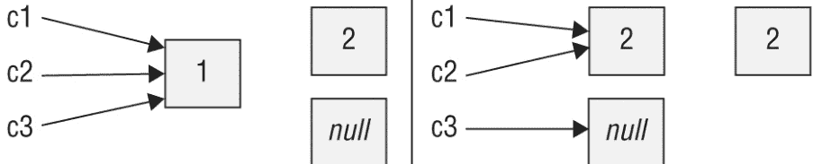

## 选项 C

## 选项 D

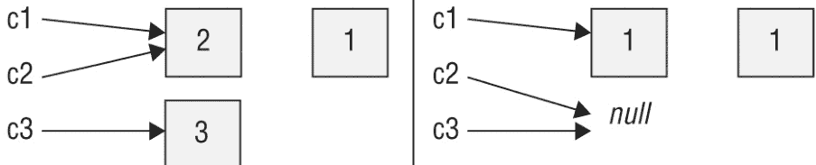

+ A. 选项 A
+ B. 选项 B
+ C. 选项 C
+ D. 选项 D
+ E. 代码无法编译。
+ F. 以上都不是。

## 25. 下面应用程序的输出结果是什么？

```java
package musical;

interface Speak { default int talk() { return 7; } }

interface Sing { default int talk() { return 5; } }

public class Performance implements Speak, Sing {

    public int talk(String... x) {

        return x.length;

    }

    public static void main(String[] notes) {

        System.out.print(new Performance().talk());

    }

}
```

+ A. 7
+ B. 5
+ C. 代码无法编译。
+ D. 代码可以正常编译，但在运行时之前无法确定输出。
+ E. 以上都不是。

## 26. 下面应用程序的输出结果是什么？

```java
package ai;

interface Pump { public abstract String toString(); }

interface Bend extends Pump { void bend(double tensileStrength); }

public class Robot {

    public static final void apply(Bend instruction, double input) {

        instruction.bend(input);

    }

    public static void main(String... future) {

        final Robot r = new Robot();

        r.apply(x -> System.out.print(x+" bent!"), 5);

    }

}
```

+ A. 5 bent!
+ B. 5.0 bent!
+ C. 代码无法编译，因为 `Bend` 不是一个函数式接口。
+ D. 代码无法编译，因为 `apply()` 的声明。
+ E. 以上都不是。

## 27. 关于提供最广泛允许访问的同时进行封装，哪种说法是正确的？

+ A. 变量是私有的，方法也是私有的。
+ B. 变量是私有的，方法是公共的。
+ C. 变量是公共的，方法是私有的。
+ D. 变量都是公共的。
+ E. 变量是私有的，方法是保护的。
+ F. 以上都不是。

## 28. 填空：________ 意味着对象的状态不能改变，而 ________ 意味着它可以改变。

+ A. 封装，工厂方法
+ B. 不变性，可变性
+ C. 刚性，灵活性
+ D. 静态，实例
+ E. 紧耦合，松耦合
+ F. 以上都不是

## 29. 关于以下接口的哪种说法正确？

```java
public interface Swimming {

    String DEFAULT = "Diving"; // k1

    abstract int breath();

    private static void stroke() {

        if(breath()==1) { // k2

            System.out.print("Go!");

        } else {

            System.out.print(dive()); // k3

        }

    }

    static String dive() {

        return DEFAULT; // k4

    }

}
```


## 30. 哪行是第一行编译失败的？

```java
class Tool {
    private void repair() {} // r1
    void use() {} // r2
}

class Hammer extends Tool {
    private int repair() { return 0; } // r3
    private void use() {} // r4
    public void bang() {} // r5
}
```

A. r1
B. r2
C. r3
D. r4
E. r5
F. 以上都不是

## 31. 哪些修饰符可以应用于抽象接口方法？

A. final
B. interface
C. protected
D. volatile
E. sealed
F. 以上都不是

## 32. `Plant` 程序的输出结果是什么？

```java
class Bush extends Plant {
    String type = "bush";
}

public class Plant {
    String type = "plant";

    public static void main(String[] args) {
        Plant w1 = new Bush();
        Plant w2 = new Bush();
        Plant w3 = w2;
        System.out.print(w1.type + "," + w2.type + "," + w3.type);
    }
}
```

A. bush,bush,plant
B. plant,bush,bush
C. bush,plant,bush
D. bush,bush,bush
E. 代码无法编译。
F. 以上都不是

## 33. 排除自身后，有多少个类可以继承 `Organ`？

```java
package body;

sealed class Organ {
    final Lung {}
    final Stomach {}
}
```

A. 零
B. 三
C. 四
D. 五

## 34. Java 文件的正确顺序是？

A. 导入语句，包声明
B. 包声明，导入语句
C. 类声明，导入语句
D. 包语句，类声明
E. 导入语句，类声明

## 35. 关于以下内容的哪些是正确的？（选择三项）

```java
1: class Penguin {
2:   enum {}
3: static class {
4:     enum }
5:   }
6:   switch (egg) {
7:      match = false;
8:      egg = EGG;
9:      case EGG:
10:        match = true;
11:    }
12: }
```

A. 
B. 有一行无法编译。
C. 有两行无法编译。
D. 如果代码可以编译，移除无法编译的构造函数后，输出 a。
E. 如果代码可以编译，移除无法编译的构造函数后，输出 ab。
F. 代码因为第3行无法编译。

## 36. 关于以下内容的哪些是正确的？（选择两项）

```java
package beach;

public class Sand {
    private int numShovels;
    private int numRakes;

    public static int getShovels() {
        return numShovels;
    }

    public static int getRakes() {
        return numRakes;
    }

    public Sand() {
        System.out.print("a");
    }

    public Sand() {
        System.out.print("b");
    }

    public void run() {
        new Sand();
    }

    public static void main(String... args) {
        new Sand().run();
    }
}
```

A. 
B. 有一行无法编译。
C. 有两行无法编译。
D. 如果代码可以编译，移除无法编译的构造函数后，输出 a。
E. 如果代码可以编译，移除无法编译的构造函数后，输出 ab。
F. 代码因为第3行无法编译。

## 37. 哪些类类型不能是抽象的？

A. 静态嵌套类
B. 局部类
C. 匿名类
D. 成员内部类
E. 密封类
F. 以上都可以标记为抽象。

## 38. 填空：________ 修饰符允许访问 ________ 修饰符允许的所有内容并更多。（选择三项）

- A. 包，保护
- B. 包，公共
- C. 保护，包
- D. 保护，公共
- E. 公共，包
- F. 公共，保护

## 39. 哪行是包含编译错误的第一行？

```java
var var = "var"; // line x1
var title = "Weather"; // line x2
var hot = 100, var cold = 20; // line x3
var f = 32, int c = 0; // line x4
```

A. x1
B. x2
C. x3
D. x4
E. 以上都不是

## 40. `Telephone` 接口中有多少成员是公共的？

```java
public interface Telephone {
    static int call() { return 1; }
    default void dial() {
        long answer();
        String home = "555-555-5555";
    }
}
```

+ A. 0
+ B. 1
+ C. 2
+ D. 3
+ E. 4
+ F. 代码无法编译。

## 41. 哪项最准确描述了 `new` 关键字的作用？

+ A. 创建现有对象的副本，并将其视为新对象。
+ B. 创建一个新的原始类型变量。
+ C. 实例化一个新对象。
+ D. 将对象引用切换为新的引用。
+ E. 行为取决于类的实现。

## 42. 有几行代码可以通过编译？

```java
11:    public class PrintShop
12:    public void printVarargs(String... names) {
13:        System.out.println(Arrays.toString(names));
14:    }
15:    public void printArray(String[] names) {
16:        System.out.println(Arrays.toString(names));
17:    }
18:    public void stormy() {
19:        printVarargs("Arlene");
20:        printVarargs(new String[]{"Bret"});
21:        printVarargs(null);
22:        printArray("Cindy");
23:        printArray(new String[]{"Don"});
24:        printArray(null);
25:    }
```

+ A. 0
+ B. 1
+ C. 2
+ D. 3
+ E. 4
+ F. 5

## 43. 如何在不可变类中更改实例变量的值？

+ A. 调用 setter 方法。
+ B. 移除 `final` 修饰符并直接设置实例变量。
+ C. 使用内部类创建一个新实例。
+ D. 使用除 A、B、C 选项以外的方法。
+ E. 你做不到。

## 44. 为了让这段代码通过编译，最少需要删除多少行代码？

```java
@FunctionalInterface
public interface Play {
    public static void baseball() {}
    private static void soccer() {}
    default void play() {}
    void fun();
}
```

+ A. 1
+ B. 2
+ C. 3
+ D. 4
+ E. 代码按现状即可编译。

## 45. 填空：定义了与父类中变量同名的实例变量的类被称为 ___________ 变量，而定义了与父类中静态方法签名相同的静态方法的类则被称为 ___________ 方法。

+ A. 隐藏 (hiding), 重写 (overriding)
+ B. 重写 (overriding), 隐藏 (hiding)
+ C. 遮蔽 (masking), 遮蔽 (masking)
+ D. 隐藏 (hiding), 遮蔽 (masking)
+ E. 替换 (replacing), 重写 (overriding)
+ F. 隐藏 (hiding), 隐藏 (hiding)

## 46. 关于 `record` 的哪些描述是正确的？（选择两个。）

A. record 是隐式公开的。
B. record 可以扩展其他类。
C. record 可以实现多个接口。
D. record 可以包含多个普通构造函数。
E. record 可以包含多个紧凑构造函数（compact constructors）。
F. record 总是不可变的。

## 47. 为了让 `secret` 良好封装，需要什么更改？

```java
import java.util.*;

public class Secret {
    private int number = new Random().nextInt(10);

    public boolean guess(int candidate) {
        return number == candidate;
    }
}
```

+ A. 将 `number` 修改为使用 `protected` 访问修饰符。
+ B. 将 `number` 修改为使用 `public` 访问修饰符。
+ C. 声明一个私有构造函数。
+ D. 声明一个公共构造函数。
+ E. 移除 `guess` 方法。
+ F. 无。它已经很好良好的封装。

## 48. 下面程序的输出是什么？

```java
interface Toy { String play(); }

public static class Gift {
    public static void main(String[] matrix) {
        abstract class Robot {
            class Transformer extends Robot implements Toy {
                public String name = "GiantRobot";
                public String play() { return "DinosaurRobot"; } // y1
            }
            Transformer prime = new Transformer() {
                public String play() { return name; }; // y2
            }
        };
        System.out.print(prime.play() + " " + name);
    }
}
```

+ A. GiantRobot
+ B. Robot DinosaurRobot
+ C. DinosaurRobot
+ D. 代码因为第 y1 行无法编译。
+ E. 代码因为第 y2 行无法编译。
+ F. 以上都不是。

## 49. 下面程序的输出是什么？

```java
package space;

public static class Bottle {
    public static class Ship {
        private enum Sail {
            TALL(protected int getHeight() { return 100;});
            SHORT(protected int getHeight() { return 2;});
            protected abstract int getHeight();
        }
        public Sail getSail() {
            return Sail.TALL;
        }
    }
    public static void main(String[] stars) {
        var bottle = new Bottle();
        Ship q = bottle.new Ship(); // w2
        System.out.print(q.getSail());
    }
}
```

+ A. TALL
+ B. Robot DinosaurRobot
+ C. DinosaurRobot
+ D. 代码因为第 y1 行无法编译。
+ E. 代码因为第 w2 行无法编译。
+ F. 以上都不是。

## 50. 类的哪种顺序是有效的？

+ A. 构造函数, 实例化变量
+ B. 实例化变量, 方法声明
+ C. 方法声明, 构造函数
+ D. 实例化变量, 构造函数
+ E. 以上都是

## 51. 在 p1 行插入哪行代码可以使程序打印 5？

```java
package games;

public class Jump {
    final int rope = 1;
    boolean outside;

    public Jump() {
        outside = true;
    }

    public Jump(int rope) {
        // p1
        this.rope;
    }
}
```

+ A. super();
+ B. new Jump();
+ C. this();
+ D. rope =
+ E. final;

## 52. 以下哪些项不是使用封装的原因？（选择两个。）

+ A. 提高安全性。
+ B. 增加性能。
+ C. 维护数据完整性。
+ D. 防止用户修改属性。
+ E. 防止状态改变。
+ F. 提高开发易用性。

## 53. 给定图表，哪种陈述是正确的？

| | |
|---|---|
| Toy | |
| Blanket | |
| Flashlight | |
| Phone | |
| Tent | |

+ A. `Blanket` 类可以调用 `turnOn()`.
+ B. `Flashlight` 类可以调用 `replace()`.
+ C. `Phone` 类可以调用 `wash()`.
+ D. `Tent` 类可以调用 `pitch()`.
+ E. 都是。

## 54. 根据上一个题的图表，有多少个类可以调用 `display()` 方法？

+ A. 0
+ B. 1
+ C. 2
+ D. 3
+ E. 4

## 55. 以下哪些描述是正确的？（选择两个。）

+ A. Java 允许类的多重继承。
+ B. Java 允许接口的多重继承。
+ C. Java 不允许多重继承。
+ D. 接口可以扩展另一个接口。
+ E. 接口可以扩展 record。
+ F. 接口可以实现另一个接口。

## 56. 哪些更改组合使 `Tree` 类不可变？（选择三个。）

```java
public class Tree {
    String species;

    public Tree(String species) {
        this.species = species;
    }

    public String getSpecies() {
        return species;
    }

    private void setSpecies(String newSpecies) {
        species = newSpecies;
    }
}
```

+ A. 将所有构造函数设为私有。
+ B. 将 `species` 的访问权限改为私有。
+ C. 将 `species` 的访问权限改为保护（protected）。
+ D. 移除 `setSpecies()` 方法。
+ E. 将 `Tree` 类标记为 final。
+ F. 在 `Tree` 构造函数对 `species` 进行防御性拷贝。

## 57. 下面程序的输出是什么？

```java
package ocean;

abstract interface CanSwim {
    public void swim(final int distance);
}

public class Turtle {
```


## 57. 下面程序的输出是什么？

```java
final int distance = 2;

public static void main(String[] seaweed) {

    final int distance = 3;

    CanSwim seaTurtle = {

        final int distance = 5;

        @Override

        public void swim(final int distance) {

            System.out.print(distance);

        }

    };

    seaTurtle.swim(7);

}

}
```

+ A. 2
+ B. 3
+ C. 5
+ D. 7
+ E. 代码无法编译。
+ F. 以上都不是。

## 58. 下面程序的输出是什么？

```java
package pet;

public class Puppy {

    public static int wag = 5; // q1

    public void Puppy(int wag) { // q2

        this.wag = wag;

    }

}
```

```java
}

public static void main(String[] tail) {

  System.out.print(new Puppy(2).wag); // q3

}
```

+ A. 2
+ B. 5
+ C. 编译错误的第一行是 q1 行。
+ D. 编译错误的第一行是 q2 行。
+ E. 编译错误的第一行是 q3 行。

## 59. 给定类中使用的以下方法签名，哪些类可以调用它？

```java
void run(String government)
```

+ A. 其他包中的类
+ B. 同一个包中的类
+ C. 不同包中的子类
+ D. 所有类
+ E. 以上都不是

## 60. 哪是第一个无法编译的声明？

```java
package desert;

interface CanBurrow {

  public abstract void burrow();

}
```

```java
@FunctionalInterface interface HasHardShell
extends CanBurrow {}

abstract class Tortoise implements HasHardShell {

  public abstract int toughness();

}
```

```java
public class DesertTortoise extends Tortoise {

  public int toughness() { return 11; }

}
```

+ A. CanBurrow
+ B. HasHardShell
+ C. Tortoise
+ D. DesertTortoise
+ E. 所有声明均可编译。

## 61. 哪是第一个无法编译的行？

```java
interface Building {

    default Double getHeight() { return 1.0; } // m1

}

interface Office {

    public default String getHeight() { return null; } // m2

}

abstract class Tower implements Building, Office {} // m3

public class Restaurant extends Tower {} // m4
```

+ A. m1 行
+ B. m2 行
+ C. m3 行
+ D. m4 行
+ E. 代码片段中以上都不是

## 62. 下述代码段的输出是什么？

```java
public class Nature {

    public static void main(String[] seeds) {

        record Tree() {}

        var tree = "pine";

        int count = 0;

        if (tree.equals("pine")) {

            int height = 55;

            count = count + 1;

        }

        System.out.print(height + count);

    }

}
```

+ A. 1
+ B. 55
+ C. 56
+ D. 无法编译，因为 record 不能嵌套在方法中。
+ E. 无法编译，因为 record 必须至少传递一个值。
+ F. 因为其他原因无法编译。

## 63. 下面哪些是 Java 中有效的注释？（选择三个。）

+ A. /****** TODO */
+ B. # Fix this bug later
+ C. ' Error closing pod bay doors
+ D. / Invalid record /
+ E. /* Page not found */
+ F. // IGNORE ME

## 64. 下面哪些修饰符配对可以同时应用于一个方法？（选择三个。）

+ A. private and final
+ B. abstract and final
+ C. static and private
+ D. private and abstract
+ E. abstract and static
+ F. static and protected

## 65. 给定以下类，应该在两个空白处插入什么内容以确保类数据被正确封装？

```java
package storage;

public class Box {

    public String stuff; ____________________ String () {

        return stuff;

    }

    public void setStuff(String stuff) {

      this.stuff = stuff;

    }

}
```

+ A. private and getStuff
+ B. private and isStuff
+ C. public and getStuff
+ D. public and isStuff
+ E. default and getStuff
+ F. 以上都不是

## 66. 下表中有多少行包含错误？

|  | 成员类型 | 需要方法体？ |
|---|---|---|
| static method | Class | Yes |
| private non-static method | Class | Yes |
| abstract method | Instance | No |
| default method | Instance | No |
| private static method | Class | Yes |

+ A. 零
+ B. 一行
+ C. 两行
+ D. 三行
+ E. 四行
+ F. 五或更多

## 67. 填充空白：___ 用于调用父类中的构造函数，而 ___ 用于引用父类中的成员。

+ A. super, this()
+ B. super, super()
+ C. super(), this
+ D. super(), super
+ E. 以上都不是

## 68. 下面哪些声明可以插入到空白处并使类通过编译？

```java
public sealed class Toy {

    extends Toy {

}
```

+ A. nonsealed class Book
+ B. abstract class Robot
+ C. class ActionFigure
+ D. record Doll()
+ E. interface Game
+ F. non-sealed class Ball
+ G. 以上都不是，因为 Toy 没有包含 permits 子句

## 69. 该程序的输出是什么？

```java
1:   class SmartWatch extends Watch {

2:   private String getType() { return "smart watch"; }

3:   public String getName(String suffix) {

4:   return getType() + suffix;

5:     }

6:   public class Watch {

7:   private String getType() { return "watch"; }

8:   public String getName(String suffix) {

9:   return getType() + suffix;

10:  }

11:  public static void main(String[] args) {

12:    var watch = new Watch();

13:    var smartWatch = new SmartWatch();

14:    System.out.print(watch.getName(","));

15:    System.out.print(smartWatch.getName(","));

16:  }
```

+ A. smart watch,watch
+ B. watch,smart watch
+ C. watch,watch
+ D. 代码无法编译
+ E. 运行时打印出异常
+ F. 以上都不是

## 70. 程序的输出是什么？

```java
package theater;

class Cinema {

    private String name = "Sequel";

    public Cinema(String name) {

        this.name = name;

    }

}

class Movie extends Cinema {

    private String name = "adaptation";

    public Movie(String name) {

        this.name = name;

    }

    public static void main(String[] args) {

        System.out.print(new Movie("Trilogy").name);

    }

}
```

+ A. Sequel
+ B. Trilogy
+ C. Remake
+ D. Adaptation
+ E. null

## 71. 哪个语句最能描述这个类？

```java
import java.util.*;

public final class Ocean {

    private final List<String> algae;

    private final double wave;

    private int sun;

    public Ocean(double wave) {

        this.wave = wave;

        this.algae = new ArrayList<>();

    }

    public int getSun() {

      return sun;

    }

    public void setSun(int sun) {

      sun = sun;

    }

    public double getWave() {

      return wave;

    }

    public List<String> getAlgae() {

      return new ArrayList<>(algae);

    }

}
```

+ A. 可以序列化。
+ B. 它是良好封装的。
+ C. 它是不可变的。
+ D. 它是既良好封装又不可变的。
+ E. 以上都不是，代码无法编译。

## 72. 给定所示的 Magnet.java，独立插入哪行 `var color;`会导致代码无法编译？

```java
// line a1

public class Magnet {

  // line a2

  public void attach() {

    // line a3

  }

  // line a4

}
```

+ A. a2
+ B. a3
+ C. a2 和 a3
+ D. a1, a2, a3 和 a4
+ E. 以上都不是

## 73. 下面哪个结果不是该程序的可能输出？

```java
package sea;

enum Direction { north, south, east, west };

class Ship {

    public static void main(String[] compass) {

        System.out.print(Direction.valueOf(compass[0]));

    }

}
```

+ A. 打印 WEST。
+ B. 打印 south。
+ C. 运行时抛出 ArrayIndexOutOfBoundsException。
+ D. 运行时抛出 IllegalArgumentException。
+ E. 以上所有皆。

## 74. 下述应用的输出是什么？

```java
package radio;

public class Song {

    public void playMusic() {

        System.out.print("Play!");

    }

    private static void playMusic() {

        System.out.print("Music!");

    }

    private static void playMusic(String song) {

        System.out.print(song);

    }

    public static void main(String[] tracks) {

        new Song().playMusic();

    }

}
```

+ A. Play!
+ B. Music!
+ C. 代码无法编译。
+ D. 代码可以编译，但在运行时之前无法确定。

## 75. 关于方法重写的以下哪些说法是正确的？（选择三个。）

+ A. 返回类型必须是协变的（covariant）。
+ B. 子类中方法的修饰符必须与父类方法相同或更窄。
+ C. 返回类型必须相同。
+ D. 父类方法声明的受检异常必须在子类方法中被声明。
+ E. 子类方法声明的受检异常必须与父类方法声明的异常相同或更窄。
+ F. 子类中方法的修饰符必须与父类相同或更宽。

## 76. 下述代码中有多少行无法编译？

```java
10:   interface Flavor {

11:     public default void happy() {

12:       printFlavor("Rocky road")

13:     }

14:     private static void excited() {

15:       printFlavor("Peanut butter")

15:     }

17:     private static void printFlavor(String f) {

18:       System.out.println("Favorite Flavor is: "+f);

19:     }

20:     public static void sad() {

21:       printFlavor("Butter pecan")

22:     }

23:   }

24:   public class IceCream implements Flavor {

25:     @Override public void happy() {

26:       printFlavor("Cherry chocolate chip")

27:     }

28:   }
```

+ A. 零，全部可以编译。
+ B. 一行
+ C. 两行
+ D. 三行
+ E. 四行
+ F. 五或更多

## 77. 下一个程序的输出是什么？

```java
1:   public record Disco(int beats) {

2:   public Disco(String beats) {

3:      this(20);

4:   }

5:   public Disco {

6:      beats = 10;

7:   }

8:   public int getBeats() {

9:      return beats;

10:  }

11:  public static void main(String[] args) {

12:     System.out.print(new Disco(30).beats());

13: }
}
```


## 选择题

### 78. 哪些单词是隐式应用于所有接口变量的修饰符？（选择三个。）

A. const
B. final
C. abstract
D. static
E. public

### 79. 给定以下方法，哪一行不编译？

```java
public static void main(String[] args) {
    int Integer = 0;      // k1
    Integer int = 0;      // k2
    Integer int++;        // k3
    int++;                // k4
    int var = null;       // k5
}
```

A. k1
B. k2
C. k3
D. k4
E. k5

### 80. 编译并执行以下类的结果是什么？

```java
public class Tolls {
    private static int yesterday = 1;
    int tomorrow = 10;

    public static void main(String[] args) {
        var tolls = new Tolls();
        int today = 20, tomorrow = 40; // line x
        System.out.print(
            today + tolls.tomorrow + tolls.yesterday); // line y
    }
}
```

A. 代码由于行 x 无法编译。
B. 代码由于行 y 无法编译。
C. 31
D. 61
E. 以上均不是。

### 81. 下一个应用的输出是什么？

```java
package weather;

public class Forecast {
    public enum Snow {
        BLIZZARD
    }

    System.out.print(Snow.valueOf("flurry".toUpperCase()));
}
```

A. FLURRY
B. FLURRY
C. Sunny
D. Sunny
E. 代码无法编译。
F. 以上均不是。

### 82. 下列中哪一个是无效陈述？

A. 每个构造函数的第一行都是通过 `super()` 命令调用父类构造函数。
B. 类不需要显式定义构造函数。
C. 构造函数可以向父类构造函数传递参数。
D. 如果 `final` 实例变量在声明时或初始化块中未设置值，则应由构造函数设置。
E. 以上所有陈述都是有效陈述。

### 83. 什么可以填充空白，使得 `play()` 方法可以从 `com.mammal` 和 `com.mammal.eland` 包中的所有类被调用，但在 `com.mammal.gopher` 包中不能被调用？

```java
package com.mammal;

public class Enrichment {
    void play() {}
}
```

A. 留空
B. private
C. protected
D. public
E. 以上均不是

### 84. `Rocket` 程序的输出是什么？

```java
package transport;

class Ship {
    protected int weight = 3;
    protected int height = 5;
    public int getWeight() { return weight; }
}

public class Rocket extends Ship {
    public int weight = 2;
    public int height = 4;

    public void printDetails() {
        System.out.print(super.getWeight() + "," + this.height);
    }

    public static void main(String[] fuel) {
        new Rocket().printDetails();
    }
}
```

A. 2,5
B. 3,4
C. 5,2
D. 3,5
E. 代码无法编译。
F. 以上均不是。

### 85. 假设你正与另一个团队合作开发一个应用程序。你正在编写一个对方尚未完成的类。你希望在对方代码完成后能够轻松集成。哪些陈述符合这一要求？（选择两个。）

A. 抽象类是最好的。
B. 接口是最好的。
C. 抽象类或接口都符合要求。
D. 方法应该是 `protected`。
E. 方法应该是 `public`。
F. 方法应该是 `static`。

### 86. 在空白处填写一行代码，使程序能够编译并打印 10。

```java
interface Speak {
    public default int getVolume() { return 20; }
}

interface Whisper {
    public default int getVolume() { return 10; }
}

public class Debate implements Speak, Whisper {
    public int getVolume() { return 30; }

    public static void main(String[] a) {
        var d = new Debate();
        System.out.println(________);
    }
}
```

A. `Whisper.d.getVolume()`
B. `d.Whisper.getVolume()`
C. `Whisper.super.getVolume()`
D. `d.Whisper.super.getVolume()`
E. 插入什么均通过。

### 87. `enum` 的以下哪个属性可以标记为 `abstract`？

A. 类型定义 (type definition)
B. 方法 (method)
C. 值 (value)
D. 构造函数 (constructor)
E. 以上均不是

### 88. 以下代码输出多少行？

```java
public class Cars {
    static void drive() {
        System.out.println("static");
    }

    private static void drive() {
        System.out.println("fast");
    }

    static { 
        System.out.println("faster");
    }

    public static void main(String[] args) {
        drive();
        drive();
    }
}
```

A. 一行
B. 两行
C. 三行
D. 四行
E. 五行
F. 以上均不是。代码无法编译。

### 89. 以下代码输出什么？

```java
public record Passenger(String firstName, String lastName) {
    static String middleName;

    @Override public String toString() {
        return null;
    }

    @Override public String getFirstName() {
        return null;
    }

    public static void main(String[] args) {
        var p = new Passenger("John", "Colbert");
        System.out.println(p.getFirstName());
    }
}
```

A. john
B. colbert
C. null
D. 代码无法编译。
E. 代码通过编译但在运行时抛出异常。
F. 以上均不是。

### 90. 假设 `foo` 是类 `Foo` 的实例引用。关于变量 `bar`，以下哪项是不可能的？

A. `bar` 是实例变量。
B. `bar` 是静态变量。
C. `bar` 是局部变量。
D. 可以从 `bar` 读取。
E. 可以向 `bar` 写入。
F. 以上所有都是指向

### 91. 下图显示了指向内存中同一个对象的两个引用变量。`myBunny` 是某种类型，而 `unknownBunny` 是有效但未类型。关于引用变量的哪些陈述是正确的？假设图中实例方法和变量都是 `public` 的。（选择三个。）


A. `unknownBunny` 的引用类型必须 `Bunny` 或其父类型。
B. `unknownBunny` 的引用类型不能转换为 `Bunny` 类型。
C. `unknownBunny` 的引用类型必须 `Bunny` 或其子类。
D. 如果 `unknownBunny` 的引用类型是 `Bunny`，它可以访问与 `myBunny` 相同的方法和变量。
E. `unknownBunny` 的引用类型可以是接口、类或抽象类。
F. 如果 `unknownBunny` 的引用类型是 `Object`，它无需转换即可访问与 `myBunny` 相同的方法和变量。

### 92. 实现接口的类继承了哪些接口方法？（选择两个。）

A. 私有方法
B. 私有静态方法
C. 默认方法 (`default`)
D. 静态方法
E. 抽象方法
F. `final` 方法

### 93. 以下中哪些是函数接口？

```java
interface Lion {
    public void roar();
    default void drink() {}
    String toString();
}

interface Tiger {
    public void roar();
    default void drink() {}
    int hashCode();
}
```

A. Lion
B. Tiger
C. Lion 和 Tiger
D. 都不是函数接口。
E. 代码无法编译。

### 94. 给定以下代码，空白处独立放置哪些行可以使代码编译并打印 bounce？（选择两个。）

```java
public class TennisBall {
    public TennisBall() {
        System.out.println("bounce");
    }

    public static void main(String[] slam) {
        ________
    }
}
```

A. `var new = new TennisBall`
B. `TennisBall()`
C. `var var = new TennisBall()`
D. `new TennisBall`
E. `new TennisBall()`

### 95. 类中多少个公共方法可以通过编译？

```java
public class Singing {
    private void sing(String key) {}

    public void sing_do(String key, String... harmonies) {
        this.sing(key);
    }

    public void sing_re(int note, String... sound, String key) {
        this.sing(key);
    }

    public void sing_me(String... keys, String... pitches) {
        this.sing(key);
    }

    public void sing_fa(String key, String... harmonies) {
        this.Singing.sing(key);
    }

    public void sing_so(int note, String... sound, String key) {
        this.Singing.sing(key);
    }
}

public void sing_la(String... keys, String... pitches) {
    this.Singing.sing(key);
}
```

- A. 零
- B. 一
- C. 二
- D. 三
- E. 四
- F. 五
- G. 六

### 96. 下一个应用程序的输出是什么？

```java
package world;

public class Matrix {
    private int level = 1;

    class Deep {
        private int level = 2;

        class Deep {
            private int level = 5;

            public void printReality(int level) {
                System.out.print(Matrix.Deep.this.level + " ");
                System.out.print(Deep.this.level + " ");
                System.out.print(Deep.this.level);
            }
        }
    }

    public static void main(String[] args) {
        Matrix.Deep.Deeper simulation = new Matrix();
        new Deep().new Deep();
        simulation.printReality(6);
    }
}
```

- A. 1 1 2
- B. 5 2 2
- C. 5 2 1
- D. 6 2 2
- E. 6 2 1
- F. 代码无法通过编译。

### 97. 不计算 `Time` 的声明，有多少个声明可以编译？假设它们都声明在同一个 `.java` 文件中。

```java
public sealed interface Time permits Hour, Minute, Second {}
```

```java
record Hour() implements Time {}
interface Minute extends Time {}
non-sealed class Second implements Time {}
class Micro extends Second {}
```

- A. 零
- B. 一
- C. 二
- D. 三
- E. 四

### 98. 鉴于 `Integer` 和 `Long` 是 `Number` 的直接子类，使用哪种类型可以填充以下类中的空白，使其能够编译？

```java
package orchestra;

interface MusicCreator { public Number play(); }

abstract class StringInstrument {
    public Long play() {return 3L; }
}

public class Violin extends StringInstrument
    implements MusicCreator {
    public Long play() {
        return null;
    }
}
```

- A. Long
- B. Integer
- C. Long 或 Integer
- D. Long 或 Number
- E. Long、Integer、或 Number
- F. 以上皆非

### 99. `RightTriangle` 程序的输出是什么？

```java
package shapes;

abstract class Triangle {
    abstract String getDescription();
}

abstract class IsoRightTriangle extends RightTriangle { // g1
    public String getDescription() { return "irt"; }
}

public class RightTriangle extends Triangle {
    protected String getDescription() { return "rt"; } // g2

    public static void main(String[] args) {
        final var shape = new IsoRightTriangle(); // g3
        System.out.print(shape.getDescription());
    }
}
```

- A. rt
- B. irt
- C. 由于行 g1，代码无法通过编译。
- D. 由于行 g2，代码无法通过编译。
- E. 由于行 g3，代码无法通过编译。
- F. 以上皆非。

### 100. 下一个程序的输出是什么？

```java
interface Dog {
```


## Java 代码片段

```java
private void buryBone() { chaseTail(); }

private static void wagTail() { chaseTail(); }

public default String chaseTail() { return "So cute!"; }

}

public class Puppy implements Dog {

    public String chaseTail() throws IllegalArgumentException {

        throw new IllegalArgumentException("Too little!");

    }

    public static void main(String[] t) {

        var p = new Puppy();

        System.out.print(p.chaseTail());

    }

}
```

- A. So cute!
- B. 抛出了带有 Too little! 信息的异常。
- C. 不同的异常。
- D. 因为 `Puppy` 类中没有 `buryBone()`，代码无法通过编译。
- E. 因为 `Puppy` 类中没有 `chaseTail()`，代码无法通过编译。
- F. 以上皆非。

## 01. 如何在某一点强制进行垃圾回收？

- A. 调用 `System.forceGc()`
- B. 调用 `System.gc()`
- C. 调用 `System.requireGc()`
- D. 调用 `GarbageCollection.clean()`
- E. 以上皆非

## 02. 对以下类进行什么修改有助于正确封装数据？

```java
package shield;

public class Protect {

    private String material;

    protected int strength;

    public int getStrength() {

        return strength;

    }

    public void setStrength(int strength) {

        this.strength = strength;

    }

}
```

- A. 为 `material` 添加 getter。
- B. 为 `material` 添加 setter。
- C. 将 `material` 的访问修饰符改为 `protected`。
- D. 将 `strength` 的访问修饰符改为 `private`。
- E. 以上皆非。

## 03. 关于 lambda 的哪些说法是正确的？（选择两个）

- A. 实例变量可以使用，无论它们是否为 final。
- B. 实例变量和局部变量可以使用，无论它们是否为 final。
- C. 实例变量和方法参数必须是 final 才能使用。
- D. 局部变量和方法参数必须是 final 才能使用。
- E. 局部变量和静态变量可以使用，无论它们是否为 final。
- F. 方法参数和静态变量可以使用，无论它们是否为 final。

## 04. 关于以下类的哪个陈述是正确的？

```java
import java.util.*;

final class Faucet {

    private String water;

    private List<Double> pipes;

    public Faucet(String water, List<Double> pipes) {

        this.water = water;

        this.pipes = pipes;

    }

    public String get() { return water; }

    public List<Double> getPipes() { return pipes; }

}
```

```java
final class Spout {

    private String well;

    private List<Boolean> buckets;

    public Spout(String well, List<Boolean> buckets) {

        this.well = well;

        this.buckets = new ArrayList<>(buckets);

    }

    public String getWell() { return well; }

    public List<Boolean> getBuckets() {

        return new ArrayList<>(buckets);

    }

}
```

- A. 只有 `Faucet` 是不可变的。
- B. 只有 `Spout` 是不可变的。
- C. 两个类都是不可变的。
- D. 两个类都不是不可变的。
- E. 以上皆非，其中一个类无法通过编译。

## 05. 给定以下结构，哪些代码段的结果为真？（选择三个）

```java
interface Friendly {

    abstract class Dolphin implements Friendly {}

    class Animal implements Friendly {}

    class Whale extends Object {}

    class Fish {}

    class Coral extends Animal {}

}
```

- A. `new Coral instanceof Friendly`
- B. `null instanceof Object`
- C. `new Coral instanceof Object`
- D. `new Fish() instanceof Friendly`
- E. `new Whale() instanceof Object`
- F. `new Dolphin() instanceof Friendly`

## 06. 关于以下代码，什么是正确的？

```java
public class Eggs {

    enum Animal {

        CHICKEN(21), PENGIN(75);

        private int numDays;

        private Animal(int numDays) {

            this.numDays = numDays;

        }

        public int getNumDays() {

            return numDays;

        }

        public void setNumDays(int numDays) {

            this.numDays = numDays;

        }

    }

    public static void main(String[] args) {

        Animal chicken = Animal.CHICKEN;

        chicken.setNumDays(20);

        System.out.print(chicken.getNumDays());

        System.out.print(" ");

        System.out.print(Animal.CHICKEN.getNumDays());

        System.out.print(" ");

        System.out.print(Animal.PENGIN.getNumDays());

    }

}
```

- A. 它输出 20 20 20。
- B. 它输出 20 20 75。
- C. 它输出 20 21 75。
- D. 它输出 21 21 75。
- E. 由于 `setDays()` 无法通过编译。
- F. 由于其他原因无法通过编译。

## 07. 该接口中第一行无法通过编译的是哪一行？

```java
1: public interface Thunderstorm {

2:     float rain = 1;

3:     char getSeason() { return 'W'; };

4:     boolean isWet();

5:     private static void hail() {}

6:     default String location() { return "Home"; };

7:     private static int getTemp() { return 35; }

8: }
```

- A. 第 2 行
- B. 第 3 行
- C. 第 4 行
- D. 第 5 行
- E. 第 6 行
- F. 第 7 行
- G. 所有行均通过编译

## 08. 下一个应用程序的输出是什么？

```java
package Currency;

enum Currency { DOLLAR, YEN, EURO }

abstract class Provider {

    protected Currency c = Currency.EURO;

}

public class Bank extends Provider {

    protected Currency c = Currency.DOLLAR;

    public static void main(String[] pennies) {

        int value = 0;

        switch(new Bank().c) {

            case 0:

                value--; break;

            case 1:

                value++; break;

        }

        System.out.print(value);

    }

}
```

- A. -1
- B. 0
- C. 1
- D. `Provider` 类无法通过编译。
- E. `Bank` 类无法通过编译。
- F. 以上皆非。

## 09. 哪些内容可以在 record 中声明？（选择两个）

- A. `hashCode()` 的实现
- B. 实例变量
- C. 静态初始化器
- D. 嵌套类
- E. 静态方法
- F. 构造函数
- G. 实例初始化器

## 10. `var q = 4.0f` 等价于哪个？

- A. `float q = 4.0f;`
- B. `Float q = 4.0f;`
- C. `double q = 4.0f;`
- D. `Double q = 4.0f;`
- E. `Object q = 4.0f;`

## 111. 填空：类可以自动赋值给一个 __________ 引用变量，但在赋值给一个 __________ 引用变量时，需要显式的类型转换。

- A. 子类，外层类
- B. 父类，子类
- C. 具类，子类
- D. 子类，父类
- E. 抽象类，静态类

## 112. 关于函数式接口（functional interfaces），以下哪个陈述是无效的？

- A. 函数式接口可以有任意数量的静态方法。
- B. 函数式接口可以有任意数量的默认方法（default methods）。
- C. 函数式接口可以有任意数量的私有静态方法。
- D. 函数式接口可以有任意数量的抽象方法。
- E. 函数式接口可以有任意数量的私有方法。
- F. 以上全部。

## 113. 假设第 x 行的注释可以替换为任意代码，以下代码可能的输出是什么？

```java
// Mandrill.java
public class Mandrill {

  public int age;

  public Mandrill(int age) {

    this.age = age;

  }

  public String toString() {

    return "" + age;

  }

}
```

```java
// PrintAge.java
public class PrintAge {

    public static void main(String[] args) {

        var mandrill = new Mandrill(5);

        // line X

        System.out.println(mandrill);

    }

}
```

- B. 5
- C. null 或 5
- D. 任意 int 值
- E. 无法编译

## 114. 在 main() 方法结束前夕，有多少个 String 对象可以被垃圾回收？

```java
public static void main(String ohMy) {

    String animal1 = new String("lion");

    String animal2 = new String("tiger");

    String animal3 = new String("bear");

    animal3 = animal1;

    animal2 = animal3;

    animal1 = animal2;

}
```

- A. 否
- B. 一个
- C. 两个
- D. 三个
- E. 以上都不是

## 115. 假设 `Panther` 和 `Cub` 是接口，且它们都不包含任何默认方法。哪些陈述是正确的？（选择两个。）

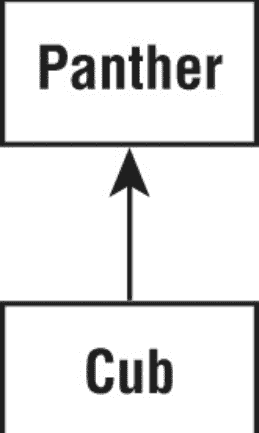

- A. 如果 `Panther` 有一个抽象方法，则 `Cub` 保证是一个函数式接口。
- B. 如果 `Panther` 有一个抽象方法，则 `Cub` 可能是一个函数式接口。
- C. 如果 `Panther` 有一个抽象方法，则 `Cub` 不可能是函数式接口。
- D. 如果 `Panther` 有两个抽象方法，则 `Cub` 保证是一个函数式接口。
- E. 如果 `Panther` 有两个抽象方法，则 `Cub` 可能是一个函数式接口。
- F. 如果 `Panther` 有两个抽象方法，则 `Cub` 不可能是函数式接口。

## 116. 下面输出是什么？

```java
1: public class InitOrder {

2: public String first = "instance";

3: public InitOrder() {

4:     first = "constructor";

5: }

6: { first = "block"; }

7: public void print() {

8:     System.out.println(first);

9: }

10: public static void main(String... args) {

11:    new InitOrder().print();

12: } }
```

- A. block
- B. constructor
- C. instance
- D. 代码无法编译。
- E. 以上都不是。

## 117. 关于以下接口，哪个陈述是正确的？

```java
public interface Tree {

    public static void produceSap() {

        growLeaves();

    }

    public abstract int getNumberOfRings() {

        return getRings();

    }

    private static void growLeaves() {

    }

    private static int getRings() {

        return 10;

    }

}
```

- A. 代码可以编译。
- B. `produceSap()` 方法无法编译。
- C. `getNumberOfRings()` 方法无法编译。
- D. `growLeaves()` 方法无法编译。
- E. `getHeight()` 方法无法编译。
- F. 代码因循环无法编译。

## 118. 关于类型为 `var` 的变量，哪些陈述是正确的？（选择两个。）

- A. 变量可以在初始化时赋值为 null。
- B. 变量可以在初始化后赋值为 null。
- C. 变量永远无法赋值为 null。
- D. 变量只能用于基本类型。
- E. 变量只能用于对象。
- F. 基本类型或对象都可以用于变量。

## 119. 假设有一个带有 protected 变量的 `Bouncer` 类。哪些类可以访问该变量？

- A. `Bouncer` 的任何子类或与 `Bouncer` 同包的类
- B. `Bouncer` 的任何父类
- C. 仅 `Bouncer` 的子类
- D. 仅与 `Bouncer` 同包的类
- E. 以上都不是

## 120. 以下代码的输出是什么？

```java
package forest;

public class Tree {

    static int heat = 10;

    int water = 2;

    static class Oak { // p1

        public int getWater() { // p2

            return water;

        }
```


```java
    }

    public static void main(String[] args) {

        System.out.println(new Oak().getWater());

    }

}
```

+ A. 8
+ B. p1 行包含错误。
+ C. p2 行包含错误。
+ D. 以上都不是

21. 以下可以填充空白使代码编译？（选择两个。）

+ A. class extends
+ B. class implements
+ C. A 和 B 都不。
+ D. interface extends
+ E. interface implements

22. 关于以下方法，哪个是正确的？

```java
public void setColor(String color) {
  color;
}
```

+ A. 这是一个正确的访问方法（accessor method）。
+ B. 这是一个正确的修改方法（mutator method）。
+ C. 这是一个错误的访问方法。
+ D. 这是一个错误的修改方法。
+ E. 以上都不是。

23. 在构造函数中调用 `this()` 的以下哪些陈述正确？（选择三个。）

+ A. 如果为 `this()` 提供了参数，必须有一个接收这些参数的父类。
+ B. 如果为 `this()` 提供了参数，则必须有一个无参数构造函数。
+ C. 如果没有调用无参数构造函数，则必须显式定义。
+ D. 如果构造函数中同时使用了 `super()` 和 `this()`，`super()` 必须在 `this()` 之后的行。
+ E. 如果构造函数中同时使用了 `super()` 和 `this()`，`this()` 必须在 `super()` 之后的行。
+ F. 如果使用了 `this()`，它必须是构造函数的第一行。

24. 编译并执行以下类的结果是什么？

```java
public class Skates {
    static int wheels = 1;
    int tracks = 5;
    public static void main(String[] args) {
        Skates s = new Skates();
        int feet = 4, tracks = 15;
        System.out.print(feet + tracks);
    }
}
```

+ A. 代码无法编译。
+ B. 4
+ C. 5
+ D. 10
+ E. 20

25. 关于以下程序的哪些陈述是正确的？（选择两个。）

```java
package vessel;

class Problem extends Exception {
    abstract class Danger {
        protected void isDanger() throws Problem; // m1
    }
    public class SeriousDanger extends Danger { // m2
        protected void isDanger() throws Exception { // m3
            throw new RuntimeException(); // m4
        }
        public static void main(String[] w) throws Throwable { // m5
            var sd = new SeriousDanger().isDanger(); // m6
        }
    }
}
```

+ A. 代码因为 m1 无法编译。
+ B. 代码因为 m2 无法编译。
+ C. 代码因为 m3 无法编译。
+ D. 代码因为 m4 无法编译。
+ E. 代码因为 m5 无法编译。
+ F. 代码因为 m6 无法编译。

26. 关于顶层类和成员内部类，哪些陈述是正确的？（选择三个。）

+ A. 都可以标记为 `protected`。
+ B. 只有顶层类可以声明为 `final`。
+ C. 都可以声明构造函数。
+ D. 成员内部类不能标记为 `private`。
+ E. 成员内部类可以访问其定义的顶层类的私有变量。
+ F. 它们都可以标记为 `abstract`。

27. 定义一个 Java 类文件需要什么？

+ A. 类声明
+ B. `package` 语句
+ C. `import` 语句
+ D. 类声明和 `package` 语句
+ E. 类声明和至少一个 `import` 语句
+ F. `public` 修饰符

28. 在 `main()` 方法结束前夕，有多少个对象可以被垃圾回收？

```java
1: public class Person {
2: public Person youngestChild;
3:
4: public static void main(String... args) {
5:     Person elena = new Person();
6:     Person janeice = new Person();
7:     elena.youngestChild = janeice;
8: }
9:
```
```java
8: janeice = null;
9: Person zoe = new Person();
10: elena.youngestChild = zoe;
11: zoe = null;
12: } }
```

- A. 无
- B. 一个
- C. 二
- D. 三
- E. 代码无法编译。

29. 下一个程序的输出是什么？

```java
package race;

interface Drive {
    int SPEED = 5;
    default Integer getSpeed() { return SPEED; }
}

interface Hover {
    String MAX_SPEED = "10";
    default String getSpeed() { return MAX_SPEED; }
}

public class Car implements Drive, Hover {
    @Override public Object getSpeed() { return 15; }
    public static void main(String[] gears) {
        System.out.print(new Car().getSpeed());
    }
}
```

- A. 5
- B. 10
- C. 15
- D. 代码无法编译。
- E. 代码可以编译但在运行时抛出异常。
- F. 根据给出信息无法确定答案。

30. 下一个程序的输出是什么？（选择两个。）

```java
1: public class ChooseWisely {
2: public ChooseWisely() { super(); }
3: public int choose(int choice) { return 5; }
4: public int choose(short choice) { return 2; }
5: public int choose(long choice) { return 11; }
6: public int choose(double choice) { return 6; }
7: public int choose(Float choice) { return 8; }
8: public static void main(String[] path) {
9: ChooseWisely c = new ChooseWisely();
10: System.out.println(c.choose(2f));
11: System.out.println(c.choose((byte)2+1));
12: } }
```

A. 2
B. 3
C. 5
D. 6
E. 8
F. 11

31. 以下程序中有多少行无法编译？

```java
1: public enum Color {
2: RED(1,2) { void toSpectrum() {} },
3: BLUE(2) { void toSpectrum() {} void printColor() {} },
4: ORANGE() { void toSpectrum() {} },
5: GREEN(4);
6: public Color(int color) {}
7: abstract void toSpectrum();
8: final void printColor() {}
9: }
```

A. 零
B. 一
C. 二
D. 三
E. 多于三行

32. `Square` 程序的输出是什么？

```java
package shapes;

abstract class Trapezoid {
    private int getEqualSides() {return 0;}
}

abstract class Rectangle extends Trapezoid {
    public static int getEqualSides() {return 2;} // x1
}

public class Square extends Rectangle {
    public int getEqualSides() {return 4;} // x2
    public static void main(String[] corners) {
        final Square myFigure = new Square();
        System.out.print(myFigure.getEqualSides());
    }
}
```

A. 0
B. 2
C. 4
D. 代码因 x1 行无法编译。
E. 代码因 x2 行无法编译。
F. 代码因 x3 行无法编译。

33. 填写什么可以填充空白处，使得 `com.mammal` 包中的所有类都能调用 `play()` 方法，但 `com.mammal.gopher` 包中的不能调用？

```java
package com.mammal;

public class Enrichment {
    void play() {}
}
```

- A. 留空
- B. `private`
- C. `protected`
- D. `public`
- E. 以上都不是

34. 下表中有多少个单元格是错误的？

| 类型 | 允许方法吗？ | 允许常量吗？ | 允许构造函数吗？ |
| --- | --- | --- | --- |
| 抽象类 | 是 | 是 | 否 |
| 具体类 | 是 | 是 | 是 |
| 接口 | 是 | 是 | 是 |

- A. 零
- B. 一
- C. 二
- D. 三
- E. 四
- F. 五
- G. 六

35. 密封类的直接子类允许使用哪些修饰符？（选择三个。）

- A. `void`
- B. `default`
- C. `public`
- D. `private`
- E. `volatile`
- F. `final`
- G. `nonsealed`

36. 关于函数式接口，哪些描述是正确的？（选择三个。）

- A. 可以包含任意数量的抽象方法。
- B. 它必须包含单个抽象方法。
- C. 可以包含任意数量的私有方法。
- D. 它必须包含单个私有方法。
- E. 可以包含任意数量的静态方法。
- F. 它必须包含单个静态方法。

37. 下一个程序的可能输出是什么？

```java
package wrap;

public class Gift {
    private final Object contents;
    protected Object getContents() {
        return contents;
    }
    protected void setContents(Object contents) {
        this.contents = contents;
    }
    public void showPresent() {
        System.out.print("Your gift:"+contents);
    }
    public static void main(String[] treats) {
        var gift = new Gift();
        gift.setContents(gift);
        gift.showPresent();
    }
}
```

A. Your gift: wrap.Gift@29ca2745
B. Your gift: Your gift:
C. 代码无法编译。
D. 代码可以编译但在运行时抛出异常。
E. 以上都不是。

38. 为了使以下代码编译，需要修正多少行？

```java
1: package animal;
2: interface CanFly {
3:     public void fly() {}
4:     int speed = 5;
5: }
6: final class Bird {
7:     public int fly(int speed) {}
8: }
9: public class Eagle extends Bird implements CanFly {
10:    public void fly()
11: }
```

A. 无
B. 一
C. 二
D. 三

39. 以下代码的输出是什么？

```java
public class Bunny {
    static class Rabbit {
        void hop() {
            System.out.print("hop");
        }
    }
    static class FlemishRabbit extends Rabbit {
        void hop() {
            System.out.print("HOP");
        }
    }
    public static void main(String[] args) {
        Rabbit r1 = new FlemishRabbit();
        FlemishRabbit r2 = new FlemishRabbit();
        r1.hop();
        r2.hop();
    }
}
```

A. hop
B. HOP
C. hopHOP
D. HOP
E. 代码无法编译。

40. 以下哪些声明是有效的？（选择三个。）

A. class {}
B. class {}
C. class {}
D. class {}
E. class {}

41. `InfiniteMath` 程序的输出是什么？

```java
class Math {
    public final secret = 2;
}
class ComplexMath extends Math {
    public final secret = 4;
}
public class InfiniteMath {
    public static void main(String[] args) {
        Math math = new ComplexMath();
        System.out.print(math.secret);
    }
}
```

A. 2
B. 4
C. 代码无法编译。
D. 代码可以编译但在运行时抛出异常。

42. 对于以下应用，在调用 `slalom` 方法后，哪个图表最好表示变量的状态？

```java
package zoo;

public class Penguin {
    private int volume = 1;
    private class Chick {
        private static int volume = 3;
        void chick(int volume) {
            System.out.print("Honk" + Penguin.this.volume + "!");
        }
    }
    public static void main(String[] eggs) {
        Penguin pen = new Penguin();
        final Penguin.Chick littleOne = pen.new Chick();
        littleOne.chick(5);
    }
}
```

A. Honk(1)!
B. Honk(3)!
C. Honk(5)
D. 代码无法编译。
E. 代码可以编译，但在运行时无法确定输出。

43. C. `super.Edible.getColor()`
44. D. `super.getColor()`
45. E. 无论在空白处插入什么内容，代码都无法编译。
46. F. 以上都不是。

46. 假定以下两个位于不同包的类，在代码中插入哪行代码允许第二个类通过编译？

```java
package clothes;
```


## Java 练习题

### 46. 代码填空

```java
public class Store {

    public static String getClothes() { return "dress"; }

}
```

```java
package wardrobe;

// 在此处插入代码

public class Closet {

    public void borrow() {

        System.out.print("Borrowing clothes: " + getClothes());

    }

}
```

- A. `import static clothes.Store.getClothes;`
- B. `import clothes.Store.*`
- C. `import static clothes.Store.getClothes;`
- D. `import static clothes.Store.`
- E. 以上都不是

### 47. ElectricCar 程序的输出是什么？

```java
package vehicles;

class Automobile {

    private final String drive() { return "Driving vehicle"; }

}
```

```java
class Car extends Automobile {

    protected String drive() { return "Driving car"; }

}
```

```java
public class ElectricCar extends Car {

    public final String drive() { return "Driving electric car"; }

    public static void main(String[] wheels) {

        final Automobile car = new ElectricCar();

        var v = (Car)car;

        System.out.print(v.drive());

    }

}
```

- A. Driving vehicle
- B. Driving electric car
- C. Driving car
- D. 代码无法编译。
- E. 代码可以编译，但在运行时会产生 `classCastException`。
- F. 以上都不是。

### 48. 关于密封类（sealed classes）的哪些描述是正确的？（选择三个。）

- A. 密封类可以被另一个密封类扩展。
- B. 在无名模块中，密封类必须将其所有的子类都包含在同一个文件中。
- C. 密封类不能包含嵌套类。
- D. 密封类可以声明为抽象类（`abstract`）。
- E. 密封类可以声明为最终类（`final`）。
- F. 在无名模块中，密封类必须将其所有的子类都包含在同一个包中。

### 49. 下列程序的输出是什么？

```java
public class Music {

  { System.out.print("do-"); }

  static { System.out.print("re-"); }

  { System.out.print("mi-"); }

  static { System.out.print("fa-"); }

  public Music() {

    System.out.print("so-");

  }

  public Music(int note) {

    System.out.print("la-");

  }

  public static void main(String[] sound) {

    System.out.print("ti-");

    var play = new Music();

  }

}
```

- A. de-re-fa-ti-do-mi-so-
- B. do-re-mi-fa-ti-so-
- C. ti-re-fa-do-mi-so-
- D. re-fa-la-mi-ti-do-
- E. do-re-mi-fa-so-ti-ti
- F. 代码无法编译。
- G. 以上都不是。

### 50. 假定以下类声明，哪些选项正确地声明了一个包含该类实例的局部变量？

```java
public class Earth {

    private abstract class Sky {

        void fall() {

            var e = 

        }

    }

}
```

- A. `new Sunset() extends Sky {};`
- B. `new Sky();`
- C. `new Sky() {};`
- D. `new Sky() { final static int blue = 1; }`
- E. 无论在空白处放置什么内容，代码都无法编译。
- F. 以上都不是。

### 51. Encyclopedia 程序的输出是什么？

```java
package paper;

abstract class Book {

    protected static String material = "papyrus";

    public Book() {}

    abstract String read() {}

    public Book(String material) {this.material = material;}

}

public class Encyclopedia extends Book {

    public static String material = "cellulose";

    public Encyclopedia() {super();}

    public String read() { return "Reading is fun!"; }

    public String getMaterial() {return super.material;}

    public static void main(String[] pages) {

    System.out.print(new Encyclopedia().read());

    System.out.print("-" + new Encyclopedia().getMaterial());

  }

}
```

- A. Reading is fun!-papyrus
- B. Reading is fun!-cellulose
- C. null-papyrus
- D. null-cellulose
- E. 代码无法编译。
- F. 以上都不是。

### 52. 下述代码输出什么？

```java
interface Vehicle {}

class Bus implements class Transport {

    public static void main(String[] args) {

        Vehicle vehicle = new Bus();

        boolean n = null instanceof Bus;

        boolean v = vehicle instanceof Vehicle;

        boolean b = vehicle instanceof Bus;

        System.out.println(n + " " + v + " " + b);

    }

}
```

- A. false true
- B. false false
- C. true false
- D. true false
- E. false true
- F. true true

### 53. 下表中有多少行包含错误？

| Interface | Optional(s) | Required(s) |
|---|---|---|
| Private method | private | |
| Default method | default | |
| Static method | static | |
| Abstract method | abstract | |

- A. Zero
- B. One
- C. Two
- D. Three
- E. Four

### 54. 下列程序的输出是什么？

```java
class Dwarf {

    String name;

    public Dwarf() {

    }

    public Dwarf(String name) {

        this.name = name;

    }

    public static void main(String[] args) {

        var d = new Dwarf("Doc");

        System.out.println(name);

    }

}
```

- A. Sleepy
- B. Bashful
- C. Doc
- D. 代码无法编译。
- E. 抛出了异常。

### 55. 下列程序的输出是什么？

```java
package math;

interface AddNumbers {

    int add(int x, int y);

    default int subtract(int x, int y) { return x-y; }

    default int multiply(int x, int y) { return x*y; }

}

class Calculator {

    public static void main(String[] args) {

        var ti = new Calculator();

        System.out.print(ti.add(2, 5));

    }

}
```

- A. 0
- B. 7
- C. 8
- D. 因为 `AddNumbers` 不是函数接口。
- E. 因为第 1 行代码无法编译。
- F. 因为代码代码无法编译。
- G. 以上都不是。

### 56. 定义后哪些变量在作用范围内？

- A. 包变量
- B. 类变量
- C. 实例变量
- D. 局部变量
- E. 伪变量

### 57. 在同一类中调用另一个构造函数的命令是？

- A. `construct()`
- B. `parent()`
- C. `super()`
- D. `this()`
- E. `that()`
- F. `overthis()`

### 58. 关于无参构造函数和继承的描述是正确的？（选择两个。）

- A. 编译器向抽象类插入无参构造函数。
- B. 如果父类没有无参构造函数，子类不能声明。
- C. 如果父类只声明了至少一个参数的构造函数，则子类必须声明至少一个。
- D. 无参构造函数由编译器插入。
- E. 如果父类声明了无参构造函数，子类必须声明。
- F. 如果父类声明了无参构造函数，子类必须声明至少一个。

### 59. 执行 Grasshopper 程序的运行是什么？

```java
package com.animals;

public class Hopper {

    protected void hop() {

        System.out.println("hop");

    }

}
```

```java
package com.insect;

import com.animals.Hopper;

public class Grasshopper extends Hopper {

    public void move() {

        hop(); // p1

    }

    public static void main(String[] args) {

      var hopper = new Grasshopper();

      hopper.move(); // p2

      hopper.hop(); // p3

    }

}
```

- B. 代码打印两次 hop。
- C. 第一个编译错误在第 p1 行。
- D. 第一个编译错误在第 p2 行。
- E. 第一个编译错误在第 p3 行。

### 60. 为了使代码编译，最少需要删除多少行？

```java
@FunctionalInterface

public interface Play {

  public static void baseball() {}

  private static void soccer() {}

  default void play() {

    void fun();

    void game();

    void toy();

  }

}
```

- A. 一
- B. 两
- C. 三
- D. 四
- E. 代码按原编译。

### 61. 不可变类判断

```java
import java.util.*;

public class Flower {

  private final String name;

  private final List<Integer> counts;

  public Flower(String name, List<Integer> counts) {

    this.name = name;

    this.counts = new ArrayList<>(counts);

  }

}
```

```java
public final String getName() { return name; }

public final List<Integer> getCounts() {

  return new ArrayList<>(counts);

}
```

```java
class Plant {

  private String name;

  private List<Integer> counts;

  public Plant(String name, List<Integer> counts) {

    this.name = name;

    this.counts = new ArrayList<>(counts);

  }

  public String getName() { return name; }

  public List<Integer> getCounts() {

    return new ArrayList<>(counts);

  }

}
```

- A. 只有 `Flower` 是不可变的。
- B. 只有 `Plant` 是不可变的。
- C. 两个类都是不可变的。
- D. 两个类都不是不可变的。
- E. 以上都不是，因为其中一个类无法编译。

### 62. 执行 Sounds 程序的结果是什么？

```java
// Sheep.java

package com.mammal;

public class Sheep {

  private void baa() {

    System.out.println("baa!");

  }

  private void speak() {

    baa();

  }

}
```

```java
// Sounds.java

package com.animals;

import com.mammal.Sheep;

public class Sounds {

  public static void main(String[] args) {

    var sheep = new Sheep();

    sheep.speak();

  }

}
```

- A. 代码运行并打印 baa!。
- B. `Sheep` 类无法编译。
- C. `Sounds` 类无法编译。
- D. 两个类都无法编译。
- E. 以上都不是。

### 63. 下一个程序的输出是什么？

```java
package stocks;

public class Bond {

    private static int price = 5;

    public boolean sell() {

        if(price<10) {

            price++;

            return true;

        } else if(price>=10) {

            return false;

        }

    }

}

public static void main(String[] cash) {

    new Bond().sell();

    new Bond().sell();

    new Bond().sell();

    System.out.print(price);

}
```

- A. 5
- B. 6
- C. 7
- D. 8
- E. 代码无法编译。
- F. 根据给出的信息无法确定输出。

### 64. 给定以下类声明，哪个表达式可以填入空白处，以便在运行时打印出 88？

```java
final public class Racecar {

    final private int speed = 88;
```


## 64. 以下程序的输出是什么？

```java
final protected class Engine {

    private final int speed = 100;

    public final int getSpeed() {
        return speed;
    }
}

final Engine e = new Engine();

final public static void main(String[] feed) {
    System.out.print(new Racecar().e.getSpeed());
}
```

- A. Racecar.speed
- B. this.speed
- C. this.Racecar.speed
- D. Racecar.Engine.this.speed
- E. Racecar.this.speed
- F. 无论在空白处填什么，代码都无法编译。

## 65. 关于静态初始化器的哪些陈述是正确的？（选择三个。）

- A. 它们不能用于创建它们包含的类的实例。
- B. 它们可以为 `static final` 变量赋值。
- C. 它们每个程序最多执行一次。
- D. 每当从对象的本地缓存中创建类的实例时，它们都会执行一次。
- E. 每当使用 `new` 关键字创建类的实例时，它们都会执行一次。
- F. 它们可能永远不会执行。

## 66. BlueCar 程序的输出是什么？

```java
package race;

abstract class Car {
    static { System.out.print("1"); }

    public Car(String name) {
        super();
        System.out.print("2");
    }
}

class BlueCar extends Car {
    { System.out.print("3"); }

    { System.out.print("4"); }

    public BlueCar() {
        super("blue");
        System.out.print("5");
    }

    public static void main(String[] gears) {
        new BlueCar();
    }
}
```

- A. 23451
- B. 12345
- C. 14523
- D. 13245
- E. 23154
- F. 代码无法编译。
- G. 以上都不是。

## 67. 以下 Fish 类在运行时被原封不动地包含在一个更大的程序中。通常情况下，有多少个类可以继承 Fish（不包括 Fish 自身）？

```java
public sealed class Fish {
    final class Blobfish {}
    private non-sealed class Dory extends BlueTang {}
    sealed class Clownfish extends Fish {}
    sealed class BlueTang extends Fish {}
    final class Swordfish extends Fish {}
    private non-sealed class Nemo extends Clownfish {}
}
```

- A. 否
- B. 四个
- C. 五个
- D. 六个
- E. 其中一个类无法编译。
- F. 有两个类无法编译。
- G. 给定信息无法确定。

## 68. 给定以下类声明，哪个值可以填入空白处以允许代码编译？

```java
package mammal;

interface Pet {
    _______ getgy();
}

public class Canine implements Pet {
    public Canine getgy() {
        return this;
    }
}
```

- A. Canine
- B. List
- C. Object
- D. Pet
- E. 以上所有。

## 69. 关于以下接口的哪个陈述是正确的？

```java
public interface Planet {
    String pass = "TICKET";

    public void popcorn() {
        ticket();
        return pass;
    }

    public int getDrink() {
        pass();
    }
}
```

- A. 代码通过
- B. 包含无效常量。
- C. `popcorn()` 方法无法编译。
- D. `getDrink()` 方法无法编译。
- E. `ticket()` 方法无法编译。
- F. 代码无法编译。

## 70. 哪些方法可以编译？

```java
class YardWork {
    static int numovels;
    private int numakes;

    public int getShovels() {
        return numovels;
    }

    public int Rakes() {
        return numakes;
    }
}
```

- A. 只有 Rakes()
- B. 只有 getShovels()
- C. 两个方法
- D. 两个方法

## 71. 以下类中有多少行错误？

```java
1: class Fly {
2:     public Fly() { return Fly(); }
3:     public void Fly(int kite) {}
4:     public int Fly(long kite) { return 1; }
5:     public static void main(String[] a) {
6:         var f = new Fly();
7:         f.Fly();
8: }
```

- A. 无
- B. 一
- C. 两个
- D. 三
- E. 四

## 72. 图中有多少个类可以引用 sky 方法？

| com.color | com.light |
|---|---|
| Red | BrightLight extends Red |
| protected boolean light | |
| Blue | Light |
| void sky() | |

- A. 无
- B. 一个
- C. 两个
- D. 三
- E. 四

## 73. 对于 72 中的图，有多少个类可以访问该变量？

- A. 无
- B. 一个
- C. 两个
- D. 三
- E. 四

## 74. 以下哪些是创建公共静态接口方法的最佳理由？（选择两个。）

- A. 允许静态方法访问实例方法。
- B. 允许接口在类级别定义方法。
- C. 为实现接口的类提供可以覆盖。
- D. 提高接口内部的代码复用。
- E. 为现有接口添加向后兼容性。
- F. 提高接口的封装性。

## 75. HighSchool 程序的输出是什么？

```java
package edu;

import java.io.FileNotFoundException;

abstract class School {
    abstract Float getNumTeachers();

    public int getNumStudents() {
        return 10;
    }
}

public class HighSchool extends School {
    final Float getNumTeachers() { return 4f; }

    public int getNumStudents() throws FileNotFoundException {
        return 20;
    }

    public static void main(String[] s) throws Exception {
        var school = new HighSchool();
        System.out.print(school.getNumStudents());
    }
}
```

- A. 10
- B. 20
- C. 4.0
- D. 程序中有一行无法编译。
- E. 程序中有两行无法编译。
- F. 以上都不是。

## 76. 以下应用的程序的输出是什么？

```java
package track;

interface Run {
    default CharSequence walk() {
        return "Walking and running!";
    }
}

interface Jog {
    default String walk() {
        return "Walking and jogging";
    }
}

public class Sprint implements Run, Jog {
    public String walk() {
        return "Sprinting!";
    }

    public static void main(String[] args) {
        var s = new Sprint();
        System.out.println(s.walk());
    }
}
```

- A. 走路和跑步！
- B. 走路和慢跑！
- C. 代码无法编译。
- D. 代码可以编译但在运行时抛出异常。
- E. 以上均不是。

## 77. 关于这两个接口，哪种说法是正确的？

```java
interface Crawl {
    abstract void wiggle();
}

interface Dance {
    public void wiggle();
}
```

- A. 具体类可以实现这两个接口，但必须实现 `wiggle()`。
- B. 具体类可以实现这两个接口，但必须不能实现 `wiggle()`。
- C. 只有在删除了 public 修饰符后，具体类才能实现这两个接口，但它必须实现 `wiggle()`。
- D. 如果删除了 public 修饰符，具体类可以实现这两个接口，但必须不能实现 `wiggle()`。
- E. 以上均不是。

## 78. 哪些是函数式接口？

```java
interface Lion {
    public void roar();
    default void drink() {}
    boolean equals(Lion lion);
}

interface Tiger {
    public void roar();
    default void drink() {}
    String toString(String name);
}

interface Bear {
    void ohMy();
    default void drink() {}
}
```

- A. Lion
- B. Tiger
- C. Bear
- D. Lion 和 Tiger
- E. Tiger 和 Bear
- F. Bear 和 Lion
- G. 都不是
- H. 全部都是

## 79. 下述类中有多少行代码包含编译器错误？

```java
1: public class Dragon {
2: boolean scaly;
3: static final int gold;
4: Dragon protectTreasure(int value, boolean scaly) {
5: scaly = true;
6: return this;
7: }
8: static void fly(boolean scaly) {
9: scaly = true;
10: }
11: int saveTheTreasure(boolean scaly) {
12: return this.gold;
13: }
14: static void saveDay(boolean scaly) {
15:     this.gold = 0;
16: }
17: static { gold = 100; }
```

- A. 无
- B. 一行
- C. 两行
- D. 三行
- E. 三行以上

## 80. 类变为不可变类的条件有哪些：（选择三项。）

- A. 提供私有构造函数。
- B. 任何实例变量都是私有的。
- C. 任何实例变量都在构造函数中初始化。
- D. 方法不能被重写。
- E. 没有修改实例变量的变异器方法。
- F. 任何实例变量都被标记为 final。

## 81. 关于以下接口的哪种描述是正确的？

```java
public interface Planet {
    int circumference;

    public abstract void enterAtmosphere();

    public default int getCircumference() {
        enterAtmosphere();
        return circumference;
    }

    private static void leaveOrbit() {
        var earth = new Planet(){
            public void enterAtmosphere() {}
        };
        earth.getCircumference();
    }
}
```

- A. 代码可以编译。
- B. 方法 `enterAtmosphere()` 无法编译。
- C. 方法 `getCircumference()` 无法编译。
- D. 方法 `leaveOrbit()` 无法编译。
- E. 代码由于其他原因无法编译。
- F. 以上均不是。

## 82. 以下程序的输出是什么？

```java
import java.time.*;
import java.time.temporal.*;

public record User(LocalDate creationDate) {
    static LocalDate today = LocalDate.now();

    public User {
        creationDate = today;
        creationDate = today;
    }

    public static void main(String[] p) {
        LocalDate yesterday = LocalDate.now()
            .minus(1, ChronoUnit.DAYS);

        var u = new User(yesterday);
        System.out.print(u.creationDate());
    }
}
```

- A. null
- B. 今天的日期
- C. 昨天的日期
- D. 运行时抛出异常。
- E. 代码恰好修正一行即可编译。
- F. 需要修正两行或更多。
- G. 以上均不是。

## 83. 填空：________________方法具有相同的名称但参数列表不同，而________________方法具有相同的名称和返回类型。

- A. 重载 (Overloaded), 重写 (overridden)
- B. 继承 (Inherited), 重写 (overridden)
- C. 重写 (Overridden), 重载 (overloaded)
- D. 隐藏 (Hidden), 重载 (overloaded)
- E. 重写 (Overridden), 隐藏 (hidden)
- F. 以上均不是

## 84. 以下程序的输出是什么？

```java
public class Husky {
    { this.food = 10; }
    { this.toy = 2; }
    private final int toy;
    private static int food;

    public Husky(int friend) {
        this.food += friend++;
        this.toy -= friend--;
    }

    public static void main(String... unused) {
        var h = new Husky(2);
        System.out.println(h.food + ", " + h.toy);
    }
}
```

- A. 12, -1
- B. 12, 2
- C. 13, -1
- D. 该类恰好一行无法编译。
- E. 该类恰好两行无法编译。
- F. 以上均不是。

## 85. 假设你有以下代码。在垃圾回收尚未运行的情况下，哪幅图片最能代表 main() 方法结束时的引用状态？

```java
1: public class Link {
2: private String name;
3: private Link next;
4: public Link(String name, Link next) {
5:     this.name = name;
6:     this.next = next;
7: }
```


## 代码示例

```java
public void setNext(Link next) {
    this.next = next;
}

public Link getNext() {
    return next;
}

public static void main(String... args) {
    var apple = new Link("x", null);
    var orange = new Link("y", apple);
    var banana = new Link("z", orange);
    orange.setNext(banana);
    banana.setNext(orange);
    apple = null;
    banana = null;
}
```

## 选择题

- Option A
- Option B (img/e024ee0e15761f03d8c59375_166_0.png)
- Option C (img/e024ee0e15761f03d8c59375_166_1.png)
- Option D (img/e024ee0e15761f03d8c59375_166_2.png)

### 86. 关于无参构造函数，哪种说法是正确的？

- A. 如果你不在类中定义无参构造函数，Java 编译器总是插入一个默认的无参构造函数。
- B. 类要在构造函数中调用 `super()`，其父类必须显式实现构造函数。
- C. 如果一个类继承另一个只有一个带参数构造函数的类，则子类必须显式声明至少一个构造函数。
- D. 一个类可以包含多个无参构造函数。
- E. 以上均不是。

### 87. 哪一个变量声明是第一个无法编译的行？

```java
public class Complex {
    class Building {}
    final class House extends Building {}
    public void convert() {
        Building b1 = new Building();
        House h1 = new House();
        Building b2 = new House();
        Building b3 = (House) b1;
        House h2 = (Building) h1;
        Building b4 = (Building) b2;
        House h3 = (House) b2;
    }
}
```

- A. b2
- B. b3
- C. h2
- D. b4
- E. h3
- F. 所有行都可以编译。

### 88. 下一个程序的输出是什么？

```java
interface Tasty {
    default void eat() {
        System.out.print("Spoiled!");
    }
}

public class ApplePicking {
    public static void main(String[] food) {
        var apple = new Tasty() {
            @Override
            void eat() {
                System.out.print("Yummy!");
            }
        };
    }
}
```

- A. Spoiled!
- B. Yummy!
- C. 程序完成且没有打印输出。
- D. 程序需要修正一行才能编译。
- E. 程序需要修正两行才能编译。
- F. 以上均不是。

### 89. 关于函数式接口的哪种说法是正确的？

- A. 可以定义一个返回两个数据类型的函数式接口。
- B. 可以定义一个使用 `float`、`char` 或 `short` 的原始类型函数式接口。
- C. 所有函数式接口必须有参数或返回值。
- D. 原始类型函数式接口都不包含泛型参数。
- E. 这些说法都不是。

### 90. 执行 Tortoise 程序的运行是什么？

```java
// Hare.java
package com.mammal;

public class Hare {
    void init() {
        System.out.print("init-");
    }
}

protected void race() {
    System.out.print("hare-");
}
```

```java
// Tortoise.java
package com.mammal.Hare;

import com.mammal.Hare;

public class Tortoise {
    protected void race(Hare hare) {
        hare.init(); // x1
        hare.race(); // x2
        System.out.print("tortoise-");
    }
}
```

```java
public static void main(String[] args) {
    var tortoise = new Tortoise();
    var hare = new Hare();
    tortoise.race(hare);
}
```

- A. init-hare-tortoise
- B. init-hare
- C. 第一行带有编译错误的行是 x1。
- D. 第一行带有编译错误的行是 x2。
- E. 代码由于另一行的问题而无法编译。
- F. 代码抛出异常。

### 91. 下面程序中有多少行代码无法编译？

```java
interface Tool {
    void use(int fun);
}

abstract class Childcare {
    abstract void use(int fun);
}

final public class Stroller extends Childcare implements Tool {
    final public void use(int fun) {
        final int width = 5;
        class ParkVisit {
            final int getValue() { return width + fun; }
        }
        System.out.print(new ParkVisit().getValue());
    }
}
```

- A. 零
- B. 一行
- C. 两行
- D. 三行
- E. 三行以上

### 92. 执行 Bush 程序的运行是什么？

```java
// Evergreen.java
package tree;

public class Evergreen {
    String leaves = "Green ";
    default void season() {
        System.out.println("spring");
    }
    default void bloom() {
        season();
    }
}
```

```java
// Bush.java
package shrub;

import tree.Evergreen;

public class Bush {
    public static void main(String[] args) {
        var var = new Evergreen();
        System.out.print(var.leaves);
        var.bloom();
    }
}
```

- A. 代码运行并打印 Green spring。
- B. 代码运行并打印 Greenspring。
- C. Evergreen 类无法编译。
- D. Bush 类无法编译。
- E. 两个类无法编译。

### 93. 下面程序的输出是什么？

```java
public sealed class Seasons {
    final static class Spring extends Seasons {}
    non-sealed class Summer extends Seasons {
    public static void main(String[] w) {
        var t = new Spring();
        final String m = switch (t) {
            case Spring -> "Flowers";
            case Summer -> "Pool";
            default -> "Snow";
        };
        System.out.print(m);
    }
}
```

- A. Flowers
- B. Pool
- C. Snow
- D. Spring 的声明无法编译。
- E. Summer 的声明无法编译。
- F. main() 方法无法编译。

### 94. 在接口中将现有静态方法标记为私有的最佳理由是什么？

- A. 它允许该方法在子类中被重写。
- B. 它从使用接口的另一个开发者那里隐藏了内部实现细节。
- C. 它提高了方法的可见性。
- D. 它确保该方法在运行时不会被重写的实现类所替换。
- E. 它允许该方法被标记为抽象。
- F. 陷阱题！所有静态方法在接口内部隐式为私有。

### 95. 下面程序的输出是什么？

```java
package jungle;

public class RainForest extends Forest {
    public RainForest(long treeCount) {
        this.treeCount = treeCount+1;
    }
    public static void main(String[] birds) {
        System.out.print(new RainForest(5).treeCount);
    }
}

class Forest {
    public long treeCount;
    public Forest(long treeCount) {
        this.treeCount = treeCount+2;
    }
}
```

- A. 5
- B. 6
- C. 7
- D. 8
- E. 代码无法编译。

### 96. 编译并执行以下类的结果是什么？

```java
package sports;

public class Bicycle {
    String color = "red";
    private void printcolor(String color) {
        color = "purple";
        System.out.print(color);
    }
    public static void main(String[] rider) {
        new Bicycle().printColor("blue");
    }
}
```

- A. red
- B. purple
- C. blue
- D. null
- E. 无法编译。

### 97. 假设 Short 和 Integer 直接继承自 Number，什么类型可以填充以下类中的空白以使其编译？

```java
package band;

interface Horn {
    public Integer play();
}

abstract class Woodwind {
    public Short play() {
        return 3;
    }
}

final class Saxophone extends Woodwind implements Horn {
    public Integer play() {
        return null;
    }
}
```

- A. Object
- B. Integer
- C. Short
- D. Number
- E. 以上都不是

### 98. 关于抽象类和方法的描述哪些正确的？（选择三个。）

- A. 抽象类可以被 final 类扩展。
- B. 抽象方法可以被重写。
- C. 抽象类可以扩展多个类。
- D. 抽象类不能实现接口。
- E. 抽象方法有方法体。

### 99. 给定以下枚举声明，需要修正多少行代码才能通过编译？

```java
public enum Proposition {
    TRUE(1), public String getName() { return "RIGHT"; },
    FALSE(2), public String getName() { return "WRONG"; },
    UNKNOWN(3), public String getName() { return "LOST"; }
}
```

- A. 零
- B. 一行
- C. 两行
- D. 三行
- E. 三行以上

### 100. 下面程序的输出是什么？

```java
public class MoreMusic {
    {
        System.out.print("do--");
        System.out.print("re--");
    }
    public MoreMusic() {
        System.out.print("mi--");
    }
    public MoreMusic(int note) {
        this(null);
        System.out.print("fa--");
    }
    public MoreMusic(String song) {
        this(9);
        System.out.print("so--");
    }
    public static void main(String[] sound) {
        System.out.print("la-la-");
        var play = new MoreMusic(1);
    }
}
```

- A. la-do-re-mi-so-fa-
- B. la-do-re-mi-fa-
- C. do-re-mi-fa-so-la-
- D. fa-re-do-mi-so-
- E. 代码无法编译。
- F. 以上都不是。

### 07. 给定在同一个包中的以下两个类，执行 Hug 程序的运行是什么？

```java
public class Kitten {
    /* private */ float cuteness;
    /* public */ String name;
    // default double age;
    void meow() { System.out.println(name + " " + cuteness); }
}

public class Hug {
    public static void main(String... friends) {
        var k = new Kitten();
        k.cuteness = 5;
        k.name = "kitty";
        k.meow();
    }
}
```

- A. kitty - 5.0
- B. Kitten 类无法编译。
- C. Hug 类无法编译。
- D. Kitten 和 Hug 类无法编译。
- E. 以上都不是。

### 08. 以下程序的输出是什么？

```java
package prepare;

interface Ready {
    static int first = 2;
    final short DEFAULT_VALUE = 10;
    GetSet go = new GetSet(); // n1
}

public class GetSet implements Ready {
    int first = 5;
    static int second = DEFAULT_VALUE; // n2
    public static void main(String[] begin) {
        var r = new Ready();
        System.out.print(r.first); // n3
        System.out.print("" + second); // n4
    }
}
```

- A. 2 10
- B. 5 10
- C. 5 2
- D. 因为第 n1 行代码无法编译。
- E. 因为第 n2 行代码无法编译。
- F. 因为第 n3 行代码无法编译。
- G. 因为第 n4 行代码无法编译。

### 09. 执行 Tortoise 程序的运行是什么？

```java
// Hare.java
package com.mammal;

public class Hare {
    public void init() {
        System.out.print("init-");
    }
    protected void race() {
        System.out.print("hare-");
    }
}
```

```java
// Tortoise.java
package com.reptile;

import com.mammal.Hare;

public class Tortoise extends Hare {
```


## 10. 以下程序的输出是什么？

```java
protected void race(Hare hare) {
    hare.init();      // x1
    hare.race();      // x2
    System.out.print("tortoise-");
}

public static void main(String[] args) {
    var tortoise = new Tortoise();
    var hare = new Hare();
    tortoise.race(hare);
}
```

- A. init-hare-tortoise
- B. init-hare
- C. 第一个包含编译错误的行是 x1 行。
- D. 第一个包含编译错误的行是 x2 行。
- E. 代码由于其他行代码而无法编译。
- F. 程序抛出异常。

## 11. 以下程序的输出是什么？

```java
interface Autobot {
    public record Transformer(Boolean matrix) implements Autobot {
        public boolean isMatrix() {
            return matrix;
        }
        abstract void transform() {}
        public Transformer {
            if(matrix == null) {
                throw new IllegalArgumentException();
            }
        }
    }

    public static void main(String[] u) {
        var prime = new Transformer(null) {
            public void transform() {}
        };
        System.out.print(prime.matrix());
    }
}
```

- A. true
- B. false
- C. 运行时抛出异常。
- D. 代码需要修正恰好的一行才能编译。
- E. 代码需要修正两行或更多行才能编译。
- F. 以上都不是。

## §211. 执行 Movie 程序的运行是什么？

```java
// Story.java
package literature;

public abstract class Story {
    private void tell() {
        System.out.println("Once upon a time");
    }
    public static void play() {
        tell();
    }
}
```

```java
// Movie.java
package media;

import literature.Story;

public class Movie {
    public static void main(String[] args) {
        var story = new Story();
        story.play();
    }
}
```

- A. 代码运行并打印 "Once upon a time"。
- B. 代码运行但不打印任何内容。
- C. Story 类无法编译。
- D. Movie 类无法编译。
- E. 两个类都可以编译。

## 12. Helicopter 程序的输出是什么？

```java
package flying;

class Rotorcraft {
    protected final int height = 5;
    abstract int fly();
}

interface CanFly { }

public class Helicopter extends Rotorcraft implements CanFly {
    private final int height = 10;
    protected int fly() {
        return super.height;
    }
    public static void main(String[] unused) {
        Helicopter h = (Helicopter)new Rotorcraft();
        System.out.print(h.fly());
    }
}
```

- A. 5
- B. 10
- C. 代码无法编译。
- D. 代码运行时产生 ClassException。
- E. 以上都不是

## 13. 给以下程序，哪一行会失败？

```java
1: public class Electricity {
2:    interface Power {}
3:    public static void main(String[] light) {
4:        class Source implements Power {};
5:        final class Super extends Source {};
6:        var start = new Super();
7:        var end = new Source() { static boolean t = true; };
8:    }
}
```

- A. 第 2 行
- B. 第 4 行
- C. 第 5 行
- D. 第 6 行
- E. 第 7 行
- F. 全部可编译。

## 14. 以下程序的输出是什么？

```java
package prepare;

public class Ready {
    protected static int first = 2;
    private static final short DEFAULT_VALUE = 10;
    static class GetSet {
        int first = 5;
        static int second = DEFAULT_VALUE;
    }
    private GetSet go = new GetSet();
    public static void main(String[] args) {
        Ready r = new Ready();
        System.out.print(r.go.first);
        System.out.print(r.go.second);
    }
}
```

- A. 2, 5
- B. 5, 10
- C. 5, 5
- D. 2, 10
- E. 因为类声明无法编译。
- F. 因为其他原因无法编译。

## 15. 关于以下代码，哪些选项是正确的？（选择两个）

```java
public class Values {
    static int defaultValue = 8;
    static int DEFAULT_VALUE;
    public static void main(String[] args) {
        System.out.println(defaultValue + DEFAULT_VALUE);
    }
}
```

- A. 如果两个空格都填入 double，打印 8.0。
- B. 如果两个空格都填入 double，打印 8.0。
- C. 如果两个空格都填入 int，打印 8。
- D. 如果两个空格都填入 int，打印 80。
- E. 如果两个空格都填入 var，打印 8。
- F. 如果两个空格都填入 var，打印 80。

## 16. 在 main() 方法结束之前，有多少 Gems 对象符合垃圾回收条件？

```java
public record Gems(String name) {
    public static void main(String... args) {
        var g1 = Gems("Garnet");
        var g2 = Gems("Amethyst");
        var g3 = Gems("Pearl");
        var g4 = Gems("Steven");
        g2 = g3;
        g3 = g2;
        g1 = g2;
        g4 = null;
    }
}
```

- A. 没有
- B. 一个
- C. 两个
- D. 三
- E. 四个
- F. 代码无法编译。

## 17. 以下程序中有多少行包含编译错误？

```java
package sky;

public class Stars {
    private int inThe = 4;
    public void Stars() {
        super();
    }
    public Stars(int inThe) {
        this.inThe = this.inThe;
    }
    public static void main(String[] endless) {
        System.out.print(new Stars(2).inThe);
    }
}
```

- A. 无
- B. 一
- C. 两个
- D. 三
- E. 四个

## 18. 以下程序的输出是什么？

```java
package sports;

abstract class Ball {
    protected final int size;
    public Ball(int size) {
        this.size = size;
    }
}

interface Equipment {}

public class SoccerBall extends Ball implements Equipment {
    public SoccerBall() {
        super(5);
    }
    public Ball get() { return this; }
    public static void main(String[] passes) {
        var equipment = ((Equipment)Ball)new SoccerBall().get();
        System.out.print(((SoccerBall)equipment).size);
    }
}
```

- A. 5
- B. 55
- C. 因为无效转换代码无法编译。
- D. 因为其他原因代码无法编译。
- E. 代码通过编译但在运行时抛出 ClassCastException。

## 19. 关于 Elephant 程序的哪个描述是正确的？

```java
package stampede;

interface Long {
    Number length();
}

public class Elephant {
    public class Trunk implements Long {
        public Number length() { return 6; } // k1
    }
    public class MyTrunk extends Trunk { // k2
        public Integer length() { return 9; } // k3
    }
    public static void charge() {
        System.out.print(new MyTrunk().length());
    }
    public static void main(String[] cute) {
        new Elephant().charge(); // k4
    }
}
```

- A. 它编译并打印 9。
- B. 代码因为 k1 行而无法编译。
- C. 代码因为 k2 行而无法编译。
- D. 代码因为 k3 行而无法编译。
- E. 代码因为 k4 行而无法编译。
- F. 以上都不是。

## 20. 使这段代码通过，最少需要删除多少行？

```java
1: package figures;
2: public class Dolls {
3:     public int num() { return 3.0; }
4:     public int size() { return 5L; }
5:
6:     public void nested(int nested) { nested(2,true); }
7:     public int nested(int w, boolean h) { return 0; }
8:     public int nested(int level) { return level+1; }
9:
10:    public static void main(String[] outOfTheBox) {
11:        System.out.print(new Dolls().nested());
12:    }
}
```

- A. 零
- B. 一行
- C. 两行
- D. 三行
- E. 四行
- F. 五行或更多

## 21. 这些行中有多少行可以编译？

```java
18: Comparator<String> c1 = (var j, k) -> 0;
19: Comparator<String> c2 = (String j, String k) -> 0;
20: Comparator<String> c3 = (var j, String k) -> 0;
21: Comparator<String> c4 = (var j, k) -> 0;
22: Comparator<String> c5 = (var j, k) -> 0;
```

- A. 零
- B. 一行
- C. 两行
- D. 三行
- E. 四行
- F. 五行

## 22. 下述代码的输出是什么？

```java
public class Bunny {
    static interface Rabbit { }
    static class FlemishRabbit implements Rabbit { }
    private static void hop(Rabbit r) {
        System.out.print("hop");
    }
    private static void hop(FlemishRabbit r) {
        System.out.print("HOP");
    }
    public static void main(String[] args) {
        Rabbit r1 = new FlemishRabbit();
        FlemishRabbit r2 = new FlemishRabbit();
        hop(r1);
        hop(r2);
    }
}
```

- A. hophop
- B. HOpHop
- C. hopHOPOP
- D. HOPHOPOP
- E. 代码无法编译。

## 23. 下述代码输出的行是哪一个？

```java
10: var list = new ArrayList<Integer>();
11: list.add(9);
12: list.add(9);
13: list.add(8);
14:
15: var num = 9;
16: list.removeIf(x -> {int keep = num; return x != keep;});
17: System.out.println(list);
18:
19: list.removeIf(x -> {int keep = num; return x == keep;});
20: System.out.println(list);
```

- A. []
- B. [8]
- C. [8, 9, 10]
- D. [8, 9, 10]
- E. [10, 8]
- F. 代码无法编译。

## 24. 这段代码输出什么？

```java
var babies = Arrays.asList("chick", "cygnet", "duckling");
babies.replaceAll(x -> { var newValue = "baby"; return newValue; });
System.out.println(babies);
```

- A. [baby]
- B. [baby, baby, baby]
- C. [chick, cygnet, duckling]
- D. []
- E. 以上都不是。
- F. 代码无法编译。

## 25. 哪个描述最能描述这个类？

```java
import java.util.*;

public final class Forest {
    private final int flora;
    private final List<String> fauna;
    public Forest() {
        this.flora = 5;
        this.fauna = new ArrayList<>();
    }
    public int getFlora() {
        return flora;
    }
    public List<String> getFauna() {
```


## 26. 下述程序的输出是什么？

```java
public record Light(String type, float lumens) {

    final static String DEFAULT_TYPE = "PAR";

    public Light {

        if(type == null)
            throw new IllegalArgumentException();
        else type = DEFAULT_TYPE;
    }

    public Light(String type) {
        this.type = "B";
        this.lumens = 10f;
    }

    public static void main(String[] p) {
        var bulb = new Light("A", 300);
        System.out.print(bulb.type());
    }
}
```

- A. null
- B. A
- C. PAR
- D. 运行时抛出异常。
- E. 代码无法编译。
- F. 以上都不是。

## 27. 关于下述代码的哪个描述是正确的？

```java
public class Dress {

    int size = 10;

    default int getSize() {
        display();
        return size;
    }

    static void display() {
        System.out.print("outfit!");
    }

    private int getLength() {
        display();
        return 15;
    }

    private static void tryOn() {
        display();
    }
}
```

- A. 代码包含无效常量。
- B. `getSize()` 方法无法编译。
- C. `getLength()` 方法无法编译。
- D. `tryOn()` 方法无法编译。
- E. 代码可以编译。
- F. 以上都不是。

## 28. 以下哪些创建私有方法的最佳理由？（选择两个）

- A. 为现有接口添加后兼容性。
- B. 提供可以重写的实现。
- C. 增加接口内的代码复用。
- D. 允许接口方法被继承。
- E. 提高接口的封装性。
- F. 允许静态方法访问实例方法。

## 29. 有多少个 Snack 的子类可以编译？

```java
public abstract sealed class Snack permits Snack.Lollipop {

    final static class Toast extends Snack {}

    sealed static class Lollipop extends Snack {}

    final class Treat extends Lollipop {}

    abstract non-sealed class IceCream extends Snack {}
}
```

- A. 零
- B. 一个
- C. 两个
- D. 三
- E. 四个
- F. 陷阱！Snack 无法编译。

## 30. 给定两个不同包的类，插入到代码中的哪行允许第二个类编译？

```java
package commerce;

public class Bank {
    public static void withdrawal(int amountInCents)
    public static void deposit(int amountInCents)
}
```

```java
package employee;

// 插入代码

public class Teller {
    public void processAccount(int deposit, int withdrawal) {
        withdrawal(withdrawal);
        deposit(deposit);
    }
}
```

- A. `import static commerce.Bank.*;`
- B. `import static commerce.Bank;`
- C. `static import commerce.Bank.*;`
- D. `static import commerce.Bank;`
- E. 以上

## 第 4 章 异常处理

> 本练习测试涵盖的 OCP 考点包括：
> * 使用 `try/catch/finally`、`try-resources` 和多异常 `catch` 块处理异常，包括自定义异常

## 1. 填空：________ 关键字用于方法声明，而 ________ 关键字用于将异常发送给进程。

- A. throwing, catch
- B. throws, throw
- C. catch, throw
- D. throws, catch
- E. throw, throws
- F. catch, throwing

## 2. 下述程序的输出是什么？

```java
package paper;

import java.io.Closeable;

public class PrintCompany {

    class Printer implements Closeable { // r1
        public void print() {
            System.out.println("This just in!");
        }

        public void close() {}
    }

    public void printHeadlines() {
        try {Printer p = new Printer()} { // r2
            p.print();
        }
    }

    public static void main(String[] headlines) {
        new PrintCompany().printHeadlines(); // r3
    }
}
```

- A. This just in!
- B. 代码因为 r1 行而无法编译。
- C. 代码因为 r2 行而无法编译。
- D. 代码因为 r3 行而无法编译。
- E. 代码因为其他原因而无法编译。
- F. 以上都不是。

## 3. 编译并执行下述程序的运行是什么？

```java
package mind;

import java.io.*;

public class Remember {

    public static void think() throws Exception { // k1
        try {
            throw new Exception();
        } catch (RuntimeException r) {} // k2
    }

    public static void main(String[] ideas) throws Exception {
        think();
    }
}
```

- A. 代码编译并运行，但不打印任何内容。
- B. 代码编译，但在运行时会打印堆栈轨迹。
- C. 代码因为 k1 行而无法编译。
- D. 代码因为 k2 行而无法编译。
- E. 以上都不是。

## 4. 给定以下关键字，可以按什么顺序使用？（选择两个）

- A. try, finally
- B. catch, try, finally
- C. try, catch, catch, finally
- D. finally, catch, try
- E. try, finally, catch
- F. try, catch, catch, finally

## 5. 假设编译代码时使用了 -g:vars 以包含调试信息，那么以下代码段的输出是什么？

```java
13: String cogsworth = null;
14: Integer lumiere = null;
15: Object mrsPotts = null;
16: if (lumiere>cogsworth.length()) {
17: System.out.println(mrsPotts.toString());
18: }
```

- A. 一个在堆栈跟踪中不包含任何变量名的 NullPointerException
- B. 一个在堆栈跟踪中指明 `cogsworth` 的 NullPointerException
- C. 一个在堆栈跟踪中指明 `lumiere` 的 NullPointerException
- D. 一个在堆栈跟踪中指明 `mrsPotts` 的 NullPointerException
- E. 一个在堆栈跟踪中指明 `cogsworth` 和 `lumiere` 的 NullPointerException
- F. 以上皆非

## 6. 以下应用程序的输出是什么？

```java
package park;

class LostBallException extends Exception {}

public class Ball {
    public void toss() throws LostBallException {
        var windUp = new int[1];
        System.out.println(windUp[1]);
    }

    public static void main(String[] bouncy) {
        try {
            new Ball().toss();
        } catch (Throwable e) {
            System.out.print("Caught!");
        }
    }
}
```

- A. 0
- B. Caught!
- C. 代码无法编译，因为 `LostBallException` 在 `main()` 方法中没有被处理或声明。
- D. 代码无法编译，因为 `ArrayOutOfBoundsException` 在 `toss()` 方法中没有被处理或声明。
- E. 代码由于其他原因无法编译。
- F. 以上皆非。

## 7. 假设 Scanner 是一个实现了 AutoCloseable 的有效类，那么以下代码的预期输出是什么？

```java
try (Scanner s = new Scanner(System.in)) {
    System.out.print(1);
    s.nextLine();
    System.out.print(2);
} catch (IllegalArgumentException | NullPointerException) {
    s.nextLine();
    System.out.print(3);
} finally {
    s.nextLine();
    System.out.print(4);
}
System.out.print(5);
```

- A. 1245
- B. 125
- C. 1234 后面跟着堆栈跟踪
- D. 124 后面跟着堆栈跟踪
- E. 无法编译
- F. 以上皆非

## 8. 在以下类中，WhaleSharkException 有多少构造构造可以通过编译？

```java
package friendly;

public class WhaleSharkException extends Exception {
    public WhaleSharkException() {
        super("Friendly shark!");
    }

    public WhaleSharkException(String message) {
        super(new Exception(new WhaleSharkException()));
    }

    public WhaleSharkException(Exception cause) {
    }
}
```

- A. 无
- B. 一个
- C. 两个
- D. 三个

## 9. 以下应用程序的输出是什么？

```java
package game;

public class Football {
    public static void main(String[] officials[]) {
        try {
            System.out.print('W');
            throw new ArrayIndexOutOfBoundsException();
        } catch (RuntimeException r) {
            System.out.print('X');
            throw r;
        } catch (Exception e) {
            System.out.print('Y');
        } finally {
            System.out.print('Z');
        }
    }
}
```

- A. WXY
- B. WXZ
- C. WXY 后面跟着堆栈跟踪
- D. wxz 后面跟着堆栈跟踪
- E. wz 后面跟着堆栈跟踪
- F. 以上皆非

## 10. 在你的应用程序中，以下哪些类型不建议捕获？（选择两个）

- A. Exception
- B. CheckedException
- C. Throwable
- D. RuntimeException
- E. UncheckedException
- F. Error

## 11. 以下代码的输出是什么？

```java
package buffer;

class Garden implements AutoCloseable {
    private final int g;
    Garden(int g) { this.g = g; }
    public void close() throws Exception {
        System.out.print(g);
    }
}

public class Salad {
    public static void main(String[] u) throws Exception {
        var g = new Garden(5);
        try {
            var h = new Garden(4);
            var i = new Garden(2);
        } finally {
            System.out.println(9);
        }
        g = null;
    }
}
```

- A. 2459
- B. 9245
- C. 5429
- D. 9542
- E. 代码无法编译。
- F. 以上皆非。

## 12. 这些有多少是未检查异常（unchecked exceptions）？

- A. 无
- B. 一个
- C. 两个
- D. 三个
- E. 四个
- F. 五个

## 13. 以下代码打印多少行文本？

```java
package lighting;

import java.io.IOException;

public class Light {
    public static void main(String[] v) throws Exception {
        try {
            new Light().turnOn();
        } catch (RuntimeException v) {
            System.out.println(v);
            throw new IOException(); // y2
        } finally {
            System.out.println("complete");
        }
    }

    public void turnOn() throws IOException {
        new IOException("ready"); // y3
    }
}
```


## 试题

### 13. 以下代码的输出是什么？

+ A. 一个。
+ B. 两个。
+ C. 因为 `y1` 代码无法编译。
+ D. 因为 `y2` 代码无法编译。
+ E. 因为 `y3` 代码无法编译。
+ F. 以上皆非

### 14. 关于 try-resources 的哪些陈述是正确的？（选择三个）

+ A. 如果使用了多个资源，它们按照创建的顺序被关闭。
+ B. 如果 `try` 块和 `close()` 方法都抛出异常，`close()` 方法抛出的异常会被抑制（suppressed）。
+ C. 资源可以在 `try-resources` 语句之前声明。
+ D. 资源之间用逗号分隔。
+ E. 必须有 `catch` 块。

### 15. 以下代码打印多少行文本？

```java
package bee;

class SpellingException extends RuntimeException {}

public class SpellChecker {

    public static void main(String[] args) {

        try {

            if("cat".equals("cat")) {

                new SpellingException();

            }

        } catch (SpellingException | NullPointerException e) {

            System.out.println("Spelling!");

        } catch (Exception e) {

            System.out.println("Unknown!");

        } finally {

            System.out.println("Done!");

        }

    }

}
```

+ A. 一个。
+ B. 两个。
+ C. 三个。
+ D. 代码无法编译。
+ E. 以上皆非。

### 16. 以下哪些异常类型必须在抛出时被处理或声明？（选择三个）。

+ A. `FileNotFoundException`
+ B. `ClassCastException`
+ C. `Error`
+ D. `IOException`
+ E. `NullPointerException`
+ F. `Exception`

### 17. 以下应用程序的输出是什么？

```java
package bed;

public class Sleep {

    public static void snore() {

        try {

            String sheep[] = new String[3];

            System.out.print(sheep[3]);

        } catch (RuntimeException | Error e) {

            System.out.print("Awake!");

            throw e; // x1

        } finally {

            throw new Exception(); // x2

        }

    }

    public static void main(String[] sheep) {

        new Sleep().snore(); // x3

    }

}
```

+ A. Awake!
+ B. Awake! 后面跟着堆栈跟踪
+ C. 因为 `x1` 代码无法编译。
+ D. 因为 `x2` 代码无法编译。
+ E. 因为 `x3` 代码无法编译。
+ F. 以上皆非

### 18. 以下代码的输出是什么？

```java
class ProblemException extends Exception {

    ProblemException(Exception e) { super(e); }

}

class MajorProblemException extends ProblemException {

    MajorProblemException(String message) { super(message); }

}

public class Unfortunate {

    public static void main(String[] args) throws Exception {

        try {

            System.out.print(1);

            throw new MajorProblemException("Uh oh");

        } catch (ProblemException | RuntimeException e) {

            System.out.print(2);

            try {

                throw new MajorProblemException("yikes");

            } finally {

                System.out.print(3);

            }

        } finally {

            System.out.print(4);

        }

    }

}
```

+ A. 123
+ B. 123 后面跟着堆栈跟踪
+ C. 1234
+ D. 1234 后面跟着堆栈跟踪
+ E. 代码无法编译。
+ F. 以上皆非

### 19. 哪些陈述描述了实现 `AutoCloseable` 接口的类应该如何编写？（选择两个）。

+ A. `close` 方法是可选的，因为 `AutoCloseable` 接口定义了一个默认实现。
+ B. `close()` 方法应该在运行一次后避免修改数据。
+ C. `close()` 方法不应该抛出任何异常。
+ D. `close()` 方法在存在一个时应该抛出一个异常关闭资源的问题。
+ E. `close()` 方法应该返回一个状态码。

### 20. 下列哪个 `java.lang` 类的图表正确显示了继承模型？

+ A. 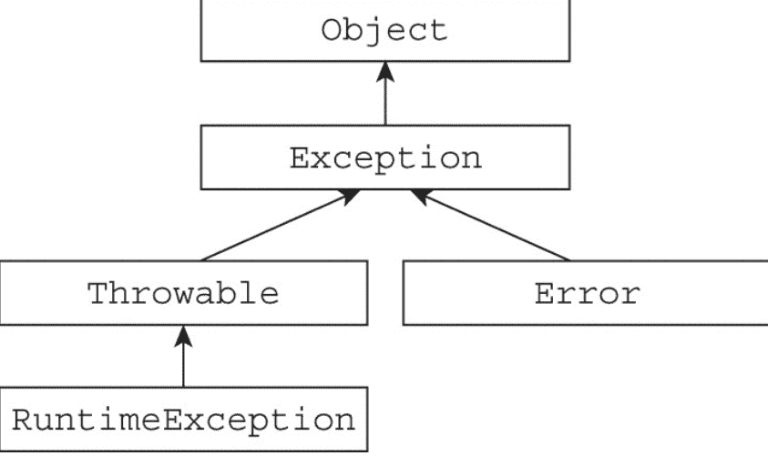
+ B. 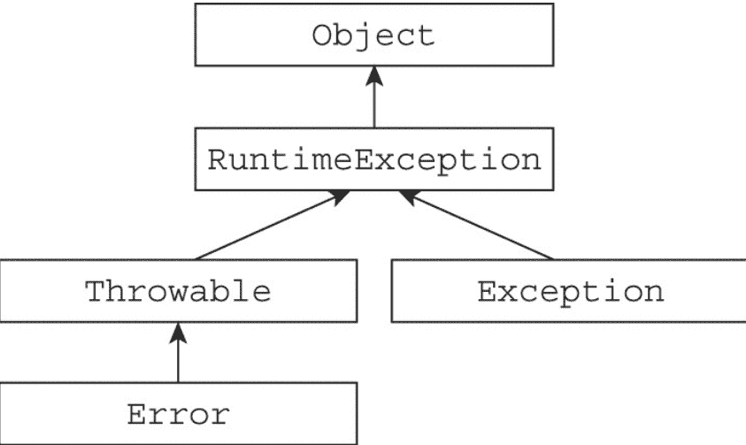
+ C. 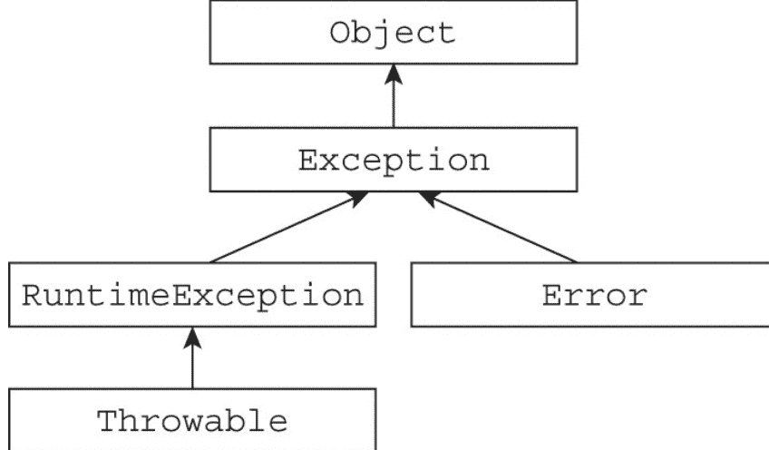
+ D. 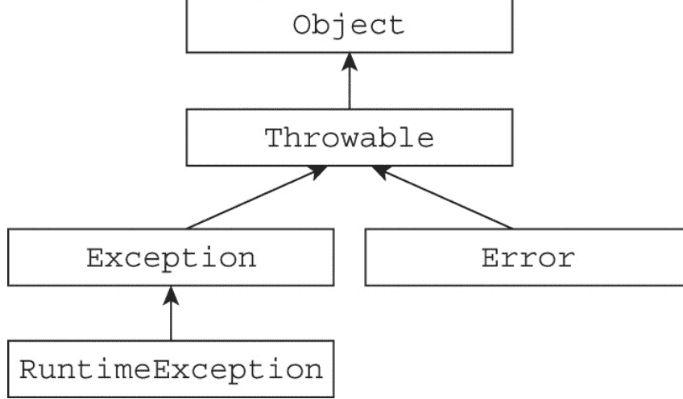

### 21. 将哪些异常类插入 `Problems` 类的空隙中，允许代码通过编译？

```java
class MissingMoneyException {}

class MissingFoodException {}

public class Problems {

    public void doIHaveAProblem()
        throws MissingMoneyException, MissingFoodException
    {
        System.out.println("No problems");
    }

    public static void main(String[] s) throws ______ {

        try {

            final Problems p = new Problems();

            p.doIHaveAProblem();

        } catch (Exception e) {

            throw e;

        }

    }

}
```

+ A. `Exception`
+ B. `RuntimeException`
+ C. `MissingFoodException`
+ D. `MissingMoneyException, MissingFoodException`
+ E. `MissingMoneyException`
+ F. 以上皆非

### 22. 关于 `Closeable` 和 `AutoCloseable` 的哪些说法是正确的？（选择两个。）

+ A. `AutoCloseable` 继承自 `Closeable`。
+ B. `Closeable` 继承自 `AutoCloseable`。
+ C. 实现了 `AutoCloseable` 的类中的 `close()` 方法不能抛出 `IOException`。
+ D. 实现了 `Closeable` 的类中的 `close()` 方法不能抛出 `Exception`。
+ E. 没有区别；其中一个是为了向后兼容而添加的。
+ F. 两者都有泛型返回类型。

### 23. 将哪些表达式插入到以下类的空隙中，允许代码通过编译？（选择两个。）

```java
package sun;

import java.io.*;

public class Beach {

    class TideException extends RuntimeException {

        public void surf() throws RuntimeException {

            try {

                throw new TideException();

            } catch (______) { }

        }

    }

}
```

+ A. `Exception a | RuntimeException f`
+ B. `IllegalStateException | TideException t`
+ C. `TideException | IOException i`
+ D. `TideException | Exception x`
+ E. `Error e`
+ F. `Exception z`

### 24. 下列哪些场景是使用和捕获异常的最佳场景？（选择两个。）

+ A. 电脑着火了。
+ B. 网络连接断开。
+ C. 调用者向方法传递了无效数据。
+ D. 代码无法编译。
+ E. 方法结束得比预期早。
+ F. 程序内存耗尽。
+ G. 搜索没有返回结果。

### 25. 关于以下程序的哪个说法是正确的？

```java
1: package dogpark;
2: public class Fetch {
3:     public int play(String name) throws RuntimeException
4:     try {
5:         throw new RuntimeException(name);
6:     } catch (Throwable e) {
7:         throw new RuntimeException(e);
8:     }
9: }
10: public static final void main(String[] args)
11: throws RuntimeException {
12:     new Fetch().play("webby");
13:     new Fetch().play("Georgette");
14: }}
```

+ A. 运行时向调用者抛出了一个异常。
+ B. 运行时向调用者抛出了两个异常。
+ C. 运行时向调用者抛出了两个以上的异常。
+ D. 因为 `play()` 方法，该类无法编译。
+ E. 因为 `main()` 方法，该类无法编译。
+ F. 以上皆非。

### 26. 以下应用程序程序的输出是什么？

```java
package body;

import java.io.IOException;

class Organ {

    public void operate() throws IOException {

        throw new RuntimeException("Not supported");

    }

}

public class Heart extends Organ {

    public void operate() throws Exception {

        System.out.print("beat");

    }

    public static void main(String[] c) throws Exception {

        try {

            new Heart().operate();

        } finally {

            System.out.print("!");

        }

    }

}
```

+ A. beat
+ B. beat!
+ C. Not supported
+ D. 代码无法编译。
+ E. 代码可以编译，但在运行时打印堆栈跟踪。
+ F. 以上皆非。

### 27. 关于使用 `try-with-resources` 语句的哪些说法是正确的？（选择两个。）

+ A. 它减少了开发者编写的代码量。
+ B. 它在 `try` 块结束前手动关闭资源。
+ C. 关联的 `catch` 块在资源关闭之前运行。
+ D. 它仅兼容实现了 `Close` 接口的类。
+ E. 它兼容所有实现了 `Closeable` 接口的类。
+ F. 它不能与 `finally` 块配合使用。

### 28. 以下程序的输出是什么？

```java
package zoo;

class BigCat {

    void roar(int level) throws RuntimeException {

        if(level<3) throw IllegalArgumentException();

        System.out.print("Roar!");

    }

}

class Lion extends BigCat {

    @Override

    void roar() { System.out.print("Meow"); }

}

public static void main(String args) { {Cat kitty = new Lion();

    kitty.roar(2);

```

+ A. Meow
+ B. Roar!
+ C. Roar!!!
+ D. Roar
+ E. 运行时打印堆栈跟踪。
+ F. 以上不是。

### 29. 编译并执行以下代码的结果是什么？

```java
package wind;

class Storm {

    public static void main(String[] args) throws Exception {

        try (AutoCloseable weather = new AutoCloseable()) {

            System.out.println("Thunder");

        } catch (Exception) {

            System.out.println("Lightning");

        } finally {

            System.out.println("gone");

        }

    }

}
```

+ A. 打印一行。
+ B. 打印两行。
+ C. 打印三行。
+ D. 打印四行。
+ E. 因为声明无法编译。
+ F. 因为其他原因无法编译。
+ G. 以上皆非。

### 30. 下列有多少异常声明是有效的？

```java
class Error extends Exception {}

class IllegalArgumentException extends RuntimeException {}

class NumberException extends NumberException {}

interface Worry {}
```

+ A. 无
+ B. 一个
+ C. 两个
+ D. 三
+ E. 四
+ F. 五

### 31. 如果 `try` 语句同时对 `ClassException` 和 `RuntimeException` 进行了 `catch`，那么下列哪个说法是正确的？

+ A. 这两种类型的 `catch` 块可以任意顺序声明。
+ B. `try` 语句无法声明这些类型，因为它们不兼容。
+ C. `ClassException` 的 `catch` 块必须在 `RuntimeException` 之前。
+ D. `RuntimeException` 的 `catch` 块必须在 `ClassException` 之前。
+ E. 以上皆非。

### 32. 假设 `Scanner` 是实现了 `Closeable` 的有效类，以下应用程序的预期输出是什么？

```java
package castles;

import java.util.Scanner;

public class Fortress {

    public void openBridge() throws Exception {

        try {
```


# Java 异常处理练习题

## 32. 以下代码的输出是什么？

```java
throw new Exception("Circle");

} catch (Exception | Error e) {

    System.out.print("Opening!");

} finally {

    System.out.print("Walls");

}

}

public static void main(String[] args) {

    try (Scanner e = new Scanner(System.in)) {

        new Fortress().openBridge();

    }

}

}
```

+ A. Opening!Walls
+ B. 代码在第 1 行无法编译。
+ C. 代码在第 2 行无法编译。
+ D. 代码在第 3 行无法编译。
+ E. 代码可以编译，但在运行时打印堆栈跟踪。
+ F. 以上皆非。

## 33. 以下应用程序的输出是什么？

```java
package game;

public class BasketBall {

  public static void main(String[] dribble) {

    try {

      System.out.print(1);

      throw new ClassCastException();

    } catch (ArrayIndexException ex) {

      System.out.print(2);

    } catch (Throwable ex) {

      System.out.print(3);

    } finally {

      System.out.print(4);

    }

    System.out.print(5);

  }

}
```

+ A. 145
+ B. 1345
+ C. 1235
+ D. 代码无法编译。
+ E. 代码可以编译但在运行时抛出异常。
+ F. 以上皆非。

## 34. 假设编译代码时使用了 `-g:vars` 以包含调试信息，以下代码片段的输出是什么？

```java
41: String mode = null;
42: int grade = (Integer)null;
43: Integer average = null;
44: if(grade>= average && Integer.parseInt(mode) > 0) {
45:     System.out.println("You passed!");
46: }
```

- A. 堆栈跟踪中命名 `mode` 的 `NullPointerException`
- B. 堆栈跟踪中命名 `grade` 的 `NullPointerException`
- C. 堆栈跟踪中命名 `average` 的 `NullPointerException`
- D. 堆栈跟踪中命名 `grade`、`average` 和 `mode` 的 `NullPointerException`
- E. 以上都不是

## 35. 下面程序的输出是什么？

```java
package signlanguage;

import java.io.Closeable;

class ReadSign implements Closeable {

    public void close() {}

    public String get() { return "Hello"; } 

}

class MakeSign implements AutoCloseable {

    public void close() {}

    public void send(String message) {

        System.out.print(message);

    }

}

public class Translate {

    public static void main(String[] hands) {

        try (ReadSign r = new ReadSign();
            MakeSign w = new MakeSign()) {

            w.send(r.get());

        }

    }

}
```

- A. Hello
- B. 因为 `ReadSign` 类导致代码无法编译。
- C. 因为 `MakeSign` 类导致代码无法编译。
- D. 因为 try-with-resources 语句导致代码无法编译。
- E. 以上都不是。

## 36. 下面程序的输出是什么？

```java
package what;

class FunEvent implements AutoCloseable {

    private final int value;

    FunEvent(int value) { this.value = value; }

    public void close() {

        System.out.print(value);

    }

}

public class Happening {

    public static void main(String[] lots) {

        FunEvent e = new FunEvent(1);

        try (e; var f = new FunEvent(8)) {

            System.out.print("2");

            throw new ArithmeticException();

        } catch (Exception x) {

            System.out.print("3");

        } finally {

            System.out.print("4");

        }

    }

}
```

- A. 24
- B. 21834
- C. 23418
- D. 28134
- E. 28134
- F. 代码无法编译。

## 37. 下面程序的输出是什么？

```java
package office;

import java.io.*;

public class Printer {

    public void print() {

        try {

            throw new FileNotFoundException();

        } catch (Exception | RuntimeException e) {

            System.out.print("Z");

        } catch (Throwable f) {

            System.out.print("X");

        } finally {

            System.out.print("Y");

        }

    }

    public static void main(String[] ink) {

        new Printer().print();

    }

}
```

- A. Y
- B. XY
- C. ZY
- D. 代码无法编译。
- E. 代码可以编译，但在运行时会打印堆栈跟踪。
- F. 以上都不是。

## 38. 下面程序的输出是什么？

```java
class ProblemException extends Exception {

    ProblemException(Exception e) { super(e); }

}

class MajorProblemException extends ProblemException {

    MajorProblemException(Exception e) { super(e); }

}

public class Unfortunate {

    public static void main(String[] args) throws Exception {

        try {

            System.out.print(1);

            throw new MajorProblemException(
                new IllegalStateException());

        } catch (ProblemException | RuntimeException e) {

            System.out.print(2);

            try {

                throw new MajorProblemException(e);

            } finally {

                System.out.print(3);

            }

        } finally {

            System.out.print(4);

        }

    }

}
```

- A. 123
- B. 123 后面跟着异常堆栈跟踪
- C. 1234
- D. 1234 后面跟着异常堆栈跟踪
- E. 无法编译
- F. 以上都不是

## 39. 下面程序的输出是什么？

```java
1: package robots.are.real;
2: public class Computer {
3: public void compute() throws Exception {
4:     throw new NullPointerException("Does compute!");
5: }
6:     public static void main(String[] b) throws Exception
{
7:     try {
8:         new Computer().compute();
9:     } catch (RuntimeException e) {
10:         System.out.print("zero");
11:         throw e;
12:     } catch (Exception e) {
13:         System.out.print("one");
14:         throw e;
15:     }}
```

- A. zero
- B. one
- C. zero 后面跟着堆栈跟踪
- D. one 后面跟着堆栈跟踪
- E. 无法编译
- F. 以上都不是

## 40. 给定的图表，缺少哪两个类？


- A. 位置 1 和位置 2 处的 `IOException`
- B. 位置 1 和位置 2 处的 `Exception`
- C. 位置 1 和位置 2 处的 `RuntimeException`
- D. 位置 1 和位置 2 处的 `IllegalStateException`
- E. 位置 1 和位置 2 处的 `FileNotFound`

## 41. 下面程序的输出是什么？

```java
package vortex;

class TimeException extends Exception {}

class TimeMachine implements AutoCloseable {

    int v;

    TimeMachine(int v) { this.v = v; }

    public void close() throws Exception {

        System.out.print(v);

    }

}

public class Traveler {

    public static void main(String[] args) {

        try (var deis = new TimeMachine(1);
             var delorean = new TimeMachine(2);
             var tardis = new TimeMachine(3)) {

        } catch (TimeException e) {

            System.out.print(4);

        } finally {

            System.out.print(5);

        }

    }

}
```

- A. 123
- B. 321
- C. 523
- D. 521
- E. 代码无法编译。

## 42. 在方法签名中添加检查异常的常见理由有哪些？（选择三个）

- A. 告知状态已损坏
- B. 强制调用者处理
- C. 确保异常不会终止应用程序
- D. 通知调用者潜在问题
- E. 给调用者一个机会

## 43. 关于下面的程序的哪种说法是正确的？

```java
package highway;

import java.io.*;

class CarCrash extends Error {

    CarCrash(Exception e) {} // w1

}

public class Car {

    public static void main(String[] s) throws Exception { // w2

      try {

        throw new IOException("Auto-pilot error");

      } catch (IOException | CarCrash e) { // w3

        throw e;

      } catch (FileNotFoundException a) { // w4

        throw a;

      }

    }

}
```

- A. 因为 w1 代码无法编译。
- B. 因为 w2 代码无法编译。
- C. 因为 w3 代码无法编译。
- D. 因为 w4 代码无法编译。
- E. 代码可以编译并打印跟踪。
- F. 以上都不是。

## 44. 哪些异常类必须在抛出它们的方法中被处理或声明？（选择三个）

- A. Happy
- B. Dopey
- C. Sleepy
- D. Sneezy
- E. Doc
- F. own

## 45. 下面程序的输出是什么？

```java
package pond;

import java.io.*;

abstract class Duck {

    protected int count;

    public abstract int getDuckies() throws IOException

}

public class Ducklings extends Duck {

    private int age;

    public Ducklings(int age) { this.age = age; }

    public int getDuckies() { return this.age/count; }

    public static void main(String[] pondInfo) throws Exception {

        var itQuacks = new Ducklings(5);

        System.out.print(itQuacks.getDuckies());

    }

}
```

- A. 0
- B. 1
- C. 5
- D. 代码无法编译。
- E. 代码可以编译但在运行时抛出异常。
- F. 以上都不是。

## 46. 关于下面行代码的哪些描述是正确的？（选择三个）

```java
throw new IllegalArgumentException();
```

- A. 调用它的方法必须声明兼容的异常。
- B. 调用它的代码可以包含处理此异常的 try-with-resources 块。
- C. 此异常不应该被处理或声明。
- D. 调用它的代码可以包含处理此异常的 try/catch 块。
- E. 此异常应该只在方法开始时抛出。
- F. 此异常不需要由方法处理。

## 47. 下一个应用程序的输出是什么？

```java
package storage;

import java.io.*;

public class Backup {

    public void performBackup() {

        try {

            throw new IOException("Disk not found"); // z1

        } catch (Exception e) {

            try {

                throw new FileNotFoundException("File not found");

            } catch (FileNotFoundException e) { // z2

                System.out.print("Failed");

            } 

        }

    }

    public static void main(String[] files) {

        new Backup().performBackup(); // z3

    }

}
```


- A. Failed
- B. 程序编译，但在运行时会打印堆栈跟踪。
- C. 因为行 z1，代码无法编译。
- D. 因为行 z2，代码无法编译。
- E. 因为行 z3，代码无法编译。
- F. 以上都不是。

### 48. 下面这段代码的输出是什么？

```java
package com.tps;

import java.io.IOException;

public class IncidentReportException extends RuntimeException {

    public static void main(String[] args) throws Exception {

        try {

            throw new IncidentReportException(new IOException(()));

        } catch (RuntimeException e) {

            System.out.println(e.getCause());

        } 

    }

}
```

- A. com.tps.IncidentReportException
- B. java.lang.IOException
- C. 因为 `IOException` 是受检异常（checked exception），代码无法编译。
- D. 因为 `IncidentReportException` 对象的声明，代码无法编译。
- E. 以上都不是。

### 49. 哪些表达式插入以下类的空白处时，允许代码编译？（选择两个。）

```java
package music;

import java.sql.*;

public class Bells implements AutoCloseable {

    @Override public void close() throws Exception {

        throw new Exception();

    }

    class RingException extends Exception {

        public RingException(String message) {}

    }

    public static void main(String[] notes) throws Throwable {

        try (Player p = null) {

            throw new Exception();

        } catch (Exception e) {

            catch ( q) {

        }

    }

}
```

- A. Error
- B. IllegalStateException
- C. RingException
- D. SQLException
- E. Throwable
- F. RuntimeException

### 50. 关于该程序的哪个说法是正确的？

```java
package tag;

class MissedCallException extends Exception {}

public class Phone {
    static void makeCall() throws RuntimeException {
        throw new ArrayIndexOutOfBoundsException("Call");
    }
    public static void main(String[] messages) {
        try {
            makeCall();
        } catch (MissedCallException e) {
            throw new RuntimeException("Voicemail");
        } finally {
            throw new RuntimeException("Text");
        }
    }
}
```

- A. 运行时打印一个消息中包含 Call 的异常。
- B. 运行时打印消息中包含 Voicemail 的异常。
- C. 运行时打印消息中包含 Text 的异常。
- D. 代码无法编译。
- E. 以上都不是。

### 51. 如果一个 try 语句同时拥有 IllegalArgumentException 和 NullPointerException 的 catch 块，那么以下哪个说法是正确的？

- A. 这两种异常类型的 catch 块可以以任何顺序声明。
- B. 一个 try 语句不能声明这两个 catch 块声明，因为它们是不兼容的。
- C. IllegalArgumentException 的 catch 块必须出现在 NullPointerException 的 catch 块之前。
- D. NullPointerException 的 catch 块必须出现在 IllegalArgumentException 的 catch 块之前。
- E. 以上都不是。

### 52. 下一个应用程序的输出是什么？

```java
package furniture;
class Chair {
    public void sit() throws IllegalArgumentException {
        System.out.print("creak");
        throw new RuntimeException();
    }
}
public class Stool extends Chair {
    public void sit() throws RuntimeException {
        System.out.print("thud");
    }
    public static void main(String[] c) throws Exception {
        try {
            new Stool().sit();
        } finally {
            System.out.print("?");
        }
    }
}
```

- A. creak
- B. thud
- C. thud?
- D. 代码无法编译。
- E. 代码编译，但在运行时会打印堆栈跟踪。
- F. 以上都不是。

### 53. 下一个应用程序的输出是什么？

```java
import java.io.*;
import java.sql.*;
public class MyDatabase implements Closeable {
    public void close() throws SQLException {
        System.out.print("2");
    }
    public void write(String data) {}
    public String read() { return null; }
    
    public static void main(String[] files) throws Exception {
        try {
            MyDatabase myDb = new MyDatabase();
            // TODO: 决定读/写
        } finally {
            System.out.print("1");
        }
    }
}
```

- A. 21
- B. 2
- C. 因为 `MyDatabase` 类，代码无法编译。
- D. 因为 try 语句，代码无法编译。
- E. 因为其他原因。

### 54. 哪些构造函数可以被一个扩展 Exception 的异常调用？

- A. Exception
- B. String
- C. 都是
- D. 都没有

### 55. 编译并运行以下代码的结果是什么？

```java
package dinner;
public class Pizza {
    void order(RuntimeException e) { // h1
        throw e; // h2
    }
    public static void main(String[] u) {
        Pizza p = new Pizza();
        try {
            p.order(new IllegalArgumentException()); // h3
        } catch (RuntimeException e) { // h4
            System.out.print(e);
        }
    }
}
```

- A. IllegalArgumentException
- B. 因为 h1，代码无法编译。
- C. 因为 h2，代码无法编译。
- D. 因为 h3，代码无法编译。
- E. 因为 h4，代码无法编译。
- F. 代码

### 56. 给出一个托管网站的应用程序，以下哪些情况最可能导致抛出 java.lang.Error？（选择两个。）

- A. 用户尝试登录过多。
- B. 用户同时尝试注册。
- C. 无限调用自身。
- D. 应用程序临时丢失连接。
- E. 用户输入密码错误。
- F. 连接累积。

### 57. 以下程序打印多少行文本？

```java
package;
class DiskPlayer implements AutoCloseable {
    public void close() {}
}
class LightCycle {
    public static void main(String[] bits) {
        try (DiskPlayer john = new DiskPlayer()) {
            System.out.println("ping");
            john.close();
        } finally {
            System.out.println("pong");
            john.close();
        }
        System.out.println("return");
    }
}
```

- A. 一行。
- B. 两行。
- C. 三行。
- D. 因为 `DiskPlayer` 类，代码无法编译。
- E. 因为其他原因，代码无法编译。
- F. 以上都不是。

### 58. 下面代码的输出是什么？

```java
package com.tps;
import java.io.IOException;
public static class OfficeException extends RuntimeException {
    public OfficeException(Exception e) {
        super(e);
    }
    public static void main(String[] args) throws Exception {
        try {
            throw new OfficeException(new IOException());
        } catch (RuntimeException e) {
            System.out.println(e.getCause());
        }
    }
}
```

- A. com.tps.OfficeException
- B. java.lang.IOException
- C. 因为 `IOException` 是受检异常，代码无法编译。
- D. 因为 `officeException` 的声明，代码无法编译。
- E. 以上都不是。

### 59. 对于给定的应用程序，行 e1 输出的类名是什么？

```java
package canyon;
final class FallenException extends Exception {}
final class HikingGear implements AutoCloseable {
    @Override
    public void close() throws Exception {
        throw new FallenException();
    }
}
public class Cliff {
    public final void climb() throws Exception {
        try (HikingGear gear = new HikingGear()) {
            throw new RuntimeException();
        }
    }
    public static void main(String[] rocks) {
        try {
            new Cliff().climb();
        } catch (Throwable t) {
            System.out.println(t); // e1
        }
    }
}
```

- A. java.lang.RuntimeException
- B. canyon.FallenException
- C. 代码无法编译。
- D. 代码可以编译，但在运行时之前无法确定答案。
- E. 以上均不是。

### 60. 给定以下应用程序，运行时堆栈跟踪中将打印哪种特定类型的异常？

```java
package carnival;
public class WhackAnException {
    public static void main(String[] hammer) {
        try {
            throw new ClassCastException();
        } catch (IllegalArgumentException e) {
            throw new IllegalArgumentException();
        } catch (RuntimeException e) {
            throw new NullPointerException();
        } finally {
            throw new RuntimeException();
        }
    } }
```

- A. ClassCastException
- B. IllegalArgumentException
- C. NullPointerException
- D. RuntimeException
- E. 代码无法编译。
- F. 以上均不是。

## 第 5 章：与数组和集合的操作

本次练习题涵盖的 OCP 考试考点包括：

✓ 操作数组和集合
+ 操作数组和集合

创建 Java 数组、List、Set、Map 和 Deque 集合，并添加、删除、更新、检索和排序它们的元素。

### 1. 以下代码的输出是什么？

```java
List<String> museums = new ArrayList<>(1);
museums.add("Natural History");
museums.add("Science");
museums.add("Art");
museums.remove(2);
System.out.println(museums);
```

- A. [Natural History, Science]
- B. [Natural History, Art, Science]
- C. 代码无法编译。
- D. 代码可以编译但在运行时会抛出异常。

### 2. 以下声明中有几个是合法的？

```java
String[] lions = new String[];
String[] tigers = new String[1] {"tiger"};
String[] bears = new String[] {};
String ohMy[] = new String[0] {};
```

- A. 无
- B. 一个
- C. 两个
- D. 三个
- E. 四个

### 3. 以下哪项可以填充空白处使代码通过编译？

- A. 仅 ?
- B. 仅 N
- C. ? 和 N
- D. News, 和 Object
- E. N, News, 和 Object
- F. 以上均不是

### 4. 关于此代码，以下哪些是正确的？（选择两个。）

```java
26: List<String> strings = new ArrayList<?>();
27: var ints = new HashSet<Integer>();
28: Double dbl = 5.0;
29: ints.add(2);
30: ints.add(null);
```

- A. 代码按原样编译。
- B. 需要删除一行代码才能通过编译。
- C. 需要删除两行代码才能通过编译。
- D. 一行代码使用了自动装箱（autoboxing）。
- E. 两行代码使用了自动装箱。
- F. 三行代码使用了自动装箱。

### 5. 以下哪项创建了一个维度为 2x2 的空二维数组？

- A. int[][] blue = new int[2, 2];
- B. int[][] blue = new int[2], [2];
- C. int[][] blue = new int[2][2];
- D. int[][] blue = new int[2 x 2];
- E. 以上均不是


## 6. 以下代码的输出是什么？

```java
var q = new ArrayDeque<String>();
q.offer("snowball");
q.offer("minnie");
q.offer("sugar");

System.out.print(q.peek() + " " + q.peek() + " " + 
q.size());
```

+ A. sugar 3
+ B. sugar minnie 1
+ C. snowball minnie 1
+ D. snowball snowball 3
+ E. 代码无法编译。
+ F. 以上均不是。

## 7. 你正在经营一家图书馆。读者按名称选择书籍。他们在结算队的末尾等待。当他们到达队时，扫描书籍的 ISBN（一个唯一识别码）。结算系统根据此数字找到书籍并将其标记为已借出。在这些选项中，哪些数据结构最好表示“排队借书”和“标记为已借出的书籍查找”分别？

+ A. ArrayList, HashSet
+ B. ArrayList, TreeMap
+ C. ArrayList, TreeSet
+ D. LinkedList, HashSet
+ E. LinkedList, TreeMap
+ F. LinkedList, TreeSet

## 8. 运行以下程序的运行是什么？

```java
package fun;
public class Sudoku {
    static int[][][] game;
    public static void main(String[] args) {
        game[3][3] = 6;
        Object[] obj = game;
        game[3][3] = "X";
        System.out.println(game[3][3]);
    }
}
```

A. X
B. 代码无法编译。
C. 代码可以编译但在运行时抛出 `NullPointerException`。
D. 代码可以编译但在运行时抛出不同的异常。
E. 以上均不是。

## 9. 假设你想实现一个 `Comparator<String>`，以便按最长的字符串优先排序。假设没有 null 值。哪种方法可以实现这样的比较器？

A.

```java
public int compare(String s1, String s2) {
    return s1.length() - s2.length();
}
```

B.

```java
public int compare(String s1, String s2) {
    return s2.length() - s1.length();
}
```

C.

```java
public int compare(Object obj1, Object obj2) {
    String s1 = (String) obj1;
    String s2 = (String) obj2;
    return s1.length() - s2.length();
}
```

D.

```java
public int compare(Object obj1, Object obj2) {
    String s1 = (String) obj1;
    String s2 = (String) obj2;
    return s2.length() - s1.length();
}
```

E. 以上均不是

## 10. 以下代码输出多少行？

```java
var days = new String[] { "Sunday", "Monday", "Tuesday", "Wednesday", "Thursday", "Friday", "Saturday" };
for (int i = 1; i < days.length; i++)
    System.out.println(days[i]);
```

+ A. 0
+ B. 六行
+ C. 七行
+ D. 代码无法编译。
+ E. 代码可以编译但在运行时抛出异常。

## 11. 哪项可以填充空白处使代码编译并在运行时打印 true？

```java
var c = new <String>();
c.add("pen");
c.remove("pen");
System.out.println(c.isEmpty());
```

+ A. ArrayDeque
+ B. ArrayList
+ C. TreeMap
+ D. TreeSet

## 12. 关于此代码，哪些是正确的？

```java
import java.util.*;
public class Garden {
    public static void main(String x, y) {
        var coll = Arrays.asList(y);
        Collections.sort(coll);
        int result = Collections.binarySearch(coll, x);
        System.out.println(result);
    }
}
```

A. 如果空白是 int，代码输出 0。
B. 如果空白是 int，代码输出 1。
C. 如果空白是 int，代码无法编译。
D. 如果空白是 String，代码输出 flower。
E. 如果空白是 String，代码输出 seed。
F. 如果空白是 String，代码无法编译。

（注：题目要求两个）

## 13. 以下声明中有几个是合法的？

```java
public void greek() {
    String alpha[];
    String beta;
    String gamma[];
    String delta[];
    String epsilon;
}
```

+ A. 一个
+ B. 两个
+ C. 三个
+ D. 四个
+ E. 五个
+ F. 六

## 14. 以下代码的结果是什么？

```java
var list = new ArrayList<Integer>();
list.add(56);
list.add(56);
list.add(3);

var set = new TreeSet<Integer>(list);
System.out.print(set.size());
System.out.print(" ");
System.out.print(set.next());
```

A. 2 3
B. 2 56
C. 3 3
D. 3 56
E. 以上均不是

## 15. 无参数运行 `java Copier.java` 时，关于此代码哪些是正确的？（选择两个。）

```java
1: import java.util.Arrays;
2:
3: public class Copier {
4:     public static void main(String... original) {
5:     String[] copy = original;
6:     Arrays.sort(original);
7:     Arrays.search(original, " ");
8:     System.out.println(original.size()
9:             + " " + original[0]);
10: }
```

A. 一行包含编译错误。
B. 两行包含编译错误。
C. 三行包含编译错误。
D. 四行包含编译错误。
E. 如果修复编译错误，代码将抛出异常。
F. 如果修复编译错误，代码将成功运行。

## 16. 以下输出是什么？（选择三个。）

```java
20: var chars = new <Character>();
21: chars.add('a');
22: chars.add(Character.valueOf('b'));
23: chars.set(1, 'c');
24: chars.remove(0);
25: System.out.print(chars.size() + " " + 
chars.contains('b'))
```

+ A. 当插入 ArrayList 时，代码输出 1 false。
+ B. 当插入 ArrayList 时，代码无法编译。
+ C. 当插入 HashMap 时，代码输出 1 false。
+ D. 当插入 HashMap 时，代码无法编译。
+ E. 当插入 HashSet 时，代码输出 1 false。
+ F. 当插入 HashSet 时，代码无法编译。

## 17. 以下代码的输出是什么？

```java
import java.util.*;
record Magazine(String name) {
  public int compareTo(Magazine m) {
    return name.compareTo(m.name);
  }
}
public class Newsstand {
  public static void main(String[] args) {
    var set = new TreeSet<Magazine>();
    set.add(new Magazine("highlights"));
    set.add(new Magazine("Newsweek"));
  }
}
```

```java
set.add(new Magazine("highlights"));
System.out.println(set.iterator().next());
}
```

A. Magazine[name=highlights]
B. Magazine[name=Newsweek]
C. null
D. 代码无法编译。
E. 代码可以编译但在运行时抛出异常。

## 18. 哪一行是新增的可以防止此代码无错误编译或运行？

```
11: char[][] ticTacToe = new char[3][3];
12: ticTacToe[1][3] = 'X';
13: ticTacToe[2][2] = 'X';
14: ticTacToe[3][1] = 'X';
15: System.out.println(ticTacToe.length + " in a row!");
```

+ A. 第 11 行
+ B. 第 12 行
+ C. 第 13 行
+ D. 第 14 行
+ F. 以上都不是；代码可以无问题的编译并运行。

## 19. 哪一行是出现编译错误的第一行？

```java
class Fur<T extends Mammal> { // line R
  void clean() {
    var bat = new Fur<Bat>(); // line S
    var cat = new Fur<Cat>(); // line T
    var sat = new Fur<Sat>(); // line U
  }
}
```

+ A. 第 R 行
+ B. 第 S 行
+ C. 第 T 行
+ D. 第 U 行
+ E. 以上都不是

## 20. 这段代码可能的结果是什么？

```java
var nums = new HashSet<Long>();
nums.add((Long)Math.min(5, 3));
nums.add((Long)Math.round(3.14));
nums.add((Long)Math.pow(4,2));
System.out.println(nums);
```

+ A. [3]
+ B. [16]
+ C. [16, 3]
+ D. [16, 3, 3]
+ E. 以上都不是

## 21. 以下代码的输出是什么？

```java
var x = new ArrayDeque<Integer>();
x.offer(18);
x.offer(5);
x.push(13);
System.out.println(x.poll() + " " + x.poll());
```

+ A. 13 5
+ B. 13 18
+ C. 18 5
+ D. 18 13
+ E. 代码无法编译。
+ F. 代码可以编译但打印其他内容。

## 22. 假设我们想存储 JellyBean 对象。以下哪些项需要 JellyBean 实现 `Comparable` 接口或创建一个 `Comparator` 以将它们添加到集合中？（选择两个。）

+ A. ArrayList
+ B. HashMap
+ C. HashSet
+ D. SortedArray
+ E. TreeMap
+ F. TreeSet

## 23. 以下哪项引用了非空数组中的第一个和最后一个元素？

+ A. trains[0] and trains[train.length]
+ B. trains[0] and trains[train.length - 1]
+ C. trains[1] and trains[train.length]
+ D. trains[1] and trains[train.length - 1]
+ E. 以上都不是

## 24. 以下哪项可以填入空白使该代码通过编译？

```java
public static void throwOne(Collection<_______> coll) {
    var iter = coll.iterator();
    if (iter.hasNext())
        throw iter.next();
}
```

+ A. ?
+ B. ? extends RuntimeException
+ C. ? super RuntimeException
+ D. T
+ E. T extends RuntimeException
+ F. T super RuntimeException
+ G. 以上都不是

## 25. 这四个数组声明中，哪一个产生的数组与其他其它不同？

+ A. int[] nums nums = new int[2][1];
+ B. int[] nums[] = new int[2][1];
+ C. int[][] nums[] = new int[][]{ { { }, { } };
+ D. int[] nums[] = new int[][]{ { 0, 0 } } };

## 26. 以下输出输出什么？

```java
var laptops = new String[] { "Linux", "Mac", "Windows" };
var desktops = new String[] { "Mac", "Linux", "Windows" };

var search = Arrays.binarySearch(laptops, "Linux");
var mismatch1 = Arrays.mismatch(laptops, desktops);
var mismatch2 = Arrays.mismatch(desktops, desktops);

System.out.println(search + " " + mismatch1 + " " + mismatch2);
```

+ A. 保证为 -1 0 -1
+ B. 保证为 -1 -1 0
+ C. 保证为 0 -1 0
+ D. 保证为 0 0 -1
+ E. 输出未定义。
+ F. 代码无法编译。

## 27. main() 方法中的哪一行无法编译，或者指向一个无法编译的类？

```java
1:   interface Comic<S> {
2:     void draw(S s);
3:   }
4:   class ComicClass<S> implements Comic<S> {
5:     public void draw(S s) {
6:       System.out.println(s);
7:     }
8:   }
9:   class SnoopyClass implements Comic<S> {
10:    public void draw(S s) {
11:      System.out.println(s);
12:    }
13: }
14: class SnoopyComic implements Comic<S> {
15:     public void draw(S s) {
16:         System.out.println(s);
17:     }
18: }
19: public class Snoopy {
20:     public static void main(String[] args) {
21:         Comic<S> s1 = System.out.println(s);
22:         Comic<S> s2 = new ComicClass<>();
23:         Comic<S> s3 = new SnoopyClass();
24:         Comic<S> s4 = new SnoopyComic();
25:     }
```

+ A. 第 21 行
+ B. 第 22 行
+ C. 第 23 行
+ D. 第 24 行
+ E. 以上都不是。代码可以编译。

## 28. 填入空白使此代码通过编译：


```java
public class Truck implements Comparable<Truck> {
    private int id;
    public Truck(int id) {
        this.id = id;
    }
    @Override
    public int ________________(Truck t) {
        return id - t.id;
    }
}
```

+   A. `compare(Truck t)`
+   B. `compare(Truck t1, Truck t2)`
+   C. `compareTo(Truck t)`
+   D. `compareTo(Truck t1, Truck t2)`
+   E. 以上都不是

### 29. 以下代码输出多少行？

```java
var days = new String[] { "Sunday", "Monday", "Tuesday",
"Wednesday", "Thursday", "Friday", "Saturday" };

for (int i = 0; i < days.length; i++)
  System.out.println(days[i]);
```

+   A. 六行
+   B. 七行
+   C. 代码无法编译。
+   D. 代码可以编译但在运行时抛出异常。

### 30. 以下哪项填入空白以打印 true？（选择两个。）

```java
String[] array = { "Natural History", "Science"};
var museums = ;
museums.set(0, "Art");
System.out.println(museums.contains("Art"));
```

+   A. `Arrays.asList(array)`
+   B. `Arrays.asList("Natural History", "Science")`
+   C. `List.of(array)`
+   D. `List.of("Natural History", "Science")`
+   E. `new ArrayList<String>("Natural History", "Science")`
+   F. `new List<String>("Natural History", "Science")`

### 31. 哪个选项不能填入空白以打印 socks？

```java
class Wash<T> {
  T item;
  public void clean(T item) {
    System.out.println("Clean " + item);
  }
}
public class LaundryTime {
  public static void main(String[] args) {
    wash.clean("socks");
  }
}
```

+   A. `var wash = new Wash<String>();`
+   B. `var wash = new Wash<>();`
+   C. `Wash wash = new Wash();`
+   D. `var wash = new Wash<String>();`
+   E. `Wash<String> wash = new Wash<>();`
+   F. 以上都可以填入空白。

### 32. 图中的哪个选项最能表示 `blocks` 变量？

```java
var blocks = new char[][] {
  {'a', 'b', 'c'}, {'d'}, {'e', 'f'} };
```

**Option A**

**Option B**

blocks

| 'a' | 'd' | 'e' |
|---|---|---|
| 'b' | | 'f' |
| 'c' | | |
| | | | |

|---|---|---|
| 'a' | 'd' | 'e' |
| 'b' | | 'f' |
| 'c' | | |

**Option C**

**Option D**

blocks

| 'a' | 'b' | 'c' |
|---|---|---|
| 'd' | | |
| 'e' | 'f' | 'g' |
| | | | |

|---|---|---|---|
| 'a' | 'b' | 'c' |
| 'd' | | | |
| 'e' | 'f' | |

+   A. Option A
+   B. Option B
+   C. Option C
+   D. Option D

### 33. 填入空白使代码打印 gamma。（选择两个。）

```java
var list = Arrays.asList("alpha", "beta", "gamma");
Collections.sort(list, ________);
System.out.println(list.get(0));
```

+   A. `(s, t) -> s.compareTo(t)`
+   B. `(s, t) -> t.compareTo(s)`
+   C. `Comparator.comparing((String s) -> s.charAt(0))`
+   D. `Comparator.comparing((String s) -> s.charAt(0)).reversed()`

### 34. 以下声明中有多少是合法的？

```java
float[] lion = new float[];
float[] tiger = new float[1];
float[] bear = new float[2];
float[] ohMy = new float[1];
```

+   A. 无
+   B. 一个
+   C. 二
+   D. 三
+   E. 四

### 35. 哪行代码导致 `ArrayIndexOutOfBoundsException`？

```java
var matrix[][] = new String[1][2];
matrix[0][0] = "Don't think you are, know you are."; // m1
matrix[0][1] = "I'm trying to free your mind Neo"; // m2
matrix[1][0] = "Is all around you "; // m3
matrix[1][1] = "why oh didn't I take the pill?"; // m4
```

+   A. m1
+   B. m2
+   C. m3
+   D. m4
+   E. 代码无法编译。
+   F. 以上都不是。

### 36. 假设有一个 `List<Integer>`。哪个方法允许你传递 List 并返回包含相同元素的不可变 Set？

+   A. `List.copyOf(list)`
+   B. `List.of(list)`
+   C. `Set.copyOf(list)`
+   D. `Set.of(list)`
+   E. 以上都不是

### 37. 以下代码输出什么？（选择两个。）

```java
var os = new String[] { "Mac", "Linux", "Windows" };
Arrays.sort(os);
```

```java
System.out.println(Arrays.binarySearch(os, "RedHat"));
System.out.println(Arrays.binarySearch(os, "Mac"));
```

+   A. -1
+   B. -2
+   C. -3
+   D. 0
+   E. 1
+   F. 2

### 38. 以下代码输出什么？

```java
var names = new HashMap<String, String>();
names.put("peter", "pan");
names.put("wendy", "darling");
var first = names.entrySet(); // line x1
```

```
System.out.println(first.getKey()); // line x2
```

+   A. peter
+   B. wendy
+   C. 由于行 x1 无法编译。
+   D. 由于行 x2 无法编译。
+   E. 由于其他原因无法编译。
+   F. 它在运行时抛出异常。

### 39. 下列元素中哪些出现在以下输出中？（选择三项。）

```
var q = new ArrayDeque<String>();
q.offerFirst("snowball");
q.offer("sugar");
q.offerLast("minnie");

System.out.println(q.poll());
System.out.println(q.removeFirst());
System.out.println(q.size());
```

+   A. sugar
+   B. minnie
+   C. snowball
+   D. 1
+   E. 2
+   F. 3

### 40. 下列声明对中，哪一组可以指向一个与其他不同的数组？

+   A. `int[][][][] nums1a, nums1b;`
+   B. `int[][][] nums2a[], nums2b;`
+   C. `int[][] nums3a[], nums3b[][];`
+   D. `int[] nums4a[][][], nums4b[][][];`

### 41. 下列哪项的行为与其他项不同？

+   A. `var set = new HashSet<>();`
+   B. `var set = new HashSet<Object>();`
+   C. `HashSet< > set = new HashSet<Object>();`
+   D. `HashSet<Object> set = new HashSet<>();`
+   E. `HashSet<Object> set = new HashSet<Object>();`

### 42. 关于以下代码的输出，哪是正确的？

```
var ints = new int[]{3,1,4};
var others = new int[]{2,7,1,8};
System.out.println(Arrays.compare(ints, others));
```

+   A. 它是负数，因为元素较少。
+   B. 它是 0，因为数组无法比较。
+   C. 它是正数，因为第一个元素更大。
+   D. 它是未定义的。
+   E. 代码无法编译。

### 43. 填充空白，使代码打印 beta。

```
var list = List.of("alpha", "beta", "gamma");
Collections.sort(list, ________);
System.out.println(list.get(0));
```

+   A. `(s, t) -> s.compareTo(t)`
+   B. `(s, t) -> t.compareTo(s)`
+   C. `Comparator.comparing(String::length)`
+   D. `Comparator.comparing(String::length).reversed()`
+   E. 以上均非

### 44. 下列代码的输出是什么？

```
12: queue = new ArrayDeque<>();
13: queue.offer("exelsior");
14: queue.peekFirst();
15: queue.addFirst("edwin");
16: queue.removeLast();
17: System.out.println(queue);
```

+   A. [edwin]
+   B. [excelsior]
+   C. [edwin, excelsior]
+   D. [excelsior, edwin]
+   E. 代码无法编译。
+   F. 代码在运行时抛出异常。

### 45. 数组引用 `moreBools` 允许多少维度？

`boolean[][] bools[], moreBools;`

+   A. 一维
+   B. 二维
+   C. 三维
+   D. 以上均非

### 46. 下列操作的结果是什么？

```java
Comparator<Integer> c = (x, y) -> y - x;
var ints = Arrays.asList(3, 1, 4);
Collections.sort(ints, c);
System.out.println(Collections.binarySearch(ints, 1));
```

+   A. 保证为 -1。
+   B. 保证为 0。
+   C. 保证为 1。
+   D. 代码无法编译。
+   E. 结果未定义。

### 47. 哪种陈述最准确地描述了 `Arrays` 类中搜索与排序之间的关系？

A. 如果数组未排序，调用 `Arrays.binarySearch()` 的结果是准确的，但如果排序过则会更慢。

+   B. 在调用 `Arrays.binarySearch()` 之前，数组不需要排序即可获得准确结果。
+   C. 在调用 `Arrays.binarySearch()` 之前必须对数组进行排序才能获得准确结果。
+   D. 以上均非。

### 48. 在确保代码继续编译的情况下，关于下图的哪些陈述是正确的？（选择两项。）

```
List balloons = new ArrayList (();
P Q
var air = new ArrayList ();
R R
```

+   A. 可以在 P 和 R 处插入 `< >` 而不引入任何其他更改。
+   B. 可以在 Q 和 S 处插入 `< >` 而不引入任何其他更改。
+   C. 可以在所有四个位置插入 `< >`。
+   D. 两个变量都指向一个 `ArrayList<String>`。
+   E. 只有一个变量指向一个 `ArrayList<String>`。
+   F. 两个变量都不指向 `ArrayList<String>`。

### 49. 在不带任何命令行参数调用，以下代码的结果是什么？（选择两项。）

```
1: import java.util.*;
2: public class Binary {
3: public static void main(String... args) {
4:     Arrays.sort(args);
5:     System.out.println(Arrays.toString(args));
6:     System.out.println(args[0]);
7: }
8: }
```

+   A. null
+   B. []
+   C. Binary
+   D. 代码抛出 `ArrayIndexException`。
+   E. 代码抛出 `NullPointerException`。
+   F. 代码无法编译。

### 50. 哪行存在编译错误？

```
class Fur<? extends Mammal> // line R
    void clean() {
        var bat = new<Bat>(); // line S
        var cat = new<Cat>(); // line T
        var sat = new<Sat>(); // line U
    }
```

+   A. Line R
+   B. Line S
+   C. Line T
+   D. Line U
+   E. 以上均非

### 51. 下列程序的结果是什么？

```
1: package fun;
2: public class Sudoku {
3:     int[][] game = new int[6][6];
4:     public static void main(String[] args) {
5:         Object[] obj = game;
6:         obj[3] = 6;
7:         System.out.println(game);
8:     }
9: }
```

+   A. 6
+   B. x
+   C. 代码无法编译。
+   D. 代码编译但在运行时抛出 `NullPointerException`。

### 52. 下列中哪些允许插入：`ArrayList`, `LinkedList`, `TreeSet`?

+   A. 0
+   B. 1
+   C. 2
+   D. 3

### 53. 下列代码的输出是什么？

```
var threes = Arrays.asList("3", "three");
Collections.sort(threes);
System.out.println(threes);
```

+   A. [3, three]
+   B. [three, 3]
+   C. [3]
+   D. [three]
+   E. 以上均非

### 54. 数组引用 `moreBools` 允许多少维度？

```
boolean[][] bools, moreBools;
```

+   A. 一维
+   B. 二维
+   B. 三维
+   D. 以上均非

### 55. 下列代码的输出是什么？

```
20: List<Character> chars = new ArrayList<>();
21: chars.add('a');
22: chars.add('b');
23: chars.clear();
24: chars.add(0);
25: System.out.println(chars.isEmpty());
```

+   A. false 1
+   B. true 0
+   C. 2
+   D. 代码无法编译。


## 56. 哪项填充方法签名中的空白以使代码能够编译？

```java
import java.util.*;
public class Generics {
    private static <____> void add(List<U> list, U element) {
        list.add(element);
    }
    public static void main(String[] args) {
        List<String> values = new ArrayList<>();
        add(values, "duck");
        add(values, "goose");
        System.out.println(values);
    }
}
```

- A. `? extends <U>`
- B. `? implements <U>`
- C. `T extends <U>`
- D. `T implements <U>`
- E. 以上均非

## 57. 下列代码输出什么？

```java
String[] os = { "Mac", "Linux", "Windows" };
System.out.println(Arrays.binarySearch(os, "Linux"));
```

- A. 保证为 0。
- B. 保证为 1。
- C. 保证为 2
- D. 输出未定义。
- E. 代码无法编译。

## 58. 哪行是防止此代码无错误编译运行的第一行？

```java
11: char[][] ticTacoe = new char[3][3];
12: ticTacoe[1][3] = 'X';
13: ticTacoe[2][2] = 'X';
14: ticTacoe[3][1] = 'X';
15: System.out.println(ticTacoe.length + " in a row!");
```

- A. Line 11
- B. Line 12
- C. Line 13
- D. Line 14
- E. Line 15
- F. 以上均非；代码可以编译并运行无问题。

## 59. 下列代码的结果是什么？

```java
var list = new ArrayList<String>();
list.add("Austin");
list.add("Boston");
list.add("San Francisco");

list.removeIf((a -> a.length() > 10);
System.out.println(list.size());
```

- A. 0
- B. 1
- C. 2
- D. 3
- E. 代码无法编译。

当用非空且非空的数组调用以下方法时会发生什么？

```java
public void addStationName(String[] names) {
    names[names.length] = "Times Square";
}
```

- A. 向数组添加值为 Times Square 的元素。
- B. 将数组的最后一个元素替换为 Times Square。
- C. 抛出异常。
- D. 无论传入什么，代码无法编译。
- E. 以上均非。

## 60. 关于数组，哪项陈述是不正确的？

- A. 数组在满载时会自动扩展。
- B. 数组允许包含重复值。
- C. 数组理解有序元素的概念。
- D. 数组使用零索引引用第一个元素。

## 62. 下列哪项无法填充空白以使代码通过编译？

```java
private void output(<?> x) {
    x.forEach(System.out::println);
}
```

- A. `Collection`
- B. `LinkedList`
- C. `TreeMap`
- D. 以上均无法填入空处。
- E. 以上均都可以填入空处。

## 63. 下列哪一项可以填入空处使该代码编译通过？

```java
public static void
getExceptions(Collection<____________________> coll) {
    coll.add(new RuntimeException());
    coll.add(new Exception());
}
```

- A. `?`
- B. `? extends RuntimeException`
- C. `? super RuntimeException`
- D. `T`
- E. `T extends RuntimeException`
- F. `T super RuntimeException`
- G. 以上都不是。

## 64. 下面代码的输出是什么？（选择两项。）

```java
35: var mags = new HashMap<String, Integer>();
36: mags.put("People", 1974);
37: mags.put("Readers Digest", 1922);
38: mags.put("The Economist", 1843);
39:
40: Collection<Integer> years = mags.values();
41:
42: List<Integer> sorted = new ArrayList<>(years);
43: Collections.sort(sorted);
44:
45: int first = sorted.get(0);
46: System.out.println(first);
47:
48: Integer last = sorted.get(sorted.size());
49: System.out.println(last);
```

- A. 1843
- B. 1922
- C. 1974
- D. 代码编译通过但在运行时抛出异常。
- E. 代码无法编译通过。

## 65. 如何访问值为 "z" 的数组元素？

dimensions

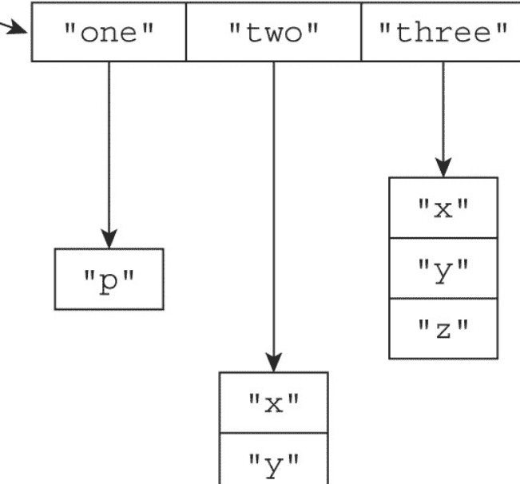

- A. `dimensions["three"][2]`
- B. `dimensions["three"][3]`
- C. `dimensions[2][2]`
- D. `dimensions[3][3]`

## 66. 下面代码的输出是什么？

```java
import java.util.*;
record Magazine(String name) implements Comparable<Magazine> {
    public int compareTo(Magazine m) {
        return name.compareTo(m.name);
    }
}
public class Newsstand {
    public static void main(String[] args) {
        var set = new TreeSet<Magazine>();
        set.add(new Magazine("highlights"));
        set.add(new Magazine("Newsweek"));
        set.add(new Magazine("highlights"));
        System.out.println(set.iterator().next());
    }
}
```

- A. `Magazine[name=highlights]`
- B. `Magazine[name=Newsweek]`
- C. 代码无法编译通过。
- D. 代码编译通过但在运行时抛出异常。

## 67. 哪项可以填入空处以打印清洗后的 2 个项目？

```java
import java.util.*;
class Wash<T extends Collection<?>> {
    public void clean(T items) {
        System.out.println("Cleaned " + items.size() + " " + items);
    }
}
public class LaundryTime {
    public static void main(String[] args) {
        Wash<List> wash = new Wash<____>();
        wash.clean(List.of("sock", "tie"));
    }
}
```

- A. `extends, ArrayList`
- B. `extends, List`
- C. `super, ArrayList`
- D. `super, List`
- E. 以上都不是。

## 68. 下面代码会输出多少行？

```java
var days = new String[] { "Sunday", "Monday", "Tuesday",
"Wednesday", "Thursday", "Friday", "Saturday" };
for (int i = 1; i <= days.length; i++)
    System.out.println(days[i]);
```

- A. 六行
- B. 七行
- C. 代码无法编译通过。
- D. 代码编译通过但在运行时抛出异常。

## 69. 下面代码的输出是什么？

```java
var listing = new String[][][] {
{ "Book" }, { "Game", "29.99" };
System.out.println(listing.length + " " +
listing[0].length);
```

- A. 1 1
- B. 1 2
- C. 2 1
- D. 2 2
- E. 代码无法编译通过。
- F. 代码编译通过但在运行时抛出异常。

## 70. 下面代码的输出是什么？

```java
Queue<String> q = new ArrayDeque<>();
q.add("snowball");
q.addLast("sugar");
q.addFirst("minnie");

System.out.println(q.peek() + " " + q.peek() + " " +
q.size());
```

- A. sugar sugar 3
- B. sugar minnie 1
- C. minnie minnie 3
- D. minnie snowball 1
- E. 代码无法编译通过。
- F. 以上都不是。

## 71. 下面代码的结果将是什么？

```java
13: var numbers = Arrays.asList(3, 1, 4);
14: numbers.set(1, null);
15: int first = numbers.get(0);
16: int middle = numbers.get(1);
17: int last = numbers.get(3);
18: System.out.println(first + " " + middle + " " + last);
```

- A. 代码无法编译通过。
- B. 第 14 行抛出异常。
- C. 第 15 行抛出异常。
- D. 第 16 行抛出异常。
- E. 第 17 行抛出异常。
- F. 3

## 72. 填入空处使代码打印 gamma。

```java
var list = Arrays.asList("alpha", "beta", "gamma");
Collections.sort(list, ____);
System.out.println(list.get(0));
```

- A. `Comparator.comparing(String::length).thenComparing(s -> s.charAt(0))`
- B. `Comparator.comparing(String::length).thenComparing(s -> s.charAt(0))`
- C. `Comparator.comparing(String::length).thenComparing(s -> s.charAt(0))`
- D. `Comparator.comparing(String::length).thenComparing(s -> s.charAt(0))`
- E. `Comparator.comparing(String::length).thenComparing(s -> s.charAt(0))`

*(注：原文选项A-E重复，此处按逻辑翻译)*

- A. `Comparator.comparing(String::length).thenComparing(s -> s.charAt(0))`
- B. `Comparator.comparing(String::length).thenComparing(s -> s.charAt(0))`
- D. `Comparator.comparing(String::length).thenComparing(s -> s.charAt(0))`
- E. `Comparator.comparing(String::length).thenComparing(s -> s.charAt(0))`
- F. `Comparator.comparing(String::length).thenComparing(s -> s.charAt(0))`

## 73. 运行以下代码的输出是什么？（选择两项。）

```java
public class FirstName {
    public static void main(String... names) {
        System.out.println(names[0]);
        System.out.println(names[1]);
    }
}
```

- A. FirstName
- B. Wolfie
- C. 抛出 `ArrayIndexException`。
- D. 抛出 `NullPointerException`。
- E. 代码抛出不同的异常。

## 74. 以下代码输出什么？

```java
11: var pennies = new ArrayList<>();
12: pennies.add(1);
13: pennies.add(2);
14: pennies.add(Integer.valueOf(3));
15: pennies.add(Integer.valueOf(4));
16: pennies.remove(2);
17: pennies.remove(Integer.valueOf(1));
18: System.out.println(pennies);
```

- A. [1, 2]
- B. [1, 4]
- C. [2, 4]
- D. [2, 3]
- E. 代码无法编译通过。

## 75. 以下代码正确的是？（选择两项。）

```java
private static void sortSearch(String... args) {
    var one = args[1];
    Comparator<String> comp = (x, y) -> x.compareTo(y);
    Arrays.sort(args, comp);
    var result = Arrays.binarySearch(args, one);
    System.out.println(result);
}
public static void main(String[] args) {
    sortSearch("seed", "flower");
}
```

- A. 如果空处是 `x.compareTo(y)`，则输出 0。
- B. 如果空处是 `y.compareTo(x)`，则输出 -1。
- C. 如果空处是 `x.compareTo(y)`，则输出 0。
- D. 如果空处是 `y.compareTo(x)`，则输出 0。
- E. 如果空处是 `y.compareTo(x)`，则输出 -1。
- F. 如果空处是 `y.compareTo(x)`，则输出 0。
- G. 如果空处是 `y.compareTo(x)`，则输出 -1。

## 76. 以下代码输出什么？

```java
String[] nums = new String[] { "1", "9", "10" };
Arrays.sort(nums);
System.out.println(Arrays.toString(nums));
```

- A. [1, 9, 10]
- B. [1, 10, 9]
- C. [9, 1, 10]
- D. [9, 10, 1]
- E. [10, 1, 9]
- F. [10, 9, 1]

## 77. 哪一行可以防止此代码在运行时不报错？

```java
11: char[][] ticTacoe = new char[3][3];
12: ticTacoe[0][0] = 'X';
13: ticTacoe[1][1] = 'X';
14: ticTacoe[2][2] = 'X';
15: System.out.println(ticTacoe.length + " in a row!");
```

- A. 11
- B. 12
- C. 13
- D. 14
- E. 15
- F. 以上都不是；代码可以编译并运行。

## 78. 以下代码的正确的是？（选择三项。）


```java
36: var names = new HashMap<String, String>();
37: names.put("peter", "pan");
38: names.put("wendy", "darling");
39:
40: String w = names.getOrDefault("peter");
41: String x = names.getOrDefault("peter", "x");
42: String y = names.getOrDefault("john", "x");
```

- A. 恰行无法编译。
- B. 有两行无法编译。
- C. 如果移除无法编译的行，第 40 行为 null。
- D. 如果移除无法编译的行，第 41 行为 "pan"。
- E. 如果移除无法编译的行，第 41 行为 "x"。
- F. 如果移除无法编译的行，第 42 行为 "x"。

## 79. 以下代码输出什么？

```java
18: List<String> list = List.of(
19:   "Mary", "a", "little", "lamb");
20: Set<String> set = new HashSet<>(list);
21: set.add(list);
22: for (String sheep : set)
23:   if (sheep.length() > 1)
24:     set.remove(sheep);
25: System.out.println(set);
```

- A. [a, lamb, had, Mary, little]
- B. [a]
- C. [a, a]
- D. 代码无法编译通过。
- E. 代码在运行时抛出异常。

## 80. 下列哪一项可以填入空处使该代码编译通过？

```java
public static void
getExceptions(Collection<??> coll) {
    coll.add(new RuntimeException());
    coll.add(new Exception());
}
```

+ A. ?
+ B. ? extends Exception
+ C. ? super Exception
+ D. T
+ E. T extends Exception
+ F. T super Exception
+ G. 以上皆非

## 第 6 章

### 使用 Streams 和 Lambda 表达式

+ 本次练习测试涵盖的 OCP 考试考点包括：

* 使用 Streams 和 Lambda 表达式

    * 使用 Java 对象流和原始类型流（包括实现函数式接口的 lambda 表达式）来提供数据供应、过滤、映射、消费和排序
    * 在顺序流和并行流上执行分解、合并、归约以及分组和分区

### 1. 下图表示一个流流水线（stream pipeline）。基于此，方框 x, y, z 最可能代表什么？

| X | | Y | | Z |
| --- | --- | --- | --- | --- |

+ A. 源头（Origin）、中间操作和最终操作
+ B. 源头、中间操作和汇点（sink）
+ C. 源头、中间操作和终端操作（terminal operation）
+ D. 源（Source）、中间操作和最终操作
+ E. 源（Source）、中间操作和汇点（sink）
+ F. 源（Source）、中间操作和终端操作（terminal operation）

### 2. 以下哪些项是所有有效 lambda 表达式都必须的？

+ A. ( )
+ B. ->
+ C. {}
+ D. 参数数据类型（类型）
+ E. 以上皆非

### 3. 填空：________ 函数式接口不接受任何输入，而 ________ 函数式接口不返回任何数据。

+ A. IntConsumer, LongSupplier
+ B. IntSupplier, Function
+ C. Supplier, DoubleConsumer
+ D. UnaryOperator, Consumer
+ E. 以上皆非

### 4. 下列哪一个函数式接口的 lambda 表达式可以返回一个 Double 值？（选择两个。）

+ A. UnaryOperator
+ B. BiPredicate
+ C. BiOperator
+ D. BiConsumer
+ E. BiSupplier
+ F. BiFunction

### 5. 以下代码的输出是什么？

```java
var list = List.of("Austin", "Boston",
"San Francisco");
var c = list.stream()
.filter(a -> a.length() > 10) // line x
.count();
System.out.println(c + " " + list.size());
```

+ A. 1 1
+ B. 1 3
+ C. 2 3
+ D. 代码因 line x 无法编译。
+ E. 代码抛出异常。

### 6. 在此表中识别正确的函数式接口。（选择三个。）

| 函数式接口 | 可能的返回类型 |
| --- | --- |
| 接口 X | Boolean |
| 接口 Y | int |
| 接口 Z | void |

+ A. 接口 X 是 Predicate。
+ B. 接口 X 是 Supplier。
+ C. 接口 Y 是 Comparator。
+ D. 接口 Y 是 Supplier。
+ E. 接口 Z 是 Consumer。
+ F. 接口 Z 是 Supplier。

### 7. 流流水线运行的最可能的原因是什么？

+ A. 源没有生成任何项目。
+ B. 没有中间操作。
+ C. 缺少终端操作。
+ D. Java 版本太旧了。
+ E. 以上皆非。

### 8. 哪个函数式接口接收 long 值作为输入参数并拥有 accept() 方法？

+ A. LongConsumer
+ B. LongFunction
+ C. LongPredicate
+ D. LongSupplier
+ E. 以上皆非

### 9. 给定一个并行 stream<T>，你会使用哪种方法获取等等的串行 Stream<T>？

+ A. unordered()
+ B. reduce()
+ C. concat()
+ D. stream()
+ E. boxed()
+ F. 以上皆非

### 10. 下述代码的输出是什么？

```java
var odds = IntStream.iterate(1, a -> a+2);
var evens = IntStream.iterate(2, a -> a+2);
var sum = IntStream.concat(odds, evens).limit(3).sum();
System.out.print(sum);
```

+ A. 6
+ B. 8
+ C. 9
+ D. 12
+ E. 代码无法编译。
+ F. 程序不会终止。

### 11. 以下哪项是有效的 lambda 表达式？

+ A. r -> {return 1==2}
+ B. (q) -> true
+ C. (x,y) -> {int test; return test>0};
+ D. a,b -> true
+ E. 以上皆非

### 12. 关于独立运行这些行代码，哪些描述是正确的？（选择两个。）

+ A. 所有行都将无错误运行。
+ B. 正好有一行无法编译或抛出异常。
+ C. 正好有行无法编译或抛出异常。
+ D. 在调用 opt.isPresent() 时，这些项都不返回 true。
+ E. 在其中一个项在调用 opt.isPresent() 时返回 true。
+ F. 在其中两个项在调用 opt.isPresent() 时返回 true。

```java
var empty = Optional.empty();
var param = Optional.of(null);
var method = Optional.Nullable(null);
```

### 13. 关于 DoubleSupplier<Double> 的陈述中哪项是不正确的？

+ A. 两者都是函数式接口。
+ B. 两者都不接受任何参数。
+ C. 两者都可以返回一个值。
+ D. 两者都可以返回一个值。
+ E. 其中一个不能返回。
+ F. 以上皆是。

### 14. 在空白处填入函数式接口，使代码能够编译并打印 3。

```java
var stream = Stream.of(1, 2, 3);
var result = stream.map(____).sum();
System.out.println(result);
```

### 15. 哪个函数式接口填入空白处后代码可以编译？

```java
var stream = Stream.of(1, 2, 3);
var result = stream.filter(____).findFirst();
```

+ A. anyMatch()
+ B. findAny()
+ C. first()
+ D. min()
+ E.

### 16. 代码的结果是什么？

```java
var list = new ArrayList<String>();
list.add("Monday");
list.add("Tuesday");
list.add("Wednesday");
System.out.println(list.get(0));
```

+ A. null
+ B. empty
+ C. Monday
+ D. 代码无法编译。
+ E. 代码编译但在运行时抛出异常。

### 17. 哪个函数式接口填入空白处后代码可以编译？

```java
package space;
import java.function.*;
public class Asteroid {
    public void mine(____) {
        // 实现省略
    }
    public static void main(String[] args) {
        new Asteroid().mine((s,p) -> s+p);
    }
}
```

+ A. BiConsumer<Integer, Double>
+ B. BiConsumer<Integer, Double>
+ C. BiFunction<Integer, Double>
+ D. BiFunction<Integer, Integer>
+ E. Function<Integer, Double>
+ F. 以上皆非

### 18. 什么最能描述归约（reduction）？

+ A. 创建值的源操作
+ B. 过滤流的中间操作
+ C. 划分每个元素的中间操作
+ D. 通过读取每个元素生成单个值或对象的终端操作
+ E. 不需要读取所有元素即可返回的终端操作

### 19. 假设有一个元素的流以及如下代码。从上到下填充表格中的 xxxx，可以打印多少元素？假设表格中的每个方法都传递了 lambda 表达式。

stream.xxxx.forEach(System.out::print);

| 方法 | 打印元素数量 |
| --- | --- |
| filter() | ? |
| flatMap() | ? |
| map() | ? |

+ A. 0或1、多个、一个
+ B. 0或1、一个、多个
+ C. 0或1、多个、多个
+ D. 一个、多个、一个
+ E. 一个、一个、多个
+ F. 一个、多个、多个

### 20. 假设使用了正确的泛型类型，哪些 lambda 表达式可以赋值给 ToDoubleBiFunction 函数式接口引用？（选择三个。）

+ A. (Integer a, Double b) -> {int c; return b;}
+ B. (h,i) -> (long)h
+ C. (String u, Object v) -> u.length()+v.length()
+ D. (x, y) -> {int z=2; return y/z;}
+ E. z -> z
+ F. (double y, double z) -> y + z

### 21. 给定一个 Stream<T>，你会使用哪种方法来获取等等的并行 Stream<T>？

+ A. getParallelStream()
+ B. parallelStream()
+ C. parallel()
+ D. getParallel()
+ E. parallels()
+ F. 以上都不是

### 22. 使用构造器引用重写这个接收整数 `int n` 的 lambda 表达式：

`n -> new ArrayList<>(n)`

+ A. ArrayList::new
+ B. ArrayList::new()
+ C. ArrayList::new(n)
+ D. ArrayList::new[n]
+ E. 以上都不是

### 23. 在 `DoubleStream` 上，`average()`、`count()`、`max()` 和 `sum(i)` 方法中有多少个返回 `OptionalDouble`？

+ A. 无
+ B. 一个
+ C. 两个
+ D. 三个
+ E. 四个

### 24. 下列中哪些不是 `java.util.function` 包中的函数式接口？（选择两个）。

+ A. BiPredicate
+ B. DoubleUnaryOperator
+ C. IntUnaryOperator
+ D. ObjectDoubleConsumer
+ E. ObjectIntConsumer
+ F. ToLongFunction

### 25. 下列六个方法中有五个无论在有序的串行流还是并行流上执行，始终产生相同的结果。哪一个不是？

+ A. findAny()
+ B. findFirst()
+ C. limit()
+ D. skip()
+ E. anyMatch()
+ F. count()

### 26. 在流流水线中，哪种操作可以返回 `Stream` 以外的值？

+ A. 源 (Source)
+ B. 中间操作 (Intermediate operation)
+ C. 终端操作 (Terminal operation)
+ D. 以上都不是

### 27. 当处理 `Stream<String>` 时，通过向 `Collectors.groupingBy()` 传递参数，从 `collect()` 终端操作可以返回哪些类型？

+ A. 仅 `Map<Boolean, HashSet<String>>`
+ B. 仅 `Map<Integer, List<String>>`
+ C. 同时 `Map<Boolean, HashSet<String>>` 和 `Map<Integer, List<String>>`
+ D. 仅 `List<Integer>`
+ E. 仅 `List<String>`
+ F. 同时 `List<Integer>` 和 `List<String>`

### 28. 下列输出的输出是什么？

```java
12: Set<String> set = new HashSet<>();
13: set.add("tire-");
14: List<String> list = new LinkedList<>();
15: Deque<String> queue = new ArrayDeque<>();
16: queue.push("wheel-");
17: Stream.of(set, list, queue)
18:     .flatMap(x -> x)
19:     .forEach(System.out::print);
```

+ A. [tire-][wheel-]
+ B. tire-wheel-
+ C. [wheel-][tire-]
+ D. wheel-tire-
+ E. 以上都不是
+ F. 代码无法编译。

### 29. 执行以下代码的结果是什么？

```java
var list = new LinkedList<>();
list.add("Archie");
list.add("X-Men");
Stream s = list.stream(); // 第 w 行
s.forEach(System.out::println)
s.forEach(System.out::println);
```

+ A. 代码运行无异常并打印两行。
+ B. 代码运行无异常并打印四行。
+ C. 代码在 w 行无法编译。
+ D. 代码在其他行无法编译。
+ E. 代码可以编译，但在运行时抛出异常。

### 30. 下一个程序的输出是什么？


```java
package zoo;
import java.util.function.*;
public class TicketTaker {
    private static int AT_CAPACITY = 100;
    public int takeTicket(int currentCount,
        UnaryOperator<Integer> counter) {
        return counter.applyAsInt(currentCount);
    }
    public static void main(String[] theater) {
        final TicketTaker bob = new TicketTaker();
        final int oldCount = 50;
        final int newCount = bob.takeTicket(oldCount, t -> {
            if(t > AT_CAPACITY) {
              throw new RuntimeException(
                "Sorry, max has been reached"
              );
            }
            return t + 1;
        });
        System.out.print(newCount);
    }
}
```

## A. 50

## B. 51

+ C. 代码由于 lambda 表达式无法编译。

+ D. 代码由于其他原因无法编译。

+ E. 代码可以编译，但在运行时打印异常。

+ 31. 使用带有 collector 参数的 `collect()` 方法执行并行归约（parallel reduction）的三个要求是什么？（选择三个。）

+ A. Collector 参数被标记为 `concurrent`（并发）。

+ B. 流的元素实现了 `Comparable` 接口。

+ C. 流是并行的。

+ D. 流是安全的。

+ E. 流或 Collector 被标记为 `unordered`（无序）。

+ F. 流不是原始流（primitive stream）。

+ 32. 关于以下代码哪些是正确的？（选择两个。）

```java
27: public static void main(String[]) s {
28: Predicate dash = c -> c.startsWith("-");
29: System.out.println(dash.test("-"));
30:
31: Consumer clear = x -> System.out.println(x);
32: clear.accept("pink");
33:
34: Comparator<String> c = (String s, String t) -> 0;
35: System.out.println(c.compare("s", "t"));
36: }
```

A. 代码可以编译。

B. 一行无法编译。

C. 两行无法编译。

D. 三行无法编译。

E. 如果修复了任何无法编译的行，输出包含 pink。

F. 如果修复了任何无法编译的行，输出不包含 pink。

33. 哪个接口返回原始类型（primitive）？

+ A. BiPredicate

+ B. Supplier

+ C. LongFunction

+ D. UnaryOperator

+ E. DoublePredicate

+ F. 以上都不是

34. 给定以下代码，哪些 lambda 表达式是累加器（accumulator）的最佳选择？（选择两个）。

```java
import java.util.*;
import java.util.function.*;
class Accumulator {
    int i = 0;
    List<String> words = new ArrayList<>();
    public void test() {
        BiFunction<Integer,Integer,Integer> x = 
        List.of(1,2,3,4,5).stream()
        .reduce(0, (s1,s2)->s1+s2);
    }
}
```

A. (a,b)

B. (a,b) -> 5

C. (a,b)

E. (a,b) -> words.add("awesome")

F. (a,b) -> 0

35. 填充使两个方法产生相同的输出。

```java
private void longer(Optional<String> opt) {
    opt.map("run: " +).forEach(System.out::println);
}
private void shorter(Optional<String> opt) {)
```

A. isPresent

B. ifPresent

C. forEach

D. isPresent

E. 以上都不是

36. 使用方法引用重写这个 lambda

```java
() -> Math
```

A. Math

B. Math

C. ()

D. Math

E. 以上都不是

37. 哪种操作可以在流流水线中出现多次？

+ A. 源 (Origin)

B. 汇点 (Sink)

C. 源 (Source)

D. 中间操作 (Intermediate operation)

E. 终端操作 (Terminal operation)

38. 关于下列哪些是正确的？

```java
21: var list = List.of('c', 'b', 'a');
22: list.stream()
23: .sorted()
24: .findAny()
25: .forEach(System.out::println)
26: System.out.println(list.stream());
```

A. 两个流都保证打印 a。

B. 两个流都会打印 cba。

C. 只有一个流保证打印 a。

D. 只有一个流会打印 cbaba。

E. 代码无法编译。

39. 哪个函数接口进入空白处可以让类编译？

```java
package groceries;
import java.util.*;
import java.util.function.*;
public class Market {
    private static void checkPrices(List<Double> prices,
            scanner) {
        prices.forEach(scanner);
    }
    public static void main(String[] right) {
        List<Double> prices = List.of(1.2, 6.5, 3.0);
        checkPrices(prices,
        p -> {
            String result = p < 5 ? "Correct" : "Too high";
            System.out.println(result);
        });
    }
}
```

A. Consumer

B. Consumer<Integer>

C. DoubleConsumer

D. Supplier<Double>

E. 以上都不是

40. 下列哪个不是有效的 lambda 表达式？

A. (Integer j, k) -> 5

B. (p,q) -> p+q

C. (Integer x, Integer y) -> x*

D. (left,right) -> {return "null";};

E. 这些都是有效的。

41. 下一个程序的输出是什么？

```java
import java.util.*;
public class Concat {
    public String concat1(List<String> values) {
        return values.parallelStream()
            .reduce("a",
            (x,y)->x+y::concat);
    }
    public String concat2(List<String> values) {
        return values.parallelStream()
            .reduce((w, z)->z+w).get();
    }
    public static void main(String[] questions) {
        Concat c = new Concat();
        var list = List.of("Cat","Hat");
        String x = c.concat1(list);
        String y = c.concat2(list);
        System.out.print(x+" "+y);
    }
}
```

A. CatHatCat

+ B. aCataHat HatCat

+ C. 代码无法编译，因为 concat1() 中的流返回的是 Optional。

+ D. 代码由于其他原因无法编译。

+ E. 运行时会打印出一个异常。

+ F. 以上都不是。

+ 42. 在三个函数式接口中，哪一个与其他两个不等价？

+ A. BiFunction<Double, Double, Double>

+ B. BinaryOperator<Double>

+ C. DoubleFunction<Double>

+ D. 以上都不是。这三个都是等价。

+ 43. 给定以下代码段，应该进行哪些更改才能使 JVM 将此过程处理为当前归约（reduction）？（选择两个。）

```
var w = Stream.of("c", "a", "t")
  collect(HashSet::new, Set::add, Set::addAll);
  System.out.println(w);
```

+ A. 将 HashSet 替换为 LinkedHashSet。

+ B. 将流标记为并行流（parallel）。

+ C. 移除 collect 方法的第二个参数。

+ D. 移除 collect 方法的第三个参数。

+ E. 将 HashSet 替换为 ConcurrentSkipListSet。

+ F. 将流标记为无序（unordered）。

+ 44. 填充空白使得此代码输出三行：

```
var list = new ArrayList<String>();
list.add("Atlanta");
list.add("Chicago");
list.add("New York");
list.stream()
  .filter(
  ).forEach(System.out::println);
```

+ A. String::isEmpty

+ B. !String::isEmpty

+ C. String::!isEmpty

+ D. String::isNotEmpty

+ E. 以上都不是

+ 45. 下面内容的输出是什么？

```
var chars = Stream.generate(() -> 'a');
chars.filter(c -> c < 'b')
  .sorted()
  .findFirst()
  .ifPresent(System.out::print);
```

+ A. a

+ B. 代码成功运行但没有任何输出。

+ C. 代码未完成。

+ D. 以上都不是。

+ 46. 下一个代码段的预期输出是什么？

```
Stream.iterate(1, x -> x + 1)
  .limit(5)
  .skip(2)
  .peek(System.out::print)
  .collect(Collectors.toList())
  .forEach(System.out::print);
```

+ A. 无法编译。

+ B. 运行时抛出异常。

+ C. 运行时不打印任何输出。

+ D. 345345

+ E. 334455

+ F. 代码段的行为在……之前无法确定。

+ 47. 下一个程序的输出是什么？

```java
package ai;
import java.util.function.*;
public class Android {
    public void wakeUp(Supplier supplier) { // d1
        supplier.get();
    }
    public static void main(String[] electricSheep) {
        Android data = new Android();
        data.wakeUp(() -> System.out.print("Started!")); // d2
    }
}
```

+ A. Started!

+ B. 代码仅因为行 d1 而无法编译。

+ C. 代码仅因为行 d2 而无法编译。

+ D. 代码因为行 d1 和 d2 无法编译。

+ E. 代码由于其他原因无法编译。

+ 48. 填充空白使得代码打印 *8.0-8.0*（选择两个。）

```java
var ints = IntStream.of(6, 10);
var longs = ints.mapToLong(i -> i);
var first = longs.____;

var moreLongs = LongStream.of(6, 10);
var stats = moreLongs.summaryStatistics();
var second = stats.____;
System.out.println("*" + first + "-" + second + "*");
```

+ A. 第一个空白处 averageDouble()

+ B. 第一个空白处 average().getAsDouble()

+ C. 第一个空白处 getAverage().get()

+ D. 第二个空白处 average().getDouble()

+ E. 第二个空白处 average().get()

+ F. 第二个空白处 getAverage()

+ 49. 从 DoubleConsumer 开始向下填充，填写表格中缺失的值。

| 函数式接口 | 方法签名中的参数数量 |

|---|---|

| DoubleFunction | |

| IntFunction | |

| LongSupplier | |

| ObjDoubleConsumer | |n |

+ A. 0, 1, 1, 2

+ B. 0, 1, 0, 2

+ C. 0, 2, 1, 2

+ D. 1, 1, 0, 2

+ E. 1, 1, 1, 1

+ F. 以上都不是

+ 50. 从 DoubleConsumer 开始向下填充，填写表格中的值。对于以下选项，假设 R 是一个泛型。

| 函数式接口 | 返回类型 |

|---|---|

| DoubleConsumer | |

| IntFunction | |

| LongSupplier | |

| ObjDoubleConsumer | |n |

+ A. double, int, long, R

+ B. double, R, long, R

+ C. R, int, long, R

+ D. R, int, long, void

+ E. void, int, long, void

+ F. void, R, long, void

+ 51. 下一个程序的可能的输出是什么？

```java
package salvage;

import java.util.*;
import java.util.stream.*;
public record Car(String model, int year) {
    @Override
    public String toString() {return model; }

    public static void main(String[] args) {
        var cars = new ArrayList<Car>();
        cars.add(new Car("Mustang", 1966));
        cars.add(new Car("Thunderbird", 1967));
        cars.add(new Car("Escort", 1975));
        var map = cars
            .stream()
            .collect(Collectors.groupingBy(Car::year));
        System.out.print(map);
    }
}
```

+ A. 1975=[Escort], 1967=[Thunderbird], 1966=[Mustang]

+ B. {1975=[Escort], 1967=[Thunderbird], 1966=[Mustang]}

+ C. 代码无法编译。

+ D. 代码无限挂起。

+ E. 程序在运行时抛出异常。

+ F. 以上都不是。

+ 52. 这个代码输出多少行？


```java
var list = new LinkedList<String>();
list.add("Archie");
list.add("Men");
list.stream().forEach(System.out::println);
```

+   A. Two
+   B. Four
+   C. 代码无法编译。
+   D. 代码编译但运行时抛出异常。

+ 53. 哪个 lambda 表达式可以替换

```java
package university;

@FunctionalInterface
interface Study {
    int learn(String subject);
}

class BiologyMaterial implements Study {
    @Override
    public int learn(String subject) {
        if(subject == null) return 0;
        else return 1;
    }
}

public class Scientist {
    public static void main(String[] courses) {
        final Study s = new BiologyMaterial();
        System.out.println(s.learn(courses[0]));
    }
}
```

+   A. (p,q) -> 1
+   B. (c,d) -> 1
+   C. (x,y) -> y
+   D. 以上都不是。

+ 54. 哪些是正确的？（选择两个。）

```java
var s = Stream.of("speak", "bark", "growl");
var map = s.collect(Collectors.toMap(k -> k, k -> 1));
System.out.println(map.size());
```

+   A. 输出为 2。
+   B. 输出为 3。
+   C. 输出为 4。
+   D. 输出为 5。
+   E. 如果流被替换为 null，输出保持不变。
+   F. 如果流被替换为 null，输出将改变。

+ 55. 关于源（source），哪个陈述是正确的？

+   A. 源在流水线（stream pipeline）中是强制性的。
+   B. 源只允许返回原始类型（primitives）。
+   C. 源必须通过调用 `stream()` 方法获取。
+   D. 源必须具有有限数量的元素。
+   E. 以上都不是。

+ 56. 给定一个 `IntStream`，你会使用哪个方法来获取等等的 `stream<T>`？

+   A. parallel()
+   B. parallelStream()
+   C. parallels()
+   D. getParallel()
+   E. getParallelStream()
+   F. 以上都不是。

+ 57. 哪个可以填充空白使得代码打印 true？

```java
var stream = Stream.iterate(1, i -> i+1);
var b = stream.________________(i -> i > 5);
System.out.println(b);
```

+   A. anyMatch
+   B. allMatch
+   C. findAny
+   D. findFirst
+   E. noneMatch
+   F. 以上都不是。

+ 58. 以下哪项填充了空白使得代码输出 weasel 但使用了不良实践？

```java
import java.util.*;
public class Cheater {
    int count = 0;
    public void sneak(Collection<String> coll) {
        coll.stream().
    }
    public static void main(String[] args) {
        var c = new Cheater();
        c.sneak(Arrays.asList("weasel"));
    } }
```

+   A. peek(System.out::println)
+   B. peek(System.out::println).findFirst()
+   C. peek(r -> System.out.println(r)).findFirst()
+   D. peek(r -> {count++; System.out.println(r);}).findFirst())
+   E. 以上均无法编译。
+   F. 这些不全是不良实践。

+ 59. 下一个应用程序的输出是什么？

```java
package nesting;
import java.util.function.*;
public class Doll {
    private int layer;
    public Doll(int layer) {
        super();
        this.layer = layer;
    }
    public static UnaryOperator<Doll> open(Doll task, Doll doll) {
        while((doll = task.accept(doll)) != null) {
            System.out.print("X");
        }
    }
    public static void main(String[] wood) {
        open(s -> {
            if(s.layer<=0) return null;
            else return new Doll(s.layer--);
        });
    }
}
```

```java
}, new Doll(5));
}}
```

+   A. XXXXX
+   B. 由于 `main()` 方法中的 lambda 表达式，代码无法编译。
+   C. 代码由于其他原因无法编译。
+   D. 代码可以编译，但在运行时会产生无限循环。
+   E. 代码可以编译，但在运行时会抛出异常。

60. 下述代码段的预期输出是什么？

```java
Random r = new Random();
Stream.generate(r::nextDouble)
  .skip(2)
  .limit(4)
  .sorted()
  .peek(System.out::println)
  .forEach(System.out::println);
```

+   A. 无法编译。
+   B. 它在运行时抛出异常。
+   C. 它在运行时不打印任何输出。
+   D. 它会打印四个数字，每个两次。
+   E. 它最多打印八个不同的数字。
+   F. 在运行之前无法确定该代码段的行为。

61. 关于应用于流（stream）的 `findAll()` 方法，以下哪些陈述是正确的？（选择三个。）

+   A. 在有序的串行流上，它始终返回第一个元素。
+   B. 在有序的串行流上，它可能返回任何元素。
+   C. 在无序流上，它始终返回第一个元素。
+   D. 在无序流上，它可能返回任何元素。
+   E. 在有序的并行流上，它始终返回第一个元素。
+   F. 在有序的并行流上，它可能返回任何元素。

+ 62. 哪个函数式接口拥有 `get()` 方法？

+   A. Consumer
+   B. Function
+   C. Supplier
+   D. UnaryOperator
+   E. Producer
+   F. 以上都不是

+ 63. 为什么 `String::charAt` 不能在 `Function` 内部作为方法引用使用？

+   A. 方法引用只能用在静态方法上。
+   B. `charAt()` 方法接收的是 `int` 参数，而不是 `Integer` 参数。
+   C. 该方法引用与 `Function` 不兼容。
+   D. 方法引用的语法是非法的。
+   E. `String` 类中没有 `charAt()` 方法。
+   F. 以上都不是。

+ 64. 给定以下独立的流操作，以下哪些陈述是正确的？（选择三个。）

```java
List.of(2, 4, 6, 8)
.parallel()
.parallelStream()
.forEach(System.out::print);
```

```java
List.of(2, 4, 6, 8)
.parallelStream()
.parallel()
.forEach(System.out::print);
```

```java
List.of(2, 4, 6, 8)
```

```java
.parallelStream()
.parallel().parallel().parallel()
.forEach(System.out::print);
```

+   A. 第一个流操作可以编译。
+   B. 第二个流操作可以编译。
+   C. 第三个流操作可以编译。
+   D. 所有通过的流操作在运行时都不会抛出异常。
+   E. 至少有一个通过的流操作在运行时会抛出异常。
+   F. 通过的流操作的输出与执行结果一致。

+ 65. 哪个方法引用可以替换第一行的 lambda 表达式以保持输出相同？

```java
BiPredicate<String, String> pred = (a, b) -> a.contains(b);
System.out.println(pred.test("fish", "is"));
```

+   A. a::contains(b)
+   B. a::contains
+   C. String::contains
+   D. 提供的代码无法编译。
+   E. 以上都不是。

+ 66. 下述代码的结果是什么？

```java
import static java.util.stream.Collectors.*;
import java.util.stream.Stream;
public class Speaking {
  record Ballot(String name, int judgeNumber, int score) {}
  public static void main(String[] args) {
    Stream<Ballot> ballots = Stream.of(
      new Ballot("Mario", 1, 10),
      new Ballot("Christina", 1, 8),
      new Ballot("Mario", 2, 9),
      new Ballot("Christina", 2, 8)

    var scores = ballots.collect(
      groupingBy(Ballot::name,
      summingInt(Ballot::score));
    System.out.println(scores.get("Mario"));
  }
}
```

A. 2
B. 18
C. 19
D. 10
E. 代码无法编译。

67. 以下哪个项可以填入空白，使代码输出 4？

```java
var stream = Stream.of("base", "ball");
stream______(s -> s.length()).forEach(System.out::print);
```

+   A. 仅 map
+   B. 仅 mapToInt
+   C. 仅 mapTo
+   D. map 和 mapToInt
+   E. map 和 mapToObject
+   F. map, mapToInt 且 mapToObject

+ 68. 下述代码做了什么？（选择两个。）

```java
public class Player {
  interface Basket {
    boolean needAim(double angle);
  }
  static void prepare(double angle, Basket t) {
    boolean ready = t.needAim(angle); // k1
    System.out.println(ready);
  }
  public static void main(String[] args) {
    prepare(45, d -> d > 5 || d < -5); // k2
  }
}
```

+   A. 如果修复编译错误，它输出 true。
+   B. 如果修复编译错误，它输出 false。
+   C. 无问题地编译。
+   D. 由于 k1 无法编译。
+   E. 由于 k2 无法编译。

+ 69. 关于以下代码，哪些陈述是正确的？

```java
var data = List.of(1,2,3);
int f = data.parallelStream()
    .reduce(0, (a, b) -> a+b, (a, b) -> a+b);
System.out.println(f);
```

+   A. 它始终输出 6。
+   B. 它始终输出 7。
+   C. 它输出另一个值。
+   D. 它始终输出相同值。
+   E. 代码可以编译，但在运行时抛出异常。
+   F. 以上都不是。

70. 下述代码的结果是什么？

```java
var s1 = IntStream.empty();
var s2 = IntStream.of(0);
System.out.println(s1.average().getAsDouble());
```

A. 两个语句都输出 0。
B. 两个语句输出相同的值。
C. 两个语句输出不同的值。
D. 代码无法编译。
E. 代码可以编译，但在运行时抛出异常。

71. 哪些 lambda 可以替换代码中的方法引用？（选择两个。）

```java
Stream.of("fish", "mammal")
    .findFirst()
    .ifPresent(System.out::println);
```

+   A. 12 处的 s.length()
+   B. 12 处的 s -> s.length()
+   C. 12 处的 s
+   D. 14 处的 System.out.println(s)
+   E. 14 处的 s -> System.out.println(s)

72. 在图中哪个收集器（collector）可以将左侧的流转换为右侧的形式？

| 左 | 右 |
|---|---|
| true | grouping() |
| false | partitioning() |

A. 仅 grouping()
B. 仅 groupingBy()
C. 仅 partitioning()
D. 仅 partitioning()
E. grouping() 和 partitioning()
F. groupingBy() 和 partitioningBy()

73. 哪个表达式与 `IntSupplier` 兼容？

A. `() -> "3"`
B. `() -> 0`
C. `() -> 4`
D. `System.out::`
E. 以上都不是

74. 下述代码的输出是什么？

```java
package beach;
import java.util.*;
public class Lifeguard {
    record Tourist(double distance) {}
    private void saveLife(Predicate<Tourist> canSave, Tourist tourist) {
        System.out.print(canSave.test(tourist) ? "Saved" : "Too far");
    }
    public static void main(String[] args) {
        new Lifeguard().saveLife(s -> s.distance > 5, new Tourist(2));
    }
}
```

A. Saved
B. Too far
C. 由于 `main()` 方法，代码无法编译。
D. 由于 `saveLife()` 方法，代码无法编译。
E. 以上都不是。

75. 给定 `LinkedList<E>`，调用哪个方法可以获取以其作为数据源的并行流？

A. `getParallel()`
B. `parallels()`
C. `getParallelStream()`
D. `parallel()`
E. `parallelStream()`
F. 以上都不是

76. 下述代码输出多少行？


```java
import java.util.*;
public class PreSchool {
    record Blankie(String color) { }
    public static void main(String[] args) {
        var b1 = new Blankie("pink");
        var b2 = new Blankie("blue");
        var list = Arrays.asList(b1, b2);
        list.stream()
            .filter(Blankie::color) // line x
            .forEach(System.out::println); // line y
    }
}
```

A. 一行

B. 两行

C. 在第 x 行代码无法编译。

D. 在第 y 行代码无法编译。

E. 代码可以编译，但在运行时抛出异常。

### 77. 哪些陈述是正确的？（选择两个。）

+ A. 源不能返回无限流。
+ B. 源可以返回无限流。
+ C. 源必须返回无限流。
+ D. 中间操作不能返回无限流。
+ E. 中间操作可以返回无限流。
+ F. 中间操作必须返回无限流。

### 78. 下述行中有多少行存在编译错误？

```java
14: Consumer<Object> c1 = ArrayList::new;
15: Consumer<Object> c2 = String::new;
16: Consumer<Object> c3 = System.out::println;
17: var c4 = ArrayList::new;
18: var c5 = String::new;
19: var c6 = System.out::println;
```

- A. 一
- B. 二
- C. 三
- D. 四
- E. 五
- F. 代码按原样编译。

### 79. 下面程序的输出是什么？

```java
var p = List.of(new StringBuilder("hello"),
new StringBuilder("goodbye"));
var q = p.parallelStream().reduce(0,
(w,x) -> w.length() + x.length(),
(y,z) -> y.length() + z.length());
System.out.print(q);
```

- A. 0
- B. 12
- C. 14
- D. 一行代码无法编译。
- E. 两行代码无法编译。
- F. 以上都不是。

### 80. 关于这段代码，哪些说法是正确的？（选择两个）。

```
var bools = Stream.of(Boolean.TRUE, null);
var map = bools
.limit(1) // line k
.collect(Collectors.partitioningBy(b -> b));
System.out.println(map);
```

- C. 它输出 {false=[], true=[true]}。 
- E. 如果删除行 k，输出将相同。
- F. 如果删除行 k，输出将不同。

### 81. 下面代码段的输出是什么？

```
var apples = List.of(1, 2);
var oranges = List.of(1, 2);
final var count = Stream.of(apples, oranges)
.flatMapToInt(List::stream)
.peek(System.out::print)
.count();
System.out.print(count);
```

A. 12124

B. 11224

C. 122

D. 代码无法编译。

E. 代码可以编译但在运行时不输出任何内容。

F. 以上都不是。

### 82. 哪个函数接口在填入空白处后会导致类无法编译？

```java
package morning;
import java.util.function.*;
public class Sun {
    public static void dawn(____ sunrise) {}
    public static void main(String[] rays) {
        dawn(s -> s+1);
    }
}
```

- A. `DoubleUnaryOperator`
- B. `Function<String, String>`
- C. `IntToLongFunction`
- D. `UnaryOperator`
- E. 以上所有都允许代码编译。

### 83. 关于在并行有序流（parallel ordered stream）上使用 `forEachOrdered()` 而不是 `forEach()`，哪些说法是正确的？（选择两个。）

- A. 操作可能会更快。
- B. 操作可能会更慢。
- C. 性能没有预期变化。
- D. 它强制流水线中的某些流操作以串行方式执行。
- E. 它强制流水线中的所有流操作都以串行方式执行。
- F. 所有流操作将继续以并行方式执行。

### 84. 关于以下内容，哪些是正确的？（选择两个。）

```java
IntegerSummaryStatistics stats = Stream.of(20, 40)
.mapToInt(i -> i)
.summaryStatistics();
long total = stats.getSum();
long count = stats.getCount();
long max = stats.getMax();
System.out.println(total + "-" + count + "-" + max);
```

- A. 输出是 60-0-40。
- B. 输出是 60-2-40。
- C. 代码因为一个原因无法编译。
- D. 代码因为两个原因无法编译。
- E. 可以使用单个流流水线在不用统计信息的情况下编写正确代码。
- F. 无法使用单个流流水线在不用统计信息的情况下编写正确代码。

### 85. Lambda 和方法引用（method references）之间的区别是什么？

- A. 只有一个可以接受方法参数。
- B. 只有一个可以引用有效最终（effectively final）的局部变量。
- C. 只有一个可以进行方法调用，其中方法的参数是硬编码的数字 3。
- D. 只有一个可以使用延迟执行。
- E. 以上都不是。

### 86. 这里有多少个会打印 3？

```
System.out.println(IntStream.of(1, 2).reduce(0, Integer::sum));
System.out.println(IntStream.of(1, 2).sum());
System.out.println(Stream.of(1, 2).reduce(0, Integer::sum));
System.out.println(Stream.of(1, 2).sum());
```

- A. 零
- B. 一个
- C. 两个
- D. 三
- E. 四

### 87. 此代码中的四个方法调用中，哪个可以删除且方法仍然能够编译并无错误运行？

```
Stream.generate(() -> 'a')
.limit(5)
.filter(c -> c < 'b')
.sorted()
.findFirst()
.ifPresent(System.out::print);
```

- A. `filter()`
- B. `sorted()`
- C. `filter()` and `sorted()`
- D. `filter()` and `ifPresent()`
- E. `filter()`, `sorted()`, and `ifPresent()`
- F. `filter()`, `sorted()`, `findFirst()`, and `ifPresent()`

### 88. 关于以下内容，哪些是正确的？（选择三个。）

```java
import java.util.*;
public class Catch {
    public static void main(String[] args) {
        Optional opt = Optional.empty();
        String message = "";
        try {
            message = x(opt);
        } catch (IllegalArgumentException e) {
            System.out.print("Caught");
        }
        System.out.print(message);
    }
    private static String x(Optional opt) {
        return y(opt);
    }
    private static String y(Optional opt) {
        return z(opt);
    }
    private static String z(Optional opt) {
        return "it";
    }
}
```

- A. 填入 x 处会输出 Caught。
- B. 填入 x 处会打印堆栈。
- C. 填入 y 处会输出 Caught。
- D. 填入 y 处会打印堆栈。
- E. 填入 z 处会输出 Caught。
- F. 填入 z 处会打印堆栈。

### 89. 关于 Predicate 的说法是不正确的？

A. 方法返回布尔值。

B. 它是一个接口。

C. 方法接受两个参数。

D. 方法名为 test()。

E. 以上均正确。

### 90. 填入空白：____________ 是不涉及 double、int 或 long 的函数接口。

- A. `BooleanSupplier`
- B. `CharPredicate`
- C. `FloatUnaryOperator`
- D. `ShortConsumer`
- E. 以上都不是。

### 91. 关于并行流，哪些说法是正确的？（选择两个。）

- A. 并行流总是串行流快。
- B. JVM 会自动对任意流应用并行流以提高性能。
- C. 并行流同步其操作使其原子化。
- D. 所有流都可以转换为并行流。
- E. 如果流使用了归约方法，无论流是并行还是串行结果都是相同的。
- F. 有时，并行流仍然以单线程方式运行。

### 92. 下面程序的输出是什么？

```
var s = Stream.of("over the river","through the woods");
```

A. over the river

B. through the woods

C. to grandmother's house we go

D. 无法预先输出。

E. 以上都不是。

### 93. 哪个 Lambda 表达式可以传递给 magic 方法？

```java
package show;
import java.util.function.*;
public class Magician {
    public void magic(BinaryOperator<Long> lambda) {
        lambda.apply(3L, 7L);
    }
}
```

- A. `(a) -> a`
- B. `(b,w) -> (long)w.intValue()`
- C. `(c,m) -> { long c=4; return c+m; }`
- D. `(Integer d, Integer r) -> (Long)r+d`
- E. 以上都可以传递给方法。
- F. 以上都不是。

### 94. 下面流操作需要进行多少更改才能执行并行？

```
var r = new Random();
var data = Stream.generate(() -> 
  String.valueOf(r.nextInt()))
.limit(50_000)
.collect(Collectors.toList());
var map = data.stream()
```

- A. 已经是归约了。
- B. 一
- C. 两个
- D. 三
- E. 代码无法编译。

### 95. 下面代码的输出是什么？

```
Stream.of("one", "two", "bloat")
.limit(1)
.map(String::toUpperCase) // line x
.sorted()
.forEach(System.out::println);
```

- A. bloat
- B. BLOAT
- C. one
- D. ONE
- E. 因为行 x 代码无法编译。
- F. 以上都不是。

### 97. 哪个可以填入空白处以使代码打印单个数字 g？

```
var stream = LongStream.of(9);
stream.________(p -> p).forEach(System.out::print);
```

- A. 只有 mapToDouble
- B. 只有 mapToInt
- C. 只有 mapToLong
- D. mapToDouble 和 mapToInt 都是
- E. mapToDouble, mapToInt, and mapToLong
- F. 以上均不是

### 98. 下面程序的输出是什么？

```java
package savings;
import java.util.function.*;
public class Bank {
    private int savingsInCents;
    private static class ConvertToCents {
        static DoubleToIntFunction f = p -> p*100;
    }
    public static void main(String[] currency) {
        Bank creditUnion = new Bank();
        creditUnion.savingsInCents = 100;
        double deposit = savingsInCents +=
            ConvertToCents.f.applyAsInt(deposit); // j1
        System.out.print(creditUnion.savingsInCents);
    }
}
```

A. 100

B. 200

C. 250

D. 代码因为第 j1 无法编译。

E. 以上均不是。

### 99. 关于有状态的 lambda 表达式，哪些陈述是正确的？（选择两个）

A. 在串行流和并行流中都应该避免使用有状态的 lambda 表达式。

B. 仅在串行流中应该避免有状态的 lambda 表达式。

C. 仅在并行流中应该避免有状态的 lambda 表达式。

D. 避免使用有状态 lambda 表达式修改 List 的方法之一是使用并发集合。

E. 避免使用有状态 lambda 表达式修改 List 的方法之一是使用输出 List 的 。

F. 避免使用有状态 lambda 表达式修改 List 的方法之一是使用同步列表。

### 00. 哪个方法引用可以替换第二行的 lambda 使得输出保持相同？

```java
var s = "fish"
Predicate<String> pred = (a) -> s.contains(a);
System.out.println(pred.test("fish", "is"));
```

A. `a::contains(b)`

B. `a::contains`

C. `String::contains(b)`

D. `String::contains`

E. 提供的代码无法编译。

F. 以上均不是。

### 01. 惰性求值（lazy evaluation）的最佳示例是什么？

A. 管道可以在看到所有数据之前执行。

B. 管道在执行终端操作之前不会开始。

C. 管道尽可能快地执行所有操作。

D. 管道丢失数据。

E. 管道在午睡。

### 02. 哪个方法可以应用于现有的 `Stream<T>` 以返回具有不同泛型类型的流？

A. `distinct()`

B. `iterate()`

C. `peek()`

D. `sorted()`

E. `filter()`

F. 以上均不是

### 03. ____________________ 函数式接口有一个 `apply()` 方法，而 ____________________ 函数式接口有一个 `applyDouble()` 方法。（选择两个）。

A. `BiConsumer`

B. `BiFunction`

C. `BiPredicate`

D. `DoubleConsumer`

E. `DoublePredicate`

F. `DoubleUnaryOperator`

### 04. 下面哪个 () 可以填入空白处以使代码打印出 **？

```java
Stream.generate(() -> "*")
.limit(3)
.sorted(________________)
.distinct()
.forEach(System.out::println);
```

A. `(s,t) -> s.length() - t.length()`

B. `String::isEmpty`

C. 这两个都将产生预期的输出。

D. 这两个都不允许代码编译。

E. 无论空白处填入什么，代码都不会完成。

### 05. 

A. lambda 表达式可能与多个函数式接口兼容。

B. lambda 表达式在声明时必须赋值给一个函数式接口。

C. 方法可以以函数式接口实例的形式返回 lambda 表达式。

D. 编译器使用延迟执行来跳过确定 lambda 表达式是否编译。

E. 以上都是正确的。

### 06. 下面哪些是由该代码输出的？（选择两个）


```java
16: void shareToys() {
17:   record Toy(String name) {}
18:
19:   var toys = Stream.of(
20:     new Toy("Jack in the Box"),
21:     new Toy("Slinky"),
22:     new Toy("Yo-Yo"),
23:     new Toy("Rubik's Cube"));
24:
25:   var splitter = toys.spliterator();
26:   var batch = splitter.trySplit();
27:
28:   var more = batch.tryAdvance(x -> {});
29:   System.out.println(more);
30:   splitter.tryAdvance(System.out::println);
31: }
```

A. false

B. true

C. Toy[Jack in the Box]

D. Toy[Slinky]

E. Toy[Rubik's Cube]

F. Toy[Yo-Yo]

### 07. 哪个可以填入空白处使代码打印 true？

```java
var stream = Stream.iterate(1, i -> i);
var b = stream.____(i -> i > 5);
System.out.println(b);
```

A. anyMatch

B. allMatch

C. findAny

D. findFirst

E. noneMatch

F. 以上均不是

### 08. 给定以下类，代码需要多少修改才能编译？

```java
1: package showtimes;
2: import java.util.*;
3: import java.util.function.*;
4: public class FindMovie {
5:     private Consumer<String> printer;
6:     FindMovie() {
7:         printer = s -> {System.out.println(s); return s; };
8:     }
9:     void printMovies(List<String> movies) {
10:        movies.forEach(printer);
11:    }
12:    public static void main(String[] args) {
13:        List<String> movies = new ArrayList<>();
14:        movies.add("Stream");
15:        movies.add("Lord of Recursion");
16:        movies.add("Silence of Lambdas");
17:        new FindMovie().printMovies(movies);
18: }
```

A. 无需修改即可。

B. 一

C. 二

D. 三

E. 四

F. 五

### 09. 关于应用于流的 findFirst()，哪些陈述是正确的？（选择三个）

A. 它总是第一个。

B. 它在有序流上可能返回任何元素。

C. 它在无序流上总是返回第一个元素。

D. 它在无序流上可能返回任何元素。

E. 它在并行流上总是返回第一个元素。

F. 它在并行流上可能返回任何元素。

### 10. 哪个方法引用可以替换 main() 第一行的 lambda 以产生相同的输出？

```java
interface Marsial {
    void carryPouch(int size);
}
public class Opsum {
    public static void main(String[] args) {
        Marsial mar =
            x -> System.out.println("Carrying " + x);
        mar.carryPouch(1);
    }
}
```

A. System::println

B. System::println

C. System::println

D. System.out::println

E. 以上均不是

### 11. 下面代码的结果是什么？

```java
21: Stream<Integer> s1 = Stream.of(8, 2);
22: Stream<Integer> s2 = Stream.of(10, 20);
23: s2 = s1.filter(n -> n > 4);
24: s1 = s2.filter(n -> n < 1);
25: System.out.println(s1.count());
26: System.out.println(s2.count());
```

A. 代码无错误并打印 0。

B. 代码无错误并打印 1。

C. 代码在第 23 行产生异常。

D. 代码在第 24 行产生异常。

E. 代码在第 25 行产生异常。

F. 代码在第 26 行产生异常。

### 12. 此代码哪些修改可以独立进行且仍保持编译？（选择三个）

```java
Predicate<StringBuilder> p =
(StringBuilder b) -> {return true};
```

A. 将 StringBuilder b 改为 var b.

B. 将 StringBuilder b 改为 b.

C. 删除 StringBuilder b.

D. 删除 ->.

E. 删除 { return true; }.

F. 删除 { return true; }.

### 13. 这段代码输出什么？

```java
var babies = Arrays.asList("chick", "cygnet", "duckling");
babies.replaceAll(x -> { var newValue = "baby";
return newValue; });
System.out.println(newValue);
```

A. baby

B. chick

C. cygnet

D. duckling

E. 代码无法编译。

### 14. 哪个 lambda 表达式无法赋值给 DoubleToLongFunction 函数式接口？

A. a -> a == null ? 1 : 2L

B. e -> (int)(10.0*e)

C. (double m) -> {long p = (long)m; return p;}

D. (Double s) -> s.longValue()

E. 以上都可以赋值。

### 15. 给定以下代码片段，哪些 x 值允许 divide(x) 编译并在运行时提供可预测的结果？（选择两个）

```java
import java.util.*;
import java.util.stream.*;
public class Divide {
    static float divide(Stream<Float> s) {
        return s.reduce(1.0f, (a, b) -> a/b, (a, b) -> a/b);
    }
}
```

A. Set.of(1f, 2f, 3f, 4f).stream()

B. List.of(1f, 2f, 3f, 4f).stream()

C. List.of(1f, 2f, 3f, 4f).parallel()

D. List.of(1f, 2f, 3f, 4f).parallelStream()

E. List.of(1f, 2f, 3f, 4f).parallelStream()

F. List.of(1f).parallel()

### 16. 下面哪个产生的输出与其他其它不同？

A.

```java
Stream.of("eeny", "meeny", "miny", "moe")
.collect(Collectors.partitioningBy(x -> x.charAt(0)
== 'e')
.get(false)
.stream()
.collect(Collectors.groupingBy(String::length))
.get(4)
.forEach(System.out::println);
```

B.

```java
Stream.of("eeny", "meeny", "miny", "moe")
.filter(x -> x.charAt(0) != 'e')
.collect(Collectors.groupBy(String::length))
.get(4)
.forEach(System.out::println);
```

C.

```java
Stream.of("eeny", "meeny", "miny", "moe")
.collect(Collectors.groupBy(x -> x.charAt(0) == 'e'))
.get(false)
.stream()
.collect(Collectors.partitioningBy(String::length))
.get(4)
.forEach(System.out::println);
```

D.

```java
Stream.of("eeny", "meeny", "miny", "moe")
.collect(Collectors.groupBy(x -> x.charAt(0) == 'e'))
.get(false)
.stream()
.collect(Collectors.groupBy(String::length))
.get(4)
.forEach(System.out::println);
```

E.

```java
Stream.of("eeny", "meeny", "miny", "moe")
.collect(Collectors.partitioningBy(x -> x.charAt(0) == 'e'))
.get(false)
.stream()
.collect(Collectors.partitioningBy(x -> x.length() == 4))
.get(true)
.forEach(System.out::println);
```

F. 它们产生相同的输出。

### 17. 给定一个 IntStream，你会使用哪种方法来获取等效的并行 IntStream？

A. parallelStream()

B. parallels()

C. getParallelStream()

D. parallel()

E. getParallel()

F. 以上都不是

### 18. 下列陈述中，哪一个是正确的？

A. 所有的 lambda 都可以转换为方法引用（method references）。

B. 方法引用可以转换为 lambda 表达式。

C. 这两个陈述都是正确的。

D. 以上都不是。

### 19. 下图显示了输入参数被用于三个未知类型的函数式接口方法。从左到右依次插入，哪三个函数式接口可以完成图表？

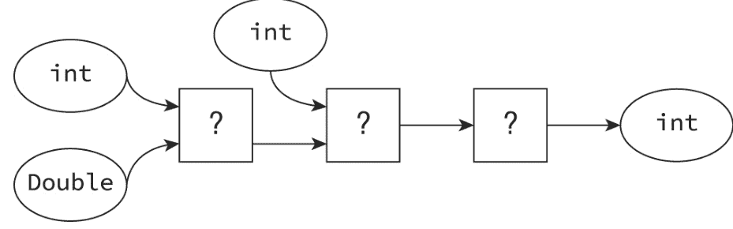

A.

DoubleBinaryOperator

ToDoubleBiFunction<Integer, Double>

UnaryOperator<Integer>

B.

BinaryOperator<Double>

BiFunction<Integer, Integer, Double>

UnaryOperator<Integer>

C.

Function<Double, Integer>

BiFunction<Integer, Integer, Double>

DoubleToIntFunction

D.

BiFunction<Integer, Double, Integer>

BinaryOperator<Integer>

IntUnaryOperator

E. 以上都不是

### 20. 下列哪些是 java.util.function 包中的函数式接口？（选择三项。）

A. DoublePredicate

B. LongUnaryOperator

C. NullOperator

D. ShortSupplier

E. ToIntBiFunction

F. ToStringOperator

### 21. 下述应用程序的输出是什么？

```java
package java.util.*;
record Boss(String name) {
    @Override public String toString() {
        return name.toUpperCase();
    }
}
public class Initech {
    public static void main(String[] reports) {
        final List<Boss> bosses = new ArrayList(8);
        bosses.add(new Boss("Peter"));
        bosses.add(new Boss("Samir"));
        bosses.add(new Boss("Michael"));
        bosses.removeIf(s -> s.equalsIgnoreCase("samir"));
        System.out.print(bosses);
    }
}
```

A. [PETER, MICHAEL]

B. [samir]

C. [tps.Boss@4218224c, tps.Boss@815f19a]

D. 代码因为 lambda 表达式而无法编译。

E. 代码因为其他原因而无法编译。

### 22. 哪一个 lambda 可以实现这个函数式接口？

```java
public interface Paypal {
    static void printName(String name) {}
    boolean cat(String name) { return true; }
}
```

A. -> System.out.println()

B. n -> System.out.println(n)

C. -> true

D. n -> true

E. 以上都不是

### 23. 下列代码中有多少行可以编译？

```java
17: Comparator<String> c1 = s -> false;
18: Comparator<String, String> c2 = {s1, s2} -> false;
19: Predicate<String> p1 = String s -> false;
20: Predicate<String> p2 = (String s) -> false;
21: Supplier<String> s1 = String s -> false;
22: Supplier<String> s2 = (String s) -> false;
```

A. 一

B. 两

C. 三

D. 四

E. 五

F. 六

### 24. 下述代码的输出是什么？

```java
public static void main(String[] args) {
    record Pet(int age) {}
    record PetSummary(long count, int sum) {}
    var summary = Stream.of(new Pet(2), new Pet(5), new Pet(8))
        .collect(Collectors.teeing(
            Collectors.counting(),
            Collectors.summingInt(Pet::age),
            PetSummary::new));
    System.out.println(summary);
}
```

A. PetSummary[count=1, sum=3]

B. PetSummary[count=1, sum=15]

C. PetSummary[count=3, sum=15]

D. PetSummary[count=3, sum=15]

E. 因为 teeing() 而无法编译。

F. 因为 records 定义在方法内部无法编译。

G. 因为其他原因无法编译。

### 25. 哪个方法在 IntStatistics 上不可用？

A. getCount()

B. getMax()

C. toString()

D. 以上都不是。

E. 这些方法都可用。

### 26. 哪一个函数式接口放在空白处允许该类编译？


```java
package sleep;
import java.util.function.*;
class Sheep {
    public class Dream {
        int MAX_SHEEP = 10;
        int sheepCount;
        public void countSheep(____ s) {
            while(sheepCount < MAX_SHEEP) {
                // TODO: Apply lambda
                sheepCount++;
            }
        }
        public static void main(String[] args) {
            new Dream().countSheep(System.out::println);
        }
    }
}
```

+ A. `Consumer<Sheep>`
+ B. `Function<Sheep, void>`
+ C. `Supplier<Sheep>`
+ D. `UnaryOperator<Sheep>`
+ E. 以上都不是

## 27. 给定 Stream s 和 Collection c，以下哪些创建并行流的有效方法？（选择三项。）

+ A. `c.parallel()`
+ B. `c.parallelStream()`
+ C. `c.parallelStream()`
+ D. `s.parallelStream()`
+ E. `c.parallelStream().parallel()`
+ F. `s.parallel()`

## 28. 下述代码哪些是正确的？（选择两项。）

```java
public static void main(String[] args) {
    var prefix = "";
    var pets = List.of("rabbit", "snake", "turtle");
    // prefix = "t"
    pets.forEach(p -> {
        if (p.startsWith(prefix)) System.out.println(p);
    });
}
```

+ A. 如所示，代码打印一行。
+ B. 如所示，代码打印两行。
+ C. 如所示，代码无法编译。
+ D. 如果第 7 行取消注释，代码打印一行。
+ E. 如果第 7 行取消注释，代码打印两行。
+ F. 如果第 7 行取消注释，代码无法编译。

## 29. 下述代码片段的输出是什么？

```java
var pears = List.of(1, 2, 3, 4, 5, 6);
final var sum = pears.stream()
  .skip(1)
  .limit(3)
  .flatMapToInt(s -> IntStream.of(s))
  .skip(1)
  .boxed()
  .mapToDouble(s -> s)
  .sum();
System.out.print(sum);
```

+ A. 6
+ B. 7.0
+ C. 6.0
+ D. 7
+ E. 正好有一行包含编译错误。
+ F. 多于一行包含编译错误。

## 30. 为了在给定任何中间操作的情况下使流水完成，填充每个框 [M, N, O, P] 的最小中间操作数是多少？

| 源 | 中间操作 | 终端操作 |
|---|---|---|
| Finite Stream | M | `count()` |
| Finite Stream | N | `findFirst()` |
| Infinite Stream | | `findFirst()` |
| Infinite Stream | 0 | `count()` |
| Infinite Stream | P | `findFirst()` |

+ A. [0, 0, 0, 1]
+ B. [0, 0, 1, 0]
+ C. [0, 0, 1, 1]
+ D. [1, 1, 0, 1]
+ E. [1, 1, 1, 0]
+ F. [1, 1, 1, 1]

## 31. 根据上一个问题的表格，无论在框中放置哪个中间操作，中间操作列中有多少框会使流水完成？

+ A. 零
+ B. 一个
+ C. 二
+ D. 三
+ E. 四

## 32. 下列哪一个声明了一个所有对象都被视为相等的 Comparator？

+ A. `Comparator<Character> comp = (c1) -> 0;`
+ B. `Comparator<Character> comp = (c1) -> {0};`
+ C. `Comparator<Character> comp = (c1, c2) -> 0;`
+ D. `Comparator<Character> comp = (c1, c2) -> {0};`
+ E. 以上都不是

## 33. 哪一个可以填充空白使得此代码输出 true？

```java
import java.util.function.*;
import java.util.stream.*;
public class HideAndSeek {
    public static void main(String[] args) {
        var hide = Stream.of(true, false, true);
        var found = hide.filter(b -> b).____();
        System.out.println(found);
    }
}
```

+ A. Only `anyMatch`
+ B. Only `allMatch`
+ C. Both `anyMatch` and `allMatch`
+ D. Only `noneMatch`
+ E. 代码在任何选项下均无法编译。

## 34. 哪一个方法引用可以替换第二行的 lambda 以保持输出相同？

```java
var s = "fish";
Predicate<String> pred = (a) -> s.contains(a);
System.out.println(pred.test("is"));
```

+ A. `s::contains`
+ B. `s::contains`
+ C. `String::contains`
+ D. `String::contains`
+ E. 提供的代码无法编译。
+ F. 以上都不是。

## 35. 下列代码中有多少行可以编译？

```java
Predicate<String> pred1 = (final String s) -> s.isEmpty();
Predicate<String> pred2 = (final s) -> s.isEmpty();
Predicate<String> pred3 = (final var s) -> s.isEmpty();
Predicate<String> pred4 = (String s) -> s.isEmpty();
```

```java
Predicate<String> pred5 = (var s) -> s.isEmpty();
```

- A. 0
- B. 1
- C. 2
- D. 3
- E. 4
- F. 5

## 36. 下面程序的输出是什么？

```java
package pet;
import java.util.*;
import java.util.function.*;
public class DogSearch {
    void reduceList(List<String> names, Predicate<String> tester) {
        names.removeIf(tester);
    }
    public static void main(String[] treats) {
        int MAX_LENGTH = 2;
        DogSearch search = new DogSearch();
        List<String> names = new ArrayList<>();
        names.add("Lassie");
        names.add("Benji");
        names.add("Brian");
        search.reduceList(names, d -> d.length()>MAX_LENGTH);
        System.out.print(names.size());
    }
}
```

- A. 0
- B. 2
- C. 3
- D. 代码因为 lambda 表达式无法编译。
- E. 代码因为其他原因无法编译。

## 37. 下面程序的输出是什么？

```java
var p = List.of(1,3,5);
var q = p.parallelStream().reduce(0f,
(w,x) -> w.floatValue() + x.floatValue(),
(y,z) -> y.floatValue() + z.floatValue());
System.out.println(q);
```

A. 0.0
B. 9.0
C. 11.0
D. 其中行代码无法编译。
E. 两行代码无法编译。
F. 以上都不是。

## 38. 下面代码输出什么？

```java
Set<String> set = new HashSet<>();
set.add("tire");
List<String> list = new LinkedList<>();
Deque<String> queue = new ArrayDeque<>();
queue.push("wheel");
Stream.of(set, list, queue)
  .flatMap(x -> x.stream())
  .forEach(System.out::print);
```

A. [tire][wheel]-
B. tire-wheel
C. 以上都不是。
D. 代码无法编译。

## 39. 这段代码输出了多少行 java.util.*;？

```java
1: import java.util.*;
2: public class PrintNegative {
3: public static void main(String[] args) {
4: List<String> list = new ArrayList<>();
5: list.add("5-");
6: list.add("0");
7: list.add("5");
8: list.removeIf(e -> e < 0);
9: list.forEach(x -> System.out.println(x));
10: } }
```

A. 一行
B. 两行
C. 三行
D. 没有。代码无法编译。
E. 没有。代码在运行时抛出异常。

## 40. 下面几行代码可以通过编译？

```java
8: IntFunction<Integer> f1 = (Integer f) -> f;
9: IntFunction<Integer> f2 = (v) -> null;
10: IntFunction<Integer> f3 = s -> s;
11: IntFunction<Integer> f4 = () -> 5;
12: IntFunction<Integer> f5 = () -> Integer.valueOf(9);
```

A. 无
B. 一行
C. 两行
D. 三行
E. 四行
F. 五行

## 41. 关于使用并行流代替串行流，哪些陈述是正确的？（选择三个）

- A. 使用的线程数保证更高。
- B. 它需要有状态的 lambda 表达式。
- C. 流操作可能执行得更快。
- D. 流操作可能执行得更慢。
- E. 流操作的结果将是相同的。
- F. 流操作的结果可能会改变。

## 42. 下面代码段的可能输出是什么？

```java
var landmarks = Set.of("Eiffel Tower", "Statue of Liberty",
"Stonehenge", "Mount Fuji");
var result = landmarks
  .stream()
  .collect(Collectors.partitioningBy(b -> b.contains(" ")))
  .entrySet()
  .stream()
  .flatMap(t -> t.getValue().stream())
  .collect(Collectors.groupingBy(s -> !s.startsWith("S")));
System.out.print(result);
```

- A. {false=[Stonehenge], Statue of Liberty], true=[Eiffel Tower, Mount Fuji]}
- B. {false=[Stonehenge], true=[Mount Fuji, Eiffel Tower, Statue of Liberty]}
- C. {false=[Mount Fuji, Stonehenge], true=[Eiffel Tower, Statue of Liberty]}
- D. 正好有一行包含编译器错误。
- E. 多于一行代码包含编译器错误。
- F. 以上都不是。

## 43. 哪个可以独立地填充空白以输出 No dessert today?

```java
import java.util.*;
public class Dessert {
    public static void main(String[] args) {
        eatDessert(Optional.of("Cupcake"));
    }
    private static void eatDessert(Optional<String> opt) {
        System.out.println(opt__);
    }
}
```

- A. `get("No dessert today")`
- B. `orElse("No dessert today")`
- C. `orElse(() -> "No dessert today")`
- D. `orThrow()`
- E. 以上都不是

## 44. 这段代码的输出是什么？

```java
List.of("one", "two", "bloat")
  .limit(1)
  .map(String::toUpperCase) // line x
  .sorted()
  .forEach(System.out::println);
```

- A. bloat
- B. BLOAT
- C. one
- D. ONE
- E. 因为行 x 代码无法编译。
- F. 以上都不是。

## 45. 这段代码输出哪一个？

```java
1: var list = new ArrayList<Integer>();
2: list.add(10);
3: list.add(9);
4: list.add(8);
5: var num = 9;
6: list.removeIf(x -> {int keep = num; return x == keep;});
7: System.out.println(list);
```

- A. []
- B. [8]
- C. [9]
- D. [10]
- E. 代码无法编译。

## 46. 下面的输出是什么？

```java
import java.util.*;
import java.util.stream.*;
public class Compete {
    public static void main(String[] args) {
        Stream<Integer> is = Stream.of(8, 6, 9);
        Comparator<Integer> c = (a, b) -> a - b;
        is.sort(c).forEach(System.out::print);
    }
}
```

- A. 689
- B. 869
- C. 986
- D. 代码无法编译。
- E. 代码编译但在运行时抛出异常。

## 47. lambda 可以实现什么？

- A. 任意接口
- C. 仅限 JDK 中的函数接口
- D. 以上都不是

## 48. 下面程序的输出是什么？

```java
package lot;
import java.util.function.*;
public class Warehouse {
    private int quantity = 40;
    private final BooleanSupplier stock = () -> quantity>0;
    public void checkInventory() {
        if(stock.get())
            System.out.print("Plenty!");
        else
            System.out.print("Onorder!");
    }
    public static void main(String[] widget) {
        final Warehouse w13 = new Warehouse();
        w13.checkInventory();
    }
}
```

- A. Plenty!
- B. Onorder!


- C. 因为 `checkInventory()` 方法无法编译。
- D. 因为其他原因无法编译。

# 49. 下面程序的可能输出是什么？

```java
import java.util.*;
import java.util.stream.*;
public record Thermometer(String feelsLike, double temp) {
    @Override
    public String toString() { return feelsLike; }
    public static void main(String[] args) {
        var readings = List.of(new Thermometer("HOT!", 72),
            new Thermometer("Too Cold!", 0),
            new Thermometer("Just right!", 72));
        readings.parallelStream()
            .collect(Collectors.groupingByConcurrent(
                Thermometer::temp))
            .forEach(System.out::println);
    }
}
```

- A. {0.0=[Cold!], Just right!}
- B. {0.0=[Cold], 72.0=[Just right!], 72.0=[HOT!]}
- C. 因为行 k1 代码无法编译。
- D. 因为行 k2 代码无法编译。
- E. 因为行 k3 代码无法编译。
- F. 以上都不是。

# 50. 下面代码的输出是什么？

```java
var odds = IntStream.iterate(1, a -> a+2);
var evens = IntStream.iterate(2, a -> a+2);
var sum = Stream.concat(odds, evens).limit(3).sum();
System.out.println(sum);
```

- A. 6
- B. 9
- C. 12
- D. 代码无法编译。
- E. 程序没有终止。

## 第章 打包和部署 Java 代码并使用 Java 模块系统

本次练习涵盖的 OCP 考试主题包括：

* 打包和部署 Java 代码并使用 Java 模块系统
* 定义模块及其依赖关系，暴露模块内容（包括用于反射）。定义服务、生产者和消费者
* 编译 Java 代码，产生模块化和非模块化的 jar 包、运行时镜像，并使用未命名和自动模块实现迁移

# 1. 声明模块的文件名是什么？

A. mod.java
B. mod-data.java
C. mod-info.java
D. module.java
E. module-data.java
F. module-info.java

# 2. 假设你有一个模块使用服务定位器调用 `exports(ChocolateLab.class)`。该模块服务的哪个部分包含该类？

A. 消费者
B. 服务定位器
C. 服务提供者
D. 服务提供者接口
E. 以上都不是

# 3. 哪些项被认为服务的一部分？（选择两个。）

A. 消费者
B. 服务定位器
C. 服务提供者
D. 服务提供者接口

# 4. 给定图表，以下有多少个是命名模块（named modules）？

| classpath | module path |
| :--- | :--- |
| | dog.fluffy.jar | dog.fluffy |
| | dog.hair.jar | dog.hair |
| | dog.husky.jar | dog.husky | module-info |
| | dog.bark.jar | dog.bark | module-info |

A. 0
B. 1
C. 2
D. 3
E. 4

# 5. 鉴于上一个问题的图表，哪一个是自动模块（automatic module）？

A. dog.bark
B. dog.fluffy
C. dog.hair
D. dog.husky
E. 以上都不是

# 6. 给定第 4 题的图表，哪一个是默认模块（default module）？

A. dog.bark
B. dog.fluffy
C. dog.hair
D. dog.husky
E. 以上都不是

# 7. 给定第 4 题的图表，有多少个未命名模块（unnamed modules）？

A. 0
B. 1
C. 2
D. 3
E. 4

# 8. 下述说法正确？（选择两个。）

A. 在 java 命令中添加 `--add-exports` 选项是一个良好的实践。
B. 在 java 命令中添加 `--add-exports` 选项是允许的，但并不推荐。
C. java 命令中没有 `--add-exports` 选项。
D. 在 java 命令中添加 `--add-requires` 选项是一个良好的实践。
E. 在 java 命令中添加 `--add-requires` 选项是允许的，但并不推荐。
F. java 命令中没有 `--add-requires` 选项。

# 9. 下列中有多少个是合法的 module-info.java 文件？

```
module com.koala {
  exports cute;
}
module com-koala {
  exports cute;
}
public module com.koala {
  exports cute;
}
public module com-koala {
  exports cute;
}
```

A. 无
B. 一个
C. 两个
D. 三个
E. 四个

# 10. 哪两个最适合合并成单个模块？

A. 消费者和服务定位器
B. 消费者和服务提供者
C. 消费者和服务提供者接口
D. 服务定位器和服务提供者接口
E. 服务定位器和服务提供者
F. 服务提供者和服务提供者接口

# 11. 运行哪个命令可以打印类似下方的输出？

```
java.base@17
java.compiler@17
java.datatransfer@17
java.desktop@17
...
```

A. java --all-modules
B. java --describe-modules
C. java --list-modules
D. java --output-modules
E. java --show-modules
F. 以上都不是

# 12. 假设我们在 module path 上有一个名为 dog-arthur.jar 的自动模块，且没有指定 Automatic-Module-Name。命名模块应该使用什么名称来引用它？

A. dog-arthur
B. dog-arthur2
C. dog.arthur
D. dog.arthur2
E. 以上都不是

# 13. 图表中的每个框对应一个模块。根据图中的模块依赖关系，哪些框分别代表服务提供者接口和服务提供者？


A. W 和 X
B. W 和 Z
C. X 和 Y
D. X 和 Z
E. Y 和 Z
F. 以上都不是

# 14. 使用第 4 题的图表，哪些框分别代表消费者和服务定位器？

A. W 和 X
B. W 和 Z
C. X 和 Y
D. X 和 Z
E. Y 和 Z
F. 以上都不是

# 15. 对于循环依赖，最少需要多少 JAR 文件？

A. 0
B. 1
C. 2
D. 3

# 16. 在空白处填写代码以查找并调用服务。

```
String cheese = ServiceLoader.load(Mouse.class)
.map(____________________)
.map(Mouse::favoriteFood)
.findFirst()
.orElse("");
```

A. Mouse.get()
B. Mouse::get
C. Provider.get()
D. Provider::get
E. 以上

# 17. 假设有两个模块：com.ny 和 com.sf。关于 module-info.java 的放置，哪个正确？

| module.ny | module.sf |
| :--- | :--- |
| --- | --- |
| package.ny.city | package.sf.city |
| V | X |
| W | Y |
| Z | |

A. Z 中需要一个 module-info.java 文件。
B. V 和 X 需要两个 module-info.java 文件。
C. W 和 Y 需要两个 module-info.java 文件。
D. V 和 Z 需要三个 module-info.java 文件。
E. W 和 Z 需要三个 module-info.java 文件。
F. 以上都不是。

# 18. 考虑图中的模块。假设我们希望 module.sf 中的代码依赖 com.ny。以下哪项放入 module.sf 的 module-info 文件中以实现该行为？

A. export com.ny;
B. exports com.ny;
C. require com.ny;
D. require com.ny.city;
E. requires com.ny;
F. requires com.ny.city;

# 19. 考虑第 17 题中的模块。假设我们希望 module.sf 中的代码依赖 module.ny。以下哪项放入 module.ny 的 module-info 文件中以实现该行为？

A. export com.ny;
B. export com.ny.city;
C. exports com.ny;
D. exports com.ny.city;
E. requires com.ny;
F. requires com.ny.city;

# 20. 假设消费者、服务定位器、服务提供者和服务提供者接口位于不同的模块中。以下哪项最能描述该 module-info 文件？

```
module nature.tree {
  requires nature.sapling;
  provides nature.sapling.Tree with nature.tree.Maple;
}
```

A. 消费者
B. 服务定位器
C. 服务提供者
D. 服务提供者接口
E. 以上都不是

# 21. 使用 javac 命令编译模块时常用哪些选项？

A. -c 和 -d
B. -d 和 -p
C. -c 和 -p
D. -c, -d, 和 -p
E. 以上都不是

# 22. 以下哪些是 JDK 的模块？（选择三个。）

A. java.base
B. java.basic
C. java.desktop
D. java.sdk
E. java.sql
F. java.swing

# 23. 哪个最描述自上而下的迁移（top-down migration）？（选择两个。）

A. 第一步是将所有模块移动到 module path。
B. 第一步是将单个模块移动到 module path。
C. 大多数步骤是将自动模块更改为命名模块。
D. 大多数步骤是将自动模块更改为未命名模块。
E. 大多数步骤是将未命名模块更改为自动模块。
F. 大多数步骤是将未命名模块更改为命名模块。

# 24. 假设消费者、服务定位器、服务提供者和服务提供者接口位于不同的模块中。以下哪项描述了该 module-info 文件？

```
module nature.tree {
  requires nature.sapling;
  requires nature.bush;
}
```

A. 消费者
B. 服务定位器
C. 服务提供者
D. 服务提供者接口
E. 以上都不是

# 25. 假设你有这两个不是模块的 JAR。哪些步骤结合起来是成为模块的最佳方法？（选择两个。）

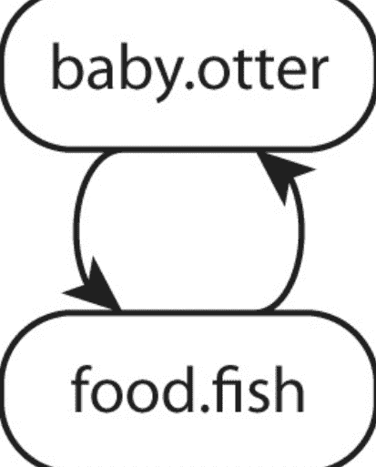

A. 为每个添加一个 module-info.java。
B. 将它们添加到 classpath。
C. 创建第三个模块以包含公共代码。
D. 将它们合并为一个模块以打破循环依赖。
E. 重命名模块以使用连线代替点。

# 26. 哪个命令产生如下的输出？

```
animal.puppy -> animal.dog
```

A. jdeps -d animal.puppy.jar
B. jdeps -s animal.puppy.jar
C. jmod -d animal.puppy.jar
D. jmod -s animal.puppy.jar
E. 以上都不是

# 27. 假设消费者、服务定位器、服务提供者和服务提供者接口位于不同的模块中。以下哪项最能描述该 module-info 文件？

```
module nature.tree {
  requires nature.sapling;
  provides nature.sapling.Tree with nature.tree.Maple;
}
```

A. 消费者
B. 服务定位器
C. 服务提供者
D. 服务提供者接口

# 28. 假设有一个 com.bird 模块，它包含一个 com.bird.tweet 包和一个带有 main() 方法的 Tweety 类。以下哪一项可以填充空白以运行此程序？

```
java --module-path mods -module ____________________
```

A. com.bird.Tweety
B. com.bird.tweet.Tweety
C. com.bird/Tweety
D. com.bird.tweet/Tweety
E. com.bird/com.bird.tweet.Tweety
F. com.bird.tweet/com.bird.Tweety

# 29. 哪些类型的模块需要包含 module-info 文件？

A. 仅自动模块
B. 仅命名
C. 仅未命名
D. 自动且命名
E. 自动且未命名
F. 命名且未命名

# 30. 假设消费者、服务定位器、服务提供者和服务提供接口分别位于不同的模块中。以下哪项最能准确描述以下 module-info 文件？

```
module nature.tree {
exports nature.tree.leaf;
requires nature.sapling;
uses nature.tree.Photosynthesis;
}
```

A. 消费者
B. 服务定位器
C. 服务提供者
D. 服务提供接口
E. 以上都不是

# 31. 哪个命令可以让你创建一个一个 Java 运行时镜像？

A. jdeps
B. jmod
C. jimage
D. jlink
E. 以上都不是

# 32. 假设消费者、服务定位器、服务提供者和服务提供接口分别位于不同的模块中。以下哪项最能准确描述以下 module-info 文件？

```
module nature.tree{
requires nature.sapling;
}
```

A. 消费者
B. 服务定位器
C. 服务提供者
D. 服务提供接口
E. 以上都不是

# 33. 哪些类型的模块被允许包含 module-info 文件？

A. 仅自动
B. 仅命名
C. 仅未命名
D. 自动且命名
E. 自动且未命名
F. 命名且未命名

# 34. 关于此模块声明，以下哪项是正确的？

```
1: class com.mammal {
2:   exports com.mammal.cat;
3:   exports cat.mammal.mouse to com.mice;
4:   uses com.animal;
5: }
```

A. 编译失败的第一行是第 1 行。
B. 编译失败的第一行是第 2 行。
C. 编译失败的第一行是第 3 行。
D. 编译失败的第一行是第 4 行。
E. 代码编译通过。

# 35. 在 module-info.java 文件中可以使用多少这些指令：closes, export, import, require 和 uses？

A. 0
B. 一个
C. 两个
D. 三
E. 四个
F. 五

# 36. 假设消费者、服务定位器、服务提供者和服务提供接口分别位于不同的模块中。以下哪项最能准确描述此 module-info 文件？

```
module nature.tree{
  exports nature.tree.leaf;
}
```

A. 消费者
B. 服务定位器
C. 服务提供者
D. 服务提供接口
E. 以上都不是

# 37. 哪些模块是 JDK 提供的？（选择三个）

A. jdk.base
B. jdk.basic
C. jdk.desktop
D. jdk.javadoc
E. jdk.jeps
F. jdk.net

# 38. 关于迁移类型，哪些陈述是正确的？（选择三个）

A. 在自底向上迁移中，所有模块都会立即移动到模块路径中。
B. 在自顶向下迁移中，所有模块都会立即移动到模块路径中。
C. 在自底向上迁移中，模块在依赖于它们的模块之前迁移。


### D. 在自顶向下迁移中，模块在依赖于它们的模块之前迁移。

### E. 在自底向上迁移中，尚未命名的模块是自动模块。

### F. 在自顶向下迁移中，尚未命名的模块是自动模块。

### 39. 在模块服务的以下哪个部分中，类应该包含一个对 `load(ChocolateLab.class)` 的方法调用，以便允许调用者使用它？

+   A. 消费者
+   B. 服务定位器
+   C. 服务提供者
+   D. 服务提供接口
+   E. 以上都不是

### 40. 在这些模块声明中，有多少个是合法的？

+   A. 0
+   B. 一个
+   C. 两个
+   D. 三
+   E. 四个
+   F. 五

### 41. ServiceLoader 的益处是什么？

+   A. 它允许你在不重新编译应用程序的情况下添加功能。
+   B. 它允许你加载用 C++ 编写的服务。
+   C. 它是一个接口。
+   D. 在实现服务时，它引用了 ServiceLoader。

### 42. 哪些陈述是正确的？（选择两个）

+   A. Classpath 上的代码可以引用自动、命名和未命名模块中的代码。
+   B. Classpath 上的代码可以引用命名模块中的代码，但不能引用自动和未命名模块的代码。
+   C. Classpath 上的代码可以引用自动和命名模块中的代码，但不能引用未命名模块的代码。
+   D. Module path 上的代码可以引用自动、命名和未命名模块中的代码。
+   E. Module path 上的代码可以引用命名模块中的代码，但不能引用自动和未命名模块的代码。
+   F. Module path 上的代码可以引用自动和命名模块中的代码，但不能引用未命名模块的代码。

### 43. 假设我们有图中所示的包。 module-info.java 中添加什么可以允许该模块访问自动模块，但不能访问未命名模块？


+   A. exports;
+   B. exports;
+   C. requires;
+   D. requires;

### 44. 给定图，module-info.java 中添加什么可以允许该模块访问自动模块，但不能访问未命名模块？


+   A. exports;
+   B. exports;
+   C. requires;
+   D. requires;
+   E. 以上都不是

### 45. 给定图，module-info.java 中应该包含哪项，以指定该模块访问 duck 包，但不能访问 bread 包？

+   A. requires duck, bread;
+   B. requires duck;
+   C. requires duck and bread;
+   D. requires duck;
+   E. 以上都不是

### 46. 哪项是服务的一部分并带有 provides 指令？

+   A. 消费者
+   B. 服务定位器
+   C. 服务提供者
+   D. 服务提供接口
+   E. 以上都不是

### 47. 哪个命令是列出 jdk.unsupported 的简单方法？

+   A. jeps cookie.jar
+   B. jdeps -s cookie.jar
+   C. jdeps -jinternals cookie.jar
+   D. jdeps --jinternals cookie.jar
+   E. jdeps -jkunsupported cookie.jar
+   F. jdeps --jkunsupported.jar

### 48. 哪些模块在 classpath 上？

+   A. 仅自动
+   B. 仅命名
+   C. 仅未命名
+   D. 自动且命名
+   E. 自动且未命名
+   F. 命名且未命名

### 49. 哪行代码属于服务定位器？

+   A. ServiceLoader loader = ServiceLoader.load();
+   B. ServiceLoader loader = ServiceLoader.load(Mouse.class);
+   C. ServiceLoader<Mouse> loader = ServiceLoader.load();
+   D. ServiceLoader<Mouse> loader = ServiceLoader.load(Mouse.class);
+   E. Mouse loader = ServiceLoader.load();
+   F. Mouse loader = ServiceLoader.load(Mouse.class);

### 50. 关于服务，哪些陈述是正确的？（选择两个）

+   A. 修改服务提供接口总是需要重新编译提供者。
+   B. 修改服务提供接口有时需要重新编译提供者。
+   C. 修改服务提供接口永远不需要重新编译提供者。
+   D. 如果服务提供接口在方法签名中引用其他类，它们被视为服务的一部分。
+   E. 如果服务提供接口在方法签名中引用其他类，它们不被视为服务的一部分。

### 51. 哪些模块在 module path 上？

+   A. 仅自动
+   B. 仅命名
+   C. 仅未命名
+   D. 自动且命名
+   E. 自动且未命名
+   F. 命名且未命名

### 52. 图中的每个框对应一个模块。服务定位器和服务提供接口共享一个模块。哪些框分别代表消费者和服务提供者？


+   A. X 和 Y
+   B. X 和 Z
+   C. Y 和 Z
+   D. Z 和 Z
+   E. Z 和 Y
+   F. 以上都不是

### 53. 列出 JAR 依赖于哪些模块而不列出包名的最简单命令是什么？

+   A. jdeps cookie.jar
+   B. jdeps -s cookie.jar
+   C. jdeps --jdkinternals cookie.jar
+   D. jdeps --jdkinternals cookie.jar
+   F. jdeps --jdk-unsupported cookie.jar

### 54. 在 jlink 上使用哪个标记来指定生成的运行时镜像应该放置的目录？

+   A. -d
+   B. --directory
+   C. -d or --directory
+   D. -o
+   E. --output
+   F. -o or --output
+   G. 以上都不是

### 55. 填空空白以列出一种在调试模块时获取大量有用信息的方法。

`-m x -p y ---`

+   A. jar and show-modules
+   B. jar and show-module-detail
+   C. jar and show-module-resolution
+   D. java and show-modules
+   E. java and show-module-detail
+   F. java and show-module-resolution

### 56. 假设你在名为 animal.insect.api 的模块中有以下接口。为了使其成为服务提供接口（SPI），module-info 文件中需要包含什么？

```java
package animal.insect.api.bugs;
public interface Bug {
    int crawl();
}
```

+   A. exports animal.insect.api;
+   B. exports animal.insect.api.bugs;
+   C. exports animal.insect.api.bugs.Bug;
+   D. requires animal.insect.api;
+   E. requires animal.insect.api.bugs;
+   F. requires animal.insect.api.bugs.Bug;

### 57. 假设你在名为 animal.insect.impl 的模块中有以下类，并且有问题 56 中的服务提供接口模块。为了使其成为服务提供者（ServiceProvider），module-info 文件需要包含什么？（选择两个。）

```java
package animal.insect.impl;
import animal.insect.api.bugs.Bug;

public class Worm implements Bug {
    @Override
    public int crawl() {
        return 1;
    }
}
```

+   A. requires animal.insect.api;
+   B. requires animal.insect.lookup;
+   C. requires animal.insect.printer;
+   D. provides animal.insect.impl.Worm;
+   E. provides animal.insect.api.Bug with animal.insect.impl.Worm;
+   F. provides animal.insect.impl.Worm with animal.insect.api.Bug;

### 58. 假设你在名为 animal.insect.lookup 的模块中有以下类，并且有问题 56 中的服务提供接口。除了 exports 指令外，module-info 文件中还需要包含什么才能使其成为服务定位器（ServiceLocator）？（选择两个。）

```java
package animal.insect.lookup;
import animal.insect.api.bugs.Bug;
import java.util.List;
import java.util.ServiceLoader;
import java.util.stream.Collectors;

public class InsectFinder {
    public static List<Bug> findAllBugs() {
        return ServiceLoader.load(Bug.class)
            .stream()
            .map(ServiceLoader.Provider::get)
            .collect(Collectors.toList());
    }
}
```

+   A. provides animal.insect.lookup;
+   B. provides animal.insect.lookup.InsectFinder;
+   C. requires animal.insect.api;
+   D. requires animal.insect.api.Bug;
+   E. uses animal.insect.api.bugs;
+   F. uses animal.insect.api.bugs.Bug;

### 59. 假设你在名为 animal.insect.printer 的模块中有以下类，并且有问题 56 中的服务提供接口以及问题 58 中的服务提供者。为了使其成为一个消费者（Consumer），module-info 文件中需要包含什么？（选择两个。）

```java
package animal.printer;
import animal.insect.lookup.InsectFinder;

public class Print {
    public static void main(String[] args) {
        var bugs = InsectFinder.findAllBugs();
        bugs.forEach(System.out::println);
    }
}
```

+   A. requires animal.insect.api.bugs;
+   B. requires animal.insect.lookup;
+   C. requires animal.insect.printer;
+   D. uses animal.insect.api.bugs;
+   E. uses animal.insect.api.bugs.Bug;
+   F. uses animal.insect.lookup.InsectFinder;

### 60. 列出 JAR 依赖于哪些模块（包括包名）的最简单命令是什么？

+   A. jdeps cookie.jar
+   B. jdeps -s cookie.jar
+   C. jdeps --jdkinternals cookie.jar
+   D. jdeps --jdkinternals cookie.jar
+   E. jdeps --jdk-unsupported cookie.jar

### 61. 循环依赖中有多少个模块？

```java
module com.light {
    exports com.light;
}
module com.animal {
    exports com.animal;
    requires com.light;
    requires com.plant;
}
module com.plant {
    exports com.plant;
    requires com.light;
    requires com.animal;
}

module com.worm {
  exports com.worm;
  requires com.light;
  requires com.animal;
  requires com.plant;
}
```

+   A. 0
+   B. 1
+   C. 2
+   D. 3
+   E. 4

### 62. 关于 -d 的什么说法是正确的？

+   A. 可以配合 jar 命令使用，但不支持 java 命令。
+   B. 可以配合 java 命令使用，但不支持 jar 命令。
+   C. 可以配合 jar 和 java 命令使用且用途相同。
+   D. 可以配合 jar 和 java 命令，但前者表示“directory”，后者表示“describe module”。
+   E. 以上都不是。

### 63. 假设所有引用的文件和目录都存在，这段代码的作用是什么？

```bash
javac -m mods -d mouse/*.java
mouse/module-info.java
jar -cvf mods/mouse.jar -C mouse/
```

+   A. 创建 com.mouse 模块的 JAR 文件
+   B. 创建不是模块的 JAR 文件
+   C. javac 命令失败
+   D. jar 命令失败

### 64. 哪个模块始终在 jdeps 输出中？

+   A. java.base
+   B. java.lang
+   C. java.self
+   D. jdk.base
+   E. jdk.lang
+   F. jdk.self

### 65. jmod 命令的哪些模式是有效的？（选择三个）。

+   A. create
+   B. list
+   C. hash
+   D. show
+   E. verbose
+   F. version

### 66. 此图显示了向模块迁移的第二步。这是哪种类型的迁移？

classpath module path


+   A. 自底向上 (Bottom-up)
+   B. 并行 (Side-to-side)
+   C. 自上而下 (Top-down)
+   D. 信息不足以判断。

### 67. 关于上图和场景，哪些说法是正确的？（选择两个。）

+   A. butterfly 是自动模块。
+   B. butterfly 是一个命名模块。
+   C. butterfly 是未命名模块。
+   D. caterpillar 是自动模块。
+   E. caterpillar 是一个命名模块。
+   F. caterpillar 是未命名模块。

### 68. 假设 module path 中有两个 JAR，且 com.magic JAR 只导出了一个包：com.magic.unicorn。com.science JAR 中没有 module-info 文件。图中四个包中有多少可以被 module path 访问？

| com.magic | com.science |
| --- | --- |
| com.magic.dragon | com.science.bio |
| com.magic.unicorn | com.science.chem |

+   A. 0
+   B. 1
+   C. 2
+   D. 3
+   E. 4

### 69. 假设上一个问题中的两个 JAR 在 classpath 上。图中四个包中有多少可以作为 module path 访问？

+   A. 0
+   B. 1
+   C. 2
+   D. 3
+   E. 4

### 70. 关于以下 module-info.java 文件，什么说法是正确的？

```java
module Book { }
```

+   A. 因为它是空的，无法编译。
+   B. 因为模块名是大写字母，无法编译。
+   C. 因为模块名只有一个组件，无法编译。
+   D. 因为其他原因无法编译。
+   E. 它可以编译。


## 71. 当添加新的服务提供者时，以下哪些项需要重新编译？

A. 消费者 (Consumer)

B. 服务定位器 (Service locator)

C. 现有的服务提供者

D. 服务提供接口 (SPI)

E. 以上都不是

## 72. 在模块模块工作时，哪些选项名称等同于 `-m` 和 `-s`？

A. `--module` 和 `--short`

B. `--module` 和 `--statistics`

C. `--module` 和 `--summary`

D. `--module-path` 和 `--short`

E. `--module-path` 和 `--statistics`

F. `--module-path` 和 `--summary`

## 73. 哪些被视为服务的一部分？

A. 实现类引用但接口未引用的类

B. 接口引用但实现类未引用的类

C. 实现类或接口引用的类

D. 以上都不是

## 74. 哪个命令使用 `-s` 代表 summary？

+   A. `jdeps.impl.`

+   B. `jlink`

+   C. `jmod`

+   D. `jdeps` 和 `jlink`

+   E. `jlink` 和 `jmod`

+   F. 以上所有

+   G. 以上都不是

## 75. 假设你在名为 `animal.insect.impl` 的模块中有以下类。哪两个项最可能位于服务定位器的 `module-info` 中？（选择两个。）

```java
package animal.insect.impl;
import animal.insect.api.Bugs;

public class Worm implements Bug {
    @Override
    public int crawl() {
        return 1;
    }
}
```

+   A. `requires animal.insect.api.bugs;`

+   B. `requires animal.insect.api.Bugs;`

+   C. `requires animal.insect.impl;`

+   D. `uses animal.insect.api.bugs;`

+   E. `uses animal.insect.api.Bugs;`

+   F. `uses animal.insect.api.bugs with animal.insect.impl.Worm;`

## 76. 下列陈述中哪些是正确的？（选择两个。）

+   A. 自下而上的迁移涉及的 classpath 步骤比自上而下的迁移多。

+   B. 自上而下的迁移涉及的 classpath 步骤比自下而上的迁移多。

C. 两种类型的迁移涉及类路径path的步骤数相同。

D. 自下而上的迁移在模块路径上具有未命名模块。

E. 自上而下的迁移在模块路径上具有未命名模块。

F. 这两种迁移类型在模块路径上均没有未命名模块。

## 77. 在空白处填写代码以查找并调用服务。

```java
String cheese = ServiceLoader.load(Mouse.class)
.stream()
.map(Mouse::favoriteFood)
.findFirst()
.orElse("Mouse");
```

+   A. `Mouse.get()`

+   B. `Mouse::get`

+   C. `Provider.get()`

+   D. `Provider::get`

+   E. 以上都不是

## 78. 给定下面的图，其中每个框代表一个模块，对于 `mammal` 模块，`module-info.java` 中需要包含哪些语句？（选择三个。）

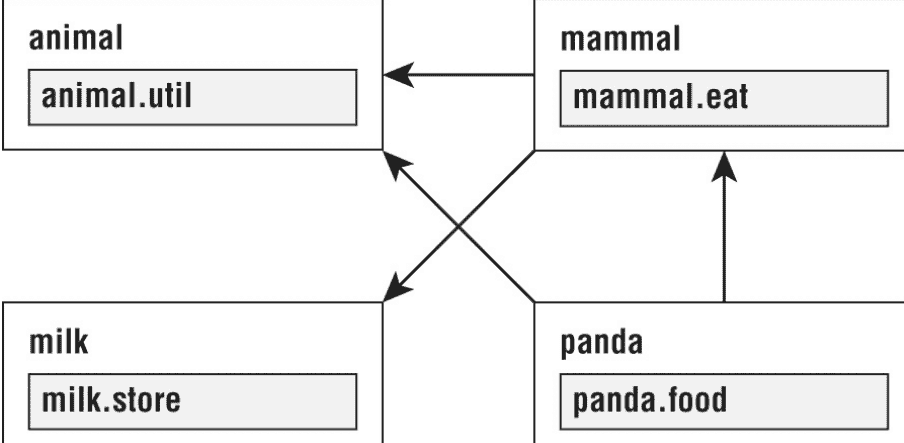

+   A. `exports mammal;`

+   B. `exports mammal.eat;`

+   C. `requires animal;`

+   D. `requires animal.util;`

+   E. `requires milk;`

+   F. `requires milk.store;`

## 79. 给定之前的图和以下 `panda` 模块的 `module-info.java`，对 `requires` 语句可以进行什么更改？

```java
module panda {
  requires mammal;
}
```

+   A. `exports transitive mammal;`

+   B. `exports transitive mammal.eat;`

+   C. `requires transitive animal;`

+   D. `requires transitive animal.util;`

+   E. `transitive requires animal;`

+   F. `transitive requires animal.util;`

## 80. 给定第 78 题中的图和以下 `panda` 模块的 `module-info.java`，包含 m1 行的结果是什么？

```java
module panda {
  requires mammal;
  requires transitive mammal; // line m1
}
```

+   A. 任何需要 `mammal` 的模块都会自动获得 `panda`。

+   B. 任何需要 `panda` 的模块都会自动获得 `mammal`。

+   C. 行为没有变化。

+   D. 代码无法编译。

## 81. 允许多少服务提供者实现服务提供者接口？

+   A. 正好一个

+   B. 正好两个

+   C. 一个或两个

+   D. 一个或多个

+   E. 以上都不是

## 82. 以下哪些是 JDK 提供的模块？（选择三个。）

+   A. `java.logging`

+   B. `java.javadoc`

+   C. `java.jdk`

+   D. `java.management`

+   E. `java.naming`

+   F. `java.scripts`

## 83. 关于一个只有一个 `module-info.class` 文件（放置在 `META-INF` 目录下）的 JAR 文件，哪些描述是正确的？（选择两个。）

+   A. 如果在类路径上，它是一个自动模块。

+   B. 如果在模块路径上，它是一个自动模块。

+   C. 如果在类路径上，它是一个命名模块。

+   D. 如果在模块路径上，它是一个命名模块。

+   E. 如果在类路径上，它是一个未命名模块。

+   F. 如果在模块路径上，它是一个未命名模块。

## 84. 下图中的每个框对应一个模块。服务定位器和服务提供者接口共享一个模块。哪些框分别代表消费者和服务提供者？

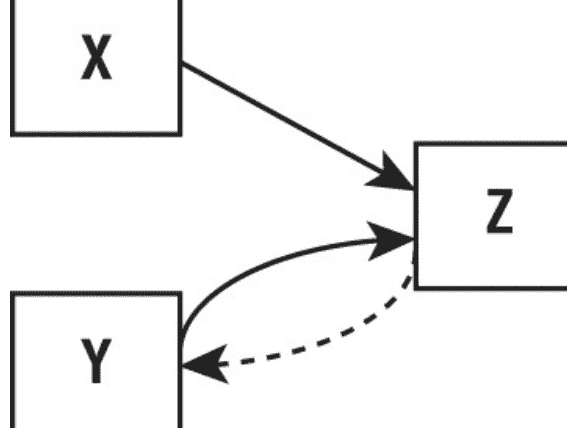

+   A. X 和 Y

+   B. X 和 Z

+   C. Y 和 Z

+   D. Z 和 Z

+   E. Z 和 Y

+   F. 以上都不是

## 85. 关于 `ServiceLoader` 类，以下哪些语句最准确？（选择两个。）

+   A. `load()` 不接受任何参数。

+   B. `load()` 接受类类型作为参数。

+   C. 在遍历 `load()` 的结果时，需要对 Provider 调用 `get()` 方法。

+   D. 在 Stream 中使用 `load()` 的结果时，需要对 Provider 调用 `get()` 方法。

## 86. 假设我们在模块路径上有一个名为 `lizard-cricket-1.0.0-SNAPSHOT.jar` 的自动模块，且没有指定 `Automatic-Module-Name`。命名模块应该使用什么名称来引用它？

+   A. `lizard-cricket`

+   B. `lizard-cricket`

+   C. `lizard-cricket-SNAPSHOT`

+   D. `lizard-cricket.SNAPSHOT`

+   E. 以上都不是

## 87. 模块分发的合法文件格式是哪些？

+   A. jar

+   B. jmod

+   C. zip

+   D. jar 和 jmod

+   E. jar 和 zip

+   F. jmod 和 zip

## 88. 为什么这个 `module-info` 对于服务提供者是错误的？

```java
module plant.flower {
  exports plant.flower.impl;
  requires plant.flower.api;
  provides plant.flower.api.Petal
    with plant.flower.impl.PetalImpl;
}
```

+   A. `exports` 指令应该是 `export`。

+   B. 不应该存在 `exports` 指令，因为所有对的调用都是

+   C. `provides` 指令应该是 `instead`。

+   D. `provides` 指令应该是 `instead`。

+   E. `exports` 指令应该是 `exports`。

+   F. `provides` 指令应该是。

## 89. 下列代码中有多少个依赖？

```java
module.plant {
  requires light;
}
module.animal {
  requires light;
}
module.worm {
}
}
```

+   A. 0

+   B. 1

+   C. 2

+   D. 3

+   E. 4

## 90. 关于哪些语句是正确的？（选择两个。）

+   A. 运行 `list` 命令时的输出。

+   B. 运行 `command` 命令时的输出。

+   C. 运行 `jdeps` 命令时的输出。

+   D. 运行 `jmod` 命令时的输出。

+   E. 所有模块将包含此。

+   F. 部分模块将包含此。

# 第 8 章 并发代码

OCP 考试主题：

- 创建线程
- 使用 `Runnable` 和 `Callable`
- 管理线程生命周期
- 开发线程安全代码
- 使用集合
- 使用流

## 1. 以下代码打印多少次 "rude!"？

```java
public class Speaking {
  void talk() {
    try {
      Thread.sleep(10000);
    } catch (InterruptedException e) {
      System.out.println("rude!");
    }
  }
  public static void main(String[] args) {
    var s = new Speaking();
    var t = new Thread(() -> s.talk());
    t.run();
    t.interrupt();
  }
}
```

+   A. Zero

+   B. 一

+   C. 两

+   D. 三

+   E. 代码无法编译。

+   F. 代码编译但运行时异常。

## 2. 以下代码的输出是什么？

```java
Callable c = new Callable() {
    public Object run() {
    System.out.print("X");
    return 10;
    }
};
var s = Executors.newScheduledThreadPool(1);
for(int i=0; i<10; i++) {
    Future f = s.submit(c);
    f.get();
}
s.shutdown();
System.out.print("Done!");
```

+   A. XXXXXXXXDone!

+   B. Done!XXXXXXXXX

+   C. 代码无法编译。

+   D. 代码在运行时无限阻塞。

+   E. 代码运行时抛出异常。

+   F. 输出无法确定。

## 3. 以下哪些方法在 `ExecutorService` 上可用？（选择两个。）

+   A. `execute(Callable)`

+   B. `shutdownNow()`

+   C. `submit(Runnable)`

+   D. `exit()`

+   E. `submit(Callable)`

+   F. `execute(Runnable)`

## 4. 以下程序模拟偶数次抛硬币。假设五秒钟足够完成所有任务，该应用程序的输出是什么？

```java
import java.util.concurrent.*;
import java.util.concurrent.atomic.*;
public class Luck {
    private AtomicBoolean coin = new AtomicBoolean(false);
    void flip() {
        coin.set(!coin.get());
    }
    public static void main(String[] args) throws Exception {
        var luck = new Luck();
        ExecutorService s = Executors.newCachedThreadPool();
        for(int i=0; i<1000; i++) {
            s.execute(() -> luck.flip());
        }
        s.shutdown();
        Thread.sleep(5000);
        System.out.println(luck.coin.get());
    }
}
```

+   A. false

+   B. true

+   C. 代码无法编译。

+   D. 代码在运行时无限阻塞。

+   E. 代码运行时抛出异常。

+   F. 输出无法确定。

## 5. 定义异步任务的推荐方法是哪个？

+   A. 创建一个 callable 表达式并传递给 `Executor` 实例。

+   B. 创建一个扩展 `Thread` 的类并重写 `start` 方法。

+   C. 创建一个 `Runnable` lambda 表达式并将其传递给 `Thread` 构造函数。

+   D. 创建重写了 `begin()` 方法的匿名 `Runnable` 类。

+   E. 以上。

## 6. 假设五秒钟足够该程序中的线程完成，那么执行以下程序的预期结果是什么？

```java
import java.util.*;
public class Dance {
    int count = 0;
    synchronized int step() { return count++; }
    public static void main(String[] args) throws InterruptedException {
        var waltz = new Dance();
        var dancers = new ArrayList<Thread>();

        for(int i=0; i<10; i++) {
            dancers.add(new Thread(() -> waltz.step()));
        }
        for(Thread dancer : dancers) {
            dancer.start();
        }
        dancers.forEach(d -> d.interrupt());

        Thread.sleep(5000);
        System.out.print(waltz.count);
    }
}
```

+   A. 它总是打印一个小于 10 的数字。

+   B. 它总是打印 10。

+   C. 它可能打印 10 或一个小于 10 的数字。

+   D. 代码无法编译。

+   E. 代码可以编译，但在运行时会出异常。

+   F. 以上都不是。

## 7. 鉴于以下程序，`Locked!` 预期打印多少次？

```java
import java.util.concurrent.locks.*;
public class Padlock {
    private Lock lock = new ReentrantLock();
    public void lockUp() {
        if (lock.tryLock()) {
            lock.lock();
            System.out.println("Locked!");
            lock.unlock();
        }
    }
    public static void main(String... unused) throws Exception {
        var gate = new Padlock();
        for(int i=0; i<5; i++) {
            new Thread(() -> gate.lockUp()).start();
            Thread.sleep(1_000);
        }
    }
}
```

+   A. 一次。

+   B. 五次。

+   C. 代码无法编译。

+   D. 代码在运行时无限挂起。

+   E. 代码在运行时抛出异常。

+   F. 输出结果无法提前确定。

## 8. 关于以下应用的哪些描述是正确的？（选择两个。）


```java
import java.util.concurrent.atomic.*;
import java.util.stream.*;
public class TicketTaker {
    long ticketsSold;
    final AtomicInteger ticketsTaken;
    public TicketTaker() {
        ticketsSold = 0;
        ticketsTaken = new AtomicInteger(0);
    }
    public void performJob() {
        IntStream.iterate(1, p -> p+1)
            .parallel()
            .limit(100)
            .forEach(i -> ticketsTaken.getAndIncrement());
        IntStream.iterate(1, q -> q+1)
            .parallel()
            .limit(500)
            .forEach(i -> ++ticketsSold);
        System.out.print("ticketsTaken+" + " "+ticketsSold);
    }
    public static void main(String[] args) {
        new TicketTaker().performJob();
    }
}
```

- A. `TicketTaker` 构造函数无法编译。
- B. `performJob()` 方法无法编译。
- C. 类可以编译。
- D. 打印的第一个数字始终是 100。
- E. 打印的第二个数字始终是 500。
- F. 运行时抛出 `ConcurrentModificationException`。

### 9. 鉴于原始数组，假设每个语句都独立执行，以下有多少个 for 语句会导致运行时产生异常：

```java
var original = List.of(1,2,3,4,5);

var copy1 = new CopyOnWriteArrayList<Integer>(original);
for(Integer w : copy1)
    copy1.remove(w);

var copy2 = Collections.synchronizedList(original);
for(Integer w : copy2)
    copy2.remove(w);

var copy3 = new ArrayList<Integer>(original);
for(Integer w : copy3)
    copy3.remove(w);

var copy4 = new ConcurrentLinkedQueue<Integer>(original);
for(Integer w : copy4)
    copy4.remove(w);
```

- A. 零
- B. 一个
- C. 二
- D. 三
- E. 四
- F. 代码无法编译。

### 10. 填空：__________ 是 ________ 的一种特殊情况，即两个或多个活动线程尝试获取同一组锁但未成功。

- A. 死锁，活锁
- B. 死锁，资源饥饿
- C. 活锁，资源饥饿
- D. 资源饥饿，竞态条件
- E. 资源饥饿，活锁
- F. 以上都不是

### 11. 下一个程序的输出是什么？

```java
import java.util.stream.*;
public class Bull {
    void charge() {
        IntStream.range(1,6)
            .parallel()
            .forEach(System.out::print);
    }
    public static void main(String[] args) {
        var b = new Bull();
        b.charge();
    }
}
```

- A. 12345
- B. 54321
- C. 输出无法提前确定。
- D. 代码无法编译。
- E. 运行时抛出异常。
- F. 以上都不是。

### 12. 以下程序的输出是什么？

```java
public class TpsReport {
    public void submitReports() {
        var s = Executors.newCachedThreadPool();
        var bosses = s.submit(() -> System.out.print("1"));
        s.shutdown();
        System.out.print(bosses.get());
    }
    public static void main(String[] args) {
        new TpsReport().submitReports();
    }
}
```

- A. null
- B. 1
- C. 第 6 行无法编译。
- D. 第 8 行无法编译。
- E. 运行时抛出异常。

### 13. 以下哪些静态方法不存在于 `Executors` 类？（选择两个。）

- A. `newFixedScheduledThreadPool()`
- B. `newThreadPool()`
- C. `newFixedThreadPool(int)`
- D. `newSingleThreadExecutor()`
- E. `newSingleScheduledThreadPool(int)`
- F. `newSingleScheduledExecutor()`

### 14. 以下程序打印多少次 Ready？

```java
package parade;
import java.util.concurrent.*;
public class CartoonCat {
    private void await(CyclicBarrier c) {
        try {
            c.await();
        } catch (Exception e) {}
    }
    public void march(CyclicBarrier c) {
        var s = Executors.newSingleThreadExecutor();
        for(int i=0; i<2; i++) {
            s.execute(() -> await(c));
        }
        s.shutdown();
    }
    public static void main(String... strings) {
        new CartoonCat().march(new CyclicBarrier(4, () -> System.out.println("Ready")));
    }
}
```

- A. 零
- B. 一
- C. 三
- D. 代码无法编译。
- E. 运行时抛出异常。

### 15. 假设你需要一个线程执行器来为限制为五个线程的 `CyclicBarrier` 创建任务。你应该使用 `Executors` 中的哪个静态方法？

- A. `newSingleThreadExecutor()`
- B. `newSingleScheduledExecutor()`
- C. `newCachedThreadPool()`
- D. `newFixedThreadPool(2)`
- E. 以上都不是

### 16. 下图表示两个线程共享共同变量的读/写操作。每个线程首先从内存中读取变量的值，然后将变量的新值写回内存。哪幅图展示了正确的同步？

- A. 
- B. 
- C. 
- D. 

### 17. 下一个程序的输出是什么？（选择三个。）

```java
import java.util.concurrent.atomic.*;
import java.util.stream.*;
public class Circus {
    private static volatile int seal = 0;
    private static volatile int tiger = 0;
    private static AtomicInteger lion = new AtomicInteger(0);
    public static void main(String[] tent) {
        Stream.iterate(0, x -> x + 1)
            .parallel()
            .limit(100)
            .forEach(q -> {seal++; tiger++;
                lion.incrementAndGet();});
        System.out.println(seal + "," + tiger + "," + lion);
    }
}
```

- A. 打印的第一个数字可能小于 100。
- B. 打印的第一个数字始终是 100。
- C. 打印的第二个数字可能小于 100。
- D. 打印的第二个数字始终是 100。
- E. 打印的第三个数字可能小于 100。
- F. 打印的第三个数字始终是 100。

### 18. 下一个程序的输出是什么？

```java
import java.util.*;
import java.util.concurrent.*;
public class Race {
    ExecutorService service = Executors.newFixedThreadPool(8);
    public static int sleep() {
        try { Thread.sleep(1000); } catch (Exception e) {
            return 1;
        }
    }
    public void hare() {
        try {
            Callable<Integer> c = () -> sleep();
            final var r = List.of(c,c,c);
            var results = service.invokeAll(r);
            System.out.println("Hare won the race!");
        } catch (Exception e) {e.printStackTrace();}
    }
    public void tortoise() {
        try {
            Callable<Integer> c = () -> sleep();
            final var r = List.of(c,c,c);
            Integer result = service.invokeAny(r);
            System.out.println("Tortoise won the race!");
        } catch (Exception e) {e.printStackTrace();}
    }
    public static void main(String[] p) throws Exception {
        var race = new Race();
        race.service.execute(() -> race.hare());
        race.service.execute(() -> race.tortoise());
    }
}
```

- A. "Hare won the race!" 首先打印。
- B. "Tortoise won the race!" 首先打印。
- C. 代码无法编译。
- D. 代码在运行时无限挂起。
- E. 代码在运行时抛出异常。
- F. 输出无法提前确定。

### 19. 下列哪些并发集合是有排序的？（选择两个。）

- A. `ConcurrentSkipList`
- B. `ConcurrentSkipListSet`
- C. `CopyOnWriteArray`
- D. `ConcurrentSkipListMap`
- E. `ConcurrentLinkedBlockingQueue`
- F. `LinkedBlockingQueue`

### 20. 下一个程序的输出是什么？

- A. [Filing]
- B. [Filing]3.14159
- C. [Filing]null 3.14159
- D. `f1` 的声明无法编译。
- E. `f2` 的声明无法编译。
- F. 输出无法提前确定。

### 21. 假设 10 秒足够足够所有任务完成，关于以下程序的哪些陈述是正确的？（选择两个。）

```java
import java.util.concurrent.*;
import java.util.concurrent.atomic.*;
public class Clock {
    private AtomicLong bigHand = new AtomicLong(0);
    void incrementBy10() {
        bigHand.getAndSet(bigHand.get() + 10);
    }
    public static void main(String[] c) throws Exception {
        var smartwatch = new Clock();
        ExecutorService s = Executors.newCachedThreadPool();
        for(int i=0; i<100; i++) {
            s.submit(() -> smartwatch.incrementBy10()).get();
        }
        s.shutdown();
        s.awaitTermination(10, TimeUnit.SECONDS);
        System.out.println(smartwatch.bigHand.get());
    }
}
```

- A. 代码无法编译。
- B. `incrementBy10()` 方法是线程安全的。
- C. `incrementBy10()` 方法不是线程安全的。
- D. 每次执行输出都是 1000。
- E. 输出无法提前确定。
- F. 代码在运行时无限挂起。

### 22. 执行以下程序最可能的结果是？

```java
package jokes;
import java.util.concurrent.*;
public class Riddle {
    public void sleep() {
        try { Thread.sleep(5000); } catch (Exception e) {
    }
    public String getQuestion(Riddle r) {
        synchronized {
            sleep();
            if(r != null) r.getAnswer(null);
            return "How many programmers do it take " + to change a light bulb";
        }
    }
    public synchronized String getAnswer(Riddle r) {
        sleep();
        if(r != null) r.getAnswer(null);
        return "None, that's a hardware problem";
    }
    public static void main(String... unused) {
```


```java
var r1 = new Riddle();
var r2 = new Riddle();
var s = Executors.newFixedThreadPool(2);
s.submit(() -> r1.getQuestion(r2));
s.execute(() -> r2.getAnswer(r1));
s.shutdown();
```

- A. 运行时产生死锁。
- B. 运行时产生活锁。
- C. 程序成功完成。
- D. 代码无法编译。
- E. 代码在运行时无限挂起。
- F. 输出无法提前确定。

### 23. 哪个 `ScheduledExecutorService` 方法会导致两个线程同时执行同一个动作？

- A. `scheduleAtFixedDelay()`
- B. `scheduleAtFixedRate()`
- C. `scheduleWithFixedDelay()`
- D. `scheduleAtSameRate()`
- E. `scheduleWithRate()`
- F. 以上皆非

## 24. 下一个程序的输出是什么？

```java
package java.util.concurrent.*;

public class Athlete {

    int stroke = 0;

    public synchronized void swimming() {
        stroke++;
    }

    private int getStroke() {
        synchronized(this) { return stroke; }
    }

    public static void main(String... laps) {
        ExecutorService s = Executors.newFixedThreadPool(10);
        Athlete a = new Athlete();
        for(int i=0; i<1000; i++) {
            s.execute(() -> a.swimming());
        }
        s.shutdown();
        System.out.print(a.getStroke());
    }
}
```

- A. 运行时产生死锁。
- B. 运行时产生活锁。
- C. 1000
- D. 代码无法编译。
- E. 在运行之前结果未知，因为 `stroke` 不是以线程安全的方式写入的，写入可能会丢失。
- F. 以上皆非。

## 25. 下列哪项可能由竞态条件（race condition）引起？

- A. 线程被永久拒绝访问某种资源
- B. 程序无限挂起
- C. 一个 `int` 变量错误地报告操作执行的次数
- D. 两个线程积极地尝试重启一个保证以相同结束的进程
- E. 两个线程无休止地等待

## 26. 关于以下内容的哪个陈述是正确的？

```java
package my;

import java.util.*;

public class ThreadSafe {

    private List<Integer> data = new ArrayList<>();

    public synchronized void add(int value) {
        data.add(value);
    }

    public int getValue(int index) {
        return data.get(index);
    }

    public int size() {
        synchronized(this) {
            return data.size();
        }
    }
}
```

- A. 代码编译且是安全的。
- B. 代码编译但不是安全的。
- C. 因为 `size()` 方法代码无法编译。
- D. 因为 `getValue()` 方法代码无法编译。
- E. 因为某种原因代码无法编译。
- F. 以上不是。

## 27. 两个方法在填充 `print2()` 时与 `print1()` 产生相同的输出？假设 10 秒足够完成所有任务。

```java
public static void print1(AtomicInteger counter) {
    System.out.println(counter.incrementAndGet());
}

public static void print2(AtomicInteger counter) {
    System.out.println(counter.decrementAndGet());
}
```

- A. `decrementAndGet()`
- B. `incrementAndGet()`
- C. 两个都是
- D. 两个都不是

## 28. 多次执行以下程序的输出是什么？

```java
package bears;

import java.util.*;

public class Bounce {

    public static void main(String... args) {
        List<Integer> list = new ArrayList<>();
        ExecutorService s = Executors.newFixedThreadPool(2);
        for(int i=0; i<4; i++) {
            s.execute(() -> {
                synchronized (list) {
                    list.add(i);
                }
            });
        }
        s.shutdown();
        s.awaitTermination(10, TimeUnit.SECONDS);
        System.out.println(list);
    }
}
```

- A. 只有第一个流是相同的。
- B. 只有前两个流是相同的。
- C. 只有前三个流是相同的。
- D. 所有流都是相同的。
- E. 没有任何流输出是相同的。
- F. 以上不是。

## 29. 以下代码中有多少行包含编译错误？

```java
11: ScheduledExecutorService t = Executors
12: newThreadScheduledExecutor();
13: Future result = t.execute(System.out::println);
14: t.invokeAll(null);
15: t.scheduleFixedRate(() -> {return;}, 5, TimeUnit.MINUTES);
```

- A. 一
- B. 一
- C. 二
- D. 三
- E. 以上不是

## 30. 以下程序运行时打印多少次 W？

```java
package crew;

import java.util.concurrent.*;
import java.util.stream.*;

public class Boat {

    private void waitFinished(CyclicBarrier c) {
        try {
            c.await();
            System.out.print("W");
        } catch (Exception e) {}
    }

    public void row(ExecutorService s) {
        var cb = new CyclicBarrier(5);
        IntStream.iterate(1, i -> i+1)
            .limit(12)
            .forEach(i -> s.submit(() -> waitFinished(cb)));
    }

    public static void main(String[] args) {
        ExecutorService service = null;
        try {
            service = Executors.newCachedThreadPool();
            new Boat().row(service);
        } finally {
            service.shutdown();
        }
    }
}
```

- A. 零。
- B. 十。
- C. 十二。
- D. 代码无法编译。
- E. 输出无法提前确定。
- F. 以上不是。

## 31. 使用上一个问题的 boat 类，程序的最终状态是什么？

- A. 程序在运行时产生异常。
- B. 程序成功终止。
- C. 因为没有关闭 `ExecutorService`，程序无限挂起。
- D. 程序在运行时挂起。
- E. 以上不是。

## 32. 给定以下代码片段，关于 p1 和 p2 行打印值的哪个陈述是正确的？

```java
var db = Collections.synchronizedList(new ArrayList<>{});
IntStream.range(1,6)
  .parallel()
  .map(i -> { db.add(i); return i;})
  .forEachOrdered(System.out::print); // p1
System.out.println(db.forEach(System.out::print)); // p2
```

- A. 它们总是相同的。
- B. 它们有时是相同的。
- C. 它们从不相同。
- D. 代码无法编译。
- E. 该代码将在运行时抛出 `ConcurrentModificationException`。
- F. 以上都不是。

## 33. 给定以下程序，`TV Time` 预计会被打印多少次？假设程序创建的每个任务都有 10 秒的时间足够执行。

```java
import java.util.concurrent.*;
import java.util.concurrent.locks.*;

public class Television {

    private static Lock myTurn = new ReentrantLock();

    public void watch() {
        try {
            if (myTurn.lock(5, TimeUnit.SECONDS)) {
                System.out.println("TV Time");
                myTurn.unlock();
            }
        } catch (InterruptedException e) {}
    }

    public static void main(String[] args) throws Exception {
        var newTv = new Television();
        for (int i = 0; i < 3; i++) {
            new Thread(() -> newTv.watch()).start();
        }
        Thread.sleep(10*1000);
    }
}
```

- A. 一次。
- B. 三次。
- C. 代码无法编译。
- D. 代码在运行时无限挂起。
- E. 代码在运行时抛出异常。
- F. 输出结果无法提前确定。

## 34. 给定原始数组，假设每个语句都是独立执行的，以下语句中有多少个会在运行时进入无限循环？

```java
var original = new ArrayList<Integer>(List.of(1,2,3));
```

```java
var copy1 = new ArrayList<Integer>(original);
for(Integer q : copy1)
    copy1.add(1);
```

```java
var copy2 = new CopyOnWriteArrayList<Integer>(original);
for(Integer q : copy2)
    copy2.add(2);
```

```java
var copy3 = new LinkedBlockingQueue<Integer>(original);
for(Integer q : copy3)
    copy3.offer(3);
```

```java
var copy4 = Collections.synchronizedList(original);
for(Integer q : copy4)
    copy4.add(4);
```

- A. 0
- B. 一个
- C. 两个
- D. 三
- E. 四
- F. 代码无法编译。

## 35. 哪一个 `ExecutorService` 方法保证所有正在运行的任务都以有序的方式停止？

- A. `shutdown()`
- B. `shutdownNow()`
- C. `halt()`
- D. `shutdownAndTerminate()`
- E. 以上都不是

## 36. 假设 10 秒时间足够所有任务完成，以下程序的输出是什么？

```java
import java.util.concurrent.*;

public class Bank {

  static int cookies = 0;

  public synchronized void deposit(int amount) {
    cookies += amount;
  }

  public synchronized void withdrawal(int amount) {
    cookies -= amount;
  }

  public static void main(String[] args) throws Exception {
    var teller = Executors.newScheduledThreadPool(50);
    Bank bank = new Bank();
    for(int i=0; i<25; i++) {
      teller.submit(() -> bank.deposit(5));
      teller.submit(() -> bank.withdrawal(5));
    }
    teller.shutdown();
    teller.awaitTermination(10, TimeUnit.SECONDS);
    System.out.print(bank.cookies);
  }
}
```

- A. 0
- B. 125
- C. -125
- D. 代码无法编译。
- E. 结果在运行之前未知。
- F. 抛出了异常。

## 37. 以下程序的输出输出什么？

```java
import java.util.*;

public class SearchList<T> {

  private List<T> data;
  private boolean foundMatch = false;

  public SearchList(List<T> list) {
    this.data = list;
  }

  public void exists(T v,int start, int end) {
    if(end-start==0) {
    } else if(end-start==1) {
      foundMatch = foundMatch ||
      v.equals(data.get(start));
    } else {
      final int middle = start + (end-start)/2;
      new Thread(() -> exists(v,start,middle)).run();
      new Thread(() -> exists(v,middle,end)).run();
    }
  }

  public static void main(String[] args) throws Exception {
    List<Integer> data = List.of(1,2,3,4,5,6);
    SearchList<Integer> t = new SearchList<Integer>(data);
    t.exists(5, 0, data.size());
    System.out.print(t.foundMatch);
  }
}
```

- A. true
- B. false
- C. 代码无法编译。
- D. 结果在运行之前未知。
- E. 抛出了异常。
- F. 以上都不是。

## 38. 给定以下代码段，关于在 q1 和 q2 行打印的值，哪个陈是正确的？

```java
```


`var mitschWorkout = new CopyOnWriteArrayList<Integer>();`

`List.of(1,5,7,9).stream().parallel().forEach(mitschWorkout::add);`

`mitschWorkout.forEach(System.out::print); // q1`

`List.of(1,5,7,9).stream().parallel().forEachOrdered(System.out::print); // q2`

- A. 它们总是相同的。
- B. 有时相同。
- C. 从不相同。
- D. 代码无法编译。
- E. 运行时会抛出 `ConcurrentModificationException`。
- F. 以上不是。

39. 给定以下代码，程序的输出是什么？（选择三项）

```java
import java.util.concurrent.*;
import java.util.*;

public class Moon {

    private AtomicLong green = new AtomicLong(0);
    private volatile int cheese = 0;
    private volatile int rocket = 0;

    private void takeoff() {
        Stream.iterate(0, x -> x + 1).parallel().limit(1000).forEach(x -> {
            green.incrementAndGet();
            synchronized (this) {
                rocket++;
            }
        });
        System.out.println(green + " " + cheese + " " + rocket);
    }

    public static void main(String[] args) {
        new Moon().takeoff();
    }
}
```

- A. 第一个数字可能小于 1000。
- B. 第一个数字总是 1000。
- C. 第二个数字可能小于 1000。
- D. 第二个数字总是 1000。
- E. 第三个数字可能小于 1000。
- F. 第三个数字总是 1000。

40. 假设两个流操作已编译并执行，哪些陈述是正确的？（选择两个）

```java
var drink = List.of("coke", "soda", "pop");

System.out.print(drink.parallelStream()
    .reduce(0, (c1, c2) -> c1 + c2.length(), (c1, c2) -> c1 + c2)); // q1

System.out.print(drink.stream()
    .reduce(0, (c1, c2) -> c1 + c2.length(), (c1, c2) -> c1 + c2)); // q2
```

- A. 第一个数字有时是 1。
- B. 第一个数字总是 1。
- C. 第二个数字有时是 1。
- D. 第二个数字总是 1。
- E. 第一个流操作未编译。
- F. 第二个流操作未编译。

4. 调用 `writeResume()` 方法时，预期结果是什么？假设类中引用的目录在执行之前不存在，且文件系统可用并可写入。

```java
package job;

import java.nio.file.*;

public class Resume {

    public void writeResume() throws Exception {
        var f1 = Path.of("/templates/proofs/");
        f1.createDirectories();

        var f2 = Path.of("/templates/");
        f2.createDirectory(); // k1

        try (var w = Files.newBufferedWriter(
            Path.of(f2.toString(), "draft.txt"))) {
            w.append("My dream job");
            w.flush();
        }

        f1.delete(f1);
        f2.delete(f2); // k2
    }
}
```

- A. 该应用程序有一行代码无法编译。
- B. 该应用程序有两行代码无法编译。
- C. 代码通过编译，但 k1 行在运行时触发了异常。
- D. 代码通过编译，但 k2 行在运行时触发了异常。
- E. 代码通过编译并运行，且没有打印任何异常。
- F. 以上都不是。

5. 哪些类最不太可能被序列化？（选择两项。）

- A. 一个监控应用程序中每个线程状态的类。
- B. 一个持有特定年份降雨量数据的类。
- C. 一个管理应用程序中运行进程内存的类。
- D. 一个存储果园中苹果信息的类。
- E. 一个跟踪自动售卖糖果机中糖糖果数量的类。
- F. 一个跟踪哪些用户已登录的类。

6. 下述代码段的输出是什么？假设当前目录是根路径。

```java
Path p1 = Path.of("./found/../keys");
Path p2 = Paths.get("/lost/blue.txt");

System.out.println(p1.resolve(p2));
System.out.println(p2.resolve(p1));
```

- A. /lost/blue.txt and /lost/blue.txt/keys
- B. /found/../keys/./lost/blue.txt and /lost/blue.txt/keys
- C. /found/../keys/./lost/blue.txt and keys
- D. /lost/blue.txt and /lost/blue.txt/./found/../keys
- E. 代码无法编译。
- F. 以上都不是。

7. 填空：`Writer` 是一个(n) ________ 相关的流类， ________。

- A. 具体类, extend
- B. 抽象类, extend
- C. 抽象类, implement
- D. 接口, extend
- E. 接口, implement
- F. 以上都不是

8. 假设 `/away/baseball.txt` 存在且可访问，执行以下代码段的预期结果是什么？

```java
var p1 = Path.of("baseball.txt");
var p2 = Path.of("/home/");
var p3 = Path.of("/away");

Files.createDirectories(p2);
Files.copy(p3.resolve(p1), p2);
```

- A. 创建了一个新文件 `/home/baseball.txt`。
- B. 创建了一个新文件 `/home/away/baseball.txt`。
- C. 代码无法编译。
- D. 代码通过编译，但在运行时打印了异常。
- E. 输出在运行之前无法确定。
- F. 以上都不是。

9. 假设下述片段中引用的文件存在且包含五行带有 "eggs" 字的内容，预期输出是什么？

```java
var p = Path.of("breakfast.menu");
Files.readAllLines(p)
    .filter(s -> s.contains("eggs"))
    .collect(Collectors.toList())
    .forEach(System.out::println);
```

- A. 将不会打印任何行。
- B. 将打印一行。
- C. 将打印五行。
- D. 将打印超过五行。
- E. 代码无法编译。
- F. 以上都不是。

10. 下述程序的输出是什么？假设类中引用的文件路径存在且可以读写。

```java
import java.io.*;

public class Vegetable implements Serializable {
    private Integer size = 1;
    private transient String name = "Red";

    { size = 3; name = "Purple"; }

    public Vegetable() { size = 2; name = "Green"; }

    public static void main(String[] love) throws Throwable {
        // 写入数据
        try (var o = new ObjectOutputStream(
            new FileOutputStream("healthy.txt"))) {
            var v = new Vegetable();
            v.size = 4;
            o.writeObject(v);
        }

        // 读取数据
        try (var o = new ObjectInputStream(
            new FileInputStream("healthy.txt"))) {
            var v = (Vegetable) o.readObject();
            System.out.print(v.size);
        }
    }
}
```

- A. Red
- B. Green
- C. 2
- D. Purple
- E. 4
- F. 以上都不是

11. 为什么 `readObject()` 返回的是 char 数组而不是 String？

- A. 它提高了性能。
- B. 它提高了安全性。
- C. 它必须以 char 数组存储。
- D. 它无法存储 String。
- E. 它增加了加密。
- F. 以上都不是。

12. 在给定的继承图中，哪些类可以填入空白处？

- A. `BufferedInputStream`
- B. `FilterInputStream`
- C. `FileInputStream`
- D. `ObjectInputStream`
- E. `ObjectOutputStream`
- F. `OutputStream`

13. 下述代码中有多少处编译错误？

- A. 一
- B. 二
- C. 三
- D. 四
- E. 更多
- F. 都不


14. 下述代码的输出是什么？

- A. -2
- B. 2
- C. 3
- D. 5
- E. 7
- F. 运行时抛出异常。

15. 下述程序的输出是什么？假设类中引用的路径存在且可以读写。

```java
package heart;

import java.io.*;

public class Taffy implements Serializable {
    private int chambers = -1;
    private transient Double size = null;
    private String color;

    public Taffy() { chambers = 3; color = "BLUE"; }

    public static void main(String[] args) throws Throwable {
        try (var o = new ObjectOutputStream(
            new FileOutputStream("scan.txt"))) {
            final Taffy v = new Taffy();
            v.chambers = 2;
            v.size = 10.0;
            v.color = "RED";
            o.writeObject(v);
        }

        new Taffy();

        try (var i = new ObjectInputStream(
            new FileInputStream("scan.txt"))) {
            Taffy v = (Taffy) i.readObject();
            System.out.print(v.chambers + "," + v.size + "," + v.color);
        }

        { chambers = 4; }
    }
}
```

- A. 2, null, RED
- B. 2, null, BLUE
- C. 3, 10.0, RED
- D. 3, 10.0, BLUE
- E. 0, null, null
- F. 以上都不是。

16. 在下面的文件系统图中，`forward` 是指向 `java` 目录的符号链接。如果将以下每个值填入空白处，哪些不会打印 `/java/Sort.java`？（选择两项。）


`Path p = Path.of("/", "objC", "bin"); System.out.print(p.resolve("../").toRealPath());`

- A. objC/forward/Sort.java
- B. ../backwards/../forward/Sort.java
- C. ../forward/../Sort.java
- D. ../java/../forward/Sort.java
- E. ../../java/Sort.java
- F. ../forward/Sort.java

17. `Reader` 中哪个方法可以代替调用 `skip(1)`？

- A. `jump()`
- B. `mark()`
- C. `markSupported()`
- D. `read()`
- E. `reset()`
- F. 以上都不是

18. `Rose` 应用程序通过输入参数 `/flower` 运行。`/flower` 目录包含五个子目录，每个子目录又包含五个文件。执行以下程序的结果是什么？

```java
import java.nio.file.*;

public class Rose {
    public void tendGarden(Path p) throws Exception {
        Files.walk(p, 1)
            .map(q -> q.toRealPath())
            .forEach(System.out::println);
    }

    public static void main(String... args) throws Exception {
        new Rose().tendGarden(Paths.get(args[0]));
    }
}
```

- A. 程序完成且没有输出任何内容。
- B. 打印了一个 Path 值。
- C. 打印了六个 Path 值。
- D. 打印了二十五个 Path 值。
- E. 打印了二十六个 Path 值。
- F. 以上都不是。

19. 执行以下程序的运行可能是什么？

```java
package test;

import java.io.*;

public class Turing {
    public static void main(String... robots) {
        Console c = System.console();
        final String response = c.readLine("Are you human?");
        System.err.print(response);
    }
}
```

- A. 程序向用户提了一个问题并将结果打印到错误流中。
- B. 程序在运行时抛出 `NullPointerException`。
- C. 程序不会终止。
- D. 以上都是。
- E. 该类无法编译。

20. 将以下方法应用于一个包含前四个质数（以字节形式存储：2, 3, 5, 7）的 `InputStream`，其输出是什么？

```java
private void jumpAround(InputStream is) throws IOException {
    try (is) {
        is.skip(1);
        is.read();
        is.skip(1);
        is.mark(4);
        is.skip(1);
        is.reset();
        System.out.print(is.read());
    }
}
```

- A. 5
- B. 7
- C. 代码无法编译。
- D. 代码可以编译但在运行时抛出异常。
- E. 结果在运行时之前无法确定。
- F. 以上都不是。

21. 假设引用的目录和文件存在且不是符号链接，执行以下代码的结果是什么？

```java
```


## 代码示例与习题

```java
var p1 = Path.of("/tea/greyl/..", ".").resolve(Path.of("hot.txt"));

var p2 = new File("/../tea/greyl/../.hot.txt").toPath();

System.out.print(Files.isSameFile(p1, p2));

System.out.print(" ");

System.out.print(p1.normalize().equals(p2.normalize()));

System.out.print(" ");

System.out.print(Files.mismatch(p1, p2));
```

+ A. true true -1
+ B. true true 0
+ C. true false -1
+ D. true false 0
+ E. false true -1
+ F. false true 0
+ G. 代码无法编译。
+ H. 结果无法确定。

### 22. 实现 `java.io.Serializable` 接口的类需要实现哪个方法？

+ A. `cereal()`
+ B. `deserialize()`
+ C. `serial()`
+ D. `serialize()`
+ E. `clone()`
+ F. 以上都没有

### 23. 编译并执行以下程序的结果是什么？假设当前目录为 `/stock` 且在执行之前 `/stock/sneakers` 路径并不存在。

```java
package shoe;

import java.io.*;
import java.nio.file.*;

public class Sneaker {

    public void setupInventory(Path d) throws Exception {

        Path suggestedPath = Paths.get("sneakers");

        if (Files.isSame(suggestedPath, d)) // j1
            && !Files.exists(suggestedPath)) // j2
                Files.createDirectories(d); // j3
    }
}
```

+ A. 创建了 `/stock/sneakers` 目录。
+ B. 行 j1 无法编译或在运行时产出异常。
+ C. 行 j2 无法编译或在运行时产出异常。
+ D. 行 j3 无法编译或在运行时产出异常。
+ E. 以上都不是。

### 24. 假设代码中引用的绝对路径存在且其内容可访问，关于以下代码段的哪个描述正确？

```java
Path p = Paths.get("/glasses/lens");

Files.walk(p)
  .map(z -> z.toAbsolutePath().toString())
  .filter(s -> s.endsWith(".java"))
  .collect(Collectors.toList()).forEach(System.out::println);

Files.find(p, Integer.MAX_VALUE,
  (w, a) -> w.toAbsolutePath().toString().endsWith(".java"))
  .collect(Collectors.toList()).forEach(System.out::println);
```

+ A. 第一个 stream 语句无法编译。
+ B. 第二个 stream 语句无法编译。
+ C. 两个都不行。
+ D. 均可编译并产生相同的结果。

### 25. 读取信息时，使用 NIO 相比逐个读取有什么优势？（选择两项）

+ A. 减少系统往返次数
+ B. 性能更好
+ C. 支持符号链接
+ D. 减少内存
+ E. 支持属性

### 26. 假设你需要从文件中读取 `int`、`double` 和 `String`。你希望程序处理大文件时是高效的。哪三个类可以实现？（选择三项）

+ A. `BufferedReader`
+ B. `FileReader`
+ C. `ObjectInputStream`
+ D. `BufferedInputStream`
+ E. `FileInputStream`

### 27. 关于以下方法的哪个描述是正确的？假设 `coffee` 目录存在。

```java
void brew() throws Exception {

    final var m = Path.of("coffee");

    Files.walk(m)
      .filter(Files::isDirectory)
      .forEach(System.out::println);
}
```

+ A. 无法编译。
+ B. 可以编译但不运行时输出。
+ C. 可以编译且运行时打印一次。
+ D. 可以编译且运行时至少打印一次。

### 28. 假设 `StudentManager` 文件存在且包含至少一条记录，以下哪些描述是正确的？（选择两项）

```java
package school;

import java.io.*;

record Student(String name) { static Integer score = -1; }

public class StudentManager {

    public static void main(String[] args) {

        try (var ios = new ObjectInputStream(
            new FileInputStream("s.data"))) {

            Student record;

            while ((record = (Student) ios.readObject()) != null) // p1
                System.out.print(record);

        } catch (IOException e) {

        } catch (Exception e) {
            throw new RuntimeException(e);
        }
    }
}
```

+ A. 代码无法编译。
+ B. 可以编译但在运行时抛出异常。
+ C. 程序运行并打印文件中的所有学生。
+ D. 程序运行但可能打印部分学生。
+ E. 行 p1 是检查记录的正确方法。
+ F. 行 p1 不是检查记录的正确方法。

### 29. 给定 `Console` 实例 `c`，以下哪些方法调用是获取输入的无效方式？（选择两项）

+ A. `c.read()`
+ B. `c.reader().read()`
+ C. `c.reader().readLine()`
+ D. `c.readLine()`
+ E. `c.readPassword()`

### 30. 以下代码段的输出是什么？假设当前目录是根路径 `/`。

```java
Path p1 = Paths.get("/locks");
Path p2 = Paths.get("/found/red.zip");

System.out.println(p1.relativize(p2));
System.out.println(p2.relativize(p1));
```

+ A. `../found/red.zip` and `../../locks`
+ B. `/found/red.zip` and `/found/red.zip/.locks`
+ C. `locks/...found/red.zip` and `../found/locks`
+ D. `../../locks` and `../found/red.zip`
+ E. `/found/red.zip` and `/found/red.zip/locks`
+ F. 以上都不是。

### 31. 假设当前工作目录为 `/home`，那么以下程序的输出是什么？

```java
package magic;

import java.nio.file.*;

public class Magician {

    public String doTrick(Path path) {
        return path.subpath(2, 3)
            .getName(1)
            .toAbsolutePath()
            .toString();
    }

    public static void main(String... cards) {
        final Magician m = new Magician();
        System.out.print(m.doTrick(
            Paths.get("/bag/of/tricks/../disappear.txt")));
    }
}
```

+ A. `/home/tricks`
+ B. `/home`
+ C. `tricks`
+ D. 代码无法编译。
+ E. 代码可以编译但在运行时抛出异常。
+ F. 以上都不是。

### 32. 关于 `Files` 方法 `lines()` 和 `readAllLines()` 的哪些描述是正确的？（选择两项。）

+ A. 它们有不同的返回类型。
+ B. `readAllLines()` 方法总是更快。
+ C. `lines()` 方法可能需要更多内存。
+ D. 它们有相同的返回类型。
+ E. `lines()` 方法总是更快。
+ F. `readAllLines()` 方法可能需要更多内存。

### 33. 给定以下应用中，用户输入了两次 `bone`，预期结果是什么？

```java
long start = System.currentTimeMillis();

var retriever = new BufferedReader(new InputStreamReader(System.in));

try (retriever; var husky = System.err) {
    var fetch = retriever.readLine();
    System.out.printf("%s fetched in %5.1f seconds", fetch,
    // v1
    (System.currentTimeMillis() - start) / 1000.0);
}

var fetchAgain = retriever.readLine();
System.out.println(fetchAgain + " fetched again!");
```

+ A. 程序在打印一次消息后完成。
+ B. 程序在打印两次消息后完成。
+ C. 打印了一个 `IOException`。
+ D. 因为 v1 上的字符串格式无效，所以程序打印了异常。
+ E. 由于 `System.in` 可能不可用，因此抛出了 `NullPointerException`。
+ F. 以上都不是，代码无法编译。

### 34. 在目录上调用 `deleteTree()` 的预期结果是什么？假设该目录存在且可以修改。

```java
import java.nio.file.*;

public class Exterminate {

    public void deleteTree(Path q) {
        if (!Files.isDirectory(q))
            Files.delete(q);
        else {
            Files.list(q).forEach(this::deleteTree);
            Files.delete(q);
        }
    }
}
```

+ A. 它只会删除目录本身。
+ B. 它只会删除目录及其内容。
+ C. 它将删除整个目录树。
+ D. 代码无法编译。
+ E. 代码可以编译但在运行时会产生异常。
+ F. 以上都不是。

### 35. 如果插入方法中，哪段代码将导致它正确复制任何粘贴到它的、可访问的文件？（选择两项）。

```java
void copyFile(String source, String target) throws Exception {
    try (var is = new FileInputStream(source);
         OutputStream os = new FileOutputStream(target)) {

        byte[] data = new byte[123];
        int chirps;

        // 在此处插入代码
    }
}
```

A.
```java
while (is.read(data) > 0)
    os.write(data);
```

B.
```java
while ((chirps = is.read(data)) > 0)
    os.write(data, 0, chirps);
```

C.
```java
while ((chirps = is.read(data)) > 0)
    os.write(data);
```

D.
```java
while ((chirps = is.read(data)) > 0)
    os.write(data, chirps, data.length);
```

E.
```java
String line;
while ((line = is.readLine()) != null)
    os.write(line + "\n");
```

F.
```java
while ((chirps = is.read()) > 0)
    os.write(chirps);
```

### 36. 在此问题中，一个 `cereal` 实例已被序列化到磁盘，源对象的 `name` 值为 `CornLoops`，`sugar` 值为 5。当使用 `ObjectInputStream` 的 `readObject()` 方法从磁盘读取此对象后，`name` 和 `sugar` 的值是多少？

```java
package breakfast;

import java.io.Serializable;

record Bowl(boolean spoon) {}

public class Cereal implements Serializable {

    private String name = "CocoaCookies";
    private transient int sugar = 10;
    private Bowl bowl;

    public Cereal() {
        super();
        this.name = "CaptainPPebbles";
        this.bowl = new Bowl(true);
        sugar = 2;
    }

    { name = "SugarPops"; }

    // 省略 Getters/Setters
}
```

+ A. CaptainPebbles and 10
+ B. CornLoops and 0
+ C. SugarPops and 2
+ D. SugarPops and 2
+ E. CornLoops and -1
+ F. 以上都不是

### 37. 下面代码段的输出是什么？

```java
var halalleysComet =
  Path.of("stars/comet/../rocks/")
    .subpath(1).normalize();

var rockyComet = Path.of("stars/rocks/")
    .normalize();

System.out.print(halalleysComet.equals(rockyComet) ?
    "Same!" : "Different!");
```

+ A. Same!
+ B. Different!
+ C. 代码无法编译。
+ D. 代码可以编译但在运行时抛出异常。
+ E. 以上都不是。

### 38. 在反序列化期间，哪个元素可以用于赋值值？

+ A. 静态初始化器
+ B. 实例化初始化器
+ C. 构造函数
+ D. 字段初始化
+ E. 方法
+ F. 以上都不是

### 39. 假设没有符号链接且存在 `seed`，关于代码的描述是正确的？（选择三项。）

```java
Files.move(Path.get("seed"),
    Paths.get("forest"),
    CopyOption.ATOMIC_MOVE);
```

+ A. 代码可能会抛出异常。
+ B. 代码运行不会抛出异常。
+ C. 运行后，位置是 `seed`。
+ D. 运行后，位置是 `forest`。
+ E. 它能看到文件。
+ F. 它不能看到文件。

### 40. 下面代码的输出是什么？假设 `-data` 存在且可访问。

```java
package sesame;

import java.nio.file.*;
import java.util.stream.*;

public class Count {

    public static Stream<String> readLines(Path p) {
```


```java
try { return Files.lines(p); } catch (Exception e) {
    throw new RuntimeException(e);
}
```

```java
public static long count(Path p) throws Exception {
    return Files.list(p)
            .flatMap(s -> readLines(s))
            .count();
}
```

```java
public static void main(String[] args) throws Exception {
    System.out.print(count(Paths.get("-data")));
}
```

- A. 代码无法编译。
- B. 目录树的行数。
- C. 单个目录的行数。
- D. 代码无限挂起。
- E. 运行时打印异常。
- F. 以上都不是。

# 第10 章
## 使用 JDBC 数据库

本次测试涵盖的 OCP 考试主题：
✓ 使用 JDBC 数据库
- 创建连接、创建并执行基本、准备和调用语句、处理查询结果以及使用 JDBC 控制事务

### 1. Connection, Driver, DriverManager, PreparedStatement 和 ResultSet 中有多少个是 JDK 中的接口？
A. 无
B. 一个
C. 两个
D. 三个
E. 四个
F. 五个

### 2. 以下哪一个可以替换下面的代码行而不改变其行为？

```java
void updateRecord(PreparedStatement stmt) throws SQLException {
    stmt.setString(2, null);
}
```

A. `stmt.setNull(2);`
B. `stmt.setNull(2, null);`
C. `stmt.setNull(2, Types);` // 此处指 `java.sql.Types`
D. 以上都不是

### 3. 数据库 URL 的开头必须是什么字符？
A. `db,`
B. `db:`
C. `jdbc,`
D. `jdbc:`
E. 以上都不是

### 4. 哪个负责获取数据库的连接？
A. `Driver`
B. `Connection`
C. `PreparedStatement`
D. `Statement`
E. `ResultSet`

### 5. 以下哪个一个可以获取 `Connection`？
A. `Connection.getConnection(url)`
B. `Driver.getConnection(url)`
C. `DriverManager.getConnection(url)`
D. `new Connection(url)`
E. 以上都不是

### 6. `DriverManager` 中哪个方法经过重载以允许传递用户名和密码？
A. `conn()`
B. `connect()`
C. `forName()`
D. `getStatement()`
E. `open()`
F. 以上皆非

### 7. 如果 `animals` 数据库存在且包含一个空的 `names` 表，输出是什么？

```java
var url = "jdbc:hsqdb:file:animals";
var sql = "SELECT count(*) FROM names";

try (var conn = DriverManager.getConnection(url);
     var stmt = conn.prepareStatement(sql,
                               ResultSet.TYPE_SCROLL_INSENSITIVE,
                               ResultSet.CONCUR_UPDATEABLE);
     var rs = stmt.executeQuery()) {
     System.out.println(rs.getInt(1));
}
```

- A. 0
- B. 1
- C. 代码无法编译。
- D. 代码可以编译，但在运行时抛出异常。

### 8. 考虑 `execute()`、`executeQuery()` 和 `executeUpdate()` 方法。填空：这些方法中 ________ 允许运行 DELETE SQL 语句，这些方法中 ________ 允许运行 UPDATE SQL 语句。

- A. 无，一个
- B. 一个，无
- C. 一个，一个
- D. 一个，两个
- E. 两个，两个
- F. 三个，三个

### 9. 假设 `pandas` 表有一行名为 `Mei Xiang` 位置为 `DC` 的数据。以下代码的输出是什么？

```java
var url = "jdbc:hsqdb:file:mammals";
var sql = "SELECT name FROM pandas WHERE location = 'DC";

try (var conn = DriverManager.getConnection(url)); // s1
```

```java
var stmt = conn.prepareStatement(sql); // s2
var rs = stmt.executeQuery()) {
if (rs.next()) {
    System.out.println(rs.getString("name"));
} else {
    System.out.println("No match");
}
```

- A. `Mei Xiang`
- B. `match`
- C. 因为 s1 行代码无法编译。
- D. 因为 s2 行代码无法编译。
- E. 因为其他某行代码无法编译。
- F. 代码在运行时抛出异常。

### 10. 假设我们有一个 `peacocks` 表，包含两列：`name` 和 `rating`。如果表是空的，以下代码的输出是什么？

```java
var url = "jdbc:hsqldb:file:birds";
var sql = "SELECT name FROM peacocks WHERE name = ?";

try (var conn = DriverManager.getConnection(url)) {
var stmt = conn.prepareStatement(sql) { // s1
```

```java
stmt.setString(1, "Feathers");
stmt.setString(2, "Nice");
```

```java
boolean result = stmt.execute(); // s2
System.out.println(result);
}
```

- A. `false`
- B. `true`
- C. 因为 s1 行代码无法编译。
- D. 因为 s2 行代码无法编译。
- E. 因为其他某行代码无法编译。
- F. 代码在运行时抛出异常。

### 11. 假设我们有一个 `bunny` 表，包含两列：`name` 和 `color`。运行此代码后表的状态是什么？

```java
var url = "jdbc:hsq:file:rabbits";
var sql = "INSERT INTO bunny (name, color) VALUES (?, ?)";
try (var conn = DriverManager.getConnection(url)) {
var stmt = conn.prepareStatement(sql) { // s1

stmt.setString(1, "Daisy");
stmt.setString(2, "Brown");

stmt.executeUpdate();

stmt.setString(1, "Cinna");
stmt.setString(2, "Brown");

stmt.executeUpdate();
}
```

- A. 有一行。
- B. 有两行，且 `color` 为 `Brown`。
- C. 因为 s1 行代码无法编译。
- D. 因为其他某行代码无法编译。
- E. 代码在运行时抛出异常。

### 12. 假设 `cats` 是一个空表。在哪里插入 `conn.rollback()` 可以使表保持为空？

```java
try (var conn = DriverManager.getConnection(url)) {
String insert = "INSERT INTO cats VALUES (?, ?)";
try (var stmt = conn.prepareStatement(insert,
ResultSet.TYPE_FORWARD_ONLY,
ResultSet.CONCUR_READ_ONLY)) {

stmt.setInt(1, 1);
stmt.setString(2, "Kitty");
stmt.executeUpdate();
} // line x
}
// line y
conn.commit();
```

A. 行 x
B. 行 y
C. 行 x 或 y
D. 以上皆非

### 13. 给定 `books` 表和以下方法，哪个选项打印了值 `379`？

| title | num_pages |
| :--- | :--- |
| character arg(255) | integer |
| Beginning Java | 379 |
| Advanced Java | 669 |

```java
void printPages(Connection conn) throws SQLException {
var sql = """
SELECT *
FROM books
WHERE title = 'Beginning Java'""
var ps = conn.prepareStatement(sql);
var rs = ps.executeQuery(sql);
if(rs.next())
System.out.print(
);
}
```

A. `rs.getInt(1)`
B. `rs.getInt(2)`
C. `rs.getInt(1)`
D. `rs.getInt(2)`

### 14. 给定 `books` 表和以下方法，添加哪些行可以成功插入数据？

```java
var url = "jdbc:hsqldb:file:library";
var sql = "INSERT INTO books (title, num_pages) VALUES (?,?)";
try (var conn = DriverManager.getConnection(url)) {
var stmt = conn.prepareStatement(sql,
ResultSet.TYPE_SCROLL_INSENSITIVE,
ResultSet.CONCUR_UPDATEABLE)) {
// line x
stmt.executeUpdate();
}
```

A. `stmt.setString(1, "Java");`
B. `stmt.setInt(2, 500);`
C. `stmt.setString(1, "Java");`
D. `stmt.setInt(2, 500);`

### 15. 给定 `books` 表和以下方法，哪个选项打印了 `title`？

```java
void printPages(Connection conn) throws SQLException {
var sql = """
SELECT *
FROM books
WHERE title = 'Beginning Java'"""
var ps = conn.prepareStatement(sql);
var rs = ps.executeQuery(sql);
if(rs.next())
System.out.print(
);
}
```

A. `rs.getString("title")`
B. `rs.getString("num_pages")`
C. `rs.getString("title")`
D. `rs.getString("num_pages")`

### 16. 假设我们有一个名为 `summon` 的存储过程，它有一个总是返回 `fly` 的 OUT 参数。填空使得输出为 `fly`。

```java
var sql = "{call summon(?)}";
try (var conn = DriverManager.getConnection(url)) {
cs.____________________
```

### 17. 假设 `cats` 是一个空表。在哪里插入 `conn.rollback()` 可以使表中恰好有一行？

```java
try (var conn = DriverManager.getConnection(url)) {
  conn.setAutoCommit(false);
  String insert = "INSERT INTO cats VALUES (?,?)";
  Savepoint sp = null;
  try (var stmt = conn.prepareStatement(insert)) {
    stmt.setInt(1, 1);
    stmt.setString(2, "Kitty");
    stmt.executeUpdate();
    // line x
  }
  sp = conn.setSavepoint();
  try (var stmt = conn.prepareStatement(insert)) {
    stmt.setInt(1, 2);
    stmt.setString(2, "Beverly");
    stmt.executeUpdate();
    // line y
  }
}
conn.commit();
```

A. 行 x
B. 行 y
C. 行 x 或 y

### 18. 假设 `animals` 数据库存在且包含一个空的 `names` 表，以下代码的输出是什么？

```java
var url = "jdbc:hsqdb:file:animals";
var sql = "SELECT * FROM names";

try (var conn = new Connection(url)) { // s1
var stmt = conn.prepareStatement(sql); // s2
var rs = stmt.executeQuery()) { // s3
if (rs.next()) {
System.out.println(rs.getString(1));
}
}
```

A. 代码成功结束没有任何输出。
B. 因为 s1 行代码无法编译。
C. 因为 s2 行代码无法编译。
D. 因为 s3 行代码无法编译。
E. 以上皆非。

### 19. 关闭数据库资源的正确顺序是什么？

- A. `Connection` 然后 `PreparedStatement` 然后 `ResultSet`
- B. `Connection` 然后 `ResultSet` 然后 `PreparedStatement`
- C. `PreparedStatement` 然后 `Connection` 然后 `ResultSet`
- D. `PreparedStatement` 然后 `ResultSet` 然后 `Connection`
- E. `ResultSet` 然后 `PreparedStatement` 然后 `Connection`
- F. 以上皆非。

### 20. 假设 `animals` 数据库存在且包含一个空的 `names` 表，以下代码的输出是什么？

```java
var url = "jdbc:hsqdb:file:animals";
var sql = "SELECT * FROM names";

try (var conn = DriverManager.getConnection(url)) { // s1
var stmt = conn.prepareStatement(sql); // s2
var rs = stmt.executeQuery()) { // s3
if (rs.next()) {
System.out.println(rs.getString(1));
}
}
```

A. 代码成功终止且无任何输出。
B. 代码由于行 s1 无法编译。
C. 代码由于行 s2 无法编译。
D. 代码由于行 s3 无法编译。
E. 以上都不是。

### 21. 假设我们有一个包含两列的 `bunny` 表：`name`（名称）和 `color`（颜色）。如果表为空，以下代码的输出是什么？

```java
var url = "jdbc:hsqldb:file:rabbits";
var sql = "SELECT count(*) FROM bunny WHERE color = ? and name = ?";

try (var conn = DriverManager.getConnection(url)) { // s1
    try (var stmt = conn.prepareStatement(sql)) {
        stmt.setString(1, "White");
        try (var rs = stmt.executeQuery()) { // s2
            if (rs.next()) {
                System.out.println(rs.getInt(1));
            }
        }
    }
}
```


## JDBC 与本地化练习题

### 22. 假设 pandas 表有一行，名称为 Mei Xiang，位置（地点）为 DC。以下代码的输出是什么？

```java
var url = "jdbc:hsqldb:file:mammals";
var sql = "SELECT name FROM pandas WHERE location = ?";

try (var conn = DriverManager.getConnection(url)) { // s1
    try (var stmt = conn.prepareStatement(sql)) { // s2
        stmt.setString(1, "DC");
        try (var rs = stmt.executeQuery()) {
            if (rs.next()) {
                System.out.println(rs.getString("name"));
            } else {
                System.out.println("No match");
            }
        }
    }
}
```

A. Mei Xiang  
B. No match  
C. 代码由于行 s1 无法编译。  
D. 代码由于行 s2 无法编译。  
E. 代码由于其他行无法编译。  
F. 代码在运行时抛出异常。

---

### 23. 假设我们有一个名为 increment 的存储过程，它有一个名为 num 的 INOUT 参数。num 参数始终返回比传入值大 1 的数字。哪些选项可以填入空白使得输出为 7？（选择两项。）

```java
var sql = "{call increment(?)}";

try (var conn = DriverManager.getConnection(url)) {
    try (var cs = conn.prepareCall(sql)) {
        // 输入参数
        cs.________(1, 6);
        // 输出参数
        cs.________(1, Types.VARCHAR);
        var rs = cs.execute();
        System.out.println(cs.getString("num"));
    }
}
```

A. `registerInParameter`  
B. `registerOutParameter`  
C. `registerOutParameter`  
D. `setInt`  
E. `setInOutParameter`  
F. `setOutParameter`

---

### 24. 如果 animals 数据库存在且包含一个空的 names 表，以下哪项是正确的？

```java
var url = "jdbc:hsqdb:file:animals";
var sql = "SELECT COUNT(*) FROM names";

try (var conn = DriverManager.getConnection(url);
    var stmt = conn.prepareStatement(sql,
        ResultSet.TYPE_FORWARD_ONLY,
        ResultSet.TYPE_CONCUR_READ_ONLY);
    var rs = stmt.executeQuery()) {

    rs.next();
    System.out.println(rs.getInt(1)); // r1
} // r2
```

A. 代码编译并打印 0，无错误。  
B. 代码编译并打印 1，无错误。  
C. 代码无法编译。  
D. 代码编译但在运行时在 r1 行抛出异常。  
E. 代码编译但在运行时在 r2 行抛出异常。

---

### 25. 假设我们有一个空的 bunny 表，包含两列：name 和 color。运行此代码后，表的状态是什么？

```java
var url = "jdbc:hsqdb:file:rabbits";
var sql = "INSERT INTO bunny(name, color) VALUES (?, ?)";

try (var conn = DriverManager.getConnection(url);
    var stmt = conn.prepareStatement(sql)) { // s1
    stmt.setString(1, "Hoppy");
    stmt.setString(2, "Brown");
    stmt.executeUpdate();
    stmt.setString(1, "Daisy");
    stmt.executeUpdate();
}
```

A. 只有一行颜色被设置为 Brown。  
B. 它有两行，且颜色都是 Brown。  
C. 代码由于行 s1 无法编译。  
D. 代码由于行 s2 无法编译。  
E. 代码由于其他行无法编译。  
F. 代码在运行时抛出异常。

---

### 26. 假设 cats 是一个空表。当代码完成后，其中有多少行？

```java
try (var conn = DriverManager.getConnection(url)) {
    conn.setAutoCommit(false);
    String insert = "INSERT INTO cats VALUES (?, ?)";
    try (var stmt = conn.prepareStatement(insert)) {
        stmt.setInt(1, 1);
        stmt.setString(2, "Kitty");
        stmt.executeUpdate();
    }
    var sp = conn.savepoint();
    conn.rollback(sp);
    try (var stmt = conn.prepareStatement(insert)) {
        stmt.setInt(1, 2);
        stmt.setString(2, "Beverly");
        stmt.executeUpdate();
    }
    conn.commit();
}
```

A. Zero  
B. One  
C. Two  
D. 代码无法编译。

---

### 27. 关于 `PreparedStatement` 的以下哪项是正确的？

A. 它有一个绑定变量的方法 `?`。  
B. 它仅用于 SELECT 语句。  
C. 它仅用于 UPDATE 语句。  
D. 以上都对。  
E. 以上都不对。

---

### 28. 假设我们有一个 peacocks 表，两列：name 和 rating。如果表为空，以下代码的输出是什么？

```java
var url = "jdbc:hsqdb:file:birds";
var sql = "SELECT name FROM peacocks WHERE name = ?";

try (var conn = DriverManager.getConnection(url))
    try (var stmt = conn.prepareStatement(sql)) { // s1
        stmt.setString(1, "Feathers");
        System.out.println(stmt.executeUpdate()); // s2
    }
```

A. false  
B. true  
C. 代码在 s1 行无法编译。  
D. 代码在 s2 行无法编译。  
E. 代码由于其他行无法编译。

---

### 29. 关于 `Connection` 的以下哪项是正确的？（选择两项。）

A. 当自动提交为 false 时，`rollback()` 被忽略。  
B. 当自动提交为 true 时，`rollback()` 被忽略。  
C. 在自动提交为 false 时，调用 `setCommit(true)` 会提交数据。  
D. 在自动提交为 false 时，调用 `setCommit(true)` 会创建一个 `SavePoint`。  
E. 在自动提交为 false 时，调用 `setCommit(true)` 会回滚任何更改。  
F. 在自动提交为 false 时，调用 `setCommit(true)` 会抛出异常。

---

### 30. 如果 bunny 表为空，以下代码可能的结果是什么？

```java
var url = "jdbc:...";
var sql = "INSERT INTO bunny(name, color) VALUES (?, ?)";

try (var conn = DriverManager.getConnection(url))
    try (var stmt = conn.createStatement()) {
        stmt.setString(1, "Hoppy");
        stmt.setString(2, "Brown");
        stmt.executeUpdate();
    }
```

A. 表中有一行。  
B. 表中有两行。  
C. 代码无法编译。  
D. 出 `SQLException`。

---

## 第 11 章 本地化

OCP 考试涵盖的主题包括：

- 使用 locale、资源包进行本地化
- 解析和格式化消息、日期和数字，包括货币和百分比

---

### 1. 以下哪些被视为 locale？（选择三项。）

A. 文化区域  
B. 地址地  
C. 城市  
D. 时区区域  
E. 政治区域  
F. 地理区域

---

### 2. 以下代码的结果是什么？

```java
LocalDateTime pi = LocalDateTime.of(2022, 3, 14, 1, 59);
var formatter = DateTimeFormatter.ofPattern("M.ddhhmm");
System.out.println(formatter.format(pi));
```

A. 2.140159  
B. 3.140159  
C. 59.14012  
D. 59.14013  
E. 代码无法编译。  
F. 代码编译但在运行时抛出异常。

---

### 3. 假设 green 存在于选项提到的五个文件中，以下代码将使用哪个资源包？

```java
Locale.setDefault(new Locale("en", "US"));
var rb = ResourceBundle.getBundle("Colors", new Locale("fr"));
System.out.print(rb.getString("green"));
```

A. Colors.default.properties  
B. Colors.properties  
C. Colors_en.properties  
D. Colors_US.properties  
E. Colors_en_US.properties

---

### 4. 假设以下方法带有值为 1_900_000.0 的 double 类型，选择两项。

```java
public void payBill(double t) {
    var nf1 = NumberFormat.getCompactNumberInstance(
        Locale.getDefault(), Style.LONG);
    var nf2 = NumberFormat.getCompactNumberInstance();
    System.out.println(nf1.format(t));
    System.out.println(nf2.format(t));
}
```

A. 1M  
B. 1.9 million  
C. 2M  
D. 1.900M  
E. 2 million  
F. 1 million

---

### 5. 下面代码段的输出是什么？

```java
var d = LocalDateTime.parse("2022-01-21T12:00:00",
    DateTimeFormatter.ISO_LOCAL_DATE);
System.out.print(d.format(DateTimeFormatter.ISO_LOCAL_TIME));
```

A. 00:00:00  
B. 12:00:00  
C. 2022-01-21  
D. 2022-01-22  
E. 代码无法编译。  
F. 运行时抛出异常。

---

### 6. 填充空白选项，使代码段能够编译并打印消息而在运行时不抛出异常。

```java
var x = LocalDateTime.of(2022, 3, 1);
var y = LocalDateTime.of(2022, 3, 1, 5, 55);
var f = DateTimeFormatter.ofPattern("MMMM' at 'h'clock'");
System.out.print(__);
```

A. `f.formatDate(x)`  
B. `f.formatDate(y)`  
C. `f.format(x)`  
D. `f.format(y)`  
E. 无论在空白处放置什么，代码都无法编译。  
F. 以上都不是。

---

### 7. 下面程序打印什么内容？

```java
import java.time.*;
import java.time.format.*;

public class PolarBear {
    public static void main(String[] args) {
        LocalDate bearDay = LocalDate.of(2022, 2, 27);
        var formatter = DateTimeFormatter.ofPattern("yyyy dd MMM");
        System.out.println(bearDay.format(formatter));
    }
}
```

A. 2022 27 Jan  
B. 2022 27 Feb  
C. 2022 Jan 27  
D. 2022 Feb 27  
E. 以上都不是

---

### 8. 下面哪些是有效的区域化格式？（选择两个。）

A. hi  
B. IN_hi  
C. hi_IN  
D. HI_IN  
E. in_hi  
F. IN

---

### 9. 假设键 `indigo` 于选项中引用的五个文件中，以下代码将使用哪个文件作为资源包？

```java
loc = new Locale("fr", "CH");
Locale.setDefault(new Locale("it", "CH"));
ResourceBundle rb = ResourceBundle.getBundle("Colors", loc);
rb.getString("Indigo");
```

A. Colors_default.properties  
B. Colors_en_US.properties  
C. Colors_CH.properties  
D. Colors_en.properties  
E. Colors_es.properties  
F. 以上都不是

---

### 10. 对于货币，美国使用 $ 符号，英国使用 £ 符号，德国使用 € 符号。根据这些信息，下面代码段的预期输出是什么？

```java
Locale.setDefault(Locale.US);
Locale.setDefault(Category.FORMAT, Locale.GERMANY);
System.out.print(NumberFormat.getCurrencyInstance(Locale.UK)
    .format(1.1));
```

A. $1.10  
B. 1,10€  
C. £1.10  
D. 代码无法编译。  
E. 运行时抛出异常。  
F. 在不知道运行系统 locale 的情况下，无法确定输出。

---

### 11. 哪个选项正确填充了空白以打印 2022-01-15？

```java
LocalDate hatDay = LocalDate.of(2022, Month.JANUARY, 15);
Formatter f = DateTimeFormatter.ISO_DATE;
System.out.println(__);
```

A. `f.format(hatDate)`  
B. `hatDay.format(f)`  
C. 以上两者都是  
D. 以上都不是

---

### 12. 鉴于以下四个属性文件，此代码打印什么内容？

| Cars_en.properties | Cars.properties |
| :--- | :--- |
| engine=engine<br>horses=241 | engine=moteur<br>country=earth<br>road=highway |

| Cars_en_US.properties | Cars_fr_FR.properties |
| :--- | :--- |
| country=US<br>horses=45 | country=France<br>road=autoroute |

```java
Locale.setDefault(new Locale("en"));
var rb = ResourceBundle.getBundle("Cars",
    new Locale("de", "DE"));
var r1 = rb.getString("engine");
var r2 = rb.getString("horses");
var r3 = rb.getString("country");
System.out.print(r1 + " " + r2 + " " + r3);
```


## 第 12 章
## 模拟考试

本章包含 50 道题，旨在模拟真实考试。虽然之前的章节侧重于一组特定的目标，但本章涵盖了考试中的所有目标。我们建议您在各个章节中获得良好分数后再参加此考试。对于本章，您应该尽可能地模拟真实体验。这意味着要留出 90 分钟不被打扰的时间来完成测试，并在考试期间不查看任何参考资料。如果您不知道某个问题的答案，请尽力回答并跳到下一题，就像在真实考试中做的那样。考试允许在白板或纸上书写材料。如果您在此测试中表现良好，那么您可能已经准备好参加考试了。尽管如此，祝你好运！

---

### 12. 鉴于第 12 题中的四个属性文件，此代码打印什么内容？

```java
Locale.setDefault(new Locale("en", "US"));

var rb = ResourceBundle.getBundle("Cars",
    new Locale("fr", "FR"));

var s1 = rb.getString("country");
var s2 = rb.getString("horses");
var s3 = rb.getString("engine");

System.out.print(s1 + " " + s2 + " " + s3);
```

- A. France null engine
- B. France 241 moteur
- C. France 45 moteur
- D. France 241 engine
- E. France 45 engine
- F. 运行时抛出异常。

---

### 13. 鉴于第 12 题中的四个属性文件，此代码打印什么？

```java
Locale.setDefault(new Locale("ja", "JP"));

var rb = ResourceBundle.getBundle("Cars",
    new Locale("fr", "FR"));

var t1 = rb.getString("engine");
var t2 = rb.getString("road");
var t3 = rb.getString("country");

System.out.print(t1 + " " + t2 + " " + t3);
```

- A. moteur autoute France
- B. engine autoute France
- C. engine highway France
- D. moteur highway France
- E. moteur highway US
- F. 运行时抛出异常。

---

### 14. 下面哪些项正确定义了 `Locale` 实例？（选择三个。）

- A. `Locale.get("it")`
- B. `new Locale("it")`
- C. `Locale.get(Locale.ITALIAN)`
- D. `new Locale.Builder().setLanguage("it").build()`
- E. `Locale.of("it")`
- F. `Locale.ITALIAN`

---

### 15. 假设键 `turquoise` 在引用的五个文件中，以下代码将使用哪个文件作为资源包？

```java
Locale loc = new Locale("zh", "CN");
Locale.setDefault(new Locale("en", "US"));

var rb = ResourceBundle.getBundle("Colors", loc);
rb.getString("turquoise");
```

- A. `Colors_en.properties`
- B. `Colors_CN.properties`
- C. `Colors.properties`
- D. `Colors_default.properties`
- E. `Colors_en_CN.properties`
- F. 以上都不是

---

### 16. 你向 `DateTimeFormatter` 传递什么格式模式可以输出小时和分钟为 02:33？

- A. `HH:MM`
- B. `HH:mm`
- C. `hh:MM`
- D. `hh:mm`
- E. 以上都不是

---

### 17. 假设使用 `double` 类型值 `123,456.789` 调用以下方法，打印哪个值？

```java
public void printReceipt(double t) {
    var formatter = NumberFormat.getCompactNumberInstance(
        Locale.getDefault(), Style.SHORT);
    System.out.print(formatter.format(t));
}
```

- A. 123,456.789
- B. 123.456 thousand
- C. 123.456K
- D. 124K
- E. 123 thousand
- F. 123K

---

### 18. 什么样的模式值会打印 `<02.1> <06.9> <10,00>`？（选择两个。）

```java
String pattern = "________________";

var message = DoubleStream.of(2.1, 6.923, 1000)
    .mapToObj(v -> new DecimalFormat(pattern).format(v))
    .collect(Collectors.joining(" > "));

System.out.print("<" + message + ">");
```

- A. `##,00.##`
- B. `##,00.#`
- C. `0,00.#`
- D. `#,00.#`
- E. `0,00.0`
- F. `#,##.##`

---

### 19. 下面哪些项不是 `Locale` 格式？（选择两个。）

- A. `nl_BE`
- B. `fr_CA`
- C. `uk_ua`
- D. `CR`
- E. `no`
- F. `ro_RO`

---

### 20. 运行此代码的结果是什么？

```java
LocalDate pieDay = LocalDate.of(2022, Month.JANUARY, 23);
LocalTime midnight = LocalTime.of(0, 0);
LocalDateTime pieTime = LocalDateTime.of(pieDay, midnight);

DateTimeFormatter f = DateTimeFormatter.ofLocalizedDate(FormatStyle.SHORT);

f.format(pieDay);
f.format(pieTime);
f.format(midnight);
```

- A. 代码成功运行。
- B. 代码在第 18 行抛出异常。
- C. 代码在第 19 行抛出异常。
- D. 代码在第 20 行抛出异常。
- E. 代码无法编译。

---

### 21. 对于货币，美国使用 `$` 符号，英国使用 `£` 符号，德国使用 `€` 符号。根据这些信息，下面代码段的预期输出是什么？

```java
Locale.setDefault(Locale.US);
Locale.setDefault(Category.FORMAT, Locale.GERMANY);
Locale.setDefault(Category.DISPLAY, Locale.UK);

System.out.print(NumberFormat.getCurrencyInstance()
    .format(6.95));
```

- A. $6.95
- B. 6,95 €
- C. £6.95
- D. 代码无法编译。
- E. 运行时抛出异常。
- F. 在不知道运行系统 locale 的情况下，无法确定输出。

---

### 22. 下面代码段的输出是什么？

```java
var x = LocalDate.of(2022, 3, 1);
var y = LocalDateTime.of(2022, 1, 1, 2, 55);
var f = DateTimeFormatter.ofPattern("yyyy-MM")

System.out.print(f.format(x) + " " " + f.format(y));
```

- A. 2022-03-2021
- B. 2022-01 2022-03
- C. 2022-02 2022-02
- D. yyyy-MM yyyy-MM
- E. 代码无法编译。
- F. 运行时抛出异常。

---

### 23. （题号衔接原文）

- A. 集装箱
- B. 通用容器
- C. 通用 null
- D. 在不知道运行该代码系统语言区域（locale）的情况下，无法确定输出。
- E. 运行时抛出异常。
- F. 以上都不是。

---

### 24. 鉴于第 24 题中的两个 properties 文件，以下方法的输出是什么？

```java
void loadContainer() {
    Locale.setDefault(new Locale("en"));

    var rb = ResourceBundle.getBundle("container");
    String name = rb.getString("name");
    String type = rb.getString("type");

    System.out.print(name + " " + type);
}
```

- A. 集装箱
- B. 通用容器
- C. 通用 null
- D. 在不知道运行该代码系统语言区域（locale）的情况下，无法确定输出。
- E. 运行时抛出异常。
- F. 以上都不是。

---

### 25. 定于第 24 题中的两个 properties 文件，以下方法的输出是什么？

```java
void loadControlPlane() {
    Locale.setDefault(new Locale("en_US"));

    var rb = ResourceBundle.getBundle("container");
    String name = rb.getString("name");
    String type = rb.getString("type");

    System.out.print(name + " " + type);
}
```

- A. 集装箱
- B. 通用容器
- C. 通用 null
- D. 在不知道运行该代码系统语言区域（locale）的情况下，无法确定输出。
- E. 运行时抛出异常。
- F. 以上都不是。

---

### 26. 哪个选项正确填补了 print 2022-01-15 中的横空处？

```java
LocalDate hadDay = LocalDate.of(2022, Month.JANUARY, 15);
DateTimeFormatter f = DateTimeFormatter.ISO_DATE;

System.out.println(f);
```

- A. `f.format(hadDay)`
- B. `hadDay.format(f)`
- C. `f.formatDate(hadDay)`
- D. `hadDay.formatDate(f)`
- E. `f.format(hadDay)` and `hadDay.format(f)`
- F. `f.formatDate(hadDay)` and `hadDay.formatDate(f)`

---

### 27. 假设 `Forest.properties` 文件是唯一的可用资源，调用 `hike()` 方法的输出是什么？

```properties
Forest.properties
trees=evergreen{0}
animals=squirrels
```

```java
static void hike() {
    Locale.setDefault(new Locale.Builder()
        .setLanguage("en").build());

    var rb = ResourceBundle
        .getBundle("Forest", new Locale("fr"));

    System.out.print(MessageFormat.format("trees", "pretty"));
}
```

- A. trees
- B. trees pretty
- C. trees {0}
- D. trees null
- E. 代码无法通过编译。
- F. 运行时抛出异常。

---

### 28. 以下代码输出什么？

```java
import java.time.*;
import java.time.format.*;

public class Cat {
    public static void main(String[] args) {
        LocalDate catDay = LocalDate.of(2022, 10, 29);
        var formatter = DateTimeFormatter
            .ofPattern("Holiday: yyyy dd MMM");
        System.out.println(catDay.format(formatter));
    }
}
```

- A. Holiday: 2022 29 Sept
- B. Holiday: 2022 29 Oct
- C. 代码无法通过编译。
- D. 代码通过编译但在运行时抛出异常。

---

### 29. 下列中哪不是以下代码打印的预期输出？

```java
double p = 1_909.2;
var nf1 = NumberFormat.getCompactNumberInstance(Locale.getDefault());
var nf2 = NumberFormat.getCompactNumberInstance(Locale.getDefault(), Style.SHORT);
var nf3 = NumberFormat.getCompactNumberInstance(Locale.getDefault(), Style.LONG);

System.out.println(nf1.format(p));
System.out.println(nf2.format(p));
System.out.println(nf3.format(p));
```

- A. 1909.2
- B. K
- C. thousand
- D. 以上所有都将打印。
- E. 以上都不是，因为代码无法通过编译。

---

### 30. （题号衔接原文，内容缺失）

---

### 1. 以下代码的结果是？

```java
import java.util.stream.*;

public class Stream {
    public static void main(String[] args) {
        var result = Stream.of(1, 2, 3, 4, 5)
                    .filter(n -> n % 2 == 0)
                    .map(n -> n * 2)
                    .collect(Collectors.toList());
        System.out.println(result);
    }

    private static List<Integer> getNums(int num1, int num2) {
        return List.of(num1, num2);
    }
}
```

- A. 8
- B. 12
- C. 16
- D. 20
- E. 运行时抛出异常。
- F. 以上都不是。

---

### 2. 关于以下类的哪些描述是正确的？（选择两个）

```java
package knowledge;

class InformationException extends Exception {}

public class LackOfException extends InformationException {
    public LackOfException() { // t1
    }

    public LackOfException(String s) { // t2
    }

    public String getMessage() throws Exception { // t3
        return "s";
    }
}
```

- A. `LackOfException` 可以编译。
- B. t1 处的构造函数无法编译。
- C. t2 处的构造函数无法编译。
- D. t3 处的构造函数无法编译。
- E. `getMessage()` 方法由于重写无法编译。
- F. `LackOfException` 是受检异常。

---

### 3. 以下哪些是 Java 注释？（选择三个）

```java
/** Insert next */

/* Find */

// Is this bug?

$ Begin method()

# Updated code by Patti
```


*(注：原文中注释符号包含乱码，按原样翻译)*

- A. `/** Insert next */`
- B. `/* Find */`
- C. `// Is this bug?`
- D. `$ Begin method()`
- F. `# Updated code by Patti`

### 4. 假设 pandas 表有一行 name Mei Xiang 且 location DC。以下代码输出什么？

```java
import java.sql.*;

var url = "jdbc:hsqdb:file:mammals";

var sql = "SELECT name FROM pandas WHERE location = ?";

try (var conn = DriverManager.getConnection(url)) {
    var stmt = conn.prepareStatement(sql); // s1
    stmt.setString(1, "DC");
    var rs = stmt.executeQuery();
    if (rs.next()) {
        System.out.println(rs.getString("name")); // s2
    } else
        System.out.println("No match");
}
```

- A. Xiang
- B. No match
- C. s1 处的代码无法编译。
- D. s2 处的代码无法编译。
- E. 其他行无法编译。
- F. 运行时抛出异常。

### 5. 以下代码打印什么？

```java
// Hare.java
package com.animal;

public class Hare {
    void init() {
        System.out.print("init");
    }

    protected void race() {
        System.out.print("hare");
    }
}

// Tortoise.java
package com.animal;

public class Tortoise {
    protected void race(Hare hare) {
        hare.init(); // x1
        hare.race(); // x2
        System.out.print("tortoise-");
    }

    public static void main(String[] args) {
        var tortoise = new Tortoise();
        var hare = new Hare();
        tortoise.race(hare);
    }
}
```

- A. init-hare-tortoise
- B. init-hare
- C. x1 处的行有编译错误。
- D. x2 处的行有编译错误。
- E. 其他行无法编译。
- F. 运行时抛出异常。

### 6. 以下哪些 Lambda 表达式可以传递给接收 `IntUnaryOperator` 参数的方法？（选择三个）

```java
v -> {System.out.print("Hello!"); return 2%1;}
(Integer w) -> w.intValue()
(int j) -> (int) 30L
(int q) -> q / 3.1
(long x) -> (int) x
z -> z
```

- A. `v -> {System.out.print("Hello!"); return 2%1;}`
- B. `(Integer w) -> w.intValue()`
- C. `(int j) -> (int) 30L`
- D. `(int q) -> q / 3.1`
- E. `(long x) -> (int) x`
- F. `z -> z`

### 7. 以下哪个是 Java 中合法的方法名？（选择两个）

- A. `____`
- B. `%run`
- C. `check-Activity`
- D. `Hum2`
- E. `sing`
- F. `put`

### 8. 关于此模块声明，以下哪项是正确的？

```java
1: module com.mammal {
2: exports com.mammal.cat;
3: exports com.mammal.mouse to com.mice;
4: uses com.animal;
5: }
```

- A. 第一个编译失败行是第 1 行。
- B. 第一个编译失败行是第 2 行。
- C. 第一个编译失败行是第 3 行。
- D. 第一个编译失败行是第 4 行。
- E. 代码编译通过。

### 9. 需要编译多少行？

```java
class Roller<E extends Wheel> {
    public void roll(E e) { }
}

class Wheel { }

class CartWheel extends Wheel { }
```

```java
public class RollingContest {
    Roller<CartWheel> wheel1 = new Roller<CartWheel>();
    Roller<Wheel> wheel2 = new Roller<Wheel>();
    Roller<?? extends Wheel> wheel3 = new Roller<CartWheel>();
    Roller<?? extends Wheel> wheel4 = new Roller<Wheel>();
    Roller<?? super Wheel> wheel5 = new Roller<CartWheel>();
    Roller<?? super Wheel> wheel6 = new Roller<Wheel>();
}
```

- A. 一行
- B. 两行
- C. 三行
- D. 四行
- E. 五行
- F. 六行

### 10. 给定以下内容，关于 `First` 的子类型 `Chicken` 和 `Egg`，我们可以推断出什么？（选择两个。）

```java
public sealed interface First permits Chicken, Egg { }
```

- A. `Chicken` 和 `Egg` 必须是接口。
- B. `Chicken` 和 `Egg` 可以是类或接口。
- C. `Chicken` 和 `Egg` 必须位于 `First` 以外的文件。
- D. `Chicken` 和 `Egg` 必须与 `First` 位于同一个文件中。
- E. `Chicken` 和 `Egg` 必须作为 `First` 的嵌套类存在。
- F. `Chicken` 和 `Egg` 可能与 `First` 位于同一个文件中，也可能位于不同的文件中。

### 11. 下列代码的输出是什么？

```java
var listing = new String[][] { { "Book", "34.99" },
    {"Game", "29.99"}, { "Pen", ".99" } };
System.out.println(listing.length + " " + listing[0].length);
```

- A. 2 2
- B. 2 3
- C. 3 2
- D. 3 3
- E. 代码无法编译。
- F. 代码编译但在运行时抛出异常。

### 12. 下列代码的作用是什么？

```java
public class Player {
    interface Basket {
        boolean needAim(double angle);
    }

    static void prepare(double angle, Basket t) {
        boolean ready = t.needToAim(angle); // k1
        System.out.println(ready);
    }

    public static void main(String[] args) {
        prepare(45, d -> d > 5 || d < -5); // k2
    }
}
```

- A. 它打印 true。
- B. 它打印 false。
- C. 由于第 k1 行导致无法编译。
- D. 由于第 k2 行导致无法编译。
- E. 由于其他行导致无法编译。

### 13. `ServiceLocator.load(ChocolateLab.class)` 返回什么？

- A. `Collection`
- B. `List`
- C. `Stream`
- D. 以上都不是

### 14. 当作为 `java EchoFirst.java seed flower plant` 运行时，以下代码的输出是什么？

```java
import java.util.*;

public class EchoFirst {
    public static void main(String[] args) {
        var result = Arrays.binarySearch(args, args[0]);
        System.out.println(result);
    }
}
```

- A. 0
- B. 1
- C. 2
- D. 代码无法编译。
- E. 代码编译但在运行时抛出异常。
- F. 输出不保证。

### 15. 哪项是模块的一部分并具有 `requires` 指令？

- A. Consumer
- B. Service locator（服务定位器）
- C. Service provider（服务提供者）
- D. Service interface（服务接口）
- E. 以上都不是

### 16. 从 `DoubleOperator` 开始向下填充表格中的值。签名指的是与每个函数式接口关联的抽象方法。

| 函数式接口 | 方法签名中的参数 |
|---|---|
| `DoubleOperator` | |
| `LongToIntFunction` | |
| `ToLongFunction` | |
| `IntSupplier` | |
| `ObjLongConsumer` | |

- A. 1, 0, 0, 2
- B. 1, 2, 1, 0
- C. 2, 1, 0, 2
- D. 2, 1, 1, 0
- E. 2, 1, 2, 0
- F. 3, 0, 2, 1

### 17. 下列代码的结果是什么？

```java
import java.time.*;
import java.time.format.*;

public class PiDay {
    public static void main(String[] args) {
        LocalDateTime pi = LocalDateTime.of(2022, 3, 14, 59);
        DateTimeFormatter formatter = DateTimeFormatter.ofPattern("m.ddHMM");
        System.out.print(formatter.format(pi));
    }
}
```

- A. 3.14059
- B. 3.14MM
- C. 591403
- D. 5901MM
- E. 以上都不是

### 18. 假设 cats 是一个空表。代码执行完成后，表中有多少行？

```java
try (var conn = DriverManager.getConnection(url)) {
    conn.setAutoCommit(false);
    String insert = "INSERT INTO cats VALUES (?, ?)";
    var sp1 = conn.setSavepoint();
    try (var stmt = conn.prepareStatement(insert)) {
        stmt.setInt(1, 1);
        stmt.setString(2, "Kitty");
        stmt.executeUpdate();
    }
    var sp2 = conn.setSavepoint();
    conn.rollback(sp1);
    try (var stmt = conn.prepareStatement(insert)) {
        stmt.setInt(1, 2);
        stmt.setString(2, "Beverly");
        stmt.executeUpdate();
    }
    conn.rollback(sp2);
    conn.commit();
}
```

- A. 零
- B. 一行
- C. 两行
- D. 代码无法编译。
- E. 代码抛出异常。

### 19. 给定的类结构，在 `bake()` 方法内部创建 `Spinner` 实例哪些方式是有效的？（选择三个。）

```java
public class Kitchen {
    class Mixer {
        class Spinner {
            public void bake() {
                // 在此处插入代码
            }
        }
    }
}
```

- A. `var a = new Kitchen().new Mixer().new Spinner();`
- B. `Mixer.Spinner b = Mixer.new Spinner();`
- C. `var c = new Spinner();`
- D. `var d = new Mixer().new Spinner();`
- E. `Kitchen.Mixer.Spinner e = new Kitchen().new Mixer().new Spinner();`
- F. `Spinner f = new Kitchen().new Mixer().new Spinner();`

### 20. 哪些行可以删除既不影响编译又能保持相同的输出？（选择三个。）

```java
String race = ""
outer:
do {
    inner:
    do {
        race += "x"
    } while (race.length() <= 4);
} while (race.length() < 4);
System.out.println(race);
```

- A. 第 15 行和第 17 行
- B. 第 16 行和第 23 行
- C. 第 17 行、第 18 行和第 22 行
- D. 第 17 行
- E. 第 23 行
- F. 第 23 行

### 21. 这些模块声明中有几个是有效的？

```java
module com.apple { exports com.apple; }
module com.4apple { requires com.apple; }
module com.apple4 { declares com.apple; }
module com.apple-four { }
module com.apple$ { }
```

- A. 零
- B. 一个
- C. 两个
- D. 三个
- E. 四个
- F. 五个

### 22. 假设编译时使用了 `-g:vars` 以包含调试信息，以下代码段的输出是什么？

```java
Double tea = null;
Object coffee = (Integer)null;
String juice = "";
if(coffee instanceof Integer x) {
    System.out.println(x.intValue());
} else if (tea < juice.length()) {
    System.out.println(tea);
}
```

- A. 栈跟踪中指向 `tea` 的 `NullPointerException`
- B. 栈跟踪中指向 `coffee` 的 `NullPointerException`
- C. 栈跟踪中指向 `juice` 的 `NullPointerException`
- D. 栈跟踪中指向 `tea` 和 `coffee` 的 `NullPointerException`
- E. 以上都不是

### 23. 为了打破循环依赖，最少需要移除多少 `requires` 指令？

```java
module com.animal {
    exports com.animal;
    requires com.plant;
}

module com.plant {
    exports com.plant;
    requires com.animal;
}

module com.worm {
    exports com.worm;
    requires com.animal;
    requires com.plant;
}

module com.hedgehog {
    exports com.hedgehog;
    requires com.animal;
    requires com.plant;
}
```

- A. 无需，因为没有循环依赖
- B. 1
- C. 2
- D. 4

### 24. 以下哪些 lambda 表达式可以插入到两个空白处并仍允许应用程序编译？（选择三个。）

```java
package spooky;
```


```java
import java.util.function.*;

abstract class Phantom {

    public void bustLater(DoubleConsumer buster, double value) {

        buster.accept(value);

    }

}

class Ghost extends Phantom {

    public void bustNow(Consumer<Double> buster, double value) {

        buster.accept(value);

    }

    void call() {

        var value = 10.0;

        bustNow(________________, value);

    }

}
```

```
bustLater(________________, value);
 }
```

+ A. `System.out::print`
+ B. `a -> {System.out.println(a.intValue())};`
+ C. `g -> {System.out.println()};`
+ D. `u -> System.out.println((long)u)`
+ E. `v -> System.out.print(v)`
+ F. `w -> System.out::println`

### 25. 哪些语句最能描述执行此代码的结果？（选择两个）。

```java
package nyc;

public class TouristBus {

    public static void main(String... args) {

        var tour = new String[] {
            "Downtown", "Uptown", "Brooklyn"};
        var times = new String[] { "Day", "Night" };

        for (int i = 0, j = 0; i < tour.length; i++, j++)
            System.out.println(tour[i] + " " + times[j]);
    }
}
```

+ A. `println()` 导致了一行输出。
+ B. `println()` 导致了两行输出。
+ C. `println()` 导致了三行输出。
+ D. 代码成功终止。
+ E. 代码在运行时抛出异常。

### 26. 下一个程序的输出是什么？

```java
package rope;

import java.util.concurrent.*;

public class Jump {

    private static void await(CyclicBarrier b) {
        try { b.await(); } catch (Exception e) {}
    }

    public static void main(String[] chalk) {
        ExecutorService s = Executors.newFixedThreadPool(4);
        final var b = new CyclicBarrier(4,
          () -> System.out.print("Jump!"));
        for(int i=0; i<10; i++)
          s.execute(() -> await(b));
        s.shutdown();
    }
}
```

+ A. 打印一次 Jump!，程序退出。
+ B. 打印了两次 Jump!，程序退出。
+ C. 代码无法编译。
+ D. 输出无法提前确定。
+ E. 运行时产生死锁。
+ F. 以上都不是。

### 27. 关于 `try-with-resources` 的哪些语句是正确的？（选择两个）。

+ A. 使用的任何资源必须实现 `Closeable`。
+ B. 如果使用了多个资源，它们关闭的顺序是它们创建顺序的反序。
+ C. 如果 `try` 块和 `close()` 方法都抛出异常，则 `try` 块抛出的异常会被抑制（suppressed）。
+ D. 不需要 `catch` 块或 `finally` 块。
+ E. 资源的 `close()` 方法必须抛出检查异常（checked exception）。

### 28. 调用以下方法的结果是什么？

```java
public static void printLength() {
  record Earthworm(int length) {
    Earthworm(int length) {
      this.length = 4;
    }
  }
  var worm = new Earthworm(6);
  System.out.println(worm.length());
}
```

+ A. `Earthworm` 无法编译，因为方法内部不允许 `record`。
+ B. `Earthworm` 无法编译，因为 `record` 字段是不可变的。
+ C. `Earthworm` 无法编译，因为不允许不允许作为字段。
+ D. 代码由于其他原因无法编译。
+ E. 4
+ F. 6

### 29. 下一个程序的输出是什么？

```java
package homework;

import java.util.*;
import java.util.stream.*;

public class QuickSolution {

    public static int findFast(Stream<Integer> s) {
        return s.findAny().get();
    }

    public static int findSlow(Stream<Integer> s) {
        return s.parallel().getFirst().get();
    }

    public static void main(String[] pencil) {
        var s1 = List.of(1,2,3,4,5).stream();
        var s2 = List.of(1,2,3,4,5).stream();
        int val1 = findFast(s1);
        int val2 = findSlow(s2);
        System.out.print(val1 + " " + val2);
    }
}
```

+ A. 1
+ B. 3
+ C. 答案在运行时之前无法确定。
+ D. 代码无法编译。
+ E. 代码可以编译但在运行时抛出异常。
+ F. 以上都不是。

### 30. 关于以下代码块，哪些语句是正确的？（选择三个）。

+ A. `otter` 和 `pup` 之间没有空白字符。
+ B. `otter` 和 `pup` 之间有一个或多个空白字符。
+ C. `pup` 和 `play` 之间恰好有一个空白字符。
+ D. `pup` 和 `play` 之间恰好有两个空白字符。
+ E. `pup` 和 `play` 之间恰好有三个空白字符。
+ F. 在 `toy` 周围添加转义字符会改变块的值。
+ G. 在 `toy` 周围添加转义字符不会改变块的值。

### 31. 下一个输出是什么？

```java
public class Ghost {
    private final String name;

    public Ghost() {
        this("null");
    }

    public Ghost(String n) {
        name = n;
    }

    public static void main(String[] args) {
        var d = new Ghost("Space");
        System.out.println(d.name);
    }
}
```

+ A. Casper
+ B. Boo
+ C. Space
+ D. 代码无法编译。
+ E. 根据给定信息无法确定。
+ F. 以上都不是。

### 32. 哪种方法可以填充空白，使得程序能够持续打印 10 次 Tie!？

```java
import java.util.concurrent.*;
import java.util.concurrent.locks.*;

public class Shoes {
    private Lock shoes = new ReentrantLock();

    public void tie() {
        try {
            if (________) {
                System.out.println("Tie!");
                shoes.unlock();
            }
        } catch (Exception e) {}
    }

    public static void main(String[] args) {
        var gate = new Shoes();
        for (int i = 0; i < 10; i++) {
            var t = new Thread(() -> gate.tie());
            t.start();
            t.interrupt();
        }
    }
}
```

+ A. `lock()`
+ B. `tryLock()`
+ C. `tryLock(10)`
+ D. 无论填什么，代码都无法编译。
+ E. 以上都不是。

### 33. 下一个输出是什么？

```java
var bed = List.of((short)2, (short)5);
var pillow = bed.parallelStream().reduce(0,
(a,b) -> b.doubleValue() + a.doubleValue(),
(c,d) -> d.doubleValue() + c.doubleValue());
System.out.println(pillow);
```

+ A. 0
+ B. 0.0
+ C. 7
+ D. 7.0
+ E. 代码无法编译。
+ F. 以上都不是。

### 34. 下一个程序的输出是什么？

```java
package woods;

interface Plant {
    default String grow() { return "Grow!"; }
}

interface Living {
    public default String grow() { return "Super Growing!"; }
}

public class Tree implements Plant, Living { // m1
    public String grow() { return super.Plant.grow(); }
    public static void main(String[] args) {
    Plant p = new Tree(); // m2
    System.out.print(((Living)p).grow()); // m3
    }
}
```

+ A. Grow!
+ B. Super Growing.
+ C. 因为 m1 行代码无法编译。
+ D. 因为 m2 行代码无法编译。
+ E. 因为 m3 行代码无法编译。
+ F. 以上都不是。

### 35. 以下接口中有多少行无法编译？

```java
15: public interface Piano {
16:   String type = "Grand";
17:   void play();
18:   public static int getNumberOfKeys() {
19:     return type.equals("Grand") ? 88 : 61;
20:   }
21:   private static void printPianoInfo() {
22:     play();
23:     System.out.println("Key Count: "+getNumberOfKeys());
24:   }
25:   default void tune() {
26:     play();
27:     printPianoInfo();
28:   } }
```

+ A. 零
+ B. 一
+ C. 两
+ D. 三
+ E. 四
+ F. 以上都不是

### 36. 假设文件系统可访问，`/flower/rose.txt` 存在，另外两个目录 `/garden` 和 `/nursery` 不存在。执行以下代码片段后的预期结果是：

```java
Files.createDirectories(Path.of("/garden"));
Files.createDirectory(Path.of("/nursery"));
Files.move(Path.of("/flower/rose.txt"),
Paths.get("/garden"),
StandardCopyOption.REPLACE_EXISTING);
Files.move(new File("/garden/rose.txt").toPath(),
Paths.get("/nursery"),
StandardCopyOption.ATOMIC_MOVE);
```

+ A. `/nursery/rose.txt` 有一个文件。
+ B. `/flower/rose.txt` 有一个文件。
+ C. 代码无法编译。
+ D. 第一个 `move()` 语句抛出异常。
+ E. 第二个 `move()` 抛出异常。
+ F. 以上都不是。

### 37. 下一个输出是什么？

```java
String chicken = "hen";
int numEggs = switch (chicken) {
    "hen" -> 3;
    default -> 0;
};
System.out.println(numEggs);
```

+ A. 0
+ B. 3
+ C. 30
+ D. 代码无法编译。

### 38. 给定以下三个类声明，哪些访问修饰符集合可以顺序插入到以下空白行中，使得所有类都能编译？（选择三个）。

```java
// Alarm.java
package wake;
public class Alarm {
    static int clock;
    long getTime() {return clock;}
}

// Coffee.java
package wake;
public class Coffee {
    private boolean bringCoffee() {
        return new Alarm().clock<10;
    }
}

// Snooze.java
package sleep;
public class Snooze extends wake.Alarm {
    private boolean checkTime() { return getTime()>10;}
}
```

+ A. package (空) 和 package (空)
+ B. package (空) 和 protected
+ C. protected 和 package (空)
+ D. protected 和 protected
+ E. private 和 public
+ F. public 和 public

### 39. 这段代码打印 `java.util.*;` 多少次？`[2, 7, 8]`?

```java
1: import java.util.*;
2: import java.util.stream.*;
3: 
4: public class RemoveMe<T> {
5:     private List<T> values;
6:     public RemoveMe(T... values) {
7:         this.values = Arrays.stream(values)
8:             .collect(Collectors.toList());
9:     }
10: public void remove(T value) {
11:     values.remove(value);
12: }
13: public static void main(String[] args) {
14:     var integer = new RemoveMe<Integer>(2, 7, 1, 8);
15:     var long = new RemoveMe<Long>(2L, 7L, 1L, 8L);
16:     integer.remove(1);
17:     long.remove(1l);
18: 
19:     System.out.println(integer.values);
20:     System.out.println(long.values);
21: 
```


## 练习题

### 40. 执行以下代码段的结果是什么？

```java
var name = "Desiree";
int _number = 694;
boolean profit$$;
System.out.println(name + " " + won." + _number + " profit? " + profit$$);
```

- A. `_name` 的声明无法编译。
- B. `_number` 的声明无法编译。
- C. `profit$$` 的声明无法编译。
- D. `println()` 语句无法编译。
- E. 代码编译通过并成功运行。
- F. 代码编译通过但在运行时抛出异常。

### 41. 以下哪些选项是正确的？（选择两个）。

```java
public class hippo {
  private static void hippo(short num1, short num2) {
    System.out.println("shorts");
  }
  private static void hippo(int... nums) {
    System.out.println("varargs");
  }
  private static void hippo(Integer num1, Integer num2) {
    System.out.println("Integers");
  }
  private static void hippo(long num1, long num2) {
    System.out.println("longs");
  }
  public static void main(String... args) {
    hippo(1, 5);
  }
}
```

- A. 它输出 Integers。
- B. 它输出 longs。
- C. 它输出 shorts。
- D. 它输出 varargs。
- E. 如果最初被 `hippo()` 用的方法被注释掉，代码将输出 Integers。
- F. 如果最初被 `hippo()` 用的方法被注释掉，代码将输出 longs。
- G. 如果最初被 `hippo()` 用的方法被注释掉，代码将输出 shorts。
- H. 如果最初被 `hippo()` 用的方法被注释掉，代码将输出 varargs。

### 42. 美国大部分地区夏令时间于 2022 年 11 月 6 日 02:00 结束，我们会重复那个小时。以下代码的输出是什么？

```java
var localDate = LocalDate.of(2022, 10, 6);
var localTime = LocalTime.of(1, 0);
var zone = ZoneId.of("America/New_York");
var z = ZonedDateTime.of(localDate, localTime, zone);
var offset = z.getOffset();
for (int i = 0; i < 6; i++) {
  z = z.plusHours(1);
}
System.out.println(z.getHour() + " " + offset.equals(z.getOffset()));
```

- A. 5 false
- B. 5 true
- C. 6 false
- D. 6 true
- E. 7 false
- F. 7 true
- G. 代码无法编译。
- H. 代码编译通过但在运行时抛出异常。

### 43. 执行 Clownfish 程序的结果是什么？

```java
package ocean;
class BubbleException extends Exception {}
abstract class Fish {
  void getFish() {
    throw new RuntimeException("fish!");
  }
}
public class Clownfish extends Fish {
  public void getFish() throws BubbleException {
    throw new RuntimeException("clown!");
  }
  public static void main(String[] args) throws Exception {
    final v = (Fish)new Clownfish();
  }
}
```

- A. 代码编译通过并输出 swim。
- B. 代码编译通过并输出 fish。
- C. 代码编译通过并打印堆栈跟踪。
- D. 程序有一行无法编译。
- E. 程序两行无法编译。
- F. 以上均不是。

### 44. 执行以下代码的结果是什么？

```java
var sum = 0;
sum = Math.round(1.2);
sum = Math.ceil(8.1);
sum = Math.abs(sum);
System.out.println(sum);
```

- A. 39
- B. 39.0
- C. 40
- D. 40.0
- E. 41
- F. 41.0

### 45. 给定以下类，输出是什么？

```java
class SmartWatch extends Watch {
    private String getType() { return "watch"; }
    public getName(String suffix) {
        return suffix;
    }
    }() {
        System.out.println(name);
    }
}
```

- A. smart watch
- B. watch
- C. smart, watch
- D. watch
- E. 代码无法编译。

### 46. 假设 `heart.txt` 和 `romance.txt` 可用，以下代码的结果是什么？

```java
var x = Path.of("heart.txt");
var y = Paths.get("romance.txt");
var v = Files.merge(x, y);
System.out.println(v);
```

- A. -1
- B. 0
- C. 2
- D. 3
- E. 4
- F. 代码无法编译。

### 47. 以下代码的结果是？

```java
// Hopper.java
package com.animals;
public class Hopper {
    protected void hop() {
    }
}

// HopCounter.java
package com.insect;
import com.animals.Hopper;
public class HopCounter extends Hopper {
    public void move() {
        var hopper = new Hopper(); // p2
        hopper.hop(); // p3
    }
}
```

- A. 代码打印一次 hop。
- B. 代码打印两次 hop。
- C. 编译错误在 p1。
- D. 编译错误在 p2。
- E. 编译错误在 p3。

### 48. 给定以下类，有多少行包含编译错误？

```java
1: import java.io.*;
2: class StungException extends Exception {}
3: class Suit implements Closeable {
4: public void close() throws IOException {
5: }
6: public class BeeCatcher {
7: public static void main(String[] b) throws IOException {
8: var s = new Suit();
9: var t = new Suit();
10: try { t; }
11: throw new StungException();
12: } catch (StungException | Exception e) {
13: s = null;
14: } finally {
15: } }
```

- A. 一
- B. 两
- C. 三
- D. 四
- E. 均通过。

### 49. 以下哪项可以填充空白以打印出数字 161？

```java
import java.util.*;
import java.util.stream.*;
record Runner(int numberMinutes) { }
public class Marathon {
public static void main(String[] args) {
var match = Optional.ofNullable(161); // line z
var runners = Stream.of(new Runner(183),
new Runner(161), new Runner(201));
var opt = runners.map(Runner::numberMinutes);
} }
```

- A. `.filter(m -> match.get().equals(m)) .peek(System.out::println) .count()`
- B. `.filter(m -> match.get().equals(m)) .peek(System.out::println) .max()`
- C. `.peek(System.out::println) .filter(m -> match.get().equals(m)) .count()`
- D. `.peek(System.out::println) .filter(m -> match.get().equals(m)) .max()`
- E. 代码由于行 z 无法编译。
- F. 以上均不是。

### 50. 以下应用程序中有多少行包含编译错误？

```java
1: package percussion;
2:
3: interface MakesNoise {}
4: abstract class Instrument implements MakesNoise {
5: public Instrument(int beats) {}
6: public void play() {}
}
public class Drum extends Instrument {
    public void play(int count) {}
    public void concert() {
        super.play(5);
    }
    public static void main(String[] beats) {
        MakesNoise mn = new Drum();
        mn.concert();
    }
}
```

- A. 代码编译并运行，没有问题。
- B. 1
- C. 2
- D. 三
- E. 四
- F. 以上都不是

## 第 13 章
### 练习题 2

与第 12 章一样，本章包含 50 道题，旨在模拟真实的 Iz829 考试。准备好你的草稿纸和 90 分钟的时间了吗？祝你好运！

### 1. 关于以下应用程序，哪些陈述是正确的？（选择两个。）

```java
package java.util.concurrent.*;
public class Plan {
    Executor s = Executors.newScheduledThreadPool(10);
    public void planEvents() {
        Runnable r1 = () -> System.out.print("Check food");
        Runnable r2 = () -> System.out.print("Check drinks");
        Runnable r3 = () -> System.out.print("Take out trash");
        s.scheduleWithFixedDelay(r1,1,TimeUnit.HOURS); // g1
        s.scheduleAtFixedRate(r2,1,1000,TimeUnit.SECONDS); // g2
        s.execute(r3); // g3
        s.shutdownNow();
    }
}
```

- A. 行 g1 无法编译。
- B. 行 g2 无法编译。
- C. 行 g3 无法编译。
- D. 所有代码行均编译。
- E. 代码在运行时正常终止。
- F. 代码在运行时无限挂起。
- G. 代码在运行时抛出异常。

### 2. 假设当前区域使用美元 ($) 并且使用 double 类型的值 960_010 调用了以下方法，哪些值会被打印出来？（选择两个。）

```java
public void print(double t) {
    System.out.print(NumberFormat.getCompactNumberInstance()).format(t);
    System.out.print(
        NumberFormat.getCompactNumberInstance(
        Locale.getDefault(), Style.SHORT).format(t));
    System.out.print(NumberFormat.getCurrencyInstance()).format(t);
}
```

- A. 960K
- B. 9M
- C. 9.6M
- D. $960,010.00
- E. $960,000.00
- F. 900 thousand
- G. 9 million

### 3. 假设我们有一个名为 peacocks 的表，包含两列：name（名称）和 rating（评分）。如果表是空的，以下代码输出什么？

```java
var url = "jdbc:hsqld:file:birds";
var sql = "SELECT name FROM peacocks WHERE name = ?";
try (var conn = DriverManager.getConnection(url)) {
    try (var stmt = conn.prepareStatement(sql)) { // s1
        stmt.setString(1, "Feathers");
        try (var rs = stmt.executeQuery()) { // s2
            while (rs.hasNext()) {
                System.out.println(rs.next());
            }
        }
    }
}
```

- A. false
- B. true
- C. 代码因行 s1 无法编译。
- D. 代码因行 s2 无法编译。
- E. 代码因其他行无法编译。
- F. 代码在运行时抛出异常。

### 4. 以下代码的输出是什么？

```java
1: import static java.util.stream.Collectors.*;
2: import java.util.*;
3: public record Goat(String food) {
4:     public static void main(String[] args) {
5:         var goats = List.of(
6:             new Goat("can"),
7:             new Goat("hay"),
8:             new Goat("shorts"),
9:             new Goat("hay"));
10:        goats.stream()
11:            .collect(groupingBy(Goat::food))
12:            .entrySet()
13:            .stream()
14:            .filter(e -> e.getValue().size() == 2)
15:            .map(e -> e.getKey())
16:            .collect(partitioningBy(e -> e.isEmpty()))
17:            .get(false)
18:            .stream()
19:            .sorted()
20:            .forEach(System.out::print)
22:     }
}
```


- A. canshay
- B. hay
- C. hayhay
- D. 代码无法编译。
- E. 代码无法编译。
- F. 代码编译但在运行时抛出异常。

### 5. 以下应用程序的输出是什么？

```java
abstract class TShirt {

    abstract int insulate();

    public TShirt() {

        System.out.print("Starting...");

    }

}

public class Wardrobe {

    abstract class Sweater extends TShirt {

        int insulate() {return 5;}

    }

    private void dress() {

        final class Jacket extends Sweater { // v1

            int insulate() {return 10;}

        };

        final TShirt outfit = new Jacket() { // v2

            int insulate() {return 20;}

        };

        System.out.println("Insulation:"+outfit.insulate());

    }

    public static void main(String[] args) {

        new Wardrobe().dress();

    }

}
```

- A. Starting...Insulation:20
- B. Starting...Insulation:40
- C. 代码因行 v1 无法编译。
- D. 代码因 v2 无法编译。
- E. 代码无法编译。

### 6. 以下哪些使用了泛型且编译通过？（选择两个。）

- A. `List<String> a = new ArrayList<>();`
- B. `List<> b = new ArrayList<>();`
- C. `List<String> c = new ArrayList<>();`
- D. `List<> d = new ArrayList<>();`
- E. `List<String> e = new ArrayList<String>();`
- F. `List<> f;`

### 7. 关于执行 reduction（还原），以下哪些陈述是正确的？（选择两个。）

- A. 如果使用了 collector，它是无序的。
- B. 必须在线程安全的集合上操作。
- C. 如果与 lambda 表达式一起 `reduce()`，那么它应该是无状态的。
- D. stream 必须继承 `ParallelStream<T>`。
- E. stream 必须是并行的。
- F. 如果使用了 collector，它是并发的。

### 8. 以下代码的输出是什么？

```java
package tax;

public class Accountant {

    public void doaxes() throws Throwable {

        try {

            throw new NumberFormatException();

        } catch (ClassCastException | ArithmeticException e) { // p1

            System.out.println("Math");

        } catch (IllegalArgumentException | Exception e) { // p2

            System.out.println("Unknown");

        }

    }

    public static void main(String[] args) {

        try {

            new Accountant().doaxes();

        } finally {

            System.out.println("Done!");

        }

    }

}
```

- A. Math
- B. Unknown
- C. Unknown followed by Done!
- D. 代码因 p1 无法编译。
- E. 代码因 p2 无法编译。
- F. 以上都不是。

### 9. 有多少行包含编译器错误？

```java
1: public record Bee(boolean gender, String species) {

2: Bee {

3:   this.gender = gender;

4:   this.species = species;

5: }

6: Bee(boolean gender) {

7:   this(gender, "Honeybee");

8: }

9:  @Override public String getSpecies() {

10:  return species;

11: }

12:  @Override public String toString() {

13:  return species;

14: }

```

- A. Zero
- B. 一
- C. 两
- D. 三
- E. 四
- F. 五

### 10. 以下代码的可能的输出是什么？

```java
var trainDay = LocalDate.of(2022, 5, 14);

var time = LocalTime.of(10, 0);

var zone = ZoneId.of("America/Los_Angeles");

var zdt = ZonedDateTime.of(trainDay, time, zone);

var instant = zdt.toInstant();

instant = instant.plus(1, ChronoUnit.YEARS);

System.out.println(instant);
```

- A. 2022-05-14T10:00:00-07:00[America/Los_Angeles]
- B. 2022-05-14T17:00:00Z
- C. 2023-05-14T10:00:00-07:00[America/Los_Angeles]
- D. 2023-05-14T17:00:00Z
- E. 代码无法编译。
- F. 代码编译但在运行时抛出异常。

### 11. 以下哪些是函数式接口？（选择两个。）

- A.
```java
interface CanClimb {

    default void climb() {}

    static void climb(int x) {}

}
```

- B.
```java
interface CanDance {

    int dance() { return 5; }

}
```

- C.
```java
interface CanFly {

    abstract void fly();

}
```

- D.
```java
interface CanRun {

    void run();

    static double runFaster() { return 2.0; }

}
```

- E.
```java
interface CanSwim {

    abstract Long swim();

    boolean test();

}
```

### 12. 关于 `jlink`，哪些是正确的？（选择两个。）

- A. 只有由 `--add-modules` 指定模块包含在镜像中。
- B. 至少由 `--add-modules` 指定模块包含在镜像中。
- C. 只有 `module-info` 文件中 `requires` 的模块包含在镜像中。
- D. 只有 `module-info` 文件中 `requires` 的模块及其传递依赖包含在镜像中。
- E. 输出是一个目录。
- F. 输出是一个 ZIP 文件。

### 13. 以下代码的输出是什么？

```java
var builder = new StringBuilder("Leaves growing");

do {

    builder.delete(0, 5);

} while (builder.length() > 5);

System.out.println(builder);
```

- A. Leaves growing
- B. ing
- C. wing
- D. 代码无法编译。
- E. 代码编译但在运行时抛出异常。

### 14. 以下应用程序的输出是什么？

```java
package fruit;

enum Season {

  SPRING(1), SUMMER(2), FALL(3), WINTER(4);

  public Season(int orderId) {}

}

public class PickApples {

  public static void main(String.. orchard) {

    final Season s = Season.FALL;

    switch(s) {

```

```java
10: case Season.FALL:

11: System.out.println("Time to pick!");

12: default:

13: System.out.println("Not yet!");

14: } }

```

- A. Time to pick!
- B. Time to pick! 后面跟着 Not yet!
- C. 一行代码无法编译。
- D. 两行代码无法编译。
- E. 三行代码无法编译。
- F. 代码可以编译但在运行时抛出异常。

### 15. 哪两个与这个接受 `numEggs` 作为 int 值的 switch 语句等？（选择两个。）

```java
boolean hasEggs;

switch (numEggs) {

    case 0 : hasEggs = true; break;

    default : hasEggs = false; break;

}

System.out.print(hasEggs);
```

- A.
```java
boolean hasEggs = switch (numEggs) {

    case 0 -> true

    default -> false;

}

System.out.print(hasEggs);
```

- B.
```java
boolean hasEggs = switch (numEggs) {

    case 0 -> true;

    default -> false;

}

System.out.print(hasEggs);
```

- C.
```java
boolean hasEggs = switch (numEggs) {

    case @ -> return true;

    default -> return false;

};

System.out.print(hasEggs);
```

- D.
```java
boolean hasEggs = switch (numEggs) {

    case @ -> {yield true};

    default -> {yield false};

};

System.out.print(hasEggs);
```

- E.
```java
boolean hasEggs = switch (numEggs) {

    case @ -> {yield true};

    default -> {yield false};

};

System.out.print(hasEggs);
```

- F.
```java
boolean hasEggs = switch (numEggs) {

    case @ -> {return true};

    default -> {return false};

};

System.out.print(hasEggs);
```

### 16. 下列哪些更改在独立应用时，将打印与原始实现相同的结果？（选择两个）。

```java
10: long sum = IntStream.of(4, 6, 8)

11: .boxed()

12: .parallel()

13: .mapToInt(x -> x)

14: .sum();

15: System.out.print(sum);
```

- A. 将第 10 行的类型改为 double。
- B. 将第 10 行的类型改为 int。
- C. 将第 11 行改为 `unboxed()`。
- D. 删除第 11 行。
- E. 删除第 12 行。
- F. 删除第 13 行。

### 17. 在 main() 方法结束之前，有多少对象符合垃圾回收条件？

```java
public class Tennis {

    public static void main(String[] game) {

        String[] balls = new String[1];

        int[] scores = new int[1];

        balls = null;

        scores = null;

    }

}
```

- A. 无
- B. 一个
- C. 两个
- D. 三个
- E. 代码无法编译。
- F. 以上均不是。

### 18. 关于以下内容哪项是正确的？

```java
import java.util.*;

public class Yellow {

    public static void main(String[] args) {

        List list = Arrays.asList("Sunny"); // c1

        method(list);

    }

    private static void method(Collection<?> x) { // c2

        x.forEach(a -> {}); // c3

    }

}
```

- A. 第 c1 行代码无法编译。
- B. 第 c2 行代码无法编译。
- C. 第 c3 行代码无法编译。
- D. 代码编译通过且无输出。
- E. 代码通过但在运行时抛出异常。

### 19. 关于此 record 中的 `equals()` 方法，什么是正确的？

```java
public record Coin(boolean heads) {

    public boolean equals(Object obj) {

        if ((obj instanceof Coin)) {

            return false;

        }

        return heads == coin.heads;

    }

}
```

- A. 传入 null 时返回 true。
- B. 传入 Boolean 时抛出异常。
- C. record 中不允许实现 `equals()` 方法。
- E. 以上均不是。

### 20. 以下应用打印了什么消息？

```java
package ranch;

public class Cowboy {

    private int space = 5;

    private double ship = space < 2 ? 3L : 10.0f; // g1

    public void printMessage() {

        if(ship>1) {

            System.out.print("Goodbye!");

        } if(ship<10) // g2

            System.out.print("Hello!");

        } else System.out.print("See again!");

    }

    public static final main(String... stars) {

        new Cowboy().printMessage();

    }

}
```

- A. Hello!
- B. Goodbye!
- C. See again!
- D. 因为第 g1 行无法编译。
- E. 因为第 g2 行无法编译。
- F. 以上均不是。

### 21. 编译并运行以下代码的结果是什么？

```java
package names;

import java.util.*;

import java.util.function.*;

interface ApplyFilter {

    void filter(List<String> input);

}

public class Filterobs {

    static Function<String, String> first = s ->

        System.out.println(s);

    static Predicate<String> second = t -> "bob".equalsIgnoreCase(t);

    public void process(ApplyFilter a, List<String> list) {

        a.filter(list);

    }

    public static void main(String[] contestants) {
```


## 代码片段 1

```java
final List<String> people = new ArrayList<>();

people.add("Bob");
people.add("bob");
people.add("Tina");
people.add("Louise");

final Filterobs f = new Filterobs();

f.process(q -> {
    q.remove(second);
    q.forEach(first);
}, people);
```

- A. 打印了两行。
- B. 打印了三行。
- C. 一行代码无法编译。
- D. 两行代码无法编译。
- E. 三行代码无法编译。
- F. 代码编译但在运行时抛出异常。

## 22. 下列有多少声明可以编译？

```java
import java.util.*;

public class ListOf {

    public void create() {
        List<?> n = new ArrayList<>();
        List<? extends Exception> o = new ArrayList<>();
        List<? super Exception> p = new ArrayList<>();
        List<List<? extends Exception>> r = new ArrayList<>();
        List<List<? super Exception>> s = new ArrayList<>();
    }
}
```

- A. 无
- B. 一个
- C. 两个
- D. 三
- E. 四
- F. 五

## 23. 运行以下程序的结果是什么？

```java
package fun;

public class Sudoku {

    static int[][] game;

    public static void main(String[] args) {
        game[3][3] = 6;
        Object[] obj = game;
        obj[3] = 'X';
        System.out.println(game[3][3]);
    }
}
```

- A. 6
- B. x
- C. 代码无法编译。
- D. 代码编译但在运行时抛出 `NullPointerException`。
- E. 代码编译但在运行时抛出不同的异常。
- F. 输出无法保证。

## 24. 哪些命令可以包含以下输出？（选择两个。）

```text
JDK Internal API 建议替换
sun.misc.Unsafe http://openjdk.java.net/jeps/260
```

- A. `jdeps sneaky.jar`
- B. `jdeps -j sneaky.jar`
- C. `jdeps -s sneaky.jar`
- D. `jdeps --internals sneaky.jar`
- E. `jdeps -jdkinternals sneaky.jar`
- F. `jdeps --jdk-internals.jar`

## 25. 假设以下类被许多线程并发访问，关于 `CountSheep` 的哪个陈述是正确的？

```java
package fence;

import java.util.concurrent.atomic.*;

public class CountSheep {

    private static AtomicInteger counter = new AtomicInteger();
    private Object lock = new Object();

    public synchronized int increment1() {
        return counter.incrementAndGet();
    }

    public static synchronized int increment2() {
        return counter.getAndIncrement();
    }

    public int increment3() {
        synchronized(lock) {
            return counter.getAndIncrement();
        }
    }
}
```

- A. 该类只有在移除 `increment1()` 后才是线程安全的。
- B. 该类只有在移除 `increment2()` 后才是线程安全的。
- C. 该类只有在移除 `increment3()` 后才是线程安全的。
- D. 该类已经是线程安全的。
- E. 代码无法编译。
- F. 代码编译但可能抛出异常。

## 26. main 方法中有多少行编译失败？

```java
public class Transport {

    static interface Vehicle {}
    static class Bus implements Vehicle {}

    public static void main(String[] args) {
        Bus bus = new Bus();
        System.out.println(null instanceof Bus);
        System.out.println(bus instanceof Vehicle);
        System.out.println(bus instanceof Bus);
        System.out.println(bus instanceof ArrayList);
        System.out.println(bus instanceof Collection);
    }
}
```

- A. 无
- B. 一个
- C. 两个
- D. 三
- E. 四
- F. 五

## 27. 以下应用的输出结果是什么？

```java
package fly;

public class Helicopter {

    public int adjustPropellers(int length, String[] type) {
        length++;
        type[0] = "LONG";
        return length;
    }
}
```

```java
public static void main(String[] args) {
    final var h = new Helicopter();
    var length = 5;
    var type = new String[1];
    length = h.adjustPropellers(length, type);
    System.out.print(length + "," + type[0]);
}
```

- A. 5, LONG
- B. 6, LONG
- C. 5,null
- D. 6,null
- E. 代码无法编译。
- F. 代码可以编译但在运行时抛出异常。

## 28. 以下代码的输出是什么？

```java
var dice = new LinkedList<Integer>();
dice.offer(3);
dice.offer(2);
dice.offer(4);
System.out.print(dice.stream().filter(n -> n != 4));
```

- A. 2
- B. 3
- C. [3 2]
- D. 代码无法编译。
- E. 以上都不是。

## 29. 这些类中有多少个类会导致编译错误？

```java
final class Chimp extends Primate { }
non-sealed class Bonabo extends Primate { }
final class Gorilla { }

public abstract sealed class Primate permits Chimp, Bonabo {
    abstract String getName();
}
```

- A. 无
- B. 一个
- C. 两个
- D. 三
- E. 四

## 30. 关于 requires 指令，哪些描述是正确的？（选择两个。）

- A. 将其更改为 requires 直接指令总是允许的。
- B. 将其更改为 requires 直接指令永远不允许。
- C. 将其更改为 requires 直接指令有时允许。
- D. 包含 requires java.base 是允许的，但是冗余的。
- E. 包含 requires java.base 永远不允许。
- F. 包含 requires java.base 有时需要更改文件的含义。

## 31. 在 `transformation()` 方法结束之前，以下哪些是正确的？（选择两个。）

```java
public static void transformation() {
    String state1 = new String("ice");
    String state2 = new String("water");
    String state3 = new String("mist");
    state1 = state2;
    state2 = state3;
    state3 = state1;
}
```

- A. 没有对象符合垃圾回收条件。
- B. 有一个对象符合垃圾回收条件。
- C. 有两个对象符合垃圾回收条件。
- D. 没有对象保证会被垃圾回收。
- E. 有一个对象保证会被垃圾回收。
- F. 有两个对象保证会被垃圾回收。

## 32. 假设有一个名为 peacock 的表，包含两列：name 和 rating。如果表是空的，以下代码的输出是什么？

```java
8: var url = "jdbc:sqldb:file:birds";
9: var sql = "SELECT name FROM peacocks WHERE name = ?";
10: try (var conn = DriverManager.getConnection(url);
11: var stmt = conn.prepareStatement(sql,
12: ResultSet.TYPE_FORWARD_ONLY,
13: ResultSet.CONCUR_READ_ONLY) {
14:
15: stmt.setString(1, "Feathers");
16:
17: try (var rs = stmt.execute()) {
18: System.out.println(rs.next());
19: }
20: }
```

- A. false
- B. true
- C. 由于第 10–13 行代码无法编译。
- D. 由于第 17–18 行代码无法编译。
- E. 由于其他行代码无法编译。
- F. 代码在运行时抛出异常。

## 33. 以下代码打印哪两个数字？（选择两个。）

```java
10: int numWorms = 0;
11: ++numWorms;
12: System.out.println(numWorms++);
13: int mask = ~numWorms;
14: System.out.println(mask);
```

- A. 1
- B. 2
- C. 3
- D. -1
- E. -2
- F. -3

## 34. Bill 想要创建一个使用 NIO.2 读取他所有书籍所有行的程序。遗憾的是，Bill 在编写程序时可能犯了几个错误。以下代码中有多少行包含编译错误？

```java
1: package bookworm;
2: import java.io.*;
3: import java.nio.file.*;
4: public class ReadEverything {
5: public void readFile(Path p) {
6:     try {
7:         Files.readAllLines(p)
8:         parallel()
9:         forEach(System.out::println);
10:    } catch (Exception e) {
11:    }
12: public void read(Path directory) throws Exception {
13:     Files.walk(directory)
14:     filter(p -> File.isRegularFile(p))
15:     forEach(x -> read(x));
16: }
17: } public static void main(String[] b) throws IOException {
18:     Path p = Path.get("collection");
19:     new ReadEverything().read(p);
20: }
```

- A. 无。Bill 的实现是正确的。
- B. 一个
- C. 两个
- D. 三
- E. 五

## 35. 在空白处填入可以编译且不产生异常的组合。（选择三个。）

```java
var x = new ArrayDeque<>();
x.offer(1);
x____;
```

- A. peek, peek
- B. peekFirst,Last
- C. poll, poll
- D. pop, remove
- E. remove,First

## 36. 以下代码的输出是什么？

```java
public class InitOrder {

    static {
        System.out.print("2");
    }

    public InitOrder() {
        System.out.print("3");
    }

    public static void callMe() {
        System.out.print("4");
    }

    public static void main(String[] args) {
        new InitOrder();
        callMe();
        System.out.print("5");
    }
}
```

- A. 2345
- B. 245
- C. 2345
- D. 2345

## 37. 以下哪些异常需要被处理或声明？（选择两个。）

- A. `FileNotFoundException`
- B. `ArithmeticException`
- C. `IOException`
- D. `IllegalArgumentException`
- E. `RuntimeException`
- F. `Exception`

## 38. 假设 FileNotFoundException 是 IOException 的子类，以下代码的输出是什么？

```java
package materials;

import java.io.*;

class CarbonStructure {
    protected long count;
    protected Long getCount() throws IOException { // q1
        return count;
    }
}

public class Diamond extends CarbonStructure {
    public Diamond(int count) { this.count = count; } // q2
    public static void main(String[] args) {
        try {
            CarbonStructure ring = new Diamond(15); // q3
            System.out.print(ring.getCount()); // q4
        } catch (IOException e) {
            e.printStackTrace();
        }
    }
}
```

- A. null
- B. 15
- C. 第 q1 行无法编译。
- D. 第 q2 行无法编译。
- E. 第 q3 行无法编译。
- F. 第 q4 行无法编译。

## 39. 以下哪些是有效的 Locale 格式？（选择两个。）

- A. iw
- B. UA
- C. it_ch
- D. JA_JP
- E. th_TH
- F. ES_hn

## 40. 关于大多数模块化的步骤，哪些描述是正确的？（选择两个。）

- A. 自下向上迁移，自动模块变为命名模块。
- B. 自下向上迁移，命名模块变为自动模块。
- C. 自下向上迁移，未命名模块变为命名模块。
- D. 自上向下迁移，自动模块变为命名模块。
- E. 自上向下迁移，命名模块变为自动模块。
- F. 自上向下迁移，未命名模块变为自动模块。

## 41. 结果代码的结果是什么？

```java
import java.util.*;

public class Museums {
    public static void main(String[] args) {
        String[] array = {"Natural History", "Art"};
    }
}
```


## 41. 以下代码的输出是什么？

```java
List<String> museums = Arrays.asList(array);

museums.remove(2);

System.out.println(museums);
```

- A. [Natural History, Science]
- B. [Natural History, Science, Art]
- C. 代码无法编译。
- D. 代码在运行时抛出异常。

## 42. 关于嵌套类，以下哪些是正确的？（选择三个。）

- A. 匿名类可以声明它实现了多个接口。
- B. 所有嵌套类都可以包含常量变量。
- C. 局部类可以声明它实现了多个接口。
- D. 成员内部类不能包含静态方法。
- E. 静态嵌套类可以包含静态方法。
- F. 局部类可以访问方法中声明之前的局部变量。

## 43. 以下代码的输出是什么？

```java
var list = Arrays.asList("flower", "seed", "plant");

Collections.sort(list);

Collections.reverse(list);

var result = Collections.binarySearch(list,
    list.get(0), Comparator.reverseOrder());

System.out.println(result);
```

- A. 0
- B. 1
- C. 2
- D. 代码无法编译。
- E. 代码可以编译但在运行时抛出异常。
- F. 输出不确定。

## 44. 独立插入时哪两个选项可以使代码编译？（选择两个。）

`javac mods -d birds com-bird/*.java *.java`

- A. -cp
- B. -m
- C. -p
- D. -classpath
- E. --classpath
- F. --module-path

## 45. 调用此方法的结果是什么？

```java
16: void play() {
17:     record Toy(String name){
18:
19:     var toys = Stream.of(
20:         new Toy("Jack in the Box"),
21:         new Toy("Slinky"),
22:         new Toy("Yo-Yo"),
23:         new Toy("Rubik's Cube"));
24:
25:     var splitter = toys.iterator();
26:     var batch1 = splitter.trySplit();
27:     var batch2 = splitter.trySplit();
28:     var batch3 = splitter.trySplit();
29:
30:     batch1.forEachRemaining(System.out::print);
31: }
```

- A. Toy[name=Jack in the Box]
- B. Toy[name=Slinky]
- C. Toy[name=Yo-Yo]
- D. Toy[name=Jack in the Box]Toy[name=Slinky]
- E. Toy[name=Yo-Yo]Toy[name=Rubik's Cube]
- G. 没有打印输出。
- H. 抛出一个异常。

## 46. 以下应用程序需要修改多少行才能使代码编译通过？

```java
1: package castles;
2: import java.io.*;
3: public class Palace {
4:     public void openDrawbridge() throws Exception {
5:         try {
6:             throw new Exception("Problem");
7:         } catch (IOException e) {
8:             throw new IOException();
9:         } catch (FileNotFoundException e) {
10:            try {
11:                throw new IOException();
12:            } catch (Exception e) {
13:            } finally {
14:                System.out.println("Almost done");
15:            }
16:        }
17:        throw new RuntimeException("Unending problem");
18:    }
19:    public static void main(String[] moat)
20:        throws IllegalArgumentException {
21:            new Palace().openDrawbridge();
22:        }
23:    }
24: }
```

- A. 代码编译通过并在运行时产生堆栈跟踪。
- B. 一行
- C. 两行
- D. 三行
- E. 四行
- F. 五行

## 47. 需要修改多少行才能使此代码编译通过？

```java
1: public class Massage {
2:     var name = "Sherrin";
3:     public void massage(var num) {
4:         var zip = 10017;
5:         var underscores = 1_001_7;
6:         var var = "";
7:     }}
```

- A. 零行
- B. 一行
- C. 两行
- D. 三行
- E. 四行

## 48. 这些变量中有多少个是 true？

```java
var lol = "lol";

var moreLols = ""
lol"\"

var smiley = lol.toUpperCase() == lol;

var smirk = lol.toUpperCase() == lol.toUpperCase();

var blush = lol.toUpperCase().equals(lol);

var cool = lol.toUpperCase().equals(lol.toUpperCase());

var wink = lol.toUpperCase().equalsIgnoreCase(lol);

var yawn = lol.toUpperCase().equalsIgnoreCase(
lol.toUpperCase()

var sigh = lol.equals(moreLols);"
```

- A. 一个
- B. 两个
- C. 三
- D. 四
- E. 五
- F. 六
- G. 否。代码无法编译。

## 49. 以下哪些是有效的 lambda 表达式？（选择三个。）

- A. `() -> {}`
- B. `(Double adder) -> {int y; System.out.print(adder); return adder;}`
- C. `(Long w) -> {Long w=5; return 5;}`
- D. `(int count, vote) -> count*vote`
- E. `dog -> dog`
- F. `name -> {name.toUpperCase()}`

## 50. 什么可以填充空白处，使得 `play()` 方法可以被 `com.mammal.eland` 包中的所有类调用，但不能被 `com.mammal.gopher` 包调用？

```java
package com.mammal;

public class Enrichment {

    void play() {}

}
```

- A. 留空
- B. private
- C. protected
- D. public
- E. 以上都不是

# 第 14 章
## 模拟考试 3

第 14 章是书中第三也是最后一个模拟考试章节。在开始之前，请确保你有 90 分钟的时间和草稿纸。祝你在本章和实际考试好运！

## 1. 关于 Java 运算符和语句，以下哪些是正确的？（选择三个。）

- A. 三元表达式的左右两侧都在运行时求值。
- B. `switch` 语句最多包含一个 `default` 语句。
- C. 后增运算符 (`++`) 返回变量在加1之前的值。
- D. 逻辑运算符 (`|`) 和 (`||`) 是可以互换的，产生相同的结果。
- E. 补反运算符 (`!`) 可以应用于数值表达式。
- F. 赋值运算符返回一个等于所赋值的值。

## 2. 以下代码的输出是什么？

```java
public class Legos {

    public static void main(String[] args) {

        var ok = true;

        if (ok) {

            var sb = new StringBuilder();

            sb.append("red");

            sb.deleteCharAt(0);

            sb.deleteCharAt(1);

        }

        System.out.print(sb);

    }

}
```

- A. r
- B. e
- C. ed
- D. red
- E. 代码编译但在运行时抛出异常。

## 3. 哪行代码属于服务定位器（service locator）？

- A. `ServiceLoader<Mouse> sl = ServiceLoader.load(Mouse.class);`
- B. `ServiceLoader<Mouse> sl = ServiceLoader.load(Mouse.class);`
- C. `ServiceLoader<Mouse> sl = ServiceLoader.lookup(Mouse.class);`
- D. `ServiceLoader<Mouse> sl = ServiceLoader.load(Mouse.class);`
- E. `ServiceLoader<Mouse> sl = ServiceLoader.load(Mouse.class);`
- F. `ServiceLoader<Mouse> sl = ServiceLoader.lookup(Mouse.class);`

## 4. 以下代码的结果是什么？

```java
import java.util.function.*;

public class Ready {

    private static double getNumber() {

        return 0.7;

    }

    public static void main(String[] args) {

        Supplier<Double> s = Ready::getNumber;

        double d = s.get();

        System.out.println(d);

    }

}
```

- A. 0
- B. 0.7
- C. 因为第 7 行无法编译
- D. 因为第 8 行无法编译
- E. 因为其他原因无法编译。

## 5. 执行以下代码的输出是什么？

```java
var e = Executors.newSingleThreadExecutor();

Runnable r1 = () -> Stream.of(1,2,3).parallel();

Callable<Stream<Integer>> r2 = () -> Stream.of(4,5,6).parallel();

Future<Stream<Integer>> f1 = e.submit(r1); // x1

Future<Stream<Integer>> f2 = e.submit(r2); // x2

var r = Stream.of(f1.get(), f2.get())
    .flatMap(p -> p) // x3
    .parallelStream() // x4
    .collect(Collectors.groupingBy(i -> i%2==0));

System.out.print(r.get(false).size());
```

- A. 3 3
- B. 2 4
- C. 标记行 (x1, x2, x3, x4) 无法编译。
- D. 标记行 (x1, x2, x3, x4) 无法编译。
- E. 标记行 (x1, x2, x3) 无法编译。
- F. 以上都不是。

## 6. 什么可以填充空白处使得此代码输出 true？

```java
import java.util.function.*;

import java.util.stream.*;

public class HideAndSeek {

    public static void main(String[] args) {

        var hide = Stream.of(true, false, true);

        Predicate<Boolean> pred = b -> b;

        var found = hide.filter(pred).____(pred);

        System.out.print(found);

    }

}
```

- A. 仅 `anyMatch`
- B. 仅 `allMatch`
- C. `anyMatch` 和 `allMatch`
- D. 仅 `noneMatch`
- E. `noneMatch` 和 `anyMatch`
- F. 代码使用任何这些选项无法编译。

## 7. 假设你有一个调用服务中 `load()` 方法的消费者。你有四个不同的模块：消费者、服务定位器、服务提供者和服务提供者接口。如果你向 `load()` 方法添加一个参数，有多少个模块需要重新编译？

- A. 0
- B. 一个
- C. 两个
- D. 三
- E. 四

## 8. 以下应用程序的输出是什么？

```java
package music;

interface DoubleBass {

    void strum();

    default int getVolume() {return 5;}

}

interface BassGuitar {

    void strum();

    default int getVolume() {return 10;}

}

abstract class ElectricBass implements DoubleBass,
BassGuitar {

    @Override public void strum() {System.out.print("X");}

}

public class RockBand {

    public static void main(String[] strings) {

        final class MyElectricBass extends ElectricBass {

            public int getVolume() {return 30;}

            public void strum() {System.out.print("Y");}

        }

    }

}
```

- A. X
- B. Y
- C. 程序完成没有打印任何内容。
- D. `ElectricBass` 是第一个无法编译的类。
- E. `RockBand` 是第一个无法编译的类。
- F. 以上都不是。

## 9. 哪种情况最可能导致无效数据进入系统？

- A. 死锁
- B. 活锁
- C. 未找到资源
- D. 内存溢出
- E. 竞态条件
- F. 饥饿

## 10. 哪些语句是正确的？（选择两个。）

- A. `Comparable` 实现通常通过 lambda 实现。
- B. `Comparable` 对象有一个 `compare()` 方法。
- C. `compare()` 和 `compareTo()` 方法的返回值约相同。
- D. 使用不同的 `Comparator` 实现对同一个 `List` 进行排序。
- E. 两个 `equals` 返回 true 的对象在传递给 `compareTo()` 时总是返回 true。

## 11. 哪些行编译失败？

```java
package armory;

import java.util.function.*;

interface Shield {

    void protect();

}

class Dragon {

    int addDragon(Integer count) {

        return ++count;

    }

}

public class Sword {

    public static void main(String[] args) {

        var dragon = new Dragon();

        Function<Shield, Sword> func = Shield::protect; // line x

        UnaryOperator<Integer> op = dragon::addDragon; // line y

    }

}
```


- A. 仅 line x
- B. 仅 line y
- C. line x 和 y 都是
- D. 代码可以编译。

- 12. 在 `javac` 命令中，哪些选项名称与 `-p` 和 `-cp` 等效？（选择两个.）
- A. `--module-path` 和 `-classpath`
- B. `--module-path` 和 `-class-path`
- C. `--module-path` 和 `--class-path`
- D. `--path` 和 `-classpath`
- E. `--path` 和 `--class-path`
- F. `--path` 和 `--class-path`

- 13. 要使此方法通过编译，最少需要修改或删除几行？

```java
11: public void colors() {
12:     var yellow = "";
13:     yellow = null;
14:
15:     var red = null;
16:
17:     var blue = """
18: blue = 1;
19:
20:     var var = "";
21:     var = "";
22:
23:     var pink = 1;
24: }
```

- A. 零
- B. 一
- C. 两
- D. 三
- E. 四
- F. 五

- 14. 下述程序的输出是什么？

```java
package ballroom;

public class Dance {

    public static void swing(int... beats)
        throws ClassCastException {

        try {
            System.out.print("1" + beats[2]); // p1
        } catch (RuntimeException e) {
            System.out.print("2");
        } catch (Exception e) {
            System.out.print("3");
        } finally {
            System.out.print("4");
        }
    }

    public static void main(String[] music) {
        new Dance().swing(0,0); // p2
        System.out.print("5");
    }
}
```

- A. 145
- B. 1045
- C. 24，随后是堆栈跟踪信息
- D. 245
- E. 代码因为 line p1 无法编译。
- F. 代码因为 line p2 无法编译。

- 15. 下述程序的输出是什么？

```java
1:   interface HasHue {String getHue()};
2:   enum COLORS implements HasHue {
3:     red {
4:       public String getHue() { return "FF0000";}
5:     }, green {
6:       public String getHue() { return "00FF00";}
7:     }, blue {
8:       public String getHue() { return "0000FF";}
9:     }
10:  private COLORS() {}
11: }
12: class Book {
13:   static void main(String[] pencils) {
14:   }
15:   final public class ColoringBook extends Book {
16:   final void paint(COLORS c) {
17:     System.out.print("Painting: " + c.getHue());
18:   }
19:   final static void main(String[] crayons) {
20:     new ColoringBook().paint(green);
21:   }}
```

- A. Painting: 00FF00
- B. 恰好有一行代码无法编译。
- C. 恰好有行代码无法编译。
- D. 三或更多代码无法编译。
- E. 代码可以编译但在运行时抛出异常。
- F. 以上都不是。

- 16. 对于返回匹配行计数的 SQL 查询，以下哪些方法可以无错误地运行？

```java
private static void choices(PreparedStatement ps,
  String sql) throws SQLException {
  try (var rs = ps.executeQuery()) {
    System.out.println(rs.getInt(1));
  }
}
```

```java
private static void moreChoices(PreparedStatement ps,
  String sql throws SQLException {
  try (var rs = ps.executeQuery()) {
    rs.next();
    System.out.println(rs.getInt(1));
  }
}
```

```java
private static void stillChoices(PreparedStatement ps,
  String sql throws SQLException {
  try (var rs = ps.executeQuery()) {
    if (rs.next()) {
      System.out.println(rs.getInt(1));
    }
  }
}
```

- A. `moreChoices()`
- B. `stillMoreChoices()`
- C. `choices()` and `stillMoreChoices()`
- D. `moreChoices()` and `stillMoreChoices()`
- E. 所有三个方法
- F. 以上都不是

- 17. 在美国大部分地区，夏令时间于 11 月 6 日 02:00 结束，我们会重复那个小时。以下代码的输出是什么？

```java
var locals = LocalDate.of(2022, NOVEMBER, 6);
var localTime = LocalTime.of(1, 0);
var zone = ZoneId.of("America/New_York");
var z = ZonedDateTime.of(locals, localTime, zone);
var offset = z.getOffset();
for (int i = 0; i < 6; i++) {
  z = z.plusHours(1);
}
System.out.print(z.getHour() + " " + offset.equals(z));
```

- A. 5 false
- B. 5 true
- C. 6 false
- D. 6 true
- E. 7 false
- F. 7 true
- G. 代码无法编译。
- H. 代码编译但在运行时抛出异常。

- 18. 程序的输出是什么？

```java
package physics;

class Wave {
    public int size = 7;
}

public class Light extends Wave {
    public int size = 5;
    public static void main(String[] args) {
        Light v1 = new Light();
        Light v2 = new Light();
        Wave v3 = new Light();
        System.out.println(v1.size + "," + v2.size + "," + v3.size);
    }
}
```

- A. 5,5,5
- B. 5,5,7
- C. 7,7,7
- D. 7,7,7
- E. 代码无法编译。
- F. 以上都不是。

- 19. 假设有一个名为 `update_data` 的存储过程，它有一个名为 的 IN 参数。填写空白使代码正常运行？

```java
String sql = "{call update_data(?)}";
try (Connection conn = DriverManager.getConnection(url);
     CallableStatement cs = conn.prepareCall(sql)) {
    cs.________________(1, 6);
    var rs = cs.execute();
}
```

- A. `registerInParameter`
- B. `registerIntParameter`
- C. `registerInputParameter`
- D. `setIn`
- E. `setInteger`
- F. 以上都不是

- 20. 此代码可能的输出是什么？（选择两个。）

```java
import java.time.LocalDate;

public class Animal {
    private record Baby(String name, LocalDate birth) {}
    public static void main(String[] args) {
        LocalDate now = LocalDate.now();
        var b1 = new Baby("Teddy", now);
        var b2 = new Baby("Teddy", now);
        System.out.println((b1 == b2) + " " + b1.equals(b2));
        System.out.println(b1);
    }
}
```

- A. false false
- B. false true
- C. true false
- D. true true
- E. Baby[name=Teddy, birth=2022-05-21]
- F. Baby@1deb93

- 21. 调用此方法的输出是什么？

```java
public void countPets() {
    record Pet(int age) {}
    record PetSummary(long count, int sum) {}
    var summary = Stream.of(new Pet(2), new Pet(5), new Pet(8))
        .collect(Collectors.teeing(
            Collectors.counting(),
            Collectors.summingInt(Pet::age),
            (count, sum) -> new PetSummary(count, sum)));
    System.out.println(summary);
}
```

- A. PetSummary[count=1, sum=3]
- B. PetSummary[count=1, sum=15]
- C. PetSummary[count=3, sum=3]
- D. PetSummary[count=3, sum=15]
- E. 因为调用 `teeing()` 代码无法编译。
- F. 因为 record 定义在方法内部代码无法编译。
- G. 因为其他原因代码无法编译。

- 22. 根据以下，关于 `First` 的子类型 `Chicken` 和 `Egg` 可以推断出什么？（选择两个）。

```java
public sealed class First { }
```

- A. `Chicken` 和 `Egg` 必须是类。
- B. `Chicken` 和 `Egg` 可以是类、接口、枚举或记录类（record）。
- C. `Chicken` 和 `Egg` 必须位于 `First` 之外的文件中。
- D. `Chicken` 和 `Egg` 必须位于 `First` 相同的文件中。
- E. `Chicken` 和 `Egg` 必须作为 `First` 的嵌套类存在。
- F. `Chicken` 和 `Egg` 可能位于与 `First` 相同的文件或不同的文件中。

- 23. 关于 try/catch 块的以下哪些是正确的？（选择两个。）
- A. catch 块永远不会出现在 finally 块之后。
- B. try 块必须跟着一个 catch 块。
- C. finally 块永远不会出现在 catch 块之后。
- D. try 块必须跟着一个 finally块。
- E. try 块可以有零或多个 catch 块。
- F. try 块可以有多个一个 finally 块。

- 24. 编译并执行下述程序的运行是什么？

```java
package reptile;

public class Alligator {
    static int teeth;
    double scaleToughness;
    public Alligator() {
        this.teeth++;
    }
    public void snap(int teeth) {
        System.out.print(teeth+" ");
        teeth--;
    }
    public static void main(String[] unused) {
        new Alligator().snap(teeth);
        new Alligator().snap(teeth);
    }
}
```

- A. 0 1
- B. 1 1
- C. 1 2
- D. 2 2
- E. 代码无法编译。
- F. 代码编译但在运行时抛出异常。
- G. 无法提前确定答案。

- 25. 填写空白使此代码通过编译：

```java
String cheese = ServiceLoader.stream(Mouse.class)
  .map(__)
  .map(Mouse::favoriteFood)
  .findFirst()
  .orElse("");
```

- A. `Mouse.get()`
- B. `Mouse::get`
- C. `Provider.get()`
- D. `Provider::get`
- E. 以上均不允许

- 26. 哪几行可以填入空白处使代码编译？（选择两项。）

```java
abstract public class Exam {
    boolean pass;
    protected abstract boolean passed();
    class JavaProgrammerCert extends Exam {
        private Exam part1;
        private Exam part2;
    }
}
```

+ A.
```java
boolean passed() {
    return part1.pass && part2.pass;
}
```

+ B.
```java
boolean passed() {
    return part1.passed() && part2.passed();
}
```

+ C.
```java
private boolean passed() {
    return super.passed();
}
```

+ D.
```java
public boolean passed() {
    return part1.passed() && part2.passed();
}
```

+ E.
```java
public boolean passed() {
    return part1.pass && part2.pass;
}
```

+ F.
```java
public boolean passed() {
    return super.passed();
}
```


## 27. 以下代码有多少行输出 `false`？

```java
23: var smart = """
24: barn owl\n\n
25: wise
26: """
27: var clever = """
28: barn owl\n\n
29: wise
30: """
31: var sly = """
32: barn owl\n\n
33: wise"""
34:
35: System.out.println(smart.equals(smart.indent(0)))
36: System.out.println(smart.equals(smart.strip()))
37: System.out.println(smart.equals(smart.stripIndent()))
38:
39: System.out.println(clever.equals(clever.indent(0)))
40: System.out.println(clever.equals(clever.strip()))
41: System.out.println(clever.equals(clever.stripIndent()))
42:
43: System.out.println(sly.equals(sly.indent(0)))
44: System.out.println(sly.equals(sly.strip()))
45: System.out.println(sly.equals(sly.stripIndent()))
```

+ A. 零
+ B. 一
+ C. 两个
+ D. 三
+ E. 四
+ F. 五
+ G. 六或更多
+ H. 代码无法编译。

## 28. 关于接口和抽象类，哪些陈述是正确的？（选择三项）。

+ A. 抽象类支持单继承，而接口支持多重继承。
+ B. 抽象类中的所有方法都是隐式的 `public`，而接口的方法和变量可以使用各种访问修饰符，在某些情况下可以是 `private`。
+ C. 抽象类和接口都可以有抽象方法。
+ D. 抽象类和接口都可以有公有的构造函数。
+ E. 接口只能扩展其他接口，而抽象类可以扩展抽象类和具体类。
+ F. 与抽象类不同，接口可以被标记为 `final`。

## 29. 填空：运算符 `+=`、____, 和 `--` 按照运算符优先级的增加或相同级别列出。（选择两项）。

+ A. `^`, `*`, `=`, `++`
+ B. `%`, `*`, `/`, `&&`
+ C. `=`, `+`, `/`, `*`
+ D. `^`, `*`, `==`, `++`
+ E. `*`, `/`, `%`, `<=`, `!=`
+ F. `<=`, `>=`, `!=` `!`

## 30. 给定在同一个包中的以下两个类，哪些构造函数包含编译错误？（选择三项）。

```java
public class Big {

    public Big(boolean stillIn) {
        super();
    }
}

public class Trouble extends Big {

    public Trouble() {}

    public Trouble(int deep) {
        super(false);
        this();
    }

    public Trouble(String now, int... deep) {
        this(3);
    }

    public Trouble(long deep) {
        this("check", deep);
    }

    public Trouble(double test) {
        super(test > 5 ? true : false);
    }
}
```

+ A. `public Big(boolean stillIn)`
+ B. `public Trouble()`
+ C. `public Trouble(int deep)`
+ D. `public Trouble(String now, int... deep)`
+ E. `public Trouble(long deep)`
+ F. `public Trouble(double test)`

## 31. 以下代码段的输出是什么？

```java
11: Path x = Paths.get(".")
```

+ A.
```
/./song/../note/dance/move.txt
/dance/move.txt
```

+ B.
```
/dance/move.txt
/dance/move.txt/note
```

+ C.
```
/dance/move.txt
/dance/move.txt/./../note
```

+ D.
```
/note/dance/move.txt
../dance/move.txt/song
```

+ E. 代码无法编译。
+ F. 代码可以编译但在运行时抛出异常。

## 32. 这段代码输出多少行？

```java
import java.util.*;

public class PrintNegative {

    public static void main(String[] args) {
        List<Integer> list = new ArrayList<>();
        list.add(-5);
        list.add(0);
        list.add(5);
        list.remove(e -> e < 0);
        list.forEach(x -> System.out.println(x));
    }
}
```

+ A. 一
+ B. 两个
+ C. 三
+ D. 无。代码无法编译。
+ E. 无。在运行时抛出异常。

## 33. 以下结果是什么？

```java
public static void main(String[] args) {
    var list = Arrays.asList("0", "1", "10");
    Collections.reverse(list);
    Collections.sort(list);
    System.out.println(list);
}
```

+ A. `[]`
+ B. `[0, 1, 10]`
+ C. `[0, 10, 1]`
+ D. `[0, 1, 10]`
+ E. 代码无法编译。
+ F. 代码可以编译但在运行时抛出异常。

## 34. 以下结果是什么？

```java
var dice = new TreeSet<Integer>();
dice.add(6);
dice.add(4);
dice.stream()
  .filter(n -> n != 4)
  .forEach(System.out::println)
  .count();
```

+ A. 输出行。
+ B. 输出 3。
+ C. 无输出。
+ D. 代码无法编译。
+ E. 代码可以编译但在运行时抛出异常。

## 35. 结尾有多少个对象被垃圾回收？

```java
package store;

public class Shoes {
  static String shoe1 = "andal";
  static String shoe2 = "flop";
  static String shoe3 = "croc";

  public void shopping() {
    shoe2 = shoe1;
  }
}
```

+ A. 无
+ B. 一
+ C. 两个
+ D. 三
+ E. 代码无法编译。

## 36. 以下哪些正确的？（选择两项）。

```java
int[][] crossword = new int[10][];
for (int i = 0; i < crossword.length; i++) {
    crossword[i] = new int[20];
    for (int j = 0; j < crossword[i].length; j++) {
        crossword[i][j] = 'x';
    }
}
System.out.println(crossword.length);
```

+ A. 一行需要修改才能编译。
+ B. 两行需要修改才能编译。
+ C. 三行需要修改才能编译。
+ D. 如果代码修复后编译，结果为 0。
+ E. 如果代码修复后编译，结果为 0。
+ F. 如果代码修复后编译，结果为 0。

## 37. 以下哪个可以填入空白输出 `sea lion`？

```java
String names = Stream.of("bald eagle", "pronghorn", "puma", "sea lion")
    .collect(Collectors.joining(", "));
System.out.println(names);
```

+ A.
```java
.filter(s -> s.contains(" "))
.collect(Collectors.toSet())
.stream()
.entrySet()
.stream()
.map(Entry::getKey)
.flatMap(List::stream)
.sorted(Comparator.reverseOrder())
```

+ B.
```java
.filter(s -> s.contains(" "))
.collect(Collectors.tomodifiableSet())
.stream()
.entrySet()
.stream()
.map(Entry::getKey)
.flatMap(List::stream)
.sorted(Comparator.reverseOrder())
```

+ C.
```java
.collect(Collectors.tomodifiableSet())
.stream()
.collect(Collectors.groupingBy(s -> s.contains(" ")))))
.entrySet()
.stream()
.map(Entry::getKey)
.flatMap(List::stream)
.sorted(Comparator.reverseOrder())
```

+ D.
```java
.collect(Collectors.toSet())
```

```java
.stream()
.collect(Collectors.groupingBy(s -> s.contains(" ")))))
.entrySet()
.stream()
.map(Entry::getKey)
.flatMap(List::stream)
.sorted(Comparator.reverseOrder())
```

## 38. 以下代码段的输出是什么？

```java
LocalDate dogDay = LocalDate.of(2022, 8, 26);
var x = DateTimeFormatter.ISO_DATE;
System.out.println(x.format(dogDay));

var y = DateTimeFormatter.ofPattern("Dog Day: dd/MM/yy");
System.out.println(y.format(dogDay));
```

```java
var z = DateTimeFormatter.ofPattern("Dog Day: dd/MM/yy");
System.out.println(dogDay.format(z));
```

- A. `2022-07-26` and `Dog Day: 26/07/22`
- B. `2022-07-25` and `Dog Day: 25/07/22`
- C. `2022-08-26` and `Dog Day: 26/08/22`
- D. 代码无法编译。
- E. 运行时抛出异常。
- F. 以上均不是。

## 39. 下列代码中有多少行包含编译错误？

```java
long min1 = 123.0, max1 = 987;
final long min2 = 1_2_3, max2 = 9 8;
long min3 = 123, int max3 = 987;
long min4 = 123L, max4 = 987;
long min5 = 123_, max5 = _987;
```

- A. 零
- B. 一
- C. 两
- D. 三
- E. 四
- F. 五

## 40. 填空：________ 和 ________ 结合使用，允许从任何类访问变量，而不需要实例变量。

- A. `class`, `static`
- B. `default`, `public`
- C. `final`, `package` (无修饰符)
- D. `protected`, `instance`
- E. `public`, `static`
- F. 以上均不是

## 41. 下列序列中哪一个可以填充空白使得代码打印 `-1 0 2`？

```java
char[][] letters = new char[][] {
    new char[] { 'a', 'e', 'i', 'o', 'u'},
    new char[] { 'a', 'e', 'o', 'u'}
 };
var x = Arrays.___(letters[0]);
var y = Arrays.___(letters[0], letters[0]);
var z = Arrays.___(letters[0], letters[1]);
System.out.print(x + " " + y + " " + z);
```

- A. `compare`, `mismatch`, `compare`
- B. `compare`, `mismatch`, `mismatch`
- C. `mismatch`, `compare`, `compare`
- D. `mismatch`, `compare`, `mismatch`
- E. 以上均不是

## 42. 下一个应用程序的输出是什么？假设文件系统可用且可以读写。

```java
package boat;

import java.io.*;

public class Cruise {
    private int numPassengers = 1;
    private transient String schedule = "NONE";

    { numPassengers = 2; }

    public Cruise() {
        this.numPassengers = 3;
        this.schedule = "Tropical Island";
    }

    public static void main(String... p) throws Exception {
        final String f = "ship.txt";
        try (var o = new ObjectOutputStream(
            new FileOutputStream(f))) {
            Cruise c = new Cruise();
            c.numPassengers = 4;
            c.schedule = "Casino";
            o.writeObject(c);
        }

        try (var i = new ObjectInputStream(
            new FileInputStream(f))) {
            Cruise c = i.readObject();
            System.out.print(c.numPassengers + "," + c.schedule);
        } 
    }
}
```

- A. `2, NONE`
- B. `3, null`
- C. `4, Casino`
- D. `4, null`
- E. 需要修复其中一行代码才能使程序运行而不抛出异常。
- F. 需要修复两行代码才能使程序运行而不抛出异常。

## 43. 下一个程序输出多少行？

- A. 一行
- B. 两行
- C. 四行
- D. 代码无法编译。
- E. 代码通过编译但在运行时抛出异常。
- F. 代码编译但在运行时进入死循环。

## 44. 最少需要删除多少行使此代码通过编译并能够作为 lambda 表达式？

```java
@FunctionalInterface
public interface Play {
    public static void baseball() {}
    private static void soccer() {}
    default void play() {}
    void fun();
    void game();
    void toy();
}
```

- A. 1
- B. 2
- C. 3
- D. 4
- E. 代码按现状即可编译。

## 45. 这段代码的输出是什么？

```java
10: var m = new TreeMap<Integer, Integer>();
11: m.put(1, 4);
12: m.put(2, 8);
13:
14: m.putIfAbsent(2, 10);
15: m.putIfAbsent(3, 9);
16:
```


### 代码片段 1

```java
17: m.replaceAll((k, v) -> k + 1);

18:

19: m.entrySet().stream()
20: .sorted(Comparator.comparing(Entry::getKey))
21: .limit(1)
22: .map(Entry::getValue)
23: .forEach(System.out::println);
```

-   A. 1
-   B. 2
-   C. 3
-   D. 4
-   E. 代码无法编译。
-   F. 代码通过编译但输出。

---

### 46. 给定定的属性文件，以下方法输出什么？

**toothbrush.properties**
```properties
color=purple
type=generic
```

**toothbrush_es.properties**
```properties
color=morado
type=lujoso
```

**toothbrush_fr.properties**
```properties
color=violette
```

```java
void brush() {
  var rb = ResourceBundle.getBundle("toothbrush", new Locale.Builder()
    .setLanguage("es")
    .setRegion("MX").build());
  var a = rb.getString("color");
  var b = rb.getString("type");
  System.out.print(a + " " + b);
}
```

-   A. morado null
-   B. violette generic
-   C. morado lujoso
-   D. violette null
-   E. 代码无法编译。
-   F. 运行时抛出异常。

---

### 47. 哪些选项插入空白可以使代码编译？（选择三个）

```java
import java.io.*;

class Music {
  void make() throws IOException {
    throw new UnsupportedOperationException();
  }
}

public class Sing extends Music {
    public void make() {
        System.out.println("do-mi-fa-so-ti");
    }
}
```

-   A. throws FileNotFoundException
-   B. throws NumberFormatException
-   C. throws Exception
-   D. throws Throwable
-   F 什么

---

### 48. 给定的应用程序，哪些行无法编译？（选择三个）

```java
package furryfriends;

interface Friend {
    protected String getName(); // h1
}

class Cat implements Friend {
    String getName() { // h2
        return "Kitty";
    }
}

public class Dog implements Friend {
    String getName() throws Exception { // h3
        return "Doggy";
    }

    public static void main(String[] args) { // h4
        Friend friend = new Dog(); // h5
        System.out.print(((Cat)friend).getName()); // h6
        System.out.print((Dog)null).getName());
    }
}
```

-   A. Line h1
-   B. Line h2
-   C. Line h3
-   D. Line h4
-   E. Line h5

---

### 49. 下一个代码的输出是什么？

```java
1: package reader;
2: import java.util.stream.*;
3: public class Books {
4: public static void main(String[] args) {
    IntStream pages = IntStream.of(200, 300);
    long total = pages.sum();
    long count = pages.count();
    System.out.println(total + "-" + count);
9: } }
```


- A. 2-2
- B. 200-0
- C. 500-0
- D. 500-2
- E. 代码无法编译。
- F. 代码编译但在运行时抛出异常。

50. ________模块在类路径上，而模块从包含 `module-info` 文件。

- A. Automatic, named
- B. Automatic, unnamed
- C. Named, automatic
- D. Named, unnamed
- E. Unnamed, automatic
- F. Unnamed, named

# 附录

# 复习题答案

## 第1章：处理日期、时间、文本、数值和布尔值

- A. `Duration` 类用于反映使用分钟等小单位表示的时间。由于它只使用时间单位，因此不涉及时区。`LocalTime` 类包含小时、分钟、秒和纳秒。`LocalDateTime` 类包含了 `LocalTime` 的所有数据并添加了年、月和日期。由于列出的三个类中没有一个包含时区，因此 A 是认为的。
- B. 这是一个有效的文本块。由于三引号（`"""`）在新行，代码打印三行文本后跟一个空行，因此 B 是答案。
- C. 标识符名称必须以字母、货币符号（如 `$`）或下划线（`_`）开头。数字仅允许后续字符。因此，选项 C 不是有效的变量名。此外，标识符不能只有一个下划线，导致选项 A 是无效的变量名。
- D. `Period` 按天、周、月或年测量。`Duration` 按分钟或秒等较小的单位测量。只有 `Duration` 有 `getSeconds()` 方法，因此 A 是正确的。
- E. 在普通晚上，在凌晨 1 点增加 3 小时变为凌晨 4 点。然而，这个日期开始实行夏令时。这意味着我们增加了一个小时来跳过凌晨 2 点。这导致后续为 05:00 而不是 04:00，且偏移发生了变化。因此，代码打印 5 false，因此 C 是正确的。
- 在三元表达式中，两个最右侧的表达式中仅有一个会被执行。由于 `mean=6` 为假，`tip--` 被执行，而 `tip++` 被跳过。结果是 `tip` 从 2 变为 1，使得 A 是正确答案。`total` 的值是 7，因为对 `tip` 使用了后置减运算符，尽管你解决问题时不需要知道这一点。

+ 7. C. `LocalDate` 允许将月份作为 `int` 或 `Month` 枚举参数进行传递。然而，`Month.MARCH` 是一个枚举。它不能赋值给 `int` 变量，因此 `month` 的声明无法编译，选项 C 正确。

+ 8. E. 陷阱题。`String` 类上没有 `reverse` 方法。`StringBuilder` 类上有该方法。因此，代码无法编译，选项 E 正确。

+ 9. D. `StringBuilder` 是可变的，因此在第 6 行执行完成后长度为 2。`StringBuilder` 方法返回同一个对象的引用，因此你可以进行链式方法调用。因此，`line` 和 `anotherLine` 指向同一个对象。这意味着第 7 行打印 `true`。然后到第 9 行，两个引用都指向长度为 2 的同一个对象，选项 D 正确。

+ 10. C. 虽然在时钟上那个晚上没有凌晨 2 点，但 Java 会自动将时间调整为凌晨 3 点并更改时区。它不会抛出异常，因此选项 D 是错误的。选项 B 是一个有效时间，因为调整后的任何值都只是时钟上的正常时间。由于选项 A 和 B 都是有效时间，因此 C 是答案。

+ 11. A. 由于闭合的三引号（`"""`）位于行首，因此没有偶然空格（incidental whitespace）。相比之下，绿色和黄色文本之前都有必要的空格（essential whitespace），使得选项 A 正确。

+ 12. B. 这段代码具有误骗性，因为只传递了 `int` 值。然而，传递给 `ceil()` 和 `pow()` 的参数被隐式强制转换为 `double`，因为这两个方法接收 `double` 参数并返回 `double` 结果。`max()` 方法返回一个 `int`，这给了我们选项 B。

+ 13. B. 第 12 行创建了一个代表一年、六个月和三天的 `Period`。将此加到 `waffleDay` 上我们得到 2023 年 9 月 28 日。这个新日期存储在第 13 行的 `later` 中，并代表 2023 年 9 月 28 日。第 14 行没有影响，因为返回值被忽略了。第 17 行检查了你是否知道 `isBefore()` 在值完全匹配时返回 `false`。由于 `thisOne` 是完全匹配，而 `thatOne` 是整整一天，所以输出为 `false true`，选项 B 正确。

+ 14. A, C, E. 选项 A、C 和 E 是正确的，因为它们都对布尔值进行操作。选项 B 和 D 对数字进行操作。选项 F 并不是一个运算符，尽管它被用于指示注解。

+ 15. D. `Duration` 应该用于包含时间的对象。它有一个 `ofDays()` 方法，这是一个表示大量秒数的便利方法。这意味着调用 `Duration.ofDays(1)` 是没问题的。然而，当你尝试将其传递给 `LocalDate` 的 `minus()` 方法时，这段代码会抛出 `UnsupportedTemporalTypeException`，使得选项 D 正确。注意，问题问的是可能的结果而非确定结果，因为日期格式随地区而异。

+ 16. A. `String` 是不可变的，因此第 6 行返回了不同的对象。`anotherLine` 指向的对象在第 6 行执行完成后长度为 2。然而，原始 `line` 引用仍然指向长度为 1 的对象。因此，选项 A 正确。

+ 17. D. `byte` 和 `short` 无法编译，因为它们不存储带小数的值。此外，注意 `3.14` 自动是 `double`。它需要强制转换为 `float` 或编写 `3.14f` 才能赋值给 `float`。由于只有 `double` 可以编译，因此 D 是答案。

+ 18. G. 这道题很有误骗性。它看起来是关于夏令时的。然而，`z.plusHours(1)` 的结果从未存储在变量中或使用。由于 `DateTime` 是不可变的，时间保持在 01:00。代码打印 `1 true`，使得这些选项都不正确，选项 G 是答案。

+ 19. C. 位取反运算符（`~`）会反转数字中的所有位。你可以通过对数字取负并减去 1 来计算这一点，在这种情况下是 -9。应用两次位取反运算符会得到原始数字，即 8。因此，C 是答案。

+ 20. B. `charAt()` 和 `length()` 方法在 `String` 和 `StringBuilder` 上都声明了。然而，`insert()` 方法仅声明在 `StringBuilder` 上而不在字符串上。因此，选项 B 正确。

+ 21. D. `LocalTime.of()` 有三种重载。选项 A、B 和 C 都是有效的重载。选项 D 不是，因为 Java 只允许一个部分秒参数。Java 确实支持纳秒，但不支持更细粒度的皮秒。

+ 22. A, E, F. 三引号（`"""`）是文本块语法。选项 A 是确的，因为只有 "kitten" 周围的两个引号被输出。`\n` 留了一个空行，因为它位于行尾。最后一行也是空白的，使得选项 E 正确。最后，选项 F 是正确的，因为 `\s` 保留了尾部空格。

+ 23. A, B. 选项 A 是正确的，它列出的运算符具有相同或递增的优先级。在选项 B 中，这三个运算符实际上具有相同的优先级，所以它是正确的。选项 C 是错误的，因为除法（`/`）的优先级低于递减运算符（`-`）。选项 D 是错误的，因为逻辑取反运算符（`!`）的优先级高于另外两个运算符。选项 E 以正确的顺序列出了运算符，但它们不符合问题中列出的不等于（`!=`）和递增运算符（`++`）。特别是，复合加运算符（`+=`）和短路逻辑运算符（`&&`）的优先级低于不等于（`!=`）。最后，选项 F 是错误的，因为关系运算符不符合优先级在乘法运算符（`*`）和除法运算符（`/`）之间。

+ 24. C. `LocalDate` 类使用年、月、日字段表示日期。有一个 `getYear()` 方法来获取年份。`Period` 类的单位是年、月、日。没有一个名为 `ZonedDateTime` 的日期/时间类。有一个名为 `ZonedDateTime` 的类，它有 `getYear()` 方法。由于只有 `LocalDate` 和 `Period` 获取年份的方法，选项 C 正确。

+ 25. E. 图表表示了苹果或橙子为 `true` 但香蕉为 `false` 的所有情况，使得选项 E 正确。A 接近，但只有当苹果和橙子的顶部重叠部分被填充时才是正确的。为了好玩，你应该尝试画代表其他答案的图表。

+ 26. 首先注意到的是这是一个 `LocalTime` 对象。由于没有日期部分，C 和 D 是错误的。此 `LocalTime` 方法传递了四个参数。前三个是小时、分钟和秒。第四个是纳秒，即秒的分数。虽然不需要对纳秒进行计算，但你应该知道小数是输出的结尾。选项 A 是错误的，因为 `.4` 是秒的 40%。那远大于 4 纳秒。因此，选项 B 正确。

+ 27. 由于 `StringBuilder` 是可变的，每次调用 `append` 都会增加值。当调用 `print` 时，会自动调用 `toString()`，输出 `333 806 1601`。因此，选项 B 正确。

+ 28. 选项 A 无法编译，因为 Java 不允许在声明中声明不同的类型。其他三个选项展示了在同一声明中结合可选默认值的合法组合。

+ 29. `ChronoUnit` 枚举包含了各种时间单位的值，包括 `HOURS`，因此选项 A 正确。

+ 30. D, 选项 D 和 F 是正确的，因为只有 `stripIndent()` 和 `stripTrailing()` 方法。

+ 31. 将 13:00 增加三小时得到 16:00。虽然这恰好是夏令时的开始，但变化发生在凌晨 2 点。这段代码使用了 13:00，即下午 1 点。由于计算没有跨越凌晨 2 点，夏令时开始的这一事实是无关的。选项 D 是正确的，因为小时是 16 且没有偏移量。

D 是错误的，因为它没有删除字符串中的最后一个字符。因此，选项 C 是正确的。

+ 33. C. 数字字面量中的任意两个数字之间允许下划线，`num4` 无法编译。此外，下划线不能相邻小数点，这导致 `num2` 出现编译错误。由于两行错误，选项 C 是正确答案。

+ 34. B. 这段代码正确地从 `montPythonDay` 减去一天。然后输出一个 `LocalDateTime` 值。选项 A 是错误的，因为它缺少了时间。选项 B 是正确的，因为它代表比原始日期早一天并在输出中包含了时间。

+ 35. A, F. `parseInt` 方法返回 `long`。由于这是一个基本类型，我们不能在其上调用方法。因此，它无法编译，选项 A 是其中一个答案。相比之下，`valueOf()` 返回一个包装类并给出预期的输出，即选项 F。

+ 36. A. 代码可以通过，因此选项 D 是错误的。构造函数的输入被忽略了，使得 `end` 被赋值为 4。由于 `start` 是 2，4 减去 2 的结果导致应用程序打印 2，然后是 5，因此选项 A 是正确答案。

+ 37. D. 二月有 28 或 29 天，取决于年份。永远不存在 2 月 31 日。当你尝试创建一个无效日期时，Java 会抛出 `DateTimeException`，选项 D 是正确的。

+ 39. E. 第 4 行创建了一个长度为 5 的 `String`。由于 `String` 是不可变的，第 5 行创建了一个值为 1 的新 `String` 并将其赋值给 `builder`。记住 Java 的索引从 0 开始，因此 `substring()` 方法获取的是第五个元素到结尾的值。由于第一个元素就是最后一个元素，那里只有一个字符。然后第 6 行尝试获取第二个索引元素。由于只有一个元素，这将导致 `StringIndexOutOfBoundsException`，选项 E 是正确的。

+ 40. E. 在一年中的第一次时间调整中，时钟“拨快”并完全跳过了 02:00–03:00 这一。这意味着在 2022 年 3 月 13 日，01:59 之后是 03:00。相比之下，7 月 4 日是正常日期，01:59 之后是 02:00。在一年中的第二次时间调整中，时钟“回拨”并重复一个小时，01:59 之后是 01:59。根据图片，无法判断是第一个还是第二个 01:59。选项 E 是答案。

+ 41. E. 位取反运算符 `~` 作用于数值类型，而不是布尔类型。由于代码无法编译，选项 E 是正确的。

+ 42. F. `Instant` 代表 GMT 的某个特定时刻。由于不包含时区，选项 A 和 C 是错误的。这段代码正确地为 `instant` 增加一天。它包含了日期，选项 F 是正确的。

+ 43. D. 代码可以编译且运行无误，选项 E 是错误的。在示例中，`partA` 是两个数字的整数除法。3 除以 11 的结果向下取整为 3。变量 `partB` 是第一个表达式的余数，即 2。结果相加，得到表达式 `3 * 5` 或 15，选项 D 是正确的。

+ 44. G. `Math` 的方法是静态的。由于该类无法实例化，代码无法编译，答案是 G。

+ 45. E. 注意日期类型。这段代码尝试为 `LocalTime` 值增加一个月。`LocalTime` 没有 `plusMonths()` 方法，因此选项 E 是正确的。

+ 46. B, F. 原始示例打印 `false`。选项 B 和 F 是正确的，因为 `isBlank()` 和 `strip()` 的工作相同。关键区别在于替换可以处理扩展的空白字符。

47. D. 调用构造函数后调用 `insert()` 是链式调用的示例。然而，`sb.length()` 的调用存在问题。在链式调用完成之前，`sb` 引用并不存在。恰好在单独的一行并不改变引用创建时的状态。由于代码无法编译，选项 D 是正确的。

48. C. 虽然建议三元运算符使用括号（尤其是嵌套时），但这不是要求的，因此选项 D 是错误的。第一个表达式 `10 >= 10` 为真，因此选择了三元运算符的分支，排除了 "Leftovers"。第二个三元表达式 `3 <= 2` 为假，因此选择了 "salad"，选项 C 是正确的。

49. C. 第 12 行创建了一个代表三天的 `Period`。`Period` 对象不支持链式调用，因此仅使用最后一个方法调用 `ofDays(3)` 来确定值。将日期向后推三天设置为 2022 年 3 月 28 日。第 14 行没有作用，因为返回值没有被赋值。2022 年 3 月 28 日在此之前，选项 C 是正确的。

+ 67. E. 代码编译通过，因此选项 F 是错误的。第一个表达式求值为 true & false，这使得 `carrot` 被设置为 false。下一个表达式解析为 true ? true : false，导致 `broccoli` 被设置为 true。最后一个表达式归约为 false ^ false，这使得 `potato` 被设置为 false。

+ 68. C. 正常情况下，增加一个小时会导致 02:00 的偏移。由于循环重复，变成了 01:00。然而，偏移发生了变化。因此选项 C 是正确的。

+ 69. D. 第 4 行创建了一个长度为 5 的 `StringBuilder`。注意 `substring()` 方法在 `StringBuilder` 中返回一个值为 321 的字符串，它没有改变 `StringBuilder` 本身。然后从索引 1 处检索未更改的值，该值为 4。

+ 70. D. 由于 `sum` 是 double 类型，我们可以排除 A、C 和 E。现在跟踪代码，`min()` 返回 3。`floor()` 方法找到下一个小数，即 1.0，并使 `sum` 变为 4.0。最后，`round()` 方法向上取整为 6，并使 `sum` 变为 10.0。因此选项 D 是正确的。

## 第二章：程序流

+ 1. A, E. 代码编译正常，因此选项 A 是正确的。注意 `length()` 方法利用模式匹配避免了强制转换。只有带有 "penguins" 的调用是字符串。它进入了 `if` 语句，得出选项 E。

+ 2. B, F. `switch` 语句支持基本类型 `byte`、`short`、`char` 和 `int` 以及包装类 `Character`、`Short` 和 `Integer`。它还支持字符串和枚举类型。最后，它允许 `var` 解析为之前的类型之一。`float` 和 `double` 等浮点类型不受支持；因此选项 B 是正确的。Object 也不支持，选项 F 正确的。

+ 3. A, B. 选项 A 是正确的，因为编译器处理了所有可能的值。选项 B 也是正确的，因为 `switch` 表达式在返回结果时是完整的。我们可以排除 C 和 E，因为 `switch` 中不允许使用布尔值。我们进一步排除 D，因为 `Byte` 不允许这种快捷方式。

+ 4. E. 代码未编译，使用了圆括号 `()` 而不是大括号 `{}`，因此选项 E 是正确答案。

+ 5. F. 在处理这类问题时，最好的方法是记录变量的值。它们都从第 10 行开始。循环的第一次迭代，`n` 变为 1，而 `m` 保持为 0，所以 `if` 语句未执行。在 `switch` 语句中，`m` 的值为 0，因此匹配第一个分支。由于没有 `break`，`default` 块也被执行，`n` 增加了两次，现在是 3。最后，`m` 增加到 1。

循环的第二次迭代，`m` 从 1 变为 2，`n` 从 3 变为 6。第三次迭代中，`m` 从 2 变为 3，`n` 从 6 变为 8。第四次迭代中 `m` 为 3，执行了 `continue`，只有 `n` 的值增加了 1。这种模式持续下去，循环永远不会终止，而 `n` 继续增加 1。由于执行未完成，选项 F 是正确答案。

+ 6. F. 我们可以排除 B 和 C，因为两者都是合法的。此外，`switch` 表达式内部使用分号是可以的，因此选项 D 是错误的。`switch` 表达式返回两种不同类型（`double` 和 `int`），但由于它们都可以隐式转换为相同类型 `double`，选项 A 是错误的。这使得选项 F 答案。

+ 7. B, D, E. `for-each` 循环接受数组实现了 `java.lang.Iterable` 的类，例如 `List`。由于这些原因，选项 B、D 和 E 是错误的。选项 A 是错误的，因为它是一个基本值。选项 C 和 F 是错误的，因为 `StringBuilder` 和 `String` 没有实现 `Iterable`。

+ 8. C, D. `switch` 语句内部的 `default` 语句是可选的，可以放在 `switch` case 语句的任何位置，使得选项 A 和 B 是错误的，选项 D 也是正确的，因为 `default` 语句不接受参数值。选项 E 和 F 关于 `switch` 语句的规则是错误的。

+ 9. A. `while` 循环需要一个布尔条件。虽然 `singer` 是变量，但它不是布尔值。因此，代码无法编译，选项 A 是正确的。

+ 10. F. 第 24 行错误，此处不允许 `break`。第 25 行错误，因为 `true` 后面应该有一个分号 `;`。第 26 行无法编译，因为 `yield` 需要在块中。第 27 行不允许，因为不能混合使用 `switch` 表达式和 `switch` 语句语法。第 28 行是唯一的正确分支。最后，第 29 行缺少结束分号。这给了五个编译器错误和选项 F。

+ 11. A, F. 传统的 `for` 循环让你对迭代顺序有完全控制权。这意味着你可以向或向前遍历数组。相比之下，`for-each` 循环的迭代顺序是固定的。

它是错误的。相反，`continue` 语句会退出内部循环并将控制权返回给外部循环，这是期望的行为。由于三个语句都是正确的，因此选项 C 是正确的。

- 24. 代码编译没有问题，选项 D 和 E 是错误的。`var` 可以在 `switch` 语句中使用，只要其底层类型解析为支持的 `switch` 类型。接下来，注意这里没有 `break` 语句。因此，一旦匹配到 `case` 语句，所有剩余的 `case` 语句将被执行。该变量先加 1，再加 2，然后减去 1，最终值为 2，使得选项 B 正确。

- 25. A, D, F。`while` 循环和 `do/while` 循环都需要一个布尔表达式，使得选项 A 和 D 正确，选项 B 和 E 错误。选项 C 是错误的，因为 `for-each` 语句需要一个赋值类型和一个用于迭代的对象。选项 F 是正确的，它展示了一个不带参数的传统 `for` 循环。

- 26. 方法 `m()` 和 `n()` 无法编译，因为 `date` 不在 `else` 块的作用范围内。方法 `o()` 和 `q()` 因为在取反 `instanceof` 时缺少括号而无法编译。方法 `p()` 和 `r()` 可以编译，因此选项 C 是正确答案。

- 27. 选项 A 在迭代中经过了五个索引：0, 1, 2, 3 和 4。选项 B 也经过了五个索引：1, 2, 3, 4 和 5。选项 D 同样经过了五次迭代，从 0 到 4。然而，选项 C 经过了六次迭代，因为循环条件位于循环的末尾。因此，它与其他不同，选项 C 是正确答案。

- 28. B。在循环的第一次迭代中，`stops[[count]]` 评估为 `stops[1]`，同时将 `count` 设置为 1。由于 `stops[1]` 是 Monroe 且它有六个字符，因此了 `break`，循环停止。由于这个原因，打印了 1，使得选项 B 正确。

- 29. C。语句 `if(jumps)` 评估为 `if(0)`，由于 `o` 不是布尔值，代码无法编译。Java 要求在 `if` 语句中使用布尔表达式，使得选项 C 是正确的布尔。

- 30. B。初始化器 `alpha` 首先运行。然后 Java 检查条件 `beta`，看循环是否开始执行。由于 `beta` 返回 `false`，永远不会进入循环，选项 B 是正确的。

- 31. B。在循环的第一次迭代中，`if` 语句执行并打印 `inflate-`。然后检查循环条件。`balloonInflated` 变量为 `true`，所以循环条件为 `false`，循环完成并结束。

- 32. B, D, E。`switch` 表达式更紧凑且不允许贯穿（fall through）。这使得选项 D 和 E 正确。最终答案是选项 B，因为任何一个可以使用多个值。

- 33. B。选项 A 和 C 在 `numChipmunks` 为 1, 2 或 3 时会打印一行。当 `numChipmunks` 为 1 或 2 时，选项 B 的行为并不相同。由于没有 `break` 语句， `case` 语句会贯穿，并将打印多条语句。

- 34. A, C, D。`do/while` 循环需要一个体，使得选项 A 正确。选项 B 和 E 是错误的，两种类型的 `while` 循环都可以通过 `return` 语句提前退出。两者都需要一个条件表达式，使得选项 C 正确。`do/while` 循环与 `while` 循环的区别在于它至少会执行一次循环体，使得选项 D 正确而选项 F 错误。

- 35. B。选项 B 是正确的，因为 Java 17 允许用逗号分隔值。选项 A 是错误的，因为 `enum` 类型没有在 `case` 语句中使用。如果只是 `WINTER`，那么它就能编译。选项 C 无法编译，`case` 语句中的管道符号 `|` 不是有效语法。选项 D 是错误的，因为使用了 `->` 而不是 `:`。选项 E 在 `enum` 的取值列表中未定义。

- 36. B。在传统的 `for` 循环中，只允许一个初始化。如果提供了多个变量，则用逗号分隔。因此，选项 A、C 和 D 无法编译。选项 B 和 E 都可以编译，尽管选项 B 在运行时打印单行，而选项 E 打印 `times is size 3`。

- 37. B, D。代码无法编译，因为 `obj` 从未被转换为 `String`。由于这是唯一的错误，选项 B 是一个答案。由于编译器错误删除该行也删除了 `println()` 语句，即选项 D。

- 38. C。第 12 行和 27 行的括号是必要的，因为它们构成了方法体。第 24 行和 26 行的括号是必要的，因为 `switch` 语句无论内部有多少个 `case` 语句都需要括号。第 14 行和 23 行、15 行和 22 行以及 16 行和 18 行的括号都是可选的，因为内部只有一个语句。由于有三对，选项 C 是正确的。

- 39. B。方法按照定义的顺序打印列表的元素。选项 A 是错误的，会重复打印第一个元素。选项 B 是正确的，使用 `for-each` 循环打印元素。选项 C 和 E 会导致 `ArrayOutOfBoundsException`。最后，选项 D 是错误的，因为每次都会打印整个列表。

- 40. D。代码段可以编译，使得选项 A、B 和 C 错误。注意内部 `for-each` 循环没有使用大括号 `{}`，因此 `break` 语句仅作用于外部循环。在外部循环的第一次迭代中，内部循环打印 `17_JDK` 和 `17_Java`。然后遇到 `break` 语句，外部循环终止，使得选项 D 正确。

# 第 3 章：利用面向对象的方法

- 1. E。`enum` 必须在任何成员之前声明其值。由于这个原因，第 2 行和第 3 行反反了。第 5 行 `record` 声明缺少括号。第 6 行是不允许的，因为 `record` 不允许实例变量。第 8 行是正确的，因为 `record` 只允许静态初始化器，不允许实例初始化器。由于至少有四行包含错误，选项 E 是正确的。

- 2. C, E, G。密封类（sealed subclass）必须声明为 `final`、`sealed` 或 `non-sealed`，使得选项 C、E 和 G 正确。

- 3. F。程序无法编译，因为 `Story` 被标记为 `final`，这意味着它不能被 `adventure` 扩展。如果移除 `final` 修饰符，其余代码将编译并在运行时运行。

- 4. C, F。类可以以注释、可选的 `package` 语句或（在没有 `package` 语句的情况下）`import` 语句开头。它不能以变量定义或方法声明开头。因此，C 和 F 是正确的。

- 5. C, E。抽象方法不能包含 `final` 或 `private` 修饰符。如果方法包含这些修饰符，子类将无法重写它。由于这些原因，选项 A 和 B 是错误的。选项 D 是错误的，因为 `default` 关键字适用于具体方法。剩下的 C 和 E 是正确答案。`protected`、`package` 和 `public` 访问修饰符适用于方法。

- 6. D。在第 5 行，变量被赋值为 `5f`。在第 6 行，它与一个 `int` 值相加，被提升为如float`。程序打印 `15.0`，使得选项 D 正确。虽然通过实例引用访问静态变量是不的，但在第 6 行是允许的。

- 7. E。`public` 访问修饰符允许访问同类、包、子类甚至是其他包中的类，而 `private` 修饰符仅允许访问同类。因此，`public` 允许访问 `private` 允许访问的所有以及更多，使得选项 E 是正确答案。选项 A、B、C 和 D 是错误的，因为第一个术语比第二个术语限制更严格。

- 8. F。没有修饰符可以阻止实现接口的类覆盖默认方法，使得选项 F 正确。

- 9. B。注意在这个问题中 `main()` 不是静态方法；因此它可以访问类变量和实例变量。它还可以访问局部变量 `args`。由于有两个变量、两个实例变量和一个局部变量，选项 B 是正确答案。

- 10. B, D。选项 A 是错误的，因为 `new` 不能用于声明类型。选项 C 是错误的，因为 `null` 是一个字面量，不能作为返回类型。选项 E 和 F 是错误的，因为 `void` 方法不能返回值。剩下的 B 和 D 是正确答案。注意 `10` 可以作为 `int` 返回或隐式提升为 `long`，没有问题。

- 11. C, E。陷题！选项 A、B 和 D 都不是构造函数。选项 A 和 B 是静态方法，而选项 D 是一个碰巧与类同的方法。选项 C 是唯一有效的构造函数。对于输出，关键在于 Java 使用“值传递”来将对象引用传递给方法。由于 `sendHome()` 方法的第一行中引用 `p` 被重新赋值，对引用 `p` 的任何更改都是针对新对象的。换句话说，`sendHome()` 方法中的任何更改都不会影响传入的对象。因此，`size` 的值在前后是相同的。

方法调用。在此程序中，`this.size` 被初始化为默认值 0 且从未更改，这使得选项 E 是另一个正确答案。

+ 12. C, F。选项 A 和 E 是错误的，因为在 `Pterodactyl` 之前需要 `new` 关键字，才能使用外部类 `Dinosaur` 的成员来创建成员内部类 `Pterodactyl` 的实例。选项 B 是错误的，因为这不是实例化成员内部类的有效方式。选项 C 是正确的，它依赖 `dino` 变量作为外部类实例。如果将 `Dino` 改为正确的类名 `Dinosaur`，则选项 D 是正确的。最后，选项 F 是正确的，它基于 `roar()` 是实例方法这一事实，这意味着存在外部类 `Dinosaur` 的隐式实例。不过，`Dinosaur.` 前缀是可选的。

+ 13. 两个对象都是 `Laptop` 类的实例。这意味着由于多态，`Laptop` 类中被重写的 `startup()` 方法被调用两次，使得选项 C 是正确的。

+ 14. E。静态初始化器只运行一次，所以 `faster` 只打印了一次。`drive()` 方法被调用两次，`toString()` 每次打印两行。因此，程序打印了五行，选项 E 是正确的。

+ 15. B, D, F。选项 A 是错误的，因为接口中的方法不能被标记为 `final`。接口支持标记为 `public` 或 `private` 的静态方法，使得选项 B 和 D 是正确的，选项 E 是错误的。选项 F 是正确的，缺少访问修饰符使得该方法隐式为 `public` 而不是 `package`，使得选项 C 是错误的。

+ 16. A。虽然对于同一文件中的密封子类，`permits` 子句是可选的，但每个子类中的 `extends` 子句不是。由于这个原因，`Mercury`、`Venus` 和 `Earth` 无法编译。`Mars` 也无法编译。当指定 `permits` 子句时，必须列出所有子类。由于如此，选项 A 是正确的。

+ 17. E。第一个 `woof()` 方法无法编译，因为 `bark` 是基本类型而不是对象，并且没有 `toString()` 方法。`main()` 方法也无法编译，因为它是静态的，且所有的 `woof()` 方法都需要 `canine` 的实例。由于这两行代码无法编译，选项 E 是正确答案。

+ 18. C。当局部变量的基本类型值或对象引用在初始化后不再改变时，它就是“有效最终的”（effectively final），使得选项 C 是正确答案。注意选项 D 是错误的，因为初始化后对变量的任何更改都会导致其无法视为有效最终的。

+ 19. C。`sell()` 方法在 `vegetable` 类中被声明为 `final`。`Turnip` 类随后尝试重写此方法，导致编译错误，使得选项 C 是正确答案。

+ 20. D。`case` 语句错误地使用了枚举名称以及值，因为枚举的类型由 `switch` 语句中变量的值决定，不允许使用枚举名称并会导致编译错误。由于如此，选项 D 是正确的。

+ 21. D。`Record` 是隐式的 `final` 且不能被扩展。由于此原因，`Panda` 的声明无法编译。在紧凑构造函数中不允许对 `this.name` 赋值，尽管构造函数的参数名可以被重新赋值。其余代码无问题地编译。由于两行代码无法编译，选项 D 是正确的。

+ 22. B。没有关键字，所以选项 A 和 D 是错误的。选项 B 是正确的，因为它可以访问类中声明的所有成员。选项 C 是错误的，因为只能访问继承的成员。例如，父类中声明的 `private` 成员无法通过 `super` 访问。选项 E 是正确的，因为它允许访问类中声明的成员以及从父类继承的成员。最后，选项 F 是错误的，因为静态方法无法访问 `this` 或 `super` 引用。

+ 23. D。类可以实现接口，而不是扩展它，这排除了选项 A、B 和 C。类不扩展抽象类，排除了选项 F。最后，接口只能扩展另一个接口，使得选项 D 是正确答案。

+ 24. B。在第 8–10 行创建了三个 `Chicken` 实例。在第 11 行，前两个实例的 `eggs` 值被设为 2，而第三个实例的值为 3。在第 12 行，由 `c2` 指向的原始实例（`eggs` 值为 2）被解除引用并可以进行垃圾回收。由于两行代码无法编译，选项 D 是正确的。

36. B, F. 静态方法可以访问静态变量，但不能访问实例变量。`getNumRakes()` 方法无法编译，因此选项 B 是正确的。`main()` 方法调用了构造函数，输出 a。然后 `main` 方法调用 `run()` 方法。`run()` 方法再次调用构造函数，再次输出 a。接下来，`run()` 方法调用了 `sand()` 方法，该方法与构造函数同名。因此，选项 F 是正确的。

37. C. 虽然匿名类可以扩展另一个类或实现接口，但由于它没有类名，因此不能被声明为抽象类。因此，选项 C 是正确的。其他类可以被声明为抽象类，因为它们有类名。

38. C, E, F. `public` 访问修饰符范围最大，使得选项 E 和 F 正确。包级访问将引用限制在同一个包内的类。`protected` 访问修饰符增加了对子类的访问，使得选项 D 正确。

39. C. Java 不允许使用局部变量类型推断在同一语句中声明多个变量。行 `x3` 和 `x4` 都有编译器错误。由于问题问的是第一个具有编译错误的行，因此选项 C 是答案。

40. E. `Telephone` 接口的所有四个成员都是隐式的 `public`，这使得选项 E 正确。只有 `private` 和 `private static` 接口方法不是公共的，且它们必须显式标记。

41. C. `new` 关键字用于调用类的构造函数并实例化该类，使得选项 C 正确。不能使用 `new` 关键字创建原始类型对象，因此选项 B 是错误的。引用的处理发生在 `new` 创建的对象返回之后。其他选项都是无效的。

42. B. 在方法内部，数组参数或变长参数（varargs）的处理方式是相同的。然而，从调用者的角度来看，存在差异。变长参数可以接收数组或单个值，使得第 19 行和第 20 行可以通过编译。然而，数组参数只能接收数组，这允许第 23 行通过，但阻止了第 22 行编译。第 21 行和第 24 行都可以编译，因为 `null` 可以传递给接收数组或变长参数的方法。由于只有一行无法编译，因此选项 B 是答案。

43. E. 根据定义，你不能更改不可变类中实例变量的值。由于没有 setter 方法，因此选项 A 是错误的。虽然选项 B 允许你设置值，但该类将不再是不可变的。选项 C 是错误的，因为那不会修改原始实例。选项 E 是正确的。如果你是一个高级开发人员，你可能知道可以使用反射（reflection）来更改值。在考试中不要对这类问题进行过度解读，反射不在考点范围内，所以你可以假装它不存在。

44. E. 这段代码已经是函数式接口且无需任何更改即可编译，使得选项 E 正确。`Play` 接口有一个抽象方法：`fun()`。其他方法都有方法体，说明它们不是抽象的。

45. F. 这两个描述分别指的是变量隐藏和静态方法隐藏，使得选项 F 正确。只有实例方法可以被重写（overridden），使得选项 A 和 B 错误的。选项 C、D 和 E 也是错误的，因为在这种语境下，替换（replacing）和掩蔽（masking）不是真实的术语。

46. C, D. Record（记录）可以使用任何访问修饰符声明，并作为嵌套类包含，使得选项 A 是错误的。Record 不能扩展其他类，但可以实现接口，使得选项 B 是错误的且选项 C 是正确的。Record 可以包含多个构造函数，但最多有一个不接受任何参数的紧凑构造函数（compact constructor）。因此，选项 D 是正确的，选项 E 是错误的。最后，选项 F 是错误的。开发者可以定义一个带有可变字段（如 `ArrayList`）的 record，并无意中暴露它以便直接修改。

47. F. 这个类是封装的良好示例。它有一个私有实例变量，并通过公共方法进行访问。封装它不需要任何更改，选项 F 是正确的。

48. F. 局部类 `Robot` 和 `Transformer` 的声明编译没有问题。该程序中唯一的编译问题是 `main()` 方法的最后一行。该变量名定义在局部类内部，在没有局部类引用的情况下，无法在类声明外部访问。由于作用域限制，`main()` 方法的这一行无法编译，使得选项 F 是正确答案。注意，`main()` 方法中 `print()` 语句的第一部分如果代码通过编译，将打印 `GiantRobot`。

49. C. `Bottle` 类包含一个嵌套类 `Ship`，必须以静态方式实例化。行 `w2` 使用 `Bottle` 的实例来实例化 `Ship`。因此，行 `w2` 无法编译，选项 C 是正确答案。

50. E. 实例变量、构造函数、实例和静态初始化以及方法声明可以出现在类声明中的任何位置，使得选项 E 正确。

51. A. 记住布尔实例变量的默认初始化值为 `false`，所以行 `p1` 的 `outside` 为 `false`。因此，`this(4)` 会导致 `rope` 被设置为 5，而 `this(5)` 会导致 `rope` 被设置为 6。由于 5 是我们要找的数字，选项 A 是正确的，选项 C 也是错误的。虽然语句确实创建了 `Jump` 的新实例且 `rope` 值为 5，但该实例是嵌套的，`rope` 的值不会影响调用构造函数的周围 `Jump` 实例。选项 D 也是错误的。赋值给 `rope` 的值是 4，选项 E 和 F 无法编译是因为父类没有接收 `int` 参数的构造函数。

52. B, E. 选项 A 是正确的，因为封装提高了安全性，因为变量无法被访问。实现封装防止类的内部属性被修改，因此选项 D 是正确陈述。通过防止访问内部属性，我们可以维护数据的完整性，使得选项 C 也是正确的。选项 F 也是关于封装的正确陈述，因为良好的封装类更容易使用。封装对性能和并发没有保证，使得选项 B 是答案之一。选项 E 是另一个答案，因为它描述的是不可变性而非封装。

53. 选项 A 是允许的，因为 `turnOn()` 方法是公共的，可以在地方调用。选项 B 和 D 是允许的，因为方法在同一个类中，这是总是允许的。选项 E 是允许的，因为 `Tent` 和 `Blanket` 在同一个包中。`Phone` 类无法访问 `Blanket` 类中的 `wash()` 方法，因为它在不同的包中，使得选项正确。

54. C. `display()` 方法具有 `protected` 权限。这意味着它可以被同一个包内的实例方法以及任何子类访问。此示例中没有子类，所以我们只需要计算同一个包内的类。选项 C 是正确的，因为 `Flashlight` 和 `Phone` 在同一个包中。

55. B. 虽然 Java 不允许类扩展多个类，但它允许类实现任意接口。因此，多重继承仅通过接口允许，使得选项 B 正确。接口可以扩展其他接口，使得选项 D 是另一个正确答案。其他陈述都是错误的。

对于可变类型（如 List），需要进行防御拷贝。

57. `main()` 方法尝试定义一个匿名类实例，但未能提供类名或接口名，也没有使用 `new` 关键字。赋值给 `seaTurtle` 变量的右侧应该以 `new CanSwim()` 开头。因此，选项 E 是正确答案。如果使用正确的声明修正代码，程序在运行时将输出 7。

58. `Puppy` 类没有声明构造函数，因为编译器会自动插入默认的无参构造函数。类中看起来像构造函数实际上是一个返回类型为 `void` 的方法。因此，`main()` 方法中创建 `new Puppy(2)` 对象的行无法编译，因为没有能够接收 `int` 值的构造函数，因此选项 E 是正确答案。

59. 方法签名具有包级访问权限（即默认访问权限），因此它对同一包中的类是可见的，因此选项 B 是正确答案。

60. 首先，`CanBurrow` 和 `HasHardShell` 都编译为函数接口，因为它们恰好包含一个抽象方法，尽管只有后者使用了可选的 `@FunctionalInterface` 注解。这两个接口的声明以及抽象类 `Tortoise` 均正常编译，因此选项 A、B 和 C 错误。`DesertTortoise` 类继承了两个抽象方法，一个来自接口 `CanBurrow`，另一个来自抽象父类 `Tortoise`。由于该类只实现了其中一个，且该类是具体类，`DesertTortoise` 的声明无法编译，因此选项 D 是正确答案。

61. 接口声明没有问题。当继承两个具有相同签名的默认方法时，`Tower` 类需要重写这两个方法，即使该类被标记为抽象类。因此，行 `m3` 是第一行无法编译的代码，选项 C正确。注意，不存在可以同时满足这两个默认方法的重写方法，因为返回类型不是协变的。

- 62. F。变量 `height` 定义在 `if` 语句块内。因此，它不能在 `if` 语句之外引用，代码无法编译，选项 F 正确。代码的其他部分是正确的。

- 63. A, E, F。Java 支持三种类型的注释：单行注释 (`//`)、多行注释 (`/* */`) 和 Javadoc (`/** */`)，因此选项 A、E 和 F 正确。其他选项可能是其他语言中的注释，但在 Java 中不是。

- 64. A, C, F。抽象方法是一种会被子类实现的方法。因此，它不能与 `final` 或 `private` 结合，因为这两者都会阻止方法被重写，因此选项 B 和 D 错误。抽象方法也不能被标记为 `static`，因为静态成员属于类级别而非实例级别，因此选项 E 错误。选项 A、C 和 F 是正确答案。注意，标记 `private` 方法没有实际意义，尽管这是被允许的。

- 65. F。类数据 `stuff` 被声明为 `public`，允许任何类修改 `stuff` 变量，这使得实现在封装上天生不安全的。因此，没有哪些值可以填在两个空白处以确保类能够正确封装其数据，因此选项 F 正确。注意，如果 `stuff` 被声明为 `private`，则选项 A、B、C 和 D 都是正确的。封装并不要求任何特定的方法名，只需要保护内部属性免受外部访问，而这些所有值都实现了这一点。选项 E 是错误的，因为类不能定义默认方法。

- 66. C。第二行是错误的，因为 `private` 方法属于实例而非类。第四行也是错误的，因为默认方法需要方法体。其余行都是正确的，因此选项 C 正确。

- 67. D。`super()` 语句用于调用父类中的构造函数，而 `super` 用于引用父类的成员。`this()` 语句用于调用当前类的构造函数，而 `this` 用于引用当前类的成员。出于这些原因，选项 D 是正确答案。

- F. 密封类（sealed class）只能被带有带有 `final`、`nonsealed` 或 `sealed` 修饰符的类所扩展，因此选项 F 正确。如果子类在同一个文件中，`permits` 是可选的。选项 A 是错误的，因为 `nonsealed` 不是一个关键字。选项 B 和 C 是错误的，因为它们缺少了必要的修饰符之一。选项 D 和 E 是错误的，因为 record 和接口不能扩展类。

- B. 第 14 行调用了第 8 行的方法，因为它是一个 `watch` 对象。这返回 `watch`，因此选项 A 错误。第 15 行调用了第 3 行的方法，因为它是一个 `SmartWatch` 对象且该方法被正确重写。这返回 `smart watch`，所以选项 B 是答案，选项 C 错误。

- F. `Cinema` 类定义了一个接收 `String` 值的构造函数，编译器不会插入默认参数构造函数。因此，在 `Movie` 构造函数无法无法它，必须使用 `super()` 显式调用构造函数。由于没有这样做，`Movie` 构造函数无法编译，选项 F 是正确答案。

- D. 该类没有实现 `Serializable`，因此选项 A 错误。此代码封装良好，实例变量是 `private` 的。`algae` 和 `wave` 变量是不可变的，因为它们被标记为 `final` 且没有可以改变它们的方法。`getAlgae()` 方法创建了防御拷贝，防止了对 `algae` 对象的直接访问。最后，`sun` 变量初始化为 `a` 且在创建后无法更改。`setSun()` 方法缺少此引用，因此赋值 `sun = sun` 将方法参数赋值给了它自己。出于这些原因，该类是不可变的，选项 D 正确。

- E. 局部变量类型推断需要一个值才能推断类型。`var color;` 这种语句是不允许的，选项 E 是答案。

- A. 如果传入一个输入调用程序，运行时将打印 `south`。如果不带输入调用程序，`compass` 数组大小为 0，运行时将抛出 `ArrayOutOfBoundsException`。最后，如果传入一个不匹配 `Direction` 中任何值的字符串，运行时将抛出 `IllegalArgumentException`。唯一不可能的结果 `WEST`，因为枚举值是小写的，选项 A 是正确答案。

- 74. C. 类不能包含两个相同签名的方法，如果其中一个是 `static` 而另一个不是。因此，代码无法编译，因为两个 `playMusic()` 定义相互冲突，选项 C 是正确答案。

- 75. A, E, F. 首先，重写方法的返回类型必须是协变的，因此 A 正确。它们可以是相同的，但不是要求的，因此选项 C 错误。接下来，访问修饰符必须比子方法更宽，因此选项 B 错误，选项 F 正确。选项 D 是错误的，因为重写方法不需要抛出父类方法中声明的检查异常。如果它确实声明了检查异常，它不能比父类中的异常更宽，因此选项 E 正确。

使得选项 A 正确。

+ 78. B, D, E. 接口变量是隐式的 public、static 且 final，因此选项 B、D 和 E 是正确的。`const` 和 `constant` 单词不是修饰符，所以选项 A 和 F 是错误的。选项 C 也是错误的。变量在接口或类中都不能被声明为 abstract。

+ 79. B. `Integer` 是 Java 中一个类的名。虽然将类名作为局部变量名不是良好的做法，但它是合法的。因此，k1 可以编译。将保留字作为变量名是不合法的。包括 `int` 在内的所有原始类型都是保留字。因此，k2 无法编译，选项 B 是答案。行 k4 和 k5 也无法编译，但题目问的是第一行可以编译的行。

+ 81. 如果枚举（enum）包含值列表以外的任何内容，则在值列表后面必须跟一个分号（;）。`snow` 枚举包含一个方法，因此在最后一个值 `FLURRY` 之后必须有一个分号。由于这个原因，代码无法编译，选项 E 是正确的。如果添加了分号，代码将编译并在运行时打印 `sunny`，通过重写的 `toString()` 替换 `FLURRY` 的默认值。

+ 82. A. 选项 A 是正确答案，因为构造函数的第一行可以是 `this()` 或 `super()`，这会导致无效语句。选项 B 是一个真语句，因为如果没有定义默认的无参构造函数，编译器会插入一个。选项 C 也是真语句，因为如果父类定义了此类构造函数，则向父类构造函数传递零或多个参数。选项 D 也是正确的。`final` 实例变量的值在初始化块或构造函数中声明时必须设置。

+ 83. E. 如果只有 `com.mammal` 类需要访问，则选项 A 是正确的。访问修饰符不能用于授予包列表的访问。Java 模块框架（Java Platform Module Framework）可以做到，但这不是本题的选项。因此，选项 E 是正确的。

+ 84. B. `super.getWeight()` 方法从父类的变量中返回 3，因为多态和重写不适用于实例变量。`this.height` 调用当前类中变量的值，即为 4。由于这些原因，选项 B 是正确的。

+ 85. B. 关键在于理解 Java 的哪些特性允许一个开发者围绕另一个开发者的代码构建应用程序，即使该代码尚未准备就绪。对于这个问题，接口（interface）是最佳选择。如果两个团队同意一个共同接口，一个开发者可以编写使用该接口的代码，而另一个开发者编写实现该接口的代码。假设两个团队都不更改接口，一旦两个团队完成工作，代码就可以轻松集成。由于这些原因，选项 B 是正确的。接口使用 `public` 关键字暴露方法，使得选项 E 是另一个答案。

+ 86. F. 如果将空白替换为常量值，代码即可编译，因此选项 E 是错误的。注意，该类正确地重写了继承的默认方法。虽然在默认方法已被重写的情况下，也可以调用特定的继承默认方法，但它需要调用 `super()`，而这在静态方法 `main()` 中无法访问。由于这些原因，选项 A、B、C 和 D 都不行，因此选项 F 是正确的。

+ 87. B. 枚举声明本身不能被标记为 `abstract`，其任何值也不行，但它的方法可以被标记为 `abstract`，使得选项 B 是正确答案。注意，如果枚举包含抽象方法，则每个枚举值都必须包含对该抽象方法的重写。

+ 88. C. 静态初始化器只运行一次。静态方法 `run` 因为被调用而运行两次。因此，打印了三行，选项 C 是正确的。实例初始化块永远不会执行，因为 `Cars` 类从未被实例化。

+ 89. D. record 中的访问器（或 getter）在记录中是不合法的。由于这个原因，`FirstName()` 必须包含对该抽象方法的重写。由于该代码无法编译，选项 D 是正确的。由于不需要知道 `@Override` 注解，每个枚举值必须包含对该抽象方法的重写。如果删除了分号，代码将在运行时打印 `null`。

+ 90. C. 使用点符号（.）用于读取和写入实例变量，假设它们在作用域内，选项 C 是正确的。`bar` 是静态的。

+91. A, D, E. 枚举类型必须是 `Animal` 或其父类，包括抽象类、具体类或接口。由于这个原因，选项 A 和 E 是正确的，选项 C 是错误的。由于两者类型相同，强制转换为 `Animal` 是允许的。

+92. C, E. 标记为 `private` 或 `static` 的方法永远不会被继承，因此选项 A、B 和 D 是错误的。接口方法不能是 `final`，因此选项 F 是错误的。实现接口的类继承了默认和抽象方法，使得选项 C 和 E 是正确的。

+93. C. 代码可以编译。

+94. B. 它是从父类变量中返回 3，因为多态和重写不适用于实例变量。`this.height` 调用当前类中变量的值，即为 4。由于这些原因，选项 B 是正确的。

+95. B. 关键在于理解 Java 的哪些特性允许一个开发者围绕另一个开发者的代码构建应用程序，即使该代码尚未准备就绪。对于这个问题，接口是最佳选择。如果两个团队同意一个共同接口，一个开发者可以编写使用该接口的代码，而另一个开发者编写实现该接口的代码。假设两个团队都不更改接口，一旦两个团队完成工作，代码就可以轻松集成。由于这些原因，选项 B 是正确的。接口使用 `public` 关键字暴露方法，使得选项 E 是另一个答案。

+96. F. 如果将空白替换为常量值，代码即可编译，因此选项 E 是错误的。注意，该类正确地重写了继承的默认方法。虽然在默认方法已被重写的情况下，也可以调用特定的继承默认方法，但它需要调用 `super()`，而这在静态方法 `main()` 中无法访问。由于这些原因，选项 A、B、C 和 D 都不行，因此选项 F 是正确的。

+97. D. 枚举声明本身不能被标记为 `abstract`，其任何值也不行，但它的方法可以被标记为 `abstract`，使得选项 B 是正确答案。注意，如果枚举包含抽象方法，则每个枚举值都必须包含对该抽象方法的重写。

+98. A. 静态初始化器只运行一次。静态方法 `run` 因为被调用而运行两次。因此，打印了三行，选项 C 是正确的。实例初始化块永远不会执行，因为 `Cars` 类从未被实例化。

并且可以更改其中的大小或元素。同样，任何引用该对象的类都可以通过调用 `getPipes()` 获取列表并进行这些更改。该类不是不可变的。`Spout` 类展示了如何修复这些问题并且它是不可变的，因此选项 B 正确。

- 05. A, C, E. 选项 A 正确并返回 true，因为 Coral 继承了其父类 Animal 的 `Friendly` 类型。选项 B 错误，在 `instanceof` 运算符上使用 `null` 始终返回 false。选项 C 和 E 均正确并返回 true，因为所有类都继承 `Object`，即使是那些没有显式扩展它的类。选项 D 错误，因为 Fish 没有继承 `Friendly` 接口。最后，选项 F 无法编译，因为 Dolphin 是抽象类，不能直接实例化。

- 06. B. 虽然不建议在创建枚举后更改其值，但这是合法的。每个值都有自己的 `numDays` 拷贝。这意味着 setter 修改了 `CHICKEN` 的值，但没有修改 `PENGUIN`。因此，选项 B 正确。对 chicken 的两次调用都打印了更新后的值 20，而 PENGUIN 保留了原始的 75。

- 07. B. 第三行无法编译，因为接口内部带有体的方法必须显式标记为 `static`、`default` 或 `private`，因此选项 B 正确。其余行均可无问题编译。

- 08. E. `switch` 语句中的变量类型是枚举 `Currency`，但 `case` 语句使用的是 `int` 值。虽然枚举层次结构支持返回 `int` 值的 `ordinal()` 方法，但枚举值不能直接与 `int` 值进行比较。由于这个原因，`Bank` 类无法编译，因此选项 E 是正确答案。

- 09. B, G. `record` 可以包含与类许多相同的成员，例如静态初始化器、静态方法、嵌套类和构造函数。实例变量和初始化器不能在 `record` 内部声明，因为这会破坏不可变性，因此选项 B 和 G 正确。选项 A 错误，因为提供的方法（如 `hashCode()` 或 `toString()`）可以在 `record` 声明中被重写。

- 10. A. `4.of` 中的 `f` 表示类型是 `float`，因此选项 A 正确。局部变量类型推断选择精确匹配，而不是自动装箱为 `Float`。注意选项 D 无法编译，因为编译器不会同时执行数值提升到 `double` 然后再自动装箱为 `Double`。

- 11. B. 类可以简易地赋值给父类引用变量，但赋值给子类引用变量则需要显式强制转换。由于这些原因，选项 B 正确。

- 12. D. 泛型接口可以有任意数量的 `static`、`default` 或 `private` 方法。尽管如此，它只能有一个限定的抽象方法，因此选项 D 正确。

- 13. D. 该类具有封装性，因为 `age` 变量是 `public` 的。这意味着开发者可以修改 `main()` 体来将 `mandrill.age` 的值更改为任何整数，因此选项 D 正确。

- 14. C. 在 `main()` 方法结束时，对 `String` 对象 "lion" 有三个引用。这使得另外两个 `String` 对象符合垃圾回收条件，因此选项 C 正确。

- 15. B, F. 泛型接口恰有一个抽象方法。这包括继承的方法。如果 `Panther` 只有一个抽象方法，且 `Cub` 没有添加任何额外的抽象方法，那么 `Cub` 就是泛型接口。这符合选项 B。然而，如果 `Panther` 有两个抽象方法，那么 `Cub` 中没有代码可以使其成为泛型接口，选项 F 是答案。

- 16. B. 当 `main()` 方法实例化对象时，执行第 2 行并使用声明设置变量。然后执行第 6 行的实例初始化器。最后执行构造函数。由于构造函数是三者中最后一个执行的，因此当我们打印结果时设置的是该值，所以选项 B 正确。

- 17. C. 抽象方法不能定义体，这意味着 `getNumberOfStrings()` 的声明是无效的，选项 C 正确。其余代码均无问题编译。虽然编译器会防止重载构造函数内部出现循环，但对方法不会这样做，这意味着选项 F 是错误的。

- 18. B, F. 类型根据初始化时的值确定的。在此时它可以为 `null`，但仅当提供了类型信息（如 `(String)null`）时如此。之后它可以赋值为 `null`，因此选项 B 正确。基本类型和对象都可以与 `var`，因此选项 F 正确。

- 19. A. `protected` 修饰符允许任何相同包中的子类或类访问；因此，选项 A 是答案。

- 20. C. `main()` 方法定义了一个局部类 `oak`，它正确地扩展了静态嵌套类 `Tree`。然而，`get()` 方法不允许读取局部变量 `water`，因为它不是 `final` 或有效最终的（effectively final），因此选项 C 正确。如果删掉方法的最后一行，程序将能够编译并打印 8。

- 21. B, D. 类可以实现多个接口，因此选项 B 正确。接口也可以扩展多个接口，因此选项 D 也正确。

- 22. D. 该方法看起来像是一个 setter 或修改器方法。然而，它的实现是错误的，因为方法缺少引用且实际上没有更改值。因此，选项 D 正确。

- 23. A, C, F. 选项 A 正确，选项 B 错误，因为 `this()` 调用了同类中的另一个构造函数。选项 C 正确，因为没有参数的 `this()` 是默认构造函数，如果存在另一个构造函数，编译器不会自动插入。选项 D 和 E 均错误，因为同一个构造函数中只能使用 `super()` 或 `this()`。最后，选项 F 正确，因为 `super()` 或 `this()` 必须构造函数中的第一个出现。

- 24. E. 代码可以正常编译并运行，因此选项 A 错误。问题涉及理解 `print()` 语句处每个变量的值和范围。变量 `feet` 和 `tracks` 是局部作用域，分别被设置为 4 和 15，忽略了类实例中 `tracks` 的值 5。

最后，静态变量 `s.wheels` 的值为 1。结果是组合后的值为 20，因此选项 E 是正确答案。

- 25. C, F. 第 m3 行无法编译，因为 `isDanger()` 是无效的方法重写。被重写的方法不能抛出比它继承的更宽的受检异常。由于 `Exception` 是 `Problem` 的父类，代码无法编译，选项 C 正确。第 m6 行无法编译，因为 `isDanger()` 的返回类型是 `void`，不能赋值给变量，因此选项 F 正确。

- 26. C, E, F. 顶层类只能设置为 `public` 和包级访问权限，因此选项 A 错误。相反，内部类可以设置为四种访问级别中的一种，因此选项 D 错误。类类都可以声明 `final` 或 `abstract` 修饰符，因此选项 B 错误而 F 正确。两者都可以包含构造函数，因此选项 C 正确。最后，选项 E 正确，是内部类的主要特征之一。

- 27. A. 选项 A 是唯一正确答案，因为类声明是 Java 类文件中唯一的必需组件。注意这里说的是 Java 类文件；Java 也允许在文件中定义接口、注解、模块、记录等。类文件可以有一个包语句或任意多个语句。这两者都不是必需的。

- 28. B. 在第 9 行，三个对象都有引用。elena 和 zoe 对象拥有直接引用。janeice 对象通过 elena 对象被引用。在第 10 行，指向 janeice 对象的引用被替换为指向 zoe 对象的引用。因此，janeice 对象符合垃圾回收条件，选项 B 正确。注意 elena 仍然持有指向原始 zoe 对象的引用。

- 29. D. `Drive` 和 `Hover` 接口都定义了一个具有相同签名但返回类型不同的默认方法 `speed()`。`Car` 类实现了这两个接口，这意味着它继承了这两个默认方法。由于编译器不知道该选择哪一个，

对于 choose，car 类必须重写默认方法。由于它没有重写，代码无法编译，因此选项 D 是正确的。注意，在这种情况下，无法编写一个同时继承两个默认方法的方法，因为返回值不能被设为协变。

+ 30. C, D. 在第 10 行，我们传递了一个 `float`。由于没有精确的匹配，Java 尝试将原始类型提升为 `double`，然后尝试将其封装为 `Float`，因此选项 D 是正确的。在第 11 行，值 2 首先强制转换为 `byte`。然后使用加法运算符 `+` 增加一。加法会自动将所有 `byte` 和 `short` 值提升为 `int`。因此，传递给 `main()` 方法中 `choose()` 的值是一个 `int`。调用了 `choose(int)` 方法，返回 5，使得选项 C 是另一个答案。

+ 31. D. 第 3 行无法编译，因为 `printColor()` 被标记为 `final` 且无法重写。第 5 行无法编译，因为 `getSpectrum()` 方法被标记为 `abstract`，必须由每个枚举值重写。最后，第 6 行无法编译，因为枚举构造器隐式地是 `private`。由于这三个原因，选项 D 是正确的。

+ 32. E. 在 x1 行没有重写 `isEqualSides()` 方法，因为它在父类中是 `private` 的且不被继承。由于这个原因，x1 行可以编译。另一方面，`Square` 类中对 `isEqualSides()` 的重写是无效的。静态方法不能重写非静态方法，反之亦然。由于这个原因，选项 E 是正确答案。其余行均可无问题地编译。

+ 33. A. 因为只有一个包需要访问，且该包与类所在的包相同，因此选项 A 是正确的。使用 `protected` 允许来自包内的其他类访问，但也允许其他包中的子类访问它。

+ 34. D. 抽象类（concrete class）不允许拥有抽象方法（abstract methods），而其他两种类型允许。这使得第一列的第二行是错误的。这三种类型都允许拥有 `static final` 常量，使得整个第二列是正确的。在最后一列中，有两个错误。抽象类可以有构造器，但接口不能。注意，抽象类不能被实例化。相反，它需要一个子类。这使得总共有三个错误的单元格，因此选项 D 是答案。

+ 35. C, D, F. 扩展密封类（sealed class）的类必须声明为 `final`、`sealed` 或 `non-sealed`，使得选项 F 是正确的。选项 C 和 D 也是正确的，因为密封或非密封的子类也可以被标记为任何访问修饰符。其他修饰符是无效的，或者无法应用于类声明中。

+ 36. B, C, E. 功能式接口（functional interface）必须恰好有一个抽象方法，对应选项 B。对 `private` 或 `static` 方法的数量没有限制，使得选项 C 和 E 是正确的。

+ 37. C. `contents` 变量被标记为 `final`，这意味着它必须作为对象初始化的一部分被设置。由于没有设置，`gift` 类无法实例化且类无法编译。由于这个原因，选项 C 是正确的。`setContents()` 方法无法编译，因为在类初始化后不能在实例方法中设置 `final` 实例对象。

+ 38. D. 第 3 行无法编译，因为该方法没有标记为 `default`、`static` 或 `private`。第 7 行无法编译，因为返回类型是 `int`，而 `fly()` 方法没有返回值。第 9 行无法编译，因为 `Bird` 是一个 `final` 类，不能被扩展。由于这些原因，选项 D 是正确的。

+ 39. D. 这个示例涉及多态，因为方法是在对象实例上调用的。由于两个对象都是 `FlemishRabbit` 类型，会打印两次 `HOP`，选项 D 是正确答案。

+ 40. B, D, E. 标识符中允许下划线 (`_`)，单个下划线除外，使得选项 A 是错误的。货币符号（如美元符号 `$`）是不允许的（注：此处语境可能指标识符规则，*注：原文为 currency symbols are permitted in identifiers*，应为货币符号在标识符中是不允许的，根据 Java 规则 `$` 是允许的，此处翻译按原文逻辑*：标识符中允许下划线，但单个下划线除外，使得选项 A 错误）。货币符号如美元符号 `$` 是允许的（*注：原文为 Currency symbols... are permitted*，此处逻辑与 Java 标准有出，按原文翻译：货币符号如美元符号 `$` 是允许的），使得选项 C 是正确的。在最后一列中，有两个错误。抽象类可以有构造器，但接口不能。注意，抽象类不能被实例化。相反，它需要一个子类。这使得总共有三个错误的单元格，因此选项 D 是答案（*此处按原文逻辑*）。选项 B, D, E 是正确的。

+ 41. A. 抽象类可以有构造器，但接口不能。注意，抽象类不能被实例化。相反，它需要一个子类。这使得总共有三个错误的单元格，因此选项 D 是答案。此外，选项 B, D, E 是正确的。

+ 42. C。在第 11 行，值 2 首先强制转换为 `byte`。然后使用加法运算符 `+` 增加一。加法会自动将所有 `byte` 和 `short` 值提升为 `int`。因此，传递给 `main()` 方法中 `choose()` 的值是一个 `int`。调用了 `choose(int)` 方法，返回 5，使得选项 C 是另一个答案。

+ 43. D. 第 3 行无法编译，因为 `printColor()` 被标记为 `final` 且无法重写。第 5 行无法编译，因为 `getSpectrum()` 方法被标记为 `abstract`，必须由每个枚举值重写。最后，第 6 行无法编译，因为枚举构造器隐式地是 `private`。由于这三个原因，选项 D 是正确的。

+ 44. E. 在 x1 行没有重写 `isEqualSides()` 方法，因为它在父类中是 `private` 的且不被继承。由于这个原因，x1 行可以编译。另一方面，`Square` 类中对 `isEqualSides()` 的重写是无效的。静态方法不能重写非静态方法，反之亦然。由于这个原因，选项 E 是正确答案。其余行均可无问题地编译。

+ 45. A. 因为只有一个包需要访问，且该包与类所在的包相同，因此选项 A 是正确的。使用 `protected` 允许来自包内的其他类访问，但也允许其他包中的子类访问它。

+ 46. Option A 是错误的，因为 `static` 和 `import` 关键字顺序反了。`Clos` 在没有类引用的情况下使用了 `getClothes()`；因此需要静态导入。由于这个原因，选项 B 是错误的，因为缺少 `static` 关键字。选项 D 也是错误的，因为静态导入用于类的成员，而不是类名。最后，选项 C 是正确答案，因为它通过静态导入将方法导入到类中。

+ 47. B. `Car` 类中的 `drive()` 方法没有重写 `Automobile` 类中的私有方法，因为该方法对 `Car` 类是不可见的。因此，`Automobile` 类中的 `final` 属性阻止了 `Car` 类实现相同的方法。`ElectricCar` 类中的 `drive()` 方法是对 `Car` 类方法的有效重写，`public` 访问修饰符扩大了子类的权限。在 `main()` 方法中，创建了 `ElectricCar` 对象，即使它被赋值给 `Car` 或 `Automobile` 引用。由于多态，将调用 `ElectricCar` 的方法，因此选项 B 是正确答案。

+ 48. A, D, F. 选项 A 是正确的，密封类（sealed classes）可以被其他密封类扩展。在未命名模块中，密封类及其子类必须位于同一个包内，使得选项 B 是错误的且 F 是正确的。选项 C 是错误的，因为密封类可以包含嵌套类。选项 D 也是正确的，因为密封类可以声明为 `abstract`。最后，选项 E 是错误的，因为密封类不能被声明为 `final`，否则将无法声明其子类。

+ 49. A. 代码编译，所以选项 F 是错误的。`Music` 类被加载，静态初始化器按顺序执行，首先打印 `ref`。接下来是 `main()` 方法的第一行

执行，打印出 ti-。main() 方法的第二行创建了一个 `Music` 对象，此时实例初始化器被调用，打印出 do-mi-。最后，执行无参数构造函数，最后打印出 so-，使得选项 A 正确。

+   50. D. 所有的选项都尝试使用扩展 `sky` 的匿名类来创建实例，这是错误的，因为当你创建一个匿名类时，你不需要指定名称。即使存在一个 `Sunset` 类，匿名类的声明也只能直接扩展或实现一个类型。由于它已经扩展了 `Sunset`，因此它不能同时指定 `Sky`。选项 B 是错误的，因为 `Sky` 是抽象类，无法被实例化。选项 C 是错误的，因为末尾缺少一个分号（;）。选项 D 是正确答案。记住，所有嵌套类都有静态变量。

+   51. E. 代码看起来很复杂，但它由于一个简单原因无法编译。`Book` 类中定义的抽象 `read()` 方法不能有方法体。由于它包含了方法体，代码无法编译，因此选项 E 是正确的。

+   52. C. 虽然在 `instanceof` 中使用 `null` 可以通过编译，但它始终返回 `false`。另外两个 `instanceof` 调用显示 `instanceof` 可以同时用于类和接口。由于 `Bus` 实现了 `Vehicle`，它们返回 `true`，使得选项 C 正确。

+   53. D. 第一行是错误的，因为私有接口方法需要 `private` 修饰符。第二行是正确的。第三行也是错误的，因为静态接口方法需要 `static` 修饰符，而不是可选的。不过，`public` 修饰符是可选的，因为如果不加它，静态方法也会隐式地是 `public` 的。最后一行是错误的，因为如果方法没有声明方法体，`abstract` 修饰符是可以被隐式的。由于三行包含错误，因此选项 D 是正确的。

+   54. D. `final` 实例变量必须在声明时、在实例初始化器或通过构造函数被赋值。`Dwarf(String)` 构造函数没有赋值，因为它已经包含了一个局部变量名。由于这个原因，该构造函数无法编译，选项 D 是正确的。如果将构造函数中的赋值改为 `this.name`，则程序将编译并打印 `sleepy`。

+   55. C. `AddNumbers` 接口是一个有效的函数式接口。虽然它包含了 `static` 方法和 `default` 方法，但它只包含一个抽象方法，这是被视为函数式接口的精确要求，使得选项 D 是错误的。该类可以编译并在运行时打印，使得选项 C 正确。

+   56. B. 不存在所谓的包变量或伪变量，选项 A 和 E 是错误的。选项 C 是错误的，因为该变量只在类的特定实例范围内作用域。选项 D 也是错误的，因为该变量只在定义它的单个方法或块范围内作用域。选项 B 是唯一正确答案，因为类变量在整个程序范围内有效。

+   57. D. `super()` 语句用于调用父类中的构造函数，而 `this()` 语句用于调用同一类中的构造函数，使得选项 D 正确而选项 C 错误。选项 A、B、E 和 F 是错误的，因为它们不是 Java 的内置功能。

+   58. C, D. 每只要类（无论是抽象类还是具体的）没有声明任何构造函数，编译器就会插入一个默认的无参数构造函数。由于这个原因，选项 A 是错误的，选项 D 是正确的。即使父类没有声明无参数构造函数，子类仍然可以声明一个，使得选项 B 是错误的。如果父类没有声明无参数构造函数，则子类必须至少声明一个构造函数，使得选项 C 正确。如果没有构造函数调用，在子类中插入带参数的默认构造函数会导致隐式的 `super()` 调用产生编译错误。最后，选项 E 和 F 是错误的，因为具有无参数构造函数的父类的子类可以自由地声明或不声明任何构造函数。

+   59. B. `hop()` 方法具有 `protected` 权限，允许子类调用它。`move()` 方法和 `main()` 方法都允许调用 `hop()`，因为 `Grasshopper` 是子类。代码无错误运行并打印两次 `hop`，使得选项 B 是答案。

+   60. A. 这段代码不是函数式接口，因为它有三个抽象方法：`fun()`、`game()` 和 `toy()`。移除其中两个方法将使代码通过。然而，并没有要求代码必须是函数式接口。由于它只需要编译，添加 `@FunctionalInterface` 注解也会导致代码通过。选项 A 是正确的，因为它是可以移除并使代码编译的最少行数。

+   61. 不可变类不允许状态发生改变。`Flower` 类正确地做到了这一点。虽然该类不是 `final` 的，但 `getter` 方法是 `final` 的，所以子类无法更改返回的值。`Plant` 类缺乏这种保护，这使得它是可变的。选项 A 是正确的。

+   62. C. `speak()` 方法具有 `private` 权限，不允许类外部的代码调用它。因此，选项 C 是答案。

+   63. E. `sell()` 方法无法编译，因为如果两个条件都满足，它没有返回值。由于条件表达式结果为 `false`（虽然逻辑上 `price` 小于 10 或大于等于 10 是的），但由于缺少返回值，无法编译。由于这个原因，选项 E 是正确的。

+   64. E. 选项 A 和 C 无法编译，因为它们访问成员变量的方式无效。选项 B 和 D 都可以编译并在运行时打印 100，因为它们引用了 `Engine` 类中的 `speed` 变量。

+   65. B, C. 静态初始化器可以创建任何它可以访问的类的实例，因此选项 A 是错误的。它可以为静态变量赋值，特别是尚未赋值的，因此选项 B 是正确的。静态初始化器在类首次加载时执行，而不是在创建对象时。如果类从未被加载，它们就不会执行，使得选项 F 是正确的。

+   66. 类首先加载，调用静态初始化并打印 1。在 `main()` 方法中创建 `BlueCar` 时，先执行父类初始化。实例初始化器在构造函数之前执行，因此接下来输出 32。最后创建对象再次调用实例初始化器，输出 45。结果是打印 13245，选项 D 正确。

+   67. D. 代码编译，所以 E 和 F 是错误的。记住，如果密封子类在同一个文件中，`permits` 子句是可选的。根据类声明，所有六个嵌套类都继承 `Fish`。虽然 `Fish` 包含了非密封类 `Nemo` 和 `Dory` 作为后代，但它们被标记为 `private`，这意味着它们无法在 `Fish` 类之外被扩展。由于说明了 `Fish` 类未被修改，因此最多有六个子类，选项 D 正确。

+   68. B. 回想 `this` 指向当前类的实例。因此，`Canine` 的任何父类都可以作为方法的返回类型。由于 `Canine` 继承了 `Pet` 和 `Object`，它们也可以作为返回类型。注意，这些与从 `Pet` 接口继承的版本都是协变的。只有 `List` 不兼容，使得选项 B 正确。

+   69. D. 静态方法 `getDrink()` 尝试访问实例级别的私有方法 `PopCorn()`，这导致了编译错误，使得选项 D 正确。代码的其他部分编译没有问题。

+   70. C. 实例方法可以同时访问实例变量和静态变量。两个方法都可以编译，选项 C 是正确的。

+   71. A. 尽管这个类看起来很丑，它确实通过编译，使得选项 A 正确。第 2-4 行每行定义了一个实例方法，因为它们每行都有名称和返回类型。并没有规定你

不能定义与类同名的方法，尽管这被认为是不良风格。`main()` 方法调用了第 6 行由编译器插入的默认无参构造函数。最后，第 7 行调用了第 2 行定义，该方法再次调用了编译器插入的无参构造函数。

+   C. 此方法具有包级访问权限（package access），这意味着只有相同包中的类可以访问它。在我们的案例中，这些 Red 和 blue 类，因此选项 C 是正确的。

+   D. 此变量具有受保护访问权限（protected access），这意味着除了子类，相同包中的代码也可以访问它。`com.color` 包中有两个类，还有一个类是它的子类，因此选项 D 是正确答案。

+   B, 选项 A 是错误的，因为静态方法不能直接调用实例方法。选项 B 和 D 是正确的，它们是创建静态接口方法的主要原因。选项 C 和 E 是错误的，描述的是默认方法的属性。选项 F 仅适用于私有静态接口方法，不适用于公共方法。

+   D. 在重写方法时，不能声明新的或更广泛的异常。`HighSchool` 中的 `getNumStudents()` 方法是一个无效的重写，因为它声明了 `FileNotFoundException`，而该异常在父方法中并未声明。由于这是唯一无法编译的行，因此选项 D 是正确的。注意，抽象方法可以被 `final` 方法重写，如 `getNumTeachers()` 所示。

+   C. 一个类实现两个都定义了相同默认方法签名的接口会导致编译器错误，除非该类重写了该默认方法。在这种情况下，`Sprint` 类正确地重写了 `walk()` 方法；因此，代码可以无问题地编译，选项 C 是正确的。注意，两个默认方法的返回类型不同，但重写的方法使用的返回类型与两者都是协变的。

+   A. 没有主体的接口方法隐式是抽象的（abstract）且公共的（public）的因此，这两个方法具有相同的签名。这意味着实现它们的类必须实现单个 `wriggle()` 方法，选项 A 是正确的。

+   78. C. 函数式接口（functional interface）要求恰好有一个抽象方法。在任何一个接口中，默认方法都不被视为抽象方法。`Lion` 和 `Tiger` 不是函数式接口，因为它们包含两个抽象方法。在这两个接口中，`roar()` 都是抽象的。`equals(Lion)` 方法类似于 `Object` 中的 `equals(Object)`，但它不是该方法的重写。同样，`Tiger` 中的 `toString()` 方法也是一个抽象方法。虽然 `Object` 中有一个 `toString()` 方法，但它不接受任何参数。另一方面，`Bear` 是有效的函数式接口，因为它恰好有一个抽象方法，因此 C 是正确的。

+   79. B. `gold` 变量被标记为 `final`，这意味着它必须在声明时或在静态初始化器中设置，如第 17 行所示。它不能被静态方法修改，因此第 15 行无法编译。由于这是唯一无法编译的行，选项 B 是正确的。第 8 行可以编译，因为静态方法修改的是局部变量 `scaly`，它是同名的实例变量。第 12 行也可以编译。虽然不建议通过实例访问静态变量，但这是允许的。

+   80. B, D, E. 不可变类（immutable class）可以有公共构造函数，因此选项 A 是错误的。选项 B、D 和 E 是正确的，构成了不可变类的要求。选项 D 可以通过将类设为 `final` 或将方法标记为 `final` 来实现。选项 C 是错误的，因为实例变量必须带值声明或通过实例初始化器声明。选项 F 也是错误的。虽然通常会将实例变量标记为 `final`，但只要在构造函数执行后没有方法更改它们，该类仍然可以被认为是不可变的。

+   81. E. 代码无法编译，因为常量变量 `circumference` 没有声明值，选项 E 是正确的。记住，接口中的所有变量隐式是静态（static）且最终的（final）的，因此它们在声明时必须初始化值。代码的其他部分均可正常编译。注意，虽然静态方法 `leaveOrbit()` 不能直接访问基于实例的默认方法 `getCircumference()`，但可以通过引用变量 `earth` 访问。

+   82. 代码可以编译，因此选项 E 和 F 是错误的。`record` 使用紧凑构造函数（compact constructor）两次设置了同一个参数，替换了传入构造函数的值。参数不是 `final` 的，所以这是允许的。在运行时，代码打印今天的日期，因此选项 B 是正确的。

+   83. `record` 使用紧凑构造函数两次设置了同一个参数，替换了传入构造函数的值。参数不是 `final` 的，所以这是允许的。在运行时，代码打印今天的日期，因此选项 B 是正确的。

+   84. `record` 使用紧凑构造函数两次设置了同一个参数，替换了传入构造函数的值。参数不是 `final` 的，所以这是允许的。在运行时，代码打印今天的日期，因此选项 B 是正确的。

+   85. `record` 使用紧凑构造函数两次设置了同一个参数，替换了传入构造函数的值。参数不是 `final` 的，所以这是允许的。在运行时，代码打印今天的日期，因此选项 B 是正确的。

+   86. `record` 使用紧凑构造函数两次设置了同一个参数，替换了传入构造函数的值。参数不是 `final` 的，所以这是允许的。在运行时，代码打印今天的日期，因此选项 B 是正确的。

可用，且选项 C 是正确的。第 x2 行也无法编译，因为 Tortoise 位于不同的包中且不是一个子类。然而，问题问的是第一行。

+   91. A. 代码不包含任何编译错误，因此选项 A 正确。虽然抽象类不能标记为 `final`，但继承它的具体类可以标记为 `final`。同样，重写了抽象方法的具体方法也可以被标记为 `final`。在 `Parkvisit` 类中，`get()` 方法访问了有效的最终 final 变量 `width` 和 `fun`。最后，一个类可以重写它同时继承自接口和抽象类的方法，前提是方法签名是兼容的。

+   92. E. `Evergreen` 类无法编译，因为没有默认的访问修饰符关键字可以应用于类中的方法。`Bush` 类无法编译是因为 `leaves` 具有包访问权限（package access），而 `Bush` 位于不同的包中。由于两个类都无法编译，选项 E 是正确答案。

+   93. F. 虽然密封类（sealed classes）与枚举相似，但在 Java 17 中它们不能像枚举那样用于 `switch` 语句。由于这个原因，`main()` 方法无法编译，使得选项 F 正确。两个子类的声明是可以编译编译的。

+   94. B. 标记接口方法可以提高类的封装性，因此选项 B 正确。选项 A 和 D 是错误的，因为静态方法无法被重写，无论它们是否被标记为 `private`。选项 C 是错误的，因为在方法上添加 `private` 会降低该方法的可见性。选项 E 和 F 是完全错误的。

+   95. E. 由于构造函数不是 `Rainforest()` 构造函数的第一行，编译器会插入无参数的 `super()` 调用。由于父类 `Forest` 没有定义无参数构造函数，`Rainforest()` 构造函数无法编译，因此选项 E 是正确的。

+   96. B. 首先，在实例中定义并设置为 `red` 的 `color` 变量在 `printColor()` 方法中被忽略。由于局部作用范围覆盖了实例作用范围，选项 A 是错误的。传递给 `printColor()` 方法的 `color` 值为 `blue`，但它在赋值为 `purple` 时丢失了，使得选项 B 是正确答案，选项 C 错误。选项 D 和 E 是错误的，因为代码可以编译并打印一个值。

+   97. E. `play()` 方法在 `Saxophone` 中针对 `Horn` 和 `woodwind` 都进行了重写，返回类型必须与两者协变。`Object` 和 `Number` 都不行，因为它们均不是 `Integer` 或 `Short` 的子类。正如题文本所示，`Integer` 和 `Short` 都直接扩展 `Number`，因此它们都不可能是对方的子类。因此，没有任何内容可以填充空白以允许此代码编译，选项 E 是正确的。

+   98. A, B, C. 选项 A、B 和 C 是关于抽象类的正确陈述。选项 D 是错误的，因为 Java 允许一个类直接扩展一个类（无论是抽象类还是其他）。选项 E 是错误的，因为类可以实现或继承接口。选项 F 也是错误的，因为类只能扩展类，而接口只能扩展接口。

+   99. C. 代码无法编译。枚举列表（enum list）没有以分号（`;`）结束，当枚举包含值列表之外的任何内容时，分号是必须的。其次，`TRUE` 实现 `getNickname()` 的访问修饰符是包级（package），但抽象方法的签名具有 `protected` 修饰符。由于包访问比 `protected` 权限严格，该重写是无效的，代码无法编译。由于两个原因，选项 C 是正确答案。注意 `value` 变量不是 `final` 的也没有被妥善封装，因此可以被枚举外部的调用者修改。这是被允许的，但被认为是不良实践。

+   00. E. `hop()` 方法具有 `protected` 权限，允许子类调用它，使得第 `p1` 行正确。`HopCounter` 类被允许调用 `move()` 方法是因为它是 `public` 的。然而，它不允许调用 `hop()` 方法，因为它引用了一个子类，但不在子类内部。因此，选项 E 是答案。

+   01. B, C. 只有接口可以包含默认方法（default methods），使得选项 B 正确。接口不能包含 `protected` 方法，

+   02. B, E. 选项 A 和 D 不允许类编译，因为类中的两个方法不能具有相同的名称和参数，但具有不同的返回值。选项 C 允许类编译，但它不是 `findAverage()` 方法有效的重载形式，因为它使用了不同的方法名。选项 B 和 E 是 `findAverage()` 方法正确的重载版本，因为名称相同但参数不同。虽然重写的方法不允许引入新的检查异常（checked exceptions），重载方法允许。选项 F 是错误的，因为该方法是被重写的而非重载的，且继承方法的可见性不能被降低。

+   03. A, E. 选项 A 和 E 是正确的，因为方法名可以包含下划线（`_`）字符以及货币符号（`$`）。注意，并没有规则要求方法必须以小写字母开头，这只是社区采用的习惯。选项 B 和 F 是错误的，因为连字符（`-`）和井号（`#`）字符不能作为方法名的一部分。选项 C 是错误的，因为 `new` 是 Java 中的保留关键字。最后，选项 D 是错误的。方法名必须以字母、货币符号（`$`）或下划线（`_`）字符开头。

+   04. C. 函数式接口（functional interface）必须包含恰好一个抽象方法，无论是通过继承还是直接声明的。它还可以有任何数量（包括零）的默认方法或静态方法。由于这个原因，选项 D 的两个部分都是错误的。选项 A 的第一部分是错误的，因为多个抽象方法会使其不成为函数式接口。选项 B 的第一部分是错误的，因为该方法必须是抽象的。最后，选项 C 是正确答案。句子的第一部分定义了什么是函数式接口。第二部分指的是可选的 `@FunctionalInterface` 注解。在你定义的任何函数式接口添加此注解是一个良好的做法。

+   05. F. 代码可以编译，即使空白处替换为常量 `int` 值，选项 E 是错误的。`Sport` 接口中声明的 `private` 方法在 `Game` 类中是不可的。由于这个原因，选项 F 是正确的。

+   06. E. 代码无法编译，因为两个构造函数相互引用。`MoreMusic(int)` 构造函数调用 `this(null)`，这匹配 `MoreMusic(String)` 构造函数。然后，`MoreMusic(String)` 构造函数调用 `this(9)`，这匹配 `MoreMusic(int)` 构造函数。编译器注意到了这种循环依赖并不允许代码编译，使得选项 E 是正确的。

+   07. A. 两个类都能正常编译，`Hug` 打印 `kitty - 5.0`，选项 A 是答案。在 `Kitten` 类中，由于访问修饰符被注释掉了，所有变量都是的。此外，没有 `age` 变量，因为整行都被注释了。

+   08. A. 代码正常编译。`main()` 方法创建了 `Ready` 的匿名类实例。调用 `r.first` 获取 `Ready` 内部的静态变量，在第 n3 行打印 `2`。在第 n4 行，引用了 `GetSet` 的静态变量，打印 `10`。由于这些原因，选项 A 是正确的。

+   09. D. `init()` 方法在不同包的子类中是可以访问的，但前提是它继承了。具体来说，`this.race()` 在第 x2 行是可以编译的。然而，由于是在 `Hare` 的任意实例上执行，因此它是不可访问的。由于这个原因，第 x2 行无法编译，选项 D 是正确的。

+   10. E. record 类不能包含抽象方法，因此 `transform()` 声明无法编译。record 隐式是 `final` 的，不能用于匿名类声明，因此 `main()` 方法无法编译。你还无法将值 `null` 传递给匿名类声明。由于这些原因，选项 E 是正确的。

+   11. E. `story` 类无法编译，因为静态方法

无法调用实例方法。`Movie` 类无法编译，因为它尝试实例化一个 `story` 对象，而它是抽象类。由于两个类都无法编译，因此选项 E 是正确的。

-   12. `Rotorclass` 包含一个抽象方法，但类本身没有被标记为 `abstract`。只有接口和抽象类可以包含抽象方法。由于代码无法编译，选项 C 是正确的。如果删除了该方法，代码将可以编译，并在 `main()` 方法的第一行报错。

-   13. D. `super` 类被标记为 `final`，这意味着它不能被用作匿名类。由于代码无法编译，第 6 行报错，选项 D 是正确的。

-   14. B. 代码没有编译问题。`r.go.first` 指向值 5，`GetSet` 通过实例引用访问。在这种情况下，`DEFAULT_VALUE` 解析为 10。由于由于此原因，选项 B 是正确的。

-   15. A, D. `var` 类型不能用于静态类，因为它们是局部变量。因此，选项 E 和 F 是错误的，因为在这里使用了字符串拼接而不是加法。

-   16. F. 代码无法编译，因为 `main()` 方法的前四行缺少 `new` 关键字。由于此原因，选项 F 是正确的。如果添加了 `new` 关键字，代码将可以编译并进行垃圾回收。

-   17. B. 代码无法编译，选项 A 是正确的。第一个方法 `Stars()` 看起来像是一个无参数构造函数，但由于它的返回值是 `void`，它是一个方法而不是构造函数。只有构造函数可以调用 `super()`。由于此原因，该类中唯一的构造函数接收 `int` 值作为输入，赋值是冗余的。虽然这种赋值没有影响，代码无法编译。最后，`main()` 方法没有编译问题，因为在构造函数调用处插入了包名，这是被允许的。

-   18. 虽然类型转换（casting）很多问题，但问题中的对象是 `SoccerBall`。`SoccerBall` 继承 `Ball` 并实现了 `Equipment`，它可以被显式地转换为这些类型，因此没有发生编译错误。在运行时，由于多态性，调用的方法取决于引用类型而非对象的实际类型。由于第一个引用是 `Rabbit`，打印的第一个值是 `hop`。第二个引用实际上是 `FlemishRabbit`，所以打印的是 `HOP`，选项 C 是答案。因此，代码没有编译问题，选项 A 是正确的。

-   19. 问题似乎是关于方法重写（overriding），但实际上是关于内部类。事实上，所有的方法重写在该类都是有效的。代码无法编译，因为 `charge()` 方法是静态的（尽管它是通过实例调用的），这意味着需要一个实例来实例化内部类 `MyTrunk`。由于此原因，调用 `new MyTrunk()` 无法编译，选项 F 是正确的。

-   20. 第 3 和 4 行无法编译，因为返回的类型与 `int` 不兼容。第 6 到 8 行没有编译问题，因为每个方法接收不同的参数集。`main()` 方法的第一行无法编译，选项 D 是正确的。无参数版本的 `nested()` 方法没有返回值，在 `print()` 方法中输出 `void` 返回类型会导致失败。

-   21. D. 第 18 行可以编译，因为 lambda 参数没有指定类型。第 19 和第 22 行可以编译，因为 lambda 参数一致地使用了类型或 `var`。这三行是可以编译的，选项 D 是正确的。第 20 和第 21 行无法编译，因为如果在 lambda 的任何参数中使用 `var`，则所有参数都必须使用。

-   22. C. 这个示例处理的是方法签名而不是多态。由于 `hop()` 方法是静态的，调用的精确方法取决于引用类型而非对象的实际类型。由于第一个引用是 `Rabbit`，打印的第一个值是 `hop`。第二个引用实际上是 `FlemishRabbit`，所以打印的是 `HOP`，选项 C 是答案。

-   23. A. 代码创建一个三个元素的列表开始。在第 16 行删除了两个元素，然后在第 19 行删除了最后一个。第 17 行打印 `[9]`，虽然这不是选项。第 20 行打印一个空列表，选项 A 是正确答案。注意 `num` 是有效最终（effectively final），因此可以在 lambda 中使用。

-   24. B. 代码在 lambda 内部成功定义了一个局部变量。lambda 每次执行时返回 `baby`。由于我们有一个 `List`，所有内容都被输出了，选项 B 是正确答案。

-   25. B. 此类没有实现 `Serializable`，所以选项 A 是错误的。此代码封装得很好，因为实例变量是私有的。虽然在对象创建后实例引用没有改变，但 `fauna` 的内容可以修改，因此它不是不可变的。由于这些原因，选项 B 是正确的。

-   26. E. 虽然紧凑构造函数（compact constructor）声明是有效的，但重载构造函数的声明无效。重载的 record 构造函数必须通过 `this()` 显式调用另一个构造函数。即使添加了调用（例如 `this("B", 10)`），构造函数也不会编译，因为 record 字段是 `final` 且不能设置两次。由于此原因，选项 E 是正确的。

-   27. B. 类被标记为 `final`，这意味着它不能被继承。只有接口和抽象类可以包含抽象方法。代码无法编译，B 是正确的。

-   28. C, E. 选项 A 和 B 是错误的，因为它们描述的是方法重写，但实际上是关于内部类。事实上，所有的方法重写在类类中都是有效的。

-   29. C. `static` 关键字是可选的，因为它位于 `main()` 方法的第一行。如果删除了 `static` 关键字，代码将可以编译。选项 C 是正确的。

-   30. A. 静态导入用于导入另一个类的静态成员。选项 A 是正确的方法。选项 C 和 D 反转了 `static` 和 `import` 关键字，而选项 B 错误地导入了一个类，这是无法通过静态导入实现的。

打印，因此选项 B 正确。

7. E. 代码无法编译，因为 `s` 在 `try-resources` 块内部定义的。在到达 `catch` 和 `finally` 块时，它超出了作用域，因此选项 E 正确。

8. D. `Exception` 类包含多个构造函数，包括一个接收 `Throwable`、一个接收 `String` 以及一个无参数构造函数。第一个 `SharkException` 构造函数可以编译，它使用了接收 `String` 的 `Exception` 构造函数。第二个 `WhaleSharkException` 也可以编译。这两个语句 `super()` 和 `new Exception()` 实际上调用了 `Exception` 类中的同一个构造函数，连续调用。最后一个 `WhaleSharkException` 可以编译，编译器会插入默认的无参数构造函数 `super()`，因为它在 `Exception` 类中存在。由于这些原因，所有构造函数都能编译，选项 D 是正确答案。

9. 程序首先进入 `try` 块并打印 `w`。然后抛出一个 `ArrayIndexOutOfBoundsException`，该异常被第一个 `catch` 块捕获，因为此时抛出了 `ArrayIndexOutOfBoundsException`，但由于它周围有一个独立的 `try/catch` 块，它不会被第二个 `catch` 块捕获。在打印堆栈跟踪之前，`finally` 块被调用并打印了 `z`。由于这些原因，选项 D 正确。

10. C, F. 虽然 Java 应用中通常捕获 `Exception` 和 `RuntimeException`，且 `Throwable`（包括 `Error`）也可以被捕获。但错误表示 JVM 失败，这种失败无法恢复。由于这些原因，选项 C 和 F 正确，选项 A 和 D 错误。选项 B 和 E 是不是标准 Java API 的类名。

11. E. 在 `try-resources` 语句开始之前声明的变量如果是 `final` 或等效 final（effectively final），则可以使用。由于 `g` 在设置后被修改了，它既不是 final 也等效 final；因此该类无法编译，选项 E 正确。如果删除了 `main()` 方法的最后一行，代码将编译并在运行时打印 2459。

+ 12. C. 由于 `IOException` 和 `Exception` 都是检查异常，因此 `ColoringException` 和 `WritingException` 也是检查异常。此外，`CurseException` 继承自检查异常，因此也是检查异常。相比之下，`IllegalStateException` 是未异常。这意味着 `DrawingException` 和 `SketchingException` 也是未异常，选项 C 是答案。

+ 13. C. 代码无法编译，因为变量 `v` 在 `main()` 方法中使用了两次（分别在方法声明和 `catch` 块中），因此选项 C 是正确答案。如果在其中一个位置使用不同的变量名，程序将编译并打印 `complete`。注意当在 `turn()` 方法内部创建异常时，它并没有被抛出。

+ 14. B, C, D. 在 `try-with-resources` 语句中使用多个资源时，它们按声明的反逆顺序关闭，因此选项 A 正确。选项 B 正确，描述了如何列出资源。选项 C 也是正确的，描述了如何处理抑制异常（suppressed exceptions）。D 是第三个正确答案，因为 `final` 或等效 final 的资源可以使用 `try-with-resources` 语句。选项 E 是错误的，因为资源是用分号分隔的，而不是逗号。选项 F 也是错误的，因为 `try-with-resources` 语句的 `catch` 块是可选的。

+ 15. A. 程序无问题编译，因此选项 D 错误。继承自 `Exception` 的范围较小的 `SpellingException` 和 `NullPointerException` 正确位于第一个 `catch` 块中，而更泛的 `Exception` 在第二个 `catch` 块中。如果语句为真并创建了新的 `SpellingException` 实例，它没有被抛出，因为缺少 `throw` 关键字。由于这个原因，`try` 块结束时执行任何 `catch` 块。随后调用 `finally` 块，使得 `done!` 成为唯一打印行。由于这些原因，选项 A 是正确答案。

+ 16. A, D, F. 任何继承 `Exception` 但不是 `RuntimeException` 的类都是检查异常，必须处理或声明。由于这些原因，选项 F 显然正确。选项 A 和 D 也是检查异常。选项 B 和 E 是错误的，因为它们继承自 `RuntimeException`。最后，选项 C 是错误的，因为 `Error` 继承自 `Throwable` 但不是 `Exception`。

+ 17. `snare()` 方法的 `finally` 块在第 `x2` 行抛出一个新的检查异常，但周围没有处理它的 `try-catch` 块，`snare()` 方法也没有声明任何检查异常。由于这些原因，`x2` 行无法编译，选项 D 是正确答案。注意 `x1` 行可以编译，因为它重新抛出了未检查异常。

+ 18. `ProblemException` 类编译无错。然而，`MajorProblemException` 类确实大问题。构造函数尝试调用带有 `String` 参数的父类构造函数，但 `ProblemException` 类只有一个带有 `Exception` 参数的构造函数。这导致了编译器错误，使得选项 E 正确。

+ 19. B. 首先，选项 A 是正确的语句，因为 `AutoCloseable` 接口没有定义 `close()` 的默认实现。接下来，`close()` 方法应该是幂等的，这意味着它可以运行多次而不会触发任何副作用。由于这些原因，选项 B 正确。运行一次后，对 `close()` 的调用不应改变任何数据。选项 D 正确，选项 C 是错误的，因为如果出现问题，`close()` 方法完全有能力抛出异常。事实上，`AutoCloseable` 中方法的签名抛出的是检查 `Exception`。选项 E 是错误的，因为 `close()` 的返回类型是 `void`，这意味着无法返回返回值。

+ 20. D. 选项 D 是正确模型。`RuntimeException` 类继承 `Exception`，`Exception` 和 `Error` 都继承自 `Throwable`。最后，像所有类一样，它们继承自 `Object`。注意 `Error` 并不继承 `Exception`，尽管我们经常称这些为异常。

+ 21. F. `MissingMoneyException` 和 `MissingFoodException` 没有继承任何异常类；因此它们不能用于方法声明。无论在空白处填什么，代码无法编译，选项 F 正确。

+ 22. B, D. `Closeable` 继承自 `AutoCloseable`，因此选项 B 和 A 错误。`AutoCloseable` 中的 `close()` 方法抛出 `Exception`，而 `Closeable` 中的 `close()` 方法抛出 `IOException`，因此选项 E 正确。由于 `IOException` 是 `Exception` 的子类，两个 `close()` 方法都可以抛出 `IOException`，因此选项 C 正确。另一方面，`Exception` 并不是 `IOException` 的子类。由于这些原因，`Exception` 类的 `close()` 方法不能抛出 `Exception`，因为这是一个使用范围异常类型的无效重写。这使得选项 D 是正确答案。最后，void 的返回类型是，因此选项 F 错误。

+ 23. B, F. 选项 A 无法编译，因为多异常表达式使用单个变量而不是两个。由于 `TideException` 被处理，且两个异常类互不为子类，选项 B 正确。选项 C 无法编译，因为编译器注意到在该 `try` 块中无法抛出 `IOException`。选项 D 无法编译，因为多异常块不能包含两个其中一个是另一个子类的异常。如果是，其中一个异常是冗余的。选项 E 无法编译，因为检查异常 `TideException` 未被 `surf()` 方法处理或声明。记住，`Error` 和 `Exception` 不是对方的子类，尽管它们继承自 `Throwable`。选项 F 是正确的，因为 `TideException` 是 `Exception` 的子类，所以它们都被 `Exception` 处理了。

+ 24. B, C. 选项 A 是错误的。选项 B 和 C 是正确答案，因为大多数程序应该预期无效或缺失的数据/资源。选项 D 是错误的，因为无法编译的代码运行且无法抛出任何异常。选项 E 是错误的；结束得早很少被视为问题。选项 F 是错误的，因为在此抛出了 Error

这种情况，且不应该被捕获，因为 JVM 通常无法从这种场景中恢复。选项 G 也是错误的。虽然在搜索失败时可以抛出异常，但并不推荐这样做，且选项 B 和 C 是更好的选择。

-   A. 程序编译，因此选项 D 和 E 错误。在运行时，执行了第 12 行，调用了 `play()` 方法。第 5 行抛出一个异常，并在第 6 行被立即捕获。第 7 行抛出一个新的未检查异常，该异常未被程序捕获，而是被抛给调用者，使得选项 A 正确。在这种情况下，第 13 行从未被执行。尽管异常的堆栈跟踪信息可能包含有关原因的信息，但实际上只向调用者抛出了一个异常。

-   D. 代码由于 `operate()` 方法的重写无效而无法编译。重写的方法不能抛出比其继承的方法任何新的或更宽泛的检查异常。虽然 IOException 和 Exception 都是检查异常，但 Exception 比 IOException 更宽泛。因此，Heart 类中 `operate()` 的声明无法编译，选项 D 正确。

-   A, B. 选项 A 正确，它是使用 try-with-resources 语句的主要动机之一。选项 B 也是正确的，尽管建议让 try-with-resources 自动关闭资源。catch 块在声明资源关闭后运行，因此选项 C 错误。选项 D 和 E 都是错误的，因为 try-with-resources 语句兼容 `Closeable` 或 `AutoCloseable`。try-with-resources 语句可以与 finally 块一起使用，使得选项 F 错误。

-   A. 应用编译并运行，在运行时打印 Meow，使得选项 A 正确。Lion 中的重写是有效的，因为重写的方法可以声明新的未检查异常。

-   D. 代码无问题地编译。它首先从 `try` 块中打印 Tracking。在 `try` 块完成后，调用了 `close()` 方法并打印 `Thunder`。没有抛出异常，因此跳过了 `catch` 块。在 `finally` 块中，打印 `storm gone`，然后是 `Thunder`。由于打印了四行，选项 D 正确。虽然不建议关闭两次资源，但这是允许的。

-   C. `Error` 是异常一个糟糕的名称，因为它是内置类。然而，它是合法的。此外，`x` 也是一个糟糕的选择，但它是有效的异常，因为 Java 标识符可以以下划线开头。相比之下，`BeOrNot2Be` 无法编译，因为标识符不允许以数字开头。`NumberException` 不是有效的异常，因为它使用了泛型而父类没有。最后，`worry` 不是异常，因为它是一个接口。由于只有两个有效的异常，选项 C 是答案。

-   C. `ClassCastException` 是 `RuntimeException` 的子类，所以它在任何相关的 `catch` 块中必须首先出现。出于这个原因，选项 C 正确。

-   D. `openDraw()` 方法声明了一个检查异常，该异常在调用它的 `main()` 方法中没有被处理或声明。出于这个原因，第 p3 行无法编译，选项 D 正确。其余行均不包含任何编译器错误。如果 `main()` 方法更改为声明 `Exception`，则该类将编译并在运行时打印 `Opening!Walls`。

-   B. 代码无问题地编译并运行。`try` 块抛出一个 `ClassCastException`。由于 `ClassCastException` 不是 `ArrayIndexOutOfBounds` 的子类，因此跳过了第一个 `catch` 块。对于第二个 `catch` 块，`ClassCastException` 是 `Throwable` 的子类，因此执行了该块。之后执行了 `finally` 块，控制返回 `main()` 方法且没有抛出异常。结果打印了 1345，使得选项 B 是正确答案。

-   E. 凭借有用的 `NullPointerException`，程序将打印触发异常的变量。在这种情况下，第一个异常在第 42 行。`null` 的 `Integer` 值被拆箱为 `int`，但由于此失败，在运行时抛出了 `NullPointerException`。由于异常发生在赋值语句的右侧，打印的变量名为 `null`，使得选项 E 正确。

-   35. A. 应用无问题地编译并打印 `Hello`，选项 A 是正确答案。`ReadSign` 和 `MakeSign` 类都实现正确，`close()` 的两个重写版本都丢弃了检查异常。

-   36. E. 进入 `try` 块并打印 2，随后是一个异常。在 `try` 块完成后，资源按照它们声明的反顺序关闭，打印 `B by 1`。接下来执行 `catch` 块，打印 3，然后是执行 `finally` 块打印 4。出于这些原因，选项 E 正确。

-   37. D. 多异常 `catch` 块不能包含两个相互继承的异常类型。由于 `RuntimeException` 继承自 `Exception`，`Runtime` 是冗的。代码无法编译，选项 D 正确。

-   38. D. 在 `try` 块中，代码打印 1 并抛出一个异常。`catch` 块通过打印 2 并抛出另一个异常成功处理了它。内部和外部的 `finally` 块分别运行 3 和 4。然后打印内部 `try` 块抛出的异常的堆栈跟踪。出于这个原因，选项 D 正确。

-   39. C. 代码无问题地编译。第 8 行调用 `compute()` 方法，该方法在第 4 行抛出 `NullPointerException`。这在 `main()` 方法第 9 行被捕获，因为 `NullPointerException` 是 `RuntimeException` 的子类，打印 `zero` 然后重新抛给调用者，使得选项 C 正确。

-   40. F. `UnsupportedException` 类是 `RuntimeException` 的直接子类的未检查异常。出于这个原因，我们可以排除任何不继承自 `RuntimeException` 的答案，包括选项 A 和 E。选项 C 和 D 接近，`unsupportedException` 是子类。选项 B 是错误的，因为 `RuntimeException` 是 `Exception` 的子类而不是父类。正确的图表应该是反转选项 B，将 `RuntimeException` 放在 1。由于这个不可用，选项 F 正确。

-   41. E. 资源中的 `close()` 方法抛出一个 `Exception`，必须在 `main()` 方法中被处理或声明。`catch` 块支持 `Time`，但它对于 `Exception` 来说太窄。由于没有 `catch` 块且 `main()` 方法没有声明 `Exception`，try-with-resources 语句无法编译，选项 E 是正确答案。如果将 `catch` 块修改为处理 `Exception` 而不是 `Time`，代码将无问题地编译并在运行时打印 321，按照声明的反顺序关闭资源。

-   42. B, D, E. 检查异常通常用于通知或强制调用者处理预期的类型问题，例如无法写入文件系统，并赋予他们在不终止程序的情况下恢复的机会。出于这些原因，选项 B、D 和 E 是正确的。选项 A 是错误的，因为正确的 JVM 可能是无法恢复的 `Error`。选项 C 也是错误的，因为某些问题应该导致应用程序终止。最后，选项 F 是错误的，且理想作为方法签名中添加检查异常的动机！

-   43. D. 首先，第 w1 和 w2 行无问题地编译。在第 w3 行，多异常块可以包含两个异常异常的子类型。由于 `FileNotFoundException` 是已捕获的 `IOException` 的子类，它在第 w4 行是不可的，使得选项 D 正确。

-   44. A, B, F. 由于 `IOException` 和 `SQLException` 是检查
异常，Happy 和 Grumpy 分别是检查异常（checked exceptions），因此选项 A 和 F 正确。由于 Dope 继承自 Grumpy，选项 B 也是一个检查异常。选项 C 和 D 是未检查异常（unchecked exceptions），因为它们继承自 RuntimeException。选项 E 也是未检查异常，因为所有的 Error 类都是未检查的。

- 45. E. 代码编译没有问题，选项 D 是错误的。首先，Ducklings 中对 getDuckies() 的重写是有效的，检查异常可以被丢弃（但不能添加）。这里的关键在于注意到 `count` 是一个实例变量，被初始化为值 `e`。getDuckies() 方法最终计算了 5/0，这导致在运行时产生了未检查的 ArithmeticException，因此选项 E 是确的答案。

- 46. B, D, F。IllegalArgumentException 是一个未检查异常。它可以在定义它的方法中处理或声明，尽管它是可选的，并非强制性的。由于这个原因，选项 B、D 和 F 是正确的，而选项 A 和 C 是错误的。选项 E 是错误的，因为方法中没有要求可以抛出该异常。

- 47. D. 虽然 catch 块包含嵌套的 try-catch 块，但问题在于变量名 `e` 已经被第一个 catch 块使用。在第二个 catch 块中，这等同于重复声明变量。由于这个原因，行 `z2` 无法编译，选项 D 是正确答案。如果每个 catch 块使用不同的变量名，那么代码将无问题编译，并在运行时打印 Failed。

- 48. D.IncidentException 的声明没有提供任何构造函数，这意味着只有默认构造可用。由于代码尝试传递一个 IOException 作为参数，`main()` 方法无法编译，因此正确答案是选项 D。

- 49. A, E. try-catch 块捕获了 Exception，所以正确答案应该是不是 Exception 的子类的那一个。在这种情况下，Error 和 Throwable 是允许代码编译的选项，使得选项 A 和 E 正确。

- 50. D. MissedCallException 是一个检查异常，因为它继承自 Exception 且没有继承 RuntimeException。由于这个原因，第一个 catch 块无法编译，因为编译器检测到在 try 块内部无法抛出这个检查异常，使得选项 D 是正确答案。注意，如果 MissedCallException 被更改为继承未检查的 RuntimeException 类，那么代码将编译，并且 finally 块中的 RuntimeException 将替换掉 try 块中的 ArrayOutOfBoundsException，Text 将出现在给调用者的消息中。

- 51. A. IllegalArgumentException 和 NullPointerException 都继承自 RuntimeException，但它们之间互不继承。由于这个原因，它们可以按任何顺序列在 catch 块中，使得选项 A 是正确的陈述。

- 52. C. 虽然 RuntimeException 比 IllegalArgumentException 范围广，但重写方法的限制仅适用于检查异常而不适用于未检查异常。换句话说，如果这两个异常都是检查异常，代码将无法编译。然而，由于它们是未检查的，方法重写是有效的。程序编译并在运行时打印 thud，使得选项 C 正确。

- 53. C. Closeable 接口定义了一个会抛出 IOException 的 close() 方法。MyDatabase 的重写实现实现了 Closeable，但声明了 SQLException。这是一个在继承的方法签名中未找到的新检查异常。因此，该方法的重写是无效的，MyDatabase 中的 close() 方法无法编译，使得选项 C 是正确答案。

- 54. C. 自定义异常类可以简单地使用默认构造函数。重写接收单个 Exception 或单个字符串的构造函数也是常见的，使得选项 C 正确。

- 55. A. 虽然这段代码看起来有点奇怪，但它确实可以编译。异常可以被传递给方法，也可以设置为方法的返回类型。在这种情况下，传递给 order() 方法的异常在 `h4` 行被抛出并捕获。输出仅仅是类名，使得选项 A 正确。

- 56. C, F. Java 倾向于在遇到无法恢复的错误时才抛出 Error。用户登录或注册失败是常见情况，使得选项 A、B 和 E 是错误的。另一方面，无限调用一个方法会导致无法恢复的 stackOverflowError，使得选项 C 正确。选项 D 使用了 `temporarily` 一词，意味着网络连接可能会恢复，允许应用程序得以恢复。选项 F 是另一个正确答案。随着时间的推移，未释放数据库连接可能导致应用程序耗尽可用数据库连接，甚至糟糕，内存溢出且无法恢复。

- 57. E. 代码无法编译，因为 `john` 是在 try-with-resources 语句中声明的，在 finally 块中不在作用范围内。由于这个原因，选项 E 是正确的。

- 58. B. 代码可以编译，使得选项 C 和 D 错误。catch 块成功捕获了 OfficeException 并打印了传递给构造函数的 IOException，使得选项 B 正确。

- 59. A. 代码编译没有问题，使得选项 C 错误的。在 climb() 方法中，抛出了两个异常。try 块中抛出的 RuntimeException 被视为主要异常，而 close() 方法抛出的 FallenException 被抑制（suppressed）。由于这个原因，main() 方法向调用者报告 java.lang.RuntimeException，选项 A 是正确答案。

- 60. D. 对于这个问题，注意所有抛出或捕获的异常都是未检查异常。首先，ClassCastException 在 try 块中抛出并被第二个 catch 块捕获，因为它继承自 RuntimeException 而不是 IllegalArgumentException。接下来，抛出了 NullPointerException，但在它返回之前，finally 块被执行了，RuntimeException 替换了它。应用程序退出，调用者在堆栈跟踪中看到 RuntimeException，使得选项 D 是正确答案。

## 第 5 章：处理数组和集合

+ 5. C. 二维数组通过在两个独立的括号 `[]` 中列出两个尺寸来声明。选项 C 正确显示了这种语法。

+ 6. D. `offer()` 方法在队列的末尾插入一个元素。这意味着队列包含 `[snowball, minnie, sugar]`。`peek()` 方法返回队列头部的元素而不将其移除。因此，`snowball` 被打印了两次，但队列仍然保留三个元素。这与选项 D 匹配。

+ 7. E. 注意此描述中存在不必要的信息。顾客按名称选择书籍这一事实与此无关。结账队列是队列的完美示例。你需要方便地访问队列的一端，以便顾客将自己加入队列。你还需要在当轮到顾客时方便地添加（此处让顾客离开队列）。由于 `LinkedList` 是一个队列，这使得答案缩小到 D、E 和 F。

通过 ISBN 查找书籍是按键查找。你需要一个 `map` 来实现这一点。`HashMap` 是更好的选择，但它不在选项中。因此答案是 E，它确实包含了队列和 `Map`。

+ 8. B. 第 8 行尝试将一个 `String` 存储在用于 `int` 的数组中。第 8 行无法编译，选项 B 是正确的。

+ 9. B. 选项 C 和 D 是错误的，因为方法签名不正确。与 `equals()` 方法不同，在使用泛型时，`Comparator<String>` 中的方法将被比较的类型作为参数。选项 A 是一个有效的 `Comparator<String>`。然而，它是按长度升序排序的。选项 B 是正确的。如果 `s1` 是三个字符而 `s2` 是一个字符，它返回 -2。负值表示 `s1` 应该排在前面，这是正确的，因为你想让最长的在前面。

+ 10. B. 在 Java 中，数组的索引从 0 开始。虽然循环从 1 开始不寻常，但这不会导致错误。它会导致代码输出六行而不是七行，因为循环没有覆盖数组的第一个元素。因此，选项 B 是正确的。

+ 11. C. Java 提到了集合框架（Collections Framework），但 `Map` 接口实际上并没有实现 `Collection` 接口。`TreeMap` 的方法与其他选项不同。它无法填充空白，因此选项 C 是正确的。其他选项可以在运行时编译并打印 `true`。

+ 12. B, F. 在 Java 中，`Arrays.binarySearch()` 返回一个正整数，如果找到匹配项，则表示其索引。`int` 不能存储在字符串变量中，这形成了答案中的选项 F。当使用正确的数据类型并搜索 `seed` 时，我们在索引 1 处找到了它。因此，选项 B 是另一个答案。

+ 13. 与一维数组一样，括号 `[]` 必须在类型之后，这使得 `alpha` 和 `beta` 成为非法声明。对于多维数组，数组可以在变量名之前和/之后。它们不需要在同一个位置。因此，`gamma`、`delta` 和 `epsilon` 是正确的。`var` 可以用作局部变量，但后面不能跟数组括号。如果代码写成 `var` 并给它赋值一个指定类型的数组，则代码可以编译。由于三个选项都是正确的，答案是选项 C。

+ 14. A. 首先，代码创建了一个包含三个元素的 `ArrayList`。然后将列表转换为 `TreeSet`。由于集合（set）不允许有重复元素，因此该集合只有两个元素。记住 `TreeSet` 是排序的，这意味着 `TreeSet` 中的第一个元素是 3。因此，选项 A 是正确的。

+ 15. D, E. 连续三个点是可变参数（varargs）。虽然在方法内部 `varargs` 像数组一样使用，但它只能作为方法参数。这种语法不允许用于变量，导致第 5 行出现编译错误。第 6 行无法编译，因为 `linear()` 应该是 `sort()`。在第 7 行，方法名也是正确的。`search()` 方法应该是 `binarySearch()`。最后，第 8 行使用了 `size()` 而不是 `length`。由于有四个错误，选项 D 是正确的。如果纠正了所有这些错误，`original[0]` 将导致异常，因为数组是空的。因此，选项 E 也是正确的。

+ 16. A, D, F. 第 20 行对于 `Map` 无法编译，因为它需要两个泛型。第 23 行对于 `set` 无法编译，因为元素是无序且没有索引。这使得选项 D 和 F 是正确的。此外，选项 A 是正确的，因为第 23 行将第二个元素替换为新值，使得 `chars` 包含 `[a, c]`。然后第 24 行删除第一个元素，使其只剩下 `[c]`。只有一个元素，但它不是值 `b`。

+ 17. E. `Magazine` 类没有实现 `Comparable<Magazine>`。它恰好正确实现了 `compareTo()` 方法，但实际上缺少了编写 `implements Comparable`。由于 `TreeSet` 直到运行时才会检查对象是否可以比较，因此此代码在 `TreeSet.add()` 时抛出 `ClassCastException`，所以选项 E 是正确的。

+ 18. B. 数组从索引 0 开始。这是一个 3x3 数组，因此只有索引 0、1 是有效的。所有行都可以编译，但第 12 行是运行时第一个抛出 `ArrayOutOfBoundsException` 的行。因此，选项 B 是正确的。

+ 19. D. 行 R 泛型声明是有效的。它对声明 `Fur` 对象时使用的泛型类型设置了约束。行 `s` 和 `r` 可以编译，因为它们满足了这一约束。然而，行 `u` 有问题，因为 `s` 没有扩展 `Mammal`。由于此行无法编译，选项 D 是答案。

+ 20. C. 行 18 将 3 放入 `nums` 中。由于 `Set` 必须是唯一元素，第 19 行没有添加另一个值。集合有两个元素，3 和 16。对应选项 C。

+ 21. B. `Deque` 允许我们在两端添加元素。`offer()` 方法添加到队列尾部。在第 7 行完成后，队列包含 13、18 和 5。`push()` 方法将元素添加到队列头部。然后我们从头部获取两个元素，即 18 和 5，对应选项 B。

+ 22. E, F. `TreeMap` 和 `TreeSet` 在插入元素时进行排序。`TreeMap` 对键排序，`TreeSet` 对对象排序。这意味着选项 E 和 F 是正确的。注意可以让 `JellyBean` 实现 `Comparable`，或者向 `TreeMap` 或 `TreeSet` 的构造函数传递一个 `Comparator`。选项 D 在误导你，因为 `Sorted` 不是一个类或接口。

+ 23. B. 数组索引从 0 开始，因此选项 C 和 D 是错误的。`length` 属性引用数组元素的数量。它是最后一个数组索引加 1。因此，选项 B 是正确的。

+ 24. B. 选项 D、E 和 F 无法编译，因为这里只能使用通配符。由于方法没有声明任何异常，它只能抛出未检查异常。选项 B 是正确的，因为它是唯一要求 `call` 的元素是 `RuntimeException` 或其子类的选项。

+ 25. D. 选项 A 和 B 显示括号 `[]` 可以在变量名之前或之后，并产生相同的数组。选项 C 指定了长度为 1 的相同 `long`。选项 D 是答案，因为它与其他不同。它相反指定了一个长度为 1 的数组，而该元素长度为 2。

+ 26. D. Java 在调用 `binarySearch()` 方法之前需要数组是有排序的。不过，你不需要调用 `Arrays.sort()` 来执行排序。这个数组恰好已经是排序的，所以它满足了前提条件。目标字符串 "Linux" 是数组中的第一个元素。由于 Java 使用基于零的索引，`search` 为 0。`Arrays.mismatch()` 方法在数组相同时返回 -1，如果不同则返回第一个差异的索引。在我们的示例中，`mismatch1` 为 0 是因为第一个元素不同，`mismatch2` 为 -1 是因为数组相同。这使得选项 D 答案。

+ 27. D. `Comic<S>` 接口声明了一个正式类型参数。

这意味着实现该的类需要指定此类型。第 21 行的代码可以编译，因为 lambda 引用提供了必要的上下文信息，因此选项 A 是错误的。选项 B 声明了一个泛型类。虽然这没有告诉我们类型是 Snoopy，但它将问题交给了该类的调用者。第 22 行中 s2 的声明可以编译，因为它提供了该类型，因此选项 B 是错误的。第 23 行的代码可以编译，因为 SnoopyClass 本身提供了该类型，因此选项 C 是错误的。

选项 D 存在问题。SnoopyClass 和 SnoopyComic 看起来相似。然而，SnoopyComic 指向 s。这个类型参数存在于接口中。它在类中是不可用的，因为类已经表示它在使用 Snoopy 作为类型。SnoopyClass 本身无法编译，包含 s4 的那行无法实例化它，因此选项 D 是答案。

- 28. C. 在实现 `Comparable<Truck>` 时，你实现了 `compareTo()` 方法。由于这是一个实例方法，它已经有了指向自己的引用，只需要它正在比较的项。它只指定了一个参数，因此选项 C 是正确的。相比之下，`Comparator<Truck>` 接口使用 `compare()` 方法，并接受两个参数。

- 29. B. 这段代码没有错误或特殊之处。它正确地创建了一个包含七元素的数组。循环从索引 0 开始，到索引 6 结束。每一行都被正确输出。因此，选项 B 是正确的。

- 30. A, B. 选项 E 和 F 是错误的，因为它们无法编译。List 是一个接口，没有构造函数。ArrayList 有构造函数，但没有一个可以接收单个元素作为参数的构造函数。选项 C 和 D 是错误的，因为 `List.of()` 创建的是不可变列表。尝试更改其一个值会导致运行时抛出异常。

选项 A 和 B 是正确的。由于我们是从数组创建列表，它是固定大小的。我们允许更改元素。在成功完成这段代码后，两种解决方案的 museums 都是 [Art, Science]。

- 31. F. `wash` 类接受一个名为 τ 的形式类型参数。选项 A 和 E 显示了调用它的最佳方式。这些选项取消了指定类型为 string 的泛型引用类型。选项 A 使用了局部变量类型推断，而选项 E 使用了菱形语法来避免冗余地指定赋值的类型。

选项 B、C 和 D 显示你可以省略引用中的泛型类型，但仍然会有编译器警告，指责你使用了原始类型（raw type）。但编译器警告不会阻止编译。使用原始类型时，编译器会将 τ 视为 Object 类型。在这个例子中这样做是可以的，因为我们在打印值时，唯一可以隐式调用的方法是 `toString()`。由于 `toString()` 定义在 Object 类上，我们是安全的，选项 B、C 和 D 都是有效的。由于所有选项都可以填充空白，选项 F 是答案。

- 32. B. 选项 A、C 和 D 代表 3×3 的二维维数组。选项 B 是正确的，因为它最好地表示了代码中的数组。它显示有三个不同长度的不同数组。

- 33. B, E. 目标是编写按降序排序的代码。选项 A 是升序排序，B 是降序排序。同样，选项 C 是升序排序，选项 E 是降序排序。选项 D 尝试调用 `reverse()` 方法，但该方法没有定义。因此，选项 B 和 E 是答案。

- 34. B. 创建数组对象时，需要一组元素或一个大小。因此，lion 和 bear 是错误的。类型后面需要包含大小的括号，这使得 him 是错误的。唯一正确的是 tiger，因此选项 B 是答案。

- 35. C. 这段代码创建了一个大小为 1×2 的二维数组。行 m1 和 m2 为内部数组中的两个元素分配了值。行 m3 尝试引用外部数组的第二个元素。由于没有这样的位置，它会抛出异常，因此选项 C 是正确的。

- 36. C. 这四个返回的都是不可变集合。选项 B 和 D 接受可变参数（varags）而不是 List，分别返回 `List<List<Integer>>` 和 `Set<Integer>`。选项 A 返回的是 List 而不是 Set。选项 C 满足了我们的两个需求，是答案。

- 37. C, E. 代码在调用 `binarySearch()` 方法之前进行了排序，所以它符合该方法的前置条件。在经过排序的数组中没有找到目标字符串 "RedHat"。如果找到了，它将在第二个和第三个元素之间。规则是取它本应插入位置的负索引并减去 1。它需要被插入为第三个元素。由于索引从 0 开始，这是索引 2。我们取负值得到 -2，然后减去 1，得到 -3。

目标字符串 "Mac" 是排序数组中的第二个元素。由于数组索引从 0 开始，第二个位置是索引 1。这使得选项 C 和 E 答案。

- 38. D. 行 x1 返回一个 map 条目的的 Set。Set 没有 `getKey()`，所以行 x2 无法编译，选项 D 是答案。

- 39. A, C, D. `offerLast` 和 `offer()` 方法在队列末尾插入元素，而 `offerFirst()` 方法将元素插入到队列头部。这意味着队列最初包含 [snowball, sugar, minnie]。`poll()` 方法返回队列头部的元素并将其移除。在这种情况下，它打印了 snowball，且队列从 [snowball, sugar, minnie] 减少为 [sugar, minnie]。

- 40. B. 所有的变量都指向 4D 数组，除了 numsb 指向 3D 数组。数组括号 [] 可以位于变量名之前或之后。换句话说，boolean[][] 适用于两个变量。然而，类型旁边只有两对括号。然后 bool 通过变量名后的括号获得另一个维度。

- 41. C. 选项 E 是指定此代码的长方式。选项 A 和 D 使用了 var。选项 C 是答案，因为赋值左侧不能使用菱形运算符。

- 42. C. `Arrays.compare()` 方法逐个检查元素。由于第一个元素不同，我们得到了比较的结果。在这种情况下，我们得到一个大于 2 的正数，选项 C 是正确的。

- 43. E. `List.of()` 创建不可变列表。尝试排序会导致异常，因此选项 E 是答案。如果我们调用 `Arrays.asList()`，选项 C 将是答案，因为它是按长度排序的唯一选项。

- 44. A. 行 13 将 excelsior 加入双端队列。行 14 检查元素是否存在不会改变。行 15 将 edwin 加入到头部。由于行 16 从尾部移除，我们剩下 [edwin]，选项 A 是答案。

- 45. B. 这一个很微妙，因为数组括号 [] 被分开了。这意味着 bool 是一个 3D 数组引用。变量名之前和之后的括号计数。对于 moreBools，它只是一个 2D 数组引用，因为类型旁边只有两对括号。换句话说，boolean[][] 适用于两个变量。然后 bool 通过变量名后的括号获得另一个维度。然而，moreBools 保持为 2D，使得选项 B正确。

- 46. E. 使用 Comparator 指定了自定义排序顺序来进行降序排序。但在搜索时没有传递此 Comparator。当搜索和排序使用不同的排序顺序时，结果是未定义的。因此，选项 E 是正确的。

- 47. C. `binarySearch()` 方法需要排序数组才能返回正确的结果。如果数组没有排序，二分搜索的结果是未定义的，因此选项 C 是答案。

- 48. B, F. <> 被称为菱形运算符。在这里，它的作用是

这是一种在同一个声明中避免重复编写两次泛型类型的快捷方法。在表达式的右侧，这是一个实用的快捷方法。Java 仍然在左侧需要类型，因此某些内容需要推断。位置 Q 和 S 在右侧，使得选项 B 是正确的。在这个问题中，泛型类型从未被指定，因此它是 `object`。由于它不是字符串，所以选项 F 是正确的。

+   49. B, D. 由于没有从命令行传递任何参数，这创建了一个空数组。对空数组进行排序是有效的，产生的结果是在第 6 行打印出一个空数组。然后第 7 行尝试访问空数组的元素，并抛出 `ArrayIndexOutOfBoundsException`。因此，选项 B 和 D 是正确的。

+   50. A. 第 R 行的泛型声明由于问号（`?`）通配符是无效的。虽然在声明的左侧允许使用问号，但在指定类的约束时是不允许的。由于第 R 行无法编译，因此选项 A 是答案。

+   51. E. 第 6 行将一个 `int` 赋值给二维数组中的一个单元格。这是没问题的。第 7 行强制转换为 `object[3]`。这是很危险的，但是合法的。你问为什么它是危险的？这让我们提到了第 8 行。编译器无法防止我们将 `String` 赋值给 `int[]`，因为引用更具泛型性。因此，第 8 行因为类型错误而抛出 `ArrayStoreException`，选项 E 是正确的。你同样无法在第 8 行赋值一个 `int`，因为 `obj[3]` 在幕后实际上是一个 `int[]` 而不是一个 `int`。

+   52. D. `TreeSet` 不允许 `null` 值，因为它在添加值时会对其它们进行比较，从而导致 `NullPointerException`。`HashSet` 支持 `null` 值，尽管你只能包含一个，因为 `HashSet` 保证了唯一性。`ArrayList` 和 `LinkedList` 都支持任意数量的 `null` 条目。四个集合中有三个允许插入 `null` 值，选项 D 是正确的。

+   53. B. 遗憾的是，你确实必须记住关于排序顺序的两个事实。第一，数字在字母之前。第二，大写字母在小写字母之前。由于第一个值是 3，最后一个是，选项 B 是正确的。

+   54. C. 由于声明中的括号在变量名之前，变量类型 `boolean[][][]` 适用于两个变量。因此，`bool bool` 和 `moreB` 都可以引用一个三维数组，选项 C 是正确的。

+   55. D. 第 25 行无法编译，使得选项 D 答案。在 `ArrayList` 上，获取元素数量的方法是 `size()`。`length()` 方法用于 `String` 或 `StringBuilder`。如果这被修复了，答案将是选项 E。第 23 行清空了 `ArrayList`。然后第 24 行尝试访问不存在的索引。

+   56. C. `?` 是一个无界通配符。它被用于变量引用，但在声明中是不允许的。在静态方法中，`<>` 指定的类型参数将用于方法声明的其他部分。由于它需要一个实际名称，选项 A 和 B 是错误的。我们需要指定一个类型约束，以便调用 `add()` 方法。无论类型是类还是接口，Java 泛型均使用 `extends` 关键字。因此，选项 D 是错误的，选项 C 是答案。

+   57. D. Java 在调用 `binarySearch()` 方法之前需要一个已排序的数组。由于数组没有排序，结果是未定义的，选项 D 是正确的。可能会发生这种行为无法被保证的情况。在考试中，即使你必须获得“正确”的答案，也需要知道这是未定义的。

+   58. A. 多维数组通过多组大小参数创建。第 11 行 应该是 `char[] ticTacToe = new char[3];`。因此，选项 A 是答案。

+   59. C. 在 `stream` 上， `filter()` 方法只保留匹配的 lambda。`removeIf()` 执行相反的操作。

+   60. C. 数组索引从 0 开始，`length` 是元素的数量。由于数组只有两个元素，最大索引是 2。因此代码抛出 `ArrayIndexOutOfBoundsException`，选项 C 是正确的。

+   61. A. `?` 是无界通配符。它被用于变量引用，但在声明中是不允许的。在静态方法中，`<>` 指定的类型参数将用于方法声明的其他部分。由于它需要一个实际名称，选项 A 和 B 是错误的。我们需要指定一个类型约束，以便我们可以调用 `add()` 方法。无论类型是类还是接口，Java 泛型均使用 `extends` 关键字。因此，选项 D 是错误的，选项 C 是答案。

+   62. B. 泛型类型不能赋值给另一个直接类型。现在，我们只需要决定下界还是上界是正确的。对于形式类型参数，线索是调用了 `size()`。选项 B 是正确的。

+   63. G. 选项 A、D 和 E 调用了 `compare()` 和 `thenCompare()` 方法，这些方法并不存在。选项 C 缺少降序排序的逻辑，在运行时打印 `alpha`。这留下了选项 F，它正确地排序了元素、反转了它们并在运行时打印了 `gamma`。

+   64. A. D. 数组 35-38 行创建了三个键值对。第 40-43 行升序显示这些值。最后，第 48 行抛出异常，因为 `size()` 返回 3。D 也是正确的。

+   65. C. 数组使用数字索引而不是字符串，使得 A 和 B 是错误的。选项 C 是答案。

+   66. B. 这显示了 `Comparable` 的正确实现。它按字母顺序比较。记住大写在小写之前排序。由于 `Newsweek` 以大写开头，选项 B 是正确的。

+   67. B. 选项 A 和 C 是错误的，因为泛型类型不能赋值给另一个直接类型。现在，我们只需要决定下界还是上界是正确的。对于形式类型参数，上界是正确的。

+   68. D. 在 Java 中，数组从 0 开始索引。虽然循环从 1 开始很寻常，但这并没有导致错误。导致错误的是循环结束于 `data.length`，因为使用了 `<=` 运算符而不是 `<` 运算符。最后一个数组索引是 6，7。虽然每个数组元素的大小并不相同，但这并不，因为我们只看第一个元素。第一个元素是 1。这使得选项 C 是答案。

+   69. C. 这个数组有两个元素，使得 `length` 输出为 2。因此，在循环的最后迭代中，代码抛出 `ArrayIndexOutOfBoundsException`。因此，选项 D 是正确的。

+   70. E. `addFirst()` 和 `addLast()` 方法在 `Deque` 接口上。虽然 `ArrayDeque` 实现了这个接口，它也实现了 `queue`。由于变量 `q` 的类型是 `queue`，这些方法无法编译，选项 E 是答案。

+   71. D. 代码可以编译，使得 A 是错误的。第 13 行创建了一个固定大小的列表。虽然我们使用了 `var`，但其类型是 `List<Integer>`。第 14 行成功地更改了列表的内容为 `[3, null, 4]`。第 15 行自动拆箱。第 16 行存在问题。列表在索引 1 处有一个 `null` 值。这无法被拆箱为原始类型并抛出 `NullPointerException`。因此，选项 D 是答案。

73. B, C. 数组索引从 0 开始。FirstName（类名）是类的名称，而不是参数。第一个参数是 Wolff，因此选项 B 是正确的。没有第二个参数，且数组的大小为 1，所以选项 C 也是正确的。

74. C. 这一题很有陷性。第 11 行创建了一个泛型为 `Object` 而不是 `Integer` 的 `ArrayList`。这是允许的，因为我们在从 pennies 中获取值后，并没有尝试将任何值赋值给 `int` 或 `Integer`。这让我们得到了列表 `[1, 2, 3, 4]`。

下一个陷阱是 `ArrayList` 提供了 `remove()` 方法。其中一个通过索引删除元素并接收一个 `int` 参数；另一个通过值删除元素并接收一个 `Object`。在第 16 行，`int` 原始类型是更好的匹配，并且删除了索引为 2 的元素，该元素值为 3。此时，我们拥有了 `[1, 2, 4]`。

在在在第 17 行，调用了另一个 `remove()` 方法，因为我们显式地使用了包装类对象。这删除了等于 1 的对象，现在我们拥有了 `[2, 4]`。这让我们选择了选项 C 作为答案。

75. C, D. 当数组按升序排序时，输出将是 o，因为 flower 排在最前面。选项 C 是实现此操作最直接的方法，因此是答案之一。反转变量的顺序或添加负号会进行降序排序，导致选项 A、B、E、F 和 G 错误。两者都都是实现升序排序的复杂方法，使得选项 D 成为正确答案。

76. B. 数组元素的类型是 `String` 而不是 `int`。因此，我们在排序时使用字母顺序。在字母表顺序中，字符 '1' 排在字符 '9' 之前，因此选项 A 错误。当所有其他字符都相同时，短字符串排在长字符串之前，因此选项 B 是答案。

77. F. 这段代码是正确的。第 11 行创建了一个二维数组。接下来的三行正确地为数组元素赋值。第 15 行正确地输出了 `3 in a row!`，因此选项 F 正确。

78. A, D, F. 第 40 行无法编译，因为 `getDefault()` 需要两个参数。这使得选项 A 是第一个答案。其余代码可以编译。选项 D 是下一个答案，因为当键存在时，`getDefault()` 会从 map 中返回该值。最后，选项 F 是正确的，因为当键不存在时，`getOrDefault()` 会返回第二个参数。

79. E. 第 18 行和第 19 行创建一个包含五个元素的列表。第 20 行创建了一个具有这五个相同元素的集合。第 21 行没有改变集合的内容，因为集合必须具有唯一元素。第 22 行的循环尝试删除元素，但结果却是抛出了 `ConcurrentModificationException` 异常，使得选项 E 是答案。

80. C. 选项 D、E 和 F 无法编译，因为这里只能使用通配符。选项 C 是正确的，因为所添加的所有类型都是 `Exception` 类型或其直接子类。

## 第 6 章：使用 Stream 流和 Lambda 表达式

1. F. 源（source）是第一个操作，终端操作（terminal operation）在最后，这使得选项 F 是答案。你需要了解这些专业术语。

2. B. Lambda 表达式 `s -> true` 是有效的，使得选项 A 和 D 错误。如果左侧只有一个变量，则不需要括号 `()`。如果右侧是单个表达式，则不需要大括号 `{}`。只有当指定了至少一个参数的数据类型时，才需要参数数据类型；否则，都不需要。剩余的选项，箭头运算符 `->`，是所有 Lambda 表达式所必需的，这使得选项 B 是正确答案。

3. C. `Supplier` 函数式接口不接受任何输入，而 `Consumer` 函数式接口扩展到了函数接口的原始类型版本，使得选项 C 是正确答案。选项 A 是错误的，因为 `IntConsumer` 接收一个值。

4. 箭头运算符 `->` 是所有 Lambda 表达式所必需的，这使得选项 B 是正确答案。

5. B. 所有添加的类型都是 `Exception` 类型或其直接子类，使得选项 C 是正确的。

6. B, C. 所有的 `String` 都是 `String` 只有在使用 `ToFunction<Integer>` 时，流操作才能编译。

7. A. `Predicate` 是正确的，因为它返回布尔值。

8. A. `Supplier` 不接受任何输入，使得选项 D 错误。

9. 正确获取无序流的方法是 `unordered()`。

10. C. 将 1、3 和 5 相加得到 9，使得选项 C 是答案。

11. B. 选项 A 是错误的，因为 Lambda 表达式末尾缺少分号。

12. B, D. 在 `of()` 方法中传递 `null` 引用会导致第2行抛出 `NullPointerException`。其他行可以编译并成功运行，使得选项 B 是正确的。

13. D. 它们都是 `java.util.function` 包中的函数式接口，使得选项 A 是正确的。

没有可作为终端操作的 first() 方法。
选项 D 很有吸引力，因为有一个 min() 方法。然而，由于我们处理的是流（而不是像 IntStream 这样的原始类型流），该方法需要一个 `Comparator` 作为参数。
因此，选项 E 是答案。

+   16. 第 8 行无法编译。`String::new` 是构造方法引用。该构造方法引用等于编写 Lambda 表达式 `() -> new String()`。它参与延迟执行。当稍后执行时，它会返回一个字符串。但在第 8 行并没有返回字符串。该方法引用是 `Supplier<String>`，无法存储在列表中。由于代码无法编译，因此选项 D 是正确的。

+   17. Lambda 表达式 `(s,p) -> s+p` 接收两个参数并返回一个值。因如此，选项 A 和 B 是错误的，因为 `Consumer` 不返回任何值。选项 E 也是错误的，因为 `Function` 只接受一个参数并返回一个值。这留下了选项 C 和 D，它们都使用了 `BiFunction`，它接收泛型参数并返回泛型值。选项 D 是错误的，因为拆箱后 `s+q` 的数据类型是 `int`，无法自动装箱并隐式转换为 `Double`。选项 C 是正确的。求和 `s+p` 的类型是 `double`，而 `double` 可以自动装箱为 `Double`。

+   18. 单词 `reduction` 与流的终端操作一起，因此选项 A、B 和 C 是错误的。选项 E 描述了一个有效的终端操作（如 `anyMatch()`），但它不是规约（reduction）。选项 D 是正确的，因为规约必须查看流中的每个元素以确定结果。

+   19. `filter()` 方法要么通过给定的元素要么通过，这使得选项 D、E 和 F 是错误的。`flatMap()` 方法对于空流确实不会传递任何元素。对于非空流，它会平铺元素，允许其返回零个或多个元素。这使得选项 B 是错误的。最后，`map()` 方法对每个元素应用一个一对的函数。它必须恰好返回一个元素，因此选项 A 是正确答案。

20. A, B, D。首先，`ToDoubleFunction<T, U>` 接收两个泛型输入并返回一个 `double` 值。选项 A 是正确的，因为它接收 `Integer` 和 `Double` 并返回一个可以隐式拆箱为 `double` 的 `Double` 值。选项 B 是正确的，因为 `long` 可以隐式转换为 `double`。虽然我们知道输入参数的数据类型，但我们知道某些值（例如都使用 `Integer`）是可以行的。选项 C 无法赋值且无法编译，因为变量的类型是 `Object`，而 `Object` 没有 `length()` 方法。选项 D 是正确的。变量 `y` 可以在函数接口的泛型参数中声明，使得 `y/z` 是一个 `double` 返回值。选项 E 是错误的，因为该 Lambda 只有一个参数。最后，选项 F 是错误的，因为接口使用的是类 `Double` 而不是原始类型 `double`。

21. C. 获取现有流等效流的正确方法是 `parallel()`，它被任何实现 `BaseStream<T>` 的类继承。因如此，选项 C 是正确的。

22. A. 该 Lambda 是一个 `Function<Integer, ArrayList>`。我们需要一个使用 `new` 关键字的构造方法引用，而通常在方法引用中该位置是方法名。它可以像方法引用一样隐式地接收零或一个参数。在这种情况下，我们有一个参数，它被传递给构造函数。选项 A 是正确的。选项 B、C 和 D 使用了方法引用不支持的语法。

23. C. `average()` 方法返回一个 `OptionalDouble`。这反映了当没有数字时计算平均值是没有意义的。同样，`max()` 返回一个 `OptionalDouble`，因为没有数字就没有最大值。相比之下，在没有数字的情况下，计数得到 `long` 类型数字 $\theta$，对 `double` 类型数字求和得到 $\theta$。由于只有两个方法符合所需的返回类型，选项 C 是正确的。

24. D, E. `BiPredicate` 接口接收两个泛型参数并返回一个布尔值。接下来，`DoubleUnaryOperator` 和 `IntUnaryOperator` 存在，并分别转换 `double` 和 `int` 类型的值。最后，`ToFunction` 接收一个泛型参数并返回一个 `long` 值。这留下了选项 D 和 E 作为答案。记住，在内置的函数接口中 `Object` 被缩写为 `obj`。

+   A. `findAny()` 方法可以返回流的第一个、最后一个或任何元素，无论流是串行的还是并行的。在串行流上，这很可能是流中的第一个元素；在并行流上，结果就不那么确定。因如此，选项 A 是正确答案。

+   C. 源和任何中间操作的结果都是链式的，并最终传递给终端操作。终端操作是可能出现非流类型类型的地方，这使得选项 C 是正确的。

+   `groupBy()` 收集器始终返回一个 `Map`（或 `Map` 的特定实现类），因此 D、E 和 F 是错误的。另外两个是可能的。要获取其中一个，你可以使用一个返回 `Integer` 作为 `s` 的 `Function` 进行分组：`s.collect(groupBy(String::length))`。获取另一个，你需要使用一个返回 `Boolean` 的 `Function` 进行分组并指定类型，例如 `s.collect(groupBy(String::isEmpty).toCollection(HashSet::new))`。因此，选项 C 是正确的。

+   F. `flatMap()` 方法适用于流而不是集合。第 18 行有问题，因为返回值不是流。由于代码无法编译，选项 F 是正确的。

+   E. 由于没有指定泛型类型，`list` 是一个 `LinkedList<Object>`。编译时没有指定泛型类型。然而，Java 只允许你对流进行一次操作。最后一行抛出 `IllegalStateException`，因为流已经被用尽，使得选项 E 是正确的。

+   D. 代码无法编译，因此选项 A、B 和 E 是错误的。`IntUnaryOperator` 接口不是泛型的，因此 `take()` 中的 `IntUnaryOperator<Integer>` 无法编译，使得选项 D 为答案。Lambda 表达式可以无问题地编译，使得选项 C 是错误的。如果从参数声明中删除 `<Integer>` 泛型参数，类将无问题地编译并在运行时输出 5，这将使选项 B 成为正确。

+   A, E. 选项 A、C 和 E 是正确的，因为它们是 Java 使用 `collect()` 方法执行并发规约的精确要求，该方法接收 `Collector` 参数。回想你的学习，如果一个 Collector 分别具有 `CONCURRENT` 和 `UNORDERED` 值，则被认为是并发且无序的。其他选项并不是并行规约所需的。

+   C, E. 虽然 `Predicate` 具有泛型类型很常见，但并非强制。然而，如果缺少泛型类型，它会被视为 `Object` 类型的 `Predicate`。由于 `Object` 上不存在 `startsWith()`，第 28 行无法编译。第 34 行在独立情况下是一个正确的 Lambda 声明。然而，它使用了变量，该变量已被 `main()` 方法参数占用。这导致第 34 行编译错误。只有这两个编译错误，使得选项 C 正确。如果将 `Predicate<String>` 和 Lambda 变量改为 `x`，那么 `Consumer` 实际上会打印 pink，使得选项 E 是另一个答案。

+   A 是正确答案，因为 `BiPredicate` 接收两个泛型类型并返回原始 boolean 值。选项 B 和 E 是错误的，因为 `CharSupplier` 和 `TriDoublePredicate` 不存在。选项 C 也是错误的，因为 `LongFunction` 接收原始 `long` 值并返回泛型。最后，选项 D 是错误的，因为 `UnaryOperator` 接收泛型类型并返回泛型值。

+   B, E。串行或并行规约中的累加器应该是结合且无状态的。累加器往往会产生更明显的错误。选项 A 不是结合的，因为对于所有值 $a, b, c$，$(a-b)-c$ 不等于 $a-(b-c)$。选项 C 和 D 是错误的，因为它们表示

有状态的 lambda 表达式，特别在并行流上应避免使用。特别是，选项 C 在每次运行时可能会返回不同的结果。选项 F 无法编译，因为返回类型是 `boolean` 而不是 `Integer`。剩下的正确答案是选项 B 和 E。虽然这些累加器看起来没用，但它们都是无状态且关联的，这符合执行规约（reduction）的条件。

- 35. D. 选项 A 和 C 无法编译，因为 `Optional` 类中没有 `Null()` 或 `forEach()` 方法。`Optional` 类有一个 `isPresent()` 方法，它不接受任何参数，因此选项 B 因为带有参数是错误的。该方法返回一个布尔值，通常用于 `if` 语句。还有一个 `ifPresent()` 方法，它接受一个 `Consumer` 参数，并且仅在 `Optional` 不为空运行时运行。因此，选项 D 是正确的。

- 36. B. 该 lambda 是一个 `Supplier<Double>`。由于 `random()` 方法是静态的，我们需要一个静态方法引用。使用 `::` 来分隔类名和方法名。选项 B 是正确的。选项 A、C 和 D 使用了方法引用不支持的语法。

- 37. D. 选项 A 和 B 是错误的，因为它们不是流流水线中的操作。源（source）和终端操作（terminal operation）是流流水线的必要部分，且必须恰发生一次。中间操作是可选的，它可以出现零次或多次。由于多个属于零次或多次范围内，因此选项 D 是正确的。

- 38. D. 所有代码均可编译。第一个流有三个元素。两个中间操作都对该流的元素进行排序，然后我们通过 `findAny()` 请求一个。`findAny()` 方法不保证返回特定的元素。由于我们没有使用并行化，代码极可能会打印 `a`。然而，你需要知道这并不是保证的。此外，第 28 行的流打印 `Optional[a]`、`Optional[b]` 或 `Optional[c]`。由于只有第 23–26 行打印单个字符，因此选项 D 是答案。

- 39. E. 首先，`forEach()` 方法需要一个 `Consumer` 实例。选项 D 可以立即被丢弃，因为 `supplier<Double>` 没有继承 `Consumer`。出于同样的原因，选项 C 也是错误的。`DoubleConsumer` 没有继承 `Consumer`。通过这种方式，原始类型函数接口不能在 `forEach()` 方法中使用。选项 A 看起来是正确的，因为 `forEach()` 确实接受一个 `Consumer` 实例，但它缺少泛型参数。没有泛型参数，lambda 表达式无法编译，因为表达式 `p<5>` 无法应用于 `Object`。选项 B 也是正确的。然而，`Double` 无法应用于 `Integer`。正确的函数接口是 `Consumer<Double>`，由于该接口不可用，选项 E 是正确答案。

- 40. A. 选项 A 是无效的 lambda 表达式，因为为变量 `j` 指定了类型，但没有为变量 `κ` 指定类型。其他选项都是有效的 lambda 表达式。要成为有效的 lambda 表达式，必须为所有变量指定类型（如选项 C 所示），或者都不指定（如选项 B 和 D 所示）。

- 41. B. 代码可以正常编译并运行。三参数的 `reduce()` 方法返回一个泛型类型，而单参数的 `reduce()` 方法返回一个 `optional`。`concat1()` 方法传递了一个恒等值 "a"，它将其应用于每个元素，导致规约为 `aConcat`。`concat2()` 方法中的 lambda 表达式反转了输入的顺序，导致结果为 `Nat`。由于这些原因，选项 B 是正确答案。

- 42. C. 选项 A 和 B 接受两个 `Double` 输入并返回一个 `Double` 值，它们之间是等等的。另一方面，选项 C 接受单个 `double` 值并返回一个 `Double` 值。由于这个原因，它与其他两个不同，使得选项 C 是正确的。

- 43. B, E. 对于并发规约，底层类型应该是线程安全的集合。由于这个原因，选项 A 是错误的，选项 E 是正确的。流必须是并行的，选项 B 是正确的，而 C 和 D 是错误的。

- 44. E. `Supplier` 接口不接受参数。选项 D 无法编译。由于代码可以编译且没有抛出异常，因此 A 和 B 是错误的。`peek()` 方法在每个成员上执行，然后收集到 `List`。

- 45. C. 流的源是无限的。排序操作。

- 46. D. 代码可以编译且默认是串行的，因此 A 和 B 是错误的。`average()` 方法返回一个 `OptionalDouble`。选项 F 是错误的。

- 47. C. `Supplier` 接口通常不接受参数，尽管泛型类型不是强制要求的。因此，第 2 行会导致编译器错误，因为 lambda 表达式没有返回值。

- 48. B, F. 原始流如 `LongStream` 声明了返回 `OptionalDouble` 的 `average()` 方法。相比之下，统计类提供了访问数据的 getter 方法。

- 49. D. 记住所有 `Supplier` 接口都不接受参数。由于这个原因，表格中的第三值是零，使得选项 A、C 和 E 错误。接下来，`DoubleConsumer` 和 `IntFunction` 分别接受 `double` 和 `int`。另一方面，`ObjDoubleConsumer` 接受两个值，泛型值和 double，并返回 `void`。由于这个原因，选项 D 是正确的，选项 B 是错误的。

- 50. F. 所有 `Consumer` 接口的返回类型都是 `void`。由于这个原因，表格中的第一个和最后一个值都是 `void`，使得选项 A、B 和 C 错误。最后，`LongSupplier` 不接受任何值并返回一个 `long` 值。由于这个原因，选项 E 是错误的，选项 F 是正确的。

- 51. A. 代码可以正常编译并运行。如果不满足执行并行规约的所有条件，JVM 将回退到单线程处理。`main()` 方法中使用的流不是并行的，但仍然可以使用 `groupingBy()` 方法而异常异常。虽然使用并行流会影响性能，但应用程序仍能正确处理结果。由于处理按年份分组数据，选项 A 是正确答案。

- 52. C. 代码几乎正确。允许调用两个不同的流。代码尝试在调用 `for()` 方法时使用方法引用，但没有使用方法引用的正确语法。需要使用双冒号。如果将代码改为 `System.out::println`，每次调用将打印两次，总共四行。由于它无法编译，选项 C 是正确的。

- 53. C. 首先，选项 A 无法编译，因为变量 `p` 和 `q` 反反了，导致返回类型和运算符的使用无效。第一个参数 `p` 是字符串，`q` 是 `int`，代码无法编译。选项 B 也无法编译，因为变量 `d` 被声明了两次，一次在 lambda 参数中，一次在 lambda 表达式体中。lambda 表达式体中的第二次声明会导致编译器生成重复局部变量的消息。注意除了

使用了两次，该表达式是有效的；三元运算符在功能上等同于 `BiologyMaterial` 类中的 `learn()` 方法。选项 C 是正确答案，因为它编译并处理输入的方式与 `BiologyMaterial` 类中的 `learn()` 方法相同。选项 D 可以编译但返回的结果并不相同。

+ 54. A. F. 这段代码可以编译。请记住导入是隐式包含的，包括对 `Collectors` 的静态导入。该收集器尝试使用每个流元素的字符数作为 map 中的键key。这对于前两个元素 `speak` 和 `bark` 是可行的，因为它们的长度分别为 5 和 4。当它处理到 `meow` 时，它看到了另一个长度为 4 的键。合并函数（merge function）表示使用第一个，因此它选择了 `bark` 作为值。同样，`growl` 是五个字符，但使用了 `speak` 的第一个值。由于只有两种不同的长度，所以选项 A 是正确的。如果流中包含一个 `null` 的 "meow"，那么代码将抛出 `NullPointerException`，因为我们需要检查 String 的长度来确定它是 Map 的哪个部分。由于你不能对 null 调用方法，因此选项 F 也是正确的。

+ 55. A. 选项 A 正确，因为源操作和终端操作是流流水线的强制性部分。选项 B 是错误的，因为流必须返回对象。需要像 `IntStream` 这样的特殊接口来返回原始类型。选项 C 是错误的，因为 `Stream` 拥有 `as()` 和 `iterate()` 方法，它们返回一个 `Stream`。选项 D 是错误的，因为无限流是可能的。

+ 56. F. 陷阱题！获取 `IntStream` 等效并行流的正确方法是 `parallel()`，但对于 `IntStream` 来说，这返回的是另一个 `IntStream`，而不是泛型 `Stream<T>`。正确的解决方案是调用 `boxed().parallel()`，由于该方法不可用，选项 F 是正确的。

+ 57. A. 我们可以排除选项 C 和 D，因为它们不接受任何参数，所以无法编译。这段代码生成了一个整数的无限流：1, 2, 3, 4, 5, 6, 7 等。`Predicate` 检查元素是否大于 5。通过 `anyMatch()`，流流水线在遇到元素 6 时结束，代码打印 `true`。对于 `allMatch()` 运算符，它发现流中的第一个元素不匹配，代码打印 `false`。同样，`noneMatch()` 运算符运行到 `i` 为 6 的点并返回 `false`，因为存在匹配项。因此，选项 A 是正确的。

+ 58. D. 选项 A 是错误的，因为它没有打印任何文本。`peek()` 方法是一个中间操作。由于没有终端操作，流流水线永远不会被执行，因此 `peek()` 方法永远不会执行，没有任何内容输出。选项 B 和 C 是错误的，因为它们分别使用方法引用和 lambda 表达式正确地输出了一行，且没有使用任何不良实践。选项 D 是正确答案。它确实输出了了一行。但是，在修改变量时让一个具有副作用的 `peek()` 方法是一种糟糕的实践。

+ 59. C. lambda 表达式可以没有问题地编译，使得选项 B 错误。`task` 变量的类型是 `UnaryOperator<Doll>`，具有抽象方法 `apply()`。该接口上没有定义 `accept()` 方法，因此代码无法编译，选项 C 是正确答案。

+ 60. D. 代码可以编译且在运行时不会抛出任何异常，选项 A 和 B 是错误的。当元素通过流水线时，它会被 `peek()` 方法打印一次，然后被 `forEach()` 方法打印一次。例如，`0.1 0.1 0.54 0.54 0.6 0.6 0.3 0.3` 是这段代码的一种可能输出。基于此，选项 D 是正确的。

+ 61. B, D. `findAny()` 方法能够返回流中的任何元素，无论它是串行的、并行的还是无序的。

+ 62. C. `groupingBy` 接受一个函数作为分类器，这里它是 `String::length`。它会根据长度进行分组并返回一个 `Map<Integer, List<String>>`。

+ 63. D. `groupingBy` 接受一个函数作为分类器，这里是 `String::length`。它会根据长度进行分组，并返回一个 `Map<Integer, Long>`。

+ 64. B, C. `groupingBy` 接受一个函数作为分类器，这里是 `String::length`。它会根据长度进行分组，并返回一个 `Map<Integer, List<String>>`。

+ 65. D. `partitioningBy` 接受一个 `Predicate` 参数，这里是 `s -> s.length() > 3`。它将根据布尔结果划分流，返回一个 `Map<Boolean, List<String>>`。

+ 66. C. `partitioningBy` 接受一个 `Predicate` 参数，这里是 `s -> s.length() > 3`。它将根据布尔结果划分流，返回一个 `Map<Boolean, List<String>>`。

+ 67. D. `mapping` 接受两个参数：一个映射函数和一个下游收集器。这里使用了 `String::length` 映射和 `Collectors.counting()`。

+ 68. A, C. `mapping` 接受两个参数：一个映射函数和一个下游收集器。这里使用了 `String::length` 映射和 `Collectors.toList()`。

+ 69. C. `reduction` 是并行的，但由于累加器和合并器是无状态且结合的，结果是一致的，因此选项 D 是错误的。

+ 70. `average()` 方法返回一个 `OptionalDouble`。该接口拥有 `getDouble()` 方法而不是 `get()` 方法，所以代码可以编译。然而，流是空的，所以选项是空的。当在第 12 行获取值时，代码将抛出 `NoSuchElementException`，使得选项 E 是正确的。

在大括号（{}）内部。最后，选项 D 是错误的。方法引用用于 `Consumer` 而不是 `Supplier`，因为它接收一个值且不返回任何内容。

- 74. A. 代码编译没有问题，因此选项 C 和 D 是错误的。distance 的值为 2，根据 `Predicate` 的 lambda 表达式将得到一个真表达式，并打印 Saved，因此选项 A 正确。

- 75. E. 从 `Collection<E>` 获取并行流的正确方法是 `parallelStream()`，因此选项 E 正确。

- 76. C. `filter()` 方法接收一个 `Predicate`，它要求 lambda 表达式或方法引用返回布尔类型。`getcolor()` 方法返回 `String`，与之不兼容。这导致代码无法编译，选项 C 是答案。

- 77. B. `generate()` 和 `iterate()` 源返回无限流。此外，`of()` 源返回有限流，选项 B 是答案之一。`limit()` 中间操作返回一个有限流。当给定的无限流时，`map()` 中间操作会保持无限流，这意味着选项 E 是另一个正确答案。

- 78. E. 像 lambda 一样，无法使用方法引用，因为没有足够的信息来推断类型。因此，第 17 行和 19 行无法编译。`Consumer<Object>` 接收单个 `Object` 参数且不返回任何数据。`ArrayList` 和 `String` 类不包含接收 `Object` 的构造函数，因此第 14 行和 15 行无法编译。第 16 行支持 `Object` 变量，因为存在 `System.println(Object)` 方法。由于这些原因，选项 E 是正确答案。

- 79. 根据还原操作，w、y 和 z 的数据类型为 `Integer`，由于 `Integer` 没有定义 `length()` 方法，累加器和组合器 lambda 表达式都是无效的，因此选项 E 正确。

- 80. C, F. 第一个中间操作 `limit(1)` 删除了 null。`partitioningBy()` 方法返回一个包含两个键（true 和 false）的 map，无论是否有元素实际匹配。如果没有匹配项，值将为空列表，因此选项 C 正确。如果删除了第 k 行，代码将抛出 `NullPointerException`，因为 null 既不是 true true false。因此，选项 F 是另一个答案。

- 81. D. 代码无法编译，因为 `flatMapToInt()` 要求返回值为 `IntStream` 的 `Function`，而不是 `Stream<Integer>`，因此选项 D 正确。

- 82. D. Lambda 表达式可以匹配多个函数接口。它匹配选项 A，其接收一个 double 值并返回一个 double 值。注意 `s+1` 的数据类型是 `double`，因为操作数之一（在此例中为 s）是 double 类型。它也匹配选项 B，因为加法运算符（+）可以用于字符串拼接。最后，它匹配选项 C，因为 `int s+1` 可以隐式转换为 `long`。另一方面，该 lambda 表达式与没有泛型的 `UnaryOperator` 不兼容。当在没有泛型参数的情况下使用 `UnaryOperator` 时，假设它为 `Object`。由于 `Object` 上没有定义加法运算符，代码由于 lambda 表达式体而无法编译，选项 D 是正确答案。

- 83. B. 在并行流上应用 `forEachOrdered()` 会强制终端操作以单线程而非并行的方式执行。出于这个原因，它可能会更慢，因此选项 B 正确。中间操作仍然可以利用并行处理的优势，因为 `forEachOrdered()` 只应用于管道的末尾。出于这个原因，选项 D 也是正确的。

- 84. F. 代码无法编译，因为类应该是 `IntSummaryStatistics` 而不是 `IntegerSummaryStatistics`。这使得选项 C 正确。使用统计摘要类的目的是避免多次流过流流水线，因此选项 F 是另一个答案。

- 85. C. lambda 和方法引用都可以接受参数。

- 90. B, C. `BiFunction` 接口接收两个泛型值并返回一个泛型值，总共需要三个泛型参数。`ToDoubleFunction` 恰好接收一个泛型值并返回一个 `double` 值，需要一个泛型参数。`ToIntBiFunction` 接口接收两个泛型值并返回一个 `int` 值，总共两个泛型参数。由于这些原因，选项 A、D 和 E 的泛型数量是正确的。`BinaryOperator<T>` 接收两个泛型类型的参数并返回相同类型。因此，在声明类型时只需要一个泛型。`DoubleFunction<R>` 接收一个 double 值并返回一个泛型结果，恰好接收一个泛型参数而不是两个。这使得答案变为 B 和 C。

- 91. C. 要使用 `collect()` 方法执行并行还原，流或收集器必须是非序的，收集器必须是并发的，且流必须是并行的。由于使用了无序 `Set` 作为数据源，第一个属性已满足。但为了并行还原，应该使用 `Collectors.groupingConcurrent()` 而不是 `Collectors.groupingBy()`。此外，在集合上调用 `parallelStream()` 而不是 `stream()`。由于这两个原因，选项 C 是正确的。

- 92. D. 必须将流式设置为并行，JVM 才能应用并行操作。在并行流的情况下，操作的结果可能会发生，例如。

- 93. B. `BinaryOperator<Long>` 接收两个参数并返回 `Long`。由于这个原因，选项 A 是错误的。其他的在 `java.function` 中不存在。

- 94. A. `BooleanSupplier` 是唯一不涉及 `int` 或 `long` 的函数接口。

- 95. D, F. 某些流操作，如 `limit()` 或 `skip()`，会强制并行流以串行方式运行，因此选项 A 是错误的，选项 F 是正确的。选项 B 也是错误的。流必须是并发的。

- 96. E. `sorted()` 方法允许传递一个比较器。然而，`Comparator.reverseOrder()` 没有实现 `Comparator` 接口。它接收零参数而不是两个。代码无法编译，选项 E 正确。

- 97. F. `mapToDouble()` 方法可以编译。但它将 9 转换为 9.0 而不是单个数字 9。`mapToInt()` 方法无法编译，因为 `long` 无法转换为 `int`。`mapLong()` 方法在 `LongStream` 上不存在，因此无法编译。它适用于 `DoubleStream`、`IntStream` 和 `Stream`。由于没有任何选项输出单个数字 9，选项 F 是正确的。

- 98. E. 代码无法编译，因为 lambda 表达式 `p*100` 与 `DoubleToFunction` 接口不兼容。函数接口的输入是 `double`，意味着 `p*100` 也是 `double`。函数接口要求返回值为 `int`，由于 `double` 无法隐式转换为 `int`，代码无法编译，选项 E 是正确答案。

- 99. A. 在串行和并行流中都可以避免有状态 lambda 表达式，因为它们会导致意外影响，因此选项 A 正确。移除修改 `List` 的状态 lambda 表达式的常用方法是流操作输出一个新的 `List`。由于这个原因，选项 E 是正确的。

- 00. E. 代码无法编译，选项 E 是答案。特别是 `test()` 调用应该有一个参数而不是两个。

- 01. B. 惰性求（Lazy evaluation）将执行延迟到需要时。选项 B 是唯一符合此要求的。虽然选项 A 是正确的，但这可以在没有惰性求的情况下完成。选项 C 需要并行化而不是延迟执行。选项 D 是错误的，因为丢失数据是不好的。最后，流水线是由计算机运行的，它不会累。

- 02. F. `distinct()` 和 `filter()` 方法可以减少流中的元素数量，但不会改变泛型，使得选项 A 和 E 错误。`iterate()` 方法是静态的并会创建一个新流。它不能应用于现有流，使得选项 B 错误。`peek()` 和 `sorted()` 方法不会改变流的泛型，使得选项 C 和 D 错误。由于这些原因，选项 F 是正确的。

- 03. F. 选项 B 填充了第一个空格是因为 `BiFunction` 包含了 `apply()` 方法。`DoubleUnaryOperator` 包含 `applyAsDouble()` 方法，使得选项 F 正确。考试中，请注意针对基本类型名称不同的方法。

- 04. A. `sorted()` 方法接受一个可选的 `Comparator` 作为参数，该参数接受两个字符串参数并返回一个 `int`。选项 A 是正确的，因为 lambda 实现了该接口。选项 B 是错误的，因为方法引用没有返回 `int`。虽然 `generate()` 从无限流开始，但 `limit()` 中间操作立即使其变为有限。最后，`distinct()` 中间操作给了我们三者中的之一。

- 05. D. 选项 A、B 和 C 是关于函数式接口的正确陈述。lambda 可能与多个函数式接口兼容，但在声明或作为方法参数传递时，它必须赋值给函数式接口。此外，可以创建一个返回类型与函数式接口匹配的方法，允许返回 lambda 表达式。选项 D 是正确答案。延迟执行意味着 lambda 表达式在运行时才求值，但它是被编译的。lambda 表达式中的编译器错误仍然阻止代码编译。

- 06. B, F. 第 25 行创建了一个包含四个玩具的 `Spliterator`。第 26 行通过移除元素的前半部分并将其供批处理使用，将其分为两个等等的组。在第 28 行，我们从批处理中删除了 Jack in the Box，将其传递给一个什么都不打印的 lambda。第 29 行打印 true，因为 silky 仍在批处理中。因此，选项 B 是答案之一。选项 F 是另一个正确答案，因为 Yo-Yo 是留在原始 `spliterator` 中的半部分的第一个玩具。

- 07. F. 我们可以排除选项 C 和 D，因为它们无法编译。此外，此代码生成了数字 1 的无限流。`Predicate` 检查元素是否大于 5。它永远不会为真。使用 `allMatch()`，流在检查完第一个元素后结束。它不匹配，所以代码打印 false。`anyMatch()` 和 `noneMatch()` 都会继续检查并找到任何匹配项。然而，它们不知道未来的流元素是否会不同，因此代码将无限执行，直到进程终止。因此，选项 F 是正确的。

- 08. D. 第 5 行需要修改以接受第二个泛型参数，因为它使用了 `Function`。其次，第 7 行的赋值语句缺少结尾的分号（;`）。最后，第 10 行的 `forEach()` 方法需要注释掉，因为它需要的是 `Consumer` 而不是 `Function`。或者，你可以将 `Function` 更改为 `Consumer`，添加分号，并移除 lambda 中的 `return`。由于这两种方法中的一种都需要三次更改，选项 D 是正确答案。

- 09. A, D, E. `findFirst()` 方法始终返回有序流上的第一个元素，无论它是串行的还是并行的，使得选项 A 和 E 正确。选项 D 也是正确的，因为如果流是无序的，它可以返回任何元素。选项 C 实际上是无效的，因为无序流没有第一个元素。

- 10. E. 这些引用中只有选项 D 是可以编译的。然而，原始代码打印 Carrying 1。带有方法引用的版本只会打印 1。选项 E 是答案，因为这两个输出不相同。

- 111. F. 流在执行后就不能再次使用。第 22 行创建了第二个流；但引用在第 23 行丢失了。第 23 行和第 24 行向流添加了中间操作。（注：此处原文存在大量重复，已按逻辑清理）。

- 112. A, B, F. （OCR 文本是碎片化的）。

接收两个 Integer 值并返回一个 Integer 值。最后，这个 IntegerOperator 可以被隐式拆箱并发送到 IntUnaryOperator，返回一个 int。由于这些行为与我们的图表一致，因此选项 D 是正确答案。

+   20. A, B, E. DoublePredicate 接口接收一个 double 值并返回一个 boolean 值。LongUnaryOperator 接收一个 long 值并返回一个 long 值。ToIntFunction 接收两个泛型值并返回一个 int。由于这些原因，选项 A、B 和 E 是正确的。NullOperator、ShortSupplier 和 ToStringOperator 都不是内置接口。

+   21. D. 这里的 lambda 表达式是无效的，因为输入参数的类型为 `Boss`，而 `Boss` 没有定义 `equalsIgnoreCase()` 方法，这使得选项 D 是正确答案。如果将 lambda 表达式修正为使用 `s.toString()` 而不是 `s`，代码将能够编译并正常运行，在运行时打印出 [PETER, MICHAEL](https://example.org/peter-michael)，并使得选项 A 是正确答案。

+   22. A. Serv 不是一个有效的函数式接口。`cat()` 方法指定了实现，但它没有允许方法体的修饰符之一：`default`、`private` 或 `static`。由于这个原因，选项 E 是正确的。

+   23. A. 让我们在这里使用排除法。Comparator 返回一个 int，导致第 17 行和 18 行无法编译。Supplier 不再接受任何参数，排除了第 21 行和 22 行。Predicate 至少具有正确数量的参数和正确的 boolean 类型。然而，第 19 行是不正确的，因为类型和变量周围缺少了括号。只有在没有类型声明的情况下，才能省略括号，这使得第 20 行是正确的。由于这些代码行中只有一行可以编译，因此选项 A 是答案。

+   24. D. 代码是正确的，排除了选项 E、F 和 G。有三个 pet 记录，年龄最高到 15，因此选项 D 是答案。

+   25. A. 选项 A 是答案，因为存在一个 `getCount()` 方法，它返回的是 long 而不是命名类型 `getCountAsLong()`。选项 B 是错误的，因为实际上存在 `getMax()` 方法。选项 C 是错误的，因为 `toString()` 是在在 Object 上声明的，这意味着它被所有类继承。

+   26. A. 方法引用 `System.out::println` 接收单个输入且不返回任何数据。`Consumer<Sheep>` 与这种行为兼容，使得选项 A 是正确答案。注意，选项 B 甚至无法编译，`void` 不能用作泛型参数。同样，选项 C 不接受参数。选项 D 也是错误的，因为 `System.out::println()` 不返回任何数据，而 `UnaryOperator` 需要一个返回值。

+   27. C, E, F. 获取任意流的并行流的正确方法是 `parallel()`，而获取操作 Collection 上的并行流的正确方法是 `parallelStream()`。由于这些原因，选项 C、E 和 F 是正确的。注意，选项 E 获取了已经并行的流的并行流，这是允许的。

+   28. A. F. 代码按照目前的写法会打印 "rabbit"，因为它以字母 r 开头。这是选项 A。`prefix` 变量是有效最终的（effectively final），因此在 lambda 中使用是安全的。取消第 7 行的注释会改变 `prefix` 变量，它不再是有效最终的。由于这导致了编译器错误，选项 F 是另一个答案。

+   29. B. 代码可以编译，所以选项 E 和 F 是错误的。第 12–13 行上的流操作将流归一为值 [2, 3, 4]。第 14 行将 `Stream<Integer>` 转换为 `IntStream`。在第 15 行，跳过了 `IntStream` 的第一个元素，因此流只有两个元素 [3, 4]。在第 16–17 行，`IntStream` 被转换为 `Stream<Integer>`，然后是 `DoubleStream`。最后，在第 18–19 行计算总和。

+   30. B. 已经是并行的流，`IntegerOperator` 接收一个 int并返回一个 int。由于这些行为匹配，选项 D 是正确的是正确的。由于 `find()`()` 是一个，，，，，，，，，，，，。。。，，，，  是 的。在运行时打印 7.0，因此选项 B 是正确的。

+   31. C. 已经是并行的流，底层类型是 `Stream<Integer>`，这意味着类型是 `Integer`。另一方面，`y` 和 `z` 的类型是 `Float`。由于 `Integer` 和 `Float` 都定义了 `floatValue()` 方法，所有行都可以编译。

+   32. C. `Comparator` 接收两个参数，因此选项 A 和 B 是错误的。选项 D 无法编译，需要括号。

+   33. E. `anyMatch()`、`allMatch()` 和 `noneMatch()` 方法接收一个 `Predicate` 作为参数。这是正确的。

+   34. B. 由于 lambda 引用了有效最终变量，因此是安全的。由于 `Predicate` 匹配，它是正确的。选项 D 是错误的，因为它在运行时只传递了一个值。

+   35. E. `pred4` 和 `pred5` 都是有效的。由于 `pred2` 缺少类型，它是唯一无法编译的行，答案是 E。

+   36. A. 方法引用 `System.out::println` 接收单个输入且不返回任何数据。`Consumer<Sheep>` 与这种行为兼容，打印 0。

+   37. B. 代码可以编译，所以选项 D 和 E 是错误的。因此，选项 A 是答案。

+   38. B. `flatMap()` 方法用于将集合的流转换为一维流。这意味着它去除了空并展平了其他。

+   39. D. 注意数据类型。`forEach()` 方法遍历列表。这是在列表中使用 lambda 的良好示例。相反，传递给 `removeIf()` 的 `Predicate` 使用了 `Integer`。由于 `Integer` 不兼容，代码8 行无法编译，答案是 D。

+   40. C. 首先，`IntFunction<Integer>` 接收一个 int 并返回一个 `Integer`。第 8 行接收 `Integer` 而不是输入参数，因此不兼容。第 9 行是兼容的，因为返回类型 `null` 可以用作 `Integer` 返回类型。第 10 行也是有效的。`int` 可以装箱为 `Integer`。第 11 行和 12 行可以编译，因为它们不接受参数。由于只有两个可以编译，选项 C 是正确的。

+   41. C, D, F. 使用并行流不保证并发执行或特定的线程数，这使得选项 A 和 B 是错误的，因为状态式 lambda 表达式应该在所有流（串行或并行）中被避免。事实上，如果使用了状态式 lambda，流的结果可能会改变，使得选项 F 是正确的，选项 E 是错误的。选项 C 是正确的，因为并行流可能会提高性能。选项 D 也是正确的，尽管并行流可能会对强制串行操作的流（例如调用 `findFirst()` 方法时）增加开销。

+   42. A. 代码可以编译，所以选项 D 和 E 是错误的。代码首先根据 landmark 是否包含空格将流分割为 `Map<Boolean, List<String>>`。通过 `flatMap()` 方法，它获取 Map 的 `List<String>` 值并

将它们重构为 `Stream<String>`。这个新流与原始流相似，尽管元素的顺序可能不同。最后，`groupingBy()` 收集器根据元素是否以 "" 开头对流进行分割。由于使用了 `Set` 和 `Map`，顺序可能会变化，但选项 A 是可能的输出之一。

- 43. 选项 A 无法编译，因为 Optional 的 `get()` 方法不接受任何参数。选项 B、C 和 D 可以通过编译，但会打印 Cupcake，因为 `Optional` 不是空的。因此，选项 E 是正确的。

- 44. F。在这次尝试中，流管道中没有数据源。虽然 `Collection` 具有一些与流相同的方法，例如 `forEach()`,，但 `limit()` 方法并不是其中之一，因此所编写的代码会导致编译错误。由于该错误不在 x 行，所以答案是 F。

- 45. E。`num` 变量不是有效最终的（effectively final），因为它的值会改变。这意味着它不能在 lambda 表达式中使用，且代码无法编译。

- 46. D。流管道中没有名为 `sort()` 的方法。由于代码无法编译，选项 D 是正确的。

- 47. A。lambda 只能实现带有单个抽象方法的接口，排除了选项 B。开发者可以编写函数式接口，选项 A 是正确的。

- 48. C。原始类型函数式接口 `BooleanSupplier` 和 `LongSupplier` 没有 `get()` 方法。相反，它们分别拥有 `getBoolean()` 和 `getLong()` 方法。因此，第一行 `checkInventory()` 方法无法编译，选项 C 是正确的。

- 49. E。代码无法编译，因为收集器返回的是 `ConcurrentMap`，而 `forEach()` 方法需要一个 `BiConsumer`。

- 50. D。在调用 `Stream.concat()` 时，需要传递 `Stream` 引用，而不是 `IntStream`。所写的代码无法编译，选项 D 是答案。

# 第 7 章：打包和部署 Java 代码以及 Java 模块系统

- 1. F。`module-info.java` 文件用于声明模块，因此答案是 F。

- 2. E。服务定位器包含 `load()` 方法，而不是 `exports()` 方法，选项 E 是答案。

- 3. B, D。服务由接口组成，服务定位器引用接口，并查找接口的实现。选项 B 和 D 包含了接口本身。

- 4. B。命名模块必须位于模块路径上并包含 `module-info` 文件。只有 `dog.bark` 符合这一标准，选项 B 是答案。

- 5. C。自动模块位于模块路径上，但不包含 `module-info` 文件。选项 C 是正确的，因为 `dog.hair` 符合此描述。

- 6. E。你需要了解三种类型的模块：自动、命名和未命名。没有默认模块。这个问题试图误导你，选项 E 是正确的。

- 7. C。未命名模块必须位于类路径上。在未命名模块中拥有 `module-info` 文件是被允许的。因此，`dog.fluffy` 和 `dog.husky` 都符合这一标准，选项 C 是正确的。

- 8. B. F。建议在 `module-info` 文件中指定所有的 `exports` 指令。虽然使用 `--add-exports` 选项是合法的，但不被推荐，选项 B 是正确的。你不需要知道如何使用，`requires` 选项没有等价项，选项 F 是正确的。

- 9. 由于标识符名称不允许包含连字符，因此第二个和第四个声明是无效的。此外，模块声明中不允许使用 `public` 等访问修饰符，只有第一个是合法的，所以选项 B 是正确的。

- 10. 消费者通常独立于服务接口和服务定位器，但不依赖于服务提供者。服务提供者与服务接口解耦，排除了选项 A、B 和 C。最逻辑的是 D，因此选项 D 是正确的。

- 11. `java` 命令有一个列出 JDK 自带模块的选项。选项 C 是正确的，因为该选项名为 `--list-modules`。`java` 命令不支持其他选项。选项 B 和 E 是存在的选项：`--describe-module` 和 `--show-module-resolution`，但它们都没有提供 JDK 所有模块的列表。

- 12. 确定名称的规则包括删除扩展并将特殊字符替换为点（）。这留下了 `dog.arthur2`，即选项 D。

- 13. 模块服务的所有部分必须指向服务接口。这告诉我们服务接口必须是 X，排除了选项 A、B 和 E。现在我们需要决定 Y 或 Z 是服务提供者。我们可以判断，因为没有东西直接依赖服务提供者。由于这使得 Y 服务提供者，答案是选项 C。

- 14. 消费者依赖服务接口和服务定位器，但不依赖服务提供者。只有 W 有两个箭头出发，所以它必须是消费者。这排除了选项 C、D 和 E。服务定位器直接引用服务接口并间接引用服务提供者，因此服务定位器是 Z，选项 B 是答案。

- 15. 循环依赖是指两个事物直接或间接地相互依赖。如果 `chicken.jar` 依赖 `egg.jar`，而 `egg.jar` 依赖 `chicken.jar`，我们就有了循环依赖。由于两个 JAR 文件就能创建这种情况，选项 C 是答案。

- 16. E。`ServiceLoader` 类有一个 `load()` 方法返回一个 `Provider` 集合，而不是流。由于缺少 `stream()` 调用，选项 E 是答案。如果加上 `stream()` 调用，答案将是 D。

- 17. C。每个模块都要求在模块根目录下有自己的 `module-info.java` 文件。对于模块 `com.ny`，那是 W 位置；对于模块 `com.sf`，那是 Y 位置。因此，选项 C 是正确的。

- 18. B. F。建议在 `module-info` 文件中指定所有的 `exports` 指令。虽然使用 `--add-exports` 选项是合法的，但不被推荐，选项 B 是正确的。你不需要知道如何使用，`requires` 选项没有等价项，选项 F 是正确的。

- 19. D。由于标识符名称不允许包含连字符，因此第三和第四个声明是无效的。`Maple` 是模块。`requires` 应该引用模块名。

- 20. E。`Maple` 类是树的实现。

- 21. B。`java` 命令没有 `-c` 选项。`-d` 选项指定目录。`-p` 选项指定模块路径。因此，选项 B 是正确的。

- 22. A, C。`java.base` 模块在不指定的情况下也是自动可用的，选项 A 是正确的。选项 C 和 E 也是提供的模块。

- 23. A, C。这种迁移首先将所有模块移动到模块路径。然后，迁移将每个自动模块转换为命名模块，选项 C 是答案。

- 24. A。选项 A 是正确的，因为消费者有两个依赖项。它需要服务接口和服务定位者。

- 25. A. C。选项 A 是正确的，选项 B 是错误的，因为我们尽可能创建命名模块。我们还需要警惕循环依赖。

- 26. B。`jdeps` 命令列出模块内部的依赖信息。`-s` 选项提供摘要输出而不是详细输出，选项 B 是正确的。没有 `-d` 选项。`jmod` 命令用于处理 JMOD 文件。

- 27. C。选项 C 是正确的，因为服务提供者需要接口。它还提供了实现。

- 28. E。运行模块时，模块名在斜杠之前，全限定类名在斜杠之后。选项 E 是唯一符合这一标准的。

- 29. B。未命名模块位于类路径上。虽然允许拥有 `module-info` 文件，但如果存在则会被忽略。命名模块必须位于模块路径上并包含 `module-info` 文件，选项 B 是答案。

- 30. D。在调用 `Stream.concat()` 时，需要传递 `Stream` 引用，而不是 `IntStream`。所写的代码无法编译，选项 D 是答案。

32. E. 消费者同时需要服务定位器（service locator）和服务提供者接口（service provider interface）。服务定位器和服务提供者接口都需要 `exports` 语句。服务提供者需要 `provides` 指令。由于两者都不符合，因此选项 E 是答案。

33. F. 未命名模块允许拥有 `module-info` 文件，但如果存在则会被忽略。自动模块没有 `module-info` 文件。命名模块必须拥有 `module-info` 文件。因此，选项 F 是正确的。

34. A. `module-info` 文件必须以 `module` 而不是 `class` 开头。因此，第一行无法编译，选项 A 是正确的。

35. B. 你需要了解这些指令：`exports`、`requires`、`requires transitive`、`provides`、`opens` 和 `uses`。在这些指令中，只有 `uses` 出现在题题的候选列表中，这意味着选项 B 是正确的。注意，`export` 和 `require` 是无效的，因为它们应该分别是 `exports` 和 `requires`。

36. D. 选项 D 是正确的，因为服务提供者接口在不依赖任何其他选项的情况下暴露了接口。

37. D, E, F. `java.base` 模块对任何模块自动可用，无需指定。然而，这道题通过指定 `jdk.base` 试图误导你选 A。同样，存在 `java.desktop`，但没有 `jdk.desktop`。选项 D、E 和 F 是正确的，因为 `jdk.javadoc`、`jdk.deps` 和 `jdk.net` 是 JDK 提供的模块。你需要能够识别这些名称。

38. B, C, F. 自上而下的迁移（top-down migration）从将所有模块作为自动模块移动到路径开始，对应 B 和 F。自下而上的迁移（bottom-up migration）在所有依赖的模块都迁移后才移动每个模块，对应选项 C。

39. B. 服务定位器包含一个 `load()` 方法，使得选项 B 正确。

40. E. 模块名称允许任何带有点分隔符的有效名称。唯一有问题的是因为不允许使用连字符（dashes），这使得选项 E。作为提醒，数字是被允许的，只要它们不是第一个字符。不建议使用大写字母。

41. A. 选项 A 是正确的，因为 `Service` 允许你的应用程序具有扩展性。可以在无需重新编译整个应用程序的情况下添加服务。它是一个类，但服务实现没有引用它，这使得选项 C 和 D 错误。

42. A. 类路径（classpath）上的代码尚未迁移到模块，可以引用任何代码。无论代码是在自动模块、命名模块还是未命名模块中，这都是的，匹配选项 A。由于在这种情况下无法访问未命名模块，因此选项 F 是答案。

43. C. 选项 A 是错误的，因为它将包导出给所有模块。选项 C 是正确的，因为它将包的共享限制在 `com.park` 模块中。B 和 D 是错误的，因为 `from` 不是有效语法。

44. F. 无法在限制 `duck` 模块内部访问的同时，提供模块外部的访问。选项 A 和 C 很有诱惑性，因为它们提供了对 `com.leaf` 的访问。记住 `com.egg` 包在 `duck` 模块中，因此访问权限无法被限制。因此，选项 F 是正确的。

45. E. 指定这种要求的正确方法是 `requires com.duck; requires com.bread`。没有方法可以将两个 `requires` 语句合并为一个。此外，注意 `requires` 语句作用于模块名，而不是包名。由于这些均不正确，选项 E 是答案。

46. E. 只有服务提供者拥有 `provides` 指令。由于它不是服务的一部分，选项 E 是正确答案。

47. C. 选项 A 和 B 都提到该 JAR 依赖于 `jdk.unsupported` 模块。然而，它们没有列出替代方案。选项 C 是正确的，选项 F 是错误的，因为需要的标志是 `-jdkinternals`。

48. C. 选项 C 是正确的，因为只有未命名模块在类路径上。

49. D. 服务定位器包含一个 `ServiceLoader` 调用来查找服务实现。它以类类型作为查找参数并返回一个泛型，使得选项 D 答案。

50. D. 选项 B 是正确的，因为它依赖于更改。如果服务提供者接口中添加了方法或更改了公共方法，则必须重新编译服务提供者。然而，如果进行的更改不影响服务提供者（例如静态方法），则不需要重新编译。选项 D 也是正确的，因为返回类型和参数类型被视为服务的一部分。

51. D. 未命名模块在类路径上。选项 D 是正确的，因为自动模块和命名模块在模块路径上。

52. F. 消费者需要依赖共享模块，使其成为 X。然后共享模块必须是 Z，而服务提供者必须是消费者。图中的虚线没有意义。这意味着没有任何一个选项创建了有效的场景，选项 F 是答案。

53. B. 在没有任何命令行标志的情况下，`jdeps` 会列出包和模块依赖关系。`-s` 标志提供了摘要并省略了包名，这意味着选项 B 是正确答案。

54. E. `--output` 标志提供了所需的输出目录。该选项没有缩写形式，使得选项 E 是答案。

55. F. 第一个线索是 `-m` 和 `-p` 选项出现在 `java` 命令中。除此之外，你需要记住 `--show-module-resolution` 选项的名称。这使得选项 F 正确。

56. B. 该模块是一个服务提供者接口。唯一的要求是模块需要导出包含接口的包。在这种情况下，就是 `animal.insect.api.bugs` 包，匹配选项 B。

57. A, E. 该模块是一个服务提供者。它需要一个 `requires` 指令指向服务提供者接口，对应选项 A。它还需要一个 `provides` 指令，同时指定接口和实现。选项 E 以正确的顺序同时包含了这两者。

58. C, F. 该模块是一个服务定位器。它需要三个指令：`exports`、`requires` 和 `uses`。`requires` 指令指定了它依赖的模块，对应选项 C。`uses` 指令指定了它引用的服务提供者接口，对应选项 F。

59. A, B. 该模块是一个定位器。它需要两个指令。选项 A 是正确的，因为它代表了提供者。此外，选项 B 是消费者。`uses` 语句应该在定位器中。

60. A. 在没有任何命令行标志的情况下，`jdeps` 列出包和模块依赖关系。这使得选项 A 正确。它代表了定位器。

61. C. `com.light` 模块没有任何依赖项，所以没问题。然而，`com.animal` 和 `com.plant` 相互依赖，导致了循环依赖。最后，`com.worm` 依赖所有模块，但没有引入任何问题。选项 C 是正确的，因为只有两个模块处于循环中。

62. C. `-d` 选项是 `jar` 和 `java` 命令中 `--describe-module` 的缩写。因此，选项 C 是正确的。

63. C. `javac` 命令使用 `-p` 指定模块路径，而不是 `-m`。

64. A. 选项 B 很有诱惑性，因为 `java.lang` 包对所有类都可用。然而，问题问的是模块。选项 A 是答案，因为 `java.base` 模块对所有模块可用。其他选项都是错误的。

65. A, B, C. `jmod` 命令有五种模式：`create`、`extract`、`describe`、`list` 和 `hash`。这使得 A、B、C 是答案。

66. A. 不存在“侧边迁移”，因此排除了 B。在自上而下的迁移中，所有模块首先移动到路径，这使得选项 C 错误。在自下而上的迁移中，会移动模块，从没有依赖的模块开始。因此，选项 A 是正确的。

67. C, E. 在自下而上的迁移中，底层模块首先移动到路径上的命名模块。这使得选项 E 是答案之一。留在类路径上的模块是未命名的，使得选项 C 是另一个答案。

68. D. `com.magic` 模块只出一个包。这使得 `com.magic.unicorn` 包可用，但 `com.magic.dragon` 包不可。`com.science` 中的两个包都可用，因为它是一个自动模块。当模块路径上的模块不包含 `module-info` 文件时，所有的包都会被导出。这让我们有了三个可访问的包，答案为选项 D。

69. A. 模块路径上的模块无法访问类路径上的任何内容，使得选项 A 是答案。

70. E. 选项 E 是正确的，因为这段代码可以编译。虽然不常见，但模块并不要求在体中有任何指令。同样，按照习惯，模块名称是小写的且包含多个组件。尽管如此，这些问题都没有阻止文件的编译。

71. E. 服务的益处之一是不需要重新编译
在添加新实现时存在现有代码。这使得选项 E 成为答案。

- 72. C. `java` 命令使用 `-m` 和 `--module` 来提供模块名。`jdeps` 命令使用 `-s` 和 `--summary` 来限制输出范围。选项 C 同时符合这两项。

- 73. B. 服务由接口、该接口引用的任何类以及查找接口实现的方法组成。它不包含实现类。这使得选项 B 成为答案。

- 74. A. 选项 A 是对的，因为只有 `jdeps` 使用了 `-s`。

- 75. A, E.这个问题很有棘性，因为显示了服务提供者代码，但问题问的是服务定位器（service locator），你需要参考关于服务提供者接口的信息。选项 B 是错误的，因为 `requires` 指令引用的是而非接口。选项 C 是对的，因为我们需要服务提供者接口模块，它引用了服务提供者模块。根据排除法，`requires` 指令是选项 A。选项 E 比较简单，因为 `uses` 指令与接口名配合。因此，选项 A 和 E 是答案。

- 76. A, F. 自底而上的迁移会将未命模块留在类路径上，直到它们迁移到模块路径，使得选项 A 正确，选项 D 错误。自上而下的迁移会将所有模块作为自动模块移动到模块路径，使得选项 B 和 E 正确。因此，选项 F 是另一个。

- 77. D. `ServiceLoader` 拥有一个 `load()` 方法，返回 `Provider` 集合。选项 D 是对的，因为我们需要将 `Provider` 转换为 `Mouse`。

- 78. B, C, E. `mammal` 模块依赖于其他两个模块。由于 `requires` 引用模块名，选项 C 和 E 是正确的。该模块还包含一个包，该包在 `exports` 指令中被。这使得选项 B 也是正确的。

- 79. C. `transitive` 关键字位于 `requires` 之后，排除了选项 C 和 D。与 `requires` 一样，`requires transitive` 引用模块名，将其缩小到选项 C。

- 80. D. 任何 `requires` 指令必须引用唯一的模块。使用 `transitive` 关键字不会改变这一要求，使得选项 D 成为答案。

- 81. D. 单个服务提供者接口可以有多个提供者，使得选项 D 成为答案。

- 82. A, D, E. `java.logging`、`java.management` 和 `java.naming` 模块存在，使得选项 A、D 正确。选项 B 具有误导性。然而，存在的是 `jdk.javadoc`而不是 `java.javadoc`。选项 C 和 F 完全是虚构的。

- 83. B, E. 选项 E 是正确的，因为类路径上的所有模块都是未命名模块。在模块路径上，我们可以拥有自动模块或命名模块。在这种情况下，它是自动模块，因为 JAR 根目录下没有 `module-info.class`。位于另一个目录中的该文件会被忽略。这使得选项 B 成为答案。

- 84. A. 消费者需要依赖共享模块，使其成为 X。共享模块必须是 Z，服务提供者必须是 Y。这使得选项 A 正确。

- 85. B, D. `ServiceLoader.load()` 的方法调用带有参数，使得选项 B 正确，选项 A 错误。使用 `Stream` 时，你调用 `Provider::get`，使得选项 D 是另一个答案。选项 C 是错误的，当使用循环时不需要调用 `get()` 方法。

- 86. B. 确定名称的规则包括删除扩展名、删除数字以及将特殊字符更改为点（.）。此外，我们删除了末尾的版本信息，即 `1.0.0-SNAPSHOT`。最后，我们归一化了重复的点，得出了选项 B：`lizard.credit`。

- 87. D. jar 文件格式是最常见的。同时也使用 JMOD `jmod` 格式。因此，选项 D 是正确的。

- 88. B. 选项 B 是正确的，因为服务提供者不应该包含 `exports` 指令。服务定位器用于引用由 `provides` 暴露的任何实现。

- 89. A. `com.light` 模块是所有其他模块的依赖，但不依赖于它们。同样，`com.animal` 模块是两个高级模块的依赖，但不依赖它们。最后，`com.plant` 模块是 `com.worm` 模块的依赖但不依赖它。虽然模块不是按此顺序定义的，但问题问的是循环依赖而非编译顺序。不存在循环依赖，使得选项 A 正确。

- 90. C, E. `jdeps` 命令输出强制性的 `java.base` 要求，除非在摘要模式下运行，这使得选项 C 正确。由于该模块是所有模块的隐式依赖，选项 E 也是正确的。

## 第 8 章：管理并发代码执行

- 1. A. 代码编译通过，使得选项 E 错误。调用的是 `Thread.run()` 方法而不是 `Thread.start()`，程序是单线程的。`interrupt()` 的调用没有效果，运行时没有打印任何内容，使得选项 A 正确。如果使用 `start()` 代替 `run()`，代码将打印 `How rude!`，因为它只捕获了一个 `InterruptedException`。

- 2. C. 代码无法编译，因为 `callable` 必须定义 `call()` 方法而不是 `run()` 方法，所以选项 C 是正确答案。如果修复代码以使用正确的方法名，它将无问题地完成并打印 `Done!`。`get()` 将阻塞并等待结果。

- 3. D. 选项 A 是对的，因为 `ExecutorService` 没有定义重载的 `execute()`。`ExecutorService` 定义了两个关闭方法：`shutdown()` 和 `shutdownNow()`，其中一个在 B 中。`ExecutorService` 在 C 和 E 中定义了两个 `submit()` 方法。由于 `ExecutorService` 自 `Executor`，它也继承了 F 中提供的 `execute(Runnable)` 方法。

- 4. F. 代码编译并运行正常。尽管使用了线程安全的 `AtomicBoolean`，但 `flip()` 方法首先获取值然后设置新值。由于这个原因，输出可能是 true 也可能是 false，导致一个或多个翻转丢失，因此选择选项 F。

- 5. C. 选项 A 是错误的，尽管将 `Executor` 替换为 `ExecutorService` 时它是正确的。如果将 `start()` 替换为 `run()`，选项 B 也是错误的。选项 D 是错误的，因为 `Runnable` 没有继承 `begin()` 方法。

- 6. B. 代码编译且线程安全的，因为对 `step()` 的调用是对对象进行同步的。`interrupt()` 的调用没有效果，因为线程从未处于等待状态。由于这个原因，输出始终是 10，使得选项 B正确。

- 7. A. 如果 `tryLock()` 方法返回 true，则获取了一个必须释放的锁。这意味着 `lock()` 方法实际上包含了两次锁定对象的调用，只有一次 `unlock` 调用。由于这个原因，第一个到达 `lock()` 的线程获得了一个未被释放的锁。由于这个原因，`Locked!` 只打印了一次，选项 A 正确。如果删除语句内部的 `lock()` 调用，预期的输出将打印五次。

- 8. C, D. 类编译并运行没有抛出异常，使得选项 C 正确，选项 A、B、F 错误。该类定义了两个在多个线程中并行增加的值。第一个 `IntStatement` 使用原子类，设计上是线程安全的，第一个数字打印结果总是 10，使得选项 D 正确。第二个 `IntStatement` 使用了带自增运算符（++）的 `int`，它不是线程安全的。两个线程可能同时更新并设置相同的值，这是一种竞态条件，导致结果小于 500，使得选项错误。

- 9. C. `CopyOnWriteArrayList` 在每次修改时都会创建数组的副本，保留迭代器正在使用的原始值列表，即使数组被修改。由于这个原因，使用 `copy1` 的循环在运行时不会抛出异常。另一方面，使用 `copy2` 和 `copy3` 的循环在运行时都会抛出 `ConcurrentModificationException`，因为它们在迭代期间都不允许修改。

copy4 中使用的 `ConcurrentLinkedQueue` 在运行时没有抛出异常即完成了操作。对于考试，请记住 `Concurrent` 类对读/写访问排序，使得对类的访问在所有线程和进程中都是一致的，而 `synchronized` 类则不是。由于正好有两个 `for` 语句在运行时会产生异常，因此选项 C 是正确答案。

-   C. 资源饥饿（Resource starvation）是指单个活跃线程永远无法获取资源。活锁（Livelock）是资源饥饿的一种特殊情况，其中两个或多个活跃线程无法获取资源，并不断重复这一过程。由于这些原因，选项 C 是正确答案。死锁和活锁相似，但在死锁情况下，线程处于阻塞等待状态，而不是活跃或正在执行任何工作。最后，竞态条件（race condition）是两个本应顺序完成的任务同时完成时产生的不良结果。

-   A. 尽管使用了并行流（parallel stream），但 `forEachOrdered` 方法强制流按照数据源的顺序进行操作。代码编译并运行没有问题，每次都打印 12345，使得选项 A 正确。如果改用 `forEach()`，输出将在运行时发生变化。

-   E. 该类无法编译，因为第 8 行的 `bosses.get()` 抛出了受检异常（checked exception）`InterruptedException` 和 `ExecutionException`，而这两个异常都没有被 `submitReports()` 方法处理或声明。由于由于原因，选项 E 是确的。

-   A. 选项 C、D、E 和 F 都是获取 `ExecutorService` 实例的正确方法。请记住 `newSingleThreadExecutor()` 等同于调用值为 1 的 `newFixedThreadPool(int)`。正确答案是 A 和 B，因为这两个方法都不存在。

-   A. 代码编译没有问题，但会在运行时无限期挂起。该应用程序定义了一个带有单线程和 12 个提交任务的线程执行器。由于一次只有一个线程可以工作，第一个线程将在 `await()` 调用处无期等待。由于 `CyclicBarrier` 需要四个线程来释放它，应用程序将在冻结状态下无限等待。由于从未到达屏障器且代码被挂起，应用程序将永远不会输出 `Ready`，因此选项 A 是正确答案。

-   15. 陷阱！`ExecutorService` 不包含这些方法中的任何。要获取线程执行器的实例，你需要使用 `Executors` 工厂类。由于这些原因，选项 E 是正确答案。如果问题改为询问使用哪种方法，那么正确答案将是选项 C。

-   16. 同步访问变量的一部分是确保读写操作是原子的或不中断的。例如，递增操作需要读取一个值然后立即将其写入。如果任何线程中断了这一过程，数据可能会丢失。在这方面，选项 C 显示了正确的同步访问。线程 2 读取一个值并写入，不发生中断。然后线程 1 读取新值并将其写入。其他答案都是错误的，因为其中一个线程在另一个线程读取和写入同一个变量之间又向该变量写入了数据。

-   17. A, C, F。前两个数字上的递增运算符不是线程安全的，因此输出可能是 100 或小于 100 的数字，使得选项 A 和 C 正确。请记住，`volatile` 属性并不保证线程安全。最后打印的数字是以线程安全的方式递增的，使得选项 F 是另一个正确答案。

-   18. 代码编译并运行没有问题。`hare()` 和 `tortoise()` 两个方法几乎相同，一个调用 `invokeAll()`，另一个调用 `invokeAny()`。调用 `invokeAll()` 方法会导致当前线程等待直到所有任务完成，而调用 `invokeAny()` 方法将导致当前线程等待直到至少有一个任务完成。这两个 `ExecutorService` 方法都是同步操作的，等待一个或多个任务的结果，但每个方法调用都是作为异步任务提交给线程执行器的。由于这些原因，两个方法都需要大约一秒钟来完成，由于任何一个方法都可能先完成，输出将在运行时变化，使得选项 F 正确。注意，此程序不会终止，因为 `ExecutorService` 没有关闭。

-   19. B, D. `ConcurrentSkipList` 并不作为一个并发集合存在，因此选项 A 错误。`ConcurrentSkipListSet` 实现了 `SortedSet` 接口，该接口的元素保持排序状态，使得选项 B 正确。`ConcurrentSkipListMap` 实现了 `SortedMap` 接口，其中键保持排序状态，使得选项 D 正确。其他选项定义的结构是有序的但未排序的。请记住，如果你在并发类名中看到 `SkipList`，意味着它以某种方式是排序的。

-   20. C. 代码编译没有问题，所以选项 D 和 E 是错误的。`fi` 的声明使用了 `submit()` 的版本并返回 `Future<?>`，而 `f2` 的声明使用了 `submit()` 的重载版本，它接受 `Callable` 表达式并返回一个泛型 `Future` 对象。调用 `f1.get()` 等待任务完成并始终返回 `null`，因为 `Runnable` 表达式的返回类型为 `void`，所以首先打印 `null`。然后调用 `f2.get()` 打印 3.14159。由于这些原因，选项 C 是正确答案。

-   21. C, D. 代码编译并运行没有问题。虽然使用了 `AtomicLong`，但对该变量有两个调用：第一次是获取值，第二次是设置新值。这两个调用并不是以原子或同步的方式一起执行的。由于这些原因，`incrementBy10()` 方法不是线程安全的，选项 C 是确的。此外，代码在运行时以单线程方式执行，因为 `main()` 方法中的 `get()` 调用会等待每个线程完成。由于这些原因，输出始终为 1000，使得选项 D 正确。

-   22. D. `get()` 方法中的 `synchronized` 块需要一个对象进行同步。如果没有它，代码无法编译，选项 D 是正确答案。

-   B. 选项 A、D 和 E 包含了 `ScheduledExecutorService` 中不存在的方法名。`scheduleFixedRate()` 方法以固定的时间间隔为关联操作创建新任务，即使之前的任务仍在运行。通过这种方式，多个线程可能同时执行同一项操作，使得选项 B 是正确答案。另一方面，`scheduleWithFixedDelay()` 在等待任务完成后再调度下一个任务，保证线程池中最多只有一个线程执行该操作。

-   F. 应用程序编译，所以选项 D 是错误的。`stroke` 变量是线程安全的，因为所有写入都封装在同步方法中，数据不会丢失，使得选项 E 是错误的。这里的问题是 `main()` 方法在读取 `getStroke()` 的值时，任务可能仍在 `ExecutorService` 中执行。`shutdown()` 方法会停止提交新任务，但不会等待先前的任务完成。结果可能是 1000，或两者之间的任何数字，使得选项 F 是正确答案。如果在打印 `stroke` 的值之前调用了 `ExecutorService awaitTermination()` 且过了足够的时间，那么结果将一直是 1000。

-   C. 竞态条件是两个本应顺序完成的任务同时完成时产生的不良结果。其结果是某种形式的数据损坏。如果两个线程都在修改同一个 `int` 变量且没有同步，则可能会发生竞态条件，导致其中一次写入丢失。由于这些原因，选项 C 是正确答案。选项 A 是资源饥饿的描述。选项 D 和 E 分别描述活锁和死锁，而选项 B 是这些任何事件发生的潜在结果。

-   B. 类编译没有问题。该类尝试创建一个 `List<Integer>` 的同步版本。`size()` 和 `addValue()` 方法有助于同步读写操作。遗憾的是，`getValue()` 方法没有同步的，所以该类不是线程安全的，选项 B 是正确答案。可能一个线程在向数据中添加时

另一个线程正在从该对象读取数据，导致了意外的结果。

+   27. D. 后置递减运算符 (--) 减少一个值但返回原始值。它等同于原子方法 `getAndDecrement()`。前置递增运算符 (++) 先增加一个值，然后返回新值。它等同于原子操作 `incrementAndGet()`。由于这些原因，选项 D 是正确答案。

+   28. F. 继承 `Collection` 接口的 `List` 实例没有 `parallel()` 方法。相反，必须使用 `parallelStream()`，因此选择 F。如果将代码修正为使用 `parallelStream()`，那么第一个和第三个流将始终以相同的顺序打印。记住 `forOrdered()` 方法会强制并行流按顺序顺序执行。由于第二个操作使用了并行流，其执行顺序在执行之前是未知的。

+   29. C. 第 13 行无法编译，因为 `execute()` 方法的返回类型是 `void` 而不是 `Future`。第 15 行无法编译是因为 `scheduleAtFixedRate()` 需要四个参数，包括初始延迟和周期值。由于这两个原因，选项 C 是正确答案。

+   30. B. 当 `CyclicBarrier` 超过限制时，屏障计数将重置为零。应用程序定义了一个限制为五个线程的 `CyclicBarrier`。应用程序向缓存线程执行服务提交了 12 个任务。在这种情况下，缓存线程执行器将使用 5 到 12 个之间的线程，并在现有线程可用时重用它们。通过这种方式，无需担心可用线程耗尽。屏障将触发两次，为每组线程打印值，总共十个字符。由于这个原因，选项 B 是正确答案。

+   31. D. 应用程序没有成功终止，在运行时也没有抛出异常，因此选项 A 和 B 错误。它在运行时挂起，是因为 `CyclicBarrier` 的限制是 5，而提交并等待激活的任务数量为 12。

这意味着有两个任务将会被遗留并处于死锁状态，等待达到屏障限制，但没有更多可用的任务来触发它。由于这个原因，选项 D 是正确答案。如果任务数量是屏障限制的倍数（例如是 15 而不是 12），应用程序仍然会挂起，因为 `ExecutorService` 从未被关闭，此时选项 C 是正确的。应用程序块中的 `shutdown()` 调用并没有触发关闭。相反，应该使用 `shutdown()`。

+   32. B. 第一个类使用了同步列表，它是线程安全的并允许从多个线程进行修改，因此选项 E 错误。该过程生成了一个从 1 到 5 的数字流，并将其发送到并行流中，在其中应用了 `map()`，这可能是无序的。这导致元素以随机顺序写入 `db`。然后流对其元素应用了 `forEach()` 方法，这将强制并行流进入单线程状态。在运行时，`p1` 每次都会按顺序打印结果，即为 `12345`。另一方面，由于元素是随机顺序添加到 `db` 的，因此 `p2` 行的输出是随机的，无法预先预测。由于结果有时可能相同，选项 B 是正确答案。结果不确定的原因是问题使用了有状态的 lambda 表达式，根据你的学习，这应该是被避免的！

+   33. C. `Lock` 接口不包含带超时并返回布尔值的 `lock()` 重载版本。由于这个原因，代码无法编译，选项 C 是正确的。如果使用的是 `tryLock(long, TimeUnit)` 而不是 `lock()`，那么程序预计在运行时会打印三次 TV。

+   34. B. 使用 `copy1` 和 `copy4` 的 `for` 循环在运行时都会抛出 `ConcurrentModificationException`，因为它们都不允许在迭代时进行修改。`CopyOnWriteArrayList` 在每次被修改时都会创建集合的副本，保留迭代器正在使用的原始值列表。由于这个原因，使用 `copy2` 的 `for` 循环完成完成，没有抛出异常或创建无限循环。另一方面，带有 `copy3` 的循环在运行时进入无限循环。每当插入新值时，迭代器就会更新，然后重复重复。由于这是唯一产生无限循环的语句，选项 B 是正确的。

+   E. `shutdown()` 方法防止新任务被添加，但允许现有任务完成。（此处重复内容省略，注：OCR 文本似乎在此重复了，保持逻辑流即可）。

+   39. B, C, F. 在此程序中使用 `volatile` 属性没有任何影响，因为 `volatile` 不保证线程安全。第一个操作是线程安全的，因为使用了 `AtomicInteger`，使得选项 B 正确。第二个操作不是线程安全的，因为以不安全的方式使用了 `++`，使得选项 C 正确。最后一个操作是线程安全的，因为是同一个对象，使得选项 F 正确。

+   40. B, D. 使用的 `reduce()` 操作对于串行和并行流都是安全的；因此，两者的输出始终为 1，使得选项 B 和 D 正确。

# 第 9 章：使用 I/O API

+   1. D. 代码无法编译，因为 `Path.get()` 不是有效的 NIO.2 方法，使得选项 D 正确。应该使用 `Paths.get()` 或 `Path.of()`。

+   2. A. `Console` 的构造函数是私有的。因此，在类外部调用 `new Console()` 会导致编译错误，选项 A 正确。获取 `Console` 实例的正确方法是调用 `System.console()`。

+   3. D. `BufferedWriter` 是一个包装类，需要一个 `Writer` 实例来操作。由于 `FileOutputStream` 没有继承 `Writer`，代码无法编译，选项 D 是正确的。如果用 `FileWriter` 代替 `FileOutputStream`，那么代码将顺利编译并打印 1。`try-with-resources` 语句在 `catch` 和 `finally` 块之前调用。当执行 `finally` 块时，输出无处去，这意味着最后一个值没有被打印，选项 F 正确。

+   4. F. 代码无法编译。`Path` 接口上没有定义 `createDirectory()`、`createDirectories()` 和 `delete()` 方法。相反，应该使用 NIO.2 `Files` 类。由于四行代码无法编译，选项 F 是正确答案。如果将这些行修正为使用 `Files` 类，应用程序将在 `k1` 行打印异常，因为目录已经存在。

+   5. A, C. 一般来说，如果类包含了我们可能想要保存和检索的数据，应该标记为 `Serializable` 接口。选项 B、D、E 和 F 描述了我们可能长期存储的数据类型。然而，选项 A 和 C 定义了管理瞬态或短期数据的类。应用程序进程频繁变化，尝试重构进程通常被认为是一个坏主意。

+   6. D. 首先，`p2` 是绝对路径，这意味着 `p1.resolve(p2)` 返回 `p2`。

仅返回 p2。因此，选项 B 和 C 是错误的。由于 p1 是相对路径，它会被附加到 p2 之后，使得选项 D 正确，选项 A 错误。如果应用了 `normalize()`，则选项 A 是正确的。

+   7. writer 是一个抽象类，因此选项 A、D 和 E 都是错误的。类继承抽象类，而不是实现它们，这使得选项 B 正确。请注意 InputStream、OutputStream 和 Reader 也是抽象类。

+   8. 调用 `createdirectories()` 后，如果 `/home` 目录不存在，则保证它存在。`copy()` 方法的第二个参数应该是新文件的位置，而不是新文件被放置的文件夹。因此，程序尝试将文件写入路径 `/home`。由于该位置已经存在一个目录，在运行时会抛出 `FileAlreadyExistsException`，使得选项 D 正确。

+   9. 代码无法通过编译，因为 `readAll` 返回的是 `List<String>` 而不是流（stream），这使得选项 E 是答案。如果使用了正确的方法 `lines()`，那么运行时将打印五行内容。

+   10. `size` 变量被正确序列化，值为 4。在反序列化时，没有为实例变量赋值的类元素执行，导致 `size` 被反序列化为 4。由于 `name` 变量被标记为 `transient`，该值被反序列化为 `null`。由于这些原因，选项 E 是正确的。

+   11. `readPassword()` 出于安全考虑返回一个 char 数组。如果数据存储为 `String`，它将进入共享的 JVM 池，可能允许恶意用户访问它，特别是存在内存转储的情况下。通过使用 `char` 数组，数据在写入后可以立即清除并从内存中移除。由于这个原因，选项 B 是正确答案。

+   12. 尽管你可能不熟悉 `FilterOutputStream`，但图表显示这两个类必须继承自 `OutputStream`。选项 B、C 和 E 可以排除，因为 `PrintOutputStream` 和 `Stream` 都不是任何 `java.io` 类的名称。选项 D 也可以被排除，因为 `OutputStream` 已经存在图中，你不能存在循环类依赖。这留下了正确答案选项 A，因为 `BufferedOutputStream` 和 `PrintStream` 都继承自 `FilterOutputStream`。

+   13. 第 15 行是第一个无法编译的行，因为 `relativize()` 是实例方法而不是静态方法。第 16 行无法编译，因为应该使用 `size()` 而不是 `length()` 来获取文件大小。最后，第 17 行无法编译，因为 `view` 是一个属性类而不是属性值。其余行不包含任何编译器错误，使得选项 D 正确。

+   14. C.代码可以编译并运行没有问题。读取了 `ByteArrayInputStream` 的前两个值。接下来测试了 `markSupported()` 的值。由于 -1 不是可能的选项之一，假设 `ByteArrayInputStream` 支持标记（marks）。读取了两个值并跳过了三个值，但调用了 `reset()`，将流放回了调用 `mark()` 之前的状态。换句话说，`mark()` 和 `reset()` 之间的所有内容都可以被忽略。读取的最后一个值是 3，使得选项 C 是正确答案。

+   15. B.类可以编译并运行没有问题，所以选项 F 是错误的。该类定义了三个变量，其中只有一个是可序列化的。第一个变量 `chambers` 是可序列化的，值 2 被写入磁盘并从磁盘读取。记住，当类被反序列化时，构造函数和实例初始化器不会执行。下一个变量 `size` 是 `transient` 的。它在写入磁盘时被丢弃，因此当从磁盘读取时它具有默认值 `null`。最后，`color` 变量是 `static` 的，这意味着它被该类的所有实例共享。尽管在实例序列化时该值是 `RED`，但该值并未写入磁盘，因为它不是实例的一部分。在两个 `with-resources` 块之间，构造函数调用的 `new Valve()` 将此值设置为 `BLUE`，这是应用程序中稍后打印的值。由于这些原因，该类打印 2、`null`、`BLUE`，使得选项 B 是正确答案。

16. A. D. 简化路径符号后，选项 B、C 和 F 变为 `/objC/forward/Sort.java`，应用符号链接后变为 `/java/Sort.java`。选项 E 仅变为 `/java/Sort.java`，不涉及任何路径符号。选项 A 是正确的，因为 `resolve()` 方法将路径拼接为 `/objC/bin/objC/forward/Sort.java`。选项 D 也是正确的，因为简化后的路径是 `/objC/java/forward/Sort.java`。在这两种情况下，符号链接 `/objC/forward/Sort.java-` 无法应用。

17. D. `skip(1)` 方法只是读取单个字节并丢弃该值。可以使用 `read()` 方法实现类似目的，使得选项 D 是正确答案。选项 A 是错误的，因为 `Reader` 中没有定义 `jump()` 方法。选项 B、C 和 E 是错误的，因为它们不能用于跳过数据，只能标记位置并返回。

18. F. 这是一个陷阱题！代码无法编译，因此选项 F 是正确的。`realpath()` 与文件系统交互，因此抛出受检查异常（IOException）。由于 lambda 表达式没有处理该受检查异常，无法编译。如果 lambda 表达式处理了 `IOException`，预期的 Path 数量是六。

19. D. 语句 A、B 和 C 都是正确的，使得 D 正确。如果 `console()` 可用，程序将询问并输出到错误流。相反，如果 `console()` 不可用，程序将由于 `NullPointerException` 退出。强烈建议在请求后检查 `console()` 是否为空。最后，程序可能会无限阻塞。

20. E. 代码可以编译，所以选项 C 是错误的。InputStream 支持 `mark()` 操作。如果支持 `mark()`，则在运行时打印。或者，如果不支持，将抛出 `IOException`。由于这个原因，选项 E 是正确的。在 InputStream 上使用 `mark()` 操作之前，务必调用 `markSupported()`。

+21. A. 代码编译并运行没有问题，选项 G 是错误的。如果你简化冗余路径符号，则 p1 和 p2 代表相同的路径 `/tea/hot.txt`。因此，`isSameFile()` 返回 `true`。第二个输出也是 `true`，因为路径已经规范化。最后，`mismatch()` 发现内容相同，返回 -1。由于这些原因，选项 A 是正确的。

+22. F. Serializable 是一个标记接口，这意味着不包含需要实现的抽象方法，使得选项 F 正确。该接口表示对象是可以序列化的。

+23. B. 第一个类编译没有问题。第 j1 行的 `Files.isFile()` 方法调用首先进行快速检查，以验证 Path 值是否等效。一个是绝对路径，另一个是相对路径，所以这个初始测试将失败。`isFile()` 方法随后验证两个 Path 是否引用同一个文件系统对象。由于我们知道该目录不存在，j1 行的 `isFile()` 调用将在运行时产生 `NoSuchElementException`，使得选项 B 是正确答案。

+24. D. 两个流语句都可以编译没有问题，使得选项 A、B 和 C 是正确的。这两个语句相互等价，并在运行时打印相同的值。由于这个原因，选项 D 是正确的。在这两个方法调用之间存在细微差异。`walk()` 调用没有深度限制，但这两个调用是等价的。此外，`walk()` 语句打印存储为字符串值的绝对路径流，而 `find()` 语句打印 Path 流。如果输入 p 是相对路径，那么这两个调用将产生非常不同的结果，但由于我们告知 p 是绝对路径，应用。

ofAbsolutePath() 不会改变结果。

+   25. A, E. 属性视图（attribute view）的优势是在单次访问中读取所有文件信息，而不是多次访问文件系统，因此选项 A 正确。选项 B 错误，因为没有能保证它执行得更快，特别是当 `Files` 方法仅用于读取单个属性时。选项 C 也是错误的，因为两组方法都对符号链接有内置支持。选项 D 和 F 是错误的，因为内存泄漏与文件属性值无关。最后，选项 E 正确，因为 NIO.2 支持依赖于文件的属性视图类。

+   26. C, E, F. 由于你需要读取 String 类型的值，因此 `InputStream` 类是合适的。因此，你可以排除选项 A 和 B，因为它们使用的是 `Reader` 类。选项 D 是错误的，因为这不是一个 `java.io` 类。应该使用 `FileInputStream` 类从文件中读取数据，并使用 `BufferedInputStream` 类进行缓冲以提高性能，然后使用 `ObjectInputStream` 类将其反序列化为 Java 可访问的数据类型，因此选项 C、E 和 F 是正确的。

+   27. B. 方法可以通过编译，因此选项 A 错误。该方法读取目录树中的所有元素，仅保留目录。然而，`foreach()` 方法没有打印任何内容，因此选项 B 正确。如果 `foreach()` 方法中的 lambda 表达式被修改为打印某些内容，例如 `s -> System.out.println(Files.isDirectory(s))`，那么它至少会为 coffee 目录打印一次 `true`。然后它会为目录树中的每个目录打印 `true`。

+   28. B, F. 代码可以编译，不是因为 `Student` 记录没有实现 `Serializable`。由于这个原因，在运行时会抛出异常，选项 B 正确。如果目的是验证所有记录都已读取，那么行 `p1` 包含一个错误。实现中的问题是，检查 `ios.readObject()` 是否为 `null` 不是遍历整个文件的推荐方法。例如，文件可能在两个非空记录之间通过 `writeObject(null)` 写入空值。在这种情况下，文件读取会在遇到此 `null` 值时停止，而不是到达文件末尾。由于这个原因，选项 F 也是正确的。

+   29. A, C. `Console` 类包含 `readline()` 和 `readPassword()` 方法，但没有 `read()` 方法，因此选项 A 是其中一个正确答案，选项 D 和 E 错误。它还包含一个返回 `Reader` 对象的 `reader()` 方法。`Reader` 类定义了 `read()` 方法，但没有 `readline()` 方法。由于这个原因，选项 C 是另一个正确答案，选项 B 是错误的。请记住，调用 `readline()` 方法需要 `BufferedReader`。

+   30. F. `relative()` 方法要求两个路径值要么都是绝对路径要么都是相对路径。根据提供的详细信息，`p1` 是相对路径，而 `p2` 是绝对路径。由于这个原因，代码段在运行时会产生异常，因此选项 F 是正确答案。如果第一个路径通过删除路径表达式中的点 (`.`) 被修改为绝对路径，则输出将匹配选项 A 中的值。

+   31. E. 代码无问题地编译。尽管在归一化路径 `/bag/of/disappear.txt` 中会去掉 `tricks`，但没有 `normalize()`，所以 `path.substring(2,3)` 在第 5 行返回 `tricks`。在第 6 行，对 `getName()` 的调用在运行时抛出 `IllegalArgumentException`。由于 `getName()` 是零索引且仅包含一个元素，如果在第 6 行使用的是 `getName()` 而不是 `getName(1)`，则会抛出 `IllegalArgumentException`；程序将无问题地运行并打印 `/home/tricks`。

+   32. F. `lines()` 方法返回 `Stream<String>`，而 `readAll()` 方法返回 `List<String>`，因此选项 A 正确，选项 D 错误。哪种方法都不能保证比另一种方法快或慢，因此选项 B 和 E 错误。`lines()` 方法在处理流时懒地读取文件，而 `readLines()` 方法一次性将整个文件读入内存中。由于这个原因，`readLines()` 方法可能需要更多内存来存放大文件，因此选项 F 正确，选项 C 错误。

+   33. A. 首先，代码通过编译。行 `v1` 上 `String` 的格式是有效的，因此选项 D 错误。虽然 `System.console()` 在不可用时会抛出 `NullPointerException`，但 `System.in` 不会，因此选项 E 错误。代码的第一部分无问题地运行，打印出“bone fetched in 1.8 seconds”的消息。由于 I/O 流 `System.in` 在 `try-with-resources` 块结束时关闭。这意味着再次调用 `readline()` 将导致对关闭的流进行操作，这会在运行时打印异常并使选项 C 正确，但 `System.err` 已由于 `try-with-resources` 块而关闭了！因此，只打印了一条消息，选项 A 正确。

+   34. D. `Files.delete()` 和 `Files.list()` 声明了必须处理或声明的受检异常 `IOException`。由于这个原因，代码无法编译，选项 D 正确。

+   35. B, F. 选项 E 之外的所有选项，因为 `FileInputStream` 没有 `read()` 方法。应该使用 `BufferedReader`。选项 A 和 C 存在相同的问题。如果文件不是 123 字节的倍数，额外的信息将写入文件。第二个参数应该是偏移量，第三个参数应该是读取的字节数。选项 B 正确并使用了读取固定字节。选项 F 也是正确的。

+   36. F. `Bowl` 记录没有实现 `Serializable`；尝试将实例写入磁盘或使用 `ObjectInputStream` 调用 `readObject()` 将在运行时产生 `NotSerializableException`。记住，类的所有实例成员必须是可序列化的或标记为 `transient`，类才能正确实现 `Serializable` 并用于 Java 序列化。由于这些原因，答案是 F。

37. B. 程序无问题地编译并运行，因此选项 C 和 D 错误。第一个变量 `halle` 通过 `subpath(1,5)` 并立即应用 `normalize()` 创建，导致 `halle` 被赋值为 `m1.meteor`。第二个变量 `lexComet` 在第14 行赋值，但15-16 行不包含赋值操作。由于 `Path` 实例是不可变的，更改丢失了。

38. F. 当反序列化数据时，变量初始化器、实例初始化器或构造函数都不会被调用。类可以有静态初始化器，但它们不会作为反序列化的一部分被调用。最后，没有在标准反序列化中使用 `restoreObject()` 方法。由于这些原因，选项 F 是正确的。

39. A, B, E. 代码将文件从 `/nursery/sapling.seed` 移动到新位置 `/forest`。由于这些原因，选项 C 和 D 是错误的。如果 `/forest` 没有文件或目录，则程序将成功完成。如果该位置已存在文件，则会抛出异常，因为没有设置 `REPLACE_EXISTING` 选项。由于这些原因，选项 A 和 B 是正确的。由于设置了 `ATOMIC_MOVE` 标志，选项 E 正确，选项 F 错误。

40. C. 程序无问题并运行，选项 A、D 和 E 错误。程序使用 `Files.list()` 遍历单个目录下的所有文件。对于每个文件，它遍历文件的行并求和。由于这些原因，选项 C 是正确答案。如果 `count()` 方法使用 `Files.walk()` 而不是 `Files.lines()`，那么该类仍然可以编译和运行，选项 B 将是正确答案。

## 第 10 章：使用 JDBC 访问数据库

+   E. Connection 是一个与数据库通信的 JDK 接口。PreparedStatement 和 ResultSet 通常用于编写查询，它们也位于 JDK 中。Driver 比较特殊，因为你不需要编写直接引用它的代码。但是，你仍然需要知道它是一个 JDBC 接口。DriverManager 在 JDBC 代码中用于获取 Connection。然而，它是一个具体的类而不是接口。由于五个选项中只有四个是 JDBC 接口，因此选项 E 是正确的。

+   C. setNull() 方法要求你传递数据库中的数据类型。这使得选项 C 成为答案。

+   A. Driver 接口负责获取与数据库的连接，因此选项 A 成为答案。Connection 接口负责与数据库通信，但不负责建立初始连接。Statement 接口知道如何运行 SQL 查询，而 ResultSet 接口知道 SELECT 查询返回了什么内容。

+   C. Connection 是一个接口。由于接口没有构造函数，因此选项 D 是错误的。Connection 类也没有用于获取 Connection 的静态方法，这使得选项 A 是错误的。Driver 类同样也是一个不带静态方法的接口，因此选项 B 是错误的。选项 C 是正确答案，因为 DriverManager 是 JDBC 中用于获取 Connection 的类。

+   F. DriverManager.getConnection() 方法可以仅通过 URL 调用。它还被重载为可以接收 URL、用户名和密码。由于这不在选项中，因此答案是选项 F。

+   D. 这段代码缺少对 rs.next() 的调用。结果是 rs.getInt(1) 抛出一个消息为“invalid cursor state”（游标状态无效）的 SQLException。因此，选项 D 是答案。

+   E. execute() 方法允许运行任何类型的 SQL 语句。executeUpdate() 方法允许运行任何返回行数而不是 ResultSet 的 SQL 语句。DELETE 和 UPDATE SQL 语句都允许使用 execute() 或 executeUpdate() 运行。它们不允许使用 executeQuery() 运行，因为它们不返回 ResultSet。因此，选项 E 是答案。

+   A. 这段代码使用了没有带绑定变量 (?) 的 PreparedStatement。虽然使用绑定变量会更好，但这段代码是可以运行的。ResultSet 包含一个值，并且没有成功打印。因此，选项 A 是答案。

+   F. 虽然表有两个列，但 SQL 查询只有一个绑定变量 (?)。因此，代码在尝试设置第二个绑定变量时会抛出异常，选项 F 是正确的。

+   B. 这段代码是正确的。它执行第一个更新来添加第一行，然后设置第二个更新的参数。当它第二次更新时，它添加了第二行。因此，选项 B 是答案。

+   D. 由于没有调用 conn.setAutoCommit(false)，每次更新都会自动提交。因此，没有可以回滚的内容，选项 D 是答案。

+   B. 与数组不同，JDBC 使用从 1 开始的索引。由于 num_pages 在第二列，因此参数需要为 2，这排除了选项 A 和 C。此外，ResultSet 接口上没有 getInteger() 方法，排除了选项 D。因为正确的方法是 getInt()，所以选项 B 是答案。

+   D. 由于 JDBC 索引不是从 0 开始的，因此选项 A 是错误的，选项 B 是正确的。同样，第二个参数在索引 2 处，所以选项 C 是错误的，选项 D 是另一个答案。注意，可以使用 setObject() 代替更具体的类型。

+   D. 选项 A 无法编译，因为你必须向方法传递列索引或列名。选项 B 和 C 可以编译。但是，没有名为 0 或 1 的列。由于这些列名不存在，代码在运行时会抛出 SQLException。选项 D 使用了正确的列名，是正确的。

+   16. 存储过程使用 registerOutParameter() 方法。由于此存储过程返回一个值，我们需要调用 execute()，这使得选项 A 是答案。

+   17. B. 第一次插入在 SavePoint（保存点）之前，所以被记录了。rollback() 方法防止了提交。当代码调用 commit() 时，只有插入被提交了，选项 B 是正确的。

+   18. B. Connection 是一个接口而不是具体的类。因此，它没有构造函数，行 s1 无法编译。结果是选项 B 是答案。

+   19. E. 数据库资源应该按照打开的相反顺序手动关闭。这意味着 ResultSet 对象在 Statement 对象之前关闭，而 Statement 对象在 Connection 对象之前关闭。这使得选项 E 是答案。

+   20. A. 这段代码正确地获取了 Connection 和 PreparedStatement。它随后运行了一个查询，返回了一个没有任何行的 ResultSet。rs.next() 调用返回 false，所以什么也没有被打印，使得选项 A 是正确的。

+   21. F. SQL 查询有两个绑定变量，但代码只设置了一个。这导致在调用 executeQuery() 时抛出 SQLException，这使得选项 F 是答案。

+   22. A. 这段代码使用了 PreparedStatement 并正确地设置了绑定变量 (?)。ResultSet 包含一个值并成功打印。因此，选项 A 是答案。

+   23. D. 输入参数的设置方法与 PreparedStatement 中相同，使得 setInt() 对于第一个空位是正确的，选项 D 正确。对于第二个空位，存储过程使用 registerOutParameter() 进行输出，使得选项 C 是另一个正确答案。

+   24. A. 这段代码使用了 PreparedStatement 并正确地设置了绑定变量 (?)。ResultSet 包含一个值并成功打印。因此，选项 A 是答案。（注：此处原文似乎有重复，已按逻辑处理翻译）

+   F. 虽然表有两个列，但 SQL 查询只有一个绑定变量 (?)。因此，代码在尝试设置第二个绑定变量时会抛出异常，选项 F 是正确的。

+   B. 这段代码是正确的。它执行第一个更新来添加第一行，然后设置第二个更新的参数。当它第二次更新时，它添加了第二行。因此，选项 B 是答案。

+   D. 由于没有调用 conn.setAutoCommit(false)，每次更新都会自动提交。因此，没有可以回滚的内容，选项 D 是答案。

+   B. 与数组不同，JDBC 使用从 1 开始的索引。由于 num_pages 在第二列，因此参数需要为 2，这排除了选项 A 和 C。此外，ResultSet 接口上没有 getInteger() 方法，排除了选项 D。因为正确的方法是 getInt()，所以选项 B 是答案。

+   D. 由于 JDBC 索引不是从 0 开始的，因此选项 A 是错误的，选项 B 是正确的。同样，第二个参数在索引 2 处，所以选项 C 是错误的，选项 D 是另一个答案。注意，可以使用 setObject() 代替更具体的类型。

+   D. 选项 A 无法编译，因为你必须向方法传递列索引或列名。选项 B 和 C 可以编译。但是，没有名为 0 或 1 的列。由于这些列名不存在，代码在运行时会抛出 SQLException。选项 D 使用了正确的列名，是正确的。

+   16. 存储过程使用 registerOutParameter() 方法。由于此存储过程返回一个值，我们需要调用 execute()，这使得选项 A 是答案。

+   17. B. 第一次插入在 SavePoint 之前，所以被记录了。rollback() 方法防止了提交。当代码调用 commit() 时，只有插入被提交了，选项 B 是正确的。

+   18. B. Connection 是一个接口而不是具体的类。因此，它没有构造函数，行 s1 无法编译。结果是选项 B 是答案。

+   19. E. 数据库资源应该按照打开的相反顺序手动关闭。这意味着 ResultSet 对象在 Statement 对象之前关闭，而 Statement 对象在 Connection 对象之前关闭。这使得选项 E 是答案。

+   20. A. 这段代码正确地获取了 Connection 和 PreparedStatement。它随后运行了一个查询，返回了一个没有任何行的 ResultSet。rs.next() 调用返回 false，所以什么也没有被打印，使得选项 A 是正确的。

+   21. F. SQL 查询有两个绑定变量，但代码只设置了一个。这导致在调用 executeQuery() 时抛出 SQLException，这使得选项 F 是答案。

+   22. A. 这段代码使用了 PreparedStatement 并正确地设置了绑定变量 (?)。ResultSet 包含一个值并成功打印。因此，选项 A 是答案。

+   23. D. 输入参数的设置方法与 PreparedStatement 中相同，使得 setInt() 对于第一个空位是正确的，选项 D 正确。对于第二个空位，存储过程使用 registerOutParameter() 进行输出，使得选项 C 是另一个正确答案。

+   24. A. 这段代码使用了 PreparedStatement 并正确地设置了绑定变量 (?)。ResultSet 包含一个值并成功打印。因此，选项 A 是答案。

## 第 11 章：实现本地化

+   1. A, E, F. Oracle 将本地区域定义为地理、政治或文化区域，使得 A、E、F 是正确的。地址和城市过于细分。此外，时区跨越多个区域。

+   2. B. 虽然在输出日期时包含年份是传统的，但并不是要求的。这段代码正确地打印了月份以及一个小数点。在小数点之后，打印了日期、小时和分钟。圆周日快乐！由于这些原因，选项 B 是正确的。

+   3. Java 首先查找请求区域的属性文件，在本例中是法语 (fr)。它没有找到，于是转到默认区域 en_us，并找到了它，使得选项 E 是正确的。

+   4. C, A. CompactNumberFormat 在三位数范围内舍入到最近的整数，第一行打印为 2 million，使得选项 E 是正确的。第二行打印 2M，因为默认使用了 SHORT（短）样式，使得选项 C 是正确的。

+   5. F. 代码可以编译，但第一行在运行时抛出异常，使得选项 F 是正确的。传递给 parse() 方法的字符串包含时间组件，但使用了 ISO_LOCAL_DATE 作为格式器。

+   6. F. 选项 A 和 B 是错误的，因为 dateFormat() 不是 DateTime 中的有效方法名。选项 E 是错误的，因为如果使用选项 C 或 D，代码可以编译。选项 C 和 D 在运行时会产生异常，尽管日期模式是无效的。特别是 o'clock 中的单引号必须转义。选项 C 也是错误的，因为 LocalDate 没有小时 h。如果将模式字符串更正为 o''clock，那么选项 D 将是正确的，并在运行时打印出“下午 5 点的 3 月”。

+   7. B. LocalDate 从 1 开始计算月份，所以月份 2 是

二月。这排除了选项 A 和 C。该模式规定日期应该出现在月份之前，因此选项 B 是正确的。

- 8. A, C. 在 Java 中，本地化区域（locale）可以用全小写的语言代码表示，也可以用语言和国家代码表示（其中语言为小写，国家为大写）。由于这些原因，选项 A 和 C 是正确的。选项 B、D 和 E 是错误的，因为小写的语言代码必须在大写的国家代码之前。选项 F 是错误的，因为缺少了语言部分。

- 9. Java 首先查找与请求的本地化对应的属性文件，在例例中，它是 `fr_CH` 语言和国家。它没有找到 `Colors_fr_CH.properties`，因此移动到语言代码为 `fr` 的本地化。它也没有找到 `Colors_fr.properties`。它移动到默认本地化 `it_CH`，检查 `Colors_it_CH.properties`，但仍然没有匹配。接着检查 `Colors_it.properties`，但仍然没有匹配。最后，它检查一个 `.properties` 文件，但由于这不是一个可选项，操作失败了。结果是在运行时抛出 `MissingResourceException`，使得选项 F 是正确的。

- 10. 代码可以编译，所以选项 D 是错误的。在此示例中，默认本地化被设置为 `us`，而默认的本地化格式被设置为 `GERMANY`。这两者都没有用于格式化该值，因为调用 `getCurrencyInstance()` 时传入的是 `UK` 作为本地化。因此，使用了 `€` 符号，使得选项 C 是正确的。

- 11. 有一个 `DateFormatter` 类，但没有 `DateFormatter` 类。`DateTime` 类被用于格式化日期、时间或两者。由于提供的代码无法编译，人们可以在空白处填入内容使代码打印出 `2022-01-15`，选项 D 是答案。

- 12. `getBundle()` 没有找到 `Cars_de_DE.properties` 或 `Cars_de.properties`，因此移动到默认本地化。`Cars_en.properties` 可用，它将使用此文件，如果任何值不可用，将回退到 `Cars.properties`。因此，它从第一个文件中选择了 `engine` 和 `horses`，从第二个文件中选择了 `country`，打印出 `engine 241 earth`，使得选项 D 是正确的。

- 13. F. `getBundle()` 方法匹配了 `Cars_fr_FR.properties`。然后它将回退到 `Cars_fr.properties`（不存在）以及如果值不可用的 `Cars.properties`。由于这些原因，第一个和第三个值在默认本地化中是 `France` 和 `moteur`，如果请求的本地化已找到，它们将不可用。结果是代码抛出 `MissingResourceException`，选项 F 为答案。

- 14. A. `getBundle()` 方法匹配了 `Cars_fr_FR.properties`。然后它将回退到 `Cars_fr.properties`（不存在）以及如果值不可用的 `Cars.properties`。因此，第一个打印的值来自 `Cars.properties` 的 `moteur`，而接两个打印的值是来自 `Cars_fr_FR.properties` 的 `autoute` 和 `France`，使得选项 A 是正确的。

- 15. B, D. F. `Locale` 中没有 `get()` 或 `of()` 方法。你可以使用构造函数定义一个 `Locale`，使得选项 B 是正确的。你也可以使用 `Locale.Builder`，使得选项 D 是正确的。最后，你可以使用内置常量，使得选项 F 是正确的。

- 16. A. Java 首先查找与请求的本地化的属性文件，在本例中是 `zh_CN` 语言和国家。它没有找到，因此移动到只有语言代码 `zh` 的本地化，同样也没有找到。然后移动到默认本地化 `en_US`，但仍然没有匹配。它丢弃国家代码并与 `en` 匹配，使得选项 A 是正确的。

- 17. D. 对于日期，小写的 `m` 代表分钟，大写的 `M` 代表月份。这排除了选项 A 和 C。小写的 `h` 代表小时。因此，选项 B 是错误的，选项 D 是答案。

- 18. F. `CompactNumberFormat` 在三位数范围内四舍五入到最接近的整数，因此被选中，打印的数值是 `123`。由于选择了 `SHORT` 样式，输出为 `123K`，使得选项 F 是正确的。

- 19. B, D. 选项 B 和 D 正确地以指定的格式打印了相同的字符串值。选项 A 是错误的，因为打印的是 `<06.92>` 而不是 `<06.9>`。选项 C 和 E 是错误的，因为（由于其他原因）逗号作为前两个值的一部分被打印。选项 F 是错误的，因为打印的是 `<2.1> <6.9>` 而不是 `<02.1> <06.9>`。

- 20. C, D. 在 Java 中，本地化可以用全小写的语言代码表示，也可以用语言和国家代码表示（其中语言为小写，国家为大写）。选项 C 是无效的，因为两个值都是小写。选项 D 是无效的，因为值是大写。其他选项都是有效的本地化格式。

- 21. D. `DateTimeFormatter` 是通过 `LocalDate()` 创建的。它知道如何格式化日期字段但不知道如何格式化时间字段。第 18 行没问题，因为 `LocalDate` 显然具有日期字段。第 19 行也没问题。由于 `LocalDateTime` 同时具有日期和时间字段，格式化器只查看日期字段。第 20 行有问题问题。`LocalTime` 对象不包含任何日期字段，因此格式化器抛出 `UnsupportedTemporalException`，选项 D 是答案。

- 22. B. 代码可以编译，所以选项 D 是错误的。虽然设置了三个不同的本地化值，但用于格式化的是 `Category.FORMAT`。由于这些原因，使用 `GERMANY` 本地化带有 `€` 符号格式化数据，使得选项 B 是正确的。

- 23. D. 日期/时间模式使用单引号来转义日期/时间值，这意味着对于所有有效输入输出都是 `yyyy-MM`。由于这些原因，选项 D 是正确的。如果删除单引号，`2022-03 2022-01` 将是正确的输出。

- 24. D. 该方法通过一个从未设置过本地化的的构建器（builder）来创建资源包。由于我们不知道代码的默认本地化，答案取决于它执行的位置，使得选项 D 是正确的。

- 25. A. 此代码将默认本地化设置为英语，然后尝试获取 `container` 的资源包。它找到最具体的匹配项 `container_en.properties`。两个键都在该文件中找到，所以选项 A 是答案。

- 26. E. `getBundle()` 方法匹配了 `Cars_fr_FR.properties`。然后它将回退到 `Cars_fr.properties`（不存在）以及如果值不可用的 `Cars.properties`。由于这些原因，第一个和第三个值在默认本地化中是 `France` 和 `moteur`，如果请求的本地化已找到，它们将不可用。结果是代码抛出 `MissingResourceException`。

- 27. E. 有一个 `DateFormatter` 类，但没有 `DateFormatter` 类（注）。`DateTime` 类被用于格式化日期、时间或两者。由于提供的代码无法编译，人们可以在空白处填入内容使代码打印 `2022-01-15`，选项 D 是答案。

- 28. A. `getBundle()` 没有找到 `Cars_de_DE.properties` 或 `Cars_de.properties`，因此移动到默认本地化。`Cars_en.properties` 可用，它将使用此文件，如果任何值不可用，将回退到 `Cars.properties`。因此，它从第一个文件中选择了 `engine` 和 `horses`，从第二个文件中选择了 `country`，打印出 `engine 241 earth`，使得选项 D 是正确的。

- 29. D. 日期/时间模式使用单引号来转义日期/时间值，这意味着对于所有有效输入输出都是 `yyyy-MM`。由于这些原因，选项 D 是正确的。如果删除单引号，`2022-03 2022-01` 将是正确的输出。

符合该标准。由于它无法编译，因此选项 E 是答案。

- 5. A. `init()` 方法可以在同一个包中访问。`race()` 方法可以在同一个包或子类中可用。`Tortoise` 在同一个包中，两个方法都可用，因此选项 A 是正确的。

- 6. A, C, F. `IntUnaryOperator` 接收一个 `int` 值并返回一个 `int` 值。选项 B 和 E ，因为参数类型 `Integer` 和 `long` 分别不是 `int`。选项 B 是错误的，因为自动拆箱可以用于表达式，但不能用于参数匹配。选项 D 是错误的，因为将 `int` 除以 `double` 值 `3.1` 会导致 `q/3.1` 结果为 `double` 值，在没有显式强制转换的情况下无法转换为 `int`。选项 E 是错误的，因为参数类型必须匹配，而 `long` 不等于 `int`。其余 lambda 表达式都是有效的，因为它们正确地接收一个 `int` 值并返回一个 `int` 值。因此，选项 A、C 和 F 是答案。

- 7. A, D. Java 方法必须以字母、美元符号 `$` 或下划线 `_` 字符开头。出于如此，选项 B 是错误的，选项 A 和 D 是正确的。尽管选项 A 看起来像，但它在 Java 中是一个有效的方法名。选项 C、E 和 F 无法编译，因为方法名中分别不允许出现 `-`、`\` 和 `#` 符号。

- 8. E. 这是一个正确的 `module-info` 文件。它将 `com.mammal.cat` 包导出给任何想要使用它的模块。相比之下，它仅将 `com.mammal.mouse` 包导出给另外一个模块。最后，它演示了 `uses` 指令的用法。由于代码是正确的，因此选项 E 是答案。

- 9. B. `Roller` 类使用了一个名为 `E` 带有约束的形式化类型参数。此题的关键在于知道，在泛型中，`extends` 关键字意味着任何子类或该类本身都可以作为类型参数。这意味着 `Wheel` 和 `CartWheel` 都是允许的。`wheel1` 的声明是正确的，因为声明的两侧使用了相同的类型。`wheel2` 的声明无法编译，因为泛型在未使用通配符时要求完全相同的类型。`wheel3` 和 `wheel4` 的声明都是正确的，因为这次有一个上界来指定该类型可以是子类。相比之下，`super` 关键字意味着它必须是该类或其父类。`wheel6` 的声明是可以的，但 `wheel5` 有问题，因为它使用了子类。由于 `wheel12` 和 `wheel15` 无法编译，答案是选项 B。

- 10. B, F. `Chicken` 和 `Egg` 可以是 `First` 的子接口，也可以是实现类，因此选项 B 是答案之一。指定了 `permits` 子句，`Chicken` 和 `Egg` 可能在与 `First` 相同的文件中，也可以在不同的文件中，使得选项 F 正确。它们不能嵌套，因为 `permits` 子句没有没有 `First.Chicken`。

- 11. C. 这个数组有三个元素，使得 `listing.length` 输出 3。恰好每个元素引用了一个相同大小的数组。但代码检查了第一个元素并发现它是一个大小为 2 的数组，因此答案是选项 C。

- 12. D. lambda 语法是错误的。应该是 `->` 而不是 `!=`。因此，选项 D 是正确的。

- 13. D. `load()` 方法位于 `ServiceLoader` 上，而不是 `ServiceLocator` 上。因此，选项 D 是答案。

- 14. F. 数组没有排序。它不满足二分查找的前提条件。因此，输出是不确定的，答案是选项 F。

- 15. B. 只有服务定位器和服务提供者接口是服务的一部分。服务定位器有一个 `requires` 指令，服务提供者接口有一个 `exports` 指令，这匹配选项 B。

- 16. E. `DoubleBinaryOperator` 接收两个值并返回一个 `double` 值。`ToLongBiFunction` 接收一个 `long` 值并返回一个 `long` 值（注：原文应为接收两个返回一个一个，此处按语境翻译：`ToLongBiFunction` 接收一个 `long` 值并返回一个 `long` 值）。`DoubleBinaryOperator` 接收两个值并返回一个 `double` 值。`ToLongBiFunction` 接收一个 `long` 值并返回一个 `long` 值。`DoubleBinaryOperator` 接收两个值并返回一个 `double` 值。`ToLongBiFunction` 接收一个 `long` 值并返回一个 `long` 值。`DoubleBinaryOperator` 接收两个值并返回一个 `double` 值。`ToLongBiFunction` 接收一个 `long` 值并返回一个 `long` 值。`DoubleBinaryOperator` 接收两个值并返回一个 `double` 值。`ToLongBiFunction` 接收一个 `long` 值并返回一个 `long` 值。`DoubleBinaryOperator` 接收两个值并返回一个 `double` 值。`ToLongBiFunction` 接收一个 `long` 值并返回一个 `long` 值。`DoubleBinaryOperator` 接收两个值并返回一个 `double` 值。`ToLongBiFunction` 接收一个 `long` 值并返回一个 `long` 值。`DoubleBinaryOperator` 接收两个值并返回一个 `double` 值。`ToLongBiFunction` 接收一个 `long` 值并返回一个 `long` 值。`DoubleBinaryOperator` 接收两个值并返回一个 `double` 值。`ToLongBiFunction` 接收一个 `long` 值并返回一个 `long` 值。`DoubleBinaryOperator` 接收两个值并返回一个 `double` 值。`ToLongBiFunction` 接收一个 `long` 值并返回一个 `long` 值。`DoubleBinaryOperator` 接收两个值并返回一个 `double` 值。`ToLongBiFunction` 接收一个 `long` 值并返回一个 `long` 值。`DoubleBinaryOperator` 接收两个值并返回一个 `double` 值。`ToLongBiFunction` 接收一个 `long` 值并返回一个 `long` 值。`DoubleBinaryOperator` 接收两个值并返回一个 `double` 值。`ToLongBiFunction` 接收一个 `long` 值并返回一个 `long` 值。`DoubleBinaryOperator` 接收两个值并返回一个 `double` 值。`ToLongBiFunction` 接收一个 `long` 值并返回一个 `long` 值。`DoubleBinaryOperator` 接收两个值并返回一个 `double` 值。`ToLongBiFunction` 接收一个 `long` 值并返回一个 `long` 值。`DoubleBinaryOperator` 接收两个值并返回一个 `double` 值。`ToLongBiFunction` 接收一个 `long` 值并返回一个 `long` 值。`DoubleBinaryOperator` 接收两个值并返回一个 `double` 值。`ToLongBiFunction` 接收一个 `long` 值并返回一个 `long` 值。`DoubleBinaryOperator` 接收两个值并返回一个 `double` 值。`ToLongBiFunction` 接收一个 `long` 值并返回一个 `long` 值。`DoubleBinaryOperator` 接收两个值并返回一个 `double` 值。`ToLongBiFunction` 接收一个 `long` 值并返回一个 `long` 值。`DoubleBinaryOperator` 接收两个值并返回一个 `double` 值。`ToLongBiFunction` 接收一个 `long` 值并返回一个 `long` 值。`DoubleBinaryOperator` 接收两个值并返回一个 `double` 值。`ToLongBiFunction` 接收一个 `long` 值并返回一个 `long` 值。`DoubleBinaryOperator` 接收两个值并返回一个 `double` 值。`ToLongBiFunction` 接收一个 `long` 值并返回一个 `long` 值。`DoubleBinaryOperator` 接收两个值并返回一个 `double` 值。`ToLongBiFunction` 接收一个 `long` 值并返回一个 `long` 值。`DoubleBinaryOperator` 接收两个值并返回一个 `double` 值。`ToLongBiFunction` 接收一个 `long` 值并返回一个 `long` 值。`DoubleBinaryOperator` 接收两个值并返回一个 `double` 值。`ToLongBiFunction` 接收一个 `long` 值并返回一个 `long` 值。`DoubleBinaryOperator` 接收两个值并返回一个 `double` 值。`ToLongBiFunction` 接收一个 `long` 值并返回一个 `long` 值。`DoubleBinaryOperator` 接收两个值并返回一个 `double` 值。`ToLongBiFunction` 接收一个 `long` 值并返回一个 `long` 值。`DoubleBinaryOperator` 接收两个值并返回一个 `double` 值。`ToLongBiFunction` 接收一个 `long` 值并返回一个 `long` 值。`DoubleBinaryOperator` 接收两个值并返回一个 `double` 值。`ToLongBiFunction` 接收一个 `long` 值并返回一个 `long` 值。`DoubleBinaryOperator` 接收两个值并返回一个 `double` 值。`ToLongBiFunction` 接收一个 `long` 值并返回一个 `long` 值。`DoubleBinaryOperator` 接收两个值并返回一个 `double` 值。`ToLongBiFunction` 接收一个 `long` 值并返回一个 `long` 值。`DoubleBinaryOperator` 接收两个值并返回一个 `double` 值。`ToLongBiFunction` 接收一个 `long` 值并返回一个 `long` 值。`DoubleBinaryOperator` 接收两个值并返回一个 `double` 值。`ToLongBiFunction` 接收一个 `long` 值并返回一个 `long` 值。`DoubleBinaryOperator` 接收两个值并返回一个 `double` 值。`ToLongBiFunction` 接收一个 `long` 值并返回一个 `long` 值。`DoubleBinaryOperator` 接收两个值并返回一个 `double` 值。`ToLong Function` 接收一个 `long` 值并返回一个 `long` 值。`DoubleBinaryOperator`     接收两个值并返回一个 `double` 值。`ToLongBiFunction` 接收一个 `long` 值并返回一个 `long` 值。`DoubleBinaryOperator` 接收两个值并返回一个 `double` 值。`ToLongBiFunction` 接收一个 `long` 值并返回一个 `long` 值。`DoubleBinaryOperator` 接收两个值并返回一个 `double` 值。`ToLongBiFunction` 接收一个 `long` 值并返回一个 `long` 值。`DoubleBinaryOperator` 接收两个值并返回一个 `double` 值。`ToLongBiFunction` 接收一个 `long` 值并返回一个 `long` 值。`DoubleBinaryOperator` 接收两个值并返回一个 `double` 值。`ToLongBiFunction` 接收一个 `long` 值并返回一个 `long` 值。`DoubleBinaryOperator` 接收两个值并返回一个 `double` 值。`ToLongBiFunction` 接收一个 `long` 值并返回一个 `long` 值。`DoubleBinaryOperator` 接收两个值并返回一个 `double` 值。`ToLongBiFunction` 接收一个 `long` 值并返回一个 `long` 值。`DoubleBinaryOperator` 接收两个值并返回一个 `double` 值。`ToLongBiFunction` 接收一个 `long` 值并返回一个 `long` 值。`DoubleBinaryOperator` 接收两个值并返回一个 `double` 值。`ToLongBiFunction` 接收一个 `long` 值并返回一个 `long` 值。`DoubleBinaryOperator` 接收两个值并返回一个 `double` 值。`ToLongBiFunction` 接收一个 `long` 值并返回一个 `long` 值。`DoubleBinaryOperator` 接收两个值并返回一个 `double` 值。`ToLongBiFunction` 接收一个 `long` 值并返回一个 `long` 值。`DoubleBinaryOperator` 接收两个值并返回一个 `double` 值。`ToLongBiFunction` 接收一个 `long` 值并返回一个 `long` 值。`DoubleBinaryOperator` 接收两个值并返回一个 `double` 值。`ToLongBiFunction` 接收一个 `long` 值并返回一个 `long` 值。`DoubleBinaryOperator` 接收两个值并返回一个 `double` 值。`ToLongBiFunction` 接收一个 `long` 值并返回一个 `long` 值。`DoubleBinaryOperator` 接收两个值并返回一个 `double` 值。`ToLongBiFunction` 接收一个 `long` 值并返回一个 `long` 值。`DoubleBinaryOperator` 接收两个值并返回一个 `double` 值。`ToLongBiFunction` 接收一个 `long` 值并返回一个 `long` 值。`DoubleBinaryOperator` 接收两个值并返回一个 `double` 值。`ToLongBiFunction` 接收一个 `long` 值并返回一个 `long` 值。`DoubleBinaryOperator` 接收两个值并返回一个 `double` 值。`ToLongBiFunction` 接收一个 `long` 值并返回一个 `long` 值。`DoubleBinaryOperator` 接收两个值并返回一个 `double` 值。`ToLongBiFunction` 接收一个 `long` 值并返回一个 `long` 值。`DoubleBinaryOperator` 接收两个值并返回一个 `double` 值。`ToLongBiFunction` 接收一个 `long` 值并返回一个 `long` 值。`DoubleBinaryOperator` 接收两个值并返回一个 `double` 值。`ToLongBiFunction` 接收一个 `long` 值并返回一个 `long` 值。`DoubleBinaryOperator` 接收两个值并返回一个 `double` 值。`ToLongBiFunction` 接收一个 `long` 值并返回一个 `long` 值。`DoubleBinaryOperator` 接收两个值并返回一个 `double` 值。`ToLongBiFunction` 接收一个 `long` 值并返回一个 `long` 值。`DoubleBinaryOperator` 接收两个值并返回一个 `double` 值。`ToLongBiFunction` 接收一个 `long` 值并返回一个 `long` 值。`DoubleBinaryOperator` 接收两个值并返回一个 `double` 值。`ToLongBiFunction` 接收一个 `long` 值并返回一个 `long` 值。`DoubleBinaryOperator` 接收两个值并返回一个 `double` 值。`ToLongBiFunction` 接收一个 `long` 值并返回一个 `long` 值。`DoubleBinaryOperator` 接收两个值并返回一个 `double` 值。`ToLongBiFunction` 接收一个 `long` 值并返回一个 `long` 值。`DoubleBinaryOperator` 接收两个值并返回一个 `double` 值。`ToLongBiFunction` 接收一个 `long` 值并返回一个 `long` 值。`DoubleBinaryOperator` 接收两个值并返回一个 `double` 值。`ToLongBiFunction` 接收一个 `long` 值并返回一个 `long` 值。`DoubleBinaryOperator` 接收两个值并返回一个 `double` 值。`ToLongBiFunction` 接收一个 `long` 值并返回一个 `long` 值。`DoubleBinaryOperator` 接收两个值并返回一个 `double` 值。`ToLongBiFunction` 接收一个 `long` 值并返回一个 `long` 值。`DoubleBinaryOperator` 接收两个值并返回一个 `double` 值。`ToLongBiFunction` 接收一个 `long` 值并返回一个 `long` 值。`DoubleBinaryOperator` 接收两个值并返回一个 `double` 值。`ToLongBiFunction` 接收一个 `long` 值并返回一个 `long` 值。`DoubleBinaryOperator` 接收两个值并返回一个 `double` 值。`ToLongBiFunction` 接收一个 `long` 值并返回一个 `long` 值。`DoubleBinaryOperator` 接收两个值并返回一个 `double` 值。`ToLongBiFunction` 接收一个 `long` 值并返回一个 `long` 值。`DoubleBinaryOperator` 接收两个值并返回一个 `double` 值。`ToLongBiFunction` 接收一个 `long` 值并返回一个 `long` 值。`DoubleBinaryOperator` 接收两个值并返回一个 `double` 值。`ToLongBiFunction` 接收一个 `long` 值并返回一个 `long` 值。`DoubleBinaryOperator` 接收两个值并返回一个 `double` 值。`ToLongBiFunction` 接收一个 `long` 值并返回一个 `long` 值。`DoubleBinaryOperator` 接收两个值并返回一个 `double` 值。`ToLongBiFunction` 接收一个 `long` 值并返回一个 `long` 值。`DoubleBinaryOperator` 接收两个值并返回一个 `double` 值。`ToLongBiFunction` 接收一个 `long` 值并返回一个 `long` 值。`DoubleBinaryOperator` 接收两个值并返回一个 `double` 值。`ToLongBiFunction` 接收一个 `long` 值并返回一个 `long` 值。

- 16. E. `DoubleBinaryOperator` 接收两个值并返回一个 `double` 值。`ToLongBiFunction` 接收一个 `long` 值并返回一个 `long` 值。`DoubleBinaryOperator`  两个值，并返回 ` `double`。。`         `       `         ，，，，，，，，，，，，，，，   。 ，，选项 E 正确。

- 18. E. 这是一个正确的 `module-info` 文件。它将 `com.mammal.cat` 包导出给任何想要使用它的模块。相比之下，它仅将 `.mammal.mouse` 包导出导出给另外一个模块。最后，它演示了 `uses` 指令的。。代码代码是正确的，因此选项 E 是答案。

- 1. B. ` `ler` 类一个一个一个 ` ` ` ``` 约束。。。。。 `，， `泛泛extendsextendsextends`` `extends` 意味着任何子类或该类本身可以作为类型参数。这意味着 ` ` ` ` ` ` ` ` ` ` ` ` ` ` ` ` ` ` ` ` ` ` ` ` ` ` ` ` ` ` ` ` ` ` ` ` ` ` ` ` ` ` ` ` ` `Wheel` 和 `CartWheel` 都是允许的。`wheel1` 的声明是正确的，因为声明的两侧使用了相同的类型。`wheel2` 的声明无法编译，因为泛型在未使用通配符时要求完全相同的类型。`wheel3` 和 `wheel4` 的声明都是正确的，因为这次有一个 ` ` ` ` ` ` ` ` ` ` ` ` ` ` ` ` ` ` ` ` ` ` ` ` ` ` ` ` ` ` ` ` ` ` ` ` ` ` ` ` ` ` ` ` ` ` ` 界上界来指定该类型可以是子类。相比之下，`super` 关键字意味着它必须是该类或其父类。`wheel6` 的声明是可以的，但 `wheel5` 有问题，因为它使用了子类。由于 `wheel12` 和 `wheel15` 无法编译，答案是选项 B。


- 10. B, F. `Chicken` 和 `Egg` 可以是 `First` 的子接口，也可以是实现类，因此选项 B 是答案之一。指定了 `permits` 子句，`Chicken` 和 `Egg` 可能在与 `First` 相同的文件中，也可以在不同的文件中，使得选项 F 正确。它们不能嵌套，因为 `permits` 子句中没有使用 `First.Chicken`。

- 11. C. 这个数组有三个元素，使得 `listing.length` 输出 3。恰好每个元素引用了一个相同大小的数组。但代码检查了第一个元素并发现它是一个大小为 2 的数组，因此答案是选项 C。

- 12. D. lambda 语法是错误的。它应该是 `->` 而不是 `!=`。因此，选项 D 是正确的。

- 13. D. `load()` 方法位于 `ServiceLoader` 上，而不是 `ServiceLocator` 上。因此，选项 D 是答案。

- 14. F. 数组没有排序。它不满足二分查找的前提条件。因此，输出是不确定的，答案是选项 F。

- 15. B. 只有服务定位器和服务提供者接口是服务的一部分。服务定位器有一个 `requires` 指令，服务提供者接口有一个 `exports` 指令，这匹配选项 B。

- 16. E. `DoubleBinaryOperator` 接收两个值并返回一个 `double` 值。`ToLongBiFunction` 接收一个 `long` 值并返回一个 `long` 值。

第一个。第三次迭代触发 `ArrayIndexOutOfBoundsException`，因此选项 E 正确。

- 26. E. 代码编译无误。`main()` 方法创建了一个包含四个线程的线程池。然后向其提交了 10 个任务。在任何时刻，`ExecutorService` 最多有四个活跃线程，这与达到 `CyclicBarrier` 限制所需的数量相同。因此，屏障限制达到了两次，打印了两次 Jump!。当八个任务完成时，还剩下两个。由于没有更多任务会调用 `await()` 方法，`CyclicBarrier` 永远无法到达，运行时遇到死锁，程序无限期挂起。因如此，选项 E 正确。

- 27. B, D. `try-with-resources` 语句需要实现 `AutoCloseable` 的资源，因此选项 A 错误。选项 B 是正确的，它是关于 `try-with-resources` 语句中如何关闭资源的有效描述。选项 C 是错误的，因为 `try` 块中的异常会报告给调用者，而 `close()` 方法中的异常会被抑制（suppressed）。选项 D 是另一个正确答案，因为在使用 `try-with-resources` 时不需要 `neither` 或 `finally`。最后，选项 E 是错误的。虽然 `AutoCloseable` 接口定义了抛出受检异常的 `close()` 方法，但根据方法重写的规则，实现该方法的类可以丢弃受检异常。

- 28. E. 代码编译。记录（Records）和类可以定义为方法内的局部类型。此外，紧凑构造函数参数替换了长度的构造函数参数，使得选项 E 成为答案。

- 29. C. 类编译并运行无误，因此选项 D 和 E 错误。`findSlow()` 的结果是确定的，始终为 1。`findFirst()` 方法返回有序流中的第一个元素，无论串行还是并行流。这对于并行流来说是一个昂贵的操作，因为流必须以串行方式访问。相反，`findFast()` 的结果在运行之前是未知的。`findAny()` 方法可能返回流中的第一个元素或任何元素，即使在串行流中也是如此。由于 1、3 和 1 都是该程序的可能输出，答案在运行之前无法确定，选项 C 是正确答案。

- 30. A, E, G. 在文本块中，行尾的反斜杠（`\`）意味着跳过换行。由于 `after` 之后没有空格或换行，因此选项 A 正确。后面是三个空白字符：实际空格字符、`\` 和换行符，这匹配选项 E。记住 `\` 意味着在添加一个空格的同时，保留行尾的所有空白字符。最后，允许对引号转义但不是强制的，这给了我们选项 G。

- 31. D. `name` 实例被标记为 `final`，必须在声明时、通过实例初始化器或构造函数精确赋值一次。无参构造函数调用了 `ghost(String)` 构造函数，它为 `name` 赋值了值 "Boo"。返回后，构造函数为 `name` 赋值了值 "casper"。由于 `name` 是 `final` 的，不能被赋值两次。编译器检测到此错误，使得选项 D 是正确答案。

- 32. E. 选项 A 错误，因为 `lock()` 方法不返回布尔值。选项 B 允许类编译（导致选项 D 错误），但不能保证打印 10 次 Tie!。取决于线程顺序，它可能会打印 10 次值，因为某些线程在调用 `tryLock()` 时可能会得到 `false` 值。由于 `tie()` 方法不等待，`interrupt()` 的调用不会改变程序行为。选项 C 是错误的，因为带值的 `tryLock()` 还需要一个 `TimeUnit` 参数。由于这些原因，选项 E 是正确答案。注意 `volatile` 属性在该程序中没有影响。

- 33. E. 它不是原始类型流，底层类型是 `Stream<Short>`，这意味着 `b` 的数据类型是 `Short`。另一方面，`a`、`c` 和 `d` 的数据类型是 `Integer`。由于 `Short` 和 `Integer` 都定义了 `doubleValue()` 方法，这些语句可以编译。问题在于两个 lambda 表达式的返回类型。恒等元被设为 θ 而不是 ∂，因此每个 lambda 表达式的预期返回类型是 `Integer` 而不是 `Double`。因此，两个 lambda 表达式都不匹配 `reduce()` 方法的参数，选项 E 正确。

- 34. F. 类可以继承两个默认签名，只要它正确地重写了它们即可，`Tree` 确实做到了。它也可以在实例方法中调用继承的默认方法，前提是使用了正确的语法。在这种情况下，它没有这样做。正确的语法是 `Plant.grow()`，而不是 `super.Plant.grow()`。因如此，此行无法编译。由于它是唯一无法编译的行，选项 F 正确。

- 35. B. 第 22 行无法编译，因为静态接口方法不能调用基于实例的抽象方法。由于唯一无法编译的行，选项 B 正确。


## 第 13 章：模拟考试 2

### 36. E
代码编译，因此选项 C 错误。前两行成功创建了目录。第一个 `move()` 语句将文件从 `/flower/rose.txt` 移动到 `/garden`，而不是 `/garden/rose.txt`。那里有一个空目录，但由于提供了 `REPLACE_EXISTING` 标志，`/garden` 目录会被文件替换。下一个 `move()` 语句抛出异常，因为 `/garden/rose.txt` 没有源文件。因如此，选项 E 正确。

### 37. D
`switch` 表达式是正确的。但在 "then" 之前缺少了 `case` 关键字，使得选项 D 成为答案。如果解决了，选项 B 将是正确的。

### 38. B, D, F
`clock` 变量被同包的类访问，因此需要包私有访问权限。`getTime()` 方法被不同包的子类访问，因此需要 `protected` 或 `public`。选项 B、D、F 符合这些规则，因此是正确答案。选项 A 和 C 导致 `snooze` 类编译失败。

### 39. C
14 行和 15 行分别创建了 `RemoveMe<Integer>` 和 `RemoveMe<Long>` 实例。由于使用了泛型，16 行将原始值 1 和 1L 装箱为 `Integer` 值和 `Long` 值。因此，11 行删除了匹配该值的元素，而不是索引为 1 的元素。两个列表中结果是 [2, 7, 8]。27 行更棘手。由于我们传递的是原始 `int`，`remove()` 调用使用的是索引（而不是对象）。这意味着 28 行打印 [2, 1, 8]，这不是我们想要的。由于只有 19 行和 20 行给了我们所需的输出，选项 C 是答案。

### 40. D
变量允许以下划线开头并允许包含 `s`。因此，所有变量声明均通过，使得选项 A、B、C 错误。然而，`println()` 方法引用局部布尔值。由于局部变量不会自动初始化，代码无法编译，选项 D 正确。

### 41. B
在重载情况下，Java 会找到最具体的方法。由于优先考虑类型提升，输出 `longs`，选项 B 是答案。如果删除该方法，Java 下一步将考虑自动装箱，打印 `integers`，选项 E 是另一个答案。

### 42. F
日期/时间 API 从一开始计数而不是零。这意味着 `LocalDate` 创建为 2022 年 10 月 6 日。这不是夏令时间结束一天。循环执行了 6 次，使得最终结果为 07:00 且时区偏移没有变化。因此，选项 F 是答案。

### 43. E
`Clownfish` 类包含对 `getFish()` 方法的无效重写。特别是，它不能声明任何新的或更宽的受检异常。接下来，`main()` 方法存在错误。由于 `v` 是一个 `var`，它在编译时根据引用获得特定类型，在此例中为 `Fish`。`Fish` 是 `Clownfish` 的超类，因此不能赋值给 `Clownfish` 引用。没有显式的类型转换，导致编译器错误。由于代码中包含两行无法编译的代码，因此选项 E 是正确的。

### 44
跟踪代码发现，`round()` 返回 11。`ceil()` 方法找到下一个最大的非小数数字，即 9.0，并将 `sum` 变为 20.0。最后，`abs()` 方法相加 20.0 得到 40.0。因此，选项 D 是正确的。

### 45
第 15 行调用了第 9 行的方法，因为它是一个 `watch` 对象，打印了 `watch`。第 16 行使用了一个 `SmartWatch` 对象。然而，由于方法不同，`SmartWatch` 中没有重写 `getName()` 方法，因为方法签名不同。因此，第 9 行的方法再次被调用。该方法调用了 `getType()`。由于这是一个私有方法，它没有被重写，再次打印了 `watch`，因此选项 D 为正确答案。

### 46
代码编译通过，选项 F 是错误的。`Files.mismatch()` 方法返回两个文件之间不同值的第一个索引。该方法对大小写敏感，第一个字母 `n` 和 `H` 不同，打印了 `H`，因此选项 B 正确。

### 47
`hop()` 方法具有 `protected` 权限，允许子类调用它，使得行 `p1` 编译。此外，相同包中的代码也被允许访问它，使得行 `p2` 和 `p3` 编译。代码编译并运行无错误，因此选项 B 是答案。

### 48
代码无法编译，选项 E 是错误的。在 `try-with-resources` 语句开始之前声明的变量如果是 `final` 或事实上的 `final`，则可以使用。由于 `s` 在第 13 行被修改了，它均不属于其中之一；因此，第 10 行无法编译。第 12 行也无法编译。在多异常异常捕获表达式中，两个类不能是彼此的子类型。除第 10 行和第 12 行外，其余代码均可编译，选项 B 正确。

### 49
选项 E 是错误的，因为 `ofNullable()` 方法无论参数是否为空都会创建一个 `Optional`。选项 B 和 D 错误且无法编译，因为 `max()` 需要一个参数来指定确定顺序的逻辑。选项 A 和 C 均可编译。这里流水线方法的顺序非常重要。选项 C 打印了所有三个数字，因为 `filter()` 操作发生在 `peek()` 之后。选项 A 是正确的，因为方法的顺序是正确的。

### 50. D
代码无法编译。这里的第一个问题是 `Drum` 类缺少构造函数，导致第 8 行的类声明无法编译。如果父类 `Instrument` 只定义了带参数的构造函数，则无法插入默认参数构造函数。代码的第二个问题是第 11 行无法编译，该类不接受任何参数。最后，第 15 行无法编译，因为它调用了 `super.play(5)`，但父类中的 `play()` 版本不接受任何参数。最后，`mn` 可能是一个指向 `Drum()` 对象的引用变量，除非将其显式地强制转换回 `Drum` 引用，否则无法调用 `concert()` 方法。由于这三个原因，代码无法编译，选项 D 是正确答案。

### 1. A, B
行 `g1` 和 `g2` 无法编译，因为这些方法仅在 `ScheduledExecutorService` 接口可用。由于 `s` 的类型是 `ExecutorService`，选项 A 和 B 中引用的行无法编译。即使使用了 `s` 的正确引用类型，`g1` 仍然无法编译，因为 `scheduleWithFixedDelay()` 需要两个 `long` 值，一个用于初始延迟，一个用于周期。行 `g3` 可以正常编译，因为该方法在 `ExecutorService` 接口中可用。

### 2. A, D
代码编译并运行无误。当在没有样式的情况下请求 `CompactNumberFormat` 实例时，它默认使用 `SHORT` 样式。这导致前两个语句都打印了 `$90k`。因此，选项 A 是正确的。由于方法没有被重写，选项 D 也是正确的。

### 3. E
`ResultSet` 接口没有 `hasNext()` 方法。

### 4. B
代码编译通过。`Files.`...

### 15. B, E
`switch` 语句是一种检查 `numEggs` 是否为 0 并将结果赋值给 `hasEggs` 的复杂方法。所有选项都尝试将其转换为 `switch` 表达式。选项 C 和 F 无法编译，因为它们使用了 `return` 语句。选项 A 无法编译，因为每个分支后面都缺少分号。选项 D 也无法编译，因为分号在 `{}` 之外而不是内部。这给我们留下的答案是：选项 B 和 E。

### 16. B, E
原始实现可以编译并打印 18。当使用 `IntStream` 时，`sum()` 方法返回一个 `int`。这使得选项 B 是正确的，因为 `int` 和 `long` 都会打印 18。相比之下，选项 A 是错误的，因为 `double` 会打印 18.0。选项 C 是错误的，因为流上没有可用的 `unboxed()` 方法。删除第 11 行会导致代码在第 13 行无法编译：`mapToToInt()` 在 `IntStream` 上未定义（该流已经由 int 值组成），使得选项 D 是错误的。删除第 13 行会导致代码在第 14 行无法编译：`sum()` 仅在原始流上定义，而不是 `Stream<Integer>` 上，使得选项 F 是错误的。选项 E 是剩余的答案。对于如此短的列表运行并行操作没有帮助，但它不会改变结果。

### 17. C
无论数组指向基本类型还是类，所有数组都是对象。这意味着 `balls` 和 `scores` 都是对象。它们都被设置为 `null`，因此它们符合垃圾回收条件。`balls` 数组被初始化为包含所有的 `null` 引用，内部没有对象。`scores` 数组被初始化为所有的 `null` 值。因此，只有两个对象符合垃圾回收，选项 C 是正确的。


## 18. D
这段代码实际上可以编译。第 `c1` 行没有问题，因为该方法使用了 `?` 通配符，允许任何集合。第 `c2` 行是标准的方法声明。第 `c3` 行看起来像是在查找，但它确实可以工作。Lambda 表达式接收一个参数并对其未进行任何操作。由于没有输出，选项 D 是正确的。

## 19. E
这段代码是正确的，因此选项 E 是答案。虽然 `record` 提供了 `equals()` 的实现，但你可以自由编写自己的实现。由于流作用域（flow scoping），`coin` 在 `if` 语句之后是可用的。`instanceof` 处理了 `null` 和错误的类。

## 20. F
代码无问题编译，使得选项 D 和 E 是错误的。应用三元运算符 `?`，变量 `ship` 被赋值为 10.0。两个值都被隐式转换为 `double`。第一个 `if` 语句中的表达式求值为 `true`，因此打印了 `Goodbye`。注意第 `g2` 行没有 `else` 语句；因此，第二个 `if` 语句也会执行，导致你再次打印了两个语句，选项 F 是正确的。

## 21. D
代码无法编译，因此选项 A、B 和 F 是错误的。第一个编译错误出现在 `second` 的 Lambda 表达式声明中。它没有使用泛型，这意味着 `t` 的类型是 `Object`。由于 `equalsIgnoreCase()` 期望一个 `String` 作为参数，该 Lambda 表达式无法编译。第二个编译问题出现在 `main()` 方法中 `process()` 的 Lambda 表达式，它接收一个 `ApplyFilter` 实例，而 `ApplyFilter` 是一个接收 `List<String>` 对象的函数接口。由于这个原因，此 Lambda 表达式中的 `q` 被视为 `List<String>` 的实例。`collections` 中定义的 `forEach()` 方法需要一个 `Consumer` 实例而不是 `Function`，因此 `q.forEach(first)` 调用无法编译。由于这两个原因，选项 D 是正确答案，因为代码的其他部分可以无问题编译。

## 22. C
第 12–18 行无法编译，因为类方法都没有定义泛型类型 `t`。第 6–7 行的声明无法编译，因为 `? extends RuntimeException` 不能赋值为更宽的类型。这给我们留下了两个可以编译的声明，使得选项 C 是正确答案。第 4 行可以编译，因为任何类型的泛型列表都可以放入 `List<>`。第 9–10 行的声明也可以编译，因为 `? super RuntimeException` 允许更宽的异常。

## 23. D
这个问题看起来是在问你关于涉及的数组逻辑。实际上，它在检查你是否记得实例变量和类变量被初始化为 `null`。第 5 行抛出了 `NullPointerException`，使得选项 D 是正确的。

## 24. E, F
选项 B 和 D 是错误的，因为 `jdeps` 命令中不存在 `flags`。选项 A 和 C 存在，但不包含建议的替换项。选项 E 和 F 是正确的，如果 JAR 中使用了任何 `INTERNAL` API，它们将包含一个建议表。

## 25. D
代码可以编译，使得选项 E 是错误的。这里的关键是 `AtomicInteger` 变量无论使用什么同步方法来访问都是安全的。因此，在实例对象上进行同步（如 `increment1()`）或在类对象上进行同步（如 `increment2()`）是不必要的，因为 `AtomicInteger` 类已经是线程安全的。由于这个原因，选项 D 是正确答案。

## 26. B
你允许在 `instanceof` 中使用 `null`；它打印 `false`。`bus` 变量既是 `Vehicle` 也是 `Bus`，所以第 18 和第 19 行打印 `true`。然后有趣的事情发生了。我们知道 `bus` 不是 `ArrayList` 或 `Collection`。然而，编译器只知道 `bus` 不是数组，因为 `ArrayList` 是一个具体类。第 20 行无法编译。编译器无法确定地说明 `bus` 不是集合。某些未来的程序可能会创建一个 `Bus` 的子类，该子类确实实现了集合，所以这一行可以编译。因此，只有第 20 行无法编译，选项 B 是正确的。

## 27. B
代码可以编译并无问题运行，所以选项 E 和 F 是错误的。Java 使用按值传递（pass-by-value），所以第一行由方法返回。结果是 6，使得选项 B 是正确答案。

## 28. E
代码正确创建了一个包含三个元素的 `LinkedList`。流流水线（stream pipeline）可以编译。然而，它没有终端操作（terminal operation），这意味着流从未被求值执行。这显然不是选项中的之一，所以选项 E 是。

## 29. C
`Chimp` 和 `Bonabo` 类无法编译，因为它们没有实现抽象的 `getName()` 方法。这给了我们两个编译器错误，答案是选项 C。

## 30. B, D
没有直接的指令，使得选项 B 是正确的。如果答案中使用了 `requires transitive`，那么选项 A 将是答案。此外，选项 D 是正确的，因为无论你是否指定，`java.base` 都是隐含的。

## 31. B, D
在方法结束时，`state1` 和 `state3` 指向 "water"，而 `state2` 指向 "mist"。由于没有对 "ice" 的引用，它符合垃圾回收条件，使得选项 B 是正确的。然而，垃圾回收并不保证运行，所以选项 D 也是正确的。

## 32. D
`execute()` 方法返回一个布尔值，而不是 `ResultSet`。这导致第 18 行出现编译错误，使得选项 D 是正确的。

## 33. A, F
在第 11 行，`numWorms` 增加到 1。第 12 行将值增加到 2。然而，后置递增发生在最后并打印了 1，得到选项 A。在第 13 行，我们通过取反值并减去 1 来取位取反。结果是 -3，即选项 F。

## 34. E
代码包含编译错误，因此选项 A 是错误的。第一个错误在第 8 行：`readLines()` 方法返回 `List<String>`而不是 `Stream<String>`。虽然在 `Collection` 上可以使用 `parallelStream()`，但不能使用 `parallel()`。接下来，第 14 行由于无效的方法调用无法编译。正确的 NIO2 方法是 `Files.isRegularFile()`，而不是 `File.isRegularFile()`，因为旧的 `File` 类没有此类方法。第 18 行包含类似的错误。`Path` 是一个接口，而不是类，正确的应该是 `Paths.get()`。

最后，第 19 行无法编译，因为 `read()` 方法抛出了 `Exception`，而该异常没有被 `main()` 方法捕获或处理。由于以上四个原因，选项 E 是答案。

## 35. A, B, C
所有选项都可以编译，但其中三个在运行时会抛出异常。选项 A 和 B 是正确的，它们在不改变队列状态的情况下查看下一个值，或者在没有值时返回 `null`。选项 C 是正确的，因为 `polling` 会移除并返回下一个值，如果没有值则返回 `null`。选项 D、E 和 F 是错误的，因为 `popping` 和 `removing` 在队列为空时会抛出 `NoSuchElementException`。这意味着它们在第一次调用时返回 18，在第二次调用时抛出异常。

## 36. B
此类从未被实例化，因此实例初始化器从未输出 1，构造函数也从未输出 3。这排除了选项 A、D 和 E。静态初始化器只在类加载时运行，排除了选项 C。选项 B 是正确的，因为静态初始化器运行一次并打印 2，接着静态方法 `callMe()` 调用打印了两次 4，最后由 `main()` 方法打印 5。

## 37. A, C
继承自 `Exception` 但不是 `RuntimeException` 的检查异常（Checked exceptions）必须被处理或声明。`FileNotFoundException` 和 `IOException` 是检查异常，必须被处理或声明，因此选项 A 和 C 是正确的。`ArithmeticException` 和 `IllegalArgumentException` 扩展了 `RuntimeException`，它们是未检查异常。选项 D 也是错误的，因为它不是 Java 中标准异常类的名称。

## 38. C
这个这个问题看起来是关于重写方法的，但实际上要简单得多。`CarbonStructure` 类没有声明为 `abstract`。由于它包含一个抽象方法，行 q1 无法编译，因此选项 C 是正确的。如果该类被声明为 `abstract`，那么它就可以编译并在运行时打印 15。

## 39. A, E
在 Java 中，区域设置（locale）可以用小写的语言代码表示，也可以用语言或国家代码表示（其中语言小写，国家大写）。由于这些原因，选项 A 和 E 是正确的。选项 C、D 和 F 是错误的，因为小写的语言必须在大写的国家之前。选项 B 是错误的，因为缺少了语言。

## 40. C, D
完全模块化的应用程序拥有所有具名模块，因此选项 B 和 E 是错误的。自下而上的迁移从未命名模块开始，因此选项 C 是正确的。相比之下，自上而下的迁移从将所有模块变为自动模块（automatic modules）开始，因此选项 D 是正确的。

## 41. D
将数组转换为 `List` 时，Java 使用的是固定长度的底层列表。这意味着该列表在实现中使用数组。虽然允许将元素更改为新值，但不支持添加和删除元素，因此选项 D 是答案。

## 42. B, C, E
选项 B、C 和 E 是关于嵌套类的有效陈述。匿名类（anonymous class）只能声明一个超类型，即一个类或接口，因此选项 A 是错误的。成员内部类（member inner class）可以包含静态方法，因此选项 D 是错误的。局部类（local class）可以访问 `final` 和有效最终的（effectively final）的局部变量，因此选项 F 是错误的。

## 43. A
首先，列表按升序排序。然后对其进行反转，使其变为降序。由于我们的二分搜索也使用降序，我们满足了二分搜索的前提条件。此时，列表包含 `{seed, plant, flower}`。关键在于注意到第一个元素现在是 `seed` 而不是 `flower`。调用二分查找查找 `seed` 的位置返回 `θ`，这是匹配的值。因此，答案是选项 A。

## 44. C, F
`javac` 命令接受 `--module-path` 参数。你需要记住该选项的短形式为 `-p`。这使得选项 C 和 F 成为答案。

## 45. E
第 25 行创建了一个包含四个玩具的 `Spliterator`。第 26 行通过移除第一部分的元素并将其提供给 `batch1`，将它们分成两个等等的组。这些元素在第 30 行被打印，因此选项 E 是答案。注意，第 27 行和 28 行的拆是没有意义的，因为 `batch1` 已经被分出了。

## 46. D
第 9 行不可达且无法编译，因为 `FileNotFoundException` 是 `IOException` 的子类，而 `IOException` 已经被捕获。接下来，局部变量 `e` 在同一个作用域内声明了两次，第 12 行的声明无法编译。最后，`openDrawbridge()` 方法声明了检查异常类，但它在第 21 行的 `main()` 方法中没有被处理或声明。由于第 9、12 和 21 行需要修改才能通过编译，因此选项 D 是正确的。

## 47. D
第 2 行和第 3 行无法编译，因为 `var` 只能用于局部变量。第 6 行无法编译，因为不允许使用单个下划线作为变量名。这三个编译器错误导致选项 D 成为答案。4 和 5 行正确使用了 `var`。

## 48. C
变量 `smiley` 和 `smirk` 都是 `false`，因为 `String` 应该用方法进行比较。变量 `blush` 也是 `false`，因为一个是大写，另一个小写。变量 `true` 是 `true`，因为两个值都是大写。`wink` 和 `yawn` 打印为 `true`，因为它们使用了字符串池。最后，`sigh` 是 `false`，因为使用了 `==` 而不是方法来比较字符串。因此，答案是选项 C。

## 49. A, B, E
首先，选项 A 是有效的函数接口。选项 B 匹配 `Runnable` 接口。选项 C 匹配 `Function<Double, Double>`。选项 D 是错误的，因为没有指定 lambda 参数。选项 E 是正确的，因为它匹配 `UnaryOperator`。最后，选项 F 是错误的。`toUpperCase()` 语句缺少分号（`;`），需要结束语句。

## 50. E
留空表示包访问。如果我们要接收的代码在 `com.mammal` 包中，这将会是正确答案。由于它不在，我们需要模块来限制访问，因此 E 是正确的。

# 第 14 章：练习题 3

## 1. B, C, F
三元运算符 `? :` 在运行时只计算右侧表达式之一，因此选项 A 是错误的。`switch` 语句可以包含一个 `default` 语句，因此选项 B 是正确的。后增运算符增加变量并返回原始值，因此选项 C 是正确的。逻辑运算符 `!` 会求值两个操作数，而逻辑短路运算符 `||` 只有在左侧为 `false` 时才会计算右侧。因此，如果左操作数为 `true`，它们可能会产生不同的结果，选项 D 是错误的。选项 E 是错误的，因为非运算符 `!` 应用于布尔值。最后，选项 F 是正确的，它允许赋值运算符用于条件表达式，例如循环条件的一部分。

## 2
此代码无法编译，因为 `print()` 尝试引用变量 `sb`。然而，该变量只在 `if` 语句的作用域内。由于代码无法编译，选项 E 是正确的。如果 `println()` 在 `if` 语句内部，选项 C 将是正确的。

## 3
服务定位器包含对 `ServiceLoader.load()` 方法的调用以查找，对应选项 A。

## 4
泛型不能与基本类型使用，所以应该是 `Supplier<Double>`。这使得选项 C 答案。

## 5
行 x1 因为赋值和值不匹配无法编译。变量 `r1` 是一个 `Runnable` 表达式。虽然有一个 `ExecutorService.submit()` 接收 `Runnable` 表达式，但它返回 `Future<?>`，因为返回类型是 `void`。该类型在没有显式强制转换的情况下与 `Future<Stream>` 赋值不，导致编译器错误。接下来，x4 无法编译。`parallelStream()` 方法位于 `Collection` 接口，而不是 `Stream` 接口。由于这两个编译错误，选项 D 是正确答案。

## 6. C
`filter()` 方法将流的三个元素中的两个传递给终端操作。这是多余的，因为终端操作会检查相同的谓词（Predicate）。由于有两个具有相同值的匹配项，所以 `anyMatch()` 和 `allMatch()` 都返回 `true`，因此选项 C 是正的。

## 7. D
服务提供者接口显然需要重新编译，因为更改发生在那里。服务提供者也需要重新编译，因为它实现了该接口。最后，消费者需要重新编译，因为它调用了该接口。服务定位器不需要重新编译，因为它只知道服务提供者接口的名称而不是方法签名。由于有三个需要重新编译，因此选项 D 是正确的。

## 8. D
应用程序无法编译，因此选项 A、B 和 C 错误。`ElectricBass` 类无法编译，因为它继承了具有相同签名的默认方法。尽管该类被标记为抽象类，但它仍然必须重写该默认方法。由于 `ElectricBass` 未这样做，因此选项 D 是正的。

## 9. E
当两个线程尝试执行同一个进程时，会发生竞态条件。如果处理不当，可能会导致不想要的结果，例如两个用户都能使用相同的登录名创建账户。出于这个原因，选项 E 是正确的。

## 10. C, D
选项 A 是错误的，因为 `Comparable` 是在被比较的类中实现的。为了使其有用，此类类必须有实例变量进行比较，这排除了 lambda 表达式。相比之下，`Comparator` 通常经常用 lambda 表达式实现。选项 B 是错误的，因为 `compareTo()` 是 `Comparable` 中的方法。选项 C 是正确的，因为这些方法的参数不同，但对元素的排序规则相同。选项 D 是正确的，因为 `Comparator` 不需要由被比较的类来实现。它可以被作为参数传递给 `sort()` 方法。选项 E 是错误的，因为不要求比较器与 `equals()` 方法保持一致。例如，两个在 `equals()` 方面等价的对象，其排序结果可能不同。

## 11. A
行 x 上的方法引用应该定义一个 `Function`。`Shield` 接口确实定义了一个抽象方法。然而，该方法的返回类型是 `void`，这与 `Function` 不兼容。行 y 可以编译，因为 `addDragon()` 既有参数又有返回值。选项 A 是答案，因为只有行 x 失败。

## 12. A, C
`javac` 命令使用 `-p` 和 `--module-path` 来提供模块路径。`classpath` 选项有两个有效的长格式：`-classpath` 和 `--class-path`。选项 A 和 C 与这些匹配。

## 13
行 15 无法编译，因为当值为 `null` 时无法推断变量类型。行 18 无法编译，因为一旦声明变量，类型就不能更改。在这种情况下，`int` 不能赋值给 `String` 变量。由于更改或删除这两行允许代码编译，因此选项 C 是正确的。


- 14. 代码可以无问题地编译，因此选项 E 和 F 错误。注意行 p2 使用实例引用访问了静态方法，这在 Java 中是不被建议但被允许的。首先，将一个包含 `[1, o]` 的变长参数 int 数组传递给 `swing()` 方法。`try` 块抛出了 `ArrayIndexOutOfBoundsException`，因为请求了第三个元素，而数组的大小为二。出于这个原因，`try` 块中的 `print()` 语句没有执行。接下来，`ArrayIndexOutOfBoundsException` 是 `RuntimeException` 的子类，执行了第一个选中的 `RuntimeException` 块。`finally` 块执行并打印了 4。最后，控制返回到 `main()` 方法而没有抛出异常，并打印了 5。由于打印了 245，选项 D 是正确答案。

- 15. 行 10 无法编译，因为行 9 末尾缺少分号（;）。如果枚举包含值列表以外的任何内容，则在枚举值列表之后需要一个分号。行 20 无法编译，因为在枚举值 `green` 之前缺少枚举名称。由于这两个原因，选项 C 是正确的。

- 16. D. `stillMoreChoices()` 方法是获取零或一条记录的常用方法，它适用于任何第一列为 `int` 的 `SELECT` 语句。如果 `SELECT` 语句的第一列有像 `count(*)` 或 `sum(*)` 之类的函数，那么 `ResultSet` 中始终会有一行，因此 `moreChoices()` 同样有效。无论查询如何，`choices()` 方法在运行时都会产生异常，因为在读取任何值之前没有调用 `rs.next()`。因此，选项 D 是答案。

- 17. C. 此代码运行循环六次，每次给 `z` 增加一小时。然而，第一次是夏令时重复的小时。时区偏移改变了，但小时没有变。这意味着小时只增加了五次。将其加上 `01:00` 得到 `06:00`。由于时区也发生了变化，选项 C 是正确的。

- 18. B. 在子类中使用变量时，Java 使用引用类型来确定使用哪个变量。如果大小变量被处理得类似于方法重写，那么选项 A 就是正确的，因为 `main()` 方法中的所有对象都是 `Light` 的实例。相反，使用的是引用类型。变量 `v1` 和 `v2` 的引用类型是 `Light`，所以选择了 5。同样，变量 `v3` 的类型是 `Wave`，所以使用了 7。输出是 5, 5, 7，使得选项 B 是正确的。

- 19. 选项 A、B、C 和 D 都是干扰项。这个问题很棘手，因为 `prepareCall()` 返回一个 `CallableStatement`。虽然它可以存储在 `Statement` 中，但 `setInt()` 方法不再可用，使得选项 G 成了

- 20. B, E. `==` 运算符检查两个引用是否指向同一个对象，这里的情况不是这样。相比之下，`record` 生成了一个默认的 `equals()` 方法来比较所有字段的值。前者在这里为 `false`，而后者为 `true`，使得选项 B 是答案。此外，`record` 提供了一个实用的 `toString()` 实现，使得选项 E 是另一个答案。

- 21. A. `teeing()` 收集器接受三个参数。由于缺少一个，代码因为 `teeing()` 调用而无法编译，选项 E 是答案。

- 22. A, D. `Chicken` 和 `Egg` 必须是 `First` 的子类，因为接口、枚举和 `record` 不能扩展类。这使得选项 A 成为答案之一。由于没有指定 `permits` 子句，`Chicken` 和 `Egg` 可能是嵌套类，但它们必须与 `First` 位于同一个文件中。因此，选项 D 是另一个。

- 23. A, E. `try` 块可以有零或多个 `catch` 块和零或一个 `finally` 块，但必须至少带有这些块中的一个。出于这些原因，选项 B、D 和 F 是错误的，选项 E 是正确的。`finally` 块必须出现在最后一个 `catch` 块之后（如果有的话），使得选项 C 是错误的，选项 A 是正确的。

- 24. C. 代码可以编译并运行而没有异常，使得选项 E 和 F 是正确的。这个问题测试了对作用域的知识。`teeth` 变量在 `Alligator` 类中是静态的，这意味着所有实例（包括静态 `main()` 方法）都可以访问该值。每调用一次构造函数，静态变量 `teeth` 就会增加。注意构造函数使用 `this` 访问静态变量，这是一种坏习惯但是允许的。由于 `teeth` 是 `snap()` 方法中的局部变量，使用了该参数，但对局部变量的更改不会影响静态变量 `teeth`。局部变量 `teeth` 在减少后没有被使用，因此递减操作对程序流程或静态变量 `teeth` 没有影响。由于构造函数调用了两次，每次构造调用后都执行了 `snap()`，打印的输出是 1 2，使得选项 C 是正确答案。

- 25. E. 在调用 `stream()` 之前需要调用 `ServiceLoader.load()` 来获取实例。由于缺少此调用，选项 E 是正确的。

- 26. D, E. 每个选项都表示对 `passed()` 方法的潜在重写，因为该方法的签名是相同的。选项 A、B 和 C 是错误的，因为该方法降低了在父类中声明的 `protected` 方法的可见性。选项 F 是错误的，因为父类版本的 `passed()` 是抽象的，无法被调用。因此，选项 D 和 E 是该方法的有效重写。

- 27. D. 首先要注意的一点是，`indent()` 匹配文本块的缩进然后归一化换行符。由于 `sly` 的结束的三引号引号 `"""` 与文本在同一行，因此它没有尾随换行符。因此，第 35 行和第 39 行打印 `true`，而第 43 行打印 `false`。

  接下来，`strip()` 去除任何前导或尾随空白。最后一个块这两者都没有，这意味着第 36 行和第 40 行打印 `false`，而第 44 行打印 `true`。

  最后，`stripIndent()` 只移除偶然的空白。这些文本块中都没有这种空白，使得第 37、41 和 45 行打印 `true`。由于有三行打印了 `false`，因此选项 D 是正确答案。

- 28. A, C, E. 选项 B 是错误的，因为抽象类允许任何访问修饰符。选项 D 是错误的，因为接口没有构造函数。选项 F 是错误的，因为抽象类和接口都不能被标记为 `final`。选项 A、C 和 E 都是正确的陈述。

- 29. C, E. 在选项 A 中，赋值运算符 `=` 错误地出现在了乘法运算符 `*` 之后。在选项 B 中，短路逻辑运算符 `&&` 错误地出现在了除法运算符 `/` 之后。在选项 D 中，等号运算符 `=` 错误地出现在了乘法运算符 `*` 之后。在选项 F 中，不等于运算符 `!=` 错误地出现在了关系运算符 `<=` 和 `>=` 之后。这使得选项 C 和 E 成为正确答案。对于这些答案，记住模运算符 `%`、乘法运算符 `*` 和除法运算符 `/` 具有相同的运算符优先级可能会有帮助。

- 30. B, C, E. 选项 A、D 和 F 声明的构造函数无问题地编译。选项 B 无法编译。由于没有对父类构造函数或同一类中构造函数的调用，编译器会将一个无参数的 `super()` 调用作为构造函数的第一行。由于 `Big` 没有无参数构造函数，因此无参数的构造函数 `Trouble()` 无法编译。选项 C 也无法编译，因为 `super()` 和 `this()` 不能在同一个构造函数中调用。最后，选项 E 无法编译。没有匹配的构造函数可以接收一个字符串后跟一个 long 类型值。

- 31. C. 第 13 行没有修改 `x` 的值，因为 `Path` 是不可变的，且 `x` 没有被重新赋值新值。在第 14 行，使用 `y` 作为输入参数调用了 `resolve()` 方法。如果传递给 `resolve()` 方法的参数是绝对路径，则返回该值，导致第一个 `println()` 方法输出 `/dance/move.txt/`。在第 15 行，绝对路径与相对路径拼接，在运行时打印 `/dance/move.txt/song/../note`。由于这些原因，选项 C 是正确的。

- 32. B. 这是一个正确的用法示例。代码创建了一个包含三个元素的 `ArrayList`。两个 lambda 都是正确的。代码删除了任何负数并打印剩下的两个数字 0 和 5，使得选项 B 是正确的。

- 33. B. `reverse()` 方法只是为了误导你，因为 `sort()` 无论原始状态如何都会重新排序。记住 `String` 值按字母顺序排序的，而不是按数字。因此，`oi` 排序在 `1` 之前，选项 B 是正确的。

- 34. D. 这段代码尝试使用两个终端操作：`forEach()` 和 `count()`。只允许一个终端操作，因此代码无法编译，选项 D 是正确的。

- 35. C. 虽然 `shoe3` 在 `shopping()` 方法结束后超出了作用域，但 `"croc"` 对象被 `shoe1` 引用。由于这些文本块中没有任何偶然的空白，使得第 37、41 和 45 行打印 `true`。由于有三行打印了 `false`，选项 D 是正确答案。


26. D, E. 每个选项都表示对 `passed()` 方法的潜在重写，因为该方法的签名是相同的。选项 A、B 和 C 是错误的，因为该方法降低了在父类中声明的 `protected` 方法的可见性。选项 F 是错误的，因为父类版本的 `passed()` 是抽象的，无法被调用。因此，选项 D 和 E 是该方法的有效重写。

27. D. 首先要注意的一点是，`indent()` 匹配文本块的缩进然后归一化换行符。由于 `sly` 的结束的三引号引号 `"""` 与文本在同一行，因此它没有尾随换行符。因此，第 35 行和第 39 行打印 `true`，而第 43 行打印 `false`。

接下来，`strip()` 去除任何前导或尾随空白。最后一个块这两者都没有，这意味着第 36 行和第 40 行打印 `false`，而第 44 行打印 `true`。

最后，`stripIndent()` 只移除偶然的空白。这些文本块中都没有这种空白，使得第 37、41 和 45 行打印 `true`。由于有三行打印了 `false`，选项 D 是正确答案。

28. A, C, E. 选项 B 是错误的，因为抽象类允许任何访问修饰符。选项 D 是错误的，因为接口没有构造函数。选项 F 是错误的，因为抽象类和接口都不能被标记为 `final`。选项 A、C 和 E 都是正确的陈述。

29. C, E. 在选项 A 中，赋值运算符 `=` 错误地出现在了乘法运算符 `*` 之后。在选项 B 中，短路逻辑运算符 `&&` 错误地出现在了除法运算符 `/` 之后。在选项 D 中，等号运算符 `=` 错误地出现在了乘法运算符 `*` 之后。在选项 F 中，不等于运算符 `!=` 错误地出现在了关系运算符 `<=` 和 `>=` 之后。这使得选项 C 和 E 成为正确答案。对于这些答案，记住模运算符 `%`、乘法运算符 `*` 和除法运算符 `/` 具有相同的运算符优先级可能会有帮助。

30. B, C, E. 选项 A、D 和 F 声明的构造函数无问题地编译。选项 B 无法编译。由于没有对父类构造函数或同一类中构造函数的调用，编译器会将一个无参数的 `super()` 调用作为构造函数的第一行。由于 `Big` 没有无参数构造函数，因此无参数的构造函数 `Trouble()` 无法编译。选项 C 也无法编译，因为 `super()` 和 `this()` 不能在同一个构造函数中调用。最后，选项 E 无法编译。没有匹配的构造函数可以接收一个字符串后跟一个 long 类型值。

+ 31. C. 第 13 行没有修改 `x` 的值，因为 `Path` 是不可变的，且 `x` 没有被重新赋值新值。在第 14 行，使用 `y` 作为输入参数调用了 `resolve()` 方法。如果传递给 `resolve()` 方法的参数是绝对路径，则返回该值，导致第一个 `println()` 方法输出 `/dance/move.txt/`。在第 15 行，绝对路径与相对路径拼接，在运行时打印 `/dance/move.txt/song/../note`。由于这些原因，选项 C 是正确的。

+ 32. B. 这是一个正确的用法示例。代码创建了一个包含三个元素的 `ArrayList`。两个 lambda 都是正确的。代码删除了任何负数并打印剩下的两个数字 0 和 5，使得选项 B 是正确的。

+ 33. B. `reverse()` 方法只是为了误导你，因为 `sort()` 无论原始状态如何都会重新排序。记住 `String` 值按字母顺序排序的，而不是按数字。因此，`oi` 排序在 `1` 之前，选项 B 是正确的。

+ 34. D. 这段代码尝试使用两个终端操作：`forEach()` 和 `count()`。只允许一个终端操作，因此代码无法编译，选项 D 是正确的。

+ 35. C. 虽然 `shoe3` 在 `shopping()` 方法结束后超出了作用域，但 `"croc"` 对象被 `shoe1` 引用。由于这些文本块中没有任何偶然的空白，使得第 37、41 和 45 行打印 `true`。由于有三行打印了 `false`，选项 D 是正确答案。

36. A, E. 选项 B 是错误的，因为接口没有构造函数。选项 F 是错误的，因为抽象类和接口都不能被标记为 `final`。

37. C, E, F. 选项 A 是错误的，因为 `var` 不能用于方法参数。选项 B 是错误的，因为 `var` 不能用于方法返回类型。选项 D 是错误的，因为 `var` 不能用于字段声明（实例变量）而不进行初始化。

38. E. 代码无法编译，因为 `var` 不能用于数组初始化器的类型推断。

39. D. 代码无法编译，因为 `var` 不能用于 lambda 表达式的参数类型推断。

40. E. 代码无法编译，因为 `var` 不能用于方法引用的目标类型推断。


26. D, E. 每个选项都表示对 `passed()` 方法的潜在重写，因为该方法的签名是相同的。选项 A、B 和 C 是错误的，因为该方法降低了在父类中声明的 `protected` 方法的可见性。选项 F 是错误的，因为父类版本的 `passed()` 是抽象的，无法被调用。因此，选项 D 和 E 是该方法的有效重写。

27. D. 首先要注意的一点是，`indent()` 匹配文本块的缩进然后归一化换行符。由于 `sly` 的结束的三引号引号 `"""` 与文本在同一行，因此它没有尾随换行符。因此，第 35 行和第 39 行打印 `true`，而第 43 行打印 `false`。

接下来，`strip()` 去除任何前导或尾随空白。最后一个块这两者都没有，这意味着第 36 行和第 40 行打印 `false`，而第 44 行打印 `true`。

最后，`stripIndent()` 只移除偶然的空白。这些文本块中都没有这种空白，使得第 37、41 和 45 行打印 `true`。由于有三行打印了 `false`，选项 D 是正确答案。

28. A, C, E. 选项 B 是错误的，因为抽象类允许任何访问修饰符。选项 D 是错误的，因为接口没有构造函数。选项 F 是错误的，因为抽象类和接口都不能被标记为 `final`。选项 A、C 和 E 都是正确的陈述。

29. C, E. 在选项 A 中，赋值运算符 `=` 错误地出现在了乘法运算符 `*` 之后。在选项 B 中，短路逻辑运算符 `&&` 错误地出现在了除法运算符 `/` 之后。在选项 D 中，等号运算符 `=` 错误地出现在了乘法运算符 `*` 之后。在选项 F 中，不等于运算符 `!=` 错误地出现在了关系运算符 `<=` 和 `>=` 之后。这使得选项 C 和 E 成为正确答案。对于这些答案，记住模运算符 `%`、乘法运算符 `*` 和除法运算符 `/` 具有相同的运算符优先级可能会有帮助。

30. B, C, E. 选项 A、D 和 F 声明的构造函数无问题地编译。选项 B 无法编译。由于没有对父类构造函数或同一类中构造函数的调用，编译器会将一个无参数的 `super()` 调用作为构造函数的第一行。由于 `Big` 没有无参数构造函数，因此无参数的构造函数 `Trouble()` 无法编译。选项 C 也无法编译，因为 `super()` 和 `this()` 不能在同一个构造函数中调用。最后，选项 E 无法编译。没有匹配的构造函数可以接收一个字符串后跟一个 long 类型值。

+ 31. C. 第 13 行没有修改 `x` 的值，因为 `Path` 是不可变的，且 `x` 没有被重新赋值新值。在第 14 行，使用 `y` 作为输入参数调用了 `resolve()` 方法。如果传递给 `resolve()` 方法的参数是绝对路径，则返回该值，导致第一个 `println()` 方法输出 `/dance/move.txt/`。在第 15 行，绝对路径与相对路径拼接，在运行时打印 `/dance/move.txt/song/../note`。由于这些原因，选项 C 是正确的。

+ 32. B. 这是一个正确的用法示例。代码创建了一个包含三个元素的 `ArrayList`。两个 lambda 都是正确的。代码删除了任何负数并打印剩下的两个数字 0 和 5，使得选项 B 是正确的。

+ 33. B. `reverse()` 方法只是为了误导你，因为 `sort()` 无论原始状态如何都会重新排序。记住 `String` 值按字母顺序排序的，而不是按数字。因此，`oi` 排序在 `1` 之前，选项 B 是正确的。

+ 34. D. 这段代码尝试使用两个终端操作：`forEach()` 和 `count()`。只允许一个终端操作，因此代码无法编译，选项 D 是正确的。

+ 35. C. 虽然 `shoe3` 在 `shopping()` 方法结束后超出了作用域，但 `"croc"` 对象被 `shoe1` 引用。由于这些文本块中没有任何偶然的空白，使得第 37、41 和 45 行打印 `true`。由于有三行打印了 `false`，选项 D 是正确答案。

36. A, E. 选项 B 是错误的，因为接口没有构造函数。选项 F 是错误的，因为抽象类和接口都不能被标记为 `final`。


## 26. D, E
每个选项都表示对 `passed()` 方法的潜在重写，因为该方法的签名是相同的。选项 A、B 和 C 是错误的，因为该方法降低了在父类中声明的 `protected` 方法的可见性。选项 F 是错误的，因为父类版本的 `passed()` 是抽象的，无法被调用。因此，选项 D 和 E 是该方法的有效重写。

## 27. D
首先要注意的一点是，`indent()` 匹配文本块的缩进然后归一化换行符。由于 `sly` 的结束的三引号引号 `"""` 与文本在同一行，因此它没有尾随换行符。因此，第 35 行和第 39 行打印 `true`，而第 43 行打印 `false`。

接下来，`strip()` 去除任何前导或尾随空白。最后一个块这两者都没有，这意味着第 36 行和第 40 行打印 `false`，而第 44 行打印 `true`。

最后，`stripIndent()` 只移除偶然的空白。这些文本块中都没有这种空白，使得第 37、41 和 45 行打印 `true`。由于有三行打印了 `false`，选项 D 是正确答案。

## 28. A, C, E
选项 B 是错误的，因为抽象类允许任何访问修饰符。选项 D 是错误的，因为接口没有构造函数。选项 F 是错误的，因为抽象类和接口都不能被标记为 `final`。选项 A、C 和 E 都是正确的陈述。

## 29. C, E
在选项 A 中，赋值运算符 `=` 错误地出现在了乘法运算符 `*` 之后。在选项 B 中，短路逻辑运算符 `&&` 错误地出现在了除法运算符 `/` 之后。在选项 D 中，等号运算符 `=` 错误地出现在了乘法运算符 `*` 之后。在选项 F 中，不等于运算符 `!=` 错误地出现在了关系运算符 `<=` 和 `>=` 之后。这使得选项 C 和 E 成为正确答案。对于这些答案，记住模运算符 `%`、乘法运算符 `*` 和除法运算符 `/` 具有相同的运算符优先级可能会有帮助。

## 30. B, C, E
选项 A、D 和 F 声明的构造函数无问题地编译。选项 B 无法编译。由于没有对父类构造函数或同一类中构造函数的调用，编译器会将一个无参数的 `super()` 调用作为构造函数的第一行。由于 `Big` 没有无参数构造函数，因此无参数的构造函数 `Trouble()` 无法编译。选项 C 也无法编译，因为 `super()` 和 `this()` 不能在同一个构造函数中调用。最后，选项 E 无法编译。没有匹配的构造函数可以接收一个字符串后跟一个 long 类型值。

## 31. C
第 13 行没有修改 `x` 的值，因为 `Path` 是不可变的，且 `x` 没有被重新赋值新值。在第 14 行，使用 `y` 作为输入参数调用了 `resolve()` 方法。如果传递给 `resolve()` 方法的参数是绝对路径，则返回该值，导致第一个 `println()` 方法输出 `/dance/move.txt/`。在第 15 行，绝对路径与相对路径拼接，在运行时打印 `/dance/move.txt/song/../note`。由于这些原因，选项 C 是正确的。

## 32. B
这是一个正确的用法示例。代码创建了一个包含三个元素的 `ArrayList`。两个 lambda 都是正确的。代码删除了任何负数并打印剩下的两个数字 0 和 5，使得选项 B 是正确的。

## 33. B
`reverse()` 方法只是为了误导你，因为 `sort()` 无论原始状态如何都会重新排序。记住 `String` 值按字母顺序排序的，而不是按数字。因此，`oi` 排序在 `1` 之前，选项 B 是正确的。

## 34. D
这段代码尝试使用两个终端操作：`forEach()` 和 `count()`。只允许一个终端操作，因此代码无法编译，选项 D 是正确的。

## 35. C
虽然 `shoe3` 在 `shopping()` 方法结束后超出了作用域，但 `"croc"` 对象被 `shoe1` 引用。由于这些文本块中没有任何偶然的空白，使得第 37、41 和 45 行打印 `true`。由于有三行打印了 `false`，选项 D 是正确答案。

## 36. A, E
选项 B 是错误的，因为接口没有构造函数。选项 F 是错误的，因为抽象类和接口都不能被标记为 `final`。

## 37. C, E, F
（注：用户文本中 37 题内容不完整，此处仅保留已提供部分）

## 索引

### 符号

- `+` 或 `+=` (加法运算符), 8, 98, 446, 469
- `&` (与运算符), 5, 445
- `^` (与/或运算符), 5, 445
- `->` (箭头运算符), 212, 235, 370–371, 454, 498, 507, 543
- `=` (赋值运算符), 418–419, 431, 554–555, 558
- `@` (@ 符号), 5, 445
- `\` (反斜杠), 20, 378, 449, 545
- `?` (变量), 351, 537
- `~` (按位取反), 5, 7, 14, 408, 445, 552
- `]` (括号), 186, 197, 200, 434, 490–495, 558
- `}` (大括号), 41–42, 150, 212, 451–452, 454–455, 482, 498
- `:` (冒号), 340, 454, 536
- `+=` (复合赋值运算符), 314–315, 529
- `-` (递减运算符), 8, 446
- `/` (除法运算符), 8, 431, 446, 558
- `::` (双冒号运算符), 222, 228, 503, 504
- `$` (美元符号), 102, 369, 384, 444, 470, 542
- `==` (相等运算符), 426–427, 431, 556, 558
- `++` (自增运算符), 8, 408, 446
- `/**` (Javadoc 注释), 367, 542
- `!` (逻辑非运算符), 8, 418, 554
- `|` (逻辑或运算符), 334, 449
- `||` (逻辑或运算符), 5, 30, 418, 445, 452, 554
- `%` (取模运算符), 431, 558
- `/*` (多行注释), 367, 542
- `*` (乘法运算符), 8, 431, 446, 558
- `!` (逻辑非运算符), 395, 449
- `=` (赋值运算符), 8, 431, 446, 558
- `()` (括号), 17, 150, 212, 448, 451, 482, 498
- `.` (点), 270, 292, 332, 517, 523, 534
- `++` (前增/后增运算符), 299–300, 310, 525, 528
- `+` (加号), 25, 445
- `--` (后减运算符), 3, 310, 444, 453, 568
- `++` (前增/后增运算符), 418, 558
- `?` (问号), 182, 199, 201, 401, 489, 495
- `<` 或 `>=` (关系运算符), 8, 431, 446, 452, 558
- `&&` (短路逻辑运算符), 8, 30, 431, 446, 452, 558
- `//` (单行注释), 367, 542
- `""+` (字符串拼接), 140–402, 550, 558
- `?:` (三元运算符), 401–418, 550, 608
- `"""` (三引号), 2, 4, 13, 19, 22, 434–446, 447, 449–450, 557
- `_` (下划线), 11, 102, 133, 163–164, 369, 384, 414, 437, 444, 447, 470, 478, 485, 542, 547, 554, 559

### A

- `abs()` 方法, 386, 547

### abstract 类

- 抽象方法, 138–139, 479
- 访问修饰符, 431, 557
- 与接口对比, 431, 557
- 构造函数, 100, 470
- 扩展, 55, 131, 322, 457, 478, 531
- 局限性, 85, 133, 459, 466, 478

### abstract 方法

- 访问修饰符, 431, 458, 462, 557
- 在函数接口内, 63, 112–121–122, 134, 459, 473, 475, 478
- 实现, 406, 552
- 继承, 69, 461, 465
- 局限性, 98–110–111, 137–381, 410, 439, 467, 469–470, 472, 479, 546, 552, 560
- 重写, 128, 131, 465, 477, 478
- 私有修饰符, 47, 455, 458, 462
- protected 修饰符, 455
- 抽象 修饰符, 110, 472
- 抽象 `read()` 方法, 108–109, 522
- `accept()` 方法, 213, 230–231, 499, 506
- 抽象方法, 431, 458, 462, 557
- 用于类, 469
- 注释掉, 135, 479
- 留空, 415, 554
- 局限性, 48, 78, 455, 464
- 包, 119, 474
- private (修饰符)
- protected (修饰符)
- public (修饰符)
- 访问器 (accessor), 81, 465
- `addFirst()` 方法, 206, 497
- 加 (运算符), 8, 98, 446, 469
- `addLast()` 方法, 206, 497
- `addName()` 方法, 203, 496
- `allMatch()` 方法, 258, 420, 514, 555
- 与 (运算符), 5, 445
- 与/或 (运算符), 5, 445
- 匿名内部类, 67, 68, 108, 127, 136, 139, 461, 472, 479
- `anyMatch()` 方法, 258, 420, 514, 555
- `apply()`, 230–231, 506
- `args`, 256
- `ArrayIndexOutOfBoundsException`, 74, 152, 165, 174, 188, 203, 206, 376, 452, 454, 482, 488, 491, 496–497, 544
- `ArrayList` 类, 34, 182, 405, 551
  - 添加元素, 182, 183, 203, 489, 490
  - 参数, 62, 459
  - 括号, 197, 494
  - 比较元素, 196–197, 437, 494, 559
  - 转换为 List, 411, 552
  - 创建, 182, 190, 192, 194, 206, 370, 403, 489, 492, 493, 497, 543, 551
  - 声明, 434, 358
  - 异常, 300, 452, 554, 525
  - 索引, 204, 206, 496–497


# 索引

## 符号

- `int`, 185–186, 490
- 循环, 206, 376, 496–497, 544
- 多维的, 183, 186, 188, 196, 200, 490, 491, 494, 495, 496
- 删除元素, 202, 496
- 排序元素, 185, 190, 191, 194, 195, 198, 199, 200, 202, 208–209, 412, 432–433, 490, 492, 494, 495, 497, 552, 558
- 字符串, 184, 185–186, 199–200, 209, 224–225, 490, 495, 497, 504
- 线程, 315, 529
- 二维的, 183, 193–194, 195–200, 209, 490, 493, 495, 498
- 未排序的, 371, 543
- `Arrays.compare()` 方法, 196–200, 494
- `ArrayStoreException`, 199–200, 495
- 箭头运算符 (`→`), 212, 235, 370–371, 454, 498, 507, 543
- 赋值运算符 (`==`), 418–419, 431, 554–555, 558
- `@` 符号, 5, 445
- `AutoCloseable` 接口, 158, 160, 367, 377, 484, 542, 543
- 自动提交模式, 351, 538
- `average()` 方法, 218, 226, 235, 501, 504, 507

## B

- 反斜杠 (`\`), 20, 378, 449, 545
- `Bend` 接口, 56–57, 458
- `BiConsumer`, 216, 500
- `BiFunction` 接口, 212, 216, 242, 246, 498, 509, 511
- `binarySearch()` 方法, 191, 198, 202, 492, 494, 495
- 绑定变量, 341–342, 347–348, 536, 537
- `BiPredicate` 接口, 233, 506
- 按位取反运算符 (`~`), 5, 7, 14, 408, 445, 448, 552
- 块变量, 193–194, 493
- 布尔表达式, 36, 38, 453
- `boolean`/`Boolean` 数据类型
    - 类, 451
    - 默认初始化, 65, 460
    - 运算符, 5, 8, 9, 395, 431, 445–446, 549, 558
    - 必要的条件, 451
- `BooleanSupplier` 接口, 243, 263–287, 509, 516
- 自底向上迁移, 278, 286–287, 289, 411, 519, 522, 552
- 大括号 (`{}`), 41–42, 150, 212, 451–452, 454, 482, 498
- 中括号 (`[]`), 186, 197, 200, 434, 490, 494–495, 558
- `break` 语句, 31, 32, 35, 43, 452, 453, 558
- `BufferedReader` 类, 334–335, 534
- `byte` 变量, 26, 450–451
- `byteValue()` 方法, 21, 450

## C

- `Callable` 参数, 296–297, 524
- `case` 关键字, 452
- `case` 语句, 39–40, 398, 452–455, 550
- `catch` 块, 150, 154, 160, 167–168, 170–171, 395–482–487, 549
- `ceil()` 方法, 386, 547
- 链式调用, 448
- `char` 数组, 324, 531
- `char` 类型, 26, 449–451
- `Character` 类, 450–451
- `charAt()` 方法, 7, 232, 446, 506
- 异常
    - 异常, 156, 164–165, 301–302, 327–328, 410, 483, 485–486, 526, 532, 553
    - 方法签名, 170, 487
    - 重写, 96, 119–120, 161–162, 171–172, 175–176, 366–367, 385–386, 441, 469, 475, 485, 487–488, 541, 547, 560
    - `try/catch/finally`, 157, 483
- `ChronoUnit` 枚举参数, 10, 447
- `ClassException`, 138–139, 164, 165, 179, 188, 441, 479, 485, 486, 489, 491, 560
- 类。另请参见子类
    - 可访问性, 68, 461
    - 匿名, 67–68, 108, 127, 136–139, 461, 472, 476, 479
    - 赋值, 467
    - 具体的, 100, 121, 470, 435
    - 创建, 47, 455, 456
    - 声明, 102, 117, 118, 182, 382–383, 427, 455, 460, 469, 470, 474, 489, 546, 557
    - 定义为局部类型, 378, 545
    - 异常, 159, 484
    - 继承, 72, 100, 101, 116–117, 394, 462, 470, 474, 548
    - `final`, 67, 100, 128, 461, 470, 497
    - 不可变的, 6–7, 13, 67, 87–88, 113, 122, 445, 447, 449, 461, 473, 475
    - 实现, 46–47, 455, 456
    - 导入方法, 106, 471
    - 继承, 58–59, 88, 458, 467
    - 内部, 105, 126, 142, 373, 469, 471, 476, 480, 543
    - 实例化, 101, 400–447, 470, 552
    - 接口, 146–147, 431, 481, 557
    - 比较, 146–147, 431, 481, 557
    - 多个接口, 95, 120–121, 468, 475
    - 接口和, 48, 55, 146–147, 456, 457, 481
    - 局部, 64, 460
    - 成员变量, 115, 473
    - 修饰符, 100, 470
    - 可变的, 446
    - 嵌套, 59–60, 64–65, 108, 411–412, 459, 460, 472, 555
    - 重写方法, 128, 457, 477
    - 多态, 456
    - 密封的, 72, 107, 129–130, 462, 472, 477
    - 静态, 59–60, 64–65, 140, 459, 460, 480
    - 时区, 2, 444
    - 顶层, 469
    - 包装, 1, 12, 26, 46, 447, 449, 450–451
    - 从模块路径访问, 287
    - 长 形式, 422, 555
    - 迁移, 286, 289, 520, 523
    - 模块上的, 268, 279, 281, 291, 442, 517, 519–523, 560
- `climb()` 方法, 178–179, 489
- `close()` 方法, 158, 160, 166, 170, 176, 377, 484, 486, 545
- `Closeable` 接口, 160, 176, 367, 484, 488, 542
- `collect()` 方法, 220, 242, 427, 502, 509, 557
- `Collection` 接口, 203, 256, 260, 405, 496, 514, 551
- 集合。另请参见数组；Map
    - 并发, 306, 312, 526–527, 528–529
    - `Deque`, 189, 196, 206, 401, 494, 497, 552
    - 不可变的, 195, 197, 493–494
    - 中的空值, 200, 495
    - 并行流, 236, 256, 310–311, 507, 514, 528
    - `Set`, 188, 189, 190, 195, 200, 491, 493, 495
    - 元素排序, 198, 494
    - 通配符, 401, 550
- `Collector` 参数, 220, 264, 502, 516
- `Collectors`, 427, 557
- 冒号 (`::`), 340, 454, 536
- 命令行参数, 199, 495
- 逗号, 135, 367, 462, 479, 542
- `CompactNumberFormat`, 359, 392, 540, 548
- `Comparable` 接口, 205, 496
- `Comparator`, 184, 254, 257, 421, 490, 513, 514, 555
- `compare()` 方法, 421, 437, 559
- `compareTo()` 方法, 192, 421, 492, 555
- 复合赋值 (`+=`), 314–315, 529
- `compute()` 方法, 169, 486
- `concat()` 方法, 214, 449, 499
- 具体的类, 100, 121, 470
- 并发, 300, 308, 312, 314, 395, 404, 525–529, 549
- `Concurrent` 类, 300, 404, 551
- `Connection` 接口, 340, 351, 536, 538
- `conn.rollback()` 方法, 343–344, 346, 537
- 构造函数
    - 用的, 71, 82–83, 111, 126, 130, 153, 366–367, 379, 431–432, 461, 463, 474, 476, 482, 541, 558
    - 比较方法, 68, 461
    - 循环依赖, 134–135, 479
    - 延迟执行, 216, 500
    - 异常, 153, 157–158, 173, 176, 482, 484, 487, 488
    - 忽略输入, 347
    - 实现, 110, 141, 464, 472, 480
    - lambda 表达式, 217, 501
    - 缺失的, 390, 548
    - 多个, 460
    - 无参数的, 68, 73, 111, 118, 126, 130, 153, 366–367, 379, 431–432, 461, 463, 474, 476, 482, 541, 558
    - 重载的, 76, 124, 145–146, 463, 481, 476
- `Consumer` 接口, 227, 504
- consumers
    - 创建, 284, 521
    - 定义的, 270, 517
    - 依赖, 274, 291–292, 518, 523
- 重新编译, 420, 555
- `count(*)` 函数, 349, 537
- `count()` 方法, 218, 501
- 国家代码, 360, 411, 540, 552
- `-cp`, 422, 555
- `createStatement()` 方法, 352, 538
- 货币格式化, 356–357, 361, 392, 539, 540, 548
- 货币符号, 102, 133, 444, 470, 478
- 循环依赖
    - 破坏, 375, 544
    - 构造函数, 134–135, 479
    - JARs, 271, 274, 518
    - 模块, 272–312, 285, 293, 375, 518, 521, 524, 544
- `CyclicBarrier`, 302–303, 311–312, 376–377, 526, 528, 544

## D

- `-d`, 285, 521
- 连字符 (`---`), 269–270, 517
- 数据库, 340, 341, 347–352, 424–425, 536–538, 556
- 添加日期, 5, 14–16, 20, 445, 448–449
- 格式化, 354–357, 359–361, 363–364, 372, 538–541, 543
- 减去, 5, 6–11, 20, 445, 448, 449
- `DateTime`, 12, 447
- `Formatter`, 355, 357, 359–360, 538–540
- 夏令时, 2–4, 6–7, 10–11, 13, 22, 385, 425, 444, 447, 448
- 死锁, 312, 376, 528, 544
- 递减运算符 (`-`), 8, 446
- 默认接口, 380, 546
- `default` 关键字, 129, 455, 477
- 默认方法, 69, 457, 462
- 默认函数式接口, 101, 270, 462
- 默认用法, 71, 75, 76, 462
- 默认语句, 26, 88, 89, 418, 451, 554
- 封装
    - 宽范围访问, 458
    - 不妥当, 70, 71, 86, 87, 88, 91, 130, 145, 462, 468, 478
- 枚举，更改值, 3, 26, 78, 444, 451, 457, 464
- 枚举
    - 构造函数, 98, 99, 398, 469, 550
    - 定义的, 59, 60, 459
    - 属性, 132, 423–424, 478, 556
- 等于运算符 (`==`), 426–427, 431, 556
- `equals()` 方法, 401, 350
- `Error`
    - case, 154, 173–174, 177, 488
    - 转义文本, 364, 436–437, 541, 559
    - 必要的空白, 4, 445
- `Exception`, 153, 167–168, 210, 482, 486, 498
    - 构造函数, 153
    - 异常处理
        - `catch` 块, 150, 154, 160, 167–168, 170–171, 395, 482–487, 549
        - 自, 155, 176, 483, 488
        - lambda 表达式, 327–332
        - 方法重写, 119–120, 161–166, 171–172, 175, 475, 485, 486, 487, 488
        - 通过方法, 164–165, 170, 410–411, 485–487, 552
        - 多 `catch` 块, 160, 167–168, 170–171, 395, 484, 486, 549
        - 传递给方法, 176–177, 488
        - `try/finally`, 151–154, 156–157, 161, 163–168, 170, 172–175, 178–179, 241, 321, 413–414, 423, 482–483, 485–489, 509, 530, 553, 556–557
        - `try-with-resources`, 150, 152–154, 156, 162, 166, 177, 321, 326, 333–334, 367, 377, 388–389, 438, 482–483, 485–486, 488, 530–532, 534, 542, 545, 547, 559
        - 检查异常（参见检查异常）
        - 构造函数中的异常, 153, 157, 173, 176, 482, 484, 487–488
        - 继承关系, 156, 167–169, 175, 410, 483, 486, 489, 552
        - 命名, 163–164, 485
        - 运行时异常, 86, 155, 162–163, 171, 192, 190, 666, 483, 485, 487, 592
    - 异常
- `executeUpdate()` 方法, 341, 536
- `Executors` 类, 302, 526
- `ExecutorService`, 297, 302–303, 314, 392, 524, 526, 529, 548
- `exports` 指令, 269, 276, 279–2517, 519–520

## F

- `FileAlreadyExistsException`, 531
- `FileNotFoundException`, 119–120, 170–114, 413–475, 487, 553
- `Files` 类, 321–322, 530
- `Files` 方法, 330–331, 533
- `Files.find()` 方法, 330, 533
- `Files.isSameFile()` 方法, 333, 533
- `Files.lines()` 方法, 333, 337, 534
- `Files.readAll()` 方法, 333, 534
- `Files.walk()` 方法, 330–331, 533
- `filter()` 方法, 202, 237, 246, 408–4496, 507, 510, 582
- `final` 修饰符
    - 类, 67, 100, 122, 128, 461, 470, 475, 477
    - 实现, 84, 379, 466, 545
    - 隐式应用, 53, 77, 457, 464
    - 局限性, 46, 53, 98–101, 139, 394, 455, 457, 458, 462, 465, 469, 470, 479, 548


# 索引

## T

- **try-with-resources 语句**, 154, 388–389, 483, 737

## F

- **findAny() 方法**, 218, 231, 378, 501, 506, 645
- **findFast() 方法**, 378, 545
- **findFirst() 方法**, 248, 378, 511, 545
- **findSlow() 方法**, 378, 545
- **flatMap() 方法**, 219, 260, 261, 434–436, 501, 515, 559
- **float 参数**, 6, 98, 445, 469
- **float 类型**, 26, 451, 467
- **浮点数类型**, 26, 451
- **floor() 方法**, 23, 450
- **flow 作用域**, 401, 452, 550

## for 循环

- **逗号**, 454
- **与 for-each 比较**, 29, 452
- **创建**, 376, 544
- **执行**, 38, 425, 438–439, 454, 556, 560
- **for-each 循环**, 29, 31–32, 36, 451–453
- **forEach() 方法**, 203, 221–222, 228, 260, 264, 331, 402, 496, 502, 504, 515–516, 533, 551
- **for() 方法**, 239, 316, 508, 530
- **形式类型**, 191, 193, 205, 369–370, 492, 493, 496, 532
- **逆向循环**, 31–32, 452

## 函数式接口

- **Supplier**, 243, 509
- **创建**, 56–57, 69, 224, 458, 461, 503
- **默认修饰符**, 467
- **定义**, 112–113, 473
- **泛型参数**, 219–220, 242, 502, 509
- **输入参数**, 252–253, 255, 513, 514
- **java.util.function 包**, 218, 253, 501, 513
- **lambda 表达式**, 210–213, 215–518, 223, 225, 228–229, 236, 239, 244–245, 246, 254, 263, 402, 439, 498–501, 503, 507–508, 510–513, 551
- **局限性**, 69, 82, 100, 461, 465, 470
- **方法中的**, 63, 110–113, 121–122, 134, 232, 246, 459, 472, 475, 506, 511
- **参数**, 226–227, 258, 371–372, 504, 514
- **基本类型值**, 221, 502
- **私有修饰符**, 467
- **要求**, 121–122, 134, 475, 478
- **返回类型**, 227, 504
- **Supplier**, 225–226, 254, 504, 516
- **有效**, 63, 127, 397, 459, 477, 549
- **@FunctionalInterface 注解**, 69, 112–113, 134, 461, 473, 478

## G

### 垃圾回收

- **可回收对象**, 92, 140–141, 400, 407, 434, 468, 469, 480, 550, 552, 558
- **强制**, 466

### 泛型类型

- **修改**, 246, 510
- **extends 关键字**, 369–370, 542
- **函数式接口**, 219–220, 242, 502, 509
- **实例化**, 395, 549
- **局限性**, 205, 419, 496, 555
- **缺失**, 220–221, 502
- **引用**, 193, 493
- **未指定**, 219, 502

- **get() 方法**, 232, 262, 263–264, 307, 506, 516, 527
- **get 前缀**, 81, 465
- **getAsDouble() 方法**, 226, 504
- **getBundle() 方法**, 358, 539
- **getColor() 方法**, 237, 507
- **getName() 方法**, 332–333, 386–387, 406, 534, 547, 552
- **getNumakes() 方法**, 60, 459
- **getOrDefault() 方法**, 209–210, 498
- **getSeconds() 方法**, 2, 444
- **GetSet 实例**, 139–140, 479
- **getTime() 方法**, 382–383, 546
- **getY() 方法**, 446
- **getYears() 方法**, 446
- **groupingConcurrent() 方法**, 227–228, 504

## H

- **HOURS 常量**, 10, 447
- **连字符 (-)**, 133, 478

## I

- **幂等性**, 158, 484
- **标识符名称**, 163–164, 374, 485, 544

### if 语句

- **布尔表达式中的**, 38, 453
- **与 switch 语句比较**, 39–40, 454
- **执行**, 33, 114–115, 452, 473
- **循环**, 38–39, 454
- **声明中的**, 70, 418, 462, 554
- **if-else 语句**, 34, 401–402, 452, 453
- **ifPresent() 方法**, 221–222, 502
- **if-then 语句**, 21, 450

- **IllegalArgumentException**, 74, 86, 172, 175, 179, 241, 332–333, 395, 463, 487–489, 509, 534, 549

### 不可变性

- **类**, 6–7, 13, 17, 67, 88, 113, 122, 445, 447, 459, 461, 467, 473
- **集合**, 195, 197, 493, 494
- **定义**, 67, 74, 458, 461
- **实现**, 87, 88, 122, 467, 523
- **实例**, 534, 558

- **import 语句**, 229, 455, 505
- **case 情况**, 173, 487
- **增 运算符 (++)**, 4, 408, 446
- **incrementBy() 方法**, 307, 527
- **缩进**, 449
- **索引**, 204, 206, 344–345, 447, 453, 496–497, 536–537

### 继承

- **类和子类**, 58, 59, 88, 458, 467
- **默认方法**, 69, 457, 462
- **异常**, 156, 167, 169, 175, 179, 410, 483, 486, 488, 489, 552
- **方法**, 58, 128, 458, 465, 477
- **模型**, 158, 159, 484
- **多重**, 457, 461
- **无参构造函数**, 111, 473
- **重写签名**, 380, 546

- **init() 方法**, 127–128, 136–137, 367, 477, 479, 542

### 初始化器

- **静态**, 80, 107–108, 115–116, 409, 455–456, 465, 472, 474, 552

- **输入参数**, 349, 537
- **InputStream. 参见 I/O Streams**
- **insert() 方法**, 7, 446, 448
- **实例初始化器**, 116, 455, 467, 474
- **实例关键字**, 54, 457
- **实例方法**, 117–118, 138, 373, 460–461, 474, 479, 543

### 实例变量

- **基于引用调用**, 58–59, 458
- **修改**, 459
- **定义**, 460
- **初始化**, 171–172, 487

- **局限性**, 60, 79, 437, 458, 459, 464, 467, 559
- **instanceof 运算符**, 109, 405, 472, 551
- **Instant 类**, 14, 21, 448, 450

### int 类型

- **兼容值**, 143, 480
- **基本类型**, 442, 560
- **变量**, 3, 5, 26–90, 226–227, 444–445, 450–451, 467, 504

- **Integer 类**, 77, 204, 238, 260, 450–451, 464, 496, 508, 515

### 接口

- **抽象**, 133, 458, 478
- **访问级别**, 62, 75–76, 459, 463
- **内置**, 340, 535
- **类和**, 48, 55, 146–147, 431, 456, 557
- **声明**, 69, 462
- **扩展**, 55, 457, 461
- **实现**, 158, 460, 484
- **多重实现**, 95, 97–98, 120–121, 411–412, 468, 479, 552
- **继承**, 128, 465, 477
- **JDBC**, 340, 535
- **局限性**, 100, 470
- **方法中的**, 75–76, 89, 93, 100, 392, 441, 463, 467, 468, 470, 548
- **无正体方法**, 121, 495
- **修饰符**, 110, 472
- **私有修饰符**, 110, 472
- **静态**, 51–52, 456
- **静态方法**, 89, 100, 110, 119, 381, 467, 470, 472, 544
- **子接口**, 370, 542
- **使用**, 79, 464
- **变量中的**, 123, 475

### 函数式

- **Supplier**, 243, 509
- **创建**, 56–57, 69, 224, 458, 461, 503
- **默认修饰符**, 467
- **定义**, 112–113, 473
- **泛型参数**, 219–220, 242, 502, 509
- **输入参数**, 252–253, 255, 513, 514
- **java.util.function 包**, 218, 253, 501, 513


# 索引

## Lambda 表达式
- 页码：210–213, 215–518, 223, 225, 228–229, 236, 239, 244–245, 246, 254, 263, 402, 439, 498–501, 503, 507–508, 510–513, 551

## 局限性
- 页码：69, 82, 100, 461, 465, 470

## 方法中的
- 页码：63, 110–113, 121–122, 134, 232, 246, 459, 472, 475, 478, 506, 511

## 参数
- 页码：226–227, 258, 371–372, 504, 514

## 基本类型值
- 页码：221, 502

## 私有修饰符
- 页码：467

## 要求
- 页码：121–122, 134, 475, 478

## 返回类型
- 页码：227, 504

## Supplier
- 页码：225–226, 254, 504, 516

## 有效
- 页码：63, 127, 397, 459, 477, 549

## @FunctionalInterface 注解
- 页码：69, 112–113, 134, 461, 473, 478

# G

## 垃圾回收

### 可回收对象
- 页码：92, 140–141, 400, 407, 434, 468, 469, 480, 550, 552, 558

### 强制
- 页码：466

### 泛型类型
- 修改：246, 510
- `extends` 关键字：369–370, 542
- 函数式接口：219–220, 242, 502, 509
- 实例化：395, 549
- 局限性：205, 419, 496, 555
- 缺失：220–221, 502
- 引用：193, 493
- 未指定：219, 502

### 方法
- `get()`：232, 262, 263–264, 307, 506, 516, 527
- `get` 前缀：81, 465
- `getAsDouble()`：226, 504
- `getBundle()`：358, 539
- `getColor()`：237, 507
- `getName()`：332–333, 386–387, 406, 534, 547, 552
- `getNumakes()`：60, 459
- `getOrDefault()`：209–210, 498
- `getSeconds()`：2, 444
- `GetSet` 实例：139–140, 479
- `getTime()`：382–383, 546
- `getY()`：446
- `getYears()`：446
- `groupingConcurrent()`：227–228, 504

# H

## HOURS 常量
- 页码：10, 447

## 连字符 (-)
- 页码：133, 478

# I

## 幂等性
- 页码：158, 484

## 标识符名称
- 页码：163–164, 374, 485, 544

## if 语句

### 布尔表达式中的
- 页码：38, 453

### 与 switch 语句比较
- 页码：39–40, 454

### 执行
- 页码：33, 114–115, 452, 473

### 循环
- 页码：38–39, 454

### 声明中的
- 页码：70, 418, 462, 554

### if-else 语句
- 页码：34, 401–402, 452, 453

### `ifPresent()` 方法
- 页码：221–222, 502

### if-then 语句
- 页码：21, 450

## IllegalArgumentException
- 页码：74, 86, 172, 175, 179, 241, 332–333, 395, 463, 487–489, 509, 534, 549

## 不可变性

### 类
- 页码：6–7, 13, 17, 67, 88, 113, 122, 445, 447, 459, 461, 467, 473

### 集合
- 页码：195, 197, 493, 494

### 定义
- 页码：67, 74, 458, 461

### 实现
- 页码：87, 88, 122, 467, 523

### 实例
- 页码：534, 558

## import 语句
- 页码：229, 455, 505

## case 情况
- 页码：173, 487

## 增运算符 (++)
- 页码：4, 408, 446

## `incrementBy()` 方法
- 页码：307, 527

## 缩进
- 页码：449

## 索引
- 页码：204, 206, 344–345, 447, 453, 496–497, 536–537

## 继承
- 页码：69, 461, 367

### 类和子类
- 页码：58, 59, 88, 458, 467

### 默认方法
- 页码：69, 457, 462

### 异常
- 页码：156, 167, 169, 175, 179, 410, 483, 486, 488, 489, 552

### 方法
- 页码：58, 128, 458, 465, 477

### 模型
- 页码：158, 159, 484

### 多重
- 页码：457, 461

### 无参构造函数
- 页码：111, 473

### 重写签名
- 页码：380, 546

## `init()` 方法
- 页码：127–128, 136–137, 367, 477, 479, 542

## 初始化器
- 页码：116, 455, 467, 474

### 静态
- 页码：80, 107–108, 115–116, 409, 455–456, 465, 472, 474, 552

## 输入参数
- 页码：349, 537

## InputStream
参见 I/O Streams

## `insert()` 方法
- 页码：7, 446, 448

## 实例初始化器
- 页码：116, 455, 467, 474

## 实例关键字
- 页码：54, 457

## 实例方法
- 页码：117–118, 138, 373, 460–461, 474, 479, 543

## 实例变量
- 基于引用调用：58–59, 458
- 修改：459
- 定义：460
- 初始化：171–172, 487

## 局限性
- 页码：60, 79, 437, 458, 459, 464, 467, 559

## `instanceof` 运算符
- 页码：109, 405, 472, 551

## Instant 类
- 页码：14, 21, 448, 450

## int 类型
- 兼容值：143, 480
- 基本类型：442, 560
- 变量：3, 5, 26–90, 226–227, 444–445, 450–451, 467, 504

## Integer 类
- 页码：77, 204, 238, 260, 450–451, 464, 496, 508, 515

## 接口

### 抽象
- 页码：133, 458, 478

### 访问级别
- 页码：62, 75–76, 459, 463

### 内置
- 页码：340, 535

### 类和
- 页码：48, 55, 146–147, 431, 456, 557

### 声明
- 页码：69, 462

### 扩展
- 页码：55, 457, 461

### 实现
- 页码：158, 460, 484

### 多重实现
- 页码：95, 97–98, 120–121, 411–412, 468, 479, 552

### 继承
- 页码：128, 465, 477

### JDBC
- 页码：340, 535

### 局限性
- 页码：100, 470

### 方法中的
- 页码：75–76, 89, 93, 100, 392, 441, 463, 467, 468, 470, 548

### 无正体方法
- 页码：121, 495

### 修饰符
- 页码：110, 472

### 私有修饰符
- 页码：110, 472

### 静态
- 页码：51–52, 456

### 静态方法
- 页码：89, 100, 110, 119, 381, 467, 470, 472, 544

### 子接口
- 页码：370, 542

### 使用
- 页码：79, 464

### 变量中的
- 页码：123, 475

## 函数式接口

### Supplier
- 页码：243, 509

### 创建
- 页码：56–57, 69, 224, 458, 461, 503

### 默认修饰符
- 页码：467

### 定义
- 页码：112–113, 473

### 泛型参数
- 页码：219–220, 242, 502, 509

### 输入参数
- 页码：252–253, 255, 513, 514

### `java.util.function` 包
- 页码：218, 253, 501, 513

### lambda 表达式
- 页码：210–213, 215–518, 223, 225, 228–229, 236, 239, 244–245, 246, 254, 263, 402, 439, 498–501, 503, 507–508, 510–513, 551

### 局限性
- 页码：69, 82, 100, 461, 465, 470

### 方法中的
- 页码：63, 110–113, 121–122, 134, 232, 246, 459, 472, 475, 478, 506, 511

### 参数
- 页码：226–227, 258, 371–372, 504, 514

### 基本类型值
- 页码：221, 502

### 私有修饰符
- 页码：467

### 要求
- 页码：121–122, 134, 475, 478

### 返回类型
- 页码：227, 504

### Supplier
- 页码：225–226, 254, 504, 516

### 有效
- 页码：63, 127, 397, 459, 477, 549

### `@FunctionalInterface` 注解
- 页码：69, 112–113, 134, 461, 473, 478


- `getName()` 方法, 332–333, 386–387, 406, 534, 547, 552
- `getNumakes()` 方法, 60, 459
- `getOrDefault()` 方法, 209–210, 498
- `getSeconds()` 方法, 2, 444
- `GetSet` 实例, 139–140, 479
- `getTime()` 方法, 382–383, 546
- `getY()` 方法, 446
- `getYears()` 方法, 446
- `groupingConcurrent()` 方法, 227–228, 504

# H

`HOURS` 常量, 10, 447
连字符 (`-`), 133, 478

# I

幂等性, 158, 484
标识符名称, 163–164, 374, 485, 544

## if 语句

- 布尔表达式中的, 38, 453
- 与 `switch` 语句比较, 39–40, 454
- 执行, 33, 114–115, 452, 473
- 循环, 38–39, 454
- 声明中的, 70, 418, 462, 554
- `if-else` 语句, 34, 401–402, 452, 453
- `ifPresent()` 方法, 221–222, 502
- `if-then` 语句, 21, 450

`IllegalArgumentException`, 74, 86, 172, 175, 179, 241, 332–333, 395, 463, 487–489, 509, 534, 549

## 不可变性

- 类, 6–7, 13, 17, 67, 88, 113, 122, 445, 447, 459, 461, 467, 473
- 集合, 195, 197, 493, 494
- 定义, 67, 74, 458, 461
- 实现, 87, 88, 122, 467, 523
- 实例, 534, 558

`import` 语句, 229, 455, 505
`case` 情况, 173, 487
增 运算符 (`++`), 4, 408, 446
`incrementBy()` 方法, 307, 527
缩进, 449
索引, 204, 206, 344–345, 447, 453, 496–497, 536–537
继承, 69, 461, 367

### 类和子类

58, 59, 88, 458, 467

### 默认方法

69, 457, 462

### 异常

156, 167, 169, 175, 179, 410, 483, 486, 488, 489, 552

### 方法

58, 128, 458, 465, 477

### 模型

158, 159, 484

### 多重

457, 461

### 无参构造函数

111, 473

### 重写签名

380, 546

`init()` 方法, 127–128, 136–137, 367, 477, 479, 542
初始化器, 116, 455, 467, 474

#### 静态

80, 107–108, 115–116, 409, 455–456, 465, 472, 474, 552

输入参数, 349, 537
`InputStream`. 参见 I/O Streams
`insert()` 方法, 7, 446, 448
实例初始化器, 116, 455, 467, 474
实例关键字, 54, 457
实例方法, 117–118, 138, 373, 460–461, 474, 479, 543

## 实例变量

- 基于引用调用, 58–59, 458
- 修改, 459
- 定义, 460
- 初始化, 171–172, 487

局限性, 60, 79, 437, 458, 459, 464, 467, 559
`instanceof` 运算符, 109, 405, 472, 551
`Instant` 类, 14, 21, 448, 450

## int 类型

- 兼容值, 143, 480
- 基本类型, 442, 560
- 变量, 3, 5, 26–90, 226–227, 444–445, 450–451, 467, 504

`Integer` 类, 77, 204, 238, 260, 450–451, 464, 496, 508, 515

## 接口

- 抽象, 133, 458, 478
- 访问级别, 62, 75–76, 459, 463
- 内置, 340, 535
- 类和, 48, 55, 146–147, 431, 456, 557
- 声明, 69, 462
- 扩展, 55, 457, 461
- 实现, 158, 460, 484
- 多重实现, 95, 97–98, 120–121, 411–412, 468, 479, 552
- 继承, 128, 465, 477
- `JDBC`, 340, 535
- 局限性, 100, 470
- 方法中的, 75–76, 89, 93, 100, 392, 441, 463, 467, 468, 470, 548
- 无正体方法, 121, 495
- 修饰符, 110, 472
- 私有修饰符, 110, 472
- 静态, 51–52, 456
- 静态方法, 89, 100, 110, 119, 381, 467, 470, 472, 544
- 子接口, 370, 542
- 使用, 79, 464
- 变量中的, 123, 475

### 函数式

- `Supplier`, 243, 509
- 创建, 56–57, 69, 224, 458, 461, 503
- 默认修饰符, 467
- 定义, 112–113, 473
- 泛型参数, 219–220, 242, 502, 509
- 输入参数, 252–253, 255, 513, 514
- `java.util.function` 包, 218, 253, 501, 513
- `lambda` 表达式, 210–213, 215–518, 223, 225, 228–229, 236, 239, 244–245, 246, 254, 263, 402, 439, 498–501, 503, 507–508, 510–513, 551
- 局限性, 69, 82, 100, 461, 465, 470
- 方法中的, 63, 110–113, 121–122, 134, 232, 246, 459, 472, 475, 478, 506, 511
- 参数, 226–227, 258, 371–372, 504, 514
- 基本类型值, 221, 502
- 私有修饰符, 467
- 要求, 121–122, 134, 475, 478
- 返回类型, 227, 504
- `Supplier`, 225–226, 254, 504, 516
- 有效, 63, 127, 397, 459, 477, 549
- `@FunctionalInterface` 注解, 69, 112–113, 134, 461, 473, 478

# G

## 垃圾回收

- 可回收对象, 92, 140–141, 400, 407, 434, 468, 469, 480, 550, 552, 558
- 强制, 466

## 泛型类型

- 修改, 246, 510
- `extends` 关键字, 369–370, 542
- 函数式接口, 219–220, 242, 502, 509
- 实例化, 395, 549
- 局限性, 205, 419, 496, 555
- 缺失, 220–221, 502
- 引用, 193, 493
- 未指定, 219, 502

`get()` 方法, 232, 262, 263–264, 307, 506, 516, 527
`get` 前缀, 81, 465
`getAsDouble()` 方法, 226, 504
`getBundle()` 方法, 358, 539
`getColor()` 方法, 237, 507
`getName()` 方法, 332–333, 386–387, 406, 534, 547, 552
`getNumakes()` 方法, 60, 459
`getOrDefault()` 方法, 209–210, 498
`getSeconds()` 方法, 2, 444
`GetSet` 实例, 139–140, 479
`getTime()` 方法, 382–383, 546
`getY()` 方法, 446
`getYears()` 方法, 446
`groupingConcurrent()` 方法, 227–228, 504

# H

`HOURS` 常量, 10, 447
连字符 (`-`), 133, 478

# I

幂等性, 158, 484
标识符名称, 163–164, 374, 485, 544
`jdeps` 输出, 286, 522
`JDK`, 340, 535
`jlink` 命令, 276, 282, 397, 519, 521, 549
`jmod` 命令, 275, 286, 519, 522

# L

`LackOfInformationException`, 366–367, 541

## lambda 表达式

- 积累器, 221, 502
- 异步任务定义, 298, 525
- 与方法引用, 240, 508
- 延迟执行, 216, 246, 500, 511
- 在内部定义局部变量, 145, 481
- 异常处理, 327–328, 532
- 函数式接口实现, 210–213, 215–218, 223, 225–226, 228–229, 236, 239, 244–245, 246, 250, 254, 263, 402, 439, 498–501, 503–505, 507–508, 510–513, 516, 551, 560
- 在方法中, 223–224, 375–376, 380, 503, 544, 546
- 参数, 143, 249, 380, 480, 512, 546
- 传递给方法, 243, 368, 508, 509, 542
- 用方法引用替换, 233, 245, 248–249, 252, 258, 506, 510–511, 514
- 有状态的, 245, 312, 395, 510, 528–529, 549
- 在流中, 202, 234, 496, 506
- 语法, 234, 235, 370–371, 507, 543
- 使用方法引用, 222, 503
- 列表使用, 260, 515

有效, 212, 214, 253, 256, 262–263, 415, 498, 499, 513, 514, 516, 554
变量, 220–221, 250, 467, 502, 512
语言代码, 360, 411, 540, 552
懒求值, 245, 249, 510, 512
`length()` 方法, 7, 26, 238, 446, 450, 508
`limit()` 方法, 214, 499
换行, 378, 430, 545, 557
`lines()` 方法, 333, 534
`LinkedList` 数据结构, 183, 406, 490, 552

## List 集合

- 更改元素, 206–207, 497
- 将数组转换为, 411, 552
- 创建, 182–183, 186–187, 193, 201, 208, 210, 403, 489, 491, 492–493, 495, 497, 498, 551
- 不可变的, 197, 494
- 使用 `lambda` 表达式, 260, 515
- 内部空值, 200, 495
- 元素, 202, 208, 496, 497
- 其中的分号, 78, 464
- 元素排序, 194, 197, 207, 412–433, 493, 494, 497, 552, 558
- 更新元素, 193, 492–493

`List.of()` 方法, 197, 494
活锁, 301, 525
`load()` 方法, 268, 271–272, 278, 289, 292, 371, 516, 520, 523, 543
`loadPod()` 方法, 361–362, 540
`LocalDate` 类, 3, 5–6, 8, 355, 444, 446, 539
`LocalDateTime` 类, 2, 21, 444, 450
`Locale` 类, 411, 552

## 区域语言

- 定义, 354, 358, 538, 540
- 格式, 356, 360, 392, 411, 539, 540, 548, 552
- 属性, 356, 357–358, 359, 361–363, 440, 539, 560

## 本地化

- 货币格式, 356–357, 361, 392, 539, 540, 728
- 日期格式, 354–357, 359–361, 363–364, 372, 538
- 数字格式, 354–355, 359–360, 538, 540
- 资源包, 359, 361–363, 540
- 时间格式, 355, 360–361, 372, 539–540, 543, 549
- 使用资源包, 354, 538

`LocalTime` 类, 2, 8, 444, 446
`lock()` 方法, 298–299, 313, 379–380, 525, 529, 545
逻辑运算符 (`!`), 20, 418, 449, 554, 554
逻辑或 (`||`), 5, 30, 445, 552
逻辑或/短路运算符 (`||`), 418, 554
`Long` 包装, 12, 447
`LongConsumer` 接口, 213, 499
`LongFunction` 接口, 213, 499
`LongPredicate` 接口, 213, 499
`LongSupplier` 接口, 213, 227, 499, 504
`LongToIntFunction` 接口, 371–372, 543
`LongUnaryOperator` 接口, 253, 513

## 循环

- 数组, 206, 376, 496–497, 544
- 终止, 31, 32, 452
- 逗号, 454
- `do/while`, 36, 40, 373–374, 453, 554, 543
- `for` (见循环)
- `for-each`, 28, 29, 31–32, 36, 451–453
- `for`-反向循环, 31–32, 452
- `if` 语句, 38–39, 454
- 无限, 36, 313–314, 451, 453, 529
- 初始化类型, 454
- 内部/外部, 373–374, 453, 455, 543
- 迭代, 37–38, 453
- 元素排序, 31–32, 452
- 要求, 40, 454
- `while`, 29, 36, 40, 373–374, 398, 451, 453–454, 543, 550

# M

- `m()` 方法, 36–37, 453
- `-m`, 288, 522
- `Magazine` 类, 188, 491
- `magic()` 方法, 34–35, 243, 509

## main() 方法

- 访问变量, 456
- 创建线程, 376–377, 544
- 定义, 59–60, 459
- 使用类定义类, 94, 136, 468, 479
- 异常处理, 164–165, 170, 485–486, 487
- 实例化对象, 93, 107–108, 468, 472
- 局限性, 67–68, 79–80, 137–138, 143, 155, 457, 461, 465, 479–480, 483
- 更改, 103, 104, 471

`MajorException`, 157–158, 484

## Map 集合

- 将流转换为, 235, 507
- 创建, 183, 187, 195–196, 203, 204, 439–440, 490, 491, 493, 496, 560
- 元素排序, 190, 204, 491, 496
- 与流一起, 218, 434–436, 501, 559

`map()` 方法, 234, 434–436, 506, 559
`Matrix.prefix`, 84, 466
`max()` 方法, 27, 218, 445, 501
成员变量, 115, 473
方法链式调用, 448

## 方法引用

- 与 `lambda` 表达式, 240, 508
- `lambda` 利用, 222, 503
- 替换 `lambda` 表达式, 233, 245, 248, 252, 258, 506, 512, 514

## 方法签名

- 检查异常, 170, 487
- 完成, 201, 495
- 错误, 184–185, 490
- 多个样本, 75, 97–98, 133–144, 420–421, 429–430, 463, 469, 478, 481, 555–557
- 重载, 384–385, 547
- 参数, 226, 227, 371–372, 504, 543
- 签名匹配, 457

## 方法 (见特定方法)

- 访问, 136–137, 367–368, 479, 542
- 调用, 177, 388, 390, 488, 547, 548
- 大写敏感, 387, 547
- 与构造函数, 68, 461
- 声明, 150, 201, 482, 495
- 封装, 458
- 异常处理, 164–165, 170, 410–411, 485–487, 552
- 在函数式接口中, 110–113, 121–122, 134, 232, 246, 459, 472–473, 475, 478, 506, 511
- 实例, 58, 128, 458, 465, 477
- 实例, 117–118, 138, 373, 460–461, 474, 479, 643


- 在接口内, 75–76, 89, 93, 100, 392, 441, 463, 467, 470, 548, 560
- 在 `lambda` 表达式中, 223–224, 375–376, 380, 503, 544, 546
- 命名, 133, 369, 478, 542
- 重载, 341, 457, 536
- 传递给 `lambda` 表达式, 243, 368, 509, 542
- 将异常传递到, 176–177, 488
- 私有接口, 75–76, 147, 463, 481

侧效应, 230, 505

静态, 48, 448, 456, 457

静态 (见静态方法)

同步操作, 305–306, 526

虚拟调用, 58–59, 458

无主体, 121, 475

### 方法, 覆盖

- 抽象方法, 128, 131, 465, 477, 478
- 检查异常, 96, 119–171–172, 175, 385–386, 441, 469, 475, 487–488, 547, 560
- 使用类, 128, 457, 477
- 协变返回类型, 85, 463, 466
- 带返回类型, 124, 131, 476, 477
- 声明异常, 162–163, 485
- 默认方法, 49, 97, 98, 456, 462
- 继承的方法, 79, 80, 106, 465
- 实例方法, 430, 475, 485–488, 547
- 静态和非静态方法, 99, 470
- 抛出异常, 161–162, 485
- 自动方法, 278–279, 411, 519–520, 662
- 自底向上, 286–287, 289, 411, 519–523, 732
- 命名的, 287, 522
- 自顶向下, 274, 289, 411, 518, 523
- 未命名的模块, 279, 287, 291, 411, 442, 517–519–520, 522–523, 552, 560

`min()` 方法, 27, 450

`minus()` 方法, 5–6, 445

`mismatch()` 方法, 329, 532

`MissingCallException`, 174, 488

`MissingResourceException`, 539

修饰符 见特定类型:

- 模块路径, 412, 422, 552, 555
- `module-info`, 268–270, 272–273, 275–276, 279–280, 291, 442, 517–520, 523, 560

### 模块

- 自动, 269, 278–279, 281, 291, 411, 442, 517–521, 523, 552
- 内置, 273, 277, 291, 518, 519, 523
- 循环依赖, 272–273, 285, 293, 375, 518, 521, 544
- 声明, 268, 277, 278, 369, 374, 516, 519, 520, 542
- 默认, 269, 517
- 已定义, 269, 288, 517, 522
- 依赖, 271, 274, 275, 281–282, 284, 290–292, 517, 518, 519, 521, 523
- 指令 (见特定指令)
- 暴露内容, 277, 282, 519, 521
- 文件格式, 292, 523
- `jlink` 命令, 276, 397, 519, 549
- 列表, 270, 284, 517, 521
- 迁移实现, 274, 278–279, 286–287, 289, 411, 518–520, 522–523, 555
- 命名的, 268, 275, 276, 281, 517, 519, 521
- 命名, 270, 275, 292, 517, 519, 523
- 重编译, 420, 555

服务定位符 (见服务定位符)

- 共享, 281–282, 521
- 未命名的, 266, 276, 279, 281, 287, 289, 291, 411, 442, 517–519–520, 522–523, 552, 560

取模运算符 (`%`), 431, 558

多重捕获块, 160–167, 170–395, 484, 486–487, 549

多行注释 (`/* */`), 367, 462, 542

乘法运算符 (`*`), 8, 431, 446, 558

可变性, 458

`Exception` 类, 153, 482

- 继承, 111, 473
- 局限性, 73, 126, 431–463, 476, 558
- `noneMatch()` 方法, 258, 514
- `non-sealed` 修饰符, 46, 58–59, 72, 84, 100, 455, 458, 462, 466, 470
- 非静态方法, 99, 470
- `NoSuchException`, 409, 552
- `NoSuchFileException`, 329–330, 533
- 不等于运算符 (`!`), 8, 431, 446, 558
- 非运算符 (`!`), 395, 549
- `NotSerializableException`, 335–336, 438, 534, 569

### null

- 在集合中, 200, 495
- 初始化为, 403–404, 551
- 局限性, 18, 449, 468
- 传递, 137–138, 479
- 使用 `with-of`, 109, 405, 472, 551
- `NullPointerException`, 151, 165–166, 169, 175, 179, 200, 214, 328, 333–334, 374–375, 403–404, 441, 482, 486, 488, 489, 495, 499, 532, 534, 544, 551, 560
- `num` 变量, 262–263, 516

numbers。另参见 dates

- 在类声明中, 102, 470
- 货币, 356–357, 361, 392, 539, 540, 588
- 格式化, 354–355, 359–360, 538, 540
- 在标识符名称中, 163–164, 485
- 舍舍入, 359, 386, 540, 547
- 在变量名中, 444
- 数值表达式, 437, 559
- 数字类型, 21, 448, 450
- `num_pages`, 344, 536

# O

- `o()` 方法, 36–37, 453
- `Object` 类, 26, 451
- 对象。另参见 `Path` 对象；特定对象
- 转换, 141–142, 480
- 链式, 448
- 声明, 46, 455
- 反序列化, 323–324, 336, 438, 531, 534, 559
- 可被垃圾回收, 92, 140–141, 400, 407, 434, 468, 469, 480, 550, 552, 558
- 初始化, 101, 470
- 操作, 1
- 重写, 72, 462
- 多态, 102–103, 107, 141–142, 470, 471, 480
- 引用, 125, 476
- 序列化, 326, 335–336, 438, 531–532, 534, 559
- `ObjLongConsumer` 接口, 371–372, 543
- `ofDays()` 方法, 5–6, 445
- `offer()` 方法, 183, 189, 490, 491
- 偏移变化, 2–3, 444
- `ofNullable()` 方法, 389–390, 547
- `opens` 指令, 519
- `operate()` 方法, 161–162, 485
- 运算符。另参见特定运算符
- 运算符，优先级级别, 8, 446
- `Optional`, 262, 389–390, 516, 547
- `OptionalDouble`, 218, 226, 501, 504
- `order()` 方法, 176–177, 488
- `ordinal()` 方法, 89–90, 467
- `OutputStream`。另参见 I/O Streams

### 重载

- 与重写相比, 457
- 构造函数, 76, 145–146, 463, 481
- `LocalTime` 类, 81, 446
- 方法签名, 384–385, 547
- 方法, 341, 457, 536
- 有效形式, 133, 478

`@Override` 注解, 81, 465

### 重写。另参见方法

- 访问级别, 58, 458
- 检举异常, 119–120, 171–172, 175–176, 366–367, 385–386, 441, 475–488, 541, 547, 560
- 重载在 records 中, 105, 471
- 实例变量, 79, 464
- 接口签名, 380, 446
- 局限性, 98–99, 102–103, 107, 469
- 对象, 72, 462
- 作用域, 130–131, 477
- 未检举异常, 86

# P

- `p()` 方法, 36–37, 453
- 选项, 412, 422, 552, 555
- 在模块路径, 287, 522
- `private`, 48, 455
- `protected`, 119, 132, 367–368, 388, 474, 478, 542
- `public`, 48, 455
- 限制, 415, 554
- 包共享, 279–280, 520
- 包语句, 365
- `parallel()` 方法, 229, 232, 256, 505, 506

### 并行流

- 强制按序列化行为, 243, 312, 510, 528–529
- 在方法上执行, 214, 217, 229, 252, 499, 501, 505, 512
- 规, 395, 549
- 使用集合, 236, 256, 310–311, 507, 514, 528

- 括号, 17, 150, 212, 448, 451, 482, 498
- `parse()` 方法, 355, 538
- `parseLong()` 方法, 12, 447
- 按值传递, 103, 104, 405–406, 471, 551

### Path 对象

- 创建, 381, 546
- 不可变实例, 534, 558
- 规范化, 329, 432, 532, 558
- 读取, 327, 330–331, 332, 333–334, 532, 533
- 遍历, 330, 331, 408–409, 533, 554
- 写入, 321–322, 334–335, 337, 530–531

- `Path.of()` 方法, 320, 523, 531
- `Paths.get()` 方法, 320, 530
- 模式匹配, 450, 452
- `peek()` 方法, 183, 225, 230–231, 246, 389, 409, 504, 506, 510, 547, 552
- `perform()` 方法, 31–32, 452
- 周期., 270, 292, 332, 517, 523
- `Period` 类, 2, 16–17, 444–446
- `permits` 子句, 58–59, 72, 116–117, 147, 370, 456, 458, 462, 474, 481, 542
- `play()` 方法, 78, 85, 99, 134, 161, 464, 466, 470, 479, 485
- 加号 (`+`), 5, 445
- `plus()` 方法, 79, 102–103, 107, 141–456, 464, 470, 471, 480
- 后自减运算符 (`--`), 3, 310, 444, 453, 528
- 井 (`#`), 133, 478

### Practice Exam 1

- 答案与解释, 541–548
- 问题, 365–390

### Practice Exam 2

- 答案与解释, 548–554
- 问题, 391–415

### Practice Exam 3

- 答案与解释, 554–560
- 问题, 417–442

- `Predicate` 接口, 241, 254, 258, 259, 509, 513, 515
- `PreparedStatement` 类, 340, 341–342, 348, 351, 536
- 前/后自增运算符 (`++`), 299–330, 310, 418, 525, 528, 554
- 原始类型, 221, 383–384, 419, 449, 502, 546, 555
- `print()`, 95–96, 469
- `println()` 方法, 17, 35, 448, 453

### private 接口

- 75–76, 147, 463, 481

### private 修饰符

- 抽象方法, 47, 455, 458, 462
- 可被重写, 386–387, 547
- 与保护相比, 89–87, 466
- `enum` 构造函数, 98–99, 469
- 功能性接口, 467
- 在不可变类中, 67–74, 320, 460, 463, 530
- 实现, 64–74, 320, 460, 463, 530
- 错误用法, 71, 462
- 继承, 465
- 实例方法, 117–118, 474
- 接口, 110, 472
- 局限性, 48, 114, 455, 459, 473
- 接口内的方法, 89, 100, 467, 470
- 静态方法, 130, 477
- 使用, 101, 470

- `private static` 修饰符, 86, 459, 466, 467
- `ProblemException`, 157–158, 484

### protected 修饰符

- 抽象方法, 455
- 使用方法调用, 112, 132–133, 388, 474, 478
- 与包相比, 132
- 与 `private` 相比, 89–87, 466
- 定义, 461, 71, 462
- 隐含可见性, 441, 560
- 接口, 110, 472
- 局限性, 48, 114, 455, 459, 473

### public 修饰符

- 48, 455
- 抽象方法, 47, 455, 458, 462
- 可被重写, 386–387, 547
- 与保护 相比, 89–87, 466
- `enum` 构造函数, 98–99, 469
- 功能性接口, 467
- 在不可变类中, 67–74, 320, 460, 463, 530
- 实现, 64–74, 320, 460, 463, 530
- 错误用法, 71, 462
- 继承, 465
- 实例方法, 117–118, 474
- 接口, 110, 472
- 局限性, 48, 114, 455, 459, 473

- 方法开启, 278, 371, 520, 543
- 模块依赖, 271, 517
- `ServiceLoader` 调用, 281, 520
- 有效, 418, 554

### 服务提供者接口 (SPI)

- 270–271, 277, 282–283, 291, 371, 517, 519, 521, 523, 543

### 服务提供者

- 添加, 288, 522
- 调用, 292–293, 524
- 创建, 275, 282–283, 519, 521
- 依赖, 291–292, 523

- `ServiceLoader` 类, 271–272, 278, 281, 289, 418, 292, 428–429, 518, 520, 523, 554, 557
- `ServiceLocator` 类, 371, 543

### 服务

- 调用, 271–272, 289, 518, 523
- 定义, 281, 288, 520, 522
- 部分, 268, 516

### Set 集合

- 创建, 188, 189, 491
- 不变性, 195, 493
- 空空值, 200, 495
- 元素排序, 190, 491

- `setContents()` 方法, 101, 470
- `setNull()` 方法, 340, 535
- `setObject()` 方法, 344–345, 536–537
- `Short` 类, 450–451
- 短作用变量, 26, 450–451
- 短路逻辑运算符 (`&&`), 8, 30, 431, 446, 452, 558
- `shutdown()` 方法, 314, 529
- 签名匹配, 457
- 单行注释 (`//`), 367, 541, 542
- `sorted()` 方法, 243–244, 246, 510, 511
- `speak()` 方法, 114, 473
- `Spliterator`, 247, 412–413, 511, 552
- SQL 语句, 341, 349, 351, 537, 538
- `SQLException`, 372–373, 543
- 堆栈轨迹, 153–154, 168, 241, 482, 486, 509
- `StackOverflow`, 488

### 语句

- 可调, 344–345, 346, 536–537
- 顺序, 458
- 预编译, 343, 344, 536

### 静态类

- 59–60, 64–65, 108, 140, 459, 460, 472, 480

- 静态导入, 106, 147–148, 471, 481
- 静态初始化器, 80, 107–108, 115–116, 409–410, 455–456, 465, 472, 474, 552

### 静态方法

- 隐藏, 460

- 不变类, 449


# 索引

## 符号

- **接口方法**, 89, 100, 110, 119, 381, 467, 470, 472, 474, 546
    - **其中的关键字**, 54, 457
- **局限性**, 57, 60, 138, 459, 462, 479
- **标记为私有**, 130, 477
- **在嵌套类中**, 411–412, 552
- **重写**, 99, 470
- **线程**, 302–303, 526
    - **使用 使用**, 80, 101, 465, 470
- **静态修饰符**, 77, 122, 437, 464, 467, 475, 559
- **静态变量**, 47, 60, 77, 108, 139–140, 455, 459, 464, 472
- **存储过程**, 345, 537

## S

- **Stream 接口**
    - **泛泛型**, 246, 510
    - **创建**, 419, 555
    - **过滤数据**, 215, 237, 242, 324–325, 389, 500, 507, 531, 547
    - **映射数据**, 217, 233, 238–239, 243–244, 366, 400, 500, 506, 508, 510, 541
    - **排序数据**, 242, 246, 509, 511
    - **源操作**, 229, 505
    - **提供数据**, 220, 236, 237, 247, 505, 507, 511, 553
    - **处理数据**, 231, 259, 506, 515
    - **流水线**
        - **避免通过**, 239–240, 508
        - **创建**, 212–213, 242, 262, 420, 499, 555
        - **中间操作**, 222, 240, 257, 503, 509, 514
        - **懒求值**, 245, 249, 510, 512
        - **方法**, 263, 516
        - **多个**, 393–394, 548
        - **操作顺序**, 212, 498
        - **终端操作**, 218, 406, 433, 442, 501, 552, 558, 560
        - **拼接**, 214, 265, 499, 516
        - **分解**, 261, 515
        - **空**, 235, 507
        - **分组**, 235, 250–251, 507, 512
        - **无限**, 237, 507
        - **Lambda 表达式中的**, 202, 234, 496, 506
        - **局限性**, 219, 240, 502, 508
        - **映射数据**, 229, 366, 393–394, 434–436, 439–440, 505, 541, 548, 559, 560
        - **有序**, 378, 545
        - **分区**, 235, 238, 250–251, 507, 508, 512
        - **原生**, 226, 442, 504, 560
        - **归约**, 216, 220–221, 224, 234, 238, 242, 256–257, 395, 500, 502–503, 507–503, 514, 549
        - **排序数据**, 225, 243–244, 247, 413, 439–440, 504, 510, 511, 533, 560
        - **提供数据**, 257, 514
        - **有效**, 222, 228, 503, 504

- **String 类**
    - **在数组中**, 199–200, 209, 224–225, 495, 497, 504
    - **比较方法**, 414, 554
    - **错误**, 41, 454
    - **不变**, 6, 13, 447, 449
    - **修改数据**, 405–406, 551
    - **switch 语句中支持**, 26, 450–451

- **字符串拼接 ("")**, 140, 480
- **String 数据类型**, 7, 73, 153, 446–447, 463, 482
- **StringBuilder 类**, 3–4, 22, 444, 446, 450
- **StringBuilder 数据类型**, 7, 446
- **StringOutOfBoundsException**, 13, 447
- **strip() 方法**, 10, 16, 430, 447, 448, 557
- **stripIndent() 方法**, 10, 447
- **stripTrailing() 方法**, 10, 447
- **stroke() 方法**, 57, 458

- **子类**
    - **非密封**, 58–59, 458
    - **permits 子句**, 147, 481
    - **密封**, 46, 58–59, 84, 455, 458, 466

- **substring() 方法**, 13, 447
- **求和**, 23, 450
- **sum() 方法**, 218, 501
- **Super 类**, 139, 479
- **super() 方法**, 79, 464
- **super 关键字**, 54, 71, 73, 106, 457, 462
- **super() 方法**, 95, 111, 141, 464, 473, 480
- **super 构造函数**, 157–158, 484
- **超类**, 88, 467
- **泛式接口**, 225–226, 254, 263–264, 504, 516
- **Supplier<Double>**, 215, 499–500

- **switch 表达式**
    - **switch 语句**, 39, 398–399, 452, 554, 550
    - **编译**, 28, 382, 451, 546
    - **default 语句中的**, 26, 28, 89–90, 451
    - **大括号**, 554
    - **case 关键字**, 452
    - **switch 表达式**, 39, 398–399, 452, 554, 550
    - **default 语句中的**, 28, 418, 451, 554
    - **枚举类型**, 457
    - **穿透**, 39–40, 554
    - **局限性**, 129–130, 418, 477, 554
    - **支持的类型**, 26, 450–451, 553
    - **var 类型**, 26, 451, 553

- **同步方法**, 307–309, 527
- **System.console() 方法**, 328, 532

## T

- **T 表**, 343–344, 346, 350–351, 372–373, 536–537, 713
- **T 变量**, 449
- **tee() 方法**, 427, 557
- **switch 表达式**, 3, 418, 444, 448, 554
- **三元运算符 (?:)**, 401–402, 418, 550, 559
- **文本**, 436–437, 541, 559
- **think() 方法**, 150–151, 482
- **this() 构造函数**, 95, 111, 117, 145–146, 464, 468, 474, 481
- **this 关键字**, 54, 71, 73–74, 457, 462
- **Thread.run() 方法**, 296, 524

- **线程**
    - **并发**, 308–310, 312, 314–315, 404, 527–529, 551
    - **循环屏障**, 302–303, 311–312, 376–377, 526, 528, 544
    - **多线程程序**, 315
    - **操作顺序**, 303–304, 526
    - **竞态条件**, 309, 421, 525, 527, 555
    - **停止运行任务**, 296–297, 302–303, 305–306, 307, 524, 526, 527

- **throw 关键字**, 150–151, 482
- **Throwable case**, 154, 155, 166, 173–174, 483, 486, 488
- **throws 关键字**, 150, 482

- **时间**
    - **夏令时**, 2–4, 6–11, 13, 22, 385, 425, 444–445, 447–448, 450, 547, 556
    - **格式化**, 355, 360–361, 372, 396, 538–540, 543, 549
    - **时区**, 2, 16, 396, 425, 444, 450, 549, 556

- **TimeException**, 170, 487
- **ToDouble 接口**, 217, 500–501
- **ToInt 接口**, 215, 500, 513
- **ToLong 接口**, 371–372, 543
- **自上向下迁移**, 274, 289, 411, 518, 523, 552
- **toString() 方法**, 105, 426–427, 457, 471, 556
- **transform() 声明**, 137–138, 479
- **transformation() 方法**, 407, 552
- **传递指令**, 290, 523
- **travel() 方法**, 42, 454
- **trim() 方法**, 16, 447
- **三引号 ("")**, 2, 4, 19, 54, 430, 444, 447, 449, 450, 557
- **try/catch/finally**, 150, 151, 154, 156, 157, 161, 162, 170, 171, 172, 175, 241, 331, 333, 334, 366, 377, 418, 451, 482, 483, 485, 486, 488, 506, 509, 514, 530, 532, 533, 534, 542, 545, 546, 547, 549, 551, 552, 554, 556, 557, 559
- **try-with-resources**, 150, 152, 154, 156, 157, 161, 162, 170, 171, 172, 175, 241, 331, 333, 334, 366, 377, 418, 451, 482, 483, 485, 486, 488, 506, 509, 514, 530, 532, 533, 534, 542, 545, 546, 547, 549, 551, 552, 554, 556, 557, 559
- **turnOn() 方法**, 461
- **二维数组**, 183, 490
- **类型转换**, 141, 142, 480
- **类型参数**, 191
- **未检查的异常**, 86, 155, 162, 163, 171, 172, 检查异常
- **下划线运算符**, 11, 102, 133, 163, 164, 190, 202, 312, 313, 384, 463, 464, 468, 472, 487, 491, 492, 501, 512, 521, 522, 523, 524, 540, 541, 542, 543, 545, 546, 547, 549, 550, 551, 552, 553, 554, 555, 556, 557, 559

- **同步访问**, 303–304, 526
- **虚拟方法调用**, 58–59, 458
- **void 类型**, 127, 143, 227, 477, 480, 504
- **volatile 属性**, 316–317, 530

## W

- **walk() 方法**, 330–331, 533
- **while 循环**, 29, 36, 40, 373–374, 398, 451, 453–454, 543, 550
- **空格**, 4, 378, 430, 445, 447–448, 450, 545, 557
- **通配符**, 182, 190, 199, 201, 203, 210, 401, 489, 492, 495, 496, 498, 550
- **woof() 方法**, 457
- **包装类**, 1, 12, 17, 26, 447, 449, 450–451
- **Writer 类**, 321–322, 530–531

## Z

- **ZonedDateTime 类**, 6–7, 8, 445, 446, 449

---

# 在线题库

为了帮助你准备 OCP Java SE 17 开发者认证考试，请注册以获取在线交互题库的一年免费访问权限——该题库包含在本书中！书中所有的练习题都包含在在线题库中，你可以在计时和评分环境下学习。

## 注册并访问在线题库

要注册书籍并访问在线题库，请按照以下步骤操作：

1. 访问 `www.wiley.com/go/sybextestprep`。你会看到“如何注册书籍以在线访问”的说明。
2. 点击“此处注册”，然后从列表中选择你的书籍。
3. 完成所需的注册信息，包括回答安全验证以证明书籍所有权。你将通过电子邮件收到一个 PIN 码。
4. 按照邮件中的说明或访问 `www.wiley.com/go/sybextestprep`。
5. 在该页面找到你的书籍，并点击旁边的“注册或登录”链接。然后输入你收到的 PIN 码并点击“激活 PIN”按钮。
6. 在创建账户或登录页面，输入你的用户名和密码，并点击“登录”；如果你还没有账户，请创建一个新账户。
7. 此时，你应该已经进入了题库网站，并且你的新题库会列在页面顶部。如果你在那里没有看到它，请刷新页面或注销并重新登录。


# WILEY 用户许可协议

访问 `www.wiley.com/go/eula` 查阅 Wiley 电子书用户许可协议 (EULA)。
