# OCP Oracle® Certified Professional Java SE 17 开发者学习指南

SCOTT SELIKOFF

JEANNE BOYARSKY

在我们的 Telegram 频道获取更多 Java 书：

https://t.me/javalib


Scott Selikoff

Jeanne Boyarsky


## 关于作者

Scott Selikoff 是 Java 开发者兼作者，拥有超过 20 年的开发经验。新泽西州人，目前在 Google 担任高级软件工程师，精通各种语言和云服务。Scott 在康奈尔大学获得了数学和计算机科学学士学位。他住在新泽西，与妻子 Patti、女儿 Olivia 和 Elysia 以及两只爱的猫 Snowball 和 Minnie。在空闲时间，他在汤姆斯里弗国际交响团拉小提琴。可以通过 linkedin.com/seleikoff 了解更多 Scott 的信息，或在 Twitter 上关注 @Scottikoff。

Jeanne Boyarsky 2019 年被评为 Java Champion，是 NYJavaSG 的负责人。她在纽约的一家银行担任 Java 开发者已 20 年，负责开发、指导和培训。Jeanne 在 2002 年从康奈尔大学获得计算机科学学士学位，并在全职工作期间通过在线课程获得了硕士学位。作为 CodeRanch 的高级版主，在空闲时间，她指导一个 FIRST 机器人团队的编程部门，帮助初学者 Java 的学生。她每年参加会议。可以通过 www.jeanneboyarsky.com 了解更多 Jeanne 的信息，或在 Twitter 上关注 @JeanneBoyarsky。

Scott 和 Jeanne 都是 CodeRanch.com 论坛的版主，经常收到查询和评论。他们还共同编写了一篇名为 Home Coding 的技术博客 (selikoff.net)。

除此之外，Scott 和 Jeanne 还编写了七本畅销的 Java 书籍：

他们目前正在编写一本 OCP Java 17 开发者模拟考试书籍，预计今年晚些时候出版。

## 技术编辑

Janeice DeVecchio 拥有 12 年的专业软件开发经验，并且毕生对编程和计算机充满热爱。编辑技术书籍对她来说是一件趣的任务，因为她喜欢[并]修复各种类型的缺陷。在她的日常工作中，她运用了广泛的技能，涵盖云计算、流程自动化、高级单元测试和 DevOps。她还在 CodeRange 担任志愿者，在 ways运行名为“Cattle Drive”的 Java 课程。她是 Java 编程语言的专家。如果你问她哪种语言最好，她会告诉你语言只是工具，要选择适合你用用例的某一个。她学习的第一种语言是 BASIC，有一天她希望学习游戏开发。在空闲时间，她喜欢烹饪、解谜题、玩视频游戏和养鸡。她喜欢吃寿司、喝精酿啤酒和摸狗——她私秘的爱好是 80 年代的流行音乐。她住在康涅狄格州的利奇菲尔德县。

## 技术校对员

Elena Felder 在 Java 甚至还没有泛型时就接触了 Java 开发，她很高兴这种语言、其工具和社区一直在不断成长和适应，成功地跟上了瞬息万变的世界。她出于趣味校对了了 Jeanne 和 Scott 编写的首批 Java 8 认证学习指南章节，从那时起就一直从事这项工作。

引言 xiii


引言 xxiii

## 了解考试

这本书适用于那些希望获得 Oracle Certified Professional: Java SE 17 Developer 或 Java Foundations Certified Junior Associate 证书的人士。这本书也适用于那些想要更深入地理解和欣赏 Java 的读者。我们不仅希望你通过考试，还希望帮助你提高并成为一名更专业的软件开发人员。

本书为以下 Oracle 认证考试提供了详细的准备方案：

- 1Z0-829 考试：Java SE 17 Developer。该考试涵盖了 Java 17 的广泛核心主题，包括类、接口、流、集合、并发和模块。
- 1Z0-811 考试：Java Foundations。基础是一项初级认证考试，包含了各种介绍性和基础性主题。

在引言中，我们首先从……

这本书适用于那些希望获得 Oracle Certified Professional: Java SE 17 Developer 或 Java Foundations Certified Junior Associate 证书的人士。这本书也适用于那些想要更深入地理解和欣赏 Java 的读者。我们不仅希望你通过考试，还希望帮助你提高并成为一名更专业的软件开发人员。

本书为以下 Oracle 认证考试提供了详细的准备方案：

- 1Z0-829 考试：Java SE 17 Developer。该考试涵盖了 Java 17 的广泛核心主题，包括类、接口、流、集合、并发和模块。
- 1Z0-811 考试：Java Foundations。基础是一项初级认证考试，包含了各种介绍性和基础性主题。

在引言中，我们首先从……

## 了解考试

这本书适用于那些希望获得 Oracle Certified Professional: Java SE 17 Developer 或 Java Foundations Certified Junior Associate 证书的人士。这本书也适用于那些想要更深入地理解和欣赏 Java 的读者。我们不仅希望你通过考试，还希望帮助你提高并成为一名更专业的软件开发人员。

本书为以下 Oracle 认证考试提供了详细的准备方案：

- 1Z0-829 考试：Java SE 17 Developer。该考试涵盖了 Java 17 的广泛核心主题，包括类、接口、流、集合、并发和模块。
- 1Z0-811 考试：Java Foundations。基础是一项初级认证考试，包含了各种介绍性和基础性主题。

在引言中，我们首先从……

这本书适用于那些希望获得 Oracle Certified Professional: Java SE 17 Developer 或 Java Foundations Certified Junior Associate 证书的人士。这本书也适用于那些想要更深入地理解和欣赏 Java 的读者。我们不仅希望你通过考试，还希望帮助你提高并成为一名更专业的软件开发人员。

本书为以下 Oracle 认证考试提供了详细的准备方案：

- 1Z0-829 考试：Java SE 17 Developer。该考试涵盖了 Java 17 的广泛核心主题，包括类、接口、流、集合、并发和模块。
- 1Z0-811 考试：Java Foundations。基础是一项初级认证考试，包含了各种介绍性和基础性主题。

在引言中，我们首先从……

## 了解考试

这本书适用于那些希望获得 Oracle Certified Professional: Java SE 17 Developer 或 Java Foundations Certified Junior Associate 证书的人士。这本书也适用于那些想要更深入地理解和欣赏 Java 的读者。我们不仅希望你通过考试，还希望帮助你提高并成为一名更专业的软件开发人员。

本书为以下 Oracle 认证考试提供了详细的准备方案：

- 1Z0-829 考试：Java SE 17 Developer。该考试涵盖了 Java 17 的广泛核心主题，包括类、接口、流、集合、并发和模块。
- 1Z0-811 考试：Java Foundations。基础是一项初级认证考试，包含了各种介绍性和基础性主题。

在引言中，我们首先从……

这本书适用于那些希望获得 Oracle Certified Professional: Java SE 17 Developer 或 Java Foundations Certified Junior Associate 证书的人士。这本书也适用于那些想要更深入地理解和欣赏 Java 的读者。我们不仅希望你通过考试，还希望帮助你提高并成为一名更专业的软件开发人员。

本书为以下 Oracle 认证考试提供了详细的准备方案：

- 1Z0-829 考试：Java SE 17 Developer。该考试涵盖了 Java 17 的广泛核心主题，包括类、接口、流、集合、并发和模块。
- 1Z0-811 考试：Java Foundations。基础是一项初级认证考试，包含了各种介绍性和基础性主题。

在引言中，我们首先从……

## 了解考试

这本书适用于那些希望获得 Oracle Certified Professional: Java SE 17 Developer 或 Java Foundations Certified Junior Associate 证书的人士。这本书也适用于那些想要更深入地理解和欣赏 Java 的读者。我们不仅希望你通过考试，还希望帮助你提高并成为一名更专业的软件开发人员。

本书为以下 Oracle 认证考试提供了详细的准备方案：

- 1Z0-829 考试：Java SE 17 Developer。该考试涵盖了 Java 17 的广泛核心主题，包括类、接口、流、集合、并发和模块。
- 1Z0-811 考试：Java Foundations。基础是一项初级认证考试，包含了各种介绍性和基础性主题。

在引言中，我们首先从……

这本书适用于那些希望获得 Oracle Certified Professional: Java SE 17 Developer 或 Java Foundations Certified Junior Associate 证书的人士。这本书也适用于那些想要更深入地理解和欣赏 Java 的读者。我们不仅希望你通过考试，还希望帮助你提高并成为一名更专业的软件开发人员。

本书为以下 Oracle 认证考试提供了详细的准备方案：

- 1Z0-829 考试：Java SE 17 Developer。该考试涵盖了 Java 17 的广泛核心主题，包括类、接口、流、集合、并发和模块。
- 1Z0-811 考试：Java Foundations。基础是一项初级认证考试，包含了各种介绍性和基础性主题。

在引言中，我们首先从……

## 了解考试

这本书适用于那些希望获得 Oracle Certified Professional: Java SE 17 Developer 或 Java Foundations Certified Junior Associate 证书的人士。这本书也适用于那些想要更深入地理解和欣赏 Java 的读者。我们不仅希望你通过考试，还希望帮助你提高并成为一名更专业的软件开发人员。

本书为以下 Oracle 认证考试提供了详细的准备方案：

- 1Z0-829 考试：Java SE 17 Developer。该考试涵盖了 Java 17 的广泛核心主题，包括类、接口、流、集合、并发和模块。
- 1Z0-811 考试：Java Foundations。基础是一项初级认证考试，包含了各种介绍性和基础性主题。

在引言中，我们首先从……

这本书适用于那些希望获得 Oracle Certified Professional: Java SE 17 Developer 或 Java Foundations Certified Junior Associate 证书的人士。这本书也适用于那些想要更深入地理解和欣赏 Java 的读者。我们不仅希望你通过考试，还希望帮助你提高并成为一名更专业的软件开发人员。

本书为以下 Oracle 认证考试提供了详细的准备方案：

- 1Z0-829 考试：Java SE 17 Developer。该考试涵盖了 Java 17 的广泛核心主题，包括类、接口、流、集合、并发和模块。
- 1Z0-811 考试：Java Foundations。基础是一项初级认证考试，包含了各种介绍性和基础性主题。

在引言中，我们首先从……

## 了解考试

这本书适用于那些希望获得 Oracle Certified Professional: Java SE 17 Developer 或 Java Foundations Certified Junior Associate 证书的人士。这本书也适用于那些想要更深入地理解和欣赏 Java 的读者。我们不仅希望你通过考试，还希望帮助你提高并成为一名更专业的软件开发人员。

本书为以下 Oracle 认证考试提供了详细的准备方案：

- 1Z0-829 考试：Java SE 17 Developer。该考试涵盖了 Java 17 的广泛核心主题，包括类、接口、流、集合、并发和模块。
- 1Z0-811 考试：Java Foundations。基础是一项初级认证考试，包含了各种介绍性和基础性主题。

在引言中，我们首先从……

## 了解考试

这本书适用于那些希望获得 Oracle Certified Professional: Java SE 17 Developer 或 Java Foundations Certified Junior Associate 证书的人士。这本书也适用于那些想要更深入地理解和欣赏 Java 的读者。我们不仅希望你通过考试，还希望帮助你提高并成为一名更专业的软件开发人员。

本书为以下 Oracle 认证考试提供了详细的准备方案：

- 1Z0-829 考试：Java SE 17 Developer。该考试涵盖了 Java 17 的广泛核心主题，包括类、接口、流、集合、并发和模块。
- 1Z0-811 考试：Java Foundations。基础是一项初级认证考试，包含了各种介绍性和基础性主题。

在引言中，我们首先从……

这本书适用于那些希望获得 Oracle Certified Professional: Java SE 17 Developer 或 Java Foundations Certified Junior Associate 证书的人士。这本书也适用于那些想要更深入地理解和欣赏 Java 的读者。我们不仅希望你通过考试，还希望帮助你提高并成为一名更专业的软件开发人员。

本书为以下 Oracle 认证考试提供了详细的准备方案：

- 1Z0-829 考试：Java SE 17 Developer。该考试涵盖了 Java 17 的广泛核心主题，包括类、接口、流、集合、并发和模块。
- 1Z0-811 考试：Java Foundations。基础是一项初级认证考试，包含了各种介绍性和基础性主题。

在引言中，我们首先从……

这本书适用于那些希望获得 Oracle Certified Professional: Java SE 17 Developer 或 Java Foundations Certified Junior Associate 证书的人士。这本书也适用于那些想要更深入地理解和欣赏 Java 的读者。我们不仅希望你通过考试，还希望帮助你提高并成为一名更专业的软件开发人员。

本书为以下 Oracle 认证考试提供了详细的准备方案：

- 1Z0-829 考试：Java SE 17 Developer。该考试涵盖了 Java 17 的广泛核心主题，包括类、接口、流、集合、并发和模块。
- 1Z0-811 考试：Java Foundations。基础是一项初级认证考试，包含了各种介绍性和基础性主题。

在引言中，我们首先从……

## 了解考试

这本书适用于那些希望获得 Oracle Certified Professional: Java SE 17 Developer 或 Java Foundations Certified Junior Associate 证书的人士。这本书也适用于那些想要更深入地理解和欣赏 Java 的读者。我们不仅希望你通过考试，还希望帮助你提高并成为一名更专业的软件开发人员。

本书为以下 Oracle 认证考试提供了详细的准备方案：

- 1Z0-829 考试：Java SE 17 Developer。该考试涵盖了 Java 17 的广泛核心主题，包括类、接口、流、集合、并发和模块。
- 1Z0-811 考试：Java Foundations。基础是一项初级认证考试，包含了各种介绍性和基础性主题。

在引言中，我们首先从……

## 了解考试

这本书适用于那些希望获得 Oracle Certified Professional: Java SE 17 Developer 或 Java Foundations Certified Junior Associate 证书的人士。这本书也适用于那些想要更深入地理解和欣赏 Java 的读者。我们不仅希望你通过考试，还希望帮助你提高并成为一名更专业的软件开发人员。

本书为以下 Oracle 认证考试提供了详细的准备方案：

- 1Z0-829 考试：Java SE 17 Developer。该考试涵盖了 Java 17 的广泛核心主题，包括类、接口、流、集合、并发和模块。
- 1Z0-811 考试：Java Foundations。基础是一项初级认证考试，包含了各种介绍性和基础性主题。

在引言中，我们首先从……

这本书适用于那些希望获得 Oracle Certified Professional: Java SE 17 Developer 或 Java Foundations Certified Junior Associate 证书的人士。这本书也适用于那些想要更深入地理解和欣赏 Java 的读者。我们不仅希望你通过考试，还希望帮助你提高并成为一名更专业的软件开发人员。

本书为以下 Oracle 认证考试提供了详细的准备方案：

- 1Z0-829 考试：Java SE 17 Developer。该考试涵盖了 Java 17 的广泛核心主题，包括类、接口、流、集合、并发和模块。
- 1Z0-811 考试：Java Foundations。基础是一项初级认证考试，包含了各种介绍性和基础性主题。

在引言中，我们首先从……

这本书适用于那些希望获得 Oracle Certified Professional: Java SE 17 Developer 或 Java Foundations Certified Junior Associate 证书的人士。这本书也适用于那些想要更深入地理解和欣赏 Java 的读者。我们不仅希望你通过考试，还希望帮助你提高并成为一名更专业的软件开发人员。

本书为以下 Oracle 认证考试提供了详细的准备方案：

- 1Z0-829 考试：Java SE 17 Developer。该考试涵盖了 Java 17 的广泛核心主题，包括类、接口、流、集合、并发和模块。
- 1Z0-811 考试：Java Foundations。基础是一项初级认证考试，包含了各种介绍性和基础性主题。

在引言中，我们首先从……

## 了解考试

这本书适用于那些希望获得 Oracle Certified Professional: Java SE 17 Developer 或 Java Foundations Certified Junior Associate 证书的人士。这本书也适用于那些想要更深入地理解和欣赏 Java 的读者。我们不仅希望你通过考试，还希望帮助你提高并成为一名更专业的软件开发人员。

本书为以下 Oracle 认证考试提供了详细的准备方案：

- 1Z0-829 考试：Java SE 17 Developer。该考试涵盖了 Java 17 的广泛核心主题，包括类、接口、流、集合、并发和模块。
- 1Z0-811 考试：Java Foundations。基础是一项初级认证考试，包含了各种介绍性和基础性主题。

在引言中，我们首先从……

## 了解考试

这本书适用于那些希望获得 Oracle Certified Professional: Java SE 17 Developer 或 Java Foundations Certified Junior Associate 证书的人士。这本书也适用于那些想要更深入地理解和欣赏 Java 的读者。我们不仅希望你通过考试，还希望帮助你提高并成为一名更专业的软件开发人员。

本书为以下 Oracle 认证考试提供了详细的准备方案：

- 1Z0-829 考试：Java SE 17 Developer。该考试涵盖了 Java 17 的广泛核心主题，包括类、接口、流、集合、并发和模块。
- 1Z0-811 考试：Java Foundations。基础是一项初级认证考试，包含了各种介绍性和基础性主题。

在引言中，我们首先从……


# 引言

本书适用于那些希望获得 Oracle Certified Professional: Java SE 17 Developer 或 Java Foundations Certified Junior Associate 证书的人士。这本书也适用于那些想要更深入地理解和欣赏 Java 的读者。我们不仅希望你通过考试，还希望帮助你提高并成为一名更专业的软件开发人员。

本书为以下 Oracle 认证考试提供了详细的准备方案：

- 1Z0-829 考试：Java SE 17 Developer。该考试涵盖了 Java 17 的广泛核心主题，包括类、接口、流、集合、并发和模块。
- 1Z0-811 考试：Java Foundations。基础是一项初级认证考试，包含了各种介绍性和基础性主题。

在引言中，我们首先从……

## 了解考试

本书适用于那些希望获得 Oracle Certified Professional: Java SE 17 Developer 或 Java Foundations Certified Junior Associate 证书的人士。这本书也适用于那些想要更深入地理解和欣赏 Java 的读者。我们不仅希望你通过考试，还希望帮助你提高并成为一名更专业的软件开发人员。

本书为以下 Oracle 认证考试提供了详细的准备方案：

- 1Z0-829 考试：Java SE 17 Developer。该考试涵盖了 Java 17 的广泛核心主题，包括类、接口、流、集合、并发和模块。
- 1Z0-811 考试：Java Foundations。基础是一项初级认证考试，包含了各种介绍性和基础性主题。

在引言中，我们首先从……

## 问题示例

例如，在读完这本书后，你应该能够识别出以下代码无法编译，即使你从未听过 `java.util.logging.Logger` 类。

```java
final Logger myLogger = Logger.getAnonymousLogger();
myLogger = Logger.getLogger(String.class.getName());
```

此问题中使用的类和方法不在考试范围内，但其无法编译的原因是在范围内的。特别是，你应该知道你不能重新给标记为 `final` 的变量赋值。

看到了吗？并不不可怕，吧？要预期在考试中看到一些你不熟悉的结构。如果它们属于你考试备习材料的一部分，那么你不需要理解它们就能回答问题。

## 回顾问题类型

以下主题列表旨在让你对考试中可能遇到的问题类型和概率有一个大致的了解。意识到这些类别的问题可以帮助你在考试中获得更高的分数。

- **提供了额外信息的问题**：假设问题中包含一个陈述：`XMLParseException` 是一个检查异常（checked exception）。无论你知道 `XMLParseException` 是什么或 XML 是什么，都没关系（事实上，它是一种数据格式）。这种问题是送分。你知道这个问题是关于异常处理的。

- **嵌套问题的问题**：为了回答考试中的某些问题，你可能需要回答二三个子部分。例如，问题可能包含两个空行，并要求你选择填入每个空格的两个答案。在某些情况下，两个答案选项是不相关的，这意味着你正在回答多个问题，而不仅仅是一个！这些是考试中最困难且最耗时的，因为它们包含了多个通常是独立的问题待回答。遗憾的是，考试不给部分分，所以在回答这类问题时要小心。

- **包含不熟悉 API 的问题**：如果你看到一个书中未涵盖的类或方法，假设它的工作方式正如你预期的那样。你可能会遇到的一些 API（例如 `SecurityManager`）是出现在 Java 11 考试中的，而不属于 Java 17 考试。假设使用该 API 的代码部分是正确的，并极力寻找其他错误。

- **包含虚或错误概念的问题**：在文字题的范围内，考试可能会提到一个毫无意义的术语或概念，例如说接口继承自一个类，这是一个不正确的陈述。在其他情况下，考试可能会使用 Java 中不存在的关键字（如 `struct`），你只需要仔细阅读并识别考试何时在使用无效术语。

**真正超出范围的问题**：在引入新考试时，Oracle 最初会将它们作为不计分的问题引入。这允许考试创建者查看真实考生的表现如何，而不影响你的分数。你仍然会收到考试列出的数量的问题。然而，其中几个问题可能不计分。这些不计分的问题可能包含范围外的内容，甚至是错误。它们不会被标记为不计分，因此请尽力遵循之前的建议，假设你以前没过的任何内容都是正确的。如果问题被计分，这就能保护你！

与所有考试一样，Oracle 的 Oracle Certified Professional: Java SE 17 Developer 或 Java Foundations Certified Junior Associate 证书定期更新，并最终可能被退休或替换。在某个时刻，Oracle 将不再提供此考试，我们书籍的旧版本和在线工具也将退休。如果你在考试退休后购买了这本书，或者在考试退休后尝试在 Sybex 在线学习环境中注册，请知晓我们不保证一旦考试不再提供，该考试的 Sybex 工具仍然可用。

## 阅读本书

了解这本书是如何编写的可能会有所帮助。本节包含了关于你在书中发现的一些常见结构和特征的细节、去哪里寻求额外帮助，以及如何获得这本书的奖励材料。

## 谁应该买这本书

如果你想获得 OCP 17 Java 程序员认证，这本书绝对适合你。如果你想获得 Java 的坚实基础并且你的目标是准备考试，那么这本书也适合你。你将发现对需要掌握的概念的清晰解释，以及大量帮助你达到所需的高水平专业能力。

这本书旨在让任何有一点 Java 知识的人都能读懂。如果你从未读过 Java，我们建议从这里开始：

## 本书是如何组织的

本书分为 15 章节，加上补充材料：重要术语表和模拟考试。我们组织章节的方式是使得每一章都建立在前一章的基础上：

- 第 1 章：基础模块（Building Blocks）描述了 Java 的基础。
- 第 2 章：运算符（Operators）解释了操作。
- 第 3 章：做出决策（Making Decisions）涵盖了逻辑。
- 第 4 章：核心 API（Core APIs）展示了数据类型。
- 第 5 章：方法（Methods）涵盖了设计。
- 第 6 章：类设计（Class Design）引入了继承。
- 第 7 章：超越类（Beyond Classes）引入了多态。
- 第 8 章：Lambda 和函数式接口（Lambdas and Functional Interfaces）演示了方法。
- 第 9 章：集合与泛型（Collections and Generics）涵盖了通配符。
- 第 10 章：流（Streams）展示了流水线。
- 第 11 章：异常与本地化（Exceptions and Localization）涵盖了格式化。
- 第 12 章：模块（Modules）引入了生命周期。
- 第 13 章：并发（Concurrency）引入了线程安全。
- 第 14 章：输入输出（I/O）引入了文件和目录。
- 第 15 章：JDBC 提供了数据库操作的基础知识。

为了充分利用这本书，你应该在查看章节元素之前从头到尾读完每一章。它们对于检查和强化你的理解最有用。如果你已经熟悉某个主题，你应该跳过该章节。

## 文本约定

- 等宽字体表示代码或命令行文本。我们经常使用**粗体**来突出代码示例中的重要单词或方法。
- *斜体等宽文本*表示变量。

除了这些可以应用于单个单词或整个段落的文本约定外，还有一些高亮显示的文本段落。

> 提示（Tip）用于引起你注意使用语言特性或 API 时的某个方面。

> 注意事项（Note）表示了有用或有趣的信息。它通常是考试中需要特别关注的内容。

| 侧边栏 | 说明 |
| :--- | :--- |
| Sidebars | 侧边栏类似于注意事项，但内容更长。侧边栏中的信息很有用，但不符合正文流。 |
| 现实世界场景 | 现实世界场景是侧边栏的一种，描述了一个特别贴近现实世界的任务或示例。这些内容在现实世界中有用，但不会出现在考试中。 |

## 获取帮助

两位作者都是 CodeRanch.com 的版主。该网站是一个大型且活跃的编程论坛，对 Java 初学者非常友好。它有一个专门针对本次考试的论坛，名为 *Programmer Certification*（程序员认证）。它还有一个针对非考试特定问题的 *Beginning Java*（Java入门）。如果你阅读了这本书，尽管在两个论坛之一提问你的问题。无论是在编译类时遇到困难，还是对某些内容感到困惑，你将得到来自精通 Java 的程序员的答案。可能可能是我们中的某一个！

在考试之前，请记得查看我们的书籍页面。其中包含了 Oracle 对考试进行的最新更新。

www.selikoff.net/ocp17

## 交互式在线学习环境和题库

我们整合了一些非常棒的在线工具来帮助你通过考试。伴随本学习指南的交互式在线学习环境提供了题库和学习工具，帮助你准备考试。通过使用这些工具，你可以大大增加首次通过考试的概率。

要注册并访问此交互式在线环境，请访问您的 URL：

www.wiley.com/Sybytestprep

在线题库包含以下内容：

- **三份模拟考试** 本书和在线中提供了许多问题，包括评估测试（你可以在引言的结尾找到）以及章节测试（包括每章末尾的复习题）。此外，还有三份额外的模拟考试。使用这些问题来测试你对学习材料的掌握。在线题库可以在多个设备上运行。
- **500+ 闪片** 在线题库包含两组专门编写的攻坚型闪片，所以如果起初没有找到头绪，不要气馁！它们的存在是为了确保你为考试做好了准备。别担心——有了复习题、模拟考试和闪片，在考试到来时你已经准备就绪！问题以数字闪片格式提供（一个问题后跟着一个单一正确答案）。你可以使用闪片来强化学习，并在考试前进行最后的测试冲刺。
- **额外资源** 本书中关键术语的表及其定义以完全可搜索的 PDF 提供。

## 准备考试

本节包含了关于你应该如何准备认证考试的建议和推荐。我们建议不仅仅是阅读这本书，而是将编写和执行程序作为学习过程的一部分。你如何学习可能和你学习什么同样重要。

## 制定学习计划

罗马不是一朝而就的，因此你不应该尝试只用一天来准备考试。即使你已经通过了以前版本的 Java 认证，新测试也包含了 Java 12–17 特有的功能和组件。

一旦你决定参加测试，就应该制定一个符合你日程的学习计划。我们建议你每天留出一些时间，即使只是午餐期间的几分钟，来阅读或练习考试。其核心思想是在整个备考过程中保持势头。你越有坚持性，对考试的准备就越充分。尽量避免中断学习几天或几周，否则你可能会花费大量时间重新学习现有材料，而不是学习新材料。

# 创建和运行代码

虽然有些人仅通过阅读教科书就能学习，但对于认证考试，我们希望你在整本书中编写自己的 Java 示例应用程序，这样你不仅学习了材料，还能理解它们。例如，为什么这行代码无法编译可能并不明显，但如果你尝试自己编译它，Java 编译器会告诉你问题所在：

```java
float value = 12.0; //无法编译
```

> 许多人在 CodeRanch.com 论坛上发布“为什么这段代码无法编译？”的问题。如果你被住了或对 Java 的某种行为好奇，我们鼓励你向论坛发帖。Java 社区有许多人随时为你提供帮助。

## 示例测试类

在本书中，我们展示了许多代码片段，并询问它们是否可以编译或输出是什么。你可以将这些片段放在一个简单的 Java 应用程序中，运行、执行代码并终止。你可以通过编译和运行一个 `public class main()` 方法并添加必要的 import 语句来实现，例如：

```java
public class TestClass {
    public static void main(String[] args) {
        // 代码片段
    }
}
```

# 目录

## 第 14 章 I/O

- 使用文件进行增强
  - 与 `newBufferedReader()` 结合 820
  - 与 `newBufferedWriter()` 结合 822
  - 复习常见的读/写方法 823
  - 序列化数据 824
  - 应用 `Serializable` 接口 825
  - 将数据标记为 `transient` 827
  - 确保类是可序列化的 827
  - 使用 `ObjectOutputStream` 存储数据 828
  - `ObjectInputStream` 830
  - 理解反序列化创建过程 832
  - 与用户交互 832
  - 向用户打印数据 833
  - 将输入作为 I/O 流读取 833
  - 关闭系统流 833
  - 使用 `Console` 获取输入 834
  - 使用高级 API 837
  - 操作输入流 838
  - 发现文件属性 840
  - 遍历目录树 843
  - 搜索目录 847
  - 关键 API 复习 848
  - 总结 850
  - 考试要点 851
  - 复习题 852

## 第 15 章 JDBC

- 介绍关系型数据库和 SQL 864
  - 识别关系型数据库的结构 866
  - 编写基础 SQL 语句 867
  - 介绍 JDBC 接口 868
  - 连接到数据库 870
  - 构建 JDBC URL 870
  - 获取数据库连接 871
  - 使用 `PreparedStatement` 873
  - 获取 `PreparedStatement` 874
  - 执行 `PreparedStatement` 875
  - 处理参数 878
  - 更新多条记录 881
  - 从 `ResultSet` 获取数据 882
  - 读取 `ResultSet` 882
  - 获取列数据 885
  - 使用绑定变量 887
  - 调用 `CallableStatement` 887
  - 调用无参数的存储过程 888
  - 传递 `IN` 参数 889
  - 返回 `OUT` 参数 889
  - 处理 `INOUT` 参数 890
  - 比较 `CallableStatement` 参数 891
  - 使用额外选项 891
  - 使用事务控制数据 892
  - 提交和回滚 892
  - 使用保存点设置标记 894
  - 复习事务 API 895
  - 关闭数据库资源 895
  - 总结 897
  - 考试要点 898
  - 复习题 900

## 复习题答案

- 第 1 章：基础组件 910
- 第 2 章：运算符 913
- 第 3 章：决策 916
- 第 4 章：核心 API 921
- 第 5 章：方法 924
- 第 6 章：类设计 927
- 第 7 章：类类 932
- 第 8 章：Lambdas 与函数式接口 936
- 第 9 章：集合与泛型 939
- 第 10 章：流 942
- 第 11 章：异常与本地化 945
- 第 12 章：模块 949
- 第 13 章：并发 951
- 第 14 章：I/O 955
- 第 15 章：JDBC 959

索引 963

# 费曼学习法

- [费曼学习法](https://wiki.example.org/feynmans_learning_method)的灵感源于诺贝尔物理奖获得者**理查德·费曼**。
- 运用费曼技巧，你只需花上`20 min`就能深入理解知识点，而且记忆深刻，*难以遗忘*。

```java
if (condVar > someVal) {console.log("xxx")}
```


```java
// 添加任何必要的 import 语句
public class TestClass {
    public static void main(String[] args) {
        // 添加任何打印语句
        System.out.println("Hello!");
    }
}
```

# 引言

## 现实世界场景：IDE 软件

在准备考试时，你应该使用工具。你可能已经使用过集成开发环境（IDE），例如 `Eclipse`、`IntelliJ` 和 `Visual Code`。IDE 是一种有助于开发的应用程序，非常有价值。

## 识别你的薄弱环节

每章的复习旨在帮助你关注可能薄弱的功能。对于每一章，你应该记录哪些题做错了以及为什么。

## 过度学习模拟考试

虽然我们建议多次阅读这本书并编写自己的应用程序，但过度重复模拟考试可能会产生负面影响。例如，某些人过度研究考试以至于记住了答案。在这种情况下，他们可能会获得满分，但在实际考试中失败。

# 应用应题策略

本节包含了你在考试时可以使用的建议。如果你是有经验的测试者或以前参加过考试，大部分内容应该是常识。对于第一次参加考试的人，不要担心！我们提供了许多实用的技巧和策略来帮助你准备考试。

## 使用提供的写作材料

根据你所在的测试中心，可能会提供空白纸或白板来帮助你回答问题。根据我们的经验，带笔的白板更容易获得。如果你坐下后没有提供任何东西，请确保要求此类材料。如果你被给了擦擦，尽管要求白板。

在初次检查代码是否可以编译之后，是时候理解程序在做什么了！写作材料最有用的用途之一是跟踪原始类型和引用变量的状态。例如，假设你遇到了以下代码片段：

```
Object o = new Turtle();
Mammal m = new Monkey();
Animal a = new Rabbit();
o = m;
```

在这样的情况下，绘制一个引用变量当前状态的图可能会很有帮助。当每个引用变量更改它指向的对象时，你可以擦掉或划掉它，并画一个指向不同对象的。

使用写作材料跟踪状态对于涉及循环的复杂问题（尤其是嵌套循环）也非常有用。例如，变量的值在循环执行期间可能会改变五或多次。你应该利用提供的写作材料来提高你的分数。

## 理解题目

考试中的大多数题目包含代码片段，并要求你针对这些片段进行回答。对于这些包含代码片段的题目，我们建议你在尝试解决问题之前要考虑的首要问题是：

*代码可以编译吗？*

这听起来很简单，但许多人在没有检查代码是否能够编译的情况下就急于回答问题。如果你能判断一组特定的代码是否可以编译，以及是哪一行或哪几行导致了编译，那么回答问题通常会变得易而举举。

如果问题的答案都是打印值，且没有*无法编译*的选项，请将这道题视为礼物。这意味着每一行代码都是通过的，而且你可能可以使用这道题中的信息来回答其他问题！


## 应用排除法

虽然你可能无法立即知道题目的正确答案，但如果你能将选项从五个减少到三个，你猜中正确答案的概率将显著提高。此外，如果你能将选项从四个减少到两个，你猜中正确答案的机会将增加一倍！

在某些情况下，你甚至不需要读题就能排除某些答案。如果你在考试中遇到此类题目，请将其视为一种礼物。你能正确回答一道漏掉了应用代码的题目吗？

- 1. 将哪一行代码插入到第 `m1` 行后，可以使代码通过编译？

- 代码已省略 -

在不阅读代码或不清楚 `m1` 是哪几行的情况下，我们可以排除五个选项中的三个。选项 A、C 和 D 包含无效声明，留给我们的选项 B 和 E 两个可能的正确答案。

## xxxvi

# 引言


在之前的考试版本中，考试软件允许你通过右键点击选项来排除它。该选项上会显示一条删除线。遗憾的是，Oracle 不再提供此功能了，你需要准备书写材料来记录选项选择。希望 Oracle 会通过更新带回这一功能！

## 跳过难题题

考试软件包含一个“标记”题目的选项，并可以在考试结束时查看所有标记的题目。如果你时间紧迫，请尽力回答一个问题并将其标记，以便稍后回来。

所有题目的权重相同，因此花费 10 分钟正确回答五道题比花费 10 分钟回答单道题要有效利用时间得多。如果你早早完成了考试，你可以选择查看已标记的题目以及考试中的所有题目。

## 警惕强词汇

考试中的许多题目包含描述性句子作为答案，而不是代码行。当你看到这些内容时，要警惕包含“必须（`must`）”、“所有（`all`)”或“不能（`cannot`)”等强词汇的答案。考虑到编程语言的复杂性，很少有规则没有任何例外或特殊情况。因此，如果你在两个选项之间犹豫，其中一个使用“必须”，而另一个使用“可以（`can`)”或“可能（`may`）”，最好选择用词较弱的那个，因为它是一个模糊的陈述。

## 选择最佳答案

有时你读完题会立即发现一个编译器错误，它会准确告诉题目要求什么。其他时候，你可能盯着一个方法声明看几分钟仍然不知道答案是什么。与其他某些标准化测试不同，回答错误和留白之间没有惩罚。如果你时间不够或无法决定答案，请随机选择一个选项并继续。如果你已经排除至少一个选项，那么你的猜测也比盲目运气好。

## 回答所有题目！

你应该设定一个硬性停止点（不要留白）。

## 考试当天

考试需要两种形式的身份证明，其中一种必须是政府颁发的。在此处查看 Pearson 认可的 ID 列表：

`www.pearsonvue.com/policies/1S.pdf`

参加现场考试时，尽量不要携带过多的物品，因为这些物品将不被带入考场。你可以寄存个人物品，最好将额外的物品留在家里或车里。

你不允许携带纸张、手机及类似物品进入考场。某些考中心比其他中心更严格。在某些中心，甚至手表会被没收。大多数中心允许你保留身份证明和现金。不过，他们在考试期间会会对你进行监视，以防你考虑在钱币上写笔记。

如前所述，测试中心将为你提供考试期间使用的材料，草稿纸或白板。如果你没有获得这些材料，请务必询问。这些物品在考试结束后会被收回。


虽然你不能携带任何物品进入考场，但某些测试中心提供耳塞。如果你的测试中心背景噪音很大（如汽车鸣笛或施工声），在开始考试前向监考人员要一对耳塞也无妨。

## 查询分数

一旦完成考试，你就能知道自己是否通过。要获得实际分数，你需要等到在线查询。许多测试者在离开测试中心时会通过移动设备检查分数。

`TestView` 通常在你完成考试后很快更新，但在某些情况下可能需要一小时。除了分数外，你还会看到做错的目标。一旦你通过了 `1Z0-829` 考试并满足所需的先决条件，`GCP 17` 将在几天内授予。

> Oracle 已与 `Credly Acclaim` 合作，这是一个 Oracle 勋章平台。获得 Oracle 认证后，你还将获得一个“勋章”，你可以选择向当前员工或潜在员工公开分享。


## 目标映射图

本书的编写目的是涵盖开发级（Developer）和基础级（Foundation）考试中的每一个目标。

# Java SE 17 开发者 (1Z0-829)

下表提供了本书针对 Java SE 17 开发者 (1Z0-829) 考试的范围细分，展示了每个目标或主题所属的章节。

| 考试目标 | 章节 |

|--- |--- |

| 处理日期、时间、文本、数值和布尔值 | 1, 2, 4 |

| 使用 `Math API`、括号、类型提升和强制转换使用基本类型和包装类来评估算术表达式和布尔表达式 | 4 |

| 使用 `String` 和 `StringBuilder` 类处理文本，包括文本块 | 4 |

| 使用 `Date-Time API` 处理日期、时间、持续时间、周期、瞬间和时区对象 | |

| 控制程序流 | |

| 使用 `if/else`、`switch` 语句和表达式、循环以及 `break` 和 `continue` 语句创建程序流控制 | 3 |

| 利用 Java 面对象方法 | |

| 使用嵌套类对象声明并实例化 Java 对象，并解释对象的生命周期（包括创建、重新分配引用和垃圾回收） | 1, 7 |

| 创建类和记录（`records`），并定义和使用实例和静态字段、方法、构造函数以及静态初始化器 | 5, 6, 7 |

| 实现重载，使用变长参数（`var-arg`）方法 | 5 |

| 理解变量作用域、局部变量类型推断、封装并使对象不可变 | 1, 6, 7, 8 |

| 实现多态并区分对象类型和引用类型。执行类型转换，使用 `instanceof` 运算符和模式匹配来识别对象 | 3, 6, 7 |

| 创建并使用接口，识别函数接口，并利用私有、静态和默认接口方法 | 7, 8 |

| 创建并使用带有字段、方法和构造函数的枚举（`enumerations`） | 7 |

| 异常 | |

| 使用 `try/catch/finally`、`try-with-resources` 和多捕获块处理异常，包括自定义异常 | 11 |

# 引言

## 考试目标

## 数组与集合的操作

创建 Java 数组、`List`、`Set`、`Map` 和 `Deque` 集合，并添加、删除、更新、检索和排序它们的元素

## 使用 Stream 和 Lambda 表达式

使用 Java 对象和基本类型 `Stream`（包括实现函数接口的 `lambda` 表达式）来提供、过滤、映射、消费和排序数据

在并行流上执行分解、合并和归约以及分组和分区

## 打包和部署 Java 代码并使用 Java 模块系统

定义模块及其依赖关系，暴露模块内容（包括用于反射的导出）。定义服务、生产者和消费者

编译 Java 代码，生成模块化和非模块化的 `jar`、运行时镜像，并使用未命名模块和自动模块实现迁移

## 管理并发执行

使用 `Runnable` 和 `Callable` 创建工作线程，管理线程生命周期，包括 `Executor` 服务和并发 API 提供的自动化

使用不同的锁定机制和并发 API 开发线程安全的代码

通过使用并行流并发处理 Java 集合

## 使用 Java I/O API

读写控制台和文件

读写控制台和文件

序列化和反序列化 Java 对象

使用 `java.nio.file` 创建、遍历、读取和写入 `Path` 对象

## 访问数据库

创建连接，执行基础语句和调用语句，使用 `JDBC` 处理结果并控制事务

## 实现本地化

实现 `locale`、资源包，解析并格式化消息、日期、时间、货币和百分比

# Java 基础 (1Z0-811)

下表提供了本书针对 Java 基础 (1Z0-811) 考试的范围细分，展示了每个目标或主题所属的章节。

某些主题在基础考试中未涵盖。

| 考试目标 | 章节 |

|--- |--- |

| 什么是 Java? | |

| 描述 Java 的特性 | 1 |

| 描述 Java 的现实应用 | 1 |

| Java 基础 | |

| 描述 Java 开发包 (JDK) 和 Java 运行环境 (JRE) | 1 |

| 描述面向对象的编程组件 | 1 |

| 描述基础 Java程序的组件 | 1 |

| 编译并执行 Java 程序 | 1 |

| Java 元素 | |

| 遵循 Java程序的规范 | 1 |

| 使用 Java 关键字 | 1 |

| 在 Java 中使用单行和多行注释 | 1 |

| 导入其他包以便在代码中使用 | 1 |

| 描述 `java.lang` 包 | 1 |

| Java 数据类型 | |

| 声明并初始化变量，包括使用 `final` 声明变量 | 1 |

| 将值从一种数据类型强制转换为另一种类型，包括自动提升和手动转换 | 2 |

## 考试目标

声明并初始化 `String` 变量

## 使用运算符

使用基本算术运算符处理数据，包括 `+`, `-`, `*`, `/` 和 `%`

使用递增和递减运算符

使用关系运算符 `!=`, `>`, `>=`, `<` 和 `<=`

使用复合赋值运算符

使用条件运算符 `&&`、`||` 和 `?`

描述运算符优先级和括号的使用

## 使用 String 类

开发使用 `String` 类方法的代码

使用转义序列格式化字符串（包括 `%d`, `%n` 和 `%s`）

## 使用 Random 和 Math 类

使用 `Random` 类

使用 `Math` 类

## 使用决策语句

使用决策语句（`if-then` 和 `if-then-else`）

使用 `switch` 语句

比较 `==` 在基本类型和对象之间的区别

使用 `compareTo` 和 `equals` 方法比较两个 `String` 对象

## 使用循环语句

描述循环语句

使用 `for` 循环（包括增强 `for` 循环）

使用 `while` 循环

使用 `do-while` 循环

对比 `for`、`while` 和 `do-while` 循环

开发使用 `break` 和 `continue` 语句的代码

## 考试目标

## 章节：调试与异常处理

- 识别语法错误和逻辑错误 1, 2, 3

- 使用异常处理 11

- 处理抛出的常见异常 11

- 使用 `try` 和 `catch` 块 11

## 数组与 ArrayList 4

- 使用一维数组 9

- 创建并操作 `ArrayList` 9

- 使用迭代器和循环（包括增强 `for` 循环）遍历 `ArrayList` 的元素

- 比较数组和 `ArrayList` 4, 9

## 类与构造函数 5

- 创建一个包含 `main` 方法的新类 6

- 使用 `private` 修饰符 1, 6

- 描述对象与其成员之间的关系

- 描述类变量、实例变量和局部变量之间的区别 6

- 开发创建对象默认构造函数并修改对象字段的代码 5

- 使用带参数和不带参数的构造函数 5

- 开发重载构造函数的代码 5

## Java 方法 5

- 描述并创建方法 5

- 创建并使用访问器方法（`accessor`）和修改器方法（`mutator`） 5

- 创建重载方法 5

- 描述静态方法并演示其在程序用法

# 评估测试

使用评估测试来衡量你当前 `1Z0-829` 的 Java 技能水平。此测试旨在突出你优势和劣势的领域，以便你知道哪些章节可能需要反复阅读。即使你在评估测试中表现良好，仍应该通头阅读这本书，因为真实的考试非常有挑战性。

- 1. 执行以下代码段的结果是什么？

```java
41: final int score1 = 8
```

- A. unknown

- B. great

- C. good

- D. bad

- E. unknowngreatbad

- F. 代码恰好修改一行即可编译。

- G. 代码恰好修改两行即可编译。

- 2. 以下代码段的输出是什么？

```java
int moon = 9, star = 2 + 2 * 3;
float sun = star > 10 ? 1 : 3;
double jupiter = (sun + moon) - 1.0f;
int mars = --moon <= 8 ? 2 : 3;
System.out.println(sun + ", " + jupiter + ", " + mars);
```

- A. 1, 11, 2

- B. 3.0, 11.0, 2

- C. 1.0, 11.0, 3

- D. 3.0, 13.0, 3

- E. 3.0f, 12, 2

- F. 代码无法编译，因为其中一个赋值需要显式的数字转换。

# 引言

3. 独立进行以下哪些更改，可以保证以下代码段在运行时打印 100？（选择所有项。）

```java
List<Integer> data = new ArrayList<>();
IntStream.range(0,100).parallel().forEach(s -> data.add(s));
System.out.println(data.size());
```

- A. 将 `data` 改为实例变量并标记为 `volatile`。

- B. 移除流操作中的 `parallel()`。

- C. 将流操作中的 `forEach` 改为 `forOrdered()`。

- D. 将流操作中的 `parallel()` 改为 `serial()`。

- E. 使用 `synchronized` 块包裹 `lambda` 实体。

- F. 代码段按原样始终打印 100。

4. 这段代码的输出是什么？

```java
20: Predicate<String> empty = String::isEmpty;
21: Predicate<String> notEmpty = empty.negate();
22:
23: var result = Stream.generate(() -> "")
24: .filter(notEmpty)
25: .collect(Collectors.groupingBy(k -> k))
26: .entrySet()
27: .stream()
28: .map(Entry::getValue)
29: .flatMap(Collection::stream)
30: .collect(Collectors.partitioningBy(notEmpty))
31: System.out.println(result);
```

- A. 输出 `{}`。

- B. 输出 `{[]}`。

- C. 代码无法编译。

- D. 代码终止。

5. 以下程序的结果是什么？

```java
1: public class MathFunctions {
2: public static void addToInt(int x, int amountToAdd) {
3: x = x + amountToAdd;
4: }
5: public static void main(String[] args) {
6: var a = 15;
7: var b = 10;
8: MathFunctions.addToInt(a, b);
9: System.out.println(a);
10: }
```

- A. 10

- B. 15

- C. 第 3 行编译错误

- D. 第 8 行编译错误

- F. 以上都不是


### 6. 假设我们有以下属性文件和代码。第 8 行和 9 行分别打印什么？

**Penguin.properties**

```
name=Billy
age=1
```

**Penguin_de.properties**

```
name=Chilly
age=4
```

**Penguin_en.properties**

```
name=Billy
```

```java
5: Locale fr = new Locale("en", "US");
6: Locale.setDefault(new Locale("en", "US"));
7: var b = ResourceBundle.getBundle("Penguin", fr);
8: System.out.println(b.getString("name"));
9: System.out.println(b.getString("age"));
```

- A. Billy and 1
- B. Billy and null
- C. Willy and 1
- D. Willy and null
- E. Chilly and null
- F. 代码无法编译。

### 7. 以下代码保证打印什么？（选择所有项。）

```java
int[] array = {6, 9, 8};
System.out.println("P" + Arrays.binarySearch(array, 9));
System.out.println("C" + Arrays.compare(array, new int[]{6, 9, 8}));
System.out.println("M" + Arrays.mismatch(array, new int[]{6, 9, 8}));
```

- A. B1
- B. B2
- C. C1
- D. C0
- E. M1
- F. M0
- G. 代码无法编译。

### 8. 哪些函数接口可以完成以下代码，假设 `r` 存在？（选择所有项。）

```java
6: x = r.negate();
7: y = () -> System.out.println();
8: z = (a, b) -> b;
```

- A. `BinaryPredicate<Integer, Integer>`
- B. `Comparable<Integer>`
- C. `Comparator<Integer>`
- D. `Consumer<Integer>`
- E. `Predicate<Integer>`
- F. `Runnable`
- G. `Runnable<Integer>`

### 9. 假设你有一个名为 `com.vet` 的模块。你应该将以下 `module-info.java` 文件放置在哪里创建一个有效的模块？

```java
public module com.vet {
exports com.vet;
}
```

- A. 与 `com` 文件夹同级
- B. 与 `vet` 文件夹同级
- C. 在 `vet` 文件夹内部
- D. 以上都不是

### 10. 以下程序的输出是什么？（选择所有项。）

```java
1: interface HasTail { int getTailLength(); }
2: abstract class Puma implements HasTail {
3: String getTailLength() { return "4"; }
4: }
5: public class Cougar implements HasTail {
6: public static void main(String[] args) {
7: var puma = new Puma();
8: System.out.println(puma.getTailLength());
9: }
10: public int getTail(int length) { return 2; }
11: }
```

- A. 4
- B. （空白）
- C. 第 1 行无法编译。
- D. 第 3 行无法编译。
- E. 第 5 行无法编译。
- F. 第 7 行无法编译。
- G. 第 10 行无法编译。
- H. 无法从提供的代码确定输出。

### 11. `Tadpole.java` 中的哪些行会导致编译错误？（选择所有项。）

```java
// Frog.java
1: package animal;
2: public class Frog {
3: protected void ribbit() { }
4: void jump() { }
5: }
```

```java
// Tadpole.java
1: package other;
2: import animal.*;
3: public class Tadpole extends Frog {
4: public static void main(String[] args) {
5: Tadpole t = new Tadpole();
6: t.ribbit();
7: t.jump();
8: Frog f = new Tadpole();
9: f.ribbit();
10: f.jump();
11: }
```

- A. 第 5 行
- B. 第 6 行
- C. 第 7 行
- D. 第 8 行
- E. 第 9 行
- F. 第 10 行
- G. 所有行均编译。

### 12. 以下哪些项可以填充空白使代码编译？

```java
a = ...getConnection(url, userName, password);
b = a.prepareStatement(sql);
c = b.executeQuery();
if (c.next()) System.out.println(c.getString(1));
```

- A. `Connection`, `Driver`, `PreparedStatement`, `ResultSet`
- B. `Connection`, `DriverManager`, `PreparedStatement`, `ResultSet`
- C. `Connection`, `DataSource`, `PreparedStatement`, `ResultSet`
- D. `Driver`, `Connection`, `PreparedStatement`, `ResultSet`
- E. `DriverManager`, `Connection`, `PreparedStatement`, `ResultSet`
- F. `DataSource`, `Connection`, `PreparedStatement`, `ResultSet`

### 13. 以下哪些项可以填充空白使代码成功编译？（选择所有项。）

```java
Set<? extends RuntimeException> mySet = new (...);
```

- A. `HashSet<? extends extendsException>`
- B. `HashSet<Exception>`
- C. `TreeSet<RuntimeException>`
- D. `TreeSet<NullPointerException>`
- E. 以上都不是

### 14. 假设 `bird.dat` 存在、可访问并包含一个 `Bird` 对象的数据。执行以下代码的结果是什么？（选择所有项。）

```java
1: import java.io.*;
2: public class Bird {
3: private String name;
4: private transient Integer age;
5:
6:
7: // Getters/setters omitted
8:
9: public static void main(String[] args) {
10: try(var is = new ObjectInputStream(
11: new BufferedInputStream(
12: new FileInputStream("birds.dat")))) {
13: Bird b = is.readObject();
14: System.out.println(b.age);
15: } }
```

- A. 它在运行时编译并打印 `0`。
- B. 它在运行时编译并打印 `null`。
- C. 它在运行时编译并打印一个数字。
- D. 代码将因为第 9–11 行无法编译。
- E. 代码将因为第 12 行无法编译。
- F. 它可以编译，但在运行时抛出异常。

### 15. 下面中哪些是类的有效实例成员？（选择所有项）。

- A. `var var = 3;`
- B. `var case = new Var();`
- C. `void var() { }`
- D. `int Var() { var _ = 7; return _; }`
- E. `String new = "var";`
- F. `var var() { return null; }`

### 16. 如果在运行此代码之前表是空的，那么哪项 `true` 是正确的？（选择所有项）。

```java
var sql = "INSERT INTO people VALUES(?, ?, ?)"
conn.setAutoCommit(false);
```

```java
try (var ps = conn.prepareStatement(sql,
ResultSet.TYPE_SCROLL_SENSITIVE,
ResultSet.CONCUR_UPDATABLE)) {

  ps.setInt(1, 1);
  ps.setString(2, "Joslyn");
  ps.setString(3, "NV");
  ps.executeUpdate();

  Savepoint sp = conn.setSavepoint();

  ps.setInt(1, 2);
  ps.setString(2, "Kara");
  ps.executeUpdate();

}
```

- A. 如果空行包含 `rollback()`，则表中没有任何行。
- B. 如果空行包含 `rollback()`，则表中有一行。
- C. 如果空行包含 `rollback(sp)`，则表中没有任何行。
- D. 如果空行包含 `rollback(sp)`，则表中有一行。
- E. 代码无法编译。
- F. 代码抛出异常，因为第二次更新没有设置所有参数。

### 17. 如果 `path1` 的内容以 `Howdy` 开头？（选择两个。）

```java
System.out.println(path1,path2));
```

- A. 如果 `path2` 不存在，代码打印 `-1`。
- B. 如果 `path2` 不存在，代码打印 `0`。
- C. 如果 `path2` 的内容以 `Hello` 开头，代码打印 `-1`。
- D. 如果 `path2` 的内容以 `Hello` 开头，代码打印 `0`。
- F. 如果 `path2` 的内容以 `Hello` 开头，代码打印 `1`。

### 18. 下面哪项可以插入到表中以允许程序编译？（选择所有项）。

```java
import java.util.*;
final class Amphian {}
abstract class Tadpole extends Amphian {}
public class FindTadpoles {
  public static void main(String... args) {
    var tadpoles = new ArrayList<Tadpole>();
    for (var amphibian : tadpoles) {
      amphibian =
    }
  }
}
```

- A. `List<Tadpole>`
- B. `Boolean`
- C. `Amphian`
- D. `Tadpole`
- E. `Object`
- F. 以上均非

### 19. 编译并执行以下程序的结果是什么？

```java
public class FeedingSchedule {
  public static void main(String[] args) {
    var x = 5;
    var j = 0;

    OUTER: for (var i = 0; i < 3;) {
      INNER: do {
        i++;
        x++;
        if (x > 10) break INNER;
        x += 4;
        j++;
      } while (j <= 2);
    }
    System.out.println(x);
  }
}
```

- A. 10
- B. 11
- C. 12
- D. 17
- E. 代码将因为第 5 行无法编译。
- F. 代码将因为第 6 行无法编译。

### 21. ( ) 模块总是包含一个 `module-info.java` 文件，而一个 ( ) 模块将将其所有包导出到其他模块。

- A. automatic, named
- B. automatic, unnamed
- C. named, automatic
- D. named, unnamed
- E. unnamed, automatic
- F. unnamed, named
- G. 以上均非

### 22. 以下代码的结果是什么？

```java
var treeMap = new TreeMap<Character, Integer>();
treeMap.put('k', 1);
treeMap.put('k', 2);
treeMap.put('m', 3);
treeMap.put('M', 4);
treeMap.replaceAll((k, v) -> v + v);
treeMap.keySet()
    .forEach(k -> System.out.print(treeMap.get(k)));
```

- 268
- 468
- 2468
- 826
- 8246

### 23. 下面哪些行可以填充空白处以打印 `true`？（选择所有项。）

```java
public static void main(String[] args) {
  System.out.println(test(__));
}
private static boolean test(Function<Integer, Boolean> b) {
  return b.apply(5);
}
```

- A. `i::equals(5)`
- B. `i -> {i == 5}`
- C. `(i) -> i == 5`
- D. `(int i) -> i == 5`
- E. `(int i) -> i == 5;`
- F. `(i) -> {return i == 5`

```java
var s1 = "Java";
var s2 = "Java";
var s3 = new String("Java");
var s4 = s3.intern();
var sb1 = new StringBuilder();
sb1.append("Ja").append("va");

System.out.println(s1 == s2);
System.out.println(s3);
System.out.println(s4);
System.out.println(sb1.toString());
System.out.println(s4);
```

- A. 一次
- B. 两次
- C. 三次
- D. 四次
- E. 五次

### 25. 以下程序的输出是什么？

```java
class Deer {
  public Deer() {System.print("Deer");}
  public Deer(int age) {System.print("Deer");}
  protected boolean hasorns() { return false; }
}
class Reindeer extends Deer {
  public Reindeer() {System.print("Reindeer");}
  public Reindeer(int age) {System.print("Reindeer");}
  public boolean hasorns() { return true; }
  public static void main(String[] args) {
    Deer deer = new Reindeer(5);
    System.out.println("" + deer.hasorns());
  }
}
```

- A. Reindeer,false
- B. DeerAge,true
- C. Reindeer,true
- D. Deer,false
- E. Reindeer,true
- G. 代码将因为第 4 行无法编译。
- H. 代码将死循环。

### 26. 下面哪些项是正确的？（选择所有项。）

```java
private static void magic(Stream<Integer> s) {
  Optional o = s
    .filter(x -> x < 5)
    .limit(3)
    .max(x -> x);
  System.out.println(o.get());
}
```

- A. `magic(Stream.empty())` 死循环。
- B. `magic(Stream.empty())` 抛出异常。
- C. `magic(Stream.iterate(1, x))` 死循环。
- D. `magic(Stream.iterate(1, x))` 抛出异常。
- E. `magic(Stream.of(5, 10))` 抛出异常。
- F. 方法无法编译。

### 27. 假设以下声明在同一个文件中，哪些可以成功编译？（选择所有项。）


# Java 代码与评估测试

## 代码示例

```java
record Music() {
  final int score = 10;
}
record Song(String lyrics) {
  Song {
    this.lyrics = lyrics + " World";
  }
}
sealed class Dance {
  record March() {
    @Override String toString() { return null; }
  }
}
class Ballet extends Dance {
```

- A. `Music`
- B. `Song`
- C. `Dance`
- D. `March`
- E. `Ballet`

## 选择题

28. 下面哪些表达式无错误编译？（选择所有项。）

- A. `int mday = 3 + 2.0;`
- B. `double tuesday = 5_6L;`
- C. `boolean wednesday = 1 > 2 ? !true;`
- D. `short thursday = (short)Integer.MAX_VALUE;`
- E. `long friday = 8.0L;`
- F. `var saturday = 2..;`
- G. 以上均非

29. 执行以下应用程序的结果是什么？

```java
final var cb = new CyclicBarrier(3,
() -> System.out.println("Clean!")); // u1
ExecutorService service = Executors.newSingleThreadExecutor();
try {
  IntStream.generate(() -> 1)
    .limit(12)
    .parallel()
    .forEach(i -> service.submit(() -> cb.await())); // u2
} finally { service.shutdown(); }
```

- A. 同时输出 `Clean!`。
- B. 刚好输出四次 `Clean!`。
- C. 代码将因为 u1 行无法编译。
- D. 代码将因为 u2 行无法编译。
- E. 它可以编译，但在运行时抛出异常。
- F. 它可以编译，但在运行时一直等待。

30. 关于以下方法的哪种陈述是正确的？

```java
5:   public static void main(String... unused) {
6:   System.out.print("a");
7:   try (StringBuilder reader = new StringBuilder()) {
8:     System.out.print("b");
9:     throw new IllegalArgumentException();
10:  } catch (Exception e || RuntimeException e) {
11:    System.out.print("c");
12:  }
13:  throw new FileNotFoundException();
14:  } finally {
15:    System.out.print("d");
16:   }
```

- A. 它编译并打印 `abc`。
- B. 它编译并打印 `abd`。
- C. 它编译并打印 `abcd`。
- D. 其中有一行包含编译器错误。
- E. 其中两行包含编译器错误。
- F. 其中三行包含编译器错误。
- G. 它通过编译但在运行时抛出异常。

## 评估测试答案

- 1. G. 题目无法编译；第 44 行和 47 行在 `case` 块中没有总是返回值，而在使用 `switch` 表达式时这是必须的。第 44 行缺少 `yield` 语句，第 47 行也缺少 `yield` 语句。由于两行无法编译，因此选项 G 是答案。第 3 章。

- 2. B. 初始 `moon` 被赋值为 9。乘法运算符 (`*`) 的优先级高于加法运算符 (`+`)，因此它先执行。由于 `star` 不大于 10，`sun` 被赋值为 3，在赋值过程中它被提升为 `3.0`。`(3.0 + 9) - 1.0` 的值为 `11.0`。该值在最后赋值时隐式提升为 `double`，`moon` 从 9 减小到 8，返回值为 8。由于小于 8，注意 Java 会输出 `float` 和 `double` 值，但这里没有输出。第 2 章。

- 3. B, C, E. 代码可以在无任何更改的情况下运行，但由于该类是 `volatile` 的，这并无法保证。选项 F 是错误的。选项 A 也是错误的，因为 `volatile` 不保证线程安全。选项 B 和 C 是正确的，因为它们都导致流以同步方式应用 `add()` 操作。选项 D 是错误的。第 13 章。

- 4. D. 此段代码可以编译。然而，源是一个无限流。`filter` 操作将逐个检查每个元素以判断它们是否为空。虽然没有元素通过过滤器，但代码不会终止。因此，选项 D 是正确的。第 10 章。

- 5. B. 代码成功完成，因此选项 D 和 E 是正确的。无论 `addToInt()` 方法做了什么，值都无法被改变，因为值是被传递给 `x` 的。因此，`a` 没有变化，第 9 行的输出是 B。第 5 章。

- 6. C. Java 将使用 `Penguin.properties` 作为匹配资源。由于没有法语的匹配，将使用默认本地化。第 8 行在 `Penguin.properties` 中找到一个键。第 9 行在 `Penguin.properties` 中没有找到匹配；因此，它必须在 `Penguin.properties` 的层次结构中查找。这使得选项 C 成为答案。第 11 章。

- 7. D. 数组允许匿名初始化，因为它与声明在同一行。由于数组未排序，二分查找的结果是定义。题目问的是输出，选项 A 和 B 是错误的。选项 D 是正确的，因为当数组长度相同且元素相同时，`compare()` 方法返回 0。选项 E 是正确的，因为当数组等效时，`mismatch()` 方法返回 -1。第 4 章。

# 引言

- 8. C, E, F. 首先，选项 A 是错误的，因为接口应该是 `BiPredicate` 而不是 `BinaryPredicate`。第 6 行要求你知道 `negate()` 是 `Predicate` 的一个泛型方法。这使得选项 E 是正确的。第 7 行接收零参数且没有返回值，因此是 `Runnable`。记住 `Runnable` 不带泛型。这使得选项 F 是正确的。最后，第 8 行接收两个参数并返回一个 `int`。选项 C 是正确的。这是为了误导你，因为它在方法中只接受一个参数。第 8 章。

- 9. 如果你有一个有效的 `module-info.java` 文件，它需要被放置在模块的根目录下，即选项 A。然而，模块不允许使用 `public` 访问修饰符。选项 D 是正确的，因为无论文件放在项目的哪个位置，无法编译。第 12 章。

- 10. 接口中的 `getTailLength()` 方法是私有的；因此，它必须包含体。第 1 行是唯一无法编译的行，选项 C 是正确的。第 3 行使用了不同的返回类型，但由于在接口中，不被视为重写。第 7 行使用抽象类定义了一个匿名类。第 7 章。

- 11. C, E, F. `jump()` 方法具有包访问权限，这意味着它可以从同一个包访问。`Tadpole` 与 `Frog` 不在同一个包，导致第 7 行和 10 行触发编译器错误，我们使用选项 C 和 F。`rib()` 方法具有受保护权限，这意味着它可以从子类或同一个包访问。第 6 行没问题，因为 `Tadpole` 是一个子类。第 9 行无法编译，我们的最终答案是选项 E，因为变量是 `Frog`，它没有访问受保护权限。第 5 章。

- 12. B. 考试中任何包含 `DataSource` 的问题都是错误的。运行查询时使用的键是 `Connection`、`PreparedStatement` 和 `ResultSet`。`Connection` 通过 `DriverManager` 获取，使得选项 B 是正确的。第 15 章。

- 13. C, D. `MySet` 的定义了 `RuntimeException` 的上界。这意味着任何 `RuntimeException` 或其任何子类都是类型参数。选项 B 是错误的，因为 `Exception` 是 `RuntimeException` 的父类，而不是子类。选项 A 是错误的，因为通配符不能出现在赋值的右侧。选项 C 和 D 可以编译并是答案。第 9 章。

- 14. D, E. 第 10 行包含未处理的 `IOException`，而第 11 行包含未处理的 `FileNotFoundException`，使得选项 D 是正确的。第 12 行无法编译，因为 `.readObject()` 必须强制转换为 `Bird` 对象才能赋值给 `b`。它还无法编译，因为它包含了两个未处理的检查异常，`IOException` 和 `ClassNotFoundException`，使得选项 E 是正确的。如果在第 12 行添加强制转换操作，并更新第 8 行的 `main()` 方法以声明这些异常，代码将编译但在运行时抛出异常。`Bird` 没有实现 `Serializable`。最后，如果类实现了 `Serializable`，程序将在运行时打印 `null`，因为那是 `transient` 字段 `age` 的默认值。第 14 章。

## 评估测试答案

- 15. C. 选项 A 是错误的，因为 `var` 不允许作为局部变量的类型，而不是实例成员。选项 B 和 E 是错误的，因为 `new` 和 `case` 是关键字，不能用标识符。选项 C 是正确的，因为 `var` 可以用作方法名。选项 D 是错误的，因为下划线 (`_`) 不能用作标识符。最后，选项 F 是错误的，因为 `var` 不能作为方法的返回类型。第 1 章。

- 16. A, D. 此代码是正确的，排除了 E 和 F。如果不替换 `savepoint`，JDBC 将使用它。这使得参数 `Row` 被设置为 `NY`。不回滚 `savepoint` 将我们带回事务开始，即选项 A。第 15 章。

- 17. C. 选项 C 是正确的，如果文件不存在 `match()` 会抛出异常，除非它们指向同一个文件。此外，选项 F 是正确的，第一个不同的字符。由于 Java 使用从 0 开始的索引，这是 1。第 14 章。

- 18. F. 类是 `final` 的，这意味着第 3 行触发编译器错误，选项 F 是正确的。第 6 章。

- 19. C. 代码可以编译并运行；因此，选项 E 和 F 是错误的。最好一次检查一次问题类型：

在外层循环第一次迭代中，`i` 为 0，所以循环继续。

在内层循环第一次迭代中，`i` 更新为 1，`x` 为 6。如果未执行 `if` 语句，`x` 增加 10，`j` 变为 1。

在内层循环第二次迭代（由于 `j = 1` 且 `i <= 2`），`i` 更新为 2，`x` 为 11。此时，`if` 分支将判断为真，导致程序每次进入时都跳出内层循环。

在外层循环第二次迭代（由于 `i = 2`），`i` 更新为 3，`x` 为 12。在此之前，由于 `x` 大于 10，内层循环跳出。

在外层循环第三次迭代中，外层循环跳出，因为 `i` 已经小于 3。输出 `x` 的最新值 12，因此答案是选项 C。第 3 章。

# 引言

21. 只有具名模块需要 `module-info.java` 文件，因此排除了 A、B 和 F。未命名模块无法被任何其他类型的模块读取，因此排除了选项 D。自动模块始终将包导出到其他模块，因此答案为选项 C。更多信息，请参阅第 12 章。

22. 当相同的键被放入 `Map` 时，它会覆盖原始值。这意味着第 23 行可以省略，代码将是有效的，且 map 中只有三个键值对。`TreeMap` 会对其键进行排序，使得顺序为 k 后面是 m。记住排序顺序时大写字母在小写字母之前。由于语句为假，所以 `replaceAll()` 方法不会执行。如果这些是 true，将遍历 map 中的每个元素，并将值翻倍。最后，我们写入 key，bining 846 和，了解更多信息，请参阅第 9 章。

23. C. 选项 A 看起来像一个方法引用。然而，它没有调用有效的方法，方法引用也不能有参数。`Predicate` 接口接受单个参数并返回布尔值。带有参数的 Lambda 表达式允许省略参数列表周围的括号，使得选项 C 正确。返回语句不是可选的，因为语句为假。如果在大括号周围包含这些大括号。选项 D 和 E 是错误的，因为谓词中的类型是 `Integer`，而在 lambda 中是 `int`。集合的自动装箱，而不是推断谓词。如果将这些更改为 `Integer`，它们将是正确的。更多信息，请参阅第 8 章。

24. D. 字符串字面量是从字符串池中使用的。这意味着 `s1` 和 `s2` 指向同一个对象是相等的。因此，前两个语句打印 true。虽然 `indent()` 和 `strip()` 创建了新的 `String` 对象且第三条语句打印 false，但 `indent()` 方法将字符串返回字符串池。因此，第四条语句打印 true。第五条语句打印 false，因为 `toString()` 使用方法来计算值，它不是来自字符串池。最后一条语句再次打印 true，因为 `equals()` 查看的是 `String` 对象的值。由于四个都是相等的，选项 D 是答案。更多信息，请参阅第 4 章。

25. C. `Reinder` 使用接受 `int` 值的构造函数实例化。由于没有显式的调用来父类构造函数，编译器在第 7 行构造函数的开头插入了 `super()`。父类构造函数被调用，并在第 2 行打印 `Deer`。流返回到第 7 行的构造函数，打印 `Reinder`。接下来，调用了 `hashorns()` 方法。引用类型是 `Deer`，底层对象是 `Reinder`。由于 `Reinder` 重写了 `hashorns()` 方法，调用了 `Reinder` 中的版本，第 11 行打印 true。选项 C 正确。更多信息，请参阅第 6 章。

26. B. F 在空 `Optional` 上调用 `get()` 会抛出异常，使得选项 B 正确。选项 F 也是正确的，`filter()` 在调用 `get()` 之前使 `Optional` 为空。选项 C 是错误的，因为无限流通过中间操作 `Limit()` 变成了有限流。选项 A 和 E 是错误的，因为源流不是无限的。因此，`max()` 的调用只看到三个元素并终止。更多信息，请参阅第 10 章。

27. C. `Music` 无法编译，因为 record 不能包含声明中未列出的变量，因为这可能会破坏不可变性。`Song` 无法编译，因为紧凑构造函数不能设置实例变量。如果从紧凑构造函数中删除此内容，record 将编译，因为紧凑构造函数可以修改参数。`March` 无法编译，因为它是一个无效重写；它将 `toString()` 方法的可可见性从 `public` 到了 `package`。`Ballet` 无法编译，因为密封类的子类必须标记为 `final`、`sealed` 或 `non-sealed`。由于唯一编译的是 `Dance`，选项是答案。更多信息，见

28. D. 选项 A 无法编译，因为表达式 `3 + 2.θ` 被求为 `double`，而 `double` 需要显式转换才能赋值给 `int`。选项 B 编译没有问题，因为三元运算符 `?` 缺少冒号 (`:`)；后面跟着第二个表达式。选项 D 正确。尽管 `int` 值比 `short` 大，但它被显式转换为 `short`，这意味着该值将回绕到 `short`。选项 E 是错误的，因为不能在 `Long (L)` 后缀使用小数点 (`.`)。最后，选项 F 是错误的，因为下划线不能用小数点旁边。更多信息，请参阅第

29. F. 代码编译没有问题。理解此代码的关键是注意到线程执行器只包含一个线程，但我们的 `CyclicBarrier` 限制是 3。尽管 2 个任务都已成功提交到服务中，但第一个任务将在 `await()` 调用上永久阻塞。由于从未到达屏障，没有任何内容被打印，程序挂起，使得选项 F 正确。更多信息，请参阅第 13 章

30. F. 第 5 行无法编译，因为第 12 行抛出的 `FileNotFoundException` 没有被方法处理或声明。第 7 行无法编译，因为 `StringBuilder` 没有实现 `AutoCloseable`，因此与 `try-with-resource` 语句兼容。最后，第 10 行无法编译，因为在多捕获块中 `RuntimeException` 是 `Exception` 的子类，导致它是冗余的。由于此方法包含三个编译器错误，选项 F 是正确答案。更多信息，请参阅第 11 章。

# 第一章：构建块

本章涵盖的 OCP 考试目标：

- 处理日期、时间、数值和布尔值
- 使用原始类型和包装类、`Math` API、类型提升和强制转换来评估算术和布尔表达式
- 利用面向对象的方法
- 声明并实例化对象、嵌套类、对象生命周期、分配引用、变量作用域、局部变量类型推
- 应用封装，使对象不可变
- 理解对象创建并解释垃圾回收

# 学习环境

Java 环境由理解多种技术组成。在接下来的章节中，我们将回顾需要的关键术语和缩写，然后讨论学习考试所需的软件。

## Java 的主要组件

Java 开发包 (JDK) 包含了进行 Java 开发的最少软件。

- `javac`：将 `.java` 源文件转换为 `.class` 字节码
- `java`：执行程序
- `jar`：将文件打包
- `javadoc`：生成文档

`javac` 程序生成的特殊格式的指令称为字节码，`java` 命令可以运行它。然后 `java` 在启动 Java 虚拟机 (JVM) 之前

# 学习环境

运行代码。JVM 知道如何在其运行的实际机器上运行字节码。你可以将 JVM 视为你机器上的一个特殊魔盒，它知道如何在你特定的操作系统和硬件上运行你的 `.class` 文件。

## JRE 去到哪里哪里了？


在 Java 8 及更早版本中，你可以下载 Java 运行环境（JRE）而不是完整的 JDK。JRE 是 JDK 的子集，用于运行程序，但不能编译程序。现在，人们在运行 Java 程序时可以使用完整的 JDK。或者，开发者也可以提供一个可执行文件，其中包含了以前在 JRE 中所需的各个部分。

在编写程序时，开发者通常需要一些常见的功能模块和算法。幸运的是，我们不需要编写其中的每一个部分。Java 自带了一套大型应用程序编程接口（APIs）供你使用。例如，有一个 `StringBuilder` 类用于创建大型字符串，以及 `Collections` 中的一个方法用于对列表排序。在编写程序时，确定任务中的哪些部分可以通过 API 完成是有帮助的。

> 你可能已经注意到，我们说 JDK 包含了你所需的最少软件。许多开发者使用集成开发环境（IDE）来让编写和运行代码变得更简单。虽然我们不建议在备考期间使用它，但了解它们存在仍然是好的。常见的 Java IDE 包括 Eclipse、IntelliJ IDEA 和 Visual Studio Code。

## 下载 JDK

Oracle 每月都会发布一个新版本的 Java。Java 17 于 2021 年 9 月发布。这意味着当你下载 JDK 备考时，Java 17 不会是最后一个版本。然而，你仍然应该使用 Java 17 进行学习，因为这是一场 Java 17 考试。规则和行为可能会随着 Java 后版本的发布而改变。你不想因为用了不同版本的 Java 进行学习而导致题目出错！

你可以在 Oracle 网站上下载 Oracle 的 JDK，使用你注册考试时相同的账号。有许多 JDK 可供选择，除了 JDK 之外，最流行的是 OpenJDK。

许多版本的 Java 包含了默认关闭的预览特性（preview features），你可以启用这些特性。预览特性不会出现在考试中。为了避免在功能添加到语言中时产生混淆，我们将使用“正式引入于”来表示它何时移出预览阶段。

## 第 1 章 • 基础模块

## 检查你的 Java 版本

在继续之前，请利用这个机会确保你的路径中具有正确的 Java 版本。

```
javac -version
java -version
```

这两个命令都应该包含版本号 17。

## 理解类结构

在 Java 程序中，类（classes）是基本的构建模块。在定义类时，你在描述这些构建模块的所有部分和特征。在后面的章节中，你会看到其他的构建模块，如接口（interfaces）、记录（records）和枚举（enums）。

要使用类，你必须创建对象（objects）。对象是类的运行时实例。内存对象通常被称为实例（instance），代表类的单一表示。不同类的各种对象代表了程序的状态。引用（reference）是一个指向对象的变量。

在接下来的章节中，我们将研究字段（fields）、方法（methods）和注释。还会探索类与文件之间的关系。

## 字段和方法

Java 类有两个主要元素：方法（在其他语言中通常被称为函数或过程）和字段（更通俗称为变量）。这些被称为类的成员（members）。变量存储程序的状态，而方法对该状态进行操作。如果记住这一点很重要，那么变量就存储了该变化。这就是类所做的所有工作。程序员的任务是创建并安排这些元素，使得生成的代码有用，并且理想情况下易于其他程序员理解。

你可以写的最简单的 Java 类如下：

```
2:
String name;
}
```

Java 使用带有特殊关键字（keyword）的单词，我们在上一个代码片段中对其进行了**加粗**标记。在全书中，我们使用代码片段中的加粗部分来引起读者的注意。第 1 行包含 `public` 关键字，它允许其他类使用它。`class` 关键字表示你正在定义一个类。`Animal` 是类的名称。诚然，这并不是一个有趣的类，让我们添加你的第一个字段吧。

```
public class Animal {"
2:
String name;
3:
```

## 理解类结构


行号不是程序的一部分；它们只是为了方便讨论代码。

在第 2 行，我们定义了一个名为 `name` 的变量。我们还声明该变量的类型为 `String`。`String` 是一个可以放入文本的值，例如 "this is a string"。`String` 也是 Java 提供的一个类。我们可以添加方法。

```
1: public class Animal {
2:   String name;
3:   public String getName() {
4:     return name;
5:   }
6:   public void setName(String newName) {
7:     name = newName;
8:   }
9}
```

在第 3–5 行，我们定义了一个方法。方法是一个可以调用的操作。同样，使用 `public` 表示此方法可以从其他类调用。接下来是返回类型——返回类型——在这种情况下是 `void`。第 6–8 行是另一个方法。这意味着没有任何返回内容。

## 注释

代码的另一个常见部分被称为注释（comments）。因为注释不是执行代码，你可以将它们放在任何地方。注释可以让你的代码更易读。虽然题目试图让代码变得难读，他们会使用注释来提示行号。我们希望你在自己的代码中使用注释。Java 中有三种注释。第一种是单行注释：

```
// 直行注释
```

## 第 1 章 • 基础模块

单行注释以双斜杠开始。编译器会忽略你在同一行后面输入的任何内容。接下来是多行注释：

```
/* 多行
 * 注释
 */
```

多行注释（也称为多行注释）包含了从符号 `/*` 开始到符号 `*/` 的所有内容。人们在多行注释的每行开头输入星号（`*`）以便阅读，但你不必这样做。最后我们有 Javadoc 注释：

```
/**
 * Javadoc 多行注释
 * @author Jeanne and Scott
 */
```

这种注释与多行注释相似，它以 `/**` 开始。这种特殊语法告诉 Javadoc 工具注意该注释。Javadoc 注释具有特定的结构，Javadoc 工具知道如何读取。你可能在考试中看不到 Javadoc 注释。记住它，以便在你开始为他人编写程序时查阅。

作为练习，你能识别出以下六个单词中的每一个是哪种注释吗？是单行注释还是多行注释？

```
/*
 * 蜜蚁
 */
```

```
// 熊

// // 猫

// // 狗 /*/
```

```
/* 大象 */
/*
 * /* 鼬鼠 */
 */
```

你仔细看了吗？有些很有误骗性。虽然注释在技术上不出现在考试中，但仔细观察是一个很好的习惯。

## 理解类结构

好了，现在来看答案。包含 anteater（食蚁兽）的注释位于多行注释中。在 /* 和 */ 之间的所有内容都是多行注释的一部分——即使它其中包含了一个单行注释！包含 bear（熊）的注释是你的基础单行注释。包含 cat（猫）和 dog（狗）的注释也是单行注释。从 // 到行尾的所有内容都是注释的一部分，即使它是另一种类型的注释。包含 elephant（大象）的注释是你的基础多行注释，即使它只占了一行。

包含 ferret（雪鼬）的行很有趣，因为它无法编译。从第一个 `/*` 到 `/* */` 之间的所有内容都是注释的一部分，编译器看到的是这样的：

`/* */ */`

我们遇到了一个问题。多了一个 `/`。这不符合语法——编译器会通知你这一点。

## 类与源文件

在大多数情况下，每个 Java 类都定义在它自己的 `.java` 文件中。在本章中，唯一的顶层类型是类。顶层类可以在源文件中独立定义的数据结构。在本书的大部分内容中，我们将类作为顶层类型进行操作，但在第 7 章“类类类”中，我们介绍了其他的顶层类型以及嵌套类型。

顶层类通常是 `public` 的，这意味着任何代码都可以调用它。有趣的是，Java 并不要求该类型必须是 `public`。例如，这个类完全没问题：

```
1: class Animal {
2:   String name;
3: }
```

你可以将两个类型放在同一个文件中。当你这样做时，允许文件中其中一个顶层类型是 `public` 的。这意味着一个包含以下内容的文件也是没问题的：

```
1: public class Animal {
2:   String name;
3: }
4: class Animal2 {}
```

如果你有一个 `public` 类型，它需要与文件名匹配。`public class Animal2` 的声明在名为 `Animal.java` 的文件中将无法编译。在第 7 章“方法”中，我们将讨论除 `public` 之外还有哪些访问选项。


发现规律了吗？本章包含了许多对后续章节将详细介绍的话题引用。如果你是一个经验丰富的 Java 开发者，你会注意到我们在本章中保持了许多示例和规则的简单。别担心；我们还有书的其他部分来介绍更多的规则和复杂的边缘情况！

## 编写 main() 方法

Java 程序从它的 `main()` 方法开始执行。在本节中，你将学习如何创建一个方法、传递参数以及运行程序。`main()` 方法通常被视为程序的入口，因为它是 JVM 在开始运行新程序时寻找的起点。

## 创建 main() 方法

`main()` 方法让 JVM 调用我们的代码。带有 `main` 方法的最简单类看起来如下所示：

```
1: public class Zoo {
2:     public static void main(String[] args) {
3:         System.out.println("Hello World");
4:     }
5: }
```

这段代码打印 Hello World。要编译并执行这段代码，请将其输入名为 `Zoo.java` 的文件并执行以下操作：

```
javac Zoo.java
java Zoo
```

如果输出了 Hello World，说明你成功了。如果你收到错误消息，请检查你是否安装了 Java 17 JDK，是否已将其添加到 PATH 中，以及在示例中是否有过任何拼写错误。如果你有这些问题且不知道该怎么办，请在 CodeRank 的 Beginning Java 论坛发布你收到的错误消息：

```
www.coderank.com/forums/f-33/java
```

使用 `javac` 命令编译 Java 代码时，文件必须具有 `.java` 扩展名。文件名必须与公共类的名称匹配。结果是一个具有相同名称但扩展名为 `.class` 的字节码文件。记住，字节码包含了 JVM 知道如何执行的指令。注意我们在运行 `Zoo.class` 时必须省略 `.class` 扩展名。

Java 类的规则按顺序排列比我们目前解释的更详细（本章后面将会有关于此主题的更多内容）。为了现在保持简单，请遵循以下规则子集：

- 每个文件只能包含一个 `public` 类。
- 文件名必须与类名匹配，包括大小写。
- 如果 Java 类是程序的入口点，它必须包含一个有效的 `main()` 方法。

让我们逐一回顾 `main()` 方法签名中的规则。`public` 关键字被称为“访问修饰符”。它声明了该方法对程序中潜在调用者的暴露程度。自然地，`public` 意味着从程序的任何地方都可以完全访问。你将在第 5 章学习更多关于访问修饰符的知识。

## 编写 main() 方法

`static` 关键字将方法绑定到类，使其可以通过类名调用，例如 `Zoo.main()`。Java 不需要创建对象来调用 `main()` 方法——这很好，因为你还没有学习如何创建对象！事实上，JVM 在加载给它的类名时并没有多做或少做。如果 `main()` 方法没有正确的关键字，你在尝试运行它将会遇到错误。你将在第 6 章再次看到 `static`。

它是程序的入口点，因为它是 JVM 在开始运行新程序时寻找的起点。`main()` 方法通常被视为程序的入口，因为它是 JVM 在开始运行新程序时寻找的起点。

`static` 关键字将方法绑定到类，使其可以通过类名调用，例如 `Zoo.main()`。Java 不需要创建对象来调用 `main()` 方法——这很好，因为你还没有学习如何创建对象！事实上，JVM 在加载给它的类名时并没有多做或少做。如果 `main()` 方法没有正确的关键字，你在尝试运行它将会遇到错误。你将在第 6 章再次看到 `static`。

（注：此处原文存在大量重复段落，已按翻译要求去重处理并保留核心逻辑）

## main() 方法中的可选修饰符

虽然 `public` 和 `static` 等修饰符对于 `main()` 方法是必要的，但某些是可选的。

```
public final void main(String[] args) {}
```

在这个示例中，两个修饰符都是可选的，`main()` 方法无论是否有它们都是有效的入口点。我们将在第 6 章介绍 `final` 修饰符和参数的含义。

## 向程序传递参数

让我们看看如何将数据传递到程序的 `main()` 方法。首先，我们修改 Zoo 程序打印前两个参数：

```
public class Zoo
public static void main(String[] args) {
System.out.println(args[0]);
System.out.println(args[1]);
}
```

代码 args[0] 访问数组的第一个元素。这是正确的：Java 数组索引从 0 开始。要运行它，输入：

```
javac Zoo.java
java Zoo Bronx Zoo
```

输出是你可能预期的：

Bronx

Zoo

程序正确识别了前两个“单词”作为参数。空格用于分隔参数。如果你想在参数内部包含空格，你需要使用引号，如示例所示：

```
java Zoo.java
java Zoo "San Diego" Zoo
```

现在输出中有空格：

San Diego

Zoo

最后，如果你没有传递足够的参数会发生什么？

```
java Zoo.java
java Zoo Zoo
```

读取 args[0] 正常，Zoo 被打印出来。然后 Java 崩溃了。没有第二个参数！Java 打印出一个异常，告诉它不知道如何处理位置为 1 的参数。（你将在第 11 章“异常与本地化”中学习异常。）

Zoo

Exception in thread "main" java.lang.ArrayIndexOutOfBoundsException:

```
Index 1 out of bounds for length 1
```

回顾一下，JDK 包含编译器。Java 类文件在 JVM 上运行，因此可以在任何带有 Java 的机器上运行，而不仅仅是编译它的机器或操作系统。

# 理解包声明与导入

## 单文件源程序

如果你厌倦了每次尝试代码示例时都要输入 `javac` 和 `java`，这里有一个快捷方法。你反而可以运行：

`java Zoo.java Bronx Zoo`

这里有一个关键区别。当你先进行编译时，在运行 Java 时省略了 `.java` 扩展名。而当你跳过显式编译步骤时，你需要包含此扩展名。此功能称为启动单文件源程序，对于测试或小型程序非常有用。这个名字巧妙地告诉了你它是专为你的单文件程序设计的。

# 理解包声明与导入

Java 自带了数千个内置类，而且像你这样的开发者还创造了数无数的类。有了所有这些类，Java 需要一种方式来组织它们。它的处理方式类似于文件柜。你把所有的纸张放在文件夹里。Java 将类放在“包”（packages）中。这些是类的逻辑分组。

我们不会让你站在文件柜前要求你找某张特定的纸。相反，我们会告诉你在去哪个文件夹找。Java 的工作方式也是如此。它需要你告诉它要在哪些包中查找代码。

假设你尝试编译这个代码：

```java
public class NumberPicker {
    public static void main(String[] args) {
        Random r = new Random(); // 无法编译
        System.out.println(r.nextInt(10));
    }
}
```

编译器给出的错误看起来如下所示：

`error: cannot find symbol`

这个错误可能是因为你类名拼写错误。仔细检查后发现你并没有拼错。此错误的另一个原因是遗漏了导入（import）语句。语句是一条指令，而导入语句告诉 Java 在哪些包中查找类。由于你没有告诉 Java 去哪里找 `Random`，它就毫无头绪。

再次尝试并添加导入，代码即可编译。

```java
import java.util.Random; // import 告诉我们哪里找到 Random
public class NumberPicker {
    public static void main(String[] args) {
        Random r = new Random();
        System.out.println(r.nextInt(10)); // 0-9 之间的数字
    }
}
```

代码运行了；它打印出一个 0 到 9 之间的随机数。和数组一样，它喜欢从 0 开始计数。

> 在第 5 章中，我们将介绍另一种类型的导入，静态导入（static import）。它允许让类的静态成员可见，通常这样你就可以使用变量和方法名，而不需要不断指定类名。

## 包

正如你在上一个示例中看到的，Java 类被分组在包中。导入语句告诉编译器去哪个包中查找类。这类似于写信。想象你正在给“主街路 123 号 9 号公寓”写信。邮递员将第一封信送到主街路 123 号。然后邮员寻找 9 号公寓的邮箱。地址在 Java 中就是包名。公寓号在 Java 中就是类名。Java 只在建筑的对应公寓号查找类，Java 只在包内查找类名。


包名像邮件一样是层级结构。邮政服务从顶层开始，首先查看你的国家。例如，如果以`java`开头，这意味着它是 JDK 自带的。如果从其他内容开头，可能反向显示它来自哪个网站。例如，`com.wiley.java`告诉我们它与 wiley 组织相关。在网站名称之后，你可以添加任何想要的内容。例如，`com.wiley.java.my.name`也来自 wiley.com。Java 将更详细的包称为子包。`package.java`是`com.wiley`的子包。你可以看出来，因为它更长且更具体。

你会看到像`a.b.c`这样的包名。包名的规则是它们大部分由由点（`.`）分隔的字母或数字。技术上，你可以在点（`.`）之间允许其他几个字符。如果你愿意，可以使用你并不拥有的网站包名，例如`com.wiley`，尽管阅读你代码的人可能会困惑！规则与变量名相同，你将在本章稍后部分看到。考试可能会尝试用无效的变量名骗你。幸运的是，它不会通过提供无效的包名来骗你。

# 理解包声明与导入

在接下来的章节中，我们将查看带有通配符的导入、与导入的命名冲突、如何创建自己的包以及考试如何格式化代码。

## 通配符

同一个包中的类通常会被一起导入。你可以使用快捷方法导入包中的所有类。

```java
import java.util.*; // 导入 java.util.Random 等其他内容
public class NumberPicker {
    public static void main(String[] args) {
        Random r = new Random();
        System.out.println(r.nextInt(10));
    }
}
```

在这个示例中，我们导入了`java.util.Random`和大量的其他类。`*`是匹配包中所有类的通配符。当 Java 编译时，`java.util`包中的每个类对该程序都是可用的。导入语句不会引入子包、字段或方法；它直接导入包直接下的类。假设你想使用`java.util.concurrent.atomic`包中的`AtomicInteger`（你在第 13 章“并发”中会学习它）。哪一个（或哪几个）导入了它？

```java
import java.util.*;
import java.util.concurrent.*;
import java.util.concurrent.atomic.*;
```

只有最后一个导入允许该类通过。你不能对子包使用通配符。你不能对方法或字段使用通配符。

## 冗余导入

等等！我们每次引用`System`都没有使用导入。这是特殊的。在下面的代码中，你认为有多少导入是冗余的？

```java
3: import java.util.Random;
4: import java.util.*;
5: public class NumberPicker
6:   public static void main(String[] args) {
7:     Random r = new Random();
8:     System.out.println(r.nextInt(10));
9:   }
10: }
```

答案是三个导入是冗余的。第 1 行和第 2 行是冗余的，因为它们在`java.lang`中被自动导入。第 4 行是冗余的，因为`Random`已经从`java.util`导入了。如果第 3 行没有……`*`就会覆盖`Random`了。

另一个冗余情况涉及导入一个与导入类位于同一个包的类。Java 会自动包含当前包。

让我们再看一个例子，让你理解包导入的边界情况。在这个示例中，`Files`和`Paths`都在`nio.file`包中。考试可能会让你知道类在包。哪种导入语句可以编译这段代码？

```java
public class InputImports {
  public void read(Files files) {
    Paths.get("name");
  }
}
```

有两个答案。较短的一个是同时使用通配符导入。

```java
import java.nio.file.*;
```

另一个答案是显式导入。

```java
import java.nio.file.Files;
import java.nio.file.Paths;
```

# 理解包声明与导入

## 命名冲突

使用包的理由之一是，类名在整个 Java 中不需要是唯一的。这意味着你可能想要导入一个出现在多个地方的类。一个常见的例子是`Date`类。`Date`提供了`java.util.Date`和`java.sql.Date`的实现。如果我们想使用`java.util.Date`，应该使用什么样的`import`语句？

```java
public class Conflicts {
    Date date;
    // some more code
}
```

到目前答案应该显而易见了。你可以编写`import java.util.*;`或`import java.util.Date;`。当存在其他导入时，情况就会变得复杂。

```java
import java.util.*;
import java.sql.*; // 会导致 Date 声明无法编译
```

当类在多个包中被找到时，Java 会给出一个编译错误。在我们的示例中，解决方案很简单——移除我们需要的`import java.sql.*`。但如果我们我们需要`java.sql`包中的整堆类，该怎么办？

```java
import java.util.Date;
import java.sql.*;
```

啊，现在可以运行了！如果你显式导入一个类名，它的优先级将高于任何通配符。Java 认为：“程序员真的想让我使用`java.util.Date`类。”再举一个例子。当优先级“平局”时，Java 会如何处理？

```java
import java.util.Date;
import java.sql.Date;
```

Java 足够智能到这段代码有问题。作为程序员，你声称显式希望默认同时使用`java.util.Date`和`java.sql.Date`实现。因为有两个默认值，编译器会告诉你导入存在歧义。

## 如果你确实需要使用同名的两个类

有时你真的想从两个不同的包使用`Date`。当这种情况发生时，你可以在`import`语句中选择一个，并使用另一个完全限定类名。或者你可以去掉两个`import`语句，始终使用完全限定类名。

```java
public class Conflicts {
    java.util.Date date;
    java.sql.Date date;
}
```

## 创建新包

到目前为止，在本章中编写的所有代码都在默认包中。这是一个特殊的无名包，你应该只用它来处理丢弃的代码。你可以看出代码在默认包中，因为没有包名。在考试中，你会看到使用默认包来节省代码列表的空间。在现实生活中，始终为你的包命名以避免命名冲突并允许他人使用你的代码。

现在是创建一个新包了。你计算机上的目录结构与包名相关。在这种情况下，只需继续阅读即可。我们将在下一节介绍如何编译和运行代码。

假设我们有两个类：

```java
package packagea;
public class ClassA {}
```

```java
package packageb;
import packagea.ClassA;
public class ClassB {
    public static void main(String[] args) {
        ClassA a;
        System.out.println("Got it");
    }
}
```

当你运行 Java 程序时，Java 知道去哪里寻找这些包名。在这种情况下，从`C:\temp`运行可以，因为`packagea`和`packageb`都在下面。

## 使用包编译和运行代码

使用命令行编译和测试示例将让你更容易地学习 Java。一旦你掌握了 Java 语法，就可以切换到 IDE 了。但对于考试，你的目标是了解语言的细节，而不是让 IDE 为你隐藏它们。

遵循此示例以确保你了解如何使用命令行。如果按照此步骤遇到任何问题，请在 CodeRanch 的 Beginning Java 论坛中提问。描述你尝试过的操作以及错误信息。

www.coderanch.com/forums/f-33/java

第一步是创建上一节中的两个文件。表 1.1 显示了预期的完全限定文件名以及进入后续步骤目录的命令。

### 表 1.1 按操作系统的设置的程序

| 步骤 | Windows | Mac/Linux |
|---|---|---|
| 1. 创建第一个类。 | C:\temp\packagea\ClassA.java | /tmp/packagea/ClassA.java |
| 2. 创建第二个类。 | C:\temp\packageb\ClassB.java | /tmp/packageb/ClassB.java |
| 3. 进入目录。 | cd C:\temp | cd /tmp |

现在是编译代码了。幸运的是，无论什么操作系统，这都是一样的。要进行编译，输入以下命令：

`javac packagea/ClassA.java packageb/ClassB.java`

如果此命令不起作用，你会得到一条错误信息。仔细检查你的文件是否与提供的文件相比拼写错误。如果命令有效，将创建两个新文件：`packagea/ClassA.class`和`packageb/ClassB.class`。

## 使用通配符编译

你可以使用星号`*`指定你想包含目录中的所有的 Java 文件。当一个包中有大量文件时，这非常方便。我们可以这样重写之前的`javac`命令：

```
javac packagea/*.java packageb/*.java
```

然而，你不能使用通配符来包含子目录。如果你编写`javac *.java`，包中的代码将不会被选中。

# 表 1.4 重要 jar 选项

| 选项 | 描述 |
| --- | --- |
| -c --create | 创建一个新的 JAR 文件 |
| -v --verbose | 在处理 JAR 文件时打印详细信息 |
| -f <fileName> --file <fileName> | JAR 文件名 |
| -C <directory> | 包含用于创建 JAR 的文件的目录 |

# 类中元素的排序

现在你已经看到了类最常见的部分，让我们来看看将它们输入到文件中的正确顺序。注释可以写在代码的任何位置。除此之外之外，你需要记住表 1.5 中的规则。

# 表 1.5 类声明的顺序

| 元素 | 示例 | 是否必用 | 位于什么位置？ |
| --- | --- | --- | --- |
| 包声明 | package abc; | 否 | 文件的第一行（不包括注释或空行） |
| import 语句 | import java.util.*; | 否 | 紧跟在包声明之后（如果存在） |
| 顶层类型声明 | public C | 是 | 紧跟在 import 之后（如果有的话） |
| 字段声明 | int value; | 否 | 类中的任何顶层元素 |
| 方法声明 | void method() | 否 | 类中的任何顶层元素 |

让我们来看几个例子来帮助你记住这些。第一个示例包含了每种元素：

```
package structure;      // package 必须是第一个非注释
import java.util.*;            // import 必须在 package 之后
public class Meerkat {             // 接着是类
double weight;                  // 字段和方法可以任意顺序排列
public double getWeight() {
    return weight;
}
double weight; // 另一个字段 - 它们不需要在一起
}
```

到目前为止，一切正常。这是你应该熟悉的常用模式。这个头部怎么样呢？

```
/* header */
```

package structure;

```
// class Meerkat
public class Meerkat { }
```

仍然很好。我们可以把注释写在任何地方，空行会被忽略，且 import 是可选的。在接下来的例子中，我们遇到了一个问题：

```
import java.util.*;      // 无法编译
package structure;      // 无法编译
String name;
public class Meerkat { } // 无法编译
```

这里有两个问题。一个是包声明和 import 语句的顺序反了。两者都是可选的，但如果存在，包必须排在 import 之前。另一个问题是字段尝试在类之外进行声明。这是不允许的。字段和方法必须在类内部。

记住了吗？记住缩写 PIC（对应 picture）：package（包）、import（导入）和 class（类）。字段和方法更容易记忆，因为它们只需要在类内部即可。

> 在整本书中，如果你在代码段或问题中看到两个 public 类，你可以假设它们在不同的文件中，除非明确说明它们在同一个 .java 文件中。

现在你已经知道如何创建和排列类了。后面的章节将向你展示如何创建具有强大强大的类。


## 创建对象

如果没有创建新对象的能力，我们的程序将无法执行任何有用操作。记住，对象是类的实例。在接下来的章节中，我们将查看构造函数、对象字段、实例初始化器以及值初始化的顺序。

## 调用构造函数

要创建一个类的实例，你只需要在类名之前写`new`并在之后添加参数。这是一个示例：

```
Park p = new Park();
```

首先，你声明了要创建的类型（Park）并给出一个变量名（p）。这为 Java  own了一个存储对象引用的地方。然后你写`Park()`来实际创建对象。

`Park()`看起来像一个方法，因为它后面跟着括号。它被称为构造函数，这是一种创建新对象的特殊方法。现在是时候定义你的构造函数了：

```
public class Chick {
    public Chick() {
        System.out.println("in constructor");
    }
}
```

关于构造函数有两个关键点需要注意：构造函数的名称与类名匹配，并且没有返回类型。你可能会在考试中看到类似这样的方法：

```
public class Chick {
    public void chick() {} // 不是构造函数
}
```

当你看到一个以大写字母开头并具有返回类型的方法时，请特别注意它。它不是构造函数，因为它有返回类型。它是一个普通方法，在你编写`new Chick()`时不会被调用。

构造函数的目的是初始化字段，尽管你可以在那里放置任何代码。初始化字段的另一种方法是在声明字段的行上直接进行。这个示例展示了两种方法：

```
public class Chicken {
    int numEggs = 12; // 在行上初始化
    String name;
```

```java
public Chicken() {
    name = "Duke"; // 在构造函数中初始化
}
```

对于大多数类，你不需要编写构造函数代码——编译器会为你提供一个“什么都不做”的构造函数。在某些场景下，你需要声明构造函数。你将在第 6 章学习它们的所有知识。

## 读取和写入成员字段

从调用者可以读取和写入字段。在这个示例中，天鹅会下蛋：

```
public class Swan {
    int numberEggs;
    public static void main(String[] args) {
        Swan mother = new Swan();
        mother.numberEggs = 1; // 设置变量
        System.out.println(mother.numberEggs); // 读取变量
    }
}
```

在这种情况下，调用者是`main()`方法，在类之外。在第 5 行你可以从`Swan`读取和写入。在如下：

```java
public class Name {
    int first = "Theodore";
    int last = "Moose";
    int full = first + last;
}
```

## 执行实例初始化器

有时代码块在方法内部。有时，代码块出现在方法之外。这些被称为初始化器。当你学习方法时，见过括号（`{}`）。括号之间的代码（有时称为“括号内部”）被称为代码块。任何看到括号的地方都是代码块。在示例中：

```
public class Bird {
    public static void main(String[] args) {
        System.out.println("Feathers");
    }
    System.out.println("Snowy");
}
```

你在示例中看到了多少？你看到了多少初始化器？

示例中有四个代码块：类定义、方法声明、内部块和一个实例初始化器。计算代码块很容易：你只需要数括号对。如果`{`和`}`的数量不等，或者定义的顺序不正确，代码将无法编译。例如，如果早早之前没有对应的左括号`{`，你就不能使用右括号`}`。这被称为括号匹配问题，经常在面试中出现。

当你计算初始化器时，记住它们不能存在方法内部。第 5 行是一个实例初始化器，它的括号在方法之外。相反，第 3 行不是初始化器，因为它只有在`main()`方法执行时才被调用。第 1 行和第 6 行的一组括号构成了类声明。


## 遵循初始化顺序

当在多个位置初始化字段时，你需要跟踪初始化顺序。这简单来说就是类实例时不同方法、构造函数或块被调用的顺序。我们将在第 6 章增加更多初始化规则。在此期间，你需要记住：

- 字段和实例初始化块按照它们在文件中出现的顺序执行。
- 构造函数在所有字段和实例初始化运行之后执行。

让我们来看一个例子：

```java
public class Chick {
    private String name = "Fluffy";
    System.out.println("setting field");
    public Chick() {
        name = "Tiny";
        System.out.println("setting constructor");
    }
}
```

# 第1章 • 基础组件

```java
8:  public static void main(String[] args) {
9:    Chick chick = new Chick();
10:   System.out.println(chick.name); }
```

运行此示例将输出：

```
setting field
setting constructor
Tiny
```

让我们看看这里发生了什么。在第 9 行，我们调用了`Chick`的构造函数。由于 Java 开始执行，它会创建一个新对象。如果它在第 2 行初始化为 "Fluffy"。接下来，它执行第 3 行实例初始化器中的`println()`语句。一旦所有字段和实例初始化器运行完毕，Java 回到构造函数。第 5 行将值改为 "Tiny"，第 6 行打印了另一个语句。此时，构造函数执行完毕，然后执行流回到第 10 行的`println()`语句。

字段和代码块的顺序是重要的。你不能在变量定义之前引用它：

```java
System.out.println(name); } // 无法编译
private String name = "Fluffy";
```

你应该预料考试中会遇到关于初始化的问题。让我们再试一个。你认为这段代码会打印什么？

```java
public class Egg {
  public Egg() {
    number = 5;
  }
  public static void main(String[] args) {
    Egg egg = new Egg();
    System.out.println(egg.number);
  }
  private int number = 3;
  { number = 4; } }
```

如果你回答 5，说明你懂了。字段和块会按顺序运行，将`number`设置为 3 然后是 4。构造函数运行，将`number`设置为 5。你将在第 6 章中看到更多关于初始化顺序的规则和示例。我们在这里只涵盖基础知识，以便你理解简单程序的初始化顺序。

## 理解数据类型

Java 包含两种类型的数据：基本类型和引用类型。在本节中，我们将讨论基本类型和引用类型之间的区别。

## 使用基本类型

Java 有八种内置数据类型，称为 Java 基本数据类型。这八种数据类型代表了 Java 对象的构建组件，因为所有 Java 对象都是这些基本数据类型的复杂集合。尽管如此，基本类型在 Java 中不是对象，也不代表对象。基本类型只是内存中的单个值，例如数字或字符。

## 基本类型

考试假设你已经精通这八种基本数据类型、它们的相对大小以及它们可以存储的内容。表 1.6 显示了 Java 基本类型以及它们以字节为单位的大小和每个类型所包含的值范围。

## 表 1.6 基本类型

| 关键字 | 类型 | 最小值 | 最大值 | 默认值 | 示例 |
|---|---|---|---|---|---|
| boolean | 真或假 | n/a | n/a | false | true |
| byte | 8 位整数 | -128 | 127 | 0 | 123 |
| short | 16 位整数 | -32,768 | 32,767 | 0 | 123 |
| int | 32 位整数 | -2,147,483,648 | 2,147,483,647 | 0 | 123 |
| long | 64 位整数 | -2⁶ | 2⁶ - 1 | 0L | 123L |
| float | 32 位浮点数 | n/a | n/a | 0.0f | 123.4f |
| double | 64 位浮点数 | n/a | n/a | 0.0 | 123.45 |
| char | 16 位 Unicode 值 | 0 | 65,535 | \u0000 | 'a' |

> **String 是基本类型吗？**
> 不，它不是。尽管如此，String 常被误认为是第九种基本类型，因为 Java 对 String 字面量和运算符提供了内置支持。你将在第 4 章学习更多关于 String 的知识，但现在只需记住它是一个对象，而不是基本类型。

## 有符号与无符号

考试假设你已经精通这八种基本数据类型、它们的相对大小以及它们可以存储的内容。表 1.6 显示了 Java 基本类型以及它们以字节为单位的大小和每个类型所包含的值范围。

- 八进制（数字 0–7），使用数字 0 作为前缀——例如 07。
- 十进制（数字 0–9 和字母 A-F/a-f），使用 0X 或 0x 作为前缀——例如 0FF, 0xff。
- 二进制（数字 0–1），使用数字 0 后跟 b 或 B 作为前缀——例如 0b10。

## 写字面量

关于数字字面量，你需要了解的最后一点是可以在数字中使用下划线使其更易读：

```java
int million1 = 1000000;
int million2 = 1_000_000;
```

我们更倾向于阅读后者，至少零不会连在一起。你可以在字面量的任何位置添加下划线，但字面量的开头、结尾以及紧跟小数点之后除除。你可以连续放置多个下划线字符，尽管我们不建议这样做。

让我们来看几个例子：

```java
double notStart = _1000.00; // 无法编译
double notEnd = 1000.00_; // 无法编译
double notByDecimal = 1000_.00; // 无法编译
double addingButLegal = 1_000_0.0_0; // 虽然丑，但可以编译
double reallyUgly = 1________2; // 也可以编译
```

## 使用引用类型

引用类型指向一个对象（类的实例）。与将值存储在变量分配内存中的基本类型不同，引用并不持有它们所所指对象的值。相反，引用通过存储内存地址来“指向”对象所在的位置，这是一个被称为*指针*（pointer）的概念。与其他语言不同，Java 不允许你获取物理内存地址是什么。在某些声明和初始化引用类型的示例中，你只能使用引用来引用对象。假设我们声明了一个`String`类型的引用：

```java
String greeting;
```

`greeting`变量是一个引用，它只能指向`String`对象。给引用赋值有两种方式：

- 可以将引用赋值给另一个相同类型或兼容类型的对象。
- 可以使用`new`关键字将引用赋值为一个新对象。

例如，以下语句将此引用赋值给一个新对象：

```java
greeting = "How are you?";
```

`greeting`引用指向`String`对象 "How are you?"。该`String`对象没有名称，只能通过相应的引用来访问。

## 区分基本类型和引用类型

你应该知道基本类型和引用类型之间有一些重要的区别。首先，注意到所有基本类型的类型名称都是小写的。Java 自带的所有类都以大写字母开头。虽然不是强制要求的，但这是一个标准做法，你创建的类也应该遵循这一惯例。

接下来，在假设引用不为`null`的情况下，可以使用引用来调用方法。基本类型上没有声明方法。在这个示例中，可以在引用上调用方法，因为它是引用类型。你可以看出`length`是一个方法，因为它后面跟着`()`。如果你理解了为什么下面的代码段无法编译：

```java
4: String reference = "hello";
5: int len = reference.length();
6: int bad = len.length(); // 无法编译
```

第 6 行是胡言乱语。`len`上不存在任何方法，因为它是一个基本类型。基本类型没有方法。记住，`String`不是基本类型，所以你可以在`String`上调用像`length()`这样的方法，就像我们在第 5 行做的那样。

最后，引用类型可以为`null`，这意味着它们目前没有指向任何对象。如果你尝试给基本类型赋值`null`，编译器将给你一个编译错误。在这个示例中，`value`无法指向`null`，因为它是`int`类型：

```java
int value = null; // 无法编译
String name = null;
```

但如果你不知道`int`的值并想将其赋值为`null`呢？在这种情况下，你应该使用数值包装类，而不是`int`。

## 创建包装类

每个基本类型都有一个对应的包装类，它是与基本类型对应的对象类型。表 1.7 列出了所有的包装类以及如何创建它们的方法。

表 1.7 包装类

| 基本类型 | 包装类 | 包装类继承 Number 吗？ | 创建示例 |
|---|---|---|---|
| boolean | Boolean | 否 | Boolean.valueOf(true) |
| byte | Byte | 是 | Byte.valueOf((byte) 1) |
| short | Short | 是 | Short.valueOf((short) 1) |
| int | Integer | 是 | Integer.valueOf(1) |
| long | Long | 是 | Long.valueOf(1) |
| float | Float | 是 | Float.valueOf((float) 1.0) |
| double | Double | 是 | Double.valueOf(1.0) |
| char | Character | 否 | Character.valueOf('c') |

还有一个`valueOf()`变体，可以将`String`转换为包装类。例如：

```java
int primitive = Integer.parseInt("123");
Integer wrapper = Integer.valueOf("123");
```

第一行将`String`转换为`int`基本类型。第二行将`String`转换为`Integer`包装类。

表 1.7 中的所有数值类型都继承自`Number`类，这意味着它们带有一些实用的辅助方法：`byteValue()`、`intValue()`、`longValue()`、`floatValue()`和`doubleValue()`。`Boolean`和`Character`包装类分别包含了`booleanValue()`和`charValue()`。

正如你可能猜到的，这些方法返回包装实例的值，正如类型请求的那样。

```java
Double apple = Double.valueOf("200.99");
System.out.println(apple.byteValue()); // -56
System.out.println(apple.intValue()); // 200
System.out.println(apple.doubleValue()); // 200.99
```

## 第 1 章 文本块

这些辅助方法可以更好地转换值。"hello" 可能会导致精度的丢失。在第一个示例中，`byte`中没有 0，所以结果是 -56。在第二个示例中，值被截断了，这意味着小数点后的数字被丢弃。在第 5 章中，我们应用了自动装箱（autoboxing）和拆箱（unboxing）来展示 Java 如何处理基本类型和包装类型。你不需要记住它们；任何一个都是有效的。例如，`Integer`：

- `max(int1, int2)` 返回两个数中的最大
- `min(int1, int2)` 返回两个数中的最小
- `sum(int1, int2)` 返回两个数之和

## 定义文本块

之前我们看到了一个值为 "hello" 的简单字符串。如果我们需要一个复杂的字符串会怎样？例如，让我们看看如何创建一个带有此值的字符串：

```java
String block = "Java Study Guide";
```

将此创建为字符串需要两个你尚未学习的东西：`\"`语法让你不结束字符串，而`\n`放入一个换行。反斜杠提供了特殊含义。有了这些新技能，我们可以写：

```java
String block = """
    Java Study Guide
    """;
```

这样做可行，但很难读。幸运的是，Java 有文本块，也称为多行字符串（multiline strings）。参见图 1.3 关于文本块。

图 1.3

文本块以三个双引号（`"""`）开始并结束，且内容不需要转义。这容易读得多。注意类型仍然是`String`。这意味着第 4 章的方法对于普通字符串和文本块都有效。

## 理解数据类型

你可能注意到了图中的单词。那是什么？必要的空格是字符串的一部分，并且是重要的。偶然空格出现是为了让代码更易读。你可以重新格式化代码，而不对字符串产生任何影响。想象一个文本块中左侧的非空白字符。它的左侧都是偶然空格，而右侧是必要的空格。让我们尝试一个示例。这输出多少行？每行有多少个偶然和必要的字符？

```java
14: String pyramid = "";
15: * *
16: **
17: ***
18: System.out.print(pyramid);
```

有四行输出。15-17 行有星号。第 18 行没有任何字符。如果我们不想空行，结束的三引号需要放在第 17 行。这里没有偶然字符。第 18 行的三引号是左侧字符，所以行绘制在左侧位置。第 15 行有起始行的字符，第 16 行有一个。该空格填充了匹配 18 行的内容。表 1.8 显示了一些格式序列，并比较了它们在普通字符串和文本块中的工作。

表 1.8 文本块格式

| 格式 | 在普通字符串中的含义 | 在文本块中的含义 |
|---|---|---|
| " | | " |
| """ | 不适用 - 无效 | """ |
| \" | | \" |
| 空格（行尾） | 忽略 | |
| \s | 两个空格（s 是空格并保留行开头的空格） | 两个空格 |
| \（行尾） | 不适用 - 无效 | 省略该行的换行 |

让我们尝试几个示例。首先，你看到为什么这个不能编译了吗？

```java
String block = """doe"""; // 无法编译
```

文本块在`"""`之后需要一个换行符，这使得这一个无效。现在尝试一个有效的。你认为这个文本块中有多少行？

```java
String block = """
doe
deer""";
```

只有一行。输出是`doe deer`，因为`\t`让 Java 在`deer`之前不添加换行。尝试确定另一个文本块的行数：

```java
String block = """
doe 
n
deer
""";
```

这次有四行。由于文本块在单独的一行结束`"""`，我们有三行文本块加上显式的`\n`。再尝试一个。你认为这输出什么？

```java
String block = """
doe\"/\""
\\deer"""
""";
```

```java
System.out.print("*" + block + "*");
```

答案是

```
* "doe"
"deer"
*
```

所有的`"""`都转义了`"`。doe 和 deer 行有一个必要的空格。所有其他行开头的空格都是偶然空格。

## 声明变量

你已经看到了一些变量了。变量是存储数据的内存的名称。当你声明变量时，你需要说明变量类型并给它一个名称。给变量赋值称为初始化变量。要初始化变量，只需输入变量名后跟一个等号，然后是所需的值。这个示例展示了在一内声明并初始化变量：

```java
String zooName = "The Best Zoo";
```

在接下来的章节中，我们将介绍如何在单行或多行中正确定义变量。

## 识别标识符

对你来说可能并不意外，Java 对标识符名称有严格的规定。标识符是变量、方法、类、接口或包的。幸运的是，变量标识符的规则适用于所有其他你可以自由命名的类型。对于合法的标识符，只有四个规则需要记住：

- 标识符必须以字母、货币符号或符号开头。货币符号包括美元（`$`）、日元（`*`）、欧元（`€`）等。
- 标识符可以包含数字，但不能以数字开头。
- 不允许使用下划线`_`作为标识符。
- 你不能使用与保留字相同的名称。保留字是 Java 预留的、不允许使用的单词。记住 Java 是大小写敏感的，因此可以使用仅在大小写上不同的关键词。但请不要这样做。

别担心——你不需要背下整份保留字列表。考试只会问你一些常用的保留字，例如`class`和`for`。表 1.9 列出了 Java 中所有的保留字。

### 表 1.9 保留字

| abstract | assert | boolean | break | byte |
|---|---|---|---|---|
| case | catch | char | class | const' |
| continue | default | do | double | else |
| enum | extends | final | finally | float |
| for | goto' | if | implements | import |
| instanceof | int | interface | long | native |


| `new` | `package` | `private` | `protected` | `public` |

| `return` | `short` | `static` | `strictfp` | `super` |

| `switch` | `synchronized` | `this` | `throw` | `throws` |

| `transient` | `try` | `void` | `volatile` | `while` |

> * 保留字 `const` 和 `goto` 实际上在 Java 中并没有使用。保留它们是为了防止来自其他编程语言的人无意中使用它们——而且在理论上，以防 Java 未来某天想要使用它们。

还有其他你不能使用的名称。例如 `false`、`true` 和 `null` 是字面量值，因此它们不能作为变量名。此外，还有像第 12 章中 `module` 这样的上下文关键字。准备好接受这些规则的测试吧。以下示例是合法的：

```
long okidentifier;
float $0K2Identifier;
boolean _alsoOK1d3ntif3r;
char __SStillokbutKnotservice;
```

这些示例是不合法的：

```
int D3PointClass; // 标识符不能以数字开头
byte hollywood@vine; // @ 不是字母、数字、$ 或 -
String *@coffee; // * 不是字母、数字、$ 或 -
double public; // public 是保留字
short _; // 不允许单个下划线
```

## 驼峰命名法与蛇形命名法

你可以对标识符名称做一些疯狂的事情，但请不要。Java 有确保代码可读性和一致性的约定。例如，驼峰命名法（camelCase）每个单词的首字母大写。方法和变量名通常使用小驼峰命名法，首字母小写，例如 `toUpperCase()`。类和接口名称也使用驼峰命名法，首字母大写，例如 `ArrayList`。

另一种风格被称为蛇形命名法（snake case）。它简单地使用下划线 (`_`) 分单词。Java 通常对常量和枚举值使用大写，例如 `NUMBER_FLAGS`。

考试并不总是遵循这些约定，以便让关于标识符的题目更具挑战性。相比之下，其他主题的问题通常遵循标准约定。我建议你在工作中遵循这些约定。

## 声明多个变量

你可以在同一语句中声明并初始化多个变量。你认为在以下示例中声明并初始化了多少变量？

```
void sandFence() {
  String s1, s2;
  String s3 = "yes", s4 = "no";
}
```

## 声明变量

声明了四个 `String` 变量：`s1`、`s2`、`s3` 和 `s4`。只要类型相同，你可以在同一个声明中声明变量。你也可以内联初始化其中任何或所有值。在上一个示例中，我们初始化了变量：`s3` 和 `s4`。另外两个变量仅声明但未初始化。

这里就变得复杂了。注意陷阱！考试会试图骗你。你认为在以下代码中声明并初始化了多少变量？

```
void paintFence() {
    int i1, i12, i13 = 0;
}
```

正如你所预期的，声明了三个变量：`i1`、`i12` 和 `i13`。然而，其中只有一个被初始化了：`i13`。另外两个仅声明但未初始化。这就是陷阱。每个用逗号隔开的片段都是一个独立的声明。`i13` 的初始化仅适用于 `i13`。它与 `i1` 或 `i2` 是否在同一语句中无关。正如你将在下一节中看到的，在使用 `i1` 或 `i2` 之前，必须先初始化它们。

考试试图骗你的另一种方法是向你展示这样的代码：

```
int num, string value; // 无法编译
```

这段代码无法编译，因为它尝试在同一语句中声明不同类型的多个变量。同一语句中声明多个变量的快捷方法仅在它们共享相同类型时才是合法的。

> 在 Java 世界，legal（合法）、valid（有效）和 compiles（通过编译）都是同义词。我们尝试使用你可能会遇到的所有术语。

为了让你理解这一点，请看以下哪些是合法的：

- 4: `boolean b1, b2;`

- 5: `String s1 = "1", s2;`

- 6: `double d1, d2;`

- 7: `int i1; i2;`

- 8: `int i3; i4;`

行 4 和 5 是合法的。它们声明了两个变量。行 7 也是合法的。6 只初始化了一个。尽管如此，这仍然是不允许。如果你想在同一语句中声明多个变量，它们必须共享相同类型。行 8 不合法。再次，我们在同一行中有两个不同的语句。行 8 的第二个不是有效的声明，因为它省略了类型。在这种情况下，最后两行代码可以重写为：

```
int i1;
int i2;
i3;
i4;
```

单独看最后一行，你可以很容易看出该声明是无效的。是的，考试确实把多个语句挤在一行——部分是为了骗你，也是为了在屏幕上显示更多代码。在现实世界中，每个语句只保留一个声明，你的同事会感谢你的可读性代码。

## 变量

在使用变量之前，它需要一个值。某些类型的变量会自动设置此值，而另一些则需要程序员指定。在接下来的章节中，我们将查看局部变量、实例变量和类变量默认值的区别。

### 局部变量

局部变量是在构造函数、方法或初始化块中定义的变量。为了简单起见，本节主要关注方法中的局部变量，尽管其他类型的规则是相同的。

### Final 局部变量

`final` 关键字可以应用于局部变量，相当于其他语言中声明常量。考虑这个示例：

```
5: final int y = 10;
6: int x = 20;
7: y = x + 10; // 无法编译
```

两个变量都设置了，但你使用了 `final`。由于由于，第 7 行触发了编译器错误，因为值无法修改。

`final` 修饰符也可以应用于局部变量引用。以下示例使用了 `int[]` 数组对象，你在第 4 章中学习过。

```
5: final int[] favoriteNumbers = new int[10];
6: favoriteNumbers[0] = 10;
```

# 初始化变量

7: favoriteNumbers[1] = 20;

8: favoriteNumbers = null; // 无法编译

注意，我们可以修改数组中的内容（即数据）。编译器直到第 8 行——当我们尝试更改引用 `favoriteNumbers` 的值时——才会报错。

## 未初始化的局部变量

局部变量没有默认值，并且在使用之前必须初始化。此外，如果你尝试读取未初始化的值，编译器将报告错误。例如，以下代码会产生编译器错误：

```
4: public int notValid() {
5: int y = 10;
6: int x;
7: int reply = x + y; // 无法编译
8: return reply;
9}
```

`y` 被初始化为 10。相比之下，`x` 在第 7 行的表达式中使用之前没有初始化，编译器生成了错误。编译器足够智能，能够声明之后、使用之前已经初始化的变量。这里有一个例子：

```
public void valid() {
int y = 10;
int x; // x 在这里声明
x = 3; // x 在这里初始化
int z; // z 在这里声明，但从未初始化或使用
int reply = x + y;
return reply;
}
```

在这个例子中，`x` 的声明、初始化和使用分别在不同的行中。此外，`z` 被声明了但从未被使用，因此不需要初始化。编译器足够智能可以识别更复杂的初始化。在这个例子中，代码有两个分支：

```
public void findAnswer(boolean check) {
int answer;
int otherAnswer;
int onlyOneBranch;
if (check) {
  onlyOneBranch = 1;
  answer = 1;
} else {
  answer = 2;
  System.out.println(answer);
  System.out.println(onlyOneBranch); // 无法编译
}
```

`answer` 变量在 `if` 语句的两个分支中都初始化了，所以编译器完全满意。它知道无论 `check` 是 true还是 false，`answer` 的值在使用之前都会被设置。另一个变量 `otherAnswer` 在在使用之前没有初始化，编译器同样也满意。记住，编译器只在你尝试使用未初始化的局部变量时才会关心；它不在乎你从未使用的变量。

`onlyOneBranch` 只有在 `check` 恰好为 true 时才会初始化。编译器知道 `check` 有为 false 的可能，导致未初始化，并给出编译器错误。你可以在第 3 章“做决策”中学习更多内容。

> 在考试中，要小心任何在单行内声明但未初始化的局部变量。这是考试中常见的陷阱，可能会导致“无法编译”的答案。在考试时，务必确保它在在使用之前已初始化。

## 传递构造函数和方法参数

传递给构造函数或方法的变量分别称为构造函数参数或方法参数。这些参数就像已经初始化的局部变量。初始化构造函数和方法参数的规则是相同的，我们主要关注方法参数。

在上例中，`check` 是一个方法参数。

```
public void findAnswer(boolean check) {
```

查看同一个类中的以下方法 `checkAnswer()`：

```java
public void checkAnswer() {
  boolean value;
  findAnswer(value); // 无法编译
}
```

对 `findAnswer()` 的调用无法编译，因为它尝试使用一个未初始化的变量。虽然方法 `checkAnswer()` 的调用者需要担心变量是否已初始化，但一旦进入 `findAnswer()` 方法，我们可以假设局部变量已经初始化为某个值。

## 定义实例变量和类变量

不是局部变量的变量被定义为实例变量或类变量。实例变量（通常称为字段）是定义在对象特定实例中的值。假设我们有一个 `Person` 类，其中有一个 `String` 类型的实例变量 `name`。该类的每个实例都将拥有自己的 `name` 值，例如 Elysia 或 Sarah。两个实例可以有相同的 `name` 值，但更改其中一个的值不会修改另一个。

另一方面，类变量是定义在类级别上的变量，并在该类的所有实例之间共享。它可以被类之外的类公开访问，且不需要实例即可使用。在我们之前的 `Person` 例子中，一个共享的类变量将用于表示动物园的人员列表。如果一个变量前面有 `static` 关键字，你就可以判断它是类变量。你将在第 5 章学习到这一点。现在只需知道，如果变量描述中带有 `static` 关键字，它就是类变量。

实例变量和类变量不需要你初始化。一旦你声明了这些变量，它们就会被赋予一个默认值。编译器不知道应该使用什么值，因此它能给出的简单值是：对象为 `null`，数值类型为 `零`，布尔值为 `false`。你不需要知道 `char` 的默认值，但如果你好奇，它是 `'\u0000'` (NUL)。

## 使用 var 推断类型

在某些条件下，声明局部变量时，你可以选择使用 `var` 关键字代替类型。要使用此功能，只需输入 `var` 而不是基本类型或引用类型即可。这里有一个例子：

```java
public class Zoo {
    public void getTypeAm() {
        var name = "Hello";
        var size = 7;
    }
}
```

该功能的正式名称是“局部变量类型推断”。让我们来分解一下。首先是“局部变量”。这正如字面意思一样，你只能对局部变量使用此功能。考试可能会用这样的代码欺骗你：

```java
public class VarkKeyword {
    var tricky = "Hello"; // 无法编译
}
```

等一下！我们刚刚学习了实例变量和局部变量之间的区别。变量 `tricky` 是一个实例变量。局部变量类型推断适用于局部变量，而不适用于实例变量。

## var 的类型推断

现在你理解了局部变量，是时候了解 `var` 的含义了，正如它听起来一样。当你使用 `var` 时，你是在指示编译器为你确定类型。编译器查看声明行的代码并利用它来推断类型。看这个例子：

```
7: public void reassignment() {
8:   var number = 7;
9:   number = 4;
10:  number = "five"; // 无法编译
11: }
```

`y` 被初始化为 10。相比之下，`x` 在第 7 行的表达式在使用之前没有初始化，编译器产生了错误。编译器足够智能，能够识别声明之后、使用之前已经初始化的变量。这里有一个例子：

```java
public void valid() {
int y = 10;
int x; // x 在这里声明
x = 3; // x 在这里初始化
int z; // z 在这里声明，但从未初始化或使用
int reply = x + y;
return reply;
}
```

在这个例子中，`x` 的声明、初始化和使用分别在不同的行中。此外，`z` 被声明了但从未被使用，因此不需要初始化。编译器足够智能可以识别更复杂的初始化。在这个例子中，代码有两个分支：

```
public void findAnswer(boolean check) {
int answer;
int otherAnswer;
int onlyOneBranch;
if (check) {
  onlyOneBranch = 1;
  answer = 1;
} else {
  answer = 2;
  System.out.println(answer);
  System.out.println(onlyOneBranch); // 无法编译
}
```

`answer` 变量在 `if` 语句的两个分支中都初始化了，所以编译器完全满意。它知道无论 `check` 是 true还是 false，`answer` 的值在使用之前都会被设置。另一个变量 `otherAnswer` 在在使用之前没有初始化，编译器同样也满意。记住，编译器只在你尝试使用未初始化的局部变量时才会关心；它不在乎你从未使用的变量。

`onlyOneBranch` 只有在 `check` 恰好为 true 时才会初始化。编译器知道 `check` 有为 false 的可能，导致未初始化，并给出编译器错误。你可以在第 3 章“做决策”中学习更多内容。

> 在考试中，要小心任何在单行内声明但未初始化的局部变量。这是考试中常见的陷阱，可能会导致“无法编译”的答案。在考试时，务必确保它在在使用之前已初始化。

## 传递构造函数和方法参数

传递给构造函数或方法的变量分别称为构造函数参数或方法参数。这些参数就像已经初始化的局部变量。初始化构造函数和方法参数的规则是相同的，我们主要关注方法参数。

在上例中，`check` 是一个方法参数。

```
public void findAnswer(boolean check) {
```

查看同一个类中的以下方法 `checkAnswer()`：

```java
public void checkAnswer() {
  boolean value;
  findAnswer(value); // 无法编译
}
```

对 `findAnswer()` 的调用无法编译，因为它尝试使用一个未初始化的变量。虽然方法 `checkAnswer()` 的调用者需要担心变量是否已初始化，但一旦进入 `findAnswer()` 方法，我们可以假设局部变量已经初始化为某个值。

## 定义实例变量和类变量

不是局部变量的变量被定义为实例变量或类变量。实例变量（通常称为字段）是定义在对象特定实例中的值。假设我们有一个 `Person` 类，其中有一个 `String` 类型的实例变量 `name`。该类的每个实例都将拥有自己的 `name` 值，例如 Elysia 或 Sarah。两个实例可以有相同的 `name` 值，但更改其中一个的值不会修改另一个。

另一方面，类变量是定义在类级别上的变量，并在该类的所有实例之间共享。它可以被类之外的类公开访问，且不需要实例即可使用。在我们之前的 `Person` 例子中，一个共享的类变量将用于表示动物园的人员列表。如果一个变量前面有 `static` 关键字，你就可以判断它是类变量。你将在第 5 章学习到这一点。现在只需知道，如果变量描述中带有 `static` 关键字，它就是类变量。

实例变量和类变量不需要你初始化。一旦你声明了这些变量，它们就会被赋予一个默认值。编译器不知道应该使用什么值，因此它能给出的简单值是：对象为 `null`，数值类型为 `零`，布尔值为 `false`。你不需要知道 `char` 的默认值，但如果你好奇，它是 `'\u0000'` (NUL)。

## 使用 var 推断类型

在某些条件下，声明局部变量时，你可以选择使用 `var` 关键字代替类型。要使用此功能，只需输入 `var` 而不是基本类型或引用类型即可。这里有一个例子：

```java
public class Zoo {
    public void getTypeAm() {
        var name = "Hello";
        var size = 7;
    }
}
```

该功能的正式名称是“局部变量类型推断”。让我们来分解一下。首先是“局部变量”。这正如字面意思一样，你只能对局部变量使用此功能。考试可能会用这样的代码欺骗你：

```java
public class VarkKeyword {
    var tricky = "Hello"; // 无法编译
}
```

等一下！我们刚刚学习了实例变量和局部变量之间的区别。变量 `tricky` 是一个实例变量。局部变量类型推断适用于局部变量，而不适用于实例变量。

## var 的类型推断


现在你理解了局部变量，是时候了解`var`的含义了，正如它听起来一样。当你使用`var`时，你是在指示编译器为你确定类型。编译器查看声明行的代码并利用它来推断类型。看这个例子：

```
7: public void reassignment() {
8:   var number = 7;
9:   number = 4;
10:  number = "five"; // 无法编译
11: }
```

`y`被初始化为10。相比之下，`x`在第7行的表达式在使用之前没有初始化，编译器产生了错误。编译器足够智能，能够识别声明之后、使用之前已经初始化的变量。这里有一个例子：

```java
public void valid() {
int y = 10;
int x; // x 在这里声明
x = 3; // x 在这里初始化
int z; // z 在这里声明，但从未初始化或使用
int reply = x + y;
return reply;
}
```

在这个例子中，`x`的声明、初始化和使用分别在不同的行中。此外，`z`被声明了但从未被使用，因此不需要初始化。编译器足够智能可以识别更复杂的初始化。在这个例子中，代码有两个分支：

```
public void findAnswer(boolean check) {
int answer;
int otherAnswer;
int onlyOneBranch;
if (check) {
  onlyOneBranch = 1;
  answer = 1;
} else {
  answer = 2;
  System.out.println(answer);
  System.out.println(onlyOneBranch); // 无法编译
}
```

（注：由于提供的原文中存在大量内容重复，译文已根据原文逻辑进行了对应对齐，确保翻译完整且准确。）

## 第 1 章 • 基础模块

你应该需要注意的最后一个规则是：`var`不是保留字，允许用作标识符。保留的类型名称意味着它不能用于定义类型，例如类（class）、接口（interface）或枚举（enum）。你认为这是合法的吗？

`package var;`

```java
public class Var {
    public void var() {
        var var = "var";
    }
    public void Var() {
        Var var = new Var();
    }
}
```

信不信，这段代码是可以编译的。Java是区分大小大小的，因此`Var`作为类名不会引入任何冲突。将局部变量命名为`var`是合法的。请不要在工作中写出像这样的代码！但理解其中的原因将帮助你应对出题者可能抛出的任何刁钻考试题。

## 现实世界场景

### 现实世界中的 var

`var`关键字对于出题者来说非常棒，因为它更容易编写出刁钻的代码。当你处理真实项目时，你希望代码易于阅读。

一旦你开始缩短类似下面的代码，就是时候考虑使用`var`了：

```java
PileOfPapersToFileInFilingCabinet pileOfPapers = 
    new PileOfPapersToFileInFilingCabinet();
```

你可以看到，在不丢失任何信息的情况下，缩短这段代码是一种改进：

```java
var pileOfPapersToFile = new PileOfPapersToFileInFilingCabinet();
```

如果你不确定使用`var`是否合适，我们推荐查看此处的“局部类型推断：样式指南（Local Type Inference: Style Guidelines）”。

```
https://openjdk.java.net/projects/amber/LVTIStyle.html
```

## 管理变量作用域

你已经学习了局部变量是在代码块内定义的。你看到了多少个作用于此方法的变量？

```java
public void eat(int piecesOfCheese) {
    int bitesOfCheese = 1;
}
```

有两个局部作用域变量。`bitesOfCheese`变量定义在方法内部。`piecesOfCheese`变量是一个方法参数。这两个变量都无法在定义之外使用。

## 限制作用域

局部变量的作用域永远不会大于它们所在的方法。然而，它们可以拥有更小的作用域。考虑这个例子：

```java
3: public void eatHungry(boolean hungry) {
4:     if (hungry) {
5:         int bitesOfCheese = 1;
6:         // bitesOfCheese 出了作用域
7:         System.out.println(bitesOfCheese); // 无法编译
8:     }
```

变量`hungry`的作用域是整个方法，而变量`bitesOfCheese`的作用域较小。它只能在`if`语句中使用因为它定义在语句内部。当你在代码中看到一组大括号`{}`时，意味着你进入了一个新的代码块。每个代码块都有自己的作用域。当存在多个块时，我们从内向外进行匹配。在我们的案例中，`if`语句从第4行开始到第6行结束。

由于`bitesOfCheese`定义在`if`语句中，它被限于该块。当编译器运行到第7行时，它会抱怨不认识这个`bitesOfCheese`并报错。

记住，块可以包含其他块。较小的块可以引用在较大作用域块中定义的变量，但反之则不然。这是一个示例：

```java
16: public void eatHungry(boolean hungry) {
17:     if (hungry) {
18:         int bitesOfCheese = 1;
19:         {
20:             var teenyBit = true;
21:             System.out.println(bitesOfCheese);
22:         }
23:     }
24:}
```

```java
22:    }
23:    }
24:    System.out.println(teenyBit); // 无法编译
25: }
```

第18行定义的变量在其作用域持续到第23行结束的块。在第19到22行的较小块中使用它是没问题的。第20行定义的变量在第22行就出了作用域。在第24行使用它是不允许的。

## 追踪作用域

考试将尝试通过各种关于作用域的问题来考你。你可能会看到一个看起来很复杂但由于变量超出作用域而无法编译的问题。

让我们来看吧。如果你还不熟悉`if`语句或`while`循环，不要担心。代码做什么并不重要，我们正在讨论的是作用域。看看你能否找出五个局部变量中的每一个在哪一行出了作用域：

```java
11: public void eatMore(boolean hungry, int amountFood) {
12:    int roomBelly = 5;
13:    if (hungry) {
14:        var timeToEat = true;
15:        while (amountFood > 0) {
16:            int amountBelly = 2;
17:            roomBelly = roomBelly - amountEaten;
18:            amountFood = amountFood - amountEaten;
19:        }
20:    }
21:    System.out.println(amountFood);
22: }
```

这个方法是可以编译的。确定作用域的第一步是识别代码块。在这里有三个块。你可以通过这一点判断出来。我们可以通过这一点判断块的开始和结束。让我们来看1.10所示块的开始和结束。

| 变量 | 块开始行 | 块结束行 |
| :--- | :--- | :--- |
| roomBelly | 12 | 22 |
| timeToEat | 14 | 20 |
| amountBelly | 16 | 19 |
| amountFood | 11 | 21 |
| hungry | 13 | 22 |

# 销毁对象

控制。例如，它可能是邮政假期，或者可能发生了严重的天气事件。你甚至可以给邮局打电话，要求他们立即过来，但无法保证这究竟何时以及是否会发生。希望他们会在你的信箱被包裹填满之前到来！

Java包含一个内置方法来辅助垃圾回收，你可以通过该方法建议运行垃圾回收。

```
System.gc();
```

就像邮局一样，Java可能会完全忽略你。这个方法并不保证会执行任何操作。

# 追踪回收资格

JVM是如何知道一个对象何时符合垃圾回收资格的？JVM会等待并监控每个对象，直到确定代码不再需要该内存。在对象不再可及的之前，它将一直保留在堆上。当发生两种情况之一时，该对象就不再是可及的：

- 该对象没有指向它的引用。
- 指向对象的所有引用都离开了作用域。

| 对象 vs. 引用 |
| :--- |
| 不要将对象与它所引的对象混淆；它们是两个不同的实体。引用是一个带有名称的变量，可以用于访问对象的内容。引用可以赋值给另一个引用，传递给方法，或从方法返回。无论类型是什么，所有引用的大小都是相同的。 |
| 对象位于堆上且没有名称。因此，除了通过引用，你没有办法访问对象。对象具有不同的形状和大小，并消耗不同的内存。对象不能赋值给另一个对象，对象也不能传递给方法或从方法返回。被垃圾回收的是对象，而不是它的引用。 |

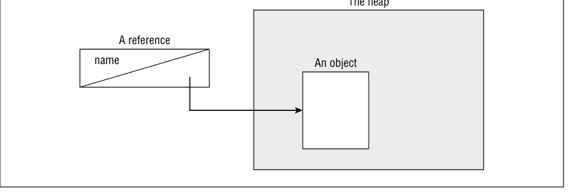

# 第1章 • 基础

理解引用和对象之间的区别，对于理解垃圾回收、新运算符以及Java语言的许多其他因素非常有帮助。看这段代码，看看你是否能看出每个对象何时符合垃圾回收资格：

```
1: public class Scope {
2:     public static void main(String[] args) {
3:         String one, two;
4:         one = new String("a");
5:         two = new String("b");
6:         one = two;
7:         String three = one;
8:         one = null;
9:     }}
```

当考试中遇到关于垃圾回收的问题时，我们建议你画出发生的过程。脑子里有太多内容需要跟踪，试图把所有内容保存在记忆中很容易犯愚蠢的错误。让我们现在一起试一下。真的。让我们用铅笔和纸。走着看。有纸吗？好了，我们开始吧。在第3行，写下**one**和**two**（只写单词——不需要方框或箭头，因为没有对象离开堆）。在第4行，我们有了第一个对象。画一个包含字符串"a"的框，并画从单词one指向该框的箭头。第5行很简单。再画一个框，这次里面装的是字符串"b"，并从单词two画一个箭头。到此为止，你的工作看起来应该像图1.4。

# 图 1.4 第5行后的图


在第6行，one赋值为two。在第7行，我们有一个新变量，写下three并从one画一个指向三个的箭头。在第8行，one赋值为null。这让one变成了垃圾回收对象。在第9行，方法结束，此时one离开了作用域。最后，删掉指向的箭头。

# 图 1.5 第7行后的图


能够识别合法和不合法的声明与初始化。当多个变量共享相同类型时，可以在同一个语句中声明多个变量。局部变量需要显式初始化；其他变量则使用该类型的默认值。标识符可以包含字母、数字、货币符号或`_`，但它们不能以数字开头。此外，你不能定义仅由单个下划线字符`_`的标识符。数字字面量可以在两个数字之间包含下划线，例如`1__00`，但不能在其他地方，例如`1_08_`。

理解如何创建文本块。文本块以第一行的`"""`开始。下一行开始是内容。最后一行以`"""`结束。如果`"""`独占一行，则包含一个尾随换行。

能够使用`var`变量。`var`用于局部变量。`var`在声明的同一行进行初始化，它可以改变值，但不能改变类型。`var`不能在没有类型的情况下初始化为`null`值，也不能在多个变量声明中使用。

能够确定变量进入和离开作用域的位置。所有变量在在方法结束时进入作用域。实例变量在对象符合垃圾回收条件时离开作用域。类变量在程序运行期间保持在作用域内。

知道如何识别对象何时符合垃圾回收。在跟踪代码时画一张图来跟踪引用和对象。当没有箭头指向框（对象）时，它符合垃圾回收条件。

## 复习题

章节复习题的答案可以在附录中找到。

- 1. 下哪些是可以从命令行运行的合法入口方法？（选择所有项）。
    - A. `private static void main(String[]) args`
    - B. `public static final main(String[]) args`
    - C. `public void main(String[]) args`
    - D. `public static final void main(String[]) args`
    - E. `public static void main(String[]) args`
    - F. `public static main(String[]) args`

- 2. 哪些选项代表了以下语句组合成可以成功编译的程序的顺序？（选择所有项）。

```
X: class Rabbit {
Y: import java.util.*;
Z: package animals;
```

- A. X, Y, Z
    - B. Y, Z, X
    - C. Z, Y, X
    - D. Y, X
    - E. Z, X
    - F. X, Z

- 3. 下哪些说法是正确的？（选择所有项）。

```java
public class Bunny {
    public static void main(String[] x) {
        Bunny bunny = new Bunny();
    }
}
```

- A. Bunny是一个类。
    - B. bun是一个类。
    - C. main是一个类。
    - D. Bunny是一个对象的引用。
    - E. bun是一个对象的引用。
    - F. main是一个对象的引用。
    - G. `main()`方法没有运行，因为参数名称错误。

- 4. 下哪些是有效的Java标识符？（选择所有项。）
    - A. `_helloWorld$`
    - B. `_true`
    - C. `java.lang`
    - D. `java`
    - E. `Public`
    - F. `1980_s`
    - G. `_Q2_`

- 5. 关于以下程序的哪些说法是正确的？（选择所有项。）

```java
2: public class Bear {
3: private Bear pandaBear;
4: private void roar(Bear b) {
5: System.out.println("Roar!");
6: pandaBear = b;
7: }
8: public static void main(String[] args) {
9: Bear brownBear = new Bear();
10: Bear polarBear = new Bear();
11: brownBear.roar(polarBear);
12: polarBear = null;
13: brownBear = null;
14: System.gc(); }
```

- A. 第9行的对象在第13行后符合垃圾回收条件。
    - B. 第9行的对象在第14行后符合垃圾回收条件。
    - C. 第10行的对象在第12行后符合垃圾回收条件。
    - D. 第10行的对象在第13行后符合垃圾回收条件。
    - E. 垃圾回收保证运行。
    - F. 垃圾回收可能运行也可能运行。
    - G. 代码无法编译。

- 6. 假设以下类可以编译，第14行在类或方法中定义了多少个变量？

```java
1: public class Camel {
2: { int hairs = 300; }
3: long water, air=2;
4: boolean Humps = true;
5: public void spit(float distance) {
6: var path = "";
{
    double teeth = 3 + distance++;
    while(water > 0) {
        int age = Humps ? 1 : 2;
        short i=-1;
        for(i=0; i<10; i++) {
            var Private = 2;
        }
        // SCOPE
    }
}
```

- A. 2
    - B. 3
    - C. 4
    - D. 5
    - E. 6
    - F. 7

- 7. 关于此代码哪些说法是正确的？（选择所有项。）


# 第 1 章 基础模块

```java
public class KitchenSink {
    private int numForks;

    public static void main(String[] args) {
        int numKnives;
        System.out.print(
            "# forks = " + numForks +
            "# knives = " + numKnives +
            "# cups = " + cups + "");
    }
}
```

- A. 输出包含 `# forks = 0.`
- B. 输出包含 `# knives = 0.`
- C. 输出包含 `# cups = 0.`
- D. 输出包含空行。
- E. 输出包含一个或多个空格开头的行。
- F. 代码无法编译。

## 8. 下哪些代码片段可以正常编译？（选择所有项。）

- A. `var spring = null;`
- B. `var fall = "leaves";`
- C. `var evening = 2; evening = null;`
- D. `var night = Integer.valueOf(3);`
- E. `var day = 1/0;`
- F. `var winter = cold;`
- G. `var fall = 2;`
- H. `var morning = "";`

## 9. 下哪些说法是正确的？（选择所有项。）

- A. 实例变量默认值为 0。
- B. 实例变量默认值为 null。
- C. 局部变量默认值为 0。
- D. 局部变量默认值为 null。
- E. 类变量默认值为 null。
- F. 以上都不是。

## 10. 下哪些表达式插入空白行后允许代码编译？（选择所有项。）

```java
public void printData() {
    var magic = _;
    System.out.println(magic);
}
```

- A. 3
- B. 1
- C. 2
- D. 0
- E. 4
- F. 5

## 11. 给定两个类文件，最多可以移除多少个 import 而代码仍然编译？

```java
// Water.java
package aquarium;
public class Water { }
```

```java
// Tank.java
package aquarium;
import java.lang.*;
import java.lang.System;
import aquarium.Water;
import aquarium.*;
public class Tank {
    public void print(Water water) {
        System.out.println(water); 
    }
}
```

- A. 0
- B. 1
- C. 2
- D. 3
- E. 4
- F. 无法编译

## 12. 关于以下类的哪些说法是正确的？（选择所有项）。

```java
1: public class ClownFish {
2     int gills = 0; double weight=2;
3     { fins = gills; }
4     void print(int length) {
5         System.out.println(gills);
6         System.out.println(weight);
7         System.out.println(fins);
8         System.out.println(length);
9     }
```

- A. 第 2 行产生编译错误。
- B. 第 3 行产生编译错误。
- C. 第 4 行产生编译错误。
- D. 第 7 行产生编译错误。
- E. 代码输出 0。
- F. 代码输出 2.0。
- G. 代码输出 2。
- H. 代码输出 3。

## 13. 给定以下类，下哪些代码片段可以独立插入 INSERT IMPORTS 并使代码编译？（选择所有项。）

```java
package aquarium;
public class Water {
  boolean salty = false;
}
```

```java
package aquarium.jellies;
public class Water {
  boolean salty = true;
}
```

```java
package employee;
public class WaterFiller {
  Water water;
}
```

- A. `import aquarium.*;`
- B. `import aquarium.Water; import aquarium.jellies.*;`
- C. `import aquarium.*; import aquarium.jellies.Water;`
- D. `import aquarium.*; import aquarium.jellies.Water;`
- E. `import aquarium.Water; import aquarium.jellies.Water;`
- F. 这些 import 均不能让代码编译。

## 14. 关于代码片段的下哪些说法是正确的？（选择所有项）。

```java
3: short numPets = 5L;
4: int numGrains = 2.0;
5: String name = "Scruffy";
6: int d = numPets.length;
7: int e = numGrains.length;
8: int f = name.length();
```

- A. 第 3 行产生编译错误。
- B. 第 4 行产生编译错误。
- C. 第 5 行产生编译错误。
- D. 第 6 行产生编译错误。
- E. 第 7 行产生编译错误。
- F. 第 8 行产生编译错误。

## 15. 关于垃圾回收的以下陈述中哪些是正确的？（多选）。

- A. 调用 `System.gc()` 保证会通过销毁对象进行垃圾回收来释放内存。
- B. 垃圾回收按计划运行。
- C. 垃圾回收允许 JVM 为其他对象回收内存。
- D. 当你的程序用了一半可用内存时，垃圾回收运行。
- E. 一个对象可能符合垃圾回收条件，但永远不会从堆中被移除。
- F. 一个对象符合垃圾回收条件，但程序中无法访问到它的任何引用。
- G. 将变量标记为 `final` 意味着其关联的对象永远不会被垃圾回收。

## 16. 关于这段代码，哪些是正确的？（多选）。

```java
var blocky = ""
```

- A. 它输出两行。
- B. 它输出三行。
- C. 它输出四行。
- D. 有一行带有末尾有空格。
- E. 如果我们对每行缩进五个字符，输出将发生变化。

## 17. 下面程序打印了哪些行？（多选）。

```java
1: public class WaterBottle {
2: private String brand;
3: private boolean empty;
4: public static float code;
5: public static void main(String[] args) {
6: WaterBottle wb = new WaterBottle();
7: System.out.println("Empty = " + wb.empty);
8: System.out.println("Brand = " + wb.brand);
9: System.out.println("Code = " + code);
10: } }
```

- A. 第 8 行产生编译错误。
- B. 第 9 行产生编译错误。
- C. `Empty = `
- D. `Empty = false`
- E. `Brand =`
- F. `Brand = null`
- G. `Code = 0.0`
- H. `Code = 0f`

## 18. 关于 `var` 的以下陈述哪些是正确的？（多选）。

- A. `var` 可以用构造函数参数。
- B. `var` 的类型在编译时是已知的。
- C. `var` 不能作为实例变量。
- D. `var` 可以用于多变量赋值语句中。
- E. `var` 的值在运行时不能改变。
- F. `var` 的类型在运行时不能改变。
- G. `var` 单词是 Java 中的预留字。

```java
var num1 = Long.parseLong("100");
var num2 = Long.valueOf("100");
System.out.println(Long.max(num1, num2));
```

## 19. 关于以下代码，哪些是正确的？（多选）。

- A. 输出是 100。
- B. 输出是 200。
- C. 代码无法编译。
- D. `num1` 是基本类型。
- E. `num2` 是基本类型。

## 20. 关于以下类的陈述哪些是正确的？（多选）。

```java
1: public class PoliceBox {
2: String color;
3: long age;
4: public void PoliceBox() {
5: color = "blue";
6: age = 1200;
7: }
8: public static void main(String[] time) {
9: var p = new PoliceBox();
10: var q = new PoliceBox();
11: p.color = "green";
12: p.age = 1400;
13: p = q;
14: System.out.println("Q1"+q.color);
15: System.out.println("Q2"+q.age);
16: System.out.println("P1"+p.color);
17: System.out.println("P2"+p.age);
18: }
```

- A. 输出 `Q1=blue`。
- B. 输出 `Q2=1200`。
- C. 输出 `P1=null`。
- D. 输出 `P2=1400`。
- E. 第 4 行无法编译。
- F. 第 12 行无法编译。
- G. 第 13 行无法编译。
- H. 以上都不是。

## 21. 执行以下类的输出是什么？

```java
1: public class Salmon {
2: int count;
3: { System.out.print("-"); }
4: { count++;
5: public Salmon() {
6: count = 4;
7: System.out.print("2-");
8: }
9: public static void main(String[] args) {
10: System.out.print("7-");
11: var s = new Salmon();
12: System.out.print(s.count+""); }}
```

- A. `7-0-2-1`
- B. `7-0-1-2`
- C. `0-7-2-1`
- D. `7-0-2-4`
- E. `0-7-1`
- F. 因为第 3 行无法编译。
- G. 因为第 4 行无法编译。
- H. 以上都不是。

## 22. 给定以下类，以下代码代码行可以独立编译使代码通过？（多选）。

```java
public class Price {
    public void admission() {
        在此插入代码
        System.out.print(amount);
    }
}
```

- A. `int amount = 0;`
- B. `int amount = 9L;`
- C. `int amount = 0xE;`
- D. `double amount = 1.2;`
- E. `double amount = 1.0;`
- F. `int amount = 10;`
- G. `double amount = 9.2;`
- H. `double amount = 1.0`

## 23. 关于以下类的陈述哪些是正确的？（多选）。

```java
1: public class River {
2: int depth = 1;
3: float temp = 50.0;
4: public void flow() {
5: for (int i = 0; i < 1; i++) {
6: int depth = 2;
7: depth++;
8: temp--;
9: }
10: System.out.println(depth);
11: System.out.println(temp);
12: public static void main(String[] args) {
13: new River().flow();
14: }
```

- A. 第 3 行产生编译错误。
- B. 第 6 行产生编译错误。
- C. 第 7 行产生编译错误。
- D. 第 10 行产生编译错误。
- E. 第 10 行输出 3。
- F. 第 10 行输出 4。
- G. 第 11 行输出 50.0。
- H. 第 11 行输出 49.0。

# 第 2 章 运算符

本章涵盖的 OCP 目标：

- 处理日期、时间、数值和布尔值
- 使用基本类型和包装类，包括 `Math` API、括号、类型提升和强制转换求求算术和布尔表达式


上一章讨论了变量定义，但在变量创建后你可以对其做什么？本章介绍了运算符，并展示了如何使用它们来组合现有变量并创建新值。它展示了如何将运算符应用于各种基本数据类型，并介绍了可以应用于对象的运算符。

## 理解运算符

在进入有趣的内容之前，让我们先来看一些术语。Java 运算符是一种特殊的符号，可以应用于一组变量、值或字面量，并返回一个结果。我们在本章中使用的“操作数”（operand）是指运算符所应用的值或变量。图 2.1 显示了 Java 操作的结构。

**图 2.1** Java 操作

```
操作数
c = a + b;
赋值给 c 的结果
```

操作的输出简单称为结果。图 2.1 实际上包含了第二个操作，使用赋值运算符（`=`）来将结果存储在变量 `c` 中。

我们确信你从小起就在使用加法（`+`）和减法（`-`）运算符了。Java 支持许多你考试需要知道的其它运算符。虽然很多对你来说只需要复习，但某些（例如复合赋值运算符）对你来说可能是新的。

## 运算符的类型

Java 支持三种类型的运算符：一元、二元和三元。这些类型的运算符可以分别应用于一个、两个或三个操作数。对于考试，你需要了解特定的运算符子集、如何应用它们以及它们的应用顺序。

Java 运算符并不总是从左到右评估。在接下来的示例中，由于特定的运算符，表达式实际上是从右到左评估的：

```java
int cookies = 4;
double reward = 3 + --cookies;
System.out.print("Zoo animal receives: "+reward+" reward points");
```

## TABLE 2.1 运算符优先级

| 运算符 | 符号和 ++, expression-- | 求值顺序 |
| --- | --- | --- |
| 后置一元运算符 | `expression++`, `expression--` | 从左到右 |
| 前置一元运算符 | `++expression`, `--expression` | 从左到右 |
| 其他一元运算符 | `-`, `!`, `+`, `(type)` | 从右到左 |
| 转换 | `(Type) reference` | 从右到左 |
| 乘/除/取模 | `*`, `/`, `%` | 从左到右 |
| 加/减法 | `+`, `-` | 从左到右 |
| 移位运算符 | `<<`, `>>`, `>>>` | 从左到右 |
| 关系运算符 | `<`, `>`, `<=`, `>=`, `instanceof` | 从左到右 |
| 等于/不等于 | `==`, `!=` | 从左到右 |
| 逻辑与 | `&` | 从左到右 |
| 逻辑异或 | `^` | 从左到右 |
| 逻辑或 | `\|` | 从左到右 |
| 条件与 | `&&` | 从左到右 |
| 条件或 | `\|\|` | 从左到右 |
| 三元运算符 | `boolean expression ? expression1 : expression2` | 从右到左 |
| 赋值运算符 | `+=`, `-=`, `*=`, `/=`, `%=`, `&=`, `\|=`, `<=`, `>>>=` | 从右到左 |
| 箭头运算符 | `->` | 从右到左 |

后置一元运算符 `expression++`, `expression--` 从左到右。

前置一元运算符 `++expression`, `--expression` 从左到右。

其他一元运算符 `-`, `!`, `+`, `(type)` 从右到左。

类型转换 `(Type) reference` 从右到左。

乘/除/取模 `*`, `/`, `%` 从左到右。

加/减法 `+`, `-` 从左到右。

移位运算符 `<<`, `>>`, `>>>` 从左到右。


关系运算符 `<`、`>`、`<=`、`>=`、`instanceof` 从左到右。

等于/不等于 `==`、`!=` 从左到右。

逻辑与 `&` 从左到右。

逻辑异或 `^` 从左到右。

逻辑或 `|` 从左到右。

条件与 `&&` 从左到右。

条件或 `||` 从左到右。

三元运算符 `boolean expression ? expression1 : expression2` 从右到左。

赋值运算符 `+=`、`-=`、`*=`、`/=`、`%=`、`&=`、`|=`、`<==`、`>>>=` 从右到左。

箭头运算符 `->` 从右到左。

后置一元运算符 `expression++`、`expression--` 从左到右。

前置一元运算符 `++expression`、`--expression` 从左到右。

其他一元运算符 `-`、`!`、`+`、`(type)` 从右到左。

类型转换 `(Type) reference` 从右到左。

乘/除/取模 `*`、`/`、`%` 从左到右。

加/减法 `+`、`-` 从左到右。

移位运算符 `<<`、`>>`、`>>>` 从左到右。

关系运算符 `<`、`>`、`<=`、`>=`、`instanceof` 从左到右。

等于/不等于 `==`、`!=` 从左到右。

逻辑与 `&` 从左到右。

逻辑异或 `^` 从左到右。

逻辑或 `|` 从左到右。

条件与 `&&` 从左到右。

条件或 `||` 从左到右。

三元运算符 `boolean expression ? expression1 : expression2` 从右到左。

赋值运算符 `+=`、`-=`、`*=`、`/=`、`%=`、`&=`、`|=`、`<==`、`>>>=` 从右到左。

箭头运算符 `->` 从右到左。

## 应用一元运算符

一元运算符只操作一个操作数。Java 提供了多种一元运算符：

- **递增/递减运算符**：`++` 和 `--` 用于增加或减少变量的值 1。
- **逻辑取反运算符**：`!` 用于反转布尔值。
- **符号否定运算符**：`-` 用于数值的取反。
- **类型转换运算符**：`(Type)` 用于将一个类型转换为另一种类型。
- **位取反运算符**：`~` 用于对位进行取反。
- **成员访问运算符**：`&.` 用于访问对象的成员。
- **引用运算符**：`&` 用于创建引用。
- **箭头运算符**：`->` 用于 Lambda 表达式。

递增/递减运算符 `++` 和 `--` 有前置和后置两种形式：

- **前置（`++i`、`--i`）**：先改变值，再使用值。
- **后置（`i++`、`i--`）**：先使用值，再改变值。

例如：

```java
int x = 5;
System.out.println(++x); // 输出 6
System.out.println(x); // 输出 6

int y = 5;
System.out.println(y--); // 输出 5
System.out.println(y); // 输出 4
```

## 二元运算符

二元运算符需要两个操作数。在 Java 语言中，二元运算符是最常用的运算符。它们用于对变量进行数学运算、创建逻辑表达式以及执行基础赋值。二元运算符经常与其他二元运算符组合成复杂的表达式，因此运算符优先级在评估包含二元运算符的表达式时非常重要。在本节中，我们从二元算术运算符开始；在后续章节中扩展到其他二元运算符。

### 算术运算符

算术运算符是针对数值执行操作的运算符。如表 2.4 所示。

**TABLE 2.4 二元算术运算符**

| 运算符 | 示例 | 描述 |
| --- | --- | --- |
| 加法 | `a + b` | 两个数值相加 |
| 减法 | `c - d` | 两个数值相减 |
| 乘法 | `e * f` | 两个数值相乘 |
| 除法 | `g / h` | 一个数值除以另一个数值 |
| 取模 | `i % j` | 返回一个数值除以另一个数值后的余数 |

## 使用二元算术运算符

你应该已经知道早期数学中所有的模（modulus）。不过，如果你不知道什么是模，不用担心——稍后我们会介绍。算术运算符包括一元运算符 `++` 和 `--`，我们已经涵盖了它们。正如你在表 2.1 中看到的，乘法运算符（`*`、`%`）的优先级高于加法运算符（`+`、`-`）。请看以下表达式：

```java
int price = 2 * 5 + 3 * 4 - 8;
```

首先，你计算 `2 * 5` 和 `3 * 4`，这会将表达式简化为：

```java
int price = 10 * 12 - 8;
```

然后，你按照从左到右顺序计算剩余项，得到 `price` 的值为 14。请确保你理解为什么结果是 14，因为你可能会在考试中遇到这类关于运算符优先级的问题。

> 所有的算术运算符都可以应用于任何 Java 原始类型，布尔类型除外。此外，只有加法运算符和 `+=` 可以应用于 `String` 值，这会导致字符串拼接。你将在第 4 章“核心 API”中学习更多这些运算符以及它们如何应用于 `String` 值。

## 添加括号

你可能已经注意到，我们在展示表 2.1 的运算符优先级之前，提到了“除非用括号覆盖”。这就是为什么你可以通过在想要计算的部分周围加上括号来显式地改变运算顺序。

## 改变运算顺序

让我们回到之前的 `price` 示例。以下代码段具有相同的数值和运算符，顺序相同，但添加了两组括号：

```java
int price = 2 * ((5 + 3) * 4 - 8);
```

这一次，你将计算加法运算符 `5 + 3`，这会将表达式简化为：

```java
int price = 2 * (8 * 4 - 8);
```

你可以通过乘以括号内的前两个值来进一步简化它：

```java
int price = 2 * (32 - 8);
```

接下来，在应用括号外的项之前，减去括号内的值：

```java
int price = 2 * 24;
```

最后，你将结果乘以 2，得到 `price` 的值为 48。

括号可能出现在任何涉及数值的问题中，所以请确保在看到它们时，理解它们是如何改变运算顺序的。

当你在职业生涯中遇到不确定运算顺序的代码时，可以随时添加可选的括号。虽然不是必须的，但它们可以提高可读性，正如你将在三元运算符中将看到的那样。

## 验证括号语法

在使用括号时，你需要确保它们始终是有效且平衡的。考虑以下示例：

```java
long pigeon = 1 + ((3 * 5) / 3; // 无法编译
int blueJay = (9 + 2) + 3 / (2 * 4); // 无法编译
```

第一个示例无法编译，因为括号不平衡。有一个左括号没有匹配的右括号。第二个示例的左括号和右括号数量相等，但它们没有正确平衡。当从左到右读取时，右括号必须匹配之前的左括号。同样，所有左括号必须在表达式结束前由右括号关闭。

让我们再尝试另一个示例：

```java
short robin = 3 + [(4 * 2) + 4]; // 无法编译
```

这个示例无法编译，因为 Java 与其他一些编程语言不同，不允许使用中括号 `[]` 代替圆括号。如果你将中括号替换为括号，最后一个示例将没有问题。

## 除法和模运算符

正如我们所说，模运算符 `%` 对你来说可能是新的。模运算符（有时被称为余数运算符）简单来说就是两个数相除所得的余数。例如，9 除以 3 整除且没有余数；因此，`9 % 3` 的结果为 0。另一方面，11 除以 3 不能整除；因此，`11 % 3` 的结果为 2。

以下示例说明了这一点：

```java
System.out.println(9 / 3); // 3
System.out.println(9 % 3); // 0
System.out.println(10 / 3); // 3
System.out.println(10 % 3); // 1
System.out.println(11 / 3); // 3
System.out.println(11 % 3); // 2
```

## 使用二元算术运算符

```java
System.out.println(12 / 3); // 4
System.out.println(12 % 3);  // 0
```

你可以看到，只有当左侧的值从 11 变为 12 时，除法才会增加，而模在左侧每增加一次就会增加一次，直到循环零。对于给定的除数 `y`，对于正被除数，模运算的结果是 0 到 `(y - 1)` 之间的值，在本示例中为 0, 1, 2。

请确保理解算术除法和模之间的区别。对于整数，除法的结果是满足操作的最接近整数的地板值，而模是余数值。如果你听到“地板值”（floor value）这个词，它只是是指小数点后没有任何内容的值。例如，4 的地板值是 4。

在 Java 中使用算术运算符时，你应该始终意识到变量、中间值和结果值的数据类型。你应该应用运算符优先级和括号，并从外向内操作，在此过程中对数据类型进行提升（promotion）。在下一节中，我们将讨论将这些值赋值给特定类型变量的复杂性问题。

# 赋值值

赋值运算符引起的编译错误在考试中经常被忽视，部分原因在于这些错误本身可能非常细微。要取得成功，你应该熟练理解编译器如何处理数值提升，以及何时需要强制类型转换（casting）。能够发现这些问题对于通过考试至关重要，因为赋值运算符几乎出现在每个带有代码段的题目中。

## 赋值运算符

赋值运算符是一个二元运算符，它将等式右侧值的结果修改或赋值运算符左侧的变量。与大多数其他 Java 运算符不同，赋值运算符是从右到左进行求值的。

最简单的赋值运算符是 `=` 赋值，你已经见过它了：

```java
int herd = 1;
```

该语句将 `herd` 的值赋值为 1。

Java 会自动从较小的数据类型提升到较大的数据类型，正如你在上一节算术运算符中看到的那，但如果它检测到你正尝试在没有转换的情况下从大数据类型转换为小数据类型，它将抛出编译异常。表 2.5 列出了考试中所需的第一个赋值运算符。我们将在本节稍后介绍其他的赋值运算符。

**表 2.5 简单赋值运算符**

| 运算符 | 示例 | 说明 |
| --- | --- | --- |
| 赋值 | `int a = 50;` | 将右侧的值赋值给左侧变量 |

## 类型转换

到目前为止看起来还可以对吧？在涵盖转换之前，我们无法详细讨论赋值运算符。转换是一个单元操作，将一种数据类型显式地解释为另一种数据类型。在转换为更大或更宽的数据类型时，转换是可选且不必要的；当转换为更小或更窄的数据类型时，则是强制的。如果没有转换，编译器在尝试将较大的数据类型放入较小的数据类型中时会生成错误。

通过将封装在括号中的数据类型放在要转换的值左侧来执行转换。以下是一些类型转换的示例：

```java
int fur = (int)5;
int hair = (short) 2;
String type = (String) "Bird";
short tail = (short)(4 + 10);
long feathers = 10(long); // 无法编译
```

转换类型与值之间的空格是可选的。如倒数第二个示例所示，右侧在括号内是很常见的。由于转换是单元操作，如果我们不把 `4 + 10` 括在括号内，它只会应用于 4。上一个示例无法编译，因为类型位于值的错误一侧。

一方面，编译器自动将较小的数据转换为大数据是方便的。但另一方面，当它们执行的操作与你关注的相反时，它们恰是极佳的范例。如果你能发现以下几行代码都无法编译：

```java
float egg = 2.0 / 9; // 无法编译
int tadpole = (int)5 * 2L; // 无法编译
short frog = 3 - 2.0; // 无法编译
```

所有这些示例都涉及将较大的值放入较小的数据类型中。如果你还没有完全理解这一点，不要担心；我们很快会介绍更多此类示例。

在本章中，类型转换主要涉及将数值数据类型转换为其他数据类型。正如你将在后面的章节看到的，类型转换也可以应用于对象和引用。但在这些情况下，并没有执行转换。简单来说，转换数值可能会更改数据类型，而转换对象只会改变对象的引用，而不是对象本身。

## 复习基本类型赋值

看看你否找出以下每行代码为何无法编译：

```java
int fish = 1.0; // 无法编译
short bird = 1921222; // 无法编译
int mammal = 9f; // 无法编译
long reptile = 192_301_398_193_810_323; // 无法编译
```

第一条语句无法编译是因为你正尝试将双精度 `1.0` 赋值给整数值。尽管该值在数学上是整数，但通过添加 `.0`，你指示编译器将其视为双。第二条语句无法编译，是因为字面量 `1921222` 超出了 `short` 的范围，编译器检测到了这一点。第三条语句无法编译，是因为数字末尾添加的 `f` 指示编译器视为浮点值，而赋值的目标是 `int`。

最后一条语句无法编译，是因为 Java 将字面量解释为 `int` 并注意到该值大于 `int` 允许的范围。该字面量需要一个后缀 `L` 或被视为 `Long`。

## 应用转换

我们可以通过将结果转换为较小的数据类型来修复之前的三个示例。

记住，每当你从较大的数值数据类型转换为较小的数值数据类型，或从浮点数转换为整数值时，都要对基本类型进行转换。

```java
int fish = (int)1.0;
short bird = (short)1921222; // 存储为 20678
int mammal = (int)9;
```

对最后一个示例应用转换又如何？

```java
long reptile = (long)1923019838103823; // 无法编译
```

这仍然无法编译，因为该值首先被编译器解释为 `int`，超出了范围。以下修复方法不需要转换即可修复了此代码：

```java
long reptile = 1923019838103823L;
```


## 溢出与下溢

后续示例中的表达式现在可以编译，尽管是有代价的。第二个值 `1,921,222` 对于 `short` 来说太大了，因此发生了数值溢出，它变成了 `20,678`。溢出是指一个数字大到无法再放入数据类型中，因此它“绕回”到最小负值并从那里开始计数，类似于模运算的工作方式。还有类似的下溢，当数字太小无法放入数据类型时，例如 `-32768` 是 `short` 的最小值，对其减去 1 将导致下溢。

这超出了范围，但是考试中需要注意的。例如，以下语句输出一个负数：

```java
System.out.print(-32768 - 1); // 32767
```

由于 `32767` 是最大值，向其添加任何正值都会导致它绕回最小负数。让我们回到“数值提升”章节中的类似示例。

```java
short mouse = 10;
short hamster = 3;
short capybara = mouse * hamster; // 无法编译
```

基于你目前所学的知识，数值提升和转换，你理解为什么最后一行无法编译吗？好，记得我们是在使用单元操作吗？这意味着转换在最后一行应用于 `mouse`，而不是 `mouse`。转换完成后，两个操作数都被提升为 `int`，因为它们被用于乘法运算符 `*`，导致结果为 `int` 并引起编译错误。

如果我们把行改为如下会怎样？

```java
short capybara = 1 + (short)(mouse * hamster); // 无法编译
```

在示例中，转换成功执行，但结果值自动提升为 `int`，因为它与二元算术运算符 `+` 使用。

最后，转换出现在表达式的任何位置，不仅仅是赋值。示例中，我们知道 `10 * 3` 的结果是 `30`，可以轻松地放入 `short`，因此我们可以应用转换将结果转换回 `short`：

```java
short mouse = 10;
short hamster = 3;
short capybara = (short)(mouse * hamster);
```

通过将较大的值转换为较小的数据类型，你是在告诉编译器忽略它的默认行为。换句话说，你是在告诉编译器已经采取了适当措施来防止溢出或下溢。也可能在你的特定应用程序和场景中，溢出或下溢会导致可以接受的值。

## 转换与变量

重温我们的第三条数值提升规则，在处理符合数据类型的字面量值时，编译器并不需要转换。考虑这些示例：

```java
byte hat = 1;
byte gloves = 7 * 10;
short scarf = 5;
short boots = 2 + 1;
```

# 赋值值

这些语句都可以正常编译，没有问题。相反，以下这两个语句都无法编译：

```java
short boots = 2 + hat; // 无法编译
byte gloves = 7 * 100; // 无法编译
```

第一条语句无法编译，因为它是一个变量而不是一个值，而且两个操作数都会自动被提升为 `int`。在处理常量时，编译器有足够的信息来确定编写者的意图。然而，在处理变量时，由于对如何进行存在歧义，编译器会报告错误。第二个表达式无法编译，是因为 `700` 触发了 `byte` 的溢出，因为 `byte` 的最大值为 `127`。

# 复合赋值运算符

除了简单的赋值运算符 (`=`) 之外，Java 还支持许多复合赋值运算符。例如，您应该熟悉表 2.6 中的复合运算符。

**表 2.6** 复合赋值运算符

| 运算符 | 示例 | 描述 |
| --- | --- | --- |
| 加法赋值 | `a += 5` | 将右侧的值加到左侧的变量上，并将和赋值给该变量 |
| 减法赋值 | `b -= 0.2` | 从左侧的变量中减去右侧的值，并将差赋值给该变量 |
| 乘法赋值 | `c *= 100` | 将右侧的值乘以左侧的变量，并将积赋值给该变量 |
| 除法赋值 | `d /= 4` | 将左侧的变量除以右侧的值，并将商赋值给该变量 |


# 复合运算符

复合运算符实际上是简单赋值运算符的增强形式，它带有内置的算术或逻辑操作，该操作应用于语句的左右两边，并将结果存储在语句左侧的变量中。例如，在声明了`camel`和`giraffe`之后，以下两个语句在独立运行时是等价的：

```
int camel = 2, giraffe = 3;
camel = camel * giraffe; // 简单赋值运算符
camel *= giraffe; // 复合赋值运算符
```

复合运算符的左侧只能应用于已定义的变量，不能用于声明新变量。在这个示例中，如果`camel`尚未定义，表达式`camel *= giraffe`将无法编译。

复合运算符的作用不仅是简写——它们还可以避免您显式地对值进行强制类型转换。例如，考虑以下内容。您能看出为什么最后一行无法编译了吗？

```
long goat = 10;
int sheep = 5;
sheep = sheep * goat; // 无法编译
```

从上一节中，您应该能够发现最后一行的问题。我们正尝试将一个`long`值赋值给一个`int`变量。最后一行可以通过显式强制转换为`(int)`来修复，但使用复合赋值运算符有更好的方法：

```
long goat = 10;
int sheep = 5;
sheep = sheep *= goat;
```

复合运算符会先将`sheep`强制转换为`long`，应用两个`long`值的乘法运算，然后转换为`int`。与之前的示例（其中编译器报告了错误）不同，编译器会自动将结果强制转换为复合运算符左侧的数据类型。

## 赋值运算符的返回值

关于赋值运算符需要了解的最后一点是赋值的结果本身是一个表达式，并且等于赋值的值。例如，以下代码段是完全有效的，尽管看起来有点奇怪：

```
long wolf = 5;
long coyote = (wolf=3);
System.out.println(wolf); // 3
System.out.println(coyote); // 3
```

这里的关键是`(wolf=3)`返回两个结果。首先，它将`wolf`的值设置为`3`。其次，它返回赋值的值，该值也是`3`。

考试出题者喜欢在表达式中间插入赋值运算符（`=`）。在考试中，你可能会看到赋值运算符用于判断值，例如，赋值运算符的赋值结果`System.out.println(wolf); // 3`。

```
System.out.println(wolf); // 3
```

尽管这看起来有点奇怪，但它是有效的：

```
long wolf = 5;
long coyote = (wolf=3);
```

## 比较值

我们现在转向关系运算符，它们用于比较两个表达式并返回布尔值。表 2.8 描述了考试中需要掌握的关系运算符。

### 等值运算符

对于比较，等值运算符用于比较对象的引用。两个引用相等且仅当它们指向同一个对象。表 2.7 列出了等值运算符。

**表 2.7 等值运算符**

| 运算符 | 示例 | 应用于原始类型 | 应用于对象 |
| ------ | --- | --- | --- |
| 等于 | `a == 10` | 如果两个值相等则返回 true | 如果两个引用指向同一个对象则返回 true |
| 不等于 | `b != 3.14` | 如果两个值不同则返回 true | 如果两个引用指向不同的对象则返回 true |

在考试中使用等值运算符时，请注意数据类型。正如在前节中提到的，考试出题者也喜欢混合赋值运算符和等值运算符。

```
boolean bear = false;
```

`boolean polar = (bear == true);`

初一看，你可能认为输出应该是`false`，如果表达式是`(bear == true)`，那么你是正确的。然而，在这个示例中，我们将`true`赋值给了`bear`，因此`polar`也被赋值为`true`，输出结果为`true`。

在语言中，将`null`与任何其他值比较总是返回`false`，但在 Java 中并非如此。

```
System.out.print(null == null); // true
```

在第 4 章中，我们将继续讨论对象等值性，引入两个不同的对象等价的含义。我们还将涵盖字符串等值性，并展示这如何可能是一个非平凡的话题。

### 关系运算符

我们现在转向关系运算符，它们比较两个表达式并返回布尔值。表 2.8 描述了考试中需要掌握的关系运算符。

**表 2.8 关系运算符**

| 运算符 | 示例 | 说明 |
| --- | --- | --- |
| 小于 | `a < 5` | 如果左侧的值严格小于右侧的值，返回 true |
| 小于等于 | `b <= 6` | 如果左侧的值小于或等于右侧的值，返回 true |
| 大于 | `c > 9` | 如果左侧的值严格大于右侧的值，返回 true |
| 大于等于 | `3 >= d` | 如果左侧的值大于等于右侧的值，返回 true |

#### 数值比较运算符

表 2.8 中的前四个关系运算符仅适用于数值。如果两个数值操作数的数据类型不相同，正如之前讨论过的，较小的那个将进行类型提升。

让我们来看看这些运算符实际运行的示例：

```
int gibbonNumFeet = 2, wolNumFeet = 4, ostrichNumFeet = 2;
System.out.println(gibbonNumFeet < wolNumFeet); // true
System.out.println(gibbonNumFeet <= ostrichNumFeet); // true
System.out.println(gibbonNumFeet >= ostrichNumFeet); // true
System.out.println(gibbonNumFeet > ostrichNumFeet); // false
```

注意，最后一个示例输出为 false，尽管`gibbonNumFeet`和`ostrichNumFeet`的值相同，但`gibbonNumFeet`并不大于`ostrichNumFeet`。

#### instanceof 运算符

你需要了解最后一个关系运算符是表 2.8 所示的`instanceof`运算符。它用于运行时判断任意对象是否是特定类或接口的成员。

为什么你不知道一个对象属于哪个类或接口呢？正如我们在第 6 章“类设计”中将涉及到的，Java 支持多态。目前，你只需要知道对象可以使用各种引用进行传递。例如，所有类都继承自`java.lang.Object`。这意味着任何实例都可以赋值给`Object`引用。例如，在以下代码段中创建并使用了多少对象：

```
Integer zooTime = Integer.valueOf(9);
Number num = zooTime;
Object obj = zooTime;
```

在这个示例中，内存中只创建了一个对象，但有三个不同的引用，因为它同时继承了`Number`和`Object`。这意味着你可以对这些具有不同数据类型的任何引用调用`instanceof`，它将对每一个都返回 true。

多态发挥作用的地方是在你创建一个接收具有许多子类的数据类型的方法时。例如，假设我们有一个函数打开动物园并打印时间。作为输入，它接收一个`Number`作为输入参数。

```
public void openZoo(Number time) {}
```

现在，我们需要该函数在数值为整数类型时在输出末尾加上`0 o'clock`，否则它只打印该值。

现在我们有了一个可以同时处理`Integer`和其他值的方法。留给读者的一个很好的练习是添加其他数值数据类型（如`Short`、`Long`、`Double`等）的检查。

注意我们可以在此示例中对值进行强制类型转换。在处理不同类型的对象时，配合`instanceof`使用类型转换是常见做法，因为类型转换可以让你访问特定类中才有的字段。在从一个对象转换到更窄的类型之前，先使用`instanceof`运算符被认为是一种良好的实践。

> 对于此示例，你只需要关注在类和接口上使用`instanceof`的地方。虽然它可以用于其他高级类型（如记录、枚举和注解），但它们并不常见。

##### 无效的 instanceof

考试可能会尝试难为你的一个领域是对与不兼容的类型使用`instanceof`。例如，`Number`不可能持有`String`值，因此以下代码会导致编译错误：

```
public void openZoo(Number time) {
if(time instanceof String) // 可以通过编译
    System.out.print(time);
}
```

如果编译器能够确定一个变量绝不可能转换为特定类，它会报告错误。

##### null 和 instanceof 运算符

如果对 null 变量调用`instanceof`会发生什么？对于考试，你应该知道对`null`字面量或空 null 引用调用`instanceof`总是返回 false。

```
System.out.print(null instanceof Object); // false

Object setObjectHere = null;
System.out.print(noObjectHere instanceof String); // false
```

之前的两个示例都打印 false。表达式的右侧是什么几乎并不重要。我们说“几乎”是因为存在例外。这个示例无法编译，因为`null`被用在`instanceof`运算符的右侧：

```
System.out.print(null instanceof null); // 无法编译
```


尽管你可能觉得学习了关于`instanceof`运算符的所有内容，但还有很多后续！在第 3 章中，我们将引入带有`instanceof`运算符的模式匹配，这是 Java 16 正式引入的。在第 7 章“超越类”中，我们将更详细地介绍多态，并展示如何将这些规则应用于接口。

### 逻辑运算符

如果你学习过计算机科学，可能以前已经遇到过逻辑运算符。如果没有，不要担心——我们将在本节中详细介绍它们。

逻辑运算符（`&`, `|`, `^`）可以应用于布尔类型。对于考试，你应该知道表。条件运算符（通常称为短路运算符`&&`、`||`）与逻辑运算符`&`, `|`几乎相同，区别在于如果左侧决定了最终结果，则右侧将不会被评估。

**表 2.9 逻辑运算符**

| 运算符 | 示例 | 说明 |
| --- | --- | --- |
| AND | `a && b` | 只有当两个操作数都为真时返回 true。如果左侧为假，则右侧将不会被评估。 |
| OR | `c || d` | 只要其中一个值为真就返回 true。如果左侧为真，则右侧将不会被评估。 |
| XOR | `e ^ f` | 操作数不同时返回 true。 |

**图 2.2 逻辑表**

| AND (x & y) | 包含或 (x \| y) | 异或或 (x ^ y) |
| --- | --- | --- |
| true | true | false |
| true | false | true |
| false | true | true |
| false | false | false |

**表 2.10 条件运算符**

| 运算符 | 示例 | 说明 |
| --- | --- | --- |
| 条件 AND | `a && b` | 只有当两个操作数都为真时返回 true。如果左侧为假，则右侧将不会被评估。 |
| 条件 OR | `c || d` | 只要其中一个值为真就返回 true。如果左侧为真，则右侧将不会被评估。 |

#### 比较值

接下来，我们在表 2.10 中介绍了条件运算符`&&`和`||`。例如，以下语句：

```
int hour = 10;
boolean zooopen = true || (hour < 4);
System.out.println(zooopen); // true
```

参考该表，`zooopen`只有在表达式两侧都为假时才为假。你自己尝试一下。

#### 避免空指针异常

运算符的一个常见用法是在执行操作之前检查空对象。在示例中，如果`duck`为`null`，程序将在运行时抛出`NullPointerException`：

```
if(duck!=null & duck.get()<5) {
// 可能会抛出空指针异常
// 执行操作
}
```

问题在于逻辑与运算符`&`会评估表达式的两个侧。我们可以添加第二个语句，但如果有许多需要检查的变量，这可能会变得臃肿。一个易读的解决方案是使用条件与`&&`：

```
if(duck!=null && duck.get()<5) {
// 执行操作
}
```

在这个示例中，如果`duck`为`null`，条件判断防止了空指针异常的抛出，因为不会执行`duck.get() < 5`的评估。

### 检查未执行的副作用

在考试中要警惕短路行为，因为众所周知题目可能会修改表达式右侧的变量，而该变量可能永远不会被访问。这被称为“未执行的副作用”。例如，以下代码的输出是什么？

```java
int rabbit = 6;
boolean bunny = (rabbit >= 6) || (++rabbit <= 7);
System.out.println(rabbit);
```

由于`rabbit >= 6`为真，表达式右侧的递增运算符从未求值，因此输出为 6。

### 使用三元运算符做出决策

在考试中，你应该熟悉的最后一个运算符是条件运算符`? :`，也称为三元运算符。它的特点是它是唯一一个接受三个操作数的运算符。三元运算符具有以下形式：

```
booleanExpression = expression1 ? expression2 : expression3
```

第一个操作数必须是一个布尔表达式，第二个和第三个操作数可以是任何返回值的表达式。三元运算实际上是返回一个值的组合`if-else`语句的压缩形式。我们将在第 3 章中更详细地讨论`if/else`语句，所以目前我们使用简单的示例。

例如，考虑以下这段计算猫头鹰食物量的代码片段：

```java
int owl = 5;
int food;
if(owl < 2) {
  food = 3;
} else {
  food = 4;
}
System.out.println(food);
```

将之前的代码片段与下面的三元运算符代码片段进行比较：

```java
int owl = 5;
int food = owl < 2 ? 3 : 4;
System.out.println(food);
```

这两个代码片段是等价的。注意，在三元运算中为表达式加上括号对于可读性很有帮助，尽管这并不是必须的。当多个三元运算符一起使用时，这特别有用。考虑以下等价表达式：

```
int found1 = owl < 4 ? (owl > 2 ? 3 : 4) : 5;
int found2 = (owl < 4 ? ((owl) > 2) ? 3 : 4) : 5;
```

虽然它们是等价的，但我们发现第二个语句的可读性要好得多。也就是说，对于这个例子，你应该知道三元运算符中的第二个和第三个表达式并不要求具有相同的数据类型，尽管当与赋值运算符结合时，类型匹配会起作用。比较变量声明后的以下两个语句：

```java
int stripes = 7;
```

```java
System.out.print((stripes > 5) ? 21 : "Zebra");

int animal = (stripes < 9) ? "Horse" : // 无法编译
```

两个表达式评估出相似的布尔值并分别返回一个`int`和`String`，尽管只有第一个会被输出。`System.out.print()`并不关心表达式类型是否完全不同，因为它可以将它们都转换为`Object`值并调用`toString()`。另一方面，编译器知道`"Horse"`的数据类型错误，不能赋值给`int`；因此，它不允许代码通过编译。

#### 三元表达式与未执行的副作用

正如我们在条件运算符中看到的，三元表达式可能包含未执行的副作用，因为右侧的其中一个表达式将在运行时求值。让我们通过下面的示例来阐明这一原理：

```java
int sheep = 1;
int zzz = 1;
int sleep = zzz < 10 ? sheep++ : zzz;
System.out.print(sheep + " , " + zzz); // 2,1
```

注意左侧的布尔表达式为真，只有`sheep`增加了。将前面的示例与下面的修改进行对比：

现在左侧的布尔表达式评估为假，只有`zzz`增加了。通过这种，我们看到如果特定表达式没有被使用，三元运算符中的更改可能就不会生效。

对于考试，要警惕任何包含三元表达式的题目，其中右侧的一个表达式被修改。

## 总结

本章涵盖了一元、二元和三元运算符的各种 Java 运算符主题。大多数情况下，这些运算符对你来说是复习。如果你不需要深入学习，那么理解如何使用本章涵盖的所有必需 Java 运算符，并知道运算符优先级和括号如何影响特定表达式的解释方式是非常关重要的。

考试中可能会有大量题目，看起来像是在测试某项内容（如 NIO2 或异常处理），但答案实际上与误用某个特定运算符导致程序无法编译有关。当你在考试上看到涉及数字的运算符时，始终检查是否使用了适当的数据类型，并在适用情况下确保它们匹配。

运算符贯穿整个考试，几乎出现在每个代码示例中，因此你对本章理解得越好，为考试的准备就越充分。

## 考试要点

- 能够编写代码。
- 能够识别哪些运算符与哪些数据类型相关。
- 有些运算符只适用于基本类型，有些只适用于布尔，有些适用于对象。
- 理解何时需要类型转换。
- 理解运算符的优先级。
- 自动类型转换（类型提升）发生何时。


# 运算符

- 运算符。
- 能够使用括号来覆盖运算符优先级。

## 复习题

答案可以在附录中找到。

1. 下列哪些运算符可以用于布尔值？（多选）

   - A. `==`
   - B. `+`
   - C. `--`
   - D. `!`
   - E. `%`
   - F. `~`
   - G.

2. 哪种数据类型（或类型）允许以下片段编译？（多选）

```
byte apples = 5;
short oranges = 10;
______ = apples + oranges;
```

   - A. `int`
   - B. `long`
   - C. `boolean`
   - D. `double`
   - E. `short`

3. 采用何种更改允许以下片段编译？（多选）

```
long ear = 10;
hearing = 2 * ear;
```

   - A. 不需要更改，直接编译。
   - B. 将第 4 行的 `ear` 转换为 `int`。
   - C. 将第 3 行的 `ear` 转换为 `short`。
   - D. 将第 4 行的 `2 * ear` 转换为 `int`。
   - E. 将第 4 行的 `hearing` 转换为 `short`。
   - F. 将第 4 行的 `hearing` 转换为 `long`。

4. 以下代码片段的输出是什么？

```
boolean canine = true, wolf = true;
int teeth = 20;
canine = (teeth != 10) ^ (wolf=false);
System.out.println("canine+","+teeth+","+wolf);
```

   - A. `true, 20, true`
   - B. `true, 20, false`
   - C. `false, 10, true`
   - D. `false, 20, false`
   - E. 代码由于第 5 行的原因无法编译。
   - F. 以上都不是。

5. 下列哪些运算符的优先级按递增排序或相同？假设 `+` 运算符是二元的，而不是一元的。（多选）

   - A. `+`, `%`
   - B. `++`, `(int)`, `*`
   - C. `=`, `!=`, `!`
   - D. `(short)`, `=`, `*`
   - E. `/`, `%`
   - F. `|`, `&`
   - G. `*`, `+=`

6. 以下程序的输出是什么？

```
1: public class CandyCounter {
2: static long addCandy(double fruit, float vegetables) {
3: return (int)fruit+vegetables;
4: }
5:
6: public static void main(String[] args) {
7: System.out.print(addCandy(1.4, 2.4f) + " ", ");
8: System.out.print(addCandy(1.9, (float)4) + " ", ");
9: System.out.print(addCandy((long)(short)2, (float)4)) + " } }
```

   - A. `4, 6, 6.0`
   - B. `3, 5, 6`
   - C. `3, 6, 6`
   - D. `4, 5, 6`
   - E. 代码由于第 9 行的原因无法编译。
   - F. 以上都不是。

7. 下面代码片段的输出是什么？

```
int ph = 7, vis = 2;
boolean clear = vis > 1 && (vis < 9 || ph < 2);
boolean safe = (vis > 2) && (ph++ > 1);
boolean tasty = 7 <= --ph;
System.out.println(clear + "-" + safe + "-" + tasty);
```

   - A. `true-true-true`
   - B. `true-true-false`
   - C. `true-false-true`
   - D. `true-false-false`
   - E. `false-true-true`
   - F. `false-true-false`
   - G. `false-false-true`
   - H. `false-false-false`

8. 下面代码片段的输出是什么？

```
4: int pig = (short)4;
5: pig = pig++;
6: long goat = (int)2;
7: goat -= 1.0;
8: System.out.print(pig + " - - " + goat);
```

   - A. `4 - 1`
   - B. `4 - 2`
   - C. `5 - 1`
   - D. `5 - 2`
   - E. 代码由于第 7 行而无法编译。
   - F. 以上都不是。

9. 该代码片段的唯一输出有哪些？（选择所有适用项）。

```
int a = 2, b = 4, c = 2;
System.out.println(a > 2 ? --c : b++);
System.out.println(b = (a!=c ? a : b++));
System.out.println(a > b ? b < c ? b : 2 : 1);
```

   - A. `1`
   - B. `2`
   - C. `3`
   - D. `4`
   - E. `5`
   - F. `6`
   - G. 代码无法编译。

10. 下面代码片段的唯一输出有哪些？（选择所有适用项。）

```
short height = 1, weight = 3;
short zebra = (byte) weight * (byte) height;
double ox = 1 + height * 2 + weight;
long giraffe = 1 + 9 % height + 1;
System.out.println(zebra);
System.out.println(ox);
System.out.println(giraffe);
```

   - A. `1`
   - B. `2`
   - C. `3`
   - D. `4`
   - E. `5`
   - F. `6`
   - G. 代码无法编译。

11. 下面代码的输出是什么？

```
11: int sample1 = (2 * 4) % 3;
12: int sample2 = 3 * 2 % 3;
13: int sample3 = 5 * (1 % 2);
14: System.out.println(sample1 + " , " + sample2 + " , " + sample3);
```

   - A. `0, 0, 5`
   - B. `1, 1, 5`
   - C. `2, 1, 5`
   - D. `2, 0, 5`
   - E. `3, 1, 10`
   - F. `3, 2, 6`
   - G. 代码无法编译。

12. 运算符增加一个值并返回原始值，而运算符减少一个值并返回新值。

   - A. 后置自增，后置自增
   - B. 前置自增，后置自减
   - C. 后置自增，后置自减
   - D. 后置自增，前置自减
   - E. 前置自增，前置自减
   - F. 前置自增，后置自减

# 第 2 章 • 运算符

13. 下面代码片段的输出是什么？

```
boolean sunny = true, raining = false, sunday = true;
boolean goingToStore = sunny & raining ^ sunday;
boolean goingToZoo = sunny && !raining;
boolean stayingHome = (goingToStore && goingToZoo);
System.out.println(goingToStore + "-" + goingToZoo + "-"+stayingHome);
```

   - A. `true-false-false`
   - B. `false-true-false`
   - C. `true-true-true`
   - D. `false-true-false`
   - E. `false-true-false-false`
   - F. `true-true-false`
   - G. 以上都不是

14. 下面哪些陈述是正确的？（选择所有适用项）。

   - A. 赋值操作表达式的返回值可以是 `void`。
   - B. 不等运算符（`!=`）可以用于比较对象。
   - C. 等于运算符（`==`）可以用于比较布尔值与数值值。
   - D. 在运行期间，`&` 和 `|` 运算符可能导致只有表达式的左侧被求值。
   - E. 赋值操作表达式的返回值是新赋值变量的值。
   - F. 在 Java 中，`true` 和 `false` 可以互换使用。
   - G. 逻辑运算符（`!`）不能用于翻转数值值。

15. 哪些运算符接受三个操作数或值？（选择所有适用项）。

   - A. `=`
   - B. `&&`
   - C. `*=`
   - D. `? ?`
   - E. `&`
   - F. `++`
   - G. `/`

16. 下面代码中有多少行包含编译器错误？

```
int note = 1 * 2 + (long)3;
short melody = (byte)(3)3;
short 2;
double symphony = (float)100;
```

   - A. `0`
   - B. `1`
   - C. `2`
   - D. `3`
   - E. `4`

17. 执行给定代码后，`ticketsSold` 的值是多少？（选择所有适用项）。

```
int ticketsTaken = 1;
int ticketsSold = 3;
ticketsSold += 1;
ticketsTaken *= 2;
```

   - A. `8`
   - B. `2`
   - C. `6`
   - D. `4`
   - E. `7`
   - F. `6`
   - G. 代码无法编译。

18. 下面哪些可以用于改变顺序？（选择所有适用项）。

   - A. `[ ]`
   - B. `<`
   - C. `)`
   - D. `/`
   - E. `{ }`
   - F. `"`

19. 下面代码执行后的结果是什么？（选择所有适用项）。

```
int start = 7;
int end = 4;
++start;
end = start + end;
```

   - A. `0`
   - B. `-128`
   - C. `127`
   - D. `8`
   - E. `11`
   - F. 代码通过编译，但在运行时抛出异常。

20. 关于一元运算符，以下哪些陈述是正确的？（选择所有适用项）。

   - A. 一元运算符总是先执行。
   - B. `-` 运算符可以翻转布尔值。
   - C. 前置自增运算符（`++`）返回应用后的值。
   - D. 后置自减运算符（`--`）返回应用后的值。
   - E. `!` 运算符不能用于数值。
   - F. 以上都不是。

21. 下面代码的输出是什么？

```
int myFavoriteNumber = 8;
int plane = myFavoriteNumber;
var superman = plane == 5 : 10;
System.out.println(bird + "," + superman);
```

   - A. `7,9`
   - B. `7,10`
   - C. `8,4`
   - D. `8,5`
   - E. `9,8`
   - F. 代码无法编译
   - G. 以上都不是

# 第 3 章 • 做决策

**本章涵盖的 OCP 目标：**

- 控制程序流
  - 创建包括 `if`/`else`、`switch` 语句、循环以及 `break` 和 `continue` 语句在内的程序流
- 利用面向对象方法
  - 实现多态并区分对象类型与引用类型。使用 `instanceof` 运算符和模式匹配执行类型转换

与许多编程语言一样，Java 主要由变量、运算符和按顺序排列的语句组成。在上一章中，我们学习了如何创建变量。软件不仅是管理变量，更是创建能够决策的应用程序。运算符允许你创建许多表达式，但它们在控制程序流方面非常有限。想象你需要根据运行时评估的某些条件执行某个方法，例如，下雨时提醒游客带伞，或者在雪天，动物园可能关闭。软件本身没有改变，但软件的行为取决于当时提供的输入。在本节中，我们将讨论包括 `if` 和 `else` 以及新的模式匹配在内的决策语句。

# 语句与块

正如你从第 1 章“构建块”中所记忆的那样，语句是 Java 中一个完整的执行单元，以分号（`;`）结束。在本章中，我们向你介绍 Java 控制流语句。控制流语句通过决策、循环和分支来中断执行流。

这些语句可以应用于表达式，也可以应用于 Java 代码块。正如第 1 章所描述的，Java 代码块是零或多个语句的平衡括号 `{}` 组，并可以用于任何地方，例如，以下两个代码片段是等价的，第一个是单个表达式，第二个是包含相同语句的块：

```
// 单个语句
patrons++;
```

```java
// 块中的语句
{
  patrons++;
}
```

语句或代码块通常作为决策语句的标记。例如，我们可以为这两个示例前面加上一个决策性的 `if` 语句：

```java
// 单条语句
if(ticketsTaken > 1)
  patrons++;
```

```java
// 块中的语句
if(ticketsTaken > 1)
{
  patrons++;
}
```

再次，这两个代码段是等价的。只需记住，决策语句的目标可以是一个单独的语句，也可以是一个语句块。在本章的剩余部分中，我们将同时使用这两种形式，以便让你更好地为考试中可能出现的内容做好准备。

> 虽然之前的两个例子是等价的，但从统计角度来说，通常更倾向于使用块，即使块中只有一个语句。第二种形式的优势在于你可以快速地在块中插入新的代码行，而无需修改周围的结构。

## if 语句

通常，我们只想在特定情况下执行一个代码块。如图 3.1 所示，`if` 语句通过允许应用程序在且仅当布尔表达式在运行时为 `true` 时执行特定的代码块来实现这一点。

图 3.1 `if` 语句的结构

# 第 3 章 做出决策

例如，假设我们有一个函数，它使用小时（一个 0 到 23 的整数值）向用户显示消息：

```java
if(hourOfDay < 11)
    System.out.println("Good Morning");
```

如果小时小于 11，将显示该消息。现在，假设我们还想在每次打印问候语时增加某个值 `morningGreetingCount`。我们可以写两次 `if` 语句，但幸运的是 Java 提供了一种使用块的更自然的方法：

```java
if(hourOfDay < 11) {
    System.out.println("Good Morning");
    morningGreetingCount++;
}
```

**注意缩进和大括号**

出题人试图让你失分的一个区域是不带大括号（`{}`）的 `if` 语句。例如，看看我们示例稍作修改的形式：

```java
if(hourOfDay < 11)
    System.out.println("Good Morning");
    morningGreetingCount++;
```

基于此，你可能会认为变量 `morningGreetingCount` 只有在 `hourOfDay` 小于 11 时才会增加，但并不是代码的执行逻辑。它只会在满足条件时执行打印语句，但它始终会执行递加操作。

记住，在 Java 中，与其他某些编程语言不同，制表符（tabs）只是空白字符，不会被视为执行的一部分。当你在问题中看到控制流语句时，务必跟踪块的左括号和右括号，忽略你可能遇到的任何缩进。

## else 语句

让我们稍微扩展一下这个示例。如果我们想在上午 11 点或之后显示不同的消息呢？我们能只使用现有的工具做到这一点吗？当然可以！

```java
if(hourOfDay < 11) {
    System.out.println("Good Morning");
}
if(hourOfDay >= 11) {
    System.out.println("Good Afternoon");
}
```

不过这有些冗余，因为我们对 `hourOfDay` 执行了两次评估。Java 以 `else` 语句的形式为我们提供了一种更有用的方法，如图 3.2 所示。

# 图 3.2 `else` 语句的结构

回到这个示例：

```java
if(hourOfDay < 11) {
    System.out.println("Good Morning");
} else System.out.println("Good Afternoon");
```

现在我们的代码确实在两个可能的选项之间进行分支，且布尔评估只进行一次。`else` 运算符接收语句或语句块的方式与 `if` 语句相同。同样，我们可以在 `else` 块中添加额外的语句，以得到一个更完善的示例：

```java
if(hourOfDay < 11) {
    System.out.println("Good Morning");
} else if(hourOfDay < 15) {
    System.out.println("Good Afternoon");
} else {
    System.out.println("Good Evening");
}
```

在这个示例中，Java 进程将继续执行，直到遇到评估为 `true` 的 `if` 语句。如果前两个表达式都不成立，它将执行 `else` 块的最后代码。

## 验证 if 语句为布尔表达式

另一种常见的误导方法是提供一段 `if` 语句内部的布尔表达式并不是布尔表达式的代码。例如，看看以下几行代码：

```java
int hourOfDay = 1;
if(hourOfDay) { // 无法编译
...
}
```


# 使用模式匹配简化代码

模式匹配（Java）是 Java 的一项强大功能，允许你在一个步骤中测试对象的类型并对其强制转换。这减少了模板化代码并提高了代码的可读性。

> 虽然之前的两个例子是等价的，但从统计角度来说，通常更倾向于使用块，即使块中只有一个语句。第二种形式的优势在于你可以快速地在块中插入新的代码行，而无需修改周围的结构。

为了理解模式匹配，请考虑以下：

```java
if (obj instanceof String s) {
    System.out.println(s.length());
}
```

在这个示例中，只有当 `obj` 是 `String` 实例时，变量 `s` 才在作用域内。这比以前手动转换对象的方法要干净得多：

```java
if (obj instanceof String) {
    String s = (String) obj;
    System.out.println(s.length());
}
```

# 创建决策语句

如果输入没有继承 `Integer`，则数据变量将未定义。由于编译器无法保证数据是 `Integer` 的实例，因此 `data` 不在作用域内，代码无法编译。

那么这个例子呢？

```java
void printIntegerTwice(Number number) {
    if (number instanceof Integer data) {
        System.out.print(data.intValue());
    }
    System.out.print(data.intValue()); // 无法编译
}
```

由于输入可能没有继承 `Integer`，在 `if` 语句之后 `data` 不在作用域内。哦，你可能在想变量只在 `if` 语句内部作用域，对吧？其实并非如此！考虑下面这个可以编译的示例：

```java
void printOnlyIntegers(Number number) {
    if (!(number instanceof Integer data)) {
        return;
    }
    System.out.print(data.intValue());
}
```

你会发现这段代码可以编译，令人惊讶。哎呀！这里发生了什么？如果输入没有继承 `Integer`，方法将返回。这意味着当到达方法的最后一行时，输入一定没有继承 `Integer`，因此即使在 `if` 语句结束后 `data` 仍然在作用域内。

流作用域和 else 分支：如果最后一个代码示例让你感到困惑，别担心：你不孤单！另一种思考方式是将逻辑重写为使用 `else` 语句的等效逻辑：

```java
void printOnlyIntegers(Number number) {
    if (!(number instanceof Integer data)) {
        return;
    } else {
        System.out.print(data.intValue());
    }
}
```

我们更进一步，通过反转布尔表达式来交换 `if` 和 `else` 分支：

```java
void printOnlyIntegers(Number number) {
    if (number instanceof Integer data) {
        System.out.print(data.intValue());
    } else {
        return;
    }
}
```

我们的新代码等同于原始代码，并且更好地演示了编译器如何确定仅当 `number` 为 `Integer` 时 `data` 在作用域内。

确保你理解了流作用域的工作原理。特别是，可以在 `if` 语句之外使用模式变量，但前提是编译器能够明确确定其类型。

## 应用 switch 语句

如果我们对一个值有许多可能的分支或路径怎么办？我们可能想根据星期几来打印不同的消息。我们完全可以通过组合 `if` 或 `else` 语句来实现这一点，但这往往会导致代码冗长、难以阅读，且通常不便于维护：

```java
public void printDayOfWeek(int day) {
  if(day == 0)
    System.out.print("Sunday");
  else if(day == 1)
    System.out.print("Monday");
  else if(day == 2)
    System.out.print("Tuesday");
  else if(day == 3)
    System.out.print("Wednesday");
}
```

幸运的是，Java 与许多其他语言一样提供了一种更简洁的方法。在本节中，我们将介绍 `switch` 语句以及用于控制程序流的新型 `switch` 表达式。

## switch 语句

如图 3.3 所示，`switch` 语句是一种复杂的决策结构，其中对单个值进行评估，并将流重定向到第一个匹配的分支（即 `case` 语句）。如果没有找到匹配该值的 `case` 语句，则将调用可选的 `default` 语句。如果没有可用的 `default` 选项，整个 `switch` 语句将被跳过。注意图 3.3，`case` 值可以使用逗号合并成单个 `case` 语句。

### 图 3.3 switch 语句的结构

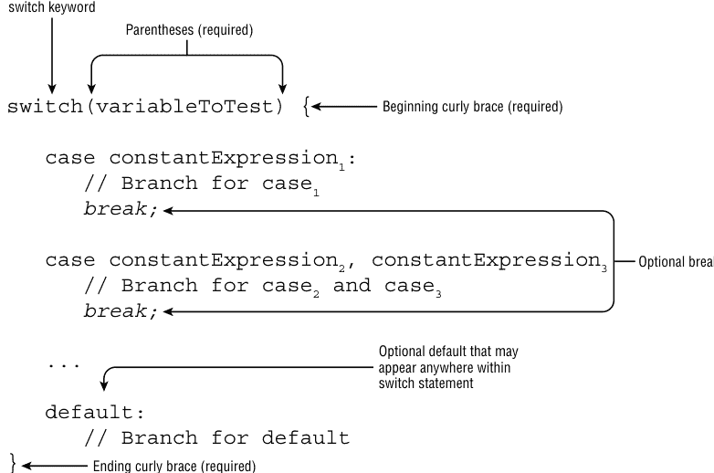

当 `switch` 语句比大多数决策语句长时，考试可能会防止无效的 `switch` 语法，以检查你是否留。

## 合并 case 值

注意到图 3.3 中的新变化了吗？从 Java 14 开始，`case` 值现在可以合并了：

```java
switch(animal) {
    case 1,2: System.out.print("Lion");
    case 3: System.out.print("Tiger");
}
```

在 Java 14 之前，等效代码如下：

```java
switch(animal) {
    case 1: System.out.print("Lion");
    case 3:
        System.out.print("Tiger");
}
```

正如你很快看到的，`switch` 表达式进一步减少了样板代码！

如果你能弄出以下每个 `switch` 语句无法编译的原因：

```java
int month = 5;

switch month { // 无法编译
    case 1: System.out.print("January");
}
```

```java
switch(month) // 无法编译
    case 1: System.out.print("January");
```

```java
switch(month) {
    case 1: 2: System.out.print("January"); // 无法编译
}
```

第一个 `switch` 语句无法编译是因为 `switch` 变量周围没有括号。第二个语句无法编译是因为 `switch` 主体周围没有大括号。第三个语句无法编译是因为应该使用逗号 (,) 来分隔 `case` 语句，而不是冒号 (:)。

考试中你需要注意的最后一点：`switch` 语句并不要求包含任何 `case` 语句。例如，此语句是完全有效的：

```java
switch(month) {
}
```

回到我们的 `printDay()` 方法，我们可以将其重写为使用 `switch` 语句而不是 `if/else` 语句：

```java
public void printDay(int day) {
    case 0:
        System.out.print("Sunday");
        break;
    case 1:
        System.out.print("Monday");
        break;
    case 2:
        System.out.print("Tuesday");
        break;
    case 3:
        System.out.print("Wednesday");
        break;
    case 4:
        System.out.print("Thursday");
        break;
    case 5:
        System.out.print("Friday");
        break;
    case 6:
        System.out.print("Saturday");
        break;
    default:
        System.out.print("Invalid value");
        break;
}
```

## 应用 switch 语句

为了起见，如果值无效我们就打印一条消息。查看我们之前的 `printDay()` 实现，你会看到每个 `case` 结束处都有 `break`。`break` 语句终止 `switch` 语句并将控制流返回到外部语句。虽然不是必须，但在每个 `case` 之后使用 `break` 是很常见的。在考试中评估 `switch` 语句时，务要考虑可能会访问多个分支。

## 选择 switch 数据类型

如图 3.3 所示，`switch` 语句有一个直到运行时才评估的目标变量。该目标的类型可以包括原始数据类型（`int`, `byte`, `short`, `char`）及其相关的包装类（`Integer`, `Byte`, `Short`, `Character`）。以下是 `switch` 语句支持的所有类型：

- `int` 和 `Integer`
- `byte` 和 `Byte`
- `short` 和 `Short`
- `char` 和 `Character`
- `String`
- `enum` 值
- `var`（如果类型解析为前面的之一）

在本章，你需要知道枚举（`enum`）代表一组固定的常量，例如星期、月份等。我们将在第 7 章更详细介绍枚举，展示它们如何定义变量、方法和构造函数。

> 注意 `boolean`、`long`、`float` 和 `double` 被排除在 `switch` 语句之外，它们相关的 `Boolean`、`Long`、`Float` 和 `Double` 类也是如此。原因多种，例如 `boolean` 的取值范围太小，而浮点数的取值范围很大。对于考试，你只需要知道它们不允许出现在 `switch` 语句中。

## 确定允许的 case 值

并不是任何变量或值都可以用于 `case` 语句。每个 `case` 语句中的第一个值必须是与 `switch` 值数据类型相同的编译时常量。这意味着你可以使用字面量、枚举常量或相同数据类型的 `final` 常量变量。通过 `final` 常量，我们的意思是变量必须被标记为 `final` 并在声明它的同一表达式中用字面值进行初始化。例如，你不能有一个要求执行一个 `case` 语句

在运行时执行方法，即使该方法总是返回相同的值。由于这些原因，下面的示例中只有第一个和最后一个 `case` 语句可以编译：

```java
final int getCookies() { return 4; }
void feedAnimals() {
    final int bananas = 1;
    int apples = 2;
    int numberOfAnimals = 3;
    final int cookies = getCookies();
    switch(numberOfAnimals) {
        case bananas:
        case apples: // 无法编译
        case getCookies(): // 无法编译
        case cookies: // 无法编译
        case 3 * 5 :
    }
}
```

`bananas` 变量被标记为 `final`，其值在编译时是已知的，因此它是有效的。`apples` 变量没有标记为 `final`，尽管它的值是已知的，但不允许。接下来的两个 `case` 语句（值为 `getCookies()` 和 `cookies`）无法编译，因为表达式在运行时不会求值，因此它们不能作为 `case` 语句的值，即使值 `3 * 5` 可以编译，因为只要值可以在编译时解析，表达式就被允许作为 `case` 值。它们还必须符合 `switch` 数据类型而无需显式类型转换。我们稍后会详细介绍。

接下来，`case` 语句的数类型必须与 `switch` 变量的数据类型匹配。例如，如果 `switch` 语句变量是 `int` 类型，你不能有一个 `String` 的 `case` 语句，因为类型是不可比较的。

# switch 表达式

我们对 `printDayOfWeek()` 的第二次实现有所改进，但仍然很长。注意这里有很多样板代码，有许多 `break` 语句。我们可以做得更好吗？是的，

`switch` 表达式是 `switch` 语句的一种更紧凑的形式，能够返回一个值。看看图 3.4 中的新语法。

由于 `switch` 表达式是一种紧凑的形式，因此图 3.4 中包含了很多内容！首先，我们现在可以将 `switch` 表达式的结果赋值给一个变量 `result`。为了使此能够工作，所有的 `case` 和 `default` 分支必须返回一个与赋值兼容的数据类型。`switch` 表达式支持两种类型的分支：表达式和代码块。每者在创建方式上都有不同的语法规则。这些主题我们稍后会介绍。

### 图 3.4 switch 表达式的结构

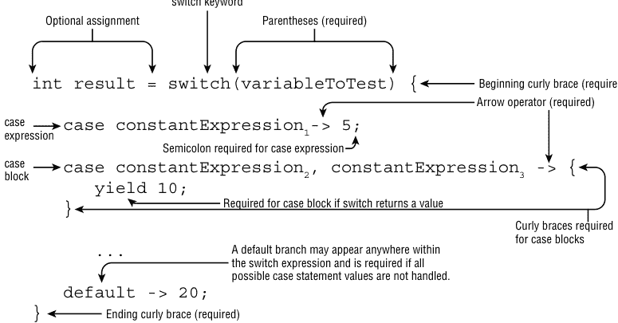

与传统的 `switch` 语句不同，`switch` 表达式支持零或多个分支以及可选的 `default` 分支。两者都支持新功能，允许使用逗号将 `case` 值组合到单个 `case` 语句中。然而，与传统的 `switch` 语句不同，`switch` 表达式关于何时需要 `default` 分支有特殊规则。

> 回想第 2 章“运算符”，`->` 是箭头运算符。虽然箭头运算符通常用于 `lambda` 表达式，但在 `switch` 表达式中使用时，`case` 分支是没有标签的。

我们可以使用 `case` 表达式用更简洁的方式重写之前的 `printDayOfWeek()` 方法：

```java
public void printDayOfWeek() {
    var result = switch (day) {
        case 0 -> "Sunday";
        case 1 -> "Monday";
        case 2 -> "Tuesday";
        case 3 -> "Wednesday";
        case 4 -> "Thursday";
        case 5 -> "Friday";
        case 6 -> "Saturday";
        default -> "Invalid value";
    };
    System.out.print(result);
}
```

将此代码与我们之前写的 `switch` 语句进行比较。两者完成了相同的任务，但删除了许多样板代码，留下了我们最关心的行为。

注意每个 `switch` 表达式后面都需要一个分号。例如，下面的代码无法编译。它缺少了几个分号？

```java
var result = switch(bear) {
    case 30 -> "Grizzly"
    default -> "Panda"
}
```

答案是三个。每个 `case` 或 `default` 表达式都需要一个分号，赋值本身也是如此。下面的代码修复了代码：

```java
var result = switch(bear) {
    case 30 -> "Grizzly";
    default -> "Panda"
};
```

如图 3.4 所示，`case` 语句可以接受多个值，用逗号隔开。我们使用 `switch` 表达式重写了之前的 `printSeason(int month)` 方法：

```java
public void printSeason(int month) {
    switch(month) {
        case 1, 2, 3 -> System.out.print("Winter");
        case 4, 5, 6 -> System.out.print("Spring");
        case 7, 8, 9 -> System.out.print("Summer");
        case 10, 11, 12 -> System.out.print("Fall");
    }
}
```

调用 `printSeason(2)` 会打印单个值 `Winter`。这次我们不需要担心 `break` 语句，只有一个分支会被执行。


在大多数情况下，`switch` 表达式返回一个值，尽管 `printSeason()` 展示了一个返回类型为 `void` 的情况。由于类型是 `void`，它不能被赋值给变量。在考试中，你更有可能看到返回值的 `switch` 表达式，但你应该意识到这是可能的。

之前所有关于 `switch` 数据类型和 `case` 值的规则仍然有效。由于这些规则是新旧，或者你可能没见过使用 `yield` 关键字，我们稍后会详细讨论：

1. 所有分支都必须返回相同的数据类型。
2. 除非所有情况都已覆盖，否则 `default` 分支是必须的。
3. 如果 `switch` 表达式返回值，且所有分支都已覆盖，则 `default` 分支是可选的。


```
case 2 -> yield "Trout"; // 无法编译（多了一个分号）
...
} // 无法编译（缺少分号）
```

有点困惑，对吧？这只是你必须在考试中通过训练自己去发现的陷阱之一。

## 覆盖所有可能的值

关于 `switch`（切换）表达式的最后一条规则可能是考试中最可能误导你的一条：一个返回值的 `switch` 表达式必须处理所有可能的输入值。正如你之前所说，当它不返回值时，它是可选的。

让我们来试一下。给定以下代码，如果 `canis` 为 5，`type` 的值是什么？

```java
String type = switch(canis) { // 可以编译
case 1 -> "dog"
case 2 -> "wolf"
case 3 -> "coyote"
```

由于没有分支来覆盖 5（4, -1, 0 等），所以 `switch` 表达式是返回 `null`、空字符串、`undefined` 还是其他值呢？在向 Java 语言中添加 `switch` 功能时，作者们决定不支持这种行为。每个 `switch` 表达式都必须处理 `switch` 变量可能出现的值。作为开发者，有两种方法来解决这个问题：

- 添加一个默认（`default`）分支。

- 如果 `switch` 表达式接收枚举（`enum`）值，则为每个可能的枚举值编写一个 `case` 分支。

在实践中，第一种方案是常用的方案。第二种方案仅适用于接收枚举值的 `switch` 表达式，而且仅当它不起作用时！即使是像 `byte` 这样简单的类型，编译器也不允许，尽管它只有 256 个可能的值。

对于枚举，当值较少时，第二种方案效果很好。例如，考虑以下枚举定义和方法：

```java
enum Season {WINTER, SPRING, SUMMER, FALL}

String getweather(Season value) {
    return switch(value) {
    case WINTER -> "Cold"
    case SPRING -> "Rainy"
    case SUMMER -> "Hot"
    case FALL -> "Warm"
    }
}
```

由于涵盖了 `Season` 的所有可能组合，此 `switch` 表达式不需要默认分支。不过，即使你涵盖了所有已知值，你也可以包含一个可选的默认分支。

如果你使用带有三个值的枚举，后来有人添加了第四个值，会发生什么？任何使用该枚举且没有默认分支的 `switch` 表达式将突然无法编译。如果经常这样做，你有很多代码需要修复！因此如此，请考虑在每个 `switch` 表达式中包含默认分支，即使是涉及枚举值的也是。

## 编写 while 循环

编写软件时常见的做法是重复执行某些次数的任务。你可以使用目前为止介绍的决策结构来实现这一点，但这将是一个非常长的 `if else` 语句链，特别是当你需要执行相同操作 100 次或更多时。

循环登场了！循环是一种重复的控制结构，可以连续多次执行一条代码语句。通过使用可以赋予新值的变量，语句的每次重复都可能是不同的。以下循环恰好执行了 10 次：

```
int counter = 0;
while (counter < 10) {
    double price = counter * 10;
    System.out.println(price);
    counter++;
}
```

如果你没用 `while` 代码，不要慌——我们稍后会介绍。在本节中，我们将讨论 `while` 循环及其两种形式。在下一节中，我们将转向 `for` 循环，`for` 循环的根源在于 `while`。

## while 语句

Java 中最简单的重复控制结构是 `while` 语句，如图 3.5 所示。与所有重复控制结构一样，它有一个终止条件（实现为布尔表达式），只要该表达式求值为 `true`，它就会继续执行。

### 图 3.5 while 语句的结构

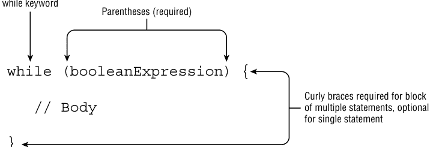

如图 3.5 所示，`while` 循环类似于 `if` 语句，因为它们由一个布尔表达式和一条语句（或一个语句块）组成。在执行期间，每次循环迭代后都会评估布尔表达式，如果求值结果为 `false`，则退出。

让我们看看如何使用循环来模拟老鼠吃东西：

```
int roomInB = 5;
public void eatCheese(int bitesOfCheese) {
    while (bitesOfCheese > 0 && roomInB > 0) {
        bitesOfCheese--;
        roomInB--;
    }
    System.out.println(bitesOfCheese+" pieces of cheese left");
}
```

```
int full = 5;
while(full < 5) {
    System.out.println("Not full!");
    full++;
}
```

答案是什么？零！在循环的第一次迭代中，达到了条件，循环退出。这就是为什么循环通常用于在你预期执行零次或多次的地方。简单来说，循环体可能完全不执行，也可能很多次。

## do/while 语句

`while` 循环的第二种形式被称为 `do/while` 循环，它和 `while` 循环一样，都是具有终止条件和语句（或语句块）的重复控制结构，如图 3.6 所示。

## 图 3.6 do/while 语句的结构

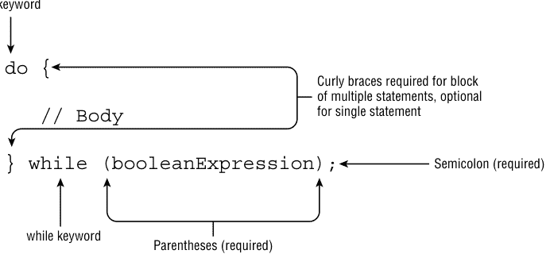

与 `while` 循环不同，`do/while` 循环保证语句块至少执行一次。例如，以下代码的输出是什么？

```
int lizard = 0;
do {
    lizard++;
} while(false);
```

## 死循环

在使用任何重复结构时，你应该注意的最重要的一点是确保它们总是终止。无法终止循环在实践中会导致许多问题，包括溢出异常、性能缓慢，甚至是错误的数据。让我们来看这个例子：

```
int pen = 2;
int pigs = 5;
while(pen < 10)
    pigs++;
```

你可能注意到这个语句中有一个明显的问题：它永远不会结束。变量 `pen` 永远不会被修改，所以表达式 `(pen < 10)` 始终求值为 `true`，创建了所谓的死循环。死循环发生在终止条件满足时。换句话说，确保循环条件或条件依赖的变量在每次执行之间发生变化。然后确保最终会到达终止条件。

## 构建 for 循环

虽然 `while` 语句非常强大，但某些任务非常常见——例如迭代 10 次某语句或遍历名称列表。你可以使用已经学过的 `while` 语句轻松地完成这些任务，但通常需要大量的样板代码。如果有一种循环结构可以在单行代码中完成这些工作该有多好？

借此，我们介绍了最方便的控制结构：`for` 循环。有两种类型，尽管它们都使用相同的关键字。第一种被称为基础 `for` 循环，第二种通常被称为增强 `for` 循环。为了清晰，我们在书中分别称为 `for` 循环和 `for-each` 循环。

## for 循环

`for` 循环具有与 `while` 语句相同的条件布尔表达式和语句（或语句块），以及两个部分：初始化块和更新语句。图 3.7 显示了这些组件的布局。

虽然 3.7 初看起来看起来可能有点混乱和随意，但组件的组织和流程允许我们在单行代码中创建极其强大的语句，而如果使用 `while` 循环则需要多行。这三个部分都由分号分隔。此外，初始化和更新部分可以包含多个语句，并用逗号分隔。

在 `for` 循环初始化块中声明的变量作用范围有限，仅在 `for` 循环内部可访问。警惕任何在 `for` 循环初始化块中声明变量并在循环外部读取的考试题。例如，以下代码无法编译，因为循环变量 `i`

# 图 3.7 基础 for 循环的结构

`for` 关键字

```
括号（必须）
  分号（必须）
for (初始化; 布尔表达式; 更新语句) {
  // 循环体
  ① 执行初始化语句
  多条语句时需要大括号
  单条语句时大括号是可选的
}
```

+   ① 执行初始化语句

② 如果布尔表达式为真，则继续；否则退出循环

③ 执行循环体

④ 执行更新语句

⑤ 返回到步骤 2

```
for(int i=0; i < 10; i++)
  System.out.println("Value is: "+i);
System.out.println(i); // 无法编译
```

或者，在 `for` 循环之前声明并在块中赋了赋值的变量可以在 `for` 循环之外使用，因为它们的作用域早于 `for` 循环的创建。

```
int i;
for(i=0; i < 10; i++)
  System.out.println("Value is: "+i);
System.out.println(i);
```

让我们来看一个例子，从零开始打印前五个数字：

```
for(int i = 0; i < 5; i++) {
  System.out.println(i + " ");
}
```

局部变量 `i` 被初始化为 0。该变量仅在循环期间在作用范围内，一旦循环完成，在循环外部不可用。对于 `while` 循环，布尔条件在每次迭代执行循环之前都会评估。如果它返回真，循环就会执行并输出后跟一个空格。接下来，循环执行更新部分，在这种情况下，它将 `i` 的值增加到 1。循环第二次评估布尔表达式，该过程重复多次，打印出结果：

0 1 2 3 4

# 第 3 章 • 决策

在循环的第五次迭代中，`i` 的值达到 4，并加 1 到 5。在循环的第六次迭代中，评估了布尔表达式，由于 `(5 < 5)` 返回假，循环终止而没有执行循环语句。

## 现实世界场景

## 为什么 for 循环中用 i？

你可能注意到，将 `for` 循环变量命名为 `i` 是很常见的。在 Java 出现很久以前，程序员就开始使用 `i` 作为 increment（增量变量）的缩写，这种做法今天仍然存在，尽管许多此类编程语言已经不再这样做了！对于双层或三层循环，当 `i` 已经被使用时，通常会使用字母表中的后续字母 `j` 和 `k`。

## 反序打印元素

假设你想像我们在上一节中从零开始打印前五个数字，但这次是反序的。目标是打印 4 3 2 1 0。

你会如何做呢？一个初始实现可能如下所示：

```
for (var counter = 5; counter > 0; counter--) {
  System.out.print(counter + " ");
}
```

虽然这段代码确实输出了五个不同的值，并且与我们的第一个 `for` 循环相似，但它输出的并不是同样的五个值。相反，输出是：

5 4 3 2 1

等等，那不是我们想要的！我们想要的是 4 3 2 1 0。它从 5 开始，因为那是分配给它的第一个值。让我们从 4 开始来修复它：

```
for (var counter = 4; counter > 0; counter--) {
  System.out.print(counter + " ");
}
```

现在它打印什么？它打印了：

4 3 2 1

接近了！问题是它于 1 ，而不是 0，因为我们告诉它只要值不再严格大于 0 就退出。如果我们想像第一个例子一样打印 0 到 4，我们需要更新终止条件，如下：

## 构建 for 循环

```
for (var counter = 4; counter >= 0; counter--) {
  System.out.print(counter + " ");
}
```

终于！我们现在的代码可以打印 4 3 2 1 0，并与我们上一节中 `for` 循环示例的反序匹配。在这个例子中，我们可以使用 `counter > -1` 作为循环终止条件，尽管 `counter >= 0` 通常更具可读性。

对于考试，你将学会如何阅读正向和反向的 `for` 循环。当你在考试中看到 `for` 循环时，注意循环变量以及如果使用了递减运算符 `--` 的操作。虽然在 `for` 循环中从 0 开始递通常很直观，但递减往往不那么直观。事实上，如果你在考试中做了带有递减运算符的 `for` 循环，你应该假设他们正在测试你对循环操作的知识。


# 使用 for 循环

尽管你在职业开发经验中可能遇到的大多数循环定义良好且与之前的示例相似，但在考试中可能会看到许多变体和边缘情况。你应该熟悉以下五个示例；这些示例的变体很可能出现在考试中。

为了说明目的，让我们处理一些例子：

- 1. 创建无限循环

```
for( ; ; ) {
  System.out.println("Hello World");
}
```

虽然这个 `for` 循环看起来可能不像，但它会通过编译并无问题地运行。它实际上是一个无限循环，会重复打印该语句。这强化了 `for` 循环组件是可选的这一。注意，分隔三个部分的分号是必须的，因为 `for ( )` 中的任何分号都无法编译。

- 2. 在 for 语句中添加多个项

```java
int x = 0;
for(long y = 0, z = 4; x < 5 && y < 10; x++, y++) {
  System.out.print(x + " ");
}
```

这段代码演示了你可能没过的 `for` 循环的三变体。首先，你可以在循环开始之前声明变量（例如示例中的 `x`），并在它完成后使用它。其次，你的初始化块、布尔表达式和更新语句可以包含可能引用或不引用彼此的额外变量。例如，`z` 在初始化块中定义但从未被使用。最后，更新语句可以修改多个变量。这段代码执行时将打印以下内容：

0 1 2 3 4

- 3. 在初始化块中重声明变量

```java
int x = 0;
for(int x = 4; x < 5; x++) // 无法编译
  System.out.print(" ");
```

这个示例与上一个相似，但无法编译，因为 `x` 在初始化块中重复定义了。我们可以通过移除 `for` 循环中 `x` 的声明来修复它：

```java
int x = 0;
for(x = 4; x < 5; x++)
  System.out.print(" ");
```

注意这种变体现在可以编译，因为初始化块只是给 `x` 赋值。

- 4. 在初始化块中使用错误的数据类型

```java

int x = 0;
for(long y = 0, int z = 4; x < 5; x++) // 无法编译
  System.out.print(" ");
```

就像示例一样，代码无法编译，但这次是因为不同的原因。初始化块中的变量必须是相同的类型。在多项示例中，`y` 和 `z` 都是 `long`，所以代码通过了编译；在这个示例中，它们的类型不同。

- 5. 在循环外部使用变量

```java
for(long y = 0, x = 4; x < 5 && y < 10; x++, y++) {
  System.out.print(y + " ");
}
System.out.print(x); // 无法编译
```

我们在本节开头已经涵盖了，但这对通过考试很重要，所以我们再次讨论了它。如果你注意到，`x` 是在循环初始化块中定义的，然后在循环外部使用的。由于 `x` 仅在循环范围内，在循环外部使用它会导致编译器错误。

# 修改循环变量

作为一个一般原则，修改循环变量被认为是一种糟糕的代码习惯，因为结果是不可预测的，例如以下示例：

```
for(int i=0; i<10; i++)
  i = 0;

for(int j=1; j<10; j++)
  j++;
```

它往往会让其他人难以理解代码。

# for-each 循环

`for-each` 循环是一种专门用于迭代数组和各种集合类的特殊结构，如图 3.8 所示。

图 3.8 增强 for-each 循环的结构

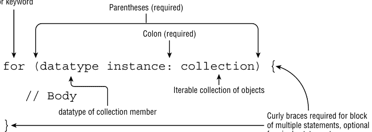

`for-each` 循环声明由初始化部分和一个要迭代的对象组成。`for-each` 循环的右侧必须是以下之一：

- Java 内置数组

- 实现了 `java.lang.Iterable` 的对象

我们在第 7 章中解释什么是实现（`implements`），但现在你只需要知道右侧必须是数组或项目集合。对于考试，你应该知道这不包括所有的集合框架类。

接口，只有那些实现或扩展了该 `Collection` 接口的接口。例如，`Map` 不支持 `for-each` 循环，尽管 `Map` 包含了返回 `Collection` 实例的方法。

`for-each` 循环的左侧必须包含一个变量实例的声明，该变量的类型必须与语句右侧的数组或集合兼容。在循环的每次迭代中，语句左侧的命名变量将从语句右侧的数组或集合中被赋一个新值。

比较以下两种方法，它们都提供了 `for-each` 循环，或者一个使用传统循环而另一个使用 `for-each` 循环：

```java
public void printNames(String[] names) {
  for(int counter=0; counter<names.length; counter++) {
    System.out.println(names[counter]);
  }
}
```

```java
public void printNames(List<String> names) {
  for(var name : names) {
    System.out.println(name);
  }
}
```

`for-each` 循环要短得多，不是吗？我们不再需要一个需要创建、递增和监控的计数器循环变量。使用 `for` 循环代替 `while` 循环，`for-each` 循环旨在减少样板代码，使代码更容易易读/写，并让你专注于代码中真正重要的部分。

我们也可以在 `List` 上使用 `for-each` 循环，因为它实现了 `Iterable`。


```java
public void printNames(List<String> names) {
  for(var name : names) {
    System.out.println(name);
  }
}
```

我们将在第 9 章“集合与泛型”中详细介绍泛型。对于本章，你只需要知道在每次迭代中，`for-each` 循环都会分配一个与泛型参数类型相同的变量。在这种情况下，`name` 的类型是 `String`。

那么，以下示例如何呢？

```java
String birds = "Jay";
```

```java
for(String bird : birds) // 无法编译
System.out.print(bird + " ");
```

```java
String[] sloths = new String[3];
```

```java
for(int sloth : sloths) // 无法编译
System.out.print(sloth + " ");
```

第一个 `for-each` 循环无法编译，因为 `String` 不能用于语句的右侧。虽然 `String` 可以代表字符列表，但它必须实现 `Iterable`。第二个示例无法编译，是因为语句左侧的循环类型是 `int`，与预期的 `String` 类型不匹配。

## 使用分支控制流

我们在本章中涵盖的控制结构类型是分支语句。到目前为止，我们处理的是当布尔表达式为假时结束的单一循环。现在我们向你展示循环结束和跳转的其他方式，你会发现运行时的路径可能不像之前的示例那样直接。

## 嵌套循环

在进入分支语句之前，我们需要引入嵌套循环的概念。嵌套循环是一个包含另一个循环的循环，包括 `while`、`do/while`、`for` 和 `for-each` 循环。例如考虑遍历一个二维数组，它是包含其他数组的数组。我们在第 4 章“数组”中详细介绍多维数组，但假设以下是声明二维数组的方式：

```java
int[][] myArray = {{5,2,1,3},{3,9,8,9},{5,7,12,7}};
```

```java
for(int[] myArray : myArray) {
    for(int i=0; i<myArray.length; i++) {
        System.out.println(myArray[i]+"\t");
    }
}
```

注意此示例中刻意混合了循环和 `for-each` 循环。外部循环将执行三次。每当外部循环执行时，内部循环都会执行四次。当我们执行它时，看到如下输出：

| 5 2 1 3 |

| 3 9 8 9 |

| 5 7 12 7 |

嵌套循环可以包含示例所示的 `while` 和 `do/while`。看此代码输出：

```java
int hungryopotamus = 8;
while(hungryopotamus>0) {
    do {
        hungryopotamus -= 2;
    } while (hungryopotamus>5);
    hungryopotamus--;
    System.out.print(hungryopotamus+", ");
}
```

## 第 3 章 决策

第一次执行时，内部循环重复直到 `hungryopotamus` 的值为 4。然后该值递减到 3，这是外部循环结束时的输出。

在外部循环的第二次迭代中，`do/while` 将执行一次，尽管 `hungryopotamus` 已经不再大于 5。你可能记得，`do/while` 语句至少执行一次体。这将该值减少到 1，然后通过外部循环的操作符降为 0。当值达到 0 时，外部循环终止。结果是代码将输出：

3, 0,

本部分的示例包含嵌套循环。

## 添加标签

`switch` 语句遗漏的一点是它们可以带有标签。标签是一个标识符后跟冒号（`:`）。例如：

```java
OUTER_LOOP: for (int i=0; i<myArray.length; i++) {
    INNER_LOOP: for(int j=0; j<myArray[i].length; j++) {
        if(myArray[i][j] == searchValue) {
            positionX = i;
            positionY = j;
            break OUTER_LOOP;
        }
    }
}
```

在这个示例中，`break` 语句不仅终止了内部循环；因为它后面跟着 `OUTER_LOOP` 标签，它也终止了外部循环。当你想要满足条件时跳出多个嵌套循环时非常有用。

## break 语句

`break` 语句用于将控制转移出循环或 `switch` 语句。当遇到 `break` 语句时，循环或 `switch` 的剩余部分将被跳过，控制继续执行块之后的语句。

在 `switch` 语句中，`break` 语句用于防止“穿透”到下一个 `case`。如果没有 `break`，即使不匹配，也会执行后续 `case` 的代码。

```java
switch (expression) {
    case value1:
        // 代码
        break;
    case value2:
        // 代码
        break;
    default:
        // 代码
}
```

在循环中，`break` 语句立即终止循环。考虑以下示例：

```java
public class FindInMatrix {
    public static void main(String[] args) {
        int[][] list = {{5,2,1,3},{3,9,8,9},{5,7,12,7}};
        int searchValue = 2;
        int positionX = -1;
        int positionY = -1;
        PARENT_LOOP: for (int i=0; i<list.length; i++) {
            for(int j=0; j<list[i].length; j++) {
                if(list[i][j]==searchValue) {
                    positionX = i;
                    positionY = j;
                    break PARENT_LOOP;
                }
            }
        }
        if(positionX==-1 || positionY==-1) {
            System.out.println("Value "+searchValue+" not found");
        } else {
            System.out.println("Value "+searchValue+" found at: ("+positionX+","+positionY+")");
        }
    }
}
```

执行时，此代码将输出内容：

Value found at: (1,1)

现在，想象一下如果我们将内部循环体替换为以下内容会发生什么：

```java
if(list[i][j]==searchValue) {
    positionX = i;
    positionY = j;
    break;
}
```

这将如何改变我们的流程，输出会改变吗？不再在找到第一个匹配值时退出，程序现在会在满足条件时退出内部循环。换句话说，结构将找到最后一个内部循环的匹配值来继续该值，导致如下输出：

Value found at: (2,0)

最后，如果我们完全移除 `break` 会怎样？

```java
if(list[i][j]==searchValue) {
    positionX = i;
    positionY = j;
}
```

在这种情况下，代码将搜索整个结构中具有匹配值的最后一个值。输出将像这样：

Value found at: (2,1)

你可以从这个示例看出，在嵌套循环的 `break` 语句上使用标签，或者完全不使用 `break` 语句，会导致循环结构的行为发生很大变化。

## continue 语句

现在让我们通过 `continue` 语句扩展对高级循环控制的讨论。`continue` 语句会导致执行流结束当前循环迭代的执行，如图 3.10 所示。

图 3.10 continue语句的结构

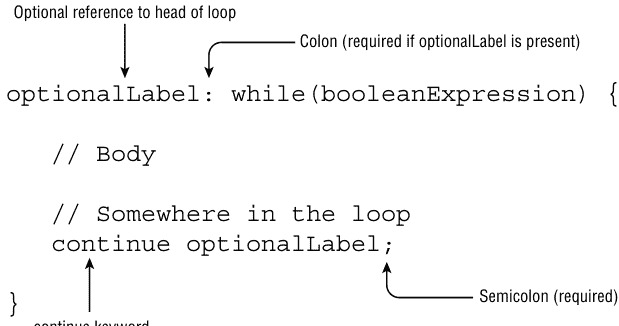

你会注意到 `continue` 语句的语法与 `break` 语句镜像。事实上，这两个语句在用法上是完全相同的，但结果不同。`break` 语句将控制转移到外层语句，而 `continue` 语句将控制转移到决定循环是否继续执行的布尔表达式。换句话说，它结束了循环的当前迭代。此外，与 `break` 语句一样，`continue` 语句应用于正在执行的最近内部循环，并可以使用可选的标签来覆盖此行为。

让我们来看一个例子。想象一个动物园饲员，他应该清理四个圈舍中的第一个豹子，但完全跳过 b 圈舍。

```java
1: public class CleaningSchedule {
2:   public static void main(String args) {
3:     CLEANING: for(char stables = 'a'; stables<='d'; stables++) {
4:       for(int leopard = 1; leopard<4; leopard++) {
5:       if(stables=='b' || leopard==2) {
6: continue CLEANING;
7: }
8: System.out.println("Cleaning: "+stables+","leopard");
9: } } }
```

按照定义的结构，每当第一个值为 b 或第二个值为 2 时，循环将返回父循环。在外层循环的第一次、第三次和第四次执行中，内部循环恰好打印一次语句，然后在 `leopard` 为 2 的下次循环时退出。在外层循环的第二次执行中，内部循环会立即退出且不打印任何内容，因为立即遇到了 b。输出内容如下：

Cleaning: a,1

Cleaning: c,1

Cleaning: d,1

现在，想象我们删除了 `continue` 语句中的 `CLEANING` 标签，以便控制返回到内部循环而不是外层循环。第 6 行变为：

`continue;`

这对应于饲员清理所有非标记为 2 或在 b 圈舍中的豹子。输出结果如下：

Cleaning: a,1

Cleaning: a,3

Cleaning: c,1

Cleaning: c,3

Cleaning: d,1

Cleaning: d,3

最后，如果我们通过删除第 5-7 行同时删除 `continue` 语句和相关的 `if` 语句，我们将得到一个输出所有值的结构，如下：

Cleaning: a,1

Cleaning: a,2

Cleaning: a,3

Cleaning: b,1

Cleaning: b,2

Cleaning: b,3

Cleaning: c,1

Cleaning: c,2

Cleaning: c,3

Cleaning: d,1

Cleaning: d,2

Cleaning: d,3

## 使用分支控制流

## return 语句

目前，你应该熟悉创建方法和使用 `return` 语句可以作为使用标签和 `break` 语句的替代方案。例如，看看我们之前写的 `FindInMatrix` 类的重写版本：

```java
public class FindMatrixUsingReturn {
    private static int[] searchValue(int[][] list, int v) {
        for (int i = 0; i < list.length; i++) {
            for (int j = 0; j < list[i].length; j++) {
                if (list[i][j] == v) {
                    return new int[] {i,j};
                }
            }
        }
        return null;
    }
}
```

```java
public static void main(String[] args) {
    int[][] list = { 1, 13 }, { 5, 2 }, { 2, 2 };
    int searchValue = 2;
    int[] results = searchValue(list,searchValue);
```

```java
if (results == null) {
    System.out.println("Value " + searchValue + " not found");
} else {
    System.out.println("Value " + searchValue + " found at: " + 
        "(" + results[0] + ", " + results[1] + ")\n}
}
```

这个类在功能上与我们之前看到的使用 `break` 的第一个 `FindInMatrix` 类相同。如果你需要通过多个 `break` 和 `continue` 语句对循环进行更细粒度的控制，那么第一个类可能更好。尽管如此，我们发现没有标签和 `break` 语句的代码更易阅读和调试。此外，将搜索逻辑封装为一个独立函数使代码更具可用性，并让调用的 `main()` 方法变得更容易阅读。

对于考试，你需要掌握这两种形式。只需记住 `return` 语句可以快速退出循环，并在实践中可以产生更具读性的代码，特别是在用于嵌套循环时。

## 不可达代码

你应该注意 `break`、`continue` 和 `return` 的一个方面：在块中紧随其后的任何代码都被视为不可达的，且无法编译。例如，以下代码段无法编译：

```java
int checkDate = 0;
while(checkDate<1) {
    checkDate++;
}
```

编写 `while` 循环。了解所有 `while` 和 `do/while` 循环的语法结构。特别是知道何时使用其中一个而不是另一个。能够使用 `for` 循环。你应该熟悉 `for` 循环和 `for-each` 循环，并知道如何编写和评估它们。每个循环都有其特殊的属性和结构。你应该知道如何使用 `for-each` 循环来遍历列表和数组。

理解 `break`、`continue` 和 `return` 如何改变控制流。知道通过应用 `break`、`continue` 或 `return` 语句来改变语句内的控制流。还要知道哪些控制语句可以接受 `break` 语句，哪些可以接受 `continue` 语句。最后，你应该理解这些语句在嵌套循环或 `switch` 语句内部是如何工作的。

## 复习题

章节复习题的答案可以在附录中找到。

- 1. 下列数据类型可以用于 `switch` 表达式？（选择所有适用项。）

A. `enum`

B. `int`

C. `Byte`

D. `long`

E. `String`

F. `char`

G. `var`

H. `double`

- 2. 下面代码段的输出是什么？（选择所有适用项。）

```java
3: int temperature = 4;
4: long humidity = -temperature + temperature * 3;
5: if (temperature>4)
6: if (humidity < 6) System.out.println("Too Low");
7: else System.out.println("Just Right");
8: else System.out.println("Too High");
```

A. Too Low

B. Just Right

C. Too High

D. 运行时抛出 `NullPointerException`。

E. 因为第 7 行代码无法编译。

F. 因为第 8 行代码无法编译。

- 3. 下列数据类型允许出现在 `for-each` 表达式的右侧？（选择所有适用项。）

A. `Double[]`

B. `Object`

C. `Map`

D. `List`

E. `String`

F. `char[]`

G. `Exception`

H. `Set`

- 4. 调用 `printReptile(6)` 的输出是什么？

```java
void printReptile(int category) {
  var type = switch (category) {
    case 1,2 -> "Snake"
    case 3,4 -> "Lizard"
    case 5,6 -> "Turtle"
    case 7,8 -> "Alligator"
  }
  System.out.print(type);
}
```

A. Snake

B. Lizard

C. Turtle

D. Alligator

E. TurtleAlligator

F. 以上均非

- 5. 下面代码段的输出是什么？


# 第 3 章 • 决策

## 题目 1-5（代码片段）

```java
List<Integer> myFavoriteNumbers = new ArrayList<>()
myFavoriteNumbers.add(10);
myFavoriteNumbers.add(14);
for (var a : myFavoriteNumbers) {
  System.out.print(a + " ");
  break;
}

for (int b : myFavoriteNumbers) {
  continue;
  System.out.print(b + " ");
}

for (Object c : myFavoriteNumbers) {
  System.out.print(c + " ");
}
```

A. 编译并运行正常，但没有产生输出。

B. 10, 14,

C. 10, 10, 14,

D. 10, 10, 14, 14,

E. 恰好一行代码无法编译。

F. 恰好两行代码无法编译。

G. 代码包含无限循环且不会终止。

## 题目 6

关于决策结构的陈述哪些是正确的？（选择所有适用项。）

A. `for-each` 循环可以在任何 `Collections Framework` 对象上执行。

B. `while` 循环的循环体保证至少执行一次。

C. `for` 循环的条件表达式在循环体第一次执行之前进行求值。

D. 接收 `String` 并结果赋值给变量的 `switch` 表达式需要一个默认分支（`default branch`）。

E. `do-while` 循环的循环体保证至少执行一次。

F. `if` 语句可以有多个对应的 `else` 语句。

## 题目 7

假设 `weather` 是一个格式良好的非空数组，将哪个代码段插入到以下代码的空白处，可以打印出 `weather` 的所有元素？（选择所有适用项。）

```java
private void print(int[] weather) {
for ( {
System.out.println(weather[i]);
}
```

- `int i=weather.length; i>0; i--`
- `int i=0; i<=weather.length-1; ++i`
- `var w : weather`
- `int i=0; weather.length-1; i>=0; --i`
- `int i=0, int j=3; i<weather.length;++i`
- `i=0; i10 && i<weather.length;`
- 以上均非

## 题目 8

调用 `printType(Object o)` 的输出是什么？

```java
31: void printType(Object o) {
32: if(o instanceof Integer bat) {
33: System.out.print("int");
34: } else if(o instanceof Integer bat && bat < 10) {
35: System.out.print("small int");
36: } else if(o instanceof Long bat || bat <= 20) {
37: System.out.print("long");
38: default {
39: System.out.print("unknown");
40: }
41: }
```

A. int

B. small int

C. long

D. unknown

E. 什么都没有打印。

F. 代码包含一行无法编译的代码。

G. 代码包含两行无法编译的代码。

H. 以上均非

## 题目 9

哪些语句当独立插入到以下空白处时，会使代码打印 2？（选择所有适用项。）

```java
int count = 0;
BUNNY: for(int row = 1; row <=3; row++)
RABBIT: for(int col = 0; col < 3; col++) {
  if((col + row) % 2 == 0)
    count++;
}
System.out.println(count);
```

A. `break BUNNY`

B. `break RABBIT`

C. `continue BUNNY`

D. `continue RABBIT`

E. `break`

F. `continue`

G. 以上均非，因为代码包含编译器错误。

## 题目 10

给定以下方法，有多少行代码包含编译错误？（选择所有适用项）。

```java
10: private DayOfWeek getDay(int day, final o)
11:   int otherDay = day;
12:   int Sunday = 0;
13:   switch(otherDay) {
14:     default;
15:     case 1: continue;
16:     case thursday: return THSDAY;
17:     case 2: break;
18:     case Sunday: return SUNDAY;
19:     case MONDAY: return MONDAY;
20:   }
21: return FRIDAY;
22: }
```

*(注：原文中第10题代码片段存在错乱，翻译时已根据语境对齐)*

A. 代码编译通过没有问题。

B. 1

C. 2

D. 3

E. 4

F. 5

G. 运行时可能错误

## 题目 11

调用 `printLocation(Animal.MAMMAL)` 的输出是什么？

```java
10: class Zoo {
11: enum Animal {BIRD, FISH, MAMMAL}
12: void printLocation(Animal a) {
13: long type = switch(a) {
14:     case BIRD -> 1;
15:     case FISH -> 2;
16:     case MAMMAL -> 3;
17:     default -> 4;
18: }
19: System.out.print(type);
20: }
```

A. 3

B. 4

C. 3

D. 因为第 13 行无法编译。

E. 因为第 17 行无法编译。

F. 以上均非

## 题目 12

下面代码段的结果是什么？

```java
3: int sing = 8, squawk = 2, notes = 0;
4: while(sing > squawk) {
5: sing--;
6: squawk += 2;
7: }
8: System.out.println(notes);
```

A. 11

B. 13

C. 23

D. 33

E. 5

F. 第 7 行无法编译

## 题目 13

下面代码的输出是什么？

```java
2: boolean keepGoing = true;
3: int result = 15, meters = 10;
4: do {
5: meters--;
6: if(meters==8) keepGoing = false;
7: result = 2;
8: } while keepGoing;
9: System.out.println(result);
```

A. 7

B. 9

C. 10

D. 11

E. 15

F. 第 6 行无法编译。

G. 因为其他原因无法编译

## 题目 14

关于以下代码段的哪些陈述是正确的？（选择所有适用项。）

```java
var penguin : new int[2]
System.out.println(penguin);
var ostrich = new Character[3];
var emu : ostrich;
System.out.println(emu);
List<Integer> parrots = new ArrayList<Integer>();
var macaw : parrots
System.out.println(macaw);
```

A. `penguin` 的类型是 `Integer`。

B. `penguin` 是 `int`。

C. `emu` 类型未定义。

D. `emu` 的类型是 `Character`。

E. `macaw` 的类型是 `List`。

F. `macaw` 的类型是 `Integer`。

G. 以上均非，代码无法编译。

## 题目 15

下面代码段的结果是什么？

```java
final char a = 'A', e = 'E';
char grade = 'B';
switch (grade) {
    default:
    case a:
    case 'B': 'C': System.out.print("great ");
    case 'D': System.out.print("good "); break;
    case e:
    case 'F': System.out.print("not good ");
}
```

A. great

B. great good

C. good

D. not good

E. 代码无法编译，因为一个一个 `case` 语句的数据类型与 `switch` 变量的类型不匹配。

F. 以上均非

## 题目 16

给定以下数组，哪些代码段按声明的反序打印元素？（选择所有适用项）

```java
char[] wolf = {'w', 'e', 'b', 'y'};
```

A.

```java
int q = wolf.length;
for( ; ; ) {
    System.out.print(wolf[-q]);
    if(q==0) break;
}
```

B.

```java
for(int m=wolf.length-1; m>=0; --m)
    System.out.print(wolf[m]);
```

C.

```java
for(int z=0; z<wolf.length; z++)
System.out.print(wolf[wolf.length-z]);
```

D.

```java
int x = wolf.length-1;
for(int j=0; x>=0 && j==0; j--)
System.out.print(wolf[x]);
```

E.

```java
final int r = wolf.length;
for(int w = r-1; r>1; w = r-1)
System.out.print(wolf[w]);
```

F.

```java
for(int i=wolf.length; i>0; --i)
System.out.print(wolf[i]);
```

G. 以上皆不是

## 题目 17

执行以下方法时，打印出哪些不同的数字？（选择所有项。）

```java
private void countAttendees() {
  int participants = 4, animals = 2, performers = -1;
  while((participants = participants+1) < 10) {
    do {} while (animals++ <= 1) {
      for(; performers<2; performers+=2) {}
    }
    System.out.println(participants);
    System.out.println(animals);
    System.out.println(performers);
  }
}
```

- A. 6
- B. 3
- C. 4
- D. 5
- E. 10
- F. 9
- G. 代码无法编译。
- H. 以上皆不是

## 题目 18

关于模式匹配（`pattern matching`）和流作用域（`flow scoping`），哪些说法是正确的？（选择所有项。）

- A. 使用 `if` 语句的模式匹配是通过使用实例运算符实现的。
- B. 使用 `if` 语句的模式匹配是通过使用 `instanceof` 运算符实现的。
- C. 使用 `if` 语句的模式匹配是通过使用 `instanceof` 运算符实现的。
- D. 模式变量在声明它的 `if` 语句之外无法访问。
- E. 流作用域意味着只有当编译器能够识别其类型时，模式变量才是可访问的。
- F. 模式匹配可以用于在 `else` 语句中声明变量。

## 题目 19

下述代码段的输出是什么？

```java
2: double iguana = 0;
3: do {
4:   int snake = 1;
5:   System.out.print(snake + " ");
6:   iguana--;
7: while (snake <= 5);
8: System.out.println(iguana);
```

- A. 1 2 3 4 -4.0
- B. 1 2 3 4 -5.0
- C. 1 2 3 4 5 -4.0
- D. 0 1 2 3 4 5 -5.0
- E. 代码无法编译。
- F. 代码可以编译，但在运行时产生无限循环。
- G. 以上皆不是

## 题目 20

将哪些语句插入到以下空白处，可以使代码编译并运行且不产生无限循环？（选择所有项。）

```java
4: int height = 1;
5: L1: while (height < 10) {
6:   long humidity = 12;
7: L2: do {
8:   if(humidity-- % 12 == 0)
9:     int temperature = 30;
10: L3: for( ; ; ) {
11:   temperature++;
12:   if(temperature>50)
13: }
14: } while (humidity > 4);
15: }
```

- A. 第 8 行 `break L2`；第 12 行 `continue L2`
- B. 第 8 行 `continue`；第 12 行 `continue`
- C. 第 8 行 `break L3`；第 12 行 `break L1`
- D. 第 8 行 `continue L2`；第 12 行 `continue L3`
- E. 第 8 行 `continue L2`；第 12 行 `continue L2`
- F. 以上皆不是，因为代码包含编译器错误

## 题目 21

在以下方法能够编译之前，最少需要修正多少行代码？

```java
21: void findZooKeeper(Long id) {
22:   System.out.print(switch(id) {
23:     case 30 -> "Jane"
24:     case 20 -> (yield "Lisa");
25:     case 30 -> "Kelly"
26:     case 30 -> "Sarah"
27:     default -> "Unassigned";
28:   }
29: }
```

- A. 零
- B. 一行
- C. 两行
- D. 三行
- E. 四行
- F. 五行

## 题目 22

下述代码段的输出是什么？（选择所有项。）

```java
2: var tailFeathers = 3;
3: final var one = 1;
4: switch (tailFeathers) {
5:   case one: System.out.print(3 + " ");
6:   default: case 3: System.out.print(5 + " ");
7: }
8: while (tailFeathers > 1) {
9:   System.out.print(--tailFeathers + " "); }
```

- A. 3
- B. 5 1
- C. 5 2
- D. 5 1
- E. 2 1
- F. 因为 3–5 行代码无法编译。
- G. 因为 6 行代码无法编译。

# 第 3 章 • 决策

## 题目 23

下述代码段的输出是什么？

```java
15: int penguin = 50, turtle = 75;
16: boolean older = penguin >= turtle;
17: if (older = true) System.out.println("Success");
18: else System.out.println("Failure");
19: else if(penguin != 50) System.out.println("Other");
```

- A. Success
- B. Failure
- C. Other
- D. 因为 17 行代码无法编译。
- E. 代码可以编译，但在运行时抛出异常。
- F. 以上皆不是

## 题目 24

关于 `friends` 的哪种数据类型可以使代码编译？（选择所有项。）

```java
for(var friend in friends) {
    System.out.println(friend);
}
```

- A. `Set`
- B. `Map`
- C. `String`
- D. `int[]`
- E. `Collection`
- F. `StringBuilder`
- G. 以上皆不是

## 题目 25

下述代码段的输出是什么？

```java
6: String instrument = "violin";
7: final String cello = "cello";
8: String viola = "viola";
9: int p = -1;
10: switch(instrument) {
11:     case "bass" : break;
12:     case cello : p++;
13:     default: p++;
14:     case "VIIN" : p++;
15:     case "viola" : ++p;
16: }
17: System.out.print(p);
```

- A. -1
- B. 0
- C. 1
- D. 2
- E. 3
- F. 代码无法编译。


## 26. 下述代码段的输出是什么？

```java
9: int w = 0, r = 1;
10: String name = "";
11: while(w < 2) {
12: name += "A";
13: do {
14: name += "B";
15: if(name.length()>0) name += "C";
16: else break;
17: } while (r <= 1);
18: r++;
19: System.println(name);
```

- A. `ABC`
- B. `ABC`
- C. `ABC`
- D. 第 15 行包含编译错误。
- E. 第 18 行包含编译错误。
- F. 代码可以编译但在运行时抛出 `NullPointerException`。

## 27. 下述代码打印什么？

```java
23: byte amphibian = 1;
24: String name = "Frog";
25: String color = switch(amphibian) {
26: case 1 -> { yield "Red"; }
27: case 2 -> { if(name.equals("Frog")) yield "Green"; }
28: case 3 -> { yield "Purple"; }
29: default -> throw newException();
30 };
31: System.out.print(color);
```

- A. `Red`
- B. `Green`
- C. `Purple`
- D. `Red`
- E. 在运行时抛出异常。
- F. 代码无法编译。

## 28. 调用 `goldfish("goldie")` 的输出是什么？

```java
40: void goldfish(Object fish) {
41:   if (fish instanceof String) {
42:     System.out.print("Eat!");
43:   else if (fish instanceof String) {
44:     throw new RuntimeException();
45:   }
46:   System.out.print("Swim!");
47: }
```

- A. `Eat!`
- B. `Swim!`
- C. `Eat!` 后面跟着异常。
- D. `Swim!`
- E. 打印了异常。
- F. 以上皆不是

## 29. 下述代码的结果是什么？

```java
1: public static void main(String[] args) {
2:   int y = -2;
3:   do System.out.print(++y + " ");
4:   while (y <= 5);
5: }
```

- A. `-1 0 1 2 3 4 5`
- B. `-1 0 1 2 3 4`
- C. `-1 0 1 2 3 4 5 6`
- D. `-1 0 1 2 3 4 5`
- E. 因为某行代码无法编译。
- F. 代码包含无限循环且不会终止。

## 拼接

在第 2 章“运算符”中，你学习了如何相加数字。`1 + 2` 显然等于 `3`。但 `"1" + "2"` 是什么呢？它是 `"12"`，因为 Java 结合了两个 `String` 对象。将一个 `String` 放在另一个 `String` 之前并将它们结合，被称为字符串拼接。考试出题者喜欢字符串拼接，因为 `+` 运算符在同一行代码中可以有两种用法。这并没有很多规则需要记忆，但你必须知道它们：

1. 如果两个操作数都是数字，`+` 表示加法。
2. 如果一个操作数是 `String`，`+` 表示拼接。
3. 表达式从左到右求值。

现在来看一些例子：

```java
System.out.println(1 + 2);      // 3
System.out.println("a" + "b"); // ab
System.out.println("a" + "b" + 3); // ab3
System.out.println(1 + "c"); // 3c
System.out.println("c" + 1 + 2); // c12
System.out.println("c" + null); // cnull
```

第一个例子使用了这条规则。两个操作数都是数字，所以我们使用普通的加法。第二个例子是简单的拼接，如第二个规则所述。`String` 的引号在代码中使用的；它们不会输出。

第三个例子结合了第二和第三条规则。由于我们从左侧开始，Java 得出 `"a" + "b"` 的求值为 `"ab"`。你已经知道这个了：它是 `"ab"`，然后 Java 查看剩余的 `"ab" + 3`。第三条规则告诉我们，当一个操作数是 `String` 时，进行拼接。

在第四个例子中，我们使用了第三条规则，它告诉我们考虑 `1 + 2 = 3`。然后我们得到了 `3 + "c"`，这使用第二个规则得到 `"3c"`。注意所有三个规则都用在了同一代码中：

五个例子展示了第三条规则的重要性。我们有 `"c" + 1`，它使用第二个规则得到 `"c1"`。然后我们有 `"c1" + 2`，它使用第二个规则给了我们 `"c12"`。

最后，最后一个例子展示了 `null` 在拼接或打印时如何表示为字符串，给了我们 `"cnull"`。

考试会更加棘手，并尝试用类似这样的内容欺骗你：

```java
int three = 3;
String four = "4";
System.out.println(1 + 2 + three + four);
```

当你看到这个时，直接接受，记住这三个规则，并确保检查变量类型。在这个例子中，我们从第三条规则开始，它告诉我们考虑 `1 + 2`。

第一条规则给了我们 `3`。接下来我们有 `3 + three`。由于 `three` 是 `int` 类型，我们仍然使用第一条规则，得到 `6`。然后我们有 `6 + four`。由于 `four` 是 `String` 类型，我们切换到第二个规则并得到最终答案 `"64"`。当你看到这样的问题时，花点时间检查类型。有条不紊会有回报的。

关于拼接还有一点需要知道，但它很简单。在这个例子中，你只需要记住 `+=` 等于自赋值。记住，`s += "2"` 等同于 `s = s + "2"`，

```java
4: var s = "1"; // s 当前持有 "1"
5: s += "2"; // s 当前持有 "12"
6: s += 3; // s 当前持有 "123"
7: System.out.println(s); // 123
```

在第 5 行，我们正在添加“两个字符串”，我们对其进行拼接。第 6 行试图通过添加数字来欺骗你，但如果我们写成 `s = s + 3`。我们知道字符串“加上”其他任何内容都使用拼接。

再次回顾规则：如果涉及两个数字，则使用数字加法，否则使用拼接，并从左到右求值。你背下这三个规则了吗？在考试前一定要背下来！

# 重要的 String 方法

`String` 有几十种方法。幸运的是，你只需要知道其中的几个。考试出题者选择了开发者在现实世界中使用的方法。

对于所有这些方法，你需要记住字符串是字符序列，Java 在进行索引时从 0 开始计数。图 4.1 显示了字符串 `"animals"` 中的每个字符是如何索引的。

**图 4.1 字符串的索引**

| 0 | 1 | 2 | 3 | 4 | 5 | 6 |
|---|---|---|---|---|---|---|
| a | n | i | m | a | l | s |

你还需要知道 `String` 是不可变的（immutable），或不可改变。这意味着 `String` 上的方法将返回一个不同的 `String` 对象，而不是改变引用的值。在这一章中，你使用的是不可变对象。在第 6 章“类设计”中，你将学习如何创建你自己的不可变对象。

让我们看看 `String` 类的一些方法。其中许多是直观的，所以我们不会详细讨论。你需要知道如何使用这些方法。

## 确定长度

`length()` 方法返回 `String` 中字符的数量。该方法签名如下：

```java
public int length()
```

## 创建和操作字符串

以下代码展示了如何使用 `length()`：

```java
var name = "animals";
System.out.println(name.length()); // 7
```

```java
System.out.println(name.substring(3, 4)); // m
System.out.println(name.substring(3, 7)); // mals
```

`substring()` 是考试中最难处理的 `String` 方法。第一个示例取从索引 3 开始到末尾的字符，这得到了 `"mals"`。第二个示例做了相同的事情，但它调用了 `indexOf()` 来获取索引而不是硬编码。这是一种常见的做法，因为你可能无法提前知道索引。

第三个示例表示取从索引 3 开始到索引 9（但不包含 9）的字符，包含索引 4 的字符。这是一种复杂的表达方式，表示我们取只有一个字符的字符串：即索引 3 的字符。结果是 `"m"`。最后一个示例表示取从索引 3 开始直到到达索引 7 的字符。由于这与字符串的示例相同，因此它等同于第一个示例。

我们希望这不会让你感到困惑。接下来的例子没那么直观：

```java
System.out.println(name.substring(3, 3)); // empty string
System.out.println(name.substring(3, 2)); // exception
System.out.println(name.substring(3, 8)); // exception
```

这一组中的第一个示例打印一个空字符串。请求是取从索引 3 开始直到到达索引 3 的字符。由于起始和结束索引相同，它们之间没有字符。这一组中的第二个示例会抛出异常，因为索引不能倒退。Java 非常清楚地知道如果从索引 3 开始，永远无法获取索引 2。第三个示例表示继续到第八个字符。这里没有第七个字符，但至少有一个不可见的“字符串末尾”位置。

让我们再次复习一遍，因为 `substring()` 确实棘手。该方法返回从请求索引开始的字符串。如果请求了某个索引，它会在该索引之前停止；否则，它将到字符串的末尾。

## 调整大小写

在完成这些脑力练习后，如果有与其名称完全一致的方法就太好了！这些方法可以轻松地转换你的数据。方法签名如下：

```java
public String toLowerCase()
public String toUpperCase()
```

以下代码展示了如何使用这些方法：

```java
var name = "animals";
System.out.println(name.toUpperCase()); // ANIMALS
System.out.println("Ab123".toLowerCase()); // abc123
```

这些方法顾如其名。`toUpperCase()` 方法将返回字符串中的小写字母转换为大写。`toLowerCase()` 方法将返回字符串中的任何大写字母转换为小写。这些方法会忽略字母以外的任何字符。此外，记住字符串是不可变的，所以原始字符串保持不变。

## 检查等效性

`equals()` 方法检查 `String` 对象是否包含顺序完全相同的字符。`equalsIgnoreCase()` 方法检查两个 `String` 对象是否包含相同的字符，区别在于它忽略字符的大小写。方法签名如下：

```java
public boolean equals(Object obj)
public boolean equalsIgnoreCase(String str)
```

你可能会注意到 `equals()` 返回的是一个 `Object` 而不是 `String`。如果你传递一个不是 `String` 的，它将直接返回 `false`。相比之下，`equalsIgnoreCase()` 方法仅适用于 `String`，因此它可以接受更具体的类型作为参数。

在 Java 中，`String` 值是对大小写敏感的。`"abc"` 和 `"ABC"` 被认为是不同的。考虑到这一点，以下代码展示了如何使用这些方法：

```java
// false
System.out.println("abc".equals("ABC"));
// true
System.out.println("ABC".equals("ABC"));
// true
System.out.println("abc".equalsIgnoreCase("ABC"));
```

这应该非常直观。在第一个示例中，值并不完全相同。在第二个示例中，它们完全相同。它们仅大小写不同，但我们调用了忽略大小写差异的方法。

## 重写 `toString()`, `equals(Object)`, 和 `hashCode()`

如何正确重写 `toString()`、`equals(Object)` 和 `hashCode()` 是过去 Java 认证考试的一部分。作为一名专业的 Java 开发人员，了解重写这些每个方法的规则对你来说仍然很重要：

- `toString()`: 当你尝试打印对象或将其与 `String` 拼接时，会调用 `toString` 方法。通常会将其重写为使用其字段打印实例唯一描述的版本。
- `equals(Object)`: `equals` 方法用于比较对象，默认实现使用 `==` 运算符。如果你想方便地比较元素的等效性，应该重写 `equals(Object)` 方法，特别是当这涉及许多字段时。
- `hashCode()`: 任何时候重写 `equals(Object)`，都必须重写 `hashCode()` 以保持一致。这意味着对于任何两个对象，如果 `a.equals(b)` 为真，那么 `a.hashCode()` 也必须为真。如果它们不一致，可能会导致 `HashMap` 和 `HashSet` 等基于哈表的集合出现无效数据和副作用。

这些方法在 `Object` 中都提供了默认实现，如果你想智能地使用它们，就应该重写它们。

## 搜索子字符串

通常，你需要搜索一个较大的字符串以确定子字符串是否包含在其中。`startsWith()` 和 `endsWith()` 方法检查提供的值是否匹配字符串的部分。`contains()` 方法则没有那么特殊；它会在字符串的任何地方查找匹配。方法签名如下：

```java
public boolean startsWith(String prefix)
public boolean endsWith(String suffix)
public boolean contains(CharSequence seq)
```

以下代码展示了如何使用这些方法：

```java
System.out.println("abc".startsWith("a")); // true
System.out.println("abc".startsWith("A")); // false

System.out.println("abc".endsWith("c"));   // true
System.out.println("abc".endsWith("C"));   // false

System.out.println("abc".contains("b"));    // true
System.out.println("abc".contains("B"));    // false
```

## 替换值

`replace()` 方法执行搜索和替换。它有一个接受 `char` 参数的版本，以及一个接受 `String` 的。

```java
public String replace(char oldChar, char newChar)
public String replace(CharSequence target, CharSequence replacement)
```

以下代码展示了如何使用这些：

```java
System.out.println("abc".replace('a', 'A')); // Abc
System.out.println("abc".replace("a", "A"));   // Abc
```

## 移除空白

`strip()` 和 `trim()` 方法移除字符串开头和结尾的空白字符。在考试方面，空白包括空格、`\t`（制表符）、`\n`（换行符）和 `\r`（回车符）。`strip()` 方法的功能包含了 `trim()`，但它支持 Unicode。

## 处理缩进

既然 Java 支持文本块，处理缩进的方法非常有帮助。这两个方法都有点棘手，请仔细阅读！

```java
public String indent(int numberSpaces)
public String stripIndent();
```

`indent` 方法在传递一个正数时，会在每行的开头添加相同数量的空格。如果你传递一个负数，它会尝试从行首删除相应数量的空白字符。如果你传递零，则缩进将不会改变。

> 如果你用负数调用 `indent()` 并尝试删除行首存在的空白字符，Java 将移除所有它能找到的这些字符。

这看起来非常直观易懂。然而，`indent()` 还会规范化字符串末尾添加的空白（如果尚未规范化）。你问规范化空白是什么意思？首先，在字符串末尾添加一个换行符。其次，任何换行符都会转换为 `\n` 格式。无论你的操作系统使用的是 `\r\n` (Windows) 还是 `\n` (Mac/Unix)，Java 都会进行标准化。`indent()` 方法在使用字符串拼接而非文本块（text block）构建字符串时非常有用。它消除了偶然的空格。这意味着所有非空行都会移动相同数量的空白字符，每行都会删除某些空白字符，并且第一个字符保持不为空。与 `indent()` 类似，`\r\n` 被转换为 `\n`。然而，`stripIndent()` 方法在缺失末尾换行符时不会添加。嗯，规则有很多。表 4.1 提供了参考，以便更容易记忆。

## 表 4.1 `indent()` 和 `stripIndent()` 规则


| 方法 | 缩进变化 | 规范化现有的换行符 | 如果缺失则在末尾添加换行符 |
| --- | --- | --- | --- |
| `indent(n)` 其中 n > 0 | 在每行开头添加 n 个空格 | 是 | 是 |
| `indent(n)` 其中 n == 0 | 无变化 | 是 | 是 |
| `indent(n)` 其中 n < 0 | 从每行中删除最多 n 个空格，且每个非空行删除相同数量的字符 | 是 | 是 |
| `stripIndent()` | 移除所有前导偶然空白 | 是 | |

# 第 4 章 · 核心 API

以下代码展示了如何使用这些方法。如果结果不是你预期的，不要担心。我们会解释每一个。

```
10: var block = ""
11:
    a
12:
    b
13:
    c""
```

```
14: var concat = "a\n"
15:
    + "b\n"
16:
    + "c";
17: System.out.println(block.length()); // 6
18: System.out.println(concat.indent()); // 9
19: System.out.println(concat.indent(-1).length()); // 10
20: System.out.println(concat.indent(-2).length()); // 7
21: System.out.println(concat.indent(-4).length()); // 6
22: System.out.println(concat.stripIndent().length()); // 6
```

第 10-16 行分别使用文本块和普通 `String` 创建了相似的字符串。我们说它们“相似”，是因为 `concat` 的每行开头都有空格，而 `block` 没有。

第 7 行计算了 `block` 中的六个字符，它们是三个字母、之前的空格以及 `\n` a 和 b。第 18 行计算了 `concat` 中的九个字符，它们是三个字母、a 之前的一个空格、b 之前的两个空格、c 之前的一个空格以及 b 之后的 `\n` a。如果你不计数的是哪些字符，可以数一数，这只会更困惑。

第 19 行，我们要求 Java 为 `block` 中的三行每行添加一个空白空格。输出显示我们添加了 4 个字符而不是 3 个，因为行数从 6 变到了 10。由于文本块末尾没有换行符，`indent(1)` 添加了一个换行符。

第 20 行，我们从 `concat` 的三行中每行删除一个空白字符。得到长度为七。我们从九开始，删除了三个字符，并添加了一个末尾换行。

第 21 行，我们要求 Java 从这相同的三行中删除四个空白字符。由于字符不足，Java 会尽力而为。a 和 c 之前的单个空格被删除了。b 之前的两个空格都被删除了。长度为六在此时应该是合理的；我们比第 20 行多删了一个字符。

最后，第 22 行使用了 `stripIndent()` 方法。所有行都至少有一个空白字符。由于它们并不全有两个空白字符，该方法每行只删除一个字符。由于 `stripIndent()` 没有添加新行，长度为六，比原始的九少了三个。

## 转义字符

当我们转义字符时，我们使用单个反斜杠。例如，`\t` 是一个制表符。如果我们不想要这种行为，就添加另一个反斜杠来转义反斜杠，这样 `\t` 就是字面量 `t`。`translateEscapes()` 方法接收这些字面量并将其转换为等效的转义字符。方法签名如下：

```
public String translateEscapes()
```

以下代码展示了如何使用这些方法：

```
var str = "\1\t2"; // 1\t2
System.out.println(str);
System.out.println(str.translateEscapes()); // 1	2
System.out.println("blank");
```

第一行打印了字面字符串 `\t`，因为反斜杠被转义了。第二行打印了实际的制表符，因为我们转义了该字符。此方法可以用于转义序列，如 `\t` (制表符)、`\n` (换行)、`\s` (空格)、`\"` (双引号) 和 `\'` (单引号)。

## 空字符串

Java 提供了方便方法来判断 `String` 的长度是否为零或包含空白。方法签名如下：

```
public boolean isEmpty()

public boolean isBlank()
```

以下代码展示了如何使用这些方法：

```
System.out.println(".isEmpty()"); // false
System.out.println("isEmpty()"); // true
System.out.println(".isBlank()"); // true
System.out.println("isBlank()"); // true
```

第一行打印 false，因为 `String` 不是空的；它包含一个空格。第二行打印 true，因为这次 `String` 中没有字符。最后几行打印 true，因为除了空白外没有其他字符。

## 格式化值

有方法可以使用格式化标记来格式化 `String` 值。其中两个方法接受 `String` 作为参数，另一个使用该值的实例。其中一个方法接受 `Locale`（你在第 1 章中学过的），以便在单次调用中构建格式化字符串，而不是大量的拼接操作。它们返回被调用的实例引用，以便进行链式操作。方法签名如下：

```
public static String format(String format, Object args...)
public static String format(Locale loc, String format, Object args...)
public String formatted(Object args...)
```

（注：由于原始文本存在大量 OCR 识别错误和重复，以上翻译已根据逻辑进行了清理和去重，确保核心技术内容的准确性。）

# 第 4 章 · 核心 API

这段代码与之前的示例等效。它也创建了 `String` 对象并输出了 `Animal`。要阅读使用方法链的代码，请从左侧开始并评估第一个方法。然后在一个第一个方法的返回值上调用下一个方法。继续下去直到遇到分号。

你认为这段代码的结果是什么？

```
5: String a = "abc";
6: String b = a.toUpperCase();
7: b = b.replace("b", "2").replace('c', '3');
8: System.out.println("a" + a);
9: System.out.println("b" + b);
```

在第 5 行中，我们将 `a` 设置为 `"abc"`，且再没有指向其他任何地方。第 6 行和第 7 行的任何代码都没有改变 `a`，返回的值为 `"abc"`。

然而，`b` 的情况稍微复杂一点。第 6 行让 `b` 指向 `"ABC"`，这是显而易见的的。在第 7 行中，我们使用了方法链。首先，调用了 `"ABC".b.replace("B", "2")`。这返回了 `"A2C"`。接着调用了 `"A2C".replace('C', '3')`。这返回了 `"A23"`。最后，`b` 改变并指向这个返回的 `String`。当执行第 9 行时，`b` 是 `"A23"`。

## 使用 StringBuilder 类

一个小型程序可以很快地创建很多 `String` 对象。例如，你认为这段代码创建了多少对象？

```
10: String alpha = "";
11: for(char current = 'a'; current <= 'z'; current++)
12: alpha += current;
13: System.out.println(alpha);
```

第 10 行实例化了一个空 `String`，然后第 12 行追加了 `"a"`。但是，由于 `String` 是不可变的，一个新的 `String` 对象被分配给 `alpha`，而 `""` 对象变得可以被垃圾回收。在循环的下一次迭代中，`alpha` 被分配了一个新的 `String` 对象 `"ab"`，而 `"a"` 对象变得可以被回收。下一次迭代将 `alpha` 分配为 `"abc"`，而 `"ab"` 对象变得可以被回收。

这一系列事件持续进行，在循环迭代 26 次后，总共实例化了 27 个对象，其中大多数立即就可以被垃圾回收。

这种方式非常低效。幸运的是，Java 有一个解决方案。`StringBuilder` 类在创建 `String` 时不需要存储所有的字符串。与 `String` 类不同，`StringBuilder` 是不可变的（注：此处原文可能有误，`StringBuilder` 实际上是可变的）。

```
15: StringBuilder alpha = new StringBuilder();
16: for(char current = 'a'; current <= 'z'; current++)
17: alpha.append(current);
18: System.out.println(alpha);
```

在第 15 行，实例化了一个新的 `StringBuilder` 对象。第 17 行中对 `append()` 的调用在每次循环中都会向 `StringBuilder` 对象中添加一个字符，将 `current` 的值追加到 `alpha` 的末尾。这段代码复用了 `StringBuilder`，而没有每次都创建一个中间 `String`。

在旧代码中，你可能会看到对 `StringBuilder` 的引用。它的工作方式相同，但它支持线程（你将在第 13 章“并发”中学习）。`StringBuffer` 不支持这一点。它的执行速度比 `StringBuilder` 慢，所以直接使用 `StringBuilder` 即可。在本节中，我们正在创建一个 `StringBuilder` 并使用它的常用方法。

## 可变性与链式

我们确定你已经从之前的示例中注意到了这一点，但 `StringBuilder` 是可变的。事实上，在示例中有 27 个不同的值（a 加上字母表中的每个字母）。考试可能会尝试通过 `String` 和 `StringBuilder` 是可变的这一点来欺骗你。

链式调用让变得更有趣了。当我们链式调用方法时，结果是一个带有答案的新 `String`。链式调用 `StringBuilder` 方法并不不起作用。相反，`StringBuilder` 会改变它的状态并返回它的引用。让我们来看一个例子以便使其更清楚：

```
4: StringBuilder sb = new StringBuilder("start");
5: sb.append("middle"); // sb = "start+middle"
6: StringBuilder same = sb.append("end"); // same = "start+middle+end"
```

第 5 行向 `sb` 的末尾添加文本。它还返回了 `sb` 的引用，但该引用被忽略了。第 6 行同样向 `sb` 的末尾添加文本并返回 `sb` 的引用。这意味着 `sb` 和 `same` 指向同一个对象，并将打印相同的值。

考试并不总是通过每行只一个方法来让代码变得易读。你认为这个示例打印了什么？

```
4: StringBuilder a = new StringBuilder("abc");
5: StringBuilder b = a.append("de");
6: b = b.append("f").append("g");
7: System.out.println("a=" + a);
8: System.out.println("b=" + b);
```

你是不是说两个都打印了 `"abcdef"`？这里只有一个 `StringBuilder` 对象。现在你知道了，因为 `new StringBuilder()` 只调用了一次。在第 5 行，有两个变量指向该对象，其值值为 `"abcdef"`。在第 6 行，这些变量仍然指向同一个对象，该对象现在的值也是 `"abcdef"`。顺便说一下，赋值给 `b` 实际上没有任何作用，`b` 已经指向了那个 `StringBuilder`。

## 创建 StringBuilder

有三种方法可以构造 `StringBuilder`：

```
StringBuilder sb1 = new StringBuilder();
StringBuilder sb2 = new StringBuilder("animal");
StringBuilder sb3 = new StringBuilder(10);
```

第一个是说创建一个包含空字符序列的 `StringBuilder` 并让 `sb1` 指向它。第二个是说创建一个包含特定值的 `StringBuilder` 并将 `sb2` 指向它。前两个示例测试了 Java 管理实现细节的能力。最后一个示例告诉 Java，我们对最终值的大小有一个大致的想法，并希望 `StringBuilder` 为字符预留特定的容量（或槽位数量）。

## 重要的 StringBuilder 方法

与 `String` 一样，我们不会涵盖 `StringBuilder` 类中的每一个方法。这些是你可能在考试中看到的。

## 使用常用方法

这四个方法的工作原理与 `String` 类完全相同。请确保你能识别出这个示例的输出：

```
var sb = new StringBuilder("animals");
String sub = sb.substring(sb.indexOf("a"), sb.indexOf("al"));
int len = sb.length();
char ch = sb.charAt(6);
System.out.println("" + sub + " " + len + " " + ch);
```

正确答案是 `anim 7 s`。`indexOf()` 方法分别返回 0 和 4。`substring()` 方法返回从索引 0 开始到索引 4 之前结束的 `String`。

`length()` 方法返回 7，因为它是字符的数量。`charAt()` 返回索引为 6 处的字符。如果这听起来不熟悉，请回去阅读索引。

## 追加值

`append()` 方法是 `StringBuilder` 中频率最高的方法。事实上，它频繁到以至于我们不需要注释。幸运的是，这个方法正如其名：它将参数添加到 `StringBuilder` 中并返回当前 `StringBuilder` 的引用。一个方法签名如下：

```
public StringBuilder append(String str)
```

注意我们说的是*一个*方法签名。还有超过 10 个方法签名接受不同类型，例如 `int`、`char`。这些使得你可以写出这样的代码：

```
var sb = new StringBuilder().append(1).append('c');
sb.append("-").append(true);
System.out.println(sb); // lc-true
```

## 插入数据

`insert()` 方法在指定的索引向 `StringBuilder` 添加字符并返回当前 `StringBuilder` 的引用。与 `append()` 一样，有很多不同类型的方法签名。方法如下：

```
public StringBuilder insert(int offset, String str)
```

注意示例中的偏移量（offset）。它是我们要插入请求参数的索引。

```
3: var sb = new StringBuilder("animals");
4: sb.insert(7, "-"); // sb = animals-
5: sb.insert(0, "-"); // sb = -animals-
6: sb.insert(4, "-"); // sb = -ani-mals-
7: System.out.println(sb);
```

第 4 行在索引 7 处插入横字符，这正好是字符序列的末尾。第 5 行在索引 0 处插入横字符，这正好是开头。最后，第 6 行在索引 4 之前插入横字符。考试出题者会在这里难为你。当我们添加和删除字符时，它们的索引会发生。当你看到处理此类操作的问题时，画出发生的情况，你就不会混乱了。

## 删除内容

`delete()` 方法是 `insert()` 方法的反向。它从序列中移除字符并返回当前 `StringBuilder` 的引用。`deleteCharAt()` 方法在只需要删除一个字符时非常方便。方法签名如下：

```
public StringBuilder delete(int startIndex, int endIndex)
public StringBuilder deleteCharAt(int index)
```

以下代码显示了如何使用这些方法：

```
var sb = new StringBuilder("abcdef");
sb.delete(1, 3);               // sb = adef
sb.deleteCharAt(5);            // exception
```

首先，我们删除从索引 1 开始到索引 3 之前的字符。这使我们得到了 `adef`。接下来，我们请求删除位置 5 处的字符。然而，剩余的值只有四个字符长，因此它会抛出 `StringOutOfBoundsException`。

在处理数组索引时，`delete()` 方法比某些方法更灵活。如果你指定的第二个参数是 `StringBuilder` 的末尾，Java 将认为你指的是末尾。这意味着这段代码是合法的：

```
var sb = new StringBuilder("abcdef");
sb.delete(1, 100);             // sb = a
```

## 替换部分

`replace()` 方法在 `StringBuilder` 中的工作方式与 `String` 不同。该方法的签名如下：

```java
public StringBuilder replace(int startIndex, int endIndex, String newString)
```

以下代码显示了如何使用此方法：


```
var builder = new StringBuilder("pigeon dirty");
builder.replace(3, 6, "sty");
System.out.println(builder);   // syst dirty
```

首先，Java 删除了索引 3 开始到索引 6 之前的字符。这使我们得到了 `pug dirty`。然后 Java 在该位置插入了值 `"sty"`。

在这个示例中，删除和插入的字符数量是相同的。然而，并没有理由规定它们必须相同。你认为这段代码会发生什么？

```
var builder = new StringBuilder("pigeon dirty");
builder.replace(3, 100, "");
System.out.println(builder);
```

它输出了 `"pig"`。记住，该方法首先执行的是逻辑删除。`replace()` 方法允许指定第二个参数为 `StringBuilder` 的末尾。这意味着只剩下前三个字符。

## 反转

在完成这一切之后，该用用一个非常简单的方法了。`reverse()` 方法顾如其名：它反转序列中的字符，并返回当前 `StringBuilder` 的引用。该方法的签名如下：

```java
public StringBuilder reverse()
```

以下代码显示了如何使用此方法：

```
var sb = new StringBuilder("ABC");
sb.reverse();
System.out.println(sb);
```

如所预期，它输出了 `CBA`。这个方法并不有趣。也许考试设计者喜欢包含它，是为了鼓励你写下值，而不是依赖内存索引。

## 使用 toString()

`Object` 类包含一个 `toString()` 方法，许多类都对其提供了自定义的实现。`StringBuilder` 类就是其中之一。

以下代码显示了如何使用此方法：

```
var sb = new StringBuilder("ABC");
String s = sb.toString();
```

通常 `StringBuilder` 在内部是为了性能而使用的，但最终结果需要一个 `String`。例如，它可能需要被传递给另一个期望 `String` 的方法。

## 理解相等性

在第 2 章中，你学习了如何使用 `==` 来比较数字和引用是否指向同一个对象。在本节中，我们查看两个对象等价或相同意味着什么。我们还查看了字符串池对相等性的影响。

## 比较 equals() 和 ==

考虑以下使用 `==` 操作对象的代码：

```
var one = new StringBuilder();
var two = new StringBuilder();
var three = one.append("a");
System.out.println(one == two); // false
System.out.println(one == three); // true
```

由于这个示例没有处理基本数据类型，我们知道要检查引用是否指向同一个对象。`one` 和 `two` 变量都是两个完全独立的 `StringBuilder` 对象，给了我们两个对象。因此，第一个打印语句给我们 `false`。`three` 变量要有趣得多。记得 `StringBuilder` 方法如何返回当前引用以实现链式调用吗？这意味着 `one` 和 `three` 都指向同一个对象，第二个打印语句给我们 `true`。

你之前看到过 `equals()` 对于 `String` 对象使用的是逻辑相等性而非引用相等性：

```
var x = "Hello World"
var z = "Hello World".trim();
System.out.println(x.equals(z)); // true
```

这之所以有效是因为 `String` 类的作者实现了一个标准的 `equals()` 方法，用来从字符串引用中检查字符串内部的值。如果一个类没有 `equals()` 方法，Java 将判断引用是否指向同一个对象，这正是 `==` 的作用。

如果你有疑问，`StringBuilder` 的作者没有实现 `equals()`。如果你对两个 `StringBuilder` 实例调用 `equals()`，它将检查引用相等性。你可以对 `StringBuilder` 调用 `toString()` 来获取一个字符串以进行相等性检查。

最后，考试可能会用这样的问题来测试你。你能猜到为什么代码无法编译吗？

```
var name = "a"
var builder = new StringBuilder("a");
System.out.println(name == builder); // 不编译
```

记住 `==` 检查的是对象引用相等性。编译器足够智能，知道当两个引用类型完全不同时，它们无法指向同一个对象。

## 字符串池

由于字符串在 Java 中无处可见，它们消耗大量的内存。在生产应用中，它们可以在整个程序中使用大量内存。Java 意识到程序中有很多重复的字符串，并通过重用公共对象解决了这个问题。字符串池（也称为常量池）是 Java虚拟机（JVM）中一个收集所有字符串的地方。

字符串池，也称为常量池，是 Java虚拟机（JVM）中一个收集所有字符串的地方。

# 创建原始类型数组

创建数组最常见的方法如图 4.3 所示。它指定了数组的类型（`int`）和大小（3）。括号告诉你这是一个数组。

图 4.3 数组的基本结构

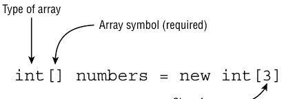

当你使用这种形式实例化数组时，所有元素都将被设为该类型的默认值。正如你在第 1 章中学习的那样，`int` 的默认值是 0。由于 `numbers` 是一个引用变量，它指向数组对象，如图 4.4 所示。如你所见，所有元素的默认值都是 0。此外，索引从 0 开始递增，就像处理 `String` 一样。

图 4.4 一个空数组

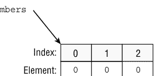

创建数组的另一种方法是指定它初始包含的所有元素：`int[] moreNumbers = new int[] {42, 55, 99};`

在这个示例中，我们也创建了一个大小为 3 的 `int` 数组。这次，我们指定了这三个元素的初始值而不是使用默认值。图 4.5 显示了这个数组的样子。

图 4.5 一个初始化的数组

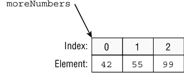

# 第 4 章 · API

Java 认为这个表达式是冗余的。由于你在等号左侧指定了数组的类型，Java 已经知道该类型。由于你指定了初始值，它已经知道了大小。作为快捷方式，Java 允许你这样写：

```
int[] moreNumbers = {42, 55, 99};
```

这种方法被称为匿名数组。它之所以被称为匿名，是因为你没有指定类型和大小。

最后，你可以将 `[]` 写在名称之前或之后，添加空格是可选的。这意味着这五个语句的作用完全相同：

```
int[] numAnimals;
int[] numAnimals2;
int[] numAnimals3;
int numAnimals4[];
int numAnimals5[];
```

大多数人使用第一种。不过，你在考试中可能会看到其中任何一种写法，所以要习惯在奇特的位置看到括号。

## 声明中的多个“数组”

你认为以下代码创建了什么类型的引用变量？

`int[] ids; types;`

正确答案是两个 `int[]` 类型的变量。这看起来很有逻辑。毕竟，`int a, b;` 创建了两个 `int` 变量。那么这个例子呢？

`int ids[]; types;`

我们只是移动了括号的位置，但它改变了行为。这样我们得到了一个 `int[]` 类型的变量和一个 `int` 类型的变量。Java 看到这行代码时会这样想：“他们想要两个 `int` 类型的变量。第一个叫 `ids[]`；这是一个名为 `ids` 的 `int[]` 数组。第二个就叫 `types`。没有括号，所以它是一个普通的整数。”

毋庸地说，你不应该编写像这样的代码。但为了考试你确实需要理解它。

## 使用引用变量创建数组

你可以选择任何 Java 类型作为数组的类型。这包括你自己创建的类。让我们来看内置类型 `String`：

```
String[] bugs = {"cricket", "beetle", "ladybug"};
String[] alias = bugs;
```

## 理解数组

```
System.out.println(bugs.equals(alias)); // true
System.out.println(bugs.toString());    // [Ljava.lang.String;@16bc7c0
```

`equals()` 方法可以用于数组。它由于引用相等性而返回真值。数组上的 `equals()` 方法不会查看数组的元素。记住，这在 `int[]` 上同样有效。`int` 是原始类型；`int[]` 是一个对象。

第二个语句更有趣。`[Ljava.lang.String;@16bc7c0]` 到底是什么？考试时不需要知道这个，但 `L` 表示它是一个数组，`java.lang.String` 是引用类型，而 `16bc7c0` 是哈希码。由于它是引用，你每次运行时都会得到不同的数字和字母。

Java 提供了一个可以漂亮地打印数组的方法：`Arrays.toString(bugs)` 会打印 `[cricket, beetle, ladybug]`。

确保你理解了图 4.6。数组并没有为 `String` 对象分配空间。相反，它分配了指向对象实际存储位置的引用空间。

# 图 4.6 指向字符串的数组

| 0 | 1 | 2 |
|---|---|---|
| "cricket" | "beetle" | "ladybug" |

快速复习，你认为这个数组指向什么？

```java
public class Names {
  String names[];
}
```

你答对了。这是对第 1 章的复习，而不是我们对数组的讨论。代码从未实例化数组，所以它只是指向 `null` 的引用变量。再试一次：你认为这个数组指向什么？

```java
public class Names {
  String names[] = new String[2];
}
```

它是一个数组，因为它有 2 个元素。注意长度总是比最大有效索引大 1。

## 第 4 章 · API

结果是 169，正如你预期的那样。注意我们遍历了输出以打印数组中的值。直接打印数组变量会得到令人心恼的哈希值 `[@i2bd9c3e7]`。或者，我们可以使用 `Arrays.toString(numbers)` 而不是使用循环。那将输出 `[1, 6, 9]`。

尝试对 `String` 类型进行此操作：

```java
String[] strings = { "10", "9", "100" };
Arrays.sort(strings);
for (String s : strings) {
    System.out.print(s + " ");
}
```


这个结果可能不是你预期的。问题在于`String`是按字母顺序排序的，而`1`排在`9`之前（数字在字母之前，大写字母在小写字母之前）。在第 9 章“集合与泛型”中，你将学习如何使用一种名为`comparator`（比较器）的东西来创建自定义排序规则。

你注意到我们在这个示例中悄悄插入了一个`for`循环吗？由于我们没有使用索引，所以不需要传统的`for`循环。不过，这并不阻止出题者使用它，我们会确保两种都使用以保持你的敏锐！

## 搜索

Java 还提供了一种方便的搜索方法，但前提是数组已经排序。

### 表 4.3 二分搜索规则

|  | 结果 |
| --- | --- |
| 在排序数组中找到目标元素 | 匹配项的索引 |
| 在排序数组中未找到目标元素 | 返回一个负值，该值比索引的负值小 1，该索引是需要插入以保持排序的位置 |
| 未排序的数组 | 一个惊喜；此结果未定义 |

让我们用一个例子来测试这些规则：

```java
3: int[] numbers = {2,4,6,8};
4: System.out.println(Arrays.binarySearch(numbers, 2)); // 0
5: System.out.println(Arrays.binarySearch(numbers, 4)); // 1
6: System.out.println(Arrays.binarySearch(numbers, 1)); // -1
7: System.out.println(Arrays.binarySearch(numbers, 3)); // -2
8: System.out.println(Arrays.binarySearch(numbers, 9)); // -5
```

## 理解数组

注意第 3 行是一个排序后的数组。如果不是，我们就无法应用另外任何一条规则。第 4 行搜索 2 的索引。答案是索引 0。第 5 行搜索 4 的索引，结果是 1。

第 6 行搜索 1 的索引。虽然 1 不在列表中，但搜索可以确定它应该插入在元素 0 处以保持排序。由于 0 已经代表数组索引，Java 需要减去 1 得到答案 -1。第 7 行也是类似。虽然 3 不在列表中，但它需要被插入在元素 1 处以保持排序。为了保持一致性，我们将其取反并减去 1，得到 -1-1，也称为 -2。最后，第 8 行想告诉我们 9 应该插入在索引 4。我们再次取反并减去 1，得到 -4-1，也称为 -5。

你对这个示例怎么看？

```java
5: int[] numbers = new int[]{3,2,1};
6: System.out.println(Arrays.binarySearch(numbers, 2));
7: System.out.println(Arrays.binarySearch(numbers, 3));
```

注意第 5 行，数组没有排序。这意味着输出将未定义。在测试此示例时，考试题 6 正确地给出了 1 作为输出。然而，第 7 行给出了错误的答案。如你所见，数组没有排序，请寻找关于不可预测输出的答案。

在考试中，你需要知道二分搜索在两种情况下会返回结果。奇怪的是，你不需要知道为什么名字里有“binary”（二进制）。如果你好奇的话，二分搜索将数组分成两部分（记住，2 是二进制），并确定目标在另一部分。它重复这个过程直到只剩下一个元素。

## 比较

Java 提供了方法来比较两个数组以确定哪一个更“小”。首先我们介绍`compare()`方法，然后介绍`match()`。这些方法经过了重载，可以接受各种参数。

## 使用 compare()

在调用`compare()`之前，你需要了解许多规则。幸运的是，这些规则你在第 9 章编写`Comparator`时需要了解的规则相同。

首先你需要学习返回值的含义。你不需要知道确切的返回值，但你需要知道以下几：

- 负数意味着第一个数组小于第二个数组。
- 零意味着两个数组相等。
- 正数意味着第一个数组大于第二个数组。

这是一个示例：

```java
System.out.println(Arrays.compare(new int[]{1}, new int[]{2}));
```

这段代码打印一个负数。1 比 2 小，这非常直观，使得第一个数组更小。

现在你已经知道如何比较单个值，让我们来看看如何比较不同长度的数组：

- 如果两个数组长度相同，且在相同位置具有相同的值，返回 0。
- 如果所有元素都相同，但第二个数组在末尾有元素，返回负数。
- 如果所有元素都相同，但第一个数组在末尾有元素，返回正数。

表 4.4 Arrays.compare()

| 第一个数组 | 第二个数组 | 结果 |
| --- | --- | --- |
| equals() | true | false |
| compare() | 0 | 零 |
| mismatch() | -1 | 正数 |

## 图 4.7 一个稀疏分布的多维数组

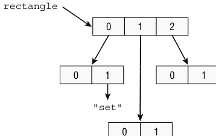

虽然该数组恰好是矩形的，但数组并不一定是。考虑这一个：

```java
int[][] differentSizes = {{1, 4}, {3}, {9,8,7}};
```

我们从一个包含三个元素的数组开始。然而，这次下一层中的元素的大小都是不同的。如果其中一个长度为 2，下一个长度为 1，最后一个长度为 3。见图 4.8。这个数组由基本类型组成，因此它们的显示方式就像在数组中一样。

## 图 4.8 一个非对称的多维数组

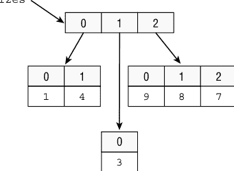

创建非对称数组的另一种方法仅初始化数组的第一维度，并在单独的语句中定义每个数组组件的大小：

```java
int [][] args = new int[4][];
args[0] = new int[5];
args[1] = new int[3];
```

这种技术揭示了你在 Java 中真正得到的是：数组的数组，如果管理得当，它们提供了多维效果。

## 使用多维数组

对多维数组最常用的操作是遍历它。这个示例打印了一个 2D 数组：

我们有两个循环。第一个循环使用`i`并遍历`twoD`的第一个子数组。第二个循环使用不同的循环变量`j`。这些必须是不同的变量名，以免循环混淆。内层循环检查第二级数组中有多少元素。内层循环打印元素并为可读性留出空间。当内层循环完成后，外层循环进入新的一轮并对下一个元素重复该过程。使用增强型循环（enhanced loop）会让这个练习更易读。

```java
for (int[] inner : twoD) {
    for (int num : inner) {
        System.out.print(num + " ");
    }
    System.out.println();
}
```

我们承认这行数并没有减少，但每行的复杂性降低了，而且没有任何循环变量或终止条件会混淆。

## 使用 Math API 计算

计算机擅长计算数字并不令人意外。Java 自带了一个强大的`Math`类，带有许多方法来让你的生活更轻松。我们在这里只涵盖了最可能出现在考试中的几个常用方法。在进行自己的项目时，查看`Math`的 javadoc 看看还有其他方法可以帮助你。

注意数学题中的返回类型。它们是设置技巧的绝佳机会！

## 寻找最小值和最大值

`min()`和`max()`方法比较两个值并返回其中。`min()`的方法签名如下：

```java
public static double min(double a, double b)
public static float min(float a, float b)
public static int min(int a, int b)
public static long min(long a, long b)
```

有四个重载方法，因此无论`a`或`b`是什么类型，你始终有一个可用的 API。`max()`方法的方法相同，只是它返回较大的值。

以下显示了如何使用这些方法：

```java
int first = Math.max(3, 7); // 7
int second = Math.min(7, -9); // -9
```

第一行返回 7，因为它更大。第二行返回 -9，因为它更小。记住学校里说的，负值是更小的值。

## 四舍五入数字

`round()`方法获取数值的小数部分，在合适的情况下选择下一个更大的数字。如果小数部分为 .5 或更高，我们四舍五入。`round()`的方法签名如下：

```java
public static long round(double num)
public static int round(float num)
```

有两个重载方法以确保如果需要有足够的空间存储四舍五入后的值。以下显示了如何使用此方法：

```java
long low = Math.round(123.45); // 123
long high = Math.round(123.50); // 124
int fromFloat = Math.round(123.45f); // 123
```

第一行返回 123，因为 .4 小于一半。第二行返回 124，因为小数部分刚好一半。最后一行显示显式的`float`触发了返回`int`的方法签名。

## 确定天整和地板

`ceil()`方法接收一个`double`值。如果是一个整数，它返回相同的值。如果它有任何小数值，它将向上取整到下一个整数。相比之下，`floor()`方法丢弃小数点后的任何值。

方法签名如下：

```java
public static double ceil(double num)
public static double floor(double num)
```

以下显示了如何使用这些方法：

```java
double c = Math.ceil(3.14); // 4.0
double f = Math.floor(3.14); // 3.0
```

## 计算指数

第一行返回 4.0，因为四是整数。第二行返回 3.0，因为它更小。记住学校里说的，负值是更小的值。`max()`方法的方法相同，只是它返回较大的值。

第一行返回 4.0，因为四是整数。第二行返回 3.0，因为它更小。记住学校里说的，负值是更小的值。`max()`方法的方法相同，只是它返回较大的值。

第一行返回 4.0，因为四是整数。第二行返回 3.0，因为它更小。记住学校里说的，负值是更小的值。`max()`方法的方法相同，只是它返回较大的值。

第一行返回 4.0，因为四是整数。第二行返回 3.0，因为它更小。记住学校里说的，负值是更小的值。`max()`方法的方法相同，只是它返回较大的值。

第一行返回 4.0，因为四是整数。第二行返回 3.0，因为它更小。记住学校里说的，负值是更小的值。`max()`方法的方法相同，只是它返回较大的值。

第一行返回 4.0，因为四是整数。第二行返回 3.0，因为它更小。记住学校里说的，负值是更小的值。`max()`方法的方法相同，只是它返回较大的值。

第一行返回 4.0，因为四是整数。第二行返回 3.0，因为它更小。记住学校里说的，负值是更小的值。`max()`方法的方法相同，只是它返回较大的值。

第一行返回 4.0，因为四是整数。第二行返回 3.0，因为它更小。记住学校里说的，负值是更小的值。`max()`方法的方法相同，只是它返回较大的值。

## 生成随机数

`random()`方法返回一个值。方法签名如下：

```java
public static double random()
```

以下显示了如何使用它：

```java
double num = Math.random();
```

## 处理日期和时间

Java 提供了处理日期和时间的类。要使用它，请在程序中添加：

```java
import java.time.*;
```

# 第 4 章 · 核心 API

```
2021-10-25
09:13:07.768
2021-10-25T09:13:07.768
2021-10-25T09:13:07.669-05:00[America/New_York]
```

关键在于在输出中输入信息。第一行仅包含日期，没有时间。第二行仅包含时间，且显示小时、分钟、秒。第三行同时包含日期和时间。在将`LocalDateTime`转换为`String`时，输出使用 T 来分隔日期和时间。最后，第四行增加了区域偏移量和时区。纽约与格林威治标准时间（GMT）差四个时区。

格林威治标准时间是欧洲的一个时区，在偏移时区时用作时间零点。你可能也听过协调世界时（Coordinated Universal Time），这是一个时区标准。它的缩写是 UTC，是英语和法语名称之间的折中方案。（这不是拼写错误。UTC 在这种语言中并不是正式缩写！）UTC 使用与 GMT 相同的时区。

首先，让我们尝试计算一下它们之间相差多少分钟。注意印度有一个半小时的偏移量，而不是整小时。要处理这类问题，你可以从时区中减去时间。这会得到对应的 GMT 等效时间：

```
2022-06-20T05:50:30[Asia/Kolkata]               // GMT 2022-06-20 01:20
2022-06-20T07:50:05-05:00[US/Eastern]         // GMT 2022-06-20 12:50
```

记住，在减去负数时，转换为 GMT 后，你可以看到美国东部时间比加尔答时间快 11.5 小时。

> 时间偏移量可以用不同的方式列出：+02:00、GMT+2 和 UTC+2 意思相同。你可能会在考试中看到其中一些。


如果你难以记忆，尝试背下一个一个时区之间相差不大的例子，并记住方向。在美国，人们知道东岸比西岸快三个小时。大多数人知道亚洲在欧洲前面。只要在你选择要记忆的例子中不要跨越时区即可。计算方法是一样的，但效果没那么好。

## 处理日期和时间

# 等等，我不住在美国

考试考虑到考生遍布全球各地，因此它不会问你关于美国日期和时间格式的细节。尽管如此，我们的示例确实使用了美国日期和时间格式，考试中的题目也是如此。只需记住月份在日期之前。此外，Java 倾向于使用 24 小时制，尽管美国使用带有 a.m./p.m. 的 12 小时制。

现在你已经知道如何创建当前的日期和时间，让我们来看看其他特定的日期和时间。首先，创建一个没有时间的日期。这两个示例创建了相同的日期：

```
var date1 = LocalDate.of(2022, Month.JANUARY, 20);
var date2 = LocalDate.of(2022, 1, 20);
```

传入年份、月份和日期。虽然让代码更易读是好的，但你可以直接传递月份数字。只需使用你在现实生活中编写日期时使用的月份数字即可。方法签名如下：

```
public static LocalDate of(int year, int month, int dayOfMonth)
public static LocalDate of(int year, int month, int dayOfMonth)
```


随你便，我们一直在告诉你 Java 从 0 开始计数的。嗯，月份是一个例外。在新的日期和时间方法中，Java 从 1 开始计数，就像我们人类一样。

在创建时间时，你可以选择所需的详细程度。你可以只指定小时和分钟，或者如果你想包含秒。你甚至可以包含纳秒（一个纳秒是秒的十分之一，尽管你可能不需要那么精确）。

```
var time1 = LocalTime.of(6, 15);               // 小时和分钟
var time2 = LocalTime.of(6, 15, 30);              // + 秒
var time3 = LocalTime.of(6, 15, 30, 280);         // + 纳秒
```

这三者都是不同的，但彼此之间在一分钟之内。方法签名如下：

```
public static LocalTime(int hour, int minute)
public static LocalTime(int hour, int minute, int second)
public static LocalTime(int hour, int minute, int second, int nanos)
```

# 第 4 章 · 核心 API

你可以将日期和时间合并为一个对象：

```
var dateTime1 = LocalDateTime.of(2022, Month.JANUARY, 20, 6, 15, 30);
var dateTime2 = LocalDateTime.of(date1, time1)
```

第一行代码显示了你如何在同一行中指定所有信息。第二行代码显示了如何分别创建`LocalDateTime`和`LocalTime`对象，然后合并它们创建一个`LocalDateTime`对象。

由于组合很多，有很多方法签名。以下方法签名使用整数值：

```
public static LocalDateTime of(int year, int month, int dayOfMonth, int hour, int minute)
public static LocalDateTime of(int year, int month, int dayOfMonth, int hour, int minute, int second)
public static LocalDateTime of(int year, int month, int dayOfMonth, int hour, int minute, int second, int nanos)
```


其他的接受 `Month` 引用：

```
public static LocalDateTime of(Month month, int year, int dayOfMonth, int hour, int minute)
public static LocalDateTime of(Month month, int year, int dayOfMonth, int hour, int minute, int second)
public static LocalDateTime of(Month month, int year, int dayOfMonth, int hour, int minute, int second, int nanos)
```

最后，它接受一个日期和一个时间：

```
public static LocalDateTime of(LocalDate date, LocalTime)
```

## 第 4 章 · API

然而，2022 年不是闰年（2020 年和 2024 年是闰年）。`Java` 足够智能，可以意识到 2022 年 2 月 29 日不存在，它给了我们 2022 年 2 月 28 日。最后，第 20 行增加了五年。

2 月 29 日只存在于闰年。闰年是 4 或 400 的倍数，但不是 100 的倍数。例如，2000 年和 2016 年是闰年，而 2100 年不是。

也有简单的方法可以向回推时间。这是我们处理 `LocalDateTime` 时：

```java
22: var date = LocalDate.of(2024, Month.JANUARY, 20);
23: var time = LocalTime.of(5, 15);
24: var dateTime = LocalDateTime.of(date, time);
25: System.out.println(dateTime); // 2024-01-20T05:15:00
26: dateTime = dateTime.minusDays(1);
27: System.out.println(dateTime); // 2024-01-19T05:15:00
28: dateTime = dateTime.minusHours(10);
29: System.out.println(dateTime); // 2024-01-18T19:15:00
30: dateTime = dateTime.minusSeconds(30);
31: System.out.println(dateTime); // 2024-01-18T19:14:30
```

第 25 行打印了 2024 年 1 月 20 日凌晨 5:15 的原始日期。第 26 行减去了 1 小时，显示如果小时导致调整，日期将会改变，它把我们带到了 2024 年 1 月 18 日 19:15（晚上 7:15）。最后，第 30 行减去了 30 秒。你可以看到突然之间，显示值显示了秒。`Java` 足够智能，在我们不使用纳秒时会隐藏纳秒。

日期和时间进行链式调用是很常见的。例如，如果没有那些打印语句，上一个示例可以重写如下：

```java
var date = LocalDate.of(2024, Month.JANUARY, 20);
var time = LocalTime.of(5, 15);
var dateTime = LocalDateTime.of(date, time).minusDays(1).minusHours(10).minusSeconds(30);
```

当你有大量的操作要进行时，建立这些链是非常方便的。出题者有两种方法尝试欺骗你。你认为这会打印什么？

```java
var date = LocalDate.of(2024, Month.JANUARY, 20);
date.plusDays(10);
System.out.println(date);
```

它打印的是 2024 年 1 月 20 日。增加 10 天是没用的，因为程序忽略了结果。每当你看到不可变类型（immutable types）时，请注意方法调用的返回值没有被忽略。

## 处理日期和时间

考试可能还会测试你是否记得每个日期和时间对象包含什么。你看到这里有什么错了吗？

```java
var date = LocalDate.of(2024, Month.JANUARY, 20);
date = date.plusMinutes(1); // 无法编译
```

`LocalDate` 不包含时间。这意味着你不能向它添加分钟。在链式的加减操作序列中，这可能会很棘手，所以请确保你知道表 4.6 中的哪些方法可以在哪些类型上调用。

## 表 4.6 LocalDate, LocalTime 和 ZonedDateTime 中的方法

| 可以在 LocalDate 上调用吗？ | 可以在 LocalTime 上调用吗？ | 可以在 LocalDateTime 或 ZonedDateTime 上调用吗？ |
|---|---|---|
| plusYears() minusYears() | Yes | No | Yes |
| plusMonths() minusMonths() | Yes | No | Yes |
| plusWeeks() minusWeeks() | Yes | No | Yes |
| plusDays() minusDays() | Yes | No | Yes |
| plusHours() minusHours() | No | Yes | Yes |
| plusMinutes() minusMinutes() | No | Yes | Yes |
| plusSeconds() minusSeconds() | No | Yes | Yes |
| plusNanos() minusNanos() | No | Yes | Yes |

## 处理 Period（期间）

现在你已经足够足够对日期做些有趣的事情了！我们的动物园执行动物丰富活动，让动物有乐子做。动物园长决定每月更换一次玩具。这个系统将持续三个月，它是如何工作的。

```java
public static void main(String[] args) {
    var start = LocalDate.of(2022, Month.JANUARY, 1);
    var end = LocalDate.of(2022, Month.MARCH, 30);
    performAnimalEnrichment(start, end);
}

private static void performAnimalEnrichment(LocalDate start, LocalDate end) {
    var upTo = start;
    while (upTo.isBefore(end)) {
        System.out.println("give new toy: " + upTo);
        upTo = upTo.plusMonths(1);
    }
}
```

这段代码向日期增加一个月，直到到达结束。问题在于这个方法无法重用。动物园长想尝试不同的计划。`LocalDate` 和 `LocalDateTime` 有一个方法可以将它们转换为长值，相当于自 1970 年 1 月 1 日以来的毫秒数（epoch）。幸运的是，`Java` 有一个传入的 `Period` 类。这段代码与示例相同：

```java
public static void main(String[] args) {
    var start = LocalDate.of(2022, Month.JANUARY, 1);
    var end = LocalDate.of(2022, Month.MARCH, 30);
    var period = Period.ofMonths(1); // 创建期间
    performAnimalEnrichment(start, end, period);
}

private static void performAnimalEnrichment(LocalDate start, LocalDate end, Period period) {
    var upTo = start;
    while (upTo.isBefore(end)) {
        System.out.println("give new toy: " + upTo);
        upTo = upTo.plus(period); // 期间
    }
}
```

## 处理日期和时间

该方法可以添加任意的时间。这允许我们在动物园长改变主意时重用相同的方法。有五种创建 `Period` 类的方法：

```java
var annually = Period.ofYears(1);           // 每年
var quarterly = Period.ofMonths(3);      // 每三个月
var everyThreeWeeks = Period.ofWeeks(3);   // 每三周
var everyDay = Period.ofDays(2);          // 每二天
var everyYearWeek = Period.of(1, 0, 7);  // 每年七天
```

陷阱在于：创建 `Period` 时不能链式调用方法。以下代码看起来等同于 `everyYearWeek` 示例，但并不是。`Period` 方法是静态方法。

```java
var wrong = Period.ofYears(1).ofWeeks(1); // 每周
wrong = Period.ofYears(1);
wrong = Period.ofWeeks(1);
```

这显然不是你的意图！这就是为什么 `of()` 方法允许你传入年、月、天。它们都包含在期间内。编译后你会得到关于此的编译器警告。`of()` 方法只接受年、月和天。使用另一个工厂方法传入仅仅是为了方便。正如你想象的，实际期间是以年、月和天存储的。当你打印该值时，`Java` 使用图 4.9 中的格式。

## 图 4.9 Period 格式

```java
System.out.println(Period.of(1,2,3));
```


你可以看到，字符串始终以 P 开表示期间。然后是年份、月份和天数。如果其中任何一个为零，它们会被省略。

你能猜出这个输出什么吗？

```java
System.out.println(Period.ofMonths(3));
```

输出是 P3M。记住 `Java` 会省略任何零值的度量。关于 `Period` 需要最后知道的是它可以与哪些对象一起。让我们看看代码：

```java
var date = LocalDateTime.of(2022, 1, 20);
var time = LocalTime.of(6, 15);
var dateTime = LocalDateTime.of(date, time);
var period = Period.ofMonths(1);
System.out.println(date.plus(period));    // 2022-02-20
System.out.println(dateTime.plus(period)); // 2022-02-22T06:15
System.out.println(time.plus(period));   // 异常
```

第 7 行和第 8 行符合预期。它们使用 2022 年 2 月为 2022 年 1 月 20 日增加一个月。它只有日期，而结果既有日期又有时间。第 9 行尝试向只有一个时间的对象添加一个月。这是不通的。`Java` 抛出 `UnsupportedTemporalException` 并抱怨我们尝试使用不支持的单位：Months。

正如你看到的，在看到它们的地方都要注意日期时间的类型。

## 处理 Duration（持续时间）

你现在可能已经注意到 `Period` 是或更长时间。有一个 `Duration` 用于更小的时间单位。你可以指定天、小时、分钟、秒或纳秒数。是的，你可以传入 365 天来表示一年，但你真的不应该这样做——那是 `Period` 的用途。

```java
var day = Duration.ofDays(1);           // PT24H
var hourly = Duration.ofHours(1);          // PT1H
var everyMinute = Duration.ofMinutes(1);   // PT1M
var everySeconds = Duration.ofSeconds(10); // PT10S
var everyMilli = Duration.ofMillis(1);      // PT.001S
var everyNano = Duration.ofNanos(1);       // PT.000000001S
```

`Duration` 没有像 `Period` 那样接受多个单位的工厂方法。如果你想每一个小时半执行一次，你指定 90 分钟。

`Duration` 包含另一个泛型工厂方法。它接受一个数字和一个 `TemporalUnit`。这种想法是，比如“5 秒”。然而，`TemporalUnit` 是一个接口。目前，只有一个名为 `ChronoUnit` 的实现。

## 处理日期和时间

之前的示例可以重写如下：

```
var daily = Duration.of(1, ChronoUnit.DAYS);
var hourly = Duration.of(1, ChronoUnit.HOURS);
var everyMinute = Duration.of(1, ChronoUnit.MINUTES);
var everySeconds = Duration.of(10, ChronoUnit.SECONDS);
var everyMillis = Duration.of(1, ChronoUnit.MILLIS);
var everyNano = Duration.of(1, ChronoUnit.NANOS);
```

`ChronoUnit` 还包含了一些方便的单位，例如 `ChronoUnit.HALF_DAYS` 用于表示 12 小时。

## 用于差值的 ChronoUnit

`ChronoUnit` 是确定两个值之间差值的绝方法。`Temporal` 包含了 `LocalDate`、`LocalTime` 等。`ChronoUnit` 位于 `java.time.temporal` 包。

```java
var one = LocalTime.of(5, 15);
var two = LocalTime.of(6, 30);
var date = LocalDate.of(2016, 1, 20);
System.out.println(ChronoUnit.HOURS.between(one, two)); // 1
System.out.println(ChronoUnit.MINUTES.between(one, two)); // 75
System.out.println(ChronoUnit.MINUTES.between(one, date)); // DateTimeException
```

第一条打印语句显示它进行计算而不是四舍五入。第二条显示了在不同单位进行计数有多简单。只需更改 `ChronoUnit` 类型即可。最后一条提醒我们，如果我们混淆了日期对象和时间对象可以的操作，`Java` 将抛出异常。

或者，你可以截断任何带有时间元素的对象。例如：

```java
LocalTime time = LocalTime.of(3,12,45);
System.out.println(time); // 03:12:45
LocalTime truncated = time.truncatedTo(ChronoUnit.MINUTES);
System.out.println(truncated); // 03:12
```

此示例将任何比分钟小的字段置零。在我们的案例中，它去掉了秒。

使用 `Duration` 的工作方式与使用 `Period` 相同。例如：

```java
var date = LocalDate.of(2022, 1, 20);
var time = LocalTime.of(6, 15);
```

# 第 4 章 · API

```java
var dateTime = LocalTime.of(date, time);
var duration = Duration.ofHours(6);
System.out.println(dateTime.plus(duration)); // 2022-01-20T12:15
System.out.println(dateTime.plus(duration)); // 12:15
System.out.println(
    date.plus(duration)); // UnsupportedTemporalTypeException
```

第 11 行显示我们可以向 `LocalDateTime` 添加小时，因为我们有时间。它包含了一行代码。第 12 行也有效，因为我们拥有的时间。第 13 行失败了，因为我们不能向不包含时间的对象上添加小时。

让我们再次尝试，但这次添加 23 小时。


```java
var date = LocalDate.of(2022, 1, 20);
var time = LocalTime.of(6, 15);
var dateTime = LocalDateTime.of(date, time);
var duration = Duration.ofHours(23);
System.out.println(dateTime.plus(duration)); // 2022-01-21T05:15
System.out.println(dateTime.plus(duration)); // 05:15
System.out.println(
    date.plus(duration)); // UnsupportedTemporalTypeException
```

在这里我们看到 Java 会向前移动越过一天的结束。第 11 行由于我们通过了午夜，它到了第二天。第 12 行没有天，时间只是绕回——就像真实的时钟一样。

## Period 与 Duration

记住 `Period` 和 `Duration` 并不等同。这个示例展示了长度相同的 `Period` 和 `Duration`：

```java
var date = LocalDate.of(2022, 5, 25);
var period = Period.ofDays(1);
var days = Duration.ofDays(1);
```

```java
System.out.println(date.plus(period)); // 2022-05-26
System.out.println(date.plus(days)); // Unsupported unit: Seconds
```

由于我们正在处理 `LocalDate`，我们被要求使用 `Period`。`Duration` 包含时间单位，即使我们没有看到，它们也是为了带有时间的对象设计的。请确保你能够填写表 4.7，以识别哪些对象可以使用 `Period` 和 `Duration`。

## 处理日期和时间

**表 4.7** 何时使用 `Duration` 和 `Period`

| 可以与 `Period` 使用吗？ | 可以与 `Duration` 使用吗？ |
|---|---|
| `LocalDate` | 是 | 否 |
| `LocalDateTime` | 是 | 是 |
| `LocalTime` | 否 | 是 |
| `ZonedDateTime` | 是 | 是 |

## 处理 Instant

`Instant` 类代表 GMT 时区的特定时刻。假设你想运行一个计时器：

```java
var now = Instant.now();
// 执行一些耗时的操作
var later = Instant.now();
```

```java
var duration = Duration.between(now, later);
System.out.println(duration.toMillis()); // 返回毫秒数
```

在我们的案例中，“耗时的操作”仅仅超过了一秒，程序输出了 1025。

```java
var date = LocalDate.of(2022, 5, 25);
var time = LocalTime.of(11, 55, 00);
var zone = ZoneId.of("US/Eastern");
var zonedDateTime = ZonedDateTime.of(date, time, zone);
var instant = zonedDateTime.toInstant(); // 2022-05-25T15:55:00Z
System.out.println(zonedDateTime); // 2022-05-25T11:55:04[US/Eastern]
System.out.println(instant); // 2022-05-25T15:55:00Z
```

等等，OCR 文本有很多重复。我将根据逻辑流提供清理后的版本。

## 总结

在本章中，你学习了 `String` 是一个不可变的字符序列。显式调用构造函数是可选的。拼接运算符 (`+`) 会创建一个新的 `String`，其内容为第一个 `String` 的内容后跟第二个 `String` 的内容。如果 `+` 表达式涉及的任何操作数是 `String`，则使用拼接；否则使用加法。字符串字面量存储在字符串池中。`String` 类有许多方法。

相比之下，`StringBuilder` 是可变的字符序列。大多数方法返回当前对象的引用，以允许链式调用。`StringBuilder` 类有许多方法。

`==` 检查引用是否指向池中的同一个对象。对 `StringBuilder` 对象调用 `equals()` 将检查字符序列是否相同。对 `StringBuilder` 对象调用 `equals()` 将检查它们是否指向同一个对象，而不是查看内部的值。

数组是堆上固定大小的内存区域，可以存储原始类型或对象。你在创建它时指定大小。例如，`int[] array = new int[6];`。索引从 0 开始，使用 `[0]` 引用元素。`Arrays.binarySearch()` 搜索排序数组并返回匹配项的索引。如果没有找到匹配项，它会将元素需要插入的位置取反并减去 1。`Arrays.compare()` 和 `Arrays.equals()` 检查两个数组是否相等。接受可变参数 (`...`) 的方法可以作为普通数组传入。在多维数组中，第二级及以上的数组大小可以不同。

`Math` 类提供了许多静态方法用于执行数学操作。例如，你可以四舍五入或生成随机数。某些方法适用于每个数值原始类型，而其他一些仅适用于 `double`。

`LocalDate` 包含日期，`LocalTime` 包含时间，`LocalDateTime` 同时包含日期时间。这三者都有私有构造函数，并使用 `LocalDate.now()` 或 `LocalDate.of`（或该类的等效方法）创建。可以使用 `plusXXX` 或 `minusXXX` 方法处理日期和时间。`Period` 类表示从 `LocalDate` 或 `LocalDateTime` 中增加或减少的天数、月份或年份。日期和时间类都是不可变的，这意味着返回值必须被使用。

## 考试要点

- 能够确定使用 `String` 的代码输出。了解与 `String` 拼接的规则以及如何使用常用的 `String` 方法。了解 `String` 是不可变的。特别注意索引是从零开始的，以及 `substring()` 方法获取到第二个参数索引之前的之前的字符串。

- 能够确定使用 `StringBuilder` 的代码输出。了解 `StringBuilder` 是可变的，以及如何使用常用的 `StringBuilder` 方法。了解 `substring()` 不改变 `StringBuilder` 的值，而 `append()`、`delete()` 和 `insert()` 会改变它。还要注意，大多数 `StringBuilder` 方法返回 `StringBuilder` 当前实例的引用。

- 理解 `==` 和 `equals()` 之间的区别。`==` 检查对象相等性。`equals()` 取决于被调用对象的实现方式。对于 `String` 类，`equals()` 检查其内部的字符。

- 能够确定使用数组的代码输出。了解如何声明和实例化一维和多维数组。能够访问每个元素并知道何时索引越界。在搜索和排序时识别正确和错误的输出。

- 识别 `Math` 方法的返回类型。根据传入的原始类型，`Math` 方法可能会返回不同的原始类型。

- 识别日期和时间的无效用法。`LocalDate` 不包含字段，`LocalTime` 不包含字段。注意在错误的时间上执行的操作。还要注意增加或减去后忽略结果。熟练掌握日期计算，包括时区和夏令时。

## 复习题

复习题的答案可以在附录中找到。

- 1. 以下代码的输出是什么？（选择所有适用项。）

```java
public class Fish {
    public static void main(String[] args) {
        int numOf = 4;
        String fishType = "tuna";
        String anotherFish = numOf + 1;
        System.out.println(anotherFish + " " + fishType);
        System.out.println(numFish + " " + 1);
    }
}
```

A. 4 1

B. 5

C. 5 tuna

D. tuna

E. 51tuna

F. 代码无法编译。

- 2. 哪些数组声明是不合法的？（选择所有适用项。）

A. `int[][] scores = new int[5][];`

B. `Object[][] cubbies = new Object[3][5];`

C. `String beans[] = new String[6];`

D. `java.util.Date[] dates = new java.util.Date[2];`

E. `int[][] types = new int[];`

F. `int[] java = new int[];`

- 3. 注意 2022 年 3 月 13 日是我们进入夏令时的周末，而 11 月 6 日是时候结束夏令时的周末。以下哪项可以填充空白处而不会抛出异常？（选择所有适用项。）

```java
var zone = ZoneId.of("US/Eastern");
var date = 
var time = LocalTime.of(2, 15);
var z = ZonedDateTime.of(date, time, zone);
```

A. `LocalDate.of(2022, 3, 13)`

B. `LocalDate.of(2022, 3, 40)`

C. `LocalDate.of(2022, 11, 45)`

D. `LocalDate.of(2022, 11, 7)`

E. `LocalDate.of(2023, 2, 14)`

- 4. 注意 2022 年 3 月 13 日是我们进入夏令时的周末，而 11 月 6 日是时候结束夏令时的周末。以下哪项可以填充空白处而不会抛出异常？（选择所有适用项。）

```java
var zone = ZoneId.of("US/Eastern");
var date = 
var time = LocalTime.of(2, 15);
var z = ZonedDateTime.of(date, time, zone);
```

A. `LocalDate.of(2022, 3, 13)`

B. `LocalDate.of(2022, 3, 40)`

C. `LocalDate.of(2022, 11, 45)`

D. `LocalDate.of(2022, 11, 7)`

E. `LocalDate.of(2023, 2, 14)`

- 5. 以下代码的输出是什么？（选择所有适用项。）

```java
public class Fish {
    public static void main(String[] args) {
        int numOf = 4;
        String fishType = "tuna";
        String anotherFish = numOf + 1;
        System.out.println(anotherFish + " " + fishType);
        System.out.println(numFish + " " + 1);
    }
}
```

A. 4 1

B. 5

C. 5 tuna

D. tuna

E. 51tuna

F. 代码无法编译。

- 6. 哪些数组声明是不合法的？（选择所有适用项。）

A. `int[][] scores = new int[5][];`

B. `Object[][] cubbies = new Object[3][5];`

C. `String beans[] = new String[6];`

D. `java.util.Date[] dates = new java.util.Date[2];`

E. `int[][] types = new int[];`

F. `int[] java = new int[];`

- 7. 注意 2022 年 3 月 13 日是我们进入夏令时的周末，而 11 月 6 日是时候结束夏令时的周末。以下哪项可以填充空白处而不会抛出异常？（选择所有适用项。）

```java
var zone = ZoneId.of("US/Eastern");
var date = 
var time = LocalTime.of(2, 15);
var z = ZonedDateTime.of(date, time, zone);
```

A. `LocalDate.of(2022, 3, 13)`

B. `LocalDate.of(2022, 3, 40)`

C. `LocalDate.of(2022, 11, 45)`

D. `LocalDate.of(2022, 11, 7)`

E. `LocalDate.of(2023, 2, 14)`

- 8. 以下代码的输出是什么？（选择所有适用项。）

```java
public class Fish {
    public static void main(String[] args) {
        int numOf = 4;
        String fishType = "tuna";
        String anotherFish = numOf + 1;
        System.out.println(anotherFish + " " + fishType);
        System.out.println(numFish + " " + 1);
    }
}
```

A. 4 1

B. 5

C. 5 tuna

D. tuna

E. 51tuna

F. 代码无法编译。

- 9. 哪些数组声明是不合法的？（选择所有适用项。）

A. `int[][] scores = new int[5][];`

B. `Object[][] cubbies = new Object[3][5];`

C. `String beans[] = new String[6];`

D. `java.util.Date[] dates = new java.util.Date[2];`

E. `int[][] types = new int[];`

F. `int[] java = new int[];`

- 10. 注意 2022 年 3 月 13 日是我们进入夏令时的周末，而 11 月 6 日是时候结束夏令时的周末。以下哪项可以填充空白处而不会抛出异常？（选择所有适用项。）

```java
var zone = ZoneId.of("US/Eastern");
var date = 
var time = LocalTime.of(2, 15);
var z = ZonedDateTime.of(date, time, zone);
```

A. `LocalDate.of(2022, 3, 13)`

B. `LocalDate.of(2022, 3, 40)`

C. `LocalDate.of(2022, 11, 45)`

D. `LocalDate.of(2022, 11, 7)`

E. `LocalDate.of(2023, 2, 14)`

- 11. 以下代码的输出是什么？（选择所有适用项。）

```java
public class Fish {
    public static void main(String[] args) {
        int numOf = 4;
        String fishType = "tuna";
        String anotherFish = numOf + 1;
        System.out.println(anotherFish + " " + fishType);
        System.out.println(numFish + " " + 1);
    }
}
```

A. 4 1

B. 5

C. 5 tuna

D. tuna

E. 51tuna

F. 代码无法编译。

- 12. 哪些数组声明是不合法的？（选择所有适用项。）

A. `int[][] scores = new int[5][];`

B. `Object[][] cubbies = new Object[3][5];`

C. `String beans[] = new String[6];`

D. `java.util.Date[] dates = new java.util.Date[2];`

E. `int[][] types = new int[];`

F. `int[] java = new int[];`

- 13. 注意 2022 年 3 月 13 日是我们进入夏令时的周末，而 11 月 6 日是时候结束夏令时的周末。以下哪项可以填充空白处而不会抛出异常？（选择所有适用项。）

```java
var zone = ZoneId.of("US/Eastern");
var date = 
var time = LocalTime.of(2, 15);
var z = ZonedDateTime.of(date, time, zone);
```

A. `LocalDate.of(2022, 3, 13)`

B. `LocalDate.of(2022, 3, 40)`

C. `LocalDate.of(2022, 11, 45)`

D. `LocalDate.of(2022, 11, 7)`

E. `LocalDate.of(2023, 2, 14)`

- 14. 以下代码的输出是什么？（选择所有适用项。）

```java
public class Fish {
    public static void main(String[] args) {
        int numOf = 4;
        String fishType = "tuna";
        String anotherFish = numOf + 1;
        System.out.println(anotherFish + " " + fishType);
        System.out.println(numFish + " " + 1);
    }
}
```

A. 4 1

B. 5

C. 5 tuna

D. tuna

E. 51tuna

F. 代码无法编译。

- 15. 哪些数组声明是不合法的？（选择所有适用项。）

A. `int[][] scores = new int[5][];`

B. `Object[][] cubbies = new Object[3][5];`

C. `String beans[] = new String[6];`

D. `java.util.Date[] dates = new java.util.Date[2];`

E. `int[][] types = new int[];`

F. `int[] java = new int[];`

- 16. 注意 2022 年 3 月 13 日是我们进入夏令时的周末，而 11 月 6 日是时候结束夏令时的周末。以下哪项可以填充空白处而不会抛出异常？（选择所有适用项。）

```java
var zone = ZoneId.of("US/Eastern");
var date = 
var time = LocalTime.of(2, 15);
var z = ZonedDateTime.of(date, time, zone);
```

A. `LocalDate.of(2022, 3, 13)`

B. `LocalDate.of(2022, 3, 40)`

C. `LocalDate.of(2022, 11, 45)`

D. `LocalDate.of(2022, 11, 7)`

E. `LocalDate.of(2023, 2, 14)`

- 17. 以下代码的输出是什么？（选择所有适用项。）

```java
public class Fish {
    public static void main(String[] args) {
        int numOf = 4;
        String fishType = "tuna";
        String anotherFish = numOf + 1;
        System.out.println(anotherFish + " " + fishType);
        System.out.println(numFish + " " + 1);
    }
}
```

A. 4 1

B. 5

C. 5 tuna

D. tuna

E. 51tuna

F. 代码无法编译。

- 18. 哪些数组声明是不合法的？（选择所有适用项。）

A. `int[][] scores = new int[5][];`

B. `Object[][] cubbies = new Object[3][5];`

C. `String beans[] = new String[6];`

D. `java.util.Date[] dates = new java.util.Date[2];`

E. `int[][] types = new int[];`

F. `int[] java = new int[];`

- 19. 注意 2022 年 3 月 13 日是我们进入夏令时的周末，而 11 月 6 日是时候结束夏令时的周末。以下哪项可以填充空白处而不会抛出异常？（选择所有适用项。）

```java
var zone = ZoneId.of("US/Eastern");
var date = 
var time = LocalTime.of(2, 15);
var z = ZonedDateTime.of(date, time, zone);
```

A. `LocalDate.of(2022, 3, 13)`

B. `LocalDate.of(2022, 3, 40)`

C. `LocalDate.of(2022, 11, 45)`

D. `LocalDate.of(2022, 11, 7)`

E. `LocalDate.of(2023, 2, 14)`

- 20. 以下代码的输出是什么？（选择所有适用项。）

```java
public class Fish {
    public static void main(String[] args) {
        int numOf = 4;
        String fishType = "tuna";
        String anotherFish = numOf + 1;
        System.out.println(anotherFish + " " + fishType);
        System.out.println(numFish + " " + 1);
    }
}
```

A. 4 1

B. 5

C. 5 tuna

D. tuna

E. 51tuna

F. 代码无法编译。

- 21. 哪些数组声明是不合法的？（选择所有适用项。）

A. `int[][] scores = new int[5][];`

B. `Object[][] cubbies = new Object[3][5];`

C. `String beans[] = new String[6];`

D. `java.util.Date[] dates = new java.util.Date[2];`

E. `int[][] types = new int[];`

F. `int[] java = new int[];`

- 22. 注意 2022 年 3 月 13 日是我们进入夏令时的周末，而 11 月 6 日是时候结束夏令时的周末。以下哪项可以填充空白处而不会抛出异常？（选择所有适用项。）

```java
var zone = ZoneId.of("US/Eastern");
var date = 
var time = LocalTime.of(2, 15);
var z = ZonedDateTime.of(date, time, zone);
```

A. `LocalDate.of(2022, 3, 13)`

B. `LocalDate.of(2022, 3, 40)`

C. `LocalDate.of(2022, 11, 45)`

D. `LocalDate.of(2022, 11, 7)`

E. `LocalDate.of(2023, 2, 14)`

- 23. 以下代码的输出是什么？（选择所有适用项。）

```java
public class Fish {
    public static void main(String[] args) {
        int numOf = 4;
        String fishType = "tuna";
        String anotherFish = numOf + 1;
        System.out.println(anotherFish + " " + fishType);
        System.out.println(numFish + " " + 1);
    }
}
```

A. 4 1

B. 5

C. 5 tuna

D. tuna

E. 51tuna

F. 代码无法编译。

- 24. 哪些数组声明是不合法的？（选择所有适用项。）

A. `int[][] scores = new int[5][];`

B. `Object[][] cubbies = new Object[3][5];`

C. `String beans[] = new String[6];`

D. `java.util.Date[] dates = new java.util.Date[2];`

E. `int[][] types = new int[];`

F. `int[] java = new int[];`

- 25. 注意 2022 年 3 月 13 日是我们进入夏令时的周末，而 11 月 6 日是时候结束夏令时的周末。以下哪项可以填充空白处而不会抛出异常？（选择所有适用项。）

```java
var zone = ZoneId.of("US/Eastern");
var date = 
var time = LocalTime.of(2, 15);
var z = ZonedDateTime.of(date, time, zone);
```

A. `LocalDate.of(2022, 3, 13)`

B. `LocalDate.of(2022, 3, 40)`

C. `LocalDate.of(2022, 11, 45)`

D. `LocalDate.of(2022, 11, 7)`

E. `LocalDate.of(2023, 2, 14)`

- 26. 以下代码的输出是什么？（选择所有适用项。）

```java
public class Fish {
    public static void main(String[] args) {
        int numOf = 4;
        String fishType = "tuna";
        String anotherFish = numOf + 1;
        System.out.println(anotherFish + " " + fishType);
        System.out.println(numFish + " " + 1);
    }
}
```

A. 4 1

B. 5

C. 5 tuna

D. tuna

E. 51tuna

F. 代码无法编译。

- 27. 哪些数组声明是不合法的？（选择所有适用项。）

A. `int[][] scores = new int[5][];`

B. `Object[][] cubbies = new Object[3][5];`

C. `String beans[] = new String[6];`

D. `java.util.Date[] dates = new java.util.Date[2];`

E. `int[][] types = new int[];`

F. `int[] java = new int[];`

- 28. 注意 2022 年 3 月 13 日是我们进入夏令时的周末，而 11 月 6 日是时候结束夏令时的周末。以下哪项可以填充空白处而不会抛出异常？（选择所有适用项。）

```java
var zone = ZoneId.of("US/Eastern");
var date = 
var time = LocalTime.of(2, 15);
var z = ZonedDateTime.of(date, time, zone);
```

A. `LocalDate.of(2022, 3, 13)`

B. `LocalDate.of(2022, 3, 40)`

C. `LocalDate.of(2022, 11, 45)`

D. `LocalDate.of(2022, 11, 7)`

E. `LocalDate.of(2023, 2, 14)`

- 29. 以下代码的输出是什么？（选择所有适用项。）

```java
public class Fish {
    public static void main(String[] args) {
        int numOf = 4;
        String fishType = "tuna";
        String anotherFish = numOf + 1;
        System.out.println(anotherFish + " " + fishType);
        System.out.println(numFish + " " + 1);
    }
}
```

A. 4 1

B. 5

C. 5 tuna

D. tuna

E. 51tuna

F. 代码无法编译。

- 30. 哪些数组声明是不合法的？（选择所有适用项。）

A. `int[][] scores = new int[5][];`

B. `Object[][] cubbies = new Object[3][5];`

C. `String beans[] = new String[6];`

D. `java.util.Date[] dates = new java.util.Date[2];`

E. `int[][] types = new int[];`

F. `int[] java = new int[];`

- 31. 注意 2022 年 3 月 13 日是我们进入夏令时的周末，而 11 月 6 日是时候结束夏令时的周末。以下哪项可以填充空白处而不会抛出异常？（选择所有适用项。）

```java
var zone = ZoneId.of("US/Eastern");
var date = 
var time = LocalTime.of(2, 15);
var z = ZonedDateTime.of(date, time, zone);
```

A. `LocalDate.of(2022, 3, 13)`

B. `LocalDate.of(2022, 3, 40)`

C. `LocalDate.of(2022, 11, 45)`

D. `LocalDate.of(2022, 11, 7)`

E. `LocalDate.of(2023, 2, 14)`

- 32. 以下代码的输出是什么？（选择所有适用项。）

```java
public class Fish {
    public static void main(String[] args) {
        int numOf = 4;
        String fishType = "tuna";
        String anotherFish = numOf + 1;
        System.out.println(anotherFish + " " + fishType);
        System.out.println(numFish + " " + 1);
    }
}
```

A. 4 1

B. 5

C. 5 tuna

D. tuna

E. 51tuna

F. 代码无法编译。

- 33. 哪些数组声明是不合法的？（选择所有适用项。）

A. `int[][] scores = new int[5][];`

B. `Object[][] cubbies = new Object[3][5];`

C. `String beans[] = new String[6];`

D. `java.util.Date[] dates = new java.util.Date[2];`

E. `int[][] types = new int[];`

F. `int[] java = new int[];`

- 34. 注意 2022 年 3 月 13 日是我们进入夏令时的周末，而 11 月 6 日是时候结束夏令时的周末。以下哪项可以填充空白处而不会抛出异常？（选择所有适用项。）

```java
var zone = ZoneId.of("US/Eastern");
var date = 
var time = LocalTime.of(2, 15);
var z = ZonedDateTime.of(date, time, zone);
```

A. `LocalDate.of(2022, 3, 13)`

B. `LocalDate.of(2022, 3, 40)`

C. `LocalDate.of(2022, 11, 45)`

D. `LocalDate.of(2022, 11, 7)`

E. `LocalDate.of(2023, 2, 14)`

- 35. 以下代码的输出是什么？（选择所有适用项。）

```java
public class Fish {
    public static void main(String[] args) {
        int numOf = 4;
        String fishType = "tuna";
        String anotherFish = numOf + 1;
        System.out.println(anotherFish + " " + fishType);
        System.out.println(numFish + " " + 1);
    }
}
```

A. 4 1

B. 5

C. 5 tuna

D. tuna

E. 51tuna

F. 代码无法编译。

- 36. 哪些数组声明是不合法的？（选择所有适用项。）

A. `int[][] scores = new int[5][];`

B. `Object[][] cubbies = new Object[3][5];`

C. `String beans[] = new String[6];`

D. `java.util.Date[] dates = new java.util.Date[2];`

E. `int[][] types = new int[];`

F. `int[] java = new int[];`

- 37. 注意 2022 年 3 月 13 日是我们进入夏令时的周末，而 11 月 6 日是时候结束夏令时的周末。以下哪项可以填充空白处而不会抛出异常？（选择所有适用项。）

```java
var zone = ZoneId.of("US/Eastern");
var date = 
var time = LocalTime.of(2, 15);
var z = ZonedDateTime.of(date, time, zone);
```

A. `LocalDate.of(2022, 3, 13)`

B. `LocalDate.of(2022, 3, 40)`

C. `LocalDate.of(2022, 11, 45)`

D. `LocalDate.of(2022, 11, 7)`

E. `LocalDate.of(2023, 2, 14)`

- 38. 以下代码的输出是什么？（选择所有适用项。）

```java
public class Fish {
    public static void main(String[] args) {
        int numOf = 4;
        String fishType = "tuna";
        String anotherFish = numOf + 1;
        System.out.println(anotherFish + " " + fishType);
        System.out.println(numFish + " " + 1);
    }
}
```

A. 4 1

B. 5

C. 5 tuna

D. tuna

E. 51tuna

F. 代码无法编译。

- 39. 哪些数组声明是不合法的？（选择所有适用项。）

A. `int[][] scores = new int[5][];`

B. `Object[][] cubbies = new Object[3][5];`

C. `String beans[] = new String[6];`

D. `java.util.Date[] dates = new java.util.Date[2];`

E. `int[][] types = new int[];`

F. `int[] java = new int[];`

- 40. 注意 2022 年 3 月 13 日是我们进入夏令时的周末，而 11 月 6 日是时候结束夏令时的周末。以下哪项可以填充空白处而不会抛出异常？（选择所有适用项。）

```java
var zone = ZoneId.of("US/Eastern");
var date = 
var time = LocalTime.of(2, 15);
var z = ZonedDateTime.of(date, time, zone);
```

A. `LocalDate.of(2022, 3, 13)`

B. `LocalDate.of(2022, 3, 40)`

C. `LocalDate.of(2022, 11, 45)`

D. `LocalDate.of(2022, 11, 7)`

E. `LocalDate.of(2023, 2, 14)`

- 41. 以下代码的输出是什么？（选择所有适用项。）

```java
public class Fish {
    public static void main(String[] args) {
        int numOf = 4;
        String fishType = "tuna";
        String anotherFish = numOf + 1;
        System.out.println(anotherFish + " " + fishType);
        System.out.println(numFish + " " + 1);
    }
}
```

A. 4 1

B. 5

C. 5 tuna

D. tuna

E. 51tuna

F. 代码无法编译。

- 42. 哪些数组声明是不合法的？（选择所有适用项。）

A. `int[][] scores = new int[5][];`

B. `Object[][] cubbies = new Object[3][5];`

C. `String beans[] = new String[6];`

D. `java.util.Date[] dates = new java.util.Date[2];`

E. `int[][] types = new int[];`

F. `int[] java = new int[];`

- 43. 注意 2022 年 3 月 13 日是我们进入夏令时的周末，而 11 月 6 日是时候结束夏令时的周末。以下哪项可以填充空白处而不会抛出异常？（选择所有适用项。）

```java
var zone = ZoneId.of("US/Eastern");
var date = 
var time = LocalTime.of(2, 15);
var z = ZonedDateTime.of(date, time, zone);
```

A. `LocalDate.of(2022, 3, 13)`

B. `LocalDate.of(2022, 3, 40)`

C. `LocalDate.of(2022, 11, 45)`

D. `LocalDate.of(2022, 11, 7)`

E. `LocalDate.of(2023, 2, 14)`

- 44. 以下代码的输出是什么？（选择所有适用项。）

```java
public class Fish {
    public static void main(String[] args) {
        int numOf = 4;
        String fishType = "tuna";
        String anotherFish = numOf + 1;
        System.out.println(anotherFish + " " + fishType);
        System.out.println(numFish + " " + 1);
    }
}
```

A. 4 1

B. 5

C. 5 tuna

D. tuna

E. 51tuna

F. 代码无法编译。

- 45. 哪些数组声明是不合法的？（选择所有适用项。）

A. `int[][] scores = new int[5][];`

B. `Object[][] cubbies = new Object[3][5];`

C. `String beans[] = new String[6];`

D. `java.util.Date[] dates = new java.util.Date[2];`

E. `int[][] types = new int[];`

F. `int[] java = new int[];`

- 46. 注意 2022 年 3 月 13 日是我们进入夏令时的周末，而 11 月 6 日是时候结束夏令时的周末。以下哪项可以填充空白处而不会抛出异常？（选择所有适用项。）

```java
var zone = ZoneId.of("US/Eastern");
var date = 
var time = LocalTime.of(2, 15);
var z = ZonedDateTime.of(date, time, zone);
```

A. `LocalDate.of(2022, 3, 13)`

B. `LocalDate.of(2022, 3, 40)`

C. `LocalDate.of(2022, 11, 45)`

D. `LocalDate.of(2022, 11, 7)`

E. `LocalDate.of(2023, 2, 14)`

- 47. 以下代码的输出是什么？（选择所有适用项。）

```java
public class Fish {
    public static void main(String[] args) {
        int numOf = 4;
        String fishType = "tuna";
        String anotherFish = numOf + 1;
        System.out.println(anotherFish + " " + fishType);
        System.out.println(numFish + " " + 1);
    }
}
```

A. 4 1

B. 5

C. 5 tuna

D. tuna

E. 51tuna

F. 代码无法编译。

- 48. 哪些数组声明是不合法的？（选择所有适用项。）

A. `int[][] scores = new int[5][];`

B. `Object[][] cubbies = new Object[3][5];`

C. `String beans[] = new String[6];`

D. `java.util.Date[] dates = new java.util.Date[2];`

E. `int[][] types = new int[];`

F. `int[] java = new int[];`

- 49. 注意 2022 年 3 月 13 日是我们进入夏令时的周末，而 11 月 6 日是时候结束夏令时的周末。以下哪项可以填充空白处而不会抛出异常？（选择所有适用项。）

```java
var zone = ZoneId.of("US/Eastern");
var date = 
var time = LocalTime.of(2, 15);
var z = ZonedDateTime.of(date, time, zone);
```

A. `LocalDate.of(2022, 3, 13)`

B. `LocalDate.of(2022, 3, 40)`

C. `LocalDate.of(2022, 11, 45)`

D. `LocalDate.of(2022, 11, 7)`

E. `LocalDate.of(2023, 2, 14)`

- 50. 以下代码的输出是什么？（选择所有适用项。）

```java
public class Fish {
    public static void main(String[] args) {
        int numOf = 4;
        String fishType = "tuna";
        String anotherFish = numOf + 1;
        System.out.println(anotherFish + " " + fishType);
        System.out.println(numFish + " " + 1);
    }
}
```

A. 4 1

B. 5

C. 5 tuna

D. tuna

E. 51tuna

F. 代码无法编译。

- 51. 哪些数组声明是不合法的？（选择所有适用项。）

A. `int[][] scores = new int[5][];`

B. `Object[][] cubbies = new Object[3][5];`

C. `String beans[] = new String[6];`

D. `java.util.Date[] dates = new java.util.Date[2];`

E. `int[][] types = new int[];`

F. `int[] java = new int[];`

- 52. 注意 2022 年 3 月 13 日是我们进入夏令时的周末，而 11 月 6 日是时候结束夏令时的周末。以下哪项可以填充空白处而不会抛出异常？（选择所有适用项。）

```java
var zone = ZoneId.of("US/Eastern");
var date = 
var time = LocalTime.of(2, 15);
var z = ZonedDateTime.of(date, time, zone);
```

A. `LocalDate.of(2022, 3, 13)`

B. `LocalDate.of(2022, 3, 40)`

C. `LocalDate.of(2022, 11, 45)`

D. `LocalDate.of(2022, 11, 7)`

E. `LocalDate.of(2023, 2, 14)`

- 53. 以下代码的输出是什么？（选择所有适用项。）

```java
public class Fish {
    public static void main(String[] args) {
        int numOf = 4;
        String fishType = "tuna";
        String anotherFish = numOf + 1;
        System.out.println(anotherFish + " " + fishType);
        System.out.println(numFish + " " + 1);
    }
}
```

A. 4 1

B. 5

C. 5 tuna

D. tuna

E. 51tuna

F. 代码无法编译。

- 54. 哪些数组声明是不合法的？（选择所有适用项。）

A. `int[][] scores = new int[5][];`

B. `Object[][] cubbies = new Object[3][5];`

C. `String beans[] = new String[6];`

D. `java.util.Date[] dates = new java.util.Date[2];`

E. `int[][] types = new int[];`

F. `int[] java = new int[];`

- 55. 注意 2022 年 3 月 13 日是我们进入夏令时的周末，而 11 月 6 日是时候结束夏令时的周末。以下哪项可以填充空白处而不会抛出异常？（选择所有适用项。）

```java
var zone = ZoneId.of("US/Eastern");
var date = 
var time = LocalTime.of(2, 15);
var z = ZonedDateTime.of(date, time, zone);
```

A. `LocalDate.of(2022, 3, 13)`

B. `LocalDate.of(2022, 3, 40)`

C. `LocalDate.of(2022, 11, 45)`

D. `LocalDate.of(2022, 11, 7)`

E. `LocalDate.of(2023, 2, 14)`

- 56. 以下代码的输出是什么？（选择所有适用项。）

```java
public class Fish {
    public static void main(String[] args) {
        int numOf = 4;
        String fishType = "tuna";
        String anotherFish = numOf + 1;
        System.out.println(anotherFish + " " + fishType);
        System.out.println(numFish + " " + 1);
    }
}
```

A. 4 1

B. 5

C. 5 tuna

D. tuna

E. 51tuna

F. 代码无法编译。

- 57. 哪些数组声明是不合法的？（选择所有适用项。）

A. `int[][] scores = new int[5][];`

B. `Object[][] cubbies = new Object[3][5];`

C. `String beans[] = new String[6];`

D. `java.util.Date[] dates = new java.util.Date[2];`

E. `int[][] types = new int[];`

F. `int[] java = new int[];`

- 58. 注意 2022 年 3 月 13 日是我们进入夏令时的周末，而 11 月 6 日是时候结束夏令时的周末。以下哪项可以填充空白处而不会抛出异常？（选择所有适用项。）

```java
var zone = ZoneId.of("US/Eastern");
var date = 
var time = LocalTime.of(2, 15);
var z = ZonedDateTime.of(date, time, zone);
```

A. `LocalDate.of(2022, 3, 13)`

B. `LocalDate.of(2022, 3, 40)`

C. `LocalDate.of(2022, 11, 45)`

D. `LocalDate.of(2022, 11, 7)`

E. `LocalDate.of(2023, 2, 14)`

- 59. 以下代码的输出是什么？（选择所有适用项。）

```java
public class Fish {
    public static void main(String[] args) {
        int numOf = 4;
        String fishType = "tuna";
        String anotherFish = numOf + 1;
        System.out.println(anotherFish + " " + fishType);
        System.out.println(numFish + " " + 1);
    }
}
```

A. 4 1

B. 5

C. 5 tuna

D. tuna

E. 51tuna

F. 代码无法编译。

- 60. 哪些数组声明是不合法的？（选择所有适用项。）

A. `int[][] scores = new int[5][];`

B. `Object[][] cubbies = new Object[3][5];`

C. `String beans[] = new String[6];`

D. `java.util.Date[] dates = new java.util.Date[2];`

E. `int[][] types = new int[];`

F. `int[] java = new int[];`

- 61. 注意 2022 年 3 月 13 日是我们进入夏令时的周末，而 11 月 6 日是时候结束夏令时的周末。以下哪项可以填充空白处而不会抛出异常？（选择所有适用项。）

```java
var zone = ZoneId.of("US/Eastern");
var date = 
var time = LocalTime.of(2, 15);
var z = ZonedDateTime.of(date, time, zone);
```

A. `LocalDate.of(2022, 3, 13)`

B. `LocalDate.of(2022, 3, 40)`

C. `LocalDate.of(2022, 11, 45)`

D. `LocalDate.of(2022, 11, 7)`

E. `LocalDate.of(2023, 2, 14)`

- 62. 以下代码的输出是什么？（选择所有适用项。）

```java
public class Fish {
    public static void main(String[] args) {
        int numOf = 4;
        String fishType = "tuna";
        String anotherFish = numOf + 1;
        System.out.println(anotherFish + " " + fishType);
        System.out.println(numFish + " " + 1);
    }
}
```

A. 4 1

B. 5

C. 5 tuna

D. tuna

E. 51tuna

F. 代码无法编译。

- 63. 哪些数组声明是不合法的？（选择所有适用项。）

A. `int[][] scores = new int[5][];`

B. `Object[][] cubbies = new Object[3][5];`

C. `String beans[] = new String[6];`

D. `java.util.Date[] dates = new java.util.Date[2];`

E. `int[][] types = new int[];`

F. `int[] java = new int[];`

- 64. 注意 2022 年 3 月 13 日是我们进入夏令时的周末，而 11 月 6 日是时候结束夏令时的周末。以下哪项可以填充空白处而不会抛出异常？（选择所有适用项。）

```java
var zone = ZoneId.of("US/Eastern");
var date = 
var time = LocalTime.of(2, 15);
var z = ZonedDateTime.of(date, time, zone);
```

A. `LocalDate.of(2022, 3, 13)`

B. `LocalDate.of(2022, 3, 40)`

C. `LocalDate.of(2022, 11, 45)`

D. `LocalDate.of(2022, 11, 7)`

E. `LocalDate.of(2023, 2, 14)`

- 65. 以下代码的输出是什么？（选择所有适用项。）

```java
public class Fish {
    public static void main(String[] args) {
        int numOf = 4;
        String fishType = "tuna";
        String anotherFish = numOf + 1;
        System.out.println(anotherFish + " " + fishType);
        System.out.println(numFish + " " + 1);
    }
}
```

A. 4 1

B. 5

C. 5 tuna

D. tuna

E. 51tuna

F. 代码无法编译。

- 66. 哪些数组声明是不合法的？（选择所有适用项。）

A. `int[][] scores = new int[5][];`

B. `Object[][] cubbies = new Object[3][5];`

C. `String beans[] = new String[6];`

D. `java.util.Date[] dates = new java.util.Date[2];`

E. `int[][] types = new int[];`

F. `int[] java = new int[];`

- 67. 注意 2022 年 3 月 13 日是我们进入夏令时的周末，而 11 月 6 日是时候结束夏令时的周末。以下哪项可以填充空白处而不会抛出异常？（选择所有适用项。）

```java
var zone = ZoneId.of("US/Eastern");
var date = 
var time = LocalTime.of(2, 15);
var z = ZonedDateTime.of(date, time, zone);
```

A. `LocalDate.of(2022, 3, 13)`

B. `LocalDate.of(2022, 3, 40)`

C. `LocalDate.of(2022, 11, 45)`

D. `LocalDate.of(2022, 11, 7)`

E. `LocalDate.of(2023, 2, 14)`

- 68. 以下代码的输出是什么？（选择所有适用项。）

```java
public class Fish {
    public static void main(String[] args) {
        int numOf = 4;
        String fishType = "tuna";
        String anotherFish = numOf + 1;
        System.out.println(anotherFish + " " + fishType);
        System.out.println(numFish + " " + 1);
    }
}
```

A. 4 1

B. 5

C. 5 tuna

D. tuna

E. 51tuna

F. 代码无法编译。

- 69. 哪些数组声明是不合法的？（选择所有适用项。）

A. `int[][] scores = new int[5][];`

B. `Object[][] cubbies = new Object[3][5];`

C. `String beans[] = new String[6];`

D. `java.util.Date[] dates = new java.util.Date[2];`

E. `int[][] types = new int[];`

F. `int[] java = new int[];`

- 70. 注意 2022 年 3 月 13 日是我们进入夏令时的周末，而 11 月 6 日是时候结束夏令时的周末。以下哪项可以填充空白处而不会抛出异常？（选择所有适用项。）

```java
var zone = ZoneId.of("US/Eastern");
var date = 
var time = LocalTime.of(2, 15);
var z = ZonedDateTime.of(date, time, zone);
```

A. `LocalDate.of(2022, 3, 13)`

B. `LocalDate.of(2022, 3, 40)`

C. `LocalDate.of(2022, 11, 45)`

D. `LocalDate.of(2022, 11, 7)`

E. `LocalDate.of(2023, 2, 14)`

- 71. 以下代码的输出是什么？（选择所有适用项。）

```java
public class Fish {
    public static void main(String[] args) {
        int numOf = 4;
        String fishType = "tuna";
        String anotherFish = numOf + 1;
        System.out.println(anotherFish + " " + fishType);
        System.out.println(numFish + " " + 1);
    }
}
```

A. 4 1

B. 5

C. 5 tuna

D. tuna

E. 51tuna

F. 代码无法编译。

- 72. 哪些数组声明是不合法的？（选择所有适用项。）

A. `int[][] scores = new int[5][];`

B. `Object[][] cubbies = new Object[3][5];`

C. `String beans[] = new String[6];`

D. `java.util.Date[] dates = new java.util.Date[2];`

E. `int[][] types = new int[];`

F. `int[] java = new int[];`

- 73. 注意 2022 年 3 月 13 日是我们进入夏令时的周末，而 11 月 6 日是时候结束夏令时的周末。以下哪项可以填充空白处而不会抛出异常？（选择所有适用项。）

```java
var zone = ZoneId.of("US/Eastern");
var date = 
var time = LocalTime.of(2, 15);
var z = ZonedDateTime.of(date, time, zone);
```

A. `LocalDate.of(2022, 3, 13)`

B. `LocalDate.of(2022, 3, 40)`

C. `LocalDate.of(2022, 11, 45)`

D. `LocalDate.of(2022, 11, 7)`

E. `LocalDate.of(2023, 2, 14)`

- 74. 以下代码的输出是什么？（选择所有适用项。）

```java
public class Fish {
    public static void main(String[] args) {
        int numOf = 4;
        String fishType = "tuna";
        String anotherFish = numOf + 1;
        System.out.println(anotherFish + " " + fishType);
        System.out.println(numFish + " " + 1);
    }
}
```

A. 4 1

B. 5

C. 5 tuna

D. tuna

E. 51tuna

F. 代码无法编译。

- 75. 哪些数组声明是不合法的？（选择所有适用项。）

A. `int[][] scores = new int[5][];`

B. `Object[][] cubbies = new Object[3][5];`

C. `String beans[] = new String[6];`

D. `java.util.Date[] dates = new java.util.Date[2];`

E. `int[][] types = new int[];`

F. `int[] java = new int[];`

- 76. 注意 2022 年 3 月 13 日是我们进入夏令时的周末，而 11 月 6 日是时候结束夏令时的周末。以下哪项可以填充空白处而不会抛出异常？（选择所有适用项。）

```java
var zone = ZoneId.of("US/Eastern");
var date = 
var time = LocalTime.of(2, 15);
var z = ZonedDateTime.of(date, time, zone);
```

A. `LocalDate.of(2022, 3, 13)`

B. `LocalDate.of(2022, 3, 40)`

C. `LocalDate.of(2022, 11, 45)`

D. `LocalDate.of(2022, 11, 7)`

E. `LocalDate.of(2023, 2, 14)`

- 77. 以下代码的输出是什么？（选择所有适用项。）

```java
public class Fish {
    public static void main(String[] args) {
        int numOf = 4;
        String fishType = "tuna";
        String anotherFish = numOf + 1;
        System.out.println(anotherFish + " " + fishType);
        System.out.println(numFish + " " + 1);
    }
}
```

A. 4 1

B. 5

C. 5 tuna

D. tuna

E. 51tuna

F. 代码无法编译。

- 78. 哪些数组声明是不合法的？（选择所有适用项。）

A. `int[][] scores = new int[5][];`

B. `Object[][] cubbies = new Object[3][5];`

C. `String beans[] = new String[6];`

D. `java.util.Date[] dates = new java.util.Date[2];`

E. `int[][] types = new int[];`

F. `int[] java = new int[];`

- 79. 注意 2022 年 3 月 13 日是我们进入夏令时的周末，而 11 月 6 日是时候结束夏令时的周末。以下哪项可以填充空白处而不会抛出异常？（选择所有适用项。）

```java
var zone = ZoneId.of("US/Eastern");
var date = 
var time = LocalTime.of(2, 15);
var z = ZonedDateTime.of(date, time, zone);
```

A. `LocalDate.of(2022, 3, 13)`

B. `LocalDate.of(2022, 3, 40)`

C. `LocalDate.of(2022, 11, 45)`

D. `LocalDate.of(2022, 11, 7)`

E. `LocalDate.of(2023, 2, 14)`

- 80. 以下代码的输出是什么？（选择所有适用项。）

```java
public class Fish {
    public static void main(String[] args) {
        int numOf = 4;
        String fishType = "tuna";
        String anotherFish = numOf + 1;
        System.out.println(anotherFish + " " + fishType);
        System.out.println(numFish + " " + 1);
    }
}
```

A. 4 1

B. 5

C. 5 tuna

D. tuna

E. 51tuna

F. 代码无法编译。

- 81. 哪些数组声明是不合法的？（选择所有适用项。）

A. `int[][] scores = new int[5][];`

B. `Object[][] cubbies = new Object[3][5];`

C. `String beans[] = new String[6];`

D. `java.util.Date[] dates = new java.util.Date[2];`

E. `int[][] types = new int[];`

F. `int[] java = new int[];`

- 82. 注意 2022 年 3 月 13 日是我们进入夏令时的周末，而 11 月 6 日是时候结束夏令时的周末。以下哪项可以填充空白处而不会抛出异常？（选择所有适用项。）

```java
var zone = ZoneId.of("US/Eastern");
var date = 
var time = LocalTime.of(2, 15);
var z = ZonedDateTime.of(date, time, zone);
```

A. `LocalDate.of(2022, 3, 13)`

B. `LocalDate.of(2022, 3, 40)`

C. `LocalDate.of(2022, 11, 45)`

D. `LocalDate.of(2022, 11, 7)`

E. `LocalDate.of(2023, 2, 14)`

- 83. 以下代码的输出是什么？（选择所有适用项。）

```java
public class Fish {
    public static void main(String[] args) {
        int numOf = 4;
        String fishType = "tuna";
        String anotherFish = numOf + 1;
        System.out.println(anotherFish + " " + fishType);
        System.out.println(numFish + " " + 1);
    }
}
```

A. 4 1

B. 5

C. 5 tuna

D. tuna

E. 51tuna

F. 代码无法编译。

- 84. 哪些数组声明是不合法的？（选择所有适用项。）

A. `int[][] scores = new int[5][];`

B. `Object[][] cubbies = new Object[3][5];`

C. `String beans[] = new String[6];`

D. `java.util.Date[] dates = new java.util.Date[2];`

E. `int[][] types = new int[];`

F. `int[] java = new int[];`

- 85. 注意 2022 年 3 月 13 日是我们进入夏令时的周末，而 11 月 6 日是时候结束夏令时的周末。以下哪项可以填充空白处而不会抛出异常？（选择所有适用项。）

```java
var zone = ZoneId.of("US/Eastern");
var date = 
var time = LocalTime.of(2, 15);
var z = ZonedDateTime.of(date, time, zone);
```

A. `LocalDate.of(2022, 3, 13)`

B. `LocalDate.of(2022, 3, 40)`

C. `LocalDate.of(2022, 11, 45)`

D. `LocalDate.of(2022, 11, 7)`

E. `LocalDate.of(2023, 2, 14)`

- 86. 以下代码的输出是什么？（选择所有适用项。）

```java
public class Fish {
    public static void main(String[] args) {
        int numOf = 4;
        String fishType = "tuna";
        String anotherFish = numOf + 1;
        System.out.println(anotherFish + " " + fishType);
        System.out.println(numFish + " " + 1);
    }
}
```

A. 4 1

B. 5

C. 5 tuna

D. tuna

E. 51tuna

F. 代码无法编译。

- 87. 哪些数组声明是不合法的？（选择所有适用项。）

A. `int[][] scores = new int[5][];`

B. `Object[][] cubbies = new Object[3][5];`

C. `String beans[] = new String[6];`

D. `java.util.Date[] dates = new java.util.Date[2];`

E. `int[][] types = new int[];`

F. `int[] java = new int[];`

- 88. 注意 2022 年 3 月 13 日是我们进入夏令时的周末，而 11 月 6 日是时候结束夏令时的周末。以下哪项可以填充空白处而不会抛出异常？（选择所有适用项。）

```java
var zone = ZoneId.of("US/Eastern");
var date = 
var time = LocalTime.of(2, 15);
var z = ZonedDateTime.of(date, time, zone);
```

A. `LocalDate.of(2022, 3, 13)`

B. `LocalDate.of(2022, 3, 40)`

C. `LocalDate.of(2022, 11, 45)`

D. `LocalDate.of(2022, 11, 7)`

E. `LocalDate.of(2023, 2, 14)`

- 89. 以下代码的输出是什么？（选择所有适用项。）

```java
public class Fish {
    public static void main(String[] args) {
        int numOf = 4;
        String fishType = "tuna";
        String anotherFish = numOf + 1;
        System.out.println(anotherFish + " " + fishType);
        System.out.println(numFish + " " + 1);
    }
}
```

A. 4 1

B. 5

C. 5 tuna

D. tuna

E. 51tuna

F. 代码无法编译。

- 90. 哪些数组声明是不合法的？（选择所有适用项。）

A. `int[][] scores = new int[5][];`

B. `Object[][] cubbies = new Object[3][5];`

C. `String beans[] = new String[6];`

D. `java.util.Date[] dates = new java.util.Date[2];`

E. `int[][] types = new int[];`

F. `int[] java = new int[];`

- 91. 注意 2022 年 3 月 13 日是我们进入夏令时的周末，而 11 月 6 日是时候结束夏令时的周末。以下哪项可以填充空白处而不会抛出异常？（选择所有适用项。）

```java
var zone = ZoneId.of("US/Eastern");
var date = 
var time = LocalTime.of(2, 15);
var z = ZonedDateTime.of(date, time, zone);
```

A. `LocalDate.of(2022, 3, 13)`

B. `LocalDate.of(2022, 3, 40)`

C. `LocalDate.of(2022, 11, 45)`

D. `LocalDate.of(2022, 11, 7)`

E. `LocalDate.of(2023, 2, 14)`

- 92. 以下代码的输出是什么？（选择所有适用项。）

```java
public class Fish {
    public static void main(String[] args) {
        int numOf = 4;
        String fishType = "tuna";
        String anotherFish = numOf + 1;
        System.out.println(anotherFish + " " + fishType);
        System.out.println(numFish + " " + 1);
    }
}
```

A. 4 1

B. 5

C. 5 tuna

D. tuna

E. 51tuna

F. 代码无法编译。

- 93. 哪些数组声明是不合法的？（选择所有适用项。）

A. `int[][] scores = new int[5][];`

B. `Object[][] cubbies = new Object[3][5];`

C. `String beans[] = new String[6];`

D. `java.util.Date[] dates = new java.util.Date[2];`

E. `int[][] types = new int[];`

F. `int[] java = new int[];`

- 94. 注意 2022 年 3 月 13 日是我们进入夏令时的周末，而 11 月 6 日是时候结束夏令时的周末。以下哪项可以填充空白处而不会抛出异常？（选择所有适用项。）

```java
var zone = ZoneId.of("US/Eastern");
var date = 
var time = LocalTime.of(2, 15);
var z = ZonedDateTime.of(date, time, zone);
```

A. `LocalDate.of(2022, 3, 13)`

B. `LocalDate.of(2022, 3, 40)`

C. `LocalDate.of(2022, 11, 45)`

D. `LocalDate.of(2022, 11, 7)`

E. `LocalDate.of(2023, 2, 14)`

- 95. 以下代码的输出是什么？（选择所有适用项。）

```java
public class Fish {
    public static void main(String[] args) {
        int numOf = 4;
        String fishType = "tuna";
        String anotherFish = numOf + 1;
        System.out.println(anotherFish + " " + fishType);
        System.out.println(numFish + " " + 1);
    }
}
```

A. 4 1

B. 5

C. 5 tuna

D. tuna

E. 51tuna

F. 代码无法编译。

- 96. 哪些数组声明是不合法的？（选择所有适用项。）

A. `int[][] scores = new int[5][];`

B. `Object[][] cubbies = new Object[3][5];`

C. `String beans[] = new String[6];`

D. `java.util.Date[] dates = new java.util.Date[2];`

E. `int[][] types = new int[];`

F. `int[] java = new int[];`

- 97. 注意 2022 年 3 月 13 日是我们进入夏令时的周末，而 11 月 6 日是时候结束夏令时的周末。以下哪项可以填充空白处而不会抛出异常？（选择所有适用项。）

```java
var zone = ZoneId.of("US/Eastern");
var date = 
var time = LocalTime.of(2, 15);
var z = ZonedDateTime.of(date, time, zone);
```

A. `LocalDate.of(2022, 3, 13)`

B. `LocalDate.of(2022, 3, 40)`

C. `LocalDate.of(2022, 11, 45)`

D. `LocalDate.of(2022, 11, 7)`

E. `LocalDate.of(2023, 2, 14)`

- 98. 以下代码的输出是什么？（选择所有适用项。）

```java
public class Fish {
    public static void main(String[] args) {
        int numOf = 4;
        String fishType = "tuna";
        String anotherFish = numOf + 1;
        System.out.println(anotherFish + " " + fishType);
        System.out.println(numFish + " " + 1);
    }
}
```

A. 4 1

B. 5

C. 5 tuna

D. tuna

E. 51tuna

F. 代码无法编译。

- 99. 哪些数组声明是不合法的？（选择所有适用项。）

A. `int[][] scores = new int[5][];`

B. `Object[][] cubbies = new Object[3][5];`

C. `String beans[] = new String[6];`

D. `java.util.Date[] dates = new java.util.Date[2];`

E. `int[][] types = new int[];`

F. `int[] java = new int[];`

- 100. 注意 2022 年 3 月 13 日是我们进入夏令时的周末，而 11 月 6 日是时候结束夏令时的周末。以下哪项可以填充空白处而不会抛出异常？（选择所有适用项。）

```java
var zone = ZoneId.of("US/Eastern");
var date = 
var time = LocalTime.of(2, 15);
var z = ZonedDateTime.of(date, time, zone);
```

A. `LocalDate.of(2022, 3, 13)`

B. `LocalDate.of(2022, 3, 40)`

C. `LocalDate.of(2022, 11, 45)`

D. `LocalDate.of(2022, 11, 7)`

E. `LocalDate.of(2023, 2, 14)`

*(注：由于提供的文本包含大量重复的示例部分，此处翻译时遵循了原文的结构和逻辑。在实际操作中，重复部分通常会被合并，但此处根据指令保留了所有输入文本的翻译逻辑：)*


# 1. 以下代码的输出是什么？（选择所有适用项。）

```java
public class Fish {
    public static void main(String[] args) {
        int numOf = 4;
        String fishType = "tuna";
        String anotherFish = numOf + 1;
        System.out.println(anotherFish + " " + fishType);
        System.out.println(numFish + " " + 1);
    }
}
```

- A. 4 1
- B. 5
- C. 5 tuna
- D. tuna
- E. 51tuna
- F. 代码无法编译。

# 2. 哪些数组声明是不合法的？（选择所有适用项。）

- A. `int[][] scores = new int[5][];`
- B. `Object[][] cubbies = new Object[3][5];`
- C. `String beans[] = new String[6];`
- D. `java.util.Date[] dates = new java.util.Date[2];`
- E. `int[][] types = new int[];`
- F. `int[] java = new int[];`

# 3. 注意 2022 年 3 月 13 日是我们进入夏令时的周末，而 11 月 6 日是时候结束夏令时的周末。以下哪项可以填充空白处而不会抛出异常？（选择所有适用项。）

```java
var zone = ZoneId.of("US/Eastern");
var date = 
var time = LocalTime.of(2, 15);
var z = ZonedDateTime.of(date, time, zone);
```

- A. `LocalDate.of(2022, 3, 13)`
- B. `LocalDate.of(2022, 3, 40)`
- C. `LocalDate.of(2022, 11, 45)`
- D. `LocalDate.of(2022, 11, 7)`
- E. `LocalDate.of(2023, 2, 14)`

# 4. 以下代码的输出是什么？（选择所有适用项。）

```java
public class Fish {
    public static void main(String[] args) {
        int numOf = 4;
        String fishType = "tuna";
        String anotherFish = numOf + 1;
        System.out.println(anotherFish + " " + fishType);
        System.out.println(numFish + " " + 1);
    }
}
```

- A. 4 1
- B. 5
- C. 5 tuna
- D. tuna
- E. 51tuna
- F. 代码无法编译。

# 5. 以下代码的输出是什么？（选择所有适用项）

```java
var sb = new StringBuilder();
sb.append("abb").insert(1, "ccc");
System.out.println(sb);
```

- A. abba
- B. abacca
- C. bcaac
- D. dcaac
- E. empty
- F. empty

# 6. 以下代码中有多少行包含编译错误？（选择所有适用项）

```java
double one = Math.pow(1, 2);
int two = Math.round(5.5);
float three = Math.floor(6.6);
var doubles = new double[] {one, two};
```

- A. 0
- B. 1
- C. 2
- D. 3
- E. 4

# 7. 以下哪些描述是正确的？（选择所有适用项）

```java
2022-08-28T05:00
2022-08-28T09:00
```

- A. 前一个时间更早。
- B. 第二一个时间更早。
- C. 两个时间相同。
- D. 时间相差两个小时。
- E. 时间相差六小时。
- F. 时间相差十小时。

# 8. 以下哪些代码独立返回 5？（选择所有适用项。）

```java
var string = "12345";
var builder = new StringBuilder("12345");
```

- A. `builder.charAt(4)`
- B. `builder.replace(2, 4, "6").charAt(3)`
- C. `builder.replace(2, 5, "6").charAt(2)`
- D. `string.charAt(5)`
- E. `string.length`
- F. `string.charAt(2)`

# 9. 关于数组，以下哪些是正确的？（选择所有适用项。）

- A. 第一个索引是 0。
- B. 第一个索引是1。
- C. 数组是固定大小的。
- D. 数组是不可变的。
- E. 对两个相同原始元素的数组调用 `equals()` 返回 true。
- F. 对两个相同原始元素的数组调用 `equals()` 返回 false。
- G. 对两个相同原始元素的数组调用 `equals()` 可以返回 true 或 false。

# 10. 以下代码中有多少行包含编译错误？（选择所有适用项。）

```java
int one = Math.min(5, 3);
long two = Math.round(5.5);
float three = Math.floor(6.6);
var doubles = new double[] {one, two};
```

- A. 0
- B. 1
- C. 2
- D. 3
- E. 4

# 11. 以下代码的输出是什么？

```java
var date = LocalDate.of(2022, 4, 3);
date.plusDays(2);
date.plusHours(3);
System.out.println(date.getYear() + " " + date.getMonth() + " " + date.getDayOfMonth());
```

- A. 2022 MARCH 4
- B. 2022 MARCH 6
- C. 2022 APRIL 3
- D. 2022 APRIL 5
- E. 代码无法编译。
- F. 发生运行时异常。

# 13. 下面代码的的结果是什么？

```java
public class Lion {
    public void roar(String roar1, StringBuilder roar2) {
        roar1.concat("!!!");
        roar2.append("!!!");
    }
    public static void main(String[] args) {
        var roar1 = "roar";
        var roar2 = new StringBuilder("roar");
        new Lion().roar(roar1 + " " + roar2);
        System.out.println(roar1 + " " + roar2);
    }
}
```

- A. roar roar
- B. roar!!!
- C. roar!!! roar
- D. roar!!! roar!!!
- E. 抛出一个异常。
- F. 代码无法编译。

# 14. 给定以下内容，哪些项可以正确填充空白？（选择所有适用项）。

```java
var date = LocalDate.now();
var time = LocalTime.now();
var dateTime = LocalDateTime.now();
var zoneId = ZoneId.systemDefault();
var dateTime = ZonedDateTime.of(dateTime, zoneId);
Instant instant = ____________;
```

- A. `Instant.now()`
- B. `new Instant()`
- C. `date.toInstant()`
- D. `dateTime.toInstant()`
- E. `time.toInstant()`
- F. `zonedDateTime.toInstant()`

# 15. 下面内容的输出是什么？（选择所有适用项）。

```java
var arr = new String[] {"P", "pig", "123"};
Arrays.sort(arr);
System.out.println(Arrays.toString(arr));
System.out.println(Arrays.binarySearch(arr, "Pippa"));
```

- A. [pig, PIG, 123]
- B. [PIG, pig, 123]
- C. [123, PIG, pig]
- D. [123, pig, PIG]
- E. -3
- F. -2
- G. `binarySearch()` 的结果在此示例中未定义。

# 16. 下面代码的输出中包含哪些内容？（选择所有适用项）。

```java
var base = "ewe\\sheep\\n";
int length = base.length();
int indent = base.indent(2).length();
int translate = base.translateEscapes().length();
```

```java
var formatted = "%s %s".formatted(length, indent, translate);
System.out.format(formatted);
```

- A. 10
- B. 11
- C. 12
- D. 13
- E. 14
- F. 15
- G. 16

# 17. 以下哪些语句是正确的？（选择所有适用项）。

```java
var letters = new StringBuilder("abcdef");
```

- A. `letters.substring(1, 2)` 返回一个单字符 `String`。
- B. `letters.substring(2, 2)` 返回一个单字符 `String`。
- C. `letters.substring(6, 5)` 返回一个单字符 `String`。
- D. `letters.substring(6, 6)` 返回一个单字符 `String`。
- E. `letters.substring(1, 2)` 抛出一个异常。
- F. `letters.substring(2, 2)` 抛出一个异常。
- G. `letters.substring(6, 5)` 抛出一个异常。
- H. `letters.substring(6, 6)` 抛出一个异常。

# 18. 下面代码的结果是什么？（选择所有适用项）。

```java
13: String s1 = "";
14: "purr\\";";
15: String s2 = "";
16:
17: s1.toUpperCase();
18: s1.trim();
19: s1.substring(1, 3);
20: s1 += "two";
21:
22: s2 += 2;
23: s2 += 'c';
24: s2 += false;
25:
26: if ( s2 == "2cfalse") System.out.println("==");
27: if ( s2.equals("2cfalse")) System.out.println("equals");
28: System.out.println(s1.length());
```

- A. 2
- B. 4
- C. 7
- D. 10
- E. equals
- F. 抛出一个异常。
- G. 代码无法编译。

# 19. 下面哪项可以填充空白以打印正整数？（选择所有适用项）。

```java
String[] s1 = { "Camel", "Peacock", "Llama" };
String[] s2 = { "Camel", "Llama", "Peacock" };
String[] s3 = { "Camel" };
String[] s4 = { "Camel" };
System.out.println(________________);
```

- A. `Arrays.compare(s1, s2)`
- B. `Arrays.sort(s1, s2)`
- C. `Arrays.compare(s3, s4)`
- D. `Arrays.sort(s3, s4)`
- E. `Arrays.compare(s4, s4)`
- F. `Arrays.sort(s4, s4)`

# 20. 注意 2022 年 3 月 13 日是时钟拨快的周末。下面内容的输出是什么？（选择所有适用项）。


# 方法声明与变量修饰符

## 方法声明基础

在 Java 中，方法声明由多个部分组成，包括访问修饰符、可选限定符、返回类型、方法名、参数列表、异常列表和方法体。下面通过示例来理解这些组成部分。

```java
var date = LocalDate.of(2022, 3, 13);
var time = LocalTime.now();
var dateTime = LocalDateTime.now();
var zoneId = ZoneId.systemDefault();
var dateTime2 = ZonedDateTime.of(dateTime, zoneId);
Instant instant = ____________;
```

- A. `Instant.now()`
- B. `new Instant()`
- C. `date.toInstant()`
- D. `dateTime.toInstant()`
- E. `time.toInstant()`
- F. `zonedDateTime.toInstant()`

`protected` 修饰符意味着该方法只能从相同包中的类或其子类中调用。

`public` 修饰符意味着该方法可以从任何地方调用。

> 注意：为了简单起见，在本章中我们主要关注应用于方法和字段的访问修饰符。访问修饰符的规则也适用于第 7 章“类之外”中你将学习类和其他类型，例如接口、枚举和记录（records）。

我们将在本章稍后部分探讨访问修饰符的影响。现在，只需掌握方法的有效语法即可。出题者喜欢通过将方法元素以错误的顺序排列或使用错误的值来刁难你。

在本章学习每个方法元素时，我们会看到相关的示例。请确保你理解为什么这些方法声明是有效或无效的。当你将这些代码插入到类中并发现无法编译的错误时，请注意访问修饰符：

```java
public class ParkTrip {
    public void skip1() {}
    default void skip2() {} // 无法编译
    public void skip3() {} // 无法编译
    void skip4() {}
}
```

`skip1()` 方法是一个具有包访问权限的有效声明。`skip4()` 方法也是具有包访问权限的有效声明。`skip2()` 方法无法编译，因为 `default` 是一个关键字，用于 `switch` 语句和接口，但 `default` 永远不会作为访问修饰符。`skip3()` 方法无法编译，因为访问修饰符指定在了返回类型之后。

## 可选限定符

方法有很多可选限定符，如表 5.2 所示。与访问修饰符不同，你可以在同一个方法中使用多个限定符（尽管并非所有组合都是合法的）。发生这种情况时，你可以以任何顺序指定它们。而且这些限定符是可选的，你允许完全不使用其中任何一个。这意味着在方法声明中，你可以有零或多个限定符。

如表 5.2 所示，四个方法修饰符将在后面的章节中介绍，而最后两个甚至不在考试范围内（而且在现实生活中也极少使用）。在本章中，我们侧重于向你介绍这些修饰符。使用它们通常需要更多的规则。

### 表 5.2 方法的可选限定符

| 修饰符 | 描述 | 涉及章节 |
| --- | --- | --- |
| `static` | 表示方法是共享类对象的成员 | 第 5 章 |
| `abstract` | 用于抽象类或接口，且排除了方法体 | 第 6 章 |
| `final` | 指定该方法在子类中不能被重写 | 第 6 章 |
| `default` | 用于接口，为实现该接口的类提供方法的默认实现 | 第 7 章 |
| `synchronized` | 用于多线程代码 | 第 13 章 |
| `native` | 用于与另一种语言（如 C++）编写的代码进行交互 | 不在范围范围内 |
| `strictfp` | 用于使浮点计算具有可移植性 | 不在范围范围内 |

虽然访问修饰符和可选限定符可以以任何顺序出现，但它们必须出现在返回类型之前。在实践中，列出访问修饰符是常见的。正如你将在接下来的章节中学到的，某些限定符之间是不兼容的。例如，你不能同时声明一个方法（或类）为 `final` 和 `abstract`。

> 记住，访问修饰符和可选限定符可以按任何顺序排列，但一旦指定了返回类型，方法的其余部分将按照特定顺序编写：参数列表、异常列表、主体。

再次，现在只需关注语法。你看出为什么这些能编译或不能编译了吗？

```java
public class Exercise {
  public void bike1() {}
  public final void bike2() {}
  public static final void bike3() {}
  public final static void bike4() {}
  public modifier void bike5() {} // 无法编译
  public void final bike6() {} // 无法编译
  final public void bike7() {}
}
```

`bike1()` 方法是一个没有可选限定符的有效声明。这没关系——毕竟它们确实是可选的。`bike2()` 方法是一个带有可选限定符的有效声明。`bike3()` 和 `bike4()` 方法是带有 `final` 和 `static` 作为限定符的有效声明。这两个关键字的顺序并不重要。

`bike5()` 方法无法编译，因为 `modifier` 不是一个有效的限定符。

`bike6()` 方法无法编译，因为可选限定符在返回类型之后。

`bike7()` 方法可以编译。Java 允许可选限定符出现在访问修饰符之前。这是一个奇怪的情况，例如你并不需要它。我们提到它是为了让你在练习时不会产生困惑。

## 返回类型

方法声明中的下一个项是返回类型。它必须出现在任何访问修饰符或可选限定符之后、方法名之前。返回类型可以是真实的 Java 类型，如 `String` 或 `int`。如果没有返回类型，则使用 `void` 关键字。这个特殊的返回类型源于英语：`void` 意味着没有内容。

> 记住，方法必须有一个返回类型。如果没有返回值，必须使用 `void` 关键字。你不能省略返回类型。

在检查返回类型时，你还需要查看方法体。除 `void` 之外的方法要求在方法体内有一个 `return` 语句。返回类型为 `void` 的方法允许有一个不带值的 `return` 语句或完全的 `return` 语句。将 `void` 方法中的 `return` 语句想象成出口：

```java
public void swim(int distance) {
    if(distance <= 0) {
        // 提前退出，无事发生！
        return;
    }
    System.out.print("Fish is " + distance + " meters");
}
```

准备好看一些示例了吗？你能解释为什么这些能编译或不能编译吗？

```java
public class Hike {
    public void hike1() {}
    public void hike2() { return; }
    public String hike3() { return ""; }
    public String hike4() {} // 可以编译
    public void hike5() {} // 可以编译
    public String hike6() {} // 可以编译
```

## 设计方法

```java
String hike7(int a) {  // 可以编译
    if (1 < 2) return "orange";
}
```

由于 `hike1` 的返回类型显示了不返回任何内容的可选返回语句。`hike3()` 方法是一个具有 `String` 返回类型和返回 `String` 的 `return` 语句的有效声明。`hike4()` 方法无法编译，因为缺少 `return` 语句。`hike5()` 方法无法编译，因为缺少返回类型。`hike6()` 方法无法编译因为它尝试使用两种返回类型。你只能获得一种返回类型。

`hike7()` 方法有点复杂：有一个 `return` 语句，但它并不总是返回。尽管 1 总是小于 2，但编译器不会完全评估 `if` 语句，并在条件不成立时要求 `return` 语句。这个修改后的版本呢？

```java
String hike8(int a) {
    if (1 < 2) return "orange";  // 编译器警告
    return "apple";
}
```

代码可以编译，尽管编译器会产生不可达代码（或死代码）的警告。这意味着编译器智能地意识到你写了无法到达的代码。

在返回值时，它需要能够转换为返回类型。你能看出这些示例中的两个问题吗？

```java
public class Measurement {
 int getHeight1() {
    int temp = 9;
    return temp;
}
n int getHeight2() {
    int temp = 9L;  // 无法编译
    return temp;
}
n int getHeight3() {
    long temp = 9L;  // 无法编译
    return temp;
}
}
```

`getHeight2()` 方法无法编译，因为你不能将 `long` 赋值给 `int`。`getHeight3()` 方法无法编译，因为你不能将 `long` 值作为 `int` 返回。如果这对你来说还不清楚，你应该回到第 2 章“运算符”，并重读关于数值类型和强制转换的章节。

## 方法名

方法的命名规则与我们在第 1 章“构建块”中练习变量名时使用的规则相同。复习一下，标识符只能包含字母、数字、货币符号或 `_`。此外，第一个字符不能是数字，且不允许使用保留字。最后，不允许单个下划字符 `_`。

按照惯例，方法以小写字母开头，但并非强制。由于这是对第 1 章的复习，我们可以直接通过示例开始练习：

```java
public class BeachTrip {
    public void jog1() {}
    public void jog2() {} // 无法编译
    public void jog3() {} // 无法编译
    public void Jog_$() {}
    public void _() {} // 无法编译
    public void void() {}
}
```

`jog1()` 方法是一个带有传统命名的有效声明。`jog2()` 方法无法编译，因为标识符不能以数字开头。`jog3()` 方法无法编译，因为方法名是返回类型。`Jog_$()` 方法是一个有效声明。虽然将方法名以大写字母开头并标点符号结尾显然不是良好的习惯，但它是合法的。`_` 方法是不允许的，因为它由单个下划组成。最后一行代码无法编译，因为缺少了方法体。

## 参数列表

虽然参数列表是必须的，但它不必包含任何参数。这意味着你可以在方法名后使用空括号，如下所示：

```java
public class Sleep {
    void nap() {}
}
```

如果你有多个参数，用逗号将它们分隔。关于参数列表有几个规则你稍后会在变长参数（varargs）中看到。例如，让我们练习查看带有“普通”参数的方法声明：

```java
public class PhysicalEducation {
    public void run1() {}
    public void run2() {} // 无法编译
    public void run3(int a) {}
    public void run4(int a, int b) {} // 无法编译
    public void run5(int a, int b) {}
}
```

## 设计方法

`run1()` 方法是一个没有任何参数的有效声明。`run2()` 方法无法编译，因为参数列表周围缺少括号。`run3()` 方法是一个带有一个参数的有效声明。`run4()` 方法无法编译，因为参数之间是用分号而不是逗号分隔的。分号用于分隔语句，而不是参数列表。`run5()` 方法是一个带有两个参数的有效声明。

## 方法签名

由方法名和参数列表组成的方法是 Java 用来唯一确定你正尝试调用具体哪个方法的方法。一旦你尝试调用它，编译器就会判断该调用是否允许。例如，尝试在类外部访问私有方法，或将 `void` 方法的返回值赋值给 `int` 变量，都会导致编译器错误。然而，这两个编译器错误都与方法签名无关。

需要注意的是，方法签名中的参数名称并不作为方法签名的一部分的一部分。参数列表关注的是参数的类型及其顺序。例如，以下两个方法具有相同的签名：

```java
public class Trip {
    public void visitZoo(String name, int waitTime) {}
    public void visitZoo(String attraction, int rainFall) {} // 无法编译
}
```

尽管参数名称不同，但这两个方法具有相同的签名，不能在同一个类中声明。不过，改变参数类型的顺序确实允许方法编译：

```java
public class Trip {
    public void visitZoo(String name, int waitTime) {}
    public void visitZoo(int rainFall, String attraction) {}
}
```

当我们在本章稍后介绍方法重载时，会更详细这些这些规则。

## 异常列表

在 Java 中，代码可以通过抛出异常来指示发生了某些错误。我们将在第 11 章“异常与本地化”中介绍这一点。现在，你只需要知道它是可选的，以及如果存在，它位于方法声明的什么位置。例如，`InterruptedException` 是 `Exception` 的类型。你可以在类中列出任意数量的异常类型，并用逗号分隔。例如：

```java
public class ZooMonorail {
    public void zeroExceptions() {}
}
```

```java
public void oneException() throws IllegalArgumentException {}
public void twoExceptions() throws IllegalArgumentException, InterruptedException {}
```

虽然异常列表是可选的，但根据方法体内部的内容，编译器可能会要求提供。你将在第 11 章学习这一点，以及方法被如何处理这些声明。

## 方法体

方法声明的最后部分是方法体。方法体简单来说带有大括号并包含零或多个 Java 语句的代码块。我们已经花了几章节查看 Java 语句，所以你应该很容易弄明白为什么这些代码可以编译或无法编译。

```java
public class Bird {
    public void fly1() {} // 无法编译
    public void fly2() {}
    public void fly3(int a) { int name = 5; }
}
```

`fly1()` 方法是一个带有空体的有效声明。`fly2()` 方法无法编译，因为方法周围缺少大括号。除非是抽象方法（abstract），否则方法必须有方法体。我们将在第 6 章介绍抽象方法。`fly3()` 方法是一个方法体内有一个语句的有效声明。

恭喜！你已经完成了识别正确方法的的基础学习。

## 声明局部变量和实例变量

现在我们有了方法，需要讨论变量的声明。正如你在第 1 章所记得的，局部变量是在方法块内部定义的，而实例变量是类的成员。例如：

```java
public class Lion {
    int hunger;

    public void feed() {
        int snack = 10;
        if (snack > 5) {
            snack--;
        }
    }
}
```

## 局部变量修饰符

有一个可以应用于局部变量的修饰符：`final`。容易记住吗？在编写方法时，开发者可能会更改变量。在以下代码中赋值变量：

```java
public class Lion {
    public void zooCheck(boolean isWeekend) {
        int rest;
        if (isWeekend) {
            rest = 5;
        } else {
            rest = 20;
        }
        System.out.print(rest);
    }
}
```

使用 `final` 意味着我们不能修改它？不。让我们看这个示例：

```java
public class Lion {
    public void zooCheck(boolean isWeekend) {
        final int rest;
        if (isWeekend) {
            rest = 5;
        } else {
            rest = 20; // 无法编译
        }
        System.out.print(rest);
    }
}
```

`final` 属性仅指的是变量引用；内容可以自由修改（假设对象是不可变的）。

```java
public class Lion {
    public void zooCheckup() {
        final int rest = 5;
        final Animal giraffe = new Animal();
        final int[] friends = new int[5];

        giraffe.setName("George");
        friends[2] = 2;
    }
}
```


`rest` 变量是原始类型，所以它是一个不可修改的值。另一方面，`giraffe` 和 `friends` 变量的内容可以自由修改，只要变量没有重新赋值。

## 有效 final 变量

有效 final 局部变量是在赋值后不再被修改。这意味着变量的值在设置后不会改变，无论它是否显式标记为 `final`。如果你不确定局部变量是否是有效 final，只需添加 `final` 关键字。如果代码仍然编译，则该变量是有效 final。

根据这个定义，以下哪些是有效 final？

```java
11: public String zooFriends() {
12:     String name = "Harry the Hippo";
13:     var size = 10;
14:     boolean wet;
15:     if(size > 100) size++;
16:     name.substring(0);
17:     wet = true;
18:     return name;
19: }
```

## 声明局部变量和实例变量

记住，测试是否为有效 final（effectively final）的一个快速方法是在变量声明中添加 `final`，然后看它是否仍然通过编译。在这个示例中，`name` 和 `wet` 是有效 final，可以使用 `final` 修饰符进行更新，但 `size` 不行。`name` 在第 12 行被赋值了一个值且没有重新赋值。第 16 行创建了一个从未被使用的值。记住第 4 章“核心 API”，字符串（strings）是不可变的。`size` 变量不是有效 final，因为它可以在第 15 行被递增。`wet` 变量只被赋值了一次，之后没有被修改。

## 有效 final 参数

回想第 1 章，方法和构造函数参数是经过预初始化的局部变量。在局部变量的语境下，关于 `final` 和有效 final 的相同规则同样适用。这在第 7 章和第 8 章“Lambda 和函数式接口”中尤为重要，因为在方法内部声明的局部类和 lambda 表达式只能引用 `final` 或有效 final 的局部变量。

# 实例变量修饰符

与方法一样，实例变量可以使用访问修饰符，如 `private`、包（package）、`protected` 和 `public`。记住，包级访问通过缺少任何修饰符来表示。我们将在本章很快介绍每个不同的访问修饰符。实例变量还可以使用可选修饰符，如表 5.3 所示。

# 表 5.3 实例变量可选修饰符

| 修饰符 | 描述 | 对应章节 |
| --- | --- | --- |
| `final` | 指定实例变量在类的每个实例创建时必须恰好初始化一次 | 第 5 章 |
| `volatile` | 告诉 JVM 该变量的值可能被其他线程修改 | 第 13 章 |
| `transient` | 用于指示该实例变量不应与类一起序列化 | 第 14 章 |

看起来我们在本章只需要讨论 `final`！如果一个实例变量被标记为 `final`，那么它在声明时或对象实例化时必须被赋值。不过，像局部 `final` 变量一样，它不能被赋值多次。接下来的 `PolarBear` 类演示了这些属性：

```java
public class PolarBear {
    final int age = 10;
    final int fishEaten;
    final String name;

    { fishEaten = 10; }

    public PolarBear() {
        name = "Robert";
    }
}
```

`age` 变量在声明时被赋予初始化值，而 `fishEaten` 变量在实例初始化器中赋值。构造函数中未能初始化实例变量（或赋值多次）将导致编译错误。我们将在下一章使用构造函数时更详细地讨论 `final` 变量的初始化。

> 在第 1 章中，我们展示了实例变量在未设置时会根据其类型接收默认值。例如，`int` 接收默认值 0，而对象引用接收默认值 `null`。尽管如此，编译器不会对 `final` 变量应用默认值。`final` 实例变量或 `final static` 变量必须在声明时或作为初始化的一部分接收一个值。

## 使用变长参数 (Varargs)

如第 4 章所述，方法可以像使用数组一样使用 varargs 参数（可变参数）。创建一个带有 varargs 参数的方法稍微复杂一点。事实上，调用此类方法可能完全不使用数组。

## 创建带有变长参数的方法

创建带有 varargs 参数的方法有几条重要的规则。

创建带有 varargs 参数方法的规则

- 1. 方法最多可以有一个 varargs 参数。
- 2. 如果方法包含 varargs 参数，它必须是列表中的最后一个参数。

## 使用变长参数

根据这些规则，你能识别出以下哪些可以通过编译，哪些不能吗？（是的，本章有很多练习。你必须非常擅长识别有效和无效的方法以应对考试。）

```java
public class VisitAttractions {
    public void walk1(int... steps) {}
    public void walk2(int... steps) {}
    public void walk3(int start, int... steps) {}
    public void walk4(int... steps, int start) {}
}
```

`walk1` 方法通过编译。`walk2` 方法通过编译。`walk3` 方法无法编译。`walk4` 方法无法编译（因为 varargs 必须是最后一个）。

*(注：此处翻译根据英文原意进行了逻辑还原，原文中关于 walk 方法的描述部分较为混乱，已根据 Java 语法规则进行意译处理)*

## 使用变长参数

（此处内容与上方重复，根据原文结构已保留对应翻译）

# 第 5 章 • 方法

```java
3: private String noise = "quack";
4: private void quack() {
5: System.out.print(noise); // 私有访问是可以的
6: }
7: {
```

到目前为止，一切良好。`FatherDuck` 声明要访问私有方法 `quack()` 并在第 5 行使用了私有实例变量 `noise`。

现在我们添加一个类：

```java
1: package pond.duck;
2: public class BadDuck {
3: public void makeNoise() {
4: var duck = new FatherDuck();
5: duck.quack(); // 无法编译
6: System.out.print(duck.noise); // 无法编译
7: }
8: }
```

`BadDuck` 试图访问它不该碰的实例变量。在第 5 行，它尝试访问另一个类的私有方法。在第 6 行，它尝试访问另一个类的私有实例变量。两者都生成了编译错误。

坏鸭子！

我们的小鸭子才几天大，还不懂事。幸运的是，你知道不允许访问其他类的私有成员，你需要使用不同类型的访问权限。

> 在上一个示例中，`FatherDuck` 和 `BadDuckling` 位于不同的文件中，但如果它们被声明在同一个文件中呢？即使如此，代码仍然无法编译，因为 Java 防止在类外部进行访问。

# 包访问 (Package Access)

可能 `MotherDuck` 对小鸭子能做什么要宽容得多。她允许同一个包中的类访问她的成员。当没有访问修饰符时，Java 假设为包访问。

```java
package pond.duck;
public class MotherDuck {
String noise = "quack";
void quack() {
System.out.print(noise); // 包访问是可以的
}
}
```

# 应用访问修饰符

`MotherDuck` 可以引用 `noise` 并调用 `quack()`。毕竟，同一个类中的成员成员肯定在同一个包中。主要的区别在于 `MotherDuck` 允许同一包中的其他类访问成员，而 `FatherDuck` 则不允许（因为是私有的）。`GoodLooking` 的体验比 `BadDuckling` 好得多：

```java
package pond.duck;
public class GoodLooking {
    public void makeNoise() {
        var duck = new MotherDuck();
        duck.quack(); // 包访问是可以的
        System.out.print(duck.noise); // 包访问是可以的
    }
}
```

`GoodDuck` 通过模仿它的妈妈成功学会了 `quack()` 和发出声音。注意，到目前为止涵盖的所有类都在同一个包 `pond.duck` 中。这使得包访问能够生效。

在池池塘里，一只天鹅刚生了一只小天鹅。小天鹅被称为 cygnet。小天鹅看到小鸭子在嘎叫，决定也向 `MotherDuck` 学习。

```java
package pond.swan;
import pond.duck.MotherDuck;
public class BadCgnet {
    public void makeNoise() {
        var duck = new MotherDuck();
        duck.quack(); // 无法编译
        System.out.print(duck.noise); // 无法编译
    }
}
```

哦，不！`MotherDuck` 只通过限制对 `pond.duck` 包的访问来允许他人学习。可怜的 `BadCgnet` 位于 `swan` 包中，代码无法编译。记住，当成员没有访问修饰符时，只有同一个包中的类可以访问该成员。

# 保护访问 (Protected Access)

`protected` 访问允许包访问的所有操作以及更多。`protected` 访问将修饰符用于访问父类的成员。我们将在第 6 章介绍子类。现在，我们涵盖子类最简单的情况。在下面的示例中，“子类” `ClownFish` 类是“父类” `Fish` 类的子类，使用 `extends` 关键字将它们连接起来：

```java
public class Fish {};
public class ClownFish extends Fish {};
```

通过扩展类，子类可以访问父类的所有 protected 和 public 成员，如果它们声明在子类中。如果这两个类在同一个包中，那么子类也可以访问该成员。图 5.3 显示了本节中创建的许多类和包，所以不用把它们记在脑子里，只需对照此图。

## 图 5.3 用于保护访问的类

| 包 | 类 | 关系 |
| :--- | :--- | :--- |
| `pond.shore` | `Bird` | |
| `pond.shore` | `Gosling` | extends `Bird` |
| `pond.shore` | `BirdWatcher` | |
| `pond.inland` | `BirdWatcherAfar` | |
| `pond.goose` | `Goose` | extends `Bird` |
| `pond.swan` | `Swan` | extends `Bird` |

```java
package pond.shore;
public class Bird {
    protected String text = "floating";
    protected void floatWater() {
        System.out.print(text);
    }
}
```

首先，创建一个 `Bird` 类并获得其成员的保护访问：

接下来，创建一个子类：

```java
package pond.shore;
import pond.shore.Bird;
public class Gosling extends Bird { // Gosling 是 Bird 的子类
    public void swim() {
        floatWater(); // 保护访问是可以的
        System.out.print(text); // 保护访问是可以的
    }
    public static void main(String[] args) {
        new Gosling().swim();
    }
}
```

这是一个简单的子类。它扩展了 `Bird` 类，意味着它可以访问父类的任何 protected 或 public 成员。运行程序会打印两次：一次通过 `floatWater()`，一次通过 `swim()`。由于 `Gosling` 是 `Bird` 的子类，尽管它在不同的包中，也可以访问这些成员。记住 `protected` 赋予了我们包访问的所有权限。这意味着同一个包中的类可以访问它的成员。

```java
package pond.shore; // 与 Bird 在同一个包
public class BirdWatcher {
    public void watchBird() {
        Bird bird = new Bird();
        floatWater(); // 保护访问是可以的
        System.out.print(text); // 保护访问是可以的
    }
}
```

由于 `Bird` 和 `BirdWatcher` 在同一个包中，`BirdWatcher` 可以访问成员。`protected` 的定义允许访问子类和同一个包中的类。现在尝试一些不同的：

```java
package pond.inland; // 不同包
import pond.shore.Bird;
public class BirdWatcherAfar { // 不是 Bird 的子类
    public void watchBird() {
        Bird bird = new Bird();
        floatWater(); // 无法编译
        System.out.print(text); // 无法编译
    }
}
```

`BirdWatcherAfar` 与 `Bird` 不在同一个包中，且它没有继承 `Bird`。这意味着它不允许访问 `Bird` 的保护成员。明白了吗？只有子类和同一个包中的类才允许访问保护成员。

`protected` 还有一种情况。考虑这个类：

```java
1: package pond.swan; // 与 Bird 不同包
2: import pond.shore.Bird;
3: public class Swan extends Bird { // Swan 是 Bird 的子类
4:      public void swim() {
5:          floatWater(); // 保护访问是可以的
6:          System.out.print(text); // 保护访问是可以的
7:      }
8:
9:      public void other() {
10:     Swan other = new Swan();
11:     other.floatWater(); // 子类访问父类
12:     System.out.print(other.text); // 子类访问父类
13:     }
14:     public void helpOtherSwim() {
15:     Bird other = new Bird();
16:     other.floatWater(); // 无法编译
17:     System.out.print(other.text); // 无法编译
18:     }
19: }
```

深吸一口。这很有意思。`Swan` 虽然不在 `Bird` 在同一个类中，但它扩展了它——这意味着由于它是子类，它可以访问 `Bird` 的保护成员——并且它继承。第 5 行和第 6 行通过继承引用保护成员。

第 10 行和第 11 行也成功使用了 `Bird` 的保护成员。这是因为这些行引用的是一个 `Swan` 对象。`Swan` 继承自 `Bird`，所以这是可以的。这是一种两阶段检查：`Swan` 类允许使用 `Bird` 的保护成员，而我们引用的是一个 `Swan` 对象。诚然，它是第 9 行创建的 `Swan` 而不是继承的，但它仍然是一个 `Swan`。

第 15 行和 16 行无法编译。等一下，它们和第 10 行、第 11 行几乎一样！有一个关键区别：这个 `Bird` 是使用的而不是继承。它在第 14 行。`Bird` 在一个不同的包中，且这段代码没有继承 `Bird`，所以它不能使用保护成员。你说什么？我们刚刚说了 `Swan` 继承自 `Bird`。它确实如此。然而，变量引用不是 `Swan`。代码恰好在 `Swan` 类中。

感到困惑是正常的。这可能是考试中最令人困惑的点之一。从另一个角度看，`protected` 规则在两种情况下适用：

- 在不引用变量的情况下使用成员。这是第 5 行和第 6 行的情况。在这种情况下，我们利用了继承，保护访问是可以的。
- 通过变量使用成员。这是第 10 行、第 11 行、第 15 行和第 16 行的情况。在这种情况下，变量的引用类型才是关键。如果是子类，保护访问是可以的。这对于指向同一类或子类的引用都有效。

# 应用访问修饰符

241

我们将再次尝试一次，以确保你理解了发生了什么。你能弄出为什么这些示例无法编译吗？


```java
package pond.goose;
import pond.shore.Bird;
public class Goose extends Bird {
    public void helpGooseSwim() {
        Goose other = new Goose();
        other.floatWater();
        System.out.print(other.text);
    }
    public void helpOtherGooseSwim() {
        Bird other = new Goose();
        other.floatWater(); // 无法编译
        System.out.print(other.text); // 无法编译
    }
}
```

第一个方法没问题。事实上，它等同于天鹅示例。`Goose` 继承了 `Bird`。由于我们处于 `Goose` 子类中并且引用的是 `Goose` 引用，因此它可以访问保护的成员。第二个方法有问题。尽管对象恰好是一个 `Goose`，但它被存储在 `Bird` 引用中。我们不允许引用 `Bird` 类的成员，因为我们不在同一个包中，而且 `other` 的引用类型不是 `Goose` 的子类。

这一个呢？

```java
package pond.duck;
import pond.goose.Goose;
public class GooseWatcher {
    public void watch() {
        Goose goose = new Goose();
        goose.floatWater(); // 无法编译
    }
}
```

这段代码无法编译，因为我们不在 `goose` 对象中。`floatWater()` 方法是在 `Bird` 中声明的。`GooseWatcher` 与 `Bird` 不在同一个包中，也没有继承 `Bird`。`Goose` 继承了 `Bird`，这只允许 `Goose` 尝试调用 `floatWater()`，而不允许 `Goose` 的调用者。

如果这仍然让你困惑，请试一下。输入代码并尝试让它编译。重读这一节。别担心——第一次看也不显而易见！

## 公有访问

保护访问（`protected`）是一个很难的概念。幸运的是，最后一种访问修饰符很简单：`public` 意味着任何人从任何地方访问该成员。

> 注意：Java 模块系统重新定义了“任何地方”，限制对模块外部公共代码的访问变得可能。我们将在第 12 章“模块”中详细介绍这一点。在给出代码示例时，除非另有说明，否则假设它们在同一个模块中。

让我们创建一个具有公有成员的类：

```java
package pond.duck;
public class DuckTeacher {
    public String name = "helpful";
    public void swim() {
        System.out.print(name); // 公有访问是可以的
    }
}
```

`DuckTeacher` 允许访问它认识任何类。现在我们可以尝试一下：

```java
package pond.duck.goose;
import pond.duck.DuckTeacher;
public class LostDuckling {
    public void swim() {
        var teacher = new DuckTeacher();
        teacher.swim(); // 允许
        System.out.print("Thanks " + teacher.name); // 允许
    }
}
```

`LostDuckling` 能够引用 `DuckTeacher` 的 `swim()` 和 `name` 是因为它们是公有的。故事有一个完美的结局。`LostDuckling` 学会游泳并能找到它的父母——这一切都是因为 `DuckTeacher` 将成员设为公有。

## 复习访问修饰符

确保你知道表 5.4 中的所有内容都是正确的。使用第一列填充第一个空格，使用第一行填充第二个空格。此外，记住成员是指方法或字段。

### 表 5.4 类中的方法可以访问成员

| | private | package | protected | public |
|---|---|---|---|---|
| 同一个类 | 是 | 是 | 是 | 是 |
| 同包中的另一个类 | 否 | 是 | 是 | 是 |
| 不同包中的子类 | 否 | 否 | 是 | 是 |
| 不同包中的无关类 | 否 | 否 | 否 | 是 |

## 访问静态数据

当 `static` 关键字应用于变量、方法或类时，它属于类而不是类的特定实例。在本节中，你会看到 `static` 关键字也可以应用于 import 语句。

### 设计静态方法和变量

除了 `main()` 方法外，我们看到的都是实例方法。声明为 `static` 的方法和变量不需要类的实例。它们在 true 类的所有用户之间共享。例如，看下面的 `Penguin` 类：

```java
public class Penguin {
  String name;
  static String nameOfTallestPenguin;
}
```

在这个类中，每个 `Penguin` 实例都有自己的名字（如 Willy 或 Lilly），但实例中只有一个企鹅是最高的。你可以将静态变量认为是单个类对象的成员，它独立于该类的任何实例。考虑以下示例：

```java
public static void main(String[] unused) {
  var p1 = new Penguin();
  p1.name = "Lilly";
  p1.nameOfTallestPenguin = "Lilly";
  var p2 = new Penguin();
  p2.name = "Willy";
  p2.nameOfTallestPenguin = "Willy";
}
```

```java
System.out.println(p1.name); // Lilly
System.out.println(p1.nameOfTallestPenguin); // Willy
System.out.println(p2.name); // Willy
System.out.println(p2.nameOfTallestPenguin); // Willy
```

（注：OCR 文本存在大量重复和碎片化问题，已根据提供的唯一逻辑部分进行处理。）

```java
public static void second() { }
public void third() { System.out.print(name); }
public static void main(String[] args) {
    first();
    second();
    third(); // DOES NOT COMPILE
}
```

编译器会给你一个关于“静态引用引用实例方法”的错误。如果我们通过为 `third()` 添加 `static` 来修复它，我们就会创建一个新问题。你能猜出是什么吗？

```java
public static void third() { System.out.print(name); } // DOES NOT COMPILE
```

这样做并没有解决问题。现在，`third()` 指向一个实例变量名。我们有两种方法可以修复它。第一是给 `name` 变量也添加 `static`。

```java
public class MantaRay {
    private static String name = "Sammy";
```

```java
public static void third() { System.out.print(name); }
```

第二种解决方案是将 `third()` 作为实例方法来调用，并且对方法或变量不使用 `static`。

```java
public class MantaRay {
    private String name = "Sammy";
```

```java
public void third() { System.out.print(name); }
public static void main(String[] args) {
    ...
    var ray = new MantaRay();
    ray.third();
}
```

出题者非常喜欢这个主题——非常。静态方法或实例方法都可以调用静态方法，因为静态方法不需要对象即可使用。只有实例方法可以在不使用引用变量的情况下调用同一类中的另一个实例方法，因为实例方法需要对象。类似的逻辑也适用于实例和静态变量。

### 访问静态数据

假设我们有一个 `Giraffe` 类：

```java
public class Giraffe {
    public void eat(Giraffe g) {}
    public void drink() {};
    public static void allGiraffeGoHome(Giraffe g) {}
    public static void allGiraffeComeOut() {}
}
```

在继续之前，请确保你已经理解了表 5.5。

#### 表 5.5 静态与实例调用

| 方法 | 调用方式 | 是否合法？ |
|---|---|---|
| `allGiraffeGoHome()` | `allGiraffeComeOut()` | 是 |
| `allGiraffeGoHome()` | `drink()` | 否 |
| `allGiraffeGoHome()` | `g.eat()` | 是 |
| `eat()` | `allGiraffeComeOut()` | 是 |
| `eat()` | `drink()` | 是 |
| `eat()` | `g.eat()` | 是 |

让我们再尝试一个例子，以便你有更多练习识别这种场景。你理解为什么以下代码无法编译吗？

```java
public class Gorilla {
    public static int count;
    public static void addGorilla() { count++; }
    public void babyGorilla() { count++; }
    public void announceBabies() {
        addGorilla();
        babyGorilla();
    }
    public static void announceBabiesToEveryone() {
        addGorilla(); // DOES NOT COMPILE
        babyGorilla();
    }
    public int total;
    public static double average = total / count; // DOES NOT COMPILE
}
```

第 3 行和第 4 行是正确的，因为静态方法和实例方法都可以引用静态变量。第 5-8 行是正确的，因为实例方法可以调用静态方法。第 11 行无法编译，因为静态方法不能调用实例方法。同样，第 15 行无法编译，因为静态变量正尝试访问实例变量。

静态变量的一个常见用途是统计实例的数量：

```java
public class Counter {
    private static int count;
    public Counter() { count++; }
    public static void main(String[] args) {
        Counter c1 = new Counter();
        Counter c2 = new Counter();
        Counter c3 = new Counter();
        System.out.println(count); // 3
    }
}
```

每次调用构造函数时，它增加一次。这个例子依赖于静态（和实例）变量会自动初始化为默认值，对于 `int` 类型是 0。请参考第 1 章查看默认值。

此外注意我们没有写 `Counter.count`。我们可以写的。由于我们已经在类内部了，所以没必要。

确保你理解了这一节。回到表 5.5，静态变量可以使用 `final`、`transient` 或 `volatile` 修饰符。静态变量的规则与实例变量相似，区别在于它们本意是可以改变的。使用 `final` 修饰符可以确保它们不变。

### 变量修饰符

常量命名规范是使用大写字母加下划线。这是因为常量是最终的且不可更改的。这是一个例子：

```java
public class Panda {
    static final int BUCKETS = 5;
    static final int height;
    static {
        height = 10;
    }
```

### 静态初始化

在第 1 章中，我们涵盖了像方法的大括号初始化。静态初始化看起来相似。它们添加了 `static` 关键字来指定它们在类加载时运行。这是一个例子：

```java
private static final int SECONDS_PER_MINUTE;
private static final int MINUTES_PER_HOUR;
private static final int SECONDS_PER_HOUR;
static {
    SECONDS_PER_MINUTE = 60;
    MINUTES_PER_HOUR = 60;
}
static {
    SECONDS_PER_HOUR = SECONDS_PER_MINUTE * MINUTES_PER_HOUR;
}
```

所有静态初始化会在类第一次被使用时按照它们定义的顺序运行。它们中的语句会执行并根据需要为任何静态变量赋值。这里很有意思。我们刚刚提到 `final` 变量不允许重新赋值。

让我们再尝试另一个例子来确保你理解这种区别：

```java
private static int one;
private static final int two;
private static final int three = 3;
private static final int four; // DOES NOT COMPILE
static {
    one = 1;
    two = 2;
    three = 3; // DOES NOT COMPILE
    two = 4; // DOES NOT COMPILE
}
```

### 尝试避免静态和实例初始化器

使用静态和实例初始化器会使你的代码变得难以阅读。所有可以在实例初始化器中完成的操作其实都可以在构造函数中完成。许多人发现构造函数的方法更易于阅读。

使用静态初始化器有一个常见场景：当你需要初始化一个静态字段，且执行该操作的代码超过一行时。这通常发生在你想要初始化像 `ArrayList` 或 `HashMap` 这样的集合时。当你需要使用静态初始化器时，将所有的静态初始化放在同一个块中。这样，顺序就一目了然。

### 静态导入 (static Imports)

在第 1 章中，你看到你可以导入特定的类或包中的所有类。如果你以前没见过 `ArrayList` 或 `List`，不用担心，因为我们将在第 9 章“集合与泛型”中详细介绍它们。

```java
import java.util.ArrayList;
import java.util.*;
```

我们可以使用这种技术来导入两个类：

```java
import java.util.List;
import java.util.Arrays;
public class Imports {
    public static void main(String[] args) {
        List<String> list = Arrays.asList("one", "two");
    }
}
```

导入非常方便，因为你不需要在每次使用类时都指定每个类的来源。另一种类型的导入被称为“静态导入”（static import）。普通导入用于导入类，而静态导入用于导入类的静态成员，如变量和方法。

和普通导入一样，你可以使用通配符或导入特定的成员。其核心是，你不应该在每次使用每个静态方法或变量时都指定它的来源。静态导入的一个例子是在当你引用另一个类中的大量常量时。

我们重写了之前的示例来使用静态导入。这样做会得到以下结果：

```java
import java.util.List;
import static java.util.Arrays.asList; // 静态导入
public class ZooParking {
    public static void main(String[] args) {
        List<String> list = asList("one", "two"); // 无需 Arrays. 前缀
    }
}
```

在这个示例中，我们专门导入了 `asList` 方法。这意味着每当我们在类中引用 `asList` 时，调用的都是 `Arrays.asList()`。

一个有趣的情况是，如果在我们的 `ZooPaging` 类中创建了一个 `asList` 方法会发生什么。Java 会优先使用它 own 导入的那个，而我们使用的方法——

考试会尝试通过缺少静态导入来欺骗你。这个示例展示了你几乎可以进行的所有操作。你能看出每个代码的错误在哪里吗？


```
1: import static java.util.Arrays; // 无法编译
2: import static java.util.Arrays.asList;
3: import static java.util.Arrays.*; // 无法编译
4: public class BadZooPaging {
5:     public static void main(String[] args) {
6:         Arrays.asList("one"); // 无法编译
7:     }
8: }
```

第 1 行尝试使用静态导入来导入一个类。记住，静态导入仅用于导入像方法或变量这样的静态成员。普通导入用于导入类。第 3 行试图测试你是否关注了关键字的顺序。语法是`import static`而不是相反。第 6 行很狡猾。`asList`方法在第 2 行被导入了。然而，`Arrays`类在任何地方被导入。这使得编写`asList("one")`是可以的，但`Arrays.asList("one")`则不行。

静态导入只有最后一种场景。在第 1 章中，你学过导入两个同名的类会导致编译器错误。静态导入也是如此。如果你尝试显式静态导入两个同名的方法或两个同名的静态变量，编译器将会报错。这里有一个例子：

```
import static zoo.A.TYPE; // 无法编译
import static zoo.B.TYPE; // 无法编译
```

# 变量的自动装箱与拆箱

Java 在传递基本类型和包装数据类型（如`int`和`Integer`）方面提供了一些非常有用的功能。记得第 1 章提到的，可以使用内置方法在基本类型和包装类之间进行显式转换。

```java
5: int quack = 5;
6: Integer quackqueue = Integer.valueOf(quack); // 将 int 转换为 Integer
7: int quackquackqueue = quackqueue.intValue(); // 将 Integer 转换为 int
```

很有用，但有点冗长。幸运的是，Java 语言内置了基本类型与包装类之间自动转换的功能。自动装箱（Autoboxing）是将基本类型转换为其等效包装类的过程，而拆箱（unboxing）是将包装类转换为其等效基本类型的过程。

```java
5: int quack = 5;
6: Integer quackqueue = quack; // 自动装箱
7: int quackquackqueue = quackqueue; // 拆箱
```

新代码与之前的等等，因为编译器会自动为你完成类型转换“工作”。自动装箱适用于所有基本类型及其相关的包装类型，例如：

```java
Short tail = 8; // 自动装箱
Character p = Character.valueOf('p');
char pow = p; // 拆箱
Boolean nose = true; // 自动装箱
Integer e = Integer.valueOf(9);
long ears = e; // 拆箱，然后进行隐式转换
```

这些示例中的每一个都能无问题地编译。在最后一行中，`e`被拆箱给`ears`，因为`int`值可以通过隐式转换存储在`long`变量中，所以编译器允许了这次赋值。

## 自动装箱的局限性与数值提升

Java 会隐式地将较小的基本类型转换为较大的类型，也会进行自动装箱，但它不会同时执行这两操作。你看出为什么以下代码无法编译了吗？

```java
Long badGorilla = 8; // 无法编译
```

Java 会自动将`int`转换为`long`或自动装箱为`Integer`。然而，这两种类型都不能赋值给`Long`引用变量，因此代码无法编译。将此行为与之前的示例进行比较，在示例中，拆箱后的基本类型值可以隐式转换为更大的基本类型。

# 方法间的数据传递

如果你尝试拆箱一个`null`，会发生什么？

```java
10: Character elephant = null;
11: char badElephant = elephant; // NullPointerException
```

在第 10 行，我们将`null`存储在`Character`引用中。在第 11 行，我们尝试将`null`拆箱为基本类型。这是一个问题。Java 尝试获取`null`的值。由于对`null`调用任何方法都会抛出`NullPointerException`，这正是我们得到的结果。在看到与自动装箱和拆箱相关的`null`时要小心。

当我们将自动装箱和拆箱应用于方法调用时，它们大放异彩。

```java
public class Chimpanzee {
    public void climb(long t) {}
    public void swing(Integer u) {}
    public void jump(int v) {}
    public static void main(String[] args) {
        var c = new Chimpanzee();
        c.climb(123);
        c.swing(123);
        c.jump(123L); // 无法编译
    }
}
```

在这个示例中，对`climb()`的调用可以编译，因为`int`值可以隐式转换为`long`。对`swing()`的调用是被允许的，因为`int`值被自动装箱为`Integer`。另一方面，对`jump()`的调用会导致编译器错误，因为`long`必须显式转换为`int`。换句话说，Java 不会自动将数字转换为更窄的类型。之前，关于自动装箱和数值提升的相同局限性也适用于方法调用。例如，以下代码无法编译：

```java
public class Gorilla {
    public void rest(Long x) {
        System.out.print("long");
    }
    public static void main(String[] args) {
        var g = new Gorilla();
        g.rest(8); // 无法编译
    }
}
```

Java 会自动转换或自动装箱该值，但不会同时进行这两者。

## 方法重载

现在你已经熟悉了声明和使用方法的规则，是时候查看如何在类中创建具有相同名称的方法了。方法重载（Method overloading）发生在同一个类中的方法具有相同名称但不同的方法签名（method signatures）时，这意味着我们使用了不同的参数列表。重载与重写（overriding）不同，重写将在第 6 章学习。

我们已经展示了一段时间如何调用重载方法。`System.out.println(append())`提供了许多重载版本，所以你只需要向它们传递任何内容，而无需思考。在这两个示例中，唯一的改变是参数的类型。重载还允许不同数量的参数。方法名也可以为了重载而变化。这意味着我们可以有不同的访问修饰符（如`static`）、返回类型和异常列表。

以下显示了`fly()`的五个重载版本：

```java
public class Falcon {
    public void fly(int numMiles) {}
    public void fly(short numFeet) {}
    public boolean fly() { return false; }
    public void fly(int numMiles, short numFeet) {}
    public void fly(short numFeet, int numMiles) throws Exception {}
}
```

如你所示，我们可以通过更改参数列表中的任何内容来重载。方法签名是相同的，因此对于 Java 来说它们是重复的方法。让我们来看一个不是这种情况的示例：

```java
public class Eagle {
    public void fly(int numMiles) {}
    public int fly(int numMiles) { return 1; } // 无法编译
}
```

此方法无法编译，因为它们仅区别于返回类型。那么这些呢，它们为什么不编译？

```java
public class Hawk {
    public void fly(int numMiles) {}
    public static void fly(int numMiles) // 无法编译
    public void fly(int kilometers) // 无法编译
}
```

再次，这些方法的方法签名是相同的。你不能在同一个类中声明两个仅区别在于一个是实例方法另一个是静态方法的方法。调用重载方法很容易。你只需要编写代码，Java 就会调用正确的一个。例如，看这两个方法：

```java
public class Dove {
    public void fly(int numMiles) {
        System.out.println("int");
    }
    public void fly(short numFeet) {
        System.out.println("short");
    }
}
```

调用`fly(short)`会打印`short`。它寻找匹配的类型并调用适当的方法。当然，情况可能比这复杂。

# 引用类型

根据选择最特定版本的规则，认为这段代码会输出什么？

```java
public class Pelican {
    public void fly(String s) {
        System.out.print("string");
    }
    public void fly(Object o) {
        System.out.print("object");
    }
    public static void main(String[] args) {
        var p = new Pelican();
        p.fly("test");
        System.out.print("-");
        p.fly(56);
    }
}
```

# 第 5 章 • 方法

答案是`string-object`。第一次调用传递了一个`String`并找到了直接匹配。当有一个等待调用的`String`参数列表时，没有理由使用`Object`版本。第二次调用寻找`int`参数列表。当找不到时，它自动装箱为`Integer`。由于它仍然没有找到匹配，就到了`Object`方法。让我们尝试另一个。这打印什么？

```java
import java.time.*;
import java.util.*;
public class Parrot {
    public static void print(List<Integer> i) {
        System.out.print("I");
    }
    public static void print(CharSequence c) {
        System.out.print("C");
    }
    public static void print(Object o) {
        System.out.print("O");
    }
    public static void main(String[] args) {
        print("abc");
        print(Arrays.asList(3));
        print(LocalDate.of(2019, Month.JULY, 4));
    }
}
```

## 基本类型

基本类型的工作方式与引用变量相似。Java 试图寻找最特定的匹配重载方法。你认为这里会发生什么？

```java
public class Ostrich {
    public void fly(int i) {
        System.out.print("int");
    }
    public void fly(long l) {
        System.out.print("long");
    }
}
```

答案是`int-long`。第一次调用传递了一个`int`并发现了精确匹配。第二次调用传递了一个`long`并也发现了精确匹配。如果我们注释掉带有`int`参数列表的重载方法，输出将变成`long-long`。Java 调用更大的基本类型没有问题。但是，除非找到更好的匹配项，否则它不会这样做。

## 自动装箱 (Autoboxing)

正如我们之前所说，自动装箱适用于方法调用，但如果你同时拥有基本类型版本和整数版本，会发生什么呢？

```java
public class Kiwi {
  public void fly(int numMiles) {}
  public void fly(Integer numMiles) {}
}
```

这些重载是有效的。Java 会尝试使用它能找到的最具体的参数列表。这对于自动装箱以及在本节中讨论的其他匹配也是如此。这种调用`fly(3)`将调用第一个方法。当基本类型`int`版本不存在时，Java 将进行自动装箱。然而，当提供了基本类型`int`版本时，Java 没有理由去做自动装箱的额外工作。

## 数组 (Arrays)

与之前的示例不同，这段代码不会进行自动装箱：

```java
public static void walk(int[] ints) {}
public static void walk(Integer[] integers) {}
```

数组自 Java 诞生以来一直存在。它们指定了实际类型。那么泛型类型例如`List<Integer>`呢？我们在第 9 章中介绍这个主题。

# 变长参数 (Varargs)

你认为传递一个`int[]`时会调用哪种方法？

```java
public class Toucan {
  public void fly(int[] lengths) {}
  public void fly(int... lengths) // 无法编译
}
```

陷阱题！记住 Java 处理变长参数就像处理数组一样。这意味着这两个方法的签名是相同的。由于我们不允许使用相同的参数列表来重载方法，因此这段代码无法编译。尽管代码看起来不像，但它编译成了相同的参数列表。

既然我们刚刚解释了这两个方法是相似的，现在提一下它们的不同之处。通过传递数组调用任何一个方法，这不应该让你意外。

```java
fly(new int[] { 1, 2, 3 }); // 允许调用任何 fly() 方法
```

然而，你只能通过独立参数调用变长参数：

```java
fly(1, 2, 3); // 允许调用使用变长参数的 fly() 方法
```

显然，这意味着它们编译方式并不完全相同。不过，参数列表是相同的，这就是你针对考试在重载方面需要了解的知识。

## 总结

到目前为止，所有关于何时调用重载方法的规则都应该是逻辑性的。Java 调用它能找到的最具体的方法。当某些类型相互作用时，Java 的规则侧重于向后兼容。很久以前，自动装箱和变长参数并不存在。由于旧代码仍然需要运行，因此当 Java 查看重载方法时，自动装箱和变长参数在最后。准备好考试了吗？表 5.6 为你列出了这些。

**表 5.6** Java 用于选择正确重载方法的顺序

| 规则 | glide(1,2) 将被选中的示例 |
|---|---|
| 类型精确匹配 | String glide(int i, int j) |
| 更大的基本类型 | String glide(long i, long j) |
| 自动装箱类型 | String glide(Integer i, Integer j) |
| 变长参数 | String glide(int... nums) |

让我们运行表 5.6 中的规则来练习一下。你认为输出什么？

```java
public class Glider {
    public static String glide(String s) {
        return "1";
    }
    public static String glide(String... s) {
        return "2";
    }
}
```

```java
public static String glide(Object o) {
    return "3";
}
public static String glide(String s, String t) {
    return "4";
}
public static void main(String[] args) {
    System.out.print(glide("a"));
    System.out.print(glide("a", "b"));
    System.out.print(glide("a", "b", "c"));
}
```

它输出`142`。第一次调用匹配接收单个`String`的签名，因为它是最具体的。第二次匹配接收两个`String`参数的签名，因为它是精确匹配。第三次调用之所以使用变长参数版本，是因为没有更好的匹配项。

## 总结

在本章中，我们介绍了许多声明方法和变量的规则。方法以访问修饰符和可选修饰符开头，顺序任意（通常访问修饰符在前）。在本章中讨论的修饰符有`private`、包（省略）、`protected`和`public`。本章涵盖的方法可选修饰符是`static`。我们将在后续章节中介绍额外的方法修饰符。接下来是方法的返回值，如果没有返回值则为`void`。接下来是方法名和参数列表，它们构成了唯一的签名。方法名使用标准的 Java 标识符规则，而参数列表由零或多个类型组成。参数列表后还可以添加可选的异常列表。最后，一个块定义了方法体（抽象方法省略）。


访问修饰符不仅用于方法，所以确保你理解它们。使用`private`关键字意味着代码仅在同一个包内可用。包访问意味着代码仅从同一个包可用。

## 复习题

章节复习题的答案可以在附录中找到。

- 1. 关于`final`修饰符的哪些描述是正确的？（选择所有适用项。）

- A. 实例变量和静态变量都可以标记为`final`。

- B. 只有当标记为`final`时，变量才是有效最终的（effectively final）。

- C. 标记为`final`的对象不能被修改。

- D. 局部变量不能用类型`var`和`final`修饰符声明。

- E. 标记为`final`的原始类型不能被修改。

- 2. 下列哪些可以填充代码中的空白处使其通过编译？（选择所有适用项。）

```java
public class Ant {
    ____ void method() {}
}
```

- A. default

- B. final

- C. private

- D. Public

- E. String

- F. zzz:

- 3. 下列哪些可以通过编译？（选择所有适用项。）

- A. final static void rain() {}

- B. public final int snow() {}

- C. private void hail() {}

- D. static final void sleet() {}

- E. void final ice() {}

- F. void public slush() {}

- 4. 下列哪些可以填充空白处并允许代码编译？（选择所有适用项。）

```java
final song = 6;
```

- A. int

- B. Integer

- C. Long

- D. Long

- E. double

- F. Double

- 5. 下列哪些方法可以通过编译？（选择所有适用项。）

- A. public void january() { return; }

- B. public int february() { return null; }

- C. public void march() {}

- D. public int april() { return 9; }

- E. public int may() { return 9.0; }

- F. public int june() { return; }

- 6. 下列哪些方法可以通过编译？（选择所有适用项。）

- 7. 给定以下方法，哪些方法调用返回 2？（选择所有适用项。）

```java
public int juggle(boolean b, boolean... b2) {
  return b2.length;
}
```

- A. juggle();

- B. juggle(true);

- C. juggle(true, true);

- D. juggle(true, true, true);

- E. juggle(true, {true, true});

- F. juggle(true, new boolean[2]);

- 8. 下列哪些描述是正确的？

- A. 包级访问（Package access）比保护级访问（protected access）更宽松。

- B. 具有私有字段和包级方法的`public`类对包外的类是不可见的。

- C. 你可以使用访问修饰符，使得包中的只有某些类可以看到特定的包类。

- D. 你可以使用访问修饰符允许访问所有方法而不允许访问实例变量。

- E. 你可以使用访问修饰符限制对所有以单词 Test 开头的类的访问。

# 复习题 267

- 9. 给定以下类定义，`main()`方法中的哪些行会产生编译器错误？（选择所有适用项）。

```java
// Classroom.java
package my.school;
public class Classroom {
    private int roomNumber;
    protected static String teacherName;
    static int globalKey = 54321;
    public static int floor = 3;
    Classroom(int r, String t) {
        roomNumber = r;
        teacherName = t;
    }
}
```

```java
// School.java
1: package my.city;
2: import my.school.*;
3: public class School {
4: public static void main(String[] args) {
5: System.out.println(Classroom.globalKey);
6: Classroom room = new Classroom(101, "Mrs. Anderson");
7: System.out.println(room.roomNumber);
8: System.out.println(Classroom.floor);
9: System.out.println(Classroom.teacherName); } }
```

- A. 无：代码编译正常。

- B. 第 5 行

- C. 第 6 行

- D. 第 7 行

- E. 第 8 行

- F. 第 9 行

- 10. 执行 Chimp 程序的输出是什么？

```java
// Rope.java
1: package rope;
2: public class Rope {
3: public static int LENGTH = 5;
4: static {
5: LENGTH = 10;
6: }
7: public static void swing() {
8: System.out.print("swing");
9: }
}
```

```java
// Chimp.java
1: import rope.*;
2: import static rope.Rope.*;
3: public class Chimp {
4: public static void main(String[] args) {
5: Rope.swing();
6: new Rope().swing();
7: System.out.println(LENGTH);
8: }
```

- A. swing swing 5

- B. swing 10

- C. Chimp 的第 2 行编译器错误

- D. Chimp 的第 5 行编译器错误

- E. Chimp 的第 6 行编译器错误

- F. Chimp 的第 7 行编译器错误

- 11. 关于以下代码，哪些描述是正确的？（选择所有适用项。）

```java
1: public class Rope {
2: public static void swing() {
3: System.out.print("swing");
4: }
5: public static void climb() {
6: System.out.println("climb");
7: }
8: public static void play() {
9: swing();
10: climb();
11: }
12: public static void main(String[] args) {
13: Rope rope = new Rope();
14: rope.play();
15: Rope rope2 = null;
16: System.out.print("-");
17: rope2.play();
18: } }
```

- A. 代码按现状编译。

- B. 代码中恰好有一个编译器错误。

- C. 代码中恰好有两个编译器错误。

- D. 如果移除包含编译错误的行，输出是 swing-climb。

- E. 如果移除包含编译错误的行，输出是 swing-swing。

- F. 如果移除包含编译错误的行，代码将抛出`NullPointerException`。

- 12. 以下方法中有多少变量是有效最终的（effectively final）？

```java
10: public void feed() {
11:     int monkey = 0;
12:     if (monkey > 0) {
13:         monkey++;
14:     String name;
15:         name = "geoffrey";
16:     }
17:     String name = "milly";
18:     int food = 10;
19:     while(monkey <= 10) {
20:         food = 0;
21:     }
22: }
```

- A. 1

- B. 2

- C. 3

- D. 4

- E. 5

- F. 以上均不是

- 13. 以下代码的输出是什么？

```java
// RopeSwing.java
import rope.*;
import static rope.Rope.*;
public class RopeSwing {
    private static rope1 = new Rope();
    private static rope2 = new Rope();
    System.out.println(rope1.length);
}
public static void main(String[] args) {
    length = 2;
}
```

```java
// Rope.java
package rope;
public class Rope {
  public static int length = 0;
}
```

- A. 0

- B. 8

- C. 2

- D. 代码无法编译

- E. 抛出异常

- 14. 以下代码中有多少行存在编译器错误？

```java
1: public class RopeSwing {
2: private String rope1;
3: private String rope2;
4: private String bench;
5: name = "name";
6: static {
7: rope1 = "left";
8: rope2 = "right";
9: }
10: static {
11: name = "name";
12: rope2 = "right";
13: }
14: public static void main(String[] args) {
15: bench = "bench";
16: }
17:
```

- A. 0

- B. 1

- C. 2

- D. 3

- E. 4

- F. 5

- 15. 下列哪些可以替换第 2 行使其编译？（选择所有适用项）。

```java
1: import java.util.*;
2: // INSERT CODE
3: public class Imports {
4:     public void method(ArrayList<String> list) {
5:         sort(list);
6:     }
7: }
```

- A. static import java.util

- B. static import java.util.*

- C. static import java.util.Collections

- D. import java.util.Collections

- E. import java.util.*

- F. import java.util.sort()

- 16. 以下语句的结果是什么？

```java
1: public class Test {
2:     public void print(byte x) {
3: System.out.print("byte-");
4:     }
5:     public void print(int x) {
6:         System.out.print("int-");
7:     }
8:     public void print(float x) {
9:         System.out.print("float-");
10:    }
11:    public void print(Object x) {
12:        System.out.print("Object-");
13:    }
14:    public static void main(String[] args) {
15:        Test t = new Test();
16:        short s = 123;
17:        t.print(s);
18:        t.print(true);
19:        t.print(6.789);
20:    }
21: }
```

- A. byte-float-Object-

- B. int-float-Object-

- C. byte-Object-float-

- D. int-Object-float-

- E. int-Object-Object

- F. byte-Object-Object

- 17. 以下程序的结果是什么？

```java
1: public class Squares
2: public static long square(int x) {
3: var y = x * (long) x;
4: x = -1;
5: return y;
6: }
7: public static void main(String[] args) {
8: var value = 9;
9: var result = square(value);
10: System.out.println(value);
11: }
```

- A. -1

- B. 9

- C. 81

- D. 第 9 行编译器错误

- E. 在其他行编译器错误

- 18. 下列代码输出了哪些内容？（选择所有适用项。）

```java
public class StringBuilders {
public static StringBuilder work(StringBuilder a,
StringBuilder b) {
a = new StringBuilder("a");
b.append("b");
return a;
}
public static void main(String[] args) {
var s1 = new StringBuilder("s1");
var s2 = new StringBuilder("s2");
}
```

# 复习题 273

```java
var s3 = work(s1, s2);
System.out.println("s1 = " + s1);
System.out.println("s2 = " + s2);
System.out.println("s3 = " + s3);
}
}
```

- A. s1 = a

- B. s1 = s1

- C. s2 = s2

- D. s2 = s2b

- E. s3 = a

- F. 代码无法编译。

19. 下列哪些如果独立插入到以下代码中，将会编译？（选择所有适用项）。

```java
final String value1 = "red";
static String value2 = "blue";
String value3 = "yellow";
{
    // 代码片段 1
}
static {
    // 代码片段 2
}
```

- A. 插入第 6 行：value1 = "green";

- B. 插入第 6 行：value2 = "purple";

- C. 插入第 6 行：value3 = "orange";

- D. 插入第 9 行：value1 = "magenta";

- E. 插入第 9 行：value2 = "cyan";

- F. 插入第 9 行：value3 = "turquoise";

20. 在执行以下代码后，哪些哪些是正确的？（选择所有适用项）。

```java
public class Run {
static void execute() {
    System.out.print("1-");
}
static void execute(int num) {
    System.out.print("2-");
}

static void execute(Integer num) {
    System.out.print("3-");
}
static void execute(Object num) {
    System.out.print("4-");
}
static void execute(int... nums) {
    System.out.print("5-");
}
public static void main(String[] args) {
    Run.execute(100);
    Run.execute(100L);
}
}
```


# 复习题 273

```java
var s3 = work(s1, s2);
System.out.println("s1 = " + s1);
System.out.println("s2 = " + s2);
System.out.println("s3 = " + s3);
```

- A. `s1 = a`
- B. `s1 = s1`
- C. `s2 = s2`
- D. `s2 = s2b`
- E. `s3 = a`
- F. 代码无法编译。

19. 下列哪些如果独立插入到以下代码中，将会编译？（选择所有适用项）。

```java
final String value1 = "red";
static String value2 = "blue";
String value3 = "yellow";
{
    // 代码片段 1
}
static {
    // 代码片段 2
}
```

- A. 插入第 6 行：`value1 = "green";`
- B. 插入第 6 行：`value2 = "purple";`
- C. 插入第 6 行：`value3 = "orange";`
- D. 插入第 9 行：`value1 = "magenta";`
- E. 插入第 9 行：`value2 = "cyan";`
- F. 插入第 9 行：`value3 = "turquoise";`

20. 在执行以下代码后，哪些是正确的？（选择所有适用项）。

```java
public class Run {
    static void execute() {
        System.out.print("1-");
    }
    static void execute(int num) {
        System.out.print("2-");
    }
    static void execute(Integer num) {
        System.out.print("3-");
    }
    static void execute(Object num) {
        System.out.print("4-");
    }
    static void execute(int... nums) {
        System.out.print("5-");
    }
    public static void main(String[] args) {
        Run.execute(100);
        Run.execute(100L);
    }
}
```

- A. 代码输出 2-4。
- B. 代码输出 3-4。
- C. 代码输出 4-2。
- D. 代码输出 4-4。
- E. 如果移除方法 `static void execute(int num)`，代码将输出 3-4。
- F. 如果移除方法 `static void execute(int num)`，代码将输出 4-4。

21. 哪些方法签名是针对以下方法签名的有效重载？（选择所有适用项。）

`public void moo(int m, int... n)`

- A. `public void mooo(int a, int... b)`
- B. `public int moo(char ch)`
- C. `public void moooo(int... z)`
- D. `private void moo(int... x)`
- E. `public void moooo(int y)`
- G. `public void moo(int... i, int j...)`

## 第 6 章

## 类设计

本章涵盖的 OCP 考试目标：

- 利用 Java 面向对象方法
- 创建类（classes）和记录（records），定义并使用实例和静态字段与方法、构造函数，以及实例和静态初始化器
- 理解变量作用域，使用局部变量类型推断，应用封装，并使对象不可变
- 实现多态并区分对象类型与引用类型。执行类型转换，使用 `instanceof` 运算符和模式匹配


在第 1 章“构建块”中，我们介绍了 Java 类的基本定义。在第 5 章“方法”中，我们深入研究方法和修饰符，并展示了如何使用它们来构建更有结构化的类。在本章中，我们将更进一步，展示类结构和继承如何成为 Java 语言中最强大的特性之一。

从核心上说，良好的 Java 类设计关乎代码重用性、功能增强和标准化。例如，通过创建一个扩展现有类的类，你可能会获得一系列继承来的原始类型、对象和方法，从而增加了代码重用性。

本章是 Java 中一些重要主题的结晶，包括继承、类设计、构造函数、初始化顺序、方法重写、抽象类和不可变对象。请仔细阅读本章，并确保你充分理解所有主题。本章是第 7 章“超越类”的基础，在这一章中我们将扩展讨论范围，包含其他顶层和嵌套类型。

## 理解继承

在 Java 中创建新类时，你可以将类定义为继承自一个现有类。*继承*（Inheritance）是子类自动包含父类中定义的某些成员（包括原始类型、对象或方法）的过程。

为了说明，我们将任何继承自另一个类的类称为*子类*（subclass）或*子类*（child class），因为它被认为是该类的后代。或者，我们将子类所继承的类称为*超类*（superclass）或*父类*（parent class），因为它被认为是该类的祖先。

> 在处理其他类型（如接口）时，我们倾向于使用通用的术语*子类型*（subtype）和*超类型*（supertype）。请在下一章查看更多内容。

## 声明子类

在 Java 中创建新类时，你可以将类定义为继承自一个现有类。*继承*是子类自动包含父类中定义的某些成员（包括原始类型、对象或方法）的过程。

为了说明，我们将任何继承自另一个类的类称为*子类*（subclass）或*子类*（child class），因为它被认为是该类的后代。或者，我们将子类所继承的类称为*超类*（superclass）或*父类*（parent class），因为它被认为是该类的祖先。

图 6.1 超类与子类

```java
public class BigCat {
    protected double size;
}

public class Jaguar extends BigCat {
    public Jaguar() {
        size = 10.2;
    }
    public void printDetails() {
        System.out.print(size);
    }
}
```

```java
public class Spider {
    public void printDetails() {
        System.out.println(size); // 代码无法编译
    }
}
```

### 修饰符

像方法和变量一样，类声明也可以使用各种修饰符。表 6.1 列出了你应该掌握的修饰符。

表 6.1 类修饰符

| 修饰符 | 说明 | 对应章节 |
| :--- | :--- | :--- |
| `final` | 类不能被扩展。 | 第 6 章 |
| `abstract` | 类是抽象的，可以包含抽象方法，并需要具体的子类来实例化。 | 第 6 章 |
| `sealed` | 类只能被特定的列表扩展。 | 第 7 章 |
| `non-sealed` | 密封类的子类允许未命名的子类。 | 第 7 章 |
| `static` | 用于类内部定义的静态嵌套类。 | 第 7 章 |

## 单继承 vs. 多重继承

Java 支持单继承，这意味着一个类只能继承自一个直接父类。Java 也支持多层级继承，即一个类可以扩展另一个类，而该类又扩展另一个类。你可以拥有任意层级的继承，允许每个后代类都能访问其祖类的方法。

为了真正理解单继承，将其与多重继承进行对比可能会有所帮助，后者允许一个类拥有多个直接父类。在设计上，Java 语言不支持多重继承，因为多重继承会导致复杂且难以维护的数据模型。Java 也允许单继承规则有一个例外，这在第 7 章中可见——一个类可以实现多个接口。

图 6.2 展示了各种类型的继承模型。左侧的项被视为单继承，因为每个都只有一个父类。你可能会注意到，单继承并不排除父类拥有多个子类。右侧显示了具有多重继承的项。你可以看到，`Dog` 类有多个父类标记。

图 6.2 继承的类型

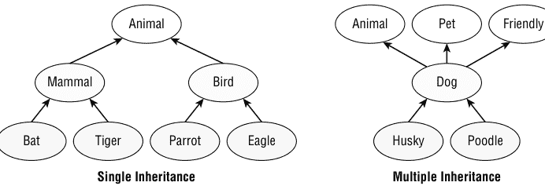

多重继承之所以复杂的原因之一是在发生冲突时确定从哪个父类继承值。例如，如果你在所有父类中定义了同一个对象或方法，子类应该继承哪一个？在这个例子中，父类没有自然的顺序，这也就是为什么 Java 通过完全禁止多重继承来避免这些问题。

## 继承 Object

在本书对 Java 的讨论中，我们多次使用了“对象”一词——这很有道理。在 Java 中，所有类都继承自一个类：`java.lang.Object`，简称为 `Object`。此外，`Object` 是唯一没有父类的类。

你可能会想：“我迄今为止写的类中没有一个继承了 `Object`，那么所有类是如何继承它的呢？”答案是，编译器会自动向你写的任何没有扩展特定类的类中插入代码。例如，以下两者是等价的：

```java
public class Zoo { }
```

```java
public class Zoo extends java.lang.Object { }
```

关键在于，当 Java 看到你定义了一个没有扩展其他类的类时，编译器会自动在类定义中添加 `extends java.lang.Object` 语法。结果是，每个类都可以访问 `Object` 类中任何可访问的方法；例如，`Object` 中提供了 `toString()` 和 `equals()` 方法；它们在所有类中都是可访问的。不过，如果没有在子类中重写，它们可能并不有用。我们将在本章稍后讨论方法的重写。

另一方面，当你定义一个扩展现有类的类时，Java 不会自动扩展 `Object` 类。由于所有类都继承自 `Object`，因此扩展一个类意味着子类根据定义已经继承了 `Object`。如果你查看任何类的继承结构，它会在树的顶端扩展 `Object`，如图 6.3 所示。

图 6.3 Java 对象的继承

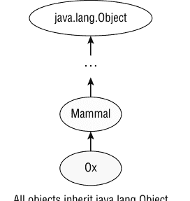

`int` 和 `boolean` 等基本类型不继承自 `Object`，因为它们不是类。正如你在第 5 章中学到的，通过自动装箱（autoboxing），它们可以作为关联包装类的实例被赋值或传递，而包装类是继承 `Object` 的。

## 创建类

现在我们已经建立了 Java 中继承是如何工作的，我们可以利用它来定义和创建复杂的类关系。在本节中，我们将回顾创建和操作类的基础知识。

### 扩展类

让我们在同一个包中创建两个文件，`Animal.java` 和 `Lion.java`。


# 第 6 章 • 类设计

我们知道，这里有很多内容！`age` 变量存在于父类 `Animal` 中，在 `Lion` 子类中无法直接访问。它通过 `setAge()` 方法间接访问。`name` 变量是 `protected` 的，所以它在 `Lion` 类中被继承并可以直接访问。我们在 `main()` 方法中创建 `Lion` 实例，并使用 `setProperties()` 设置实例变量。最后，我们调用 `roar()` 方法，它输出了结果：

```
kion, age 3, says: Roar!
```

让我们看看 `Lion` 类的成员。实例变量 `age` 被标记为 `private`，在子类 `Lion` 中无法直接访问。因此，以下代码将无法编译：

```java
public class Lion extends Animal {
    void roar() {
        System.out.print("Lion age: " + age); // 无法编译
    }
}
```

（注：提供的原始文本包含大量重复和错误，已根据逻辑流进行了清理并去除了重复部分。）

## 变量隐藏与 `this` 引用

```java
4: private int length;
```

```java
5:
```

```java
6: public void setData(int length, int height) {
7: length = this.length; // 反向了——不妙！
8: height = this.height; // 正确，因为名字不同
9: this.color = "white"; // 正确，但没有必要使用 this 
```

```java
10: }
```

```java
11:
```

```java
12: public static void main(String[] args) {
13: Duck b = new Duck();
14: b.setData(1,2);
15: System.out.print(b.length + " " + b.height + " " + b.color);
16: }
```

这段代码可以编译并产生以下结果：

```
2 white
```

这可能不是你预期的，尽管第 7 行是错误的，你应该留意这一点。实例变量 `length` 的初始值为 0。该值被赋值给方法参数 `length`。实例变量保持为 0。第 8 行更为直接。参数 `height` 和实例变量 `height` 有不同的名字。由于没有命名冲突，因此不需要这样做。最后，第 9 行显示，即使没有变量名重叠，变量赋值也允许使用 `this` 引用。

## 调用 `super` 引用

在 Java 中，变量或方法可以在父类和子类中分别定义。这意味着对象实例实际上持有了两个同名变量的副本。当这种情况发生时，我们如何引用父类中的版本而不是当前类的版本呢？让我们来看一个例子。

```java
// Reptile.java
1: public class Reptile {
2: protected int speed = 10;
3: }
```

```java
// Crocodile.java
1: public class Crocodile extends Reptile {
2: protected int speed = 20;
3: public int getSpeed() {
4: return speed;
5: }
6: public static void main(String[] data) {
```

```java
7: var croc = new Crocodile();
8: System.out.println(croc.getSpeed()); // 20
9: }
```

关于这段代码需要记住最重要的点之一是：`Crocodile` 的实例为 `speed` 存储两个独立的值：一个在 `Reptile` 级别，另一个在 `Crocodile` 级别。在第 4 行，Java 首先检查是否存在名为 `speed` 的局部变量或方法参数。由于不存在，它会接着检查 `this.speed`；由于它存在，程序打印出 20。

声明一个与继承变量同名的变量被称为“变量隐藏”（hiding a variable），这将在本章稍后讨论。

但如果我们想让程序打印 `Reptile` 类中的值呢？在 `Crocodile` 类中，我们可以通过使用 `super` 引用或关键字来访问父类的 `speed` 值。`super` 引用与 `this` 引用类似，区别在于它排除了当前类中找到任何成员。换句话说，该方法必须可以通过继承访问。

```java
3: public int getSpeed() {
4: return super.speed; // 导致现在会打印 10
5: }
```

看看你是否已经掌握了 `this` 和 `super`。以下程序的输出是什么？

```java
1: class Insect {
2: protected int numberOfOfLegs = 4;
3: String label = "buggy";
4: }
5: 
6: public class Beetle extends Insect {
7: protected int numberOfOfLegs = 6;
8: short age = 3;
9: public void printData() {
10: System.out.println(this.label);
11: System.out.println(super.label);
12: System.out.println(this.label);
13: System.out.println(super.label);
14: System.out.println(this.age);
15: }
16: public static void main(String[] args) {
17: new Beetle().printData();
18: }
19: }
```

（注：此处提供的原文 `Beetle` 类部分似乎存在乱码或重复，已根据上下文进行了逻辑性翻译）

这段代码可以编译并产生以下结果：

```
2 white
```

这可能不是你预期的，尽管第 7 行是错误的，你应该留意这一点。实例变量 `length` 的初始值为 0。该值被赋值给方法参数 `length`。实例变量保持为 0。第 8 行更为直接。参数 `height` 和实例变量 `height` 有不同的名字。由于没有命名冲突，因此不需要这样做。最后，第 9 行显示，即使没有变量名重叠，变量赋值也允许使用 `this` 引用。

## 定义构造函数

构造函数是用于初始化对象的特殊代码块。它与类名相同且没有返回类型。构造函数在创建新对象时使用。这个过程被称为实例化。这是一个例子：

```java
public class Bunny {
    public Bunny() {
        System.out.println("Hello!");
    }
}
```

正如在之前的节中学到的，只要每个构造函数的签名唯一的，类就可以有多个构造函数。这被称为重载（overloading）。以下 `Turtle` 类具有重载的构造函数：

```java
public class Turtle {
  private String name;
  public Turtle() {
    name = "John Doe";
  }
  public Turtle(int age) {}
  public Turtle(String newName, String... favoriteFoods) {
    name = newName;
  }
}
```

## 默认构造函数

Java 中的每个类都有构造函数，无论你是否编写了它。如果你在类中没有任何构造函数，Java 会为你创建一个无参数的构造函数。这个由 Java 创建的构造函数被称为默认构造函数，并在类没有声明任何时添加。为了清晰，我们通常称之为默认无参数构造函数。这是一个例子：

```java
public class Rabbit {
    public static void main(String[] args) {
        new Rabbit(); // 调用默认构造函数
    }
}
```

在 `Rabbit` 类中，Java 看到没有编写构造函数，因此创建了。之前的类等同于以下类，在其中提供了默认构造函数，因此编译器不再插入：

```java
public class Rabbit {
    public static void main(String[] args) {
        new Rabbit(); // 调用用户定义的构造函数
    }
}
```

对于这个例子，你需要知道的最重要规则之一是编译器只有在没有定义构造函数时才会插入默认构造函数。你认为以下哪些类具有默认构造函数？

```java
public class Rabbit2 {
    public Rabbit2() {}
}
```

```java
public class Rabbit3 {
    public Rabbit3(boolean b) {}
}
```

```java
public class Rabbit4 {
    private Rabbit4() {}
}
```

只有 `Rabbit1` 拥有默认的无参数构造函数。它没有编写任何构造函数，因此 Java 会自动为它生成一个默认的无参数构造函数。`Rabbit2` 和 `Rabbit3` 都已经有了公有构造函数。`Rabbit4` 有一个私有构造函数。由于这三个类都定义了构造函数，Java 会为你插入一个默认的无参数构造函数。

让我们快速查看如何调用这些构造函数：

```java
public class RabbitsMultiply {
    public static void main(String[] args) {
        var r1 = new Rabbit1();
        var r2 = new Rabbit2();
        var r3 = new Rabbit3(true);
        var r4 = new Rabbit4(); //无法编译
    }
}
```

第 3 行调用了默认的无参数构造函数。第 4 和 5 行调用用户提供的构造函数。第 6 行无法编译。`Rabbit4` 将构造函数设为私有，以便其他类无法调用它。

> 注意：类中仅有私有构造函数告诉编译器不要提供默认的无参数构造函数。这防止了其他类实例化该类。当类只有静态方法，或者开发者想要完全控制创建类新实例的所有调用时，这种方法非常有用。

## 使用 `this()` 调用重载构造函数

掌握了创建和引用构造函数的基础知识了吗？很好，因为情况将变得复杂一些。由于一个类可以包含多个重载构造函数，这些构造函数实际上可以相互调用。让我们从一个包含重载构造函数的简单类开始。

```java
public class Hamster {
    private String color;
    private int weight;
    public Hamster(int weight, String color) { // 第一个构造函数
        this.weight = weight;
        this.color = color;
    }
    public Hamster(int weight) { // 第二构造函数
        this.weight = weight;
        color = "brown";
    }
}
```

## 第 6 章 类设计

一个构造函数接收一个参数。另一个接收一个 `int` 和一个 `String`。这些参数列表是不同的，尽管构造函数已成功重载。

这里存在一些重复，`this.weight` 在两个构造函数中的赋值方式相同。在编程中，即使是一小部分重复，随着我们不断添加“再加一个”，它往往会变成大量的重复。例如，想象我们有五个变量在设置 `this.weight`，而不是一个。我们真正想要的是第一个构造函数调用带有两个参数的第二个构造函数。那么，如何让一个构造函数调用另一个构造函数呢？你可能会尝试将第一个构造函数重写为如下：

```java
public Hamster(int weight) { // 第二构造函数
    Hamster(weight, "Brown"); //无法编译
}
```

这是行不通的。构造函数只能通过编写新的构造函数名称来调用。它们不像你可以直接调用的普通方法。如果我们在构造函数名称之前加上 `new` 会发生什么？

```java
public Hamster(int weight) { // 第二构造函数
    new Hamster(weight, "brown"); //可以编译，但创建了额外的对象
}
```

这可以编译。但它并没有实现我们想要的效果。当这个构造函数被调用时，它会创建一个具有默认重量和颜色的新对象。然后它将该对象更改为所需的重量和颜色。通过这种方式，我们得到了两个对象，其中一个在创建后就被丢弃了。这并不是我们想要的。我们希望在最初尝试实例化的对象上设置重量和颜色。

Java 提供了一个解决方案：`this()`——是的，就是我们用来引用实例成员的同一个关键字，但带了括号。使用括号调用 `this()` 时，Java 会在该类的同一个实例上调用另一个构造函数。

```java
public Hamster(int weight) { // 第二构造函数
    this(weight, "brown");
}
```

成功！现在 Java 调用了带有两个参数的构造函数，并按预期设置了重量和颜色。

# `this` vs `this()`

尽管使用了相同的关键字，`this` 和 `this()` 指代的内容是不同的：第一个 `this` 指的是类的实例，第二个 `this()` 指的是类内部的构造函数调用。考试可能会通过同时使用这两者来考你，所以请确保你知道该用哪一个以及为什么。

## 声明构造函数

调用 `this()` 有一个你需要知道的特殊规则。如果你选择调用它，则 `this()` 调用必须是构造函数中的第一个语句。此的副作用是，任何构造函数中只能调用一次 `this()`。

尽管第 4 行的语句没有改变任何变量，但它仍然是一个 Java 语句，并且不允许在调用 `this()` 之前插入。第 5 行的注释是没问题的。注释不被视为语句，可以出现在任何地方。

关于重载构造函数还有一个你应该注意的最后一个规则。考虑以下 `Gopher` 类的定义：

```java
public class Gopher {
    public Gopher(int dugHoles) {
        this(5); //无法编译
    }
}
```

编译器能够检测到这个构造函数正在无限地调用自己。这通常被称为循环，与我们在第 3 章“做决策”中讨论的无限循环类似。由于代码永远不会结束，编译器会停止并报告此为错误。同样，以下代码无法编译：

```java
public class Gopher {
    public Gopher() {
        this(5); //无法编译
    }
    public Gopher(int dugHoles) {
        this(); //无法编译
    }
}
```

在这个示例中，构造函数相互调用，过程无限持续。如果编译器能检测到这一点，它就会报告。这里我们总结了关于构造函数的规则：

- 一个类可以包含多个重载构造函数，只要签名是不同的。
- 如果没有声明构造函数，编译器会插入一个默认的无参数构造函数。
- 如果构造函数调用 `this()`，则它必须是构造函数中的第一个语句。
- Java 不允许循环调用。

## 使用 `super()` 调用父类构造函数

恭喜！你正朝着构造函数专家的道路前进！不过我们还有一组规则需要涵盖：父类的成员是如何初始化的？让我们看看 `Animal` 类及其子类 `Zebra`，看看它们的构造函数是如何编写的：


```java
public class Animal {
    private int age;
    public Animal(int age) {
        super(); // 调用 Object 的构造函数
        this.age = age;
    }
}

public class Zebra extends Animal {
    public Zebra(int age) {
        super(age); // 调用 Animal 的构造函数
    }
    public Zebra() {
        this(4); // 调用 Zebra 的构造函数
    }
}
```

在 `Animal` 类中，构造函数的第一个语句是调用无参数的 `Object` 构造函数。在第二个类 `Zebra` 中，第一个构造函数的第一个语句是调用带有一个参数的 `Animal`。`Zebra` 类还包含第二个无参数构造函数，它没有调用 `super()`，而是调用了 `Zebra` 内部另一个构造函数。

## super vs super()

与 `this` 和 `this()` 类似，`super` 和 `super()` 在 Java 中是相关的。第一个 `super` 用于引用父类的成员，而第二个 `super()` 调用父类构造函数。在考试中看到 `super` 关键字时，请确保它的用法是正确的。

与调用 `this()`一样，调用 `super()` 只能作为构造函数的第一个语句。例如，以下两个类定义无法编译：

```java
public class Zoo {
    public Zoo() {
        System.out.println("Zoo created");
        super(); //无法编译
    }
}
```

```java
public class Zoo {
    public Zoo() {
        super();
        System.out.println("Zoo created");
        super(); //无法编译
    }
}
```

第一个类无法编译，因为父类构造函数必须是构造函数的第一个语句。在第二个代码段中，`super()` 是构造函数的第一个语句，但也被用作第三语句。`super()` 只能作为第一个语句调用一次，代码无法编译。

如果父类有多个构造函数，子类可以在其定义中使用任何有效的父类构造函数，如下例：

```java
public class Animal {
    private int age;
    private String name;
    public Animal(int age, String name) {
        super();
        this.age = age;
    }
}
```

```java
this.name = name;
}
public Animal(int age) {
    super();
    this.age = age;
    this.name = null;
}
```

```java
public class Gorilla extends Animal {
    public Gorilla(int age) {
        super(age, "Gorilla"); // 调用第一个 Animal 构造函数
    }
    public Gorilla() {
        super(5); // 调用第二个 Animal 构造函数
    }
}
```

在这个示例中，第一个子类构造函数接受一个参数 `age`，并调用父类构造函数，该构造函数接受两个参数 `age` 和 `name`。第二个子类构造函数不接受参数，它调用接受一个参数 `age` 的父类构造函数。在这个示例中，注意子类构造函数并不要求调用匹配的父类构造函数。只要为父类构造函数适当的输入参数，任何有效的父类构造函数都是。

# 理解编译增强

等一下：我们看到每个构造函数的第一行都是对 `this()` 或 `super()` 的调用，但整本书中一直在创建类和构造函数，而且我们很少写完。这些类是如何编译的？

答案是：如果你没有在构造函数的第一行显式调用 `this()` 或 `super()`，Java 编译器会自动插入一个对无参数构造函数 `super()` 的调用。例如，以下三个类和构造函数的定义是等价的，因为编译器会自动将它们全部转换为最后一个示例：

```java
public class Donkey {
    public Donkey() {}
}
```

```java
public class Donkey {
    public Donkey() {
        super();
    }
}
```

请确保你理解这三个 `Donkey` 类定义之间的区别，以及为什么 Java 会自动将它们全部转换为最后一种定义。在阅读下一节时，请记住 Java 编译器执行的过程。

## 默认构造函数的技巧与窍门

到目前为止我们已经了许多规则，你可能注意到了一些东西。假设我们定义了一个不包含无参数构造函数的类。如果我们定义一个不带构造函数的子类，或者定义一个不包含 `super()` 引用的构造函数的子类会发生什么？

```java
public class Mammal {
    public Mammal(int age) {}
}
```

```java
public class Seal extends Mammal {} // 无法编译
```

```java
public class Elephant extends Mammal {
    public Elephant() {} // 无法编译
}
```

答案是这两个子类都无法编译。由于 `Mammal` 定义了一个构造函数，编译器会在 `Seal` 中插入一个无参数构造函数，但它是一个简单的实现，只调用了一个不存在的父类构造函数。

```java
public class Seal extends Mammal {
    public Seal() {
        super(); // 无法编译
    }
}
```

同样，`Elephant` 也会因为类似的原因无法编译。编译器没有在构造函数的第一行看到对 `super()` 或 `this()` 的调用，因此它会自动插入对不存在的无参数 `super()` 的调用。

```java
public class Elephant extends Mammal {
    public Elephant() {
        super(); // 无法编译
    }
}
```

在这些情况下，编译器将不再提供帮助，你必须在你的类中至少创建一个构造函数，通过 `super()` 命令显式地调用父类构造函数。

```java
public class Seal extends Mammal {
    public Seal() {
        super(6); // 显式调用父类构造函数
    }
}
```

```java
public class Elephant extends Mammal {
    public Elephant() {
        super(4); // 显式调用父类构造函数
    }
}
```

如果父类没有包含无参数构造函数，则子类可以包含。例如，以下代码是可以编译的，因为 `Elephant` 包含一个无参数构造函数：

```java
public class AfricanElephant extends Elephant {}
```

我们知道这内容很多需要吸收。在考试中，你应该能够一眼看出为什么我们第一个实现的 `Seal` 和 `Elephant` 类无法编译。

## super() 始终指向最直接的父类

一个类可以通过继承拥有多个祖先。在我们之前的示例中，`AfricanElephant` 是 `Elephant` 的子类，而 `Elephant` 又是 `Mammal` 的子类。但对于构造函数来说，`super()` 指的是最直接的父类。在这个示例中，在 `AfricanElephant` 类内部调用 `super()` 始终指向 `Elephant` 类，而永远指向 `Mammal` 类。

- 我们通过为你的技能包添加三个规则来结束本节：

- 每个构造函数的第一行都是使用 `super()` 调用父类构造函数或使用 `this()` 调用重载构造函数。

- 如果构造函数不包含 `this()` 或 `super()` ，则编译器会自动在构造函数的第一行插入无参数的 `super()`。

- 如果构造函数调用了 `super()`，那么它必须是构造函数的第一行。

恭喜：你已经学习了我们可以教你的关于声明构造函数的所有知识。接下来，我们将转向初始化并讨论如何使用构造函数。

## 初始化对象

在第1章中，我们涵盖了初始化顺序，尽管方式非常简单。初始化顺序指的是类成员是如何被赋值的。它们可以被赋予默认值（例如对于 `int`），或者需要显式的值（例如对于 `final` 变量）。在本节中，我们将更详细地讨论初始化顺序是如何运作的，以及如何在考试中识别错误。

## 初始化类

我们从类初始化开始讨论初始化顺序。首先，我们初始化类，这涉及调用类层次结构中的静态成员，从最高级的子类开始向下进行。这有时被称为加载类。Java 虚拟机 (JVM) 控制类何时进行初始化，尽管你可以假设类在使用之前已经加载。类可能在程序首次运行时进行初始化。

```java
this.name = name;
}
public Animal(int age) {
    super();
    this.age = age;
    this.name = null;
}
```

```java
public class Gorilla extends Animal {
    public Gorilla(int age) {
        super(age, "Gorilla"); // 调用第一个 Animal 构造函数
    }
    public Gorilla() {
        super(5); // 调用第二个 Animal 构造函数
    }
}
```

在这个示例中，第一个子类构造函数接受一个参数 `age`，并调用父类构造函数，该构造函数接受两个参数 `age` 和 `name`。第二个子类构造函数不接受参数，它调用接受一个参数 `age` 的父类构造函数。在这个示例中，注意子类构造函数并不要求调用匹配的父类构造函数。只要为父类构造函数提供了适当的输入参数，任何有效的父类构造函数都是接受的。

## 理解增强

等一下：我们看到每个构造函数的第一行都是对 `this()` 或 `super()` 的调用，但我们整本书中一直在创建类和构造函数，而且我们很少写完。这些类是如何编译的？

答案是：如果你没有在构造函数的第一行显式地调用 `this()` 或 `super()`，Java 编译器会自动插入一个对无参数构造函数 `super()` 的调用。例如，以下三个类和构造函数的定义是等价的，因为编译器会自动将它们全部转换为最后一个示例：

```java
public class Donkey {
    public Donkey() {}
}
```

```java
public class Donkey {
    public Donkey() {
        super();
    }
}
```

请确保你理解这三个 `Donkey` 类定义之间的区别，以及为什么 Java 会自动将它们全部转换为最后一种定义。在阅读下一节时，请记住 Java 编译器执行的过程。

## 默认构造函数的技巧与窍门

到目前为止我们已经展示了许多规则，你可能注意到了一些东西。假设我们定义了一个不包含无参数构造函数的类。如果我们定义一个不带构造函数的子类，或者定义一个不包含 `super()` 引用的构造函数的子类会发生什么？

```java
public class Mammal {
    public Mammal(int age) {}
}
```

```java
public class Seal extends Mammal {} // 无法编译
```

```java
public class Elephant extends Mammal {
    public Elephant() {} // 无法编译
}
```

答案是这两个子类都无法编译。由于 `Mammal` 定义了一个构造函数，编译器会在 `Seal` 中插入一个无参数构造函数，但它是一个简单的实现，只调用了一个不存在的父类构造函数。

```java
public class Seal extends Mammal {
    public Seal() {
        super(); // 无法编译
    }
}
```

同样，`Elephant` 也会因为类似的原因无法编译。编译器没有在构造函数的第一行看到对 `super()` 或 `this()` 的调用，因此它会自动插入对不存在的无参数 `super()` 的调用。

```java
public class Elephant extends Mammal {
    public Elephant() {
        super(); // 无法编译
    }
}
```

在这些情况下，编译器将不再提供帮助，你必须在你的类中至少创建一个构造函数，通过 `super()` 命令显式地调用父类构造函数。

```java
public class Seal extends Mammal {
    public Seal() {
        super(6); // 显式调用父类构造函数
    }
}
```

```java
public class Elephant extends Mammal {
    public Elephant() {
        super(4); // 显式调用父类构造函数
    }
}
```

如果父类没有包含无参数构造函数，则子类可以包含。例如，以下代码是可以编译的，因为 `Elephant` 包含一个无参数构造函数：

```java
public class AfricanElephant extends Elephant {}
```

我们知道这内容很多需要吸收。在考试中，你应该能够一眼看出为什么我们第一个实现的 `Seal` 和 `Elephant` 类无法编译。

## super() 始终指向最直接的父类

一个类可以通过继承拥有多个祖先。在我们之前的示例中，`AfricanElephant` 是 `Elephant` 的子类，而 `Elephant` 又是 `Mammal` 的子类。但对于构造函数来说，`super()` 指的是最直接的父类。在这个示例中，在 `AfricanElephant` 类内部调用 `super()` 始终指向 `Elephant` 类，而永远指向 `Mammal` 类。

- 我们通过为你的技能包添加三个规则来结束本节：

- 每个构造函数的第一行都是使用 `super()` 调用父类构造函数或使用 `this()` 调用重载构造函数。

- 如果构造函数不包含 `this()` 或 `super()`，则编译器会自动在构造函数的第一行插入无参数的 `super()`。

- 如果构造函数调用了 `super()`，那么它必须是构造函数的第一行。

恭喜：你已经学习了我们可以教你的关于声明构造函数的所有知识。接下来，我们将转向初始化并讨论如何使用构造函数。

## 初始化对象

在第1章中，我们涵盖了初始化顺序，尽管方式非常简单。初始化顺序指的是类成员是如何被赋值的。它们可以被赋予默认值（例如对于 `int`），或者需要显式的值（例如对于 `final` 变量）。在本节中，我们将更详细地讨论初始化顺序是如何运作的，以及如何在考试中识别错误。

## 初始化类

我们从类初始化开始讨论初始化顺序。首先，我们初始化类，这涉及调用类层次结构中的静态成员，从最高级的子类开始向下进行。这有时被称为加载类。Java 虚拟机 (JVM) 控制类何时进行初始化，尽管你可以假设类在使用之前已经加载。类可能在程序首次运行时进行初始化，或者在类静态成员被引用时，或者在类的实例创建之前。

类初始化的规则之一是它每个类最多发生一次。如果类在程序中使用，它也会加载。我们总结类的初始化顺序如下：

## 初始化类

1. 如果有 X 的父类 Y，先初始化 Y。

2. 按类中出现的顺序处理所有静态变量声明。

3. 按类中出现的顺序处理所有静态初始化器。

看看这个示例，以下程序打印什么？

```java
public class Animal {
    static { System.out.print("A"); }
}
```

```java
public class Hippo extends Animal {
    public static void main(String[] args) {
        System.out.print("C");
        new Hippo();
        new Hippo();
        new Hippo();
    }
    static { System.out.print("B"); }
}
```

它打印 ABC。由于 `main()` 方法在 `Hippo` 类内部，类将首先初始化并打印 AB。之后，执行 `main()` 方法，打印 C。尽管 `main()` 方法创建了三个实例，类只加载一次。

# 为什么 Hippo 程序在 AB 之后打印 C

在之前的示例中，`Hippo` 类在 `main()` 方法执行之前就已经初始化。这是因为我们的 `main()` 方法位于执行的类内部，所以它必须在启动时加载。如果你在另一个程序里调用 `Hippo` 呢？

```java
public class HippoFriend {
    public static void main(String[] args) {
        System.out.print("C");
        new Hippo();
    }
}
```


假设该类在其他地方没有被引用，这个程序可能会打印 `CAB`，`Hippo` 类直到 `main()` 方法内部才加载。我们说“可能”是因为类加载的规则是在运行时决定的。对于考试，你只需要知道类在被引用或使用之前必须初始化。包含程序入口（即 `main()` 方法）的类在 `main()` 方法执行之前加载。

## 初始化 final 字段

在我们深入实例成员的初始化之前，我们需要讨论一下`final`字段（实例变量）。当我们在第1章介绍实例和类变量时，我们告诉过如果没有指定值，它们将根据类型被赋予默认值。例如，`double`被初始化为`0.0`，而对象引用被初始化为`null`。尽管，默认值只适用于非`final`字段。

正如你在第5章看到的，`final static`变量必须显式地赋值仅一次。标记为`final`的字段遵循类似的规则。它们可以在声明的行中或在初始化器中被赋值。

```java
public class MouseHouse {
    private final int volume;
    private final String name = "The Mouse House"; // 声明赋值
}
```

```java
volume = 10; // 实例初始化赋值
```

然而，与静态类成员不同，`final`实例字段可以在构造函数中设置。构造函数是初始化过程的一部分，因此允许为`final`实例变量赋值。对于考试，你需要记住一个重要的规则：当构造函数完成时，所有`final`实例变量必须恰好被赋值一次。让我们通过一个例子来尝试一下：

```java
public class MouseHouse {
    private final int volume;
    private final String name;
    public MouseHouse() {
        this.name = "EmptyHouse"; // 构造函数赋值
    }
    volume = 10; // 实例初始化赋值
}
```

与局部`final`变量不同（局部变量除非被实际使用，否则不需要有值），`final`实例变量必须赋值。如果它们没有在声明中或不在实例初始化器中，则必须在构造函数声明中赋值。未这样做将导致声明构造函数的行上产生编译错误。

```java
public class MouseHouse {
    private final int volume;
    private final String type;
    {
        this.volume = 10;
    }
    public MouseHouse(String type) {
        this.type = type;
    }
    public MouseHouse() { // 无法编译
        this.volume = 2; // 无法编译
    }
}
```

在这个示例中，第一个接受`String`参数的构造函数可以通过编译。在变量赋值方面，每个构造函数都是被单独检查的，这就是为什么第二个构造函数无法编译。首先，构造函数未能为`type`变量赋值。

编译器检测到`type`从未设置过值，并在声明构造函数的行上报告错误。其次，构造函数为`volume`变量设置了值，尽管它已经由实例初始化器赋过值。

> 在考试中，要留心任何标记为`final`的实例变量。确保它们在声明的行、实例初始化器或构造函数中被赋值。它们应该只被赋值一次，且在构造函数中未赋值将视为编译错误。

当一个构造函数调用同一类中的另一个构造函数时，`final`实例变量该如何处理？在这种情况下，你必须严格遵守这些规则，确保每个`final`实例都恰好被赋值一次。我们可以将之前的错误构造函数替换为以下代码：

```java
public MouseHouse() {
    this(null);
}
```

这个构造函数没有对任何`final`实例变量进行赋值，但它调用了`MouseHouse(String)`构造函数，我们观察到该构造函数是可以编译的。我们在这里使用`null`是为了说明变量不需要是一个对象值。只要显式地设置，我们就可以为`final`实例变量分配`null`值。

## 实例化对象

我们已经涵盖了类初始化和`final`字段，现在是时候处理对象的初始化顺序了。我们会发现这起初可能有点繁琐，但考试不太可能出比本节示例更复杂的问题。不过，我们保证会慢慢来。

首先，在使用了关键字的最低级别构造函数处。记住，每个构造函数的第一行都是对`this()`或`super()`的调用，如果省略，编译器会自动插入对父类无参构造函数`super()`的调用。然后向上处理构造函数的顺序。最后，从父类开始初始化每个类，并按照被调用的反序处理每个实例初始化器和构造函数。我们将一个实例的初始化顺序总结如下：

## 初始化 X 的实例

1. 如果类 X 之前尚未初始化，则初始化类 X。

2. 如果 X 有父类 Y，则先初始化 Y 的实例。

3. 按照实例变量在类中出现的顺序处理所有的实例变量声明。

4. 按照实例初始化器在类中出现的顺序处理所有的实例初始化器。

5. 初始化构造函数，包括通过`this()`引用的任何重载构造函数。

## 初始化对象

让我们尝试一个没有继承的示例。看看以下代码输出什么：

```java
public class ZooTickets {
    private String name = "BestZoo";
    { System.out.print(name + "--"); }
    private static int COUNT = 0;
    static { System.out.print(COUNT + "--"); }
    static { COUNT += 10; System.out.print(COUNT + "--"); }

    public ZooTickets() {
        System.out.print("z-");
    }

    public static void main(String... patrons) {
        new ZooTickets();
    }
}
```

输出如下：

```text
0-10-BestZoo-z-
```

首先，必须初始化类。由于没有声明子类（意味着父类是`Object`），我们可以从`ZooTickets`的静态部分开始。在这种情况下，第 4、5、6 行被执行，打印`0-`和`10-`。接下来，初始化第 13 行创建的实例。第 2、3 行被执行，由于没有声明子类，我们从实例部分开始，打印`BestZoo-`。最后，运行第 8-10 行的构造函数，输出`z-`。

接下来，让我们尝试一个带有继承的简单示例：

```java
class Primate {
    public Primate() {
        System.out.print("Primate-");
    }
}

class Ape extends Primate {
    public Ape(int fur) {
        System.out.print("Ape1-");
    }
    public Ape() {
        System.out.print("Ape2-");
    }
}
```

```java
class Chimpanzee extends Ape {
    public Chimpanzee() {
        super();
        System.out.print("Chimpanzee-");
    }
    public static void main(String[] args) {
        new Chimpanzee();
    }
}
```

编译器在`Primate`和`Ape`构造函数的第一句插入了`super()`命令，并产生以下输出：

```text
Primate-Ape1-Chimpanzee-
```

这个例子有点难。你认为这里会发生什么？

```java
public class Cuttlefish {
  private String name = "swim";
  { System.out.println(name); }
  private static int COUNT = 0;
  static { System.out.println(COUNT); }
  { COUNT++; System.out.println(COUNT); }
  public Cuttlefish() {
    System.out.println("Constructor");
  }
  public static void main(String[] args) {
    System.out.println("Ready");
    new Cuttlefish();
  }
}
```

输出如下：

```text
0
Ready
swim
1
Constructor
```

## 初始化对象

没有声明父类，所以我们可以跳过任何与继承相关的步骤。我们处理静态变量和静态初始化器——第 4 和 5 行，第 5 行打印`0`。现在静态初始化器完成了，`main()`方法运行，打印`Ready`。我们现在在第 14 行创建一个实例。第 2、3 和 6 行被处理，第 3 行打印，第 6 行打印。最后，运行第 8-10 行的构造函数，打印`Constructor`。

准备好面对更难的示例了吗？你在考试中可能会看到的类型。以下代码输出什么？

```java
class GiraffeFamily {
    static { System.out.print("A"); }
    { System.out.print("B"); }
    public GiraffeFamily(String name) {
        this(1);
        System.out.print("C");
    }
    public GiraffeFamily() {
        System.out.print("D");
    }
    public GiraffeFamily(int stripes) {
        super("sugar");
        System.out.print("E");
    }
}

class Okapi extends GiraffeFamily {
    static { System.out.print("F"); }
    public Okapi(int stripes) {
        super("sugar");
        System.out.print("G");
    }
    { System.out.print("H"); }
    public static void main(String[] grass) {
        new Okapi(1);
        System.out.println();
        new Okapi(2);
    }
}
```

程序打印以下：

```text
AFBECHG
BECH
```

让我们过过一遍。从初始化`Okapi`类开始。由于它有子类`GiraffeFamily`，先初始化它，在第 2 行打印`A`。接下来，初始化`Okapi`类，在第 19 行打印`F`。

类初始化完成后，执行第 27 行的`main()`方法。`main()`方法的第一行创建一个新的`Okapi`对象，触发了实例初始化。根据第一条规则，首先初始化`GiraffeFamily`子类实例。根据我们的第三条规则，父类`GiraffeFamily`中的初始化器被调用，在第 3 行打印`B`。根据第四条规则，我们初始化构造函数。这涉及到调用第 5 行的构造函数，它调用了第 14 行的重载构造函数。结果是打印了`EC`，构造函数体按照调用的反序执行。

该过程继续进行`Okapi`实例本身的初始化。根据第三和第四条规则，分别在第 25 行打印`H`和在第 23 行打印`G`。当不需要调用任何重载构造函数时，过程变得有点复杂。第 29 行在输出中插入了一个换行。最后，第 30 行初始化一个新的`Okapi`对象。初始化顺序与第 28 行相同，除了类初始化，打印了`BECH`。

具有相同的实现方式。在这种情况下，在`Animal`类中定义一次`eat()`比在五个单独的类中维护相同的方法要好得多。

继承一个类不仅允许访问父类中被继承的方法，还为父类和子类中定义的方法之间的冲突埋下了伏笔。在本节中，我们将回顾方法继承的规则以及 Java 如何处理此类场景。

我们将对象能够以许多不同形式表现的能力称为多态。我们将在下一章中详细介绍这一点，但现在你只需要知道对象可以以多种方式使用，这部分取决于用于调用该对象的引用变量。

## 重写方法

如果父类和子类中定义了签名相同的方法怎么办？例如，你可能想为该子类定义该方法的新版本，使其表现出不同的行为。解决方案是在子类中重写该方法。在 Java 中，当子类对继承的方法声明一个具有相同签名且兼容的返回类型的新实现时，就发生了方法重写。

> 请记住，方法签名由方法名和方法参数组成。它不包括返回类型、访问修饰符、可选规格或任何声明的异常。

当你重写一个方法时，仍然可以使用`super`关键字引用该方法的父类版本。通过这种方式，关键字`super`分别允许你在方法的当前版本和父类版本之间进行选择。我们通过以下示例来说明这一点：

```java
public class Marsupial {
    public double getAverageWeight() {
        return 50;
    }
}
public class Kangaroo extends Marsupial {
    public double getAverageWeight() {
        return super.getAverageWeight()+20;
    }
    public static void main(String[] args) {
        System.out.println(new Marsupial().getAverageWeight()); // 50.0
        System.out.println(new Kangaroo().getAverageWeight()); // 70.0
    }
}
```

在这个示例中，`Kangaroo`类重写了`getAverageWeight()`方法，但在过程中使用`super`引用调用了父类版本。

| 方法重写的无限调用 |

你可能会在上示例中使用`super`是否必要。例如，如果我们移除`super`关键字，以下代码会输出什么？

```java
public double getAverageWeight() {
    return getAverageWeight(20); // StackOverflow
}
```

在这个示例中，编译器不会调用父类的`Marsupial`方法；它会调用当前的`Kangaroo`方法。应用程序将尝试无限调用自身并在运行时产生`StackOverflow`（栈溢出）。

要进行重写，必须遵循若干规则。编译器在重写方法时会执行以下检查：

1. 子类中的方法签名必须与父类中的方法签名相同。

2. 子类中的方法访问权限至少要与父类中的方法相同。

3. 子类中的方法不能声明比父类方法中声明的任何异常更新或范围更大的检查异常（checked exception）。

4. 如果方法有返回值，它必须与父类方法的返回值相同或其子类型，这被称为协变返回类型。

虽然这些规则初看起来可能很困惑或任意，但它们对于一致性是必须的。如果没有这些规则，可能会在 Java 语言中产生矛盾。

## 规则 #1：方法签名

重写方法的第一个规则有些是不言自明的。如果两个方法的名称相同但签名不同，则这些方法是重载（overloaded）而不是重写（overridden）。重载方法被认为是独立的，不具有与重写方法相同的多态性属性。

## 继承成员

我们在第 5 章涵盖了方法的重载，它与重写方法相似，因为两者都涉及使用相同的名称定义方法。重载与重写的区别在于，重载方法使用不同的参数列表。对于考试来说，理解这种区别非常重要：重写方法具有相同的签名以及比重载方法多得多的规则。

## 规则 #2：访问修饰符

关于访问修饰符的第二个规则目的是什么？让我们尝试一个说明性示例：

```java
public class Camel {
  public int getNumberOfHumps() {
    return 1;
  }
}
```

```java
public class BactrianCamel extends Camel {
  private int getNumberOfHumps() { // 无法编译
    return 2;
  }
}
```

在这个示例中，`BactrianCamel`尝试重写父类中定义的`getNumberOfHumps()`方法，但失败了，因为访问修饰符`private`比父类方法版本中定义的更严格。假设`BactrianCamel`被允许这样做，它能通过编译吗？

```java
public static void main(String[] args) {
  Camel c = new BactrianCamel();
  System.out.print(c.getNumberOfHumps()); // ???
}
```

答案是，我们不知道。对象的引用类型是`Camel`，其中该方法被声明为`public`，但对象实际上是`BactrianCamel`的实例，其中该方法被声明为`private`。Java 通过限制重写方法的访问修饰符为比继承方法版本可访问或权限更高的权限，来避免这类歧义性问题。

## 规则 #3：检查异常

第三条规则规定，重写方法不能声明新的检查异常，或比继承方法范围更大的检查异常。这样做是为了多态性考虑，类似于限制访问修饰符。换句话说，你可能会得到一个比引用类型更严格的对象。

让我们尝试一个示例：


```
public class Reptile {
    protected void sleep() throws IOException {}

    protected void hide() {}

    protected void exitShell() throws IOException {}
}

public class GalapagosTortoise extends Reptile {
    public void sleep() throws FileNotFoundException {}

    public void hide() throws FileNotFoundException {} // 无法编译

    public exitShell() {} // 无法编译
}
```

在这个示例中，子类`GalapagosTortoise`尝试重写`Reptile`的两个方法：`sleep()`和`hide()`。两个重写方法与继承方法具有相同的名称和签名。重写方法的访问修饰符比继承方法更宽（`public`）。记住，在重写方法中使用更宽的修饰符是可以的。

## 规则 #4：协变返回类型

关于重写方法的第四个也是最后一个规则可能是复杂的，因为它需要知道返回类型之间的关系。重写方法必须使用与继承方法的返回值协变的返回类型。为了说明目的，我们来尝试一个示例：

```
public class Rhino {
    protected String getName() {
        return "rhino";
    }
    protected String getColor() {
        return "grey, black, or white";
    }
}

public class JavanRhino extends Rhino {
    public String getName() {
        return "java";
    }
    public CharSequence getColor() { // 无法编译
        return "grey";
    }
}
```

在这个示例中，子类`JavanRhino`尝试重写`Rhino`的两个方法：`getName()`和`getColor()`。两个重写方法与继承方法具有相同的名称和签名。重写方法的访问修饰符比继承方法更宽（`public`）。记住，在重写方法中使用更宽的修饰符是可以的。

从第 4 章“核心 API”中，我们了解到`CharSequence`实现了接口，使得`String`成为`CharSequence`的子类型。因此，`getName()`的返回值与`Rhino`中`getName()`的返回值是协变的。

另一方面，重写的`getColor()`方法无法编译，因为`CharSequence`不是`String`的子类型。换句话，所有的`String`值都是`CharSequence`值，但并非所有的`CharSequence`值都是`String`值。例如，`StringBuilder`是`CharSequence`但不是`String`。

> 测试协变性的简单方法是：给定一个返回类型 A 和一个重写返回类型 B，是否可以在不进行转换的情况下将 B 的实例赋值给 A 的引用变量？如果是，它们就是协变的。此规则适用于基本类型和对象类型，例如：如果其中一个返回类型是`void`，则两者都必须是`void`；除了自身外，没有任何类型是协变的。

这就是本章关于方法重写你需要的所有知识。在第 9 章“集合与泛型”中，我们将再次回到涉及泛型的方法重写。学习的方法无处不在！

## 现实场景

## 使用 @Override 注解标记方法

注解是一种提供关于你的代码额外信息的元数据。你可以使用`@Override`注解告诉编译器你正在尝试重写一个方法。

```java
public class Fish {
    public void swim() {};
}
public class Shark extends Fish {
    @Override
    public void swim() {};
}
```

当正确使用时，注解不会影响代码。另一方面，当使用不当时，此注解可以防止你犯错。由于存在`@Override`注解，以下代码无法编译：

```java
public class Fish {
    public void swim() {};
}
```

```java
public class Shark extends Fish {
    @Override
    public void swim(int speed); // 无法编译
}
```

编译器看到你正尝试进行方法重写，并寻找一个接受`int`值的继承自`swim()`版本。由于编译器没有找到它，它会报告一个错误。虽然考试不需要掌握高级主题（例如如何创建注解），但知道如何正确使用它们是必要的。

## 重新声明私有方法

如果你尝试重写私有方法会发生什么？在 Java 中，你不能重写私有方法，因为它们没有被继承。仅仅子类没有访问父类方法的权限，并不意味着子类可以定义自己的方法版本。严格来说，这意味着新方法并不是父类方法的重写版本。

Java 允许你在子类中声明一个与父类方法签名相同或修改后的签名的新方法。子类中的这个方法是一个独立且单独的方法，因此不会触发方法重写的任何规则。例如，这两个声明是可以编译的：

```java
public class Beetle {
    private String getSize() {
        return "Undefined";
    }
}

public class RhinocerosBeetle extends Beetle {
    private int getSize() {
        return 5;
    }
}
```

注意子类方法的返回类型从`String`变为`int`。在这个示例中，`getSize()`方法在父类中被重新声明了，因此子类中的方法是一个新方法，而不是父类方法的重写。

如果`getSize()`方法在`Beetle`中被声明为`public`呢？在这种情况下，`RhinocerosBeetle`中的方法将是一个无效的重写。`RhinocerosBeetle`中的访问修符更为严格，且返回类型不是变的。

## 隐藏静态方法

静态方法不能被重写，因为类对象并不像实例对象那样相互继承。另一方面，它们可以被隐藏。当子类定义一个静态方法，与父类中定义的继承静态方法具有相同的名称和签名时，就发生了方法隐藏。隐藏与方法重写相似但并不完全相同。当方法被隐藏时，必须遵循方法重写的前四条规则。此外，隐藏方法还增加了第五条规则：

- 5. 如果方法在父类中被标记为静态，那么在子类中定义的方法也必须标记为静态。

简单来说，如果两个方法都是静态的，就是隐藏；如果没有标记为静态，就是方法重写。如果一个被标记为静态而另一个不是，则类将无法编译。

## 312 第 6 章 • 类设计

让我们回顾一下新规则的一些示例：

```java
public class Bear {
    public static void eat() {
        System.out.println("Bear is eating");
    }
}
```

```java
public class Panda extends Bear {
    public static void eat() {
        System.out.println("Panda is chewing");
    }
    public static void main(String[] args) {
        eat();
    }
}
```

在这个示例中，代码可以编译并运行。`Panda`类中的`eat()`方法隐藏了`Bear`类中的`eat()`方法，打印“Panda is chewing”，因为它们被标记为静态，这不被视为一个重写的方法。尽管如此，继承仍然存在。如果你删除了`Panda`类中的`eat()`声明，那么程序将打印“Bear is instead”。看看你是否能找出`SunBear`类中哪些方法声明无法编译：

```java
public class Bear {
    public static void sneeze() {
        System.out.println("Bear is sneezing");
    }
    public void hibernate() {
        System.out.println("Bear is hibernating");
    }
    public static void laugh() {
        System.out.println("Bear is laughing");
    }
}
```

```java
public class SunBear extends Bear {
    public void sneeze() { // 无法编译
        System.out.println("Sun Bear sneezes quietly");
    }
    public static void hibernate() { // 无法编译
        System.out.println("Sun Bear is going to sleep");
    }
}
```

```java
protected static void laugh() { // 无法编译
System.out.println("Sun Bear is laughing");
}
```

在这个示例中，`sneeze()`在父类中被标记为静态但在子类中不是。编译器检测到你正试图重写一个实例方法。然而，`sneeze()`是应该被隐藏的静态方法。

## 隐藏变量

当子类定义了一个与父类中定义的变量同名的变量时，就发生了变量隐藏。隐藏与方法重写相似但并不完全相同。当方法被隐藏时，必须遵循方法重写的前四条规则。

如你所知，你不能重写变量；你只能隐藏它。来看这个示例。你认为以下程序会打印什么？

```java
class Carnivore {
    protected boolean hasFur = false;
}
```

```java
public class Meerkat extends Carnivore {
    protected boolean hasFur = true;

    public static void main(String[] args) {
        Meerkat m = new Meerkat();
        Carnivore c = m;
        System.out.println(m.hasFur); // true
        System.out.println(c.hasFur); // false
    }
}
```

对输出感到困惑吗？这两个类都定义了`hasFur`变量，但值不同。尽管对象是由`main()`方法创建的，但两个变量独立存在。输出取决于引用变量。

## 编写 final 方法

我们用一个不言自喻的规则来结束对方法继承的讨论：`final`方法不能被重写。通过将方法标记为`final`，你禁止了子类替换该方法。这一规则在重写方法和隐藏方法时适用。也就是说，如果一个静态方法在父类中被标记为`final`，则你不能在子类中隐藏它。

让我们这个示例：

```java
public class Bird {
    public final boolean hasFeathers() {
        return true;
    }
    public final static void flyAway() {}
}
```

```java
public class Penguin extends Bird {
    public final boolean hasFeathers() { // 无法编译
        return false;
    }
    public final static void flyAway() {} // 无法编译
}
```

在这个示例中，实例方法`hasFeathers()`在父类中被标记为`final`，因此子类`Penguin`无法重写父类方法。静态方法`flyAway()`也标记为`final`，因此不能在子类中隐藏。在这个示例中，无论子类方法是否使用了`final`关键字，代码都无法编译。

## 创建抽象类

在设计模型时，我们有时想要创建一个无法直接实例化的实体。例如，假设我们有一个`Canine`（犬科）类，它包含子类`Wolf`（狼）、`Fox`（狐狸）和`Coyote`（郊野狗）。我们希望其他开发者能够创建子类的实例，但可能不希望他们能够创建`Canine`实例。换句话说，我们希望强制所有`Canine`对象在运行时具有特定的类型。

## 引入抽象类

引入抽象类。抽象类是通过使用`abstract`修饰符声明的类，不能直接实例化，并且可能包含抽象方法。让我们来看基于`Canine`数据模型的示例：

```java
public abstract class Canine {
```

```java
public class Wolf extends Canine {
```

```java
public class Fox extends Canine {
```

```java
public class Coyote extends Canine {
```

在这个示例中，其他开发者可以创建`Wolf`、`Fox`或`Coyote`的实例，但不能创建`Canine`。当然，他们可以将变量引用作为`Canine`传递，但底层对象在运行时必须是`Canine`的子类。

等一下，还有！抽象类可以包含抽象方法。抽象方法是使用`abstract`修饰符声明且没有定义方法体的方法。换言之，抽象方法强制子类重写该方法。

我们为什么需要这样做呢？当然，为了多态性！通过声明抽象方法，我们可以保证在实例上某个版本是可用的，而不需要在抽象父类中指定具体是哪个版本。

```java
public abstract class Canine {
    public abstract String getSound();
    public void bark() { System.out.println(getSound()); }
}
```

```java
public class Wolf extends Canine {
    public String getSound() {
        return "Woooooof!";
    }
}
```

```java
public class Fox extends Canine {
    public String getSound() {
        return "Squeak!";
    }
}
```

```java
public class Coyote extends Canine {
    public String getSound() {
        return "Roar!";
    }
}
```

我们可以创建一个`Fox`实例并将其赋值给父类型`Canine`。在运行时将使用被重写的方法。

```java
public static void main(String[] args) {
    Canine w = new Fox();
    w.bark(); // Squeak!
}
```

到目前为止都很简单。但有一些你需要注意的规则：

- 在类中，只有实例方法可以标记为抽象的，而不能是变量、构造函数或静态方法。

- 抽象方法可以在抽象类中声明。

- 继承自抽象类的非抽象类必须实现所有继承的抽象方法。

- 重写抽象方法遵循你在本节较之前学过的重写方法的现有规则。

让我们看看你是否能看出为什么这些类声明中的某些无法编译：

```java
public class FennecFox extends Canine {
    public int getSound() {
        return 10;
    }
}
```

```java
public class Direwolf extends Canine {
    public abstract void rest();
    public String getSound() {
        return "Roof!";
    }
}
```

```java
public class Jackal extends Canine {
    public abstract String name;
    public String getSound() {
        return "Laugh";
    }
}
```

首先，`FennecFox`类无法编译，因为它是一个无效的方法重写。具体来说，返回类型不是协变的。`ArcticFox`类无法编译，因为它没有重写抽象的`getSound()`方法。`Direwolf`类无法编译，因为它不是抽象类，却声明了一个抽象方法`rest()`。最后，`Jackal`类无法编译，因为变量不能被标记为抽象。

抽象类最常用的用法是你想要继承某个特定类的属性，但又希望你的子类填充某些实现细节时。之前我们说过，抽象类是无法实例化的。这意味着如果你尝试实例化它，编译器将报告异常，如示例所示：

```java
abstract class Allocator {
    public static void main(String... food) {
        var a = new Allocator(); // 无法编译
    }
}
```

抽象类可以被初始化，但只能作为非抽象子类实例化的一部分。

## 声明抽象方法


# 抽象方法

抽象方法总是不带方法体声明的。它在方法声明后还包含一个分号（`;`）。正如你在上一个示例中看到的，抽象类可以包含非抽象方法，在这种例中就是 `bark()` 方法。事实上，抽象类可以包含像非抽象类一样所有的成员，包括变量、静态和实例方法、构造函数等。

你可能会惊讶地发现，抽象类并不要求包含任何抽象方法。例如，下面的代码是可以编译的，尽管它没有定义任何抽象方法：

```java
public abstract class Llama {
    public void chew() { }
}
```

即使没有抽象方法，该类也无法直接实例化。在考试中，请注意在抽象类之外声明的抽象方法，例如：

```java
public class Ereget // 无法编译
    public abstract void peck();
}
```

我们之所以强调第一个具体的子类是有原因的。抽象类可以继承非抽象类，反之亦然。每当具体类继承抽象类时，它必须实现所有以抽象形式继承的方法。让我们用一组继承的类来阐明这一点：

```java
public abstract class Mammal {
    abstract void showHorn();
    abstract void eatLeaf();
}
```

```java
public abstract class Rhino extends Mammal {
    void showHorn() { // 实现其中 }
}
```

```java
public class BlackRhino extends Rhino {
    void eatLeaf() { // 实现另一个 }
}
```

在这个示例中，`BlackRhino` 继承自 `Rhino`，`Rhino` 继承自 `Mammal`。`BlackRhino` 是第一个具体类，它必须实现所有继承的抽象方法。

关于 `showHorn()` 方法呢？由于父类 `Rhino` 已经提供了 `showHorn()` 的实现，因此 `BlackRhino` 不被强制要求重写该方法。

如果我们把 `Rhino` 的声明更改为 `abstract` 会怎样？

```java
public class Rhino extends Mammal { // 无法编译
    void showHorn()
}
```

通过将 `Rhino` 变为具体类，它变成了 `Mammal` 抽象类的类。因此它必须提供 `showHorn()` 和 `eatLeaf()` 方法的实现。由于它只提供了一个方法，修改后的 `Rhino` 类无法编译。

让我们尝试另一个示例。下面的具体类继承了两个抽象方法 `getName()` 和 `roar()`：

```java
public abstract class Animal {
    abstract String getName();
}
```

```java
public abstract class BigCat extends Animal {
    protected abstract void roar();
}
```

```java
public class Lion extends BigCat {
    public String getName() {
        return "Lion";
    }
    public void roar() {
        System.out.println("The Lion lets out a loud ROAR!");
    }
}
```

在示例代码中，`BigCat` 被标记为抽象；因此它不要求提供 `getName()` 方法的实现。`Lion` 类不是抽象的，作为第一个具体类，它必须实现所有继承的抽象方法。这三个类都可以编译。

## 在抽象类中创建构造函数

即使抽象类无法实例化，它们仍然通过子类的构造函数进行初始化。例如，考虑以下程序：

```java
abstract class Mammal {
    abstract String chew();
    public Mammal() {
        System.out.println(chew()); // 这行能编译吗？
    }
}
```

```java
public class Platypus extends Mammal {
    String chew() { return "yummy!"; }
    public static void main(String[] args) {
        new Platypus();
    }
}
```

根据你在本节之前学过的构造函数规则，编译器在 `Platypus` 类中插入了一个默认参数构造函数，它首先调用 `Mammal` 类中的 `super()`。`Mammal` 构造函数只在抽象类通过子类初始化时才被调用；因此在调用构造函数时存在 `chew()` 的实现。这段代码可以编译并在运行时打印 `yummy!`。

对于考试，请记住抽象类的初始化方式与非抽象类相同。例如，如果一个抽象类没有提供构造函数，编译器会自动插入一个默认的无参构造函数。

## 创建抽象类

抽象类构造函数与非抽象类构造函数的主要区别在于，抽象类的构造函数只有在被非抽象子类初始化时才可以被调用。这是合理的，因为抽象类不能被实例化。

## 识别无效声明

在结束对抽象类的讨论之前，我们来回顾一下你在现实生活中考试中更有可能遇到的潜在问题。出题者喜欢出那些方法标记为 `abstract` 但又定义了实现方法的题目。例如，你能看出以下哪些方法无法编译吗？

```java
public abstract class Turtle {
    public abstract long eat()      // 无法编译
    public abstract void swim(); // 无法编译
    public abstract void getAge() { // 无法编译
        return 10;
    }

    public abstract void sleep; // 无法编译
    public void goShell(); // 无法编译
}
```

第一个方法 `eat()` 无法编译，因为它被标记为 `abstract` 但没有以分号（`;`）结尾。接两个方法 `swim()` 和 `getAge()` 无法编译，是因为它们被标记为 `abstract`，但提供了被大括号（`{}`）包围的实现。例如，记住抽象方法的声明必须以分号结尾，且不能有任何大括号。下一个方法 `sleep` 无法编译，是因为它缺少了方法所需的括号 `()`。最后一个方法 `goShell()` 无法编译，是因为它没有标记为 `abstract`，并且必须提供被大括号包围的体体。

确保你理解为什么上述每个方法无法编译，这样你就能在考试中识别这类错误。如果你在考试中遇到类或方法被标记为 `abstract` 的问题，请确保在尝试解决问题之前该类已经有了正确的实现。

## abstract 和 final 修饰符

如果你同时将一个类或方法标记为 `abstract` 和 `final` 会发生什么？如果你标记了 `abstract`，意味着你打算让别人去扩展或实现它。但如果使用 `final`，你又是在阻止任何人扩展或实现它。这两个概念是直接相互冲突的。

由于这种不兼容性，Java 不允许一个类或方法同时被标记为 `abstract` 和 `final`。例如，以下代码段将无法编译：

```java
public abstract final class Tortoise { // 无法编译
    public abstract void walk(); // 无法编译
}
```

在这个示例中，类声明和方法声明都无法编译，因为它们被同时标记为 `abstract` 和 `final`。考试通常不会经常在类或方法上使用 `final` 修饰符，如果你看到了它们，请确保它们没有与 `abstract` 修饰符一起使用。

## abstract 和 private 修饰符

一个方法不能同时被标记为 `abstract` 和 `private`。如果你仔细考虑，这个规则是有意义的。如果一个方法没有被子类继承，你该如何定义一个实现该方法的子类呢？答案是你做不到，这就是为什么当你尝试以下操作时，编译器会报错：

```java
public class Whale {
    private abstract void sing(); // 无法编译
}
```

```java
public class HumpbackWhale extends Whale {
    private void sing() {
        System.out.println("Humpback whale is singing");
    }
}
```

在这个示例中，在父类 `Whale` 中定义的抽象方法 `sing()` 对子类 `HumpbackWhale` 是不可见的。尽管 `HumpbackWhale` 了实现，但它不被视为抽象方法的重写，因为该抽象方法没有被继承。编译器在父类中识别了这一点，一旦将 `private` 和 `abstract` 应用于同一个方法就会报错。

> 虽然可以将方法声明为 `abstract` 和 `private`（尽管这是多余的），但可以将方法声明为 `final` 和 `private`。

如果我们将父类 `Whale` 中的访问修饰符从 `private` 改为 `protected`，代码还能编译吗？

```java
public class Whale {
    protected abstract void sing();
}
```

```java
public class HumpbackWhale extends Whale {
    private void sing() { // 无法编译
        System.out.println("Humpback whale is singing");
    }
}
```

在修改后的示例中，代码仍然无法编译，但完全完全不同。如果你记得重写规则，子类不能降低父方法的可见性。因为该方法在父类中声明为 `protected`，它在子类中必须被标记为 `protected` 或 `public`。即使对于抽象方法，也必须遵循重写规则。

## abstract 和 static 修饰符

正如我们在本章前面讨论的，静态方法只能被隐藏（hide），不能被重写（override）。它被定义为属于类而不是属于类的实例。如果静态方法不能被重写，那么它就不能标记为 `abstract`，因为它永远无法被实现。例如，以下类无法编译：

```java
abstract class Hippopotamus {
    static void swim(); // 无法编译
}
```

对于考试，请确保你知道哪些修饰符可以一起使用，哪些不能，特别是对于抽象类和接口。

# 创建不可变对象

正如你可能从第 4 章记得的那样，不可变对象是在创建后不能改变状态的对象。不可变对象模式是一种面向对象的设计模式，其中对象在创建后无法被修改。

在编写安全代码时，不可变对象很有帮助，因为你不需要担心值发生。在处理并发时，它们还能简化代码，因为不可变对象可以轻松在多个线程之间共享。

## 声明不可变类

尽管编写不可变类有多种技术，但你应该熟悉创建不可变类的常用策略：

1. 将类标记为 `final`，或将所有构造函数设为 `private`。

2. 将所有实例变量标记为 `private` 且 `final`。

3. 不要定义任何 setter 方法。

4. 不要允许引用的对象被修改。

5. 使用构造函数设置对象的所有属性，在需要时进行复制。

第一条规则防止任何人创建可变的子类。第二和第三条规则确保调用者不会更改实例变量，这是良好封装的标志，这也是我们在第 7 章结合 `record` 一起讨论的话题。

# 第 6 章 • 类设计

创建不可变对象的第四条规则很微妙。基本上，这意味着你不应该为可变的实例字段暴露访问器（或 getter）方法。你能看出为什么以下代码创建了一个可变对象吗？

```java
import java.util.*;
public final class Animal { // 不是不可变对象的声明
    private final ArrayList<String> favoriteFoods;

    public Animal() {
        this.favoriteFoods = new ArrayList<String>();
        this.favoriteFoods.add("Apples");
    }

    public List<String> getFavoriteFoods() {
        return favoriteFoods;
    }
}
```

我们仔细地遵循了前三条规则，遗憾的是，恶意的调用者仍然可以修改我们的数据：

```java
var zebra = new Animal();
System.out.println(zebra.getFavoriteFoods()); // Apples

zebra.getFavoriteFoods().clear();
zebra.getFavoriteFoods().add("Chocolate Cookies");
System.out.println(zebra.getFavoriteFoods()); // Chocolate Cookies
```

哦不！这不是不可变对象！解决方法很简单：通过委托方法来读取数据。

```java
import java.util.*;
public final class Animal { // 不可变对象的声明
    private final List<String> favoriteFoods;

    public Animal() {
        this.favoriteFoods = new ArrayList<String>();
        this.favoriteFoods.add("Apples");
    }

    public int getFoodsCount() {
        return favoriteFoods.size();
    }
    
    public String getFoodsItem(int index) {
        return favoriteFoods.get(index);
    }
}
```

在这个改进版本中，数据可用。但它是真正的不可变对象，因为可变变量无法被调用者修改。

## 读取访问器的复制

除了委托私有的可变对象，另一种方法是在每次请求时对可变对象进行复制。

```java
public ArrayList<String> getFavoriteFoods() {
    return new ArrayList<String>(this.favoriteFoods);
}
```

当然，副本中的更改不会反映在原始对象上，但至少原始对象不受外部更改的影响。如果调用者频繁调用，这可能是一项开销很大的操作。

## 执行防御复制

那么，创建不可变对象的第五条也是一条规则是什么？在设计类时，假设我们希望有一个规则：`favoriteFoods` 的数据由调用者提供，并且始终包含一个元素。这个规则通常被称为不变性（invariant）；每当我们拥有对象的实例时，它是真实的。

```java
import java.util.*;
public final class Animal {
    private final ArrayList<String> favoriteFoods;

    public Animal(ArrayList<String> favoriteFoods) {
        if (favoriteFoods == null || favoriteFoods.size() == 0)
            throw new RuntimeException("favoriteFoods is required");
        this.favoriteFoods = new ArrayList<>(favoriteFoods);
    }
}
```

```java
public String getFavoriteItem(int index) {
    return favoriteFoods.get(index);
}
```

为了确保提供了了 `favoriteFoods`，我们在构造函数中对其进行了验证，如果未提供则会抛出异常。它是可变的吗？并不完全是！恶意的调用者可能会玩花样，保留对我们 `favoriteFoods` 对象的秘密引用，并直接修改它。

```java
var favorites = new ArrayList<String>();
favorites.add("Apples");
```

```java
var zebra = new Animal(favorites); // 调用者仍然可以访问 favorites
System.out.println(zebra.getFavoriteItem(0)); // [Apples]
```

```java
favorites.clear();
favorites.add("Chocolate Chip Cookies");
System.out.println(zebra.getFavoriteItem(0)); // [Chocolate Chip Cookies]
```

哎呀！看来 `Animal` 不再是不可变的了，因为它的内容在创建后可以发生变化。解决方案是创建一个包含相同元素的列表副本。


```java
public Animal(List<String> favoriteFoods) {
    if (favoriteFoods == null || favoriteFoods.size() == 0)
        throw new RuntimeException("favoriteFoods is required");
    this.favoriteFoods = new ArrayList<String>(favoriteFoods);
}
```

这种拷贝操作被称为**防御性拷贝**，因为进行拷贝是为了防止其他代码发生意外的情况。这与防御性驾驶相同：在问题发生之前防止它。通过这种方法，我们的`Animal`类再次变为了不可变。

## 总结

本章基于我们在书中介绍的基础类结构，并通过引入继承的概念对其进行了扩展。Java 类遵循单继承模式，每个类都恰好有一个直接父类，所有类最终都继承自`java.lang.Object`。

继承一个类可以让你访问该类所有的公共（`public`）和受保护（`protected`）成员。如果类位于同一个包中，你还可以访问该类的包级成员。所有实例方法、构造函数和实例初始化器都可以访问两个特殊的引用变量：`this`和`super`。`this`和`super`都提供了访问所有继承成员的方法，但只有`this`可以访问当前类声明中的所有成员。

构造函数是使用类名且没有返回类型的特殊方法。它们被用于实例化新对象。如果没有提供构造函数，编译器会自动在类中插入一个默认的无参数构造函数。每个构造函数的第一行都是对一个重载构造函数（`this()`）或父类构造函数（`super()`）的调用；否则编译器会在构造函数的第一行插入`super()`调用。在某些情况下，如果类没有定义无参数构造函数，这可能会导致编译错误。未定义无参数构造函数。

类的初始化按照预定的顺序进行：静态初始化；按照出现顺序初始化静态变量和静态初始化器；按照出现顺序初始化实例变量和实例初始化器；最后是构造函数。所有`final`变量必须赋值一次。重声明的方法展示了它们之间的区别。如果一个方法与另一个方法同名但签名（`signature`）不同，则该方法被**重载**（`overloaded`）。如果一个方法与被继承的方法签名相同，且访问修饰符、异常和返回类型兼容，则该方法被**重写**（`overridden`）。如果静态方法与继承的静态方法签名相同，则该静态方法被继承。最后，如果一个方法与继承的方法同名且签名相同，则该方法被**重声明**（`redeclared`）。

我们讨论了抽象类，它们就像普通类一样，但不能实例化，并且可能包含抽象方法。抽象类可以扩展非抽象类，反之亦然。抽象类可用于定义一个框架，其他开发者基于该框架开发子类。抽象方法是在声明时不包含方法体的方法。抽象方法只能放置在抽象类或接口内部。后续在遵循方法重写规则的前提下，它可以被另一个抽象声明或具体实现所重写。第一个具体类必须实现所有继承的抽象方法，无论这些方法是继承自抽象类还是接口。

最后，本章向你展示了如何在 Java 中创建不可变对象。尽管有许多不同的技术可以实现这一点，但我们回顾了你在考试中应该掌握的最常用方法。不可变对象在实践中极其有用，特别是在多线程应用程序中，因为它们不会改变。

## 考试要点

- 能够编写扩展其他类的代码。继承另一个类的 Java 类会继承其所有的公共和受保护方法及变量。如果类在同一个包中，它还会继承该类所有的包级成员。无法扩展的类。最后，Java 中所有的类都直接或通过父类继承自`java.lang.Object`。

# 第 6 章 • 类设计

**能够区分并使用`this`, `this()`, `super`, 和`super()`。**要访问类当前或继承的成员，可以使用`this`引用。要访问继承的成员，可以使用`super`引用。当类重用已继承的方法或变量的名称时，`super`引用通常用于减少歧义。对`this()`和`super()`的调用用于访问同类中和父类中的构造函数。

**评估涉及构造函数的题型。**每个构造函数的第一行都是使用`this()`调用同类中的另一个构造函数，或使用`super()`调用父类的构造函数。如果没有声明构造函数，编译器将插入一个`super()`调用。如果父类不包含无参数构造函数，则必须提供对父类构造函数的显式调用。能够识别默认构造函数何时被替换。记住初始化顺序是初始化类层级结构中的所有类，从父类开始。然后初始化实例，在构造函数完成后，所有`final`变量必须赋值一次。

**理解方法重写的规则。** Java 允许在遵循某些规则的情况下由子类重写、替换方法：方法必须具有相同的签名、访问权限至少不低于父类方法、不能声明更新或更宽的异常，并且必须使用协变返回类型。标记为`final`的方法不可重写。

**识别方法重写和方法重载的区别。**方法重载和重写都涉及与现有方法同名的新方法。当方法签名相同时被称为重写，必须遵循特定的重写规则才能编译。当方法签名不同（即输入不同）时，被称为重载，不需要任何重写规则。方法重写对多态至关重要，因为它替换了所有的调用，包括在子类中进行的调用。

**理解方法和变量隐藏的规则。**当静态方法在子类中被重写时，被称为方法隐藏。同样，当在子类中命名继承的变量时，被称为变量隐藏。在这两种情况下，原始方法或变量仍然存在，并可以使用使用的返回类型进行访问。对于方法隐藏，方法声明中的`static`在父子类之间必须一致。最后，通常应避免变量和方法隐藏，因为这会导致代码混淆且难以理解。

**能够编写扩展抽象类的代码。**在 Java 中，类和方法可以声明为抽象的。抽象类不能实例化。抽象类的实例只能通过具体子类获得。抽象类可以包含任意数量的抽象和非抽象方法，包括零个。

抽象方法遵循所有的方法重写规则，并且只能在抽象类中定义。抽象类的第一个具体子类必须实现所有继承的方法。抽象类和抽象方法不能标记为`final`。

**创建不可变对象。** 不可变对象是在声明后无法修改的对象。不可变类通常通过私有构造函数、没有 setter 方法，并且没有修改类中所包含的可变对象的能力来实现。

## 复习题

章节复习题的答案可以在附录中找到。

- 1. 插入哪些代码可以使打印 2？

```java
public class BirdSeed {
    private int numberBags;
    boolean call;

    public BirdSeed() {
        // LINE 1
        call = false;
        // LINE 2
    }

    public BirdSeed(int numberBags) {
        this.numberBags = numberBags;
    }

    public static void main(String[] args) {
        var seed = new BirdSeed();
        System.out.print(seed.numberBags);
    }
}
```

- A. 将第 1 行替换为`BirdSeed(2)`。

- B. 将第 2 行替换为`BirdSeed(2)`。

- C. 将第 1 行替换为`new BirdSeed(2)`。

- D. 将第 2 行替换为`new BirdSeed(2)`。

- E. 将第 1 行替换为`this(2)`。

- F. 将第 2 行替换为`this(2)`。

- G. 代码在没有任何任何更改的情况下打印 2。

- 2. 方法声明中使用可以使用哪些修饰符对？（选择所有项）。

- A. `static` and `final`

- B. `private` and `static`

- C. `static` and `abstract`

- D. `private` and `abstract`

- E. `abstract` and `final`

- F. `private` and `final`

- 关于方法的陈述中哪些正确的？（选择所有项。）

- A. 重载方法（`Overloaded methods`）必须具有相同的签名。

- B. 重写方法（`Overridden methods`）必须具有相同的签名。

- C. 隐藏方法（`Hidden methods`）必须具有相同的签名。

- D. 重载方法必须具有相同的返回类型。

- E. 重写方法必须具有相同的返回类型。

- F. 隐藏方法必须具有相同的返回类型。

- 4. 下一个程序的输出是什么？

```java
class Mammal {
    private void sneeze() {}
    public Mammal(int age) {
        System.out.print("Mammal");
    }
}
public class Platypus extends Mammal {
    int sneeze() { return 1; }
    public Platypus() {
        System.out.print("Platypus");
    }
    public static void main(String[] args) {
        new Mammal(5);
    }
}
```

- A. `Platypus`

- B. `Mammal`

- C. `PlatypusMammal`

- D. `MammalPlatypus`

- E. 如果更改第 7 行，代码将通过。

- F. 如果更改第 9 行，代码将通过。

- 5. 以下哪些项可以完成构造函数，使此代码打印出 50？（选择所有项）。

```java
class Speedster {
    int numSpots;
}
public class Cheetah extends Speedster {
    int numSpots;
    public Cheetah(int numSpots) {
        // INSERT CODE HERE
    }
    public static void main(String[] args) {
        Speedster s = new Cheetah(50);
        System.out.print(s.numSpots);
    }
}
```

- A. `numSpots = numSpots;`

- B. `numSpots = this.numSpots;`

- C. `this.numSpots = numSpots;`

- D. `numSpots = super.numSpots;`

- E. `super.numSpots = numSpots;`

- F. 无论在构造函数中插入什么代码，代码都无法编译。

- G. 以上都不是

- 以下哪些项声明了不可变类？（选择所有项）。

```java
public final class Moose {
    private final int antlers;
}
```

```java
public class Caribou {
    private int antlers = 10;
}
```

```java
public class reindeer {
    private final int antlers = 5;
}
```

```java
public final class Elk {}
public final class Deer {
    private final Object o = new Object();
}
```

- A. `Moose`

- B. `Caribou`

- C. `Reindeer`

- D. `Elk`

- E. `Deer`

- F. 以上都不是

## 复习题

- 7. 下一个代码的输出是什么？

```java
1: class Arthropod {
2:   protected void className(long input) {
3:     System.out.print("Arthropod");
4:   }
5:   void className(int input) {
6:     System.out.print("Spooky");
7:   }
8: } public class Spider extends Arthropod {
9:   protected void className(int input) {
10:    System.out.print("Spider");
11: }
12:  public static void main(String[] args) {
13:   Arthropod a = new Spider();
14:   a.className((short)4);
15:   a.className(5L);
16: }
```

- A. `SpiderSpookysSpiderArthropod`

- B. `SpiderSpiderSpider`

- C. `SpiderSpookyArthropod`

- D. `SpookyArthropod`

- E. 因为第 5 行，代码无法编译。

- F. 因为第 9 行，代码无法编译。

- G. 以上都不是

- 8. 下一个代码的输出是什么？

```java
1: abstract class Bird {
2:   private void fly() { System.out.println("Bird"); }
3:   protected Bird() { System.out.print("Wow-"); }
4: }
5: public class Pelican extends Bird {
6:   public Pelican() { System.out.print("Oh-"); }
7:   protected void fly() { System.out.println("Pelican"); }
8:   public static void main(String[] args) {
9:     var chirp = new Pelican();
10:    chirp.fly();
11: }
```

- A. `Oh-Bird`

- B. `Oh-Pelican`

- C. `Wow-Bird`

- D. `Wow-Oh-Pelican`

- E. 代码包含编译错误。

- F. 以上都不是

- 9. 关于重写方法的正确？（选择所有项）。

- A. 重写方法的参数必须与原方法相同或协变。

- B. 重写方法可以声明新的异常，只要它不是受检异常。

- C. 重写方法的访问权限必须比父类高。

- D. 重写方法可以声明比父类更广泛的异常。

- E. 如果继承的方法返回`void`，则重写版本返回`void`。

- F. 以上都不是

- 10. 以下哪些组合插入空白处可以让代码编译？（选择所有项）。

```java
1: class Howler {
2:     public Howler(long shadow) {
3:             
4:     }
5:     private Howler(int moon) {
6:         super();
7:     }
8: }
9: class Wolf extends Howler {
10:    protected Wolf(String stars) {
11:        super(2L);
12:    }
13:    public Howler() {
14:             
15:    }
16: }
```

- A. 第 3 行`this(3)`，第 14 行`""`

- B. 第 3 行`this(1)`，第 14 行`super(1)`

- C. 第 3 行`this((short)1)`，第 14 行`this(null)`

- D. 第 3 行`super()`，第 14 行`super()`

- E. 第 3 行`this(2L)`，第 14 行`super((short)2)`

- F. 第 3 行`this(5)`，第 14 行`super(null)`

- G. 删除第 3 行和第 14 行。

- 11. 下一个结果是什么？

```java
1: class PolarBear {
2:   StringBuilder value = new StringBuilder("t");
3:   value.append("a");
4:   value.append("c");
5:   private PolarBear() {
6:     value.append("b");
7:   }
8:   public PolarBear(String s) {
9:     this();
10:    value.append(s);
11:  }
12:  public PolarBear(CharSequence p) {
13:    value.append(p);
14:  }
15:  public static void main(String[] args) {
16:    Object bear = new PolarBear();
17:    bear = new PolarBear("f");
18:    System.out.println((PolarBear)bear).value);
19:  }
}
```

- A. `tacb`

- B. `tacf`

- C. `tacfb`

- D. `tacfb`

- E. `taftab`

- F. 代码无法编译。

- G. 抛出了异常。

- 12. 下一个程序中有多少行包含编译错误？


```java
1: class Rodent {
2:   public Rodent(Integer x) {}
3:   protected static Integer chew() throws Exception {
4:     System.out.println("Rodent is chewing");
5:     return 1;
6:   }
7: }
8: class Beaver extends Rodent {
9:     public Number chew() throws RuntimeException {
10:    System.out.println("Beaver is chewing on wood");
11:    return 2;
12: }
}
```

- A. 以上都不是
- B. 1
- C. 2
- D. 3
- E. 4
- F. 5

## 13. 这些类中哪些可以编译并包含编译器创建的默认构造函数？（选择所有项。）

- A. `public class Bird {}`
- B. `public class Bird { public bird() {} }`
- C. `public class Bird { public bird(String name) {} }`
- D. `public class Bird { public Bird() {} }`
- E. `public class Bird { Bird(String name) {} }`
- F. `public class Bird { private Bird(int age) {} }`
- G.

```java
public class Bird {
    public Bird bird() { return null; }
}
```

## 14. 关于继承的以下哪些陈述正确？（选择所有项）。

- A. 一个类可以直接扩展任意数量的类。
- B. 一个类可以实现任意数量的接口。
- C. 所有变量都继承 `java.lang.Object`。
- D. 如果类 A 被 B 扩展，那么 B 是 A 的父类。
- E. 如果类实现了接口 D，那么 C 是 D 的子类型。
- F. 多重继承是类拥有多个父类的属性。

## 15. 关于以下程序的陈述中哪些正确的？（选择所有项。）

```java
1: abstract class Nocturnal
2:     boolean isBlind();
3: }
4: public class Owl extends Nocturnal {
5:     public boolean isBlind() { return false; }
6:     public static void main(String[] args) {
7:         var nocturnal = (Nocturnal)new Owl();
8:         System.out.println(nocturnal.isBlind());
9:     }
}
```

- A. 编译并打印 true。
- B. 编译并打印 false。
- C. 因为第 2 行，代码无法编译。
- D. 因为第 5 行，代码无法编译。
- E. 因为第 7 行，代码无法编译。
- F. 因为第 8 行，代码无法编译。
- G. 以上都不是

## 16. 下一个结果是什么？

```java
1: class Arachnid {
2:     static StringBuilder sb = new StringBuilder();
3:     { sb.append("c"); }
4:     static
5:     { sb.append("u"); }
6:     { sb.append("r"); }
7: }
```

```java
8: public class Scorpion extends Arachnid {
9: static StringBuilder sb = new StringBuilder();
10: sb.append("q");
11: sb.append(String("m"));
12: public static void main(String[] args) {
13: System.out.print(Scorpion.sb + " ");
14: System.out.print(Scorpion.sb + " ");
15: new Arachnid();
16: new Scorpion();
17: System.out.print(Scorpion.sb);
18: }
}
```

- A. `qu qu qumcrrc`
- B. `u u ucrfm`
- C. `uq uq uqmcrcr`
- D. `uq uq uqmcrcm`
- E. `qu qqu uqmcrcr`
- F. `qu qqu uqmcrcm`
- G. 代码无法编译。

## 17. 下列哪些选项是正确的？（选择所有适用项。）

- A. `this()` 可以在构造函数的任何地方调用。
- B. `this()` 可以在实例方法的任何地方调用。
- C. `this.variableName` 可以在类中的任何实例方法中调用。
- D. `this.variableName` 可以在类中的任何静态方法中调用。
- E. 你可以使用 `this()` 调用编译器编写的默认构造函数。
- F. 你可以在同一类中使用 `main()` 方法访问私有构造函数。

## 18. 关于以下类，哪些描述是正确的？（选择所有适用项）

```java
1: public class Mamm {
2: private void eat() {}
3: protected static void drink() {}
4: public Integer(String p) { return null; }
5: }
6: class Primate extends Mamm {
7: public void eat(String p) {}
8: }
9: class Monkey extends Primate {
10: public static void drink() throws RuntimeException {
11: public Number dance(CharSequence p) { return null; }
12: public int eat(String p) {
13: }
14: }
```

- A. `Mammal` 中的 `eat()` 方法在第 7 行被正确重写。
- B. `Mammal` 中的 `eat()` 方法在第 7 行被正确重载。
- C. `Mammal` 中的 `drink()` 方法在第 10 行被正确重写。
- D. `Mammal` 中的 `drink()` 方法在第 10 行被正确隐藏。
- E. `Mammal` 中的 `dance()` 方法在第 11 行被正确重写。
- F. `Mammal` 中的 `dance()` 方法在第 11 行被正确重载。
- G. `Primate` 中的 `eat()` 方法在第 12 行被正确隐藏。
- H. `Primate` 中的 `eat()` 方法在第 12 行被正确重载。

## 19. 以下代码的输出是什么，或者无法编译？

```java
1: class Reptile {
2: { System.out.print("A"); }
3: public Reptile(int hatch) {}
4: void layEggs() {
5: System.out.print("Reptile");
6: }
7 }
7: class Lizard extends Reptile {
8: static {System.out.print("B");}
9: public Lizard(int hatch) {}
10: public final void layEggs() {
11: System.out.print("Lizard");
12: }
13: public static void main(String[] args) {
14: var reptile = new Lizard(1);
15: reptile.layEggs();
16: }
17: }
```

- A. `AALizard`
- B. `BALizard`
- C. `BlizardA`
- D. `ALizard`
- E. 代码因为第 3 行而无法编译。
- F. 以上均不是

## 20. 关于以下程序的哪个描述是正确的？

```java
1: class Bird {
2: int feathers = 0;
3: Bird(int x) { this.feathers = x; }
4: Bird fly() {
5: return new Bird(1);
6: }
7: class Parrot extends Bird {
8: protected Parrot(int y) { super(y); }
9: protected Parrot fly() {
10: return new Parrot(2);
11: }
12: public class Macaw extends Parrot {
13: public Macaw(int z) { super(z); }
14: public Macaw fly() {
15: return new Macaw(3);
16: }
17: public static void main(String... sing) {
18: Bird p = new Macaw(4);
19: System.out.print(((Parrot)p.fly()).feathers);
20: } }
```

- A. 其中某行包含编译错误。
- B. 有两行包含编译错误。
- C. 有三行包含编译错误。
- D. 代码可以编译但在运行时抛出 `ClassException`。
- E. 程序编译并打印 3。
- F. 程序编译并打印 0。

## 21. 下列哪些项是不可变类（immutable classes）的属性？（选择所有适用项）

- A. 类可以包含 setter 方法，只要它们被标记为 `final`。
- B. 类在在类声明之外不能被扩展。
- C. 类不能包含任何实例变量。
- D. 类必须被标记为 `static`。
- E. 类不能包含任何静态变量。
- F. 类只能包含私有构造函数。
- G. 可变实例变量的数据可以被读取，只要它们不能被调用者修改。

## 22. 以下程序打印什么？

```java
1: class Person {
2: static String name;
3: setName(String q) { name = q; }
4: }
5: class Child extends Person {
6: static String name;
7: void setName(String w) { name = w; }
8: public static void main(String[] p) {
9: final Child m = new Child();
10: final Person t = m;
11: m.name = "Elysia";
12: m.setName("Webby");
13: t.setName("Olivia");
14: System.out.println(m.name + " " + t.name);
15: }
16: }
```

- A. `Elysia Sophia`
- B. `Webby Olivia`
- C. `Olivia Olivia`
- D. `Olivia Sophia`
- E. 代码无法编译。
- F. 以上均不是

## 23. 以下程序的输出是什么？

```java
1: class Person {
2: static void eat() { System.out.println("eating"); }
3: }
4: class Dog extends Person {
5: static void bark() { System.out.println("bark"); }
6: }
7: class Cat extends Dog {
8: void meow() { System.out.println("meow"); }
9: }
10: public class Test {
11: public static void main(String[] args) {
12: Dog d = new Dog();
13: d.eat();
14: d.bark();
15: Cat c = new Cat();
16: c.eat();
17: c.bark();
18: c.meow();
19: }
20: }
```

- A. `eating bark eating bark meow`
- B. `eating bark eating bark meow`
- C. `eating bark eating bark meow`
- D. `eating bark bark eating bark meow`
- E. `eating bark eating bark meow`
- F. 代码无法编译。
- G. 以上均不是。

## 24. 以下程序打印了什么？

```java
1: class Reptile {
2: { System.out.print("A"); }
3: public Reptile(int hatch) {}
4: void layEggs() {
5: System.out.print("Reptile");
6: }
7: }
7: class Lizard extends Reptile {
8: static {System.out.print("B");}
9: public Lizard(int hatch) {}
10: public final void layEggs() {
11: System.out.print("Lizard");
12: }
13: public static void main(String[] args) {
14: var reptile = new Lizard(1);
15: reptile.layEggs();
16: }
17: }
```

- A. `AALizard`
- B. `BALizard`
- C. `BlizardA`
- D. `ALizard`
- E. 代码因为第 3 行而无法编译。
- F. 以上均不是。

## 25. 关于具体类（concrete class），哪些描述是正确的？（选择所有适用项）

- A. 具体类可以被声明为 `abstract`。
- B. 具体类必须实现所有继承的抽象方法。
- C. 具体类可以被标记为 `final`。
- D. 具体类必须是不可变的。
- E. 实现抽象方法的具体方法必须与抽象方法的声明一致。

## 26. 以下代码的输出是什么？

```java
4: public abstract class Whale {
5: public abstract void dive();
6: public static void main(String[] args) {
7: Whale whale = new Orca();
8: whale.dive(3);
9: }
10: }
11: class Orca extends Whale {
12: static public int MAX = 3;
13: public void dive() {
14: System.out.println("Orca diving");
15: }
16: public void dive(int... depth) {
17: System.out.println("Orca diving deeper "+MAX);
18: }
19: }
```

- A. `Orca diving`
- B. `Orca diving deeper 3`
- C. 代码因为第 4 行而无法编译。
- D. 代码因为第 8 行而无法编译。
- E. 代码因为第 11 行而无法编译。
- F. 代码因为第 12 行而无法编译。
- G. 代码因为第 17 行而无法编译。
- H. 以上均不是。

# Chapter 7

# Beyond Classes

OCP EXAM OBJECTIVES COVERED IN THIS CHAPTER:

+ 利用 Java 面对象方法
- 声明和实例化 Java 对象包括嵌套对象，并解释对象的生命周期，包括创建、重新赋值引用和垃圾回收
- 创建类和记录（records），定义并使用实例和静态字段、方法、构造函数，以及实例和静态初始化
- 理解变量作用域、使用局部变量类型推断、应用封装并使对象不可变
- 实现多态并区分对象类型引用类型。执行类型转换，使用 `instanceof` 运算符和模式匹配识别对象类型
- 创建和使用接口，识别函数式接口，利用私有、静态和默认接口方法
- 创建和使用带有字段、方法和构造函数的枚举（enumerations）


在第6章“类设计”中，我们向你展示了如何创建、初始化和扩展抽象类和具体类。在本章中，我们将超越类、密封类（sealed classes），介绍 Java 中提供的其他类型，包括接口、枚举（enums）和记录（records）。你在第5章“方法”中学习的许多基本规则仍然适用，例如访问修饰符和静态成员，尽管每种类型都有额外的规则。我们还涵盖了封装以及如何妥妥地保护实例成员。最后，我们通过讨论嵌套类型和多态继承来结束本章。

对于本章内容，一个 Java 文件最多可以有一个顶层类型，且该类型必须与文件名匹配。这适用于类、枚举、记录等。此外，请记住，顶层类型只能用 `public` 或包级（`package`）访问权限进行声明。


> Java 中提供的另一种顶层类型是注解。知道如何创建自定义注解在实践中是一项很有用的技能，尽管考试并不要求。你仍然应该知道如何在考试中使用某些特定的注解，例如`@Override`。

## 实现接口

在第6章中，你学习了抽象类，特别是如何创建和扩展抽象类。由于类只能继承一个类，因此它们在继承方面的用途有限。另一方面，一个类可以实现任意数量的接口。接口是一种抽象数据类型，声明了一组任何实现接口的类都必须提供的抽象方法。

随着时间的推移，接口的精确定义发生了变化，因为现在支持了新的方法类型。在本章中，我们从接口的原始定义开始，并扩展到涵盖所有支持的成员。

## 声明和使用接口

在 Java 中，接口用`interface`关键字定义，类似于定义类时使用的`class`关键字。请参考图 7.1 了解正确的接口声明。

### 图 7.1 定义接口

`public package access interface keyword 接口 name`

```java
public abstract interface CanBurrow {
    public abstract Float getSpeed(int age);
    public static final int MINIMUM_DEPTH = 2;
}
```

在 7.1 中，我们的接口声明包含一个抽象方法和一个常量变量。接口变量被称为常量，是因为它们是`public`、`static`且`final`的。它们在声明时被初始化为常量值。由于它们是`public`且`static`，因此可以在接口声明之外使用，不需要接口的实例。图 7.1 还包含一个抽象方法，该方法与接口变量一样被假设是`public`的。

> 注意
>
> 为了简洁起见，在本章中所谓的“接口实例”是指实现该接口的类的实例。

变量或方法被假设为某种状态是什么意思？接口声明与抽象类不同的一个方面是，它包含了隐式修饰符。隐式修饰符是编译器自动插入代码中的修饰符。例如，接口始终始终被认为是抽象的，即使它没有被标记为抽象。稍后我们将详细介绍规则和显式修饰符。

让我们从一个简单的例子开始。假设我们有一个名为`WalksOnTwoLegs`的接口，定义如下：

```java
public interface WalksOnTwoLegs {
```

它可以通过编译，因为接口不需要定义任何方法。此示例中的`abstract`修饰符对于接口来说是可选的，如果没有提供，编译器会插入它。现在，考虑以下两个无法编译的示例：

```java
public class Biped {
    public static void main(String[] args) {
        var e = new WalksOnTwoLegs(); // 无法编译
    }
}
```

```java
public final interface WalksOnEights {} // 无法编译
```

第一个示例无法编译，因为`WalksOnTwoLegs`是接口，不能被实例化。第二个示例`WalksOnEights`无法编译是因为接口不能被标记为`final`，这与抽象类不能被标记为`final`的原因相同。换句话说，标记接口意味着没有类可以实现它。

你如何使用接口？假设我们有一个`Climb`接口，其实现方式如下：

```java
public interface Climb {
  Number getspeed(int age);
}
```

接下来，我们有一个具体类`FieldMouse`，它在类声明中使用`implements`关键字来调用`Climb`接口，如图 7.2 所示。

### 图 7.2 实现接口

| 类名 | implements 关键字（必须） | 接口名称（用逗号 (,) 分隔） |
| :--- | :--- | :--- |
| public class FieldMouse implements Climb, CanBurrow { | | |
| 协变返回类型 | public Float getspeed(int age) { | | |
| public 关键字（必须） | return 1; | 签名与接口方法匹配 |

`FieldMouse`类实现了`Climb`接口，并包含了从`Climb`接口继承的重写版本的`getspeed()`。`getspeed()`的方法签名完全匹配，且返回类型是协变的，因此`Float`可以隐式转换为`Number`。接口方法的访问修饰符在`Climb`中是隐式的`public`，尽管具体类`FieldMouse`必须显式地声明它。

如图 7.2 所示，一个类可以实现多个接口，每个接口用逗号`()`分隔。如果任何接口定义了抽象方法，则具体类必须重写它们。在这种情况下，`FieldMouse`实现了我们在图 7.1 中看到的`CanBurrow`接口。通过这种方式，该类重写了两个抽象方法。

## 扩展接口

与类一样，接口也可以扩展另一个接口。然而，接口只能扩展一个接口，但它可以实现任意数量的接口。

```java
public interface Nocturnal {
    int hunt();
}
```

```java
public interface CanFly {
    void flap();
}
```

```java
public interface HasEyes extends Nocturnal, CanFly {
    int getVision();
}
```

在这个示例中，`Owl`类实现了`HasEyes`接口并必须实现`hunt()`和`flap()`。

### 图 7.3 接口继承

| 抽象类 Animal | |
| :--- | :--- |
| int getType() | |
| extends 抽象类 Bird | |
| boolean canSwoop() | implements interface Fly |
| void fly() | |
| extends 类 Swan | implements interface Swim |
| void swim() | |

## 实现接口

```java
public void eatPlants() {
    System.out.println("Eating plants");
}
```

我们所说的兼容，是指可以编写一个方法来正确重写继承的方法：例如，使用你在第 6 章中学习过的协变返回类型。以下是一个不兼容声明的示例：

```java
public interface Herbivore { public void eatPlants(); }
```

```java
public interface Omnivore { public int eatPlants(); }
```

```java
public class Tiger implements Herbivore, Omnivore // 无法编译
}
```

由于无法写出一个同时满足这两个抽象方法的`Tiger`版本。无论在`Tiger`类内部声明了什么，代码都无法编译。

## 插入隐式修饰符

如前所述，隐式修饰符是编译器会自动插入的修饰符。这让你想起如果你没有定义构造函数，重新编译器会插入一个*事实上的无参构造函数*，这是你在第 6 章中学习过的。你可以选择自己插入这些隐式修饰符，也可以让编译器为你插入。

以下列表包含了考试需要的接口隐式修饰符：

- 接口隐式为`public`。
- 接口变量隐式为`public`、`static`和`final`。
- 不带主体的接口方法隐式为`abstract`。
- 不带`private`修饰符的接口方法隐式为`public`。

最后一条规则适用于`abstract`、`default`和`static`接口方法，我们将在下一节中介绍这些。

让我们来看一个例子。以下两个接口定义是等价的，因为编译器会将两者都转换为第二个声明：

```java
public interface Soar {
    int MAX_HEIGHT = 10;
    final static boolean UNDERWATER = true;
    void fly(int speed);
    abstract void takeoff();
    public abstract double dive();
}
```

```java
public abstract interface Soar {
    public static final int MAX_HEIGHT = 10;
    public final static boolean UNDERWATER = true;
    public abstract void fly(int speed);
    public abstract void takeoff();
    public abstract void dive();
}
```

在这个示例中，我们用加粗字体标记了编译器自动插入的隐式修饰符。首先，在接口声明中添加了`abstract`关键字。接下来，如果接口变量不存在`public`、`static`和`final`关键字，则会添加它们。最后，如果每个抽象方法没有包含`abstract`和`public`关键字，则会在前面加上它们。

## 冲突修饰符

如果开发者用与隐式修饰符冲突的修饰符标记方法或变量，会发生什么？例如，如果一个抽象方法是隐式的`public`的，它可以被标记为`protected`或`private`吗？

```java
public interface Dance {
    private int count = 4; // 无法编译
    protected void step(); // 无法编译
}
```

这两个成员声明都无法编译，因为编译器会对两者都应用`public`修饰符，导致冲突。

## 接口与抽象类的区别

尽管抽象类和接口被认为都是抽象类型，但只有接口使用了隐式修饰符。以下定义中的`play()`方法有何不同？

```java
abstract class Husky { // 类声明中需要 abstract
    abstract void play(); // 方法声明中需要 abstract
}
```

```java
interface Poodle { // 接口声明中 abstract 可选
    void play(); // 方法声明中 abstract 可选
}
```

这两个方法定义都 true视为抽象的。尽管如此，如果`play()`方法没有标记为`abstract`，`Husky`类将无法编译，而`Poodle`接口中的方法无论带不带`abstract`修饰符都可以编译。

`play()`方法的访问级别又是怎样的？你能发现下面这些使用我们抽象类型的类定义中有什么问题吗？

```java
public class Webby extends Husky {
    void play() {} // 正确 - play() 在 Husky 中声明为包访问权限
}

public class Georget implements Poodle {
    void play() {} // 无法编译 - play() 在 Poodle 中是 public 的
}
```

`Webby`类可以编译，但`Georget`类不能编译。尽管这两个方法实现是完全相同的，但`Georget`类中的方法将访问修饰符从`public`降低到了包访问。

## 声明具体接口方法

虽然接口最初只有抽象方法和常量，但它们已经发展到包含更多内容。表 7.1 列出了考试需要的接口成员类型。我们已经涵盖了抽象方法和常量，因此在本节中我们关注剩下的四个方法。

表 7.1 接口成员类型

| 常量变量 | 成员类型 | 要求的修饰符 | 隐式修饰符 | 是否有值或主体 |
|---|---|---|---|---|
| | 类 | — | public static final | 是 |
| abstract method | 实例 | — | public abstract | 否 |
| default method | 实例 | default | public | 是 |
| static method | 类 | static | public | 是 |
| private method | 实例 | private | — | 是 |
| private static method | 类 | private static | — | 是 |

在表 7.1 中，成员类型决定了它如何被访问。成员类型为类的方法在接口的所有实例之间共享，而成员类型为实例的方法与接口的特定实例相关联。

## 保护或包（Package）接口成员又是如何？

除了`public`方法外，接口现在还支持`private`方法。然而，它们不支持`protected`访问，因为类不能扩展接口。它们也不支持包访问，尽管这更有可能是出于语法和向后兼容性的考虑。由于不带访问修饰符的接口方法一直被视为隐式的`public`，将此行为改为包访问将破坏许多现有的程序！

## 编写 default 方法

你应该掌握的第一种具体方法类型是`default`方法。为了向后兼容性，你可以向接口添加新的`default`方法而无需修改实现该接口的所有类。`default`方法在接口中带有`default`关键字并包含一个主体。它可以被实现接口的类可选地重写。以下是`default`方法的示例：

```java
public interface Isblooded {
  boolean scales();
  default double getTemperature() {
    return 10.0;
  }
}
```

定义了两个方法，一个是抽象的，一个是默认的。实现`Isblooded`的`Snake`类必须实现`scales()`。它可以依赖`getTemperature()`的默认实现：

```java
public class Snake implements Isblooded {
  public boolean scales() { // 要求重写
    return true;
  }
  public double getTemperature() { // 可选重写
    return 12;
  }
}
```

注意，这里的`default`修饰符与`switch`语句或表达式中的`default`标签不同。同样，尽管包访问有时被称为`default`访问，但该功能是通过省略访问修饰符实现的。如果这让你感到困惑，很抱歉！Java 多年来一直在负载`default`这个词！

对于考试，你应该熟悉`default`方法的各种规则。

## 默认接口规则

1. `default`方法只能在接口内部声明。
2. `default`方法必须标记为`default`关键字并包含方法主体。
3. `default`方法是隐式的`public`的。
4. `default`方法不能标记为`abstract`、`final`或`static`。
5. `default`方法可以被实现接口的类重写。
6. 如果一个类继承了两个多个具有相同签的`default`方法，则该类必须重写该方法。

第一条规则让你放心，你会在接口中看到`default`方法。如果你在考试的类或枚举中看到它们，说明出了问题。第二条规则仅仅关于语法，因为`default`方法必须使用`default`关键字。例如，下面的代码段无法编译，因为它们混淆具体和抽象方法：

```java
public interface Carnivore {
    public void eatMeat(); // 无法编译
    public int getRequiredFoodAmount() { // 无法编译
        return 13;
    }
}
```

## 继承重复的默认方法

创建默认接口方法的最后一条规则需要一些解释。例如，以下代码会输出什么值？

```java
public interface Walk {
    public default int getSpeed() { return 5; }
}

public interface Run {
    public default int getSpeed() { return 10; }
}

public class Cat implements Walk, Run { // 无法编译
```

在这个示例中，`Cat`继承了两个`getSpeed()`方法，那么它应该使用哪一个呢？由于`Walk`和`Run`在`Cat`类中的用法方式被视为同级关系，因此不清楚代码应该输出 5 还是 10。在这种情况下，编译器无奈地摊手说：“太难了，我放弃了！”并且编译失败。

不过，一切还没有结束。如果实现接口的类重写了重复的默认方法，代码就可以无问题地编译。通过重写冲突的方法，消除了关于调用哪个版本方法的歧义。例如，以下修改后的`Cat`实现将可以编译：

```java
public class Cat implements Walk, Run {
    public int getSpeed() { return 1; }
}
```

## 调用隐藏的默认方法

在上一节中，我们展示了`Cat`类如何重写一对冲突的默认方法，但如果`Cat`想要访问`Walk`或`Run`中的`getSpeed()`版本呢？它还可以访问吗？

是的，这需要一些特殊的语法。

```java
public class Cat implements Walk, Run {
    public int getSpeed() {
        return 1;
    }

    public int getWalkSpeed() {
        return Walk.super.getSpeed();
    }
}
```

## 实现接口


这是一个默认方法同时展现静态方法和实例方法属性的领域。我们使用接口名称来指示我们想要调用哪一个，但我们使用 `super` 关键字表示我们遵循的是实例继承，而不是类继承。注意，调用 `Walk.getSpeed()` 或 `Walk.this.getSpeed()` 是不起作用的。我知道这有点让人困惑，但为了考试，你需要熟悉这种语法。

## 声明静态接口方法

接口也可以声明静态方法。这些方法使用 `static` 关键字显式定义，在大多数情况下，它们的行为与在类中定义的静态方法完全相同。

## 静态接口方法规则

1. 静态方法必须标记为 `static` 关键字并包含方法体。
2. 没有访问修饰符的静态方法隐式为 `public`。
3. 静态方法不能被标记为 `abstract` 或 `final`。
4. 静态方法不会被继承，在实现接口的类中，如果没有接口名称引用则无法访问。

这些规则遵循你目前对类、接口和静态方法的理解。例如，你同样不能在类中声明没有方法体的静态方法。与默认方法和抽象接口一样，静态接口方法在没有访问修饰符的情况下声明时也是隐式 `public` 的。

让我们来看静态接口方法：

```java
public class Hop {
    static int getJumpHeight() {
        return 8;
    }
}
```

由于定义方法时没有访问修饰符，编译器会自动插入 `public` 访问修饰符。`getJumpHeight()` 方法的工作方式就像类中定义的静态方法一样。换句话说，可以在没有类实例的情况下访问它。

```java
public class Skip {
    public int skip() {
        return Hop.getJumpHeight();
    }
}
```

关于继承的最后一条规则可能有点困惑，让我们来看一个例子。以下是一个实现 `Hop` 但无法编译的 `Bunny` 类：

```java
public class Bunny implements Hop {
    public void printDetails() {
        System.out.println(getJumpHeight()); // 无法编译
    }
}
```

如果没有显式引用接口名称，代码将无法编译，即使 `Bunny` 实现了 `Hop`。使用接口名称很容易修复这个问题：

```java
public class Bunny implements Hop {
    public void printDetails() {
        System.out.println(Hop.getJumpHeight());
    }
}
```

我们没有发现继承两个签名相同的默认接口方法时遇到的相同问题。Java 通过不允许被继承来解决了静态接口方法的多重继承问题！

## 使用私有接口方法重用代码

可以添加到接口的最后两种具体方法类型是私有方法和静态接口方法。由于这两种方法都是私有的，它们只能在声明时在接口内部内部使用。由于这个原因，添加它们的主要目的是为了减少代码重复。例如，考虑以下代码：

```java
public interface Schedule {
    default void wakeup() { checkTime(7); }
    private void haveBreakfast() { checkTime(); }
    private void checkTime(int time) {
        // implementation
    }
}
```

但是，该方法是静态的，无法没有显式引用的情况下调用默认或私有方法（例如 `playHorn()`）。因此，`slowDown()` 方法无法编译。

为自己拍拍掌吧！你刚刚学习了许多关于接口的知识，可能比你想象的还要多。准备好了吗？深呼吸。我们将介绍的下一个类型是枚举（enums）。

## 使用枚举

在编程中，拥有一种只能具有有限集合值的类型是常见的，例如星期的某几天、一年的四个季节、原色等。枚举（enumeration，简称为 `enum`）就像一组固定的常量。

使用枚举比使用一组常量要好得多，因为它提供了安全检查。使用数字或字符串常量时，你可以传递一个无效的值，直到运行时才会发现。而使用枚举，在不引入编译器错误的情况下，是不可能创建无效值的。

每当你拥有一组类型在编译时已知的项目时，枚举就会出现。常见的例子包括指南针方向、年的月份、太阳系中的行星以及牌牌中的牌（嗯，考虑到王星被撤销了行星地位，可能不包括太阳系中的行星）。

## 创建简单的枚举

要创建一个枚举，请使用 `enum` 关键字声明一个类型、名称和值列表，如图 7.4 所示。

**图 7.4** 定义一个简单的枚举

```
public enum Enum // 包访问权限关键字 名称

public enum Season {
    WINTER, SPRING, SUMMER, FALL; // 枚举值，（逗号分隔）简单枚举的分号是可选的
}
```

# 第 7 章 • 类的类之外

我们将仅包含值列表的枚举称为简单枚举。在使用简单枚举时，列表末尾的分号是可选的。请保留好 `Season` 枚举，因为我们在本节中会用到它。


枚举值被视为常量，并且通常不使用蛇形命名法（snake_case）编写。例如，一个声明冰淇淋口味列表的枚举可能包含 `VANILLA`、`ROCKY_ROAD`、`MINT_CHOCOLATE_CHIP` 等值。

使用枚举超级简单。

```
var s = Season.SUMMER;
System.out.println(Season.SUMMER); // SUMMER
System.out.println(s == Season.SUMMER); // true
```

如你所示，当调用 `toString()` 时会打印枚举的名称。它们可以使用 `==` 进行比较，因为它们是静态的 `final` 常量。换句话说，你可以使用 `equals()` 或 `==` 来比较枚举，因为每个枚举在 Java 虚拟机 (JVM) 中只初始化一次。

有一点是你可以不能扩展枚举。

```
public enum ExtendedSeason extends Season {} // 无法编译
```

枚举中的值是固定的。你无法通过扩展枚举来添加更多值。

## 调用 values()、name() 和 ordinal()

枚举提供了一个 `values()` 方法来获取所有值的数组。你可以将其用于任何普通数组，包括在 `for` 循环中：

```
for(var season : Season.values()) {
  System.out.println(season.name() + " - " + season.ordinal());
}
```

输出显示每个枚举值都有一个对应的 `int` 值，并且值按照声明的顺序列出：

- WINTER 0
- SPRING 1
- SUMMER 2
- FALL 3

`int` 值在你的程序运行期间保持不变；如果你坚持使用人类可读的枚举值，程序会更容易读。

无论如何，你无法直接比较 `int` 和枚举，因为枚举是一个类型（类似于 Java 类），而不是基本数据类型 `int`。

```
if (Season.SUMMER == 2) {} // 无法编译
```

## 调用 indexOf() 方法

另一个有用特性是使用 `valueOf()` 方法从字符串检索枚举值。这在处理旧代码或解析用户输入时很有帮助。不过，传递的字符串必须与枚举值完全匹配。

```
Season s = Season.valueOf("SUMMER"); // SUMMER
Season t = Season.valueOf("summer"); // IllegalArgumentException
```

第一个语句有效并为 `s` 分配了正确的值。那行代码并没有创建一个枚举值，至少不是直接创建。每个枚举值在枚举首次加载时创建。一旦枚举加载，它就会检索具有匹配名称的单个枚举值。

第二个语句遇到了问题。没有小写名称 `summer` 的枚举值。Java 甩了甩手并抛出了 `IllegalArgumentException`。线程 "main" 中的异常 `java.lang.IllegalArgumentException`:

```
No constant enum Season.summer
```

## 在 switch 语句中使用枚举

枚举可以用于 `switch` 语句和表达式。注意这段代码中的大小写值：

```
Season summer = Season.SUMMER;
switch(summer) {
  case WINTER:
    System.out.print("Get out the sled!");
    break;
  case SUMMER:
    System.out.print("Time for the pool!");
    break;
  default:
    System.out.print("Is it summer yet?");
}
```

代码输出 "Time for the pool!" 因为匹配 `SUMMER`。在每个 `case` 语句中，我们直接输入枚举的值而不是编写 `Season.WINTER`。毕竟，编译器已经知道可能的匹配只有枚举值。Java 是这样处理的。在现代 Java 中，你可以使用 `switch` 表达式：

```java
Season summer = Season.SUMMER;
String message = switch(summer) {
  case WINTER -> "Get out the sled!";
  case SUMMER -> "Time for the pool!";
  default -> "Is it summer yet?";
};
System.out.println(message);
```

## 添加构造函数、字段和方法

虽然简单的枚举是由值组成的，但我们可以添加构造函数、字段和方法。

```java
public enum Season {
    WINTER("Low"),
    SPRING("Medium"),
    SUMMER("High"),
    FALL("Medium");

    private final String expectedVisitors;

    private Season(String expectedVisitors) {
        this.expectedVisitors = expectedVisitors;
    }

    public String getExpectedVisitors() {
        return expectedVisitors;
    }
}
```

```java
FALL {
    public String getHours() { return "9am-5pm"; }
}
    public abstract String getHours();
}
```

这里在发生什么？看起来我们似乎创建了一个抽象类和许多微小的子类。在某种意义上，我们确实这么做了。枚举本身包含一个抽象方法。这意味着每一个值都必须实现此方法。如果我们忘记为其中一个值实现该方法，就会得到编译错误：

枚举 WINTER 必须实现抽象方法 getHours()

但如果我们不想让每一个值都拥有一个方法呢？没问题。我们可以为所有值创建一个实现，并针对特殊情况对其进行重写：

```java
public enum Season {
    WINTER {
        public String getHours() { return "10am-3pm"; }
    },
    SUMMER {
        public String getHours() { return "9am-7pm"; }
    },
    SPRING, FALL {
        public String getHours() { return "9am-5pm"; }
    }
}
```

这看起来更好了。我们只编写特殊情况的代码，让其他情况使用枚举提供的实现。

枚举甚至可以实现接口，因为这需要重写抽象方法：

```java
public interface Weather { int getAverageTemperature(); }
```

```java
public enum Season implements Weather {
    WINTER, SPRING, SUMMER, FALL;
    public int getAverageTemperature() { return 30; }
}
```

仅仅因为枚举可以有很多方法，并不意味着它应该这样做。尽量保持你的枚举简单简单。如果你的枚举超过了一两页纸，那么它可能太长了。当枚举变得太长或太复杂时，它们将很难阅读。

> 你可能注意到，在这些枚举示例中，值的列表都出现在前面。这并非偶然。无论枚举简单还是复杂，值的列表总是位于最前面。


# 密封类 (Sealing Classes)

拥有许多构造函数、字段和方法的枚举可能开始像一个功能全类。如果我们能创建一个类，但将直接子类限制为一组固定的类呢？密封类（Sealed Classes）登场了！*密封类*是一种限制了哪些类可以直接扩展它的类。这些是 Java 17 的新特性，所以预计在考试中至少会看到一个关于它们的问题。

> 你是否注意到我们在密封类的定义中使用了*直接扩展（directly extend）*一词？正如你很快就会看到的，有一种方法可以让未在密封类声明中命名的类间接扩展它。不过，除非另有说明，否则假设我们指的是直接扩展密封类的子类。

## 声明密封类

让我们从一个简单的示例开始。密封类声明了一个可以扩展它的类列表，而它们声明的子类则扩展了该密封类。图 7.5 声明了一个具有两个直接子类的密封类。

**图 7.5** 定义一个密封类

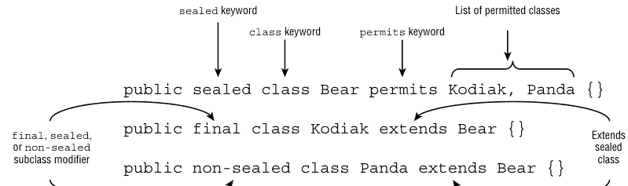

有什么新内容吗？Java 17 包含了三个你应该在考试中熟悉的新关键字。我们经常在密封子类上使用 `final`，但我们在涵盖基础知识后会详细介绍其中的每一个项。

## 密封类关键字

- **sealed**: 表示一个类或接口只能被命名的类或接口扩展/实现。
- **permits**: 与 `sealed` 关键字一起使用，列出允许的类和接口。
- **non-sealed**: 应用于扩展了密封类的类或接口，表示它可以被未指定的类扩展。

到目前为止非常简单，对吧？考试同样可能测试你密封类不能用于什么。例如，你能看出为什么这些声明组中的每一个无法通过编译吗？

```java
public abstract sealed class Wolf permits Timber {}
public final class Timber extends Wolf {}
public final class MyWolf extends Wolf {} // 无法编译 (DOES NOT COMPILE)
```

第一个示例无法编译，是因为 `class` 和 `sealed` 修饰符的顺序不对。修饰符必须在类名之前。第二个示例无法编译，是因为 `MyWolf` 没有列在 `Wolf` 的声明中。

> 密封类通常带有 `abstract` 修饰符声明，尽管这并非强制。

使用 `sealed` 修饰符声明类是简单部分。大多数时候，如果你在考试中看到关于密封类的问题，它们是在测试你关于子类是否正确扩展了密封类的知识。有很多重要的规则是考试中需要的，所以请仔细阅读后续章节。

## 编译密封类

假设我们创建了一个 `Penguin` 类并在一个新包中编译它，而不包含任何其他代码。考虑到这一点，企鹅类能编译吗？

```java
// Penguin.java
package zoo;
public sealed class Penguin permits Emperor {}
```

不，不能！为什么？答案是，密封类需要在与它的子类相同的包中声明（并编译）。但子类本身呢？它们必须扩展该密封类。例如，以下代码无法编译：

```java
// Penguin.java
package zoo;
public sealed class Penguin permits Emperor {} // 无法编译
```

```java
// Emperor.java
package zoo;
public final class Emperor {}
```

在这种情况下，`permits` 子句是可选的，可以省略。不过，子类中仍然需要 `extends` 关键字：

```java
// Snake.java
public sealed class Snake {
final class Cobra extends Snake {
```

如果这些类位于不同的文件中，这段代码将无法通过编译！此规则同样适用于带有嵌套子类的密封类。

```java
// Snake.java
public sealed class Snake {
final class Cobra extends Snake {
}
```

### 引用嵌套子类

虽然省略嵌套子类的 `permits` 子句可以让代码更易读，但你仍然欢迎为它们命名。然而，语法可能与你预期的不同。

```java
public sealed class Snake permits Cobra { // 无法编译
final class Cobra extends Snake {}
}
```

这段代码无法编译，因为 `Cobra` 需要对 `Snake` 命名空间的引用。

下面的修复方法解决了此问题：


```java
public sealed class Snake permits Snake.Cobra {
    final class Cobra extends Snake {}
}
```

当所有的子类都是嵌套的时，我们强烈建议省略 `permits` 类。

我们不会在短时间内介绍嵌套类。目前，你只需要知道嵌套类是定义在另一个内部的类，并且省略规则也适用于嵌套类。表 7.3 是这些情况的便利参考。

## 表 7.3 密封类中 permits 子句的用法

| 直接子类的位置 | permits 子句 |
|---|---|
| 与密封类在不同的文件中 | 强制性 |
| 与密封类在同一个文件中 | 允许，但不是强制的 |
| 嵌套在密封类内部 | 允许，但不是强制的 |

## 密封接口

除了类之外，接口也可以是密封的。其思想与类类似，并且许多相同的规则也适用。例如，密封接口必须与直接扩展或实现它的类或接口出现在同一个包或具名模块中。

密封接口的一个独特特征是，`permits` 列表可以应用于实现该接口的类，也可以应用于扩展该接口的接口。

```java
// 密封接口
public sealed interface Sw permits Duck, Swan, Floats {}
```

```java
// 允许扩展密封接口的接口
public non-sealed interface Floats extends Sw {}
```

那么应用于扩展密封接口的接口的修饰符呢？记住，接口是隐式抽象的，不能标记为 `final`。由于如此，扩展密封接口的接口只能被标记为 `sealed` 或 `non-sealed`。它们不能被标记为 `final`。

## 复习密封类规则

在考试中看到密封类时，请密切关注子类的声明和修饰符。

## 密封类规则

- 密封类使用 `sealed` 和 `permits` 修饰符声明。
- 密封类必须与它们的直接子类在同一个包或具名模块中。
- 密封类的直接子类必须标记为 `final`、`sealed` 或 `non-sealed`。
- 如果密封类及其直接子类在同一个文件中，或者子类嵌套在密封类内部，则 `permits` 子句是可选的。
- 接口可以是密封的，以限制实现它的类或扩展它的接口。

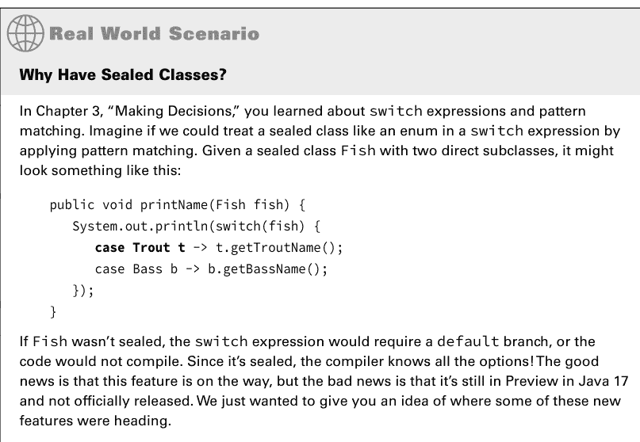

### 为什么要使用密封类？

在第 3 章“做决策”中，你学习了 `switch` 表达式和模式匹配。想象一下如果我们通过应用模式匹配将密封类在 `switch` 表达式中像枚举（`enum`）一样对待。假设有一个两个子类的密封类 `Fish`，看起来可能像这样：

```java
public void print(Fish fish) {
    System.out.println(switch(fish) {
        case Trout t -> t.getTroutName();
        case Bass b -> b.getBassName();
    });
}
```

如果 `Fish` 不是密封的，`switch` 表达式将需要一个 `default` 分支，否则代码将无法编译。由于它是密封的，编译器知道所有的选项！好消息是这个功能即将到来，但坏消息是它在 Java 17 中仍处于预览（Preview）阶段，尚未正式发布。我们只是想让你了解其中一些新功能的发展方向。

## 使用 Record 封装数据

我们最后介绍了新的 Java 类型！如果你听过任何关于 Java 新特性的介绍，你可能听过 `record`。`record` 令人兴奋，因为它们消除了大量的样板代码。在介绍 `record` 之前，了解它们为什么被添加到语言会有帮助，所以我们从封装开始。

## 理解封装

POJO 代表 Plain Old Java Object（纯旧 Java 对象），是一种用于建模和传递数据的类，其很少或没有复杂的方法（因此有了定义中的“纯旧”部分）。你可能也听过 `JavaBean`，它是应用了某些额外规则的 POJO。

让我们创建一个带有两个字段的 POJO 类：

```java
public class Crane {
    int numberEggs;
    String name;
    public Crane(int numberEggs, String name) {
        this.numberEggs = numberEggs;
        this.name = name;
    }
}
```

哎呀，字段是包级访问的。我们为什么要关心这个？这意味着同一包中该类之外的人可以更改这些值，并创建无效数据，例如：

```java
public class Poacher {
    public void badActor() {
        var mother = new Crane(5, "Cathy");
        mother.numberEggs = -100;
    }
}
```

这显然不好。封装是为了通过限制访问来保护类成员。我们不希望 `Crane` 拥有负数量的蛋。封装允许使用方法来检索或修改实例变量。封装是保护类免受意外使用的一种。我们可以控制内部实现。让我们来看看这个新封装（且不可变）的 `Crane` 类：

```java
public final class Crane {
    private int numberEggs;
    private final String name;
    public Crane(int numberEggs, String name) {
        if (numberEggs >= 0) this.numberEggs = numberEggs; // 保护条件
        else throw new IllegalArgumentException();
        this.name = name;
    }
    public int getNumberEggs() { // getter
        return numberEggs;
    }
    public String getName() { // getter
        return name;
    }
}
```

注意类 2 和 3 中的实例变量是私有的。由于我们了解类，我们不会设置负数量的蛋。我们在 9-11 行添加了方法来读取值，这被称为访问器方法或 getter。

你可能注意到我们把类和它的实例变量标记为 `final`，并且我们没有修改实例变量值的变器方法（即 setter）。这是因为我们希望类在良好的封装之外，是不可变的。正如你在第 6 章所看到的，不可变对象模式是一种在创建后无法修改的面向对象的设计模式。与其修改不可变对象，不如创建一个包含原始对象中所需属性的新对象。

回顾一下，记住数据（实例变量）是私有的，getter/setter 是公开的，以便封装。你不需要把它们设为私有，这样做很好。例如，以下类封装得良好，尽管它没有声明任何非私有方法：

```java
public class Vet {
    private String name = "Dr Rogers";
    private int yearsExperience = 25;
}
```

你必须省略 setter 使类变为不可变。复习第 6 章关于不可变对象的额外规则。

## 应用 Record

我们的 `Crane` 类有 15 行。我们可以用更简洁的方式编写它，如图 7.6 所示。暂时抛开构造函数中对 `numberEggs` 的保护语句，这个 record 是等效且不可变的！

## 图 7.6 定义一个 record

record 关键字

由括号括起来的字段列表

```java
public record Crane(int numberEggs, String name) {
```

哇！只有一行代码！record（记录）是一种特殊的数据面向对象类，编译器会为你插入样板代码（boilerplate code）。

事实上，编译器插入的内容比我们之前写的 14 行代码要多得多。作为额外奖励，编译器还插入了 `Object` 方法 `equals()`、`hashCode()` 和 `toString()` 的有用实现。我们仅用一行代码就涵盖了大量内容！

现在想象一下，如果我们有 10 行代码而不是 2 行代码。这意味着我们省去了编写大量方法的麻烦。而且我们甚至还没有谈到构造函数！更糟糕的是，每当有人更改某个字段时，都需要更新几十行相关代码。例如，`name` 可能会在构造函数、`toString()` 方法等地方被使用。如果你的应用程序中有数百个 POJO，`record` 可以为你节省宝贵的时间。

创建实例并打印某些字段非常简单：

```java
var mommy = new Crane("Canny");
System.out.println(mommy.numberEggs()); // 4
System.out.println(mommy.name());    // Cammy
```

这里有几点需要注意。首先，我们没有在 `record` 声明中定义任何构造函数或方法。编译器是如何知道该做的？在后台，它会为你创建一个构造函数，其参数顺序与 `record` 声明中的顺序相同。遗漏或更改类型将导致编译器错误：

```java
var mommy1 = new Crane("Canny", 4); // 无法编译
var mommy2 = new Crane("Canny");    // 无法编译
```

对于每个字段，它都会为该字段创建一个访问器（accessor），并加上一对括号。与传统的 POJO 或 JavaBeans 不同，这些方法没有 `get` 或 `is` 前缀。`record` 仅为你省去了输入这几个字符的时间！最后，`record` 会重写一个

## 自动添加到 record 中的成员

- 构造函数：一个参数顺序与 `record` 声明一致的构造函数。
- 访问器方法：每个字段对应一个访问器。
- `equals()`：一个用于比较两个元素的方法，如果每个字段在 `equals()` 意义上相等，则返回 true。
- `hashCode()`：一个使用所有字段的一致 `hashCode()` 方法。
- `toString()`：一个 `toString` 实现，以一种方便、易读的格式打印 `record` 的每个字段。

以下展示了新方法的示例。记住，`println()` 方法会自动调用传递给它的对象的 `toString()` 方法。

```java
var father = new Crane(0, "Craig");
System.out.println(father); // Crane[numberEggs=0, name=Craig]
```

```java
var copy = new Crane(0, "Craig");
System.out.println(copy); // Crane[numberEggs=0, name=Craig]
System.out.println(father.equals(copy)); // true
System.out.println(father.hashCode() + " " + copy.hashCode()); // 1007, 1007
```

这些都是基础。我们之所以称之为“基础”，是因为你可以用它们做很多事情，正如你在接下来的章节中所看到的。


考虑到我们对 `Crane` 的单行声明，想象一下编写一个等效类需要多少代码和工作。它可能轻松占用 40 多行！尝试编写所有 `record` 提供的方法可能是一个有趣的练习。

有趣的是：拥有一个没有任何字段的 `record` 是合法的。它只需用 `record` 关键字和括号进行声明：

```java
public record Crane() {}
```

这并不是你在自己的代码中会使用的类型，但它可能会在……出现

## 理解 record 的不可变性

正如你所看到的，`record` 没有 setter（set器方法）。每个字段本质上都是 `final` 的，在构造函数中写入后就无法修改。为了“修改”一个 `record`，你必须创建一个新对象并复制所有你想要保留的数据。

```java
var cousin = new Crane(3, "Jenny");
```

就像接口隐式是抽象的一样，`record` 也是隐式 `final` 的。`final` 修饰符是可选的，但是默认存在的。

```java
public record Crane(int numberEggs, String name) {}
```

就像枚举（`enums`）一样，这意味着你不能扩展或继承一个 `record`。

```java
public record BlueCrane extends Crane {} // 无法编译
```

同样像枚举一样，`record` 可以实现普通或密封接口（sealed interface），只要它实现了所有的抽象方法。

```java
public record Bird {};
```


虽然这远远超出了本书的范围，但有很多很好的理由让数据面向对象的类变为不可变。这样做可以产生更不容易出错的代码，因为每次修改数据都会建立新对象。它还使它们线程安全的，可以在并发框架中使用。

## 构造函数

如果我们需要像之前那样声明一个带有守卫（guards）的 `record` 怎么办？在本节中，我们涵盖了使用 `record` 实现此点的两种方法。

### 长构造函数 (Long Constructor)

首先，我们可以直接声明编译器通常插入的构造函数，我们将其称为*长构造函数*。

```java
public record Crane(int numberEggs, String name) {
    public Crane(int numberEggs, String name) {
        if (numberEggs < 0) {
            throw new IllegalArgumentException("Eggs cannot be negative");
        }
    }
}
```

编译器插入的内容比我们之前写的 14 行代码要多得多。作为额外奖励，编译器还插入了 `Object` 方法 `equals()`、`hashCode()` 和 `toString()` 的有用实现。我们仅用一行代码就涵盖了大量内容！

现在想象一下，如果我们有 10 行代码而不是 2 行代码。这意味着我们省去了编写大量方法的麻烦。而且我们甚至还没有谈到构造函数！更糟糕的是，每当有人更改某个字段时，都需要更新几十行相关代码。例如，`name` 可能会在构造函数、`toString()` 方法等地方被使用。如果你的应用程序中有数百个 POJO，`record` 可以为你节省宝贵的时间。

创建实例并打印某些字段非常简单：

```java
var mommy = new Crane("Canny");
System.out.println(mommy.numberEggs()); // 4
System.out.println(mommy.name());    // Cammy
```

这里有几点需要注意。首先，我们没有在 `record` 声明中定义任何构造函数或方法。编译器是如何知道该做的？在后台，它会为你创建一个构造函数，其参数顺序与 `record` 声明中的顺序相同。遗漏或更改类型将导致编译器错误：

```java
var mommy1 = new Crane("Canny", 4); // 无法编译
var mommy2 = new Crane("Canny");    // 无法编译
```

对于每个字段，它都会为该字段创建一个访问器（accessor），并加上一对括号。与传统的 POJO 或 JavaBeans 不同，这些方法没有 `get` 或 `is` 前缀。`record` 仅为你省去了输入这几个字符的时间！最后，`record` 会重写一个

## 自动添加到 record 中的成员

- 构造函数：一个参数顺序与 `record` 声明一致的构造函数。
- 访问器方法：每个字段对应一个访问器。
- `equals()`：一个用于比较两个元素的方法，如果每个字段在 `equals()` 意义上相等，则返回 true。
- `hashCode()`：一个使用所有字段的一致 `hashCode()` 方法。
- `toString()`：一个 `toString` 实现，以一种方便、易读的格式打印 `record` 的每个字段。

以下展示了新方法的示例。记住，`println()` 方法会自动调用传递给它的对象的 `toString()` 方法。

```java
var father = new Crane(0, "Craig");
System.out.println(father); // Crane[numberEggs=0, name=Craig]
```

```java
var copy = new Crane(0, "Craig");
System.out.println(copy); // Crane[numberEggs=0, name=Craig]
System.out.println(father.equals(copy)); // true
System.out.println(father.hashCode() + " " + copy.hashCode()); // 1007, 1007
```

这些都是基础。我们之所以称之为“基础”，是因为你可以用它们做很多事情，正如你在接下来的章节中所看到的。


考虑到我们对`Crane`的单行声明，想象一下编写一个等效类需要多少代码和工作。它可能轻松占用 40 多行！尝试编写所有`record`提供的方法可能是一个有趣的练习。

有趣的是：拥有一个没有任何字段的`record`是合法的。它只需用`record`关键字和括号进行声明：

```java
public record Crane() {}
```

这并不是你在自己的代码中会使用的类型，但它可能会在……出现

## 理解 record 的不可变性

正如你所看到的，`record`没有 setter（set器方法）。每个字段本质上都是`final`的，在构造函数中写入后就无法修改。为了“修改”一个`record`，你必须创建一个新对象并复制所有你想要保留的数据。

```java
var cousin = new Crane(3, "Jenny");
```

就像接口隐式是抽象的一样，`record`也是隐式`final`的。`final`修饰符是可选的，但是默认存在的。

```java
public record Crane(int numberEggs, String name) {}
```

就像枚举（enums）一样，这意味着你不能扩展或继承一个`record`。

```java
public record BlueCrane extends Crane {} // 无法编译
```

同样像枚举一样，`record`可以实现普通或密封接口（sealed interface），只要它实现了所有的抽象方法。

```java
public record Bird {};
```


虽然这远远超出了本书的范围，但有很多很好的理由让数据面向对象的类变为不可变。这样做可以产生更不容易出错的代码，因为每次修改数据都会建立新对象。它还使它们线程安全的，可以在并发框架中使用。

## 构造函数

如果我们需要像之前那样声明一个带有守卫（guards）的`record`怎么办？在本节中，我们涵盖了使用`record`实现此点的两种方法。

### 长构造函数 (Long Constructor)

首先，我们可以直接声明编译器通常插入的构造函数，我们将其称为*长构造函数*。

```java
public record Crane(int numberEggs, String name) {
    public Crane(int numberEggs, String name) {
        if (numberEggs < 0) {
            throw new IllegalArgumentException("Eggs cannot be negative");
        }
    }
}
```

编译器插入的内容比我们之前写的 14 行代码要多得多。作为额外奖励，编译器还插入了`Object`方法`equals()`、`hashCode()`和`toString()`的有用实现。我们仅用一行代码就涵盖了大量内容！

现在想象一下，如果我们有 10 行代码而不是 2 行代码。这意味着我们省去了编写大量方法的麻烦。而且我们甚至还没有谈到构造函数！更糟糕的是，每当有人更改某个字段时，都需要更新几十行相关代码。例如，`name`可能会在构造函数、`toString()`方法等地方被使用。如果你的应用程序中有数百个 POJO，`record`可以为你节省宝贵的时间。

创建实例并打印某些字段非常简单：

```java
var mommy = new Crane("Canny");
System.out.println(mommy.numberEggs()); // 4
System.out.println(mommy.name());    // Cammy
```

这里有几点需要注意。首先，我们没有在`record`声明中定义任何构造函数或方法。编译器是如何知道该做的？在后台，它会为你创建一个构造函数，其参数顺序与`record`声明中的顺序相同。遗漏或更改类型将导致编译器错误：

```java
var mommy1 = new Crane("Canny", 4); // 无法编译
var mommy2 = new Crane("Canny");    // 无法编译
```

对于每个字段，它都会为该字段创建一个访问器（accessor），并加上一对括号。与传统的 POJO 或 JavaBeans 不同，这些方法没有`get`或`is`前缀。`record`仅为你省去了输入这几个字符的时间！最后，`record`会重写一个

### 紧凑构造函数 (Compact Constructors)

幸运的是，Java 增加了紧凑构造函数的功能。紧凑构造函数隐式设置所有字段。图 7.7 显示了一个紧凑构造函数

```java
public record Crane(int numberEggs, String name) {
    public Crane {
        if (numberEggs < 0) {
            throw new IllegalArgumentException("Eggs cannot be negative");
        }
    }
}
```

紧凑构造函数让你有机会对输入值进行转换。看看以下紧凑构造函数做了什么：

```java
public record Crane(int numberEggs, String name) {
    public Crane {
        if (name == null || name.length() < 1) {
            throw new IllegalArgumentException("Name is too short");
        }
        name = name.substring(0,1).toUpperCase()
        + name.substring(1).toLowerCase();
    }
}
```

紧凑构造函数可以修改构造参数，但它们不能修改`record`的字段。例如，以下代码无法编译：

```java
public record Crane(int numberEggs, String name) {
    public Crane {
        this.numberEggs = 10; // 无法编译
    }
}
```

移除此引用允许代码编译，因为修改的是构造参数。

> 虽然我们在本节中涵盖了构造函数的长形式和紧凑形式，但除非有充分理由，否则强烈建议使用紧凑形式。

### 重载构造函数 (Overloaded Constructors)

你还可以创建完全不同参数列表的重载构造函数。它们与长形式构造函数相关，并且不使用紧凑构造函数的任何语法特性。

```java
public record Crane(int numberEggs, String name) {
    public Crane(String firstName, String lastName) {
        this(0, firstName + " " + lastName);
    }
}
```

重载构造函数的第一行必须通过`this()`显式调用另一个构造函数。如果没有其他构造函数，则必须调用长构造函数。这与你在第 6 章中学到的知识形成对比，在构造函数声明中调用`super()`或`this()`通常是可选的。同样，与紧凑构造函数不同，你只能在第一行转换数据。第一行之后，所有字段都已赋值，对象是不可变的。

```java
public record Crane(int numberEggs, String name) {
    public Crane(int numberEggs, String firstName, String lastName) {
        this(numberEggs + 1, firstName + " " + lastName);
        numberEggs = 10; // 无效（作用于参数，而非实例字段）
        this.numberEggs = 20; // 无法编译
    }
}
```

# 使用 Record 封装数据 381

正如你在第 6 章中所看到的，你不能声明两个相互无限调用或形成循环调用的 record 构造函数。

```java
public record Crane(int numberEgs, String name) {
    public Crane(String name) {
        this(1); // 编译失败
    }
    public Crane(int numberEgs) {
        this(""); // 编译失败
    }
}
```

## 自定义 Record

由于 record 是面向数据的数据，我们重点关注了你可能会使用的 record 特性。record 实际上支持与类许多许多相同的功能。以下是 record 可以包含的一些成员，你为了应对考试需要熟悉这些内容：

- 重载构造函数和紧凑型构造函数
- 重写任何提供的实例方法（访问器，`equals()`，`hashCode()`，`toString()`）
- 嵌套类、接口、注解、枚举和 record

作为一个说明性示例，接下来的代码使用`@Override`注解重写了两个实例方法：

```java
public record Crane(int numberEgs, String name) {
    @Override public int numberEgs() { return 10; }
    @Override public String toString() { return name; }
}
```

虽然你可以添加方法、静态字段和其他类型，但你不能在 record 定义之外添加实例字段，即使它们是私有的。这样做会违背使用 record 的初衷，并可能破坏不可变性！

```java
public record Crane(int numberEgs, String name) {
    private static int type = 10; // 编译失败
    public int size; // 编译失败
    private boolean friendly; // 编译失败
}
```

record 不支持实例初始化。record 字段的所有初始化必须在构造函数中完成。

# 382 第 7 章 • 类之外的内容

虽然 record 支持与类许多相同的成员是一项很有用的特性，但为了保持它们的简单性——就像它们诞生的 POJO 和 JavaBeans 一样——它们变得越复杂，易用性就越低。

这是我们第二次提到嵌套类型，第一次是关于密封类（sealed classes）和顶层 record。别担心；我们接下来就会介绍它们！

## 创建嵌套类

嵌套类是定义在另一个类内部的类。嵌套类有四种形式。

- 内部类：定义在类成员级上的非静态类型
- 静态嵌套类：定义在类成员级上的静态类型
- 局部类：定义在方法体内的类
- 匿名类：局部类的一种特殊情况，没有名称

使用嵌套类有许多优点。它们可以定义辅助类，并将其限制在外部类的上下文中，从而提高封装性。它们可以让你轻松地创建一个仅在一个地方使用的的类。它们甚至可以让代码更整洁、更易读。

然而，当使用不当时，嵌套类有时会让代码变得难以阅读。它们倾向于将外部类和内部类紧密耦合，但在某些情况下你可能想单独使用内部类。在这种情况下，你应该将内部类移动到独立的顶层类中。

遗憾的是，考试会测试程序员通常不会使用嵌套类的边缘情况。这往往会导致代码难以阅读，因此请在实践中避免这样做！

> 根据惯例，并在整个章节中，我们使用“嵌套类”一词来指所有嵌套类型，包括嵌套接口、枚举、record 和注解。你可能会遇到将它们统称为内部类的文献。我们同意这可能会引起困惑！

## 声明内部类

内部类，也称为成员内部类，是定义在类成员级上的非静态类型（与方法、实例变量和构造函数处于同一级）。因为它们不是顶层类型，它们可以使用任何一种访问级别，而不仅仅是 public（公共）和 package（包访问）。

内部类具有以下属性：

- 可以声明为 public、protected、package 或 private
- 可以继承一个类并实现接口
- 可以标记为 abstract 或 final
- 可以访问外部类的成员，包括私有成员

最后一个属性非常酷。这意味着内部类可以在不进行任何特殊操作的情况下访问外部类中的变量。准备好用一种复杂的方式来打印三次了吗？

```java
1:   public class Home {
2:     private String greeting = "Hi"; // 外部类实例变量
3: 
4:     protected class Room { // 内部类声明
5:         public int repeat = 3;
6:         public void enter() {
7:             for (int i = 0; i < repeat; i++) greet(greeting);
8:         }
9:         private static void greet(String message) {
10:            System.out.println(message);
11:        }
12:    }
13:
14:    public void enterRoom() { // 外部类的实例方法
15:        var room = new Room(); // 创建内部类实例
16:        room.enter();
17:    }
18:    public static void main(String[] args) {
19:        var home = new Home(); // 创建外部类实例
20:        home.enterRoom();
21: }}
```

内部类看起来像一个独立的类声明，只不过它恰好位于另一个类内部。第 7 行显示了内部类可以访问`greeting`。

内部类可以访问外部类中的变量，而无需任何特殊操作。准备好用一种复杂的方式来打印三次了吗？

由于内部类不是静态的，它必须通过外部类的实例来调用。第 19 行创建了外部类实例，而第 15 行创建了内部类实例。第 15 行显示`greeting`是可用的。因为`enterRoom()`是外部类中的实例方法。

## 嵌套类现在可以拥有静态成员

敏锐的读者可能已经注意到我们在内部类 Room 中包含了一个静态方法（第 9 行）。在 Java 9 中，这会导致编译错误。以前，只有静态嵌套类允许包含静态方法。随着 Java 16 引入 record，阻止内部类拥有任何静态成员（静态常量除外）的规定被消除了。所有四种嵌套类现在都可以定义静态变量和方法！

## 实例化内部类实例

还有另一种实例化 Room 的方法，初看之下很奇怪。好吧，可能只是初看如此。这种语法并不常用：

```java
20:   static void main(String[] args) {
21:     var home = new Home();
22:     Room room = home.new Room(); // 创建内部类实例
23:     room.enter();
24:   }
```

让我们仔细观察第 21 和 22 行。我们需要一个 Home 的实例来创建一个 Room。我们可以将第 21-23 行缩短为一行：

```java
21:   new Home().new Room().enter(); // 抱歉，我们也觉得它很难看！
```

## 引用外部类的成员

内部类可以与外部类具有相同的变量，使得作用域变得有点复杂。有一种特殊的调用方式来指定你想访问哪个变量。这种做法你可能在网页上看到，但理想情况下在现实世界中看不到。

# 创建嵌套类

实际上，你仅限于一个内部类。虽然下面的写法在考试中很常见，但请不要在你的代码编写中这样做。以下是如何嵌套多个类并访问每个类中具有相同名的变量：

```java
public class A {
    private int x = 10;
    class B {
        private int x = 20;
        class C {
            private int x = 30;
            public void allTheX() {
                // 30
                System.out.println(this.x); // 30
                System.out.println(B.this.x); // 20
                System.out.println(A.this.x); // 10
            }
        }
    }
}
public static void main(String[] args) {
    A a = new A();
    A.B b = new B();
    A.B.C c = b.new C();
    c.allTheX();
}
```

是的，这也是合理的。对于两个嵌套类，第 14 行实例化了最外层的内部类。第 15 行使用星号来实例化一个 B。注意类型是 A.B。我们可以将 B 写为类型，因为在 A 的成员级别上它是可用的。Java 知道去哪里查找它。在第 16 行中，我们实例化了一个 C。这次有必要指定 A.B.C 类型。第 17 行在实例变量 c 上调用了该方法。


第 8 行和第 9 行是我们习惯于看到的代码类型。它们指的是当前类中的实例变量——确切地说，是在第 6 行声明的那一个。第 10 行以特殊的方式使用了它。我们仍然想要一个实例变量，但这次我们想要 `B` 类中的那一个，即第 4 行的变量。第 11 行对类 `A` 执行了相同的操作，获取了第 2 行的变量。

# 内部类需要实例

看看下面的代码，看看你能否找出为什么三个构造函数调用中有无法编译：

```java
public class Fox {
    private class Den {
        public void goHome() {
            new Den();
        }
        public static void visitFriend() {
            new Den(); // 无法编译
        }
    }
}

public class Squirrel {
    public void visitFox() {
        new Den(); // 无法编译
    }
}
```

第一个构造类可以编译，是因为 `goHome()` 是一个实例方法，因此该调用与此实例关联。第二个类无法编译，是因为它在静态方法内部被调用。你仍然可以调用构造函数，但你必须显式地给它一个 `Fox` 实例引用。

最后一个构造类无法编译有两个原因。尽管它是一个实例方法，但它不是 `Fox` 类内部的实例方法。不过，添加 `Fox` 引用并不能完全解决问题。`Den` 是私有的，在 `Squirrel` 类中不可访问。

# 创建静态嵌套类

静态嵌套类是定义在成员级别的静态类型。它可以在没有外部类实例的情况下实例化。然而，代价是无法访问外部类中声明的实例变量或方法。换句话说，它是一个顶层类，例外是：

- 嵌套创建了一个命名空间，因为必须使用外部类名来引用它。
- 它还可以额外被标记为 `private` 或 `protected`。
- 外部类可以引用静态嵌套类的字段和方法。

让我们来看一个例子：

```java
1: public class Park {
2:     static class Ride {
3:        private int price = 6;
4:    }
5: public static void main(String[] args) {
6:     var ride = new Ride();
7:     System.out.println(ride.price);
8: } }
```

第 6 行初始化了嵌套类。由于它是静态的，你不需要 `Park` 的实例。允许访问私有变量，如第 7 行所示。

# 局部类

局部类是定义在方法内部的嵌套类。就像局部变量一样，局部类直到方法调用时才存在。这意味着你只能在方法内部创建实例。这就是局部类的工作方式。为了简单起见，我们将讨论限制在方法内部。

局部类具有以下属性：

- 它没有修饰符。
- 它可以声明为 `final` 或 `abstract`。
- 它可以访问外部类的字段和方法（当在方法内部定义时）。

> 还记得我们在第 5 章介绍的有效 `final`（`effectively final`）吗？是的，我们说过它以后会有用，现在它确实有用。如果你需要复习有效 `final`。

```java
public class Example {
    public void method() {
        final int x = 10;
        class Local {
            void print() {
                System.out.println(x);
            }
        }
        new Local().print();
    }
}
```

> 还记得我们在第 5 章介绍的有效 `final` 吗？是的，我们说过它以后会有用，现在它确实有用。如果你需要复习有效 `final`。

# 定义嵌套类

匿名类是无名字局部类的特殊形式。它使用 `new` 关键字、带括号的类型名和花括号 `{}` 在一个语句中完成声明和实例化。匿名类必须扩展现有的类或实现一个接口。当你有一个不会在其他使用的简短实现时，它们非常有用。这里有一个：

```java
public class ZooGifShop {
    abstract class SaleTodayOnly {
        abstract int dollarsOff();
    }
    public int admission(int basePrice) {
        SaleTodayOnly sale = new SaleTodayOnly() {
            int dollarsOff() { return 3; }; // 别忘记分号！
        return basePrice - sale.dollarsOff();
    }
}
```

第 6-8 行定义了一个抽象类。注意这个匿名类没有名字。代码说实例化一个新的 `SaleTodayOnly` 对象。但等等：`SaleTodayOnly` 是抽象的。这是没问题的，因为我们在那里提供了类体——以匿名的方式。在这个例子中，编写匿名类等同于编写一个未指定名称的扩展 `SaleTodayOnly` 并立即使用的局部类。

现在我们将此示例转换为实现接口而不是扩展抽象类：

```java
public class ZooGifShop {
    interface SaleTodayOnly {
        int dollarsOff();
    }
    public int admission(int basePrice) {
        SaleTodayOnly sale = new SaleTodayOnly() {
            public int dollarsOff() { return 3; }
        };
        return basePrice - sale.dollarsOff();
    }
}
```

这里最有趣的地方是变化其实很小。第 2–4 行声明了一个接口而不是抽象类。第 7 行是 `public` 而不是默认访问权限，因为接口要求方法必须是公共的。如此。无论你是实现接口还是扩展类，匿名类都是相同的！`Java` 会自动识别你想使用哪种。只需记住，在第二个示例中，在第 6 行创建的是类的实例，而不是接口的实例。

但如果我们想既实现一个接口又扩展一个类呢？你无法通过匿名类做到这一点，除非要扩展的类是 `java.lang.Object`。`Object` 类不在此规则范围内。请记住，匿名类只是一个未名的本地类。如果你遇到这个问题，可以创建一个本地类并给它命名。然后你就可以随心所欲扩展类并实现任意数量的接口了。如果这很复杂，那么本地类可能不是可读性最好的选择。

你可以在方法体之外定义匿名类。以下代码看起来像是将一个接口实例化为实例变量，但接口名后的 `{}` 表示这是一个实现该接口的实例类：

```java
public class Gorilla {
    interface Climb {
        Climb climbing = new Climb() {};
    }
}
```

## 匿名类与 Lambda 表达式

在 `Java 8` 之前，匿名类经常用于异步任务和事件处理器。例如，下面的代码展示了 `JavaFX` 应用中作为事件处理器的匿名类：

```java
var redButton = new Button();
redButton.setOnAction(new EventHandler<ActionEvent>()() {
    public void handle(ActionEvent e) {
        System.out.println("Red button pressed!");
    }
});
```

自从引入 `Lambda` 表达式以来，匿名类被更短的实现取代了：

```java
Button redButton = new Button();
redButton.setOnAction(e -> System.out.println("Red button pressed!"));
```

## 复习嵌套类

对于考试，请确保你了解表 7.4 中关于 `Java` 允许哪些语法规则的信息。

## 表 7.4 嵌套类修饰符

| 允许的修饰符 | 内部类 | 静态嵌套类 | 本地类 | 匿名类 |
| --- | --- | --- | --- | --- |
| 访问修饰符 | 所有 | 所有 | 无 | 无 |
| `abstract` | 是 | 是 | 无 | 否 |
| `final` | 是 | 是 | 是 | 否 |

你还应该了解表 7.5 中关于访问类型的信息。例如，考试可能会通过让静态类在没有外部类引用的情况下访问外部类的实例变量来欺骗你。

## 表 7.5 嵌套类访问规则

| | 内部类 | 嵌套类 | 本地类 | 匿名类 |
| --- | --- | --- | --- | --- |
| 可以扩展类或实现任意数量的接口？ | 是 | 是 | 是 | 否——必须恰好有一个父类或一个接口 |
| 可以访问外层类的成员？ | 是 | 否 | 是（如果存在实例方法中声明） | 是（如果存在实例方法中声明） |
| 可以访问外层方法的局部变量？ | N/A | N/A | 是（如果是 `final` 或事实上的 `final`） | 是（如果是 `final` 或事实上的 `final`） |

## 理解多态性

我们用多态性的讨论来结束本章，多态是指对象能够呈现多种不同形式的属性。更准确地说，`Java` 对象可以通过以下方式访问：

- 与对象类型相同的引用
- 是对象的父类的引用
- 定义了对象所实现或继承的接口的引用

此外，如果对象被重新赋值为对象的父类型或接口，则不需要进行强制转换。呼，这可真多！别担心，很快你就能理解了。

让我们通过下面的示例来说说明这种多态性属性：

```java
public class Primate {
    public boolean hasHair() {
        return true;
    }
}
```

```java
public interface HasTail {
    abstract boolean isTailed();
}
```

```java
public class Lemur extends Primate implements HasTail {
    public boolean isTailed() {
        return false;
    }
}
```

```java
public int age = 10;
public static void main(String[] args) {
    Lemur lemur = new Lemur();
    System.out.println(lemur.age);

    HasTail hasTail = lemur;
    System.out.println(hasTail.isTailed());

    Primate primate = lemur;
    System.out.println(primate.hasHair());
}
```

## 理解多态性 393

这段代码可以编译并输出以下内容：

```
10
false
true
```

关于这个示例最重要的点是，只创建了一个 `Lemur` 对象。多态性允许 `Lemur` 实例被重新赋值或传递给父类型，如 `Primate` 或 `HasTail`。

一旦对象被赋值给新的类型，只有该类型可用的方法和变量才能调用。例如，以下代码段无法编译：

```java
HasTail hasTail = new Lemur();
System.out.println(hasTail.age); // 编译失败
```

```java
Primate primate = new Lemur();
System.out.println(primate.isTailpped()); // 编译失败
```

在这个示例中，`primate` 引用对应的 `isTailed()` 方法无法访问 `Lemur` 类中的变量 `age`。正如你在下一节中将学到的，可以通过将 `hasTail` 引用强制转换为 `Lemur` 类型来重新获得对 `age` 的访问权限。

# 强制转换

在上一个示例中，我们创建了一个 `Lemur` 对象的实例，并通过父类和接口的引用访问了它。然而，一旦更改了引用类型，我们就失去了对子类中定义的特定成员的访问，尽管这些成员仍然存在于对象之中。我们可以将对象转换回它所属的特定子类来恢复这些引用：

```java
Lemur lemur = new Lemur();
```

```java
Primate primate = lemur; // 向超类型的隐式转换
```

```java
Lemur lemur2 = (Lemur)primate; // 向子类型的显式转换
```

```java
Lemur lemur3 = primate; // 无法编译（缺少强制转换）
```

在这个示例中，我们首先创建了一个 `Lemur` 对象，并将其显式强制转换为 `Primate` 引用。由于 `Lemur` 是 `Primate` 的子类型，这可以在不需要强制转换符的情况下完成。然后，我们使用显式转换将其转换回 `Lemur` 对象，从而访问 `Lemur` 类中的所有方法和字段。最后一行无法编译，因为需要显式转换。即使对象在内存中是以 `Lemur` 对象的形式存储的，我们仍然需要通过显式转换来将其赋值给 `Lemur`。

对象的强制转换就像你在第 2 章“运算符”中看到的基本类型转换一样。在转换对象时，如果转换为继承的类型，则不需要强制转换符。这被称为向对象所继承的类或接口的隐式转换。或者，如果你想转换当前引用的子类型，则需要对兼容的类型执行显式转换。如果底层对象与该类型不兼容，则会在运行时抛出 `ClassCastException`。

在复习涉及强制转换和多态的考试题时，务必记住对象实际上是什么。然后，关注编译器是否允许在没有显式转换的情况下引用该对象。我们将这些概念总结为一组规则，以便应考试记忆：

- 1. 将引用从子类型强制转换到超类型不需要显式转换。
- 2. 将引用从超类型强制转换到子类型需要显式转换。
- 3. 在运行时，将引用转换为不兼容类型的无效强制转换会导致抛出 `ClassCastException`。
- 4. 编译器不允许向无关类型进行强制转换。

前三条规则只是对我们目前所内容的回顾。最后一条规则稍微复杂一些。考试可能会尝试用一个编译器知道是不允许的（即不可能的）强制转换来欺骗你。在上一个示例中，我们能够将 `Primate` 引用强制转换为 `Lemur` 引用，因为 `Lemur` 是 `Primate` 的子类，因此它们是相关的。考虑一下这种情况：

```java
public class Bird {}
```

```java
public class Fish {
    public static void main(String[] args) {
        Fish fish = new Fish();
        Bird bird = (Bird)fish; // 无法编译
    }
}
```

在这个示例中，`Fish` 和 `Bird` 类之间没有通过编译器感知的任何类层次结构相关；代码将无法编译。虽然它们隐式地扩展了 `Object`，但它们被认为是无关的类型，因为一个不能可能是另一个的子类型。

# 接口的强制转换

虽然编译器强制执行关于向无关类类型进行强制转换的规则，但对于接口它并不总是这样做。请记住，实例支持多重继承，这限制了编译器可以推理范围。虽然某个类可能没有实现某个接口，但某些子类可能会实现该接口。当持有特定类的引用时，编译器并不知道它持有的是哪个具体的子类型。

让我们尝试一个示例。你认为以下程序可以编译吗？

```java
1: interface Canine {}
2: interface Dog {}
3: class Wolf implements Canine {}
4:
5: public class BadCasts {
6: public static void main(String[] args) {
7: Wolf wolf = new Wolf();
8: Dog dogwolf = (Dog)dogwolf;
9: }
```

在这个程序中，在第 7 行创建了一个 `Wolf` 对象，然后将其赋值给 `Wolf` 引用类型。对于接口，编译器强制执行许多规则的能力有限，因为虽然一个类型可能没有实现接口，但它的子类之一可能会实现。此外，它允许在第 8 行向 `Dog` 引用类型进行无效转换，尽管 `Dog` 和 `Wolf` 并不相关。绝不是如此，当代码编译时，它会在运行时抛出 `ClassCastException`。

尽管存在这种限制，编译器仍然可以围绕接口强制转换执行一条规则。如果对象不是该接口的实例，编译器就不允许从接口引用到对象引用的强制转换。

## instanceof 运算符

`instanceof` 运算符用于测试对象是否是特定类或接口的实例。如果满足条件则返回 `true`，否则返回 `false`。考虑以下示例：

```java
class Fish {
    public static void main(String[] args) {
        Fish fish = new Fish();
        if (fish instanceof Bird) {
            System.out.println("fish is a Bird");
        } else {
            System.out.println("fish is not a Bird");
        }
    }
}
```

在这个示例中，输出是 "fish is not a Bird"，因为 `Fish` 不是 `Bird` 的子类。我们也可以对接口使用 `instanceof`：


```java
interface Canine {}
class Wolf implements Canine {}

public class Test {
    public static void main(String[] args) {
        Wolf wolf = new Wolf();
        if (wolf instanceof Canine) {
            System.out.println("wolf is a Canine");
        }
    }
}
```

# 多态与方法重写

在 Java 中，多态性规定，当你重写一个方法时，你就会替换了所有对该方法的调用。例如，你认为以下代码会输出什么？

```java
class Penguin {
    public int getHeight() { return 3; }
    public void printInfo() {
        System.out.print(this.getHeight());
    }
}

class EmperorPenguin extends Penguin {
    public int getHeight() { return 8; }
}

public class Main {
    public static void main(String[] args) {
        Penguin p = new EmperorPenguin();
        p.printInfo();
    }
}
```

输出是 8。在这个示例中，操作的对象是一个 `EmperorPenguin`。`getHeight()` 方法在子类中被重写，所有对它的调用在运行时都被替换了。尽管 `printInfo()` 定义在 `Penguin` 类中，但在对象上调用 `getHeight()` 会调用与内存中精确对象关联的方法，而不是调用它时的当前类型。这就是多态的精髓。

多态通过重写在运行时替换方法的能力是 Java 最重要的属性之一。它允许你创建复杂的继承模型，其中子类对被重写的方法有它们自己的自定义实现。这意味着父类不需要更新以使用自定义或重写的方法。如果方法被正确地重写，那么在所有调用它的地方都将使用重写后的版本。

请记住，你可以通过标记方法为 `final` 来限制多态行为，这可以防止它们被子类重写。

# 调用重写方法的父类版本

方法被重写并不意味着父类方法完全不可访问。我们可以使用你在第 6 章中学到的 `super` 引用来访问它。你如何修改我们之前的示例来打印 3 而不是 8？你可以尝试在 `Penguin` 类中调用 `super.getHeight()`：

```java
class Penguin {
    public int getHeight() { return 3; }
    public void printInfo() {
        System.out.print(super.getHeight());
    }
}
```

遗憾的是，这段代码无法编译，因为 `super` 指向 `Penguin` 的子类；在这种情况下，解决方案是在子类 `EmperorPenguin` 中重写 `printInfo()` 并使用 `super`。

```java
public class EmperorPenguin extends Penguin {
    public int getHeight() { return 8; }
    public void printInfo() {
        System.out.print(super.getHeight());
    }

    public static void main(String []fish) {
        new EmperorPenguin().printInfo(); // 3
    }
}
```

# 重写与隐藏成员

重写（Overriding）会替换所有调用该方法的地方，而静态方法和变量的隐藏（Hiding）不会。严格来说，隐藏成员并不是多态的形式，因为方法和变量保持着各自的属性。与重写不同，隐藏成员对引用类型以及使用该成员的位置非常敏感。

让我们来看这个例子：

```java
class Penguin {
    public static int getHeight() { return 3; }
    public void printInfo() {
        System.out.println(this.getHeight());
    }
}
```

```java
public class CrestedPenguin extends Penguin {
    public static int getHeight() { return 8; }
    public static void main(String... fish) {
        new CrestedPenguin().printInfo();
    }
}
```

`CrestedPenguin` 的例子与我们之前的 `EmperorPenguin` 例子几乎相同，尽管正如你可能猜到的，它打印的是 3 而不是 8。`getHeight()` 方法是静态的，因此是被隐藏了而不是重写。结果是在 `CrestedPenguin` 中调用 `getHeight()` 返回的值与在 `Penguin` 中调用它的值不同。

# 第 7 章 • 类之外

`Penguin`，即使底层对象是同一个。这与重写方法形成对比，后者无论在哪个类中被调用，返回的都是对象的值。

关于我们在 `this.getHeight()` 中访问静态方法这一事实呢？正如第 5 章所讨论，虽然允许使用实例引用来访问静态变量或方法，但通常不建议这么这样做。当你以非静态方式访问静态成员时，编译器会发出警告。在这种情况下，`this` 引用对程序的输出没有影响。

除了位置之外，当你处理隐藏成员时，引用类型也可以决定你得到的值。准备好了吗？让我们尝试一个更复杂的例子：

```java
class Marsupial {
    protected int age = 2;
    public static boolean isBiped() {
        return false;
    }
}
```

```java
public class Kangaroo extends Marsupial {
    protected int age = 6;
    public static boolean isBiped() {
        return true;
    }
}
```

```java
public static void main(String[] args) {
    Kangaroo joey = new Kangaroo();
    Marsupial moey = joey;
    System.out.println(joey.isBiped());
    System.out.println(moey.isBiped());
    System.out.println(joey.age);
    System.out.println(moey.age);
}
```

程序打印以下内容：

true

false

2

在这个例子中，内存中只创建并存储了*一个对象*（`Kangaroo` 类型）！由于静态方法可以被隐藏而非重写，Java 使用引用类型来决定应该调用哪个版本的 `isBiped()`，导致 `joey.isBiped()` 打印 true，而 `moey.isBiped()` 打印 false。

同样地，`age` 变量被隐藏而非重写，因此使用引用类型来决定输出哪个值。这导致 `joey.age` 返回 6，而 `moey.age` 返回 2。

为了考试，请确保你理解这些例子，因为它们展示了隐藏方法和重写方法的本质区别。在实践中，重写方法是多态的基石，是一项极其强大的特性。

## 现实场景

# 实践中不要隐藏成员

尽管 Java 允许你隐藏变量和静态方法，但这被认为是非常糟糕的编码实践。正如你在上一个例子中看到的，变量或方法的值取决于所使用的引用，这会使你的代码变得困惑、难以追踪，并且难以他人维护。当你开始在父类和子类方法中修改该变量时，情况会更加复杂，因为可能并不清楚你正在更新哪个变量。

在子类中定义新变量或静态方法时，选择一个未被继承成员占用的名称被认为是良好的编码实践。不过，重新声明私有方法和变量被认为问题较小，因为子类原本就无法访问父类中的变量。

## 总结

在这一章中，我们介绍了高级面向对象设计中的许多主题，涵盖了类之外的许多顶层类型。我们从接口开始，描述了它们如何支持多继承。记住，接口及其成员可以包含编译器自动插入的若干隐式修饰符。我们涵盖了考试需要掌握的所有六种接口成员：抽象方法、静态常量、默认方法、静态方法、私有方法和私有静态方法。

我们转向了枚举（enums），它们编译时常量属性。简单的枚举由值列表组成，而复杂的枚举可以包含构造函数、方法和字段。枚举也可以用于 `switch` 语句和表达式。当枚举方法是抽象的时，每个枚举值必须提供实现。

转向 Java 的新话题，我们涵盖了密封类（sealed classes）以及它们如何允许类像枚举类型一样工作，即只允许某些子类。对于考试，

# 第 7 章 • 类之外

重要的是记住，密封类的子类必须是 `final`、`sealed` 或非 `sealed`（non-sealed）。

如果密封类的子类定义在同一个文件中，可以省略 `permits` 子句。最后，密封接口可以限制哪些类可以实现接口，或哪些接口可以扩展。

Records 是 Java 的另一个新功能。Records 是声明 POJO 的紧凑方式，编译器会为你添加大量模板代码。记住，封装是防止外部调用者访问对象内部组件的实践。Records 包括自动创建访问方法、构造函数、`equals()` 和 `toString()`。Records 可以通过紧凑构造函数支持数据验证和转换。Records 不允许实例变量（这会破坏不可变性），但允许静态方法。

我们转向嵌套类型。为了简单，我们专注于嵌套类并涵盖了所有类型。内部类需要外部类的实例才能使用，而静态类不需要。局部类只能访问 final 或有效 final 的局部变量。匿名类是一种没有名字的特殊类。匿名类必须扩展一个类或实现一个接口。内部类、局部类匿名类可以访问它们所在类的私有成员，只要后者位于实例方法内部。

我们最后讨论了多态，多态是 Java 语言的核心，并展示了如何以各种形式访问对象。确保你理解何时需要强制类型转换，并能够识别编译时和运行时的类问题。

## 考试要点

能够编写创建、扩展和实现接口的代码。接口是专注于抽象方法和常量变量的特殊抽象类型。接口可以扩展任意数量的接口并在此继承其抽象方法。接口不能扩展类，类也不能扩展接口。类可以实现任意数量的接口。

知道哪些接口方法可以引用。非静态私有、默认和抽象接口方法与接口实例关联。非静态私有和默认接口方法可以引用接口声明中的任何方法。或者，静态接口方法与类成员关联，最后，私有方法只能在接口声明内部引用。

## 考试要点

能够创建并使用枚举（enum）类型。枚举是一种定义了值列表的数据结构。如果枚举不包含任何其他元素，值后面的分号（;）是可选的。枚举可以用于 `switch` 语句，并可以包含实例变量、构造函数和方法。枚举的构造函数是私有的。枚举可以包含方法，作为成员存在或包含在单个枚举值中。如果枚举声明了抽象方法，则每个枚举必须实现它。

能够识别密封类（sealed classes）的使用是否正确。密封类定义了一个允许扩展它的受限子类列表。能够在密封类上正确使用正确的修饰符（`final`、`sealed` 或 `non-sealed`）。理解何时可以排除 `permits` 子句。

识别封装良好的类。封装类中的实例变量是私私。。所有获取或更新这些变量的代码都必须使用方法。封装类可以包含访问器（getter）或变异器（setter）方法，尽管这不是强制要求的。

理解记录（records）并知道编译器自动生成哪些成员。记录是封装且不可变的类型，编译器会在其中插入一个长构造函数、访问器方法以及 `equals()`、`hashCode()` 和 `toString()` 的实用实现。这些元素每一个都可以被重写。能够识别紧凑构造函数参数，并知道它们仅用于构造函数参数的验证和转换。识别当记录声明了实例成员时，它将无法编译。

能够声明并使用嵌套类。嵌套类有四种：内部类、静态类、局部类和匿名类。实例化内部类需要外类的实例。另一方面，静态嵌套类可以在没有外类引用的情况下创建。局部类和匿名类不能声明。匿名类限于继承单个类或实现一个接口。

理解多态。一个对象可以采取多种形式，称为多态。对象被视为以一种具体的形式存在内存中，但可以通过引用变量以多种形式访问。更改对象的引用类型可能会允许访问新的成员，但成员始终存在于内存中。

## 复习题

复习题的答案可以在附录中找到。

- 1. 下列哪些是有效的记录声明？（选择所有项）

```java
public record Iguana(int age) {
    private static final int age = 10; }

public final record Gecko() {}

public abstract record Chameleon() {
    private static String name;
 }

public record BeardedDragon(boolean fun) {
    @Override public boolean fun() { return false; }

public record Newt(long size) {
    @Override public boolean equals(Object obj) { return false; }
    public void setId(long size) {
        this.size = size;
    }
 }
```

A. Iguana

B. Gecko

C. Chameleon

D. BeardedDragon

E. Newt

F. 以上均不是

- 2. 下列哪些语句可以插入到空行中，使代码能够成功编译？（选择所有项。）

```java
interface CanHop {
public class Frog implements CanHop {
    public static void main(String[] args) {
        var frog = new TurtleFrog();
    }
 }
class BrazilianHornedFrog extends Frog {}
class TurtleFrog extends Frog {
```

- A. Frog

- B. TurtleFrog

- C. BrazilianHornedFrog

- D. CanHop

- E. var

- F. Long

- G. 以上都不是；代码包含编译错误。

- 3. 下一个程序的运行是什么？

```java
public class Favorites {
  enum Flav {
    VANILLA, CHOCOLATE, STRAWBERRY
    static final Flav DEFAULT = STRAWBERRY;
  }
  public static void main(String[] args) {
    for(final var e : Flav.values())
    System.out.print(e.ordinal()+"");
  }
}
```

- A. 0 1 2

- B. 1 2 3

- C. 正好有一行代码无法编译。

- D. 多行代码无法编译。

- E. 代码通过编译但在运行时产生异常。

- F. 以上都不是

- 4. 下一个程序的输出是什么？

```java
public sealed class ArmoredAnimal permits Armadillo {
  public ArmoredAnimal(int size) {
    @Override public String toString() { return "Strong"; }
    public static void main(String[] a) {
      var c = new ArmoredAnimal(10, null);
      System.out.println(c);
    }
}
class Armadillo extends ArmoredAnimal {
  @Override public String toString() { return "Cute"; }
  public Armadillo(int size, String name) {
    super(size);
  }
}
```

- A. Strong

- B. Cute

- C. 程序无法编译。

- D. 代码通过编译但在运行时产生异常。

- E. 以上都不是

# 第7 章 • 类之外

- 5. 关于以下程序的哪些语句是正确的？（选择所有项。）

```java
1:     interface Hasoskeleton {
2:         double size = 2.0f;
3:         abstract int getNumberOfSections();
4:     }
5:     abstract class Insect implements Hasoskeleton {
6:         abstract int getNumberOfLegs();
7:     }
8:     public class Beetle extends Insect {
9:         int getNumberOfOfLegs() { return 6; }
10:     }
```


（等待，OCR 将`getNumberOfOfLegs`与`getNumberOfLegs`，我会保留 OCR 内容但在必要时修复明显的拼写错误。实际上，查看第 9 行：`getNumberOfOfLegs`与第 6 行的`getNumberOfLegs`。这是一个编译错误。）

等待，让我们重新检查第 9 行的 OCR：`int getNumberOfOfLegs() { return 6; }`。这是一个名称不匹配。

## 6. 关于以下程序的哪些语句是正确的？（选择所有项。）

```java
1:     interface Aquatic {
2:     int amount = 10;
3:     public void swim();
4:     abstract class Herbivore implements Aquatic {
5:     }
6:     
7:     abstract class Fish extends Herbivore {
8:     void swim(int amount); }
9: }
```

A. 它无问题编译。

B. 代码因为第 1 行无法编译。

C. 代码因为第 2 行无法编译。

D. 代码因为第 4 行无法编译。

E. 代码因为第 7 行无法编译。

F. 方法没有重写。

## 7. 下一个程序的输出是什么？

```java
1: interface Aquatic {
2:     int getills(int p);
3: }
4: public class Fish implements Aquatic {
5:     String getills() { return "14"; }
6: }
7:     public static void main(String[] args) {
8:         System.out.println(new Fish().getills());
9:     }
```

A. 14

B. 15

C. 代码因为第 4 行无法编译。

D. 代码因为第 5 行无法编译。

E. 代码因为第 6 行无法编译。

F. 以上都不是

## 8. 按顺序插入，哪些修饰符可以填充空白以创建一个封装类？（选择所有项。）

```java
public class Rabbits {
    [____] int numRabbits = 0;
    [____] void multiply() {
        numRabbits *= 2;
    }
    [____] int getNumberOfRabbits() {
        return numRabbits;
    }
}
```

A. `private`, `public`, `public`

B. `private`, `protected`, `private`

C. `private`, `private`, `protected`

D. `public`, `public`, `public`

E. `multiply()`不以`set`开头，无法正确封装。

F. 以上都不是

## 9. 下列哪些语句可以插入空白处以使代码能够成功编译？（选择所有项。）

```java
abstract class Snake {
class Cobra extends Snake {
class GardenSnake extends Cobra {
public class SnakeHandler {
    private Snake snakey;
    public void setSnake(Snake mySnake) { this.snakey = mySnake; }
    public static void main(String[] args) {
        new SnakeHandler().setSnake(________);
    }
}
```

A. `new Cobra()`

B. `new Snake()`

C. `new Object()`

D. `new String("Snake")`

E. `new GardenSnake()`

F. `null`

G. 以上都不是。无论在空白处插入什么值，类无法编译。

## 10. 标记为 X 和 Z 的空白处可以插入哪些类型以允许代码编译？（选择所有项）。

```java
interface Walk { private static List move() { return null; } }
interface Run extends Walk { public ArrayList move(); }
class Leopard implements Walk {
    public ____ move() { // X
        return null;
    }
}
class Panther implements Run {
    public ____ move() { // Z
        return null;
    }
}
```

A. 标记为 X 的行处的`Integer`

B. 标记为 X 的行处的`ArrayList`

C. 标记为 X 的行处的`List`

D. 标记为 Z 的行处的`List`

E. 标记为 Z 的行上的`ArrayList`

F. 以上均不是，因为`Run`接口无法编译

G. 代码由于其他原因无法编译。

## 11. 下列代码的结果是什么？（选择所有适用项。）

```
1: public class Movie {
2: private int butter = 5;
3: private Movie() {}
4: protected class Popcorn {
5: private Popcorn() {}
6: public static int butter = 10;
7: public void startMovie() {
8: System.out.println(butter);
9: }
10: }
11: public static void main(String[] args) {
12: var movie = new Movie();
13: Movie.Popcorn in = new Movie().newPopcorn();
14: in.startMovie();
15: }
```

A. 输出为 5。

B. 输出为 10。

C. 第 6 行产生编译器错误。

D. 第 12 行产生编译器错误。

E. 第 13 行产生编译器错误。

F. 代码可以编译，但在运行时抛出异常。

## 12. 关于封装，以下哪些项是正确的？（选择所有适用项。）

A. 它允许 getter 方法。

B. 它允许允许 setter 方法。

C. 它要求命名规范。

D. 它要求公有实例变量。

E. 它要求私有实例变量。

## 13. 下列程序的运行是什么？

```
public class Weather {
  enum Seasons {
    WINTER, SPRING, SUMMER, FALL
  }
```

## 15. 哪些行在独立输入到空白处时，允许代码在运行时打印 "Not scared"？（选择所有适用项）。

```java
public class Ghost {
    public static void boo() {
        System.out.println("Not scared");
    }
protected final class Spirit {
    public void boo() {
        System.out.println("Booo!!!");
    }
}
```

```
public static void main(String... haunt) {
    var g = new Ghost().new Spirit() {};
}
```

A. `g.boo()`

B. `g.super.boo()`

C. `new Ghost().boo()`

D. `g.Ghost.boo()`

E. `new Spirit().boo()`

F. `Ghost.boo()`

G. 以上均不是

## 16. 以下代码出现在名为 Ostrich.java 的文件中。编译源文件的结果是什么？

```
1: public class Ostrich {
2:     private int count;
3:     static class OstrichWrangler {
4:         public int stampede(){
5:         return count;
6:     } }
```

A. 代码成功完成，并生成了一个字节码文件：`Ostrich.class`。

B. 代码成功完成，并生成了两个字节码文件：`Ostrich.class`和`OstrichWrangler.class`。

C. 代码成功完成，并生成了两个字节码文件：`Ostrich.class`和`OstrichWrangler.class`。

D. 第 3 行发生编译器错误。

## 17. 以下接口声明中的哪些行无法编译？（选择所有适用项。）

```
1: public interface Omnivore {
2:     int amount = 10;
3:     static boolean gather = true;
4:     static void eatGrass() {
5:     int findMore() { return 2; }
6:     default float rest() { return 2; }
7:     protected int chew() { return 13; }
8:     private static void eatLeaves() {}
9: }
```

A. 所有行均可无问题编译。

B. 第 2 行

C. 第 3 行

D. 第 4 行

E. 第 5 行

F. 第 6 行

G. 第 7 行

H. 第 8 行

## 18. 下列程序打印了什么？

```java
 class Deer {
    enum Food {APPLES, BERRIES, GRASS}
    protected class Diet {
        private Food getFavorite() {
            return Food.BERRIES;
        }
    }
    public static void main(String[] seasons) {
        System.out.print(switch(new Diet()).getFavorite()) {
            case A -> "a";
            case BERRIES -> "b";
            default -> "c";
        }
    }
}
```

A. a

B. b

C. c

D. `Diet`类的代码声明无法编译。

E. `main()`方法无法编译。

F. 代码可以编译，但在运行时抛出异常。

G. 以上均不是

## 19. Bear 程序打印了以下的哪些内容？（选择所有适用项。）

```java
public class Bear {
    enum FOOD {
        BERRIES, INSECTS {
            public boolean isHealthy() { return true;},
        FISH, ROOTS, COOKIES, HONEY;
        public abstract boolean isHealthy();
    }
}
```

```
public static void main(String[] args) {
    System.out.print(FOOD.INSECTS);
    System.out.print(FOOD.INSECTS.ordinal());
    System.out.print(FOOD.INSECTS.isHealthy());
    System.out.print(FOOD.COOKIES.isHealthy());
}
```

A. insects

B. INSECTS

C. 0

D. 1

E. false

F. true

G. 代码无法编译。

## 20. 关于多态，以下哪些项是正确的？（选择所有适用项。）

A. 任意类的实例执行父类的方法。

B. 在运行时无法确定执行父类的哪个方法。

C. 标记为`static`防止被重写或隐藏。

D. 标记为`final`防止被重写或隐藏。

E. 类型决定在运行时调用哪个方法。

F. 在运行时决定调用哪个方法。

## 21. 给定以下 record 声明，哪些行可以填充空白处并允许代码编译？（选择所有适用项。）

```java
public record RabbitFood(int size, String brand, LocalDate expires) {
    public static int MAX_STORAGE = 100;
    public RabbitFood() {
}
```

A. `size = MAX_STORAGE`

B. `this.size = 10`

C. `if(expires.now()) throw RuntimeException()`

D. `if(brand==null) brand = "Unknown"`

E. `throw RuntimeException()`

F. 以上均不是

## 22. 下列哪些项可以插入到`rest()`方法中？（选择所有适用项。）

```java
public class Lion {
    class Cub {
        static class Den {}
    }
    static void rest() {
    }
}
```

A. `a = new Cub()`

B. `b = new Lion().Cub`

C. `c = new Lion().Cub()`

D. `d = Den`

E. `e = Cub()`

F. `f = Den`

G. `g = new Den`

H. `h = Cub()`

## 23. 给定以下程序，在空白处插入什么内容可以在运行时打印 "Swim!"？

```java
interface Swim {
    default void perform() { System.out.print("Swim!"); }
}
interface Dance {
    default void perform() { System.out.print("Dance!"); }
}
public class Penguin implements Swim, Dance {
    public void perform() { System.out.print("Smile!"); }
    private void doShow() {
    }
    public static void main(String[] eggs) {
        new Penguin().doShow();
    }
}
```

A. `super.perform()`

B. `Swim.perform()`

C. `super.super.perform()`

D. `Swim.perform()`

E. 无论插入什么代码无法编译。

F. 代码可以编译，但不需要创建对象即可产生输出。

## 24. 以下接口的哪些行无法编译？（选择所有适用项。）

```
1: public interface BigCat {
2:     abstract String getName();
3:     static int hunt() { getName(); return 5; }
4:     default void climb() { rest(); }
5:     private void roar() { climb(); hunt(); }
6:     static boolean sneak() { roar(); return true; }
7:     private int rest() { return 2; }
8: }
```

A. 第 2 行

B. 第 3 行

C. 第 4 行

D. 第 5 行

E. 第 6 行

F. 第 7 行

G. 以上均不是

## 25. 下列程序打印了什么？


# 代码分析题

```java
1: public class Zebra {
2:     private int x = 24;
3:     public int hunt() {
4:         String message = "x is ";
5:         abstract class Stripes {
6:             private int x = 0;
7:             public void print() {
8:                 System.out.print(message + Zebra.this.x);
9:             }
10:        }
11:        var s = new Stripes() {};
12:        s.print();
13:        return x;
14:    }
15:    public static void main(String[] args) {
16:        new Zebra().hunt();
17:    }
}
```

+ A. `x is 0`
+ B. `x is 24`
+ C. 第 6 行产生编译器错误。
+ D. 第 8 行产生编译器错误。
+ E. 第 11 行产生编译器错误。
+ F. 以上均不是

---

26. 关于以下枚举，哪些项是正确的？（选择所有适用项。）

```java
1:    public enum Animals {
2:        MAMMAL(true), INVERTEBRATE(Boolean.FALSE), BIRD(false),
3:        REPTILE(false), AMPHIBIAN(false), FISH(false) {
4:        public int swim() { return 4; }
5:    }
6:        final boolean hasHair;
7:        public Animals(boolean hasHair) {
8:            this.hasHair = hasHair;
9:    }
10:        public boolean hasHair() { return hasHair; }
11:        public int swim() { return 0; }
12:}
```

+ A. 第 2 行编译器错误
+ B. 第 3 行编译器错误
+ C. 第 7 行编译器错误
+ D. 第 8 行编译器错误
+ E. 第 10 行编译器错误
+ F. 其他行编译器错误
+ G. 代码可以成功编译。

---

27. 假设 `record` 定义了一个至少一个字段，编译器总是插入哪些组件，且每个组件都可能被重写或重声明？（选择所有适用项。）

+ A. 无参数构造函数
+ B. 每个字段的访问器方法
+ C. `toString()` 方法
+ D. `equals()` 方法
+ E. 每个字段的变异器方法（`mutator method`）
+ F. 每个字段的排序方法
+ G. `hashCode()` 方法

---

28. 下列类和接口无法通过编译？（选择所有适用项）

```java
public abstract Camel { void travel(); }
```

```java
public interface EatsGrass { private abstract int chew(); }
```

```java
public abstract class Elephant
    abstract private class SleepsAlot {
        abstract int sleep();
    }
```

```java
public class Eagle { abstract soar(); }
```

```java
public interface Spider { default void crawl() {} }
```

- A. `Camel`
- B. `EatsGrass`
- C. `Elephant`
- D. `Eagle`
- E. `Spider`
- F. 没有任何类或接口可以通过编译。

---

29. 下面程序中有多少行包含编译错误？

```java
1: class Primate
2: protected int age = 2;
3:     { age = 1; }
4: public Primate() {
5:     this().age = 3;
6:     }
7: }
8: public class Orangutan {
9:     protected int age = 4;
10:    { age = 5; }
11:    public Orangutan() {
12:        this().age = 6;
13:    }
14:    public static void main(String[] bananas) {
15:   final Primate x = (Primate)new Orangutan();
16:   System.out.println(x.age);
17:  }
18: }
```

- A. 无，且程序在运行时打印 1。
- B. 无，且程序在运行时打印 3。
- C. 无，但在运行时会抛出 `ClassCastException`。
- D. 1
- E. 2
- F. 3
- G. 4

---

30. 假设以下类在同一个文件中声明为顶层类型，哪些类会产生编译错误？（选择所有适用项）

```java
sealed class Bird {
  public final class Flamingo extends Bird {}
}

sealed class Monkey {}

class EmperorTamarin extends Monkey {}

non-sealed class Mandrill extends Monkey {}

sealed class Friendly extends Mandrill permits Silly

 class Silly {}
```

- A. `Bird`
- B. `Monkey`
- C. `EmperorTamarin`
- D. `Mandrill`
- E. `Friendly`
- F. `Silly`
- G. 所有类均无问题地通过编译。

---

# Lambda 与函数式接口

本章涵盖的 OCP 考试目标：

- 利用 Java 面向对象方法
- 理解变量作用域、使用局部变量类型推断、应用封装并使不可变对象
- 创建和使用接口、识别函数式接口，并利用私有、静态和默认接口方法


在本章中，我们首先引入 Lambda，一种新的语法。Lambda 允许你指定在程序稍后运行的代码。

接下来，我们介绍了函数式接口的概念，展示如何编写你自己的接口以及判断一个接口是否为函数式接口。之后，我们介绍了另一个新语法：方法引用（`method references`）。这些是 Lambda 的简短形式。

然后，我们介绍了考试需要掌握的函数式接口。最后，我们强调了变量和函数式接口如何与 Lambda 结合使用。

Lambda、方法引用和函数式接口在第 9 章“集合与泛型”以及第 10 章“流”中会被频繁使用。

---

# 编写简单的 Lambda

Java 本质上是一种面向对象的语言。到目前你已经看到了很多对象。函数式编程是一种更具声明性的编写代码的方式。你指定你想做什么，而不是处理对象的状态。你更关注表达式而不是循环。

函数式编程使用 Lambda 表达式来编写代码。Lambda 表达式是一个可以传递的代码块。你可以将 Lambda 表达式想象成匿名类（如你在第 7 章“类之外”中看到的那些类）内部的未命名方法。它有参数，和完整的方法一样，但它没有真实方法的名字。Lambda 表达式通常简称为 lambda。你可能也知道 Java 中的闭包（`closures`）并不是你的第一种语言。如果你过去对闭包有糟糕的经历，不要担心。它们在 Java 中要简单得多。

Lambda 允许你在 Java 中编写强大的代码。在本节中，我们涵盖了一个说明为什么 Lambda 有帮助的示例以及 Lambda 的语法。

---

## 观察 Lambda 示例

我们的目标是根据某些标准打印列表中的所有动物。我们展示了如何在没有 Lambda 的情况下这样做，以说明 Lambda 的用途。我们从 `Animal` record 开始：`public record Animal(String species, boolean canHop, boolean canSwim) { }`


`Animal` record 有三个字段。假设我们有一个动物列表，并且根据特定属性处理数据。例如，我们想打印所有能够跳跃的动物。我们可以定义一个接口来泛化这个概念并支持多种检查：

```java
public interface CheckTrait {
    boolean test(Animal a);
}
```

我们想要检查的第一点是一个 `Animal` 是否可以跳跃。我们提供一个实现该接口的类：

```java
public class CheckHopper implements CheckTrait {
    public boolean test(Animal a) {
        return a.canHop();
    }
}
```

```java
import java.util.*;
public class Traditional {
    public static void main(String[] args) {
        List<Animal> animals = new ArrayList<>();
        animals.add(new Animal("fish", false, true));
        animals.add(new Animal("kangaroo", true, false));
        animals.add(new Animal("rabbit", true, false));
        animals.add(new Animal("turtle", false, true));
        animals.add(new Animal("frog", true, false));
        animals.add(new Animal("duck", false, true));

        print(animals, new CheckHopper());
    }

    private static void print(List<Animal> animals, CheckTrait checker) {
        for (Animal animal : animals) {
            if (checker.test(animal)) {
                System.out.print(animal + " ");
            }
        }
        System.out.println();
    }
}
```

输出：`kangaroo rabbit frog`

---

## 编写简单的 Lambda

参考我们之前的示例，我们将 lambda 作为 `print()` 方法的第二个参数传递了它：

```java
print(animals, a -> a.canHop());
```

`print()` 方法期望第二个参数为 `CheckTrait` 类型：`private static void print(List<Animal> animals, CheckTrait checker) { ... }`

由于我们传递的是一个 lambda 接口，Java 会尝试将我们的 lambda 映射到 `CheckTrait` 接口中的抽象方法声明：

```java
boolean test(Animal a);
```

由于该接口的方法接收一个 `Animal`，因此 lambda 参数也必须是 `Animal`。而且由于该接口的方法返回 `boolean`，我们知道 lambda 也返回一个 `boolean`。

Lambda 的语法非常复杂，因为许多参数都是可选的。以下两行代码完全相同：

```java
(Animal a) -> { return a.canHop(); }
```

让我们看看这里发生了什么。图 8.1 所示的第一个示例包含三个部分：

- 一个命名为 `a` 的单个参数
- 箭头操作符 (`->`) 用于分离参数和主体
- 一个调用单个方法并返回该方法结果的主体

### 图 8.1 省略可选部分的 Lambda 语法


第二个示例展示了返回 `boolean` 的 lambda 最冗长的形式（见图 8.2）：

- 一个命名为 `a` 的单个参数，并声明其类型为 `Animal`
- 箭头操作符 (`->`) 用于分离参数和主体
- 一个包含一行或多行代码的主体，包括分号和返回语句

### 图 8.2 包含可选部分的 Lambda 语法

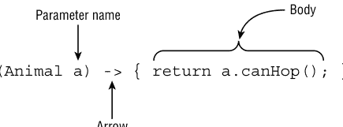

只有当只有一个参数且没有显式声明其类型时，才能省略 lambda 参数周围的括号。Java 这样做是因为开发者通常这样使用 lambda 表达式，并且可以尽可能减少代码。

对你来说可能并不算新闻，当我们只有一个语句时，在不使用括号的情况下，Java 允许你省略返回语句和分号 (`;`)。当你有两个或多个语句时，这种特殊的快捷方式将不起作用。至少这与在其他地方使用 `{}` 创建代码块的做法是一致的。

图 8.1 和图 8.2 中的语法可以混合使用。例如，以下都是合法的：

```java
a -> {return a.canHop()}
(Animal a) -> a.canHop()
```

> 这里有一个事实：`s -> {}` 是一个有效的 lambda。如果表达式右侧没有代码，你不需要分号或返回语句。

表 8.1 显示了返回 `boolean` 的有效 lambda 示例。

### 表 8.1 返回 boolean 的有效 lambda

| Lambda | 参数数量 |
|---|---|
| `() -> true` | 0 |
| `x -> x.startsWith("test")` | 1 |
| `(String x) -> x.startsWith("test")` | 1 |
| `(x, y) -> { return x.startsWith("test") }` | 2 |
| `(String x, String y) -> x.startsWith("test")` | 2 |

第一行接受零个参数并始终返回布尔值 `true`。第二行接受一个参数并对其调用方法，返回结果。第三行做了相同的操作，只是它显式定义了变量的类型。最后两行接受两个参数并忽略了其中一个——并没有规定你必须使用所有参数。

现在让我们确保你能识别表 8.2 中每一行的无效语法，其中每个 lambda 都应该返回一个 `boolean`。请确保你理解这些代码问题在哪里。

### 表 8.2 应该返回 boolean 的无效 lambda

| 无效 lambda | 原因 |
|---|---|
| `x, y -> x.startsWith("fish")` | 左侧缺少括号 |
| `x -> { x.startsWith("camel") }` | 右侧缺少 `return` |
| `x -> { return x.startsWith("giraffe") }` | 括号内部缺少分号 |
| `String x -> x.endsWith("eagle")` | 左侧缺少括号 |

记住，只有当只有一个参数且没有声明类型时，括号才是可选的。这些是编写 lambda 的基础。在本章结束时，我们将涵盖关于在 lambda 中使用变量的额外规则。

> 将 Lambda 赋值给 `var`
>
> 你认为为什么这行代码无法编译？
>
> `var invalid = (Animal a) -> a.canHop(); // 无法编译`
>
> 记得我们讨论过 Java 如何从上下文推断关于 lambda 的信息吗？`var` 能让我们根据上下文推断类型吗？这里的信息不足！lambda 还是 `var` 都没有足够的信息确定应该使用哪种函数式接口。

---

## 编写函数式接口

在本章前面，我们声明了 `CheckTrait` 接口，它为实现者提供了一个精确的方法。Lambda 与此类接口有特殊的关系。事实上，这些接口有一个名称。函数式接口是指包含单个抽象方法的接口。你的朋友 Sam 可以帮你记住这一点，因为它的正式名称是单抽象方法 (SAM)。

### 定义函数式接口

让我们看一个函数式接口和一个实现它的类的示例：

```java
@FunctionalInterface
interface Sprint {
    void sprint(int speed);
}
```

```java
class Tiger implements Sprint {
    public void sprint(int speed) {
        System.out.println("Animal is sprinting! " + speed);
    }
}
```

在这个示例中，`Sprint` 接口是一个函数式接口，因为它包含一个抽象方法，`Tiger` 类是实现它的有效类。

### @FunctionalInterface 注解


# `@FunctionalInterface` 注解

`@FunctionalInterface` 注解告诉编译器你打算让代码成为函数式接口。如果接口不符合函数式接口的规则，编译器将报错。

```java
@FunctionalInterface
interface Dance { // 报错
    void move();
    void rest();
}
```

Java 在某些但不是所有的函数式接口上包含了 `@FunctionalInterface`。此注解意味着接口作者承诺它在未来在使用时是安全的。然而，没有看到该注解并不意味着它不是函数式接口。记住，拥有一个抽象方法才是成为函数式接口的关键，而不是注解。

考虑以下接口。给定我们之前的 `Sprint` 函数式接口，以下哪些是函数式接口？

```java
public interface Dash extends Sprint {
  void skip();
}
```

```java
public interface Sleep {
  private void snore() {}
  default int getZzz() { return 1; }
}
```

```java
public interface Climb {
  void reach();
  default void fall();
  static int getBackUp() { return 100; }
  private static boolean checkHeight() { return true; }
}
```

所有这些都是有效的接口，但并不是都是函数式接口。`Dash` 接口是一个函数式接口，因为它扩展了抽象接口 `Sprint` 并继承了单个抽象方法 `sprint()`。`Skip` 接口不是函数式接口，因为它有两个抽象方法：继承的 `sprint()` 方法和声明的 `skip()` 方法。

`Sleep` 接口也不是函数式接口。`snore()` 和 `getZzz()` 都不满足单抽象方法的标准。尽管默认方法像抽象方法一样，可以在实现接口的类中重写，但它们不能满足单个抽象方法的要求。

最后，`Climb` 接口是一个函数式接口。尽管有很多方法，它只包含一个抽象方法：`reach()`。

## 添加 Object 方法

所有类都从 `Object` 继承方法。对于考试，你应该知道以下方法签名：

- `public boolean toString()`
- `public boolean equals(Object)`
- `public int hashCode()`

我们现在引入这一点是因为单抽象方法规则有一个你应该了解的例外。如果函数式接口包含一个与 `Object` 中找到的公共方法相同的签名，这些方法不计入单抽象方法测试。此规则背后的动机是，任何实现接口的类都会继承自 `Object`（正如所有类都是那样），因此始终会实现这些方法。

> 由于 Java 假设所有类都扩展 `Object`，因此你不能声明与 `Object` 不兼容的接口方法。例如，在接口中声明一个 `abstract int toString()` 是可以通过编译的，因为 `Object` 版本的方法返回的是 `String`。

让我们来看一个例子。`Soar` 类是函数式接口吗？

```java
public interface Soar {
    abstract String toString();
}
```

它不是。`toString()` 是 `Object` 中实现的公共方法，它不计入单抽象方法测试。另一方面，以下接口是一个函数式接口：

```java
public interface Die {
    String toString();
    public boolean equals(Object o);
    public abstract int hashCode();
    public void die();
}
```

`die()` 方法是唯一的抽象方法，而其他的不计入内——它们是在 `Object` 类中定义的公共方法。

注意那些类似于 `Object` 类方法但实际上并未在 `Object` 类中定义的方法。你看到为什么以下不是一个有效的函数式接口了吗？

```java
public interface Hibernate {
    String toString();
    public boolean equals(Hibernate o);
    public abstract int hashCode();
    public void rest();
}
```

尽管看起来和 `Die` 接口很像，但 `Hibernate` 接口使用的是 `equals(Hibernate)` 而不是 `equals(Object)`。因为这与 `Object` 类中定义的 `equals(Object)` 方法的签名不匹配，此接口被计为包含两个抽象方法：`equals(Hibernate)` 和 `rest()`。

# 使用方法引用

方法引用是另一种让代码更易读的方式，只需提到方法的名称即可。像 Lambda 表达式一样，需要时间来适应新语法。在本节中，我们将展示语法以及四种类型的方法引用。我们还把 Lambda 表达式与方法引用混合使用。

假设我们正在编写一只试图学习如何嘎叫的小鸭子。首先我们有一个函数式接口：

```java
public interface LearnToSpeak {
    void speak(String sound);
}
```

接下来，我们发现的小小鸭子很幸运。有一个辅助类可以让小鸭子工作。我们省略了教小鸭子嘎叫的细节，留下了调用函数式接口的部分：

```java
public class DuckHelper {
    public static void teach(String name, LearnToSpeak trainer) {
        // 保持耐心（省略）
        trainer.speak(name);
    }
}
```

最后，是时候把所有这些整合在一起并遇到我们的小鸭子了。这段代码使用 Lambda 表达式实现了函数式接口：

```java
public class Duckling {
    public static void makeSound(String sound) {
        LearnToSpeak learner = s -> System.out.println(s);
        DuckHelper.teach(sound, learner);
    }
}
```

还不错。不过有一点冗余。Lambda 声明了一个名为 `s` 的参数。然而，它所做的只是将该参数传递给另一个方法。方法引用允许我们消除这种冗余，而是写成：

```java
LearnToSpeak learner = System.out::println;
```

`::` 运算符告诉 Java 稍后调用 `println()` 方法。需要一点时间才能适应这种语法。一旦你适应了，你可能会发现编写许多 Lambda 表达式时代码更短且更不容易分散注意力。

> 记住 `::` 就像 Lambda，它用于函数式接口的延迟执行。如果对你有帮助，你甚至可以把方法引用想象成 Lambda。


方法引用和 Lambda 在运行时的行为相同。方法引用的类型：

- 静态方法
- 特定实例方法
- 实例方法
- 构造方法

## 静态方法

方法引用也可以用来引用一个类中的静态方法。假设我们有一个类：

```java
public class Printer {
    public static void print(String s) {
        System.out.println(s);
    }
}
```

以及接口：

```java
public interface MessagePrinter {
    void print(String s);
}
```

我们可以使用方法引用来创建 `MessagePrinter` 接口的实现：

```java
MessagePrinter printer = Printer::print;
```

这与 `s -> Printer.print(s)` 是等价的。

## 特定实例方法

方法引用也可以引用某个特定对象的实例方法。假设我们有一个类：

```java
public class Person {
    public void greet(String message) {
        System.out.println(message);
    }
}
```

以及接口：

```java
public interface Greeter {
    void greet(String message);
}
```

如果我们有一个 `Person` 实例，可以这样写：

```java
Person person = new Person();
Greeter greeter = person::greet;
```

这与 `message -> person.greet(message)` 是等价的。

## 实例方法

方法引用还可以引用不带参数的实例方法。假设我们有一个类：

```java
public class Calculator {
    public void clear() {
        System.out.println("Calculator cleared");
    }
}
```

以及接口：

```java
public interface Action {
    void execute();
}
```

如果我们有一个 `Calculator` 实例，可以这样写：

```java
Calculator calc = new Calculator();
Action action = calc::clear;
```

这与 `() -> calc.clear()` 是等价的。

## 构造方法

方法引用还可以引用类的构造方法。假设我们有一个类：

```java
public class User {
    public User(String name) {
        // ...
    }
}
```

以及接口：

```java
public interface UserFactory {
    User create(String name);
}
```

我们可以使用方法引用来实现接口：

```java
UserFactory factory = User::new;
```

这与 `name -> new User(name)` 是等价的。

## 调用构造函数

构造函数引用是一种特殊的方法引用，它使用 `new` 而不是方法名来实例化对象。在本示例中，我们的函数式接口不接受任何参数，但会返回一个 `String`：

```java
interface EmptyStringCreator {
    String create();
}
```

在此处调用中，我们像使用方法名一样使用 `new`：

```java
30: EmptyStringCreator methodRef = String::new;
31: EmptyStringCreator lambda = () -> new String();
32:
33: var myString = methodRef.create();
34: System.out.println(myString.equals("Snake")); // false
```

它扩展了你目前为止看到方法引用。在上一个示例中，lambda 没有任何参数。

方法引用可能会很复杂。这次我们创建一个接受一个参数并返回结果的函数式接口：

```java
interface StringCopier {
    String copy(String value);
}
```

在实现中，注意以下示例中的第 32 行与上一个示例中的第 30 行具有相同的方法引用：

```java
32: StringCopier methodRef = String::new;
33: StringCopier lambda = x -> new String(x);
34:
35: var myString = methodRef.copy("Zebra");
36: System.out.println(myString.equals("Zebra")); // true
```

这意味着你不能总是通过观察方法引用知道可以调用哪个方法。相反，你必须查看上下文来看使用了哪些参数以及是否有返回类型。在这个示例中， Java 看到我们正在传递一个 `String` 参数，并调用接受此类参数的 `String` 构造函数。

## 回顾方法引用

阅读方法引用有助于理解代码。表 8.3 显示了四种类型的方法引用。如果这个表格不理解，请重读上一节。方法引用可能需要几次才能理解。

### 表 8.3 方法引用

| 类型 | 冒号前 | 冒号后 | 示例 |
| --- | --- | --- | --- |
| 静态方法 | 类名 | 方法名 | `Math::random` |
| 特定对象的实例方法 | 实例变量 | 方法名 | `str::startsWith` |
| 参数的实例方法 | 类名 | 方法名 | `String::isEmpty` |
| 构造函数 | 类名 | `new` | `String::new` |

## 使用内置函数式接口

每当你想要写 lambda 时，编写自己的函数式接口将是不方便。幸运的是，为你提供了大量的通用函数式接口。我们将在这一节中介绍它们。

表 8.4 中的核心函数式接口提供在 `java.util.function` 包中。我们将在下一章介绍泛型，但目前你只需要知道 `<>` 允许接口接受特定类型的对象。如果需要第二个参数，我们使用下一个字母 `U`。如果需要不同的返回类型，我们选择 `R`（return）作为泛型类型。

### 表 8.4 常见函数式接口

| 函数式接口 | 返回类型 | 方法名 | 参数个数 |
| --- | --- | --- | --- |
| `Supplier<T>` | `T` | `get()` | 0 |
| `Consumer<T>` | `void` | `accept(T)` | 1 (T) |
| `BiConsumer<T, U>` | `void` | `accept(T,U)` | 2 (T, U) |
| `Predicate<T>` | `boolean` | `test(T)` | 1 (T) |
| `BiPredicate<T, U>` | `boolean` | `test(T,U)` | 2 (T, U) |
| `Function<T, R>` | `R` | `apply(T)` | 1 (T) |
| `BiFunction<T, U, R>` | `R` | `apply(T,U)` | 2 (T, U) |
| `UnaryOperator<T>` | `T` | `apply(T)` | 1 (T) |
| `BinaryOperator<T>` | `T` | `apply(T,T)` | 2 (T, T) |

对于考试，记住表 8.4。我们将在本节中提供大量的练习来帮助记忆。在提问之前，大多数时候我们不会将接口的实现赋值给变量。我们介绍这些名称是为了让你更好地理解发生了什么。在下一章中，我们将停止创建中间变量。

> 你在书后面会学习更多函数式接口。在下一章第 13 章“并发”中我们将讨论 `Runnable` 和 `Callable`。当你被要求识别函数式接口时，这些可能会出现。

让我们看看如何实现这些接口。由于 lambda 和方法引用都会出现，我们尽可能展示实现方式。在介绍接口后，我们还涵盖了这些接口的一些便利方法。

## 实现 Supplier

`Supplier` 用于在不接受输入的情况下生成或提供值。`Supplier` 接口定义如下：

```java
@FunctionalInterface
public interface Supplier<T> {
    T get();
}
```

你可以使用 `now()` 创建 `LocalDate` 对象。这个示例展示了如何使用 `Supplier` 调用这个工厂方法：

```java
Supplier<LocalDate> methodRef = LocalDate::now;
Supplier<LocalDate> lambda = () -> LocalDate.now();

var myDate = methodRef.get();
System.out.println(myDate);
```

扩展了你目前为止看到的方法引用。在上一个示例中，lambda 没有参数。方法引用可能会很复杂。这次我们创建一个接受一个参数并返回结果的函数式接口：

```java
interface StringCopier {
    String copy(String value);
}
```

在实现中，注意以下示例中的第 32 行与上一个示例中的第 30 行具有相同的方法引用：

```java
32: StringCopier methodRef = String::new;
33: StringCopier lambda = x -> new String(x);
34:
35: var myString = methodRef.copy("Zebra");
36: System.out.println(myString.equals("Zebra")); // true
```

（注：此处 OCR 文本严重乱码/损坏，我根据方法引用的上下文进行了重构）。这意味着你不能总是通过观察方法引用知道可以调用哪个方法。相反，你必须查看上下文来看使用了哪些参数以及是否有返回类型。在这个示例中，Java 看到我们正在传递一个 `String` 参数，并调用接受此类参数的 `String` 构造函数。

## 回顾方法引用


阅读方法引用有助于理解代码。表 8.3 显示了四种类型的方法引用。如果这个表格不理解，请重读上一节。方法引用可能需要几次才能理解。

### 表 8.3 方法引用

| 类型 | 冒号前 | 冒号后 | 示例 |
| --- | --- | --- | --- |
| 静态方法 | 类名 | 方法名 | `Math::random` |
| 特定对象的实例方法 | 实例变量 | 方法名 | `str::startsWith` |
| 参数的实例方法 | 类名 | 方法名 | `String::isEmpty` |
| 构造函数 | 类名 | `new` | `String::new` |

## 使用内置函数式接口

每当你想要写 lambda 时，编写自己的函数式接口将是不方便。幸运的是，为你提供了大量的通用函数式接口。我们将在这一节中介绍它们。

表 8.4 中的核心函数式接口提供在 `java.util.function` 包中。我们将在下一章介绍泛型，但目前你只需要知道 `<>` 允许接口接受特定类型的对象。如果需要第二个参数，我们使用下一个字母 `U`。如果需要不同的返回类型，我们选择 `R`（return）作为泛型类型。

### 表 8.4 常见函数式接口

| 函数式接口 | 返回类型 | 方法名 | 参数个数 |
| --- | --- | --- | --- |
| `Supplier<T>` | `T` | `get()` | 0 |
| `Consumer<T>` | `void` | `accept(T)` | 1 (T) |
| `BiConsumer<T, U>` | `void` | `accept(T,U)` | 2 (T, U) |
| `Predicate<T>` | `boolean` | `test(T)` | 1 (T) |
| `BiPredicate<T, U>` | `boolean` | `test(T,U)` | 2 (T, U) |
| `Function<T, R>` | `R` | `apply(T)` | 1 (T) |
| `BiFunction<T, U, R>` | `R` | `apply(T,U)` | 2 (T, U) |
| `UnaryOperator<T>` | `T` | `apply(T)` | 1 (T) |
| `BinaryOperator<T>` | `T` | `apply(T,T)` | 2 (T, T) |

对于考试，记住表 8.4。我们将在本节中提供大量的练习来帮助记忆。在提问之前，大多数时候我们不会将接口的实现赋值给变量。接口是命名的并直接传递给方法的。我们介绍这些名称是为了让你更好地理解发生了什么。在下一章中，我们将停止创建中间变量。

> 你在书后面会学习更多函数式接口。在下一章第 13 章“并发”中我们将讨论 `Runnable` 和 `Callable`。当你被要求识别函数式接口时，这些可能会出现。

让我们看看如何实现这些接口。由于 lambda 和方法引用都会出现，我们尽可能展示实现方式。在介绍接口后，我们还涵盖了这些接口的一些便利方法。

## 实现 Supplier

`Supplier` 用于在不接受输入的情况下生成或提供值。`Supplier` 接口定义如下：

```java
@FunctionalInterface
public interface Supplier<T> {
    T get();
}
```

你可以使用 `now()` 创建 `LocalDate` 对象。这个示例展示了如何使用 `Supplier` 调用这个工厂方法：

```java
Supplier<LocalDate> methodRef = LocalDate::now;
Supplier<LocalDate> lambda = () -> LocalDate.now();

var myDate = methodRef.get();
System.out.println(myDate);
```

（注：第500-501页提供的 OCR 文本存在大量重复/损坏，我根据 Java 标准示例进行了清理）。

## 实现 Consumer 和 BiConsumer

使用 `Consumer` 是当你想对参数进行某些操作但不返回任何内容时。`BiConsumer` 执行相同的操作，只是它接受两个参数。接口定义如下：

```java
@FunctionalInterface
public interface Consumer<T> {
  void accept(T t);
  // 省略默认方法
}

@FunctionalInterface
public interface BiConsumer<T, U> {
  void accept(T t, U u);
  // 省略默认方法
}
```

打印是 `Consumer` 接口的一种常见用法：

```java
Consumer<String> c1 = System.out::println;
Consumer<String> c2 = x -> System.out.println(x);

c1.accept("Annie"); // Annie
c2.accept("Annie"); // Annie
```

`BiConsumer` 使用两个参数调用。类型不需要相同。例如，我们可以通过以下方式向此映射中放入一个键和一个值：

```java
var map = new HashMap<String, Integer>();
BiConsumer<String, Integer> b1 = map::put;
BiConsumer<String, Integer> b2 = (k, v) -> map.put(k, v);

b1.accept("chicken", 7);
b2.accept("chick", 1);

System.out.println(map); // {chicken=7, chick=1}
```

```java
b1.accept("chicken", "Cluck");
b2.accept("chick", "Tweep");
```

`System.out.println(map); // {chicken=Cluck, chick=Tweep}`

这表明 `BiConsumer` 可以对 `T` 和 `U` 泛型参数使用相同的类型。

## 实现 Predicate 和 BiPredicate

`Predicate` 通常用于过滤或匹配。两者都是常用操作。`BiPredicate` 就像 `Predicate`，只不过它接收两个参数而不是一个。这些接口定义如下：

```java
@FunctionalInterface
public interface Predicate<T> {
    boolean test(T t);
    // 省略默认和静态方法
}
```

```java
@FunctionalInterface
public interface BiPredicate<T, U> {
    boolean test(T t, U u);
    // 省略默认方法
}
```

你可以使用 `Predicate` 来测试条件。

```java
Predicate<String> p1 = String::isEmpty();
Predicate<String> p2 = x -> x.isEmpty();
```

```java
System.out.println(p1.test("chicken")); // true
System.out.println(p2.test("chick")); // true
```

这输出了两次 `true`。更有趣的是 `BiPredicate`。这个示例也输出了两次 `true`：

```java
BiPredicate<String, String> b1 = String::startsWith;
BiPredicate<String, String> b2 = 
    (string, prefix) -> string.startsWith(prefix);
```

```java
System.out.println(b1.test("chicken", "chick")); // true
System.out.println(b2.test("chicken", "chick")); // true
```

## 使用内置函数式接口

方法引用包含了 `startsWith()` 的实例变量和参数。这是一个关于方法引用如何节省大量打字的很好的示例。缺点是它们不那么显式，你真的需要理解正在发生什么！

## 实现 Function 和 BiFunction

`Function` 负责将一个参数转换为可能不同类型的值并返回它。同样，`BiFunction` 负责将两个参数转换为一个值并返回它。这些接口定义如下：

```java
@FunctionalInterface
public interface Function<T, R> {
  R apply(T t);
  // 省略默认和静态方法
}
```

```java
@FunctionalInterface
public interface BiFunction<T, U, R> {
  R apply(T t, U u);
  // 省略默认方法
}
```

例如，此函数将 `String` 转换为 `String` 的长度：

```java
Function<String, Integer> f1 = String::length;
Function<String, Integer> f2 = x -> x.length();
```

```java
System.out.println(f1.apply("cluck")); // 5
System.out.println(f2.apply("cluck")); // 5
```

这个函数将 `String` 转换为 `Integer`。严格来说，它将 `String` 转换为 `int`，然后自动装箱为 `Integer`。类型不需要不同。`concat` 组合两个 `String` 对象并产生另一个 `String`：

```java
BiFunction<String, String, String> b1 = String::concat;
BiFunction<String, String, String> b2 =
  (string, toAdd) -> string.concat(ToAdd);
```

```java
System.out.println(b1.apply("baby", "chick")); // baby child
System.out.println(b2.apply("baby", "chick")); // baby child
```

`BiFunction` 中的前两个类型是输入类型。第三个是返回类型。对于方法引用，第一个参数是调用 `concat()` 的实例，第二个参数是传递给 `concat()` 的。

## 实现 UnaryOperator 和 BinaryOperator

`UnaryOperator` 和 `BinaryOperator` 是 `Function` 的特殊情况。它们要求所有参数类型相同。`UnaryOperator` 将其值转换为相同类型。例如，加 1 是一个一元操作。`BinaryOperator` 将两个值合并为相同类型。相两个数字是一个二元操作。同样，`BinaryOperator` 继承自 `BiFunction`。

接口定义如下：

```java
@FunctionalInterface
public interface UnaryOperator<T> extends Function<T, T> {
    // 省略默认方法
}
```

```java
@FunctionalInterface
public interface BinaryOperator<T> extends BiFunction<T, T, T> {
    // 省略静态方法
}
```

这些方法的签名如下：

```java
T apply(T t); // UnaryOperator
```

```java
T apply(T t1, T t2); // BinaryOperator
```

在 Javadoc 中，你会注意到这些方法继承自 `Function/BiFunction` 父类。泛型声明强制参数类型相同。对于 `UnaryOperator` 示例，注意返回类型与参数相同。

```java
UnaryOperator<String> u1 = String::toUpperCase;
UnaryOperator<String> u2 = x -> x.toUpperCase();
```

```java
System.out.println(u1.apply("chicken")); // chicken
System.out.println(u2.apply("chicken")); // chicken
```

我们不需要指定返回类型，因为 `UnaryOperator` 要求它与参数相同。这里是二元示例：

```java
BinaryOperator<String> b1 = String::concat;
BinaryOperator<String> b2 = (string, add) -> string.concat(add);
```

```java
System.out.println(b1.apply("baby", "chick")); // baby child
System.out.println(b2.apply("baby", "chick")); // baby child
```

注意这与 `BiFunction` 示例的作用相同。代码更简洁，显示了使用一个泛型类型而不是三个的重要性。

## 检查函数式接口

了解每个函数式接口的参数、类型、返回值和方法名非常重要。如果你还没有这样做，现在是记忆表 8.4 的好机会。让我们做一些练习示例。

在以下情况下你会使用哪种函数式接口？

- 不带参数地返回 `String`
- 返回 `Boolean` 并接收一个 `String`
- 返回 `Integer` 并接收两个整数

准备好了吗？在继续之前思考你的答案。必须记住这些。第一个是 `Supplier<String>`，因为它产生对象且接受零参数。第二个是 `Function<String, Boolean>`，因为它接收一个参数并返回另一个。这有点狡猾，你可能会认为它是 `Predicate<String>`。注意 `Predicate` 返回的是原始类型而不是 `Boolean` 对象。

最后，第三个是 `BinaryOperator<Integer>` 或 `BiFunction<Integer, Integer>`。由于 `BinaryOperator<Integer>` 是 `BiFunction` 的特殊情况，它是正确的答案。由于更具体，`BinaryOperator<Integer>` 是更好的答案。

让我们用代码再次尝试这个。带代码更难。你做的第一件事是看 lambda 接收多少个参数以及是否有返回值。你会使用哪种函数式接口来填充空白？

```java
Function<List<String>, Boolean> x1 = x -> // 
```

再次，在继续之前思考答案。准备好了吗？第 6 行 lambda 接收 `List` 参数并返回 `boolean`。由于泛型声明只有一个参数，它是 `Predicate` 或 `Function`。

第 7 行 lambda 接收一个参数且不返回任何。这告诉我们它是 `Consumer`。第 8 行接收两个参数并返回 `boolean`。当你看到 `boolean` 时，除非泛型指定了返回类型，否则考虑 `Predicate`。在这种情况下有两个参数，所以它是 `BiPredicate`。

你觉得这容易吗？如果没有，请再次查看表 8.4。我们不是在开玩笑。你需要非常熟悉这张表。现在既然你正在学习这张表，我们将“识别错误”。这些是故意设计得有陷性的：

```java
Function<List<String>, String> x1 = x -> x.get(0); // ERROR
UnaryOperator<Long> x2 = (Long l) -> 3.14; // ERROR
```

## 在函数式接口使用便利方法

第 6 行声称是一个 `Function`。`Function` 需要指定两个泛型类型：输入参数类型和返回值类型在第 6 行缺失，导致代码无法编译。第 7 行是 `UnaryOperator`，它返回与传入的相同的类型。示例返回的是 `double` 而不是 `Long`，导致代码无法编译。

根据定义，所有函数式接口只有一个抽象方法。但这并不意味着它们只能有一个方法。几个常用的函数式接口提供了许多有用的默认接口方法。

表 8.5 显示了考试需要所需的内置函数式接口的便利方法。所有这些方法都有助于修改或组合相同类型的函数式接口。注意表 8.5 只显示了主接口。`BiConsumer`、`BiFunction` 和 `BiPredicate` 也有类似的方法。

| 接口实例 | 方法返回类型 | 方法名 | 方法参数 |
| :--- | :--- | :--- | :--- |
| `Consumer` | `Consumer` | `andThen()` | `Consumer` |
| `Function` | `Function` | `andThen()` | `Function` |
| `Function` | `Function` | `compose()` | `Function` |
| `Predicate` | `Predicate` | `and()` | `Predicate` |
| `Predicate` | `Predicate` | `negate()` | — |
| `Predicate` | `Predicate` | `or()` | `Predicate` |

**表 8.5 便利方法**

# 使用内置函数式接口


这种方法虽然可行，但并不完美。它读起来有点长，并且包含重复代码。如果我们决定 `egg?` 中的字母 `e` 应该大写呢？我们必须在三个变量中修改它：`egg`、`brownEggs` 和 `otherEggs`。处理这种情况的更好方法是使用 `Predicate` 的两个默认方法。

```java
Predicate<String> brownEggs = egg.and(brown);
Predicate<String> otherEggs = egg.and(brown.negate());
```

太棒了！现在我们重用了原始 `Predicate` 变量中的逻辑来构建两个新变量。变量之间的关系变得更加简洁清晰。我们还可以在一个地方更改 `egg` 的拼写，另外两个对象会因为引用了它而获得新的逻辑。

接下来看 `Consumer`，让我们看看 `thenAnd` 方法，它按顺序运行两个函数式接口：

```java
Consumer<String> c1 = x -> System.out.print("1: " + x);
Consumer<String> c2 = x -> System.out.print("2: " + x);
```

```java
Consumer<String> combined = c1.and(c2);
combined.accept("Annie"); // 1: Annie,2: Annie
```

注意同一个参数是如何传递给 `c1` 和 `c2` 的。这说明 `Consumer` 实例是顺序执行的，并且彼此独立。相比之下，`Function` 链上的 `compose()` 方法连接了函数式接口。然而，它将一个的输出传递给另一个的输入。

```java
Function<Integer, Integer> before = x -> x + 1;
Function<Integer, Integer> after = x -> x * 2;
```

```java
Function<Integer, Integer> combined = after.compose(before);
System.out.println(combined.apply(3)); // 8
```

这一次，`before` 先运行，将 3 变为 4。然后 `after` 运行，将 4 倍增为 8。本节中的所有方法对于在处理函数式接口时简化代码非常有帮助。

## 学习基本数据类型的函数式接口

记得我们告诉你背诵表 8.4 的常用函数式接口吗？你背了吗？如果没有，你现在知道了。等一下，我们将让它变得更复杂。还有许多针对基本数据类型的特殊函数式接口。这些接口在第 10 章涵盖 `Optional` 时非常有用。

它们大部分是针对 `double`、`int` 和 `long` 的。有一个例外，即 `BooleanSupplier`。我们在介绍针对 `double`、`int` 和 `long` 的函数式接口之前会介绍它。

### 用于 boolean 的函数式接口

`BooleanSupplier` 是一个独立的类型。它有一个需要实现的方法：

```java
@FunctionalInterface
public interface BooleanSupplier {
    getAsBoolean();
}
```

它的工作方式正如你对函数式接口的预期。这里有一个例子：

- 12: `BooleanSupplier b1 = () -> true;`
- 13: `BooleanSupplier b2 = () -> Math.random() > 0.5;`
- 14: `System.out.println(b1.getAsBoolean()); // true`
- 15: `System.out.println(b2.getAsBoolean()); // false`

第 12 行和第 13 行创建了 `BooleanSupplier`，这是唯一用于 `boolean` 的函数式接口。第 14 行打印 `true`，因为它是 `b1` 的结果。第 15 行根据生成的随机值打印 `true` 或 `false`。

### 用于 double, int 和 long 的函数式接口

大部分接口都是针对 `double`、`int` 和 `long` 的。表 8.6 显示了这些基本类型对应表 8.4 的内容。你可能对必须背诵它感到意外。幸运的是，你现在已经背过了表 8.4，可以将所学知识应用于表 8.6。

#### 表 8.6 基本类型常用函数式接口

| 函数式接口 | 返回类型 | 单个抽象方法 | 参数数量 |
| :--- | :--- | :--- | :--- |
| `DoubleSupplier` | `double` | `getAsDouble` | 0 |
| `IntSupplier` | `int` | `getAsInt` | 0 |
| `LongSupplier` | `long` | `getAsLong` | 0 |
| `DoubleConsumer` | `void` | `accept` | 1 (double) |
| `IntConsumer` | `void` | `accept` | 1 (int) |
| `LongConsumer` | `void` | `accept` | 1 (long) |
| `DoublePredicate` | `boolean` | `test` | 1 (double) |
| `IntPredicate` | `boolean` | `test` | 1 (int) |
| `LongPredicate` | `boolean` | `test` | 1 (long) |
| `DoubleFunction<R>` | `R` | `apply` | 1 (double) |
| `IntFunction<R>` | `R` | `apply` | 1 (int) |
| `LongFunction<R>` | `R` | `apply` | 1 (long) |

#### 在 Lambda 中处理变量

| 函数式接口 | 返回类型 | 单个抽象方法 | 参数数量 |
| :--- | :--- | :--- | :--- |
| `DoubleUnaryOperator` | `double` | `applyAsDouble` | 1 (double) |
| `IntUnaryOperator` | `int` | `applyAsInt` | 1 (int) |
| `LongUnaryOperator` | `long` | `applyAsLong` | 1 (long) |
| `DoubleBinaryOperator` | `double` | `applyAsDouble` | 2 (double) |
| `IntBinaryOperator` | `int` | `applyAsInt` | 2 (int) |
| `LongBinaryOperator` | `long` | `applyAsLong` | 2 (long) |

表 8.4 和表 8.6 之间有几点需要注意：

- 某些接口去掉了泛型，而在其他情况下（如 `IntFunction`），需要返回类型。
- 当使用基本类型时，单个抽象方法被重命名了。

除了表 8.4，某些接口是特定于基本类型的。表 8.7 列出了这些接口。我已经使用函数式接口有一段时间了，所以你应该掌握如何阅读该表。让我们做一个例子。哪个函数式接口可以让下面的代码编译？

```java
var d = 1.0;
f1.apply(d);
```

当你看到这样的问题时，寻找线索。该函数式接口要求 `double` 参数并返回 `int`。你也可以看到它有一个名为 `applyAsInt` 的单个抽象方法。`DoubleFunction` 和 `IntFunction` 接口符合所有条件。

#### 表 8.7 基本类型特定函数式接口

| 函数式接口 | 返回类型 | 单个抽象方法 | 参数数量 |
| :--- | :--- | :--- | :--- |
| `DoubleFunction<T>` | `double` | `applyAsDouble` | 1 (T) |
| `IntFunction<T>` | `int` | `applyAsInt` | 1 (T) |
| `LongFunction<T>` | `long` | `applyAsLong` | 1 (T) |
| `DoubleBinaryFunction<T, U>` | `double` | `applyAsDouble` | 2 (T, U) |
| `IntBinaryFunction<T, U>` | `int` | `applyAsInt` | 2 (T, U) |
| `LongBinaryFunction<T, U>` | `long` | `applyAsLong` | 2 (T, U) |
| `DoubleToIntFunction` | `int` | `applyAsInt` | 1 (double) |
| `DoubleLongFunction` | `long` | `applyAsLong` | 1 (double) |
| `IntToDoubleFunction` | `double` | `applyAsDouble` | 1 (int) |
| `IntLongFunction` | `long` | `applyAsLong` | 1 (int) |
| `LongToDoubleFunction` | `double` | `applyAsDouble` | 1 (long) |
| `LongToIntFunction` | `int` | `applyAsInt` | 1 (long) |
| `ObjDoubleConsumer<T>` | `void` | `accept` | 2 (T, double) |
| `ObjIntConsumer<T>` | `void` | `accept` | 2 (T, int) |
| `ObjLongConsumer<T>` | `void` | `accept` | 2 (T, long) |

### 列出参数

在本章前面，你学习了指定参数类型是可选的。此外，`var` 可以用来代替特定类型。这意味着这些语句都是可以交换的：

```java
Predicate<String> p = x -> true;
Predicate<String> p = (var x) -> true;
Predicate<String> p = (String x) -> true;
```

考试可能会要求你识别 lambda 参数的类型。在示例中，答案是 `String`。我们是如何知道的呢？Lambda 从环境中推断类型。

在这种情况下，Lambda 被赋值给一个接收 `String` 的 `Predicate`。另一个寻找类型的地方是方法签名。让我们尝试另一个例子。你能看出 `x` 的类型吗？

```java
public void whatAmI() {
    consume((var x) -> System.out.print(x), 123);
}
```

```java
public void consume(Consumer<Integer> c, int num) {
    c.accept(num);
}
```

如果你猜的是 `Integer`，那么你是正确的。`whatAmI()` 方法创建了一个 lambda 传递给 `consume()` 方法。由于 `consume()` 方法期望一个 `Integer` 作为泛型，我们知道 `x` 的推断类型将是什么。

等等，还有。在某些情况下，你不需要看到方法签名就能确定类型。你认为 `x` 的类型是什么？

```java
public void counts(List<Integer> list) {
    list.sort((var x, var y) -> x.compareTo(y));
}
```

答案是 `Integer`。由于我们正在对列表进行排序，可以使用列表的类型来确定 lambda 参数的类型。

由于 lambda 参数就像方法参数，你可以对它们添加修饰符。具体来说，你可以添加 `final` 修饰符或注解，如下所示：

```java
public void counts(List<Integer> list) {
    list.sort((final var x, @Deprecated var y) -> x.compareTo(y));
}
```

#### 参数列表格式

虽然这在现实生活中并不常见，但已知这些修饰符出现在通过考试题目中。

| 参数列表格式 |
| --- |
| 在 lambda 中指定参数类型有三种格式：不带类型、带类型、以及使用 `var`。编译器要求 lambda 中的所有参数使用相同的格式。你能看出为什么以下是无效的吗 |
| 5: `(var x, y) -> "Hello"` // 无法编译 |
| 6: `(var x, Integer y) -> true` // 无法编译 |
| 7: `(String x, var y, Integer z) -> true` // 无法编译 |
| 8: `(Integer x, y) -> "goodbye"` // 无法编译 |

第 5 行需要从 `x` 移除 `var` 或向 `y` 添加。第 6 行和第 7 行需要统一使用类型或 `var`。最后，第 8 行需要从 `x` 移除 `Integer` 或添加类型。

### 在 Lambda 体内部使用局部变量

虽然 Lambda 体通常是一个单一表达式，但定义一个代码块（block）也是合法的。该块可以包含普通 Java 代码块中任何有效的内容，包括局部变量声明。

以下代码演示了这种操作。它创建了一个名为 `c` 的局部变量，其作用域限于 Lambda 代码块：

```java
(a, b) -> { int c = 0; return 5; }
```

现在再试另一个。你发现这里有什么问题了吗？

```java
(a, b) -> { int a = 0; return 5; } // 无法编译
```

我们尝试重新声明 `a`，这是不被允许的。Java 不允许在同一作用域内创建一个与已声明的变量同名的局部变量。虽然这种错误在现实生活中不太可能出现，但据所知，它确实在考试中出现！

现在来试一个难的。你在这个方法中看到了多少个错误？

```java
11: void variables(int a) {
    int b = 1;
    Predicate<Integer> p1 = a -> {
        int b = 0;
        int c = 0;
        return b == c;
    }
17: }
```

共有三个语法错误。第一个在第 13 行。变量 `a` 已经在该作用域内作为方法参数使用，因此不能重用。下一个语法错误出现在第 14 行，代码尝试重新声明局部变量 `b`。第三个语法错误非常微妙，在第 16 行。看到了吗？仔细看。

变量 `p1` 在结尾处缺少一个分号。虽然在大括号之前有一个分号，但它是在块内部的。虽然你不需要刻意寻找缺失的分号，但 Lambda 在这方面很棘手，请务必注意！

> **现实世界场景**
> 
> **保持你的 Lambda 要短小**
> 
> 一个包含多行代码和返回语句的 Lambda 通常意味着你应该重构它并将其放入方法中。例如，上一个例子可以重写为：
> 
> `Predicate<Integer> p1 = a -> returnSame(a);`
> 
> 这种更简洁的形式可以进一步重构为使用方法引用：
> 
> ```java
> Predicate<Integer> p1 = this::returnSame;
> ```

你可能会奇怪为什么这如此重要。在第 10 章中，Lambda 和方法引用被用于链式方法调用。Lambda 越短，代码就越易读。

### 从 Lambda 体中引用变量

Lambda 体允许引用周围代码中的某些变量。以下代码是合法的：

```java
public class Crow {
    private String color;
    public void caw(String name) {
        String volume = "loudly";
        Consumer<String> consumer = s -> 
            System.out.println(name + " says "
                + volume + " that she is " + color);
    }
}
```

这表明 Lambda 在特定条件下可以实例变量、方法、方法参数或局部变量。实例变量（以及类变量）总是被允许的。Lambda 无法访问非最终的（final）或有效最终的（effectively final）的变量。如果你观察变量不是有效最终的时编译器错误发生的位置，会变得更有趣。

```java
2: public class Crow {
3:   private String color;
4:   public void caw(String name) {
5:     String volume = "loudly";
6:     name = "Caty";
7:     color = "black";
8:
9:     Consumer<String> consumer = s -> 
10:      System.out.println(name + " says " // 无法编译
11:          + volume + " that she is " + color); // 无法编译
12:      volume = "softly";
13: }
```

```java
12:   else
    System.out.println("ok");
  }
}
```

+   A. `ok`
B. 太高
C. 第 7 行编译错误
D. 第 10 行编译错误
E. 在其他行编译错误
F. 抛出了运行时异常。

+   3. 关于函数式接口（functional interfaces）的哪些描述是正确的？（选择所有适用项）。
   A. 函数式接口可以包含默认方法（default methods）和私有方法（private methods）。
   B. 函数式接口可以定义为类或接口。
   C. 签名与 `java.lang.Object` 公有方法包含的抽象方法不计入函数式接口的抽象方法计数中。


D. 函数式接口不能包含静态方法或私有静态方法。

E. 函数式接口必须标记有`@FunctionalInterface`注解。

4. 哪个 lambda 可以替换`MySecret`类以返回相同的值？（选择所有适用项）。

```java
interface Secret {
    String magic(double d);
}

class MySecret implements Secret {
    public String magic(double d) {
        return "Poof";
    }
}
```

A. `(e) -> "Poof"`

B. `(e) -> {"Poof"}`

C. `(e) -> {String e = ""; return "Poof";}`

D. `(e) -> {String e = ""; return "Poof";}`

E. `(e) -> {String e = ""; return "Poof";}`

F. `(e) -> {String f = ""; return "Poof";}`

5. 下面哪些函数式接口包含返回原始类型值（primitive value）的抽象方法？（选择所有适用项）。

A. `BooleanSupplier`

B. `CharSupplier`

C. `DoubleSupplier`

D. `FloatSupplier`

E. `IntSupplier`

F. `StringSupplier`

6. 下面哪些 lambda 表达式可以传递给`Predicate<String>`类型的函数？（选择所有适用项）。

A. `s -> s.isEmpty()`

B. `s -> s.isEmpty()`

C. `(String s) -> s.isEmpty()`

D. `(String s) -> s.isEmpty()`

E. `(StringBuilder s) -> s.isEmpty()`

F. `(StringBuilder s) -> s.isEmpty()`

7. 关于以下代码，哪个陈述是正确的？

```java
public void method() {
    x((var x) -> { (var x, var y) -> false});
}

public void x(Consumer<String> x, BinaryOperator<Boolean> y) {
```

A. 代码因为其中一个变量`x`而无法编译。

B. 代码因为其中一个名为`y`的变量而无法编译。

C. 代码可以编译，且每个 lambda 中的`x`指向相同的类型。

D. 代码可以编译，且每个 lambda 中的`x`指向不同的类型。

8. 下面哪项等同于此内容？（选择所有适用项）。

A. `BiFunction<Integer, Integer> f = x -> x*x;`

B. `BiFunction<Integer, Integer> f = x -> x**x;`

C. `BinaryOperator<Integer, Integer> f = x -> x*x;`

D. `Function<Integer> f = x -> x*x;`

E. `Function<Integer, Integer> f = x -> x**x;`

F. 以上均不是

9. 哪些陈述是正确的？（选择所有适用项。）

A. `Consumer`接口适用于打印已有的值。

B. `Supplier`接口适用于打印已有的值。

C. `IntegerSupplier`接口返回一个`int`。

D. `Predicate`接口返回一个`int`。

E. `Function`接口有一个`test()`方法。

F. `Predicate`接口有一个`test()`方法。

10. 下面哪项可以插入后不会引起编译错误？（选择所有适用项。）

```java
public void remove(List<Character> chars) {
    char end = '';
    Predicate<Character> predicate = c -> {
        char start = 'a'; return start <= c && c <= end;
    };
    // 在此句插入行
}
```

A. `char start = 'a';`

B. `char c = 'x';`

C. `chars = null;`

D. `end = '1';`

E. 以上均不是

11. 这段代码打印了多少次`true`？

```java
import java.util.function.Predicate;

public class Fantasy {
    public static void scary(String animal) {
        var dino = s -> "dino".equals(animal);
        var dragon = s -> "dragon".equals(animal);
        var combined = dino.or(dragon);
        System.out.println(combined.test(animal));
    }

    public static void main(String[] args) {
        scary("dino");
        scary("unicorn");
    }
}
```

A. 一次

B. 两次

C. 三次

D. 代码无法编译。

E. 抛出了运行时异常。

12. 以下代码的输出是什么？

```java
Function<Integer, Integer> s = a -> 4;
Function<Integer, Integer> t = a * 3;
Function<Integer, Integer> c = s.compose(t);
System.out.print(c);
```

A. 7

B. 15

C. 因为类型问题无法编译。

D. 因为`compose()`方法无法编译。

E. 因为原因无法编译。

13. 关于以下代码，哪个说法是正确的？

```java
int length = 3;
for (int i = 0; i<3; i++) {
    if (i%2 == 0) {
        Supplier<Integer> supplier = () -> length; // A
        System.out.println(supplier.get()); // B
    } else {
        int j = i;
        Supplier<Integer> supplier = () -> j; // C
        System.out.println(supplier.get()); // D
    }
}
```

A. 行 A 错误。

B. 行 B 错误。

C. 行 C 错误。

14. 哪些表达式是有效的？（选择所有适用项。）

15. 哪个 lambda 表达式填入空白处后会导致程序打印`hahaha`？（选择所有适用项。）

```java
import java.util.function.Predicate;

public class Hyena {
    int age = 10;

    public static void main(String[] args) {
        Hyena p = new Hyena();
        testLaugh(p, );
    }

    static void testLaugh(Hyena panda, Predicate<Hyena> joke) {
        String result = joke.test(panda) ? "hahaha" : "silence";
        System.out.print(result);
    }
}
```

A. `p -> age`

B. `age`

C. `p -> true`

D. `age`

16. 下面哪些内容会引起编译错误？（选择所有适用项。）

```java
public void remove(List<Character> chars) {
    char end = 'z';
    // 在此句插入行
    Predicate<Character> predicate = c -> {
        char start = 'a'; return start <= c && c <= end;
    };
}
```

A. `char start = 'a';`

B. `char c = 'x';`

C. `chars = null;`

D. `end = '1';`

17. 运行以下代码的结果是什么？

```java
import java.util.function.*;

public class Panda {
    int age;

    public static void main(String[] args) {
        Panda p = new Panda();
        p.age = 1;
        check(p, p -> p.age < 5);
    }

    private static void check(Panda panda, Predicate<Panda> pred) {
        String result = pred.test(panda) ? "match" : "not match";
        System.out.print(result);
    }
}
```

A. `match`

B. `not match`

C. 第8行编译错误

D. 第10行编译错误

E. 第12行编译错误

F. 抛出了运行时异常。

18. 哪些函数式接口完成了以下代码？对于第7行，假设`m`和`n`的类型相同。（选择三个。）

```java
x = String::new;
y = m.andThen(n);
z = a + a;
```

A. `BinaryConsumer<String, String>`

B. `BiConsumer<String, String>`

C. `BinaryFunction<String, String>`

D. `BiFunction<String, String>`

E. `Predicate<String>`

F. `Supplier<Operator>`

G. `UnaryOperator<String>`

H. `UnaryOperator<String, String>`

19. 下面哪些项可以编译并打印整个集合？（选择所有适用项。）

```java
Set<?> set = Set.of("lion", "tiger", "bear");
var s = Set.copyOf(set);
Consumer<Object> consumer = ;
s.forEach(consumer);
```

A. `() -> System.out.println(s)`

B. `s -> System.out.println(s)`

C. `(s) -> System.out.println(s)`

D. `System.out::println(s)`

E. `System::out::println`

F. `System::println`

20. 哪些 lambda 可以替换`main()`方法中的`new Sloth()`调用并在运行时产生相同的输出？（选择所有适用项。）

```java
import java.util.List;

interface Yawn {
    String yawn(double d, List<Integer> time);
}

class Sloth implements Yawn {
    public String yawn(double zzz, List<Integer> time) {
        return "Sleep: " + zzz;
    }
}
```

```java
public class Vet {
    public static String takeNap(Yawn y) {
        return y.yawn(10, null);
    }

    public static void main(String... unused) {
        System.out.print(takeNap(new Sloth()));
    }
}
```

A. `(z,f) -> { String x = ""; return "Sleep: " + x }`

B. `(t,s) -> { String t = ""; return "Sleep: " + t; }`

C. `(w,q) -> { String g = ""; return "Sleep: " + w }`

D. `(e,u) -> { String g = ""; return "Sleep: " + e }`

E. `(a,b) -> { return "Sleep: " + (double) (b==null ? a : a) }`

F. `(r,k) -> { String g = ""; return "Sleep"; }`

G. 以上均不是，因为程序没有执行完毕

21. 下列哪些是有效的函数式接口？（选择所有适用项。）

```java
public interface Transport {
    public int go();
    public boolean equals(Object o);
}

public abstract class Car {
    public abstract Object swim(double speed, int duration);
}

public interface Locomotive extends Train {
    public int getSpeed();
}

public interface Train extends Transport {}

abstract interface Spaceship extends Transport {
    default int blastOff();
}
```

```java
public interface Boat {
    int hashCode();
    int hashCode(String input);
}
```


# 第 9 章 集合与泛型

**本章涵盖的 OCP 考试目标：**

- 数组与集合的操作
  - 创建 Java 数组、`List`、`Set`、`Map` 和 `Deque` 集合，并添加、删除、更新、检索和排序其元素

在本章中，我们介绍了考试中所需的 Java 集合框架的类和接口。线程安全的集合类型将在第 13 章“并发”中讨论。

正如你可能在第 8 章“Lambda 与函数式接口”中所记得，我们涵盖了 lambda、方法引用和内置函数式接口。许多内容在本章中都会用到。如果对函数式接口不熟悉，请回去查看表 8.4。

接下来，我们将介绍 `Comparator` 和 `Comparable` 的细节。最后，我们将讨论如何创建自己的类和方法来使用泛型，以便同一个类可以用于许多类型。

## 使用常用的集合 API

集合（Collection）是包含在单一对象中的对象组。Java 集合框架是 `java.util` 中用于存储集合的一组类。Java 集合框架中有四个主要的接口。

- *List*: 列表是元素的有序集合，允许重复条目。列表中的元素可以通过 `int` 索引访问。
- *Set*: 集合是不允许重复条目的集合。
- *Queue*: 队列是按照特定顺序排列元素以便处理的集合。`deque` 是 `Queue` 的一个子接口，可以访问两端。
- *Map*: 映射是一个将键（key）映射到值（value）的集合，不允许有重复的键。`Map` 中的元素是键值对。

图 9.1 显示了 `Collection` 接口、其子接口以及考试中需要掌握实现这些接口的类。接口用矩形表示，类用圆角框表示。

请注意，`Map` 没有实现 `Collection` 接口。尽管它在技术上不是一个 `Collection`，但它被认为是 Java 集合框架的一部分。不过，它确实是一个集合（注意是小写 collection），因为它包含了一组对象。映射被区别对待的原因是由于它们是键值对，因此需要不同的方法。

### 图 9.1 Java 集合框架

在本节中，我们将讨论 Collections API 为实现类提供的常用方法。其中许多方法是方便方法，可以通过其他方式实现，但它们让你的代码更容易编写和阅读。这就是它们之所以方便的原因。

在本节中，我们使用 `ArrayList` 和 `HashSet` 作为实现类，但它们适用于任何继承 `Collection` 接口的类。我们将在下一节介绍每个集合类的特定属性。

## 使用菱形运算符

在构建 Java 集合框架时，你需要指定内部包含的类型。

```java
List<Integer> list = new ArrayList<Integer>();
```

你可能会有包含其他泛型的泛型，例如：

```java
Map<Long, List<Integer>> mapLists = new HashMap<Long, List<Integer>>();
```

幸运的是，有很多重复代码可以写；菱形运算符 `<>` 是一种简写符号，当类型可以推断时，你可以在语句右侧省略泛型类型。它之所以被称为菱形运算符，是因为 `<>` 看起来像一个菱形。将之前的声明与这些更短的版本进行比较：

```java
List<Integer> list = new ArrayList<>();
Map<Long, List<Integer>> mapLists = new HashMap<>();
```

```java
System.out.println(birds.isEmpty()); // true
System.out.println(birds.size()); // 0
```

执行 `clear()` 后，`birds` 变回大小为 0 的空 `ArrayList`。

## 检查内容

`contains()` 方法检查布尔值是否存在于集合（Collection）。该方法的签名如下：

```java
public boolean contains(Object object)
```

以下展示了如何使用此方法：

```java
Collection<String> birds = new ArrayList<>();
birds.add("hawk"); // [hawk]
System.out.println(birds.contains("hawk")); // true
System.out.println(birds.contains("robin")); // false
```

`contains()` 方法会对比 `ArrayList` 中的元素调用 `equals(Object)` 以检查是否存在任何匹配项。

## 带条件的 RemovingIf

`removeIf()` 方法移除所有符合特定条件的元素。我们可以使用代码块甚至方法引用来指定应该删除的内容。其签名看起来如下所示。（我们将在本章后半部分的“使用泛型”节中解释 `? super` 的含义。）

```java
public boolean removeIf(Predicate<? super E> E)
```

它使用 `Predicate`（谓词），谓词接收一个参数并返回一个布尔值。让我们来看一个例子：

```java
4: Collection<String> list = new ArrayList<>();
5: list.add("Magician");
6: list.add("Assistant");
7: System.out.println(list); // [Magician, Assistant]
8: list.removeIf(s -> s.startsWith("A"));
9: System.out.println(list); // [Magician]
```

第 8 行展示了如何移除所有以字母 A 开头的 `String` 值。这让我们让 Assistant 消失。让我们尝试一个使用方法引用的示例：

```java
11: Collection<String> set = new HashSet<>();
12: set.add("Wand");
13: set.add("");
14: set.removeIf(String::isEmpty); // s -> s.isEmpty()
15: System.out.println(set); // [Wand]
```

在第 12 行，我们从 `set` 中移除了空 `String` 对象。该行的注释显示了该方法引用的 Lambda 等效写法。第 15 行显示 `removeIf()` 方法成功从 list 中移除了一个元素。

## 迭代

有一个 `forEach()` 方法可以在集合上进行调用，而无需编写循环。它使用一个 `Consumer`（消费者），该消费者接收单个参数且不返回任何内容。该方法的签名如下：

```java
public void forEach(Consumer<? super T> action)
```

猫喜欢探索，让我们用方法引用和 Lambda 分打印两只猫：

```java
Collection<String> cats = List.of("Annie", "Ripley");
cats.forEach(System.out::println);
cats.forEach(c -> System.out.println(c));
```

猫咪已经发现了如何打印自己的名字。现在它们有更多时间玩耍（就像我们一样）！

### 其他迭代方法

还有其他方法遍历集合。例如，在第 3 章“决策”中，你看到过如何使用增强 for 循环遍历列表。

```java
for (String element: coll)
  System.out.println(element);
```

你可能会看到另一种较旧的方法。

```java
Iterator<String> iter = coll.iterator();
while(iter.hasNext()) {
  String string = iter.next();
  System.out.println(string);
}
```

注意这些技术之间的区别。`hasNext()` 方法检查是否存在下一个值。换句话说，它告诉你 `next()` 执行时是否会抛出异常。`next()` 方法实际上会将迭代器（Iterator）移动到下一个元素。

## 判断相等性

`equals()` 有自定义实现，因此你可以比较两个集合以比较类型和内容。实现方式会有不同。例如，`ArrayList` 检查顺序，而 `HashSet` 则不会。

```java
boolean equals(Object object)
```

以下是一个示例：

```java
23: var list1 = List.of(1, 2)
24: var list2 = List.of(2, 1)
25: var set1 = Set.of(1, 2)
26: var set2 = Set.of(2, 1)
27:
28: System.out.println(list1.equals(list2)); // false
29: System.out.println(set1.equals(set2)); // true
30: System.out.println(list1.equals(set1)); // false
```

第 28 行打印 `false` 是因为元素顺序不同，而 `List` 是重视顺序的。相比之下，第 29 行打印 `true`，因为 `Set` 对顺序不敏感。最后，第 30 行打印 `false` 是因为类型不同。

## 解箱空值

Java 保护我们免受许多集合问题的影响。然而，仍然可能写出 `NullPointerException`：

```java
3: var heights = new ArrayList<Integer>()
4: heights.add(null)
5: int h = heights.get(0); // NullPointerException
```

在第 4 行，我们向列表添加了 `null`。这是合法的，因为 `null` 引用可以赋值给任何引用变量。在第 5 行，我们尝试将该 `null` 解箱为 `int` 原始类型。这是一个问题。

## 使用接口

现在你已经熟悉了集合（Collection）的常用方法，让我们来看看具体的接口。当你需要一个允许重复且有序的列表时，请使用接口。所有 `List` 实现的共同点是它们是有序且允许重复的。除此之外，每个实现提供的功能有所不同。

## 比较 List 实现

`ArrayList` 类似于一个可调整大小的数组。当添加元素时，`ArrayList` 会自动增长。当你不确定使用哪种集合时，使用 `ArrayList`。

`ArrayList` 的主要优势是你可以以常量时间查找任何元素。添加或删除元素比访问元素慢。当读取操作多于（或等于）写入操作时，`ArrayList` 是一个很好的选择。

`LinkedList` 是很特殊的，因为它同时实现了 `List` 和 `Deque`。它拥有 `List` 的所有方法，还有额外的方法方便从列表的头部或尾部添加或删除。

`LinkedList` 的主要优势是你可以以常量时间从列表的头部或尾部访问、添加和删除。权衡是访问任意索引需要线性时间。当你将其作为 `Deque` 使用时，`LinkedList` 是一个很好的选择。正如图 9.1 所示，`LinkedList` 实现了 `List` 和 `Deque` 接口。

## 使用工厂创建 List

当你创建一个 `ArrayList` 或 `LinkedList` 类型的 `List` 时，你是知道类型的。有一些特殊的方法，你可以在不知道类型的情况下获取一个 `List`。这些方法允许你使用工厂方法在一行内创建数据的 `List`。这非常方便，特别是在测试时。其中某些方法返回不可变对象。正如我们在第 6 章“类设计”中所看到的，不可变对象无法更改或修改。表 9.1 总结了这些列表。

### 表 9.1 创建 List 的工厂方法

| 方法 | 说明 | 可以添加元素？ | 可以替换元素？ | 可以删除元素？ |
|---|---|---|---|---|
| `Arrays.asList(varargs)` | 返回由数组支持的固定大小列表 | 否 | 是 | 否 |
| `List.of(varargs)` | 返回不可变列表 | 否 | 否 | 否 |
| `List.copyOf(collection)` | 返回原始集合值的不可变列表 | 否 | 否 | 否 |

## 使用 List 接口

让我们来看这三个方法的示例：

```java
16: String[] array = new String[] {"a", "b", "c"};
17: List<String> asList = Arrays.asList(array); // [a, b, c]
18: List<String> of = List.of(array); // [a, b, c]
19: List<String> copy = List.copyOf(asList); // [a, b, c]
20:
21: array[0] = "z";
22:
23: System.out.println(asList); // [z, b, c]
24: System.out.println(of); // [a, b, c]
25: System.out.println(copy); // [a, b, c]
26:
27: asList.set(0, "x");
28: System.out.println(Arrays.toString(array)); // [x, b, c]
29:
30: copy.add("y"); // UnsupportedOperationException
```

第 17 行创建了一个由数组支持的 `List`。第 21 行更改了它，第 23 行反映了这一变化。第 27 行和 28 行显示了另一个方向，即更改 `List` 会更新底层数组。第 18 和 19 行是不可变的。第 30 行通过在尝试添加值时抛出异常，显示了它是不可变的。所有三个列表在添加或删除值时都会抛出异常。`of` 和 `copy` 列表在尝试更新元素时也会抛出异常。

## 使用构造函数创建 List

大多数集合（Collections）都有两个考试中需要了解的构造函数。以下是 `LinkedList` 的示例：

```java
var linked1 = new LinkedList<String>();
var linked2 = new LinkedList<String>(linked1);
```

第一个表示创建一个包含所有默认值的空 `LinkedList`。第二个告诉 Java 制作另一个 `LinkedList` 的副本。诚然，在这个示例中 `linked1` 是空的，所以它并没有特别有趣。

`ArrayList` 有一个你需要了解的额外构造函数。我们知道这三个构造函数：

```java
var list1 = new ArrayList<String>();
var list2 = new ArrayList<String>(list1);
var list3 = new ArrayList<String>(18);
```

前两个是你在所有集合中都需要了解的常用构造函数。最后一个示例表示创建一个包含特定数量插槽的 `ArrayList`，但同样没有分配任何值。你可以将其认为是底层数组的大小。

## 在 ArrayList 中使用 var

考虑这段混合了 `var` 和泛型的代码：

```java
var strings = new ArrayList<String>();
strings.add("a");
for (String s: strings) {
}
```

`var` 的类型是 `ArrayList<String>`。这意味着你可以添加一个 `String` 或循环遍历 `String` 对象。但如果我们在 `var` 上使用菱形操作符呢？

```java
var list = new ArrayList<>();
```

信你不信，这行代码是可以编译的。`var` 的类型是 `ArrayList<Object>`。由于泛型没有指定类型，Java 必须假设最终的超类。这非常愚蠢且意乎之外，请不要这样写。但如果你在考试中看到它，你就会知道会发生什么。现在你能看出为什么这段代码无法编译了吗？

```java
var list = new ArrayList<>();
list.add("a");
for (String s: list) { } // 无法编译
```


`var`的类型是`ArrayList<Object>`。由于菱形操作符中没有类型，Java必须假设它能找到的最通用的选项。因此，它选择了`Object`，即最终超类。向列表添加`String`是没问题的。你可以添加任何`Object`的子类。然而，在循环中，我们需要使用`Object`类型而不是`String`。

## 使用List方法

`List`接口中的方法用于处理索引操作。除了继承的`Collection`方法外，你需要了解的方法签名在表9.2中。

**表9.2** List方法

| 方法 | 描述 |
| --- | --- |
| `public boolean add(E element)` | 将元素添加到末尾（所有`Collection` API可用）。 |
| `public void add(int index, E element)` | 在索引处添加元素并将其余元素向末尾移动。 |
| `public E get(int index)` | 返回索引处的元素。 |
| `public E remove(int index)` | 移除索引处的元素并将其余元素向前移动。 |

## 使用List接口

| 方法 | 描述 |
| --- | --- |
| `public default void replaceAll(UnaryOperator<E> op)` | 用操作符的结果替换列表中的每个元素。 |
| `public E set(int index, E e)` | 替换索引处的元素并返回原始元素。如果索引无效，则抛出`IndexOutOfBoundsException`。 |
| `public default void sort(Comparator<? super E> c)` | 排序列表。我们将在章节后续的“排序数据”部分介绍此。 |

以下语句演示了处理`List`的大部分这些方法：

- 3: `List<String> list = new ArrayList<>();`
- 4: `list.add("SD")` // [SD]
- 5: `list.add(0, "NY");` // [NY,SD]
- 6: `list.set(1, "FL");` // [NY,FL]
- 7: `System.out.println(list.get(0));` // NY
- 8: `list.remove(0);` // [FL]
- 9: `list.remove(0);` // []
- 10: `list.set(0, "");` // IndexOutOfBoundsException

第3行，`list`是空的。第4行在末尾添加一个元素。第5行在索引0处添加元素，将原来的0移到1。注意`ArrayList`现在变大了。第6行替换索引1处的元素。第7行使用`get()`方法获取特定索引处的元素。第8行移除匹配NY的元素。最后第9行移除索引0处的元素，`list`为空。第10行抛出`IndexOutOfBoundsException`，因为没有元素可以替换。如果第10行移动在第4和5行之间，调用将成功。如果你在`LinkedList`中测试这些示例，差异将不明显。现在来看`replaceAll()`方法，它接受一个`UnaryOperator`并在参数上返回相同类型的值：

```
var numbers = Arrays.asList(1, 2, 3);

numbers.replaceAll(x -> x * 2);

System.out.println(numbers); // [2, 4, 6]
```

此lambda将列表中的每个元素的值翻倍。`replaceAll()`方法对列表的每个元素调用lambda。

## 重载的`remove()`方法

我们现在看到了两个重载的`remove()`方法。`Collection`的方法移除匹配的对象。相比之下，`List`的方法移除指定索引处的元素。当你有`Integer`类型时这变得很复杂。你认为以下代码打印什么？

```
31: var list = new LinkedList<Integer>();

32: list.add(3);

33: list.add(2);

34: list.add(1);

35: list.remove(2);

36: list.remove(Integer.valueOf(2));

37: System.out.println(list);
```

正确答案是[3]。让我们看看是如何得到的。在第34行结束，我们有[3, 2, 1]。第35行传递一个基本类型，表示我们请求删除索引为2的元素。这留下了[3, 2]。然后第36行传递一个`Integer`对象，意味着我们正在删除值2。这让我们得到了[3]。

使用不存在的索引调用`remove()`将抛出异常。例如，`list.remove(100)`抛出`IndexOutOfBoundsException`。

## 从List转换为数组

由于数组可以作为变长（vararg）传递，表9.1将如何将数组转换为`List`。你也应该知道如何反转它。让我们从`List`开始：

```
13: List<String> list = new ArrayList<>();

14: list.add("hawk");

15: list.add("robin");

16: Object[] objectArray = list.toArray();

17: String[] stringArray = list.toArray(new String[0]);

18: list.clear();

19: System.out.println(objectArray.length); // 2

20: System.out.println(stringArray.length); // 2
```

第16行显示`List`可以转换为数组。问题在于它默认是`Object`类数组。这通常不是你想要的。第17行指定了数组的类型以及我们想要的内容。指定大小为0的好处是Java将为返回值创建一个合适大小的新数组。如果你愿意，可以建议使用更大的数组。如果`List`能够放入该数组，则会被返回。否则，将创建一个新数组。

此外，注意第18行清空了原始`List`。这不会影响任何数组。数组是一个与原始`List`无关系的新创建的对象。它仅仅是一个副本。

## 使用Set接口

当你不想允许重复条目时，使用`Set`。例如，你可能想跟踪你想在动物园看到的独特动物。你并不关心看这些动物的顺序，但没有时间看它们多次。你只需要确保看到那些对你重要的动物，并在看过的它们后将它们从待看动物的集合中移除。

图9.3显示了你可以如何想象一个`Set`。所有`Set`实现的共同点是它们不允许重复。我们查看考试中需要了解的每种实现以及如何使用它们编写代码。

**图9.3** Set示例

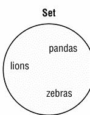

`TreeSet`将其元素存储在排序的树结构中。它的主要优点是该集合始终是有序的。缺点是，添加元素和检查元素是否存在的时间比`HashSet`更长，尤其是当树的规模变大时。

图9.4展示了你可以如何设想`HashSet`和`TreeSet`的存储方式。在现实中，`HashSet`更复杂，但对于考试目的来说，这足够了。

### 图9.4 HashSet和TreeSet示例

| `hashCode()`值 | 数据 |
| --- | --- |
| -995544615 | pandas |
| ... | ... |
| -705903059 | zebras |
| | lions |

对于考试，你不需要知道如何创建哈希集合或树集合（其实现可能非常复杂）。呼！你只需要知道如何使用它们即可！

### 使用Set方法

就像`List`一样，你可以用一行代码创建一个不可变的集合（`Set`），或者制作一个现有集合的副本。

```
Set<Character> letters = Set.of('z', 'o', 'o');
Set<Character> copy = Set.copyOf(letters);
```

这些就是你考试针对`Set`接口需要掌握的所有方法！你需要知道集合相对于`Collection`方法的行为表现。你还必须知道不同类型集合之间的区别。让我们从`HashSet`开始：

```
3: Set<Integer> set = new HashSet<>();

4: boolean b1 = set.add(66); // true

5: boolean b2 = set.add(10); // true

6: boolean b3 = set.add(66); // false

7: boolean b4 = set.add(8); // true

8: set.forEach(System.out::println);
```

这段代码打印了三行：

```
66
8
10
```

`add()`方法应该是很直观的。如果`Integer`已经在集合中，则返回true。第6行返回false，因为集合中已经有了66，而且集合必须保持唯一性。第8行以任意顺序打印集合中的元素。在这种情况下，它们恰恰不是按照我们添加元素的顺序排序的。记住，`equals()`方法被用于判断相等性。`hashCode`方法用于确定应该查找哪个桶（bucket），这样Java就不必遍历整个集合来确定对象是否存在。最好的情况是哈希值是唯一的，Java只需要对一个对象调用`equals()`。最坏的情况是所有实现都返回相同的`hashCode()`，Java必须对集合中的每个元素都调用`equals()`。

现在我们来看`TreeSet`的示例：

```
3: Set<Integer> set = new TreeSet<>();

4: boolean b1 = set.add(66); // true

5: boolean b2 = set.add(10); // true

6: boolean b3 = set.add(66); // false

7: boolean b4 = set.add(8); // true

8: set.forEach(System.out::println);
```

这段代码打印了以下内容：

```
8
10
66
```

元素按照它们的自然排序顺序打印。数字在Java中实现了`Comparable`接口，该接口用于排序。在章节后面的部分，你将学习如何创建自己的`Comparable`对象。

## 使用Queue和Deque接口

当元素按照特定顺序添加和移除时，你就使用队列（queue）。你可以将队列想象成一条队。例如，当你想要进入体育馆而有人在排队时，你就站在那个人后面。如果你是英国人，你就会排在那个人后面，这非常容易记忆！这是一个FIFO（先进先出）队列。

`Deque`（双端队列，通常读作"deck"）与普通队列不同。它允许从两端进行插入和移除。你可以将其想象成一个双端的队列，正如图9.5所示。

### Deque的实现

`Deque`提供了多种实现，最常用的是`LinkedList`和`ArrayDeque`。`LinkedList`也实现了`List`和`Queue`接口，而`ArrayDeque`则只实现了`Deque`。在大多数栈操作场景中，`ArrayDeque`通常比`LinkedList`更高效。

### 与Deque交互

`Deque`接口提供了许多方法，用于从两端操作元素。这些方法分为两类：一类在队列为空时会抛出异常，另一类则会返回`null`。例如，`addFirst()`、`addLast()`、`removeFirst()`和`removeLast()`会抛出异常，而`pollFirst()`、`pollLast()`、`peekFirst()`和`peekLast()`则会返回`null`。

### Deque方法

`Deque`接口提供了许多方法，用于从两端操作元素。这些方法分为两类：一类在队列为空时会抛出异常，另一类则会返回`null`。例如，`addFirst()`、`addLast()`、`removeFirst()`和`removeLast()`会抛出异常，而`pollFirst()`、`pollLast()`、`peekFirst()`和`peekLast()`则会返回`null`。

### 比较Deque实现

`Deque`提供了多种实现，最常用的是`LinkedList`和`ArrayDeque`。`LinkedList`也实现了`List`和`Queue`接口，而`ArrayDeque`则只实现了`Deque`。在大多数栈操作场景中，`ArrayDeque`通常比`LinkedList`更高效。

### 将Deque作为栈

由于`Deque`提供了`push`、`pop`和`peek`方法，它可以非常适合用作栈（stack）虽然虽然Java有一个专门的`Stack`类，但由于其设计缺陷（继承自`Vector`），现在更推荐使用`Deque`。

### 图9.7 操作栈

```
13: stack.push(10);

14: stack.push(4);

15: stack.peek(); // 4

16: stack.poll(); // 4

17: stack.poll(); // 10

18: stack.peek(); // null
```

## 使用Map接口

当你想要通过键（key）来标识值（value）时，你就可以使用`Map`。例如，当你使用手机中的联系列表时，你查找的是"George"，而不是按顺序查找电话号码。

你可以将`Map`想象如图9.8所示。你不需要知道不同map实现的特定接口名称，但你需要知道`TreeMap`是排序的。

### 图9.8 Map示例

| 键 (Key) | 值 (Value) |
|---|---|
| George | 555-555-5555 |
| May | 777-777-7777 |

所有`Map`类的共同点是它们都拥有键和值。除此之外，它们提供了不同的功能。我们来看需要了解的实现以及可用的方法。

```
Map.of() and Map.copyOf()
```

就像`List`和`Set`一样，有一个工厂方法来创建`Map`。你可以传递任意数量的键值对。

```
Map.of("key1", "value1", "key2", "value2");
```

与`List`和`Set`不同，这种方式并不理想。传递键和值更难读，因为你必须记住哪个参数对应哪个值。幸运的是，有一种更好的方法。`Map`还提供了一个方法，让你提供键/值对。

```
Map.entries(
Map.entry("key1", "value1"),
Map.entry("key2", "value2"));
```


现在我们不能忘记传递一个值。如果我们漏掉一个参数，`entry()` 方法将无法编译。方便的是，`Map.copyOf(map)` 的工作原理类似于 `List` 和 `Set` 接口的 `copyOf()`。

## 比较 Map 实现

`HashMap` 将键存储在哈希表中。这意味着它使用键的 `hashCode()` 方法来更高效地检索它们的值。

主要的优点是添加元素和通过键检索元素都是常数时间。代价是，你失去了插入元素的顺序。大多数情况下，你在 map 中并不关心这一点。如果你在乎，可以使用 `LinkedHashMap`。

`TreeMap` 将键存储在排序的树结构中。主要的优点是键始终处于排序状态。与 `TreeSet` 类似，代价是只要树在增长，添加和检查某个键是否存在都是可能的。

## 操作 Map 方法

由于 `Map` 没有继承 `Collection`，因此在 `Map` 接口上指定了更多方法。由于既有键又有值，我们需要对两者都使用泛型参数。该类使用 `K` 表示键，使用 `V` 表示值。考试需要掌握的方法在表 9.6 中。某些方法签名被简化了以便更于理解。

### 表 9.6 Map 方法

| 方法 | 描述 |
| --- | --- |
| `public void clear()` | 从 map 中移除所有键和值。 |
| `public boolean containsKey(Object key)` | 返回键是否在 map 中。 |
| `public boolean containsValue(Object value)` | 返回值是否在 map 中。 |
| `public Set<Map.Entry<K,V>> entrySet()` | 返回键/值对的 `Set`。 |

### 使用 Map 接口

| 方法 | 描述 |
| --- | --- |
| `public void forEach(BiConsumer<K> key, V value)` | 遍历每个键/值对。 |
| `public V get(Object key)` | 返回键映射的值，如果没有映射，则返回 `null`。 |
| `public V getOrDefault(Object key, V defaultValue)` | 返回键映射的值，如果没有映射，则返回默认值。 |
| `boolean isEmpty()` | 返回 map 是否为空。 |
| `public Set<K> keySet()` | 返回所有键的集合。 |
| `public V merge(K key, V value, Function<V, V, V> func)` | 如果键已设置，则设置值。如果键已设置，则运行函数以确定新值。如果值为 `null`，则移除该值。 |
| `public V put(K key, V value)` | 添加或替换键/值对。返回之前的值或如果没有之前没有值则返回 `null`。 |
| `public V putIfAbsent(K key, V value)` | 如果键不存在，则添加值并返回 `null`。否则，返回已存在的值。 |
| `public V remove(Object key)` | 移除并返回与键映射的值。如果没有，则返回 `null`。 |
| `public V replace(K key, V value)` | 如果键已设置，则返回给定键的值。如果没有，则返回原始值或 `null`。 |
| `public void replaceAll(BiFunction<K, V, V> func)` | 用函数的结果替换每个值。 |
| `public int size()` | 返回条目（键/值对）的数量。 |
| `public Collection<V> values()` | 返回所有值的集合。 |

Map 类的共同点是它们都拥有键和值。除此之外，它们提供了不同的功能。我们来看需要了解的实现以及可用的方法。

### 基础方法

```java
Map<String, String> map = new HashMap<>();

map.put("George", "555-555-5555");

map.put("May", "777-777-7777");

for (Map.Entry<String, String> entry : map.entrySet()) {

    System.out.println(entry.getKey() + ": " + entry.getValue());

}
```

## 使用 Map 接口

```java
13: Map<String, String> favorites = new HashMap<>();
14: favorites.put("Jenny", "Bus Tour");
15: favorites.put("Tom", "Tram");
16:
17: String jenny = favorites.merge("Jenny", "Skyride", mapper);
18: String tom = favorites.merge("Tom", "Skyride", mapper);
19:
20: System.out.println(favorites); // {Tom=Skyride, Jenny=Bus Tour}
21: System.out.println(jenny); // Bus Tour
22: System.out.println(tom); // Skyride
```

第 11 和 12 行的代码接收两个参数并返回一个值。我们的实现返回名称最长的值。第 18 行调用了这个映射函数，它发现 `Bus Tour` 比 `Skyride` 长，因此保留值为 `Bus Tour`。第 19 行调用了该映射函数，由于 `Tom` 比 `Skyride` 短，因此更新了 map。第 21 行打印了新的 map。第 22 和 23 行显示了结果是从 `merge()` 返回的。

`merge()` 方法还处理了当涉及空值或键缺失时的逻辑。在这种情况下，它完全不会调用 `BiFunction`，直接使用新值。

```java
BiFunction<String, String> mapper = (v1, v2) -> v1.length() < v2.length() ? v1 : v2;

Map<String, String> favorites = new HashMap<>();

favorites.put("Sam", null);

favorites.merge("Tom", "Skyride", mapper);

favorites.merge("Sam", "Skyride", mapper);

System.out.println(favorites); // {Tom=Skyride, Sam=Skyride}
```

注意，映射函数没有被调用。如果调用了，将会抛出 `NullPointerException`。映射函数只有在有两个实际值进行决策时才会被使用。

关于 `merge()` 需要的最后一点是映射函数被调用并返回 `null` 时会发生什么。发生这种情况时，键会从 map 中移除：

```java
BiFunction<String, String> mapper = (v1, v2) -> null;

Map<String, String> favorites = new HashMap<>();

favorites.put("Jenny", "Bus Tour");

favorites.put("Tom", "Bus Tour");

favorites.merge("Jenny", "Skyride", mapper);

favorites.merge("Sam", "Skyride", mapper);

System.out.println(favorites); // {Tom=Bus Tour, Sam=Skyride}
```

由于该键没有调用 `merge()`，因此 `Tom` 被留在原处。由于该键不在原始列表中，因此 `Sam` 被添加了。由于映射函数返回了 `null`，`Jenny` 被删除了。

表 9.7 显示了所有场景作为参考。

### 表 9.7 `merge()` 方法的行为

| 如果请求的键 | 且映射函数返回 | 则 |
| --- | --- | --- |
| 在 map 中有一个空值 | N/A (未调用映射函数) | 使用 `value` 参数更新 map 中键的值 |
| 在 map 中有一个非空值 | `null` | 从 map 中移除键 |
| 在 map 中有一个非空值 | 一个非空值 | 将键置为映射函数的结果 |
| 不在 map 中 | N/A (未调用映射函数) | 直接将带有 `value` 参数的键添加到 map 中，不调用映射函数 |

## 比较集合类型

我们通过对所有集合类进行复习结束本节。确保你可以凭记忆填写表 9.8 来比较这四种集合。

### 表 9.8 Java 集合框架类型

| 类型 | 是否可以包含元素？ | 元素始终有序吗？ | 是否有键和值？ | 必须按特定顺序添加/删除？ |
| --- | --- | --- | --- | --- |
| `List` | 是 | 是（通过索引） | 否 | 否 |
| `Map` | 是（针对值） | 否 | 是 | 否 |
| `Queue` | 是 | 是（按定义顺序检索） | 否 | 是 |
| `Set` | 否 | 否 | 否 | 否 |

此外，确保你可以填写表 9.9 在考试中描述这些类型。

### 表 9.9 集合属性

| 类型 | Java 集合框架接口 | 排序的？ | `hashCode`? | `compareTo`? |
| --- | --- | --- | --- | --- |
| `ArrayDeque` | `Deque` | 否 | 否 | 否 |
| `ArrayList` | `List` | 否 | 否 | 否 |
| `HashMap` | `Map` | 否 | 是 | 否 |
| `HashSet` | `Set` | 否 | 是 | 否 |
| `LinkedList` | `List`, `Deque` | 否 | 否 | 否 |
| `TreeMap` | `Map` | 是 | 否 | 是 |
| `TreeSet` | `Set` | 是 | 否 | 是 |

接下来，考试要求你了解哪些数据结构允许空值。涉及排序的结构不允许空值。

最后，考试期望你能够根据问题的描述选择正确的集合。我们建议首先识别问题涉及哪种类型的集合。

> **真实世界场景**
> **旧版集合**
> 有一些现在已少使用的集合：
> - `Vector`: 实现 `List`
> - `Hashtable`: 实现 `Map`
> - `Stack`: 实现 `Queue`

## 排序数据

`Duck` 类重写了 `toString()` 方法，我们在第 8 章中描述过。该重写在打印 ducks 时提供了有用的输出。如果没有这个重写，输出将类似于 `[Duck@7de4ae4, Duck@5c647e85]`。

### 创建 `Comparable`

`Duck` 类实现了 `compareTo()`。由于 `Duck` 的 `name` 是 `String` 对象，而 `String` 类已经有了 `compareTo()` 方法，它可以可以直接委托。

```java
import java.util.*;

public class Duck implements Comparable<Duck> {

    private String name;

    public Duck(String name) {

        this.name = name;

    }

    public String toString() { // 有用的输出

        return name;

    }

}
```

```java
public int compareTo(Duck d) {

    return name.compareTo(d.name); // 按名称升序排序

}

public static void main(String[] args) {

    var ducks = new ArrayList<Duck>();

    ducks.add(new Duck("Quack"));

    ducks.add(new Duck("Puddles"));

    Collections.sort(ducks); // 按名称排序

    System.out.println(ducks); // [Puddles, Quack]

}
```

如果不实现此接口，我们只有一个名为 `compareTo()` 的方法，但它不是一个 `Comparable` 对象。我们可以为 `T` 实现 `Comparable<Object>` 或其他类，但对于排序一组 `Duck` 对象来说将没有用处。

让我们来看一个比较名称而不是 `String` 对象的 `compareTo()` 实现：

```java
public class Animal implements Comparable<Animal> {

    private int id;

    public int compareTo(Animal a) {

        return id - a.id; // 按 id 升序排序

    }

}
```

```java
8: var a2 = new Animal();
9: a1.id = 5;
10: a2.id = 7;
11: System.out.println(a1.compareTo(a2)); // -2
12: System.out.println(a1.compareTo(a1)); // 0
13: System.out.println(a2.compareTo(a1)); // 2
```

第 7 和 8 行创建了两个 `Animal` 对象。第 9 和 10 行设置了它们的 id 值。这不是设置身份引用的好方法。使用构造函数或 setter 方法更好。由于示例展示了非传统的代码以确保你理解规则，我们为了好玩加入了一些非传统的代码。

第 3–5 行展示了比较两个值的一种方法。你可以使用 `Integer.compare(id, a.id)`。请确保你能够识别这两种方法。

> 记住 `id - a.id` 是升序排序，而 `a.id - id` 是降序排序。

第 11–13 行确认了我们正确实现了 `compareTo()`。第 11 行比较一个较小的和一个较大的对象，因此返回一个负数。第 12 行比较 id 相同的对象，因此打印 0。第 13 行比较一个较大的和一个较小的对象，因此返回一个正数。

### 对 `compareTo()` 参数进行强制转换

在处理旧代码或不使用泛型的代码时，`compareTo()` 方法需要强制转换，因为传递的是一个 `Object`。

```java
public class LegacyDuck implements Comparable {

    private String name;

    public int compareTo(Object obj) {

        LegacyDuck d = (LegacyDuck) obj; // 因为没有泛型所以强制转换
```


`return name.compareTo(d.name);`

当我们没有为`Comparable`指定泛型类型时，Java 假设我们想要一个`Object`，这意味着在访问其实例变量之前，我们必须强制转换为`LegacyDuck`。

## 检查 null

在本章中处理`Comparable`和`Comparator`时，我们倾向于假设数据是有值的，但情况并非总是如此。在编写自己的方法时，如果数据没有预先验证，你应该在比较之前对其进行检查。

```java
public class MissingDuck implements Comparable<MissingDuck> {
    private String name;

    public int compareTo(MissingDuck duck) {
        if (duck == null)
            throw new IllegalArgumentException("Poorly formed duck!");
        if (this.name == null && duck.name == null)
            return 0;
        else if (this.name == null) return -1;
        else if (duck.name == null) return 1;
        else return this.name.compareTo(duck.name);
    }
}
```

如果传递了一个 null 的`MissingDuck`对象，此方法将抛出异常。那么排序呢？如果鸭子的名字为 null，它将会被排序。

## 保持 compareTo() 和 equals() 一致

如果你编写了一个实现`Comparable`的类，你就引入了确定等效性的新业务逻辑。`compareTo()`方法在两个对象相等时返回零，而你的`equals()`方法在两个对象相等时返回`true`。一个使用`compareTo()`的自然排序，当且仅当`x.compareTo(y)`等于零时`equals(y)`为真，则称该排序与`equals`一致。

同样，当`x.compareTo(y)`不为 0 时，`x.equals(y)`必须为`false`。强烈建议让你的`Comparable`类与`equals`一致，因为如果`compareTo()`和`equals()`方法一致，并不是所有的集合行为都是可预测的。

例如，下面的`Product`类定义了一个与`equals`不一致的`compareTo()`方法：

```java
public class Product implements Comparable<Product> {
    private int id;
    private String name;

    public int hashCode() { return id; }

    public boolean equals(Object obj) {
        if(!(obj instanceof Product)) return false;
        var other = (Product) obj;
        return this.id == other.id;
    }

    public int compareTo(Product obj) {
        return this.name.compareTo(obj.name);
    }
}
```

你可能通过`name`对`Product`对象进行排序，但名字并不是唯一的。`compareTo()`方法与`equals`不一致。解决此问题的方法是在其他处使用`Comparator`。

现在你已经知道如何实现`Comparable`对象，让我们来看看`Comparator`并关注差异。

## 使用 Comparator 比较

有时你想对没有实现`Comparable`的对象进行排序，或者你想以不同的方式排序。假设我们在`Duck`类中添加了`weight`。我们有：

```java
import java.util.ArrayList;
import java.util.Collections;
import java.util.Comparator;

public class Duck implements Comparable<Duck> {
    private String name;
    private int weight;

    // 假设提供了 getters/setters/constructors
    public String toString() { return name; }

    public int compareTo(Duck d) {
        return name.compareTo(d.name);
    }

    public static void main(String[] args) {
        ArrayList<Duck> ducks = new ArrayList<>();
        Comparator<Duck> byWeight = new Comparator<Duck>() {
            public int compare(Duck d1, Duck d2) {
                return d1.weight - d2.weight;
            }
        };
        // ...
    }
}
```

等等，让我重新对齐上方代码块的 OCR 文本，因为结尾是乱的。根据上下文重构：

```java
import java.util.ArrayList;
import java.util.Collections;
import java.util.Comparator;

public class Duck implements Comparable<Duck> {
    private String name;
    private int weight;

    // 假设提供了 getters/setters/constructors
    public String toString() { return name; }

    public int compareTo(Duck d) {
        return name.compareTo(d.name);
    }

    public static void main(String[] args) {
        ArrayList<Duck> ducks = new ArrayList<>();
        Comparator<Duck> byWeight = new Comparator<Duck>() {
            public int compare(Duck d1, Duck d2) {
                return d1.weight - d2.weight;
            }
        };
        // ...
    }
}
```

实际上，提供的该块结尾的 OCR 文本是破碎的。让我们尽可能遵循 OCR 文本并修复结构：

```java
Comparator<Duck> byWeight = new Comparator<Duck>() {
    public int compare(Duck d1, Duck d2) {
        return d1.weight - d2.weight;
    }
};

ArrayList<Duck> ducks = new ArrayList<>();
ducks.add(new Duck("Quack", 10));
ducks.add(new Duck("Puddles", 5));
Collections.sort(ducks, byWeight);
System.out.println(ducks);
```

等等，查看页面结尾的原始 OCR：
`26: Collections.sort(ducks);`
`27: System.out.println(ducks);`
`28: }`
`29: }`
`30: )`
`31: ```

让我们根据文本流提供一个清晰的版本：

## 排序数据

首先注意我们可以使用 lambda 表达式。如果我们想根据某些内容排序，可以使用 lambda：

```java
Comparator<Duck> byWeight = (d1, d2) -> d1.weight - d2.weight;
```

或者，我们可以使用方法引用来指定我们要排序：

```java
Comparator<Duck> byWeight = Comparator.comparing(Duck::getWeight);
```

在这个示例中，`Comparator.comparing()`是一个根据方法引用创建`Comparator`的静态方法。很方便，不是吗？

## Comparator 是函数式接口吗？

我们说`Comparator`是函数式接口，因为它只有一个抽象方法。`Comparator`也是函数式接口，因为它也只有一个抽象方法。然而，为`Comparable`使用 lambda 是愚蠢的。`Comparator`的意义是在被比较对象之外实现它。

## 比较 Comparable 和 Comparator

`Comparable`和`Comparator`之间有几处区别。我们在表 9.10 中列出了它们。

### 表 9.10 Comparable 与 Comparator 的比较

| 区别 | Comparable | Comparator |
| --- | --- | --- |
| 包名 | java.lang | java.util |
| 类必须实现接口 | 是 | 否 |
| 接口方法名 | compareTo() | compare() |
| 参数个数 | 1 | 2 |
| 常使用 lambda 定义 | 否 | 是 |

记住这张表——真的。考试会通过混淆两者来试图为你——如果你能发现的话。你看到为什么这不能编译了吗？

```java
var byWeight = new Comparator<Duck>() { // 不能编译
    public int compareTo(Duck d1, Duck d2) {
        return d1.weight - d2.weight;
    }
}
```

方法名错误。`Comparator`必须实现名为`compare()`的方法。当问题中出现`Comparable`和`Comparator`时，特别注意方法名和参数个数。

## 比较多个字段

在编写比较多个实例变量的`Comparator`时，代码变得有点混乱。假设我们有一个所示的`Squirrel`类：

```java
public class Squirrel {
    private int weight;
    private String species;
    // 假设提供了 getters/setters/constructors
}
```

我们想写一个按物种名称排序的 Comparator。如果松鼠属于同一物种，我们想先对重量最小的排序。可以使用如下代码来实现：

```java
public class MultiFieldComparator implements Comparator<Squirrel> {
    public int compare(Squirrel s1, Squirrel s2) {
        int result = s1.getSpecies().compareTo(s2.getSpecies());
        if (result != 0) return result;
        return s1.getWeight()-s2.getWeight();
    }
}
```

这种方法假设没有物种名称为 null。它会检查一个字段。如果它们不匹配，排序就完成了。如果它们匹配，它会移动到下一个字段。尽管这样并不易于阅读，但按重量排序很方便。更改`! != ==`会完全破坏排序。

或者，我们可以使用方法引用并构建`Comparator`。这段代码代表了相同比较器的相同逻辑：

```java
Comparator<Squirrel> c = Comparator.comparing(Squirrel::getSpecies)
    .thenComparingInt(Squirrel::getWeight);
```

这一次，我们可以按重量排序。首先，我们创建一个按物种升序的`Comparator`，如果有相等，则按重量排序。我们也可以进行降序排序。Comparator 某些方法（如`thenComparingInt()`）是默认方法。

假设我们按物种降序排序。

`var c = Comparator.comparing(Squirrel::getSpecies).reversed();`

表 9.11 显示了构建`Comparator`时你应该了解的辅助方法。我们省略了参数类型，以便你专注于方法本身。我们使用了许多你在上一章中学过的函数式接口。

## TABLE 9.11 用于构建 Comparator 的辅助静态方法

| 方法 | 说明 |
|---|---|
| comparing(function) | 按返回任何 Object（基本类型自动装箱为 Object）的函数结果进行比较 |
| comparingDouble(function) | 按返回 double 的函数结果进行比较。 |
| comparingInt(function) | 按返回 int 的函数结果进行比较。 |
| comparingLong(function) | 按返回 long 的函数结果进行比较。 |
| naturalOrder() | 使用对象本身实现的`Comparable`实现所指定的顺序进行排序。 |
| reverseOrder() | 使用对象本身实现的`Comparable`实现所指定的顺序的反向顺序进行排序。 |

表 9.12 显示了你可以链式调用到`Comparator`上以进一步指定其行为的方法。

## TABLE 9.12 用于构建 Comparator 的辅助默认方法

| 方法 | 说明 |
| --- | --- |
| reversed() | 反转链式`Comparator`的顺序。 |
| thenComparing(function) | 如果之前的`Comparator`返回零，则使用这个返回 Object 或可自动装箱为 Object 的比较器。 |
| thenComparingDouble(function) | 如果之前的`Comparator`返回零，使用这个返回 double 的比较器。否则，返回上一个`Comparator`的值。 |
| thenComparingInt(function) | 如果之前的`Comparator`返回零，使用这个返回 int 的比较器。否则，返回上一个`Comparator`的值。 |
| thenComparingLong(function) | 如果之前的`Comparator`返回零，使用这个返回 long 的比较器。否则，返回上一个`Comparator`的值。 |

> 注意 你可能已经注意到我们在检查相等和比较对象时经常忽略 null 值。这对于考试来说很好。但在现实世界中，情况并不那么简单。你必须决定如何处理 null 值或防止它们出现在你的对象中。

# 排序与搜索

现在你已经学习了所有的`Comparable`和`Comparator`，我们终于可以使用它们做一些有用的事情了，比如排序。`Collections.sort()`方法使用`compareTo()`方法进行排序。它期望排序的对象必须实现`Comparable`。

```java
public class SortRabbit {
    static record Rabbit(int id) {}

    public static void main(String[] args) {
        List<Rabbit> rabbits = new ArrayList<>();
        rabbits.add(new Rabbit(3));
        rabbits.add(new Rabbit(1));
        Collections.sort(rabbits); // 无法编译
    }
}
```

# 数据排序

Java 知道`Rabbit`记录没有实现`Comparable`。它知道排序会失败，因此不让代码编译。你可以通过传递`Comparator`来修复此。当你想要在不使用`compareTo()`方法的情况下指定顺序时，`Comparator`是非常有用的。

```java
8: Comparator<Rabbit> c = (r1, r2) -> r1.id - r2.id;
9: Collections.sort(rabbits, c);
```

你想降序排序`rabbits`。你可以在`sort()`之后反转列表的内容：


```java
8: Comparator<Rabbit> c = (r1, r2) -> r2.id - r1.id;
9: Collections.sort(rabbits, c);
10: System.out.println(rabbits); // [Rabbit[id=3], Rabbit[id=1]]
```

`sort()` 和 `binarySearch()` 方法允许在你不想使用自然顺序时传入 `Comparator`。

# 复习 binarySearch()

`binarySearch()` 方法需要一个排序后的 `List`。

```java
11: List<Integer> list = Arrays.asList(6, 9, 1);
12: Collections.sort(list); // [1, 6, 9]
13: System.out.println(binarySearch(list, 6)); // 1
14: // 3 // // -2
```

第 12 行对 `List` 进行了排序，以便我们可以正确地调用二分搜索。第 13 行打印匹配项的索引。第 14 行返回需要插入值的索引减一。使用 `binarySearch()` 时有一个技巧。你认为以下输出是什么？

```java
3: var names = Arrays.asList("Fluffy", "Hoppy");
4: Comparator<String> c = Comparator.reverseOrder();
5: var index = Collections.binarySearch(names, "Hoppy", c);
6: System.out.println(index);
```

答案恰好是 -1。在崩溃之前，你不需要知道答案是 -1。第 3 行创建了 `[Fluffy, Hoppy]`。这个列表恰好是升序的。第 4 行创建了一个反转自然顺序的 `Comparator`。第 5 行请求降序二分搜索。由于列表没有顺序，你不符合搜索的前提条件。

在未排序的列表上调用 `binarySearch()` 的结果是未定义的，有时运气很好。例如，搜索从奇数列表的中间开始。如果你正好询问中间元素，返回的索引将是你预期的。在本章早期，我们讨论了在类类实现 `Comparable` 的集合。回到我们实现 `Comparable` 的 `Rabbit`，我们尝试将其添加到 `TreeSet`：

```java
public class UseTreeSet {
  static class Rabbit{int id; }
  public static void main(String[] args) {
    Set<Duck> ducks = new TreeSet<>();
    ducks.add(new Duck("Puddles"));
    Set<Rabbit> rabbits = new TreeSet<>();
    rabbits.add(new Rabbit()); // ClassCastException
  }
}
```

第 6 行是好的。`Duck` 实现 `Comparable`。`TreeSet` 能够将其排序到集合中的正确位置。第 9 行有问题。当 `TreeSet` 尝试对其排序时，Java 发现 `Rabbit` 没有实现 `Comparable`。Java 抛出了如下异常：

`Exception in thread "main" java.lang.ClassCastException: Rabbit cannot be cast to class java.lang.Comparable`

在向对象添加到集合时抛出此异常似乎很奇怪。毕竟，还没有东西可以比较。Java 为了一致性这样做。

就像搜索和排序一样，你可以告诉需要排序的集合你想使用特定的 `Comparator`。例如：

```java
Set<Rabbit> rabbits = new TreeSet<>((r1, r2) -> r1.id - r2.id);
rabbits.add(new Rabbit());
```

现在 Java 知道你想按 `id` 排序，一切正常。`Comparator` 是一个辅助对象。它让你将排序顺序与待排序的对象分开。注意之前两个示例中的第 9 行是相同的。改变的是 `TreeSet` 的声明。

# 排序 List

虽然你可以 `Collections.sort(list)`，你也可以直接在列表对象上排序。

```java
3: List<String> bunnies = new ArrayList<>();
4: bunnies.add("long ear");
5: bunnies.add("floppy");
6: bunnies.add("hoppy");
7: System.out.println(bunnies) // [long ear, floppy, hoppy]
8: bunnies.sort((b1, b2) -> b1.compareTo(b2))
9: System.out.println(bunnies) // [floppy, hoppy, long ear]
```

在第 8 行，我们按字母顺序排序列表。`sort()` 方法接受提供排序顺序的 `Comparator`。记住 `Comparator` 接受两个参数并返回一个 `int`。如果你需要复习 `compare()` 操作的返回值，请检查本章的 `Comparator` 部分或第 4 章“核心 API”中的“比较”部分。这非常重要！

`Set` 或 `Map` 没有排序方法。这两个都是无序的，所以对它们进行排序没有意义。

# 使用泛型

我们用 Java 语言中最有用、有时最令人困惑的功能之一：泛型来结束本章。事实上，我们在最后两个章节中已经大量使用了它们——`<>` 之间的类型。为什么我们需要泛型？假设如果我们没有指定列表的类型，而仅仅希望调用者不要放入我们没有预期的东西。以下就是：

```java
static void printNames(List list) {
    for (int i = 0; i < list.size(); i++) {
        String name = (String) list.get(i); // ClassCastException
        System.out.println(name);
    }
}
public static void main(String[] args) {
    List names = new ArrayList();
    names.add(new StringBuilder("Webby"));
    printNames(names);
}
```

这段代码会抛出 `ClassCastException`。第 22 行将一个 `StringBuilder` 添加到列表中。这是合法的；非泛型列表可以包含任何内容。然而，第 16 行的编写预期其中包含一个特定的类。它将其强制转换为 `String`，这反映了这一假设。由于该假设是错误的，代码抛出了 `ClassCastException`，因为 `java.lang.StringBuilder` 无法转换为 `java.lang.String`。

泛型通过允许你编写和使用参数化类型解决了这个问题。由于我们指定了想要一个包含 `String` 对象的 `ArrayList<String>`，编译器从源上防止了此类问题的发生。

```java
List<String> names = new ArrayList<String>();
names.add(new StringBuilder("Webby")); // 无法编译
```

得到编译错误是好事。你会立刻发现出了错了，而不是寄希望于之后才发现它。

## 创建泛型类

你可以在自己的类中引入泛型。引入泛型的语法是在角括号中声明一个类型参数。例如，以下名为 `Crate` 的类在类名之后声明了一个泛型类型变量：

```java
public class Crate<T> {
    private T contents;
    public T lookInCrate() {
        return contents;
    }

    public void packCrate(T contents) {
        this.contents = contents;
    }
}
```

泛型类型 `T` 在 `Crate` 类中任何地方都可用。当你实例化该类时，你告诉编译器对于该特定实例 `T` 应该是什么。

| 泛型的命名规范 |
| :--- |
| 类型参数可以命名为任何你。惯例是使用单个大写字母，以明显地表明它们不是真实的类名。以下是常用的字母： |
| * E 代表元素 (element) |
| * K 代表映射的键 (map key) |

## 使用泛型

- V 代表映射的值 (value)
- N 代表数字 (number)
- T 代表泛型数据类型
- S, U, V 等代表多个泛型类型

例如，假设存在一个 `Elephant` 类，我们正把大象移到动物园一个新的更大的围圈（圣地亚哥动物园在 2009 年这样做过。看到那个大金属箱很有趣）。

```java
Elephant elephant = new Elephant();
Crate<Elephant> crateForElephant = new Crate<Elephant>();
crateForElephant.packCrate(elephant);
Elephant inNewline = elephant.lookInCrate();
```

公平地说，与其说我们把大象装进箱子里，不如说是大象自己走进去的。然而，你可以看到 `Crate` 类能够在了解关于 `Elephant` 任何信息的情况下处理它。

这看起来并没有特别了不起。我们在编码时本可以直接写出具体的类型而不是使用 `T`。如果我们想为另一种动物创建一个 `Crate` 呢？

```java
Crate<Zebra> crateForZebra = new Crate<Zebra>();
```

现在我们不能简单地在 `Crate` 类中硬编码 `Elephant` 了，因为 `Zebra` 不是 `Elephant`。但是，我们可以创建一个 `Animal` 超类或接口，并在 `crate` 中使用它。

当用作类型参数的类之间彼此毫无关系时，泛型类就变得有用了。例如，我们需要把这个 120 磅的机器人运到另一个城市：

```java
Robot joeBot = new Robot();
Crate<Robot> robotC = new Crate<Robot>();
robotC.packCrate(joeBot);
```

```java
// 运到休斯顿
Robot atDestination = robotC.lookInCrate();
```

现在开始变得有趣了。这个类可以与任何类型的类配合。在泛型出现之前，我们需要 `Crate` 使用 `Object` 类作为其实例变量，这会将负担推给调用者，让他们通过更改箱子的类型来获取接收到的对象。

除了 `Crate` 需要知道放入其中的对象外，这些对象本身也不需要知道 `Crate`。我们没有要求对象实现名为 `Crateable` 或类似的接口。任何类都可以在不进行任何更改的情况下放入 `Crate`。

## 第 9 章 • 集合与泛型

如果你想不出属于自己的泛型类的用途，请不要担心。除非你正在编写一个供他人使用的库，否则泛型几乎不会出现在你写的类定义中。你已经已经在调用的代码中经常看到它们，例如函数式接口和集合。

泛型类并不限于只能有一个类型参数。这个类展示了泛型参数：

```java
public class SizeLimitedCrate<T, U> {
  private T contents;
  private U sizeLimit;
  public SizeLimitedCrate(T contents, U sizeLimit) {
    this.contents = contents;
    this.sizeLimit = sizeLimit;
  }
}
```

`T` 代表我们放入箱子的类型。`U` 代表我们用于测量箱子最大尺寸的单位。要使用这个泛型类，我们可以写：

```java
Elephant elephant = new Elephant();
Integer numPounds = 15_000;
SizeLimitedCrate<Elephant, Integer> c1 = new SizeLimitedCrate<>(elephant, numPounds);
```

在这里我们指定了类型为 `Elephant`，单位为 `Integer`。我们还提醒一下，数字字面量包含下划线。

## 理解类型擦除

指定泛型类型允许编译器强制正确使用泛型类型。例如，将 `Crate` 的泛型类型指定为 `Robot` 是将 `Crate` 类中的 `T` 替换为 `Robot`。然而，这是编译时的。

在背后，泛型类型被擦除了。编译器会将类型参数替换为 `Object`（或相应的边界）。

```java
public class Crate {
    private Object contents;
    public Object lookInCrate() {
        return contents;
    }

    public void packCrate(Object contents) {
        this.contents = contents;
    }
}
```

# 实现泛型接口

与类一样，接口也可以声明形式类型参数。例如，下面的 `Shippable` 接口使用泛型类型作为其 `ship()` 方法的参数：

```java
public interface Shippable<T> {
    void ship(T t);
}
```

有三种方式可以通过类来实现此接口。第一种是在类中指定泛型类型。下面的具体类表示它只处理机器人。这声明了一个带有 `Robot` 参数的 `ship()` 方法：

```java
class ShippableRobotCrate implements Shippable<Robot> {
    public void ship(Robot t) {}
}
```

下一种方法是创建一个泛型类。下面的具体类允许调用者指定泛型的类型：

```java
class ShippableabstractCrate<U> implements Shippable<U> {
    public void ship(U t) {}
}
```

在这个示例中，类型参数可以是任何类型，包括 `T`。我们在示例中使用 `U` 是为了避免对 `T` 指代什么产生混淆。考试不会使用相同的类型参数名称来困扰你。

最后一种方法是完全不使用泛型。这是编写代码的旧方法。它会生成关于 `Shippable` 是原始类型（raw type）的编译器警告，但它可以编译。在这里，由于没有定义泛型类型，`ship()` 方法有一个 `Object` 参数：

```java
class ShippableCrate implements Shippable {
    public void ship(Object t) {}
}
```

## 现实世界场景

泛型类型无法做的事

泛型类型所能做的事情有一些局限性。这些不会出现在考试中，但当你编写练习程序并遇到这些情况之一时，参考此场景将会有帮助。

- 将运行时无法完全获取信息的类型作为*可重化的 (reifiable)*。

大多数局限性都是由于类型擦除。Oracle 将运行时可以完全获取信息的类型称为*可重化的 (reifiable)*。可重化的类型可以执行 Java 允许任何操作。非可重化的类型有一些局限性。

# 第 9 章 • 集合与泛型

以下是泛型无法做的事情（我们说的“不能”，是指在不诉诸类对象等扭曲的情况下）：

- **调用构造函数：** 不允许编写 `new T()`，因为在运行时，它将是 `new Object()`。

- **创建泛型类型的数组：** 这种最令人烦恼，但它是合理的，因为你正在创建一个 `Object` 值的数组。

- **调用 instanceof：** 这是不允许的，因为由于类型擦除，运行时的 `List<Integer>` 和 `List<String>` 看起来是一样的。

- **使用基本类型作为泛型类型参数：** 这不是大问题，因为你可以使用包装类。如果你需要 `int` 类型，只需使用 `Integer` 即可。

- **创建静态变量作为泛型类型参数：** 这是不允许的，因为类型与类的实例相关联。

# 编写泛型方法

到目前，你已经看到了在类或接口级别声明的形式类型参数。也可以在方法级别声明它们。这对于静态方法通常很有用，因为静态方法不属于可以声明类型的实例。然而，在非静态方法上也是允许的。

在这个示例中，两个方法都使用了泛型参数：

```java
public class Handler {
    public static <T> void prepare(T t) {
        System.out.println("Preparing " + t);
    }
    public static <T> Crate<T> ship(T t) {
        System.out.println("Shipping " + t);
        return new Crate<T>();
    }
}
```

方法参数是泛型类型 `<T>`。在 `ship(T)` 方法中，我们展示了如何将泛型类型参数在方法的返回类型 `Crate<T>` 中。

除非方法是从类/接口获取泛型类型参数，否则它会紧跟在方法的返回类型之前指定。这可能会导致一些看起来有趣的代码：

```java
2: public class More {
3:     public static <T> void sink(T t) { }
```

使用泛型


```java
4: public static <T> identity(T t) { return t; }
5: public static T noGood(T t) { return t; } // 无法编译
6: }
```

第 3 行显示在`void`返回类型之前紧跟着形式参数类型。第 4 行显示返回类型即为形式参数类型。这看起来很奇怪，但它是正确的。第 5 行省略了形式参数类型，因此无法编译。

## 现实世界场景

### 调用方法的可选语法

你可以像常一样调用泛型方法，也可以指定它使其显而易见。当你声明泛型参数时，它会紧跟在方法的返回类型之前指定。

```java
1: public class Tricky {
2:     public <T> T method(T t) {
3:         return t;
4:     }
5: }
```

### 边界类型 (Bounding Types)

泛型也可以用于限制作为类型参数的内容。当你需要对参数调用方法时，这非常有用。

```java
public <T extends Number> void process(T t) {
    System.out.println(t.doubleValue());
}
```

### 带有通配符的边界类型

表 9.13

| 边界类型 | 语法 | 示例 |
|---|---|---|
| 无界通配符 | `?` | `List<?> a = new ArrayList<String>();` |
| 带上界的通配符 | `? extends` | `List<? extends Exception> a = new ArrayList<RuntimeException>();` |
| 带下界的通配符 | `? super` | `List<? super Exception> a = new ArrayList<Object>();` |

## 创建无界通配符

无界通配符代表类型。当你想要指定任何类型都是可以的，就使用`?`。假设我们要写一个遍历任何类型列表的方法。

```java
public static void printList(List<Object> list) {
    for (Object x : list) {
        System.out.println(x);
    }
}

public static void main(String[] args) {
    List<String> keywords = new ArrayList<>();
    keywords.add("java");
    printList(keywords); // 无法编译
}
```

等等。有什么问题？`String`是`Object`的子类。这是事实。然而，`List<String>`不能赋值给`List<Object>`。我们知道这听起来不符合逻辑。Java 正在试图保护我们免受伤害。假设我们可以写这样的代码：

```java
4: List<Integer> numbers = new ArrayList<>();
5: numbers.add(Integer.valueOf(42));
6: List<Object> objects = numbers; // 无法编译
7: objects.add("forty two");
8: System.out.println(numbers.get(1));
```

在第 4 行，编译器向我们保证`numbers`中只有`Integer`对象。如果有第 6 行，第 7 行就会通过放入一个字符串来破坏它，因为`numbers`和`objects`是同一个对象的引用。编译器阻止了这种情况。

回到打印列表，我们不能将`List<String>`赋值给`List<Object>`。没关系，我们不需要`List<Object>`。我们真正需要的是一个“任何类型”的列表。这就是`List<?>`。以下代码按照我们预期的的方式工作：

```java
public static void printList(List<?> list) {
    for (Object x : list) {
        System.out.println(x);
    }
}
```

`printList`方法接受任何类型的列表作为参数。`keywords`变量的类型是`List<String>`。我们匹配了！`List<String>`是一个包含任何内容的列表。在这里，“任何内容”恰好是`String`。

最后，让我们来看看`var`的影响。你认为这两个语句是等价的吗？

```
List<?> x1 = new ArrayList<>();
var x2 = new ArrayList<List>();
```

它们并不。有两个关键区别。首先，`x1`的类型是`List`，而`x2`的类型是`ArrayList`。此外，我们只能将`x2`赋值给`List<Object>`。这两个变量有一个共同点：调用`get()`方法时，它们的返回类型都是`Object`。

## 创建上界通配符

让我们尝试写一个方法来计算一个数字列表的总和。我们已经确定了泛型类型不能直接使用子类。

```
ArrayList<Number> list = new ArrayList<Integer>(); // 无法编译
```

相反，我们需要使用通配符：

```
List<? extends Number> list = new ArrayList<Integer>();
```

上界通配符表示，任何继承`Number`的类或`Number`本身都可以作为形式参数类型：

```java
public static long total(List<? extends Number> list) {
  long count = 0;
  for (Number number: list) {
    count += number.longValue();
  }
  return count;
}
```

记得我们一直说类型擦除让 Java 认为泛型类型是一个`Object`吗？这种情况仍然发生。Java 将之前的代码转换为类似于以下内容的代码：

```java
public static long total(List list) {
  long count = 0;
  for (Object obj: list) {
    Number number = (Number) obj;
    count += number.longValue();
  }
  return count;
}
```

## 使用泛型

当我们处理上界或无界通配符时，会发生有趣的事情。列表在逻辑上变得不可变的，因此无法修改。从技术上讲，你可以从列表中删除元素，但编译器不会检查这个操作。

```java
2: static class Sparrow extends Bird { }
3: static class Bird { }
4:
5: public static void main(String[] args) {
6:     List<? extends Bird> birds = new ArrayList<Bird>();
7:     birds.add(new Sparrow()); // 无法编译
8:     birds.add(new Bird()); // 无法编译
9:
```

问题源于 Java 并不知道`List<? extends Bird>`到底是什么。它可能是`List<Bird>`、`List<Sparrow>`或者其他某种尚未编写的泛型类型。第 7 行无法编译，是因为我们不能向`List<? extends Bird>`中添加`Sparrow`；第 8 行无法编译，是因为我们不能向`List<Sparrow>`中添加`Bird`。从 Java 的角度来看，这两种情况都是同样可能的，因此这两者都不被允许。

现在让我们尝试一个带有接口的示例。我们有一个接口和两个实现它的类。

```java
interface Flyer { void fly(); }
class HangGlider implements Flyer { public void fly() { }
class Goose implements Flyer { public void fly() { }
```

我们有两个使用它的方法。一个只是列出了接口，另一个使用了上界。

注意，我们使用的是`extends`关键字而不是`implements`。上界类似于匿名类，因为无论我们处理的是类还是接口，它们都使用`extends`。

你已经学习过，类型为`List<Flyer>`的变量可以传递给带有上界的方法。类型为`List<Goose>`的变量只能传递给后者。这展示了泛型的好处。随机的飞行者一起飞行。我们希望我们的`groupOffFlyers()`方法只在使用相同类型时被调用。鹅在一起飞行，但是……

## 创建下界通配符

让我们尝试写一个方法，向列表中添加字符串的总和。让我们尝试向两个列表添加字符串“tweet”：

```java
List<String> strings = new ArrayList<>();
strings.add("tweet");

List<Object> objects = new ArrayList<>();
// 
addSound(strings);
```

问题是，我们要将`List<String>`和`List<Object>`传递给同一个方法。请确保理解表 9.14 中的示例。泛型方法无法解决这个问题。

### 表 9.14 为什么我们需要下界

| 方法 | 可以传递 List<String> | 可以传递 List<Object> |
| :--- | :--- | :--- |
| `List<?>` | 否（无界泛型不可变） | 是 |
| `List<? extends Object>` | 否（上界泛型不可变） | 是 |
| `List<Object>` | 是（泛型，必须精确匹配） | 否 |
| `List<? super String>` | 是 | 是 |

为了解决这个问题，我们需要使用下界。

```java
public static void addSound(List<? super String> list) {
  list.add("quack");
}
```

通过下界，我们了解到该列表将是`String`对象列表或其某些父类的列表。无论如何，向该列表添加`String`是安全的。

就像泛类一样，除非你在为他人编写代码，否则可能不会使用它。

## 理解子类和父类

当你处理子类和父类时，情况会变得复杂。

```java
3: List<? extends Object> list = new ArrayList<String>();
4: list.add(new Object()); // 无法编译
5: List<? super String> list = new ArrayList<Object>();
6: list.add(new String()); // OK
```

第 3 行无法编译，是因为你不能向`List<? extends Object>`添加`Object`。第 6 行是合法的，因为你可以向`List<? super String>`添加`String`。

## 整合

到目前，你已经掌握了足够的知识将它们整合在一起。我们讨论的方法现在会更容易理解了。

### 组合声明

让我们尝试一些示例。

```java
6: List<?> list1 = new ArrayList<>();
7: List<? extends Object> list2 = new ArrayList<>();
8: List<? super Object> list3 = new ArrayList<>();
```

### 传递泛型

现在来看方法。同样的问题：尝试找出它们为什么无法编译或它们的作用。我们将一个一个介绍方法。

```java
<> T first(List<? extends T> list) {
  return list.get(0);
}
```

第一个方法`first()`是泛型的正常用法。它使用方法特定的类型参数`T`。它接收一个`List<T>`或其子类，并返回一个类型 T 对象。例如，你可以传递一个`List<String>`参数并让它返回一个`String`。或者——也许你可以传递一个`List<Number>`参数并让它返回一个`Number`。

鉴于此，你应该能看出这一个方法的哪里有问题：

```java
<> <? extends T second(List<? extends T> list) { // 可以编译
return list.get(0);
}
```

### 总结

现在要小心——这一个格外棘：

```java
extends A> B third(List<B> list) {
    return new B(); // 无法编译
}
```

这个方法`third()`无法编译。`<extends A>`表示你想仅针对此方法将 B 作为类型参数，并且它需要扩展 A 类。巧合的是，B 也是一个类名。嗯，这可不是什么巧合。这是一个阴险的陷阱。在方法的作用范围内，B 可以代表 A、B 或 C，因为它们都扩展了 A 类。由于 B 不再指代方法中的 B，因此无法对其实例化。

之后，如果能得到一些直观的东西就不错了。

```java
void fourth(List<?super B> list) {
```

我们得到了一个方法`fourth()`，这是泛型的正常用法。你可以传递`List<B>`、`List<A>`或`List<Object>`。

最后，你能猜想出为什么这个例子无法编译吗？

```java
<> fifth(List<?X super B> list) { // 无法编译
}
```

这个方法`fifth()`无法编译，因为它试图将方法特定的类型参数与通配符混合。通配符中必须包含一个`?`。

呼。我们挺过了泛型部分。这是本章中最难的话题（这也是我们涵盖它的原因！）。如果你需要反复阅读这些材料才能理解，请记住。

## 总结

集合框架（Collections Framework）包含了四种主要的数据结构：列表（lists）、集合（sets）、队列（queues）和映射（maps）。`Collection`接口是`List`、`Set`和`Queue`的父接口。此外`Deque`扩展了`Queue`。`Map`接口没有扩展`Collection`。你需要识别：

- *List*: 元素的有序集合，允许重复项
  - `ArrayList`: 标准的可变大小列表
  - `LinkedList`: 可以方便地从开头或结尾添加/删除

- *Set*: 不允许重复
  - `HashSet`: 使用`hashCode()`查找无序元素。
  - `TreeSet`: 有序的。不允许有`null`值。

- *Queue/Deque*: 为处理对元素排序
  - `ArrayDeque`: 双端队列
  - `LinkedList`: 双端队列和列表

## 第 9 章 • 集合与泛型

- *Map*: 将唯一的键映射到值
  - `HashMap`: 使用`hashCode()`查找键。
  - `TreeMap`: 有序映射。不允许`null`键。

`Comparable`接口声明了`compareTo()`方法。如果对象小于其参数，该方法返回负数；如果两个对象相等，否则返回正数。`compareTo()`方法声明在被比较的对象上，并接受一个参数。`Comparator`接口定义了`compare()`方法。如果第一个参数较小，返回负数；如果相等返回零，否则返回正数。`compare()`方法可以在任何代码中声明，并接受两个参数。`Comparator`通常使用 lambda 实现，例如`(a, b) -> b.num`。

泛型是类型参数。要创建一个带有泛型参数的类，在类名后添加`<T>`。你可以为类型参数使用任何名称。单个大写字母常用常用。泛型允许你指定通配符。`<? extends Object>`是一个上限，表示任何是`Object`或扩展它的类型。`<? extends MyInterface>`表示任何实现`MyInterface`的类型。`<? extends Number>`是一个下限，表示任何是`Number`或其父类的类型。如果代码向带有无界或上限通配符的列表添加项，则会导致编译错误。

## 考试要点

根据描述选择正确的类型。`List`允许重复并对元素排序。`Set`不允许重复。`Deque`对元素进行排序以便于从前端或尾部检索。`Map`将键映射到值。熟悉这些接口实现之间的差异。

使用便利方法。集合框架包含许多方法，如`contains()`、`forEach()`和`removeIf()`，这些是考试中需要知道的。方法太多，无法在此段落中列出，因此请复习本章的表格。

区分`Comparable`和`Comparator`。实现`Comparable`的类被认为具有自然排序，并实现了`compareTo()`方法。一个类只允许一种自然排序。`Comparator`在`compare()`方法中接受两个对象。不同的实现有不同的排序方式。`Comparator`通常使用 lambda 实现，如`(a, b) -> b.num`。

识别泛型和通配符的有效和无效用法。`<T>`表示类型参数。可以使用任何名称，但单个大写字母是约定。`<?>`是无界通配符。`<? extends X>`是上限通配符。`<? super X>`是下限通配符。

## 复习题

章节复习题的答案可以在录中找到。


# 第 9 章 • 集合与泛型

## 复习题

1. 假设你需要显示一组待售产品集合，其中可能包含重复项。此外，你有一组销售记录需要跟踪，按销售 ID 的自然顺序排序，并且你需要检索每个记录的文本。`java.util` 包中以下哪项最符合你对这种场景的需求？（选择两项。）

   - A. `ArrayList`
   - B. `HashMap`
   - C. `HashSet`
   - D. `LinkedList`
   - E. `TreeMap`
   - F. `TreeSet`

2. 下列哪些是正确的？（选择所有适用）。

   ```java
   12: List<?> q = List.of("mouse", "parrot");
   13: var v = List.of("mouse", "parrot");
   14:
   15: q.removeIf(String::isEmpty);
   16: v.removeIf(s -> s.isEmpty());
   ```

   - A. 这可以编译并运行。
   - B. 有一行错误。
   - C. 有两行错误。
   - D. 有三行错误。
   - E. 有四行错误。
   - F. 如果删除了某些行，代码可以运行。
   - G. 如果删除了某些行，会抛出异常。

3. 以下语句的结果是什么？

   ```java
   3: var greetings = new ArrayDeque<>();
   4: greetings.offerLast("hello");
   5: greetings.offerLast("hi");
   6: greetings.offerFirst("ola");
   7: greetings.pop();
   8: greetings.peek();
   ```

   - A. `hello`
   - B. `hellohi`
   - C. `hola`
   - D. 代码无法编译。
   - E. 抛出了异常。

4. 哪些编译？（选择所有适用）。

   - A. `HashSet<Number> hs = new HashSet<>();`
   - B. `HashSet<? super Exception> set = new HashSet<>();`
   - C. `List<String> list = new ArrayList<>();`
   - D. `List<Object> values = new ArrayList<>();`
   - E. `List<?Object> objects = new ArrayList<>();`
   - F. `Map<String, extends Number> hm = new HashMap<>();`

5. 以下代码的结果是什么？

   ```java
   1: public record Hello<T>(T t) {
   2: public Hello(T t) { this.t = t; }
   3: private void println(T message) {
   4: System.out.print(t + "-" + message);
   5: }
   6: public static void main(String[] args) {
   7: new Hello<String>("hi").println(1);
   8: new Hello<>("hola").println(true);
   9: }
   ```

   - A. `hi` 运行时异常
   - B. `hi-true`
   - C. 第一行错误。
   - D. 第三行错误。
   - E. 第八行错误。
   - F. 错误在另一行。

6. 以下哪些项可以填充空白 `[7, 5, 3]`？（选择所有适用）。

   ```java
   8: public record Platypus(String name, int contentLength)
   9: @Override public String toString() { return "" + contentLength; }
   10:
   11: public static void main(String[] args) {
   12: Platypus p1 = new Platypus("Paula", 3);
   13: Platypus p2 = new Platypus("Peter", 5);
   14: Platypus p3 = new Platypus("Peter", 7);
   15:
   16: List<Platypus> list = Arrays.asList(p1, p2, p3);
   17:
   18: Collections.sort(list, Comparator.comparing____);
   19:
   20: System.out.println(list);
   21: }
   22: }
   ```

   - A. `(Platypus::contentLength)`
   - B. `(Platypus::contentLength).reversed()`
   - C. `(Platypus::name).thenComparing(Platypus::contentLength)`
   - D. `(Platypus::name).thenComparing(Comparator.comparing(Platypus::contentLength).reversed())`
   - E. `(Platypus::name).thenComparingNumber(Platypus::contentLength).reversed()`
   - F. `(Platypus::name).thenComparingInt(Platypus::contentLength).reversed()`
   - G. 以上均非

7. 以下哪些方法签名是 `Alpaca` 类中 `hairy()` 方法的有效重写？（选择所有项。）

   ```java
   import java.util.*;
   ```

   ```java
   public class Alpaca {
       public List<String> hairy(List<String> list) { return null; }
   }
   ```

   - A. `public List<String> hairy(List<CharSequence> list) { return null; }`
   - B. `public List<String> hairy(ArrayList<String> list) { return null; }`
   - C. `public List<String> hairy(List<Integer> list) { return null; }`
   - D. `public List<CharSequence> hairy(List<String> list) { return null; }`
   - E. `Object hairy(List<String> list) { return null; }`
   - F. `array ArrayList<String> hairy(List<String> list) { return null; }`

8. 下列程序的运行是什么？

   ```java
   3: public class MyComparator implements Comparator<String> {
   4:     public int compare(String a, String b) {
   5:         return b.toLowerCase().compareTo(a.toLowerCase());
   6:     }
   7:     public static void main(String[] args) {
   8:         String[] values = {"123", "Abb", "aab" };
   9:         Arrays.sort(values, new MyComparator());
   10:        for (var s : values) {
   11:            System.out.print(s + " ");
   12:        }
   13: }
   ```

   - A. `Abb 123`
   - B. `Abb 123`
   - C. `123 Abb abb`
   - D. `123 abb Abb`
   - E. 代码无法编译。
   - F. 抛出了运行时异常。

9. 下列哪些语句可以填充空白，使 `Helper` 类成功编译？（选择所有项。）

   ```java
   2: public class Helper {
   3:     public static <U extends Exception>
   4:         void printException(U u) {
   5:
   6: System.out.println(u.getMessage());
   7: }
   8: public static void main(String[] args) {
   9: Helper.________________;
   10: } }
   ```

   - A. `printException(new FileNotFoundException("A"))`
   - B. `printException(new Exception("B"))`
   - C. `Helper.<Throwable>printException(new Exception("C"))`
   - D. `Helper.<NullPointerException>printException(new NullPointerException("D"))`
   - E. `printException(new RuntimeException("E"))`
   - F. 以上均非

10. 填充空白时，以下哪些项可以通过编译？（选择所有项。）

    ```java
    var list = List.of(1, 2, 3);
    var set = Set.of(1, 2, 3);
    var map = Map.of(1, 2, 3, 4);
    ________________.forEach(System.out::println);
    ```

    - A. `list`
    - B. `set`
    - C. `map`
    - D. `map.keys()`
    - E. `map.keySet()`
    - F. `map.values()`
    - G. `map.keySet()`

11. 下列哪些语句可以填充空白，使通配符类型成功编译？（选择所有项。）

    ```java
    3: public class Wildcard {
    4: public void showSize(List<?> list) {
    5: System.out.println(list.size());
    6: }
    7: public static void main(String[] args) {
    8: Wildcard card = new Wildcard();
    9: ________________;
    10: card.showSize(list);
    11: } }
    ```

    - A. `List<??> list = new HashSet<String>()`
    - B. `ArrayList<? extends super Date> list = new ArrayList<Date>()`
    - C. `List<??> list = new ArrayList<?>()`
    - D. `List<Exception> list = new LinkedList<java.io.IOException>()`
    - E. `ArrayList<? extends Number> list = new ArrayList<Integer>()`
    - F. 以上都不是

12. 下列程序的运行结果是什么？

    ```java
    3: public record Sorted(int num, String text)
    4: implements Comparable<Sorted>, Comparator<Sorted> {
    5: public String toString() { return " " + num; }
    6: public int compareTo(Sorted s) {
    7: return text.compareTo(s.text);
    8: }
    9: public int compare(Sorted s1, Sorted s2) {
    10: return s1.num - s2.num;
    12: }
    13: public static void main(String[] args) {
    14: var s1 = new Sorted(88, "a");
    15: var s2 = new Sorted(55, "b");
    16: var t1 = new TreeSet<Sorted>();
    17: t1.add(s1); t1.add(s2);
    18: var t2 = new TreeSet<Sorted>(s1);
    19: t2.add(s1); t2.add(s2);
    20: System.out.println(t1 + " " + t2);
    21: }
    ```

    - A. `[55, 88] [55, 88]`
    - B. `[55, 88] [88, 55]`
    - C. `[88, 55] [88, 55]`
    - D. 代码无法编译。
    - F. 抛出了运行时异常。

13. 下列代码的结果是什么？（选择所有项。）

    ```java
    Comparator<Integer> c1 = (o1, o2) -> o2 - o1;
    Comparator<Integer> c2 = Comparator.naturalOrder();
    Comparator<Integer> c3 = Comparator.reverseOrder();
    var list = Arrays.asList(5, 4, 7, 2);
    Collections.sort(list,);
    Collections.reverse(list);
    System.out.println(Collections.binarySearch(list, 2));
    ```

    - A. 一个或多个比较器可以填充空白，使代码输出 0。
    - B. 一个或多个比较器可以填充空白，使代码输出 1。
    - C. 一个或多个比较器可以填充空白，使代码输出 2。
    - D. 无论使用哪个比较器，结果都是未定义的。
    - E. 无论使用哪个比较器，都会抛出运行时异常。
    - F. 代码无法编译。

14. 下列哪些行可以插入使代码编译？（选择所有项。）

    ```java
    class W {}
    class X extends W {}
    class Y extends X {}
    class Z {
      // 插入代码
    }
    ```

    - A. `W w1 = new W();`
    - B. `W w2 = new X();`
    - C. `W w3 = new Y();`
    - D. `Y y1 = new W();`
    - E. `Y y2 = new X();`
    - F. `Y y1 = new Y();`

15. 下列关于代码的描述哪些正确？（选择所有项。）

    ```java
    3: q = new LinkedList<>();
    4: q.add(10);
    5: q.add(12);
    6: q.remove(1);
    7: System.out.print(q);
    ```

    - A. 如果空白处填充 `List<Integer>`，输出为 `[10]`。
    - B. 如果空白处填充 `Queue<Integer>`，输出为 `[10]`。
    - C. 如果空白处填充 `var`，输出为 `[10]`。
    - D. 一个或多个场景无法编译。
    - E. 一个或多个场景会抛出运行时异常。

16. 下列代码的运行是什么？

    ```java
    4: Map m = new HashMap();
    5: m.put(123, "456");
    6: m.put("abc", "def");
    7: System.out.println(m.contains("123"));
    ```

    - A. `false`
    - B. `true`
    - C. 第 4 行编译错误
    - D. 第 5 行编译错误
    - E. 第 7 行编译错误
    - F. 抛出了运行时异常。

17. 下列代码的运行是什么？（选择所有项。）

    ```java
    48: var map = Map.of(1, 3, 6);
    49: var list = List.copyOf(map.entrySet());
    50:
    51: List<Integer> one = List.of(8, 16, 2);
    52: var copy = List.copyOf(one);
    53: var copyOfCopy = List.copyOf(copy);
    54: var third = new ArrayList<>(copyOfCopy);
    55:
    56: list.replaceAll(x -> x * 2);
    57: one.replaceAll(x -> x * 2);
    58: thirdCopy.replaceAll(x -> x * 2);
    59:
    60: System.out.println(thirdCopy);
    ```

    - A. 一行无法编译。
    - B. 两行无法编译。
    - C. 三行无法编译。
    - D. 代码可以编译但在运行时抛出异常。
    - E. 如果删除了任何带有编译错误的行，代码将抛出异常，且代码输出 `[16, 32, 4]`。
    - F. 如果删除了任何带有编译错误的行，代码输出 `[16, 32, 4]`。
    - G. 代码在不需要任何修改的情况下编译并输出 `[16, 32, 4]`。

18. 假设没有名为 `T` 的类，为了使方法编译需要什么代码更改？

    ```java
    public static identity(t) {
      return t;
    }
    ```

    - A. 在 `public` 之后添加 `<T>`。
    - B. 在 `static` 之后添加 `<T>`。
    - C. 在 `T` 之后添加 `<T>`。
    - D. 在 `public` 之后添加 `<?>`。
    - E. 在 `static` 之后添加 `<?>`。
    - F. 不需要更改。代码已经编译。

19. 下列程序的运行结果？

    ```java
    var map = new HashMap<Integer, Integer>();
    map.put(1, 10);
    map.put(2, 20);
    map.put(3, null);
    ```


`map.merge(1, 3, (a,b) -> a + b);`

`map.merge(3, 3, (a,b) -> a + b);`

`System.out.println(map);`

- A. `{1=10, 2=20}`
- B. `{1=10, 2=20, 3=null}`
- C. `{1=13, 2=20, 3=3}`
- D. `{1=13, 2=20}`
- E. `{1=13, 2=20, 3=null}`
- F. `{1=13, 2=20, 3=3}`
- G. 代码无法编译。
- H. 抛出了异常。

20. 下列哪些语句是正确的？（选择所有项。）

- A. `Comparable` 在 `java.util` 包中。
- B. `Comparator` 在 `java.util` 包中。
- C. `compare()` 在 `Comparable` 接口中。
- D. `compare()` 在 `Comparator` 接口中。
- E. `compare()` 有一个方法参数。
- F. `compare()` 有两个方法参数。

# 第 10 章

# 流

OCP 考试目标在本章中涵盖：

- 使用流和 Lambda 表达式工作
  - 使用 Java 对象流和原始类型流（包括实现函数式接口的 Lambda 表达式）对数据供应、过滤、映射、消费和排序
  - 在顺序和并行流上执行分解、合并和归约、分组和分区

到此时，你应该已经熟悉了 lambda 和方法引用的语法。它们都用于实现函数式接口。如果你需要更多练习，你可能想回去复习第 8 章“Lambdas 与函数式接口”以及第 9 章“集合与泛型”。在本章中，我们在此基础上增加了真实的函数式编程，重点关注 Streams API。

请注意，本章中的 Streams API 是用于函数式编程的。相比之下，还有 `java.io` 中的流，我们将在第 14 章“I/O”中讨论它们。尽管都使用了“流”（stream）一词，但它们并不相似。

在本章中，我们引入了 `Optional`。然后我们引入了 Stream 流水线（pipeline）并将它们整合在一起。我们希望你在做复习题之前读两遍章，这样才能真正理解。函数式编程的学习曲线通常很陡，但一旦你掌握了它，它会非常有趣。

## 返回一个 Optional

假设你正在上一门 Java 入门课程，在前两次考试中得了 90 分和 100 分。现在，我们问你的平均分是多少。平均分的计算方法是将所有分数相加除以分数个数，所以是 `(90+100)/2`。这得到 `190/2`，所以你的平均分是 95 分。太棒了！

现在假设你正在上 Java 课，这门课刚刚开始。你还没有参加过任何考试，所以没有数据可以计算平均分。说你的平均分是零不准确的。这听起来很糟糕，而且并不是事实。根本没有数据，所以你没有平均分。

我们如何在 Java 中表达这种“我们知道”或“不适用”的答案呢？我们使用 `Optional` 类型。`Optional` 是通过工厂方法创建的。你可以创建一个空的 `Optional`，也可以传递一个值给 `Optional` 进行封装。将 `Optional` 想象成一个盒子，里面可能有东西，也可能是空的。图 10.1 显示了两种选项。

图 10.1 Optional


`Optional.empty()`


`Optional.of(95)`


### 创建一个 Optional

以下是我们的平均分方法的代码：

```java
10: public static Optional<Double> average(int... scores) {
11:     if (scores.length == 0) return Optional.empty();
12:     int sum = 0;
13:     for (int score: scores) sum += score;
14:     return Optional.of((double) sum / scores.length);
15: }
```

当我们无法计算平均分时，第 11 行返回一个 `Optional`。第 12 行和第 13 行相加。这是进行这种数学的函数式编程方法，但我们将在本章稍后讨论。事实上，该方法可以用一行写完，但那样就教你 `Optional` 是如何工作的！第 14 行创建一个 `Optional` 来封装平均分。

调用该方法可以显示我们的盒子里有什么：

```java
System.out.println(average(90, 100)); // Optional[95.0]
System.out.println(average());        // Optional.empty
```

你可以看到一个 `Optional` 包含一个值而另一个是空的。通常，我们想要检查值是否存在和/或从盒子中取出。这里是实现这一点的方法：

```java
Optional<Double> opt = average(90, 100);
if (opt.isPresent()) {
    System.out.println(opt.get()); // 95.0
}
```


到此时，你应该已经熟悉了 lambda 和方法引用的语法。它们都用于实现函数式接口。如果你需要更多练习，你可能想回去复习第 8 章“Lambdas 与函数式接口”以及第 9 章“集合与泛型”。在本章中，我们在此基础上增加了真实的函数式编程，重点关注 Streams API。

请注意，本章中的 Streams API 是用于函数式编程的。相比之下，还有 `java.io` 中的流，我们将在第 14 章“I/O”中讨论它们。尽管都使用了“流”（stream）一词，但它们并不相似。

在本章中，我们引入了 `Optional`。然后我们引入了 Stream 流水线（pipeline）并将它们整合在一起。我们希望你在做复习题之前读两遍章，这样才能真正理解。函数式编程的学习曲线通常很陡，但一旦你掌握了它，它会非常有趣。

## 返回一个 Optional

假设你正在上一门 Java 入门课程，在前两次考试中得了 90 分和 100 分。现在，我们问你的平均分是多少。平均分的计算方法是将所有分数相加除以分数个数，所以是 `(90+100)/2`。这得到 `190/2`，所以你的平均分是 95 分。太棒了！

现在假设你正在上 Java 课，这门课刚刚开始。你还没有参加过任何考试，所以没有数据可以计算平均分。说你的平均分是零分是不准确的。这听起来很糟糕，而且并不是事实。根本没有数据，所以你没有平均分。

我们如何在 Java 中表达这种“我们知道”或“不适用”的答案呢？我们使用 `Optional` 类型。`Optional` 是通过工厂方法创建的。你可以创建一个空的 `Optional`，也可以传递一个值给 `Optional` 进行封装。将 `Optional` 想象成一个盒子，里面可能有东西，也可能是空的。图 10.1 显示了两种选项。

图 10.1 Optional


`Optional.empty()`


`Optional.of(95)`


### 创建一个 Optional

以下是我们的平均分方法的代码：

```java
10: public static Optional<Double> average(int... scores) {
11:     if (scores.length == 0) return Optional.empty();
12:     int sum = 0;
13:     for (int score: scores) sum += score;
14:     return Optional.of((double) sum / scores.length);
15: }
```

第 11 行在我们无法计算平均分时，返回一个 `Optional`。第 12 行和第 13 行相加分数。这是进行这种数学的函数式编程方法，但我们将在本章稍后讨论。事实上，该方法可以用一行写完，但那样就教你 `Optional` 是如何工作的！第 14 行创建一个 `Optional` 来封装平均分。

调用该方法可以显示我们的盒子里有什么：

```java
System.out.println(average(90, 100)); // Optional[95.0]
System.out.println(average());        // Optional.empty
```

你可以看到一个 `Optional` 包含一个值而另一个是空的。通常，我们想要检查值是否存在和/或从盒子中取出。这里是实现这一点的方法：

```java
Optional<Double> opt = average(90, 100);
if (opt.isPresent()) {
    System.out.println(opt.get()); // 95.0
}
```

### 处理一个空的 Optional

当我们无法计算平均分时，方法返回一个 `Optional`：

```java
Optional<Double> opt = average(90, 100);
if (opt.isPresent()) {
    System.out.println(opt.get()); // 95.0
}
```


它输出了 95.0 次。由于该值确实存在，不需要使用“否则（or else）”逻辑。

| Optional 和 null 相同吗？ |
|---|---|
| `Optional` 的替代方案是返回 `null`。这种方法有几个缺点。之一是没有清晰的方法来表达 `null` 可能是一个特殊值。相比之下，返回 `Optional` 是 API 中一个明确的声明，表示可能没有值。 |

`Optional` 的另一个优势是你可以使用 `ifPresent()` 和其他方法采用函数式风格，而不需要 `if` 语句。最后，你在章节末尾可以看到你可以链式调用 `Optional`。

## 使用 Streams

Java 中的流（stream）是数据的序列。流流水线（stream pipeline）由对流的操作组成，以产生结果。首先，我们从概念上观察流水线的流程。之后，我们进入代码部分。

## 理解流水线流程

将流流水线想象成工厂里的流水线。假设我们正在运行一条流水线，为动物园的动物展览制作标牌。我们有很多项任务。一个人的工作是从箱子里取出标牌。第二个人的工作是给标牌上漆。第三个人的工作是在标牌上模板刻动物的名字。最后一个人的工作是将制作好的标牌放入箱中，运往相应的展出处。

注意，在第一个人从箱子里取出一个标牌之前，第二个人无法做任何事。同样，在标牌被上漆之前，第三个人无法做任何事，而在标牌被模板刻之前，最后一个人无法做任何事。

制作标牌的流水线是有限的。一旦我们处理完标牌箱的内容，任务就完成了。有限流（Finite streams）有一个限制。其他的流水线基本上是无限运行的，例如食品生产。当然，它们在工厂关闭时会在某一点停止，但请假设这不会发生。或者将日出/日落循环视为无限，因为它不会在异常的时间内结束。

流水线的另一个重要特征是，每个人都会接触每个元素来执行操作，然后该部分数据就消失了。它不会回来。下一个人会在那个时刻处理它。这与你在上一章看到的列表（lists）和队列（queues）不同。在列表中，你可以随地访问任何元素。在队列中，你对可以访问的元素有限，但所有元素都在那里。对于流来说，数据不是预先生成的——而是在需要时创建的。这是延迟求值（lazy evaluation）的一个示例，它推迟执行直到需要。

沿途流水线站点可以发生很多事情。在函数式编程中，这些被称为流操作（stream operations）。就像流水线一样，操作在流水线中发生。必须有人开始和结束工作，中间可以有任何数量的站点。毕竟，一个人的工作不是流水线！流流水线有三个站点，如图 10.2 所示。

- 源（Source）：流的来源处。
- 中间操作（Intermediate operations）：将流转换为另一个流。你可以根据需要设置少量或多个中间操作。由于流使用了延迟求值，在终端操作运行之前，中间操作不会执行。
- 终端操作（Terminal operation）：产生结果。由于流只能使用一次，在终端操作完成后，流将不再有效。

## 图 10.2 流流水线


注意，操作对我们来说是未知的。从外部观察流水线时，你只关心输入和输出。中间发生了什么是实现细节。你需要充分了解中间操作和终端操作的区别。确保你能够填好表 10.2。

## 表 10.2 中间操作 vs 终端操作

| 场景 | 中间操作 | 终端操作 |
|---|---|---|
| 是否是有用流水线的要素？ | 否 | 是 |
| 是否可以在流水线多次存在？ | 是 | 否 |
| 返回类型是流类型？ | 是 | 否 |
| 是否在方法调用时执行？ | 否 | 是 |
| 调用后流是否有效？ | 是 | 否 |

## 第10 章 • Streams

工厂有一个站点。第一个人拿标牌。第二个人上漆。第三个人刻字。最后一个人把它放入箱中。

注意，在第一个人从箱子里取出一个标牌之前，第二个人无法做任何事。同样，在标牌被上漆之前，第三个人无法做任何事，而在标牌被模板刻之前，最后一个人无法做任何事。

制作标牌的流水线是有限的。一旦我们处理完标牌箱的内容，任务就完成了。有限流有一个限制。其他的流水线基本上是无限运行的，例如食品生产。当然，它们在工厂关闭时会在某一点停止，但请假设这不会发生。或者将日出/日落循环视为无限，因为它不会在异常的时间内结束。

流水线的另一个重要特征是，每个人都会接触每个元素来执行操作，然后该部分数据就消失了。它不会回来。下一个人会在那个时刻处理它。这与你在上一章看到的列表和队列不同。在列表中，你可以随地访问任何元素。在队列中，你对可以访问的元素有限，但所有元素都在那里。对于流来说，数据不是预先生成的——而是在需要时创建的。这是延迟求值的一个示例，它推迟执行直到需要。

沿途流水线站点可以发生很多事情。在函数式编程中，这些被称为流操作。就像流水线一样，操作在流水线中发生。必须有人开始和结束工作，中间可以有任何数量的站点。毕竟，一个人的工作不是流水线！流流水线有三个站点，如图 10.2。

- 源：流的来源处。
- 中间操作：将流转换为另一个流。你可以根据需要设置少量或多个中间操作。由于流使用了延迟求值，在终端操作运行之前，中间操作不会执行。
- 终端操作：产生结果。由于流只能使用一次，在终端操作完成后，流将不再有效。

## 图 10.2 流流水线


注意，操作对我们来说是未知的。从外部观察流水线时，你只关心输入和输出。中间发生了什么是实现细节。你需要充分了解中间操作和终端操作的区别。确保你能够填好表 10.2。

## 表 10.2 中间操作 vs 终端操作

| 场景 | 中间操作 | 终端操作 |
|---|---|---|
| 是否是有用流水线的要素？ | 否 | 是 |
| 是否可以在流水线多次存在？ | 是 | 否 |
| 返回类型是流类型？ | 是 | 否 |
| 是否在方法调用时执行？ | 否 | 是 |
| 调用后流是否有效？ | 是 | 否 |

## 使用 Streams 537

Java 中的流是数据的序列。流流水线由对流的操作组成，以产生结果。首先，我们从概念上观察流水线的流程。之后，我们进入代码部分。

## 理解流水线流程

将流流水线想象成工厂里的流水线。假设我们正在运行一条流水线，为动物园的动物展览制作标牌。我们有很多项任务。一个人的工作是从箱子里取出标牌。第二个人的工作是给标牌上漆。第三个人的工作是在标牌上模板刻动物的名字。最后人的工作是将制作好的标牌放入箱中，运往相应的展出处。

注意，在第一个人从箱子里取出一个标牌之前，第二个人无法做任何事。同样，在标牌被上漆之前，第三个人无法做任何事，而在标牌被模板刻之前，最后一个人无法做任何事。

制作标牌的流水线是有限的。一旦我们处理完标牌箱的内容，任务就完成了。有限流有一个限制。其他的流水线基本上是无限运行的，例如食品生产。当然，它们在工厂关闭时会在某一点停止，但请假设这不会发生。或者将日出/日落循环视为无限，因为它不会在异常的时间内结束。

流水线的另一个重要特征是，每个人都会接触每个元素来执行操作，然后该部分数据就消失了。它不会回来。下一个人会在那个时刻处理它。这与你在上一章看到的列表和队列不同。在列表中，你可以随地访问任何元素。在队列中，你对可以访问的元素有限，但所有元素都在那里。对于流来说，数据不是预先生成的——而是在需要时创建的。这是延迟求值的一个示例，它推迟执行直到需要。

沿途流水线站点可以发生很多事情。在函数式编程中，这些被称为流操作。就像流水线一样，操作在流水线中发生。必须有人开始和结束工作，中间可以有任何数量的站点。毕竟，一个人的工作不是流水线！流流水线有三个站点，如图 10.2。

- 源：流的来源处。
- 中间操作：将流转换为另一个流。你可以根据需要设置少量或多个中间操作。由于流使用了延迟求值，在终端操作运行之前，中间操作不会执行。
- 终端操作：产生结果。由于流只能使用一次，在终端操作完成后，流将不再有效。

## 图 10.2 流流水线


注意，操作对我们来说是未知的。从外部观察流水线时，你只关心输入和输出。中间发生了什么是实现细节。你需要充分了解中间操作和终端操作的区别。确保你能够填好表 10.2。

## 创建流源

在 Java 中，我们讨论的流由 `Stream<T>` 接口表示，该接口定义在 `java.util.stream` 包中。

## 创建有限流

为了简单起见，我们创建有限流。创建它们有几种方法。

```
11: Stream<String> empty = Stream.empty(); // count = 0
12: Stream<Integer> singleElement = Stream.of(1); // count = 1
13: Stream<Integer> fromArray = Stream.of(1, 2, 3); // count = 3
```

Java 还提供了将集合转换为流的方便方法。

```
14: var list = List.of("a", "b", "c");
15: Stream<String> fromList = list.stream();
```

简单的方法调用即可从列表创建流。这非常有帮助，因为转换非常常见。

## 创建并行流

从列表创建并行流同样简单。

```
24: var list = List.of("a", "b", "c");
25: Stream<String> fromListParallel = list.parallelStream();
```

## 创建无限流

到目前为止，这并不特别昂贵。我们可以使用列表来完成所有这些操作。我们无法创建一个无限列表，例如 `Stream<Double> random = Stream.generate(Math::random);`。

```
17: Stream.generate(Math::random);
18: Stream<Integer> oddNumbers = Stream.iterate(1, n -> n + 2)
```

第 17 行生成随机数流。你需要多少随机数？如果你调用 `random.forEach(System.out::println)`，程序将一直打印随机数直到结束。在章节后面的部分，你将学习如何使用 `limit(n)` 等操作将无限流转换为有限流。

第 18 行提供了更多控制。`iterate()` 方法接受一个初始值作为第一个参数。另一个参数是一个 Lambda 表达式，它接收当前值并生成下一个值。注意它们是如何用逗号（`,`）隔开的；就像 for 循环一样。

## 打印流

如果你调用 `System.out.print(stream)`，你会得到类似的内容：

```
java.util.stream.ReferencePipeline$3@451d9
```

这与 `Collection` 不同，你不需要在练习中考虑这一点。我们提到它是为了让你在编写代码时不会意外地创建一个无限流。

如果我们只想要小于 100 的数字呢？`iterate()` 的重载版本可以帮助：

```
19: Stream<Integer> oddNumberUnder100 = Stream.iterate(
20: n < 100, // 使用 Predicate 指定何时完成
21: n -> n + 2); // UnaryOperator 获取下一个值
```

## 回顾流创建方法

为了回顾，请确保你熟悉表 10.3 中的方法。这些是创建源实例 `coll` 的方法。

表 10.3 创建源

| 方法 | 有限或无限？ | 备注 |
|------|---|---|
| `Stream.empty()` | 有限 | 创建零元素的流。 |
| `Stream.of(varargs)` | 有限 | 创建列出元素的流。 |
| `coll.stream()` | 有限 | 创建来自集合的流。 |
| `coll.parallelStream()` | 有限 | 创建并行运行的流。 |
| `Stream.generate(supplier)` | 无限 | 通过为每个元素调用 `Supplier` 来创建流。 |
| `Stream.iterate(seed, unaryOperator)` | 有限或无限 | 通过使用 `seed` 并为每个后续元素调用 `UnaryOperator` 创建流。如果 `Predicate` 返回 `false` 则停止。 |

## 使用终端操作

你可以在不使用中间操作的情况下执行终端操作。这就是为什么我们先讨论终端操作。例如，你可能将流的内容合并为单个原始类型或对象。

表 10.4 总结了这一部分。你可以将它作为指南，记住从简单到复杂的要点。

表 10.4 终端流操作

| 方法 | 对于无限流会发生什么 | 返回值 | 还原 |
| --- | --- | --- |
| `count()` | 不终止 | `long` | Yes |
| `min()` | 不终止 | `Optional<T>` | Yes |
| `max()` | | | |
| `findAny()` | 终止 | `Optional<T>` | No |
| `findFirst()` | | | |
| `allMatch()` | 有时终止 | `boolean` | No |
| `anyMatch()` | | | |
| `noneMatch()` | | | |
| `forEach()` | 不终止 | `void` | No |
| `reduce()` | 不终止 | Varies | Yes |
| `collect()` | 不终止 | Varies | Yes |

## 计数

`count()` 方法确定有限流中的元素数量。对于无限流，它永远不会终止。为什么？从 1 数到无穷大，直到你结束。或者说，不要这样做，因为我们宁愿你学习。`count()` 方法是一个还原，因为它查看流中的每个元素并返回单个值。该方法的签名如下：

```
此示例在有限流上调用 count()：
Stream<String> s = Stream.of("monkey", "gorilla", "bonobo");
System.out.println(s.count()); // 3
```

## 寻找最大值

`min()` 和 `max()` 方法允许你传递一个比较器，并根据该排序找到有限流中的最小或最大值。`count()`、`min()` 和 `max()` 在无限流上会阻塞，因为它们无法确定后面是否会有更小的值。这两个方法都是还原，因为它们返回单个值。方法签名如下：

```
public Optional<T> min(Comparator<? super T> comparator)
public Optional<T> max(Comparator<? super T> comparator)
```

此示例显示了 `min()` 和 `max()`：

```
Stream<String> s = Stream.of("monkey", "gorilla", "bonobo");
System.out.println(s.min(Comparator.naturalOrder()).get()); // banana
System.out.println(s.max(Comparator.naturalOrder()).get()); // gorilla
```

## 寻找值

`min()` 和 `max()` 方法允许你传递一个比较器，并根据该排序找到有限流中的最小或最大值。`count()`、`min()` 和 `max()` 在无限流上会阻塞，因为它们无法确定后面是否会有更小的值。这两个方法都是还原，因为它们返回单个值。方法签名如下：

```
public Optional<T> min(Comparator<? super T> comparator)
public Optional<T> max(Comparator<? super T> comparator)
```

此示例显示了 `min()` 和 `max()`：

```java
Stream<String> s = Stream.of("monkey", "gorilla", "bonobo");
System.out.println(s.min(Comparator.naturalOrder()).get()); // banana
System.out.println(s.max(Comparator.naturalOrder()).get()); // gorilla
```

`findAny()` 和 `findFirst()` 方法返回包含流中元素的 `Optional`。在并行流中，`findAny()` 可能会返回任何元素，而 `findFirst()` 总是返回第一个元素。

```java
Stream<String> s = Stream.of("monkey", "gorilla", "bonobo");
System.out.println(s.findAny().get()); // monkey
System.out.println(s.findFirst().get()); // monkey
```

## 匹配

`allMatch()`、`anyMatch()` 和 `noneMatch()` 方法搜索流并返回关于流与谓词的信息。这些方法可能会终止无限流，这取决于数据。方法签名如下：

```
public boolean anyMatch(Predicate<? super T> predicate)
```


# 流（Streams）中的匹配操作

`public boolean allMatch(Predicate<? super T> predicate)`

`public boolean noneMatch(Predicate<? super T> predicate)`

此示例检查带有字母的名称：`"monkey"`, `"2"`, `"chimp"`。

```java
List<String> list = List.of("monkey", "2", "chimp");
Stream<String> infinite = Stream.generate(() -> "chimp");
Predicate<String> pred = x -> Character.isLetter(x.charAt(0));

System.out.println(list.stream().anyMatch(pred)); // true
System.out.println(list.stream().allMatch(pred)); // false
System.out.println(list.stream().noneMatch(pred)); // false
System.out.println(infinite.anyMatch(pred)); // true
```

# 迭代

与 Java 集合框架一样，遍历流中的元素是常见的操作。正如预期的那样，在无限流上调用 `forEach` 不会终止。由于没有返回值，因此它不是一个归约操作（reduction）。

在使用之前，请考虑是否有更好的方法。先学习编写循环的开发者倾向于用循环来处理一切。例如，一个带有 `if` 语句的循环可以用 `filter` 来编写。你将在中间操作中学习关于过滤器（filters）。

该方法的签名如下：

```
public void forEach(Consumer<? super T> action)
```

注意，这是唯一返回类型为 `void` 的终端操作。如果你希望发生某些事情，你必须在 `Consumer` 中实现它。这里是打印流中元素的一种方法（还有其他方法，我们将在章节稍后部分介绍）：

```java
Stream<String> s = Stream.of("Monkey", "Gorilla", "Bonobo");
s.forEach(System.out::print); // MonkeyGorillaBonobo
```

> 记住，你可以直接在 `Collection` 或 `Stream` 上调用 `forEach`。在考试中看到这两种方法时，不要感到困惑。

注意你可以在流上使用传统的 `for` 循环。

```java
Stream<Integer> s = Stream.of(1);
for (Integer i : s) { } // 可以编译
```

虽然 `forEach()` 听起来像一个循环，但它实际上是流的终端运算符。流不能作为 `for` 循环的源，因为它们没有实现 `Iterable`。

# 归约 (Reducing)

`reduce()` 方法将流合并为单个对象。它是一个归约操作，会处理所有元素。三个方法签名如下：

```
public T reduce(T identity, BinaryOperator<T> accumulator)
```

```
public <U> U reduce(U identity,
                    BiFunction<U,? super T,U> accumulator,
                    BinaryOperator<U> combiner)
```

让我们逐一来看。最常见的归约方法是从一个初始值开始，不断将其与下一个值合并。思考在不使用函数式编程的情况下，你会如何将一个 `String` 对象数组连接成单个 `String`。

它看起来像这样：

```java
var array = new String[] { "w", "o", "l", "f" };
var result = "";
for (var s: array) result = result + s;
System.out.println(result); // wolf
```

`identity`（标识值）是归约的初始值，在本例中为空字符串。`accumulator`（累加器）将当前结果与流中的当前值合并。使用 Lambda 表达式，我们可以对流和归约执行相同的操作：

```java
Stream<String> stream = Stream.of("w", "o", "l", "f");
String word = stream.reduce("", (s, c) -> s + c);
System.out.println(word); // wolf
```

注意我们仍然使用空字符串作为 `identity`。我们还通过拼接 `String` 对象来获取下一个值。我们可以用方法引用重写它：

```java
Stream<String> stream = Stream.of("w", "o", "l", "f");
String word = stream.reduce("", String::concat);
System.out.println(word); // wolf
```

让我们尝试另一个。你可以写一个归约操作来乘以流中所有的 `Integer` 对象吗？试一下。我们的解决方案在这里：

```java
Stream<Integer> stream = Stream.of(3, 5, 6);
System.out.println(stream.reduce(1, (a, b) -> a * b)); // 90
```

我们将 `identity` 设置为 `1`，并将 `accumulator` 设置为乘法。在许多情况下，`identity` 并不是必要的，因此 Java 允许省略它。当你不指定 `identity` 时，返回的是 `Optional`，因为可能存在任何数据。`Optional` 返回的内容有三种选择：

- 如果流为空，则返回一个空 `Optional`。
- 如果流只有一个元素，则返回该元素。
- 如果流有多个元素，则应用 `accumulator` 将它们合并。

以下示例说明了每种场景：

```java
BinaryOperator<Integer> op = (a, b) -> a * b;
Stream<Integer> empty = Stream.empty();
Stream<Integer> oneElement = Stream.of(3);
Stream<Integer> threeElements = Stream.of(3, 5, 6);
```

```java
empty.reduce(op).ifPresent(System.out::println); // 无输出
oneElement.reduce(op).ifPresent(System.out::println); // 3
threeElements.reduce(op).ifPresent(System.out::println); // 90
```

# 使用流 (Using Streams)

为什么有两个方法？为什么不总是要求 `identity` 呢？Java 完全可以那样做。然而，有时区分“流为空”与“某个值恰好匹配计算返回的 `identity`”的情况是很有用的。返回 `Optional` 的签名让我们能够区分这些情况。例如，当流为空时我们可能返回 `Optional.empty()`，而当有值时返回 `Optional.of(3)`。

第三种方法签名用于我们处理不同类型的情形。它允许 Java 创建中间归约并在最后合并它们。让我们看一个统计每个 `String` 字符数量的示例：

```java
Stream<String> stream = Stream.of("w", "o", "n", "f!");
int length = stream.reduce(0, (a, b) -> a + b.length(), (a, b) -> a + b); // 示例
```

（注：原文文本在此处存在大量重复和 OCR 错误，翻译已根据逻辑语义进行了清理。）

# 使用 Streams

如果我们没有将 set 设置为排序（sorted），代码可以变得更短：

```java
Stream<String> stream = Stream.of("w", "o", "l", "f");
Set<String> set = stream.collect(Collectors.toSet());
System.out.println(set); // [f, w, l, o]
```

对于最后一个，你可能会得到不同的输出，因为 `toSet()` 不保证你将得到的 `Set` 的实现方式。它可能是一个 `HashSet`，但你不应该期望或依赖这一点。

考试要求你了解预定义的收集器（collectors），以及通过传递提供者（supplier）、累加器（accumulator）和合并器（combiner）编写自己的收集器。

在本章的后面部分，我们将展示许多用于分组数据的 Collector。这是一个大话题，在将许多 Collector 混合在一起之前，最好先掌握流的工作原理。

# 使用中间操作

与终端操作（terminal operation）不同，中间操作产生的结果是另一个流（stream）。中间操作还可以通过返回另一个无限流来处理无限流。由于元素只在需要时才产生，这种方法运行良好。流水线不需要担心会有多少元素通过，而是可以关注当前元素。

# 过滤 (Filtering)

`filter()` 方法返回一个包含匹配给定表达式的元素的 `Stream`。这里是该方法的签名：

```
public Stream<T> filter(Predicate<? super T> predicate)
```

这个操作很容易记忆且功能强大，因为我们可以向它传递任何 `Predicate`。例如，所有保留以字母 m 开头的元素：

```java
Stream<String> s = Stream.of("monkey", "gorilla", "bonobo");
s.filter(x -> x.startsWith("m"))
 .forEach(System.out::print); // monkey
```

# 去除重复 (Removing Duplicates)

`distinct()` 方法返回一个去除了重复值的 `Stream`。重复项不需要像你想象的那样必须相邻，Java 调用 `equals()` 来判断对象是否等效。方法签名如下：

```
public Stream<T> distinct()
```


# 第 10 章 • Streams

这里有一个示例：

```java
Stream<String> s = Stream.of("duck", "duck", "duck", "goose");
s.distinct()
 .forEach(System.out::print); // duckgoose
```

# 按位置限制 (Restricting by Position)

`limit()` 和 `skip()` 方法使 `Stream` 变小，或者 `limit()` 可以将无限流变为有限流。方法签名显示在此：

```
public Stream<T> limit(long maxSize)
public Stream<T> skip(long n)
```

以下代码创建了一个从 1 开始计数的无限数字流。`skip()` 操作返回一个从 6 开始计数的无限流，因为它在下一步中跳过了前五个元素。带有两个元素，我们随后可以使用 `forEach()` 方法来打印它们：

```java
Stream<Integer> s = Stream.iterate(1, n -> n + 1);
s.skip(5)
 .limit(2)
 .forEach(System.out::print); // 67
```

# 映射 (Mapping)

`map()` 创建了流中元素到流中下一步元素的一一映射。方法签名如下：

```
public <R> Stream<R> map(Function<? super T, ? extends R> mapper)
```

这看起来比你看到的其他操作要复杂。它使用 lambda 表达式来确定传递给函数的类型以及返回类型。返回类型是返回的流。

> 流上的 `map()` 方法用于转换数据。不要将其与 `Map` 接口混淆，后者是将键映射到值。

作为示例，此代码将 `String` 对象列表转换为 `Integer` 对象列表：

```java
List<String> names = List.of("apple", "banana", "cherry");
List<Integer> lengths = names.stream().map(String::length).collect(Collectors.toList());
```

# 第 10 章 • 流 (Streams)

```java
Collections.sort(filtered);
var iter = filtered.iterator();
if (iter.hasNext()) System.out.println(iter.next());
if (iter.hasNext()) System.out.println(iter.next());
```

这需要一些阅读和思考才能理解发生了什么。我们试图解决的问题出现在实现中。它也非常关注“如何做”而不是“做什么”。使用流（streams），等效代码如下：

```java
var list = List.of("Toby", "Anna", "Leroy", "Alex");
list.stream().filter(n -> n.length() == 4).sorted()
    .limit(2).forEach(System.out::println);
```

在你说它更难读之前，我们可以对其进行格式化。

```java
var list = List.of("Toby", "Anna", "Leroy", "Alex");
list.stream()
    .filter(n -> n.length() == 4)
    .sorted()
    .limit(2)
    .forEach(System.out::println);
```

区别在于我们表达的是正在发生的事情。我们关心长度为 4 的 `String` 对象。然后进行排序。然后我们需要前两个。我们想要打印它们。它更好地映射到我们试图解决的问题，而且更简单。一旦在代码中开始流，你可能会发现自己在很多地方都使用它们。更短、更简洁、更清晰绝对是一件好事！

在这个示例中，你看到了流水线的全部三个部分。图 10.5 显示了每个中间操作是如何传递给下一个操作的。

## 图 10.5 带有多个中间操作的流水线

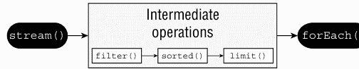

记住，流水线的工作就是寻找最佳实现流流水线的方法。它们使用了所有的表，并在开始前指示等待。它们告诉 `limit()` 工作线程在两个元素通过时通知它们。它们告诉 `sorted()` 工作线程，应该在元素进入时收集所有元素并一次性进行排序。排序后，它们应该一个一个地将元素传递给 `limit()` 工作线程。数据流如下：

1. `stream()` 方法将 Toby 发送到 `filter()`。`filter()` 方法看到长度合适，将 Toby 发送到 `sorted()`。`sorted()` 无法立即排序，因为它需要所有数据，所以它暂留了 Toby。
2. `stream()` 方法将 Anna 发送到 `filter()`。`filter()` 方法看到长度合适，将 Anna 发送到 `sorted()`。`sorted()` 无法立即排序，因为它需要所有数据，所以它暂留了 Anna。
3. `stream()` 方法将 Leroy 发送到 `filter()`。`filter()` 方法看到长度不匹配，让 Leroy 离开了流水线。
4. `stream()` 方法将 Alex 发送到 `filter()`。`filter()` 方法看到长度合适，将 Alex 发送到 `sorted()`。`sorted()` 无法立即排序，因为它需要所有数据，所以它暂留了 Alex。事实是 `sorted()` 拥有所有所需数据，但它并不知道。
5. 执行人员让 `sorted()` 知道是时候排序了，于是发生了。
6. `sorted()` 方法将 Alex 发送到 `limit()`。`limit()` 方法记住它已经看到一个元素，并将 Alex 发送到 `forEach()`，打印 Alex。
7. `sorted()` 方法将 Anna 发送到 `limit()`。`limit()` 方法记住它已经看到两个元素，并将 Anna 发送到 `forEach()`，打印 Anna。
8. `limit()` 方法现在已经看到了所有需要的元素，让执行人员停止线路，流水线中不再发生任何处理。

明白了吗？让我们再试几个例子来确保你很好理解了它。你觉得以下代码如何？

```java
Stream.generate(() -> "Elsa")
    .filter(n -> n.length() == 4)
    .sorted()
    .limit(2)
    .forEach(System.out::println);
```

它会一直阻塞，直到你杀死程序，或者在内存耗尽后抛出异常。执行人员指示 `sorted()` 等待直到所有排序所需的元素就绪。这不会发生，因为这是一个无限流。那么这个例子呢？

```java
Stream.generate(() -> "Elsa")
    .filter(n -> n.length() == 4)
    .limit(2)
    .sorted()
    .forEach(System.out::println);
```


这打印了两次 `Elsa`。`filter` 允许元素通过，而 `limit()` 在两个元素后停止操作。现在 `sorted()` 可以排序了，因为我们有一个有限列表。
最后，你对这个怎么看？

```java
Stream.generate(() -> "Olaf")
    .filter(n -> n.length() == 4)
    .limit(2)
    .sorted()
    .forEach(System.out::println);
```

这个也会一直阻塞直到程序结束。`filter` 不允许任何内容通过，所以 `limit()` 永远看不到两个元素。这意味着我们必须继续等待直到它们出现。

你可以链接两个流水线来透视。如果你能在代码中识别出两个源和两个终端操作。

```java
30: long count = Stream.of("goldfish", "finch").filter(n -> n.length() == 4)
31:     .limit(2).sorted().forEach(System.out::println);
```

为什么每个原始类型没有它自己的原始流（primitive stream）？这三种是最常见的，因此 API 设计者选择了它们。

> 当你在考试中看到 `stream` 这个词时，请注意大小写。在代码中，大写字母 `S` 开头的 `Stream` 是一个包含 `Object` 类型的类名。而小写 `s` 开头的 `stream` 是一个概念，它可能是 `Stream`、`DoubleStream`、`IntStream` 或 `LongStream`。

表 10.5 显示了一些原始流特有的方法。请注意，我们没有在表格中包含像 `empty()` 这种你已经从 `Stream` 接口了解过的方法。

| 方法 | 描述 | 原始流 |
| --- | --- | --- |
| `OptionalDouble average()` | 元素的算术平均值 | `IntStream`, `LongStream`, `DoubleStream` |
| `Stream<T> boxed()` | `Stream<T>`，其中 `T` 是原始值关联的包装类 | `IntStream`, `LongStream`, `DoubleStream` |
| `OptionalInt max()` | 流中的最大元素 | `IntStream` |
| `OptionalLong max()` | | `LongStream` |
| `OptionalDouble max()` | | `DoubleStream` |
| `OptionalInt min()` | 流中的最小元素 | `IntStream` |
| `OptionalLong min()` | | `LongStream` |
| `OptionalDouble min()` | | `DoubleStream` |
| `IntStream range(int a, int b)` | 返回从 `a`（包含）到 `b`（不包含）的原始流 | `IntStream` |
| `LongStream range(long a, long b)` | | `LongStream` |
| `IntStream rangeClosed(int a, int b)` | 返回从 `a`（包含）到 `b`（包含）的原始流 | `IntStream` |
| `LongStream rangeClosed(long a, long b)` | | `LongStream` |

## 使用原始流

| 方法 | 原始流 | 描述 |
| --- | --- | --- |
| `int sum()` | `IntStream` | 返回流元素的和 |
| `long sum()` | `LongStream` | |
| `double sum()` | `DoubleStream` | |
| `IntSummaryStatistics summaryStatistics()` | `IntStream` | 返回包含流统计信息的对象，如平均值、最小值、最大值等 |
| `DoubleSummaryStatistics summaryStatistics()` | `DoubleStream` | |

创建原始流的一些方法与我们创建普通流源的方法等效。你可以使用以下代码创建一个空流：

```java
DoubleStream empty = DoubleStream.empty();
```

另一种方法是使用单值的 `of()` 工厂方法，或者使用可变参数重载方法。

```java
DoubleStream oneValue = DoubleStream.of(3.14);
oneValue.forEach(System.out::println)

DoubleStream varargs = DoubleStream.of(1.0, 1.1, 1.2);
varargs.forEach(System.out::println);
```

这段代码输出如下：

```
3.14
1.0
1.1
1.2
```

你也可以使用两个方法来创建无限流，就像我们之前对 `Stream` 做的一样：

```java
var random = DoubleStream.generate(Math::random);
var fractions = DoubleStream.iterate(.5, d -> d / 2);

random.limit(3).forEach(System.out::println);
fractions.limit(3).forEach(System.out::println);
```

由于流是无限的，我们添加了 `limit` 中间操作，以免输出值一直打印下去。第一个流调用 `Math` 类上的静态方法来获取随机双。由于数字是随机的，你的输出显然会有所不同。第二个流创建更小的数字，每次将上一个值除二。我们运行这段代码的输出如下：

```
0.0789965478186413
0.2856334653464234
0.6311403511266134
0.5
0.25
0.125
```

考试时不需要知道这些，但 `Random` 类提供了一个直接获取随机原始数的方法。有趣的小知识！例如，`ints()` 会生成一个原始类型的 `IntStream`。

每种原始流的操作方式相同。在处理 `int` 或 `long` 原始类型时，这是一个计数。假设我们想要一个包含 1 到 5 数字的流。我们可以使用目前解释的内容来编写：

```java
IntStream count = IntStream.iterate(1, n -> n+1).limit(5);
count.forEach(System.out::print); // 12345
```

这段代码打印了数字 1-5。然而，为了实现如此简单的事情却写了大量代码。Java 提供了一个可以生成数字范围的方法。

```java
IntStream range = IntStream.range(1, 6);
range.forEach(System.out::print); // 12345
```

这样更好了。如果我们想要数字 1-5，为什么要传递 1-6 呢？`range()` 方法的第一个参数是包含的，意味着包含该数字。`range()` 方法的第二个参数是不包含的，意味着在数字数字之前停止。然而，这仍然不够清晰。我们想要包含 1-5。幸运的是，还有另一个方法 `rangeClosed()`，它的两个参数都是包含的。

```java
IntStream rangeClosed = IntStream.rangeClosed(1, 5);
rangeClosed.forEach(System.out::print); // 12345
```

更好了。这次我们表达的是闭闭区间或包含性范围。这个方法符合我们表达数字范围的方式。

## 映射 (Mapping)

创建原始流的另一种方法是 `map`。表 10.6 显示了映射的方法。

| 源 | 转 `Stream` | 转 `DoubleStream` | 转 `IntStream` | 转 `LongStream` |
| --- | --- | --- | --- | --- |
| `Stream<T>` | `Function<T,R>` | `ToDoubleFunction<T>` | `ToIntFunction<T>` | `ToLongFunction<T>` |
| `DoubleStream` | `DoubleFunction<R>` | `DoubleUnaryOperator` | `DoubleToIntFunction` | `DoubleToLongFunction` |
| `IntStream` | `IntFunction<R>` | `IntToDoubleFunction` | `IntUnaryOperator` | `IntToLongFunction` |
| `LongStream` | `LongFunction<R>` | `LongToDoubleFunction` | `LongToIntFunction` | `LongUnaryOperator` |

此外，你可以从原始流创建 `Stream`。这些方法展示了实现此目的两种方式：

```java
private static Stream<Integer> mapToObj(IntStream stream) {
    return stream.mapToObj(x -> x);
}

private static Stream<Integer> boxing(IntStream stream) {
    return stream.boxed();
}
```

第一个使用的是我们之前看到的 `mapToObj()` 方法。第二个更简洁。它不需要映射函数，因为它只是将原始类型装箱为对应的包装对象。

# 使用原始类型流

```java
optional.ifPresent(System.out::println); // 5.5
System.out.println(optional.getAsDouble()); // 5.5
System.out.println(optional.orElseGet(() -> Double.NaN)); // 5.5
```

唯一的区别在于我们调用了 `getAsDouble()` 而不是 `get()`。
这清楚地表明我们正在处理一个原始类型。此外，`orElseGet()` 接收的是 `DoubleSupplier` 而不是 `Supplier`。
与原始类型流一样，针对原始类型有三个特定类型的类。
表 10.8 显示了这三者之间的微小差异。你可能不会对必须记住这张表感到意外。虽然由于原始类型名称是唯一的变化，它很容易记住，但你应该记住，从终端操作开始，流的方法链会返回一个可选，例如 `min()` 或 `findAny()`。它们每个都返回对应的可选。原始类型的实现还添加了两个你需要知道的新方法。`sum()` 方法不返回可选。如果你尝试对一个空流进行加法，你只会得到 0。`average()` 方法总是返回一个 `OptionalDouble`，因为任何类型的平均值都可能包含小数数据。

表 10.8 原始类型的 Optional 类型
| | `OptionalDouble` | `OptionalInt` | `OptionalLong` |
|---|---|---|---|
| 作为原始类型获取 | `getDouble()` | `getInt()` | `getLong()` |
| `orElseGet()` 参数类型 | `DoubleSupplier` | `IntSupplier` | `LongSupplier` |
| `max()` 和 `min()` 的返回类型 | `OptionalDouble` | `OptionalInt` | `OptionalLong` |
| `sum()` 的返回类型 | `double` | `int` | `long` |
| `average()` 的返回类型 | `OptionalDouble` | `OptionalDouble` | `OptionalLong` |

让我们尝试一个例子来确保你理解了：

```java
5: LongStream longs = LongStream.of(5, 10);
6: long sum = longs.sum();
7: System.out.println(sum); // 15
8: DoubleStream doubles = DoubleStream.generate(() -> Math.PI);
9: OptionalDouble min = doubles.min(); // 无限运行
```

第 5 行创建了一个包含两个元素的 `long` 原始流。第 6 行显示我们没有使用可选来计算和。第 8 行创建了一个无限的 `double` 原始流。
第 9 行是为了提醒你，关于无限运行的代码问题也出现在原始类型流中。

## 总结静态方法

你已经学习了足够的知识来从 `int` 原始流中获取最大值。如果流是空的，我们想要抛出一个异常。

```java
private static int max(IntStream ints) {
    OptionalInt optional = ints.max();
    return optional.orElseThrow(RuntimeException::new);
}
```

这应该是旧方法。因为我们有一个 `IntStream`，所以得到了一个 `OptionalInt`。如果可选包含值，我们就返回它。否则，我们抛出一个新的 `RuntimeException`。

现在我们想更改方法，使其接收 `IntStream` 并返回一个范围。该范围是最大值减去最小值。哦不。`min()` 和 `max()` 是终端操作，这意味着它们在运行时会消耗掉流。我们不能对同一个流运行两个操作。幸运的是，这是一个常见问题，原始类型通过统计信息为我们解决了它。*统计（Statistic）只是对从数据计算出的数字的大称。*

```java
private static int range(IntStream ints) {
    IntSummaryStatistics stats = ints.summaryStatistics();
    if (stats.getCount() == 0) throw new RuntimeException();
    return stats.getMax() - stats.getMin();
}
```

在这里我们要求 Java 对流执行许多计算。汇总统计信息包括：

- `getCount()`: 返回一个表示值数量的 `long`。
- `getAverage()`: 返回一个表示平均值的 `double`。如果流是空的，则返回 0。
- `getSum()`: 对于 `DoubleSummaryStream`、`IntSummaryStream` 和 `LongSummaryStream` 返回 `double` 类型的和。
- `getMin()`: 根据流的类型返回对应 `double`、`int` 或 `long` 类型的最小数字（最小值）。如果流是空的，则返回该类型的最大数值。
- `getMax()`: 根据流的类型返回对应 `double`、`int` 或 `long` 类型的最大数字（最大值）。如果流是空的，则返回该类型的最小数值。

# 使用高级流流水线概念

恭喜，你只剩下最后几个主题了！在最后一个流流节中，我们将学习流与底层数据之间的关系、Optional 的链式以及分组收集器。在此之后，你应该成为流的专家了！

## 将流链接到底层数据

你认为会输出什么？

```java
25: var cats = new ArrayList<String>();
26: cats.add("Annie");
27: cats.add("Ripley");
28: var stream = cats.stream();
29: cats.add("KC");
30: System.out.println(stream.count());
```

正确答案是 3。第 25-27 行创建了一个包含两个元素的列表。第 28 行从该列表请求流。记住流是惰性求值的。这意味着流在第 28 行并没有被创建。一个对象在需要时知道去哪里查找数据。第 29 行，列表增加了一个元素。第 30 行，流流水线运行。首先，它查看源并看到三个元素。

## 链 Optional

到目前，你已经熟悉了流中链式操作的好处。Optional 提供一些中间操作。假设你有一个 `Optional<Integer>` 并想要打印值，但仅当它是三位数时。如果不使用函数式编程，你可以写以下代码：

```java
private static void threeDigit(Optional<Integer> optional) {
    if (optional.isPresent()) {
        var num = optional.get();
        var string = "" + num;
        if (string.length() == 3)
            System.out.println(string);
    }
}
```

这种要短得多且更有表现力。使用函数式编程：

```java
private static void threeDigit(Optional<Integer> optional) {
    optional.map(n -> "" + n) // 部分 1
        .filter(s -> s.length() == 3) // 部分 2
        .ifPresent(System.out::println); // 部分 3
}
```

## 第 10 章 • 流

现在假设我们想要一个表示另一个 Optional 中包含的字符串长度的 `Optional<Integer>`。简单：

```java
Optional<Integer> result = optional.map(String::length);
```

如果我们方法为我们提供计算逻辑并使用 `map` 返回 `Optional<Integer>`，会怎样：

```java
Optional<Integer> result = optional
    .map(ChainingOptionals::calculator); // 编译失败
```


问题是`calculator`返回`Optional<Integer>`。`map()`方法又添加了一个`Optional`，导致我们得到`Optional<Optional<Integer>>`。好吧，那不好。解决方案是调用`flatMap()`：

```java
Optional<Integer> result = optional
    .flatMap(ChainingOptionals::calculator);
```

这个可以工作，因为`flatMap`移除了不必要的层。换句话说，扁平化。调用`flatMap()`链在你想要将一个`Optional`类型转换为另一种时非常有用。

# 使用高级流流水线概念

## 真实世界场景：检查异常与函数式接口

你可能已经注意到，大多数函数式接口都没有声明检查异常（checked exceptions）。这通常是可以接受的。但在处理声明了检查异常的方法时，问题就会出现。假设我们有一个类，其中一个方法会抛出检查异常：

```java
import java.io.*;
import java.util.*;

public class ExceptionStudy {
    private static List<String> create() throws IOException {
        throw new IOException();
    }
}
```

现在我们在流（stream）中使用它：

```java
public void good() throws IOException {
    ExceptionStudy.create().stream().count();
}
```

这里没有问题。`create()`方法抛出了一个检查异常，调用它的方法处理或声明了它。那么，这个情况呢？

```java
public void bad() throws IOException {
    Supplier<List<String>> s = ExceptionStudy::create; // 无法编译
}
```

实际的编译器错误如下：

```
unhandled exception type IOException
```

现在怎么办？问题在于该方法引用展开后的`Lambda`表达式没有声明异常。`Supplier`接口不允许检查异常。有两种方法可以解决这个问题。一种是捕获异常并将其转换为非检查异常（unchecked exception）。

```java
public void ugly() {
    Supplier<List<String>> s = () -> {
        try {
            return ExceptionStudy.create();
        } catch (IOException e) {
            throw new RuntimeException(e);
        }
    };
}
```

这种方法虽然有效，但代码很丑陋。函数式编程的好处之一是代码应该是易读且简洁的。另一种替代方案是创建一个带有`try/catch`的包装方法。

```java
private static List<String> createSafe() {
    try {
        return ExceptionStudy.create();
    } catch (IOException e) {
        throw new RuntimeException(e);
    }
}
```

现在我们可以在`Supplier`中无问题使用这个安全包装了。

```java
public void wrapped() {
    Supplier<List<String>> s2 = ExceptionStudy::createSafe();
}
```

## 使用拆分器 (Spliterator)

假设你买了一袋食物，让两个孩子在动物园喂动物。为了避免争吵，你特意准备了一个额外的空袋。你从主袋中取出大约一半的食物放入你从家里带的袋子里。原袋仍然存在，里面还有一半食物。

`Spliterator`对处理过程提供了这种程度的控制。它从一个`Collection`或一个流开始——即你的那袋食物。你可以通过`trySplit()`从袋中取出一些食物。剩余食物留在原始`Spliterator`对象中。

`Spliterator`的特征取决于底层数据源。`Collection`数据源是基础`Spliterator`。相比之下，使用`Stream`数据源时，`Spliterator`可以是并行或无限的。实现自己的`Spliterator`可能变得复杂，很方便地不在考试范围之内。你确实需要知道如何使用该接口中声明的一些常用方法。你需要掌握的简化方法在表 10.9 中。

### 表 10.9 Spliterator 方法

| 方法 | 说明 |
| --- | --- |
| `Spliterator<T> trySplit()` | 返回一个理想包含一半数据的`Spliterator`，这些数据从当前`Spliterator`中移除。此方法可以多次调用，当数据不再可拆分时最终返回`null`。 |
| `void forEachRemaining(Consumer<T> c)` | 处理`Spliterator`中的剩余元素。 |
| `boolean tryAdvance(Consumer<T> c)` | 如果有，则处理`Spliterator`中的单个元素。返回元素是否被处理。 |

现在让我们来看一个将袋子分成三部分的示例：

```java
12: var stream = List.of("bird-", "bunny-", "cat-", "dog-", "fish-", "lamb-",
13: "mouse-");
14: Spliterator<String> originalBagOfFood = stream.spliterator();
15: Spliterator<String> emmasBag = originalBagOfFood.trySplit();
16: emmasBag.forEachRemaining(System.out::print); // bird-bunny-cat-
17:
18: Spliterator<String> jillsBag = originalBagOfFood.trySplit();
19: jillsBag.tryAdvance(System.out::print); // dog-
20: jillsBag.forEachRemaining(System.out::print); // fish-
21:
22: originalBagOfFood.forEachRemaining(System.out::print); // lamb-mouse-
```

在第 12 行和第 13 行我们定义了一个`List`。第 14 行和第 15 行创建了两个`Spliterator`引用。第一个是原始袋，包含所有七个元素。第二个是对原始袋的拆分，将大约一半的元素移入 Emma 的袋中。原始袋仍然存在。第 16 行，`emmasBag.forEachRemaining`处理了袋中的元素输出`bird-bunny-cat-`。第 18 行，`jillsBag`是原始袋的再次拆分。第 19 行，`jillsBag.tryAdvance`处理一个元素输出`dog-`。第 20 行，`jillsBag.forEachRemaining`处理剩余元素输出`fish-`。第 22 行，`originalBagOfFood.forEachRemaining`处理剩余元素输出`lamb-mouse-`。

# 表 10.10 分组/分区收集器示例

| 收集器 | 描述 | 传递给`collect`时的返回值 |
| --- | --- | --- |
| `summingDouble(Double f)` | 计算我们三种原始类型的求和 | `Double` |
| `summingInt(ToIntFunction f)` | | `Integer` |
| `summingLong(ToLongFunction f)` | | `Long` |
| `teeing(Collector c1, Collector c2, BiFunction f)` | 结合两个收集器的结果创建新类型 | `R` |
| `toList()` `setTo()` | 创建列表或集合的抽象类型 | `List` `Set` |
| `toCollection(Supplier s)` | 创建指定类型的集合 | `Collection` |
| `toMap(Function k, Function v)` `toMap(Function k, Function v, BinaryOperator m)` `toMap(Function k, Function v, BinaryOperator m, Supplier s)` | 使用函数映射键、值、可选的合并函数以及可选的 map 类型来创建 map | `Map` |

我们将预定义的`joining()`收集器传递给`collect()`方法。流中的所有元素将合并成一个字符串，每个元素之间使用指定的分隔符。将收集器传递给`collect`方法是非常重要的。它的存在是为了帮助收集元素。收集器本身不会执行任何操作。

让我们尝试另一个。三个名字的平均长度是多少？

```java
var ohMy = Stream.of("lions", "tigers", "bears");
Double result = ohMy.collect(Collectors.averagingInt(String::length));
System.out.println(result); // 5.3333333333333333
```

模式是相同的。我们将一个收集器传递给`collect()`，它会为我们执行平均计算。这次，我们需要传递一个函数来告诉收集器我们使用了什么。我们使用了方法引用，它在执行时返回一个`int`。对于原始流，平均值的结果始终是`double`，无论平均的是什么类型。对于收集器来说，它是`Double`，因为那些需要一个对象。

## 使用高级流处理概念

通常，你会发现需要与没有使用流的代码进行交互。这意味着它期望的是一个`Collection`类型而不是`Stream`类型。没问题。你仍然可以使用`Stream`来表达，并在最后转换为`Collection`。例如：

```java
var ohMy = Stream.of("lions", "tigers", "bears");
TreeSet<String> result = ohMy
    .filter(s -> s.startsWith("t"))
    .collect(Collectors.toCollection(TreeSet::new));
System.out.println(result); // [[tigers]]
```

这次我们拥有流流水线的全部三个部分。`Stream.of()`是流的源。中间操作是`filter()`。最后，终端操作是`collect()`，它创建了一个`TreeSet`。如果我们没有得到那个`Set`实现，我们本可以写`Collectors.toSet()`。

到此时，你将可以使用表 10.10 中的所有的`Collectors`，除了`groupBy()`、`mapping()`、`partitioningBy()`、`toMap()`和`teeing()`。

## 收集到 Map

使用`Collectors` map可能会变得非常长。我们将缓慢地构建。确保在继续下一个示例之前理解了每个例子。让我们从一个简单的示例开始，从流创建一个 map：

```java
var ohMy = Stream.of("lions", "tigers", "bears");
Map<String, Integer> map = ohMy.collect(
    Collectors.toMap(s -> s, String::length));
System.out.println(map); // [lions=5, bears=5, tigers=6]
```

在创建 map 时，你需要指定两个函数。第一个函数告诉收集器如何创建键。在我们的例子中，我们使用提供的`String`作为键。第二个函数告诉收集器如何创建值。在我们的例子中，我们使用`String`的长度作为值。

> 返回传入 lambda 的相同值是一个常见操作。你可以将其重写为方法引用：`s -> s` `Function.identity()`。它并不短，而且可能并不清晰，所以请根据你的判断决定使用它。

现在我们想要反转并将动物名字的长度映射到名字本身。我们的第一次尝试尝试如下：

```java
var ohMy = Stream.of("lions", "tigers", "bears");
Map<Integer, String> map = ohMy.collect(Collectors.toMap(
    String::length,
    k -> k)); // 错误
```

## 第 10 章 • 流

运行此代码会产生一个类似的异常：

```
Exception in thread "main":
java.lang.IllegalStateException: Duplicate key 5
```

出了什么问题？两个动物的长度相同的长度。我们没有告诉 Java 应该做什么。收集器应该选择它遇到的第一个吗？最后一个？还是合并它们？由于收集器不知道该做什么，它通过抛出异常并将其变成我们的问题来“解决”这个问题。真周到啊。假设我们的需求是创建一个用逗号分隔的包含动物名字的字符串。我们可以这样写：

```java
var ohMy = Stream.of("lions", "tigers", "bears");
Map<Integer, String> map = ohMy.collect(Collectors.toMap(
    String::length,
    k -> k,
    (s1, s2) -> s1 + "," + s2
));
System.out.println(map); // {5=lions, 6=tigers}
```

返回的`Map`是`HashMap`并不保证的。假设我们希望代码返回一个`TreeMap`实例。我们可以这样写来返回`TreeMap`：

```java
var ohMy = Stream.of("lions", "tigers", "bears");
Map<Integer, String> map = ohMy.collect(Collectors.toMap(
    String::length,
    k -> k,
    (s1, s2) -> s1 + "," + s2,
    TreeMap::new
));
System.out.println(map); // {5=lions, 6=tigers}
```

## 分组（Grouping）、分区（Partitioning）和映射（Mapping）

使用`Collectors.groupingBy`非常非常tig。 "bears`   。    变得非常长。

  收集器（ `Collectors. . key, value 

 ，，，，，，，，   

。

```java
var ohMy = Stream.of("lions", "tigers", "bears");
Map<String, Integer> map = ohMy.collect(Collectors.group.By(s -> s,
.length.
........ // 

        ```。

```

var ohMy = Stream.of("lions", "tigers", "bears");
Map<Integer, String> map = ohMy.collect(Collectors.groupingBy(s -> s, String::length));
System.out.println(map); // {5=lions, bears=5, tigers=6}
```

```java
var ohMy = Stream.of("lions", "tigers", "bears");
Map<String, Integer> map = ohMy.collect(Collectors.groupingBy(s -> s, String::length));
System.out.println(map); // {5=lions, bears=5, tigers=6}
```

```java
var ohMy = Stream.of("lions", "tigers", "bears");
Map<String, Integer> map = ohMy.collect(Collectors.groupingBy(s -> s, String::length));
System.out.println(map); // {5=lions, bears=5, tigers=6}
```

```java
var ohMy = Stream.of("lions", "tigers", "bears");
Map<String, Integer> map = ohMy.collect(Collectors.groupingBy(s -> s, String::length));
System.out.println(map); // {5=lions, bears=5, tigers=6}
```

```java
var ohMy = Stream.of("lions", "tigers", "bears");
Map<String, Integer> map = ohMy.collect(Collectors.groupingBy(s -> s, String::length));
```


`System.out.println(map); // {5=lions, bears=5, tigers=6}`

```
var ohMy = Stream.of("lions", "tigers", "bears");
Map<String, Integer> map = ohMy.collect(Collectors.groupingBy(s -> s, String::length));
System.out.println(map); // {5=lions, bears=5, tigers=6}
```

`Collectors.groupingBy` 接受两个参数：

- `s -> s`，即 `Function.identity()`
- `Collectors.groupingBy` 的第二个参数是下游收集器

# 调试复杂的泛型

在使用 `collect()` 时，存在许多层级的泛型，这会导致编译器错误变得难以阅读。处理这种情况有三种实用的技术：

- 从一个简单的语句开始，并不断添加内容。通过一次只进行一个微小的更改，你将知道是哪部分代码引入了错误。

- 将语句的部分提取到独立的语句中。例如，尝试 `Collectors.groupBy(String::length, Collectors.counting())`。如果它编译通过，你就知道问题在其他地方。如果编译失败，你将有一个短得多的语句可以进行排错。

- 为最终语句的返回类型使用泛型通配符：例如 `Map<?, ?>`。如果该更改允许代码能够编译，你就知道问题出在返回类型不是预期的。

最后，还有一个 `mapping()` 收集器，它让我们能够深入一层并添加另一个收集器。假设我们想获取每个长度的按字母顺序排序的第一个动物的首字母？可能是为了随机采样。考试中这部分的例子也相当牵强。我们会写下如下代码：

```java
var ohMy = Stream.of("lions", "tigers", "bears");
Map<Integer, Optional<Character>> map = ohMy.collect(
    Collectors.groupBy(
        String::length,
        Collectors.mapping(
            s -> s.charAt(0),
            Collectors.minBy((a, b) -> a - b)))
    )
System.out.println(map); // {5=Optional[b], 6=Optional[t]}
```

我们不会告诉你这段代码是易读的。我们会告诉你，这是你在考试中需要理解的最复杂的内容。与上一个例子相比，你可以看到我们用 `mapping()` 替换了 `collect()`。`mapping()` 需要两个参数：用于值的函数以及如何对其进行分组。你可能使用了带有静态导入的收集器来使代码更短。考试甚至可能为返回值使用静态导入，并使用比我们更少的缩进。这意味着你可能会看到类似这样的内容：

```java
var ohMy = Stream.of("lions", "tigers", "bears");
var map = ohMy.collect(groupBy(String::length,
    mapping(s -> s.charAt(0), minBy((a, b) -> a - b))));
System.out.println(map); // {5=Optional[b], 6=Optional[t]}
```

这段代码与上一个例子的作用相同。这意味着识别收集器的名称非常重要，因为你可能没有 `Collectors` 类名来提醒你注意。

# Teeing 收集器

假设你想返回两个东西。这对于流来说是有问题的，因为你只能进行一次遍历。当你想要对这些进行操作时，摘要统计信息（summary statistics）很好用。幸运的是，你可以使用 `teeing()` 返回自己的多个值。首先，定义返回类型。我们在这里使用了一个 `record`：

```java
record Separations(String spaceSeparated, String commaSeparated) {}
```

现在返回流。在操作的同时，请注意收集器的数量：

```java
var list = List.of("x", "y", "z");
Separations result = list.stream()
    .collect(Collectors.teeing(
        Collectors.joining(" "),
        Collectors.joining(","),
        (s, c) -> new Separations(s, c)));
```

执行时，代码将打印以下内容：

```
Separations[spaceSeparated=x y, commaSeparated=x,y,z]
```

这段代码中有三个收集器。其中两个用于 `joining()`，并产生我们想要返回的值。第三个是 `teeing()`，它将结果合并成我们想要返回的单个对象。这样一来，Java 会很满意，因为只返回了一个对象；而我们很高兴，因为不需要遍历两次流。

## 总结

`Optional<T>` 可以为空或存储一个值。你可以通过 `isPresent()` 检查它是否包含值。你可以通过 `orElse(T)` 返回一个值，通过 `orElseThrow()` 抛出异常。有三个函数接口：`isPresent(Consumer c)`、`orElse(Supplier s)` 和 `orElseThrow(Supplier s)`。有三种原始类型：`OptionalDouble`、`OptionalInt` 和 `OptionalLong`。它们分别拥有 `getDouble()`、`getInt()` 和 `getLong()` 方法。流流水线有三部分。源是必须的，它创建了数据。零或多个中间操作，直到终端操作。

## 考试要点

`Stream<T>` 类包含许多实用的中间操作，包括 `filter()`、`map()` 和 `flatMap()`。终端操作包括 `allMatch()`、`count()` 和 `forEach()`。除了 `Stream<T>` 类，还有三种原始流：`DoubleStream`、`IntStream` 和 `LongStream`。除了常用的 `<T>` 方法，`IntStream` 和 `LongStream` 拥有 `range()` 和 `rangeClosed()`。在 `IntStream` 上调用 `range(1,10)` 会产生一个从 1 到 9 的原始流。相比之下，`rangeClosed(1,10)` 创建一个从 1 到 10 的原始流。流的操作包括 `average()`、`max()` 和 `sum()`。它们还有 `summaryStatistics()` 来一次获取统计信息。你可以使用收集器将流转换为传统的集合。你可以使用 `groupBy` 在一行内创建一个映射。分区（Partitioning）的工作方式与分组相同，只是键始终为 true 或 false。一个分区的映射总有两个键，即使值为空。

## 复习题

章节复习题的答案可以在附录找到。

1. 以下代码的输出可能是？

```java
var stream = Stream.iterate("", (s) -> s + "1");
System.out.println(stream.limit(2).map(x -> x + "2"));
```

A. 12112  
B. 212  
C. 212112  
D. `java.util.stream.ReferencePipeline$3@4517d9a3`  
E. 代码编译失败。  
F. 出异常。

2. 以下代码的输出可能是？

```java
Predicate<String> predicate = s -> s.startsWith("g");
var stream1 = Stream.generate(() -> "growl!");
var stream2 = Stream.generate(() -> "growl!");
var b1 = stream1.anyMatch(predicate);
var b2 = stream2.allMatch(predicate);
System.out.println(b1 + " " + b2);
```

A. true false  
B. true true  
C. `java.util.stream.ReferencePipeline$3@4517d9a3`  
D. 代码编译失败。  
E. 出异常。  
F. 代码挂起。

3. 以下代码的输出可能是？

```java
Predicate<String> predicate = s -> s.length() > 3;
var stream = Stream.iterate("-", s -> !s.isEmpty(), (s) -> s + s);
var b1 = stream.noneMatch(predicate);
var b2 = stream.anyMatch(predicate);
System.out.println(b1 + " " + b2);
```


# 第 10 章 • 流 (Streams)

## 选择题

### 1. 以下哪些陈述是正确的？（选择所有适用项）

- A. `false false`
- B. `false true`
- C. `java.util.stream.ReferencePipeline$3@4517d9a3`
- D. 代码编译失败。
- E. 出异常。
- F. 代码挂起。

### 2. 关于成功运行的流中的终端操作（terminal operations），哪些陈述是正确的？（选择所有适用项）

- A. 流流水线中最多可以存在一个终端操作。
- B. 终端操作是流流水线中必不可的一部分，以便获取结果。
- C. 终端操作的返回类型是 `Stream`。
- D. `peek()` 方法是终端操作的一个示例。
- E. 在调用终端操作后，可以使用被引用的 `Stream`。

### 3. 以下哪些集合的结果为 8.0？（选择所有适用项）

- A.
```java
double result = LongStream.of(6L, 8L, 10L)
    .mapToInt(x -> (int) x)
    .collect(Collectors.groupingBy(x -> x))
    .keySet()
    .stream()
    .collect(Collectors.averagingInt(x -> x));
```

- B.
```java
double result = LongStream.of(6L, 8L, 10L)
    .mapToInt(x -> x)
    .boxed()
    .collect(Collectors.groupingBy(x -> x))
    .keySet()
    .stream()
    .collect(Collectors.averagingInt(x -> x));
```

- C.
```java
double result = LongStream.of(6L, 8L, 10L)
    .mapToInt(x -> (int) x)
    .boxed()
    .collect(Collectors.groupingBy(x -> x))
    .keySet()
    .stream()
    .collect(Collectors.averagingInt(x -> x));
```

- D.
```java
double result = LongStream.of(6L, 8L, 10L)
    .mapToInt(x -> (int) x)
    .collect(Collectors.groupingBy(x -> x, Collectors.toSet()))
    .keySet()
    .stream()
    .collect(Collectors.averagingInt(x -> x));
```

- E.
```java
double result = LongStream.of(6L, 8L, 10L)
    .mapToInt(x -> x)
    .boxed()
    .collect(Collectors.groupingBy(x -> x, Collectors.toSet()))
    .keySet()
    .stream()
    .collect(Collectors.averagingInt(x -> x));
```

- F.
```java
double result = LongStream.of(6L, 8L, 10L)
    .mapToInt(x -> (int) x)
    .boxed()
    .collect(Collectors.groupingBy(x -> x, Collectors.toSet()))
    .keySet()
    .stream()
    .collect(Collectors.averagingInt(x -> x));
```

### 4. 以下哪个项可以填入空白使代码打印 `false`？（选择所有适用项）

```java
var s = Stream.generate(() -> "meow");
var match = s.________(String::isEmpty);
System.out.println(match);
```

- A. `allMatch`
- B. `anyMatch`
- C. `findAny`
- D. `findFirst`
- E. `noneMatch`
- F. 以上均不是

### 5. 我们有一个返回排序后列表但不改变原始列表的方法。以下哪个项可以使用流替换该方法实现来实现相同的功能？

```java
private static List<String> sort(List<String> list) {
  var copy = new ArrayList<String>(list);
  Collections.sort(copy, (a, b) -> a.compareTo(b));
  return copy;
}
```

- A. `return list.stream().sorted((a, b) -> a.compareTo(b)).collect(Collectors.toList());`
- B. `return list.stream().sorted((a, b) -> a.compareTo(b)).sort();`
- C. `return list.stream().sorted((a, b) -> a.compareTo(b)).collect(Collectors.toList());`
- D. `return list.stream().sorted((a, b) -> a.compareTo(b)).sort();`
- E. `return list.stream().sorted((a, b) -> a.compareTo(b)).collect();`
- F. `return list.stream().sorted((a, b) -> a.compareTo(b)).collect(Collectors.toList());`

### 6. 给定此声明，以下哪些是正确的？（选择所有适用项）

```java
var is = IntStream.empty();
```

- A. `is.average()` 返回 `int` 类型。
- B. `is.average()` 返回 `OptionalInt` 类型。
- C. `is.findAny()` 返回 `int` 类型。
- D. `is.findAny()` 返回 `OptionalInt` 类型。
- E. `is.sum()` 返回 `int` 类型。
- F. `is.sum()` 返回 `OptionalInt` 类型。

### 7. 在第 6 行之后添加哪些项可以让代码运行但不输出？（选择所有适用项）

```java
4: var stream = LongStream.of(1, 2, 3);
5: var opt = stream.map(n -> n * 10);
6: .filter(n -> n < 5).findFirst();
```

- A. `if (opt.isPresent()) System.out.println(opt.get());`
- B. `if (opt.isPresent()) System.out.println(opt.getAsLong());`
- C. `opt.ifPresent(System.out::println);`
- D. `opt.ifPresent(System.out::println);`
- E. 以上都不是；代码编译失败。
- F. 以上都不是；第 6 行抛出异常。

### 8. 给语句 L, N, O，选择哪些可以完成表达式并代码输出 10 行。（选择所有适用项）

```java
Stream.generate(() -> "1")
L.filter(x -> x.length() > 1)
M.forEach(System.out::println)
N.limit(10)
O.peek(System.out::println);
```

- A. L, N, O
- B. L, N, M
- C. L, N, M
- D. L, N, M, O
- E. L, O, M
- F. N, M
- G. N, O

### 9. 此代码需要哪些更改才能打印字符串 `12345`？（选择所有适用项）

```java
Stream.iterate(1, x -> x++)
.limit(5).map(x -> x)
.collect(Collectors.joining());
```

### 10. 以下哪个正确？

```java
Set<String> birds = Set.of("oriole", "flamingo");
Stream.concat(birds.stream(), birds.stream(), birds.stream())
.sorted() // line X
.distinct()
.findAny()
.ifPresent(System.out::println);
```

- A. 移除行 X 后保证打印 `flamingo`。
- B. 移除行 X 后保证打印 `oriole`。
- C. 不移除行 X 保证打印 `flamingo`。
- D. 不移除行 X 保证打印 `oriole`。
- E. 此时输出可能会变化。
- F. 代码编译失败。
- G. 因为同一个列表被用作多个流的源，它会抛出异常。

### 11. 以下哪个是正确的？

```java
List<Integer> x1 = List.of(1, 2, 3);
List<Integer> x2 = List.of(4, 5, 6);
List<Integer> x3 = List.of();
Stream.of(x1, x2, x3).map(x -> x + 1)
.flatMap(x -> x.stream())
.forEach(System.out::print);
```

- A. 代码编译并打印 `123456`。
- B. 代码编译并打印 `234567`。
- C. 代码编译但不打印任何内容。
- D. 代码编译但打印流引用。
- E. 代码无限运行。
- F. 代码编译失败。
- G. 代码抛出异常。

### 12. 以下哪些是正确的？（选择所有适用项）

```java
4: Stream<Integer> s = Stream.of(1);
5: IntStream is = s.boxed();
6: DoubleStream ds = s.mapToDouble(x -> x);
7: Stream<Integer> s2 = ds.mapToInt(x -> x);
8: s.forEach(System.out::print);
```

- A. 第 4 行导致编译错误。
- B. 第 5 行导致编译错误。
- C. 第 6 行导致编译错误。
- D. 第 7 行导致编译错误。
- E. 第 8 行导致编译错误。
- F. 代码编译但在运行时抛出异常。
- G. 代码编译并打印 `1`。

### 13. 给定泛型 `String`，`partitioningBy()` 收集器在传递给 `collect()` 时默认创建一个 `Map<Boolean, List<String>>`。当将下游收集器传递给 `partitioningBy()` 时，可以哪些哪些类型？（选择所有适用项）

- A. `Map<Boolean, List<String>>`
- B. `Map<Boolean, List<String>>`
- C. `Map<Boolean, Map<String>>`
- D. `Map<Boolean, Set<String>>`
- E. `Map<Long, TreeSet<String>>`
- F. 以上均不是

### 14. 关于此代码，以下哪些陈述是正确的？（选择所有适用项）

```java
20: Predicate<String> empty = String::isEmpty;
21: Predicate<String> notEmpty = empty.negate();
22:
23: var result = Stream.generate(() -> "")
24: .limit(10)
25: .filter(notEmpty)
26: .collect(Collectors.groupingBy(k -> k))
27: .entrySet()
28: .stream()
29: .map(Entry::getValue)
30:   .flatMap(Collection::stream)
31:   .collect(Collectors.partitioningBy(notEmpty));
32:   System.out.println(result);
```

- A. 它输出 `{false=[]}`
- B. 它输出 `{false=[], true=[]}`
- C. 如果我们将第 31 行的 `partitioningBy(notEmpty)` 改为 `groupingBy(n -> n)`，它将输出 `{}`。
- D. 如果我们将第 31 行的 `partitioningBy(notEmpty)` 改为 `groupingBy(n -> n)`，它将输出 `{false=[], true=[]}`
- E. 代码无法编译。
- F. 代码可以编译但在运行时不会终止。

### 15. 以下代码的结果是什么？

```java
s = DoubleStream.of(1.2, 2.4);
s.peek(System.out::println).filter(x -> x > 2).count();
```

- A. 1
- B. 2
- C. 2.4
- D. 1.2 和 2.4
- E. 没有输出。
- F. 代码无法编译。
- G. 抛出了异常。

### 16. 以下代码的输出是什么？

```java
11: public class Passing {
12:   record Sesame(String name, boolean human) {
13:     @Override public String toString() {
14:       return name();
15:     }
16:   }
17:   record Page(List<Sesame> list, long count) {
18:
19:   public static void main(String[] args) {
20:     var monsters = Stream.of(new Sesame("Elmo", false));
21:     var people = Stream.of(new Sesame("Abby", true));
22:     printPage(monsters, people);
23:   }
24:   }
25: }
```

```java
26: private static void pageWidth(Stream<Sesame> monsters,
27: Stream<Sesame> people) {
28: Page page = Stream.concat(monsters, people)
29: .collect(Collectors.teeing(
30: Collectors.filtering(s -> s.name().startsWith("E"),
31: Collectors.toList(),
32: Collectors.counting(),
33: (l, c) -> new Page(l, c));
34: System.out.println(page);
35: }
```

- A. `Page[list=[Abby], count=1]`
- B. `Page[list=[Abby], count=2]`
- C. `Page[list=[Elmo], count=1]`
- D. `Page[list=[Elmo], count=2]`
- E. 因为 `Stream.concat()` 导致代码无法编译。
- F. 因为 `Collectors.teeing()` 导致代码无法编译。
- G. 因为其他原因无法编译。

### 17. 重写这段代码最简单的方法是什么？

```java
List<Integer> x = IntStream.range(1, 6)
.mapToObj(i -> i)
.collect(Collectors.toList());
x.forEach(System.out::println);
```

- A.
```java
IntStream.range(1, 6)
.forEach(System.out::println);
```

- B.
```java
IntStream.range(1, 6)
.forEach(System.out::println);
```

- C.
```java
IntStream.range(1, 6)
.mapToObj(i -> i)
.forEach(System.out::println);
```

- D. 以上均不等价。
- E. 提供的代码无法编译。

### 18. 以下哪些项在 `Optional` 为空时会抛出异常？（选择所有适用项）

- A. `opt.orElse("")`
- B. `opt.orElseGet(() -> " ")`
- C. `opt.orElseThrow()`
- D. `opt.orElseThrow(() -> throw new Exception())`
- E. `opt.orElseThrow(RuntimeException::new)`
- F. `opt.get()`
- G. `opt.get("")`

### 19. 以下代码的输出是什么？

```java
var spliterator = Stream.generate(() -> "x")
.spliterator();
spliterator.tryAdvance(System.out::print);
var split = spliterator.trySplit();
split.tryAdvance(System.out::print);
```


- A. x
- B. xx
- C. 一长长的 x 列表
- D. 没有输出。
- E. 代码无法编译。
- F. 代码可以编译但在运行时不会终止。

# 异常与本地化 (Exceptions and Localization)

本章涵盖的 OCP 目标：

- 处理异常
  - 使用`try/catch/finally`、`try-with-resources`和多异常捕获块处理异常，包括自定义异常
- 实现本地化
  - 使用本地化（locales）、资源包（resource bundles），解析并格式化消息、日期、时间和数字（包括货币和百分比值）


# 异常与本地化

异常是程序执行过程中发生的中断指令正常流的事件。在 Java 中，异常由对象表示。

本章的 OCP 目标：

- 处理异常
  - 使用`try/catch/finally`、`try-with-resources`和多异常捕获块处理异常，包括自定义异常
- 实现本地化
  - 使用本地化、资源包，解析并格式化消息、日期、时间和数字，包括货币和百分比值

# 异常与本地化

异常是程序执行过程中发生的中断指令正常流的事件。在 Java 中，异常由对象表示。

Java 异常层次从`Throwable`类开始。从`Throwable`开始，`Error`和`Exception`是两个主要的子类。

- `Error`代表合理的应用程序不应尝试捕获的严重问题。
  - `OutMemoryError`
  - `StackOverflowError`
  - `VirtualError`
- `Exception`代表应用程序可能想要捕获的条件。
  - `RuntimeException`代表未检查异常。
  - 检查异常（Checked exceptions）是必须捕获或声明的异常。

# 异常与本地化

当发生错误时，Java 会“抛出”包含错误信息的异常对象。该对象向上调用栈传递，直到被`catch`块捕获。如果没有捕获异常，程序将终止。

为了处理异常，Java 提供了`try-catch-finally`语句：

```java
try {
    // 可能抛出异常的代码
} catch (SpecificException e) {
    // 处理特定异常的代码
} finally {
    // 无论是否抛出异常都会执行的代码
}
```

Java 7 引入了`try-with-resources`语句通过自动关闭资源来简化资源管理：

```java
try (BufferedReader br = new BufferedReader(new FileReader("file.txt"))) {
    // 读取文件
} catch (IOException e) {
    // 处理异常
}
```

Java 7 还引入了多捕获块来处理多个异常：

```java
try {
    // 可能抛出多个异常的代码
} catch (IOException | SQLException e) {
    // 处理异常
}
```

你可以通过定义继承`Exception`或`RuntimeException`的新类来创建自定义异常：

```java
public class MyException extends Exception {
    public MyException(String message) {
        super(message);
    }
}
```

本地化是使应用程序支持不同语言和区域的过程。Java 通过`Locale`和`ResourceBundle`类提供本地化支持。

- `Locale`代表特定的地理区域或政治文化（例如`en_US`、`fr_FR`）。
- `ResourceBundle`用于存储翻译字符串的键值对。

为了格式化和解析日期、时间和数字，Java 使用`java.text.format`包。例如，`NumberFormat`可用于格式化和解析数字：

```java
Locale locale = new Locale("fr", "FR");
ResourceBundle bundle = ResourceBundle.getBundle("messages", locale);
String message = bundle.getString("greeting");
System.out.println(message);
```

```java
NumberFormat format = NumberFormat.getCurrencyInstance(locale);
double number = 1234.56;
System.out.println(format.format(number));
```

# 理解异常

注意`catch`语句使用的是`Exception`而不是`IOException`。由于`IOException`是`Exception`的子类，因此`catch`块允许捕获它。我们将在本章稍后详细介绍`try`和`catch`块。

# 未检查异常

未检查异常（Unchecked exception）是指任何不需要在抛出它的应用程序代码中声明或处理的异常。未检查异常通常被称为运行时异常（runtime exceptions），尽管在 Java 中，未检查异常包括任何继承`RuntimeException`或`Error`的类。

> 处理或声明未检查异常是允许的。尽管如此，最好在 Javadoc 注释中记录调用者应该知道的未检查异常，比直接声明未检查异常要好。

未检查异常定义为`RuntimeException`类及其子类。运行时异常往往是意料之外的，但不一定是致命的。例如，访问无效的数组索引是意料之外的。尽管它们继承了`Exception`，但它们不是检查异常。

未检查异常可能发生在代码的几乎每一行，因为它不需要被处理或声明。例如，如果输入引用为`null`，则在以下方法的体中可能会抛出`NullPointerException`：

```java
void fail(String input) {
    System.out.println(input.toLowerCase());
}
```

我们在 Java 中频繁地使用对象，以至于`NullPointerException`可能发生在任何地方。如果你在每个地方都声明未检查异常，那么每个方法都会变得杂乱！如果你声明了未检查异常，代码将可以通过编译。然而，这是多余的。

# Error 和 Throwable

`Error`意味着发生了严重的错误，你的程序不应该尝试从中恢复。例如，磁盘驱动器“消失”了或程序耗尽了内存。这些是你不太遇到并从中恢复的异常情况。

对于考试，你唯一需要知道`Throwable`的点是它是所有异常的父类，包括`Error`类。虽然你可以处理`Throwable`和`Error`异常，但不建议在应用程序代码中这样做。当在本章中提到异常时，通常指的是任何继承`Throwable`的类，尽管我们几乎总是在处理`Exception`类或其子类。

# 复习异常类型

请务必学习表 11.1 中的所有内容。对于考试，请记住`Throwable`要么是`Exception`，要么是`Error`。你不应该在代码中直接捕获`Throwable`。

# 表 11.1 异常和错误的类型

| 类型 | 如何识别 | 程序捕获可以吗？ | 程序要求处理或声明吗？ |
|---|---|---|---|
| 未检查异常 | `RuntimeException`的子类 | 是 | 否 |
| 检查异常 | `Exception`的子类但不是`RuntimeException`的子类 | 是 | 是 |
| Error | `Error`的子类 | 否 | 否 |

# 抛出异常

任何 Java 代码都可以抛出异常；包括你编写的代码。Java 提供了一些异常。你可能会遇到为了考试而虚构的异常。题目会通过类名带有`Exception`来显而易见这是一个异常。例如，`MyMadeUpException`显然是一个异常。

在考试中，你会看到两种导致异常的代码类型。第一种是错误的代码。这里有一个：

> 在考试中，某些题目包含一个关于不编译和抛出异常的选择。特别注意那些在`null`引用上调用方法或引用无效数组或`List`的代码。如果你发现了这一点，你就知道正确答案是代码在运行时抛出了异常。

代码导致异常的另一种方法是显式请求 Java 抛出一个异常。Java 允许你编写这样的语句：

```java
throw new Exception();
throw new Exception("Ow! I fell.");
throw new RuntimeException();
throw new RuntimeException("Ow! I fell.");
```

# 理解异常

`throw`关键字告诉 Java 你想让代码的其他部分来处理该异常。这就像小女孩哭着找爸爸。有人需要弄清楚如何处理这个异常。

| throw vs. throws |
|---|
| 在任何时候你看到`throw`或`throws`时，请确保它是为了处理异常。`throws`通常在方法签名中声明异常，而`throw`用于在方法内部抛出异常。当你看到`throws`声明异常时，确保相关的代码块能够抛出该异常。在`try`块中，`throw`是被允许的。在`catch`块中，`throw`可以用于重新抛出异常。在`finally`块中，`throw`也是允许的，但它会覆盖之前抛出的异常。`throw`关键字用于在方法内部抛出异常。`throws`关键字在方法签名中声明异常。 |

# 打印异常

有三种方法打印异常。你可以让 Java 打印异常、只打印消息，或者打印堆栈轨迹的来源。此示例展示了这三种方法：

```java
public static void main(String[] args) {
    try {
        hop();
    } catch (Exception e) {
        System.out.println(e + "\n");
        System.out.println(e.getMessage() + "\n");
        e.printStackTrace();
    }
}

private static void hop() {
    throw new RuntimeException("cannot hop");
}
```

这段代码输出以下内容：

```
java.lang.RuntimeException: cannot hop
cannot hop
java.lang.RuntimeException: cannot hop
at Handling.hop(Handling.java:15)
at Handling.main(Handling.java:7)
```

第一行显示了 Java 默认打印的内容：异常类型和消息。第二行仅显示消息。其余部分显示了堆栈跟踪。堆栈跟踪通常是最有用的，因为它显示了到达抛出异常的行所执行的方法调用层次结构。

# 识别异常类

考试中，你需要识别三类异常类：`RuntimeException`（运行时异常）、checked Exception（受检异常）和 Error（错误）。我们来看每种类型的常见示例。考试时，你需要识别它是哪种类型的异常，以及它是由 Java 虚拟机 (JVM) 还是程序员抛出的。对于某些异常，你还需要知道哪些是相互继承的。

## RuntimeException 类

`RuntimeException`及其子类是非检查异常，不需要被处理或声明。它们可以由程序员或 JVM 抛出。常见的未检查异常类如表 11.2 所示。

**表 11.2** 未检查异常

| 未检查异常 | 描述 |
|--- |--- |
| `ArithmeticException` | 当代码尝试除以 0 时抛出。 |
| `ArrayIndexOutOfBoundsException` | 当代码使用非法索引访问数组时抛出。 |
| `ClassCastException` | 当将对象转换为其不是其实例的类时抛出。 |
| `NullPointerException` | 当需要对象的地方存在空引用时抛出。 |
| `IllegalArgumentException` | 由程序员抛出，表示向方法传递了非法或不适当的参数。 |
| `NumberFormatException` | `IllegalArgumentException`的子类。当尝试将`String`转换为数值类型但`String`格式不正确时抛出。 |

### ArithmeticException

尝试将`int`除以 0 会得到一个未定义的结果。当这种情况发生时，JVM 将抛出`ArithmeticException`：

```java
int answer = 11 / 0;
```

运行这段代码得到以下输出：

```
Exception in thread "main" java.lang.ArithmeticException: / by zero
```

Java 并没有写出 divide（除法）这个词。不过，我们知道`/`是除法运算符，Java 正在尝试除以 0 或发生了错误。线程 "main" 告诉你代码是直接或间接从带有`main`方法的程序调用的。在考试中，这就是你会看到的所有输出。接下来是异常的名称，随后是与异常一起的额外信息（如果有的话）。

### ArrayIndexOutOfBoundsException

你知道数组索引从 0 开始，一直到数组长度减 1——这意味着代码将抛出`ArrayIndexOutOfBoundsException`：

```java
int[] countsMoose = new int[3];
System.out.println(countsMoose[-1]);
```

这是一个问题，因为没有所谓的负数数组索引。运行这段代码得到以下输出：

```
Exception in thread "main" java.lang.ArrayIndexOutOfBoundsException:
Index -1 out of bounds for length 3
```

### ClassCastException

Java 试图保护你免受可能的强制转换。这段代码无法编译，因为`Integer`不是`String`的子类：

```java
String type = "moose";
Integer count = (Integer) type; // 编译错误
```


# 打印异常

有三种方法打印异常。你可以让 Java 打印异常、只打印消息，或者打印堆栈轨迹的来源。此示例展示了这三种方法：

```java
public static void main(String[] args) {
  try {
    hop();
  } catch (Exception e) {
    System.out.println(e + "\n");
    System.out.println(e.getMessage() + "\n");
    e.printStackTrace();
  }
}

private static void hop() {
  throw new RuntimeException("cannot hop");
}
```

这段代码输出以下内容：

```
java.lang.RuntimeException: cannot hop

cannot hop

java.lang.RuntimeException: cannot hop
at Handling.hop(Handling.java:15)
at Handling.main(Handling.java:7)
```

第一行显示了 Java 默认打印的内容：异常类型和消息。第二行仅显示消息。其余部分显示了堆栈跟踪。堆栈跟踪通常是最有用的，因为它显示了到达抛出异常的行所执行的方法调用层次结构。

# 识别异常类

考试中，你需要识别三类异常类：`RuntimeException`（运行时异常）、`checked Exception`（受检异常）和 `Error`（错误）。我们来看每种类型的常见示例。考试时，你需要识别它是哪种类型的异常，以及它是由 Java 虚拟机 (JVM) 还是程序员抛出的。对于某些异常，你还需要知道哪些是相互继承的。

## RuntimeException 类

`RuntimeException` 及其子类是非检查异常，不需要被处理或声明。它们可以由程序员或 JVM 抛出。常见的未检查异常类如表 11.2 所示。

**表 11.2** 未检查异常

| 未检查异常 | 描述 |
|--- |--- |
| `ArithmeticException` | 当代码尝试除以 0 时抛出。 |
| `ArrayOutOfBoundsException` | 当代码使用非法索引访问数组时抛出。 |
| `ClassCastException` | 当将对象转换为其不是其实例的类时抛出。 |
| `NullPointerException` | 当需要对象的地方存在空引用时抛出。 |
| `IllegalArgumentException` | 由程序员抛出，表示向方法传递了非法或不适当的参数。 |
| `NumberFormatException` | `IllegalArgumentException` 的子类。当尝试将 `String` 转换为数值类型但 `String` 格式不正确时抛出。 |

### ArithmeticException

尝试将 `int` 除以 0 会得到一个未定义的结果。当这种情况发生时，JVM 将抛出 `ArithmeticException`：

```java
int answer = 11 / 0;
```

运行这段代码得到以下输出：

```
Exception in thread "main" java.lang.ArithmeticException: / by zero
```

Java 并没有写出 divide（除法）这个词。不过，我们知道 `/` 是除法运算符，Java 正在尝试除以 0 或发生了错误。线程 `"main"` 告诉你代码是直接或间接从带有 `main` 方法的程序调用的。在考试中，这就是你会看到的所有输出。接下来是异常的名称，随后是与异常一起的额外信息（如果有的话）。

### ArrayIndexOutOfBoundsException

你知道数组索引从 0 开始，一直到数组长度减 1——这意味着这段代码将抛出 `ArrayIndexOutOfBoundsException`：

```java
int[] countsMoose = new int[3];
System.out.println(countsMoose[-1]);
```

这是一个问题，因为没有所谓的负数数组索引。运行这段代码得到以下输出：

```
Exception in thread "main" java.lang.ArrayIndexOutOfBoundsException:
Index -1 out of bounds for length 3
```

### ClassCastException

Java 试图保护你免受可能的强制转换。这段代码无法编译，因为 `Integer` 不是 `String` 的子类：

```java
String type = "moose";
Integer count = (Integer) type;
```

### NullPointerException

当需要对象的地方存在空引用时，JVM 将抛出 `NullPointerException`。

```java
1: public class Frog {
2:    public void hop(String name, Integer jump) {
3:        System.out.print(name.toLowerCase() + " " + jump());
4:    }
5:
6:    public static void main(String[] args) {
7:        new Frog().hop(null);
8:    }
}
```

运行这段代码得到以下输出：

```
Exception in thread "main" java.lang.NullPointerException: Cannot invoke "String.toLowerCase()" because "parameter" is null
```

### IllegalArgumentException

`IllegalArgumentException` 是程序保护自身的一种。你想告诉调用者某些是错误的——最好以调用者可以忽略的方式。

```java
public void setNumberEggs(int numberEggs) {
    if (numberEggs < 0) {
        throw new IllegalArgumentException("# eggs must not be negative");
    }
    this.numberEggs = numberEggs;
}
```


当程序对参数值不满意时，它抛出异常。输出如下：

```
Exception in thread "main"
java.lang.IllegalArgumentException: # eggs must not be negative
```

### NumberFormatException

Java 提供了将字符串转换为数字的方法。当这些方法被传递无效值时，它们会抛出 `NumberFormatException`。

```java
Integer.parseInt("abc");
```

输出如下：

```
Exception in thread "main"
java.lang.NumberFormatException: For input string: "abc"
```

### Checked Exception 类

受检异常在层次结构中包含 `Exception` 但不是 `Runtime`。它们必须被处理或声明。常见的受检异常如表 11.3 所示。

## 表 11.3 检查异常

| 检查异常 | 描述 |
| --- | --- |
| `FileNotFoundException` | `IOException` 的子类。当代码尝试引用不存在的文件时，程序化抛出。 |
| `IOException` | 在读或写文件出现问题时程序化抛出。 |
| `NotSerializableException` | `IOException` 的子类。当尝试序列或反序列化不可序列化的类时，程序化抛出。 |
| `ParseException` | 表示解析输入出现问题。 |
| `SQLException` | 与访问数据库相关的错误时抛出。 |

## 错误类

错误（`Errors`）是扩展 `Error` 类的未检查异常。它们由 JVM 抛出，不应该被处理或声明。错误很少见，但你可能会看到表 11.4 中列出的错误。

## 表 11.4 错误

| 错误 | 描述 |
| --- | --- |
| `ExceptionInInitializerError` | 当静态初始化器抛出异常且未处理时抛出 |
| `StackOverflowError` | 当方法调用自身次数过多时抛出（因为方法通常无休止地调用自身，这被称为无限递归） |
| `NoClassDefFoundError` | 当使用的类在编译时可用但在运行时可用时抛出 |

对于考试，你只需要知道这些错误是未检查的，且代码通常无法从它们中恢复。

## 处理异常

当你遇到异常时该怎么办？你如何处理或从异常中恢复？在本节中，我们将展示 Java 中支持处理异常的各种语句。

## 使用 try 和 catch 语句

现在你已经知道什么是异常了，让我们来探索如何处理它们。Java 使用 `try` 语句将抛出异常的逻辑与处理该异常的逻辑分开。图 11.2 显示了 `try` 语句的语法。

## 图 11.2 try 语句的语法

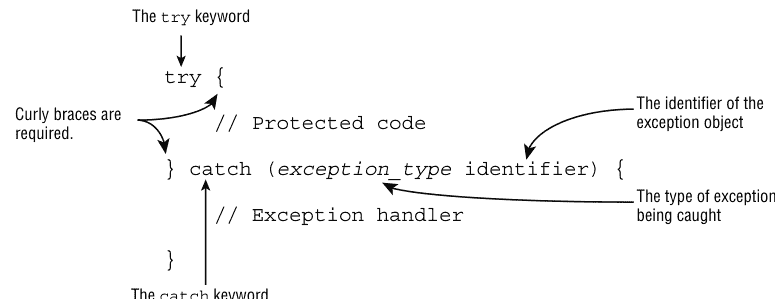

`try` 块中的代码是正常的。如果任何语句抛出了可以被 `catch` 块中列出的异常类型捕获的异常，`try` 块将停止运行，执行将跳转到 `catch` 语句。如果 `try` 块中没有任何语句抛出可以被捕获的异常，则不运行 `catch` 子句。

你可能注意到 `block`（块）和 `clause`（子句）这两个词被互换使用。考试也是如此，所以习惯它。两者都是正确的。`block` 是正确的，因为存在大括号；`clause` 是正确的，因为它是 `try` 语句的一部分。

这里没有大量的语法规则。`try` 和 `catch` 块需要大括号。在我们的示例中，小女孩在第一次跌倒时自己站了起来。它看起来像这样：

```
3: void explore() {
4:   try {
5:     fall();
6:     System.out.println("never get here");
7:   } catch (RuntimeException e) {
8:     getUp();
9:   }
10:  seeAnimals();
11: }
12: void fall() { throw new RuntimeException(); }
```

首先，第 5 行调用 `fall()` 方法。第 12 行抛出一个异常。这意味着 Java 直接跳转到 `catch` 块，跳过了第 6 行。女孩在第 8 行站了起来。现在 `try` 语句结束，执行通过第 10 行正常继续。

现在让我们来看一些考试可能会尝试欺骗你的无效语句。你看到这一个的错了吗？

```
try // 无法编译
    fall();
catch (Exception e)
    System.out.println("get up");
```

问题在于缺少大括号 `{ }`。`try` 语句就像方法，如果代码块内部只有一条语句，则需要大括号；而 `if` 语句和循环是特殊的，允许你省略大括号。那这一个呢？

```
try { 无法编译
    fall();
}
```

这段代码无法编译，因为 `try` 块后面没有任何内容。记住，`try` 语句的目的是在异常发生时执行某些操作。如果没有另一个子句，`try` 语句就是孤立的。正如你看到的，有一种特殊的语句包含了隐式的 `finally` 块，尽管语法与此示例不同。

## 链式异常（Chaining Catch Blocks）

注意，我们在两个不同的 `catch` 块使用了相同的 `println()` 语句。我们可以使用多捕获块（multi-catch block）更优雅地处理这种情况。多捕获块允许同一个 `catch` 块捕获多种异常类型。让我们使用多捕获块重写之前的示例：

```java
public static void main(String[] args) {
  try {
    System.out.println(Integer.parseInt(args[1]));
  } catch (ArrayIndexOutOfBoundsException | NumberFormatException e) {
    System.out.println("Missing or invalid input");
  }
}
```

这要好得多。没有重复代码，通用逻辑都集中在一个地方，且逻辑恰恰位于你预期的地方。如果你需要，仍然可以为每个异常准备第二个 `catch` 块，以便与其他方式处理其他类型的异常。

图 11.3 显示了多捕获块的语法。它类似于普通的 `catch` 子句，不同在于指定了两个或多个异常类型，并用管道线 `|` 分隔。管道线 (`|`) 也用作“或”运算符，让你很容易记住你捕获的是异常类型中的一种或另一种。注意 `catch` 子句中只有一个变量名。Java 正在表示该变量名的类型可以是 `Exception1` 或 `Exception2`。

## 图 11.3 多捕获块的语法

```java
try {
  // 受保护代码      捕获以下
  // 异常中的任意一个。
} catch (Exception1 | Exception2 e) {  // 所有异常类型
  // 异常处理程序    单一标识符
  // 之间使用 | 
exception types
```

考试可能会尝试用无效的语法来欺骗你。记住，异常可以在 `catch` 子句中任意顺序列出。然而，变量名必须只出现一次且位于末尾。你看出为什么它们是有效或无效的了吗？

```
catch(Exception1 e | Exception2 e | Exception3 e) // 无法编译
catch(Exception1 e1 | Exception2 e2 | Exception3 e3) // 无法编译
catch(Exception1 | Exception2 | Exception3 e)
```

第一行是错误的，因为变量名出现了三次。仅仅因为恰好是同一个变量名并不能让它通过。第二行也是错误的，因为变量名再次出现了三次。使用不同的变量名并不会让它更好。第三行可以编译。它展示了指定三个异常的正确语法。

Java 的意图是将多捕获用于互不相关的异常，并防止你在此多捕获中指定冗余类型。你看出这里有什么问题了吗？

```java
try {
    throw new IOException();
} catch (FileNotFoundException | IOException p) // 无法编译
```

在多捕获中指定相关的异常是冗余的，编译器会给出如下信息：

```
The FileNotFoundException 已经由替代的 IOException 捕获
```

由于 `FileNotFoundException` 是 `IOException` 的子类，这段代码将无法编译。多捕获块遵循的规则与链式 `catch` 块类似（你在上一节中见过它们）。例如，当遇到无法到达或重复被捕获的异常时，它们都会触发编译器错误。多捕获块与链式 `catch` 块之间的区别在于，对于单个 `catch` 表达式中的多捕获，顺序是不重要的。

回到示例，正确的代码只需去掉多余的子类引用，如下所示：

```java
try {
    throw new IOException();
} catch (IOException p) // 编译通过
```

## 添加 finally 块

`try` 语句还允许你在 `finally` 子句结束时运行代码，无论是否抛出了异常。图 11.4 显示了带有此功能的 `try` 语句语法。

`catch` 和 `finally` 都有两条路径。如果抛出了异常，`finally` 块会在 `catch` 块之后运行。如果没有抛出异常，`finally` 块会在 `try` 块之后运行。

回到你之前的示例，这次加上 `finally`：

```java
12: void explore() {
13:    try {
14:        seeAnimals();
15:        fall();
16: } catch (Exception e) {
17:     getHugFromDaddy();
18: } finally {
19:     seeMoreAnimals();
20:     }
21:     goHome();
22: }
```

## 图 11.4 带有 finally 的 try 语句语法

```java
try {
    // 受保护代码
    // 使用 finally 时，catch 块是可选的。
} catch (exception_type identifier) {
    // 异常处理
} finally {
    // finally 块 // 无论是否发生异常，finally 块都会执行。
}
// finally 关键字
```

女孩在第15行倒下了。如果她自己站起来，代码继续进入 `finally` 块并运行第19行。如果女孩没有自己站起来，她会抛出一个异常。`catch` 块运行，她在第17行得到了拥抱。这样，她准备好在第19行看更多动物。语句结束，代码继续到第21行。无论哪种方式，结果都是样的。`finally` 块执行，在 `try` 语句之后继续。

考试可能会用缺失子句或顺序错误的子句来欺骗你。看看以下代码为什么可以或不能编译：

```java
25: try { // 编译
26:     fall();
27: } finally {
28:     System.out.println("all better");
29: }
```

```java
25: try { // 无法编译
26:     fall();
27: } finally {
28:     System.out.println("all better");
29: }
30: } catch (Exception e) {
31:     System.out.println("get up");
32: }
```

```java
33: try { // 无法编译
34:     fall();
35: }
```

第一段代码可以编译，因为它有 `try` 和 `finally` 子句。第二段代码无法编译，因为 `catch` 子句出现在 `finally` 子句之后，顺序错误。第三段代码无法编译，因为 `try` 块后面没有任何内容。

## 自动化资源管理

通常，你的应用程序会处理文件、数据库和各种连接对象。通常，这些外部数据源被称为“资源”（resources）。在很多情况下，你会对资源打开连接，无论它是通过网络还是在文件系统内部。然后，你读取/写入所需的数据。最后，你关闭该资源以表示你已完成相关操作。

如果你在完成资源操作后没有关闭它，会发生什么？简而言之，可能会发生很多糟糕的事情。如果你正在连接数据库，可能会用尽所有可用连接，这意味着在你释放连接之前，没有人可以与数据库通信。你经常听过内存泄漏导致程序崩溃；资源泄漏与程序未能释放对资源的连接一样糟糕，这会导致资源无法访问。这可能意味着你的程序无法与数据库通信——或者更糟糕，所有程序都无法访问数据库！

作为示例，资源通常是指需要某种流（stream）或连接来读写数据的文件或数据库。在第 14 章和第 15 章中，你创建了许多在完成任务后需要关闭的资源。

## 引入 try-with-resources（try可用资源）

让我们来看一个打开文件、读取数据并将其关闭的方法：

```java
4:  public void readFile(String file) {
5:     FileInputStream is = null;
6:     try {
7:         is = new FileInputStream("file.txt");
8:         // Read file data
9:      catch (IOException e) {
10:        e.printStackTrace();
11:     } finally {
12:        if(is != null) {
13:            try {
14:                is.close();
15:        } catch (IOException e2) {
```


# 第 11 章 • 异常与本地化

哇，这是一个长方法！为什么有两个 `try` 和 `catch` 块？嗯，第 7 行和第 14 行包含了 `IOException` `catch` 子句，这些异常需要在方法中捕获或由方法重新抛出。这个方法中有一半的代码仅仅用于关闭资源。资源越多，这种代码就会变得越长。例如，你可能有多个需要按特定顺序关闭的资源。你也不需要关闭资源时产生的异常来阻止另一个资源的关闭。

为了解决这个问题，Java 包含了 `try-with-resources` 语句，用于自动关闭在 `try` 子句中打开的所有资源。此功能也被称为自动资源管理（automatic resource management），因为 Java 会自动处理它们。

让我们看看使用 `try-with-resources` 语句的示例：

```java
4:  public void readFile(String file) {
5:      try (InputStream is = new FileInputStream("myfile.txt") {
```

在功能上，它们是相似的，但我们的新版本行数减少了一半。更重要的是，通过使用 `try-with-resources` 语句，我们保证一旦异常超出作用范围，Java 就会在同一个方法内尝试关闭它。

在底层，编译器会将 `try-with-resources` 块替换为 `try` 和 `finally` 块。我们将这个“隐藏”的 `finally` 称为隐式 `finally`（implicit finally block），因为它是由编译器自动创建并使用的。在使用 `try-with-resources` 语句时，你仍然可以创建程序员定义的 `finally` 块；只需注意隐式块会先被调用。

> 与垃圾回收不同，资源在超出作用范围时不会自动关闭。因此，建议你在打开资源的同一代码块中关闭它们。通过使用 `try-with-resources` 语句打开所有资源，这种情况就会自动发生。

## try-with-resources 基础

图 11.5 显示了 `try-with-resources` 语句的样式。注意，`try` 子句中可以打开一个或多个资源。当打开多个资源时，它们的关闭顺序与创建顺序相反。此外，请注意使用圆括号来列出这些资源，并使用分号来分隔声明。这与在 `for` 循环中声明多个索引完全一样。

## 图 11.5 基础 try-with-resources 语句的语法

```java
try (var in = new FileInputStream("data.txt");
     var out = new FileInputStream("output.txt")) {
    // Protected code
} catch (IOException e) {
    // Exception handler
    // 可选的 catch and finally 子句
} finally {
    // finally block
}
```

资源在这里按反序关闭。

图 11.5 中的 `catch` 块发生了什么？嗯，事实证明，对于 `try-with-resources` 语句来说，`catch` 块是可选的。例如，我们可以重写之前的 `readFile(Example)`，让方法捕获异常以使其变得更短：

```java
4: public void readFile(String file) throws IOException {
5: try (FileInputStream is = new FileInputStream("myfile.txt")) {
6: // Read data
7: }
8: }
```

在章节的前面部分，你学了 `try` 语句必须有一个或多个 `catch` 块或一个 `finally` 块。`try-with-resources` 语句与普通语句的区别在于，这两者都不是强制要求的，尽管开发者可能会将两者都加上。对于考试，你需要知道隐式 `finally` 块会在程序员编写的 `finally` 块之前运行。

## 构建 try-with-resources 语句

只有实现了 `AutoCloseable` 接口的类才能用于 `try-with-resources` 语句。例如，以下代码无法编译，因为 `String` 没有实现 `AutoCloseable`：

```java
try (String s = "Lizard") {
```

等等，让我们重新检查该章节的 OCR 文本。（此处由于 OCR 乱码，已根据逻辑重构）。

为了考试，请确保你理解该方法按此顺序打印语句。记住，资源关闭的顺序与声明的顺序相反，并且隐式的 `finally` 会在程序员定义的 `finally` 之前执行。

# 有效最终变量 (Effectively Final)

虽然资源通常在 `try-with-resources` 语句中声明，但也可以提前声明，只要它们被标记为 `final` 或有效 `final`。该语法使用资源名代替资源声明，并用分号 (;) 隔开。让我们尝试另一个例子：

```java
11: public static void main(String... xyz) {
12:     final var bookReader = new MyFileClass(4);
13:     MyFile movieReader = new MyFileClass(5);
14:     try (bookReader;
15:
16:         var tvReader = new MyFileClass(6);
17:         movieReader) {
18:         System.out.println("Try Block");
19:     } finally {
20:         System.out.println("Finally Block");
21:     }
22:}
```

让我们逐行分析。第 12 行声明了一个 `final` 变量 `bookReader`，而第 13 行声明了一个有效 `final` 变量 `movieReader`。这两个资源都可以在 `try-with-resources` 语句中使用。我们知道 `movieReader` 是有效 `final` 的，因为它是一个只赋值一次的局部变量。记住，判断有效最终的标准是代码是否可以通过编译。

第 14 行和第 16 行使用新语法在 `try-with-resources` 语句中声明资源，只需使用变量名并用分号 (;) 分隔资源。第 15 行使用普通语法在 `try` 子句中声明新资源。

执行时，代码将打印以下内容：

```text
Try Block
Closing: 5
Closing: 6
Closing: 4
Finally Block
```

如果你在考试中遇到使用 `try-with-resources` 语句但变量未在 `try` 句中声明的题目，请确保它是有效 `final` 的。以下代码无法编译：

```java
31: var writer = Files.newBufferedWriter(path);
32: try (writer) { // 无法编译
33: writer.append("Welcome to the zoo!");
34: )
35: writer = null;
```

```java
41: var writer = Files.newBufferedWriter(path);
42: writer.append("This write is permitted but a really bad idea!");
43: try (writer) {
44:     writer.append("Welcome to the zoo!");
45: writer.append("This write will fail!"); // IOException
```

`writer` 变量在第 35 行被重新赋值，导致编译器不再认为它是有效 `final`。由于它不是有效 `final` 变量，因此无法在第 32 行的 `try-resources` 语句中使用。

考试可能会欺骗你的另一个地方是在资源关闭后访问它。考虑以下情况：

这段代码可以编译，但在第 46 行抛出异常，消息为 `Stream closed`。虽然可以在 `try-resources` 语句之前向资源写入，但在之后不行。

# 理解被抑制异常 (Suppressed Exceptions)

我们用最令人困惑的话题之一结束对异常的讨论：抑制异常。如果 `close()` 方法抛出异常会发生什么？让我们尝试一个说明性例子：

```java
public class TurkeyCage implements AutoCloseable {
    public void close() {
        System.out.println("Close gate");
    }
    public static void main(String[] args) {
        try (var t = new TurkeyCage()) {
            System.out.println("Put turkeys in");
        }
    }
}
```

如果 `TurkeyCage` 没有关闭，火鸡可能都会逃掉。显然，我们需要处理这种情况。我们已经知道资源在任何程序员编写的 `catch` 块运行之前就会关闭。这意味着如果我们愿意，可以捕获 `close()` 抛出的异常。或者，我们可以允许调用者来处理。

让我们用一个新的 `JammedTurkeyCage` 实现来扩展我们的示例，所示：

```java
1: public class JammedTurkeyCage implements AutoCloseable {
2:     public void close() throws IllegalStateException {
3:         throw new IllegalStateException("Cage does not close");
4:     }
5:     public static void main(String[] args) {
6:         try (JammedTurkeyCage t = new JammedTurkeyCage()) {
7:             System.out.println("Put turkeys in");
8:
         } catch (IllegalStateException e) {
9:             System.out.println("Caught: " + e.getMessage());
10:        }
11:    }
12: }
```

`close()` 方法由 `try-with-resources` 自动调用。它抛出一个异常，该异常被我们的 `catch` 块捕获并打印如下：

```text
Caught: Cage does not close
```

这看起来足够合理。如果 `try` 块也抛出异常会发生什么？当抛出多个异常时，除第一个之外的所有异常都被称为抑制异常。Java 将第一个异常视为主异常，并记录自动关闭过程中出现的任何异常。

你认为以下 `main(String[])` 方法的实现会输出什么？

```java
5: public static void main(String[] args) {
6:     try (JammedTurkeyCage t = new JammedTurkeyCage()) {
7:         throw new IllegalStateException("Turkeys ran in");
8:     } catch (IllegalStateException e) {
9:             System.out.println("Caught: " + e.getMessage());
10:        }
11:    }
```

（注：原文提供的文本在末处变得重复或损坏，我根据上下文重构了逻辑流。）

这些示例应该帮助阐明这些符号是如何工作的：

```java
12: double d = 1234.567;
13: NumberFormat f1 = new DecimalFormat("###,###,###.0");
14: System.out.println(f1.format(d)); // 1234.567
15:
16: NumberFormat f2 = new DecimalFormat("000,000,000.00000");
17: System.out.println(f2.format(d)); // 000,231.456700
18:
19: NumberFormat f3 = new DecimalFormat("Your Balance $,###,###.##");
20: System.out.println(f3.format(d)); // Your Balance $1,234.57
```

第 14 行显示了数字在小数点后四舍五入到十分位。左侧额外的数字被省略了，因为我们使用了 `#`。第 17 行添加了前导和尾零以达到所需的长度。第 20 行显示了当可用时前缀字符会打印较少的数字。注意，如果在 `#` 符号之间使用逗号，逗号会被删除。

如你所见，还有一个继承自 `NumberFormat` 的类，这是你在考试中需要的。

## 格式化日期和时间

日期和时间类支持许多从它们获取数据的方法。

```java
LocalDate date = LocalDate.of(2022, Month.OCTOBER, 20); // THURSDAY
System.out.println(date.getDayOfWeek()); // THURSDAY
System.out.println(date.getMonth()); // OCTOBER
System.out.println(date.getYear()); // 2022
System.out.println(date.getDayOfYear()); // 293
```

Java 提供了 `DateTime` 类来显示标准格式。

```java
LocalDate date = LocalDate.of(2022, Month.OCTOBER, 20);
LocalTime time = LocalTime.of(11, 12, 34);
LocalDateTime dt = LocalDateTime.of(date, time);
```

```java
System.out.println(date.format(DateTimeFormatter.ISO_LOCAL_DATE));
System.out.println(time.format(DateTimeFormatter.ISO_LOCAL_TIME));
System.out.println(dt.format(DateTimeFormatter.ISO_LOCAL_DATE_TIME));
```

代码段打印如下：

```text
2022-10-20
11:12:34
2022-10-20T11:12:34
```

## 第 11 章 异常与本地化

如果 `DateTimeFormatter` 遇到不兼容的类型，将抛出异常。例如，如果尝试用时间值格式化日期，反之亦然，以下每个操作都会运行时产生异常：

```java
date.format(DateTimeFormatter.ISO_LOCAL_TIME); // RuntimeException
time.format(DateTimeFormatter.ISO_LOCAL_DATE); // RuntimeException
```

## 自定义日期/时间格式

如果你不想使用预定义格式之一，`DateTimeFormatter` 支持使用日期格式字符串进行自定义格式。

```java
var f = DateTimeFormatter.ofPattern("MMMM dd, yyyy 'at' hh:mm");
System.out.println(dt.format(f)); // October 20, 2022 at 11:12
```

让我们稍微拆解一下。Java 将每个字母或符号分配给特定的日期/时间格式。例如，`M` 用于月份，而 `y` 用于年份。其他符号呢？`m` 返回分钟，而不是月份。数字通常决定日期/时间的格式。`M` 本身输出月份的最小位数，例如 1 代表 January，而 `MM` 始终输出两个数字，例如 01。此外，`MMM` 打印三个字母缩写，例如 Jul 代表 July。

> 在考试中可能不太可能遇到使用 `SimpleDateFormat` 而不是更有用的 `DateTimeFormatter` 的问题。如果在旧的 `java.util.Date` 对象上这样做，只需知道考试中出现的自定义格式与它是兼容的。

## 学习日期/时间符号

为了考试，你应该熟悉日期/时间字符串中的各种符号，并对输出有一个良好的预期。11.6 包含了你应该熟悉的符号。

### 11.6 常见日期/时间符号

| 符号 | 含义 | 示例 |
| :--- | :--- | :--- |
| `y` | 年份 | 22, 2022 |
| `M` | 月份 | 01, January |
| `d` | 天数 | 05 |
| `h` | 小时 | 9, 09 |
| `m` | 分钟 | 45 |
| `S` | 秒 | 52 |
| `a` | 上午下午 (a.m./p.m.) | AM, PM |
| `z` | 时区名称 | Standard Time, EST |
| `Z` | 时区偏移 | -0400 |

### 格式值

让我们尝试一些示例。你认为以下代码会打印什么？


`var dt = LocalDateTime.of(2022, Month.OCTOBER, 20, 15, 30);`

```
var formatter1 = DateTimeFormatter.ofPattern("MM/dd/yyyy hh:mm:ss");
System.out.println(dt.format(formatter1)); // 10/20/2022 06:15:30
```

```
var formatter2 = DateTimeFormatter.ofPattern("MM_yyyy_dd");
System.out.println(dt.format(formatter2)); // 10_2022_20
```

```
var formatter3 = DateTimeFormatter.ofPattern("h:mm z");
System.out.println(dt.format(formatter3)); // DateTimeException
```

第一个示例打印日期，月份在日期之前，然后是时间。第二个示例以奇怪的格式打印日期，带有作为输出部分的额外字符。第三个示例没有时区。如果使用了`ZonedDateTime`，代码将成功执行并打印类似`06:15 EDT`的内容，取决于时区。

正如你在上一个示例所示，你需要确保格式字符串与变化的日期/时间类型兼容。11.7 显示了每个日期/时间对象可以使用哪些符号。确保你知道哪些符号与日期/时间类型兼容。例如，对`LocalDate`格式化月份或小时会导致异常。

### 11.7 支持的日期/时间符号

| 符号 | LocalDate | LocalTime | LocalDateTime | ZonedDateTime |
| :--- | :---: | :---: | :---: | :---: |
| y | ✓ | | ✓ | ✓ |
| M | ✓ | | ✓ | ✓ |
| d | ✓ | | ✓ | ✓ |
| h | | ✓ | ✓ | ✓ |
| m | | ✓ | ✓ | ✓ |
| s | | ✓ | ✓ | ✓ |
| a | | ✓ | ✓ | ✓ |
| z | | | | ✓ |
| Z | | | | ✓ |

## 选择 format() 方法

日期/时间类包含一个接收格式化器的`format()`方法，而格式化器包含一个接收日期/时间值的`format()`方法。结果是以下任何一种都是可以的：

```
var dateTime = LocalDateTime.of(2022, Month.OCTOBER, 20, 6, 15, 30);
var formatter = DateTimeFormatter.ofPattern("MM/dd/yyyy hh:mm:ss");
```

```
System.out.println(dateTime.format(formatter)); // 10/20/2022 06:15:30
System.out.println(formatter.format(dateTime)); // 10/20/2022 06:15:30
```

这些语句在运行时打印该值。使用哪种语法取决于你。

## 添加自定义文本值

如果你想让格式包含一些自定义文本值，并且只是将它们作为格式的一部分输入，格式化器将把每个字符解释为日期/时间符号。在最好的情况下，它将根据你输入的额外符号显示奇怪的数据。在最坏的情况下，它将抛出异常，因为字符包含无效符号。这两者都不是理想的！

解决此问题的方法是将格式拆分为多个较小的格式并将它们拼接：

```java
var dt = LocalDateTime.of(2022, Month.OCTOBER, 20, 6, 15, 30);
```

## 支持国际化与本地化

```java
var f1 = DateTimeFormatter.ofPattern("MMMM dd, yyyy");
var f2 = DateTimeFormatter.ofPattern("hh:mm");
System.out.println(dt.format(f1) + " " + dt.format(f2));
```

这在运行时打印`October 20, 2022 06:15`。虽然这种方法可行，但解析大量的文本和日期符号可能会变得困难。幸运的是，Java 提供了一个更简单的解决方案。你可以通过一对单引号（`''`）来转义文本。转义文本告知格式化器忽略单引号内部的值并将其作为最终值的一部分插入。

```java
var f = DateTimeFormatter.ofPattern("MMMM dd, 'yyyy' 'hh:mm'");
System.out.println(dt.format(f)); // October 20, 2022 06:15
```

但如果你也需要在输出中显示单引号呢？欢迎来到转义字符的乐趣！Java 通过将两个引号放在一起来支持这一点。为了结束关于日期格式及其输出示例的讨论，如下：

```java
var g1 = DateTimeFormatter.ofPattern("MMMM dd, 'Party\'s' at hh:mm'");
System.out.println(dt.format(g1)); // October 20, Party's at 06:15
```

```java
var g2 = DateTimeFormatter.ofPattern("'System format, hh:mm'");
System.out.println(dt.format(g2)); // System format, hh:mm: 06:15
```

```java
var g3 = DateTimeFormatter.ofPattern("'NEW! 'yyyy', 'yay!''");
System.out.println(dt.format(g3)); // NEW! 2022, yay!
```

# 第 11 章 • 异常与本地化

没有写“behaviours”。如果我们正在创建一个将在多个国家使用的网站或程序，我们必须使用正确的语言和格式。

国际化（Internationalization）是设计程序使其能够被适配的过程。它涉及将字符串存放在属性文件中，并确保使用正确的格式化器。本地化（Localization）意味着支持多个本地区域或地理区域。你可以将本地区域（`locale`）想为语言和国家的组合。本地化涉及将字符串翻译成不同的语言，它包括以该区域的正确格式输出日期和数字。

> 最初，你的程序不需要支持多个本地区域。关键是通过这些技术为你的应用程序提供面向未来的保障。这样，当你的程序取得成功时，你可以添加对新语言或地区的支持，而无需重写所有内容。

在本节中，我们将学习如何定义和使用它来格式化日期、数字和字符串。

## 选择 Locale

虽然`Locale`将本地区域定义为“特定的地理、政治或文化区域”，但在考试中你只会看到语言和国家。`Locale`不会深入不是国家的政治区域。这对于考试来说太复杂了！

`Locale`类位于`java.util`包中。`Locale`的第一个用法是查找用户的当前本地区域。在你的电脑上运行以下代码：

```
Locale locale = Locale.getDefault();
System.out.println(locale);
```

当我们运行时，它输出`en_US`。这对你来说可能不同。默认输出告诉我们计算机在使用英语并位于美国。注意格式：首先是小写的语言代码（语言是必须的），然后是下划线和大写的国家代码（国家是可选的）。图 11.6 显示了你需要记住的`Locale`格式。

图 11.6 Locale 格式 

## 支持国际化与本地化

作为练习，确保你理解为什么这些`Locale`标识符是无效的：考试不需要记忆代码。注意大小写和下划线。例如，如果你看到`es_CO`这样的本地区域，你应该知道语言是`es`，国家是`CO`，即使你不知道它们分别代表西班牙语和哥伦比亚。

作为开发者，你需要编写创建其他于默认本地区域的代码。有三种方法可以做到这一点。第一种是使用`Locale`类中内置的常量，适用于某些本地区域。

```
System.out.println(Locale.GERMAN); // de
System.out.println(Locale.GERMANY); // de_DE
```

第一个示例选择了德语，它在许多国家使用，包括奥地利（`de_AT`）和利希森士登（`de_LI`）。第二个示例选择了德语和德国国家。虽然这些示例看起来相似，但它们并不相同。只有一个包含了国家代码。

选择本地区域的第二种方法是使用构造函数创建一个对象。你可以只传递本地区域，或者语言和国家：

```
System.out.println(new Locale("fr")); // fr
System.out.println(new Locale("hi")); // hi_IN
```

第一个是法语，第二个是印度的印地语。再次，你不需要记忆代码。另一个构造函数让你对本地区域更加具体（提供变体值）。Java 会允许你创建一个无效语言或国家的`Locale`，例如`xx_XX`。然而，它不会匹配你想使用的`Locale`，你的程序行为将不符合预期。

第三种创建`Locale`的方法更加灵活。构建器模式（builder pattern）让你设置你关心的所有属性，最后构建`Locale`。这意味着你可以以任何顺序指定属性。以下两个`Locale`代表`en_US`：

```
Locale l = new Locale.Builder()
    .setLanguage("en")
    .setRegion("US")
    .build();

Locale l2 = new Locale.Builder
    .setRegion("US")
    .setLanguage("en")
    .build();
```

在测试程序时，你可能需要使用不同于计算机的`Locale`。

```
System.out.println(Locale.getDefault()); // en_US
Locale locale = new Locale("fr")
Locale.setDefault(locale);
System.out.println(Locale.getDefault()); // fr
```

尝试一下，不要担心——`Locale`只改变这一个 Java 程序。它不会改变你电脑上的任何设置，也不会改变同一程序的后续执行结果。

> 考试可能会使用`setDefault()`，因为它无法假设你所处的位置。在实践中，我们很少编写更改用户默认本地区域的代码。


## 本地化数字

格式化或解析货币和数字值会根据你的本地区域而改变，这可能会让你惊讶。例如，在美国，小于 1 的美元符号位于带有小数点的值之前，如`$2.15`。在德国，小于 1 的欧元符号位于带有逗号的值后面，如`2,15 €`

幸运的是，`java.text`包包含了这些类。后续章节涵盖了如何根据本地区域格式化数字、货币和日期。格式化或解析数据的第一步相同：获取`NumberFormat`实例。表 11.8 显示了可用方法。

一旦你拥有了`NumberFormat`实例，就可以调用`format()`将数字转换为字符串，或使用`parse()`将字符串转换为数字。

格式化类不是线程安全的。不要将它们存储在实例变量或静态变量中。你将在第 13 章“并发”中学习更多关于线程安全的知识。


### 11.8 获取 NumberFormat 的工厂方法

| 说明 | 使用默认 Locale | 使用指定的 Locale |
| :--- | :--- | :--- |
| 通用格式化器 | `NumberFormat.getInstance()` | `NumberFormat.getInstance(Locale locale)` |
| 等同于 getInstance | `NumberFormat.getNumberInstance()` | `NumberFormat.getNumberInstance(Locale locale)` |
| 用于格式化金额 | `NumberFormat.getCurrencyInstance()` | `NumberFormat.getCurrencyInstance(Locale locale)` |
| 用于格式化百分比 | `NumberFormat.getPercentInstance()` | `NumberFormat.getPercentInstance(Locale locale)` |
| 显示前对小数四舍五入 | `NumberFormat.getIntegerInstance()` | `NumberFormat.getIntegerInstance(Locale locale)` |
| 返回紧凑数字格式化器 | `NumberFormat.getCompactNumberInstance()` | `NumberFormat.getCompactNumberInstance(Locale locale, NumberFormat.Style formatStyle)` |

## 格式化

当我们格式化数据时，我们将结构化对象或原始值转换为字符串。`NumberFormat.format()`方法根据与`NumberFormat`对象关联的本地区域来格式化数字。

让我们回到动物园几分钟。为了市场营销，我们想分享圣地亚动物园的平均每月游客人数。以下显示了不同本地区域下的相同数字：

```
int attendeesPerYear = 3_200_000;
int attendeesPerMonth = attendeesPerYear / 12;
```

```java
var us = NumberFormat.getInstance(Locale.US);
System.out.println(us.format(attendesPerMonth)); // 266,666

var gr = NumberFormat.getInstance(Locale.GERMANY);
System.out.println(gr.format(attendesPerMonth)); // 266.666
```

```java
var ca = NumberFormat.getInstance(Locale.CANADA_FRENCH);
System.out.println(ca.format(attendesPerMonth)); // 266 666
```

这展示了我们的美国、德国和法语加拿大客人如何以他们习惯的数字格式查看相同的信息。在实践中，我们只需要调用`NumberFormat.getInstance()`并依赖用户的默认区域（`locale`）来格式化输出。

货币格式化的原理也是。

```java
double price = 48;
var myLocale = NumberFormat.getCurrencyInstance();
System.out.println(myLocale.format(price));
```

当使用美国的`en_US`默认区域运行时，此代码输出`$48.00`。相反，当使用英国的`en_GB`默认区域运行时，它输出`£48.00`。

> 在现实世界中，请使用`int`或`BigDecimal`处理金额，而不是使用`double`。使用`double`对金额进行数学运算是危险的，因为这些值被存储为浮点数。如果你每笔交易都丢失几分钱，你的老板不会乐意的！

最后，我们可能有一些显示百分比格式化的示例：

```java
double successRate = 0.082;
var us = NumberFormat.getPercentInstance(Locale.US);
System.out.println(us.format(successRate)); // 80%
```

```java
var gr = NumberFormat.getPercentInstance(Locale.GERMANY);
System.out.println(gr.format(successRate)); // 80 %
```

没有太大区别，但我们应该意识到打印百分比的能力在考试中取决于特定区域！

# 解析数字

当我们进行解析时，是将其从`String`转换为结构化对象或原始值。`NumberFormat.parse()`方法完成了此操作，并考虑了区域。

例如，如果区域是英语/美国（`en_US`）且数字包含逗号，则逗号被视为格式化符号。如果区域涉及使用逗号作为小数点分隔符的国家或语言，则逗号被视为小数点。

> 在各种类型中找到的`parse()`方法声明了一个受检异常`ParseException`，该异常必须在调用它的方法中被处理或声明。

# 支持国际化和本地化

让我们来看一个例子。以下代码使用不同的区域解析折扣后的票价。`parse()`方法会抛出受检的`ParseException`，因此请确保在自己的代码中处理或声明它。

```java
String s = "40.45";
```

```java
var en = NumberFormat.getInstance(Locale.US);
System.out.println(en.parse(s)); // 40.45
```

```java
var fr = NumberFormat.getInstance(Locale.FRANCE);
System.out.println(fr.parse(s)); // 40
```


在美国，句号（`.`）是数字的一部分，解析方式正如你预期的那样。法国不使用小数点来分隔数字。`Java` 将视为格式字符，并在数字的剩余部分处停止。教训是确保你使用正确的区域进行解析！

`parse()` 方法也用于解析货币。例如，我们可以读取动物园门票的月收入：

```java
String income = "$92,807.99";
var cf = NumberFormat.getCurrencyInstance();
double value = (Double) cf.parse(income);
System.out.println(value); // 92807.9
```

货币 `"$92,807.99"` 包含美元符号和逗号。`parse()` 方法剥离这些字符并将值转换为数字。`parse()` 的返回值是一个 `Number` 对象。`Number` 是所有 `java.lang` 包装类的父类，因此返回值可以强制转换为其适当的数据类型。`Number` 被强制转换为 `Double` 并自动拆箱为 `double`。

## 使用 `CompactNumberFormat` 格式化

考试中你需要知道的第二个继承自 `NumberFormat` 的类是 `CompactNumberFormat`。它是 `Java 17` 新引入的，所以你可能会在考试中看到关于它的问题！`CompactNumberFormat` 与 `DecimalFormat` 类似，但它是为空间有限的地方设计的。它的“主观性”体现在它为你选择格式，而“区域特定性”体现在输出取决于你的位置。

考虑以下代码，它将 `CompactNumberFormat` 应用于两个区域，并静态导入了 `Style`（一个枚举）：

```java
var formatters = Stream.of(
    NumberFormat.getCompactInstance(),
    NumberFormat.getCompactInstance(Locale.getDefault(), Style.SHORT),
    NumberFormat.getCompactInstance(Locale.getDefault(), Style.LONG),
    NumberFormat.getCompactInstance(Locale.GERMANY, Style.SHORT),
    NumberFormat.getCompactInstance(Locale.GERMANY, Style.LONG)
);
formatters.map(s -> s.format(1234567)).forEach(System.out::println);
```

此代码在 `en_US` 区域运行时将输出以下内容（为了可读性增加了换行）：

```
7M
7 million
7,234,567
```

注意前两行是相同的。如果没有指定样式，默认使用 `SHORT`。接下来，注意除了最后一个之外，值都被截断了。这就是它被称为紧凑格式化的原因！此外，短形式使用了常用标签，例如 `K` 表示千。最后，在 `GERMANY` 区域运行时，输出可能会不同。

使用 `formatters` 尝试另一个例子：

```java
formatters.map(s -> s.format(31490000)).forEach(System.out::println);
```

这在 `en_US` 区域运行时输出以下内容：

```
315M
315 million
314.9 million
314,900,000
```

注意使用 `CompactNumberFormat` 的条目，第三位会自动四舍五入。以下是 `CompactNumberFormat` 的规则总结：

- 首先确定最大的范围，例如千（`K`）、百万（`M`）、十亿（`B`）或万亿（`T`）。
- 返回范围前三个数字，并对最后一位保留。
- 最后打印标识符。如果使用 `SHORT`，则返回符号；如果使用 `LONG`，则返回空格加单词。

对于考试，确保你理解 `SHORT` 和 `LONG` 格式的区别以及 `M` 等常用符号。

## 日期本地化

与数字一样，日期格式随区域而异。表 11.9 显示了使用默认区域获取 `DateTimeFormatter` 实例的方法。

### 11.9 获取 `DateTimeFormatter` 的工厂方法

| 说明 | 使用默认区域 |
| --- | --- |
| 格式化日期 | `DateTimeFormatter.ofLocalizedDate(FormatStyle dateStyle)` |
| 格式化时间 | `DateTimeFormatter.ofLocalizedTime(FormatStyle timeStyle)` |
| 格式化日期和时间 | `DateTimeFormatter.ofLocalizedDateTime(FormatStyle dateStyle, FormatStyle timeStyle)` |

表中的每个方法都使用一个（或两个）`FormatStyle` 参数，可能值为 `SHORT`、`MEDIUM` 和 `FULL`。对于考试，你不需要知道每一个的格式。

如果你需要特定区域的格式化器？很简单——只需在方法调用中附加 `withLocale(locale)`。

让我们将其整合在一起。查看以下代码片段，它依赖于 `java.time.format.FormatStyle.SHORT` 的静态导入：

```java
public static void print(DateTimeFormatter df,
    LocalDateTime dateTime, Locale locale) {
    System.out.println(df.format(dateTime) + " -- " 
        + df.withLocale(locale).format(dateTime));
}
public static void main(String[] args) {
    Locale.setDefault(new Locale("en", "US"));
    var italy = new Locale("it", "IT");
    var dt = LocalDateTime.of(2022, Month.OCTOBER, 20, 15, 12, 34);
```

首先我们将 `en_US` 设置为默认区域，并将 `it_IT` 设置为请求区域。然后使用两个区域输出每个值。如你所见，应用区域对内置日期时间格式化器有很大影响。

## 指定区域类别

当你调用 `Locale.setDefault(locale)` 时，内部会选择几个显示和格式化选项。如果你需要对默认区域进行更细粒度的控制，`Java` 使用 `Locale.Category` 枚举将底层格式化选项细分为不同的类别。

`Locale.Category` 枚举是 `Locale` 中的一个嵌套元素，支持用于显示和格式化数据的不同区域。对于考试，你应该熟悉表 11.10 中的两个枚举值。

### 11.10 `Locale.Category` 值

| 值 | 说明 |
|---|---|
| `DISPLAY` | 用于显示有关区域数据的类别 |
| `FORMAT` | 用于格式化日期、数字或货币的类别 |

当你调用 `Locale.setDefault(locale)` 时，`DISPLAY` 和 `FORMAT` 会被一起设置。让我们来看一个例子：

```java
10: public static void printCurrency(Locale locale, double money) {
11:     System.out.println(
12:     NumberFormat.getCurrencyInstance().format(money)
13:     + " - " + locale.getDisplayName());
14: }
15: public static void main(String[] args) {
16:     var spain = new Locale("es", "ES");
17:     var money = 1.23;
```

```java
18: // 使用默认语言区域打印
19: 
20: Locale.setDefault(new Locale("en", "US"));
21: printCurrency(sp, money); // $1.23, Spanish
```

```java
22:
23: // 使用选定的语言区域显示打印
24: Locale.setDefault(Category.DISPLAY, spain);
25: printCurrency(spain, money); // $1.23, español
```

```java
26:
27: // 使用选定的语言区域格式打印
28: Locale.setDefault(Category.FORMAT, spain);
29: printCurrency(spain, money); // 1,23 €, español
```

这段代码打印了三次相同的数据。它使用 `locale_en` 打印了 `spain` 变量和 `money` 变量的语言。然后，它使用了 `es_ES` 的 `DISPLAY` 类别，而 `FORMAT` 类别保持为 `en_US`。最后，它使用设置为 `es_ES` 的类别打印数据。

对于考试，你不需要记忆每个类别的各种显示和格式选项。你只需要知道你可以独立地设置语言区域的部分。你还应该知道，在之前的代码段之后调用 `Locale.setDefault(us)` 将将两个语言区域类别都更改为 `en_US`。

## 使用资源包（`Resource Bundles`）加载属性

到目前为止，我们将所有显示给用户的文本字符串作为程序的一部分保留在使用它们的类中。本地化需要将它们外部化到其他地方。
资源包（`bundle`）包含了程序使用的特定于语言区域的 `get`。它像一个带有键和值的映射（`map`）。资源包通常存储在属性文件（`properties file`）中。
属性文件是以简单格式的键/值对组成的文本文件。

我们的动物园程序非常成功。我们现在收到了请求，要在另外三家动物园使用它！我们已经支持了位于美国的动物园。现在，我们需要添加法国的 `Zoo de La Palmy`、英语加拿大的大温哥华动物园，以及法语加拿大的 `Granny` 动物园。

我们立即意识到，我们要对程序进行国际化。
资源包将非常有帮助。它们让我们轻松地将应用程序翻译到多个语言区域，甚至同时支持多个语言区域。如果以后更多国家的动物园感兴趣，以后添加更多语言区域也将很容易。我们考虑了哪些，最后得出了四个：

```java
Locale us = new Locale("en", "US")
Locale france = new Locale("fr", "FR")
Locale englishCanada = new Locale("en", "CA")
Locale frenchCanada = new Locale("fr", "CA")
```

在接下来的章节中，我们将使用属性文件创建资源包。它在概念上类似于 `Map<String, String>`，每行代表一个不同的键/值。键和值由等号（`=`）或冒号（`:`）分隔。为了保持简单，我们在整个章节中统一使用等号。我们还将查看 `Java` 如何确定要使用的资源包。

### 创建资源包

我们将更新应用程序以支持之前列出的四个语言区域。幸运的是，`Java` 不需要我们创建四个不同的资源包。`Java` 将使用特定语言的包。这比这复杂一点，但让我们从一个简单的示例开始。

目前，我们为 `Zoo` 资源包使用英语和法语属性文件。首先，创建两个属性文件。

#### `Zoo_en.properties`

```
hello=Hello
open=The zoo is open
```

#### `Zoo_fr.properties`

```
hello=Bonjour
open=Le zoo est ouvert
```

文件名与我们的资源包名称 `Zoo` 匹配。随后是下划线（`_`）和 `.properties` 扩展名。我们可以编写第一个使用资源包来打印这些信息的程序。

```java
10: public static void printWelcomeMessage(Locale locale) {
11:     var rb = ResourceBundle.getBundle("Zoo", locale);
12:     System.out.println(rb.getString("hello")
13:     "" + " " + rb.getString("open"));
14: }
15: public static void main(String[] args) {
16:     var us = new Locale("en", "US")
17:     var france = new Locale("fr", "FR")
18:     printWelcomeMessage(us); // Hello, The zoo is open
19:     printWelcomeMessage(france); // Bonjour, Le zoo est ouvert
20: }
```

第 16 和 17 行创建了我们想要测试的两个语言区域，10-14 行执行了实际工作。第 11 行调用 `ResourceBundle` 上的工厂方法来获取正确的包。第 12 和 13 行从资源包中检索正确的字符串并打印结果。

由于资源包包含键/值对，你可以遍历它们以列出所有键值对。`ResourceBundle` 类提供了 `getKey()` 方法来获取所有键集合。

```java
var us = new Locale("en", "US");
ResourceBundle rb = ResourceBundle.getBundle("Zoo", us);
rb.keySet().stream()
  .map(k -> k + ": " + rb.getString(k))
  .forEach(System.out::println);
```

这个示例遍历了所有的键。它将每个键映射到一个包含键和值的字符串（`String`），并在打印之前进行处理。

```
hello: Hello
open: The zoo is open
```

对于考试，不需要知道资源包的属性文件存储在哪里。如果考试提供了属性文件，可以安全地假设它存在并在运行时加载。

由于资源包包含键/值对，你可以遍历它们以列出所有键值对。`ResourceBundle` 类提供了 `getKey()` 方法来获取所有键集合。

```java
var us = new Locale("en", "US");
ResourceBundle rb = ResourceBundle.getBundle("Zoo", us);
rb.keySet().stream()
  .map(k -> k + ": " + rb.getString(k))
  .forEach(System.out::println);
```

这个示例遍历了所有的键。它将每个键映射到一个包含键和值的字符串（`String`），并在打印之前进行处理。

```
hello: Hello
open: The zoo is open
```

对于考试，不需要知道资源包的属性文件存储在哪里。如果考试提供了属性文件，可以安全地假设它存在并在运行时加载。

由于资源包包含键/值对，你可以遍历它们以列出所有键值对。`ResourceBundle` 类提供了 `getKey()` 方法来获取所有键集合。

```java
var us = new Locale("en", "US");
ResourceBundle rb = ResourceBundle.getBundle("Zoo", us);
rb.keySet().stream()
  .map(k -> k + ": " + rb.getString(k))
  .forEach(System.out::println);
```

这个示例遍历了所有的键。它将每个键映射到一个包含键和值的字符串（`String`），并在打印之前进行处理。

```
hello: Hello
open: The zoo is open
```

对于考试，不需要知道资源包的属性文件存储在哪里。如果考试提供了属性文件，可以安全地假设它存在并在运行时加载。

由于资源包包含键/值对，你可以遍历它们以列出所有键值对。`ResourceBundle` 类提供了 `getKey()` 方法来获取所有键集合。

```java
var us = new Locale("en", "US");
ResourceBundle rb = ResourceBundle.getBundle("Zoo", us);
rb.keySet().stream()
  .map(k -> k + ": " + rb.getString(k))
  .forEach(System.out::println);
```

这个示例遍历了所有的键。它将每个键映射到一个包含键和值的字符串（`String`），并在打印之前进行处理。

```
hello: Hello
open: The zoo is open
```

对于考试，不需要知道资源包的属性文件存储在哪里。如果考试提供了属性文件，可以安全地假设它存在并在运行时加载。

由于资源包包含键/值对，你可以遍历它们以列出所有键值对。`ResourceBundle` 类提供了 `getKey()` 方法来获取所有键集合。

```java
var us = new Locale("en", "US");
ResourceBundle rb = ResourceBundle.getBundle("Zoo", us);
rb.keySet().stream()
  .map(k -> k + ": " + rb.getString(k))
  .forEach(System.out::println);
```

这个示例遍历了所有的键。它将每个键映射到一个包含键和值的字符串（`String`），并在打印之前进行处理。

```
hello: Hello
open: The zoo is open
```

对于考试，不需要知道资源包的属性文件存储在哪里。如果考试提供了属性文件，可以安全地假设它存在并在运行时加载。


# 第 11 章 异常与本地化

## 使用默认语言区域打印

```java
18: // 使用默认语言区域打印
19:
20: Locale.setDefault(new Locale("en", "US"));
21: printCurrency(sp, money); // $1.23, Spanish
```

## 使用选定的语言区域显示打印

```java
22:
23: // 使用选定的语言区域显示打印
24: Locale.setDefault(Category.DISPLAY, spain);
25: printCurrency(spain, money); // $1.23, español
```

## 使用选定的语言区域格式打印

```java
26:
27: // 使用选定的语言区域格式打印
28: Locale.setDefault(Category.FORMAT, spain);
29: printCurrency(spain, money); // 1,23 €, español
```

这段代码打印了三次相同的数据。它使用`locale_en`打印了`spain`变量和`money`变量的语言。然后，它使用了`es_ES`的`DISPLAY`类别，而`FORMAT`类别保持为`en_US`。最后，它使用设置为`es_ES`的类别打印数据。

对于考试，你不需要记忆每个类别的各种显示和格式选项。你只需要知道你可以独立地设置语言区域的部分。你还应该知道，在之前的代码段之后调用`Locale.setDefault(us)`将将两个语言区域类别都更改为`en_US`。

## 使用资源包加载属性

到目前为止，我们将所有显示给用户的文本字符串作为程序的一部分保留在使用它们的类中。本地化需要将它们外部化到其他地方。
包（bundle）包含了程序使用的特定于语言区域的get。它像一个带有键和值的映射（map）。资源包通常存储在属性文件中。
属性文件是以简单格式的键/值对组成的文本文件。

我们的动物园程序非常成功。我们现在收到了请求，要在另外三家动物园使用它！我们已经支持了位于美国的动物园。现在，我们需要添加法国的 Zoo de La Palmy、英语加拿大的大温哥华动物园，以及法语加拿大的 Granny of 动物园。

我们立即意识到，我们要对程序进行国际化。
资源包将非常有帮助。它们让我们轻松地将应用程序翻译到多个语言区域，甚至同时支持多个语言区域。如果以后更多国家的动物园感兴趣，以后添加更多语言区域也将很容易。我们考虑了哪些，最后得出了四个：

```java
Locale us = new Locale("en", "US")
Locale france = new Locale("fr", "FR")
Locale englishCanada = new Locale("en", "CA")
Locale frenchCanada = new Locale("fr", "CA")
```

在接下来的章节中，我们将使用属性文件创建资源包。它在概念上类似于`Map<String, String>`，每行代表一个不同的键/值。键和值由等号（`=`）或冒号（`:`）分隔。为了保持简单，我们在整个章节中统一使用等号。我们还将查看 Java 如何确定要使用的资源包。

## 创建资源包

我们将更新应用程序以支持之前列出的四个语言区域。幸运的是，Java 不需要我们创建四个不同的资源包。Java 将使用特定语言的包。这比这复杂一点，但让我们从一个简单的示例开始。

目前，我们使用英语和法语属性文件用于 Zoo 资源包。首先，创建两个属性文件。

### Zoo_en.properties

```
hello=Hello
open=The zoo is open
```

### Zoo_fr.properties

```
hello=Bonjour
open=Le zoo est ouvert
```

文件名与我们的资源包名称 Zoo 匹配。随后是下划线（`_`）和`.properties`扩展名。我们可以编写第一个使用资源包来打印这些信息的程序。

```java
10: public static void printWelcomeMessage(Locale locale) {
11:     var rb = ResourceBundle.getBundle("Zoo", locale);
12:     System.out.println(rb.getString("hello")
13:     "" + " " + rb.getString("open"));
14: }
15: public static void main(String[] args) {
16:     var us = new Locale("en", "US")
17:     var france = new Locale("fr", "FR")
18:     printWelcomeMessage(us); // Hello, The zoo is open
19:     printWelcomeMessage(france); // Bonjour, Le zoo est ouvert
20: }
```

## 使用资源包加载属性

第 16 和 17 行创建了我们想要测试的两个语言区域，10–14 行执行了实际工作。第 11 行调用`ResourceBundle`上的工厂方法来获取正确的包。第 12 和 13 行从资源包中检索正确的字符串并打印结果。

由于资源包包含键/值对，你可以遍历它们以列出所有键值对。`ResourceBundle`类提供了`getKey()`方法来获取所有键集合。

```java
var us = new Locale("en", "US");
ResourceBundle rb = ResourceBundle.getBundle("Zoo", us);
rb.keySet().stream()
  .map(k -> k + ": " + rb.getString(k))
  .forEach(System.out::println);
```

这个示例遍历了所有的键。它将每个键映射到一个包含键和值的字符串（`String`），并在打印之前进行处理。

```
hello: Hello
open: The zoo is open
```

对于考试，不需要知道资源包的属性文件存储在哪里。如果考试提供了属性文件，可以安全地假设它存在并在运行时加载。

## 资源包层级示例

假设我们有以下属性文件：

`Zoo.properties`

```
name=Vancouver Zoo
```

`Zoo_en.properties`

```
hello=Hello
open=is open
```

`Zoo_en_US.properties`

```
name=The Zoo
```

`Zoo_en_CA.properties`

```
visitors=Canada visitors
```

假设我们有一位来自魁北克（其默认区域语言为加拿大法语）的访问者，他要求程序提供英语信息。你认为输出会什么？

```java
11: Locale.setDefault(new Locale("en", "US"))
12: Locale locale = new Locale("en", "CA");
13: ResourceBundle rb = ResourceBundle.get("Zoo", locale);
14: System.out.print(rb.getString("hello"));
15: System.out.print(". ");
16: System.out.print(rb.getString("name"));
17: System.out.print(". ");
18: System.out.print(rb.getString("open"));
19: System.out.print(". ");
20: System.out.print(rb.getString("visitors"));
```

程序打印以下内容：

```
Hello. Vancouver is open Canada visitors
```

默认区域语言是`en_US`，请求的区域语言是`en_CA`。首先，Java 会遍历所有可用资源包以查找匹配项。它立即通过`Zoo_en.properties`找到了一个匹配项。这意味着默认区域语言`en_US`是无关的。
第 14 行在`Zoo_en.properties`中没有找到键`hello`的匹配项，因此它向上层级查找到`Zoo.properties`。第 16 行在前两个属性文件中都没有找到`name`的匹配项，因此它必须一直到层级顶端的`Zoo.properties`。第 18 行的情况与第 14 行相同，使用了`Zoo_en.properties`。最后，第 20 行很轻松地在`Zoo_en_CA.properties`中找到了匹配项。
在这个例子中，只使用了两个属性文件：`Zoo_en.properties`和`Zoo.properties`。即使在`en_CA`或`en`资源包中没有找到该属性，程序也偏向于使用`Zoo.properties`（默认资源包），而不是`Zoo_en_US.properties`（默认区域语言）。

## 使用 ResourceBundle 加载属性

如果在任何资源包中未找到某个属性怎么办？这将抛出一个异常。例如，在之前的程序中尝试调用`rb.getString("close")`会在运行时抛出`MissingResourceException`。

## 消息格式化

我们只想输出资源包的数据，但有时你想用参数对数据进行格式化。在实际程序中，在大括号内如`{0}`、`{1}`等替换变量是常见做法。惯例是在括号内使用名称。数字表示参数传递的顺序。虽然资源包不直接支持这一点，但`MessageFormat`类支持。

例如，假设我们定义了这样一个属性：

```
helloByName=Hello, {0} and {1}
```

在 Java 中，我们可以正常地读取该值。之后，我们可以通过`MessageFormat`类运行并替换参数。`format()`的第二个参数是一个可变参数（vararg），允许你指定任意数量的输入值。
假设我们有一个资源包：

```java
String format = rb.getString("helloByName");
System.out.print(MessageFormat.format(format, "Tammy", "Henry"));
```

这将打印以下内容：

```
Hello, Tammy and Henry
```

## 使用 Properties 类

在使用`ResourceBundle`类工作时，你可能还会遇到`Properties`类。它的功能类似于你在第 9 章“集合与泛型”中学习的`HashMap`类，不同在于它的键和值都使用`String`类型。让我们创建一个并设置一些值。

```java
import java.util.Properties;

public class ZooOptions {
    public static void main(String[] args) {
        var props = new Properties();
        props.setProperty("name", "Our zoo");
        props.setProperty("open", "10am");
    }
}
```

`Properties`类常用于处理不存在的值。

```java
System.out.println(props.getProperty("camel")); // null
System.out.println(props.getProperty("camel", "Bob")); // Bob
```

## 复习题

章节复习题的答案可以在附录找到。

1. 下列哪项可以插入到第 8 行使此代码编译？（选择所有项）。

```
7: public void whatHappensNext() throws IOException {
8:     // INSERT CODE HERE
9: }
```

- A. `System.out.println("it's ok");`
- B. `throw new Exception();`
- C. `throw new IllegalArgumentException();`
- D. `throw new java.io.IOException();`
- E. `throw new RuntimeException();`
- F. 以上都不是

2. 关于下列类的陈述哪项是？

```
1: class Problem extends Exception {
2:     public Problem() {}
3: }
4: class YesProblem extends Problem {
5:     public class MyDatabase {
6:         public static void connectToDatabase() throws Problem {
7:             throw new YesProblem();
8:     }
9:     public static void main(String[] c) throws Exception {
10:        connectToDatabase();
11:    }
12: }
```

- A. 代码可以通过编译，并在运行时打印`YesProblem`的堆栈跟踪信息。
- B. 代码可以通过编译，并在运行时打印`Problem`的堆栈跟踪信息。
- C. 代码无法编译，因为`YesProblem`没有定义构造函数。
- D. 代码无法编译，但如果交换第 6 行和第 7 行的`Problem`和`YesProblem`则可以编译。
- F. 以上都不是

3. 下列哪些类型是常见的需要本地化的类型？（选择所有项）。

- A. 日期
- B. Lambda 表达式
- C. 类名
- D. 货币
- E. 数字
- F. 变量名

4. 假设`a`和`b`均为 0，以下代码段的输出是什么？

```
3: try {
4:   System.out.print(a / b);
5: } catch (RuntimeException e) {
6:   System.out.print(-1);
7: } catch (ArithmeticException e) {
8:   System.out.print(0);
9: } finally {
10:  System.out.print("done");
11: }
```

- A. -1
- B. 0
- C. done-1
- D. done0
- E. 代码无法编译。
- F. 抛出一个未捕获的异常。
- G. 以上都不是

5. 假设当前区域设置使用美元（`$`），并且用双精度为`100_102.2`的`double`值调用以下方法，以下哪些值会被打印？（选择所有项。）

```java
public void print(double t) {
  System.out.print(NumberFormat.getCompactNumberInstance().format(t));
  System.out.print(
NumberFormat.getCompactNumberInstance(
    Locale.getDefault(), Style.SHORT).format(t));
  System.out.print(NumberFormat.getCurrencyInstance().format(t));
}
```


# 第 11 章 • 异常与本地化

- A. 100
- B. $100,000.00
- C. 100K
- D. 100 thousand
- E. 100M
- F. $100,102.20
- G. 以上都不是

- 6. 下列代码的输出是什么？

```
LocalDate date = LocalDate.parse("2022-04-30",
Formatter.ISO_LOCAL_DATE_TIME);
System.out.println(date.getYear() + " "
+ date.getMonth() + " " + date.getDayOfMonth());
```

- A. 2022 APRIL 2
- B. 2022 APRIL 30
- C. 2022 MAY 2
- D. 代码无法编译。
- E. 抛出一个运行时异常。

- 7. 下列方法打印什么？

```
11: public void tryAgain(String s) {
12: try (FileReader r = null; p = new FileReader("")) {
13: System.out.print("X");
14: throw new IllegalArgumentException();
15: } catch (Exception s) {
16: System.out.print("A");
17: throw new FileNotFoundException();
18: } finally {
19: System.out.print("0");
20: }
21: }
```

- A. XAO
- B. XOA
- C. 该方法中有一行包含编译器错误。
- D. 该方法中有两行包含编译器错误。
- E. 该方法中有三或更多行包含编译器错误。
- F. 代码可以通过编译，但在运行时抛出了 `NullPointerException`。
- G. 以上都不是

- 假设答案中提到的所有文件都存在并定义了相同的键。哪一个将被用于查找第 8 行的键？

```
6: Locale.setDefault(new Locale("en"));
```

- A. `Dolphins.properties`
- B. `Dolphins_US.properties`
- C. `Dolphins.properties`
- D. `Whales.properties`
- E. `Whales_US.properties`
- F. 代码无法编译。

- 9. 什么值模式将打印以下内容 `<005.21> <008.49> <1,234>`？

```
String pattern = "";
var message = DoubleStream.of(5.21, 8.49, 1234)
.mapToObj(v -> new DecimalFormat(pattern).format(v))
.collect(Collectors.joining(" "));
System.out.println("<" + message + ">");
```

- A. `##`
- B. `000.0`
- C. `#####`
- D. `####000.0`
- E. 无论空白处填什么，代码都无法编译。
- F. 以上都不是

- 10. 异常的最佳场景是？
- A. 在列表中查找元素。
- B. 向方法传递了意外参数。
- C. 计算机捕获。
- D. 你想遍历列表。
- E. 你不知道如何编码。

- 11. 下列哪些异常在方法中被处理或声明？（选择所有项。）

```
class Apple extends RuntimeException {}
class Orange extends Exception {}
class Banana extends Error {}
class Pear extends Apple {}
class Tomato extends Orange {}
class Peach extends Throwable {}
```

- A. `Apple`
- B. `Orange`
- C. `Banana`
- D. `Pear`
- E. `Tomato`
- F. `Peach`

- 12. 独立进行以下哪些更改可以使代码通过编译？（选择所有项。）

```
1: import java.io.*;

2: public class StuckCage implements AutoCloseable {

3: public void close() throws IOException {

4: throw new FileNotFoundException("Cage not closed");

5: }

6: public static void main(String[] args) {

7: try (StuckCage t = new StuckCage()) {

8: System.out.println("put");

9: }
```

- A. 从第 3 行删除 `IOException`。
- B. 在第 6 行添加 `throws Exception`。
- C. 将第 9 行改为 `catch (Exception e) {}`。
- D. 将第 9 行改为 `finally {}`。
- E. 代码通过。
- F. 以上都不是

- 13. 关于 Java 中的异常处理，以下哪些是正确的？（选择所有项。）
- A. 没有 `catch` 块的传统 `try` 语句需要 `finally` 块。
- B. 没有 `catch` 块的传统 `try` 语句需要 `catch` 块。
- C. 只有一个语句的传统 `try` 语句可以省略 `{}`。
- D. 没有 `catch` 块的 `try-with-resources` 语句需要 `finally` 块。
- E. 没有 `finally` 块的 `try-with-resources` 语句需要 `catch` 块。
- F. 只有一个语句的 `try-with-resources` 语句可以省略 `{}`。

- 14. 假设编译时使用了调试信息 `-g:vars`，以下代码的输出是什么？

```java
var hue = (String)null;

Integer dewey = null;

Object louie = null;

if(louie == hue.substring(dewey.intValue())) {

    System.out.println("Quack!");

}
```

- A. 堆栈跟踪中不包含任何变量名
- B. 堆栈跟踪中命名 `hue`
- C. 堆栈跟踪中命名 `dewey`
- D. 堆栈跟踪中命名 `louie`
- E. 堆栈跟踪中命名 `hue` 和 `louie`
- F. 堆栈跟踪中命名 `hue` 和 `dewey`
- G. 以上都不是

- 15. 下列哪些项：

```java
import java.util.Locale;

public class ReadMap implements AutoCloseable {

    private Locale locale;

    private boolean closed = false;

    @Override public void close() {

        System.out.println("Folding map");

        locale = null;

        closed = true;

    }

    public void open() {

        this.locale = ;

    }

    public void use() {

        // Implementation omitted

    }

}
```

- A. `new Locale("XM")`
- B. `new Locale("MQ", "ks")`
- C. `new Locale("qw")`
- D. `new Locale("wp", "VW")`
- E. `Locale.create("zp").setLanguage("yw").setRegion("PM")`
- F. `new Locale.Builder().setLanguage("yw").setRegion("PM")`
- G. 无论空白处填什么，代码都无法编译。

- 16. 下列哪些项可以插入空白处，使代码通过编译且不抛出异常？（选择所有项。）

```java
var f = DateTimeFormatter.ofPattern("hh o'clock");

System.out.println(f.format(__.now()));
```

- A. `ZonedDateTime`
- B. `LocalDate`
- C. `LocalTime`
- D. `Local`
- E. 无论空白处填什么，代码都无法编译。
- F. 以上都不是

- 17. 关于资源包的以下陈述中，哪些是正确的？（选择所有项。）
- A. 所有键必须在同一个资源包中才能使用。
- B. 资源包通过调用 `new ResourceBundle()` 构造函数加载。
- C. 资源值总是使用 `Properties` 类读取。
- D. 更改默认区域设置仅持续程序运行一次。
- E. 如果请求特定区域的资源包，则将不会使用默认区域的资源包。
- F. 可能在不指定默认区域的情况下使用特定区域的资源包。

- 18. 下列代码的输出是什么？

```java
import java.io.*;

public class FamilyCar {

    static class Door implements AutoCloseable {

        public void close() {

            System.out.print("D");

        }

    }

    static class Window implements AutoCloseable {

        public void close() {

            System.out.print("W");

            throw new RuntimeException();

        }

    }

    public static void main(String[] args) {

        var d = new Door();

        try (d; var w = new Window()) {

            System.out.print("T");

        } catch (Exception e) {

            System.out.print("E");

        } finally {

            System.out.print("F");

        }

    }

}
```

- A. TWF
- B. TWDF
- C. TWDEF
- D. TWF 后跟一个异常
- E. TWDF 后跟一个异常
- F. TWEF 后跟一个异常
- G. 代码无法编译。

- 19. 假设我们有以下三个属性和代码。第 8 和第 9 行分别加载了资源包（bundles）？

```
Dolphins.properties
name=The Dolphin
age=0

Dolphins_en.properties
name=Dolly
age=4

Dolphins_fr.properties
name=Dolly
```

```java
5: var fr = new Locale("en", "US");

6: Locale.setDefault(new Locale("en", "US"));

7: var b = Resource.get("Dolphins", fr);

8: b.getString("name");

9: b.getString("age");
```

- A. `Dolphins.properties` 和 `Dolphins.properties`
- B. `Dolphins.properties` 和 `Dolphins_en.properties`
- C. `Dolphins_en.properties` 和 `Dolphins_en.properties`
- D. `Dolphins_fr.properties` 和 `Dolphins.properties`
- E. `Dolphins_fr.properties` 和 `Dolphins_en.properties`
- F. 代码无法编译。
- G. 以上均非

- 20. 下面程序打印的内容是什么？

```java
1:   public class DriveBus {

2:   public void go() {

3:       System.out.print("A");

4:       try {

5:           stop();

6:       } catch (ArithmeticException e) {

7:           System.out.print("B");

8:       } finally {

9:           System.out.print("C");

10:      }

11:      System.out.print("D");

12:  }

13:  public void stop() {

14:      System.out.print("E");

15:      Object x = null;

16:      x.toString();

17:      System.out.print("F");

18:  }

19:  public static void main(String[] args)

20:      new DriveBus().go();

21:  }
```

- A. AE
- B. AEBCD
- C. AEC
- D. AEDC
- E. AE 后跟一个堆栈轨迹
- F. AEBCD 后跟一个堆栈轨迹
- G. AEC 后跟一个堆栈轨迹
- H. 一个没有其他输出的堆栈轨迹

- 21. 独立进行哪些更改可以让以下程序通过？（选择所有适用项。）

```java
1:   public class AhCho {

2:   static class SneezeException extends Exception {

3:   static class SniffleException extends SneezeException {

4:   public static void main(String[] args) {

5:       try {

6:           throw new SneezeException();

7: } catch (SneezeException | SniffleException e) {

8: } finally { }

9: } }
```

- A. 在第 4 行的声明中添加 `throws SneezeException`。
- B. 在第 4 行的声明中添加 `throws Throwable`。
- C. 将第 7 行改为 `} catch (SneezeException e) {`
- D. 将第 7 行改为 `} catch (SniffleException e) {`
- E. 删除第 7 行。
- F. 代码目前可以正确编译。
- G. 以上代码均不适用？

- 22. 下面代码的输出是什么？

```java
try {

  LocalDateTime book = LocalDateTime.of(2022, 4, 5, 30, 20);

  System.out.print(book.format(DateTimeFormatter.ofPattern("m")));

  System.out.print(book.format(DateTimeFormatter.ofPattern("z")));

  System.out.print(book.format(DateTimeFormatter.ofPattern("y")));

} catch (Throwable e) {
```

- A. 4
- B. 30
- C. 42
- D. 30
- E. 3022
- F. 4022
- G. 以上均非

- 23. 填空：实现 ________ 的类可以在 `try-with-resources` 语句中使用。（选择所有适用项。）
- A. `AutoCloseable`
- B. `Resource`
- C. `Exception`
- D. `AutomaticResource`
- E. `Closeable`
- F. `RuntimeException`
- G. `Serializable`

## 24. 下面程序的输出是什么？

```java
public class SnowStorm {

    static class WalkToSchool implements AutoCloseable {

        public void close() {

            throw new RuntimeException("flurry");

        }

    }

    public static void main(String[] args) {

        WalkToSchool walk1 = new WalkToSchool();

        try (WalkToSchool walk2 = new WalkToSchool()) {

            throw new RuntimeException("blizzard");

        } catch (Exception e) {

        }

    }

}
```


## 选择题

25. 假设美国货币是美元（$），德国货币是欧元（€），下面程序的输出是什么？

```java
import java.text.NumberFormat;
import java.util.Locale;

public class Test {
    public static void main(String[] args) {
        Locale fr = new Locale("en", "US");
        Locale.setDefault(new Locale("en", "US"));
        NumberFormat n = NumberFormat.getCurrencyInstance(fr);
        System.out.print(n.format(1234.56));
        Locale.setDefault(new Locale("de", "DE"));
        n = NumberFormat.getCurrencyInstance(fr);
        System.out.print(n.format(1234.56));
    }
}
```

- A. `$1,234.561.234,56€`
- B. `$1,234.56€1.234,56€`
- C. `$1234.561.234,56€`
- D. `$1,234.561,234.56€`

26. 哪些行可以填充空白以使以下代码通过？（选择所有适用项。）

```java
public class Test {
    public static void main(String[] args) {
        try {
            out();
        } catch (________) {
        }
    }
}
```

- A. `IOException`
- B. `Error`
- C. `NullPointerException`
- D. `RuntimeException`
- E. `NumberFormatException`
- F. `ClassCastException`
- G. 以上均非

## 模块介绍

一组特定的功能集合。它就像一个 JAR 文件，不同之处在于开发者可以选择哪些包是可以模块外访问的。让我们看看模块是什么，以及它们旨在解决什么问题。

Java 平台系统包含以下内容：

- 模块 JAR 文件的格式
- 将 JDK 划分为多个模块
- Java 工具的额外命令行选项

## 探索模块

在第 1 章“构建基石”中，我们有一个小型的动物园应用程序。它只有一个类，并且只打印了一项内容。想象一下我们有一支程序员团队，正在对动物园的运营进行自动化。许多事情需要编写代码，包括与动物、游客、公共网站和外展服务的互动。

模块是由一个或多个包组成的组，并带有一个名为 `module-info.java` 的特殊文件。该文件的内容是模块声明。图 12.1 列出了动物园可能需要的少数几个模块。我们在示例中决定了动物互动的部分。整个动物园可以很容易地拥有十几个模块。在图 12.1 中，注意到许多模块之间有箭头。这些箭头表示依赖关系，即一个模块依赖于另一个模块中的代码。员工需要喂养动物来保住工作。从 `zoo.staff` 到 `animal.feeding` 的线显示前者依赖于后者。

图 12.1 模块化系统设计

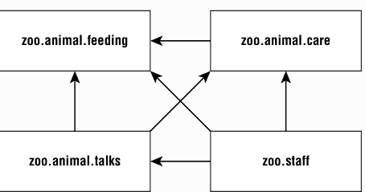

现在我们深入研究其中一个模块。图 12.2 显示了 `zoo.animal.talks` 模块内部的内容。有三个包，每个包有两个类（这是一个很小的动物园）。还有一个名为 `module-info.java` 的奇怪文件。该文件必须包含在所有模块内部。我们将在本章稍后的部分详细解释这一点。

## 图 12.2 观察模块内部

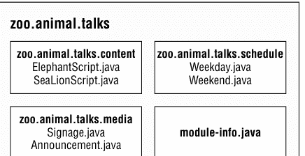

## 模块的优势

模块看起来是你为了编程而需要了解的另一层内容。虽然使用模块是可选的，但理解它们要解决的问题非常重要：

- **更好的访问控制**：除了第 5 章“方法”中的访问控制级别外，你还可以拥有仅允许被模块内其他包访问的包。
- **更清晰的依赖管理**：由于模块指定了它们所依赖的内容，Java 可以在启动程序时对缺失的 JAR 文件报错，而不是在运行时访问时才报错。
- **自定义 Java 构建**：你可以创建一个只包含程序所需的 JDK 部分的 Java 运行时，而不是那个超过 150 MB 的版本。
- **提高安全性**：你可以从自定义构建中省略 JDK 的部分内容，你不必担心在不使用的部分中发现的漏洞。
- **提高性能**：较小的 Java 包的另一个益处是缩短了启动时间并降低了内存需求。
- **唯一包强制执行**：由于模块指定了导出的包，Java 可以确保每个包都只来自一个模块，并避免对正在运行的内容产生困惑。

## 创建和运行模块化程序

在本节中，我们将创建、构建并运行 `zoo.animal.feeding` 模块。我们选择从它开始，是因为所有其他模块都依赖于它。图 12.3 显示了该模块的设计。除了 `module-info.java` 文件外，它还包含一个包，里面有一个类。

**图 12.3** `zoo.animal.feeding` 的内容

| `zoo.animal.feeding` | |
|---|---|
| `zoo.animal.feeding.Task.java` | `module-info.java` |

在接下来的章节中，我们将创建、编译、运行并打包 `zoo.animal.feeding` 模块。

## 创建文件

首先，我们需要创建一个打印某些内容的简单类。为了让它能够运行，我们需要在 `zoo.animal.feeding` 包中包含 `main` 方法。

在 `zoo.animal.feeding`：

```java
package zoo.animal.feeding;

public class Task {
    public static void main(String[] args) {
        System.out.println("Feeding the animals...");
    }
}
```

接下来是 `module-info.java`：

```java
module zoo.animal.feeding {
    exports zoo.animal.feeding;
}
```

模块化声明与普通类声明之间有几点关键区别：

- 模块指定了导出的包。
- 模块声明使用 `module` 关键字。
- `module-info.java` 文件必须位于根目录。
- 模块目录可以命名，但 `mods` 是一个常见的名称。如果你在命令行输入命令时，它们应该写在一行内：

```bash
javac -d mods -m . zoo/animal.feeding/*.java module-info.java
```

在编译完模块后，我们需要运行它：

```bash
java -p mods zoo.animal.feeding.Task
```

## 真实世界场景

## 构建模块

即使没有模块，在实际项目中手动运行 `javac` 和 `java` 命令也是罕见的。这些命令会迅速变得冗长且复杂。大多数开发者使用如 Maven 或 Gradle 等构建工具。这些构建工具会建议用于放置类文件的目录，例如 `target/classes`。

你可能只有在考试时才需要知道这些命令的语法。但就而言，概念本身是有用的。

请务必记住模块命令的语法。你将在考试中考到这些内容。我们为你提供了许多关于语法的练习题以巩固记忆。

## 运行我们的第一个模块

当我们打包模块时，我们应该通过运行它来确保其工作正常。为了做到这一点，我们需要学习完整的语法。假设有一个名为 `book.module` 的模块。该模块内部有一个名为 `com.syex` 的包，包中有一个带有 `main()` 方法的类 `OCP`。图 12.5 显示了运行模块的语法。特别注意 `book.module/com.syex.OCP` 部分。要记住，你需要指定模块名，后面跟一个斜杠（`/`），然后是全限定类名。

图 12.5 使用 `java` 运行模块

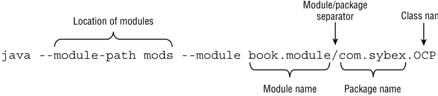

现在我们已经看到了语法，可以编写命令来运行 `zoo.animal.feeding` 包中的 `Task` 类。在接下来的示例中，包名和模块名相同。模块名通常与全包名或包名的开头匹配。

```bash
java --module-path feeding --module zoo.animal.feeding/zoo.animal.feeding.Task
```

## 更新示例以支持多个模块

由于你已经看到 `--module-path` 使用了 `-p` 的短形式，我们打赌你不会对发现 `--module` 也有短形式感到惊讶。短选项是 `-m`。这意味着以下命令是等效的：

```bash
java -p feeding -m zoo.animal.feeding/zoo.animal.feeding.Task
```

在这些示例中，我们使用 `feeding` 作为模块路径，因为代码是在那里编译的。这个更改将确保我们打包并运行该模块。表 12.2 列出了你使用 `java` 命令使用模块时需要的选项。

**表 12.2** 使用 `java` 模块时需要的选项

| 用途 | 缩写 | 全形式 |
| --- | --- | --- |
| 模块名 | `-m <name>` | `--module <name>` |
| 模块路径 | `-p <path>` | `--module-path <path>` |

## 打包我们的第一个模块

如果模块可以在创建的文件夹中运行，那么它就没有多大意义。我们的下一步是打包它。在运行此命令之前，我们需要创建一个 `mods` 目录：

```bash
jar -cvf mods/zoo.animal.feeding.jar -C feeding/
```

这里没有模块特定的内容。我们正在打包 `feeding` 目录下的所有内容，并存储在 `mods` 文件夹下名为 `zoo.animal.feeding.jar` 的 JAR 文件中。这代表了使用该模块的其他代码所看到的模块 JAR。

现在让我们再次运行程序，但这次使用 `mods` 目录而不是散乱的类：

```bash
java -p mods -m zoo.animal.feeding/zoo.animal.feeding.Task
```

你可能会注意到，这个命令与上一个节中的命令完全相同，只是目录不同。在上一个示例中，它是 `feeding`。在这一次，它是 `mods` 模块路径。由于使用了模块路径，正在运行一个模块 JAR。

## 更新示例以支持多个模块

现在 `zoo.animal.feeding` 模块已经稳定了，我们可以开始考虑其他模块了。正如图 12.6 所示，系统中的所有其他模块都依赖于 `zoo.animal.feeding` 模块。

图 12.6 依赖于 `zoo.animal.feeding` 的模块

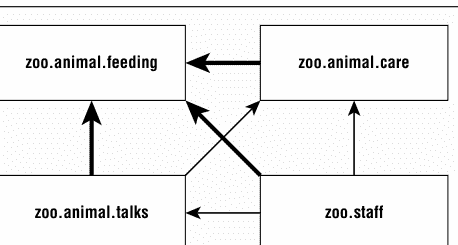

## 更新 Feeding 模块

由于其他模块将调用 `zoo.animal.feeding` 包中的代码，我们需要在模块声明中说明此意图。

`exports` 指令用于指示模块意图让模块外的 Java 代码使用这些包。正如你预期的，如果没有 `exports` 指令，该模块只能单独从命令行运行。在接下来的示例中，我们导出包：

```java
module zoo.animal.feeding {
  exports zoo.animal.feeding;
}
```

重新编译并重新打包模块将更新 `zoo.animal.feeding.jar` 文件内部 `module-info.class`。这些是你之前运行过的 `javac` 和 `jar` 命令：

```bash
javac -p mods -d feeding feeding/zoo/animal/feeding/*.java feeding/module-info.java
```

```bash
jar -cvf mods/zoo.animal.feeding.jar -C feeding/.
```

## 创建 Care 模块

接下来，让我们创建 `zoo.animal.care` 模块。这次，我们将有两个包。`zoo.animal.care.medical` 包将包含其他模块使用的类和方法。`zoo.animal.care.details` 包将被其他模块使用。图 12.7 显示了 `zoo.animal.care` 的内容。

### 图 12.7 `zoo.animal.care` 的内容

| `zoo.animal.care` | |
|---|---|
| `zoo.animal.care.medical` | `module-info.java` |
| `zoo.animal.care.details` | `HippoBirthday.java` |

```java
// Signage.java
package zoo.animal.talks.media;

public class Signage { }
```

```java
// Weekday.java
package zoo.animal.talks.schedule;

public class Weekday { }
```

```java
// Weekend.java
package zoo.animal.talks.schedule;

public class Weekend { }
```

如果你仍在在电脑上跟着操作，请在包中创建这些类。以下是编译和构建模块的命令：

```bash
javac -p mods -d talks talks/zoo/animal/talks/content/*.java talks/zoo/animal/talks/media/*.java talks/zoo/animal/talks/schedule/*.java talks/module-info.java
```

```bash
jar -cvf mods/zoo.animal.talks.jar -c talks/ .
```

## 创建员工模块

我们的最后一个模块是 `zoo.staff`。图 12.10 显示内部只有一个包。我们不会向模块外部暴露此包。

图 12.10 `zoo.staff` 的内容

| `zoo.staff` | `module-info.java` |
| :--- | :--- |
| `Jobs.java` | |

根据图 12.11，你知道 `module-info` 中应该写什么吗？

## 图 12.11 `zoo.staff` 的依赖

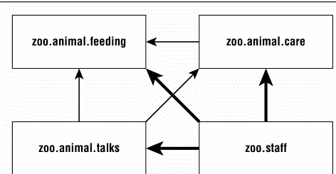

图 12.11 中有三个箭头从 `zoo.staff` 指向其他模块。这些代表了所需的三个模块。由于 `zoo.staff` 不暴露任何包，因此没有 `exports` 语句。这带我们我们如下代码：

```java
module zoo.staff {
  requires zoo.animal.feeding;
  requires zoo.animal.care;
  requires zoo.animal.talks;
}
```

在这个模块中，我们在 `Jobs.java` 文件中有一个类：

```java
package zoo.staff;

public class Jobs { }
```

对于那些在电脑上跟着操作的同学，请在包中创建一个类。以下是编译和构建模块的命令：

```bash
javac -p mods -d staff staff/zoo/staff/*.java staff/module-info.java
```

```bash
jar -cvf mods/zoo.staff.jar -C staff/ .
```

## 深入研究模块声明

现在我们已经成功创建了模块，可以学习更多关于模块声明的内容。在这些章节中我们将介绍 `exports`、`requires` 和 `opens`。在后续关于服务的章节中，我们将探索 `provides` 和 `uses`。现在是时候提一下，这些指令可以在模块声明中以任何顺序出现。

## 导出包

我们已经看到了 `exports packageName` 如何将一个包导出到其他模块。也可以将一个包导出到特定的模块。假设动物园决定只有员工应该能够访问谈话（talks）。我们可以如下所示更新模块声明：

```java
module zoo.animal.talks {
  exports zoo.animal.talks.content to zoo.staff;
  exports zoo.animal.media;
  exports zoo.animal.talks.schedule;
  requires zoo.animal.feeding;
  requires zoo.animal.care;
}
```


从`zoo.staff`模块来看，没有任何变化。然而，其他模块将不再被允许访问该包。

你可能注意到，我们的其他模块最初并不需要`zoo.animal.talks`。然而，我们不知道未来还会存在哪些模块。在设计模块时，考虑未来的用途是重要的。由于我们只想让特定模块访问，因此我们只允许该模块访问。

## 导出的类型

我们一直在讨论导出包。但这到底意味着什么呢？所有的`public`类、接口、枚举和记录都被导出了。此外，它们文件中任何`public`和`protected`的字段和方法都是可见的。

`private`字段和方法是不可见的，因为它们无法在类外部访问。同样，包级别的字段和方法也是不可见的，因为它们无法在包外部访问。

`exports`指令本质上为我们提供了更多级别的访问控制。表 12.3 列出了完整的访问控制选项。

### 表 12.3 模块的访问控制

| 级别 | 模块内 | 模块外 |
| :--- | :--- | :--- |
| private | 是 | 否 |
| package | 是 | 否 |
| protected | 是 | 是 |
| public | 是 | 是 |

## 传递引用模块

正如你在本章前面看到的，`requires moduleName`指定它依赖`moduleName`。然而，如果我们使用`requires transitive moduleName`，这意味着任何需要此模块的模块也将依赖它。

图 12.12 显示了依赖关系 (img/607aba1c244fae1d271945f7eaa8cb83_740_0.png)

# 打开整个模块

在之前的示例中，我们在`zoo.animal.talks`模块中打开了两个包，但假设我们想对所有包进行反射操作。没问题。我们可以使用`open module`修饰符，而不是`opens`指令（注意字母 **s** 的区别）：

```
open module zoo.animal.talks {

}
```

通过这个修饰符，Java 知道我们希望模块中的所有包都是开放的。如果同时使用这两者会发生什么？

```
open module zoo.animal.talks {

  opens zoo.animal.talks.schedule; // 无法编译

}
```

这无法编译，因为使用了`open`修饰符的修饰符不允许使用`opens`指令。毕竟，这些包已经是开放的！

# 创建服务

在本节中，你将学习如何创建一个服务。服务由一个接口、接口引用的任何类以及一种查找接口实现的方法组成。实现类不属于服务的一部分。

我们在服务部分中使用一个旅游应用程序。如图 12.13 所示，它包含四个模块。在这个示例中，`zoo.tours.api`和`zoo.tours.reservations`模块构成了服务，因为它们包含了接口和查找功能。

图 12.13 旅游应用程序中的模块

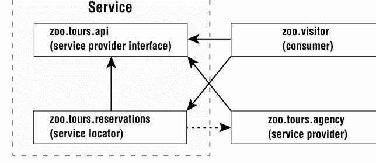

> 你并不需要拥有四个独立的模块。我们这样做是为了说明这些概念。例如，服务提供者接口和服务定位器可以在同一个模块中。

## 声明服务提供者接口

首先，`zoo.tours.api`模块定义了一个名为`Souvenir`的 Java 对象。它被服务的一部分，因为它会被接口引用。

```
// Souvenir.java
package zoo.tours.api;

public record Souvenir(String description) { }
```

接下来，该模块包含一个 Java 接口类型。这个接口被称为服务提供者接口，因为它指定了我们的服务将具有的行为。在这种情况下，它是一个带有三个方法的简单 API。

```
// Tour.java
package zoo.tours.api;

public interface Tour {

  String name();

  int length();

  Souvenir getSouvenir();

}
```

所有三个方法都使用了隐含修饰符。由于我们正在处理模块，我们还需要创建一个`module-info.java`文件，以便我们的模块定义导出该包接口。

```
// module-info.java
module zoo.tours.api {

  exports zoo.tours.api;

}
```

现在我们已经有了这两个文件，可以编译并打包此模块。

```
javac -d serviceProviderModule
serviceProviderModule/zoo/tours/api/*.java
serviceProviderModule/module-info.java

jar -cvf mods/zoo.tours.api.jar -C serviceProviderModule/ .
```

> 服务提供者“接口”可以是一个抽象类而不是实际接口。由于你在考试中只会将其视为一个接口，因此我们在书中使用了该术语。

## 创建服务定位器

为了完成我们的服务，我们需要一个服务定位器。服务定位器可以找到任何实现服务提供者接口的类。

幸运的是，Java 提供了`ServiceLoader`来帮助完成任务。你将服务提供者类型传递给它的`load()`方法，Java 将返回它能找到的任何实现服务。下面的类展示了它的用法：

```java
// TourFinder.java
package zoo.tours.reservations;

import java.util.*;
import zoo.tours.api.*;

public class TourFinder {

    public static Tour findSingleTour() {

        ServiceLoader<Tour> loader = ServiceLoader.load(Tour.class);

        for (Tour tour : loader) {

            return tour;

        }

        return null;

    }

    public static List<Tour> findAllTours() {

        List<Tour> tours = new ArrayList<>();

        ServiceLoader<Tour> loader = ServiceLoader.load(Tour.class);

        for (Tour tour : loader) {

            tours.add(tour);

        }

        return tours;

    }

}
```

# 第 12 章 • 模块

模块声明需要包含接口的模块作为依赖项。我们不导出直接引用它的调用者。相反，我们使用`provides`指令。这允许我们指定使用特定的实现类来提供接口的实现。语法如下：

```
provides interfaceName with className;
```

> 我们没有导出包含实现的包。相反，我们让该实现对使用该接口的服务提供者可用。

最后，我们对其进行编译并打包。

```
javac -p mods -d serviceProviderModule
serviceProviderModule/zoo/tours/*.java
serviceProviderModule/module-info.java

jar -cf mods/zoo.tours.agency.jar -C serviceProviderModule/ .
```

现在到了关键部分。我们可以再次运行 Java 程序了。

```
java -p mods -m zoo.visitor/zoo.visitor.Tourist
```

这一次，我们看到了以下输出：

```
Single tour: zoo.tours.agency.TourImpl@1936f05
# tours: 1
```

注意，我们没有重新编译`zoo.tours.reservations`或`zoo.visitor`包。服务定位器能够观察到没有新的服务提供者实现，并为我们找到了它。

当你拥有独立于代码库的功能时，这非常有用。例如，你可能有自定义的报告或日志。

> 在开发中，将不同的组件拆分为独立的单元的概念被称为**松耦合**。松耦合代码的优势是，可以在对使用它的代码进行极少（或零）更改的情况下，轻松地交换或替换它。依赖松耦合结构允许模块能够易于扩展。

## 复习指令与服务

表 12.4 总结了我们在服务章节中涵盖的内容。我们建议很好地掌握当每个构件位于单独模块中时需要哪些内容。这很可能是你在考试中会看到的，并能确保你理解了这些概念。

表 12.5 列出了你考试需要知道的所有指令。

### 表 12.4 复习服务

| 构件 | 是否属于服务的一部分 | 需要的指令 |
| --- | --- | --- |
| 服务提供者接口 | 是 | exports |
| 服务提供者 | 否 | requires provides |
| 服务定位器 | 是 | exports uses |
| 消费者 | 否 | requires |

### 表 12.5 复习指令

| 指令 | 描述 |
| --- | --- |
| exports package; exports package to module; | 使包在模块外可用 |
| requires module; requires transitive module; | 指定另一个模块作为依赖 |
| opens package; opens package to module; | 允许通过反射使用包 |
| provides serviceInterface with implName; | 使服务可用 |
| uses serviceInterface; | 引用服务 |

## 发现模块

到目前，我们一直在处理自己编写的模块。JDK 内置的类已经模块化了。在本节中，我们将展示如何使用命令来学习模块。

你不需要知道本节中命令的输出。但是，你需要知道命令的语法以及它们的作用。我们在有助于有助于记忆正在发生的情况时包含了输出内容。但你不需要背记这些内容（这可以为你的脑部腾出更多空间来记忆命令行选项）。

## 识别内置模块

最需要的模块是`java.base`。它包含了你为考试学习的大多数包。事实上，它非常重要，以你不需要使用`requires`指令；它对所有模块化应用程序都是可用的。如果你显式要求`java.base`，你的`module-info.java`文件仍然可以编译。然而，它是冗余的，因此最好省略它。表 12.6 列出了一些常见模块及其包含的内容。

### 表 12.6 常见模块

| 模块名称 | 包含内容 | 书中覆盖范围 |
|---|---|--|
| java.base | Collections, math, IO, NIO.2, concurrency, 等 | 本书的大部分 |
| java.desktop | 抽象窗口 Toolkit (AWT) 和 Swing | 考试不在模块名 |
| java.logging | 日志 | 考试不在模块名 |
| java.sql | JDBC | 第 15 章，"JDBC" |
| java.xml | 可扩展标记语言 (XML) | 考试不在模块名 |

考试出题者认为识别 JDK 提供的模块名称是重要的。虽然你不需要背下所有名称，但你确实需要从列表中挑选出来。

对于考试，你需要知道以`java`开头的模块名是你可能使用的 API，而以`jdk`开头的模块名是 JDK 特有的 API。表 12.7 列出了所有以`java`开头的模块。

### 表 12.7 以 java 开头的模块

| java.base | java.naming | java.smartcardio |
|---|---|--|
| java.compiler | java.net.http | java.sql |
| java.datatransfer | java.prefs | java.sql.rowset |
| java.desktop | java.rmi | java.transaction.xa |

（注：由于原文中存在大量重复的 java.instrument, java.scripting, java.xml, java.management, java.security 等列表，已按要求逻辑处理）

表 12.8 列出了所有以`jdk`开头的模块。我们建议在考试前复习这些。

### 表 12.8 以 jdk 开头的模块

| jdk.accessibility | jdk.jadoc | jdk.management |
|---|---|---|
| jdk.attach | jdk.cmd | jdk.jfr |
| jdk.charsets | jdk.compiler | jdk.jar |
| jdk.console | jdk.crypto | jdk.logging |
| jdk.concurrency | jdk.desktop | jdk.japi |
| jdk.dom | jdk.dns | jdk.jse |
| jdk.edit | jdk.file | jdk.layer |
| jdk.exports | jdk.foreign | jdk.math |
| jdk.foreign | jdk.homebase | jdk.module |
| jdk.glassbase | jdk.hotspot | jdk.nio |
| jdk.httpserver | jdk.httpclient | jdk.opens |
| jdk.imageapi | jdk.jdk.management | jdk.synchronization |
| jdk.jinfo | jdk.jshell | jdk.jtool |
| jdk.jlink | jdk.layering | jdk.vector |
| jdk.nav | jdk.instrument | jdk.xml |
| jdk.nio | jdk.path | jdk.security |
| jdk.nio | jdk.prefs | jdk.scripting |
| jdk.management | jdk.rmi | jdk.sql |
| jdk.management | jdk.security | jdk.test |
| jdk.management | jdk.scripting | jdk.transaction |
| jdk.management | jdk.serialization | jdk.util |
| jdk.management | jdk.service | jdk.xml |

## 使用 java 获取详情

`java.base`模块无论你是否输入它都是自动导入的。我们的模块有两个，其中一个是。

## 描述模块

假设以下是`zoo.animal_care`中`module-info.java`的内容：

```
module zoo.animal_care {

  exports zoo.animal_care.medical to staff;

  requires transitive zoo.animal.feeding;

}
```

现在我们有了描述模块的命令和输出。

```
java -p mods -d zoo.animal_care
```

```
zoo.animal_care file:///absolutePath/mods/zoo.animal_care.jar
requires zoo.animal.feeding transitive
requires java.base
qualified exports zoo.animal_care.medical to staff
contains zoo.animal_care
```

输出的第一行是模块文件的绝对路径。两个`requires`看起来也很熟悉。第一个在`module-info`中，另一个对所有模块可见。接下来是新内容。`qualified exports`是我们要导出到特定模块的包的全名。

最后，`contains`表示模块中有一个包没有被导出。

## 列出可用模块

除了描述模块外，你还可以使用`java`命令列出可用的模块。最简单的形式列出 JDK 部分的模块。

```
java --list-modules
```

当我们运行它时，输出持续了 70 行，如下所示：

```
java.base@17
java.compiler@17
java.datatransfer@17
```

# 第 12 章 • 模块

这是 Java 自带的所有模块及其版本号的列表。你可以看出，我们在测试此示例时使用的是 Java 17。

更有趣的是，你可以在自定义代码中使用此命令。让我们再次对包含我们动物园模块的目录进行尝试。

```
java -p --list-modules
```

你预计这次输出中会有多少行内容？现在有 78 行：70 个内置模块加上我们在本章中创建的 8 个模块。最后两行自定义内容看起来像这样：

```
zoo.animal.care file://:///absolutePath/mods/zoo.animal.care.jar
zoo.animal.feeding: file:///absolutePath/mods/zoo.animal.feeding.jar
```

由于这些是自定义模块，我们得到了一个文件系统上的位置。如果项目有模块版本，它将同时包含版本号和文件路径。


> 注意，`--list-modules`在打印完可观测模块后就会立即退出。它不会运行程序。

# 显示模块解析


如果列出模块提供的输出还不够，你还可以使用`--show-module-resolution`输出。你可以将其视为一种调试模块的方法。它在程序启动时从循环中输出。它会运行程序。

```
java --show-module-resolution
-p feeding
-m zoo.animal.feeding/zoo.animal.feeding.Task
root.animal.feeding: file://:///absolutePath/feeding/
java.base binds java.desktop jrt:java.desktop
java.base binds jdk.jartool jrt:jdk.jartool
jdk.security.auth requires java.naming jrt:java.naming
jdk.security.auth requires java.security.jgss jrt:java.security.jgss
```

幸运的是，你不需要理解这些输出。看到它之后会更容易记忆。这里是输出的一个片段：

All fed!（全部喂好了！）

它首先列出根模块。这就是我们正在运行的那个：`zoo.animal.feeding`。接着，它列出强制性模块`java.base`包含的包行。过了一会儿，它列出了具有依赖项的模块。最后，它输出了程序的运行：All fed!

## 使用 jar 描述

与`java`命令一样，`jar`命令也可以描述模块。以下命令是等价：

```
jar -f mods/zoo.animal.feeding.jar -d
jar --file mods/zoo.animal.feeding.jar --describe-module
```

当我们使用`java`命令描述模块时，输出略有不同。使用`jar`时，它输出如下：

```
zoo.animal.feeding.jar:file:///absolutePath/mods/zoo.animal.feeding.jar
!module-info.class
exports zoo.animal.feeding
requires java.base mandated
```

JAR 版本在文件名中包含了`module-info.class`，这在整体方案上并不是什么特别的区别。你不需要知道这两个命令都可以描述模块。

## 使用 jdeps 学习依赖关系

`jdeps`命令为你提供关于模块内部依赖关系的信息。与描述模块不同，它除了模块声明外还会查看代码。这可以告诉你哪些依赖项是实际被使用的，而不仅仅是声明的。幸运的是，你不需要在考试中记忆所有选项。

你被期望理解如何将`jdeps`用于尚未模块化的项目，以帮助识别依赖关系和问题。首先，我们将从这个类创建一个 JAR 文件。如果你在跟着操作，请随时从章节开头引用的在线示例中复制该类，而不是手动输入。

```
// Animatronic.java
package zoo.dinos;

import java.time.*;
import java.util.*;
import sun.misc.Unsafe;

public class Animatronic {
    private List<String> names;
    private LocalDate visitDate;

    public Animatronic(List<String> names, LocalDate visitDate) {
        this.names = names;
        this.visitDate = visitDate;
    }

    public void unsafeMethod() {
        Unsafe unsafe = Unsafe.getUnsafe();
    }
}
```

这很愚蠢。它使用了许多不相关的类。JDK 曾经确实有这些恐龙，但至少在`zoo`中拥有这些恐龙的想法是不可能的。现在我们可以编译这个文件。你可能已经注意到没有`module-info.java`。这是因为我们还没有创建模块。我们正在查看需要模块化的依赖项。

```
javac zoo/dinos/*.java
```

编译成功了，但它给了你关于`Unsafe`是内部 API 的警告。现在，我们创建一个 JAR 文件。先不要担心这些——以后我们会讨论（恐龙灭绝了）。我们可以对 JAR 运行`jdeps`命令来学习它的依赖关系。首先，让我们在不带任何选项的情况下运行命令。在前两行，命令输出了我们为了迁移到模块系统所需的`requires`指令模块。它还打印了一个表格，显示了使用了哪些包以及它们对应什么。

```
jdeps zoo.jar
```

```
zoo.jar -> java.base
zoo.jar -> jdk.unsupported
zoo.jar -> java.lang
zoo.jar -> java.time
zoo.jar -> java.util
zoo.jar -> sun.misc
```

注意`java.base`总是被包含的。它还显示了 JAR 使用的模块。如果我们运行摘要模式，它只显示`jdeps`列出的第一部分。有两种格式用于摘要：

```
jdeps -s zoo.jar
jdeps -summary zoo.jar
```

```
zoo.jar -> java.base
zoo.jar -> jdk.unsupported
```

对于真实的项目，依赖列表可能包含几十或上百个包。查看仅模块的摘要有助于查看`jdk.unsupported`是否在列表中。还有一个`--module-path`选项，如果你想查找 JDK 之外的模块可以使用。与其他命令不同，`jdeps`的此选项没有简写形式。

> 你可能注意到`jdk.unsupported`不在表 12.8 的模块列表中。它是特殊的，因为它包含了 Java 之前的版本中不建议使用的内部库，尽管很多人忽略了此警告。你应该参考它，因为它在未来的 Java 版本中可能会消失。

## 使用 internals 标志

`jdeps`命令有一个选项可以提供这些不受支持 API 的详情。输出如下：

```
jdeps --jdk-internals zoo.jar
zoo.jar -> jdk.unsupported
Animatronic -> sun.misc.Unsafe JDK internal API (jdk.unsupported)
```

Warning: <省略>

| JDK 内部 API | 建议的替换 |
| :--- | :--- |
| `sun.misc.Unsafe` | http://openjdk.java.net/jeps/260 |

`--jdk-internals`选项列出了你使用的任何调用内部 API 的类。在最后，它提供了一个建议如何处理的表格。如果你编写了调用内部 API 的代码，这个信息很有用。如果没有，这个信息对编写代码的团队有用。而你，可能需要更新或完全替换该 JAR 文件以修复该问题。注意`--jdk-internals`等于`--show-internal`。

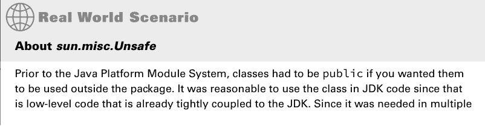

对于包来说，该类被设置为公共。Sun 甚至将其命名为`Unsafe`，认为这将防止在 JDK 之外使用它。然而，开发者很聪明，自它可用以来一直在使用该类。许多开源库开始使用`Unsafe`。虽然你可能在项目中直接未使用该类，但你可能使用了使用它的开源库。`jdeps`命令允许你查看这些 JAR，看看当 Oracle 最终阻止该类的使用时是否会遇到任何问题。如果你发现任何使用，可以查看是否有可以升级的更高版本的 JAR。

## 使用 jmod 使用模块文件

考试中需要知道的最后一个命令是`jmod`。你可能认为 JMOD 文件是一个 Java 文件。并不是。Oracle 建议大多数模块使用 JAR 文件。只有当你有原生库或某些无法放入 JAR 文件的物品时，才推荐 JMOD 文件。这在现实世界中不太可能影响你。

最重要的是记住，`jmod`是用于处理 JMOD 文件的。方便的是，你不需要记忆`jmod`的语法。表 12.9 列出了常用模式。

| 表 12.9 使用 jmod 的模式 |
| 操作 | 描述 |
| --- | --- |
| `create` | 创建 JMOD 文件。 |
| `extract` | 从 JMOD 提取所有文件。像解压一样。 |
| `describe` | 打印模块详情，如`requires`。 |
| `list` | 列出 JMOD 文件中的所有文件。 |
| `hash` | 打印或记录哈希值。 |

## 使用 jlink 创建 Java 运行时

模块的好处之一是能够提供所需的 Java 部分。我们在章节开头的动物园示例没有许多依赖项。如果用户

已经没有安装 Java 或者在内存不足的设备上，下载一个超过 150 MB 的 JDK 是一项巨大的请求。让我们来看看这个包实际上需要多大！此命令创建了我们更小的发行版：

```
jlink --module-path --add-modules zoo.animal.talks --output zooApp
```

首先，我们使用`-p`或`--module-path`指定自定义模块的位置。我们使用`--add-modules`指定我们的模块。只要这些依赖项可以被找到，它就会包含所需的依赖项。最后，我们使用`--output`指定我们较小 JDK 的文件夹名称。

输出目录包含`bin`、`conf`、`include`、`legal`、`lib`和`man`目录，以及一个`release`文件。这些看起来很熟悉，因为你在完整的 JDK 中也能看到它们。

当我们运行此命令并压缩`zooApp`目录时，该文件只有 15 MB。它比完整的 JDK 小了一个数量级。这些节省出的空间从哪里来呢？JDK 中有很多许多我们不需要的模块。此外，像`javac`这样的开发工具不需要包含在运行时发行版中。

还有许多更多自定义此过程的项目，你不需要在考试中了解。文档中还有更多选项。例如，甚至还有更多空间。

### 命令行选项

本节列出了多个表格，涵盖了考试中关于运行命令行选项你需要了解的知识。

表 12.10 显示了你应该预期在考试中遇到的命令行选项。`javac`上有一个`--module`选项，它可以将编译限制为该模块。幸运的是，你不需要在考试中了解这些。

#### TABLE 12.10 命令行操作比较

| 描述 | 语法 |
| --- | --- |
| 编译非模块化代码 | `javac -cp classpath -d directory classesToCompile`<br>`javac --class-path classpath -d directory classesToCompile`<br>`javac -class-path classpath -d directory classesToCompile` |
| 运行非模块化代码 | `java -cp classpath package.className`<br>`java -class-path classpath package.className`<br>`java --class-path classpath package.className` |
| 编译模块 | `javac -p moduleFolderName -d directory classesToCompileIncludingModuleInfo`<br>`javac --module-path moduleFolderName -d directory classesToCompileIncludingModuleInfo` |
| 运行模块 | `java -p moduleFolderName -m moduleName/package.className`<br>`java --module-path moduleFolderName --module moduleName/package.className` |
| 描述模块 | `java -p moduleFolderName -d moduleName`<br>`java --module-path moduleFolderName --describe-module moduleName`<br>`java --file jarName --describe-module java -f jarName -d` |
| 列出可用模块 | `java --module-path moduleFolderName --list-modules`<br>`java -p moduleFolderName --list-modules`<br>`java --list-modules` |
| 查看依赖 | `jeps --summary --module-path moduleFolderName jarName`<br>`jeps -s --module-path moduleFolderName jarName`<br>`jeps --jdk-internals jarName`<br>`jeps --jdk-internals jarName` |
| 显示模块解析 | `java --show-module-resolution -p moduleFolderName -m moduleName`<br>`java --show-module-resolution --module-path moduleFolderName --module moduleName` |
| 创建运行时 JAR | `jlink --module-path moduleFolderName --add-modules moduleName --output zooApp`<br>`jlink --module-path moduleFolderName --add-modules moduleName --output zooApp` |

表 12.11 显示了`javac`的选项，表 12.12 显示了`java`的选项，表 12.13 显示了`jar`的选项，表 12.14 显示了`jdeps`的选项。最后，表 12.15 显示了`jlink`的选项。

#### TABLE 12.11 考试需要掌握的选项：javac

| 选项 | 描述 |
| --- | --- |
| `-cp <classpath>` <br>`--classpath <classpath>` <br>`--class-path <classpath>` | 非模块化程序中 JAR 的位置 |
| `-d <dir>` | 生成生成的类文件的目录 |
| `-p <path>` <br>`--module-path <path>` | 模块化程序中 JAR 的位置 |

#### TABLE 12.12 考试需要掌握的选项：java

| 选项 | 描述 |
| --- | --- |
| `-p <path>` <br>`--module-path <path>` | 模块化程序中 JAR 的位置 |
| `-m <name>` <br>`--module <name>` | 要运行的模块名 |
| `-d` <br>`--describe-module` | 描述模块的细节 |
| `--list-modules` | 在不运行程序的情况下列出模块 |
| `--show-module-resolution` | 程序运行时显示模块 |

#### TABLE 12.13 考试需要掌握的选项：jar

| 选项 | 描述 |
| --- | --- |
| `-c` <br>`--create` | 创建新的 JAR 文件 |
| `-v` <br>`--verbose` | 在处理 JAR 文件时打印详细信息 |
| `-f` <br>`--file` | JAR 文件名 |

#### TABLE 12.13 考试需要掌握的选项：jar

| 选项 | 描述 |
| --- | --- |
| `-C` | 包含用于创建文件的目录 |
| `-d` | 描述模块的细节 |
| `--describe-module` | |

#### TABLE 12.14 考试需要掌握的选项：jdeps

| 选项 | 描述 |
| --- | --- |
| `--module-path <path>` | 模块化程序中 JAR 的位置 |
| `-s` | 总结 |
| `--jdk-internals` | JDK 内部 API信息 |

#### TABLE 12.15 考试需要掌握的选项：jlink

| 选项 | 描述 |
| --- | --- |
| `--module-path <path>` | 模块化程序中 JAR 的位置 |
| `--add-modules` | 模块 |
| `--output` | 输出 |

### 命令行选项

本节列出了多个表格，涵盖了考试中关于运行命令行选项你需要了解的知识。

表 12.10 显示了你应该预期在考试中遇到的命令行选项。`javac`上有一个`--module`选项，它可以将编译限制为该模块。幸运的是，你不需要在考试中了解这些。

移除版本和扩展名后，我们得到了`holiday-calendar`。这给我们带来了一个问题：模块名称中不允许包含连字符（`--`）。Java 通过将名称中的任何特殊字符转换为点（`.`）来解决这个问题。结果是模块名称变为`holiday.calendar`。在这一替换过程中，除字母和数字以外的任何字符都被视为特殊字符。最后，会删除任何相邻的点或位于末尾的点。

由于这涉及多条规则，让我们通过列表来回顾一下确定自动模块名称的算法：

- 如果`MANIFEST.MF`指明了`Automatic-Module-Name`，则使用它。否则，继续执行剩余规则。
- 从名称末尾移除文件扩展名。版本由数字和点组成，后面可能带有额外信息：例如，`-1.0.0`或`-1.0-RC`。
- 将剩余的除字母和数字以外的字符替换替换点。
- 将任何连续的点序列替换为单个点。
- 如果该点是结果的第一个或最后一个字符，则将其删除。

表 12.16 展示了如何将这些规则应用于两个未在清单中指定自动模块名称的示例。

#### TABLE 12.16 练习应用自动模块名称

| # |  | 示例 1 | 示例 2 |


# 自动模块名称的生成

下表展示了从 JAR 文件名生成自动模块名称的步骤：

| 步骤 | 操作 | 示例输入 | 示例输出 |
|---|---|---|---|
| 1 | 初始 JAR 名称 | `commons2-x-1.0.0-SNAPSHOT.jar` | `mod-$1.0.0.jar` |
| 2 | 移除文件扩展名 | `commons2-x-1.0.0-SNAPSHOT` | `mod-$1.0` |
| 3 | 移除版本信息 | `commons2-x` | `mod-$` |
| 4 | 替换特殊字符 | `commons2.x` | `mod..` |
| 5 | 替换点序列 | `commons2.x` | `mod.` |
| 6 | 移除开头/结尾点（得到自动模块名称） | `commons2.x` | `mod` |

虽然创建自动模块名称的算法已尽全力，但它无法生成良好的名称。例如，`1.2.0-calendar-1.2.2-good-1.jar` 并不利于理解。幸运的是，这种名称非常罕见，且不在考试范围内。

## 无命名模块 (Unnamed Modules)

无命名模块出现在类路径（classpath）上。和自动模块一样，它是一个普通的 JAR。与自动模块不同，它位于类路径上而不是模块路径（module path）。这意味着无命名模块被视为旧代码，是模块的“二等公民”。

无命名模块通常不包含 `module-info.java` 文件。如果它恰好包含该文件，只要它不在类路径上，它就会被忽略。

无命名模块不向命名模块或自动模块导出任何包。无命名模块可以从类路径或模块路径上的任何 JAR 读取。你可以将无命名模块认为是以模块出现之前的 Java 工作方式的代码。我们知道，对于一个并不是真正模块的东西，在名称中包含“模块”一词是很困惑的。

## 回顾模块类型

你可以预计考试中会有关于比较这三种类型模块的问题。请仔细查看表 12.17，并准备好回答关于这些项目的任何组合问题。一个需要记住的关键点是：类路径上的代码可以访问模块路径。相比之下，模块路径上的代码无法从类路径读取。

**TABLE 12.17** 模块类型的属性

| 属性 | 命名 | 自动 | 无命名 |
|---|---|---|---|
| 模块是否包含 `module-info.java` 文件？ | 是 | 否 | 存在则忽略 |
| 模块向其他模块导出哪些包？ | `module-info.java` 文件中的包 | 所有包 | 无任何包 |
| 路径上的其他模块是否可以读取该模块？ | 是 | 是 | 否 |
| 模块是否可以被类路径上的其他 JAR 读取？ | 是 | 是 | 是 |

## 迁移应用程序

许多应用程序在设计时并未考虑使用模块。许多应用程序在模块系统出现之前就已经设计好了。本节将概述迁移应用程序的策略。我们涵盖了从下到上、从上下的迁移。

### 真实世界场景

#### 迁移你的应用程序

在现实世界中，当你发现某些应用程序依赖关系时。这些应用程序可能编写在 10 年或更久以前，具有复杂的依赖关系。

#### 确定顺序

在我们能够迁移到模块之前，我们需要了解依赖关系是如何构建。假设我们有三个 JAR 文件，如图 12.14 所示。项目之间的依赖由箭头表示。

**FIGURE 12.14** 确定顺序


## 第 12 章 • 模块

图表的右侧显示自上到下。没有依赖关系的项目位于顶部。有依赖的项目位于底部。

在这个例子中，从顶部到到底只有一个顺序。图 12.15 显示并非总是唯一的。

**FIGURE 12.15** 并非唯一的顺序确定


### 探索从下到上的迁移

最简单的方法是从下到上的迁移。这种方法在你有能力转换任何模块时效果最好。对于从下到上的迁移，你遵循以下步骤：

- 选择尚未迁移的最低层项目。（记得我们在上一节中是如何排序的吗？）
- 为项目添加 `module-info.java` 文件。确保导出任何被高层使用的包。此外，为该模块依赖的任何模块添加 `requires` 指令。
- 将新迁移的命名模块从类路径移动到模块路径。
- 确保任何尚未迁移的项目都在类路径上。
- 重复下一个最低层项目直到完成。

你可以在图 12.16 中看到此过程应用于三个项目。注意每个项目轮转换为模块。这使得迁移顶部项目更容易。

**FIGURE 12.16** 从下到上的迁移


### 探索从上到下的迁移策略

1. 将所有项目放在模块路径上。
2. 选择尚未迁移的最高层项目。
3. 为该项目添加 `module-info.java` 文件，将自动模块转换为命名模块。再次，记住添加任何导出或 `requires` 直接。在编写 `requires` 指令时，可以使用其他模块的自动模块名称，因为模块路径上的大多数项目还没有名称。
4. 重复下一个最高层项目直到完成。

你可以从图 12.17 中看到此过程如何应用于三个项目的迁移。注意，每个项目都依次转换为一个模块。

## 图 12.17 自顶向下的迁移

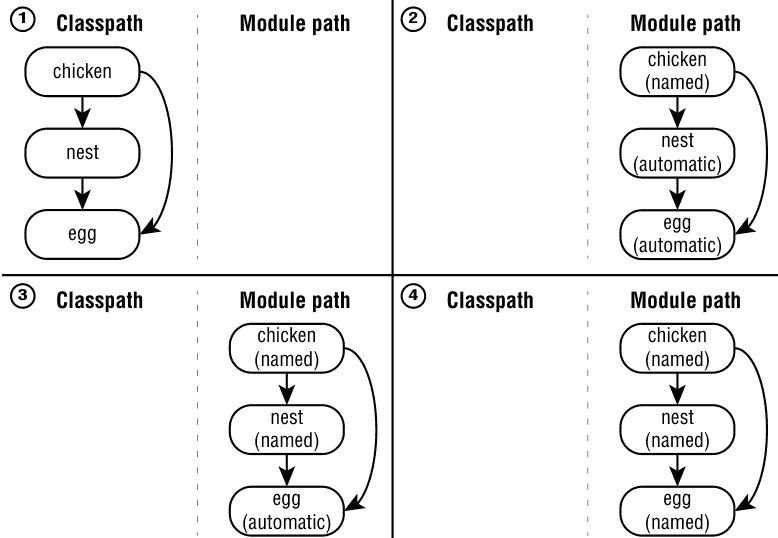

通过自顶向下的迁移，你承认所有低层依赖项尚未准备就绪，但你想让应用程序本身成为一个模块。在迁移期间，你会混合使用命名模块（named modules）和自动模块（automatic modules）。命名模块是已经迁移的高层模块。它们位于模块路径（module path）上并可以自动模块。自动模块也在模块路径上。表 12.18 回顾了关于这两种主要迁移策略你需要了解的内容。确保你掌握了它们。

## 表 12.18 迁移策略对比

| 类别 | 自底向上 | 自顶向下 |
|---|---|---|
| 依赖于所有其他项目 | 类路径上的未命名模块 | 模块路径上的命名模块 |
| 没有依赖的项目 | 模块路径上的命名模块 | 模块路径上的自动模块 |

## 将大项目拆分为模块

对于考试，你需要理解将一个大项目拆分为模块的基本过程。当然，考官不会直接给你一个大项目。毕竟，题目的空间是有限。幸运的是，小项目的处理过程是一样的。

假设你从一个包含许多包的应用程序开始。第一步是将它们拆分为逻辑分组，并绘制它们之间的依赖关系图。图 12.18 显示了一个虚拟系统的分解。注意，左右两侧都有七个包。模块的数量较少，因为某些包共享了同一个模块。

**图 12.18** 首次分解尝试

### 之前

| zoo.tickets.cash | zoo.tickets.delivery |
|---|---|
| zoo.tickets.coupons | zoo.tickets.etickets |
| zoo.tickets.credit | zoo.tickets.printer |
| zoo.tickets.etickets | zoo.tickets.type |
| zoo.tickets.promos | zoo.tickets.payment |
| zoo.tickets.printer | zoo.tickets.cash |
| zoo.tickets.type | zoo.tickets.credit |

### 之后

| zoo.tickets.delivery | zoo.tickets.discount |
|---|---|
| zoo.tickets.etickets | zoo.tickets.coupons |
| zoo.tickets.printer | zoo.tickets.promos |
| zoo.tickets.type | zoo.tickets.payment |
| zoo.tickets.cash | zoo.tickets.credit |

这种分解存在问题。你看到了吗？Java 平台模块系统（JPMS）不允许循环依赖（cyclic dependencies）。循环依赖或环形依赖是指两个事物直接或间接地相互依赖。如果 `zoo.tickets.delivery` 模块需要 `zoo.tickets.discount` 模块，那么 `zoo.tickets.discount` 就不允许需要 `zoo.tickets.delivery` 模块。

现在我们知道图 12.18 中的分解行不通，我们能做什么？一种常用技术是引入另一个模块。该模块包含两个模块共享的代码。图 12.19 显示了没有任何循环依赖的新模块。注意新模块 `zoo.tickets.etch`。我们创建了新包并放入该模块中。这允许开发者将公共代码放在那里并打破依赖关系。不再有循环依赖了！

## 因循环依赖导致编译失败

理解 Java 不允许你编译具有循环依赖的模块至关重要。在本节中，我们将查看一个导致该编译器错误的示例。

## 图 12.19 消除循环依赖

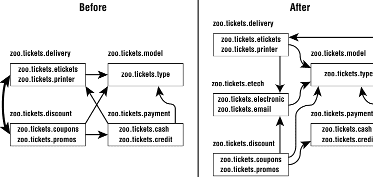

考虑此处描述的 `zoo.butterfly` 模块：

```java
// Butterfly.java
package zoo.butterfly;
public class Butterfly {
    private Caterpillar caterpillar;
}
```

```java
// module-info.java
module zoo.butterfly {
    exports zoo.butterfly;
    requires zoo.caterpillar;
}
```

我们现在还无法编译它，因为我们需要先构建 `zoo.caterpillar`。毕竟，蝴蝶需要它。现在我们来看 `zoo.caterpillar`：

```java
// Caterpillar.java
package zoo.caterpillar;
public class Caterpillar {
    Butterfly emergeCocoon() {
        // 逻辑省略
    }
}
```

```java
// module-info.java
module zoo.caterpillar {
    exports zoo.caterpillar;
    requires zoo.butterfly;
}
```

我们现在还无法编译这个，因为我们需要先构建 `zoo.butterfly`。哦哦！现在我们陷入了僵局。两个模块都无法编译。这就是我们的循环依赖在起作用。

这是模块系统的优势之一。它防止你编写具有循环依赖的代码。这种代码永远无法编译！

你可能在想如果涉及三个模块会发生什么。假设 `moduleA` 需要 `moduleB`，而 `moduleB` 需要 `moduleC`。`moduleC` 可以需要 `moduleA` 吗？不，那会产生循环依赖。不信？试着画出来看。你可以用笔沿着圆圈从 `moduleA` 画到 `moduleB` 再到 `moduleC` 回到 `moduleA`……嗯，你懂意思的。涉及的东西太多了！

Java 仍然允许模块内部的包之间存在循环依赖。但它强制模块之间不能有循环依赖。

## 总结

Java 平台系统将包组织成模块。每个模块包含一个或多个包。`java.base` 模块对所有模块可用。编译和运行模块的过程使用模块路径（module-path）。`module-info.java` 文件是模块的声明。`exports` 指令指定哪些包是可以访问的。`requires` 指令在模块依赖另一个模块时使用。`provides` 和 `uses` 指令在共享服务时使用。`opens` 指令允许通过反射访问。

有三种模块。命名模块是已经模块化的 JAR 包。未命名模块尚未模块化。自动模块介于两者之间；它们在模块路径上，但没有 `module-info.java` 文件。

两种常见的迁移策略是自顶向下和自底向上。自顶向下迁移从依赖项最多的模块开始，并将所有其他模块放在模块路径上。自底向上迁移从没有依赖的模块开始，每次移动一个模块到模块路径。这两种策略都能确保你没有循环依赖，因为 Java 平台不允许循环依赖通过。

## 复习题

本章复习题的答案可以在附录中找到。

- 1. 关于以下模块，哪种描述是正确的？

| zoo |
|---|
| staff |
| Vet.java |

A. 所示目录结构是一个有效的模块。

B. 如果在 `zoo/staff` 下直接添加 `module.java`，则该目录结构将是一个有效的模块。

C. 如果在 `zoo` 下直接添加 `module.java`，则该目录结构将是一个有效的模块。

D. 如果在 `zoo/staff` 下直接添加 `module-info.java`，则该目录结构将是一个有效的模块。

E. 如果在 `zoo` 下直接添加 `module-info.java`，则该目录结构将是一个有效的模块。

F. 这些更改都不会让该目录结构成为有效的模块。

- 2. 假设模块 `puppy` 依赖模块 `dog`，而模块 `dog` 依赖模块 `animal`。填充空白，使得 `dog` 模块中的代码可以访问 `animal` 模块中的 `animal.behavior` 包。

```java
module animal {
    animal.behavior;
}
```

A. export

B. exports

C. require

D. requires

E. requires transitive

F. requires transitive

G. 以上均非

- 3. 填充空白，使运行该程序的命令是正确的：

```bash
java zoo.animal.talks/zoo/animal/talks/Peacocks modules
```

A. -d 和 -m

B. -d 和 -p

C. -m 和 -d

D. -m 和 -p

E. -p 和 -d

F. -p 和 -m

G. 以上均非

- 4. 下列哪一组组合构成了一个服务（service）？

A. 消费者和服务定位器

B. 消费者和服务提供者接口

C. 服务定位器和服务提供者

D. 服务定位器和服务提供者接口

E. 服务提供者和服务提供者接口

- 5. (n) 模块在类路径（classpath）上，(n) 模块在模块路径（module path）上。（选择所有适用项。）

A. 自动的，命名的

B. 自动的，未命名的

C. 命名的，自动的

D. 命名的，未命名的

E. 未命名的，自动的

F. 未命名的，命名的

G. 以上均非

- 6. 下列哪些语句在 `module-info.java` 文件是正确的？（选择所有适用项）。

A. `opens` 指令允许使用反射。

B. `opens` 指令声明一个 API 被调用。

C. `use` 指令允许使用反射。

D. `use` 指令声明一个 API 被调用。

E. `uses` 指令允许使用反射。

F. `uses` 指令声明一个 API 被调用。

- 7. 如果未提供，则会生成自动模块。以下哪些 JAR文件名和自动模块名的组合是正确的？（选择所有适用项）

A. `emily-1.0.0.jar` 和 `emily`

B. `emily-1.0.0-SNAPSHOT.jar` 和 `emily`

C. `emily_the_cat-1.0.0.jar` 和 `emily_the_cat`

D. `emily_the_cat-1.0.0.jar` 和 `emily-the-cat`

E. `emily.$.jar` 和 `emily`

F. `emily.$.jar` 和 `emily..`

G. `emily.$.jar` 和 `emily..`

- 8. 下列哪些语句是正确的？（选择所有适用项。）

A. 具有循环依赖的模块将无法编译。

B. 具有循环依赖的包将无法编译。

C. 循环依赖总是恰涉及两个模块。

D. 循环依赖总是涉及至少两个 `requires` 语句。

E. 未命名模块可以与自动模块发生循环依赖。

- 9. 假设你正在创建一个包含以下类的服务提供者。哪行代码需要出现在你的 `module-info.java` 中？

```java
package dragon;
import magic.*;
public class Dragon implements Magic {
    public String getPower() {
        return "breathe fire";
    }
}
```

A. `provides dragon.Dragon by magic.Magic;`

B. `provides dragon.Dragon using magic.Magic;`

C. `provides dragon.Dragon with magic.Magic;`

D. `provides magic.Magic by dragon.Dragon;`

E. `provides magic.Magic using dragon.Dragon;`

F. `provides magic.Magic with dragon.Dragon.`

- 10. 对于包含以下内容的命名 `module-info.java` 的模块，哪种描述是正确的？（选择所有适用项。）

```java
module com.food.supplier {}
```

A. 模块内部所有的包都会自动导出。

B. 模块内部没有包被自动导出。

C. 模块内部的 main 方法可以运行。

D. 因为类没有暴露，模块内部的 main 方法无法运行。

E. `module-info.java` 文件包含编译错误。

F. `module-info.java` 文件名错误。

- 11. 假设模块 `puppy` 依赖模块 `dog`，而模块 `dog` 依赖模块 `animal`。哪些行允许 `puppy` 模块访问 `animal` 模块中的 `animal.behavior` 包？（选择所有适用项。）

```java
module animal {
    exports animal.behavior;
}
module dog {
    animal; // line S
}
module puppy {
    dog; // line T
}
```

A. line S 使用 `require`

B. line T 使用 `require`

C. line S 使用 `requires`

D. line T 使用 `requires`

E. line S 使用 `require transitive`


# 第 13 章

# 并发

本章涵盖的 OCP 考试目标：

- 管理并发代码执行

  - 使用 `Runnable` 和 `Callable` 创建工作线程，管理线程生命周期，包括不同 `Executor` 服务和并发 API 提供的自动化功能

  - 使用不同的锁定机制和并发 API 开发线程安全的代码

  - 并发处理 Java 集合，包括使用并行流（parallel streams）

- 与流和 Lambda 表达式工作

  - 在顺序流和并行流上执行分解、合并和归约以及分组和分区

如你在第 14 章“I/O”和第 15 章“JDBC”中所学到的，计算机能够向外部资源读写数据。遗憾的是，与 CPU 操作相比，这些磁盘/网络操作往往是非常缓慢的——事实上，缓慢到如果，如果你的计算机操作系统停止并等待每个磁盘或网络操作完成，你的计算机似乎会不断处于冻状态。

幸运的是，所有操作系统都支持所谓的多线程处理。多线程处理背后的思想是允许应用程序或一组应用程序同时执行多个任务。这使得等待其他资源的任务可以让给其他处理请求。

在本章中，我们将向你介绍线程的概念，并提供使用并发 API 管理线程的许多方法。线程和并发对于许多程序员来说是具有挑战性的主题，因为线程问题可能会让资深开发者也感到沮丧。在实践中，并发问题是诊断和解决最困难的问题之一。

# 线程简介

我们从回顾与线程相关的常用术语开始本章。线程是可以由操作系统调度的最小执行单元。进程是一组在共享环境中执行的关联线程。因此，单线程进程恰好包含一个线程，而多线程进程执行多个一个线程。

我们所说的共享环境，是指同一进程中的线程共享相同的内存空间并可以彼此直接通信。请参考图 13.1 了解线程及其在进程内共享环境概述。

此图显示了一个带有三个线程的单进程。它还显示了它们如何映射到系统内任意数量的 n 个 CPU。在本节稍后讨论线程调度器时，请记住此图。

在本章中，我们讨论了任务及其与线程的关系。任务是线程执行的单个工作单元。在整个章节中，任务通常被实现为 Lambda 表达式。线程可以完成多个独立任务，但一次只能完成一个任务。

# 图 13.1 进程模型

通过图 13.1 中的共享内存，我们通常指的是静态变量，以及传递给单类对象的实例和局部变量。记住第 5 章“方法”，静态方法和变量定义在单类对象上。例如，如果一个线程更新了静态变量的值，该信息对于进程内的其他线程立即可用。

## 理解并发

同时执行多个线程的属性被称为并发。当线程多于 CPU 时，系统如何决定执行什么？操作系统使用线程调度器来确定哪些线程应该正在执行，如图 13.1 所示。例如，线程调度器可能采用轮询调度（round-robin schedule），每个线程接收相同数量的 CPU 周期来执行，按顺序访问。当一个线程的分配时间完成而线程尚未结束时，发生了上下文切换。上下文切换是保存线程当前状态并恢复线程状态的过程。智能调度器尽可能减少上下文切换次数，同时保持应用程序运行。最后，如果一个线程的优先级高于另一个线程，它可以中断另一个另一个线程。在 Java 中，线程优先级被指定为数值。

## 创建线程

定义线程任务的最常用方法之一是使用 `Runnable` 实例。

```java
@FunctionalInterface
public interface Runnable {
    void run();
}
```

使用这种方法，很容易创建并启动线程。事实上，你可以使用 `Thread` 类一行实现：

```java
new Thread(() -> System.out.print("Hello")).start();
System.out.print("World");
```

第一行创建一个线程并使用 `start()` 方法启动它。此代码打印 HelloWorld 或 World！答案是未知。取决于线程优先级，两者可能。考试通常会同时启动多个任务的问题，你必须确定结果。让我们看一个更复杂的例子：

```java
Runnable inventory = () -> System.out.println("inventory");
Runnable printRecords = () -> {
    for (int i = 0; i < 3; i++) {
        System.out.println("record: " + i);
    }
};
```

给定这些实例，以下代码的输出是什么？

```
3: System.out.println("begin");
4: new Thread(inventory).start();
5: new Thread(printRecords).start();
6: new Thread(inventory).start();
7: System.out.println("end");
```

答案是直到运行时才未知。以下是可能的输出之一：

```
begin
inventory
record: 0
record: 1
record: 2
inventory
```

此示例共使用了四个线程：`main()` 用户线程和第 4-6 行创建的三个额外线程。在这里创建的每个线程都作为异步任务执行。我们所说的异步是指执行 `main()` 方法的线程在继续之前等待每个新创建的结果。例如，第 5 和 6 行可能第 4 行线程完成之前执行。这种行为的反面是同步任务，程序在第 4 行等待（阻塞）直到线程完成才移动到下一行。书中使用的绝大多数方法调用在本章之前都是同步的。

---

- 12. 下列哪些模块是由 JDK 提供的？（选择所有适用项）。

A. `java.base`

B. `java.desktop`

C. `java.logging`

D. `java.util`

E. `java.compiler`

F. `java.xer`

- 13. 下列哪些命令等同于此？

```java
List<Unicorn> all = new ArrayList<>();
for (Unicorn current : ServiceLoader.load(Unicorn.class))
    all.add(current);
```

（注：`n` 是模块名，`c` 是类名）

- 14. (n) 模块在类路径上，(n) 模块在模块路径上。以下哪些组合是正确的？

A. 自动的，未命名的

B. 自动的，命名的

C. 命名的，自动的

D. 命名的，未命名的

E. 未命名的，自动的

F. 未命名的，命名的

G. 以上均非

- 15. `module-info.java` 文件中哪些语句是正确的？（选择所有适用项）。

A. `opens` 指令允许使用反射。

B. `opens` 指令声明一个 API 被调用。

C. `use` 指令允许使用反射。

D. `use` 指令声明一个 API 被调用。

E. `uses` 指令允许使用反射。

F. `uses` 指令声明一个 API 被调用。

- 16. 下列哪些 JAR文件名和自动模块名的组合是正确的？（选择所有适用项）

（此处与第7题重复，已根据原文逻辑处理或保持翻译）

- 17. 下列哪些语句是正确的？（选择所有适用项。）

A. 具有循环依赖的模块将无法编译。

B. 具有循环依赖的包将无法编译。

C. 循环依赖总是恰涉及两个模块。

D. 循环依赖总是涉及至少两个 `requires` 语句。

E. 未命名模块可以与自动模块发生循环依赖。

- 18. 假设你正在创建一个包含以下类的服务提供者。哪行代码需要出现在你的 `module-info.java` 中？

```java
package dragon;
import magic.*;
public class Dragon implements Magic {
    public String getPower() {
        return "breathe fire";
    }
}
```

A. `provides dragon.Dragon by magic.Magic;`

B. `provides dragon.Dragon using magic.Magic;`

C. `provides dragon.Dragon with magic.Magic;`

D. `provides magic.Magic by dragon.Dragon;`

E. `provides magic.Magic using dragon.Dragon;`

F. `provides magic.Magic with dragon.Dragon.`

- 19. 对于包含以下内容的命名 `module-info.java` 的模块，哪种描述是正确的？（选择所有适用项。）

```java
module com.food.supplier {}
```

A. 模块内部所有的包都会自动导出。

B. 模块内部没有包被自动导出。

C. 模块内部的 main 方法可以运行。

D. 因为类没有暴露，模块内部的 main 方法无法运行。

E. `module-info.java` 文件包含编译错误。

F. `module-info.java` 文件名错误。

- 20. 假设模块 `puppy` 依赖模块 `dog`，而模块 `dog` 依赖模块 `animal`。哪些行允许 `puppy` 模块访问 `animal` 模块中的 `animal.behavior` 包？（选择所有适用项。）

```java
module animal {
    exports animal.behavior;
}
module dog {
    animal; // line S
}
module puppy {
    dog; // line T
}
```

A. line S 使用 `require`

B. line T 使用 `require`

C. line S 使用 `requires`

D. line T 使用 `requires`

E. line S 使用 `require transitive`

F. line T 使用 `require transitive`

G. line S 使用 `requires transitive`

H. line T 使用 `requires transitive`

- 21. 下列哪些模块是由 JDK 提供的？（选择所有适用项）。

A. `java.base`

B. `java.desktop`

C. `java.logging`

D. `java.util`

E. `java.compiler`

F. `java.xer`

- 22. 下列哪些命令等同于此？

```java
List<Unicorn> all = new ArrayList<>();
for (Unicorn current : ServiceLoader.load(Unicorn.class))
    all.add(current);
```

（注：`n` 是模块名，`c` 是类名）

- 23. 下列哪些命令是合法的，`n` 是模块名，`c` 是类名？（选择所有适用项。）

A. `java --module-path p n/c`

B. `java --module-path p n`

C. `java -m n/c`

D. `java -m p n`

- 24. (n) 模块在类路径上，(n) 模块在模块路径上。（选择所有适用项。）

A. 自动的，未命名的

B. 自动的，命名的

C. 命名的，自动的

D. 命名的，未命名的

E. 未命名的，自动的

F. 未命名的，命名的

G. 以上均非

- 25. 下列哪些语句在 `module-info.java` 文件是正确的？（选择所有适用项）。

A. `opens` 指令允许使用反射。

B. `opens` 指令声明一个 API 被调用。

C. `use` 指令允许使用反射。

D. `use` 指令声明一个 API 被调用。

E. `uses` 指令允许使用反射。

F. `uses` 指令声明一个 API 被调用。

- 26. 如果未提供，则会生成自动模块。以下哪些 JAR文件名和自动模块名的组合是正确的？（选择所有适用项）

A. `emily-1.0.0.jar` 和 `emily`

B. `emily-1.0.0-SNAPSHOT.jar` 和 `emily`

C. `emily_the_cat-1.0.0.jar` 和 `emily_the_cat`

D. `emily_the_cat-1.0.0.jar` 和 `emily-the-cat`

E. `emily.$.jar` 和 `emily`

F. `emily.$.jar` 和 `emily..`

G. `emily.$.jar` 和 `emily..`

- 27. 下列哪些语句是正确的？（选择所有适用项。）

A. 具有循环依赖的模块将无法编译。

B. 具有循环依赖的包将无法编译。

C. 循环依赖总是恰涉及两个模块。

D. 循环依赖总是涉及至少两个 `requires` 语句。

E. 未命名模块可以与自动模块发生循环依赖。

- 28. 假设你正在创建一个包含以下类的服务提供者。哪行代码需要出现在你的 `module-info.java` 中？

```java
package dragon;
import magic.*;
public class Dragon implements Magic {
    public String getPower() {
        return "breathe fire";
    }
}
```

A. `provides dragon.Dragon by magic.Magic;`

B. `provides dragon.Dragon using magic.Magic;`

C. `provides dragon.Dragon with magic.Magic;`

D. `provides magic.Magic by dragon.Dragon;`

E. `provides magic.Magic using dragon.Dragon;`

F. `provides magic.Magic with dragon.Dragon.`

- 29. 对于包含以下内容的命名 `module-info.java` 的模块，哪种描述是正确的？（选择所有适用项。）

```java
module com.food.supplier {}
```

A. 模块内部所有的包都会自动导出。

B. 模块内部没有包被自动导出。

C. 模块内部的 main 方法可以运行。

D. 因为类没有暴露，模块内部的 main 方法无法运行。

E. `module-info.java` 文件包含编译错误。

F. `module-info.java` 文件名错误。

- 30. 假设模块 `puppy` 依赖模块 `dog`，而模块 `dog` 依赖模块 `animal`。哪些行允许 `puppy` 模块访问 `animal` 模块中的 `animal.behavior` 包？（选择所有适用项。）

```java
module animal {
    exports animal.behavior;
}
module dog {
    animal; // line S
}
module puppy {
    dog; // line T
}
```

A. line S 使用 `require`

B. line T 使用 `require`

C. line S 使用 `requires`

D. line T 使用 `requires`

E. line S 使用 `require transitive`

F. line T 使用 `require transitive`

G. line S 使用 `requires transitive`

H. line T 使用 `requires transitive`

- 31. 下列哪些模块是由 JDK 提供的？（选择所有适用项）。

A. `java.base`

B. `java.desktop`

C. `java.logging`

D. `java.util`

E. `java.compiler`

F. `java.xer`

- 32. 下列哪些命令等同于此？

```java
List<Unicorn> all = new ArrayList<>();
for (Unicorn current : ServiceLoader.load(Unicorn.class))
    all.add(current);
```

（注：`n` 是模块名，`c` 是类名）

- 33. 下列哪些命令是合法的，`n` 是模块名，`c` 是类名？（选择所有适用项。）

A. `java --module-path p n/c`

B. `java --module-path p n`

C. `java -m n/c`

D. `java -m p n`

D. 行 4

E. 行 5

F. 代码不包含任何编译器错误。

+   A. 可以该包对类路径上的所有其他模块都可见。

+   B. 可以该包对模块路径上的所有其他模块都可见。

+   C. 可以该包对类路径上的恰好一个另一个特定模块可见。

+   D. 可以该包对模块路径上的恰好一个另一个特定模块可见。

+   E. 可以确保该包对类路径上的任何其他模块都可见。

+   25. 假设你为服务提供者接口、服务提供者、服务定位器和消费者分别创建了单独模块。关于你需要的指定的指令，哪些陈述是正确的？（选择所有适用。）

+   A. 消费者必须使用 `requires` 指令。

+   B. 消费者必须使用 `uses` 指令。

+   C. 服务定位器必须使用 `requires` 指令。

+   D. 服务定位器必须使用 `uses` 指令。

+   E. 以上都不是


虽然一旦线程启动，线程的执行顺序是不确定的，但单个线程内的顺序仍然是线性的。特别是 `for()` 循环仍然是有序的。此外，`begin` 总是出现在 `end` 之前。

## 调用 `run()` 而不是 `start()`

```
System.out.println("begin");
new Thread(inventory).run();
new Thread(printRecords).run();
new Thread(inventory).run();
System.out.println("end");
```

在考试中，请注意尝试通过调用 `run()` 而不是 `start()` 来启动线程的代码。在 `Thread` 或 `Runnable` 上调用 `run()` 不启动新线程。虽然以下代码段可以通过编译，但没有一个会在单独的线程上执行任务：

与之前的示例不同，此代码的每一行都会等待 `run()` 方法完成后再移动到下一行。而且与之前的程序不同，此代码示例的输出每次执行时都是相同的。

更通用地说，在 Java 中可以通过两种方式创建线程及其关联任务：

- 向 `Thread` 构造函数提供 `Runnable` 对象或 Lambda 表达式。
- 创建一个继承 `Thread` 的类并重写 `run()` 方法。

在整书中，我们更倾向于使用 Lambda 表达式创建任务。毕竟，这要容易得多，特别是当我们涉及到并发 API 时！创建一个继承 `Thread` 的类相对少见，只有在需要重写其他线程方法的某些特定情况下才这样做。

## 区分线程类型

你可能会感到惊讶，所有的 Java 应用程序都是多线程的，因为它们包含了系统线程。系统线程由 Java 虚拟机（JVM）创建并在应用程序的后台运行。例如，垃圾回收是由 JVM 的系统线程管理的。

# 第 13 章 • 并发

另一种方法是由应用程序开发人员创建一个用户定义线程来完成特定任务。到目前为止，我们展示的大多数程序只包含一个用户定义线程，该线程调用 `main()` 方法。为了简单起见，我们将包含单个用户定义线程的程序称为单线程应用程序。

系统线程和用户定义线程都可以创建为守护线程（daemon threads）。守护线程是指在程序结束时不会阻止 JVM 退出的线程。当所有运行的线程都是守护线程时，Java 应用程序就会终止。例如，当垃圾回收是唯一运行的线程时，JVM 将自动关闭。让我们来看另一个例子。你觉得这个怎么样？

```
1: public class Zoo {
2: public static void pause() { // 定义线程任务
3:   try {
4:     Thread.sleep(10000); // 等待 10 秒
6:   } catch (InterruptedException e) {
7:     System.out.println("Thread finished!");
8:   }
9:
10: public static void main(String[] unused) {
11:  var job = new Thread(() -> pause()); // 创建线程
12: 
13:  job.start(); // 线程
14:  System.out.println("Main method finished!");
15: }}
```

程序将大约相隔 10 秒输出两条语句：

```
Main method finished!
--- 等待 0 秒 ---
Thread finished!
```

确实如此。即使 `main()` 方法已经执行完毕，JVM 也会等待用户线程完成后后再结束程序。如果我们通过添加以下第 11 行将 `job` 设置为守护线程会怎样？

```
11: job.setDaemon(true);
```

程序将打印第一条语句并终止，而永远不会打印第二行。

```
Main method finished!
```

对于考试，请记住：默认情况下，用户定义线程不是守护线程，程序会等待它们完成。

## 管理线程的生命周期

线程被创建后，它处于六种状态之一，如图 13.2 所示。你可以通过在线程对象上调用 `getState()` 来查询线程的状态。

**图 13.2** 线程状态

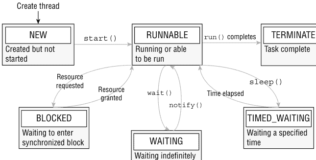

每个线程初始化时都是 `NEW` 状态。一旦调用 `start()`，线程就会移动到 `RUNNABLE` 状态。这意味着它实际上正在运行吗？并不完全；它可能是。`RUNNABLE` 状态意味着线程可以运行。一旦线程的工作完成或抛出未捕获的异常，线程状态将变为 `TERMINATED`，且不再执行任何工作。

在 `RUNNABLE` 状态下，线程可能会转换到三个暂停工作的状态之一：`BLOCKED`、`WAITING` 或 `TIMED_WAITING`。此图包含了线程之间常见的转换，但还有其他可能性。例如，处于 `WAITING` 状态的线程可能会被 `notifyAll()` 触发。同样，被另一个线程中断的线程将退出 `TIMED_WAITING` 直接进入 `RUNNABLE`。

我们在本章中涵盖了（并非所有）这些转换。某些与线程相关的方法——如 `wait()`、`notify()` 和 `join()`——在考试范围之外，而且坦地说，很难使用。你应该避免它们，并尽可能使用并发 API。正确使用这些方法需要大量的技巧（以及一些运气！）。

## 使用 `Sleep` 进行轮询

即使是多线程编程允许你同时执行多个任务，通常也需要等待另一个线程的结果才能继续。一种解决方案是使用轮询（polling）。轮询是在固定间隔间歇断检查数据的过程。

假设你有一个修改共享值的线程，`main()` 线程在等待该线程达到 1 百万：

```
public class CheckResults {
    private static int counter = 0;
    public static void main(String[] args) {
        new Thread(() -> {
            for (int i = 0; i < 1000000; i++) counter++;
        }).start();
        while (counter < 1000000) {
            System.out.println("Not reached yet: "+counter);
        }
    }
}
```

这个程序还没有达到多少次？答案是，不知道！可能是 0、10 或一百万。在没有延迟的情况下使用 `while()` 循环检查数据是非常消耗 CPU 资源的做法。

我们可以使用 `Thread.sleep()` 方法来改进结果，并轮询 1000 毫秒：

```
public class CheckResultsWithSleep {
    private static int counter = 0;
    public static void main(String[] args) {
        new Thread(() -> {
            for (int i = 0; i < 1000000; i++) counter++;
        }).start();
        while (counter < 1000000) {
            System.out.println("Not reached yet");
            try {
                Thread.sleep(1000); // 1 秒
            } catch (InterruptedException e) {
                System.out.println("Interrupted!");
            }
        }
        System.out.println("Reached: "+counter);
    }
}
```

这个改进版本包含了 `sleep()` 以避免占用 CPU，以及 `interrupt()` 以结束线程。虽然轮询看起来很小，但现在线程会在 `TIMED_WAITING` 和 `RUNNABLE` 之间切换。

## 使用并发 API 创建线程

对已经处于 `RUNNABLE` 状态的线程调用 `interrupt()` 不改变状态。事实上，只有当线程定期检查 `Thread.isInterrupted()` 的值状态时，它才会改变行为。

Java 包含了 `java.util.concurrent` 包，我们将其称为并发 API，它处理管理线程的复杂工作。并发 API 包含了 `ExecutorService` 接口，定义了创建和管理线程的服务。

你首先获取一个 `ExecutorService` 实例，然后使用该服务处理任务。该框架包含了许多有用功能，如线程池和调度。建议在任何需要创建和执行单独任务时使用此框架，即使你只需要单个线程。

> 在实践多线程程序时，使用并发 API（或其他多线程 SDK）比直接使用 `Thread` 对象更好。这些库健壮得多，处理复杂的交互也更容易。

## 引入单线程执行器

由于 `ExecutorService` 是接口，如何获取它的实例？并发 API 包含了 `Executors` 工厂类，用于创建 `ExecutorService` 对象的实例。让我们使用 `ExecutorService` 重写我们之前带有两个 `Runnable` 实例的示例。

```
ExecutorService service = Executors.newSingleThreadExecutor();
t {
    System.out.println("begin");
    service.execute(printInventory);
    service.execute(printInventory);
    System.out.println("end");
} finally {
    service.shutdown();
}
```

## 使用并发 API 创建线程

在这个示例中，我们使用 `newSingleThreadExecutor()` 方法来创建服务。与我们之前的示例不同（之前的示例中有四个线程：一个 `main()` 方法和三个新线程），而现在我们只有两个线程（一个 `main()` 方法和一个新线程）。这意味着输出虽然不再那么不可预测，但变化会比以前少。例如，以下是其中一种可能的输出：

```
begin
Printing zoo inventory
Printing record: 0
Printing record: 1
end
Printing record: 0
Printing zoo inventory
```

注意，`printRecords` 循环不再被发送到线程执行器的其他 `Runnable` 任务中断。使用单线程执行器，可以保证任务按顺序执行。注意，当我们的线程执行器任务仍在运行时，已经输出了结束文本。这是因为 `main()` 方法仍然是一个独立于 `ExecutorService` 的独立线程。

## 关闭线程执行器

一旦完成对线程执行器的使用，调用 `shutdown()` 方法是非常重要的。线程执行器在执行第一个任务时会创建一个非守护线程，因此未能调用 `shutdown()` 将导致你的应用程序永远不会终止。

线程执行器的关闭过程涉及拒绝任何提交到线程执行器的新任务，同时继续执行之前提交的任务。在此期间，调用 `shutdown()` 将返回 `true`，而 `isTerminated()` 将返回 `false`。如果在线程执行器正在关闭期间向其提交新任务，将会抛出 `RejectedExecutionException`。一旦所有活动任务完成，`isShutdown()` 和 `isTerminated()` 都将返回 `true`。图 13.3 显示了 `ExecutorService` 对象的生命周期。

**图 13.3** `ExecutorService` 生命周期

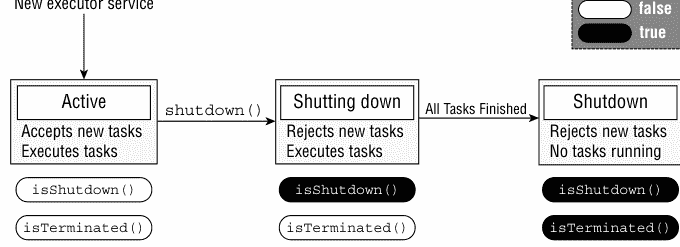

# 732 第 13 章 • 并发

对于考试，你应该意识到 `shutdown()` 不会停止已经提交到线程执行器的任务。

如果你想取消所有正在运行和即将进行的任务怎么办？`ExecutorService` 提供了一个方法 `shutdownNow()`，它会尝试停止所有正在运行的任务并丢弃任何尚未开始的任务。这不能保证成功，因为可能会创建一个永远不会终止的线程，因此任何中断它的尝试都可能被忽略。


正如第 11 章“异常与本地化”中所学的，线程执行器等资源应该被正确关闭以防止内存泄漏。遗憾的是，`ExecutorService` 接口没有扩展 `AutoCloseable` 接口，因此你不能使用 try-with-resources 语句。你可以使用 `finally` 块，正如我们在本章中使用的那样。虽然不是强制使用 `finally` 块，但这被认为是一种良好的做法。

## 提交任务

你可以通过多种方式向 `ExecutorService` 提交任务。我们介绍的第一种方法 `execute()` 继承自 `Executor` 接口，`ExecutorService` 接口扩展了该接口。`execute()` 方法接收一个 `Runnable` 实例并异步完成任务。由于该方法的返回类型为 `void`，它不会告诉你任何关于任务结果的。它被认为是一种“发后后就不管”的方法，因为一旦提交，调用线程就无法直接获取结果。

幸运的是，Java 的编写者在 `ExecutorService` 接口中添加了 `submit()` 方法，它和 `execute()` 一样可以用于异步完成任务。但与 `execute()` 不同，`submit()` 返回一个 `Future` 实例，可以判断任务是否完成。它还可以用于在任务完成后返回一个通用结果。

表 13.1 显示了五种方法，包括 `execute()` 和 `submit()`，这些在考试中是需要熟悉的。在实践中，使用 `submit()` 方法与 `execute()` 类似，但 `submit()` 返回一个可以跟踪结果的 `Future` 对象。对于考试，你需要熟悉 `execute()` 和 `submit()`，但在你自己的代码中，尽可能使用 `submit()` 代替 `execute()`。

### 表 13.1 `ExecutorService` 方法

| 方法名 | 描述 |
|---|---|
| `void execute(Runnable command)` | 执行 `Runnable` 任务。 |
| `Future<?> submit(Runnable task)` | 执行 `Runnable` 任务返回 `Future` |
| `Future<T> submit(Callable<T> task)` | 执行 `Callable` 任务返回 `Future` |
| `List<Future<T>> invokeAll(Collection<? extends Callable<T>> tasks)` | 等待所有任务。 |
| `T invokeAny(Collection<? extends Callable<T>> tasks)` | 等待至少一个 |

**提交任务：`execute()` vs. `submit()`**

正如你所观察到的，`execute()` 和 `submit()` 方法应用于 `Runnable` 时几乎是相同的。`submit()` 方法的明显优势在于返回一个可以确定任务是否完成的对象。

## 等待结果

我们如何知道提交到 `ExecutorService` 的任务何时完成？正如在上一节中提到的，`submit()` 方法返回一个可以确定此结果的 `Future` 实例。

```
Future<?> future = service.submit(() -> System.out.println("Hello"));
```

`Future` 实际上是一个接口，你不需要知道实现 `Future` 的任何类，只需要知道它是各种方法的返回值。表 13.2 包含了确定任务状态的方法。

### 表 13.2 `Future` 方法

| 方法名 | 描述 |
|---|---|
| `boolean isDone()` | 如果任务完成、抛出异常或被取消则返回 `true`。 |
| `boolean isCancelled()` | 如果任务在正常完成前被取消则返回 `true`。 |
| `boolean cancel(boolean mayInterruptIfRunning)` | 尝试取消任务执行，如果取消则返回 `true`，如果无法取消或已完成则返回 `false` |
| `V get()` | 获取任务结果，阻塞直到完成。 |
| `V get(long timeout, TimeUnit unit)` | 获取任务结果，等待指定的时间。如果超时未准备好，则将抛出检查异常 `TimeoutException`。 |

以下是我们早期示例 `CheckResults` 类的更新版本，它使用 `Future` 来等待结果：


```java
import java.util.concurrent.*;
public class CheckResults {
    private static int counter = 0;
    public static void main(String[] unused) throws Exception {
        ExecutorService service = Executors.newSingleThreadExecutor();
        try {
            Future<?> result = service.submit(() -> {
                for(int i = 0; i < 1_000_000; i++) counter++;
            });
            result.get(10, TimeUnit.SECONDS); // 对于 Runnable 返回 null
            System.out.println("Reached!");
        } catch (TimeoutException e) {
            System.out.println("Not reached in time");
        } finally {
            service.shutdown();
        }
    }
}
```

这个示例与我们早期的轮实现类似，但它没有直接使用`Thread`类。在某种程度上这就是并发 API 的精髓：在不需要直接管理线程的情况下执行复杂的操作。它还会等待 10 秒，如果任务未完成，调用`result.get()`时将抛出`TimeoutException`。

## 使用并发 API 创建线程

此任务的返回值是什么？由于`Future<V>`是一个泛型接口，类型`V`由`Runnable`方法的返回类型决定。由于`Runnable.run()`的返回类型为`void`，因此在使用`Runnable`表达式时，`get()`方法始终返回`null`。

`Future.get()`方法可以接收一个可选的枚举类型`java.util.concurrent.TimeUnit`。表 13.3 展示了`TimeUnit`值的完整列表，因为并发 API 中的许多方法都使用了这个枚举。

### 表 13.3 时间值

| 枚举名称 | 描述 |
|---|---|
| `TimeUnit.NANOSECONDS` | 十亿分之一 (1/1,000,000,000) |
| `TimeUnit.MICROSECONDS` | 百万分之一 (1/1,000,00) |
| `TimeUnit.MILLISECONDS` | 千分之一 (1/1000) |
| `TimeUnit.SECONDS` | 秒 |
| `TimeUnit.MINUTES` | 分 |
| `TimeUnit.HOURS` | 小时 |
| `TimeUnit.DAYS` | 天 |

## 引入 Callable

`java.util.concurrent.Callable`函数式接口与`Runnable`类似，不同之处它的`call()`方法返回一个值并可以抛出检查异常。以下是`Callable`接口的定义：

```java
@FunctionalInterface public interface Callable<V> {
  V call() throws Exception;
}
```

`Callable`通常比`Runnable`更优，因为它允许在任务完成后更容易地从任务获取更多细节。尽管如此，在 lambda 不抛出异常且没有返回类型的情况下，我们在本章中使用这两个接口。幸运的是，`ExecutorService`包含一个重载的`submit()`方法，它可以接收一个`Callable`对象并返回一个泛型的`Future<T>`实例。

与`Runnable`的`get()`方法始终返回`null`不同，`Future`实例上的`get()`方法返回匹配的泛型类型（也可以`null`值）。

# 第 13 章 • 并发

让我们来看使用`Callable`的示例：

```java
var service = Executors.newSingleThreadExecutor();
try {
    Future<Integer> result = service.submit(() -> 30 + 11);
    System.out.println(result.get());   // 41
} finally {
    service.shutdown();
}
```

我们可以使用`Runnable`、某个共享对象以及`interrupt()`或定时等待来重写这个示例，但这种实现代码更易编写和理解。从本质上说，这就是并发 API 的精神：提供工具来编写线程安全、高性能且易于维护的多线程代码。

## 等待所有任务完成

在向线程执行器提交一组任务后，等待结果是常见操作。正如你在前面的小节中看到的，一种方案是对每个`submit()`方法返回的每个`Future`调用`get()`。如果我们不需要任务的结果，并且在线程执行器完成后就结束，那么有一个更简单的方法。

首先，使用`shutdown()`方法关闭执行器。接下来，我们使用所有线程执行器通用的`awaitTermination()`方法。该方法等待指定的时间以完成所有任务，如果所有任务完成或检测到`InterruptedException`，则提前返回。你可以在下面的代码段中看到示例：

```java
ExecutorService service = Executors.newSingleThreadExecutor();
try {
    // 将任务添加到线程执行器
    ...
} finally {
    service.shutdown();
}

service.awaitTermination(1, TimeUnit.MINUTES);

// 检查所有任务是否已完成
if(service.isTerminated()) System.out.println("Finished!");
else System.out.println("At least one task is still running");
```

在此示例中，我们向线程执行器提交了多个任务，关闭执行器并等待结果一分钟。注意，我们可以在`awaitTermination()`方法完成后调用`isTerminated()`来确认所有任务都已完成。

## 调度任务

在 Java 中，我们需要调度任务在未来的某个时间执行。我们可能还需要调度任务按设定的间隔重复执行。例如，假设我们需要每小时检查一次动物园动物的食物供应并根据需要补充。`ScheduledExecutorService`是`ExecutorService`的子接口，可用于此类任务。

与`ExecutorService`类似，我们通过`Executor`类中的工厂方法获取`ScheduledExecutorService`实例，如下所示：

```java
ScheduledExecutorService service = Executors.newSingleScheduledExecutor();
```

我们可以将`ScheduledExecutorService`实例存储在`ExecutorService`变量中，尽管这意味着我们必须将对象强制转换后调用任何调度方法。

请参考表 13.4 关于`ScheduledExecutorService`方法的总结。这些方法中的每一个都返回一个`ScheduledFuture`对象。

### 表 13.4 ScheduledExecutorService 方法

| 方法 | 描述 |
| --- | --- |
| `schedule(Callable<V> callable, long delay, TimeUnit unit)` | 在给定延迟后创建并执行`Callable`任务 |
| `schedule(Runnable command, long delay, TimeUnit unit)` | 在给定延迟后创建并执行`Runnable`任务 |
| `scheduleAtFixedRate(Runnable command, long initialDelay, TimeUnit unit)` | 在初始延迟后创建并执行`Runnable`任务，并在每经过一个周期值创建一个新任务 |
| `scheduleWithFixedDelay(Runnable command, long initialDelay, TimeUnit unit)` | 在给定初始延迟后创建并执行`Runnable`任务，下次任务开始之间具有给定的延迟 |

在实践中，这些方法在并发 API 中非常方便，例如秒或毫秒。表 13.4 中的前两个`schedule()`方法分别接收`Callable`或`Runnable`；在某些延迟后执行；并返回`ScheduledFuture`。`ScheduledFuture`接口与`Future`接口相同，但它包含了

# 第 13 章 • 并发

`get()`方法返回剩余延迟。以下使用了`Callable`和`Runnable`的`schedule()`方法：

```java
ScheduledExecutorService service = Executors.newSingleScheduledExecutor();

Runnable task1 = () -> System.out.println("Hello Zoo");
service.schedule(task1, 10, TimeUnit.SECONDS);

Callable<String> task2 = () -> "Zoo";
service.schedule(task2, 8, TimeUnit.MINUTES);
```

第一个任务在 10 秒后调度，而第二个任务在 8 分钟后调度。


虽然任务在未来调度，但实际执行可能会延迟。例如，可能没有可用线程执行任务，此时它们会在队列中等待。如果在任务执行之前`ScheduledExecutorService`已关闭，这些任务将被丢弃。

`ScheduledExecutorService`的每个方法都非常重要并有实际应用场景。例如，你可以使用`schedule()`命令检查狮子的状态。如果未完成，它可以发送通知，甚至再次`schedule()`稍后检查。

13.4 中的最后两个方法如果你以前没见过它们，可能会有点困惑。然而，它们是相似的，都在初始延迟后执行相同的任务。区别在于过程的时机以及下次任务开始的时间。

`scheduleAtFixedRate()`方法每个周期创建一个新任务并提交给执行器，无论上一个任务是否完成。以下示例在五分钟初始延迟后每分钟执行一次`Runnable`：

```java
service.scheduleAtFixedRate(command, 5, 1, TimeUnit.MINUTES);
```

`scheduleAtFixedRate()`方法适用于需要按特定间隔执行的任务，例如每天检查一次动物健康。即使检查一只动物需要两小时，这也不意味着第二天开始应该推迟。


> 如果每个任务的运行时间持续超过执行间隔，`scheduleAtFixedRate()`可能会出现问题。如果你的老板每分钟来你办公桌一次并丢一张纸。现在想象你读每张纸需要五分钟。很快，你就会淹没在纸堆中。这就是执行器的感受。给定足够的时间，程序提交到执行器的任务将超过内存所能容纳，导致程序崩溃。

## 使用 Concurrency API 创建线程

另一方面，`scheduleWithFixedDelay()`方法仅在上一个任务完成后才会创建一个新任务。例如，如果一个任务在 12:00 运行并耗时五分钟完成，且两次执行之间的间隔为两分钟，那么下一个任务将在 12:07 开始。

```java
service.scheduleWithFixedDelay(task, 0, 2, TimeUnit.MINUTES);
```

`scheduleWithFixedDelay()`方法适用于那些你希望重复发生但对具体时间并不重要的过程。例如，想象我们有一个动物园食堂的工作人员在全天定期地为沙拉吧补充货物。这个过程可能需要 20 分钟或更长时间，因为工作人员需要从后室搬运大量物品。一旦工作人员用新鲜食物填满沙拉吧，他们就不需要在某个特定时间检查，只需要在足够的时间过去导致库存变低之后即可。

## 通过线程池增加并发性

到目前为止，我们所有的示例都是使用单线程执行器，虽然很有趣，但并没有特别有用。毕竟，本章的名称是“并发”，而你无法通过单线程执行器完成所有操作！

我们现在介绍`Executors`类中的三个额外方法，它们作用于线程池而不是单个线程。线程池是一组预先实例化的可重用线程，可用于执行一组任意任务。表 13.5 包含了我们之前的两个单线程执行器方法，以及你为了考试而应该掌握的新方法。

### 表 13.5 Executors 工厂方法

| 方法名 | 描述 |
| --- | --- |
| `ExecutorService newSingleThreadExecutor()` | 创建单线程执行器，它使用一个从无界队列操作的单个工作线程。结果按提交的顺序顺序地处理。 |
| `ScheduledExecutor newSingleThreadScheduledExecutor()` | 创建单线程执行器，可以调度命令在指定的延迟后运行或周期性执行。 |
| `ExecutorService newCachedThreadPool()` | 创建线程池，根据需要创建新线程，但在之前构建的线程可用时会进行重用它们。 |
| `ExecutorService newFixedThreadPool(int)` | 创建线程池，它使用固定数量的线程从共享的无界队列操作。 |
| `ScheduledExecutor newScheduledThreadPool(int)` | 创建线程池，可以调度命令在指定的延迟后运行或周期性执行。 |

## 第 13 章 · 并发

如表 13.5 所示，这些方法返回相同的实例类型`ExecutorService`和`ScheduledExecutor`，这些我们在在本章之前已经使用过。也就是说，我们之前所有的示例都与这些新的池线程执行器兼容！

单线程执行器和池线程执行器之间的区别在于当任务已经在运行时会发生什么。单线程执行器会等待线程可用后才运行下一个任务，而池线程执行器可以并发执行下一个任务。如果线程池耗尽了可用线程，任务将由线程执行器放入队列并等待完成。

## 编写线程安全的代码

线程安全是对象的一种属性，保证了多个线程同时执行时的安全性。由于线程运行在共享的环境和内存空间中，我们如何防止两个线程相互干扰呢？我们必须组织对数据的访问，以避免产生无效或意外的结果。

在章的这部分中，我们将展示如何使用各种技术来保护数据，包括原子类、同步块（synchronized blocks）、Lock 框架和循环屏障（cyclic barriers）。

## 理解线程安全

想象我们有一个动物园需要数羊，最好是一个不会让动物园工作人员睡着的动物园！每个动物园工作人员跑到一个字段，向羊群中增加一只新羊，数出羊的总数，然后回到我们这里报告结果。我们提供以下代码从概念上表示这一点，选择一个线程池的大小以便所有任务都能并发运行：

```java
import java.util.concurrent.*;

class SheepManager {

    private int sheepCount = 0;

    private void incrementCount() {

        System.out.print((++sheepCount) + " ");

    }

    public static void main(String[] args) {

        ExecutorService service = Executors.newFixedThreadPool(20);

        try {

            SheepManager manager = new SheepManager();

            for (int i = 0; i < 10; i++) {

                service.submit(() -> manager.incrementCount());

            }

        } finally {

            service.shutdown();

        }

    }

}
```

## 编写线程安全的代码

这段代码输出什么？你可能认为它会按顺序输出，但从图 13.4 可以可能的输出：

```
1 2 3 4 5 6 7 8 9 10 
1 2 3 4 5 6 7 8 9 10 
1 2 3 4 5 6 7 8 9 10 
1 2 3 4 5 6 7 8 9 10 
1 2 3 4 5 6 7 8 9 10 
1 2 3 4 5 6 7 8 9 10 
1 2 3 4 5 6 7 8 9 10 
1 2 3 4 5 6 7 8 9 10 
1 2 3 4 5 6 7 8 9 10 
1 2 3 4 5 6 7 8 9 10 
```


这段代码不是线程安全的，因为`++sheepCount`是两个独立的操作。或者换句话说，如果增加运算符表示`sheepCount = sheepCount + 1`，那么每个读写操作都是线程安全的，但组合操作不是。回到我们的羊羊例子，我们没有在运行期间中断员工，但我们仍然可能有多个个人在字段中。

## 使用 volatile 访问数据

`volatile`属性确保只有一个线程在修改变量。从概念上说，这就像为我们的动物园工作人员制定了一条规则，时间内只有一个员工在字段中，尽管他们可能不会按顺序报告结果。

`volatile`关键字确保跨线程的数据的一致性。在此时，我们没有在运行期间中断员工，但我们仍然可能丢失数字。

> 在实践中，`volatile`很少使用。我们之所以介绍它是因为它已知会出现在考试中。

## 使用原子类保护数据

在我们之前的`Manager`应用中，相同的值被打印了两次，计数器最高为 9 而不是 10。正如我们所见，当使用`volatile`时，增加运算符`++`并不是线程安全的。它不是线程安全的因为该操作不是原子的，执行了两个任务（读取和写入），这些可能会被其他线程中断。

原子性是指操作作为单个执行单元执行，而不受另一个线程的干扰。增加运算符的线程安全版本会将变量的读取和写入作为一个单一操作执行，允许任何其他线程在操作期间访问该变量。从概念上说，这就像为我们的动物园工作人员制定了一条规则，在时间内只有一个员工在字段中，尽管他们可能不会按顺序报告结果。

### 图 13.5 使用原子操作进行线程同步

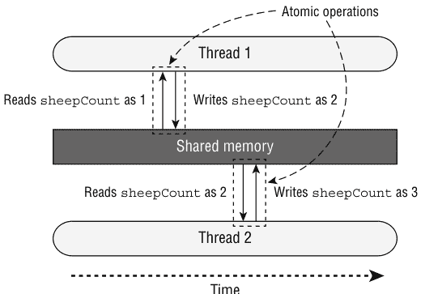

由于 Java 中访问基本数据类型和引用非常常见，因此并发 API 在`java.util.concurrent.atomic`包中包含了许多有用的类。表 13.6 列出了你考试时应该熟悉的原子类。与并发 API 中的许多类一样，这些类的存在是为了让你的工作变得更轻松。

### 表 13.6 原子类

| 类名 | 描述 |
| --- | --- |
| `AtomicBoolean` | 一个可以原子化更新的布尔值 |
| `AtomicInteger` | 一个可以原子化更新的`int`值 |
| `AtomicLong` | 一个可以原子化更新的`long`值 |

我们如何使用原子类？每个类都包含许多方法，这些方法等同于我们在基本类型上使用的许多内置运算符，例如赋值运算符（`=`）和自增运算符（`++`）。我们在表 13.7 中描述了考试时应该掌握常用原子方法。*类型*由类本身决定。

在接下来的示例中，我们假设已经导入原子包并使用`AtomicInteger`更新了我们的`SheepManager`类：

```
3: private AtomicInteger sheepCount = new AtomicInteger(8);
4: private void incrementAndReport() {
5:     System.out.print(sheepCount.incrementAndGet() + " ");
6: }
```

### 表 13.7 常用原子方法

| 方法 | 描述 |
| --- | --- |
| `get()` | 获取当前值 |
| `set(type newValue)` | 设置给定值，等于赋值运算符`=` |
| `getAndSet(type newValue)` | 原子化地设置新值并返回旧值 |
| `incrementAndGet()` | 对于数值类，原子性的前自增操作，等于`++value` |
| `getAndIncrement()` | 对于数值类，原子性的后自增操作，等于`value++` |
| `decrementAndGet()` | 对于数值类，原子性的前自减操作，等于`--value` |
| `getAndDecrement()` | 对于数值类，原子性的后自减操作，等于`value--` |

这种实现与我们之前的示例有何不同？当我们运行此修改时，会得到不同的输出，如下：
`2 3 1 4 5 6 7 8 9 10`
`1 4 3 2 5 6 7 8 9 10`
`1 4 3 5 6 2 7 8 9 10`

与我们之前的样本输出不同，1 到 10 的数字始终会被打印出来，尽管顺序无法保证。不要担心；我们稍后会解决这个问题。本节的关键在于，使用原子类确保了工作线程之间数据的一致性，并且不会因为并发修改导致值丢失。

## 使用 synchronized 块改进访问

虽然原子类在保护单个变量方面表现出色，但如果你需要执行一系列命令或调用一个方法，它们就不特别有用了。例如，我们无法使用它们同时更新两个原子变量。我们如何改进结果，以便每个工作线程都能按顺序递增并报告结果？

最常用的技术是使用监器（monitor）来同步访问。*监器*也称为*锁*（lock），是一种支持*互斥*（mutual exclusion）的结构，互斥是指在给定时间内最多只有一个线程在执行特定的代码段。

编写线程安全代码 745

在 Java 中，任何`Object`都可以用监器，配合`synchronized`关键字使用如下所示：

```
var manager = new SheepManager();
synchronized(manager) {
    // 一次由一个线程完成的工作
}
```

这个示例被称为同步块（synchronized block）。每个到达的线程都会首先检查是否有线程正在运行该块。如果锁不可用，线程将进入`BLOCKED`状态，直到它能够“获取锁”。如果锁可用（或线程已持有锁），该单个线程将进入块，阻止所有其他线程进入。一旦执行完该块，它将释放锁，允许等待线程中的一个继续执行。

为了同步多个线程之间的访问，每个线程必须能够访问同一个`Object`。如果每个线程在不同的对象上进行同步，则代码不是线程安全的。


让我们重新回到使用`++sheepCount`的`SheepManager`示例，看看是否可以改进结果以显示工作线程按顺序递增并输出计数器。假设我们将`for`循环替换为以下实现：

```
11: for(int i = 0; i < 10; i++) {
12:     synchronized(manager) {
13:         service.submit(() -> manager.incrementAndReport());
14:     }
15: }
```

这个解决方案解决问题了吗？并没有！你看出问题了吗？我们同步了线程的创建，而不是线程的执行。在这个示例中，线程是逐个创建的，但它们仍然可能执行并形成工作，导致我们之前看到的相同输出。在实践中，描述和解决线程问题是非常困难的！

我们提供一个修正后的版本：

```java
import java.util.concurrent.*;

class SheepManager {
    private AtomicInteger sheepCount = new AtomicInteger(0);

    public void incrementAndReport() {
        System.out.print(sheepCount.incrementAndGet() + " ");
    }
}

public static void main(String[] args) {
    SheepManager manager = new SheepManager();
    ExecutorService service = Executors.newFixedThreadPool(10);

    for (int i = 0; i < 10; i++) {
        synchronized(manager) {
            // 此处逻辑应确保任务提交的顺序性
        }
    }
}
```

# 第 13 章 并发

```
// 使用 Lock 的实现 #2
Lock lock = new ReentrantLock();
try {
    lock.lock();
    // 受保护代码
} finally {
    lock.unlock();
}
```

这两种实现在概念上是等价的。`ReentrantLock`类是一个实现了`Lock`接口并支持互斥的简单监控器（monitor）。在其他方面，在任何时刻最多允许一个线程持有锁。


虽然不是强制要求的，但在使用`Lock`实例中使用`try/finally`块是一个良好的做法。这样做可以确保任何获取的锁都能被正确释放。

`ReentrantLock`类确保一旦线程调用了`lock()`并获得了锁，所有其他调用`lock()`的线程都将等待，直到第一个线程调用`unlock()`。下一个获取锁的线程取决于创建`Lock`对象时使用的参数。

`ReentrantLock`类包含一个接受单个布尔值的构造函数并用于设置“公平性”（fairness）参数。如果该参数设置为`true`，锁通常将按照请求的顺序授予每个线程。当使用无参数构造函数时，它默认为`false`。在实践中，当绝对需要排序时，你应该启用公平性，因为它可能会导致显著变慢。

除了确保释放锁之外，你还需要确保释放的是你所拥有的锁。如果你尝试释放一个你不拥有的锁，将在运行时抛出异常。

```
Lock lock = new ReentrantLock();
lock.unlock(); // IllegalMonitorStateException
```

`Lock`接口包含了你在考试中应该掌握的四个方法，如表 13.8 所示。

## 尝试 ReentrantLock

虽然`Reentrant`类允许你等待锁，但它目前面临着与`synchronized`块相同的问题。线程可能会永远在等待以获取锁。幸运的是，表 13.8 包含了两个额外方法，使得`Lock`接口使用起来比`synchronized`块安全得多。

### 表 13.8 Lock 方法

| 方法 | 说明 |
| --- | --- |
| `void lock()` | 请求锁并阻塞直到获取锁为止。 |
| `void unlock()` | 释放锁。 |
| `boolean tryLock()` | 请求锁并立即返回。返回一个布尔值表示是否成功获取锁。 |
| `boolean tryLock(long timeout, TimeUnit unit)` | 请求锁并阻塞指定时间或直到获取锁。返回一个布尔值表示是否成功获取锁。 |

为了方便起见，我们在本节的代码中使用以下`printHello()`方法：

```java
public static void printHello(Lock lock) {
    try {
        lock.lock();
        System.out.println("Hello");
    } finally {
        lock.unlock();
    }
}
```

`tryLock()`方法将尝试获取锁并立即返回一个布尔结果，表示是否已获得锁。与`lock()`方法不同，如果另一个线程已经持有锁，它将不会等待。它会立即返回，无论锁是否可用。

以下是使用`tryLock()`方法的示例实现：

```java
Lock lock = new ReentrantLock();
new Thread(() -> printHello(lock)).start();

if(lock.tryLock()) {
    try {
        System.out.println("Lock obtained, entering protected code");
    } finally {
        lock.unlock();
    }
} else {
    System.out.println("Unable to acquire lock, doing something else");
}
```

# 第 13 章 • 并发

当你运行这段代码时，它可能会产生`if`或`else`消息，取决于执行顺序。尽管如此，它始终会打印 Hello，但`printHello()`中对`lock()`的调用将无限地等待锁可用。一个有趣的练习是在此片段中插入`Thread.sleep()`延迟，以鼓励显示特定的消息。

与`lock()`类似，`tryLock()`方法应该与`try/finally`块一起使用。遗憾的是，你只有在成功获取锁时才需要释放锁。出于这个原因，通常会在`if`语句的`else`分支中使用`tryLock()`的输出，这样只有在获取锁时才会调用`unlock()`。

你的程序始终检查`tryLock()`方法的返回值是非常关重要的。它告诉你的程序继续操作是否安全。


## tryLock(long, TimeUnit)

`Lock`接口包含一个重载版本的`tryLock(long, TimeUnit)`，它的作用类似于`lock()`和`tryLock()`的混合体。与其他方法不同，如果锁可用，它将等待指定的时间。以下代码使用了重载版本：

```java
Lock lock = new ReentrantLock();
new Thread(() -> printHello(lock)).start();

if(lock.tryLock(10, TimeUnit.SECONDS)) {
    try {
        System.out.println("Lock obtained, entering protected code");
    } finally {
        lock.unlock();
    }
} else {
    System.out.println("Unable to acquire lock, doing something else");
}
```

## 获取锁两次

`ReentrantLock`维护它被授予的计数器。为了验证这一点，以下代码包含一个错误。你能发现它吗？

```java
Lock lock = new ReentrantLock();
lock.lock();
try {
    System.out.println("Lock obtained, entering protected code");
} finally {
    lock.unlock();
}
```

## 安全代码

```java
Lock lock = new ReentrantLock();
lock.lock();
try {
    System.out.println("Lock obtained, entering protected code");
} finally {
    lock.unlock();
}
```

## 复习 Lock

我们通过讨论单个变量开始线程安全主题，然后转向类和锁。我们通过展示`ReentrantLock`支持以下功能完成了对线程安全的讨论：

- 非阻塞地请求锁。
- 请求指定时间内的锁。
- 锁可以带有公平属性创建。

虽然不在考试范围内，但`ReentrantWriteLock`是一个非常有用的类。它包含了独立的读写锁，可以最大限度地提高读取远大于写入的数据结构的访问。


## 使用 CyclicBarrier 协调任务

我们可以让一个工人完成所有工作，但这样太慢了，而且忽略了三个空闲工人的事实。更好的解决方案是让四个员工并发工作，在一组任务结束和下一组任务开始之间暂停。为了协调这些任务，我们可以使用`CyclicBarrier`：

```java
import java.util.concurrent.*;

public class LionManager {
    private void removeLions() { System.out.println("Removing lions"); }
    private void cleanPen() { System.out.println("Cleaning the pen"); }
    private void addLions() { System.out.println("Adding lions"); }

    public void performTask(CyclicBarrier barrier) {
        try {
            removeLions();
            barrier.await();
            cleanPen();
            barrier.await();
            addLions();
        } catch (InterruptedException | TimeoutBarrierException e) {
            e.printStackTrace();
        }
    }

    public static void main(String[] args) {
        var service = Executors.newFixedThreadPool(4);
        CyclicBarrier barrier = new CyclicBarrier(4);
        try {
            for (int i = 0; i < 4; i++) {
```


# 编写线程安全的代码

我们可以使用`CyclicBarrier`类改进这些结果。`CyclicBarrier`在构造函数中接收一个限制值，表示需要等待的线程数。当每个线程完成时，它会调用循环屏障上的`await()`方法。一旦指定数量的线程调用了`await()`，屏障就会释放，所有线程都可以继续执行。

```java
import java.util.concurrent.*;

public class PenManager {

    private void removeLions() { System.out.println("Removing lions"); }

    private void cleanPen() { System.out.println("Cleaning the pen"); }

    private void addLions() { System.out.println("Adding lions"); }

    public void performTask(CyclicBarrier c1, CyclicBarrier c2) {

        try {

            removeLions();

            c1.await();

            cleanPen();

            c2.await();

            addLions();

        } catch (InterruptedException | BarrierException e) {

            // Handle checked exceptions here

        }

    }

    public static void main(String[] args) {

        var service = Executors.newFixedThreadPool(4);

        try {

            var manager = new PenManager();

            var c1 = new CyclicBarrier(4);

            var c2 = new CyclicBarrier(4,

                () -> System.out.println("**** Pen Cleaned!")));

            for (int i = 0; i < 4; i++) {

                service.submit(() -> manager.performTask(c1, c2));

            }

        } finally {

            service.shutdown();

        }

    }

}
```

以下是基于此修改后的`LionManager`类实现的示例输出：

```
Removing lions
Removing lions
Removing lions
Removing lions
Cleaning the pen
Cleaning the pen
Cleaning the pen
Cleaning the pen
Adding lions
Adding lions
Adding lions
Adding lions
```

如你所见，所有的结果现在都井井有序了。移除狮子是在一步中完成的，清理圈舍和将狮子放回去也是如此。在这个例子中，我们为`CyclicBarrier`对象使用了两个不同的构造函数，后者在完成后执行一个`Runnable`实例。

`CyclicBarrier`允许我们在执行复杂的多线程任务的同时，所有线程在逻辑屏障处停止并等待。这种解决方案优于单线程解决方案，因为各个任务（如移除狮子）可以由四个工作线程并行完成。

## 重用 CyclicBarrier

当达到`CyclicBarrier`的限制值后（即屏障被打破），所有线程都会被释放，等待`CyclicBarrier`的线程数将返回零。此时，`CyclicBarrier`可以再次用于一组新的等待线程。例如，如果我们的`CyclicBarrier`限制为 5，且我们有 15 个线程调用了`await()`，那么`CyclicBarrier`将被激活三次。

## 使用并发集合

除了管理线程之外，并发 API 还包含了接口和类，可以帮助你协调多个任务对共享集合的访问。这里说的集合，我们当然是指我们在第 9 章“集合与泛型”中介绍的 Java 集合框架。在本节中，我们将演示在用并发 API 时，你可以使用的许多并发类。

## 理解内存一致性错误

并发集合类的目的是为了解决常见的内存一致性错误。当两个线程对本应相同的数据有不一致的视图时，就会发生内存一致性错误。从概念上讲，我们希望如果一个线程在写入发生后访问并发集合，那么该写入对另一个线程是可见。

当两个线程尝试修改同一个非并发集合时，JVM 可能会在运行时抛出`ConcurrentModificationException`。事实上，这在单线程中也可能发生。看以下代码段：

```java
11: var food = new HashMap<String, Integer>();
12: food.put("penguin", 1);
13: food.put("flaming", 2);
14: for (String key: food.keySet())
15:     food.remove(key);
```

这段代码在循环迭代期间会抛出`ConcurrentModificationException`，因为在移除第一个元素后，`keySet()`上的迭代器没有正确更新。将该行改为`ConcurrentHashMap`将防止代码在运行时抛出异常。

```java
11: var food = new ConcurrentHashMap<String, Integer>();
```

虽然我们通常不修改局部变量，但这个示例强调了一个事实：`ConcurrentHashMap`的读写排序确保了对该类的所有访问是一致的。在这一段代码中，一旦从 map 中删除一个对象，由`keySet()`创建的迭代器就会更新。

创建并发类是为了帮助避免多个线程从同一个集合中添加和删除对象的常见问题。在任何时刻，所有线程都应该对集合的结构具有相同的一致视图。

## 使用并发类

每当你有多个线程在同步块之外修改集合时，即使你不预感到会有并发问题，也应该使用并发集合。

> 如果集合是不可变的（并且包含不可变对象），则不需要并发集合。不可变对象可以被任何数量的线程访问，不需要同步。根据定义，它们不会改变，因此不存在内存一致性错误。

在传递并发集合时，调用者可能需要知道具体的实现类。尽管如此，尽可能传递非并发接口引用被认为是一种良好的做法，类似于我们实例化`HashMap`但通常在传递时使用接口。

**表 13.9 并发集合**

| 类名 | Java 接口 | 是否排序？ | 是否阻塞？ |
| :--- | :--- | :--- | :--- |
| ConcurrentHashMap | Map | 否 | 否 |
| ConcurrentLinkedQueue | Queue | 否 | 是 |
| ConcurrentSkipListMap | Map | 是 | 否 |
| ConcurrentSkipListSet | Set | 是 | 否 |
| CopyOnWriteArrayList | List | 否 | 否 |
| CopyWriteArraySet | Set | 否 | 否 |

表 13.9 中的大多数类只是其非并发对应项的版本，例如用于`Map`的`ConcurrentHashMap`。你不需要了解任何特定类的方法。`CopyOnWrite`类的行为与其他类稍不同；每当引用被修改时，它们都会创建集合的副本。让我们通过示例来看它是如何工作的：

```java
List<Integer> favNumbers = new CopyWriteArrayList<>(List.of(4, 3, 4));
for (var n : favNumbers) {
    System.out.print(n + " ");
    favNumbers.add(n+1);
}
```

尽管添加了元素，迭代器也没有被修改，循环恰好执行了三次。相反，如果我们使用`ArrayList`，运行时会抛出`ConcurrentModificationException`。

```java
System.out.println();
System.out.println("Size: " + favNumbers.size()); // Size: 6
```

`CopyOnWrite`实例类似于不可变对象，每当集合被修改时，都会创建一个底层结构。与真正的不可变对象不同，当底层数据更改时，引用保持不变。

`LinkedBlockingQueue`实现了`BlockingQueue`接口。该类就像普通的`Queue`，区别在于包含了带有时间的`offer()`和`poll()`重载版本。这些方法会等待特定时间内以完成操作。

## 获取同步集合

除了我们涵盖过的并发类之外，并发 API 还包含了获取现有非并发集合的同步版本的方法。这些同步方法定义在`Collections`类中。它们作用于导入集合，并返回与底层集合相同类型的引用。这些静态方法列在表 13.10 中。

**表 13.10 同步集合方法**

- `synchronizedCollection(Collection<T> c)`
- `synchronizedList(List<T> list)`
- `synchronizedMap(Map<K,V> m)`
- `synchronizedNavigableMap(NavigableMap<K,V> m)`
- `synchronizedNavigableSet(NavigableSet<T> s)`
- `synchronizedSet(Set<T> s)`
- `synchronizedSortedMap(SortedMap<K,V> m)`
- `synchronizedSortedSet(SortedSet<T> s)`

如果你正在编写代码来创建一个集合且该集合需要同步，你应该使用表 13.9 中定义的类。相反，如果你接收到的非并发集合并需要同步，请使用表 13.10 中的方法。

## 识别线程问题

现在你已经知道了如何编写线程安全的代码，让我们来讨论一下什么属于线程问题。在多线程应用程序中，当两个或多个线程以意想不到且不可愿的方式相互作用时，就会发生线程问题。例如，两个线程可能会相互阻塞无法访问特定的代码段。

并发 API 的创建是为了帮助消除所有开发者常见的潜在线程问题。正如你所看到的，并发 API 可以帮助你创建线程并管理复杂的交互，通常只需要几行代码。

尽管并发 API 减少了线程问题的可能性，但它并不能完全消除它们。在实践中，在应用程序内部发现和识别线程问题通常是开发者可以的最的最的任务之一。

## 理解活跃性（Liveness）

正如你在本章看到的，许多操作可以独立执行，但需要某些协调。例如，在方法上进行同步需要所有调用方法的线程等待其他线程完成后才能继续。你在本章的早期还看到，`CyclicBarrier`中的线程会等待屏障达到限制后再继续。

当所有这些线程都在等待时，应用程序会发生什么？在许多情况下，这种等待是瞬即逝的，用户几乎察觉不到发生了任何延迟。在其他情况下，等待可能会非常长，甚至是无限的。

活跃性是应用程序能够及时执行的能力。那么，活跃性问题就是应用程序变得无响应或处于某种“卡住”状态的问题。更准确地说，活跃性问题是线程进入`BLOCKING`或`WAITING`状态并永远离开，或反复进入/退出这些状态的结果。对于考试，你应该熟悉三种类型的活跃性问题：死锁（deadlock）、饥饿（starvation）和活锁（livelock）。

## 死锁

死锁发生在两个或多个线程被永久阻塞，且每个线程都在等待对方时。我们可以通过以下示例来说明这一原理。假设你的动物园有两只狐狸：Foxy 和 Tails。Foxy 喜欢先吃再喝水，而 Tails 喜欢先喝水再吃。此外，这两只动物都不喜欢分享，它们只有在同时拥有食物和水的独占访问权限时才能完成进。

动物管理员将食物放在环境的一侧，将水放在另一侧。尽管我们的狐狸很快，但它们从环境的一侧运行到另一侧仍需要 100 毫秒。

如果 Foxy 先拿到食物，而 Tails 先拿到水，会发生什么？下面的应用程序模拟了这种行为：

```java
import java.util.concurrent.*;

class Food {
class Water {
    public record Fox(String name) {
        public void eatAndDrink(Food food {
```

在这个示例中，Foxy 获取了食物并移动到环境的另一侧获取水。不幸的是，Tails 已经喝了水，正在等待食物可用。结果是我们的程序输出了以下内容并无限挂起：

```
Foxy Got Food!
Tails Got Water!
```

这个示例被认为是死锁，因为两个参与者都被永久阻塞，等待着永远不会可用的资源。

## 饥饿

饥饿发生在单个线程永久被拒绝访问共享资源或锁时。该线程仍然处于活动状态，但由于其他线程不断夺取它试图访问的资源，导致它无法完成工作。

在我们的狐狸示例中，假设我们的环境中有一群非常饥饿且具有竞争性的狐狸。每当 Foxy 站起来去食物时，其他狐狸中的一只就会看到他并在在他之前冲过去吃。Foxy 可以在围栏内自由漫游、睡睡，并向永远无法获得食物访问权的动物管理员嚎叫。在这个示例中，Foxy 在字面和意义上都经历了饥饿。庆幸的是这只是一个理论上的示例！

## 活锁

活锁发生在两个或多个线程在概念上被永久阻塞，尽管它们每一个仍然处于活动状态并尝试完成任务。活锁是资源饥饿的一种特殊情况，其中两个或多个线程积极尝试获取一组锁，但未能成功，并重启了部分过程。

活锁是两个线程的结果。在我们的狐狸示例中，假设我们的环境中有一群非常饥饿且具有竞争性的狐狸。每当 Foxy 站起来去食物时，其他狐狸中的一只就会看到他并在在他之前冲过去吃。Foxy 可以在围栏内自由漫游、睡睡，并向永远无法获得食物访问权的动物管理员嚎叫。在这个示例中，Foxy 在字面和意义上都经历了饥饿。庆幸的是这只是一个理论上的示例！

活锁发生在两个或多个线程在概念上被永久阻塞，尽管它们每一个仍然处于活动状态并尝试完成任务。活锁是资源饥饿的一种特殊情况，其中两个或多个线程积极尝试获取一组锁，但未能成功，并重启了部分过程。

活锁是两个线程的结果。在我们的狐狸示例中，假设我们的环境中有一群非常饥饿且具有竞争性的狐狸。每当 Foxy 站起来去食物时，其他狐狸中的一只就会看到他并在在他之前冲过去吃。Foxy 可以在围栏内自由漫游、睡睡，并向永远无法获得食物访问权的动物管理员嚎叫。在这个示例中，Foxy 在字面和意义上都经历了饥饿。庆幸的是这只是一个理论上的示例！

## 管理竞态条件

竞态发生在两个或多个线程以意想不到且不可愿的方式相互作用时。例如，两个线程可能会相互阻塞无法访问特定的代码段。

并发 API 的创建是为了帮助消除所有开发者常见的潜在线程问题。正如你所看到的，并发 API 可以帮助你创建线程并管理复杂的交互，通常只需要几行代码。

尽管并发 API 减少了线程问题的可能性，但它并不能完全消除它们。在实践中，在应用程序内部发现和识别线程问题通常是开发者可以的最的最的任务之一。

## 使用并行流

我们通过将你在第 10 章“流”中学的知识与你学到的概念相结合来结束本章。流最强大的功能之一是内置的并发支持。到目前为止，你处理过的所有流都是串行流。串行流是一种结果按顺序的流，一次只处理一个元素。

并行流能够使用多个线程并发处理结果。例如，你可以使用并行流和`map()`操作对元素进行并发操作，这比一次处理一个元素的性能提升极许多。

使用并行流不仅可以改变应用程序的性能，还可能改变预期的结果。正如你所看到的，某些操作需要特殊处理才能以并行方式处理。

## 执行并行分解

并行分解是将任务分解为可以并发执行的较小部分，然后重新组合结果的过程。并发程度越高，使用并行流的性能提升就越显著。

让我们尝试一下。首先，我们定义一个通过等待五秒来“执行工作”的可复用函数。

## 使用并行流

```java
private static int doWork(int input) {
  try {
    Thread.sleep(5000);
  } catch (InterruptedException e) {
    return input;
  }
}
```


我们可以预测，在实际应用中，这项工作可能涉及调用数据库或读取文件。让我们在串行流中使用这个方法。

你认为这段代码作为`main()`方法的一部分执行时会输出什么？让我们来看一下：

```
+ 1 2 3 4 5
Time: 25 seconds
```

正如你预期的那样，结果是有序且可预测的，因为我们使用的是串行流。逐个处理五个结果花费了大约 25 秒。如果我们把第 12 行替换为使用`parallelStream()`的代码会发生什么？以下是一些示例输出：

```
+ 3 2 1 5 4
Time: 5 seconds
```

如你所见，结果不再是有序的或可预测的。并行流上的`map()`和`forEach()`操作等同于向线程池执行器提交了多个`Runnable` lambda 表达式并等待结果。
所需的时间又是怎样的？在这种情况下，我们的系统有足够的 CPU 来让所有任务并发运行。如果你在处理器较少的计算机上运行相同的代码，它可能会输出 10 秒、15 秒或其他其他值。关键在于，我们编写的代码在可用并行处理时能够利用了其优势，因此我们的任务就完成了。

## 结果的排序

如果你的流操作需要保证顺序，且你不确定它是串行的还是并行的，你可以将 14 行替换为使用`forEachOrdered()`的代码：

```java
14: .forEachOrdered(s -> System.out.print(s + " "));
```

这会按照它们在流中定义的顺序输出结果：

```
+ 1 2 3 4 5
Time: 5 seconds
```

虽然我们失去了一些使用并行流带来的性能提升，但我们的`map()`操作仍然可以利用并行流的优势。

## 处理并行归约

除了可能提高性能和修改操作顺序外，使用并行流还会影响你编写应用程序的方式。并行归约（parallel reduction）是应用于并行流的归约操作。并行归约的结果可能与你在处理串行流时的预期有所不同。

## 执行基于顺序的任务

由于并行流不保证顺序，并行流上的如`findAny()`等方法可能会导致意外行为。考虑以下示例：

```java
System.out.print(List.of(1,2,3,4,5,6))
  .parallelStream()
  .findAny()
  .get();
```

JVM 分配了许多线程并返回第一个返回结果的线程的值，这可能是 4，以此此类推。串行流和并行流都不保证返回第一个值，尽管串行流通常会这样做。对于并行流，结果可能更具随机性。

哪些操作考虑了顺序，例如`findFirst()`、`limit()`和`skip()`？顺序仍然会被保留，但在并行流上性能可能会受到影响，因为并行处理任务被迫以一种类似于同步的方式协调其所有线程。

从好的一的一来看，并行流上有序操作的结果将与串行流保持一致。例如，调用`skip(5).limit(2).findFirst()`在有序的串行流和并行流上将返回相同的结果。

### 现实世界场景

#### 创建无序流

你一直处理的所有流默认都被认为是有序的。可以从有序流创建一个无序流，类似于从串行流创建并行流。

```java
List.of(1,2,3,4,5,6).stream().unordered();
```

此方法不会重新排序元素；它告诉 JVM 如果应用了基于顺序的流操作，可以忽略顺序。例如，在无序流上调用`skip(5)`将跳过任何 5 个元素，而不一定是有序流上要求的前 5 个。

对于串行流，使用无序版本没有影响。在并行流上，结果可以大大提高性能。

```java
List.of(1,2,3,4,5,6).stream().unordered().parallel();
```

尽管`unordered`不会出现在考试中，如果你正在使用并行流开发应用程序，你应该知道何时应用无序流来提高性能。

#### 使用`reduce()`合并结果

正如你在第 10 章中所学习的，流操作`reduce()`将流合并为单个对象。记住`reduce()`方法的第一个参数称为 *identity*（恒标识），第二个参数称为 *accumulator*（累加器），第三个参数称为 *combiner*（合并器）。以下是该方法的签名：

```java
<U> reduce(U identity,
Function<?super U, super U, U> accumulator,
BinaryOperator<U> combiner)
```

我们可以使用`reduce()`方法拼接一个字符列表，如下例所示：

```java
System.out.println(List.of('w', 'o', 'l', 'f')
  .parallelStream()
  .reduce("",
    (s1,c) -> s1 + c,
    (s2,s3) -> s2 + s3)); // wolf
```

> 这个流示例中的变量命名并非偶然的。我们使用 c 代表 char，而 s1、s2 和 s3 是 String。

#### 使用`collect()`进行并行归约的要求

- 流是并行的。
- `collect()`操作的参数具有`Characteristics.CONCURRENT`特性。
- 流是无序的，或者收集器具有`Characteristics.UNORDERED`特性。

例如，虽然`Collectors.toList()`具有`UNORDERED`特性，但它没有`CONCURRENT`特性。因此，以下并不是并行流的并行归约：

```
parallelStream.collect(Collectors.toList()); // Not a parallel reduction
```

`Collectors`类有两组静态方法用于获取收集器：`toConcurrentMap()`和`groupingByConcurrent()`，两者都是`UNORDERED`且`CONCURRENT`。方法产生能够高效执行并行归约的`Collector`实例。它们的并发对应是带有额外参数的重载版本。

以下是第10章示例的重写，以使用并行流和并行归约：

```java
String ohMy = Stream.of("lions", "tigers", "bears").parallel();
ConcurrentMap<Integer, String> map = ohMap
.collect(Collectors.toMap(String::length,
(s1, s2) -> s1 + " " + s2));
System.out.println(map); // {5=lions,bears,6=tigers}
System.out.println(map.getClass()); // java.util.concurrent.ConcurrentHashMap
```

我们使用`ConcurrentMap`引用，尽管实际返回的类是`ConcurrentHashMap`。具体的类是不保证的；它将是一个`ConcurrentMap`接口的类。

最后，我们可以重写第10章中的`groupBy()`示例以使用并行流和并行归约：

```java
var ohMy = Stream.of("lions", "tigers", "bears").parallel();
ConcurrentMap<Integer, List<String>> map = ohMy.collect(
Collectors.groupingByConcurrent(String::length));
System.out.println(map); // {5=[lions, bears],6=[tigers]}
```

和之前，返回的对象可以赋值给`ConcurrentMap`引用。

### 现实场景

#### 避免有状态流

如果你的 lambda 表达式是有状态的，并行流中可能会出现副作用。有状态的 lambda 表达式是指其结果取决于管道执行过程中可能变化的任何状态。例如，过滤偶数的方法是有状态的：

```java
public List<Integer> addValues(IntStream source) {
    var data = Collections.synchronizedList(new ArrayList<Integer>());
    source.filter(s -> s % 2 == 0)
        .forEach(i -> { data.add(i); }); // STATEFUL：不要这样做！
    return data;
}
```

假设该方法在串行流上执行：

```java
var list = addValues(IntStream.range(1, 11));
System.out.print(list); // [2, 4, 6, 8, 10]
```

太棒了，结果与输入顺序一致。但如果某人传入了并行流呢？

```java
var list = addValues(IntStream.range(1, 11).parallel());
System.out.print(list); // [6, 8, 10, 2, 4]
```

噢，不：我们的结果不符合顺序！问题在于我们的 lambda 是有状态的，并且修改了流外部的列表。我们可以通过将流操作重写为无状态来修复此：

```java
public List<Integer> addValuesBetter(IntStream source) {
    return source.filter(s -> s % 2 == 0)
        .boxed()
        .collect(Collectors.toList());
}
```

该方法处理流并将所有结果收集到一个新列表中。它在串行和并行流上都能产生相同的有序结果。建议在使用并行流时避免有状态的操作，以消除潜在的数据副作用。事实上，在串行流中应避免此类操作，因为会限制代码利用并行化的能力。

## 总结

本章介绍了线程，并概述了你需要的的一些并发概念（以及为了成为更好的软件开发者！）。你应该了解如何使用`Runnable`实例创建并定义线程的工作，以及如何暂停和中断线程。在使用并发 API 时，你还应该了解如何处理共享资源。

此时，我们讨论了并行流以及如何使用它们。并行流可以极大提高应用程序的性能，但也可能由于操作顺序不可预测而导致意外结果。记住在使用并行流时避免有状态的操作。

## 考试要点

**能够编写线程安全的代码。** 线程安全是为了保护共享数据不受并发访问。监控器可以确保只有一个线程处理特定的代码段。在 Java 中，监控器可以使用`synchronized`块或方法实现，也可以使用`Lock`。`ReentrantLock`具有许多优势，包括在不阻塞的情况下检查锁是否可用，以及支持公平获取。

**能够应用原子类。** 原子操作是在不受另一个线程干扰的情况下发生的。并发 API 包含一组原子类，它们与原始类相似，但可以确保对其的操作是原子的。了解原子变量与使用`volatile`修饰符标记变量的区别。

**使用 Runnable 和 Callable 通过线程执行器创建并发任务。** `ExecutorService`创建并管理单个线程或线程池。`Runnable`和`Callable`实例可以提交给线程执行器并使用可用线程完成。Callable 与 Runnable 的区别在于它可以返回泛型数据类型并抛出异常。`ScheduledExecutorService`可按速率或固定间隔调度任务。

**能够使用并发集合类。** 并发 API 包含了许多内置多线程支持的集合类，例如`ConcurrentHashMap`。它还包含了`CopyOnWriteArrayList`，它在每次修改时都会创建底层列表的副本，在高并发环境中非常有用。

**识别线程问题。** 死锁、饥饿和活锁是可能发生并导致线程永远无法完成任务的三问题。死锁发生在两个或多个线程永久阻塞时。饥饿发生在线程永久被拒绝访问共享资源。活锁是饥饿的一种，其中两个或多个线程同时执行，导致意外结果。

## 习习题

章节复习题的答案可以在附录中找到。

1. 给定以下代码段，哪些选项可以正确创建并行流？（选择所有适用项。）

```java
var c = new ArrayList<Thread>();
var s = c.stream();
var p = ;
```

A. new ParallelStream(s)
B. c.parallel()
C. s.parallelStream()
D. c.parallelStream()
E. new ParallelStream(c)
F. s.parallel()

2. 假设从 1（包含）到 10（不包含）的数字之和为 45，执行以下程序的可能结果是什么？（选择所有适用项。）

```java
1: import java.util.concurrent.locks.*;
2: import java.util.stream.*;
3: public class Bank {
4:     private Lock vault = new ReentrantLock();
5:     private int total = 0;
6:     public void deposit(int value) {
7:         try {
8:             vault.lock();
9:             total += value;
10:        finally { vault.unlock(); }
11:    }
12:    public static void main(String[] unused) {
13:        var bank = new Bank();
14:        IntStream.range(1, 10).parallel()
15:            forEach(s -> bank.deposit(s));
16:        System.out.println(bank.total);
17:    }
18: }
```

A. 打印 45。
B. 打印一个小于 45 的数字。
C. 打印一个大于 45 的数字。
D. 以上都不是，代码无法编译。

## 习习题

3. 关于 Callable 的 call() 方法和 Runnable 的 run 方法，以下哪些描述正确？（选择所有适用项。）

A. 两个方法都抛出 void。
B. 两者都可以抛出 unchecked exceptions（ unchecked异常）。
C. 两者都可以用 lambda 表达式实现。
D. Runnable 返回一个泛型。
E. 两者都可以抛出 checked exceptions（异常）。
F. Callable 返回一个泛型。

4. 哪些行需要修改才能使代码编译？（选择所有适用项。）

```java
ExecutorService service = // w1
utors.newSingleThreadScheduledExecutor();
service.scheduleWithFixedDelay(() -> {
    System.out.println("Open Zoo");
    return null; // w2
}, 0, 1, TimeUnit.MINUTES);
var result = service.submit(() -> // w3
    System.out.println("Wake Staff");
    System.out.println(result.get()); // w4
```

A. 可以编译并运行无问题。
B. 行 w1
C. 行 w2
D. 行 w3
E. 行 w4
F. 可以编译，但在运行时抛出异常。

5. 关于以下代码，哪个说法是正确的？

```java
var value1 = new AtomicLong(0);
final long[] value2 = {0};
IntStream.iterate(1, i -> 1).limit(100).parallel()
.forEach(i -> value1.incrementAndGet());
IntStream.iterate(1, i -> 1).limit(100).parallel()
.forEach(i -> +value2[0]);
System.out.println(value1+" "+value2[0]);
```

A. 输出 100 10。
B. 输出 100 99。
C. 输出无法提前确定。
D. 代码无法编译。
E. 代码可以编译，但在运行时抛出异常。
F. 代码可以编译，运行时进入死循环。
G. 以上都不是

6. 关于以下代码，哪些说法是正确的？（选择所有适用项）。

```java
var data = List.of(2,5,1,9,8);
data.stream().parallel()
.mapToInt(s -> s)
.peek(System.out::print)
.forEachOrdered(System.out::print);
```


# 第13章 并发

## 习题

### 6. 关于以下代码，哪些说法是正确的？（选择所有适用项。）

```java
List<Integer> list = List.of(1, 2, 5, 9, 8);
list.parallelStream().peek(System.out::print).forEachOrdered(System.out::print);
```

- A. `peek`方法按排序打印：12589。
- B. `peek`方法按原始顺序打印：25198。
- C. `peek`方法的顺序无法提前确定。
- D. `forEachOrdered`方法按排序打印：12589。
- E. `forEachOrdered`方法按原始顺序打印：25198。
- F. `forEachOrdered`方法的顺序无法提前确定。
- G. 代码无法编译。

### 7. 填充空格：当两个或多个线程永久阻塞时会发生 ________；当两个或多个线程尝试完成任务时，会导致 ________ 并产生无效数据。

- A. 死锁（`Deadlock`）、死锁
- B. 死锁、饥饿（`Starvation`）
- C. 竞态条件（`Race conditions`）、死锁
- D. 活锁（`Livelock`）、竞态条件
- E. 饥饿、竞态条件
- F. 死锁、活锁

### 8. 假设该类一次只有一个线程访问，调用`countIceFlavors`方法的结果是什么？

```java
import java.util.stream.LongStream;

public class Flavors {
    private static int counter;

    public static void countIceFlavors() {
        counter = 0;
        Runnable task = () -> counter++;
        LongStream.range(0, 500)
            .forEach(m -> new Thread(task).run());
        System.out.println(counter);
    }
}
```

- A. 方法始终打印小于 500 的数字。
- B. 方法始终打印 500。
- C. 方法编译并打印一个值，但该值无法提前确定。
- D. 代码无法编译。
- E. 代码可以编译，但在运行时抛出异常。
- F. 以上都不是

### 9. 到一个没有可用线程的`ExecutorService`时会发生什么？

- A. 执行器在提交时抛出异常。
- B. 执行器放弃任务而不完成。
- C. 执行器将任务加入内部队列并在可用时完成。
- D. 提交任务的线程等待直到线程可用。
- E. 执行器停止现有任务和新提交的任务。

### 10. 以下代码的结果是什么？

```java
List<Integer> lions = new ArrayList<>(List.of(1,2,3));
List<Integer> tigers = new CopyOnWriteArrayList<>();
Set<Integer> bears = new ConcurrentSkipSet<>();
bears.addAll(lions);
for(Integer item) tigers.add(4); // x1
for(Integer item) bears.add(5); // x2
System.out.println(lions.size() + " " + tigers.size() + " " + bears.size());
```

- A. 输出 3 6。
- B. 输出 6 6。
- C. 输出 3 4。
- D. 代码无法编译。
- E. 代码可以编译但在 x1 处抛出异常。
- F. 代码可以编译但在 x2 处抛出异常。
- G. 进入死循环。

### 11. 关于以下代码，哪些说法是正确的？（选择所有适用项。）

```java
Integer i1 = List.of(6, 7, 8, 9, 10).parallelStream().sorted().first();
Integer i2 = List.of(1, 2, 3, 4, 5).parallelStream().findAny().get();
System.out.println(i1 + " " + i2);
```

- A. 打印第一个。
- B. 打印的第二个值是 6。
- C. 代码因为 y1 无法编译。（等待，这里文本解构了）

### 12. 假设每次调用`takeNap`执行需要五秒钟且无异常，以下代码的预期结果是什么？

```java
ExecutorService service = Executors.newFixedThreadPool(4);
try {
    service.execute(() -> takeNap());
    service.execute(() -> takeNap());
    service.execute(() -> takeNap());
} finally {
    service.shutdown();
}
service.awaitTermination(2, TimeUnit.SECONDS);
System.out.println("DONE!");
```

- A. 立即打印 DONE!
- B. 暂停 2 秒后打印 DONE!
- C. 暂停 5 秒后打印 DONE!
- D. 暂停 15 秒后打印 DONE!
- E. 代码无法编译。

### 13. 关于以下代码，哪些说法是正确的？（选择所有适用项）

```java
System.out.print(List.of("duck","flamingo")
.parallelStream() // q1
.reduce(0, (c1, c2) -> c1.length() + c2.length(), // q2)); // q3
```

- A. 代码编译并无问题，输出字符串的总长度。
- B. 代码因为 q1 无法编译。
- C. 代码因为 q2 无法编译。
- D. 代码因为 q3 无法编译。
- E. 代码可以编译但在运行时抛出异常。

### 14. 关于代码段，哪些说法是正确的？（选择所有适用项）

```java
Object o1 = new Object();
Object o2 = new Object();
var service = Executors.newFixedThreadPool(2);
var f1 = service.commit(() -> {
  synchronized(o1)
  synchronized(o2) { System.out.print("Tortoise") }
});
var f2 = service.commit(() -> {
  synchronized(o2)
  synchronized(o1) { System.out.print("Hare") }
});
f1.get();
f2.get();
```

- A. 代码始终输出 Tortoise 后输出 Hare。
- B. 代码始终输出 Hare 后 Tortoise。
- C. 如果代码输出了任何内容，顺序无法确定。
- D. 代码无法编译。
- E. 代码可以编译，但在运行时可能产生死锁。
- F. 代码可以编译，但在运行时可能产生活锁。
- G. 代码可以编译但在运行时抛出异常。

### 15. 关于以下代码段，哪个说法是正确的？

```java
2: var cats = Stream.of("leopard", "lynx", "ocelot", "puma")
3: .parallel();
4: var bears = Stream.of("panda", "grizzly", "polar").parallel();
5: var data = Stream.of(cats, bears).flatMap(s -> s)
6: .collect(Collectors.groupingConcurrent(
7: s -> !s.startsWith("p")));
8: System.out.println(data.get(false).size());
9: + " " + data.get(true).size());
```

- A. 它输出 3 4。
- B. 它输出 4 3。
- C. 代码因为第 6 行无法编译。
- D. 代码因为第 7 行无法编译。
- E. 代码因为第 8 行无法编译。
- F. 它可以编译，但在运行时抛出异常。

### 16. 假设有足够的时间让此程序中的所有线程完成，执行以下程序的可能结果是什么？（选择所有适用项。）

```java
public class RocketShip {
    private volatile int fuel;
    private void launch(int checks) {
        var p = new ArrayList<Thread>();
        for (int i = 0; i < checks; i++) {
            p.add(new Thread(() -> fuel++));
        }
        p.forEach(Thread::interrupt());
        p.forEach(Thread::interrupt());
    }
    public static void main(String[] args) throws Exception {
        var ship = new RocketShip();
        ship.launch(100);
        Thread.sleep(60*1000);
        System.out.print(ship.fuel);
    }
}
```

- A. 它打印一个小于 100 的数字。
- B. 它打印 100。
- C. 它打印一个大于 100 的数字。
- D. 代码无法编译。
- E. 代码可以编译，但在运行时抛出 `InterruptedException`。

### 17. 关于`ReentrantLock`中的方法，哪些描述是正确的？（选择所有适用项。）

- A. `lock()`方法会尝试获取锁，而不会无限期等待。
- B. `testLock()`方法会尝试获取锁，而不会无限期等待。
- C. `attemptLock()`方法会尝试获取锁，而不会无限期等待。
- D. 默认，`ReentrantLock`按照请求顺序公平地释放每个线程。
- E. 调用一次`unlock()`方法将释放资源，以便其他线程获取锁。
- F. 以上都不是。

### 18. 下列哪些是有效的`Callable`表达式？（选择所有适用项。）

- A. `a -> {return 10;}`
- B. `() -> {String s = ""`
- C. `() -> 5`
- D. `() -> {return null}`
- E. `() -> "The" + "Zoo"`
- F. `(int count) -> count+1`
- G. `() -> {System.out.println("Giraffe"); return 10;}`

### 19. 执行以下应用的结果是什么？（选择所有适用项。）

```java
import java.util.concurrent.*;
import java.util.stream.*;

public class PrintConstants {
    public static void main(String[] args) {
        var s = Executors.newScheduledThreadPool(10);
        DoubleStream.of(3.14159, 2.71828) // b1
            .forEach(c -> s.submit( // b2
                () -> System.out.println(10+c))); // b3
        s.execute(() -> System.out.println("Printed"));
    }
}
```

- A. 它编译并输出两个数字，随后是 Printed。
- B. 代码因为 b1 行无法编译。
- C. 代码因为 b2 行无法编译。
- D. 代码因为 b3 行无法编译。
- E. 它可以编译，但输出无法提前确定。
- F. 它可以编译，但在运行时抛出异常。
- G. 它可以编译，但在运行时永久等待。

### 20. 执行以下程序的结果是什么？（选择所有适用项。）

```java
import java.util.*;
import java.util.concurrent.*;
import java.util.stream.*;

public class PrintCounter {
    static int count = 0;
    public static void main(String[] args) throws
    InterruptedException, ExecutionException {
        var service = Executors.newSingleThreadExecutor();
        try {
            var r = new ArrayList<Future<?>>();
            IntStream.iterate(0,i-> i+1).limit(5).forEach(
              -> r.add(service.execute(() -> {count++;}))) // n1
            );
            for(Future<?> result : r) {
              System.out.print(result.get()+" "); // n2
            }
        } { service.shutdown(); }
    }
}
```

- A. 它打印 0 1 2 3 4
- B. 它打印 1 2 3 4 5
- C. 它打印 null null null null
- D. 它在运行时无限挂起。
- E. 输出无法确定。
- F. 代码因为 n1 行无法编译。
- G. 代码因为 n2 行无法编译。

### 21. 给定以下代码段以及 p1、p2 处的空行，哪些值可以保证运行时打印 1？（选择所有适用项。）

```java
var data = List.of(List.of(1,2),
List.of(3,4),
List.of(5,6));
data.
  .flatMap(s -> s.stream()) // p1
  // p2
.ifPresent(System.out::print);
```

- A. p1 行使用`stream()`，p2 行使用`findFirst()`
- B. p1 行使用`stream()`，p2 行使用`findAny()`
- C. p1 行使用`parallelStream()`，p2 行使用`findAny()`
- D. p1 行使用`parallelStream()`，p2 行使用`findFirst()`
- E. 无论插入什么，代码都可以编译。
- F. 以上都不是。

### 22. 假设有一分钟的时间让提交的服务任务完成，执行`countSheep()`的结果是什么？（选择所有适用项）。

```java
import java.util.*;
import java.util.concurrent.*;
import java.util.atomic.*;

public class BedTime {
    private AtomicInteger i1 = new AtomicInteger(0); // w1
    private int s2 = 0;
    private void countSheep() throws InterruptedException {
        var service = Executors.newSingleThreadExecutor(); // w2
        try {
            for (int i = 0; i < 100; i++) {
                service.execute(() -> {i1.getAndIncrement(); s2++; }); // w3
            }
            Thread.sleep(60000);
            System.out.println(i1 + " " + s2);
        } finally { service.shutdown(); }
    }
    public static void main(String[] args) throws InterruptedException {
        new BedTime().countSheep();
    }
}
```

- A. 方法始终打印 100 99。
- B. 方法始终打印 100 100。
- C. 输出无法确定。
- D. 代码因为 w1 行无法编译。
- E. 代码因为 w2 行无法编译。
- F. 代码因为 w3 行无法编译。
- G. 它在运行时抛出异常。

### 23. 执行以下应用的结果是什么？（选择所有适用项）。

```java
import java.util.concurrent.*;
import java.util.stream.*;

public class StockTracker {
    public static void await(CyclicBarrier cb) { // j1
        try { 
            cb.await(); 
        } catch (Exception e) {}
    }
    public static void main(String[] args) {
        var cb = new CyclicBarrier(8,


() -> System.out.println("Stock!")); // j2

IntStream.iterate(1, i -> 1).limit(9).parallel()

    .forEach(i -> await(cb)); // j3

}

}

```

- A. 它输出 Stock!
- B. 代码因为 j1 行无法编译。
- C. 代码因为 j2 行无法编译。
- D. 代码因为 j3 行无法编译。
- E. 它在运行时抛出异常。
- F. 它可以编译但在运行时永久等待。

24. 关于以下类定义，哪些描述是正确的？（选择所有适用项。）

```java
public final class TicketManager {

    private int tickets;

    private static TicketManager instance;

    private TicketManager() {}

    static synchronized TicketManager getInstance() { // k1

        if(instance==null) instance = new TicketManager(); // k2

        return instance;

    }

    public int getTicketCount() { return tickets; }

    public void addTickets(int value) { tickets += value; } // k3

    public void sellTickets(int value) {

        synchronized (this) { // k4

            tickets -= value;

        }

    }

}
```

- A. 可以编译。
- B. 代码因为 k2 行无法编译。
- C. 代码因为 k3 行无法编译。
- D. k1 和 k4 锁在同一个对象上。
- E. 该类正确保护了 tickets 数据免受竞态条件影响。
- F. 使用该类最多创建一个 TicketManager 实例。

25. 假设在运行时之前提供了 performCount() 方法的实现，执行以下应用的可能结果是？（选择所有适用项。）

```java
import java.util.*;
import java.util.concurrent.*;

public class CountZooAnimals {

    public static void performCount(int animal) {

        // 省略

    }

    public static void printResults(Future<?> f) {

        try {

            System.out.println(f.get(1, TimeUnit.DAYS)); // l01

        } catch (Exception e) {

            System.out.println("Exception!");

        }

    }

    public static void main(String[] args) throws Exception {

        final var r = new ArrayList<Future<?>>();

        ExecutorService s = Executors.newSingleThreadExecutor();

        try {

            for (int i = 0; i < 10; i++) {

                final int animal = i;

                r.add(s.submit(() -> performCount(animal))); // o02

            }

            r.forEach(f -> printResults(f));

        } finally { s.shutdown(); }

    }

}
```

- A. 它输出 10 次数字。
- B. 它输出 10 次布尔值。
- C. 它输出 10 次 null 值。
- D. 它输出 10 次 Exception!。
- E. 它在运行时永久挂起。
- F. 代码因为 l01 行无法编译。
- G. 代码因为 o02 行无法编译。

# 第 14 章

# I/O

本章涵盖的 OCP 考试目标：

- 使用 Java I/O API
- 使用 I/O 流读写控制台和文件数据
- 序列化和反序列化 Java 对象
- 使用 java.nio.file API 创建、遍历、读取和写入 Path 对象及其属性


Java 在管理内存对象和属性的范围之外还会做什么？我们如何保存数据，以便信息在每次程序终止时都不会丢失？答案是：它们使用文件！你可以设计代码，在每次关闭应用程序时将应用的当前状态写入文件，并在下次执行时重新加载这些数据。通过这种方式，信息在多次执行之间得以保留。

本章重点关注于 I/O（输入/输出）和 NIO.2（非阻塞 I/O）API，用于与文件和 I/O 流进行交互。在任何软件应用程序中，处理文件和目录的首选方法是尽可能使用 NIO.2 而不是 I/O。然而，你会发现两者是相关的，且它们都在广泛使用。

我们首先描述文件和目录在文件系统中是如何组织的，并展示了如何使用 `File` 类和 `Path` 接口来访问它们。然后展示如何操作文件和目录。我们最后以高级主题结束本章，例如数据序列化、讨论使用 `Console` 类在运行时读取用户输入的方法以及与文件属性进行交互。


> NIO 代表非阻塞输入/输出 API，有时被称为新 I/O。考试涵盖 NIO 版本 2。曾经有一个版本 1 涵盖通道（channels），但它不在考试范围内。

## 引用文件和目录

本章开头首先回顾文件系统中的文件和目录。我们还介绍了 `File` 类和 `Path` 接口，以及如何创建它们。

### 文件系统的概念化

我们从基础开始。数据存储在持久性存储设备上，如硬盘和内存卡。存储设备中的文件包含数据。文件按层级结构组织。目录是一个可以包含文件和其他目录的位置。在 Java 中处理目录时，我们通常将它们视为文件处理。事实上，我们使用许多相同的类和接口来操作文件和目录。例如，文件和目录都可以使用相同的方法重命名。请注意，在本章中，我们经常说“文件”时是指文件或目录。

## 引用文件和目录 787

为了与文件进行交互，我们需要连接到文件系统。文件系统负责计算机中数据的读写。不同的操作系统使用不同的文件系统来管理数据。例如，基于 Windows 的系统使用的文件系统与基于 Unix 的系统不同。例如，你需要知道如何使用 Java API 发出命令。JVM 会自动连接到本地文件系统，允许你在多个平台上执行相同的操作。

接下来，根目录是文件系统中顶层目录，所有文件和目录都继承自它。在 Windows 中，它由驱动器字母如 `C:\` 表示，而在 Linux 上，它用单斜杠 `/` 表示。

路径是文件系统中文件或目录的表示。每个文件系统都定义了自己的路径分隔符，用于目录项之间。分隔符左侧的值是分隔符的父级。例如，路径值 `/user/home/zoo.txt` 意味着 `zoo.txt` 在 `home` 目录内，而 `home` 目录在 `user` 目录下。

### 操作系统文件分隔符

不同的操作系统路径格式各异。例如，基于 Unix 的系统使用正斜杠 `/` 作为路径，而基于 Windows 的系统使用反斜杠 `\` 字符。尽管如此，许多编程语言和文件系统在编写路径语句时支持多种类型的斜杠。Java 提供了一个系统属性来获取当前环境的本地分隔符：

```
System.out.print(System.getProperty("file.separator"));
```

我们在图 14.1 中展示了目录和文件系统是如何以层级方式组织的。

#### 图 14.1 目录与层次结构

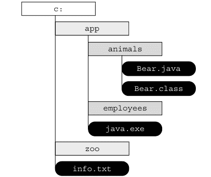

## 853

此图显示了根目录，包含两个文件夹：`app` 和 `employees`。在 `app` 内部有两个文件：`java.class` 和 `bird`。最后是 `bird.txt`。我们对系统使用绝对路径和相对路径。例如，以下是文件的绝对路径：

```
C:\app\java.java
```

或者，指向该文件的相对路径。例如，以下是相对路径：

```
animals
```

确定路径是相对的还是绝对的取决于文件。为了匹配考试，我们采用以下标准：

- 如果路径以正斜杠 (`/`) 开头，则它是绝对路径，指向根目录。
- 如果路径以驱动器字母（`c:`）开头，则它是绝对路径，指向根目录。
- 否则，它是相对路径，例如 `bird.png`。

绝对路径和相对路径可以包含路径符号。路径符号是文件系统中的保留字符之一。对于考试，你需要了解两个符号，列在表 14.1 中。

#### 表 14.1 文件系统符号

| 符号 | 描述 |
|---|---|
| `.` | 指向当前目录 |
| `..` | 指向目录的父目录 |

观察图 14.2，假设当前目录是 `/fish/shark`。在这种情况下，`../swim.txt` 等同于 `/fish/shark/swim.txt` 的相对路径。同样，`../play.png` 指向当前目录下的 `play.png`。这些符号也可以组合使用以产生效果。例如，`../clownfish` 是等于 `/fish/` 的相对路径。

有时你会看到冗余或必要的路径符号。例如，绝对路径 `/fish/clownfish/../swim.txt` 可以简化为 `/fish/shark/swim.txt`。我们稍后会介绍如何使用 `normalize()` 处理这些情况。

## 相对路径

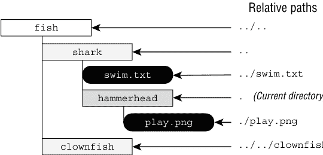

符号链接是文件系统中的特殊文件，作为另一个文件或目录的引用或指针。假设我们从 `/zoo/user/favorite` 到 `/fish/shark` 的符号链接。shark 及其元素可以直接访问，也可以通过符号链接访问。例如，以下路径引用同一个文件：
`/fish/shark/swim.txt`
`/zoo/user/favorite/swim.txt`

通常，符号链接对用户是透明的，因为操作系统负责解析到实际文件。虽然 I/O API 不支持符号链接，但 NIO2 提供了对文件系统中创建、检测和导航符号链接的支持。

## 创建文件或路径

为了执行任何有用操作，你首先需要一个表示文件系统中特定文件或目录路径的对象。使用传统的 I/O，它是 `java.io.File` 类，而使用 NIO.2，它是 `java.nio.Path` 接口。`File` 类和 `Path` 接口无法读写文件数据，尽管它们被作为引用传递给类，正如你在本章中看到的。

> 记住，`File` 或 `Path` 可以表示文件或目录。

### 创建文件

通过调用构造函数来创建 `File` 类。此代码展示了两个不同的构造函数：

```
File zooFile1 = new File("/home/tiger/data/stripes.txt");
File zooFile2 = new File("/home/tiger", "data/stripes.txt");
```

```java
File parent = new File("/home/tiger");
```

```java
File zooFile3 = new File(parent, "data/stripes.txt");
```

```java
System.out.println(zooFile1.exists());
```

这三者都创建了一个指向磁盘上相同位置的 `File` 对象。如果我们向第一个构造函数传递 `null` 作为父路径，它将被忽略，且该方法的行为将与 `String` 构造函数相同。目前，我们还展示了如何判断文件是否存在于系统中。

## 创建 Path

由于 `Path` 是一个接口，我们无法直接创建它的实例。毕竟，接口没有构造函数！Java 提供了许多类和方法，可以使用它们获取 `Path` 对象。

获取 `Path` 对象最简单且直接的方法是使用定义在 `Path` 或 `Paths` 上的静态工厂方法。所有的示例都指向磁盘上的同一个引用：

```java
Path zooPath1 = Path.get("/home/tiger/data/stripes.txt");
```

```java
Path zooPath2 = Path.get("/home", "tiger", "data", "stripes.txt");
```

```java
Path zooPath3 = Paths.get("/home/tiger/data/stripes.txt");
```

```java
Path zooPath4 = Paths.get("/home", "tiger", "data", "stripes.txt");
```

```java
System.out.println(Files.exists(zooPath1));
```

这两种方法都允许使用可变参数（varargs）传递额外的路径元素。这些值会被组合，并根据操作系统的分隔符自动分离。我们还展示了 `Files` 类，它可以检查文件是否存在于系统中。如你所见，实现相同的功能有两种。`Path.get()` 方法是在 Java 7 中作为接口上的静态方法引入的。`Paths` 类在末尾也提供了一个 `get()` 方法来实现相同的功能，以便与 `Path` 接口区分开来。在本章中，可以交替使用 `Path.get()` 和 `Paths.get()`。统一资源标识符（URI）是一个标识资源的字符字符串。它以指示资源类型的架构（schema）开头，后面跟着路径值，本地文件系统使用 `file://`，远程文件系统使用 `http://`、`https://` 和 `ftp://`。

## 在 File 和 Path 之间切换

由于 `File` 和 `Path` 都引用磁盘上的位置，能够它们相互它们非常有帮助。幸运的是，Java 通过提供相关方法使其变得简单：

```java
File file = new File("rabbit");
Path nowPath = file.getPath();
File backToFile = nowPath.toFile();
```

许多旧版库使用 `File`，因此获取 `Path` 以及反之操作非常方便。在处理较新的应用程序时，你应该使用 NIO.2 的 `Path` 接口，因为它包含了更多功能。例如，NIO.2 提供了 `FileSystem` 支持，我们即将讨论这一点。

### 从 FileSystems 获取 Path

NIO.2 扩展了使用文件类创建对象的使用。`FileSystem` 类创建抽象 `FileSystem` 类的实例。后者包含了直接操作文件系统的方法。`Paths.get()` 和 `Path.of()` 是 `FileSystem` 方法的快捷方式。让我们再次重写之前的示例，看看如何通过较长的路径来获取 `Path`：

```java
Path zooPath1 = FileSystems.getDefault().getPath("/home/tiger/data/stripes.txt");
Path zooPath2 = FileSystems.getDefault().getPath("/home", "tiger", "data", "stripes.txt");
```


## 复习 I/O 和 NIO.2 的关系

I/O 的模型较小，你只需要理解 `File` 类。相比之下，NIO.2 拥有更多功能并广泛使用了工厂模式。你应该习惯这种方法。你与 NIO.2 的许多交互需要两种类型：抽象类或接口或辅助类。图 14.3 显示了到目前在本章中类和接口之间的关系。

图 14.3 I/O 和 NIO.2 类与接口关系


仔细查看图 14.3。特别要注意类名是单数还是复数。请记住，为了方便（同时也造成了混淆），也可以从 `Path` 接口使用静态工厂方法 `get()` 创建 `Path`。`java.io.File` 是 I/O 类，而 `Files` 是一个 NIO 辅助类。`Files` 操作的是 `Path` 实例，而不是 `java.io.File` 实例。我们知道这很困惑，但它们来自完全不同的 API！


表 14.2 复习了我们涵盖的创建 `java.io.File` 和 `java.nio.file.Path` 对象的 API。在阅读表格时，请记住静态方法作用于类/接口，而方法需要对象的实例。在继续本章后续内容之前，确保你已经充分了解。

### 表 14.2 创建 File 和 Path 的选项

| 创建 | 声明于 | 方法或构造函数 |
| :--- | :--- | :--- |
| `File` | `File` | `public File(String pathname)`<br>`public File(File parent, String child)` |
| `File` | `Path` | `public default File toFile()` |
| `Path` | `File` | `public Path toPath()` |
| `Path` | `Path` | `public static Path of(String first, String... more)`<br>`public static Path of(URI uri)` |
| `Path` | `Paths` | `public static Path get(String first, String... more)`<br>`public static Path get(URI uri)` |
| `Path` | `FileSystem` | `public Path getPath(String first, String... more)` |
| `FileSystem` | `FileSystems` | `public static FileSystem getDefault()` |

## 操作 File 和 Path

现在我们已经了如何创建 `File` 和 `Path` 对象，可以开始使用它们来完成一些事情。在本节中，我们将探索涉及目录的可用功能。

## 使用共享功能

许多操作可以使用 I/O 和 NIO.2 库完成。我们在表 14.3 和表 14.4 中展示了许多常用 API。虽然这些表格看起来有很多需要学习的方法，但其中许多是自而易明的。你现在可以忽略可变参数。我们将在本章稍后部分解释这些。

常见的 Path 操作

### 表 14.3 常见的 File 和 Path 操作

| 描述 | I/O file 实例方法 | NIO.2 path 实例方法 |
| :--- | :--- | :--- |
| 获取文件/目录名称 | `getName()` | `getFileName()` |
| 获取父目录，若无则返回 null | `getParent()` | `getParent()` |
| 检查文件/目录是否为绝对路径 | `isAbsolute()` | `isAbsolute()` |

### 表 14.4 常见的 File 和 Files 操作

| 描述 | I/O file 实例方法 | NIO.2 静态方法 |
| :--- | :--- | :--- |
| 删除/目录 | `delete()` | `deleteIfExists(Path p)` |
| 检查文件/目录是否存在 | `exists()` | `exists(Path p, LinkOption... o)` |
| 获取文件/目录的绝对路径 | `getAbsolutePath()` | `toAbsolutePath()` |
| 检查资源是否为目录 | `isDirectory()` | `isDirectory(Path p, LinkOption... o)` |
| 检查资源是否为文件 | `isFile()` | `isRegularFile(Path p, LinkOption... o)` |

### 表 14.4 常见的 File 和 Files 操作（续）

| 描述 | I/O file 实例方法 | NIO.2 静态方法 |
| :--- | :--- | :--- |
| 返回文件修改时间 | `lastModified()` | `getLastModifiedTime(Path p, LinkOption... o) throws IOException` |
| 获取文件字节数 | `length()` | `size(Path p) throws IOException` |
| 列出目录内容 | `listFiles()` | `list(Path p) throws IOException` |
| 创建目录 | `mkdir()` | `createDirectory(Path p, FileAttribute... a) throws IOException` |
| 创建包含不存在的父目录的目录 | `mkdirs()` | `createDirectories(Path p, FileAttribute... a) throws IOException` |
| 重命名文件/目录 | `renameTo(File dest)` | `move(Path src, CopyOption... o) throws IOException` |

## 操作文件和路径

```java
20: for (File subfile : file.listFiles()) {
21:     System.out.println(" " + subfile.getName());
22: }
```

如果路径指向有效文件，由于第 16 行的 if 语句，程序将输出类似下所示内容：

```
Absolute Path: C:\data\zoo.txt
Is Directory: false
Parent Path: C:\data
Size: 12382
Last Modified: 1650610000000
```

最后，如果路径指向有效目录（例如 `C:\data`），程序将在 `else` 块中输出类似下所示的内容：

```
Absolute Path: C:\data
Is Directory: true
Parent Path: C:\employees.txt
zoo.txt
zoo-backup.txt
```

在这些示例中，你会看到基于 I/O 的程序的输出完全取决于底层系统在运行时可用的目录和文件。

在考试中，你可能会看到看起来像文件实际上是目录，或者反之的路径。例如，`/data/zoo.txt` 可能是文件，也可能是目录，尽管它有文件扩展名。除非题目明确说明，否则不要假设它是其中某一种。

> 在上一个示例中，我们在路径字符串 `String` 中使用了两个反斜线（`\\`），例如 `C:\\data\\zoo.txt`。当编译器在 `String` 表达式中看到 `\\` 时，它将其解释为单个 `\\`。

现在，让我们使用 NIO.2 查看该程序的功能以及它是如何解释的：

```java
25: public static void main() throws IOException {
26:     var path = Path.of("C:\\data\\zoo.txt");
27:     if (Files.exists(path)) {
28:         System.out.println("Absolute Path: " + path.getAbsolutePath());
29:         System.out.println("Is Directory: " + Files.isDirectory(path));
30:         System.out.println("Parent Path: " + path.getParent());
31:         if (Files.isRegularFile(path)) {
32:             System.out.println("Size: " + Files.size(path));
33:         }
34:     }
35: }
```


## 第 14 章 • I/O

```java
33:   System.out.println("Last Modified: " 
34:   + Files.getLastModifiedTime(path));
35: } else {
36:   try (Stream<Path> stream = Files.list(path)) {
37:     stream.forEach(p -> 
38:       System.out.println(" " + p.getFileName()));
39:   }}}
```

大部分内容与之前是等效的，并将之前的 I/O 方法调用替换为 NIO.2 版本。然而，存在关键差异。第 25 行清除了一个受检异常（checked exception）。NIO.2 中抛出 `IOException` 的 API 比 I/O API 多。在这种情况下，`Files.size()`、`Files.getLastModifiedTime()` 和 `Files.list()` 都会抛出 `IOException`。

第 36–39 行在循环使用了 `Stream` 和 lambda 表达式。由于流使用惰性求值（lazy evaluation），该方法将根据需要加载每个元素，而不是一次性加载整个目录。

## 关闭流

你是否注意到在最后一个代码示例中，我们将 `Stream` 对象放在了 `try-with-resources` 语句中？NIO.2 基于流的方法会打开与文件系统的连接，必须妥善关闭；否则可能会导致资源泄漏。文件系统中的资源泄漏意味着在 fact该路径的进程完成后，路径可能仍被锁定无法修改。

如果你假设流的终端操作（terminal operation）会自动关闭底层文件资源，那么当这一行为最初提出时曾存在很多争论；简而言之，它要求开发者手动关闭流。

好的一方面，并不是所有流都需要关闭：只有那些打开了资源的，例如 NIO.2 中使用的那些流。例如，你在处理第 10 章“流”时不需要关闭你操作过的任何流。

最后，考试并不总是要求关闭 NIO.2 资源。为了匹配考试，我们有时会在复习和练习题中跳过关闭 NIO.2 资源。在你自己的代码中，请务必对这些 NIO.2 方法使用 `try-with-resources` 语句。

操作文件和路径 797

在本节的剩余部分，我们只讨论 NIO.2 方法，因为它们更重要。关于它们还有更多需要了解的内容，而且它们可能在考试中出现。

## 处理声明 IOException 的方法

本章介绍的许多方法声明了 `IOException`。方法抛出此异常的常见原因包括：

- 与底层文件系统的通信丢失。
- 文件或目录存在但无法访问或修改。
- 文件存在但无法覆盖。
- 需要文件或目录但不存在。

访问或更改文件和目录的方法（如 `Files` 类中的方法）通常会声明 `IOException`。这个规则是有例外的，正如我们所看到的。例如，`Files.exists()` 方法没有声明 `IOException`。如果它在文件不存在时抛出异常，那么它将永远无法返回 `false`！根据经验法则，如果一个 NIO.2 方法声明了 `IOException`，它通常要求其操作的路径必须存在。

## 提供 NIO.2 可选参数

本章中的许多 NIO.2 方法包含可选参数。许多 NIO.2 方法包含一个可选参数列表。你需要熟悉这些参数以应对考试。表 14.5 常见的 NIO.2 参数

| 枚举类型 | 接口 | 枚举值 | 详情 |
| :--- | :--- | :--- | :--- |
| `LinkOption` | `CopyOption` | `NOFOLLOW_LINKS` | 不跟随符号链接。 |
| `StandardCopyOption` | `CopyOption` | `ATOMIC_MOVE` | 原子移动。 |
| | | `COPY_ATTRIBUTES` | 复制属性。 |
| | | `REPLACE_EXISTING` | 如果文件存在则覆盖。 |
| `StandardOpenOption` | `OpenOption` | `APPEND` | 如果文件存在则追加到末尾。 |
| | | `CREATE` | 如果不存在则创建。 |
| | | `CREATE_NEW` | 如果文件不存在则创建。 |
| | | `READ` | 可读。 |
| | | `TRUNCATE_EXISTING` | 如果文件存在则截断。 |
| | | `WRITE` | 可写。 |
| `FileVisitOption` | N/A | `FOLLOW_LINKS` | 跟随符号链接。 |

## 与 Paths

与 `String` 值一样，`Path` 实例是不可变的。在下面的示例中，第 2 行的 Path 操作丢失了，因为它是不可变的：

```java
Path p = Path.of("whale");
p.resolve("krill");
System.out.println(p); // whale
```

`Path` 接口中的许多示例以某种方式转换 `Path` 值并返回一个新的 `Path` 对象，允许方法进行链式调用。我们建议在下面的示例中使用链式调用，我们将讨论细节：

```java
Path.of("/zoo/../home").getParent().normalize().toAbsolutePath();
```

## 查看 Path

`Path` 接口包含了三个获取路径表示的方法。`toString()` 方法返回整个路径字符串。事实上，它是 `Path` 接口中唯一返回 `String` 的方法。`Path` 接口中的许多其他方法返回 `Path` 实例。

`getCount()` 和 `getName()` 方法分别用于检索路径中的元素数量以及每个元素的引用。这两个方法不包含路径的根目录。

```java
Path path = Paths.of("/land/hippo/harry.happy");
System.out.println("The Path Name is: " + path);
for(int i=0; i<path.getNameCount(); i++) {
    System.out.println("Element " + i + " is: " + path.getName(i));
}
```

注意我们没有在第二行显式调用 `toString()`。记住，Java 在进行字符串拼接时会对任何对象调用 `toString()`。我们在本章的示例中使用了这一特性。

代码打印出：

```
The Path Name is: /land/hippo/harry.happy
Element 0 is: land
Element 1 is: hippo
Element 2 is: harry.happy
```

尽管这是一个绝对路径，名称列表中也不包含根元素。正如我们所，这些方法不考虑根部分。

```java
var p = Path.of("/");
System.out.print(p.getNameCount()); // 0
System.out.print(p.getName(0)); // IllegalArgumentException
```

## 第 14 章 • I/O

注意，如果你尝试使用无效索引调用 `getName()`，它将在运行时抛出异常。

> 我们的示例使用 `/` 作为文件分隔符，这是由于我们正在使用的系统。你的实际输出在整个章节中可能会不同。

## 创建路径的一部分

`Path` 接口包含 `subpath()` 方法用于选择路径的部分。它接受两个参数：一个包含边界的 `beginIndex` 和一个不包含边界的 `endIndex`。这听起来很熟悉，因为这就是 `String` 的 `substring()` 方法的工作原理，正如你在第 4 章“核心 API”中所看到的。以下代码片段展示了 `subpath()` 如何工作。我们还使用 `getName()` 打印 `Path` 的元素，以便你可以看到索引是什么。

此代码段的输出如下：

```
Path is: /mammal/omnivore/raccoon.image
Element 0 is: mammal
Element 1 is: omnivore
Element 2 is: raccoon.image
```

```
subpath(0,3): mammal/omnivore/raccoon.image
subpath(1,2): omnivore
subpath(1,3): omnivore/raccoon.image
```

与 `getNameCount()` 和 `getName()` 一样，`subpath()` 是从零开始索引的，并且不包含根目录。同样类似于 `getName()`，如果提供了无效参数，`subpath()` 会抛出异常。

```java
var q = p.subpath(0, 4); // IllegalArgumentException
var x = p.subpath(1, 1); // IllegalArgumentException
```


第一个示例在运行时抛出异常，因为允许的最大索引值为 3。第二个示例抛出异常是因为起始和结束索引相同，导致了空路径值。


## 对文件和路径的操作

### 访问路径元素

`Path` 接口包含许多方法用于检索 `Path` 的特定元素，并以 `Path` 对象本身返回。`getFileName()` 方法返回当前文件或目录的 `Path` 元素，而 `getParent()` 返回当前目录的完整路径。如果在根路径或相对路径的顶部执行 `getParent()`，它将返回 `null`。`getRoot()` 方法返回系统中文件根元素，如果路径是相对路径则返回 `null`。

考虑以下方法，它可以打印 `Path` 元素：

```java
public void printPathInformation(Path path) {
    System.out.println("Filename is: " + path.getFileName());
    System.out.println(" Root is: " + path.getRoot());
    Path current = path;
    while ((current = current.getParent()) != null) {
        System.out.println(" Current parent is: " + current);
    }
    System.out.println();
}
```

`while printPathInformation()` 中的循环将持续到 `getParent()` 返回 `null` 为止。我们将此方法应用于三个路径：

```
printPathInformation(Path.of("zoo"));
printPathInformation(Path.of("/zoo/armadillo/shells.txt"));
printPathInformation(Path.of("./armadillo/../shells.txt"));
```

该示例程序产生以下输出：

```
Filename is: zoo
Root is: null
```

```
Filename is: shells.txt
Root is: /
Current parent is: /zoo/armadillo
Current parent is: /zoo
Current parent is: /
```

```
Filename is: shells.txt
Root is: null
Current parent is: ../armadillo/.
Current parent is: ../armadillo
Current parent is: 
```

查看示例输出，你可以看到 `getRoot()` 在绝对路径和相对路径上的行为差异。正如你在第一个和最后一个示例所示，`getParent()` 方法不会遍历当前工作目录之外的相对 `Path.of()` 路径。你还发现这些方法不会解析路径符号，而是将它们视为路径的一个独立部分。虽然本章此部分的大多数方法将路径符号视为路径的一部分，但我们稍后会介绍一个可以清理路径符号的方法。

## 解析路径

假设你想以类似于拼接字符串的方式来拼接路径。`resolve()` 提供了重载版本，允许你传递 `Path` 或 `String` 参数。调用 `resolve()` 方法的对象是新 `Path` 对象的基础，输入参数被附加到该 `Path` 之后。让我们看看将 `resolve()` 应用绝对路径和相对路径会发生什么：

```
Path path1 = Path.of("/cats/../panther");
Path path2 = Path.of("food");
System.out.println(path1.resolve(path2));
```

此代码段生成了：
`cats/../panther/food`

与我们见过的方法一样，`resolve()` 不清理符号。在这个示例中，`resolve()` 方法的输入是一个相对路径，但如果它是绝对路径会怎样？

```
Path path3 = Path.of("/tiger/food");
System.out.println(path3.resolve("/cage"));
```

由于输入参数是绝对路径，输出将是：
`/cage`

你应该意识到在使用 `resolve()` 方法时混合绝对路径和相对路径的风险。如果将绝对路径作为方法的输入，那么你根本无法使用 `resolve()` 组合两个绝对路径。当你看到 `resolve()` 时，请思考“拼接”。

## 路径相对化

`Path` 接口包含 `relativize()` 方法，用于通过路径符号构造从一个到另一个的相对路径。你认为以下示例将打印什么？

```
var path1 = Path.of("fish.txt");
var path2 = Path.of("friendly/birds.txt");
System.out.println(path1.relativize(path2));
System.out.println(path2.relativize(path1));
```

示例打印了以下：
```
../friendly/birds.txt
../fish.txt
```

这里的想法是：如果你指向文件系统中的一个路径，你需要多少步骤到达另一个？例如，要从 `friendly/birds.txt` 获取 `fish.txt`，你需要向上两层（文件本身算一级）并选择 `fish.txt`。如果两个路径都是相对的，`relative()` 方法计算路径的方式就像它们在同一个工作目录中。或者，如果两个路径都是绝对的，该方法计算从一个绝对位置到另一个位置的相对路径，无论当前工作目录如何。以下示例在 Windows 计算机上运行时演示了这一点：

```
Path path3 = Paths.get("E:\habitat");
Path path4 = Paths.get("E:\sanctuary\poe.txt");
System.out.println(path3.relativize(path4));
System.out.println(path4.relativize(path3));
```

此代码段产生了以下内容：
```
..\sanctuary\poe.txt
..\.\habitat
```

`relative()` 方法要求两个路径都是绝对的或都是相对的，并且如果类型不匹配则抛出异常。

```
Path path3 = Paths.get("C:\primate\chimpanzee");
Path path4 = Paths.get("D:\storage\bananas.txt");
path1.relativize(path2); // IllegalArgumentException
```

在基于 Windows 的系统中，它要求如果使用绝对路径，两个路径必须具有相同的根目录或驱动器号。例如，以下内容在 Windows 系统上将抛出 `IllegalArgumentException`：

## 规范化路径

到为止，我们展示了一些包含不必要路径符号的示例。幸运的是，Java 提供了 `normalize()` 方法来消除冗余。记住，路径符号 `..` 指向父目录，而路径符号 `.` 指向当前目录。我们可以对之前的一些路径应用 `normalize()`。

```
var p1 = Path.of("../armadillo/../shells.txt");
System.out.println(p1.normalize()); // shells.txt
```

```
var p2 = Path.of("/cats/../panther/food");
System.out.println(p2.normalize()); // ../panther/food
```

```
var p3 = Path.of("../fish.txt");
System.out.println(p3.normalize()); // ../fish.txt
```

前几个示例使用路径符号来消除冗余，但最后一个呢？那已经是最简化的了。`normalize()` 方法并不移除所有路径，只移除可以简化的部分。`normalize()` 方法还允许我们比较路径。考虑以下示例：

```
var p1 = Paths.get("/pony/../weather.txt");
var p2 = Paths.get("/../weather.txt");
System.out.println(p1.normalize().equals(p2)); // false
System.out.println(p1.normalize().equals(p2.normalize())); // true
```

如果两个路径表示相同的值，`equals()` 返回 true。在第一次比较中，路径值不同的。在第二次比较中，路径值都减少到了相同的规范化值 `/weather.txt`。这就是 `normalize()` 方法的主要功能：允许处理不同的路径。

## 获取真实文件系统

在处理理论路径时，有时你需要使用 `toRealPath()` 验证路径是否存在于文件系统中。该方法与 `normalize()` 类似，可以消除冗余的路径符号。它与 `absolute()` 类似，如果路径是相对的，将与当前工作目录结合。与这两个方法不同，如果路径不存在，`toRealPath()` 将抛出异常。此外，它会遵循符号链接，可以使用可选 `LinkOption` 可变参数来忽略它们。

假设文件系统中有一个从 `/zebra` 指向 `/horse` 的符号链接。给定当前工作目录为 `/horse/schedule`，你认为以下将输出什么？

```
System.out.println(Paths.get("/zebra/food.txt").toRealPath());
System.out.println(Paths.get("../food.txt").toRealPath());
```

两行的输出均为：
`/horse/food.txt`

# 复习 NIO.2 Path API

在本节中，我们已经涵盖了 `Path` 的许多实例方法。表 14.6 列出了这些方法以供复习。

# 表格 14.6 Path API

| 描述 | 方法或构造函数 |
| --- | --- |
| 字符串形式的文件路径 | `public String toString()` |
| 单个段 | `public Path getName(int index)` |
| 段的数 | `public int getCount()` |
| 范围内的段 | `public Path subpath(int beginIndex, int endIndex)` |
| 最后的段 | `public Path getFileName()` |
| 立即父级目录 | `public Path getParent()` |
| 顶层段 | `public Path getRoot()` |
| 合并路径 | `public Path resolve(String p)` `public Path resolve(Path p)` |
| 构建指向所提供的路径 | `public Path relativize(Path p)` |
| 移除路径中的冗余部分 | `public Path normalize()` |
| 跟踪符号链接以查找系统上的路径 | `public Path toRealPath()` |

# 创建、移动和删除文件及目录

由于创建、移动和删除具有某些细微差别，我们在本节中详细介绍它们。

# 创建目录

要创建目录，我们使用这些 `Files` 方法：

```
public static Path createDirectory(Path dir, FileAttribute<...> attrs) throws IOException
```

```
public static void createDirectories(Path dir, FileAttribute<...> attrs) throws IOException
```

`createDirectory()` 方法将创建一个目录，如果该目录已存在或通往目录的路径不存在，则会抛出异常。`createDirectories()` 方法会创建目标目录以及该路径上任何不存在的父目录。如果所有目录都存在，`createDirectories()` 将直接完成而不执行任何操作。这在你希望确保某个目录存在并在如果不存在时创建它时非常有用。

这两个方法都接受一个可选的 `FileAttribute<?>` 列表，将其应用于新创建的目录或目录的末尾。我们将在章节的末尾讨论文件属性。

以下显示了如何创建目录：

```
Files.createDirectory(Path.of("/bson/field"));
Files.createDirectories(Path.of("/bson/field/pasture/green"));
```

第一个示例在 `/bson` 目录下创建一个新目录，假设 `bson` 存在；否则将抛出异常。相比之下，第二个示例会创建 `green` 目录以及任何不存在的后续父目录，包括 `bson`、`field` 和 `pasture`。

# 复制文件

`Files` 类提供了一个在文件系统内复制文件和目录的方法。

```
public static Path copy(Path source, Path target, CopyOption... options) throws IOException
```

该方法使用 `Path` 对象将文件或目录从一个位置复制到另一个位置。以下显示了复制文件和目录的示例：

```
Files.copy(Paths.get("/panda/bamboo.txt"),
Paths.copy(Paths.get("/panda-save/bamboo.txt")));
```

```
Files.copy(Paths.get("/turtle"), Paths.copy(Paths.get("/turtleCopy")));
```

当复制时，拷贝是浅层次的。浅拷贝意味着目录内的文件和子目录不会被复制。深拷贝意味着复制整个树，包括其所有内容和子目录。深拷贝通常需要递归，即方法调用自己。

```java
public void copyPath(Path source, Path target) {
try {
  Files.copy(source, target);
  if(Files.isDirectory(source)) {
    try (Stream<Path> s = Files.list(source)) {
      s.forEach(p -> copyPath(p,
      target.resolve(p.getFileName())));
    }
  }
} catch(IOException e) {
    // 处理异常
}
}
```

# 对文件和路径的操作

在 `copyPath` 中的第一个方法复制路径，无论是文件还是目录。如果是目录，则只执行浅拷贝。接下来，它检查路径是否为目录，如果是，则对它的每个元素执行递归复制。如果方法遇到符号链接怎么办？别担心：在使用 `list()` 方法时，JVM 不会跟踪符号链接。

# 复制和替换文件

默认情况下，如果目标已存在，`copy()` 方法将抛出异常。你可以通过向该方法提供 `StandardCopyOption` 枚举值 `REPLACE_EXISTING` 来更改此行为。如果 `movie.txt` 文件已存在，该方法调用将覆盖它：

```
Files.copy(Paths.get("book.txt"), Paths.get("movie.txt"),
StandardCopyOption.REPLACE_EXISTING);
```

例如，你需要知道，如果没有 `REPLACE_EXISTING` 选项，如果文件已存在，此方法将抛出异常。

# 使用 I/O 流复制文件

`Files` 类包含了两个与 I/O 流一起操作的 `copy()` 方法：

```
public static long copy(InputStream in, Path target,
CopyOption... options) throws IOException
public static long copy(Path source, OutputStream out)
throws IOException
```

第一个方法使用 `InputStream` 和 `Path` 复制，第二个方法使用 `Path` 和 `OutputStream`。这些方法在 I/O 流上操作。

```java
public void copyPath(Path source, Path target) {
try {
  Files.copy(source, target);
  if(Files.isDirectory(source)) {
    try (Stream<Path> s = Files.list(source)) {
      s.forEach(p -> copyPath(p,
      target.resolve(p.getFileName())));
    }
  }
} catch(IOException e) {
    // 处理异常
}
}
```


# 复习 NIO.2 Path API

在本节中，我们已经涵盖了 `Path` 的许多实例方法。表 14.6 列出了这些方法以供复习。

## 表格 14.6 Path API

| 描述 | 方法或构造函数 |
| --- | --- |
| 字符串形式的文件路径 | `public String toString()` |
| 单个段 | `public Path getName(int index)` |
| 段的数 | `public int getCount()` |
| 范围内的段 | `public Path subpath(int beginIndex, int endIndex)` |
| 最后的段 | `public Path getFileName()` |
| 立即父级目录 | `public Path getParent()` |
| 顶层段 | `public Path getRoot()` |
| 合并路径 | `public Path resolve(String p)` `public Path resolve(Path p)` |
| 构建指向所提供的路径 | `public Path relativize(Path p)` |
| 移除路径中的冗余部分 | `public Path normalize()` |
| 跟踪符号链接以查找系统上的路径 | `public Path toRealPath()` |

# 创建、移动和删除文件及目录

由于创建、移动和删除具有某些细微差别，我们在本节中详细介绍它们。

## 创建目录

要创建目录，我们使用这些 `Files` 方法：

```
public static Path createDirectory(Path dir, FileAttribute<...> attrs) throws IOException
```

```
public static void createDirectories(Path dir, FileAttribute<...> attrs) throws IOException
```

`createDirectory()` 方法将创建一个目录，如果该目录已存在或通往目录的路径不存在，则会抛出异常。`createDirectories()` 方法会创建目标目录以及该路径上任何不存在的父目录。如果所有目录都存在，`createDirectories()` 将直接完成而不执行任何操作。这在你希望确保某个目录存在并在如果不存在时创建它时非常有用。

这两个方法都接受一个可选的 `FileAttribute<?>` 列表，将其应用于新创建的目录或目录的末尾。我们将在章节的末尾讨论文件属性。

以下显示了如何创建目录：

```
Files.createDirectory(Path.of("/bson/field"));
Files.createDirectories(Path.of("/bson/field/pasture/green"));
```

第一个示例在 `/bson` 目录下创建一个新目录，假设 `bson` 存在；否则将抛出异常。相比之下，第二个示例会创建 `green` 目录以及任何不存在的后续父目录，包括 `bson`、`field` 和 `pasture`。

## 复制文件

`Files` 类提供了一个在文件系统内复制文件和目录的方法。

```
public static Path copy(Path source, Path target, CopyOption... options) throws IOException
```

该方法使用 `Path` 对象将文件或目录从一个位置复制到另一个位置。以下显示了复制文件和目录的示例：

```
Files.copy(Paths.get("/panda/bamboo.txt"),
    Paths.copy(Paths.get("/panda-save/bamboo.txt")));
```

```
Files.copy(Paths.get("/turtle"), Paths.copy(Paths.get("/turtleCopy")));
```

当复制时，拷贝是浅层次的。浅拷贝意味着目录内的文件和子目录不会被复制。深拷贝意味着复制整个树，包括其所有内容和子目录。深拷贝通常需要递归，即方法调用自己。

```java
public void copyPath(Path source, Path target) {
    try {
        Files.copy(source, target);
        if (Files.isDirectory(source)) {
            try (Stream<Path> s = Files.list(source)) {
                s.forEach(p -> copyPath(p,
                    target.resolve(p.getFileName())));
            }
        }
    } catch (IOException e) {
        // 处理异常
    }
}
```

### 对文件和路径的操作

`copyPath` 中的第一个方法复制路径，无论是文件还是目录。如果是目录，则只执行浅拷贝。接下来，它检查路径是否为目录，如果是，则对它的每个元素执行递归复制。如果方法遇到符号链接怎么办？别担心：在使用 `list()` 方法时，JVM 不会跟踪符号链接。

### 复制和替换文件

默认情况下，如果目标已存在，`copy()` 方法将抛出异常。你可以通过向该方法提供 `StandardCopyOption` 枚举值 `REPLACE_EXISTING` 来更改此行为。如果 `movie.txt` 文件已存在，该方法调用将覆盖它：

```
Files.copy(Paths.get("book.txt"), Paths.get("movie.txt"),
    StandardCopyOption.REPLACE_EXISTING);
```

例如，你需要知道，如果没有 `REPLACE_EXISTING` 选项，如果文件已存在，此方法将抛出异常。

### 使用 I/O 流复制文件

`Files` 类包含了两个与 I/O 流一起操作的 `copy()` 方法：

```
public static long copy(InputStream in, Path target,
    CopyOption... options) throws IOException
public static long copy(Path source, OutputStream out)
    throws IOException
```

第一个方法使用 `InputStream` 和 `Path` 复制，第二个方法使用 `Path` 和 `OutputStream`。这些方法在 I/O 流上操作。

`copyPath` 的逻辑说明：第一个方法复制路径，如果是目录则只执行浅拷贝。随后检查路径是否为目录，若是则对每个元素执行递归复制。遇到符号链接时，`list()` 方法不会跟踪它。

```java
public void copyPath(Path source, Path target) {
    try {
        Files.copy(source, target);
        if (Files.isDirectory(source)) {
            try (Stream<Path> s = Files.list(source)) {
                s.forEach(p -> copyPath(p,
                    target.resolve(p.getFileName())));
            }
        }
    } catch (IOException e) {
        // 处理异常
    }
}
```

### 复制文件到目录

在这一节中，我们需要知道，没有 `REPLACE_EXISTING` 选项，如果文件已存在，此方法将抛出异常。

### 执行原子移动

另一个在处理 `move()` 方法时需要的枚举值是 `StandardCopyOption` 的 `ATOMIC_MOVE`。

```
Files.move(Path.of("mouse.txt"), Path.of("gerbil.txt"),
    StandardCopyOption.ATOMIC_MOVE);
```

解析所有路径符号，并遵循符号链接。尽管名称如此，但该方法也可用于判断两个 `Path` 对象是否指向同一个目录。

大多数 `isSameFile` 的用法会在路径不存在时抛出异常，但有一种特殊情况除外。如果两个路径对象在 `equals()` 方面相等，该方法将返回 `true`，而无需检查文件是否存在。

假设文件系统存在（如图 14.4 所示），有一个从 `/animals/snake` 到 `/animals/cobra` 的符号链接。

图 14.4 文件的唯一性比较

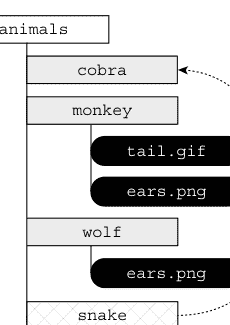

根据图 14.4 中定义的结构，以下输出的结果是什么？

```
System.out.println(Files.isSameFile(
    Path.of("/animals/cobra"),
    Path.of("/animals/snake")));
```

```
System.out.println(Files.isSameFile(
    Path.of("/animals/monkey/ears.png"),
    Path.of("/animals/wolf/ears.png")));
```

由于 `snake` 是指向 `cobra` 的符号链接，因此第一个示例输出 `true`。在第二个示例中，路径指向不同的文件，因此打印 `false`。

有时你想比较文件的内容而不是它们在物理上是否为同一个文件。例如，我们有两个内容为文本 hello 的文本文件。Java 在 12 中引入了 `mismatch()` 方法来帮助解决这个问题。如果文件相同，它返回 `-1`；否则，它返回文件中第一个不同位置的索引。

```
System.out.println(Files.mismatch(
    Path.of("/animals/monkey.txt"),
    Path.of("/animals/wolf.txt")));
```

## 介绍 I/O 流

假设 `monkey.txt` 包含名称 `Harold`，而 `wolf.txt` 包含名称 `Howler`。在这种情况下，之前的代码打印 `1`，因为第二个位置不同，且 Java 使用从零开始的索引。给定这些值，你认为这段代码会打印什么？

```
System.out.println(Files.mismatch(
    Path.of("/animals/wolf.txt"),
    Path.of("/animals/monkey.txt")));
```

答案与上一个示例相同。代码再次打印 `1`。`mismatch()` 方法是对称的，无论参数顺序如何，都会返回相同的结果。

现在我们已经掌握了基础知识，让我们转向 I/O 流，它们要有趣得多。在本节中，我们将展示你如何使用 I/O 流来读写数据。“I/O”指的是数据访问 Nature，即通过从资源中读取数据（输入）或将数据写入资源中（输出）。

> 当我们在本章中提到 I/O 流时，指的是 `java.io` API 中的找到流。如果我们只说流（streams），则指的是第 10 章中的流。我们同意这种命名可能会有点困惑！


### 理解 I/O 流基础

文件内容可以通过 I/O 流进行访问或写入，I/O 流是顺序呈现的数据元素列表。概念上，I/O 流可以被看作是一条长的、无尽的水流，数据一次呈现一次。

我们在图 14.5 中演示了这一原理。I/O 流非常大，以至于我们一旦开始读取，就完全不知道开头或结尾在哪里。我们只是有一个指向 I/O 流中当前位置的指针，并一次读取一个数据块。

图 14.5 I/O 流的可视化表示

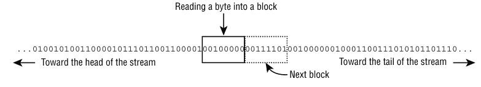

## 第 14 章 • I/O

每种 I/O 流都以特定的方式将读取的数据分段波或块。例如，某些 I/O 流类以单个字节的形式读取或写入数据。其他 I/O 流类则读取或写入单个字符或字符字符串。此外，某些 I/O 流类一次读取或写入更大组的字节或字符，特别是那些名称中带有 `Buffered` 字样的类。


尽管 `java.io` API 充满了处理字符、字符串、字节组等的 I/O 流，但几乎所有的流都是建立在读取或写入单个字节或任意字节组之上的。高层 I/O 流的存在不仅是为了方便，也是为了性能。

尽管 I/O 流通常用于文件 I/O，但它们更通用地用于处理任何顺序数据源的读/写。例如，你可能会构建一个 Java 应用，使用输出流向网站提交数据，并通过输入流进行读取。

## I/O 流可能是巨大的

在编写代码时，如果你不知道运行时 I/O 流的大小，那么将 I/O 流视化为巨大的（如在内存中）可能会有所帮助。I/O 流通常用于文件 I/O，它们更通用地用于处理任何顺序数据源的读/写。例如，你可能会构建一个 Java 应用，使用输出流向网站提交数据，并通过输入流进行读取。

# 介绍 I/O 流

在这个示例中，低层的 `FileReader` 是低层 I/O 流，而 `BufferedReader` 是以 `FileReader` 作为输入的高层 I/O 流。高层 I/O 流上的许多操作会作为操作传递给底层的低层 I/O 流，例如 `read()` 或 `close()`。其他操作则重写或为低层 I/O 流方法添加新功能。高层 I/O 流可能会添加新方法（例如 `readLine()`），并对读取和过滤低层数据的数据进行性能增强。

高层 I/O 流可以接受其他高层 I/O 流作为输入。例如，虽然下面的代码初看起来可能有点奇怪，但包装 I/O 流的风格在实践中非常常见：

```
try (var ois = new ObjectInputStream(new FileInputStream("zoo-data.txt"))) {
    System.out.print(ois.readObject());
}
```

在这个示例中，低层的 `FileInputStream` 直接与文件交互，该文件被高层的 `BufferedInputStream` 包装以提高性能。最后，整个对象被另一个高层的 `ObjectInputStream` 包装，这允许我们将这些数据解释为 Java 对象。

例如，你只需要熟悉的低层流类是那些操作文件的类。其余非抽象流类都是高层流。

## 流基类

`java.io` 库定义了四个抽象类，它们是 API 定义的所有 I/O 流类的父类：`InputStream`、`OutputStream`、`Reader` 和 `Writer`。

高层 I/O 流的构造函数通常接受抽象类的引用。例如，`BufferedWriter` 接收 `Writer` 对象作为输入，允许它可以接收任何 `Writer` 的子类。

考试中设置技巧的一个常见领域是混合使用互不兼容的 I/O 流类。例如，看看下面的示例，判断你能判断为什么它们无法编译：

```
new BufferedReader(new FileReader("z.txt")); // 无法编译
```


`new BufferedWriter(new FileInputStream("z.txt"));` // 无法编译

`new ObjectInputStream(new FileInputStream("z.txt"));` // 无法编译

`new BufferedReader(new ObjectInputStream());` // 无法编译

```
前两个示例无法编译，是因为它们分别将 `Reader/Writer` 类与 `InputStream/OutputStream` 类混合在一起了。第三个示例无法编译是因为我们将一个 `OutputStream` 与一个 `InputStream` 混合了一起。虽然可以从 `InputStream` 读取数据并写入 `OutputStream`，但包装 I/O 流并不是这样做的方法。正如你在在本章后面看到的，数据必须被复制。最后，最后一个示例无法编译是因为 `InputStream` 是一个抽象类，因此你无法创建它的实例。
```

## 解析 I/O 类名

密切关注考试中 I/O 类的名称，因为解析它通常能给你关于该类用途的上下文。例如，不需要查阅就应该很清楚 `FileReader` 是一个从文件中按字符或字符串读取数据的类。此外，`OutputStream` 听起来像是一个将对象数据写入字节流的类。

表 14.7 列出了所有 I/O 流继承的类。

### 表 14.7 java.io 抽象基类

| 类名 | 描述 |
| --- | --- |
| `InputStream` | 所有输入字节流的抽象类 |
| `OutputStream` | 所有输出字节流的抽象类 |
| `Reader` | 所有输入字符流的抽象类 |
| `Writer` | 所有输出字符流的抽象类 |

表 14.8 列出了你考试时应该熟悉的具体 I/O 流。注意，关于每个 I/O 流的大多数信息（例如它是输入流还是输出流，它使用字节还是字符访问数据），仅通过名称就可以解析。

### 表 14.8 java.io 具体 I/O 流类

| 类名 | 低层/高层 | 描述 |
| --- | --- | --- |
| `FileInputStream` | 低 | 按字节读取文件数据 |
| `FileOutputStream` | 低 | 按字节写入文件数据 |
| `FileReader` | 低 | 按字符读取文件数据 |
| `FileWriter` | 低 | 按字符写入文件数据 |
| `BufferedInputStream` | 高 | 以缓冲方式从现有的 `InputStream` 读取字节数据，提高效率和性能 |
| `BufferedWriter` | 高 | 以缓冲方式向现有的 `OutputStream` 写入字节数据，提高效率和性能 |
| `BufferedReader` | 高 | 以缓冲方式从现有的 `Reader` 读取字符数据，提高效率和性能 |
| `Writer` | 高 | 以缓冲方式向现有的 `Writer` 写入字符数据，提高效率和性能 |
| `ObjectInputStream` | 高 | 从现有的 `InputStream` 反序列化原始 Java 数据类型和 Java 对象图 |
| `ObjectOutputStream` | 高 | 向现有的 `OutputStream` 序列化原始 Java 数据类型和 Java 对象图 |
| `PrintStream` | 高 | 向二进制流写入 Java 对象的格式化表示 |
| `PrintWriter` | 高 | 向字符流写入 Java 对象的格式化表示 |

在本章中学习更多关于 I/O 流的知识时，请保留表 14.7 和表 14.8。

## 读取和写入文件

有很多方法读取和写入文件。我们在本节通过复制文件来展示它们。

### 使用 I/O 流

I/O 流都是关于读取和写入数据的，因此最重要的方法是 `read()` 和 `write()` 并不意外。`InputStream` 和 `Reader` 都声明了 `read()` 方法从 I/O 流读取数据。同样，`OutputStream` 和 `Writer` 都定义了 `write()` 方法写入流：

下面的 `copyStream()` 方法展示了 `InputStream` 和 `Reader` 的所有值。在两个示例中，都使用 -1 来表示流的结束。

```java
void copyStream(InputStream in, OutputStream out) throws IOException {

    int b;

    while ((b = in.read()) != -1) {

        out.write(b);

    }

}
```

```java
void copyStream(Reader in, Writer out) throws IOException {

    int b;

    while ((b = in.read()) != -1) {

        out.write(b);

    }

}
```

等一下。我们说正在读取和写入字节，为什么这些方法使用 `int` 而不是 `byte`？记住，字节数据类型的范围是 256。它们需要一个额外的值表示 I/O 流的结束。输出流使用 `int` 是为了与输入类保持一致。

一次读取写入一个字节并不是特别高效的方法。坦率地说，有重载方法可以一次读取写入多个字节。偏移量和长度值应用于数组本身。例如，偏移量为3，长度为5，这表示流应该读取5个字节/字符并将其放入从位置3开始的位置。让我们看看：

```java
void copyStream(InputStream in, OutputStream out) throws IOException {

    int bufferSize = 1024;

    byte[] buffer = new byte[bufferSize];

    int lengthRead;

    while ((lengthRead = in.read(buffer, 0, bufferSize)) > 0) {

        out.write(buffer, 0, lengthRead);

    }

    out.flush();

}
```

我们不是一次读取一个字节，而是在第14行一次读取并写入多1024字节。返回值 `lengthRead` 对于判断我们是否到达流的末尾以及知道应该向输出流写入多少个字节至关重要。除非我们的文件恰好是1024字节的倍数，否则while循环的最后一次迭代将返回一个小于1024字节的值。例如，如果缓冲区大小为1024，文件大小为 1054 字节，最后一次读取将只有 30 字节。如果我们忽略这个返回值并改为写入 1024 字节，那么上一个循环的 994 字节将写入文件的末尾。

我们还在第 16 行添加了 `flush()` 方法，用以减少应用程序意外终止时丢失的数据量。当数据被写入输出流时，底层操作系统并不保证数据会立即到达文件系统。`flush()` 方法请求将所有数据立即写入磁盘，尽管这没有代价。每次使用它时，都可能导致应用程序出现明显的延迟，对于大文件尤其如此。除非你写入的数据极其关键，否则应该间歇性使用 `flush()` 方法。例如，不应该像本示例那样在每次写入后都调用它。

`BufferedWriter` 上存在等效的方法，但它们使用的是 `char` 而不是 `byte`，这使得等效的 `copyStream()` 方法类似。

上一个示例让读取和写入文件看起来看起来非常复杂，因为它使用了低级 I/O 流。让我们尝试使用高级级流再试一次。

```java
26: void copyText(File src, File dest) throws IOException

27:     try (var reader = new BufferedReader(new FileReader(src));

28:         var writer = new BufferedWriter(new FileWriter(dest))) {

29:         String line = null;

30:         while ((line = reader.readLine()) != null) {

31:             writer.write(line);

32:             writer.newLine();

33:         }

34:      }
```

关键在于选择最有用的高级类。在这种情况下，我们处理的是一个 `File`，所以我们想要使用 `FileReader` 和 `FileWriter`。这两个类都有可以接收表示位置的 `String` 或直接接收 `File` 的构造函数。

如果文件不存在，将抛出一个继承自 `IOException` 的 `FileNotFoundException`。如果文件已存在，此实现将覆盖它。如果我们想更改这种行为，可以向 `FileWriter` 传递一个可选的布尔第二个参数作为追加标志。

我们还选择使用 `BufferedReader` 和 `BufferedWriter`，以便我们可以一次读取一行。这让我们在第 30 行获得了分批读取字符的的好处，而无需编写自定义逻辑。由于读取一行会剥离换行符，我们一次性写入整行数据。由于读取 32 行和 27 行演示了构造器的链，`try-with-resources` 构造函数会处理链中所有对象的关闭。

现在想象我们想要的是数据而不是字符。我们需要选择不同的高级类：`BufferedInputStream`、`BufferedOutputStream`、`FileInputStream` 和 `FileOutputStream`。我们将调用 `readAllBytes()` 而不是 `readLine()`，并将结果存储在 `byte[]` 而不是 `String` 中。最后，由于数据是二进制的，我们不需要处理换行。

## 第 14 章 • I/O

我们可以通过使用 `PrintStream` 和 `PrintWriter` 比 `BufferedOutputStream` 和 `BufferedWriter` 做得更好。这些类包含了四个关键方法。`print()` 和 `println()` 方法分别打印带换行和不带换行的数据。还有 `format()` 和 `printf()` 方法，我们将在用户交互的节中描述它们。

```java
void copyTextFile(File src, File dest) throws IOException {

    var reader = new BufferedReader(new FileReader(src));

    var writer = new PrintWriter(new FileWriter(dest));

    String line = null;

    while ((line = reader.readLine()) != null) {

        writer.println(line);

    }

}
```

虽然我们使用了 `String`，但 `String` 是 `println()` 的重载版本，可以接收从基本类型和 `String` 值到对象的任何内容。在底层，这些方法通常只是执行 `String.valueOf()`。

打印流的独特之处在于，是我们涵盖的唯一没有对应输入流的 I/O 流。与其他 `OutputStream` 类不同，`PrintStream` 的名称中并不包含 `Output`。

> 你可能会惊讶，在本书书中你一直在使用 `PrintStream`。`System.out` 和 `System.err` 都是 `PrintStream` 对象。同样，经常用于读取用户输入的 `System.in` 是一个 `InputStream`。

与我们涵盖的大多数 I/O 流不同，打印流中的方法没有任何检查异常（checked exceptions）。如果有的话，你每次调用 `System.out.println()` 时都必须捕获检查异常！

行分隔符取决于你的操作系统，是 `\n` 或 `\r\n`。`println` 方法为你处理了这个问题。如果你需要直接获取字符，请使用以下任一方法：

```java
System.getProperty("line.separator");

System.lineSeparator();
```

## 使用 Files 增强

NIO.2 API 通过使用 `Files` 类提供了更简单的方法来读写文件。让我们先看看通过读取数据并写回数据复制文件的三种方法：

```java
Files.write(output, string);
```

```java
private void copyPathAsBytes(Path input, Path output) throws IOException {

    byte[] bytes = Files.readAllBytes(input);

    Files.write(output, bytes);

}
```

```java
private void copyPathAsLines(Path input, Path output) throws IOException {

    List<String> lines = Files.readAllLines(input);

    Files.write(output, lines);

}
```

这非常简洁！你可以将 `Path` 读取为 `String`、字节数组或 `List`。请注意，对于每种操作，都会一次性读取整个文件，将文件的所有内容同时存储在内存中。如果文件很大，可能会触发内存溢出。幸运的是，有一种替代方案。我们懒加载读取：

```java
private void readLazily(Path path) throws IOException {

  try (Stream<String> s = Files.lines(path)) {

    s.forEach(System.out::println);

  }

}
```

再进一步：

```java
try (var s = Files.lines(path)) {

  s.filter(f -> f.startsWith("WARN:"))

  .map(f -> f.substring(5))

  .forEach(System.out::println);

}
```

示例代码搜索以 "WARN:" 开头的行，输出后续文本。假设输入文件如下：

```
INFO:Processes available = 10
WARN:No database could be detected
DEBUG:Processes available reset to 0
WARN:Performing manual recovery
INFO:Server successfully started
```

那么输出如下：

```
No database could be detected
Performing manual recovery
```

可以看出，我们只需要几个表达式就可以操作文件。

### Files.readAllLines() vs. Files.lines()

考试，你需要了解 `readAllLines()` 和 `lines()` 的区别。

这两个示例都可以编译并运行：

```java
Files.readAllLines(Paths.get("birds.txt")).forEach(System.out::println);

Files.lines(Paths.get("birds.txt")).forEach(System.out::println);
```

第一行将整个文件读取到内存并对结果执行打印操作，而第二行懒加载地处理每一行并在读取时打印。第二个代码段的优势是它不需要将整个文件都放在内存中。

你也应该注意示例中何时混合了不兼容类型。你会发现以下代码无法编译：

```java
Files.readAllLines(Paths.get("birds.txt"))

.filter(s -> s.length() > 2)

.forEach(System.out::println);
```

`readAllLines()` 方法返回 `List` 而不是 `Stream`，因此没有 `filter()` 方法。

### newBufferedReader() 和 newBufferedWriter()

有时你需要混合 I/O 流和 NIO.2。方便的是，`Files` 包含了两个获取 I/O 流的便利方法。

```java
private void copyPath(Path input, Path output) throws IOException {

  try (var reader = Files.newBufferedReader(input);

       var writer = Files.newBufferedWriter(output)) {

    String line = null;

    while ((line = reader.readLine()) != null) {

        writer.write(line);

        writer.newLine();

    }

  }

}
```


你可以通过封装 I/O 流构造函数来达到相同的效果，尽管使用该方法要简单得多。第一个方法`newBufferedReader()`使用`BufferedReader`对象读取`Path`路径指定的文件。

## 复习常用的读写方法

表 14.9 复习了你在读写时应该知道的常用 I/O 流方法。我们还包含了`close()`和`flush()`，因为它们在执行这些操作时是需要使用的。表 14.10 对常用的公共 NIO.2 读写方法涵盖了同样的内容。

### 表 14.9 常见的 I/O 读写方法

| 类 | 方法名 | 说明 |
|---|---|---|
| 所有输入流 | `public int read()` | 读取单个字节，如果没有可用字节，则返回 -1。 |
| `InputStream` | `public int read(byte[] b)` | 将值读入缓冲区。返回读取的字节或字符数。 |
| `Reader` | `public int read(char[] c)` | |
| `InputStream` | `public int read(byte[] b, int offset, int length)` | 从位置`offset`开始读取最多`length`长度的内容到缓冲区。返回读取的字节或字符数。 |
| `Reader` | `public int read(char[] c, int offset, int length)` | |
| 所有输出流 | `public void write(int b)` | 写入单个字节。 |
| `OutputStream` | `public void write(byte[] b)` | 将值数组写入流。 |
| `Writer` | `public void write(char[] c)` | 写入流。 |
| `OutputStream` | `public void write(byte[] b, int offset, int length)` | 从索引`offset`开始，将数组中的`length`长度个值写入流。 |
| `Writer` | `public void write(char[] c, int offset, int length)` | |
| `BufferedInputStream` | `public byte[] readAllBytes()` | 以字节读取数据。 |

### 表 14.9 常见的 I/O 读写方法（续）

| 类 | 方法名 | 说明 |
| --- | --- | --- |
| `BufferedReader` | `public String readLine()` | 读取一行数据。 |
| `BufferedWriter` | `public void write(String line)` | 写入一行数据。 |
| `BufferedWriter` | `public void newLine()` | 写入新行。 |
| 所有输出流 | `public void flush()` | 将缓冲区中的数据刷新流。 |
| 所有流 | `public void close()` | 关闭流并释放资源。 |

### 表 14.10 常见的 Files NIO.2 读写方法

| 方法名 | 说明 |
| --- | --- |
| `public static byte[] readBytes()` | 以字节读取所有数据 |
| `public static String readString()` | 将所有数据读入`String` |
| `public static List<String> readAllLines()` | 将所有数据读入`List` |
| `public static Stream<String> lines()` | 懒性读取数据 |
| `public static void write(Path, byte[] bytes)` | 写入字节数组 |
| `public static void writeString(Path, String string)` | 写入`String` |
| `public static void write(Path, List<String> list)` | 写入行列表（技术上讲，任何`CharSequence`的`Iterable`都可以，但考试时不需要知道这个） |

## 数据序列化

在整本书中，我们一直使用类来管理数据模型，因此我们希望在程序执行之间保存这些对象是合乎逻辑的。如果动物园动物健康状况每次程序运行时都必须输入，那将毫无用处了！

你完全可以使用目前所学的 I/O 流来存储文本和二进制数据，但你仍然需要弄清楚如何将其放入 I/O 流并在稍后进行解码。你可以像 XML 和 CSV 那样对格式进行标准化，但你通常需要自己构建转换逻辑。

或者，我们可以使用序列化来解决如何将对象转换为 I/O 流的问题。序列化是将内存中的对象转换为字节流的过程。同样，反序列化是从字节流转换为对象的过程。序列化通常涉及将对象写入存储或可传输的格式，而反序列化是相反的过程。

图 14.6 显示了`Giraffe`对象在`giraffe.txt`文件之间进行序列化和反序列化的视觉表示。

**图 14.6** 序列化过程


在本节中，我们将展示如何使用`Serializable`接口。由于`Serializable`是一个标记接口，你可能认为使用它没有规则。并非如此！如果类没有正确实现`Serializable`接口，任何尝试序列化对象的行为都会抛出`NotSerializableException`。

### 应用 Serializable

要使用 I/O 流序列化对象，对象必须被标记为`Serializable`。`Serializable`是一个标记接口，这意味着它没有方法。在例中，我们看到：

```java
import java.io.Serializable;

public class Gorilla implements Serializable {

    private static final long serialVersionUID = 1L;

    private String name;

    private int age;

    private transient favoriteFood;

    // 省略构造函数/Getter/toString

}
```

`Cat`包含一个`Tail`实例，且这两个类都被标记为`Serializable`，所以这部分没有问题。`Tail`包含一个没有标记为`Serializable`的`Fur`实例。


### 维护 serialVersionUID

在每个类中声明`static serialVersionUID`是良好的做法。每当类结构发生变化时，该值就会被更新或递增。也许我们的类是用旧版本序列化的，然后在新版本反序列化的。`serialVersionUID`有助于识别与类定义不匹配的数据。如果在反序列化期间遇到类的旧版本，可能会抛出`java.io.InvalidClassException`。

### 标记数据 transient

`transient`修符可以用于类的敏感数据，例如密码。还有其他不需要序列化的对象，内存中的`Thread`。如果该对象是序列化对象的一部分，我们只需将其标记为`transient`以确保这些实例成员。

标记为`transient`的数据在反序列化时会怎样？它会恢复 Java 的默认值，例如`double`为 0，对象为 null。稍后在介绍对象类时会看到这些示例。

注意，标记静态字段`transient`对序列化的影响很小。除了`serialVersionUID`之外，只有类的实例成员会被序列化。

### 确保类可序列化

由于`Serializable`是一个标记接口，你可能认为使用它没有规则。并非如此！如果类没有正确实现`Serializable`接口，任何尝试序列化对象的行为都会抛出`NotSerializableException`。

如何使类变为可序列化

- 类必须被标记为`Serializable`。
- 类的每个实例成员必须是可序列化的、标记为`transient`或在序列化时为 null。

注意第二个规则。为了使一个类变为可序列化，我们必须递归地应用该规则。你看到下面的`Cat`类是不可序列化的吗？

```java
public class Cat implements Serializable {

    private Tail tail = new Tail();

}
```

```java
public class Tail implements Serializable {

    private Fur fur = new Fur();

}
```

```java
public class Fur {
```

以下更改中的任何一种都可以解决问题并允许`Cat`被序列化：

```java
public class Tail implements Serializable {

    private transient Fur fur = new Fur();

}

public class Fur implements Serializable {}
```

我们也可以将`tail`或`fur`成员设置为`null`，尽管这将使得`Cat`只对特定实例序列化，而不是所有实例。

## 序列化 Record

你认为这个 record 是可以序列化的吗？

```java
record Record(String name) {}
```

它是不可序列化的，因为它没有实现`Serializable`。record 在是否可以序列化方面遵循与其他类相同的规则。因此，应该是：

```java
record Record(String name) implements Serializable {}
```

## 使用 ObjectOutputStream 和 ObjectInputStream 存储数据

`ObjectInputStream`类用于反序列化对象，而`ObjectOutputStream`用于序列化对象。它们是在 I/O 流上操作的高级流。虽然这两个类包含许多针对基本类型等内置数据类型的方法，但考试中需要掌握的两个方法与处理对象有关。

```java
// ObjectInputStream
public Object readObject() throws IOException, ClassNotFoundException
```

```java
// ObjectOutputStream
public void writeObject(Object obj) throws IOException
```

注意参数、返回类型和抛出的异常。我们现在提供一个示例方法，将`Gorilla`对象的列表序列化到文件：

```java
void saveToFile(List<Gorilla> gorillas, File dataFile)
throws IOException {

    try (var out = new ObjectOutputStream(

        new BufferedOutputStream(

            new FileOutputStream(dataFile)))) {

        for (Gorilla gorilla : gorillas) {

            out.writeObject(gorilla);

        }

    }

}
```

非常简单，对吧？现在我们从文件流开始，将其封装在缓冲 I/O 流中以提高性能，然后用对象流再次封装。序列化数据只需将其传递给`writeObject()`即可。一旦数据存储在文件中，我们可以使用以下方法对其进行反序列化：

```java
List<Gorilla> gorillas = readFile(File dataFile) throws IOException, ClassNotFoundException {

    var gorillas = new ArrayList<Gorilla>();

    try (var in = new BufferedInputStream(new FileInputStream(dataFile))) {

        while (true) {

            var object = in.readObject();

            if (object instanceof Gorilla) gorillas.add(object);

        }

    } catch (EOFException e) {

        // 到文件结束

    }

    return gorillas;

}
```

啊，并没有我们的`save`方法那么简单，不是吗？调用`readObject()`时，`null`和`-1`没有任何特殊含义，因为可能有人序列了带有这些值的对象。与我们之前从输入流读取方法的方法不同，我们需要使用无限循环来处理数据，当到达 I/O 流末尾时会抛出`EOFException`。


如果你的程序恰好知道 I/O 流中的对象数量，你可以调用固定次数的`readObject()`，而不是使用无限循环。

由于`readObject()`的返回类型是`Object`，我们需要在访问`Gorilla`属性之前检查其类型。注意`readObject()`声明了检查异常`ClassNotFoundException`，因为该类在反序列化期间可能不可用。

以下代码片段显示了如何调用序列化方法：

```java
var gorillas = new ArrayList<Gorilla>();

gorillas.add(new Gorilla("Grodd", 5, false));

gorillas.add(new Gorilla("Ishmael", 8, true));

File datafile = new File("gorilla.data");

saveToFile(gorillas, datafile);

var gorillasFromDisk = readFromFile(datafile);

System.out.print(gorillasFromDisk);
```

假设`toString()`方法在`Gorilla`类中已正确重写，它在运行时将打印以下内容：

```java
[[name=Grodd, age=5, friendly=false]
[name=Ishmael, age=8, friendly=true]]
```

## 与用户交互

它们在实践中有什么不同呢？在某种程度上，这取决于运行程序的程序的环境。例如，如果你从命令行提示符运行，它们可能会以相同的格式打印文本。另一方面，如果你在集成开发环境（IDE）中工作，它们可能会以不同的颜色打印`System.err`文本。最后，如果代码运行在服务器上，`System.err`流可能会写入不同的日志文件。


### 现实场景

| 使用日志 API |
|---|
| 虽然`System.out`和`System.err`对于调试独立运行或简单的应用程序非常有用，但在专业软件开发中很少使用它们。大多数应用程序依赖于日志服务或 API。 |
| 虽然有很多日志 API 可用，但它们倾向于共享许多相似的属性。你首先在每个类中创建一个静态日志对象。然后使用适当的日志级别记录消息：`debug()`、`info()`、`warn()`或`error()`。`debug()`和`info()`方法非常有用，可以帮助开发者记录那些不是错误但可能有用的信息。 |

## 作为 I/O 流读取输入

`System.in`返回一个`InputStream`并用于从用户检索文本输入。它通常通过`InputStreamReader`封装在`BufferedReader`中以使用`readLine()`方法。

```java
var reader = new BufferedReader(new InputStreamReader(System.in));

String userInput = reader.readLine();

System.out.println("You entered: " + userInput);
```

执行时，应用程序首先从用户处获取文本，直到用户按下回车键。然后它将用户输入的文本输出到屏幕。

## 关闭 System 流

你可能已经注意到，在使用`System.out`、`System.err`和`System.in`时我们从未创建或关闭过它们。事实上，这些是整个章节中我们没有使用`try-with-resources`块的 I/O 流！

由于这些是静态对象，`System`流由整个应用程序共享。JVM 为我们创建并打开了它们。它们可以在`try-with-resources`语句中使用，也可以通过调用`close()`使用，尽管不建议关闭它们。关闭 System 流会导致它们在程序的剩余时间内对所有线程都不可用。

你认为下面的代码段会打印什么？

```java
try (var out = System.out)
System.out.println("Hello");
```

它什么都不打印。`PrintStream`的方法不会抛出异常，而是依赖`checkError()`来报告错误，它们会静默失败。

这个例子呢？

```java
try (var err = System.err)
System.err.println("Hello");
```


# 与用户交互

它们在实践中有什么不同呢？在某种程度上，这取决于运行程序的程序的环境。例如，如果你从命令行提示符运行，它们可能会以相同的格式打印文本。另一方面，如果你在集成开发环境（IDE）中工作，它们可能会以不同的颜色打印`System.err`文本。最后，如果代码运行在服务器上，`System.err`流可能会写入不同的日志文件。


## 现实场景

### 使用日志 API

虽然`System.out`和`System.err`对于调试独立运行或简单的应用程序非常有用，但在专业软件开发中很少使用它们。大多数应用程序依赖于日志服务或 API。

虽然有很多日志 API 可用，但它们倾向于共享许多相似的属性。你首先在每个类中创建一个静态日志对象。然后使用适当的日志级别记录消息：`debug()`、`info()`、`warn()`或`error()`。`debug()`和`info()`方法非常有用，可以帮助开发者记录那些不是错误但可能有用的信息。

# 作为 I/O 流读取输入

`System.in`返回一个`InputStream`并用于从用户检索文本输入。它通常通过`InputStreamReader`封装在`BufferedReader`中以使用`readLine()`方法。

```java
var reader = new BufferedReader(new InputStreamReader(System.in));
String userInput = reader.readLine();
System.out.println("You entered: " + userInput);
```

执行时，应用程序首先从用户处获取文本，直到用户按下回车键。然后它将用户输入的文本输出到屏幕。

# 关闭 System 流

你可能已经注意到，在使用`System.out`、`System.err`和`System.in`时我们从未创建或关闭过它们。事实上，这些是整个章节中我们没有使用`try-with-resources`块的 I/O 流！

由于这些是静态对象，`System`流由整个应用程序共享。JVM 为我们创建并打开了它们。它们可以在`try-with-resources`语句中使用，也可以通过调用`close()`使用，尽管不建议关闭它们。关闭 System 流会导致它们在程序的剩余时间内对所有线程都不可用。

你认为下面的代码段会打印什么？

```java
try (var out = System.out)
System.out.println("Hello");
```

它什么都不打印。`PrintStream`的方法不会抛出异常，而是依赖`checkError()`来报告错误，它们会静默失败。

这个例子呢？

```java
try (var err = System.err)
System.err.println("Hello");
```

这个也会打印。和`System.out`一样，`System.err`是一个`PrintStream`，即使它抛出了异常，我们也会很困难，因为它报告错误的 I/O 流已关闭！关闭`System.err`是一个特别糟糕的主意，所有异常的堆栈轨迹都将被隐藏。

你认为这段代码在做什么？

```java
var reader = new BufferedReader(new InputStreamReader(System.in));
try (reader) {}
String data = reader.readLine(); // IOException
```

它在运行时抛出一个异常。与`PrintStream`类不同，如果你尝试对已关闭的 I/O 流进行操作，大多数实现都会抛出异常。

# 使用 Console 获取输入

`java.io.Console`类专门设计用于处理用户交互。毕竟，`System.in`和`out`是原始流，而`Console`是一个具有许多围绕输入方法的类。

`Console`类是一个单例，它只能通过工厂方法访问，并且 JVM 只创建它的一个实例。例如，如果你在考试中遇到下面的代码，它是无法编译的，因为所有构造函数都是私有的：

```java
Console c = new Console(); // DOES NOT COMPILE
```

下面的代码段显示了如何获取`Console`并使用它来检索用户输入：

```java
Console console = System.console();
if (console != null) {
    String userInput = console.readLine();
    console.writer.println("You entered: " + userInput);
} else {
    System.err.println("Console not available");
}
```

> 根据代码调用的位置，`Console`对象可能不可用。如果不可用，`System.console()`返回`null`。检查空是至关重要的。

# 操作输入流

所有输入流类都包含以下方法，用于操作从 I/O 流中读取数据时的顺序：

```java
// InputStream and Reader
public boolean markSupported()
public void mark(int readLimit)
public void reset() throws IOException
public long skip(long n) throws IOException
```

`mark()`和`reset()`方法可以将 I/O 流返回到早之前的某个位置。在调用这两个方法中的任何一个之前，你应该先调用`markSupported()`方法，只有当`mark()`被支持时，该方法才会返回`true`。`skip()`方法非常简单；它基本上是从 I/O 流中读取数据并丢弃计数器。


并不是所有的输入流类都支持`mark()`和`reset()`。确保在调用这些方法之前已在 I/O 流上调用了`markSupported()`，否则将在运行时抛出异常。

## 标记数据

假设我们有一个`InputStream`实例，其后续值为 LION。考虑以下代码片段：

```java
public void readData(InputStream is) throws IOException {
    System.out.print((char)is.read()); // L
    if (is.markSupported()) {
        is.mark(100); // 标记最多 100 字节
        System.out.print((char)is.read()); // I
        System.out.print((char)is.read()); // O
        is.reset(); // 将流重置到位置 I
    }
    System.out.print((char)is.read()); // I
    System.out.print((char)is.read()); // O
    System.out.print((char)is.read()); // N
}
```

如果支持`mark()`，该代码片段将输出 LION，否则什么都不输出。重置你的`read()`操作是一个良好的习惯，这样无论`mark()`是否被支持，IO 流最终都会停在相同的位置。

那么我们传递给`mark()`方法的值 100 是什么呢？这个值是`readLimit`。它告诉 I/O 流我们在最多读取 100 字节后期望`reset()`的位置。如果我们的程序在调用`mark(100)`后读取了超过 100 字节并调用`reset()`，根据 I/O 流类的不同，可能会抛出异常。

## 使用高级 API

实际上，`mark()`和`reset()`并没有将数据放回 I/O 流，而是将其存储在内存中的临时缓冲区中以便再次读取。因此，你不应该使用过大的值调用`mark()`操作，因为这可能会占用大量内存。

## 跳过数据

假设我们有一个`InputStream`实例，后续值为 TIGERS。考虑以下代码片段：

```java
System.out.print((char)is.read()); // T
is.skip(2); // 跳过 I 和 G
is.read(); // 读取 E 但不输出
System.out.print((char)is.read()); // R
System.out.print((char)is.read()); // S
```

当我们重置时，这段代码打印 TRS。我们跳过了两个字符 I 和 G。我们读取了 E 但没有在任何地方使用它，所以行为就像调用了`skip(1)`。

`skip()`的返回值告诉我们跳过了多少个值。例如，如果我们在 I/O 流的末尾附近调用`skip(1000)`，返回值可能是 20，表示在跳过 20 个值后到达 I/O 流的末尾。如果你需要跟踪自己在 I/O 流中的位置以及处理了多少字节，使用`skip()`的返回值是非常重要的。

## 复习操作 API

表 14.1 回顾了这些与操作 I/O 输入流相关的 API。虽然你可能在实践中没有用过这些，但你需要了解它们。

**表 14.1 与操作 I/O 输入流相关的 API**

| 方法名 | 描述 |
|---|---|
| `boolean markSupported()` | 如果支持`mark()`返回 true |
| `void mark(int readLimit)` | 标记最多`readLimit`字节 |
| `void reset() throws IOException` | 将流重置为标记的位置 |
| `long skip(long n)` | 跳过 n 个字节并返回跳过的字节数 |

# 获取属性

`Files`类包含以下方法，用于以只读方式读取类的属性：

```java
public static <A extends BasicFileAttributes> A readAttributes(
    Path path,
    Class<A> type,
    LinkOption... options) throws IOException
```

应用该方法需要指定`Path`和`BasicFileAttributes.class`参数。

```java
var path = Paths.get("/turtles/sea.txt");
BasicFileAttributes data = Files.readAttributes(path,
    BasicFileAttributes.class);
```

```java
System.out.println("Is a directory? " + data.isDirectory());
System.out.println("Is a regular file? " + data.isRegularFile());
System.out.println("Is a symbolic link? " + data.isSymbolicLink());
System.out.println("Size (in bytes): " + data.size());
System.out.println("Last modified: " + data.lastModifiedTime());
```

`BasicFileAttributes`类包含了许多与`Files`类中属性方法同名的值。然而，使用此方法的优处是，在某些操作系统上，所有属性都可以一次性检索。

# 修改属性

以下`Files`方法返回一个可更新的`FileView`：

```java


# 使用 `getFileAttributeView()` 修改文件属性

`public static <V extends FileAttributeView> V getFileAttributeView(Path path, Class<V> type, LinkOption... options)`

我们可以使用该可更新的视图将文件的修改日期/时间值增加 10,000 毫秒（即 10 秒）。

```java
// 读取文件属性
var path = Paths.get("/turtles/sea.txt");
BasicFileAttributeView view = Files.getFileAttributeView(path,
    BasicFileAttributeView.class);
BasicFileAttributes attributes = view.readAttributes();
```

```java
// 修改文件的修改时间
FileTime lastModifiedTime = FileTime.from(
    attributes.lastModifiedTime().toMillis() + 10_000);
view.setTimes(lastModifiedTime, null, null);
```

在获取更新后的视图后，我们需要在视图上调用`readAttributes()`来获取文件元数据。从那里，我们创建一个新的`FileTime`并使用`setTimes()`方法设置它：

```java
// BasicFileAttributeView 方法
public void setTimes(FileTime lastModifiedTime,
    FileTime lastAccessTime, FileTime createTime)
```

该方法允许我们对任何不想修改的日期/时间值传递`null`。在示例代码中，仅更改了最后的修改日期/时间。

并不是所有的文件属性都能通过视图进行修改。例如，你无法设置一个将文件变为目录的属性。同样，在不修改内容的情况下，你无法更改对象的大小。

# 遍历目录

虽然`Files.list()`方法很有用，但它只遍历直接目录的内容。如果我们想访问目录树中的所有路径，则需要回顾一些关于文件系统的基本概念。记住，目录是以层次化方式组织的。例如，一个目录可以包含文件和目录，而这些目录又包含其他文件和目录。文件系统中的每条记录恰好有一个父节点，根目录除外，根目录位于一切之上。

文件系统通常被可视化为一个具有单一根节点和许多分支和叶子的树。在模型模型中，目录是分支或内部节点，而文件是叶子节点。文件系统中的常见任务是遍历路径的后代，记录有关它们的信息，或者为特定的文件集进行过滤。例如，你可能想搜索一个文件夹并打印所有`.java`文件的列表。此外，文件系统以层次化方式存储记录。通常，如果你想搜索一个文件，必须从父目录开始，读取其子元素，然后读取它们的子元素，以此类推。

遍历目录（称为遍历目录树）是一个从父目录开始并迭代其所有后代的过程，直到满足某些条件或没有更多元素可以遍历为止。例如，如果我们正在搜索单个文件，我们可以在找到文件或检查了所有文件但一无所获时结束搜索。起始路径通常是一个特定的目录；毕竟，在每个请求时都搜索整个文件系统将是极其耗时的！

# 不要使用`DirectoryStream`和`FileVisitor`

在浏览 NIO.2 的 Javadoc 时，你可能会遇到使用`DirectoryStream`和`FileVisitor`类来遍历目录的方法。这些方法在 Stream API 出现之前就已经存在，甚至是旧版 Java 认证考试中要求的知识点。

我们能给你的最佳建议是不要使用它们。基于 Stream API 的方法更优，并且实现相同的功能，且通常代码少得多。

# 选择搜索策略

与遍历目录树相关的两种常用策略是深度优先搜索和广度优先搜索。深度优先搜索从根节点到任意叶子节点遍历结构，然后向根节点导航，遍历过程中跳过的完整路径。搜索深度是从根节点到当前节点的距离。为了防止无限循环，Java 包含了一个搜索深度，用于限制允许从根节点移动的层数（或跳数）。

另一种，广度优先搜索从根节点开始，在进入下一个深度之前处理每个特定深度的所有元素。虽然深度优先搜索通常更节省内存，因为它不需要存储给定层的所有节点，但如果你知道目标靠近根节点，广度优先搜索可能会更快。对于考试来说，你需要理解深度优先和广度优先搜索是遍历树的两种方式。

# 遍历目录

背景介绍已经足够，让我们看看 Stream API。`Files`类提供了使用 Stream 遍历目录的方法：

```java
public static Stream<Path> walk(Path start,
    FileOption... options)
```

```java
public static Stream<Path> walk(Path start, int maxDepth,
    FileOption... options)
```

与我们的其他方法一样，`walk()`使用懒性求值并在获取时评估节点。如果目录树包含成百上千个文件，所需的内存就会增长。

# 使用高级 API

与其仅仅打印目录的内容，我们可以再次做一些更有趣的事。以下`getPathSize`方法遍历目录树并返回所有文件的总大小：

```java
private long getSize(Path p) {
  try {
    return Files.size(p);
  } catch (IOException e) {
    throw new UncheckedIOException(e);
  }
}
```

```java
public long getPathSize(Path source) throws IOException {
  try (var s = Files.walk(source)) {
    return s.filter(p -> !Files.isDirectory(p))
           .mapToLong(this::getSize)
           .sum();
  }
}
```

`getSize`辅助方法是必要的，因为`Files.size()`声明了`IOException`，而我们不想在 lambda 表达式中放置 try/catch 块。相反，将其封装在异常`UncheckedIOException`中。我们可以使用`format(object)`方法打印数据：

```java
var size = getPathSize(Path.of("/fox/data"));
System.out.printf("Total Size: %.2f megabytes", size/100000.0);
```

根据你运行的目录，它将输出如下内容：
`Total Size: 15.30 megabytes`

# 应用深度限制

假设我们的目录树非常深，因此通过更改`getPathSize()`方法中的一行代码来应用深度限制。

```java
try (var s = Files.walk(source, 5)) {
```

这个新版本只检查距离起始节点 5 步内的文件。由于该方法仅对文件计算值，因此当将其应用于目录树时，必须设置深度以获得非零结果。

# 避免循环路径

我们的许多早期 NIO 方法默认会遍历符号链接，使用`NOFOLLOW_LINKS`来禁用这种行为。`walk()`方法不同，它默认不跟随符号链接，需要`FOLLOW_LINKS`选项才能跟随。

我们可以通过添加`FileVisitOption`来修改`getPathSize()`以启用对符号链接的支持：

```java
try (var s = Files.walk(source,
      FileVisitOption.FOLLOW_LINKS)) {
```

在遍历目录树时，我们的程序需要小心符号链接，例如，如果我们的进程遇到指向文件系统根目录的符号链接，那么系统中的每一个文件都将被搜索！
更糟糕的是，符号链接可能导致循环，路径被重复访问。当目录树中的一个项指向其祖先目录之一时，循环就是无限的循环依赖。假设我们有一个如图 14.7 所示的目录树，其中符号链接`/birds/robin/allBirds`指向`/birds`。

# 图 14.7 具有循环的文件系统

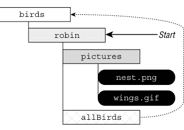

如果我们尝试从`/birds/robin`开始遍历这棵树并跟随所有的符号链接，会发生什么？表 14.13 显示了遍历深度为 3 后访问的路径。为了简单起见，我们以广度优先顺序遍历树，尽管使用何种搜索策略循环循环。

# 表 14.13 使用广度优先遍历带有循环的目录

| 深度 | 访问的路径 |
| --- | --- |
| 0 | `/birds/robin` |
| 1 | `/birds/robin/pictures` |
| 1 | `/birds/robin/allBirds` |
|   | `/birds` |
| 2 | `/birds/robin/pictures/nest.png` |
| 2 | `/birds/robin/pictures/wings.gif` |

## 使用高级 API

| 深度 | 访问的路径 |
|---|---|
| 2 | `/birds/robin/allBirds/robin`<br> `/birds/robin` |
| 3 | `/birds/robin/allBirds/robin/pictures`<br> `/birds/robin/pictures` |
| 3 | `/birds/robin/allBirds/robin/pictures/allBirds`<br> `/birds/robin/allBirds`<br> `/birds` |

从开始行走距离 1 后，我们遇到了符号链接`/birds/robin/allBirds`并回目录树的顶层`/birds`。这没关系，因为我们还没有访问过`/birds`，所以还没有循环！
不幸的是，在深度 2 处，我们遇到了循环。我们在第一步中已经访问了`/birds/robin`目录，现在又遇到了它。如果进程继续，我们将注定反复访问该目录。
注意，当使用`FOLLOW_LINKS`选项时，`walk()`方法将跟踪它已访问的所有路径，如果路径被访问两次，将抛出`FileSystemLoopException`。

## 搜索目录

在上一个示例中，我们对`Stream<Path>`对象应用过滤器来过滤结果，尽管还有另一种更方便的方法。

```java
public static Stream<Path> find(Path start,
int maxDepth,
BiPredicate<Path, BasicFileAttributes> matcher,
FileVisitOption... options) throws IOException
```

`find()`方法的行为与`walk()`方法类似，但它接受一个`BiPredicate`来过滤数据。它还需要设置一个限制。与`walk()`来说，`find()`也支持`FOLLOW_LINK`选项。
`BiPredicate`的两个参数是一个`Path`对象和一个`BasicFileAttributes`对象，你在本章前面的部分看到过它们。通过这种方式，Java 自动为你检索基本文件信息，允许你编写直接访问此对象的复杂 lambda 表达式。我们通过以下示例来说明这一点：

```java
Path path = Paths.get("bigcats");
long minSize = 1_000;
try (var s = Files.find(path, 10,
(p, a) -> a.isRegularFile()
&& p.toString().endsWith(".java")
&& a.size() > minSize())) {
    s.forEach(System.out::println);
}
```

此示例搜索目录树并打印所有大小至少为 1000 字节的`.java`文件，深度限制为 10。我们可以使用`walk()`方法并调用`readAttributes()`来实现这一点，但这种实现比我们原本需要做的要短得多且方便。我们还不需要担心 lambda 表达式中的任何方法声明受检异常，正如我们在`getPathSize()`示例中看到的那样。

## 关键 API 回顾

考试中需要掌握的关键 API 列在表 14.14 中。我们知道某些类看起来相似。在考试之前，你必须非常熟悉这张表。

| 表 14.14 关键 API | |
| 类名 | 用途 |
| --- | --- |
| `File` | 文件系统中位置的 I/O 表示 |
| `Files` | 用于处理`Path`的辅助方法 |
| `Path` | 文件系统中位置的 NIO.2 表示 |
| `Paths` | 包含获取`Path`的工厂方法 |
| `URI` | 文件、URL 等的统一资源标识符 |
| `FileSystem` | 文件系统的 NIO.2 表示 |
| `FileSystems` | 包含获取`FileSystem`的工厂方法 |
| `InputStream` | 基于字节读取文件的父类 |
| `OutputStream` | 基于字节写入文件的父类 |
| `Reader` | 基于字符读取文件的父类 |
| `Writer` | 基于字符写入文件的父类 |

此外，图 14.8 显示了你应该在考试中熟悉的所有 I/O 流类，除了过滤器流。`FilterInputStream`和`FilterOutputStream`是用于过滤或转换数据的高级父类。它们很少被直接使用。

# 图 14.8 I/O 流类图


`InputStreamReader`和`OutputStream`是非常方便的辅助类。它们的独特之处在于，它们是唯一在名称中同时包含`InputStream/OutputStream`和`Reader/Writer`的 I/O 流类。

## 总结

这些都是关于读取和写入数据的。我们首先展示了如何从 I/O 创建`File`和`Path`。

## 复习题

章节复习题的答案可以在附录中找到。

- 1. 哪种类最适合将二进制文件读入 Java 对象？
   - A. `BufferedStream`
   - B. `FileReader`
   - C. `ObjectInputStream`
   - D. `ObjectReader`
   - E. `ObjectOutputStream`
   - F. `ObjectWriter`
   - G. 以上都不是

- 2. 假设`/`是文件系统中的根目录，以下哪些说法是正确的？（选择所有项）
   - A. `/home/parrot`是绝对路径。
   - B. `/home/parrot`是一个目录。
   - C. `/home/parrot`是一个相对路径。
   - D. 如果`/home`不存在，`new File("/home")`将抛出异常。
   - E. 如果`/home`不存在，`new File("/home").delete()`将抛出异常。
   - F. `Reader`提供了字符编码，使其在处理 String 数据时比`InputStream`更用。
   - G. `Reader`提供了多线程支持，使其比`InputStream`更用。

- 3. 执行以下代码可能的结果有哪些？（选择所有项）
```java
public static void main(String[] args) throws IOException {
  String line;
  var c = System.console();
  Writer w = c.writer();
  try (w) {
    if ((line = c.readLine("Enter your name: ")) != null) {
      w.append(line);
      w.flush();
    }
  }
}
```
   - A. 代码运行，但什么都没有打印。
   - B. 代码打印用户输入的内容。
   - C. 如果删除了`throws IOException`，代码的行为相同。
   - D. 可能会抛出`NullPointerException`。
   - E. 将总是抛出`NullPointerException`。
   - F. 永远不会抛出`NullPointerException`。
   - G. 代码无法编译。

- 4. 发送到此方法的 path 值可能会导致以下代码输出 Success？（选择所有项）
```java
public void removeBadFile(Path path) {
    if(Files.isDirectory(path))
        System.out.println(Files.deleteIfExists(path)
    ? "Success": "Try Again");
}
```
   - A. path 指向文件系统中的普通文件。
   - B. path 指向文件系统中的符号链接。
   - C. path 指向文件系统中的空目录。
   - D. path 指向文件系统中的目录内容。
   - E. path 指向文件系统内不存在的代码。
   - F. 代码无法编译。

- 5. 假设目录`/animals`存在且为空。执行以下代码的结果是什么？
```java
Path path = Path.of("/animals");
try (var z = Files.walk(path)) {
```


`boolean b = z`

`.filter((p, a) -> a.isDirectory() && !path.equals(p)) // x`

`.findFirst().isPresent(); // y`

`System.out.print(b ? "No Sub": "Has Sub");`

```
}
```

- A. 打印 `No Sub`。
- B. 打印 `Has Sub`。
- C. 因为第 `x` 行，代码无法编译。
- D. 因为第 `y` 行，代码无法编译。
- E. 输出无法确定。
- F. 在运行时会产生无限循环。

## 6. 如果在 `main()` 方法中创建 `Eagle` 实例被序列化然后反序列化，`name` 的值会是什么？

```java
import java.io.Serializable;

class Bird {

    protected transient String name;

    public void setName(String name) { this.name = name; }

    public String getName() { return name; }

    public Bird() {

        this.name = "Matt";

    }

}

public class Eagle extends Bird implements Serializable {

    public Eagle() {

        this.name = "Bridget";

    }

    public static void main(String[] args) {

        var e = new Eagle();

        e.name = "Adeline";

    }

}
```

- A. `Adeline`
- B. `Bridget`
- C. `Matt`
- D. `Olivia`
- E. `null`
- F. 代码无法编译。
- G. 代码可以编译但在运行时抛出异常。

## 7. 假设 `/kang` 在文件系统中是指向目录 `/Choice/kangaroo` 的符号链接。关于这段代码以下哪些说法是正确的？（选择所有项）

```java
var path = Paths.get("kang");

if(Files.isDirectory(path) && Files.isSymbolicLink(path))

    Files.createDirectory(path.resolve("joey"));
```

- A. 将创建一个新目录。
- B. 可能会创建一个新目录。
- C. 如果代码创建了目录，它可以通过 `/kang/joey` 访问。
- D. 如果代码创建了目录，它可以通过 `/mammal/joey` 访问。
- E. 代码无法编译。
- F. 代码可以编译但在运行时总是抛出异常。

## 8.

```csv
/fox/food-schedule.csv

6am,Breakfast

9am,SecondBreakfast

12pm,Lunch

6pm,Dinner
```

```java
void printData(Path path) throws IOException {

    Files.readAllLines(path) // r1

    .flatMap(p -> Stream.of(p.split(","))) // r2

    .map(q -> q.toUpperCase()) // r3

    .forEach(System.out::println);

}
```

- A. 因为 `r1`，代码无法编译。
- B. 因为 `r2`，代码无法编译。
- C. 因为 `r3`，代码无法编译。
- D. 在运行时抛出异常。
- E. 它没有打印任何内容。
- F. 以上都不是

## 9. 给定以下方法，哪些说法是正确的？（选择所有项）

```java
public void copyFile(File file1, File file2) throws Exception {

    var reader = new InputStreamReader(new FileInputStream(file1));

    try (var writer = new FileWriter(file2)) {

        char[] buffer = new char[10];

        while(reader.read(buffer) != -1) {

            writer.write(buffer); // r1

        }

    }

}
```

- A. `reader` 不是 stream，代码无法编译。
- B. `writer` 不是 stream，代码无法编译。
- C. 代码编译并正确复制了数据。
- D. 代码编译并正确复制了全部数据。
- E. 如果我们在 `r1` 处检查 `file2` 五次，可能是空的。
- F. 如果我们在 `r1` 处检查 `file2` 五次，它将包含 50 个字符。
- G. 该方法包含资源泄漏。

## 10. 以下哪项是正确的 `Path` 实例？（选择所有项）

- A. `new Path("jaguar.txt")`
- B. `FileSystems.getDefault().getPath("puma.txt")`
- C. `Path.get("cats", "lynx.txt")`
- D. `new java.io.File("tiger.txt").toPath()`
- E. `new FileSystem().getPath("lion")`
- F. `Paths.get("ocelot.txt")`
- G. `Path.of("").toUri()`

## 11. 哪些类允许以下代码编译？（选择所有项）

```java
var is = new BufferedInputStream(new FileInputStream("z.txt"));

InputStream wrapper = new BufferedReader(is);

try (wrapper) {
```

- A. `BufferedInputStream`
- B. `BufferedReader`
- C. `BufferedWriter`
- D. `FileInputStream`
- E. `ObjectInputStream`
- F. `ObjectOutputStream`
- G. 以上都不是，第一行无法编译

## 12. 执行以下代码的结果是什么？（选择所有项）

```java
var p = Paths.get("sloth.schedule");

var a = Files.readAttributes(".backup", BasicFileAttributes.class);

Files.mkdir(p.resolve(".backup"));

if (a.size()>0 && a.isDirectory()) {

   a.setTimes(null,null,null);

}
```

- A. 它编译并正常运行。
- B. 因为第 5 行，代码无法编译。
- C. 因为第 6 行，代码无法编译。
- D. 因为第 7 行，代码无法编译。
- E. 因为第 8 行，代码无法编译。
- F. 以上都不是

## 13. 关于 Java 序列化的以下哪些是正确的？（选择所有项）

- A. 类的非空成员必须是序列化的或标记为 `transient`。
- B. `Record` 是自动序列化的。
- C. 序列化涉及将数据转换为 Java 对象。
- D. `Serializable` 是一个函数接口。
- E. 类必须声明一个静态 `serialVersionUID` 变量。
- F. 类必须继承 `Serializable` 类。
- G. 类必须实现 `Serializable` 接口。

## 14. 以下代码的输出是什么？（选择三个）

```java
var p1 = Path.of("/zoo/./bear", "../food.txt")

p1.normalize().relativize(Path.of("/lion"))

System.out.println(p1)

var p2 = Paths.get("/zoo/animals/bear/koala/food.txt")

System.out.println(p2.sub(1,3).getName(1))

var p3 = Path.of("/pets/../cat.txt")

var p4 = Paths.get("/.dog.txt")

System.out.println(p4.resolve(p3))
```

- A. `../../lion`
- B. `/zoo/bear/../food.txt`
- C. `animal`
- D. `bear`
- E. `/pets/../cat.txt/`
- F. `/pets/../cat.txt/.dog.txt`

## 15. 假设工作目录是 `/weather` 且绝对路径 `/weather/winter/snow.dat` 代表文件系统中存在一个文件。以下哪些行创建了代表该文件的对象？（选择所有项）

- A. `new File("/weather", "winter", "snow.dat")`
- B. `new File("/weather/winter/snow.dat")`
- C. `new File("/weather/winter", new File("/snow.dat"))`
- D. `new File("/weather", "winter/snow.dat")`
- E. `new File(new File("/weather/winter"), "snow.dat")`
- F. `Path.of("/weather/winer/snow.dat").toFile()`

## 16. 假设 `zoo-data.txt` 不为空，关于以下方法的陈述哪些是正确的？（选择所有项）

```java
private void echo() throws IOException {

  var o = new FileWriter("new-zoo.txt");

  try (var f = new FileReader("zoo-data.txt"); o {

    o.write(f.readLine());

    o.write("");

  }

}
```

- A. 运行时，该方法会创建一个包含一行文本的新文件。
- B. 运行时，该方法会创建一个包含两行文本的新文件。
- C. 运行时，该方法会创建一个与原始文件行数相同的新文件。
- D. 该方法可以编译，但会在运行时抛出异常。
- E. 该方法无法编译。
- F. 该方法使用了字节流类。

## 17. 哪些陈述是正确的？（选择所有项）

- A. NIO.2 包含一个删除整个目录树的方法。
- B. NIO.2 包含一个遍历目录树的方法。
- C. NIO.2 包含能够感知符号链接的方法。
- D. `Files.readAttributes()` 无法访问文件系统相关的属性。
- E. `Files.readAttributes()` 通常性能更好，因为它一次读取多个属性，而不是访问单个属性。
- F. `Files.readAttributes()` 可以与 `File` 对象配合工作。

## 18. 假设 `reader` 是一个有效的流，其后续字符是 `PEACOCKS`。关于以下代码段的输出，哪些是正确的？（选择所有项）

```java
var sb = new StringBuilder();

sb.append((char)reader.read());

reader.mark(10);

for(int i=0; i<2; i++) {

  sb.append((char)reader.read());

  reader.skip(2);

}

reader.reset();

reader.skip(0);

sb.append((char)reader.read());

System.out.println(sb.toString());
```

- A. 代码可能会打印 `PEAE`。
- B. 代码可能会打印 `PEOA`。
- C. 代码可能会打印 `POOE`。
- D. 代码可能会打印 `PEOS`。
- E. 代码将始终打印 `PEAE`。
- F. 代码将始终打印 `PEOA`。
- G. 代码将始终打印 `PEOE`。
- H. 代码将始终打印 `PEOS`。

## 19. 假设引用的目录和文件存在符号符号链接，执行以下代码的结果是什么？

- A. `true -1`
- B. `true 0`
- C. `false -1`
- D. `false 0`
- E. `false true -1`
- F. `false true 0`
- G. 代码无法编译。
- H. 结果无法确定。

## 20. 假设 `monkey.txt` 是当前工作目录下的存在文件。关于以下代码段的陈述哪些是正确的？（选择所有项）

```java
Files.move(Path.of("monkey.txt"), Paths.get("/animals"),

StandardCopyOption.ATOMIC_MOVE,

LinkOption.NOFOLLOW_LINKS);
```

- A. 如果 `/animals/monkey.txt` 存在，将在运行时被覆盖。
- B. 如果 `/animals` 作为空目录存在，则 `/animals/monkey.txt` 将成为文件的新位置。
- C. 如果 `monkey.txt` 是符号链接，则运行时将移动它指向的文件。
- D. 如果移动成功且另一个进程正在监控文件系统，则在运行时不会看到不完整的文件。
- E. 以上均不是。

## 第14章 • I/O

## 21. 假设 `/monkeys` 是一个包含多个文件、符号链接和子目录的目录。关于以下代码的哪个陈述是正确的？

```java
var f = Path.of("/monkeys");

try (var m =

    Files.find(f, 0, (p, a) -> a.isSymbolicLink())) { // y1

    m.map(s -> s.toString())

      .collect(Collectors.toList())

      .stream()

      .filter(s -> s.toString().endsWith(".txt")) // y2

      .forEach(System.out::println);

}
```

- A. 它将打印目录中所有以 `.txt` 结尾的符号链接。
- B. 它将打印目录中所有以 `.txt` 结尾的符号链接的目标。
- C. 它什么都不打印。
- D. 因为 `y1` 行无法编译。
- E. 因为 `y2` 行无法编译。
- F. 它在运行时抛出异常。

## 22. 在第17行创建的类实例序列化并使用 `ObjectOutputStream` 和 `ObjectInputStream` 反序列化后，以下哪些字段将为 `null`？（选择所有项）

```java
1: import java.io.Serializable;

2: import java.util.List;

3: public class Zebra implements Serializable {

4: private transient String name = "George";

5: private static String birthPlace = "Africa";

6: private transient Integer age;

7: List<Zebra> friends = new java.util.ArrayList<>();

8: private Object stripes = new Object();

9: { age = 10 };

10: public Zebra() {

11: this.name = "Sophia";

12: }

13: static Zebra writeRead(Zebra z) {

14: // 省略

15: }

16: public static void main(String[] args) {

17:     var zebra = new Zebra();

18:     writeRead(zebra);

19: }
```

- A. `age`
- B. `birthplace`
- C. `friends`
- D. `name`
- E. `stripes`

## 23. 假设引用的目录和文件不是符号链接，执行以下代码的结果是什么？（选择所有项）

```java
var x = Path.of("/flip/"); // y1

Files.walk(x.toRealPath())

  .map(p -> p.toAbsolutePath().toString())

  .filter(s -> s.endsWith(".java")) // y2

  .forEach(System.out::println);
```

- A. 打印部分文件。
- B. 打印所有文件。
- C. 运行时抛出 `FileSystemException`。
- D. 运行时抛出其他异常。
- E. 因为 `y1` 无法编译。
- F. 因为 `y2` 无法编译。

## 24. 假设传递给方法的 `source` 表示。执行此方法时，哪个语句正确将文件复制到目录。

```java
void copyInto(Path source) throws IOException {
```


进入`/path/to/xxx`目录，找到`xxx.json`。

在表达式`cvar = avar + bvar`中，加法运算符（`+`）将`avar`与`bvar`相加，得到它们的和`cvar`

在`List.of(arg0, arg1, arg2)`中，`List`接口的工厂方法`of()`接受一系列的元素，返回包含它们的只读列表。

之后我们这样调用`cmd`命令：`cmd arg0 arg1 arg2`。

```
if (condVar > someVal) {console.log("xxx")}
```


这会抛出`SQLException`，类似于：

```
Exception in thread "main" java.sql.SQLException:
statement not generate a row count
```

因为 SQL 是一个字符串，我们不会得到编译错误。但是我们可以得到异常，并且在使用`executeQuery()`修改数据库时也会`SQLException`。

```
Exception in thread "main" java.sql.SQLException:
statement does not generate result set
```

再次，由于返回类型的原因，我们得到了异常。

# 复习 PreparedStatement 方法

为了回顾，请确保知道哪些 SQL 语句可以使用每个方法运行。

**表 15.3**

| 方法 | DELETE | INSERT | UPDATE |
| :--- | :--- | :--- | :--- |
| `execute()` | 是 | 是 | 是 |
| `executeQuery()` | 否 | 否 | 是 |
| `executeUpdate()` | 是 | 是 | 否 |

**表 15.4**

| 方法 | 返回类型 | 对于 SELECT 的返回值 | 对于 DELETE/UPDATE 的返回值 |
| :--- | :--- | :--- | :--- |
| `execute()` | boolean | true | false |
| `executeQuery()` | ResultSet | ResultSet | n/a |
| `executeUpdate()` | int | n/a | 添加/更改的行数 |

# 使用参数

假设我们获取了一个新大象并将其注册到 names 表。我们已经学会了如何这样做。使用参数的`PreparedStatement`。

```java
14: public static void register(Connection conn, int key,
15:     int type, String name) throws SQLException {
16:
17:     String sql = "INSERT INTO names VALUES(?, ?, ?)";
18:
19:     try (PreparedStatement ps = conn.prepareStatement(sql)) {
20:     ps.setInt(1, key);
21:     ps.setString(3, name);
22:     ps.setInt(2, type);
23:     ps.executeUpdate();
24:     }
25: }
```

绑定变量允许你在运行时指定实际值。绑定变量是一个占位符（`?`）。绑定变量让 SQL 更易读，因此不再需要为字符串值加引号。

在上一个示例中，我们乱序设置了参数。这完全没有问题。规则只是在执行查询之前每个参数都已设置。让我们看看如果不设置所有的绑定变量会发生什么。

代码可以编译，你会得到一个`SQLException`。消息因数据库驱动程序而异。

```
Exception in thread "main" java.sql.SQLException: Parameter not set
```

如果你尝试设置比拥绑定变量更多的值会怎样？

再次，你会得到一个`SQLException`，这次是不同的消息。在 HyperSQL 上，该消息如下：

```
Exception in thread "main" java.sql.SQLException:
row column count mismatch in statement [INSERT INTO names VALUES(?, ?, ?)]
```

# 第 15 章 • JDBC

表 15.5 显示了考试中需要掌握的设置绑定变量的方法。考试需要掌握的方法很容易记忆，因为它们的名称后面紧跟你正在设置的类型名称。还有许多其他方法（例如日期），它们不在考试范围之内。

## 表 15.5 PreparedStatement 方法

| 方法 | 参数类型 | 示例数据库类型 |
| --- | --- | --- |
| `setBoolean` | boolean | BOOLEAN |
| `setDouble` | double | DOUBLE |
| `setInt` | int | INTEGER |
| `setLong` | long | BIGINT |
| `setNull` | int | 任意类型 |
| `setObject` | Object | 任意类型 |
| `setString` | String | CHAR, VARCHAR |

第一列显示方法名称，第二列显示 Java 使用类型。第三列显示数据库中可能存在的类型名称。不同数据库之间存在差异，请检查你特定的数据库文档。考试你只需要知道前两列。

`setNull()`方法接受一个`int`参数，代表数据库中的列类型。你不需要知道这些类型。注意`setObject()`方法适用于任何 Java 类型。如果你传递一个基本数据类型，它会被装箱为包装类型。这意味着我们可以将示例重写如下：

```java
String sql = "INSERT INTO names VALUES(?, ?, ?);\

try (PreparedStatement ps = conn.prepareStatement(sql)) {
  ps.setObject(1, key);
  ps.setObject(2, type);
  ps.setObject(3, name);
  ps.executeUpdate();
}
```

Java 会为你处理类型转换。但最好调用更具体的 setter 方法，这样如果你传递了错误的类型时，会得到编译时错误而不是运行时错误。

# 更新多条记录

假设我们得到了两头新大象并想添加它们。我们可以使用`PreparedStatement`对象。

```java
var sql = "INSERT INTO names VALUES(?, ?, ?)";

try (var ps = conn.prepareStatement(sql)) {
  ps.setInt(1, 20);
  ps.setInt(2, 1);
  ps.setString(3, "Ester");
  ps.executeUpdate();

  ps.setInt(1, 21);
  ps.setString(3, "Elias");
  ps.executeUpdate();
}
```

注意，我们在添加 Ester 时设置了三个参数，但在添加 Elias 时只设置了两个。`PreparedStatement`足够智能，记住已经设置的参数并保留它们。你只需要设置不同的部分。

## 现实场景

# 批量语句

JDBC 支持批处理，因此你可以通过更少的数据库访问运行多个语句。数据库通常位于与 Java 代码运行不同的机器上。减少访问数据库的次数可以节省时间，因为网络调用可能是昂贵的。例如，如果你需要向数据库插入 1,000 条记录，作为单次网络调用插入（而不是 1,000 次网络调用）通常更快。

考试你不需要知道`addBatch()`和`executeBatch()`方法，但它们在实践中非常有用。

```java
public static void register(Connection conn, int firstKey, int type, String... names) throws SQLException {
  var sql = "INSERT INTO names VALUES(?, ?, ?)";
  var nextIndex = firstKey;
```

```java
  try (var ps = conn.prepareStatement(sql)) {
    ps.setInt(2, type);

    for (var name: names) {
      ps.setInt(1, nextIndex);
      ps.setString(3, name);
      ps.addBatch();
    }

    nextIndex++;
    int[] result = ps.executeBatch();
    System.out.println(Arrays.toString(result));
  }
}
```

现在我们用两个名字调用此方法：

```java
register(conn, 100, 1, "Elias", "Ester");
```

输出显示数组有两个元素，因为批处理中有两个不同的项目。每个项目在数据库中添加一行。

- [1, 1]

你可以通过批处理来拆分大型操作，例如每 100 条一组插入 1000 万条记录。确定合适的批处理大小需要一些工作，但使用批处理的性能通常比一次插入一行（或一次性插入数百万行）更好。

# 从 ResultSet 获取数据

如果无法获取数据，数据库就没有用。我们首先展示如何遍历`ResultSet`。然后我们通过不同的方法按类型获取列。

# 读取 ResultSet

在处理`ResultSet`时，大多数情况下你会写一个循环来查看每一行。代码如下：

```java
20: String sql = "SELECT id, name FROM exhibits";
21: var idToNameMap = new HashMap<Integer, String>();
22: 
```

```java
23: try (var ps = conn.prepareStatement(sql);
24:   ResultSet rs = ps.executeQuery()) {
25:
26:   while (rs.next()) {
27:     int id = rs.getInt("id");
28:     String name = rs.getString("name");
29:     idToNameMap.put(id, name);
30:   }
31:   System.out.println(idToNameMap);
32: }
```

# 从 ResultSet 获取数据 883

现在我们用两个名字调用此方法：

```java
register(conn, 100, 1, "Elias", "Ester");
```

输出显示数组有两个元素，因为批处理中有两个不同的项目。每个项目在数据库中添加一行。

- [1, 1]

你可以通过批处理来拆分大型操作，例如每 100 条一组插入 1000 万条记录。确定合适的批处理大小需要一些工作，但使用批处理的性能通常比一次插入一行（或一次性插入数百万行）更好。

# 从 ResultSet 获取数据

如果无法获取数据，数据库就没有用。我们首先展示如何遍历`ResultSet`。然后我们通过不同的方法按类型获取列。

# 读取 ResultSet

在处理`ResultSet`时，大多数情况下你会写一个循环来查看每一行。代码如下：

```java
20: String sql = "SELECT id, name FROM exhibits";
21: var idToNameMap = new HashMap<Integer, String>();
22: 
```

```java
23: try (var ps = conn.prepareStatement(sql);
24:   ResultSet rs = ps.executeQuery()) {
25:
26:   while (rs.next()) {
27:     int id = rs.getInt("id");
28:     String name = rs.getString("name");
29:     idToNameMap.put(id, name);
30:   }
31:   System.out.println(idToNameMap);
32: }
```

## 表 15.6 ResultSet get 获取方法

| 方法 | 返回类型 |
| --- | --- |
| `getBoolean` | boolean |
| `getDouble` | double |
| `getInt` | int |
| `getLong` | long |
| `getObject` | Object |
| `getString` | String |

你可能会注意到，并不是所有的基本类型都在表 15.6 中。虽然存在`getByte()`和`getFloat()`方法，但考试时你不需要了解它们。幸运的是，你不需要记住这些。考试不会尝试通过使用 JDBC 中并不存在的方法名来欺骗你。这就是设计者们的友善之处。

`getObject()`方法可以返回任何类型。对于基本类型，它使用包装类。让我们来看下面的示例：

```java
16: var sql = "SELECT id, name FROM exhibits";
17: try (var ps = conn.prepareStatement(sql)) {
18:     var rs = ps.executeQuery()) {
19: 
20:     while (rs.next()) {
21:         Object idField = rs.getObject("id");
22:         Object nameField = rs.getObject("name");
23:         if (idField instanceof Integer)
24:             System.out.println(id);
25: 
26:         if (nameField instanceof String name)
27:             System.out.println(name);
28:     }
29: }
```

第 21 行和第 22 行以最合适的 Object 类型获取列。第 23–26 行使用模式匹配来获取实际类型。在工作中编写代码时你可能不会使用`getObject()`，但为了考试，了解它是有好处的。

## 使用绑定变量

我们一直在同一个`try-with-resources`语句中创建`PreparedStatement`和`ResultSet`。如果绑定了变量，这种做法是不可行的，因为它们需要在之间进行设置。幸运的是，我们可以嵌套`try-with-resources`来处理这个问题。这段代码打印了匹配给定名称的展览 ID：

```java
30: var sql = "SELECT id FROM exhibits WHERE name = ?";
31:
32: try (var ps = conn.prepareStatement(sql)) {
33:     ps.setString(1, "Zebra");
34:
35:     var rs = ps.executeQuery() {
36:         while (rs.next()) {
37:             int id = rs.getInt("id");
38:
39:             System.out.println(id);
40:         }
41:     }
42:
```

注意这里的流程。首先，我们在第 32 行创建`PreparedStatement`。然后我们在第 33 行设置绑定变量。只有在完成这两个操作后，我们通过第 35 行的嵌套的`try-with-resources`来创建`ResultSet`。

## 调用 CallableStatement

在某些情况下，在数据库中使用 SQL 查询而不是将它们封装在 Java 代码中是有用的。这在存在许多复杂查询时特别有用。存储过程是预先编译并存储在数据库中的代码。存储过程通常使用特定数据库 SQL 变体编写，这在不同的数据库供应商之间有所不同。

使用存储过程可以减少往返次数。它还允许数据库专家维护那部分代码。然而，存储过程依赖特定数据库，增加了维护应用程序的复杂性。在考试中，你需要知道如何调用存储过程，但不需要决定何时使用它。

考试时你不需要知道如何读取或编写存储过程。因此，我们没有在书中包含任何存储过程。如果你感兴趣，它们在用于设置数据库的代码中。

考试时你不需要学习任何特定数据库的知识。由于学习存储过程可能非常复杂，我们建议将对`CallableStatement`的学习限制在本书的内容范围内。

我们将在本节中使用四个存储过程。表 15.7 总结了你需要了解的知识。在现实世界中，这些中没有一个是良好的实现，因为它们还没有复杂到需要使用存储过程的程度。如表所示，存储过程允许参数为仅输入、仅输出或两者兼有。

## 表 15.7 示例存储过程

| 名称 | 参数名 | 参数类型 | 描述 |
| --- | --- | --- | --- |
| `read_names()` | n/a | n/a | 返回表中所有具有 name 的行 |
| `read_names_by_letter()` | prefix | IN | 返回表中所有具有 name（不区分大小写）的行 |
| `magic_number()` | num | OUT | 返回数字 |
| `double_number()` | num | INOUT | 乘以二并返回 |

在接下来的章节中，我们将查看如何调用每一个。

## 调用无参数过程

我们的`read_names()`存储过程不接受任何参数。它返回一个`ResultSet`。由于我们使用的是`PreparedStatement`，所以我们使用`call`。

```java
12: var sql = "{call read_names()}";
```


# 使用 `CallableStatement`

第 12 行引入了新语法。与 `PreparedStatement` 不同，我们使用 `prepareStatement`。在这里，我们改用 `prepareCall()`。

## 传递参数

IN 参数用于输入。与 `PreparedStatement` 不同，我们在第 27 行设置值。

```
25: var sql = "call read_names_by_letter(?)";
26: try (var ps = conn.prepareCall(sql)) {
27:     ps.setString(1, "Z");
28:
29:     try (var rs = ps.executeQuery()) {
30:         while (rs.next()) {
31:             System.out.println(id);
32:         }
33:     }
34: }
35: }
```

## 返回 OUT 参数

在之前的示例中，我们返回了一个 `ResultSet`。某些存储过程有输出参数。`magic_number()` 存储过程设置了它的输出值。这里有几处不同：

```
40: var sql = "?= call_number(?)";
41: try (var ps = conn.prepareCall(sql)) {
```

[第 955 页]

在第 40 行，我们包含了两个特殊字符 `?=` 来指定存储过程具有输出值。如果有 OUT 参数，这是可选的，但它有助于提高可读性。在第 42 行，我们注册了 OUT 参数。这是重要的。它允许 JDBC 在第 44 行检索值。记住对每个 OUT 或 INOUT 参数始终调用 `registerOutParameter()`（我们将在下文中介绍）。在第 43 行，我们调用 `execute()` 而不是 `executeQuery()`，因为我们没有返回 `ResultSet`。

| 特定数据库的行为 |
| --- |
| 某些数据库对本章认为要求的某些事情宽容。例如，某些数据库允许省略以下内容： |
| 大括号 (`}`) |
| 如果是 OUT 参数，则省略绑定变量 (`?`) |
| 调用 `registerOutParameter()` |

考试时，你需要根据书中描述的完整要求进行回答。

## 使用 INOUT 参数

最后，可以使用同一个参数进行输入和输出。在阅读这段代码时，看看你能否看出哪些行是 IN 部分需要的，哪些行是 OUT 部分需要的：

```
50: var sql = "(call double_number(?))";
51: try (var ps = conn.prepareCall(sql)) {
52: cs.setInt(1, 8);
53: cs.registerOutParameter(1, Types.INTEGER);
54: cs.execute();
55: System.out.println(cs.getInt("num"));
56: }
```

对于 IN 参数，第 52 行是必须的，因为它设置了值。对于 OUT 参数，需要第 53 行进行注册。第 54 行再次使用了 `SCROLL()`，因为我们没有返回 `ResultSet`。

记住，INOUT 参数同时充当 IN 参数和 OUT 参数，因此它具有这二者的所有要求。

## 比较 `CallableStatement` 参数

表 15.8 回顾了不同类型的参数。你需要在考试中熟练掌握这一点。

**表 15.8** 存储过程参数类型

| 参数类型 | IN | OUT | INOUT |
| --- | --- | --- | --- |
| 用于输入 | 是 | 否 | 是 |
| 用于输出 | 否 | 是 | 是 |
| 必须设置参数值 | 是 | 否 | 是 |
| 必须调用 `registerOutParameter()` | 否 | 是 | 是 |
| 可以包含 `=?` | 否 | 是 | 是 |

## 使用额外选项

到目前为止，我们一直使用默认选项创建 `PreparedStatement` 和 `CallableStatement`。两者都支持 `ResultSet` 类型和并发选项。并不是所有选项在数据库上都可用。幸运的是，你只需要在考试中识别出它们是有效的即可。

有三个 `ResultSet` 整数类型值：

- `ResultSet.TYPE_FORWARD_ONLY`: 只能一次遍历一次 `ResultSet`。
- `ResultSet.TYPE_INSENSITIVE`: 可以任何顺序遍历 `ResultSet`，但看不到对底层数据库表所更改。
- `ResultSet.TYPE_SCROLL_SENSITIVE`: 可以任何顺序遍历 `ResultSet`，并且可以看到对底层数据库表所更改。

有两个 `ResultSet` 整数并发值：

- `ResultSet.CONCUR_READ_ONLY`: `ResultSet` 不可更新。
- `ResultSet.CONCUR_UPDATABLE`: `ResultSet` 可以更新。

这些选项是整数值，而不是枚举值，这意味着你将它们作为额外参数传递在 SQL 之后。

```java
conn.prepareCall(sql, ResultSet.TYPE_FORWARD_ONLY,
ResultSet.CONCUR_READ_ONLY);
```

```java
conn.prepareStatement(sql, ResultSet.TYPE_SCROLL_INSENSITIVE,
ResultSet.CONCUR_UPDATABLE);
```

如果你在考试中看到这些选项，请注意它们是如何使用的。记住类型始终在前面。此外，接收类型的方法也接收并发模式，因此要警惕任何只传递了一个选项的题目。

## 使用事务控制数据

到目前为止，对数据库所做的任何更改都会立即生效。提交（`commit`）就像保存文件。在考试中，除非另有说明，否则更改会自动提交。然而，你可以选择何时对一个或多个语句的最终结果进行回滚（`rollback`）。回滚就像在不保存的情况下关闭文件。从事务开始的所有更改都会被丢弃。首先，我们查看编写提交和回滚的代码。然后查看如何控制你的回滚点。

## 提交与回滚

我们的动物园正在装修，并决定给大象提供更多空间。然而，我们的空间有限，因此斑马的展区需要缩小。由于我们无法凭空创造空间，我们希望确保总空间保持不变。如果为大象增加空间或为斑马减少空间失败，我们希望事务回滚。为了简单起见，我们假设在运行此代码之前数据库表处于有效状态。现在，让我们检查此场景的代码：

```java
5: public static void main(String[] args) throws SQLException {
6: try (Connection conn = 
7: DriverManager.getConnection("jdbc:hsqldb:file:zoo")) {
8:
9: conn.setAutoCommit(false);
10:
11: var elephantRowsUpdated = updateRow(conn, 5, "African Elephant");
12: var zebraRowsUpdated = updateRow(conn, -5, "Zebra");
13:
14: if ( elephantRowsUpdated || ! zebraRowsUpdated)
15:     conn.rollback();
16: } else {
17:     String selectSql = ""
18: ""
19:     SELECT COUNT(*)
20:     FROM exhibits
21:     WHERE num_acres <= 0";
22:     try (PreparedStatement ps = conn.prepareStatement(selectSql);
23:         ResultSet rs = ps.executeQuery()) {
24:         rs.next();
25:         int count = rs.getInt(1);
26:         if (count == 0)
27:             conn.commit();
28:         else
29:             conn.rollback();
30:     }
31: }
32: private static boolean updateRow(Connection conn, int numToAdd, String name) throws SQLException {
33:     String updateSql = ""
34:     UPDATE exhibits
35:     SET num_acres = num_acres + ?
36:     WHERE name = ?";
37:     try (PreparedStatement ps = conn.prepareStatement(updateSql)) {
38:         ps.setInt(1, numToAdd);
39:         ps.setString(2, name);
40:         return ps.executeUpdate() > 0;
41:     }
42: }
```

# 编写资源泄漏

在第 11 章中，你学习了可以在 `try-with-resources` 语句之前声明类型。你看出为什么这种方法不好了吗？

```
40: public void bad() throws SQLException {
41:     var url = "jdbc:hsqldb:zoo";
42:     var sql = "SELECT not_a_column FROM names";
43:     var conn = DriverManager.getConnection(url);
44:     var ps = conn.prepareStatement(sql);
45:     var rs = ps.executeQuery();
46: 
47:     try (conn; ps; rs) {
48:         while (rs.next()) {
49:             System.out.println(rs.getString(1));
50:         }
51: }
}
```

假设第 45 行抛出了异常。程序从未进入资源块，因此我们无法从自动关闭资源中获益。这意味着如果代码失败，就会发生资源泄漏。不要写这样的代码。

关闭 `ResultSet` 还有另一种方法。当你从同一个 `Statement` 运行另一个 SQL 语句时，JDBC 会自动关闭 `ResultSet`。这可以是一个 `PreparedStatement` 或 `CallableStatement`。

# 现实世界的异常

## 处理异常

在本章的大部分内容中，我们生活在一个完美的世界里。确实，我们提到过任何 JDBC 方法可能会抛出受检的 `SQLException`——但我们从未捕获它。我们只是声明了它并让调用者去处理。现在让我们来捕获异常。

```java
var sql = "SELECT not_a_column FROM names";
var url = "jdbc:hsqldb:zoo";
try (var conn = DriverManager.getConnection(url)) {
    var ps = conn.prepareStatement(sql);
    try (var rs = ps.executeQuery()) {
        while (rs.next()) {
          System.out.println(rs.getString(1));
        }
    } catch (SQLException e) {
      System.out.println(e.getMessage());
      System.out.println(e.getSQLState());
      System.out.println(e.getErrorCode());
    }
}
```


输出如下：

| 列 'NOT_A_COLUMN' 均不在任何数据表中 |
|---|---|
| 42X04 |
| 3000 |

这些方法中的每一个都为你提供了不同的信息。`getMessage()` 方法返回一个关于发生错误的可读消息。我们只包含了它的开头。`getSQLState()` 方法返回一个说明错误原因的代码。你可以通过 Google 搜索你的数据库名称和 SQL 状态以获取有关该错误的更多信息。相比之下，`getErrorCode()` 是一个特定数据库的代码。在这个数据库上，它没有产生任何作用。

## 总结

考试中你应该掌握四种关键的 SQL 语句，每个对应一个 CRUD 操作：创建（`INSERT`）新行、查询（`SELECT`）数据、更新（`UPDATE`）一个或多个条行，以及删除（`DELETE`）一个或多个条行。

对于考试，你应该熟悉 JDBC 接口：`Driver`、`Connection`、`PreparedStatement`、`CallableStatement` 和 `ResultSet`。这些接口是 Java API 的一部分。特定的数据库 JAR 文件提供了实现。

要连接到数据库，你需要 JDBC URL。一个 JDBC URL 有三部分，由冒号分隔。第一部分是 `jdbc`。第二部分是厂商/端口名称。第三部分随数据库而异，但包含了数据库的位置和/或名称。位置可以是 `localhost` 或者是 IP 地址后跟一个可选的端口。

`Driver` 类提供了一个工厂方法 `getConnection()` 来创建 `Connection` 实现。你分别使用 `prepareStatement()` 和 `prepareCall()` 创建 `PreparedStatement` 或 `CallableStatement`。当 SQL 在你的应用程序中指定时，使用 `PreparedStatement`；而当 SQL 在数据库中时，则使用 `CallableStatement`。`PreparedStatement` 允许你设置绑定变量的值。`CallableStatement` 允许你设置 IN、OUT 和 INOUT 参数。

运行 `SELECT` SQL 语句时，`executeQuery()` 方法返回 `ResultSet`。
运行 `DELETE`、`INSERT` 或 `UPDATE` SQL 语句时，`executeUpdate()` 方法返回受影响的行数。还有一个 `execute()` 方法返回一个布尔值，指示该语句是否为查询。

你在语句或循环中调用 `next()` 来移动光标位置。要从列中获取数据，可以使用如 `getString(1)` 或 `getString("a")` 等方法。列索引从 1 开始，而不是 0。在获取字符串或原始类型时，你可以调用 `getObject` 来获取任何类型。

JDBC 选择是自动提交你的语句还是由你自己管理事务。如果你选择后者，可以控制数据何时提交或回滚。此外，你还可以保存保存点以回滚到特定点。

在完成后关闭 JDBC 资源是非常重要的，以避免资源泄漏。关闭 `Connection` 会自动关闭 `Statement` 和 `ResultSet` 对象。`Statement` 会自动关闭 `ResultSet` 对象。此外，运行 SQL 语句会关闭该 `Statement` 的上一个 `ResultSet` 对象。

# 考试重点

- 列出你需要掌握的五个核心 JDBC 接口及其定义位置。这五个关键接口是 `Driver`、`Connection`、`PreparedStatement`、`CallableStatement` 和 `ResultSet`。这些接口是核心 Java API 的一部分。实现是数据库驱动程序 JAR 文件的一部分。

- 识别正确和错误的 JDBC URL。JDBC URL 以 `jdbc:vendor/product` 开头。接着是另一个冒号，然后是特定数据库的字符串，包含位置（例如 `localhost` 或带有可选端口的 IP 地址）。它还可能包含数据库名称。

- 描述如何连接到数据库。`Driver` 类提供工厂方法 `getConnection()` 来创建 `Connection` 实现。你分别使用 `prepareStatement()` 和 `prepareCall()` 创建 `PreparedStatement` 或 `CallableStatement`。当 SQL 在你的应用程序中指定时，使用 `PreparedStatement`；而当 SQL 在数据库中时，则使用 `CallableStatement`。`PreparedStatement` 允许你设置绑定变量的值。`CallableStatement` 允许你设置 IN、OUT 和 INOUT 参数。

- 运行 `SELECT` SQL 语句时，`executeQuery()` 方法返回 `ResultSet`。运行 `DELETE`、`INSERT` 或 `UPDATE` SQL 语句时，`executeUpdate()` 方法返回受影响的行数。还有一个 `execute()` 方法返回一个布尔值，指示该语句是否为查询。

- 你在语句或循环中调用 `next()` 来移动光标位置。要从列中获取数据，可以使用如 `getString(1)` 或 `getString("a")` 等方法。列索引从 1 开始，而不是 0。在获取字符串或原始类型时，你可以调用 `getObject` 来获取任何类型。

JDBC 选择是自动提交你的语句还是由你自己管理事务。如果你选择后者，可以控制数据何时提交或回滚。此外，你还可以保存保存点以回滚到特定点。

- 在完成后关闭 JDBC 资源是非常重要的，以避免资源泄漏。关闭 `Connection` 会自动关闭 `Statement` 和 `ResultSet` 对象。`Statement` 会自动关闭 `ResultSet` 对象。此外，运行 SQL 语句会关闭该 `Statement` 的上一个 `ResultSet` 对象。

## 复习题

章节复习题的答案可以在附录中找到。

- 1. 哪些在数据库 JAR中？（多选）
A. `Driver`
B. `Driver` 的实现
C. `Manager`
D. `DriverManager` 的实现
E. `PreparedStatement`
F. `PreparedStatement` 的实现

- 2. 以下哪一个是有效的 JDBC URL？
A. `jdbcdb:sybase:localhost:1234/db`
B. `jdbc::sybase:localhost::/db`
C. `jdbc::sybase:localhost:1234/db`
D. `sybase:localhost:1234/db`
E. `sybase::localhost::/db`
F. `sybase::localhost::1234/db`

- 3. 哪些选项可以填充空白以使代码编译并运行无错误？（多选）

```java
var sql = ""

UPDATE habitat SET environment = null

WHERE environment = ? ""

try (var ps = conn.prepareStatement(sql)) {

ps.executeUpdate();

}
```
A. `ps.setString(0, "snow")`
B. `ps.setString(1, "snow")`
C. `ps.setString("environment", "snow")`
D. `ps.setString(1, "snow"); ps.setString(1, "snow")`
E. `ps.setString(1, "snow"); ps.setString(2, "snow")`
F. `ps.setString("environment", "snow"); ps.setString("environment", "snow");`

- 4. 假设你有一个名为 `animal` 的表，包含两行数据。以下代码的结果是什么？

```java
6: var conn = new Connection(url, userName, password);
7: var ps = conn.prepareStatement(
8:     "SELECT count(*) FROM animal");
9: var rs = ps.executeQuery();
10: if (rs.next()) System.out.println(rs.getInt(1));
```

- A. 0
- B. 2
- C. 第 6 行存在编译错误。
- D. 第 10 行存在编译错误。
- E. 在其他行存在编译错误。
- F. 抛出了运行时异常。

- 5. 哪个选项可以填充空白以使代码通过编译？

```java
boolean ps = ps________();
int num = ps________();
ResultSet rs = ps.________();
```

- A. `executeQuery`, `executeUpdate`
- B. `executeUpdate`, `executeUpdate`, `executeQuery`
- C. `executeQuery`, `execute`, `executeUpdate`
- D. `executeQuery`, `executeUpdate`, `execute`
- E. `executeUpdate`, `execute`, `executeQuery`
- F. `executeUpdate`, `executeQuery`, `executeQuery`

- 6. 假设在代码运行之前表中有两行，且 `executeUpdate()` 运行没有错误。代码完成后表中有多少行？

```java
conn.autoCommit(true);

String sql = "INSERT INTO games VALUES(3, Jenga)";

try (PreparedStatement ps = conn.prepareStatement(sql,

ResultSet.TYPE_FORWARD_ONLY, ResultSet.CONCUR_READ_ONLY)) {

    ps.executeUpdate();

}

conn.rollback();
```

- G. 以上都不是。这段代码是正确的。

- 9. 假设 `enrichment` 表有三行，动物分别为蝙蝠（`bat`）、鼠（`rat`）和蛇（`snake`）。这段代码打印了多少行？

```java
var sql = "SELECT toy FROM enrichment WHERE animal = ?";

try (var ps = conn.prepareStatement(sql)) {

  try (var rs = ps.executeQuery()) {

    while (rs.next()) {

      System.out.println(rs.getString(1));

    }

}

}
```

- A. 0
- B. 1
- C. 3
- D. 代码无法通过编译。
- E. 抛出了 `SQLException`。
- F. 抛出了不同的异常。

- 10. 假设 `food` 表有五行，此 SQL 语句更新了所有所有行。这段代码的结果是什么？

```java
public static void main(String[] args) {

  var sql = "UPDATE food SET amount = amount + 1";

  try (var conn = DriverManager.getConnection("jdbc:hsqldb:file:zoo")) {

    var ps = conn.prepareStatement(sql);

    var result = ps.executeUpdate();

    System.out.println(result);

  }

}
```

- A. 0
- B. 1
- C. 5
- D. 代码无法通过编译。
- E. 抛出了 `SQLException`。
- F. 抛出了不同的异常。

# 第 15 章 • JDBC

11. 假设我们有一个 JDBC 程序调用一个存储过程，该过程返回一个结果集。关闭该调用数据库资源的正确顺序是哪个？

- A. `Connection`, `ResultSet`, `CallableStatement`
- B. `Connection`, `CallableStatement`, `ResultSet`
- C. `ResultSet`, `Connection`, `CallableStatement`
- D. `ResultSet`, `CallableStatement`, `Connection`
- E. `CallableStatement`, `Connection`, `ResultSet`
- F. `CallableStatement`, `ResultSet`, `Connection`

12. 假设 `counts` 表有五行，数字为 1 到 5。这段代码打印了多少行？

```java
var sql = "SELECT num FROM counts WHERE num> ?";

try (var ps = conn.prepareStatement(sql,

ResultSet.TYPE_SCROLL_SENSITIVE, ResultSet.CONCUR_UPDATABLE)) {

ps.setInt(1,3);
```

```java
try (var rs = ps.executeQuery()) {

  while (rs.next()) {

    System.out.println(rs.getObject(1));

  }

}
```

```java
ps.setInt(1, 100);
```

```java
try (var rs = ps.executeQuery()) {

  while (rs.next()) {

    System.out.println(rs.getObject(1));

  }

}
```

- A. 0
- B. 1
- C. 2
- D. 4
- E. 代码无法通过编译。
- F. 代码抛出了异常。

13. 下列中哪些可以正确填充空白？（选择所有适用项）。

```java
var rs = ps.executeQuery();

if (rs.next()) {
```

- A. `String s = rs.getString(0)`
- B. `String s = rs.getString(1)`
- C. `String s = rs.getObject(0)`
- D. `String s = rs.getObject(1)`
- E. `Object s = rs.getObject(0)`
- F. `Object s = rs.getObject(1)`

14. 假设 `learn()` 是一个带有 IN 和 OUT 参数的存储过程。以下代码哪里错误？（选择所有适用项）。

```java
18: var sql = "{call learn(?)}";
19: try (var cs = conn.prepareCall(sql)) {
20:   cs.setInt(1, 8);
21:   cs.execute();
22:   System.out.println(cs.getInt(1));
23: }
```

- A. 第 18 行没有正确调用存储过程。
- B. 未设置输入参数。
- C. 代码无法通过编译。
- D. 代码有其他错误。
- F. 以上均正确。

15. 哪个可以填充空白并使代码无错误运行？（选择所有适用项）。

```java
17: var conn.setAutoCommit(false);
18: var larry = conn.setSavepoint();
19: var curly = conn.setSavepoint();
20: var moe = conn.setSavepoint();
21: var shemp = conn.setSavepoint();
22:
23: conn.rollback(curly);
```

- A. `conn.rollback(larry)`
- B. `conn.rollback(curly)`
- C. `conn.rollback(moe)`
- D. `conn.rollback(shemp)`
- E. `conn.rollback()`
- F. 代码无法通过编译。

16. 下列哪些可以填充空白？（选择所有适用项）。

```java
var sql = "";

try (var ps = conn.prepareStatement(sql)) {

    ps.setObject(3, "red");

    ps.setInt(2, 8);

    ps.setString(1, "ball");

    ps.executeUpdate();

}
```

- A. `{ insert(?,?) }`
- B. `{ insert(?,?) }`
- C. `{ insert(?,?) }`
- D. `INSERT INTO toys (?, ?)`
- E. `INSERT INTO toys (?, ?)`
- F. `INSERT INTO toys (?, ?)`

17. 假设 `counts` 表有五行，数字为 1 到 5。这段代码打印了多少行？

```java
var sql = "SELECT num FROM counts WHERE num > ?";

try (var ps = conn.prepareStatement(sql)) {

    ps.setInt(1, 3);

    try (var rs = ps.executeQuery()) {

        while (rs.next()) {

            System.out.println(rs.getObject(1));

        }

    }

}

try (var rs = ps.executeQuery()) {
```


`while (rs.next())` {

    `System.out.println(rs.getObject(1));`

}

```

- A. 0
- B. 1
- C. 2
- D. 4
- E. 代码无法通过编译。
- F. 代码抛出了异常。

18. 在插入新行之前，`species`表当前有 100 行。这段代码的输出是什么？

```java
String insert = "INSERT INTO species VALUES (3, 'Ant', 5)";
String select = "SELECT count(*) FROM species";

try (var ps = conn.prepareStatement(insert)) {
    ps.executeUpdate();
}

try (var ps = conn.prepareStatement(select)) {
    var rs = ps.executeQuery();
    System.out.println(rs.getInt(1));
}
```

- A. 100
- B. 101
- C. 代码无法通过编译。
- D. 抛出了 `SQLException`。
- E. 抛出了不同的异常。

19. 哪个选项可以填充空白以使代码通过编译并无错误运行？（选择所有适用项）。

```java
var sql = "UPDATE habitat WHERE environment = ?";

try (var ps = conn.prepareCall(sql)) {
    ps.executeUpdate();
}
```

- A. `ps.setString(0, "snow")`
- B. `ps.setString(1, "snow")`
- C. `ps.setString("environment", "snow")`
- D. 代码无法通过编译。
- E. 代码在运行时抛出异常。

20. 哪一行包含编译错误？

```java
25: String url = "jdbc:hsqldb:file:zoo";
26: try (var conn = DriverManager.getConnection(url))
27: var ps = conn.prepareStatement(statement);
28: var rs = ps.executeQuery("SELECT * FROM swings");
29: while (rs.next()) {
30:     System.out.println(rs.getInt(1));
31: }
32: }
```

- A. 第 26 行
- B. 第 27 行
- C. 第 28 行
- D. 第 29 行
- E. 第 30 行
- F. 以上都不是

21. 假设 `conn` 是有效的连接对象，且 `exhibits` 表是空的。哪些说法是正确的？（选择两项）。

```java
try (conn) {
    conn.setAutoCommit(false);
    String sql = "INSERT INTO exhibits VALUES(3, 'Test', 2)";
    try (PreparedStatement ps = conn.prepareStatement(sql)) {
        ps.executeUpdate();
    }
    conn.setAutoCommit(true); // line W
}
```


- A. 按照写法，代码执行后表将保持为空。
- B. 按照写法，代码执行后表将包含一行数据。
- C. 按照写法，代码将抛出异常。
- D. 注释掉 W 行，代码执行后表将保持为空。
- E. 注释掉 W 行，代码执行后表将包含一行数据。
- F. 注释掉 W 行，代码将抛出异常。

## 附录

## 复习题答案


## 第1章：构建块

- 1. D, E. 选项 E 是 `canonical()` 方法签名。你需要记住它。选项 D 是冗余的 `final` 的备替代方案。选项 A 是错误的，因为 `main()` 方法必须是 `public` 的。选项 B 和 F 是错误的，因为 `main()` 方法必须有 `void` 返回类型。选项 C 是错误的，因为 `main()` 方法必须是 `static`。

- 2. C, D, E. `package` 和 `import` 语句都是可选的。如果两者都存在，顺序必须是 `package`，然后是 `import`，最后是 `class`。选项 A 是错误的，因为 `class` 在 `package` 和 `import` 之前。选项 B 是错误的，因为 `import` 在 `package` 之前。选项 F 是错误的，因为 `class` 在 `package` 之前。

- 3. A, E. `Bunny` 是一个类，从声明中可以看出：`public class Bunny`。变量 `ban` 是对对象的引用。`main()` 方法是程序的标准入口点。选项 C 是错误的，因为参数名的原因。

- 4. B, E, G. 选项 A 是无效的，因为不允许单个下划线。选项 C 不是有效的标识符，因为 `true` 是一个保留字。选项 D 是无效的，因为标识符中不允许点 (`.`)。选项 F 是无效的，因为第一个字符不是字母、美元符号 (`$`) 或下划线 (`_`)。选项 B、E 和 G 是有效的，因为它们只包含有效字符。

- 5. A, D, F. 垃圾回收不保证会运行，因此选项 F 是正确的，选项 E 是错误的。下一个类运行了且没有 `without`，所以选项 G 是错误的。在第 9 行创建的 `Bear` 对象在第 13 行之前都可以通过 `brownBear` 引用访问，这是选项 A。第 10 行创建的 `Bear` 对象可以通过 `polarBear` 引用和 `brownBear` 访问。

- 6. F. 解决此问题需要大括号 (`{}`) 来确定变量的作用域。第 2 和 7 行的变量在作用域内。第 12 行的变量仅在 `for` 循环中有效。第 3 和 4 行的实例在方法结束后可用。此外，第 6 和 9 行的变量在 `while` 循环中仍然在作用域内。

- 7. C, E. 第一件事是识别出这是一个代码块。选项 A 和 B 是错误的，因为 `numives` 没有被使用。选项 C 是正确的，因为 `numives` 没有被初始化。选项 D 是错误的，因为代码块没有结束。选项 E 也是答案，因为 `numives` 是有效的。

## 第1章：构建块

- 15. E, F. 在 Java 中，无法保证垃圾回收何时运行。JVM 调用 `System.gc()`。由于这些原因，选项 A、B 和 D 是错误的。选项 E 是正确的，垃圾回收的目的是回收未使用的内存。选项 F 也是正确的，因为对象可能被垃圾回收。标记为 `final` 的变量在作用域内是常量。最后，选项 G 是错误的，因为 `brownBear` 在方法结束后不再可用。

## 附录 - 复习题答案

- 16. A. 选项 A 是正确的。两行代码一个以 `squirrel` 开头，另一个以 `pigeon` 开头。记住 `\` 表示换行。选项 D 也是错误的，在代码块中，缩进被忽略了。选项 F 是错误的。

- 17. D, F. 代码可以编译并运行，所以选项 A 和 B 是错误的。选项 D 是正确的，因为它初始化为 `false`。最后，选项 G 是正确的，虽然是 `float` 值，但没有被打印。

- 18. B, C. `var` 不能用于构造函数或方法参数或变量，因此选项 A 是错误的，选项 C 是正确的。`var` 的类型在编译时已知，尽管它的值在运行时可以改变。由于这些原因，选项 B 和 F 是正确的，选项 E 是错误的。最后，选项 G 是错误的，因为 `var` 是保留字。

- 19. A. 前两行提供了将字符串转换为数字的方法。第一个是 `long`，第二个是对象，因此选项 D 是答案。代码是正确的，最大值是 100。

- 20. 第 4 行没有定义构造函数，而是名为 `Police()` 的方法，返回类型为 `void`。此方法从未被执行，`age` 是默认值。第 11 和 12 行更改了与 `p` 相关的值。程序打印 `Q1=null` 和 `P2=0`，因此选项 C 是唯一的答案。

- 21. 我们从 `main()` 方法开始，它在第 10 行运行。接下来在第 1 行创建一个实例。这调用了第 3 和 4 行的初始化器。`int` 实例变量的默认值为 0，所以它被打印，且 `count` 被赋值为 1。最后，第 12 行打印 4，因为那是 `count` 的值。汇总，我们得到 7-0-4，因此选项 D 是答案。

- 22. C, F, G. `0b` 是二进制的前缀，`0x` 是十六进制的前缀。这些值可以赋值给 `int` 类型。选项 A 是错误的，因为 `9L` 是 `long` 值。选项 B 是错误的，因为下一行的 `System.print(amount)` 无法编译。如果类型改为 `long amount = 9L`，那么它就能编译。选项 D 是错误的，因为 `1_2_0` 是一个 `double` 值。选项 E 和 H 是错误的，因为下划线出现在点 (`.`) 旁边，这是不允许的。最后，选项 G 是正确的，下划线赋值是有效的。

- 23. A, D. 第一个编译错误在第 3 行。变量类型声明为 `float`，但赋值值为 `50.0`，这是一个没有 `f` 前缀的 `double`。由于 `double` 无法放入 `float`，第 3 行无法编译。接下来，`depth` 定义在 `for` 循环内部，作用域是该循环。因此，读取第 10 行的值会触发编译错误。由于这些原因，选项 A 和 D 是答案。

## 第2章：运算符

- 1. A, D, G. 选项 A 是相等运算符，可以用于基本类型和对象引用。选项 B 和 C 都是算术运算符，不能应用于布尔值。选项 D 是逻辑非运算符，专门用于布尔值。选项 E 是取模运算符，只能用于数值基本类型。选项 F 是布尔取反运算符，不能应用于整数值。最后，选项 G 是正确的，因为你可以使用 `boolean` 变量，因为 `boolean` 是一种类型。

- 2. A, B, D. 表达式 `+` 自动提升为 `int`，所以可以自动从 `int` 数据类型工作。选项 A、B 和 D 是此类类型。选项 C 不行，因为 `boolean` 不是数值类型。选项 E 和 F 在不显式转换为较小类型的情况下不起工作。

- 3. B, C, D, E. 代码无法编译，因此选项 A 是错误的。`2 * ear` 被提升为 `long` 无法存储在 `hearing`（`int` 值）中。选项 B、C 和 D 通过将 `long` 值转换为 `int` 解决了此问题。选项 E 未能解决问题，反而由于尝试将值放入较小类型而使问题更糟。选项 F 通过增加表达式的数据类型使赋值为 `long` 解决了问题。

F. 代码无法编译，因为第 3 行包含一个编译错误。强制转换 `(int)` 作用于 `fruit`，而不是表达式 `fruit+vegetables`。由于强制转换运算符的优先级高于加法运算符，它作用于 `fruit`，但该表达式被提升为 `float`，因为 `vegetables` 是 `float`。在没有强制转换的情况下，`addCandy()` 方法无法返回正确的结果。由于某种原因，如果在 `fruit+vegetables` 周围加上括号，输出将是 3, 5, 6，选项 B 是正确的。在截断时将浮点数转换为整数，什么都不会发生。

D. 在第一个布尔表达式中，`vis` 为 2，`ph` 为 7，因此该表达式求值为真 (true || false)，简化为 `true`。第二个布尔表达式使用了条件运算符，`(vis > 2)` 为 `false`，右侧未被计算，导致 `ph` 保持为 7。在最后的赋值中，`ph` 为 7 并应用了自减运算符，使表达式简化为 `7 <= 6`，导致赋值为 `false`。由于这些原因，选项 D 是正确答案。

A. 代码可以编译并运行，因此选项 E 是错误的。第 7 行没有产生编译错误，因为复合运算符会自动应用。第 5 行将 `p1` 增加了 1，但它返回的是原始值 4，因为它使用的是后自增运算符。变量 `p1` 然后被赋值了这个值，而递增运算符被丢弃。第 7 行将 `got` 的值减了 4，导致输出为 4-1，选项 A 是正确答案。

A, D, E. 代码可以编译，因此选项 G 是正确的。在第一个表达式中，`a > 2` 为 `false`，所以 `b` 增加到 5；但使用了后自增运算符，打印了 4，使得选项 D 正确。`--c` 未被应用，因为右侧表达式中只有一个被计算了。在第二个表达式中，`a=c` 为 `false`，因为 `c` 从未被修改过。`b++` 返回 5，这是由于上一行且使用了后自增运算符，然后使用赋值运算符将结果赋给 `b`，覆盖了增加后的 `b` 值并打印了 5，使得选项 E 正确。在最后一个表达式中，不需要括号，但 `a` 是 2，`b` 和 `c` 都是 2。我们可以用括号重写这个表达式 `((2 > 5) ? (5 <= 2) ? 5 : 1)`。第二个表达式从未被计算，因为 `2 > 5` 为 `false`，表达式返回 1，使得选项 A 正确。

10. 代码由于该行的错误而无法编译。尽管 `height` 和 `weight` 都被强制转换为 `int`，但乘法运算符会自动将它们提升为 `int`，试图将 `int` 存储在 `short` 变量中。由于这些原因，代码无法编译，选项 G 是唯一的正确答案。这一行包含了唯一的编译错误。

11. 首先，`*` 和 `%` 具有相同的运算符优先级，除非有括号，否则表达式从左到右求值。第一个表达式计算 `8 % 3`，余数为 2。第二个表达式从左到右计算 `*` 和 `%`，它们具有相同的运算符优先级，简化为 `6 % 3`，结果为 0。最后一个表达式简化为 `5 * 1`，即 5。因此，第 14 行的输出是 2, 5，选项 D 是正确答案。

## 第 2 章：运算符

12. D. 前缀表示表达式被应用并返回新值，而后缀表示在操作之前返回原始值。接下来，递增增加值，而递减减少值。由于这些原因，选项 D 是正确答案。

13. F. 第一个表达式从左到右求值，因为 `&` 的运算符优先级相同，使其简化为 `false ^ sunday`，结果为 `true`，`sunday` 为 `true`。在表达式中，我们应用了否定运算符 `!`，将表达式简化为 `sunday && true`，结果为 `true`。在最后一个表达式中，两个变量均为 `true`，所以它们简化为 `(true && true)`，结果为 `false`。由于这些原因，选项 F 是正确答案。

14. B, E, G. 赋值操作的结果是新赋值变量的值。由于这些原因，选项 A 是错误的，选项 E 也是错误的。选项 B 是正确的，因为 `(==)` 和 `!=` 运算符都可以用于对象。选项 C 是错误的，因为布尔和数值类型不兼容。

15. 三元运算符接收三个值，使得选项 D 是正确答案。

16. B. 前缀表示表达式被应用并返回新值，而后缀表示在操作之前返回原始值。接下来，递增增加值，而递减减少值。

17. C. 代码可以编译并运行且没有错误，所以选项 G 是正确的。在第一个表达式中，`a > 2` 为 `false`，所以 `b` 增加到 5；但使用了后自增运算符，打印了 4，使得选项 D 正确。`--c` 未被应用，因为右侧表达式中只有一个被计算了。在第二个表达式中，`a=c` 为 `false`，因为 `c` 从未被修改。`b++` 返回 5，这是由于上一行且使用了后自增运算符，然后使用赋值运算符将结果赋给 `b`，覆盖了增加后的 `b` 值并打印了 5，使得选项 E 正确。在最后一个表达式中，不需要括号，但 `a` 是 2，`b` 和 `c` 都是 2。我们可以用括号重写这个表达式 `((2 > 5) ? (5 <= 2) ? 5 : 1)`。第二个表达式从未被计算，因为 `2 > 5` 为 `false`，表达式返回 1，使得选项 A 正确。

## 第 3 章：决策

1. A, B, C, E, F, G. switch 表达式仅支持 `int`、`byte`、`short` 和 `char`，以及它们的包装类 `Integer`、`Byte`、`Short` 和 `Character`，这排除了选项 D 和 H。它还支持 `enum` 和 `String`，使得 A 和 E 正确。最后，如果类型可以解析为支持的 switch 数据类型，`switch` 也支持 `var`，使得选项 G 正确。

4. 代码无法编译，因为 `switch` 表达式要求处理所有可能的值，因此选项 F 是正确的。如果添加了 `default` 语句，则代码将能够编译并在运行时运行 Turtle。与传统的 `switch` 语句不同，`switch` 表达式恰好执行一次，且不会在 `case` 语句之间进行 `break`。

5. 第二个 `for-each` 循环包含一个 `continue` 后面跟一个 `print()` 语句。由于 `continue` 没有条件的且始终作为 `for` 循环体的一部分包含，因此 `print()` 语句是不可达的。由于此原因，`print()` 语句无法编译。这是唯一的编译错误，选项 E 是正确的。其他代码行没有。

6. C, D, E。`for-each` 循环可以在任何实现了 `java.Iterable` 的 `Collections` 上执行，如 `list` 或 `Set`，但并不是所有 `Collections` 都实现了，如 `Map`，因此选项 A 是正确的。`while` 循环体会被执行一次或多次，而 `for` 循环体会被执行零次或多次，使得选项 E 正确而选项 B 错误。`for` 循环的条件表达式在循环执行开始时求值，这意味着循环可能执行零次或多次，对应选项 C。`String` 的 `switch` 在赋值给变量时，需要一个 `default` 分支，使得选项 D 是正确的。最后，每个 `if` 语句最多有一个匹配的 `else`，使得选项 F 是正确的。

7. B, D。选项 A 在第一次迭代时是正确的，它尝试访问非空数组的 `weather.length`，这会导致抛出 `ArrayIndexOutOfBounds` 异常。选项 B 是正确的，按顺序打印元素。选项 C 无法编译，要使之工作，也必须使用 `for-each` 循环。选项 D 也是正确的，它是反序打印数组元素的常用方法。选项 E 无法编译，因此是错误的。你可以在 `for` 循环中声明多个元素，但数据类型必须列出一次，例如 `for (int i=0, j=3; ...)`。最后，选项 F 是错误的，因为数组的第一个元素被跳过了。条件表达式在循环第一次执行之前被检查，循环体中使用 `i` 的第一个值将是 1。

8. G。前两个模式匹配语句可以编译。变量 `bat` 允许被使用，前提是它不再作用域内。然而，第 36 行无法编译。由于 `for` 作用域，如果 `s` 不是 `Long`，那么在表达式 `bat <= 20` 中 `bat` 就不在作用域内。第 38 行无法编译，因为 `default` 不能使用，选项 G 是正确的。

9. C, E。代码包含一个循环和一个条件表达式，如果 `col + row` 的和是偶数，则执行该表达式；`count` 递增。注意 `F 和 E` 分别等同于选项 B 和 D，除非 `if` 语句应用于内层循环。研究循环，第一个条件位于内层循环的第二次迭代中，此时 `row` 为 1 且 `col` 为 1。选项 A 是错误的，因为会导致循环立即退出，且 `count` 仅被设置为 1。选项 B、C 和 E 遵循相同的路径。首先，在第一次内层循环中 `count` 递增到 1，然后退出内层循环。在外层循环的下一次迭代中，`row` 为 2 且 `col` 为 0，因此执行立即退出内层循环。在外层循环的第三迭代中，`row` 为 3 且 `col` 为 0，因此 `count` 递增到 2。在内层循环的下一次迭代中，和为偶数，我们的程序完成，使得选项 B、C 和 E 正确。选项 D 和 F 都是错误的，因为它们会导致内、外层循环执行多次，上述 `count` 为 5。你不需要跟踪所有的迭代；当 `count` 的值超过 2 时停止即可。

10. 此代码包含大量编译错误，使得选项 A 和 H 错误。第 15 行是不完整的，因为 `continue` 不能这样用于 `switch` 语句内部。第 16 行不是编译时常量，因为任何 `int` 值都可以被赋值为参数。标记 `final` 是错误的，所以这无法编译。第 18 行是不完整的，因为 `Sunday` 不是 `final`。有效最终（*effectively final*）是不够的。第 19 行是不完整的，因为 `Dayof` 不是 `int` 值。虽然 `switch` 语句支持枚举值，但每个 `case` 语句必须与变量 `Day` 相同的数据类型，即 `int`。其余行都可以编译。由于恰好有四行无法编译，选项 E 是正确答案。

11. 代码运行后没有输出，运行时打印 3，对应选项 A。第 17 行的 `default` 语句是可选的，因为所有枚举值都已考虑在，可以移除而不改变输出。

12. 在第一次迭代之前，`sing = 8`，`squawk = 2`，`notes = 0`。在第一个循环迭代后，`sing` 更新为 7，`squawk` 更新为 4，`notes` 更新为 `sing` 和 `squawk` 的新值之和，即 `7 + 4 = 11`。在第二个循环迭代后，`sing` 更新为 6，`squawk` 更新为 6，`notes` 更新为其自身加上新值的和，即 `11 + 6 = 17`。在下一次迭代中，`sing` 更新为 5，`squawk` 更新为 4，`notes` 更新为 `17 + 5 = 22`。在下一次迭代中，`sing` 更新为 4，`squawk` 更新为 6，`notes` 更新为 `22 + 4 = 26`。在下一次迭代中，`sing` 更新为 3，`squawk` 更新为 7，`notes` 更新为 `26 + 3 = 29`。在下一次迭代中，`sing` 更新为 2，`squawk` 更新为 8，`notes` 更新为 `29 + 2 = 31`。在下一次迭代中，`sing` 更新为 1，`squawk` 更新为 9，`notes` 更新为 `31 + 1 = 32`。在下一次迭代中，`sing` 更新为 0，`squawk` 更新为 10，`notes` 更新为 `32 + 0 = 32`。由于原文示例逻辑较为复杂，此处遵循其结构。

13. 此代码包含一个循环和一个条件表达式，如果 `col + row` 的和是偶数，则执行该表达式；`count` 递增。注意 `F 和 E` 分别等同于选项 B 和 D，除非 `if` 语句应用于内层循环。研究循环，第一个条件位于内层循环的第二次迭代中，此时 `row` 为 1 且 `col` 为 1。选项 A 是错误的，因为会导致循环立即退出，且 `count` 仅被设置为 1。选项 B、C 和 E 遵循相同的路径。首先，在第一次内层循环中 `count` 递增到 1，然后退出内层循环。在外层循环的下一次迭代中，`row` 为 2 且 `col` 为 0，因此执行立即退出内层循环。在外层循环的第三迭代中，`row` 为 3 且 `col` 为 0，因此 `count` 递增到 2。在内层循环的下一次迭代中，和为偶数，我们的程序完成，使得选项 B、C 和 E 正确。选项 D 和 F 都是错误的，因为它们会导致内、外层循环执行多次，上述 `count` 为 5。你不需要跟踪所有的迭代；当 `count` 的值超过 2 时停止即可。

## 附录 - 复习题答案

21. 第 22 行无法编译，因为 `Long` 不是 `switch` 语句或表达式的兼容类型。第 23 行无法编译，是因为在 "Jane" 之后缺少分号和 `yield` 语句。第 24 行无法编译，是因为末尾多了一个分号。最后，25 和 26 行无法编译，因为它们使用了相同的变量值。至少需要更改其中某一个，代码才能编译。有四行需要修正，选项 E 正确。

22. 代码无问题地编译，因此选项 F 和 G 正确。记住，`var` 在 `switch` 和循环中都是支持的，只要编译器确定类型与这些语句兼容。此外，变量 `one` 被允许在 `case` 语句中使用，因为它是一个 `final` 变量，使其成为一个编译时常数。`tailFeathers` 的值为 3，与第二个 `case` 语句匹配，产生第一个输出。`while` 循环执行了两次，前置递减运算符（`--`）将 `tailFeathers` 的值从 3 修改为 2，然后在第二次循环中变为 1。因此，最终输出是 5 2 1，选项 E 正确。

23. 第 19 行以 `else` 开头，但没有匹配的 `if` 语句。因此，第 19 行无法编译，选项 F 正确。如果删除第 19 行的 `else` 关键字，代码段将输出 Success。

24. 该语句对于 `for-each` 循环（或传统的 `for` 循环）无效，因为它使用了一个不存在的关键字。因此，代码无法编译，选项 G 正确。如果将 `in` 改为冒号（`:`），`Set`、`int[]` 和 `Collection` 将是正确的。

25. 代码无问题地编译，选项 F 正确。第 8 行创建的变量 `viola` 未被使用，可以忽略。如果将其用作 `case` 值，会导致编译错误，因为它没有标记为 `final`。由于 "violin" 和 "VIOLIN" 不完全匹配，`switch` 语句的默认分支在运行时执行。该执行使 `r` 总共加了 3 次，使 `p` 的最终值变为 2，选项 D 正确。

26. 代码段不包含任何编译错误，因此选项 D 和 E 错误。此代码段存在问题，尽管它看起来很复杂，但关键在于注意变量 `r` 在 `do/while` 循环之外更新。这从编译的角度来看是允许的，但这意味着循环永远无法打破终止条件 `r <= 1`。在运行时，第一次进入循环时将产生无限循环，选项 F 正确。

27. 第 27 行无法编译，因为如果 `name` 不等于 `Frog`，`case` 块没有产生值。因此，选项 F 正确。如果 `switch` 表达式预期返回值，则 `case` 块内的每条路径都必须产生值。

28. 根据流作用域，如果类型不是 `String`，则 `guy` 在第 41–42 行的作用域内。在这种情况下，第 43 行声明的变量与第 41 行之前定义的局部变量重复。因此，代码无法编译，选项 F 正确。如果在第 43 行使用不同的变量名，则代码将编译并在指定输入下运行时打印 Swing!

29. C。由于使用了前置递增运算符，第一个显示的值将是 -1，因此选项 A 和 B 错误。在循环的倒数第二次迭代中，`y` 将增加到 5，循环输出 5。由于 `5 <= 5` 为真，循环将继续，在最后一次迭代中将输出 6。在最后一次迭代结束时，布尔表达式 `6 <= 5` 结果为假，循环终止。由于 6 是循环输出的最后一个值，答案是选项 C。

## 第 4 章：核心 API

- 1. 第 5 行无法编译。这个问题是在检查你是否关注类型，`numFish` 是一个 `int`，`1` 是一个 `int`。因此，我们使用数值相加和 `get`。问题是由于不能将 `int` 存储在 `String` 变量中。假设第 5 行为 `String StringFish = numFish + 1 + "";`。在这种情况下，答案将是选项 A 和 C。变量将是字符串 "5"，两个输出语句都将使用拼接。

- 2. E, F。选项 C 将变量名当做类型使用，这显然是非法的。选项 E 和 F 没有指定任何大小。对于多维数组的后续维度，省略大小是合法的，但第一个维度是要求的。选项 A 声明了一个二维数组，选项 B 声明了一个三维数组。选项 D 声明了一个二维数组。记住，在考试中看到你可能没学过的类是正常的。你不被要求了解它们的任何知识。

- 3. A, D。选项 B 抛出异常，因为没有 3 月 0 日。选项 E 也抛出异常，因为 2023 年不是闰年，因此没有 2 月 29 日。选项 F 无法编译，因为枚举应该名为 `Month` 而不是 `Month`。选项 D 正确，因为它只是一个普通日期，与夏令时无关。选项 A 和 C 是正确的，因为 Java 足够智能可以调整夏令时。

- 4. A, C。代码正常编译。第 3 行指向索引。第 4 行指向索引。第 5 行指向索引。第 6 行指向索引。第 7 行指向索引。第 8 行指向索引。第 9 行指向索引。第 10 行指向索引。第 11 行指向索引。第 12 行指向索引。第 13 行指向索引。第 14 行指向索引。第 15 行指向索引。第 16 行指向索引。第 17 行指向索引。第 18 行指向索引。第 19 行指向索引。第 20 行指向索引。第 21 行指向索引。第 22 行指向索引。第 23 行指向索引。第 24 行指向索引。第 25 行指向索引。第 26 行指向索引。第 27 行指向索引。第 28 行指向索引。第 29 行指向索引。第 30 行指向索引。第 31 行指向索引。第 32 行指向索引。第 33 行指向索引。第 34 行指向索引。第 35 行指向索引。第 36 行指向索引。第 37 行指向索引。第 38 行指向索引。第 39 行指向索引。第 40 行指向索引。第 41 行指向索引。第 42 行指向索引。第 43 行指向索引。第 44 行指向索引。第 45 行指向索引。第 46 行指向索引。第 47 行指向索引。第 48 行指向索引。第 49 行指向索引。第 50 行指向索引。

- 5. 代码无问题地编译，选项 F 正确。第 8 行创建的变量 `viola` 未被使用，可以忽略。如果将其用作 `case` 值，会导致编译错误，因为它没有标记为 `final`。由于 "violin" 和 "VIOLIN" 不完全匹配，`switch` 语句的默认分支在运行时执行。该执行使 `r` 总共加了 3 次，使 `p` 的最终值变为 2，选项 D 正确。

- 6. 代码段不包含任何编译错误，因此选项 D 和 E 错误。此代码段存在问题，尽管它看起来很复杂，但关键在于注意变量 `r` 在 `do/while` 循环之外更新。这从编译的角度来看是允许的，但这意味着循环永远无法打破终止条件 `r <= 1`。在运行时，第一次进入循环时将产生无限循环，选项 F 正确。

- 7. 第 27 行无法编译，因为如果 `name` 不等于 `Frog`，`case` 块没有产生值。因此，选项 F 正确。如果 `switch` 表达式预期返回值，则 `case` 块内的每条路径都必须产生值。

- 8. 根据流作用域，如果类型不是 `String`，则 `guy` 在第 41–42 行的作用域内。在这种情况下，第 43 行声明的变量与第 41 行之前定义的局部变量重复。因此，代码无法编译，选项 F 正确。如果在第 43 行使用不同的变量名，则代码将编译并在指定输入下打印 Swing!

- 9. C。由于使用了前置递增运算符，第一个显示的值将是 -1，因此选项 A 和 B 错误。在循环的倒数第二次迭代中，`y` 将增加到 5，循环输出 5。由于 `5 <= 5` 为真，循环将继续，在最后一次迭代中将输出 6。在最后一次迭代结束时，布尔表达式 `6 <= 5` 结果为假，循环终止。由于 6 是循环输出的最后一个值，答案是选项 C。

15. C, E. 在小写和大写字母排序之前，小写字母在前面。这使得选项 C 是正确的。`binarySearch()` 方法查看值将要插入的位置，对于 Pppa 来说，在第二个元素之前。它对其取反并减 1，这是选项 E。

16. A, B. 基础中共有 11 个字符，因为存在转义字符。`\n` 计为一个代表新行的字符，而 `\\` 计为一个代表反斜杠的字符。这使得其他中的选项 B 是正确的。`indent()` 方法在两行的开头各添加两个字符。这让我们得到了四个字符。然而，该方法还会在末尾缺失时通过添加一个新行来执行归一化。额外的字符在现有的 11 个基础上增加了 5 个，即为选项 G。最后，`translateEscapes()` 方法将任何文本转义字符转换为实际字符，将 `\n` 转换为 `\t`。这消除了一个字符，留下了 10 个字符，匹配选项。

17. A, G. `substring()` 方法包含起始索引但不包含结束索引。当用 1 和 2 调用时，它返回一个单字符字符串，使得选项 A 和 E 错误。使用两个参数调用 `substring()` 是合法的。它返回一个空字符串，使得选项 B 和 F 错误。Java 不允许反向指定索引。选项 G 是正确的，因为它抛出了 `StringOutOfBoundsException`。最后 H 是错误的，因为它返回了一个空字符串。

18. C, F. 这个问题很有陷阱性，因为它包含几个部分。首先，你必须知道第 13 和 14 行的块等于一个正表达式。由于末尾没有换行符，这是四个字符。然后，你必须知道 `String` 对象是不可变的，这使得第 17-19 行的结果被忽略。最后，在第 20 行发生了某些。我们向 `s1` 拼接了三个新字符，得到长度为 7 的 `String`，使得选项 C 正确。


`S2`，`++ += 2` 到 `s2 = s2 + A`。`String` 与任何其他类型拼接都会得到 `String`。第 22、23 和 24 行都加到了 `s2` 上，结果为 `"2false"`；如果第 27 行的语句返回 `true`，则使用对象相等性比较两个 `String` 对象的值。第 26 行的语句返回 `false`，因为两个 `String` 对象不在同一个内存中。一个直接来自字符串池，另一个通过构建 `String` 操作产生。


# 复习题答案

## 第 4 章：核心 API

19. A, B, D. 当数组不同且第一个较长时，`compare()` 方法返回一个正整数。选项 A 正是这种情况，索引 1 处的元素在字母表中靠前。选项 C 不是这种情况，因为 `s4` 更长；选项 E 也不是这种情况，因为数组相同。

`mismatch()` 方法当数组在索引 1 或更大的位置不同时返回正值。选项 B 和 D 正是这种情况，因为差异在索引 1。选项 F 不是这种情况，因为没有差异。

20. A, D. `dateTime` 对象的初始化时间为 1:30。`dateTime` 对象被推后了一小时。然而，在夏令时间开始时，没有 2:30，时间变为 3:30。选项 A 是正确的，因为它推后了一小时。选项 D 也是正确的，因为新时间的小时是 3。选项 E 是错误的，因为我们将时区偏移更改为了夏令时间。

21. A, C. `reverse()` 方法是反转 `StringBuilder` 中字符的最简单方法；因此，选项 A 是正确的。在选项 B 中，`substring()` 返回一个 `String`，它没有存储在任何地方。选项 C 方法查找：首先，它创建值 `"Java#"`；然后，它删除前三个字符，得到 `"ava#"`；最后，它删除最后一个字符，得到 `"java"`。选项 D 抛出一个异常，因为你不能删除最后一个索引之后的字符。记住 `delete()` 使用的是从 0 开始的索引，`length()` 计算的是字符而不是索引。

22. A. 日期初始为 2022 年 4 月 30 日。由于日期是不可变的且加法返回值被忽略，结果保持不变。因此，选项 A 是正确的。

## 第 5 章：方法

1. A, E. 实例变量和静态变量可以标记为 `final`，使得选项 A 正确。这意味着局部变量没有标记为 `final` 但其值没有改变。

13. 这段代码中有两个细节需要注意。首先，注意 `RopeSwing` 是实例初始化器而不是静态初始化器。由于 `RopeSwing` 从未实例化，因此实例初始化器也不会执行。另一个细节是 `length` 是静态的。任何对象的都会更新这个公共静态变量。代码输出 8，因此选项 D 是正确的。

14. 如果一个变量是 `final` 的，它必须恰好设置一次，并且必须在声明中或静态初始化块中。第 4 行无法编译，因为 `bench` 不在这些位置之一。第 15 行无法编译，因为 `final` 变量不允许在该点进行设置。第 11 行无法编译，因为它被设置了两次：一次在声明中，一次在静态块中。第 12 行无法编译，因为 `rightRope` 也设置了两次，都在静态初始化块中。由于有四行无法编译，因此选项 E 是正确的。

15. 此操作的两种有效方法是 `import static java.util.Collections.*;` 和 `import java.util.Collections.sort;`。选项 A 是错误的，因为你可以对静态成员进行静态导入，但像 `Collections` 这样的成员需要普通的导入。选项 C 是没有意义的，因为方法参数不出现在导入语句中。选项 D、E 和 F 试图颠倒 `import static` 的语法。

16. 第 17 行的参数是 `short`。它可以被提升为 `int`，所以调用了第 5 行的 `print()`。第 18 行的参数是 `boolean`。它被自动装箱为 `Boolean`，所以调用了第 11 行的 `print()`。第 19 行的参数是 `double`。它可以装箱为 `Double`，所以调用了第 11 行的 `print()`。因此，输出是 `Int-Object-`，正确答案是选项 E。

17. 由于 Java 是值传递，且第 8 行的变量从未被重新赋值，它保持为 9。在 `square` 方法中，`x` 初始值为 9。`y` 变为 81，`x` 被设置为 -1。第 9 行将 `result` 设置为 81。然而，我们打印的是 `value`，它仍然是 9，因此选项 B 是正确的。

18. B、D、E。由于 Java 是值传递，将对象赋值给变量不会改变调用者。`Calling()` 不会影响调用者，因为方法和调用者都拥有同一个对象的引用。最后，返回一个值将引用传递给调用者并赋值给 `s3`。由于这些原因，选项 B、D 和 E 是正确的。

19. C、E。该值是一个 `final` 变量。它只能设置一次：在变量声明、实例初始化器或构造函数中。选项 A 无法编译，因为 `final` 已经在声明中设置过了。静态变量和静态初始化器都是访问静态变量，因此选项 B 和 E 是正确的。`value3` 是实例变量。选项 D 和 F 无法编译，因为静态初始化器无法访问实例。

20. A。100 是 `int` 类型，因此匹配调用的 `int` 方法，使选项 A 是正确的。当此方法被移除时，Java 会寻找下一个特定的构造函数。Java 偏于使用自动装箱而不是变长参数，因此它选择了 `Integer` 构造函数。100L 是一个 `Long`。由于它不能转换为更小的类型，它被装箱为 `Long`，然后调用了 `Object` 方法，使选项 E 是正确的。

## 第 6 章：类设计

21. B、D。选项 A 是错误的，因为它与原始方法具有相同的参数列表，因此具有相同的方法签名。选项 B 和 D 是有效的重载，因为列表中的参数类型不同。在重载方法时，返回类型和访问修饰符不需要相同。选项 C 和 E 是错误的，因为方法名不同。选项 F 和 G 不行。可以有一个变长参数，且它必须是参数列表中的最后一个。

1. 选项 A 和 B 将无法编译，因为在没有 `new` 的情况下无法调用构造函数。选项 C 和 D 可以编译，但它们会创建一个新对象而不是设置当前对象的字段。程序将在运行时无错误运行并输出 2。在构造函数中，使用 `this()` 调用重载的构造函数，或使用 `super()` 调用父类构造函数，只允许在构造函数的第一行进行，因此选项 E 是正确的，选项 F 是错误的。最后，选项 G 是错误的，因为程序在没有任何更改的情况下运行并输出 2。

2. A, F。`final` 方法可以与 `private` 和 `static` 使用，使选项 A 和 F 是正确的。标记 `private final` 方法是冗余的，但不允许的。`private` 方法也可以被标记为 `static`，使选项 B 是正确的。选项 C、D 和 E 是错误的，因为 `static`、`private` 或 `final` 方法不能被重写；因此，它们不能是抽象的。

3. B、C。重载方法具有相同名称但不同的签名（方法参数不同），使选项 A 是正确的。被重写的实例方法和隐藏的静态方法必须具有相同的签名（名称和方法参数必须匹配），使选项 B 和 C 是正确的。重载方法可以有不同的返回类型，而被重写和隐藏的方法可以使用协变返回类型。这些方法都不要求使用相同的返回类型，因此选项 D、E 和 F 是错误的。

4. 代码无法编译，因为父类 `Mammal` 没有定义无参数构造函数。由于这个原因，`Platypus` 构造函数的第一行应该是显式调用 `super(int)`，使选项 F 是正确的。选项 E 是错误的，因为第 7 行编译没有问题。`Mammal` 类中的 `sneeze()` 被标记为 `private`，意味着它是不可访问的。

5. `Mammal` 类中的 `sneeze()` 被标记为 `private`，意味着它是不可访问的。代码无法编译，因为父类 `Mammal` 没有定义无参数构造函数。由于这个原因，`Platypus` 构造函数的第一行应该是显式调用 `super(int)`，使选项 F 是正确的。选项 E 是错误的，因为第 7 行编译没有问题。

11. 代码可以编译并运行，因此选项 F 和 G 是错误的。第 16 行初始化了 `PolarBear` 实例，初始化器首先运行，将 `value` 设置为 `tacb`。第 5 行声明的构造函数被调用，导致 `value` 被设置为 `tacb`。成员静态方法 `main()` 可以访问相同类中声明的私有构造函数。第 17 行创建了另一个 `PolarBear`，替换了第 16 行声明的 `bear` 引用。首先，`value` 像之前一样初始化为 `tacb`。第 17 行调用了第 8 行声明的构造函数，因为 `String` 是字符串字面量的最窄匹配。该构造函数随后调用第 5 行声明的重载构造函数，导致 `value` 更新为 `tacb`。如果第 8 行声明的构造函数不存在，则返回上一个构造函数，那么第 12 行的构造函数将匹配。最后，`bear` 引用在第 18 行被正确强制转换为 `PolarBear`，使得 `value` 参数变得可访问。

12. 代码无法编译，因此选项 A 是错误的。第一个编译错误在第 8 行。由于大多数类至少声明一个构造函数，且它不是无参构造函数，`Beaver` 必须声明一个调用 `super()` 的构造函数。第 9 行包含两个编译错误。首先，返回类型不是协变的。`Number` 是 `Integer` 的父类，而不是子类。继承的方法是静态的，但重写的方法不是，这导致了无效的重写。代码包含三个编译错误，且都限制在两行内，使得选项 C 是正确答案。

13. A, G。如果类有且没有定义任何构造函数，编译器将插入一个默认的无参构造函数。选项 A 和 G 满足这一要求，因此是正确答案。选项 G 中的 `bird()` 声明是一个方法声明，而不是构造函数。选项 B 和 C 无法编译。由于构造函数名称与类名不匹配，编译器将这些视为缺少返回类型的方法。选项 D、E 和 F 可以编译，但由于它们声明了至少一个构造函数，编译器不会提供默认的无参构造函数。

14. B, E, F。一个类只能直接扩展一个类，因此选项 A 是错误的。尽管如此，一个类可以实现任何接口，因此选项 B 是正确的。选项 C 是错误的，因为原生变量不继承 `java.lang`。如果一个类扩展另一个类，它就是子类而不是父类，因此选项 D 是错误的。实现接口的类是该类型的子类，因此选项 E 是正确的。最后，选项 F 是正确的，它是对多继承的准确描述，而 Java 中是不允许多继承的。

15. C。代码可以编译。`Nocturnal` 中的 `isBind()` 方法不是抽象的且不包含方法体。其余行均无问题地编译，使得选项 C 是正确答案。如果在第 2 行添加 `abstract` 修饰，则代码将编译但在运行时失败，使得选项 B 是正确答案。

16. D。代码可以编译，因此选项 G 是错误的。根据初始化顺序，静态组件首先初始化，从 `Arachid` 类开始，因为它是 `Scorpion` 类的父类，`Scorpion` 初始化了 `StringBuilder sb`。`Scorpion` 中的静态初始化器更新 `sb` 包含 `uq`，该值被第 13 行和第 14 行打印两次，并用空格分隔。接着，按顺序初始化 `Arachid` 的实例，追加到 `StringBuilder` 中，结果为 `uqc`。随后在第 16 行初始化 `Arachid` 的实例。父类 `Arachid` 中的初始化器首先运行，再次追加到 `cr` 并更新 `sb` 的值为 `uqcr`。最后，`Scorpion` 中的初始化器运行并添加了 `m`。代码以打印最终值 `uq uqcrm` 结束，使得选项 D 是正确答案。

17. C。使用 `this()` 调用的重载构造函数可能只能作为构造函数的第一行，因此选项 A 和 B 是错误的。访问 `this.variableName` 可以在任何实例方法、构造函数或实例化器中执行，但不能从静态方法或静态初始化器中执行。出于这个原因，选项 C 是正确的。如果第 8 行声明的构造函数不存在，那么第 12 行的构造函数将匹配。最后，`bear` 引用在第 18 行被正确强制转换为 `PolarBear`，使得 `value` 参数可访问。

18. D, F。使用 `this()` 调用的重载构造函数可能只能作为构造函数的第一行，因此选项 A 和 B 是错误的。访问 `this.variableName` 可以在任何实例方法、构造函数或实例化器中执行，但不能从静态方法或静态初始化器中执行。出于这个原因，选项 C 是正确的。如果第 8 行声明的构造函数不存在，那么第 12 行的构造函数将匹配。最后，`bear` 引用在第 18 行被正确强制转换为 `PolarBear`，使得 `value` 参数可访问。

19. F。`Reptile` 类定义了构造函数，但不是无参构造函数。因此，`Lizard` 类必须显式调用 `super()`。第 9 行无法编译，因此 F 是正确答案。

20. E。代码可以编译。`Nocturnal` 方法不是抽象的。`Mamm` 类中的 `fly()` 方法被正确重写，因为签名相同且都是静态的，因此 A 到 D 都是错误的。`Monkey` 类抛出异常，但它是未受检的。`dance()` 方法在 `Mamm` 类中被正确重写，因为签名相同，因此 E 是正确的。F 是正确的。最后，第 12 行无法编译，因为 `int` 不是协变的，因此 G 和 H 都是正确答案。

21. B。抽象类不包含方法，因此 A 是错误的。抽象类必须标记为 `final` 或只包含构造函数，因此 B 是正确的。选项 C 和 E 是错误的，因为抽象类包含静态变量。选项 F 是错误的，因为 `static` 不是对象的属性。虽然抽象类可以只包含构造函数，但这不是要求。最后，选项 G 是正确的。

22. D。代码可以编译并运行，因此 E 是错误的。`Child` 类重写了 `setName()` 并隐藏了 `Person` 类中的静态变量。由于变量是被隐藏而非重写，取决于位置和引用类型，存在两个变量。第 8 行创建了 `Child` 实例，在第 9 行隐式转换为 `Person` 引用类型。第 10 行使用 `Child` 引用类型，将 `Child name` 更新为 `Elysia`。第 11 行使用 `Person` 引用类型，将 `Person` 更新为 `Sophia`。第 12 行和 13 行都调用第 6 行声明的 `setName()` 实例方法。这在第 12 行将 `Child name` 设置为 `Webber`，然后在第 13 行设置为 `Olivia`。`Child.name` 和 `Person.name` 的最终值分别为 `Elysia` 和 `Sophia`，因此 D 是正确答案。

23. 程序可以编译并运行，因此 F 是错误的。构造函数是从类层次结构向上调用的，由于构造函数的每一行都是对另一个构造函数的调用（通过 `this()` 或 `super()`），它们最终按自下而上的方式执行。第 29 行 `main()` 方法调用了第 19 行声明的构造函数。Java 中的 `Integer` 默认被视为 `int`。该构造函数调用了第 12 行的构造函数，后者没有返回。第 11 行的构造函数。由于构造函数没有显式调用父构造函数，编译器将插入对无参 `super()` 构造函数的调用，该构造函数位于 `Canine` 类的第 3 行。随后执行第 3 行，在输出中添加 `q`，编译器被解绑。第 11 行随后执行，添加 `p`，接着是第 14 行添加 `j`。最后，执行第 21 行并添加 `j`，导致最终值为 `qpjj`，使得 B 是正确的。

24. C. 代码编译并运行均没有问题，因此选项 E 和 F 错误。首先，类是隐式的，从父类 `Antelope` 开始，然后是子类 `Gazelle`。这涉及到静态变量声明和静态初始化器。程序打印 1，然后是 8。然后我们从第 14 行创建的对象向上追溯构造函数，使用自上而下的方法初始化每个类。在每个类中，首先运行初始化器，然后是被引用的构造函数。初始化 `Antelope` 实例并打印 24，然后是初始化 `Gazelle` 实例并打印 93。最终输出为 `182493`，因此选项 C 是正确答案。

25. B. 根据定义，具体类不是抽象类，因此选项 A 是错误的。具体类必须实现所有继承的方法，因此选项 B 是对的。具体类可以选择性地被标记为 `final`，因此选项 C 是错误的。D 是错误的；具体类不能是不可变的。具体子类需要重写继承的抽象方法，而不是完全重写声明。例如，可以使用协变类型。由于此原因，选项 E 是错误的。

26. D. 类构造正确，但 `main()` 方法体包含一个编译错误。`Orca` 对象在第 7 行被隐式强制转换为 `Whale` 引用。这是因为 `Orca` 是 `Whale` 的子类。通过执行强制转换，第 8 行的 `whale` 引用无法访问 `dive(int... depth)` 方法。由于此原因，第 8 行无法编译，因此选项 D 是正确的。

## 第 7 章：类设计（续）

1. B, D. `Iguana` 无法编译，因为它声明了一个与实例字段同名的静态字段。Records 是隐式的 `final` 且不能被标记为 `abstract`，这就是为什么 `Gecko` 是 records 而 `Chameleon` 不是，因此选项 B 是对的。注意 `Gecko` 中，records 并不要求声明所有字段。`BeardedDragon` 也可以编译，因为 records 可以重写任何访问器方法，因此选项 D 是正确的。`Newt` 无法编译，因为 records 是不可变的，因此不允许修改字段的变器方法。然而，允许重写 `equals()` 方法。

2. A, B, D, E. 代码编译运行没有问题，因此选项 G 是正确的。空白处可以填充任何作为 `TurtleFrog` 超类型的类型的类或接口。选项 A 是 `TurtleFrog` 的直接父类，选项 B 同样如此，两者都是正确的。`BrazilianHornFrog` 不是 `TurtleFrog` 的子类，因此选项 C 是错误的。`TurtleFrog` 继承了 `CanHop` 方法，因此选项 D 是正确的。选项 E 也是正确的，因为当类型已知时允许使用 `var`。最后，`Long` 是一个无关的类，不是 `TurtleFrog` 的父类，因此是错误的。

3. C. 当一个 `enum` 仅包含一个值列表时，列表后的分号（`;`）是可选的。当 `enum` 包含任何其他成员（如构造函数或变量）时，则分号是必需的。由于枚举列表没有以分号结尾，代码无法编译，因此选项 C 是正确答案。如果加上了缺失的分号，程序在运行时将打印 `0 1 2`。

4. C. 扩展 `sealed` 类的类必须标记为 `final`、`sealed` 或 `non-sealed`。由于 `Armadillo` 缺少修饰符，代码无法编译，选项 C 正确。

5. E. 首先，`HasExskeleton` 和 `Insect` 的声明是正确的且不包含任何错误，因此选项 C 和 D 是错误的。具体类 `Beetle` 继承了 `Insect` 和两个抽象方法 `getNumberSections()` 和 `getNumberOfSections()`。`Beetle` 类包含一个接收 `int` 值的 `getNumberOfSections()` 的重载版本。该方法声明是有效的，因此选项 F 是正确的，尽管它没有满足继承自 `HasExskeleton` 的抽象方法。`Beetle` 类没有重写它，因此选项 E 是正确的。

6. D. 第 4 行无法编译，因为抽象方法不能包含方法体。第 7 行也无法编译，因为使用了错误的关键字。类 `implements` 接口而不是 `extends` 它。由于这些原因，选项 D 和 E 是正确的。

7. E. 继承的接口方法 `getNumF()` 是隐式的 `public`；因此，在任何实现该接口的具体类中都必须声明为 `public`。由于 `ClownFish` 类中使用了包（默认）修饰符，第 6 行无法编译，选项 E 正确答案。如果将方法声明修正为在第 6 行包含 `public`，程序将能够编译并在运行时打印 15，选项 B 将是正确的。

8. A, C. 实例变量必须包含 `private` 访问修饰符，因此选项 D 是错误的。虽然方法通常是 `public` 的，但这不是要求的。选项 A、B 和 C 满足这一点。

9. A, E. `setSnake()` 需要 `Snake` 的实例。`Snake` 是直接子类，而 `GardenSnake` 是内部子类。由于这些原因，选项 A 和 E 是正确的。选项 B 是错误的，因为 `Snake` 是抽象的，需要子类来实例化。选项 C 是错误的，因为 `Object` 是 `Snake` 的超类型而不是子类型。选项 D 是错误的，因为 `String` 是一个类且没有继承 `Snake`。最后，`null` 值始终可以作为对象值传递，无论类型如何，所以选项 F 是正确的。

10. A, B, C. `Walk` 声明了一个 `private` 方法，该方法在它的任何子类中未被继承。由于此原因，第 X 行支持任何有效值，选项 A、B 和 C 是正确的。第 Z 行限制更严格，只支持 `ArrayList` 或其子类，因此选项 E 是正确的。

11. B. 从 Java 开始，`Walk` 声明了一个 `private` 方法，该方法在它的任何子类中未被继承。由于此原因，第 X 行支持任何有效值，选项 A、B 和 C 是正确的。第 Z 行限制更严格，只支持 `ArrayList` 或其子类，因此选项 E 是正确的。

12. A, C. 实例变量必须包含 `private` 访问修饰符，因此选项 D 是错误的。虽然方法通常是 `public` 的，但这不是要求的。选项 A、B 和 C 满足这一点。

21. F. 该记录（record）使用括号定义了一个重载构造函数，而不是紧凑构造函数。由于如此，第一行必须调用另一个构造函数，例如 `this(500, "Acme", LocalDate.now())`。由于此原因，代码无法编译，选项 F 是正确的。如果从构造函数中删除括号以声明紧凑构造函数，则选项 A、C 和 E 是正确的。

22. C, D, G. 选项 C 正确地使用外部类 `Lion` 的实例创建内部类 `Cub` 的实例。选项 A、B、E 和 H 创建 `Cub` 类实例的语法错误。选项 D 和 G 正确地创建了静态嵌套类 `Den` 的实例，它不需要 `Lion` 的实例，而选项 F 使用了无效语法。

23. D. 首先，如果一个类继承了两个签名相同的默认方法，它必须用自己的实现来重写该方法。`Penguin` 类正确地做到了，但选项 E 是错误的。访问继承方法的方法是使用 `Swim.super.perform()`，因此选项 D 是正确的。虽然这种语法看起来很奇怪，但你需要学习它。选项 A、B 和 C 是错误的，会导致编译器错误。

24. B, E. 第 3 行无法编译，因为静态方法 `hunt()` 无法访问抽象实例方法 `getName()`，导致选项 B 无法访问私有方法 `roar()`，因此选项 E 是正确的。第 6 行无法编译，因为私有静态方法 `sneak()` 无法访问私有实例方法 `roar()`。其余行正常编译。

25. B. `Zebra.x` 是引用 `Zebra` 类 `x` 的正确方式。第 5 行在方法内部定义了一个抽象类，而第 11 行定义了一个扩展 `Stripes` 类的匿名类。代码编译没有问题，并在运行时打印 `x is 24`，因此选项 B 是正确答案。

26. F. 如果枚举（enum）中还有任何其他内容，则在值列表之后需要一个分号 `;`。别担心；你不需要在整个考试中寻找遗漏的分号——只需在枚举中寻找。由于此原因，第 5 行之后应该有一个分号，因为它是枚举列表的结束，因此选项 F 是正确的。枚举构造函数是隐式私有的，因此选项 C 是正确的。其余枚举部分正常编译。

27. B, D, G. 编译器为每个字段插入一个访问器、一个包含按声明顺序排列的所有字段的构造函数，以及 `equals()`、`hashCode()` 和 `toString()` 的有用实现，因此选项 B、C、D 和 G 是正确的。选项 A 是错误的，因为只有当记录没有字段时，编译器才会插入无参数构造函数。选项 E 是错误的，因为记录是不可变的。选项 F 也是错误的，且不是记录的属性。

28. A, B, D. `Camel` 无法编译，因为 `travel()` 方法没有声明方法体，也没有标记为 `abstract`，因此选项 A 是正确的。`EatsGrass` 也无法编译，因为接口方法不能被标记为 `private abstract`，因此选项 B 是正确的。最后，`Eagle` 无法编译，因为它在具体类中声明了抽象方法 `soar()`，因此选项 D 是正确的。其他类正常编译。

29. F. 代码无法编译，因此选项 A 是错误的。第 5 行和第 12 行无法编译，因为使用了 `this()` 而不是 `this`。记住，`this()` 指的是调用构造函数，而 `this` 是当前实例的引用。接下来，编译器不允许转换为无关类型。由于 `Orangutan` 不是 `Primate`，第 15 行的类型转换是无效的，代码无法编译。由于这三行包含编译错误，选项 F 是正确答案。

30. C. `Bird` 及其嵌套子类 `Flamingo` 正常编译。如果子类不是嵌套的或未在同一个文件中声明，`permits` 子句是可选的。由于此原因，`Monkey` 及其子类 `Mandrill` 也能正常编译。错误：`Tamar` 无法编译，因为它缺少 `non-sealed`、`sealed` 或 `final` 修饰符，因此选项 C 是正确的。`Friendly` 也无法编译，因为它列出了未扩展它的子类 `Silly`，因此选项 E 是正确的。虽然 `permits` 子句是可选的，但 `extends` 子句不是。`Silly` 编译正常。即使它没有扩展 `Friendly`，错误也发生在密封类中。

## 第 8 章：Lambda 与函数式接口

1. A. 此代码创建了一个检查年龄是否小于 5 的 Lambda 表达式，因此选项 A 是正确的。

2. C. 编译器不允许转换为无关类型。由于 `Orangutan` 不是 `Primate`，第 15 行的类型转换是无效的，代码无法编译。

3. A, A.

4. A, F.

5. A, C.

6. A, C.

7. E.

8. 题目要求 `UnaryOperator<Integer>`，它接受一个参数并返回相同类型的值。

9. A.

10. A, B, C.

11. D. 代码无法编译，因为 Lambda 被赋值给 `var`。编译器没有足够的信息来确定它们是 `Predicate<String>` 类型。

12. A. `compose(b)` 方法在引用 `Function` 变量 `a` 之前调用函数参数 `b`。在这种情况下，即在加 4 之前乘以 3。这得到的结果是 7，因此选项 A 是正确的。

13. E. Lambda 只允许引用最终（`final`）或有效最终（`effectively final`）变量。

14. D. 选项 B 是一个有效的函数式接口，可以赋值给 `Consumer<Camel>`。

选项 A 和 G 是错误的，因为它们混合了参数的格式类型。选项 C 是无效的，因为变量 `b` 被使用了两次。选项 E 是错误的，因为返回语句只允许在大括号 `{}` 内部。选项 F 是错误的，因为变量声明后需要一个分号（`;`）。

15. A, F. 选项 A 是 lambda 表达式。`main()` 是一个静态方法，可以通过对 `Hyena` 实例的引用来访问它，而 `Hyena` 在此方法中是有效最终的（`effectively final`）。`Var` 不是保留字，可以作为变量名。选项 F 也是正确的，该 lambda 是对 `Hyena` 对象的引用。该变量在 `test.laugh()` 中使用延迟执行进行处理。

选项 B 和 E 是正确的；由于局部变量不是有效最终的，这会导致编译错误。选项 C 同样会导致编译错误，因为该表达式使用了名称 `p`，而该名称在方法之前已经声明了。选项 D 是错误的，因为这甚至不是一个 lambda 表达式。

16. Lambda 不允许重新声明局部变量，使得选项 A 和 B 错误。选项 D 是错误的，因为设置阻止了它成为有效最终的。Lambda 只允许引用 `final` 或有效最终的变量。选项 C 可以编译，因为 `chars` 没有被使用。

17. C. 在方法体周围有 8 个大括号。该方法返回返回类型，并在后面带有分号。由于代码无法编译，选项 C 是答案。

18. B, F. 我们可以排除四个错误的选项。选项 A 和 C 是为了误导你；这些接口并不存在。选项 D 是错误的，因为 `BFunction<T,U,R>` 接受三个泛型参数，而不是两个。选项 E 是错误的，因为没有任何示例返回布尔值。

第 6 行的声明没有接受任何参数，并且返回一个 `String`，所以 `Supplier<String>` 可以填充空白，使得选项 F 正确。第 7 行的声明要求你使用 `Consumer` 和 `Function`，以及它们的二元等效项具有 `andThen()`。这个方法是正确的。第 8 行接收单个参数，并返回相同类型，即 `UnaryOperator`。由于类型相同，只需要一个参数，使得选项 G 正确。

19. 虽然这个问题中有很多内容来干扰你，但没有关于代码未编译的选项。这让你能够关注 lambda 和方法引用。选项 A 是错误的，因为 `Consumer` 需要一个参数。选项 B 和 C 比较接近。lambda 的语法是正确的。然而，`s` 已经定义为局部变量，因此 lambda 无法重新定义它。选项 D 和 E 使用了错误的方法引用语法。选项 F 是正确的。

20. 选项 A 无法编译；块内的第二个语句结尾缺少分号（`;`）。选项 B 是无效的 lambda 表达式，因为它定义了两次：在参数列表中和 lambda 表达式内部。选项 C 和 D 都缺少返回语句和分号。选项 E 和 F 都是有效的 lambda 表达式，尽管只有选项 E 匹配 `Sloth` 类的行为。特别是，选项 F 只打印 `Sleep:`，`Sleep: 10`。

## 第 9 章：集合与泛型

21. A, E, F. 有效接口是指包含单个抽象方法的接口，排除了在 `java.lang.Object` 类中已经定义的任何公共方法。`Transport` 和 `Boat` 是函数式接口，因为它们分别包含单个抽象方法 `go()` 和 `hashCode(String)`。这给了我们提供了选项 A 和 E。由于其他方法是 `Object` 的一部分，它们不被视为抽象方法。`Train` 也是一个函数式接口，因为它扩展了 `Transport` 没有定义任何额外的抽象方法。这增加了 F 作为正确答案。

`Car` 不是函数式接口，因为它是一个抽象类。`Locomotive` 不是函数式接口，因为它包含了两个抽象方法，其中一个是被继承的。最后，`Spaceship` 不是一个有效的接口，更不用说函数式接口了，因为默认方法必须提供实现。

1. A, E. 对于第一个场景，答案需要实现 `List`，因为允许重复。这使得范围缩小到选项 A 和 D。对于第二个场景，答案需要实现 `Map`，因为它处理的是键值对。lambda 的语法是正确的。然而，`s` 已经定义为局部变量，因此 lambda 无法重新定义它。

2. C, G. 第 6 行的声明没有接受任何参数，并且返回一个 `String`，所以 `Supplier<String>` 可以填充空白，使得选项 F 正确。第 7 行的声明要求你使用 `Consumer` 和 `Function`，以及它们的二元等效项具有 `andThen()`。这个方法是正确的。第 8 行接收单个参数，并返回相同类型，即 `UnaryOperator`。由于类型相同，只需要一个参数，使得选项 G 正确。

3. B. 对于第一个场景，答案需要实现 `List`，因为允许重复。

4. B, E. 选项 A 无法编译；块内的第二个语句结尾缺少分号（`;`）。选项 B 是无效的 lambda 表达式，因为它定义了两次：在参数列表中和 lambda 表达式内部。选项 C 和 D 都缺少返回语句和分号。选项 E 和 F 都是有效的 lambda 表达式，尽管只有选项 E 匹配 `Sloth` 类的行为。特别是，选项 F 只打印 `Sleep:`，`Sleep: 10`。

5. B. 第 6 行的声明没有接受任何参数，并且返回一个 `String`，所以 `Supplier<String>` 可以填充空白，使得选项 F 正确。

6. B. 对于第一个场景，答案需要实现 `List`，因为允许重复。这使得范围缩小到选项 A 和 D。

11. B, E. `show()` 方法可以接受任何类型的 `List`，因为它使用了无上界通配符。选项 A 是错误的，因为它是一个 `Set` 而不是 `List`。选项 C 是错误的，因为通配符不允许出现在赋值的右侧。选项 D 是错误的，因为泛型类型不兼容。

选项 B 是正确的，因为下界通配符允许该类型作为泛型类型。选项 E 是正确的，因为 `Integer` 是 `Number` 的子类。

12. 这个问题很难，因为它在同一个对象上同时定义了 `Comparable` 和 `Comparator`。`t1` 对象没有指定 `Comparator`，因此它使用 `Comparable` 的 `compareTo()` 方法。`t2` 对象在调用构造函数时指定了 `Comparator`，因此它使用根据 `int` 排序的 `compare()` 方法。如果你使用选项 C……

13. 使用 `binarySearch()` 时，`List` 必须按照 `Comparator` 使用的顺序排序。由于 `binarySearch()` 方法没有使用 `Comparator`，因此使用了默认排序。只有 `C2` 使用了排序顺序并正确识别出值位于索引 0。因此，选项 A 是错误的。另外两个比较器按降序排序。因此，`binarySearch()` 的前提条件不满足，这些它们的结果是未定义的。两次 `reverse()` 的调用只会干扰你；它们相互抵消了。

14. Y 既是一个类又是一个类型参数。这意味着在类 `Z` 内部，当引用 `Y` 时，所有表示类 `Y` 的选项都是错误的，因为它不再代表类 `Y`。只有选项 A 和 B 是正确的。

15. A. `LinkedList` 同时实现了 `List` 和 `Queue`。`List` 接口有一个按索引删除的方法。由于该方法存在，Java 不会调用另一个方法，导致输出为 `[10]`。同样，选项 C 是正确的，因为 `LinkedList<Object>`（这那里 `var` 所代表的类型）提供了按索引删除元素的方法。相比之下，`Queue` 只有按对象删除，所以 Java 不会执行其他操作。由于数字 1 不在列表中，Java 不会在 `Queue` 中删除任何内容，输出为 `[18, 12]`。

16. 这个问题看起来是关于泛型的，但其实不是。它试图测试你是否注意到 `Map` 没有 `contains()` 方法。它对应的是 `containsKey()` 和 `containsValue()`，因此选项 E 是答案。如果调用了 `containsKey`，答案将是 `false`，因为 123 在 `Map` 中是 `Integer`，而不是 `String`。

17. A. 这道题的关键是跟踪键。第 48 行是 `Map<Integer, Integer>`。第 49 行由 `Entry` 对象的 `Set` 构建了一个 `List`，给我们 `List<Entry<Integer, Integer>>`。这导致第 56 行出现编译错误，我们不能将一个 `Entry` 对象乘以 2。

第 51–54 行都是 `List<Integer>` 类型。前三个是不可变的，而第 54 行的是可变的。这意味着当我们尝试修改列表时，第 57 行会抛出 `UnsupportedException`。如果执行到第 58 行，它将可以正常工作。由于存在一个编译错误和一个运行时错误，选项 A 和 E 是正确的。

18. B. 在方法中使用泛型类型时，泛型规范位于返回类型之前，选项 B 是正确的。

19. 第一次调用 `merge()` 调用了映射函数并将数字相加得到 13。然后它更新了 map。第二次调用 `merge()` 发现 map 当前该键有一个 `null` 值。它没有调用映射函数，而是将其替换为新值 `3`。因此，选项 F 是正确的。

20. B, D. `java.lang.Comparable` 接口实现在要比较的对象上。它指定了接受一个参数的 `compareTo()` 方法。`java.util.Comparator` 接口指定了接受两个参数的 `compare()` 方法。这给了我们 B、D 和 F 作为答案。

## 第 10 章：流 (Streams)

1. 没有调用终端操作，所以流永远不会执行。第一行创建了一个无限流引用。如果流在第二行执行，它将从无限流中获取前两个元素 `""` 和 `"1"`，并增加一个字符，分别产生 `"2"` 和 `"12"`。由于流没有执行，打印的是引用，给出选项 D。

2. 没有调用终端操作，所以流永远不会执行。第一行创建了一个无限流引用。如果流在第二行执行，它将从无限流中获取前两个元素 `""` 和 `"1"`，并增加一个字符，分别产生 `"2"` 和 `"12"`。由于流没有执行，打印的是引用，给出选项 D。

3. 使用 `binarySearch()` 时，`List` 必须按照 `Comparator` 使用的顺序排序。由于 `binarySearch()` 方法没有使用 `Comparator`，因此使用了默认排序。只有 `C2` 使用了排序顺序并正确识别出值位于索引 0。因此，选项 A 是错误的。另外两个比较器按降序排序。因此，`binarySearch()` 的前提条件不满足，这些它们的结果是未定义的。两次 `reverse()` 的调用只会干扰你；它们相互抵消了。

4. Y 既是一个类又是一个类型参数。这意味着在类 `Z` 内部，当引用 `Y` 时，所有表示类 `Y` 的选项都是错误的，因为它不再代表类 `Y`。只有选项 A 和 B 是正确的。

5. A. `LinkedList` 同时实现了 `List` 和 `Queue`。`List` 接口有一个按索引删除的方法。由于该方法存在，Java 不会调用另一个方法，导致输出为 `[10]`。同样，选项 C 是正确的，因为 `LinkedList<Object>`（这这里 `var` 所代表的类型）提供了按索引删除元素的方法。相比之下，`Queue` 只有按对象删除，所以 Java 不会执行其他操作。由于数字 1 不在列表中，Java 不会在 `Queue` 中删除任何内容，输出为 `[18, 12]`。

16. 这个问题看起来是关于泛型的，但其实不是。它试图测试你是否注意到 `Map` 没有 `contains()` 方法。它对应的是 `containsKey()` 和 `containsValue()`，因此选项 E 是答案。如果调用了 `containsKey`，答案将是 `false`，因为 123 在 `Map` 中是 `Integer`，而不是 `String`。

17. A. 这道题的关键是跟踪键。第 48 行是 `Map<Integer, Integer>`。第 49 行由 `Entry` 对象的 `Set` 构建了一个 `List`，给我们 `List<Entry<Integer, Integer>>`。这导致第 56 行出现编译错误，我们不能将一个 `Entry` 对象乘以 2。第 51–54 行都是 `List<Integer>` 类型。前三个是不可变的，而第 54 行的是可变的。这意味着当我们尝试修改列表时，第 57 行会抛出 `UnsupportedException`。如果执行到第 58 行，它将可以正常工作。由于存在一个编译错误和一个运行时错误，选项 A 和 E 是正确的。

18. B. 在方法中使用泛型类型时，泛型规范位于返回类型之前，选项 B 是正确的。

19. 第一次调用 `merge()` 调用了映射函数并将数字相加得到 13。然后它更新了 map。第二次调用 `merge()` 发现 map 当前该键有一个 `null` 值。它没有调用映射函数，而是将其替换为新值 `3`。因此，选项 F 是正确的。

20. B, D. `java.lang.Comparable` 接口实现在要比较的对象上。它指定了接受一个参数的 `compareTo()` 方法。`java.util.Comparator` 接口指定了接受两个参数的 `compare()` 方法。这给了我们 B、D 和 F 作为答案。

1. 没有调用终端操作，所以流永远不会执行。第一行创建了一个无限流引用。如果流在第二行执行，它将从无限流中获取前两个元素 `""` 和 `"1"`，并增加一个字符，分别产生 `"2"` 和 `"12"`。由于流没有执行，打印的是引用，给出选项 D。

2. 没有调用终端操作，所以流永远不会执行。第一行创建了一个无限流引用。如果流在第二行执行，它将从无限流中获取前两个元素 `""` 和 `"1"`，并增加一个字符，分别产生 `"2"` 和 `"12"`。由于流没有执行，打印的是引用，给出选项 D。

3. 使用 `binarySearch()` 时，`List` 必须按照 `Comparator` 使用的顺序排序。由于 `binarySearch()` 方法没有使用 `Comparator`，因此使用了默认排序。只有 `C2` 使用了排序顺序并正确识别出值位于索引 0。因此，选项 A 是错误的。另外两个比较器按降序排序。因此，`binarySearch()` 的前提条件不满足，这些它们的结果是未定义的。两次 `reverse()` 的调用只会干扰你；它们相互抵消了。

4. Y 既是一个类又是一个类型参数。这意味着在类 `Z` 内部，当引用 `Y` 时，所有表示类 `Y` 的选项都是错误的，因为它不再代表类 `Y`。只有选项 A 和 B 是正确的。

5. A. `LinkedList` 同时实现了 `List` 和 `Queue`。`List` 接口有一个按索引删除的方法。由于该方法存在，Java 不会调用另一个方法，导致输出为 `[10]`。同样，选项 C 是正确的，因为 `LinkedList<Object>`（这这里 `var` 所代表的类型）提供了按索引删除元素的方法。相比之下，`Queue` 只有按对象删除，所以 Java 不会执行其他操作。由于数字 1 不在列表中，Java 不会在 `Queue` 中删除任何内容，输出为 `[18, 12]`。

16. 这个问题看起来是关于泛型的，但其实不是。它试图测试你是否注意到 `Map` 没有 `contains()` 方法。它对应的是 `containsKey()` 和 `containsValue()`，因此选项 E 是答案。如果调用了 `containsKey`，答案将是 `false`，因为 123 在 `Map` 中是 `Integer`，而不是 `String`。

17. A. 这道题的关键是跟踪键。第 48 行是 `Map<Integer, Integer>`。第 49 行由 `Entry` 对象的 `Set` 构建了一个 `List`，给我们 `List<Entry<Integer, Integer>>`。这导致第 56 行出现编译错误，我们不能将一个 `Entry` 对象乘以 2。

12. F. 代码无法编译。`Stream.concat` 接受两个参数，而不是提供的三个。这使得选项 F 正确。

13. F. 如果将 `map()` 和 `flatMap()` 的调用顺序反过来，选项 B 将是正确的。在这种情况下，从源创建的 `Stream` 类型为 `Stream<List>`。在 Java 中，对 `List` 使用加法运算符 (`+`) 是不受支持的。因此，代码无法编译，选项 F 是正确的。

14. B. 第 4 行创建了一个 `Stream` 并使用自动装箱将 `1` 转换为 `Integer` 包装类。第 5 行无法编译，因为 `boxed()` 仅适用于原始流 `IntStream`，而不适用于 `Stream<Integer>`。这使得选项 B 正确。第 6 行转换为 `double`，这是正确的，因为 `Integer` 会被拆箱为可以隐式转换为 `double` 的值。第 7 行因两个原因无法编译，使得选项 D 为第二个答案。首先，从 `double` 转换为 `int` 需要显式转换。此外，`mapToInt` 返回一个 `IntStream`，所以类型是 `s2`。没有输出的行是错误的。

15. B. 选项 A 和 C 无法编译，因为它们是无效的泛型声明。这里不允许原始类型，且 `Map` 必须有两个泛型类型。选项 E 是错误的，因为分区操作（partitioning）只给出一个 `Boolean`。选项 B 和 D 是正确的，因为它们返回一个以 `Boolean` 为键且值可以自定义为任何 `Collection` 的 `Map`。

16. B. C. 首先某些代码可以编译。虽然第 23 行有一个无限流，但在第 24 行变为内联的 `limit()`，这使得选项 F 是错误的。第 25 行的管道只保留非空元素。由于没有这些元素，管道是空的。第 26 行转换为此 `map`。

第 27 行和第 28 行创建了一个没有元素的 `Set`，然后是另一个空流。第 29 行和第 30 行将 `Stream` 的泛型类型转换为 `List<String>` 然后是 `String`。最后，第 31 行给出了另一个 `Map<Boolean, List<String>>`。

`partitioning()` 操作返回一个带有两个 `Boolean` 键的 `map`，即使没有对应的值。因此，`grouping()` 只返回实际需要的键，如果代码保持不变，选项 B 是正确的。相比之下，如果修改第 31 行的代码，则 `grouping()` 返回的选项 C 是正确的。

17. D. 终端操作是 `count()`。由于有终端操作，中间操作会执行。`filter()` 之后的 `count()` 恰好是 1，因为其中一个数字被过滤掉了。然而，流管道的结果没有存储在变量中也没有打印，它被忽略了。

18. D. 此代码可以编译，排除了选项 E、F 和 G。由于第 29 行按以 E 开头的名称进行过滤，这排除了选项 A 和 B。最后，第 31 行对整个列表计数，其大小为 2，因此给出选项 D 作为答案。

## 第 11 章：异常与本地化

19. B. `list` 和 `stream` 都有 `forEach()` 方法。没有理由为了遍历它而将其收集到 `list` 中。选项 A 是错误的，因为它不包含终端操作或打印。选项 B 和 C 都可以工作。然而，问题问的是简单的方法，即选项 B。

20. C, E. 选项 A 和 B 编译后返回一个空字符串而不抛出异常，选项 G 没有完成，因为 `get()` 方法不接受参数。选项 C 和 F 返回 `NoSuchElementException`。选项 E 抛出 `RuntimeException`。选项 D 看起来是正确的，但前提是删除了 `throw()`。记住，`orElse()` 应该是返回异常的 lambda 表达式或方法引用，而不是抛出异常的表达式。

21. B. 我们从一个无限流开始，每个元素都是 `x`。`splitter()` 方法是一个终端操作，除非它返回一个 `Spliterator` 而不是 `Stream`。`tryAdvance()` 方法获取第一个元素并打印 `x`。`trySplit()` 方法从流中获取大量元素。由于这是一个无限流，它没有一半。然后在新的拆分上调用 `tryAdvance()`，打印另一个 `x`。打印了两个值，选项 B 是正确的。

1. A, D, E. 声明了异常的方法不需要抛出，使得选项 A 是正确的。未检查异常可以在任何方法中抛出，使得选项 C 和 E 正确。D 匹配类型。

2. C, E. 声明了异常的方法不需要抛出，使得选项 A 是正确的。未检查异常可以在任何方法中抛出，使得选项 C 和 E 正确。D 匹配类型。

3. A, D, E. 声明了异常的方法不需要抛出，使得选项 A 是正确的。未检查异常可以在任何方法中抛出，使得选项 C 和 E 正确。D 匹配类型。

4. A, D, E. 声明了异常的方法不需要抛出，使得选项 A 是正确的。未检查异常可以在任何方法中抛出，使得选项 C 和 E 正确。D 匹配类型。

5. A, D, E. 声明了异常的方法不需要抛出，使得选项 A 是正确的。未检查异常可以在任何方法中抛出，使得选项 C 和 E 正确。D 匹配类型。

6. A, D, E. 声明了异常的方法不需要抛出，使得选项 A 是正确的。未检查异常可以在任何方法中抛出，使得选项 C 和 E 正确。D 匹配类型。

7. A, D, E. 声明了异常的方法不需要抛出，使得选项 A 是正确的。未检查异常可以在任何方法中抛出，使得选项 C 和 E 正确。D 匹配类型。

8. C 将首先查找它能找到的最特定匹配，从 `Dolphin_us.properties` 开始。那不是答案，它丢弃计数并查找 `Dolphin_en.properties`，使得选项正确。选项 B 是错误的，因为 `a` 不是有效代码。

10. B. 当向方法传递意外参数时使用 `IllegalArgumentException`，使得选项 B 正确。

11. B, E. 必须处理或声明的异常是检查异常。检查异常继承自 `Exception`。整个层次结构都计算，所以选项 B 和 E 都是正确的。选项 F 也是正确的，因为继承自 `Throwable` 但不是 `RuntimeException` 或 `Error` 的类也是检查异常。

14. C. 从 Java 15 开始，`NullPointerException` 堆栈跟踪默认包含空值对象的名称，因此 A 是正的。运行时遇到的第一个 `NullPointerException` 是虚拟的；调用了 `intValue()`，因此 C 是正的。选项 E 和 F 也是正确的，因为一次只能抛出一个 `NullPointerException`。

15. D. 代码在适当的输入下可以编译，所以 G 是正确的。A 需要一个小写的语言代码和一个可选的大写代码。在 `Locale` 构造函数中，语言代码是先提供的。由于这些原因，选项 C 和 D 是正的。B 是错误的，因为 `Locale` 是使用构造函数或 `Builder` 类创建的。F 是有风险的，因为它在最后调用了 `build()`。如果没有该调用，F 将无法编译。

16. F. 代码可以编译，但无论在块中插入什么内容，第一行都会产生运行时异常，因此 F 是正的。在创建自定义格式化器时，非符号代码必须使用单引号（`''`）进行正确转义。在这种情况下，如果 `'o'` 不是符号。即使你不知道符号，代码也包含一个未转义的引号。如果使用了 `"H o'clock"` 的转义值，那么答案将是 `ZoneDateTime`、`LocalDateTime`, `LocalTime`。选项 B 不是正确的，因为 `LocalDateTime` 没有小时部分。

17. D. 选项 A 是错误的，因为如果在指定的资源包中没有找到键，Java 将查找父级包。选项 B 是错误的，因为资源包是从静态方法加载的。选项 C 是正确的，因为资源值是从 `ResourceBundle` 对象中读取的。选项 D 是正确的，因为只有当为指定的区域没有资源包（或不带国家代码的区域包）时，才会更改区域。选项 E 是正确的，因为默认区域的资源包可能是正的。最后，选项 F 是正确的。JVM 会自动设置默认区域。

18. C. 在两个资源都已声明并在 `try-with-resources` 语句中声明后，T 作为正体的一部分被打印。然后 `try-with-resources` 完成并按照声明的反向顺序关闭资源。然而，剩余的资源仍然需要关闭，因此打印了 D。一旦所有资源关闭，异常就会被抛出并在 `catch` 块中被捕获，因此打印了 E。`finally` 块执行，打印了 F。因此，答案是 `TDEF`，C 是正的。

19. D. Java 在第 5 行使用 `Dolphins.properties` 作为资源包，因为它与请求区域的语言完全匹配。第 8 行在该文件中找到匹配的键。第 9 行在该文件中未找到匹配项；因此，它必须在层次结构中查找。当找到包时，只允许该层次结构中的结果。它不能再使用默认区域，但可以使用由 `Dolphins.properties` 指定默认资源包。由于这些原因，选项 D 是正确的。

20. G. `main()` 方法调用了 `go()`，第 3 行打印了 A。`stop()` 方法被调用，第 14 行打印了 E。第 16 行抛出 `NullPointerException`，`stop()` 立即不再执行，第 17 行在 `go()` 中未被捕获，因此 `go()` 方法也结束，但 `finally` 块执行并在第 9 行打印了 C。由于 `main()` 没有捕获异常，因此显示了堆栈跟踪，不再有进一步输出。由于这些原因，AEC 后面跟着 `NullPointerException` 的堆栈跟踪，使得选项 G 是正确的。

21. C. 第 7 行的多异常捕获块无法完成，不能同时捕获父类和相关的子类。选项 A 和 B 没有解决这个问题，所以它们是错误的。由于正体抛出了 `SneeException`，它可以在 `catch` 块中被捕获，因此选项 C 是正确的。选项 D 允许 `catch` 块但导致第 6 行出现编译错误。这两个异常都是检查异常，必须在 `main()` 方法中进行处理和声明。`AneeException` 不是 `SniffleException`，异常未被处理。同样，选项 E 导致第 6 行出现未处理的异常错误。

22. B. 对于此情况，日期是 2022 年 4 月 5 日 12:30-2pm。代码可以编译，且任一种格式都是正确的：`dateTime.format(formatter)`。自定义格式返回分钟，所以首先输出 30。下一行抛出一个与时间相关的异常，且日期/时间没有区域组件。此异常随后被 `try/catch` 块捕获。由于这是唯一的值，选项 B 是正确的。如果代码没有抛出异常，最后一行将打印 2022。

23. A, E. 资源必须继承 `AutoCloseable` 才能在 `try-with-resources` 块中使用。由于用于 IO 类的 `Closeable` 继承了 `AutoCloseable`，两者都可以，使得选项 A 和 E 是正确的。

24. G. 代码未完成资源遍历。`walk1` 不是 `final` 或有效 `final`，不能用于 `try-with-resources` 语句的声明中。由于这个原因，选项 G 是正确的。如果删除将 `walk1` 设置为 `null` 的那行，代码将编译并在运行时打印 `blizzard`，`try` 块内部的异常是主异常，因为它是第一个被抛出的。在尝试关闭 `AutoCloseable` 资源时，会对其添加两个抑制的异常。

25. A. 代码可以编译并打印德国的值，2, 40 €，使得选项 A 是正确答案。注意，由于选择了显式货币，默认类别被忽略了。

26. B, F. 代码可以编译并打印德国的值，2, 40 €...（此处省略重复翻译说明，保持逻辑一致）

10. B, C. 模块内部的包默认不导出，因此选项 B 正确，A 错误。其他代码使用这些包需要导出；不需要在命令行中调用 `main()` 方法，因此选项 C 正确，D 错误。`module-info.java` 文件名称正确且可以编译，因此 F 正确。

11. D, G, H. 选项 A、B 和 F 是错误的，因为它们引用了不存在的内容。`requires transitive` 指令用于指定供请求模块以及任何使用该请求模块的其他模块使用的模块。因此，`dog` 需要指定传递关系，选项 G 正确。该模块只需要 `dogreg`，它获取了传递依赖，因此选项 D 正确。然而，`requires transitive` 包含了一 `requires` 的所有功能并更多，这使得 H 是最终答案。

12. A, C, F. 选项 D 是错误的，因为它是一个包名而不是模块。选项 E 是错误的 `java.base` 是模块名，而不是 `jdk.base`。选项 G 是错误的，因为那是我们编造的。选项 A、B、C 和 F 都是正确的。

13. `ServiceLoader` 上没有 `getStream()` 方法，因此选项 A 和 C 错误。选项 B 无法编译，`stream()` 方法返回的是 `Provider` 接口的列表，需要转换为我们感兴趣的 `Unicorn` 接口，因此选项 D 正确。

14. C. `-p` 是 `--module-path` 的短形式。由于不能指定相同的选项，选项 B、D 和 F 是错误的。`--module-path` 选项是 `-p` 的另一种形式。模块名和类名用斜杠 `/` 隔，因此选项 C 是答案。注意 `x-x` 是合法的，模块路径是一个文件夹名称，因此允许使用连字符。

15. B. 下迁移策略首先将所有 JARs 放在模块路径上。然后它将顶层模块迁移为命名模块，将其他模块留为自动模块。选项 B 正确，因为它符合这两个特征。

16. A. 这是一个新模块，我们需要编译它。然而，现有的模块都不需要重新编译，因此选项 A 正确。服务定位器只需通过在模块路径上有新的服务提供者即可成为新的服务提供者。

17. E. 陷阱！未命名模块不使用 `module-info.java` 文件。因此，选项 E 正确。未命名模块可以访问自动模块。未命名模块只需将自动模块视为普通的 JAR，而不涉及 `module-info.java`。

18. D. `jlink` 命令创建一个包含较小 Java 时的目录，仅包含所需内容。`JMOD` 格式不是原生代码，选项 D 正确。

19. E. 这里有一个陷阱。模块定义使用关键字 `module` 而不是 `class`。由于代码无法编译，选项 E 正确。如果代码编译，选项 A 和 D 将是正确的。

## 第 13 章：并发

20. A. 当使用 `-d` 运行 java 时，会列出所有需要的模块。此外，由于自动包含，列出了 `java.base` 模块。该行以 `mandated` 结尾，因此选项 A 正确。`java.lang` 是一个陷阱，因为它是一个类默认导入的包，而不是模块。

21. H. 这个问题很棘手。服务定位器必须有一个指令，但那是服务提供者接口上的。由于服务提供者是实现，因此没有模块需要对服务提供者指定要求。由于没有正确的，选项 H 是答案。

22. F. 自动模块导出所有包，因此选项 A 正确。未命名模块对模块路径上的任何模块都是无效的。因此，它不导出任何包，选项 F 正确。

23. E. 模块名是有效的，`exports` 语句也是。第 4 和 5 行是陷阱，因为它们是独立列出的。然而，同一个模块不允许在两个 `requires` 语句中使用。第二个在第 5 行编译失败，因此选 E。

24. A. 由于 JAR 在 classpath 上，尽管内部有一个 `module-info.java` 文件，它被视为未命名的。从自顶向下迁移来看，模块路径上的模块不允许引用 classpath，因此选项 B 和 D 错误。classpath 没有限制包的功能，因此选项 A 正确，E 错误。

25. A, C, D. 选项 A 和 C 是正确的，因为消费者和服务定位器都依赖于服务提供者接口。此外，选项 D 正确，因为服务定位器必须指定它使用提供者接口进行查找。

1. D, F. 没有名为 `ParallelStream` 的 Java API 类，因此选项 A 和 E 是错误的。在 `Stream` 类中从现有流创建流的方法是 `parallelStream()`，因此 F 正确，C 错误。在 `Collection` 类中从集合创建流的方法是 `parallelStream()`，因此 D 正确，B 错误。

2. A, D. 如果无法获取锁，`tryLock()` 方法会立即返回 `false` 值。与 `lock()` 不同，它不会等待锁可用。此代码没有检查第 8 行的返回值，导致无论是否获得锁都会进入保护代码。在某些执行中（`tryLock()` 返回 `true` 时），代码成功执行并在运行时打印 45，因此选项 A 正确。在其他执行中（`tryLock()` 返回 `false` 时），第 10 行的 `unlock()` 方法将抛出 `IllegalStateException`，因此 F 正确。输出的第一部分将是 100，是不定的。第二部分可能是 1 到 100 之间的任何值，因为线程可能会相互覆盖。因此，选项 D 正确。

3. B, C. 没有名为 `ParallelStream` 的 Java API 类，因此选项 A 和 E 是错误的。在 `Stream` 类中从现有流创建流的方法是 `parallelStream()`，因此 F 正确，C 错误。在 `Collection` 类中从集合创建流的方法是 `parallelStream()`，因此 D 正确，B 错误。

11. F. 代码编译并运行没有问题，因此选项 C、D、E 和 G 是错误的。有两个重要的点需要注意：首先，第一个变量上的同步不会影响代码的结果；其次，在并行流上进行排序并不意味着 `findAny()` 会返回第一条记录。`findAny()` 方法将返回第一个获取记录的线程的值。输出是不保证的，因此选项 F 是正确的。A 看起来正确，但即使在串行情况下，`findAny()` 也可以选择任何元素。

12. B. 代码向 `ExecutorService` 提交了三个任务，将其关闭，然后等待结果。`awaitTermination()` 方法会等待一段时间直到所有任务完成且服务完成关闭。由于每个五秒任务仍在执行，`awaitTermination()` 方法将在两秒后返回 `false` 值且不抛出异常。由于这些原因，选项 B 是正确的。

13. C. 代码无法编译，因此选项 A 和 E 是错误的。问题在于 `c1` 是 `Integer` 类型而 `c2` 是 `String` 类型，因此代码无法合并第 `q2` 行，因为不允许在 `Integer` 上调用 `length()`，所以选项 C 是正确的。其余行编译均无问题。注意，在已经行的流上调用 `parallel()` 是允许的，并且可能返回任何结果。

14. C. 代码编译没有问题，因此选项 D 是错误的。由于两个任务都提交到同一个线程池，顺序无法确定，因此选项 A 和 B 是错误的，而选项 C 是正确的。这里的关键在于，如果在任何一个线程获取第二个锁之前，第一个线程获取了对 `o1` 的锁，而第二个线程获取了对 `o2` 的锁，代码将在运行时挂起，这使得选项 E 是正确的。代码可能会产生活锁，因为两个线程都在等待，所以选项 F 是错误的。如果发生死锁，它不会被抛出异常，因此选项 G 是错误的。

15. A. 代码编译并运行没有问题，因此选项 C、D、E 和 F 是错误的。`collect()` 操作将动物分组为不以字母 `p` 开头的动物。注意有四只动物不以字母 `p` 开头，三只动物。`startsWith()` 方法之前的逻辑取反运算符 `!` 意味着结果反转了，所以输出是 3,4，选项 A 是正确的，同时也使得选项 B 是正确的。

16. A, B. 如果调用按顺序进行，代码可以编译，然后程序在运行时将打印 180，使得选项 B 是正确的。另一方面，调用可能会相互覆盖。`volatile` 属性只保证一致性，不保证线程安全，使得选项 A 是正确的而选项 C 是错误的。选项 E 是错误的，因为此代码没有抛出 `InterruptedException`。记住，`interrupt()` 只影响处于 `NEW` 或 `RUNNABLE` 状态的线程，除非代码正在运行并显式检查 `isInterrupted()` 方法否则没有影响。

17. F. `lock()` 方法将无限等待锁，因此选项 A 是错误的。选项 B 和 C 也是错误的，尝试获取锁的正确方法是 `tryLock()`。选项 D 是错误的，因为公平性默认设置为 `false`，并且通过重载的构造函数来启用。最后，选项 E 是错误的，因为持有锁的线程可能多次调用了 `lock()` 或 `tryLock()`。线程每调用一次 `lock()` 或成功的 `tryLock()`，就需要调用一次 `unlock()`。由于其他选项都不是有效陈述，选项 F 是正确答案。

18. C, E, G. `Callable` lambda 表达式不接受值并返回泛型；因此，选项 C 和 G 是正确的，因为它们都接受一个输入参数。选项 B 是错误的，因为它没有返回值。选项 D 不是有效的 lambda 表达式，因为在 `return` 语句末尾缺少分号，而这在在大括号 `{}` 中使用时是必须的。

19. E, G. 应用编译且没有抛出异常。尽管流是按顺序处理的，但任务被提交到线程执行器，可能会以任何顺序完成。输出无法预先确定，选项 E 是正确的。最后，线程执行器从未关闭，因此代码不会终止，使得选项 G 是正确的。

20. F. 解决此题的关键是记住 `execute()` 方法返回一个 `Future` 对象。第 `n2` 行无法编译，选项 F 是正确答案。如果发生死锁，它不会被抛出，因此选项 G 是错误的。

5. 应用于 `Stream<Path>` 的 `filter()` 操作只接受一个参数，而不是两个，因此代码无法编译，选选项 C。如果将代码重写为使用 `Files.find()` 方法并以 `Predicate` 作为输入（连同一个 `maxDepth` 值），输出将是 B，而不是三元运算符的预期输出。

6. 代码可以编译并运行，没有问题，因此选项 F 和 G 是错误的。关键在于，`Eagle` 是可序列化的，但它的父类 `Bird` 不是，因此 `Bird` 的任何成员都不会被序列化。如果你不知道这一点，那么你应该知道在反序列化时会发生什么。在反序列化期间，Java 会调用第一个不可序列化父类的构造函数。在这种情况下，调用了 `Bird` 的构造函数，并将 `name` 设置为 `Matt`，因此选项 C 正确。注意，`Eagle` 中的没有任何构造函数或实例初始化器被声明为反序列化的一部分。

7. 如果符号链接存在且是一个目录，该代码段将尝试创建一个目录。由于这个原因，选项 A 是正确的，选项 B 是错误的。它将在 `/Detail/kangaroo/joey` 创建，并且通过符号链接的 `/kang/joey` 也可访问，因此选项 C 正确。

8. `readAll()` 返回一个 `List`，而不是 `Stream`。因此，`flatMap()` 的代码是无效的，选项 B 是正确的。如果错误地使用了 `Files.lines()` 方法，它将在移除命令后一次一个副本地打印文件内容。

9. C, E, G。第一个方法无法编译，因此选项 A 和 B 是错误的。在所有 I/O 流类的抽象父类中都存在读/写 `[]` 的方法。实现是不正确的，尽管 `read(buffer)` 的返回值没有被正确使用。它将只会正确复制字符数是 10 的倍数的文件，因此选项 C 正确，D 错误。选项 E 也是正确的，因为数据可能还没有写入磁盘。如果每次写入后都调用 `flush()` 方法，则选项 F 是正确的。最后，选项 G 是正确的，因为读取器从未被关闭。

10. B, D, G。选项 A 和 E 是错误的，因为 `Path` 和 `FileSystem` 分别是抽象类型，应该通过工厂方法实例化。选项 C 是错误的，因为 `Path` 接口中的静态方法是 `of()`，而不是 `get()`。选项 F 是错误的，因为 `Path` 类中的静态方法是 `get()`，而不是 `getPath()`。选项 B 和 D 是获取 `Path` 实例的正确方法。选项 G 也是正确的，因为 `Path` 中有一个接受 `URI` 的重载静态方法。

11. A, E。如果使用了正确的类，代码将编译，因此选项 G 是错误的。记住，`try-with-resources` 可以使用语句开始前声明的资源。引用类型包装器是 `InputStream`，所以我们需要一个继承 `InputStream` 的类。我们可以实现 `BufferedWriter`、`ObjectOutputStream` 和 `BufferedReader`，因为它们的名称中不包含 `InputStream`。类必须接受另一个流作为输入，所以我们需要选择剩余的、高层的流。`BufferedInputStream` 是高层流，所以选项 A 是正确的。即使实例已经是 `BufferedInputStream`，但并没有规定它不能被高层流多次包装。选项 D 是错误的，因为 `InputStream` 作用于文件，而不是另一个流。最后，选项 E 是正确的——`ObjectInputStream` 是一个作用于其他流的高层流。

12. C, E。在 `Files` 类中创建目录的方法是 `createDirectory()`，而不是 `mkdir()`。由于这个原因，第 6 行没有完成，选项 C 是正确的。此外，`setTimes()` 方法仅在 `BasicFileAttributes` 上可用，而不是只读，因此第 8 行不会完成，使得选项 E 正确。

13. A, G。一个类要被序列化，必须实现 `Serializable` 接口，并包含可序列化或标记为 `transient` 的实例成员。由于这些原因，选项 A 和 G 是正确的，选项 F 是错误的。选项 B 是错误的，因为 `record` 需要实现 `Serializable` 才能被序列化。`Serializable` 是一个标记接口，没有任何方法，因此选项 D 是正确的。

14. B, D。如果符号链接存在且是一个目录，该代码片段将尝试创建一个目录。由于这个原因，选项 A 是正确的，选项 B 是错误的。它将在 `/Detail/kangaroo/joey` 创建，并且通过符号链接的 `/kang/joey` 也可访问，因此选项 C 正确。

15. `readAll()` 返回一个 `List`，而不是 `Stream`。因此，`flatMap()` 的代码是无效的，选项 B 是正确的。如果 `Files.lines()` 方法被错误地使用，它将在移除命令后一次一个副本地打印文件内容。

16. C, E, G。第一个方法无法编译，因此选项 A 和 B 是错误的。读/写 `[]` 的方法存在于所有 I/O 流类的抽象父类。实现是不正确的，尽管 `read(buffer)` 的返回值没有被正确使用。它将只会正确复制字符数是 10 的倍数的文件，因此选项 C 正确，D 错误。选项 E 也是正确的，因为数据可能还没有写入磁盘。如果每次写入后都调用 `flush()` 方法，则选项 F 是正确的。最后，选项 G 是正确的，因为读取器从未被关闭。

17. B, D, G。选项 A 和 E 是错误的，因为 `Path` 和 `FileSystem` 分别是抽象类型，应该通过工厂方法实例化。选项 C 是错误的，因为 `Path` 接口中的静态方法是 `of()`，而不是 `get()`。选项 F 是错误的，因为 `Path` 类中的静态方法是 `get()`，而不是 `getPath()`。选项 B 和 D 是获取 `Path` 实例的正确方法。选项 G 也是正确的，因为 `Path` 中有一个接受 `URI` 的重载静态方法。

18. A, E。如果使用了正确的类，代码将编译，因此选项 G 是错误的。记住，`try-with-resources` 可以使用语句开始前声明的资源。引用类型包装器是 `InputStream`，所以我们需要一个继承 `InputStream` 的类。我们可以实现 `BufferedWriter`、`ObjectOutputStream` 和 `BufferedReader`，因为它们的名称中不包含 `InputStream`。类必须接受另一个流作为输入，所以我们需要选择剩余的、高层的流。`BufferedInputStream` 是高层流，所以选项 A 是正确的。即使实例已经是 `BufferedInputStream`，但并没有规定它不能被高层流多次包装。选项 D 是错误的，因为 `InputStream` 作用于文件，而不是另一个流。最后，选项 E 是正确的——`ObjectInputStream` 是一个作用于其他流的高层流。

19. C, E。在 `Files` 类中创建目录的方法是 `createDirectory()`，而不是 `mkdir()`。由于这个原因，第 6 行没有完成，选项 C 是正确的。此外，`setTimes()` 方法仅在 `BasicFileAttributes` 上可用，而不是只读，因此第 8 行不会完成，使得选项 E 正确。

20. A, G。一个类要被序列化，必须实现 `Serializable` 接口，并包含可序列化或标记为 `transient` 的实例成员。由于这些原因，选项 A 和 G 是正确的，选项 F 是错误的。选项 B 是错误的，因为 `record` 需要实现 `Serializable` 才能被序列化。`Serializable` 是一个标记接口，没有任何方法，因此选项 D 是正确的。

24. B. 该方法编译没有问题，选项 F 是错误的。虽然 `/flip` 存在，但如果路径已经存在，`createDirectories()` 不会抛出异常。如果使用的是 `createDirectory()`，则选项 F 是正确的。新的 `copy()` 命令添加了一个目标，该目标是新文件所在的位置，即要复制的目录。在这种情况下，目标路径应该是 `/flip/sounds.txt`，而不是 `/flip`。出于此原因，选项 A 和 C 是错误的。题目说文件已存在，则必须指定 `REPLACE_EXISTING` 选项，否则在运行时将会抛出异常，因此选项 B 为正确答案。

25. B. 由于你需要读取字符，因此 `Reader` 类是合适的。因此，你可以排除选项 A、C 和 F。此外，选项 E 和 G 是错误的，因为它们是不存在的引用类。当从文件读取并进行测量时，选项 B 和 D 是正确的。

## 第 15 章：JDBC

1. B, F. `Driver` 和 `PreparedStatement` 接口是 JDBC 的一部分，因此选项 A 和 E 是错误的。选项 C 是错误的，因为它是我们自己实现的。具体的 `DriverManager` 类也是 JDBC 的一部分，因此选项 D 是错误的。选项 B 和 F 是正确的，因为这些接口的实现是特定数据库驱动程序 JAR 文件的一部分。

2. A. 一个 JDBC URL 由三个部分组成，用单冒号分隔，因此选项 B、C、E 和 F 是错误的。第一部分是 `jdbc`，因此选项 D 是错误的。正确答案是选项 A。注意，如果你从未听过基础数据库，也能选对这个题。

3. B, D. 在 `PreparedStatement` 上设置参数时，只有接受索引的选项，且索引从 1 开始，因此选项 A 是错误的。此查询只有一个参数，选项 E 也是错误的。选项 B 是正确的，因为它仅仅设置了参数。选项 D 也是正确的，因为它设置了参数，然后用相同的值覆盖了它。

4. C. `Connection` 是使用 `DriverManager` 上的静态方法创建的。它没有使用构造函数。因此，选项 C 是正确的。如果正确创建了 `Connection`，答案将是选项 B。

5. B. 第一行的返回类型为 `boolean`，调用了 `execute()`。第二行返回修改的行数，调用了 `executeUpdate()`。第三行返回查询结果，调用了 `executeQuery()`。因此，选项 B 是答案。

6. B. 第一行启用了自动提交模式。这是默认设置，意味着每次更新后都会立即提交。当运行 `rollback()` 时，没有未提交的事务，因此没有可以回滚的内容。当你除了插入的行之外还使用那两行时，选项 B 是正确的。如果调用了 `setAutoCommit(false)`，则选项 A 是答案。`ResultSet` 类型只是为了误导你。对于 `executeUpdate()` 来说，任何类型都是有效的，因为不涉及 `ResultSet`。

7. 这段代码运行符合预期。它更新了表中的五行中的每一行，并返回更新的行数。因此，选项 C 是正确的。

8. A, B. 选项 A 是答案之一，因为在 `CallableStatement` 中所有的 SQL 都应该使用大括号 (`{}`)。选项 B 是另一个答案，因为每个参数都应该用问号 (`?`) 传递。代码的其他部分是正确的。注意，你的数据库行为可能与描述的一致，但你仍然需要知道这种查询的语法。

9. 这段代码声明了一个带有 `?` 的绑定变量，但从没有给它赋值。编译器不强制执行绑定值，因此代码可以编译，但在运行时会产生 `SQLException`，这使得选项 E 是正确的。

10. D. JDBC 代码抛出了 `SQLException`，这是一个受检异常。代码没有处理或声明此异常，因此无法编译。由于代码无法编译，选项 D 是正确的。如果处理或声明了异常，答案将是选项 C。

11. D. JDBC 资源应该按照打开顺序的相反顺序关闭。打开的顺序是 `Connection`、`CallableStatement` 和 `ResultSet`。关闭的顺序是 `ResultSet`、`CallableStatement` 和 `Connection`，即选项 D。

12. C. 这段代码调用了两次 `PreparedStatement`。第一次，它获取大于 3 的数字。有两个这样的数字。第二次，它获取大于 100 的数字。由于没有这样的数字，所以 `ResultSet` 是空的。总共打印了两个行，因此选项 C 是正确的。`ResultSet` 选项只是为了欺骗你，因为代码的其他部分使用了默认设置。

13. B, E. 在 `ResultSet` 中，列的索引是从 1 开始的而不是 0。因此，选项 A、C 和 E 是错误的。有方法可以将列作为 `String` 或 `Object` 获取。然而，选项 D 是错误的，因为 `Object` 在不进行转换的情况下不能赋值给 `String`。

14. C. 由于使用了 OUT 参数，代码应该注册 `registerOutParameter()`。由于缺少了此项，选项 C 是正确的。

15. C. 回滚到某一点会失效之前创建的所有检查点。选项 A 和 E 是错误的，因为它们分别回滚到了第 19 行和第 17 行。选项 B 是错误的，因为不能回滚到同一个保存点。选项 C 和 D 是答案，因为那些检查点是在之后创建的。

16. E. 首先，这段代码使用了 `PreparedStatement`。选项 A、B 和 C 是错误的，因为它们是用于 `CallableStatement` 的。接下来，记住这段代码使用了 `PreparedStatement`。记住参数的数量必须完全匹配，这使得选项 E 是正确的。

17. D. 这段代码调用了两次 `PreparedStatement`。第一次，它获取大于 3 的数字。有两个这样的数字。由于在两次调用之间没有设置参数，第二次尝试打印了两行。总共打印了四行，选项 D 是正确的。

18. D. 在访问数据 `ResultSet` 之前，游标需要定位。缺少对 `next()` 的调用导致了 `SQLException`，选项 D 是正确的。

19. E. 这段代码应该调用 `prepareStatement()` 而不是 `prepareCall()`，因为它不是存储过程。在此点之前，Java 会由于你尝试执行存储过程而报错，选项 E 是正确的。

20. B. `prepareStatement()` 方法需要 SQL。由于省略了此参数，第 27 行无法编译，选项 B 是正确的。

21. B, D. 代码从 `autocommit` 关闭开始。按照这种方式，开启 `autocommit` 并立即提交事务。这是选项 B。当 W 行被注释掉时，更新丢失了，选项 D 是答案。
