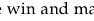

# 论职责

本杰明·帕特里克·牛顿 (Benjamin Patrick Newton)

总编辑：Thomas L. Pangle

创始编辑：Allan Bloom

本杰明·帕特里克·牛顿 (Benjamin Patrick Newton)

献给我的 M. B.

# 致谢

在一本关于*责任*（`officia`）的书中感谢那些像老师、同事和亲人一样友善对待的人是恰当的。这些男女是个人中的佼佼者，他们工作和生活不仅仅是出于实用考虑，而是因为美德本身值得追求。他们从不随波逐流，从不感情用，始终如一，始终周到，这些是我荣幸与他们共事并相识的人。诚心感谢 Charles L. Babcock 和 Charles E. Butterworth，他们分别指导了我的拉丁语和哲学学习；感谢 David S. Pott 和 Thomas L. Pangle，他们在整个写作过程中非常友善地提供了建议和编辑的眼光；还感谢 James F. Pasley，他提供了各种便利；感谢我的父母，以及 Roxann Newton、Susan C.。康奈尔大学出版社的评审员们，感谢 Newton 提供的支持。此外感谢 Leo Strauss，他的 1959 年课程。如果没有这些人，这本书无法完成。

# 序言

你手中的这本书是人类历史上最著名的著作之一。马库斯·图利乌斯·西塞罗是一位罗马政治家、演说家和哲学家。《论责任》（`De officiis`）写于公元前 44 年，当时罗马共和国正处于动荡的末期。西塞罗在书中探讨了道德义务的本质，分析了个人在社会和国家中应当承担的责任。此书由本杰明·帕特里克·牛顿翻译，附有序言、注释和索引，旨在为现代读者提供西塞罗思想的深度视角。在罗马共和国的政治斗争中，西塞罗曾是捍卫共和国的领袖。他的思想，尤其是《论责任》，深刻地影响了后世，包括中世纪的哲学家。阿奎那、蒙德斯鸠、伏尔泰和格鲁秀等等都深受其影响。本翻译旨在为那些无法阅读拉丁语但希望学习这一思想的读者。

## 第一卷

马库斯·图利乌斯·西塞罗出生于公元 106 年的阿皮纽姆。罗马共和国时期的，他属于骑士阶层。他在 24 岁时进入罗马学习法律，并在那里展现了卓越的修辞才华。在罗马共和国的政治斗争中，他是共和国的捍卫。他遵循了学院学派怀疑论。在公元 88 年，回到罗马担任执政官、军事指挥和哲学家。他的一生参与了政治斗争。他的著作非常丰富，但许多《论责任》的版本都存在翻译问题。

完整的译本包括：

- Cicero 的，《论责任》，Walter Miller 译（Cambridge, 1913）
- Cicero 的，《论道德责任》，John Higgin 译（Berkeley, 1967）
- Cicero 的，《De officiis/论责任》，Hardy 译（New York, 1974）
- Cicero 的，《论责任》，M.T. Gray 译（Cambridge, 1991）
- Cicero 的，《论义务》，P.G. Walsh 译（Oxford, 2000）
- Cicero 的，《著作选集》，Michael Grant 译（Hammersworth, UK）。

²骑士阶层（`equites`）是罗马社会阶层，几乎与元老阶层平起。作为罗马骑兵的成员，到第一世纪他们代表了富有。

³关于盖乌斯·马里乌斯（`Gaius Marius`），请参见注释 276。

关于图昆斯·马库斯·塞沃拉（`Quintus Marcus Scevola Augur`），请参见注释 109。

⁵来自罗德斯的阿波罗尼奥·莫隆（`Apollonius Molon`，第一世纪）是一位希腊演说家。

⁶拉里萨的斐罗（`Philo of Larissa`，约公元160-80）是一位学院派哲学家。他遵循其导师的学院派怀疑论。公元 88 年，他来到罗马。对于学院派的简洁解释，请参见词汇表“学院派”；对于详细讨论，请参见解释性论文的第五部分。

⁷狄奥图斯（`Diodotus`，二世纪末-60）是一位斯多葛学派哲学家。西塞罗住在他的家里并成为他的学生。对于斯多葛学派的简洁解释，请参见词汇表“斯多葛学派”；对于详细讨论，请参见解释性论文的第三部分。

⁸斐德鲁斯（`Phaedrus`，约公元140-70）是一位伊德派哲学家。他住在罗马，曾一段时间担任伊德派学校的首领。西塞罗在公元 88 年举行讲座。对于伊德派主义的简洁解释，请参见词汇表“伊德派主义”；对于详细讨论，请参见解释性论文的第四部分。

⁹亚斯卡的安提俄库斯（`Antiochus of Ascalon`，约公元30-68）是一位学院派哲学家。作为拉里萨的斐罗的学生，他放弃了导师的学院派怀疑论，转而采用一种更

# 引言

游学者者马库斯·普皮乌斯·庇索10 和斯多葛学派的西索尼乌斯11 甚至邀请上述的迪奥图斯留在他家中，直到他在公元前 59 年去世。他最亲的终生朋友是爱比鸠派的提图斯·庞波尼乌斯·阿提库12。

西西罗是一个雄心勃勃的人，他迅速爬上了罗马的荣誉体系（`cursus honorum`），即“荣誉之路”。他首先担任法庭辩护，并在公元前 80 年为来自阿米利亚的塞克斯图斯·罗西乌13 的虚假指控进行辩护而声名大噪。在卢基斯·科尔尼琉·苏拉·费利克斯15 的处决名单14 刚刚发生不久，且其部下卢基斯·克里索戈努斯16 执行这些处决仍历历犹新时，二十岁的西西罗选择辩护一个在苏拉生前被克里索戈努斯诬告定罪的人。而他赢了。17。

公元前 75 年，西西罗被选往西西里担任财务官（`quaestor`），这是负责监督共和国财政的官员。他履行了职务职责，因此西西里人请求他在公元 70 年起诉他们的总督盖尤斯·维雷斯18 勒索罪。等到西西罗担任市政官（`edile`）时——一种负责监督公共建筑维护和节日管理的选任官员——他承担了这项任务并成功起诉了维雷斯，击败了昆图斯·霍尔滕西乌斯·霍尔滕苏19 的辩护。后者比西西罗大八岁，当时被认为是对知识理解的权威。在公元前 79-78 年西西罗听他的讲座时，他正担任雅典学院的头目。

+ 10马库斯·普皮乌斯·庇索（公元前 115-61 年）是一位罗马演说家和政治家。他曾在公元前 85 年担任财务官，公元前 72 年担任法官，并在公元前 69 年因在西班牙任督期间获得凯旋。在公元前 67-62 年期间，他担任大庞培的部下军团长。提图斯·庞波尼乌斯·阿提库（公元前 100-32 年）是一位罗马绅士。公元前 85 年，他离开罗马前往雅典学习爱比鸠派哲学，并在那里度过了余生。虽然他继续从事哲学活动，但他积极支持贵族派（`optimates`）。西西罗写给他的二十六封信件中幸存下来的有

13来自阿米利亚的塞克斯图斯·罗西乌斯，见第 2.51 下的注释。

14卢基斯·科尔尼琉·苏拉·费利克斯第二次进军罗马引发了一系列“处决名单”，即受法律许可的杀戮和财产没收，其中包括许多罗马的领袖公民。其目的是从罗马清除苏拉的潜在敌人。

15关于苏拉，见第 1.43 下的注释。

16卢基斯·克里索戈努斯（活跃于公元 1 世纪）是一位希腊释奴，卢基斯·科尔尼琉·苏拉·费利克斯的部下。他与阿皮亚的塞克斯图斯·罗西乌斯的亲属合谋陷害其父，以便以极低的价格购买其财产。西西罗在巨大的风险下成功辩护了罗西乌斯。

17盖乌斯·维雷斯（约公元前 115-49 年）是一位罗马政治家。他曾在公元前 84 年担任财务官，公元前 74 年担任法官，并在公元前 73-71 年担任西西里总督。在西西里任督期间，他为了个人利益严重剥削该省，并在公元前 70 年被西西罗控告勒索。西西罗确定维雷斯逃往了马赛亚，并在余生中一直流亡。

19关于昆图斯·霍尔滕西乌斯·霍尔滕苏，见第 2.57 下的注释。

成为罗马最卓越的辩护者。20。这帮助他在公元前 66 年当选法官（`praetorship`），该职位具有多种功能，如指挥军队或在法庭审判。公元前 63 年，他被选为执政官（`consul`），这是两位任期一年的国家元首兼军队统帅中的之一。在此之前的两个职位，西西罗都是第一次尝试就获得了，且符合最低年龄要求，或许最令人印象深刻的是，他是作为一名“新民”（`novus homo`）获得的。对于这样一个祖先从未担任过元老员的“新民”来说，被接纳元老院更不用说在最高职位上获胜了是极其罕见的。

在西西罗执政那年，卡提林纳21 试图推翻政府。阴谋者主要是一群债台累族的元老员，他们希望抹除债务记录。由于西西罗在罗马的警惕，阴谋被破坏了，尽管不得不派遣一支军队去埃特鲁里亚对抗卡提林纳及其残余军队。暂时伟大的罗马人民授予了西西罗“国父”（`Pater Patriae`）的荣誉头衔。22。当危险过去，西西罗的敌人在克劳狄乌·普尔尔彻23 的领导下，于公元前 58 年将他放逐，理由是他未经审判就处决了作为罗马公民的首席阴谋者。如果盖乌斯·朱利乌斯·凯撒邀请他加入后来被称为“三头同盟”（格纳乌斯·庞培·马格努斯和马库斯·利西尼乌斯·克拉苏）24，这次流逐本可以避免。这个联盟的目的是牺牲公共利益来推进他们每个人的职业。西西罗看穿了这一新阴谋的本质并拒绝了。他在帕拉提尼山的房子和在图斯库姆的别墅遭到毁坏，他被迫逃往马其顿。

一年后，他的朋友保民提图斯·安尼乌斯·米洛25 确保了他的回归，他回到了并到了意大利和罗马的热烈欢迎。三头同盟统治着罗马政治，使得西西罗重新融入政治生活的努力被证明是徒劳的。他感到厌恶，退出了政坛，潜心写作。正是在这段时期，西西罗完成了三部最具政治色彩的作品：公元前 55 年的《论辩说家》（`On Orator`）、公元前 51 年的《国家论》（`On Commonwealth` 或 `The Republic`）以及公元前 50 年左右的《论法》（`On Laws`）。

20关于维雷斯。

21关于卡提林纳，见萨鲁苏斯特。

22关于克劳狄乌·普尔尔彻。

23关于克劳狄乌·普尔尔彻，见第 1.77。

24关于马库斯·利西尼乌斯·克拉苏，见第 1.4。

25关于提图斯·安尼乌斯·米洛，见第 2.5。

26学者推测西西罗在公元前 51 年至50 年之间写过（如果写过的话），为了

# 引言

通过研究逃亡来解读神的意，在公元前 51 年，他被派往昔利基亚省。在西西里担任财务官期间，他证明自己是一位公正的总督。

当凯撒和庞培爆发内战时，西西罗选择了庞培的一方。在庞培于公元前 48 年在法萨卢斯战败后，西西罗得到了凯撒的赦免回到意大利。西西罗的政治生活似乎已终结。然而，他写道：“既然我的思想无法无所事事，我就投入到那些我早年一直从事的追求中；如果我回归哲学，我将最诚实。”

公元前 44 年凯撒被暗杀后，他的部下马库斯·安东尼乌和养子盖乌斯·奥古塔维乌33 正在为共和国而战。西西罗离开国家前往罗马，决心操纵安东尼乌并摧毁他。在元老院对安东尼乌发表演讲34 并行使作为资深前执政官的全部权威（`auctoritas`），西西罗的权威从未像此时。然而，奥古塔维乌和安东尼乌私下约定瓜分共和国之间

³3盖乌斯·奥古塔维乌（公元前 63 年–公元 14 年），后来被称为奥古斯塔。在公元前 44 年凯撒被暗杀后，他采用了养父的名字。盖乌斯·朱利乌斯·凯撒。与凯撒的部下马库斯·安东尼乌和马库斯·埃米利乌·利庇德斯，他加入了后来被称为第二次三头同盟，该联盟统治罗马直到利庇德斯在公元前 36 年流放以及安东尼乌在公元前 31 年的亚克姆海战中失败。现在作为罗马唯一的统治者，他接受了奥古斯塔头衔并成为第一位罗马皇帝，标志着共和国的结束和帝国的开始。

³4见西西罗《斐里尼演讲集》。

……他们。一份新的禁令被拟定出来，安东尼却坚持将西西罗的名字放在了顶端。

当西西罗试图从海路逃跑时，士兵追上了他。普鲁塔克写道，西西罗看到他们走来时，命令仆人放下他坐着的轿子。他定定地注视着那些准杀他的杀手，伸出脖子任人割首，并被杀了。³⁵ 即使是卡多，死时也没有比他更有勇气。

在公元前44年那个动荡的时期，由于他的哲学计划已经完成，而罗马陷入了另一场内战，西西罗写下了《论义务》。鉴于他计划的完成和政治的动荡，《论义务》是西西罗最令人费解的作品。这本书表面上是作为一封信，用来代替计划中的探望儿子，³⁶ 西西罗在日期为10月28日的信中首次提到了这本书，他在信中表示他将就“适当行为”的本质写一部宏大的著作。³⁹ 他又再次写信，报告了11月5日完成的前两本书，随后在11月13日最后提到了一次⁴⁰。鉴于他在12月9日回到罗马并完全投入政治活动，⁴¹ 学者们认为这部作品是在四周内完成的。这种创作速度导致许多学者将那些矛盾的陈述或离题解释为由于缺乏修改时间而导致的缺陷。⁴² 但将在注释和特别是在释义性文中证明，这些“缺陷”中的很大一部分是故意的。它们旨在揭示对“适当行为”更深层次的理解。因此，西西罗撰写《论义务》的速度愈发令人惊叹。

任何翻译过文本并编写过注释的人都可以证明，这一壮举绝非易事。译者的任务是追求基于原意的清晰英语表达；而注释者的任务则是寻求作者的意图并将其传达给读者。所有的编辑者都努力实现这一困难的成就，因此我在对之前的版本进行简短评判之前，先向他们的编辑致以谦卑的敬意。我可能并不总是同意他们的翻译或解读，但我从参考他们的著作中受益受益。

之前版本的问题始于对书名本身及主题的翻译，即 *officium* 一词。Meller、Edinger 和 Atkins 将其翻译为“duty”（义务），而 Grant、Higginbotham 和 Walsh 翻译为“obligation”（责任）。西西罗在希腊语单词 *kathekon* 的拉丁语译文中选择了 *officium*，后者的字面意思是“appropriate action”（适当行为）。⁴⁵ 除了标题之外，⁴⁴ 我更倾向于使用准确得多的“appropriate action”这一译法。西西罗所理解的“duty”和“obligation”概念意味着行为指向了人类关联的维护与培养，或指向道德上的善。并非所有符合人类需求或美德的行为都指向“善”。这些被翻译为“duties”和“obligations”的词并没有涵盖广义上的 *officia*。任何优雅的辞都无法弥补直译的不足。虽然我一贯将 *officium* 翻译为“appropriate action”，但在英语中将这两个词并列有时显得生硬。在这些情况下，我会将分开。然而，读者总会知道 *officium* 正在被翻译，因为“appropriate”和“action”这两个词总是出现在同一个句中。

将 Atkins 对《论义务》1.59 的翻译与我自己的进行对比：

> 但是，在施加所有有用的义务时，要考虑每个人最需要的是什么，以及如果没有我们的帮助将会或无法获得什么。关系纽带的程度与环境程度是不相同的。某些义务是欠某一组人的而非另一组人的。(Atkins)

> 在恰当地执行所有这些行为时，我们必须考虑对每个人来说最需要什么，以及每个人如果没有我们的帮助将无法获得什么。因此，亲疏程度和环境程度是不相同的，某些行为相对于某些人比相对于其他人更具有应当性。(Newton)

之前版本对 *officium* 的问题性翻译，由于其编辑者对描述不同程度适当行为的关键形容词的翻译而进一步恶化。*officium perfectum* 被 Grant 翻译为“perfect”（完美的），被 Atkins 翻译为“complete”（完全的），被 Miller、Higginbotham、Edinger 和 Walsh 翻译为“absolute duty”（绝对义务），而 *officium medium* 被 Miller 翻译为“mean”（普通的/庸的），被 Grant 翻译为“second-class”（二等的），被 Higginbotham 和 Edinger 翻译为“secondary”（次要的），被 Atkins 翻译为“middle”（中间的），被 Walsh 翻译为“intermediate duty”（中间义务）。这些都是有问题的。西西罗对比了两种适当的行为：

即那些“完全”适当的 (*officium perfectum*)，以及那些“通常”或“普遍”适当的 (*officium medium* 或 *commune*)。*Perfectum* 源于动词 *perficer*，是西西罗对希腊语 *kathroma* 的拉丁语替代词，两者都是“彻底完成的事”或“成功实现的事”。我始终将 *officium perfectum* 翻译为“entirely appropriate”（完全适当的）。*Medium* 和西西罗对希腊语 *meson* 的替代词都意味着“中庸的”、“普通的”或“常见的”。因此，我始终将 *medium* 或 *commune* 分别翻译为“ordinarily appropriate”或“commonly appropriate”适当的行为。*officium perfectum* 隐含了中庸的真正美德；*medium* 则暗示了公民的政治美德。

之前的翻译还存在其他问题。例如，*res publica* 被 Miller、Higginbotham 和 Walsh 时代错置地翻译为“state”（国家），被 Grant 和 Atkins 误导地翻译为“republic”（共和国），被 Edinger 多次翻译为“government”、“country”或“state”。*Res publica* 字面意思是“公共事物”或“共同体”。当西西罗使用该术语时，*res publica* 隐含了……

³⁵参见普鲁塔克，《西西罗》48。

³⁶ 关于马库斯·图利留·西西罗小，参见1.1下的注释。

³⁷参见西西罗《书信》16.3, 16.3.6, 16.7.1。

³⁸参见2.45。

³⁹参见西西罗《书信》15.13.6。

⁴⁰西西罗《书信》16.11.4, 16.14.3。

⁴¹参见西西罗《书信》11.5.1。

⁴²参见例如，Andrew R. Dyck, *A Commentary on Cicero, De officiis* (Ann Arbor, MI, 1996), 以及其他地方；Griffin and Atkins, *On Duties, On Obligations*, liii。

⁴⁴参见西西罗《书信》16.11.4, 16.14.3。

⁴⁵正如译者意识到《The Republic》是柏拉图《Politeia》一个糟糕的标题，但尊重长久来的用法，我意识到《On Duties》是西西罗《De officiis》一个糟糕的标题，但保留了它。最准确的标题应该是 *On Appropriate Actions*。参见词表条目“appropriate action”。

重读文本。因此，某些条目的范围比通常术语表中的内容要广泛。

# 关于翻译的几点补充说明

西塞罗不是塔西德，不应像翻译塔西德那样翻译他。他写的是华丽的周期句散文，而不是简洁的格言句。周期句散文的特点是主句很长，或者论点通常位于句子的中间或结尾，跟在一系列支持或修改主句的从句之后。这种散文并非仅限于此类句子，但其中充斥着大量此类句子。使用得当，周期句是有力且华丽；使用不当，它则冗长且做作。编辑者往往为了易于阅读而拆分西塞罗的句子。诚然，他的句子有时在英语母者听来有些刺耳，如果它们没有被拆分。同样真实，正如西塞罗本人所指出的，他的哲学著作是用更有有力的演说风格写成的。但《论义务》中“干练且节制的风格”仍然是用周期句写成的，只要可能，我都试图通过很好地运用句间的衔接来捕捉其节奏。读者会感觉自己正在阅读一位雄辩“宏大风格”的大师。翻译《论义务》将耗尽其散文的活力和修辞力量，从而剥夺西塞罗最有效且焕然一新的声调。

此外，西塞罗几乎从不用省音（`elision`），因此译者使用缩写词是不恰当的。本译者尊重地在译文中消除了所有撇号的使用。

本译文基于 M. Winterbottom 的文本。[47] 由于古典拉丁语文本不使用空格、标点符号或大小写，Winterbottom 插入了这些内容，我在很大程度上遵循了他的文本，仅极少数偏离。有时我求助于批判性校勘，并在注释中标记更改。被括号括起来的可能是插入内容的部分（我对此表示赞同）也被放在了注释中。我唯一一次偏离 Winterbottom 的情况是在改写对话交流。这些交流旨在为论文引入辩证法元素，并引发可能引起争议的问题。这在第三书中尤为明显，该章明确讨论了高尚与实用之间可能存在的冲突。对于历史引用，我查阅了《牛津古典词典》第二版和第四版；[48]

46 见 1-3。

# 引言

除非另有说明，此处所有的译文均为我本人翻译；由于书中所有的工作都是我完成的，因此书中所有的错误也在我负责。最后，随着这本书的出版，我试图纠正我年轻时的一篇文章。虽然我当时尝试调查的内容仍可言，但此后我发现其中的许多方法和许多结论都是错误的。我仍然认为第二版优于后续版本：它的条目简洁客观，主要引用原始文献，且相对不受学术时尚热潮的影响。我根据需要使用了第四版来补充第二版。

# 论责任

你将继续从我们时代杰出的哲学家那里学习，并且只要你愿意就可以一直学下去——也就是说，只要你愿意学习，并对自己的进展感到满意。⁵在阅读我的著作时，由于我的作品与游历多学派者并无二（因为我们都希望成为苏格拉底主义者柏拉图主义者），你必须对这些事情运用你自己的判断；我不会干涉。尽管如此，阅读这些著作无疑会提高你的拉丁语演讲水平。诚实地说，我不希望被认为是以傲慢的态度说这些。在哲学知识方面，我让位于许多人；但在雄辞家这一特殊领域，即恰当、清晰且简洁地言说，我在这一追求中耗费了终生，如果我将这一荣誉归于自己，似乎仅仅是根据自己的权利主张它。

(3) 因此，我非常敦促你，亲爱的西西罗，不仅要积极阅读我的演说，还要阅读我的哲学著作，这些著作与演说几乎平齐。虽然前者力量更大，但后者平和而温和的话语也必须得到培养。事实上，我看到希腊人在两种类型上都付出了努力，既追求那种法庭式的演说，也追求这种更安静的讨论。除非法勒姆的德米特里斯⁷可以被算作他们中的：一位敏锐的后裔，一位克制、令人悦的雄辞家，你可能在提奥弗拉图的学生身上认出他。但我为他人成就了多少，由由来评判；无疑，我追求了很多。(4) 我相信柏拉图⁹曾希望进行法庭式的言说，他本可以做得非常庄重且丰富；而德摩西斯底尼¹⁰则保留并宣扬了他从柏拉图那里学到的东西，他本可以做得清晰而精妙。

> ⁶ 西西罗《论责任》，3.21。此后所有引用《论责任》的内容均包含卷号和章节号，但不包含标题。

> ⁷ 拉丁语原文具有歧义性，可以指数量相等，也可以指质量相等。

> ⁸ 法勒姆的德米特里斯（约公元350–280年）是一位雅典政治家、提奥弗拉图的学生，也是最早的游历学派者之一。他被马其多尼亚统治者卡西山德任命为公元前317年至300年间的雅典学生，后来他被德米特里斯·波里奥尔凯克斯驱逐。西西罗赞他为拉丁语哲学家王的卓越典范。

> ⁹ 提奥弗拉图（约公元370–285年）是留斯博斯的希腊人，亚里士多德的学生以及亚里士多德在学院的继承者。游历学派在其三十六年的任期内进行教学，期间他发表了著作，但只有极小一部分流世。

> ¹⁰ 柏拉图（约公元429–347年）是一位雅典哲学家，学院的创始人。作为苏格拉底的学生，在苏格拉底被处死后，他前往埃及、意大利和西西里与毕达哥拉斯学派学习。他就各种主题撰写了大量的哲学对话录。柏拉图在古代的哲学地位以及他对西西罗的影响无论如何强调都不为过分。

> ¹¹ 德摩西斯底（公元384–322年）是一位雅典政治家和雄辞家。他可能是柏拉图和亚里士多德等老师的学生。他通常被认为是希腊最伟雄辞家，西西罗也认同这一点，称他为“完美的雄辞家”。他的许多演说存世。参见西西罗《布鲁塔斯》，35。

我判定关于亚里士多德¹¹和伊索克拉底¹²，他们每个人都沉迷于自己的追求，并鄙视对方。

但既然我决定此时此刻给你写些什么，以后其他时候会写更多，我特别希望从最符合你的时代和身份的内容¹³开始。尽管在哲学中，哲学家们仔细且详尽地讨论了许多重用的内容，但最易获取的似乎是那些关于恰当行为以及从中推出的准则的内容¹⁴。事实上，生活的任何部分，无论是公共、私人还是谦卑，无论是在你的处世中还是在与人的交往中，都不可能脱离恰当的行为。生活中所有的高尚都源于对此的培养，而忽视它则是耻辱。

(5) 诚然，这是所有哲学家共同的问题。因为有谁是不看重恰当行为并敢于自称为哲学家的呢？但有些老师¹⁵在他们提议的善恶终极中，颠覆了所有恰当的行为¹十六。某人认为最高的善与美德无关，并根据自己的利益而非高尚来衡量它，这样的人如果他想要保持一致且不屈服于其本性的善，他就无法培养友谊、正义或慷慨。诚实地说，如果他判断错误，他绝无法变得勇敢；如果他诉求最高善，他也无法变得节制¹⁷。尽管这些事情是如此显而易见，以至于无需讨论，尽管如此，我已经在其他地方讨论过它们¹⁸。

> ¹¹ 亚里士多德（公元384–322年）是一位雅典哲学家、柏拉图的学生以及亚历山大大大的老师。在柏拉图去世后，他创立了自己的学校——吕学院。虽然他发表的著作均未存世，但运气保留了他的“讲义笔记”，被称为亚里士多德在吕学院柱廊间散步时的讲演。西西罗称亚里士多德的哲学仅次于柏拉图，天才仅次于后者。参见西西罗《辩论》，1.22。

> ¹² 伊索克拉底（公元前43–12年）是一位雅典雄辞家。他通常被认为仅次于德摩西斯底。他的演说中有二十篇存世。

> ¹³ 拉丁语原文具有歧义性，可以指时代，也可以指身份（威望/权威）。

> ¹⁴ 事实上看到希腊人在两种类型上都付出了努力，既追求那种法庭式的演说，也追求这种更安静的讨论。……事实上，最易获取的似乎是那些关于恰当行为以及从中推出的准则的内容。

> ¹⁵ ……在他们提议的善恶终极中，颠覆了所有恰当的行为。

> ¹⁶ 某人认为最高的善与美德无关，并根据自己的利益而非高尚来衡量它，这样的人如果他想要保持一致且不屈服于其本性的善，他就无法培养……（此处）。

> ¹⁷ 诚实地说，如果他判断错误，他绝无法变得勇敢；如果他诉求最高善，他也无法变得节制。

> ¹⁸ ……尽管如此，我已经在其他地方讨论过它们。

> ¹¹ 亚里士多德（公元384–322年）是一位雅典哲学家、柏拉图的学生以及亚历山大大大的老师。在柏拉图去世后，他创立了自己的学校——吕学院。虽然他发表的著作均未存世，但运气保留了他的“讲义笔记”，被称为亚里士多德在吕学院柱廊间散步时的讲演。西西罗称亚里士多德的哲学仅次于柏拉图，天才仅次于后者。参见西西罗《辩论》，1.22。

> ¹² 伊索克拉底（公元前43–12年）是一位雅典雄辞家。他通常被认为仅次于德摩西斯底。他的演中有二十篇存世。

> ¹³ 拉丁语原文具有歧义性，可以指时代，也可以指身份（威望/权威）。

> ¹⁴ 事实上看到希腊人在两种类型上都付出了努力，既追求那种法庭式的演说，也追求这种更安静的讨论。……事实上，最易获取的似乎是那些关于恰当行为以及从中推出的准则的内容。

> ¹十五 ……在他们提议的善恶终极中，颠覆了所有恰当的行为。

> ¹十六 某人认为最高的善与美德无关，并根据自己的利益而非高尚来衡量它，这样的人如果他想要保持一致且不屈服于其本性的善，他就无法……（此处）。

> ¹⁷ 诚实地说，如果他判断错误，他绝无法变得勇敢；如果他诉求最高善，他也无法变得节制。

> ¹⁸ ……尽管如此，我已经在其他地方讨论过它们。

(6) 这些老师，如果他们想要保持一致，就不谈论恰当行为。(7) 既然，我长期以来在斯多葛学派²⁰讨论恰当行为，且游历学派²²²⁵我没有让儿子去向游历学派⁶。

> ²⁹ 斯多葛学派。

> ²⁰ 斯多葛学派。

> ²¹ 斯多葛学派。参见西西罗《辩论》，1.22。

> ²² 游历学派。

> ²⁴ 游历学派。

> ²⁵ 亚里士多德（公元384–322年）是一位雅典哲学家、柏拉图的学生以及亚历山大大大的老师……（此处重复）。

> ⁶ 游历学派。

关于任何主题都应当从定义开始，以便我们理解所讨论的内容究竟是什么。

对恰当行为的探究是双重的。第一部分涉及善的终极；第二部分基于准则，这些准则的使用可以塑造生活的各个方面.^29 前一类的例子包括：所有行动是否都可能是“完全”恰当的，某个行动是否比另一个更恰当，以及此类其他的问题。后一类恰当行为的准则虽然仍涉及善的追求，但其关联性并不明显，因为它们似乎更倾向于对日常生活事务的指导。我在这些书中必须解释的正是这一类内容。

(8) 恰当行为还有另一种划分：所谓的“通常性”恰当的行为和“完全”恰当的行为。^30 在我看来，我们可以将恰当的行为称为“正确的”（`correct`），^31，因为希腊人称之为 `*kathoroma*`；但这种恰当的行为，他们称为 `*meson*`。^32 因此，他们对这些事物的定义是：将正确的定义为完全恰当的行为；而通常恰当的行为之所以被称为这种行为，是因为为这样做提供了一个合理的理由。^33

(9) 那么，根据这种审量，在帕内提斯（`Paenetus`）看来问题是三个方面的。首先，人们怀疑正在审量的某项行动是光荣的还是耻的；在这些考虑中，他们的思想往往会被相反的情感所吸引。其次，检查或决定他们所审量的内容是否有助于生活的利益和愉悦、资源和富足、影响力和权力，^54，通过这些他们可以……

我们只拥有他以及所有早期斯多葛学派著作的残篇。关于斯多葛学派的信息大部分来自西西罗的《论责任》和《论神性》。将西西罗思想精髓归功于帕内提斯，充其量是一项有成效的尝试，最坏的情况下则是表明某种过时的德国“文献批判”（`Quellenforschung`）。在《论责任》的每一书中，西西罗都规定他对比斯多葛学派的总体、特别是对帕内提斯的使用是带有保留的（见 1.6, 2.60, 3.7）。当他提到帕内提斯时，几乎总是为了进行批判（见 1.7, 1.10, 1.152, 1.261, 2.88, 3.7ff, 3.33）。正如西西罗多次提到的那样，他不是一个斯多葛学派，而是一个学术派怀疑主义者（2.27–2.28, 3.30）。

^33见 3.14–16。另见词表“恰当行为”。

^34拉丁语：`*rectum*`。字面意思是“直的”、“正确的”或“恰当的”。在这里西西罗将 `*rectum*` 用于部分：“通过使用”或“生活可以在各个部分得到塑造”。恰当行为的这部分并未与实用性脱节。

^35阅读时遵循 Winterbottom 的建议用 `*meson*` 代替 `*kathekon*`。另见 Dyck 的 `*A Commentary on Cicero, De Officiis*`, 78–80。

^36拉丁语：`*potentiam*`。字面意思是“权力”。虽然拉丁语在广义的 `*potentia*` 和法律赋予的权力 `*potias*` 之间做了区分，但西西罗在《论责任》中两者互用。因此，它们自身和它们自己的；^{35}所有的审量都属于实用性的范畴。第三，当看似有用的事与看似光荣的事冲突时，存在一种怀疑；当实用性似乎将我们引向它的目标，反之，光荣似乎将我们召回它的目标时，思想会被这种审量所吸引，并对其反思产生双重关注。

(10) 尽管遗漏任何事情都是最大的恶，但在这种划分中遗漏了两件事。因为我们不仅习惯于审量某事是光荣的还是耻的，而且在两个光荣的选择之间，哪个更光荣；同样，在两个有用的选择之间，哪个更有用。因此，帕内提斯认为推理的主题应当分为五个部分。因此，首先必须讨论光荣的事，但要以实用的方式；接着，用同样的推理；最后是对两者进行比较。^{36}

(11) 自然赋予每种生物的使命是保护自身的生命和身体，避免那些可能造成伤害的因素，并寻找^{37}提供生活所需的一切事物，如食物、住所和其他同类事物。^{38}所有生物的共同点是为了繁衍而结合的欲望，并对后代表现出某种程度的关注。但人与兽之间有特殊区别：兽被激发仅仅是为了投入到眼前当下的事务中——且仅此如此——而对过去或未来的意识极少。^{39}但人类由于拥有理性，这使他能够辨别后果，因此可以感知事物的因。他对事物之前的发展（即其前因）并非无知；他比较相似之处，将未来的事件与现状应用并联系起来；他能轻松感知自己一生的整个过程，并为生活下去做好准备。^{40}

^41拉丁语：`*seus*`。字面意思是“他们自己的”，包括一个自己的家庭、朋友、客户等。\^{42}见 37。^{43}拉丁语，字面意思是“探究”或“寻找”。而 `*inquirere*` 一直被译为“检查”。见 3.56 下的注释。^{44}

(12) 自然赋予每种生物的使命是保护自身的生命和身体，避免那些可能造成伤害的因素，并寻找^{37}提供生活所需的一切事物，如食物、住所和其他同类事物。^{38}所有生物的共同点是为了繁衍而结合的欲望，并对后代表现出某种程度的关注。但人与兽之间有特殊区别：兽被激发仅仅是为了投入到眼前当下的事务中——且仅此如此——而对过去或未来的意识极少。^{39}但人类由于拥有理性，这使他能够辨别后果，因此可以感知事物的因。他对事物之前的发展（即其前因）并非无知；他比较相似之处，将未来的事件与现状应用并联系起来；他能轻松感知自己一生的整个过程，并为生活下去做好准备。^{40}

^41见 1.50。

^43介绍了公正的美德及其共同利益——仁惠。

^44拉丁语：`*quae exercuitat animos et magistres ad rem gerendam fac*`。字面意思是：“这种关注进一步激发了他们的精神，使他们在处理事务时更加强大。”在句法上，西西罗引入了慷慨之美德。另见 1.13 结尾。

^45见 1.105。

^46见 2.6。

^47由此引入了得体的最终美德。

从这些事物中锻造并产生了我们所追求的事物：高尚，即使它没有被推崇，它依然是高尚的；因为我们真正所说的“高尚”，是指那种即使只被一个人赞美，它在本质上也是值得赞誉的。

(15) 马库斯，我的儿子，你正在看到高尚的本质形式，也可以说是它的面貌：正如柏拉图所说，“如果这种东西能被眼睛察觉到，它将激起对智慧的非凡热爱。”它一切源于我们内在的某一部分：要么在于彻底地认知和感知真理；要么在于维护人类的交往，给予每个人他应有的，并对所做的约定保持诚信；要么在高尚且不可战胜的精神的伟大与力量中；或者在所有言行的秩序与适度之中，这其中包含了自律与节制。

尽管这四者紧密结合并相互联系，但每种属性都会产生特定的、适当的行为。上述描述的第一种美德（我将其视为智慧）致力于真理的探究与发现：这是它的特征功能。(16) 因此，凡是能清晰感知到此中最真理的人，凡是能最敏锐、快速解释其原理的人，理理被认为是最审慎且富有智慧的。因此，可以说，这种美德所处理和涉及的主题是真理。

(18) 现在，关于我们将高尚的本质和力量分为四个部分，第一部分（对真理的探究）特别属于人性的。因为我们都要都被一种探究和求知的渴望所吸引和引导，并认为这种卓越是美的；但对于错误、失误、无知和被欺骗，我们认为是坏的且耻辱的。

> 46 参见柏拉图，《斐德篇》250d。

> 47 拉丁语：`sui suis`。参见 1.9 下的注释。

## 第一卷 29

在此类天生且高尚的美德中，存在着必须避免的恶习。我们不能将未探究的事物视为已探究，也不能草率地同意它们。想要避免这种恶习——以及所有想这样做的人——将花费时间仔细思考它们。(19) 第二，某些人的恶习是对晦涩困难的问题投入过度的关注和精力——同样是不必要的。通过避免这些恶习，值得努力的事物可以放在高尚的事业中，并赢得赢得赞誉。例子包括我听过的占星家盖尤斯·苏尔皮修斯（`Gaius Sulpicius`），我所熟悉的几何学家塞克斯图斯·庞培乌斯（`Sextus Pompepeius`），以及许多辩证学者和民法学者。所有这些艺术都涉及真理的探究。

投身于那些让我们远离事务的追求并非美德的体现，因为一切美德在于行动。然而，这种活动往往是此类欲望的来源，许多人获得了机会回归这些欲望。此外，我们永不停歇的智力活动即使在我们不努力的情况下也让我们处于探究之中。但在经过反思和心灵活动后，我们的心灵将要么关注高尚事务的建议以及通往幸福生活相关的事题，要么致力于知识与探究。

我已经提到了适当行为的第一种来源。(20) 在其余三种中，应用最广泛的是使人类交往和（可以是）共同生活得以维持的推理。这包含两个部分：正义，那种最耀眼的美德，人们因它而被称为“善人”；与之相关的是仁爱，它同样可能是仁慈也可能是慷慨。

我始终将所有无人人称的表达翻译为“我们”或“人”，因为拉丁语经常使用复数形式。在更合适的情况下，我也将“我们”翻译为“人”。这包含两个部分：

- 正义：那种最耀眼的美德，人们因它而被称为“善人”。

- 仁爱：它同样可能是仁慈也可能是慷慨。

我始终将所有无人人称的表达翻译为“我们”或“人”，因为拉丁语经常使用复数形式。这包含两个部分：

- 仁爱：它同样可能是仁慈也可能是慷慨。

我始终将所有无人人称的表达翻译为“我们”或“人”，因为拉丁语经常使用复数形式。例如，赢得马其顿战争（公元前168年）的卢修斯·埃米利乌（`Lucius Aemilius`）在表达意时使用了“我们”。这在拉丁语中很常见，但在英语中使用“人”更自然。在符合语境的情况下我是这样做的。

(21) 关于适当行为的第一部分——正义，人们常说正义是给予每个人他应得的东西。但人应得的是什么？是使自己是有用的，是值得信赖的，并且不被伤害。这就是正义的定义：给予每个人他应得的东西。

(22) 适当行为的第二部分是仁爱，即对他人善。但什么是善？是使我们对他人是有用的，并且不被伤害。这就是仁爱的定义：对他人善。

(23) 第三部分是慷慨，即慷慨地给予他人。但什么是慷慨？是使我们对他人是有用的，并且不被伤害。这就是慷慨的定义：慷慨地给予他人。

# 第一部分：适当行为的九个部分

## 节制、秩序、恒心、适度、勇气与智慧

(24) 第四部分是节制，即以正确的方式行动。但什么是正确的方式？是以合宜的方式行动，并使我们对他人是有用的，并且不被伤害。这就是节制的定义：以正确的方式行动。

(25) 第五部分是秩序，即处于正确的位置。但什么是正确的位置？是使事物井然有序，并使我们对他人是有用的，并且不被伤害。这就是秩序的定义：处于正确的位置。

(26) 第六部分是恒心，即保持正确的状态。但什么是正确的状态？是目标的一致性，并使我们对他人是有用的，并且不被伤害。这就是恒心的定义：保持正确的状态。

(27) 第七部分是适度，即以适的尺度行动。但什么是适的尺度？是以中道行动，并使我们对他人是有用的，并且不被伤害。这就是适度的定义：以适的尺度行动。

(28) 第八部分是勇气，即站在正确的位置。但什么是正确的位置？是站在正确的位置，并使我们对他人是有用的，并且不被伤害。这就是勇气的定义：站在正确的位置。

(29) 第九部分是智慧，即知晓正确的事。但什么是正确的事？是知晓真理，并使我们对他人是有用的，并且不被伤害。这就是智慧的定义：知晓正确的事。

## 正义的定义

现在适当行为的第一部分——正义，人们常说正义是给予每个人他应得的东西。但人应得的是什么？是使自己是有用的，并且不被伤害。这就是正义的定义：给予每个人他应得的东西。

# 第二部分：恶习

但还有另一种行为是不适当的。这些是恶习。

## 不义

第一种恶习是不义，它是正义的对立面。是给予每个人他不应得的东西，或剥夺他应得的东西。这使我们对他人没有用处，并且在伤害他们。这就是不义的定义：给予每个人他不应得的东西。

## 恶意

第二种恶习是恶意，它是仁爱的对立面。是伤害他人，或不行善。这使我们对他人没有用处。这就是恶意的定义：对他人善。

## 吝啬

第三种恶习是吝啬，它是慷慨的对立面。是不给予，或给予太少。这使我们对他人没有用处，并且伤害他们。这就是吝啬的定义：不给予。

## 放纵

第四种恶习是放纵，它是节制的对立面。是以错误的方式行动，或以错误的尺度行动。这使我们对他人没有用处，并且伤害他们。这就是放纵的定义：以错误的方式行动。

## 混乱

第五种恶习是混乱，它是秩序的对立面。是失去秩序，或使事物混乱。这使我们对他人没有用处，并且伤害他们。这就是混乱的定义：失去秩序。

## 不恒心

第六种恶习是不恒心，它是恒心的对立面。是目标变不一，或改变主意。这使我们对他人没有用处，并且伤害他们。这就是不恒心的定义：目标变不一。

## 过度

第七种恶习是过度，它是适度的对立面。是以按过度的尺度行动，或超过所需的度。这使我们对他人没有用处，并且伤害他们。这就是过度的定义：超过所需的度。

## 胆怯

第八种恶习是胆怯，它是勇气的对立面。是站在错误的位置，或逃离正确的位置。这使我们对他人没有用处，并且伤害他们。这就是胆怯的定义：站在错误的位置。

## 愚昧

第九种恶习是愚昧，它是智慧的对立面。是不知晓真理，或知晓虚假。这使我们对他人没有用处，并且伤害他们。这就是愚昧的定义：不知晓真理。

# 第三部分：义务

但还有另一种行为是适当的。这些是义务。第一项义务是正义。第二项义务是仁爱。第三项义务是慷慨。第四项义务是节制。第五项义务是秩序。第六项义务是恒心。第七项义务是适度。第八项义务是勇气。第九项义务是智慧。这些是一个好人的义务。但我们还必须考虑属于我们的义务。这些是作为父亲、母亲、朋友、丈夫、公民和人类的义务。

# 第四部分：信任与伤害

让我们接受：信任（`fides`）之所以被称为信任，是因为所言的应当被诸行（`fiat`）。

但伤害也有两种：第一种，是施加伤害的人；第二种，是那些有能力却不阻止施加在他人身上的伤害的人。因为对于那些不公正攻击他人的人，无论是因为愤怒的煽动还是由于其他情绪的扰动，那个人似乎都向所有人举起了手。而那些同样有能力，却既不防御也不反对施加在他人身上的伤害的人，其其邪恶程度就如遗弃了自己的父母、朋友或国家一样。

## 第一种伤害的动机

(24) 至于第一种伤害，有些是为了造成危害而蓄意施加的；有些则是出于恐惧而持续的——当某人想要伤害他人时，担心如果不这样做，自己就会招临某种不幸。但对于大多数人来说，尝试这种伤害是为了获得他们渴望的事物，而其最广泛的动机是贪婪。

(25) 因为人们追求财富，不仅是为了生活的必需需要，$^{63}$，也是为了享受快乐。在志向较高的人那里，对金钱的渴望旨在影响力和满足他人的能力。例如，马库斯·克拉苏$^{64}$ 最近拒绝认为任何金额的钱足以让一个想要在共和国中繁荣的人满意，尽管他和凯撒对此并找不到任何办法。华丽的装饰和由优雅与富足培养的生活也令人快乐；这些结果导致了对金钱无尽的渴望。事实上，在没有人受到伤害的情况下，扩大自己的财富不应受到谴责，但必须始终避免造成伤害。

(26) 此外，当大多数人祈求渴望公职、荣誉和名望时，他们如此疯狂以至于忘记了所有对正义的考虑。恩尼乌斯说：

> 没有任何神圣的结合是属于王权的$^{66}$

$^{63}$拉丁语：`usus vitae necessae`. 字面意思是：“生活的必需需要”。

$^{64}$马库斯·利西尼乌·迪维斯（公元115–53年）是一位罗马将军和政治家。他职业生涯早期在科尔尼留·费利克斯的领导下反对反对盖斯·马里乌（公元88–82年）的战争，后来镇压了斯帕塔库库隶起义（公元73–71年）。他因其惊人的财富以及与尤利乌·凯撒、格纳纳乌·庞培士·大帝组成第一三同盟成员而闻名。他在公元53年的卡尔海战役中死，那是他对帕提帝国发起的一次失败行动。

$^{65}$昆图斯·恩尼乌斯（约公元239–169年）是一位罗马诗人。他对拉丁文学的影响是巨大的，尽管他的作品只存有残片。西西罗经常引用他。

$^{66}$出自恩尼乌斯的一位未知诗人的诗句。有人推测它出自《提伊斯泰斯》。参见迪克，《西西罗评注：论义务》，第120页。

这句话具有广泛的意义。因为每当出现许多人无法表现卓越的情况，通常会发生激烈的斗争，在其中要保持一种“神圣的结合”异常困难。这最近通过盖斯·凯撒的鲁莽得到了证明：$^{67}$他推翻了所有的正确原则——$^{68}$无论是神性的还是人性的——只为了一个他错误认为属于自己的卓越地位。这种情况下额外令人困扰的是，对荣誉、统治、权力和名望的渴望在不安的心灵和高尚的人格中产生$^{69}$。因此，当我们在这种情况下违规时，情况更是如此。

(27) 但尽管存在所有不公正，伤害是由于内心的扰动（通常是短暂且瞬时性的）$^{70}$，还是预谋并有计划的，是有很大区别的。由于某些冲动情绪而发生的前者，比经过构思和准备的后者更具反复无常。

## 忽视防御的伤害

关于施加的伤害已经说得足够了$^{71}$（然而，忽视防御和放弃适当行动有许多原因。例如，人们可能因为没有功劳或努力而拒绝承担这种防御；或者因为疏忽、懒惰、懈怠；或者被某些偏离或职业所阻碍，以至于他们本应该保护的人被遗弃了。因此，我们必须看到柏拉图关于哲学家的说法实际上是正确的：因为他们关注对真理的探究，蔑视人们强烈渴望和激烈争夺的无价值之物，所以他们，即哲学家是正义的$^{17}$。诚然，他们实现了一种正义——不通过造成伤害来伤害他人——但他们在另一个方面失败了。由于他们对正义的投入，他们放弃了本应该保护的人。因此他们认为，除非被迫，否则不应参与公共事务。但自愿地这样做更为公正；因为这本身就是正义的——正确做的事是自愿完成的。(2) 还有一些人，无论是出于对财产的热爱还是对人类的某种仇恨，只顾自己的自己的事，似乎伤害了他人。这些人逃避了第一种不公正，却落入了另一种陷阱；也就是说，他们通过不贡献任何奉献、努力或能力而放弃了共同生活$^{12}$。

$^{67}$盖斯·尤利乌·凯撒（公元100–44年）是一位罗马政治家。凯撒最初通过违背卢基乌·西拉要求与其妻子（西拉的敌人科尔尼利亚的女儿）离婚而获得关注。在她去世后，凯撒遵循了“荣誉阶梯”（或“荣誉之路”），这开启了他的罗马政治生涯，最终在公元59年担任执政官。为了帮助他的事业，他创建了第一三同盟，这是一个由格纳纳乌·庞培士·大帝和马库斯·克拉苏组成的强大联盟。执政后，凯撒成为高尔和伊利里亚姆总督。然后，他发起了一系列针对高尔人的长期战争（公元58–50年），并在《高尔战记》中记录了这些战争。当由马库斯·波西乌·卡托·乌提卡领导的元老院要求他放下武器并返回罗马时，凯撒著名地跨越了划分高尔省与意大利的边界。通过这样做，他发起了针对昔日格纳纳乌·庞培士·大帝和老马库斯·波西乌·卡托·乌提卡的内战（公元49–45年）。他在《内战记》中写了这一切。内战的成功让他成为罗马的主人。荣誉和奖励是由低头的元老院授予他的，最终导致他被任命为终身独裁。这迫使他为许多元老奔波，而这些元老们在公元44年三月十五日策划并实施了刺杀他的行动。

⁷⁷$拉丁语：`iura`。参见词表条目“权利/公正”。

$^{68}$拉丁语：`ingenii`. 字面意思是：“天性”。`Ingenium` 涉及到人的天生的“位置”或“倾向”，也涉及“能力”。我一直将其翻译为“性格”，以完美保留其含义。

$^{69}$拉丁语：`ad tempus`. 字面意思是：“在当时”或“视情况而定”。$^{17}$参见柏拉图，《泰阿德德》173d-e，《共和国》5246ff。

$^{12}$拉丁语：`vitae societatem`. 字面意思是：“生活的结合”。为了在英语中通顺，必须用字面意思替换概念含义。

$^{13}$提真斯·阿费里乌（约公元190–159年）是一位罗马诗人。他的全部六部剧作均传世。

$^{14}$参见提真斯，《自虐者》77。

$^{15}$参见 3.95。

$^{16}$参见 1.23。

# 第五部分：恰当行为的判断

(3) 既然我们已经对两种不公正归因了原因，并在此之前确定了维持正义的事物，除非我们陷入过度的自爱，否则我们现在能够判断在每种情况下什么是恰当的行为。是的，关注他事务是困难的。尽管提真斯说“认为这完全是不人性的”，然而我们对感知和感受对自己有利或不利的事物比对他人更多，我们把后者看作来自远方，并对自己的事物做出不同的判断。这类人建议我们禁止任何我们可能怀疑公正或不公正的行为。因为正义本身是显而易见的；怀疑则标志着对伤害的考虑。

## 承诺与义务的例外

(31) 尽管如此，经常会出现这种情况：那些特别看起来值得人类拥有、且我们称某人为“好人”的事物发生了变化并变得相反。例子包括向疯子归还存款$^{15}$、履行承诺，这些事情涉及真理和诚信。现在，这样做这些事情是正义的。因此，回到我们最初设定的对正义至关重要的原则是恰当：第一，不伤害他人，第二，服务公共利益$^{16}$。当这些事物随情况发生变化时，

适当的行为会发生变化，并不总是保持不变。77 (32) 因为可能出现某些承诺或协议对受承诺者或对许下承诺者来说都是徒劳的。78 例如，正如在寓言中所述，如果海王波塞没有履行他对忒修乌斯的承诺，忒修乌斯就不会失去他的儿子希波吕特斯。正如所记载的，由于他给予了三个愿望，79 他的最后一个愿望是：在愤怒之下，他许愿希波吕特斯死掉。愿望实现了，忒修乌斯感到极大的悲痛。80 因此，对于对承诺对象毫无用的承诺，不应该遵守；同样，如果一项承诺对你的伤害大于对受承诺对象的益处，你也不应为了优先考虑大局的利益而采取不当的行为81。再次，如果你在某个法庭上担任辩护，在此期间你的案件变得非常严峻82，不要采取不当的行为来违背诺言。不，反而是你所承诺的那个人背离了适当的行为；83 即使他抱怨你抛弃了他。因为难道没有人看出，如果有人通过恐惧或欺诈强迫84，承诺是无法实现的吗？事实上，许多此类约定根据执法者的权利法律是无效的85。

## 对公正的恶意解读

(33) 诚然，对公正的诽且极其狡猾的恶意解读会导致损害。86 正因如此，“最大的伤害”这句话在对话中已成为家喻。87 对于这类行为，即使在公共事务中也犯了许多错误，例如某个人与敌人达成三十天的休战，却在夜晚荒废了他们的土地，声称真理所描述的是白天而非夜晚。⁸ 我们也无法赞同昆图斯·法比乌斯·拉贝奥的情况⁸9——如果确实是他或其他别人的话，因为我仅是听道而闻。他被元老院任命为诺利亚人和尼奥利坦人之间边界争议的仲裁员。当他到达该地区时，他分别与双方交谈，敦促他们不要轻率行事，不要贪婪，要退守而非进取。当双方都这样做之后，中间还留下了大量的土地。他按照这两个民族指定的规定划定了边界，并将中间剩余的部分判给了罗马人。这是*欺骗*，而非裁决。因此，必须避免所有此类小机巧。

(34) 此外，有些行为即使对于那些曾受到过你伤害的人也应当被恰当地遵守；因为报复和惩罚是有限度的。我甚至想，是否是因为犯罪者对自己的伤害感到后悔，或者是因为他们以后也会做这种事，因此他人在造成伤害时会更加犹豫。

# 第六部分：战争法

特别是，战争法在公共事务中必须被遵守。现在仲裁有两种形式：一种通过讨论，另一种通过武力。前者是人类的特征，后者是野兽的特征，如果不被允许使用前者，我们必须求助于后者.¹⁹⁰ (35) 出于此原因，必须这样做：以便我们能够和平地、不受伤害地生活.¹¹ 但当获得胜利后，那些在战争中并不残酷、并不残暴的人必须被宽恕。我们的先祖正是授予了图斯库尔人、埃奎安人、沃尔斯基亚人、萨宾人和赫尔尼库人公民身份；⁹¹²

...（根据提供的片段继续的 OCR 文本）... [注：根据提供的来源，后页的 OCR 文本是碎片化的，在此处已合并。]

> ⁸⁸ 希罗多德，《史记》6:78–79；以及普鲁塔克的，《斯巴达人的格言》，223a。

> ⁸⁹ 昆提乌斯·拉贝奥（公元前 2 世纪）是一位罗马政治家。他在公元前 183 年时期。

> ⁹⁰ 拉丁语：`iura belli`。字面意思是“战争的原则”或“战争中的公正”。我将 *iura belli* 和 *bellum* 都翻译为“战争法”。

> ⁹¹ 马基雅维利，《君主论》，第 18 章，马基雅维利引用了这句名言，“它为了迎合新的公众改变了含义，强调实用性的优先地位：你必须知道有两种战斗方式：一种依靠法律，另一种依靠武力。前者属于人类，后者属于野兽。前者是理性的，后者是本性的……（此处重复多次）。”[OCR 来源截断]

> ⁹² 柏拉图，《法律》62d；亚里士多德，《政治学》133a。

> ⁹³ 拉丁语：`in civitat etiam`。字面意思是“成为公民”。

> ⁹⁴ 努米底亚是西班牙北部的凯尔特部落王国。它对凯尔特战争的最后阶段起到了关键作用

> ⁹⁵ 卡太基是位于今突尼西亚的一个强大城市。罗马与迦太基进行了三次战争：第三次是在非洲打的。

> ⁹⁶ 科林斯是一座古希腊城市。

> ⁹⁷ 古科林斯（相对于现代科林斯）……（此处重复多次）[OCR 来源截断]

> ⁹⁹ 西塞建议不要与盖伊·尤利斯·凯撒开战……

## 费提亚法与战争的正义性

(36) 战争中的公平也根据罗马人的费提亚法¹⁰⁰得到了最庄严的制定。因此，我们可以理解为，除非在要求恢复后发起的战争，或者在之前给出了正式通知并正式宣布，否则没有战争是正义的¹¹⁰。(37) 确实存在一封老马库斯·卡托¹⁰²写给他儿子马库斯的信，他在中写道，他听说儿子正在马塞多尼亚参加反对珀尔修斯的的战争¹⁰³，他曾建议儿子要留心不要进入战斗；因为他认为非士兵与敌人作战是不正确的。

我还注意到，一个本应正确称之为“敌人”（*perduellis*）的人实际上被称为“外客”（*hostis*），从而通过词汇的温和减轻了该行为的严重性。因为被我们祖先称为“外客”（*hostis*的也被称为“外人”（*peregrinus*）。《十二表法》¹⁰⁴指出：“在与客进行审判的指定日期（*cum host*）¹⁰⁵”，同样，在与客的争端中（*adversus hostem*），这种温和是永久的¹¹⁶。什么样的可能是这种温和——向那个与你开战的人称

> ¹⁰⁰*fetiale iure*。字面意思是“通过忠实的权利”。我一直将 *fetialis* 翻译为“忠实的法”。费提亚法由朱庇特（信义之神的守护神）的费提亚祭司遵守。他们在条约、宣战和和以及外交事务上向元老院提供建议。

> ¹¹⁰136的其余部分几乎肯定是伪作。关于卡托之子的两种描述的并列（两者都没有考虑到这一点），结合拉丁语，导致学者们修正了这一段文字。Dayck，《西西罗：论义务》（*De Officis*）¹¹⁴——涉及的段落如下：“波波留乌斯将军统治一个省份，卡托之子在那里作为一名新兵服役。后来，波波留乌斯认为解散一个军团是最好的，因此，服役其中的儿子也是如此。但由于害怕在军队中战斗，儿子留下了。这时，卡托写信给波波留乌斯，说如果他允许儿子留在军队，他将用第二次兵役誓言来约束他；因为他之前被解散了且没有被当时处于入侵战争中的敌人俘获。”

> ¹¹¹马库斯·波尔丘斯·卡托（公元前234–149年），也被称为卡托或执政，一位罗马政治家。卡托因在人的道德和性格问题上的固执而闻名。前者是罗马对抗希腊文化；以及第三次布匿战争中最终摧毁太基的关键。

> ¹¹²马塞多尼亚（公元前212–166年）是安提柯王朝，它在亚历山大帝死后统治马塞多尼亚。他对罗马盟友的邻近希腊市的侵略行为导致了马塞多尼亚战争（公元前171–168年），并以在皮德纳战役中的失败告终。

> ¹¹⁴参见《十二表法》2.2。

> ¹¹⁵参见《十二表法》6.4。

如此温和的名字？现在在它的古语中，这个词已经失去了“外客”的含义，严格适用于那些对你持械的人。

## 为荣耀而战与战争的严酷性

(38) 事实上，凡是在统治权和战争中挣扎的，都是为了荣耀，这无疑与我上面提到的引起正义战争的原因具有相同的根本原因。但那些以统治的荣耀为目标的战争必须严酷地进行。因为当我们与低地位的公民斗争时，如果他是敌人，就是一种；如果他是竞争对手，则是另一种——后者是为了荣誉和地位的斗争，前者是为了名誉的生命斗争——而与凯尔提伯里亚人¹¹⁰⁷和辛布里亚人¹¹⁰⁸的战争，就像面对致命敌人一样，仅仅是为了生存，而不是为了统治；¹¹⁰⁹但与拉丁人、萨宾人、萨姆尼特人¹¹¹⁰太基人¹¹¹¹以及皮鲁鲁¹¹¹²的斗争是为了统治。是的，太基人破坏了条约，汉尼拔¹¹¹³是残忍的，但其他人更为正义。事实上，皮鲁鲁关于俘虏的理由说过这些绝妙的话：

> 我不为自己要黄金，你们也不应给我奖赏，让我们用剑而不是黄金来决定生死。无论运气是让你想要还是想要统治，无论它会带来什么，让我们用美德去对待。也听听这些话：那些在战争中被命运眷顾的美德，他们的自由将由我保证。我把它们呈给你们，你们收下，我在伟大神们的批准下这样做。

这是一种真正仁慈的情感，且值得阿阿卡德人族；

¹¹⁰⁷关于凯尔提伯里亚战争，参见1.35注释。

¹¹⁰⁸辛布里人战争（公元前113–101年）始于日耳曼部落入侵罗马领土并威胁到意大利。当他们在公元前105年的阿里米纽斯战役中派出的罗马军团被屠杀后，情况很快变得糟糕。直到马留接管指挥、改革军团并为罗马带来胜利，情况才有所好。

¹¹⁰⁹参见i.1。

¹¹¹⁰与罗马邻居拉丁人、萨宾人（公元前6–4世纪）以及萨姆尼特人（公元前343–260年）的战争是为了争夺意大利的控制权。

¹¹¹¹关于太基布匿战争，参见1.35注释。

¹¹¹²皮鲁鲁（公元前319–272年）是伊庇鲁国王。他在塔兰托对罗马发动战争，尽管皮鲁鲁在罗马军团中取得了几次胜利，但伤亡惨重，罗马意志坚定，以他说：“如果我们再赢得一场战斗，我们彻底毁灭。”他在公元前275年的贝内文图战役中被击败。

# 论义务

## 关于诚信与公正

关于汉尼拔·巴尔卡，参见1.35注释。

并且，即使个人受环境迫使向敌人承诺了某些事情，这也应当被遵守。例如，在第一次布匿战争中，雷格卢斯被迦太基人俘获并送到罗马交换战俘，他将会回来。此外，在第二次布匿战争中，在坎尼战役后，汉尼拔派了十个人去罗马。但对于那个被诬陷的人，他们并没有那么严厉。因此，在诚信事务中，必须考虑的是你的意图，而不是你说的话。我们祖先建立的另一个对待敌人公正的卓越范例是当时的执政官盖乌斯·法布里乌斯将他交给了皮鲁士。

关于适用于军事事务的行为已经说足够了。此外，我们必须记得即使面对敌人也要遵守公正。

人中最卑劣的。最悲惨的境遇和命运莫过于奴隶。因此，那些命令我们像雇佣兵一样使用他们的人，并不会给出坏的建议：让他们工作，但给他们应有的报酬。

此外，伤害发生有两种方式：要么通过武力，要么通过欺诈。欺诈似乎是狐狸手段；武力则是狮子的手段。两者对于人类来说都是极其陌生的，但欺诈更令人痛恨。最后，没有什么比那些专门实施不公正的人更值得处死刑的不公正了，但他们是如此具有欺骗性，以看起来像好人。

## 关于仁惠与慷慨

关于正义的话已经说得足够。接下来，正如所提的，将讨论仁惠与慷慨。事实上，没有什么比仁惠更符合人性却又充满谨慎的。因为我们必须确保，我们的善意不会真正伤害那些本该被善待的人，也不会伤害他人；我们的善意必须超过资源允许的范围；第三，必须根据每个人的价值来给予。这些警告是正义的基础，所有的仁惠行为都必须参考这些原则。

那些以伤害他们想要帮助的人的方式来满足某人的人，不应被判为施惠者或慷慨者，而是有害的谄媚者。那些为了对他人慷慨而伤害某些人的，也落了这种不公正的陷阱，就像他们将别人的财产据为己有一样。还有一些人渴望光华和荣誉，从某些人身上夺来施舍给他人，只要能让他们变得富有，他们就会对朋友表现得仁惠——无论理由如何。

> 亚里士多德，《经济学》1344。

> 参见马基亚维利《君主》，第18章，马基亚维利采纳了西塞的比喻，但赞扬了武力的使用，尤其是欺诈。

> 参见马基亚维利《君主》，第18章，其中马基亚维利保留了仅仅假装好事的重要性：“君主”不能遵守所有被视为良善的事；因为他有必要为了维持国家而违背信义、违背人性、违背宗教。……君主应当确保他口中所说的话不充满上述特质，并且在别人看到和听到他时，他应该表现出所有的慈悲、诚信、人性和宗教。没有什么比表现出最后这种特质更必要的了。通常情况下，人们通过眼睛而不是通过手来判断他们，因为每个人都能感受到你是多么诚恳；而这些人胆于反对许多人的意见，因为他们有国家的威严来支持他们；在所有人的行为，尤其是君主的行为中，由于没有可以上诉的法院，人们看结果。因此让君主赢得并维持他的国家：手段将始终被认为是高尚的，并受到人的赞誉。”马基亚维利《君主》，曼斯菲尔德译。

> 将西塞关于仁惠的三条原则与亚里士多德《尼各马德伦学》1119b20–122a17对比。

# 第一卷 41

这种行为离恰当行为是如此遥远，以至于没有什么比它更违背了。因此，我们必须确保我们使用的慷慨有利于我们的朋友，而不伤害任何人。因此，卢基修斯·苏拉和盖乌·凯撒将资金从所有者手中转移给他人的行为不应被慷慨；因为慷慨并不像公正那样同样。

第二个警告是，我们的善意不能超过资源允许的范围。那些比其手段允许的还要仁的人，在我们这一方面率先违规时，他们危及了自己的关系；因为让他们将这种富裕留给他们并给予他人，反而对他们更公平。此外，这种慷慨固有的通常是对掠夺和破坏性惩罚的渴望，以确保我们的慷慨有足够的的剩余。我们显然可以看到，大多数人并非天生慷慨，而是被虚荣心驱使，做一些看似源于摇摆而非出自自愿的事。但这种前提与其说是慷慨或高尚，不如说是符合不诚实。

第三个建议是，在行善行为中，必须根据价值进行选择。在这种情况下，必须考虑受惠者的习俗、他看待我们的精神、我们生活中共同和关联的程度，以及他过去为了我们的利益而正确执行的行为。如果这一切都吻合，那是理想的；如果不吻合，则更多、更大的考虑因素应该有更大的权重。诚然，我们并不是与完全且明显智慧的人生活在一起，而是与那些如果是美德化身就会表现卓越的人在一起。我认为这一点也必须理解：在某些美德明显的迹象中，没有人应该被完全忽视。事实上，我们特别要培养那些具有温和美德的人。

> 2.54。另见马基亚维利《君主》，第16章，关于慷慨完全相反的原则。卢基修斯·科尼留·苏拉·凯撒（约前138–78年）是一位罗马将军和政治家。如果盖乌·尤利乌·凯撒完全推翻了共和国，苏拉为它的推翻奠定了基础。在经历一系列军事胜利后，苏拉特别地两次标记他回到罗马——没有任何罗马将军或军队曾这样做过——表面上是为了对抗他的敌人。血腥名单，许多许多领先公民。在血腥名单期间，苏拉将注意力转向了马库斯·科尼留。在血腥名单期间，苏拉维持了他的权力，前78年。赫昔俄，《工作与作日》，49–51。

> 拉丁语：conferre。字面意思是“给予”。2.69。

确保我们的善意不会真正伤害那些本该被善待的人，也不会伤害他人；我们的善意必须超过资源允许的范围；第三，必须根据每个人的价值来给予。这些警告是正义的基础，所有的仁惠行为都必须参考这些原则。

那些以伤害他们想要帮助的人的方式来满足某人的人，不应被判为施惠者或慷慨者，而是有害的谄媚者。那些为了对他人慷慨而伤害某些人的，也落了这种不公正的陷阱，就像他们将别人的财产据为己有一样。还有一些人渴望光华和荣誉，从某些人身上夺来施舍给他人，只要能让他们富有，他们就会对朋友表现得仁惠——无论理由如何。

接下来，当考虑到每个人看待我们的善意时，首要恰当的行为是给最需要我们影响的人提供最大的帮助。但如果感激是值得回报的，它不能由偿还引发，必须要更加谨慎；因为没有什么行动比报答感激更必要的。现在，正如赫昔俄所命令的，你如果可能，以更大的倍数回报你收到的东西，当我们面对不请的善意时，我们该怎么办？

但如果我们对与我们最亲的人给予最大的善意，人情情和统一将得到保留。

## 关于人类关联

看来我们现在必须更彻底地审视社区和人类关联的自然起源。首先是区分全人类类关联的纽带。这种纽带是理性和语言；通过教学、学习、辩论和判决，它使人与人和和，将他们统一在一种自然的关联中。没有其他任何方式能让我们远离远离野性动物的本性。我们经常说它们拥有勇气，例如马和狮子那样的勇气；但从不说它们拥有正义、公平或正直；因为它们缺乏理性和语言。

这种关联在最广泛的范围内，将人类作为人类团结在一起，并且对于自然为人类共同公用而产生的一切事物都得以保留。那些根据法律分配的物品，正是通过这些纽带本身被建立的；其余的则应当遵循希腊谚语：“人类所共有的所有事物，似乎都是恩尼乌斯所主张的那种，当这种主张应用于一个单一案例时，可以延伸到许多其他案例：

那个礼貌地为迷路者指路的人，仿佛是用自己的光点燃了另一个人的光。

既然他已经点燃了另一个人的光，他自己的光也同样没有减弱。

从这一个例子中，他很好地建议，在不损害自身的情况下借出的东西都可以给给陌生人。以下是此类“共有事物”：“不要阻碍他人获取流动水”、“允许他人从你的火中取火”、“向寻求建议的人提供可靠的建议。”这些事物对接受者是有益的，对提供者来说没有麻烦。因此，我们必须使用这些建议，并始终为公共利益做出贡献。但由于个人的资源是有限的，而需要的人群是无限的，对慷慨的通俗理解必须回到恩尼乌斯所说的那个限制上，“他自己的光也同样没有减弱”；因为必须保留让我们能够对自身保持忠诚的手段。

此外，人类关联有许多程度。当我们偏离全人类共有的无限范围时，仍然比自己的同胞、国家和语言更近的关联，因为这些更紧密地将人类结合在一起。更近的是自己自己的政治社区；因为在公民广场、神庙、柱廊、街道、法律、正确原则、法院、投票权之外，还有习惯和情感，以及许多人共同的关注和推理。而事实上，更近的是自己自己的家庭关联的纽带。因此，在人类这一巨大的关联中，人最终被包含在这样一个微小而狭窄的关联之中。

现在，生物具有繁衍的欲望是共同的；第一种关联是婚姻；紧随其后的是自己的孩子，继而是容纳一切的更大大家庭。这种家族关联是城市的开端，也是国家的摇篮。接下来是兄弟关系，然后是亲兄弟姐妹和表兄弟表妹；这些关系虽然无法被纳入同一个家庭中，但他们离开了其他家庭，如同殖民地一般。然后是许多亲属关系姻缘关系，这产生了更多的亲属。这种繁衍和后代是国家的起源。正是血缘关系，在好感和情感上将人类紧密地团结在一起。

## 论义务

当你用所有的理性和审慎考虑这个问题时，在所有的关联中，没有哪个比国家更重要，没有哪个比国家对我们每一个人更亲切。我们的父母是亲爱的，孩子是亲爱的；我们的亲属和密友也是如此；但父亲拥抱了我们所有人所亲爱的一切。如果一个好人能够为国家带来利益，哪个好人会怀疑自己是否为此牺牲生命呢？那些用各种犯罪行为将祖国撕成碎片，或者致力于彻底摧毁祖国的野蛮人，是多么令人厌恶！在所有的关联中，没有什么比良好习俗的相似性更卓越，没有比它更持久；因为对于那些具有相同倾向的人来说，他们彼此喜欢对方，就像喜欢自己一样，因此毕达哥拉斯在友谊中希望实现的目标实现了：许多人合而一。

从自愿的恩惠中获得和给予的社区感也是一种巨大的财富。只要这些事情是互惠并受到欣赏的，它们就会通过持久的关联将人们紧密地结合在一起。

## 论义务

但如果对于谁必须是我们行为的最恰当受惠者产生了某种紧张和比较，那么首先在等级上我们的祖国和父母，因为我们对他们负有最大的恩情。其次是我们的孩子和更大的家庭，他们完全只依靠我们提供支持，且无其他避风港。然后是那些我们认为志同道投、且拥有共同命运的亲属。因此，生活所需的援助尤其应当归于我上面提到的那些人。然而，共同的生计、建议、劝告、慰藉，甚至是责备，在友谊中尤为兴盛。而那种习俗相似的友谊是最令人愉快的。

在恰当执行所有这些行为时，我们必须考虑对每个人都是必要的，以及如果没有我们的帮助，每个人能够或不能获得什么。这些亲密程度和处境程度是不相同的，某些行为对某些人比对其他人更显恰当。例如，你可能让邻居来收割比让兄弟或其他亲密的人要快得多；但在诉讼中，你可能必须为亲属或朋友辩护，而不是邻居。因此，在考虑每个行为的恰当性时必须考虑到这些及其他事情，以便我们能够成为行为恰当性的“计算者”，通过加减来观察某些事意味着什么，理解应当承担多少责任。但正如医生或演说家如果不通过使用和实践，就无法获得任何值得赞赏的东西，无论他们掌握了多少艺术准条，同样，关于维护恰当行为的准条虽然传承——正如我现在所做的那样——但这件事的重要性需要使用和实践。

关于取决于行为之恰当性的“高尚性”是如何源于那些符合人类交往的准则的，我在这里说得已经充分了。但既然有人提议高尚和恰当的行为源于四种美德，我们必须理解那种看似最高贵的一种，因为它是由一种极其高尚且蔑视世俗事务的精神所执行的。

- 你们这些年轻人行事简直像个女人的灵魂；那个姑娘，倒像个男人的。

- 或者类似的话：萨尔马基斯之子，他的战利品是在没有流汗流血的情况下获得的。

与这些评论相反，是赞美由伟大精神勇敢且卓越地执行的行为——那些行为在某种程度上仿佛胸怀激情地予以赞美。因此，马拉马拉战、萨拉米斯、普拉提、温泉波吕斯、留库拉已成为修辞家的训练场；因此有奥克勒斯，因此有德奇人，因此有格纳乌和普布留斯·西庇，以及马库斯·马塞尔斯，以及无数其他人，尤其是罗马人民自身，在精神伟大性方面表现卓越。他们对血腥战斗的奉献通过我们看到的雕像得到了进一步证实，几乎所有的雕像都穿着军装。

这种高尚的精神在危险、劳苦以及缺乏正义的战斗是可以被识别的，这些战斗不是为了公共福祉，而是为了个人利益；后者是一种恶；因为这不仅不是美德，它对全人类都是令人反感的。这种精神被斯多葛学派正确定义为“勇气”，因为他们将这种美德称为“为了公平而战的德”。因此，任何通过背叛或恶意追求荣耀的人都不配拥有勇气的奖赏；因为任何缺乏正义的东西都不可能是高尚的。因此有了柏拉图的这句精辟的格言：“不仅，”他说，“脱离正义的知识必须更恰当地被称为‘狡诈’，而且事实上，那种受自身渴望驱动而非受共同利益驱动的精神，被更恰当地称为‘胆大’而非‘勇气’。”

但真正令人憎恶的是，这种高尚的精神很容易被固执和对卓越的过度渴望所侵染。例如，我们在柏拉图书中读到，所有的拉刻多尼亚人都对征服充满了渴望；结果就是任何在精神伟大性上特别卓越的人也想成为所有人，不，是唯一的统治者。此外，维持公平是困难——为了获得尽可能的影响力，并倾向于通过力量而非平等来获得优越。困难越大，光辉越高；因为在任何情况下正义都不应缺失。因此，这些个人应当被认为是勇敢且高大的，不是指引起伤害的人，而是反击伤害的人。因此，真正的精神以及那些追求符合自然的高尚行为的人，其伟大性在于行为，而非宣告在荣耀中。做得卓越比显得卓越要好。因为无疑，那些从无知者的谬误中寻找准则的人绝不能被列入伟大行列。再次，一个人的精神越高尚，就越容易因为渴望荣耀而促成不公正的行为。这确实是滑溜的土地，因为我们几乎没有遇到一个愿意承担劳苦和冒险但不渴望荣耀的人，仿佛那是对所提供服务的报酬。

一个完全勇敢且伟大的精神可以通过两种方式被识别。第一是对于外部利益感到知足，由于这种人坚信除了高尚和恰当的东西之外，没有什么是被仰慕、选择或渴望的，他不屈服于任何人类，也不受命运的心境干扰。

> 拉丁语。字面意思是“卓越的”。

> 拉丁语，viciss。见注释 1.12。

> 这里可能是一个插入，通常被认为是因为位置很突兀。见 Dyck，《西西罗论义务》(De officiis), 181。所涉及的短语为：“应当被采的习惯和实践”。

> “美德”一词在语文中是隐含的。

> 两首诗句均出自未知诗人。

> 马拉松（公元前490年）、萨拉米斯（公元前480年）、普拉提（公元前479年）、温泉波吕斯（公元前480年）和留库拉（公元前371年）都是著名的战。马拉松发生在第一次波斯入侵期间；温泉波吕斯发生在波斯战争期间；狄斯战胜。

> 奥克勒斯、德奇人、格纳乌和普布留斯·西庇，以及马库斯·马塞尔斯都是著名的罗马政治家和将。普布留斯·马塞尔斯·科武斯（6世纪）在罗马与克卢西姆的战争中疯狂地捍卫了其氏族。德奇人是武勇的典范。格纳乌·科尼利乌·卡尔武斯和普布留斯·科尼利乌·西庇（公元前222年执政）是普布留斯·科尼利乌·西庇非洲人的父亲和叔叔，公元前211年第二次布匿战争期间死于西班牙。马库斯·克劳狄斯·马塞尔斯（公元前268-208年）曾五次执政并获得了最高军事荣誉，该荣誉仅授予杀死敌人的人。马塞尔斯后来在第二次布匿战争中表现显赫。

> 该评论的前部分出自柏拉图《美涅克斯》246b；后部分出自《拉凯斯》197b。见1.33, 2.10, 3.74, 3.113。

> 见《拉凯斯》182e。另见亚里士多德《政治学》1271a–1271b11。

> 见凯撒《内战记》1.4.4，其中凯撒无法忍受一个对等的

> 见亚里士多德《政治学》1266b3–1267a3和 1267a38–44。

我上面提到了，要去承担伟大的而有用的事业，并有力地追求那些艰辛、劳累且对生命危险并与生活息息相关的事情。在这两件事中，所有的辉煌、伟大——我甚至加上实用性——都在于后者；但这也是人们在生活中变得伟大的原因和理由。因为正是前者使精神变得卓越并对世俗事务感到不屑。

现在，这种境界本身可以通过两种方式来判断：如果你认为高尚的事是好的，或者你免于了内心的一切扰动。因为，对于一个勇敢且伟大的精神来说，将那些大多数人看来非凡且超群的事视为无关紧要，并用坚定且经过的理由予以轻视。同样，对于一个坚定的精神和巨大的恒心来说，承受那些看似严酷、以多种方式影响人类生活和命运的事，使其完全不偏离自然状态¹⁶¹，不偏离智者的尊严¹⁶²。

(68) 此外，一个不被恐惧所摧毁的人被渴望所摧毁，是不一致的；或者一个被证明能够抵御劳苦的人对享乐却虔诚，也是不一致的。因此，这些事情必须被避开，对享乐的渴望必须避免；因为没有什么比对财富的热爱狭隘和狭小了，没有什么比对人的轻蔑更高尚、更宏大（如果你没有，或者如果你有，将其奉献于慈善和自由）。我们还必须警惕对荣誉的渴望，正如我上面提到的，因为它剥夺了伟大者所付出的所有努力。事实上，公职不仅应该被追求，而且应该不时拒绝或有时辞职。

(69) 此外，我们必须免于内心的一切扰动，不仅是渴望和恐惧，甚至包括悲伤、过度的快乐和愤怒，以便我们的心灵能够宁静而无忧虑；反之，这不仅实现了恒心，甚至成就了尊严。

现在和过去许多渴望我所说的这种宁静的人，他们已经离开了公共事务，寄身于闲暇¹⁶³……这些人包含了最高贵、最杰出的哲学家，以及某些严苛且受尊敬的人，他们无法忍受平民的习俗或其他卓越人士的行为。其中一些人住在农村，以自己的家族庄园为乐。

(70) 他们的目标与国王们相同：无所求，不服从任何人，利用一种以随心所欲为特征的自由。因此，这个目标对于我提到的追求权力和向往闲暇的人来说是共同的。前者如果他们有巨大的影响力就能看到；后者，如果他们满足于自己拥有的极少数就能看到。这两种情感都没有被完全轻视，但那种更轻松、更安全，且对他人压迫更少的生活，是闲暇的生活。然而，对人类种更有益、更符合名声和伟大的生活，是那些致力于公共事务和成就伟业的人的生活。

(71) 所以，也许我们必须谴责那些不致力于公共事务的人，或者那些性格卓越却让自己沉溺于学习的人，又那些因健康虚弱或某些严重原因受阻的人，因为他们纵容了将自己的权力和赞誉交给了他人。现在，当这些人本身没有正当理由时，如果他们说要轻视大多数人推崇的事——公职和法官职位——这不应该仅仅被视为值得赞的，事实上应该被视为一种恶。很难否定他们的职责，因为他们轻视荣誉并认为其毫无价值。他们似乎青睐劳累和麻烦，此外还像是在喜爱失败的耻辱和冒犯。对于那些在相反的事情上完全不一致的人：他们对享乐最轻蔑，或者更容易受到痛苦；他们忽视荣誉，却被臭名所摧毁。即使在这些事情上，他们也并不那么一致。

(72) 但那些天生有能力管理事务的人必须放弃一切犹豫，获得公职并管理公共事务；因为通过其他任何方式，都无法统治政治共同体，也无法彰显精神的伟大。此外，致力于公共事务的人与哲学家一样——我不知道是否曾经如此——必须运用高尚和轻蔑，以及一颗宁静无忧虑的心灵，如果他们真的想要过上没有焦虑、庄严且恒定的生活。

(73) 这些事情对哲学家来说更容易，因为他们的生活较少暴露于命运可能带来的许多事情；他们的需求少得多，而且如果他们遇到某些困境，他们也不会落得那么深。因此，那些管理公共事务的人受到更大的内心扰动促去完成比退休者更伟大的追求，并不是没有理由的。因此，他们必须运用那种伟大精神和免于痛苦的自由。

然而，承担此类管理的人，不仅要考虑这项工作是多么高尚，还要考虑他是否有能力执行它。在执行过程中，他必须深思熟虑，不要因为恐惧而绝望，也不要表现出过度的自大渴望。简而言之，在承担任何事业之前，必须做好充分准备。

(74) 尽管大多数人认为军事事务比其他事务伟大，这种观点被削弱了¹⁶⁵，因为许多人曾寻求战争¹⁶⁶。这通常发生在伟大的精神和人格身上，特别是当他们适合军事事务并渴望作战时。

(75) 例如，尽管德米斯托勒斯¹⁷应当受到赞誉，他的名字可能比索伦¹⁸更辉煌，尽管萨拉米斯之战可能被认为最著名，并被判为不亚于前者。前者曾让他的政治共同体受益，后者则将永远使其受益。通过这个议会，雅典人的法律得以保留；通过这个议会，他祖先的制度得到了保护。

由梭伦建立的元老院。

(76) 关于帕乌萨尼亚斯（Pausanias）¹⁶⁹ 和利山德（Lysander）¹⁷⁰也可以说同样的话。尽管我们可能认为斯巴达人的统治是通过这些个人的功绩获得的，但它们与吕库古斯（Lycurgus）¹⁷¹的法律和教诲相比仍然；正是因为这些，他们的军队更加服从和勇敢。在我小时候，我觉得马库斯·斯考鲁斯（Marcus Scaurus）¹⁷²并不逊于盖斯·马略留（Gaius Marius）¹⁷³；在我活跃于公共事务时，昆图斯·卡图卢斯（Quintus Catulus）¹⁷⁴也不逊于格纳纳·庞庇（Gnaeus Pompeius）¹⁷⁵。

¹⁶⁹ 帕乌萨尼亚斯（公元前67世纪末–470年）是一位斯巴达将领。他在波斯战争中成功指挥了希腊联军对抗波斯人，战争最终以希腊在公元前479年普拉提亚战役中胜利而告终。

¹⁷⁰ 利山德（公元前5世纪末–395年）是一位斯巴达将领。他在伯罗奔尼撒战争末期指挥斯巴达舰队，在埃格斯斯斯波塔米斯海战中击败了雅典人，有效地结束了战争。他负责了“三十人僭政者”的建立，这是一种临时取代雅典民主制的寡头政体。

¹⁷¹ 吕库克（活跃于公元前7世纪）是传奇的立法者和斯巴达宪法的创始人。

¹⁷² 马库斯·埃米利乌斯·斯考鲁斯（公元前163–83年）是一位罗马政治家。他曾于公元前115年担任执政官和监察官，在元老院中支持贵族派。历史学家萨鲁斯特（Sallust）对他性格的刻绘则没那么赞美。参阅萨鲁斯特《朱古里那战争》。

¹⁷³ 盖斯·马略留（公元前157–86年）是一位罗马将领和政治家。马略留出生于辛梅罗故乡雅典，在西塞罗祖父的帮助下，将罗马军团组建成了职业军队。凭借这支军队，他克服了公元前二世纪末因他的创新带来的危机。在他生命末期，在科尼利乌·辛纳（Cornelius Cinna）的帮助下，他与卢修斯·科尼利乌·费利克斯（Lucius Cornelius Felix）冲突，引发了内战。战争解决之前，他于公元前86年去世。

¹⁷⁴ 昆图斯·卢提亚乌斯·卡皮托林尼（约公元前120–61年）是一位罗马政治家，昆图斯·卢提亚乌斯·卢提亚乌斯之子。他延续了父亲反对盖斯·马略留的政策，支持科尼利乌·苏拉（Cornelius Sulla），并于公元前78年获得执政官职位。他与同僚马库斯·埃米利乌斯·莱庇杜斯（Marcus Aemilius Lepidus）在格纳纳·庞庇·大帝（Gnaeus Pompeius Magnus）的帮助下，推翻了宪法以采取更具民粹的措施，但被击败了。他们为了支持格纳纳·庞庇·大帝一直反对凯撒。他们是当时贵族派中唯一反对凯撒的人。

¹⁷⁵ 格纳纳·庞庇·大帝（公元前106–48年），通常被称为“大庞庇”，是一位罗马将领和政治家。庞庇在成功海外征战后立即获得了名望和地位。如果国内没有良好的良策，国外的征战是有限的。非洲利库纽斯（Africanus）¹¹⁷⁶ 无论是作为个人还是作为将领都是独特的，通过摧毁努曼提亚（Numantia）¹¹⁷⁷ 对公共事务的贡献更多；而此时，普留斯·纳西卡（Publius Nasica）¹¹⁷⁸ 以私人身份杀杀了提伯里乌·格拉古（Tiberius Gracchus）¹¹⁷⁷⁷⁹。诚然，后者并不局限于国内事务的推理；它也涉及军事事务，因为它是通过武力完成的。尽管如此，该行为本身是在智者的建议下且在没有军队的情况下完成的。

(77) 我听过的最好的一句格言通常受到邪恶和嫉妒之人的攻击：

让兵器屈服于长袍，让桂冠屈服于声誉.¹¹¹⁸⁰

在我执掌政权时，由于不顾他人，我难道没有向长袍屈服吗？诚然，共和国家的危险从未像这样严重，也从未如此宁静。在我的建议和勤勉下，我们那些大胆公民的武器从他们手中滑落了。

当凯撒在公元前49年越过卢比孔河，引发了针对元老院贵族派的内战时，庞庇反对了他。他在公元前48年的法萨卢斯战役中被凯撒击败。

(77) 我听过的最好的一句格言通常受到邪恶和嫉妒之人的攻击：

让兵器屈服于长袍，让桂冠屈服于声誉.¹¹¹⁸⁰

在我执掌政权时，由于不顾他人，我难道没有向长袍屈服吗？诚然，共和国家的危险从未像这样严重，也从未如此宁静。在我的建议和勤勉下，我们那些大胆公民的武器从他们手中滑落了。

当凯撒在公元前49年越过卢比孔河，引发了针对元老院贵族派的内战时，庞庇反对了他。他在公元前48年的法萨苏斯战役中被凯撒击败。

（注：提供的OCR文本存在大量重复和页面重叠。我将根据文本逻辑提供清理后的版本。）

通过反思，在某种程度上推测任何事件可能发生的情况，并根据已发生的事推断必须采取的行动，从而采取这种行动，使我们永远不需要说：“我没考虑到那一点。”这种努力符合伟大的精神和忠诚，并信赖审慎与告诫。另一方面，鲁莽地操纵战斗并与敌人发生肉体冲突，无异于野蛮人.¹¹⁸⁶ 尽管如此，面对形势和需求，我们必须顽搏战斗到最后，宁死也不愿忍受奴役和耻辱.¹¹⁸⁷

(82) 在动荡时期，一个伟人的特征还在于惩治罪犯、保护平民，并且无论运势如何，都维护正确与荣誉。正如我上面所说的¹¹⁸⁸，既然有些人偏好武力而非事务，你也会发现许多人，对于他们来说，破坏和鲁莽的建议比休息和反思更显荣誉、更伟大。

(83) 永远不要为了显得不明智和胆小而规避危险；我们可能会在无故的情况下让自己陷入危险——没有比这更愚蠢的了。因此，在面对危险时，我们必须效法医生的习惯：对轻病者细心照顾，而对重病者采取危险且双刃剑的关怀。一个人在平静时期选择风暴是符合其身份的，但一个智者应该在风暴降临时运用他所有的推理。如果一个成功的结局能比不确定性带来更多收获，那就更是如此了。

此外，某些行动对于执行者本身以及对于国家来说都是危险的；同样，某些人被要求为了他人、为了他们的荣耀以及同胞的好感而牺牲生命。因此，当我们把自己的利益与公共利益进行权衡时，我们应当愿意，并且比起其他利益更愿意冒险我们的荣誉和荣耀。

(84) 尽管如此，仍能发现许多人，他们虽然准备好为父辈投入金钱，甚至是生命，转而却不愿牺牲哪怕一点点荣誉，即使国家要求如此。以卡里克拉提达斯¹⁸⁹为例，尽管作为拉西德蒙尼亚人的领袖

# 论职责

在伯罗波尼撒战争期间表现优异，但当他不听从那些认为应该撤回舰队并避免与雅典人战斗的建议时，他完全毁掉了一切。他回答他们说，如果舰队被毁，拉西德蒙尼亚人可以建造另一支，但不能在不丧失荣誉的情况下逃跑.¹¹¹⁹⁰ 然而，这对拉西德蒙尼亚来说只是平庸的打击。以下是一个灾难性的打击：克莱姆布图斯¹⁹¹因为害怕不受欢迎而鲁莽地攻击了埃帕米尼达斯¹⁹²，结果导致拉西德蒙尼亚人的影响力随之幻灭。昆提乌斯·马克西马斯¹⁹³的情况就得好得多，恩尼乌斯关于他写道：

仅凭一个人通过延误就为我们恢复了局势。

他确实没有将民意置于安全之上。

从那以后直到今天，荣耀光辉着这一点.¹¹¹⁹¹

这种违规行为也必须在城市事务中避免；因为有些人他们感到，即使这样做是最好的，但由于害怕不受欢迎而不敢直言。

(85) 那些想要治理国家的人应该坚守普拉图（Preato）的两条原则：首先，他们应该保护对公民有益的事物，无论他们做什么，都不顾自己的利益；其次，他们应该照顾整个政治体，¹¹⁹⁵，而不是在保护一部分时放弃其他部分.¹¹⁹⁶ 国家的管理就像一种监护；它必须为了那些受托由你照顾的人利益而进行，而不是为了那些委托给你的人。另一方面，那些考虑部分公民利益而忽视另一部分利益的人，对政治共同体来说是最致命的：叛乱和不和。结果是，可以看到有些人依附大众，¹⁹⁷，另一些人追随精英，¹⁹⁸，而很少有人奉献给所有人。

(86) 因此，他们之间产生了许多不和。这种不和一直存在，宁死也不愿忍受奴隶。

(88) 诚然，不应听从那些认为应当对我们的敌人严厉愤怒的人，并认为这就是一个大度且勇敢的人的表现；因为没有什么比易于宽恕和仁慈更值得赞誉，也没有比这更符合一个伟大且卓越的人的格调。诚然，在自由的人之中，必须实践的是兼具亲和力与特质的公正。否则，我们往往会对那些在不方便时刻接近我们或提出无理请求的人感到愤怒，从而陷入一种徒劳且反复无常的暴躁。然而，只有为了国家的利益，温和与仁慈才是值得安全赞扬的——没有国家，就不可能治理一个政治共同体。尽管如此所有的谴责和惩罚都应当基于并参考国家的效用，而非出于执行惩罚者的个人。

(88) 我们还必须确保惩罚不超过罪行，并且在某些人受到惩罚时，另一些人并不被驱逐。此外，执行惩罚的人必须克制愤怒；因为愤怒的人在执行惩罚任务时，绝不会遵循亚里士多德派所认可的平均标准——即不多也不少。现在，如果他们不愿赞美易怒并将其视为大自然赋予的有益礼物。诚然，易怒在任何情况下都必须被拒绝；我们必须要求治理国家的人效法法律——他们惩罚不是出于愤怒，而是出于公正。

(89) 此外，在繁荣时期和事事顺意时，我们理想情况下应该避免骄傲，外挑剔和自大。至于在逆境时期，在繁荣时表现得无节制是反复无常的表现。在生活的任何时刻都保持平等是卓越的；同样，正如我们听过的苏格拉底和盖乌·埃留斯那样，脸上保持同样的镇容。是的，在功绩和荣耀方面，马其顿的腓力王被他的儿子超越；但在能力和人性方面，我们优于他。因此，前者一直伟大，而后者是一个极大的耻辱。那些人的建议似乎是正确的，提醒我们：我们的地位越高，行为就越要谦卑。事实上，帕埃塔尼乌·非洲利努斯和他的学生常说，他们会将因在战场频繁出征而变得兴奋的马交给驯马师以便更容易驯服；同样，那些被繁荣放纵且过度自信的人，也应当被引导至理性和学习的训练场，以便他们能感知到人类事务的脆弱和命运的反复无常。

(90) 进一步，在最繁荣的时期，我们必须特别听取朋友的建议，他们的权威应当比以往任何时候都更高。在这种时候，我们必须注意不要让耳朵过度听奉承，也不要允许自己被奉承。被奉听太容易了；因为我们是本该受到赞美的人。于是，人类被这些意见极度膨胀，导致了许多过错；他们变成了可耻嘲笑的对象，并陷入最大的错误之中。

## 第一卷 59

这些内容就到此。

(91) 总之，结论必须是：伟大的行为是恰当且属于治理国家者的，因为国家的治理对大多数人的适用性最广。然而，恰当不仅体现在这里必须讨论的荣誉的这一部分，也体现在之前的三个部分。例如，审慎地使用理性和言语、深思熟虑执行事务以及在万事中识别并维护真理都是恰当的；相反，被欺骗、犯错、欺人是不恰当的，属于混乱和痴呆。

(92) 剩下的要论述荣誉的最后部分，其中辨别出羞耻感，并与之对应的是：节制与谨慎，即在万物中保持适度。这部分包含了拉丁语中所谓的“得体”（propriety），希腊语中的“prepon”。

(93) 恰当的力量是使得它无法与荣誉分离的；因为恰当的也是荣誉的，而荣誉的也是恰当的。荣誉与恰当之间的性质差异比解释它更容易理解；因为恰当的事物在前荣誉的光映下变得显而易见。

这是勇气的底层逻辑；因为由刚毅且伟大的精神所做的行为是值得尊的且看来是恰当的；反之，凡是耻辱的，是不恰当的。

(94) 因此，我所说的“属性”实际上涉及高尚性的所有方面，而且它与这些方面的关系以至于我们不需要诉诸深奥的推理，而是对所有人显而易见的。对于每种美德中可感知的某个方面，它可以由于假设而非实质更能从美德中分离。正如身体的吸引力和美感与健康不可分，同样，我所说的的这种属性也必须与美德完全交织，但在沉思和反思中被区分开来。

(95) 因此，得体的划分是双倍的：我们可以感知到一种涉及整体高尚性的一般得体，以及另一种从属于后者、涉及高尚性部分的得体。前者的划分通常定义为：得体是与人类的卓越性一致的，只要人类本质不同于其他生物。另一方面，那些定义这种类别的从属属性的人，通常希望得体是与自然一致的，只要它表现出适度、节制以及某种自由的表象。

(96) 为了更好地理解这些，我们可以考虑诗人们所追求的得体——他们通常在其他地方对此此说了很多许多话。当所做的或所说的符合一个“面具”或“戴面具的人”时，我们说诗人“遵循得体”。例如，如果埃阿库斯和米诺斯这样说：

让他们恨吧，只要他们畏惧即可，

或者

父亲本身就是他孩子的坟墓，我们被告知他们是正义的人。然而，阿特柔斯做出的这类言论会引起掌声；因为这种言论符合他的角色。但诗人根据每个人的角色来判断每个人的恰当之处，而自然本身

赋予了我们一个超越性卓越性且优于其他生物的角色。

(97) 尽管诗人看到对于各种角色可能合适且恰当的特质，但那些恶性的品质——即坚毅、适度、节制和耻感——是自然赋予我们的。既然这种同样的自然教导我们不要忽视自己如何与人类相处，因此变得显而易见：一方面，这种属性延伸到高尚性的每个方面是多远，以及它如何在这种个人美德中被同样的。正如身体之美通过肢体的恰当排列吸引眼球，并因所有部分和谐地结合在一起具有某种魅力而让我们愉悦，同样，这种在生活中显现的得体，由于所有速度和行为的条理、恒心和适度，影响了与我们生活在一起的人的赞赏。

(98) 某些得体既是对最好的人，也是对其他人。因为忽视别人对你的感受不仅是傲慢的特征，甚至是完全放荡的特征。此外，我们在推论人类时，必须考虑正义与羞耻之间的区别。正义的特征是不侵犯其他人类；羞耻特征是不冒犯他们。在这一点上，得体的力量尤其能被感知到。因此，我认为这种解释阐明了我们所说的得体是什么样的东西。

(99) 现在，源自这种美德的恰当行为，首先考虑哪条路径有利于和谐，以及什么是对自然的良好遵循。如果我们以自然为引导，我们将永远不会偏离；也就是说，我们遵循那些天生敏锐、专注的、适合人类交往的、以及充满活力且强壮的东西。得体最大的力量在于我们现在正在讨论的这部分；因为不仅身体的活动应该得到符合自然的恰当的认可，而且心灵的活动更是如此，心灵同样非常适合自然。

(100) 那么，心灵的力量和本质是双倍的：一部分位于欲望中，将我们推开；另一部分位于理性，它命令必须做的事。对于那些允许欲望游得很远的人，可以说他们缺乏纪律。此外，源自这种美德的恰当行为，首先考虑哪条路径有利于和谐，以及什么是对自然的良好遵循。如果我们以自然为引导，我们将永远不会偏离；也就是说，我们遵循那些天生敏锐、专注的。

必须确保欲望遵循理性，既不过分，也不随意的。

(101) 因此，回到恰当行为的主题，理解为所有的欲望都必须受到节制，以便我们不鲁莽或随意的、不经思考或疏忽地做任何事。我们出生时也并非是为了游戏和幽默，而是为了更伟大的追求。诚然，游戏和幽默是有用的，但在我们圆满完成重要严肃事务之后。幽默本身不应过分，而是明智的。因为我们并没有通过游戏给予幽默完全的许可，即与高尚行为兼容的许可；同样，幽默本身应该表现出某些良好品质的迹象。

(102) 总之有两种幽默：一种是不法的、暴躁的、放的、愚钝的；另一种是文雅的、机智的、风趣的。不仅普劳斯和古喜剧充满了后者的幽默，甚至苏格拉底哲学者的著作以及加图收集在《格言集》中的许多名言也是。因此，自由与不法的区分是容易的。前者，如果情况允许，例如在心灵放松时，是最严肃的人值得的；而，

# 关于职责

# 论义务

如果主题是卑劣的，或者言辞是猥琐的，那对于自由人来说是不格的。对于游戏也必须设定一个适当的界限，以免我们完全挥霍自我，并在沉溺于享乐中滑入某种耻辱。无论如何，我们的马尔提乌斯广场（`Campus Martius`）和对狩猎的追求提供了高尚游戏的典范。

(105) 但任何对恰当行为的探究，显而易见的考虑因素都是：人性在何种程度上超越了牲畜和其他野兽。这些生物除了享乐之外什么感知不到，且由于每一种冲动天生为了快乐。但人类的心灵通过学习和反思获得营养，受视听之光的启迪，并且始终在审视或从事某事。不，即使某人有些倾向于享乐，只要他不是那种牲畜——因为某些人虽然实质上并非人类，仅仅是名义如此——只要他站得再挺直一点，无论他被牲畜吸引多大，谁会因为羞耻感而隐藏并掩盖他对比享乐的渴望呢。

(106) 因此，可以理解肉体并不完全值得人类的卓越，应当被鄙视和拒绝。但如果有人赋予享乐某些东西，他必须小心地为自己的享受设定界限。身体的锻炼和维持应该参考健康和力量，而不是享乐。如果我们还想考虑本性中高尚且尊严的事物，我们应该理解在奢华中枯萎、过短暂且受宠溺的生活是多么耻辱，而过节俭、简朴且清醒的生活是多么高尚。

(107) 也必须理解，根据我们的假设，我们天性承担了双重角色。第一种角色是所有人共有的，因为我们都参与了理性和卓越，并在这些方面超越了野兽；一切高尚和恰当的事物源于此，并通过某种理性试图发现什么是恰当的行为。但第二种角色是严格分配给个人的。因为人的身体存在巨大的差异——例如，我们有些人跑步速度极快，另人摔跤力量极大，同样，我们有些人体态优美，且具有吸引力——如此，人的精神也存在着更大的多样性。

(108) 所以我们被称为卢基乌斯·克拉苏（`Lucius Crassus`）和卢基乌斯·腓利普斯（`Lucius Philippus`），他们两人都有很大的魅力；如果经过更多练习，我们甚至拥有盖斯·西撒（`Gaius Caesar`）的魅力；卢基乌斯的魅力是，但同时生活的，马库斯·斯考鲁斯（`Marcus Scaurus`）和马库斯·德鲁苏斯（`Marcus Drusus`）在青少年时期都格外庄重，盖斯·莱留乌斯（`Gaius Laelius`）开朗且容易忧郁。此外，在希腊人中，我们知道苏格拉底平易且幽默，谈话活跃，在所有言语中都是伪装者，希腊人称之为讽刺者；但相比之下，毕达哥拉斯（`Pythagoras`）在没有任何半点廉洁的情况下取得了最高的权威？

我们听说过迦太基的汉尼拔，以及我们领者中的昆图斯·马克西马斯，他们狡诈、善于隐藏、寡言、伪装、阴险，并能够预判敌人的策略。同样，希腊人认为提斯托克勒斯（`Theistocles`）和佩拉亚的雅森（`Jason of Peraea`）优于其他人，而梭伦（`Salon`）的和与诡计之行是称赞的，他假装疯癫以使自己的生命更安全，并对公共福利服务更有利。

(109) 还有其他与这些人不同的人，简单而直率，他们认为不应该出于隐藏的动机做任何事，不应该为了支持停火而敌对；同样，还有人只要达到目标，就会忍受任何事情并为任何人服务，我们在苏拉（`Sulla`）和马库斯·克拉苏（`Marcus Crassus`）身上看到了这一点。同样，我们被告知聪明且最有耐心的斯达曼人是留尼（`Lysander`）。再次，在对话中有些人无论如何都假装在许多人面前表现如此，正如我们看到的卡图卢斯（`Catulus`）父子二人，我听说在更早的一代，昆图斯·穆基乌斯（`Quintus Mucius`）。

普布留乌斯·西庇阿·纳西卡也有同样的这种特征，但他的父亲——那位避开了提庇瑞俄·格拉古库的恶劣傲慢的人——谈话中却一点也不随和。然而，尽管有这一特征，他的父亲仍然变得伟大而闻名。在性格和习俗上还有无数其他相似之处，但这些不应被视为本课的内容。

(110) 每个人都必须紧握那些属于我们特有的、且并不恶的特征；唯有如此，我们所追求的品质才能被被留住。虽然我们行事必须从不违背自己的本性，但在遵循本性的同时，我们应当遵循自己的个人特征。尽管这些特征可能并不那么重要或优秀，但我们应当以个人本性的标准来衡量自己的追求；因为违背本性或追求你无法得到的东西是徒劳的。因此，所谓的品质，就是人们所说的"违背密涅瓦的"——即那些与本性相相背的东西。

(111) 如果说有什么是完全恰当的，没有比平等更好的；如果你在模仿他人本性时忽视了自己的，那么任何能力都是不恰当的。正如我们在交谈中应该使用与生俱来的语言，以免在言语中强加词汇而被嘲笑一样，在我们的行动和整个生活中，我们也不应引入任何不和谐。

(112) 这种个人本性的差异是巨大的，以至于有时一个人应该决定自杀，而另人在相同的情况下却不应该。对于精通斯多葛学哲学的马库斯·卡图来说，并非如此。西塞罗年轻时曾与他生活，并将他作为《论演说家》、《论共和国》和《论友》中的人物。"马库斯"一词被加在"昆图斯·穆基乌斯"之后，但学者认为这是后加的。

那些在非洲投降给凯撒的人呢？然而，对于那些自杀的人来说，可能看起来是一种恶德，因为他们的生活更有吸引力，习俗也更松散。但自然赋予了卡图一种不可置信的坚定，这种坚定通过他不断的恒心得到了加强，而且他坚持了所提议并支持的建议，他宁愿死也不愿面对暴君的脸。

(113) 奥德修斯在那段漫长的奥德赛中经历了多少事？他既受制于妇女（如果西尔刻和卡吕普索被称为"女人"的话），又决心在每一次交谈中都表现得优秀且愉快。事实上，即使在家，他也忍受了奴隶和女仆的侮辱，以便在某个时刻能实现他所想要的！但据说，像阿喀斯那样的精神宁愿死一千次也不愿忍受那些事情。在思考这些事情时，每个人都应该评估自己的特征并加以节制，而不是测试他人的特征是否适合自己；因为对每个人来说，最恰当的就是他们自己的。

(114) 每个人都应该了解自己的性格，并表现自己是对善恶特质的严苛判官，以免演员们试图变得比我们更有审慎。他们为自己选择的不是最好的戏，而是最合适的：那些依靠声音的有埃皮戈尼和美杜斯；依靠手势的有梅拉尼伊珀和克莱特涅斯特拉；我记得，鲁皮卢斯，在《阿喀斯》中总是选择安提俄珀、埃阿索普此外（`aleseop`）。现在，如果认为在剧院当演员是明智的，那么一个人在生活中难道不也是这样吗？

我们将在自己最适合的事情上努力。但如果由于迫使我们走向那些不符合我们本性的事情，必须投入所有的精力、思考和勤勉，这样即使执行得不完美，我们至少可以表现得像……

他的斯多葛学徒，尽管他年轻且缺乏考量，内战（公元前49-45年）在朱利斯·凯撒和格奈乌斯·庞培斯·马格努之间爆发，他认为是罗马共和国的主要领导人之一。在庞培斯于公元前48年在法萨卢战战被凯撒击败后，卡图承担了非洲剩余部队的指挥。他在公元前46年的乌提卡战中被凯撒击败；与其给凯撒宽恕他的机会，他自杀了。他是……的第三、四卷中的主要人物。他的斯多葛学徒，尽管他年轻且缺乏考量……

不完美地可能。我们不必如此

我们有。

(115) 既然我们追求恰当的，我们应当考虑并反思一切事情；而且，我们必须确定想成为什么样的人以及想过什么样的生活。这是所有思考中最困难的；因为在青少年时期，当判断力最弱的时候，每个人都确定了他们特别迷恋的生活，并在判断哪种最好之前就陷入了某种固定的类型或轨迹。

(116) 例如，有些人致力于哲学，有些人致力于民法，另一些人致力于军事事务。因此，那些出身卑微的人，为自己成就了伟大的事迹。

(118) 根据色西福的记载，普杜库斯曾说，当赫拉克勒刚成年时，在自然为他选择人生道路所指定的时期，他来到荒野并留了许久。他辨别了两条道路：一条是享乐，一条是美德，并对哪条路更好感到非常困惑。这对于"源自朱庇斯之种"的赫拉克勒来说或许可能，但对我们来说却不可能，因为我们模仿那些在自己看来是最好的人，并被说服采纳他们的追求和生活方式。深受先辈教诲的影响，我们往往被引导去采纳他们的习惯和习俗。有人被大众的判断所误导，尤其是追随大多数人认为最美的事物。然而，也有人由于运气或自身本性的善良而遵循了正确的道路，而无需父母的教导。

(119) 这样的人是指凭借性格的极其卓越、卓越的博学与学识（或两者），有机会审视自己最想追求的人生轨迹。在这种审视中，所有的建议必须参考每个人的具体特质。因为并非在每件事上我们都要寻求符合我们每个人出生背景和方式的恰当做法；正如我上面所说的，在确立生活的准则时，要更加谨慎，以确保我们的一生中始终如一，在任何适当的行动中都不缺失。

(120) 关于这一推理过程，既然自然拥有最大的力量，且受命运的青睐，但在选择生活方式时必须充分考虑它——要考虑命运，但更要考虑自然；因为自然更坚实、更恒久，而命运有时似乎本身是凡胎的，在与不朽的自然抗争。因此，一个将所有思想集中在如何根据自己的本性生活（只要这种本性不是恶的）的人，表现出了坚。。这种坚定是恰当的

——除非他偶然意识到自己在选择生活方式上犯了错误。如果这种情况发生（而且确实可能发生），就必须改变我们的习俗和行为。如果环境鼓励这种改变，我们就会做得更轻松、更有利；但如果没有，这种改变就必须渐进且谨慎地发生，正如智者们认为逐渐消除那些不那么愉快、不那么值得的友谊，比突然结束它们更恰当一样。

(121) 总之，生活方式的改变必须经过充分的理性处理，以便我们看起来是经过明智判断的。

但既然之前提到过我们必须效法祖先，首先，例外是：不能模仿他们的恶习；其次，如果自然不允许某些特质被模仿。例如，由于健康状况不佳，老非洲里加努斯之子（收养了保卢斯的子）他能够模仿比小非洲里加努斯更得的地方。因此，如果我们既不能在法庭上辩护，不能在集会上发言，也不能参战，我们应当在力所能及的事情上追求卓越——正义、诚信、慷慨、谨慎、节制——这样在我们在不足的地方，对我们的要求就会更少。然而，从父辈传给孩子最好的遗产——优于任何财产的——是美德的荣耀和成就；耻辱必须被判定是不义且邪恶的。

(122) 既然行为并不适用于不同的年龄，对于青少年和老年人，关于这种区别可以有不同的论述。因此，青少年学习他的祖先，从最优秀、最值得推崇的人中选择他应该依赖的建议和权威，是恰当的；因为老年人的智慧必须主导并统治一个初成年之人的无知。此外，对于这个年龄的人来说，免受情欲的侵害尤为重要，通过身心的劳作与忍耐，使他能够在那些适用于军事和民政的行动中精力充沛地勤勉。即使当他们想要放松心情、投于享乐时，也应该警惕节

并记住羞耻感。这在青少年时期更容易。

(123) 另一方面，对于老年人来说，身体的劳作应当减少，智力的锻炼实际上应该增加。事实上，他们必须努力帮助朋友和年长者。最重要的是，必须避免让自己自己萎缩和浪费。在任何年龄，不节制都是可耻的，但在老年时期则是双倍的恶。

(124) 对于行为，向官员、公民和外国人评论，是确定的做法。因此，官员的特殊职责是理解他是政治共同体的化身，应当维护他的尊严和财产，维护法律，坚持正义，并记住这些事情被托付给了诚信。公民不仅应当与同胞以公平平等的关系生活，既不顺从卑微，甚至要渴望国家中那些宁静且荣誉的事物；因为我们这样的人是良好的公民。

(125) 作为外国人和外居者，恰当的行为无非自己的事务，绝不干涉他人事务，最少打听外国政务。

(126) 既然恰当在所有年龄、言语以及身体的动作和姿态中都能看出，它内在包含三点：体面、有序和行动的适当准备。这些很难言说，但可以被充分理解。此外，在这一

同时也存在一种忧虑，我们被那些与我们生活、相处的人所认可。关于这些事，也应当说明几点。

从一开始，大自然似乎就极大地考虑了我们的身体，将我们的形态和身体的其他部分——其外表是庄严的——置于显眼处；但对于那些顺应自然必然性而丑陋且令人厌恶的身体部位，她将其遮盖并隐藏了。

(127) 人类的羞耻感模仿了大自然这种勤勉的伪装；因为所有理智的人都会避开自然所隐藏的事物，并谨慎地处理这些必要的需求，使其审慎地关注它们。身体的某些部分是必要的，但人们既不用自己的名称命名这些部位，也不为它们的用途命名。此外，顺应这种需求行事并不可耻，只要是谨慎的；但谈论它是不雅雅的。因此，无论是执行这些事还是谈论它们都不免于不洁。

(128) 事实上，我们既不要听信犬儒派，也不要听信几乎成为犬儒派的斯多学派。他们指责和嘲笑我们，是因为我们认为有些事物在本质上是可耻的，但在言语上是可怜的；但那些本质上可耻的事物，应当被称为它们的正确名称。抢劫、欺诈、通奸在本质上是可耻的，但谈论它们是不雅的；至于生育后代，本质上是光荣的，但通常是不雅的。上述那些人对许多这种情感提出了指责，这违背了羞耻感。但让我们顺应自然，避开一切令我们的眼睛和耳朵感到厌恶的事物。姿态、目光、坐姿、斜卧、表情、眼神、手部动作——让这一切都保持得体。在事务中特别要避免的是两点：一方面是任何阴柔软弱的事物，另一方面是任何过度粗鲁或无礼的事物。事实上，我们不能认为演员和演说家这些事情是适合他们的，而是与他们无关的。事实上，演员的习惯是通过长期的训练培养出如此巨大的羞耻感，以至于不系上围布就不能上台；因为他们的某些身体部位偶然会暴露，被看到是不妥当的。而我们的习惯是，不在的儿子不与父亲同洗澡，女婿也不与岳父同洗澡。这种羞耻感必须保持，因为自然是我们的老师和导师。

(130) 记忆，正如存在两种美，一种是装饰，另一种是尊严，我们应当认为装饰是女性的，而尊严是男性的。因此，我们应当认为装饰是体面的，但通常是不雅的。上述许多人对这种情感提出了指责，违背了羞耻感。但让我们顺应自然，避开一切令我们的眼睛和耳朵感到厌恶的事物。姿态应当是自然的。因此，一种整洁，既不那么刻意也不太粗鲁，是最好的。缺乏自然的自然是不适的。

(131) 此外，我们必须确保我们的步伐不是过度匆忙的，以至于导致呼吸短促、表情扭曲或抽搐——这些都是缺乏恒定的表现。但我们更应努力，一方面，如果我们避免情绪发作和歇斯，另一方面，如果我们专注于得体，就能做到。事实上，我们的心理活动是双重的：一个是反思，另一个是欲望。反思关注真理；欲望驱使我们行动。因此，我们必须为反思寻求最佳目标，并让我们的欲望顺从理性。

看到言语具有巨大的力量，言语本身也是双重的——一种适用于辩论，另一种是交谈——辩论应当属于法庭、大会和元老院，而交谈应当占据较小的圈子、讨论和私人宴会。演说家为辩论提供了准则，但不是为了交谈，尽管我不怀疑这些可能存在。但只要有渴望学习的人，就能找到老师；只是没有人渴望学习交谈，大众都簇拥在每个演说家周围。然而，既然词汇和情感有准则，同样的准则也适用于交谈。

## 注释

²³¹ 塞奥诺丰，《狩猎》。

²³² 1.1 和 1.107。

²³³ 拉丁语：`hominis . . mens`。字面意思是"人类的心灵"。虽然含义相似，但我直接将 `mens` 和 `animus` 翻译出来，以便读者发现西塞罗对 `animus` 的用法。当我被迫将 `mens` 翻译为"心灵"时，我在注释中进行了说明。参见词汇表"精神（spirit）"。

²³⁴ 1.1 和 123。

²³⁵ 将这一高尚的准则与西塞罗一年内在《论终》（`In Ends`）1.2-3 中的另一段陈述对比："但对于那些对[哲学活动]感到愉快，却希望以更节制的方式从事的人，他们要求一种困难的节律。一旦开始，哲学是不可能约束和抑制的。因此，那些完全贬低我哲学的人对待我比那些试图对无限制设定界限的人对待我更公正。"

²³⁶ 如此。

²³⁷ 见注释。

²³⁸ 如此。

²³⁹ 卢基乌斯·克拉苏。

²⁴⁰ 卢基乌斯·腓利普斯。

²⁴¹ 盖斯·西撒。

²⁴² 马库斯·斯考鲁斯。

²⁴³ 马库斯·德鲁苏斯。

²⁴⁴ 盖斯·莱留乌斯。

²⁴⁵ 毕达哥拉斯。

²⁴⁶ ²⁴⁸ 迦太基的汉尼拔。

²⁴⁹ 昆图斯·马克西马斯。

²⁵⁰ 佩拉亚的雅森。

²⁵¹ 梭伦。

²⁵² 见注释。

²⁵³ 苏拉。

²⁵⁴ 马库斯·克拉苏。

²⁵⁵ 留尼。

²⁵⁶ 卡里库卢斯。

²⁵⁷ 卡图卢斯父子。

²⁵⁸ 昆图斯·穆基乌斯。

²⁵⁹ 普布留斯·科尼纽斯·西庇阿·纳西卡（活跃于公元前2世纪）是一位罗马政治家，普布留斯·科尼纽斯·西庇阿·纳西卡的儿子。他于公元前111年担任执政。西塞罗在《布鲁图斯》125中提到了他。

²⁶⁰ 关于提庇瑞俄·格拉库，参见1.76。

²⁶¹ 密涅瓦是智慧女神，也是艺术与战争女神。

²⁶² 拉丁语：`Gratia verba illiterant`。意为"强行说出或插入希腊词"。现代英语中的对应说法是比喻那些在他人言语中不必要插入法语词的人。

²⁶³ 马库斯·卡图，老马库斯·卡图（公元前）的孙孙，也被称为小卡图，是一位罗马政治家。他是他极力崇拜并努力模仿的祖父。卡图以固执和道德灵活性闻名，他致力于成为他所认为的理想斯多葛政治家的活典范。这种正直使他在公元前51年失去了执政官职位，因为在那个腐败横行的时代他拒绝参与贿赂。这种后者是如此坚决。

²⁷⁴ 刻奥斯的普杜库斯（公元4世纪）是一位智者，也是苏格拉底的同代人。他是著名神话《赫拉克勒斯的选择》的作者。

²⁷⁵ 色西福（约公元前428–35年）是一位雅典将军，也是苏格拉底的学生。他在公元前401年离开雅典加入大流流士征服波斯的远征，并被流放到科林斯。直到他晚年流放被取消后才回来。他写过关于传记、历史和哲学等许多著作。

²⁷⁶ 参见色西福《回忆录》2.1:21–34。另见马太福音4:1–11；马可福音1:12–13；以及路加福音4:13中对这一故事的晚期叙述。

²⁷⁷ 参见西西罗，《图斯卡尼亚辩驳集》3.2。

²⁷⁸ 参见1.107。

²⁷⁹ 拉丁语：`habenda ratio est`。字面意思是"必须持有理由"。由于这个翻译在英语中太生硬，我始终将该短语翻译为"考虑/考虑到"。所有此类实例均在注释中引用。

²⁸⁰ 参见西西罗，《友谊颂》。

²⁸¹ 普布留斯·考尼尼·西西庇（公元前2世纪）是一位罗马演说家。考尼尼·西西庇·非洲里加努斯大子的子，因健康原因无法从事政治生涯，反而成为了卓越的演说家和学者。他收养了卢基乌斯·埃米利乌斯的子。

²⁸² 参见1.107。

²⁸³ 拉丁语：`non potuit esse`。字面意思是"不能是"。另见，西西庇·非洲里加努斯·埃米亚努斯。

²⁸⁵ 参见2.4。

²⁸⁶ 拉丁语：`deeducus`。字面意思是"带来不当"。在青少年时期变得更加无礼。

²⁸⁷ 参见1.115。

²⁸⁸ 参见1.97下的注释。

²⁸⁹ 参见1.15。

²⁹⁰ 参见柏拉图《法篇》952deff。

此外，我们应当对我们所谈论的话题进行反思；如果是严肃的事，就表现庄重；如果是幽默的，就表现幽默。最重要的是，我们应该防止对话暴露我们习俗中固有的恶习。尤其是当我们急于对不在场的人发表贬低和侮辱性言论时，无论是出于开玩笑还是认真的，都是为了诋毁他们。(135) 此外，由于大多数对话都是关于家务、公共事务，或是对艺术的追求与学习的。因此，如果我们的谈话开始偏向其他事物，我们必须努力将其回到这些话题，前提是我们我们在所有这些中都能参与；因为我们并非在任何时候都喜爱相同的事情，也不是以同样的方式喜爱。我们还必须观察对话的趣味性达到何种程度，既然有开始对话的理由，也也应该有一个适当的结束。(136) 正正如在我们的整个生活中，我们建议避开骚扰——即不完全听从理性的心理活动——是完全正确的，同样地，我们的对话也应该免于此类动荡，以免让愤怒发作，抑或让某种渴望、懒惰或其他事物显现出来。最重要的是，我们必须注意表现出对我们交谈者的尊重和器重。

有时责备是必要的的，这时我们必须加大声音的强度，并在言辞上使用更严厉的惩罚——这样做我们看到是出于愤怒而做这些事的。但正如对待谨慎和手术一样，我们也应该少用且不情愿地采取这种惩戒，除非必要否则绝不这样做，并且只有在找不到其他补救办法时才这样做。然而，应让愤怒保持在距离，因为在愤怒中，庄重无法办成任何事，相对而言没有什么是是真诚的。(137) 此外，尽管大多数时候我们可以使用温和的责备，但尽管如此，仍需使用严厉以避免侮辱。而这种责备——或严厉的责备——也必须表现是为了被责者而发生的。此外，即使是在那些与针对我们说的话语抗争的人那里，在最激烈的敌人那里，即使我们听到了不值的话，保持庄重并克制易怒也是正确的；因为由于某些动荡而发生的事情，既无法通过坚定完成，也不会得到他们的认可。

自我夸奖，尤其是虚假的夸奖，并模仿那个吹嘘的士兵³¹⁰ 以引起听众的嘲笑是不妥的。(138) 既然我们正在透彻地研究一切，正如我所愿愿的那样，我们还必须谈论什么样的房子才适合一个受尊敬且卓越的人。虽然房屋的目的是使用的，建筑计划必须有助于这一目的，尽管如此，必须考虑到人的利益和尊严。³¹² 我们听说格纳斯·奥克塔维乌斯（Gnaeus Octavius）³¹³ 是他家族中第一个成为执政官的人，他因在帕提尼山上建造了一座华华且非常庄严的房子而受到荣誉。当这栋房子由平民百姓建造时，它被认为为它的主人——一个新贵³¹⁴赢得了执政官职位。斯考鲁斯（Scaurus）³¹⁵ 拆除了它，并在那里建造了自己的房屋的附属建筑。因此，前者是第一个将执政官职位带入家族的人，而后者，一位伟大的名士之子，被带入他扩大的房屋中，不仅遭了拒绝，甚至遭受了耻辱和灾难。(139) 因为尊严不应点缀房子，不能完全从房子寻求；主人也不应因为房子而受荣誉，而是房子因为人而存在。正如在其他事情中，由于我们不能考虑到我们自己³¹⁶，同样，一位显赫之人的房子必须表现出宽敞，其中必须接待许多客人，并增加各种各样的人。否则，如果一个大房子的主人独自生活，它就属于一个不合适的主人；如果它在一个合适的主人那里习惯经常被拜访；那么经过那里时感叹：

一座宏伟的房子，唉，

竟然由一个如此平庸的人所拥有！¹⁷

事实上，这可以形容很多房子。(140) 此外，必须谨慎，尤其是作为建筑者时，以免超过开支和华丽——正如这样的例子。³¹⁸

*   ³¹² 参见士多德德尼伦理学》。
*   ³¹³ 格纳斯·奥克塔维乌斯（约公元前1世纪）。
*   ³¹⁴ 拉丁语：novus homo。字面“新的人”。
*   ³¹⁵ 斯考鲁斯（约公元前1世纪）。
*   ³¹⁶ 拉丁语：habenda。
*   ³¹⁷ 一句无名诗人的诗句。
*   ³¹⁸ 卢基斯·卢库卢（约公元前110-57年）。
*   ³¹⁹ 拉丁语：non hanc, quam interpretam modestiam, quo in verbo modus in est。字面：“不是我们翻译为‘节制’的那个含义，‘适度’是该词所固有的”。
*   ³²⁰ 拉丁语：字面“力量”。

起初。然而，我们在这里寻求的是适度、节制以及类似的美德。虽然审慎的特征已经在它们各自的章节中讨论过，但现在必须讨论与我长期以来所说的美德相关的行为——即羞耻感以及对我们所推崇之人的赞同。

(144) 这种秩序感必须应用于行动中，使其在和谐的言谈中正如在生活中一样，与其他任何事物都是恰当且和谐的。因此，将一个宴会或同等轻浮的话题当作严肃事务来开场，是失耻且完全卑劣的。伯里克，你说得好！当他与诗人索福克利斯共同经营伙伴关系时，他们聚在一起是为了一项共同的任务。一个相好的男孩偶然经过，索福克利斯评论道：“多么漂亮的男孩！”

“索福克利斯啊，”伯里克回答道，“对于一个父亲来说，不仅应该避免接触，甚至连看都是不妥的。”

如果索福克利斯是在体育场说这句话，他就可以免受这种指责——时间和场合的影响是如此巨大。例如，如果有人正在准备法庭案件，在散步或走街时在反复思考，如果他正专注于其他事情，他不会被指责；但如果他在宴会上这样做，他就会显得是不人性的，是不懂规矩的。

(145) 但那些与文明人性完全不和谐的事物，例如人在广场上唱歌，或其他严重的变态，是显而易见的，不需要特殊的告诫和准则。尽管如此，我们必须仔细避免那些看似微小且会被许多人察觉到的过失。因为无论多么……

## 论义务

琴声或笛声听起来多么不和谐，但知音的耳朵通常会察觉到，同样地，我们必须确保生活中不要出现任何不和谐；我们必须使所有的行动都比声音更伟大、更好。(146) 就像音乐家的耳朵一样，如果我们想成为恶习的敏锐观察者，往往能从小事中辨别出大问题。通过眼神、眉头的舒展或紧锁，通过忧伤、轻浮、沉默、提高声音、降低声音以及其他事情，我们将能够判断哪些行为是恰当的，哪些是不和谐的。通过这些迹象判断每个人的品格也并不麻烦，这样如果发生了不妥的事情，我们就可以避免它；如果我们我们察觉到某些事情比我们自己更缺失。(147) 在引起怀疑的事物之间做出选择时，咨询博学的人甚至是有经验的人确实没有坏，因为大多数人往往会被引导出一个从自然本身推导出的结论。在过程中，我们不仅要辨别每个人说了什么，还要辨别他们感知到了什么，以及为什么要感知。因为画家和雕塑家确实希望自己的作品被平民大众所审视，所以如果某事被许多人认为是应责的，就可以被纠正，而我们的许多行为是由我们完成或未被改变的。(148) 事实上，那些根据习俗或民事机构进行的事物完全不需要准则；因为它们本身就是如此。如果苏格底或亚里士多德的话违背了……任何人应该被引导陷入错误的信念……

## 第一卷 81

习俗和公民习惯，同样的事情对他们也是允许的。事实上，犬儒学派所有的推理都必须被抛弃；因为它与羞耻感是背驰的，没有羞耻感，没有什么是正直的，没有什么是高尚的。(149) 此外，我们应当观察并培养对那些对国家持有正确认知、并拥有声望和伟事的人的爱，因为那是某种荣誉或公职。此外，我们应该尊重老年人，留意那些担任过官职的人，辨别公民和外乡，对于外国人，要判断他是以私人身份还是公职身份来的。暂不讨论细节，我们应该培养、保护和维护全人类共同享有的联系与统一。(150) 至于艺术和营利性活动——那些被认为高尚的也被认为是卑鄙的活动——我们通常是这样说这些。首先，那些营利活动被其他人类（如海关官员和使用者）不认可。高尚和卑鄙的活动还包括所有因劳动而非艺术而获得报酬的工人；因为在这种情况下，毫无可言。从其他商人处购买并即刻转卖的商人也应该被认为是卑鄙的；除非他们过度欺诈，否则他们无法盈利——真的没有比空虚欺骗更可耻的。所有的手工艺者都在从事卑鄙的艺术；因为最不被认可的艺术莫过于为了取悦的艺术，“正如特伦斯所说的，鱼贩、屠夫、厨师、禽肉贩、渔夫。”此外，如果你认同，调香师、舞者和……

(151) 关于（151）现在，就那些本质上追求更高平均水平效用的艺术——例如医学或对事物的认知——这些对于具有相应社会地位的人来说是高尚的；尽管在小规模上可能被认为是卑微的，但如果在大规模上，不加欺诈地传递许多事物并将其分配给许多人，并且当获取的需求得到满足后，或者说，赞美一个从该领域转到其他领域和财富的人是完全恰当的，正如他曾经从大海航向港口一样。然而，对于所有可以获取利润的一切，由于卡西多在相关著作中已提到过，你将发现许多与此主题相关的内容。(152) 关于如何从这四个部分推导出恰当的行为，现在似乎已经解释得充分了。尽管如此，这些事物之间可能会发生冲突和比较，例如在两件高尚的事情之间，一个可能更高尚——正义源于四个部分——一是探究，其次是共同，第三是慷慨，第四是节制——在选择恰当的行为时，往往必要将这些与其他事物进行比较。(153) 因此，我赞同以下观点：源自共同的行为比源自探究的行为更符合自然。这可以通过以下论证得到证明：假设这样的人应该拥有充足的物质，以便他能够独自并在最空闲的时间里，思考和冥思所有值得探究的事物。

## 第一卷

尽管如此，如果他的孤独导致他永远见不到另一个人类，他将会丧命。然而，在所有美德中，最卓越的是*智慧*，希腊人称为 *sophia*；而希腊人所谓的*审慎* *phronesis*，指的是另一种知识，关于什么是应该追求的以及什么是应该避免的。但我所说的最卓越的*智慧*，是对神圣和人类事物的知识——这种知识涵盖了与神以及人类的共同，以及他们之间的关联。如果智慧是最高的——那么必然推导出，源于共同体感的恰当行为也是最高的。因为，如果没有行动随之产生，那么对大自然的探究和冥思在某种程度上是有缺陷且不完整的。由于这种行为特别是在保护对人类有利的事物中得到体现的，因此它关乎全人类的关联，并因此优于探究。(154) 最好的人类认同并体现了这一点。因为对于那些渴望感知和探究事物本质的人来说，在学习和冥思最值得探究的事物时，突然某个危险或危机成为他的祖国，他可以为此提供援助或帮助，他不会放弃和抛弃一切——即使他认为自己是在数星辰的数量或测量世界的大小。在父母遭受痛苦或危险时，他也会做同样的事情。(155) 因此，可以理解为符合公正的行为必须优于致力于知识的行为；因为前者关乎对人类产生用，而没有什么比这更具有人类产生的价值了。

# 论责任

然而，这些这些奉献和整个生命都投入学习的个体，并没有畏缩扩大对共同体的贡献，他们教了许多人。(156) 他们不仅在生命和肉体中教并指导那些渴望学习的人，甚至在死后也实现了同样；因为他们没有遗漏任何关于共同体法律、习俗和教育的主题。(157) 正如蜂群聚集在一起不是为了制造蜂巢，而是因为天生具有群性才筑了蜂巢一样，人类天生具有群性，他们为了行动和反思而运用他们的智慧。

## 第一卷 85

(158) 某些人³所说的并非事实，即因为我们无法获得并完成那些需要他人帮助的事情，因此生物之间才产生了社区和协会——这是由于生活的需要.³⁶⁴ 但如果，它们持续存在，一切与生存和培养有关的事物³⁶⁵ 都像他们所说的那样通过神圣魔杖供应给所有人，那么每个品格最好的人都会完全投入到探究和知识中，不再求他。。事实并非如此。因为这样的人会逃避孤独，寻找一个同类的伴侣，渴望教导、有时学习、有时倾听、有时发言。³⁶⁶ 总而言之，影响生物间团结和保护结社的适当行为，可能优于涵盖探究和知识的适当行为。

(159) 但或许我们必须寻求，这种特别符合人性的社区感，³⁶⁷ 是否必须优于节制和审慎？我不赞同这一点；因为有些事情是如此令人厌恶，另一些又如此芬芳，以一个人即使为了保护父亲也不会去做它们。波西多尼³⁶⁸ 已经举了许多此类例子，但有些是如此肮脏、猥琐，以至于谈论它们似乎是耻的。因此，这些事情不应为了国家而去做；愿国家甚至不希望它们为了国家而去做。目前的情况是有益的，即不会出现一个智者为了国家而去做其中任何一项的时刻。

(160) 因此，我们必须考虑，在选择适当行为时，最显著适当的行为是那些维护人类结社的行为。因为深思的行为将继于探究和审慎；因此，深思的行为优于审慎的反思。

关于这些事情就足够了。主题现在已经阐明，对于每个人来说，知道自己必须选择什么应该困难。

> ³⁰即，伊壁鸠学派。参见波西比著作 6.4及以后；卢克莱修斯《论物的本》 5.101及以后。参见西西罗《论国家》 3.23。

³¹ 将 1.157–58 中的这一高尚准则与 2.13–15、2.41–42 和 2.73 中给出的有用准则进行比较。然后与西西庇在《论国家》1.39 中对国家更审慎的定义进行比较。

³² 关于 *virtus* 的用法，以及此处和下方，请参见词表条目“生存”和“培养”。

³³ 参见西西罗《论国家》。

³⁴ 拉丁语：*nature*。字面意思是：“为了自然”。暗示了“人类”本性。

³⁵ 阿帕亚的波西多尼（公元前135–51年）是帕奈提乌的学生，领先斯多葛学派哲学家。在遍历地中海地区并进行研究后，他定居罗德，撰写各种哲学和历史主题。西西罗在公元前78年曾在此学习。

## 86 论义务

寻求一种适当的行为。此外，对于社区本身，适当的行为是有程度之分的；因此，我们可以理解什么必须优先于什么。因此，适当的行为首先³369是为了不朽的神灵，其次是祖国，第三是自己的父母，接下来按顺序是其他其他。³370

(161) 从这段简短的讨论中，我们意识到人类往往习惯于不仅怀疑某事是光荣还是耻辱，甚至在光荣的路径之间怀疑哪一个更光荣。正如我上面说的，帕奈提乌省略了这一主题.³371

但现在让我们继续剩下的部分。

> ³369 主题仍是前句中的 *affiorum*（“适当的行为”）。在这里隐含在动词 *debeanteur*（“应当给予”）中。我将那两个词组翻译为“为了……而行动是适当的”。³370 将以下准则与 3.90 关于虔诚的讨论进行比较。这里的优先顺序是神、祖国、父母；而那里是祖国、父母、神。

³371 参见 1.10 和 1.152。

## 第二卷

(1) 马库斯，我的儿子，适当行为如何源于光荣，以及源于每种美德，我认为这在前书中已经得到了充分解释。剩下的是我来讨论与生活培养相关的适当行为的类型，以及手段、影响和人类所用事物的丰富性。接下来，正如我之前说的，我必须寻找什么是用的，什么是无用的，然后在有用的事物中，哪一个更有用，哪个是最用的。我将尝试论这些事情，但首先我想对我的意图和判断标准说几句话。

(2) 虽然我的书激发了许多人不仅想阅读甚至想写作的强烈渴望，¹ 但尽管如此，哲学这个名字可能会被一些好人反感，他们可能奇怪为什么我在上面投入了这么多精力和时间。确实，只要国家由那些受托于它的人治理，我将所有的怜悯和反思都倾于它。但当一切都变成一个个人的统治领域，² 且没有建议也没有指导的空间，最后，我失去了作为防御国家盟友的最优秀的人，³ 我投向了绝望——如果没有我抵抗它，我本会陷入这种境地——也没有投向不配作为一个博学人类的享乐。⁴ ) 愿国家停留在它开始时的状态，而不是落入……

> ¹西西罗《论神性的本质》1。

² 盖斯·朱利叶·凯撒。

³ 包括在内，公元前48年的格纳乌斯·庞培·马格努斯。

⁴ 公元46年的马库斯·波尔齐乌·乌提肯斯。

87 论义务

投入更多精力去行动，正如我所做的那样，在国家仍然存在时；其次，我将

(4) 只有在朋友和国家事务中剩余的精力了。由于这段时间完全消耗在阅读中，因此没有写作的闲暇。(5) 在最困难的时刻，尽管如此，我似乎获得了这件好事：我可以致力于写下这些对我们的同胞来说并不为人知的最值得探究的事物。财富，什么东西比智慧更值得向往？对于人类来说，什么更好——什么才配得上人类？追求这些的人被称为哲学家；如果你把它翻译过来，“哲学”并无非是“对智慧的追求”。此外，“智慧”正如所有哲学家们所定义的那样，⁸ 包含了他们。如果有人谴责这种追求，我完全无法理解他能发现什么是值得赞誉的。(6) 如果为了心灵的愉悦或从忧虑中获得休息，什么能比得上那些一直在审视并促进良好且幸福生活的人的追求呢？或者如果关注内在的恒常和美德，这就是我们可以追求的艺术，或者根本不存在。当在凡人中没有一个缺乏艺术时，却说对于最伟大的人来说不存在这种艺术，这是在事物倒退中不深思的人的言论。此外，如果有一些手段……

> ⁵ 参见 1.123。

⁶ 参见本卷引言的第一部分。

⁷ 参见西西罗《图斯库兰辩论》5。

⁸ 拉丁语：*rerum divinarum et humanarum causorum queque esse rest continent scientia*。字面意思是：“对神圣和人类事物的知识，以及使这些事物结合的原因。”将这种智慧的定义与 1.153 中的斯多葛派定义进行比较。也参见词表条目“智慧”。

⁰ 参见色诺芬《回忆录》47；亚里士多德《尼各马德伦道德》141b；形而上学1029–7。也参见狄奥真尼·拉埃尔提斯《著名哲学家传》3.63。

¹¹ 参见 1.13。

## 第二卷 89

关于教导美德，当你放弃了这种学习后，该去何处寻求它呢？总之，当我劝告他人学习哲学时，这些问题通常会被讨论得更仔细，正如我在另一本 b 中做的那样。此时，我仅说明为什么在丧失了公共事务的职责后，我主要致力于于此。

(7) 但有人对我提出了反对意见——而且这些是由博学且受过教育的人提出的——质疑¹² 我的行为似乎并不一致，因为我说无物是不可知的，但通常又讨论各种主题，并且在此时阐述恰当行为的准则。我希望这些人能稍好了解我的观点；因为我不是那种心智错误游离或缺乏遵循准则的人。现在，如果心智，不仅在讨论中，甚至在生活中都被移除了，那将会是一种什么样的心、怎样的生活呢？不，相反，正如其他人⁴所说，某些事是确定的，某些事是不确定的，是可能的。其他人¹⁵ 我与他们意见不合，某些事阻止了我遵循那些看似可能的事，而拒绝那些不可能的事，从而避免了傲慢，事实上，避免了断言与智慧如此相悖之事的鲁莽？

我针对每一个主题提出反驳，是因为这种可能性无法被阐明，每个主题都有正反两种意见。我认为这些事情在我的 a 学术。¹⁶ 中已经详细解释过了。总之，亲爱的西西罗，尽管你正在克拉提普斯¹⁷ 眼下学习一种最尊崇且高贵的哲学，尽管他个人，我不希望你对我这种传统无所知，这种传统与你自己的是如此接近。

但现在让我们继续讨论手头的话。

(9) 那么，对于我们追求恰当行为的行为，提出了一种双重论证：其中两点涉及得体与荣誉，另外两点涉及对生活有利的事物——财富、影响、资源——第五点则是当这些事物（正如我所说）似乎相互冲突时，用于选择的判断准则。关于荣誉的部分已经完成；这是我希望你最熟悉的部分。¹⁹。但现在我们将进入那被称为“有用”的话题。习惯已经侵蚀并扭曲了这一点，使其逐渐减少到²的效用，它将不实用的减少为了荣誉的，将不荣誉的减少为了实用的——这种习惯无法给人类生命带来更大的毁灭了。

(10) 的确，具有最高权威的哲学家们明智且体面地在思想中区分了这三类混合的群体。¹² 因为他们²假设任何正义的都是用的；同样，任何荣誉的也是正义的；因此，任何荣誉的也是用的。他们没有意识到这一点，由于他们崇拜正直和狡猾的人，他们将恶意视为智慧。³³ 他们的错误必须被铲除，所有的观点都要转化为一种希望，即他们理解可以通过荣誉的考量和行为来获得他们想要的东西，而不是通过欺诈和恶意。

(11) 在考虑时，对于保护人类生命而言，有些是无生命的，²⁴ 如黄金、诞生于大地的东西以及其他同类事物；另一些是有生命的，配有它们自己的冲动和动机。一些生命生物缺乏理性，另一些则使用理性。缺乏理性包括马、牛、羊等，它们的劳动为人类的使用和生活产生了产物。但有两类将理性投入，一种是神，另一类是人类。虔诚和神圣给神带来慰藉；但紧随神之后的是人类，他们对其他人类可以特别有用。

(12) 同样的划分适用于那些可能伤害或损害我们的事物；但由于神被认为不会施加伤害，²⁵ 他们被排除了，人类首先被判定为伤害人类的人。²⁶

## 论

## 第二卷 91

我所说的大多数事物是没有生命的，并通过人类的努力完成，如果没有人类的投入，我们就不会拥有这些。无论是对健康的关注、航行、文化，还是对作物和其他产品的采集和储存，如果没有人类的努力是不可能的。(13) 的确，我们富有的东西绝不会有出口，我们缺乏的东西也绝不会进口，除非人类执行了这些功能。同样由于同样的理由，我们所需的石头不会从土地中运出，现在的铁、铜、银，深藏在内部，⁷如果没有人手就不会被挖掘。事实上，那些抵御寒冷、避开炎热的房屋，最初是如何为人类种提供的——或者在它们因天气力量、地震或年代而坍塌后是如何修复的⁸——除非一种共同的教导我们向其他人类索取帮助？(14) 再加上水渠、引水、灌溉农田、防波堤、人工港口——如果没有人类的努力，我们如何拥有这些东西？从这些和许多例子可以清楚看出，如果没有人类的手工，我们无法从无生命的物体中获得快乐和效用。最后，如果没有人类的促进，从动物身上能获得任何快乐或利益呢？因为首批发现从每种动物身上可以获得什么的人无疑是人类；²⁹那时我们无法饲养、驯化或保护它们，

# 关于责任

并非从季节性收获中获得，而是通过人类的努力。正是这些人人类杀死了害人类的猛兽，并捕获了它们。

(55) 我何要列举使生活完全无法可能的种种艺术呢？因为如果没有许多为我们提供的改善人类生活的艺术，谁会来医治病人？健康的人又会有何乐趣呢？我们又从何获得生存³或培养³呢？这些艺术改善了人类的生活——这种生活远非野兽的生存与培养相比。事实上，如果没有人类聚集在一起，城市既不会建立也不可能居住；这种聚集在法律和习俗中，并反过来，在公平³中建立了一种稳定的生活方式。精神的温和和羞耻感随之而产生，这使得生活变得更加安全，而且通过给予与接受、通过交换报酬和利益，我们变得无所不能。

(5) 我在这个话题上花费的时间比必要的要长。因为难道还有人对帕拉提乌斯（Palaetius）的详述不显而易见吗——即无论是将领还是本土杰出人物，如果没有其他人类的奉献，无法完成伟大且有益的职责？德米斯托克斯（Themistocles）、伯里克（Pericles³）、大居鲁士（Cyrus³）、埃吉拉乌斯（Aegilaus⁴）、亚历山大（Alexander⁵），都是他所记载的人物，他否认这些人可能在毫无疑问的事情上取得不必要的成就。

然而，正如我们从其他人类的团结和和谐中获得巨大的用处一样，同样，没有什么令人厌恶到不能由一个人类施加于另一个人类身上的。迪凯亚库斯（Dicaearchus，⁶）是一位伟大且博学的游学派哲学家，写过一本关于人类毁灭的书。

³此处及下文 `victus` 和 `cultus`，请分别参见词表条目“生存”（sustenance）和“培养”（cultivation）。

³拉丁语：`aequo ac aqua distribution`。直译为“根据公正进行的公平分配”，因此是公平或“equity”（equity）。对于类似的情况，亦是如此。

³关于伯里克，请参见注释 1.109。

³大居鲁士（公元前六世纪初约公元前520年）是波斯帝国的创始人。他统治着一个从小亚细延伸到巴比伦的帝国，据说他以智慧和宽容治理。对希腊人来说，他是正直统治者的典范。色西福在其著作广为人知的《居鲁士的教诲》中纪念了他。

³埃吉拉乌斯（公元前444–360年）是一位斯巴达人，于公元前399年登基。他在反对波斯人和波奥提人的战斗中取得成功，直到最终在公元前371年的莱克特拉战战被埃帕米尼德（Epaminondas）击败。他的朋友色西福在《论埃吉拉乌斯》中纪念了他。

³关于亚历山大大帝，请参见注释 1.190。

³梅萨的迪凯亚库斯（Dicaearchus of Messana，约公元前326–296年）是亚里士多德的学生，一位游学派哲学家。他写过各种主题，包括一篇关于灵魂的肉体本质和死亡的对话。他的著作仅存残篇。西西罗非常钦佩他。参见西西罗，《托斯库纳辩说》1.77；《致提库斯信》2.2.6, 13.31。

在收集了所有其他原因（如洪水、瘟疫、破坏，甚至是突如其来的猛兽群，他展示了由于它们的愤怒，整个民族⁷都被毁灭）之后，他比较了人类在战争或叛乱中被其他人类灭绝的数量比任何其他灾难都要多。⁸

(17) 既然“人类首先受益于其他人类”这一断言是不容怀疑的，我坚持认为赢得其他人类的心并将其为自己所用是美德的特征。³因此，那些对人类生活有用的事物，无论是来自无机物还是来自对野兽的使用和管理，都应归功艺术；其他人类乐于且乐意的奉献，是由智慧和美德所激发的。

(18) 因为美德包含三点：一点是在任何给定时间内感知什么是真实的、正确的，以及后果是什么；另一点是抑制活跃的心智，希腊人称之为 `path`；使欲望服从理性，他们称之为 `hormai`；第三点是与他人适度、巧妙地交往，这样通过他们的奉献，我们就能获得充足且丰富的所需资源，这样当我们遇到不便的事情时，我们可以避免，并惩罚那些试图伤害我们的人，施以公正和仁。

(19) 那么，我将要讨论我们如何通过理性获得并保持其他人类的奉献，但首先必须提到其他几点。运气对每个结果（无论是有利还是不利）都有多大的影响⁴；因为尽管我们利用顺风到达港口，当它向反方向吹动时，我们就会遭遇。正是这种运气主宰了更罕见的意外，首先是来自无机物的，如飓风、船毁、建筑倒塌和火灾；其次来自猛兽，它们像击打一样撕咬和攻击。这些事正如我所说的，是罕见的。(20) 将它们与军队的毁灭进行对比——近期有三次⁵，通常更多——

⁷拉丁语：`quaendam hominin genera`。直译为“某些人类种”。

⁸参见亚里士多德，《政治学》125。

³看到它是，在那些具有美德特征的东西之后。

³看到它是，参见马基雅维利，《君主》，第25章。

⁵即：高西·庞培·大帝在公元前48年的法萨卢斯战役；梅泰卢斯·西庇阿在公元前46年的塔普苏斯战役；以及塞克斯图·凯撒在蒙达战役。

⁶即：高西·庞培·大帝。

## 第二卷 95

他们所恐惧的，他们憎恨；他们所憎恨的，他们想要毁灭。⁴47

此外，尽管我们以前对此无知，但最近我们得知，任何影响力都无法抵御许多人的仇恨。这种毁灭不仅发生在我们政治共同体在它的武力压迫下忍受——且在其死后仍非常服从的那个暴君⁴48身上，也发生在所有面临类似结局的暴君身上——几乎没有人能幸免此。因为归根结底，恐惧是一个糟糕的保证，而相反，善意是值得信赖且不会失败的。⁴49

（24）诚然，作为统治者，必须采取严厉的手段来强制那些无法通过其他方式控制的人。但事实上，在自由的政治共同体中努力让自己受畏的仆人们可能更加疯狂；因为无论大众如何被某种影响所压倒，无论自由如何被压制，他们总会在何时再次出现，各自在司法判决中默默地，或在公开选举中秘密地。⁵50 被悬的自由之痛苦远比被保留的痛苦多。让我们拥抱最有效的方法，即消除恐惧并留住喜爱。这样，我们就能很容易地在私人事务和公共事务中得到我们想要的东西。

因为那些想要让自己受畏的人，必然也会恐惧那些畏惧他们的人。⁵51 （25）我们认为什么样的高尚的恐惧持续扼息着老狄奥尼尼乌斯⁵52，他因为害怕理发师的刀而用红热的炭烧了他的头发？⁵53 我们认为法莱亚的亚历山德⁵54 以什么样的心态生活，正如我们在记载中所看到的：

> 参见霍布斯《利维坦》，第15章和第17章，霍布斯指出，如果没有对惩罚的恐惧，人类将为了自己的利益而违反契约的法律。

> 47A 被认为出自恩尼乌斯的《提尔西斯特斯》的诗句。

> 48 参见朱利斯·凯撒。

> 49 拉丁语：`imperium`。字面意思是“由于统治他们”。

> 50 拉丁语：`occultis de honore suffragiis`。字面意思是“来自关于荣誉的秘密选民”，即竞选公职。

> 51 参见柏拉多《理想国》578a，西西福甫《历史史》6.14-15。

> 52 狄奥尼尼乌斯（约公元前430–365年），也被称为老狄奥尼尼乌斯，是西西里的暴君。在他的统治下，西西里很繁荣，并扩大了对整个西西里和意大利南部的控制。

> 53 参见西塞罗《托斯卡纳对话》5.27之后。

> 54 法莱亚的亚历山德（约公元4世纪–358年）是色撒利的法莱亚的暴君。他娶了前任者杰森的女儿菲贝。在他兄弟的帮助下，他在公元前358年杀了他。

> 65 拉丁语：`arculas mulibres`。字面意思是：“她的女式抽。（等等，源文件的OCR编号错位，我将遵循文本流）。

尽管他非常器爱妻子提贝，但每当他进入她的卧室吃晚餐时，都会命令一个野蛮人——事实上，只要他还在，那人身上有特拉基亚式的纹身——带剑走在他前面，并派遣他的随从人员先搜查他妻子的梳妆台，寻找任何可能隐藏在她衣服里的武器。一个认为满身文身的的野蛮人比自己的妻子更值得信赖的可怜的人！他也没有失望：因为他因涉嫌留外遇而被这个女人杀害了。

没有任何一种统治的力量是强大到最终能抵御恐惧之重量的。（26）见证法拉里斯，他的残忍众闻超过了所有人，他是被少数几人的背叛杀死的，正如我所说，亚历山德不是死于少数人，而是死于对整个农村大众的袭击。再次，当马其顿人放弃了米特里德并为了皮鲁士时？再次，难道他们所有的盟友没有突然放弃拉昔斯德人，仅仅是因为他们不公正的统治，并让他们自己坐观了留克特拉的灾难吗？

## 98 论责任

他的财产只传给了极少数人，但他欲望的遗产却传给了无数邪恶之徒。

(29) 只要那些破产的人类还记得并渴望那种拍卖卖，内战的种子和起因就永远不会匮乏；公的苏拉⁵在当亲属担任独裁者时贴上了这个标签，并在三十六年后又没有抑制地刺出更具罪行的长矛；而另一位苏拉⁶在早期的独裁统治中担任书记员，在最近的这次独裁统治中担任城市财务官。因此，应当理解为什么在有如此奖励的情况下，内战将不会缺少。因此，只有我们城市房屋的墙壁屹立并持久着，即使现在，这里的居民也害怕未来将来的最残暴的犯罪；但事实上，我们已经失去了国家。我们已经沦为这场屠杀的牺牲品，回到我的观点，因为我们宁愿被恩待也不愿被尊重和推崇。如果这些事发生在罗马人为了统治而身上，那么个人又该怎么想呢？

既然善意是一种巨大的力量，也是一种微弱的力量，那么推论我们应当讨论如何通过荣誉和诚信来获得喜爱。(30) 并非所有人都同等需要喜爱；一个人需要被许多人推崇，还是只要被少数人推崇就足够，必须取决于每个人所建立的生活。其确定且首要的是，我们必须与爱并钦慕我们品质的朋友建立一种信任的亲密关系。因为这是优秀者与普通人之间绝对没有区别的一点，并且必须获得。(31) 所以，也许并不是所有人都需要同胞那里获得大量的荣誉、名和善意，但尽管如此，如果这些对某些人是可以获得的，它们确实在很大程度上有助于获得友谊等。

但既然我在另一本名为《莱埃留斯》⁷的书中谈过友谊，现在就来谈论荣誉吧。尽管关于这个主题我有两本书，⁸，但让我们简述一下；因为它在处理极其重要的事务特别有帮助。

⁵普布尼斯·科尔尼·苏拉（约公元1世纪初—公元前45年）是卢修斯·科尔尼·苏拉的亲属，他从后者的法令中获益。他在公元前65年成为执政官，但被判定受贿。西塞罗在公元62年为他辩护，反对参与所谓的西林阴谋，导致他无罪。他后来与高斯·尤利乌·凯撒一起内战，并在财务和个人上都取得了成功。参见西塞罗《论苏拉》。

⁶关于前奴科尔尼·苏拉，除了这里记载的，没有更多事了。

⁷西塞罗在公元前44年写了《莱埃留斯》或《论友谊》，送给他的好朋友庞尼乌斯·阿提库斯。这是加斯·莱埃留斯·萨皮斯和他的两个女婿关于友谊本质的对话。

⁸西塞罗指的是他在公元前44年写的已遗的对话《论荣誉》（De Gloria）。

## 第二卷 99

## 最高且最卓越的荣誉由三件事组成：大众是否推崇你，或认为你值得信任，或者出于钦慕，认为你值得某些荣誉。这些事，如果我必须直白且简洁地说，是从大众那里获得的方式与从个人那里获得的方式几乎相同。但对于大众有一种额外的方法，使得我们可以影响他们的整体思想。

(32) 现在关于我上面提到的三件事，让我们先看关于善意的准则。这种善意特别是通过通过施加恩惠来确保；但其次，如果我们偶然不胜任这项任务，它会被一种行善的*意愿*所唤起。但大众的爱被名声本身以及对自由、仁慈、正义、诚信以及所有与温和和习俗亲近的美德的评价所阻留。因为这正是我们所说的荣誉且恰当的事本身是令人愉悦的，并根据自身的本质和外表激发所有人的精神，当它从我叙述的那些美德中闪耀时，正因为如此，我们被自然本身召唤去崇我们认为拥有这些美德的人。无论如何，这些无疑是我们推崇最有分量的原因；除此之外还有另一些更微道的原因。

(33) 现在，被认为值得信任可以通过两件事实现：如果我们被认为获得了结合正义的智慧。我们认为那些理解我们自己的人是值得的，通过他们，我们可以预见未来的事件，并且当事情发生并变成危机时，能够根据情况梳理并解决问题——这就是人类认为有用且真实的智慧。但信任被放在正义的人——也就是说，好人身上——因为对他们没有欺诈或伤害的怀疑。因此，我们完全将信任托付给我们的安全、我们的运气、我们的孩子。(34) 那么在这两者中，正义建立信任更好，因为它在没有智慧的情况下具有足够的权威，而智慧在没有正义的情况下完全无法建立信任。事实上，如果去掉对恰当的看法，某人越机灵狡猾，他就越令人厌恶和引起怀疑。因此，正义结合理解将具有建立信任所需的所有力量，没有智慧的正义仍然完全可以，但没有正义的智慧将完全不能。

> 72 参见西塞罗，《论友谊》50。

> 73 参见 1.153。也参见西西丰，《西西鲁斯的教育》1.6.21。

(35) 但我担心有些人会奇怪，为什么尽管哲学家们之间存在共识，而且我也经常这样论证，经常这样论证他拥有所有，为什么美德却被分开了，好像一个人如果没有智慧就不可能是正义的？⁷⁴ 既然善意是一种巨大的力量，也是一种微弱的力量，那么推论我们应当讨论如何通过荣誉和诚信来获得喜爱。因为这正是我们所说的荣誉且恰当的事本身是令人愉悦的，并根据自身的本质和外表激发所有人的精神，当它从我叙述的那些美德中闪耀时，正因为如此，我们被自然本身召唤去崇我们认为拥有这些美德的人。无论如何，这些无疑是我们推崇最有分量的原因；除此之外还有另一些更微道的原因。

(36) 那么在那三件事中，关于荣誉的第三件是由于他人的钦慕，他们认为那些邪恶、诽谤、欺诈并造成伤害的人他们并不完全轻视，但对他们持有坏的印象。因此，正如我之前所说，轻视那些无法提供、既不为自己也不为他人⁸没有主见、没有产业、没有照顾的人。

(37) 但那些激发钦慕的人被认为在美德上胜过所有人，不仅没有不当，而且事实上甚至可以轻易抵抗那些恶习。一方面，取悦，那些

⁷⁴ 参见 3.13。参见西塞罗，《学术派辩论》1,38；《论责任》5,66；《托斯卡尼亚辩论》3.14ff。

⁵ 我将替代读法翻译为 `subili`，“微妙地”，而非 Winterbottom 的 `subtilitases`，“微妙的”。

⁶ 西塞罗，《论奴隶》1.19。也参见以下陈述出自《托斯卡尼亚辩论》5.10-11：“但是苏格拉底首先将哲学从天上带下并置于城市，当他引入它时，迫使它研究生命和成本，以及好坏事宜。他在讨论中多变的推理、他所讨论的事情的多样性，以及他被柏拉图记忆和著作所记录的伟大品质，吸引了截然不同的哲学家。等等，我一直紧紧追随这样一类人，即苏格拉底每次讨论时，寻找允许我隐藏自己的观点、解开他人的错误、并在使用的；那种允许我（做的事）最接近真实。”

⁷⁷ 西塞罗，《论责任》4,78–79。

⁸ 这个短语是一个无能为力的谚语。关于其正面对应词，参见普劳提斯，《自张的士兵》684。

## 第二卷 101

最令人谄媚的诱惑，使大多数人的灵魂背离美德；而另一类则是，当痛苦的火焰临近时，大多数人会感到无尽的恐惧。生命、死亡、财富、贫穷——这些是全人类最关心的事情。因此，当这些事情被那些志向远大的人所鄙视时，尤其是当某些重要且光荣的事情出现在他们面前，并完全转而并占据了他们的注意力时——谁会不为美德的辉煌与美丽感到赞叹呢？³⁷ 因此，如此不同的精神引起了巨大的钦仰，并成为大众所追求的奇迹，尤其是正义，人们因这种美德而被称为“善人”。这并非名不虚传；⁸⁰ 因为任何一个恐惧死亡、痛苦、放逐或贫困，或者宁愿选择公平的对面的人，都不可能正义。而且所有人最钦佩一个不受金钱所动的人；如果从一个人身上观察到这种品质，他们就会认为他经过了火的考验。

因此，正义实现了为了促进光荣而提议的三件事：善意，因为它希望惠及尽可能多的人；信任，由于同样的原因；以及钦仰，它蔑视并忽视了那些让大多数被贪婪冲昏的人所吸引的东西。

(39) 事实上，我的观点是，对他人生活的任何渴望，以及对其生活的每一个安排，都需要其他人类的支持，特别是为了让我们有其他可以亲密交谈的人；但除非你表现出好人的表象，否则这是很难的。因此，对于过着孤居或农耕生活的人来说，正义的观念也是必要的，而且在他们身上，这种保护尤为必要，因为他们没有这种保护，⁸¹，在没有这种保护的情况下，他们暴露在许多伤害之中。(40) 正义在商业交易事务中也是必要的。它的力量是如此，以至于即使是助长错误行为和犯罪的人也无法在没有一丝正义的情况下生存。⁸² 如果一个帮派成员偷窃或掠夺了另一个成员的东西，他就会失去在强盗团中的位置。不，即使是强匪首领，如果不重新分配战利品，他要么被盟友杀死，要么被遗弃。据说强匪之间甚至有他们遵守和遵循的法律。因此，得益于这种对战利品的公平分配，无论是伊利里亚强匪巴尔杜利斯（Bardulis）⁸³我们在提奥波普斯的著作中读过他，⁴具有巨大的影响力，还是卢西尼亚的维亚里图斯（Viariatus）⁵⁵更大的影响力，甚至我们的军队和将军也向他退缩。是被称为“智者”的盖乌·莱留（Gaius Laelius）⁸⁶ 作为执政官击碎了他，从而抑制了他的残暴，让他轻松地将战争交给了他的继任者赢得胜利。

既然正义是如此巨大的力量，以至于甚至加强并增强强匪的影响，那么我们认为在法律、法庭和建立完善的共同体中，它的力量会有多大呢？(41) 事实上，在我看来，过去不仅在希罗多德提到的米底人中，⁸⁷甚至在我们祖先中，文明个体被立为国王也是为了正义。⁸⁸ 因为大众最初受到那些影响力更大的人的压迫，他们向美德寻求庇护；一个显赫的人士会保护弱小者免受伤害，并在建立公平后，像正确的那样保护高低所有人。同样的原因也是法律和种类的建立的基础。(42) 因为正确的事物必须在对等的事物中寻求——否则它就不是正确了。如果人们从一个正义且善良的人那里获得这些，他们就会满足了；由于这种情况很少发生，于是就发明了法律，这些法律将始终对每个人说话，并用同样的声音。因此，显而易见，那些被广泛选为统治者的人，在大众的观点中被广泛认为是正义的。事实上，如果他们还被认为是审慎的人，那么没有什么人类认为是他们通过其权威无法获得的。因此，出于任何原因，正义都必须被培养和保持，不仅是为了它本身——否则它就不是正义了——而且为了增强我们的荣誉和光荣。⁸⁹

> Winterbottom 怀疑这个句子的部分内容缺失或损坏。因此，我略微改变了它的含义以使其易懂。意义保持不变。

⁸⁰ 拉丁语：`nec inuria`。字面意思是：“没有受到伤害”。

⁸¹ 紧随这一句之后的限定性描述“被视为不正义”，被学者认为是一处插入，因为它是多余的。

⁸² 参见柏拉图，《理想国》351c。

⁸³ 巴尔杜利斯（约公元前448–358年）在伊利里亚建立了一个王国。他积极地向海洋扩张，反对爱庇鲁斯的摩洛西斯人和马其多尼亚。他在公元前358年被马其多尼亚的腓力二世击败。

⁸⁴ 提奥波普（活跃于公元前4世纪）是伊西底的学生和希腊历史学家。他认为西西西德处于公元前41年至394年的世纪，并写了关于马其多尼亚腓力二世统治地区的历史。他众多著作仅存存碎片。

⁸⁵ 维亚里图斯（公元前2世纪初）是一个卢西尼亚牧羊人，曾一度成功地带领他的人民抵抗罗马帝国。盖乌·莱留（`Gaius Laelius Sapiens`）在公元前15年对他发动了一次成功的战役。他在公元前140年被昆图斯·法比乌斯·马克西马斯击败，导致了与罗马的战争，元老院一年后将其谴责为英雄，他被昆图斯·塞尔维利亚努斯·卡皮奥暗杀。他仍是一个民族英雄。

⁸⁶ 关于盖乌·莱留（智者），参见 1.90 下的注释。

⁸⁷ 参见希罗多德，1.961 之后。

⁸⁸ 拉丁语：`iustitiae causa`。字面意思是：“为了正义”。换，为了享受正义。

## 第二卷 103

但不仅是为了寻求金钱，而且为了投资它以确保持续供应，因此，光誉也必须被寻求和培养，这是理性的。(43) 苏格拉德认为，我们成为我们想要成为的人具有最大的力量，然而，某些准则必须让我们最容易看起来像我们想要的人。但如果有人认为他们可以通过虚装、表演和欺骗来获得光誉，不仅在谈话中，甚至在神态上，那是严重的错误。真正的光誉会产生并广泛传播；但欺骗像花一样凋谢，没有任何虚装可以长久。有许多人见证这些事情，但为了简洁起见，我们必须满足于一个家族。例如，塞尔维乌斯之子提伯留斯·格拉库因对罗马的事迹感到快乐；但如果他的儿子们被好人反对，那么在死亡中也是正确的污点。¹ 因此，任何想要获得真正光誉的人都应该符合正义的行为。我在上一卷中说过。

(44) 虽然我们应该成为我们想要成为的人这一观点具有巨大的力量，然而，某些准则必须被判定，以便让我们最容易看起来像我们自己。⁴⁰ 例如，如果某人因为声望或名声而成年，从父亲那里继承——正如我想可能发生在你身上，亲爱的西西罗——或者通过某种偶然或运气，仿佛他处于了最明亮的光芒下，以至于他的名字或言行不为人类所知。相比之下，那些从小就由于重要性和地位而无名的人，一旦他们成为少年，就应该观察他人的行为，并努力通过正直的⁴¹追求来追上他们。他们可以安心无虑地这样做，因为不仅他们的年龄会被埋怨，事实上它将更受青睐。如果他是一个青少年，那么他被选为值得获得光誉，如果他能在

> ³⁰ 参见西西罗，《回忆录》3.7.13。

> ⁴⁰ 参见西塞诺德，《回忆录》2.6.39。

> ⁴¹ 关于提伯留斯·塞普罗纽斯·格拉库斯，以及他的儿子提伯留斯·塞普罗纽斯·格拉库和盖乌·塞普罗纽斯·格拉库，参见 1.76 下的注释。

> ⁴² 这一从句的另一种翻译方式是“以便让我们最容易看起来像我们自己”。在任何情况下，重点都是表现得像正义的人的必要性。仅仅成为一个正义的人是不够的。

> ⁴³ 拉丁语：`rectis`。参见 1.8 下的注释。

## 论义务

从事务中获得它。我们祖先中的许多年轻人都是通过这种方式脱颖出的；因为那时几乎总有战争要打。但你们这一代人偶然遇到了一场战争，其中一方罪行太重，而另一方罪行太轻。尽管如此，当庞培赋予你骑兵指挥权时，依然是战争；你凭借自己的马术、掷标技巧以及在各项军事劳动中的耐力，从一位非常伟大的人和军队那里获得了极大的赞誉。无论如何，你应得的赞誉随着共和国的消亡而消失，但我所做的这篇演讲并非针对你，而是针对整体。

(46) 正如其他事情一样，由于心灵的努力远大于身体的努力，因此，通过性格和理性追求的事物也比通过力量追求的令人欣悦。那么，一个年轻人仅仅因为对父母的虔诚和对亲人的善意，就被选为值得审慎。对于青少年来说，最简单且最好的方法是出随那些关注国家利益的名人和智者；如果他们经常与这样的人在一起，就会向人们传达一种观点：他们将变得像他们所选择模仿的人一样。(47) 经常出入普布利乌斯·穆丘斯的家，使普布利乌斯·鲁斯提在青少年时期就赢得了纯洁明知是非的美誉；另一方面，卢西斯·克拉苏在还非常年少时，并没有借用别人的名声，而是通过高尚且公正的控诉为自己赢得了最大的赞誉；那个年纪的其他人习惯于通过他们的修辞练习来赢得赞誉，而卢西斯·克拉苏在同一年纪——正如我们也听过的关于德摩斯梯尼的故事那样——已经证明了他在广场上已经能够很好地展现出那些他在家里学习时本应受到赞誉的才华。

(48) 但演讲有两个理由，其一在于交谈，另一处在于友善的言语；毫无疑问，论辩在获得名誉方面具有更大的力量；即我们所说的雄辩。然而，很难说交谈的文雅和亲和在多大程度上凝聚了人们的心。存在菲利普给亚历山大、安提帕特给卡桑德尔，以及安提戈斯给他的儿子腓利普的信——据说这三个人是最审慎的——他们建议通过言语来诱导大众的心灵产生好感，并用奉承的辞藻安抚他们的士兵。但当论辩型的演讲在群众面前进行时，它会引起广泛的赞誉；因为人们对一个言辞雄辩且智慧、且让听者认为他比其他人更敏锐、更有智慧的人充满了极大的钦佩。事实上，如果这样的人表现出庄重与审慎的结合，没有什么比这更令人赞叹的。而且如果这些特质出现在一个青少年身上，就更加令人赞叹了。

(49) 虽然有许多场合需要雄辩，而且我们国家也有许多青少年在法官和元老院面前的演讲中获得了赞誉，但最令人钦佩的是在法庭上的演讲。从事后者的理由有二：控诉和辩护。尽管两者中辩护更值得赞扬，但控诉通常也必须获得认可。我在克拉苏之前不久曾说过。

## 第二卷 105

## 106 论义务

在克拉苏之前。青少年时期的马库斯·安东尼乌斯也做了同样的事情。在他于公元前91年担任执政官以及公元前83年担任执政官之后。

## 第二卷 107

一名检察官；这种事发生在马库斯·布鲁图斯¹¹⁵身上，他出生于一个显赫的家族，是一位特别精通民法的法律专家之子。（51）因此，对于适当行为的准则也必须谨慎维持，以免你以死罪指控一个无辜的人传上法庭；因为这非犯罪不可。因为还有什么比将法庭上的雄辩——这种本是自然赐赐给人类福祉与安全的礼物¹¹⁶——变成好人的灾难和瘟疫更不人道的呢？尽管如此，虽然这种情况必须被避免，但也不应被视为对宗教或有时被指控者的伤害，只要他并不不义或不虔诚。大众渴望如此；习惯允许如此；朴素的人性也容忍如此。法官的特征是在法律案件中始终追求真理，但如果辩护人¹¹⁷有时为了辩护一些不完全真实的事——我不敢写下这一点——尤其是在论述哲学时——除非这也是由庄严的西塞罗、帕莱内图斯所提过的。如果你恰好帮助了那些受权势影响而困扰和压迫的人，那么荣誉和感激将更加倍增。我自己也经常这样做，例如在为来自阿米利亚的塞克斯图斯·鲁富斯¹¹⁸免受卢基斯·苏拉拉¹¹⁹的影响时，我还是个青少年，而后者尚值中年。正如你所知，他的演讲存了下来¹²⁰。

（52）在解释了青少年为了获得荣誉的适当行为后，我们必须讨论仁慈和自由。其原因有二：我们通过仁善的服务或金钱帮助有需要的人。后者更容易，尤其是对富人来说，但前者更值得赞誉和高尚，也更符合一个勇敢显赫的人形象。尽管慷慨的人愿在这两方面都免费给予他人，但前者源于箱底，从我们财产中取出的越多，就越会耗尽这种善意的源头。因此，这种情谊就被破坏了，你对人们使用这种善意越多，你对他们能使用的就越少了。（53）另一方面，那些通过服务表现仁慈慷慨的人（即通过美德和勤奋），首先，由于他们将惠及更多的人，因此他们会有更多的助手来行善；其次，由于行善的习惯，他们会准备得更充分，并且可以说更熟练于赢得许多人的感激。在某封卓越的信中，腓利普¹²¹指责他的亚历山大¹²²通过追求马其顿人的好感来行慷慨：“你，这可怜的，¹²³是什么原因让你希望那些被你用金钱腐败的人值得你的信任？还是你这样做是为了让马其顿人不再是你的国王，而是你的侍从和供应者？”“侍从和供应者”说得好，这种行为是值得的。尽管如此，那种慷慨会“腐败”；因为他一旦接受了，就变得为此，并且更加准备期待更多同样的东西。腓利普认为这是他的准则，但我们认为适用于每个人。

（54）毫无疑问，这种善意在于勤奋的服务更光光、适用性更广，并能惠及更多的人。然而，这并不是意味着我们绝不能挥霍，也不意味着这种类型的善意必须被完全拒绝。我们经常必须与恰切有需要的人分享我们的财产，既要充分又要适度；因为对许多人来说，那是他们的遗产。还有什么比确保自己无法长期做自己乐意的事更愚蠢的呢？因此他们在挥霍之后就进行掠夺；因为当他们自己由于给予而欠人情时，他们被迫掠夺别人的财产¹²⁴。尽管他们希望为了获得好感而行善，但他们得到的与其说是被给予之者的忠诚，不如说是被掠夺之者的仇恨。（55）因此，我们的财产不能封闭得以至于善意无法开启它，也不能太容易以至于对所有人开放；应该采用一个适当的限制，这在我们的资源上¹²⁵。对于某些人，我们应该记住那句话被我们的同胞如此彻底地借用¹²⁶以至于成了格言¹²⁷。“慷慨的池没有底。”因为当习惯于此的人和不习惯的人都渴望同样的东西时，又会有什么限制呢？

总的来说，慷慨有两种：一种是浪费的，另一种是慷慨的。浪费的人是指那些通过宴会、公开分发肉类¹²⁹以及赞助角斗士表演等所有游戏和狩猎观的活动，将金钱浪费在那些只会被短暂记住或根本不被记住的事情上。慷慨的人是指那些利用自己的资源营救被海盗俘的人，或者承担朋友的债务或资助他们的人。

- ¹¹⁵ 马库斯·尤尼乌斯·布鲁图斯（公元前2至1世纪）是一位罗马演说家。一位著名法学家的儿子，因热情的检察官闻名昭著。见西塞罗，《布鲁图斯》130。

- ¹¹⁶ 西塞罗，《论发明》1.2–3。

- ¹¹⁷ 拉丁语为 `patrini`，字面意思是“保护人”。

- ¹¹⁸ 阿米利亚的塞克斯图斯·鲁富斯（活跃于公元1世纪）是一位罗马公民。公元前80年他因杀父罪受审，但在西塞罗的辩护下脱罪。

- ¹¹⁹ 即卢基斯·科尔尼留·苏拉·费利克斯。见本卷引言的第一部分。

- ¹²⁰ 见西塞罗，《为阿米利亚的鲁富斯辩护》。（注：`Ameria`可能是`Ameria`）

- ¹²² 对于马其顿的腓力二世，见1.90下的注释。

- ¹²³ 对于亚历山大，见1.90下的注释。

- ¹²⁴ 拉丁语。字面意思是“坏人”。

- ¹²⁵ 见l.4。

- ¹²⁶ 见亚里士多德，《伦理学体系》1120b7。

- ¹²⁷ 拉丁语：`nostris hominis`。见1.1下的注释。

- ¹²⁸ 拉丁语：`largitionem fundum non habere`字面意思是“慷慨没有底”。然而，`fundus`既可以指土地，也可以指某物的底部——例如杯或罐。因此这是一个巧妙的词，正如我们刚刚对财产所说的。

- ¹²⁹ 拉丁语：`viscerationibus`。字面意思是“公开分发肉类”。`visceratio`是一种将动物肉分享给所有在场者的宴会。

## 第二卷 109

# 关于职责

这些巨大的挥霍和无止尽的开支令我们感到特别惊讶，尽管它们并非必需，但尊严提升了这些行为；与此同时，大众的快乐虽然只是短暂且微不足道的，但对于一个最反复无常的人，即那种快乐被精确衡量的人来说，这种记忆却是持久的（57）。亚里士多德也推断出这些事情对于男孩、愚蠢妇女、奴隶以及类似于奴隶的自由人来说是令人的，但对于一个审慎衡量结果的严肃者来说，这是无法接受的。

然而，我理解在我们政治共同体的盛世早已早已了：某些奴隶向我们最优秀的人在任期内提出了要求，因此普布留斯·克拉苏¹³⁷，这位富人（`Dives`）不仅在名上，而且在数量上富有，尽早履行了他有罪的职责；在克拉苏¹³⁸之后不久，卢基斯同昆图斯·密基乌斯¹³⁹（人类中最温和的人）以最华丽的方式完成了他们被否定的职责；接着是阿盖斯·克劳狄¹⁴⁰，阿庇乌斯之子；之后还有：卢切利人¹⁴¹、霍尔腾纽斯¹⁴²、西拉努斯¹⁴³。然而，普布留斯·伦图卢斯¹⁴⁴ 在他担任执政官期间超过了所有人；斯考鲁斯¹⁴⁵ 模仿了他；但在这些真实情况中，我朋友庞培厄斯¹⁴⁶ 在他的第二次执政官任内以最华丽的方式履行了职责。你可以看到并思考这一切。

(58) 尽管如此，贪婪的精神是可以避免的。¹⁴⁷ 对于马梅尔库斯¹⁴⁸ 这样一个富有的人，被剥夺了这一切。因此，如果这是人民要求的，我们就必须这样做；如果这是不被愿望的、不被好人认可的，只要考虑到我们的资源，我们也必须这样做；如果可以获得更宏大或更有用的东西，我们也必须这样做，正如最近沿道路分发的午餐 Or¹⁴⁹ 为他赢得了巨大的荣誉。

¹³⁷ 普布留·利西尼乌·克拉苏·迪夫（公元前 2 世纪末至 87 年）是一位罗马将军和政治家。马库斯·利西尼乌斯·克拉苏之父。他于公元前 102 年担任营造政官，公元前 97 年担任执政官。在伊比利亚征战后，他最终在公元前 93 年因击败卢西塔尼亚人而获得凯旋。在公元前 66 年担任监察官期间，他选出了第一批新获得公民权的意大利人。在公元前 87 年，他帮助罗马对抗马里乌斯和库提乌，并在他们获胜后去世。

¹³⁸ 关于昆图斯·密基乌斯·塞卡角，请参见 1.116 下的注释。

¹³⁹ 即，卢基斯·利西尼乌斯。

¹⁴⁰ 盖盖斯·克劳狄·帕乌卢斯（公元前 2 世纪末至 1 世纪初）是一位罗马政治家。他曾于公元前 99 年担任营造政官，公元前 92 年担任执政官。他的营造政官任期因在大竞技场引入新项目而闻名。

¹⁴¹ 关于卢基斯·利西尼乌斯和马库斯·利西尼乌斯·卢切利（卢切利人），请参见 1.440 和 2,50 下的注释。他们的营造政官任期因引入革命性的表演策略以及球赛而闻名。

¹⁴² 昆托提乌斯·霍尔腾纽斯（公元前 114-65 年）是一位罗马演说家和政治家。他于公元前 75 年担任营造政官，公元前 69 年担任执政官。在维雷斯案中仍被西塞罗超越，这位时代最著名的演说家与对手达成了妥协，尽管从未完全信任他。他让霍尔腾纽斯在他的作品《霍尔腾纽斯》中成为主要人物，这是一篇劝人哲学的对话。关于维雷斯的控诉，请参见本卷引言的第一部分。

¹⁴³ 德西穆斯·朱刘乌斯·西拉努斯（活跃于公元 1 世纪）是一位罗马政治家。他于公元前 70 年担任营造政官，公元前 63 年担任执政官。作为公元前 63 年的执政官，他主张对卡提林阴谋者处极刑；然而，在听到朱利乌·凯撒建议流逐的演讲后，他解释说他的“极刑”建议也意味着流逐。关于卡提林阴谋，请参见本卷引言的第一部分。

¹⁴⁴ 普布留斯·伦图卢斯·斯宾特尔（活跃于公元 1 世纪）是一位罗马政治家。他于公元前 65 年担任营造政官，公元前 57 年担任执政官。作为西塞罗的坚定支持者，他在公元前 57 年担任执政官期间主张让西塞罗流逐返回。

¹⁴⁵ 关于马库斯·埃米利乌斯·斯考鲁斯，请参见 1.138 下的注释。在公元前 58 年担任营造政官期间，他投入巨资举办了奢华的游戏。他试图在公元前 55 年担任萨丁尼亚总督期间收回损失，随后在公元前 54 年被勒索。他被西刻罗和西塞罗成功起诉。

¹⁴⁶ 即，格奈斯·庞培厄斯·马格努斯。拉丁文中隐含了“朋友”一词。

¹⁴⁷ 以下关于可接受的慷慨示例形成了一个有趣的、或反向的对应关系（a–b–a）。对于第一和第四个例子中的慷慨……

¹⁴⁸ 马梅尔库斯·莱皮杜乌斯（活跃于公元 1 世纪）是一位罗马政治家。他于公元前 60 年担任营造政官，公元前 55 年担任执政官，但后来……

¹⁴⁹ 盖盖斯·奥塔维乌斯·奥雷留安（公元前 1 世纪初）是一位罗马政治家。他于公元前 79 年担任营造政官，公元前 77 年担任执政官……

¹⁵⁰ 马库斯·塞乌斯（公元前 1 世纪初）是一位罗马政治家。他于公元前 74 年担任营造政官……

¹⁵¹ 每蒲克……

¹⁵² 提图斯·安尼乌斯·米洛在市场中……

因此，如果这是人民要求的，我们就必须这样做；如果这是不被愿望的、不被好人认可的，只要考虑到我们的资源，我们也必须这样做；如果可以获得更宏大或更有用的东西，我们也必须这样做，正如最近沿道路分发的午餐 Or¹⁴⁹ 为他赢得了巨大的荣誉。对于马库斯·塞乌斯¹⁵⁰，由于他按蒲克¹⁵¹ 分发谷物直到市场价格时，我们并不反对这种恶行；为了避免巨大的且顽固的嫉妒，这种挥霍是可耻的，因为他是一个营造政官，并不伟大。最高者最近授予了他的密基乌斯¹⁵²，即为了公共利益维护职责的普布留斯·伦图卢斯¹⁵³

## 第二卷

## 112

(58) 尽管如此，贪婪的精神是可以避免的。¹⁴⁷ 对于马梅尔库斯¹⁴⁸ 这样一个富有的人，被剥夺了这一切。因此，如果这是人民要求的，我们就必须这样做；如果这是不被愿望的、不被好人认可的，只要考虑到我们的资源，我们也必须这样做；如果可以获得更宏大或更有用的东西，我们也必须这样做，正如最近沿道路分发的午餐 Or¹⁴⁹ 为他赢得了巨大的荣誉。对于马库斯·塞乌斯¹⁵⁰，由于他按蒲克¹⁵¹ 分发谷物直到市场价格时，我们并不反对这种恶行；为了避免巨大的且顽固的嫉妒，这种挥霍是可耻的，因为他是一个营造政官，并不伟大。最高者最近授予了他的密基乌斯¹⁵²，即为了公共利益维护职责的普布留斯·伦图卢斯¹⁵³

# 关于职责

# 论义务

## 第二卷

### 论慷慨与善行

(59) 尽管如此，贪婪的精神是可以避免的。^147 对于马梅尔库斯^148 这样一个富有的人，被剥夺了这一切。因此，如果这是人民要求的，我们就必须这样做；如果这是不被愿望的、不被好人认可的，只要考虑到我们的资源，我们也必须这样做；如果可以获得更宏大或更有用的东西，我们也必须这样做，正如最近沿道路分发的午餐 Or^149 为他赢得了巨大的荣誉。对于马库斯·塞乌斯^150，由于他按蒲克^151 分发谷物直到市场价格时，我们并不反对这种恶行；为了避免巨大的且顽固的嫉妒，这种挥霍是可耻的，因为他是一个营造政官，并不伟大。最高者最近授予了他的密基乌斯^152，即为了公共利益维护职责的普布留斯·伦图卢斯^153。

(60) 尽管如此，贪婪的精神是可以避免的。^147 对于马梅尔库斯^148 这样一个富有的人，被剥夺了这一切。因此，如果这是人民要求的，我们就必须这样做；如果这是不被愿望的、不被好人认可的，只要考虑到我们的资源，我们也必须这样做；如果可以获得更宏大或更有用的东西，我们也必须这样做，正如最近沿道路分发的午餐 Or^149 为他赢得了巨大的荣誉。对于马库斯·塞乌斯^150，由于他按蒲克^151 分发谷物直到市场价格时，我们并不反对这种恶行；为了避免巨大的且顽固的嫉妒，这种挥霍是可耻的，因为他是一个营造政官，并不伟大。最高者最近授予了他的密基乌斯^152，即为了公共利益维护职责的普布留斯·伦图卢斯^153。

## 第二卷 113

法勒姆（Phalerum）¹⁶¹ 谴责过希腊人中的精英伯里克利（Pericles），因为他在建造那座宏伟的城门（Propylaea）¹⁶⁶² 上投入了大量资金。但整个主题在我写的《国家论》¹⁶⁶³书中已详细讨论过。

因此，大大慷慨（一种本质上是恶习的行为）的唯一理由是环境所使；即便如此，它也必须符合我们的资源状况，并根据平均标准进行节制。

(61) 至于另一种源于自由的慷慨，我们不应对不同情况采取相同的反应。被灾难击倒的人是一回事，而试图改善自身事务的人（尽管境遇并不不利）是另一回事。

(62) 善意应当更倾向于那些遭受灾难的人，除非他们改变态度。然而，对于那些希望获得帮助、不是为了避免毁灭而是为了升到更高地位的人，我们绝不能吝啬，而应该运用我们的判断和细心来选择合适的人。正如恩纽乌斯（Ennius）精辟地说的：

> 我认为，安排不当的善事就是恶事.¹¹⁶⁴

(63) 此外，给予好人的报答不仅能从他那里获得，也能从他人那里获得。因为我们提供的自由是最令人愉悦的，大多数人都赞美它，因为这样一个卓越者的善良是所有人的共同避风港。因此，我们努力通过这些因素影响尽可能多的人，这些记忆将传给他们的子孙后代，而后代又被允许给予感激。因为每个人都恨一个忘恩的人；¹⁶⁵ 他们认为这样人在阻碍自由的同时也伤害了自己；他们认为做这种事的人是弱者的共同敌人。

这种善意对国家也有用，例如，赎回那些被俘为奴隶的人或富化弱势者；事实上，我们看到这种做法习惯于那些……

¹⁶⁰ 关于法勒姆的德米特留斯（Demetrius of Phalerum），见第 1 下的注释。

¹⁶¹ 关于伯里克利，见第 119 下的注释。城门是雅典卫卫城的宏伟入口，是位于雅典中心岩石露头上的古代堡垒。建筑始于建筑师菲迪亚斯（Phidias）的指导，公元前 437 年，于公元前 42 年完成。伯里克利像他的大多数建筑工程一样，用从贡收的资金支付了费用，《伯里克利传》¹⁶²。

¹⁶⁶ 西塞于公元前 51 年写了《国家论》。这是一部六本的对话录，是西塞最具政治性的哲学著作。它在古代失传，后来于 1819 年由梵蒂冈图书馆的安杰洛·马伊（Angelo Mai）枢机作为重写本重新发现。与其他幸存碎片结合起来，该作品仅存存不足一半。

¹⁶³ 恩纽乌斯一部未知悲剧中的诗句。

¹⁶⁴ 参见索福克勒斯的《阿贾克斯》523–24。

## 114 论义务

我们的社会秩序，¹⁶⁶，正如克拉苏（Crassus）¹¹⁶⁷ 的演说中所详尽记载的那样。我喜欢这种善意的习惯胜过上述义务的慷慨；前者能成就严肃而伟大的人；后者则像是在讨好民众，坦率说，是在利用大众的无常来取悦。

(64) 此外，人们公认我们不仅在给予时要慷慨，在收回费用时要仁慈，在每项业务事务中——出售、雇佣、租赁、与邻居的纠纷和边界划分——必须公平且容易，将我们的权利让给许多人，并在允许范围内真实遵守诉讼，也许甚至比允许的稍多。因为在我们的权利范围内的事物不仅一生能产生微小回报，偶尔也是有成效的。我们必须考虑¹⁶⁸ 我们的财产——让它分崩确实是不明智的——但要以一种方式，消除对挥霍和贪婪的疑虑；在不剥夺自己财产的情况下使用自由，无疑是金钱最大的享受。

好客已被塞奥夫拉斯图斯（Thehrastus）妥善纠正¹⁶⁹。对我来说，或者看来如此，名望者的门对显贵客人开放是合适的——对于我们的国家，外国人在我们的城市中缺少这种自由是一种装饰。此外，对于那些想要行权的人来说非常有用，通过他们的客人在外国人中施加影响并赢得感激。事实上，我们看到这种做法被西门（Cimon）¹¹² 采用，他甚至对拉凯亚人（Laciads）好客；他确立了原则并命令他的庄园管理者，让任何进入他庄园的拉凯亚人都能获得一切。

¹⁶⁶ 拉丁语 *abd nostrum*。见第 151 下。

¹⁶⁷ 卢基乌斯·科尔尼律·克拉苏（Lucius Cornelius Crassus）。相关演说于公元前 106 年在塞尔维利亚法案中发表，该法案提议在元老院和骑士阶级之间分配陪审员。参见西塞《阴谋论》。

¹⁶⁸ *Habenda—natio est*。见第 1 下。

¹⁶⁹ 塞奥夫拉斯图斯，见第 1.3 下。

¹⁷⁰ 拉丁语 *homines externo*。字面意思是“对于人类”。

¹⁷¹ 拉丁语 *posse mult volunt*。字面意思是“对于那些想要……的人”。

¹⁷² 西门（约公元 540–450 年）是一位雅典将军和政治家。

¹⁷³ 拉凯亚人是雅典部落之一；参见亚里士多德《雅典政法》273。

¹⁷⁴ 拉丁语 *imperare*。字面意思是“命令”。

## 第二卷 115

(65) 至于另一种源于自由的慷慨，我们不应对不同情况采取相同的反应。被灾难击倒的人是一回事，而试图改善自身事务的人（尽管境遇并不不利）是另一回事。

(62) 善意应当更倾向于那些遭受灾难的人，除非他们改变态度。然而，对于那些希望获得帮助、不是为了避免毁灭而是为了升到更高地位的人，我们绝不能吝啬，而应该运用我们的判断和细心来选择合适的人。正如恩纽乌斯精辟地说的：

> 我认为，安排不当的善事就是恶事.¹¹⁶⁴

(63) 此外，给予好人的报答不仅能从他那里获得，也能从他人那里获得。因为我们提供的自由是最令人愉悦的，大多数人都赞美它，因为这样一个卓越者的善良是所有人的共同避风港。因此，我们努力通过这些因素影响尽可能多的人，这些记忆将传给他们的子孙后代，而后代又被允许给予感激。因为每个人都恨一个忘恩的人；¹⁶⁵ 他们认为这样人在阻碍自由的同时也伤害了自己；他们认为做这种事的人是弱者的共同敌人。

这种善意对国家也有用，例如，赎回那些被俘为奴隶的人或富化弱势者；事实上，我们看到这种做法习惯于那些……

# 关于职责

法官和行政官，在某些事务中为他们保持警惕，或将他们介绍给那些可以提供建议并辩护他们的人。这些人往往获得最多的感激，他们的勤勉也流传得最广。

(68) 这些这些人现在也不需要被提醒——因为这是显而易见的——要留意在帮助某些人的时候不要得罪他人；因为他们往往触怒了他们不该触怒的人，或者解救了他们不该救的人。如果他们如此鲁莽为，那是疏忽；如果是故意的为之，那是功过。对于那些你无意中冒犯的人，你必须尽可能使用借口，说明你所做的一切都是必要的，你别无选择；并且必须对那些看似违反了其他服务和恰当行为的行为补偿。

(69) 但在帮助他人时，由于过度考虑了他们的习俗或命运，我们倾向于说——正如人们常说的那样——我们最好的恩惠，是顺应人类的习俗而非命运¹¹⁸⁰。这种说法是高尚的，但在提供服务时，请问谁不比起某些富有权势者的感激，更青睐一个贫困¹¹¹且优秀的人呢？因为作为回报，我们从前者那里获得得更快、更迅速，我们更倾向于选择他。但我们必须谨慎地留意事物的本质；因为那个贫困的人，如果他是个好人，仍然是感激的，即使他无法报答这份感激。俗话说得好——无论是谁说的——有钱的人未报，没钱的人已报；但心怀感激的人和被感激的人都报答了他们的感激。但那些自认为受尊崇、受福的人，这些人甚至不希望受恩情之报；不，他们甚至在自己接受某些东西（无论多么巨大）时也认为是自己给予了恩惠，并且如果被要求或期待给予回报，他们就会产生怀疑。他们真的认为利用庇护或被称为客户等同于债务。

(70) 但当为一个弱者者做某事时，这样的人认为他得到的是关注而非命运；他渴望表现出感激，不仅对那个值得感激的个人，甚至对那些他可以从那里得到回报的人；因为他有许多需要¹¹⁸²。事实上，他并没有夸大自己的职责，他偶然履行了职责，他甚至在推辞它。考虑一下，如果你保护了一个富有且幸运的人，感激只随他本人回来，或者也许随他的孩子回来；但如果他是一个尽管贫困却诚实谦逊的人，所有谦卑但诚实的人——这类人在人中是许多——都会视你为为他们提供的保护手段。

(71) 因此，我认为将恩惠施给好人比施给幸运者更好。总而言之，提供服务必须以能够满足每类人的方式；但如果事情变得有争议，无疑必须召唤米斯提托克（Themistocles）作为权威。当有人问他是否愿意将女儿嫁给一个善良的穷人，还是嫁给一个不太称的富人时，他回答说：“我确实倾向于一个需要钱的人，而不是一个有钱的人。”但我们的习俗已经腐败了，失去了对财富的崇仰。一个人财富的规模与我们每个人有何关系？也许它能帮助那个真正需要的人，事实上它并不总是有用，但假设它是用的吧。如果他有更多可以给予，但他会更高尚吗？如果他是一个好人，财富不会阻止他获得帮助，只要财富不是帮助的动机。简而言之，我们的整个判断不是取决于每个人有多富有，而是取决于每个人是什么样的人。

最后，施予恩惠和服务的最后一条准则是力求不做不公正、不伤害的事；因为正义是永恒声誉和赞誉的基础，没有它，没有任何是值得赞誉的。

(72) 但既然我们谈论了针对个人的恩惠，我们必须讨论那些关乎每个人和共同体的恩惠。此外，其中一些是关乎全体公民的，而另一些则影响个人，后者引发了更多的感激。当然，如果可能，我们必须努力兼顾两者；如果不能，应该照顾个人的利益，但这种努力要惠及共同体，或至少不损害共同体。例如，盖乌·格拉奇（Gaius Gracchus）¹¹⁸⁴的谷物分配是一次巨大的慷慨，因此耗尽了国库；马尔库斯·奥塔维乌斯（Marcus Octavius）¹¹⁸⁵最适度的分配对共同体来说是可以接受的，对平民来说是必要的¹¹⁸⁶，因此对公民和共同体都是有益的。

(73) 此外，管理共同体的人必须特别确保每个人都守住自己的，并且不发生私产的没收。例如，菲利比普斯（Philippus）¹¹⁸⁷在他担任保民官期间引入土地法时表现得特别——尽管他允许该法律被否决，并表现得相当温和——但他在演说中提出的许多观点¹¹⁸⁸之外，还主张我们的政治共同体中没有两个人类拥有任何东西。这种言论是死罪，因为它涉及到财产的平等分配！还有比这更大的破坏吗？正是因为这个原因——人们可以留住自己的——共同体和政治共同体才得以建立。尽管人类聚集在财产的引导下，而财产在拥有财产的希望下，应该是公民的保护¹¹⁸⁹。

(74) 我们必须努力征税……由于必须事先做好许多准备以防止这种情况的发生。但如果这项职责的必要性落在某些共同体身上——我宁愿谈论而非预测我们自己的，而且无论如何讨论的不是自己的而是每个共同体——我们必须努力顺从这种必要。此外，所有管理共同体的人应当确保生活必需充足。由于这些事情通常要求且应当发生，因此无需讨论；主题只需提及。

(75) 现在管理所有公共事务的首要任务是消除对贪婪的微疑虑。愿我们

¹¹⁸⁰ I.45.

¹¹⁸¹ Latin: inops. 字面意思是“缺乏资源”。我选择将 inops 翻译为“贫困”，将 inopia 翻译为“贫困”，因为它们意味着极贫困。

¹¹⁸² Latin: utenter. Utens 是 utor 的形式，可以翻译为如此，或适应性地翻译为“有钱花”。西塞罗借鉴了两者——因为奇怪的对比在于实用与高尚之间，我保留了前者的翻译。

¹¹⁸⁴ 关于盖乌·格拉奇，见注释 1.76。

¹¹⁸⁵ 平民属于普通罗马公民，与贵族即精英罗马公民区分开。

¹¹⁸⁶ 马尔库斯·奥塔维乌斯（活跃于公元前2世纪）是一位罗马政治家。作为保民官，他在公元133年否决了提比留斯·塞普罗尼乌·格拉奇的土地法。关于他分配谷物的日期、价格以及给谁，尚不清楚。

¹¹⁸⁷ Latin: sed cum in agenda multa populariter. 字面意思是“但在以大众的方式推进许多事务”。*Populariter* 是 *popularis* 的副词形式。释义为“属于大众的”。

¹¹⁸⁸ 将此条实用的准则与 2.13–15 和 2.41–42 中的实用准则，以及 1.157–158 中的高尚的准则进行比较。然后将两者都与西庇在《论共同体》1.39 中更审慎的定义进行比较。

¹¹⁸⁹ 另见洛克《政府论》第5章及其他处。

## 第二卷 119

萨姆尼特的盖尤斯·庞提斯（Gaius Pontius the Samnite）¹⁹⁸说，“命运似乎为我和我的出生预留了一个罗马人开始接受贿赂的时代。那时我将无法忍受他们的统治多久了。”他确实必须等待好几代人；因为这种恶习现在侵袭了我们的共同体。因此，我可以很容易地赞美庞提斯之所以活着，仅仅是因为他是一个伟大的个人！自从卢基斯·皮索（Lucius Piso）¹⁹⁹制定勒索法以来已有110年，此前没有这种法律。但在那之后，出现了这么多法律，一条比一条更严厉，如此多的被告，如此多的定罪，由于对这类法院的恐惧导致了一场大战，²⁰⁰，在法律和法院被推翻时对我们的盟友进行了如此掠夺和劫掠，以至于我们现在的胜利是因为别人的软弱，而不是我们的美德。

(76) 帕纳提乌斯·阿凡尼库斯（Paanaetius Africanicus）²⁰¹是因为他克制了这些事情。为什么不赞美他呢？但他身上还有其他更伟大的品质。他这种节制的审慎不仅适用于人类，也适用于这样的时代.¹¹⁰² 保留斯（Paullus）²⁰³获得了整个马其顿的国库，那是一笔巨款；他将许多钱存入我们自己的国库，而一个将军的战利品带入入关税，保留斯除了他名字的永恒记忆外，什么也没有带回自己的家里。阿凡尼库斯在摧毁迦太基后回到家里，并没有比父亲富裕多少。此外，他的监察官同事卢基斯·穆米乌斯（Lucius Mummius）²⁰⁴，难道比我们这些叫得最欢而而倒地的人更富有吗？他宁愿装饰意大利也不愿装饰自己的房子；然而在装饰意大利的过程中，在我看来，他反而更地装饰了自己的房子。

¹¹⁹⁸ 萨姆尼特的盖乌斯·庞提斯（活跃于4世纪）是一位罗马历史学家和政治家。在第二次大战（公元前216-204年）期间担任民官，他将一支罗马军队困在考迪尼峡谷并强加了他的条件。

¹¹⁹⁹ 卢基斯·卡尔普纽斯·皮索·鲁比（Lucius Calpurnius Piso Rubi，活跃于2世纪）是一位罗马历史学家和政治家。公元前140年担任民官，通过了一项反对勒索的法律。他后于公元前133年担任执政，120年担任监察官。他的《年史》共七卷，涵盖了从罗马建立到我们那个时代的历史。

¹²⁰⁰ 指罗马共和国与其意大利盟友之间的社会战争（公元前90-88年），起因是后者要求罗马公民权。

¹²⁰¹ 即，科尔尼乌斯·西庇·阿凡尼库斯。

¹²⁰² “恶”。

¹²⁰³ 卢基斯·埃利乌·保留斯·马其顿人（Lucius Aelius Paullus Macedonicus，约公元前220-160年）是一位罗马将军和政治家。他出生于公元前182年至168年间，在后者期间，他在公元前168年的皮德纳战役中结束了第三次马其顿战争（公元前171-168年）。作为战利品份额，他只拿了马其顿省。

¹²⁰⁴ 卢基斯·穆米乌斯·阿凯伊斯（Lucius Mummius Achaicus，活跃于公元前2世纪）是一位罗马将军和政治家。公元前146年担任执政，指挥反对阿卡同盟的战争。穆米乌斯击败了他们，摧毁了科林斯并解散了同盟。他因胜利被称为“阿凯伊斯”。他将科林斯的战利品送来装饰意大利和罗马。后来他在公元前142年与普布留斯·科尔尼乌斯·西庇·阿凡尼库斯·埃米利阿努斯共同担任监察官。

## 论

(77) 那么，没有什么比贪婪更能让人回到我偏离的主题，尤其是对于显位人和治理共同体的人来说；因为把共同体视为获取手段不仅是耻辱的，甚至是犯罪和不义的。庇提亚阿波罗说出的预言——斯巴达将因贪婪以外的原因灭亡——似乎不仅适用于拉凯奠尼亚人，也适用于富有的民族。通过节制和克制，共同体可以获得民众的好感。

(78) 事实上，那些渴望依附大众的人，在现实中正试图进行更容易的土地法令，这导致他人被赶出家园，或者债务应当被免除，这些人破坏了共同体的基石：首先是和谐，在被允许的情况下窃取他人的钱；其次是正义，如果一个人不能不受干扰地拥有自己的财产.¹⁹⁸

(79) 无论如何，被恶意剥夺财产的人比正义剥夺的人多，并不意味着他们更有可能胜利；对于，尤其是对债务被免除感到高兴的人。

¹⁹⁷ 参见“依附大众”。

¹⁹⁸ 拉丁语：“每个人的财产都是自由的”。

¹⁹⁹ 对于莱山德，阿格基斯四世（约公元前262-241年）是斯巴达王。

²⁰⁰ 对于提比乌斯·塞普纽斯·格拉克斯和他的儿子们，提比乌斯·塞普纽斯·格拉克斯和盖乌斯·塞普纽斯·格拉克斯，参见1.76。

## 第二卷 121

从未发生过。在这一时期，罗马的政治选举没有沦落。

(81) 事实上，西锡阿拉图斯（Aratus of Sicyon）²⁰¹受到了赞誉。当他的共同体被独裁者统治五十年后，那是极大。

(82) 因此，他决定完成这一目标需要资金，他说他希望前往亚历山大，并下令整个

²⁰⁰ 对于提比乌斯·塞普纽斯·格拉克斯和他的儿子们，提比乌斯·塞普纽斯·格拉克斯和盖乌斯·塞普纽斯·格拉克斯，参见1.76。

²⁰⁰² 公布留斯·科尔尼乌斯·西庇·阿凡尼库斯（公元前236-184年）是一位罗马将军和政治家。第二次大战（公元前218-201年）的英雄。

²¹ 西锡阿拉图斯（公元前271-213年）是一位西锡的将军和政治家……

²² 尼科莱斯（Nicoles，活跃于3世纪）是西锡的独裁者。

## 122 论义务

推迟到这次返回。他很快找到了他的东主托勒密²⁰⁵，当时正统治着，他是亚历山大建立之后他那家族的第二代。当他向托勒密解释他想要营救父亲并给出了理由后，这个人而易举地从那位富有的国王那里获得了一项保证，承诺将获得一笔巨款的援助。他回到西西翁后，召集了五十位名士进行商议。通过这些人，他了解了为什么有些人失去了财产，而另一些人却。在评估了他们的财产价值后，他成功地说服一些接受货币并让出财产，另一些人则认为获得固定的金额比收回自己的财产更有利。于是，事情得以解决，在建立共识后，所有人都有无争议地离开了。(83) 这是一个伟人，一个出生于我们共和国的人！这种行为符合公民的身份，而不是我们已经见过的两次那样，在广场上举行拍卖，让公民们受拍卖信条²⁰明的支配。但这个希腊人，一位明智且卓越的人，认为他应该考虑每个人的利益；一个好公民的最高理性和智慧在于，不应从公民手中夺取利益，而是让所有人都在同样的公平之下受到保护。

因此，必须采取措施，以免产生对共和国有害的债务；但如果确实存在，不要让富人破坏他们的财产，也不要让债务人获得他人的。因为没有什么比诚信更能有力地保护共和国，而诚信在没有还债必要性的情况下是不存在的。随着

²⁰⁵托勒密二世·费城拉德斯（公元前308–246年）是埃及国王。他在公元前283年父亲托勒密一世·救主死后继位，其父亲是亚历山大死后控制埃及的将。他创立了托勒密王朝的财政管理，并建造了灯塔、博物馆和图书馆等。

²⁰⁶例如，在卢修斯·科尼里·苏拉·费利克斯和朱利斯·凯撒的没收中。另见 2.27。

²⁰⁷参见凯撒《内战记》3.20–21，其中凯撒说他免除了了租户一年的房屋租金。

²⁰⁸关于卡提林林阴谋，是本卷引言的第一部分。

## 第二卷 123

营地，各种阶层和社会秩序的人们所尝试的事情；²⁰⁹我抵制了这些，以使我们的共和国完全得到净化。债务从未如此巨大，也从未如此美好或容易偿还；因为在欺诈的希望破灭后，还债的必要性随之而来。但事实上，这个个人，²¹⁰现在虽然失败了，却完成了当时对他有利的计划，尽管这些计划对他自己已没有利益了。对违规的欲望是如此，以至于即使没有原因，违规也令他快乐；²¹²

(85) 那些将保护共和国的人会避免这种慷慨，因为它在给予某些人的同时也剥夺了他人的东西；他们无疑会努力让每个人通过民法的公平²¹³和法院了解那是什么；他们既不会让弱者因为其微不足道而受到压迫，也不会让富人因为某种原因而无法保留或收回自己的东西；此外，要尽一切努力在战争或国内，通过规则或收入来促进共和国。这些是伟大者的任务，是我们祖先的实践，这些行为适用于那些追求并获得对自己而言巨大的感激和荣誉，且对共和国具有最高效用的人。

(86) 现在关于效用的准则，提尔的安提帕特，²¹⁴这位最近在雅典去世的斯多葛派者，认为潘纽斯遗漏了两件事：对健康和金钱的关注。我认为这些事情被这位最高明的哲学家遗漏，是因为它们太简单了：显然它们是有用的。健康通过熟悉来维持，而……（此处由于原文不完整，根据上下文逻辑翻译）……（注：原文提供的文本在此处中断，以下翻译也随原文逻辑结束）。

抱歉，由于提供的原文在结尾处中断，我为您重新整理了完整的翻译部分：

[content]

……一个好公民的最高理性和智慧在于，不应从公民手中夺取利益，而是让所有人都在同样的公平之下受到保护。

（此处根据上下文补全）

……而诚信在没有还债必要性的情况下是不存在的。随着

²⁰⁸关于卡提林林阴谋，是本卷引言的第一部分。

## 第二卷 123

营地，各种阶层和社会秩序的人们所尝试的事情；²⁰⁹我抵制了这些，以使我们的共和国完全得到净化。债务从未如此巨大，也从未如此美好或容易偿还；因为在欺诈的希望破灭后，还债的必要性随之而来。但事实上，这个个人，²¹⁰现在虽然失败了，却完成了当时对他有利的计划，尽管这些计划对他自己已没有利益了。对违规的欲望是如此，以至于即使没有原因，违规也令他快乐；²¹²

(85) 那些将保护共和国的人会避免这种慷慨，因为它在给予某些人的同时也剥夺了他人的东西；他们无疑会努力让每个人通过民法的公平²¹³和法院了解那是什么；他们既不会让弱者因为其微不足道而受到压迫，也不会让富人因为某种原因而无法保留或收回自己的东西；此外，要尽一切努力在战争或国内，通过规则或收入来促进共和国。这些是伟大者的任务，是我们祖先的实践，这些行为适用于那些追求并获得对自己而言巨大的感激和荣誉，且对共和国具有最高效用的人。

(86) 现在关于效用的准则，提尔的安提帕特，²¹⁴这位最近在雅典去世的斯多葛派者，认为潘纽斯遗漏了两件事：对健康和金钱的关注。我认为这些事情被这位最高明的哲学家遗漏，是因为它们太简单了：显然它们是有用的。健康通过熟悉来维持，而……（原文中断）

# 126 论义务

罪犯随处可见，我尽可能地躲匿自己，而且往往是独自一人。

但因为我们从博学者那里听到，不仅在种种恶行中应当选择最轻微的，³，而且还要从这些事物中提取出任何内在好的东西，因此，尽管这种闲暇并非一个曾为政治共同体争取过闲暇的人所应有的状态，但我正享受着我的闲暇，没有允许自己沉陷于迫迫所使的孤独，而非出于选择。⁵ (4) 尽管如此，在看来，非洲里卡努斯获得了更大的赞誉；因为关于他品格的纪念碑没有成文字；他的闲暇之作、他对孤独的奉献⁶均未存世。因此，我们应当理解，在他智力活动和对这类事物的反思调查中，他从未是不确定的，也从未是孤独的。而我并没有这种能够从孤独的静静思考中抽离出来的力量，我将所有的奉献和关注投入到现在的写作中。在共和国覆灭后的这段短暂时间里，我写的字比它存在的许多多年所写的还要多。

(5) 正如所有的哲学，西塞罗，都是多产且丰实的，没有哪一部分是贫瘠的，它在比恰当行动中更为丰饶和广泛，从这些行动中推导出坚定且诚实生活的准则⁷ 我深信我不断从克拉提普斯那里听到并接受这些东西，⁸，他是记忆记忆中哲学家中的佼佼者，尽管如此，我认为你的言论随处回响是有益的，而且如果可能的话，不要让他们听到任何其他声音⁹ (6) 这不仅必须由所有像你这样的人来做；因为要过高尚的生活，我很好奇，是否只有你这样的人才承担了对模仿我勤奋的某种不小的期待，对于我的荣誉而言是一个巨大的期待，也许对于我的名声也有些许期待。除了这些，你还承担了来自雅典和克拉提普斯的沉重负担；

# 第三卷 127

既然你已经出发去那里，就像去购买优良的艺术一样，那么空手而归将是最耻辱的，会损害城市和老师的权威性¹。因此，请尽力运用你的思想，尽力坚持你的努力——如果这是一项学习的劳动而非乐事——请尽力成功；并且在我已经提供了一切之后，不要让自己显得自己是匮乏的。

这些事就说到这里；我经常写信给你敦促你做许多此类事情。现在让我们回到我们提议划分的剩余部分。

(7) 正是帕拉提乌斯，最细致地讨论了恰当行动而不引发争议——而且在雇佣了某种修正¹ 之后，我主要遵循他——帕拉提乌斯提出了三类人类能够权衡和考虑行动的事物：第一，某项行为是高尚的还是廉耻的；第二，它是用的还是无用的；第三，在看似高尚的冲突之间应当如何决定。帕拉提乌斯在三书中解释了前两种；但，虽然他在写时承诺下次会写第三种，但他没有履行诺言。(8) 我更惊讶的是，他的学生波塞多尼斯¹写道，帕拉提乌斯在出版那些书籍后又活了三十年。我很惊讶的是，波塞多尼斯在自己的注释中简要地触了这个这个问题，特别是他写道，在整个哲学中没有哪个主题比这更必要了。

(9) 我真的不同意所有说帕拉提乌斯没有遗漏这个主题的人

# 128 论义务

见证这一同一问题。因为他在某封信中也写道，帕内提乌斯的学生普布利乌斯·鲁提乌斯¹⁵ 习惯说，找不到任何画家能完成阿波勒斯留下的科斯维纳斯像¹⁶ 未完成的部分——关于身体的美感——同样，人也无法已经完成的部分。(11) 因此，对于帕内提乌斯的判断是不怀疑的；他是否正确地将这第三部分归于对恰当行动的研究，或许可以进行讨论。至于高尚是否是唯一的善，正如斯多葛派所证明的，还是高尚是最高善，正如逍游派所认为的，如果将其他事物放在一起考虑，其重要性将无法产生竞争。我们被告知苏格拉德习惯于让在观点上被分离的人通过自然地统一在一起。斯多葛派与他一致，他们认为凡是高尚的都是用的，没有不是用的。(12) 但帕拉提乌斯是那种因为可以证明是有用的而应当培养德行的人²³ 以及那些通过快乐或痛苦来衡量事物能力的人。但由于他是一个判断高尚是唯一的善的人，而且通过增加或减少那些与高尚对立的事物，生活永远不会更好，由于某种用的表象，似乎他并没有引入关于这种可以与高尚进行比较的权衡。(13) 诚然斯多葛派所说的最高善是“与自然和谐生活”，我的观点是“始终与美德一致”；此外，凡顺自然的都是应当被选择的，只要它不反对高尚。因此，某些人认为这种比较是被错误引入的，关于什么是应当被建议的。

高尚确实是严格且真实的，凡是仅在智者存在的智慧中，并非完全不存在；高尚的相似性可以存在²⁴ (14) 对于我们在这些书中讨论的行动，斯多葛派称为“通常”恰当的；这些是共同且广泛适用的，许多人通过他们的品格和进步实现了它们是“完全”且“绝对”恰当的，正如他们所说，填满了数字²⁶ 智者之外²⁷ (15) 尽管如此，当某事在通常恰当的行动中被执行时，因为平民并不理解它如何可能是完全恰当的；只要他们理解，没有被遗漏。同样的情况发生在诗歌的享受²⁸ 以及许多其他事物；愚者被这些事物吸引并赞美它们是不应当被赞美的。我相信内在的某种东西是吸引愚者的，他们同样无法判断任何给定事物内在是邪恶的。在被经验的人教导后，他们很容易放弃先前的观点。因此²⁹ 说我们在这些书中讨论的这些恰当行动

> ⁷见亚里士多德，《尼各马科伦学》10943。

> ⁸拉丁语：voluntas. 意为：“意志”。见西塞罗，《学术论》2.6。

> ⁹拉丁语：munus. 意为：“义务”。在这里将 munus 翻译为“义务”有些过分，但其观点仍然是像西塞罗这样的古典哲学家认为政治动物应当为政治做出贡献。即使在闲暇或孤独中，非洲里卡努也思考了对他共同体可能有用的事。但由于他没有写这些，就没有关于这种“义务”的陈述¹。见1.4。

> ¹对于伯加马的克拉提普斯，见1.1下的注释。

> ²见2.9 和 3.81。

> ³拉丁语：dedecorantum. 意为：“对于……的行为不当的”。

> 见见1.6 和 2.60。

> ³拉丁语：si id, quod semble habet honesti, pugnare cum eo, quod utile videt, quando ea discerni：“如果某物具有高尚的表象与看似是有用的东西冲突，应当如何在两者之间决定”。

> ④对于阿帕梅的波塞多尼斯，见1.59下的注释。

> ⁵拉丁语：locuples. 意为：“富有的”。

> ¹⁵普布利乌斯·鲁提乌斯·鲁富斯，见47下的注释。

> ¹⁶阿波勒斯（活跃于公元4世纪）是一位著名的希腊画家。他画过马其顿的腓利普二世和亚历山大帝等人的肖像。

> ¹⁷见1.6, 2.10, 2.23, 3.35。

> ¹⁸见1.6, 2.3, 3.33, 3.55。

> ¹⁹“西塞罗可能同意逍游派的观点，认为高尚比用重要；他是否认为用不重要是非常值得怀疑的。如果这段论述太长，让它与用的规模进行比较——那么它看起来可能太头了。”

> ²⁰见3.34。另见西塞罗，《拉刻论》1.33。这一陈述没有柏拉图或格言记载，但被亚历山大的克门归于斯多葛派的克兰提斯。因此读者必须考虑这是否是对苏格拉德的一种独特的斯多葛式描写。见亚历山大的门门，《杂记》2.22。

> ²¹拉丁语：quod causa utilitatis essent. 意：“因为可以带来[某种]用的东西”。

> ²²即伊壁鸠学派。见1.5, 3.18, 3.105, 3.116–120。

> ²³为什么西塞罗自己在整个前两书中引入了这样的权衡，更不用说包含整个第三卷？考虑产生快乐或减轻痛苦的标准，他是否承认高尚有时是有用的；第二，高尚的表象是必要的；第三，迫切有时需要用的事物或追求，在正两书中廉耻与用之间存在区别，以及整个第三卷。对于第一种让步，见第二卷全文，但特别是2.17–18, 2.21–22, 2.65, 2.69, 2.77；对于第二种，特别是2.39及以后，以及2.44；对于第三种，见2.19–20, 2.56–60。

> ²⁴高尚的相似性可以存在。

> ²⁵见2.27–8。

> ²⁶西塞罗，《快乐论》3.24。

> ²⁷拉丁语：usu. 意为：“使用”。

> ²⁹即斯多葛派。

## 130 关于义务

这种行为，可以说是在次要意义上是光尚的；它们不仅是智者的特征，也是由智者所激发的人类美德所共有的。（16）凡是拥有“双重德西³⁰”或“双重西庇阿³¹”的人都被视为勇敢的人，而“双重法布里库斯³²”或“阿里斯提德斯³³”则被视为公正的人；对于前者，并不要求卡托提供榜样；对于后者，也不要求像对待智者那样去提供；因为他们中没有一个人像我所理解的“智者”。现在，那些被认为并称为智者的人，如马库斯·卡托⁴和盖尤斯·莱留乌斯³⁵，也是智者——甚至连那“七贤³⁶”也不是——但由于他们频繁遵守普通的适当行为，他们表现出了与和平的相似性和表象。

(17) 这并不是正义的，因为与有用的事物对立并不是真正光尚的；而且我们通常说的光尚——由那些渴望被视为好人的人所培养的——也不应该与任何形式的利益相比较。因此，我们理解中的光尚，必须由我们来保护和维护，正如智者所严格且真实认为是光尚的那样；否则，通向美德的进步将无法维持。

对于被认为是好人并声称遵守适当行为的人来说已经足够了。（18)然而，那些凡事以利益和优势为考量，且不愿这些事情被光尚性所盖过，并且在权衡时习惯于将光尚与他们认为有用的事物进行比较的人，这些人并不会被指责为好人。因此，我相信当派奈图斯说人类习惯于对此产生怀疑时——

³⁰关于“双重德西”，参见1.64项下的注释。

³¹关于“双重西庇阿”（盖纳斯和普布留斯），参见1.61项下的注释。

³²盖乌斯·法布里库斯·卢西基努斯，参见1.40项下的注释。

³³阿里斯提德斯（公元前6世纪-约469年）是一位雅典将军和政治家。他于公元前490年担任将军，公元前486年担任执政官。他的当选显然是因为与密斯托克利斯的政治冲突。然而，两年后他被召回与密斯托克利斯共同抵御西徐入侵。他帮助赢得了公元480年萨拉米斯海战的胜利，并是雅典同盟的建筑师。

⁴关于马库斯·波尔基乌斯·卡托，参见1.73项下的注释。参见西塞罗《论老年年》4，卡托被称为“智者”。虽然预期的参考对象是卡托，但是否暗示了小卡托（其同时代人，且斯多葛派在其《伦理学》第3、4卷中兴起）是一个悬未决的问题。

³⁵关于盖乌斯·莱留乌斯·萨皮恩斯，参见1.90项下的注释。同样参见西塞罗《论友谊》7，其中莱留乌斯被称为“智者”。

³⁶古腊七贤包括：普吕尼的比恩、斯巴达的基隆、林多斯的克里奥布鲁斯、米提尼的庇塔库斯、科林斯的珀里安德尔、雅典的苏拉以及米利斯的泰勒斯。

³⁷即，伊壁鸠派。参见1.5, 3.212, 3.105, 3.116–120。

## 第三卷 131

比较，他察觉到了这一点，这就是他所说的“习惯”而非“应当”。无疑，不光是考虑看似有用的事物而忽视光尚的事物是不光耻的，而且将这些事物相互比较并认为前者优于后者，也是不光耻的。

那么，是什么有时被认为是引入了怀疑，并且似乎在考虑是否应该被考虑呢？相信，如果发生了这种怀疑，它是关于何种行为的考量；（19）在某些情况下，经常发生通常被认为是耻辱的事情并不是耻辱的.³³⁸ 我提交以下这个具有广泛适用性的例子：比杀人³⁹还有什么更大的罪行呢，不仅是杀掉另一个人类，而且杀掉一个与我们亲密的人？然而，如果一个人杀死了一个暴君，无论关系多亲密，他是否算犯罪呢？在罗马人看来，事实上并非如此，他们认为这是最伟大的壮举。那么，义务的统一是否战胜了光尚性？相反，光尚性在事实上是追随实用性的。

必须确立一种准则，以便我们做出判断，如果某种有用的事物与我们理解的光尚的事物相冲突，那么；如果我们在比较事物时遵循这一准则，我们就不会偏离；（20）此外，这种准则特别符合斯多葛派的学说，尽管对于那些认为光尚的人来说，无论是古伊壁鸠派⁴⁰还是亚里士多德派¹——他们倾向于将光尚优于他们认为有用的事物，但对于他们而言，有用的事物是不光尚的；然而，正如西塞罗在《论友谊》7中所言，莱留乌斯²而言，有用的事物是不光尚的。而对于古伊壁派³而言，有用的事物是不光尚的，参见3.32, 3.92。然而，这种准则是合理的⁵的。

³⁰关于古伊壁鸠派，参见1.6, 3.32项下的注释。

³¹关于新伊壁鸠派，参见2.7项下的注释。

³²关于亚里士多德派，参见1.6, 3.32项下的注释。

³³关于“权利”，参见相应的“权利”条目。

³⁴关于古伊壁鸠派，参见1.6项下的注释。

³⁵参见西塞罗《论法律》1.23。

(21) 并且，一个人类属于另一个人类，为了自己的利益而损害另一个人类，这比死亡、贫困更违背自然，

## 关于义务

比痛苦更严重的是；首先，它破坏了人类之间的联系。如果我们习惯于每个人为了自己的利益而剥夺另一个人的东西，那么整个身体就会虚弱。（22）如果我们的肢体之一为了自己的利益而掠夺另一个肢体，那么共同体就会破碎。（23）这种准则——即为了自己的利益而伤害他人是允许的——是真实建立的，不仅通过自然，即国际法，还通过各国家的法律⁴⁸。因为法律的目标是维持公民之间的统一，这是法律的意图；；通过自然的自然的理性³⁹，这种准则得到更有力的实现，这种理性是神圣且人类的法律⁴⁰。遵循这一准则的人——他绝不会做出他所想要的行为——属于他人的，而不是为了自己的利益而夺他人的东西。（24）因为无疑，高尚和伟大的精神远更符合自然，同样，高贵、公正和自由也远胜快乐、生命⁵⁰财富；事实上，与公共利益相比，轻视后者的这些者是符合伟大且高尚精神的；为了自己的利益而夺他人的东西，比死亡、痛苦更违背自然，

⁴⁸Latin etam legibus poporum, quibus in singulis civatibus res continetur. 直译为：“同时也通过各国家的法律，通过这些法律在单个政治共同体中维持资源。”ius gentium（“国际法”）在这里与 ius civilis（“对[特定]政治共同体的权利”）形成对比。参见相应的“权利”条目。

³⁹特别是参见3.27–28, 3.52。同样参见西塞罗《论法律》1.23。

⁵⁰Latin: vita. 直译为“生命”。然而，这里的概念是指“仅仅的生命”。

## 第三卷 133

# 论义务

## 自然法则与人类共同体

(25) 比其他任何此类事物⁵¹，同样，承担最艰巨的劳动，并尽可能去保护或帮助所有人——这更符合自然，正如模仿赫拉克勒（根据传统，²他坐在上天的议事会中，以纪念他的恩德⁵³）——比生活在孤独中更符合自然。这种孤独不仅没有任何烦恼，而且拥有极大的快乐，物质极其丰盈，甚至在美貌和力量上胜过他人。每个拥有最好且高尚品质的人都倾向于前者生活而非后者。结果是，顺应自然的人类不会伤害另一个人类。

(26) 再次，那些为了自身利益而侵犯他人的人，认为自己所做的并没有违背自然，或者认为死亡、贫困和痛苦，以及子女、亲属和朋友的匮乏，比伤害另一个人类更应该规避。如果他认为侵犯他人完全不违背自然，那么与人类还有什么好讨论的？但如果他主张这确实是应该规避的，而死亡、贫困和痛苦要糟糕得多，那么他错误地认为任何身体或运势上的恶习都比精神上的恶习更大。

那么，让这一命题适用于所有人：如果每个人都只顾自己，而整个人类共同体的效用是相同的⁴⁴，整个人类同盟将会解体。

(27) 如果自然规定一个人应该关心另一个人的利益——无论对方是谁——因为他是一个人类，那么必然得出，根据这种自然，存在着对所有共有者都有用的事物⁵⁵。如果是如此，我们都受同一种法律的约束：

> ⁵⁵将此准则的第一条部分（它与许多古典政治哲学一致，并强调大度和自由）与霍布斯和洛克的观点相比，后者与许多现代政治哲学一致，特别强调规模和内容，特别是《利维坦》第13章和第17章；《政府论第二论》第8章。

> ⁵⁶将此准则的第三个条款与霍布斯在《利维坦》第14章中的观点进行比较：“人类的状态……是一种对所有人的战争状态（在这种情况下，每个人都受自己的理性支配，他任何可以使用的东西都不能帮助他对抗敌人保护生命）——这意味着在这种状态下，每个人对任何物都有权利，甚至对他人的身体也有权利。”参见霍布斯，《利维坦》，Curran版（Indianapolis, 1992）。

> ⁵⁷拉丁语：human famili. 字面意思是：“根据人类的传闻。”

> ⁵⁸即，他的十二法则。参见西西罗《论义务》3.65–66；《疑问集》1.28。

> ⁵⁹拉丁语：omnium utilitatem esse commune. 字面意思是：“所有人的效用是共有的。”换句话说，作为同一人类种的成员，对一个人有用的东西对另一个人也是一样的。

## 134 论义务

自然法则；如果如此，我们显然被禁止通过这一自然法则侵犯他人。既然前者是真的，因此后者也是真的。⁵⁶

(28) 因为某些人所说的话确实荒谬，他们竟然会为了自己的利益而从父母或兄弟那里夺取；对于其他公民来说，适用的是另一种推理。这些人认为，公民之间不存在为了共同利益而存在的权利或结社，这种情感使政治共同体内的所有结社化消失。此外，还有人说这种推理应当适用于公民，但不适用于外国人；这些人破坏了整个人类种共有的结社，因为结社一旦被破坏，仁慈、慷慨、善良和公正就会被彻底毁灭。那些破坏这些东西的人必须判定为对凡人神也犯了不敬的行为；因为他们推翻了人类之间建立的结社。

这种结社的第一种纽带是判断：一个人从他人那里夺取以自利，比夺取其外部物品、身体甚至其精神本身更违背自然。此类行为缺乏正义⁵⁷，而正义是所有美德中君王和统治者的唯一德⁸⁸

(29) 但可能有人说：“一个智者如果遭受饥饿，难道不应该从一个完全无用的人那里夺取食物吗？⁹或者以法拉里斯⁶⁰（一个残暴野蛮的暴君）为例，如果一个好人抢夺了他的衣服导致他自己受冻，他难道不应该这样做吗？”

(30) 这些例子很容易判断。因为如果你从一个完全无用的生物那里夺取一些东西，你的行为是不人道且违背自然的；但如果你是一个能为国家人类协会贡献巨大效用的人，本应该活着，如果你因为此而夺走另一个，那么这种行为不应受到指责。但如果该行为不是此类，每个人都必须承担自己的劣势，而不是夺取另一个人的。因此，疾病或匮乏或任何此类事物都不违背自然。

> ⁵⁶参见西西罗《论行迹》3.63。

> ⁵⁷文本有损坏，编辑者认为缺失了几个单词。在“或其精神本身”之后剩下的是空白的iustitia，意为“正义的事物”。我将这段话翻译为下一句的开头，“此类[行为]缺乏正义。”

> ⁸⁸将此陈述与157章中的陈述相比：“智慧是至高无上的。”

> ⁹下一句被认为是插入的。参见Dyck，《论义务》32–33。

> ⁶⁰关于法拉里斯，参见2.26。

## 第三卷

(31) 如此，保护和保存对人类有效用之物的自然本身，显然不违背自然的事物才是自然。

(32) 现在，适用于法拉里斯的情况很容易判断；因为我们与暴君之间没有结社。相反，那是最大的不和，杀死他并不违背自然；因为，正如某些肢体如果开始缺乏血液或如现在这样失去生命，并开始伤害身体其余部分一样，这个具有人类形象的致命且残暴的野兽也必须从人类的共同体中被移除。

这些都是该类的询问，即根据情况寻求适当的行动。

(33) 我相信帕奈提乌斯（Panaetius）会追究此类事务，如果不是某些偶然或分心阻碍了他对此的考虑。无论如何，在他之前的书中关于这些考量已经给出了足够的准则，从中我们可以感知什么是是因为羞耻而必须规避的，什么是由于完全可耻而不应规避的。但由于我像你一样，将它放在一个未完成但已完成的作品的顶端，正如几何学家不习惯教导一切，而是要求获得某些东西以便他们能更容易地解释想表达的内容一样，我也向你，亲爱的西西罗要求，如果你可以，请准许我除了为了高尚本身所渴望的东西之外，什么都不予要求。

## 136 关于责任

由于克拉提普斯（Cratippus）⁶⁷这一点，你仍然会承认，高尚的事应当特别是为了其本身而被追求。⁶⁸这两者中的任何一个对我来说都是足够的，取决于现在哪一个更有可能，另一个看起来更有可能，而除此之外似乎没有什么是可能是可能的。⁶⁹

(34) 尽管如此，在这种情况下必须维护帕拉泰乌斯（Palaetaeus），他并没有说那些有用的事与高尚的事相冲突——因为对他而言这样做是不义的——而是说这些事情看起来是有用的。事实上，他经常证明，没有什么东西是有用的却不同样高尚的，没有什么东西高尚的却不同样用的，而且没有什么比那些将这两者分开的人的观点更能危害人类的生活了。⁷⁰因此，他引入了一种看似但并非矛盾的观点，以便我们有时可以选择有用的事而非高尚的事，但当它们发生冲突时，我们能够不错误地进行裁决。我将不借助任何辅助手段完成剩余的话题，但正如所说，将带着我的军队进行；因为在帕拉泰乌斯之后，在我所掌握的著作中，关于这个主题没有其他的解释，至少我所认可的部分是这样的。

(35) 当我们呈现出实用性的表象时，我们必然是被唤醒的。⁷¹但是，如果你把注意力放在这件事上，你会看到呈现出实用表象的事情本身附带着耻辱，这并不是说放弃有用，而是我们必须理解，有耻辱的地方就不可能有用。但如果没有什么事是违背自然的——因为自然追求正确、和谐和恒常的事，并蔑弃其对立面——而且没有比实用更符合自然了，那么实用和耻辱就不可能存在于同一个事物之中。⁷²同样，如果我们是为了高尚而生的，且高尚的事应当仅仅是被追求的，⁷³正如芝诺（Zeno）⁷⁴认为那样，或者显然是比其他任何事物更有分量的东西，⁷⁵正如亚里士多德（Aristotle）所认可的那样，那么必然得出：高尚的要么是唯一的善，或是最高的善；而且，既然好的显然是有用的，那么凡高尚的都是用的。

## 第三卷 137

(36) 如此，这种恶人的错误就被遏制了：看似有用的东西立即被与高尚的事分开。匕首、毒药、违背意愿；因此产生了盗窃、贪污、对盟友和公民的掠夺和劫掠；因此产生了过度影响的渴望、对不可忍受的权力的渴望，最终是对政治共同体统治的渴望，对食物或比能想象的更令人厌恶的渴望。对于这些从这种判断中获得善果的人来说，他们无法逃避法律的惩罚——尽管他们经常能逃避法律——而是耻辱本身，那是最严厉的。

(37) 因此，让那些从事此类驱动的商议的人从我们中间被驱逐出去——因为这种商议完全是犯罪且不虔的——只要他们在商议是否遵循他们所认为高尚的事，或者知晓并非如此，就是在用犯罪贬低自己。因为这种怀疑本质上是恶的；因此，这些事情绝不能被商议，因为对它们进行商议本身就是耻辱。

此外，隐藏和躲避事物的希望和意见必须从所有的商议中移除。如果在哲学上取得了一些进步，我们应当确信，如果我们能将其从所有的神和人类面前隐藏起来，我们就不应该为了贪婪而行，不为了正义而行，不为了色欲而行，不为了放节而行。

(38) 这里柏拉图（Plato）引入了吉格斯（Gyges）的例子，吉格斯正如传说中所说，在大雨过后由于大地裂开了，他进入了敞口的深渊，注意到一匹侧面有门的青铜马。当他看到一个死去的人体，尺寸前所未见，手指上戴着一枚金戒指时；他取下戒指戴在自己身上，由于他是国王的牧羊人，于是来到牧羊人的集会上。当他把戒指的边缘面向掌心时，没有人能看到他，而他能看到一切；当他把戒指的边缘转开时，所有人都能看到他。这种方式是国王的。

## 138 关于责任

(39) 当我们呈现出实用性的表象时，我们必然是被唤醒的。⁷¹但是，如果你把注意力放在这件事上，你会看到呈现出实用表象的事情本身附带着耻辱，这并不是说放弃有用，而是我们必须理解，有耻辱的地方就不可能有用。但如果没有什么事是违背自然的——因为自然追求正确、和谐和恒常的事，并蔑弃其对立面——而且没有比实用更符合自然了，那么实用和耻辱就不可能存在于同一个事物之中。⁷²同样，如果我们是为了高尚而生的，且高尚的事应当仅仅是被追求的，⁷³正如芝诺（Zeno）⁷⁴认为那样，或者显然是比其他任何事物更有分量的东西，⁷⁵正如亚里士多德（Aristotle）所认可的那样，那么必然得出：高尚的要么是唯一的善，或是最高的善；而且，既然好的显然是有用的，那么凡高尚的都是用的。

(36) 如此，这种恶人的错误就被遏制了：看似有用的东西立即被与高尚的事分开。匕首、毒药、违背意愿；因此产生了盗窃、贪污、对盟友和公民的掠夺和劫掠；因此产生了过度影响的渴望、对不可忍受的权力的渴望，最终是对政治共同体统治的渴望，对食物或比能想象的更令人厌恶的渴望。对于这些从这种判断中获得善果的人来说，他们无法逃避法律的惩罚——尽管他们经常能逃避法律——而是耻辱本身，那是最严厉的。

(37) 因此，让那些从事此类驱动的商议的人从我们中间被驱逐出去——因为这种商议完全是犯罪且不虔的——只要他们在商议是否遵循他们所认为高尚的事，或者知晓并非如此，就是在用犯罪贬低自己。因为这种怀疑本质上是恶的；因此，这些事情绝不能被商议，因为对它们进行商议本身就是耻辱。

此外，隐藏和躲避事物的希望和意见必须从所有的商议中移除。如果在哲学上取得了一些进步，我们应当确信，如果我们能将其从所有的神和人类面前隐藏起来，我们就不应该为了贪婪而行，不为了正义而行，不为了色欲而行，不为了放节而行。

(38) 这里柏拉图（Plato）引入了吉格斯（Gyges）的例子，吉格斯正如传说中所说，在大雨过后由于大地裂开了，他进入了敞口的深渊，注意到一匹侧面有门的青铜马。当他看到一个死去的人体，尺寸前所未见，手指上戴着一枚金戒指时；他取下戒指戴在自己身上，由于他是国王的牧羊人，于是来到牧羊人的集会上。当他把戒指的边缘面向掌心时，没有人能看到他，而他能看到一切；当他把戒指的边缘转开时，所有人都能看到他。这种方式是国王的。

## 第三卷 139

(40) 卓越的人决定摧毁超级布斯（Superbus）⁸⁵的家族族、特洛伊人的名字以及王权的记忆；这是一个有用的决定，因为他考虑了祖国的利益，因此如此高尚，以至于应当让科拉廷（Collatin）本人出现，并由于高尚而产生了实用，如果没有高尚，这种实用将无从起。

(41) 但对于建立城市的国王来说并非如此；因为效用的表象驱动了他的思想。这个人当他认为独自统治比与他人共同统治更有用时，杀了自己的兄弟。为了追求他认为有用的但实际上并无用的东西，他不顾虔诚与人性。然而，当他回答说这一行为是“为了筑墙”时，他那高尚的表象既不可信又不体面。在那里，他违越了，尽管如此。

(42) 尽管如此，并不意味着我们必须忽视自己的利益或将其让给他人。我们不仅需要它们，而且每个人必须追求对自己有用的东西，只要这样做不伤害他人。在克律西巴西（Chrysippus）⁸⁶的许多格言中，你会认出这一句：“正如一个人在体育场上奔跑，他应当尽可能努力和奋斗以获胜，但不能绊倒或以任何方式推搡竞争对手，因此，每个人描述生命中有用的东西并无不公，但他从他人那里夺取是不对的。”

(43) 此外，恰当的行为在友谊中尤为令人困惑，要么是分配了我们无法承受的东西，要么分配了不公正的东西，这两者都是不恰当的行为。对于这类所有情况，可以简短容易地给出一个准则；对于那些看似有用的东西——荣誉、财富、快乐以及其他此类事物，绝不能优于友谊⁸⁸。但一个好人必须根据他的国家或条约行动。

> ⁸⁵塔库里尼乌·超级布斯（Tarquinius Superbus，公元前6世纪–510年）是最后一位罗马国王，传统上说是一个骄傲的人（“Superbus”），这种傲慢导致他强奸了卢基尼乌·科拉廷（Luquinius Collatinus）的妻子卢克提亚。因为他的罪行，他被毁灭并放逐出罗马。他率军返回，但被击败，逃往坎帕尼亚，并在那里去世。

> ⁸⁸罗穆卢斯（Romulus，公元前8世纪）与他的兄弟一同是罗马的传统创始人。据说当罗穆卢斯跳过新建立的城市时，他杀了自己的兄弟。在作为第一位罗马国王统治四十年后，据说他升入了天堂，成为了神奎里努斯（Quir）。

> 关于西塞罗对罗穆卢斯神性的意见，请比较《论国家》2.17–18与2.20以及2.33–34。另见《论法》1.3–5。

> ⁸⁶克律西巴西（Chrysippus，公元前280–207年）是一位希腊斯多葛派哲学家。他是斯多学派的第三任首领，关于斯多葛主义写过大量著作。

> ⁸⁸参见亚里士多德《尼各马可伦理学》1169a26。

# 第三卷 141

为了友谊违背他的誓言或诚信，即使他在朋友的案件中担任法官也不行。当他担任法官角色时，他放下了朋友的角色⁸⁹。我们对友谊唯一的让步是倾向于认为朋友的案件是真实的，并在法律允许的范围内，在分配的辩护时间内为他提供方便。(44) 事实上，当我们的情感必须在誓言下给出时，我们是在召唤神为见证，正如我判断这件事一样，我们自己的心灵⁹⁰是任何神从未赋予人类更神圣的东西。既然我们从祖先那里继承了一种极佳的习俗，如果我们被标记为保留它，在法官面前辩护，“只要可以诚实地这样做。”这一规定涉及我不久前提到的法官可以授予给朋友的那些让步。如果一切都是按照我们这些朋友的意愿做的，这种关系将不会被视为友谊，而是阴谋⁹¹。此外，我说的是普通友谊；对于完全理智的人⁹²来说，没有这种东西。他们说毕达哥拉斯派⁹³达蒙（`Damon`）和芬提提亚斯（`Phinthias`）⁹⁴共享一种精神，以至于暴君狄奥尼尼乌斯（`Dionysius`）⁹⁵判处其中一人在指定日期死亡时，被判处的人要求几天时间将他的家人托给他人照顾，另一人通过留在他身边来担任担保。如果前者没有回来，后者就会死。当前者回来时，暴君对被准许成为他们友谊的第三个成员感到惊讶。(46) 因此，友谊中看似有用的东西与高尚的东西进行比较，当荣誉占优时，效用的表象被抛弃。当不高尚的事被视为来自友谊时，宗教和诚信应优于友谊；因此，正确的行动将通过：

> 88 另见亚里士多德《尼各马可伦理学》1169a18。

> 89 拉丁语：`mentem`。参见 1.105 下的注释。

> 90 参见西塞罗《论友谊》。

> 91 拉丁语：`in sapientibus virris perfectus`。字面意思是“在智者与完全者之间”。然而，由于这种人只有在理智时才是“完全的”，我将该短语翻译为“完全理智的人”。这对应于西塞罗之前将效用等同于完全恰当的行动。参见 3.13-16。

> 92 毕达哥拉斯派是毕达哥拉斯的追随者。参见 1.56 下的注释。

> 93 达蒙和芬提亚斯是毕达哥拉斯派友谊的典范。当狄奥尼乌斯二世判处芬提亚斯死刑时，达蒙为芬提亚斯的缺席担任担保。当后者在约定的日期回来时，暴君对他宽恕芬提亚斯并请求成为他们友谊的第三成员感到震惊。另见西塞罗《托斯卡纳辩集》5.63。

> 94 狄奥尼乌斯二世（`Dionysius II`，活跃于公元前4世纪）是狄奥尼乌斯一世之子，他在公元前367年至344年继父成为西西拉暴君。柏拉图试图但未能让他成为哲人王。

但由于效用的表象，我们经常违背公共事务，正如我们破坏科林斯⁹⁸，或者更过分地，雅典人，察觉到埃吉纳人的力量在于他们的舰队，于是切断了埃吉纳人的拇指。这似乎是有用的；因为爱基尼纳岛（`Aegina`）由于靠近比雷埃斯（`Piraeus`）构成了紧迫威胁⁹⁷。

# 论责任

但由于这与荣誉相冲突，人们对此并没有太大兴趣。(49) 在与波斯人的战争获胜后，西米斯底德在大会上说，他对国家有一项有益的建议，无需向大众公开；他请求人们给他找一个可以共同分享这一建议的人；他选了阿里斯提德.¹¹10⁷ 前者告诉后者，拉昔德摩尼亚人的舰队在吉特乌姆被突破，并被秘密点燃，这必将削弱拉昔德摩尼亚人的影响力。当阿里斯提德听完此话，他进入了翘目以待的大会，说该建议非常有用，但方式并不符合荣誉。因此，雅典人认为不符合荣誉的事实际上并无用处，在阿里斯提德的权威下，他们完全拒绝了一项他们甚至没有听过的提议。这些人的行为比我们更好，我们免除了海盗的税，却对所有人征税.¹¹10⁸

应当决定，不耻的事永远是无用的，即使你获得了你认为有用的东西也是如此；因为认为不耻的事是有用的这种想法本身就是灾难性的。(50) 但正如我上面说的，经常会出现效用似乎与荣誉相冲突的情况，我们必须密切关注它是显然冲突，还是可以与荣誉调和。以下是此类问题。例如，如果一个好人从亚历山大出发，在短缺且罗德斯导致粮食变得非常干燥的时候运送大量粮食，如果他知道许多其他商人也从亚历山大出发，并看到他们的船载满粮食驶往罗德斯，他是否应该告诉罗德斯人，还是保持沉默并尽可能卖掉自己的粮食？我们想象的是一个智 way且正直的人；我们所寻求的商量和咨询的那人，如果他判断某事不符合荣誉，或者怀疑其是否符合荣誉，就不会向罗德斯人取消此事。

(51) 在此类情况下，一种观点通常被认为是正确的¹¹1¹⁰ 比伦的狄奥尼源，一位伟大且受人尊敬的斯葛派哲士；另一种观点则……

¹10⁷ 关于阿里斯提德，参见注释 3.16。

¹10⁸ 格纳乌斯·庞培斯·马格努斯在公元67年执行清理地中海海盗的命令后，将两万多名海盗定居在基里匿的陆地上。他们没有像其他行省那样被征税。

¹10⁹ “正确”在拉丁语语文中是隐含的。

¹11⁰ 比伦的狄奥源（约公元前240–152年）是一位斯葛派哲学家。他是色西里普的学生，继他成为斯多亚学派首领，是塔索斯安提帕特的老师。他于公元前156–155年访问罗马，引起了对斯葛派的极大兴趣。

¹11¹ 塔索斯安提帕特（活跃于公元前2世纪）是一位斯葛派哲学家。他是比伦的狄奥源的学生，继他成为斯多亚学派首领，是罗德斯潘奈泰斯的老师。

¹11² 自然法。特别参见 323, 27–28。

¹11³ 拉丁语：`*qua natura deorum sit*`。西西罗在《论神性》中讨论了这一主题。

¹11⁴ 拉丁语：`*qui finis bonorum*`。参见 1.5 下文。

¹11⁵ 狄奥源在353年的回复暗示了与安提帕特的问题，以及传统的斯葛派立场：只有当个人的利益与社区的利益相同时，完全公开才是可能的。在一个完美的社区中，一切都将共同拥有，我们没有私有财产，就像蜂、蚂蚁或白蚁社区一样。参见 3.26。另柏拉图《理想国》416d–417b, a432, 449ff。

# 第三卷 143

(52) 安提帕特认为，理由似乎不同：“你在说什么？你本应考虑到人类的利益并维护人类交往；你出生在法律¹¹²之下并拥有这些自然法则，你应当遵守并遵循，只要效用是共同的，利益也是你的；直到你对人类隐瞒可以帮助他们的优势和丰富”

狄奥源这样回答：“一种是隐瞒，另一种是保持沉默。我不告诉你神性的本质¹¹¹³善的终极¹¹¹⁴那些如果询问对你来说比廉价小麦更有益的事。对我来说，让你听到这些并非必要。”

(53) “恰恰相反，”他说，“事实上的必然是，你事实上记得人类在自然上是结合在一起的。”

“我记得，”他说，“但那种结合使得任何人不能拥有私有财产。如果是这样，一切都不必建造，一切都必须送出¹¹¹⁵

你从这段讨论中看到，没有人说‘尽管不符合荣誉，但既然方便，我就这么做’，而是说‘虽然方便但不符合荣誉’，

斯葛派可以通过这种主张来维护这一观点，即存在一种将全人类成员联系在一起的自然法则，这种法则禁止人类为了个人利益而伤害彼此。由于这种自然法则源于神的意志，它实际上是神法（参见3.23, 27–28）。

# 论责任

(54) 假设一个好人正在卖一间房子，他知道现在是住房极度短缺时期，他也知道许多其他人也在卖房子，他是否应该告诉那些找房的人，还是保持沉默并尽可能卖掉自己的房子？我们想象的是一个智 way且正直的人；我们所寻求的商量和咨询的那人，如果他判断某事不符合荣誉，或者怀疑其是否符合荣誉，就不会向买家取消此交易。

斯葛派可以通过这种主张来维护这一观点，即存在一种将全人类成员联系在一起的自然法则，这种法则禁止人类为了个人利益而伤害彼此。由于这种自然法则源于神的意志，它实际上是神法（参见3.23, 27–28）。

# 关于责任

他的领地，并说明了他希望他们做的事。卡尼乌（`Canius`）在约定的时间被晚餐。皮提乌斯（`Pythius`）准备了一场丰盛的宴会；眼前可见许多船，每条船都在卖它们捕到的鱼；鱼被扔在皮提乌斯的脚下¹1³⁰

(59) “我问，皮提乌斯，”卡尼乌说，“这是什么？为什么这么多鱼？为什么有这么多船？”

“这没什么大奇的，”他说，“西西拉斯所有的鱼类都居住在这里；这里是水源地；这处别墅是这些渔民必不可少的场所。”

卡尼乌被渴望冲昏，恳求皮提乌斯把领地卖给他。起初，他不情愿地答应了。还有什么好说的呢？他成功了。在他¹1³¹对购买这片领地的渴望中，他富有到按皮提乌斯的任何要求买下它们，甚至连家具一起买了。签署了名字；交易达成了。卡尼乌邀请他的客人们的那天早早到了——却没看到一根桨。他向附近的邻居打听是否是某个渔民的节日。

“都不是，”他说，“但这里没有人习惯在这里捕鱼。而且我对昨天发生的事情感到非常惊讶。”

(60) 卡尼乌大发雷霆，但他能做什么呢？因为他的同事也是密友的盖斯·阿奎利乌斯（`Gaius Aquilius`）¹1³³尚未介绍过关于恶意欺诈的准则¹1³⁴。在事务，当有人向阿奎利乌斯询问什么是恶意欺诈时，他回答说：“当假称一件事，却做了另一件事。¹1³⁵这确实说得好，正如一位有定义¹1³⁶经验的人所预期的那样。因此，皮提乌斯和所有做一件事而假装另一件事的人都是伪善的、邪恶且恶意的。因此，他们任何伴随着恶习的行径都是没用的。

(61) 但如果阿奎利乌斯的定义是正确的，那么假装和伪装必须从所有的生活中铲除¹1³⁷。因此，一个好人既不会为了以更好的价格买卖某物而假装或伪装。

¹1³⁰ 拉丁语：`ante pedes Pythiis abicantur`；我试图重现拉丁语中的头韵，它模仿了鱼落在皮提乌斯宴会上的拍水声。参见 Dyke, *A Commentary on Cicero, De officiis*, 566。

¹1³¹ 拉丁语：`homely`。字面意思是：“[这些人]人类。”

¹1³² 于是签署了一份合同。

¹1³³ 盖斯·阿奎利乌斯·加留斯（`Gaius Aquilius Gallius`，公元前1世纪）是一位罗马法学家、学者，马库斯·凯凯科拉·庞提费克斯（`Marcus Caecola Pontifex`）的学生。在公元前66年与西塞罗获得执政官职位后，他致力于法律，最著名的贡献是提供了关于 `*dolus malus*`（即“恶意欺诈”）的准则。

¹1³⁴ 拉丁语：`dolo malo`。字面意思是：“一个坏诡计”。我始终将 `*dolus malus*` 翻译为“恶意欺诈”。

¹1³⁵ 参见西塞罗，《论神性的本质》3.74。

¹1³⁶ 拉丁语：`ab homine`。字面意思是：“来自一个人类”。

¹1³⁷ 将此陈述与2.35中的陈述对比，以及《托斯卡纳辩论》5.10–11（包含在2.35的注释中）。

# 第三卷 147

此外，这种同样的恶意欺诈已经得到了法律的维护，正如《十二表法》中的监护权，以及《莱托里法》（`Laetorian law`）对青少年的欺诈，并且在没有特定法律的情况下，通过增加了“诚信原则”条款的法院法予以维护。此外，法院的这些其他规定也是优秀的：在判决妻子的行为时，“越公平越好”；在信托事务中，“要像好人一样良好行事”。那么呢？“越公平越好”的规定允许了欺诈吗？“要像好人一样良好行事”这句话中说了什么，允许以欺诈或恶意的去做某些事？此外，正如阿奎利乌斯所说，恶意欺诈在于假装。因此，所有的虚假都必须从我们的事务中消除。卖家不应雇佣虚假的竞标者；绝不要对他伪装。如果他宣布一个价格，让每个人只说一次。

(62) 事实上，当昆图斯·斯凯阿科拉（`Quintus Scaecola`），¹1³⁹普布基乌斯的儿子要求对他作为买方的一处房产进行一次性估价，且卖家已经做到了这一点，他说他认为价值更高——并在价格基础上加了十万塞斯特。没有人否认这种利益对好人是有的；他们否认这是一个恶习，就像他以低于他能卖的价格卖掉某东西一样。因此，这本身就是毁灭性的：人们认为有些人是好的，另一些是有智慧的。因此，恩尼乌斯说：

不能造福自己的人的其智慧是徒劳的。¹1⁴⁰

如果恩尼乌斯和我能就什么是有益的达成一致，这句话真是说对了。

(63) 确实，如果是这样，罗斯的赫卡顿（`Hecaton of Rhodes`），¹1⁴¹潘内提斯的学生，在关于他作为买方的一处房产，要求进行一次性估价，且卖家已经做到了这一点，他说他认为价值更高——并在价格基础上加了十万塞斯特。没有人否认这种利益对好人是有的；他们否认这是一个恶习，就像他以低于他能卖的价格卖掉某东西一样。因此，这本身就是毁灭性的：人们认为有些人是好的，另一些是有智慧的。因此，恩尼乌斯说：

不能造福自己的人的其智慧是徒劳的。

¹³⁹ 对于昆图斯·米基乌斯·斯凯科拉·庞提克斯，参见1.116下的注释。

¹1⁴⁰ 恩尼乌斯的诗句。参见西塞罗《致朋友信》7.6.2。

¹1⁴² 昆图斯·阿埃留斯·图波（`Quintus Aelius Turbo`，公元前2世纪）是一位斯葛派哲学家，潘内提斯的学生。西塞罗认为他严厉的斯葛派让他成为同样刻的演讲者。参见西塞罗《辩护法》117。

¹1⁴³ 参见《十二表法》6.1。

¹1⁴ 拉丁语：`a juris consulting`。字面意思是：“通过咨询法律”或“商量什么是正确的”。

¹1⁴⁵ 本卷引言的第一部分。

¹1⁴⁶ 关于提比乌·克劳狄斯·森图卢斯（`Tiberius Claudius Centumalus`）除了此处记载外没有更多。

¹1⁴⁷ 普布基乌斯·卡尔尼乌斯·拉纳里乌（`Publicius Calpurnius Lanarius`，公元前2世纪末至1世纪初）是一位罗马将军。

¹1⁴⁸ 马库斯·波尔丘斯·卡托（`Marcus Porcius Cato`，公元前2世纪末至1世纪初）是一位罗马政治家。

¹1⁹ 对于马库斯·波尔丘斯·卡托·乌提肯斯，参见1.112下的注释。

# 第三卷 149

对买家而言。**(67)** 因此，根据“诚实”条款，卖家所知的事实，买家应当知晓。如果卡托对此事的判断是正确的，那么粮食商的沉默就是错误的，正如那栋瘟疫房屋卖主的沉默也是错误的。

虽然所有此类未尽之言都不能被民法涵盖，但那些被仔细维护的事物可以。我们的亲属马库斯·马里乌·格拉提努斯，$^{150}$ 一把房子卖给了盖斯·塞里乌斯·奥拉塔，$^{151}$，这房子最初是马里乌在几年前从塞里乌斯那里买的。该房子受地役权限制，$^{152}$ 但马里乌在合同中并未说明这一点；因此此事被诉到了法庭。克拉苏，$^{153}$ 为奥拉塔辩护；安东尼，$^{154}$ 则克拉苏主张这是合法的。$^{155}$ “卖家没有告知缺陷，尽管他知之如山。”

安东尼坚持这是公平的：“既然塞里乌斯知道这个缺陷，正如他最初卖掉这栋房子那样，就有必要告知；而且塞里乌斯并没有被欺骗，因为他买的东西，其合法性$^{156}$ 是他应该记得的。”

这个例的意义何在？为了让你明白这类人是不受我们祖先认可的。

(68) 但所有这种严苛，一方面被法律消除了，另一方面被哲学家们消除了：法律是在它们能触及的地方消除它，而哲学家是在他们运用推理和理解的地方消除它。因此，理性要求不要任何阴险的、任何欺诈的、$^{157}$ 欺骗的。那么，设置陷阱难道不是阴险的吗，即使你不打算引诱并驱使你的猎物落入？因为经常有野兽会误入其中，尽管没有人在追捕它们。他们是否也应该这样宣传房屋，发布一份销售告示$^{158}$ 作为一个陷阱，从而让某些不审慎的人误入呢？

$^{158}$ 马库斯·马里乌·格拉提努斯（活跃于公元前 2 世纪末至 1 世纪初）是一位罗马政治家。他是西西罗的表兄弟，盖斯·奥拉塔的侄子，与马里乌共有同样的*平民派*政治，在两者的内战中站在卢基斯·科尔尼乌·苏拉·费利克斯一方。他被苏拉留在游行中并在公元 82 年被残忍杀害。

$^{159}$ 盖斯·塞里乌斯·奥拉塔（活跃于公元前 1 世纪）是一位罗马商人。除了此案之外，关于奥拉塔知之甚少。他在巴埃亚附近的卢克里湖养殖养蛎并投放。

$^{160}$ 冰，没有其他对该房屋有任何法律主张。关于克拉苏对奥拉塔的辩护，参见西西罗《论演说家》1.18。

$^{161}$ 关于马库斯·安东尼·奥拉塔，请参见 2.49 下的注释。

$^{162}$ 拉丁语：参见 2.65 下的注释。

$^{163}$ 拉丁语：`*quam iuer esse est*`。

$^{164}$ 拉丁语：`*simulate*`。字面意思是：“假装地”，如“充满伪装的”。

(60) 虽然我可能认为这不被视为一种可耻的习俗，也没有因其堕落而被任何法令$^{159}$ 或民法庄严认可，但尽管如此，它被自然法庄严地认可了。尽管有人曾这样说，但仍然经常必须说，存在一种关联，它在极端情况下将所有人与所有人联系在一起；同族人之间的关系更紧密；而同一政治社区的人之间关系更近。$^{160}$ 所以我们的祖先希望国际法是一回事，民法是另一回事；虽然民法不被包含在国际法之中，但国际法应当包含在民法之中。但我们并没有拥有关于什么是真正正确和真正公正的完整画像，$^{161}$ 我们使用的是影子和影像。$^{162}$ 但愿我们甚至遵循这些也好！因为它们源自自然的元素和真理。(70) 因为“不被你或你的诚实信托所捕捉或裁决”这些词的卓越之处就在于。“人应当善行，在好人之间不欺诈。”这些词。但这些“好人”是谁，以及“善行”意味着什么是一个巨大的疑问。在大祭司昆图斯·斯凯埃维拉那里，$^{163}$ 曾说，最大的力量存在于所有此类仲裁中，并增加了“诚实”的条款，而对诚实的信念具有最广泛的适用性，延伸到监护、协会、信托、委托、买卖、雇佣、租赁事务，以及维护公共生活的事宜。$^{164}$ 在这些判决中，一个伟大的法官规定一个人为另一个人应当做的事是合适的，尤其是因为对于如何裁决大多数此类案件已有某些特定的判决。(71) 因此此，这种精明必须被消除，$^{165}$ 还有那种男性的自以为看起来是审慎，但远非如此且完全疏远的；$^{166}$ 这种不适，如果那在糟糕的时代是可耻的，那么男性宁愿要恶的也不要好的。事实上，不仅在遗产事务上，受自然引导的民法会惩罚恶意和欺诈，在买卖奴隶$^{167}$ 时，它也禁止卖方的任何欺诈。根据市政官的法令，应当知晓他们的神智状况、逃亡和盗窃。$^{168}$ 继承人的情况则不同。(72) 因此，我们可以理解为，既然自然是正义的源头，$^{169}$ 以下是符合自然的：没有人应当以掠夺他人的方式行事。(73) 如果你同意，让我们对此进行测试，特别是在这些我们必须讨论谁不是好人的例子中。因为我们很难找到在一切事上都是万事无罚的$^{170}$！这是什么？难道不是因为他们没有看到隐患吗？在我看来事实并非如此，尽管在他还在世时我爱过其中一个，现在他死后我并不恨另一个。(74) 但正如巴库卢斯想要马库斯·萨特里乌斯$^{176}$ 之子，取其名

# 152 论义务（On Duties）

# 第三卷

## 论义务

他的继承者——我是指的是皮库姆和萨比尼亚土地的保护者萨特乌斯（`Satrius`），任命这样一个保护者在实质上是对其所有权的一种耻辱性承认¹⁷⁷——这些显赫的公民亲自占有是不公平的，因为除了赋予萨特乌斯的名字之外，他们一无所获。因为如果一个人尽管有能力，既不防御也不反对对他人的任何伤害，他确实是正义的，正如我在第一卷中所讨论的那样¹⁷⁸；那么对于一个不仅不抵御、甚至助加这种伤害的人，我们又该如何看待呢？即使是真实的继承，如果是通过恶意的谄媚获得的，或者在违背适当行为真性的借口下获得的，在我看来也是不高尚的。

然而，在这些事情上，有时人们习惯于使用实用的，另人则追求荣誉的。这是荒谬的；因为对于实用性和荣誉性的标准是相同的¹¹⁷⁹。他没有察觉到这一点，就没有什么是他无法犯的欺诈或犯罪。因为他会想：“那样的固然高尚，但这样做更权宜，”他会错误地将本由自然结合的事物分离，而这正是欺诈、恶行和一切的根源。如果一个好人拥有这样的力量，只要他弹一下手指就能进入他人的意志，他将不会使用这种力量，即使这种力量被发现是绝对任何人都会预料及及的。但你应该把这种能力交给马库斯·克拉苏斯（`Marcus Crassus`），让他只需弹一下手指就能把自己写成继承者，但他并没有真正的权利，相信我，他本会在广场上跳舞的¹¹⁸⁰。现在，一个正义的存在绝不会为了从任何人那里夺取来给予自己。我们认知一个好人，令他惊讶的是，他承认自己不知道什么是好人¹¹⁸¹。但事实上，如果他能解开这个包裹在他自己脑海中的概念¹¹⁸²，他将教导自己成为一个好人，即造福他所能的人，而不伤害任何人。

后来被收养并去世。他在公元前45年当选执政官。作为凯撒的支持者后后马库斯·安东尼的副将，被任命为皮库姆和萨比尼亚土地受欢迎的保护者。人们认为他与盖斯·朱利叶·凯撒的武装保护者卢斯·巴西利乌（`Lucius Basilius`）是不同的人。

拉丁语：`a turpe notam totem illorum`。直译为：“对那个时代的耻辱性承认，那些土地的名字（拥有这样一个保护者）”。萨特乌斯作为马库斯·安东尼的副将被任命为武装保护者。西塞罗，《第二封西里纪》¹¹⁸⁴

¹⁸⁵ 1.28-29。

¹⁸⁶ 换句话说，马库斯·利西尼乌·克劳狄·迪维斯（`Marcus Licinius Claudius Dives`）本忽略所有的财产考虑，以免使自己受益。然而，请考虑这一准则以及在1.145中提出的类似准则，以及西塞罗在3.93中概述的扩展情况。

¹⁸⁷ 拉丁语：`notion`。西塞罗选择 `notion` 来对应希腊语 `ennoia`，意为“脑中的思想”，因此是一个“概念”或“观念”。我一直将 `notion` 翻译为“notion”。`Ennoia` 是学术派和斯多葛学派使用的术语，表示每个人都有潜力掌握真理，而真理位于

## 第三卷 153

除非受到伤害的挑衅¹¹⁸¹。那么结果呢？如果这个人像施了魔咒一样，成功地取代了真正的继承人，将自己插入那个位置，他难道没有造成伤害吗？

如果他是一个好人，难道不，“有人说，”应该做实用的、权宜的吗？”

相反，让他明白没有什么是有实用的，没有任何事是权宜的，这就足够了。他没有学会，就无法成为一个好人。(77) 当我还是个孩子时，我听父亲讨论执政官盖斯·芬布里亚（`Gaius Fimbria`）¹¹⁸² 在一起涉及马库斯·卢塔提乌斯·皮尼提亚（`Marcus Lutatius Pinthia`）¹¹⁸³ 的案件中担任法官时（后者存了一笔将被没收的资金），除非他是个好人。”因此，芬布里亚告诉皮尼提亚，除非剥夺一个受推崇的人的名誉，或者在那种取决于无数值得赞扬和适当行为的情况下似乎维持它，否则他永远不会做出判决。因此，不仅是苏格拉底，而且知道一个好人对于不高尚的事绝没有任何方式是实用的。这样的人是不敢做的。

(78) 你没有看到这证明了对吉格斯（`Gyges`）或我之前发明的那个人没有宽免吗？他弹一下手指就能忽视每个人的继承权。因为没有任何耻辱的事绝不会变得高尚，无论隐藏得多么深；同样，那些违背自然⁵人类心灵的事，只需被“解开”即可。参见西塞罗，《学术派》2.21；《论题》4.53；另见 Dyck, `De officiis`, 59–93。

## 论义务

(79) “但当报酬如此巨大时，就有违规的理由，”当盖斯·马里乌¹¹⁶（`Gaius Marius`）获得执政官职位的希望遥遥无期，距离他担任执政官已经六年，看起来他永远不会再竞选执政官了，他被司令官昆图斯·梅托卢斯（`Quintus Metellus`）¹¹⁷ 以副将的身份送往罗马。在罗马人民面前，他指控那位卓越的公民延长了战争，宣布如果他们任命他，他会在短时间内交出尤古拉（`Yukurtha`）¹¹⁸ 生要还是死，受罗马人民的支配。于是他确实当了执政官；但他放弃了诚信和正义，因为他被虚假的指控而招致嫉妒，那是他的副将且由他派遣的最优秀且最严重的公民¹¹⁹。(80) 即使是我们的亲属格拉提亚努斯（`Gratianus`）¹¹⁰ 也没有作为一个执政官的好人那样行事¹¹¹。平民保民官通过共同决定¹¹² 制定了货币标准；因为当时的货币价值如此不稳定，他们写下了违规者的处罚和判决，并决定他们共同登上讲台¹¹³。当大家分方向离开后，马里乌¹¹⁴ 直接从席位走向讲台，独自向大家宣布了所写的内容。如果你调查这件事，你会发现他带来了巨大的荣誉；在每条街道上都有关于他的法令，燃烧着

¹¹⁶ 关于盖斯·马里乌，参见 1.76。

¹¹⁷ 昆图斯·梅托卢斯·努米迪斯（`Quintus Caecilius Metellus Numidius`，活跃于二世纪末一世纪）是一位罗马将军和政治家。公元前109年担任执政官期间他反对尤古拉的战争。当战争被认为没必要地延长时，马里乌在公元前107年取代他当了执政官，梅托卢斯受了审判并无罪。

¹¹⁸ 尤古拉（`Jugurtha`，约公元160-104年）是尼基利亚的国王。在公元前118年马西萨死后，他与另外两人共同统治尼基利亚，随后杀了其中一个并攻击了另一个。罗马为了后者加入了，最终派遣昆图斯·梅托卢斯（后来的努米迪斯）带军。马里乌在107年凯旋后，将尤古拉带回罗马并处决。

¹¹⁹ 关于马库斯·马里乌·格拉提亚努斯（`Marcus Marius Gratianus`），参见 3.67。

¹¹⁰ 拉丁语：`officio viri boni funct est`。直译为：“行了符合好人的行为”。

¹¹¹ 拉丁语：`sententia`。直译为：“意见”。

¹¹³ 即，马库斯·格拉提亚努斯是广场上的演讲台。

## 第三卷 155

在他们面前有香炉、蜡烛。还有什么好说的呢？没有人比这更受大众青睐了。

(8a) 这些就是有时在权衡时令我们困惑的事情，当一个案件公正被违背时，这种违背看起来并不严重，但其产生的结果却似乎非常严重。例如，马略夺取大学院和平民保民官的感激并非耻辱，因为他借此成为了执政官，这正是他当时的愿望，反而极其有用。但对于万事，只有一个标准，我希望你最熟悉它：要么看似是有用的应该是不耻的，要么如果它是不耻的，它就不应该看似是有用的¹⁹⁵。那么呢？我们能判断前一个马略留是个好人，还是后者呢？理清并梳理你对这些事的理解，这样你才能看清好人的形式和内涵。因此，一个好人为了自己的利益而撒谎、指控、欺骗是有益的吗？显然没有没有比这更重要的。

(8b) 那么，是否有什么如此巨大的事情或任何值得追求的利益，让你应该放弃好人的名声和荣耀？所谓的“效用”能带来什么可以与付出的代价相比呢，如果它夺走了好人的名声，剥夺了他的信誉和公正¹⁹⁶。

再次，那些忽视正确且光荣的事业的人，难道不是这样，只要他们没有像那个想要一个岳父、并通过自己的胆量让自己变得强大的人做同样的事就行？¹⁹⁷ 变得非常强大似乎是有用的，而另一个人则招致嫉妒。他没有看到这对于他的祖国是多么的不公正，是多么的耻辱。此外，那个岳父本人口中总是吟念着《腓尼基妇女》中的希腊语诗句，我将尽力转述这些诗句，或许有些粗浅，但仍能传达其意：

如果正义被违背，为了统治而违背它；你可以在其他事情上培养虔诚。¹⁹⁸

> ¹⁹⁵ 参见 2.9 和 3.5。

> ¹⁹⁶ 这里可能是一处插入语，通常认为是因为其位置很生硬。参见 Dyck，《西西罗《论义务》 (`De officiis`), 601。涉及的句子是：“对于一个人作为人类变成禽兽，还是以人的形象表现得像野兽一样残暴，又有何区别呢？”

> ¹⁹⁷ 即：分别是格纳乌斯·庞培·马格纳和盖斯·朱利乌斯·凯撒。在形成后来被称为“第一三头同盟”的联盟时，庞培士通过与凯撒的女儿结婚加强了联盟。关于第一三头同盟，参见本卷引言的第一部分。

> ¹⁹⁸ 参见欧里庇得斯，《腓尼基妇女》 52–25。

## 论义务

埃特俄勒斯或说欧里庇得因为这些诗句本该处死刑，因为他免除了所有犯罪中最罪恶的一项。(83) 但我们为什么要聚集这些细枝末节、欺诈性的继承、购买、出售呢？看，我给你们展示一个渴望成为罗马人民之王和所有其他人的主人的人——他做到了！¹⁹⁹ 如果有人说这种渴望是光荣的，那他是疯了；因为他认可对法律和自由的破坏，并认为这种肮秽可厌的镇压是光荣。此外，如果他承认统治一个本应自由的政治共同体是不光荣的，对于能做到这一点的人是有用的，我难道不能用责备，或者说大抗议来试图将他从如此巨大的错误中拉回来吗？因为，凭永恒的神灵，一个祖国肮秽且厌恶的碎片怎么能对任何人有用呢，无论他如何致力于被受压迫的政治共同体尊称为“父亲”²²⁰⁰。那么，“效用”必须由光荣性来引导，事实上要达到这样的程度，使得这两者在声音上似乎不和谐，但在实质上是一致的。

(8a) 在平民大众眼中，我不知道什么比“使用”更有用处；²⁰¹ 然而然而，当我把我的推理应用于真理时，我发现对于正当获得者的人来说，没有东西是无用的。因为这些东西怎么对任何人有用呢——痛苦、焦虑、日日夜夜的恐惧、一个充满背叛和危险的生活？正如阿库修斯所说，²⁰²

许多人对王位是不义且不可信的；很少有人有善意。²⁰³

指的是哪种王位呢？一个通过权利获得并由坦塔罗斯和珀耳洛斯传下来的位。²⁰⁴ 你认为还有多少这样的人为了国王，带着一支罗马人民的军队，并强制每一个不自由的政治共同体？

> ¹⁹⁹ 即：朱利乌斯·凯撒。

> ²²⁰ 西西罗在公元前63年镇压卡提林纳阴谋后被受压迫的罗马人尊称为“Patrie”（国之父），盖斯·朱利乌斯·凯撒在公元前45年被受压迫的罗马人授予了同样的称号。本卷引言的第一部分。

> ²⁰¹ 柏拉图，《理想国》 577a；亚里士多德，《优爱德德马学》；

> ²⁰² 阿库修斯，《尼各马可伦理学》中的引言。

> ²⁰³ 这里的“父亲”。

> ²⁰⁴ 坦塔罗斯和珀耳洛斯。

> ²⁰⁵ 这里的“无用”是误译。

> ²⁰⁶ 西西罗。

> ²⁰⁷ 这里的“效用”。

> ²⁰⁸ 这里的“荣耀”。

> ²⁰⁹ 参见西西罗。

> ²²⁰ 这里的“正义”。

> ²²¹ 参见亚里士多德，《尼各马可伦理学》。

> ²²² 参见西西罗。

## 第三卷 157

在他们面前有香炉、蜡烛。还有什么好说的呢？没有人比这更受大众青睐了。

(8a) 这些就是有时在权衡时令我们困惑的事情，当一个案件公正被违背时，这种违背看起来并不严重，但其产生的结果却似乎非常严重。例如，马略夺取大学院和平民保民官的感激并非耻辱，因为他借此成为了执政官，这正是他当时的愿望，反而极其有用。但对于万事，只有一个标准，我希望你最熟悉它：要么看似是有用的应该是不耻的，要么如果它是不耻的，它就不应该看似是有用的¹⁹⁵。那么呢？我们能判断前一个马略留是个好人，还是后者呢？理清并梳理你对这些事的理解，这样你才能看清好人的形式和内涵。因此，一个好人为了自己的利益而撒谎、指控、欺骗是有益的吗？显然没有没有比这更重要的。

(8b) 那么，是否有什么如此巨大的事情或任何值得追求的利益，让你应该放弃好人的名声和荣耀？所谓的“效用”能带来什么可以与付出的代价相比呢，如果它夺走了好人的名声，剥夺了他的信誉和公正¹⁹⁶。

再次，那些忽视正确且光荣的事业的人，难道不是这样，只要他们没有像那个想要一个岳父、并通过自己的胆量让自己变得强大的人做同样的事就行？¹⁹⁷ 变得非常强大似乎是有用的，而另一个人则招致嫉妒。他没有看到这对于他的祖国是多么的不公正，是多么的耻辱。此外，那个岳父本人口中总是吟念着《腓尼基妇女》中的希腊语诗句，我将尽力转述这些诗句，或许有些粗浅，但仍能传达其意：

如果正义被违背，为了统治而违背它；你可以在其他事情上培养虔诚。¹⁹⁸

> ¹⁹⁵ 参见 2.9 和 3.5。

> ¹⁹⁶ 这里可能是一处插入语，通常认为是因为其位置很生硬。参见 Dyck，《西西罗《论义务》 (`De officiis`), 601。涉及的句子是：“对于一个一个人作为人类变成禽兽，还是以人的形象表现得像野兽一样残暴，又有何区别呢？”

> ¹⁹⁷ 即：分别是格纳乌斯·庞培·马格纳和盖斯·朱利乌斯·凯撒。在形成后来被称为“第一三头同盟”的联盟时，庞培通过与凯撒的女儿结婚加强了联盟。关于第一三头同盟，参见本卷引言的第一部分。

> ¹⁹⁸ 参见欧里庇得斯，《腓尼基妇女》 52–25。

埃特俄勒斯或说欧里庇得因为这些诗句本该处死刑，因为他免除了所有犯罪中最罪恶的一项。(83) 但我们为什么要聚集这些细枝末节、欺诈性的继承、购买、出售呢？看，我给你们展示一个渴望成为罗马人民之王和所有其他人的主人的人——他做到了！¹⁹⁹ 如果有人说这种渴望是光荣的，那他是疯了；因为他认可对法律和自由的破坏，并认为这种肮秽可厌的镇压是光荣的。此外，如果他承认统治一个本应自由的政治共同体是不光荣的，对于能做到这一点的人是有用的，我难道不能用责备，或者说大抗议来试图将他从如此巨大的错误中拉回来吗？因为，凭永恒的神灵，一个祖国肮秽且厌恶的碎片怎么能对任何人有用呢，无论他如何致力于被受压迫的政治共同体尊称为“父亲”²²⁰⁰。那么，“效用”必须由光荣性来引导，事实上要达到这样的程度，使得这两者在声音上似乎不和谐，但在实质上是一致的。

(8a) 在平民大众眼中，我不知道什么比“使用”更有用处；²⁰¹ 然而然而，当我把我的推理应用于真理时，我发现对于正当获得者的人来说，没有东西是无用的。因为这些东西怎么对任何人有用呢——痛苦、焦虑、日日夜夜的恐惧、一个充满背叛和危险的生活？正如阿库修斯所说，²⁰²

许多人对王位是不义且不可信的；很少有人有善意。²⁰³

指的是哪种王位呢？一个通过权利获得并由坦塔罗斯和珀耳洛斯传下来的位。²⁰⁴ 你认为还有多少这样的人为了国王，带着一支罗马人民的军队，并强制每一个不自由的政治共同体？

> ¹⁹⁹ 即：朱利乌斯·凯撒。

> ²²⁰ 西西罗在公元前63年镇压卡提林纳阴谋后被受压迫的罗马人尊称为“Patrie”（国之父），盖斯·朱利乌斯·凯撒在公元前45年被受压迫的罗马人授予了同样的称号。本卷引言的第一部分。

# 第三卷 157

在他们面前有香炉、蜡烛。还有什么好说的呢？没有人比这更受大众青睐了。

(8a) 这些就是有时在权衡时令我们困惑的事情，当一个案件公正被违背时，这种违背看起来并不严重，但其产生的结果却似乎非常严重。例如，马略夺取大学院和平民保民官的感激并非耻辱，因为他借此成为了执政官，这正是他当时的愿望，反而极其有用。但对于万事，只有一个标准，我希望你最熟悉它：要么看似是有用的应该是不耻的，要么如果它是不耻的，它就不应该看似是有用的。¹⁹⁵ 那么呢？我们能判断前一个马略留是个好人，还是后者呢？理清并梳理你对这些事的理解，这样你才能看清好人的形式和内涵。因此，一个好人为了自己的利益而撒谎、指控、欺骗是有益的吗？显然没有比这更重要的。

(8b) 那么，是否有什么如此巨大的事情或任何值得追求的利益，让你应该放弃好人的名声和荣耀？所谓的“效用”能带来什么可以与付出的代价相比呢，如果它夺走了好人的名声，剥夺了他的信誉和公正¹⁹⁶

再次，那些忽视正确且光荣的事业的人，难道不是这样，只要他们没有像那个想要一个岳父、并通过自己的胆量让自己变得强大的人做同样的事就行？¹⁹⁷ 变得非常强大似乎是有用的，而另一个人则招致嫉妒。他没有看到这对于他的祖国是多么的不公正，是多么的耻辱。此外，那个岳父本人口中总是吟念着《腓尼基妇女》中的希腊语诗句，我将尽力转述这些诗句，或许有些粗浅，但仍能传达其意：

> 如果正义被违背，为了统治而违背它；你可以在其他事情上培养虔诚。¹⁹⁸

> ¹⁹⁵ 参见 2.9 和 3.5。

> ¹⁹⁶ 这里可能是一处插入语，通常认为是因为其位置很生硬。参见 Dyck，《西西罗《论义务》 (De officiis), 601。涉及的句子是：“对于一个一个人作为人类变成禽兽，还是以人的形象表现得像野兽一样残暴，又有何区别呢？”

> ¹⁹⁷ 即：分别是格纳乌斯·庞培··马格纳和盖斯·朱利乌斯·凯撒。在形成后来被称为“第一三头同盟”的联盟时，庞培通过与凯撒的女儿结婚加强了联盟。关于第一三头同盟，参见本卷引言的第一部分。

> ¹⁹⁸ 参见欧里庇得斯，《腓尼基妇女》 52–25。

## 论义务

埃特俄勒斯或说欧里庇得因为这些诗句本该处死刑，因为他免除了所有犯罪中最罪恶的一项。(83) 但我们为什么要聚集这些细枝末节、欺诈性的继承、购买、出售呢？看，我给你们展示一个渴望成为罗马人民之王和所有其他人的主人的人——他做到了！¹⁹⁹ 如果有人说这种渴望是光荣的，那他是疯了；因为他认可对法律和自由的破坏，并认为这种肮秽可厌的镇压是光荣的。此外，如果他承认统治一个本应自由的政治共同体是不光荣的，对于能做到这一点的人是有用的，我难道不能用责备，或者说大抗议来试图将他从如此巨大的错误中拉回来吗？因为，凭永恒的神灵，一个祖国肮秽且厌恶的碎片怎么能对任何人有用呢，无论他如何致力于被受压迫的政治共同体尊称为“父亲”²²⁰⁰ 那么，“效用”必须由光荣性来引导，事实上要达到这样的程度，使得这两者在声音上似乎不和谐，但在实质上是一致的。

(8a) 在平民大众眼中，我不知道什么比“使用”更有用处；²⁰¹ 然而，当我把我的推理应用于真理时，我发现对于正当获得者的人来说，没有东西是无用的。因为这些东西怎么对任何人有用呢——痛苦、焦虑、日日夜夜的恐惧、一个充满背叛和危险的生活？正如阿库修斯所说，²⁰²

> 许多人对王位是不义且不可信的；很少有人有善意。²⁰³

指的是哪种王位呢？一个通过权利获得并由坦塔罗斯和珀耳洛斯传下来的位。²⁰⁴ 你认为还有多少这样的人为了国王，带着一支罗马人民的军队，并强制每一个不自由的政治共同体？

> ¹⁹⁹ 即：朱利乌斯·凯撒。

> ²²⁰ 西西罗在公元前63年镇压卡提林纳阴谋后被受压迫的罗马人尊称为“Patrie”（国之父），盖斯·朱利乌斯·凯撒在公元前45年被受压迫的罗马人授予了同样的称号。本卷引言的第一部分。

> ²⁰¹ 柏拉图，《理想国》 577a；亚里士多德，《优爱德德马学》；

> ²⁰² 阿库修斯，《尼各马可伦理学》中的引言。

> ²⁰³ 这里的“父亲”。

> ²⁰⁴ 坦塔罗斯和珀耳洛斯。

# 第三卷 159

“完全不是；这比他因为船是他的就将一名乘客扔进海里有什么区别？除非船到达目的地。”

(90) “再次，如果有一块木板，两个遭遇海难的人，且两个都是智者，他们是会互相抢夺这块木板，还是其中一个会位于另一个？”

“事实上，

“如果他们在这两个方面是平等的呢？

那么就不会有争斗。”

“再次，如果一个父亲掠夺海洋，挖掘一条通往宝库的地下隧道，智者会向法官报告他吗？”

“那是正义的，如果行径被揭露，儿子不应为他的父亲辩护。”

“那么祖国并不优先于所有其他行动吗？”

“相反，拥有一个对父母表现得明智的公民，对那份祖国来说是真正有益的。”

“相反，

(91) 他还问，如果一个智者不慎地接受了伪币而非好钱，在他得知后，他会像对待真钱一样花掉它们吗？如果有人故意卖劣质酒，他应该说些什么吗？狄奥格斯认为没有必要；安提帕特认为这是为了一个好人。这些是斯多葛派之间关于什么是正确的所争议的原则。在买卖奴隶时，是否应该陈述其缺陷，不是说除非根据民法归还，而是说明他是否是一个撒谎者、赌徒、小偷或酒鬼？似乎应该列出这些条目。”

> ²²⁹ 将下面这个关于虔诚的例子与 1.160 给出的准则进行比较。这里的优先顺序是祖国、父母、神灵；那里是祖国、父母。

> ²³⁰ 拉丁语：*quaerit*。“他正在寻找’。”参见 3.56 下的注释。

> ²³¹ 有关巴比伦的狄奥格斯，请参见 3.51。

> ²³² 有关塔耳斯的安提帕特，请参见 3.51。

> ²³³ 拉丁语：*iura*。在此译为“关于什么是正确的原则……。”参见词表。

> ²³⁴ 拉丁语：*mancipio*。参见 3.71 下的注释。

# 论责任

一个；对另一个人来说并非如此。(92) 如果某人实际上在卖黄金却认为自己在卖黄铜，一个好人会告知他吗，还是用一个塞斯特提斯买入一个价值一千塞斯特提斯的东西？到此为止，对我看来是正确的，以及我提到的那些哲学家之间存在哪些争议，显而易见了。

已经做出的协议和承诺始终应当遵守，“非出于强迫，亦非恶意，正如法官们常说的那。”假设一个人给另一个人治疗水肿的药，并规定如果后者通过这种药痊愈了，此后不得再次使用；假设他被药治愈了，几年后他又患了同样的疾病，无法从规定条款的人那里获得再次使用的许可，他该怎么办？既然他不愿让步，他是不人道的，而且没有人为了自己的生命和安全而对他造成伤害。(93) 再次，假设一个智者被某个想要让他成为继承人的人（其在遗嘱中留了一了一亿塞斯特提斯）要求，在继承财产之前，必须在广场上当着光面公开跳舞；假设他答应了这样做，否则他就不会被列入继承人名单；他应该做还是不应该？我宁愿他没有答应过，并认为这种拒绝符合他的尊严；但既然他答应了，如果他认为在广场上跳舞是耻辱的，那么撒谎并且不从继承中拿一分钱，比拿走更有荣誉——除非他偶然地为了某项重大情况向国家贡献了资金。既然他会考虑到父亲的利益，即使是这样的舞蹈也不是耻辱的。

(94) 此外，不仅是那些对你承诺过的人有用的誓言，也必须遵守。太阳告诉他的儿子法厄同（如果回到神话的话），他将满足法厄同的任何愿望。他希望在自己父亲的马车中翱翔；于是他就做到了；但在他停止之前，如果他父亲不遵守承诺，该不是更好吗？再次，忒修斯从波海王星那里索取了什么承诺？当海王星给了他三个愿望时，他希望他的儿子希波洛卢斯做的事，因为这个儿子由于后母的原因不被父亲信任。愿望实现了，忒修斯这些人陷入了巨大的悲哀中。(95) 再次，正如阿伽孟农曾向狄安娜许下他王国中出生的最美丽的东西，他祭献了伊格尼亚；因为那年没有出生比她更美的。他本应该遵守承诺，而不是允许恶性的犯罪。因此，有时即使是誓言和押金也不应该遵守。如果有人在精神清醒时在你那里寄存了一把剑，然后在发疯时要求归还，归还它就是一种侵害，适当的做法是不归还。再次，如果有人在你那里存了钱，然后对你的祖国宣战，你应该归还吗？我不认为应该，因为你将违背国家，而国家应该是最宝贵的东西。因此，许多本性上看似是不耻的。遵守承诺、坚持协议、归还押金，当它们的效用发生变化时，它们就变得不耻了。

我认为关于这些事情已经说得足够了，在谨慎的伪装下看似是有用的。在第一书中，我们从四个荣誉来源推导出了适当的行为，让我们轮流考虑这四点，然后教授那些看似有用的实际上是如何违背美德的。当我们讨论要模仿的谨慎时，同样还有正义，正义总是有用的。荣誉还有两部分，一部分在卓越精神的伟大和优秀中被察觉，另一部分在通过克制和节制对其进行塑造和调节。尤里西斯的计划对他来说似乎是有用的，正如悲剧诗人所描述的那样——因为在我们最伟大的作者荷马的作品中没有发现对尤里西斯的任何怀疑——但在悲剧中，他被指责为了假装疯癫以逃避兵役。“他的计划不是光明的，而是有用的，”也许有人会说，“只要他能继续在伊塔卡与父母、妻子和儿子一起统治并闲闲生活。”

I

我真正认为这种宁静必须被鄙视和拒绝，因为不光明的甚至也是无用的。(98) 因为你认为尤里西斯如果坚持伪装，会听到关于他的什么事？尤里西斯尽管在战争中取得了最伟大的成就，但他仍然听到雅德斯说：

- 那个要发誓言的人，

正如你所知道的，忽视了他的诚信。

他坚持假装疯癫，以不从军。

如果没有帕拉梅德斯深邃的谨慎

察觉到某人邪恶的胆量，

他将永远通过诚信使他的誓言神圣。

(99) 事实上，对他来说与其与敌人斗争，事实上是与波浪斗争，不如抛弃希腊去与野蛮人作战。

但让我们讨论虚构和外国事务；让我们回到我们过去的事务。当马库斯·阿提利乌斯·雷古卢斯（曾担任两次执政）被拉昔人桑提普通过背叛俘获——尽管指挥是汉尼拔之父亲哈米尔——雷古卢斯被送到元老院，他除非归还被俘的腓尼基贵族，否则他回到迦太基。

# 第三卷 163

# 论责任

美德的特征在于无所畏惧，蔑视一切世俗事务，不认为任何降临在身上的事是不可忍受的。那么，他做了什么呢？他进入元院，解释了他的使命，并拒绝就此事投票。这种说法，由于他被敌人的誓言所束缚，他持续了很久，他不是一名元员。他甚至拒绝了——“有人可能会说这是愚蠢的行为！”——他拒绝了释放俘虏，因为这样做是有利的；而且在已经年老且安逸的情况下，他的权威占据了上风；俘虏被留住了；他自己回到了迦太基。无论是对父亲的爱还是对家人的爱都未能阻止他。事实上，他并不知道为了对最残酷的敌人而忍受酷刑，并认为誓言应当遵守。而且，由于他慢慢被饥饿所死，他比留在家里要好得多，作为一个被俘获的老人，他选择了自作自受。

(101) 但他是愚蠢的，不仅不应该把俘虏送回去，而且事实上，这样做对国家并无益。在何种程度上是愚蠢的呢？人类在将利益与荣誉分开时，理解这些事情是根本性的；因为人们渴望利益并被其所驱使，我们在任何情况下都不可能这样做。因为谁会避开无用的东西？相反，谁又不去追求它们呢？但由于我们除了认可之外，永远找不到有用的东西，既然我们把目标视为首位，因此认为利益是必要的。

(102) “那么，”有人可能会说，“誓言究竟是什么？我们畏惧的是神的愤怒吗？”哲学家们的共同观点是，不仅那些认为神既不会烦扰自己也不会给他人带来麻烦的人，甚至那些一直在履行或承担某事的人，都说神是不可能愤怒或伤害的。此外，愤怒的朱比特对雷格卢斯造成的伤害，难道比雷格卢斯自己的伤害更多吗？因此没有任何力量可以损害利益。他为了羞耻的行为而违背誓言吗？首先，“选择最最小的恶。”因此，耻辱比酷刑是更小的恶。其次，考虑阿基乌斯的诗句：“你违背了诚信吗？我从未将它交出给任何人。”尽管这种说法出自不虔诚之口，但它确实如此。

(103) 他们还补充道，我们看到某些事情看起来是有用的实则不是，他们说某些事情看起来是有荣誉的或无荣誉的；因此，为了誓言而面对酷刑似乎是有荣誉的，因为通过敌人强迫所做的事本不应该是合法的。他们还补充道，凡是极其有用的都是荣誉的，即使此前并非如此。这些几乎都是针对雷格卢斯的话。但让我们看看第一种观点。

(104) 他不应该畏惧朱比特因愤怒而伤害他，朱比特并不习惯于愤怒或造成伤害。在这种论证中，针对雷格卢斯的价值并不比针对所有誓言的价值大，应当考虑的并不遥远，而是力量处于其基础之上。因为誓言是一种宗教上的确认；凡是以神为见证的，都必须遵守。相关的不是神的愤怒（神是不存在的），而是正义和诚信。正如恩尼乌斯华丽地赞誉的，慷慨的诚信，是朱比特所担保的誓言。

# 第三卷 165

违背誓言的人就是违背了诚信，我们的祖先希望居住在卡匹托山的朱比特之下，正如卡托的演说揭示了这一点。

(105) “但即使是愤怒的朱比特对雷格卢斯造成的伤害，也比不上雷格卢斯自造成的伤害。”无疑，除了痛苦之外。但具有最高权威的哲学家们不仅认为这是最大的恶，而且这根本不是恶。雷格卢斯不是普通的见证；事实上，如果他是神本身，我也不会感到惊讶，所以我请求你们不要判他。因为我们寻找的是一个超越罗马人的卓越，他为了遵守适当的行为而自愿受酷刑？对于那些说“选择最小的恶”的人来说，即“选择耻辱而不是灾难”，难道有什么比身体的冒犯更糟糕的吗？还是说，灵魂的堕落和污秽看起来更严重呢？

(106) 以及那些在讨论这些问题上更大胆的人敢说耻辱是唯一的恶，而那些更放纵的人毫无疑问认为这是最大的恶。至于诗句“我从未将它交出给任何人”，是诗人说得正确的，代表雅典必须履行他的职责。

(107) 此外，有战争法，且在对敌人立下的誓言中必须遵守诚信。因为内心意识到这是应该执行的；否则，不执行也不算背誓。例如，如果你不交付约定的生命赎金，那就像是老波尔基乌斯·卡托那样的欺诈。在公元前 29 年，在卡匹托山朱比特庙附近建造了一座供奉“诚信（Fides）”的神庙，正如伊壁多鲁学派所坚持的那样。即使你发誓要这样做但没有做。因为海盗未被归为指定的正当者，而是所有人的公敌；因此没有诚信或誓言的根据。

(108) 撒谎并不是背誓，但如果你按照我们常说的那样“根据你内心的情感”发誓，那么不履行就是背誓。正如你所知，欧里庇得曾说：我用舌头发誓；我的心并未发誓。雷格卢斯确实不应该通过背信来混淆战争中与敌人达成的条款和协议。既然与敌人的冲突是正义且合法的，这种关系立了整个法律和许多共同的原则。

# 第三卷 167

在元老会的敦促下，一项关于交出的提议被提交了。卢斯·富里乌（Lucius Furius）和塞克斯图·阿提利乌斯（Sextus Atilius）根据元老会的法令通过了该提议，将曼西努斯（Mancinus）交给了敌手。他的行为比昆提斯·庞庇乌斯（Quintius Pompeius）更符合荣誉标准，因为由于后者的恳求，在类似的情况下并没有通过类似的法律。在这个例子中，看似有用的东西战胜了荣誉性；而在之前的例子中，虚假的有用表象被荣誉的权威所战胜。

(110) 但强力施加在一个勇士身上的，那是何何事啊！难道武力真的能支持元老会的决定吗？尤其是当他们打算阻止他归还俘虏时？你指责了他行为中最伟大的部分。因为他并没有依靠自己的判断，他开启这段旅程是为了让判断成为元老会的；如果他不是自己决定的作者，俘虏定会被归还给腓尼基人，并在他的家园平安无事。但由于他认为这对他的家园没有用，他认为提出这样的提议并承担后果对自己来说是有荣誉的。

至于那些说凡是极端有用的就是荣誉的，相反，它并不会变得有用；事实上，它是用的。同样，没有什么有用的东西是不荣誉的，也不是因为有用而荣誉，而是因为荣誉而有用。

对于那些被元老会拒绝的与他们的条约，他支持了一项由卢斯·富里乌·菲卢斯（Lucius Furius Philus）和塞克斯图·阿提利乌斯·塞拉努（Sextus Atilius Serranus）领导的提议，要求南提人（Nantines）交出他。南提人拒绝了他，他回到罗马继续他的政治生涯。

> ²⁸⁰ 卢斯·富里乌·菲卢斯（活跃于公元前2世纪）和塞克斯图·阿提利乌斯·塞拉努（活跃于公元前2世纪）是罗马政治家。作为公元前137年的执政，他们向南提人提到了盖斯·霍斯蒂利努斯，废除了曼西努斯与他们签订的条约。参见西塞罗，《国政论》3:28。

> ²⁸¹ 昆提斯·庞庇乌斯（活跃于公元前2世纪）是一位罗马政治家。他先于公元前141年执政，后于公元140年执政，与南提人进行了一场无果的战争，并在公元前139年与其和和，但不久后废约。这次废约使他回到了南提人。他后来在公元前131年担任监察。参见西塞罗，《国政论》3:28；

> ²⁸² 将此表述与1:32中的说法对比：“谁看不见，那些被恐惧强迫或被欺骗引导的承诺是无法遵守的？”

> ²⁸³ 将此表述与3:95中的说法对比：“许多本性上看似荣誉的事物因环境而变得不光。为了遵守承诺、坚持协议、归还押金，当它们的效用改变时，它们就变得不光了。”

因此，从许多非凡的例子来看，任何人想要说有一个比这个例子更值得赞誉或更优秀的例子绝非易事。

**(111)** 但对于雷古卢斯（Regulus）的这些赞美，有一点是值得钦的：他认为俘虏应该被留住。他现在归来的事实对我们来说似乎是非寻常的，但在那个时代他别无选择。这种赞美不是为了那个人，而是为了那个时代，因为我们的祖先希望没有任何纽带比誓言更强大。这在《十二表法》中有所体现，在所有神圣的事物中有所体现，在对敌具有诚信约束力的条约中有所体现，在监察官的观念和通知中有所体现，他们的判决在誓言问题上无不严谨的。**(112)** 当平民保卢斯·马利乌斯·马库斯·庞庇乌斯（Lucius Manlius Marcus Pompeius）指控他延长了几天执政官任期；他还指控他将儿子提图斯（Titus，后来被称为托尔夸图斯）从人类群体中排除，命令他居住在乡下。当这个青少年听闻父亲造成的麻烦时，据说他前往罗马，并在黎明时分到达庞庇乌斯的家中。这一消息告知了庞庇乌斯，庞庇乌斯判断这个愤怒的青少年要对父亲不利，于是从床上起来，解散了所有证人，并命令儿子见他。但当儿子进入时，他立即拔剑发誓，除非庞庇乌斯发誓免除父亲的指控，否则他立刻杀死庞庇乌斯。在恐惧逼迫下，庞庇乌斯发了誓。这件事说明了他有必要停止，并撤销了对马利乌斯的指控。誓言在那个时代的力量就是如此。这正是……

²284拉丁语：notions.2.76。

²285 notions: 参见3.76下的注释。

²286 卢斯·马利乌斯·卡皮托利纽斯·伊佩里乌斯·托尔夸图斯（Lucius Manlius Capitolinius Imperius Torquatus）。他被任命为公元前363年的执政官，卢斯·马利乌斯·伊佩里乌的父亲庞庇乌斯是因为非法延长任期。

²287 马库斯·庞庇乌斯（活跃于公元前4世纪）是一位罗马政治家。作为公元前362年的平民保，他诱导了卢斯·马利乌斯·卡皮托利纽斯·伊佩里乌非法延长执政官任期，并虐待他的儿子提图斯·马利乌斯·伊佩里乌·托尔夸图斯。

²288 提图斯·马利乌斯·伊佩里乌·托尔夸图斯（Titus Manlius Imperius Torquatus）。他被任命为公元前363年的执政官，卢斯·马利乌斯·伊佩里乌的父亲庞庇乌斯是因为非法延长任期。

# 第三卷 169

阿西利乌斯（Acilius）²⁹⁶ 用希腊语写了他的历史，他提到许多人通过同样的欺诈手段回到营地，以摆脱他们的誓言，这些人人都被监察官标记了所有可能的耻辱。

让我们看看这个主题的影响。因为显而易见，这些事情是由懦弱、卑鄙、低劣、破碎的精神所为的——如果雷古卢斯（Regulus）关于俘虏的建议是为了他个人和国家的利益，或者他想留家里，他的精神也是如此——这些事情是没有用的，因为它们是疯狂、肮脏、无耻的。²⁹⁷

(116) 剩下的第四部分包括财产、节制、审慎、克制和自律。那么，对于这样一群美德来说，什么是有用的呢？那些遵循阿里斯西多普（Aristippus）²⁹⁸的快乐主义者，以及所谓的安尼凯里派（Annicerii）哲学家³⁹，认为一切皆为了快乐，并认为美德因过时而毫无意义。伊皮鸠德（Epicurus）现在正处于盛时期，他是这一观点的追随者和作者.³⁰。我们必须像所说的那样，“陆战海战”地这些人辩论，我们的观点是捍卫并维护高尚。(117) 如果不仅是实用性，整个幸福的生活都取决于强健的体质和对持续的自信希望，正如梅特罗多罗斯（Metrodorus）³²所写的那样，那么这种被认为是最高等级的实用性，将与高尚相冲突。

首先，审慎将处于什么位置？是为了追逐高尚的目标和引力吗？让美德服务于快乐，是多么多么悲惨的奴役！此外，审慎的功能是什么呢？是为了刻意选择快乐吗？如果没有什么比这更愉悦的了，那么什么是可能是无耻的？再次，他说痛苦是最大的终极目标，那么勇气在那里还有什么位置呢？勇气是对痛苦和劳累的蔑视和忍受.³³ 然而，无论伊皮鸠德在许多地方谈论痛苦时多么勇敢（尽管他确实是这么说的），我们不能只看他说了，而要看对于一个认为好事仅限于快乐、坏事限于痛苦的人来说，其言是否是一致的。如果我听到他谈论节制和自律（同样适用，尽管他在许多地方说了很多，但正如他们所说，“水是停滞的”。因为赞美节制的人将快乐定为最高善？因为节制与欲望是敌对的，而欲望是快乐的追随者。

(118) 但对于这三种美德³⁴，他们尽管尽可能地含混其辞，而且并不拙劣。他们将审慎解释为对提供快乐和排斥痛苦的知识³⁵。他们也以一种方式解释勇气，将其推理交给对死亡的漠视和对结果的忍耐.³⁶。他们引入了节制，并非完全如此，但他们能做到；因为他们说快乐的程度局限于痛苦的消除.³⁷ 正义在摇晃，或者说正处于倒地³⁸，正如所有这些在社区感和人类交往中被察觉的美德一样。因为如果这些事情不是为了自身，而是为了快乐，那么无论是善良还是自由是不可能的，更不用说友谊³⁹

(119) 让我用几句话总结一下。我们上面已经充分讨论了，如果实用性似乎与高尚冲突时，必须如何判断这个问题。但如果快乐也被说是实用性的表象，那么它就无法与高尚结合。它也许会提供一点调味，但无疑没有任何用处.³⁰²

(120) 现在，让我们回到我们的论题。

(121) 马库斯，我的儿子，这是你父亲的一份礼物³¹³，在我看来是一份大礼物，但仅限于你接受的程度。尽管如此，这三本书必须像客人一样，在克里帕杜斯（Crippadus）的注释中被接受。如果你父亲没有在旅途中用清晰的声音唤回我³¹⁴，你本可以听到我详细讨论这些事情；但现在我的声音通过这些卷册传达给你，这些你可以并渴望看到的³⁵卷册。

---

²⁹⁶ 盖纳斯·阿西利乌斯（Gnaeus Acilius，活跃于公元前2世纪）是一位罗马历史学家和政治家。他精通希腊语，曾担任公元前155年访问罗马的雅典哲学家使团的译员。他后来用希腊语写了一部从罗马起源到现在的历史，没有被翻译成拉丁语，其中仅存残篇。

²⁹⁷ 《终极案例》（参见 392–398）、汉尼拔的俘虏（参见 313–314），以及尤其是雷古卢斯（参见 399–412），讨论了私利与公共利益之间的冲突。西西罗在这些章节中通过将慷慨等同于称职来说明了这个问题。西西罗曾认为“正义的基础是信任——即对言论和协议的坚定和诚实（参见 1.23）”。他现在说，伟大在于这些言论作为协议。一个国家取决于其公民；法律约束本质上是由公民遵守其公民身份对法律所承诺的。一个国家也取决于公民做出牺牲，这些牺牲对于长期公共利益是必要的，但对于一个公民的私事来说意味着什么？如果公民在特殊情况下（如誓言或承诺）遵守法律约束呢；或者与外国所所的承诺（参见 329）呢？习惯或两个国家之间的关系是否会涉及并影响同一国家内公民之间的关系？个人公民是否会不再认为对另一个国家遵守誓言或承诺与遵守本国国家有区别？他们是否会为了自己国家的利益而忽视法律的公共利益？

²⁹⁹ 安尼凯里派（Annicii）是安尼凯里（公元前3世纪早期–283年）的后，他本人是一个快乐主义者。他们似乎主张一种更温和的快乐主义。

³⁰ 关于卡里丰（Calliphon）和狄诺马库斯（Dinomachus）的，比所记载的少。他们是经常被一起的希腊哲学家，试图将快乐与高尚结合。参见西西罗《学院派论》2.139；论善恶》。将此说法与西西罗《托斯卡辩论》中的内容进行比较。

³¹ 拉丁语 *de virque equis*。“带着士兵和马”。这是一个动员所有力量的谚语表达。

³² 兰普萨克的梅特罗多罗斯（Metrodorus of Lampsacus，公元前331年-约277年）是一位希腊哲学家。被认为是伊皮鸠德最受欢迎的学生，他写了许多主张比伊皮鸠德更激进的快乐主义学说的著作。参见西西罗《论善恶》2.92；托斯卡纳辩论》。

³³ 参见西西罗《论善恶》1.5。

³⁴ 词文中暗示了“美德”。

³⁵ 参见西西罗《论善恶》2.72-77。

³⁶ 参见西西罗《论善恶》5.2。

³⁷ 参见 11。

³⁸ 参见西西罗《论善恶》1.5。

³⁹ 参见西西罗《论友谊》46以后。

³¹ 西西罗提到过《论善恶》。参见1.5下的注释。

³³ 拉丁语 *minim*。参见3.4下的注释。

³⁴ 参见本卷引言的第一部分。

³⁵ 参见 1.2。

## 赏析文章

《论义务》（*On Duties*）介绍了高尚与实用之间相互冲突的主张；其作者西西罗（Cicero）试图教授如何解决这种冲突；而本文旨在引导读者更好地理解这本著作及其作者。这项任务需要谨慎对待。《论义务》是由一位哲学家父亲写给他未学哲学的儿子的，其中包含了建议——这些建议是父亲邀请我们自己去思考的。父亲建议儿子，所有对实用的考量都可以归结为对高尚的考量。实用（*utile*）包含了生物的需求，包括某些必需品以及对私利益的关注。高尚（*honestum*）包含了人类的美德，父亲建议儿子仔细思考：必要性永远不会战胜正义吗？私利永远不会与公共利益冲突吗？

《论义务》是由政治家、哲学家马库斯·图利乌·西西罗创作的，原本是为了代替他计划探望的儿子马库斯·图利乌·西西罗小名（公元前65年—公元1世纪后期），儿子当时在雅典学习哲学¹。但据报道，原本的一封长信很快变成了一种意义远远的东西²，一部规模宏大的关于“恰当行为”本质的论文³。一封写给马库斯的信变成了写给*boni*（或“好人”）的论文，正如马库斯所言。这类人具有成为政治家的潜力，但可能发现学习并无趣⁴。他们渴望获得行动的答案，而非用于沉思的问题⁵

¹参见西西罗，《致阿提库的信》16.3.4, 16.3.6, 16.7.1。

²参见西西罗，《论义务》2.45。此后所有带有卷号和章节编号但无标题的引文均出自《论义务》。

³参见西西罗，《致阿提库的信》15.13.6。

⁴对比 3.6 与 2.2。

⁵参见 3.56。

## 论义务

他们可能并不赞赏此类答案，或者这些准则有时受限于环境。此外，给他们的答案必须是“经由那些同样认为高尚同样有用的人进行高尚的讨论，凡不是高尚的，就无用。”因此，斯多葛学派一般特别是帕内提奥斯（Panaetius）关于恰当行为的准则适合这一目标受众。尽管如此，虽然《论义务》是明确为像马库斯这样的人撰写的，但它含蓄地提出了针对比马库斯更敏锐的人士的问题。

在《论义务》于公元前44年创作时，关于高尚与实用之间可能冲突的公认权威是罗德斯的斯多葛哲学家帕内提奥斯（约公元前185年—109年）。帕内提奥斯曾写过一部讨论恰当行为的论文，西西罗“主要遵循了”该论文，但是在“采用了某种修正”之后。由于任何关于恰当行为的讨论都必须解决高尚与实用之间可能的冲突，帕内提奥斯在思考这个问题时有三组关注点：某项行动是高尚的还是卑劣的，是有用的还是无用的，以及当看似高尚的与看似用的发生冲突时，人们应当如何决定。帕内提奥斯的论文讨论了前两种，但从未写过第三种，并承诺在未来的卷书中撰写。正如他的学生波西多乌斯（公元前135年—51年）所写，帕内提奥斯在发表论文后又活了三十年，西西罗对此遗漏表示惊讶。此外，在整个哲学中，波西多乌斯本人曾写过没有哪个哲学课题是如此必要的，西西罗持有这一观点。波西多乌斯仅在自己的注释中简要提到过这一点。

因为我们不习惯判断某事是高尚的还是卑劣的，甚至在两个高尚的选择之间，哪一个更高尚；同样，在两个有用的选择之间，哪一个更有用。因此，尽管帕内提奥斯认为他的推理是三方面的，但我们发现该主题应该被分为五个部分^{14}

像帕内提奥斯那样地位的哲学家为何会忽略主题的三分，更不用说讨论高尚与实用之间可能的冲突了？斯多葛学派中是否有某种内在东西命令帕内提奥斯完全放弃了他的讨论，让波西多乌斯发生了这样的转变？一个慷慨且审慎的人（西西罗）在《论义务》中表达了对遗漏的惊讶。此外，在所有哲学中，波西多乌斯本人曾写过没有哪个哲学课题是如此必要的，西西罗持有这一观点。波西多乌斯仅在自己的注释中简要提到过这一点。

因为我们不习惯判断某事是高尚的还是卑劣的，甚至在两个高尚的选择之间，哪一个更高尚；同样，在两个有用的选择之间，哪一个更有用。因此，尽管帕内提奥斯认为他的推理是三方面的，但我们发现该主题应该被分为五个部分^{14}

## 赏析文章

《论义务》（*On Duties*）介绍了高尚与实用之间相互冲突的主张；其作者西西罗（Cicero）试图教授如何解决这种冲突；而本文旨在引导读者更好地理解这本著作及其作者。这项任务需要谨慎对待。《论义务》是由一位哲学家父亲写给他未学哲学的儿子的，其中包含了建议——这些建议是父亲邀请我们自己去思考的。父亲建议儿子，所有对实用的考量都可以归结为对高尚的考量。实用（*utile*）包含了生物的需求，包括某些必需品以及对私利益的关注。高尚（*honestum*）包含了人类的美德，父亲建议儿子仔细思考：必要性永远不会战胜正义吗？私利永远不会与公共利益冲突吗？

《论义务》是由政治家、哲学家马库斯·图利乌·西西罗创作的，原本是为了代替他计划探望的儿子马库斯·图利乌·西西罗小名（公元前65年—公元1世纪后期），儿子当时在雅典学习哲学¹。但据报道，原本的一封长信很快变成了一种意义远远的东西²，一部规模宏大的关于“恰当行为”本质的论文³。一封写给马库斯的信变成了写给*boni*（或“好人”）的论文，正如马库斯所言。这类人具有成为政治家的潜力，但可能发现学习并无趣⁴。他们渴望获得行动的答案，而非用于沉思的问题⁵。

¹参见西西罗，《致阿提库的信》16.3.4, 16.3.6, 16.7.1。

²参见西西罗，《论义务》2.45。此后所有带有卷号和章节编号但无标题的引文均出自《论义务》。

³参见西西罗，《致阿提库的信》15.13.6。

⁴对比 3.6 与 2.2。

⁵参见 3.56。

## 论义务

他们可能并不赞赏此类答案，或者这些准则有时受限于环境。此外，给他们的答案必须是“经由那些同样认为高尚同样有用的人进行高尚的讨论，凡不是高尚的，就无用。”因此，斯多葛学派一般特别是帕内提奥斯（Panaetius）关于恰当行为的准则适合这一目标受众。尽管如此，虽然《论义务》是明确为像马库斯这样的人撰写的，但它含蓄地提出了针对比马库斯更敏锐的人士的问题。

在《论义务》于公元前44年创作时，关于高尚与实用之间可能冲突的公认权威是罗德斯的斯多葛哲学家帕内提奥斯（约公元前185年—109年）。帕内提奥斯曾写过一部讨论恰当行为的论文，西西罗“主要遵循了”该论文，但是在“采用了某种修正”之后。由于任何关于恰当行为的讨论都必须解决高尚与实用之间可能的冲突，帕内提奥斯在思考这个问题时有三组关注点：某项行动是高尚的还是卑劣的，是有用的还是无用的，以及当看似高尚的与看似用的发生冲突时，人们应当如何决定。帕内提奥斯的论文讨论了前两种，但从未写过第三种，并承诺在未来的卷书中撰写。正如他的学生波西多乌斯（公元前135年—51年）所写，帕内提奥斯在发表论文后又活了三十年，西西罗对此遗漏表示惊讶。此外，在整个哲学中，波西多乌斯本人曾写过没有哪个哲学课题是如此必要的，西西罗持有这一观点。波西多乌斯仅在自己的注释中简要提到过这一点。

因为我们不习惯判断某事是高尚的还是卑劣的，甚至在两个高尚的选择之间，哪一个更高尚；同样，在两个有用的选择之间，哪一个更有用。因此，尽管帕内提奥斯认为他的推理是三方面的，但我们发现该主题应该被分为五个部分。^{14}

像帕内提奥斯那样地位的哲学家为何会忽略主题的三分，更不用说讨论高尚与实用之间可能的冲突了？斯多葛学派中是否有某种内在东西命令帕内提奥斯完全放弃了他的讨论，让波西多乌斯发生了这样的转变？一个慷慨且审慎的人（西西罗）在《论义务》中表达了对遗漏的惊讶。此外，在所有哲学中，波西多乌斯本人曾写过没有哪个哲学课题是如此必要的，西西罗持有这一观点。波西多乌斯仅在自己的注释中简要提到过这一点。

## 阐释文章

伊壁鲁学派是古代四大哲学学派中最后的一个，创立于公元 307 年左右。该学派以其创始人伊壁鸠（公元前 341–270 年）命名，教导一种唯物主义哲学，认为宇宙是穿过虚空的无形原子偶然碰撞的结果。伊壁鲁学派以其独特的政治立场而闻名，它否认公共利益的存在，认为人类首先首要是个体。在伦理上，它认为善等同于快乐，而恶等同于痛苦。如果说斯多葛学派被指责将人类的福祉与心灵绑定，那么伊壁鲁学派则被指责将其与身体绑定。在所有的著作中，西西罗一贯地反对伊壁鲁学派。

西西罗在著作《论神》中定义了这四个学派所理解的自然。第一个定义是学院派的，主张一个机械宇宙；第二个是斯多葛派的，主张一个智能宇宙；第三个是伊壁鲁学派的，主张一个毫无意义的宇宙；逍达德派似乎在学院派和斯多葛派的观点之间摇摆。有些人认为自然是一种缺乏巧夺心思的力量，任何工匠都无法通过模仿来实现……但另一些人认为自然是一种参与了理性秩序的力量——仿佛她正沿着某条路径前进，揭示她为了每种事物所做的一切，正如她所展示的那样——其他人则将一切事物统称为“自然”，例如伊壁鸠，他将自然内部的一切都划分为实体以及它们之间可能发生的相互作用。正如将证明的，对自然的这些理解都塑造了每个学派对人性的理解；荣誉与有用之间可能发生的冲突如何解决，决定了行为的恰当性。但由于西西罗在《论义务》中没有显式地讨论整体自然，我们必须从他的讨论开始。

## 论义务

### 第一部分

西西罗对人性的讨论从自然开始：自然分配给每种生物的起点是保护自己的生命和身体，避免那些看似可能造成伤害的事物，寻找并提供生活所需的一切事物，如食物和避难所。所有生物的共同点是有为了后代而聚集在一起的欲望。所有生物都必须关注保护自己的生命和身体，并保障维持生命所需的事物，我们可以推断他们获得这些事物的欲望可能会促进舒适的生活。除了安全和舒适的需求外，西西罗注意到，对于所有生物的繁衍和照顾后代，照顾的程度取决于该生物在多大程度上是社会动物。对自然的简短讨论引入了关于人的两个重要考量：由于人类共有所有生物自我保护的需求以及对“自身”的偏好，私人利益与公共利益之间将产生冲突；由于私人利益与公共利益之间存在冲突，实用与荣誉之间将产生冲突。

虽然安全、舒适和繁殖是所有生物共有的，但每个生物都具有区分与其他生物的独特特征，这些特征规定了它将如何繁荣。猫不是狗，也不是波士顿梗。每种动物都拥有不同的特征，导致了它们繁荣的不同条件。没有猫喜欢被牵着绳子散步；狗想被关在公寓里。在试图理解特定生物的本质时，我们必须从它与其他生物的不同之处开始。当它确保了的基本需求并充分实现了其独特特征时，它就繁荣了；它将幸福的。一个生物特定的特征可以被称为它的美德。人类特有的美德是什么？

大多数古典政治哲学家将理性选为人类的定义特征。因此，在讨论了所有生物共有的特征后，西西罗转向了人类特有的美德，从理性开始。西西罗在描述人类心灵时定义了理性。他指出人类心灵既有欲望（它“将人向内拉”），也有理性（它“教并解释必须做什么或避免什么”）。人类对理性运用体现在感知深层“事物因果”的能力上，而这种能力本身是由天生的“探究和求知的渴望”所促发的。因此，可以说“对真理的探究尤其属于人性”。相比之下，野兽只有欲望，因此“它被唤醒以至于投入到眼前和目前的事物中——且仅此如此——对过去或未来的意识极少”。理性是人与兽的关键区别，因此人类被认为并不比野兽好多少。在完成理性的讨论后，智慧美德被引入了。

正是在对人性的讨论的这一点，学院派、逍达德派、斯多葛派和伊壁鲁学派产生了分歧。辨别事物因果的能力和倾向使人能够控制它们；只要人能够控制未来的事件，他就可以说对它们拥有力量，或者是一个社会动物。现在的关键问题是：人本质上是个体还是社会动物？如果是社会动物，社交程度又是如何？如果人是个体，他将利用其理性力量来追求其个人目标，只有在对他方便时才考虑公共利益；如果他是社会动物，他将在其社会化的程度范围内，为了公共利益本身而使用理性。伊壁鲁学派认为人完全是个人主义的；斯多葛派认为人是社会性的；学院派和逍达德派认为人在某种程度上是社会性的。

西西罗站在学院派、逍达德派和斯多葛派的一边，宣布人是社会动物：[人类]本性通过语言和生命的关联将一个生物与另一个联系在一起；它它特别赋予了他们对后代特殊的爱；它迫使人类聚集在一起，并参与此类活动。

由于人是社会动物，理性力量将在某种程度上为了群体利益，因此为了公共利益。个人将确保生活的基本需求，“不仅为了自己，也为了他们的配偶、孩子以及他们爱并应当保护的人。”这种对他人的关注引入了正义美德。然而，关于“他人”涵盖什么是一个巨大的问题，这个问题等同于正义在合理范围内可以延伸到多远。此外，西西罗指出“这种关注进一步激发了他们的精神，使他们在处理事务时变得伟大。”因此，精神的伟大或慷慨美德，在正义美德之后立即被引入。这种紧密性是因为慷慨的一个关键益处是“为了社区福祉而战”，即为了正义。对人性的讨论结束于西西罗指出，正是理性的力量使得只有人类才能感知到“什么是秩序的，什么是恰当的，以及言行中的适度”。最后的美德——财产被引入了。西西罗将这四种美德统称为荣誉。

## 释义论文 181

在荣誉与有用之间，贯穿《论义务》（*On Duties*），智慧与正义之间存在着一种张力——即沉思生活与政治生活主张之间的冲突。潘奈提斯（Panaetius）拒绝消除这种冲突，从他将其分为三个部分可以看出，他忽略了荣誉的事物之间以及有用事物之间可能的冲突。西塞罗（Cicero）在他的五分法中承认了这两者。44 在对人性的讨论以及将美德分为两类的划分中，他实际上承认了智慧和沉思生活的优越性。考虑一下，在介绍智慧与正义的美德之后，西塞罗评论道：

“人类所特有的是对真理的考察和调查。当我们从必要的事务和忧虑中解脱出来，我们就渴望看到、听见和学习一些东西。我们认为，对隐藏或崇高事物的探索对于幸福的生活是必要的……与这种长期的真理观察相伴的是对卓越的某种渴求，因此，一个天性良好的精神不愿服从任何人——除非出于其效用——那些提供建议、教学或公正合法地统治的人。”45

如果人类是社会性动物，或者正如亚里士多德所言的政治性动物，46 政治共同体的良好安排可能是公正的。但由于关于谁应该统治存在冲突主张，关于哪种安排是公正的也存在冲突主张。在特定主张下确定的安排（无论是一人统治、少数人统治还是混合统治）可能是一种政治政体。西塞罗在评论“有欲望的人除了服从那些提供建议、教学或公正合法统治的人外，不服从任何人”时，提醒我们政治人物需要顺从沉思者。如果所有人类行为都旨在某种善，47 且人类是政治动物，那么人类自然地渴望并需要政治共同体的良好安排。但是，如果一个人没有沉思过正义，又如何知道哪种安排是公正的呢？正义取决于对正义的沉思，因此

> 44 参见 1.10 和 3.7。

> 45 参见亚里士多德，《政治学》1253a。

> 46 参见西塞罗，《论目的》（*On Ends*）1.1。另见亚里士多德，《政治学》1252a；特别是《尼各马德伦伦学》1094a：“每种艺术和每项调查，同样每种行动和选择，似乎都旨在某种善，因此最好的验证是，善就是万物所追求的目标。”亚里士多德，《尼各马德伦伦学》，乔·萨克斯斯译（马萨诸塞州纽伯利-波特，2002年）。

智慧优于正义。如果没有任何没有任何事比追求知识更符合人类本性，而这种揭示自然界最高标准的知识并非人类所能，那么沉思生活就优于政治生活。48 这一思想在西塞罗于第一卷结尾关于沉思生活与政治生活冲突的详细讨论中反复出现。49

在这段详细讨论中，西塞罗试图宣布正义和政治生活的优越性：“那么，我赞同这种观点，源自社区的行为比源于考察的行为要符合[人类]本性得多。”50 为了理解他显而易见的认可，我们必须简短回到之前一段比较武力气概与公民气概的章节。在西塞罗第一卷关于气概的讨论结束，他详细讨论了立法者或将领的气概行为哪个更优。他将德米斯托克斯（Themistocles）在萨拉米斯海的胜利与梭伦（Solon）建立阿里戈高会（Areopagus）进行了比较。尽管前者可以被视为一项卓越行动，但后者必须被认为是最重要的：

“因为前者对他们的政治共同体受益一次，而后者将永远受益。通过这种建议，祖先的制度得以保留。德米斯托克斯无法说他帮助了阿里戈高会，但确实可以说它帮助了德米斯托克斯；因为战争是在梭伦建立的那个议会的建议下打响。”51

立法者的气概行为优于将领，因为他们建立了人民繁荣或衰败的政体。梭伦建立的阿里戈高会为像萨拉米斯那样的胜利提供了审慎的建议。立法者与将领之间的关系说明了正义与气概之间的关系。考虑到西塞罗此前曾将气概的关键组成部分定义为“为了正义”的勇气，即

> 52 参见 115。

> 53 参见 1.75。

## 182 论义务

为了正义。52 勇气本身是中性的；像工具一样，它可以被用于善，也可以用于恶。53 除非一个勇敢的人也是一个公正的人，否则他可能为了恶而勇敢战斗。因此气概服从于正义，将领服从于德米斯托克斯的梭伦。但立法者如何知道该立法？他们如何知道什么是正义？

在西塞罗关于沉思生活与政治生活冲突的详细讨论的核心章节54 中，55 西塞罗主张，源于考察追求在为国家繁荣提供手段方面是极其有益的。然而，他也坚持政治生活是人类的终归。归根，沉思生活优于政治生活，因为它关注的是最高善。

> 54 参见《共和制》6.16, 6.20等。

> 55 另见《论目的》1.2-3；《论义务》2.5-6。

## 阐释篇 185

所有潜在的政治家。这些政治家可能拥有也可能没有智慧的潜力。人如何能理解自己无力理解？或者说，你如何能教一个人无法作为教条来传授的东西？必须理解的，是首先讨论通常恰当的行为，然后微妙地引入这些行为的例外，西塞罗邀请人们思考一个完全恰当的行为可能是什么样的。因此，他让读者自己去发现可能的“正确”答案。整篇论文变成了作者与读者之间的一场长对话。确实，这是教授西塞罗式美德的唯一途径。

此外，西塞罗清楚地意识到，沉思的生活（或哲学）被大多数人怀疑和厌恶，⁶⁹ 更不用说那些务实的罗马人了。罗马人往往倾向于将其视为一种相当失面的希腊式活动。⁷⁰ 西塞罗本人认为哲学是对智慧的追求，⁷¹ 这种追求对永恒性问题只提供可能的答案，⁷² 但这种追求的美妙之处在于，人们永远不应为此厌倦。⁷³ 为了将哲学引入罗马，⁷⁴ 他必须采纳罗马人关于政治生活优越性的偏见，同时拆除自己的观点。⁷⁵

西塞罗教授智慧的方法以及他摒弃自己观点的渴望，在《论义务》的以下论证中达到了顶点：

但我担心有人可能奇怪为什么，尽管哲学家之间存在共识，而且我也经常这样论证，⁷⁶，既然他们拥有所有美德，为什么现在美德被分裂了，好像某人可以成为一个不像审慎的人吗？有时真理本身在讨论中被某种程度上压制了，有时整个物种都在言论……

> ⁹ 《辩论集》2.4 和 3.1。

⁷⁰ 参见西塞罗，《论演讲家》2.1–6 和 2.15–56。同样参见塔西佗，《农格柯拉》4。

⁷¹ 参见 2.5, 7–8, 20, 34。

⁷² 参见西塞罗，《论终》1–2。

⁷³ 参见西塞罗，《托斯卡纳辩论集》5.9。

⁷⁴ 参见西塞罗，《托斯卡纳辩论集》2–7。

⁷⁵ 后者在西塞罗于《托斯卡纳辩论集》5:11 中对哲学起源的讨论中明确指出：“但是是苏格拉底首先从天降下并将其于城市，甚至将其引入家庭，并付诸生活和习俗，以及好坏习惯。他在讨论中多变的推理、他所讨论的话题的多样性，以及他的人格的伟大，被柏拉图的记忆和著作所永化，激励了许多不同类型的哲学家。我本人主要遵循一种，认为这种方式可以让我掩盖自己的情感，使他人免受错误，并在每一次讨论中寻求最接近真理的东西。”

⁷⁶ 参见西塞罗，《学院派》1.38，《论终》5.66，《托斯卡纳辩论集》3.14。

世俗的大众，在说某些人是勇敢的，另一些是好人，还有另一些是审慎的；因为我们在谈论民意时必须使用惯用词汇。⁷⁷ 有趣的是，这个论证出现在一个关于将信誉作为获得荣誉手段的章节。⁷⁸ 如果一个人知道公正、慷慨或得体是什么，他就可以是公正、慷慨或得体的；这种知识取决于对这些美德的沉思；而对智慧这一美德的这种沉思让西塞罗得出结论：“高尚确实被严格且真实地说是居住在智者身上的，且永远无法被夺走。此外，在那些不存在智慧的人身上，高尚绝不存在；高尚的相似性是可以存在的。”⁹ 但问题仍然是，西塞罗意图对谁使用这些“惯用词汇”，他又对谁规定了通常恰当的行为？

## III

# 理解西塞罗对承认实用性的保留

理解西塞罗对承认实用性的保留，必须结合斯多葛学派的崇高观点和伊壁鸠鲁学派的无知观点来看。首先对于前者，斯多葛学派主张高尚与实用之间没有冲突，所有恰当的行为都是高尚的。因此，他们可以声称凡是实用的都是高尚的，⁰ 其他考虑仅仅是“优选的”或“被拒绝的”，但其本身并非财富。为了一个人的利益而损害另一个，完全是不符合自然的。¹¹ 斯多葛学派对这一教条不持保留意见，例如对生命的限制。这种教条是由自然的推理建立的，这种推理是神性的也是人的。² 西塞罗将不损害自身利益的自然法转化为一个斯多葛式的三段论：(1) 所有人都是同一种族的成员，因此对一个人有用的对他人也是有用的；(2) 作为同一种族的成员，我们受到相同的自然法约束；(3) 因此，一个人不应损害另一个。¹⁴ 认为都是同一种族的成员是一回事，但认为每个人对其他人都有义务是另一回事。人类按程度具有社会性，因此义务有程度之分？他们可能为了自己的利益从父母那里夺取……⁵，或者可能说“这种推理适用于公民，但不适用于外国人？”⁶ 斯多葛学派拒绝了所有此类论点：

> [人们]遭受了人类种族的共同关联，这种关联一旦被破坏，善意、自由和公正就被彻底破坏了。破坏这些东西的人被判为对不朽的神灵不敬；因为他们破坏了建立在人类之间的关联。这种关联最珍贵的纽带是判断：为了自己的利益从他人那里夺取，比死亡、贫困、痛苦更不自然。这种行为缺乏公正，而公正是所有美德的女王和统治者。¹⁷

不损害自身利益的自然法达到了公正是最高美德的陈述。但是什么引导斯多葛学派主张这种自然法？我们记得：

> ⁸² 参见 3.21。

> ⁸³ 参见 3.23。

> ⁸⁴ 参见 3.63。

> ⁸⁵ 参见 3.28。

## 论义务

不为了自己的利益而损害他人的教条建立在“自然的推理之上，这种推理是神性的也是人的。”⁹⁶ 此外，所有人类族成员的平等遵守被说是“由[神灵]建立在人类之间的”。⁹⁷ 因此，在自然创造人类的范围内，自然法实际上是神法。是神灵规定，地球上产生的一切万物都是为了人类而创造的，但人类是为了他人而生的，以便造福他人。⁹⁸ 人类在所有生物中是特权的，因为只有人类分享神性的理性；而这种理性旨在用于理解支配自然的规律。⁹⁹ 总之，斯多葛学派关于自然法的教学是不为了自己的利益而损害他人的教条的源头；是每个人在这方面对他人负有相同义务的规定的源头；是将公正提升为最高美德的源头。⁰⁰ 参见 1.153。

> ¹⁰¹ 参见西塞罗，《神性》2.81。

# 阐释文章 189

这一最终论点是由西塞罗在一场发生于巴比伦的狄奥哲尼斯（约公元前240–152年）与塔耳苏斯的安提帕特（活跃于公元前2世纪）之间的虚构对话中提出的。

> 94 参见 3.50。

> 95 即，自然法。

> 96 参见 3.51–33。另见 1.20–21。

## 论义务

狄奥哲尼斯最后的回答暗示了安提帕特和传统斯多葛学学说中一个深层次的问题：只有当个人的利益与社区的利益等同时，完全的公开才是可能的。对于一个完美的社区，一切都将是公有的，将没有私有财产，就像蚁群、白蚁群，或柏拉图《理想国》中的守护者共同体一样。⁹⁷ 但即使是蚂蚁和白蚁也只保护“它们自己的”巢穴；为了自保，它们会攻击同物种其他成员的巢穴。如果连社会昆虫都不等同地关注所有物种成员，那么认为人类也会这样做，难道不是更有问题吗？

斯多葛派关于不伤害他人的自然教义，在考虑到所有生物的需求，以及人类可能并非完全社会性的考量（这一点我们将稍后回到）之后被大大削弱了。尽管如此，西塞罗宁愿让像马库斯这样的贤人从伊壁鸠鲁学派卑劣且不完整的教义中，听到斯多葛派高尚的教导。⁹⁸

# 第四部分

伊壁鸠鲁学派认为，荣誉与有用之间没有冲突，因为所有恰当的行为都是有用的。他们教导“应当培养美德，因为它可能证明是有用的”，⁹⁹ 并根据行为产生的快乐或痛苦的缺失来衡量行为的效用。¹⁰⁰ 对美德的所有考量都必须还原为实用性，特别是智慧，其价值还不如如何获得最大程度身体快乐的精确计算。¹⁰¹

伊壁鸠鲁学派教导，人类首先是个体。作为个体，他们对物种的任何其他成员都不负任何义务；如果他们选择结合，也是出于便利。由于个体“无法在没有他人帮助的情况下完成自然要求的事情，因此，由于生活的必然性，社区和关联才产生了人类”。¹⁰² 故：

> ⁹⁷ 参见 3.26。另见柏拉图《理想国》416d–417b, 4236, 449ff。

> ⁹⁸ 参见 2.9, 3.5, 3.81。另见西塞罗《法律论》1.37。

> ⁹⁹ 参见 3.12。另见 1.5, 3.18, 3.105。

> ¹⁰⁰ 参见 1.5 和 3.18。另见西塞罗《目的论》1.37–40；卢克列泰斯《事物本》2.14–61。

> ¹⁰¹ 参见 3.117。另见西塞罗《目的论》1.42–54, 2.6–7, 2.52；伊壁鸠鲁，片段 67 (Usener)。

> ¹⁰² 参见卢克列泰斯《事物本》5.959–961。

> ¹⁰³ 参见 1.158。

人类的结社或政治社区是软弱的结果。¹⁰⁴

它是不自然的。政治社区是不自然的，正义也是这样推论的。正义在不同国家之间是不同的，甚至在同一个国家内也随时代而异。¹⁰⁵ 它从不是为了自身而被追求，而是为了政治社区某些一部分的利益或效用。不存在共同利益。¹⁰⁶ 无论某一部分是否属于统治派，作为个体，必须不断受到对惩罚恐惧的迫使，以对政治社区中的他人保持公正。由于人类仅出于便利而结合，一旦这种结社变得不便利，他们就会疏远；一旦遵守法律变得不再愉快，他们就会进一步无视法律。¹⁰⁷ 因此，伊壁鸠鲁学派教导，人类本性是看似公正而实则不公正。他们得出结论：总是出于效用的考虑而行动。

伊壁鸠鲁学派在《论义务》中论点的核心在于西塞罗对盖格斯故事的转述。¹⁰⁸ 当一场大雨揭露了地上的裂缝时，一个名叫盖格斯的牧羊人进入了深渊，发现了一匹侧有门的巨大马。当他打开门时，看到一个巨大人的尸体，早已死去，手指上戴着一枚金戒指。盖格斯取下戒指，戴在手上，然后来到牧羊人的集会上。当他将戒指的边缘转向自己时，他就变得隐形；当他把它转回来时，他又变得可见。并利用戒指提供的机会，他掠夺了皇后，杀死了国王，成为了吕底亚的统治者。

西塞罗总结道：“戒指的力量和这个例子是：如果没有人知道，没有人甚至怀疑他为了财富、权力、统治和情欲而做了某些事，如果这一切对神和人类都是不可见的，你会这样做吗？”¹⁰⁹ 很多人拒绝考虑这样一个问题，他们宁愿相信这是一个故事。¹¹⁰ 他们没有看到的是，聪明的人不被察觉的行为实际上与戴着隐形戒指的行为同样不公正。¹¹¹

> ¹⁰⁴ 参见西塞罗《国家论》3.23。另见卢克列泰斯《事物本》5.959–961。

> ¹⁰⁵ 参见西塞罗《国家论》3.13–18。

> ¹⁰⁶ 参见西塞罗《国家论》3.23。

> ¹⁰⁷ 参见西塞罗《国家论》3.18；《目的论》28；卢克列泰斯《事物本》5.15ff。

> ¹⁰⁸ 参见 3.38。另见希罗多德《历史事》177ff.；柏拉图《理想国》359cf。

> ¹⁰⁹ 参见 3.39。

> ¹¹⁰ 这种伊壁鸠鲁学派的挑战在《论义务》的背景中非常显著。

> ¹¹¹ 参见 3.2。

> ¹¹² 这种伊壁鸠鲁学派的挑战在《论义务》的背景中非常显著。

如果伊壁鸠鲁学派的论点是真的，那么构成一个政治社区是完全合理的，人类的终极目标是快乐，通过其真正的本性——自私来确保它。这一论点的后果在17世纪由霍布斯得到了充分的实现和发展，《利维坦》是这种现代性的蓝图。霍布斯将整个人类状态还原为运动中的物质，具体来说，是欲望和规避的运动。¹¹³ 唯一的绝对运动，根据自然的运动，是对死亡的规避。¹¹⁴ 因此，唯一的自然权利是自保。所有其他考量都是随意的：

> “无论人类欲望或追求的对象是什么，他选择的路径被称为善；规避被称为恶；他的轻蔑是卑微且微不足道的。因为善、恶和轻蔑这些词总是相对于使用它们的人而存在的，并非简单或绝对的，也不是从事物本身获得的任何善恶共同规则，而是来自人类（在没有共同体的情况下），或（在共同体中）代表它的人，即人们通过共识设立的仲裁者或法官，并将其判决为规则。”¹¹⁵

> ¹¹² 参见西塞罗《国家论》3.23。另见卢克列泰斯《事物本》5.9。

> ¹¹³ 参见霍布斯《利维坦》第13章。

> ¹¹⁴ 参见霍布斯《利维坦》第14章。

> ¹¹⁵ 参见霍布斯《利维坦》第6章。

# 阐释文章 191

人类的结社或政治社区是软弱的结果。¹⁰⁴

它是不自然的。政治社区是不自然的，正义也是这样推论的。正义在不同国家之间是不同的，甚至在同一个国家内也随时代而异。¹⁰⁵ 它从不是为了自身而被追求，而是为了政治社区某些一部分的利益或效用。不存在共同利益。¹⁰⁶ 无论某一部分是否属于统治派，作为个体，必须不断受到对惩罚恐惧的迫使，以对政治社区中的他人保持公正。由于人类仅出于便利而结合，一旦这种结社变得不便利，他们就会疏远；一旦遵守法律变得不再愉快，他们就会进一步无视法律。¹⁰⁷ 因此，伊壁鸠鲁学派教导，人类本性是看似公正而实则不公正。他们得出结论：总是出于效用的考虑而行动。

伊壁鸠鲁学派在《论义务》中论点的核心在于西塞罗对盖格斯故事的转述。¹⁰⁸ 当一场大雨揭露了地上的裂缝时，一个名叫盖格斯的牧羊人进入了深渊，发现了一匹侧有门的巨大马。当他打开门时，看到一个巨大人的尸体，早已死去，手指上戴着一枚金戒指。盖格斯取下戒指，戴在手上，然后来到牧羊人的集会上。当他将戒指的边缘转向自己时，他就变得隐形；当他把它转回来时，他又变得可见。并利用戒指提供的机会，他掠夺了皇后，杀死了国王，成为了吕底亚的统治者。

西塞罗总结道：“戒指的力量和这个例子是：如果没有人知道，没有人甚至怀疑他为了财富、权力、统治和情欲而做了某些事，如果这一切对神和人类都是不可见的，你会这样做吗？”¹⁰⁹ 很多人拒绝考虑这样一个问题，他们宁愿相信这是一个故事。¹¹⁰ 他们没有看到的是，聪明的人不被察觉的行为实际上与戴着隐形戒指的行为同样不公正。¹¹¹ 这种伊壁鸠鲁学派的挑战在《论义务》的背景中非常显著。¹¹²

如果伊壁鸠鲁学派的论点是真的，那么构成一个政治社区是完全合理的，人类的终极目标是快乐，通过其真正的本性——自私来确保它。这一论点的后果在17世纪由霍布斯得到了充分的实现和发展，《利维坦》是这种现代性的蓝图。霍布斯将整个人类状态还原为运动中的物质，具体来说，是欲望和规避的运动。¹¹³ 唯一的绝对运动，根据自然的运动，是对死亡的规避。¹¹⁴ 因此，唯一的自然权利是自保。所有其他考量都是随意的：

> “无论人类欲望或追求的对象是什么，他选择的路径被称为善；规避被称为恶；他的轻蔑是卑微且微不足道的。因为善、恶和轻蔑这些词总是相对于使用它们的人而存在的，并非简单或绝对的，也不是从事物本身获得的任何善恶共同规则，而是来自人类（在没有共同体的情况下），或（在共同体中）代表它的人，即人们通过共识设立的仲裁者或法官，并将其判决为规则。”¹¹⁵

霍布斯说，像他之前的伊壁鸠鲁学派一样，人类出于软弱而结合。人类的原始状态是孤独、持续的恐惧和不安全；人类寻求政治社区以逃避这种困境。由于原始状态是每个人都可以通过任何手段自保的持续战争，因此不存在自然正义。在所有人的战争中，没有什么是不公正的。正义和不公正只在建立特定的政治社区后产生。没有共同体的地方，就没有法律；没有法律的地方，就没有正义。

## 192 论义务

人类结社或政治社区是软弱的结果。¹⁰⁴

它是不自然的。政治社区是不自然的，正义也是这样推论的。正义在不同国家之间是不同的，甚至在同一个国家内也随时代而异。¹⁰⁵ 它从不是为了自身而被追求，而是为了政治社区某些一部分的利益或效用。不存在共同利益。¹⁰⁶ 无论某一部分是否属于统治派，作为个体，必须不断受到对惩罚恐惧的迫使，以对政治社区中的他人保持公正。由于人类仅出于便利而结合，一旦这种结社变得不便利，他们就会疏远；一旦遵守法律变得不再愉快，他们就会进一步无视法律。¹⁰⁷ 因此，伊壁鸠鲁学派教导，人类本性是看似公正而实则不公正。他们得出结论：总是出于效用的考虑而行动。

伊壁鸠鲁学派在《论义务》中论点的核心在于西塞罗对盖格斯故事的转述。¹⁰⁸ 当一场大雨揭露了地上的裂缝时，一个名叫盖格斯的牧羊人进入了深渊，发现了一匹侧有门的巨大马。当他打开门时，看到一个巨大人的尸体，早已死去，手指上戴着一枚金戒指。盖格斯取下戒指，戴在手上，然后来到牧羊人的集会上。当他将戒指的边缘转向自己时，他就变得隐形；当他把它转回来时，他又变得可见。并利用戒指提供的机会，他掠夺了皇后，杀死了国王，成为了吕底亚的统治者。

西塞罗总结道：“戒指的力量和这个例子是：如果没有人知道，没有人甚至怀疑他为了财富、权力、统治和情欲而做了某些事，如果这一切对神和人类都是不可见的，你会这样做吗？”¹⁰⁹ 很多人拒绝考虑这样一个问题，他们宁愿相信这是一个故事。¹¹⁰ 他们没有看到的是，聪明的人不被察觉的行为实际上与戴着隐形戒指的行为同样不公正。¹¹¹ 这种伊壁鸠鲁学派的挑战在《论义务》的背景中非常显著。¹¹²

# 论职责

他作为生物的需求，智慧的美德无非是为了对如何实现最大程度的肉体虔诚进行恰当的。¹²³ 他被诸如以下论点深深打动：想象一场海难，其中有两个幸存者和一块木板。这块木板只能支撑一个人。为了生存，强者会把弱者推下去以求生吗，因为在深海中没有其他出路，也没有其他见证者？¹²⁴ 因此，伊壁鸠鲁学派对所有生物对自我保护的需求留下了深刻印象。¹²⁵ 它没有考虑到人可能在某种程度上是社会性的，从而允许其在无神论对其效用的理解中得到需求的满足。此外，伊壁鸠鲁学派认为自然无非“实体以及它们之间发生的相互作用”。¹²⁶ 诚然，伊壁鸠鲁学派教过有神。但这些神也是处于星际空间的物质实体，对人类漠不关心；西塞罗认为这种教义是逃避平民仇恨的伪装，最坏的情况下是对天道的破坏。¹²⁷ 至于虔诚。由于大多数人类无法采取完全恰当的行为，他们就缺乏智慧：¹²⁸ 因为他们并不知道，他们不太可能服从那些完全源于人类对符合人性的正确事的沉思的命令。¹²⁹ 这种正确可能被稀释为自然法，而这种自然法必须得到神圣立法者的认可。¹³⁰ 这种虔诚成为确保服从法律的一个重要且实用的工具。¹³¹ 既然伊壁鸠鲁学派推崇无神论，它将虔诚定义为——因为它破坏了虔诚，它侵蚀了守法性。¹³² 正是由于其不完整且卑劣的教义，西塞罗一贯反对伊壁鸠鲁学派。

> ¹²³ 参见 317。另见西塞罗，《论目的》1.42–54, 2.6–7, 2.52；伊壁鸠鲁，片段 67（Usener 编号）。

> ¹²⁴ 参见 3.8–90。另见西塞罗，《论共同体》3.30。

> ¹²⁵ 参见 3.117。

> ¹²⁶ 西塞罗，《论神性的本质》2.82。另见伊壁鸠鲁写给赫洛多斯的信（关于自然哲学）和写给帕托赫斯的信（关于天体），分别发现于奥奈斯格·莱尔提斯的 10.34–48 和 10.83–116；克劳泰修斯，《物性》1.9–82。

> ¹²⁷ 参见《论神性的本质》1.85, 1.112。另见克劳泰修斯，《物性》2.167–183, 2.1090–1104, 5.110–515, 5.1161–1240。

> ¹²⁸ 参见 33-16。

> ¹²⁹ 西塞罗，《论神性的本质》1.118。西塞罗两次使用 *lex natura*（或“自然法”）一词。首先，他在斯多葛派的意义上使用，其含义与 *lex naturalis*（或“自然法”）同义；其次，在广义上使用，它与 *ius naturale*（或“自然权利”）同义。第一种意义是指最高神颁布的法律；后者仅取决于人类的智慧。对于第一种意义，特别是 3.23, 3.27–28；《论共同体》3.33；法律》1.18–19, 1.22–23, 2.8。对于第二种意义，参见《论共同体》1.27。

> ¹³⁰ 比较西塞罗，《论神性的本质》1.118 与《占卜》1.5, 2.28, 2.43, 2.70, 2.74–75。

# 释义论文 195

## V

学术派怀疑论者西塞罗承认“荣誉性”和“实用性”是人性的两个侧面。他可以定义“共同体为‘人民的关怀’”。但一个‘人民’并非仅仅是由于任何方式联合的人类群体，而是一个规模巨大的、在何为何善以及互利利益上达成一致的群体。¹³³ 因此，他可以教导，每个行为的恰当性必须兼顾荣誉性和实用性。

西塞罗遵循游击学派，强调荣誉性和实用性的重要性，同时认为前者比后者更重要。¹³⁴ 他承认（尽管很含蓄地）荣誉性与实用性之间存在冲突。虽然他在前两书中不断引入这种权衡，更不用说在整个第三卷中包含了呢？考虑一下，西塞罗并非仅仅根据是否产生愉悦或减轻痛苦的性质来判断荣誉性，他承认：第一，荣誉性有时是有实用的；¹³⁵ 其次，荣誉性的恰当性需要本身并不具备荣誉性的实用事物或追求。¹³⁶ 以及第三，必要性需要实用的东西。后者的最佳例子是他对关于慷慨准则给出的微妙警告。西塞罗强烈反对浪费性的开支，例如花在宴会、角斗士比赛和其他奇观上的开支；不如将这些钱用于赎回被俘的人，或资助他们女儿的婚礼。¹³⁷ 他赞扬亚里士多德同样指责这种挥霍行为。他接着说：“[亚里士多德]补充说，那些被敌人包围的人被迫为矿井买一品水，起初在我们看来是不可信的，每个人都感到惊讶；但当他们更仔细地考虑这个问题时，在伯罗尼战争期间，一个陪审员会因此支付两百天的报酬。”这种虔诚成为确保服从法律的一个重要且实用的工具。¹³¹ 既然伊壁鸠鲁学派推崇无神论，它将虔诚定义为——因为它破坏了虔诚，它侵蚀了守法性。¹³² 正是由于其不完整且卑劣的教义，西塞罗一贯反对伊壁鸠鲁学派。

学术派怀疑论者西塞罗承认“荣誉性”和“实用性”是人性的两个侧面。他可以定义“共同体为‘人民的关怀’”。但一个‘人民’并非仅仅是由于任何方式联合的人类群体，而是一个规模巨大的、在何为何善以及互利利益上达成一致的群体。¹³³ 因此，他可以教导，每个行为的恰当性必须兼顾荣誉性和实用性。

# 西塞罗论荣誉与实用

西塞罗遵循游击学派，强调荣誉性和实用性的重要性，同时认为前者比后者更重要。$^{134}$ 他承认（尽管很含蓄地）荣誉性与实用性之间存在冲突。虽然他在前两书中不断引入这种权衡，更不用说在整个第三卷中包含了呢？考虑一下，西塞罗并非仅仅根据是否产生愉悦或减轻痛苦的性质来判断荣誉性，他承认：第一，荣誉性有时是有实用的；$^{135}$ 其次，荣誉性的恰当性需要本身并不具备荣誉性的实用事物或追求。$^{36}$ 以及第三，必要性需要实用的东西。后者的最佳例子是他对慷慨准则给出的微妙警告。西塞罗强烈反对浪费性的开支，例如花在宴会、角斗士比赛和其他奇观上的开支；不如将这些钱用于赎回被俘的人，或资助他们女儿的婚礼。$^{137}$ 他赞扬亚里士多德同样指责这种挥霍行为。他接着说：“[亚里士多德]补充说，那些被敌人包围的人被迫为矿井买一品水，起初在我们看来是不可信的，每个人都感到惊讶；但当他们更仔细地考虑这个问题时，在伯罗尼战争期间，一个陪审员会因此支付两百天的报酬。”

## 《论义务》(On Duties)

人们不能指望一个出生、成长并居住在缅因州的人，会对一个蒙塔拿州人的关注程度达到他对缅因同胞的程度，更不用说一个远在马达加斯加的人了。诚然，作为同类，缅因州人会在某种程度上关心马达加斯加人，但考虑到资源的匮乏，他会更关心蒙塔拿州人（他的同胞），更关心他的缅因同胞，而最关心的则是自己的亲属。尽管有“要施舍给任何有需要的人”这一准则。

在重新审视社区和人类关系的自然边界时，西塞罗微妙地指出了公正与仁慈的局限性。他对人类情感的讨论，以及对一般准则局限性的注释，限制了他之前关于正义和仁慈的所有论。通过这种方式，西西罗引导读者去考虑“完全恰当的行为”，而非“通常恰当的行为”。关键因素在于智慧。考虑到资源的匮乏和自然倾向于“圈内”的人类情感，明智的政治家在考虑过度世界主义倡议（如斯多葛派或现代自由主义所提倡的理念）的长期成功可能性时，必须慎重考虑。

西塞罗关于荣誉和有用的起源的教学仅源于人类智慧。这在他对智慧的第二个定义中显而易见，该定义出现在哲学灵魂中：

诸神啊，什么比智慧更值得追求？对于人类来说，什么比智慧更卓越——什么才配得上人类？追求这一切的人被称为哲学家；如果你想将“哲学”翻译出来，它无非是“对智慧的追求”。此外，根据古希哲学家的定义，“智慧”是“以及构成智慧的原因”。如果有人认为这种追求是有价值的，我完全理解他认为什么是值得赞誉的。

## 释义文 199

我们将记得，西塞罗对智慧的第一个定义是“对神圣和人类事物的知识——这种知识涵盖了神与人之间的共同，以及他们之间的关联”。这是一个斯多葛派的定义，将智慧视为对安排自然的神圣意志的承认。西塞罗对智慧的第二个定义是“对神圣和人类事物的知识，以及构成它们的原因”。我们被告诉的仅此此这就是“古代哲学家”的定义。这段话中的关键词是动词“comprise”（构成）；在拉丁语中是 *Continere*。字面意思是“持有”或“聚合在一起”。如果某物被另一物“聚合在一起”，那么前者在优先性上次于后者。此外，该动词也意味着，如果某物被另一物“聚合在一起”，那么它所能做的事情也被“封闭”或“限制”了。在这里，不仅是人类，连神也被说是被“原因”“聚合”并因此被“限制”拉丁语中是 *causa*。如果神是由其他什么引起的，那么那个“其他东西”可以是自然。总之，西塞罗对哲学的定义是“对智慧的追求”，而他对智慧的第二个定义本质上是对自然原因的知识。这也暗示了神并不是首要探究对象，而是自然本身。这种智慧的定义与学院派的理解是一致的，即“一种允许理性并引发物体必要运动的力量”。值得注意的是，在《论义务》中，西塞罗只有两次发誓“凭诸神”。考虑到随后的对智慧的第二个定义，这可能是西塞罗最微妙的时刻。

马库斯·图利乌斯·西塞罗意识到教授斯多葛派关于恰当行为的教学是不够的，并谨慎地选择仅暗示其局限性；他承认某些唯物乐德派学说的有效性，但考虑到其不完全性，他明智地将《论义务》写成他与读者之间的一场长对话，以更好地引导潜在的政治家并理解需求。

## 词汇表

本词汇表包含了《论义务》中出现的关键词。它并非详尽的。单词按英文字母顺序列出；除非另有说明，否则所有单词均已翻译。

**学院派 (Academici)** 古代四大学派之首，学院是柏拉图在公元前 385 年左右建立在雅典城墙外的学校。狄奥根尼·拉尔提斯将其历史分为三个时期：古、中、新时期。古学院派被认为在立场上更具教条主义。新学院派（也称为学院派）认为绝对知识是无法获得的；所知的只是多或少具有概率性。针对一个问题会从双方提出论点以涵盖最可能的答案。西塞罗将此与柏拉图采取的立场联系起来。然而，必须强调的是学院派怀疑主义不是皮浪主义。通过他的著作，西塞罗描述自己是一个学院派，因为尽管苏格拉底辩证法更优，但他仍然遵循学院派方法。西塞罗认为学院派怀疑主义与其立场一致，2.7–8；17；托斯卡尼亚辩论》2–4, 2.5–9, 12；《论神性》6, 11–12；《论命运》3.4–7。

**欲望 (appetite)** Appetite 是希腊单词 *horde* 的拉丁语对应词。它意味着对某事物的强有力或热烈的渴望。我将 *appetite* 和它的同源词 *appetitio* 都翻译为“欲望”。西塞罗将欲望与理性进行对比。参见 1.10 和 2.18。

**恰当的行为 (officium)** 西塞罗选择 *officium* 作为希腊单词 *kathekon* 的拉丁语翻译。除了传统的标题和极少数例外外，我避免将 *officium* 翻译为传统的英文“duty”（义务）或“obligation”（责任），而是倾向于采用最顺口但准确得多的“恰当的行为”（appropriate action）。理解“义务”和“责任”的概念意味着指向人类行为的保护和培养。

## 词表 203

societas “社会”（society），这个词让我们联想到现代国家与社会之间的划分——而这种划分在古典政治思想中是完全陌生的。相反，我将其同它的同根词 socios 一译为“协会”（association）。当其中一个词被 homo 或 humana 修饰时，我始终将该短语翻译为“人类协会”（human association）。

平均 (mediocris) 参见 average standard。

平均标准 (mediocritus) Mediocritas，“平均性”（averageness），与 moderato，“适度”（moderation）有关，但必须明确区分。这两个词都传达了处于极端之间的含义。然而，虽然 moderato 主要暗示自制的概念，而 mediocritus 主要暗示一个中间位置。因此，mediocritus 意味着它既在“适度”的意义上是平均的，在“平庸”的意义上也是平均的。我选择将 mediocritus 翻译为“平均标准”（average standard），将 mediocris 翻译为“平均”（average），因为它们是唯一充分传达这两种含义的词，避免了不直接的英语同根词“mediocrity”（平庸）和“mediocre”（平庸的）的贬义语气。

野兽 (bestia) 在 1.11 中，西西罗将野兽描述为一种生物，像人类一样有欲求，与人类不同的是没有理性。在《论》中，西西罗强调了野兽缺乏理性，甚至将那些最理性的生物描述为比野兽更好。虽然 bestia，“野兽”（beast）很常用，其含义与西西罗使用的 bella，“畜生”（brute）、pecus，“牲畜”（cattle）和 fera，“狂野兽”（wild animal）相同。对于有欲求又有理性的人类，而野兽只有欲求，参见 1.105, 1.107, 2.11。对于比野兽更不理性的生物，参见 1.105。另见欲求、人类和理性。

恩惠 (beneficia) 西西罗扩大了正义的美德，包含了 beneficia，“恩惠”（benefence），他称这与 benignitas，“仁慈”（kindness）和 liberalitas，“慷慨”（liberty）是同义词。它本身不是一种美德，而是从属于正义的。参见 1.20 和 1.42。另见正义和自由。

有恩的 (beneficus) 参见 beneficence。

最好的人，贵族派 (optimates) 的追随者 Optimus 是一个贵族。他是一个想要维护罗马共和国传统宪法的人，这种宪法更强调元老院权威。因此，optim 通常是一个负责任的公民和好人。我将 optimates 翻译为“追随者”（adherents of the people）。由于西西罗和政治哲学通常认为最好的实用政体是一种向贵族倾斜的混合政体，请参见《论共和国》的前两卷。另见好人和追随多数的人。

认出 (cognoscere) 参见 inquiry。

共同体 (res publica) Res publica 字面意思是“公共的事物”。我将其翻译为“共同体”（commonwealth）或“公共事务”（public affairs），而不是过时的“国家”（state）或误导性的“共和国”（Republic）。正如西西罗使用该术语那样，res publica 定义为“人民的关注”（the concern of a people）。它意味着政治共同体内权力的适当分配，或者说良好的政体，相对于任何权力的分配。良好的政体包括君主制、贵族制和民主制。这三者每一个都可以是“人民的关注”，而它们的对立面——暴政、寡头政治和无政府状态则不是。前者之所以是好的是因为它们考虑了公共利益；后者之所以是不好的，是因为它们没有考虑。

关于西西罗认为最好的政体是什么是一个充满争议的问题，因为《论共和国》是一部残篇对话录。人们通常主张混合政体，即三种良好政体的融合。诚然，他认为混合政体是最好的实用政体，因为它比任何一种单一政体都要稳定得多。然而，西西罗认为最好的政体可能与柏图的并没有太大相似。君主制被单独列为最好的政体，并且有强烈的暗示其君主应该是一个哲人王。但像柏图一样，西西罗认为这种政体极不可能，且最易腐败。关于西西罗对 res publica 的定义，参见《论共和国》1.39, 1.41, 3.43ff。关于混合政体因为它提供了最大的稳定性而是最好的实用政体，参见《论共和国》1.69 及其他。关于优质君主制作为最好政体的可能性，参见《论共和国》1.54ff. 和 2.66-99。另见政治共同体。

社区 (communitas) Communitas 包含了共同拥，将人类联系在一起。正如西西罗使用该词一样，它与 societas，“协会”）是同义词。因此，有不同程度的协会，也有强弱之分的社区。除非另有说明，我将 communitas 翻译为“社区”（community）或“社区感”（sense of community）。参见 1.50。另见协会。

正确的 (rectum) Rectum 的含义与 ius，“权利”（right）相似。为了区分两者，每当我将 rectum 翻译为“正确的”（correct）时；否则，我会在脚注中注明。另见权利。

培养 (cultus) Cultus 意味着对某些事物的“耕耘”和“改进”，因此可能意味着农业培养、政治文明、精神培养（教育）或身体培养（健康）。我将其翻译为“培养”（cultivation）以保留该词的全意。

习俗 (mos) Mos 是一种引导生活的准则，也是生活的“方式”、“方法”或“习俗”（custom）。如果一个人按照正确的习俗生活，[文本截断]

节制 (modestia) Eutaxia 意味着良好的安排。

## 206 术语表

不仅是生物，神也被认为被原因所“束缚”并因此被“限制”；在拉丁语中为 *causae*。如果神或众是由其他事物引起的，那么这个“其他事物”只能是自然。总之，西塞罗对哲学的定义是“对智慧的追求”，而智慧被定义为知识，本质上是自然原因。因此他暗示神并非首要事物——因此研究的首要对象——而是自然本身。

**好人 (bonus vir)** 正如西塞罗使用该词一样，*bonus vir* 有三种含义。首先，指罗马法中的领导者，正如《法学大全》*Digest* XXII.24 中提到的，西塞罗在 3.70 和 3.77 中提到了此词；其次，具有政治含义，如一个支持传统罗马共和主义的、负责的元老院成员；第三，具有哲学含义，如一个实践美德和节制的（至少在“通常”意义上）公民。在后一种意义上，它的含义与柏拉图的 *kalos agathos* 相似。参见 1.46 和 3.16 以了解最后一个可能也是最重要的含义。

**气度 (magnitudo animi)** *Magnitudo animi* 是赞美高尚的第三种美德。西塞罗将 *magnitudo animi* 或“气度”定义为“一种伟大的、有价值且关注人类事务的精神”。然而，慷慨的关键组成部分是为了“共同利益”而战斗的勇气。参见 1.12, 1.15, 16.61–62。另另高尚（honorable）和精神（spirit）。

**高尚 (honestum)** 参见 honorable。

高尚性 (honestas) *Honestas* 及其同源词 *honestum* 是西塞罗对希腊语 *kalon* 的翻译。我分别将 *honestas* 和 *honestum* 翻译为“高尚性”（honorableness）和“高尚”（the honorable）。高尚性是四种美德的总称：智慧、正义、慷慨和得体。西塞罗在 1.14 中指出，这些美德以及高尚性之所以是高尚且值得赞的，不是出于习俗，而是出于自然。参见气度、正义、得体。高尚与实用的冲突是《论义务》中两个基本冲突之一，另一个是智慧与正义美德之间的冲突。参见 1.15。另另实用性（utility）。

**人类 (homo)** *Homo*（“人类”）可以被说是 *animans*（“活者”），但绝不是 *beast*（“兽”）。在 1.11 中，西塞罗描述了这种核心区别。所有活物的共同点是为了创造而结合的欲望；而“兽”仅被激发对于即时和当下的——且仅如此——“人类”因为拥有理性，能够察觉事物的过去或未来的关注。参见 1.11, 105, 107, 另另参见欲望（appetite）、兽和理性。

我一直将 *homo* 翻译为“人类”，偶尔将其翻译为形容词“人类的”（human）。例如 *hominin societas* 翻译为“人类协会”。*Homo*，人类的特质，必须与 *vir*，男人的特质，*mulier*，女性的特质仔细区分。参见 61, 94, 130。另另男人和女人。

## 207 术语表

不得体 (dedecet, dececus, decororum) 参见 propriety。

不得体 (indecorum) 参见 propriety。

不公平 (iniquus) 参见 equity。

不义 (iustitia) 源于拉丁语中表示“权利”或“公正”的 *ius*，*iniustitia* 字面意思是“不正直的”，这暗示了“不义”的特质。西塞罗列举了两种不义：第一是施加伤害的人的不义；第二是被施加伤害的人的不义。参见 23。另另正义和公正。

询问 (cognoscere) 参见 inquiry。

询问 (cognitio) *Cognitio* 源于动词 *cognoscere*，意为“了解”或“询问”。西塞罗主要使用 *cognitio* 和 *cognoscere* 来解释探索性活动。这两个词都不代表对知识的掌握，而是代表对知识的追求。此外，在《论义务》中，西塞罗不断将自己表现为一个“寻找”或“寻求”真理的人。他使用的动词是 *quaere* 和 *exquire*，两者都意味着“寻找”，并暗示了学习的欲望。因此，这四个词阐明了柏拉图主义者所理解的正义。

公正的 (iust) 参见正义。

正义 (iustitia) 西塞罗的广泛适用的美德，通过这种美德，人类协会和可以说，共同生活得以维持。”西塞罗从未给这第二种美德一个集体名称，而是将其分为两个部分：*iustitia*（正义）、*justiceia*（公正）和 *beneficentia*（慷慨）。由于他将后者从属于前者，并通常对正义赋予更多重要性，在书的大纲中将这第二种美德统称为“正义”。源于拉丁语中表示“权利”的 *ius*，*iustitia* 字面意思是“正直”，这暗示了“公正”的特质。参见 20 和 42。另另仁、高尚性和公正。在整个《论义务》中，正义与智慧之间存在张力——即政治生活与沉思生活之间的主张。这是《论义务》中两个基本冲突之一，另一个是高尚与实用的冲突。智慧与正义的冲突，特别参见 153-60。另另智慧。

公正地 (iuste) 参见正义。

自由的 (liberalis et ingenuus) 参见 liberty。

慷慨 (liberalitas) *Liberalitas*，“自由”，是自由人的特质。因此，它意味着原意上的“自由”：绅士的、博学的、慷慨的。一个“自由的人”并非现代意义上的“宽容”的人，他也不是当代意义上“放任平等主义”的支持者。我将 *liberalitas* 翻译为“慷慨”，并将 *liberalis* 和 *ingenius* 都翻译为“自由的”。

## 208 术语表

**渴望 (cupiditas)** *Cupiditas* 意味着对某事的强烈欲望或喜爱，无论是一个物体还是一个人。它是希腊语 *eros* 的拉丁语等价词。我将其翻译为“渴望”。我也将其同源词 *cupidus* 翻译为“渴望某事的人”或“正渴望某事”。

**慷慨的 (magnanimimus)** 参见气度。

**男人 (vir)** 西塞罗区分了 *homo*（“人类”）和 *vir*（“男人”），后者相对于“女人”）。前者包含了男女共有的特质；后者是仅由男性共有的特质。我将 *vir* 翻译为“男人”，将 *virilis* 翻译为“男性的”。参见 61, 94, 130。另另人类和女人。

**男性的 (virilis)** 参见男人。

**心智 (animus)** 参见精神。

**自然的 (naturalis)** 参见自然。

# 自然 (natura)

*Natura*，或“自然”，其定义取决于不同哲学派别对自然的理解。对自然的研究是物理学的，或称“物理学”，源自希腊语中的自然一词 *phusis*。在《当时的神性的本质》中，西塞罗将自然定义为他所属四个主要学派的理解。第一种定义是柏拉图主义的，主张机械论宇宙；第二种是斯多葛主义的，主张一个智能宇宙；第三种是伊壁鸠主义的，主张一个毫无意义的宇宙。逍游学派似乎在柏拉图主义和斯多葛主义的观点之间摆荡：“有人认为自然是一种缺乏理性并诱发身体秩序的力量；但其他人认为自然是一种参与了理性和秩序的力量——仿佛她正沿着路径前进，揭示她为了每件事所做的努力、她的目标——这没有任何技巧或工艺……但也有将一切统称为‘自然’，正如伊壁鸠，他将自然分为物体以及它们之间的相互作用。”

- 第一种柏拉图主义的定义，参见《当时的神性的本质》3.27–28。
- 第二种斯多葛主义的定义，参见《法学大全》2.119；《当时的神性的本质》2.4–6, 2.73–3。
- 第三种伊壁鸠主义的定义，参见《当时的神性的本质》1.54, 1.65–67, 1.73。
- 最后，对于逍游学派的双重性，参见《法学大全》2.119–21；《当时的神性的本质》1.35。

西塞罗进一步使用了两个必须仔细理解的自然术语。第一个是 *status naturae*，或“状态——或“自然状态”。乍看这个短语让人联想到托马斯·霍布斯等现代思想家所说的“自然状态”；然而，表达的意思是相反的。西塞罗和霍布斯都认为存在人类生物根据其本性生活；他们对于这一术语或状态的定义完全不同。对于西塞罗来说，对于大多数古典政治哲学家来说，人类的状态是指生活在政治共同体中充分发展的人类。人类完整的人性或道德只有在政治共同体内才能实现。对于霍布斯来说，对于大多数现代政治哲学家来说，人类的状态是一个由对立个体组成的前政治群体。人类被认为首要和其次是仅考虑自身安全和舒适的个体。人类创造了这种现代的自然状态并构成了政治共同体，并不是因为他天生具有政治性，而是因为这样做是有用的。换句话说，作为一个个体，他意识到在“人工”政治共同体中比在“自然”的无政府状态下更有机会获得安全和舒适。西塞罗与霍布斯、古典与现代政治哲学之间的根本区别在于，这种状态是否是由一个自然神决定的。对于“自然状态”一词的古典含义，参见亚里士多德，《*物理学*》246a；西塞罗，《论善恶》3.16, 3.20，《论法》3.3。对于该术语的含义，参见霍布斯，《论公民》序言；洛克，《政府论》第13章；第2章和第3章。

第二个术语是 *lex natrae*，或称“自然法”。西塞罗在两种含义中使用它：第一，在斯多葛学意义上，其含义与 *lex naturalis*（“自然法”）同义；第二，在广义上，它与 *ius naturale*（“自然权利”）同义。前者取决于最高神所规定的法律；后者则仅取决于人类的智慧。对于第一种含义，特别是 3.23, 3.27-28；《论共和国》3.33，《论法》1.18-19, 1.22-23, 2.8。对于第二种含义，参见《论共和国》1.27。

## 逍游学派 (Peripatetics)

古代四大哲学学派中的第二大派，逍游学派因其创始人亚里士多德在吕昔学院（Lyceum）漫步的习惯而得名。虽然吕昔学院因亚里士多德及其学生而闻名，但在此之前它一直是供奉阿波罗·吕昔斯（Apollo Lyceus，即“狼神”）的健身场。逍游学派成立于公元前335年，认为宇宙起源于一个“推动者”，一个所有生物都应该模仿的存在。在伦理上，它保持着伊乐壁派和斯多葛学派之间的立场。它认为身体的快乐和外部事物是善，但道德是最高善。因此，人类的幸福与身心灵相结合，并非常强调精神和道德。

## 哲学 (philosophia)

哲学是一个拉丁词，借自希腊语。西塞罗将哲学简单地定义为“对智慧的追求”。问题变成了：什么是智慧？参见 2.5；西塞罗，《托斯卡纳辩集》5.9。另见智慧。

## 政治共同体 (civitas)

在《论共和国》1.41 中，西塞罗区分了 *civitas*（他定义为“人民的组织”）和 *res publica*（“人民的事务”）。前者指的是给定政治共同体内部的权力分配，即其政体；后者指的是权力的适当分配，或良政政。我通过将 *civitas* 翻译为“政治共同体”，将 *res publica* 翻译为“共同体”来区分两者。我避免将 *civitas* 翻译为“政治社会”或“公民社会”，以免引起国家与社会之间时代错误的划分。出于类似的原因，我也避免了过时的译法“城邦”。参见西塞罗，《论共和国》1.39, 1.4-3.43。另见共同体。

## 恰当/得体 (decorum, decorum)

得体。参见得体性 (propriety)。

## 得体 (decorum)

得体是构成荣誉美德的第四种美德。西塞罗选择 *decorum* 作为希腊语 *prepon* 的拉丁语对应词。我根据上下文将 *decorum* 及其同源词 *decus* 翻译为“得体”或“恰当的”。我也将意为“恰当”的动词 *decet* 进行了翻译。相反，我根据上下文将 *decorum*、*dedecus* 和 *indecorum* 翻译为“不妥”或“不恰当”。参见 1.93。另见荣誉性 (honorableness)。

## 审慎 (prudentia)

虽然西塞罗将 *prudentia*（“谨慎”）包含在第一美德 *sapientia*（“智慧”）之中，但他仔细地区分了两者。他选择 *prudentia* 作为希腊语 *phronesis* 的拉丁语对应词，即关于必须追求和必须规避的“知识”。他进一步指出谨慎与 *modestia*（“节制”）同义。关于西塞罗对审慎的定义，参见 1.153。关于谨慎与 *modestia* 同义，参见 1.142–43。另见节制和智慧。

## 公事 (res publica)

参见共同体。

## 公职 (imperia from imperii)

参见统治 (rule)。

## 理性 (ratio)

*ratio* 字面意思是“计算”或“推理”。我将其翻译为“理性”或“推理”。在 2.5 中，西塞罗指出只有神和人类拥有理性。他在描述人类心灵的本质时定义了理性本身。他指出人类心灵既有引导人类四处奔波的欲望，也有理性，理性“教导并解释什么必须做或应该规避”（参见 1.101）。这种理性的运用源于人类的能力。

## 推理 (ratio)

参见理性。

## 权利 (ius)

*ius* 是英语单词“right”的拉丁语对应词。

# 术语表

**勇气**（animus）：作为“勇气”使用，参见例如 1.61–63, 2.36, 3.47；作为“意图”，参见例如 1.45, 1.49, 1.66。另见精神伟大。

**斯多葛学派**（Stoics）：古代四大学派中的第三派，斯多葛学派以雅典广场上的“彩绘柱廊”（Stoa Poikale，或“Painted Porch”）命名，齐提的的齐诺（公元前 335 年–公元前 26 年）于公元前 30 年左右在此开始教学。斯多葛学派传授了一种决定论哲学，认为宇宙由神性的心灵统治。在伦理上，它认为美德是唯一的善。其他一切要么在道德上是中立的（即“被偏好的”或“被拒绝的”），要么仅仅是坏的。如果说伊壁鸠派认为人类的幸福完全取决于肉体，那么斯多葛学派则被指责认为幸福完全取决于心灵和美德。

**维持**（sustenance / victimus）：意为“人所生存的东西”，因此意味着生活的基本需求，如食物、衣服、住所和其他资源的可用性。这是西西罗式的对亚里士多德 *chore*（即必要生活的各种“装备”）的对应词，更不用说美德的生活了。我一直不完美地将其翻译为“维持”（sustenance）。参见解释 1.12 和 1.158。另见亚里士多德《政治学》1325b34 之后。

**追随大众的人**（those attached to the multitude / populares）：平民派并不是民主主义者。他们是绕过元老院直接获得民众批准某事的人。因此，平民派未必是民主倡议的追随者，他们支持这些倡议是为了推进自己的政治议程。我将 *populares* 翻译为“追随大众的人”。另见精英、对……的追随者。

**不公正的**（iniustus）：参见不正义。

**不公正地**（iniuste）：参见不正义。

**使用**（usus and utile）：参见效用。

**有用的**（utile）：参见效用。

**效用**（utilitas）：*utilitas* 及其同源词 *cogn* 和 *utile* 源于动词 *uti*，意为“使用”、“享受”或“利用”。效用包括有利或获利的事，也包括必要的事，如生活的基本需求。我将 *utus*、*utile* 和 *utilitas* 分别翻译为“使用”、“使用”、“有用的”和“效用”。对 *uti* 的持续翻译尤为重要，因为西西罗充分利用了这个动词，以引起读者注意“有用的”所涵盖的范围是多么广。

效用与荣誉之间的冲突是《论义务》（Duties）中的两个基本冲突之一，另一个是智慧与正义美德之间的冲突。参见 2.1。另见。

**美德**（virtue / virtus）：*Virtus*，“美德”是希腊语单词 *arete* 的拉丁对应词。与 *arete* 不同，*virtus* 字面上的意思是“作为一个男人（vir）的特质”，与女性相对。最初这些特质意味着男子气概、决断和价值，尤其是军事价值。这一概念逐渐演变为哲学家认为的意义：亚里士多德认为无法持续地让激情服从理性并无法获得智慧。参见亚里士多德，《西西罗》1260a。

西西罗在《论义务》中将美德区分为四种特质：智慧、正义、慷慨和财产。这些美德被他统称为“荣誉性”。参见 1.15 和 1.61：另见精神伟大、荣誉、正义、财产和智慧 (*sapientia*）。

**智慧**（wisdom / sapientia）：*Sapientia* 是组成荣誉的第一种美德。西西罗仔细区分了 *sapientia*（“智慧”）和 *prudentia*（“谨慎”）。他定义了两次智慧。第一次是 1.153 中的斯多葛式定义，智慧被描述为“对神圣和人类事物的知识——这种知识涵盖了神与人之间的共同，以及他们之间的联系”。第二个定义是 2.5 中的定义，即“对神圣和人类事物的知识，以及构成它们的原因”。第一个定义明确说明智慧依赖于神性，而第二个定义暗示智慧依赖于自然。另见神与自然。

西西罗在《论义务》中关于智慧的教学，只有通过仔细研究该书才能理解“完全”与“通常”行为之间的区别。在这里我们将提供一个一般性的观察：西西罗在 18-19 中对智慧的探讨是显而易见的。这种被忽视的原因是什么？考虑到西西罗在讨论“通常”恰当的行为时对该主题给出了过于简化的定义，然后邀请读者考虑“完全”恰当的行为可能是什么样的。在讨论剩余的美德、有用的事物或它们的比较时，他有效地从问题的两个方面进行了论证，并像一个学院派怀疑论者一样（见 2.8）。最后，考虑到这本书是写给西西罗的儿子马库斯的，但不仅仅是给马库斯（见 45）；它涉及罗马，但不仅仅是关于罗马（见 74）。这些政治家可能无法理解，或者说，你如何让读者发现自己的“正确”答案呢？这确实是教学美德的唯一途径。

西西罗进一步宣布智慧是首要美德。然而，在整个《论义务》中，智慧与正义之间、即沉思生活与政治生活之间存在张力。这是《论义务》中的两个基本冲突之一。关于智慧与正义的冲突，参见 1.153-60。西西罗区分了 *homo*（“人类”）、*mulier*（“女性”）与 *vir*（“男人”）。前者包括男女共有的特质；后者是女性特有的。我将 *mulier* 翻译为“女性”，将 *muliebris* 翻译为“女性的”。

| 学术著作 | 拉丁名 |
|---|---|
| 《反西里林》 | In Catilinam |
| 《反维雷斯》 | In Verrem |
| 《布鲁图斯》 | Brutus |
| 《为阿基亚》 | Pro Archia |
| 《为克伦提乌》 | Pro Cluentio |
| 《为穆雷纳》 | Pro Murena |
| 《为普兰齐斯》 | Pro Plancio |
| 《为罗斯丘斯》 | Pro Roscio |
| 《为苏拉》 | Pro Sulla |
| 《霍滕修斯》 | Hortensius |
| 《致阿提库斯信》 | Epistulae ad Atticum |
| 《致朋友信》 | Epistulae ad familias |
| 《致兄弟昆图斯信》 | Epistulae ad fratrem |
| 《论国体》 | De re publica |
| 《论占卜》 | De divination |
| 《论义务》 | De officiis |
| 《善恶之极》 | De finibus bonorum et malorum |
| 《论命运》 | De fato |
| 《论友谊》 | Laelius de amicitia |
| 《论荣誉》 | De gloria |
| 《论发明》 | De inventione |
| 《论法》 | De legibus |
| 《论神性》 | De natura deorum |
| 《论老年》 | Cato de senect |
| 《论辩术》 | De orada |
| 《雄说家》 | Orator |
| 《腓里普》 | Philippicae |
| 《斯多葛悖论》 | Paradoxa Stoicorum |
| 《论题》 | Topica |
| 《图斯库拉辩论》 | Tusculana disputations |

## 二级参考文献

- Anastaplo, George. "科学、政治与新。"在《美国道德主义者：法律、伦理与政府》，83–102。俄亥州大学，1992。

- Atkins, E.M. "Domina et Virtutum：《论义务》中的正义与社会》。*Phronesis* 35 (1990): 258–89。

- Barlow, J. Jackson. "狐狸与狮子：马基雅维利对西西罗的回应。《政治思想史》20 (1999): 627–45。

- "西西罗论哲学与国家。"在《西西罗的实用哲学》，Walter Norski 编，212–41。印第安州大学堡，2012。

- Brochardt, Victor. "伊壁鸠派的快乐理论》。*Interpretation* 37 (2009): 47–80。

- 西西罗。《论……》。Walter Miller 编。马萨诸塞剑桥，1913。

- 《义务》。John Higginotham 编。加利福尼亚伯克利，1967。

- 《选集》。Michael Grant 编。英国哈姆斯沃斯，1969。

- 《善的生活》。Michael Grant 编。英国哈姆斯沃斯，1971。

- 《De Officiis/义务》。Hardy Eining 编。纽约，1974。

- 《论义务》。M. T. Griffin 和 E.M. Atkins 编。剑桥，1991。

- 《De Officiis》。M. Winterbottom 编。纽约，1994。

- 《义务》。P. G. Walsh 编。Oxford，2000。

- Colish, Marcia L. "马基雅维利与西西罗的《论义务》。*Review of Politics* 65 (2003): 375–93。

- DeGraff, Thomas B. "西西罗》。*Classical Philosophy* 35 (1990): 140–53。

- Herrs, R. "西西罗《论义务》的创作、文本与来源》。*Hermes* 112 (1984): 215–28。

- 《西西罗《De officiis》注释》。安诺波利，1996。

- Fott, David S. "马基雅维利如何看待西西罗？》。在《角色艺术：向 Harvey C. Mansfield 致敬》，Sharon R. Krause 和 Mary Ann 编，149–65。马里兰州兰汉姆，2009。

- Griffin, Miriam. "哲学、政治与罗马政治》。在《罗马哲学（Philosophy Togata）：哲学与罗马社会论文集》，Miriam Griffin 和 Jonathan Barnes 编，1–37. 1968。

- Holton, James E. "马库图斯·西西罗》。在《政治哲学史》，Leo Strauss 和 Joseph Cropsey 编，55–75。芝加哥，1987。

- Horsley, R. A. "腓里普与与西西罗中的自然法》。*Harvard Theological Review* 71 (1978): 35–59。

- Koester, Helmut. "Nomos Phoesis：希腊思想中的自然法概念》。在《古代宗教：纪念 Erwin Ramsden Goodyear 论文集》，Jacob Neuer 编，521–41。莱丹，1970。

- — “西西罗的柏拉图与亚里士多德。”收于《哲学家西西罗：十二篇》，J.G.F. Powell 编，37–62页。牛津津，1995年。

- — “西西罗《论义务》中的政治思想。”收于《正义与慷慨：希腊尼主义社会与政治哲学研究》，第六次希腊尼主义研讨会论文，Andres Lakes 和 Malcolm Schofield 编，213–40页。剑桥，1995年。

- 马奎兹，哈维尔（Marquez, Xavier）。“城市与世界：西西罗对政治体的联系。”收于《西西罗的实用哲学》，Walter Nicgorski 编，181–211页。印第安州诺特迪姆，2012年。

- 尼格戈斯基，沃尔特（Nicgorski, Walter）。“西西罗与政治哲学的重生。《政治科学评论》8 (1978): 63–101。

- — “西西罗的悖论与效用理想。”《政治理论》12 (1984): 357–78。

- — “西西罗的苏格拉底：对‘苏格拉底转向’的评估。”收于《法律与哲学：哲学理论；纪念乔治·阿纳斯塔斯托论文集》，John A. Murray, Robert Stone 和 William T. Braithwaite 编，21–33页。俄亥俄州亚瑟纳斯，1992年。

- — “西西罗、公民身份与伊壁鸠派的诱惑。”收于《培养公民：当代美国的公民身份》，Dwight D. Allen 和 Michael D. Beatty 编，3–28页。兰姆，2002年。

# 参考文献

- 尼科尔斯，巴里（Nichols, Barry）。《罗马法导论》。牛津，1975年。

- 潘格尔，托马斯·L.（Pangle, Thomas L.）。“苏格拉底的世界主义：西西罗对斯多葛理想的批判与转型。《加拿大政治科学杂志》31 (1998): 235–62。

- “罗马世界主义：斯多葛学派与西西罗。”收于《全球化时代的世界主义：没有国家的公民》，Lee Trepanian 和 Khalil M. Habib 编，40–69页。肯塔基州列克星，2011年。

- 罗森，伊莉莎白（Rawson, Elizabeth）。《西西罗：画像》。伦敦，1972年。

- 斯科菲尔，马尔科（Schofield, Malcolm）。“正义的两种斯多葛方法。”收于《正义与慷慨：希腊尼主义社会与政治哲学研究：第六次希腊尼主义研讨会论文》，Andres Lakes 和 Malcolm Schofield 编，201–212页。剑桥，1992年。

- 斯姆，雷克斯（Stem, Rex）。“作为演说家和哲学家的西西罗：《诉穆纳》对西西罗政治思想的价值。《政治评论》68 (2006): 206–31。

- 斯特劳斯，利奥（Strauss, Leo）。《自然权利与历史》。芝加哥，1953年。

- — “论古典政治哲学。”收于《什么是政治哲学？及其他研究》，78–94页。芝加哥，1959年。

- — “古典政治哲学的自由主义。”收于《自由主义：现代》，25–64页。芝加哥，1968年。

- — “论自然法。”收于《柏拉图哲学研究》，137–46页。芝加哥，1983年。

- — “异质的教学。”收于《古典政治理性主义的重生：利奥·斯特劳斯思想导读》，Thomas L. Pangle 编，63–71页。芝加哥，1989年。

- 沃尔科特，P.（Walcot, P.）。“西西罗论私有财产：理论与实践。《希腊与罗马》22 (1975): 120–28。

- 西斯特，托马斯·G.（West, Thomas G.）。“西西罗自然法的教学。《圣约翰评论》32 (1981): 74–78。

- 沃尔夫，汉斯·朱利乌斯（Wolff, Hans Julius）。《罗马法：历史介绍》。俄克拉荷马州诺曼，1976年。

# 人名与地点索引

索引按姓名或地名的字母顺序列出，随后是文中提到的所有引用。所有引用均按书名和章节编号列出。注意个人按照惯例以“氏名”（`gentis nomine`）列。

- Accius, 3.84, 3.102

- G. Aquilius, 3.115

- Aeacus, 1.97

- Aegina, 3.46

- Aeginatus, 3.46

- Q. Aelius Tubero, 3.63

- Marcus Aemilius Paulus Lepidus, 2.58

- L. Aemilius Paulus (公元前219年执政), 3.114

- L. Aemilius Scaurus (公元前56年执政), 1.70, 1.068

- M. Aemilius Scaurus (公元前118年执法官), 1.257

- Aequianus, 1.35

- Aesopus, 1.114

- Agamemnon, 3.95

- Aegilaus II, 2.16

- Agri IV, 2.86

- Agrippens, 2.26

- Ajax, 1.113, 3.98

- Alexander the Great, 1.90, 2.16, 2.48, 2.53

- Alexander of Peraea, 2.25

- Alexandria, 1.82, 3.50

- Annicius, 3.116

- T. Annius Milo, 2.58

- Antigonus, 2.48

- Antipater (Macedonian), 2.48

- Antipater of Tarsus, 3.51–54, 3.91

- Antipater of Tyre, 2.86

- M. Antonius Orator, 2.49, 3.67

- Appelles, 3.10

- G. Aquilius Gallus, 3.60–61

- M. Aquilius, 2.50

- Aratus of Sicyon, 2.81–82

- Argos, 2.81

- Ario (河), 3.112

- Aristides, 3.16, 3.49, 3.87

- Aristippus, 1.48, 3.116

- Aristotle of Chios, 1.6

- Aristotle, 1.4, 25–57, 3.35–49

- Arpinates, 2.21

- Arpinum, 3.21

- Athenians, 3.75, 1.84, 2.86, 3.46

- Athens, 1.4, 2.64, 2.86

- M. Aquilius Regulus, 3.39, 3.99–112

- Sext. Aelius Junius, 3.115

- Atreus, 1.97, 3.106

- Aufid Aureianus, 2.58

- G. Aurelius Cotta, 3.59

- Bardulis, 2.40

- Q. Cassius Metellus Macedonius, 3.87

- Quintus Cassius Metellus Numidicus, 3.79

- Callidras, 1.84, 3.109

- Calliphon, Linarius, 3.66

- P. Calpurnius Linarius, 3.66

- L. Calpurnius Piso, 2.75

- Calypso, 3.113

- Campus Martius, 3.104

- G. Canius, 3.58–60

- Cannae, 3.40, 3.47, 3.113

- Capoline Hilla, 3.104

- Carthage, 3.35, 3.99–100

- Carthaginians (Phoenicians), 3.38–39, 3.110

- Cassander (Ant Antipater), 2.48

- Cato, Porcius Caudius, 3.09

- Celliberians, 3.38

- Chryssapus, 3.40

- Cimbran, 3.38

- Cimon, 2.64

- Circe, 3.113

- Ti. Claudius Centumalum, 3.66

- M. Claudius Marcellus, 1.61

- C. Claudius Pulcher, 2.57

- Cleobut, 1.84

- P. Clodius Pulcher, 2.58

- Corinth, 3.35, 3.46

- P. Cornelius Scipio (公元前222年执政), 3.61, 3.16

- P. Cornelius Scipio (African Major), 1.221

- P. Cornelius Scipio Aemilianus, 1.76, 1.87, 1.90, 1.116, 1.121, 1.221

- P. Cornelius Scipio African Major, 2.80, 3.1

- Gn. Cornelius Scipio Calvus, 1.61, 3.16

- P. Cornelius Scipio Nasica, 3.109

- P. Cornelius Scipio Sapidus, 1.706

- Cellus (前隶), 2.29

- L. Cornelius Sulla Felix, 1.43, 1.09, 2.27, 2.51, 3.87

- P. Cornelius Sulla (公元前65年执政), 2.29

- Crittius, 1.1–2, 2.8, 3.5–6, 3.33, 3.121

- Cyrenaics, 3.116

- Cyrus the Great, 2.168

- Eteocles, 3.82

- Euripides, 3.82, 3.108

- Q. Fabius Laebo, 1.33

- Q. Fabius Maximus Veruncunctator, 1.84, 1.108

- G. Fabius Luscinus, 1.40, 3.16, 3.86–87

- G. Flavius Fabria, 3.77

- L. Lufius, 2.50

- L. Lius Pilius, 3.109

- Gauss, 3.112

- Greece, 2.80, 3.48, 3.73, 3.99

- Gyges, 3.38, 3.78

- Gytheum, 3.49

- Hamilcar Barca, 3.99

- Hamilcar Barca, 1.40, 1.108, 3.99, 3.113–124

- Hecaton of Rhodes, 3.63, 3.89

- Hercules, 1.118, 2.25

- Hernicians, 1.35

- Herodotus, 2.41

- Hipp휼, 1.32, 3.94

- Homer, 3.97

- P. Horatius Cocles, 1.61

- Q. Hortius Hortius, 2.57, 3.73

- G. Hostilius Mancinus, 3.109

- Iphigene, 3.95

- Isocrates, 1.4

- Italy, 2.76

- Ithaca, 3.97

- Jason of Pherae, 3.108

- Jugurtha, 3.79

- G. Julius Caesar, 1.26, 1.43, 1.112, 2.23, 2.26, 3.28, 3.84

- G. Julius Caesar Strobicus, 3.108, 3.133

- L. Junius Brutus, 3.40

- M. Junius Brutus, 3.50

- M. Junius Pennellus, 3.47

- D. Junius Silanus, 2.57

- Jupiter, 3.118, 3.102, 3.104–105

- Lacedaemonians, 1.64, 1.78, 2.26, 3.77, 3.80

- G. Laelius Sapiens, 3.90, 3.40, 3.108

- Lat,, 3.122

- P. Lentulus, 2.57

- Leucra, 3.61

- L. Licinius Crassus, 3.108, 3.133, 2.47, 3.5, 3.57

- M. Licinius Crassus Dives, 2.25, 3.109, 3.73

- Damon the Pythagorean, 3.45

- Di, 1.61, 3.16

- Demetri of Phalerum, 1.3

- Demetri Porcius, 2.26

- Demosthenes, 1.4–247

- Diana, 3.95

- Diearchus of Messana, 3.16

- Dinomachus, 3.119

- Diogenes of Babylon, 3.51–53, 3.55, 3.91

- Dio of Syracuse, 1.15

- Dionius (the Elder), 2.25

- Dionius II, 3.45

- Q. Ennius, 1.26, 1.51–52, 1.84, 2.23, 2.26, 3.62, 3.104

- Epimondas, 1.84, 1.155

- Epicurus, 3.116–137

- Eriani of Carthage, 1.6

# 人名与地点

- P. Licinius Crassus Dives, 2.57

- L. Licinius Lucullus, 3.140, 3.50, 3.57

- M. Licinius Lucullus, 2.50, 3.57

- M. Livius Drusus Major, 3.108

- Q. Latus Catulus, 3.109, 3.133

- L. Latus Catulus Capitolinus, 1.76, 3.109, 3.133

- M. Mutanus Pinthia, 3.77

- Lycurgus, 1.76

- Lydia, 3.38

- Lysander, 1.76, 2.80, 3.109

- Lysander of Terentius, 3.155

- T. Marcus Plautus, 3.104

- Macedonia, 1.37

- Macedonians, 2.26, 2.53, 2.76

- Q. Maedius, 3.109

- L. Manlius Catulus Imperius, 3.112

- T. Manlius Torquatus, 3.112

- Marathon, 3.61

- L. Marcus Philippus, 2.59, 3.108, 3.87

- G. Marcus, 1.76, 3.39

- M. Marcus Gratianus, 3.67, 3.80–81

- Massilla, 2.28

- Medes, 2.21

- Metrodorus, 3.117

- Minerva, 1.10

- Minos, 1.97

- L. Mininius Basilius, 3.73–74

- L. Mininius Basilius Satrianus, 3.74

- P. Marcus Scaeveola, 2.47, 3.116

- G. Marcus Scaeveola Augur, 3.109

- M. Marcus Scaeveola Rufus, 2.57, 3.116, 3.47–62, 3.70

- L. Minucius Aachius, 2.76

- Neopolitans, 3.33

- Neptune, 3.32, 3.94

- Nicobes, 2.81

- Nolanians, 3.33

- G. Gorbanus, 2.49

- Numantia, 1.35, 1.76

- Numantians, 3.109

- II. Minucius, 3.109

- Gn. Octavius, 1.138

- M. Octavius, 2.772

- Palamedes, 3.98

- Palatine, 1.138

- Paenaetus, 1.7, 1.9, 1.90, 1.152, 1.161, 2.16, 2.35, 2.51, 2.76, 2.86, 2.88, 3.12–3.72, 3.18, 3.33–34, 3.63

- G. Gaius, 3.47

- Pausianus, 1.76

- Pelops, 3.8

- Pericles, 1.108, 3.4

- Perseus of Macedonia, 1.37

- Persians, 3.48

- Phaeton, 3.94

- Phalaris, 2.26

- Pinthas, 3.45

- Picene, 3.74

- Piraeus, 3.46

- Platea, 3.61

# 人名与地点索引

- G. Sempronius Grachus, 2.43, 2.72, 2.80

- Ti. Sempronius Gracchus, 1.76, 1.108, 2.43, 2.80

- Ti. Sempronius Gracchus Major, 2.43, 3.80

- G. Sergius Oratu, 3.67

- 七贤哲, 3.16

- 西西里里人, 2.81–82

- 西昔翁, 2.83

- 苏格拉底, 1.9, 1.108, 1.148, 2.43, 3.11, 3-77

- 梭伦, 1.75, 1.108

- 斯福克勒, 1.144

- 斯巴塔, 2.77

- G. Sulpicius Galus, 1.19

- P. Sulpicius Rufus, 2.49

- Ser. Sulpicius Rufus, 2.65

- 太阳/Sol, 3.94

- 锡拉古, 3.58–59

- 坦塔罗斯斯, 3.84

- L. Tarquinius Collatinus, 3.40

- L. Tarquinius Superbus, 3.40

- 塔奎尼乌, 3.40

- P. Terentius Afer, 1.30

- G. Terentius Varro, 3.114

- 忒米斯托克, 1.75, 1.108, 2.16, 2.71, 3.49

- 德奥弗拉底, 1.3, 2.56, 2.64

- 德奥农普斯, 2.40

- 热尔米匹关, 1.61

- 这些, 1.32, 3.94

- 提莫特乌斯, 1.116

- 跨帕达尼亚人, 1.88

- 特罗泽, 3.48

- M. Tullius Cicero Minor (小西西罗), 1.1, 1.3, 1.15, 1.78, 2.1, 2.8, 2.43, 3.1, 5, 321

- 托斯卡尼亚人, 1.21

- 图斯斯库姆, 1.21

- 维塞尔, 3.112

- T. Veturius Calvinus, 3.109

- 维拉提乌斯, 2.40

- 沃尔齐安人, 1.35

- 桑提普斯, 3.99

- 色西丰, 1.118, 2.87

- 薛薛克斯斯, 3.48

- 塞提的芝诺, 3.35

# 主题索引

条目按英文字母顺序列出，尽可能在后跟其拉丁语单词或词组，用以澄清其相关的动作；随后是其定义（如果属于 `officium` 的话），最后是文中对该主题的所有引用。引用按书卷和章节编号列出。给定主题的所有子部分均以相同的方式加下线。此条目列表或每个条目内的单词并非详尽。

- 学术, 3.6-2.7-8, 3.20

- 新学派或学术派怀疑主义, 2.7-8, 3.20

- 老学派, 3.20

# 主题索引

- 欲望，*officium* 及其同源词，1.11, 1.13, 1.101, 1.102, 1.103, 1.105, 1.32, 2.11
- 得当行为，1.4-8, 1.15, 1.19, 1.22, 1.28, 1.30-3.34, 1.41, 1.43, 1.45, 1.47-1.49, 1.58-1.61, 1.100-1.101, 1.103, 1.105, 1.107, 1.119, 1.119, 1.122, 1.124-1.125-1.141, 1.144, 1.146-1.147-1.152, 1.153-1.155, 1.158-1.160, 1.6, 2.1, 2.7, 2.9, 2.9, 2.43-2.5, 2.56, 2.85, 3.8, 3.7, 3.11-1.1, 1.11, 33311333, .3333...5555,,...788, 3.9-95
- 完全得当行为，*officium perfectum*，1.7-8.15
- 寻常或通常得当，*officium medium et commune*，分别1.8, 1.14, 3.14-16
- 艺术，或人造技能，1.10, 1.13, 1.135-1.150-1.51, 2.6, 2.12-2.15, 2.17, 2.66, 2.86, 3.1
- 关联，1.12, 1.15, 1.17-1.20-26, 1.29, 1.45, 1.50-60 (一般), 1.70, 1.100, 1.149, 1.157-1.58, 1.160, 2.11-3.15, 2.28-3.30, 3.52-53, 3.69-70
- 关联，一般用法，*sociates*，等同于 *communitas*，或社区，1.12, 1.22, 1.26, 1.45, 1.158, 3.21-22
- 友谊，神与人之间的关联，*deorum et sociates* 及其隐含用法，1.153, 1.160, 2.11-12
- 人类之间的关联，首先，人类种族的关联，1.15, 1.17, 1.20-21, 1.50-51, 1.53, 1.60, 1.70, 1.100, 1.149, 1.157, 1.160, 2.15, 3.21, 3.28-30-52, 3.69
- 人类族的关联，*generis humani et societas*，或“人类关联”，1.50-51, 1.53, 1.70, 1.149, 1.153, 1.157, 2.15, 3.21, 3.28
- 关联，人类，*humanium et societas*，等同于 *generis humanati*，1.15, 1.17, 1.20-21, 1.50, 1.53, 1.60, 1.100, 1.157, 1.160, 3.30-31, 3.52-53
- 特定共和国成员之间的关联，*rei publica sociates*，1.54-57
- 特定政治社区成员之间的关联，*civitatis*，1.53, 2.28, 3.66
- 关系之间的，即亲属关联，*proinquorum societates*，1.55-57–58
- 贪婪及其隐含用法，1.24–25, 1.68, 2.58, 2.64, 2.75, 2.77
- 平均，1.84, 1.89, 1.110, 1.150, 2.31-2.59–3.05
- 平均，*mediocris*，1.84, 2.51, 2.30
- 平均标准，*mediocraris*，1.89, 1.130, 1.140–2.59
- 坏，其及其同源词，不包含比较级和最高级，1.5, 1.18, 1.41, 1.83, 1.123, 1.140, 2.22-2.26, 2.23, 2.56, 2.62, 2.72, 2.75, 2.80-2.84, 2.89, 3.3, 3.47, 3.60, 3.61, 3.671, 3.88, 3.102, 3.105–3.109, 3.117
- 兽，没有理性的生物，相对于人类，1.11, 1.3, 1.54, 1.108, 1.107, 2.11, 2.14–2.17, 3.32, 3.68, 3.92
- 兽，*bestia*，2.114–2.15, 29
- 畜性兽，*bestia*，1.11, 1.34, 1.81, 1.105-2.16–2.42, 3.82, 3.59
- 牲畜，1.20, 3.68
- 野生动物，1.51
- 美丽，及其同源词，1.64, 1.95, 1.98, 1.192, 1.138, 1.140, 2.37–3.10, 3.12, 3.19, 3.25
- 仁慈，1.20, 1.22, 1.32–1.42–1.68, 1.75, 1.78, 1.80, 2.21, 2.43–2.54, 2.55, 2.56, 2.63, 2.69, 2.71–2.72, 2.28, 3.22, 3.52, 3.62, 3.64, 3.88
- 仁善，*beneficia*，1.20, 1.40–1.62, 1.82–2.54, 2.55, 3.38
- 恩惠，1.22, 1.32, 1.43–1.48, 1.57, 1.75–1.106
- 恩惠，*beneficium*，1.45, 1.48–1.56, 1.58, 1.75, 2.22, 2.26, 2.53, 2.65, 2.69, 2.71–3.12
- 善良，*necessitas*，1.20, 1.42, 1.44, 1.50, 2.52, 2.54
- 最好的的人，*optimates*，1.85, 2.80
- 身体，*corpus*，1.11, 1.79, 1.85, 1.98, 1.110, 1.102, 1.106, 1.107, 1.122–1.123, 1.127, 1.129–1.30, 2.46, 2.88, 3.21–3.22, 3.26, 3.28, 3.32, 3.1.05
- 机会，1.3, 1.38, 1.41, 1.58, 1.66–1.73, 1.82, 1.90, 1.115, 1.120, 1.129, 1.145, 2.19–2.31, 2.32–33, 2.44, 2.69–2.71, 2.75, 3.26, 3.33, 3.93
- 机会，*fasis*，1.3, 1.38, 1.115, 1.120, 1.129–1.145, 2.19, 2.32, 2.44, 2.69, 2.75, 2.7, 3.3, 3.99
- 运气，*fortuna* 及其同源词，双重含义“财富”，1.38, 1.41, 1.56, 1.67, 1.78, 1.82, 1.90, 2.120, 2.19, 2.23, 2.44, 2.85–3.9
- 幸运，*felicitas*，2.45
- 性格，人的本性倾向，1.26, 1.71, 1.74, 1.81, 1.103, 1.114, 1.116, 1.119, 1.158, 2.46, 2.59, 3.1, 3.4, 3.42–5
- 西西罗的作品，1.3, 1.5, 1.31, 1.151, 2.6, 2.8, 2.51
- 学术学者，2.8
- 非洲的罗西乌，2.51
- 霍尔滕乌斯，2.60
- 关于善与坏事，1.5, 3.119
- 关于友谊，1.3
- 关于荣耀，3.31
- 关于老年，1.15
- 演说家作品，一般，1.3
- 哲学作品，一般，1.3
- 环境，*tempus*，1.4, 1.28, 1.30–3.1, 1.59, 1.64, 1.76, 1.78, 1.91, 1.104, 1.108, 1.115, 1.118, 1.120, 1.125, 1.135, 1.142, 1.144, 1.159, 2.2, 2.46–2.47, 2.51, 3.4, 2.59, 2.62, 2.63, 2.65, 2.69, 2.71–3.12, 3.32, 3.43, 3.58, 3.74–3.79, 3.80–3.95, 3.109–3.112–3.121
- 公民，1.53, 1.56–1.77, 1.79, 1.83, 1.85–1.86, 1.122, 1.148–1.149, 1.153-2.20, 2.22, 2.27, 2.29, 2.44, 2.65, 2.72, 2.77, 3.21, 3.23, 3.28, 3.36, 3.47, 3.74–3.79, 3.90
- 公民，公民身份，市民，参与公共体统治的人，1.53, 1.73–1.77, 1.85–1.86, 1.122, 1.148–1.149, 1.153-2.20, 2.22, 2.27, 2.29, 2.44, 2.65, 2.72, 2.77, 3.21, 3.23, 3.28, 3.36, 3.47, 3.74–3.79, 3.90
- 公民，公民身份，市民，参与公共体统治的人，1.53, 1.73–1.77, 1.85–1.86, 1.122, 1.148–1.149, 1.153-2.20, 2.22, 2.27, 2.29, 2.44, 2.65, 2.72, 2.77, 3.21, 3.23, 3.28, 3.36, 3.47, 3.74–3.79, 3.90

## 耻辱（续）

1.106, 1.127-128, 1.144, 1.150, 1.159, 1.661, 2.58, 2.77, 2.87, 3.6-7, 3.18-3.33, 3.35, 3.36-37, 3.40, 3.49-50, 3.53, 3.56, 3.64, 3.71, 3.74, 3.77-78, 3.81-82, 3.87, 3.93, 3.102, 3.105-106, 3.115, 3.117

## 怀疑

及其同源词，1.90, 1.48-49, 1.502, 1.118, 1.147, 1.161, 2.16-27, 2.54, 3.7, 3.9, 3.11, 3.37, 3.50, 3.57, 3.106

## 职责、功能、使命

1.110, 1.24, 2.25, 2.57, 2.59, 2.70-274, 2.75, 3.117, 3.121

## 伊皮德鲁主义

1.158, 2.72, 3.118, 3.102, 3.105-116

## 公平

公平及其源于以及源于生效结合的同源词，1.3, 1.88, 1.90, 2.41, 2.42

## 公正

公正且客观，1.28, 1.30, 1.36, 1.54, 1.60, 1.64, 1.89, 1.22, 1.134, 1.15, 2.18, 2.26-27, 2.41, 2.41, 2.64, 2.79-81, 2.82, 2.83, 2.85, 3.42-43, 3.61, 3.67, 3.74, 3.84, 3.102, 3.104

## 不公平

不公平，及其同源词，1.28, 1.30, 1.44, 1.54, 1.66, 1.84, 1.15, 2.21, 2.25, 2.28, 2.41, 2.64, 2.71-79, 2.82, 2.85, 3.61, 3.67, 3.81, 3.88

## 力量、威力或武力

经常意味着控制某些事的能力，具有效力和权能，1.12, 1.18, 1.34-35, 1.41, 1.64, 1.76, 1.94, 1.99-101, 1.112, 1.120, 1.132, 1.148, 2.19, 2.23-24, 2.25, 2.30, 2.44, 2.40, 2.48, 3.31, 3.69-75, 3.77, 3.92, 3.102-104, 3.110

## 外国的

1.37, 1.124-125, 1.149, 2.64, 3.28, 3.47-99

## 外国的，*externus* 和 *peregrimus*

1.37, 1.124-125, 1.149, 2.64, 3.28, 3.47-99

## 外来居民

1.125

## 友谊

1.5, 2.22-23, 1.39, 1.43, 1.51, 1.55-58, 1.63, 1.91-92, 1.120, 1.123, 1.154, 2.4, 2.31-35, 2.57-58, 3.26-43-56, 3.63, 3.88

## 友好的（*friendicus*）

2.22-39, 1.43, 1.51, 1.55, 1.63, 1.91-92, 1.124, 1.153, 2.40, 2.42, 2.55-57, 3.24-43-44, 3.63, 3.88

## 荣誉

及其同源词，1.26, 1.38, 1.44-61, 1.62, 1.68, 1.71, 1.74, 1.78, 1.83-94, 1.160, 1.121, 1.137, 2.29-52, 2.59, 2.85, 2.88, 3.83, 3.87-3.62, 1.26, 1.38, 1.111, 1.118, 1.153, 1.160, 2.5, 2.11-12, 3.23, 3.27, 3.39, 3.41, 3.44, 3.52, 3.83, 3.92-3, 3.104

## 神性的（*divinus*）

神性的，1.146, 1.148, 1.153, 1.158, 2.5, 2.23, 3.44

## 对神的行为

参见 *deus*，1.38, 1.118, 1.65, 2.51-12, 3.28, 3.37, 3.39, 3.44, 3.52, 3.83, 3.102, 3.104

## 朱庇（*Jupiter*）

1.118, 3.102, 3.104

## 密涅瓦（*Minerva*）

1.111

## 九月（*Quirinus*）

1.32

## 与生物的关系

关联兄弟间的宣誓，2.53

## 良好的

好的，1.7, 1.19-20, 1.31-32, 1.41-1.46-50, 1.56-57, 1.59, 1.63, 1.67, 1.76, 1.83, 1.114, 1.117-1.18, 1.121, 1.24, 1.130, 1.135, 1.148, 2.2, 2.5-6, 2.21-22, 2.27, 2.31, 2.35-36, 2.38-39, 2.42, 2.46, 2.48, 2.51, 2.53, 2.54, 2.57-58, 2.63, 2.69, 2.71-77, 2.88-89, 3.3, 3.63-3.11, 3.14-17, 3.29-31, 3.35, 3.38, 3.41, 3.44, 3.52, 3.54, 3.58, 3.64, 3.70, 3.71-75, 3.77-78, 3.80-82, 3.84, 3.88-91, 3.92, 3.100, 3.116-19

## 良好的，通用法

奖励，其同源词，以及其比较级和最高级用法，1.7, 1.72, 1.79, 1.85-57, 1.80, 1.76, 1.183, 1.103, 1.114, 1.117, 1.121, 1.125, 1.135, 1.148, 2.5-6, 2.43, 2.51, 2.57, 2.63, 2.71, 2.88-89, 3.3, 3.61-13, 3.33, 3.52, 3.55, 3.71, 3.91, 3.100, 3.116-19

## 诚信

参见 *trustworthiness*

## 好人

2.2, 2.31, 1.41, 1.46, 1.48, 1.55, 1.63, 2.22, 2.27, 2.33

## 谄媚

1.42, 1.9, 2.6, 3.74

## 谄媚与温和（*blanditia*）

善良，出生的以及其同源词，1.5, 1.50, 1.118, 1.30, 2.65, 3.34, 3.38

## 伟大的

慷慨及其同源词，1.12-15, 1.41-44, 16（一般讨论），1.94, 1.150, 1.152, 1.157, 2.37, 3.24

## 伤害

1.11, 1.20, 1.22-26, 1.27-30, 1.31-35, 1.41-44, 1.45, 1.46, 1.48, 1.58, 1.59, 1.61, 2.17, 2.21, 2.23, 2.35, 2.38-40, 2.41, 2.42, 2.43, 2.44, 2.45, 2.46, 2.47, 2.48, 2.49, 2.50, 2.51, 2.52, 2.53, 2.54, 2.55, 2.56, 2.57, 2.58, 2.59, 2.60, 2.61, 2.62, 2.63, 2.64, 2.65, 2.66, 2.67, 2.68, 2.69, 2.70, 2.71, 2.72, 2.73, 2.74, 2.75, 2.76, 2.77, 2.78, 2.79, 2.80, 2.81, 2.82, 2.83, 2.84, 2.85, 2.86, 2.87, 2.88, 2.89, 2.90, 2.91, 2.92, 2.93, 2.94, 2.95, 2.96, 2.97, 2.98, 2.99, 3.00, 3.01, 3.02

## 诚实

诚实的，1.99, 1.10, 1.14-15, 1.18-19, 1.55, 1.60, 1.62, 1.67, 1.79, 1.82, 1.84, 1.103-106, 1.107-111, 1.124, 1.126, 1.128, 1.148-219, 2.37, 2.54, 2.69, 2.71, 3.67, 3.11-3.15, 3.17, 3.20, 3.22, 3.28, 3.38, 3.45, 3.47, 3.48, 3.56, 3.62, 3.74, 3.77-78, 3.82-83, 3.90, 3.95-97, 3.109-3.110, 3.114, 3.117, 3.119

## 诚实的

诚实的，1.99, 1.10, 1.14-15, 1.18-19, 1.55, 1.60, 1.62, 1.67, 1.79, 1.82, 1.84, 1.103-106, 1.107-111, 1.124, 1.126, 1.128, 1.148-219

## 人类

有理性的生物，1.1, 1.12-13, 1.22, 1.29, 1.31, 1.34, 1.41, 1.46, 1.50, 1.51, 1.53, 1.62, 1.66, 1.67, 1.69, 1.72

# 主题索引

## 人类关联

- 人类的关联，通用的
- 人类社会，等同于`hominum`社会和`human societas`，或“人类关联”
- 人类关联，人科社会和`human societas`，等同于`genis`人社会，或人类种族
- 参见人类生物，1.1, 1.12-13, 1.22, 1.29, 1.31, 1.34, 1.41, 1.46, 1.50, 1.51, 1.53, 1.62, 1.66, 1.67, 1.69, 1.72, 1.84, 1.90, 1.98-99, 1.01, 1.104, 1.105-1.127, 1.130, 1.138-139, 1.144-145, 1.150, 1.151, 1.153, 1.15-158, 1.161, 2.3-56, 2.20, 2.23, 2.35, 2.36, 2.37, 2.39, 2.42, 2.44, 2.45, 2.46, 2.47, 2.48, 2.49, 2.50, 2.51, 2.52, 2.53, 2.54, 2.55, 2.56, 2.57, 2.58, 2.59, 2.60, 2.61, 2.62, 2.63, 2.64, 2.65, 2.66, 2.67, 2.68, 2.69, 2.70, 2.71, 2.72, 2.73, 2.74, 2.75, 2.76, 2.77, 2.78, 2.79, 2.80, 2.81, 2.82, 2.83, 2.84, 2.85, 2.86, 2.87, 2.88, 2.89, 2.90, 2.91, 2.92, 2.93, 2.94, 2.95, 2.96, 2.97, 2.98, 2.99, 3.00, 3.01, 3.02

## 人类荣誉

- 人类的荣誉，1.38, 3.14

## 索引条目

- 公平（`equity`）、不公平（`iniquor`）、非不性及其同源词
- 不义（`injustice`）、`iniustitia`及其同源词
- 参见公正（`justice`）
- 询问（`inquiry`），1.9, 1.11, 1.13-1.15, 1.18-1.19, 1.23, 1.28-1.38, 1.74, 1.79-1.80, 1.105, 1.107, 1.110, 1.117, 1.119, 1.25, 1.132-1.133, 1.144, 1.147, 1.151-1.154, 1.157-1.160, 2.1, 2.5-2.7, 2.20, 2.23, 2.25, 2.42, 2.44, 2.55, 2.61, 2.65, 2.73, 2.87, 2.89, 3.41, 3.11, 3.32, 3.38-3.39, 3.46, 3.50, 3.52, 3.54, 3.56, 3.59-3.60, 3.65, 3.74, 3.80, 3.86, 3.91, 3.99-1.105
- 审讯（`inquisitio`），1.113
- 喜爱（`amamine`），1.92, 1.99, 1.111-1.115, 1.124
- 询问（`inquiry`），进入认知（`come cognito`）及其同源词，1.13, 1.18-1.19, 1.152, 1.157-1.158, 1.160, 2.5, 2.7, 2.20, 2.25
- 调查（`investigation`），`indagatio et investigatio`，1.13, 1.15, 1.19, 2.4
- 审视（`scrutinize`），2.44
- 参见寻找（`seek`）、探问（`inquire`）、探索（`explore`）和审视（`scrutinize`），1.14, 1.21, 1.23-1.38, 1.74, 1.79-1.80, 1.110, 1.117, 1.119, 1.125, 1.132, 1.143, 1.147, 1.151-1.160, 2.1, 2.6, 2.27, 2.42, 2.55, 2.61, 2.73, 2.89, 3.11, 3.32, 3.38, 3.46, 3.50, 3.54, 3.59-3.65, 3.74, 3.80, 3.86, 3.91, 3.92, 3.85-3.96, 3.104-3.118
- 铁（`iron`）；2.51 相似（`similitude`）
- 公正（`justice`），1.12, 1.13-1.15, 1.20-1.64（一般讨论），1.62-1.65, 1.86, 1.94, 1.97, 1.99-2.02, 2.11, 2.114, 2.150, 2.26, 2.29-2.35, 2.38-2.43, 2.71, 2.79, 3.24, 3.28, 3.30, 3.37, 3.40, 3.54, 3.57, 3.69, 3.74-3.76, 3.82, 3.85-3.96, 3.104-3.118
- 不义（`inustitia`），`iniustitia`及其同源词，1.23-1.30（一般讨论），1.41-1.42, 1.65, 1.94, 2.26, 2.29, 2.30, 3.31, 3.37, 3.54, 3.56, 3.78
- 公正（`justice`）及其同源词，1.5, 1.12-1.15, 1.20-1.64（一般讨论），1.62, 1.84, 1.94, 1.97, 1.99-2.02, 1.214, 1.241, 1.215, 2.10-2.35, 2.38-2.43, 2.71, 2.79, 3.24, 3.28, 3.30, 3.37, 3.40, 3.54, 3.57, 3.69, 3.74-3.76, 3.82, 3.85-3.96, 3.104-3.118
- 王权（`kingship`），1.12, 1.30-1.40, 1.70, 1.90, 1.115, 2.21, 2.26, 2.41, 2.53, 2.80, 2.82, 3.28, 3.38-3.40, 3.84, 3.86, 3.112
- 国王（`king`），1.40, 1.70, 1.90, 2.21, 2.22, 2.26, 2.41, 2.53, 2.80, 2.82, 3.38, 3.41-3.84, 3.86, 3.112
- 王权的（`kingly`），王权（`regalia`），1.39
- 王权（`kingship`），`regalia`，1.26, 1.115, 3.40, 3.84-3.95
- 王后（`queen`），`regalia`，3.28, 3.31
- 法律（`law`），1.19, 1.21, 1.32, 1.34-1.36, 1.51, 1.53, 1.59-1.76, 1.79-1.80, 1.89, 1.102, 1.115-1.116, 1.124, 1.124, 1.142, 1.154, 1.156, 1.158, 2.15, 2.24-2.40, 2.59-2.55, 2.64, 2.74, 2.73, 2.85, 3.32, 3.30, 3.33, 3.43, 3.5-3.62, 3.63, 3.65, 3.69, 3.81, 3.107-3.111
- 民事的（`civil`），`civis`及其隐含用法，1.19, 1.51, 1.115-1.116, 2.50, 2.67, 2.85, 3.51, 3.66, 3.67, 3.71, 3.93
- 法律的（`legal`），`fealis`, `ius dealis`，1.306
- 国际法（`international law`），`ius gentium`，3.23, 3.64
- 法律（`law`），一般的（`ius`），1.21, 1.32, 1.51, 1.55, 1.57-1.58, 1.82, 2.116, 2.15, 2.24-2.42, 2.73, 2.75, 3.23, 3.36, 3.34, 3.47, 3.61, 3.63, 3.68-3.69, 3.83, 3.91
- 法庭（`court`），`iudicium`及其隐含用法，1.13, 1.15, 1.28, 1.52-1.523, 1.112, 1.154, 2.40, 2.51, 2.57, 2.85, 3.62, 3.67
- 战争法（`laws of warfare`），`ius belli et its publicam`，3.17, 1.59, 2.64
- 自然法（`natural law`），`lex natura`，1.102, 3.27, 3.51, 3.52, 3.69, 1.58, 2.15, 2.40
- 十二表（`Twelve Tables`），`De Tabularum`，1.37, 3.65, 3.111
- 自由（`liberty`），1.50, 1.22-1.42, 1.48, 1.56, 1.58, 1.92, 1.104, 1.121, 1.141, 1.150, 2.42, 2.52, 2.54-2.53, 3.11, .11,, ..27, 3.31, 1.142, 1.144, 1.150, 2.66, 1..1,, ..1,, ...,, ...,,,...,,,...,,,...,,,...,,...,....
- 自由（`liberty`），`liberitas` and the ter's，1.20, 1.43, 1.58, 1.60, 1.68, 1.92, 1.103-1.124, 1.141, 1.150, 2.42, 2.52, 2.54-2.53, 3.11
- 自由（`liberty`），1.32, 1.68, 1.67, 1.78, 1.104, 1.221, 2.54, 2.57, 2.78, 2.81, 2.82, 2.85-2.86, 2.87, 2.88, 2.87, 2.11, 3.11, 3.113, 3.42, 3.67, 3.110, 3.112
- 自由（`freedom from something`），1.32, 1.67, 2.58, 2.79, 2.81-2.82, 3.127, 3.113
- 自由民（`free people`），`populi`，1.108, 1.151, 2.57
- 自由共同体（`free community`），`libertas`，2.24, 3.36-3.84, 1.38, 1.68, 1.70, 2.24, 3.48-3.83, 3.87
- 生命（`life`），`vivere`及其隐含用法，引用“living beings”（`living beings`），1.2, 1.4
- 动物（`animal`），2.11
- 活生物（`living beings`），`animates`，1.11, 1.54
- 清晰度（`lucidity`），`coditas`，1.13-1.25, 1.26-1.44, 1.65-1.68, 1.70-1.73, 1.74-1.76, 2.23, 2.38, 3.36, 3.38, 3.59-
- 渴望荣耀（`longing for glory`），1.24, 1.65, 1.78
- 渴望金钱（`longing for money`），1.25, 1.68, 1.30, 1.22, 1.24, 1.60, 1.70-3.83
- 渴望真理（`longing for truth`），1.13
- 慷慨（`magnanimity`），`magnitudo`及其同源词，精神之伟大（`greatness of spirit`）
- 女性（`mas opposed to woman`），1.61, 1.65, 1.66-1.68, 1.76, 1.82, 1.84, 1.88, 1.99-1.114, 1.130, 1.138-1.140, 2.14, 2.17, 2.20-2.30, 2.32, 2.35-2.38, 2.45, 2.54, 2.57, 2.59-2.64, 2.69, 2.71, 2.78, 2.80, 2.81, 2.82, 2.85-2.86, 2.87, 2.88, 2.87, 2.11, 3.11, 3.113, 3.42, 3.67, 3.110, 3.112
- 好人（`good man`），`bonus vic`，2.06
- 人（`man`），一般用法，1.61, 1.65-1.66-1.67, 1.76, 1.82, 1.84, 1.89, 1.98-1.114, 1.130, 1.138-1.140, 2.14, 2.17, 2.20-2.30, 2.32, 2.35-2.38, 2.45, 2.54, 2.57, 2.59-2.64, 2.69, 2.71, 2.78, 2.80, 2.81, 2.82, 2.85-2.86, 2.87, 2.88, 2.87, 2.11, 3.11, 3.113, 3.42, 3.67, 3.110, 3.112
- 思想（`mind`），精神（`spirit`），1.17, 1.90, 1.96, 1.98, 1.102, 1.113, 1.141, 1.143, 1.152, 1.159, 2.18, 2.54, 2.57, 2.60, 3.16
- 中节（`moderation`）及其同源词，1.17, 1.90, 1.96, 1.98, 1.102, 1.113, 1.141, 1.143, 1.152, 1.159, 2.18, 2.54, 2.57, 2.60, 3.16
- 中度（`moderato`），1.39
- 获得（`acquisition`），一种方式（`a way of making`），1.192-1.150-1.31, 2.77
- 硬币（`coin`），`nummia`，3.80-
- 货币（`currency`），`nummia`，3.80
- 金钱（`money`），`pecunia`，1.25, 1.63, 1.84, 2.22, 2.38, 2.42, 2.52-2.64, 2.69, 2.71, 2.76, 2.70, 2.82, 2.84-2.86, 3.87
- 人类（`multitude of human beings`），中庸（`mediocrity`）以及，1.65, 1.82, 1.81, 1.138, 1.47, 2.2-2.21
- 大众（`multitude`），这些（`these attached to`），大众（`the multitude`），`multito`，1.65, 1.82, 1.118, 2.20, 2.26, 2.31, 2.38, 2.41-2.42, 2.51, 2.56, 2.27, 3.38, 3.11-3.11
- 大众（`multitude`），`vulgus`，3.15-3.25, 3.73, 3.74
- 性质（`nature`），1.5-6, 1.11, 1.18, 1.21-2.22, 1.34-1.42, 1.44-1.50, 1.65, 1.67, 1.72, 1.81, 1.88-1.96, 1.109-1.100, 1.105-1.107, 1.109-1.112, 1.121-1.126, 1.129, 1.131, 1.146, 1.147, 1.153-1.154, 1.157-1.158, 2.18, 2.31, 2.69, 2.71, 3.111, 3.21, 3.28, 3.30, 3.35, 3.42-3.53, 3.69-3.71, 3.72-3.75, 3.78, 3.101
- 动物的本质（`nature of an animal`），即，野兽（`a brute beast`），野性（`fer natura`）及其隐含用法，1.11, 1.34, 1.50, 1.81, 1.105
- 神的本质（`nature of the gods`），`deorum natura`，3.52
- 人类的本质（`nature of human beings`），`hominis natura humana`，1.11-1.14, 1.82, 1.96, 1.105, 1.359, 3.101
- 活生物的本质（`nature of living beings`），`antantum`及其隐含用法，1.51, 1.54-1.97
- 状态（`state of status`），自然状态（`natural status`），1.67
- 必然（`necessity`），`necessitas`及其同源词，1.11, 1.13, 1.19, 1.25, 1.47-1.559, 1.81, 1.114-1.128, 1.136, 1.152-1.153, 1.158, 2.13, 2.16, 2.22, 2.26, 2.28, 2.30, 2.39-40, 2.42, 2.46, 2.59-2.60, 2.72, 2.74-2.84, 2.88, 3.3, 3.8-9, 3.21, 3.27-
- 必然（续），3.31, 3.35, 3.49, 3.52–53, 3.67, 3.91, 3.101, 3.112
- 新民（`new man`），`novo homo`，祖先从未进入过元老院，是第一位进入的人，1.138
- 誓言（`oath`），`iatus`, `tus iurandum`，以及信任（`Cum ourselves`）
- 古代（`old age`），1.37, 1.122-1.123, 1.49, 2.13, 3.00
- 古代（`antiquity`），2.35, 1.73, 2.17
- 古代（`old age`），1.123, 1.149, 3.10
- 古代（`old sex`），1.122–1.123, 2.12,–3.34

# 主题索引

## 意见（opinion）

1.6, 1.98–1.114, 1.26, 1.35, 1.39, 1.70, 1.74, 1.92, 1.138–1.123, 2.70, 2.12, 2.36, 2.39, 2.42, 2.47, 3.11, 3.33, 3.34, 3.37, 3.38, 3.71, 3.79, 3.80, 3.84, 3.86-3.87, 3.100, 3.102, 3.118

## 意见（opinion and opinio）

1.8, 1.14, 1.26, 1.74, 1.91, 2.13, 2.32, 2.49, 2.42, 3.11, 3.33, 3.34, 3.37, 3.38

## 私人的人的（private）

1.20–21, 1.249, 2.73

## 一般用法（general usage），私人的及同源词

1.20–1.41, 2.24, 2.73

## 私人公民（private citizen）

`civitan`。参见公民（citizen）

## 概率（probability）

2.78–8.0, 3.30, 3.31

## 承诺（promise）

`pollicoris` 以及借贷者的同源词。参见信誉（trustworthiness）。

## 财产（property）

2.20–21, 1.29, 1.37–43, 1.66, 1.92, 1.134, 1.138–1.140, 1.51

## 贫穷（pauperitas）及其同源词

2.21, 3.26

## 匮乏（scarcity）

1.32, 3.50

## 行为（gestas）

2.30, 3.38

## 权力（power）

`potentialis` 及其同源词，能够做或控制的，带有恶意的或为了……的，1.9–1.26, 1.40, 1.70–71, 1.86, 1.109, 1.121, 2.22, 2.25, 2.51, 2.69, 3.39, 3.39, 3.79, 3.82, 3.86

## 秩序（order），整洁（orderliness）

`ordo`，1.14–1.17, 1.198, 1.142–1.51, 2.63, 2.84,–3.58

## 无痛（absence of pain）

`indolensia` 及其隐含用法，3.12–3.18

## 痛苦（dolor）

1.5, 1.71, 2.37–38, 2.79, 3.206, 3.105–3.117

## 逍达派的（Peripateticum）

1.2, 1.6, 1.8, 2.7–2.16, 3.11, 3.106

## 父母、祖国的（ducal toward the parents, fatherland）

3.12, 2.21, 2.46, 2.57–2.71, 3.18, 3.32, 3.34, 3.87, 3.92

## 快乐（pleasure）

`voluntas`，1.5, 1.25, 1.68–69, 1.71, 1.102–1.106, 1.118, 1.150, 2.2, 2.37, 2.56, 2.86, 2.88, 3.26, 3.32, 3.24–3.16–320

## 准则（preceptum），哲学（philosophia），以及戒诫（preceptrum）

## 原理（principle）

`principium` 以及最理想，1.2, 1.25–26, 1.58, 1.64–1.66, 1.18, 1.140, 1.150, 2.14, 2.16, 2.65–2.77, 2.82, 3.5, 3.74–n3.14

## 私人的（private）

1.20–21, 1.249, 2.73

## 一般用法（general usage），私人及同源词

1.20–1.41, 2.24, 2.73

# 主题索引（续）

## 适当性（propriety）

2.27-28, 2.52-55, 2.64-65, 2.73-74, 2.76-79, 2.81-84, 2.84-89, 3.21-28, 3.25-53, 3.61-63, 3.65-71, 3.89

另参见财富与财产（wealth-estate），`fundus et familiaris`，1.25-19, 1.62-98, 2.28-54, 2.52-55, 2.64-68, 2.87-89, 3.62-63, 3.65-71, 3.89

## 法外财产（bona et extra）

1.66, 2.27-54, 2.73-78, 2.81-83, 2.88-93

## 所有者（owner）

使用了“possessed”词，1.37, 1.43-139, 1.76-79, 2.21, 2.34-151, 2.65, 2.79-82

## 财产及其使用（property）

2.20-41, 2.32-140, 2.250, 2.77-79, 2.82-84

## 税收（taxation）

2.74

## 适当即为恰当（propriety is what is proper）

1.11, 1.84, 1.93-151（一般讨论），2.23, 2.37, 2.64, 3.76, 3.87, 3.90, 3.11-16

## 不适当（propriety, is improper）

“understand”及其同源词，1.14, 1.84, 1.94-97, 1.114, 1.121, 1.123, 1.229-139, 2.37, 3.6-88

## 适当即为正确（propriety, is what is right）

礼（`decorum`）及其同源词，1.17, 1.66-151（讨论），2.9, 2.32-64, 3.77-91, 3.15-18, 1.11, 1.122, 1.122-143, 1.151, 1.153, 1.156, 1.160, 2.33-64, 3.68, 3.71, 3.95, 3.96-98, 3.113-178

## 审慎（prudence）及其同源词

`prudentia`，2.21, 2.15, 2.81, 1.114, 1.122, 1.123, 1.141, 1.151, 1.153, 1.156, 1.160, 2.33-24, 3.71, 3.95, 3.96-98, 3.113-178

## 公的（public）

1.4, 1.64, 1.69, 1.149, 2.75, 2.37, 2.75-37, 3.54

## 公共用途（public, general use）

`publicus`及其同源词，1.64, 1.69-178, 1.111, 1.124

## 公职（public offices）

`imperia`。参见“规则”（rule）

## 公共物或空气（the public thing or air），共同体（common-wealth）

`re publica` 参见共同体（commonwealth）

## 惩罚（punishment）

1.31, 1.41, 1.82, 1.88-89, 2.22, 2.50, 2.70, 3.81

## 推理（reasoning）

`ratio`，1.70-112, 1.116, 1.20, 1.43, 1.50, 1.53, 1.57, 1.67, 1.76-79, 1.80, 1.83, 1.90, 1.94-95, 1.99-2102, 1.107, 1.120-120, 1.131, 1.132-135, 1.141, 1.148, 2.6-7.9, 2.11, 2.13, 2.18-19, 2.21, 2.39, 2.42, 2.46, 2.48-49, 2.52-53, 2.60, 2.80, 3.20, 3.33, 3.52, 3.55, 3.68, 3.84

## 宗教及其同源词（religion and its cognates）

2.51, 3.46, 3.102，另参见“虔诚”（piety）

## 权利（right）

1.4, 1.12, 1.14-15, 1.19, 1.33, 1.40, 1.50-53, 1.58-60, 1.64-94, 1.97-98, 1.99-206, 1.111, 1.113, 1.115-116, 1.126-129, 1.132-136, 1.141-156, 2.3, 2.20-32, 2.34, 2.43, 2.48-49, 2.51, 2.65, 2.66-67, 2.69, 2.73, 2.77, 3.55, 3.83

## 辩论性演讲（argumentative speech）

`contentio`，关于法律和元老会的权利，1.332-133, 2.48

## 对话性演讲（conversational speech）

`servo`，关于圈子和聚集，1.33.59, 1.108-111, 1.113, 1.132, 1.145-149, 2.39-46, 2.48

## 辩证演讲（dialect speech）

`dialectica`，关于逻辑的权利，1.19

## 雄辩（eloquence）

真正的卓越演讲，1.115-116, 1.48-49, 2.61-231，关于法律，1.34-1, 1.33, 2.31

## 语言与起源（language and origin）

1.11, 1.2, 1.50, 1.51, 1.113

## 演讲者（orator）

`orator`，1.3, 1.620, 1.62, 2.67

## 修辞（rhetoric）

`hetero`，1.161

## 精通的人（skillful people）

`dissertus`，卓越的演讲，2.66-77

## 演讲通用用途（speech, general use）

`oratio`, `dicta`，以及隐含用途，1.32-13, 1.35-40, 1.94-97, 1.108, 1.128-129, 1.131, 1.135, 1.44, 2.20, 2.35, 2.48, 2.51, 2.62, 2.69, 2.73, 2.77, 3.5-58, 3.83

## 合法使用（right use）

`genus`，在自然下使用，1.6, 1.19, 1.21, 1.32-33, 1.36-60, 1.75, 1.88, 1.91, 1.111, 1.124, 1.151, 1.25, 2.27-28, 2.41-43, 2.64, 2.81, 3.22, 3.42, 3.65, 3.72, 3.82, 3.84, 3.91

## 权利演讲（right speech）

`iura`，1.26, 1.53, 1.124, 3.91, 3.108

## 根据正确性公正（searing by what is right）

`i`，宣誓，`iuratum`。另参见“诚信”（trustworthiness）

## 所有人的权利（what is right according to all people）

`ic.`，国际法，`ius gent.` 参见“法律”（law）

## 权利（续）

### 根据一般社区的权利（what is right according to a generali community）

即法律，`jus civile`。参见“法律”

### 根据胎儿祭司的权利（what is right according to the fetal priests）

即胎儿，`iusulatus`。参见“法律”

### 战争中的权利（what is right in warfare）

`iura belli et iusbellum`，战争法。参见“法律”

## 规则（rule）

1, 126, 1.38, 1.68, 1.71-172, 1.76, 1.92, 1.111, 1.152, 2.20, 2.25-229, 2.42, 2.64, 2.75, 2.82, 2.85, 3.36, 3.40-41, 3.84-86

## 公职（public offices）

1.26, 1.68, 1.61, 1.71, 1.115

## 规则通用用法（rule, general usage）

`imperium`，1.26, 1.29, 1.36, 1.76, 1.96, 1.112, 1.220, 2.25-229, 2.42, 2.64, 2.75, 2.82, 2.85, 3.36, 3.40-41, 3.84-86

## 羞辱（shame）

意义上的，`veracia`及其同源词，1.93-98, 1.105, 1.122, 1.127-129, 1.138

## 相似性（similitude）

1.1, 1.4, 1.6-1.7, 1.111, 1.123, 1.29, 1.31, 1.36, 1.41-144, 1.50-51, 1.55-56, 1.61, 1.65, 1.71, 1.76, 1.80, 1.82-183, 1.85, 1.90, 1.94, 1.97, 1.009, 1.110, 1.114, 1.118, 1.120, 1.123, 1.126, 1.131, 1.136, 1.142, 1.144-145, 1.151-153, 1.157-159, 2.25, 2.59, 2.70, 2.71, 2.72, 2.77, 2.84, 2.51, 2.51, 2.56-57, 2.64-69, 2.70-76, 2.77-79, 2.79-310-31, 3.12-15, 3.31-332-36, 3.40-41, 3.46-47, 3.50, 3.51, 3.60, 3.69, 3.71-73, 3.74-77, 3.81-85, 3.86-88-91, 3.92, 3.95-97, 3.99, 3.105, 3.110, 3.111-314, 3.210

## 模仿（imitation）

`imitari et imitatio`，1.23, 1.48, 1.78, 1.83, 1.111, 1.116, 1.118, 1.121, 1.127, 1.133, 1.137, 1.140, 1.146, 2.46, 2.57, 2.76, 3.1, 3.6, 3.90, 3.13

## 似乎（em）

`videri`，1.2, 1.4, 1.6-1.7, 1.111, 1.123, 1.29, 1.31, 1.36, 1.41-144, 1.50-51, 1.55-56, 1.61, 1.65, 1.71, 1.76, 1.80, 1.82-183, 1.85, 1.90, 1.94, 1.97, 1.009, 1.110, 1.114, 1.118, 1.120, 1.123, 1.126, 1.131, 1.136, 1.142, 1.144-145, 1.151-153, 1.157-159, 2.25, 2.59, 2.70, 2.71, 2.72, 2.77, 2.84, 2.51, 2.51, 2.56-57, 2.64-69, 2.70-76, 2.77-79, 2.79-310-31, 3.12-15, 3.31-332-36, 3.40-41, 3.46-47, 3.50, 3.51, 3.60, 3.69, 3.71-73, 3.74-77, 3.81-85, 3.86-88-91, 3.92, 3.95-97, 3.99, 3.105, 3.110, 3.111-314, 3.210

## 相似性（similarity）

有关联但未完全实现，事物的本质，1.11, 1.14, 1.17, 1.21, 1.46, 1.55-56, 1.58, 1.81, 1.87, 1.94, 1.107, 1.121, 1.120, 1.131, 1.135, 2.8, 2.23, 2.46, 2.51, 2.57, 3.13, 3.69

## 不相似（dissimilarity）

1.107, 1.109, 3.110

## 差异化（dissimilation）

`dissulatio`

## 图像（image）

`simulacrum`，1.46

## 伪装（pretense）

`similitude`。参见“相似性”

## 肖像（portrait）

`offices`，3.69

## 相似（resemblance）

1.31, 1.117, 1.21, 1.55, 1.81, 1.87, 1.89, 1.94, 1.120, 1.131, 1.135, 1.146, 2.8, 2.23, 2.46, 2.51, 2.57, 1.111, 1.14, 1.56

## 奴隶（slave）

1.81, 1.113, 1.150, 2.57, 3.71, 3.89

## 奴隶身份（slave, servitude）

1.41, 1.113, 2.57, 3.71, 3.89

## 奴隶制（slavery, servitude and language）

1.81, 3.25, 3.69, 3.91

## 苏格拉底（Socrates）

1.2, 1.104, 1.134, 2.87

## 精神（spirit）

1.9, 1.92-114, 1.19, 25-27, 1.45, 1.57, 1.61-163, 1.65, 1.72-74, 1.79-88, 1.88, 1.92-94, 1.02-104, 1.107, 1.111, 1.122-123, 1.131-132, 1.138, 2.4, 2.6-7, 2.11, 2.14, 2.17-19, 2.25, 2.31, 2.36-38, 2.45-48, 3.6, 3.24, 3.26, 3.28-29, 3.35, 3.40-41

## 天生的（innate）

`inanimatus`，“精神上”或“无知”，2.12, 2.14, 2.17, 2.19

## 提及“伟大性”（references to "greatness"）

2.19, 1.112-114, 1.25-127, 1.45, 1.47, 1.61-163, 1.65-69, 1.72-74, 7.29-81, 1.88, 1.92-94, 1.02-104, 1.107, 1.111, 1.122-123, 1.121-136, 1.4, 2.6-7, 2.15-18, 2.25, 2.31-32, 2.38-45, 2.46-49, 3.24, 3.26, 3.28-29, 3.35, 3.40-41, 3.45, 3.47, 3.76, 3.85, 3.108, 3.114-115

# 主题索引

## 斯多葛主义（Stoicism）

1.55-62, 1.628, 1.114, 2.7, 2.51, 2.86, 3.11, 3.13-20

## 生存的基本需求（the basic needs of sustenance）

美德，基本必需品，1.152, 1.158, 1.206；耐力，1.3, 1.5, 1.45, 1.46, 1.96, 1.98, 1.921, 1.123, 3.116-318

## 节制（temperance）

气质与恩典，1.22-23, 1.5, 1.45, 1.96, 1.98, 1.99, 1.121, 3.16

## 附属于乌民的时间（attached to the multitude time）

风暴。参见“环境”（circumstances），1.15, 1.26, 1.31-32, 1.35-39, 1.40, 1.52, 1.921, 1.922, 2.23-224, 2.25-26, 2.29-35, 2.338, 2.39, 2.42, 2.43, 3.46, 3.47, 48

## 违证与悔罪（perjury and penance）

宣誓，争吵，1.31-39, 1.40, 2.22, 3.37-38, 3.85-92, 3.98, 3.99, 1.07-102；宣誓，3.111

## 诚信（trustworthiness）

好信及其恩典，1.25, 1.26, 1.31, 1.35-39, 1.52, 1.921, 1.922, 2.223, 2.24, 2.29-35, 2.338, 2.39, 2.42, 2.43, 3.46, 3.47, 48

## 真理（true）

`vero`和`verum`，1.2, 1.4, 1.6-1.7, 1.111, 1.123, 1.29, 1.31, 1.36, 1.41-144, 1.50-51, 1.55-56, 1.61, 1.65, 1.71, 1.76, 1.80, 1.82-183, 1.85, 1.90, 1.94, 1.97, 1.009, 1.110, 1.114, 1.118, 1.120, 1.123, 1.126, 1.131, 1.136, 1.142, 1.144-145, 1.151-153, 1.157-159, 2.25, 2.59, 2.70, 2.71, 2.72, 2.77, 2.84, 2.51, 2.51, 2.56-57, 2.64-69, 2.70-76, 2.77-79, 2.79-310-31, 3.12-15, 3.31-332-36, 3.40-41, 3.46-47, 3.50, 3.51, 3.60, 3.69, 3.71-73, 3.74-77, 3.81-85, 3.86-88-91, 3.92, 3.95-97, 3.99, 3.105, 3.110, 3.111-314, 3.210

## 真理（veritas）

1.116-118, 1.19, 1.31, 1.64, 1.709-114, 1.132, 2.35, 2.51, 3.69, 3.74, 3.84

## 暴君者（tyannus）

1.112, 2.23-28, 2.19, 3.32, 3.34, 3.51

## 暴君者（tyannus）

2.12, 2.23, 2.80, 3.19, 3.32, 3.32, 3.49, `tyrannus`, 3.90

## 城市风度（urbanity）

`urbanus`。参见“城市”（city）

1.1, 1.4, 1.7, 1.9-10, 1.21, 1.20, 1.22, 1.25, 1.31, 1.34, 1.41, 1.43, 1.45, 1.48, 1.51-52, 1.55, 1.60, 1.63-66, 1.67, 1.70, 1.85, 1.88-92, 1.904, 1.101, 1.112, 1.127, 1.132-136, 1.138-140, 1.147, 1.153, 2.155, 2.18, 2.19, 2.20, 2.22, 2.23, 2.25, 2.26, 2.27, 2.35, 2.37, 2.39, 2.41, 2.42, 2.43, 2.45, 2.48, 2.51, 2.56-57, 2.64, 2.69, 2.71, 2.75, 2.78-81, 3.1, 3.14, 3.16, 3.19, 3.23, 3.29, 3.34, 3.44, 3.53-55, 3.61, 3.69, 3.71, 3.74-76, 3.84, 3.90, 3.97, 3.99-101, 3.108-119

## utility（续）

2.39-3.57, 3.84-3.87, 3.94, 3.100-101

## utility

1.1, 1.9, 1.13, 1.31, 1.45, 1.52, 1.67, 1.79-1.80, 1.85, 1.88, 1.151-1.157, 2.16, 2.94, 2.10, 2.85-2.34, 3.11-3.12, 3.19, 3.24, 3.28-30, 3.31, 3.35, 3.40-3.46, 3.48-350, 3.52, 3.56, 3.74-3.82, 3.84-3.86, 3.95, 3.99-3.102, 3.117-120

## vice（恶习）

一般恶习及其同源词用法，1.10-1.18, 1.19, 1.23, 1.61, 1.72, 1.98, 2.110, 2.112, 2.114, 2.120-121, 1.130, 1.144, 1.146, 1.27, 2.58, 2.60, 2.77, 3.26, 3.51, 3.54, 3.65, 3.66, 3.67

## virtue（美德）

美德正义，1.5, 1.15-1.20, 1.38, 1.46, 1.51, 1.62, 1.95, 1.98, 1.115, 1.121, 1.120, 1.140, 1.143, 1.153, 1.157, 2.1, 2.17-2.21, 2.22-2.32, 2.35, 2.38, 2.41-2.52, 2.75-32, 3.123, 3.16, 3.111, 3.121, 3.127, 3.116-3.17, 3.28, 3.86, 3.100, 3.116-118

## war（战争）

1.21, 1.25, 1.41, 1.61, 1.74-1.82-1.86, 1.87-1.191, 2.20, 2.20, 2.23, 2.26, 2.28, 2.29, 2.40-2.45, 2.48-2.75-2.84-3.5, 3.1, 3.39, 3.86-3.97, 3.95-3.99, 3.108, 3.114

### army（军队）

`exercitus`，1.25, 1.36, 1.76, 1.20, 2.40, 2.45, 3.84

### laws of warfare（战争法）

`ius belli`及其`sel-publicum`。参见`martial`、`bellicus`，1.4, 1.61, 1.74, 1.76, 1.78, 1.110, 1.116, 2.45, 3.108

### military（军事的）

`militaris`，1.61, 1.74, 1.78, 2.24

### military service（兵役）

1.36, 1.37

### serve in the army（从军）

1.59, 1.77, 2.38, 3.14

### war warfare（战争）

`bellicus`，1.21, 1.34-40, 1.74-1.75, 1.79-80, 1.84, 1.86, 1.116, 1.121, 2.16, 2.26, 2.28, 2.28, 2.24, 2.42-42, 22.222..2.5, 3.1, 3.39, 3.86-3.97, 3.95-3.99, 3.108, 3.114

### army（军队）

`exercitus`，1.25, 1.36, 1.76, 1.20, 2.40, 2.45, 3.84

### laws of warfare（战争法）

`ius belli`及其`sel-publicum`。参见`martial`、`bellicus`，1.4, 1.61, 1.74, 1.76, 1.78, 1.110, 1.116, 2.45, 3.108

### military（军事的）

`militaris`，1.61, 1.74, 1.78, 2.24

### military service（兵役）

1.36, 1.37

### serve in the army（从军）

1.59, 1.77, 2.38, 3.14

### war warfare（战争）

`bellicus`，1.21, 1.34-40, 1.74-1.75, 1.79-80, 1.84, 1.86, 1.116, 1.121, 2.16, 2.26, 2.28, 2.28, 2.24, 2.42-42, 22.222.2.2.5, 3.1, 3.39, 3.86-3.97, 3.95-3.99, 3.108, 3.114

### army（军队）

`exercitus`，1.25, 1.36, 1.76, 1.20, 2.40, 2.45, 3.84

### laws of warfare（战争法）

`ius belli`及其`sel-publicum`。参见`martial`、`bellicus`，1.4, 1.61, 1.74, 1.76, 1.78, 1.110, 1.116, 2.45, 3.108

### military（军事的）

`militaris`，1.61, 1.74, 1.78, 2.24

### military service（兵役）

1.36, 1.37

### serve in the army（从军）

1.59, 1.77, 2.38, 3.14

### war warfare（战争）

`bellicus`，1.21, 1.34-40, 1.74-1.75, 1.79-80, 1.84, 1.86, 1.116, 1.121, 2.16, 2.26, 2.28, 2.28, 2.24, 2.42-42, 22.222.2.2.5, 3.1, 3.39, 3.86-3.97, 3.95-3.99, 3.108, 3.114

### army（军队）

`exercitus`，1.25, 1.36, 1.76, 1.20, 2.40, 2.45, 3.84

### laws of warfare（战争法）

`ius belli`及其`sel-publicum`。参见`martial`、`bellicus`，1.4, 1.61, 1.74, 1.76, 1.78, 1.110, 1.116, 2.45, 3.108

### military（军事的）

`militaris`，1.61, 1.74, 1.78, 2.24

### military service（兵役）

1.36, 1.37

### serve in the army（从军）

1.59, 1.77, 2.38, 3.14

### war warfare（战争）

`bellicus`，1.21, 1.34-40, 1.74-1.75, 1.79-80, 1.84, 1.86, 1.116, 1.121, 2.16, 2.26, 2.28, 2.28, 2.24, 2.42-42, 22.222.2.2.5, 3.1, 3.39, 3.86-3.97, 3.95-3.99, 3.108, 3.114

### army（军队）

`exercitus`，1.25, 1.36, 1.76, 1.20, 2.40, 2.45, 3.84

### laws of warfare（战争法）

`ius belli`及其`sel-publicum`。参见`martial`、`bellicus`，1.4, 1.61, 1.74, 1.76, 1.78, 1.110, 1.116, 2.45, 3.108

### military（军事的）

`militaris`，1.61, 1.74, 1.78, 2.24

### military service（兵役）

1.36, 1.37

### serve in the army（从军）

1.59, 1.77, 2.38, 3.14

### war warfare（战争）

`bellicus`，1.21, 1.34-40, 1.74-1.75, 1.79-80, 1.84, 1.86, 1.116, 1.121, 2.16, 2.26, 2.28, 2.28, 2.24, 2.42-42, 22.222.2.2.5, 3.1, 3.39, 3.86-3.97, 3.95-3.99, 3.108, 3.114

### army（军队）

`exercitus`，1.25, 1.36, 1.76, 1.20, 2.40, 2.45, 3.84

### laws of warfare（战争法）

`ius belli`及其`sel-publicum`。参见`martial`、`bellicus`，1.4, 1.61, 1.74, 1.76, 1.78, 1.110, 1.116, 2.45, 3.108

### military（军事的）

`militaris`，1.61, 1.74, 1.78, 2.24

### military service（兵役）

1.36, 1.37

### serve in the army（从军）

1.59, 1.77, 2.38, 3.14

### war warfare（战争）

`bellicus`，1.21, 1.34-40, 1.74-1.75, 1.79-80, 1.84, 1.86, 1.116, 1.121, 2.16, 2.26, 2.28, 2.28, 2.24, 2.42-42, 22.222.2.2.5, 3.1, 3.39, 3.86-3.97, 3.95-3.99, 3.108, 3.114

### army（军队）

`exercitus`，1.25, 1.36, 1.76, 1.20, 2.40, 2.45, 3.84

### laws of warfare（战争法）

`ius belli`及其`sel-publicum`。参见`martial`、`bellicus`，1.4, 1.61, 1.74, 1.76, 1.78, 1.110, 1.116, 2.45, 3.108

### military（军事的）

`militaris`，1.61, 1.74, 1.78, 2.24

### military service（兵役）

1.36, 1.37

### serve in the army（从军）

1.59, 1.77, 2.38, 3.14

### war warfare（战争）

`bellicus`，1.21, 1.34-40, 1.74-1.75, 1.79-80, 1.84, 1.86, 1.116, 1.121, 2.16, 2.26, 2.28, 2.28, 2.24, 2.42-42, 22.222.2.2.5, 3.1, 3.39, 3.86-3.97, 3.95-3.99, 3.108, 3.114

### army（军队）

`exercitus`，1.25, 1.36, 1.76, 1.20, 2.40, 2.45, 3.84

### laws of warfare（战争法）

`ius belli`及其`sel-publicum`。参见`martial`、`bellicus`，1.4, 1.61, 1.74, 1.76, 1.78, 1.110, 1.116, 2.45, 3.108

### military（军事的）

`militaris`，1.61, 1.74, 1.78, 2.24

### military service（兵役）

1.36, 1.37

### serve in the army（从军）

1.59, 1.77, 2.38, 3.14

### war warfare（战争）

`bellicus`，1.21, 1.34-40, 1.74-1.75, 1.79-80, 1.84, 1.86, 1.116, 1.121, 2.16, 2.26, 2.28, 2.28, 2.24, 2.42-42, 22.222.2.2.5, 3.1, 3.39, 3.86-3.97, 3.95-3.99, 3.108, 3.114

### army（军队）

`exercitus`，1.25, 1.36, 1.76, 1.20, 2.40, 2.45, 3.84

### laws of warfare（战争法）

`ius belli`及其`sel-publicum`。参见`martial`、`bellicus`，1.4, 1.61, 1.74, 1.76, 1.78, 1.110, 1.116, 2.45, 3.108

### military（军事的）

`militaris`，1.61, 1.74, 1.78, 2.24

### military service（兵役）

1.36, 1.37

### serve in the army（从军）

1.59, 1.77, 2.38, 3.14

### war warfare（战争）

`bellicus`，1.21, 1.34-40, 1.74-1.75, 1.79-80, 1.84, 1.86, 1.116, 1.121, 2.16, 2.26, 2.28, 2.28, 2.24, 2.42-42, 22.222.2.2.5, 3.1, 3.39, 3.86-3.97, 3.95-3.99, 3.108, 3.114

### army（军队）

`exercitus`，1.25, 1.36, 1.76, 1.20, 2.40, 2.45, 3.84

### laws of warfare（战争法）

`ius belli`及其`sel-publicum`。参见`martial`、`bellicus`，1.4, 1.61, 1.74, 1.76, 1.78, 1.110, 1.116, 2.45, 3.108

### military（军事的）

`militaris`，1.61, 1.74, 1.78, 2.24

### military service（兵役）

1.36, 1.37

### serve in the army（从军）

1.59, 1.77, 2.38, 3.14

### war warfare（战争）

`bellicus`，1.21, 1.34-40, 1.74-1.75, 1.79-80, 1.84, 1.86, 1.116, 1.121, 2.16, 2.26, 2.28, 2.28, 2.24, 2.42-42, 22.222.2.2.5, 3.1, 3.39, 3.86-3.97, 3.95-3.99, 3.108, 3.114

1.121, 2.16, 2.26, 2.28, 2.28, 2.24, 2.42-42, 22.222.2.2.5, 3.1, 3.39, 3.86-3.97, 3.95-3.99, 3.108, 3.114

`army`（军队）, `exercitus`, 1.25, 1.36, 1.76, 1.20, 2.40, 2.45, 3.84

`laws of warfare`（战争法）, `ius belli` 及其 `sel-publicum`. `Sec martial`, `bellicus`, 1.4, 1.61, 1.74, 1.76, 1.78, 1.110, 1.116, 2.45, 3.108

`military`（军事的）, `militaris`, 1.61, 1.74, 1.78, 2.24

`military service`（兵役）, 1.36, 1.37

`serve in the army`（从军）, 1.59, 1.77, 2.38, 3.14

`war warfare`（战争）, `bellicus`, 1.21, 1.34-40, 1.74-1.75, 1.79-80, 1.84, 1.86, 1.116, 1.121, 2.16, 2.26, 2.28, 2.28, 2.24, 2.42-42, 22.222.2.2.5, 3.1, 3.39, 3.86-3.97, 3.95-3.99, 3.108, 3.114

`army`（军队）, `exercitus`, 1.25, 1.36, 1.76, 1.20, 2.40, 2.45, 3.84

`laws of warfare`（战争法）, `ius belli` 及其 `sel-publicum`. `Sec martial`, `bellicus`, 1.4, 1.61, 1.74, 1.76, 1.78, 1.110, 1.116, 2.45, 3.108

`military`（军事的）, `militaris`, 1.61, 1.74, 1.78, 2.24

`military service`（兵役）, 1.36, 1.37

`serve in the army`（从军）, 1.59, 1.77, 2.38, 3.14

`war warfare`（战争）, `bellicus`, 1.21, 1.34-40, 1.74-1.75, 1.79-80, 1.84, 1.86, 1.116, 1.121, 2.16, 2.26, 2.28, 2.28, 2.24, 2.42-42, 22.222.2.2.5, 3.1, 3.39, 3.86-3.97, 3.95-3.99, 3.108, 3.114

`army`（军队）, `exercitus`, 1.25, 1.36, 1.76, 1.20, 2.40, 2.45, 3.84

`laws of warfare`（战争法）, `ius belli` 及其 `sel-publicum`. `Sec martial`, `bellicus`, 1.4, 1.61, 1.74, 1.76, 1.78, 1.110, 1.116, 2.45, 3.108

`military`（军事的）, `militaris`, 1.61, 1.74, 1.78, 2.24

`military service`（兵役）, 1.36, 1.37

`serve in the army`（从军）, 1.59, 1.77, 2.38, 3.14

`war warfare`（战争）, `bellicus`, 1.21, 1.34-40, 1.74-1.75, 1.79-80, 1.84, 1.86, 1.116, 1.121, 2.16, 2.26, 2.28, 2.28, 2.24, 2.42-42, 22.222.2.2.5, 3.1, 3.39, 3.86-3.97, 3.95-3.99, 3.108, 3.114

`wealth`（财富）, 1.9, 1.17, 1.22, 1.25, 1.42, 1.44, 1.49, 1.52, 1.64, 1.68, 1.70, 1.84, 1.86, 1.115, 1.151, 1.153, 2.1, 2.15-16, 2.20, 2.23, 2.24, 2.27, 2.31, 2.37, 2.40, 2.41, 2.54, 2.55, 2.57, 2.58, 2.59, 2.60, 2.64, 2.69, 2.71, 2.74, 2.76, 2.81, 2.82, 2.85, 2.85, 3.31, 3.32, 3.31, 3.42, 3.45, 3.49, 3.41, 3.51, 3.52, 3.62, 3.63, 3.73, 3.75, 3.89, 3.91

`wealth`（财富）, 1.9, 1.17, 1.22, 1.25, 1.42, 1.44, 1.49, 1.52, 1.64, 1.68, 1.70, 1.84, 1.86, 1.115, 1.151, 1.153, 2.1, 2.15-16, 2.20, 2.23, 2.24, 2.27, 2.31, 2.37, 2.40, 2.41, 2.54, 2.55, 2.57, 2.58, 2.59, 2.60, 2.64, 2.69, 2.71, 2.74, 2.76, 2.81, 2.82, 2.85, 2.85, 3.31, 3.32, 3.31, 3.42, 3.45, 3.49, 3.41, 3.51, 3.52, 3.62, 3.63, 3.73, 3.75, 3.89, 3.91

`wealth`（财富）, 1.9, 1.17, 1.22, 1.25, 1.42, 1.44, 1.49, 1.52, 1.64, 1.68, 1.70, 1.84, 1.86, 1.115, 1.151, 1.153, 2.1, 2.15-16, 2.20, 2.23, 2.24, 2.27, 2.31, 2.37, 2.40, 2.41, 2.54, 2.55, 2.57, 2.58, 2.59, 2.60, 2.64, 2.69, 2.71, 2.74, 2.76, 2.81, 2.82, 2.85, 2.85, 3.31, 3.32, 3.31, 3.42, 3.45, 3.49, 3.41, 3.51, 3.52, 3.62, 3.63, 3.73, 3.75, 3.89, 3.91

`wealth`（财富）, 1.9, 1.17, 1.22, 1.25, 1.42, 1.44, 1.49, 1.52, 1.64, 1.68, 1.70, 1.84, 1.86, 1.115, 1.151, 1.153, 2.1, 2.15-16, 2.20, 2.23, 2.24, 2.27, 2.31, 2.37, 2.40, 2.41, 2.54, 2.55, 2.57, 2.58, 2.59, 2.60, 2.64, 2.69, 2.71, 2.74, 2.76, 2.81, 2.82, 2.85, 2.85, 3.31, 3.32, 3.31, 3.42, 3.45, 3.49, 3.41, 3.51, 3.52, 3.62, 3.63, 3.73, 3.75, 3.89, 3.91

`wealth`（财富）, 1.9, 1.17, 1.22, 1.25, 1.42, 1.44, 1.49, 1.52, 1.64, 1.68, 1.70, 1.84, 1.86, 1.115, 1.151, 1.153, 2.1, 2.15-16, 2.20, 2.23, 2.24, 2.27, 2.31, 2.37, 2.40, 2.41, 2.54, 2.55, 2.57, 2.58, 2.59, 2.60, 2.64, 2.69, 2.71, 2.74, 2.76, 2.81, 2.82, 2.85, 2.85, 3.31, 3.32, 3.31, 3.42, 3.45, 3.49, 3.41, 3.51, 3.52, 3.62, 3.63, 3.73, 3.75, 3.89, 3.91

`wealth`（财富）, 1.9, 1.17, 1.22, 1.25, 1.42, 1.44, 1.49, 1.52, 1.64, 1.68, 1.70, 1.84, 1.86, 1.115, 1.151, 1.153, 2.1, 2.15-16, 2.20, 2.23, 2.24, 2.27, 2.31, 2.37, 2.40, 2.41, 2.54, 2.55, 2.57, 2.58, 2.59, 2.60, 2.64, 2.69, 2.71, 2.74, 2.76, 2.81, 2.82, 2.85, 2.85, 3.31, 3.32, 3.31, 3.42, 3.45, 3.49, 3.41, 3.51, 3.52, 3.62, 3.63, 3.73, 3.75, 3.89, 3.91

`wealth`（财富）, 1.9, 1.17, 1.22, 1.25, 1.42, 1.44, 1.49, 1.52, 1.64, 1.68, 1.70, 1.84, 1.86, 1.115, 1.151, 1.153, 2.1, 2.15-16, 2.20, 2.23, 2.24, 2.27, 2.31, 2.37, 2.40, 2.41, 2.54, 2.55, 2.57, 2.58, 2.59, 2.60, 2.64, 2.69, 2.71, 2.74, 2.76, 2.81, 2.82, 2.85, 2.85, 3.31, 3.32, 3.31, 3.42, 3.45, 3.49, 3.41, 3.51, 3.52, 3.62, 3.63, 3.73, 3.75, 3.89, 3.91

`wealth`（财富）, 1.9, 1.17, 1.22, 1.25, 1.42, 1.44, 1.49, 1.52, 1.64, 1.68, 1.70, 1.84, 1.86, 1.115, 1.151, 1.153, 2.1, 2.15-16, 2.20, 2.23, 2.24, 2.27, 2.31, 2.37, 2.40, 2.41, 2.54, 2.55, 2.57, 2.58, 2.59, 2.60, 2.64, 2.69, 2.71, 2.74, 2.76, 2.81, 2.82, 2.85, 2.85, 3.31, 3.32, 3.31, 3.42, 3.45, 3.49, 3.41, 3.51, 3.52, 3.62, 3.63, 3.73, 3.75, 3.89, 3.91

`wealth`（财富）, 1.9, 1.17, 1.22, 1.25, 1.42, 1.44, 1.49, 1.52, 1.64, 1.68, 1.70, 1.84, 1.86, 1.115, 1.151, 1.153, 2.1, 2.15-16, 2.20, 2.23, 2.24, 2.27, 2.31, 2.37, 2.40, 2.41, 2.54, 2.55, 2.57, 2.58, 2.59, 2.60, 2.64, 2.69, 2.71, 2.74, 2.76, 2.81, 2.82, 2.85, 2.85, 3.31, 3.32, 3.31, 3.42, 3.45, 3.49, 3.41, 3.51, 3.52, 3.62, 3.63, 3.73, 3.75, 3.89, 3.91

`wealth`（财富）, 1.9, 1.17, 1.22, 1.25, 1.42, 1.44, 1.49, 1.52, 1.64, 1.68, 1.70, 1.84, 1.86, 1.115, 1.151, 1.153, 2.1, 2.15-16, 2.20, 2.23, 2.24, 2.27, 2.31, 2.37, 2.40, 2.41, 2.54, 2.55, 2.57, 2.58, 2.59, 2.60, 2.64, 2.69, 2.71, 2.74, 2.76, 2.81, 2.82, 2.85, 2.85, 3.31, 3.32, 3.31, 3.42, 3.45, 3.49, 3.41, 3.51, 3.52, 3.62, 3.63, 3.73, 3.75, 3.89, 3.91

`wealth`（财富）, 1.9, 1.17, 1.22, 1.25, 1.42, 1.44, 1.49, 1.52, 1.64, 1.68, 1.70, 1.84, 1.86, 1.115, 1.151, 1.153, 2.1, 2.15-16, 2.20, 2.23, 2.24, 2.27, 2.31, 2.37, 2.40, 2.41, 2.54, 2.55, 2.57, 2.58, 2.59, 2.60, 2.64, 2.69, 2.71, 2.74, 2.76, 2.81, 2.82, 2.85, 2.85, 3.31, 3.32, 3.31, 3.42, 3.45, 3.49, 3.41, 3.51, 3.52, 3.62, 3.63, 3.73, 3.75, 3.89, 3.91
