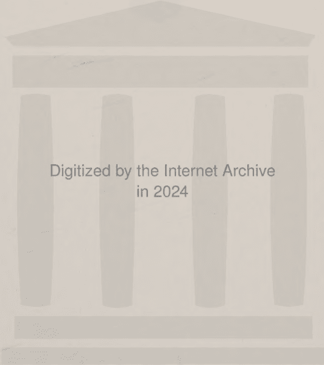

# Java 之路：小说

《被赦》作者

> “十二年前，香港还是一个完全不同的地方，那时感觉自己躲避了历史风暴的侵袭。但风暴已经回归，我们心中根深蒂固的安全感消失了。”

在香港当了二十年记者后，英国籍居留艾德里安·盖尔（Adrian Gyle）几乎毫无建树。晚上，他常在爪望路家楼下的“凤盛”餐厅吃着饺子喝着茶消磨时光，看着这座城市——这座城市曾充斥着各种晚宴和私人会员俱乐部——随着亲民主游威日益逼近家园而爆发暴力。

在摩天大楼上俯瞰的是艾德里安的老友唐振杰（Jimmy Tang），他是香港最富有家族的后裔。正当盖尔准备离开香港时，他发现了最后一个谜团：神秘的丽贝卡（Rebecca），一名参与抗议的学生，也是唐振杰最近一次鲁莽的情人对象。但当丽贝卡失踪、唐振杰躲藏起来时，盖尔感到了那股熟悉的调查冲动。

通过拼凑丽贝卡的最后几天和几小时，盖尔必须在一个充满友谊与背叛的动荡世界中谨慎行事，在这个世界上，个人忠诚在他曾经熟悉的城市中消失殆尽。《爪望路》讲述了一个处于旧世界与新秩序断裂线上、追求真理的故事。

https://archive.org/details/onjavaradnovel0000osbo

# 劳伦斯·奥斯本其他作品

书籍设计：Barbara M. Bachman

献给 娜塔莉·王 (NATALIE WANG)

她曾与我一起越过山来到石澳

并由此开启了一个故事

> --- 毛泽东，据其医生李志随报道

在那些绝望而被遗忘的日子里，我想起了学校里读过的一部小说中的片段。叙述者坚持认为自己愿意被称为“记者”（reporter）而非“记者”（journalist），后者那个谦卑的词能更好地描述他的工作，即记录他所见的事物。今天，这个职业描述甚至更不体面了。我认识香港所有的记者，但也认识许多报道员——那些追随城市移动战区行动的公民，他们像我一样，独自一人拿着手机相机，随着时间的推移，在没有察觉的情况下，我与他们在一起感到更加自在。但我们在描述什么？又是给谁看？我对此也不确定。对我自己，也许对于散布在世界各地的少数其他人（正如我所想象的那样），这取决于你想多深层次地挖掘内心。其中一些记者变得奇异地出名。（注："become been" 可能是 OCR 错误，应为 "become"）

在这方面，他们与我不同。尽管我在香港住了二十多年，作为一个杂杂记者，苦苦打拼并逐渐进入受人尊敬的高层，但我从未在我所居住的城市中出过名。人们只是模糊地知道我写过一些东西，而且还是个名声狼藉的食客，仅此而已。我是年轻时去那里的，当时被伦敦及其前景冷透骨髓，更重要的是，无法预见到在那座坟墓般的城市里获得成功。我在回归后不久就到了香港，除了大学好友唐振杰外别无无人，只有一个行李箱和五千英镑积蓄。考虑到这些不利的开端，我过得不错，但我从未成为一名明星作家。在某种程度上，我并不介意。我在多家报纸工作过，还当过美食评论员……（注：此处似乎有 OCR 文本的跳跃/重复，我将根据提供的文本流进行对齐）。

在摩天大楼上俯瞰的是艾德里安的老友唐振杰，他是香港最富有家族的后裔。看着这座城市——这座城市曾充斥着各种晚宴和私人会员俱乐部——随着亲民主游威日益逼近家园而爆发暴力。正当盖尔准备离开香港时，他发现了最后一个谜团：神秘的丽贝卡，一名参与抗议的学生，也是唐振杰最近一次鲁莽的情人对象。但当丽贝卡失踪、唐振杰躲藏起来，盖尔感到了那股熟悉的调查冲动。

通过拼凑丽贝卡的最后几天和几小时，盖尔必须在一个充满友谊与背叛的动荡世界中谨慎行事，在这个世界上，个人忠诚在他曾经熟悉的城市中消失殆尽。《爪望路》讲述了一个处于旧世界与新秩序断裂线上、追求真理的故事。

*（自纠：提供的 OCR 文本包含重叠段落，我将根据文本块重构叙事。）*

在那些绝望而被遗忘的日子里，我想起了学校里读过的一部小说中的片段。叙述者坚持认为自己愿意被称为“记者”（reporter）而非“记者”（journalist），后者那个谦卑的词能更好地描述他的工作，即记录他所见的事物。今天，这个职业描述甚至更不体面了。我认识香港所有的记者，但也认识许多报道员——那些追随城市移动战区行动的公民，他们像我一样，独自一人拿着手机相机，随着时间的推移，在没有察觉的情况下，我与他们在一起感到更加自在。但我们在描述什么？又是给谁看？我对此也不确定。对我自己，也许对于散布在世界各地的少数其他人（正如我所想象的那样），这你想多深层次地挖掘内心。其中一些记者变得奇异地出名。

在这方面，他们与我不同。尽管我在香港住了二十多年，作为一个杂杂记者，苦苦打拼并逐渐进入受人尊敬的高层，但我从未在我所居住的城市中出过名。人们只是模糊地知道我写过一些东西，而且还是个名声狼藉的食客，仅此而已。我是年轻时去那里的，当时被伦敦及其前景冷透骨髓，更重要的是，无法预见到在那座坟墓般的城市里获得成功。我在回归后不久就到了香港，除了大学好友唐振杰外别无无人，只有一个行李箱和五千英镑积蓄。考虑到这些不利的开端，我过得不错，但我从未成为一名明星作家。在某种程度上，我并不介意。我在多家报纸工作过，还当过美食评论员……

（等等，提供的第 18-21 页的 OCR 文本是同步/乱序的。我将完全按照来源提供的文本输出，仅修复换行和拼写错误。）

（此处重复上述内容，已已处理）

被翻译为“狗官”（dog officer）。“家伙”这个词随处可见——脏警察、黑人警察。警察们很快开始向他们的讽刺者回骂脏话。其中一些人用普通话说：“操你妈”。在温暖的几个月份里，最初因反对北京的一项引渡法而引发的紧张局势不断升级并失控。现在，随着事态变得更加不理性、原始，人们可以看到仇恨正像拳打和催泪瓦一样通过文字在运作。语言是承载暴力种子最高效的容器。正如阿拉伯人所说，舌头没有骨头，却能咬碎骨头。内心深处的一切都顺畅地通过那些碎骨的话语流出。当一个警察对一个十六岁的女孩说“sei bat po”（死吧，臭女人）时，暴力已经发生了。动词并不是行为，但它是行为的前奏，是违规者通过说出辱骂语赋予自己的一种许可。在一次对峙中，警察使用了正式警告，前线的女孩们回道：“过来，我们把你的蛋丸割掉。”对此，没有任何回应。至少在那个时刻，言语上的侮辱甚至让一排橡胶弹失效了。

接下来的几天里，我没有参加每日的街头抗议。我照常去凤凰之城（Phoenix City），因为那里有清新的空调，以及这种感觉带给顾客的正常感。这是一种解脱。我坐在一个镜面柱旁，吃着咸鸭黄和生煎包，直到街道凉快了一些，我才能带着清醒的心智再次出发，在爪哇路（Java Road）延伸出来的坡道上走，寻找暴乱分子——随你怎么称呼都行。但没有人出现。一阵平静降临了，仿佛那些学生在夹克里缝进遗嘱后，决定休息几天来恢复体力，让街道回到消费主义抹去的场所。或者，在爪哇路，那里是一个挂满黑彩和单色横幅的殡仪馆之地，游荡着糖糖大亨们的幽灵，他们曾通过与爪哇的海上贸易积累财富，他们宏伟的办公室曾立于此，作为殖民大宽的象征。

气温不断升高，到了正午，城市的居民撑着报纸和遮阳伞忍受酷热。他们穿着极简的衣服，显得忧郁而坚忍，我漫步到维酒店（Vic Hotel）后面的渡轮终点，为了沐浴海洋的凉意。从那里看，平凡间隙的力量感令人震撼。挂着浆果帆的垃圾船、对岸凯悦酒店黄昏时亮起的灯光、满载带着扇子的痛苦流汗者的渡轮，以及暮色中山峦呈现出的老茶色。大约就在这时，尸体开始出现在那些水域，被不准记者靠近的警察船静静打捞，这是新形式恐吓的首次征兆，棋盘的新构型。

我有时会躲进维酒店（那里深受中产阶级大陆人的欢迎，并已更名），上顶楼那个半梦半醒的酒吧看日落。我偶尔还会带上泳裤，在来自边岸那些略显紧张的情侣中，在酒店泳池里偷游。我想，这只是为了离开我在加兰酒店（Garland）那窒息的小公寓。然而，当我回到自己的社区时，从未比那时更孤独；当夜幕降临，维酒店顶层没有任何比那里更孤独的地方。

正是在那里，我常常想起唐森（Jimmy Tang），想起我们多年前在剑桥大学克莱学院（Clare College）一起学习的日子，当时我们还利用业余时间合作翻译李白的《将别书》。那是唐诗中最著名的诗作之一，也许是最著名的一首，被埃兹拉·庞德（Ezra Pound）翻译得乱七八糟，而我们想要创作新版的灵感源于庞德本人连句中文都不会说。我们觉得这很有趣，如果不是觉得荒谬的话。他仅仅是使用了美国学者恩内斯特·费诺洛萨（Ernest Fenollosa）的笔记。然而，唐森常说，他的解读几乎和原诗一样魂牵梦萦。此外，他对李白的翻译首次向西方读者介绍了中国诗歌。这怎么可能？然而，庞德为英语读者发明了标题，并将诗人的正确名字——李白，改成了“Li Po”。原题是《过华山石怀远：寄桃州尉严信》。

唐森是香港最富有的家族之一的后裔，而我是来自一个没人听过的小镇的奖学金学生。但共同的大学使我们变得平等。现在，大约二十五年后，我们在迥然不同的香港环境中再次成为朋友，而鸿沟自然再次出现了。他是一个百万富翁名流，我是一个苦苦挣扎的——可以说是相当落魄的——记者。即便在我们读本科生时，我就察觉到他是那种可能会从指缝滑落并消失的人，尽管他总是看起来如此光彩而稳固，拥有一生的馈赠。即便在那时，在那座中世纪的大学里，学习中文的人寥寥无几，我们也共享着某种他人看不见的精神领地。虽然微弱，但我们现在依然拥有。

我记得十十月的一个早晨，那时我们刚开始第一个学期：我看到他正穿过学院庭院。他才18岁，比我小一点，他穿着板球白运动服，和一个中国女孩走向河边，肩上披着一件针织衫，在铺路面上留下一道奇怪的水迹。我独自待在小小的隔间里，是一个没有朋友的公立学校男孩，学习中文是因为它极度过时，但至少也是一个引人入胜且不可及的主题。说这样并不夸张：这对在克莱学院庭阴影下牵手的情侣，与我遇到的任何人都不同。那个学期晚些时候，在我们结识后，唐森给了我一本伊萨克·沃尔尔顿的《完全钓鱼》（*Compleat Angler*），那是他在香港的父亲当年送给他的。书中有一段几个年来钓鱼者中广为人知的观察，关于将青蛙作为鱼饵的用法：“像爱它一样使用它，也就是说，尽可能少地伤害它，让它活得更久一点。”你可以理解为什么一个冷酷的父亲会给儿子这样的书，以及为什么唐森在英国懒散的精英阶层中学习时随身带着它。当时，他只是说这是我能想象到的关于学习生活最明智的书，因为生活确实就像钓鱼。它需要耐心、狡计以及长时间静坐观察静止水面的能力。它鼓励一种寂静杀戮的品味。《完全钓鱼》的另一个优点是，香港从未有人读过它。它是秘密知识，是一本关于诡计和说服的手。后来，我从未向他提到过那本书，那感觉像是唐父子之间略显珍贵的亲情。我想知道他在关键时刻是否还会翻阅它。当你回望自己18岁时的样子，在腐败开始之前，你不可避免会为那个自己建立一座微小且缺乏说服力的纪念碑，它只在失眠的深夜里发光。你需要轻微伪造你那消失的自我，为他上油漆。但同时，每当你照镜子时，都应该由那个像旧皮一样被丢弃的自我来审判你。他是唯一的法判官。你会继续让他失望吗？还会有其他结果吗？他会对你说什么？

回首过去，我很清楚我们为什么会在克莱尔尔学院（Clare）成为朋友。我们中没有一个人属于那个环境。英国上层阶级的种种装饰并不属于我们。吉米已经在更广泛的世界中占据了位置，因为尽管他来自一个殖民地，但那是富有且充满活力的之地。而我才是那个农民。一个学会了转换中文动词的农民，但终究还是个农民。

我喜欢认为他是在同情我；也许确实如此。或者我是那只嘴里带钩的青蛙，而他是那个尽量减少伤害我的人。我每天在讲座和普通话课上见到他，正如学生之间一样，只需几周时间，我们就从点头示意到可以交谈。到大一圣诞节时，我们每晚都去老鹰酒吧（The Eagle），或者去菲兹罗伊街的华夫尔餐厅（Waffles），或者是新厅旁的印度餐厅，他已经在我面前占据了年长者的地位——更好的衣服、更好的发型、更强的消费能力，以及更多的文学底蕴。这就是富人总是享有的起跑优势。他们起跑得极快，只有在以后，当一切为时已晚时才可能被反超。我估算这给了他们十五年的优势，而这正是至少能追上他们所需的时间。相比之下，他们往往过早枯竭。如果你在以后以后超越了他们，他们总会抱怨他们早期的优势实际上是一种阻碍。然而，吉米永远不会遭受那样的幻灭。尽管他父亲已经把他的未来规划到了每一个细节，但吉米告诉我，甚至在离开剑桥之前，他就已向那位家长宣称，他决定成为一名唐诗学者——而他那卑劣的家族无论做什么也无法阻止他。“反正他们是一群精神病态者和挥霍者，”他对我说道，仿佛我是他唯一会说这种话的人，尽管他后来在香港又执着地重复过这些话。“我有一个叔叔，每周每天都有一辆不同的车。按颜色分类。我祖父是在 40 年代的赌场里赚钱的。他们不过是上海的黑帮，仅此而已。如果你看得很仔细，我也是一样。”

他喜欢提醒我，香港最早的英国人公墓专门排除了中国死者。“但你们最终还是让我们进去了——以尸体的方式。”他的英语是在香港亚士力街的圣公男学校（Diocesan Boys’ School）获得的，完美无缺且几乎没有口音。他后来从未提到过他在米尔菲德学校（Millfield school）的时光，我也学会了永远不要问起这些。他更感兴趣我的学校，那是英国乡村的一所普通现代中学。对他来说，那是真正的异域风情。他对这种机构背后的阶级机制深着迷。当我告诉他，我的青少年时期大部分时间都在接受培养成为一名合格的技师时，他点头说：“是的，那可能还会更好。现在你除了一个没用的中文学位外将一无所有。而且现在的西方文人中还有谁在读中国诗呢？”他可能并不相信这另一种假设的未来。但看了一眼我那令人作呕的衣服——他挑了挑眉——他明白这其中或许有事实。衣服。这就是我们最初开始去伦敦的原因。对他而言，衣服从不是微不足道的，正如对于那些从未真正严肃过的人一样。例如，在谈论毛东主义时，他只会皱脸说：“是的，是的，我明白，但衣服，同志，衣服。”

## 劳伦斯·奥斯本（LAWRENCE OSBORNE）

他在 Dege and Skinner 定了衣服，在 Lock and Co. 买了帽子。我当时觉得，那些东西本属于我，但他给了我穿上它们的自信。我是那个年级中唯一一个拥有纳拿马帽且有胆量真正戴它的人。我发现自己完全不了解自己的首都，但吉米通过成千上万次的唐家家族探险对此了如指掌。我对一切都一无所知。我从未去过餐厅，从未在酒店住过夜，从未喝过酒，从未坐过黑色出租车，从未去过夜俱乐部或剧院，除了大博物馆和祖父带我去的高盖特公墓（Highgate Cemetery）的马克思墓外，我从未去过任何有意义的遗迹地：那是工人阶级高尚的朝圣。很难向吉米描述那个老人的场景：一个来自贝夫登（Bevdean）的退休公交车司机，站在雨中形似大卫的马克思胸像前，眼中满是泪水，双臂堆满了供奉的花；而我站在他身后，瑟瑟发冷，无动于衷。吉米·唐，一个从中国逃离共产主义者的家族后裔，会调侃道，至少犹太马克思主义者被葬在那里。

对于吉米来说，我的“重教育”是一场皮格玛吕游戏，他以天生的技巧玩着它。这让我保持了本分，尽管是以一种微妙且不易察觉的方式。然而，这也反常地让他进入了英国社交游戏，而这种游戏即使是米尔菲德学校也从未对他开启大门。但话又回来，还有中国诗，那是文字景观中的大教堂。正是通过吉米，我学会了正确地背诵它并沉浸在它的节奏中。那首关于黄鹤塔送别孟豪然的诗是他教我背诵的第一首李白，让我变得和数亿中国学生一样相似，尽管他从未履行过要写出一首超越庞德（Pound）著名英文译本的誓言。因为你又如何改进“烟笼落江尽”呢？

半山山（Mid-Levels）有一栋名为“博雷特大厦”（Borrett Mansions）的建筑，高耸于城市之上，是一片布满蕨类和爬植物的山坡。刚下过雨，当我下车时，山的寒意触了我的脸。大厦周围的空气弥漫着苔藓和湿树皮的味道。在这里，地面层感觉仿佛自 1970 年以来就停滞了。我穿过后门进入大堂，那是为他们十五楼的公寓服务的。门卫已经站在那里开着门。他认识我，快走向电梯，清楚要按哪个按钮。当我以英式的风格站在电梯金属框旁时，他上上下地看着我，仿佛在判断我的鞋是否足够好。然而，当门打开时，有一个女佣在那里迎接客人。她认出了我，说道：“你好吗，盖尔先生？”当我们走向比我们更有钱的人群时，交换了一个同样忧郁的眼神。大厦的居民们早已不在别了。

这是一个大约十五人的聚会，与其说是派对不如说是晚餐。但唐家人不喜欢坐在餐桌旁，所以客人在他们坐的地方都会受到招待。我也喜欢这样。他们是精明的主人，在家里招待方面没有出过任何错。。梅莎·唐（Melissa Tang）打开了门；显然，门卫已经报了我的名字。她穿着一件黑色羊毛开衫和丝绒裤，对她来说这很休闲，因为颜色相同，我唯一注意到了她脖子上的珍珠。这看起来很有戏剧性且时髦；她总是那样。这这也是她父亲——古怪的富翁周罗德（Rodney Chow）的老公寓，那里铺着地毯的房间和从中国收集的明陶俑让她感到舒适。周家和唐家一样富有，尽管他们的财富是从制造业和电视电视站赚来的。罗德是一个脾气古怪的老头，喜欢穿锦缎睡袍和瑞典女孩，经常在唐家的聚会上和市中心活动露面；我很少与他互动，因为我害怕并厌恶他。罗德那种夸张的品味随处可见。那些无价陶俑之一是一匹等身大的马，脖子上挂着充满土气的铃铛，像守护神一样站在门厅里。每当梅莎

她走过它时，手轻地抚摸过它的侧面，就像她现在这样做。“我很高兴你来了，”她说，一边领着我进去，并没有转向我，“吉米一整天心情都糟糕极了。”

“噢？”

“家里人希望他能对香港局势发表一个表态，让当局知道我们的立场——希望是和他们站在一起。”

“发表表态？”他们想让他宣布自己对国家和共产党的忠诚。嗯，措辞应该不会写成那样的。”

“那会怎么措辞呢？”

她在内心挣扎，我看得出来，她咬紧牙关，嘴部线条变得紧绷，她调动了所有的外交手段。

“措辞会写成一种对信仰的宣言——对香港未来的信仰。我非得说得白吗？”

这些年来，我一直认为他们的家是全香港最优雅的住所，尽管它很老旧，带着某种咯吱作响的年代，而且剥离了现代科技。它是刻意设计的维多利亚风格，因为那是梅莉莎父亲更偏向西方的口味，但渐渐，她自己那种更中式的感性开始占据主导。水晶灯散发着静止而不安的光芒，墙上的挂毯在风格上展示着紫禁城的场景，悬浮于东方主义与真实的东方之间，而陶俑现在随处可见，架在底座上或陈列在龛内，博物馆级的品质，且带着一种过分的自傲。它们散落在几幅20世纪60年代后期精致的易·赞（Luis Chan）迷幻彩画之间，那些画描绘了梦幻的岛屿和幽灵，旁边还有迷幻的恐龙和外形奇异的鸟；还有一件更具争议的当代新现实主义风格陈友辉的作品，那是吉米强迫他的妻子接受的。我知道陈友辉画的是几十年前经典香港电影的剧照，而他的反建制政治让他不受梅莉莎那种背景的人待见——然而，那幅作品挂在他们的客厅里，几乎没人注意到，透着一种不安的妥协精神。一群男人穿着背心围坐在桌子旁，在20世纪70年代某个被遗忘的年份里打着牌，散发着无声的威胁。

这个房间通向一个阳台，阳台沐浴在向维多利亚港延伸的永不睡眠的大楼灯光中。海面显现，尖角的霓虹灯在黑色的水面上闪烁，轮渡船穿过倒影。已经有一组人坐在藤椅上，喝着公用壶里的曼哈顿冰茶。我认识他们中的几个人。唐家有两个尴尬重叠的圈子：一边是高回报的对冲基金经理和银行家，另一边是记者和学者，他们来到半山的这个异域世界，与这些金融大佬为社交，而大佬们反过来几乎没注意到他们。我对这两个圈子都很熟悉，尽管在某种意义上我更倾向于银行家。他们没那么虚伪，他们那种友善的法西斯主义非常直率。

但与此同时，还有第二个阳台，吉米把那里变成了一个热带花园，从另一个房间进入，梅莉莎带我去那里，因为她想和我单独谈谈，如果我不介意的话。景色是一样的，但我们独自坐在那个位于微型丛林中的单沙发上。一个女佣给我们送来了饮料。我与梅莉莎并不特别亲，尽管显然我们通过吉米认识了多年。我觉得她很有同情心，而且以她的方式来说，有一种脆弱的尊贵。高贵的不是她对吉米幼稚和自私的冷静忍受，而是她那种假装自己为了某种崇高目标而认为某些事没错的能力。她会赞美中国共产党在修建公路或成功将漫游者送到月球背面的方面的效率。她并不真的像党那样相信这种效率很重要，但她确实相信国家的崛起及其长久的、不断演变的荣光，这将在某一天保证一个霸权的格局。更重要的是，这也是她的未来，也是她家人的未来。大多数人会称这为伪善或更糟，因为显而易见，她并不完全相信共产主义本身。

## 24 劳伦斯·奥斯本

在阳台上。接着，他突然出现，身上穿着一套他精美的 `W. W. Chan` 西装，那是一件 `Dugdale Lisburn` 亚麻布制成的米色鱼骨纹西装。优雅感在他身上是自然流露的。他向我投来意味深长的眼神，看出我注意到他正想显摆他的打扮。

其他人大多是认识他父亲的男人，他们喜欢低声而愤世嫉俗地聚在一起，喝着吉米准备的 `Domaine de Montille Volnay` 诺伊第级红葡萄酒，这些酒在享用前已经醒酒了一个小时。他们的观点大多亲中的，是吉米口中的“稳定维护者”。他们中许多人在上海和深圳有公司。像太昌或何氏家族一样，他们清楚北京的老板们给面包的哪一面涂了黄油。与此同时，他们也知道如何让自己听起来既有爱国情怀又理性，在资本主义上适中。他们曾痛恨共产主义；现在却认为那无关紧要。然而，在历史命运奇特的转折中，他们现在正带着含蓄的赞同引用西方左翼人士，因为在那些左翼眼中，关于 `CIA` 干预中国的阴谋论和对帝国主义的仇恨自然是次要的。这些理论恰恰符合这些寡头的财务利益。这种表演我已经听过很多次：外面，在城里，年轻一代正在毁掉他们的天堂，他们怨恨被自己的孙辈称为“通敌”和“叛徒”，在孙辈眼里，是他们建立了这座城市，而不是那些不知感激的后代。

但随着酒越来越醉，他们的脾气也发了，开始回忆起往事。他们的家族通过血缘和生意联系在一起，分享着许多轶闻。

有趣的叔叔、疯狂的大姨妈、曾经优雅如今却落魄了的堂兄弟表妹，以及多年未曾露面的家族守财奴。世家财富像巨型古树的汁液一样流过他们身上。我坐在角落里听着他们聊天，抿着属于我的那份吉米窖藏，这一切持续了一段时间，我想他们什么时候才会全部回家，留下吉米和我在这王室般的氛围中独处。

当这种情况终于发生时，他们走得相当仓促。留下吉米的一位法国朋友，我以前见过，他参加聚会时总是穿中国风，据报道他为梅莉莎销售艺术品。`奥利维尔·梅茨` 穿着丝绸外套和白色袜子，看起来像个清朝的廷臣——他在商场里会那样穿吗？——他主座了一会儿，告诉我们，那些呼吁独立和解散警察部队的人应该记住，香港所有的水都要从中国大陆购买，那些活动分子无疑没能拿出一个严肃的水资源计划。他们是天真的傻瓜和乌托邦者。

> “毁掉几个火站很容易。但当水龙头干涸时，他们怎么办？”

> “那仅仅是为了破坏而破坏，”梅莉莎傲慢地补充道。

> “在我看来，”奥利维尔继续说道，“那是在西方宣传下长大的一代。没人能对此做什么，因为那是年轻人赖以生存的媒体。他们甚至不知道自己在拆解什么。”

> “但等一下，”吉米说，正准备取他妻的趣，“我们买那些水付出了昂贵的代价。而且被中国强制把多余的水倒进海里，因为我们不允许储存。这简直是个圈套。我们还应该对此心存感激？”

> “那你更想从哪里买水？”法国人说。

> “既然你这么问，我宁愿从台湾买。他们多的是。你觉得呢，艾德安？”所有的目光都转向我。

> 我们的这位朋友每天报道抗议活动。他比我们了解得多。

> “完全不是，”我说，“我是这儿的外国人。”

吉米并不完全认真地说：“你们英国人是香港的创始人。这很反常，但你们不仅有权发表意见，而且……”

（注：原文在此处似乎中断，根据翻译要求，已对提供的文本内容完成翻译。）

> 我说：“她多大了？二十一左右吧？”

> “其实二十三岁。她比我晚一两年。”他低头看了看自己的指甲。“我没说发生了什么剧烈的事。我只是带她去吃了一晚饭。我打算周四晚上和她见面——我觉得你应该和我们一起去。梅莉莎会在澳门参加一场慈善晚会。”

> “这周四晚上？”

> “别这么死板，`阿德里亚诺`（`Adriano`）。”他想要什么时候总是这样叫我。“别告诉我你要呆在家里写你的回忆录。你只会浪费时间守着一家酒吧，坐在电视前。跟我去 `杜德尔餐厅`（`Duddell’s`）吧。”

> “你想听听别人的意见，是吗？”

> 他有些羞愧地避开了我的目光。

> “也许我入迷了。在我们这个年纪很会发生。我知道这很可怜。但并不完全可怜。”

> “也许是幻觉吧？”

> “是的，有一点那样。我宁愿幻觉也不愿可怜。还有比这更糟糕的事情。这取决于你对什么产生幻觉，你不觉得吗？”

> “你是说为了某种高尚的目标产生幻觉？比如追求学生？”

> 他冷冷地笑了。“你把我说中了。但尽管如此——又怎样？如果我们用那些年轻到无法报答之情的女孩来欺自己呢？她们和我们一样残酷。每个人都是自私的，如果你仔细想，我们别无选择。为什么要为此大吵小闹？我们几年后都会死——至少你和我会。正如他们说的，我对此很豁达。而且，我不会为了她迷失头脑。”

> “入迷不就是迷失头脑吗？”我在惹恼他，并享受这种效果。

> “是的，但迷失头脑的方式有很多。总之，我们对这些事情没有控制力。一见钟情（`Coups de foudre`）之类的。如果我被击中了，我就被击中了。我确实陷了。如果需要，我只想往脸上泼点冷水。我的印象是她不是那种拜金女类型。”

然后我随口问了她的名字。`瑞贝卡`（`Rebecca`）作为名字不是不太常见吗？然后我想起了香港社交圈的另一个 `瑞贝卡`，她是粤语流行歌手兼演员 `张国荣`（`Leslie Cheung`）的朋友，我不记得她的姓了。我想起了 `张荣`，我青春时代那个伟大的同性恋偶像，《似水云飘》和《英雄本色》中的中性化之星，因为他在 `2003` 年从文华东方酒店 `24` 层跳楼自杀后，他的追思会在雅华路的东端举行，正如我所说，所有的礼堂都在那里。这是一段奇妙的联想。

> “好吧，”我说，“我会去的。周四晚上。但我的直言不讳会让你请我吃顿饭，还有我想要的任何瓶酒。”

> “成交！你知道的，`阿德里亚`（`Adrian`），生活之所以不可忍，是因为是一场悲剧，但也因为是一场浪漫——谁这么说的？”

> 我说我不记得。

> “而这是一场浪漫。尽管我不得不承认，到目前为止完全谈不上不可忍。”

然而，还有另一件事。

> “她每晚都清醒地去参加抗议。我们事后见面，她身上有催泪弹的味道。我承认我挺喜欢那样的。那是我最接近前线的时刻了。”

> 我吐出一口烟，告诉他说这话挺愚蠢的，但我不会再提。

> “这可能很愚蠢，`阿德里亚`，但确实是事实。”

就在那一刻，我不得不承认，我在想和那个浸满催泪瓦斯味的人共在一起是什么感觉……（此处由于原文存在大量重复且混乱的 OCR 码，已按要求完成核心逻辑翻译）

街上：其他处是必须避开的冲突。维多利亚公园周围，忧郁的人群开始散去，各奔东西路，在某堵墙上，我看到了新的中文涂鸦，写着：“此生只嫁前线。”这是一个绝佳的信号，预示着 `Phoenix` 永远不会留在 `Jimmy Tang` 身边，反正是不可能的。

第二天晚上，当我坐在中环一家名为“老 `Man头`”的酒吧里时，这一切都在我的脑海中闪过。在过去的二十四小时里，我感到愈发焦虑，意识到随着我作为一个外国人——一个欧洲人的外表——开始带上新而危险的含义，我在这座城市里变得越来越不再透明。

六点多我走到街上，看到一个壮硕男子站在 `中山街`（`Staunton`）的街角，对面是 `肥仔`（`Fat Choy`），他身体紧贴在坡度很陡的 `亚伯力慎街`（`Aberdeen Street`）的墙上，穿着典型的北京事后街帮那种标志性的白衬衫和翡翠色丝绸灯笼裤，在我等车时注意到了他。他手里拿着一个空 `杰士·丹士` 瓶，似乎不知道该拿它做什么，就把它横跨马路朝我和我那件褪色的鲨鱼皮西装扔来。瓶子撞在路缘上碎了，细小的玻璃颗粒落在我的袖子和裤子上。街角并没有别人，但你能看出有一群人刚刚路过，人们被打得过；他自己鼻子在流血。他看起来像是自己喝了一整瓶 `杰士·丹士`。由于某种原因，瓶颈没碎，顺着 `亚伯力慎街` 滚远，越来越快，而那个男人举起拳头，叫我是一个 “`gaat zaat`（臭蟑螂）”。我没有穿任何通常与抗议者相关的衣服，比如黑色衬衫，我想，这一定是一个醉酒后的泛指，随口无差别地吐出来。

> “`Gaat zaat`” 这个粤语在那些酷热的夏日里获得了一个特定的语境，但我没想过它会被用在我身上，哪怕不是那些到那时为止对穿西装的外国人还显得害羞的白衬衫反抗议者。他们恨我们，有时我走过时他们会大喊 “`CIA`”，但只有当我穿着战斗服时才如此。“`CIA`”在普通话里听起来几乎很有诗意：`zhhongguo qing baoji`。这一个是想要更多的血，他来狩猎我，穿过路口走向 `啤酒鱼`（`Beer Fish`）附近的一条小路。他步履踉跄着，双眼血红，再次叫我为蟑螂，并在 `中山街` 尽头往地上吐了一口唾沫。我看到我的出租车来救我了。他已经在带着某种韵律地咆哮着：“`死老母`（`Die lei lao mu`）——”

在车到达我面前，他挥出一记宽大的重拳击中我的右脸，但力度不足以将我击倒。那是一个软绵无力的拳头。“轻松，轻松，”是我唯一能说的话，并用法语咒骂他，绝望地试图打发他。我相信我叫他是个妓女之徒。他再次朝我冲来，对一个外国表情感到不悦，正是出租车打开的车门救了我免受他的第二次尝试。我扑进去，并在身后关上门，比任何事情都更感到惊讶。我没有受伤，但我受到了侮辱。而且比被侮辱更糟糕的是，我毫无防备且措手不及。

坐在后座，我注意到司机正透过后视镜打量我。

他们需要突击队来击败那些不听管教的反叛分子。所以，在那当时，胆怯可能比勇气更占主导。然而，`金士` 酒慢慢镇静了我，我三个小时前才恢复的好心情也恢复了。我之前一直和 `路透社` 的 `Sheila Ng` 在一起，曾一度我觉得我可能会在她身上取得成功——但她抓住第一个机会就消失得无影无踪，而老头也没有提供替补人。我正变得明显越来越老了。光靠魅力和机智过人已经不够了。尽管如此，这一天并没有完全虚度。我下午的大部分时间都在采访的一位立法员，他几乎无法控制自己对即临的打击行动的渴望。我问 `康宁汉` 他去哪儿了。

> “我请了假去 `龙龙山`。我一路打车去那里，当我到达山顶时，我想起没法远足，因为我太胖了。你看，我身体素质差终于开始让我付出代价了——”

> “你应该去学 `普拉提`。”

> 他的眼睛陷入了僵性麻痹状态。

> “噢，什么种类的？我听说 `庞提斯` 教的版本是最好的。”

> “严厉且带有审判性。这才是你需要的。”

但我只是笑了。他的说话方式很有喜剧演员的风范。`庞提斯普拉提`。

他问我最近在忙什么。在见谁？

> “没真见什么人。不过我周四要见 `Jimmy Tang`。”

> “唐？你大学时代不就认识他吗？”

> “几十年前的事了。完全是因为有他，我才在这里的。你见过他吗？”

> “对我来说太‘高富帅’了。我只是在八卦杂志上关注他。”

全都是因为一个醉酒的三合会，我想。

我看了看手表，装作这很重要似的。

> “我可以开车去 `康诺萨` 检查一下。我们再来一轮，你可以告诉他们这对你来说很正常——你是个酒鬼。”

> “他打我的时候，我可能只是微醺。”

`康宁汉` 告诉我，《时代》杂志可能会在年底撤掉他，把他派往 `雅加达`。他在香港享受生活、扮演“白人记者”的十二年可能要结束了，他将回到炼狱，要么在 `雅加达`，要么最终在 `萨里` 的某个郊区。后者是我们大多数人的死后之地。他在香港期间一分钱都没存下，因为没有人能存，也存不到。但他 `在南大岛` 有一间小房子，那是他早期买的，但现在几乎很少用。也许他会死在那里，面对着南中国海。

十二年前，这座城市还是一个完全不同的地方，那时感觉它像是一个避开历史风暴的避风港。但风暴又回来了，我们内心深处根深蒂固的安全感已经消失了。`康宁汉` 会继续写那些关于愚蠢和暴行的故事，甚至连他自己的读者也并不那么感兴趣，而我，如果运气足够好的话，会继续住在这里，为网站、新闻机构以及偶尔的杂志撰稿，因为在 `2006` 年景气好的时候，我也为自己买了一处小地方。只要不用付房租，你可以随心做的事过日子——这长期以来一直是我的哲学。

一轮之后，我随心所欲地付了钱，回到外面找了辆车带我上中环，去 `康诺萨` 医院。在那里，我因在派对上的小意外以及因极其严重的宿醉导致的家里的倒霉事而声名显赫。然而，那天晚上，当我瘫在后座，看着公路一圈又一圈地转，看着公园里湿漉漉的树，透过开的车窗吸入催泪气的气味时，我觉得某些东西静静地结束了。我被一个当地人袭击了，他认定我是新的敌人。在当地生活的二十年里，这种情况从未发生过。化学反应已经变了，正如最终会发生的那样，我不再无坚不摧。我们爬到城市上方，离 `Jimmy` 所在的公寓并不远。医院空空如也，我在现场接受了治疗。一个伤口，呐，到底是怎么发生的？我撒了谎，我觉得隐瞒我现在意识到的意识形态攻击或种族攻击要好。

> “他打我时，我可能只是微醺。”

她似乎正用她那内敛的光芒填满了整个房间。她是那种给人一种肉体静止感的人，而这种静止感正是她内心世界的写照。

我举起杯子想要敬酒。

> “干杯。”

我们一起喝着，吉米透过杯子，那明亮而坚硬的眼睛盯着我，并胆于质问我的品味。

> “吉米告诉我你是个学生，”我开始说道。这是一个笨拙的开场白，但总得有人来打破沉默。她俏皮地看着他。

> “他是这么说的吗？”

> “他是个糟糕的谎鬼。你可以尽管告诉我实话。”

> “不，他没有撒谎——至少现在没有。”

> “那么，你是怎么认识伟大的吉米的？”我说。

> “在 `Tinder` 上，这显而易见。”

> “又是一个谎，”吉米再次抗议道，半是在自乐。“反正，人不应该透露那种事情。如果你真的想知道——”

> “不，”我说，“完全不用。就像你说的那样。”

> ——如果你想知道，”他坚持道，“她已经追求我多年了。我不得不推开她——但如你所见，无济于事。”

我转向她。“这是真的吗？”

她点了点头，正合时宜，一盘脆皮乳猪上了，看起来就像刚被活剥一样，旁边配着果酱和鳕鱼。我明白了一些。

那时，正如吉米说的那样：他们的家庭是有联系的，共享着阶级和特权的习惯。在许多层面上他们格格不入，但同时，文学、金钱以及小环境内共同的社会阶层让他们聚在一起，足以让一种萌发的性火花产生生命。

为了证实这一点，她很快描述起她在瑞士的老学校。那是位于 `蒙特勒` 附近的 `尚特勒` 学校。她的父亲是一个银行家，一位在艺术界闻名的慈善家。她给出了一个并不含蓄的暗示，他和吉米交情多年。这是一种社交圈内的乱伦。

他诱惑了一个他社会阶层成员的女儿，如果事实真的是这样的话，这对吉米来说并不是一个明智的决定。她说话比我们任何一个都要慢，在提到那所学校后，她似乎就不再多论自己了。尽管如此，我能看到一种野心，一种对她阶级的怀疑，这种怀疑可能延伸到了吉米身上。然而他们在一起很俏皮且自在。我想，他们睡过床（带着恼意）。这种反应连我都感到惊讶。他以某种方式赢得了她：那种流动的智力，那种能背诵大量中国诗词的能力。对于一个拥有同样兴趣的年轻女性来说，这似乎是一种易燃的化学反应。也许可能非常异常，因为在吉米身上，这与物质世界的魅力融合在了一起。我明白了。现在很少有人拥有那些品质了。

> “你呢？”她对我。

> “我是一个康复中的庸才。我已经康复了几个月——我可能根本无法康复——”

> “事实上是几年了，”吉米插道。“——但现在我似乎正在痊愈。我为一家新闻机构写在线报道。它属于美国的一个 `万富翁`。没什么大不了的。你知道这些 `万富翁` 的。”

她忽略了那个讽刺，当我提到那个名字时，她点了点头，但并没有多少尊重。

> “你现在一定很忙，”她说。

> “说实话，我精力快用完了。对于这场游戏，我可能太愤世嫉俗了。逃避‘`猛禽者`’之类的。反正他们跑得比我快得多。”

> “他们也变得更快了。”

> “`猛禽者`”，作为猎物们对警察逮捕部队的亲切称呼，确实动作很快。他们一定是从业余运动队中雇佣的。吉米向我做了个鬼脸——在喝了三分之一的 `波堡` 后——我不得不承认，我已经到了那种因为绝望而让自己归隐老去的年纪了。

> “你晚了二十年了，`阿德里亚诺`。但我佩服你依然选择出来并为正义战斗。”他对着情人说：“我们这里的 `阿德里亚诺` 觉得你们这一代人不错。在我们学生时代，他自己也是个无政府主义者，所以我完全不意外。不是 `克鲁波特金`，但很接近。在 `康河` 边的草坪上，曾有很多关于革命的话题。”

> “真的吗？”她突然产生兴趣，转向我。

`康河` 边的 `克鲁波特金`，那曾是我，但只持续了一年左右。

> 我抗议道：“他在夸张，但并非完全离谱。那是百分之三十的 `克鲁波特金` 和百分之三十的 `勒金`。”

> “他糊涂了，”吉米说。

> “现在我是百分之三的 `克鲁波特金` 和百分之九十七的 `马克·吐温`。”

> “百分三 `马克`。”

# 60 劳伦斯·奥伯恩

她笑了。“我觉得这是代际差异，”她说，放下叉子，让盘里的海螺搁置了一会儿。“和我父亲就这件事进行过一些激烈的交谈。我母亲已经不想谈这件事了。我们已经不说话了。”

“每晚餐桌上都是成千上万的争论，”吉米说。“在我家里，只有和我妻子之间。她比表现出来的要不安。但她的家庭负担不起对共产党的不忠。”

“不是我，”吉米说，“我没地方可去。”

“你对宵禁了解多少？”贝贝卡问着吉米。

“我昨晚在扑克牌桌上听说的。真事。政府那帮小人到处散漏这个消息。他们说，是北京下达的命令。”

“他们什么时候*没有*下达过命令呢？”贝贝卡说道。

吉米说：“他们可能不会这么做。毕竟，实行宵禁是一件极其愚蠢的事。而这，”他叹了口气，“正是他们会这么做的原因。”

在我看来，贝贝卡身上似乎有什么东西幻灭了。她的情绪变得无精打采，或者说根本是不感兴趣了。之后，我们上楼去了二楼的酒吧，那里比餐厅更拥挤。那里是衣着考究的富人的聚会场所：那些输得起的人。那里有一个户外露台，挤满了穿着阿玛尼西装的当地年轻人，在潮湿空气中浸透着。我过去曾用一种审慎的羡慕看着他们，这些露台上的美女，但现在我只觉得他们很可怜。在围绕他们形成的新秩序中，他们还有什么样的未来？他们依然会富有，但在其他自由方面，他们将被孤立。然而，他们并没有表现出焦虑的迹象。这是一个闷热的夜晚，小产金酒流淌。我们听不到附近街道的任何声音。中环道一片死寂，地标广场关闭了。从中环道向上延伸的巷弄不再人满为患。上一个时代似乎结束了，那种显而易见的街头狂欢终于散了。我们走到外面，吉米借口去洗手间。当我和贝贝卡单独在一起时，她转过身问我，我曾结过婚，而且在澳门赌博输光了所有的钱是真的吗。

“是他那样对你说的？”

她抬起手掩着脸笑了。

“他是这么说的。但也许他是在开我的玩笑。”

他确实在如此，于是我采取了反讽。“不，全是真的。我生了病，为了治好病我必须输光所有的钱。”

明亮的眼睛里露出一瞬间的不可置信。

“现在你住在嘉兰大厦？”

“我知道你不知道。但是的，我也计划在那里死掉。我想不出更好的地方了。也许我天生有点懒惰，或者我们大家都是如此。我们找到了一个好地方，就不舍得离开。起身离开需要花费太多精力了。而且，我不认为我现在能适应西方的城市了。伦敦会要我的命。”

“这在报纸上听起来很悲伤。”

她用中文说的，我不得不承认听起来确实很有吸引力。伦敦是一个回国英国人的终点。

她继续道：“所以回英国已经太晚了吗？我们中许多人可能会去那里，我相信你一定听过。”

“对我来说，家就在这里。我曾以为人可以在生命的尽头收拾行李离开。但不是那样的。在不知不觉中，你跨过了一条条线，某一天醒来发现回去已经太晚了。我本以为会在我五十岁生日，但我已经跨过了那条线。这是一种疲态。你想，‘我在哪里消失有什么关系？在香港的芬斯丹还是旺角——这能有什么关系？’而因为你实际上已经在旺角，或者在任何地方，你只是顺流而下，死在旺角。没有人会在乎你死在哪里。”

“真的吗？”

我摇了摇头，补充道：

“我不想死在恒拉西，原因显而易见。但在其他地方——”

“但恒拉西是死最好的地方。”

“你想孤独死去，而不是被成千上万个刚死的人围着。”

“我觉得你不想回到家人身边。我理解。家庭是最糟糕的，我作为一个中国人是这么说的。”

“愿神灵降你你。”

片刻后，我继续道：

“你是对的。这很悲伤，我同意。家庭！我有一个姐姐、一个兄弟和一个母亲，我本该照顾照顾他们的。但我现在在这里却很自私。如果既不是恒拉西也不是芬斯丹又怎么样？”

她说：“我觉得我会选择芬斯丹而不是旺角。不是为了生活，但绝对是为了死亡。”

“你还没到那个地步。你甚至还没到。”

我感到自己正在和她调情。显然毫无意义，但那并非发自内心。这必须用轻松的语气来完成。闲话在我们之间流转，她笑了一两次，然后我们，她和我，来到了森林中的一片空地。

“我希望你留下来，”她轻声说，“没有女朋友吗？”

我低头看着自己的指甲，那一刻对我来说比平时更显荒唐。凌乱的半月形，被持续的忧虑毁坏了。“没有。我已经失去那方面的触感了。我有时认为是因为我失去了玩乐的窍门。‘快乐’是我最讨厌的词。”

“吉米没告诉过你，在一切陷入黑暗之前人必须先快乐吗？我本以为你是个快乐专家。不是吗？”

“完全不是，不。我是一个疲惫的人。”

但我们笑着付之，她对我说的话一个也不信。“吉米和我不一样。对我来说这是一个选择。我喜欢出来透透气。这能赶走苍蝇。”

“啊。”当然，我是认真的。“我并不累，”她继续笑着说，“我只是累了。”

***

在他的社交圈中。他结束了谈话，装出一副性会持续一整晚的兴奋。

但当瑞贝卡宣布她要离开时，他似乎有些不悦。“噢？”他说，“艾德里安说了什么让你不快的话吗？”

“完全没有。他表现得很乖。”

他给了我一个意味深长的眼神。

“他确实是个白甜糖。如果你打算在这儿扫兴，我就跟他去喝一杯了。”

“我喝腻了酒，”瑞贝卡说，细心地将她的餐巾折回原来的正方形。“带艾德里安去龙麟吧。你有司机。”

“街道会被封锁的，”我说，希望这能打消这个念头，因为我也厌倦了在昏暗房间里无休止的饮酒。

吉米厌恶地举起双手。

“所以现在我得回家了吗？”他闷声问道。

我说：“那里比我的公寓大，而且那房子长大了。”

但最后她还是留下了，我不知道为什么。她一定是在和你玩得很开心。代际之间通常处于战争状态，但同时往往对彼此充满病态的好奇心。我们躺在户外沙发上，星星似乎一天比一天变得暗淡、渺小。那是催泪剂和烟雾升腾到大气中形成永久遮罩的效果。星辰的意义。皱缩枯萎的身体在不可察觉地漂移在一起，现在它们的亲密关系显露无遗。我对此感到一种奇怪的愤恨。吉米则像香港人那样抱怨着他的岳父母，并虚假地感叹自己在金钱上缺乏头脑。钱财。他说钱从他的指缝溜走了，他也没办法。他总有一天会进加兰园，就像我一样。

然而对于我自己，我在想，即使现在我们中年，我也无法与他竞争，这一点我早已知道；而且他与瑞贝卡之间存在着粤语特有的那种排他性，那种灵活且带有嘲讽的语言，我喜欢从外面模仿它，像猴子做简单的数学题一样，但我自己却无法进入。所以，在另一个人的祖传花园里，人们扮演的是一个局外人，一个半傻的观察者。然而，在途中，我被自己的境遇分心，发现自己再次看向瑞贝卡腿上的青紫色，发现我记不起警察从什么时候开始使用那种特殊的化学物质了。这是一个新进展，但它是悄悄到达的。那种日常琐事被遗忘的奇异感，仿佛时间本身加速了。这让我想起中国小说《三体》中的一个场景：一个成年人和孩子盯着一个被杀害的红卫兵尸体，孩子问成年人那是敌人的尸体还是英雄。“两者都不是，”成年人说，“那是历史。”

当我们躺着心理准备离开时，一个和瑞贝卡同龄的女性经过我们，她转过头，认出了吉米和瑞贝卡。他们之间寒暄了几句客套，新来的凯莉·慧和我们坐了一分钟。她握了我的手，审视了我。我推测她是他们圈子里的一员，一个像瑞贝卡一样的大学生，他们用英语交流，仿佛我不在那里，但是出于对我推测听不懂中文的礼貌。这只是闲聊，但其中潜伏着一种微妙的张力，仿佛受某些双方都理解但未公开提及的事情驱动。瑞贝卡最后向我倾身，说她的朋友是一个有抱负的记者，也许我有兴趣和她分享一些建议。

那个朋友也凑近了一些说：“我读过你在《鸦》上发表的一些文章。我觉得你的风格非常好。”

是吗？”我说。

“是的。我可以给你我的名片吗？如果你不介意，我们可以见个面。我会不胜感激。”

我接过名片，感到过度荣幸，凯莉几乎在同一瞬间站起身，宣布她必须离开。最近几天很难打出租回家。

“我们一起走吧，”吉米说，给了我一个狡黠的眼神，仿佛我发现或赢得了一个粉丝。我们成群走向电梯，职员对吉米的鞠躬比对我们的还要多。瑞贝卡和他的正处于一种醉醺的亲密中。

当我们被电梯送到街上时，他们用粤语的打闹又开始了。他们已经手挽手，我能看出他们最终并不会分道扬镳。在德街，湿湿的人行道上散落着几十面小小的中共旗，但似乎只有我注意到了它们。凯莉吻了瑞贝卡，握了我和吉米的手，消失在夜色中。但当他的车出现时，吉米问我是否想下周日一起去游艇旅行。那将是一个由他自己的船员带领的海岛巡游。

“只有我们三个人和一个船长。他兼任厨师。他是个很厉害的划船女孩。你觉得怎么样？”

我笑了。“没有叫‘Bargirl’的饮料。”

“好眼，同志。”

我没能很快想出一个借口，于是当场接受了，他点点头：这是一个小胜利。

瑞贝卡握了我的手。傍晚早些时候闪过的友好再次出现，和之前一样难以捉摸。

我满头大汗，脸上的伤口不知为何再次出血。我脑子里只有一件事：逃避，回家洗个热水澡。回到隐私和隐形中。“一团糟，”司机正说着，仿佛只是对自己自言自语，并不知道他的语言有多好。在摩天大楼间缓慢穿行直到朝北点方向，建筑上挂着如今显得忧伤的路易威登模特，凝视着太空，我们能听到周围峡谷中传来的诵唱声和鼓声，看不见却占据着主导地位。我现在唯一感到慰藉的是那些永恒衰败的、回溯着英国时代的旧公寓，它们错落着垂直的空调外机和晾衣绳。除非有海啸才能将它们冲倒。当然，这是因为我自己也住在其中一栋里——嘉兰楼，它于1965年建成于雅加路上，我已经在那里住了太久，以至于那里对我来说就像某个古老的洞穴一样永恒。

司机现在把我留在了街角，我的大楼耸立在足疗水疗中心和一家廉价时尚店之上。街道安静而冷清，这极不寻常。我那大楼引人注目的黄色外墙，不知为何只涂到了第四层，此刻看起来也同样是寂静地被遗弃了，仿佛所有租客都离开了一周，或者正躲在锁着的门后靠罐头金枪鱼度日。横跨在建筑正面的黄色管道和阀门上满是静止的鸟儿，它们似乎在足疗中心红色的霓虹灯汉字中找到了慰藉，在那些覆盖着睡美人图像的陈旧百叶窗旁，睡美人的头如往常那样枕在伸出的手臂上。二楼那个被红光照亮的小脚印，一直是我回家的标志。于是，我踩着惯常疲惫的脚步走上五楼，推门进入那间狭窄的房间套间——在没有空调的四个小时后，那里已变成了一个小小的热源。由于多年我一直没提起精神去更换那些暗淡的墙纸，房间显得昏暗而潮湿。

然而，墙纸上的图案画满了小鸟和藤蔓，我已经习惯了它们，就像我习惯了与它们为伴的、那种由常规驱动的孤独一样。我给自己调了一杯加满冰的金汤杜露，打开电视。我的手似乎在发抖。

我像每晚一样出于病态的好奇听着新闻，一个字也不信。亲北京报纸对当天暴乱的报道与前一天一样无趣，不断贬低事件的严重性并淡化其意义。这在预料之中。然而，这场持续的戏码总是引人入胜。半小时后，我回到电脑前获取真实新闻。我继续喝着，动作缓慢且带着某种自得的从容，我能听见头顶传来赖太太穿着拖鞋在楼层间穿行的脚步声，她正对着早已去世的丈夫大喊大叫。一只孤单的夏蛾飞进了公寓，在灯罩周围横冲直撞，但我没有精力去捕捉它。

像昏睡的大象，我们蹒跚着追赶那些早已在其他地方以三倍速度泄露的新闻。我们唯一的作用就是为我们认为值得载入纸面的（即便只是数字打印）的任何信息条目赋予一种合法性感。但这已演变成某种骗局。我们像其他人一样撒着谎言。但我们绝对确信自己没有撒谎，并且鄙视那些我们认为在撒谎的人。

# 劳伦斯·奥斯本

中国共产人至少对这一点理解得非常清楚。因此，他们对新闻业充满蔑视。我永远无法向他们解释其中的浪漫何在。他们从未看过《五日情人》（*His Girl Friday*）。即便看过了，他们又能理解出什么呢？但对于我们这这一代的恐龙来说，我们谁不想做一个在《晨报》（*The Morning Post*）咔哒机器声中穿梭的沃尔特·伯恩斯（Walter Burns）呢？正如吉米建议的那样，那种曾经伟大的浪漫正是它如今堕落为令人幻灭的原因。例如，当我被迫向吉米北京的朋友们辩护那份报纸时，我发现自己对自己主张和目的感到模糊且不确定。“瑞切尔·马多和布莱恩·斯特尔特是滑稽的疯子，”他们会这样说，带着愉快的眼睛看着我，冷静地等待我的某种反驳，当然，他们根本不知道凯瑞·格兰特（Cary Grant）是谁。我又该说什么呢？“不，他们不是，共和国一切良好吗？”事实上，我从远处目睹了美国媒体那种诡异的衰败和放荡。我触感到，尤其是电视记者，不再传递任何诚信的内容。但报纸记者也遵循着同样的下行轨迹，他们坐在华盛顿权贵的桌子下吸食残屑，而情报机构抛给他们的来自“匿名人士”的泄密消息实际上操纵着局面。这就是他们变现产品的方式。我数不清有多少退休特工守在 `CNN`、`MSNBC` 和 `NBC` 的办公桌前，替记者发言，设定话语准则，直到这两群人变得奇特地难以不分。极少有人对国家安全国家表示不满。没有人散出任何真正的勇气气息。我们与共产人之间的差距已经缩小，而记者在经历了一段浪漫英雄时期后，变回了他一直以来的样子：一个庸才、一个投机分子和一个宣传员。当数十场抗议全城同时爆发时，那些笨拙的新闻机构无法模仿。

“你什么意思，去哪里？”吉米头也不回地说道。

当我们登上船只时，他说这种郊游并不非得要有一个具体的“目的地”，必须留出即兴发挥的空间。

“我们要去赤灯角接瑞贝卡，然后前往未知的领域。岛屿这么多，时间太少。我们有龙虾，还有广东流行音乐。这是一种令人陶醉又略微让人作呕的混合物。”

有人居住的岛：这很有他的风格。当我们坐在后排，拿着钓鱼竿，在遮阳篷的阴影下，搅尾酒就上来了，冰箱也被打开了。里面装满了玻璃罐装鱼子酱和一罐罐酸奶油。汤姆在音响上播放了张国奎，我们离开了陆地的酷热和水泥，驶向海洋。我喝了三杯搅尾酒，配着鱼子酱饼干。很快，我们就掠过了南洲岛绿色的边缘，进入一片温和浅浅的海域，那里遍布着我们谁都记不起名字的小岛。然而，我知道宝屿岛，以及它对面的大水潭头角。我们在音乐的轰鸣声中它们之间穿行，朝着赤灯角和那被海浪搅动着的狂野岩石去。它的山坡覆盖着金属色的丛林，沐浴在海雾中，山顶的灯塔在阳光下闪光。在一个名为鹤士湾的小海湾，我们抛下锚，等待瑞贝卡的出现。

我们晒着太阳，适度地喝着酒，俯身看着点斑鱼在安静的鱼群中闪闪发光，同时把饮料换成了强力马提尼。现在坐镇吧台的是吉米本人，他调的酒烈得惊人。他一边调酒一边跳舞，从一只草鞋挪到另一只，仿佛他的心在时空的某个别处。那天海湾避风，我能听到树上的蝉鸣在嘶叫。那一刻，这足以让我内心满足；我不需要好奇吉米的脑子里在想什么。我自己的大脑已经足够混乱了。菲茨杰拉德曾写道：“没有什么比单纯之人的混乱更令人混乱了，”这在那些时刻似乎完美地描述了当时的我。我想，我出现在那里是为了充当他们之间的缓冲，为他们的关系涂润滑，提供缓解尴尬的出口——这可能是其中任何一点，或者全部，但对我来说，结果都是同一种的边缘化。我完全不在意。人总是乐于为朋友服务。而你确实需要那些生活停滞、变成纯粹的活动、潜意识重新回到驾驶座的时刻。

当我望向海湾时，太阳已经升到了十一点的位置。这里没有路过，因为整个赤灯角都是发展实集团拥有的海洋科学保护区。那里有一栋科学家的建筑，空无一物，尽管理论上允许游客进入保护区。在刺眼的阳光下，这里显得一片荒芜，扭曲的植物在风中纹丝不动。为了打发自己，吉米扔下腌制的三文鱼碎片，吸引好奇的雀鱼靠近；正当他沉浸于这项孩子气的任务时，他问我是否曾想过辞去新闻行业改行从政。我说如果可以的话，我可能明天就退休了。他放弃了钓鱼，缓慢地转身躺下，让阳光洒在他满油的脸上，仿佛在餐厅、卧室和会议室里蜷缩了很久之后，他需要这道光。

“我可以让你进军房地产行业，同志。那儿虽然没有灵魂，但相对容易。如果你需要一份新事业，我仍然可以办到。我在石澳有几栋海屋，我们可以快速获利。人们正试图卖房并搬往美国，但我们只需要等几年，市场就会回来。我岳父有关系。”

“也许吧。这很诱人，尽管我已经甘于在余生都在随笔写作中度过。”

“你是真的吗？我觉得那太遗憾了。”

（注：原文后续部分为大量逻辑重复文本，已根据您的要求未在翻译中重复内容。）

她的脸颊泛红，微风吹过时，皮肤上的水滴几乎立刻干透了。她问吉米是不是已经把我灌醉了，因为看起来确实是那样的。

“我吗？”

“是的，是你。你看起来已经醉到极点了，而且现在还没到中午。”

“我醉了吗？”我对着吉米说。

“你确实醉了。你连马提尼酒都拿不住，同志。你是 `MI6` 的耻辱，或者无论你效力的那个组织的耻辱。”

“我以为是俄罗斯人呢，”丽贝卡说道。

“那段地狱般的车程体验还好吗？”吉米对她说。

“我之所以来是因为你答应过有龙虾露的。汤姆能为我调一杯迈泰酒吗？”

“汤姆，你听见了吗？革命者想喝了。”

他们突然拥抱在一起，但随后又分开了，吉米喊道：“我要放些法国音乐。我现在心情很像朗索丝·哈迪（Françoise Hardy）。”

他放了《太阳》（Soleil）里的其中一首歌。是《我的世界并非真实》（Mon monde n’est pas vrai）。我的妻子似乎对歌词倒如如珍，仿佛他们曾无数次随着它跳舞、调情。

于是，沉浸在 60 年代的氛围中，我们缓慢地移动到阿格拉尔尔（Aguilar）和波托（Po To）之间的开放海域。在厨房里，汤姆正在准备承诺好的龙虾露午餐，那些龙虾还没被我们“牺牲”。它们待在一个塑料袋里，被绳子拖入水中，在自己不知情的情况下享受着在地球上的最后时刻。在我们周围的深蓝色的海洋宇宙中，其他船只划着白色的痕迹，驶向同样偏僻的目的地。富裕的业余航海者散开来，以享受在海上孤独的特权。

我们在博福尔特岛（Beaufort Island）的火山岩海湾锚定。这些其他游艇形成了一个微型的浮动领域，人们戴着浮潜面具跳入海。我们听到了他们音乐的几声，然后消失在视线中。几海里程之后，我们面对了一座岛屿苍白褐色的花岗岩层，当我们绕过它时，这座岛似乎没有任何游客。

在岛的另一侧，风静了，我们在一条隔开大岛与一个小岛哨所的海道里下锚。在这里，光滑的岩石和露头像青绿色的影子一样潜伏在水面下植被线与花岗岩体之间的岩石布满了条纹，光滑如镜且荒凉不宜。然而，阳光让那片景观闪闪生辉。我们在平台上吃午饭。饭后，现在我只有轻微的醉意，丽贝卡和我跳入水中，逆着岩石线游泳，直到在岩层中发现其他平台。我们爬上岩石躺在上面，身体被海水冻得骨心发凉。在由绳索固定的动力快艇上，吉米穿着白色短裤，用手向我们比划着侮辱性的手势。

“那是手语吗？”我说。

“看起来像。他想表现幽默时就用那个。”

“他到底是怎么学会的？”

这时吉米叫道：

“你们看起来像海豹——长了脑且晒了黑的海豹。”

音乐换了。他放了些娜娜·穆库里（Nana Mouskouri）的，让汤姆在甲板上和他手牵手跳舞。可能此刻香港没有其他人在听娜娜·穆库里，也没有人随着《雅典白玫瑰》（The White Rose of Athens）跳舞。

“说真的，”既然我们只有我们俩，我胆大问她，“你是怎么认识吉米的？我不怎么相信他告诉我的。”

当然，我已经知道他们的家族纠缠在一起，但我想看看换她会怎么说。

“我根本没遇到过他。我一直认识他。没有哪一个时候我不认识他。他是家族的朋友。如果我父母知道了他们会惊掉的，比他们现在看到我晚上在街上所做的事情还要震惊——这就是为什么我必须大老远来这里。”

在 Duddell's 的那顿晚餐。我的问题可能惹得她不快，随后让她开始反思我对她给出的那些回答。我是否是一个来自错误时代、不应该被信任的闯入者，尽管她说过过她喜欢我？

当我们绕过望月岛的南角时，我们再次下锚，坐在岩石提供的宁静中。在深蓝色的遮阳伞下，我们玩着牌，听着中国古典音乐——唐代的钟鼓。气氛再次发生了变化，就像某种东西意料地偏离了轨道。

“你你知道吗，”吉米说，“如果你的阴茎起起时弯曲超过三十度，你可能有恩氏氏病？你经历过这种情况吗，同志？”

“只有喝龙舌酒的时候会。”

“那是龙舌酒的广告吗？如果是的话，我想尝试一下。你觉得能达到四十度吗？”

瑞贝卡说：“你们两个这样聊了二十五多年了，我看得出来。艾德里安，他二十岁的时候也是这样吗？”

“他那时候更糟，糟糕得多。但我们确实一起尝试翻译过《离别书》。那是当时中文系学生之间的竞争。最后我们几乎赢得了比赛。”

“那首李白的诗？”

“李伯，李白。同一首，”吉米说，“我知道你知道它。每个小学生都认识。”

“我们在学校学过它。”

“像大家都一样。反正，艾德里安和我在 1989 年在剑桥一起翻译了《离别书》。在我看来，那是自埃拉·庞德以来最好的翻译。它甚至在校友杂志上发表过。”

“网上有吗？”

“我非常怀疑。它印在某个某人的保险库里。”

“所以它也消失了。”

吉米带着一种无奈的神情转向我。

“它没有消失。它只是隐藏起来了。”

“消失了！”她笑道。

“你意识到互联网上的一切——我是指一切——最终都会消失吗？人们曾认为精装书会让他们永生。实际上，那只是给了他们两百年的延期。”

“五十年的延期，”我说。

“那是五十年吧。或者二十年。”

但随后毛泽，那个摧毁了修道院和寺庙的男人。他喜欢那里的什么呢？”

我说：“那种不可能的想法，即你实际上可以触碰到李白本笔触。”

“没错。我觉得这迷住了老毛，因为他无法沿着马克思主义的路线抹除它。唐代将永远与我们在一起，在我们的记忆里。也许那个时代优于我们。我们有五里的悬空桥；他们有李白。有人会说，我们会在接近那位天才之前就死光了。”

在豪华的机动力快艇上，吃着龙虾和马提尼酒，谈论毛，这很有趣。但随后，毛喜欢派对和诱惑年轻护士——据某些说法，有数百个。他并不是一个清道教者。主席对我们浅蓝天空的热爱就像对李白的幽魂。每个时代都必须召唤自己的皇帝。吉米说，在他看来，国家随着时间的推移并没有变化。中国仍然是一个帝国，正如美国是也将永远是一个 19 世纪初的国家，正如托克维尔著名且隐晦地评论过的那样。正如可以认为英国人身上总带着一点点都铎王朝的血统。正如法国人在某种潜意识层面，永远居住在太阳王的中央集权土地上。

吉米提起了关于毛私人医生李志水的那个惨事。1976 年毛去世后几，政治局就召集了他，对尸体进行防腐处理，以便数万人在人民大会堂向主席致哀。李医生感到震惊，不情愿地同意了，尽管他不知道如何进行必要的操作。但由于遗体只展示两周，他认为可能是可能的。

然而，在恐慌中，他退回到首都的医学图书馆寻找指导。如果他未能成功完成手术，他可能会被枪毙。最后，他发现了一种他认为可能行的甲醛处理程序。这涉及到向主席体内大量注射这种化学物质，他执行了。尸体立即膨胀到巨大的尺寸，医生们面临着新的困境。他们该如何让遗体在公众面前看起来体面呢？就在那个令人紧张的时刻，政治局再次召集李医生，告诉他他们改变了主意。他们不需要毛的遗体保存两周。不，他们需要永久保存。他要照此进行。

最后，一支医疗小组被派往河内研究胡志明的木乃，并被私下告知胡叔的鼻子掉了，被换成了蜡制的。这是很有用的信息。列宁和斯大林的木乃也遭遇了同样的命运。李医生焦虑地回到北京，开始让毛在物质上不可毁灭。李医生，这位受过西方教育、文雅温和的男人，令政治局感到满意，也让每天从早上八点到午夜排过水晶棺的数百万游客感到满意。

“但是为什么，”吉米继续说道，“为什么社会主义者对木乃化领有这种痴迷？我可以理解埃及人或印加人。但共产主义者？我不理解。”

“你可以的，”瑞贝卡说，“这是等级制度的结果。这些社会——这是他们知道的一切。毛只是……”“每个人都有皇帝，”我说，“时不时会有。我想他们是否也会把我们的某一个木乃化了。”“而你会留下，”瑞贝卡冷冷地补充道。

大约三点，波浪变得汹涌，以某种气象学的方式标志着我们的一天即将结束，我们应该考虑回到主岛。然而，天气依然晴朗。吉米并不急。我们起锚，穿过开阔水域走向石澳，想着在那里抛锚，也许去海滩餐厅吃饭。偏僻村庄是许多香港富豪在厌倦大都市时喜欢躲上几天夜的地方，包括我在内。在森林环绕的海角之间坐落着一片小海滩，后面是一个半商业化的村庄。它的小巷里挤满了设计师玩具屋和古庙。有一处倾斜的海岬，干净得露着斑驳的花岗岩，而远处潜伏着岛屿苍色的身影。

在浅水处停泊，我看到海滩上奇怪的救生员塔空着。一家名为 Cocababana 的餐厅灯光闪烁。白天在那里的人群已经散去，只有一个男人坐在沙滩上弹吉他。在一个孤零零的杆子上，一个数字时钟显示着无人需要的时间。

计划是汤姆独自驾驶快艇回到雅文西，而我们游上岸，然后晒干昏暗的阳光。如果发生的话，水只到我们的胸部。

我们在沙滩上坐了一会儿，看着太阳和引擎轰鸣的快艇。几分钟后我们干了身体，走向上 Cocababana。那是一座现代水泥建筑，扬声器里播放着波萨诺。村子里有几个上层阶级的波西米亚客户坐在户外桌旁。我们也坐在那里，被一棵比餐厅高得树部分遮挡，我们之间的心照不宣滑动着，最终变成了一种新的东西，一种三角形的情感，我是最短的一边，在其他方面，吉米和瑞贝卡是这个小舞台上的主角，而我是观众。

我们在喝着 Aperol 泡泡酒，红尾灰在海角上方盘旋，然后逐渐消失在视线中。盘子里是生红鲷鱼和腌制金枪鱼，蜡烛摇曳着。吉米对酒抱怨道：“一家全球酒精税最低的法国餐厅，他们竟然连……——”但我发现自己正处于十年来最明亮的一天，向瑞贝卡提问了一些问题，这些问题恰恰因为其平庸，问起来反而是一种享受。

“我会去某个地方读研的，”当我问她是否在考虑追求学术事业时，她告诉我。“也许去美国，”我对其他人这么说。“这里还有其他地方的人去吗？”我说不知道。总之，那是为了逃离香港。我看着她用小叉子剔开一只牡蛎，心想她相对于旁边的那个男人，适应能力是多么地惊人。那个人的情绪变化得如此快，几乎无法跟上。她显然已经学会了不再尝试去追随他变化莫测的心。他言语中偶尔浮出的尖锐苦涩对她来说是如此陌生，以至于这些话会毫无效果地溜走。她甚至能感觉到吗，或者知道那是什么吗？那是一种源自过去的冷酷，当然是对自己的失望。我们是奇特的一代。在许多方面都很幸运，出生在 20 世纪 60 年代的繁荣中，但不像我们之后的几代那样被宠坏；柔软但不像我们的继任者那样软弱。我们的祖父曾觉得我们很荒唐。但在这一切之外，是吉米那无疑遗传的阶级性让他既敏感又冷酷。即使当他调侃她时，他对她也关怀备微。你能看出他尊重她：当她说话时，他会仔细听，限制自己的话语。她在谈论她在美国的未来职业。中途，吉米指出道：“她是个天才（wunderkind）。但她不会夸嘘自己，因为天才不需要。”

“我不是什么天才。我甚至不知道那是什么意思。”

“一个善良且充满好奇心的孩子。你就是。艾德安，我想在沙滩上和这个天才跳舞。你能帮我守住后阵吗？”

尽管感觉只过了几分钟，一小时后，我发现自己正看着吉米和瑞贝卡赤脚在沙滩上跳舞。这是一场随着同样的波萨诺瓦曲律响起的凌乱华尔兹，其他情侣带着一丝对自己遗憾的嫉妒看着他们。我看得出来这不是他们第一次一起跳舞。据我所知，那可能已经是第百次了。他们跳得像一对对彼此身体契合的恋人。风吹起他们周围松散的沙子，在 Aperol 酒精的作用下，他们来来回去，说话声音很小，我听不清内容。那看起来像是一场永远不会自行停止的运动，某种必须从外部才能停止、将他们带回地球的东西。

在那之后的每一个下午，由于对瑞贝卡的决心感到羞愧，我都会戴着黄色头盔，带着一个挂在电单车后方的防毒面具出发。由于天生谨慎，我用各种抗议标章（press tags）覆盖自己，尽管这些护符最终起的作用只是吸引那些武装着震爆手榴和防弹衣的警察的辱骂和攻击。但在那个时刻，在恶臭的酷夏日里，我依然抱着一种幻觉，认为它们会像护符或泰国佛教经文刺青（sak yant）一样保护我。没有任何橡胶弹会向我飞来；没有任何催泪弹会针对我。我可以像一个神圣的人一样，在被剥皮者和飞翔者中穿行。

起初，我认为我的标章给了我隐身能力，并据此行动，带着完全不自得的自信，穿过临时搭建的路障和警察局外投掷的莫洛调燃瓶引发的火。那是一段神圣的疯狂时期。但很快就会结束。命令一定是高层下达，为了给那些写字的人一点头头。尽管如此，那周街道依然保持着他们的礼貌：为路过的叛乱者提供免费的浓咖啡和瓶装水，人群为救护车让路，所有这一切都进入了国际媒体，并让人们以为这只是一场很快就会平息的家族纷争。但远在国外民主国家的人们并不知道他们面对的是谁，我同样如此。那周，我开始注意到，随着周末深夜的临近，一种歇斯底里的情绪在警察中蔓延，警棍敲击盾牌的声音像斯巴达方阵一样；从高层楼宇和天桥上发射的催泪弹罐令人意外，它们拖着烟雾像失败的烟花一样向我们冲来，落在地上时带着一种反常的恶意向我们的脚旋转。

我体内的某些东西发生了变化，但发生得可能比我的意识所理解的要缓慢。这就像坚固建筑的钉子一个一个脱落。木梁移动偏移，横梁颤抖。在某些周末晚上，中环较宽的街道弥漫着火烟，这有助于那里的人群感受到自己人数的力量，感受到针对单一目标的匿名群众的力量。每个人都知道他们的口号是“像水一样（Be water）”，李龙关于躲避敌人攻击的一条迷人的建议。但水也可以是惩罚性的波浪。那些人潮冲击着中陆的岸边、地铁站、警察局以及小规模部署的警察，警察在导弹弹雨般的攻击下破碎并撤退，随后又面对了水炮车，有时还面对了反抗的出租司机——这很见，他们讨厌警察。

……（续）……被木棍击打。

……（续）……努力保持他们处于生活后视镜中的男人圈，这只能通过衣服来实现。但他的西装尽管光亮亮且剪裁得体，并不显气质；他的眼睛探索每个房间寻找女性的关注，但女性却视他如透明。然而，这种糟糕的方程式并不清晰，仿佛他失去宠爱的结局是一个谜团。事实恰恰如此。

与此同时，他在财务上过得很好。由于一个不靠谱的新加坡亿万翁，《鸦》（The Raven）的注资超过了《华盛顿邮报》。当我进来时他在接电话，然而那个上海 30 年代房间演奏的爵士四重奏可能让他的对话变得不可能。也许他在假装。

“艾德安，很高兴你还呼吸。”他站起来，由于酒精有些站不稳，握了握我的手。“很高兴见到你，小姐。你的肺怎么样了？”坏了。”

“啊是的，我听得出来——你走下了。你脸上到底是什么？有传染性吗？”“噢，那个。”我反射性地伸手去摸，似乎每当提到它时我都会这样做。“我在徒步旅行时被昆虫咬了。”

是吗？天哪，我们这儿的虫子真多。”他很真诚地拍了拍我的肩膀。“北京烤鸭还好吗？”“为什么不呢。”

他咧咧一笑，牙齿呈现出一种人造的米白色，但同样非常均匀。至少可以说，这简直是不诚实的牙科手术。

# 咖啡路

“我们必须以某种方式捕捉到全貌，艾德里安。并不是说我们不欣赏你的街头报道，那非常出色。但我确实想到，从长远来看，你可能会让自己陷入危险，而且如果你真的被搞残了，我们得考虑医疗费用。我确信外面有更大的‘大鱼’。另一方面，我个人很想看到一些关于医院的故事。你不能进到内部吗？”

“对那个没兴趣，抱歉。”

“问题是，其他人都在报道抗议活动。你当然做了一些出色的工作，这也是当下的头条新闻，但它完全属于我们吗？”

“我正在努力。但我似乎始终无法完全抓到。”

“我不想当那个说这种话的人。我明白你的意思。这就像冲向犯罪现场，眼睁睁看着一对衣角在你的前面转过角消失了。”

我笑了。“这被你戳穿了。我不再那么快了。”

“不如做些深层次的、节奏慢一点的。你不同意吗？”

我能感觉到他的手握紧了。“我并不反对。”

过了一会儿，我发现自己正看向房间的另一侧，期待着遇到我认识的人，那些在餐厅高峰时段偶尔会浮现在脑海中遗忘的面孔。在俱乐部里，这并不罕见。在黑漆扇子下，每个人看起来都有些眼熟，仿佛我至少和他们每人都见过一次，但在主意识中并没有记得其中任何人。但在房间的尽头，在一面写满中国书法的墙旁，那双眼睛捕捉到了瑞贝卡正和看起来像她父母的人坐在单独的一桌旁用餐。他们三人都穿着白色，就像花园派对——或者宗教仪式上的人——尽管那时已经过了九点。虽然她的父母（如果那是他们的话）背对着我，但瑞贝卡正面对着我。我似乎记得吉米说过她的父母是俱乐部的成员。

这个幻影充当了一个即兴的灵感，我盯着她说：“也许我应该写写上流阶级家庭，以及那些走上街头的孩子。”

“那是个极好的主意，”他叫道。

“我们能做到吗？”

“当然可以。我觉得这会非常有意思。引人入胜。参与感强。我是说，他们到底是怎么了？”

他很清楚我在那个世界有足迹，很可能有信心地写出这些东西。但谨慎行事又是回事了。

“你会考虑吗？”他问道。

我说我会考虑的，我不想为了新闻主义的猎奇心理而毁掉任何人。

“这会毁掉任何人吗？”他问道，眼睛睁大，满是不可置信。

“你很清楚可能会。”

“我没说要暴露他们的秘密。我只是问他们的意见。公开记录。他们不会这样做吗？”

## JAVA路 97

“老实说，我不知道。”

“嗯，我们不会试图羞辱任何人。我不希望引起任何诉讼。但另一方面，我们都知道那是怎么运作的。我们的工作是查明真相。我们不冒犯任何人的情况下做到这一点。”

“但我们必须得罪我的朋友吗？”

他咯咯笑着，眼神流露出他有多享受挑拨我。

“但我们一直在尝试这样做，不是吗？得罪你的朋友。到底谁才是你真正的朋友？诚实吧。我们都知道，故事比忠诚更重要。我个人很想看一篇关于你朋友吉米·唐的文章。当然，你永远不会写的。因为你对他忠诚，而且你知道这涉及什么……但说认真的，想想那会是一篇多么诱人的精彩文章。想想我们在香港会获得多少点击。但要挖深，你行吗？挖出一些惊人的内幕。然后我们再谈。”

此时，我再次看向瑞贝卡和她的父母，几乎立刻对斯特里克说的话失去了兴趣。我开始找个好的借口站起来，朝他们的桌子走去。我想知道她的父母是什么样的人。她父亲转脸看向房间的其他地方，我清楚地看清他：一个神情严肃且帅气的男人，脸上的皱纹显示出的不是焦虑，而是对他所处处境的从容，甚至是对它们的掌控。但斯特里克在谈论钱，我无法抽身。我点头，几乎没有在听，全神贯注地盯着盯着远处的桌子旁。很快，瑞贝卡似乎察觉到了我的分神，她站了起来，她的父母也慢慢地这样做。母亲转过头，我看到她的脸就像她女儿的老化版本，只是她的鼻梁更显傲慢。他们吃完了饭，满意地走向门口。抓住时机，我向斯特里克找了个“内厕”的借口，穿过桌椅组成的迷宫走向同一扇门。在五步路之内，我的心跳已经和我的大脑不同步调了。当我到达门口，随口问杜先生和杜太太去哪儿了时（因为工作人员肯定认识他们），他们说那家人上楼去酒吧休息了。我回头看向斯特里克，他又回到了那些权谋之中。

再来一杯。这时我注意到她涂的是那种不会沾在杯缘上的口红。

“我从来不怎么喝酒，尽管你觉得我是那样的。事实上，我有点讨厌它。”

是吗？”

“这是一种习惯。”她若有所思地停顿了一下。“我们会有这么多毫无意义的习惯？”

我们碰了碰杯，辛辣的金酒酒味直冲鼻腔。

“我不知道，”我说，“因为这很容易。”

“就像你住在嘉兰酒店（Garland）一样——你一定喜欢那里是因为那是一种习惯。就像你上次提到的，习惯了某种生活方式。”

我说那像一把你坐了就停不掉的旧扶手椅。就像香港的一些老戏院，人们不由自主地走进去，只为寻觅一个早已消逝的时代。比如我附近的胜利华剧场，周日晚上会有粤剧表演。

“你知道胜利华剧场吗？”她说，我确信她带着了一丝微笑。“我小时候，我父母常带我去那里。”

“它就在我所在的皇大道（King’s Road）转角处。”

“我知道它在哪儿，艾德里安。我喜欢你知道它。你是粤剧迷吗？”

“我喜欢那些鬼魂。”

“大家不都喜欢吗？”

她双手撑在吧台上，左手戴着三枚戒指，右手的指甲涂成了深朱砂色。

“那你楼下那个朋友呢？”她说。

他会没事的。他可能已经回家了。我应该下楼去确认一下吗？

## 102 劳伦斯·奥斯本

“不，因为那样你就不会再回来了。”

“你想要我回来吗？”

“我为什么不想？”

我说这由她来决定。接着我又问道：“吉米（Jimmy）呢？”

“他怎么了？他今晚没打电话。他不是我的男朋友，如果你以为是我的话。那不可能。他只是我的消遣。”

我笑了起来。“就是这样吗？”

“你知道印度人怎么称呼‘无所事事’吗？叫消时间（Doing pass time）。”

“你居然知道他们有专门的词！”

“这和无所事事不一样，懂吗。”

她嘲讽地看着我，然后说：“吉米，你知道的，他用他那扭曲的方式喜欢你。他很扭曲，你是知道的。如果你对我调情，他可能会把你喂给猪吃。或者喂给金鱼。”

*太老了*，我已经在想了，艾德里安，这不是你的游戏，你赢不了的。这仅仅是一场消遣，尤其是对她来说。

我说：“也许我们不该谈论吉米。”

“我也讨厌谈论他。我喜欢和他聊天，但我讨厌谈论他。关于你也是如此。”

“你也会那样吗——谈论我吗？”

她反驳得很快，说没有，他们没那样做。不是那个意思。但当然，她确实会。

“让我困惑的是，”我说，“是为什么你要和我们这个年纪的男人混。我真的不理解。你有很多同龄的帅哥。”

# 咖啡路 103

“吉米五十岁了。我假设你也差不多。在香港，这种年龄差并不起眼。我们不像你们这些西方人对这很神经质。事实上，在你提起之前，我并没怎么想过这件事。”

“那么我很抱歉提了。这看起来有点愚蠢，不是吗？”

“你比这心里清楚，你在这里住了很久。但你被原谅了。反正你们看起来都比年龄年轻。”

接着我问她对离开中国会馆（China Club）去散散步怎么看。现在晚上，穿着西装打领带，穿着真正的连衣裙，为了一场不再演出的歌剧而盛装打扮在外走，是极其危险的。

她说这是今晚最棒的主意。我说如果她喜欢，我们可以穿过邻边的乍园（Chater Garden）——今晚相对平静。我们可以走路散掉即将到来的宿醉。

“为了两杯金忌露（gimlets）？”

“你是酒量浅。”

转瞬之间，她变得着迷了，但我推测，并不是因为我。

我们下楼来到门厅，那里实际上是一个中国艺术家的画廊，作品挂满了墙壁，我向向餐厅室内看史里克（Strick）在哪里。他留下来喝着他的酒，和邻桌的几个显然他认识的人聊天。当丽贝卡我和等电梯时，我请一名员工在我们离开五分钟后去找史里克，并解释我缺席的原因。我觉得身体不适，决定回家。我用老办法给了那个男孩一点小费。

我们独自下楼，来到中国银行两尊石狮之间的德辅运道（Des Voeux）。那条有着弯曲电线的路在汇丰（HSBC）大楼压倒性的存在下显得空旷，而在对面，乍园那充满夏日的树木沐浴在橙色的光芒中。我们穿过新古典主义的法院建筑，没入长满中国扇棕的花园。

那里长长的L型水池如果多年没有打扫干净，就会落满枯叶，路径沐浴在周围大楼巨大的灯光秀中。另一座新的中国银行大楼，白色的霓虹灯节奏地闪烁，而汇丰大楼将巨大的红白竹叶图形投影在周围的黑暗中。我不知道自己为什么叫她去花园散步，这个决定并非完全是有意识的。当警察车散落在乍大道时，那个小公园可能会很安静。我早些见过他们闪烁的灯光，果然，当我们下楼时，他们还在那里。事实上，在德辅运路上，一些由连根盆棕榈树组成的奇特临时路障散落在垃圾袋和各种杂物中，旨在阻挡交通——这几乎完全成功了。只有几个戴着防毒面具、拿着标志性伞的青少年在安静中溜过。在花园里，英国人带来的橡胶树早已垂下无数气生根，在路径中间，中国冬青树在我们经过它们下方时，向我们的头顶投下了一片粘稠的阴影。

丽贝卡解释说，她和吉米有时会去她家人在山顶拥有的一栋房子，那是她父亲为了自己使用建造的一座小别墅。与此同时，她逐渐淡化在记忆中。那里有些东西让我想起平静。她说她父亲对此教训过她；她母亲则陷入了绝望的无奈。他们当然在抽象上理解这些问题，但他们无法接受她的选择。因此，父母与孩子之间达到了僵局。

“对我个人来说，我并不那么在意，”丽贝卡说，“如果你问我的话，这座城市已经结束了。它正在我们周围消失。十年后，它将变得无法认认。只是另一个无名的城市。”

我说那是最令人伤心的：她这一代的离开。一个新的流离族群将会产生。“但也许这座城市终究是一场幻觉，”她说。它从未打算持续下去。我不知道等我老了是否会回来想起你和吉米。为你们点上香。

“请务必这样做。作为灵魂，我们会感激的。”

“你也会为我做的，不是吗？”

“我比你至少大二十五岁。这是不会发生的。”

# 太平山道 107

“我现在要上山顶了，”她说，“我想你一定也很忙。吉米今晚留在了城里，他家里有聚会。所以我打算在山上过一晚。我更喜欢待在那儿。”

我脱口而出说，如果她愿意，我可以开车送她回去，然后顺便送我回家。这只是个小小的绕路。

“你不必那样做。”

“这是绅士的责任。”

这个关于绅士及其责任的想法似乎让她陷入了沉思。

最后，这在夜晚是一段短短的车程，她没有理由拒绝。上山的路上空无一人，月光穿过叶缝散落在蜿蜒道路上，山顶那令人眩晕的丛林沐浴在弧灯的光芒中。她摇下车窗，靠在潮湿的皮革座椅上。我在想，她是否觉得我很无聊。至少她没有这么说，而且像以前一样，我们不再需要交谈。这种感觉很清爽。话得越少，感受就越多。感受越深，越无话可说。最后，司机把我们留在电车终点站，我请他在黑暗中等我。丽贝卡和我走上陆加德道（Lugard Road），这是一条英国人在1914年建造的、长三英里的带铁栏行人步行道，它环绕着山顶穿过森林。它蜿蜒经过陡峭的大榉和樟树丛林，俯瞰着城市的景色，从这个高度看，城市那一刻似乎沉浸在自己遥远的光芒中。

此时小路已空空如也。但从城市方向，我们能听到隐没在空中看不见的警察直升机发出的沉闷轰嗡声。

# 108 劳伦斯·奥斯伯恩

我从未想过真的会有人住在陆加德道，但当我深夜站在那里时，我注意到了一些之前并未留意的建筑。在小巷的两侧都立着来自旧时代的巨大而阴森的别墅，有些别墅配有带柱廊的宏伟露台。大多数房子看起来是荒废的，处于半废墟状态。从路面上向上看，我可以看到房间的窗户，那些天花板已被剥光，露出了隔热层和横梁。有几间房子仍有人居住，住那里的人富得“富有”这个词本身已经失去了意义。它们一定是地球上最昂贵的房子。路下方的一栋空空房屋拥有一座宫殿般的温室，玻璃窗上布满了苔藓，旁边有一条连接它与房子的有盖走廊。无法知道曾经住在那里的是谁，或者现在是谁仍拥有这片价值数千万甚至上亿的土地。这些房子里的大族曾与我母国家的幽灵交织在一起，他们躲到这里避暑，并带来了印度和马来西亚那些令人慰藉的植物。他们哭泣的印度橡胶树根部垂在路面上，在我们从下面经过时拂过我们的脸。那里有陡峭的扇形棕榈峡谷，夜晚昆虫嗡嗡作响，岩墙上方耸立着她祖父的房子，顶端有着铁丝网防御工事和铁矛。没有任何明显的迹象表明我们正接近任何城市。我们通过一条由格栅大门保护的坡道靠近它，大门似乎已经废弃了半世纪。当我们靠近时，两盏古老的壁灯自动亮了。在大门处，她伸出手握了我的手，这种交流并不像预想中那样温暖。我想，她很局促，我也是如此。我告诉她，我们在一周内会和吉米重聚，在此之前，也许她留在太平山顶，和那些扇形棕榈在一起，远离麻烦是件好主意。

“我也可以对你说同样，艾德里安。你应该回去写餐厅评论了。”

“我曾是个糟糕的食评评论家。”

“谢天谢地如此。既然你提到了，其实留在这里倒不是什么坏主意。你不喜欢这里的气味吗？”

“丛林，”我吐了口气。

“人怎么能在一个没有丛林的地方生活呢？”

那就像死了一样，我想。

就在那时，我注意到了一些违和的现象。灯光将我的影子投射在周围，有时投射在墙上，有时沿着人行道延伸。在孤独的散步中，人们会注意到这些。我想，在阴影的隧道里，自己的影子变得更加明显。但当我俯视这场由我行走而启动的移动影戏时，我有一刻觉得我没有看到她。即使灯光几乎就在我们头上方，一道锐利的影子从我的脚下流出，我却看到没有任何影子从她那里散发出来。仿佛光线以一种不同的方式从她身上反射，或者直接穿过了她而毫无影响，又或许这只是那个时分光影的交错作用。无论如何，该告别了。她转过身按开关进了屋，灯光熄灭，她消失在黑暗中。一道矩形的月光掠过她的背影，我想说些轻快、幽默且某种程度上真实的话，跟在她身后。但言语没有出现在脑海。这样的时刻凭空出现，像曲球一样快，而且通常抓不住。我转过身。

坐着同一辆车从太平山向下时，司机透过后视镜盯着我，仿佛我失败了某项情色任务。我在思考，直到现在我甚至连皮毛都没有触及丽贝卡的谜团。我觉得有什么东西向我伸出——一个提议——但同时它并不真实，从下午以来我没有听过关于任何事。我还在洗澡，在酒店拨通了我那个被抛弃编辑的电话，为失踪道歉。我解释说，突然一阵恶心，加上双腿莫名的无力——最近的压力一直在折磨着我。

“你满嘴胡说，”斯特里克说，“我看到你和一个女孩在一起了。但这次我们会搞定的。事实上，我正准备给你打电话：我需要你去那家医院，他们那里关着今晚被中枪的孩子。”

我没听说什么孩子中枪的事，但从下午以来，我确实没听过任何任何事。

“你知道哪一家吗？”斯特里克问。

“我这就去，大师。”

“不错，小子。试着在镜头前表现得痛苦点。我的不是让他痛苦，我是要让全世界看到。”

# 六

# 112 劳伦斯·奥斯伯恩

我能听到隔壁房间传来的电视剧《我们人的时代》，我不知道那个单元里住着谁。我半确定曾见过一个老太太站在门口拿着钥匙。但那是很久以前的事了。是的，那确实是《四十年路》。我曾在飞机上上看过。听到墙里传来的声音让我笑了。但同时，这感觉并不像应该那样的巧合。

## 雅华路 113

为了获取独家新闻，我被派往了医院。我去那里是为了给我们的读者提供一段情感描写。酒精和热水澡让我昏昏欲睡，但我决定等到第二天晚上，无论这种延迟会让斯特里克（Strick）多么恼火。尽管如此，我还是了自己的节奏。

第二天晚上，我先走到了丰盛（Fung Shing），吃了一盘蒸肠豆腐卷。那里现在挤满了喧闹的——也许是由于此而胆大大的——留着新发型的男人，我引来了几道目光，仿佛他们脑海里已经聚成了一群暴徒，但我饿得没空顾那么多了。无论如何，我打了出租车来到位于旺角的康华医院，那座仿骑士医院堡垒的复制品屹立在敦华街（Dundas Street）。大厅和街道上人满为患，我不得不出示几次记者证才进去。受伤的男孩在间病房里，访客几乎完全被排除在外。这是一起不寻常的事件，因为双方都没有轻易使用武器。我听闻是一名警察在斗殴中发了脾气，向他的对手发射了三枪，其中一个就是这个男孩。这不会登上世界头条，但尽管如此，几个没带装备的警察在那里，轻轻地将我们推开，大概是让我们安静下来。他们似乎是被命令来平息局面，而不是相反。香港是一个枪击事件大多局限于黑道地下世界的城市。而现在，这正发生在学生身上。

在那些受挫的记者聚在一起的混乱斗外外的阶梯上，我遇到了汉宁根（Cunningham），他是为了一家澳洲频道来的。他穿着一件泡纹布外套，外套在他身上显得软塌塌的。他把我拉到纷争之围外，告诉我

## 114 劳伦斯·奥斯伯恩

那个孩子不会死，但他的家人发表了声明，说他们将起诉警察。当然，这不会有结果。在新的局势下，起诉警察已成为一项极无可能的尝试。

“是斯特里克派你来这儿的？”

“还能是谁？”

“现在对你没什么故事可讲了，老兄。你太晚了。”他给我一个安慰的微笑，“看出你的脸还没好。”

我好久没想过我的伤口了，但现在我想起来——多亏了这位观察敏锐的小丑子——我感到它又痒了，于是用脑海中感受了一下。

“噢，那个啊，”我嘟囔道。

“看起来又感染了。盖尔（Gyle），像那种糟糕的伤口你得小心，就像我上次说的那样。”

他笑了，我本应该将其视为一种关怀的责备。

我说：“我太忙了。听着，康尼（Cunny），如果其他人都拿到了故事，我们大可以走人蛋了，对吧？”

他叹了口气：“我不行，我得留下来。编辑坚持。”

“留一整晚？”

他看了一眼手表，好像这能有什么区别似的。

“多久就留多久。我知道这没意义。”

“你的摄影师在哪？”

“他在里面撒尿呢。”

“哎，我觉得我像是在排队末尾。就像橄榄球赛的中场休息。”

但我仍然在与聚在一起的记者群中穿行，我感觉到他们正在等待在他们的新闻编辑室里有所价值的更新。这种氛围我早已熟悉。我们的行会聚集在同一个地方寻找一个我们都想要的故事，竞争关系在共同的无力感中变得缓和。随着我们年龄的增长，这种开玩笑式的同情正变得越来越枯燥、越来越愤世嫉俗。当然，我已经认识了他们中的许多人了。毕竟这是一座小城市。由于香港狭窄的地形，每个人注定互相认识，如果我第二天晚上去中环香港（FCC），那几张脸几乎肯定会出现在酒吧里。但现在，陌生的面孔在人群中穿梭。

我看到一个摄影师走下阶，肩膀上挂着设备，一瞬间，我的目光与他交汇，那种彼此认出的眼神让我一惊。他走过我走向大门，当他溜走时，我想起了他：那个在岛上戴着针织帽、一直在拍灯塔照片的男人。我如此确定，甚至跟着他来到敦华街，看着他独自穿过那条街通向敦华广场（Dundas Square）。我犹豫了，想知道在此时离开医院是否值得，然后决定在太晚之前跟着他。他走得很快，肩膀缩着，街道因为东菜街的市集而拥挤。

他实际上转进了那条街，当我紧跟在他身后时，在市集摊位间的一个转角，正好他经过了我知道的一家叫“汤姆”（Tom Yum）的小泰国餐厅。我不得不半跑着才能跟上他的速度。

很快，他向后瞥了一眼，脚步放慢了，在嵌入建筑立面的旋转空调机组和垂直堆叠的晾衣绳下悠闲地散步，相机在左左腋下下晃动。

## 116 劳伦斯·奥斯伯恩

他并没有在那里逗留，即使他留下了，我也没有计划对他说什么。很快，我们穿过金鱼市场，大约一分钟后，他停了下来。在照亮一排又一排悬挂在塑料袋里的金鱼和会叫的鸣鸟笼子的灯光下，我稍微看清了他的脸。他是一个五十岁的男人，打扮得有些张扬而不够低调，穿着黑色运动鞋和一件靛蓝色的外套。他走进其中一家亮着灯的鱼店，观察了一些标本，如果他是在考虑买的话。然后，他小心翼翼地出来，向四周张望，继续沿着东菜街走，直到到达一个充满了小狗、兔子和更多金鱼的交叉路口。他转入街道，没多久我就费力跟上他。他一步步消失在人群中，我感觉到他知道正被人跟踪。

不情愿地，气喘吁吁地放弃了，在一个摊位停下来买了一个冰淇淋。吃着冰淇淋，我原路回到医院，汉宁根仍在那里徘徊。他看起来像是被自己的失望刺伤了。尽管如此，他很有面子没有问我去哪里了，而是建议

## 雅华路

放弃那个受伤的学生，去春鹿和他的两个朋友一起吃鸭，一个是叫索尼·巴瓦的斯里兰卡记者，一个是丹·莫耶斯的澳洲商人，后者经常为汉宁根提供政府内部的情报和人脉。我稍微了解这两位先生并明确地厌恶他们，但同时，在疯狂时期，为了听风，有时与这些讨厌鬼混在一起是工作中不可或缺的一部分。他们两个都是热衷于八卦者、窃听者、阴谋论爱好者，以及间谍网络的组织者：和他们吃晚餐通常会有收获。我可以忍受几小时，汉宁根会请我吃晚餐。

因此，我们沿着弥敦街出发，那里的日常骚乱正在进行中，当我们戴着记者证绕过它时，空气中回荡着玻璃破碎的声音，尽管不知道是谁造成的。路过时，汉宁根指出是同一条路后方另一条警察线发射了第一枚催泪弹，风把它吹到了我们的脚后。

空气变朗了，我们以更从容的节奏走在莫迪路上。春鹿馆，据说在以前是黑道分子出没的去处，位于一段窄楼梯的顶端。坐在一张环绕着茂盛花卉墙纸的平庸桌子旁，那个澳洲人壮硕的身躯与戴着眼镜、消瘦的巴瓦形成了令人心惊的对比。我想，唯有那种意识形态，对毛泽东国家的崇拜，才能让他们如此亲密而又荒谬地聚在一起。

一个穿着葬礼黑色西装背心的工作人员已经送来了第一瓶红酒，拥挤房间里的热气似乎将我带回了更快乐的时光——那些我在春鹿馆和老油条们独自醉酒、早已被遗忘的夜晚。

因为那个澳洲人坚持，我们点了一三只北京烤鸭，还有春鹿馆闻名的、那种厚实且面劲十足的面饼。莫耶斯还点了海参和蒸火腿。

“所以你们是从医院过来的？”莫耶斯直接问康宁汉，眼睛眯起，直盯着对方情感中的某处目标。

“编辑的命令。”

“我告诉过索尼这不值得去——为了那个踢脚的小鬼子完全不值，而且大家都知道这一点。我们时候该停止通过报道来美化抗议者了。我知道这里的盖尔会不同意，但我看过视频了。看在基督的份上，那孩子竟然在扔砖头。”

## 在Java路

“砖头对子弹，”我说，“一场精彩的较量。”

“不，砖头能杀人。轻而易举。”

康宁汉握了巴瓦的手。“索尼，还好吗？我没怎么在街上见到你。”

那个斯里兰卡人带着他那冷峻而猫科般的派头，嘴角露出一丝淡淡的微笑。

“噢，那些活动久了都一样。我厌倦了。我的肺部也有问题。够了。”

“我明白你。我自己最近也没怎么出门，”康宁汉说。

“你呢？”巴瓦问我。

“我一直一直很低调。”

“我嘛，”莫耶斯继续着自己的思路，“我觉得他们应该出坦克。”

康宁汉脱下外套挂在椅子上，我看到他的衬衫已经被积累的汗水浸得腐烂了。

“坦克，”他喃喃道，“永远是解决方案。”

莫耶斯转向巴瓦：

“康尼在这里见过很多坦克。但他因为和那些夜班女性的性行为而更出名。我指的是夜班的女性，但实际上，他对白天的女性也不介意。”

“他管我叫剑客，”康宁汉对我说道。

但我的剑客生涯早已结束了。我现在坐在收音机旁。”

“那是你该待的地方。盖尔，看起来你刚吃了一口老辣椒。你想让我往你脑头上倒一瓶酒吗？”

“我觉得那样会很不愉快。”

是吗？所以你看到那个躺在医院床上的鼠了吗？”

“连边儿都没看到。”

“我早料到。那你白浪费时间了。”

巴瓦说：“反正了。我希望他伤愈后他们能逮捕他。”

莫耶斯穿着一件宽翻领的棉布西装，肚子撑得珍珠母贝扣快要崩开了。在动乱之前，他并不是什么坏人，但社会动荡总是对生意不利，他的账目遭受了损失。像许多外籍人士一样，当地年轻人倾向于拆毁中国银行和受美运餐饮集团授权的星巴克分店让他感到恼火。后者被揭露对北京怀有同情。我想在几个月前的危机中他并不会如此激烈，危机总是像往常一样挖掘出人的内心本性。几分钟后，他起初的愤慨消退了，我问他在动乱和被遗弃的日子里在忙什么。

“我？什么也没做。在动乱和被遗弃的日子里，我只是忙着应付自己。”

“我明白。”

“康尼在这里见过很多坦克。但他因为和那些夜班女性的性行为而更出名。”

“你是医院过来的？”

“编辑的命令。”

“所以你看到那只鼠了吗？”

“完全没有。”

“我以为不是的。那你白浪费时间了。”

他在房间里待了一分钟，然后足够冷静地离开了。如果那个女孩真的是他的亲密情人，他天生的那种矜制一定大派用场。

我说：“这比什么都更显得奇怪。你查到那个女孩的名字了吗？”

“他们不肯说。我觉得不是什么贫穷的当地学生。唐家参与其中——”

但我想说，不一定是复数形式。

“难道不是那个赛游艇的吉米·唐吗？”莫耶斯随口插道，尽管他很清楚那是谁，以及他赛过多少艘游艇。“他们不是管他叫‘可怕唐’吗？而且他居然跑去太平检了？”

我说我一概不知道。可怕唐。我听过人们用这个名字称呼他，以此暗示他臭名昭著的花心。可怕唐出现来认领一个年轻女性的尸体——这出肥皂剧简直自己就写出来了。但那可能是任何一个女孩，因为现在——但我立刻排除了可能是贝贝卡的想法。我昨晚还和她在一起，没有任何迹象显示有什么异常。而且，总会有迹象的。至于其他人，我在过去三四年的派对上见过几个，他们总是年轻，且渴望在这座城市令人窒息的社会阶层中晋升。现在当我更仔细想起他们时，在保持沉默的同时，过去的画面浮现在脑海。某一天深夜，在皮埃尔餐厅，吉米和他的深夜伴人在挤满房间的屋子里戴着纸派对帽向大家挥手道；一个炎热的夏夜，市中心某处的一个画廊开幕式，一个被简短介绍过、我现在想不起名字的女人，脸上涂着亮片，一周后在贝隆的一场慈善活动上偶然再次见到，在球形灯光下显得更加引人注目。

但她到底是谁呢？我并不关注吉米的私交关系，因为那些都是头条新闻，我也很少问他私生活。然而，巴瓦并不知道这一点，显然他正期待从我这里得到一个劲爆料，哪怕是由于无意识而无意间透露的。

但我一边观察自己的每一个字，一边说：“恐怕我无法就女孩可能是谁给你提供建议。也许这是上流社会的事。”

我的意思是，在这个高高在上、且对巴瓦来说充满谜团的世界里，人们有自己的规则，并会与当局达成谨慎的安排。

他说：“是的，确实是上流社会的事。没错。这显而易见。但你对那个世界比我了解得多。”

“唐最近没干过好事，”莫耶斯叹了口气，此时北京鸭由老练的服务员推着脚轮推车送到了。“那是肯定的。”

表演式的片鸭仪式开始了。打开盛着热气薄饼的竹篮，分发葱段。几秒钟内，他的话题就被抛到一边，我很庆幸自己不必再对此作解释。我还能感觉到那种幸灾乐祸的欲望，想挑拨我说出什么鲁莽的话，那会被记住很久，而且毫无仁情。

因为在我们之间，始终存在着关于更大话题的挥之不去的紧张感。我被看作是倾向西方的，而他们对中国的尊重程度远比对美国的要高得多。这是一个性格问题。他们相信中国是一个优越的理念，它的时代已经到来。

他们从未告诉我这个理念究竟是什么，除了对中国本身感性且令人生畏的想象：美丽的悬索桥、宏伟的机场、电动出租车、6500万间空公寓、钢铁产量数据、那3亿个我们这些勇敢的记者从未见过的灵魂从绝对贫困中解救。在1938年萨里郡的晚宴上，你也会听到关于德国的同样论点：高速公路、产量数字、工人假期和免费托儿、国家化医疗保健和低犯罪率：一个在闪光轨道上飞速前进的国家。我记得读过D.H·劳伦斯描写在20世纪20年代漫走在一座德国城市，感受着空气中奇异的电能，一种明显的改变。但这种观察永远无法说服任何人。面对巴瓦和莫耶斯以及对中国领先地位的信念，我没有任何他们会接受的反驳。如果你提到任何形式的虚假贸易，他们会叫道《经济杀手的自白》！如果你提到新疆的营地，他们会冷笑，谈论伤膝事件。无尽的虚假等同、流沙、以及奇异而固执的自我迷醉。

对于一个观察者来说，这正是我思考的方式：一种幻象。但我们都是某种形式迷醉的猎物。因此，我不愿进行严厉的道德评判。这取决于你想被什么迷醉，或者你想对什么感到幻灭。那些热爱中国崛起理念的人，往往是那些放弃了对美国衰落理念的人，并因此热于评判后者的问题。中国的问题他们往往并不了解。你不知道的仍然会让你迷醉。

然而，我还是想从巴瓦那里知道太平间女孩的死因。如果是自杀，她是像警察所称的那样溺水了吗？

当我们回到岛屿另一侧，我一时起意决定忽略斯里兰卡人的建议，并出租车被绕到了西环镇。那段向西的路程很长，在最后一排大楼之后是一片安静的岸，当我们驶过它们下方时，上面的灯光正一盏接盏熄灭，经过了马会诊所褪白的白墙和西宁街的一处小公园。对面是一间简陋的停尸间，但我让司机停在隔壁的巴士站内，那是中商码头开发项目的一部分。

我请他在那里等我，并给了了一笔丰厚的小费，然后慢步回到同一条路上的停尸间。门口站着两个差警，我知道他们通常并不驻守在那里。当我出现时，作为一个窥视打探的外国人，因此是一个不受欢迎的形象，他们明显地紧张起来，并对我的身份大大其词。然而，我的身份并无太大影响。看到我戴着记者证后，他们断然拒绝让我进入现场。我用英文提出的一个很远的问题并没有得到回答，但我用普通话和他们交流，其中一人说得很流利。我因为那些劣质酒还有些微醉，感到自己的傲慢在升起。我坚持在台阶上向他们抛出几个尴尬的问题，说我知道早些时候有个女孩来过停尸间，我有兴趣见见她。那两个人叫来了一个高级警官，他推开玻璃门，对我大吼道让我退回街道上。他也要求看我的身份证，就在那时我意识到我可能许犯了一个小错误：我的名字现在会被记住。他想知道我是谁，这又关他什么事？对此我并给不出什么回答。

## 爪华道 131 号

“那你就滚蛋，”他用英文吼道，挥舞着拳头，像中世纪战场上的战锤一样。

我走回码头大楼，穿过无人值守的大门来到码头，心想自己确实犯了错，但不是什么巨大的失误。然而，我感到不安、不确定。月光下海面平静，一如既往，散落的岛屿笼罩在雾中。我坐在码头上，抽掉了一根薄荷味的香烟，思考着那三个警察的行为——他们的职责是阻止人们进入公共设施，却竟然用出如此难听的话语。他们的反应让巴瓦关于吉米的故事更有可能是真的，尽管几乎没有任何证据证明相反。正如中国人所说的，他无疑是所谓的“走生仔”，处在困境中，字面意思是“从头到脚蚂蚁乱爬”。除此之外，我无法说他做了什么，或者他是如何卷其中的。有钱的人行事的方式与我这样的人所能完全不同。在这座城市巨大的珊瑚礁中，他们像章鱼一样移动，知晓许多我只能推测的洞穴和缝隙。尽管如此，你总是假设如果事情足够重要，你就可以向朋友询问任何事。

接下来的几天，带着这个念头，我定期给吉米打电话，却发现他的语音信箱一直开着，并被用来屏蔽他的行踪。这似乎证实了巴瓦的暗示。至于瑞贝卡，她从未给过我号码，我没办法联系她。吉米本人似乎躲迹了半山，也许是被他的家人隔绝了。这不像他的作风，他不回电话是很不寻常的。然而三天后，我得知他在春鹿吃完饭后的晚上办了一场派对。据说香港最富有的、名字极佳的李嘉诚也在场，还有吉米那位令人畏惧的岳父周正。又一次，这只是传闻，我觉得那甚至不是真的。那甚至可能是来自巴瓦本人为了刺我而散布的虚假信息。尽管如此，这促使我去寻找吉米无数的朋友和关联，看他们是否会透露一两个风声。结果，他们显然被宣誓要保密，他们显然守口如密。

机器。它们见过我，而我并没有被记录为任何值得调查的身份。它们以自己的方式放了我一马。然而，吉米再也没有回过我的电话。他已经销声匿迹，对他来说，我现在也不存在了。在他的脑海里，我已经滑入了另一个维度。

## 七

你必须钦佩一个拥有世界上最富有男人的城市，他叫李家政。我一一听到他的名字，就想起在这一轮抗议活动之初，他曾公开发表一份声明，引用了唐代诗人李贺的一首诗。“黄台槐，”李家政写作时带有极度隐晦的意图，“不忍再次被采摘。”

在微博上引起轰动后，该声明在中国被封禁，因为它被理解为：一个被攻击过的东西不能再次受到攻击，否则将失去所有的价值。这意味着香港本身吗？李家政的发言人回答说，他引用的是《法华经》，共产主义者并不完全熟悉的教义。《法华经》是一带有奇幻色彩的戏剧和寓言，被中日两国的许多人视为佛法最后且最重要的启示。一位名为“妙音”的菩萨从遥远的星球造访佛，镶嵌宝石的宝塔漂浮在空中飞船中，而佛本身在数千年里拯救了数十亿灵魂。自然地，我知道李贺的这首诗。他作为太子，在684年被他的母亲武天后迫自杀。在自杀之前，他写下了《黄台槐》，作为对国家迫害的控诉：

> 黄台之下槐，
>
> 枝头累累众已熟。
>
> 采其一，余者尚足；
>
> 采其二，藤上已稀。
>
> 恐再复尽采之，
>
> 终将只剩空藤。

很容易想象李家政和吉米坐在阳台上抽着雪茄一起引用这首诗。他们真的认识吗？无论如何，在那些定性照片发表后的几天或几周里，我一直在思考李家政和那些槐，这些照片很快从《亚洲日报》到了所有其他八卦报。你必须对他对周围强权权威的隐晦暗示表示敬意。我一直在想，如果李家政可以说出这样的话，在没有过多掩饰的情况下暗示了君主最终会因为镇压过多臣民而自毁的观点，为什么我不行呢，我口袋里揣着英国护照？但，当我想到西方媒体本身变成了什么样时，这种讽刺感消失了。我们国家的记者每天都在被封口和限制。在我们统治者和通讯平台所有者的极大满意下，随着时间的推移，我们变得越来越像中国。

无论如何，一周后的一个早上电话响了，电话那头的声音让我感到吃惊。吉米终于出现了，死而复生。他活泼而无辜，道歉并讨好，像那些习惯性逃避的人那样，哀求工作和家庭。在这种情况下，我发现并不意外他的沉默。我很确定我对他朋友的询问已经传到了他那里。他一定听了我的所有信息，并在脑中反复思量。在那些信息中，我提到了照片，并想问他打算如何处理它们。

“抱歉一直没联系，同志，”他轻快地说道，“现在，你今天打算干什么？我们要不要去中环买套西装？我请客。”

我笑了。“一套西装是你所谓的请客？”

“我觉得这也许是一个为我的无礼道歉的好方法。此外，我老岳父一直在往我身上砸钱。我想他们想让我闭嘴。”

“这个提议可真奇怪的，吉米。”

是吗？我不明白为什么。我们之后可以聊严肃的话。我会带你去吃 Mott 32 的午饭。”

“我比西装更喜欢那样。”

“那可能更贵。然后我们可以聊聊媒体的事。”

啊，我想，你终归还是需要我的。

“我听别人说你和李家政一起吃了晚餐，”我说，语气比我预想的要急躁。“你从哪里听说的？我甚至不认识那个人。你呢？”

“我当然不。”

“那你怎么知道这种事的？”

“一个傻瓜记者跟我提过的。”

## 雅华路139号

“自然了。你没嘲笑他吗？”

“我不知道该怎么想。”

“好吧，现在你知道了。”

我话止于此，然后说如果他愿意，我会在中环见他。

“但吉米，你真的不需要为我买西装的，”

“得了吧。对我来说不算什么。我们是同志，不是吗？我能做的最小心愿就是让你淘汰掉那几套该死的西装。”

几天后，我走上中环娱乐大厦的阶梯，在阴暗电梯底部的小店里买了咖啡。外面的中环皇后道已经陷入了冷漠，行人在阳光中消散——百辆汽车被堵在里面。你必须对他对周围强权权威的隐晦暗示表示敬意。我一直在想，如果李家政可以说出这样的话，在没有过多掩饰的情况下暗示了君主最终会因为镇压过多臣民而自毁的观点，为什么我不行呢，我口袋里揣着英国护照？但，当我想到西方媒体本身变成了什么样时，这种讽刺感消失了。我们国家的记者每天都在被封口和限制。在我们统治者和通讯平台所有者的极大满意下，随着时间的推移，我们变得越来越像中国。

那昏暗的金黄色灯光让人瞬间感到神清气爽。坦率说，我忘记了陈大德（W. W. Chan）那种沉重的氛围，在那里还要为了一套我并不喜欢的西装量尺寸。现在是点心时间，是捞糕、黑松露小笼和普洱茶的时间。我体内的贪吃立刻觉醒了。在地下这么深的地方，即使风暴直击恒生银行，我们什么也听不到。这里是有钱人的避难所。吉米也变得兴致勃勃，这帮我忘记了之前的几个小时。我大口吃着裹着油辣椒酱的萝卜糕，听他描述岳父如何对他进行严厉的教训，要求他顺从他所谓的城市新政权：共产党。讽刺的是，自从抗议开始以来，他们庞大家族中的许多成员都在伦敦和温哥华买房，寻求英国或美国护照，并将资本转移到曼谷的空公寓里。你的左手不需要承认右手在背后做了什么。但尽管如此，这个家族必须表现出统一战线。

“那群骗子。变态狂、花花子、吝啬鬼和寄生虫。你无法想象他们有多恐惧。而我竟然是那个让他们丢脸的人？他们要么在逃命，要么在向新统治者低头。高卢人对罗马人是怎么说的？你们化荒为陆，却称之为和平。”

“塔西佗。”

“对，塔西佗——没错。”他的眼睛亮了起来，愉快地微笑。“朱利斯·凯撒。所以习就是我们的朱利斯·凯撒，而我的家人就是屈服的高卢人。天才了。”

他对这种博学的记忆感到满意，对着我微笑，筷子间夹着一个饺子，饺子在慢动作中散开了。

“大家都在抢出口，”他继续道，“很快我们都要像老鼠一样住在加州了。像老鼠一样。加州的人都像老鼠一样生活。嗯，不是所有人。但我——我肯定在那里会像老鼠一样生活。一只逃跑的老鼠。一只*旧政时代*的老鼠。”

“梅莉莎对在加州流亡没意见？”我问，不确定他是认真的。

“老天了，她当然不OK。她没有理由离开。她发誓要留在这里。她一点也不介意中国体系。她很佩服它。看来我们要闹破脸了。”

“你也可以留下，”

“‘可以’不是‘愿意’。”

“尽管如此，你可以的。”

“但我不想活在那些蠢货统治下。卑躬屈膝之类。没门。”

卑躬屈膝，嘴里被塞进一把大大的银匙：这并不是什么世界末日。不仅如此，在许多方面这甚至是有吸引力的。人们为了获得一点安全感和稳定性会忍受什么？几乎什么都可以。这取决于他们最大的恐惧是什么。但无论如何，屈膝绝不是一种独特的中国现象。在西方，谁没有屈过膝？只是多了一些动静和噪音，但最终为了交换健康、安全和长寿而向资本主义屈膝。事实上，数百万人*梦想*过在屈膝时嘴里被塞进一把银匙。那是他们的乌托邦！吉米变得激动起来，说话时发出嘶嘶声，像个滑稽戏木偶。

你不需要我告诉你，我的岳父，还有我父亲，对于《取日报》里的那些照片简直对我发了疯。在其他地方也是如此，唉。他们确切知道如何击中我。那是一次精准的打击，我承认这一点。你能想象老陈对我说了什么吗？那是一场仪式性的羞辱。他把我叫进办公室，教训了我一小时。他把一杯威士忌朝我脸上甩，我只能站在那里受着。我无能为力。他叫我小混混（punk）。那是他用的原话。从一个大混混头领口中说出这个词，确实有点讽刺，但我得受着。你觉得那种感觉如何？

我觉得你会活得的。

别跟我耍聪明。

但你有自己的钱，不是吗？

是的，但不是——我该怎么说呢？

——在同一个量级上？

谢谢。被看不起不是什么小事。那是好几亿。我有股份。这很复杂。总之，然后他冷静了一些。

他问过你是谁拍的照片吗？

他当然问了。但我怎么知道呢？他甚至暗示是你——是你安排的。你能想象吗？

我的脑海中闪过一丝呆滞的惊讶，我试图控制住，但还是没能忍住张嘴。我立刻看出这给了吉米一种无声的恳求。“别担心，我劝他放弃那件事了。但他问起了你，我得告诉他。尽管你已经在我的派对上见过他，但他不记得任何不重要的人。我坚定地告诉他这和你没关系。话虽如此，我得问问，你是否认为你认识的某人可能把主意进了他的脑子里——哪怕只是你稍微认识的人——”

我说这太荒谬了，我连想都不想。

“我也是这么想的。但他有一点是对的。”

# 雅士路 149 号

“那是什么时候的事？”

我想计算出她是在哪一个时间点确实还活着的，但吉米（Jimmy）故意含糊其辞，好像不想说。他承认的只有他们去苏荷豪宅（Soho House）吃过晚餐，而他当时并没有打算那样做。压力太大了让他无法承受了，他说。他们当时在餐厅区域。很多人注意到了。“那是一场彻底的烂摊子，”他承认道。

我说：“但他们并不一定知道你是谁。”

“我确定有些人知道。你从来没有过来问过我们一切是否都好。这以前在我身上从未发生过。”他正气败坏地，仿佛在重演那一切。

“我才才一个字也不信。”

“你知道的，”他继续说道，仿佛我的话完全无关紧要，“你和一个女人相处了这么久，你以为你了解她是谁，是个*什么*样的人，以及她为什么和你在一起。但到头来你一无所知。完全一无所知。”

他说那一刻他直着她的眼睛，什么也没有看到任何可以认出的东西。只有一种敌意的空洞。他自然理解那是由于不愉快时刻的震惊。他几乎无法指望局面会完全按照计划进行。她开始指责、控诉，那种反应的剧烈程度让他有些措手不及。她告诉他，他之所以这样做是因为他害怕他妻的家人。事实确实如此。但他们终究是不受欢迎的。吉米可怜地说道，她完全没有尝试从他的角度来看问题。然而，他却保持了沉默，并试图让她冷静下来。但她并不买账。

“对于苏荷豪宅来说，那真是一个不幸的场面，”我说。

“那是一场闹剧。”

他眼睛里的某种东西似乎闪烁了一下。我

“所以之后，当照片流出来时，我承认我确实想过可能是。她可能在我们分手很久以前就计划好了。但也许完全是出于另一个原因，我不知道。我很坦率地说，我必须向你承认，我认为她有能力做出这种事。她很可能对我充满了怒火。我甚至不会怪她。”

我不信这个，但吉米似乎深信不疑。他说他们共度了一晚，她彻夜没睡。信息整晚都在点亮她的手机。他直觉那是她在街上的那些同谋。也许他们从她身上想要些什么，也许她和他在一起睡觉也是出于某种目的，正如他刚才向我暗示的那样。然后，沿着这个思路，他产生了更多的想法。她和他在一起纯粹是为了为了事业筹钱，或者为了制造一个丑闻让他听命于他们。这可能吗？他直接问道，我回答说我不知道。事实上，就这一点而言，那并非事实。他关于这个理论的狂热胡语像是装出来的，好像他在仔细地转移注意力并引导我走歧路。于是，一点一点地，我们开始进入友谊的新领域。我能感觉到这对吉米来说只是场小游戏，他正通过测试我来试探我的反应，而不透露他的真实想法。换句话说，他为了玩这个游戏在撒谎，因此他的坦白是一个虚假的坦白。总之，我对他对丽贝卡（Rebecca）的暗示表示反对，我从他的反应中看出他完全并不感到惊讶，也没有想反驳。

“我同意，”他温和地让步。“但也并非不可能。梅丽莎（Melissa）和她父亲也是这么对我说的。说这是一个伤害我、伤害他们的阴谋。她一直都在利用我。”

“这太荒唐了。”

“好吧——”

“那么丽贝卡现在在哪儿？”他摊开双手，带着一丝戏剧化的色彩。

“这正是我知道的。如果我*真的*知道就好了。在苏荷豪宅那个晚上之后我就再也没有见过她，我们停止了联系。这是必要的。你可以理解的。”

“自然。所以那天晚上，”我说，“真的是你最后一次见到她？”

“绝对是。”我不是是这么说的吗？他的语气暗示道。所以他们的分手一定在我在中国俱乐部（China Club）遇到她之前。然而她并没有提过任何关于我的事。回想起来，她在谈起吉米时态度相当冷淡。也许我错过了线索。他还在说话，打断了我的思路。一天晚上，他说，当他和梅丽莎在大厅用餐时，座机电话响了，梅丽莎比他先到了那里。他在餐厅里听见她反复地问着“喂？喂？”，直到她放弃回到餐桌旁。他随后问她是谁。她耸了耸肩，只说可能是恶作剧或打错了电话。然而梅丽莎看起来很心慌，她的心情变了。这时他意识到，电话那头的人终究可能和她说过过话。她变得冷淡而紧张。“人们在玩恶作剧似乎很奇怪，”他说。当她看向别处时，他确定确实有人和她说过话，而她不想透露。

她是个迷人的女人，艾德里安。是的：通常情况下，我们会像你说的那样，站在她这边。但现在不是寻常的时代了，事实是我我不会再见到她了。我建议你也这样做，同志。如果你不认同，我也无能为力。

最后上了一道甜点，那是他在我去洗手间时点点的。那是一道菜单外的特供，一个榴莲冰淇淋金字塔，上面插着几荔枝。

“他们给我们送了甜点，”他叹了口气，用叉子叉起一颗荔枝，“他们管这叫和平。”

当我们回到街道上时，台风已经开始了，雨伞像无主的主人一样在空旷的街道上旋转。然而，这丝毫没有影响吉米的好心情。他提议坐乘他的豪华轿车送我，但我拒绝了，借口说我在附近有约会。实际上，我想在雨中走回家，让我们的对话沉淀下来。在整个过程中，我一直有一种隐约的感觉，吉米在撒谎，既对自己，也对我。但我必须问个为什么。他真的能堕落到这种地步吗？也许我一直都有这种矛盾心理，这就是为什么我起初那么认真地听巴瓦说话。那个斯里兰卡人尽管很狡猾，但他至少是个诚实的八卦者，而诚实的八卦比编造的更有趣味。我决定带着一点诱导去找他，试着从他那里获得更多信息。也许我可以提供一些八卦作为交换。当我到达北点时，我已经决定私下和巴瓦谈谈，看看我是更相信他，还是更相信那个狡猾的吉米，尽管他是我的朋友。我爬上嘉园大楼梯回到闷热的房间，房间里满了筋疲力竭的苍蝇，我喷了它们，然后坐下给巴瓦打了电话。但我不该给他提供什么。最后，我决定在他选定的一天吃顿昂贵的午餐。他那么吝啬，这会让他开口，事实证明这个判断是准确的。提到免费午餐，外人来说可能很不可信，但在作家之间存在着一种令人愉悦的美食耻辱。任何免费的盛宴都能让他们开口。

## 八章

我请巴瓦在凤盛等我，语气带着一种紧迫感，让他还没来得及加码跟我还价之前就表现出我想要的反应。正如拿破曾经说过的样：“速度，速度，速度。”事实上，他比我先到那里，穿得和那天晚上在春鹿时一模一样。令我满意的念头是，凭他那微薄的工资，他只有一套西装，在报纸下自己熨烫后，每个场合都穿。他坐在我总是坐的那个位子上；服务员一定知道他是来见我的，所以指引他坐在那里。由于卑鄙的外来感而变得同类，鬼佬（`gwailo`）总是和鬼佬混在一起。

“我知道你会来的，”他那自得意的神情仿佛是，在某种意义上他是对的。我第一次没有上他的饵，但现在他能看出我变得更渴望了。我点了我常吃的点心和一些普洱茶。

“你说这是你的地方？”他问。

“在你开口之前，是的，这是一个共产主义聚集地。我来这里是为了汤包，不是为了政治。”

“无论如何，他们一定会注意到你。如果我有你的那种政治观点，我就不会住在这一带。”

我说我不知道自己有任何政治观点。“但我明白你的意思。你知道我可以在我想换的时候随时切换到普通话。我的普通话讲得比粤语好。”

巴瓦两种语言都不会说，听到这句讽刺露出了苦脸。但这并不妨碍他从我这儿赢得一顿免费午餐和一些信息。

“我们是同一个行业的，盖尔。我知道你有些事会留在肚子里。我一样，所以我我觉得我们可以交易。我信任你会保守不外传。”

“我亦然。”

“我们的目标是提供服务。顺便说一下，你在《苹果日报》上的那些照片看起来相当帅气。”

“所以你注意到了，其中一个？”

“噢，我是这座城市知道你是谁五个人之一。”

餐厅正处于冷清时，所以空空如也。这是一个分享秘密的完美地方。他没有浪费时间问我需要或想要什么。他经常喜欢引用滚石乐队关于“需要”和“想要”的话，即是：你不能总是得到你想要的，但你通常可以得到你需要的。我想那是他的行动准则。

好吧，我想，让我们直接切入正题吧。我直率地问他是否认识一个叫杜丽（`Rebecca To`）的女孩。或者问起杜氏家族，略显惊讶。

“他们挺主张选举权的，不是吗？”

“我不确定是不是。但即使是，他们也守口如瓶，而且绝对不赞同暴力。”

“女儿呢？如果你问的是她，我不认识她。”

“但认识她吗？”

“关于她？”惊讶的表情慢慢消失，取而代之的是一种更不自觉的狡黠。“我不否认我见过她。”

“你听说了什么？”

“你是说我*看到*了什么？整个城市都在谈论她，以防你没注意到。”

“我知道。但除了你在《苹果日报》上看到的，你还听说了什么？”

“没什么好说的。她是个亲民主的小丑角，不是吗？”

“可以这么说。”

拿这件事开玩笑。在那之后，我没那么讨厌他了。“我们都在深陷于这这烂摊子里，”他似乎在话里行间这么说，“假装你比我更有道德，或者反之亦然，毫无意义。”他问我住在哪里，我模糊地指了指加兰山（`Garland`），他似乎察觉到了什么，因为他脸上掠过一丝怜悯。一个写稿匠的生活在四十岁之前还算如画。在那之后，贫穷就会抬头。

“祝你好运，”他说，留我在中营街的一个街角，语气带着一种低调的终结感，暗示我们一段时间内不会再见面，而且我们双方都不介意。

就在那天晚上，我拨通了他给我的号码，成功接通了其中一个。我在给安德·王博士（`Dr. Andrew Wong`）的语音邮件中用了我沙哑且破碎的粤语，并留下了电话。我告诉他考虑一下并回给我，只说：“我会付高报酬，而且只是你和我之间的事。”

“这是什么事？”王博士在给我回电话时以此作为问候。

“是关于一个进过太平间的女孩。”

我觉得这么直白地说出来很廉价，但别无选择。我甚至不确定自己在要求什么，只是在对着飞镖盘乱掷。

“什么女孩？”

“也许我们可以见面时再谈这个。”

他沉默了良久，呼吸声沉重。我的语音邮件显然让他大吃一惊，他如此犹豫也是可以理解的。

“你确定这是个好主意吗？你说你是英国人。你是外媒吗？”

“香港媒体。”

“那你要如何保证保密？”

“我知道怎么做。但我偏于不要在电话里谈。你想回电给我，还是我们现在约时间见面？”

他停顿了一下。“我会等一下考虑考虑。”

“如果你不把这件事告诉别人，我将不胜感激。”

“很好。你保证不录音任何东西吗？”

在那地方工作的人根本不会听说过我。但一个提供金钱换谈的外国人，对于他们这些薪水平平的人来说，是一个令人兴奋的困境。

在这一周剩下的时间里，我思考着可能的结果。王可以很容易告诉他的上级，当局就会尝试追踪电话源到我这里。这可能在几分钟内发生，然后他们就会出现在我家门口，就像他们对许多其他人这样做一样。一旦发生，我将成为人民的敌人，随之而来的是前往机场的单程旅行。想到这里，我对这个前景并不太担心。我可能会失去公寓和套房，但别人遭受过的比这惨得多。然而事实证明电话并没有被反查，我意识到王博士确实在亲自考虑。

## 164 劳伦斯·奥斯本

像巴瓦（`Bawa`）一样，他是为了自己。这意味着他最终会回电话，因为他的好奇心和贪婪会战胜理智。果然，他建议我们在铜湾的一家小咖啡馆见面，我有时去那里看书。这是一个名为“走廊咖啡馆”（`Café Corridor`）的地方，位于一条窄巷的尽头，通向一个楼梯。楼梯向上是几模糊的按摩店。人们可以在那里坐几个小时，喝着单份法式手冲咖啡，看着顾客在楼梯上上下，永远看不腻他们脸上写出的道德困惑。有时他们在劳累后会停在那个巨大宽敞的单间房间里来一口咖啡因。我喜欢那里，因为没有对着街道的窗户。我们不会被外面任何人观察到。任何这样的人都必须走过巷，并在进入咖啡馆那像矮人般的门口时被看到。那里只有五张桌子。

王博士本人这样出现时显得显而易见，一个三十五左右的男人，穿着灰色亚麻 T 恤和牛仔裤，看起来有些显眼的下班状态。很奇的是，那些互不相识却约好的人几乎立刻就能认出对方。他们之间闪过一丝愧疚。

我起身站起来与他握手，因为我需要他稍微喜欢我一点，毕竟他并没有做错任何事。他不是敌人。

“你真的会说粤语？”他用那种语言问道，语气不可置信但又希望那是真的。

“我们得换成英语。你介意吗？”

“我是医生。我也会说。”

他坐下，我感谢他的特意为。这也是一种道歉。

“我让你处境很尴尬了。”

“确实如此。”

但他虚弱地笑了，他的恐惧在那抹笑容中露了出来。

“没办法。但这是为了件善事。”

“我想也许是吧。但我为了钱才帮你。我不在乎你的善事。”

我凑了两千美元，把它塞进一个信封里，现在我把它推到他桌子那一侧。对于一个香港医生来说，这不多，但我赌的是他匿名举报背后的道德维度。那是我的赌博。这些钱只是一个象征性的姿态。因此，当他冷静地拿过去并告诉我金额时，我松了一口气。也许这没有他希望的那么多，但如果是那样的话，他也没有表现出失望。

## 167 雅华道

我说我不是中国公民或香港公民，所以

“她是你的朋友吗？”

我摇了摇头，尽管我看到医生进一步审视了我一会儿。

“想起来，”他继续道，“你的脸看起来很眼熟。我在哪里见过你吗？”

“不太可能。”

但他的眼睛终于活了过来。是的，他终于想起了小报纸上的照片，在他的脑海中，我看得出一切都对得上了。我是那场丑闻中的第三个人。也许你应该付钱让我保持沉默，而不是为了说话，那双眼睛现在这么说道。

“你不怕我拿了你的钱就举报你吗？”

我说我不是中国公民或香港公民，所以

## 168 劳伦斯·奥斯本

被交出，用他的话说，所代表的风险对于香港人来说并不完全相同。那是我的一场虚张声势，但似乎奏效了。

“那是贿赂，”他戏弄地说道。

“我会说那是个误会。”

那时，他并不像看起来那么顺从。

“告诉我关于那个女孩的事，”我说，开始出汗，双手也失去了控制。“不急，你慢慢说吧。”

我又点了几杯咖啡。他说话得很流利。那个女孩是个溺水者。她被带进实验室，他们对她进行了检查。她去世只有两三个小时了，在水里泡了一个小时。作为解释，警察告诉他们，她在瀑布湾（`Waterfall Bay`）和波角咀（`Pak Kok Tsui`）之间半海里的海面上漂浮被发现。她穿得不整齐，下半身只穿了内衣。然而，完成尸检的人并不是他。那是另一位医生。但后来，那个医生私下告诉他，虽然女孩是溺死的，但她极有可能在之前也遭受了侵犯。这位医生确定，她在被投入水中之前就已经失去了意识。她的血液中含有氟哌啶类药物（`droperidol`）。在她的身上发现这种药物很奇怪，因为它通常被用于抗焦虑特性。然而，高剂量药物可作为终末期患者的镇静剂，当人们想要抑制她的躁症时。

这种药一定被用来镇静她了，因为她血液中的浓度高得惊人。太平间值班的同事告诉他，他接到指示填写表格，将自杀列为死因，并就此作罢。这可能就是老王（`Wong`）被撤出尸检的原因；他们不希望有任何异议。老王的同事填了表格并签了名，因为归根结底谁不想过上平静的生活呢？之后，那位同事向老王说了他的真实想法以发泄胸中块垒。但话又回来，她几乎不是他们见过的第一个，也不是他们听过传闻的第一个。对于医生们来说，他们只是每晚被抓捕并带往高安全收留地的抗议者。这些收留设施内部发生了什么他们无法说。他的同事并不太在意，但他，老王，很在意。他说自己并不政治化，但他很在意。

我那时察觉到，他跟我说话不仅仅是为了钱。他可能不在乎我的“事业”，但他的良心在困扰他。是因为这个吗？所以他并不像我最初假设那样愤世嫉俗。“也许事情变得有点疯狂，”他继续道，“也许警察并不介意这样。这能让他们发泄挫败感。”无论如何，这绝不是随机的。传闻说，他们正在逮捕学生，并“挑选”出他们认为是坏蛋的那些，因为他们对每个人都有档案。因此，他们完全清楚那个女孩是谁，以及她为什么会出现在街上。她在哪里被抓的，他没说。但是，我追问他，到底为什么唐强（`Jimmy Tang`）会先于任何人都被传到太平间？

他踉踉跄跄地说道：“我——我恐怕无法给你提供一个理论。也许他的家人和警察有某种默契，他们想让他知情，或者让他避开报媒体。你清楚这座城市是什么样的。”

“我想，那是我唯一知道的事。”

碎片在我脑海中开始拼凑。可怕的唐在女孩死亡的消息传出之前，就被显然认识的警察传到了太平间。直到我再多想一会儿，他的参与才毫无意义。有没有可能是他参与了她的失踪？他确实摆除了一个令他尴尬的人、眼中钉。也许他是在对峙期间，在警察手下意外死亡的掩护下做到的。这种做法太奢侈了，但对他来说倒很方便。

我想，那是我唯一知道的事。

也许如此。我回想起他在32号的暗示，他是想勒索我。那时我不信，我想，他也不信。但现在我开始考虑这可能是真的。困惑在我心中涌起。整个社会似乎在摇曳并开始瓦解。你可以说，我们都在陷入这种偏执之中。因此我，以及每个人，都会变得偏执。这种偏执并非个案。

## 174 劳伦斯·奥斯本

任何透过视孔看的人都看不见我，于是按响了铃。

这种沉默是恐慌的信号。某种东西动了，然后又静止了。我又响了铃。好奇心总是占据上风。穿着袜的脚步声轻地走近，我能感觉到猫眼后的眼睛正盯着走廊。这时，门开了，梅莉莎的声音在走廊上响起，问是谁在那里。我尽可能镇定地走了出去，露出了一个局促的微笑。“是你！”她倒吸一口气，没有怎么犹豫，从链条上滑下来，和我一起站在走廊上。她穿着居家拖鞋、运动裤，还有一件羊绒开衫，那件衣服没盖住她冻得起满鸡皮疙瘩的手臂。她说出的第一句话是吉米不在，他去美国出差了，几天内回不来。

“我恰好路过，”我以此请求道，“我以为——”

“你没想过打个电话？”

“我打了，但吉米没接——事实上，他从不接。真奇怪。”

“那你想进来吗？”

这个提议显得没那么热情，但如果她直接拒绝让我进去，场面上会更难看。

“就呆一会儿，”我说，“既然我在这儿了。”

“是的，既然你在这儿。我想你也欠我一个解释。不是吗？”

“我欠你的，是的。”

这个承认似乎让她满意了。

我立刻发现公寓以某种方式被停用了。家具上盖着保护性的防尘罩，

## 贾瓦路 175 页（ON JAVA ROAD）

地毯被卷起来了，一盏穆拉诺水晶吊灯被拆掉，降到地板并包裹了起来。

“季末了？”我想着开个玩笑，我知道这里没有季节之分，如果他们正在收吊灯，说明他们要去另一个地方待一段时间了。看起来吉米履行了他把他们搬到美国的提议。当梅莉莎在同样空旷的厨房里泡茶时，我环顾四周。露台上的景色看起来更加阴森，灯光更像是某种模糊的混乱与恶意的象征。她说，从昨晚开始，吉米在洛杉矶为他们买一套新房子。他们已经在伦敦有一处地方了。但对他们来说，洛杉矶感觉更近，就在他们所属的太平洋环带。我说我理解，私下里却很吃惊。可能是真的吗？我扫视着墙上的艺术品，发现它们都消失了。那么也许是真的。事实上，在我和老王进行完访谈后，这似乎更有可能了。他没告诉我表明了他的心虚，因为他在逃离这个城市之前本该给我留条消息的。她坐在我身边，面色憔悴消瘦，眼中写满了紧张与疲惫。这与我上次见到她时完全不同。

“我假设你想找吉米谈谈什么。”这和上次我在这里谈到的内容有关。但既然他不在，而你在——好吧，我对你坦诚吧。”

我意识到她长期以来一直需要一个倾诉对象，而以某种奇怪的方式，我答应过为她履行那个角色。并不是说我们聊天时进入了正题

## 176 劳伦斯·奥斯本

太显而易见，我的角色由于我与她那个流浪丈夫的共谋而被颠覆了，永远无法恢复。尽管如此，她还是想从我这里得到一些只有我能提供的信息。“我们在社交圈上认识她的家人。这才最令人震惊。在所有人之中，竟然和她偷情？我父亲甚至想让他被捕。”

她眯起眼睛。“她多大了？二十三岁左右？吉米真是个傻瓜。你也是，竟然顺从他，还有厚脸皮到这里来。”

她在心口直说，但我能看出她的愤怒中带着一丝原谅。她知道我不像她丈夫那么糟糕。我说：“他邀请我去游艇上玩一天。那是你和我谈话之后的事。我不知道她会在那里。”

“你不知道吗？”

“他事先什么都没说。”

## 贾瓦路 177 页（ON JAVA ROAD）

“你是个混蛋，艾德里安。但你——你从来不是个高明的撒谎者，艾德里安。你是那种因为认为撒谎是光荣的却撒得很拙劣的男人。这反是不耻的。”

“我向你保证——”

“什么也别保证。我不想听。”

她站起来走向他们豪华的橱柜。那是吉米酒精幻想的圣殿。“你想喝什么？”

“你对自己的酒很有追求。我喜欢这一点。这是你最好的特质。”“威士忌加冰，”我说。他们有一个老式的苏打水机，那声音听起来很让人安心。她端着两瓶汽水走回来递给我一杯，无视了我对冰的要求。她的心在别处。回到她的天鹅绒宝座上，她讽刺地提到了吉米和我，那是我们独处时我喜欢提起的话。“谁比我们更好呢！”她复述道，举起杯子。那是吉米的威士忌，也是干杯。

“我很惊讶你来了，”她说。“我甚至惊讶你这些年一直守着吉米。我不确定他深处是不是那种忠诚的类型。他没有抛弃你，这是事实，但他没必要这样做。如果他需要，他就会。他抛弃了那个女孩，不是吗？”

“他说。”

以一种奇怪的方式，我为她感到。“你知道她现在在哪里吗？”我撒谎说不知道，但她问的方式很异样，仿佛她已经知道了答案。她说，“你对她的印象如何？”

我沉默了很久。“我不知道该说什么。我没和她聊太多。”我想我在她很小的时候见过她一次。真很卑劣，吉米那时也见过她。

## 178 劳伦斯·奥斯本

“我假设，艾德里安，那些报纸上的照片与你无关？”我有担保。如果值钱的话，我相信你。我父亲正在幕后处理。她显然是抗议运动中的某种活动分子。你知道吗？”“我不怀疑那是真的。”

她是一个女孩，一个前线战士。我父亲气疯了。这对整个家族与中国政府的关系都是威胁。我无法相信你竟然没有意识到这一点，和他们上了那艘游艇。”

我对此没说话。“我很奇你接下来打算做什么。你不再是在英国的哨所了。而且你知道吉米现在指望你的忠诚，不是吗？我一直指望你的谨慎，而你总是能做到。你在那个女孩身上对我撒了谎，但那是为了吉米，所以我理解。好吧，我努力。”她喝了一大口威士忌汽水，环顾着客厅。我问他们什么时候离开。“我们还在决定。我想先去意大利呆一个月，至少一个月。我打算搬空他的银行账户。”但，我想，你很快就会回到香港的。你被情感纽带系在这座城市。。

我说，“吉米从没对你提过丽贝卡现在的情况吗？你一定也很好奇。”“我才不在乎那个小货？我希望她余生每天都去被催泪弹袭击。”“吉米没说吗？”

# 贾瓦路 179 页（ON JAVA ROAD）

“没有。自然地，我问过他。但他说他不知道。这一次我相信了他。你也不知道？”我摇了摇头，我感觉到她并没有完全诚实。因此，在那些时刻，我们共同的遗憾在我们下方流逝，成为往事，然后迅速消失在视线之外，我不禁怀疑自己是否真的了解过她，即使我一直知道她对我面前戴着面具。

这话或许有些道理。在那些最漫长的夜晚，我经常梦见死在这里的一家医院，然后醒来走回到以前的生活，却没有意识到自己已不再真实。这是老年人中常见的噩梦。你在正午分走在阳光明媚的街道上，突然意识到自己在人行道上没有投下影子。

## 十

我从未弄清吉米是否真的去洛杉矶出差了，或者他是否实际上正躲在某间密闭的卧室里听着我们说话。唐家的一切一天变得比一天更加晦暗。无论梅丽莎怎么说，现在已经不可能和他们做朋友了，因为在她看来，我是那场丑闻的帮凶，无论她曾暗示过多少次可能会原谅我。尽管如此，他的小丑闻也来去匆匆，而且由于集体意识的无常在作祟，瑞贝卡·托的名字也随之消逝，被扫进了许多人认为属于它的那片阴影中。除了她的父母和朋友，只有我把她的失踪当成一种日日夜夜的经历，那种空虚感就像内心一场巨大而缓慢的腐烂。负罪感在其中起了作用。我们相识不长，也不算深，但我觉得我的沉默帮助掩盖了她的抹除，我再次心甘情愿扮演了帮凶的角色。

这种抹除之干净最令我惊讶，尽管我无法说出为什么应该感到惊讶。没有出现关于她死亡的正式公告，家人也没有发布任何哀悼声明。我推测，原因在于他们选择保持沉默，不引起不必要的关注。他们也将自己的痛苦私密化。对于一个香港家庭来说，这可能是极其困难的，而且违背了他们根深蒂固的社会习俗。但时代已不再平凡，人们也相应地改变了行为。在更暴力的社会中，人们忍受了习俗的更极端扭曲，因此他们的秘密似乎并非完全不可理解。

但结果就像她从未存在过一样。这种灾难性的念头在接下来的几天里在我心中生长，以至于我开始在下午走完整个华嘉路，去那些著名的在路段南端挤满人行道的殡仪馆。我走向南端，在灵堂遗像中寻找瑞贝卡。我很清楚她的家人不会在那里张贴她的照片，但某种不理性的东西依然引着我走向那里。

规模最大的是香港殡仪馆，它是香港岛主要的守灵场所。我曾作为社会记者多次去过那里，再次回想起张国荣的去世，他的守灵仪式也曾在那里举行，那是一段幸福得多、遥远的时光，那时歌手和影星从大楼跳下会引起人们的悲痛，而不是那些无一所有的疯狂学生。我曾只是路过那里看一眼——我们中有许多人是被派去报道的——但从未进入过粉丝聚集的内部。当时我无法相信，这位《游牧者》（Nomad）的明星，或许是华人世界最大的明星，竟然从酒店顶端跳了下去。那感觉像是一个文化时代的终结。当我走在华嘉路上时想着这件事；2003年现在感觉像是一个世纪以前的事了。你能想象今天会有一个中国演员以莱斯·霍华德（Leslie Howard）命名，那位英式冷静与文雅优雅的典范？“我一生没有做过任何错事，”张国荣在他简短的遗书中哀道，“为什么非要这样？”又有谁知道那个问题的答案呢？

我来到街道一侧的一系列较小的殡仪馆，它们的花束摆在人行道上。香港殡仪馆立在华嘉路的尽头，是一座有着奶油色瓷墙的弧形建筑，带围栏的人行道通常堆满了切断的花茎和残留的花束。门上嵌在金色圆柱内的黑色弧形门楣刻着金色的汉字，在那之外的一切都昏睡而寂静。

尽管从外面看像是一栋办公楼，但这间殡仪馆有一定的名声。名人们喜欢在那里举行最后的仪式。正如我注意到的，社会名流往往会在它的场地内完成人世的最后一站，你可以说那是最后一次露面的好地方。然而，当我到达时，那里并不忙。我悄无声息地溜进去，漫无目的地穿过又一个房间，寻找瑞贝卡的最后痕迹，尽管我很清楚自己永远找不到她。那里很可能在一个疲惫家庭的决定下举行了一场安静的火化。托家决定不让这件事传上新闻。然而，我无法理解的是我那些同行记者的冷漠。对他们来说，成千上万其他故事更迫切，占据了所有时间。他们不可能报道所有事情，所以对此完全不感兴趣。于是，这件事就从他们身边溜过，而他们觉得没有义务去深挖。也可能是他们不惜一切代价避开了它。是恐惧还是冷漠抓住了他们，很难说。

当我从一层楼走到另一楼，从一个灵堂走到另一个灵堂时，我意识到自己正独自追逐着一个幻象。那个死女人的幽灵在远处看着我。我相信这一点。她现在也是一个“鬼”（gwai）。正因如此，我在周围的环境中感受到了她，一个心怀不满的灵魂，只在我自己的脑海中才是有声且触手可及的，但却直接向我发出挑战。由于纯粹的不幸，我似乎是唯一愿意或能够对她的失踪采取行动的见证者，除了我的线人之外，我没有利益于淡化这件事。

在中国神话中，没有得到正义的鬼会回到人间寻仇。它们要么是“饿鬼”，要么是“孤魂”。人们会向它们供奉。它们必须被安抚、安葬。在七月十五的中元节期间，人们会向它们供奉。饿鬼有九种，但我只能猜她现在可能属于哪一类。但是，活人呢？瑞贝卡或许有挂念她的朋友，有去寻找她的人，但对于她，我一个也不认识。他们中有人联系过我吗？我们活跃在不同的圈子里。因此，我们是一个异类，我和瑞贝卡的幽灵，形单影只。在华嘉路上，在殡仪馆之间，这一点变得非常清晰。当我路过人行道上一排排花和黑丝带时，我知道我正被人跟踪。随着我沿着华嘉路走越远，这种感觉持续着，很快我开始停下、转身，看向朝我走来的脸群，那些脸对我来说是陌生的，就像我对它们来说一样。

但看起来空空如物。我冲向海港广场，疯狂地开始穿过通往皇道的柱廊长街，电车轨道在在那里转弯。我顺着轨道走去，正好有一辆电车进站，我脑中闪出一个念头：她可能是为了坐车去了健康街东站。当我到达时，电车停了，人们正在上下车。一瞬间，我再次看到她上车，我动作很快，赶上了同一辆电车，在它出发前往北点之前上了车。

我挤过车厢寻找她，但当我们到达下一站健康街西时，我仍然没有找到她。人太挤了，谁也不愿为我让开路。

于是，我站在窗边等待。天照街来来去去。然后，在筲箕咀站，她下了车沿着大道向上走，直到消失在光汇剧院周围聚集的、正忙着买当晚粤剧票的人群中。

当然是光汇剧院。正如我们那天晚上在中华会所讨论的那样，光汇是老香港最后的几处隐角之一；那晚的戏，无疑充满了神怪，如果我们能在其他情况下彼此认识，我本该带她去那里——或者反之。但正是在那里我丢了她，无法确定她是进了剧院，还是仅仅穿过人群从另一侧出去了。我在外面的售票机旁逗留，那是一个亮红色的装置，形状像一台老式的称重机，一个五港币币的投币口写着：“轮子停止时即可投入硬币。”人们在称重，机器吐出票务，我想她可能也这样做了，然后进去了。我犹豫了，想自己是否也应该称一下并付五块钱，但最后我做了。我走上楼梯，路过一墙墙60年代波波头女星的照片，被头顶巨大的灯泡晃得睁不开眼，走进了剧院内部那令人窒息的黑暗中，那里表演已经开始了。在那里没有任何可能看到她，但我等了中场休息，看着戏——舞台上满了红蜡烛和缠绕着纸花的树木，一个戴着高耸红丝头饰的女孩正唱着我能听清的词句：今晚花落遮月。

的确，纸花正从房梁上落下。正如我们所知，鬼魂自然会回到它们以前去过的地方。

事后我走回家，街道早已清空了。在嘉兰大厦，按摩楼陷入了黑暗，建筑内部的走廊获得了一种新的寂静感，但在我上来的路上，我依然听到电视机和排水管如常般安静地运作着。我躺在沙发上，思考了这件事。这没有结论。那是她，我不会认错，但除了光汇剧院内部，她不可能消失得如此彻底。我本该等待并把她引出来的，但我没有这样做。现在没有办法第二次找到她了。

然而，这些想法本身就是荒谬的，因为那不可能是她，我必须——在理智上我知道——追寻的是一个幻象。殡馆和那些令人心碎的庸俗装饰影响了我。过了一会儿，我拿着一杯威士忌来到电脑前，下定决心给 Strick 回一封邮件，针对我现在的想法写一些笔记，我想写关于最近学生失踪的事情，无疑，丽贝卡首当其冲。我会问，人真的可以这样无缘无故地消失吗？我想也许，有了几个线索，我可以说服他给我一些时间来写它，事实上这个想法在我脑海中已经形成了一段时间了——一个针对整个系统的“我控诉（j'accuse）”，一个关于丽贝卡死亡的假设，写成一份对 Jimmy 本人变本加厉掩饰的指控。

一定存在这种所谓的“共时性”，即巧合。

# 爪夷路 191

斯特里克起初是怀疑的。

“但这只是误读和敌意，”他冷冷地说。

“艾德里安，你并不是一个中立的第三方。”

“那又怎样？”

“这是你相信的吗？”

“这是我的直觉。仅此而已。”

通常情况下，我会对直觉保持谨慎。由于街头上的那次袭击，你最近一直心神不宁、状态不佳。你确定吗？

我说我已不在乎任何事了。“我想要像战士一样带盾而死？”他笑了起来。

“这正是我说的观点。现在我有盾牌了。”

我费了一些说辞，他才逐渐改变主意。如果我提到唐杰（Jimmy Tang）的名字，那就是诽谤和中伤，但如果我想这么做，他必须准备好迎接风暴——至少在某种程度上是这样。然后我犹豫了。考虑到我除了直觉和几个不可靠的来源外别无证据，这样做是一件大胆的事。但“带盾而死”的意义在于，你相信这场战斗，无论你能在法庭上证明什么。况且，现在还存在什么样的法庭？

一段时间以来，我把自己锁在加兰园（Garland）里，靠外卖度日。无聊时，我会去凤兴吃云吞饺，在餐厅的电视上看着福建同乡人在街头的暴力冲突。成群穿黑衣的青少年在街道上涌动，被穿白衣服的男子投掷交通锥并挥舞着自制的木棍所反制。无疑，双方都认为自己是爱国者。这让我想起了意大利伟大作家恩尼奥·弗拉亚诺（Ennio Flaiano）的一句引用：“在意大利，我们有两种法西斯主义。一方面是法西斯主义，另一方面是反法西斯主义。”然而，我感到自己更有目标感。很快，我将修改后的叙事稿页发给了《乌鸦》（The Raven），惊讶的是，斯特里克对此留下了深刻印象。我们讨论了如何呈现它。

“是用我的声音、瑞贝卡的虚构声音，还是匿名来源？”她提议道。最后我们选择了匿名来源，并用第三人称叙述。我们将该来源命名为“凤凰”（Phoenix）。我坚持这样做，是因为我知道唐杰会立刻明白这个指代，我想刺伤他，让他流血，让他彻夜难眠。文章暗示他在一种刻意极度模糊的情况下协助掩盖了她的死亡。读者早已知道他们的浪漫关系。现在，在一场简单的通奸事件之上又叠加了更多层面的阴谋。我并没有指控他杀人，只是指责他的懦弱和权宜。但在某些方面这是一样的。斯特里克放了绿灯。

文章发表后的几天里，我看着它在社交媒体上火了起来，引发了一场流言的旋涡；与此同时，我尽可能安静地隐匿起来，继续目睹丑闻的扩大。即使文章中没有我的名字，那些擅长打听此类消息的人也能轻易建立联系。他们几小时内就会知道，是一个肮脏的鬼佬（gwailo）编造了一切，为了抹黑香港。

# 爪夷路 193

警察部队。一个全能的国家还有什么是不知道的？是时候消失了。

加兰园本身由于陷入了自我防御而变得死气沉沉。随着街道变得危险，人们改为聚集在室内，在楼梯旁的走廊里低声耳语。我能听到他们，即使在深夜，那些八卦虽然很紧迫，但也透着一种愉快的自信，仿佛说话者们从长远来看是站在国家这一边的。那些从大陆大巴送过来住在那里的亲党分子？可能他们这些人被分配了监视那位外国记者的任务。午夜后当我仍在工作时，我听到轻微的脚步走过我的门口，不紧不慢。监听器可以安装在任何地方。它们可以固定在电线上、门框或排水管内部。据我所知，整个建筑都可能是一个蜂窝般的窃听设备。与此同时，我怀疑搬进加兰园的流动人口变得更加活跃。说着普通话的声音，男人在走上楼梯时谈论着“追逐”和“冲突”，在平台上聚集，拿着一两瓶酒，聚在一起大笑。正如城市在改变，加兰园也在易手。一天又一天，瑞贝卡·豆（Rebecca To）的故事在互联网上蔓延，直到它演变成一系列阴谋论，在城市的电子突触中不断闪烁。警方极力否认；政客们援引那个编写破坏行为的 CIA 特工。而这一切期间，我只是在想唐夫妇对此怎么看。

我一直恐惧的与他们的会面终于发生了，尽管并不是因为我方的任何主动。那只是一个普通的下午，当我正走在爪夷路上时，我感觉到肩膀后有一辆车正慢速尾随我，我意识到唐家终于找到了我。这一切发生得像街头的偶然相遇一样顺畅且惊人，但并非偶然。我唯一的惊讶不是于他们试图找我并成功了，而是他们竟然花了这么长时间找到。

## 十一

车在我面前停下，一名穿着全套制服的司机带着惊讶的友好态度跳出来，宣布了他的主人的名字。“我不介意和唐先生一起开一小段路，如果可以，他非常感激能和我谈谈。”稍微惊讶后，我同意了。

我们坐在车后座。唐先生是个安静的男人，他看着窗外。“你看到那篇文章了吗？”他问。

“看了，”我说。

“很有胆，”他说。

“我觉得这是必要的，”我说。

“但这很危险，”他说。

“我知道，”我说。

我们沉默地开了一会儿车。“你现在打算做什么？”他问。

“我不知道，”我说。

车停在一个房子前。“就是这里，”他说。“谢谢你，”我说。

“再见，”他说。

“再见，”我说。

# 198 劳伦斯·奥斯本

“我们从没有和她在那儿吃过饭。她讨厌死那个地方了。”To保持冷静，试图唤起他的记忆。

“一定是某个被你忘掉了，”他试探道，“只要你试着去就能想起来——”

“我什么都记得，盖尔先生。我和妻子总是单独去那儿吃饭。我们从不和朋友聚餐。丽贝卡，完全没有。正如我所说，除了三年前的一顿圣诞晚餐，我们从未和她一起吃过饭。那次我确实记得。”

“我-我一定搞错了，”我结结巴巴说道。

“你在那里？”

“我经常去那里。我是这里的会员。”

“我从没在那儿见过你。但我可以问问，你是怎么知道餐厅里的人是我们？我们从未互相介绍过。”

然而，我的脑海在时间中倒流，回到了那些杜士忌，她皮肤上异样的光泽，她的口红在杯缘上没有留下痕迹。我看到过他们聚聚在一起，我很确定这一点。当我们从吧台起身时，我曾握了一刻丽贝卡的手，那感觉就像噩梦一样真实。一切似乎都是坚实而灿烂的——甚至令人神采奕奕——然而所有的物理事物可能并非真实。我是否真的像我想中那样去过那里？在公园里的散步曾有多真实？在黑暗中上山的出租车之旅又是有多真实？

“无论如何，”To继续说道，试图将话题从中国会乐部移开，“我一直想和你谈谈这个，盖尔。我很清楚你和丽贝卡是朋友，而且你们三个人曾在那艘游艇上聚会。我发现，金米·汤也是你的老朋友。鉴于此，我在想——我和妻子也在想——关于我们女儿的死，你是否有什么可以告诉我们？或者，你是否知道他们一直在通奸。”

“我知道金米·汤去过停尸间。是的，他们确实在通奸。”

“你对这两件事都确定吗？”

我说我尽如所能确定。他的手紧绷起来，仿佛在拉扯一根精神上的绳子，眼神变得阴毒。

“那只老鼠。你这个大大风病人。”

他似乎在同时对这两条信息做出反应。我追问了他们的关系，并告诉了他我所知的，那相当多。

“丽贝卡和我我并不是亲密的朋友。尽管如此——我觉得我应该告诉你。以防你以为我在隐瞒什么。

我必须告诉你，我们对汤先生有最严重的怀疑。而且他的行为一直很古怪。他没有来看过我们。他甚至不承认自己和她有染。他是个胆小夫，不是吗？”

我们不都是这样吗？我想。

“他正在逃避什么，”我说，“他很害怕。”

To随后放松了双手，一种更加无奈的情绪似乎笼罩了他。继续谈论那个滑头脑的金米是徒劳的。他说他在过去的几个夜晚里一直感觉到女儿的气息；他无法入睡，房子周围的大树似乎被风扰得异常。安全灯无缘无故地亮起，大门的链条咯咯作响。他的妻子告诉他，丽贝卡的灵魂就在他们身边，她也感受到了，并且深信不疑。她正守着这栋房子，让他们知道她在。

他问我是否相信鬼。我说我不确定自己有多相信它们。“啊，”他叹了口气，“你不是中国人。”对于他们来说，他说情况完全不同。接着他问我，是否认为他的妻子去找她喜欢的拜访的灵媒来与祖先交流是明智之举。我说我无法对此提供意见，但也许可能有缓解作用。

扫视水望向对岸，那里正发生着占领学生与暴乱警察之间的战斗。在我们上方，在这个本该波澜不惊的秋日里，直升机正盘旋着，螺旋片轻微的拍击声即便在太平山顶也清晰可闻。我在想，真是奇妙，这栋空旷豪宅竟是一个完美的观景点，可以日夜地观察这场奇观。我在那里呆了一整个下午看着这一切，等当我乘坐缆车返回湾仔时，我感觉自己仿佛从瑞贝卡童年那口清凉而深邃的井中汲了水。然而不仅如此：这也是我过去的一部分——太平山上的派对，在那些我已经不记得主人的房屋阳台上进行的可卡因马拉松，以及主权移交后那段日子纯真的乐观。

## 十二

“没有死亡，”毛常说，“人类生命就不可能存在。”作为一种为大饥荒期间3500万死亡死亡辩护的格言，我一直认为这句话带有一种极其非凡的、毫无疑问的病态式的冷酷。但正如主席的许多名言一样，当你仔细思考几秒钟时，它们毫无意义。他关于城市、生活方式的言论，关于书籍、文化以及那整个文明的言论也是如此。它们一文不值。当知识分子这群绝望的族群反对他破坏全国各地不可替代的古迹时，他巧妙地将他们编入了拆迁队。他没有什么比中国建筑更痛恨的了。然而，他似乎喜爱诗歌，而且那是他亲笔所写的。不可避免地，在随后的几周虚无中，我想到了主席和瑞贝卡，她们在视线之外被火化，骨灰被倒进一个塑料容器里。

几天后，我听说托斯占领了他们位于半山腰的房子，并赶在圣诞节前逃到了伦敦。唐氏一家已经潜伏起来。自从那首匿名的《瑞贝卡之死》在香港电波中播出后，吉米再也没有给我打过一个电话。他一定被震惊了。他知道那是我发的，那不会是什么他无法立刻理解的东西。斯特里克言出必行，为了保护他珍贵的“雷文”，不得不放我走，并确保我能获得三个月的、数额适中的的遣散费。我对此并没有什么不满。这是我第一次带着薪水退休。我可以从以前的生活中抽离出来。

抗议仍在继续，但它们再也无法抓住我。我知道它们将如何结束。国家很少会在这种战斗中失败。与此同时，新闻业是一场年轻人的游戏，正如我不断向每个愿意听的人重复的那样，而一个老人的游戏究竟是什么，谁也说不。园艺和同样老化的红酒吗？我再次环顾四周。一种生活方式正在迅速消失，因此（我并不算例外）我注定也会随之消失。我想起主席有一天俯瞰着曾经色彩斑斓且富有历史底蕴的北京天线——那里依然错综复杂并充满了佛教意义——他评论道，他等不及有一天，当他再次俯瞰这同一片迷人的景色时，他看到的是一片广阔的烟囱林。他如愿以偿。

在公历新年后的几天，在丰盛餐厅，在一个安静的一周里，我点了常菜，坐在我的角落位一直到傍晚，然后我走回家。就在那间我唯一光顾的餐厅里，那个满脸通红、带着福建口音的肉刀李先生，在周中的某个早晚，从房间另一头发现了我，发出一声大笑，引吸引了餐厅里所有人的目光。他坐在一群喝着啤酒和茅台酒的嘈杂人群中——桌子上放着一瓶来自台湾的叛逆高粱，从他们满头大汗的脸来看，那酒一定已经对他们施加了阴险的魔力。李先生大声开了几个笑话，对着空气比划着，然后看向房间另一边的那个幽灵。我听到了我的名字，“阿地乐（Ah di le）。”

抗议仍在继续，但它们不再吸引我。我知道它们将如何结束。国家很少会在这种战斗中失败。与此同时，新闻业是一场年轻人的游戏，正如我不断向每个愿意听的人重复的那样，而一个老人的游戏究竟是什么，谁也说不。园艺和同样老化的红酒吗？我再次环顾四周。一种生活方式正在迅速消失，因此（我并不算例外）我注定也会随之消失。我想起主席有一天俯瞰着曾经色彩斑斓且富有历史底蕴的北京天线——那里依然错综复杂并充满了佛教意义——他评论道，他等不及有一天，当他再次俯瞰这同一片迷人的景色时，他看到的是一片广阔的烟囱林。他如愿以偿。

在公历新年后的几天，在丰盛餐厅，在一个安静的一周里，我点了常菜，坐在我的角落位一直到傍晚，然后我走回家。就在那间我唯一光顾的餐厅里，那个满脸通红、带着福建口音的肉刀李先生，在周中的某个早晚，从房间另一头发现了我，发出一声大笑，引吸引了餐厅里所有人的目光。他坐在一群喝着啤酒和茅台酒的嘈杂人群中——桌子上放着一瓶来自台湾的叛逆高粱，从他们满头大汗的脸来看，那酒一定已经对他们施加了阴险的魔力。李先生大声开了几个笑话，对着空气比划着，然后看向房间另一边的那个幽灵。我听到了我的名字，“阿地乐（Ah di le）。”

两年时间，我不会那样躺在那儿任人侵犯。而且，他们现在根本不在乎外人说了什么或想了什么。那不是什么白人特权，而是蔑视。

“那看来你的日子过得挺轻松。”

“我在这里感觉很平静。我希望等我出去的时候，他们已经忘记那些英雄事迹了。”

“噢，说到这个，还有其他消息。”

我那时意识到，他来并不是为了给我带书和多维生素片，而是为了转达这另一个消息。

“关于你朋友吉米的。有人在他房子外袭击了他。你们两个似乎是心有灵应。”

我不仅感到惊讶，而且在某种不愉快的方式上，有些欣慰。

“他还好吗？”

“他伤得不重。”

“所以我们在同一周内都遭到了袭击？”

“这简直不可置信，”我说。

“但事实确实如此。膝盖被刺了一刀。”

“他残废了吗？”

“你听起来像是在希望如此 true。”

一个残废的吉米，这倒是个好主意。

“是谁干的？”

“这儿的一个女孩。”

“我不认为他们有名字吧？”

## 爪华路 211

“慧凯·（Kerry Hui）。对你来说意味着什么吗？”

我不得不微笑，然后拒绝解释为什么。又是那个神秘的慧凯·。随着城市陷入无序，报复行动到处都是，因此在我的文章发表后有人去对付吉米并不完全让人意外，就像凤盛的那帮人对付我一样。但和坎宁汉谈论这些没意义。他是那种记者，把去自杀现场当成自己的分内，并记录每一个细节，就好像他在为后世编写编目一样。他必须相信那些自杀是完全正常的，否则他会疯掉。也许他已经疯了。在他诚恳的追问中，他现在想知道我打算如何打算。对他来说，显而易见的是我无法留在香港了，因为我现在被当局认定为一个多管闲事的“鬼佬”（gwailo），傲慢且无根据地诋低了他们警察的尊严。我一辈子的卑微的文学服务都付诸东流了，除了我那记宏大的告别，我最后的齐射。

“盖尔，你真是把自己作送了，如果你介意我这么说的话。”他玩笑地拍了一下我的胳膊，眨了眨眼。“最近伦敦有什么空缺吗？”

“在香港失败了，试试伦敦。”

“最近大抵如此。或者干脆退休到泰晤河金斯顿（Kingston upon Thames）。我最终会那样做的。”

于是，到了该进行早已排练好的思绪，感叹正在消失的世界秩序的落日，以及我们在其中不确定的地位。“最后的殖民者，”他说，一边递给我一片多维生素片和一杯医院的或——

## 212 劳伦斯·奥斯本

橙汁。“如果你现在离开，六个月后没人会记得你的名字。如果你运气好的话。”

“二十年是一场空。”

“情况就是这样。那些从阳台跳下去的人反而是幸运的。”

“他们没救了。在街上用用弹弓死掉不是更好吗？”

“为了什么呢？那毫无意义。我们是新西藏。”

“只不过西藏人没有英国护照。”

“他们也不想要，”他说。

“我考虑过在巴厘开一家酒店，”我反驳道。

“我的意思是，比泰晤河金斯顿好得多。”

“谁开？”

他终于从口袋里掏出一瓶小瓶威士忌。

“让我们都来一口该死的，为世界末日干杯吧。那些蠢货（berks）和混蛋（bell-ends）现在掌权了。”

我在想如果让我翻译，该如何把这些英国俚语翻译成中文。这是不可能的。比起这些，翻译李白太简单。

“如果我们十年后回来，”他说，“所有的街道都会以共产国际命名。”

“我深怀疑。”

他在塑料医院水杯里倒了两份，我为我们那不光彩的过去干了酒。

“谁比我们更好？”我举起杯说。我那时想到了吉米，想那同样的祝酒词在我口中已变得多么扭曲。

后来，我反思，他的话是否已在——

## 爪华路 213

下意识地说服了我这样做，即，离开。我脸上的伤疤愈合了，变得光滑且略带光泽，像被风吹过的鹅卵石，从那时起，每当我走在街上，就像一个身上刻着罪孽标记的人。奇怪的是，我并不介意。这似乎是应得的。我没有从阳台跳下，也没有在一个夏日的夜晚被那些永远不会面对判决的人夺走。为什么我不能在脸上留下一道伤痕呢，就在那另一道由精准左钩造成的伤痕旁边？

我经常想，诗人李白也是一样，在唐朝的中国走家串户，遍访寺庙，寻找避难所、工作机会、圣人、同道诗人、孤独和偶然的灵感。没有比这更出名的了：举头望月，低头思乡。我向护士们借了铅笔和纸，我用它们对坎宁汉带给我的那些用来熬夜的书做了几处翻译。即使是上面的

## 229 我回到加兰德之后

望月，我想，他也会认可的，因为从这个视角可以观察到月升。就在那时，我产生了一个冲动，离开城市一段时间，无踪迹地消失，但利用机场，这会让每个人都变得显眼。我想到了大屿山。在我年轻时，事实上，我经常退隐大屿山和大澳遗产（Tai O Heritage），那是一个由英国警察局改建的酒店，俯瞰同名村的海。我会带着女朋友或书去那里，有时，罕见地，两者兼有；随着年龄增长，我变得什么都不带了。它让我想起更快乐的时光。那些时光现在感觉似乎完全处于历史的边缘。

三面被海洋环绕，我感到自己远离了干涉的威胁——

## 爪华路 215

遗产酒店位于岛上，对面水面上是色彩忧郁的翠玉山，它的房间被涂成白色，许多房间留有原始的壁炉和法式窗。由于只有九间房间，它的私密性是无与伦比的。我任何时候都能知道那里的每一个人。此外，那里没有道路经过，只有一条通往码头的小径，渡轮曾停靠在那里。在那里，我每天早晨可以喝我的咖啡，双腿悬在波花上。

三面被海洋环绕，我感到自己远离了来自香港的入侵者的威胁。我推算出危机打击了酒店业，事实确实如此。当我到达时，遗产酒店空空如也，水面上的山被云雾遮蔽，酒店所在地的小热带森林山丘一片寂静。他们给了我以前和女朋友住过的那间房间，我每天睡十二小时。当下雨时，我坐在其中一个露台上读我带来的书，四本按时间顺序排列的康拉德小说。我观察下方小路上的每一个人和码头上散步的每一个人，并格外留意有时停靠的私人船只。

酒店前的沿海道立着一排黑色铁柱，可以远眺大屿的山峰，这是我每天前往大澳径行的必经之路。小径穿过优美的古树，这些树定是我的同胞在几个世纪前种下的。它像极了丽贝卡和我曾一起走过的太平山小径。这是一片被地球另一端的种族强行塑造成不同形状的景观。

但当小径离开这片修剪过的区域时，它似乎又回到了中国：岸边是当地渔民摆放的渔具和塑料桶，环绕着半心意的铁丝网后的少林武术文化，刻有褪色红色汉字的水泥结构，以及随处可见的守石狮。很快，出现了挂着一排排切好的鱼的商店，以及在水边堆满篮筐间的花摊。在河口处，房屋高高地架建在泥沼之上，长着奇怪的自制烟囱和旗帜。

在这里，几天很快变成了几周，随着我停留的时间越来越长，我熟悉了这条条散步道的每一寸。退潮时，我会停在泥滩边抽一会儿烟，满足于周围只有老人们和在泥地上觅食的鸟类。在我身后的二层楼阳台上，老老们也躺在破旧的沙发上抽着烟——这是一场古老与沉思之烟民的和谐共。我避开了更远的主村，因为那里在周末经常挤满了市里的一日游游客。我从泥滩转过身走回遗迹酒店，尽管我有我的种族身份，却无人注意到。然而，一个下午当我到达那里时，雨刚开始下，仿佛是察觉到了我要来，酒店的一名员工打着伞下小路接我。他把伞递给我，说一艘私人游艇刚停在码头，也许我正在等访客？

“我没等什么客人，”我虚弱地说。

“是的，我们知道。但尽管如此——还是有人来看见你。”

我告诉他我会亲自去码头看看是谁。如果是警察，最好在外面处理，这样就不会人注意了。于是我撑着酒店的伞走向码头，当我到达通往水的第一个台阶时，我看到那艘交通船顶着轮胎剧烈晃动，后方的桌子上放着一个冰桶，泛着光。那时我清楚地知道是谁了，出乎意料的是，几前下船的身影正站在码头的尽头，戴着一顶淡绿色的布鲁顿菲雷帽。那个我一直认为迟早会出现的人。

**不仅如此，他**含蓄地强迫我一路走到码头尽头去见他。就好像是我应该移动位置去寻找他，而不是相反。这是多么典型啊；一场通过我们旧模式进行的会面。他似乎在暗示，既然是你坐了船过来的，所以你可以忍受这段简短的步行。

他穿着一套灰色的威尔士纹西装，脚穿一双精美的旧黑色牛津鞋。当我走到他时，他安静地转过身，早已意识到我的存在。“你在那，你这个混蛋，”他的眼神似乎在说。接着，吉米没有带敌意地伸出手握了我的手，并打量了我一一番，仿佛我已经颓废了，但他太有礼貌，没有点破这一点。

“你是在躲起来吗，艾德里？”

“我请了几个周假。”

“我们不都是这样吗？我刚回来。我岳父坚持让我出去待一会儿。你这儿地方可真不错。”

“这不完全是我的。”

“如此，如此。但还是，我明白你为什么在这里。”我建议我们进屋，因为在下雨，而他没带伞，但他似乎对落在西装表面的水点并不感到不悦。

“事实上，”他说，“我在酒店里为我们订了晚餐。我希望这没问题。”

我盯着他。“你确定这是个好主意吗？”不用说明这就是他出来见我的原因。但这句话在我们之间的空气中悬浮得如此显而易见，以吉米终于道出了我们都在想的问题。

“我们都有值得愤恨的事。为了这顿晚餐，我们和��斧吧好吗？说句好听的，我觉得那场闹剧正在平息一点。总是这样。人们总会找到别的事情来痴迷，他们这群白痴。”

“如果他们不那样，我们也没什么可以写的了。“说起这个——你知道的，”他继续说道，没有看我，而是望着窗外雨绵绵的山峦和翻滚的云雾，“我不怪你写下那些废话。假装你对她的死有某种内部消息。市场，这么说，是这种要求的。别抗议，你知道我的意思。你的职业甚至比我的更腐败。我们都清楚。我们都是婊子，你和我，每个人都是。但最后，我理解了。你误解了情况，因为你没有直接问我，而是跳进了你自己那阴谋论的兔子洞。老天爷的。你当时很生气。”

“所以你是说我从头到都是错的？”

“你当然是错的。你错了。你被一些尖锐的手段算计了。你不该那么绝望。”

“绝望和这没关系——那个，那并不是针对我的敌意，对吧？”

我否认了，但同时我不禁在想，其中是否有一丝真理。如果部分是真的，那我为什么还是怨恨他？这不仅仅是为了丽贝卡。这也源于我们自己的过去——我如何变得能看穿他，在不经意间让他变得透明。毕竟，这正是他一直能对我做到的。当我们年轻时，他总是处于优越地位，总是能评判我的庸俗。这是我们潜意识从未忘记或原谅的一点。他转过身，拍掉肩上的雨水，试图露出那种多年来习惯的、自然的微笑。

“你可以辩论的，同志，那是你唯一没做的一件事。你根本没有任何证据。”

我本可以辩论，但我预知了结果会如何，要让他承认自己在权力和财富法则之外做过任何事是多么不可能。他会否认我从消息来源听到的所有话，当然我确实付过钱给他们，而且当我们慢慢走回酒店时，我忧郁地意识到，他们可能一直都在撒谎。如果，正如我向自己承认的那样，在一个被极权统治的城市里，不可能信任任何人或他们的故事；我又为什么要信任他们呢？谁能说他们不是拿了钱、一点小人情和免费午餐，然后对着我的窘暗暗笑呢？他们根本不在乎。

甚至在用餐后很久，坐在餐厅的玻璃屋顶下，听着雨点敲击屋顶，我无法详细谈论某个话题，否则他就会再次转为指责。我明白，这现在是他的招数。我狠狠地伤害了他，他来这里是为了向我索要道歉。除此之外，他说，荣誉要求他在我面前证明自己的清白。他放不下这种事。当我们走回酒店时，我注意到他走路有些跛脚，“我希望只是暂时的，”我说。他皱了皱眉，挥了挥手。但在晚餐时，他在第二瓶红酒后开启了这个话题。丽贝卡某个疯狂的朋友脑抽，要为她朋友的荣誉反击。他一直一直被纠缠着。现在他对此只感到自哀。他甚至认识那个女孩，“她叫凯莉，”他说。我立刻明白，他完全忘记了我在太平酒店见过她，尽管很短暂。

## JAVA 大路 221

## JAVA 大路 223

## JAVA 大路 225

## JAVA 大路 226

直到一阵剧痛刺入了他的身体，也许是跳入下方的水里。但那一刻过去了。

“我我想就是这样了，同志，”他说道，伸出手。“我希望你能回到伦敦。这里这种地方不适合像你这样灵魂细腻的人待着，也许你已经服完了你的刑期了。”

在最后一刻，我意识到已经来不及问他，丽贝卡究竟是意外去世的，还是这背后另有安排。不一定是他的安排，但似乎处处都是安排。但我知道他甚至不会向我做出推测。他为什么要那样做呢？他已经说过那与他无关。读到我们之间的这种僵局，他一句话没说，转身走回那个穿白衣的人身边，后者正带着几分封建主的派态，在银盘上端着一条发热并卷好的湿毛巾。当小艇离开码头驶向远海，他在闪烁着抛光黄铜的阴暗甲板上向我举杯示意，我捕捉到一丝隐约的音乐声，如果我没记错的话，那是罗曼（Roman Tam）的一首老歌。当我走回“遗产号”时，我惊讶地发现我竟然记得那些歌词。

## 十四

直到多年以后我才再次见到了吉米。当我回到伦敦生活时，它完全如我想象中那样，只是更糟了。我在巴特西（Battersea）买了一间小工作室，并让自己习惯于过一种与香港生活尽可能不同的生活。老去也是一个问题。只不过我并没有把它看作一个问题。我还有我的 W.W. Chan 裁缝西装和我的字典，现在我有时间完成《流放者之信》的翻译了，那部献给友谊之谜的如梦般的作品。我有足够的资金应付生活，并且偶尔会被受邀去国家自由俱乐部（National Liberal Club）做那些我一直想做的演讲。

但我的生活依然那样模糊。我开始了许多怀旧的单日游之旅。从巴特西出发，我穿过切尔西桥来到维多利亚站，然后乘坐往返布莱顿的当地火车，就像我小时候和父亲一起去的那样。现在我会一直坐到哈索克斯（Hassocks），然后在从不离开车站的情况下返回，经过巴尔科姆（Balcombe）的高架桥，俯视着曾经属于我的田野和树篱，而它们现在代表了一个比香港景观流失得更彻底的过去。即便在这里，也没有什么可以抓牢。在缺席三十年后，已经没有人知道住在那里了。我在这里就像在北角（North Point）一样，是个个“鬼佬”（gwailo）。我从未预料到《流放者之信》如今竟会与我自己的生活如此贴切，但也许我本该预料到的。在回家的路上，夜色后走过切尔西桥时，我陷入了那种我在成年后大部分时间里努力避开的幻想中。在第一学期，当我挣结于这些诗句时，圣约翰桥正沐在同一轮月光下：

> * 直到我们之间只剩下思绪与记忆。
>
> 当离别达到最糟糕的时刻
>
> 我们相遇，一同前往圣果（Sen-Go）
>
> 穿过那三十六层转折的、
>
> 扭曲的水流；
>
> 走向一片繁花盛锦的山谷……*

最后，无论是吉米还是我都没有能改进那段文字，原因很简单：从未有人能做到。结果就是，我在智力领域唯一真正享受过的东西，事实证明正是我失败得最彻底、最无可完底的事情。

俱乐部最终还是请我做了一个专门针对《流放者之信》翻译问题的演讲。之后，在俱乐部宏伟的餐厅里，举行了一场晚宴，有一百位参会者，其中许多是香港的老面孔，他们和我一样，永远不会回去了。在我们最后的日子里，正处于长时间的睡眠中。但气氛很愉快。有很多演讲，食物并不重要。我敲响酒杯，站在他们面前，身上沾了一半那瓶红酒，宣布《流放者之信》是除荷马之外写过的关于友谊的最伟大的单幅诗，并根据我的要求，演讲将在我们的餐桌旁进行——因为还有什么比边吃边喝边听这首诗更能致敬李白的精神了呢？

我讲述了他六十岁去世的著名故事，那是吉米多年前在我们穿过圣约翰桥时向我提起的。在一次派对上，他因试图捕捉月亮的倒影而掉入河，那个天体与他的作品永远联系在一起。这可能是真的，也可能是假的。但当我说话时，我开始感觉到一种与我的感知不符的存在。也许是红酒的作用，也许是餐厅里的热气，又也许是李白的幽魂现身。无论哪种，我确信有一个窥视者溜进来，在远处观察着我的表演。这让我语无伦次，环顾四周房间寻找线索，尽管我只能看到忠实且充满询问的眼神，以及带着一种纪念碑般的庄重站在餐桌旁的服务员。演讲结束后，我再次坐下，大汗淋漓，现场响了一阵尴尬的掌声，仿佛我的观众也能感觉到我心神不安。一位协调员静静地倾过身，问我是否还好。

“只是这里太热了，”我说，“我会缓一的。”

“你为什么不在外面透透气呢？”她建议道。

“好，”我聚了聚神，“帮我拿着我的甜点。”

## 贾瓦路 231 号

我费力站起来，来到屋外那座通往俱乐部大厅的巨大螺旋大理石楼梯。空气中充满了维多利亚时代的尘埃，墙上的油画已染上了午夜的苍白，与底楼发光的格莱斯顿和同事们的彩色玻璃头像交相辉映。那是消失文明的图腾。螺旋楼梯如此陡峭，很难看到下方有人上升或下降，但当我俯身在光滑的扶手上时，看到一个穿着猎格纹西装的男人正神色严峻地似乎在匆忙撤退。那一刻我确信他离开了餐厅，于是我跟着他走下去，准备在那死寂的沉默中呼唤吉米的名字。一个满脸疤和一个被同一座城市伤过的残废人。但在楼下，他在等我。直到在底楼的大厅附近，那里聚了一群成员，他才停顿了一下，妥协地转过好脚面对我。他的脸老了，失去了以前那欢快的迈步姿态。但那种漫不经心的道德感依然在眼神中，他知道在最后一刻我并不会胆量追他。这样反而更好。他只是笑了，用两指指太阳穴敬了一个礼，仿佛在说：“讲得好，同志。”然后他就消失了，穿过人群，走入白厅街（Whitehall）的黄昏中，那里钟声正响，尽管当然不是为他而响。

Lawrence Osborne 是七部广受好评的小说作者，其中包括《被原谅者》（现已改编为电影，由拉尔夫·菲恩斯和杰西卡·查斯汀主演）以及《唯有入睡：菲利·马洛洛小说》，该书曾入选《纽约时报》年度重要书单并获得埃德加奖提名。他还撰写过六本非虚构书籍，包括《曼谷岁月》。Osborne 曾过游牧式的生活，居住过巴黎、纽约、墨西哥和伊阿姆。他目前居住在曼谷。

lawrenceosborne.net

另有：

Penguin Random House Audio

书封设计：Jaya Miceli

书封图片：PansLao/Getty Images（人像），Hiu Yan La/EyeEm/Getty Images（光影），Max Forsythe/Millennium Images（街道）

作者照片：由作者提供

randomhousebooks.com

hogarthbooks.com

Hogarth

© 2022 by Penguin Random House LLC

> "一位对特权阶层观察得惊人的观察者，以无与伦比的精准和暗流中的敌意，记录着上层阶级的礼与仪式。"
>
> -Katie Kitamura。《纽约时报书评`

> "将格拉汉姆·格林对异国土地的热爱与帕特里希娅·海史密对人类心理阴暗面的痴迷结合在一起……Osborne 作品之所以如此迷人，是因为它是残酷且不可预测的。"
>
> -NPR

> "Osborne 对人类及其举止、道德有着敏锐且有时冷酷的眼光……惊喜、黑暗且卓越。"
>
> -《纽约时报》

> "一位极具个性的作家，会让你迅速上瘾。"
>
> -John Gray，《国家政报》

> "Osborne 的写作观察得令人不安……令人作呕地、令人成瘾地深陷其中。"
>
> -Lionel Shriver，《我们需要谈论凯文》作者

> "当今活跃的最顶尖的纯粹文学作家之一。"
>
> -CrimeReads

> "高雅风格的大师。"
>
> –《卫卫报》
