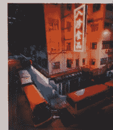

# 在 Java 之路上：格拉汉姆·格林与帕特里西娅·海斯密斯的私生子

> “令人着迷”
>
> “引人入胜”

# 劳伦斯·奥斯伯恩赞誉

> “现代格拉汉·林”
>
> “欲罢不能且文笔优美：完美的结合”
>
> —— 莱昂尔·史里弗 (Lionel Shriver)
>
> “令人惊讶、黑暗且卓越”
>
> “奥斯伯恩以高超的技巧处理表面与深度，正如只有伟大的作家才能做到的那样”
>
> —— 德博拉·列维 (Deborah Levy)
>
> “极具吸引力”
>
> “如果小说的目的是带你远离日常生活并向你展示不同的事物，那么奥斯伯恩成功了，而且是非常成功”
>
> —— 李·奇尔德 (Lee Child)
>
> “像最优秀的麦克尤的作品一样令人不安且引人入胜”
>
> “作者卓越的描写能力增强了一种排山倒海般的威胁感”
>
> —— 路易斯·道蒂 (Louise Doughty)
>
> “英国最优秀的小说之一”

# 劳伦斯·奥斯伯恩

劳伦斯·奥斯伯恩出生于英国，是多部广受好评小说的作者，包括《被宽恕者》(The Forgiven)、《小角歌谣》(The Ballad of a Small Player)、《黑暗中的猎手》(Hunters in the Dark)、《美丽的动物》(Beautiful Animals)、《唯有睡眠》(Only to Sleep，一部受雷蒙德·钱德勒遗产委员会委托的菲利普·马洛小说)以及《玻璃王国》(The Glass Kingdom)。他的非虚构作品涵盖从回忆录、游记到随笔，包括《曼谷岁月》(Bangkok Days)、《赤裸的游客》(The Naked Tourist)和《干湿》(The Wet and the Dry)。他的短篇《火山》入选《2012年美国最佳短篇集》。

由拉夫·菲尼克斯、马特·史密斯和杰西卡·查斯汀主演的《被宽恕者》于2022年上映。奥斯伯恩居住在曼谷。

# 劳伦斯·奥斯伯恩其他作品

- 《安妮·马林娜》(Ania Malina)
- 《巴黎梦幻》(Paris Dreambook)
- 《毒的拥抱》(The Poisoned Embrace)
- 《美国常态》(American Normal)
- 《偶然的鉴赏家》(The Accidental Connoisseur)
- 《赤裸的游客》(The Naked Tourist)
- 《曼谷岁月》(Bangkok Days)
- 《干湿》(The Wet and the Dry)
- 《被宽恕者》(The Forgiven)
- 《小角歌谣》(The Ballad of a Small Player)
- 《黑暗中的猎手》(Hunters in the Dark)
- 《美丽的动物》(Beautiful Animals)
- 《唯有睡眠：菲利普·马洛小说》(Only to Sleep: A Philip Marlowe novel)
- 《玻璃王国》(The Glass Kingdom)
- 《燃烧的天使和其他故事》(Burning Angel and Other Stories)

***

献给娜塔莉·王

她曾与我一起走过山前往石湾

并引发了一个故事

一个绅士总是按照良心行事，正如李东医生所言

# 第一章

在那些绝望的日子里，我总会想起在学校读过的一部小说里的那段话，叙述者坚持认为自己更希望被称为“报道员”而非“记者”，后者这个谦卑的词汇描述了他所做的工作，即记录他所看到的一切。如今的职业描述甚至更不那么光彩。当然，我认识香港所有的记者，但也认识许多报道员——那些追踪城市流动区域的公民，他们经常像我一样独自拿着手机相机，随着时间的推移，我发现自己在他们中间变得更加自在，却并没有意识地知道为什么。但，我们在描述的是什么？又是为谁而描述？我也不确定。对我自己来说，也许还有像我想象的那样散落在世界各地的少数人，这取决于你想多深地进入内心。其中一些报道员变得异常出名。在这方面他们和我不同。尽管我在香港呆了二十多年，作为一个事事包办的报道员苦干工作，坚持进入受人尊敬的更高阶层，但我在这座定居的城市里从未闯出过名堂。人们模糊地知道我是一个写过某些东西的作家，还是一个名声不佳的饕客，但仅此而已。我年轻时来到那里的，被伦敦及其前景冷得刺骨，无法预见自己能在那座坟墓中获得成功。我在回归后不久就抵达香港，除了大学好友老唐外一无所知，仅带着行李箱和五千英镑积蓄。考虑到这些开端，我过得不错，但从未成为过明星作家。在某种程度上，我并不在意。我曾在各种报纸工作，当过美食评论家，结婚后离婚，积累了一间小公寓，并完善了大学期间的中文。换句话说，我是一个优秀的平庸之辈。

事实上，那个夏天初，动荡最初爆发时，我感到自己仿佛从一场深沉且毫无意义的睡眠中醒来。我所习惯的那个城市——舒适、愤世、充斥着晚宴和白松露活动——在看到我的邻居之一在深夜穿着白色无袖衫、手持菜刀出现在爪牙路时，彻底破碎了。我不认识他的名字，但我每隔一天就会在顺顺见到他，那是爪牙路上的一家餐厅，我大部分时间都在那里喝茶吃云吞、编辑我的报道。我想他也认出了我，但在深夜街头那一刻，他对我来说是隐形的，因为他在那里是为了寻找可以恐吓的抗议者，而一场中国的内战并不会包括欧洲流浪者。

后来，确实，某些外籍流人在那个席卷城市的冲突中确实成为了当地的英雄，就像那个没腿的法国人站在摇摇欲坠的假肢上，慷慨激昂地发表对学生的支持。我从未得知他的名字，尽管我决定如果能在廉价餐厅看到他独自用餐，就请他喝一杯。他仅仅被称为“那个没腿的法国人”。至于顺顺那个拿刀的食客，我同样不知道他的名字，但他会像民间故事里的鬼魂一样再次出现，从未失去过令人不安的力量。

就我个人而言，我该如何报告和描述他们呢？这个问题让我每晚都想去“凤兴”吃饭。此外，这个地方的英文名“凤凰城”（Phoenix City），现在看来似乎比以前更贴切了。另一只凤凰，又一个谜团。

每当我爬上楼梯进入二楼的食肆时，那里与红蓝相间的街头招牌齐平，路过一尊庄严的、嵌着蓝色眼睛的金色鸟神像，我总在想，当我独自一人进入大厅时，是否所有的目光都会汇聚在我身上。我被头顶那种中国人似乎很喜欢的餐厅里的审讯灯照得眼花缭乱，这让我比平时更加地察觉到自己的格格不入。我决定把那位“神秘肉菜刀男”称为“李先生”，因为那是大陆最常见的姓氏之一。如果以后在那个地区的某条阴暗巷子里再次遇到他，我的刺客至少得有个名字……然后被李先生劈成两半。在那个充满暴行与混乱的热夜晚之后，我很少在凤兴看到他了。那时，穿着黑衣、拿着竹杖的男人们追逐着男孩女孩，当局势反转时，他们又被原路追回，像一场失控的剧场演出。

但并不仅仅如此。作为一个外地人，我与在凤兴用餐的人之间的关系几乎在一夜之间发生了变化。整个城市的氛围变了。我周围语言的语调变得尖锐，那是一种无论如何我都从未掌握过的语言。然而，我察觉到了这些变化，就像电波中的磁场波动。

我知道如何说“屌你妈”（diao ni lao mu），但现在我听到它被用成一句针对武装警察的句子：“屌你妈高滚”（diao ni lao mu gao gun），其中最后两个字可以译为“狗官”。“哈警”（hak ging）这个词随处可见——黑警、眼警。警察很快开始向他们的讽刺者回骂脏话。其中一些人用普通话说：“操你毛”（Cao ni mao）。随着温暖月份的推移，最初因反对北京实施的引渡法而引发的紧张局势不断升级并螺旋失控。现在，随着事情变得愈不理性、愈原始，人们可以看到仇恨通过文字流泄，正如通过毒打和催泪气一样。文字是承载暴力种子最高效的容器。正如阿拉伯人所说，舌头无骨，却能断骨。内心深处的一切都毫不费力地流过那些碎骨的文字。当一个警察对一个十六岁的女孩说“死仆”（sei po）——“死吧，婊娘”，暴力已经完成了。动词不是行为，但它就是行为，是违规者通过说出脏话而赋予自己的许可。在有一次对峙中，警察使用了正式警告，前线的女孩们回道：“过来啊，我们把你的蛋抠掉。”对此，没有回应。至少在那一刻，言语的侮辱抵消了一连波橡胶弹。

在接下来的几天里，我没有去每日的街头抗议。我照常去凤凰城，因为我迷恋那里极地般的空调气，以及它带给客人的常态感。这是一种解脱。我坐在一根镜柱旁，吃着咸鸭蛋黄和汤饺，直到街道凉快了一些，我才能带着清醒的心智下楼，在从雅华路延伸出来的斜坡街道上走走，寻找暴动者、抗议者——随你们怎么称呼都可以。但没有人出现。一种沉静降临了，仿佛那些把遗书遗嘱缝在外套里的学生们，决定休息几天以恢复体力，让街道恢复为消费主义的安逸之地。或者，在雅华路的情况下，那里是一个满是殡堂的地方，挂着黑白带和单色横幅，被那些糖大亨的幽魂萦绕，他们曾通过与爪哇的海上贸易积累财富，而他们宏伟的办公室曾屹立在这里，作为殖民大慈的象征。

热浪升腾，到了中午，城市的居民们撑着报纸和遮阳伞忍着暑。他们穿着简陋的衣物，显得忧郁而克制。

当他十四岁时。其中记录了一个几个世纪以来钓鱼者众所周知的、关于将青蛙作为饵料残忍使用的观察：“像你爱他一样去使用他，也就是说，尽可能少伤害他，好让他活得久一点。”

你可以理解为什么一个冷酷的亿万富翁父亲会给儿子这样一本书，以及为什么吉米会随身带着它去英国那些懒散的精英阶层中学习。然而，在当时，他只是说这是他所能想象到的关于学习生活的明智书籍，因为生活确实就像钓鱼一样。它需要耐心、狡诈以及长时间静止不动、关注静止水面的能力。它培养了人们对静静杀戮的兴趣。《完美钓鱼者》的另一个优点是，香港没有其他人读过它。这是一种秘密知识，一本手册。

人们可能会猜到，大宅里的大富居民早已离开了世界的其他地方。资金正向外流失，这股不可阻挡的潮流是由对这座城市正在发生之变的绝望驱动的。然而，当大门打开时，有一个女仆在那里迎接来者。她认出了我，打招呼道：“你好，盖尔先生？”当我们走向那些比我们更有钱的人时，她我交换了同一种忧郁的眼神。

这是一场大约十五人的聚会，与其说是派对，不如说是晚餐。但唐家不喜欢围坐在桌旁，所以客人们坐在哪里，就在哪里享用。我也喜欢这种方式。他们是老练的主人，在家招待方面没有出过错。梅莎·唐（Melissa Tang）开了门；显然，门卫已经通知过我。她穿着一件黑色羊绒开衫和丝绒长裤，对她来说这很休闲，因为颜色相同，我唯一注意到的细节是她颈上的珍珠项链。那既戏剧又时髦；她总是那样。这里还是她父亲——古怪万富翁罗德尼·周（Rodney Chow）的旧公寓，那些铺了地毯的房间和从中国收藏的明代陶器让她感到舒适。周家和唐家一样富有，尽管他们的钱是从制造业和电视站里赚来的。罗德尼是个脾气古怪的老头，喜欢雅卡花织烟睡袍和瑞典女孩，他经常出现在唐家的聚会上或出没于街头，但我很少与他互动，因为我畏惧并厌恶他。罗德尼那夸张的品味无处不在。在那些无价的陶器中，有一尊是等身马，它的脖子上挂着泥土色的铃铛，像守护神一样站在门厅里。每当梅莎走过它时，她都会轻轻抚摸过它的侧腹，现在也是如此。“我很高兴你来了，”她一边领着我进去，一边没有回头，“吉米（Jimmy）整天心情都很糟糕。”

“噢？”

“家里希望他对香港局势发表一个表态，这样当局就知道我们的立场——希望是和他们站在一起。”

“表态？”

“他们希望他宣布对国家和共产党的忠诚。嗯，措辞不会那么直接。”

“那会怎么说呢？”

她在内心犹豫不决，我看得出来，她咬紧牙关，嘴角紧绷，调动了所有的外交手段。

“措辞会写成一种信仰的宣言——对香港未来的信仰。我必须说得那么直白吗？”

多年来，我一直认为他们的家是香港最优雅的，尽管它很老旧，走起来咯吱作响，而且剥离了现代科技。它是刻意采用维多利亚风格的，因为那是梅莎父亲更西化的品味，但渐渐，她自己那种更中式的感性开始占据主导地位。吊灯显得静止而不详，墙上的挂毯展示着故宫的场景，我无法从风格上界定它们，悬浮在东方主义和真实的东方之间；而陶器现在无处不在，被安置在底座或壁龛的架子上，博物馆级的品质，且带着一丝过分的自傲。它们散落在几幅来自20世纪60年代末精致的陈大华（Luis Chan）迷幻水彩中，这些画描绘了梦幻的岛屿和幽灵，旁边还有奇异的恐龙和奇特的鸟类；还有一件由吉米强迫妻子接受的、当代新写实风格的更具争议的周振辉（Chow Chun Fai）的作品。我知道振辉画的是几十年前经典香港电影的剧照，他的反建制政治不受梅莎这种背景的人待见——尽管如此，那件作品仍挂在他们的客厅里，几乎未被注意到，带着一种不安的妥协精神。一群穿着坎心背的男人坐在桌旁，在1970年代某个被遗忘的年份玩着牌，散发着寂静的威胁。

这个房间对着一个阳台，阳台沐浴在永不熄灭的大楼光芒中，这些大楼向维多利亚港延伸。大海显现出来，尖沙咀的霓虹灯在黑色的海面上闪烁，渡轮穿过倒影。那里已经有一群人坐在藤椅上，用公用水壶喝着曼哈顿冰茶。我认识其中的好几个人。唐家有两个交叠得尴尬的圈子：一边是高薪对冲基金人和银行家，另一边是记者和学者，他们来到半山山的异域世界与这些金融领主相社交，而这些领主反过来几乎注意不到他们。我对这两个圈子都很熟悉，尽管从某种意义上说，我更喜欢银行家。他们不虚伪，那种友善的法西斯主义是直率的。

但与此同时还有第二个阳台，吉米把它变成了一座热带花园，从另一个房间进入，梅莎带我去那里，是因为她想和我单独谈谈，如果我不介意的话。景色是一样的，但独自坐在微缩丛林中的单沙发上。一个女仆为我们送来了饮料。我和梅莎的关系并不特别亲密，尽管显然我们通过吉米认识了多年。我觉得她很有同情心，而且在某种意义上，有一种脆弱的尊贵。她尊贵的不是对吉米幼稚和自私的隐忍，而是她为了某种崇高目标而假装在思考某些事情的能力。

她的声音传来：“我们不能让吉米（Jimmy）在我们面前彻底搞起民主化。”

“我确定不是那样的。”

“那会是个女人？”

是时候强笑一下了。我坚持说没有女人。

但她的语气依然平淡，带着试探的意味：

“那一定是些别的什么。”

她停顿了一下，目光移开离开我，看向蜡笔盒套装发出的霓虹光芒和那些移动的船只，它们的甲板灯火通明如同漂浮的婚礼。这片景象中似乎某些东西激发了她的思路。我决定继续说下去：

“我们在个人层面没聊过什么。与所有神话相反，男人并不倾向于那样。”

“我一刻也不相信。”

“在我们这种身上这确实如此。无论如何，他什么都没提过。据我所知，他没有喝得那么厉害。”

“他是个令人厌烦的花花丈夫，我知道这一点。你不需要在我面前假装不是如此。我也不希望你告发他。但如果你能为我——为我们——留意一下他，我将不胜感激。全家人都很担心。他和我父亲前几天晚上发生了一场激烈的争吵。”

“为了什么？”

“吉米的行为，他的鲁莽。人们在镇上看到他与各种各色的人在一起——现在不是出公共丑闻的好时机。”

“你身上几乎没有什么丑闻的。人不应该太兴奋。”

“还没有。但你能感觉到这些事情正将来临。我想问问，你是否察觉到可能从哪里发生？”

“我？”我不得不用一种戏剧性的笑声来化解。“这不是什么疯狂的问题，”她坚持道，“从我的观点来看——”

“梅丽莎（Melissa），我什么都没发现。他并没有去参加什么秘密政治会议。也没有带电影女星去什么隐秘的情巢。”

他可能两样都做了，但我直视她的眼睛，她似乎逐渐冷静了下来。

“好吧。但如果你觉得有什么我应该知道的事情，能来告诉我，我将不胜感激。你能为我这样做吗？”

我必须答应，而且我至少有一部分是认真的。多年来，她的家人一直很欢迎他们；他们邀请我参加派对、晚宴，在公开和私下里都为我美过言。我可以说更进一步：他们是我通往香港权贵阶层的救命草之一。并不是我是那个圈子的内部人士，远非如此。但我偶尔可以像闯入者一样进入其中，而这种能力在很大程度上归功于他们。由于唐家（The Tangs）运送着亿万富翁，并以惊人的规模进行慈善捐款，他们不仅是我非常友好的朋友，而且非常有用。吉米的父亲比罗德尼·周（Rodney Chow）对我更和蔼，并且非常清楚我认识他儿子多久了，以及我们之间存在着多少感情。

“你让我放心了，”她说道，抚平了她已经平整的裤子，仿佛那层丝绒布上积聚了我看不见的尘埃。“我们喝点潘趣吗？”

在晚上剩下的时间里，我没怎么见到吉米，直到派对散去，残余的人再次聚集在阳台上。这时，他突然出现，穿着他其中一套漂亮的 W. W. Chan 西装，那是一件由杜格代尔利斯堡亚麻（Dugdale Lisburn linen）制成的米色斜纹西装。优雅感自然而然地在他身上。他向我投来意味的眼神，发现我发现了他希望别人注意的外表细节。

其他人大多是认识他父亲的男人，他们喜欢在吉米面前安静而愤世嫉俗地交谈，喝着吉米提供的多美德蒙蒂勒沃纳伊（Domaine de Montille Volnay）红酒，这些酒在享用前已经醒酒了一个小时。他们的观点大多是亲中国的，是稳定的维护者，正如吉米所称的他们那样。他们许多人在上海和深圳有公司。像太古（Swire）或何氏一样，他们知道北京的主子们在他们的面包哪一面上涂了黄油。同时，他们也知道如何让自己听起来既爱国又理性，既资本又温和。他们曾蔑视共产主义；现在他们认为那无关紧要。然而，在历史命运的一种奇特转折中，他们拥抱了它。

“这话虽然很残酷，但我想很难否认这个事实。大家都在国外。很快就只剩下我们两个了。”他吸了一口雪茄，“其实也没那么糟。事实上，我一点也不介意。我们要不要把那瓶蒙特白葡萄酒喝完——我为了躲避那些西哥特人，特意留了一些。”

他让其中一个女仆拿来两个新酒杯，我们在开瓶前抽完了雪茄。这简直是红酒的亵渎，烟味破坏了味蕾，但他想在今晚把那瓶酒喝完。在傍晚期间，似乎有些事情触动了他的内心。在我们长久的友谊中，有时当他想倾诉肺腑时，我是他会找的人，而在涉及到他扭曲感情生活时，偶尔也是如此。现在的情况正是如此。

“我想让你见一个非常棒的女性。”他的语气变了，我能听出他正走向一个敏感的话题。“她名字叫瑞贝卡·曹（Rebecca Tso）。她是个学生，是的，我知道你会因此对我产生评判，但有时候事情就是变成那样。别那么有偏见。总之，我邀请她去游艇上玩，她来了。似乎她是学文学的，虽然当然，现在他们都在罢工。起初我觉得我们之间毫无共同语言——她比我政治性得多，而且在学生运动中有些激进。但我接受了这一点。当我见到她时，我被那种著名的雷电般的瞬间击中了，那种纯粹的电击直击你的胸口。你懂那种感觉。你会觉得你快要中风了。总之，我想让你见见她。她身上有些特别的地方。”

所以，我想，梅莉莎的直觉是完全无误的。

我说：“她多大了？二十一左右吧？”

“其实二十三。比我小一一两年。”他低头看了看自己的指甲，“我没说发生了什么剧性的事情。我只是请她吃了晚餐。我打算周四晚上和她见面——我觉得你应该和我们去。梅莉莎会在澳门参加一个慈善舞会。”

“这周四晚上？”

“别这么死板，阿德里亚诺（Adriano）。”他想要什么时总是这么叫我。“别告诉我你要在家里写你的回忆录。你只会浪费时间守着一家酒吧，坐在电视机前。我们一起去德士园（Duddell’s）吧。”

“你想听听第二意见，是这样吗？”

他有些羞愧地避开了目光。

“也许我入迷了。我们这个年龄层会发生的事。我知道这很可怜。但不完全可怜。”

“也许是幻觉？”

“是的，有一点那意思。我宁愿幻觉也不愿可怜。还有比这更糟糕的事情。这取决于你对什么产生幻觉，你不觉得吗？”

“为了某种高尚的目标产生幻觉，你的意思是？比如追逐学生？”

他冷冷笑了笑。“你把我难住了。但尽管如此——又怎样？我们用那些年轻到无法报答我们的女孩来自欺欺人又怎样？她们和我们一样残酷。每个人都是自私的，如果你仔细想想，我们别无选择。何必对此大惊小怪？我们几年后都会死——你我都是。他们说我很豁达。此外，我不会为了她迷失理智。”

入迷不就是迷失理智吗？我正在惹恼他，并享受这种效果。

“是的，但迷失理智有不同的方式。总之，我们对这些事情无法控制。一见钟情（Coups de foudre）之类的。如果我被迷住了，那就是迷住了。我已经陷沦了。我只是在需要的时候往我脸上泼点冷水。我并没有觉得她是那种拜金女类型。”

然后我随口问起她的名字。瑞贝卡作为名字不是挺寻常吗？但随后我想起了香港社会的另一个瑞贝卡，她是粤语歌手兼演员张国（Leslie Cheung）的朋友，我不记得她的姓氏了。我想起了张国，我青春时代那个伟大的同性恋偶像，《狂野之日》（Days of Wild）中那位中性美的明星，因为在他在2003年从文华酒店24层跳楼自杀后，他的灵堂在华严路东段举行，正如我所说，所有的灵堂都在那里。一串奇妙的联想。好吧，”我说，“我会去的。周四晚上。但我粗鲁的诚实会让你付出一顿晚餐和以及我想要的任何瓶酒。成交！你知道的，阿德里亚，生活之所以无法忍受不是因为是一场悲剧，而是因为它是一场浪漫——谁说的？我不记得了。而这是一场浪漫。尽管我必须承认，到目前为止它一点也不难以忍受。

然而还有一件事。她每晚都去抗议。我们事后见面，她身上有泪气瓦的味道。我承认我挺喜欢的。那是我能离前线最近的了。”我吐出一口烟，告诉他那番话挺蠢的，但我没有重复。“这可能很蠢，阿德里亚，但这确实是事实。”

就在那一刻，我不得不承认，躺在浸满苯丙酮（phenophenone，泪气瓦使用的化学物质）的床上是什么感觉。那种味道在那些日子里无处不在；从傍晚开始，它沿着宽阔的大道流下，在我公寓里留下一股微弱而酸涩的味道，渗透了我那常年关闭的窗户。“告诉我，”他说，“你觉得她是在执行自杀式的任务吗？我是这么对她说的。这像是一种集体的狂热，一种狂喜。我变得越来越感兴趣。显然，我自己绝不会去，但我对那种无政府状态感到着迷。我也有同感，尽管没必要说出口。这是一种青春现象，我们俩都清楚，因为在某种程度上，我们都因为年龄被排斥在外。我们可以产生同情，但无法参与。这取决于对什么产生幻觉，你不觉得吗？

一点一点，吉米送我回到大堂，我之前见过的那个门卫正对着显示器熟睡。我们并肩站在凉爽的林荫中，等他的司机，同时抽完了那支曾经名贵的雪茄烟蒂。吉米穿着他的杜格代尔（Dugdale）西装，只是因为晚上的狂欢而略显褶皱，他看起来就像是波瑞特大厦建造的那个年代的人物。他像一个突然出现在电光时代的幽灵，一个不完全算得上那个时代的产物。正那时，我想起在我们还是学生时代，他总是让我想起“领带男”（Arrow Collar Man），那是美国插画师J.C.莱恩德克（J. C. Leyendecker）在20世纪20年代为《周六晚报》创作的头发油亮的男性美学符号。他是Interwoven织袜、Cluett衬衫和著名的Arrow领设计的优雅而理想的模特。这些从远处闪烁着光的“转瞬即逝”，在常识的暗淡光线下并不完全真实，却比照片要真实得多。

他抽完烟蒂，并没有把它扔进旁边的榕树根部，而是冲回门口，将其按在旁边的沙质烟缸里。

他的司机带我们结束了告别的握手，那只是欢迎式的。我坐车到了肯尼迪路，然后心不在焉地向着湾仔公园深邃的阴影、皇后伊莎白体育馆和多尔塞酒店驶去，这些都是我一天经过的地方。街道上满了小石头，就像火山爆发后的残骸。出于某种原因，我们走上了余华街：其他地方有必须避开的冲突。维多利亚公园周围，闷热的人群开始散去走各自自己的路，在一面墙上，我看到新的中文涂鸦，写着：“这辈子只嫁前线。”这是一个绝妙的征兆，说明凤凰永远不会和唐吉米在一起，反正永远都不可能。

第二天晚上，当我坐在中环一家名为“老头”（The Old Man）的酒吧时，这一切都在我的脑海中闪过。在过去的二十四小时里，我感到越来越焦虑，意识到自己在这座城市里变得越来越难以隐形，因为我作为一个外国人——作为一个欧洲人——的外表已开始产生新的、危险的含义。

喝完六杯白兰地后来到街上，我看到一个地痞站在士丹森街对面的发财仔街角，他靠在坡度很陡的阿伯律街墙上，他穿着典型的亲北京街头帮派那种白色衬衫和翡翠绿缎面短裤。在我等车时，他也看我。他手里拿着一个空的杰克丹尼瓶，似乎不知道该拿它怎么办，就横跨马路朝我和我那件褪色的鲨鱼皮西装扔过来。瓶子撞在路缘石上，细小的玻璃碎片落在我的袖子和裤子的面料上。街角上没人，但你能看出有一群人刚刚经过，人们被打伤了；他自己鼻子在流血。他看起来像是自己喝了整瓶杰克丹尼。由于某种原因，瓶颈没有碎，顺着阿伯律路滚远，越滚越快，而那个男人举起拳头，冲我叫我是“gaat zaat”（蟑螂）。我没有穿任何通常与抗议者相关的衣服，比如黑色衬衫，我想，这一定是一个醉酒后的无差别概括，随口吐出来的。

“Gaat zaat”在粤语在那些炎热的夏周里有了特定的语境，但我从未想过它会被用来对我，即使不是那些此前对穿西装的外国人还很害羞的白衫反抗者们。他们恨我们，有时我走过时他们会喊“CIA”，但那是我穿着战斗服时。“CIA”在普通话里听起来几乎很有诗意：zhong qingbaoju。这是为了索取更多血，他来猎捕我，穿过路口朝向啤酒鱼附近的一条小路走来。他踉跄着，眼睛布满血丝，再次叫我蟑螂并向地上吐了口水，而在士丹森街的尽头，我看到我的出租车来救我了。他已经带着某种韵律咆哮着：“Diu lao mu——”

在车到达我之前，他挥出一记重拳，击中我的右脸颊，但力道不足以将我击倒。“没事，”我艰难地说道。

“这非常不寻常。这里可没有什么好说的犯罪行为。”

“那个白痴拿着一瓶杰克丹尼在外面等我。也许他刚跟老婆吵了架吧。”

“或者是局势很紧张——对于那些家伙来说，白人就是敌人。”

“也许吧。”

“喝一杯吧，可怜的孩子。”

“我要一杯支线酒（sling）。我想回去把他揍一顿。”

“别那样。是三合会在搞我们，而不是我们去搞他们。来，快坐下，让血结痂吧。”

“我本应该还手的。”

“每个人在挨了一拳后都会这么想。但你没动手，是因为你害怕。正如迈克·泰森常说的——”

“我才没鬼。他朝我扔了一个该死的瓶子。”

“——在脸被打了一拳之前，每个人都有计划。”

支线酒送到了，汉宁在礼貌地等待后，向受伤的记者们敬酒，我也向通文（Tong Boon）敬酒，他是新加坡来的酒店调酒师，他在第一次世界大战之前发明了支线酒。

“那真是美好的时光，”我尽力夸张地说道，我的手因为屈辱的愤怒仍在微微颤抖，“而且它们再也不会回来了。干杯（Yam sing）。”我干了整杯酒，把杯子重摔在吧台上。“吧台，再来一杯冰（mgoi sai）。”

“你手松了吗，盖尔（Gyle）？”

## 38

“手松？我凭什么会手松？”

“你看起来很有钱。表现得很有钱。”

“不完全是钱，但《乌鸦》终于付了我那篇关于赛道的稿费。都四个月了。反正喝酒也多了一千块钱。我得手松才能跟你混。这感觉就像是跟一个吃钱的垂直风洞做朋友。”

“好吧，听你这么说。吧台，再来一个，麻烦（mgoi）。”

我这么说是因为据我观察，这个地方到处都是“蝗虫”——这是我们对那些从世界各地飞来报道我们城市动荡的记者和博客主的称呼，他们根本不知道自己在哪里，更不在乎。这也是粤语中对大陆人的称呼。这两个物种都坐在黑暗中，身边带着从哪儿找来的女孩。西方物种穿着俗气得要命的记者服：香蕉共和国衬衫和矫形鞋，就像我们自己对过去辉煌的沉迷一样。大陆人则穿着在山姆会员店买的西装。

“他们在机场就让他们进来了，”汉宁说，“我们对此无能为力。这是竞争，盖尔。”

“是的，没关系。需要你们的时候，警察国家去哪儿了？这就是我们交税买到的？”

“他们像伞兵一样降临带走了所有的女孩。”他环顾四周。“这是海盗行为。”

我把手放在伤口上，感觉到硬化的结痂勒着颧骨上的皮肤。这家伙瞄得真准，像个专业人士。众所周知，三合会从业余拳击手手中招募，就像当局在需要冲击部队来殴打不听话分子时，也会从他们中招募一样。所以，这次胆怯确实战胜了勇气，这也许是真的。然而，金酒渐渐麻醉了我，我三小时前还好的心情又回来了。我之前一直和路透社的希拉·吴（Sheila Ng）在一起，一度我觉得我可能和她取得一些进展——但她抓住第一个机会消失得无影无踪，而老头并没有提供替补。我明显变老了。光靠魅力和机智已经不够了。尽管如此，这一天并没有完全虚度。我下午大部分时间都在采访一位立法者，他几乎无法控制自己对即将到来的打击行动的渴望。我问汉宁他去哪儿了。

“我请了一天假去了龙脊（Dragon’s Back）。我一路打车去那里，等到了山顶时想起我太胖了没法登山。你看，缺乏锻炼终于开始影响我的身体了——”

“你应该练练普拉提（Pilates）。”

他的眼睛陷入了僵直。

“噢，哪种？我听说庞提斯（Pontius）的版本最好。”

“严厉且带有审判性。那是你需要的。”

只有我在笑。他的口吻像个喜剧演员。庞提斯·普拉提。

他问我最近在忙什么。

“没做什么，”我说，“只是努力让自己不沉水。”

“你呢？”

“我正在找一个新故事。一个大新闻。”

“好吧，如果你找到了就告诉我。”

他起身离开。我独自留在那里，陷入了自己的和吧台渐弱的喧嚣中。

# 三人

两天后的晚上，当我乘电梯上到 Dudley's——那是一家坐落在同名陡坡路办公楼内、位于 Foxglove 转角处、低调优雅的餐厅——我感到一阵冰冷的寒意顺着脊椎和腿部蔓延，此时脸颊的跳痛变得越来越剧烈。伤口在细菌的灼热中已经感染了。然而街道上很清空。我们在出租车经过时，路中间坐着一个孤独的催泪罐，正像小喷泉一样喷出一股烟。周围空无一人，只有破碎的玻璃和焦化的橡胶碎片。它偶然掉入了一条无关紧要的街道，没人注意到。但它曾刺痛我的眼睛，现在当我到达三楼进入餐厅那像俱乐部一样的接待区时，我的视线模糊了，我不得不请员工为我找座位。

吉米和他的客人已经在那儿。在一家以酒闻名的餐厅里，他们已经摆好了一瓶配得上吉米挑剔味蕾的酒。那个女人抬头先看到了我，但并不知道我是谁；她的脸上掠过一丝困惑的失望，但很确定我就是他们要等的人。她显得很内敛，长发整齐，那张不对称的脸老了之后会变得很有趣。她穿着 T 恤和牛仔裤，但低调得恰到好处；即便擦肩而过也会注意到。她对吉米说了什么，吉米半转身看向我。他穿着一套 W. Bill 的夏季西装，围着一条带有佩斯利图案的白色亚麻意大利围巾，他背对着昏暗的窗户，一如既往地显得太过于显眼了。显然，他的客人正沉溺于安德·博福特香槟。

“噢，你在这儿，”吉米用粤语说道，证实了我的印象。我看到座位已经准备好，当我准备坐下时，一名服务生出现并为我满杯。

我说：“我确实需要。”

“艾德里安，这是丽贝卡。丽贝卡，这是艾德里安。我们换用英语吧，因为艾德里安的中文不太行。”

他说得对，但并不是说我不能快速进行相当体面的对话。我向她耸耸肩，她似乎理解我是那种害羞的类型，可以对我宽容一些。

“我以为你说过他读中国诗。”

当吉米眨了眨眼，她的目光落在我身上——体内的某种东西崩塌了，向后退了一步，让出了领地。她的眼神中闪烁着灼热的光。于是我们换成了英语，那一刻我觉得很遗憾，因为中文可能更适合我们这三个人。

“很高兴见到你，”丽贝卡说着握了我的手。她的英语看起来非常完美。

出身名门，我心里想，我懂这种类型。但是哪一个家族？吉米把这座城市当作他的猎场，却从未引起过注意。她继续道：“你脸上的那个口子是怎么回事？”

“瓶子砸的。”

“瓶子？还连着人？”

我疲惫地讲述了那个故事。我、瓶子、流氓——一整场糟糕的互动。吉米觉得这冷冷地很有趣。

“听起来很遗憾，同志。之前先有过口舌战吗？”

“没有。”我真的不想提这件事，所以轻描淡写地带过了那段交锋。

“突如其来，对吧？如果你想让他消失，尽管说一声。”

“你找不到他的。”

“很可能找不到。”他笑了。“生活如屎（La vie en merde），但我们能如何呢？像战士一样带着你的伤疤，并把它变成和女性聊天的话题，这是我的建议。”

然而有一刻，尽管语气轻浮，他显得有些担心。需要我让他放松下来。

“我会活的。让我们沉浸在食物里吧。”

“空头脑的伟大爱好。我很乐意承认，包括我。”

“帮我点菜。”我总是信任吉米的品味。

“黑椒鳕鱼？皮质光滑且单人一份？”他的脸因期待而微微泛红。“你怎么说，我们点这个不错，对吧？脆皮乳猪？”

他用粤语点了菜。丽贝卡用她那双习惯性捕捉微小事物的眼睛慢慢打量着我。一个陌生人，并不好看，但满口空话。与她相反。房间只有半满，但她那股内敛的光芒似乎填满了整个房间。她是那种给人一种肉体静止感的人，那种静止是国际通用的准确写照。

我举起酒杯向大家致意。

“唔赢。”

我们一起喝着，吉米透过杯子明亮而坚硬的眼睛盯着我，挑衅质疑他的品味。

“吉米告诉我你是个学生，”我开始说道。这是一个笨拙的开场白，但总有人得推动气氛。她俏皮地看着他。

“是他这么说的吗？”

“他是个糟糕的撒谎者。尽管告诉我实话。”

“不，他没撒谎——至少现在没有。”

“诽谤，”吉米抗议道，“她是大学的学生。我们以前都曾是。我不怪她。”

“我在学美国文学。”

“那你是怎么认识伟大的吉米·汤的？”我问。

“在 Tinder 上，很显然。”

“又一个谎，”吉米再次抗议，但大多是在笑。“这种事不该说——如果你想知道，她已经追求我多年了。”

“你晚了二十年，艾德里亚。但我佩服你投身战斗。”他转向他的爱人道，“我们的艾德里安觉得你们这一代人很棒。他在学生时代自己也是个无政府主义者，所以我并不完全感到意外。不是克鲁泡特金，但很接近。在剑河边的草坪上，到处都是谈论革命。”

“真的吗？”她转看向我，突然迸发出兴趣。

剑河上的克鲁泡特金，那曾是我，但只持续了一年左右。

我抗议道：“他夸张了，但并非完全离谱。那是百分之三十的克鲁泡特金和百分之三十的拉斯金。”

“他当时乱了，”吉米说道。

“现在我是百分之三的克鲁泡特金和百分之九十七的马克·吐温，”

“百分之三的马克·吐温。”她笑了。“我觉得这是代际差异，”她说，放下叉子，让盘子里的海螺在那儿一直没动。关于这件事，我跟我父亲进行过几次相当激烈的交谈。而我母亲已经完全没法谈这个话题了。我们已经互不说话了。”

“每晚餐桌上都有成千上万的争吵，”吉米说道，“在我家里，这只发生在我和我妻子之间。她比表现出来的要不安得多。但她的家人承担不起任何关于共产党的不忠丑闻。”

我很好奇瑞贝卡听到吉米妻子的提到后会有什么反应，但她的脸依然保持着那种冷酷的中立表情。

“她只是害怕，”我说，“大家不都是吗？”

“不。二十岁的年轻人并不害怕。”

“那是因为他们才二十岁。他们在物质上的损失较少。等他们三十岁时他们就会害怕了。你不觉得吗，瑞贝卡？”

她抬头看了我们一眼片刻，然后又拿起筷子。

“我们当然也害怕。你意识到我们有数百人受伤了，不是吗？”

“显然，”吉米慢悠悠地说，听起来像是已经听过这句台词了。

一道蟹菜上桌了，盛在一个金边的容器里，两只金属蟹爪。它被放在中间，吉米又点了一瓶酒来解。鲍鱼上来了，配着蔬菜制成的花。

“我担心，”吉米说，“我们制造了相当数量的殉道者。殉道者很难从他们的底座上被移除。短期内他们会被粉碎。长远来看——孩子们会长大，他们会继承这里。还是说计划是让数百万人流亡？”

“他们只会镇压，并像往常一样和硅谷做生意，”瑞贝卡说道，并没有怎么生气。这是这个特定世界的生存之道，不太可能有不同的结果。“我们这样做并不是因为我们任何希望世界其他地方会伸援手。我们已经知道他们不会做的。我们这样做是因为不这样做就太卑劣了。”

“你必须承认这一点，”吉米说道，与我的目光交汇了一秒，几乎在我们两人之间流露出一种遗憾的怀旧。自杀式剧场。我就是这么想。抱歉这么说，瑞贝卡。”

“随你怎么想吧。你以后会后悔的。”

关于当代剧作的话题随后被搁置一边，以免场面变得激烈。我被那金色的蟹爪迷住了，并大声询问它们是否是按需提供的。

“你现在还住在爪牙路那个老鼠横行的地方吗？”吉米说道，“那儿叫什么名字？”

“加兰德（The Garland）。而且那里一点也不老鼠。”

“那满是蟑螂了。那里肯定充满了某种非人类的东西。我本该找机会去看看你的，但说实话，我一直担心自己会被咬到。”

“蟑螂不咬人。”我向瑞贝卡求道：“他在胡说。”

# 第四章

“你看起来像好几天没睡了，”三天后我们在阿伯丁的码头相遇时，吉米说道。那是他存放他的两艘游艇中较小一艘的地方，一艘继承自叔叔的 `Tecnomar` 动力艇，名为“甜甜台风”。“是这样吗，同志？”

“自从上次见到你以后，我一直在不停地睡觉。”

“听你这么说我放心了。你看起来睡眠不足。而我呢，睡得太多了。”他停顿了一下，“我们路上接上丽贝卡。我的船长已经准备好了。他叫汤姆。嗯，显然那不是他的真名，但我叫他汤姆。家里每个人都叫他汤姆。”

“去哪儿？”

我们已经在炎热的阳光下走向登船梯，`Tecnomar` 雅致的白色船体和穿着全白、戴着锦花帽的中国汤姆站在那里观察着新来者。

“汤姆！能给这个傻瓜来杯螺丝撞吗？”

“好的，先生。”

船长移出光，进入了有胡桃木和黄铜装饰的内部，那里是吧台。

“你什么意思是，去哪儿？”吉米没看我问道。

当我们爬上船时，他说这种出游不需要所谓的“去哪儿”，必须留有即兴发挥的空间。

“我们要去赤灯角接丽贝卡，然后驶向未知。岛屿这么多，时间如此少。我们准备了龙虾和粤语流行音乐。这是一种令人陶醉又略微作呕的混合物。”

# 无人岛

这非常他的风格。当我们坐在后部，在遮阳篷下，拿着钓鱼竿时，螺丝撞送到了，冰箱也已经打开了。里面装满了玻璃罐装鱼酱和罐装酸奶油。汤姆在音响上播放了陈国辉，我们离开了海洋，远离陆地的热浪和水泥。我喝了三杯螺丝撞，配着鱼子酱饼干。很快，我们掠过喇蹄岛的绿色边缘，进入一片温和浅浅的海域，那里布满了我们谁都不记得名字的小岛。然而，我知道波士岛，以及对面的大滩头角。我们在音乐的轰响中在它们之间移动，朝着赤灯角和海浪扰动的狂野岩石驶去。它的山坡覆盖着金属色的丛林，沐浴在海雾中，顶部的灯塔在阳光下闪光。在一个名为蚝咀湾的小海湾，我们下锚等待丽贝卡。

晒着太阳，以适宜的速度喝着酒，低头看着寂静的鱼群中闪烁的斑点鰥，同时将饮料换成了烈性的马天尼鸡。现在是吉米亲自守着吧台，他调制的酒劲大得离谱。他一边调酒一边跳舞，仿佛他的心在别处。这一天海湾避了风，我能听到树上的蝉鸣。那一刻的满足感足以充实我；我不需要去想吉米脑子里在想什么。正如菲茨杰拉曾写过的，“没有比那样的混乱了，”这完美地描述了我。

当我看向海湾时，太阳是十一点。没有人经过这里，因为整个赤灯角都是属于和德集团的海洋保护区。那里只有一座供科学家的建筑，尽管理论上允许游客进入。在刺眼的阳光下，那里一片荒芜，扭曲的植被纹丝。为了打发时间，吉米扔下熏三文鱼，在他沉浸于这项幼稚的小任务时，他问我是否考虑过离开新闻业转行其他行业。我说如果可以，我可能就会退休。他放弃了鱼，慢慢转过身，让阳光洒在他油光亮的脸上，“我可以带你进入房地产，同志。那里没有灵魂，但相对容易。如果你需要新职业，我仍然可以。我在石澳有一些海景房，可以快速获利。人们正试图出售搬往美国，但我们只需要等几年，市场就会回来。我的岳父有那些工程项目。”

这让我们大家会心笑了会儿。

“谢天谢地，”喃喃自语，“尽管我本可以成为世界上最富有的翻译家。这倒是个想法。”

“是啊，”我附和道。“顺便，我想问问你：我们为什么要大远跑到这里来见丽贝卡？你们在镇上已经被人看到在一起了。现在才玩躲迷猫是不是有点晚了？”

“确实是晚了。但尽管如此，消息似乎传得太开了。我让这种事情发生确实有点傻。我本以为就论活动场所来说，达德尔那里通常很谨慎。当然，我错了。梅莉莎的耳朵无不在。你看出来我有多粗心了吗？”

但他正用他那那种无礼又孩子气的方式微笑着——从深处来说，这一切都是一个只有我们两人知道的巨大宇宙笑话。我确实想起了梅莉莎私下对我说过的话。

他继续说道：“所以我安排了我们在这里见面。我知道这有点费周章。但人生如果没有一点周旋，又算什么呢？我也想离开城市待一天。上次见到你时，你的脸色明显苍白，不健康。你活得像只�缝鼠。亲亲太阳吧，孩子！亲它，然后和解。”

我抬头看向右侧的岛屿，那里被一条窄海道隔开。仿佛读懂了我的眼神，吉米立刻说那里叫龟背洲，据他所知，那里无人居住。也许在宋朝，绝望的渔民曾依附于此。现在它是一座鲁滨索式的岛，被困在水域之中。我们的话渐渐消失了，我眯起眼睛。阳光似乎在我脑海中产生了一阵尖锐的嗡嗡声，像是耳鸣，我捕捉到了几只蝴蝶在灌木丛上方盘旋的动作。当我注意到它们金蓝相间的闪光时，也捕捉到了某种完全完全更像人类的动作。确实，有一个男人站在阳光下，并没有怎么刻意隐身，穿着一件风衣，戴着一顶深褐色的针织帽。他手里拿着一个像相机的东西，正在拍摄我们周围弯曲的岩石海岸线。那是一个自然摄影师？我纳奇他是怎么去那里的。他不可能穿着风衣游过那三十英尺的海道，如果他是坐小艇来的，周围也完全看不见踪影。我想过向他打招呼，但他太专注于任务了，而且与我们完全疏离，以至于我打消了念头，转而告诉自己他可能只是太华集团的科学家之一，不想被打扰。奇怪的是，吉米完全没有看到他。我也仰躺在地，重新戴上眼镜。

“此外，”吉米说着，延续着我们共同的话题，“来这儿没什么大不了的——有往蛇咀的免费巴士。从那里走大约一英里就到了。她告诉我她喜欢在那儿远足。但实际上她可以从市区打车过来。我告诉她去上面的无线发射站，然后直接走到这里。

“尽管如此，还是很麻烦的。”

“如果这事传出去，可不仅仅是‘麻烦’那么简单……”

我们沉默了一会儿。渐渐地，我才察觉那个戴针织帽的男人已经消失了，取而代之的是丽贝卡本人。她出现在海角的小路旁，在热浪中悠闲地走来，穿着一件浅灰色的泳衣，背着一个小背包。她一定是在无线发射站换了衣服，然后走下来，准备游个短泳。我先看到了她，好一会儿我一直没有破口，好仔细欣赏她；我确定她没有看到我在这样做，尽管她显然一眼就发现了那艘快艇。我后来发现在那里锚定是违法的，所以要么吉米像往常一样找到了规避规则的方法，要么他干脆冒了被发现的险，他可能已经准备好在现场交付巨额贿赂时谎称不知法律。但碰巧的是，没有人注意到我们；丽贝卡很快来到岩石区，举手向我们打招呼。当吉米大笑着立正时，她踏上那片粗糙的小灰色沙滩，一直走到水深没过腰部。从那里开始，她蹬水向我们游来，用几下优雅的划水到达船边。梯子收了，她爬上甲板，被盐水浸透了，抖了抖头发。她从包里掏出毛巾开始擦身体。她看着船，又看着我们，然后看向水面。

“水冷得刺，”她说，声音越过波浪传来，“但很美。”

“进来吧，”吉米说，“水很舒服。”

她笑着，扑通一声跳进水里。我们看着她了一会儿，那是蓝色中的一个深色身影，随后我们也跟了过去。水很冷，像一种冲击，但很快变得清爽宜人。我们游了一会儿，聊天大笑，沉浸在波浪中。

我勉强应对道。“我们只是通过吉米认识的朋友，仅此而已。他的秘密在我这里是安全的。我是秘密界的诺克斯堡。你是在多虑了。”她转过头去，也许自己也在想这到底有多真。“我什么都不担心。如果我真的担心，现在也有有更糟糕的事情要考虑。”她停顿了一下。“真……戏作化。”

“我们全家人都是戏精，相信我的吧。我父亲很享受这一切。我觉得他和我母亲每晚都在谈论我；我希望有一天能见到他们。他们可能甚至会参加你喜欢常去的那些晚会。”她用手肘支撑身体后仰，瞥了一眼我脸颊上的那个小伤口。她伸出手用单根手指碰了碰它，表现出一种疏离的奇奇，仿佛我忘记了去看医生一样。“它看起来很有派头。一个荣誉勋伤。”她看向另一方，看到吉米还在和汤姆手手跳舞。他似乎对他并不在意。我们没有回到水里，而是爬了一小段树林，进入了昆虫的轰鸣中，远离了船只和音乐。从一个更高的视角看，如果我们不存在的话，我们可以看到吉米绕着锚点游泳。他与我们之间的这种物理距离感很新奇，我在想她是否喜欢。这一定是无意的，即使只是无意识的。我们在热浪中静静站了一会儿，盐水从皮肤上蒸发。她坚决地避开我的目光，这种由害羞决定的回避动作，感觉像是它的反面。这是我的虚荣，但那一刻我乐在其中。我的皮肤开始刺痒。我感到我们之间的空气中流动着一股静静的能量，我方的同情；她的好奇。要是是十年前，如果她再大一点，我想我比吉米更适合她，我继续想着。我们都看穿了他，却无法看穿彼此。她说：“他看起来像个小孩子，不是吗？迷失在朋友中间。”

“他们又是什么关系呢？我觉得我们也是朋友。“好吧，”我说，“那是因为我们喜欢交朋友。”她承认了这一点。“除了我不是，”她继续道，“我一直在反思自己。我说不清。如果你是某人的朋友，你总是会有意识地知道这一点吗？他只是认为你是个朋友。但你其实并不是。这就是我喜欢你的地方：你并不像你的朋友想象的那样忧伤。你在无人察觉的情况下为自己争了了。”这真的可能吗？我想。我说：“那真是一个过火的夸奖。”

当她终于转回看向我时，我想她的眼神里似乎闪过一丝关于“如果我们早点相遇，一切会有所不同”的念头。这是一种不可能。无论如何，我们过了一段时间才觉得有必要回去，在那二十分钟的间隙里，我被那种挥之不去的可能性感到头晕脑胀。我想，一个人在本该几年前遇到的人，恰恰在为时已晚的时候遇到，这并不罕见。我们终于谈到了她的政治活动，尽管我不想深究。她最不需要的就是一场审判。她讨厌共产主义，尽管从她自己的方式来看她是左派的。她冲动而冷酷地投身其中，正如她在大学的许多朋友一样。他们被2014年的伞兵运动激了，许多人认为那次运动失败是因为他们太礼貌、太听话了。现在有大量的涂鸦对着共产党宣告：“是你们教导我们，和平抗议是没用的。”用一句话总结了她的世界观。暴力无论如何到来，他们将是受害者。“如果我们燃烧，你也会燃烧”这句话在当时很令人激动，但可能并不是事实。他们会燃烧，而政府完全不会燃烧。他们会自毁。

当我们回去时，水变得更深、更汹涌。南方吹来了一阵风。回到船上，我们继续着那整天的尾酒时光，在阳光导致的昏睡状态中躺着，直到吉米再次感到焦躁想要起锚。他说他想“到处转转”，绕着隔壁岛的望灯塔航行。那里大概三英里远。我们对此也没有想法，于是决定这么做。途中，我们从甲板上投下带饵的线，什么也没钓到，我感觉到瑞贝卡变得越来越心不在焉，就像她在杜德尔餐厅用餐时一样。我的问题可能困扰了她，并驱使她反思回答中对我说的话。我是不是一个来自错误时代、不值得信任的局外者，尽管她说过她喜欢我？

完全不知道如何进行这项必要的操作。但考虑到展出的只有两周，他认为这可能是可能的。

尽管如此，他在惊慌失措中退缩到医学图书馆寻找指导。如果他不能成功完成手术，他很可能会被枪毙。最后，他偶然发现了一种他认为可能行的甲醛处理程序。这涉及到向主席体内大量注射这种化学物质，他们照此执行了。尸体立即膨胀到巨大的尺寸，医生们面临着新的困境。他们如何才能让遗体在公众面前显得体面呢？就在那个令人紧张的时刻，政治局第二次传唤了李博士，告诉他他们改变了主意。他们不需要毛泽的遗体保存两周。不，他们需要它永久保存。他必须照此执行。

最后，一支医疗小组被派往河内研究胡志明的木乃伊——胡的鼻子已经掉落，并在私下被换成了蜡制的。这是一个很有用的信息。列宁和斯大林的木乃伊也遭遇了同样的命运。李博士焦虑地回到北京，着手让毛泽在物质上变得不可摧毁。李博士这位受过西方教育、文雅而温柔的男人，成功让政治局感到满意，也让每天从早晨八点到午夜穿过水晶灵棺的数百万游客感到满意。

“但是为什么，”吉米继续说道，“为什么社会主义者对将领导人木乃伊化有这种执念？我可以理解埃及人或印加人。但共产主义者呢？那是消失的焦虑。他们破坏了过去及其文化，却又不忍心破坏自己的尸体。我不理解。”

“是的，你是可以理解的，”瑞贝卡说，“这是等级制度的结果。这些是拥有皇帝的社会——这是他们所知的一切。没有皇帝对他们来说是创伤。毛泽只是一个拿破仑。身高差不多。”她对着阳光微笑。

“每个人都有皇帝，”我说，“随地地，随处可见。我在想他们是否也会把我们这里的某一个做成木乃伊。”

“如果你觉得你们有皇帝……”吉米叹了口气，做出一脸嘲讽的表情。“你们这些人——你们根本不知道。我们的皇帝是真正的皇帝。当你发一条他们不推特时，你就消失了。”

“而且你再也没有回来，”瑞贝卡冷冷地补充道。

大约三点，波浪变得汹涌，仿佛某种气象信号表明我们的一天可能即将结束，我们应该考虑回到主岛。然而，天气依然晴朗。清晨细腻的天空并未被染污。吉米也不急。我们起锚，乘船穿过开阔海域走向赤澳，打算在那里抛锚，也许去海滩的一家餐厅吃东西。那个偏僻的村庄是许多香港富豪在厌倦大都市时喜欢躲上几天几夜的地方，我也在其中。

在森林环绕的海角之间坐落着一个小海滩，后面是一个半商业化的村庄。巷弄里挤满了设计师玩具屋和旧寺庙。有一片坡地海岬，洁净无瑕，裸露着花岗岩碎片，而岸外浅色的岛屿在沉睡。

锚泊在浅滩，我看到海滩上那些奇怪的救生员塔空无人。一家名为 `Cococabang` 的餐厅灯光闪烁着亮了起来。白天聚集的人群散散了，只有一个男人坐在沙滩上弹着吉他。一个孤零的杆子上，一个数字钟为无人显示着时间。

计划是让汤姆独自把快艇开回阿伯德，而我们游上岸，然后在昏暗的阳光下晾干。万一的话，水只到我们的胸部。

我们在沙滩上坐了一会儿，看着太阳和快艇在引擎运转时旋转。在这个最遥远的哨站，城市似乎在亚热带丘陵构成的圆形剧场中停滞了。一股从龙脊山山口扫而下的凉意似乎提醒着我们饥饿。我们几分钟内干了身体，走上 `Cococabana`。那是一座现代水泥建筑，扬声器里播放着波萨诺。有几个来自村里的上阶级波西米亚顾客坐在户外桌旁。我们也坐在那里，被一棵比餐厅高得多的树部分遮阴，我们之间的那种心照不宣的默契滑动，直到最终变成了某种新东西——一种三角的情绪，三面的，我是最短的一边，而而在其他方面，吉米和瑞贝卡是他们小舞台上的主角。

我们喝着 `APEROL SPRITZ`，黑鸢在海角上盘旋，然后逐渐消失在视线中。盘子里是生和腌制金枪鱼，烛光摇曳。吉米抱怨起酒：“一家酒税最低的法国餐厅，他们甚至不能——”但我发现我在这十年中最明亮的一天里，向瑞贝卡提出了一些正因其平庸而显得很有趣处的问题。

“我会去某个地方读研，”当我问她是否考虑从事学术工作时，她告诉我，“也许去美国，像其他人一样。这里的人还会去别的地方吗？”我说不知道。反正，那是逃离香港。我看着她用小叉子剔生蚝，我在想与旁边的男人相比，她的适应能力是惊人的。他的想法变化之快，几乎无法跟上。她显然学会了不要甚至尝试跟上他不断变化的心境。他言语中偶尔浮出的刺骨苦涩对他们来说是如此陌生。

# 五

之后的每个下午，由于对瑞贝卡的决定感到羞愧，我戴着黄色头盔，挂着电动单车后方的防毒面具出门。由于天性谨慎，我满身上贴满了证件，尽管这些护符最终只会引来武装了催泪弹和防弹衣的警察的侮辱和攻击。但在那一刻，在闷热夏日的酷日里，我仍然抱有幻觉，认为它们会像护符或泰国佛教经文刺一样保护我。没有橡胶弹会飞向我；没有泪气弹会针对我。我可以在受难者和施暴者中间像圣人一样移动。至少最初，我认为我的证件给了我隐身术，并据此行动，带着完全毫无根据的自信穿过简易路障和汽油瓶引发的火灾。尽管如此，街道仍然保留着它们的礼节：免费的浓缩咖啡和瓶装水给

叛乱的暴徒、为救护车让路的人群，这一切都进入了国际媒体，让人们以为这仅仅是一场很快就会平息的家族纷争。但远在民主民主国家的人们并不知道他们面对的是什么，事实上，我也是如此。那周，随着周末午夜的临近，我开始注意到警察中蔓延着一种歇斯底里，警棍敲击盾牌的声音宛如斯巴达方阵；从高楼上层和天桥上发射的催泪弹出人意料，它们像失败的烟花一样拖着烟雾向我们袭来，落在地面上时带着一种反常的恶意向我们的脚下旋转。

我体内的某种东西发生了变化，但这种变化可能比我意识所理解的要缓慢得多。这就像一座坚固建筑上的钉子一个接一个地松开了。木材移动变形，横梁震抖。在某些周末晚上，中环较宽的街道上弥漫着火光和烟雾，这让那里的人群感受到了自己人数优势的力量，感受了针对单一目标的无形群众的力量。每个人都知道那个口号是`**如水**`（`Be water`），这是李龙关于躲避敌人攻击的一条迷人的建议。但水也可以是惩罚性的波涛。那些人潮冲击着大陆的岸边、地铁站、警察局，以及小规模部署的警察，警察在导弹般的攻势下崩溃并撤退，随后又面对了水炮车，有时还面对了反抗的士运司机——这很罕见，他们痛恨警察并撞了过去，却在路的前方被拦下，从车里拖出来并用棍子毒打。

一切都被摄像记录了下来。每个人随身携带的东西——早期抗议的象征——起着多种作用，它们被挂在摄像头上方，用来遮住脸以防以后被识别。安全国家那台巨大的、带刺的机器被激活了，但它往往被卑微的伞击败了。

周末结束时，我再次打扮前往中国会所与我的流动编辑西蒙·斯特里克（`Simon Strick`）共进晚餐。他驻在新加坡，但每月来一次视视他的作者和特约记者。他是一位六十岁的美国人，年轻时曾在《华盛顿邮报》工作过，现在经营着一个广受欢迎的英文新闻网站，尽管有数百名读者且在该行业深耕了近十年，但他感到疲惫，无法热爱它。他体内的某种东西渴望着打字机的咔哒声和威士忌杯的日子。他在新加坡喝胖了，每晚都在 `Odette` 餐厅喝得烂醉醉。他的衣服很少合身。然而，我们都在香港的 `W.` 买西装，当我去中国会所见他时，总能发现他独自坐着，散发着一种在观察生活后视镜的同时努力保持形象的男人的氛围，这只有通过专注才能做到。尽管西装光光发亮且剪裁得体，却并不好看；他的眼睛扫视着每一个房间，这个阴郁的方程式对他来说并不清晰，因为最终他失去了他的宠爱是一个谜团。其实远非如此。

# 六

“艾德里安，我很庆幸你还活着。”他站起来片刻，喝了几点酒显得有些不稳，握了我的手，“很高兴见到你，孩子。你的肺怎么样了？啊，我听出来了——你的情况在恶化。你脸上到底怎么了？它有传染性吗？噢，每当提到这个时，我都会下意识地去摸，就像我总是做的那样。我在徒足时被昆虫咬了。你也是吗？天哪，这里的昆虫真多。”他很真诚地拍了拍我的肩膀，“北京鸭还可以吧？”“不错。”他继续道，“我住在 `Icon` 酒店。那里是个要死的地方，完全空着。你可以从那里看到所有的暴乱。也许我们应该就入住率写篇报道？别让我写那篇。”

他笑了，牙齿泛着乳白色，但依然很整齐。至少可以说，那笑容是真诚的。“我们确实得以某种方式捕捉全貌，艾德里安。不是说我们不欣赏你的街头报道。那非常出色。但我认为，长此以往，你可能会让自己处于危险之中，如果你被彻底搞砸了，我们得考虑医疗费用。我确信外面有更大的危险。另一方面，我个人想看一些关于医院的故事。你不能进到医院去吗？”“没兴趣，抱歉。”

“问题是，其他所有人都在报道抗议活动。当然，你做了一些非常出色的工作，而且这是当下的热点，但它完全属于我们吗？”“我正在努力。但我似乎始终没能完全抓住它。”我不想成为说这句话的人。“我明白你的意思。这就像冲向犯罪现场，却在转角处捕捉了一对擦而过的衣角。”

我笑了。“你击中了我。我不再那么快了。最好做些更深入、节奏更慢的事情。你不认同吗？”我能感觉到他的握力收紧了。“我没意见。”过了一会儿，我发现自己正看向房间的另一侧，期待遇到我认识的人，那些在餐厅高峰时段偶尔会想起的、半被遗忘的面孔。在会所里这并不稀见。在黑色漆扇扇下，每个人看起来都有些眼熟，仿佛我在意识中记住他们中的任何一个人之前，至少已经见过他们一次。但在房间的尽头，在一面覆盖着中国书法的墙旁，那双眼睛再次看到了瑞贝卡（Rebecca），她正和两个看起来像她父母的人坐在单独的一张桌子上用餐。他们三个人都穿白色，就像参加花园派对——或宗教仪式的人一样——尽管那时已经过了九点。当她的父母（如果是他们的话）背对着我时，瑞贝卡正面对着我。我似乎记得吉米提过她的父母是会所的会员。

这个幻象成了一个即兴的灵感，我直视着她说，也许我应该写写关于上流阶级家庭及其走上街头的孩子的故事。

“这是一个极佳的主意，”他叫道。

“我们可以做吗？”当然可以。“我觉得会非常有意思。引人入胜。扣人心。我是说，他们怎么了？”

他很清楚我在那个圈子里有一脚，而且过得不错。《The Raven》由一个神秘富翁支持。我进来时他正打电话，但房间里播放的爵士乐让他的对话无法进行。

她的脸就像她女儿的年老版本，只是她的鼻子起得更加傲慢。他们吃完饭，满意地走向门口。我抓住了时机，向斯特里克（Strick）找了个上厕所的借口，穿过错如迷宫般的桌椅走向同一扇门。仅仅走了五步，我的心跳节奏就完全跟不上大脑了。当我走到门口，随口问起杜先生夫妇去哪儿了时，由于员工肯定认识他们，他们说那家人去了二楼的吧台。我回头看了眼斯特里克，他此时又沉浸在他 `Galaxy` 手机的趣味世界里，决定快速冲向吧台，看看能否找到瑞贝卡（Rebecca）和她的父母。

长征吧（The Long March Bar）和餐厅一样拥挤，仿佛中国俱乐部（China Club）承载着美好时光的集体记忆。吧台本身是对20世纪30年代的致敬，天鹅扶手椅上覆盖着看起来像蕾丝的椅垫，海报艺术赞颂着长征。共产英雄站在船头，凝视着从未近过的未来地平线。它的图腾总是让我想起那位被红卫兵殴打的艺术家，因为他描绘了毛主席站在悬边，无意中暗示了主席迷失了方向。不锈钢冰桶、彩色玻璃窗、毛主席导弹部队的形象以及老式的银烟灰缸。吧台长而窄，带有一丝幽默感，被金色的灯罩照亮着。就在我打算放弃的最后一刻，我发现瑞贝卡独自坐在吧台的最尽头，似乎被父母的压力压得透不过气。她并没有以一种闷闷顺从的姿态瘫在那里，而是（（我想）内心涌着对周围一切事物的反抗情绪。我环顾寻找她的父母，过了一会儿后，我确定他们实际上已经离开了俱乐部。如果他们真的走了，我就和她单独在一起了。

我顺着吧台走过去。穿过那些穿黑色西装的商人们圆滚的背影，穿过那些坐在带有装饰性蕾丝罩的绿色扶手椅上的外国人，直到我与她的左肩齐齐，她被迫注意到了身边有一个陌生人。她转过头，起初并没有认出我，或者至少我想她没认出来。她一直在读一本小书，我现在看到那书正摊在她面前的吧台上。这种打扰可能并不受欢迎，我无法确定。两秒钟的时间隔开了我的“嗨”和她公式般的微笑。“真巧，”她说，“这难道也是我常去的地方吗？”

- ‘只有满月时才来。你父母是会员吗？’
- ‘从老那时候就开始了。但吉米（Jimmy）说你也是这里的会员？’
- ‘我是来这里进行柏谊约会的。’
- ‘噢？’

我很快描述了斯特里克。

- ‘他在楼下等你吗？’
我挥了挥手。“他知道怎么自己排遣。”

我问她是不是只有一个人，她耸了耸肩，仿佛在说：又如何？但接着：“不，我正和父母一起吃饭。”

- ‘介意我坐这儿吗？’
- ‘你可以坐在你想坐的地方。’

我注意到了她对面的那个座位，那是吧台最后一个空位，在我看到她的眼神表示反对之前，我已经先发朝那里移动了。好像她妈妈随时可能出现。

“没有你他们也会好的，”我眨眨眼安慰她道。

“我的妈妈和爸爸？我不担心他们。”

接着我想，也许这只是关于我们那位不在场的共同朋友的反射动作。

“他们看起来很满足，”我继续说道。

“我想他们没比我大多少，”我苦涩地想。同样的落魄境地。

“让我去拿点酒。金调酒（Gimlets）吗？”

“噢天呐，不要。”

“不要金调酒（Yee loeng bu gimlet），”我对吧台说道。

“我完蛋了。”

她呻吟着摇了摇身体，表示妥协。

我转身走向斯特里克，向他解释了我的缺席的原因。我之前觉得身体不适，决定回家。我用那种老办法给了那个男孩几笔小费。

我们独自乘电梯下楼，第一次感到有些局促，来到了中国银行两座石狮子之间的德辅督道（Des Voux）。蜿蜒电车轨的街道在汇丰大楼压倒性的存在感下显得格外空旷，而在另一侧，乍然园（Chater Garden）的夏树沐浴在橙色的光芒中。我们穿过新古典主义风格的庭院建筑，没入点缀着中国扇叶的园林中。

那里有一个长方形L型池塘，满了落叶，仿佛多年没有清扫过，小径沐浴在周围高大建筑投出的巨大灯光秀中。而另一座较新的中国银行建筑，白色的霓虹灯有节奏地交替着，附近的汇丰大楼向周围的黑暗中投射出巨大的红白竹叶图案。我不知道自己为什么要约她去花园里散步，这个决定并非完全出于自觉。这是一个小公园，当警察车散布在德辅道沿时，那里可能会很安静。我早些见过它们闪烁的灯光，确实，当我们下楼时，它们还在那里。事实上，在德辅道上，由被连拔的盆栽棕榈树构成的奇特临时路障散落在垃圾袋和各种旨在阻挡交通的碎屑中——这种做法几乎完全奏效了。只有几个戴着防毒面具、拿着他们标志性雨伞的青少年在安静中错肩而过。在花园里，英国人带来的橡胶树早已垂下了许多气生根，而在小径中间，中国冬青树在我们经过下方时，在我们的头顶投下了一片粘稠的阴影。

丽贝卡解释说，她和吉米有时会去她家人在山顶拥有的一栋房子，那是她父亲在20世纪80年代为了自己使用建造的小型别墅，但他把它给了她作为常住处（pied-à-terre）。那是城市上方绿山环绕的一个可以找到一点宁静的地方。她告诉我，她的父亲在回归之前曾曾在那里举办秘密的扑克派对。之后，他逐渐把那个地方给了他的情人们，当那些女人消迹后，他就把它给了她。现在，她和吉米有时会在那里见面，以便独处。但不知为何我无法完全想象那种画面。我可能只是有一点嫉妒。我们在石板铺的小径上慢速走着，两人相隔几英寸，我能察觉到她颈后的汗水。那种感觉让我想起了一段已经消逝、只存在于记忆中的快乐。与此同时，她开始描述她的家人以及他们对她政治活动表现出的焦虑和反对。如果他们不反对，那才很奇怪，因为那是一个古老且受人尊敬的家族。对丽贝卡和他们来说，风险都是巨大的，结果对这个家族注定是耻辱的。她说她父亲曾为此教训过她；她的母亲则陷入了无奈的顺从。他们当然从抽象上理解这些问题，但无法接受她的行为。因此，父母孩子之间陷入了僵局。

“就我个人而言，我并不那么在意，”丽贝卡说，“如果你问我的话，这座城市已经完结了。它正在我们周围消失。十年后，它将变得无法辨认。只是另一个无名的中国城市。”

我说注定如此。

“到那时我会变成一个扫地的。”

她投来一个不信的眼神，然后笑了。“你会是个很棒的扫地工。至于我，我会在加拿大，或者某个同样安全且乏味的地方。”

我说那是其中最悲哀的部分：她这一代人的离去。一个新的流离散民群体将会产生。

“如果你离开了而我留下了，那就太讽刺了，”我说。

她似乎没有听见我，她的肩膀在光影斑驳的点中移动，热量让她的汗水更加明显。她垂在身侧的手臂上闪着一只孤独的手表。

“但也许这座城市终究只是幻觉。”她快速扫视了一下周围高耸的霓虹灯，仿佛在做一个手势强调。“它从未打算要长久。我不知道等我老了，想起你和吉米时，是否还会回来。为你们俩点上香。”

“请务必。作为灵魂，我们会感激的。”

“也会为我做同样的，对吧？”

“我比你至少大二十五岁。那是不发生的。”

你永远不知道，她的脸似乎在说。我们不再谈这个话题，继续走着，就像人们知道知而不说比反过来更有趣时那样。然而，那是一个小公园，很快，如果你不留神，就会发现自己在绕圈。我们走到了长道的尽头，面临着分道的问题。

“我现在要上山顶了，”她说，“我想你一定也很忙。吉米今晚留在了城里。他家里有些处理棘手的纠葛。所以我会在山上过一晚。我更喜欢待在那里。”

我随口而出说，如果她愿意，我可以开车送她回去，然后开车送我回家。那是一段很小的绕路。

“你不需要那样做。”

“这是绅士的责任。”

绅士及其责任的想法似乎让她陷入了沉思。

最后，在夜晚是一段简短的车程，她没有理由拒绝。上山路空空荡，穿梭在透过叶片的散乱月光中，山顶陡峭的丛林沐浴在弧形灯的光中。她摇下窗户，靠在潮湿的皮革座椅上。我好奇她是否觉得我我很无聊。至少她没有这么说，和之前一样，我们不需要再多说话了。这种感觉很清爽。话得越少，感受越多。感受越多，要说的就越少。最后，司机把我们留在电车终点，我请他等我，而在黑暗中，丽贝卡和我走上了山力道（Lugard Road），这是一条英国人在1914年建造的、长三英里的步行道，带有铁栏，环绕山顶并穿过森林。它蜿蜒经过桉和樟树的陡峭丛林，从这个高度望去，这座城市此刻似乎沉浸在自己遥远的光芒中。

小路此时已空无一人。但从城市方向，我们可以听到天空中隐形的警察直升机发出的沉闷的轰鸣声。我从未想过有人真的会住在山力道，但现在深夜身处此地，我注意到此前未曾的建筑。道路两旁矗立着旧时代宏大而阴郁的别墅，排着柱子。大部分看起来是荒废的，处于半废墟状态。从路上向上看，我可以看到有些房间的天花板已被剥落，露出了保温层和横梁。有几间仍被占着，主人富有以至于这个词本身都失去了意义。路下方的一处空空建筑拥有一座华丽的温室，玻璃布满了苔藓，旁边有一条通往房屋的走廊。无法得知谁曾住在这里，或者现在谁拥有这片价值数乃至上亿的土地。这些房子里的大家族曾与我自己国家的幽灵交织在一起，他们躲到这里是为了避暑，带来了印度和马来亚令人慰藉的植物。他们滴的印度橡胶树垂下许多气生根，在我们经过下方时拂过我们的脸。

一直都是这样。我想，她很局促，但我自己也是如此。我告诉她，我们一周内会再次和吉米见面，在此那之前，如果她留在山顶和利文斯顿一家待在一起，避开麻烦，也许是个好主意。

“艾德里安，我也可以对你说同样的话。你应该回去写餐厅评论了。”

“我曾是个糟糕的食物评论家。”

“谢天谢地了。既然你这么提到了，留在这里倒不是什么坏主意。难道你不喜欢这里的气味吗？”

“丛林，”我低声说道。

“在一个没有丛林的地方怎么能生活呢？”

我想，那就像是死了一样。

就在那时，我注意到了一些违和的细节。灯光将我的影子投射在周围，有时投射在墙上，有时沿着人行道延伸。在孤独的散步中，人们会注意到这些。我想，在阴影的隧道里，自己的影子会变得格外明显。但当我看向这由于我走路而移动的幻影戏时，我瞬间以为我没看到她的影子。即使灯光几乎就在我们头顶，一道锐利的影子从我脚下流出，但我没看到任何影子从她那里散发出来。那似乎光线以不同的方式在她身上反弹，或者直接穿过了她而毫无影响，又或许这只是傍晚那个时刻光影的交错。无论如何，该告别了。她转过身，在灯光熄灭前走进了房间，没入黑暗中。一束月光闪过她的背部，我想说些轻松幽默却又带真理的话，跟在她身后而去。但话语没有涌上脑海。这样的时刻凭空出现，像快速变化的球一样快，而且通常无法抓牢。我转过身。

坐同一辆车下山时，司机透过后视镜打量着我，仿佛我失败了某项情色任务。我在思考，直到现在我甚至还没有触及关于蕾贝卡这个谜题的边角。某些东西曾向我展示过——某种提议——但同时它又空无一物，只是深夜的一时兴起。事实上，她可能甚至没有注意到我脑海中发生的变化，因为那些变化与她无关，它们像闪烁灯一样穿过我，此后我不确定其中是否真的有东西是真实的。

## 当我回到北点时

当我回到北点时，加兰德公寓（the Garland）的楼梯间弥漫着清蒸鲈鱼和韭葱的味道，墙壁湿漉漉的，仿佛已经变成了某种有机物并开始流汗。公寓单元里传出一阵阵武术音乐，夹杂着普通话综艺电视节目。好像他们都调大了音量，以此隔绝外界。当我笨手找钥匙时，我感觉到有一只眼睛从其中一扇门后面盯着着我。他们叫我为“gwailo”（白鬼），现在他回家了，但他一整晚都没回来。我本能地从门内反锁了两道安全链，这我平时从不这样做，然后借一瓶朗姆酒洗了个澡。

然而，即使在浴室里，我依然能听到那些疯掉的电视。有些东西触发了它们，就像乌鸦或狗被惊扰一样。租户们被骚动了。我很惊讶地发现这是我第一次注意到。我不认识他们，他们显然也不认识我。我们都知道自己可能是安保部门雇佣的监视租户。墙壁薄如纸；任何耳朵贴在上面效果都像窃听器一样有效。毕竟，我自己都能听见隔壁房间里电视剧《我的岁月》的曲调，我不知道那个单元里住的是谁。我半确定曾某一天见过一位老太太拿着钥匙站在门门口。但那是很久以前的事了。没错，那确实是《我的岁月》。我曾在飞往西安的飞机上看过一次。现在隔着墙听到这首歌，我不禁笑了。但在此同时，这感觉并不像该那样巧合。它感觉就像是专门为我准备的。

还在浴室里，我打电话给酒店里的那个被抛弃的编辑，为我的失踪道歉。我解释说，是突然的一阵恶心，加上双腿莫名的无力感——最近的压力一直压垮了我。

“你满口胡言，”斯特里克说道，“我看到你和一个女孩在一起了。但这次我们就放过你。实际上，我正打算给你打电话：我需要你去医院，今晚那个中枪的孩子被关在那儿。”

我没听说什么小孩中枪的事，但从下午开始，我确实什么都没听见。

“你知道哪一个吗？”斯特里克问。

“我这就去办，大师。”

“好孩子。试着让他镜头前表现得心碎。”

“什么？”

“心碎，艾德里安，心碎。我的意思不是让他心碎。我的意思是捕捉那种情绪让全世界看到。”

我在推特上查了那起事件，找到了位于旺角的医院。四小时前，一名十六岁的少年在主街上于数十名记者的目击下被一名枪手击中。故事已经传开了。但我被派往医院并不是为了独家新闻。我是去那里为我们的新闻编辑部提供一段情感。这是一种我早已熟悉的氛围。我们的公会聚集在同一个地方，寻找一个我们都想要的故事，竞争关系在共同的徒劳感中消融。随着年龄的增长，那种开玩笑式的同情变得越来越枯燥、越来越愤世嫉俗。当然，我已经认识他们中的许多人了。归结底，这是一座小城市。由于香港狭窄的地形，每个人注定彼此认识，如果我第二天晚上去FCC，那些面孔几乎肯定会出现在酒吧里。但现在，一些陌生的面孔在人群中穿梭。

我看到一个摄影师肩上扛着设备走下楼梯，一瞬间我们目光交汇，那种相互认出的感觉让我吃了一惊。他从我身边走过向大门走去，当他消失时，我想我想起了他：那个在岛上戴着针织帽、一直在拍灯塔照片的男人。我如此确定，以至于跟着他出了敦华街，看着他独自穿过那条街走向敦华广场。我犹豫了，想着在此时放弃医院是否值得，然后决定在为时已晚之前跟上去。他走得很快，缩着肩，因为通菜街的市集街道非常拥挤。

他确实走进了那条街，我跟在他身后跑。当我到达市场摊位的一个转角时，他正经过一家我认识的叫“汤阴”的小泰国餐厅。我不得不半跑着才能跟上他的速度。

很快，他回头看了一眼，脚步慢了下来，在建筑外墙嗡嗡作响的空调机和垂直堆叠的晾衣绳下悠闲地散步起来，相机挂在他的左腋下晃动着。他并没有逗留，即使他留下来，我也没打算对他说什么。很快，我们穿过金鱼市场，在那里，他停顿了一分钟左右。在照亮一接一接悬挂在水袋里的金鱼和鸣鸣鸟笼的灯光下，我更清楚地看到了他的脸。他是一个五十岁的男人，打扮得有些张扬，并不起眼，穿着黑色运动鞋和一件靛蓝色棉外套。

他走进一家鱼店，鱼缸里透着红紫色的光，他观察了一些标本，凝视着它们，仿佛在考虑购买。然后，他有些胆怯地离开，左右看了看，继续沿着通菜街走着，直到到达一个路口，那里有更多挤满幼犬幼兔和更多无助金鱼的商店。在那里，他转入旺角的街道，我保持着一个街区的物理距离跟在后面。

我们没入雅加街的人群，没多久我开始费力跟上他的脚步。他一步一步地消失在人群中，我感觉到他正被人跟着着，并且巧妙地避开了我。然而，在油洲街引起他兴趣的不是我。

我不情愿地、气喘吁吁地放弃了，停在一个摊位前买了一支冰淇淋。吃着冰淇淋，我原路回到医院，坎宁汉仍在门口徘徊等休息。他看起来像是被他自己的失望刺穿了。尽管如此，他很有分寸没有问我去过哪了，而是建议我们放弃那个受伤的学生，和他的两个朋友一起去春鹿园吃北京鸭，其中一个是叫索尼·巴瓦的斯里兰卡记者，另一个是一个澳大利亚女商人丹·莫耶斯，她经常为坎宁汉提供政府内部的情报和人脉。

我认识这两位先生，并且明确厌恶他们，但同时，在狂热的时代，有时与令人讨厌的人混在一起是保持消息灵敏的必要工作。他们都是卑鄙的八舌佬、偷听者、阴谋论爱好者和间谍网络的组织者：和他们吃晚餐我可以忍受小时，坎宁汉会请我吃。

于是我们沿着弥敦道出发，那里的日常动荡正在进行。当我们戴着记者证绕过混乱处时，空气中回荡着玻璃破碎的声音，尽管我不知道是谁弄的。路过时，坎宁汉指出那是警察在砸发现的一堆瓶子，以免它们被用作掷物。在我们身后同一条路的远远处，第一发催泪弹从另一条警察线发射出去，风吹到了我们的脚后。那时，街道上开始出现砖块砌成的微型巨石阵，那些穿着黑衣的年轻人站在四周，拿着炒锅准备扑灭催泪弹，他们戴着防毒面具和临时护甲，尚未经过即将来临冲突的考验。气味漫过我们头顶，当我们匆忙离开时，我注意到他们看起来很冷静，甚至带着一丝腼腆。我想他们是瑞贝卡的战友，这让我更加亲近他们。路过重庆大厦时，空气清新了，我们以更放松的节奏走麦地街。春鹿园据说曾是黑道的聚集地，位于一段窄楼梯的顶部。在一张被茂盛花卉壁纸环绕的平凡桌旁，那个澳大利亚人的魁梧体格与眼镜巴瓦严厉消瘦形成了惊人的对比。我想，只有意识形态——对毛主席的国家的崇拜——才能让他们如此亲密而又荒谬地聚在一起。

他们设法潜入了各个太平尸房的机密冷冻室。这种对影像的买卖每天都在进行。警方方面对此沉默不发；很少有调查。于是，坊言巷中对此议论纷纷。据传闻，那些女孩因为暴乱在街上被抓走，被强奸后被处决。没人能说这是否属实，方面的证据都没有。但也有数百名中年男子在废弃空地、空空车库和单间公寓里被发现，肉体破损，断腿扭曲。那些没有人相信是“自杀”。这就是为什么巴瓦（Bawa）用他那独特的方式，在尸房里搜寻尸体。并不是因为想公开它们，而是因为他想把它们解释为无辜死亡。他这么做的动机是双刃剑：从情感上来说，他站在政府一边，但他作为记者的职业让他与他们建立联系是有利可图的。他是他们的朋友，并相信他们的荣誉。

我想，当他听到成百上千的人对着他崇仰的警察高喊“强奸犯”——食龙（sik long）——而这些警察现在看起来更像占领军而非警察时，他在想什么。坊言巷闻再次证明战胜了主流媒体。巴瓦是那种对混乱有着祖传恐惧的人之一。即使是北京的威权统治也比混乱好。如果这种统治意味着在警察可能引发了某种非故意的暴力后，将几个暴乱者扔进海里，从长远来看，也比另一种选择——本土民主要好，因为后者意味着混乱、垃圾和收入下降。

在这种扭曲的、近乎爱国主义的精神下，巴瓦在尸房里搜寻。当天早些时候，他收到了一位警察联系人的线报，称一艘路过的拖轮船在海里发现了另一个年轻女孩，警方已在情况允许范围内秘密地去接尸体。媒体被其他事情分散了注意力，错过了这件事，女孩被带到了岸。巴瓦在约两个小时后去了尸房。尸体只穿着部分衣服，她还穿着一件短夹克。警察对此似乎很焦躁。大约六点钟，关于光华医院内一名中枪学生的传闻正愈演愈烈，尸房的工作人员已联系亲属来认领尸体。他们一定在夹克口袋里发现了她身份的线索。巴瓦本人未被允许看她。他被迫在外面等，一名官员悄悄地向他告知了细节，仿佛这些信息被认为是机密的。这无疑是一起自杀，那个官员说，巴瓦用严肃而笔直的脸对我重复了一遍，脸上没有显出对官方说法的一丝怀疑。当然，警察绝不会对他们在媒体界的朋友撒谎，甚至不会夸大，而巴瓦无疑是他们的朋友。

“但当我在尸房等候，在笔记本上写字时，我注意到一辆轿车停在外面，一个男人出来。我想我在那些八卦杂志上见过他。我想阿强（Jimmy Tang）是你的朋友吧，艾德里安（Adrian）？”

我必须压住内心的惊讶，抿了嘴片刻才开口。

“阿强？”

“我很确定是他，那个警察也是如此。当然，他可能撒了谎。但他为什么要对我撒谎？”

我看向汉宁（Cunningham），仿佛是我被抓了现行一样，这一定很滑稽，因为莫耶（Moyers）不禁露出了微笑。不知道该说什么，我脱口而出了一句极易预料的话：

“阿强在那儿？”

“正如我所说，”巴瓦平静地继续，语气中透着冰冷，“他进来向警察们打了招呼，似乎完全沉浸在情势中以至于没有看到我。”

“你认识他吗？”莫耶问。

“我们一起上过大学。我认识他超过二十五年了。”

巴瓦点头，表示他已经知道了。

“那么也许你知道为什么他来了，”他说，“我是不知道的。”

对于一个观察者来说，这正如我所想的那样：一种迷幻。但我们所有人都是某种形式的、神秘迷惑的猎物。因此，我不忍于进行过于严厉的道德评判。这完全取决于你想被什么迷住，或者你想对什么感到幻灭。那些痴迷于中国崛起这一理念的人，往往是那些乐于看到美国衰落想法的人，并因此热于评论后者的问题。至于中国的问题，他们往往并不太了解。你所不知道的事情依然可以让你着迷。

尽管如此，我还是想从巴瓦那里知道，验尸室里的那个女孩是怎么死的。如果是自杀，是否正如警察所称的那样，她在港溺水了？

“我们把这些阴谋论放一边，好吗？”莫耶斯突然插道，仿佛要将这段对话扫除，扔进它该去的垃圾桶里。“这些关于港口尸体的哀言风语。我记得十年前就有这些，它们都不可能全是被政府杀害的。老天，如果你真信，我更该担心美国人而不是维多利亚港的死女孩。有些事情是真实的。”

“这非黑即白的选择，”康宁汉反驳道，但避开了莫耶斯的目光，因为这不值得大吵一架。

“至少你可以告诉我是哪一间验尸室，”我说。“每个现场遇死的人都会去公立验尸室。是维多利亚的吗？”巴瓦说是。我知道坚西环镇那条破旧的弯路，维多利亚公立验尸室就坐落在码头附近，紧邻水边，被海鸥环绕。我曾两次路过那肮脏的白墙，当时我正负责报道社会自杀案，我记得那里那种与城市生活的疏离感，就像没有人想看的屠宰场，即使是路过也不想看。那是所有所谓的自杀者、所有无名死者都会去的地方。西萨垃圾处理中心就在它旁边，对于那些倾向于观察的人来说，那是一个不幸的象征，很难想象吉米会在那种环境下从他的豪华轿车里走出来。

“我不认为，”我试探性地，“他们会考虑我去那里看看吗？”

“没门，鬼佬（gwaila）。即使你认识那个女孩，他们也不会让你进去的。”

直到那时，我开始感到一股凉意从餐厅阴暗的网上落下，触碰了我的后背。

“事实上，”巴瓦反驳道，“我正想请你个忙。我在想你是否可以亲自去和尊唐先生谈谈这件事？你知道的，就以朋友的身份。只是看看他的反应。你能从他那里获得的任何信息都将有助于识别这个女孩。并不容易，但我认为你可以查出来的。”

他身体微微前倾，由于那些他暂时还不能告诉我的事实而显得有些焦躁。

“他们会掩盖这起案件。我的意思是，唐家会掩盖它——这一点我可以保证。”

“但警察呢？”

“他们也会想做同样的事。这一直是他们处理社会自杀案的方式。”

“所以你认为是个名媛？”

一个平静的微笑在他脸上扩散，他用带着强调意味的小指敲了敲桌面，手指上戴着一枚金戒指，为他整个人增添了一种迷人的俗气。我仿佛是第一次才注意到他那身俗气廉价的沙色西装，以及一件带有闪亮钻石图案的浅粉衬衫。我不喜欢他，也不喜欢他的穿衣品味。他、莫耶斯和我之间的敌意带着一丝旧时代的殖民怨恨。我们都来自英联邦国家，我们彼此都怀有怀疑。对于他们来说，未来将提供报复。他们并不是所谓的“五毛”，政权喷子，但与我们差得很远。维多利亚验尸室的死女孩只是一个用来制制吉米的筹码——一个他可以在某个专栏使用的丑闻，一个给秘密警察的情报，一个他可以用来撬动比自己更大的权力的杠杆。还不清楚他想要什么。但每个字记者都想要某些东西，总是抛出鱼线捕捉某种鱼。事实是，现在我想知道验尸室那个女孩是谁，以及吉米为什么要去那里认她。我确实想和他谈谈，弄清楚发生了什么。尽管我没有权利知道，我觉得我应该尝试。但并不是因为我可以，甚至不是因为我特别想这样做。只是很难放手。

巴瓦看着我，眼神深不可测。“你会发现的，”他轻声说。“小心点。”

因此，他们极力维持着表面的体面。吉米从未像他假装的那样自由。在我造访停验室后不久，实际上仅一天后，同一个圈子就发现了吉米起初躲起来的原因。头条新闻通常充满了指控性，我很快看到一条总结了这一切的标题：“社交宠儿‘可怕唐’与美女‘朋友’同乘游艇。出轨了？”吉米和丽贝卡在一起的照片开始随处可见。

这个故事是由小报《苹果》爆出的，它的所有者是反政府服装业大亨李嘉诚。难道没人记得李嘉之所以给报纸起这个名字吗？据说他曾表示：“如果亚当和夏娃没有吃掉禁忌的苹果，还会邪恶和新闻吗？”在他们的网站上，关于唐森的八卦点燃了整座城市。即使在那些常见的名人丑闻、黑帮故事、赌博新闻、关于轰动自杀的半虚构故事、惨惨的交通事故和金融犯罪中，这个消息也像一颗华丽的彗星，划过这座城市的意识。

但还有其他东西。我一眼就认出了照片中的背景。那是我们在吉米游艇上共同停靠的岛屿。在某些照片中，我还能看到自己——一个无名的无奇撰稿人，只有少数人会认出或评论，其中一人可能就是吉米的妻子梅丽莎。这意味着在她眼里，我现在被指控为轻微出轨的帮凶，正如她在几周前对我预期的一样。

那么，这就是我无法再次跨越门的一个家庭。诚然，这令人失望，但同时也为吉米的失踪提供了一个简单的解释。他陷入了一场失德之中，仅此而已。一段时间内，这种认知让我冷静下来。这只是一场外情的风波。他很尴尬，仅此如此。我想丽贝卡也是。两个不满的家庭。并不是世界末日，他们圈子里的人会窃笑一两周然后忘记。这种事情屡见不鲜。

我让吉米和丽贝卡按照他们的意愿消失，回到自己的生活中，随着日子一天一天，我的生活变得更加无根无。仿佛我的雇主很乐意让我闲置，无论他当面说了什么。一周过去了，正如我预料的那样，丑闻稍微淡化了，被其他的所掩盖。毕竟，丑闻在这座城市是廉价的；它们源源不断。最近的一个事件会瞬间抹掉前一个。然而，吉米的暂时耻辱并没有完全消失。人们议论着，仿佛他们的舌头有自己的生命。我有时在记者酒吧、在深夜撰稿人聚集的FCC、在“老地方”（尽管我对那里感到焦虑，但我还是回了那里）听到周围有人关于此事的私语。“可怕的唐”和他的情妇。可奇的是，还没有人问过我为什么那天会出现在游艇上。起初，我假设他们即使知道是我，也不想当我的面说什么，但同样可能是我根本没有得罪过任何人，因为我在那张暧昧照片中的存在并不容易察觉。别人机器里的一个幽灵。他们看到了我，但我并没有被记录为一个值得调查其身份的人。在某种程度上，这让我脱了身。然而，吉米从未回过电话。他躲起来了，甚至对他来说，我现在也不存在了。在他的脑海里，我已经滑入了另一个维度。

# 七

**你必须佩服一座城市，其最富有的人**被称为嘉诚。当我一听到他的名字，就想起在最近抗议活动开始时，他曾发表公开声明，引用了唐代作家李仙的一首诗。“黄台桃，”嘉诚带着极其隐晦的意图写道，“不忍再次被采摘。”

在微博上引起巨大动动后，这份声明在中国被禁止，因为它被理解为：一个受到过攻击的东西，如果再次受到攻击，就会失去所有的价值。这指的是香港本身吗？嘉诚的发言人回答说，他引用的是《法华》，一种共产党并不完全适应的教义。《法华》是一系列略带幻想色彩的戏剧和类比，被中日许多人认为是佛陀教义最后且最重要的启示。一个名为“妙音”的菩萨从遥远的星球访问，镶满宝石的佛塔在空中像飞船一样漂浮，而佛祖本人在数千年里拯救了数十亿灵魂。当然，我知道李仙的那首诗。他这位皇太子在684年被他的母亲武天后迫自杀。在自杀之前，他写下了《黄台桃》，作为对国家迫害的控诉：

- 黄台下长桃，
- 沉沉挂枝，许多已熟，
- 采摘一个，余者尚无妨
- 采摘两个，藤上剩下的更少……
- 若有任何收割
- 你终将只剩空藤。

很容易想象李嘉诚和吉米坐在他的阳台上，一边抽雪茄，一边一起引用这首诗。他们真的认识彼此吗？无论如何，在那些指控性照片（很快从《苹果》传开）发表后的几天几周里，我这样看待嘉诚和那些桃子。

这套西装。当我正在主营业厅后方的镜衣房接受量尺寸时，他提前致电位于渣打银行大楼内的 Mott 32，为我们预订了一张午餐位。我回到房间，我们为大衣选择了 Bemberg 衬里和牛角扣，并商量了关于字母缩写和雪茄口袋的问题。我们之间的氛围很轻松。他的肢体语言看起来没有任何异常。我们讨论了巴塞塔口袋（barchetta-pocket）、贴袋口袋还是盖盖口袋、领口的深度和角度、平驳领还是尖驳领、单排还是双排、是否有褶皱、有无袖口、裤子是高腰还是中腰、无腰带调节设计以及裤脚的折痕。这花了半个小时，吉米（Jimmy）尽可能地拖延时间。当其他人忙于别处时，他轻声对我说，他没有注意到陈记（Chan）近年来已转向更柔和、更那不勒式的剪裁，背离了以前根植于英国传统的家族风格。他们现在做的硬肩变少了，转而采用更多带有精微皱褶、廓感更松散的衬衫袖头（spalla camicia）。这是年轻人想要的，因此也成了另一些老男人的心好。他用他那随性的专业知识对此滔滔不绝：他多地爱着来自那不勒斯带有夏季图案和和雅色彩的 Caccioppoli 面料；他多地喜爱 Standeven 的羊毛衫，尤其是他们的单色细犬牙纹和正式的 Blackstorm 系列；以及最近他如何被 W. W. Chan 的那些智者说服了花呢绒和 W. W. Bill 亚麻的魅力。

“烟草色西装正流行，”当我们再次走向电梯时，陈记的员工为我们扶好了门。他说，“我本该给你买一件 Bill 的烟草色。在我们这种变无常的气候下非常实用。下次。会有下的，艾德里安（Adrian）——希望你明白，不是吗？”

“我永远不会穿这些西装的，如你所知。”

“是的，但它们会像幽灵一样挂在你的衣柜里让你充满负罪感。当你穿上你平时那些破衣服时，你会感到羞愧。而且你可以穿它们来参加我的派对。”

“你太太会立刻察觉的。”

他做了个鬼脸，从我看来，他那摇晃的样子对任何事情完全不在乎。

“她会会的，同志。但你只需告诉她从一个去世的叔叔那里得了一笔横财。我们都有中横财的叔叔。甚至像你这样的穷光蛋也有。”

“你是说她会为了三千美元大骂你一顿吗？”

“她不会——她会叫她妈妈来骂我一顿。”

我们走进街道，发现那里已因云层的到来而变了样，云层遮挡了太阳。整个氛围都变了。一阵台风雨正随着热风袭来。尽管如此，当我们走向 Mott 32 时，我们的身体迎着升起的风紧绷了起来。随着台风边缘触及，那些巨大而奇特的建筑变得阴森而像魔鬼。在渣打银行，我们在第一滴雨落的催促下走上陡峭的阶梯。通往餐厅的长扶梯之旅让我们带回了避风的安全感。令我惊讶的是，那里熙熙攘攘。危机时期的逃避主义：餐厅总是生意很好。花艺布置、墙上的书法点缀、工业风天花板以及昏暗的金黄色灯光瞬间让人感到心旷一新。

谢幸我忘记了在 W. W. Chan 的那种沉重氛围，我在那里量了一套我根本不想要的西装。现在是点心时间，是罗萝糕、黑松露小包和普洱茶的时间。我体内的贪吃之魂立刻活跃。在地下这么深的地方，即使风暴直接撞击渣打银行，我们也什么也听不见。这是给付得起钱的人的地堡。吉米也很有兴致，这帮我忘记了之前的几个小时。我大口吃着裹着油辣椒的萝卜卷，听他描述他的岳父如何对他进行了严厉的教训，让他顺从他口中的城里新政权：共产党。讽刺的是，自从抗议活动开始以来，他们庞大家族的许多成员都在伦敦和温哥华购买房产，寻求英国或美国护照，并将资金转移到曼谷的空公寓里。你的左手不需要理会右手在背后所做的……

对他们来说，盯着他，如果需要的话，通过一点微妙的勒索来控制住他就足够了。难道我没看到吗？他们一直都是这么干的。抹黑、毁掉名誉。这是向他的船头发射的一道警告射。

“梅莉莎之后表现得如何？”

他像往常在感到陷入窘境时那样，躲闪着低看了自己的指甲。

“噢，那简直就像是《随风逝》里的场面。谷仓在着火，诸如此的。我只能忍受、道歉并卑躬求全。简直太可怕了。”

“她最后原谅你了吗？”

“她堕变成了一种冰冰的冷静。”

“这一定是个巨大的冲击。别告诉我你很惊讶吧？”

“惊讶？没有。愤怒？是的。”

“针对你自己的吗？”

“不是。是针对那个该死的摄影师！我在想，艾德里安——我确信只要你努力找，一定能找到他。我的意思是，不仅是为了帮我，也是为了你你自己。我很惊讶你竟然没有为此做任何应对反击的准备。”

“你什么意思？”

“你的编辑完全没给你提过这件事吗？”

我尽可能缓慢地摇了摇头，自己也在心想这件事。这个问题问得很好；斯特里克到目前为止还没有提到过。说此不差，斯特里克最近来对我表现得异常地沉默，比他以往任何时候都更沉默。

我说：“至于那个摄影师，我想我可以四处打听。也许有人听过什么。”

接着，我在想是否应该告诉他我那天见过的、以及后来在医院也见过的那个男人。我知道这会让吉米陷入偏执的胡绪中，但至少我对自己所知的事坦诚了。会有一个人物——一个反派——他可以去纠结。最后，我并没有多顾愧地告诉他，我在调查那个“中枪男孩”的医院外见到了那个那个岛上的男人，而且我在医院周围的街道上追了他。当我描述在东菜街的鸟笼间穿梭的追逐时，吉米睁大双眼睛看着我。他神情紧绷。我讲述了如何一直跟着那个人，直到在人群中失了他，但他确实在医院拍了照。因此，可以推断出，他某种程度上是记者团的一员。但我难道不能通过他的脸追踪他吗？

> “在几百名记者之中？”
>
> “你会在某处再次见到他的。”
>
> “也许吧，但谁知道什么时候。”

他的脸紧了起来，正如我以前见过一两次那样，他脸上的某根血管或神经似乎向他的右耳朵凸起。他想大声咒骂，但我们坐在两个老厉的老太太旁边，他坚信那些太太会从报纸上认出他。

“你知道这意味着什么，”他继续道，低声音，脸颊通红，“我不光面临家庭危机，现在还面临着悬在我头上的勒索威胁。”

“别告诉我你还有别的女人？”

“不真有。但无论如何，那个人显然在监视我。你不觉得吗？他怎么知道我在岛上的？你必须承认这是一个非常惊人的巧合。事实上，艾德里安，我一直在想别的事。我知道这听起来我很偏执，但如果瑞贝卡也参与了其中呢？这能解释很多事情。我知道这很荒谬，但万一呢？”

“为了什么？”

他看起来心心意乱，额头上结出了细小的汗珠。

“噢，我不知道。这只是大海捞针。但如果她想报复我呢。你懂吧？”

我能理解他的想法。搞垮一个和抗议领袖偷情的高层社会人物，并通过揭露他的虚伪来达到政治目的。令人惊讶的是，这并不像我最初想的那样完全不合逻辑。但这并不意味着它可能发生。

“为了什么报复你？”我无辜地问。

“我没告诉你，但她和我曾有过……好吧，我断了。我必须这么做。显然是在这一切之前。但我预见到会发生这种。我们没可能保持这个秘密。她的反应很糟糕——比我想象的要糟糕得多。老实说，我没认为她会那么难过。想想她多年轻。她为什么要那么难受？难受应该是*我*。我也确实很难受。但她闹了一场。”

“在哪闹？”

“这太蠢了。在苏豪酒店（Soho House）。”

“你至少可以选个得体一点的地方。”

吉米做了个鬼脸。

“那是什么时候的事？”

我想计算一下她确切活着的某个时间点，而吉米故意含糊其，好像他不想说。他只承认他们去苏豪酒店吃晚餐了，他并没计划在那时这样做。但他说，压力对他来说太大了。他们在餐厅区域。很多人注意到了。“那是一场彻底的搞砸，”他承认道。

我说：“但他们未必知道你是谁。”

“我确定有人认出来了。在这座城市里你永远不知道。服务员走过来问我们是否还好。这以前从未在我身上发生过。”他正憋着闷火，回味着那一切。

“我对他一个字都不信。”

那可能是一个恶作剧电话或者是拨错了号码。但梅丽莎显然显得心神不宁，情绪也发生了变化。他突然想到，电话那头的人终究还是和她交过了。他观察她的神色，寻找是否有这种可能性的迹象。她变得冷漠而紧张。“人们竟然在开这种玩笑，这真奇怪，”他说道。当她看向别处时，他确定确实有人和她谈过，而她不想透露。

“我整晚都在想，那个来电的人已经向梅丽莎暴露了我的外情，而她正瞒着这件事。但我没有办法证明这一点。”

我想，瑞贝卡当时可能心怀报复，且倾向于采取鲁莽的行为。这不符合我所认知的那个她，但说到底，我对她们中的任何一个人又有多了解？

“你应该给她打电话的，”我说。

但突然，第一次，我感觉到已经没有人可以打电话了。瑞贝卡走了，但我不知道她去了哪儿。我也说不清楚为什么怀疑这一点。一种不安感在我心中缓慢升起，我我想起了巴瓦。他完全没有撒谎——吉米确实去过停尸间。

“不，”他平稳地说，“那会是个极糟糕的主意。我确定她恨死我。无论如何，我不会给她打电话的。据我所知，她可能已经出国了。”

“出国？”

他做了一个无奈的小手势，捕捉了一名服务生的目光。

“我们要不要再来一瓶？来吧。”

我们继续用餐，言语变得愈发语乱。从某种意义上说，这是一种解脱。我背部的皮肤变得潮湿，太阳穴血流充涌。脸上的伤口现在感觉像某种古老的战斗伤疤，此刻变得发热般灼热，我担心它会明显地渗脓。

我辞职走向洗手间。在 Mott 32，洗手间深埋在一个狭窄的深色墙迷宫中。我发现那里是空的。我浸湿一张纸巾，处理伤口，伤口确实发作了，仿佛与我的情绪产生了心理上的联系。一种非理性的恐惧抓住了我。正如马克思所说，一切坚固的东西都消化为空气。不仅如此，这种消化是瞬息发生的。从离开餐桌到凝视自己的倒影，我关于吉米和这座城市的一切认知都挥发了。现在我周围只有空虚、嘈杂和疯狂。我紧握洗手池边缘，看着汗水顺脸颊滑入领口的面料中。然而，洗手间冰冷，就像我一样冷。我回想起他关于家里那个神秘电话的描述。是在巴瓦在停尸间见到他之后，还是之前？我没有问他日期。我很困惑，让自己冷静下来回到桌边，吉米继续交谈，仿佛完全没有察觉我有任何异样。

“干杯！”他大喊着举起酒杯，“谁比我们更好？”

那是大学时代的旧酒令，我也随声和。我苦苦想，这房间里几乎每个人都是这样。

“那么你现在打算怎么办？”我问道，抿了一口酒，靠在椅子上放松下来。

“我会留在家和梅丽莎吃晚餐，并忍受直到她原谅我。这倒是个经典的套路，但我再也不参加派对了。我会让我的脸从那些杂志上消失一段时间。也许我会长大的，就像她家人一直要求我做的那样。”

“至于瑞贝卡，你真的不知道她在哪儿了？”

“你只能听我的了。也许你可以自己去找她。为什么突然这么感兴趣，艾德里安？”

他的眼神变得犀利，我不禁快速后退了一小步。

“老实说，我只是担心她。”

他泰然处之，没有暴露任何端倪。现在不是向他质问我怀疑的时机，我也无法把巴瓦的证词甩在他脸上。

他说：“如果她现在还没逃到国外，她可能正在街头搞一场我不会担心的革命。如果我是你，我不会担心她。她不是我们的责任。记住，革命比我们伟大得多。它也比她伟大。你应该担心你自己，就像我担心我自己一样。除其他之外，艾德里安，她的政治活动对我来说也很危险。你看不出来吗？整场戏在我看来简直是蠢透了。早晚他们会找上我们，仅仅是因为我们和她有关。也许今年不是。但明年或后年。这些人的记忆力长得久。”

我说这话从我们口中说出来显得有些胆小。

“胆小？”他大大笑起来。

“我们不应该坚持支持她吗？”

“我不确定明白你的意思。”

我重复了刚才的话，这一次他对我变得不耐烦了。

“她是个迷人的女人，艾德里安。是的：通常情况下我们会像你说的那样坚持支持她。但现在不是非常常时期，事实是我以后不会再见到她了。我建议你也这样做，同志。你对此不同意，我也无能为力。”

最后上了一道甜点，一定是在我去洗手间时点的的。那是一道菜单之外的特供，一个榴莲冰淇淋金字塔，上面插着荔枝。

“他们给我们送甜点，”他叹了口气，用叉子戳起荔枝，“他们管这叫和平。”

当我们回到街道时，台风已经开始，雨伞在空旷的街道上飞旋。然而，这并没有影响吉米的好心情。他提议开他的轿车送我，但我拒绝了，借口说附近有约。事实上，我想在雨中走回家，让我们的对话在脑中沉淀下来。整个过程中，我一直隐约感觉到吉米在撒谎，既对自己也对我。我必须问问为什么。他真的能调查到那种程度吗？也许我从一开始就这种矛盾心理，这也是为什么我起初那么认真地听巴瓦说话。那个斯里兰卡人尽管很狡诈，但至少是个诚实的八卦者，而诚实的八卦比编造的更具情味。我决定带一点诱导回去去找他，试图从他那里打听更多消息。也许我可以提供一些八卦作为交换。

“关于她的？”他惊讶的表情渐渐收敛，取而代之的是一种不不由自主的狡黠。“我不否认我听过她。”

“你听说了什么？”

“你是说我看到了什么？整座城市都在谈论她，如果你没注意到的话。”

“我知道。但除了你在《亚洲日报》里看到的那些之外，你对她还听说了什么？”

“没什么好听的。她是个民主派的小豆包子，不是吗？”

“可以这么说。”

他低头看了看自己的手，那双手看起来总是抹了一层薄薄的粉。确实，如果他戴着粉假发出现，我可能连眼睛都不会眨一下。

“你为什么要问这个？”他说。

“我正试着找出她在哪里。我一直在想你之前在尸检间提到的吉米的话。”

他张了张嘴，像是要笑起来，但最后保持了沉默。

“我在想，我是否可以获得更多关于那个死在那里的女孩的信息。”

“你想知道她是谁？”

“是的。”

“噢，你知道的，艾德里，我也想知道。对我来说这将是一个有趣的故事。我为什么要把它给你，而不是自己去写呢？”

“因为我会欠你一个巨大的人情，你以后可以兑现的。”

“那得比一顿免费午餐要有分量才，先生。”

“我们都很清楚它的价值。在未来的日子里它可能非常有用。反正这只是一个故事。而且你真的想写它并承担后果吗？你可能会让自己处于警察的对立面。关于这一点，我不在乎。但你在乎。”

“显然，我在乎。”

这就是我们这些写稿匠之间经常相处的方式，一种充满世俗的义务互动。他以一种奇特的优雅姿态拿过一张纸巾，写了两个名字和两个数字，就像在走神做梦时随手记下什么一样。他告诉我，这就是我能得到的全部了。你可以要，也可以不要。这种姿态表现出的轻微蔑视在我看来是真实的。那些名字是尸检间的员工，根据巴华的话，我或许可以收买了他们，尽管他不知道行价是多少。显然，他们也不会在案面上记录。

“我请求你不要向任何活人提起我的名字，”他说，显得有些多余。

“这最容易。”

他怀疑地看着我，耸了耸肩。“值不值得由你自己决定。你为什么要为了这事冒这个险呢？你不是真的打算去写点什么，对吧？”

“也许只是为了满足我对一个老朋友的好奇心。”

“追求自己的好奇心通常是个坏主意。这到底对你有什么关系？我知道你和唐是朋友，但这并不是让自己陷入危险的理由。”

我停顿了一刻回答这个问题。

“正如你所说，他们我的朋友，”我说，试图分散他的注意力。“我并不了解那个女孩。但尽管如此，她是值得被维护的。”

“为了什么？”

“这我还不清楚。巴华，我不是让你来推测。”

他露出了轻松的微笑。

“那通常只是烟雾雾障。”他把写有信息的纸巾推过桌子。“我担心你并不会去维护她。”

他倒了茶，显得瞬间有些严肃。

“我不想让你关于这件事写篇报道，艾德里。那会毁了你。而且，如果你问我的意见，这种举动毫无意义。”他压低了音调。“你对‘自由新闻’中*自由*这个词的理解太重了。从一开始一切都被安排好了。多年来我一直试图告诉你：中国的体制是未来。我们假装在写，他们假装在读。算了吧吧。”

我说：“你的意思是，我应该拿钱？”

“这方面我无法给你建议。别这么冷嘲热讽。我只是在提醒你，你现在在中国，不是在上上西区。”

“很高兴有这个见解。谢谢你的建议，巴华。我欠你多少鲍鱼随你挑。”

“我打算要。干的那种。”

干的比新鲜的贵四倍，他向服务员招了招招手。

“鲍鱼（Baa jyu）！”

这是我第一次听见他说粤语。也许他经常从其他记者那里得到免费的鲍鱼。

之后他陪我走回雅华路，我们停站了一会儿，嗅着空气中是否有催泪气味，并对此开着玩笑。在那之后，我不那么讨厌他了一点。我们大家都在这片烂摊子面前，”他似乎在字里行间这么说，“假装你比我更有道德，或者反之亦然，根本意义不大。他问我住在哪里，我模糊地指向了嘉兰酒店，他似乎以某种方式知道那里，因为他脸上掠过一丝同情。写稿匠的生活在四十岁以前是很有画面感的。之后，贫穷就会抬头。

“祝你好运，”他说，把我留在胜利兴街街角，带着一种低调的终结感，暗示我们一段时间内不会再见面，而且我们双方都不介意。

当天晚上，我拨通了他给我的那些号码，成功接通了其中一个。我在给一位叫王安德博士的语音邮件中，使用了我那沙哑且破碎的粤语，并留了话告诉他回电。

他坐了下来，我感谢他的奔波劳碌。这不一种道歉。

“我让你处在很尴尬的境地。”

“确实如此。”

但他虚弱地笑了，恐惧也流露在那抹微笑中。

“这也是没办法。但这是为了正义。”

“我曾以为也许是吧。但我帮你是为了钱。我并不在乎你的什么正义。”

我凑了两千美元，把它塞进一个信封里，然后把它推到他坐的桌子那一侧。对于一个香港医生来说，这钱并不多，但我赌的是他匿名举报背后的道德考量。这是我的赌博。这钱仅仅是一个象征性的姿态。当他平静地接过钱并听我告诉金额时，我松了一口气。这钱可能没有他预期的那么多，但如果事实如此，他也没有表现出失望。我意识到我假设的道德考量是正确的。他只是问我想知道什么。

“是关于那个来到尸房的年轻人。”

他带着几分倦意指出，过去几周里出现了好几个。自杀的一直都有。但现在，自杀的人数似乎在激增。我问他增加了多少。这很难说。他耸了耸肩。他不是统计学家。有些才才十五岁，主要是女孩。但即使在正常时期，这群人往往也是自杀者中的大多数。经济状况极度拮据的老人也一直都在。在座高楼林立的城市里，这也许是结束生命最简单的方法，比许多其他方法都要容易。很少有人开枪自，因为枪支太难获取了。

“我的朋友告诉我，有个女孩进了尸房，一个很有名的男人来认领她的遗体。”

“是的，我记得。”

“那个男人是陈森（Jimmy Tang）吗？”

“我没有直接参与。我想是另一位医生说是他——”

“你之前认识他吗？”

“模糊记得。”

他说他不能百分之百确定就是陈先生。那只是他的一位同事断言是他的。

我说：“那么警察为什么要叫陈先生去那里？”

“我没法说。”

“那那个女孩是谁？”

我正逐渐接近我贿赂他的真实目的，他在椅子上微微扭动了一下。按理说，他可以否认不认识。但他能感觉到我不会罢休，并可能要求退回部分钱。接着他做了一件奇怪的事。他从桌上拿起一小包糖，拆开并将里面的糖洒在我们之间的桌面上。然后他用食指在糖上画了一个汉字。我一眼看出那是“杜”姓。这是一种冲击，却并不出乎意料。我向后靠去，一时间呼吸不过来，体内的某种东西崩塌了，背部肌肉松弛了下来。他伸手抹掉了那个字，那个无声的信息被彻底抹除。他的眼神很空洞，因为那对他来说意义不大。

我直截了当地问他他们怎么处理尸体。他说已经被运走处理了。在香港，这意味着火化。通知家人了吗？

“这是正常程序。”

“我猜父母也来过尸房了？”

“这个我没法。”

我感到血液在太阳穴处跳动，片刻间我无法恢复平时的呼吸节奏。

“你还好吗？”他不得不开口，带着担忧的皱眉头看着我。毕竟他是个医生。

“没事，”我说，用手拂了一下额头。

“她是你的朋友吗？”

我摇了摇头，尽管我看到医生又多审视我了一刻。

“仔细想起来，”他继续道，“你的脸很眼熟——我在哪里见过你吗？”

“不太可能。”

但他的眼睛终于活了过来。是的，他终于想起了小报纸上的照片，在他的脑海中，我看到一切都拼凑在了一起。我是那场丑闻中的第三个人。也许你应该付钱让我保持沉默，而不是到处说，那双眼睛现在这样暗示。但我到底是谁？他娇俏地转过头。

“你不怕我拿了你的钱然后把你送进去吗？”

我说我不是中国或香港公民，所以按照他的说法，被送进去对我来说并不像香港人那样具有风险。这是我的一方面的虚张，但似乎起效了。

“那就是贿赂，”他阴阳怪气地说。

“我会说那是误会。”

他并没有看起来那么顺从。

“多告诉我关于那个女孩的事，”我说，开始流汗并对自己的双手失去控制。“不急。慢慢说吧。”

我点了咖啡。他谈得很流利。那个女孩是溺水死的。她被带进实验室检查了。她只去世了两三小时，在水里只有一小时，警察向他们解释说，发现她在……

从高楼上坠下——没有人能假设他们知道到底发生了什么。如果是真正的自杀，没有人相信；但如果不是，大部分人却信了。关于这一事件，影射和流言蜚语四处可见。无法知道是谁在说真话。无论是警察还是小报记者，我们都在编造故事来解释这一事件。没有人知道什么是实实的，什么是虚幻的。怀疑是新时代唯一的主宰法则。当整个国家现在建立在秘密和挥霍之上时，情况又怎么可能不同呢？因此，一个社会就像某种固体物质一样融化了，正如我之前在莫特 32 号的浴室里想过的那样，消失于无形。

无论如何，王继续说道，在经历了与金米·唐在一起的这些怪异事件后，他和另一位医生都没有被允许回到实验室几个小时，当第二天他们回到工作时，尸体消失了。这种消失既彻底又神秘。他看着我，露出了一个微弱、略带残忍的微笑。有一段时间，他和我喝着咖啡，不再交谈。我感到精疲力竭，我怀疑他也是如此。

我告诉他我会先离开，由于我们不应该被看到在一起，他应该留在那里至少喝十五分钟咖啡。我与他最后进行了一次眼神，然后走上街，仿佛需要一些道德上的新鲜空气。想想一个需要付钱才泄露他所知犯罪行为的男人。从某种层面上说，这不是他的错——他处于一个模糊的境地。反叛军称他们为“工子”，是胆怯的“猪”，他们认为日常生活比任何事情都重要，但我不能怪他们，考虑到他们有自己的家庭要养。我经常想起 20 世纪 30 年代生活在江西苏联的那些中产阶级专业人士，他们被暗杀以震慑民众，他们的妻子和孩子此后在街上乞讨了多年。没有人知道他们后来变成了什么样。王所处的境地和那些男人当年一样，如果他只跟我谈，最好是为了一笔钱，这对他的孩子来说比较好。鄙视他很容易，但当我走回爪华路时，我意识到我并不觉得比他优越。毕竟，他的腐败中蕴含着某种模糊的崇高。

## 九

正如金米本人在大学里通过艾萨克·沃尔顿教过我那样，一个完美的钓鱼者是伪装和策略的大师。通过传闻，我听说他仍在波雷特大厦举办周末派对，而那些参加过派对的记者已逐渐被清理出去。这包括我在内，尽管我实际上对这种排除表示感激。是康宁汉告诉我的。但我问自己，为什么我非要从他口中听到？我完全可以自己去波雷特大厦强行解决问题。而不是提前打电话然后被礼貌地拒绝，我一天晚上打出租车去那里，让司机在大门外的车道上等我，就在几周前我和金米还抽着雪茄站在那扇门前。

老门卫还在那里，但肩上披着一条毯子。我认出了他，所以没必要给唐家公寓打电话，因此我没打招呼就上楼了。这是一个危险的举动，但我可以说我是路过，想看看他们。尽管如此，我在胡桃木门外徘徊，努力想偷听里面的动静。那里很安静。我向侧移了步，让透过观察孔的人看不到我，然后按了门铃。

某种沉默是恐慌的信号。有什么东西动了一下，然后静止了。我又按了门铃。好奇心总是占据上风。穿着袜的脚步声安静地走近，我能感觉到猫孔后的眼睛正盯着走廊。然后门开了，梅莉莎的声音传到走廊，问是谁在那里。我走出来，尽可能自然，露出了一个局促的微笑。“你！”她喘了口气，没有怎么犹豫，滑开链扣跟我一起走到走廊上。她穿着拖鞋、运动裤和一件羊绒开衫，外套没能盖住她冻得起鸡皮疙瘩的手臂。她说的第一句话是金米不在，他去美国出差了，几天内不会回来。

“我是路过的，”我带着请求语气说道，“我想——”

“你没想过打电话？”

“我打了，但金米没接——事实上，他从不接。真奇怪。”

“那么，你想进来吗？”

这个提议并没热情，但如果她直接拒绝让我进去，对体面来说会更糟。

“呆一会儿就好，”我说，“既然我在这儿了。”

“是的，既然你在这儿了。我想你也欠我一个解释。不是吗？”

“我欠，是的。”

这个承认似乎让她满意了。我立刻看出公寓以某种方式封存了。家具盖着防尘罩，地毯被卷了起来，其中一个穆拉诺水晶灯被拆卸下来，降到地板并包裹起来。

“季末结束了？”我想开个玩笑，知道那里没有季节之分，如果他们在收水晶灯，说明他们要搬到其他地方去。看起来金米履行了他把他们搬到美国的提议。梅莉莎为我们泡茶时，我环顾四周。

我假设，艾德里安，那些出现在媒体上的照片和你没关系吧？

“我向你保证。”

“不管这话值不值钱，我相信你。我父亲正在幕后平息这件事。她显然是抗议运动中的某种活动分子。你知道这件事吗？”

“我怀疑那不是真的。”

“她是个莽夫（`jung mou`），一个前线战士。我父亲是个温和派（`aplectic`）。这对整个家族与中国政府的关系都是一种威胁。我无法相信你和他们一起上那艘游艇时，没有意识到这一点，”

我对此没话可说。

“我很奇你接下来打算做什么。你不再是在英国的哨所了。而且你知道从现在起吉米正指望你的忠诚，不是吗？我一直很信任你的谨慎，而你总是没有让人失望。你在那个女孩这件事上对我撒了谎，但那是为了吉米，所以我能理解。好吧，我试着理解。”

她大口喝了一口威士忌苏打，环顾着客厅。我问她打算什么时候离开。

“我们还在决定。我想先去意大利一个月。我觉得他至少欠我这个。”

但，我想，你很快就会回到香港的。你的心被牵系在这座城市。

接着我说：“吉米从来没对你提过瑞贝卡现在在哪儿吗？你自己一定也好奇吧，”

“我为什么要关心那个小婊货？我希望她余生中每天都让他们用催泪弹喷她。”

“吉米没说吗？”

没有。自然地，我问过他了。但他说他不知道。我有一次相信了他。而且你也不知道？”

我摇了摇头，感觉到她并没有完全说实话。于是在那些时刻，我们的遗憾流过我们下方，如过水云，然后迅速消失在视线之外，留下我独自思考，自己是否真的了解过她，尽管我一直知道她在面前戴着面具。我感到筋疲力尽，装出一副轻率的礼貌姿态起身，说我该走了，但她自己依然坐在那里，依旧冰冷而愤怒地怒着。

“告诉我，她是个什么样的人？”

在组织一句能用得上的话时，我不得不思考。

“她……很活泼。”

“活泼？”

她冷笑一声看着我，仿佛我在拿她的事开玩笑。

“这就是你能想出来的全部了？”

“我不知道——她是一只蟑螂，就像你说的那样。一个走鬼（`gaatat`）。一只漂亮的蟑螂。我觉得吉米有点爱上她了。”

这是我对她说的最残忍的话，但它让她软化了，眼中的冷笑消失了，因为这又是事实。她脸上突然变得死寂，放了我，我静静地告别并独自离开，回到码头和那座装饰艺术风格的电梯。我再次被提醒为什么他们称外国人为鬼（`gwai`）。在他们的社会秩序中，我们没有实体。到那为止，从未有人把“鬼佬”（`gwailo`）这个词——那个加上“lo”或“man”的词——甩到我脸上，但我经常想过什么时候会发生这种情况。即使是作为侮辱，它也可能有些事实。在那些漫长的夜晚里，我经常梦见死在这里的一家医院，然后醒来回到以前的生活，却意识到自己已经不再真实。这是老年人中常见的噩梦。你午后走在阳光明媚的街道上，突然发现自己在行道上没有投下影子。

# 十

从未弄清楚吉米是否真的去洛杉矶出差，还是他实际上正从他某个关闭的卧室里听我们说话。唐家的一切一天比一天更加模糊。无论梅莉莎怎么说，现在已经不可能和他们做朋友了，因为在她看来，无论她如何暗示可能会原谅我，我都是他们丑闻的帮犯。尽管如此，他的小丑闻来来去了，仿佛集体记忆的反复无常在起作用，瑞贝卡的名字也来来去了，被扫进了许多人认为它所属的阴影中。除了她的父母和朋友，只有我被她失踪的问题日夜侵扰着，那种空虚感感觉像是一场巨大的缓慢的腐烂。内疚感在起作用。我们互相认识并不长，也不够深，我觉得我的沉默帮助掩盖了她的消失，而我再次心甘情愿扮演了帮犯的角色。

这种抹除的干净程度最令我惊讶，尽管我说不出为什么应该感到惊讶。没有出现关于她死亡的正式公告，家族也没有发表哀悼声明。我推测，由于他们选择保持沉默，不引起不必要的关注。他们也将自己的悲伤私人化。这对一个香港家庭来说一定是一件极其困难的事，违背了他们所有根深蒂固的社会习俗。但时代不再平凡，人们也相应改变了行为。人们在更暴力的社会中忍受了更极端的扭曲，因此他们的秘密并不完全不可理解。

但结果就像她从未存在过一样。这种灾难性的想法在接下来的几天里在我心中生长，以至于最后我开始沿着整个华嘉路去拜访挤在底部的殡仪馆。我想在遗容照中寻找瑞贝卡。我很清楚她的家人不会贴出她的照片，但某种不理性的东西依然引着我去。最大的是香港殡仪器，岛上主要的守灵场所。我曾作为社会记者去过很多次，再次想起莱斯利的死亡，他的守灵也曾在那个幸福得多的时光在那里举行，那时候是歌手和电影星从大楼跳下，而不是这些一无所有、疯狂的学生。我曾路过那里只是为了看一眼——我们许多人是被派去报道的——但从未进入过人群聚集的地方。当时我不敢相信，“游牧”（The Nomad）——也许是当时华人世界最大的明星——竟然从酒店顶楼跳下。那感觉像是一个文化时代的终结。我走在华嘉路上，思考着这件事；2003年现在感觉像上个世纪的事了。今天能想象一个中国演员以莱斯·霍华德（Leslie Howard）的名字命名吗？他可是英式冷静和优雅的典范？“我这辈子没做过任何错事，”张国在他简短的自遗书中感叹道，“为什么非要这样？”谁知道那个问题的答案？

其他故事更为紧迫，占据了他们所有的时间。他们无法顾及所有，因此对此完全不感兴趣。于是，这一件事就从他们身边溜过，而他们并没有觉得有义务去深究。当然，也可能是他们不惜一切代价避开了它。是恐惧还是冷漠抓住了他们，这很难说是哪一种。

当我从一层楼走到一层楼，从一次醒来到下一次醒来，我意识到自己正独自追逐一个幻象。那个死女人的幽灵在远处看着我。我相信这一点。她现在也成了一个“鬼”（`gwai`）。正如此，我在周围的环境中感受到了她，一个心怀不满的灵魂，只在我的脑海中有声且可感，却在直接向我发出挑战。由于纯粹的不幸，我似乎是她失踪后唯一愿意或能够采取行动的见证者，也是除了消息来源之外，唯一没有利益去将这件事降至最低的人。

在中国神话中，没有得到公道的鬼魂会回到人间寻求复仇。它们要么是“饿鬼”，或是“游魂”。人们会向它们提供祭品。它们必须得到安抚和安葬。在农历七月十五的中元节，人们会向它们供奉。饿鬼有九种，但我只能猜她可能属于哪一类。但是，活人呢？瑞贝卡（Rebecca）可能有些挂念她的朋友，有些去找过她的人，但我不认识其中任何一个。他们也没有人联系过我。我们处于不同的圈子。因此，我们是一个异类，我和瑞贝卡的幽灵，形单影只。在华江路（Java Road），在各大殡馆之间，这一点变得非常清晰。当我经过人行道上成排的花丛和黑带时，我知道我正被人跟踪。随着我沿着华江路走越远，这种感觉越持续，很快我开始停下、回头看向向我走来的脸群，那些脸对我来说变得越来越陌生，正如我对他们来说一样。

好一段时间，我发现自己穿行在混凝土和玻璃构成的墙壁之间，小企业的装货口对着街道，托板散落在人行道上。我想，那里离科技广场（Technology Plaza）不远。我因突然的疲惫而停下，肺部排空了空气，停顿让腿上的汗水干掉。我已经忘记了现在几点。在闷热陈腐的午后，光线逐渐没入黄昏。我向后看，看向街道对面的一栋高层淡粉色公寓，在那里，在几个男人正在装货的卡车投下的阴影中，我看到一个女人正平静地独自走着，贴着粉红色的墙。那一刻，我确定那是瑞贝卡，在停放的卡车之间移动时瞥见了一眼，无疑是她。

我快速地穿过街道，挤开其他行人以便更好地看清她。然而，她已经消失了。要么她进了公寓楼，要么她自己穿过了马路，但方向相反。我大声叫她的名字，声音很尖锐，引得人们转过头。有那么多小卡车在装卸货物，如果她在那儿，她完全可以在我没有察觉到我的情况下溜走。没有得到任何人的回应，我回到最初站立的地方，不知该怎么办，便问了一些工人是否看到过符合她描述的人。我只换来迷茫的目光。我跑向港湾广场（Harbour Plaza），疯狂地在通往皇后大道（King’s Road）的柱廊走廊里寻找，电车线路在那里弯曲。正当一辆电车驶来，我跟了上去，产生了一个念头：她可能去了健康街东站（Healthy Street East）为了乘电车。当我到达那里时，电车已经停了，人们正在上下。那一刻我再次看到她上车，我动作足够快，在它驶向北（North Point）之前赶上了车。

我在车内挤寻找她，但当我们到达下一站健康街西（Healthy Street West）时，我还没有找到她。人群太拥挤，不愿为我让路。

因此，我站在窗边等待。天照街（Tin Chiu Street）经过而去。然后，在树菊站（Shu Kuk stop），她下车，沿着皇后大道走，直到她钻入光华剧场（Sunbeam Theatre）周围聚集着买当晚粤剧票的人群中。

当然，是光华剧场。正如我们那天晚上在中国会所（China Club）讨论的那样，光华剧场是老香港的最后一个角落之一；那晚的戏曲无疑充满了飞天的鬼魂，如果我们能在其他情况下彼此认识，我本该带她去的——或者反之亦然。但我是在那里丢了她，没能看到她是进了剧院，还是仅仅穿过人群从另一侧离开。我在剧院外的票机旁逗留，那是一台亮红色的装置，像一台旧式的秤，有一个五元硬币投口。金属上刻着的中文写着：“轮停时即可投币。”人们在称重，机器会吐出门票，我想她可能也这样做了，然后进去了。我犹豫了，想自己是否也应该称重并付五块钱，但最后我做了。我流着汗上楼梯，穿过一墙墙 60 年代波波头明星照片的墙，被头顶巨大的灯泡晃得睁不开眼，走进了剧院内部窒息的黑暗中，那里演出已经开始了。在那里是不可能看到她的，但我等中场休息——一个布满鬼魂的舞台。

……

知道。否则，国家情报一直在监视我们。写这份文档的人描述了瑞贝卡死亡的经过：被围捕、带走审问、遭到袭击、下药、然后带到海口处理。这与我所怀疑的并不相似，但这里所有的细节无一遗全。作者描述了太平尸间的医生，这本是不可能的，我认出了王医生，那个曾慷慨收下我钱的人。接着是岛屿另一侧 To 家的内部，尽管我从未去过那里，但在这段描述中显得如此真实。那里有吉米，也有我。有石塘滩的 Cococabana 餐厅和赤角角的灯塔、Duddell's 楼上的房间、在岩石区游泳，以及吉米游艇的船长汤姆。瑞贝卡可能向某个信赖者透露了这一切，尽管内容异常完整，完整得令人难以置信。我想起了我们在乘船途中在岩石上时的谈话。吉米叫道：“你们长得像海豹——长了脑子还晒了太阳的海豹。”一个不在现场的人怎么可能记得这种细节？尽管如此，我还是回想起：那天晚上 Duddell's 里的那个女孩，尽管我不记得她的名字。是 Kerry 某人。接着那个名字浮现在我脑海中，Kerry 慧。瑞贝卡向她讲述这一切并非不可能，甚至包括吉米那些愚蠢的笑话。

有人在场边、在阴影中静静观察，这十页纸可能是我发出的一封瓶中信。它们对我个人也是一份礼物。然而，还有另一种可能：她的某个同伴匿名发给我的。就此而言，这个人也可能是写作者。这可能是某个知道发生了什么，并希望我将其传给更广泛的世界，通过发送邮件来催促。这隐含地许可我使用这段叙述并作为内幕消息发表，类似于战时占领期间的地下宣传技巧。我所考虑的这篇文章骨架瞬间成型：我可以直接发送并发表，无需任何修饰。在读者眼里它是虚构的，但它也会被视为事实——这将是我版本的《黄台瓜》。这最终是我向斯特兰克德提出的提议。我将邮件原封不动发给了他，问他的意见，他的回复指出了一个显而易见的问题：邮件中被描述为与女孩死亡同谋的阴暗无名男性情人，很可能是，甚至很有可能就是吉米唐。如果他得出了这个结论，那么其他人也是如此。

对此，我回复说，我可以写一篇暗示非自然死亡的文章，其中吉米参与了同谋，正正如邮件所暗示的那样，尽管显然我不知道具体如何以及为什么，我会把这种联系留给读者去建立。这并不完全是斯特兰克德所预期的。但它将是一个政治声明。我将通过一个指控显言易色地出卖一个老朋友，指控一切都是道言和怀疑——这正是新秩序所主导的思维模式。背后没有任何证据，因为我们不再生活在一个有证据的世界里。它将是 `samizdat`——苏联时期的地下抵抗文学——一个意为“自出版”的词。

（注：后续重复内容已根据文档工程原则进行去重处理）

我一直回避的与他们的会面终于还是发生了，尽管这并非出于我方的任何主动性。那只是一个普通的下午，当我正走在爪华道（Java Road）时，我感觉到身后有一辆车正慢速尾随着，我意识到陶氏终于找到了我。这一切发生得像街上的偶然相遇一样顺滑且不寻常，但事实并非如此。我唯一感到惊讶的不是他们试图寻找我并成功了，而是他们竟然花了这么长时间才找到我。

## 十一

车在我面前停下，一名身穿全套制服的司机跳下车，带着出人意外的友好语气报了他的主人的名字。“如果不介意的话，可以陪陶先生短短坐一会儿吗？他非常希望能和你和我聊聊。”在片刻惊慌后，我同意了。尽管我很震惊，但实际上我很渴望与他交谈。他坐在那辆老旧黑色大士林的后座上，车窗经过了染色，穿着一套紫色灯芯绒套装和配套的麂皮乐福鞋，搭配着长黑色布雷斯齐尼袜。他对我跟踪我表示歉，然后带着一种诡异的枯萎微笑与我握手，示意司机锁上门。他的语气似乎是为了我们的安全。

“我们绕道转转怎么样，盖尔先生？你可以随心所欲下车。车里有些威士忌，”他指向面前隔板上的一个小胡桃木柜。柜门是弹簧式的，打开后会变成一个带杯架的托盘。“你的脸怎么了？”

此时，我几乎忘记了我的伤口，仿佛那是很久以前的事，发生在另一个世纪。我本能地伸手摸了摸，向自己确认它还在那里，并没有愈合。

“噢，这个。我撞到了门。”

“那真好。至少你不像我认识的某些人那样到处打架。你的酒里加冰吗？”

“一冰。”

我们开车朝柴湾仔（Chai Wan Gap）开去，陶让我介绍一下自己的情况。我似乎在香港认识很多人脉很广的人。这是我的计划吗？

“为了做什么？”

“你们这些记者——你们四处走动。我想你们对陶家了如指掌。”我们看到了月光下的海面，他指着远岸阴影中的陆地，那些山脉看起来总是那么遥不可及又遥远，我在想，他是否真的记得那天晚上我们几乎在中国会所（China Club）差点相遇了。那天晚上，我和他女儿一起走过公园。

“我们都是从那边过来的，和大家一样。我祖父曾是个黑市商人。那并不遥。不过，我们曾和英国人是朋友。你是想家型的，还是那种一辈子外派的类型？”

“我是移民，所以是后者。”

“所以从某种上说，我们都是移民。移民或离散。你给我的感觉更像是一个流亡者。自愿的那种。在某些方面，这是一个幸运的命运。我总是说本可以更糟的。可能会被留在那里。”

我问他是否想和我谈谈关于丽贝卡（Rebecca）的事，并补充道，他一定见过我和她以及吉米（Jimmy）的合照。

“照片？”

“我这么说错了吗？”

他看起来既冷酷又忧伤，但对我并没有敌意。相反，他似乎已经说服了自己我与她的死亡无关。不，他承认，这没错。

我说我很抱歉，在移动的汽车里，隔着一杯威士忌，这种歉意溢于言表。

“她可能，”我说，“在错误的时间出现在了错误的地方。”

我的话还算理智，但他的脸变得痛苦而阴暗，嘴唇略微抽动，仿佛跟不上脑海中闪过的思绪。

“这不就是他们总是这么说的吗？但那是奇奇的一天，她消失的那一天。雷暴雨。”

“那是哪一天？”

“我想，”他说，“你对那天的记忆和我一样。我们心里心里都清楚。”

我觉得这话很奇怪。

“是指我在中国会所看到你们聚在一起的那个晚上吗？”我尽可能委婉地暗示，可能在那个晚上我在中国会所看到她和他们在一起。我记错了吗？

“中国会所？”

他显得非常惊讶，并否认自己和丽贝卡在那儿。

“但是，”我说，“你确实过中国会所？”

“你什么意思？我们几乎每晚都去。”

“噢，我明白了。但你最后一次和丽贝卡去那里是什么时候？”

他的表情变得更加困惑。

“我们从未和她在那儿吃过饭。她讨厌那个地方。”

对于停尸房以及和他女儿之间的那段私事，我觉得自己有些麻木和困惑。

“你怎么认识唐家的？”我问道，试图重新找话题。他庄重地摇了摇头。“我认识他的家人几十年了。我受不了他们。不过，他父亲倒不算太烂。信不信由，我年轻的时候还和那家伙一起去苏格兰钓过鱼。他以前喜欢胡扯钓鱼，说得像在论哲学一样。我完全不知道该说什么。钓鱼可能有很多意义，但它不是哲学。它是一项愚蠢的运动。有趣但愚蠢。毫无疑问他那个傻儿子觉得那是哲学，你可能也是这么。”

“我二十岁的时候确实是这么想。”

“对于一个二十岁的孩子来说也很愚蠢。至于吉米，从他小时候起我就见过他很多次。他一直是个相当傲慢的孩子。我总觉得他对别人很粗心。”

“你是说他像孩子弄丢玩具一样丢掉他们？”

“那确实是一种说法。”

他为我倒了第二杯酒，当他拿起车载冰桶时，笨拙的手势中透着一种致命的忧郁。他告诉我，他去过警察高层朋友那里，试图打听一些关于他女儿遭遇什么的信息。多年来，他一直在与政客、北京投资者以及太子党们打交道，通过家族关系为他们安排出售昂贵的房产。而他所得知的是，他们总能办法做到他所说的，“让青蛙闭嘴”。这指的是1950年代分配给毛主席的五十栋别墅的安保人员。每栋别墅都位于风景优美的乡村地区，其中许多配备了地下铁路连接、防弹掩体和防弹拱廊，主席可以在那里散步而不会暴露在狙击手的火力下。这位国家的主人在这自己庞大的国家机器内部像囚犯一样生活着，永远担心被暗杀或叛变。在别墅里，他可以在加热池中游泳，享受从遥远省通过特制火车装在塑料袋里运往全国各地、供他在餐桌上享用的珍贵活鱼。但有一件事是他无法控制。他讨厌任何种干扰性的噪音，尤其是狗和青蛙的声音。安保人员负责抑制噪音。狗很容易杀掉，但青蛙带来的挑战更具棘手性。它们太小、数量太多，无法射击。最后，安保人员向主席建议，应该使用炸药消灭他居住的任何别墅听力范围内所有的青蛙。历史并没有可靠地记录这种镇压青蛙的方法是否有效，但杜先生认为它是有效的。让青蛙闭嘴比让人闭嘴更容易也更难。人类身上唯一的复杂性在于后勤问题：如何将他们全部聚集在一个地方以便于用炸药炸掉。显然这是不可能的。但至少理论上是通的。只要理论在，实践迟早会到来。

“你是说我是只青蛙？”我说。

“至少你很小。你可以躲起来。”

就像一个黯暗受损的灰姑娘，我现在被带回了兰桂（Garland）的起点，当我们在霓虹灯脚和浸泡在热气中的女性影像下停下时，后门自动打开了。

“这是一次悲伤的会，”杜说道，最后一次握了我的手。“我希望你能理解，我们不会再次交集了。我妻子向你问好，并让我感谢你。她说是一个受过教育的人。即使你是吉米·唐的朋友，我不确定受过教育是否是当今人们需要的品质。再见，盖尔先生（Mr Gyle）。如果是我，我会尽快飞往伦敦。”

“为什么？”

“香港对你们任何一个人来说都不再安全了。”

“你是这周第二个对我说这种话的人。”

“我也不会是最后一个。但你会听建议吗，可能不会。你是个香港一辈子，不是吗？一个正在灭绝的物种。你们物种的最后后代。好吧，怎么掷骰子随你。”

日子变得更加清冷和孤独。有时我会打出租车上太平山，沿着悬浮在雨林之上的维多利亚海滨散步，停下来望向沉浸在印度橡胶树中的杜家大宅。那里没有一丝活的迹象，就像我送瑞贝贝卡回家时一样。如果我在不久的将来被迫离开香港，这个安静的地方将是我最想怀念的地方。那是在一个下午，我站在栏杆旁，和几位年长的中国游客一起，看着海港尖沙咀某所大学升起的一柱黑烟，那里占领学校的学生和暴乱警察正在战斗。在我们上方，惊扰着这原本平静的秋日，直升机在转圈，螺旋叶轻微的啪啪声甚至传到了太平山，我感到多么奇妙，那座空空的杜宅竟然是一个日夜观察这一壮景的完美观景点。我在那儿看了一整个下午，等我乘坐缆车回到湾仔时，我感觉自己仿佛从瑞贝贝卡童年那口清凉而深邃的井中汲了水。然而不仅如此：这也是我过去的一部分——太平山的派对，以及回归后初那段日子纯真的乐观。

## 十二

“没有死亡，”主席常说，“人类生命就无法存在。”作为一种证明大饥荒期间3500万人死亡的格言，我一直认为这句话拥有一种非凡的、毫无疑问是病态的冷酷触感。但主席的许多言论，当你仔细琢磨几秒钟后，完全没有任何意义。他关于城市、关于生活方式的言论；关于书籍、文化，乃至整个文明的言论也是如此。它们一文不值。当知识分子这群绝望的族群反对他破坏全国不可替代的遗迹时，他巧妙地让他们加入了拆除队。他没有比中国建筑更恨的东西了。然而，他似乎喜爱诗歌，那是他自己写的。不可避免地，在随后的几周徘徊中，我想到了主席和被秘密火化的瑞贝贝卡。几天后，我听说杜家封锁了他们在半山湾的房子，并赶在圣诞节前逃往了伦敦。唐家隐匿了。自从那个匿名的“瑞贝贝卡之”出现在香港无线电频道后，吉米再也没有给我打过一个电话。他一定震惊了。他知道那是我发出的，那不是他不会立刻理解的事。里克（Strick）信守诺言，不得不放我走保护他珍贵的瑞鸦（Raven），并确保我获得三个月的、适度的遣散费。我对此没有任何怨恨。这是我第一次带着工资退休。我可以从我以前的生活中漂离了。

抗议仍在继续，但它们不再触动我。我知道它们将如何结束。国家很少输掉这种战斗。同时，新闻业是一场年轻人的游戏，正如我不断向任何愿意听的人重复的那样，而一个老的游戏究竟是什么，谁也说不准。

园艺和同样老化的红酒？我再次环顾四周。一种生活方式正在迅速消失，因此（我并不算例外）我注定会随之消失。我记得主席有一天俯瞰着曾经斑驳且具有历史底蕴、依然复杂且充满佛教意义的北京天际线时，他曾等不及等到一天，当他俯瞰同一片迷人的景致时，他所看到的将是一片广阔的烟囱。他如愿所了。

在公历新年后几天，在一个安静的周里，我在丰盛兴点了我常常的菜，坐在我的角落位一直直到傍晚，那时我会走路回家。在我唯一仍然感到很自在的那家餐厅里，那个满脸通红带着福建口音的李肉档，在一个周三的傍晚从房间另一头发现了我，并发出一声大笑，那笑声传遍了餐厅里所有的头都在朝这边看。他坐在一群喧闹的人中，喝着啤酒和茅台酒——桌子上放着一瓶来自台湾的“叛国”高粱，从他们满脸汗水的样子来看，这瓶酒已经对他们施了致命的魔力。李先生大喊着几个笑话，对着空气比划着，目光转向了房间另一头的那个“鬼”。我听见别人叫我的名字，“阿弟”。这种认让他们感到惊讶，也让他们很欢喜。但是，我在想，他们到底是怎么认出我的？是谁给了他们我的名字和我的照片，为什么要这样做？一个疯狂的想法在脑海中形成：安全部队已经闻风我是那篇诋毁他们名誉的文章的作者，针对他们了不起的警察部队以及控制这支部队的政府的名誉。因此，我的食客们似乎在沉思，那个叛徒作者正是那个多年来每天来他们地盘的男人，而他们竟然从未发现！服务生们捕捉到了这一奇时刻，向我投来焦虑的目光，但出于不同的原因。我意识到那是担心我的安全，并延伸到担心这家店的声誉。

笑声变得越来越大，随之而来的是用闽南口对我隐含发出的嘲讽。我叫过服务生要账单。然而，在账单送到之前，李先生醉醺醺地站起来，摇摇晃晃穿过房间走向我，手里拿着一个茶壶。他走到我的桌前，大声询问我的名字。“我知道你说的是粤语，”他吼道，“所以假装没用。”我不知道他想要什么，也不知道他为什么对我发火，但话说回来，也可能是他从员工那里听说我是一个不自量力的外国人，侮辱了辛勤且爱国的执法人员。我用那种语言告诉他，我正准备买单离开。听完后，他掀开壶盖朝我的头扔去，尽管盖子在飞向我身后墙壁时擦过了我的肩膀，然后在墙上反弹掉落在地上。他来时的那桌男男人又爆发出一阵大笑。这是一种鼓励，一种让他进一步的挑衅。他举起茶壶，咧笑了一下，正当我试图起身时，他将滚烫的液体全部泼洒在我的头上。

我的胳膊挡住了茶壶，但在服务生冲到我们之间之前，茶水灼伤了我的脸并刺瞎了我。爆发出的混乱异常地安静，很快变成了一场无声的舞蹈：暴怒的李先生、服务生、其他食客都在退缩，而在中心，我手里拿着一张没用过的纸巾，向着窗户里的光亮踉跄着。工作人员让我坐下，那个疯子在警察到达之前被经理带出了餐厅，如果他们真的会来的话。相反，他们叫了救护车，在我们等急救人员出现时，经理在我的脸上敷冰块。在爪华路上，袭击者和他的朋友在那里徘徊，咯笑着大叫，直到他们被说散落在夜色中。几分钟后，救护车接我回康诺萨（Canossa），那似乎是一家医院，我注定永远离开。

伤势并不严重，但我还是在康诺萨留了一晚，因为他们也发现我的心率有些异常。我直直坐在保险涵盖的这间视野良好的床上，在奥司定胶（Ultracet）的镇静下，无法入睡，尽管在某种意义上我享受这种孤独。我看着房间显示器上的香港新闻，等待着别人的电话——任何人的，只要是一个慰藉或支持的声音就好。没有人来。要么他们没听到袭击的消息，要么他们认为暂时对我保持距离是明智的。我的那几个老朋友可能会等一段时间再送来枯萎的花。我感觉到，他们中的很多人怀疑是我写了关于丽贝贝卡去世的故事。

最后，是坎宁（Cunningham）带来了花和慰问。他被雨淋湿了走进房间，穿着一件旧的巴拉拉菲，看起来比他本人要老得多，并给了我带的一叠书。其中一本是金华（Ha Jin）关于诗人的作品《被放的仙人》（The Banished Immortal），我已经读过了，但看到依然很高兴。然而，看到没有橙子或巧克力我感到很失望。他确实给我带了一些复合维生素，以及一些对外界的评论。

“在过了这么久之后，你的故事依然在被人谈论，”这是他说的第一句话，他在床边拉过椅子，将他身上陈年已久的单麦芽忌士味带入了我的气场。“你是当今的英雄。自由、民主和脸上的灼伤。我很惊讶竟然没人来看过你。”

我当然已经知道其中一些。但从一个人类口中听到这些还是很令人欣慰。我说这种压制才刚刚开始，一年后，或者两年后，我不会这样无忧无事地躺在那儿。此外，目前他们完全不在乎外国人说了或想了什么。这不是白人特权；这是蔑视。

“那你这次过得挺轻松的。”

“在这里我觉得很平静。我希望等我出去的时候，他们已经忘记英雄的事儿了。”

“噢，说到这个，还有另一个消息。”

我意识到他不是来给我书和维生素的，而是为了转达这个消息。

“关于你的朋友吉米。有人在他房子外袭击了他。你们两个似乎很同步。”

我不光感到惊讶，而且在某种不愉快的方式里，有些欢喜。

“他还好吗？”

“他伤不重。”

“所以我们都在同一周内遭遭了袭击？”

“这很奇怪，不是吗？我不知道是否那么严重，但似乎有一个女孩跟着他回家，并用折叠刀刺了他的腿。”他说，这个八卦新闻没有被主流媒体报道，只通过推特传了出来。

“简直难以置信，”我说。

“尽管如此它确实发生了。直接刺中了他的膝盖。”

“他残废了吗？”

“你听起来像是在希望这样。”

一个残废的吉米，这真是好主意。

“是谁？”

“这儿的一个女孩。”

“我不认为他们有名字吧？”

“慧慧（Kerry Hui）。对你有什么意义吗？”

我不得不微笑，然后拒绝解释为什么。那个神秘的慧慧再次出现了。随着这座城市陷入混乱，复仇在各处发生，因此在我的文章发表后，有人来找我，这并不完全令人意外。

后来，我反思这些话是否引——意识里说服我去做了那件事：离开。我脸上的灼伤愈合了，变得光滑且泛着微光，宛如被风吹磨过的卵石。从那时起，每当我走在街上，我就就像一个身上刻着罪孽标记的人。奇怪的是，我并不介意。这似乎是应得。我没有从阳台跳下，也没有在一个夏夜被那些永远不会面对审判的男人夺去生命。为什么我不能在脸上留道疤痕呢，就像另一道由记准的左钩造成的伤痕一样呢？

我想，诗人李白也是如此，流浪在唐代中国，走遍家家户，穿过寺院，寻找避难所、工作机会、圣人、同道中人、孤独以及偶然的灵感。没有什么比这更出名的了：举头望明月，低头思故乡。我向护士借了铅笔和纸，用它们又翻译了几本坎宁汉带给我的用来消磨时间的书。即使是上面的这些话也可以被重新组合并以不同的方式呈现。`Ju tou wang ming yue`，“举头望明月”，如果你有一整晚的时间去创作，它可以被转化为不同的旋律。

# 十三

当我回到君花园开始康养时，我躺在床上读芭亭。诗歌，归结底还不够，但同时，我羡慕年老且抑郁的芭亭独自穿过中世纪的日本，走在危险的江户五道上。最终，你走在路上，然后在一间简陋的小屋里死去，像芭亭一样。我开始回到维港酒店和它的顶层泳池，下午喝着金汤力读报纸。没有比这更糟的消日子方式。员工们逐渐习惯了（询问我的健康状况，仿佛我我去了一次长途旅行。在屋顶，人们可以独自待在阳光和湿气中，在海面的光芒里，只有几把安静的躺椅。我想，芭亭会赞同从这个角度看，人们可以在尾酒时刻观察到升起的月亮。

正那时，我产生了一个冲动，想暂时逃离城市，无痕迹地去机场，因为那里会让每个人都很显眼。事实上，在我年轻的时候，我经常退隐到大屿岛和同名的大涌。那些时光现在感觉完全是另一个时代。

真逸酒店位于岛的边缘，面朝大海，房间刷成白色，配有原始的壁炉和法式窗。由于只有九间房间，它的隐私性是无与伦比的。此外，没有路经过这里，只有一条通往码头的小径，渡轮曾停靠在那儿。在那里，我每天早晨都可以双脚悬在波浪上喝咖啡。三面被海洋环绕，我感到自己远离了来自香港的闯入者的威胁。我算过，危机确实让我消沉了，事实如此。当我到达那里时，水面上的山峦被云层遮暗，酒店所在地的那座小丘一片死寂。我带了书，每天睡上十二小时。当雨水袭来，我就坐在露台上看书。我观察着路上路过的每一个人，并留心留意偶尔靠岸的私人游艇。

酒店前的散步道有一排黑柱，视野直面大屿的山峰，那是我前往大涌的每日必经之路。穿过美丽的树木，那些树一定是我的同胞种下的。但随着我年龄增长，这片修剪整的区域似乎被地球另一端的种族变成了另一种形状。很快，商店里挂着一排排切好的鱼，花摊设在水边，堆满了篮子。在河口处，房屋是高脚楼式的，长着奇怪的烟囱和旗帜。

在这里，日子变成了周，随着我停留的时间变长，我熟悉了这条散步道的每一寸地方。退潮时，我会在泥滩旁停下抽一会儿，满足于周围只有老人在泥地上觅食的鸟类。在我身后的双层小里，老老们也躺在破旧的沙发上——那是古老与现代的和谐。我避开了更远的主村，因为那里经常挤满了来自城市的游客。从泥滩处，我会转身走回真逸，尽管我走得很快，却无人注意。然而一天下午当我到达那里时，雨刚开始下，酒店的一名员工似乎知道我要来了，打着伞来到小径接我。他把伞递给我，说一艘私人游艇刚停在码头，也许我正在等客人？

“我没等任何客人，”我虚弱地说。

“是的，我们知道。尽管如此——这有人要见你。”

我告诉我会自己去码头看看是谁。如果是警察，最好在外面处理，这样没人会注意到。于是我撑着伞走到码头，当我到达通往水的第一级台阶时，我看到小快艇抵着着轮胎，后方的桌子上放着一个冰桶闪着光。我那时确切知道是谁了，不出所料，几刻前刚下船的身影正独自站在码头的尽头，戴着一顶淡绿色的菲多帽。那个一直认为迟早会出现的男人。不仅如此，他还含蓄地强迫我一路走到码头的尽头去见他。好像应该是我移动位置去找他，而不是他。

“……还有我，每个人都这样。但最后，我明白了。你误会了情况，因为你没有直接问我，就跳进了你自己那阴谋论的兔子洞里。老天爷。你当时太心了。”

“所以你是说，我从从以来都是错的？”

“当然是错的。你只是被一些老练的玩家耍了，仅此而已。你不该为了独家新闻而如此绝望。”

“绝望和这没关系——”

“好吧，那并不是针对我的恶意，对吧？”

我对此否认了，但同时我不禁在想，这些话中是否也包含一丝真理。如果部分是事实，我为什么还是怨恨他？这显然不仅仅是因为丽贝卡（Rebecca）。这也源于我们自己的过去——我是如何变得能够看穿他，在不让他察觉的情况下让他变得透明的。毕竟，这正是他一直以来能对我做到的事情。当我们年轻时，我一直处于优越的位置，总是能够评判他的庸俗和错误。这是我们潜意识从未忘记或宽原过的一件事。问题仅在于随着年龄的增长：成功、金钱和实现的愿望能让人忘记它。但我假装并非如此。

“当然不是。我只是遵循了证据。”

他终于转过身，拍掉肩膀上的雨水，露出了那抹老微笑，像穿了多年的旧羊皮手套一样从容。

“可以争论的是，同志，那恰恰是你没有做到的事情。你根本没有任何证据。”

我本可以争论的，但我预先就知道这种争论将是多么无用，预见到要让他承认自己自己在权力和财富的无形法则之外做过任何事情是多么不可能。他会否认我从消息来源那里听到的一切，而当然，我确实付过他们钱，而且当我们慢慢走上酒店时，我忧郁地意识到，他们很可能从一开始就一直在撒谎。如果，正如我向自己承认的那样，在这座变得极权主义的城市里，信任任何人或他们的任何故事都是可能的，那我为什么还要信任他们呢？谁能说他们只是拿了钱和那点小恩惠，然后在背地里嘲笑我大笑呢？他们根本不在乎。

甚至在用餐后后，我们坐在餐厅的玻璃顶下，雨水在上面敲击，我无法详细谈论这个话题，否则他会再次陷入指责的情绪。现在我明白，这是他的套路。我曾狠狠地伤害了他，而他来这里是为了从我这里榨出一个道歉。除其他之外，他说，荣誉要求他在我面前证明自己的清白。他不能让那件事就这样过去。

当我们走向酒店时，我注意到了他患上的跛脚，我只希望那是暂时的，我说道。他皱了皱眉，挥了挥手。但在晚餐时，他在第二瓶红酒之后对这件事开了口。丽贝卡的一个疯狂的朋友突然拍了脑筋，想要为她朋友的荣誉来一次死后反击。他曾被跟踪。他现在感到的只有悔哀。他甚至认识那个女孩，他说她叫凯莉（Kerry）。我立刻明白，他完全忘记了我曾在杜德尔餐厅（Duddell's）见过她，尽管只是很短暂地。但提到这个事实意义不大。

“被刺了腿？”

“用一把该死的折叠刀。我以前没想过那些孩子是恐怖分子。”

“那会刻在你墓碑上的。”

他替不在的侍者给她的杯子加满了酒。或者，我想，他付了钱让他们离开了房间。

“刀刃直接穿透了肌腱。我还能走路简直是个奇迹。我得在床上躺了一周。”

“他们立刻抓到她了吗？”

“他们根本没抓到她。她坐了下一班飞机走了。”

“然后——”

“最奇怪的事情是，凯莉给我写了一封信，指控我与丽贝卡的死亡有关。我并不是说我被刺是你的错，除非我是说我被刺这件事是你的错。她只是个冲动脑袋，她对所听皆信。她只是个蠢货。但你，她想起诉你。但，无论怎么说，我们是老朋友了。反正，那只会增加丑闻，毫无用处。所以我们决定放手。至于凯莉，我没有让警察去抓她。那只会让事情变得更糟，反正我已经精疲力竭了。这点残疾有什么呢？我的医生说它会随着时间好转，除非没有。但我看到你也有过向你倾泻的暴力。”

我完全忘记了那些烧伤留下的疤痕，但现在被提起时，我说我不再怀念年轻时的虚荣。

“这样更好，”他抬起那条半没用的腿。当吉米的魅力发挥作用时，我发现自己很难完全不相信他，而且无论如何我该信哪一方呢？在听他的故事时，总有一种怀疑和困惑。而且当然还有我自己的激动状态，这让他找到了我在这里，在岛屿的边缘寻求慰藉和修复，尽管我不想承认这一点。我曾经历了一段风雨的时期。我想起在国王路（King’s Road）上看到丽贝卡的画面。纯属幻觉，也许，我永远不会知道吉米做过或没做什么过，因为只有他自己知道，而他永远不会告诉我。但我推开了他。

“……你可没告诉我到底发生了什么。你甚至没接你那该死的电话。”

“真的，我失踪了。”

这是他形容逃避的陈词滥调。

“我一遍又一遍给你打电话，”我说，“你本可以解释的。”

“没有什么好解释的。我对于丽贝卡的死一无所知。完全不知道。你为什么会想是那样？”

我说我有理由，并到此为止。我不打算告诉他，我认为我的直觉是通过某些我无法理性解释的渠道传达给我的。但他还是继续说道：

“你忘记了，同志，有很多人恨我或嫉妒我，想看到我垮台。……如果我真的犯了错，或者我只是在虚张声势。……这关我的事。……这没我的事了。……”

“至少，”我说，“我没穿 New and Lingwood 的水手西装。”

“说得好。我穿了吗？”

“你确实是那样。”

“那我我必须在一件事上认罪吗？”

“你必须的。”

他举起酒杯，劣质的酒顺着手腕流到那无可击的手表带上，他那不稳定的眼中闪烁着某种爱意，酒精已经让那里脱离了任何常识。

“我为西装外套道歉。那是一个诚恳的失误。但那天晚上我在想——啊，你曾在床上读过 T. S. 艾士特的随笔吗？”

“我变得更平民主义了。现在我只是翻翻《Drudge Report》。”

很显然他不知道那是什么，所以他甚至连笑都没笑就继续了。

“我们那时候更好，不是吗？是谁说的，如果你想知道自己生活过得怎么样，就告诉镜子里的那个十八岁的自己，你是否让他失望了，还是没有负了他的期望。”

“那不是我愿意聊的话题。”

随后，房间在我的眼中变暗了，服务员细微的动作像是在扰动一种显忧伤的空虚。这就像一个永远不会有人光顾的餐厅，纯粹为了我们的最后告别而存在的地方。空桌上的万寿菊闪烁着它们毫无用的餐具和未被污染的玻璃杯。他又多说了一会儿，但我发现自己已经不再听他的了。我们几十年的交情正落下帷幕。我想起了剑桥，在老鹰酒吧的夏夜，或者在圣约翰学院的庭院里漫步，他曾在我们一起走过桥时停下脚步，让我观察那一刻倒映在下方河中的完美月亮。他很快指出，如果真有那时刻，那是一个李白的时刻。那位诗人在 762 年沉迷于月亮的倒影而醉入水中，试图抓住它。但那也是让人想起《垂钓者》的时刻，书中写道：“人出生来不是艺术家，正如人出生来不是钓鱼者。”多年来，吉米确实把自己变成了一个技艺精湛——一个完全——钓鱼高手。他知道如何等待，在沉默降临并填满猎物时出手。他成了他父亲一直希望他成为的人，而我变成了一个我父亲本能认出来的人。这就是我们日益分歧的命运所暗示的意义。

之后，我送他回到等候的船边，雨停了，云层像这个世界的某个地方那样突然散开，毫无预兆地在几分钟内将一种情绪转变为另一种。他瘸了的腿在铺石路面上轻轻拖动，让他的臀部失去了节奏。看到穿着制服的他，从交通艇上跳起身，走上台阶递过手臂。吉米告诉我他没关系，他想和朋友独处一会儿。

我们漫步到码头的尽头，我们以前站过的地方。此时，一弯新月在海面上闪烁，我们可以听到远处的鸟鸣，它们对对岸的某种事物感到兴奋。他的手放在我的肩膀上示意，让我把说过的话都留在我们之间。直到永远。但语气是轻快而顺从的。一瞬间，我觉得自己会抓住他的手并用力捏，直到疼痛传进他的身体里，也许把他推进下方的水里。但那一刻过去了。

“我想这就结束了，同志，”他说，伸出手。“我希望你回到伦敦。那里不适合像你这样灵魂温柔的人，也许你已经服完了你的刑期。”

在最后一刻，我意识到问他丽贝卡是意外去世还是背后有阴谋已经太晚了。不一定是他设计的，而是某种必然的安排。但我知道他甚至不会向我推测。他为什么要这样做？他已经说过那与他无关。读到我们之间的这种僵局，他没再多话，转身走向那个穿白衣服的人，后者正带着某种封建色彩地在银盘上托着一条发热且卷好的湿毛巾。当交通艇驶离码头进入远海，他在闪烁着抛光黄铜的昏暗甲板上向我举杯，我捕捉到一丝微弱的音乐声，如果我没记错，那是罗佑的一首老歌。当我走回遗产酒店时，我惊讶地发现我甚至记得歌词。

## 十四

过了多年，我才再次见到吉米。当我回到伦敦生活时，它完全如我想象中那样，只是更糟。我在巴特斯西买了一间小工作室，并接受了过上与与香港生活完全不同的、我能忍受的生活。还有老去的问题。尽管我并没有把它看作一个问题。我还有我的 W. W. Chan 的西装和我的字典，现在我有时间完成《流亡者的信》的翻译，那是我们致力于探索友谊之谜的热热梦。我有足够的资金维持生活，偶尔会被受邀去国家自由俱乐部做那些我一直想做的讲座。

但我的生活依然那样模糊。我花时间进行怀旧的单日游览。从巴特斯西出发，我走过切尔西桥到达维多利亚，乘坐去布莱顿的当地火车，就像我小时候和父亲一起去的那样。现在我会一直去哈索克斯，然后在不离开车站的情况下返回，经过巴尔康姆的高架桥，俯瞰着那些田野和树篱，它们曾一度属于我，但现在代表着一个比香港景观更加彻底失落的过去。即便在这里，也没有可以抓住的东西。在缺席三十年后，已没有人知道那里住了谁。我在这里就像在北角一样，是个“鬼佬”（gwailo）。我从未想过《流亡者的信》会像现在这样与我自己的生活如此真实，但也许我本该预料到。在回家的路上，天黑后再次走过切尔西桥，我陷入了我在成年生活中大部分时间里努力避开的那种幻想。在第一学期，在同一轮月光下，当我苦于这些行诗时，圣约翰桥：

> 直到我们之间只剩下思想和记忆。
>
> 当分离达到最糟糕时，我们相遇，一同前往仙境
>
> 穿过那三十六层旋转与扭曲的水流；
>
> 进入一个开满万千鲜花的山谷……

最后，无论是吉米还是我都没有能改进这些诗，原因很简单，因为从未有人能做到。事实证明，我在知识领域唯一真正享受过的东西，结果我失败了。

俱乐部最终还是请我做了一个专门关于《流亡者的信》的讲座。之后，在宏华的餐厅里举行了一场晚宴，有一百名参加者，其中许多是香港的老面孔，他们和我一样，再也不会回来了。气氛很愉快。有很多演讲，食物并不重要。我敲了敲酒杯，站在他们面前，半醉在红酒中宣称《流亡者的信》是荷马之外写过的关于友谊的最伟大的诗，还有什么比听着它更适合纪念这种精神呢？我讲述了他在六十岁去世的名场，那是吉米多年前在我们一起走过圣约翰桥时向我提到的。在派对中因试图抓住月亮的倒影而掉入水中，那是与他的作品永远相关的星体。这可能是真的，也可能不是。当我说话时，我开始感到一种与我的感知不符的存在。可能是红酒，可能是餐厅里的热气，也许是李白的魂。无论如何，我确信有一个窥视者在远处看着我的表演。这让我语无伦次，环顾房间寻找线索，尽管我只能看到诚恳询问的目光和在桌旁庄重站立的服务员。我不认识这里。讲座结束后，我再次坐下，大汗淋漓，响起了尴尬的掌声，仿佛我的观众也感到了我的不安。一位协调员轻凑地问我是否还好。

“这里太热了，”我说，“我会冷静一下。”

“你为什么不去外面透透气？”她建议道。

“好，”我整理了一下，“帮我拿着甜点。”

我费力地站起来，走向外面那个大的螺旋式的大理石楼梯直通向俱乐部的大堂。空气中弥漫着维多利亚时代的尘埃，墙上的油画已染上一层夜色般的苍白，与一楼格莱斯顿及其同僚的彩色玻璃头像像交相辉映。那是那个已消逝文明的图腾。楼梯如此陡峭，很难看清下方的上升或下降情况，但当我俯身在光滑的扶手上时，我看到一个穿着千鸟格纹西装的男人正步履踉跄，进行着一场仓促的撤退。我确定他是从餐厅溜出去的，我跟在他后面走下去，准备在那片葬礼般的寂静中呼唤吉米（Jimmy）的名字。一个满脸伤疤、一个被这座城市所伤的残疾人。但在下层地板，他并没有等我。直到在挤满成员的一楼大厅附近，他才停了片刻，动了恻心，用他好的一只脚转身面对我。他的脸老了，失去了以前那份欢快的臀部姿态。然而，那种漫不经心的道德缺失依然留存在眼神中，因为他知道在最后一刻我并不会胆量去追他。这样更好。相反，他笑了，用右手两指抵住右太阳穴行了一个军礼，仿佛在说：“讲得好，同志。” 随后，他消失了，穿过人群走入白白厅街（Whitehall）的暮色中，那里钟声敲响，当然不是为他而响。

penguin.co.uk/vintage

# “氛围感极佳……他最令人痴迷的作品”

《周日泰报》

在香港做了二十年外派记者后，艾德里安·盖尔（Adrian Gyle）几乎一无所获。但现在，街道上满了要求民主自由的学生，旧世界正开始崩塌。

艾德里安的老友吉米·唐（Jimmy Tang）是一个香港富豪家族的后，他与领先的民主抗议活动人士瑞贝卡（Rebecca）开始了一段鲁莽的情缘。但当瑞贝卡消失、吉米隐匿时，艾德里安挖掘出了内心那股熟悉的调查冲动。追着瑞贝卡的幽灵来到爪哇路（Java Road）——那是城市死者聚集之地——艾德里安重构了她的最后几个小时，同时他也在幻觉与现实之间痛苦挣扎。

> “一幅关于特定地点与时间的氛围感肖像，也是关于一段友谊的创造与毁灭。极力推荐”
>
> 《卫卫报》
>
> “感官的、挑衅的且引人入胜”
>
> 《华盛顿邮报》
>
> “大师级的笔触……这个关于道德沦败和极权主义过度的故事既令人不安，又不可抗拒”
>
> 《独立报》

