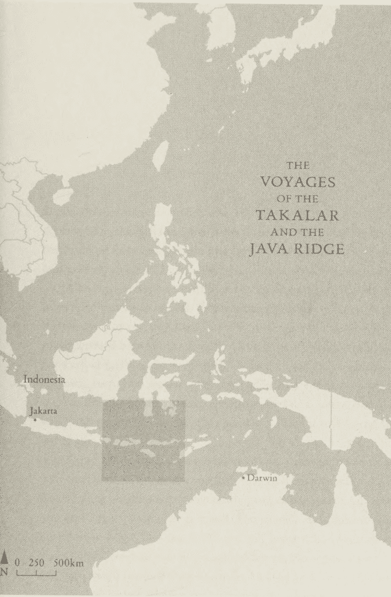
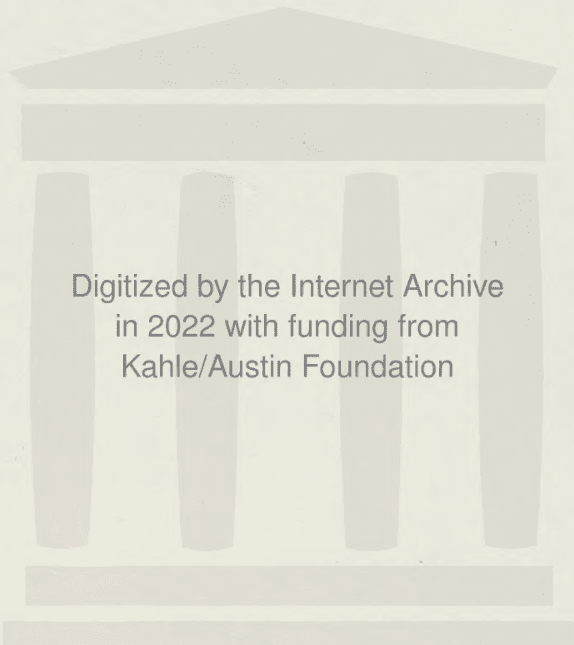
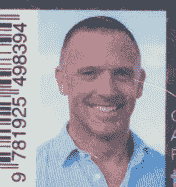

# Java 入门指南

> “塞龙的写作展现了机智、洞察力和……华彩。” Books+Publishing

洛克·塞龙（Jock Serong）是《配额》的作者，该书获得了2015年尼德·凯利奖最佳首部小说奖；《后院板球规则》则入围了2017年维多利亚州总理文学奖提名。

@JockSerong

印度尼西亚

雅加达

达文

0 250 500km N

https://archive.org/details/onjavaridge0000sero

# 序言

六面澳大利亚国旗显得庄重而肃严地挂在门口，两侧各三面。门敞开着。门后是一条昏暗的走廊；门前，是一个空空的讲台。堪培拉冬日的光线在高墙上投射出冰冷的几何图形：三角形的阴影，光束。

近一点处，一群穿着大衣的人在潮湿的石板地上徘徊。人们在忙碌的电话旁屏住呼吸，脚步在结霜的草坪上留下较深色的痕迹，露水渗进敞开的鞋子。电缆在人群之间蜿蜒向前，通向轻轻放置的麦克风，它们宛如花卉祭品。墙壁在人群上方高高耸立。从大大嘴鸟的角度看，草坪上的人群在绿色正地上形成深色的斑点。太阳在山脉上方缓缓升起，将温暖而慷慨的阳光扫过城市；但它将最后到达这片小小的领地。

三个人身影步穿过门口，按阵型站立，最高的位于中间。当他们出现时，光线照射在他们身上。两名随从站在正中心男子身后一步：那是一个高个男人，穿着浅灰色西装，身材瘦削且线条分明。衣领间的一抹白色亮得仿佛那件衬衫从未被穿过。头发略微后移但仍是青涩的棕色，面部骨骼为他轻松的微笑提供了刚健的框架。对于一个政治家来说，这是一个开朗的面孔。

两位顾问中的一位是一位二十多岁的女性。她向讲台靠拢，双脚稳稳地站在讲台左侧：她不是这里的焦点。

“早上好，女士们、先生们，感谢大家光临。部长已经准备好了。感谢大家的耐心。”

他眯眼看了看上方的光线，开始说道。

“多年来，未经授权的小只抵达一直是我们社会的祸害，多年来，我们一直在通过一系列政策进行激烈斗争：例如强制扣留、割离领土岛屿和遣返等。雅加达进程已经实施了二十年。

走私运送者所采取的反制措施是胆大且无情的。他们他们毁掉个人文件，攻击我们边境维护部门辛勤工作的男女：甚至焚烧他们自己的船只。今年1月发生的事件中，一名年轻的边境维护官员在合法登上此类船只时不幸遇难，这只是这些人所犯的一系列长期暴行中的最新一起事件。”

“显然，需要一条新的出路。这就是为什么在最近的雅加达峰会期间，我签署了印尼西亚与澳大利亚之间的外交公报，将所有从其领土水域进入澳大利亚水域的海上出发责任移交给我们的印尼西亚朋友。所有的。所有对登记、乘客和货物的检查，以及向我们传递信息，都将由印尼西亚海军负责。作为回报，澳大利亚政府将……”

## 堪培拉议会大厦

联邦边境诚信部长卡西乌斯·卡尔伯特（Cassius Calvert）议员径走过他执行助理的办公桌。他已经推开了自己的办公室门，一边向她喊道。

“嘿，斯特尔，你看了吗？”

她当然看了。斯特拉从没有错过任何一个节目。在遇到她之前，卡西乌斯认为那些话得很大的人无法观察世界，但不知为何，她兼顾了两者。

身材高大、声音响亮、大约二十五岁的斯特拉·穆林斯（Stella Mullins）是卡西乌斯担任这份工作设定的唯一条件。她对如何担任联邦部长的执行助理一无所知，对他的政治领域也并不了解，但她是一个极具学习力的女孩。总之，那方面有部门主管和首席幕僚来负责：那是政策与政治的“双头怪兽”。他需要的是他们之间的缓冲垫——一个他阵营里的战士——他知道斯特拉这个“混血儿”能胜任。自他们见面起他就知道这一点，当时他正与奥运会代表团长签署一份退休后合同，而斯特拉是一名经济学学生，也是橄榄球七人赛的骨干。

“这些所谓的‘远程措施’到底是什么鬼？”她回喊道。

卡西乌斯房间远角，一个站在梯子上的男子猛地从石膏板中拔出他的无线电钻，缩了缩脖。斯特拉的声音确实有这种威力。

门内的一张桌子上，一瓶格兰忌（Grange）葡萄酒像襁中的耶稣一样躺在满满草的礼品盒里，卡西乌斯拿起卡片。

卡——祝贺你们制定了一项突破性的政策。我们期待未来为你和澳大利亚人民服务多年——诚挚的问候，Core Resolve 董事会及全体员工。

该死的格兰忌——斯特拉现在站在门口，穿着一身干练的高级定制装，但脚上还踩着她走路上班时的运动鞋。

“你看到 Core Resolve 的股价了吗？刚涨了近两块钱。那是……”她一边算数字一边看着天花板，“她刚刚赚了大约四百万。”

卡西乌斯点了点头。“把那瓶酒报在利益登记上，好吗，斯特尔？”他说，“然后去和朋友一起喝了它。”

他走到办公桌前解锁屏幕，显示出一列未读的邮件。“你一直在过滤这些吗？老天，这儿有……”他滑动着屏幕。近四百封！我昨晚刚清理完。

斯特拉双臂抱在胸前。“我又处理了三百五十封。嘿，你想问问我为什么你房间里有个爬梯子的男人吗？”技工再次停止了钻头；不确定地环顾四周。

卡西乌斯叹了口气，点了一下向下箭头。“斯特拉，为什么我的房间里有个爬梯子的人？”

“他在安装视频会议设备。那里有两个摄像头，麦克风在桌子上，内阁内部有安全连接。我可以从我的办公桌为你控制这一切。”

“太极了。”

梯子上的男子完成了天花板上的工作，向斯特拉示意了一下便离开了。

“嘿，认真的，”她说，“这些关于‘远程措施’的鬼话是怎么回事？”“我们……啊……”他没有抬头。“我们需要一些模糊的说法，这样公司才有空间执行他们自己的计划。不，那不是你昨晚打字的草稿。是今天早上从总理办公室发来的。

需要合理的推诿空间。”

“哈！推诿空间……我猜那是从那些骗子那儿学来的。总之，我最好给信息公开（FOI）接待处打个招呼。”

他们会提供格式化的豁免清单，引用新的商业机密条款。隆·斯梅德利（Ron Smedley）正盯着这件事。

“好。要喝咖啡吗？”她大声哼着歌走出了房间。他拿起送到的桌上的简报笔记，在侧桌上分类整理——部门、选区、杂项——把每堆文件顶部标有“紧急”的放在最。他的目光在办公桌后的书架上掠过。旗帜、奖杯和奖匾。

她引领他们进入自己的世界。这样的款待是让他们终结幼稚行为的动力。

妇女们坐在一间凹凸且破损的房间的墙边靠垫上，她们之间的地上铺着厚厚的地垫。杯子和碟子在某人大笑的肚子上倾斜，洒落的茶水，瓷器在如风暴般摇晃。当他们聚精会神时，喧闹就会平息，她们又回到低声的八语中。

当记忆中的世界变成忧伤，罗雅从睡梦中醒来。现在有了脚步声和低沉的说话声。在昏暗的光线下，她看着母亲，母亲的头在痛苦的半睡中一点一点地点。

> “醒醒，Madar。有人来了。”

她的母亲本能地抓住罗雅，挣扎着恢复意识，反射性地检查着自己的头巾。

锁开了，两个男人走了进来：是印度尼西亚人，但较年轻的穿着冲浪短裤、橡胶拖鞋和T恤。在漫长的几个小时里，透过各种窗户窥视的罗雅意识到，世界上大部分人都是这样穿的。

他们的脸让她想起了她的哥哥安瓦尔，尽管他们不像他那样微笑。无论是朋友还是敌人，她和母亲都无法控制谁会进门或他们会做什么。她们最好的希望就是保持安静和渺小，这种处世方式对她来说很难。在她的朋友中，她是坚强且自信的。

男人比了手势。房间里的人疲惫地站起身，开始挪脚走出去。

外面，街道很安静，在黑暗中显得从容不迫。烤焦混凝土和脏水味还在，但前一天晚的饭菜味已经消失了。一辆白色面包车等在门口，除了几张破损的冲浪贴纸外，没有任何标记，窗户是黑色的贴膜。司机戴着太阳镜，城市的灯光在巨大的镜片上流转。他们被匆忙带进面包车后部，发现里面已经有两个女人和一个看起来比罗雅稍大一点的男孩。当他们都爬上去时，已经没有座位了，她不得不蜷在母亲的腿上，扭动着身体把自己塞在母亲腹部旁边。

门“砰”地一声关上，面包车发动了。新的气味：汽车除味剂的化学味。其中一个男人越过前座打量着这群人。他对罗雅的母亲说话，随着他换挡和颠簸的头部，重复着一个词。她在书上见过那个词。

“证件，Madar。他在说‘证件’。”

她的母亲从包里掏出，拿出了两张带有颗粒照片的身份证。那是她们第一次被捕时警察局长要过的。他们不得不交出获取这些东西的任务，还有现金。她记得办公桌后的那个塔利班战士，他满是污垢的牙齿和苍白的眼睛。那双苍白、无情的眼睛。

前面的男人看着她，咯咯笑了起来：对比着身份证。“罗雅……ya Shaghan。”他停顿了一下，思考着。“你，”他指着，“九！”他数出了九根手指。

她点头，露出了微小的微笑以示礼。他再次盯着卡片。

“赫拉特？”

她再次点头。

“你是哈扎拉人？”

又点头。他看着她的母亲。“Shafiqa。Sha-fee-kah。好的。”

“是的。”

“bobo在哪里？”

她耸了耸肩。她可以说是Hezbe-wahdat（团结党），但他不会懂。她并不确定自己是否真的懂：瓦哈达是她父亲的朋友，但后来其中一些人不是。他很久以前抛下了瓦哈达：他为救援人员担任翻译。但她知道，当她那天向父亲提到瓦哈达的朋友时，父亲用不寻常的凶猛责备她，手指指着她的脸。那天某种深刻的事情发生了变化。他警告她，再也不要提这些了。所以再也没有人提过。

她可以说他和安瓦尔一起在深夜被带走了。但她不知道自己是否有足够的英语来表达。

他们紧身的衬衫上别着徽章和各种装饰。他们看起来像美国警察。牛仔男孩无声地嘟囔道：“警长。”

她看着他们抽烟，不经意地转过身去整理着一叠叠钞票。其中一个男人比其他人年长，穿得像个商人。他笑起来像是听了什么粗俗的笑话。牙齿间闪过一丝光芒。他利落地地拍了一下手，大家都转头看向他。他下了几道命令，人群开始向边缘移动，那里的混凝土在水面上方戛然而止。

边缘处开始挤满了人。罗雅（Roya）和沙菲卡（Shafiqa）发现自己处于人群中心，旁人无意的肘猛地撞在罗雅头上。她的母亲紧紧护着她，手臂保护性地抵挡着尖叫声和推搡。这只让罗雅感到烦躁；应该是她的母亲在保护她，而不是相反。一个男孩摔倒了，有人踩在他身上，他在父亲再次将他拉起来之前发出了痛苦的尖叫。

她在书里见过船的照片，但是——它太高了！船头是一堵肮脏的木墙，从她的右侧向左侧划出一个巨大的弧度向上延伸。船舱像雪茄盒一样层叠在一起，在前甲板顶端，一面小红白相间的小旗在慵懒的夜晚空气中静静地悬挂着。罗雅知道那是印度尼西亚国旗；她的英文书有一页专门介绍世界各国旗帜——米字旗、锤子镰刀、马尔他十字架——而她在那一面旗帜上填满了如此复杂的情绪；清真寺、金色叶片和神圣的文字。阿富汗。

这艘船是一个巨大的存在：它深色的躯体，在码头轻微的移动，轻轻地碰撞着悬作防撞垫的滑腻轮胎。她能感觉到它巨大的重量悬浮在水面上，像一只力量极大的动物在测试它的绳索。蓝绿色的油漆正在剥落；深色的锈迹在金属固件下流下。它看起来有些疲态；但也许所有的船都是这样。它曾几何是

# 周四晚上

她想，对某些人来说很重要，但现在已经被遗忘了。被遗忘的人，在一艘被遗忘的船上。

当靠近边缘时，沙菲卡紧紧抓住陆地。其中一个男人走近了，把人们推向跳板。罗雅小心地将脚踩在每一块为了增加摩擦力而钉在上面的小阶梯上，钉子顶穿了她薄薄的凉鞋底。烟雾在头顶上方聚成云；急促的声音催促着他们。

她的母亲引导她来到船体高侧墙后的一块空间。罗雅盘腿坐在甲板上，第一次感受到了这种异域的摇晃：他们不再属于陆地，而现在属于海洋。一个男人走过，分发着带有反光条的橙色夹克，以及夹子和扣带。罗雅闻了闻那个笨拙的物体，就像她经常对那些引起她好奇的事物那样：塑料味、发霉味，还有像图书馆发电机那样的旧柴油味。

她检查了她的宝藏，那些她永远不会离开的东西：父亲的戒指，沉重且带有卷纹，像蜗牛一样在母亲缝在衣服里的口袋里翻滚；还有她的英文书——一本破旧的《牛津口袋英语词典》，她在书页间夹着那张她爱的照片。

她的母亲。戒指。书和照片。在它们之间，她系起了她希望的地球仪。

她再次确认了一眼母亲，得到了一个微笑作为回应。她很满意，缩起身体，把脸转回那件橙色夹克。夹克上用粗体黑色大写字母写了一个单词。她在嘴里反复念叨了几遍这个新单词：

阳光透过朗酒瓶洒下来，在伊西（Isi）的脚上投射出一道金光。船尾甲板在航行时往往会聚集柴油烟味，但今晚有微风将排气带带走，空气中唯一的气味是木材散发的暖意。

他们正向东行驶，远离日落。客人们们挤在船尾上方的甲板上，切着青柠。

他们是巴达族人，来自苏门答腊北部——就像你们一样，离家很远，所以对他们好一点。Radja 会负责“守护号”快艇——它就在后面的吊机上。当他带你们去冲浪点时，在他点头示意之前不要跳下去。你可以在水里向他招手，他会给你拿防晒霜或或蜡之类的东西。如果你能发信号，就来啤酒。多干杯。“所以 Radja 是你们的厨师，是个值得结交的好哥。如果你在冲浪，他半夜都会给你做点吃的。”

“Bagus，”Radja 带着轻松的微笑说道。

“那边的 Sanusi 是我们的工程师。他可以操作这艘船上的任何设备，修理你们的冲浪板比家里还要好。无论你们做什么，千万别把这两个人混在一起，让 Sanusi 给你们做饭。他的厨艺简直糟糕透了。”峡谷中再次泛起微小的波纹，此处传来几声轻笑。这番话对她和对 Joel 说的效果不同。

“这里有潜水设备，如果你厌倦了大浪，可以去游个泳。这些礁石是活珊瑚，值得一看。还有立式划板……”它悬挂在他们聚集的遮阳篷下。她敲了敲甲板。“自己取用吧。下面有空调，如果你们发现白天开着空调，请务必关上身后的舱门。船上有气体和其他易燃物，所以——我们这有抽烟的吗？”那个留着红发、身材魁重的男子介绍自己叫 Fraggle，他举起手，发现自己是唯一的。他是带着派力肯箱来的，说自己是个摄影师。他看起来也是他们中最随和的一个。

“这不犯罪，Fraggle，但请确保你只在男们待的地方抽，就在后面。好吗？”

她指指那个光着上衣、墨镜推在头发上的年轻男。他在机场介绍过自己的名字……Carl。他举着手。

“你们有 wi-fi 吗？”

“没有。”

“你会像 Joel 那样故意放空球吗？”

她知道这是一个诱饵。“不，Carl，我不会。你这样行吗？”

人群中传出一声轻微的“噢”，Carl 沉浸在其中。正中命中。

……

谈话结束后，冲浪者们留在船尾高处的甲板上，坐在垫子上大声笑着。Radja 从厨房端着几托盘青柠汁蒸鱼走了过来。对于他们的家人来说，Radja 和 Sanusi 在一家冲浪租赁公司工作是家乡村子里不言而喻的骄傲。他们的孩子会在学校里炫耀这一点；他们的妻子会在街上聊天时带上这个话题。

Fraggle 在冰箱里发现了一盒 Beng Beng 巧克力棒，不知为何交替着吃巧克力和几口啤酒。他向旁边的人展示那个盒子。是那个高个女孩 Leah。她往盒子里看了看，将一缕褐色长发拨到耳后，对他笑了笑。“不用，谢谢。”

Isi 回到驾驶室，双肘撑在仪表显示屏上。她舀出早些时候开始吃的剩下的牛油，把果壳扔出窗外进了海里。她为自己想出“疟疾”这个借口感到庆慰，这是一个暂时的灵感。她一直在担心如何解释 Joel 的缺席。对他们来说，Joel 是传奇，是一个口口相传的现象，他的名声在国内那些困在城市的冲浪者之间的咖啡时光里不断增长。“你午饭休息多久？想尝试小伯利街那家店吗？嘿，你给那个印尼人发邮件了吗？”

他们低声议论的是他而不是她，这一点对 Isi 来说并不重要。他们讨论过一两次，要直接向寻找全女性租赁服务的女性进行营销，她很喜欢这个想法。但由于 Joel 的需求非常稳定，他不需要营销，这个想法从未变成现实。当然，明显的风险是，当 Joel 没有空时，客户会觉得被骗了。他们需要一个借口，而疟疾是个很好的借口：它能让人想起 Troy 和 Cooney 那种伟大的冲浪探险家。一袋米；一辆摩托车；丛林深夜一次致命的蚊虫叮咬。

合适。瘦瘦的，像豆芽一样合适。灯光映出他们的肋骨。就像被时代隔离开的兄弟一样，这个小伙子的身体和那个老人一模一样，连肩膀处凸出的骨节也完全相同。Neil 平坦的胸肌上覆盖着一层浅银色的细毛：而那个年轻人全身无毛。距离他十七岁生日还有六周。

她仔细地在账本上输入了他们的信息，又拿起另一本护照。

十八岁时去印度旅行，并越境进入尼泊尔。有几次入境记录。现在二十六岁了。在预订团组的邮件中，他急于建立他们的环保信誉——我希望你不介意我问这个：你们使用可持续的锚定实践吗？整个小组都在这些查询的抄送范围内，尽管回复的语气表明只有 Tim 一个人在意。他以前坐过这艘船。Joel 评估说他是无害的。而且在大日子里你见不到他。她又从堆里拿出了一本护照。

他翻过书页。什么也没有。这是他的第一次海外旅行。此时，他正躺在瑜伽垫上，喝着倒给他的朗姆酒。矮但结壮，前臂和脖子晒成了古铜。当他伸手够脚踝时，可以看到肩骨上纹着一个南十字星。他还能看到他的冲浪板和装备品牌，都是从海外买的。看来在消费支出上，他没那么爱国啊。

Joel 提过 Tim 和 Karl 是表兄弟。在那些关于伦理锚定的邮件交流中，Karl 回复道——可能是忘了整个邮件链是发给 Isi 的邮箱——紧随你的环保倡议，因为——我会确保我只在你的冲浪板包里拉屎。

他们在那里吵吵闹：Karl 想要朗姆加可乐，Tim 开始了关于糖的教训。“可乐只是有毒的淤泥，”Tim 说。“比这儿的水还干净，”Karl 反驳道。在海上待了十天后

酷热、疲劳和近距离的居住通常会让那些无法反思自己行为的人表现出最糟糕的一面。发生一两次小意外——伤口感染或冲浪板断裂——这些人就会开始互相面目可仇。

她快速翻过几个人的护照，分别是 Fugle（Eilan James Weil——难怪他用了假名）和 Tim 的女友 Leah Hogan。Fugle 无处不在：摩洛哥、西班牙、夏威夷、墨西哥、智利。一个职业摄影师长期的流泊。至于 Leah，她在十八岁时在英国过过间隔年，回程时经过了丹帕萨。这告诉 Isi 的信息并不多。

在她下方，Radja 正在和 Karl 聊天。肢体语言显示他在试图开玩笑，而那个澳洲人正怀疑地打量着他。她疑惑 Radja 是否无法读出那种敌意。也许他看得很清楚，正打算化解它。

## 周六清晨

松拜海峡，松拜岛北部

当“塔卡拉号”通过岛之间的海缝时，船上弥漫着一种期待的情绪。远处城市的灯光温暖了夜空。“拉布班角，”船长对某人说。一个传言传遍了船：那些小岛的人群在他们身后：前方是印度洋广阔的开放海，在那之后是澳大利亚。

但随着漫长的黑夜过去，他们向东驶入萨武海，节日的氛围消失了，取而代之的是某种烦躁的情绪。Roya 从那些虚构乘客的声音中抽离出来，缩进母亲披袍（chador）熟悉的褶皱里。她把手指放在母亲前臂上，任由睡意。

她和 Anwar 躲在井边的储物室里，俯瞰院子。屠夫到达时，她父亲把他们赶走，和其他动物一起赶出去，同时确保留了一只羊。正是这种选择的行为，决定了那只动物的命运。宰杀仪式（dhabibah）不能在其他羊面前进行，也不能在孩子面前进行。它们

## 周六清晨

它们是畜畜，仅仅如此，但她了解它们。眼睁看着这一切发生感觉像是一种背叛，然而这又太可怕、太禁忌而无法无视。

屠夫一边磨刀，一边平静地和她父亲说话。他背对着羊，羊此时正被拴在木桩上，动物似乎没有察觉到滑动的刀刃，尽管钢刃碰钢的声音传到了 Roya 和哥哥躲藏的地方，他们正轻声呼吸。听到屠夫的一声，她父亲将羊抱在怀里，在它身边手指轻轻抚摸过它的脖子。Roya 这样做过很多次，但不是这种方式：不是在寻找皮毛下血管的走向。

他拿一个锡杯放在动物口鼻下，在它喝水时用两指按住它的脖子，标记一个位置。他放下杯子并退开；屠夫敏捷地上上，将刀刺入手指指示的位置。当刀完全没入后，他绕着羊的脖子划圈，羊踢着挣扎着，他紧紧按住其中一只柔软的耳朵。

Roya 紧紧抓住哥哥，屏住呼吸。

屠夫的话向他们飘来，“比斯米拉，真真主至大（Bismillah Allahu Akbar）”，由于他完成了刀刃的环。他向后仰起动物的头部，血喷涌而出，落在沙地上。最后一下踢动扬起了尘土，落在鲜红的血池上，然后它颤抖着，腿瘫软了。她父亲现在抱着那只动物，接住了它的倒下，让它侧卧在地，取下了

甲板和地板。感觉就像是。

Roya 不忍回答，怕妈妈会制住她的话。但她说：“感觉他是在谈论早晨。”

“是的，我也这么想，”Shafica 说，“或者也许是关于重新开始。”

“我跟一个男孩说过，他说到达后必须去营地。”

“营地？”

“他说那些地方像监狱，没人知道什么时候会被放出来。”

Shafica 的手停止了线性的滑动，开始画圈。“我不认为是那样。但即使有那样的东西，我们也会在一起。这不会比家里发生的事情更糟。”

“我想看海滩，”Roya 说。

“海滩？”Shafica 的语气带着温和的轻蔑。“我们会看着的。”

当乘客醒来时，每个人都拿一碗饭，互相递一杯水。他们有些尴尬地试图在船侧排泄，避开视线。夜里，Roya 听到一些大人站起来为了为此活动，所以他们

不会被看到。这让她担心他们会翻倒，再也无法被发现。夜间派了一名哨兵，那是一个矮小、沉默的伊拉克人。但他只盯着前方，不看身后。

随着周围的范围变得越来越大，海面开始涨起，陆地也越来越遥远。坐在一起的人互相碰撞，为了保持平衡而进行的微小持续的调整让他们精疲力竭。他们许多人晚上也无法入睡——热热是他们私人的折磨。他们在甲板上走动，坐下、扭动、抱怨，再次调整坐姿。

那个留着花染胡须的普富汗老人坐在船尾，他的儿子们纹丝不动地守在他两侧。Roya 想，他们像警觉的狗。通过偷听，她得知那个老人名叫 Irfan Shah，这个家人来自 Khost。她疑惑他们是如何来到这艘船上的：逊尼派理应该受到塔利班的青睐吧？他们身上一定出了什么错。

有男孩在屋顶上爬。船长正在训斥他们：“你们这些白痴！”

Irfan Shah 左边的男人正试图吃饭，但他没有手。Roya 无法判断他的族裔，因为他的脸毁得支离破碎，伤痕像太阳爆发一样从曾经鼻子的位置向四周扩散。皮肤上是细小的深色隧道和凹坑。Roya 知道弹片的飞溅路径。他用两截残肢端起碗，把脸埋进碗里，当碗翻掉落在膝盖上时，他绝望地呻着。他现在试图用较短的那截残肢将粘稠的米粒推向长的一截——他的左手——送入几米进残破的嘴里。Roya 好奇他直到现在是如何自己喂自己的。

Irfan Shah 直勾勾地看着这一幕。“兄弟，你的手是怎么了？”男人抬头看着他，没有回答。无论他的背景如何，他显然并不敬畏那个老人的权威。

“你没有手。也许你的耳朵也掉了？”男人再次无视了他，继续胡乱地拨弄着米饭。Roya 感到内心涌起一股无力的愤怒。这是成年人之间的交流——与她无关。而且，对她来说，看到缺少一只手、一只眼睛或一只脚的人并不新鲜。人可能会受损，就像建筑一样：被爆炸炸毁，留下一个通往无处的楼梯间，或者一个靠扭曲钢筋支撑的阳台。但这里的问题，这个正试图吃饭的男人，本可以被轻易解决。

一种更大的感觉已经在她心中作作了好几天——一种大胆的感觉，随着随处漂流，旧的规则变得松动了。她没有向母亲请求许可，而是径快地走到男人坐着的地方，将散落的米饭在手里揉成一团。然后，她小心地将这一团放在他的前臂上。这感觉很大胆。他冲她吼道，她缩了回来，但他抬起手臂送到嘴边，吃进了米饭。

“走开，小女孩！你没礼貌了吗？”Irfan Shah 非常愤怒。其中一个儿子低声咕了一句，Roya 没听清。老人盯着那个残疾者再次问道：“到底是怎么了？”

依然没有回答。粘液从一个深色的洞里流出，那是鼻孔的残迹。“你当时在做炸弹吗？看起来是在你脸上炸开了。”他带着嘲讽的怜悯摇了摇头。“哈扎拉（Hazaras）。你们全都是蠢得像驴。”

男人的舌头出现了，像猫一样，慢慢舔掉前臂上剩下的米粒，然后开口了。

“闭嘴，你这个老傻。”

Roya 被撞倒了，两个年轻人冲了上来，推搡着将他向后摔倒。其他男人也加入了战斗，妇女们对着他们尖叫：几秒钟内，甲板上周围聚了一群人，阿拉伯语、乌尔固语、普什图语和达利语的叫声互相掩盖。残疾者无法与年轻人搏斗，他们迅速制服了他，用紧握的拳头捶打他的脸。当他们击他时，他的后脑撞在甲板上砰作响。

“Wadrega！”老人 Irfan Shah 的一句话让斗殴停了。“Aluddin！Mahmud——够了（bas）！记住你们的位置。”

平静恢复，没有人离开。Roya 看到船长头上一缕头发在船边的微风中飘动。

他们杀了他。把他吊在体育场上。

Roya 喘了一口气。有人会做那种事吗？也许真的有一架直升机和一辆坦克。

他们看着远陆在地平线上慢慢出现，听着下方引擎的喘息声和撞击声。男孩在没有人提醒的情况下说道。“我要去澳大利亚当厨师。”

“真的吗？”她开始喜欢他的夸大其词，无论真假。

“是的，而且我要学会游泳。”

Roya 考虑了一下这。“但我们会住在营里，不是吗？我不认为你可以在那里学会游泳。”

他耸了耸肩。“没关系。整天玩游戏就好。你真的会当厨师吗？”

“为什么不能？他们的食物很简单，你可以在电视上做并成名。你会听到电视上叫你的‘Hamid’，你会抬头发现那是我。我要拥有两家餐厅，或者三四家，每个人都会认识我。”

“你真的会做饭吗？”

他又耸了耸肩。“还没。但我才十一岁。这不会太难的。”

“好吧，我希望你成功。”她起身离开。她需要去看看她的母亲。

他转过身看向她。“我们会再见面的。”Roya 笑了。

“嗯，是的，”她回答道，忍着笑，“我们在船上。”

她在母亲离开时的地方找到了她，母亲正独自船身阴影一侧，靠着舱壁。Shafiqa 看到女儿走过来，笑了，轻轻拉住她的手。“我看到你和那个男孩说话了。”

Roya 脸红了。“Hamid？哼。他太不可谱了。”

“你喜欢他吗？”

“妈妈！住口。不，我不。他到处讲故事，还戴着滑稽的眼镜。”

“是的，正如我我想的那样。你确实喜欢他。很好，你们两个得到了我的祝福。”她轻笑了一下，看到 Roya 对她生气，便作样地皱起眉。“噢，亲爱的，我只是……”

“我再也不跟你说话了！”Roya 双手叉腰，径直离而去。她知道自己生气时下嘴唇会噘起来，那会让她妈妈笑，而妈妈一笑很可能会让她也跟着笑，于是她低着头，没有回头。

如果她真的再也不和妈妈说话，她会讨厌掉的。她走上上坡，直奔船头。Hamid 还在那里，透过一对涂满军迷彩的玩具望远镜向外望去。在那转瞬之间，她心想他一定是把这些东西从家里一路带过来的。也许像她一样，他那里有一袋宝藏。听到她走近，他放下了望远镜。

“啊，你回来了！快来加入我吧！”

Roya 站在那里，再次双手叉腰。她的烦躁和担忧涌上心头：她对着他手中的望远镜猛地踢了一脚，眼睁睁看着它们从他手中飞旋而过，越过了船缘。她甩了甩头发，背对着他，以此抹去他那震惊脸脸，但她看清了那个眼神，足以知道自己有多残忍。

Isi 并不特别迷信，但在船上的度日时光会让你对行程的顺遂与否产生某种直觉，并洞察出自己正处于哪种状况中。当她正在桑巴岛南部两个小岛之间驾驶着“爪哇脊号”（Java Ridge）号时，她第一次感到一阵不幸的寒意在徘徊。她耸了肩将其抛之脑后。那只是一群更喜欢 Joel 的人而已。

这两个岛之间的通道——北边的 Halura 和南边的 Manggudu 宽度不足两英里，但环礁边缘的水很很深，这让她在经历了从巴利岛跨夜航的单调后，有机会向客们展示一些风景。

当 Halura 一侧珊瑚的色彩从蓝色中升起时，Isi 减慢了“爪哇脊号”。强力柴油发动机在低转速下冒着泡泡，船波变得迟缓而沉闷。随着浪涌从船下经过，船起伏摇晃。在远处，他们可以看到 Halura 西端村庄的茅草屋顶。在房屋后陡峭的山丘上，丛林茂密得可怕，没有任何东西——无论是栅栏、天线还是屋顶——扰动它。

Sanusi 拿着一根沉重的金枪鱼竿出现了，鱼竿比他还要高一点，当冲浪者们在阴凉的前甲板上休息时，他把竿递给了他们。

“这儿。”Sanusi 指向礁石边缘。

Leah 将她的纸质书脸朝放在毛巾上，在旁边放下了一瓶水。她走到鱼竿旁。Isi 在驾驶室看着这一幕，决定她喜欢 Leah——喜欢她的体魄和她的不装架子的架质。

“你需要大鱼饵，”Sanusi 说。这不是疑问。他消失在下板，回来时带着一个色彩斑斓的塑料假鱼，后面拖着流苏和两个巨大的三叉鱼钩。他将鱼线绕在自己开裂的食指上，系好鱼饵，然后把鱼竿还给 Leah。她坐在船头，正对着 Isi 的视线，将鱼饵向着礁石方向甩出去，直到鱼线延伸到船身之外。Sanusi 走到同一侧的一半位置，坐在船舱的阴影里，一只手握着手钓线，另一只手夹着一根烟。他们之间是一片开阔的甲板，宽大的木板被海水浸得湿滑。

Isi 无需离开船长椅就能看到他们。如果她向外看，甚至能看到鱼饵引起的水面扰动。过了一会儿没发生什么。但当“爪哇脊号”遇到一个浪时，鱼竿猛地向下甩，Leah 绷紧手臂控制住。鱼尖每弹动一次，线轮就发出嘶嘶声，她站立起来，大腿抵住护栏，在肉上勒下了白印，一边收线轮，一边将鱼向船上拉，而 Isi 则向后松了油门。

Isi 能看到那条银色的鱼腹在清澈深水中急促地转着圈。通常情况下，Sanusi 会拿着鱼钩守在旁边拉上来，但她看到他纹丝不动。也许他在阳光下睡着了。她考虑过叫他，但又打了主意。钓鱼是 Sanusi 的领域，他不会欢迎干涉。

Leah 将那条强力的鱼搏到了船头，现在她正试图垂直将其通过两米高的空气，拉到甲板高度。那是一条西班牙鲭鱼，长而细。当 Leah 收着线轮向后走时，优雅的尾巴划过空气，她兴奋地尖叫着。Isi 能看到鱼的眼睛在那排如狼般的牙齿前惊恐地尖叫。

随着最后一次用力，Leah 将鱼举过了护栏。鱼“咚”地一声落在木板上，开始疯狂地挣扎。瞬间，鱼饵被甩掉了，鱼那疯狂的抽搐让它的头指向甲板。Leah 丢掉鱼竿，胡乱地摸索，试图让手指避开那张凶猛的嘴。接着，“爪哇脊号”遇到一个新浪，船身升得之高，船头指向天空，那条鲭鱼开始滑落。

Isi 能看到正在发生的一切，却无力干预。她飞向窗户，尽力大喊 Sanusi 的名字。他醒醒了，环顾四周，立刻注意到那条沉重的鱼正向他滑来。他站起身沙发，开始跳着躲避，但他身体最后移动的部分是左手。鲭鱼张开的大头部撞在上面，他发出一声痛苦的叫声。撞击偏了鱼，使其切穿了甲板的一个排水孔，鱼就消失了。

Isi 跑下跳板，发现 Sanusi 的手在大拇指根部的大肌肉被切开了，整齐得就像被人用手术刀划过一样。血液顺畅流出。他把手臂架在护栏上让血液流掉，用印尼语快速低声地自言自语：Isi 跟过去，知道他在咒骂自己的疏忽。周围聚拢了一圈人——Neil Finley 的手出现在上方，其他人则退开了。Isi 去找到了 Joel 储在主舱里的两个塑料桶：

他骑着一辆价值一万两千元的顶级巡游车，车身上印着绿色的厂家标志。车很不错，但他穿着一件意大利赛车服坐在上面，看起来却像个做作之辈。时过这么多年，他竟然还在用 Look 锁鞋——而且还引以为自豪。Cassis 自嘲地笑了笑——尽管锁鞋让他走路姿态很奇怪，像在冰冻池塘上的小角鹿一样穿梭在咖啡馆之间。头头部——无论是遮住脸颊巨大的彩虹色塑料眼镜，还是空气动力头盔——都掩盖不了事实：Smedley 的下巴很软。Cassis 从他身后绕过去，并并排上来。

“Ron。”

“Cass.”

“骑得挺猛啊，哥们。你有点喘气。”

“我没有。”

“嗯。嘿，你看到我前几天发的公告了吗？”

“当然看了。”

“你觉得怎么样？”

他们现在越过了新南威尔士州边界附近的一个坚硬的山丘，Smedley 切换挡位，为下坡做准备。他用力蹬了十几圈——Cassis 轻松地跟上——然后保持踏板与地面平行。

“思考不是我的事，对吧？我只需要执行你的命令。”

“总得有意见吧。”

“听着，Cass，如果他们把我带到议院听证会，我会捍卫到底。但私下……”他看着脚踏下飞速掠过的沥青，然后用戴着手套的手指了指猫眼眼镜，“私下，我觉得你是在自寻自灭。”

“为什么？”

环境与常规能源部部长追上了他们，并开始超越。

“小伙们。”

“Bob.”

“Bob.”

他们等他远去离开了。

因为我有一种老式的固执，认为政府应该自己干脏活。

“走吧，哥们，这是一个便宜得多的选择。生物拦截局（BIU）和海军已经远离危险了。而且不需要面对媒体解释他们在做什么。”

“是。但你有没有想过……”他吸了一口气，“……处于危险之中其实正是我们武装部队的工作？这就像他们的职业一样。《海上人命安全》（SOLAS）规则呢？Cass. 去查查吧。”他急促地呼吸了几，“而且，嗯……你本该面对媒体并付钱的。那是你的工作。”

“纳税人希望我们节约，Ron. 我们正是这么做的。”Smedley 哼了一声，这耗费了他的力气。“让我们诚实点，好吗？你的动力除了名气什么都没有。你的决心除了利润什么都没有——而当‘人气先生’把秘密的动物控制权交给‘利润先生’时，你们就会陷入混乱。”

Cassis 用力更猛了，但掩饰得很好。他能感觉到 Smedley 正努力保持平齐，他很喜欢这种动物政治游戏：Smedley 不想理他，但却出于礼貌不得不交流。现在他必须更努力才能留在这一场不受欢迎的对话中。他再次加快速度，让 Smedley 在一个无法逃脱的隐形房间里绕圈。他喜欢在别人努力控制呼吸时让他们不得不说话。

“所以这就是我对你要求的，Ron. 我想要一条通信链，但要有不可否认性。你懂吗？”

“噢……只要在那个……可以理解的范围内。”他现在开始气喘吁吁了。Cassis 正在击垮这家家伙。“你想知道发生了什么，又想说你一无所知。”

“是的，没错。你能办到吗？”

“别妥协我，Cass. 这会反噬你的。”

Cassis 不禁对这个气喘吁吁的瘦弱官僚笑了出来。这就是决定他未来长期争论的关键：这就是意志的斗争。如果他们继续让他进行这种意志斗争，我会赢得每一场，并且死得其心。

“你说得对，Ron, 你确实很老派。退休还有多久？”

“够久……能让你受不了……直到选民厌倦你为止。”

Cassis 想，对于一个老头来说，这个回击还不糟。他换低挡位，将 Smedley 甩身后。

一旦离开松巴附近的近岸波浪，行程变得平顺起来。

Isi 从冲浪者中离开出来，巡视起她的植物。

她看到他们盯着那些绿色植物。这与他们的预想不符——一排排植物箱，植物从木屋的外墙垂挂下来。对 Isi 来说，这完全正常。在库塔和 Joel 住的公寓里，没有她的植物生活是不完整的。在珀斯，即使在雅加达，她也设找到足够的空间和阳光，让自己被花盆、桶和槽包围——任何能盛土的容器都可以。她大部分时候喜欢种蔬菜，尽管有时也会随心种一些让自己快乐的：水仙、鸡蛋花、兰花。

乔尔值得赞，他理解她的这种需求并给予了鼓励。他们都清楚登巴萨当地市场上有丰富的草药和香料：新鲜的、干燥的、包装好的，或者是直接递过来的、带着湿根并用绳子扎着的。但购买它们并不是重点。重点在于培育和采集，那种处理生命的触感过程——对她而言，那些植物就是她的生命。

只有环礁、海滩和树木。如此不寻常，如此远离世俗，这片令人震惊的生命与色彩的爆发竟然会从深海的海底平原升起。

引擎声变得安静了，卢克跳上跳板来到桥楼。伊西站在控制台前，凝视着逐渐靠近的岛屿。她想带他们靠得足够近观察一下，与某些随机的礁交汇。她简短地看了他一眼，发现他正对着驾驶室窗上的倒影出神。她朝环礁的方向点了点头。

“达纳岛。”

“我们可以从旁边绕过去。我想感受一下涌浪的情况。这里几乎不拍岸。”

他们看着达纳岛在眼前逐渐显现。越过船头遮篷上飘扬的小幅印尼国旗，珊瑚在岛屿北侧勾勒出一道优美的弧线。每一道涌入的海浪都击中礁缘并顺着它延伸。

“那里有人住吗？”

“没有。萨瓦纳人对那里有很多迷信。那是一个死岛，你知道的，有迷失的灵魂之类。我想你可以申请在那儿停靠，但从未有人停过。他们大多直接驶向拉伊周亚。”

沉重的脚步在室外的台阶上传来一阵响亮的咯吱声。卡尔出现在门口，没穿上衣，正像松鼠理毛一样在脸上涂抹防晒霜。

“噢天天！那东西太酷了！我们要停下来吗？”

伊西叹了口气。“我只是看看海浪。去拉伊周亚会更好。”

“什么？你开我玩笑吧……”他透过驾驶室的前窗向外看，看到环绕的礁石上形成了一组浪。她默默地咒骂他的时机真妙。

“看那一个！噢，妈的！”

组浪中的第一波庄严地升起，随后沿着礁石边缘翻滚，空心且完美。他们现在离得足够近，能看清海浪留下的痕迹，在它的轮廓上勾勒出自己冲浪的想象线条。当它在远处的深水中坍塌时，喷射出一团水雾，仿佛某种生物的呼吸。

卡尔的语气沉了下去。“认真的，我们得去冲那浪。”伊西正要回答他，尼尔·芬利到了，跟在卡尔身后，神情严肃警觉。他低声说道，一个习惯了被人倾听的人。“我觉得共识是，我们要冲这组。”

卡尔钻过芬利抵在门口的手臂，消失了。

“拉伊周亚也会一样好，而且那里有系泊点。如果我在这里下锚，会损坏礁石。而且当地人不喜欢游客来。”

芬利越过肩膀评估着这座岛屿。他们现在足够近，能从远处的轰鸣声中听到每一道海浪的声音。“当地人？”伊西稳住脚，双手叉腰。她知道自己正在接受测试。

“我没看到人。礁石上有缺口吗？我们进泻湖停靠。”

她知道有一个缺口。她犹豫了，时间长到让芬利施加了压力。“乖女孩。带我们进泻湖并在那里抛锚。我确定那里会有沙地。”

如果他赢了，整趟旅程都会变成一场噩梦。“不。抱歉，我是船长，我不会——”

“我是客户。你不必提醒我们付了多少钱。”他的声音平淡而均匀，反映出那双淡蓝色眼睛中冰冷般的确定性。荒谬的是，她想象那双眼睛长在手术口罩上，他的脸上没有任何其他参考点。难怪他认为自己是无不胜的。

“不。”她的声音略微提高。“我们离拉伊周亚有二十海里。你们两个小时后就能到。”

就在她说话时，传来一声落水声。她向左舷窗望去，看到水中有一丛棕色头发和一块漂浮的板。

如果离得太远，奔涌而来的巨浪所产生的旋涡会将冲浪者带入如刀片般的珊瑚礁花园。

当有人划水时，远处的蓝色线条中出现了一个白色的斑点。她停下来注视，音乐从她身边掠过。医生的儿子在浪花汇聚力量并变得空心时，在比赛中落后，向着礁石最浅的部分冲去。她直觉地知道他已经过了她本该放手的地方，但那个孩子仍在坚持。浪花已经不再提供切入点了，但他仍在划水，正如同吉他的旋律进入了死亡螺旋。刹那间，那道闪烁的光线带起了他并将他狠狠地拍落。他头朝地摔了下去，冲浪板紧随其后。天哪。朝那样去可能会将他冲入礁石，身后是沉重的浪脊，面前是浅浅的水域。她一时间看不见他了，想象他顺着浪线翻滚，身体在云团充满气泡的海水中旋转。

接着，他在浅水区重新出现：他扯断了脚绳，冲浪板没带他继续向前了。他正在游泳——朝着错误的方向游，因为在水面上他看不清冲浪板去向了哪里。

现在他站在珊瑚头之间跳跃，双臂张开保持平衡。她能看到努西在爪瓦海脊的尾部观察着。努西非常看重他的工作。他从甲板上卸下一块划桨板，走向停在泻湖深处的冲浪板。他将其系在划桨板上，然后出发去找卢克，卢克此时正在泻湖里踩水喘气。

当努西到达他身边时，卢克翻滚上板，划着它向爪瓦海脊滑去。努西在他身边缓慢地划动水桨，聊天并微笑，完全没有理会受伤的手。伊西看了他们一会儿，然后抓起一把石头走回了营地。

帐篷在空地周围排列，火堆已经生好，她头上盖着毛巾坐着看着其他人冲浪。卢克在爪瓦海脊主甲板遮阳下悬挂的一个吊床上，隐约可见一个身影。她把墨镜留在船上，现在刺光刺得她不得不眯起眼。北边正在积聚雷雨云——雷达显示那里有恶天气。这股天气系统正向前推新的涌浪，每一组新波浪都比前一组更高：风暴来临前，海洋那种令人成瘾的悬念。等待。

好吧，既然她要偷个懒，不如做得彻底一点。她有时间。几分钟后，她穿着比基尼，站在爪瓦海脊的船缘上，腋下夹着一块 5 到 10 英尺的 Straalen 冲浪板。这不是她并不经常允许自己的放纵。她将板扔向波光粼粼的海面，跳入体温的水中追之而去；划水到达礁石的距离，浪涌在她身下剧烈起伏。海虱偶尔在她的脚踝周围叮咬。她的全身都在向她回应，仿佛每一个务实的需求都变得寂静。

当她到达起乘点时，她发现只有莉亚和提姆在浪头等待，其他人正处于划水回浪的各个阶段。白天的热量让海洋表面变成了一面油亮的镜子，散落着奇异的漂浮物：一片小鱼的碎片，半个椰子。这些小幽灵在宽阔的平静水区之间成条掠过她。

然后，海水升起了。这组浪的第一道浪很小，在礁石外围形成，但它只是为了宣告后面更大的浪。她开始快速向海移动，提姆和莉亚迅速做出反应。当她越过第一道浪时，她看到了第二道浪，已经在更远的地方变暗。它足够大，速度足够快，让她费力想要触及，但她仍有欣赏倾斜的海面那完美的曲线。浪前的平水面略微向下倾斜并没其中，海水正向它汇聚。它的移动并不暴力，其巨大的重量和能量在深层物理学下变得蜿蜒；这是一个玻璃峭壁，在两个维度上都是凹的，从波谷到波峰，从头到尾，一个反射着海底宽广凸面的碗状。

现在它正在升起，浪尖开始产生泡沫。当它到达她面前时，那陡峭墙体的坡度将是完美的。她锁定了自己想要占据的精确空间，然后转身划水进入其中。提姆和莉亚在她身侧较远，仍在冲刺以防被撞到。等她站起来，就能穿梭于他们之间。海水将她托起，在她划水时将她向下拉倾斜，她用脚划动。

水流从她下方冲过，水面变成了一个透明的透镜。珊瑚头清晰可见并升起，仿佛要破水而出。她知道它们比看起来要深；只要她能稳住胆量，就能安全地越过它们。珊瑚间的彩色条纹化作了礁石鱼，无助地被浪花强大的吸力拉扯。当她向下倾斜角度进入底线转弯时，冲浪板无声地加速。她侧斜在内侧边缘上，感觉到尾鳍紧紧抓住了浪花的底部。从这里看去，她只能看到眼前巨大的蓝色浪花，以及处处沐着阳光的广阔海洋，海面上点缀着其他冲浪者抬起的头。

她从板边甩出，将冲浪板刺向浪面上，完全感觉不到自我，只感知到浪的推进意志。在速度顶峰时，当冲浪板越过浪尖，她重重地站在尾部并将其再次向下甩下，带起阵阵风。当她喘气时，冲浪板稍稍慢了下来。浪抓住了她，一股突如其来的力量将她推入泡沫中。她一时间失了神，世界旋转着深蓝色。当她终于破水而出时，她喘着气，海水刺着她的眼睛。冲浪板不见了。

她向岸边游，肌肉酸痛。爪瓦海脊在昏暗的天空下显现。她到达沙滩，水在她的脚下拉扯，倒在沙滩上。她在那里躺了很久，看着星光穿过云层。

# 周六正午

话题很快从女朋友转到了大问题上。

伊西可以想象，他们正逐年退缩到各自版本的良知世界里：卡尔和他的家人（延伸地包含了提姆）；提姆和他的世界。

卡尔把食指从啤酒瓶旁移开，指着提姆以示强调。*一个长得真不错的混蛋*，她想。*还是个混蛋。*

“那你给你那些该死的仰慕者发邮件，附上你——在城市里集会时被捕的照片之类的鬼东西。我把它们都删了，你懂的。我甚至都不等那些该死的东西加载完。”提姆又笑了起来，尽管他是出于。

“记得你对达赖喇嘛的迷恋吗？还有你管土地权利叫什么，好让我们说‘土地权利’，然后你就纠正我们说‘不，点中这里，这叫“原住民所有权”’。”

“我明白，卡尔。”

“阿桑格现在是极右翼了。而且没错，这一切都很重要，即使你故意把它们混在一起。”

“对你来说很重要，提姆。”他大口喝了一口啤酒。“你犯了一个错误，认为它们对所有人都重要，好像那是强制性的似的。”

“嘿，至少我没信过那个 Kony 2012 的鬼东西。”他们都陷入了沉默，接着提姆咯笑道。“操，你的记忆力真惊人。我简直相信你能列出这么多。你把脑子都浪费在当景观师上了。”

卡尔没有回答他，选择看向大海。*他触碰到他的神经了*，伊西心想。但这两个人之间存在着一种底层的感情：也许卡尔喜欢提姆那种完全不知道自己表现得是什么样的。也许他喜欢他那种激情。在“爪瓦里脊号”出发前一天晚上，当他们都躺在莱甲的宿舍里时，他一直在嘴炮，直到一声巨大的响铃声打断了他的话，他便立刻睡着了。卡尔曾用他的固执几乎让他精疲力竭。

早些时候看到的云现在堆积在地平线上，云下形成了一片阴森的暗淡。萨努西也在看着它们，穿着背心和短板裤盘腿坐着，陷入了沉思。

“天气要变了吗？”她用印尼语问他。

“是，”他说，挥了挥缠绷着的手指向云层。“北方很糟糕，对吧？”接着他笑了。“不过我们会有大浪。”

尼尔·芬利看到他们在聊天，看到他们都在盯着深色的地平线。“那是麻烦吗？”他轻声问。

“对我们在泻湖里的人来说不是。但你不想待在外面。”

他向身后伸进冰箱，拿出两瓶 Bintang 啤酒，递给她一瓶，撬开了另一瓶。

“我在岛上搭了营，”她说，“你觉得如果天气变糟，大家睡在陆地上没问题吗？”

“是的，我确定他们会没事的。”

“有时候，风大时，船会在锚链上晃动一下。在陆地上睡可能睡得更好。”

他点了点头，喝了一口。“你可以去冲浪。”

他的语气如此完美的中立，以至于她不知道如何反应。如果他是故意表现得傲慢，她根本不在乎。

“是的。我可以。”

夜色降临后，他们坐在主舱的长桌旁，吃着由拉贾用伊西的绿叶做的沙拉，里面有大块白色的礁石鱼。船员们躲在远离客人的阴影里，他们用手吃着，用印尼语低声聊天着。

伊西看着尼尔·芬利使用餐具的精准动作。“你做哪种手术？”

他停下咀嚼，用拿着叉子的指节整齐地碰了碰唇。“整形外科。”

“那一定是很有趣的工作。”

他的微笑薄而轻蔑。她看向他身边的儿子。男孩脸上残留着白天的防晒霜——涂抹的模式和他的父亲完全一样。

“你呢，卢克？你是做什么的？”

那种带着一丝优越感的眼神再次出现。“我在苏格兰学校读十二年级。”

“你会成为外科医生吗？”她问，不确定这是否属于尴尬的话题。

“是的。”他露出一丝浅笑。“那是计划。”

他们都在喝水，吃着沙拉。父子俩。是谁的计划，小家伙？

莉亚和卡尔、提姆坐在一起，他们正在争论气候变化。她痛苦地笑着，试图将话题引离他们的分歧。她吃着没有腌料的鱼。摄影师弗格尔坐在桌子远端，没被其他人注意到。伊西对他感到好奇。他支付了全额旅程费用，但他的装备看起来很专业。她觉得那家伙正试图建立一个作品集来获得杂志工作。他正刷着电脑，敲击着，偶尔转过屏幕向其他人展示他下午拍的照片。每一张照片都换来阵口哨声，接着对话就会在弗格尔周围形成，仿佛他不在那里一样，而他又回到了自己的工作中。

当他们结束时，伊西两个两个地把客人运到海滩。橡皮艇很重，但浪头还在接受范围内。他们把船推上沙滩，船体在重量下呻吟。空气变冷了，棕榈树的影子在岸边拉长。

伊西看着其他人移动装备，在昏暗的光线下他们显得很匆忙。卡尔正在帮助那些女性，神情严肃而坚定。提姆很安静，眼睛盯着地平线。风暴现在近了，她从空气中感受到了，耳朵里压力很大。

然而，大海本该表现成怎样的。他们没有人预料到这一点。

她听着熟悉的词汇。其中一些是乌尔都语，但依然毫无意义，因为那是男人的语言；关于引擎的词，咒骂的词。一个人可能懂一种语言却仍然迷失在语言的走廊里。

她至少明白了这一点：固定引擎的螺栓断裂了，这艘船跳动的心脏逐渐脱离底座，将其巨大的重量移入船底的舱室，仍然连接着驱动螺旋桨的轴。男人们对这具体意味着什么意见不一，但看起来引擎已经无法在一切过热并卡死的情况下继续驱动船了。他们有些人大怒不已，想要诉诸暴力；有些人惊魂失措，有些人则已经不在乎了。她在思考应该避开谁，信任谁，以及如何最好地保护她的母亲和那个尚未见面的姐姐。

她的母亲在睡着。这很好。罗雅决定道。她不想让妈妈担心。她观察着护栏下的木材。在立柱固定护栏木材的地方形成了一个小角落。那里堆积了一堆旧鱼类的杂物：鱼鳞、剪断的鱼线，还有一堆腐烂的粉状物。那里的木材上有新的痕迹。被啃咬过。罗雅知道这意味着什么。

下方的男人用工具发出金属碰撞声，对着男人们大声咒骂。一个母亲把一个小男孩抱在船外，手臂穿过他的腋下固定，而他正把排泄物排入大海。在赫拉特，以这种姿势被抓住对男孩和观察者来说都是极其痛苦的。现在这已经超出了尴尬的范围：这是一种可怜。男孩看向罗雅的脸上充满了羞愧，随后随着身体排出污物而阵阵痉挛。一个男人瘫坐在甲板的另一侧，无力地在脚间呕吐，吐出的是稀薄的水；当液体流走时，白色的固体残留在木板上。

## 周六晚上

甲板现在正剧烈摇晃，不仅在涌来的波浪上起伏；还左右扭动，以致木材咯吱作响。简陋的财物从人们身边滑落，他们爬过去捡。几小时前，一个橘子从一个女人那里滚到另一个女人那里，当第二个女人声称那是她自己的时，爆发了一场贪婪的争吵。其他人友好地归还了流动的物品；甚至带着微笑。

两个青少年男孩蹲在一个大塑料桶旁，用杯子把水舀进嘴里。水开始变少，因为除了饮用的量，每个人在祈祷时还用它来洗漱。男孩们贪婪地舀着水，在匆忙中弄洒在脚上，争抢着轮流用杯。他们都没有注意到一个身影从身后走来，但罗雅注意到了。

阿里·哈桑，那个自称是船长的男人，是这艘船上的三个伊拉克人之一，但他身上有一种另外两人不具备的威慑力。在他愤怒的眉毛下，几乎看不见眼睛。他从不微笑；从不停移动——检查、下达指令、拉绳子、推箱子、抽烟、抽烟、抽烟。她在想，也许他并不是个坏人，而是内心有什么东西正在燃烧，引起了他无法掩饰的痛苦。

当他靠近两个男孩身后时，脚步加快了，然后他冲到了他们面前，快速地咆哮着。他抓起其中一个穿着的篮球背心的后领，狠狠地扇了另一个人的脸。他们震惊得来不及反应，张着嘴，脸上还滴着水。她能感觉到自己嘴里那种对水的渴望，她看着其中一个男孩即使在遭受羞辱时，也将背心的下摆塞进嘴里，想从布料中挤出最后的水。

罗雅移动到船缘，那里边缘更接近海面。她膝盖抵在湿滑的甲板上，手肘撑在木护栏上，向黑暗中伸去，因为她想知道水的情况。她用手接了一口尝尝，惊讶地吐掉——她没预料到那样。她再次向下看去。她在想，水有多深？底部有什么？那里有失落的城市吗？有像家一样被波涛大海冲走的地方吗？如果真的发生了，那些人又经历了什么？

在旅途中，她想过这些。外面有这么多的人，在车窗里，在街道上。这么多不同的人，为了他们之间复杂的分歧相互争斗。也许解决这些问题的唯一方法就是通过可怕之物的兴起与覆灭。战争是一件可怕的事，所以可能还有其他可怕的事，也许是一场巨大的洋流淹没了一个整个国家。对于所有孩子来说这都是悲哀的，因为他们没有参与战争。对于他们的父母来说也是悲哀的，因为他们会想念孩子。想到这一切让她感到困惑、瘫痪：这种思考并不是先知的方式。

海水流过船体湿滑的木材，虽然现在变慢了，但仍在向他们身后远去。罗雅想找点可以思考的事，向母亲靠了靠。她把手放在隆起的肚子上，母亲按了按。“这里的小家伙是给你的。我想是你的妹妹。”她笑了。“从今以后无论你去到哪里，你都会是我，但我会变得老去、疲惫、缓慢。但我身体里有一个会永远陪着你，只要你活着。”

随着甲板的倾斜而翻滚。每个人随身的塑料水瓶、随意的各种工具和配件，甚至有一颗巨大的钢螺丝痛苦地撞击了某个女人的膝盖，然后掉进了甲板上的一个洞里。

罗雅强迫自己让自己回到家中，在脑海中规划着回家的路线。阳光、温暖、脚下不再晃动的地面。围着这栋建筑的高石墙，挡住了被吹起的沙尘和随风散落的垃圾。带着炉灶的厨房，以及杏树下的喷泉。她试图想象他们再次聚在一起吃饭的样子，那四个人，坐在母亲特意留出来用餐的垫子上。也许是一些阿富汗烤饼、牛肉饭，又可能是一小块面包。她和哥哥用塑料杯喝水，而她的父母抿着茶，谈论着复杂的话，那些她试图跟上却跟不上的话题。面包的味道依然环绕在她身边。指尖下干枯的面粉的颗粒感。

接着，是当下潮湿的现实。

起初很安静，其中一个人在说着某些具体的话。他像罗雅和她母亲一样，有着宽大的哈扎拉族脸骨，他说着达里语。他望向大海：其他人开始看向他，并顺着他的目光从罗雅所在的船的一侧看出去。

“一个岛屿！我看到一个岛屿了！”

罗雅再次转头望去：在海天之间的阴影中，地平线上横亘着一条浓密的黑线，一端隆起形成一个小山峰。在黑色阴影面前，她可以认出一片白色区域，她现在已经足够理解那是浪花在拍打。

在白浪之外，还有其他东西。她起初以为是一栋建筑，也许是一间小屋。但当她盯着看并让眼睛努力去捕捉时，她认出了那些线条，对现在的她来说非常熟悉。那是一艘木船。一艘和他们一模一样的船。

# 卡西斯与瓦尔德龙

卡西斯有时认为，凯文·瓦尔德龙是他因自己不够平庸而受到的一种惩罚。他早就意识到，平庸通常会得到某些事的回报，随手举个例子，就是由你自己那个该死的幕僚长来做选择，而不是被强塞一个像瓦尔德龙这样多余的蠢货进首相办公室。

在一个从不谈论年龄的世界里，卡西斯将瓦尔德龙定在五十岁以上的位置，但几乎没有迹象表明他曾见过太多的阳光。他的皮肤看起来很柔软，几乎没有皱纹，无框眼镜在他柔和的脸颊上闪烁着光芒。他很整洁、克制，是这一职位的资历，混沌中的一个定点。也许他喜欢看鸟。或者猎捕毛海豹。他真正的盟友在哪里，卡西斯无从知。

现在，在堪培拉一个清爽明朗的周日，当普通人正在 `Bunnings` 家居超市清空货架时，瓦尔德龙正带着一个人走进卡西斯的办公室。除了他们三个人，房间里空空荡荡：媒体人员、员工休息室、接待处，全都荒废如也。

“罗让派尼格尔上来谈谈，”瓦尔德龙说，“显然，他等不及了。”他的表情没有对斯梅德利那种周知的对非要进展进行强迫性简报的倾向表现出意见。

尼格尔以前来过。他是罗·斯梅德利的新毕业生之一，媒体研究专业，很有技术头脑：职位低了几级，但正在上升。整洁的胡须，油光光的头发——斯梅德利团队的人都是按他的模子做的，即使在值班时也很有体面。想到斯梅德利有一支像这样的人马在追他后面，卡西斯感到很沮丧。

这个人的工作是与澳大利亚局对接天空中的斑点和圆点。现在他看起来满脸尘土，像是在周六深夜的黑暗时刻里穿着那身最无味的西装工作了一整晚。

> “海岸监视局发现了东西，先生。评估结果是您需要知情。”

他将一个简报文件夹放在卡西斯的桌子上，又退后一步。卡西斯没有尝试拿起它。他厌倦了这种被动告知。

# Core Resolve 与调查

`Core Resolve` 的代理人试图利用商业特权来拒绝披露与死亡事件相关的文件。在这些抵制的同时，已有证据表明他们在传统媒体和社交媒体中散布了虚假信息。

这种策略的效果是如此显著，以至于本调查小组已无法确定这些死亡究竟是蓄意行为、管理不当，还是两者的结合。

一个遥远机构的恶行。那些他永远不需要打交道的高管。尽管如此，这依然令人厌恶。

他在手机上查看了邮件：加载的速度比他删除的速度快。邮件主题：`Rory`。

> **卡西斯（Cassius）**：正如我们讨论过的，你这周需要带上 Rory，因为我要参加市里办的一个职业发展课程。我正在为他预订明天下午 5 点的飞机——你可以在这里的账户查看航班详情。请避免重蹈上次的覆辙——准时到达去见首相，不要使用保姆/临时女工之类的。你仍然是他的父亲，当他和你在一起时，他是你的责任。

手机亮了，卡西斯还没来得及把手机贴到耳边，首相就开始说话了。他还在想莫妮卡（`Monica`）的邮件礼仪，仍在纳闷在整个三年选举周期中最糟糕的一周里，他该如何对待一个九岁的孩子。

“在哪儿？”

卡西斯急忙着踱步。“海岸守卫（`Coastwatch`）可以给你经纬度，但基本上在松巴岛（`Sumba`）东南方向，大约在那里到阿什姆（`Ashm...`）之间的四分之一处……”

“他们任何可以着陆的地方吗？”

“没有。额……有几个小岛，基本上就是礁石。比阿什莫尔（`Ashmore`）还要小。”

# 周日下午

“那么‘很长的路’是什么意思？一夜？还是一周？卡西斯，我们离联邦选举只有六天了。我不需要一堆非法入境者搅乱派对。”

“我知道，我知道。”

电话那头传来了一声长长的叹息。“`Core Resolve` 介入这件事了吗？”

“我相信他们已经介入了。”卡西斯知道这会结束对话。

“听着，这就是我们写那该死的协议的原因。为了让印尼人在在这上面忙活一阵。如果他们处理不了，那么 `Core Resolve` 会处理。恕我直言，我不知道我们为什么甚至在讨论这个。”

电话挂断了。有时候，这份工作让他很难在斯梅德利（`Smedley`）含棱两辞的忧虑和首相的激进之间找到回旋的余地，但这是卡西斯第一次受于首相那闻名的火气。

是他做错了什么吗？不，他没有。

首相正处于选举清算的边缘，个人支持率暴跌，且在两党偏好票中处于分秒胶差的状态。卡西斯告诉他是正确的：他需要知道外面潜伏着一个潜在的问题，就像他需要知道是否有性丑闻或某些该死的小开支问题一样。它们都是同一种东西：那些让向选民推销政府工作变得困难一点的干扰因素。

他的头又开始痛了。他拉开抽屉，取出药片并干吞了下去。

如果他困在一个悲观主义者和一个盲目的乐观者之间，那么他很可能是正确的。如果他们在周六能再次当选，那么未来我们再次与首相发生激烈争论的几率就很大。他从 `Pollwise` 得知自己的位置是安全的——他被视为坚定且果断；“不负营救义务”（`No Duty to Rescue`）政策在在线广告的帮助下已经是一个选举胜者。

一船满了扮演棕色皮肤种族的演员，看起来肮脏、贫穷且阴险。

即使反对党把他们赶下台也必须采取这项政策——任何政府的更迭在涉及船只时都意味着升级。

他在厨房里翻找，直到找到了水。他在水槽旁徘徊，看着水流。进入内政阁是安全的。卡西斯告诉他是正确的：他需要知道那里有一个潜在的问题，就像他需要知道是否有性丑闻一样。这种通往内政阁的道路，这对他而言是安全的。进入内政阁的，这对他而言是安全的。进入内政阁的道路，这对他而言是安全的。这种通往内政阁的道路，这对他而言是安全的。进入内政阁是安全的。那是艰苦的工作。为了爱，为了那些爱的人，直到精疲力竭。水流了进来，这几乎让他感到惊讶：坦诚地说，站在领奖台上，尽管如此，那些英国人和美国人。这时邀请开始出现，似乎来自各地：咨询公司、金融机构。电视节目，这看起来很廉价；慈善机构，这种形式的（无论你如何相信你自己）体育媒体，励志演讲……

然后是社交活动中的隐秘接触。卡西斯，你这周需要带上 Rory……两党和几个操作员。

卡西斯，你这周需要带上 Rory……两党和几个操作员。

公告：昨天他在海军驱逐舰甲板上的照片。还有他参加“湖区跑”的时间，泄露给了健身杂志。当然，他们的截稿日期在周六之后；那次纯粹是为了虚荣。

# 离岸海域，达纳岛（`Pulau Dana`）

“塔拉尔号”绕着岛转了一整整天。现在夜晚再次降临。罗雅能听到船长和其他人之间的争吵，有时是她能听懂的语言，有时是她必须通过动作和反应来推断的交流。他一直在寻找进入泻湖的方法，拖着故障的引擎蹒跚前行，试图避开那些她觉得故意挡在他们外的浪花。他们看到无尽白色浪线中有一个裂缝，以为找到了深水区，于是向目标位置靠近一点，但在浪花像其他地方一样炸裂成水花时，掉头就走。挫败感侵蚀着每一个人。

这是一个非常小的岛。即使以他们如此缓慢的速度，每绕一圈的行程也只需要几个小时。空气变得不可思议地沉重，厚得让“塔拉尔号”仿佛在穿过大气层而非仅仅是海水。已经无法区分海洋的边缘与天空的起点：它们在黑暗中融为了一体。潮湿笼罩着一切：船的木板、人们的衣服、他们发痒的皮肤。

在第二圈航程途中，雨开始下了，起初很轻，但足以遮住陆地的轮廓。

最终，一阵嘈杂的人声表明男人们找到了他们一直在寻找的礁石缺口，经过仔细检查，那里没有破碎的浪，只有一片深色的深水溢出。当他们把船停在缺口正对着时，罗雅可以直接看到里面。泻湖内停着另一艘船。她可以看到船上燃着一盏微弱的光，能认出锚链上闪烁的湿润链环。

哈米德趴在船头惯常的位置，凝视着黑暗中的另一艘船。她曾为踢开望远镜向他道歉，他也接受了，但现在似乎对她仍很戒备。她坐在他身旁，他的头发被雨水淋湿了；他假装缩了一下，罗雅对此笑了起来，但他再也没有可以分享的大话了。

其他人看到了那艘船，现在对着它呼喊，在头顶挥舞手臂。但如果船上有人，他们并没有动静，很快船长命令他们保持安静，直到安全进入泻湖。以防那艘船属于可能阻止他们进入的官员。他想等天完全黑透之后再冲过礁石通道。罗雅看出这是一种为了潜行而做的掩护，她并不明白。他们并没有做任何错事。她坐在母亲旁边的甲板上，担心雨，但对海洋的担忧日益增加。

在狭窄水道口附近，她可以清晰地看到两侧。沿着礁石边缘翻滚的浪花令人恐惧，比船高得多，在它们面前贪婪地抠着海水，它们想把礁石从岛屿的末端撕掉。她能看到浪花在腹部中翻滚着巨大的泡沫巨石，向船只伸出手，试图抓住它。海洋是活的；它被沉重的雨点嘲弄着，愤怒而狡猾——它想击碎他们的希望。

一个和她年纪相仿的男孩看着同样的浪，被父亲紧紧抓着。他们也是哈扎拉人：他是那种她可能在街上看到的男孩。他简短回头看向罗雅，大大的绿眼睛里充满了哀求。在人声、叫喊、争论和哭泣声中，他突然恐惧地哀嚎起来。

即使在他们处于水域，船也笨拙地在波浪上行驶，像一只生病的动物一样摇晃。罗雅站起来，靠着舱壁稳住身体。她母亲担忧地看着她。

> “亲爱的，小心。浪现在打过来了。”

确实如此。浪花正涌过来，声音变得越大、越恐慌。雨更剧烈地敲击着船顶，水顺着边缘流向下方站着的人。他们无处可去：他们沮丧地抬头看着落在身上的水，却无能为力。

机舱里有人要一个打火机。另一个人大吼道：“你会把我们炸了的，你笨蛋。”一个年轻人拿出一部发光的手机，通过舱口递了。

> “引擎支座！它们被锉掉了！”

罗雅在脑海中回想着这些词。她不确定引擎支座是什么，但她从父亲那里学过金属加工，知道锉意味着什么。这就是为什么引擎会松动，但她不理解这其中的逻辑。锉掉了。故意的吗？如果要去出海，为什么要对这些引擎支座做那种事？

一群愤怒的男人在舵室门口对质船长。罗雅看到他已经拔出刀，低低地握在胯间。那群人对他大吼，在雨声中夹杂着威胁和咒骂。他们正接近她罗雅以前见过的那个临界点，在那里，暴民无法抑制对暴力的盲目冲动。

# 周日晚上

> “我为什么要伤害这艘船？”他回道，“我得依靠它，和你们一样！”

噗。噗。噗。引擎的心跳微弱而无规律。她母亲把她拉近贴在胯边，要么是为了挡雨，要么是为了保护她免受那些愤怒男人的伤害。船长用力推了最近的一个人的胸口，那个人撞向了其他人。现在不是这种时候。你们为什么不专心修理它，让我办法怎么进去。

他指了指肩膀。岛屿变得越来越近，破碎的浪花也是如此。一切都在冲向某种东西，但罗雅不知道是什么。船长再次搏战舵轮。他的动作有力，但船只对海洋有反应：它高大、宽大的船头此起彼伏，但指向礁石。雨点落在船顶震欲聋的响声让对话无法进行。

然后，在最糟糕的时刻，引擎停止了。先是摩擦声，接着是一声沉闷的爆炸，随后是一团苦涩的黑烟从舱口冒出。

突然的寂静。黑暗袭来。

接着是另一阵叫喊，另一场在甲板上的冲撞，一群人冲向前重新向船长控诉不满，另一些开始爬进通往机舱的舱口。他们咳嗽着，用衫捂着嘴。船的剧烈摇晃将她压在母亲怀里，接着又将她拉开。她明白，尽管她从未经历过这些，船瘫痪了。它只能等待海洋的意志。有人在祈祷，大声地恳求真主拯救他们。

最大的浪花产生的白色泡沫距离他们只有几船长的远。它发出了吞噬的声音：这种无脸的恶意对她来说是新奇。

男人们开始拆下甲板上的木板并将其当作桨。但他们对大海的拍打是徒劳的——大海已经抓住了他们。罗雅的眼睛在黑暗中努力，能辨认出下一波向他们而来的浪。那道白墙是一道水平的雪崩，随着接近变得巨大。

她抓向支撑点。她母亲也是如此，但她的手是没有重量的，那是噩梦中徒劳的尖叫。

# 周日之夜

她在黑暗中站在那里等待着他们。但离赫拉特这么远，她确信他们听不懂达利语。她在书上学过那个英语单词，用她那瘦弱身体里所有的力气向黑夜吼了出去。

> 救命。

母亲作为回应，紧紧地抱住了她。她曾抱着罗雅度过了轰炸和搜查，度过了其他家庭里传出的未知恐怖之源尖叫。母亲拥抱的力度是罗雅世界的重心。

下一波浪花正涌了过来，比上一波更大。罗雅看到了它，因为她正站着，尽管她的母亲并不知道它即将来临。她能感觉到母亲手指紧紧扣住她的大腿，听到她在低低声念诵着什么。她再次偎在母亲温暖的腹部，寻找她的姐姐。

有些乘客已经下船了，尽管在罗雅看来这像是一种错误的本能。在愤怒的大洋中，甲板上没有人类的声音：有些人站着，看着海浪，但没有人能说话。船轻微地向左倾斜，随后在距离缩短时直了身体。罗雅有一瞬间感到松口气，以为船头会在度过大部分冲击后再次出现。但某种东西抓住了这艘濒死的船，这一次将它甩向了右侧，导致整个船的整个右舷迎向了即将来临的冲击。

罗雅能感觉到，这是海浪撞击船只最糟糕的方式。她数着冲击前的最后几次呼吸，看着母亲，俯倒在甲板上。她做的最后一个动作是双臂环住母亲的脚踝。

她们瞬间被抛高，周围空气中弥漫着雨。接着，愤怒的水倾泻而下，夜晚消失了。

那力量是整个海洋和天空愤怒的结合。拳落下的巨大轰鸣声，木板在痛苦中尖叫并碎裂。撞击声、呼喊声、奔流的水声以及金属被击中的回响声，甲板不断向上、向上、向上地倾斜，人们从他们身边滑过，有些人失重地坠入空中，而罗雅和母亲被挤在曾是她们休息处的小木支撑物上。那个一直生病的小男孩，四肢乱舞着掠过，他的母亲伸手去抓他。他跌倒并滑过甲板，直到头部“砰”地一声撞击在一个沉重的木支柱上。他软绵地倒在致命的木柱旁，手掌向上，小小的臀部朝上。

在滑落并抓握时，罗雅俯视脚下涌动的海水，人们已经在拼命想要抓住船只，而海水正将他们拉走。当下一波浪击中船底时，又是一次巨大的冲击。海浪再次高高垂直地立了一会儿，像一把通往黑暗天空的梯子。罗雅和母亲紧紧抓住，其他人跌落并咒骂着。空气中充满了柴油味，在水里的人在气味进入肺部时咳嗽、呕吐。

她看到船长背部撞入水中的。

一个面朝下漂着的婴儿。

空空的救生衣在旋涡。

她把脸埋进她们躲藏的深色木头角落，但害怕再次向下看，去看那爆炸的海浪涌出的白花。沉默的手指向她们向上卷曲，向她们伸去。

在那一刻，船直直地立在尾端。接着，它直直地倒在尾部，重重地撞在礁石上。现在陆地也在攻击我们了，她想。又出现了轰炸声：空气被挤压的声音，巨大的力量。尾部断了，船在覆灭边缘摇摇欲坠。海水涌向前想要夺走她们，罗雅只感到悲哀。她的姐姐，那个她从未见过却觉得熟悉的女孩。她的母亲，还有她自己。

她们的抵抗结束了。

## 陆上，达纳岛

伊西过去的几个小时里在不安的睡眠中时醒时睡。当她在船上工作时，她的一天通常这样结束：思考预报、导航、补给以及性格。乔尔设法让这些日常工作变得若无其事，仿佛大家只是偶然醒来，偶然进入了完美的状态。他那种带着微笑的漫不经心。

在脑海中运行完检查清单后，她想的是他。他的缺席。一个放手他的机会，以现实的角度审视并就此结束。她曾想过也许自己爱着他，在一个深夜晚的傍晚，阳光将波浪的阴影从海面投向她们，随着每一道涌浪的经过，他们将一起消失在半明的光的世界里，直到疲惫的太阳再次找到她们。那时她让他随波而去，他沉浸在自己的思绪中，而她的脑海在筛选证据：长长的阴影，每一道临近的新浪的漂移与消失；她对他的感受，以及在短促的坚硬现实主义爆发中的矛盾。他在台风后救助了整个村庄。他在草席垫上打了盹并点燃大烟后，烧掉了他在库塔的第一间公寓。在被命令离开“安全禁区”后，他直视一艘美国护卫舰，并在澳大利亚登上头条新闻。当她告诉他想停止吃避孕药时，他抛弃了她并醉了整整三天。答案在那一天在水里避开了她，就像现在也避开着她一样。

她几乎要将所有线索交织在一起，然后睡眠再次夺走她，剥夺她的结论。她会再次醒来，增加一层思考。雨开始下了，它在帐篷上细微的声音吸引了她的注意力。然后雨势变大，持续的敲击声让她陷入了睡意。

最后，她睡着了。

先传到她耳边的是声音。一段时间——伊西不知道有多长——声音在她的梦中融合在一起，但现在它们正变得真实。雨声下得更大了，随着风吹动树木，拍打着她搭建的避难所。

她伸出手，找到了帐篷的拉链。

## 90

她能看到海角处有一些形状，随着她的靠近，那些形状开始变得清晰。她已经希望自己的怀疑是错的。

通向海角的陆坡。沙沙作响的棕榈树。一块方形的岩石高高地坐落在潮间礁石的平台上，远处是片海。夜晚的浅滩苍白而泛着荧光，像一个水下照明的游泳池。一个巨大的深色物体在礁石间的波浪中，透过雨帘清晰可见。每一道扫而入的涌浪，到达浅水并从右向左展开，每一条都是一条条纹的黑线，随着波浪达到顶峰并空心变得越来越粗。每一道波浪都会生长、占领礁石然后死去，但那个巨大的物体停留在原地，成为那里变幻阴影中纹丝不动的参考点。它停留位置的时间足够长，让她认出了它的轮廓。

那是一艘船。

只能通过侧影看出，但显然是一艘印度尼西亚制造的船。当它越过一道浪线时，她能认出高耸的船头、低矮的倾斜船身和方形的木制船舱。在印度尼西亚船中这算大船，它在昨天冲浪者们坐过的地方蹒跚着、笨重着。那里不是大船该出现的地方。当她看着它时，发现它开始移动了。它正被卷入破碎波浪的牙缝。船尾左右摇晃，这种动作告诉她船漂离了。

新的涌浪在它面前聚集：首先是一个横跨整个礁石宽度的小浪——预示着更大的波浪在后头——产生的能量足以将船稍微抬起。随着波浪滑入下方，船再次升起，保持水平然后将船尾高高抛入空中。当更大的波浪在后面聚集时，它重重地落在波谷中。

伊西距离海滩尽头有一百米，那里是周日之夜沙滩与低潮礁相接。从那里，船再向海洋延伸百米。

声音现在变大了。有的高有的低，有的年轻有的年老，听到这么多声音让她感到恐惧。他们以不同的音调和音量叠在一起，标志着他们无法掩饰的痛苦。在所有她看不见的人向黑夜呼出的外语单词和短语中，她紧盯着那个在他们中间响起的清亮声音：一个女孩，肯定是个小女孩，用流利的英语喊着她在床上时就认出的同一个词：

救命。

礁石向泻湖延伸，随着向通道深水区的延伸而变窄。在开海一侧，奔涌的白浪穿过一片白色，那是之前波浪留下的混乱，越过了浅珊瑚。在背风一侧，在泻湖的沙地盆地，随着月亮消失，水面再次平静并变暗。

船在船尾处倾斜，船头指向天空。当伊西看着时，船头向垂直方向爬升，她可以看到人们，天哪他们正从船舱屋顶和甲板上掉落。黑暗背景中的黑色身影，在他们无助张开的肢体中显出形状。

现在她跑了起来，更用力眯起眼睛，恐惧感倍增。水里有头。几十个。

那些人的水花声不是普通的游泳动作。她能看到所有人都在挣扎。挣扎却无处可去。她停下来，剧烈地呼吸。她必须思考。她可以下水，但只要一进去，她就会被淹没。

雨水舔着她的脊背。她开始转身回营地，但在跑之前最后看了一眼那艘船。

它高高地垂直悬着，一道巨大的泡沫墙压在它身上。当泡沫撞击在它暴露的腹部时，船剧抖了一下，重重地落在船尾上。接着，它的向下运动突然停止，摩擦声很快传到了她的耳朵——它正头撞击了礁石，现在形状看起来不对劲。船尾完全断裂了。

船在右舷侧停留了一会儿，在较小波浪的冲击下抖动了一下，然后翻了船。

伊西开始奔跑之前最后看到是翻过去的木头肚子，湿湿的木头在黎明的第一缕光中闪烁。

她跑过营地，对着帐篷大喊。

“起来！快起来！”

卡尔先出现，接着是蒂姆和莉亚。芬利家；最后是弗拉格尔，像个海兽一样出现，红褐色的脏辫落在脸上，腰间匆忙系着一条围巾。在这个时刻，困惑似乎是他的自然状态，但其他人看起来也同样震惊。

“礁石上有一艘船。水里有人。一大堆，”她喘着气冲道，“我……我需要你们五个人跑到海角，让他们上船。有人跟我一起来，我们会从船上拿木板之类的东西。”

过了好一会儿，大家才反应过来。每个人都开始找衣服和鞋子并开始移动，动作迟缓，是因为这个小时，还是因为对听到的话难以置信。蒂姆出现在她身边，他们向充气艇跑去。声音随着微风再次清晰起来，她听到蒂姆咕哝了一句该死的。

当她划着充气艇横跨泻湖时，她很想直接转向水中的人，但她知道那是效率最低的选择。在爪哇礁，他们把冲浪板堆进充气艇。船员们已经在行动了，要么像伊西一样被叫声唤醒，要么是被外挂机的噪音提醒了。她抓起两个医疗箱，尼尔·芬利在处理完萨努西的手后把它们几乎放在了长凳下面。

回到充气艇，她看到蒂姆聚了一叠毛巾和一个手电筒。他们横跨泻湖，伊西再次被迫忽视从更远处传来的求救。她把充气艇开上长凳，把除了木板以外的所有东西都扔了过去。她看到现在人在半光中徘徊，有些是爪哇礁的客人，有些是来自失事船的。那些人是沉默的：他们像幽灵，缩在一起，或在沙滩上无目的地踉跄。他们对雨完全没有反应。声音依然在她身后，在泻湖和礁石上。随着光线变强，声音变得微弱。

芬利一家人出现在沙滩上，拿走了箱子毛巾。当伊西拧油门离开沙滩时，她看到卡尔和莉亚向一群精疲力竭的男人游去。她把木板扔在他们附近的侧面，加速而去。

在泻湖对岸，他们发现了一个正在咳嗽和呕吐的老人，把他拉了上船。因为他很轻，他躺在充气艇地板上时，他们一直在看着。黎明现在在东方迅速扩散，让近岸海水变成了一面抛光的镜子。风暴正在离开岛屿，向动荡的海域其他处移动。

附近传来拍水声和沙哑的呼喊：两个青少年，毫发无伤但精疲力竭。她引导他们经过礁石上冒泡的浅滩。空气吹过她湿的衣服让她感到寒冷，这是她几周以来第一次感到冷。他们避开了袭来的波浪路径，现在由于乘客的重量而慢了下来。

伊西被困惑抓住了。声音停止了。她四处张望，寻找水面。所有人都去哪儿了？他们只有三个。卡尔和莉亚可能找到了比第一组更多的人，但那里有几十个人——发生了什么？她知道如果她和蒂姆留在浪边，他们自己会被波浪卷入，于是她开回泻湖，在离开装备的同一个地点跑上沙滩。

雨终于在退去。此时，芬利一家人正在合作，他们躺在沙滩毛巾上。她看到尼尔打开了箱子正在整理里面。

“几个？”他头也不抬地对她喊。他正在数着塑料袋装的东西。他的语气听起来不像昨天下午聊天时那么紧迫。这就是她生活的方式，她对自己想。

“我不知道，”她结结巴巴地说。那里有很多死人。“活着的有几个，你这个笨蛋？”

如果不是在这种情况下太放纵，她会对他发火的。“没几个。”

他继续数着并在另一条毛巾上铺物资。她回头看向沙滩上的充气艇。蒂姆已经把老人拖了出来，坐在沙地上。

“尼尔，”她说，很讨厌自己听起来这么犹豫，“我不知道他们都去哪儿了。”

芬利叹了口气回答。“你们有三个。卡尔和莉亚找到了六个。沙滩上应该有十五个人吧。剩下的都溺水了。他们在海底。二十四小时后他们会浮起来。到时候你可以去收集他们。”

他没说别的话，继续做他要做的事。

## 周日之夜

伊西再次带着蒂姆，在难以置信的驱使下冲回波浪区。她发现几具尸体在珊瑚礁头之间晃动，他们的衣服被挂在礁石的尖刺和棱角上。另一些人则缠绕在残骸旁，彼此扭结在一起，就像那个用衣服把小女儿紧紧系在身上的父亲。他们同归于尽。那绝望的结中充满了爱——或许他是出于某种恐惧才放手了那一刻。

但对伊西来说，这些数字仍然对不上。芬利可能是对的：他们一定正沿着泻湖底部搜寻。在她从事这份工作期间，她从未处理过溺水事故，更不用说几十个人了。但现在，必须关注活着的人。

正当她准备回去时，另一个黑影破了水面。一个大约十二岁的男孩从礁石尽头向外海游出。

伊西在远处看到他，随着每一个波浪冲向泻湖，又在水退时被吸回海中。他的头部在残波的涟漪中于水面上下起伏，身体面朝上浮着。他的嘴部露出水面，仍在急促地呼吸。她朝他转去，几刻后，蒂姆就将他拉进了充气橡艇的船头。男孩没穿上衣，湿漉漉头发垂在脸上，紧锁着双唇，发出低声的呻吟。起初看起来他并没有什么大碍，但当蒂姆将他抱出水并跌进船里时，他突然变得安静且软绵了。

“老天！”蒂姆脱口而出，“妈的发生什么事了？”

“蒂姆！”伊西喊道，“让他躺在软一点的地方——小心点，免得伤到脖子。稳住他。”

片刻，蒂姆因震惊而僵住了，男孩尴尬地蜷缩在橡艇的船舱里。

“快，蒂姆。”

他终于把男孩移到位置，一只手臂跨在男孩身上，抓住环绕船身的一根绳结。伊西再次发动油门向沙滩驶去。

橡艇在水道内起伏的水面上轻微颠簸，让男孩偶尔醒了一两次，但随后在岸边平静如镜的水面上再次稳了下来。她有时间观察那个男孩，他的肋骨随着浅呼吸而起伏，轮廓清晰可见。他穿着一条短裤，那是市集摊位对游客所穿设计的廉价仿制品。在他深色的皮肤上，她看到了儿时未愈合良好的伤疤。他的生活已经过得很艰苦了。

光线变强了，伊西在沙滩上看到了卡尔和莉亚。她们跑进浅水区，小心地将男孩从船上抬起，放在沙滩高处的一排毛巾上。伊西意识到，芬利建立了一个分检站。

当男孩被抬过她身边时，她看到他恢复了意识。他的太阳穴处有一个肿包，上面布着模糊的擦伤。她听到他用英语说“谢谢”，虽然不知道是在对谁说。

“他叫什么名字？”伊西对蒂姆喊。她不知道为什么这很重要。

蒂姆低头看着那张紧绷的脸。“你叫什么？”

“哈米德。”

“做得很好，哈米德。”他把手放在哈米德肩上，露出虚假的宽慰笑容。伊西看穿了这表象，看到了他内心翻涌的创伤。他因震惊而显得面色难看。

再次出发。横跨逐渐填满残骸的泻湖，伊西将脚伸进橡艇的中舱，钩取了放在那里的潜水面镜和呼吸管。

“蒂姆，你会开这些小玩意儿吗？”她盖过引擎声喊道。蒂姆点了点头。“我要跳下船。让你先避开波浪区，如果我发现了别人，你就回来。好吗？”

她从水道深处波浪的水域转向那艘翻覆船只的残骸腹部。船底的轮廓她瞬间感到熟悉——那是一艘普尼西帆，非常像“爪哇脊号”。那些条纹状木材和弧度随着左右摇晃；它现在与其说是船，不如说是一头死去的鲸。

这里的水变浅了，水在珊瑚上快速流过。在最后看了一眼水中的尸体后，她在船体旁转了个弯，在蒂姆爬上船接管舵时跳了下去。

水下的相对寂静悬停了混乱。急促的泡泡，沉闷的撞击声。她的头发在面镜前飘动。她花了一点时间才适应水下清晨的昏暗，以及掠过的波浪产生的浑浊泡沫。礁石是一件美丽的珊瑚板宝石，平行的裂隙指向盛行涌浪的方向。但现在，这些石板被破碎波浪的动荡所遮蔽。

太多的死亡了。她需要呼吸。

在水面上，海浪的能量聚集了一大堆漂浮的垃圾：那些在海面静静时本会随波漂流的杂物。树枝、椰子、垃圾、泡沫和叶子、折断的海藻和软珊瑚碎片。吸管、巧克力包装纸和树枝；全部悬浮在粘稠的介质中。一片碎片挂在面镜边缘，垂在她的额头上。

她的膝盖撞在了一个珊瑚礁上，感到一阵刺痛。

自从醒来，伊西第一次在靠近那艘翻覆的船时感到恐惧。它和“爪哇脊号”一样大，在波浪的击打下无规律地摇晃。她潜入下方，看到船室卡在礁石的一个浅峡里，留下了足够的空间让船体在水面上漂浮。在这一侧，她的膝盖撞到了面镜边缘，碎片垂在她的额头上。

（注：此处原文存在大量重复的OCR错误，翻译已清理并提取核心叙事。）

## 100

被拆掉了。它完全被拆得七零八落——就好像有人把它丢在公园里让孩子们玩一样。他们到底在想什么？

她在爬楼梯时小腿磕到了一两次，在浮出那片被困的空气层之前，她看到了水中移动的肢体。是几张脸。一个大着肚子的女人和一个女孩。两人都穿着救生衣。

她把面罩推到额头上。那里只有来自楼梯和外面礁石透出的微弱光亮。这里的水声很大，气室随着船只的移动而扩张收缩。那个女人和孩子对她的出现都没有表现出任何恐慌或宽慰。伊西根据他们相依的样子推断她们是母女——用冰冷而疲惫的眼神盯着她。她的脸，她的唇，因为怀孕晚期而显得沉重。

女孩的眼睛非常深，只有通过瞳孔两侧白色的三角形区域才能看到。她的头发可能被母亲贴心的手向后拨开了，所以没有遮住眼睛。她手里抓着一个塑料购物袋，里面没什么东西，袋口打了一个结以防止水流进去。

“你好，”她说。用的是英语，这让伊西非常惊讶。

“你好。我是伊西。你叫什么名字？”

女人沉默地观察着这段对话。

“罗雅。这是我妈妈。”

“她叫什么名字？”伊西夸大了她在库塔对游客说话时的发音习惯。

“沙菲卡，”罗雅说，“Sha-fee-kah。”

沙菲卡朝伊西的方向露出了微小的微笑。“平安你们（Salaam alaikum）。”

“好的，罗雅。你们是怎么进来这里的？”

海浪击中船体，船剧烈晃动了一下。罗雅惊恐地环顾四周，然后集中注意力。

“浪来了。船过去了。我们进这里了，水上来了。”

## 周日晚上

她们必须从进来的路出去。如果有别的出口，她们现在早就找到了。

“罗雅。我先带你离开这里。然后我会回来接你妈妈。你明白吗？”

“是的，”她谨慎地回答，“请等一下。”

她为妈妈翻译。伊西不懂这种语言。这不是印尼语，也不是岛上的任何一种方言。女人突然抓住女儿，把脸埋在女孩湿的头发里。她说了一个听起来像是同意的小词语。

“是的，”罗雅再次说道。

“我会数一、二、三，然后潜下去——”她数着手指，并做了一个深呼吸的动作。

罗雅笑了。“好的。”

伊西拉下小面罩，但没有用呼吸管，怕会弄乱女孩。正她准备离开时，发现罗雅还穿着救生衣：她小心地解开带子将其从头顶提过去。没有灯，没有哨子。

接着她倒数，吸了一口气，抓住女孩的腰，将她拉入水下。楼梯就在她们脚下，伊西通过倒置小小的身体，指引罗雅通过开口处，通向被甲板覆盖的开阔空间。她跟在后面，膝盖和小腿再次撞击在边缘。

甲板下方的光线好一些，她可以看到女孩浮在头顶的木板上方。这次她抓住了女孩的手，看着一小串气泡从她嘴里溢出。女孩的眼睛因恐惧而睁得很大，但她动作中的某些迹象让伊西觉得女孩能够控制住。她把女孩拉离船缘，向礁石外游，阳光正从开阔的天空洒在她们身上。

伊西让罗雅多停留了一会儿，看着一个阴影在她们上方汇聚：一团脉动的灰色泡沫云在头顶掠过，在清澈的水面上留下了蕾丝般的痕迹。周围的小黄鱼因压力变化而盘旋。等它流过去后，她便蹬腿向上，带着罗雅一起游了。

水面上，罗雅大口吸了一口气恢复了镇定，当蒂姆划着充气艇向她们冲来时，她那巨大的黑色眼睛警觉着。伊西想，如果她经历的夜晚没有完全让她崩溃，那她一定见了很多事。但她身上还有些什么。女孩眼神中的东西：一种宁静。

当蒂姆抓住女孩的手将她带进充气艇时，伊西放开了这个念头。

回到黑暗的船舱，她在沙菲卡旁边浮起，听着她急促的呼吸，握住她的双手，和她一起呼吸，直到节奏慢下来。然后她开始解开救生衣：凑近处理带子。她的一手放在肚子上，另一只手放在肩胛骨。尽管腹部隆起，那里依然很硬、很有骨感。

“宝宝？”她笑了。

沙菲卡点头，试图回以微笑。

“很快了？”

露出一丝困惑和抱歉的神情。伊西这次很紧张：沙菲卡比罗雅要挪动得多，而且她们没有语言交流。但她既然是这样进来的，某种程度上就必须得回去。伊西再次做了数数和呼吸的动作，女人显然懂了。

她取下头上的面罩，扯掉呼吸管，然后把面罩戴在沙菲卡脸上。

“看，”她说，轻轻歪头指向水面。沙菲卡透过水中的面罩镜左右看了看。

水溅进了她的眼睛。她狠狠扇了自己一个耳光，在想他们到底在干什么鬼。

那该死的充气艇在哪儿？

她转过身，发现水面上的游泳者是蒂姆。他在身后的湖区拉起了充气艇的锚，把罗雅留在船上。她看到他正用力向残骸方向游去。他没有看到他们。

她对着他大喊，但他继续往前游。礁石处的浪流将他们带向湖区深处，朝着锚定的充气艇方向，远离残骸。蒂姆正朝相反的方向移动，随着接近礁石，他的速度慢了。她再次大喊，但他没有听见。当她正对付怀中挣扎的妇女时，她看着他踩上船体近岸侧的珊瑚。他站的地方只有膝盖深，他正弯着腰，试图在船底下方寻找一个空隙。

> 上帝啊，她在想，他以为我们还在那下面。

她再次大喊，这一次他环顾四周。就在他环顾时，一股厚重的泡沫雪崩越过礁石向残骸袭来：在船体后方，遮了他的视线并正快速翻涌。

恐慌在她喉咙里涌起。他看不到他们——为什么看不见他们？老天，他们的头颅在刺眼的阳光反射下正显浮在水面上……当海浪即将击中船体时，他发现了她并举起一只手臂；他挪动脚步，从被海浪击中的珊瑚礁上跃下。残骸船体向前倾斜，混乱的泡沫在周围冲刷，蒂姆消失了。随着水退去，船体现在横跨在他刚才站立的地方。很长一段时间，都找不到他的踪影。

接着他重新出现了，尖叫着。伊西努力理顺自己凌乱的思绪。

他们正稳定地向充气艇漂去。她无法向前游去帮助蒂姆，因为她正支撑着沙菲卡。如果不放开她，她完全无法游泳。她快要精疲力竭了，断断续续地呼吸，沙菲卡的恐慌正耗尽她肢体的力量。她向后躺，试图让沙菲卡的重量浮在自己上方的水面上，踢着腿让身体向充气艇挪。

等他们到达那里时，伊西已经几次看到蒂姆，他的头随着波浪的冲刷而没入又浮起。他没有移动——他本该顺水流移动的——他的尖叫声狂野而失控。她引导沙菲卡的手抓住挂在充气艇上的导引绳。确认她抓稳了后，伊西爬上船，将她拉过船体进了船内。罗雅静静地看着这个过程，一旦母亲安全上船，她立刻托住母亲的头。

“你还好吗，罗雅？”伊西在拉动锚时问道。小女孩沉默地点了点头。

“好，抓稳。”

她把船开到残骸所在的湖区一侧，关闭发动机，让船漂到蒂姆附近。他正痛苦地尖叫着。

“快从我身上挪开！”

她透过浅水看到他的右腿被卡在船缘和礁石之间。船体轻微地上下晃动，但不足以释放腿部，船体的每一次下沉都带给他一阵剧痛的痉挛。

“好的，”她说，“罗雅，留在你妈妈身边。蒂姆，我会把锚落在你脚边，好吗？”

她非常小心地将锚落在被困腿旁的礁石上。然后她放出锚绳，确保充气艇漂留在湖区内，不会飘进浪区。

她再次戴上面罩，翻过充气船体温暖的橡胶表面回到海中。她的手顺着绳索向下摸，直到手指找到了链条，然后是锚，它躺在蒂姆被击中时踩的那块大板珊瑚旁。船缘的弧形木板横在上方，她看到他的脚踝消失在木板下方。

她拔掉锚，手伸到板下方用力撞击，竭尽全力地撞向那块支撑他的板珊瑚。尝试了几次后，她成功弄起了一片碎片，礁石再次在群中涌动。她浮出水面，做了几次深呼吸。下方的板珊瑚崩塌了，腿部释放了。提姆的手臂在晃动。

（注：原文后续为大量重复且无意义的短语片段，已按逻辑处理至此结束。）

冲出众议院出口时，他对着队列中最近的一辆通勤汽车（Comcar）疯狂地挥了挥手。司机用嘲的目光看了他一眼，对他像招手出租车一样招手感到无动兴趣，此时卡西乌斯（Cassius）已经跳进后座，手指滑动着手机。飞机在八分钟前就降落了。但他得办理行李提取。那个可怜的孩子在机场物流方面相当熟练——对于一个四年级学生来说，这完全不需要这种程度。

头痛又要发作了。沿着国王大道穿过大桥，她的脑海中烦躁地闪烁。她提交的那些证词，一个接一个，伤痕累累的法律术语背诵着她的朋友们流传的传言。毒品、与之前工作中年纪小得危险的实习生发生性关系。爆发的愤怒和自视自大——对她心理健康完全毫无根据的指控。

在词义最狭窄、最字面的意义上，她说的都是真话：她忠实地重复了他人告诉给她的传闻。那些其他人是在撒谎——而且是夸张地撒谎——这一事实并不重要。她并没有指控任何她自己需要编造的东西：没有身体暴力或对男孩的轻视。没有关于性越轨的个人陈述。她如实陈述了她怀孕的情况；他们至少决定要推迟受孕；她在听到消息时的愤怒，以及对事情是如何发生的激烈痛斥。这一切都是真的。

而最有伤的一点，也是他们利用药物进行攻击的弱点：他坚持让她堕胎。每当他想起那件事，他的脸上就会浮现出来，血液涌上头脑。他确实那样做了。在他们离开他的那一刻，他就后悔了，但他们是他的孩子。“那只是怀孕，不是一个人，莫妮卡。看在份上的上，理性点。”她的脸垮了；当然会这样。回想起来，那可能就是他彻底失去她的时刻，尽管这场结局花费了好几年时间。

他把那些证词存在一个文件夹里，挂在他办公室的档案柜里。

法律程序已经结束了——他没必要保留它们，而且他的律师手里也有副本。但偶尔，一种奇怪的情绪会袭上他的心头——他带着受伤般的困惑重读它们。他为什么要这样追捕我？整个事件是一次冷酷、残酷的启示。一扇通往新世界的窗户，在那里撒谎的意愿被锁定在升级之中，就像军备竞赛一样。

她正确地推测他无法法庭，无法将她身后的人带上证人席。因为他需要保持政治清廉，他不能让这些污点在宣誓下重复。所以他选择了调解，让出了一切，最后每个月有一个周末的时间来当父亲。

沿着莫斯海德大道（Morshead Drive）向东，顺着河流。他望向湿地，鸟群飞起。穿过莫纳罗公路（Monaro Highway）在头顶交叉的阴影。这是经历过的唯一针对他性格的持续且刻毒的攻击。之后，任何关于政治残酷性的警告都无能让他感到恐惧。

那个男孩什么都不懂。这当然是系统的设计如此，卡西乌斯对此并没有意见。但有时他在想罗里（Rory）是如何理解任何事情的。他用嘴呼吸，自言自语着。这个隐藏在云层后的世界的唯一居住者。罗里很少展现他的本性，至少对他父亲是这样。

通勤汽车驶入到达大厅的海位，他跳了出去。罗里站在瓷砖地上，穿着一件芝加哥公牛队的球衣，Quilver包放在身旁。他的肩膀苍白，被冻得泛着大斑。在那一刻，卡西乌斯想把外套裹在儿子的身上。难道是他那头凌乱头发的头发让他看起来如此孤独吗？机场航站楼就是这样；孤单。看到父亲，罗里的嘴角露出了似有若无的微笑。卡西乌斯看了手机。

当他清理屏幕后，他弯身向罗里递过一个

## 周一，傍晚

握手。

罗里站在瓷砖地上，穿着一件芝加哥公牛队的球衣，Quilver包放在身旁。他的肩膀苍白，被冻得泛着大斑。在那一刻，卡西乌斯想把外套裹在儿子的身上。难道是他那头凌乱头发的头发让他看起来如此孤独吗？机场航站楼就是这样；孤单。看到父亲，罗里的嘴角露出了似有若无的微笑。卡西乌斯看了手机。

当他清理屏幕后，他弯身向罗里递过一个

（注：此处为最后完整翻译内容）

从校园场里的一个孩子口中传到了该死的媒体面前。

“所以，为什么会有一家专门处理那些船民的公司？他们对澳大利亚有害吗？”

“不。嗯，在某些情况下是的。但大多数时候，他们只是走投无路。”他立刻后悔了那个用词，因为知道自己开了另一个话题。

“如果他们走投无路，为什么政府不帮他们呢？”卡西斯在走出去时叫住了服务生，“请给我账单。哥们儿，这事很复杂，好吗？我们不能让他们到达澳大利亚，因为他们在印度尼西亚是坏人，如果船民能过来，他们就会送更多人过来，懂吧”

“因为你就是政府里做那些事的人，不是吗？”

卡西斯观察了里里一会儿。里里现在停了下来，把盘子推到一边。卡西斯觉得，从某种遥远的角度看，他在回望过去的自己：他在那个年纪时拥有的那种固执与敏感的纠结。但身体上不同。太不一样了。

“哥们儿，什么事让你烦了？”

里里不安地揉着桌布，戏剧化地翻了个白眼。

“我被记过。”

“为了什么？”

“上次你上电视后，有个孩子骂你，我把他揍了。”

卡西斯压抑住震惊。“他关于我说了什么？”

“他叫你纳粹，还比了一个像这这样的奇怪礼礼。”（做了手势）

“哥们儿，手放下。别人在看着呢。纳粹，你是说纳粹。”

## 周一 傍晚

“那是什么意思？”

“噢，那是一种侮辱。有点过时了。我觉得那孩子是从父母那儿学来的，嘿。里里，你不能打人。那解决不了任何问题。”

但那个男孩脸红了，低着头。当卡西斯意识到孩子眼里泛起了泪水时，他开始恐慌。

“我不喜欢他们那样做，”里里凶狠地低声说，“当他们议论你的时候。”他狠狠地吐出一大口孩子气的痰液。现在他的肩膀在颤抖。卡西斯越过桌子抓住他的手，显得很笨拙。

“里里，我的工作就是不受欢迎的。至少对某些人来说是这样。无论他们说什么，对我都没有伤害，所以你不能让它影响到你。”

“但你说那家公司对船民做刻薄的事。那为什么大家都要针对你？”

“嘿，我没说那是刻薄。”他低下头，试图与儿子的目光对接。“是谁说那是刻薄的，里里？”

里里了。

“是妈妈吗？”

里里看着自己的大腿。

“是她说的，对吧。她还说了什么？”

“她说我不应该重复那些话，否则会有麻烦的。”当他吸了一口气时，下嘴唇颤抖着。“我们可以回家吗？”

接送车在室外的路灯下，司机正读着《每日电报》。

“行了哥们儿，我们走吧。”他把账单递到柜台，服务生收了他的卡。她大概四十岁，发根处染浅了白发，脖子上挂着一条链子，中间用草书写着“Alyssa”。

“你儿子吗？”她在等待终端机批准付款时问道。

“是的。”卡西斯盯着玻璃碗里的名片。

“他长得真像你，”她露出了笑容。

他不像，卡西斯不耐烦地想。他留着那种该死的刺头头发，而且比我那个年纪要矮，而且我那时候从没那么白，而且……

他看向里里，孩子正双手插在兜站在门口等候，正穿着妈妈随身带给他的夹克。他泛红的眼睛清澈了许多，用纯粹的崇拜直视着卡西斯。

“他很崇拜你，不是吗。”她在他身后说道。一种陌生的感觉席卷了他，像一阵恶心感。

他并不是一个经常感到自厌的人。

## 周二早晨

### 达纳岛 (Pulau Dana)

晨光将丛林的影子拉射在水面上。

伊西（Isi）走进浅水区，提起T恤遮住肋骨，走动时踢着底部的小珊瑚碎片。银色的鱼群在她周围盘旋，既好奇又警惕；它们在她的臀部划出的水波痕迹中侧过身体，像旋转的硬币一样若隐若现。沙子完全由珊瑚颗粒组成：沉重而洁白，脚下发出细微的金属共鸣声。沙滩上保留着昨夜躲避生物的足迹——螃蟹、蜥蜴、橡皮快艇的拖痕，以及昨天所有恐慌的脚印。她感受到了那种她极少感受到的、沉闷而厚重的空气。

一群穆斯林人——他们似乎占多数——在帐篷之间的空地上祈祷。有人设法拿住了一本《古兰经》。伊西看到一个老人提着它走向空地；饱经风霜且消瘦，走路时佝着腰。他用拉拉达（Radha）从厨房提供的茶巾包着书，像供奉一样双手捧着小包裹在面前。孩子们避开他，就像避开祈祷活动一样。

莉（Leah）在阴影下和几个女孩唱着什么。她的歌词是一团语言混乱，但拍掌和拍打大腿的节奏是通用的。伊西对她感到一种温暖：她收起身体以减少那令人生畏的高度，长腿交叉在身前，那些受过伤的孩子正对她回应。

# 周二早晨

孩子们在沙地上玩耍，笑声很单薄，像破碎的壳声。伊西（Isi）看着他们，感受着一个崩塌的世界带来的隐痛。她知道悲伤的重量、希望的重量，以及横在他们之间的沉默。太阳升得更高，蒸干了水面的雾气，但这座岛对岸边上行走的幽灵依然无影无踪。

她锚定那只小红船，趴在船缘，等待水花散去。

它们就这样出现了，聚成一群，像火车站平台上的十几个陌生人。几个小时的时间和水流通过引力将它们在泻湖最深处聚集在了一起。有的停在沙滩上，有的缠绕在她从底部打捞出来的石灰岩上。有的开始升起，在水层中悬浮，衣物随之旋动。鱼群在它们之间穿梭，绕着那些诡异的形状转圈。它们偶尔啄几下，在转动身体时在阳光下闪烁。

伊西等在水面上，缓慢地划着水，俯视着它们。她想象着，它们曾在船上被挤在一起，然后又被风暴和船骸撕散。现在它们又聚在了一起，被不幸随机地编织在一起。她丢掉一个浮标标记位置，然后回到了充气艇。

现在到处都出现了隆起。她驾着引擎从一个位置移动到另一个，系好瓶子，丢下重物。处理完水面上的那些后，她横跨泻湖游了几条直线，检查是否还有没有浮出面的尸体。她爬上`爪哇礁（Java Ridge）`的舱顶，扫视水面寻找是否有遗漏的。

最后，她发射了无人机，在高空掠过泻湖，在手机上看着俯视角的画面。那是美得让她眼睛刺疼。但再也没有死者出现。

她招募`Sanusi`和`Radja`帮助她收集发现的尸体。岛上的幸存者聚集在岸边，望向那片闪烁的海域，尸体上系着它们的小型浮标。一些妇女在哀嚎，或许是认出了水中的某个身影。伊西现在感到了压力，必须在悲伤变成歇斯底里之前将尸体运岸。

他们三个人轮流驾驶充气艇并游泳，将受害者拖出来并驱向岸边。`Sanusi`在手上套了一个塑料袋，并用橡皮筋固定。他从没有提到过这件事，甚至从没有看一眼。`Luke Finley`和`Fraggle`带着冲浪板将尸体带到沙滩上，耐心地穿过聚集在每个新抵达者周围的人群。对于那些人来说，没有任何好消息可能——要么尸体是他们的亲人，要么他们的亲人仍然失踪。

……

在开始行动几小时后，伊西把充气艇开上沙滩，在阴影处瘫倒。她无法抹除所看到的画面：船难的暴力和贪婪的大自然对手指、嘴唇、眼睛、头皮和内脏造成了怎样的破坏。泻湖排空了幽灵，现在死者整齐地排在沙滩上。阳光已经晒干了它们，昆虫已经开始嘈杂地探测着海洋送来的这些东西。

一个留着尖尖白胡须的老人，双眼睁睁，下巴挺着，带着某种挑衅的神情。孩子，一个婴儿，两个蹒跚幼儿。可能是他们母亲的年轻女性。年轻男性——人数最多——有的仅仅是溺水了，而那些人遭受了船只和礁石造成的各种创伤：头部伤口、扭曲的脸部、像红树林混乱的根部一样凸出的断肢。各种可以想象的被压碎、被割伤、被撕裂的肉体。

伊西沉默地走过这一排尸体，脚踩在沙子里沙沙响。头部靠在高潮线以外的草丛边缘，但沙滩如此窄，一些个高一点的人脚距离拍打的水面只有几英寸。他们用毛巾和床单盖在身体上，遮住被海洋夺去的体面。她看到那个绿眼睛的男孩，感到一种悲哀，她知道这种哀怜是不成比例的。这排尸体是一口无底的怜悯之井，但那个男孩处于井的最深。

二十三个人。

而幸存者站着、坐着、躺在`Finley`一家正在工作的帐篷周围。

伊西还没有数人数，但`Roya`说在`Takalar`号上有五六人，她说这些沉默的身影大约有三十个，加上那个受伤的男孩。可能还有几个人失踪，但生存概率如此微弱，伊西认为关注那些活着且在场的人是合理的。

`Radja`回了`爪哇礁`，带上食物、水和毛巾。他做事有条不紊、高效：没有那种让伊西痛苦的不可信和恐慌。在阴影里，她找到了`Fraggle`，他双手抱头，脏发落在膝盖上。

她坐在他身边。“是你摆尸体的吗？”

他沉默了很久。“是。”

她能看到他的手在抖。他还没抬起来。“我们迟得把他们埋了。否则鸟会……”

他终于对上她的眼睛。他的眼睛因为哭而发红，手指摆弄着地上相机盒的插扣。“我们应该，先确认一下身份。”

他打开盒子拿出一个相机，选择一个镜头并咔哒一声固定。她跟着他沿着排走，他仔细地为每一具尸体拍照。在他们认为某些明显标记可以识别身份的地方——掉落的牙、疤痕——他们也拍了。这花了很长时间，他们在工作时热浪直射。昆虫一直发出尖锐的鸣叫，但只有在他们结束时，她才注意到那声音有多大。

`Fraggle`拨动相机背后的拨轮，检查照片。一旦他满意了，他再次看向四周。看向尸体。看向平坦的泻湖。

“我得回船上汇报这些了，”伊西说。

“好。”`Fraggle`咕哝道。“等一下，”`Luke`说，他的坚决让伊西感到惊讶。“他会有理由的。他会把一切都规划好了，这个白痴。”

就在那里，不可思议地——伊西必须努力睁大眼睛才能相信自己看到的——坐着一个冲浪者，在随着风暴过去而来的完美蓝色墙壁之间漂浮着。“真是个臭妈的混蛋，”她嘟囔道。

`Fraggle`坐在阴影里，蜷缩着对着他的相机。

“试着把那张照片的颜色调对。”他说，尽管她并没有问。

“哪一张？”她坐在他身边坐下。

“拍泻湖和尸体的那一张。”他转过头继续摆弄控制键。现在相机本身上就能完成很多编辑工作。很酷，对吧？

他把相机递过去。她看了一眼屏幕，但看到的只有死者惨烈的现实。

“你用无线电呼叫过别人吗？”他问。

“没有。`VHF`无线电直线距离可以达到三十五到四十英里，那个范围内只有`拉伊亚（Raiua）`。那里有几个村庄可能发现了我们，但我们和他们之间还有另一场风暴。你可以看出来——”她指着东北方向，那里一大团积雨云在雾霾后沉重地移动。“`HF`高电波距离更远——我们一次去过韩国——但调频起来非常要命。我发过几次基础信息，但没人回我。”

“所以没人知道？”

“没。他们的船控制台里没有无线电，所以他们没有告诉任何人他们在哪儿。”

“该死。”

“但我们的政府密切监控着这个区域。我们靠近澳洲海域边缘，所以谁也说不定。他们可能发现我们了。”

他们看着远处的`Carl`，他从宽大光亮的浪板激出的水花中自由冲刺。她正是因为这种快乐而特别讨厌他。

“我在想，也许是岛中间的岩石，”`Fraggle`说，“我知道机会很小，但我们可以把手机带上山。我的意思是，那里很高……”

`Carl`又滑过了一个浪头。即使从这个距离看，伊西也能看出他冲浪时的侵略性露出了焦躁和烦恼。他的转弯是点拨式的而不是划过的，像是在拍打虫子。她见过足够的冲浪者，知道无论好坏，某些东西会从他们的灵魂流向脚底。

“行吧，”她终于说，为什么不呢？她站起来，拍掉屁股上的叶子。她想对这种局面做些什么，无论这多么不切实际。

他们穿过灌木丛，沿途拍打着昆虫。伊西真希望自己从船上带了砍刀，她撕扯着大片纠缠的藤蔓和枯死的落叶。那里没有路，只有对去向何处的模糊感觉。大树的叶子从远处看很华丽精致，但实际上非常巨大，有些还是锯齿状。在那些树之间是一片由甘蔗、带子和纤维构成的沼泽：纠缠且无止尽，处于不同的生长和腐烂状态。即使在岩石从绿植中露出的地方，植物也会在任何裂缝中扎根，抓着坚硬的表面仿佛要将其撑开。

脚下的沙子变成了坚硬、结块的土壤，随着地面开始升高，土壤变成了岩石。荆棘刺扎着他们的衣服；看不见的刺激在他们的皮肤上引起了发痒的疹子。最终，随着道路变得陡峭，视野开阔，深处的灌丛和茂密的树冠豁然开朗。在太阳愤怒的尖锐顶点，光线已将大海变成了银色。鸟类像湿衣服一样挂在空中。汗水顺着她的背流下，她看着它们缓慢扇动翅膀时带着怨恨。只有这些稀有人类的入侵才迫使它们飞上高空。

岩山顶没有标记：一块光秃秃的红岩。小蜥蜴四窜。他们坐下喝着温水，`Fraggle`拿出手机。

“什么都没有，”他呻吟道。

“好吧，这是一次不错的散步，”伊西轻快地说。

微小的电蓝色山鸟在脚下的树枝间穿梭。一队蚁向她走来时，伊西调整了姿势。远下方，他们可以看到帐篷、像麻点一样的人类，甚至是死者的队伍。在泻湖中，两艘船呈从黄到绿到深蓝的色带，并列着残忍的讽刺。“`贾瓦海脊号（Java Ridge）`”优雅而自傲地停泊着，而礁石上是残骸死去的腹部。在广阔的海洋中，它是一个微小的黑点。`Carl Simic`。

`Fraggle`再次举起手机，在头部手臂距离处绕了一圈。“刚才以为我拍到了什么。”他再次开始摆弄相机。

“你现在在干什么？”

“我可以把照片蓝牙传到手机。这样如果我们有信号，就能把它们发出去。或者至少发一张——这些文件大得要命。”

“你为什么不直接打字发个关于发生的信息？”

他耸了耸肩。“我是个摄影师。靠图像工作。”

他们沉默地看了一会儿，一只海鹰从泻湖上方掠过，爪抓着一只大蜥蜴。它落在下方的岩石上，用几几利的啄击碎那只爬行动物。

“好吧，如果你打算发照片，我建议别发死者的照片？也许别发那只在礁上的船。”

“反正里面有尸体，”他反驳道，在手机上敲字，“好的，这样：我们在`达纳岛（Dana island）`，位于`拉伊亚（Raiua）`以西，`桑巴（Sumba）`以东南。船可能是难民船，搁在这里。许多人死亡，重伤。请紧急求救！”

“很好。发给谁了？”

“我发给`维普（Vipe）`了。”

“老天，`Fraggle`，那能找到人吗？发给当局怎么样？”

“嗯，哪哪个当局？你记得救援人员的电话吗？”

“不。”

“行吧，要么发给`维普`，要么我发邮件给我妈。”

他们沉默地等了一会儿，`Fraggle`转动手机，像在拍全景，眯眼看着屏幕。

“所以我们为什么没叫`约尔（Joel）？”他心不在地问。

“你觉得他处理得更好？”

“不，”他看起来很愤怒，“该死，我只是问问。”

伊西看到`Fraggle`的脸很坦诚、友善：他的问题并没有什么含义。“我猜你去过很多冲浪旅行，”她说。

“嗯。过去几年我经常在外面。”

“看到新地方感觉很棒，对吧！”

`Fraggle`甚至看都没看她一眼。“旅行是一种确保你不在家里的办法。”

他显然不想说话。伊西看着远处的`Carl`，他从宽大光亮的浪板激出的水花中自由冲刺。她正是因为这种快乐而特别讨厌他。

# 周二下午

“太好了，太好了。是的，请吧。”感谢上帝有`Stella`。

“当然是选举前夜了。要不要我去跟媒体打个招呼，这样我们就可以称之为公开亮相了？提前透个广告风——和你男儿子，戴着你那条该死的围巾，享受家庭时光……”

他自个地笑了。“我爱你，`Stella`。”

她带着讽刺的微笑出现在门口。“我可不是你的钱笔小姐。最好去和你前夫谈吧——他回得比较早，不是吗？”她又对了。`Cassis`在脑海中想着这件事的同时，打出了一封邮件：

妮卡，

你可能没注意到，周五晚上，海鹰队（罗瑞的球队）将在堪培拉对阵堪培拉突击队。我想带他去看比赛。既然他已经在这里了，我再多留他24小时可以吗？C.

“你告诉她我会看好小鸡的。”`Stella`在外面喊道。他找到了要找的号码拨了过去，在电话铃响时踢关上了门。

“先生？”

“`Nigel`。好了，我正看着那两个照片。你手头有吗？”

“是在`罗提岛`和`松巴岛`之间的一个小岛，叫`达纳`。有人居住。我的意思是，我们说的地方大约一英里宽一英里半。”

“是的，先生，我有。”

“现在，第一张。是在哪里拍的？”

“我们是怎么拍到这张的？”

“`Core Resolve`在该地区有一个资产。在海岸监视报告说那里有一艘船之后，我们他们联系了他们。所以这张照片是从高空拍摄的，显然经过了变焦。我们在该区域拍摄了一系列照片，而这是我们能找到的唯一感兴趣特征。”

“我看到一艘船。锚泊着？”

“是的，我们是这么认为的。”

“沙滩上的人。”

“是的。”

“他们是谁？”

电话那头长叹了一口气。

“嗯，我们不知道。那艘船是传统的印尼设计。”

“它是木制的，从阴影的形状可以看出船头很高。我们有几个人研究过这一点，他们认为那是`皮尼西船（phinisi）`，一种来自北方的渔船。”

“那它为什么在这么南边？”

“它们到处都在用。可能是叛乱分子，也可能是朝我们这边来的非法入境。”

“那个……舱室周围看起来是绿色的。是漆成绿色的吗？”

“我也这么想。不确定，先生。”

“好了。那是我们几天前追踪到的那艘船吗？”

又是犹豫，是呼吸声。“嗯，我我不……`Smedley`先生不倾向于推测……”

“我不会让你为此负责的。但我想知道你的直觉是什么！”

“是的。我非常理解。听着，这个游戏里有很多变量……我，呃……”

“但如果你考虑到我们发现那艘船的位置，是在……那地方叫什么来着？”

“`萨武海（Savu Sea）`。”

“离这里不远，对吧？所以是同一艘？”

“可能吧。”

`Cassis`克制了现在涌上头的焦躁。每个人都在躲闪躲避：他们都知道，站在火线上是他的工作。

“你说的可能是什么意思？48小时前，一艘描述吻合的船就在这里正北方漂浮。发生了一场大风暴，现在一艘轮廓完全相同的船停泊在一个避风的泻湖里。这逻辑很有说服力，不是吗？”

“是的。但这并不意味着它是正确的，先生。”

`Cassis`开始用张开的手摩擦桌面，强迫自己冷静下来。

“我们再也接不到船了。我们已经——”他长期以来一直认为理所当然的事。我们还在收到船，而我们却把它们送回了？

“那是另一个调查方向，先生。我可以查一下，但我需要联系`Core Resolve`。你需要我那样做吗？”

“不用。我只想理解。为什么现在还会有人送船？显而易见它是通过不了的。”

“冒昧一句先生，这让送船的人和船上的人都很困惑。如果你是送船的人并握着钱，你并不在乎它能否通过。如果你在船上而且被撒了谎，那么……”

“好了。我能再问你几个问题吗？沙滩后面地上的那些方块是什么？”

“四个？我们认为那是帐篷，先生。”

“帐篷？避难申请者为什么会有帐篷？他们为什么不睡在船上，或者睡在地上？船上盖着防水布。”

“嗯，其中一些组织的装备比其他的好。他们可能随身带了，或者帐篷已经在岛上了……有很多理由。另外，船可能出了问题，他们想下船休息。你知道的，某种传染病，燃料泄漏，或者某种打斗……在这些船上气氛可能非常紧张。”

`Cassis`叹了口气，感到那种爪子再次收紧了。两天内两次。他等疼痛消退片刻，拿起另一张带有沙滩、宁静泻湖和壮丽热带天空的照片。然后——就像咬开一个精致的水果却发现半只虫子——翻覆的船体和尸体。如此美丽，如此毛骨悚然。

“好了，另一张。这是什么？”

“我们正越过沙滩看向大海，先生，我想问题是，这和俯拍显示的不是同一个地方吗？”

“它是从哪儿来的？有任何解释吗？”

“没有。它是公共领域的，而另一张不是。它是发布在一个叫`Vipe`的极限运动社交媒体服务上的。”

“没听过。”

“孩子们用它，先生。滑板、冲浪之类的群体。之后，它被左翼媒体、活动人士团体重新发布了。我们看了他们的一些通信记录，他们……”

“你什么意思？”

“嗯，我们……我们查了他们所有的社交媒体，对他们的元数据做了一些处理，还有一些邮件……”

“我们被允许这样做吗？”

“可以，有些属于这些人在加入任何服务时签署的用户协议。其余部分是根据各种国家安全法规。我们有一套流程，以确保所有的检查都有法可依。”

“是的。”

“所以`Joyce Veal`是一个叫`Alan Veal`的冲浪摄影师的母亲，外交部（`DFAT`）证实他目前在印尼。换句话说，他可能是`Fraggle`。我们正在寻找法律依据来入侵她的通信找到联系。”

`Cassis`很难跟上。爪子在抓入。“所以那些活动人士，那些——他们叫什么名字？”

“`开放边界（Open Borders）`。”

他眯起眼睛，然后又睁开。“开放边界……他们怎么说这张照片代表了什么？”

“他们声称这显示了一艘在礁石上失事的避难者船。配文并没有证明或反驳它所显示的内容。”

“嗯，有很多需要解释的。尸体、帐篷，还有你正确指出的第二张照片的来源。这可能在接下来的几天内大白……”

卡西斯在照片之间切换——那两张。它们显示的是同一个地方吗？如果是，那里发生了什么？”

卡西斯看着那个形状。那无疑是一艘翻覆的船体，上面满了他想象中那种海洋生物。

“关于时间，我们知道什么？”

“俯拍图是上周日拍的。我们知道地面照是36 小时后拍的。我们让技术人员研究了图像文件以得出结论。他们发现了别的。”

“嗯？”

“照片被篡改过。”

“篡改？”

“没什么问题。我们认为只是色彩饱和度，但他们还在处理。我不想让这件事干扰判断，但你可能知道。”

卡西斯飞速思考，思考这两张照片的影响，思考着通往周六的期限以及每个人的政治命运。

他放下电话，随手写下笔记，拨通了总理办公室的电话。他得到保证，几分钟内就会回电。在这几分钟里，他对比了那两张照片。这里到底发生了什么鬼？

总理办公室回了电话：他先是从一名助理转为幕僚长，最后直接见到了总理。在预料之中的叫嚣和愤慨之间，他表达了想说明的观点，对方也同意由总理来主持媒体简报会。

这本让他感到满足。这一系列粘腻的推论显然源于某个阴暗的地方。这像是一枚没有掉插销的手雷弹，而现在有人正握着它。

总理想要在这场战斗中胜。他需要扫清那些泪眼模糊的胆鬼，他们正试图在投票日前的几小时内制造人道主义危机。然而，卡西斯仍然感到一种残留的怀疑。有些地方不对劲。

两小时后，总理面对媒体，时间恰好切入晚间新闻直播。卡西斯仍然坐在办公室里，喉咙里吞了两片神经内科药物，走廊里一片寂静。他转向电视，找到了 ABC 频道，看着自己将笔记丢进碎纸机。

两张照片，并排在一起。

字幕是：这是一艘失毁的难民寻求者船吗？

接着是总理的头像，被框在卡西斯发布政策声明的同一个门框内。当发生争执时，他像往常那样把下巴前挺。

“媒体中一些不负责任的成员对这些图像得出了草率结论，坦率地说，危人听听的。我反对——我的意思是，我**强烈反对**——人们在没有掌握事实的情况下试图煽动恐慌。所以，为了彻底结束这个问题：你们在这里看到的这张航拍图”——他举起一张塑膜的航拍照片——“显示的是一艘印度尼西亚渔船在印度尼西亚水域楠巴岛附近的潟湖中避开风暴。好吗？”他带着挑衅性的神态望向他想象中的敌人。“我们没必要发布那张照片——它源自机密渠道——但考虑到澳大利亚公众的透明度，我们选择了公开。”

“而第二张照片，是由某些怀有偏见的团体提供的，是同一艘船，在一天或之后翻了。案了，女士们先生们。”

记者的问题如雨般袭来。总理继续说道。“但请让我告诉你们另一件事。另一件事。这可能是某些媒体成员关于‘不以表看人’的教训。这张图像”——他摇了摇手中那张塑膜的地面照片——经过了电子处理。我们无法判断那里原本有什么，或者插入了什么，但它不是原始形态了。”

他盯着镜头，厚实的嘴唇掠出一丝若有若无的微笑。“溺水——任何生命的损失都是悲剧；请不要误会。那里可能死过人。我不知道。我不知道是否可以信任这张照片。我不知道是在哪里拍摄的，被谁拍摄的，或者出于什么原因。人们从社交媒体上摘取东西并像对待福音一样对待它们。我不知道为什么有人选择修改这张照片，或者他们的动机是什么。我的工作，以及卡尔维特部长的工作，是保护我们的边界。我们根据证据采取行动。来自我们边境诚信部队的男女士们，以及我们在 Core Resolve 的商业伙伴的可靠证据。而不是这些……这些垃圾。”

“船只已经停了，女士们先生们，尽管某些利益集团可能希望如此，但它们不会回来的。”

问题再次接踵而至，每一个都被一个带有攻击性的单音节词挡回。卡西斯不再听，径直回了家。

# 周二下午

他为罗里请了一名保姆，但还没有机会和她确认情况。

“多么可爱的孩子，”当他付钱并送她出去时，她说道。

孩子睡在沙发上，膝盖上盖着折叠的被子垫着平板电脑。那只鸡蜷缩在一个装满撕碎报纸的盒子里，卡西斯在无菌的空气中闻到了它的粪味。

他轻轻地从儿子的指间拿过设备，盯着屏幕。罗里一直在看总理的新闻发布。*你都九岁了*，他真想对他说，*光看着这个老骗子编造谎言，你是找不到真相的。*他向后回退了一个屏幕，又是一个屏幕。罗里最初的搜索词是“卡西斯·卡尔维特”。

他小心地把男孩移到备用房间的床上，双腿和被子拖在身后，挪回了自己的房间，在那里，温柔和欺骗都找不到他。

在半夜，当爪子抓醒他、撕着他的大脑内部时，这个问题深深击中了他。

关于卫星照片的第二个疑问。一个红色的形状，模糊的三角形，位于锚定船正对着的海滩上。在通话期间它一直困扰着他，那熟悉却又令人疯狂地难以捉摸的轮廓。他现在知道那是什么。那是一艘充气艇，橡皮艇。

而且他听过的任何一难民寻求者船都没有携带过橡皮艇。

# 周二傍晚

## Dana 岛

大家心中默契，他们暂时陷入了僵局。

幸存者派了一名使者说他们想下尸。按照习俗，”那人说道。他手放在胸口，略微欠躬。卡尔在阴影中看着他。冲浪者看向伊西让她做决定：她犹豫了，认为任何救援他们的人可能需要看到死者。螃蟹和海鸥已经变得越来越胆大；它们会处理掉它们的，就像沙子下的沙子一样。

但在到达的第一天，没有人能鼓起力量挖这样一个洞；也没有人知道用什么工具来挖。天色降临时，问题依然未决，印度尼西亚人带来了食物，在海滩上准备。

当他们都吃完饭后，伊西把大家聚在一起。他们的声音很低，很容易被理解为秘密。但关于他们，有些事情，伊西在弄清楚之前必须在大脑中反复思考。他们的眼神充满了无奈或疲惫的怀疑。他们见过痛苦：不是船难，而是生命的剧烈破碎。也许是一枚火箭，从晴空坠落在市场。

# 周二傍晚

这不是你能接受的，而是你必须环绕并穿其中的东西。生活严酷地向前移动。

对于这些澳大利亚人每一个人来说，最后两天是最凄惨的经历。无论随机的悲剧建立起什么样的韧性，他们都没有。

伊西无法从罗里身上移开眼睛。整个下午她一直看着她，递水，揉着母亲赤裸的脚，抖掉给他们毛巾上的沙子和草。那是宁静的从容。

“好了，”她开始说道，“我想弄清楚接下来该怎么办。我想我之前说过，这个岛叫 Dana。它属于印度尼西亚，无人居住，当地人不过来是因为那里有，呃，关于它的信仰。现在我们……这些人。有人知道他们是谁吗？”

“他们是难民寻求者，”莉亚说，“据我所推断，他们离开了望加锡——在苏拉威岛——向南经过楠巴岛前往什莫尔礁。各种各样的人——伊朗人、阿富汗人、伊拉克人和巴基斯坦人，但显然其中一些……”当她看向尸体时，声音消失了，“许多人已经去世了。”

伊西清点了人数，发现有 29 名幸存者，而不是她希望的 33 人。要么是罗里最初数错了——她对此表示怀疑——要么还有四个人失踪了。

“我们正在处理 29 人，”伊西说，“Java 号可以安置他们没问题——我们携带了足够的食物水。我试过无线电求救，但到目前还没有反应。我们现在的处境很糟，我下午去了岩石顶端，罗里的手机在那里获得了一点信号，所以我们发布了一张照片，显示了尸体和礁石上的船骸。”

“他已经走了，”卡尔在后面说道。

“我看到了。”伊西听出她的声音很紧张，而且她并不打算掩饰。

“在我们东边的岛屿上有一个叫拉伊贾（Raija）的村庄，航程只需要两个小时。目前我们是印度尼西亚要面对的问题，而澳大利亚在这边避开了我们。但他们他们会互相交流的，我猜。我们南方是阿什莫尔礁（Ashmore Reef），但全速航行的话大约需要十三小时。所以我们需要弄清楚什么时候离开，以及去哪里：”

莉亚再次开口道：“什么时候离开取决于这儿的医生，不是吗？”她向芬利点了点头，“但去哪儿——我的意思是，你们难道不直接去最近的落点吗？比如，直接去拉伊贾？”

“没那么简单，”伊西回答道，“我们过去，可能会发现那里没有任何设施，大家都在一头雾水。他们也许能叫飞机来执行疏散，但也可能不会。而且，我们通过礁石进入那里并找到人谈话所花费的时间，相比于直接进入澳大利亚海域并与阿什莫尔礁的疏散行动接头，又要浪费多少时间？”

“但如果你把他们带到阿什莫尔，”卡尔指向那些幸存者，他们正沉默地看着这场讨论，“那么他们就得到了他们想要的，不是吗？”

没有人回应。伊西继续说道。

“我想提姆的状况可能是这里的首要问题，不是吗？提姆和那个孕妇？还有尼尔？”

他现在一定精疲力竭了，她想。但他表面没有任何迹象。他笔直地坐在别人搬来的折叠椅上，挺胸抬头，肩膀后挺。下脸上长出了淡淡的灰色胡渣。

“嗯，提姆的脚踝是开放性骨折，脚因为船体移到上面受了压迫伤。伤很严重。在专业的临床环境下，我们会切开并进行清创，做一些植入，但我们这里条件有限。我已经通过闭合受影响的主血管止了血，并尝试清理了严重的骨折伤口。”

## 夜幕。周二

“但他的脚上有很多细小的骨折，我在这里不可能全部修复，而且在不让他陷入昏迷的情况下无法复位大骨折。在还没决定去哪儿之前，我不打算这样做。所以目前我只能依靠医疗箱里的无菌敷料。但那些不能维持太久。噢，而且我在脚上找到了脉搏，这意味着他的血液循环正常，这是个好迹。”

他拿出一张皱巴巴的纸，上面记着记录。

“我还有记录了谁……一个九岁的女孩和她的母亲。女孩叫罗雅（Roya）……”

“罗雅。会说英语，这很有帮助。她妈妈怀孕了，据我观察，大约三十到三十三周；这不是我的专业领域。反正，我没看到她有即将分娩的任何迹象。还有一个伊拉克男性，大约三十岁，有轻微割伤，我已经缝合了。顺便说一下，他可能是你们的船长。我没问他的名字，很有攻击性。还有两个年长的男性：可能四十岁，他们不知道——都患了痢疾。他们是伊朗人。只要我能让他们补充水分，他们应该都会好起来。”

“那个坐着充气橡舟进来时昏迷的男孩，呃……哈米德（Hamid）。他让我有点担心。大概十二岁……他的太阳穴被重击了。”他用长而骨嶙的手指指着自己的头。“我听不懂他说的任何英语，但我想密切观察他意识状态的变化。所以他现在躺在那儿，如果有人愿意轮班照看一下他，那就太棒了。”

芬里的声音依然像湖面一样平淡冷静。听起来像是在查病房。

“如果你们在其他人身上发现任何受伤或疾病，请告诉我。这一切的结果是，提姆是主要的关注点，我不确定能否移动他。他非常疼，非常疼。我给他开了吗啡片，如果药用完了还有其他选择。但我……”

他似乎改变了要说些什么的主意。

“尼尔？还有什么？”伊西想把话逼出来，无论是什么。

芬利不情愿地继续说道：“这一切的限制因素是药物。我们有一个可能分娩的女性。我们有一处可能会恶化的脚伤，因为我缝那个血管时用的线是医疗箱里劣质的丝线。我们还有一处可能或不稳定的头部伤。这像场平衡游戏，我正在用吗啡片，但医疗箱里唯一的严重药物只有一瓶氯胺。”

“那药有什么用？”伊西问。

“它很适合这种情况，因为它既是止痛药又是麻醉剂。一种全能的第三世界创伤药物。我想我可以让提姆保持现状稳定，但我会在明天早上重新评估是否可以移动他。”

“好了，”伊西说，“大家都觉得可以吗？”没有人回应。“我们明天早上埋掉死者，现阶段我说我们要去阿什莫尔礁。如果你们有异议，可以来找我。”

听者们起身离开，其中包括少数几个被获救者。当伊西看着他们散在夜色中时，她注意到了一个男人：一个留着宽胡须、黑色光亮头发且从头顶和耳朵后微微翘起的男人。他手上敷着医疗敷料。是芬利的伊拉克人，她想。船长。

那个男人正看着她，嘴唇抿成一条直线。那个眼神让她觉得是不认可，但她无法从一张陌生的脸上看清。在他慢慢转过身体时，眼睛一直盯着她，然后就消失了。

萨努西站在她身边。他看到了。

“不是印度尼西亚人？”她用印尼语问他。

“不是，伊拉克人。他看起来很生气。”

## 夜幕。周二

“也许你应该和他谈谈。让罗雅翻译一下。看看发生了什么。”

萨努西点了一根烟，握在受伤的手里，吸回烟气时眯起眼睛。“好的，老板。”

他的微笑可以意味着从开心的赞同到深沉忧郁的任何表情。伊西大概知道自己很担心。

她发现卡尔独自坐在沙滩上。他的脚在水里，膝盖抵着胸部，戴着耳机。坐在他身边显得太有同情，所以她保持站着。

“你确定你可以那样和你的客户交流吗？”他冷笑道。

“别跟我耍花招，卡尔。你到底觉得在这种情况下去冲浪怎么合适？”

“发生什么事了？”她现在专注了。“我们把大家都从水里救了上来。医生正在治病人。你想让我做什么？”

“看到，这就是问题所在，不是吗——你没问过任何人你能做什么。你直接就去了。”

“行了，随你。”

她发现自己把手放在了他的臀部上。她的不信显露了出来。“真的，在这种死人伤伤的情况下，你居然去冲浪？什么样的人会做那种？”

“你在评判我？他们可能是故意那样的。”

卡尔耸了耸肩，有些措手。“我不知道。外来人。”

伊西不敢相信她听到的话。“外来人？我们这儿才是外来人。”

“随你怎么想。我们的船还能漂浮，他们的不能。

这太糟糕了。我游进过他们的船。那里没破。。引擎坏了——”她感到自己的怀疑在侵入。到底是怎么那样的？

“胡扯。他们是在利用我们。”卡尔现在指着她。她能看到他脸上的情绪。“他们是在利用我们，让我们感到内疚。那些他们做了选择，他们自己承担。”

“考虑这次旅行是为了把钱给你，让你带带我混过去。如果你自己都搞不定，那我就完蛋了，只能坐在一旁边受罪。”

“真迷人。”

“是啊，去你的吧伊西。我们本开始应该是乔尔的。我真倒霉，招来一个干男人活事的女人。”

这一次他坚定地转身，朝营地走去。她看着他离去的背影，肌肉因愤怒而紧绷。长期冲浪会在某些身上形成某种特定的线条。她很清楚，宽阔的背阔肌和发达的三头肌。你可以称之为健身。你甚至可以说这是身体自律的证明。

但她从未见过哪个男人身上看不出自律的痕迹。

# 周三早晨

## 堪培拉

卡修斯很少有失眠。他的自信和对极致生活的渴望，意味着无论这一天过得如何，他都能期待获得一个良好的睡眠，不受潜意识中任何骚扰。

今晚不同。他因深夜查看邮件和接电话而焦虑地醒来，并被侵入性的问题困扰。那张照片，从地面角度拍摄的。当他走进厨房时，画面以电影般的细节再次出现在脑海中，他意识到困扰他的正是。那是经过构思的，而非随手拍摄的：它既是光影的总和，也是元素的组合。有人刻意避开了那一排排包裹好的尸体，将泻湖放在画面中心，并将热带海滩斑驳的树叶放在前景。那种残酷的和谐让他想起了很久以前的一张新闻照片，那是新闻报道少数触动他的时刻之一。海滩上的一个死男孩，以及父母在灾难降临前仔细系好那双小运动鞋的悲剧。

卡修斯不会怀疑：因此，他也不擅长怀疑。有人想通过这种方式影响他，他和其他每个人都看到了这张照片。这是一种说服，而不仅仅是报道。

他的头又开始作痛了。他打开水壶，用另一只空闲的手查看手机上的邮件。滑动、滑动、滑动：眼球的转动加剧了疼痛。没有收到莫妮卡的消息。她强迫性地清理邮件；她绝不可能没见过他。她在玩什么花？

他溜进浴室撒尿，差点踩到那只鸡。罗里在淋浴间里塞满了更多的报纸，一夜间，水龙头缓慢滴水让报纸变成了一团烂泥。那只鸡看起来和他一样厌恶：在从脚落下的恐惧中恢复过来后，它冷冷地盯着他。

“去你的，”他含糊地说，“去找罗里吧。”接着他看到它留下了一个蛋，于是小心地从报纸碎片中把它捡起来，带进了厨房。罗里走了进来，穿着卡修斯为他生日买的绿边赛车睡衣。他并没有想到——尽管后来才想到——这些衣服是罗里为了这次访问自己打包的。

“小子。”

“爸。”

“麦卡留了个蛋。你想让我煎一下吗？”

“酷了。”

“睡得好吗？”

“嗯。还好。”罗里打了个哈欠，然后爆发出一个湿漉的喷嚏，震得卡修斯缩了缩。他拿过纸巾擦掉大部分飞溅物所在的台面，然后把蛋磕进锅里。罗里正在翻找食品柜里的麦片。

“海鹰队周五晚上在这儿有比赛，哥们。”

那孩子醒了，自发地亮了起来。“我们应该去！”接着他的脸垮了。“啊，但是妈妈……”

“别担心。我正在处理。而且我会给我们买票。”

男孩由于抑制不住的快乐而全身紧绷，拳头握成小块，手肘抵在身体两侧。“好耶！”

“我们会买派、薯条。你带上你的围巾了吗？”

又一阵失望袭来。“不，我……我不知道我们要去。”

“别怕，我的孩子。我来。去穿衣服吧。”

他拨了叫车的电话。

当堪培拉的一家运动用品店营业时，他们走了进去：卡修斯穿着西装，黑鞋在抛光的地板上发出吱吱声，男孩穿着运动鞋兴奋地跑在前面。

他回来了，从她身后走来，芬利出现在阴影中。他走过去走向洗衣桶，扑了把脸，费力地洗着手。她在想，他可能彻夜了一整夜。

他抖掉手上的水，注意到她醒了，便走过来在她身边蹲。

“你昨晚睡得好吗？”她轻声问。

他叹了口气，手摸过自己布满胡茬的头顶，溅起细密的水滴。

“我不喜欢现在的进展，”他说，“提姆的脚踝简直一团糟。如果我们不及时处理，血液循环就会受到影响。正常情况下，就像我说的那样，你会直接把它切开，仔细观察，也许用钉钉和钢丝固定骨头。清理干净，用钉书固定，给肢体打石膏。这种伤永远不会愈合得完美，但你可以得到一个合理的结果。

“但在这里，你看，情况不同。什么地方都不是无菌的。你的手术盆不是密封的，但我没有我需要的设备。我甚至不知道氯胺作为麻醉剂效果如何。我没那样用过它。如果我正做着，药效开始消失了怎么办？我该让卢克按住那个可怜的家伙吗？”

她意识到，这一切都是自言。他在大声排演自己的能力。他并不期待她的回答。

“所以第二道防线是，我必须确保它不会腐烂。昨晚我观察那只脚的脉搏，在某个时刻，它该死的消失了。脚趾是白的，脚背是斑驳的……我真的……”他犹豫了，“我真的不知道该怎么办。”

他看着她，带着一种她从未在他身上过的、痛苦的诚实。

“你能想象在移动目标上用野外工具进行截肢吗？我可不是来干这种事的！”

她觉得躺在冲浪板包里参与这种讨论很可笑。他的手又回到了揉头部上。

“为了修复它，显然我得让他昏迷。为此，我们需要第二人在我工作时维持呼吸道，我想卢克可以，但我得算好氯胺的剂量，让他昏迷但不至于——好——死的。”

“老天。”

而且不仅于此。那个头部受伤的男孩——我是说，没有X光，对吧？据我所知，他那里可能有颅骨骨折。他昨晚吐了。他意识清醒……睡得还可以，没有陷入昏迷，但该死的，他给我一种不……感觉。”

他说话时的模糊感让她抬头看向他。他正摇晃着，眼睑在下垂。地平线变成了橙橘色。

“尼尔？”

他猛地惊醒了。“嗯。”

“你打算怎么办？”

他忧伤地摊开手掌。她在心里思考着。“那种情况下一定是有规则的。”。“只是，逻辑上的规则：救那个生存几率最高的人。”她不想知道答案，但她必须问这个问题。

“那是指哪一个？”“两个都可能活，也都可能死。”他心不在焉地拍掉脚背上的大沙粒，“你能去给我拿点什么吗？”

“好。”

“我需要青椰子。不是熟的。”

在接下来的几个小时里，随着太阳升起，棕榈树在营地旁投下长长的影子，伊西尽可能将设备带回了爪瓦号，并开始为出海做准备。

# 正文

一群幸存者带走了伊西能收集到的所有工具——锅、盆、桶，甚至勺子——正在营地之前的空地上挖掘一个集体坟墓。对他们来说进展很困难——沙子里横七竖竖长着错综复杂的根须——但他们逐渐在地上挖出了一个宽大的坑。伊西允许他们拿走剩下的饮用水桶来举行葬礼（ghul）。另一组人正在清洗尸体，妇女们为死者梳头。

伊西坐在爪瓦号的船缘上，出神地看着。清洗时的动作如此温柔。专注的手在合上眼睛和下颌，双手虔诚地放在胸前。她把船上找到的每一床单都给了他们，他们收下了这些连同毛巾和防水布，并用它们包裹尸体。先是右侧，然后是左侧。最后，年纪最大的男人走过那排包裹好的尸体，用短绳系好裹尸：头部绕圈，身体绕两圈，脚部绕圈。

仪式引导着他们的每一个动作：这让动作既高效又优雅。他们的世界已经疯了，但这些人依然保留着虔诚。

一旦尸体全部包裹好，几小组聚在一起讨论着什么。两个男人走开去找卢克，卢克正挤在提姆旁边的医院帐篷里。他爬出帐篷，走到爪瓦号一半的地方。

“麦加？”

她跳进舵室，将其输入GPS。回到甲板上，她指向残骸所在的位置——在礁石中心。葬仪者用轻微的挥手示意了方向，他们开始将包裹好的尸体抬入坟墓，让它们右侧朝下。有时尸体并不容易放置：他们会商量并尽力挪动，硬光在他们满是汗水的额头上反射。每当他们把一具尸体安好位置，她就能看到

## 周三早晨

Bismillah wa 'ala rasul。尸体全部包裹好，几小组聚在一起讨论着什么。两个男人走开去找卢克，卢克正挤在提姆旁边的医院帐篷里。他爬出帐篷，走到爪瓦号一半的地方。

“麦加？”

她跳进舵室，将其输入GPS。回到甲板上，她指向残骸所在的位置——在礁石中心。葬仪者用轻微的挥手示意了方向，他们开始将包裹好的尸体抬入坟墓，让它们右侧朝下。有时尸体并不容易放置：他们会商量并尽力挪动，硬光在他们满是汗水的额头上反射。每当他们把一具尸体安好位置，她就能看到

警告，他狠狠地扇了她的耳光。有人震惊地大叫起来。卡尔跳了起来。罗雅的眼中流出了泪水，但她什么也没说。阿里·哈桑低声骂了一句愤怒的咒骂，拂袖而去。莉亚对着他离去的背影喊着什么，但又又止了。一片震惊的沉默笼罩了他们；阿里·哈桑突然的攻击性震动了他们，这种冲击是漫长的痛苦和死亡无法带给的。

一个冷静的声音刻意地打破了沉默。

“请大家可以好吗？”是芬利的声音。伊西在黎明前从他口中听到的任何疑虑都消失了。“我要对提姆的脚进行进一步手术。我相信那里有某种血管受损，如果我不进去尝试修复它，情况会变得更糟。这次我会给他做麻醉。我已经跟他谈通过了，他同意了。”

提姆的声音从帐篷里传出来，带着痛苦的嘶嘶声。“好的。”

“我不是在征求你们的同意，”他对其他人说，“我是在告诉你们我打算做什么。我们离医疗援助太远了，不能不进行手术干预就不管。”

一个细小的声音响起：“求你了。哈米德会怎么样？”

他们忘记了罗雅，当阿里·哈桑打她时，她就坐在了那里。

“哈米德。噢，那个孩子，头部受伤了。他目前没事，但我必须继续观察他。”从芬利的声音中可以听出，他不确定是在对罗雅说还是对大家说。

“总之，提姆的脚手术很复杂，需要的设备比我这儿多。这里有苍蝇和细菌，如果我做完后我们尽快行动，他会有最大的机会。好吗？”

卡尔先开口了。“你想让我们说什么？”

“我不想让你们说任何话。正如你们想象的，这一切都非常不合规；我需要确保有人见证。”他转过身离开他们，回到了帐篷。

罗雅在远处观察着帐篷，盯着阳光穿过帐篷留下的形状，以及里面移动的人的阴影。

当医生出来洗某种东西时，她站起来溜进帐篷，绕过提姆，坐在哈米德身边。他的呼吸很快，眼镜早已不见了，眼睛明亮地注望着某种她无法想象的梦境。她握住他的手，用丰满的棕色指节盖在他抬起的手上。他轻声地哭着，她也想和他一起哭。她想再次听听他的那些大故事，知道他体内的火花还没有熄灭。看着他在那里，他似乎更像是一个拥有家、家庭和学校的普通男孩，但这对她没有帮助。她无法忍受他们为他哀悼的想法，也无法为他们而哀悼。当人们把他带进水里时，没人来领他。也许那个“叔叔”，无论是谁，已经死在风暴中了。

帐篷里有一种作呕的甜味。她以前闻到过死亡，但那是死在外面，埋在沙下。这是另一种，徘徊在生者身上的死亡。

她必须像她母亲那样坚强。他看足球吗？她认识的所有男孩都喜欢看足球。他们挤在咖啡馆窗前看屏幕，在男人努力集中注意力并举起手时躲开。也许他有一辆自行车。他大到可以拥有自行车了。

她伸出手指向耳朵上方那块长长的、愤怒的淤青。她不敢碰它，但她希望可以用手指把它擦掉，就像用铅笔画的一样。

医生回来了，弯身进入并继续他的工作。要么是他没看到她，要么是她的存在没有被注意到。她看着

## 星期三早晨

她握着哈米德的手，看着他做准备。

他把另一个男人受伤的脚放在一个塑料桶上，桶倒过来形成一个稳定的底座。在那个澳洲人的头上方，他把一个椰子装在网袋里，挂在帐篷顶上。现在他把一根透明塑料管插入里面，管子蜿蜒向下连接到一个类似医疗用的塑料袋。从那里，视线沿着另一根管子向下看到针，医生将针滑进澳洲男人的手背，用一些胶带固定在那里。他低声平稳地谈着，安慰着那个男人，叫他他提姆。

她无法想象那个椰子有什么用。她本以为澳洲医生可能有更好的方法，而不是让椰子参与。她的左脚在臀下已经麻了。她小心地移动了一下，以免打扰到哈米德。

医生拿了一卷保鲜膜，撕下五六条长片，轻轻地放在他旁边的帐篷地板上，就在提姆臀部旁边。保鲜膜上摆齐了各种物体：其中一些，如剪刀和手术刀，罗雅认得。有些对她来说很陌生，看起来很可怕。一种奇怪的钢制工具，像一把细剪刀，有着鸟类的弯喙。无论那是什么，她都知道它属于一个秘密的世界，而可怕的痛苦是它的伴侣。

医生还有另一个人在帮他：一个比他年轻的男人，罗雅认为那可能是他儿子，因为他说话的语气像父亲一样，告诉他拿着这个，递给他那个。然后医生对提姆说话，数到三，让他翻过身来。他拿一把剪刀，在提姆短裤的腿部剪开一条。

# 166

耳机。医生戴着手套的手在破碎的脚上揉搓着，一边皱着眉头。

“看这个，”医生轻声对伊西（Isi）说。她凑过去，俯身在脚上方。他再次用手抚过肌肉，罗雅听到里面发出一种奇怪的咔吱声，那是她从未听过人类身上发出的声音。

“那是什么？”伊西问道。

“产梭杆菌。气性坏疽。你即使在城市执业一辈子也可能遇到。皮肤下的组织崩解会释放气体。你闻到了吗？”

罗雅确实闻到了。那是种令人作呕的味道。

“你为什么要给我看这个？”伊西问。

“我想让你明白——”他看了提姆（Tim），提姆戴着耳机正直直向上看——“这有多严重。”芬利满头大汗。罗雅静静地看着他，看到了他眼中的恐惧，以及努力压制这种恐惧的挣扎。

这时，儿子拿着一壶沸水回来了。罗雅不敢动，坐在医生身后，没有被发现。她看着他撕开几张小纸片，取出在罗雅看来像小纸巾的东西。他把这些东西擦在脚上，直到腿部。他戴上一次性手套。她在家里的诊所有见过这些。他按了一下手表上的按钮，手表响了。然后他拿起注射器，将针头滑进提姆的肘窝，用胶带固定，然后慢慢按下活塞。

“把那瓶龙舌酒拿来倒在我的手上，”他对儿子说。金色的液体从手套泼溅到帐篷的地板上。随着化学味弥漫开来，罗雅感到更加恶心了。

“现在去他头那边，托住他的下颌让它向前。。一会儿他的肌肉会松弛的，我需要你支撑住。用手枪式握法，你会在你的手指下找到他的脉搏。如果脉搏变化了告诉我。明白了吗？”

儿子说了句罗雅没听清的话。酒精和病腿混合的味道让她感到头晕眼胀。

哈米德（Hamid）依然在他们身边轻声呼吸着，眼睛盯着帐篷远处的墙壁。罗雅总是因为坐不住而惹麻烦。现在她会乖乖坐着。现在她会留下来，无论等多久。

## 周三 中午

### 堪培拉

卡西斯（Cassius）像某种导弹一样爆发开来，冲出办公室，沿着他首席幕僚办公室的已知轨迹冲去。路过的人纷纷避让。

“凯文，你这混——”

在他进入办公室大半路后才发现凯文·瓦尔德隆（Kevin Waldron）正在接电话。瓦尔德隆像个卫公徒一样清醒地举起一只手，让他的老板说完对话：那是一连串急促的“是”和“否”。在他们结对的这几个月里，这个空虚的男人用了一系列肢体动作来将卡西斯挡在门外，这让他愤怒不已。

瓦尔德隆慢条斯理地在通话结束后挂下听筒。用指触了触镜架。“部长，”

“凯文，到底是谁在管理这个办公室？是我还是你？”

瓦尔德隆显得有些不知所措，随即恢复了平静。“这只是技术上的区别，但我清楚。你管理内部，而我管理运行内部的办公室。”他微微一笑。“为什么？”

“因为有人改了所有社交媒体的密码。”

“是的，没错。是我改的。”

卡西斯无力地举起手。“为什么？”

“我们希望大家的口径一致。我可以为你协调所有的沟通，这样你就不需要担心‘这是今天的谈话重点吗之类的之类的。”

“‘我们’是谁，凯文？”

“总理办公室（PMO），授权给我的。放松点，卡西斯，到周六为止压力就消失了。”

卡西斯转身离开，又转过头，试图穿过瓦尔德隆眼镜上反射的光芒。“我不允许我的独立性受到损害……”

“你比以前任何时候都要独立。”

卡西斯审视着脸，那里残留着消失的微笑痕迹。他到底怎么知道这个男人是否在嘲笑他？他指着那双稳定的眼睛中间。“别耍我，凯文。我没心情。”

没有回应。仿佛像听信号一样，瓦尔德隆的电话又响了，他拿起电话，依然死死盯着卡西斯。卡西斯开始怀疑桌子下是不是有个按钮可以做到这一点。

……

一小时后，他再次出现，像幽灵一样漂浮在卡西斯的门口。卡西斯头埋在桌子上，起初没注意到他，于是瓦尔德隆清了清嗓子。

他就站在那里，双臂交叉，西装外套的下摆在臀部撑得很开。“总理想让你把手机给我。”

“不。”

瓦尔德隆叹了口气。“他不是专门针对你，部长。现在是整个内阁的标准做法。我们替你保管手机，接收你的信息并过滤掉你的废话，这样你就可以专注于……执政。”

“告诉他我可以多线并行处理。”

又是一个叹息，瓦尔德隆放弃了。太容易了：卡西斯能看出他有备用计划，在他转身离开时，卡西斯再次叫他回进房间。

“嘿，为什么我们不能通过护照查一查那艘船是怎么回事”

# 周三，正午

她放开了罗瓦（Rova），把手放在哈米德（Hamid）的额头上。“不。”

“那你就离开他吧，好吗。把那孩子丢掉。”

当她抱着罗瓦向后走出帐篷时，由于伊西（Isi）看到芬利（Finley）一手按着提姆（Tim）的膝盖，另一手拿着笔在他小腿上画着虚线。

“弄完再回来，”芬利对伊西喊道。“还有你，”他现在是在对他儿子说话，“检查一下那根腿绳，确保它系紧。”

卢克（Luke）拉了了一下紧紧缠在提姆膝盖下面的红色塑料绳。

当伊西把罗瓦带到她妈妈身边时，罗瓦轻微地抗议着。她担心哈米德，帐篷里的气氛似乎让她感到不安。伊西自恨自己让他让罗瓦在里面呆了那么久。但对两人来说，背着和被背着都有一种隐秘的快乐。由于额外的负担，伊西的脚在沙子中陷得更深了一些；她感觉到罗瓦轻轻拍了拍她的肩膀，她转过头发现女孩指着天空，那里的一条云尾迹聚成一个移动的点：一架闪烁的、遥远的飞机。

“澳洲人，正从巴利回来的呢，”伊西对她说。罗瓦似乎并不懂，只是把头重新靠在伊西的肩膀上。

当她们到达避难所时，伊西耐心地等待着罗瓦在妈妈的手臂下调整好自己，妈妈的一只手轻轻地放在隆起的腹部上。天气很热，但微风从防水布下吹过，带来了一丝喘息。伊西看着女孩安静下来。片刻后，罗瓦闭上眼睛，在她妈妈身边睡着了。

伊西再次检查了所有的通信设备。她感觉外世界必须以某种方式干预，这一切对他们来说实在太重了。她尝试了高频电台（HF）和甚频电台（VHF），到处都是杂音。她尝试了能找到的所有不同手机，希望信号强度有所不同。弗拉格尔（Fraggle）回到了山上，试图寻找他们昨天使用的接收窗口，但失望而归。她听命于这种想法：在他们移动之前，他们孤单的。

她不知道自己重新进入帐篷时期待的是什么。疲惫开始让她大脑变得迟钝。她的眼睛花了一秒钟才从热带的光线适应到黑暗。芬利低身趴在提姆的腿上。一条没有脚的腿。露出的骨头直指她，呈黄白色。卢克靠在帐篷一侧后缩，手捂着头，咬着牙关。芬利正用针线在那处快速操作着，在骨头和皮肤之间的某处。她惊恐的眼睛盯着这一幕。脚单独散落在散落的工具中。她认出了那把从船上带回来的大锯齿刀。提姆在动，抽搐着，发出奇怪的声音。“上帝，他怎么了？”“肌张力性肌肉活动，”芬利头也不抬地回答。“只是酮胺的作用。他感觉不到……”他的手在空中抓着，抓着虚空。“必须切掉的。五或六分钟后他就会醒过来。快来用用。”伊西跪在哈米德身边。他的胸口起伏着，但其他保持静止。眼睛睁着，盯着她。她被吓了一跳。她太阳穴处的区域现在肿成了一个大圆顶，向他的眼睛方向蔓延。

# 周三，正午

“他在呼吸，但看起来不对。”芬利继续工作。伊西看着他将一块皮肤拉过骨头的末端，用环状的线条快速穿过肌肉。“拿点东西，按住他的其中一个指甲。用力。”她听从了他的要求。压力让哈米德的指床处起了一个紫青的点，但他没有动。她盯着他的关节看了一会儿。“发生什么了？”芬利正疯狂地忙碌，半侧脸看着她。“没什么，我想你得照看下他，”伊西轻声说。“我必须做这个，”芬利嘶声道，“如果我不留一个像样的残肢，他就永远无法走路了。到时候也许你就可以？”他回到工作中，手指在筋腱间跳跃。但他的眼睛不断向哈米德游移，这时他的挫败感战胜了他。“你什么意思是——我不知道，”伊西结结地说，“但他发出了呻吟声。”芬利继续缝合，观察着提姆的动作，研究着肢体。“眼睛睁着还是闭着？”“睁着。“他的瞳孔一样吗？”他朝她打开一个小手电筒，也对着哈米德的每只眼睛。“不。侧边的那个大，另一个小。”伊西说话时，芬利正对某处加压，毫无预兆的手向前滑了一下。“妈的！”他环顾四周看到了他的儿子。“卢克，把那个——你你怎么了？把脚带到外面埋了。我不想让他醒来看到它。”他指了指伊西。

在他看着卢克离开时，她在他的手上倒了烈酒。“真是没救了，”他嘟囔道。他看着哈米德，按住他的手，然后抓住了男孩。

178

他在哈米德头旁新的一层保鲜膜上摆好了他的工具。他等她放下水瓶，然后拿起手术刀，在哈米德的头皮上——正对着擦伤处切开了一个半月形的口子。血顺着他的手流下，顺着哈米德的脸侧流落，滑入颌角，绕过耳后。血滴滴在他头下方的垫子上，汇成了一小滩水。芬利拿起一把银色镊子，向下拉着他切开的那块皮瓣。

“这里，”他说，“戴上手套，拿住这个。”

等她手里拿着镊子，皮瓣被拉开后，芬利从水瓶里大量喷出水，把血冲掉，好让伊西看清下面露出的头骨。提姆在她身后的动作急促且令她恐惧。她很纳奇芬利是如何专注于自己正在做的事的。

“卢克！”他大声喊道。儿子从不知道哪里又出现了。

“把那个铲钻头从水里拿出来递给我。在任何情况下都不要用手碰它。”

伊西现在开始理解了。

但在她来得及处理这一切之前，芬利已经把钻头固定在了钻机上，并扣了扳机。他现在跪在地，一只手按住那个可怜孩子的头部，另一只拿着旋转的钻机。

卢克爬回他靠在帐篷墙的位置，再次抱头坐着。毫无预兆地——毫无力气地——他把东西全吐在了自己胸前。他用厌恶的手指试图把胸前的污物擦掉。

尼尔·芬利似乎没有注意到他。他在思考。他在拼命地思考，满头大汗，自言自语着。“妈的。妈的。他快不行了。”

为什么不给他打药？伊西想问。但她知道答案。没有剩下的凯胺了。哈米德已经陷入了深层昏迷。

## 周三中午

钻机以全速尖叫着。芬利用那只戴着手套、满是血迹的手指紧按住扳机。

现在提姆在他们身后大吼大，因为他醒了，而且还神志不清，但他找到了断肢处，卢克正抱头痛哭，而芬利甚至没有抬头，他正将铲钻压入哈米德的头骨，血溅在他们四周，形成了一个完美的圆弧，而伊西诅咒了约尔和他所有的挥霍，试图唤起罗雅那双如夜般的眼睛带来的安慰，并向上帝祈自己从未离开过家。

## 周三晚上

达纳岛

当罗雅醒来时，发现夜色降临了。来自爪哇海脊的印度尼西亚人给她提供了一些留下的米饭和鱼，还有船上锅里的蔬菜。她用手贪婪地吃着，紧闭眼睛，以此品味味道。当她用手指把蔬菜拌入米饭中时，这让她想起了母亲在家里做的`sabzi challow`（蔬菜拌饭饭）。这是她长期以来吃过的最好食物。

幸存者们围着一堆单独的火，三三五个低声聚在一起：男人们聚在一起聊天，就像他们在喀布尔家外坐着一样，念珠在指间滑动，他们交换着名声；男人们也缩在自己的圈子里。阿富汗人和阿富汗人聚在一起，尽管哈扎拉人留在自己的族群中。塔吉克人坐在一起，而伊朗人和伊拉克人则在聚会群的两端保持着距离，保持沉默。

他们慢慢睡着了，但罗雅发现自己并不累；下午那长剂量的药物让她感到坐立难安且完全清醒。她和哈米德坐了一会儿，哈米德现在被移到了篷布下的营地，那里阿富汗妇女为他做了用毛巾和叶子垫成的床。他还有反应，头上缠着厚厚的绷带，但很困惑且痛苦。很快，他就睡着了，然后罗雅发现自己孤单了。

她回到母亲身边，沙菲卡也累了。当她怀上罗雅时，她可以在一天中最热的时候寻找阴凉。而在这里，阴凉这种奢侈是被人激烈守护的领地，而温热的海水提供不了多少清凉。

母亲睡着后，罗雅烦躁地走到海滩。她坐在泻湖边缘潮湿的沙地上，思考着，观察水中那些细微的活动，在光线熄灭之前，这些活动是不可见的。

她很少独处：如果母亲在工作，她就会和弟弟玩耍。如果他在上课，她就会和母亲一起工作；洗衣服、准备食物、打扫房子。晚上，父亲的存在充满了这个地方：严厉，有时很调皮，但总是占据主导地位。由于父母备受推崇，访客们源源不断。父母将其中一些人称为亲戚，尽管罗雅并不认为他们真的是亲戚——有时她会质问他们的孩子，通常发现之间完全没有关系。这是关于政治的。塔利捕捉到了气味：访客太多，那只沉睡的狗睁开了眼睛。

一旦塔利人夺回赫拉特，他们就严密地守护那里。他们监视着动向，盯着真实的还是想象的微小反叛迹象。她的父母对政治秘密守得不好，而弱的人需要某种东西作为筹码：一个名字就行。于是，黑暗笼罩了他们的家。邻居们不再与他们往来，甚至在街上也不向他们打招呼。就像他们被某种方式标记了样。孩子们因为和他们玩耍而被父母责备。

鱼群聚集在它们停留的地方，那里沙滩消失在深水区中。罗雅可以隐约看到它们盘旋时的背影；而那个可怜的渔民正用他的鱼饵刀撬开罐子。

“从罐子里出来的，”谢菲卡轻声呼吸道，“是你能想象到的最奇异的事情：一缕烟雾，化作了一支柱。烟雾不断涌出，直到它像暴雨云一样高高地立在他面前。最后，它聚集并成形，就在他面前出现了一个恶魔：一个可怕的巨大生物，头像坟墓，长着獠牙……”

“……像钳子一样。”罗雅模仿出一个凶狠的声音。

“一个嘴巴……”

“……像洞穴一样……”

“喉咙像小巷，眼睛像……”

“眼睛像灯笼！”

于是恶魔向渔民要求道：“既然是你放了我，告诉我你想怎么死。”

在这里，在故事最精彩的高潮处，罗雅有时觉得她能理解那个恶魔的观点。被先知所罗门囚禁，被关在罐子里将近两千年。对于任何最终释放他的人，他都许下了各种承诺……

“他承诺会让他们富裕。但什么也没有发生。他承诺会让他们成为国王……”

“……但什么也没有发生，”他们齐声答道。谢菲卡微笑着看着女儿。

“几百多年过去了。他愤怒了，喘着粗气，拍打着罐子内部。他告诉自己，无论是谁释放了他，他都会处死那个人，只给他们选择死法的权利。当然，那个人就是那个渔民。”

罗雅眯起眼睛看着她在母亲腿上留下的记号：棕色皮肤上的一道细细的白色气迹，就像她昨天在天空中看到的那种。

但渔民保持了冷静，即使他意识到自己可能会死，可能再也见不到他的孩子们。他苦苦思索着，他记得尽管恶魔非常可怕，但他拥有人类理性的优势。于是，他尝试运用理智。

“恶魔，”他说，“如果我问你一个问题，你会诚实回答吗？”

恶魔急于快点结束，因为他在罐子里待了太久久了，所以回答道：“行了，行了，快点。”

罗雅像往常一样，对母亲那糟糕的美式口音咯咯笑了起来。

“那么，这是我的问题，”渔民说，“你真的是从那个罐子里出来的吗？”

“我当然是从那里出来的，”恶魔说。

“我不明白你是怎么做到的，”渔民说，“那地方甚至连你的手脚都放不下。我觉得你一直在对我撒谎。”

恶魔大怒了！“我当然在罐子里！看！”他重新变回了烟雾，绕着渔民旋转，然后一点一滴地把自己倒进了罐子里。

“看到了吗？”他在罐子里质问道，“你这个笨蛋！这儿有足够的空间——”

转眼间，渔民动作极快地将塞子重新按回海里。接着，他用刀在一块漂流木上刻了一个标牌，写着“此处禁渔”。随后，他回到家人身边，家人用泪水、拥抱和吻迎接了他。

“所以教训是，”罗雅庄重地说道，“我们可以用理性战胜恶魔。”

但她母亲的声音低了下去，那是她以前讲这个故事时从未有过的语气。

“也许吧。又也许，那个恶魔还在罐子里等着。”

## 周四早晨

## 达纳岛

岛上的第四天黎明得明媚而冷酷。大家有一个不言而明的共识：是时候离开了：提姆和哈米德的情况都稳定了，尸体已经下葬，痢疾病例也得到了控制。再留下去，饮用水可能就会变成问题。

伊西终于感到了一丝乐观，她知道如果天气允许，她在日落后不久就能在阿什福德礁石拿到船。考虑到该礁石作为寻求庇护者和越界渔民登陆点的名声，可以假设澳大利亚当局对其严加监视。无论友好与否，那里都会有人迎接他们。

她在驾驶室里规划路线，启动引擎让水泵和空调运转起来，通过对例行工作的熟悉来安慰自己。窗外，她看到卡尔和莉亚正吃力地把提姆穿过沙滩进入橡皮艇。莉亚在在头端，承担了大部分重量，卡尔负责那条已经没了脚的腿。他小心地托着大腿，至少在这一点上，他是有用的：这项实用的任务没有挑战到他的任何既定立场。他正在努力。

他们正在准备橡皮艇。莉亚坐在沙滩上，垫在提姆下面让他的头靠在她的一腿上。即使隔着距离，伊西也能看出提姆处于昏迷状态，氯酮的作用仍在消退。无论伊西如何尝试，她无法接受“带着伤入睡，醒来却被截肢”这种念头。偷听到的医生和患者之间的对话是残忍的：

> 你的脚缺血了。由于挤压伤，血液供应被中断，肢体末端正在死亡。
>
> 提姆半意识的大脑完全被震惊和化学残留物所缠绕，似乎没有空间容纳这种逻辑。
>
> 你切掉了我的脚。
>
> 你的脚失去了血液供应。它已经腐烂了，如果我不做手术，你就会患上败血症。也就是血毒。那可能会害死你。
>
> 你切掉了我的脚……

他们把他降入橡皮艇中，伊西看着橡皮艇外机的蓝色在湖面上像层层雾气一样散开。萨努西和拉贾在在下方的某个地方分配着吊床、床铺、瑜伽垫和一堆睡觉用的袋子。父母和孩子被要求共用。

船员给一些男手手绳，并教他们如何从船下抓捕礁鱼：告诉他们哪些是好鱼，哪些是有毒的。结果换来了他们阵阵笑声，尤其是当所谓的“臭鱼”被翻译出来后。这是自从他们下午看到达纳岛以来，伊西第一次听到笑声。

妇女们聚集在伊西的草药园旁，采着叶子：咬着、品着、笑着。她们对倒生的西红柿特别感兴趣：水桶挂在舱室檐下，底部有孔，西红柿植物从那里长出来，它们的茎部扭曲缠绕着寻找阳光。几个老男人正研究着船的线条，用饱满老茧的手抚过木板和无缝的接合处。语言和地理被隔绝了几个月，也许是几年，木材用某种秘密且共享的方言与他们交谈。

莉亚打开了音响。一首德斯蒙德·德克早期雷鬼般浓郁的热带炖歌。低音在缓慢的空气中轰鸣，那些手扶木板的男人抬头投来不满的神色。伊西对在这种情况下听音乐也感到反感，但她放下了。这或许能缓解笼在他们身上的压抑气氛。

无论他说了什么，拉贾在上方的栏杆处听向下喊道。

“他说让你盖好点，小姐。”

伊尔凡·沙盯着她，现在确信自己的责备已经击中了她。

莉亚站在他面前，他缩成一团，几乎只到她的膝盖，回回着她。有人发出了哨声。她双手叉腰。伊西正准备走上前干预，这时莉亚似乎又重新考虑了：她放下手退后了一步，目光始终没有离开过伊尔凡·沙。他周围男人的神情变了：老人的威严似乎瞬间消失了，就像无线电信号消散了一般。

伊西等到“Zodiac”号充气艇被从水中吊起并系在船尾。这是他的习惯。萨努西迅速从船尾穿过左舷到达船头，在那里等她启动绞车。莉亚最后深情地看了一眼这座岛屿，看着沙滩上他们离开时留下的擦痕，看着墓地那片被扰动的土地；以及看着这座环礁岛原本宁静的模样。

在如此短的时间里，它夺走了他们所有人，吸收了他们那短暂而悲惨的历史，正如它无疑在几个世纪以来吞噬其他海员和他们的苦难一样。鸟类、螃蟹和昆虫将继续它们繁衍与捕食的循环。太阳将在没有人类见证的情况下再旋转数千次，海洋将继续拍打礁石。久而之，他们所有的痕迹都会消失。

当萨努西举手示意准备就绪时，她开启绞车。沉重的钢链爬过滚轮进入卷筒，锚锚“当”地一声落入架中。

再也不了，她对自己承诺。是时候去某个无聊的办公室工作了。去一个乔尔永远无法触及的地方——如果他想找的话。

## 周四早晨

她推前油门，感觉到`爪哇海脊`开始切开水面。莉亚穿着衬衫出现在她身边，笑得仿佛什么都没有发生过。“蛇吗？”她笑着，递给伊西一包色彩鲜艳的糖果，“别告诉别人。”

随着船头升起，珊瑚头的阴影、岩石和鱼群开始在两侧飞掠而过。莉亚转动方向盘，将船头指向礁口，让前行的节奏让心情平静下来。

一旦离开环礁，伊西设定了向东南方向前往`艾什莫尔`。

十三小时。沿着标记印度尼西亚南部边缘的巨型海底海脊，朝澳大利亚大陆架坡面移动。穿过`艾什莫尔`周围由沙洲和珊瑚组成的迷宫，最终到达安全的锚地。把这些人送走，把冲浪板也一起卸下，她就可以和萨努西、拉贾一起回家了。给他们现金，在码头系好船走人。如果乔尔想申请保险，他随时欢迎。

海面很平静，正如她一样渴望遗忘。地平线与低垂的云层融合在一起，岛屿在身后退缩成一个小小的黑点。音乐播放了一个多小时后，伊西决定关掉它。她想象这会让孩子们感到不安，尤其是——随机播放的列表已经循环了几首不合时宜的雷哈歌曲，如果他们听不懂英语，她觉得认为那种攻击性对他们来说是显而易见的。

她跳过后甲板的阶梯，转角发现`碎片格尔`和`卡尔`坐在桌旁的长子上。桌面上散着空啤酒瓶，他们之间还有一瓶威士忌。扑牌散落着，是一场废弃游戏的残局。`碎片格尔`那边是瓶盖、薯片袋和烟头。她戳了一下电源按钮，关掉了音响。

“搞什么鬼？”`碎片格尔`指着嘴唇发出一声响。他试图抑制笑声但失败了，笑声孩子地爆发出来。他笑时，脏辫随之晃动。“闭嘴，哥们儿，”`卡尔`说。

伊西发现自己又在叉腰了。“楼下还有二十四个人，你们这群不懂事的混蛋。你们真的觉得现在是醉酒的好时候吗？你不来杯啤酒吗？”`碎片格尔`希望地问。他拍了拍旁边的垫子。伊西忽略了那个手势。“清醒点，”她说，她很讨厌听到自己的声音。“嘿，那些啤酒都去哪了？”`卡尔`在指节上拨弄打火机，她想夺过来扔到他头上。“我们在楼下帮了你们，现在我们恢复正常了。我们还是付费客户，对吧？人们撞上礁石的那一刻租赁就结束了。体面？如果你有半点常识你就知道了。”

`碎片格尔`举起一只调和的手。“我们只是在发泄情绪。好吗？我们会清理的。一切没问题。”。“没问题。”

她留下他们在那里，回到舵室，试图摆脱恼怒。另一条船的船长。从这里，她可以在不被观察的情况下观察前甲板的生活。船头高高地行着，毫不轻松，一群小孩聚集在栏杆旁观察着水面。偶尔他们会兴奋地尖叫，指着快速移动的船旁的空气：飞鱼正从船侧跃起，在船舱高度处嗡嗡作响，然后再次俯冲回。

莉亚和一群妇女和女孩坐在船头，交换着零碎的语言和看起来像是惊恐的咯笑。她在某处找到了一瓶指甲油，递给女孩们，让她们互相涂脚趾甲。活动让莉亚充满了活力：自从他们离开岛屿的停滞状态后，她就活跃起来了。她穿梭在厨房里，制作饮料，准备药物，在各处精心地细致地涂抹防晒霜。在厨房的柜子里翻找后找到了针线和剪刀，莉亚宣布她将用`提姆`的旧T恤做一个“残肢套”。

`提姆`躺在遮阳棚边缘的吊床里，残肢垫高，戴着耳机。伊西看得出耳机不是为了音乐，而是为了将世界隔绝开来。虾外壳几乎盖住了他的疼痛，但盖不住他的痛苦。眼睛盯着遮阳棚下方，脸颊肌肉紧绷。偶尔他会向下看，直视莉亚。伊西好奇他们之间在交流些什么。

`卡尔`和`萨努西`在船头，整理着救援时使用的冲浪板，并将它们排列修理。风将树脂的气味带到了伊西这里。板修理在任何合理的优先级列表中都是最后；也许就像残肢套一样，这是一种回归常态的姿态。

一只脚优雅地叠在另一只上。这是一种奇异的暴力：`芬利`为了救`提姆`的命，残废了他的腿。`伊西`曾见过他一次拆开残肢进行检查，而`提姆`则有有深意地盯着窗外——他们之间隔着某种迷雾。即使他们中有人知道如何穿透这层迷雾，也没有表现出任何意愿。在医院里，病床旁尴尬的对话会被跳过，恐惧会被药物冲淡。而在这里，他们正无所事事坐在甲板上，相隔数米。

伊拉克人和阿富汗人中的男人回到了铺位。他们可能又陷入了交谈中。有什么好讨论的？某个人，可能是`拉贾`，给了他们香烟。尽管有她的规定，他们在那里正没命抽着那些该死的烟，丁香味的烟雾从通风口翻涌而出。

`哈米德`躺在伊西的铺上，就在她站在驾驶室后面。他现在已经清醒了，头上缠着厚厚的绷带。让她惊讶的是，他仅仅依靠她和`乔尔`在军团柜台买到的可待因，就从死亡边缘回到了这种冷静状态。那时他们很乐观，为了那些他们认为荒谬到极不可能发生的意外，而给自己的船做了加固。就像`提姆`买旅游保险时的心情一样。

`卢克·芬利`坐在船头，双腿跨在锚链两侧。自从他们救起幸存者，他身上发生了一些变化，伊西起初无法分辨。那是一种与他父亲的疏离。最初登船时那种显著的物理距离感已消失；忠诚或崇拜的无形纽带被切断了。`卢克`的肩膀不再那么挺直了。在到达岛屿之前，他的目光会寻找反射面来欣赏自己。而现在，他凝视着虚空。

于是伊西退回驾驶室，站在舵旁，望向大海，随着每一次呼气将恐慌排出去。他们都迷失在自己的世界里，被巨大的撞击震神了。但她必须把他们带到`艾什莫尔`。让他们清醒过来不是她的工作。

这时，手机筒发出滋滋声。

她惊讶地看着它。`拉贾`和`桑努西`都有手机，但他们从不用。他们更倾向于在甲板上通过亲密的手势交流，抬头看向驾驶室里的她并挥手。敲手指，吹口哨。偶尔，`桑努西`可能会从机舱打电话，但她知道他不在下面。

甲板上有幸存者和客户。男人在铺位间抽烟。船员在忙碌。那么为什么有人打电话？

她拿起手机接了。是`桑努西`。

“伊，你能下来吗？”他缓慢而谨慎地说道。她误解了他的正式英语并笑了起来。“你就不能该死的上上来吗？”但当她说话时，透过舱舱窗望向阳光明媚的船头，`桑努西`从前遮阳篷的遮挡下出现了。他手里握着手机，正向右侧退去，向左看顾。其他人现在警觉了，也看向这边。`桑努西`之后，`阿里·哈桑`也从遮挡下现身。

他抓着`罗雅`。

他用锁喉扣住`罗雅`，并将刀抵在她的脖子。

他花了一些时间才完成这一切，控制了`爪哇脊号`及其船员。

他站在甲板上，阳光在他稀疏黑发前的额头上闪烁，他尖叫着并将刀指向北方，也就是他们回来的方向。他的衣服挂在他瘦削而愤怒的身体上，松松垮垮。那番痛斥不需要翻译：

## 周四早晨

他想让他们转身。随着刀刃疯狂的挥动，他将所有幸存者从前甲板赶进室内，然后沿着楼梯进入铺位间，那是船上最大的空间。伊西现在可以看到，他拖延了足够的时间来弄清船只的内部尺寸：东西存放在哪里，大空间和小空间在哪里。

铺位间大能容下所有人，`阿里·哈桑`把他们赶到那里是因为那里只有一个门门。尽头有一个通往船头的舱门，但当伊西绕过甲板，跟随`阿里·哈桑`和`罗雅`移动时，她看到他考虑到了这一点：舱门的把手上套着一个负力带，这样就从内部无法打开。

他带着乘客穿过休息室走下楼梯时，目光紧盯着，充满了愤怒的意图。他抓着`罗雅`的力量露出了他的一点隐藏的真面目：紧得足以令人恐惧，手臂搂着她的脖子，刀刃在明亮的阳光下闪烁，但并没有打算伤到她，他们的行动中带着一丝不经意的关怀痕迹。当他在甲板上踉跄移动时，他将她举过障碍物。拽着她移动以确保自己始终面对乘客，当他们试图坐下时，他拂去她脸上的苍蝇。然而，那把刀始终是不可改变的现实。

最后，他们都毫无反抗地被关在铺位间里。除了`罗雅`和`伊西`。

伊西看着那个女孩盯着她的劫持者。似乎在苦思：陷入了一场纷乱的内在可能性中，但从未发过一言。她那巨大的深色眼睛旋转着吸收一切，低头时睫毛下垂，在用余光审视伊西时眼白暴露。伊西在想，他的抓握有多痛苦，感觉到离耳几英寸处拿着闪烁的金属有多可怕。伊西曾用那把刀准备过食物，利落地切开泥蟹的甲壳，利到完全没有压碎边缘。女孩对她来说是那么血肉之躯。

## 周四早晨

`阿里·哈桑`从她身后观察着，似乎对航线的改变感到满意。然后，他催促`伊西`下楼进入铺位间，将她推向已经挤在里面的人群。他的手臂紧紧环绕着`罗雅`的肩膀，刀尖从未离开过她脖子的线条。`伊西`只有几秒钟的时间干预。

`罗雅`，你能问问他打算做什么吗？

在`阿里·哈桑`和`伊西`之间，后者不敢靠近。`罗雅`抬眼寻找他，在上方和身后；露出颈部的曲线，苍白而完美。她为`阿里·哈桑`翻译，后者发出一声低沉的爆发。

他说这不是你的事。

`伊西`坚持道。她必须这样做。“告诉他我们需要去澳大利亚。在那里可以得到帮助。”

当翻译传到他那里时，`阿里·哈桑`愤怒地笑了起来。

“他说你不看电视了，”`罗雅`说，“澳大利亚不再帮助船只了。”

# 200

`阿里·哈桑`和`罗雅`之间又是一次长时间的交流。

“他说七个。他想要七个……”她犹豫着，寻找一个她很少使用的词，“手机，手机，现在。扔到这里。”

一番翻乱后，手机“砰砰”地、一个接一个弹落进了楼梯间。`阿里·哈桑`捡起它们，指着放在一个铺位底的小花布提包。那是`莉亚`的床。他挥了挥刀子。“给我。”

`莉亚`站在旁边。她看起来很困惑，然后露出了警觉。“不。那是我的。”

`阿里·哈桑`更急地挥了挥刀子。“把包给我！现在！”他把刀尖指向`罗雅`的脖子，眼睛睁得很大。

“莉亚！把包交给他，”有人喊道。莉亚尖叫道。莉亚没有动。卡尔（Carl）从她左侧冲进来，把包扔在阿里·哈桑脚下。他把手机扫进包里，踢上了门。伊西（Isi）冲上前去通过门上的小观察窗看，感觉到门被锁上了。罗雅仍被困在他的胳臂下，他从墙上拉下一只大灭火器，将其卡在最后一段上升的台阶和门之间。

“你凭妈的为什么让他拿那个？”莉亚尖叫道。

这是第一次有人听到莉亚提高声音，卡尔显然被吓坏了。“那只是个该死的包，公主。冷静点。”

尽管现场有很多人，铺位室陷入了阴沉的沉默。他们能听到阿里·哈桑在船舱内部移动的声音，以及他急促动作发出的杂乱声响。卡尔正站在房间中间天窗处的一个相机包箱上，歪着头，以便透过狭窄的开口向内看。

“他在干什么？”

“他去船尾了……他……他把包扔进海里了。”整个房间的人都在聚神地听他说。“所以手机就这么没了。”莉亚头靠在铺位的框架上。

伊西转向她。“莉亚，你为什么不直接把包给他呢？他可能会伤害罗雅的。”

她抬起头。眼睛里充满了绝望的黑色。

“因为我的胰素笔在里面。”

阿里·哈桑把罗雅抱上外面的楼梯来到驾驶室，将她推进椅子。他一边后退几步一边用刀指向她，意图很明确。罗雅没敢动。

这里还有另一个灭火器，安装在门后。他拿起它并举过头顶，一只拳头握住瓶颈。他高举了一秒或两秒，选好目标，然后用力砸在控制台上，玻璃和塑料碎片四处飞溅。他一次又一次挥向面板，不是出于愤怒，而是显出某种计算。镀铬边缘扭曲并向上刺起；木质背板露出了明亮的碎片。

“他现在干什么？”罗雅问。他拿起用螺旋线连接到控制台上的手听器，按了几几次按钮，贴在耳边。然后他把它从固定处扯下，扔出窗外。它掉落在海里，发出轻微的水花声。罗雅现在明白了——他正在切断她与外界联系的所有方式。

控制台上垂直安装着一个小屏幕，位置正好在舵轮上方可见。阿里·哈桑考虑了一会儿，读着和罗雅看到的同一个奇怪单词，外壳上刻着字：`RADAR`（雷达）。他再次拿起灭火器，这次是侧向击打。它利落地断掉，从位置上滚落，在彩色电缆的末端晃动。

他再次用刀指向她——一种提醒——然后走出驾驶室大门并在身后锁上门。她看着

# 202

他爬上门口的钢架，用脚趾抓住沉重的涂漆合页。他的脚底沾了一层白色的甲漆。罗雅静静地坐着，听着头上方屋顶上的脚步声。

******

伊西现在已经加入了卡尔在天窗处，两人尴尬地脸贴脸。

他们可以看到阿里·哈桑站在船舱屋顶上。

他直直站了一会儿，仿佛连他也能欣赏阳光下平静海面上方的壮丽景致。

“那个该死的白痴已经在找陆地了，”卡尔嘟囔道。

“没有，”伊西回答道。阿里·哈桑坐下来，双脚抵住三根无线天线中最高的一根，开始踢它。天线纹丝不动，于是他再次站起来，双手向下折，像猴子一样晃动直到它断裂，随着“当”的一一声掉落在屋顶的金属面上。他把碎片扔进了海里。

“他知道自己在做什么，”伊西说。“那是`HF`（高频）天线。范围最远的。”

接着他移动到另一根较粗的天线。他观察了一会儿，然后直接拧下底座将其从支架上取出。它掉入海中，拖着它的电缆脐带。第三根较小的天线在他手中几乎没用压力就断了。现在他从短裤口袋里掏出一个扳手，开始处理船舱屋顶上最后一个装置：一个小型卫星天线。他花了一些时间松开那三颗螺丝，但最终它也掉进了爪哇海脊（Java Ridge）旁的水中。

卡尔将一只手臂穿过天窗狭窄的开口。他的手指找到了固定盖板的组件。他在探索时仔细观察着阿里·哈桑。

## 周四早晨

“你在干什么？”有人问道。

“我们不必管这个，”他嘟囔着。他拿出一个多功能工具，打开它，透过甲板开口伸了。这不会是答案。卡尔瘫坐在天窗下方的一堆包上。莉亚怀疑地看着他。

阿里·哈桑（Ali Hassan）回到舵室，愤怒和肾上腺素让他的面部变得扭曲。

罗雅（Roya）没有动。她感到一种无法言说的责任感。即使在紧要时刻，她也拥有他人所没有的某种自由：她是人质，而不仅仅是囚犯。她看着他修理安装在屋顶下的电子设备：一系列灰色钢盒，通过巨大的蝴蝶螺母固定在支架上。阿里·哈桑一只眼睛盯着她，另一只手刀插在裤子后腰，顺着那一排设备向下操作，一个一个拆卸下来，随手将它们扔出窗外。

他移动时，她盯着那把刀。刀柄是厨房用刀的设计，完全不像她以前会携带的塔利布人的刀那种为了制造恐惧而设计的。她本该对这把刀感到恐惧，她也确实感到了。但在一个瞬间，她回到了家里和母亲在一起的厨房，手指滑过洗过的蔬菜，锅里的水向着窗户冒着蒸汽。她们一边说话，一边随口提问：她的母亲一边回答一边打断她。*把油给我。小心你的手指。*

她想，他们从屋顶扔下来的东西是天线。所以无论这些盒子是什么，它们都和天线相连，离开天线就没什么用。但阿里·哈桑显然还没完。他缓慢而有节奏地搜遍了驾驶室内所有的柜子和隔层，把东西放在手里翻看、思考。偶尔他会将它们扔进海里——更多时候让它们落在地上。他用火机点燃伊西（Isi）精心整理的日志本，看着它在地板上燃成灰。

他找到了一个亮橙色的塑料包装，罗雅通过看电视足球一眼认出了。是信号弹。她不知道为什么船上会有人带上这些东西。

他再次把罗雅锁起来，短暂地消失了。她脸贴在舵室的窗户，看到他站在下方的栏杆旁，用刀将每枚信号弹纵着切开。他把它们举过窗外，看着彩虹般的橙色粉末洒在沉睡的海面上。空气是如此浓重而透明，当船驶离时，彩色的雾气悬浮在那里。它既不向左偏，也不向右偏，只是像一群虫子一样落下，直到落在水面上。

卡西斯（Cassius）正给罗里（Rory）打电话。他暂时避开了办公电话，而瓦尔德隆（Waldron）的干扰让他的手机失效了。于是斯特拉（Stella）给了他她的`SIM`卡，上面存了他几个最宝贵的号码。起初这感觉很像是背叛，但他很感激。斯特拉以及她那随性的务实——她从姐姐那里借了另一部手机，说她能应付。

今天早些时候，他一直在拨打悉尼电话：给部门负责人、`Core Resolve`公司、海岸监视局（`Coastwatch`）。每当他指示斯特拉找另一个号码时，她在电话那头发出啧啧的声音。*他们会因为这事把你的蛋踢掉的。* 这个表达让他很惊讶——她竟然提到了“我的蛋”——他不知道是否该为此责备她。但在他发起的这场小型游击战中，她像他一样勇敢，而且老练得多。到十一点钟，他已经启动了他想做的一切，这时他的想法转向了儿子。

今天的保姆（和昨天不是同一个）早上带罗里去了科学技术中心（`Questacon`），下午打算去国家美术馆。科学技术中心接受了他们，这符合他们对动物权利的开明观点；但美术馆拒绝了，导致前台与安保人员发生了僵持。除此之外，那孩子显然度过了愉快的一天。

罗里想问问卡西斯会不会早点回家（卡西斯差点笑出声），以及今晚有没有什么事会在电视上播？卡西斯发现自己在对话中一直在绕圈子：他生活上的习惯是尽可能快地结束任何电话，但他觉得需要听听那个孩子的声音。他那卷曲的语调和说话时奇特的小绕弯，勾勒出了他那张脸的影像。

他对于罗里这个人了解得极少——他的希望、快乐和忧虑。他只是那个孩子，一个他通过参考自己的生活来处理的抽象概念：那是他人生中的许多章节之一。*我是一个父亲。*他必须主动去考虑罗里可能拥有他自己的独立存在这一想法。卡西斯确定自己爱着罗里，因为那是父亲该做的事：没有必要对此进行更深层次的反思。然而，某些东西留了下来，无法解释。

男孩快乐的章节结束了，直到斯特拉插话，用手指划过脖子做了一个紧急的手势。她另一只手的大拇指指向她的身后。卡西斯向罗里道歉并挂断了电话；办公电话立刻亮了。是瓦尔德隆。

“是的，凯文！”

总理正在路上。关于船的事儿。收好所有利器。

卡西斯再次挂断了电话，此时斯特拉逃开了，而总理挡住了门口。他向房间里走了两个大步，将一个牛皮纸封甩在桌子上。

“打开它。”

“嗨。”

“打开信封。”总理像一个准备挥出重拳的重量级选手一样逼近卡西斯，“把该死的东西打开。”他指着。

卡西斯听从指令，撕开了信封。一大叠照片掉了出来。它们完全一模一样：他现在知道那是达纳岛（`Dana Island`）的照片。照片之间唯一的区别是右下角的时间戳。那是根据某种对卡西斯毫无意义的标准校准的，但他看出这些照片是间隔两小时拍摄的。他数了数，有十二张。

“这些证明了什么？”卡西斯低声问。

总理盯着他，满脸通红，布满青筋。“如果你想做道德评判，去推特上发吧，你这个轻信言的蠢货。否则，离我远点。”

“我不会挡你的路，但我会查清楚到底发生了什么。你不起在公开场合跟我起冲突——现在不行。你不起抛弃我。事实是，你动弹不得，我们心里都清楚。现在，如果你介意的话，我有工作要做。”

总理猛地扑过去，从桌上抓起了那些照片。

他弓起背，将那些纸甩向墙壁。纸片向地板飘落。等它们全部落地时，他已经离开了。卡西乌斯注视着地毯上凌乱的布局：那是拼图的碎片。

罗里，这就是你父亲赖以生存的工作。

## 萨武海，莱伊朱亚岛西部

随着船只加速，铺舱内的空气开始流通，令人窒息的潮湿也变得稀薄。由于失去了可待因，提姆和哈米德不断呻吟、翻来扭去，直到有一次搜人在某人的包里发现了一箔止痛药。

澳大利亚人从包里拖出衣服，让男人们躺在板上，尽管大多数人宁愿站着。妇女和孩子坐在铺位上。很快，孩子们就变得焦躁起来，乱闹嬉戏，争抢空间，并在被挤开时抱怨。和在岛上一样，澳大利亚人和“塔卡拉号”的海难幸存者之间仍然保持着礼貌的距离。

一个盯着观察窗的男孩说：“人来了。”锁扣转了，阿里·哈桑出现在那里，他腋下夹着罗雅，刀紧贴着脸部。在他们面前的台阶上摆放着水瓶和水果桶。当男人们把这些东西搬进铺舱时，伊西对罗雅喊道。

“问问他转速调得怎么样。”罗雅看起来很困惑，伊西努力思索道。“罗雅，我能听到引擎声。告诉他开得太快了。”

女孩去拿字典，起初让阿里·哈桑感到惊慌，随后他看到了她在做什么。她翻了几页书，在开口前刻意对自己口中念着单词。当她准备好说话时，他回了一句短促且不耐烦的爆发。

“他说这不是……你的工作。现在是我在开船。”

但伊西想继续对他施压。即使被关在铺舱里，她对这艘船负责——就像她坐在驾驶室里一样。

“罗雅，问问他有没有留心。”

女孩再次翻译，得到的回答是一个嘲讽意味的笑声和另一串咒骂。

“他说他开船的时间比你长得多。”

“我要喝水！”莉娅在人群顶端大喊。阿里·哈桑轻蔑地看了看装水果的水桶，再次对罗雅说道。

“他说把桶留着上厕。”

阿里·哈桑把罗雅带回驾驶室，让她再次坐在船长椅后的矮凳上，而他研究着面前的屏幕，扫描着海平线。下午已经过去很久了，光线在西方破碎成白色的强光，在东方则褪成柔和色彩。

罗雅可以看到右侧的陆地。从伊西和阿里·哈桑的交流中，她想象这就是莱伊朱亚岛。但这对阿里·哈桑毫无兴趣。他把巨大的钢柄一直推到底，让船高高升出水面。引擎声变得越来越大。他的眼睛盯着地平线。

在沉默了许久之后，罗雅开始向他提问。简单的、闲聊式的，比如他是否有妻儿。起初他没有回答，只是郁闷地盯着前方。但几分钟后，他的神情变了，让她惊讶的是，他轻声说道。

“抱歉，我刚才撞了你。”

在两种语言的尴尬隔阂中，一段缓慢的对话展开了。他确实有妻子，告诉她，还有四个孩子。都是女孩，和她年纪相仿或更小。他又沉默了一会儿，点了一根烟。“真美，”他拨动打火机轮喃喃自道。“我不想要……发生过，”他说。但每个人都得想办法找到钱。你必须理解，对吧？”

她问他船上的所有人会发生什么。他皱起眉，用拇指和食指按住鼻梁。那些遇难的人上岸后必须自己找路。他会继续前进。他会把这些西方人当作人质，直到确定自己安全。也许是赎金，”他说。她说她觉得他不是坏人，不会伤害澳大利亚人。她知道不应该那样对大人说话，但她想听他的保证。听到这里，他的眼神变得坚硬冰冷。他说，那些毫无意义。

“你来自哪里？”她问他。自从旅行以来，她发现人们喜欢讨论自己的家乡。但阿里·哈桑权衡了这个问题，寻找其中是否有陷阱。

“巴格达，”他终于说道。“像你这样的什叶派，但我的家人是共产主义者。我的父母都是老师……教授。在大学。”他目光移开海面，直视着她。“你懂‘大学’这个词吗？”

她点了点头。

“我也本打算去大学的。但当我十六岁时，复兴党人来把我父母从家里带走了。”

他小心地选择措辞，以便跟上话题。这些话因其简单而显得更加可怕。

“他们折磨他们。太太分了，他们受不了。有些士兵来家里，叫我去收尸，否则他们就把尸体扔出来。”

# 周四下午

外面变凉了。微风穿过敞开的舱门。

“他们抓了三次次，叫我去收尸得得得得得得得得得得得得。”

他嘟了嘟下唇，好像没什么大不了。“我在鱼船上工作。学习，学习……”

“你你也学会了印尼语，”罗雅试探性地说道，“你现在在印尼住了很久了。”他的神色表示她越界了。“够久了，”他喃喃道，不再多言。

当太阳落山时，他再次拿起刀抵在她的脖子上，仿佛他们的对话从未发生过。

他再次带她来到铺舱门口，再次移开了挡住的灭火器。他叫来拉德雅带他去厨房，指示他煮饭。拉德雅拿出两个大锅，从水桶里装满水，放在炉台上点燃了气炉。他疑惑地看向阿里·哈桑，后者告诉他在饭好前待着。

爪哇海岭孤独地切入夜色，速度快到让关在铺舱里的人知道船正在剧烈运转。各种容器里的少量水被收集在一个瓶子里，莉娅拼命地喝着。她爬上提姆旁边的铺位，把头枕在他怀里。他们的神情遥远：某种程度上他们一同离开了，共同循环在死亡之中。

伊西把脸贴在天窗上。她看到阿里·哈桑没有开启任何外灯；甚至没有开启左舷和右灯。天空迅速变暗，海面上映照着微弱的光。她努力仰起脖子寻找第一颗晚星。

是的，他依然向北方走向死亡。没有陆地可以

他们朝那个方向撞击，虽然还没过去几个小时，但这并没有给她带来多少安慰。

芬利（Finley）解开了提姆的腿，现在拍了拍伊西（Isi）的肩膀。通过他的手电筒，她看出问题。断肢——那条腿令人震惊的截断面——现在闪着光，皮肤像腐烂的水果一样皱缩肿胀。一股脓水从缝合线挤出来，混杂着血。提姆的眼里充满了恐惧。伊西下意识地将手放在那突然截断上方的小腿骨上。在她的触碰下，那里很烫。她尽可能谨慎地闻了闻空气，但无法判断这空气中除了“我们怎么办？”这种普遍性臭味外还有什么异常。

“我们该怎么办？”芬利问道。

他忧伤地看向她，看了看提姆，又看了看地板。

“什么也做不了，”低声说，“我们现在什么也做不了。”

当铺房门响起剧烈的敲声时，阿里·哈桑（Ali Hassan）大声咒骂道。他回头看向声音来源，然后背过身去。引擎声变得更高、更急促。罗雅（Roya）现在能闻到米饭熟的味道了。在阿里·哈桑明确告诉他如果他试图帮助其他人，刀就会用在罗雅身上之后，拉杰达（Rajda）被独自留在厨房煮饭。

外面已经黑了，夕阳的余晖消失殆尽。阿里·哈桑打开了舵室门上的小通风窗，温暖的气流涌入，驱散了饭味。现在罗雅只能闻到海水的味道。

敲门声持续着。罗雅看到阿里·哈桑的下颌在抽动。最后，他转离控制台，猛地抓住她的肩膀，带着她穿过休息室，顺着楼梯来到铺房门口。他站在楼梯口，用刀尖指向门，示意她进去。

罗雅移开灭火器，打开门锁。当她推开门时，那群被困的人潮像逆风一样向她袭来。她躲避着闷热潮湿的空气；那是粪臭、尿味和呕吐物。但阿里·哈桑稳稳地站在楼梯口，挥舞着刀。

“请问，怎么了？”她对着黑暗问道。

当伊西看到门口罗雅瘦弱的身影时，迎了上来。有人挤在门框旁，呼吸着新鲜空气，她必须推开他们才能碰到那个女孩。沙菲卡（Shafiqa）正哀哀地着她的女儿，但罗雅并没有试图进入房间。她的脸上写满了责任感。伊西找到了她的目光：她指了指后面躺在门旁铺位上的提姆。

“我们急需水。而且提姆的腿感染了。我们需要带他上楼。”

罗雅挣扎着翻译，试图从她学到的词汇碎片中找出一个阿拉伯语或印尼语中表示“感染”的词。但阿里·哈桑听得足够理解了。他越过罗雅和伊西看向铺位上正遭受新痛苦折磨的提姆。他烦躁地回答，朝提姆的方向挥了挥嫌弃的手。他绝不让他离开。

在罗雅翻译之前，铺房后方传来一个声音，那是一个带有侵略性的反驳，正越来越近。努努西（Sanusi）听了了对话，正在斥责阿里·哈桑，穿过过道冲进铺房，跨过包包和小孩。当努努西路过时，伊西闻到了他的呼吸味，由于他刚刚透过天窗抽完最后口烟，气味发酸。

随着两个男人之间的争吵升级，罗雅捕捉了一些短语并理清了意思。伊西的眼睛移向她，罗雅重复了她理解的少部分内容。

“努努西说，不听命他的。”伊西在印尼语里听懂了这么多。“他说放下刀，做……做点事来帮忙。阿里·哈桑说不。他告诉他停手就杀了他。噢，不……”

努努西走过了门口的罗雅。没有谈判，没有策略；他正爬上楼梯，冲向那个举刀的阿里·哈桑。铺房后后，伊尔凡·沙哈（Irfan Shah）吼着让他立刻回来，但他已经离开了。阿里·哈桑对着他尖叫，疯狂地比划着手。努努西从下方冲上来，并没有占据优势，他一次跨两个台阶，在任何人反应过来之前就冲到了对方面前。

几个方向传来了枪声和快速的动作，太快、太混乱，让伊西无法处理。刀落了，深深刺进了努努西举起的手臂里。刀卡在了那里：阿里·哈桑用力拽它，将其拔出并再次挥动，这一次将刀刃垂直刺进了努努西的腋下。阿里·哈桑在做这一切时尖叫着，那是从内心深处发出的尖锐痛苦哀鸣。一瞬间，他不像是一个能做出这种事、能切开别人动脉的人——有那么秒钟，他是一个会对这种事退缩的人。但事情确实发生了。

努努西再也没有说一句话。

他们似乎短暂地扭斗了一会儿，然后他膝盖一软跌下楼梯，在门口蜷成一团倒下。他落地时撞倒了罗雅。她满身血迹挣扎着站起来，转身面对阿里·哈桑，后者再次举刀走下梯。阿里·哈桑完全忽略了她，把努努西从门口拖出去，然后踢关了门。现在到处都是血，在他们三个人身上，在门口。

努努西的头软绵绵地垂在脖子上。他的眼睛落在罗雅身上，恳求着她，她伸出手想触碰……

阿里·哈桑从摔倒的地方没有起来。他坐在甲板上，背靠着舱壁，用光脚推着，把努努西推向护栏最下方。将他推到护栏下面。这需要几次坚定的努力，这种笨劣感愈剧了恐怖。伊西最后看到努努西，是他踉跄着过边缘时左脚苍白的脚底，随后消失了。

罗雅瘫在门口，整个过程中没有动过。

她静静地为努努西哭泣，随后接连不断地为落在他们身上的所有不幸哭泣。她为她的家哭，为那个院子里满旧石头和盆栽的花哭，为她父亲的气味和他那疲惫智慧的声音哭，为街上小贩的叫卖声和在干燥空气中奔跑的邻孩子们哭，为那些在他们之间曾如此重要现在却微不足道的调侃和八卦哭。她为她的哥哥哭，无论他被带到了哪里。

# 周四深夜

## 堪培拉

卡西斯在细雨如织雾中穿行在巴顿的街道上。

语音邮件：斯特拉说，沃德隆想知道为什么他会有边境执法局的人试图联系卡西斯被没收的手机。斯特拉再次来电：沃德隆在纠扰她关于卡西斯的行踪。罗里感到无聊，想晚餐吃外卖，然后把手机对着那只鸡，那只鸡似乎投票选了泰餐。

他每按一次删除键，就擦掉屏幕上的水点。街角、路灯、绿化带。巴顿那固执的四边形建筑像其他一切地方一样，直指首都山。他把手机插进口兜，走得更快了，直到手机响了。是部门那边。

“我们拿到结果了。网格搜索。高空，覆盖达纳岛上方两百里的范围——那是对的，对吧？”

“是的。”他用空出来的手拂掉头发上的水。

等待中。

“我们发现了一艘船。向北行驶。那是木头船，可能是另一艘`finisi`，但如果是的话，它正以全速行驶。”

“向北？”这不符合逻辑。

“是的。”卡西斯能听到背景里桌面上传出的细小鼠吱声。“那个航向将带他们……直穿苏门巴岛和莱朱亚岛，进入印度尼西亚。”

“好。还有什么？”

“所以这是核心解决部门的任务：我们像你说的那样，要求他们进行热成像扫描……”

“然后呢？”

三十八个人。根据体重计算，其中大约有四个是孩子。

那里正发生着可怕的事情。没有任何一种解释方式能不通向恐怖的结论。他的大脑无法冷静下来。他走上马路，差点撞上上一辆在湿滑路面上嘶嘶而过的出租车。

“如果向南画一条线——你知道的，如果把航程向后推，沿着那个航向他们是从哪里来的？”

“稍等。”电话那头传来漫不经意的哼唱声，更多的老鼠声。

“目标锁定。达纳。”

妈的。

他的心脏在剧跳，手在颤抖。他不知道该问什么。那艘船正驶向印度尼西亚水域深，远离他的管辖范围。这是好事，这是好事……但也不是。他们能做的只有在空中监视。

“噢，先生？”

“嗯。”

“我被要求记录这次通话，并将与您的所有通信内容报告给总理办公室（PMO）。”

通话期间，他收到了总理的一条短信——我在看着你，卡西斯——以及一封来自他新闻办公室的邮件，满篇都是疯狂的感叹号。各大主流日报明天早晨将刊登一篇关于卡西斯的专题报道，配有一篇建议政府下台的社论。标题是：不可撼动的先生。

他魂不落魄地走上楼梯。当他打开公寓门时，他的腿在浸透的裤子里暖暖地抽动。发现走廊的灯开着，暖气在运行，他短暂感到一阵震惊。

罗里。

保姆睡在扶手椅上。这一个年纪老一些，来自斯特拉找找到的一家中介。他笨拙地拍了拍湿漉漉的口袋，发现没有现金。她提醒他中介会寄发票。卡西斯觉得他看到了她的冷笑。

她离开后，他走进空房，坐在罗里的床边。数字时钟显示着11:48。他已经几天没有购物了，也没有按照罗里要求的安排泰餐。他吃了什么了？他的头颅嗡嗡作响，感到恶心。他不记得自己是否吃过东西。

灯关着，但房间被跑步机数字显示器的甜美光芒染着：罗里一定又在上面玩。

有些不对劲。他花了一时间注意到这一点：床旁书架高处塞着一个塑料篮。他把它取下来，发现那只鸡在罗里的衣服堆上焦躁地动着。它咯哒了一两次，转过身去。衣服间夹着一张打印纸上的便条。他把它取出来，认出了那是罗里细细的笔迹：

> 亲爱的爸爸，如果你发现这个的话，它们喜欢睡在高处

他把鸡从篮里抱出来放在自己大腿上。他看到自己的手仍在颤抖。当他用手掌沿着它白色的背部滑动，指尖勾勒着羽毛僵硬的线条时，鸡发了类似咕噜声的响动。他移动手到鸟脖子上，大拇指和食指轻轻地合住它，轻轻地。他惊叹于它的精巧，惊于这只鸟的震颤。它的生命在他的指缝间以脆弱的断续节奏跳动。黑暗而混沌的念头包围着他，直到他疲惫的注意力延伸到床上的男孩，被子盖高到耳朵下。他从外面看起来很复杂。但从内在看，卡西斯怀疑，罗里对他的崇拜已接近人类所能做到的纯粹的爱。

他把鸟放回篮子里——它警惕地看着他——然后把篮子放回原处。他自己坐在床尾，坐在罗里脚印压出的凹痕下方。

男孩睡得如此美妙，没有任何负担。他那头乱乱的发。由于他的动作在枕头上摩擦，顶起了一片混乱的峰峦。他张着嘴，上牙在翘起的唇下露出。他呼吸深沉的节奏，他纯净无暇的皮肤。他为儿子做过什么？卡西斯在无声地哭着。对罗里的爱是电话线里传出的孤独声音，或是一片荒凉景观。也许男孩知道自己是被爱的，也许他迫切渴望如此。也许他崇拜他的父亲，那个忙碌碎片时间的自恋狂。

成为一个合格父亲的机会一生只有一次，而它正从他指尖流失。

当碰撞发生时，罗雅（Roya）和阿里·哈桑在驾驶室里。她看着他揉着手臂，试图擦掉上面干涸的血迹。血痂像深色的灰尘一样落在他面前破损的柜台上。

前一秒还只有他们两个人：他站着望向窗外，她坐在他身后的椅子上，昏暗的光线让她眼皮变得沉重。下一秒，他们就倒在了地上，蜷缩在一起。她的耳朵嗡嗡作响，一时间他以为是自己袭击了她。

但他把她抱起来仔细检查了一遍，确保她无碍。然后他有力地抓住她的手臂，另一只手如常一样握着刀，再次带她走向扫帚间的楼梯。

这次他没忙翻译：他大声让伊西（Isi）出来。卡尔（Carl）试图跟上去，阿里·哈桑愤怒地挥手把他推回。

“不，是你，”他说。他指着静静站在阴影中的卢克·芬克利（Luke Finley）：“是他。”

当伊西和卢克走上前时，房间里响起了一阵吸气声；他们集体恐惧自己即将面临与萨努西（Sanusi）同样的命运。但卢克没有显露任何情绪，关上并锁好身后的门，跟随阿里·哈桑和罗雅走向机舱口。

伊西并不常来这里。这里几乎完全是萨努西的领地。偶尔，他会向约埃尔（Joel）展示需要更换的东西，或者他们两人对着一个卡住的机械一边敲一边咒骂。她喜欢这种感觉——这里是爪瓦脊号（Java Ridge）内部世界中的另一个世界，一个充满油腻的圣殿，外人不该涉足。一切都拥挤在一起，一切都是钢铁。在围着铁丝格栅的裸灯泡照射下，这是一个没有任何人类修饰的空间：燃料过滤器、仪表盘和软管、外露的船体木材，那轰鸣声宛如爪瓦脊号的生命力。

当他们进入时，噪音震耳欲聋，即使对于未经训练的耳朵来说，这种不和谐的嘈杂也预示着不对劲。

一条钢网通道连接在两台巨大的引擎之间。在他们赤脚下，舱底流淌着染满油渍的水四溅着。伊西和卢克开始检查引擎上所有明显的检查点：伊西对卢克知道该注意哪里感到很惊讶。他正在左舷一侧，而伊西在寻找右舷。

伊西只花了几秒就发现了问题：转速表已深入红区，她看到了传轴离开变速箱并穿过船尾的裸露轴头——它在没有任何阻力的情况下旋转，速度太快了。她看向卢克：他前面的引擎在底座上剧烈震动。大部分金属撞击声都来自左侧引擎。她知道发生了什么。

“完蛋了——”她盖过噪音大喊，手捂住嘴巴。阿里·哈桑不解地看着她，又看了看卢克，后者耸了耸肩。

“右侧——”伊西指着，因为这个术语对罗雅来说毫无意义——“失去了螺旋桨。完全丢了，”她缓慢地说道，然后耐心地等待罗雅思考如何翻译。

“另一侧的传轴弯了。”阿里·哈桑脸上写满了怀疑，“但舱底没有额外的水：我们没把船撞破。”

又是那段等待，阿里·哈桑陷入了思考。

“没法继续了。结束了，”她坚定地说。在罗雅翻译时，她盯着阿里·哈桑的眼睛。当话跨越他们之间的障碍时，他的眼睛睁大了。

“不！”他大吼道，“你这个骗子，该死的妓女！”他对着伊西吐出一连串极快的印尼语和阿拉伯语，罗雅试图跟上。

“他说你不修好它就杀了我。”罗雅的声音冷静而坚定。阿里·哈桑将刀刃举到她耳下。

“他知道坏了，”伊西呻吟道，“我们在这儿该拿传轴怎么办？”感觉到这是一句反问，罗雅没有翻译。

“我知道，”卢克说，“但他希望我们做点什么，对吧？”

“好。关掉电机，我们可以把轴取下来检查。好吗？”

这足以让阿里·哈桑满意。他在罗雅耳边说了，她翻译道：“去舱室。”然后他再次带着她穿过舱口出去，并在身后锁上门。

当引擎的嘈杂声停止时，伊西对卢克嘀咕道：“我对此无办法。我甚至不知道我们为什么要这么做。”

他的表情表明他下定了决心，找到了一种伊西从未猜到他拥有的力量。“现在先满足他的要求，等我们机会，我们就采取。同意吧？”

她点了点头；开始工作拆卸保护两根传轴的盖子。正如她所料的那样，右侧在她手中是松动的。她对它无能为力，只能希望整根轴不要从支座上掉落，导致涌入的水淹没机舱。左侧看起来完好，但轴的弯曲非常严重。

当轴穿过木材和玻璃纤维时，船尾壁破裂了。伊西知道左舷螺旋桨不太可能完好无损。即使她能把轴拉直，他们以后也将一瘸一跛。真是个叫拖拖船的好时候，她想。要是我们有该死的通讯设备就好了。

她在萨努西井齐排列的工具中找到了一把长扳手。

# 周四午夜

# 星期四，午夜

她缩了缩。她松开刀，双手举在嘴边，此时卢克丢掉摇杆，跨步进来并蹲下。他用手掌根按在刀柄上，让刀刃向外划开，利落地地切开了阿里·哈桑的喉喉部。

刀掉在了地上。在伤口鲜红的冲击力下，气管的螺旋处呈现出白色。一阵阵咕噜声，一阵作呕声，一股鲜血喷涌而出。他的手指探探着自己裂开的喉咙。无力地扯着嘴角，随着最后一口气儿在血液中吐出泡泡。他的眼睛左右转动，毫无神采；那是受惊动物的眼神，不解、疑惑，早已投向了死亡。随后，他脸朝下摔在格栅上。

罗雅躲到引擎隔板后的后方，仿佛躲起来就能抵消刚刚发生的一切。伊西和卢克沉默地站着，看着死人瘫软的背部，震惊得一动不动。在那一瞬间发生了太多事情，似乎在时间追上进度之前，谁也无法动弹。

过了好许久，卢克俯下身将尸体往前推，让阿里·哈桑的脸悬在格栅金属板的缝隙间，没入了舱底水。大量惊人的血液在漂浮的黑色发丝周围，在油腻的水中打旋，显得浓稠而珍贵。

某种情绪涌上卢克心头，那是压抑的愤怒如巨浪般爆发。他朝阿里·哈桑的肋骨踢了一脚，那具毫无知觉的身体随着撞弹起。他又踢了一脚，然后向侧移动，脚尖对准了血淋淋的头。伊西试图抓住他，在引擎的轰鸣声中大喊，但他的眼神空空，只是推开了她。他再次站在尸体旁，剧烈地喘着气，然后转身逃出了房间。

伊西发现罗雅正从引擎隔板后向外窥视，双手紧贴剧烈起伏的胸前，泪水顺着脸颊流下。她终于释放了，变回了那个恐惧的女孩。

# 周五早晨

## 堪培拉

他检查信息的动作变得狂热起来，像一只为了更多安非命而疯狂踏子的实验鼠。邮件、短信、在四个社交媒体账号间像青蛙一样来回跳跃，然后回到邮件。

莫妮卡那边还是没有消息。卡西乌斯知道，给她打电话是违反了同意令，但他留住罗里过夜已经违反了规定，而且他需要一个答复。于是他拨了她的号码：在响了第三声后转到了语音信箱，他愤怒地挂了电话。她为什么要这样做？难道每件事都得是一场游戏吗？

斯特拉转接了一个总理的电话。他能听到背景里对方在说话，手在听筒上的摩擦声，接着声音对准了他。

> “好了：这些是规则，卡西乌斯。它们没有商量的余地，我不会把它们写下来让某个傻瓜去申请信息公开。第一：你不许公开外面有一只船的事实。如果被直接问及，你可以引用行动安全、水上事务、任何你喜欢的烂借口，但在任何情况下都不能透露船的存在。听见我了吗？”

“听到了。”卡西乌斯感到胸口发紧。呼吸变得短促。在打完莫妮卡的电话和这之间，他需要休息一下。

“你是个虚伪的混蛋，卡西乌斯，我晚后会算你的，但现在我要确保你不会让选民忽视核心问题。你还在听吗？”

“在听。核心问题。”没气儿了。他抓着听筒，按住一只膝盖。没气儿了。

“很好。房贷。死的……我不知道，该死的中国土地投资。利率。不是你，也不是船的事。你可以从你的公关办公室找个初级助理，发一份满是黑块遮盖的媒体发布稿。我才不在乎呢。我真不敢相信我要在倒计时仅剩二十一小时的情况下还要处理这些烂事，你这个混蛋。”

“我已经不在乎了。”

“什么？”

“你听见了。随你便吧。”

卡西乌斯双手握住听筒，凝视了一会儿，听到从扬声器孔里传出那位总理咒骂的细微电流声。随后，空气像一股巨大的爆炸性洪流冲破了，他用尽全力将听筒砸在桌角上：两下、三下、四下。他精心分分的头发散乱了，一缕抹了胶的刘海甩动着刺了他的眼睛，而他仍在用力击。

斯特拉从转角看过来，脸上满是忧虑。她捡起破碎的黑色塑料碎片和随意垂落的电线。

他的手机响了。他看了看，看了看斯特拉，然后接了起来。选民区办公室。最终数字：对他来说，是稳操胜选的关键悬念。他沉默地听着，切断了电话。

电话又响了。

部门联络员。他缓慢呼吸。

在提交请求时，卡西乌斯并不确定具体该如何措辞这个问题。这很重要，因为该部门遵循严格的做法，只在直接回答问题时提供行动信息。出于无数种有效或无效的理由，在被迫回答之前，他们会向部长隐瞒关于实地活动的一切细节。这个问题来自卡迈克尔。

*问问你手的人，关于破坏船只的计划。*

就好像卡迈克尔想在卡西乌斯同意与其坐下来之前，先让他陷入陷阱。

答案是，多年来印尼的情报官员一直在执行破坏船只的计划。这种计划的存在并不意外：为了传达某种观点，那种经过计算的、冒险——甚至是牺牲生命的意。卡西乌斯感到一阵强烈的厌恶。距离投票还有二十小时。他现在能找到任何东西都无法产生哪怕微小的改变。

238

“伙计，足球赛取消了，”他说。罗里继续摆弄着手里的面包卷。

“对不起。”

...

卡西乌斯把罗里丢在公寓里过了一个下午。他在想这孩子会做什么，但他想不出别的办法。他回到办公室，试图抵挡那股如洪水般涌向他办公桌的文书潮。忙碌起来感觉很好，或者至少感觉没那么难受。那个孩子，那个孩子。

五点钟，斯黛拉派了一辆车把罗里送到机场，卡西乌斯也预订了一辆公共通勤车（Comcar）去那里接他。他在出发大厅找到了儿子，身边有一位按要求航空公司女性陪同。她那只戴着珠宝的手腕伸进宠物箱，抚摸着那鸟的羽毛。看到卡西乌斯后，她悄悄消失了。

“伙计。装备都带齐了吗？”

“带了。”内心的痛苦无法掩饰。

“我不能……听着，该死——该死的，对这件事我很抱歉。”

“没关系。我应该能赶在回家看到比赛时告诉你情况。你会看吗？”

“看。半场休息时给你打电话，好吗？”

“嘿，抱一个？”

他们笨拙地拥抱在一起。卡西乌斯从高大的身躯俯下身，罗里向上伸展，却只抓住了卡西乌斯肋骨附近的衣服。

*我不是光，罗里。别向我生长……*

泪水湿润了他的眼眶，他忍了住。这不行。不能在公共场合。

两人分开时，罗里庄重地看着他。“爸，你还好吗？”

“你什么意思？我当然很好。”

“只是你看起来……你看起来有点乱。”

“凌乱？”

“就是，你的头发乱糟糟的。”罗里皱起脸。“以前总是那么整齐，像个乐高人一样。但今天就像是——”他用小手在头部比划着动作。“你的眼睛红的。而且你刮胡子时割伤了。”他指了指卡西乌斯的脖子，他的衣领上显着一个小血点。

卡西乌斯下意识地用手抚了摸头发。“忙了一整天，仅此而已。”

罗里的眼神表明，他不会再追问了。

“握手。罗克？”卡西乌斯伸出手。“你知道的，对于你这个年纪的人来说，你把这些做得真够好。”

罗里握了手，那只是形式上的动作，仅仅此。“干什么，接飞机？”

然后他就离开了，卡西乌斯独自站在航站大厅中央，置身于穿梭的、心不在焉的人群之中。他想大哭：希望自己能先回到车上。靠着墙，他看到了那个一直照看罗里的女人，航空公司制服在她的臀部线条上紧绷着。她和另一个穿同样制服的女性聚在一起，用手遮着脸说话，两人都斜眼看着卡西乌斯。他习惯了被人盯着，但在别致的发型和妆容下，她们脸上写满了毫不加掩饰的担忧。

等车把他送回公寓时，头痛又犯了。视野中出现了明亮的光点，像熄灭的烟花一样漂过，脑子里的嗡嗡声就像电动工具在钢板上作业。

他摸索着钥匙，走进了那通常充满家气息的空气。现在他察觉到了不同：孩子，他的物品，那只鸟。

在某处，船只正引擎故障地驶向大海。在另一个地方，人们在那些船上划着，在安全的岸边挣扎。在某个地方，比他更孤独的地方，满船尸体在沙滩上腐烂。

罗里捡起了他留在走廊地板上的巾。好孩子。卡西乌斯左转进入客房，想要为他的离开哀悼。房间很整洁，床铺好了。但他的目光被床旁单人椅上的深红色方块吸引了。球衣被折叠得很整齐，冷帽和围巾放在上面。

罗里不是那种会折衣服的孩子。卡西乌斯用手指抚过面料，不愿理解。他没有忘记打包它们。不是那样的。

这种折叠是一种道歉。也许是一种责备。

## 澳大利亚首都特区，巴顿

明尼酒店的经理给他安排了一个后方的卡座。不是完全私密，但至少他们没有把他安排在窗边。他在等待时处理了错过的电话。药物暂时缓解了疼痛。

人们在看着他。不是出于钦佩。他摸了摸头发，喝了些水。

卡迈克尔穿着一件复古的花呢绒大衣穿过门口，眼镜架在鼻梁上，看起来完全像个早熟的牛津教授。二十多岁，就已经拿着超过四十万的年薪，完全由来自“忧虑的左翼”的赞助人提供。当他的目光发现卡西乌斯时，他的微笑更多是因为被内阁大臣看到，而不是为了打招呼。他坐在卡座里，把提包和围巾放在旁边的座位。

> “卡西乌斯！见到你真好。我们好久没这么聚了。”
>
> “那是因为你一直在推特上拆我的台。你想喝点什么吗？”
>
> “不，谢谢。”
>
> “那，我去买瓶啤酒。”
>
> “随你吧。我可以说——”他皱了皱眉，“你看起来不太好。你睡觉了吗？”

卡西乌斯再次下意识地抚了摸头发。“我很好。”

卡迈克尔抖了抖大衣。他摘下眼镜开始转动它们。“我不确定该说什么，卡西乌斯。但情况很……微妙。”

卡西乌斯看着他。“情况总是微妙的。这就是工作。”

卡迈克尔笑了。“而且你做得很好。或者说，没人做得这么好。”

# 周五晚上

什么样的

是，人们会把孩子放在那么危险的船上？

“胡扯。谁会那样想？”

“跟我说话风险挺大的，不是吗？”

“我什么都没给你。”

“我们心里都清楚，这关乎感知，部长。”他环顾四周，“人多的地方。”

“通常情况下我根本不在乎你对感知或其他任何事情的看法，沃伦。但现在我提供了让你大臣倾听的机会，所以我们收起架势如何？”

卡迈克尔耸了耸肩，笑了。“我已经安排了人我们在……”他看了看表，“五分钟后。”

“谁？”

又是那种谄媚的微笑。“朋友。”该死的戏法。卡西乌斯想要解决这个问题，而世界却想阻路。“所以，我们所做的有什么问题？”

“对于难民申请者？你想让我从哪里开始？信任印尼西亚人开启海域，还是把我们的人权责任外包？”

“边境保护不是人权问题，是国家安全问题。”

“当然了。”他的语气带着同情，“这些孩子非常危险。但这两个问题本身就交织在一起了，不是吗？”

“我能在宪法里找到这种规定吗？联邦政府可以制定法律，为了某人可能的未来错错而惩罚他人吗？”

“别傻了。自凯廷时代以来，威慑一直是我们政策的核心——拘留中心就是为了威慑。遣返、临时入境签证（TPVs）也是如此。这项政策也是如此。”

卡迈克尔耸耸肩。“听起来不错。但别假装这不关乎利润。你对那些 Resolve 公司的人到底有多大的透明度？”

“他们接受 KPI 考核，每月向我们汇报。他们必须根据联合国难民署的各项要求进行记录。”

“所以你知道他们告诉了你什么。但他们没告诉你的，你又知道多少？”

“Spicer Ridgway 每年对他们进行审计。”

“那些管理顾问？”卡迈克尔笑道，“你真的觉得他们会冒着损失费用的风险来告诉你坏消息？不过，让我们回到 Core Resolve 公司。他们从成立之初就是为了抵制信息披露。部长，他们雇佣的是小孩子，大学毕业才一年的——给他们一艘作业船，他们就出发了。我很抱歉对你发脾气，但你正在把人的生命简化为半熟练的按按钮操作。”

“你假设那些按按钮的人对寻求庇护申请者有某种敌意。”

“不，不。他们不像你我这样是政党分子。但你忽略了一点：在这些情况下，冷漠比恶意更危险。这和金融界看到的那种死鱼眼般的傲慢是一样的；那个穿着西装、留着头发的年轻人说：‘我他妈就是最高法院。’”

“哼。政府里也有这种人。总之，这个论点还有另一个维度，那就是资源。我们拥有海军是为了保护我们免受主权风险。我们不能让他们无休止地困在遣返难民上。”

# 周五傍晚

“那么，在拯救了那之后，你基本上承认了这些人并没有风险。这让我很奇怪，我们起初为什么对排斥他们那么感兴趣？”

“其中一个人刺伤了我们的人。这说明了一切，不是吗？”

那是针对那个人采取行动的依据，而不是制定国境政策的依据。

“按照你的逻辑，你们排斥他们是因为他们没有通过正常渠道来到这里，而选民对此完全合理的愤恨。”

“事实就是如此——这是底线，不是吗？归结底是为了选举。迎合一种你们同样在煽造的恐惧。手里拿着 Kero，另一只拿着灭火器。但听着，另一件事，另一件事是……你们觉得这是为了确保公众无法窥视。但我们正处于这样一个阶段，你会发现自己也无法窥视了。到时候你怎么办，卡西斯？而且你对这些人到底了解多少？”

“Core Resolve 公司？他们赢得了竞争性招标，并经过了……”

是 Spicer Ridgway 公司。废话。

“是的。他们是一家跨国公司，市值约四亿，雇了大约七百人。《联合国全球社会责任公约》的签署方。我知道这一点是因为我坚持要求的。所以我想说我对他们非常了解了。”

“如果你读了我发给你的那份调查报告，你也会知道他们让那些人在厢里被固定住。他们死于窒息。死得很缓慢。”

“那是另一个司法管辖区的事。完全独立的管理。”

“这就是他们所能做的。同样的文化，部长。他们乐于看到几个暴徒因为采取过度的约束而下场，只要这意味着没人再往上深查。厢车里的那些尸体，那才是你们部门的发展方向。”

“别这么戏剧化……”

“戏剧化？你敢直视我的眼睛告诉我，你确定 Core Resolve 会处理好下一批进入我们海域的船只吗？你当然不能，而且你也不该这么做。现在你陷入了这样一种境地：如果你试图除掉他们，从这些蠢货流向你政党的捐款会在一夜之间性性枯竭。”

“你越界了……”

“眼光放远点，部长。暂时忘记那些难民。这种对私营部门的依赖正在产生导致事物崩溃的裂痕。极权国家的标志并不是所有的流浪汉暴力和集会：而是事物开始消失。”

“那全是本科生的装腔作势。”

是吗？”他的目光在卡西斯的脸上游视。“你在海外面遇到了麻烦。”他从略低于卡西斯的鼻下抬头，目光锁定了他的瞳孔。“离联邦大选只有几个小时了。Core Resolve 会解决它的，但这个念头让你有点不安，不是吗，部长？你请来了清洁工，就像穿了西装的温斯顿·沃尔夫。问题消失了，但在这个过程中你失去了控制。”

卡西斯沉默了，看着他。卡迈克尔摆弄着一把叉子，敲着叉齿，发出叮当声。

“一旦你知道了这些，你就无法忘记它们了，你明白吗？好。第一件事：你手里那张照片，陆地拍的？”

卡西斯点了点头。

“有两只船。我不知道为什么你在那张照片里看不到另一只，但确实有两只。那个岛上有澳大利亚的冲浪者，他们不知怎么撞入了这些寻求庇护的人之中。那个摄影师，他们叫他 Fraggle，他在发布时附带了一条信息，解释他们在哪里以及情况如何。说明文字和图片分开了。我不知道为什么。不知道那是恶意的还是怎么回事。”

卡西斯拼命不想表现出任何反应，但他感到头晕目眩，疼痛像激光一样刺过额头。

“现在还有另一件事。我们认为我们知道那只船。它叫 Takalar 号，来自苏门拉威岛。你知道那个破坏计划吗？没错，这就是其中之一。他们动了引擎，或者是转向系统。破坏可能比拦截更便宜，但这取决于破坏在航行早期是否起效。如果那只船开到公海还没有散架，那就可就大麻烦了。”

卡西乌斯意识到，这一切不过是卡迈克尔在自鸣自他的废话。

# 周五晚上

“三个理由。我猜你没注意到海滩上那艘红色的 Zodiac 号吧？那是我的。”

他举起手机，屏幕对着卡西斯。屏幕上显示着木质甲板后方吊车上的一艘 Zodiac 号。

“我很抱歉，这证明不了任何事情。”

约尔勃气了。“什么，你他妈的在怀疑我？”

卡迈克尔将手放在约尔放在桌上紧握的一只拳头上。“冷静点，哥们儿。”约尔继续说道，“第二个理由：四个帐篷。正方形的，配有沙滩钉。是我从一个在马里维维尔（Marrickville）定制这些东西的家伙那里进的。你想要他的号码吗？”

卡西斯没有回答。他的大脑在飞速寻找出口，但他无法集中注意力。

“第三点。”他收回手机，划过几张照片并举了起来。“那是首相拍的那张照片。我从网上截的。看到船上的绿色部分了吗？你不知道那是什么，对吧？”

“油漆？”卡西斯冷哼一声，“我猜是漆成绿色的。”

“不，不是漆成绿色的。Isi 在船舱所有的墙大盆里种满了草本和蔬菜。你看到的就是这个。告诉你，那是我的船。”

卡迈克尔用手指绕着杯缘转了一圈。“其中一个，部长，甚至是两个——可能是巧合。但三个呢？”

约尔·休斯。约尔·休斯。他在哪里见过这个名字？“那让我们假设你是对的：那艘船通常会往哪个方向开？”

约尔开始在桌子上画地图，指尖从其中一个杯子上划出一道水痕。“他们从巴厘出发，向东到达莱朱亚（Raijua），然后根据天气前往提汶（Timor），回程时可能回到松巴（Sumba）。这是乘客名单的副本：六名澳大利亚客人，Isi 和两个印尼船员。如果你检查护照，你会发现那些澳大利亚人现在都显示在印尼。”

约尔将一张纸推过桌子给卡西斯。他看着自制的信头——*东印尼冲浪租赁公司。完美始于此*——下方是名单。卡西斯毫不怀疑这些都是真实的：这船上确实有澳大利亚人。但现在他明白了卡迈克尔的警告：这家伙根本不知道有两艘船；

“你知道达娜在哪里吗？”他问。

“比你更清楚。我可以肯定告诉你，两张照片里的都是达娜。”

“他们会因为什么原因往那里北方吗？”

“进入萨武海（Savu Sea）？不。那里对冲浪者来说没什么有趣的地方。”

卡西斯想了一个问题，但没有问那个显而易见的问题：如果是高速向北呢？相反，他选择了更安全的路径。

“所以你想让我做什么？”

“我想让他们被救援。”

“哇。哇。你怎么知道他们遇到了麻烦？你指政府会在印尼水域采取什么行动？我们为什么要……沃伦，我们为什么要在这里聊这个？”

卡迈克尔举起一只安抚的手。

“约尔去过联邦警察局。他去过海岸监视局（Coastwatch）：他甚至尝试过打 Basarnas，也就是印尼的搜救部门。没人管这事。好像他们步调一致。”他狡黠地笑了笑。“你可能知道为什么。”

卡西斯用一个不屑的手指指向约尔。“他没有出现在媒体上。”

约尔又发出一声嘲笑的笑，卡迈克尔把手放在他的肩膀上，让他闭嘴。“他试过了，部长。你对他下了禁言令。”

约尔·休斯。那份名单。“让他离开这里。”

“什么？”

“我不能和我下过禁令的人说话。这显然违反了法律。让他滚出去。”

老天，好疼。可能是压力或其他什么原因发作了。卡迈克尔笑了起来。“噢，卡西斯，你刚才在说什么戏剧性？”他朝桌上扔过一张纸巾。“你的鼻子。”

卡西斯站起来，用白色亚布按住鼻子，看到了一朵鲜血血花。

“要么他走，要么我走。”人们放下餐具。有人举起了手机。这场会议正在向全球直播。约尔站起身，带着冷笑身体前倾。现在卡迈克尔也站了起来，双手各按住他的胸口。

“你清楚那艘船在哪里，对吧？”约尔的声音大得足以别人听见，充满了仇恨。他伸出一拳，抓起卡西斯的衬衫领口，一直提到他的下巴处。卡西斯恐惧得瘫痪了。整个房间都凝固了。他抓住约尔的 T 恤，把它扭成一团用力摇晃他。桌子晃了。一个杯子掉在地上碎了。

“你知道的。你他妈知道！”约尔几乎是在尖叫。他用空出的那只手指卡卡西斯，挣脱出来一边离开桌子。“去你妈的禁言令吧。如果有必要，我会坐牢。”他用力推开椅子，椅子在腿上晃了几下就倒了。在椅子坐稳之前，约尔已经横穿了整个房间，食客们向后让路。他用力关上门，震得窗户作响。

卡西斯疯狂地评估自己的处境：他不能跟着约尔去街上，狗仔很快就会冲过来了。

手放在沙菲克（Shafiq）的肚子上，拥抱中的平衡表达了相互的慰藉。母亲长指抚摸，将几缕头发拨到孩子耳后。

伊西路过时看了他们一眼。她对阿里·哈桑（Ali Hassan）没有感到丝毫悲哀，只是热切希望罗雅（Roya）能避开那几分钟。经历过这一切后，她会变成什么样的十岁女孩？二十岁时又会怎样？她想到了孩子的特殊性，以及普遍性。在这座没有国国家的星球上穿梭着数百万个受损的、寻找治愈方法的罗雅。

卡尔（Carl）和弗拉格（Fraggle）正在清理铺位里的杂物，在被禁几个小时后，有事做感到庆幸。塔卡拉（Takalar）的幸存者回到了甲板上，坐在袋和垫子上，虽然困惑但不抱怨。他们之间传船正前往澳大利亚，他们的神态表明这符合他们的意愿。他们必须了解拘留制度。他们对该制度的持续偏好让伊西对其他选择有了充分了解。

一群男人在休息室地板上围成一个圈。其中一人看起来足够老迈，让伊西好奇他是如何从海难的创伤中存下来的，他正在诵读《古兰经》。其他人耐心地倾听，偶尔举起表示敬意的手打断。随后会进行一番讨论，然后老人继续诵读。她想，他的声音是为了催眠他们；仅仅是受节奏驱动的低语。他是在与他们一起祈祷的同时，也试图将他们带回熟悉的舒适感中。

在他们附近，伊西可以看到哈米德（Hamid）正和另一个年龄相仿的男孩蜷缩在一起。他们从楼上休息室拿了一本冲浪杂志。在他们面前摊开的杂志页左侧是一张潜水服广告，右侧是一个穿着比基尼、对着阳光大的女孩。她现在意识到，他们调整了位置，背对着那些祈祷的男人，避开了女性的视线。令她感到不可思议的是，

哈米德现在已经站起来走动了。他遭遇留下的唯一痕迹是头上的绷带。她从未见过一个人处于如此绝望的危险中，又如此迅速地化险。但看到他让她不禁颤抖，而当看到她，尤其是芬利（Finley）时，他一定也是如此。

水和燃料充足。船受了伤，但并不致命。她告诉自己，如果他们小心，就可以向南挪动，救援就会找到他们。她知道提姆（Tim）和莉亚（Leah）陷入了麻烦，但她无法判断有多严重。作为沙菲卡，她现在没有表现出任何痛苦。即将发生的临产可能会导致当局将她和罗雅疏散到大陆，而不是让他们留在离岸营地煎熬。

尸体。她还没有处理阿里·哈桑。他们在处理其他所有事情时，把他留在了机舱地板上。她曾想过是否应该把他扔进海里，甚至塞进厨房的冷冻柜里，但她决定他不是首要任务。只要舱门锁着，就没人需要处理具尸体。也许那是一个犯罪现场——她不确定。她内心的一部分担心这是一种不尊重，但其他选择同样如此。乘客中的穆斯林人没有要求为他举行葬礼，而她不再确信他甚至是否是个穆斯林人这一假设。

卢克（Luke）脸上带着固定的苦笑，在厨房里来回奔跑，烧水并将茶巾带到铺位。当他父亲命令式地要求提供一些微小帮助时，卢克的反应很激烈。“不。我很忙。”关于阿里·哈桑发生了什么，并没有进行公开讨论，尽管杀人的消息无疑已在船上传开。至于这如何影响尼尔·芬利（Neil Finley）与其儿子之间的权力平衡，她只能推测。

幸存者中的一群妇女也在厨房里，煮着米饭和洋葱。她们用共同的语言之一大声地互相催促，伊西停下脚步，困惑于为什么她们看起来如此眼熟。然后她意识到：她们剪断并扎好了铺位上的床单，给自己做成了头巾。和男人们一样，在惯例中寻找慰藉。

伊西在上层甲板和休息室徘游，避开了铺位。她知道自己必须见芬利，必须看看为提姆做了些什么。但她挣扎着面对。实际问题的规模本身就足够令人压力，但提姆的困境更令人生畏畏。她锁上机舱，前往检查船头的损坏。尽管钢板被撞凹了，但爪哇海脊（Java Ridge）仍然是防水的。她对泵进行了诊断，检查燃料储箱是否因撞击而损坏。

然后她回到楼上，打开了驾驶室后面的门，那是扇她从不使用的门。拉贾（Radja）和努桑西（Sanusi）的房间。她不确定自己在那里期待发现什么——或者她在那里到底有什么关系。阴暗的铺位和她和乔（Joel）的房间一样大，但摆放着两张单床，而不是他们的双床。床上只铺着光单，拉贾的床通过上方的墙很容易辨认出来：他的曼联旗和一张某场胜利的海报。他痴迷于这个俱乐部：在岸上，从未见过他不穿那红色球衣。

她将注意力转向努桑西的床，没有了足球装饰，那里显得安静而朴素。她通过这种差异理解他比拉贾老得多，这是她以前从未考虑过的。就就像伊西自己做的那样，努桑西把几张照片钉在墙上。

# 周五晚上

- 她想，他的声音是为了催眠他们；仅仅是受节奏驱动的低语。他是在与他们一起祈祷的同时，也试图将他们带回熟悉的舒适感中。
- 她将注意力转向努桑西的床，没有了足球装饰，那里显得安静而朴素。她通过这种差异理解他比拉贾老得多，这是她以前从未考虑过的。
- 就好像伊西自己做的那样，努桑西把几张照片钉在墙上。

# 周五傍晚

但她想念他。她想念他的温暖，怀念那种阳光在他身上散发出来，正如洒在他身上一样。怀念他无论发生什么都能付之一笑的坚韧能力——享受那种没人知道接下来会发生什么的想法。伊西在逐渐暗淡的天空下思索，沉浸在不确定性中的快乐的人是如此稀少。

拉贾没有。拉贾坐在伊西身边，看着暗去的天空和那片广阔而无回应的凸起海面。语言的鸿沟隔开了他们，他们看着同样的空虚，却从中获得了不同的真理：他的部分，她永远无法得知。他轻轻挪了动身体，点出一根烟，赤脚无声息地走到外面抽烟。

罗雅溜进了舵手室。她摸了摸船长的椅子。“我坐这儿吗？”

“坐吧，伙计。沙菲卡在哪儿？”伊西问道。罗雅挪上椅子，扭动臀部让椅子旋转起来。

“她在祈祷。”某个人，也许是她的母亲，把罗雅的头发扎起，几乎快到了额头。她穿着一件宽大的干净T恤当裙穿——伊西记得航行的第一晚莉亚也是这么穿——而罗雅敞开的脸显得完好无损。或者至少是顺然的。

“你还好吗，罗雅？”伊西问。但女孩没有回答，至少没有直接回答。

“你想看我的东西吗？”她反问道。她把一个塑料袋的提手挂在肩上，像提着手包一样。她小心地把它放在地板上，盘腿坐在旁边，翻找起里面的东西。伊西打开了头顶的灯。

“我有四个，嗯。壳。从岛上的。”罗雅说着，把它们齐地排成一排让伊西检查。是几个海螺和一个蜗螺壳。“我留着它们是为了记得。”

她的脸随即亮了起来，仿佛想到了了什么主意，手再次伸进袋子里。当她的手搜寻时，她深色的虹膜向上转，然后向前伸出，手心平平。一枚戒指。一只沉重的。

伊西凝视了戒指良久。解读着孩子使用的奇怪语法：这枚戒指我父亲。她从罗雅伸出的手心里拿过那件重物，审视着那卷曲的线条和红宝石。她把它举向光看了一次，缓慢地转动，然后又递了。

“你父亲在哪里，罗雅？”

女孩低头看着自己交叉的双脚。

“他走了。塔利班来了，带走了他。所以也许还活着，也许……不在了。”她叹了口气，听起来比苍老许多。接着她的脸亮了。

“我给你看。”

她再次伸进塑料袋，这次拿出了那本小小的旅行字典。

“你就是这样学英语的？”伊西问。

“是的，”她自豪地说，“看……”她翻动着那本厚厚的小书，直到它在中间处掉开，露出一张小小的彩色图片，色彩已经褪色且褶皱。边缘被翻动得磨损了：那是罗雅搜寻的手。照片上画着两个人，一个男人和一个女人凝视着正前方，他们的影子在身后在明亮的墙上。这让伊西想起见过的历史照片；那些在自拍成为主流之前，面表情严肃的肖像。毕竟，为什么要微笑？肖像关乎生命，而这就是生命的样貌。

伊西立刻认出了沙菲卡，她看起来更年轻一点；高挑、冷静，自豪地注视着镜头。

“你的母亲真漂亮，罗雅。”

“是的。那是他们的婚礼日。”罗雅回忆起某件被告知过如此多次次的事，且带着如此多的爱意，以至于她已经将其融入了自己的经历中。“舞者，动作非常快。全家人还有穆道拉。有那么多食物。”她拍了拍自己的肚子，仿佛还在消化着。伊西被罗雅父母的年轻所震惊——生命竟如此迅速地带着他们穿过了喜悦的描述，随后陷入了丧失。夫妻；父母；寡妇与难民。

“我还有一个弟弟，”她继续道，“但他不在了。也许塔利班带他去打仗了。”

她的嘴唇颤抖着。递戒指是个错误的决定。伊西将她的双手握在自己的手心里。那只手柔软而温暖，四只手中心依然紧紧抓着那枚戒指。女孩眼里充满了泪水，肩膀抖了一下。她缩回手，把戒指塞回了袋子里。她看着自己的脚，不再抬头。伊西的思绪从照片转到了戒指，她感到自己理解了：至少，这已经足够了。

在漫长旅程中所有孤独的时刻，罗雅一定思考过她父亲的各种可能。他被带走并折磨过。被射杀并推进沟里。或者她的弟弟被强迫入伍再也没有回到过。她在机舱里必须承担的、那无法言说的负担。为什么，伊西自问，*他妈的为什么*这个可爱的孩子要承受这一切？

伊西退回私人舱，从墙上取下一张照片，带给罗雅。

“我的祖父母，”她说，此时罗雅用手指接过照片并仔细端详。照片里他们紧紧站在一起，那个男人和女人；她的手放在身体两侧，他的左臂被她的衣服遮住了，他可能正深情地搂着她的腰。他穿着一件正式的白色衬衫，袖子硬硬地卷到二头肌，裤子提得很高，在他小肚子上显得松垮。他露出的前臂因长年劳作而变得粗壮。女人比他稍高一点，穿着一件开衫的裙子，身材瘦削且肩宽，短黑发散落在额前。她大口笑着：他看起来没那么严肃。

“他们是意大利人，”伊西说，“你知道那是在哪儿吗？”罗雅摇了摇头，但随后深吸了一口气，开始翻字典。她指着意大利国旗。“这个？”伊西笑了。“他们现在都很老了。但你知道吗，我觉得你的英语比他们好。”罗雅在思考时嘴嘴成了一个完美的O型。“他们说达利语吗？”

“不。他们说意大利语。我想他们很想家。”当她说出*家*这个词时，伊西想继续听罗雅说。但疲惫已让她无法忍受。《爪哇号》正摇晃着前行，南偏192度。在船头前方一千五百公里的黑暗中，她想象着乔尔，脚上沾着啤酒。

# 周五晚上

## 堪培拉

在那一瞬间——我必须得到瓦尔德隆的许可——在她才向他保证她可以办到。但接着，她的语气变了。

“你想告诉我发生了什么事吗？”

“我也想看看他们的社交媒体。”他环顾餐厅，审视着那些审视他的目光。房间里几乎空空了。

“什么，像他们的 Facebook 吗？”

“我想看他们。我想看的是*他们*，你明白吗？而不只是那些官方废话。”

“你为什么要这么做？”她几乎是在哀求他，但他忽略了她。

“卡西乌斯，怎么了？”

他的脑脑在飞速运转。他希望她就在自己身边，想在她怀里泣着倒下。

“你任何时候都应该称我为*部长*，明白吗？把打印件给我。”

电话那头陷入了沉默：这是一个收回话的机会。但他没有。

“好吧，”她简单地说道，挂断了电话。

附近的一对夫妇拿起外套走了出去。现在他成了店里唯一的顾客，员工在他周围小心翼翼地忙碌，清理桌子并补货吧台。服务员再次走过来，转达出租车司机的提醒：他还在外面。望向餐厅，卡西乌斯可以看到正门外那辆车，它是为了引起他的注意才被挪过去的，也许也是为了避开记者。排气管冒着热蒸气——司机为了保暖开着引擎。

卡西乌斯低声道谢并道了句不经意的歉——他们以前见过这种事了——然后冲出门门，进了等候的车。

他的不安在寂静的车内翻涌：卡西麦尔尔编织的故事，乔尔·休斯格那原始的愤怒，而休斯格并不知道局势到底有多严重——涉及到多少人。那些内部人士的圈子，以及他对应的局外人身份，阻碍着他弄清发生了什么。还有明天将会变成怎样；选民们战栗的顺从——因为哪个傻瓜会称之为授权呢？

他累了，醉了，疼得头晕脑胀，但他的脑子里充斥着野兽，叫着、抓着。睡眠中没有避风港。没有地方在等他：整个宇宙都回荡着冷漠。他让开车去办公室。

通过安检花了他好长时间。他踉跄着走进接待区，窥视走廊，确保没有别人。并不是他心里有什么不轨的想法，但他知道自己看起来是什么样子。他指了指鼻孔。没有血。经过斯泰拉的隔间，他看到办公室天顶的灯全灭了，尽管有人留了一盏台灯。

可能是斯泰拉吧，他想。真体贴。他在她的办公桌前停下，意识到自己不知道如何开启吸顶灯。他想要止痛药。他无法冷静思考。他用一只手掌反复揉着门框，希望能碰到开关。但什么也没有。*妈的，全是自动化的。* 每一个混蛋都在让他的生活变得更加艰难。

他俯身在她的桌子上，用笨拙的手摸过她和家人的框照片，掠过宠物和流行明星，一罐圆笔和指甲油去剂，硬盘和贝壳，而不是记事本。他的目光落在墙上的便利签上，那是她张大的字迹。这让他想起了什么。接着他的手碰到了一个遥控器，脑中某处的连接再次“咔哒”一声。他按下右上角的电源键，绿色的 `LED` 灯亮了。然后他又眯起眼睛，找到了一个写着“激活”的按钮。灯亮了。他哼了一声。“凭什么，”他对着空气自言自语，“我为什么要用遥控器来开这该死的灯？”

他放回遥控器，走进了灯光通明的办公室。

那里，澳大利亚总理正坐在沙发上，双腿叠着。

# 周五晚上

也是去阿什莫尔（Ashmore），而且看起来完全一模一样！那第二艘船存在的证据又在哪里？嘿？你是从你看过的两张照片里推断出来的吗？”

“有人拍了那些尸体的照片。”

“那是尸体吗？那到底还是妈死的印度尼西亚吗？别急着下结论。”

“它在哪？”

“什么在哪？”

“那艘澳大利亚船——那个——”他试图纠正自己的措辞时咒道，“载着澳大利亚人的船。”

“谁说存在那种船？”他盯着卡西斯（Cassius）的眼睛看了很久，“如果它不存在，我就没有对它做过什么。看到吧？”

“艾兰·维尔（Alan Veal）是谁？”

总理微微皱眉，然后恢复了平静。“你一直在和谁说话？这是卡迈克尔（Carmichael）那儿的消息？”

“不关你屁事。他是谁？”

维尔是一个澳大利亚游客。摄影师，化名碎片格（Fraggle）。他是个无名小卒。他母亲在印度尼西亚报告他失踪了。你觉得你在那里发现了什么？你知不知道在任何时候，在这个妈死的印度尼西亚，有多少澳大利亚游客失踪、住院、被关押或躺在太平间里，卡？我开始怀疑你是不是比我想象的还要天真，老虎。”

“如果他是个无名小卒，你怎么知道关于他的这么多？”

总理长长地叹了口气。“知道很多事情是我的工作。”

“我以为你的工作是保持无知。”疼痛又回来了，像一把刀插在他颅骨的缝隙里。他额头上扭着脸，像极与极间的电流。“总有一天，”他挤出字，“等你老了、昏了，你会发现自己正在从内部开始腐烂。”

总理耸了耸肩。然后他越过肩膀，向卡西斯侧的小桌——那是他堆放备忘和简报笔记的地方——拿起了一个A4尺寸的信封。“你一定在想我为什么在这儿。”他随手把包裹扔给卡西斯。“又给你送了一封信。”

信封上没有地址，没有任何身份特征。他撕开封口，滑出纸张。打印好的段落、法律抬头信、法院登记处印章。他花了一点时间才明白自己在看什么。接着，他的目光捕捉了一系列不可能来自任何地方的句子：

- 46. 丈夫一直反对我们生孩子的想法。他对我使用避孕措施表现出积极且具有侵入性的兴趣，当我真的怀孕时，他大惊失色。他站在我面前，大声叫道，要求我去流产。那时，我很怕他。

卡西斯疯狂地翻阅着纸页，他知道所有宣誓书的内容将是：莫妮卡（Monica）、她所有的朋友、家庭医生、罗里（Rory）的学校老师。专横。恐吓。冷酷。疯狂地野心勃勃。但还有：来自儿童心理学家的报告，描述罗里在面对失望时表现出情感内向。在一张巨大的文件夹的按压下，委员会的建议授予了莫妮卡监护权，谴责卡西斯过于傲慢且无法进行实际性的妥协。

卡西斯试图控制表情，但他知道自己做不到。

“你现在是在勒索吗？”

“不完全。”总理笑着，享受着这一刻。“没有什么能威胁到你。你没有筹码。不，这是私人的。我给你的。这些东西已经发出去了——发给了那些此刻正对着键盘流口水的特定记者和喷子们。当然，禁令是到周一解除。你完蛋了，卡西斯。你是一个过气的运动员，在政界有过那段短暂的生涯。被记住仅仅是因为让一些澳大利亚人死在了公海上。”

他用大拇指尖抠了抠鼻子，皱着脸，然后轻蔑地看着卡西斯。

“你知道吗，你在务实和原则之间那种可怜的摇摆——你正是我们私有化这片边界烂事的原因。营地也是如此。我们可以诚实地对那些——”他举起开掌，拇指和小指间夹着啤酒瓶——“对不起哥们儿，私人公司，额……商业特权，滚蛋。”

我可以直视澳大利亚人民的眼睛——为了妈死的我明天就会去做——并告诉他们我不知道外面发生了什么，那与我无关。这难道不是最好的立场吗？你真的认为选民在乎我是否故意盲视吗？下下你的布道台吧，卡西斯，他们当然不在乎。他们和你一样妈死的蠢。这就是乔·隆格（Joe Loungeroom）说的对吧？‘我今天需要担心棕色人从北方入侵我们吗？不，我不需要。总理把事情交给了公司，他们解决了。’”

他喝光啤酒，把瓶子推开，过了咖啡几的玻璃桌面；观察着卡西斯·卡尔伯特（Cassius Calvert）蜷缩的身影，一个认为自己比政治更大的男人。

“干得好哥们。谢了。”他打了个嗝。“我去弄点好吃的。明天是大日子。”

等他离开后，卡西斯拿起了斯泰拉（Stella）不知如何获得的护照打印件。。她动作很快，完全执行了他的指令，然后可能已经回家了。

那些脸并没有告诉他太多。卡尔·西米奇（Carl Simic），一个有着男孩般柔软嘴男人。艾兰·维尔，看起来完全不像艾兰。伊莎贝拉·纳托利（Isabella Natoli）、莉亚·霍根（Leah Hogan）、卢克·芬利（Luke Finley）和尼尔·芬利（Neil Finley）、蒂莫西·威尔斯（Timothy Wills）。从复印件中他可以得知出生日期，因此得知年龄。两个芬利一定是父子，而不是他最初想的那对兄弟。随后的附页告诉他，他们查了犯罪记录，结果都是清白之。这是一个微小的细节，但点燃了他的愤怒：凭什么妈死的查这些前科？

他拿起第二叠文件，社交媒体。。照片就在那里：那七个人。卢克·芬利在踢球，穿着条纹衫合影。莉亚·霍根学院毕业。蒂莫西·威尔斯关于伦理养殖的讲座。妈死的鸡群。

# 周六，黎明

## 达纳岛（Pulau Dana）东南方

蒂莫西·威尔斯在凌晨3:16去世。

当莉亚哭泣并试图站起来时，他们闭上了他的眼睛，轻轻取下了手表和手指上的戒指。他们用床单裹着他，把尸体带上楼来到冰柜里。

# 周六，黎明

随着晨光破晓，一座深色的云塔在水面上浮现。它的中心膨胀着淡紫色和紫红色，这些色调预示着巨大的力量，但被紧紧收敛并隐藏其中。伊西（Isi）在甲板上走动，在信号火周围放了一桶桶海水。桶里水的角度暴露出船体正在加剧的倾斜。

她招了卡尔（Carl）来帮她把所有的冲板袋堆在船头的钢制甲板上。他们能腾出的所有行李；衣服、毛巾，任何燃烧缓慢且产生浓烟的物品。他们用这些物品堆成了一个火堆，往上面洒了一些柴油，然后点燃了它。火焰中的那些桶水正向着他们避开。她知道这是一种绝望的策略，是一种在无可回顾时做出的选择。木头很有可能都会着火并将他们烧到水线位置，但她需要外界的关注，而且现在就需要。

她向火中添加了她能找到任何可能烧出鲜艳黑色的物品。潜水服、塑料防水布；休息室的窗帘。她把它们全部扔进堆里，看着它们融化、冒泡泡并散发臭味。最后，她开始添加冲浪板，连卡尔也不再反对那些五颜六色的板子变黑。他花了几个小时修理它们，但现在已经不重要了。甲板上移动的人在烟雾弥漫他们身上时咳嗽着。在死寂的空气中，烟柱几乎垂直地升到很高处，然后开始向侧溢散。

那些穿着破旧波拉汗长袍（perahan tunban）的男人们缩在栏杆旁，抽着拉贾（Radja）从萨努西（Sanusi）的储物里给他们的烟。他们不再成群聊天，而是以一种随意的方式看着火，就像看着任何东西燃烧后的余烬一样——一堆垃圾或一枚迫击弹。

伊西走到舱下，穿过一旁老人、妇女和孩子的视线向前行，检查火火正在燃烧的钢板底部。钢板摸起来很烫，但没有易燃物与之接触：火还可以继续燃烧几小时而不会对爪哇海岭（Java Ridge）构成危险。这只意味着在火焰之前，海洋可能会先带走他们。

当她穿过通道时，她的眼睛捕捉到了通往机舱入口角落的一个动作。伊西停下转过身，发现罗雅（Roya）蜷缩在那里，背对着舱壁，一只手按在机舱门上。伊西能看到她指节处的凹陷。

她抬头看着伊西走来，但在慢慢收回手时什么也没说。

“你在做什么，伙计？”

她的一只眼里聚聚了泪水。罗雅依然不说话。伊西握住她的另一只手，轻轻将她扶起来，领着她走向新的一天那变幻莫测的光芒。

回到甲板上，雷云的原子级爆发已变得更高了。绚丽的粉色云朵排列在它的边缘，与身后完美的蓝天形成鲜明对比。另外一种云呈条纹横跨在正在形成的暴雨云底部，平行于水平线。但比这正在形成的暴雨云的美感更震撼伊西的是它对海洋的影响。云层下镀铬的水面正变成一种不可思议的绿色。

随着云层升向天空，黑暗在云下聚集，绿色愈发剧烈。她随手抓起第一个物体——一把她留放在窗台上的螺丝刀，因为这已经无所谓了——朝暴雨云的方向尽力扔了出去。它在空中翻滚，短暂地溅入水面，泛起的白色正如她预料的那样。不是普通扰动的水那样的银色或透明，而是如此耀眼——明亮得似乎是在发射光而非反射光。

这就是暴雨对海洋造成的影响，它最精妙的情绪转变。而直到现在，她对此视而不见，忙于日常琐事并对未来充满恐惧。在天空的灾变之下，某种完美被继承了。

她会随着大环境的变化做出选择：是沉浸在海洋之下，还是掠过并切开它的水面，或者仅仅看着它。通常只有其中一种才会让人感觉真的处在海洋中。有些日子，只有整个海洋在她的内耳蜗管中的压力才能让她平静下来。有些日子，只需被水雾拍打并湿到腰部就足以回应内心的召唤。

随着木板被火焰焚尽，顶层上的通信设备消失，伊西意识到所有标识他们为西方人的特征都被消除了。这没花费多久。他们只是无尽海上的一艘木船，与任何其他海员并无区别。她看向罗雅，罗雅坐在甲板上看着同一朵云。吞噬了她船只的风暴在黑暗中降临了。她可能从未见过这样的海洋。小女孩看着时内心很平静。这一刻在她危朝的生命中是多么地孤立。

她的思绪不安地转回现实。阿里·哈桑（Ali Hassan）以前是对的吗？

澳大利亚不再帮助这些船只了。

伊西在绕过舱房前方时，看到卡尔坐在绞车机上，在信号火那油腻的火焰之外。他的身影在热浪中晃动——他独自一人，陷入了沉思。她坐在甲板上他身旁，面对火焰的暖意。

> “提姆（Tim）是你妈妈那边的舅舅。”
>
> “继母的，是的。”
>
> “你们关系很近，对吧。”
>
> 他轻笑了一下。“亲近，但远隔万里。我的意思是，你……”

# 周六早晨

## 在爪哇海岭

在海面铬色平面上三万英尺的高度，一个孤独的物体划过天空。新升的太阳光洒在它光滑的白色曲线上，宛如一种祝福，仿佛这台机器是人类成就的光辉巅峰。

它可能是一架飞机，但机翼非常纤细，尾翼倒置，尖尖向下刺。它的乘客和货物是电路板和光纤。那个可能是驾驶舱的球形圆顶是盲目的，没有窗户，里面既没有人类占据，也没有意识存在。它只听从数据。

微型眼睛和仪器吸收着信息。在机器的腹部有一个旋转的光学装置：激光加工的玻璃；孔径和焦距。微小的乳头测量着速度、温度、距离和高度。在水面上移动，筛选数字字符串以寻找异常。并传回报告。

机器知道什么属于这里，什么是外来者。它了解海洋的表面。它在上面铺设了一个网格，用以测量那些本无特征的地形。它认识岛屿和珊瑚。它也知道水面下的巨山，对于这个高度的观察者来说，它们是隐形的；但它全都清楚。

传感器竖起。海洋上有些东西与已知认知不符。

# 周六早晨

……

那里没有船迎接他们。

Isi 再次检查了 `GPS`。在早晨那场慢动作般的噩梦中，他们蹒跚着靠近了两百英里的线，现在悬在提汶洛海槽上方的空中。尽管海洋在物理上没有变化，但这是澳大利亚的海洋，她坚信他们会被监视。以某种方式，通过远程，会有人在盯着他们。

为了提姆而南进入澳洲海域的赌博已经付诸虚设，但 Isi 认为这是更好的选择。莉亚现在已经昏迷且两天没有进食，但还可以被救回来。当 Isi 一小时前最后看她时，她的脸上流露出的某种比痛苦更可怕的情绪——一种迷离的顺从——但芬利坚持认为她还有希望。

尽管 Isi 平时很反感军舰，但如果这里能出现某种代表权威和祖国的存在将是受欢迎的。

然而，视线所及除了水面和天空的日冕雾气外一无所有。水和空气。爪哇海岭是宇宙中唯一的实体。

她将节油门推回到怠速，让引擎停止了劳作。不再急了，不再急了。她脱掉上衫走向室外。

客人们瘫缩在各个角落。沉船的幸存者大多退到了楼下。这两组人的分离可能仅仅反映了他们应对清晨炎热的不同方式。Fraggle 跟着他们一起进去了——她注意到他仍在为允许他拍照的人拍照。他再次一次在众人中形单影只。

在甲板旁的一个吊床上，他留下了正在读的平装书——那本他们都读过的印度尼西亚冲浪指南新版。她捡起来，习惯性地翻了几页，看看是否提到了爪哇海岭。书在书签处从中间翻开。她把它取出来：是一张印在厚卡纸上的方形插页。中心是一张黑白照片，是一个穿着西装、领带的浅皮肤男孩。照片下方写着：Marlon Veal, 1994/5/13—2016/12/28。

“这是旅行者确保你不在家的方式，”他曾说过。她匆忙将书放回原处。

他们都在这里等待着，悬在半空。

从楼梯旁的一个桶里，她拿了一个面罩，轻地跨过护舷进入海中。水的温度和她的血液一样：当她从空气滑入水中时，除了粘稠的物理感外，她没有感觉到任何变化。她的脚向下刺，即使在伸展时也感觉不到虚无。她摘掉面具，看着银色的气泡慢下来，然后向表面升起。她脸朝下躺着，等待空气散去。

然后她就能看见；她能看到巨大的光柱斜射入蓝色之中，通向世界尽头之外的消失点。她将注意力转向自己的浮力，张开四肢，在下方巨大的蓝宝石虚空中投射出一个海星般的阴影。她的呼吸变慢了，心跳变慢了。她仅凭指尖轻微的压力就完美地保持在水面上。

慢慢地，她让空气从口中溢出，胸部收缩，她开始下沉。约约尔、钱、阿里·哈桑、寻求庇护者、她目睹的惨剧、周围的毁灭以及在前方、不确定的未来；在这一完美的时刻，她卸掉了这一切，让它们漂远。

她一直下潜直到肺部疼痛，然后顺从本能向表面踢去。

# 周六早晨

当她破水而出时，她看到 `Roya` 的脸正从左舷护栏担忧地向下看，她的母亲在妈妈身边。`Isi` 摘掉面具，微笑开了黑暗。

“你好，`Roya`。如果我带你游泳，你妈妈介意吗？”

小女孩不安地看着面罩，`Isi` 意识到她会想起在“塔卡拉号”翻扣船体下的经历。她把手放在心口，再次微笑。`Roya` 看着她的母亲，低声交换了几句。`Shafiqa` 点点头，庄重地吻了吻她的额头。

`Roya` 消失了一会儿，从桶里拿了一个生生衣和另一个面罩回来。

“把救生衣留下。”`Isi` 对护舷上的 `Roya` 笑着，穿着那件宽大的 T 恤。“我会抱着你。”

`Isi` 游向她，一条手臂环过她的胸。她像四天前一样在 `Roya` 脸上戴上面具。

“准备好了吗？”她问。

`Roya` 点了点头。

“你知道一米有多远吗？”

`Roya` 再次点头。

“这个，这水有三米深。你能想象吗？”

然后她松开了 `Roya` 的胸口，依然抓着她的手。她离开甲板掉入水中。

操作员在椅子上左右转动，脚尖敲着桌腿。他正在驾驶的设备是一架“掠夺者”无人机，三四年的机龄，不再符合军事用途的标准。在他眼里，它还算够用：他从桌面界面遇到的麻烦比从设备本身带来的多。他从未亲眼见过它。他只是通过它的眼睛看世界。

这班次是他在黎明前开始的，从达尔文出发飞越芬尼湾，经过考克斯半岛的红树林和泥滩；横跨提汶海，向绝对正西飞去。在黑暗的驾驶舱里是数小时的单调。

在这样的班次中，注意力持续时间不是问题：问题是任务的单一性。他想要互动，想要运行多台设备并在视场间切换。点击、轻点、扫描。坐着盯着——只盯着一件事——需要他压抑所有的本能。

设备三小时后到达了什摩尔群岛。至于为什么，他不管的事。你想告诉操作设备的伙计你到底在干什么吗？他本可以去 7-11 工作会有更多自主权，至于人际交往……嗯，有前面办公桌前的那个女孩——眼睛不错，但和他一样无聊——还有一个从不露面的散漫经理。

`Isi` 在她身边漂浮着。他们静静地悬在水面上。那里有指甲盖大小的小蟹，趴在旁边漂浮的一块碎海绵上。她用手指戳了戳，它们就四处逃窜，要守护它们的神圣帝国。`Roya` 的眼睛在面罩后笑着。`Isi` 向下向外看，看向深渊，然后转过头看到小女孩悬在水面上，头发和宽大的 T 恤漂浮着，眼里闪烁着喜悦和好奇。

# 周六早晨

他就那样在那里，像天空中的一个斑点，在 `Ashmore` 上方盘旋了二十分钟，`Kieran` 敲门送进来早餐。他用一只手打开汉堡盒盖，把薯条塞进去，让它们牢牢粘在芝士上。另一只手在礁石上飞行了一圈，从头到尾有十三海里，欣赏着那如玫瑰般的日出色彩。南侧有海浪拍打，几座微小的岛屿困在珊瑚礁中，像水槽里的浮渣木筏一般。他咬了一口柔软的汉堡。一艘失事拖鱼船的残骸躺在环礁的浅滩上，像被吃掉的鱼残骸。是一座较大的岛，长一公里。他将其标记以便日后参考：西艾什莫尔岛。

命令终于下达了：你好，无面的主宰们，你们的黑塔得如何？

航向310度。高度30,000英尺，108海里。搜索该位置所有异常区域/网格，范围为80海里方。严禁超过108海里。

在他们看来像是神秘的变戏法，对他来说却显而易见：108海里是200公里——他被派到了领土边界。310度他必须核对：这是一条通往小岛的直线。他放大了画面。`Dana`。有人在 `Dana`（无论那是什么地方）和 `Ashmore` 之间航行途中。也许前几天见过那艘船。

于是操作员挠了搓裤股，打了个哈欠，在耳机里听着自己的呼吸声，等待设备到达搜索区域，偶尔切换到视频流，看着空气掠过他的腹部。

随着图像传回，他快速翻阅着。一片空白。一片空白。他用力吸着奶昔里的吸管，试图让杯底的吸吮声持续下去，直到没有吸力为止。

一片空白。

一艘船。

歪斜且受困地躺着——侧对着他被给定的航线——在这一片空白海域那巨大的反射镜面上。他盯着它看了片刻，放大并环绕拍摄。手机亮了。

嘿菜鸟，怎么样

他的左手停留在操纵杆上。右手迅速从鼠标移向手机。

哟

来一局 `F7` ？

他把杯子扔进废纸篓。可能现在不是玩这个的时候。

不

拜拜

不不

他从屏幕顶部的工具栏拉出一张申请表，输入了一些细节并发送。

干嘛呢

他已经对《辐射之地》（`Fallout`）无聊透顶了。而且，他这里可能得换种方式做点工作了。

《辐射之地》太2015年了。《光环》（`Halo`）？

好吧，嘿你还在 `Resolve`（`Rslv`）吗？

是的，我还在 `Resolve`。这就是为什么你八个月没见到我。这就是为什么你永远见不到太阳，为什么我坐在皮尔蒙特（`Pyrmont`）最丑建筑内深处安全楼层的隔音间里，公交车驾驶椅上。是的，我在该死的 `Resolve`。

是啊

在控制台上上吗？

哈。可以这么说。一个操纵杆和大约三万亿平方英里的海洋。比你客厅地板上的 `Xbox` 还慢，而且你从来没机会浪费那些坏蛋。

# 周六早晨

是啊

你干什么，像爆炸什么的

去死你哥们儿

？

没法说

？？

他们看着我。认真的

他抬头看向身后墙上高处架的三个摄像头。它们对着屏幕，对着他。这些提醒，以及进出时的身体搜检，提醒着他的工作绝不该涉及任何人的隐私。

他无法诚实地说自己炸了什么东西。这大多是一个图像匹配的过程——根据上面的指令对比屏幕上的内容。鼠标点击和打字。请提高分辨率。应用坐标。运行视频。这和电话那头那个瘾虫整晚在干的没什么区别，只不过薪水简直是了命了。

好的登录 `lenz` 来吧

他不介意在《光环》里玩一小时。但这笔事得先处理。

等一下，有事

屏幕上闪过一个图标。那是对他申请表的回应。

请以500英尺的速度慢通过，并提高视频分辨率。

噢，有事做的纯粹喜悦。他向设备下达指令，看着它降低高度。慢通过有一套协议，这需要一些技巧。在五百英尺处，他绕着船画了一个大圆圈，放大站在甲板上的人类，以及船头冒出的阵阵黑烟。他的身体直觉到了G力，在椅子里下意识地倾斜。

起初他以为他们着火了。接着他能看到——

烟雾来自他们堆起的一个烟囱：一堆正在燃烧的行李或木材之类的。他拉近光学分辨率直到达到极限，等待对焦调整。

他可以直接直视他们的眼睛。

`Isi` 听到了什么。

除了疲惫的水流拍打 `Java Ridge` 船体的声音，除了甲板下方传来的低声说话声。还有一种细微的呜咽声，来自积云的方向。来自东南方，从上方。

`Roya` 从下面走出来，呼吸着新鲜空气。她现在干透了，理了头发。T恤的普通面料也快干了，上面结成了盐渍。她先走向了 `Shafiqa`，后者蜷缩在阴影里，显得沉重而疲惫。她们简短地聊了几句，`Roya` 走上去给了她一杯水。*她现在一定离很近了，*`Isi` 想道。

`Roya` 俯身靠近母亲，看着她喝水。等她喝饱，抬头看到了 `Isi`。她侧身过去，坐在环绕船舱的窄台边缘，让自己的眼睛和 `Isi` 的高度齐。

“我不知道，”`Isi` 说，“听起来像架飞机，但也许是小飞机。”她再次听了听。“喷气式飞机。你懂吗？”

`Roya` 点了点头。噢是的，她知道喷气式飞机。

声音变大了。她们都盯着声源头的雾气看。太阳依然很低，但光强度已变得凶猛。另外几个人从铺位室走出来，在阳光下眯着眼。

空气几乎静止了，但偶尔会因为某些热气团不安地搅动而产生旋涡，船头火堆发出的烟雾从他们身边掠过。`Roya` 咳嗽了。

“你能看到什么吗？”`Isi` 问她。

“没有。”

`Isi` 走进驾驶室，找到了一副偏光太阳镜。回到 `Roya` 身边。

“给你，试试这个。”

`Roya` 戴上眼镜，欣赏着船窗里自己的倒影。“我像个电影明星，”她笑道。`Hamid` 躺在船头。在信号火之外，就像他在 `Takalar` 上做的一样。她透过烟雾向他挥手，想象自己站在闪光闪烁的红毯上。

当 `Roya` 再次眯眼看向远方的东南天空时，`Isi` 捏她的肩膀。

“我看到了！”她叫道。几秒钟后她们都看到了：那架看起来不像喷气飞机的奇异飞机。它正以惊人的速度向他们冲来，但随后急转弯并减速，翼尖巨大的副翼张开。它的声音很大，大至于他们中任何一个都听不见彼此说话。现在他们可以看到整个机身的侧面，发现没有任何窗户。但让 `Isi` 感到阴险的并不是这个。缺乏任何涂装——没有徽章、没有旗帜或标志。纯净的、冰冷的白色。

“那到底是什么鬼？”她喃喃道。但没人听见她。

操作员传回了视频，附带另一张申请表。他的控制员想知道船上是否有西方人。操作员仔细思考了这个问题，翻了几帧截图：那些穿着破旧袍子的胡须男子无疑是 `OMEA`：中东面孔特征。

那个怀孕的妇女和她在一起的小女孩呢？母亲蒙着头。两人都是深色皮肤。一个矮个子的男人光着脚在甲板上走动，棕色皮肤，没胡须，但在船上工作。很可能是走私行动的一部分。但还有那个年轻的女性。短发，没遮头。比基尼上衣和短裤。绝对不是穆斯林人的装束，但他了解斯里兰卡人，他们可能很不好惹。橄榄色皮肤，但不像其他人深。棕色眼睛。她处于边缘：边缘到让操作员觉得有权进一步放大，并让摄像头在她身体上游移一会儿。一个结实、健康的女孩。非常健康。

身份不确定。但考虑到背景，最可能也属于走私行动的一部分。他在这件事上停留了片刻，但并没有真正担心。他脖上的挂绳挂着一张身份证，上面没有提到他的名字：只有一个字母数字代码——`N2HD4435`。好吧。他深叹了口气。我是 `N2HD4435`，而你是一只在远海洋上的木船。他点击手机回复关于那款《光环》的游戏，但在打字之前，大屏幕上的图标闪烁了一下。他打了脑子里跳出的第一个词。真的吗？

命令再次出现，后面跟着一句简短的补充。确认。

设备已经完成了环绕她们的慢通过，它的影子在经过太阳前掠过了了甲板。

# 周六早晨

一些乘客欣喜若狂，为苦难即将结束而感到欢快。他们欢呼、拥抱，向飞行器挥动着衬衫和毛巾，向苍天祈祷。另一些则显得犹豫不安，警觉着。

“它会做什么？”`Roya` 问道。

“我不知道，”`Isi` 回答，“也许它可以去请求救援。”

飞机完成绕圈后扩大了半径，现在直接远离他们，低低飞过海面，与 `Java Ridge` 的横梁垂直。他们看着尾部排出的细长排气流迅速消失。

引擎声随着它的远离逐渐消失。他们茫然地面面相视。那些挥动衬衫和毛巾的男人现在停了：彩色的布料无力地挂在身体两侧。好久没有人说话，闷闷的热带空气包围着他们，蚕食着他们的集体意志。上来的人回到了舱下，另一些人上来接替他们。`Isi` 能听到有人在船的另一侧撒尿。厨房里传来有人做饭的撞击声。

`Isi` 正准备回到驾驶室，这时她瞥了一眼 `Roya`，`Roya` 正像孩子一样把手塞在大腿下。她低着头，看着自己的双腿，看着膝盖上较浅的棕色皮肤，说话时没有看任何人。

“它要回来了。”

`Isi` 努力侧听。`Roya` 是对的；喷气式引擎的嗡嗡声变大了。也许它没有所需的信息。它可能需要再进行十次这样的巡航，澳大利亚才会有人注意到他们的困境。

`Shafiqa` 单手扶着栏杆在甲板上蹒跚着走到女儿身边。她正眯着眼睛看着明媚的太阳，长发已经摘掉围巾，随微风轻盈地飘动。`Isi` 第一次清楚地看到她是多漂亮，多得像她的女儿。`Shafiqa` 搂住 `Roya` 的脖子，脸埋在头发里，用波斯语轻声说着着。

“妈妈想知道我们在看什么，”`Roya` 说。

她用小手紧紧抓住母亲的前臂并回答了她，她仰起脸，深色的眼睛凝着 `Shafiqa`。

无人机再次出现，飞行速度极快，在声音之前。它飞得很低，正对着前方，机翼下垂张开，像前进鲨鱼的鳍。尽管它只是一台机器，一个盲目的容器，但它散发出的威胁感让空气变得冰冷。

在最后的时刻，当它像刀一样切近到足以让他们看清其轮廓的光影变化时，机翼下闪烁着黄白的光。海面在它面前开始爆炸，巨大的水柱喷涌又落下，汇成两条平行的直线，准确无误地寻找着 `Java Ridge` 暴露的横梁。大炮的震动声和弹丸击中平坦海面的啪啪声；这些只是声音，相对移动缓慢。而毁灭的速度却致命地快得多。

第一发弹丸穿过船体时，震碎了雨林木材，撕开了铺舱里一个老塔吉克斯坦老人和他的孙子。随其后几毫秒，后续弹丸击穿了床上的两名妇女，肢解了坐在地板上的孩子。跳弹发生了疯狂的转弯，像锯子一样嗡嗡响。空气中充满了飞行的金属。

操作员瘫坐在椅子上。当发射序列接管时，他的手已经离开了操纵杆和键盘，呼吸在肺部停止了。他什么也感觉不到，视线之外只有屏幕。

即使他闭上眼睛，依然能看到：那个棕色女孩被甩出并撞在木头上，在绿色映衬下绽出刺眼的鲜红。那个怀孕的妇女和她的小女孩手拉着手，镰刀般的碎片将他们撕成碎段。

弹丸穿过船中心划出轨迹，将它们撞成碎片，切断了水瓶、散落的书和鞋，破裂了人体，直到其中一发穿透了气瓶的钢外壳，一个亮而炽烈的火球随着一声剧烈的“呼”声吞噬了船舱内的空气，将船上的所有物体和所有人抛射到海面上那疲惫而静止的热空气中。

碎片旋转、漂浮、落下，一个接一个掉回海面。只有在最后一个碎片落下后，寂静才回到了那个地方。一个视听之外的地方，除了远处的珊瑚礁，外空无一物。

# 周六早晨

堪培拉议会大厦

`Walyer` 选区员 `Cassius Calvert` 在深夜的几个小时里一直没有离开桌前的座位。每隔两个小时，准点时，保安就会出现在门口检查他的情况。“我很好，`Priya`，”他嘟囔道，“你的孩子怎么样？”`Priya` 每次看起来都更担心。

他感觉不到脚了。

`Stella` 办公桌上的手机响了。他听听了两声、三声、四声。他让它再次响，仿佛接听是可选的似的。最后，他冲过办公室，绕过门接起了电话。这时，他看到了那张便利贴。他爱那个女孩和她荒唐的样子。爱得不可理喻。

“迈基和梅尔让我的早晨心情很好”

电话那头的声音很冷静、男性的、低沉。“部长？”

他坐在 `Stella` 的椅子上。“是的。对不起……对不起。我以为你是——你是谁？”

# 周六早晨

鞋子边缘溅满了泥水，迫使他向左转向人行道。他的思绪散乱而迟缓。首相的脸，他的声音。那只船，那该死的橡皮橡舟。`Kakamiel`、那只鸡、 `Joel Hughes`。他的孩子，他眼中的信任。

当鞋底精准地敲击在水泥路上时，头顶掠过的鸟类发出沙沙声。他抬头看见一只澳洲灰鸦正盯着他，毒性般的眼睛下方长着一张残酷的喙。出于某种原因，它让他想起了那只鸡；那只喙致命地刺入它柔软的身体，当那只恶鸟大口吞食时，白色羽毛上留点点鲜红的血迹。

他继续往前走。

天桥跨越了州环路上的交通，随着他的靠近，旧宅那厚重的正面变得越来越大。`Gough` 和 `Malcolm` 的幽灵在护栏上对他皱着眉，用低沉的声音嘲笑他：他们两个都像 `Moai` 石像一样巨大且永恒。那种重力。在他们的陪伴下，他就像一个气球。

他发现了一条新的交叉路。向左左，，穿过树丛和一片桉树林，通往联邦大道那条长而直的路段。在路对面，他可以看到大使馆的墙壁，两侧点缀着欧洲树木：在寒冷的光线下显得沉重而阴暗。`Hyatt` 酒店退后于街道，`Scully` 的幻影透过厚重的窗帘向外窥视，`Albert Hall` 缓缓掠过，建筑向开放空间让位：澳大利亚正向他展露自己——

他现在感到很困惑，迷失在时间里。

一个穿着西装的头，头发整齐，牙齿洁白，从一个泡沫板上对他微笑。`Cassius` 没有认出那个候选人。他又看了看——那是一张房地产广告。宽阔的人行道轻地越过 `Burley Griffin` 湖，湖面平静静止。鸭子和天鹅在浮在水面的雾气中移动。

在桥的中段，被水环绕着，他的头痛剧得让他一时间不得不紧握拳头抓住扶手。跑步者避开他，几乎没有注意。他等眼睛后方的明亮光点消退后继续走。

`Cook` 船长的喷泉在柔和的阳光下闪烁：如此乐观，如此无意义，以至于他前臂支在桥的栏杆上观察它了一会儿。脸颊上的冷空气告诉他他在哭，但这没关系；他确信没关系。他需要去一个他想不起来是的地方。

他解下领带，塞进兜里。一辆卡车轰鸣而过，司机与他目光交汇，在他们错身而过时微微转头跟着 `Cassius`。

当桥回到湖北侧岸边后，它越过了一条路。他停下来观察沥油路上的阴影图案。随着头部的倾斜，恶心袭来，但他看到附近有一级水泥楼梯穿过了一棵高柳树的树枝。他顺着楼梯走到路面上，汽车正沿着湖边的弯道快速转弯，那速度他认为并不明智。他紧张地跳着过去，抬头看了一眼刚才他所处的高架路。

现在他站在湖岸，喷泉的水柱直插云空，在他上方高处。天空。噢不，不，不。他步跨过一段被围起来进行维修的人行道；草地在脚下打滑，他回头看到自己在残霜中留下了深色的脚印。一个穿着跑步服的妇女匆匆走过，推着婴儿车。她跑步时，马尾在棒球帽后弹动。她向他露出一个紧张的微笑，然后消失了。

猜猜我刚刚以你的名做了什么。

他现在向东走着，左边是公园，右边是湖。他的脚开始疼了；这些鞋子适合发布会，但并不适合长距离行走。皮革上布满了草叶，他的脚在薄薄的袜子里又湿又冷。他坐在水边的水泥边缘上，冷意现在开始渗透裤子，蔓延到臀部。他小心地解开每只鞋，将它们并排放在那里。然后剥下湿袜子，把每只塞进一只鞋里，片刻纠结哪只来自哪只脚。他的脚趾苍白湿湿。他对鞋子的摆放并不完全满意。他稍微挪了一下右脚，让它们在水泥地上整齐配对，脚尖指向喷泉。

等他解下皮带，他思考该如何处理它。他喜欢把皮带卷起来放在鞋里，但袜子在里面。最后，他小心地将它卷起来，塞在两只鞋之间，让它无法弹开。

一群骑行者经过，昂贵的自行车在空气中发出轻微的嘶嘶声，而不是像以前的自行车那样嗡嗡响和当当响。每个骑行者都戴着头盔和护目太阳镜。其中几人在路过时看了他，两根手指像手枪姿势一样搭在刹车杆上，但没有一个慢下来。

他现在在发抖，尽管哭声已减弱为偶尔的抽泣。

他站起来好脱掉裤子。这些裤子来自一套好的西装；精细地，最近干洗过。他将褶皱向内折叠，使口袋对齐，然后折叠裤腿直到它们被压成一个整齐的正方形。这盖在了鞋子子上。他腿上的细毛在干燥的空气中颤抖。

# 周六，傍晚

堪培拉，议会大厦

当 `Stella Mullins` 在选举日十点十五走进办公室时，惊讶地发现灯还亮着。她本以为大家都在外面投票、检查投票站，或者在为夜晚的到来做准备。也许部长昨晚来过这里；她希望他没有，因为他最近看起来不太好。这种压力一定糟糕了，她心想。难怪她会摔了电话。

`Stella` 穿着牛仔裤和靴子，外面是一件羽绒服，里面是一件 `Parramatta Eels` 的 T 恤：这是她喜欢穿但在周一到周五不能穿的衣服。午餐后她要去 `Goulburn` 住在表兄弟家里，她想确保部长已经准备好了周一的简报笔记和时间表。当然，这些任务可以通过电子邮件完成。但她知道他有时喜欢手写的列表。加个笑话和一个笑脸脸。

她坐在办公桌前，调大收音机并登录。屏幕保护程序是她侄子 `Charlie` 在 `Tumut` 滑雪的照片。随着系统启动，图标在滑雪板溅起的水花弧形中排列起来。

其中一个图标正在闪烁。

她眯起眼睛看着它：那是她从未用过的图标，花了一会儿时间才认出来。视频会议。当她点击它时，屏幕充满了一个彩色面板：顶部是工具和选项，中间是一个大空框，里面有一行条目。系统进行了一段录制。她认出了今天的日期，但记录从凌晨1:06开始，一直持续到三小时后自动超时。即使以部长奇特的工作习惯来衡量，在这个时间摆弄会议系统也是个不寻常的。

她检查了遥控器。它已经离开了她词典的旁边，那是她上周安装好后把它放在那里的。现在它以一个歪歪斜斜的角度躺在亮色的塑料文件盒旁。她是一个习惯性把桌子上所有东西都摆正齐的人。这不符合她的习惯。

到此时，她很好奇，但并不担心。这是她的事吗？房间里发生的事情有很多与她无关，但她认为，这也许是部长与技术之间紧张关系的另一个例子。她得带他过一遍手册。

她双击该条目并等待着。屏幕现在显示出部长办公室的内部。沙发。沙发上坐着一个人，在台灯的背光下，那并不是部长。她难以置信地向前倾身，滚动点击扬声器图标，直到音量开到最大。

沙发上的男人是首相。

半小时后，斯泰拉·穆林斯听了卡西乌斯·卡尔维特（Cassius Calvert）与首相之间的整个对话。她看着首相离开房间，西装外套挂在单肩上；看到卡西乌斯消失在屏幕外的浴室，回到办公桌后的椅子上，神情恍惚且崩溃。她看着他坐在那里，手指无休地穿过头发，抽泣着。她快进了录制的剩余部分，看到他一直没有动过。泪水流过自己的脸颊：她后来会反思，她的流泪不仅是为了他，也是因为他让她陷入了这种万为的困境。

她拨了他的电话——那是她给他的手机——电话在他办公室里响地响了起来。她探头看向拐角，看到房间是空的。咖啡桌上放着一个空啤酒瓶。无论他在哪里，她毫不怀疑他正极度痛苦中。她试图平复紊乱的心绪，在开始寻找部长之前，先想好如何处理这段录像。

她点回软件的主界面并查看设置。灯光、Zoom、音量、保存到、实时播放、共享级别。`共享级别`。她在点击这些词时，试图回忆技术人员告诉她关于系统的话：“共享级别”决定了谁可以看到视频。

出现了一个列表：私人、仅限存档、管理员、部长工作人员、内阁。这些都没有被高亮。

列表上的最后一个选项被高亮，但这个想法让她瘫痪了。

# 周六，深夜

# 悉尼

深蓝色的丝绒窗帘。旗帜，又是旗帜。永远感受不到微风的旗帜，是为了挂在室内并用夹子和胶带固定住的。

当选首相站在带有酒店标志的讲台后。在漫长的一天之后，在那些旗帜的环绕下，他衣着整齐，修容精致。他从口袋里掏出一叠折好的演讲稿，将眼镜推到鼻梁上。

人群挤满了房间，人声鼎沸，个体的声音在环境音之上响着。首相对着其中一些人微笑，举起放下手示意他需要安静。但他抑制不住微笑。工作完成了，信徒在寻求他们的回报。

“我的朋友们……”

歇斯里爆发了。他们都是他的朋友，每一个都是。

“我的朋友们。”

他们想听。他们太想听了，他们克制自己创造一片安静，以便他传达这些话。

“我可以确认，我们再次连选成功了。”

一片骚动。相机闪光在昏暗的地板上闪烁着蓝白的光，就像夜空被倒置了。气球和彩带凭空出现。

他耐心地等待了整整三十秒，让狂喜的释放进行。他们喊着他的名字，从房间的一侧移动到另一侧，带着惊喜和惊讶的微笑。

“你们显然很喜欢听这个，所以让我们再说一遍：我可以确认，我们再次连选成功了。”

又是一阵掌声。有人发出了尖锐的口哨。

“反对派领袖几分钟前给我打电话，承认结果并向我表示祝愿，感谢他能如此体面。”

礼貌的掌声。这完全不引起我的兴趣，但这是对礼节应有的认可。

“女士们、先生们，我们获得了一个慷慨的授权。五个席位的多数优势，以及另外四个席位，我们可以预计在未来几天取得一些成功。澳大利亚的男士和女士们批准我们继续为这个伟大的国家进行改革工作。”

一片伸出的手臂握着智能手机，它们的屏幕被窗帘背景映照成蓝色。

“我并不像我的某位前任那样臭名昭著地，将这一结果仅仅视为纯真信徒的胜利。我将其视为所有澳大利亚人的胜利，我们将为那些反对我们的人而努力，就像为那些投票支持我们的人而努力一样。管理不断增长的经济是一项挑战。教育未来的孩子是另一项挑战。保护我们的边境免受伤害者的侵害也是如此。实施一个在运作上故意严厉的边境制度是困难的——非常困难，但为了所有澳大利亚人的利益，我们这样做了，你们也加入了加入了这个项目。我重视我们关于边境的对话，并承诺未来会有更好的结果。”

又爆发出一欢呼，因为这一切在表面上完全合逻辑。

“现在——是的，谢谢，谢谢——现在我内阁中有一个人比其他人承担了这种困难的负担……”

他停顿了一下，低下眼睛，手指抵住双唇。一片寂静。

“而你们今天早上看到了承诺的代价。我指的当然是卡西乌斯·卡尔维特：奥运选手、廉政部长，一位伟大的澳大利亚人。”

雷鸣般的掌声。他举起手示意克制。

“谁知道呢，女士们、先生们。谁知道他承受着什么样的压力？也许解释会在未来几天几周内出现。我们在这里讨论的是我的好朋友。我的哥们，现在我很痛苦。对于那些在网上看到嘲笑他明显痛苦的评论者，我想对你们说——政治家也会出错的人类。在我们建立的刻板印象之下，我们是拥有恐惧和理想的真实的人。我们像你们一样行走、哭泣。我们像你们一样在深夜为孩子担忧。我们像你们一样希望有一个更好的未来。我们的集体群体不是一群没有脸的群众：我们是真实的、正痛苦的人。”

也许是为了回应这狂喜的高潮，一个发射器喷出了一股彩色纸屑洒在他们头顶。纸屑旋转着，落在他们的肩膀、头发里。有些人看向身边的人，带着细微的笑容中露出一丝困惑，他以此耸耸肩作为回答。首相可以沉浸在片刻的演说中。

但现在房间里正在发生着让受邀的媒体显得与众不同的事情。当狂欢的人们抬头看着那些闪烁的纸屑，抓起一把又重新洒出去时，记者们正盯着自己的手机。其中一人拍了拍另一个人的肩膀，指着屏幕。另一个人向门口跑去，手里伸出手机，仿佛手机会指引她的方向。很快，就有许多人一只耳朵戴着耳机，另一只耳朵贴着手机，以至于旁人开始侧目相视。

整个房间集体背对着了这位当选首相，他的演讲在笨拙中以一个令人难以忘怀的结局结束了。他的眼睛紧张地扫视着房间。一名助手凑近，在他耳边低语了几句，然后引导他离开讲台，走向出口。

在边境完整性部长卡西斯·卡尔维特（Cassius Calvert）议员那间空空办公室外的隔间里，斯泰拉·穆林斯（Stella Mullins）正坐在桌前。她双手掩面。随着抽泣声传遍全身，泪水顺着指间的缝隙流向手腕。她戴着耳机，耳机线连接着桌上的手机。手机正直播着悉尼胜利派对的现场画面。

房间里唯一的光源是终端屏幕发出的白光，那是她打开的最后一个屏幕。

那是昨晚视频分发列表上的最后一个选项。那个折磨并困扰了她好几个小时的选项。直到她再也无法忍受，将光标悬停在上面并按下了回车键——就在那时，当选首相正在对他边境完整性部长的哀悼。

软件现在已经接管了一切。斯泰拉苦难结束的释然感被一种日益增长的现实所取代：这种影响正在无限扩张。

屏幕现在正在垂直填充并洗牌，它向一个正在构建的列表中添加几十个名字。在平行的平面上，名字向上滚动，但页面顶部的标题从未移动。

整个新闻记者席。

# 致谢

在我完成这个故事初稿后，Text出版社的米歇尔·卡利加罗（Michelle Calligaro）建议我阅读赫尔茨·伯格纳（Herz Bergner）1946年的处女作《天海之间》（Between Sky and Sea）。当我读到这部小说令人难忘的结尾时，我在想我的故事为何会遵循如此相似的轨迹。我觉得，答案在于我们对难民政治反应中那种悲剧性的循环。我们可能在过去的七十年里加大了赌码，但我们的冷漠并非新鲜事。

许多人对这本书的宝贵贡献令我感谢。关于印度尼西亚冲浪租赁船的运营，我感谢Sumatra Surfariis的克里斯·“Scuzz”斯库拉（Chris 'Scuzz' Scurah）——他对我对破坏活动的持续兴趣表现得非常从容。关于医学，感谢詹妮弗·马卡锡（Jennifer McCarthy）、伊恩·萨瑟兰（Ian Sutherland）、保罗·戈格金（Paul Goggin）、凯瑟琳娜·杰尔维斯（Catherinea Jervis），特别是杰米·赫尔利（Jamie Hurley），他们作为冲浪外科医生提供了独特的见解。西蒙·特罗斯（Simon Troeth）和前参议员朱迪斯·特罗斯（Judith Troeth AM）帮助我了解了堪培拉和议会大厦的内部运作。关于阿富汗社会文化，感谢海瑟·格蕾丝·琼斯（Heather-Grace Jones）。对于这些慷慨的人，遗留的错误是我的，而非他们的。

我的背景阅读材料包括（不分先后顺序）：罗宾·德·克雷西格尼（Robin de Cresigny）的《人口走私者》（The People Smuggler）、阿斯内·塞尔斯塔德（Asne Seierstad）的《喀布尔书商》（The Bookseller of Kabul）、大卫·马尔（David Marr）和玛丽安·威尔金森（Marian Wilkinson）的《黑暗胜利》（Dark Victory）、胡赛因·哈达维（Husain Haddaway）翻译的《阿拉伯一夜谭》、科尔曼·巴克斯（Coleman Barks）翻译的《鲁米华选》（Essential Rumi）、海明威的《乞力马扎罗山的雪与其他短篇》（Snows of Kilimanjaro and Other Stories）以及纳贾夫·马扎里（Najaf Mazari）和罗伯特·希尔曼（Robert Hillman）的《马扎沙里夫的地毯铺者》（Rugmaker of Mazar-e-Sharif）。

我很感谢Text出版社才华横溢团队的支持与指导，特别是曼迪·布雷特（Mandy Brett）。

感谢他们对手稿进行细致且具建设性的评审：罗伯特·戈特（Robert Gott）、克里斯·麦唐纳（Chris McDonald）、多姆·塞龙（Dom Serong）、乔·坎汉（Jo Canham）和埃德·普伦德加斯特（Ed Prendergast）。感谢我的妻子莉莉（Lilly）和我们的孩子拉法斐埃拉（Raffaela）、卡梅尔莉塔（Carmelita）、洪堡（Humboldt）和翁丁（Ondine）的爱与无限耐心。

坚果（Macadamia）是一个名为麦子果·麦肯（Coconut McCann）的真实鸡的虚构形象。我们从未见过面，但我听她说是一只很不错的鸟。

# 在愤怒的大洋中，没有人类的声音……

在爪哇海岭（Java Ridge），船长西·纳托利（Isi Natoli）和一群澳大利亚冲浪游客锚定在印度尼西亚达纳岛附近的一处如诗画般的礁石旁。

在边境完整性部长卡西斯·卡尔维特的堪培拉办公室，一场联邦选举在即将来（并非巧合），一项关于对遇险难民船只提供海上援助的新政策正在公布。

距离达纳几公里处，塔卡拉号（Takalar）发生了引擎故障。在逃离迫害的乘客中有罗雅（Roya）和她的母亲，以及罗雅未出的妹妹。

风暴正逼近塔卡拉号和爪哇海岭，这对他们所有人来说将意味着灾难。

通过《爪哇海岭》，Serong为我们带来了一部描写精彩的小说，具有政治惊悚片般的节奏和紧张感——以及自帕特里克·奥布莱恩（Patrick O'Brian）以来关于海洋最令人震撼、心跳加速的描写。

> 对《后院板球规则》的赞誉
>
> “文笔优美，观察敏锐……一部黑色电影式的杰作。” 苏·特恩伯（Sue Turnbull），《悉尼早报》
>
> “如果我不是紧盯着每一个字，我简直不敢相信。” 克莱尔·莱特（Clare Wright），2016年澳大利亚年度图书奖

封面由Text。作者照片罗薇娜·内洛（Rowena Naylor）。小说俱乐部笔记见 textpublishing.com.au。
