# 时间的起源：史蒂芬·霍金的最终理论

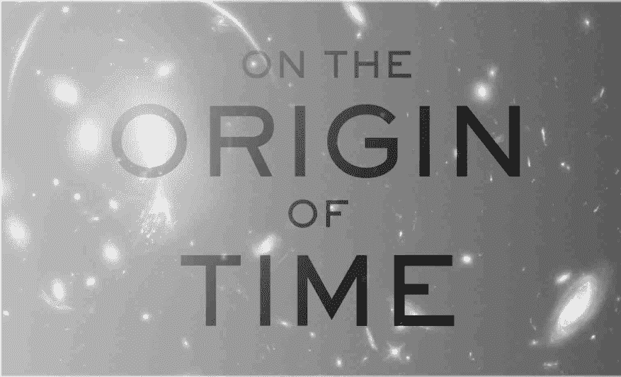

```
ep_prh_6.1_143034194_c0_r0
```

## 关于作者

> 关于起源的问题掩盖了问题的起源。
>
> n—弗朗索瓦·雅克敏

## 前言

史蒂芬·霍金办公室的门是橄榄色的，尽管紧邻着嘈杂的休息室，但史蒂芬喜欢让门稍微开一条缝。我敲敲门走了进去，感觉自己仿佛进入了一个永恒的冥思世界。

我发现史蒂芬静静地坐在书桌后，面对入口，他的头由于太重而无法直立，靠在轮椅的头靠背上。他慢慢抬起眼睛，带着热切的微笑迎接我，仿佛他一直都在等我。他的护士请我坐在他旁边，我不禁瞥了一眼他桌子上的电脑。屏幕保护程序在屏幕上不断滚动：*勇敢地前往那些《星际迷航》畏于涉足的地方。*

那是 1998 年 6 月中，我们正深处剑桥大学著名的应用数学与理论物理系（`DAMTP`）的迷宫中。`DAMTP` 坐落于康河河畔 Old Press 园区的一栋维多利亚风格建筑内，在过去的三十年来，这里一直是史蒂芬的营地，是他科学事业的枢纽。在这里，这位被困在轮椅、连手指都抬不起的人，曾激情地试图让宇宙服从他的意志。

史蒂芬的同事尼尔·图罗克（`Neil Turok`）告诉我，导师想见我。正是图罗克那门充满活力的课程——`DAMTP` 著名的高级数学学位课程——最近激发了我对宇宙学的兴趣。史蒂芬似乎听闻我的考试成绩非常优秀，想看看我是否能成为他麾下一名优秀的博士候选人。

史蒂芬那间堆满书籍和科学论文的尘旧办公室对我来说感觉很温馨。那里有高耸的天花板和一扇窗户。门旁的墙上挂着一张玛丽莲·梦露的照片；下方是一张霍金与爱因斯坦、牛顿玩扑克的签名照。右侧墙上满了数学符号，那是史蒂芬对宇宙的最新理论。在墙上还有两块黑板，写满了手绘的草图和公式，那是 1980 年关于超引力的会议纪念（霍金的宇宙）。这似乎是理论物理学家的一种艺术作品。

图 1。这块黑板挂在剑桥大学史蒂芬·霍金的办公室里，可以追溯到 1980 年 6 月的一场会议。上面画满了涂鸦、图画和方程（见彩色版本）。


史蒂芬使用一个名为 `Equalizer` 的电脑程序，它内置了一个单词数据库和一个语音合成器。他似乎在直觉地导航 `Equalizer` 的字典，节奏地按着点击器，仿佛在随着脑波跳舞。屏幕上的菜单显示出常用词和字母表。遗憾的是，单词选择是基于一种简单的搜索算法，它无法区分普通对话和理论物理，有时会产生出幽默的结果，从宇宙微波背景到额外维度。

菜单下方显示出“安德烈声明”（`Andrei claims`）。轻柔的点击声打破了沉默。史蒂芬开始说话了。在十年前的一场气管切术后失去了自然声音，他现在通过电子语音交流。这是一个缓慢而艰辛的过程。

史蒂芬从萎缩的肌肉中汇聚最后的力量，按了一下放在他右手掌的点击设备，类似于电脑鼠标。屏幕连接到轮椅手臂上亮了起来，在他的思想和外界世界之间建立了一条虚拟的生命线。

“安德烈声明有无限个宇宙。”他的电子声音在屏幕上显示出安德烈的声明，“这简直不可思议。”

我们被击中了——这是史蒂芬的开场白。

安德烈是著名的美裔俄裔宇宙学家安德烈·林德（`Andrei Linde`），他是 1980 年代初提出的宇宙膨胀理论的创始人之一。作为大爆炸理论的改进，该理论假设宇宙始于短暂的超快速扩张——膨胀。林德对他的理论进行了极大的扩展，即膨胀产生的不是一个，而是多个宇宙。

我以前认为宇宙就是全部。但到底有多大？在林德的方案中，我们一直所认为的“宇宙”只是一个巨大的“多重宇宙”的一小部分。

我知道，当史蒂芬说宇宙似乎经过了设计时，他指的是一种非凡的观测：宇宙从其剧烈的诞生中产生时，其配置是如此奇妙，足以维持生命——即便是在数十亿年后。这一便利的事实以某种或另一种方式，在几个世纪以来一直困扰着思想者，因为这感觉像是一次巨大的刻意安排。就好像生命的基因与宇宙是交织在一起的，仿佛宇宙在那一天就知道它将是我们的家园。对于这种神秘的意图迹象，我们该如何解释？这是人类对宇宙提出的核心问题之一，史蒂芬深切地感到宇宙学理论对此大有可说。破解宇宙设计之谜的前景——或说希望——驱动了他的大部分工作。

这本身就是极不寻常的。大多数物理学家倾向于避开这类困难且看似哲学化的问题。或者他们认为，总有一天，宇宙精妙的架构将源于万有理论核心的一个优雅的数学原理。如果是如此，宇宙表面的设计似乎就像是一个幸运的意外，是客观且无情感的自然法则的一种偶然结果。

但史蒂芬和安德烈（`Andrei`）都不是通常的物理学家。他们不愿在抽象数学的美感上押注，他们认为宇宙中产生生命的这种奇异精细调控，触及了物理学根源上的深层问题。他们并不满足于应用自然法则，而是寻求一种更广阔的物理学视角，包括对法则起源的质疑。这引导他们产生了大爆炸理论，因为推测正是通过宇宙的诞生，其法则般的设计才被奠定。而正是在它的诞生上，史蒂芬和安德烈产生了分歧。

安德烈设想宇宙是一个巨大的膨胀空间，其中许多大爆炸不断产生新的宇宙，每个宇宙都有自己的物理属性，就好像我们只不过是局部的宇宙天气一样。他辩称，我们发现自己身处在一个适宜生命的稀有宇宙中不应该惊讶，因为我们显然不可能存在于许多生命是不可能存在的宇宙之一。任何关于其背后存在宏大设计的印象，都是林德（`Linde`）多重宇宙论的幻象，源于我们对宇宙的局限认知。

史蒂芬认为，林德从宇宙到多重宇宙的宏大宇宙扩张是一种形而上学的幻想，无法解释任何问题，尽管我感觉到他无法证明这一点。尽管如此，我发现世界上最顶尖的宇宙学家们在强烈反对的同时，竟然正以如此坚定的信念辩论这些基础性问题，这令我很好奇且兴奋。

“林德不是引用了人择原理（即我们存在的条件），在多重宇宙中挑选出一个生物友好的宇宙吗？”我探性地问。

史蒂芬转过眼睛看向我，微微动了动嘴，留下我一脸困惑。后来我才知道这意味着他不同意。当他意识到我并没有被介绍过他核心圈内实行的那种非语言交流层次时，他将目光转回屏幕，开始构建一个全新的句子。事实上是两个句子。

“人择原理是一种绝望的建议，”他写道，随着他点击鼠标的声音，我的困惑也随之增加。“它是基于科学对我们理解宇宙底层秩序期望的否定。”

噢，这很令人惊讶。在读过《时间简史》后，我很清楚早期的霍金（`Hawking`）经常将人择原理作为解释宇宙的一部分。作为一名本质上是宇宙学家，史蒂芬很早就注意到宇宙的大尺度物理属性与生命存在之间存在令人惊讶的共鸣。早在 20 世纪 70 年代初，他就提出过一种人择论证——事实证明是错误的——用以解释宇宙膨胀在空间的所有三个方向上以相同的速率进行[22]。难道他后来对宇宙学中人择推理的价值改变了主意？

当史蒂芬停下休息一下清清气道时，我环顾他的办公室。左侧横跨整面墙的架子上堆满了许多本翻译成各种奇特语言的《时间简史》。我想，那里还有什么是他已经不再认同的。在这些简史旁边，我注意到一排他以前的研究生留下的博士论文。从 20 世纪 70 年代初开始，史蒂芬在剑桥建立了一个著名的学派，该学派总是包含一个由轮流的研究生和博士后学者组成的小圈子。

他们的论文题目触及了物理学在 20 世纪后期应对的一些最深奥的问题。从 20 世纪 80 年代，我看到了布莱恩·惠特（`Brian Whitt`）的《引力：量子理论吗？》，以及雷蒙德·拉弗姆（`Raymond Laflamme`）的《时空虫洞与自然常数》，这带我进入了 20 90 年代初，史蒂芬和他的同事认为虫洞——跨越空间的几何桥——影响了基本粒子的属性。（史蒂芬的朋友基普·索恩 `Kip Thorne` 后来在电影《星际穿越》中利用虫洞，让库珀回到了太阳系。）在旁边立着玛里卡·泰勒（`Marika Taylor`）的《M理论中的问题》，她是史蒂芬最近的学术后代。玛里卡在第二次弦革命期间为史蒂芬工作，当时该理论演变为更广的 M 理论，史蒂芬终于开始接受这一想法。

书架最左侧立着两本带有厚厚绿色封面的旧书，《膨胀宇宙的属性》。这是史蒂芬自己的博士论文，追溯到 20 世纪 60 年代中期，当时电话实验室巨大的霍尔角天线（`Holdel Horn Antenna`）以微波辐射的形式接收到了来自热大爆炸的第一声回声。史蒂芬在他的论文中证明了，如果爱因斯坦的引力理论是正确的，那么这些回声的存在意味着时间必须有一个起点。现在，这如何与我们刚刚谈论的安德烈的多重宇宙相调呢？

在史蒂芬的书右侧，我看到了加里·吉布斯（`Gary Gibbons`）的《引力辐射与引力坍缩》。加里是史蒂芬第一个学生，20 世纪 70 年代，美国物理学家乔·韦伯（`Joe Weber`）声称从银河系中心听到频繁的引力波爆发。报告的引力辐射强度之高，似乎星系正在以一种无法持续永恒的速度丢失质量——如果这是，很快就没有星系存在了。被这个悖论所吸引，史蒂芬和加里曾想过在 `DAMTP` 地下室建造他们自己的引力波探测器。这是一次幸免；引力波的传闻结果被证明是假的，又过了四十年，`LIGO` 引力波观测天文台才最终成功探测到这些难以捉摸的震动。

史蒂芬通常每年招收一个研究生与他一起研究一个高风险、高回报的项目，关于黑洞——隐藏在视界背后的坍缩恒星——或关于大爆炸。他尝试交替进行，安排一个学生研究黑洞，下一个研究大爆炸，这样在任何时候，他的研究生圈子都能涵盖他研究的两个分支。他这样做是因为黑洞和大爆炸在他的思维中正像阴阳一样——史蒂芬对大爆炸的许多关键洞察都可以追溯到最初在黑洞背景下提出的想法。

（观看一段《辛普森一家》剧集的预告，其中史蒂芬出现过，而且他被要求审核其中的内容。）

“我希望你和我一起研究关于大爆炸的量子理论……我显然来了一个大爆炸发生的一年。”

……为了理清多元宇宙。他对我灿烂地微笑，眼睛再次闪烁着光芒。就是现在。不是通过哲学思考或诉诸人择性原理，而是通过将量子理论更深地织入宇宙学，我们才能掌握多元宇宙。他的表述听起来像是一道普通的家庭题，尽管我能从他的神色看出我们已经开始工作，但我并不知道霍金的“飞船”正朝着哪个方向行驶。

“我快死了……”他出现在屏幕上。我愣住了；看了一眼坐在办公室角落安静看书的护士。我转头看向史蒂芬，据我所知，他看起来还好，并继续点击着鼠标。

……想……喝……杯……茶。这这里是英国，现在已经是下午四点了。

## 宇宙还是多元宇宙？

是设计出来的还是偶然的？这是一个让我们忙碌了二十年的宿命问题。一项作业引出另一项，很快，史蒂芬和我们发现自己正处于 21 世纪上半叶理论物理学最激烈的辩论中心。几乎每个人对多元宇宙都有自己的看法，尽管没有人能完全理解该如何看待它。最初在他指导下开始的一个博士项目，后来演变成了一场奇妙且激烈的合作，直到史蒂芬在 2018 年 3 月 14 日去世才告终。

我们工作所关乎的不仅仅是大爆炸的本质——那个处于存在核心的谜团，还有自然法则本身更深层的意义。宇宙学终究对世界发现了什么？我们又是如何融入其中的？这类考量让物理学离开了舒适区。然而，这恰恰是史蒂芬喜欢探索的地方，他通过数十年深邃宇宙学思考造就的无与伦比的直觉证明了他的预见。

像他之前的许多学者一样，早期的霍金将物理基本定律视为永恒不变、超越时间的真理。他在《时间简史》中写道：“如果我们发现了一个完备的理论……我们真的知道了上帝的心。”然而，十年以后，在我们的第一次见面期间——在林德的多元宇宙理论紧随其后的情况下——我感觉到他认为这一立场出现了裂痕。物理学是否在大爆炸这一时间起点提供了某种神般的基础？我们需要这样的基础吗？

我们很快发现，理论物理学中的柏拉图摆钟确实动得太厉害了。当我们把宇宙追溯到最早的时刻时，我们遇到了一个更深层次的演化，在那个层次，物理定律本身以某种元演化的方式变化和演变。物理规则在原始宇宙中发生蜕变，这是一个类似于达尔文演化的随机变异和选择过程，粒子物种、力，甚至时间，都消融在大爆炸中。更进一步的是，史蒂芬和我开始将大爆炸不仅视为时间的起点，也视为物理定律的起源。我们宇宙起源论的核心是一个关于起源的新物理理论，我们逐渐意识到，这一理论同时也包含了理论本身的起源。

与史蒂芬一起工作是一场不仅通往时空边缘的旅行，更是一场探索究竟是什么让史蒂芬成为史蒂芬之旅。我们共同的追求意味着我们的成长。他是一个真正的追寻者。待在他身边，人们不不受到他的决心的影响，以及受到他认为我们可以解决这些神秘宇宙问题的认知乐观主义的影响。史蒂芬让我们觉得我们正在编写自己的创世故事，在某种意义上，我们确实是这样。

而且物理学很有趣的！和史蒂芬在一起，你永远不知道工作何时结束，派对何时开始。他理解世界的无尽渴求，只有他对生活的热爱和冒险精神与之相匹。2007 年 4 月，在他 65 岁生日几个月后，他参加了乘坐特种装备波音 727 客飞机的零重力飞行，他将其视为一次旅行的序幕。

## 作者注

我在二十年间与史蒂芬的多次对话被忠实且真实地编织在叙事之中。史蒂芬那些已以出版形式发表的引言已在脚注中引用。

## 第一章

## 悖论

可能会出现一种奇的类比：即使是最大的望远镜，其目镜也不得比人类眼睛大。

> —路德维希·维特根斯坦，《杂谈集》

**20 世纪 90 年代是宇宙学发现黄金十年的巅峰。** 宇宙学长期以来被视为一个肆意推测的领域——这门勇于研究整个宇宙的起源、演化和命运的科学——终于走向了成熟。全世界的科学家都对来自精密卫星和地基探测器的的壮观观测结果感到兴奋不已，这些观测结果正从根本上改变着我们对宇宙的认知。仿佛宇宙正在向我们倾诉。这对理论学家来说是一个严峻的现实考验，他们必须收敛自己的推测，并完善其模型的预测。

在宇宙学中，我们发现过去。宇宙学家是时间旅行者，而望远镜就是他们的时间机器。当我们看向深空时，实际上是在回望深邃的时间，因为来自遥远恒星和星系的光旅行了数百万甚至数十亿年才到达这里。早在 1927 年，比利时神父天文学家乔治·莱马特就预言空间在考虑如此长的时间跨度时是扩张的。但直到 20 世纪 90 年代，先进的望远镜技术才使追踪宇宙扩张的历史成为可能。

这段历史包含了一些惊喜。例如，1998 年，天文学家发现空间的扩张在大约五十亿年前开始加速，尽管所有已知的引力形式应该减慢这种扩张。从那时起，物理学家一直在思考这种奇异的宇宙加速是由爱因斯坦的宇宙常数驱动的——一种无形的、以太般的暗能量导致引力产生排斥而非吸引。一位天文学家开玩笑说，宇宙就像洛杉矶：三分之一物质，二分之能量。

显然，如果宇宙现在正在扩张，它在过去一定曾被压缩过。如果你现在倒推宇宙历史——当然，这是一种数学练习——你会发现所有物质都会紧密聚集在一起，而且非常热，因为物质在被挤压时会升热并辐射。这种原始状态被称为*热大爆炸*（`hot big bang`）。自黄金 90 年代以来，天文学观测确定了宇宙的年龄（即自大爆炸以来经过的时间）为 138 亿年，正负 200 万年。

为了更多地了解宇宙的诞生，欧洲空间局（`ESA`）于 2009 年 5 月发射了一颗卫星，试图完成人类历史上最详尽、最宏伟的夜空扫描。目标是大爆炸遗留下的热辐射中一种有趣的闪烁模式。这些在扩张的宇宙中旅行了 138 亿年后到达今天的热量非常冷：2.725 K，大约是 -270 摄氏度。该温度的辐射主要位于电磁谱的微波频，因此这种遗热被称为*宇宙微波背景*辐射，或 `CMB` 辐射。

欧洲空间局捕捉远古热在 2013 年达到顶点，一张像点彩画的奇特斑点图像装饰了世界报纸的头版。这张图像见图 2，它显示了整个天空的投影，由数百万像素汇编而成，代表空间中不同方向遗留 `CMB` 辐射的温度，细节精美。对 `CMB` 辐射如此详尽的观测提供了大爆炸后 38 万年后宇宙状态的快照，当时它已经冷却到几千度。这个温度足以释放出原始辐射，这些辐射从那时起无阻碍地穿过整个宇宙。

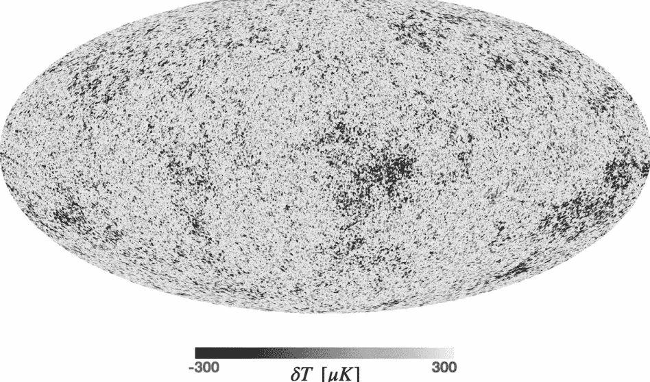

图 2。由欧洲空间局普朗克卫星（命名为量子先驱者马克斯·普朗克）拍摄的热大爆炸余晖天空地图。不同深浅的灰色斑点代表了从天空不同方向到达的远古宇宙微波辐射的微小温度变化。初看之下，这些波动是随机的，但仔细研究发现，地图上存在着相互联系不同区域的模式。通过研究这些模式，宇宙学家可以重建宇宙的扩张历史，以模拟星系是如何形成的，甚至预测它的未来。

`CMB` 天空图证实了遗留的大爆炸热在整个空间中几乎均匀分布，尽管并非完美。图像中的斑点确实代表极小的温度变化，只有万分之一度的微弱闪烁。然而，这些微小变化无论多小都至关重要，因为它们追踪了星系最终形成的种子。如果热大爆炸处处完全均匀的，那么今天就不会有星系。

古老的 `CMB` 快照标记了我们的宇宙学视界：我们无法进一步回溯。但我们可以从宇宙学理论中了解一些早期阶段运行的过程。正如古生物学家通过化石学习地球生命过去的样子一样，宇宙学家可以通过解析编码在这些化石闪烁中的模式，拼凑出在遗留热图刻在天空上之前可能发生的事情。这使得 `CMB` 变成了一块宇宙学的罗塞塔石，使我们能够追溯更遥远的宇宙历史。

`CMB` 辐射表明宇宙最初在扩张，然后慢了下来，最近（大约十亿年前）开始加速。减速似乎是例外而非常态。为什么？

其他这种幸运的宇宙巧合例子数之不完。我们居住在一个具有三个大空间维度的宇宙中。三维有什么特别之处吗？有的。仅仅增加一个空间维度就会让原子和行星轨道变得不稳定。地球将螺旋入太阳，而不是在周围绕出稳定的轨道。拥有五个或更多空间维度的宇宙会有更大的问题。只有两个空间的世界

另一方面，维度可能无法为复杂系统的运行提供足够的空间，如图 3 所示。三维空间对于生命来说似乎恰好。

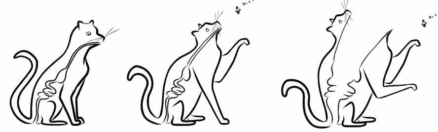

图 3。在一个只有两个空间维度的宇宙中，生命的形成——不用说生命本身——似乎是非常困难的。明显的捕猎和进食机制将无法运作。

此外，这种对生命的奇特适应性延伸到了宇宙的化学性质，这些性质是由基本粒子的属性以及它们之间的作用决定的。例如，中子比质子重一点。中子与质子的质量比为 1.0014。如果反过来，宇宙中所有的质子在大爆炸后不久就会衰变为中子。但如果没有了质子，就不会有原子核，因此没有原子，更没有化学。

另一个例子是恒星中碳的产生。正如我们所知，碳对生命至关重要。但宇宙诞生时并不含有碳。相反，碳是在恒星内部发生的核聚变形成的。20 世纪 50 年代，英国宇宙学家弗雷德·霍尔（`Fred Hoyle`）指出，从氦高效合成碳依赖于结合原子核的强相互力与电磁力之间的微妙平衡。如果强力只强一点或弱一点——哪怕只有百分之几——核结合能就会发生偏移，从而损害碳的融合，并阻碍碳基生命的形成。霍尔对此深有感，他说宇宙看起来像是一场“精心设计的计划”，仿佛“一个超级智力对物理学、化学和生物学都动了手脚。[1]”


# 暗能量与宇宙的精细微调

但最令人眩晕的、产生生命的精细微调涉及暗能量。我们测得的暗能量密度值小得惊人——只有许多物理学家认为的自然值的惊人 `10⁻¹²³`。然而，正是这种微小性使得宇宙在暗能量能够积聚足够的力量来加速膨胀之前，“迟疑”了大约八亿年。早在 `1987` 年，斯蒂芬·维伯格（Stephen Weinberg）就指出，如果暗能量密度稍大一些——例如其自然值的 `10¹²` 倍——那么它的排斥作用将更强并更早启动，从而再次关闭形成许多星系的宇宙机会窗口。[2]

简而言之，斯蒂芬在我们的第一次对话中强调的，宇宙似乎以某种方式被设计成使生命成为可能。著名作家兼理论物理学家保罗·戴维斯（Paul Davies）在此背景下谈到了宇宙的“金发姑娘因子”（Goldilocks factor）：“就像《金发姑娘和三只熊》故事里的粥一样，宇宙在许多有趣的方面对生命来说似乎都是‘恰好’的。[3] 尽管这并不意味着宇宙应该充斥着生命，但那些使其变得宜居的审慎微调绝不是世界的表层属性。相反，它们深深地刻画在物理定律的数学形式中。粒子阵的质量和属性、支配它们相互作用的力，甚至宇宙的整体组成——这一切似乎都是为了支持某种形式的生命而量身定制的——反映了物理学家“自然法则”的数学关系的特定特征。因此，宇宙学中设计之谜团在于，物理基本定律似乎是专门为了促进生命的出现而工程设计的。这似乎有一个隐藏的剧情在起作用，将我们的存在与宇宙运行的基本规则编织在一起。这听起来不可思议。事实确实如此！这个剧情到底是什么？

# 物理学中的设计谜题

现在，我应该强调，对于理论物理学家来说，这是一个非常不寻常谜题。通常，物理学家利用自然法则来描述某种现象或预测实验结果。他们还试图推广现有定律，以将更广泛的自然现象纳入他们的范畴。但这些关于设计的问题将我们引向了完全不同的道路。它们促使我们反思定律的更深层本质，以及我们如何处于其体系之中。现代宇宙学的魅力之处在于，它提供了一个科学框架，让我们有望在其中阐明这个最大的谜团。因为宇宙学是物理学中一个我们作为其试图解决的问题内在部分的领域。

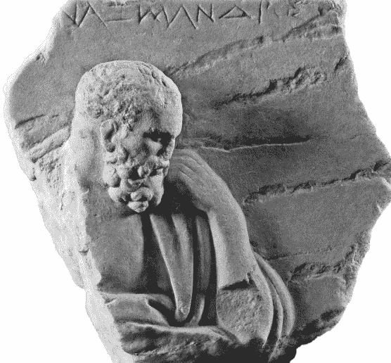

**图 4。** 描绘来自米底斯的古希腊哲学家阿纳西曼德的浮雕。二十六世纪年前，阿纳西曼德为重新思考世界的漫长而曲折的科学道路奠定了第一块基石。

泰勒是学生，阿纳西曼德创造了希腊人所说的 `περι φύως στορίας`，即“对自然的探究”，因此物理学（physics）。阿纳西曼德也被认为是宇宙学之父，因为他是第一个将地球视为行星——一个自由漂浮在虚空中的巨型岩石的人。他推理认为，地球之下并非无止尽的地球，也不是巨大的柱子，而是我们头顶看到的同样的天空。通过这种方式，他赋予了宇宙深度，将其从一个封闭的盒子——天在上，地在下——变为一个开放的空间。这种概念上的转变让人们能够想象天体穿过地球下方，为希腊天文学铺平了道路。此外，阿纳西曼德写了一本名为《自然论》的论文，虽然已遗失，但被认为包含以下片段：[4]

> 万物皆源于一，
> 又归于一，
> 根据必然性；
> 因为它们彼此给予公正，并作为对彼此不公正的报偿；
> 顺应时间的法则。

在寥寥几行中，阿纳西曼德阐述了一个革命性的思想：自然既不是任意的，也不是荒谬的，而是受到某种法则的支配。这是科学的基础假设：在自然现象的表面之下存在着一种抽象且连贯的秩序。

阿纳西曼德并没有详述自然法则可能采取的形式，除了与调节人类社会的公民法典进行类比之外。但他最著名的学生毕达哥拉斯为世界的秩序提出了数学基础。毕达哥拉斯学派赋予了数字神秘的意义，并试图用数字构建整个宇宙。他们认为世界可以用数学术语来描述的观点被柏拉图采纳并推崇，柏拉图将其作为其真理理论的支柱之一。柏拉图将我们经验的世界比作一种远为优的数学形式现实的影子，这种现实与我们感知的世界是独立存在的。古希腊人愿意相信，尽管我们无法轻易触碰或看到世界的底层秩序，但我们可以通过逻辑和推理推导出它。

然而，尽管他们的理论可能令人印象深刻，古代人对自然的推测与现代物理学在实质、方法或风格上几乎没有共同之处。其一，早期的希腊人推理几乎完全基于美学考虑和先验假设，很少或完全没有去测试这些假设。这在他们当时根没有想过。因此，他们对“物理学”以及法则化方案的构想与现代科学理论毫无相似之处。在他最后的一本书《解释世界》中，已故史蒂芬·温伯格认为，从当代观点来看，早期的希腊人不应被视为物理学家、科学家甚至哲学家，而应被视为诗人，因为他们的方法论与今天被认为是学术实践有本质区别。当然，现代物理学家也能看到他们理论中的美感，而且大多数人在研究中对审美考量很敏感，但此类考量不能替代通过实验和观察来验证理论，因为毕竟，这才是科学革命的关键创新。

尽管如此，柏拉图将世界数学化的愿景被证明具有巨大的影响。当二十世纪后，现代科学革命开启时，其主要参与者直接受到对柏拉图计划的信赖的驱动，试图用数学关系寻找支撑物理世界底层的隐藏秩序。伽利略写道：“自然的这本大书，只有那些知道其书写语言的人才能阅读。而这种语言就是数学。”[5]

艾萨克·牛顿，炼金术士、神秘主义者，一个性格古怪的人，却是世上最伟大的数学家之一，他通过他的《原理》巩固了自然哲学的数学方法，这本书被认为是科学史上最重要的著作。牛顿在封锁期间对此有了一个良好的开端，在瘟疫期间，他开始了研究……（注：原文此处似乎不完整，此处按意译翻译）。古希腊人倾向于相信，尽管我们无法轻易触碰或看到世界的底层秩序，但我们可以通过逻辑和推理推导出它。

若要确定宇宙是如何开始的，人们可能会认为它们必须在时间之外存在某种形式。有趣的是，大爆炸理论将这些看似纯属形而上学的考量引入了物理学和宇宙学领域。该理论使我们面对对物理定律本质的某些预设。

归根结底，物理定律以某种方式超越自然世界的这一观点，面临着一种风险，即让它们对生命的非凡适应性的起源变得完全奥深莫测。遵循这一方案的物理学家只能希望，理论核心处强大的数学原理某日能解释其亲亲性的特征。当今柏拉图主义者对设计之谜的回答是，这将被证明是一个数学上的必然性问题：宇宙之所以是这样，是因为自然没有选择。在某种程度上，作为一个答案，它带有一种亚里士多德“目的因”的味道，伪装成现代理论物理学。此外，撇开这类终极理论仍然是一个远梦想的事实不说，即使发现了如此强大的数学原理，也难以解释为什么宇宙恰好如此极其友好。事实上，没有任何种类的柏拉图式真理能真正跨越现代科学开启所创造的非生命世界与生命世界之间的鸿沟。相反，我们不得不得出结论：生命和智能只是一个根本上非人格化的、理想的数学现实中的偶然巧合，并且没有更多可以理解的。

在物理学和宇宙学设计问题上的这些**柏拉图式倾向**，虽然并非明显错误，但与自达尔文以来生物学家看待生物界设计的方式有着径然不同。

# 生物学中的演化与设计

目标导向的过程和看似有目的的设计在生物世界中无处不在。事实上，这些最初构成了亚里士多德自然目的论观点的基础。生物体是惊人复杂的。即使是单个活细胞也包含了多样化的分子组件，它们完美地协作以完成其许多任务。在较大的生物体中，大量的细胞以协调的方式工作，构建出像眼睛和大脑这样复杂且有目的结构。在查斯·达尔文之前，人们无法理解物理和化学过程如何可能创造出惊叹的功能复杂性，他们诉诸“设计者”来解释。18世纪的英国牧师威廉·帕尔利将生物世界的奇迹比作钟的运作。帕尔利认为，像钟一样，生物世界中的设计痕迹太明显而无法被忽视，“设计必须有一个设计者。[88]”。但达尔文那打破范式的进化论从生物学中消除了这种目的论思维。达尔文的深刻洞解是，生物演化是一个自然过程，简单的机制——随机变异和自然选择——可以解释生物体表象的设计，而无需诉诸设计者。

在加拉帕戈斯群岛，达尔文发现了多种喙部大小和形状各异的雀类。地雀有强壮的喙，能够有效地破碎坚果和种子；而树雀有尖锐、向尖的喙，非常适应于提取昆虫。这些以及他在旅途中的其他数据让达尔文意识到，不同种类的雀类是有亲缘关系的，并在特定生态位的影响下随着时间的演化而来的。`1837` 年，在搭乘“贝格尔号”从加拉帕戈斯之行归来后，达尔文在他的一本红色笔记本上画了一棵不规则分支树的简单草图。这张关于祖先树的草图捕捉了他深邃且蓬勃发展的理论的精髓：地球上所有的物种都是相关的，并从一个单一的共同祖先（树干）通过作用于随机突变复制者的渐进式环境选择过程演化而来（见插图，图4）。

达尔文主义的核心思想是自然并不具有预测性——它不预判生存可能需要什么。相反，任何趋势，例如喙形状的改变或长颈鹿脖子的逐渐增长，都是源于长期作用以放大特征的环境选择压力。

> “在这一生命观中存在着一种宏伟的壮丽，”达尔文在二十多年后写道，“它拥有几种力量，最初被吹入少数几种形式或一种形式中；而当这个行星按照引力的固定规律循环时，从如此简单且无限的形式中，演化出了并存在最美丽、最奇妙的形式。[99]”

达尔文通过证明钟不需要瑞士制表匠，从根本上颠覆了帕尔利的论点。它对生物界表象的设计提供了一个彻底的进化描述——包括它所遵循的定律被理解为自然过程的涌现属性，而不是某种超自然创造的结果。

然而，**尽管具有美感**和壮丽，生物法则通常被认为比其物理学中的对应法则稍逊。因为虽然涌现式的模式可能是持久的，但没有人认为它们是永恒的真理。此外，决定论和可预测性在生物学中发挥的作用小得多。牛顿运动定律是决定性的；它们允许物理学家根据物体今天的位置和速度（或过去的任何时刻）预测物体在未来任何时刻所在的位置。在达尔文的体系中，生物系统中变异的随机性意味着几乎没有什么是可以预先定的——甚至是有一天显现出来的定律。这种缺乏决定性的赋予了生物学一种回顾性的元素：人们只有通过回顾过去才能理解演化。达尔文的理论并没有详述从早期生命到今天多样复杂的实际演化路径。它没有预测生命树，因为那不是——也不可能是它的目的。相反，达尔文的天才在于勾勒出一般的组织原则，而将具体的历史记录留给系统发育学和古生物学。也就是说，达尔文的进化论承认，我们所知的生命是规律性和特定历史的共同产物。它的实用性在于，达尔文的雀类提供了一个例子。如果达尔文尝试沿着时间正向，从前生命地球的化学环境开始预测加拉帕戈斯群岛上的各种雀类，那将完全失败。雀类或我们星球上任何其他物种的存在，不能仅根据物理和化学定律推断出来，因为生物演化中的每一个分支都涉及一场概率博弈。某些偶然结果被环境状况青睐并固定下来，通常会在下游产生戏剧性的后果。这些固定的意外有助于决定后续演化的特征，甚至可能表现为新的生物法则。例如，孟德尔遗传定律的诞生，取决于最初导致有性繁殖生物的集体分支结果。


**图 5.** 生命之树展示了生命的三个域，在树的底部是它们最后的最后共同祖先——LUCA——即地球上所有生命演化而来的最近生命形式。

生物演化中固有的随机性延伸到历史的其他层面，从生命起源到人类历史如此。正如达尔文一样，历史学家通过区分“如何”和解释“为什么”来解释历史进程中偶然的转折和变化。为了描述“如何”，历史学家像生物学家一样进行事后推论（ex post facto），并重构导致从一个点到特定结果的系列特定事件。然而，要解释“为什么”，则要求人们像物理学家一样思考，并沿着时间向前推演，以识别因果的、决定性的联系，从而预测出某条特定的历史路径而非其他路径。对历史的浅层读物往往为事物这样发生而非那样发生提供了一种因果决定论的解释。但更精细的分析揭示了在十字路口存在着错综复杂的竞争力量网络，这些力量加上大量的偶然，使得所选的道路远非显而易见，也绝非不可避免，迫使人们只能描述“如何”，而非“为什么”。

考虑我从办公室窗外看到的森林，它们位于滑铁卢战役南方几英里处。`1815` 年 `6` 月 `17` 日，在主战爆发前夕，拿破仑·波拿破命令他的将军埃曼纽尔·德·格鲁西（Emmanuel De Grouchy）追踪普鲁士军，以防止他们与在北方部署的英盟军会合。格鲁西尽职地带着一支法国部队向东北军，但未能找到普鲁士人。第二天——从我能看到的这片森林里——他听到远处法国大炮的沉闷鸣声，意识到战斗已经开始了。在关键的几分钟里，他犹豫是否要违背拿破仑的命令，转而去救援剩余的法国部队。他选择了离开，正如命运那样，去追普鲁士人。格鲁西在那一刻的决定是一个非凡的“冻结意外”（frozen accident），它不仅影响了战斗的结果，还影响了欧洲历史的进程。

或者，举另一个例子，考虑公元 `4` 世纪基督教在罗马帝国的兴起。当君士坦丁皇帝于公元 `306` 年登位时，基督教无非只是一个不为人知的教派，与一系列崇拜群体竞争影响力。为什么基督教接管了罗马帝国并崛起成为共同信仰？历史学家尤瓦尔·哈拉里（Yuval Harari）在他的著作《人类简史》中指出，这并不是一种因果解释，基督教在西欧的主导地位最好被看作另一种冻结意外。哈拉里呼应生物学界古尔德（Gould）的观点断言：“如果我们能倒回历史并重演第四世纪一百次，我们会发现基督教只接管了罗马帝国几次。”但基督教的冻结意外产生了深远的影响。其，一神论鼓励了对创造主上帝的信仰，认为对被造物有一个理性的计划。并不奇怪，当几个世纪后现代科学最终在基督教欧洲出现时，早期的科学家将他们的研究视为一种宗教追求，为我们仍在苦斗的“设计之谜”埋下了伏笔。

总的来说，历史每一个时间点——从人类历史到生物和天体物理演化——完全开放的无数道路，意味着决定论的解释仅在粗略、粗粒度的水平上可用。在演化的任何阶段，决定论和因果关系只塑造了最通用的结构趋势和属性，通常是基于较低复杂度水平运行的规律。例如，人类历史充满了偶然的转折和变化，到目前为止大多在地球的范围内进行，除了对太阳系中其他天体的几次出游。考虑到人类生命产生的物理和地质环境，这种行星局限性并不意外——因此是可预见的。但它几乎没有告诉我们关于人类历史任何时代的任何信息。

同样，化学元素的顺序和门德列夫周期表的结构本质上是由低层面的粒子物理定律所固定的。但地球上元素的特定丰度取决于在其演化之前和整个过程中的无数偶然。

转到生物化学层面，考虑这样一个规则：地球上所有生命都基于 `DNA`，基因由缩写为 `A`、`C`、`G` 和 `T` 的四种核苷酸组成。`DNA` 分子的特定构建块可能是该行星生命起源的偶然结果。生命为了维持自身必须掌握的基本计算能力要深得多，并且可能在底层数学和物理原理的基础上决定遗传信息分子载体的广泛结构属性。这一点得到了匈牙利裔美国数学家约翰·冯·诺伊曼（John von Neumann）`1948` 年对自我复制自动机的理论构建的证明。在沃森和克里克发现 `DNA` 结构五年前，冯·诺伊曼识别了生命生存必须克服的关键计算问题，并假设了一种巧妙的结构——似乎是唯一可能的结构——实现了复制能力。他画出的结构一眼就能认出是 `DNA`。

演化在巨大的冻结意外链的基础上不断构建。较低复杂度水平为更高层次的演化设定了环境，但这仍然留下了巨大的空间产生惊喜的转折，使得极不可能的路径往往会实现，决定论随之失效。无数分支事件的偶然结果为演化注入了真正的涌现元素。它们增加了大量的结构和信息，而这些信息是低层规律中根本不包含的，从中，更高层的新的新型类模式可以——而且通常确实会——产生。例如，尽管今天没有严肃的科学家相信生物学中存在没有任何物理化学起源的特殊“生命力”，但仅凭物理因素并不能决定什么将

# 从开普勒到多重宇宙

在其杰作《物种起源》于 `1859` 年 `11` 月 `24` 日发表仅十八天后，查尔斯·达尔文收到一封来自天文学家约翰·弗德里克·赫谢尔（John Frederick Herschel）的信。赫谢尔作为发现王星之父，对达尔文书中的任意性表示怀疑，认为他的是“物理规律”。

将宇宙学转变为一门环境科学（尽管这个环境非常大！），导致了一场令人尴尬的失败。一位弦理论学家将多重宇宙中物理定律的局部特征比作美国东海岸的天气：“极度多变，总是一塌糊涂，但在极少数时候非常迷妙。”[12]

我们可以从科学史中感受到这种变革的规模。`1597` 年，德国天文学家约翰内斯·开普勒提出了一种基于古希腊拉图多面体的太阳系模型，在五种正多面体中，立方体是最广为人知的。开普勒设想将六个已知行星绕太阳运行的近似圆形的轨道附接在其上。他随后假设，这些球体的相对大小取决于一个条件：除了土星这个最外层的球体外，每个球体都恰好契合在一个正多面体内部，而每个球体（最内层的水星）则恰好位于其中一个正多面体的外部。[[2] 开普勒在图6中的图画说明了这种配置。当开普勒将这五个几何体按正确的顺序一个套一个地放置，且都紧密贴合时，他发现嵌套的球体可以位于与每个行星到太阳距离对应的间隔上，同时土星沿着绕着最外层多面体的球体运动，没有任何改变相对半径的空间。基于此，他预测了行星的总数——六个，以及它们轨道的相对大小。对于开普勒来说，行星的数量和它们与太阳的距离是自然界深层数学对称性的体现。他的《宇宙奥秘》（*Mysterium Cosmographicum*）实际上试图将古老的拉图多式“球体和谐”梦想与 `16` 世纪关于行星绕太阳运行的洞见调和。

在开普勒时代，太阳系通常被认为是整个宇宙。没有人知道恒星是拥有自己行星系统的太阳。因此，假设行星轨道是最基本的问题，是完全理所当然的。今天，我们知道行星的数目或它们与太阳的距离并没有重大意义。我们理解太阳系中的行星组合并非独特，甚至不是特殊的，而是从环绕原太阳的旋转气体和尘埃云中形成的历史的偶然结果。在过去的三十年里，天文学家已经观测了数千个轨道配置迥然不同的行星系统。有些恒星拥有在短短几天内运行的木星大小的行星，有些则拥有三个甚至更多宜居的类地行星，而另一些行星系统拥有两个恒星，形成了昼夜交替的混沌模式以及许多其他奇特的天象。

# TABULA MORBIUM PLANETARUM DIMENSIONES, ET DUPANTIAS PER QUINTAS

NOVARIA CORPORA GEOMETRICAE EXHIBHENS.

ILLUVSTRISS PRINCIPI AC DNO. DNO. FRIDERICO DVCVI VIR

TENSERGIO, ET TELIO, COMITI, MONTIS BELGARVM, EJ. CONSECRATA.

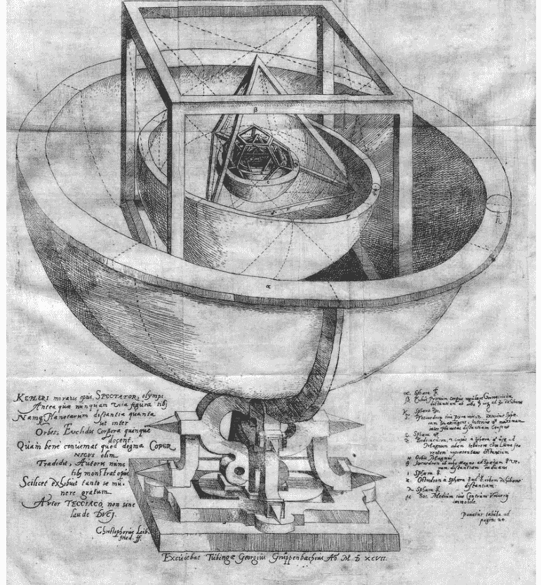

Kepler opus de Mysteriis aliorum

Praemium qui nova forma quae est

Nova Coelestis mechanica deopta.

Orbis, Ecliptic Corpora geruntur

Quae rota movuntur in figura, Optica


# Stellaria

Solis et terrae quae habent eos nemo gradus. Ars tractatilesque sunt liber (I).

## Coelestia per Johannes Kepler

### De Mysteriis Cosmographicorum um de orbita solis

In hoc libro, quae sunt um pagina.

### 6. 在他的主要天文学著作《宇宙奥秘》中，约翰内斯·开普勒提出了太阳系的拉图多模型，将行星（圆形的）轨道的大小与五种正多面体联系起来。在开普勒的图中，可以清晰地看到四个行星球以及十二面体、四面体和立方体。

如果我们生活在多重宇宙中，那么物理定律就是局部的。我们理解太阳系中的行星组合并非独特，甚至不是特殊的，而是从环绕原太阳的旋转气体和尘埃云中形成的历史的偶然结果。在过去的三十年里，天文学家已经观测了数千个轨道配置迥异不同的行星系统。有些恒星拥有在短短几天内运行的木星大小的行星，有些则拥有三个甚至更多宜居的类地行星，而另一些行星系统拥有两个恒星，形成了昼夜交替的混沌模式以及许多其他奇特的天象。

如果我们生活在多重宇宙中，那么物理定律就是局部的。我们理解太阳系中的行星组合并非独特，甚至不是特殊的，而是从环绕原太阳的旋转气体和尘埃云中形成的历史的偶然结果。

如果我们生活在多重宇宙中，那么物理定律就是局部的。我们理解太阳系中的行星组合并非独特，甚至不是特殊的，而是从环绕原太阳的旋转气体和尘埃云中形成的历史的偶然结果。

如果我们生活在多重宇宙中，那么物理定律就是局部的。我们理解太阳系中的行星组合并非独特，甚至不是特殊的，而是从环绕原太阳的旋转气体和尘埃云中形成的历史的偶然结果。

在多重宇宙中，由于生命在我们的宇宙中处于特权位置，遵循开普勒的足迹去寻找深层解释是徒劳的。他认为，在多重宇宙中存在一种能够产生多重宇宙的非个人化规律的规则，它体现了生命的最佳宇宙条件，并“行动”以在许多宇宙中选择出我们的一个。

这确实是一个激进的提议。再次让生命在宇宙解释的中心处于特权位置，开普勒的人类原理似乎将我们带回了五个世纪前哥白尼之前的时代。

然而，多重宇宙论者并没有轻易放弃。他们提出了一种修补理论的方法，这种提议如此激进，震撼了科学界。这就是人择原理。

选题原理于1973年进入宇宙学。天体物理学家布兰登·卡特（与史蒂芬在剑桥的同学）在一次纪念哥白尼的会议上提出了这一原理。这是一个历史的奇特转折，因为自16世纪以来，哥白尼就已经剥夺了人类的中心地位。[13]

这种推理中隐藏了一个问题：多重宇宙学在根本上是欠定义的且模糊的。它缺乏关于我们在疯狂宇宙织锦中位置的关键信息，作为结果，无法预测我们应该看到什么。多重宇宙学就像一张没有密码的借记卡，更糟糕，是一个没有说明书的宜家柜。从深层意义上说，该理论未能说明我们是谁以及我们在哪里。

在我们的宇宙中，如果我们生活在多重宇宙中，那么物理定律就是局部的。我们理解太阳系中的行星组合并非独特，甚至不是特殊的，而是从环绕原太阳的旋转气体和尘埃云中形成的历史的偶然结果。

如果我们生活在多重宇宙中，那么物理定律就是局部的。我们理解太阳系中的行星组合并非独特，甚至不是特殊的，而是从环绕原太阳的旋转气体和尘埃云中形成的历史的偶然结果。

如果我们生活在多重宇宙中，那么物理定律就是局部的。我们理解太阳系中的行星组合并非独特，甚至不是特殊的，而是从环绕原太阳的旋转气体和尘埃云中形成的历史的偶然结果。

如果我们生活在多重宇宙中，那么物理定律就是局部的。我们理解太阳系中的行星组合并非独特，甚至不是特殊的，而是从环绕原太阳的旋转气体和尘埃云中形成的历史的偶然结果。

如果我们生活在多重宇宙中，那么物理定律就是局部的。我们理解太阳系中的行星组合并非独特，甚至不是特殊的，而是从环绕原太阳的旋转气体和尘埃云中形成的历史的偶然结果。

不出所料的是，卡特在1973年首次提出了他的宇宙学人择原理，当时对于任何形式的多宇宙的理论证据都充是参差不齐，他的沉思通常被斥为胡言八道。但在世纪末，情况发生了一次引人注目的转折，多元宇宙理论开始受到关注，卡特的人择思维迅速被复活，并被用来梳理我们在这一广阔宇宙拼图中的位置。人择原理被视为一种“密码”（PIN），将多元宇宙理论从一种抽象的柏拉图式构殿转化为一种具有罕见解释潜力的真正物理理论。

多元宇宙的狂热者宣称，他们发现了宇宙设计的第二种可能答案——第一种是这仅仅是一个巧合，是存在之初某种深奥但（目前尚）神秘的数学原理所带来的幸运结果。而来自人择多元宇宙宇宙学的这一新答案是，这种表象的设计是我们“局部”宇宙环境的属性：在一个由岛屿宇宙组成的巨大宇宙马赛克中，我们居住在一个稀有的、宜生命的宇宙中，它是由人择原理筛选出来的。这一进展引起了极大的兴奋。“我们与宇宙是在一起，”林德（Linde）宣告道，“我无法想象一种忽视生命和意识的自洽宇宙理论。”在他的《宇宙景观》一书中，斯坦福大学颇有主场的弦理论学家纳德·苏斯金德（Leonard Susskind）（他的大胆推测是可以信任的）将客观元律与主观人择原理的结合描述为基础物理的新范式。

粒子物理巨头斯蒂芬·温伯也暗示，人择推理标志着宇宙学新纪元的黎明。他在20世纪60年代后期的统一见解——即电磁力和弱核力是同一的——构成了粒子物理学标准模型的基础。标准模型的某些预测此后已得到验证，其精度惊人，不低于十四位小数，使其成为物理学史上经测试最准确的理论。然而，尽管如此精确，温伯认为，要理解标准模型采取这种特定形式的深层原因，我们需要用一种完全不同本质的来补充正统物理学的数学原理。“科学史上的大多数进展都以对自然的发现为标志，”他在剑桥的这场《生活在多元宇宙中》演讲中告诉我们，“但在某些转折点，我们对科学本身以及我们认为可接受的理论有了发现。我们可能正处于这样一个转折点……多元宇宙使人择推理成为物理理论的新基础合法化。”[15] 温伯在此处唤起的观点呼应了一种二元论的形式。存在物理定律或元律，我们正在发现它们，但它们是冷酷且客观的。然而，在这些之外，还有人择原理，它以自己神秘的方式，将（元）律与我们经验的物理世界桥接起来。

这种反弹是非常剧烈的。多年年来，人择原理已被许多人认为是理论物理学中最争议的话题。有些人持有坚定的反对意见。“暴胀理论自己挖了自己的坟墓，”普林斯顿宇宙暴胀的共同发现者保罗·斯坦因哈特（Paul Steinhardt）宣布道。“这就像放弃，”加州大学的诺贝尔奖得主大卫·格罗斯斯（David Gross）直言道。其他人则认为，关于我们在宇宙中位置的整个讨论为时尚早了。“考虑这些事情还太早了，”16 一位极具远见的理论学家尼马·阿卡尼-哈梅德（Nima Arkani-Hamed）在2019年夏天对一群弦理论学家说道。在现代科学革命（该革命为物理学的二元论种下了种子）五世纪后，这是一个非常不起的陈述。

令斯蒂芬感到沮丧的是，大多数的理论学家继续视而不见——迷失在数学中。大多数理论物理学家觉得——并且认为——对宇宙宜生命深层起源的探究超出了他们的学科范围。他们宁愿相信，当我们发现统治多元宇宙的弦理论主方程时，问题就会消失。有一次在DAMTP（数学和天体物理理论研究所）喝茶时，斯蒂芬从不讳忌“打破浑水”，他对此表示了不满。“我很惊讶，”他说，“人们[弦理论学家]竟然会有如此短浅的视野，而没有严肃考虑[17] 斯蒂芬认为，如果我们将多元宇宙仅仅视为另一个实验室问题，那么人择原理是不够的。对于最终理论，他认为，如果我们仅仅是这样理解，它是无法实现的，而必须在多元宇宙的背景下寻求。数学是斯蒂芬的仆人而非主人。霍金也同意，对于我们感知物理的方式，人择原理的引入是某种变革性的转变，需要一种范式的转移[18] 然而，对于人择推理作为新范式的一部分，他变得越来越怀疑其定性的本质。生物学和其他科学充满了这种定性的预测。对他来说，真正的问题是人择推理偏离了科学预测和证伪的过程。


人择原理将这一过程建立在不稳定的基础上，因为个人对何构成宜生命的宇宙的标准为物理学注入了主观元素，从而损害了波普的证伪过程。你的人择视角可能会在多元宇宙中选择具有这组法则的一个区域，而我的人择偏好则可能会选择给出了另一个补丁，拥有一套不同的法则，但手中没有客观规则来判断哪一个是正确的。

这与达尔文进化论大不相同，后者进化论巧妙地避开了任何类似于生物学中人择原理的内容。外星生命是否存在，更不用说它是如何演化的，在达尔文的理论中都不起作用。达尔文主义也没有为任何特定物种在生物事务中的特权地位留出任何空间，无论是狮子、人类还是其他任何物种。相反，达尔文主义根根于我们与生命世界其他部分的关系。它承认了万物的相互联系性。达尔文伟大的洞见之一是，人类与生命世界中的其他一切是共同进化的。“在我看来，我们必须承认，人类尽管拥有所有高尚的品质……其躯体中仍然留着其卑微出身的不可磨灭印记，”他在《人类的起源》中写道。这与卡弗在宇宙学中的人择原理是多么地不同，后者运行在宇宙的自然演化之外，仿佛是这一切的附加品。

从波普尔的意义上说（即关注证伪性），多重宇宙与17世纪德国多才学者哥特特弗里德·莱布尼茨的宇宙学几乎没有区别。在他的著作《单子论》中，莱布尼茨暗示存在无限多个宇宙，每个宇宙都有自己的空间、时间和物质，而我们生活在上帝因其善意而选择的所有可能世界中最好的一个。

科学界在人择原理的价值上陷入永久分歧是完全可以理解的。美国物理学家、作家李·斯马林林（Lee Smolin）在他对弦理论的深刻批判著作《物理学的麻烦》中尖锐地指出：“一旦一个不可证伪的理论优于可证伪的替代方案，科学的进程就停止了，知识的进一步增长也将被排除。”这也是斯蒂芬在我们在办公室第一次交谈时所担心的，一旦人们认同了人择原理，就放弃了科学所带来的基本预测性。

我们已经陷入了僵局。人择原理本是为了在广大的宇宙补丁中规定“我们是谁”，并以此功能作为连接抽象多重宇宙理论与我们作为宇宙内观察者体验的桥梁。然而，它未能以维护科学实践基本原则的方式做到这一点，使得多重宇宙宇宙学完全没有任何解释力。

这引导我们得到了惊人的观察：从广义上说，自从现代科学革命以来，我们在理解支撑物理现实的表象设计的起源方面，进展得异常地缓慢。是的，我们现在精细地理解了宇宙的膨胀历史，理解了引力如何塑造大尺度宇宙，也理解了微到远小于质子尺寸的物质量子行为。但这种详尽的物理理解本身具有巨大意义，它只是凸显了更深层的设计之谜。宇宙的亲生命特征继续制造着困惑，分裂着科学界和更广泛的公众。一个深奥的概念鸿沟继续分割着我们对生命世界的理解，以及对使生命成为可能的物理条件的理解。为什么大爆炸时设定的数学规律结果证明是适用于生命的？我们应该如何看待这一事实？分离有机世界和无机世界的裂痕似乎比以往任何时候都更深。

物理学家们说，多重宇宙带给了我们一个悖论。多重宇宙宇宙学建立在宇宙膨胀的基础上，即宇宙在早期阶段经历了一次短的快速膨胀。膨胀理论长期以来拥有丰富的观测支持，但它有一种不方便的倾向，即产生不是一个而是许多个宇宙。因为它没有说明我们应该处于哪一个宇宙——它缺乏这种信息——该理论失去了大部分预测我们本该看到什么的能力。这是一个悖论。一方面，我们关于早期宇宙最好的理论表明我们生活在重宇宙中。与此同时，多重宇宙破坏了该理论的大部分预测能力。

事实上，这并不是斯蒂芬第一次面对神秘的粒子流悖论。早在1977年，他就指出了一个与黑洞命运有关的类似困境。爱因斯坦的广义相对论预测，掉入黑洞的任何物体的信息都将永远隐藏在内部。但斯蒂芬发现，量子理论为这个故事增加了一个悖论性的转折。他发现黑洞表面的量子过程会导致黑洞辐射出微弱的稳定粒子流，包括光粒子。这种辐射——现在被称为霍金辐射——微弱到无法在物理上探测到，甚至其存在本身就有问题。[19] 原因是，如果黑洞会辐射，它们就会收缩并最终消失。然而，这种情景违反了量子理论的基本原理，该原理规定物理过程可以转换和混乱，但永远不会不可逆地抹除信息。当黑洞辐射其最后的一克质量时，隐藏的大量信息会发生什么？斯蒂芬的计算表明，这些信息将永远丢失。关于黑洞寿命以及我们在重宇宙中地位的悖论变成了过去几十年中最令人头疼和讨论激烈的谜题之一。它们涉及物理学中信息的本质和命运，因此直击物理理论本质的核心。这两个悖论都出现在所谓的半经典引力背景下，这是由斯蒂芬在20世纪70年代中期开创的一种种对引力的理论描述，基于经典和量子思维的混合。

## 思想实验

思想实验一直是斯蒂芬的最爱。在放弃哲学后，斯蒂芬喜欢对一些深奥的哲学问题进行实验——时间是否有开头、因果关系是否是基础，以及最具有野心的一点，我们这些“观察者”是如何融入宇宙体系的。他通过将这些问题构想为理论物理中的巧妙实验来实现此。斯蒂芬的三项里程碑式的发现都源于巧妙、精心配置的思想实验。其中第一个是他在经典引力中的系列大爆炸奇点定理；其次是他1974年在半经典引力中的发现，即黑洞会辐射；第三是他同样在半经典引力中提出的关于宇宙起源的无边界提议。

现在，虽然有人可以认为黑洞悖论仅具有学术兴趣——霍金辐射的精细细节可能无法被测量——但多重宇宙悖论直接关系到我们的宇宙观测。悖论的核心在于现代宇宙学中生命世界、观察者身份与物理宇宙之间紧张的关系。多重宇宙悖论成为斯蒂芬寻求重新定义这种关系的灯塔，他通过对宇宙开发完全量子化的视角来实现。他最后的宇宙最终理论是彻底量子化的，它重绘了宇宙学的基本基础，也是斯蒂芬对物理学的第四项大贡献。该理论背后的宏大思想实验在意义上已经准备了五个世纪。执行它将是我们的航程。

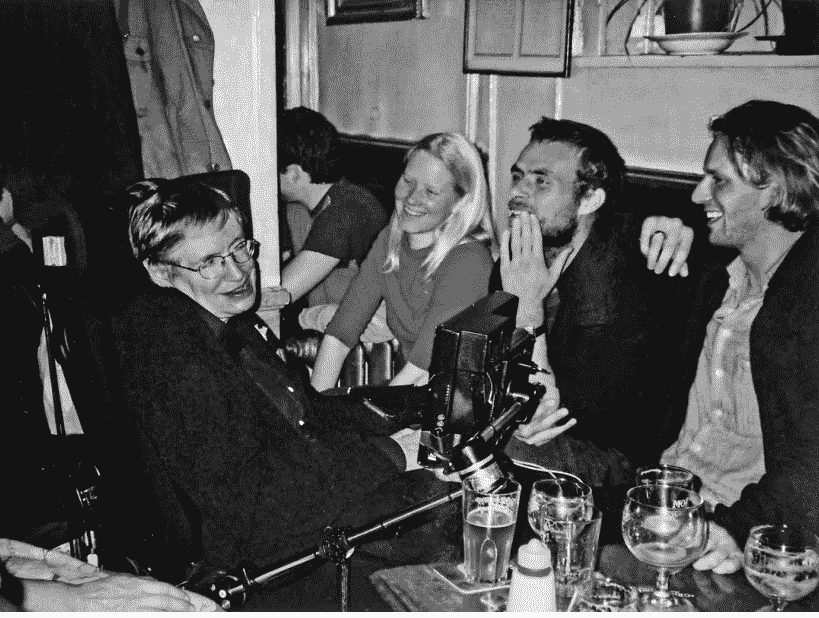

### 跳跃笔记

*1 勒梅特（Lemaître）经常在笔记本的一端记下科学见解，在另一端随手记录精神反思，并在中间留几页空白，仿佛为了避免不必要的将科学与宗教混合在一起。

*2 特别是，从太阳向外移动，开普勒放置水星球（一个八面体）、金星球（一个二十面体、十二面体）、火星球（一个四面体）、木星球（一个立方体），最后是土星球。

## 第二章 没有昨天的一天

时空看起来像一个圆锥。我们沿着母线向边缘移动进入未来。我们通过绕过母线形成的圆来环绕空间。如果我们沿着时间回溯，就会靠近锥体的底部。我们正接近那个没有空间的独特时刻。

我们可以将时空比作一个开放的杯子。我们沿着锥体向上移动，在时间前进。我们通过绕圆来穿过空间。如果我们想象回到过去，就会到达杯子的底部。这是第一个没有昨天的瞬间，因为那时还没有空间。

> 乔治·勒梅特在1957年4月比利时电电网络上的一场名为《原始原子》的采访中（为了纪念阿尔伯特·爱因斯坦去世两周年），乔治回忆了当他第一次告诉爱因斯坦宇宙正在膨胀这一发现时，后者的反应。这是在1927年10月的布鲁塞尔发生的，当时世界上许多最顶尖的物理学家聚集在此参加第五届索尔物理物理会议。这位33岁的天文学家并不是会议的参与者，但在会议间隙接触了爱因斯坦。然而，当他提出他的广义论预言空间正在扩张，因此我们看到星系正在远离我们时，爱因斯坦却拒绝了。“在一些技术性的评论之后，爱因斯坦总结说，从物理角度来看，这让他觉得是不可喻的，”勒梅特在采访中回忆道。

为什么爱因斯坦如此强烈反对宇宙有开端的观点？因为他觉得这会摧毁物理学的根基。他认为勒梅特的原始原子或任何其他形式的起源，都会成为上帝干预自然运行的入口点。在20世纪30年代初的长期漫步中，爱因斯坦敦促勒梅特找到避免开端的方法，因为“这让我想起了基督教的创造教义。”

事实上，勒梅特认为宇宙的起源是扩大自然科学领域的绝佳机会。爱因斯坦与勒梅特关于宇宙膨终极原因之争，触及了其表面设计之谜的核心。他们的辩论在许多方面都是七十年年后林德（Linde）与霍金（Hawking）之争的前奏。当勒梅特设想大爆炸是“创造的起源”时，他在想什么？为了理解这一点，我们需要仔细观察这两位科学家的思想。

## 理论基础

现代宇宙学建立在爱因斯坦的相对论基础上。这带我们回到20世纪初，当时物理学家拥有牛顿的引力和运动定律、麦克斯韦的电磁和光理论，这些理论与热力学共同成了工业革命的基础。从这些19世纪物理理论中产生的世界观与我们对现实的直观图景一致，涉及粒子和场，在固定的空间中传播，并受到通用时钟——可以称之为宇宙大本钟——的引导。因此，物理学家认为他们正趋向于一个关于自然的定论描述，且物理学即将完备。

然而，在1900年，19世纪物理巨头之一威廉·汤姆森（William Thomson，即广为人知的开尔文勋爵）指出“地平线上有两朵乌云”。他，开尔文发现的其中一个乌云关于光穿过以太的运动，另一朵关于热物体辐射的量。尽管如此，大多数物理学家仍然认为这些只是待解决的细节，物理理论的大厦是稳固且可靠的。

然而在短短十年内，这座大厦就崩塌了。开尔文“细节”的解决引发了两场全面的革命：相对论和量子力学。更如此，这两场革命都将物理学引向了完全不同的方向，投下了一片仍然笼罩在今天物理学前沿的新云：宏观世界与微观世界如何契合的问题。

光究竟有什么特征动摇了19世纪物理学的根基？实验表明，无论观测者相对于光源的运动如何，光总是以每秒186282英里的速度移动。显然，这一事实与日常经验不符：如果你在移动的火车上并测量它的速度，你得到的值显然与站在外面测量时不同（为零）。它也违背了19世纪的思维。光波被认为是以太——一种神秘的充满空间的介质——传播的。但如果是这样，相对于以太以不同速度运动的观测者看到的光波速度应该是不同的。然而实验结果并非如此，这足以让在专利局工作的职员阿尔伯特·爱因斯坦对以太的存在产生怀疑。

无限的。在牛顿的思维中，没有任何东西能够影响空间不可扭曲的本质和时间的线性流动。此外，时间和空间并不是相互关联联的。根据牛顿的观点，时间一直存在并并将永远存在，独立于任何可能存在或可能不存在的空间。


# 爱因斯坦的相对论与宇宙学

## 狭义相对论与时空概念

爱因斯坦的狭义相对论通过建立空间与时间之间的紧密联系，挑战了这一切。1908年，德国数学家赫尔曼·闵可夫斯基（Hermann Minkowski，曾是爱因斯坦在苏黎世理工学院的导师之一）完成了爱因斯坦对空间和时间的重新概念，并做出了著名的宣告：“此后，空间本身和时间本身将退入阴影，只有两者的结合才具有意义。”[4]闵可夫斯基将三个空间维度和一个时间方向合并为一个单一的四维实体：时空。

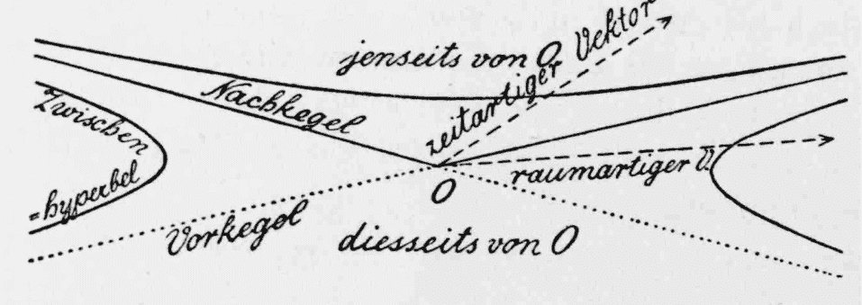

**图 8**。赫尔曼·闵可夫斯基将空间和时间统一为时空的第一张图，源自他1908年的著作《空间与时间》（Raum und Zeit）。时间和一个空间维度由虚线箭头或“向量”指示。一个箭头指向时间方向（“zeitartiger vector”），另一个指向空间方向（“raumiger vector”）。观察者位于 O 点。她未来的时空区域（“jnseit von O”）由“后光锥”（Nachkegel）边界，而她的过去（“diesseits von O”）由“前光锥”（Vorkegel）边界，它们分别是观察者的未来光锥和过去光锥。

为了形象化这种四维结合，我们通常会抑制三个空间维度中的一个或两个，并在时空图中将剩余维度相对于时间维度绘制。图 8 显示了闵可夫斯基的第一张时空图，图中他保留了一个水平运行的空间维度，时间垂直运行。这种结构揭示了狭义相对论如何重新定义我们与宇宙的关系。如果我们坐在标记为 O 的点，对于观察者而言，以光速从路径相反方向到达我们的的信号，以及从 O 点向未来辐射的信号，勾勒出两条在 O 处交叉的线，并将时空划分为四个不同的部分。观察者的过去是受进入 O 点的光线轨迹边界的三角形时空区域。该区域包含了所有影响观察者所见之物的事件。观察者的未来是受离开 O 点的光线边界的三角形区域，它包含了观察者可以影响的一切。稍后我们将遇到包含水平面第二个空间维度的时空图。在这样的图中，每一点过去和未来光线的路径勾勒出两个在该点处顶点相切并向相反方向开放的锥体。时空每点的光锥结构是相对论物理学的精髓。人们曾认为过去和未来只是简单地在当下粘合在一起。但狭义相对论告诉我们，对于你这个观察者来说，它们只接触了标记了你在宇宙中特定位置的点。

在牛顿那个独立且绝对的时空世界中——而且没有宇宙速度限制——人们认为我们至少在原则上可以瞬间到达所有空间。在爱因斯坦的相对论世界中，我们开始意识到其中有多少是无法触及的。可观测宇宙在空间和时间上都局限于我们过去光锥内的区域。鉴于自大爆炸以来仅过了 138 亿年，这意味着存在一个宇宙学视界，超过这个距离，宇宙（或多重宇宙）中的所有事件都真正无法触及，无论望远镜技术如何进步。

即使在我们的宇宙学视界内，我们也只能收集有限时空区域的信息。图 9 显示了地球观察者过去光锥内可直接访问的区域。首先，对光的天文观测为我们提供了关于近处的信息。其次，对光的观测为我们提供了关于过去的信息。

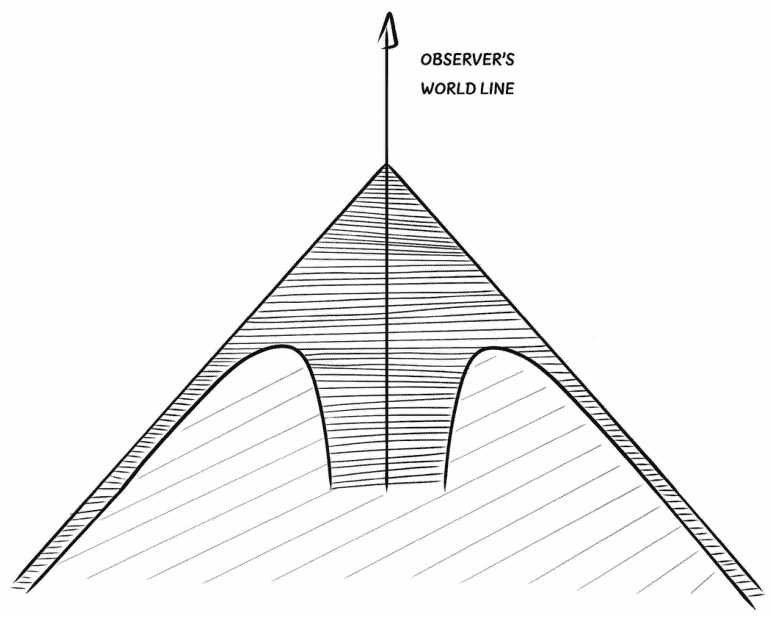

**图 9**。地球观察者过去光锥内可直接访问的区域。阴影区域代表我们可以观测的过去光锥。

## 广义相对论与引力

1907年，爱因斯坦开始重新思考引力。1915年，他意识到引力不是一种力，而是时空弯率的后果。这一洞察被称为广义相对论，是五年和十多年高强度工作的结晶。那个“最快乐的想法”发生在他产生一个改变世界的发现时：处于自由落体状态的观察者感觉不到自己的重量。引力与加速度之间的这种等效性是开启该理论的关键。

广义相对论由场方程总结：

```
$G_{\mu\nu} = 8\pi T_{\mu\nu}$
```

该方程将时空的几何结构（`$G_{\mu\nu}$`）与其内部的能量和动量（`$T_{\mu\nu}$`）联系起来。它表明物质告诉时空如何弯曲，而时空告诉物质如何运动。这一发现从根本上改变了我们对宇宙的理解，从黑洞的行为到宇宙本身的膨胀。

关于引力的理论，他发现它完美地解释了水星异常，这一发现被他称为一生中最强烈的情感体验——“仿佛自然在发声。”[8]

但广义相对论真正的突破发生在1919年，当时英国天文学家亚瑟·爱丁顿爵士前往非洲西岸海岸的葡萄牙普林尼普岛，在全日日食期间测量恒星的位置。如果爱因斯坦是正确的，且质量会弯曲时空，那么经过太阳等大质量物体的光线不应该沿直线传播，而会发生偏折，导致恒星在天空中的位置发生微小偏移。惊讶的是，这正是爱丁顿及其团队发现的：恒星移动了。《纽约时报》以一个震撼人心的标题报道了爱丁顿的观测结果：“天象倾斜，科学家们或多或少失魂若狂”，这使爱因斯坦作为推翻牛顿的天才而声名远扬。[19] 牛顿定律曾被视为终极真理，现在被证明是暂时的且近似的。一位英国天文学家检验了一个德国物理学家的理论，这曾被誉为这两个在第一次世界大战中饱受冲突的国家之间的和解行为。

光线绕过太阳的弯曲非常微小——几角分，因为从天文标准来看，太阳的引力场很弱。但几乎在一百年后的2019年春天，世界各大报纸刊登了一张壮丽的图像，展示了光最极端形式的偏折。在爱丁顿远征的现代版中，国际天文学家团队创建了一个地球大小的虚拟望远镜——事件视界望远镜，它由从格陵兰到南极的全球八个射电天线组成，精密协同工作，实现了能够看到月球上网球的空间分辨率。当天文学家利用事件视界望远镜及其所有的分辨率对准M87的中心（一个位于室女座星系的大型星系，距离我们约5500万光年）并进行数字像素拼接时，一个黑色圆盘出现了，周围环绕着光环——这是巨型黑洞吸收物质形成的阴影标志。

**图10**中的黑色圆盘表明，存在一个中心区域，那里的时空扭曲如此强烈，以至于在那里停留的光线不仅被偏折，而且被困在内部。环绕它的光环来自于物质和气体在消失进黑洞时的加热。这个黑洞以这种方式旋转，使得从黑盘下方到达我们的光线能量得到增强，使底部看起来更亮。它的质量是65亿个太阳的质量，被压缩在一个大约相当于太阳系大小的区域内，这是我们宇宙邻域中最沉重的黑洞之一。


**图10.** 当事件视界望远镜在2019年产生第一张黑洞图像时，它震撼了世界。中心的“阴影”并不比我们的太阳系大，但包含了约65亿个太阳的质量。它位于M87星系的中心核心，距离我们约5500万光年。光环来自落入黑洞的物质，而阴影则是空间扭曲强大到让所有光线都被吸入的地方。

广义相对论理论实际上预言了黑洞应该存在。在爱因斯坦发表具有里程碑意义的论文短短几个月后，德国天文学家卡尔·史瓦西尔德发现了该理论定义方程的第一解，该方程描述了极其致密的完美球形质量M外的强弯曲几何结构。由于史瓦西尔德在第一次世界大战期间在俄罗斯前线服役，他在一张寄给柏林爱因斯坦的明信片上写下了他的解。爱因斯坦非常高兴，并当然热烈地向普鲁士科学院展示了这一解。

史瓦西尔德的几何结构包含一个极其奇异的表面，位于质量中心短距离`2GM/c²`处。[10]在这个表面，空间和时间似乎产生了终结。多年来，人们对此存在巨大的困惑。爱因斯坦认为这只是方程的一个数学上的奇点。史瓦西尔德本人认为空间和时间在这个表面某种程度上结束了。

但这种问题的明朗直到1960年代广义相对论复兴时期，在罗杰·彭罗斯工作的推动下，人们才意识到该解描述了大型完美球形恒星在耗尽燃料后完全引力坍塌后的时空最终形状。[11] 直到那时，人们才证明了，无论形状如何，这种捕获光线的面的出现都预示着黑洞不可避免的形成，中心被球形的事件视界包围。在黑洞内部，未来光锥的极端倾斜意味着人们必须向奇点移动。然而，这种倾斜也意味着外部观察者永远看不到坍塌的最后阶段，更不用说内部了。

彭罗斯获得诺贝尔奖的1965年论文[14]只有三页纸，没有几个方程，但它包含了一幅迷人的、达芬奇式的黑洞形成图（见图11）。彭罗斯的时空图展示了两个空间维度以及它们如何与时间维度融合。我们可以看到，远离物体的地方，未来光锥向两侧开放，这意味着光束可以指向或远离恒星——正如人们预期的那样。在坍塌的恒星附近，恒星的质量弯曲了空间，导致光锥向内弯曲。随着坍塌的进行，出现了一个特殊表面，在该表面，光锥被弯曲到以至于即使是光速向外传播的光线也停留在距离中心恒定的位置。由于没有任何东西能比光快，因此其他东西无法逃脱。坍塌的恒星创造了一个与宇宙其余部分完全隔绝的时空区域——黑洞。

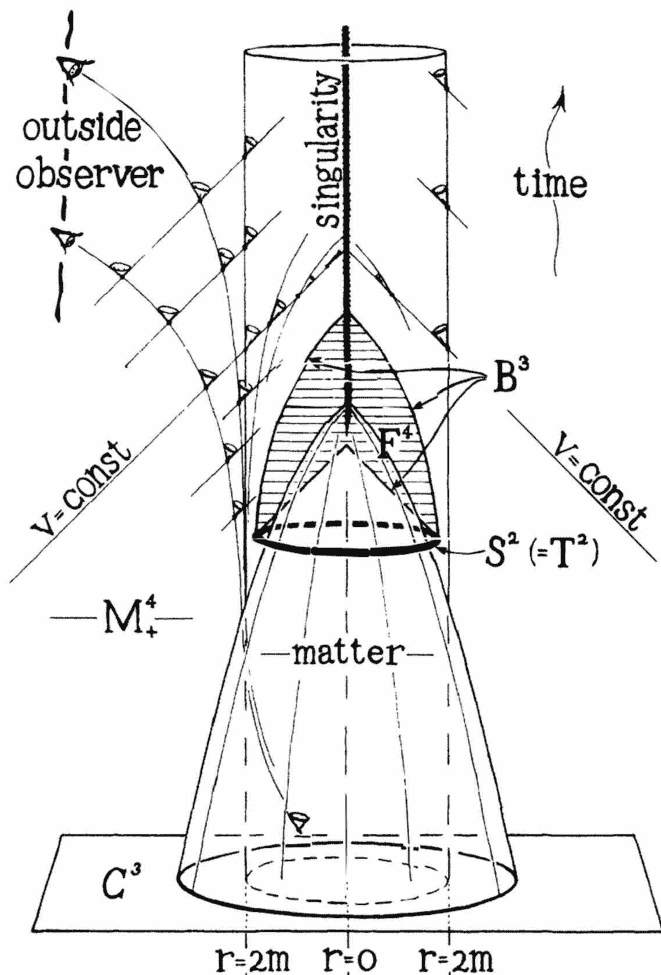

**图11.** 罗杰·彭罗斯1965年关于恒星坍塌形成黑洞的插图。随着恒星缩小，它周围的真空区域出现了一个弯曲表面，如图中中心的黑色环所示。在该表面，即使是光也无法离开恒星。彭罗斯从纯数学角度证明了，无论形状如何，这种捕获光面的出现都预示着黑洞不可避免的形成，中心被球形的事件视界包围。

将内部不可逃逸区域与宇宙其他部分隔离开的表面是史瓦西几何中一个奇特的表面，它在广义相对论早期引起了巨大的困惑。今天，它被称为黑洞的事件视界。它对应于图10黑盘的边缘。事件视界像一个单向膜，物质、光和信息可以进入，但没有任何东西可以离开。黑洞确实是终极的“逃脱室”。

很少有物理学家认为在大黑洞的视界处没有什么可看或可感的，但视界对于黑洞的因果结构具有巨大意义。在视界内部，空间和时间在某种意义上交换了身份。如果一位勇敢的宇航员进入黑洞视界内部，光锥不断倾斜意味着他必须不断向中心移动。也就是说，视界内部空间的径向维度获得了时间维度的属性——这是一个人们无法停止或反转、必须向前移动的方向。等待在中心的具有无限曲率的时空奇点并不是空间中的某一个地方，而更像是时间中的一个时刻——最后一个时刻。

这个具有无限扭曲的奇点是爱因斯坦方程失去预测能力的地方（或时刻）。广义相对论理论在时空奇点处失效。这令人困惑。当彭罗斯所依赖的理论框架在奇点处不再适用时，他如何证明大质量恒星的引力坍塌会产生奇点的？彭罗斯策略的巧妙之处在于识别了引力坍塌中一个不可逆的点，即他所说的“捕获表面”的形成，从那里甚至光也无法离开恒星。彭罗斯证明，一旦形成捕获表面，向奇点的进一步坍塌就是不可避免的。他的数学技巧如此强大，以至于他能够预测结果，尽管他无法追踪一颗真实恒星的坍塌直到其完成。

现在，当两个黑洞进入彼此的影响范围并开始相互环绕时会发生什么？广义相对论预测这种相互作用会产生引力波，时空的震荡扰动以光速跨越整个宇宙。这正是爱因斯坦方程在发挥作用：两个相互运行的黑洞形成了一个周期性变化的质量配置，根据爱因斯坦所说，时空以其自身的周期性扰动做出响应。这些涟漪就是引力波。

作为几何的涟漪，引力波携带着巨大的能量。这会从运行的黑洞系统中抽取能量，导致它们向内螺旋运动并最终合并成一个更大的黑洞。这种合并到目前为止是宇宙中最剧烈的事件。两个黑洞的单次碰撞产生的引力波爆发，其强度超过了观测宇宙中所有恒星发出的光能量总和。尽管如此，黑洞碰撞产生的几何波形尺寸极小，因为时空结构异常坚硬。[15] 这就是为什么引力波爆发尽管能量巨大，却非常难以探测。

此外，由于不涉及任何粒子，一次穿过我们地球的引力波爆发是一个极难捉摸的事件。除了瞬间地导致尺子稍微伸长和收缩，以及时钟稍微变快或变慢之外，引力波穿过行星就像它们披着隐身斗篷一样。为了探测由引力涟漪引起的瞬时变化，你需要一把长几英里的尺子，其测量的精度要远优于单个质子的宽度。这听起来是不可能实现的。然而，在一项惊人的工程壮举中，两组科学家——美国的LIGO团队和欧洲的Virgo团队恰做到了。通过利用激光和大量的精密工程，监测放置在地球表面三个遥远地点、呈L型配置的三对长几英里的真空管的长度，两个团队都为穿过我们地球的引力波设置了一个巧妙的陷阱。2015年9月14日，在多年的等待和聆听后，两个LIGO的臂突然开始震动，起初非常轻微，逐渐变得更快更剧烈，直到在几分之一秒后，震动消失了。利用爱因斯坦的理论，物理学家能够将这种短暂的震动模式追溯到十亿年前一对每个质量约为30个太阳质量的黑洞在向内螺旋和合并时产生的引力波爆发。五年后，已经探测到了近百次这样的引力波，揭示了黑洞确实是宇宙生态系统中不可或缺的一部分，正如彭罗斯所预测的那样。

引力波的观测发现证实了相对论的全局形状。在许多方面，它标志着该理论的成熟，这个最初只是一个空间抽象的概念，通过对引力波的观测，已经发展成为观察宇宙的新方式。爱因斯坦通过一个方程捕捉整个宇宙的壮举，生动地证明了广义相对论能带我们去牛顿定律无法到达的地方。

## 宇宙学模型与宇宙膨胀

爱因斯坦提出空间的形状类似于球面的三维版本——所谓的超球体。超球体很难想象，因为我们倾向于将弯曲空间认为是嵌入在普通三维空间中的二维表面。这种表面在更大空间中的嵌入只是为了给视觉提供某种舒适。19世纪的数学家已经证明，曲面的所有几何属性——如直线、角等——都可以在内部定义，而不需要参考表面上方或下方的任何东西。[127]

同样，三维超球体的弯曲形状不需要外部参考点。它本身就是：一个超球体。就像球表面一样，三维超球没有中心或边界。无论你在超球体的哪里，空间看起来都是一样的。但在爱因斯坦宇宙中，空间的总体积是有限的。因此，就像地球有有限的表面一样，超球宇宙中不同地点的数量也是有限的。事实上如果你在爱因斯坦宇宙中沿着直线移动，你最终会从离开的反方向回到家，就像你可以一直直飞绕地球一样。1917年，他写信给莱登著名的荷兰天文学家威廉·西特勒：“我想解决相对论的基本思想是否可以推导出结论的问题，并确定宇宙的形状。”[16]

从整体形状和大小到其包含的物质和暗能量总量，这表明他的理论确实有潜力为古老的问题提供奇妙的答案。通过将宇宙作为一个整体来处理，爱因斯坦在某种程度上将古代世界模型的外部框架引入了现代科学的领域。尽管他的模型宇宙被证明是严重偏离事实的，但他开创性的探索标志着现代相对论宇宙学的诞生。

然而，在又过了十年，勒梅特才开始察觉到，相对论真正的宇宙学意义远超爱因斯坦和所有其他人的想象。

勒梅特是一个有趣且和蔼的人^[118]。他于1894年出生在比利时南部的夏勒罗瓦（Charleroi），由于第一次世界大战的兵役，他放弃了大学工程课程。1914年8月德国入侵比利时时，年轻的乔治自愿加入比利时军队陆军步兵，并参加了靠近法国边界的伊塞尔战役。这场冲突持续了两个月，直到比利时人淹没了该地区以阻止德国军队的推进。据说，在安静的时期，勒梅特会在战壕里通过阅读物理课程来放松，包括庞加莱的《宇宙发生假设教程》（Leçons sur les Hypothèses Cosmogoniques）。家族传说，当他指出军事弹道手册中的一个数学错误时，他引起了一位军队教官的愤怒。

为了回应双重天职，战后勒梅特进入了鲁汶天主教大学学习物理，并在梅赫林（Malines）的研讨会上学习，在那里获得了梅西埃枢机主教的特别许可，学习爱因斯坦新的相对论。1923年，他穿上神职袍，越过英吉利海峡前往剑桥天文台与爱丁顿一起工作。

勒梅特既是哲学也是物理学的狂热读者，他可能受到了18世纪苏格兰哲学家大卫·休谟（David Hume）愿景的启发，在数学理论与天文观测的交汇点开辟出一种科学方法。在他的杰作《人类理解论》中，休谟认为我们的经验是知识的基础。在承认数学力量的同时，休谟警告人们不要进行脱离现实世界的抽象推理：“如果我们进行先验推理，任何事情似乎都可能产生任何结果。石子的掉落可能，据我们所知，会熄灭太阳；或者人类控制行星轨道的愿望。”休谟强调经验是我们所有理论的基础，为科学实践奠定了基础，即科学是一种植根于实验和我们对宇宙观测的归纳过程。

本着类似的精神，勒梅特将其立场总结如下：“每一个想法都以某种方式源自现实世界，正如格言所说‘理智中先无感觉’（Nihil est in intellectu prius fuis sensu）。[19] 无疑，源于事实的思想必须超越并遵循思维的自然流动，这是智力的基本活动。但这也许是物理奇特性教给我们最有价值的课程之一：这种流动必须受到控制，它不能与事实失去联系，它必须允许被事实所限制。在这里，就像在许多其他领域一样，我们必须在迷失方向的梦幻理想主义和贫瘠无味的狭隘实证主义之间找到完美的平衡。”[20]

勒梅特从英国的剑桥搬到马萨诸塞州的剑桥，在哈佛大学天文台工作，并见证了1925年1月在华盛顿结束的“大辩论”。问题是自中世纪以来已知的天空光谱星云是银河系内的巨型气体云，还是独立的遥远星系。利用当时世界上最强大的望远镜——位于帕萨迪纳附近威尔逊山的新胡克100英寸望远镜，美国天文学家埃德温·哈勃和他的同事将两个星云（仙女座和三角形座）的部分分解为独立的恒星，并利用这些星云中变光造父星的特征属性估算了它们的距离。[21]令他们惊讶的是，这些距离接近百万光年。如此遥远的距离远超我们银河系的边缘，证实了它们确实是独立的星系。哈勃的观测一举让宇宙变大了一千倍。

而且，大多数星云似乎都在远离我们。早在1913年，极具天赋的天文学家韦斯托·斯莱弗（Vesto Slipher）在大峡谷附近的洛威尔天文台[22]工作时，就注意到螺旋星云的光谱向长波长的光波方向偏移，[23]这种位移发生在观测正在远离的光源时，这种现象被称为多普勒频移。我们熟悉声波的多普勒频移——想想救护车驶过时警报器声音的变化。但同样的现象也适用于光波，如果光源远离，就会导致光整体颜色变红，这在宇宙学中被恰切地称为“红移”。到20世纪20年代中期，斯莱弗测量了不少于42个螺旋星云的光谱，发现只有4个正在向银河系靠近，而有38个正在远离，通常以极大的速度运动，高达每秒1800公里，远大于当时已知的任何其他天体的速度。回想起来，斯莱弗表格中列出的星云速度（如图12所示）是宇宙扩张的最早迹象。[24]

### 表一：二十五个螺旋星云的径向速度

| 星云 | 速度 | 星云 | 速度 |
|---|---|---|---|
| N.G.C. 221 | - 300 km. | N.G.C. 4526 | + 580 km. |
| 224 | - 300 | 4565 | + 1100 |
| 598 | - 260 | 4594 | + 1100 |
| 1023 | + 300 | 4640 | + 1090 |
| 1068 | + 1100 | 4736 | + 200 |
| 2683 | + 400 | 4826 | + 150 |
| 3031 | + 300 | 5005 | + 900 |
| 3115 | + 600 | 5055 | + 450 |
| 3379 | + 780 | 5236 | + 270 |
| 3521 | + 730 | 5866 | + 65 |
| 3623 | + 800 | 7331 | + 500 |
| 3627 | + 650 | | |
| 4258 | + 500 | | |


1925年，回到卢汶的勒梅特意识到了斯莱斐普尔观测的意义。据说，他比任何人都更懂相对论，包括爱丁顿。勒梅特发现爱因斯坦设计的静态宇宙是极不稳定的。它看起来就像宇宙学意义上的“针头立”；只要给它一点微小的推力，它就会移动。他天才的闪光在于放弃了根深蒂固的静止宇宙观念，并从相对论中读出了该理论一直想要表达：宇宙正在膨胀。通过将质量和能量与时空形状联系起来，爱因斯坦的理论不可避免会导致空间随时间变化——不仅在局部，而且在整体范围内。勒梅特认为，通过设计一个静态世界，爱因斯坦为了符合他对宇宙“应该”是什么样的哲学偏见，违背了他自己方程中最戏剧性的预测。勒梅特1927年发表具有里程碑意义的论文预测了空间扩张，*建立了相对论理论与物理宇宙整体行为之间的基本联系*。[25]他自己用他典型的俏皮语气回忆道：“我恰好比大多数天文学家更像数学家，比大多数数学家更像天文学家。”[[26]

勒梅特的类比于1930年出现在荷兰的一份报纸上（见插图，图2）。

当波从一个“微生物”传播到另一个时，它们的波长随着空间的伸展而拉伸，使光线的颜色逐渐变红。这使得遥远的星系似乎在远离银河系飞去，尽管它们并没有移动。因此，光谱的红移并不是像斯皮弗和哈勃认为的那样由于星系实际运动引起的真实多普勒频移，而是空间本身膨胀的必然结果。我已经在图14中说明了这一点。由于一张纸上能容纳的维度有限，我再次抑制了两个空间维度，只留下一个，在这里描绘为一个圆。圆的内部和外部空间并不是这个宇宙的一部分，仅仅是为了辅助可视化。因此，我们有一个正在伸展的一维圆，圆半径随时间的推移而增大。我们可以看到这增加了星系之间的距离。

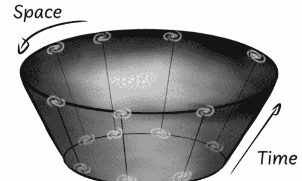

图14。一个随时间膨胀的一维圆形宇宙的示意图。空间的扩张使得星系彼此远离，尽管它们实际上并没有移动。作为这种表观运动的结果，来自星系的光呈现出红移。

我们观测到的红移程度取决于我们接收的光是在多久以前（因此距离多远）发出的。勒梅特计算出，如果宇宙以恒定速率膨胀，那么星系的表观退行速度 $v$ 与它们离我们的距离 $r$ 之间存在线性关系，他在1927年的论文中那个著名的公式23中将其总结为：

$$v = Hr$$

这种关系表明，星系远离的表观速度 $v$ 与它们离我们的距离 $r$ 成正比。这种关系中的比例因子 $H$ 是衡量宇宙膨胀速率的数字。为了给他的预测寻找观测证实，勒梅特查询了斯皮弗的红移和哈勃对42个星云样本的（极不稳定的）距离测量，并估计星系每增加三百万光年的距离，远离速度就快575公里/秒。[27]

**这一发现开启了自牛顿以来宇宙学领域最大的范式转移。** 然而，在当时几乎没有人注意到，少数传达到勒梅特手中的意见并不令人鼓舞。勒梅特将他的论文副本寄给了爱丁顿，但爱丁顿弄丢了。爱因斯坦为了让宇宙保持静态修改了自己的理论，拒绝重新考虑这个问题。事实上，在第五次索尔瓦会议期间短暂而激烈的会面中[28]，他向勒梅特指出，他的方程中膨胀宇宙的解早在四年前就被一位来自彼得堡的年轻数学家亚历山大·亚历山德罗夫·弗里德曼[29]发现并发表。对于爱因斯坦（以及对弗里德曼来说），这些解只是相对论中的数学奇点，对现实宇宙没有任何意义。静态宇宙看起来要完美得多且情感上令人愉悦。据我们所知，在弗里德曼去世、爱因斯坦否认、爱丁顿对勒梅特的发现一无所知的情况下，20世纪20年代末只有一个领会的人最终证明了相对论最深远的预测。

但勒梅特坚持不懈，开始研究宇宙增长的过程。勒梅特在鲁汶的家中（曾是一家啤酒厂）工作时，追踪了填充有不同数量物质和暗能量的三维超球[30] 尺寸的演化。插图1显示了他发现的宇宙范围，每一个都在根据广义相对论进行膨胀。这些图表由勒梅特在1929年和1930年在黄色毫米纸上精心计算得出，构成了20世纪最注目的科学文献之一。在它们离开主流世界观的史诗中，它们从字面上改变了世界。

——

**1929年，凭借**威尔逊山上世界上最强大的望远镜仍供他使用，哈勃为线性距离-速度关系提供了有力的经验证据，以至于这种关系——勒梅特1927年论文中的公式23——被称为*哈勃定律*。[31] 尽管哈勃从未提到膨胀，并在离世前都不相信对他观测结果的相对论解释。[32] 抛开这些不谈，这些观测是一项壮举之举。哈勃得到了米尔顿·哈马森的帮助，哈马森曾是一名车夫，是最后几个在没有大学学位的情况下进入该领域的天文学家之一，他付出了巨大的努力捕捉遥远星云的微光。据说哈马森花了三个整晚的仔细观察才测量出一个星云的光谱。

哈勃和哈马森的壮丽观测证明了相对论宇宙学的转折点。1930年1月，爱丁顿在皇家天文学会召集会议讨论此事，并在被提醒起勒梅特1927年的文章后，命令立即在《月度学报》上发表英文译本。面对天文证据，爱因斯坦也承认了这一点。他一举挥之接受了扩张，并丢弃了他为了让宇宙静态而添加到方程中的 $\lambda$ 项。他一直有一种不祥感。

或许，勒梅特图表中令人难以置信的“细节”隐藏在左下角，他在那儿写着“t = 0”，即时间的零点。

你可以看到，勒梅特在1927年最初提出的膨胀宇宙并没有起点。相反，勒梅特假设宇宙是从无限远的过去从一个近乎静态的状态缓慢而逐渐演化而来的。到1929年，他意识到这种远古的安排就像爱因斯坦那根在头顶平衡的针，因此他放弃了这种情景，转而追求一个真正的起点。勒梅特得出结论：扩张意味着宇宙必须有一个与现在完全不可想象的不同的过去。他认为：“我们需要对宇宙发生学进行彻底的修正，一场宇宙演化的烟花秀。”[38]

由于他敢于探索远超爱因斯坦理论所能触及的范围，他开始将宇宙的起源想象为一个超重原子，其壮丽的解体将产生我们今天所看到的广阔宇宙。他在专著《原始原子假设》中写道：“站在冷却的余烬上，我们看着恒星缓慢幻灭，试图回忆世界起源时那消失的光辉。”为了寻找宇宙剧烈形成的化石遗迹，他随后对宇宙射线产生了兴趣，他将其视为古代火球的象形文字。在职业后期，为了破译它们的轨迹，勒梅特购买了第一台电子计算机之一——罗罗斯E101（这台机器曾在1958年布鲁塞尔世博会上展出），并在学生的帮助下，他著名地将其搬到鲁汶大学物理系的阁楼上，建立了该校的首个计算中心。[39]

然而，膨胀宇宙的观点在20世纪30年代初被广泛接受，任何关于宇宙有起点的讨论都遭到了巨大的怀疑。爱丁顿断言：“目前自然秩序的开端概念令我反感。作为一名科学家，我不相信宇宙是由于大爆炸开始的。就好像某种未知的事物在做着我们不知道的事情。”[40]

爱因斯坦最初也驳斥了起点论。就像他看待史瓦西黑洞内部奇点的观点一样，他认为勒梅特膨胀宇宙中的时间零点是由于它们以完美对称且均匀的方式扩张而产生的一种奇现象。由于真实的宇宙并非完全均匀，他推论道，当你反向运行扩张时，将会错开；他将起点替换为收缩与扩张的循环，他发现这在哲学上更令人满意。勒梅特回忆起他们1957年的对话：“我在加利福尼亚州的帕萨迪纳艺术学院会见了爱因斯坦。在谈到他对起点在某些条件下不可避免性的怀疑时，爱因斯坦提出了一个非球形宇宙的简化模型，我毫不费力地计算出了能量张量，证明爱因斯坦认为[规避起点]的漏洞是行得通的。”[[41] 勒梅特显然认同爱因斯坦对起点不可避免性的感受，指出：“从美学角度来看，这是不幸的。一个不断膨胀收缩的宇宙具有不可阻挡的诗意魅力，让人联想起传说中的凤凰。”[42]

然而，宇宙就是其本身。尽管它的先驱们在哲学和美学上有自己的倾向，相对论宇宙学有力地指向一个真正的起点，并且从那时起如此。尽管如此，时间零点——勒梅特那个没有昨天的日子——在广义相对论中再次是一个奇点，在那里时空曲率变得无限大，结果爱因斯坦方程陷入沉默。因此，奇的是，大爆炸既是相对论宇宙学的基石，也是它的阿喀琉斯之踵——不可避免却显然无法理解。

这是一个极其令人困惑的状态。如果时间本身随着大爆炸开始，那么所有关于之前发生了什么的问题似乎都是毫无意义的。甚至是对导致大爆炸原因的猜测也是不恰当的，因为原因先于结果，这需要某种时间概念。这种在时间起点处基本因果律的表观崩溃，是爱丁顿、爱因斯坦与勒梅特辩论的核心。前者之所以如此不愿考虑宇宙的起点，是因为感觉一个真正的起点需要某种超自然的力量干预演化的自然进程。随着整个世纪的过去，越来越多的证据表明宇宙的起源方式极有利于宇宙的演化，这种沉默变得愈发刺心。

雕塑家康斯坦丁·布朗库西（Constantin Brâncuși）的《世界的起源》（参见插图，图6）。

英国量子物理学家保罗·狄拉克（Paul Dirac）是原初原子假说的早期支持者，他更进了一步，推测早期宇宙中的量子跃迁可以完全取代对初始条件的需求。是否可能是因果律在量子起源中消融了，“第一因果”的谜题在量子世界——即我们的世界——中蒸发了？

保罗·狄拉克于1923年作为学生来到剑桥，那一年勒梅特（Lemaître）到来，并怀着希望与爱丁顿（Eddington）学习相对论。但他被分配到了一个不同的方向，将他引入了粒子量子理论领域，在该研究领域，他获得了几乎无与伦比的深度理解。狄拉克发现了同名方程，它将爱因斯坦的狭义相对论与量子理论相结合，并预言了反物质的存在，并因此获得了1933年诺贝尔奖。后来，他成为剑桥第15任卢卡斯数学教授。狄拉克是一个充满好奇心的人物，尽管并不害羞和安静——根据一些同事的说法，他几乎隐形。20世纪70年代后期有一天，斯蒂芬（Stephen）和他的妻子简（Jane）在一个周日下午邀请狄拉克夫妇来家里喝茶。当时的唐·佩奇（Don Page）是斯蒂芬的研究助理，住在他们那里帮助照顾斯蒂芬的日常生活，他决定留下来听这两个20世纪物理学巨头之间的对话。显然，他们中一个都没说话。

位于佛罗里达州塔拉哈西的狄拉克档案馆保存着一张精美的铅笔画，那是1930年在剑桥卡皮察俱乐部（Kapitza Club）讲座期间，一位观众画的勒梅特肖像。图15所示的画附有一行说明文字：“我不相信上帝之手在扰动以太。”根据狄拉克的回忆（他在1971年的随附笔记中写道），“勒梅特的讲座期间，关于量子不确定性的作用引发了大量的讨论。”狄拉克和勒梅特都在量子力学中找到了一种方法，通过追溯今日宇宙许多复杂性的根源——其诞生后的随机量子跃迁——来解开由决定论观点对起源所造成的因果结。在某种意义上，这些跃迁将宇宙学演化变成了一个真正的创造性过程。

在经历了十年的疯狂发现并总结后，狄拉克在1939年在爱丁堡皇家学会的斯科特奖演讲中重新审视了勒梅特的原初原子假说：“新的[扩张的]宇宙学在哲学上可能比相对论或量子理论更具革命性，尽管目前人们很难意识到其全部含义。”[[44] 七十年后——在摆脱了更多偏见之后——我与斯蒂芬的之旅确实会将这些哲学影响带到水面。

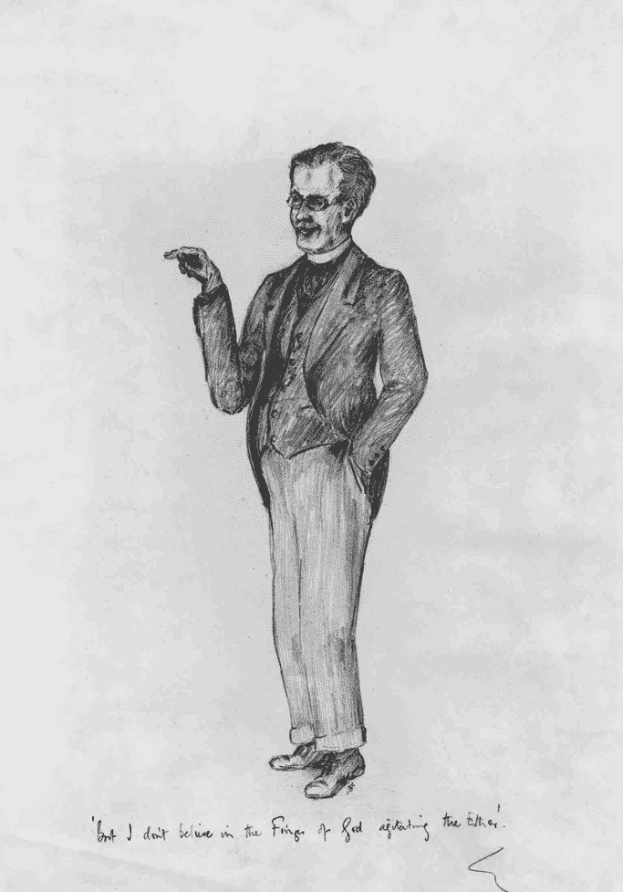

图15。这幅乔治·勒梅特的肖像是由他在1930年在剑桥大学演讲时的一位听众画的。下方的说明明确表示，勒梅特认为上帝没有理由干预大爆炸。他将原初原子假说视为纯粹的科学问题，植根于物理理论，并最终通过天文观测进行验证。四年后，保罗·狄拉克写下了随附的笔记。

1930年左右，乔治·勒梅特访问了剑桥并在卡皮察俱乐部发表讲座。关于量子力学的不确定性引发了大量讨论。勒梅特强调了他的观点，他不相信这种观点直接影响了原子事件的进程。

一位观众画了这幅画来纪念他们的讨论。我不记得艺术家是谁了。勒梅特的像画得非常像。

P. A. M. 狄拉克 1971年9月1日

在当时，能够证实原初原子假说或类似理论的观测仍然难以捉摸。在20世纪初的鼎盛时期之后，宇宙学变成了一个数据匮乏、充满宏大推测的科学荒漠，宇宙学家们赢得了“经常错误但从不怀疑”的臭名。

事实上，在20世纪50年代，大爆炸理论几乎是勒梅特理论的贬义词，英国天体物理学家弗雷德·霍伊尔（Fred Hoyle）在一次BBC采访中将其描述为“一个无法描述的不理性过程”。响应爱丁顿，霍伊尔声称：“宇宙的起源不存在因果解释，这是决定论的极端，”[45] 并建议道：“每当使用‘起源’一词时，就不要相信它！”与赫尔曼·邦迪（Hermann Bondi）和托马斯·戈德（Thomas Gold）一起，霍伊尔提出了竞争性的宇宙模型——稳态理论，该理论在20世纪50年代是一个有力的竞争者。稳态理论认为，尽管宇宙一直在扩张，但由于物质不断产生以填充空间，它保持着恒定的密度。而在大爆炸宇宙学中，大多数物质是在原初的热中产生的。

然而，此时高大的俄罗斯物理学家伽莫夫（George Gamow）对热大爆炸的奇异环境进行了更深入的研究。伽莫夫是一个性格丰富的人物，似乎擅长与各界人士打交道，从托洛茨基、布哈林到爱因斯坦和弗朗西斯·克里克。伽莫夫在乌克兰的奥德萨长大，并在彼得堡学习，在那里从亚历山大·弗里德曼（Alexander Friedmann）那里学了广义相对论。对共产主义国家日益侵入感到沮丧，伽莫夫和妻子试图通过从克里米亚半岛南端划黑海到达土耳其来逃离乌克兰。一切进展顺利，直到航行的第二天，他们遭遇了一场风暴，被冲回了克里米亚。伽莫夫妇并没有放弃。1933年，当尼尔斯·玻尔（Niels Bohr）邀请伽莫夫参加布鲁塞尔的第七届太阳会议时，他们抓住了机会移民美国。

伽莫夫既不是数学家也不是天文物理学家，他想象整个宇宙在扩张的前几分钟内是一个巨大的核反应堆。与拉尔夫·阿尔费尔（Ralph Alpher）和罗伯特·赫曼（Robert Herman）合作时，伽莫夫设想大爆炸是非常热的，并好奇构成我们和周围一切的化学元素是否是在原始烤炉中烹制出来的。他推理说，如果原始宇宙的密度和温度高到原子核无法生存，那么元素周期表最初除了第一个元素氢（只是一个单质子粒子）之外，整个宇宙将充满了超致密热等离子体，伽莫夫将其命名为Ylem，源自希腊语中的“物质”一词。这种等离子体将由自由运动的原子基块——电子、质子和中子组成，浸泡在辐射的热浴中。当宇宙扩张并冷却时，中子和质子将结合形成复合原子核。排在第一位的是氘，由一个质子和一个中子组成的重氢，它又与更多的质子和中子融合形成氦。

在大爆炸发生一百秒后，宇宙在几分钟内再次冷却，此时宇宙的膨胀已将温度降低到一亿度，这个温度足以关闭宇宙核反应堆。他们发现，这段短暂的窗口足以将宇宙中四分之一的质子转化为氦核，并伴有少量的铍、锂等较重元素迹。伽莫夫及其团队预测的这些轻元素的相对丰度与此后的许多测量结果高度吻合。今天，这被认为是热大爆炸理论的关键性检验之一。[48]


图16. 乔治·伽莫夫在这一瓶苦橘酒的标签上写下了“YLEM”字样，以纪念他1948年与拉尔夫·阿尔费尔共同在大爆炸烈火中合成原子核的工作。“Ylem”是一个中古英语单词，指的是被认为是产生所有物质的原始基质。

但在伽莫夫的工作中，隐藏着一个更具意义的预测——如果这是可能的话。阿尔费尔、伽莫夫和赫尔曼意识到，原子核合成过程中释放的热量在今天应该仍然以遗留辐射的形式充满整个空间。毕竟，它能去哪里呢？宇宙就是一切。他们的计算表明，数十亿年的宇宙膨胀将使热辐射冷却到约5开尔文，即零下267摄氏度。这种低温辐射将使宇宙主要在电磁谱的微波频段内闪光。因此，今天的宇宙——整个空间——应该充满了微波。这是一项里程碑式的发现：伽莫夫和他的合作者识别出了热大爆炸时代的化石遗迹，而且，只要我们用对微波敏感的眼睛观察深空，它就会出现在我们面前。

事实确实如此。热体会发出辐射，宇宙也不例外。宇宙微波背景辐射（简称CMB）于1964年由两位美国物理学家阿诺·彭齐亚斯和罗伯特·威尔逊偶然发现。彭齐亚斯和威尔逊并不知道伽莫夫的工作，他们当时正在新泽西州霍姆德尔的贝尔实验室校准一台巨大的微波天线，该天线最初是为了追踪回声气球卫星而建造的，当时他们发现天线发出了一种持续的、无法解释的嘶嘶声。无论他们将天线指向天空的哪个方向，白天都会遇到相同的噪声，波长为7.35厘米。在与当地宇宙学朋友交流后，他们很快意识到天线的嘶声是有原因的：它捕捉到了热大爆炸的微弱遗留辐射——那是勒梅特首次构想、伽莫夫后来识别出的，来自时间黎明的“电报”。

彭齐亚斯和威尔逊对化石微波辐射的发现是“震撼世界的巨响”。科学界终于意识到，宇宙膨胀具有真实的长期影响，这意味着过去与现在有着不可思议的区别。这种认知从根本上改变了关于宇宙起源的辩论。几乎一夜之间，膨胀的最终原因——这个三十年前让爱因斯坦和勒梅特对立起来的谜团——移动到了理论宇宙学的中心位置，并从此一直占据着那里。

勒梅特在1966年6月17日得知了CMB的发现，当时距离他去世仅剩三天。在医院里，一位老友带给他这个消息，这些化石遗迹证明他的理论终于被证实。据报道，他回答道：“Je suis content（我很高兴……现在我们有了证据）。”[49]

现在看来，“大爆炸之父”也是一位天主教神父似乎很奇怪。但勒梅特理解如何在爱因斯坦和教皇之间周旋，并费力解释为什么他认为自己决定遵循的科学与救赎这两条“真理之路”并不冲突。在接受《纽约时报》记者邓肯·艾克曼采访时，勒梅特转述了伽利略反对宗教的观点[50]，他说：“一旦你意识到圣经并不打算成为科学教科书，一旦你意识到相对论与拯救无关，科学与宗教之间的旧冲突就消失了，”并补充道“我对上帝有足够的尊重，不会将他简化为一个科学假设”[50]。从他的著作中可以清楚看出，勒梅特在这领域之间没有经历过丝毫冲突。人们甚至能在他身上看出某种对此事的淡然。他曾说：“事实证明，彻底寻找真理涉及对灵魂的探索，也涉及对宇宙光谱的探索。”

20世纪60年代，当时已成为名誉神父和教皇科学院院长的勒梅特，他致力于通过细致尊重科学与宗教在方法论和语言上的差异，推进学院培养卓越科学的目标，同时与教会保持良好关系。与那些试图将信仰真理与科学发现统一的“和谐论”解释完全不同，勒梅特坚持科学和宗教各有其自己的领域。关于原始原子假说，对此表示：“这种理论完全处于任何形而上学或宗教问题之外。它让唯物主义者可以否认任何超验的存在……对于信徒来说，它消除了任何试图[熟悉]上帝的尝试。它与以赛亚书中关于‘隐藏的上帝’的措辞是一致的。”[52]


这种区分使得这位神父能够（而且显而易见）将宇宙物理起源的研究视为自然科学的机会，而爱因斯坦将其视为物理理论的威胁。因此，他们科学辩论的核心在于不同的哲学立场。他们对于科学最终在尝试弄清楚什么似乎有着完全不同的观念。勒梅特似乎敏锐地意识到，无论科学多么抽象，我们从事科学的能力仍然植根于我们与宇宙的关系。他的双重身份激励他仔细地划定科学和精神领域的边界。结果是了一种剥离了教条的信仰，以及一种植根于人类状况的科学。

宇宙起源于一次大爆炸，而大爆炸也是时间的起点，这严峻地挑战了他的立场。

在接下来的章节中，我将论证道，勒梅特的立场最终被证明是解开设计之谜更具价值的指南。事实上，爱因斯坦与勒梅特之间的对峙，反映了霍金在七年后所走过的思想跨度。早期的霍金信同于爱因斯坦的观点，即我们正在物理学中发现某种某种程度上超越物理宇宙的客观真理。我们旅程在更深层次哲学层面的故事，关于斯蒂芬如何以及为何打破爱因斯坦的立场并转而采纳勒梅特的立场，以及这不仅对我们对大爆炸的认知，而且对宇宙学的未来议程意味着什么。

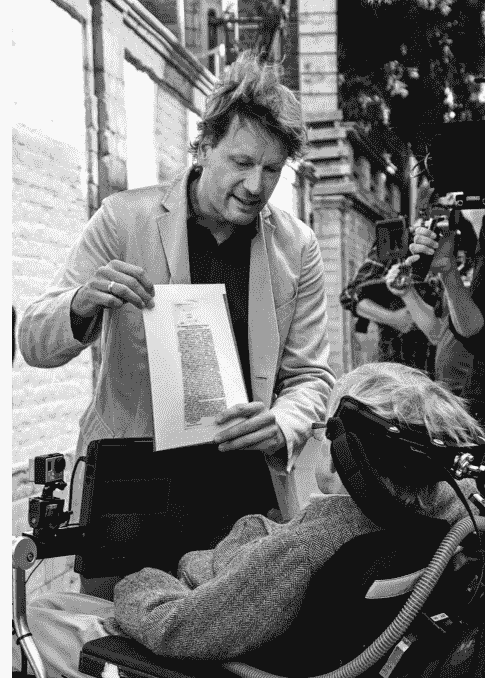

图 17. 当我们开始合作时，斯蒂芬还并不知道勒梅特在量子宇宙学方面的开创性工作。因此，我带他去了鲁汶普雷姆斯特滕斯学院（Premstratensian College）勒梅特以前的办公室，我在那里给他展示了勒梅特1931年的大爆炸宣言。

- 伽利略在1615年曾给托斯卡纳大公夫人、罗伦丹的克里斯蒂娜写过一封关于科学与宗教关系的传奇信。在信中，他引用了一位非常著名的教会人士，据说是梵蒂冈图书馆馆长凯撒·巴罗纽斯枢主教：“圣灵的意图是教导我们如何进入天堂，而不是天堂如何运行。”

# 第三章

## 宇宙起源

Ich schreibe kaum, doch wähn' ich mich schon weit.

Du siehst, mein Sohn, zum Raum wird hier die Zeit.

> 我几乎未动，却似乎已远。
>
> 你看，儿子，在这里时间变成了空间。
>
> ——理查德·瓦格纳，《帕西法》

在他的回忆录中，斯蒂芬写道，他对宇宙学感兴趣是因为他想洞察理解的深度。斯蒂芬对提出更深层次问题的永无止境的渴望将他带来了剑桥。他于1962年秋季从牛津抵达剑桥，此前他在牛津修读本科物理课程。“当时牛津的主流态度是反感工作的，”他回忆道，“为了获得更好的学位而努力被视为‘平庸之辈’（grey man）的标志，这是牛津词汇中最糟糕的贬义词。[1] 在牛津参加期末考试时，斯蒂芬选择集中在理论物理问题上，因为这些问题不需要太多的事实知识。他获得了一个一等二等边缘的成绩，考官们进行了一次面试以判断谁应该获得一等学位。斯蒂芬告诉他们，如果他获得了最高的一等学位，他就会去剑桥；否则就留在牛津。他们给了他一等学位。考虑到斯蒂芬后来的成就，从牛津的角度来看，这可能是它八百年历史上最糟糕的决定之一。

在剑桥，斯蒂芬被稳态理论的拥护者霍尔所吸引，尽管他的理论在20世纪60年代初面临着巨大的压力。[22] 然而，霍尔当时不在，斯蒂芬被分配给了丹尼斯·西阿马。事实证明这是一次极大的幸运。西阿马本人是保罗·狄拉克的学生，他是一个催化剂，一个极具启发性的形象，他将剑桥变成了相对论宇宙学的圣地。西阿马与全球物理学的主要进展接轨，确保他的学生了解最新的发现。每当有一篇有趣的论文发表时，他就会安排其中一个人进行报告。每当伦敦安排了有趣的讲座时，他就会让他们坐火车去听。斯蒂芬完全投入了西阿马所创造的这种互动、活力且充满雄心的科学环境，并会努力为他自己的学生创造一个同样具有刺激的环境。

当斯蒂芬到达剑桥三一会堂时，西阿马仍坚持宇宙的稳态模型。他让斯蒂芬研究霍尔设计的该模型的变体，以试图挽救该理论。很快，斯蒂芬在这一变体中发现了奇点，那是霍尔为了挽救该理论而设计的。斯蒂芬在1964年伦敦皇家学会的一次会议上对霍尔提出了质疑，他发现推演出的奇点，使得该理论变得定义模糊。当这位英国最著名的天体物理学家霍尔问：“你怎么知道？”时，斯蒂芬并没有被吓倒，回答道：“因为我是计算出来的。”斯蒂芬这种对戏剧性的追求和独立精神，体现在他的博士论文中。

这显然是大爆炸宇宙学的核心问题，斯蒂芬正准备投身其中。

斯蒂芬与罗杰·彭罗斯取得了联系，彭罗斯刚刚发表了一篇三页纸的论文，证明黑洞在宇宙中无处不在。如果广义相对论成立，正如彭罗斯证明的，光向过去的汇聚创造了一个被事件视界所阻绝的时空奇点。

斯蒂芬很快意识到，如果他反转时间方向，那么膨胀宇宙必然有一个奇点。[31] 与彭罗斯合作时，他推导出了一系列数学定理，证明如果将膨胀宇宙的历史追溯，到恒星和星系诞生之前的时期，最终会遇到一个奇点，在那里时空弯曲到了极限。奇点实际上是时空的边缘，这意味着该理论失去了所有的预测能力。这就像在计算器上除以零；你会得到无穷大，而计算出的结果没有任何意义。事实上，在奇点处，“发生”这个词本身失去了意义。

彭罗斯已经证明，根据相对论理论，时间在黑洞内部结束。斯蒂芬的时间反转论证证明了，在膨胀宇宙中时间有一个起点。并不是奇点静静地坐在那里，像一颗宇宙蛋一样等待孵化宇宙。奇点反而标志着时间本身的诞生。斯蒂芬的定理证明，弗里德曼和勒梅特的完美球模型中的时间零点并非他们简单化的产物，而是相对论宇宙学的一个稳健且普遍的预测。这是斯蒂芬1966年博士论文的核心成果——后来也出现在电影《万有引力》中。在博士论文的摘要中，霍金写道：“探讨了宇宙膨胀的一些影响和后果……第四章讨论了宇宙学模型中奇点的出现。证明了只要满足某些非常普遍的条件，奇点的出现是不可避免的。”

稳态理论的最后一根棺钉在几个月后随着宇宙微波辐射的发现而落下。这无疑地证明了宇宙并非处于稳态，而是曾经非常炎热。

我们的行星本身并没有那么老，大约有 46 亿年。大爆炸奇点定理指出，如果我们回溯到比现在三倍的时间——即 138 亿年前，那里将没有时间、没有空间、无一切。从这个角度来看，我们非常接近万物的起点。

如果史蒂芬（Stephen）在五十四年后还活着，他可能会因与彭罗斯（Penrose）合作关于时间起源与终结的极其重要的工作共同获得 2020 年诺贝尔物理学奖。他博士研究呈现出的过去图景，是图 18 所示的梨形时空区域。这幅精彩的画是由乔治·埃利斯（George Ellis）[4] 创作的，他是西马（Sciama）的同学，曾在 20 世纪 60 年代中期与史蒂芬合作研究奇点定理。我们位于这个梨的顶端。梨的表面由来自不同方向的光线勾勒而成。该图展示了物质对我们过去光锥形状的影响。我们可以看到，质量导致光线偏离直线，并在我们沿着时间回溯它们的路径时发生汇聚。结果是，图 8 和图 9 中忽略了这种物质引力聚焦效应的直线性光锥在现实宇宙中发生了变形并向内弯曲，形成了一个梨形表面——我们的过去光锥——它将能够影响我们的有限时空区域（梨的内部）与无法影响我们的宇宙其余部分隔离开。史蒂芬奇点定理的核心在于，如果物质以这种方式使过去光锥汇聚，那么历史就无法无限延伸。相反，人们会到达“时刻的边缘”，即过去底部的一个边界，在那里，时空宇宙不再存在。

埃利斯的画是彭罗斯在图 11 中所示的黑洞形成标志性插图在宇宙学上的类比。对比两者，我们看到宇宙学中观察者的过去就像大质量恒星内部的未来——两者都存在有限的时间。但这里存在一个关键区别：黑洞的事件界保护洞外的观察者免受内部奇点暴力的影响，而大爆炸奇点位于我们的宇宙视界之内。扩张的宇宙就像一个被倒置并翻过的黑洞。开初的奇点从字面上说形成了我们光锥的过去边缘。因此从原理上讲，它就在那里供我们观察，大写在天空中。

当然，我们无法轻易一直回溯到起点，因为扩张早期光粒子的不断散射遮挡了我们的视线。回望大爆炸有点像观察太阳。在太阳的情况下，我们看到的相当尖锐的轮廓实际上是太阳深处核聚变反应产生的光子最后一次散射的表面。从那个被称为光球的表面开始，光子无阻碍地向我们飞来。这种光子的散射阻止了我们直接观察内部。太阳内部对光粒子来说是不透明的，而不是透明的。

同样，热等离子体中光子的不断散射填充了早期宇宙，形成了一层雾气，阻止了我们回溯到起点，至少对于光子收集望远镜是如此。新生宇宙在大爆炸后 38 万年后才变得透明，当时它的温度冷却到了宜人的三千摄氏度。在这个温度下，原子核与电子结合形成中性原子在能量上是有利的，留下了几乎没有电子供光粒子散射。结果是，光子开始无阻碍地在空间中穿行，它们的波长随扩张同步逐渐拉伸。最初是红色的光在数十亿年后以冷微波辐射的形式呈现在今天。第 1 章中的图 2 显示了宇宙微波背景（CMB）辐射的天图。这张图为我们提供了宇宙从变得透明那一刻的快照。然而，微波辐射也阻挡了我们对早期纪元的观测；CMB 图是太阳光球在宇宙学上的“内外倒”类比。

广义论中限制我们部分的奇点揭示了一个令人困惑的现象：遗迹 CMB 辐射几乎均匀地分布在空间中。正如我在第 1 章中提到的，图 2 中的斑点代表天空各处的温度变化，这些变化到处都小于度的万分之一。显然，大爆炸在可观测宇宙的所有区域以几乎完全相同的方式进行。这是它奇特的、友好的特性之一。在太阳光球的情况下，均匀的温度是意料之中的，因为太阳表面辐射的所有光子一直在通过内部的相互作用交换热量。自然，这导致它们获得了几乎相同的温度，就像冷牛奶迅速与热茶达到相同温度一样（至少在英国是如此）。

但看起来作用并没有平滑 CMB 辐射，因为从奇点以来，没有足够的时间让物理过程（即使是沿光速运动的过程）在古老光子被释放并开始在空间中自由飞行之前消除任何温度差异。我在图 19 中展示了这一点，与埃利斯的图 18 草图相比，它是对热大爆炸宇宙中观察者过去更准确的表示。宇宙微背景光子从天空的相反方向到达我们，位于我们过去光锥的 A 和 B 点，但这些点的过去光锥在回溯到起点时并没有相交。这意味着自大爆炸以来，没有任何光信号可以在 A 和 B 之间传递。由于光速限制了任何信号传输的速度上限，这意味着没有任何物理过程能够建立起一个涵盖 A 和 B 的互连环境。

![img/72d97bf21351807e8a6615328882107.png]

图 19. 宇宙微背景光子从天空的相反方向到达我们，位于我们过去光锥的 A 和 B 点，但这些点的过去光锥在回溯到起点时并没有相交。这意味着自大爆炸以来，没有任何光信号可以在 A 和 B 之间传递。由于光速限制了任何信号传输的速度上限，这意味着没有任何物理过程能够建立起一个涵盖 A 和 B 的互连环境。

然而，要使用这些定律，必须首先指定地球和月球在某一时刻相对于太阳（以及木星）的位置和速度。这些数据就是边界条件。它们描述了这两个天体在太阳系中特定时刻的状态。没有人期望牛顿定律能解释为什么这些位置在那个时刻是那样的，我们只是测量它们是什么。有了这些信息后，我们再通过求解牛顿方程来确定它们在未来的位置，以便预测日食将在何时何地发生，或者追溯更早时候的有据可查的日食。

这个例子代表了预测产生的普遍方式。物理学家假设演化受自然界规律的支配——这些规律是我们寻求发现的规律。但边界条件包含特定于某一特定系统的信息，因此它们不被视为定律的一部分。在某种意义上，边界条件的作用是限定我们向物理定律所提出的特定问题。实际上，像牛顿定律这样的给定定律，其构建方式使其能够容纳各种不同的边界条件。这赋予了方程通用特性，以及它们解释各种现象所需的灵活性。因此，物理学定律有点像象棋规则。无论这些规则多重要，它们告诉你的关于任何场特定比赛将如何进行的信息也是有限的。

但这种类定律动力学与特殊边界条件之间的分离，是自然的一种基本属性吗？在实验室情况下，这种区分无疑是自然且恰当的，因为在那里，人们所控制的实验安排（边界条件）与我们通过运行实验试图测试的定律之间存在显著差异。然而，当我们把实验和实验者、我们的行星、恒星和星系，嵌入到整个宇宙宏大的演化中时，这种区分在宇宙学中就变成了一个大尴尬。当我们这样做时，原始实验的边界条件被包含在更大系统的类定律演化中，而后者又拥有自己的边界条件。回到日食的例子，一个整体主义宇宙学家会说，行星在任何给定时刻的速度和位置（原始边界条件）是源于它们的过去历史，而我们的行星系统本身是太阳系形成历史的结果，而太阳系的形成又源于先验星系残骸的凝聚，而这些残骸的种子最终源于原始宇宙中微小的密度变化，而这些变化又来自……什么？

当我们到达起点时，我们遇到了一个悖论。什么决定了宇宙起点的最终边界条件？显然，这些不是由我们选择的，我们也无法尝试不同的条件来看它们会产生什么样的宇宙。也就是说，宇宙的开始提出了一个我们无法控制的边界条件问题。相反，非常有趣的是，大爆炸时的条件似乎被拖入了我们力求理解的定律之中。物理学中的这种二元论认为边界条件不是物理定律的一部分。更有甚，史蒂芬的奇点定理（即时空和所有已知定律在大爆炸时都会崩溃）似乎证实了这一观点。请注意，这种悖论只在宇宙学背景下才会出现，因为只有当我们构想整个宇宙的演化时，我们才没有更早的时刻或更大的“盒子”可供我们指定边界条件。

比他同代的任何其他物理学家，史蒂芬（Stephen）都觉得，基于科学对宇宙起源的理解将需要对物理学中延续世纪的预测框架进行真正的扩展。他认为，“动力学对比条件”这种思考世界的方式太狭隘了。在他的博士论文中，他就指出了问题的核心，并写道：“爱因斯坦相对论的弱点之一是，尽管它提供了动力学场方程，但没有为这些方程提供边界条件。因此，爱因斯坦理论没有为宇宙提供唯一的模型。显然，一个提供边界条件的理论将非常有吸引力……霍尔理论恰好做到了这一点。的是，它的边界条件排除了那些似乎与实际宇宙（即膨胀宇宙）相对应的宇宙。”

近十五年后，他在就任卢卡西安讲座（Lucasian Chair）的开学讲座中详细阐述了这一点。卢卡西安数学讲座由亨利·卢卡斯（Henry Lucas）于1663年建立——他是圣约翰学院的一名校友、慈善家和政治家，曾代表剑桥大学在议会任职。从1669年至1702年，该讲座的任者唯有艾萨克·牛顿（尽管史蒂芬在当时对此开过玩笑）。很可能对牛顿来说，建立该讲座的契约包含了一项规定，即持有者不得免于英国公会。史蒂芬在1979年被选为第十七位卢卡西安教授，在他题为“理论物理学的终点在望？”的开学讲座中，在他对量子理论力量充满信心的巅峰，他预测物理学家将在世纪末实现他们的目标。但他继续说道：“一个完整的理论除了动力学外，还包含一组边界条件。许多人会声称宇宙问题属于形而上学或宗教领域。但在我们仅仅说‘事物之所以如此是因为它们过去是如此’之外，我们不会有一个完整的理论。”因此，史蒂芬这位永远乐观且野心勃勃的人，并不准备被他的奇点定理劫持。初始奇点实际上在告诉我们（出于其他原因），并不是说大爆炸注定要留在科学探究之外，而是说爱因斯坦用可变形的时空对引力的描述，在宇宙诞生时所处的极端条件下失效了。当我们深入研究大爆炸时，量子理论的小尺度随机性便脱颖而出。人们可以说，时空仍然是一个受限的结构，由一系列特定的空间形状组成，像俄罗斯套娃一样严丝合缝地嵌套在一起，创造了四维时空。

比其他任何事情都重要的是，霍金的大奇点定理证明了相对论与量子力学之间冲突的严重性。它强化了勒梅特（Lemaître）的直觉，即宇宙起源是一种深刻的量子现象，如果我们有机会基于科学来解开设计之谜，我们应该以某种方式将这两个看似矛盾的自然故事结合起来。史蒂芬愿景的核心在于，这种结合将不仅仅是对现有物理学预测框架的简单完善，它要求我们重新思考框架本身。

**量子力学**，现代物理学的第二大支柱，已经出现了几次。该理论根植于20世纪初许多关于原子和光的诡异实验，这些实验无法通过任何对牛顿经典力学的强行解释来得到解释。它在20世纪动荡的岁月里形成的体系，是人类历史上国际合作最优秀的范例之一。在随后的世纪里，量子力学取得了一个又一个胜利，成为世界上最强大且测试最精确的科学理论。它适用于所有已知类型的粒子。从基本粒子与遥远恒星内部原子融合相互作用的微细节，量子力学的预测与实验数据完美匹配。正如麦克斯韦经典电磁学理论为第二次工业革命奠定了基础一样，量子理论的原理支撑了当今的技术。事实上，我们看到的可能只是量子技术所能提供的丰富冰山一角。在不久的将来，物理学家和工程师希望利用微观世界固有的不确定性，以新的方式存储和处理信息，操纵称为量子比特的单个量子比特，从而为量子计算时代铺道路。

量子革命始于1900年，当时德国物理学家马克斯·普朗克（Max Planck）建议，任何物体在加热时都会以离散的能量形式发出辐射，他称之为“量子”。普朗克一直苦苦于解释热体辐射出的每种颜色的光量。他从麦克斯韦的经典理论中知道光是由不同振荡频率的电磁波组成的，这些频率对应不同的颜色。问题在于，经典物理也预测热体辐射的能量应该在所有频率的波之间平均分配。由于麦克斯韦理论包含任意高频率的电磁波，这意味着所有频率的辐射能量总和将是无限的，这显然是不可能的。这是开尔文勋爵笼罩在经典物理上方的第二朵阴云。它后来被称为经典物理的“紫外线灾难”，因为可见光中频率最高的是紫色，因此“紫外线”指的是极高频率。

普朗克在他后来描述的“一次绝望之举”中，提出了一项新规则，认为光和所有电磁波只能以离散量子的形式发射，且每个量子的能量随着波频率升高而增大。这极大地减少了高频波的发射，从而避免了紫外线灾难。1905年，爱因斯坦更进一步，证明了在金属中运动的电子只能以离散量子的形式吸收光，他将其描述为微小粒子，即光子。因此，奇的是，这些关于量子的早期暗示光既具有波的性质又具有粒子的性质，这引起了相当大的困惑。


# 量子物理的动荡与奠基

动荡仍在继续，正如普朗克对光所做的那样，丹麦物理学家尼尔斯·玻尔（`Niels Bohr`）引入了量子化来解释稳定原子的存在——这是物理世界的另一个显而易见的属性。玻尔有一个元素“镄”（`bohrium`）以此命名，他在曼彻斯特随英国物理学家埃内斯特·卢瑟福（`Ernest Rutherford`）学习过，卢瑟福的实验揭示了原子的内部结构大部分由真空空间组成，中心有一个微小的原子核。卢瑟福将原子想象成微型行星系统，其中负电电子绕着带有正电荷的致密中心核运行。由于异性电相吸引，电子被吸引到原子核周围轨道。该模型的问题在于，根据麦克斯韦的经典电磁学，运行的电子会辐射能量，导致它们向内螺旋运动并与原子核碰撞。这意味着宇宙中所有的原子都会迅速坍塌——我们也将不复存在。为了解决这一与现实显而易见的矛盾，玻尔建议电子不能在距离原子核任意距离上轨道，只能在某些特定的、分离的半径上轨道。也就是说，玻尔量子化了可能的电子轨道。允许轨道之间的分离使得电子无法顺从其螺旋运动的本能，拯救了原子免受快速的——理论上的——坍塌，因这一发现他在1922年获得了诺贝尔奖。

## 索尔瓦会议与量子思想的冲击

量子先驱们于1911年受比利时工业家埃内斯特·索尔瓦（`Ernest Solvay`）的邀请，聚集在布鲁塞尔，参加了最早的国际物理会议之一。当时，国际主义在比利时被视为一种国内政策进行培养。索尔瓦是一个富有远见的自由主义者，他通过将其发明的合成碳酸钠的新工艺转化为广泛的工业网络积累了财富。从商界退休后，他成为一名热烈的登山者，多次攀登马特洪峰，还引起了比利时国王阿尔贝特一世对登山的兴趣，尽管这最终导致了不可预见的灾难性后果。

第一届索尔瓦会议将获得神话地位，因为正是在位于布鲁塞尔中心的大都会酒店（`Métropole`），科学家们终于领会了早期量子思想对范式的破坏的深远影响。会议由卓越的荷兰物理学家亨德里克·洛伦兹（`Hendrik Lorentz`）主持，它定义了19世纪经典物理与将主导20世纪的量子物理之间的分水岭。洛伦兹的开场辞充满了这位经典物理大师在初次见到量子世界时感到的痛苦：“在我们第一次看到量子世界时……现代研究在试图表现微观时遇到了日益严重的困难。在这一刻，我们远未完全满意；这些理论被证明对我们周围的黑暗无能为力。”[16] 但尽管第一次索尔瓦会议没有解决任何问题，参与者们仍然困惑并产生分歧，经典物理是否能以某种方式适应量子。爱因斯坦捕捉到了这种情绪：“量子疾病看起来越来越绝望。没有人真的知道任何事。”整个事情对耶稣会教士来说是一种慰藉。会议给出了哀悼的印象。

## 量子力学的诞生与核心原则

这一切在20世纪20年代改变了，当新一代量子物理学家以一种全新的形式重塑了原子和亚原子粒子的力学——量子力学。

量子力学的一个核心原则是德国天才海森堡（`Werner Heisenberg`）著名的不确定性原理：你无法同时知道粒子的精确位置和速度。正如他所说，“你对位置确定得越精确，对动量的了解就越不精确，反之亦然。”[17] 在量子力学中，人们能最好的希望就是模糊的观点，即大致知道粒子的位置和速度。

事实上，所有可测量量都受到量子不确定性的影响，其程度由海森堡原理描述。这种量子不确定性无法通过更努力或以巧妙的方式测量粒子属性来消除。在这一点上，它与股票市场中的随机运动不同，后者之所以看起来不可预测是因为人类没有预测股票行为所需的信息。相比之下，海森堡量子不确定性被认为是基础性的。它从原理上对从物理系统中提取的信息量设定了严格限制。因此，奇的是，量子力学似乎既是一门关于我们所知道的理论，也是一门关于我们所不知道的理论。这种奇异性在我们第6章和第7章从量子角度考虑多元宇宙时，将证明是一个至关重要的属性。

20世纪20年代量子物理学家巨大的成就是将这种量子模糊性整合到一个适当的数学形式中。有趣的是，由此产生的理论描绘了一种比我们经典理解要平滑得多、更具流动的力学观点。例如，量子力学放弃了科学决定论的老梦，即科学应该能够对事件的未来走向做出确定且精确的预测。该理论用这种观点取代了它：即我们只能预测不同可能结果的概率。量子力学认为，如果反复进行相同的实验，通常情况下不会得到相同的结果。

卢瑟福可能是第一个洞察到织在微观世界中的这种基础不确定性层的人。1899年，为了研究原子的内部结构，卢瑟福用从铀等放射性源发射的`α`粒子轰击薄金箔。当他观察到光闪烁时，卢瑟福很快意识到`α`粒子的方向和到达时间是随机的。根据量子力学，这是因为铀原子在固定的时间间隔内衰变的概率是确定的、可计算的，无法预知特定原子核何时衰变。预测特定的`α`粒子将在何时、何地运动。这一理论的强大之处——以及它的奇异之处在于——它将微观世界这种不可调和的不确定性与随机性内核，刻画在了其基础数学底层之中。量子力学定律产生的并不是观测确定结果的预测，而是赌博赔率。它们迫使我们接受：人能做的最好的事情就是预测各种结果出现的概率。

## 薛定谔方程与概率波

这一理论的核心特征在奥地利物理学家埃温·薛定谔（`Erwin Schrödinger`）提出的公式中表现得最为清晰。1925年，薛定谔写下了一个迷人的方程，将粒子描述为不是极小的点状，而是扩展的波状实体。但是（这至关重要），薛定谔方程所指的波并不是物理波。薛定谔并没有说粒子是以后某种方式弥散在空间中。量子力学的波要抽象一些，它们更像是“概率波”，描述了点状粒子的不同可能位置。薛定谔的形式化解释量子不确定性的方式是：波值较大的地方是粒子可能被发现的地方；波值较小的地方是粒子不太可能被发现的地方。可以说量子波有点像犯罪波：正如犯罪波进入你的小镇时你更有可能发现犯罪的发生一样，在你的仪器中达到峰值的电子波，意味着你可能探测到一个电子。

给定某一时刻的波形轮廓——正如物理学家所说的波函数——薛定谔方程预测了它如何随时间推移而演化，在某些地方升高，在其他地方降低。因此，量子理论遵循我上面概述的二元论预测方案，即规律性的动力学对比边界条件。薛定谔方程是一个演化律，它需要一个给定时刻粒子波函数形式的条件来告诉它它正在演化什么。与牛顿和爱因斯坦的经典力学的关键区别在于，量子力学定律只预测事物在以后时刻状态的概率，而没有确定性。然而，预测基础框架的双重性保持不变，仿佛刻在石上。

现在，由于它们是概率波，我们只能间接地获取波函数。薛定谔的量子波描述的是某种共存水平上的世界。在测量粒子的位置之前，询问它在哪里甚至没有意义。它没有确定的位置，只有由概率波描述的潜在位置，这种波编码了粒子如果接受检查，被发现在这里或那里的概率。这好像是我们通过观察和实验与世界互动，才强迫粒子假设一个位置，存在真实的物理现实。惠勒（`Wheeler`）对此说道：“没有问题，就没有答案！”

## 双缝实验：波粒二象性的生动例证

著名的双缝实验为量子世界这种模糊的波状本质提供了生动的例释。它的装置如图 20 所示，由一个发射电子的发射枪、一个包含两个窄平行缝隙的屏障以及一个位于屏障后的屏幕组成，屏幕通过微小的闪光记录电子的撞击位置。假设调节发射枪每次只发射一个电子，例如每隔几秒一个。你会发现每个穿过屏障的电子都会到达屏幕上的某个特定点，产生一个小闪光。因此，单个电子并没有扩散。这是电子的粒子性表现——到目前为止还没有意外。然而，如果让实验运行一段时间，记录许多电子的撞击位置，屏幕上会逐渐形成干涉图样，由一系列明亮和黑暗条纹组成，这让我们想起相互交织的波碎片（见图 20）。在其他基本粒子、光粒子、原子甚至分子的双缝实验中也观察到了类似的干涉条纹。

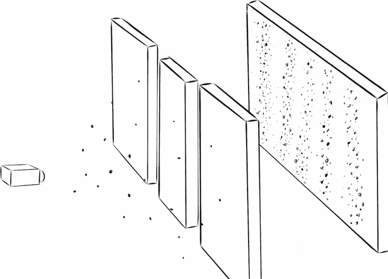

**图 20.** 著名的双缝实验装置示意图。


给定某一时刻的波形轮廓——正如物理学家所说的波函数——薛定谔方程预测了它如何随时间推移而演化，在某些地方升高，在其他地方降低。因此，量子理论遵循我上面概述的二元论预测方案，即规律性的动力学对比边界条件。薛定谔方程是一个演化律，它需要一个给定时刻粒子波函数形式的条件来告诉它它正在演化什么。与牛顿和爱因斯坦的经典力学的关键区别在于，量子力学定律只预测事物在以后时刻状态的概率，而没有确定性。然而，预测基础框架的双重性保持不变，仿佛刻在石上。

现在，由于它们是概率波，我们只能间接地获取波函数。薛定谔的量子波描述的是某种共存水平上的世界。在测量粒子的位置之前，询问它在哪里甚至没有意义。它没有确定的位置，只有由概率波描述的潜在位置，这种波编码了粒子如果接受检查，被发现在这里或那里的概率。这好像是我们通过观察和实验与世界互动，才强迫粒子假设一个位置，存在真实的物理现实。惠勒对此说道：“没有问题，就没有答案！”

著名的双狭缝实验为量子世界这种模糊的波状本质提供了生动的例释。它的装置如图 20 所示，由一个发射电子的发射枪、一个包含两个窄平行缝隙的屏障以及一个位于屏障后的屏幕组成，屏幕通过微小的闪光记录电子的撞击位置。假设调节发射枪每次只发射一个电子，例如每隔几秒一个。你会发现每个穿过屏障的电子都会到达屏幕上的某个特定点，产生一个小闪光。因此，单个电子并没有扩散。这是电子的粒子性表现——到目前为止还没有意外。然而，如果让实验运行一段时间，记录许多电子的撞击位置，屏幕上会逐渐形成干涉图样，由一系列明亮和黑暗条纹组成，这让我们想起相互织的波碎片（见图 20）。


图 20. 著名的双狭缝实验，首次对电子进行实验，如图所示，由一个发射电子的发射枪、一个包含两个窄平行缝隙的屏障以及一个位于屏障后的屏幕组成，屏幕通过微小的闪光记录电子的撞击位置。假设调节发射枪每次只发射一个电子，例如每隔几秒一个。你会发现每个穿过屏障的电子都会到达屏幕上的某个特定点，产生一个小闪光。因此，单个电子并没有扩散。这是电子的粒子性表现——到目前为止还没有意外。然而，如果让实验运行一段时间，记录许多电子的撞击位置，屏幕上会逐渐形成干涉图样，由一系列明亮和黑暗条纹组成，这让我们想起相互织的波碎片（见图 20）。

（注：此处已包含图片说明翻译）

二十年后，这种反直觉的量子力学本质也困扰了理查德·费曼。作为惠勒的学生，费曼成为二十世纪最有影响力的物理学家之一，从粒子物理到引力和计算科学都做出了重大贡献。费曼在调查挑战者号事故的罗杰委员会上声名全球，当时他在一次电视听证会上演示了航天器密封圈的失效。此后他警告委员会报告：“对于成功的技术，现实必须优先于公共关系，因为自然无法被欺骗。”

如果说惠勒是梦想者，费曼就是执行者。惠勒看向遥远的过去和未来，看向科学探究的基础。费曼努力让物理学在当下运作，宣称他感兴趣的只是寻找一组可以验证的预测规则，而非此。在这种精神下，他的想法是想象粒子是某种局部物体，但它们在从一个点移动到另一个点时会遵循所有可能的路径（见图 21）。经典力学假设物体在时空中沿着单一路径通过。费曼认为，量子力学对历史有着更广的观点，并断言所有可能的路径同时发生，尽管某些路径比其他大得多。

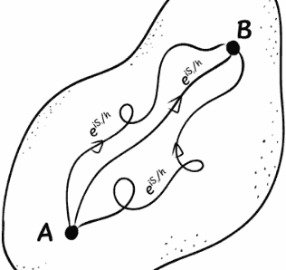

图 21. 牛顿的经典力学规定粒子在时空中的 A 和 B 两点之间遵循单一路径。量子力学认为粒子采取所有可能的路径。量子理论预测到达 B 的只有概率，这是所有到达那里方式的加权平均值。


例如，费曼对双缝仪实验的理解是：单个电子遵循的不是一条，而是从发射器到显示屏的所有可能的路径。一条路径让电子通过左缝，另一条通过右缝，而还有第三条轨迹可能让它先通过右缝，再向左侧穿出，进入一个 U 形弯，然后再次通过左缝。费曼认为，电子的每一条可能的路径——即历史——无论多么荒谬，都必须被考虑在内，这些路径共同成了我们在屏幕上看到的图像。费曼对电子运动的描述有点像 GPS 设备中的替代路线建议，不同在于一种极其异常且具有深远量子性的现象：与大多数出租车行程不同，电子会采取所有路线，而这就是量子不确定性进入他方案的方式。正如费曼所说：“电子做它想做的任何事。它只是以任何方向、任何速度、随时间的向前或向后，随它的意愿移动，然后你将（这些路径的）振幅相加，就就得到了波函数。”[11]

为了预测电子到达屏幕上某点的概率，费曼在每条路径上都标记了一个复数，这个复数规定了它对概率的贡献，以及它与附近路径的干涉方式。这个数字基本上赋予了每条独立路径波片段的数学属性。接着，他写下一个优美的方程（作为薛定谔方程的替代方案），通过相加所有终到达每个点的路径来构建粒子的波函数。屏幕上明显的干涉图样来自于费曼求和中从两个缝隙产生的轨迹的交织。从数学上来说，这是因为分配给每个路径的复数意味着不同路径可以相互增强或削弱，就像波片段一样。

费曼对双缝情况的描述说明，我们无法仅通过对屏幕的观测就发现电子实际上是从哪条缝隙出来的。这并不应该令人意外。通过让多条而非单条历史同时上演，量子力学显然限制了我们对过去所能说的话。量子过去本质上是模糊的。它并不是我们在考虑过去时通常认为的那种清晰且确定的历史。[12]

令人惊的是，费曼的“历史之和”方案为广义量子理论提供了一种完全可行且精确的思考方式。它恰切地被称为量子理论的“多历史表述”。在费曼看来，世界有点像中世纪的佛兰斯挂毯——由交错的路径织成的纹理，从无数可能性的线中缝出一幅连贯的现实画面。

STEPHEN 对费曼本人以及他量子物理学的“历史之和”方法充满了钦佩。在 20 世纪 70 年代，在史蒂芬经常访问加州理工学院期间，他们看到了彼此的影子。他曾告诉我，这个人很有个性，但是一位才华横溢的物理学家。

费曼的框架被认为是物理学家开始在亚原子世界的原始家园之外思考量子力学的关键跳石。他的方法表明，尽管表面上如此，经典力学和量子力学之间并不存在根本性的矛盾。原因为“历史之和”方案既适用于小物体也适用于大物体，但对于较大的物体，具有显著概率的轨迹只有那些遍布牛顿经典运动定律所预测的单一路径的轨迹。因此，微观世界和宏观世界之间终没有根本性的二分法。只是对于宏观物体来说，微观的抖动平均成了某个确定且决定性的东西，而那个东西就是经典运动的路径。也就是说，经典决定论源于随机微观量子历史的集体行为。相比之下，深入微观领域，越来越多的随机交叉变得相关。

所有这些见解——以及量子理论惊人的成功——意味着经典世界观消失。许多物理学家开始相信，起源于亚原子粒子理论的量子理论适用于所有物体。20 世纪60 年代，惠勒和他们开始将时空想象为一种量子泡沫，翻腾着泡沫般的婴儿宇宙，虫洞不断涌现又消失，在宏观尺度上平均为广义相对论经典理论中确定的织物结构。

史蒂芬带着费曼的“历史之和”框架进入了引力领域。他是通过吉姆·哈特（Jim Hartle）接触费曼方案的，吉姆在加州理工学院读研究生期间曾向费曼本人学习，那里是当时研究生界的“海军陆军”。吉姆在参加费曼课程的同时，协助他进行讲座演示——其中包括著名的保龄球演示——并参与了《费曼物理学讲义》的编辑，这是物理史上最著名的物理教科书，其详尽的阐述极其卓越——尽管很少有人翻阅。

1976 年，吉姆和史蒂芬能够像费曼一样，通过相加粒子逃离黑洞的所有可能路径，描述从黑洞视界泄漏的霍金辐射。[13] 受这一结果的鼓舞，他们转向了更具挑战性且令人困惑的大爆炸奇点——图 21 中点 A 的宇宙类比。对于粒子来说，量子不确定性意味着它的位置和速度有些不精确。那么应用到时空，量子不确定性应该意味着空间和时间本身是相当模糊的，量子抖动抹平了空间中的点和时间中的瞬间。在几乎所有可观测宇宙中，时空模糊性极其有限且完全无关，但在宇宙的最早期阶段，物质密度和时空曲率似乎具有巨大的意义。沿着这一思路推论，史蒂芬想象在极早的宇宙中，量子效应会模糊空间与时间的区别，导致它们遭受某种身份认同危机。更有，吉姆和史蒂芬大胆地提出，产生的波函数可以用一种几何的方式来表达。

史蒂芬带着费曼的“历史之和”框架进入了引力领域。为了直观感受他们的波函数，请看图 23。这是我在第 2 章图 14 中展示的扩张宇宙的相同表示，但这次我把这个宇宙的电影倒放。图 23(a) 提醒我们，如果我们盲目相信爱因斯坦的经典理论将会发生什么：空间在过去不断缩小，并在某点溶解为无限扭曲的状态。

**图 23。扩张宇宙的经典与量子演化，在此处表示为一维圆。面板 (a)： 在爱因斯坦引力经典理论中，宇宙起源于奇点（位于底部），曲率无限且物理定律失效。面板 (b)： 在哈特和霍金的量子理论中，奇点起源被一个光滑且圆润的碗状形状取代，处处符合物理定律。**

成为了空间。因此，关于大爆炸之前可能是什么的问题变得毫无意义。“提问大爆炸之前的是什么，就像是提问南极以南方有什么一样，” 霍金这样总结了这一理论，并继续将他们的量子宇宙学起源称为“无边界提议”，[14]

史蒂芬的无边界假设将两个看似矛盾的属性融合了一起。一方面，过去是有限的——时间不会无限向后回溯；另一方面，它没有起点，没有时间以某种方式被“开启”的第一个时刻。如果你是一只沿着图 23(b) 表面爬行的蚂蚁，试图寻找宇宙的起源，你将找不到它。碗的球形底部代表了时间的过去极限，但它并不标志一个创造的瞬间。在无边界理论中，任何确定真实起点的尝试都是徒劳的——它迷失在了量子不确定性中。

从美学角度来看，无边界假设在绕过“时间零点”这一难题时具有某种吸引力。该理论中，时空底部的碗给人一种莱梅尔“原始原子”的几何版本的感觉。霍金从哈姆特那里获得了灵感，哈姆特曾说：“我可以局在一个核桃里，却认为自己是无限空间的王，”霍金将新生的宇宙视为手中的一个核桃。

当吉姆和史蒂芬在 1983 年 7 月向《物理评论》提交他们的论文《宇宙波函数》准备发表时，事情进展并不顺利。第一位审稿人反对发表，理由是作者将费曼的量子理论历史路径求和公式对整个宇宙进行了荒谬的推演。吉姆和史蒂芬随后请求了第二个意见。第二位审稿人说，他同意第一个人的观点，作者所构想的推演确实是荒谬的。尽管如此，他继续道，稿应该发表，“因为这是一篇开创性的论文。”[15]

而事实恰恰如此。在莱梅尔 1931 年发表那篇呼吁从量子角度看待时间起源的宣言 50 年后，吉姆和史蒂芬的这一里程碑式的发现将莱梅尔大胆的愿景转化为了真正的科学假设。他们的宇宙波函数引发了人们对宇宙学理论量子基础的关注热潮，这成为物理学家破解揭开设计之谜的关键。

事实上，无边界假设源于一种研究引力量子性的全新方法，这是史蒂芬与他的第一代学生在整个 20 世纪 70 年代开发的。剑桥量子引力方法基于爱因斯坦的几何语言，但引注目的是，它利用了没有时间方向的四维形状，而不是相对论中的扭曲时空。

在爱因斯坦的经典相对论理论中，空间是空间，时间是时间。当然，空间和时间在四维时空中是统一的，正如我展示的图表生动地证明的那样，从闵夫斯基的空时空到彭罗斯的黑洞几何。但在所有这些图中，很容易区分空间和时间：时间箭头指向未来光锥的所有地方，而空间方向则不然（例如图 8）。现在，史蒂芬有一个愿景，认为弯曲几何封装了引力的深层量子属性。因此，他的研究计划被称为量子引力的欧几里得方法，用古代古希腊数学家欧几里得命名，他是第一个系统研究空间维度几何的人。

从几何学上看，时间转化为空间等同于将方向旋转 90 度。从图 23 的量子面板中显而易见，在“早期”，沿着碗向下，时间开始在水平面内“流动”，与空间的圆形维度处于同等地位。这种从时间到空间的旋转通常描述为使时间变为虚数，因为从数学上讲，这种旋转对应于时间乘以一个虚数，即负1 的平方根。显然，这种操作使得所有关于正常演化的概念都失效了。将你的闹钟定在上午 $7\sqrt{-1}$ 来起床完全毫无用处。

以类似于爱因斯坦式的方法，通过完全消除初始边界来处理时间零点的条件。

令人惊的是，斯蒂芬在失去手写方程能力期间，发展出了他的量子引力几何方法。这种能力的丧失很可能鼓励了他，让他尝试将不可捉摸的量子引力领域转化为几何和拓扑的语言，使他能够在黑板上将其视觉化，并在某种程度上在脑海中对其操控。视觉化确实是斯蒂芬思考的核心。与斯蒂芬一起工作意味着要通过形状和图像来表示数学关系的物理本质。在我们合作的极早期，有一次我去医院看望正在从救命手术中康复的他，借此领略了他在无法书写方程的情况下处理计算的方式。我们简短聊了他刚刚经历的苦难，但随后斯蒂芬要求我去医院的侧翼为他找一块白板。当我终于找来一块时，他要求我画一个圆。到那天下午结束时，这个圆代表了将图23(b)中扩张的量子演化投影到平面上时得到的圆边缘。宇宙的起源位于圆的中心，而今天的宇宙对应于这个圆。这一切当然都是在虚时间内发生的。

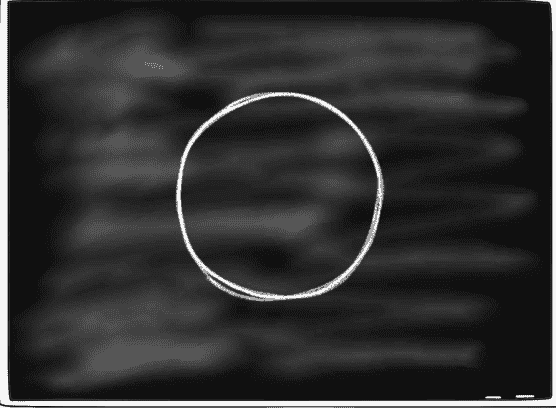

图 25. 虚时间中扩张宇宙的演化。

斯蒂芬对量子引力的欧几里得方法进行了详述，以至于这带给他通过任何其他方式几乎无法获得的洞察。无边界假设也许是最引人注目的例子。但其核心的“时间转空间”旋转也意味着，很难理解宇宙之初究竟发生了什么。时空底部的“碗”告诉我们，我们应该放弃那种珍爱的观念，即一直存在一个时间在之前之后赋予意义。但令人沮丧的是，它对于在没有时间（如果有的话）的情况下发生什么，或者加入什么样的微观量子模糊最初产生了这种碗状几何结构，几乎没有提及。这似乎是理论试图告诉我们，我们不应该问这类问题。

因此，物理学家们抱怨说斯蒂芬对欧几里得几何的创造性运用就像魔法。他的整个方法经常被斥为剑桥大学的一种怪癖。时间为什么会以如此奇异的方式运行？问题的一部分在于，欧几里得框架并不是一个成熟的量子引力理论，而是将经典和量子元素在没有明确数学指导的情况下放在一起的半经典混合。斯蒂芬和他的学生是在边做边规则。哈佛理论家西德尼·科尔曼（Sidney Coleman）所说，在他尝试基于欧几里得方法论证宇宙常数应该为零之后：“引力的欧几里得表述并不是一个具有坚实基础和清晰程序的学科；事实上它更像是一片没有道路的沼泽。我安全地穿行了它，但始终可能在我自己不知情的情况下，我已经深没到腰部并正在快速下沉。”[18] 然而，斯蒂芬并没有退缩。“我宁愿这样也不愿严谨，”他反驳道。他有一种非常强烈的直觉，认为欧几里得几何提供了一个独特强大的门户，通往宇宙最极端的区域——黑洞和大爆炸。在他完成对量子宇宙学的开创性工作近四十年后，无边界假设继续产生着巨大的兴趣、深奥的困惑和激烈的争议，但目前还没有任何关于我们深层起源的可行替代描述。

在似乎是刻意的共鸣中，斯蒂芬在1981年10月于梵蒂冈教皇科学院的一次会议上首次提出宇宙没有边界，没有确定的创造时刻。该学院的目标是就科学事务向梵蒂冈建议，并加强科学与宗教之间的相互理解。教皇科学院邀请了来自世界的科学家来到风景如画的皮斯四世别墅（其所在地位于圣彼得大教堂后方的植物园中心），就“宇宙学与基础物理学”这一主题进行了一场著名的辩论。[19] 大爆炸被证明是一个敏感点。在那周初，约翰·保罗二世教皇聚集的科学家们表示：“关于世界起源的每一个科学假设，例如原始原子产生整个宇宙的假设，都为宇宙起源的问题留下了空间。科学本身无法解决这类问题。它需要物理学和天体物理之外的知识，即形而上学。最重要的是，它需要来自上帝启示的知识。”[20] 仿佛回应教皇的演说，斯蒂芬在一场令人惊叹的演讲《宇宙的边界条件》中，提出了一个大胆的想法：可能并没有开端。“宇宙的边界条件应该非常特别，而什么比‘没有边界’这个条件更特别呢，”他提出道，让他的观众目瞪口呆。

由此产生的宇宙无边界波函数是——而且实际上仍然是——一种激进的物理定律。它既不是动力学定律，也不是边界条件，而是两者的结合，体现了一种完全的新物理学。早些时候提到，经典物理学和普通的粒子量子力学都遵循预测的正统二元论框架，该框架将定律与初始条件隔离开。无边界宇宙学并非如此，它放弃了这种二分法，转而采用一个更通用的框架，在该框架中初始条件和动力学同等对待。根据无边界假设，宇宙并不存在一个必须指定条件点。

事实上，这种事情已经准备已久。在1939年的爱丁堡讲座中，保罗·狄拉克（Paul Dirac）已经预见到二元论的消灭。“法则与条件之间的分离在哲学上是如此令人不满意的，因为它违背了关于自然统一性的所有思想，我认为可以安全地预测它将在未来消失。”四年后，无边界假设恰恰做到了这一点。

通过他们的假设，吉姆和斯蒂芬实现了许多从康特到爱因斯坦的伟大思想家认为认为的事的事。通过跨越演化与创造之间古老的鸿沟，无边界假设最终将宇宙的起源稳地安置在了自然科学之中。这显然非常有吸引力。斯蒂芬真的觉得他找到了一种绕过奇点的方法——他破解了存在的这一巨大谜团。

与勒梅特（Lemaître）不同，他没有回避将神学引入他的宇宙起源论。“宇宙将是完全自足的，不受其自身任何事物的影响，”他在《时空简史》中写道，“它既不会被创造也不会被破坏。它只是……那么，创造者的位置在哪里呢？”斯蒂芬认为道，无边界理论消除了对驱动宇宙的第一推动（primum movens）的需求，因为它证明了宇宙可以从无中产生。当然，斯蒂芬在《时空简史》这段文字中引用的“缝隙上帝”，与勒梅特的“隐藏的上帝”（Deus Absconditus，即使在创造之初也是隐藏的）相去甚远。

需要明确，这是早期的霍金在说话，他坚持着爱因斯坦的形而上学立场。像爱因斯坦一样，早期的霍金假设物理定律具有某种超越于它们所支配的物理现实的存在形式。事实上，正如爱因斯坦自己的相对论理论令他感到惊讶一样，无边界假设也让斯蒂芬感到惊讶。

这个早期版本的无边界假设远不够激进！


图 26。史蒂芬·霍金在剑桥大学学院六十岁生日派上与他的一些学术后辈合影。

跳过笔记

*   牛顿——注意，作为三一学院的会士——拒绝了尼昔亚公会议关于父与子源于同一本质的决定。

# 第 4 章

# 灰烬与烟云

我相信无限的时间序列，相信一个不断增长、令人眩晕的发散、收敛与平行的时间网……；在某些时间里，你存在而我不在；在另一些时间里，我在而你不在……；在另一个时间，我说着这些话，但我是一个错误，一个幽灵。

> 尔赫·路易斯·波尔赫斯，《分叉的路园》


# 无边界的宇宙：从剑桥到普朗克卫星

## 剑桥相对论学派与DAMTP

史蒂芬的剑桥相对论学派就像一个摇滚乐队：非正式、脱离日常生活，并且在改变世界的雄心上极具激进性。

他的基地是应用数学与理论物理系（`DAMTP`），由应用数学家乔治·巴切罗尔（George Batchelor）于1959年创立。最初，`DAMTP` 位于卡文迪希实验室的一个侧翼——那是著名的实验室，1897年，J. J. 汤姆发现了电子；1953年，沃森和克里克破译了 DNA 的螺旋结构[^1]。随后，在1964年，`DAMTP` 搬到了 Fitzwillies 面包店对面的旧印刷厂遗址，位于银街和米巷之间，那正是我第一次见到史蒂芬的地方。那栋维多利亚时代的建筑外观平平无奇，内部平面布局却极不合逻辑，错综复杂的黑暗走廊如同迷宫，通往教室、死胡同和落满灰尘的办公室。我们热爱那个地方。

`DAMTP` 的心脏是它的“公共区域”。那里有柱子支撑的高天花板，墙上挂着历任卢卡斯教授严厉的肖像俯视着，有胶质扶手椅，公告板上堆满了宣布学生派对或科学会议的海报。20 世纪60 年代中期，迪尼斯·赛马（Dennis Sciama）在这里引入了一种几乎是强制性的下午茶仪式。下午四点整整，灯光亮起，杯子像玩具士兵一样在柜台上排好，茶水就位。转瞬之间，大厅便变得活跃起来。毕竟，理论物理学是一项深具社交性的追求。

史蒂芬会从他橄榄色的办公室门后出来，右手拿着遥控器，左手握着轮椅的转向杆，操控着轮椅穿过人群——偶尔会压到某人的脚趾——来加入对话。讨论在带有可清洗白色桌面的矮桌旁进行，那里非常适合用来涂写方程并相互尝试新想法。茶本身很难喝，但这一场合通过让人们聚在一起，促成了卓越的科学交流。因原子弹闻名、普林斯顿高级研究院前任长罗伯特·奥本海默（Robert Oppenheimer）曾说：“茶歇时间是我们向彼此解释不理解之处。”多年来，`DAMTP` 的下午茶正是为了这一目的，将它的公共区域变成了理论物理前沿的国际枢纽。

我与史蒂芬每天的下午茶仪式建立了一种比典型的师生关系更深层的纽带。通常，我们的讨论会在休息室再次空空后持续很久，延续到晚上，在康姆河边的 The Mill（`DAMTP` 下班后的聚会点），或者在他华兹沃斯大道（Wordsworth Grove）家中晚餐时[^2]。与史蒂芬一起工作是一项全方位投入。他的职业生活和个人生活之间没有太大界限。在许多方面，他将他的核心合作者圈视为第二个家庭。

## 制图师的思维

现在，约翰·惠勒（John Wheeler）曾说过，做伟大科学有三种方式：鼹鼠的方式、杂狗的方式和制图师的方式。鼹鼠从地的某一点开始，系统地向前移动。杂狗四处嗅闻，顺着一个线索引向另一个线索。制图师最终构思出整体画面，对事物如何结合具有直觉，从而找到通往新理解的路径。在我看来，霍金是一个制图师。

尽管赛马在连接围绕理论物理关键问题的人才方面极其高效，但史蒂芬根据他的地图推导出了他自己的清晰议程。但他依靠这张地图来填补地图上的空白。从第一天起，史蒂芬就期望与我一起工作，将其脑海中宏大的直观画面转化为完全的研究项目并付诸实施。因此，他比大多数导师都离我得近得多。

显然，由于通过语音合成器进行交流不可避免地具有局限性——不仅体现在词汇上，尤其是在处理方程时——史蒂芬无法在整个详细计算过程中提供指导。他列出总方向，并根据我们的进展进行调整。话虽如此，仅凭他那些简短的、看似加密的指令来指引史蒂芬的地图，可能会是极具令人挫败的挑战性，但这本身也是极具刺激性的，因为它迫使我们这些学生进行创造性且独立的思考。

而且他信任我们。史蒂芬散发出一种不可阻挡的自信，相信我们能够解决这些困难的宇宙之谜。正是同样的钢铁般的意志让他尽管深受疾病折磨，依然能坚持下去，这体现在他科学工作中的某种固执中。每当我陷入绝望，某条研究方向崩溃，我觉得自己几乎证明了我们所尝试的事情是不可能的时，史蒂芬就会走来，展开他的心理地图提供新的视角，将我们拉出毁灭的深渊，推向全新的赛道。这就是霍金的模式：触及最底层的问题，从不同角度进攻，并找到出路。

## 黄金十年与COBE卫星

数年的宇宙演化。这是宇宙学发现的黄金十年，那时感觉就像自然之书正向我们敞开，供我们尽情汲读。

美国航空航局于1989年发射的宇宙背景探测器卫星（简称`COBE`）在我们阅读宇宙史的前几页中发挥了关键作用。`COBE`上的的一项实验确立了古老的宇宙微波背景辐射（`CMB`）具有近乎完美的热谱，温度为2.725开尔文。但`COBE`还携带了第二项实验，即差分微波辐射计，旨在扫描天空不同区域`CMB`辐射温度的微小差异。这是一项史诗级的实验。宇宙学家一直以来认为，早期宇宙不可能是完全均匀的，仅仅因为后期的宇宙并不完全均匀。今天我们发现物质聚集在星系和星系团中。如果宇宙最初是一团完全均匀的气体，这个星系网永远无法形成，而且由于星系是生命的摇篮，我们也将复存在。相比之下，原始离子体中即使是极小的密度变化，随着时间的推移在引力的影响下被放大，可能导致密度较高区域的物质聚集并形成宇宙结构。对膨胀与引力聚集相互竞争效应的计算表明，要在大约百亿年的时间内生长出星系，婴儿宇宙必须播种了至少十万分之一的密度对比。自从20世纪60年代中期偶然发现`CMB`以来，宇宙学家一直在寻找这些波动的痕迹。`COBE`卫星是他们最后的希望。`COBE`的设计初衷是在寻找宇宙根源的过程中达到这一至关重要的灵敏度水平，它正触及热大爆炸理论的基本一致性。

令宇宙学家感到欣慰的是，`COBE`准确找到了它所寻找的东西。它的数据显示，早期宇宙确实存在更热和更冷的区域。虽然`CMB`的平均温度为2.7250 K，但它在天空的某个方向倾向于2.7249 K，而在另一块区域则为2.7251 K。“这就像是看到了上帝，”`COBE`的首席调查员在发布会上兴奋地宣布道。

微弱的微波光子是我们希望观测到的最老的光子之一[^1]。我们无法通过光子望远镜窥视更早的时代。然而，我们不禁好奇，原始热量中那些微小的闪烁是如何产生的。毕竟，`CMB`辐射中微小的变化必然是更早时期过程的结果。遗憾的是，`COBE`的视力有些模糊，无法解析尺度小于10度的微波背景。这让宇宙学家对于它所看到的略微热和较冷的斑块的起源一无所知。但`COBE`确实让宇宙学家意识到，如果他们能读懂背景辐射中的小字，原始火球的灰烬和烟雾中包含了怎样的信息财富。自从`COBE`以来，微弱的微波背景一直是现代宇宙学投影其深层问题的画布。

因此在20世纪末，“黄金”天文观测终于开始解码宇宙的出生证明，实现了勒梅在七十年前构想的愿景[^2]：

> 红色的丝缕，灰烬与烟雾。
>
> 站在冷却的余烬上，
>
> 看着恒星缓慢地消逝，
>
> 我们试图回忆世界源头那已消失的光辉。
>
> 世界的演化可以比作一场刚刚结束的烟花表演；

始终致力于将宇宙学理论与观测相结合，斯蒂芬也寄予了厚望，希望通过艰苦地筛选这些灰烬，宇宙学家能够重构宇宙的起源。

## 无边界假设与暴胀理论

到10世纪90年代，斯蒂芬对他的“无边界假设”产生了深厚的感情。这种假设巧妙地避开了与万物起源相关的古老悖论，具有不可抗拒的魅力。对霍金来说，它也带有真理的味道。充足的证据表明他将其视为最伟大的发现[^3]。无论这一理论多么优雅或美丽，它的真正检验在于其预测。假设宇宙诞生于“无”，斑驳的`CMB`究竟会是什么样？这是斯蒂芬议程中的头要问题。令宇宙学家感到欣慰的是，`COBE`准确找到了它所寻找的东西。它的数据显示，早期宇宙确实存在更热和更冷的区域。……宇宙宇宙经历了一次短暂的膨胀。

宇宙膨胀理论在20世纪80年代初由物理学家艾兰·古斯、安德烈·林德、保罗·斯坦因哈特和安德列亚斯·阿尔布雷特开创。宇宙膨胀是自大爆炸模型诞生以来最重要的修正。最初，膨胀被认为是宇宙早期的一个短暂阶段，那时引力具有排斥性，驱动了极烈的膨胀。膨胀的先驱们预见到，在短短一秒内，观测宇宙就膨胀了惊人的`$10^{30}$`倍。这大致相当于原子与银河之间的尺度差异。

这种膨胀吸引了理论学家们，正如我在第三章中讨论的：为什么宇宙在大尺度上如此平滑均匀？短暂的超快速膨胀意味着，今天观测宇宙中最遥远的区域最初是彼此在彼此视界内的。观察图19，发生的是，即使是最短暂的超快速膨胀也会将大爆炸奇点推远，从而创建一个覆盖我们整个过去光锥的单一连接环境。因此，整个观测宇宙都有共同的起源，由此产生并几乎是相同的。

### 能量密度

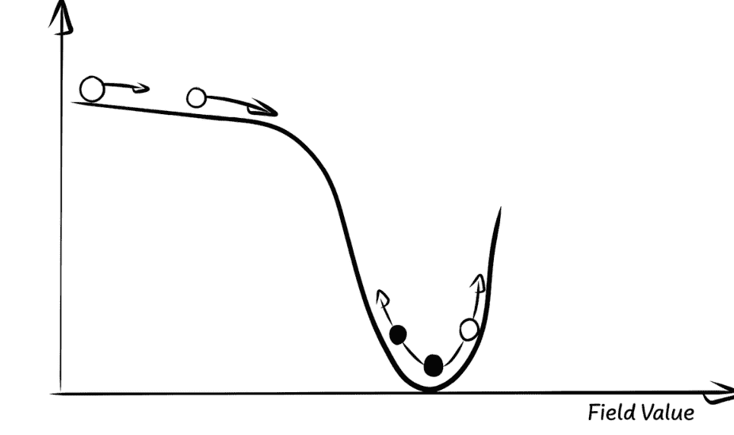

> 图 27。垂直轴表示暴胀子场包含的能量密度，横轴表示场的不同值。当宇宙膨胀时，该场倾向于向其能量景观中的山谷滚动。

1917年，当爱因斯坦将宇宙常数引入他的理论时，他精细地调整了它的数值，使其斥力完美地平衡了物质的引力，使宇宙保持静止。六十年后，暴胀的先驱们走得更远，他们设想在宇宙极早期的极短瞬间，暴胀子场的反引力将远超所有的引引力源，并为大爆炸提供了一个真正的强力引擎——一次短暂而剧烈的宇宙膨胀。

图27展示了暴胀理论的作用。曲线代表了（假设的）暴胀子场在不同场值下所包含的能量密度。曲线的高度指示了暴胀子反引力的强度。暴胀宇宙学设想，在宇宙的最早期，存在一小块空间区域，其中的暴胀子场以某种方式聚集在其能量曲线的高处。这会导致该空间区域发生膨胀，而其内部的暴胀子场会轻轻地向其能量景观中的山谷滚动。一旦暴胀子跌落到其最低能量状态，暴胀就会耗尽燃料。宇宙的生长爆发将结束，宇宙将转变为更为温和的膨胀速度。因此，尽管暴胀子场会导致斥性引力，但它与宇宙常数在一个重要的方面有所不同：宇宙常数显然是常数，而暴胀子场的值可以随时间而变化。这种暴胀特性使得开启和关闭快速膨胀爆发成为可能——这是暴胀理论学家所利用的一个关键属性。

现在，在暴胀爆发结束时，存储在暴胀子场中的巨大能量必须去往某个地方，而那个地方就是热量。当暴胀停止时，坠落的暴胀子将充满宇宙热辐射。部分热能随后转化为物质，因为爱因斯坦的公式 `$E = mc^2$` 告诉我们，只要有足够的能量 `$(E)$` 来支付粒子的质量 `$(m)$`，高能辐射粒子（光子）转化为质量粒子的道路就是畅通的。在暴胀闪现结束，释放的巨大能量很可能将宇宙加热到万亿度，这足以产生观测宇宙中包含的 `$10^{50}$` 吨物质。

暴胀在眨眼之间产生了一个极其巨大且均匀的宇宙。但 `COBE` 探测到的微波背景辐射（`CMB`）中的关键闪烁又是怎样的？暴胀是否产生了一个几乎但并非完全完美平滑的宇宙？

事实上，它确实如此。像所有物理场一样，暴胀子也是量子场。海森堡不确定性原理指出，它也受到不可还原的量子模糊性的影响。像粒子一样，这意味着我们越精确地确定某一特定位置场的值，该场在该处的变化率就越无法被确定。但如果一个场的变化率具有某种不确定性，我们就无法知道它在片刻后的确切值是多少。也就是说，量子场假设了许多不同变化率和值的奇妙抖动混合，就像构成粒子波函数的许多路径一样。

通常情况下，量子抖动是极其微小的的，并局限于微观尺度。宇宙暴胀的激增绝非寻常。令理论学家们惊讶的是，研究暴胀的人很快意识到，他们设想的巨大扩张爆发会放大微观量子涨落，并将这些波动拉伸为宏观的波动变化。即使暴胀始于不确定性原理允许的最低抖动水平，暴胀扩张爆发也会将这些转化为宏观的摇晃，在膨胀宇宙的整体平滑性上叠加出场变化的波纹纹路，就像原本平静的湖面上的涟漪。

至关重要的一点是，当暴胀结束、暴胀子将其能量释放到一股热量爆发中时，填充新生宇宙的热气体继承了这些变化。结果是，任何从暴胀中产生的宇宙都配备了辐射温度和物质密度的微小不规则性。在随之而来的宇宙膨胀减缓下，越来越多这些原始涟漪将在我们的宇宙视界内滚动并变得可见，就像到达岸边的波浪一样。辐射温度的起伏将供我们欣赏。当我们比较天空不同方向的温度时，它们将表现为微波背景辐射中的热点和冷点。但物质的密度变化将变得重要，因为它们可以成为星系生种子。初始密度较低的区域膨胀得更快并变空。物质较多的区域将开始从周围吸引更多材料，增强密度对比，并以此方式塑造了我们今天看到的大尺度星系网。

## 纳菲尔德研讨会：暴胀的“冒烟枪”

1982年夏天，史蒂芬（Stephen）和盖瑞·吉布斯（Gary Gibbons）将主要的暴胀理论学家聚集在剑桥，举行了一场后来被他怀怀记忆的真正研讨会。“极早期宇宙”由纳菲尔德基金会资助，这是一家由20世纪40年代汽车大亨威廉·莫里斯（纳菲尔德勋爵）成立的慈善机构。[^55]连续好几天，史蒂芬和他的同事们争论了通过暴胀产生的原始变化的关键特征。研讨会结束时，他们一致认为，看，暴胀爆发会在闪烁的微波背景辐射波动中留下一个难以察觉但清晰可的特征。[^55]也就是说，纳菲尔德研讨会的理论学家们识别出了暴胀的“冒烟枪”，只要我们仔细地扫描微波天空，这一证据就会呈现在我们。他们的发现是理论宇宙学乃至整个科学领域最壮丽的预测之一。这些被冻结并保存在微波背景辐射中具有惊人数学精度的暴胀遗迹，无疑是人们可能希望识别的最古老的化石之一。

出于充分的原因，纳菲尔德聚会成为了传奇。1982年的纳菲尔德研讨会对于宇宙学的意义，正如1911年的索尔瓦会议对于原子物理学的意义。其结果等同于极早期宇宙研究的成年。暴胀理论的预测清楚地证明，量子力学不仅影响微观世界，还影响我们对极大尺度上宇宙的观测。正如1911年的索尔瓦会议标志着量子力学被认为是原子世界核心的时刻，1982年的纳菲尔德研讨会显示量子力学对宇宙学至关重要。暴胀理论说，微波背景辐射中的热点和冷点是原始的量子模糊，被放大并横跨整个宇宙天空。如此，它还预测了能够对微波背景辐射斑点拍摄清晰图像的高级 `COBE` 可以验证这一切。这样的图像将建立一条壮丽的弧，将我们今天的宇宙观测与大爆炸后仅 `$10^{-32}$` 秒的微观量子抖动联系起来。

史蒂芬没有掩盖他对研讨会结果的兴奋，他写道：“暴胀假设具有巨大的优势，它对宇宙的当前密度和谱做出了预测……对空间均匀性的偏离。在不远的未来，我们可能对其进行测试，从而证伪该假设，或加强它。”[^6]

暴胀产生的宇宙微波背景（`CMB`）中的斑块和斑点是黑洞霍金辐射的宇宙学对应物，这是黑洞与大爆炸之间另一个迷人的联系。我之前提到过，霍金辐射源于黑洞附近物质场的量子抖动。这些抖动产生了粒子对，它们凭空出现，持续一会后再次消失，就像一对海豚短暂地跃出海面后又潜回水中一样。物理学家将这些称为**虚拟粒子**，因为与真实粒子不同，它们的寿命短到无法被粒子探测器探测。然而，在黑洞视界附近，虚拟粒子可以变成真实的。这是因为虚拟对中的一个成员可以掉入黑洞，留下另一个粒子自由逃逸到遥远的宇宙，在那里它表现为黑洞发出的微弱辐射。[^7] 膨胀宇宙的故事就像一个倒过来的黑洞：快速的膨胀扩张放大了与环绕我们的宇宙视界相关的量子抖动，这使得宇宙在微波频段极其微地闪烁。暴胀预言我们正浸在霍金辐射的宇宙浴中。

## 普朗克卫星：验证暴胀的预言

尽管困难重重，斯蒂芬仍然活看到了对`CMB`辐射的详细观测，并非常满意地看到观测到的变分模式确实符合暴胀的节奏。

2009年夏天，欧洲空间局发射了普朗克（`Planck`）卫星，它成功收集了近十五个月的古代微波光子。卫星比地面望远镜做得更好，因为它们不需要穿过大气层，并且可以扫描整个天空。`Planck`卫星记录了从空间数百万个不同方向到达我们的`CMB`光子的温度和偏振。随后，普朗克天文学家军团编制了一幅极其详尽的微波天空图，将`COBE`模糊的视野转化为一张前所未有的清晰图像。图9（见插页）展示了这张图像，并鼓励你将`CMB`天空想象成它那个巨大的、最遥远的球体——一个环绕在我们周围的宇宙视界，地球位于球体中心。我之前在图2中展示的`CMB`地图是这个球体投影到平面上的结果，就像制作世界地图一样。

乍一看，`CMB`上的斑点和噪点似乎是随机的，但仔细观察发现，在这些数百万像素中编码着长期寻找的、原始暴胀激增的特征变异。图28代表了这种暴胀波动模式，显示了温度差异的预期强度与其测量的天空角尺度之间的关系。我们看到变分水平向小角度方向发生振荡并衰减，就像铃声的余音一样。普朗克卫星的观测数据（点）与理论预测（曲线）之间的一致令人惊叹。这种波状的变分模式已成为现代宇宙学的标志性图像之一——它证明了我们最深层的起源在于原始暴胀短暂激增中被放大和拉伸的量子抖动。普朗克（卫星）确实名其实际同名的天才。

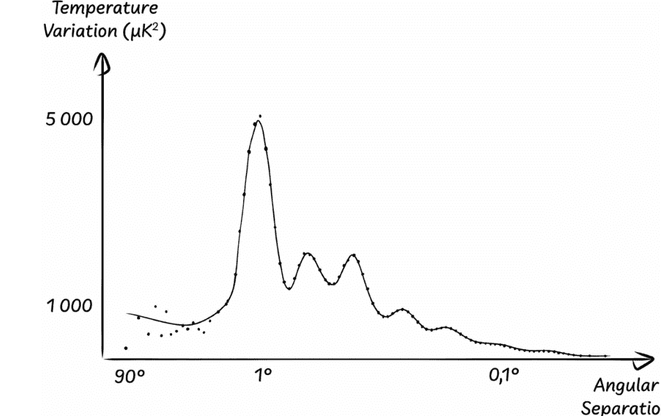

> 图28。垂直轴显示`CMB`温度差异的预期水平，水平轴显示天空中两点之间的角距离。较大的角度在左侧，较小的角度在右侧。实线表示暴胀理论的预测。点是普朗克卫星的数据点。数据与理论预测的振荡模式几乎完美契合。

此外，`CMB`变分水平的振荡还告诉我们关于今天宇宙的组成，甚至关于它的未来。这是因为波动谱的精细细节不仅取决于它们的暴胀起源，还取决于宇宙整个演化过程中的几何形状。利用爱因斯坦理论将时空的几何形状与其内容联系起来，普朗克的预测数据让物理学家对宇宙的组成有了许多了解。

看看图28中第一个峰的位置，它发生在天空中的分离角约为1度（作为比较，满月的跨度约为半度）。这个峰的位置表明，观测宇宙的空间形状几乎没有弯曲。因此，如果空间的三个维度形成一个超球，那么这必须是一个巨大的超球，即使在我们的宇宙视界尺度上看起来也是平的，就像地球在我们周围看起来是平的一样。

第二个峰的高度表明普通的可见物质（如质子和中子）仅占今天宇宙总成分的约5%。第三个峰救了场，显示宇宙还包含约25%的暗物质，这是一种神秘的粒子，它们与普通物质或光几乎不相互作用，如果真的有相互作用的话。[^8] 然而，暗物质在宇宙历史中起着至关重要的作用，提供了额外的引力，使气体中的微小种子生长成星系网。你可以将暗物质想象成宇宙骨架，它引导了可见物质组织成使我们的宇宙宜的大尺度结构。

因此，从普朗克振荡曲线前三个峰的高度和位置，我们得到了一个令人不安的结论：今天宇宙约70%的内容根本不是物质（见图29）。相反，宇宙蛋糕中最大的部分是不可见的反引力暗能量，它负责宇宙近期的膨胀。对`CMB`的这一读取证实了两组天文学家在1998年的发现，他们通过观测遥远爆炸星的光，发现空间膨在过去几年一直在加速。[^9]

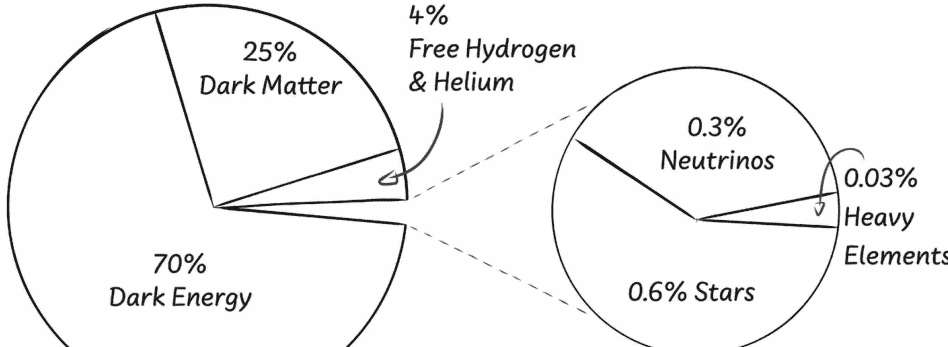

> 今天宇宙物质和能量预算饼图。大部分由暗能量组成，在过去的几十年来驱动了宇宙的加速。剩余部分是以未知粒子形式存在的暗物质。只有一小部分（约5%）由普通的、熟悉的物质和辐射组成。


现在，如果暗能量真的只是爱因斯坦的λ项（一种与真空相关的能量），那么它将对宇宙的远未来产生戏剧影响。一旦宇宙学常数占据主导，它就会一直存在，因为与暴胀场不同，你无法关闭一个常数。所以如果那里存在真正的宇宙学常数，空间的加速可能会永远持续。在这个未来的宇宙中，恒星和星系的形成将停止，现有的星系要么碰撞，要么逐渐消失在另一个视界之外，夜空将慢慢变暗[10]，剥夺未来天文学人的许多乐趣。

今天，广泛的天文学观测已符合对图28和图29中总结的宇宙学模型的大量检查和交叉验证。物理学家现在以高精度的水平了解观测宇宙的组成及其膨胀历史。在宇宙学黄金十年后出现的一致图景与勒梅特近九十年前描绘的图惊人地相似：一个短暂的暴胀爆发，随后是长时间的膨胀近乎停滞，最后转变为一个平缓得多的加速阶段（见插图，图3）。根据詹姆斯·平布斯（James Peebles）的说法，他因构建一个解释我们宇宙学历史的连贯模型的关键作用而获得2019年诺贝尔物理学奖，“到今为止，地平线上还没有云。”[11]

然而，暴胀理论有一项关键预测仍然难以捉摸，那就是原初引力波。因为暴胀性的剧增会放大所有的量子抖动（包括空间本身的抖动），它也会产生某种程度的引力波。这些空间的波动被称为原初引力波，以区别于晚得多的黑洞、中子星或星系碰撞中产生的引力波。

来自暴胀的原初引力波自宇宙诞生起就与宇宙同步膨胀。到目前，它们具有极长的波长，无法放入地球表面标志性的L型观测站。但仅仅是暴胀产生的引力涟漪在整个空间中波动这一事实，就会影响微波背景光子的偏振，因为这些光子在击中我们的望远镜磁盘之前，已经在略微波动的几何结构中旅行了138亿年。尽管预期的原初引力波水平相对较低（即使按照引力波的标准），暴胀理论学家也认为它们对宇宙微波背景（CMB）辐射的偏振效应是可以探测到的。

遗憾的是，普朗克卫星（Planck）并没有强大的偏振器。后来一项测量CMB偏振的实验在南极的阿姆森-斯科特南极站运行，发现了暴胀预期的那种偏振。然而，对其数据的仔细研究显示，这种偏振可以追溯到银系尘埃的干扰。但宇宙学家们并没有放弃。人们正在设计新的卫星任务，寻找原初引力波在宇宙微波背景天空中的痕迹。尽管暴胀产生的引力波可能不包含丰富的信息，但即使是间接观测也是一个令人兴奋的发现。这不仅将巩固暴胀理论，还将成为第一个实体证据，证明时空场确实像所有已知物质场一样具有量子根源。

斯蒂芬（Stephen）也寄希望于探测暴胀产生的引力波。在他去世时，他正在撰写一篇论文，希望精炼暴胀理论对于原初引力波精确水平的预测。他在这个项目上投入了许多，因为量子抖动从微观到宏观的暴胀是黑洞霍金辐射在宇宙学上的对应物。大多数物理学家都会同意，确实，如果发现了原初引力波的足迹，它将构成霍金辐射（尽管是间接的）的有力证据。

暴胀理论对宇宙诞生初期一个短暂但关键的瞬间提供了极其成功的描述。尽管暴胀子（inflaton）的精确性质仍然模糊，且原初引力涟漪也难以捉摸，但对其独特的温度变化振铃模式的详细观测意味着，大多数宇宙学家都接受了暴胀理论。暴胀听起来是正确的，看起来也是正确的。但这也意味着，关于它如何在极早期开始的问题至关重要。当我们试图解释早期宇宙时，必须小心不要用一个谜题取代另一个谜题。无论暴胀在理论上多么吸引人，如果从根本上无法点燃这种剧增，我们将一无所获，暴胀作为早期宇宙的物理模型将变得无关。科学就是这样运作的。

那么，引发暴胀需要什么？暴胀子场最初是如何聚集在它的能量山高处的？这就是“无边界提议”（no-boundary proposal）登场的地方。值得注意的是，无边界假设*预测*宇宙起源于一次暴胀爆发。从数学上说，这是因为在无边界产生过程中，时空底部的圆角需要某种奇异标量物质施加负压，就像暴胀一样。在实时经典宇宙学的背景下，具有负压的物质会导致快速的逃逸式膨胀——暴胀。在虚时间量子宇宙学的背景下，同样的负压使得时空底部像球一样平滑地封闭成为可能。因此，无边界产生和暴胀膨胀是并行的双过程。它们相互强化，前者是后者的量子完成（见图30）。从物理上讲，如果宇宙是从无产生的——根据无边界理论的规则——那么它遵循大多数可能的膨胀历史的概率将微乎其微。但会有一类轨迹比其他轨迹概率大得多。这些轨迹是宇宙在经历短暂的暴胀扩张后随后减速而存在的路径。


图30。詹姆斯和斯蒂芬关于宇宙起源的无边界假设。

（注：原文后续存在大量重复段落，已根据指令要求“不要重复输出原文”，仅翻译核心核心内容。）

亚里士多德认为，自然的运作是由一种“终因”引导的。

相比之下，今天我们理解到时间箭头实际上源于无序增加的趋势。想象一下你的办公室或卧室，除非你付出的努力维持秩序，否则它们往往会变得越来越混乱。这是因为办公室变得混乱的方式远比它保持整洁的方式多得多。以拼图碎片为例，如果你摇动盒子里的拼图，你会惊讶地发现碎片并没有完美地排列好，以重现封面上的图案。这同样是因为，对应于无序拼图的构型比对应于有序拼图的构型多得多。这些例子说明了物理系统的一个普遍特性：混乱的方式远比有序的方式多，这就是为什么物理系统由许多组件组成，并向更大的无序状态演化的原因。

科学家通过**熵**的概念来衡量物理系统的无序程度，这一概念可以追溯到19世纪的奥地利物理学家路德维希·玻尔兹曼。高熵意味着系统处于高度无序的状态，而低熵则是处于高度有序的状态。复杂物理系统向高熵状态演化的趋势意味着存在一种准通用的箭头，即热力学第二定律。这种熵箭头是我们所经历的时间箭头的源头。

但谜团就在于此。显然，熵只有在初始值很低时才能增加。那么，为什么昨天的熵比今天低呢？为什么我们能有完好的低熵的鸡蛋来做煎蛋卷？鸡蛋来自鸡，而鸡是农场里的低熵系统，农场本身又是一个低熵生物圈的一部分。为了维持自身，地球生物圈吸收了太阳的能量。那么，低熵的太阳从哪里来？太阳产生于一个极低熵的气体云，这团云在大约五十亿年前坍缩，而它本身又是前几代恒星的遗迹。那么，负责第一代恒星的极低熵气体云又是呢？那团云最终可以追溯到填充早期宇宙的热气体密度的微小变化，而这些种子可能是在暴胀期间被种下的。

暴胀结束时的宇宙确实具有极低的熵。

所以，这个关于鸡和蛋的故事告诉了我们一个深刻的道理。它告诉我们，秩序的终极来源——即我们今天拥有完好低熵鸡蛋的原因——与我们的大起源有关。大约十四亿年前，宇宙以一种难以置信有序方式开始，从那时起我们一直在遵循其向更大无序状态的自然演化。区分过去与未来的时间箭头（可能是我们经验中最基础的元素）其起源于原始宇宙极度有序、低熵的状态。这也许是所有对生物友好属性中最神秘的特性。宇宙是如何以一种纯净的低熵状态产生的？暴胀的爆发是否降低了极早期宇宙的熵，从而违反了热力学第二定律？并没有。熵在暴胀期间增加了（尽管比可能增加的速度要慢），并随着宇宙的演化而继续增加。

罗森对此强有力地指出了这一点，正因为这个原因，他称暴胀为“幻想”。为了让暴胀开始，暴胀子场（inflaton field）必须处于一种极低熵状态，处于其能量曲线的高点，罗森认为这是一种不合理的、精细调控的初始条件。但暴胀理论在量子宇宙学中的嵌入具有解决罗森忧虑的潜力。作为一种将动力学与初始条件统一的理论，“无边界假设”内含了某种时间不对称性，在宇宙学史的一端是平滑的暴胀诞生，在另一端则是开放的、无序的状态。然而，无边界方案所暗示的时间箭头似乎远不足以为宇宙注入生命。该理论将暴胀子场放在山坡稍上方的位置，处于一种中间熵状态。吉姆和史蒂芬的方案似乎不是通过“大爆炸”而是通过一次“低语”来创造宇宙的。无边界假设也许是优雅、深邃且美丽的，但它行不通。热力学第二定律胜出了。

曾只有一丝希望。这丝希望本应深植无边界假设的量子根基中。你会发现，作为一种宇宙波函数理论，无边界假设并没有唯一地选择暴胀的绝对最小值，而是描述了宇宙某种模糊的起源。正如单个电子的波函数包含了电子轨迹的混合体（每条轨迹都有特定的振幅），无边界波函数略微扩散在一系列暴胀宇宙中，每个宇宙都有不同的暴胀子场起始值。也就是说，量子宇宙不仅仅是一个单一的扩张空间，而是像布朗博士在《回到未来》中在黑板上向马蒂解释的那样是不同的。

为了对这种抽象的量子宇宙有种感觉，请再次考虑扩张的圆形宇宙。图30描绘了一个一维圆形宇宙的无边界产生。这只是一个特定的扩张历史，仅代表无边界波的一小部分。图30中的圆正在一个巨大的量子现实中冲浪着一个特定的波峰。要描绘整个无边界波，人们会想象一组圆，每个圆都以自己的特征方式扩张。我试图在图31中唤起这种令人难以理解的量子宇宙。这里展示的扩张历史集合在某种意义上与量子世界的时空模糊性共存。

这种宇宙的共存既引人注目又令人混乱。在经典相对论理论中，一个时空与另一个无关。例如，勒梅特在插图1中标志性图表中的每一条曲线都描述了一个独立的宇宙，而在爱因斯坦的理论中没有任何东西赋予某一个宇宙优于另一个。量子宇宙学并非如此，史蒂芬的波函数运行在所有可能的宇宙历史的广阔区域。正如电子粒子的量子力学将不同的可能轨迹统一为一个实体——电子波函数——无边界波函数将不同的可能的扩张宇宙汇聚到一个伞下。这正意味着它能够为“哪条曲线应该是我们的？”这个问题提供进一步的理论洞察，而这个问题是设计之谜团的核心。

有趣的是，这种捆绑也意味着波函数整体不随时间改变。事实上，我没有在图31中指示一个全局的时间概念，一个相对于整个扩张宇宙集合进行演化的通用时。在量子宇宙学中，时间失去了作为基本组织原则的意义[12]。相反，合理的时间概念只有作为每个独立扩张空间内部的内在属性才会出现。这是因为对时间的测量总是涉及一个物理属性相对于另一个物理属性的变化。例如，作为我们自己宇宙中的时钟，我们可以利用宇宙背景辐射随扩张而产生的单调冷却（尽管它不会是一个用来安排会议的实用时间单位）。但一个时空中CMB温度的演化，对于另一个时空钟来说显然没有用。


图31。量子力学中粒子的波函数涉及所有可能路径的混合（参见图21）。同样，量子宇宙学中宇宙的波函数描述了所有可能的扩张历史。霍金的无边界波函数的形状，从表面上看，被那些经历微小暴胀并迅速坍缩的宇宙所主导。具有强力暴胀、形成星系并变得宜居的宇宙并未被该理论完全排除，但它们位于波函数的远端。它们在理论中几乎不可见。

然而，遗憾的是，无边界波的内在扩散远不足以覆盖任何具有强力暴胀的宜居宇宙。作为关于暴胀强度的概率波，无边界波在最小暴胀宇宙处有一个极尖锐的峰值，而向具有更显著暴胀的宇宙延伸出的指数级小的尾部。虽然无边界方案与暴胀产生了深层共鸣（它们都依赖类似的负压力来创造时空），但它意味着最基础的暴胀（仅足以让宇宙存在）比具有更多暴胀的、有趣的扩张历史的可能性大得多。

这种状况令人困惑。我们难道应该预期生活在一个概率最大的宇宙中吗？更重要的是，仅仅因为我们观测到的宇宙位于概率波极远处的边缘，我们就应该忽略一个宇宙波函数理论吗？请记住，必须要有原子形式的物质，才会有观察者去好奇自己究竟处于哪种宇宙中。如果一个宇宙学宇宙中概率最大的宇宙是空虚且没有生命的，那么当我们发现自己身处此处时，也不应该感到意外。此外，如果宇宙的某些属性（如星系）对于存在而言是必不可少的，那么我们就不应该简单地否定一个预测概率最大的宇宙没有星系的宇宙波函数。重要的不是理论中什么概率最大，而是什么被观测到的概率最大。当我们把理论与观测结果进行比较时，那些没有产生观测者的宇宙学历史并不完全作数。

沿着这一思路进行推理，1997年，斯蒂芬（Stephen）和尼尔·图洛克（Neil Turok）试图通过增加“我们”应该存在于宇宙中的这一人择原理，来拯救“无边界理论”[13]。然而，他们发现这一规定几乎没有产生什么影响；辅以人择原理的理论最终预测出一个只有一个星系的宇宙——我们的宇宙——而且没有任何地方与我们观测到的那种充斥着星系的宇宙有任何相似。这个令人失望的结果似乎给当时的图洛克留下了深刻的印象，他当时彻底改变了思路，开始设计新方法来完全避开开端。然而，斯蒂芬坚持了无边界提议；回想起来，他才刚刚开始。

与此同时，另一种关于暴胀起源的竞争性愿景从安德烈·林德（Andrei Linde）和亚历山大·维伦金（Alexander Vilenkin）的工作中诞生了，后者是一位出生于乌克兰的宇宙学家，也是一位话不多的深邃思考者，任教于塔夫茨大学。他们的提议是如此激进，其影响是如此令人震撼，以至于从那时起就吸引着宇宙学界的关注：多元宇宙。

林德和维伦金反转了引发暴胀的问题。他们认为，暴胀一直是宇宙的默认状态，而且事实上，停止暴胀是非常困难的。他们建议，暴胀性扩张在本质上是永恒的[14]。他们的推理涉及同一种量子抖动，这些抖动在暴胀期间变成了星系的种子，但现在被设想在大得多的尺度上，远超我们的宇宙学视界。如果暴胀创造了极长波长的涟漪，那么当时暴胀子场的场就会在这些巨大的距离上发生波动。在某些区域，波动将帮助暴胀子场滚落并结束暴胀，产生一个热大爆炸，随后是缓慢的膨胀。然而在更远的斑块中，由于暴胀子场经历了一个增强了自身的抖动跳跃，暴胀实际上会加速。现在，林德和维伦金认为，尽管此类区域可能很稀少，但它们更高的暴胀率意味着它们产生了巨大的体积，因此总会有某些区域让增强的跳跃获胜，并使暴胀子场保持在它的能量高平台上。因此，从全局角度来看，暴胀就像一场狂暴的流行病，是一个自给自足的过程，其中暴胀区域旋转出进一步暴胀的区域，这些区域反过来又产生局部爆炸甚至更多的暴胀，如此循环无限。

显然，暴胀是永恒的这一观点对我们遥远的过去提供了一个截然不同的视角。暴胀的起源将是“没有起源”。暴胀不再是与时空本身的产生相钩的短暂原始扩张激增，而是一个永恒且取之不竭的宇宙生成机制。“宇宙整体是一个自我复制的系统，”林德写道，“它没有终点，可能也没有起点。”[15] 整个可观测宇宙只是一个更大空间中的一个岛屿宇宙。从全局来看，宇宙是一个复杂的超结构——多元宇宙。在一个单一岛屿区域内，延伸到宇宙尺度的量子抖动将为星系的生长提供种子。但那些延伸到更大尺度的抖动将产生完全不同的彼岸。如果我们能从外部观察宇宙，我们将看到一个由缓慢扩张的岛屿组成的精妙补丁，这些斑块中暴胀的结束触发了演化循环，嵌入在一个巨大的、可能是无限的暴胀空间之中。某些岛屿将包含一个星系网，延伸到詹姆斯·韦伯望远镜眼睛所能及的地方。另一些暴胀恰好突然结束的地方，几乎没有足够的物质来形成星系结构。即使在原理上，从一个岛屿宇宙旅行到另一个也是完全不可能的，因为暴胀海洋的快速扩张将使得物理上（即使对于光也是如此）无法跨越分离不同岛屿的不断扩大的差距。从所有实际用途来说，每个岛屿的行为都像一个独立的宇宙。

这是一幅关于物理现实的真正混乱的画面。它让人们想起托马斯·莱特（Thomas Wright）永无止境的宇宙。莱特是一位来自英国北部德哈姆的18世纪钟表匠、建筑师和自学天文学家，当他想象银河系的每一个都包含一个巨大的恒星集合时，他是领先于时代的。他描绘的这种充满球形星系的、看似无限的空间图，与暴胀多元宇宙的某些视觉化有惊人的相似之处（见插图，图7）。莱特的永无止境的宇宙塑造了伊曼努尔·康德（Immanuel Kant），康德将星系称为“岛屿宇宙”。莱特和康德的推测是走向大宇宙思想的重要一步，但直到1925年才获得接受，当时哈勃发现天空中的螺旋星云确实是独立的星系。然而，与这些暴胀理论学家设想的无限多元宇宙相比，哈勃的发现要小得多。

而多元宇宙复杂的分形宇宙学引起了我们的共鸣。在一个永恒暴胀的多元宇宙中，你最终会发现一个岛屿宇宙，那里有一个星系看起来就像银河系的完全复制品，有一个和我们一样的太阳系统，以及在一条相同的街道上有一个完全相同的房子，你的孪生胞胎正在读这些文字。而且，不仅有这样一个复制，还有无数个。我前几天在我们最小的女儿萨拉洛姆（Salom）身上尝试了这个想法。她坚决反对了。

在剑桥举行的一场愉快的晚宴上，庆祝斯蒂芬的六十岁生日——斯蒂芬非常擅长举办派对——安德烈·林德以一种只有俄罗斯物理学家才能有的方式回忆起了他与斯蒂芬的第一次会面。那是1981年的莫斯科，斯蒂芬原定向一群卓越的俄罗斯物理学家发表一场关于暴胀的讲座。当时斯蒂芬仍然会说话，但由于他的声音很难理解，他经常让其中一个学生重复他的话来授课。在斯特恩伯格学院的讲座上，设立了一个双步流程：一个精通英语和俄语的年轻学生林德被要求将斯蒂芬的学生说的话翻译成俄语。由于他们共同发现了暴胀，林德对这个主题非常熟悉，而且作为俄罗斯人，他无法抑制对斯蒂芬的话进行详尽的阐述。一段时间内，一切都很顺利：斯蒂芬说些什么，斯蒂芬的学生重复，林德进行展开。然后斯蒂芬开始批评林德的暴胀模型。在斯蒂芬演讲的剩余时间里，林德发现自己处于一种不幸的境地，必须向俄罗斯物理精英解释，而这位世界上最顶尖的宇宙学家认为他的暴胀理论完全是错误的。“那是终生友谊的开始，”林德回忆道。但这也是自此以后笼罩理论宇宙学领域的重大争议的诞生。

林德与霍金关于暴胀起源的争论，在某些方面重演了霍伊尔与勒梅特的争论，这次是在半经典宇宙学中，即林德和霍金都在采用的经典物理与量子物理的混合体。20世纪50年代，霍伊尔试图通过引入物质的持续产生来填补星系分离留下的空隙，从而维持稳态宇宙的想法。相比之下，勒梅特完全接受了演化宇宙的想法，这种宇宙在遥远的过去极其不同。我们从霍伊尔转向林德，从经典宇宙学转向半经典宇宙学，通过用宇宙取代星系。正如此，永恒暴胀产生的多元宇宙中岛屿宇宙的持续产生在多宇宙这一大得多的尺度上在全球范围内引发了某种稳态。关于暴胀终极原因的谜团——事实上，它是否曾经有过起点——在永恒膨胀的多元宇宙中似乎烟消云散了[16]。相比之下，在霍金的无边界宇宙学中，没有任何稳态的迹象。相反，霍金-勒梅特（Hawking-Lemaître）的宇宙演化思想一直延伸到暴胀“起始”时极端的空间深处。多元宇宙宇宙学假设了一个永恒膨胀空间作为稳定的背景，一切现象都在其中发生；而无边界假设则认为，量子力学在宇宙极早期变得如此至关重要，以至于它冲刷了那个背景——即时空本身的结构。

斯蒂芬认为，永恒膨胀多元宇宙的想法是对物理现实的过度延伸，既没有根据，对于我们永远可能希望观测到的任何事物都没有相关性。安德烈（Andrei）则反对无边界假设，理由是该假设没有预测出任何观测者。无边界起源选择了最微弱的可能暴胀波，产生了一个空虚、毫无生命的宇宙。林德（Linde）的永恒膨胀等同于人们能想象的最强烈的暴胀爆发，产生的不仅是一个，而是无数个宇宙和观测者。无边界假设说我们不应该存在，而永恒膨胀则让我们陷入了身份认同危机。于是，宇宙学从它的黄金十年走出来时，其理论面临着严峻挑战，主要理论学家之间也存在深层的分歧。


但多宇宙捕捉了科学家和更广泛大众的想象。此外，当在 20 世纪末，弦理论学家对这一观点产生兴趣时，它产生了巨大的影响。弦理论学者的数学魔术为林德的泡泡多宇宙注入了另一层次的变化，填充它的不再仅仅是空旷的孤立宇宙和充满星系的岛屿，而是是在其他任何可想象的方面各不相同的岛屿。这带我们进入了旅程的下一阶段：多宇宙真的是宇宙精调的另一种替代视角吗？它能破解“设计”之谜吗？

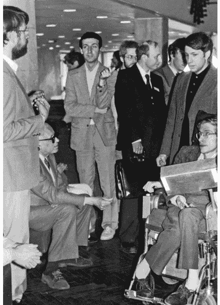

图 32。1987 年在莫斯科的斯蒂芬·霍金和安德烈·林德（站在霍金旁边），以及安德烈·萨哈罗夫（坐着）和瓦赫·古尔扎迪亚。

跳读注释

- *1 剑桥的一种民间传说说，沃森和克里克实际上是在街对角一家名为“老鹰”的酒吧里发现 DNA 的。
- *2 在那时，他通常提供非常热的咖喱。
- *3 为了在较小的圈子里讲笑话时，让别人看着他的肩膀并跟随他屏幕上的每一个字，斯蒂芬开发了这种非常巧妙的措辞方式，使得人们无法从最后一个词判断他是在传达一个深刻的见解，还是一个普通的笑话。
- *4 欧洲核子研究组织
- *5 事实上，这是斯蒂芬在剑桥主持的第二场纳菲尔德会议。第一场关于超引力的会议（被斯蒂芬幽默地总结为“被认为是度过四周意义的方式”）同样令人难忘，黑板创造性地描绘了会议进程，一直装饰着斯蒂芬的办公室直到去世（见插图，第 10 幅）。

# 第 5 章

# 迷失在多宇宙

他找到了阿基米德点，但他将其用来对付自己，显然他被允许在这一条件下找到它。

Man found the Archimedean point but he used it against himself. It seems that he was permitted to find it only under this condition.

> ——弗兰茨·卡夫卡，《随笔》

“我希望你们能造出黑洞，”斯蒂芬面带微笑说道。我们走出了货运电梯，它将我们带到地下，进入了 `CERN` 实验室的五层洞穴，那里驻扎着 `ATLAS` 实验，即位于日内瓦附近的传奇欧洲核子研究组织。`CERN` 的总主任罗尔夫·豪厄尔不安地挪动着脚。那是 2009 年，有人在美国提起了的一项诉讼，他们担心 `CERN` 新建的大型强子对撞机（`LHC`）会产生黑洞或其他可能毁灭地球的其他形式奇异物质。

`LHC` 是一个环形粒子加速器，其建造目标主要是为了产生黑洞或其他可能毁灭地球的其他形式奇异物质。

包含了电子和中微子，统称为轻子。弱力负责某些原子核粒子转化为其他粒子。例如，一个孤立的中子是不稳定的，在几分钟后会衰变为一个质子和两个轻子，这一过程由弱核力介导。第三种也是最后的粒子作用力——电磁力，是人们熟悉的。与强核力和弱核力不同，电磁力和引力一样，具有非常远的作用距离。它不仅作用于原子和分子尺度（将电子与原子核以及分子中的原子结合），也跨越宏观距离作用。因此，并不意外，电磁力与引力共同负责了大多数日常现象和应用，从通信设备、`MRI` 扫描仪到彩虹和极光。

所有可见物质以及支配其相互作用的三种粒子力被整合在一个紧密的理论框架中：粒子物理的标准模型。标准模型发展于 20 世纪 60 年代和 70 年代初，是一种量子理论，用场来描述物质粒子以及力——场即我们之前遇到过的、在空间中扩散的波动物质。根据标准模型，电子和夸克等物质粒子仅仅是扩展场的局域激发。作用于物质粒子之间的力场的粒子类激发被称为交换粒子或玻色子。例如，光子作为介导电磁力的交换粒子，是电磁力的单个粒子量子。

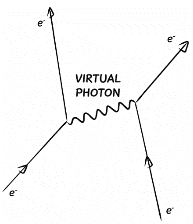

图 33. 所谓的费曼图描绘了两个电子通过交换光子进行量子散射。费曼的量子力学“路径求和”表述规定，必须考虑所有可能的交换（包括涉及多个光子的交换），以计算电子的净散射角。

其在量子场层面的理论基础深刻地塑造了标准模型对粒子世界微观机制的认知。以两个电子之间的相互作用为例。当两个电子相互靠近时，它们会偏转并散射，因为同种电荷相互排斥。标准模型通过两个电子之间交换光子的这种具体方式描述了这一过程。它认为，当两个电子进入彼此的影响范围时，一个电子发射光子，而另一个电子吸收它。作为这一过程的一部分，两个电子都受到了轻微的推，使它们进入了发散的轨道（参见图 33）。但并非全部。费曼的量子力学“路径求和”表述规定，必须相加两个电子之间交换一个或多个光子的所有可能方式，以计算它们的净散射角。这种交换历史的多样性意味着人们无法完全确定相互作用实际发生在何时和何地，这是海森堡不确定性原理的体现。

现在，虽然光子没有质量（就像传递引力的引力子一样），但负责弱核力和强核力的玻色子非常重。这就是为什么核力是短程力，仅在原子核的微观尺度上作用。通常情况下，交换粒子的质量越大，它传递的作用范围就越小。正是这些微观量子的无质量性，使得电磁力和引力能够跨越宇宙。

那么，这就是标准模型的全部了吗？不完全！还有最后一种粒子，即臭名昭著的希格斯玻色子，以英国理论物理学家彼得·希格斯的名字命名，他在 1964 年预言了该粒子的存在。希格斯玻色子是希格斯场的粒子类量子，这是一种不可见的标量场，与早期宇宙中的暴胀场类似，被认为渗透在整个空间，有点像以太的变体。希格斯玻色子是标准模型的关键部分，赋予了所有其他基本粒子质量。在标准模型理论中，电子和夸克、甚至交换粒子都没有内在质量，但它们通过穿过无处不在的希格斯场时所受阻力获得了质量。这就像粒子在移动时不断地在泥沼中行涉，产生的阻力就是我们所说的质量。粒子最终获得的质量取决于它们对希格斯场的感知强度有多强。夸克与希格斯场的相互作用非常强，因此很重；而较轻的电子作用较弱；而完全不与希格斯场相互作用的光子则保持无质量。

这种赋予其他粒子质量的标量场设想最早由谨慎的希格斯提出，并由一对更为华丽的组合——美国人罗伯特·布鲁特和比利时人弗朗索瓦·恩格尔特独立提出。场的粒子类激发在比利被称为布鲁特-恩格尔特-希格斯玻色子，在其他地方被称为希格斯玻色子。它构成标准模型的基石，并最终在近五十年后的 2012 年通过大型强子对撞机（`LHC`）被发现，这一发现是好奇驱动型科学、先进工程和国际合作长期而深层共生的真正胜利。正如宇宙学中暗能量的发现一样，布鲁特-恩格尔特-希格斯玻色子的实验发现再次证明，真空空间并不是空的，而是充满了不可见的场，其中一个场就负责构成日常生活中遇到的几乎一切物质的质量。它还证明了大自然确实利用标量场作为其可用的关键成分之一来塑造物理世界。因此，布鲁特-恩格尔特-希格斯玻色子的发现为可能驱动极早期宇宙暴胀的类似场提供了依据。

需要像 `LHC` 这样的设备才能产生希格斯玻色子，因为希格斯场不仅与其他粒子强相互作用，还与自身相互作用，赋予了自己的粒子类量子巨大的质量 $m$。根据爱因斯坦的 $E = mc^2$，希格斯的质量是许多人认为的自然数值的百分之一。在 2016 年，当 `LHC` 发现它的值时，这一数值变得更加令人困惑，因为理论家并未预言出任何新物种。如果希格斯重得多，质子和中子也会太重，导致无法形成原子。希格斯的极轻又是另一个让我们的宇宙适合生命的属性。

例如，铁棒的磁性在约 770 摄氏度的关键居里温度附近会发生剧变。在高于居里温度的温度下，单个铁原子振动的磁场并没有对齐。在这种情况下，铁棒外的磁场平均值为零，反映了底层电磁学作用力的旋转对称性。然而，当将一根铁棒缓慢冷却到居里温度以下时，具有净磁场的区域会自发形成，这是一种以旋转对称性破缺为特征的定性不同状态，其磁极指向特定的（随机）方向。

这是一个普遍现象。当温度下降时，物理系统的对称性往往会发生破缺，从而产生更丰富的结构和更大的复杂空间。希格斯场也不例外。该场对温度的反应与普通物质非常相似。在暴胀初期，当宇宙的温度比太阳核心温度高出一亿倍时，希格斯场会剧烈抖动并平均为净零，就像居里温度以上的铁棒的磁化状态一样。在渗透整个新生宇宙的零希格斯场中，所有粒子的质量都为零——这是一个高度对称的状态。然而，随着宇宙的膨胀和温度的下降，希格斯场经历了一次转变。这种转变发生在热大爆炸时代 $10^{-11}$ 秒左右，温度下降到了极寒的 $10^{15}$ 摄氏度。在此时，希格斯的热抖动失去了大部分强度，场的行为转而由自相互作用主导。后者由场的能量曲线决定，即它在不同场值下所包含的能量量。但这非常像暴胀子场，当场为零时，其在非零值处的能量更低。在这里，高度对称的零希格斯场突然发现自己处于一种不稳定状态，就像一根立在笔尖的铅笔。图 34 提醒我们，铅笔会通过倒下迅速用对称性换取稳定性，随机选择一个特定方向。同样，零希格斯场迅速凝结，强度随处增强，跃迁到一个具有非零值的、能量上更有利的状态。正是这种希格斯场向非零对称性破缺转变赋予了粒子质量，这是通往复杂性漫长道路上的关键一步。

更重要的是，希格斯场凝结导致的对称性降低，也是触发弱相互作用和电磁力分化的原因。你看，当希格斯场为零时，不仅物质粒子没有质量，传递弱核作用力的交换粒子也没有质量。标准模型的奠基人谢尔登·格拉什肖、斯蒂芬·温伯格和阿布杜斯·萨拉发现，在这种无质量的高温情况下，物理过程将完全不受光子与介导弱核力的媒介粒子之间特定交换的影响。也就是说，弱力将是长程的且与电磁力无法区分。存在一种数学对称性连接着两种力，将它们融合为单一的统一电弱力。但当原始宇宙的温度穿过对称性破缺的希格斯转变时，统一的电弱力分裂为短程弱核力和长程电磁力。

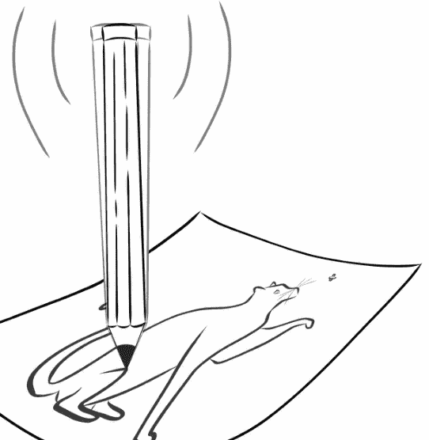

图 34。一支立在笔尖的尖锐铅笔尊重地球引力场垂直向下拉的对称性。然而，这种对称状态是不稳定的，因此铅笔会迅速倒下。铅笔最终的水平状态是稳定的，但它打破了底层引力场的对称性。统一粒子物理理论预言，以类似的方式，生物友好的粒子物理定律反映了一种对称性破缺状态，这种状态在热大爆炸后的宇宙膨胀和冷却过程中逐渐且随机地凝结形成。

因此，将粒子物理标准模型应用于热大爆炸的熔炉所给出的图景是：宇宙在诞生时并不具有我们今天拥有的粒子质量值和力强度。相反，这些是对称性破缺状态的属性，只有在宇宙膨胀和冷却时才凝结形成。这是一个深刻的洞察。它告诉我们，在宇宙扩张的极早期，物理定律的某些基本结构与它们所支配的宇宙共同演化。物理学家说，我们熟悉的粒子物理定律是“有效定律”——即只在扩张后不久出现的相对低能量和低温度环境中成立的规则。

令人惊讶的是，我们可以在粒子物理中发现并使用有效定律，而无需担心甚至不知道在更短距离和更高能量下发生了什么。在某种程度上，大层次化的、嵌套的结构执行得无懈可击。例如，你可以用流体力学方程描述水的宏观行为，将其建模为一种光滑流体，而忽略其 `H2O` 分子复杂的动力学。类似地，你可以在千兆电子伏（`GeV`）以下的能量下，用简化的粒子理论描述质子和中子束的行为，而忽略它们是由三个夸克组成的。过去物理学的巨大成功很大程度上依赖于这种整洁的尺度分离。这实际上是一个警告，当我们试图将引力纳入统一框架并面临这种整洁嵌套结构的局限性时，我们正在陷入多大的麻烦。

显然，在深藏于热大爆炸的最古老进化层中产生的有效定律的确切形式具有最根本的影响。想象一下，如果凝结的希格斯场强度略有不同，那么粒子的质量也会不同。但这些数值即使发生微小变化也会产生深远的影响，通常会排除稳定原子的存在，从而危及化学，再次危及宇宙的宜居性。在标准模型的范围内，我们可以放心：对称性破缺转变的净结果是普遍的。标准模型只是故事的一部分。此外，它还没有考虑到占今天宇宙总质量和能量 25% 的暗物质，并且可能涉及更多种类的粒子。最后，标准模型遗漏了暗能量和引力（即时空的弯曲）。

这一切表明，当我们把宇宙历史追溯到更早时期时，有充足的空间实现更多统一的简单性和对称。尽管我们现在进入了一个更具推测性的领域，但标准模型中分裂电弱力的对称性破缺机制可能以更普遍的方式运行，并且随着我们向更高温度和更早时期迈进，有效定律中更多熟悉的结构将会蒸发。

以物质的存在本身为例。观测到的宇宙包含约 $10^{50}$ 吨物质，但没有反物质。这是它的另一个“生物友好”的属性，因为如果膨胀的宇宙在产生时具有等量的每种物质，所有粒子将迅速与它们的反粒子湮灭，留下一爆发的高能伽马射线，而什么都不留。然而，当 `LHC` 在高能碰撞中产生物质时，它产生了完全相同数量的反物质。宇宙是如何从它火热的诞生中产生并多出这 $10^{50}$ 吨物质的？一定某些东西在超热大爆炸中打破了物质和反物质之间的对称性，稍微偏向了粒子而非反粒子的产生。

这种假设的对称性破缺机制及其相关的类希格斯场是标准模型的扩展部分，被称为大统一理论（`GUTs`），因为它们在一个宏大的统一方案中将电弱力和强核力结合在一起。事实上，大统一理论在很大程度上是由其对称性来定义的。这种策略可以追溯到爱因斯坦，他在 1905 年使用与时空相关的对称性原理作为其时空狭义相对论的基础。洛伦兹抱怨说爱因斯坦只是在假设他和等人一直试图推导出的东西，但历史站在爱因斯坦这一边。自从爱因斯坦以来，抽象的数学对称性已被广泛接受为物理理论的有效基础。在宇宙学背景下，大统一理论预言，如果我们回到极高的温度（是太阳核心温度的几十亿倍），电弱力和强核力本质上将是同一种力，物质与反物质之间本应该是完美的对称性。但典型的大统一理论（`GUTs`）允许在其统一的篮子中，各种组成力之间存在微小程度的混合。这种混合的结果之一是，正电子（电子的反粒子）可以转化为质子——这是一种粒子。尽管这种演变极其罕见，但这种混合提供了一种方式，在宇宙冷却时的转变过程中，产生了略多于反物质的物质，而这一转变过程打破了最初的大统一理论对称性。在这种情况下，所有的反物质随后都会与稠密原始气体中的物质湮灭，使宇宙充斥着高能光子。但会留下一极小部分的物质遗迹，仅占十亿分之一，这部分物质几乎是事后之笔，构成了你和地球上其他一切的约 $10^{50}$ 吨物质。而这些光子反过来则成了我们今天的微波背景辐射，那是宇宙史上最大湮灭事件留下的寒冷而微弱的遗迹。

显然，大统一理论的发展程度远不如标准模型。底层对称性显现所需的能量尺度令人生畏，远超即使是强对撞加速器（`LHC`）所能达到的范围。我们也无法根据对那个遥远时代的寥寥宇宙观测，确定众多可能的大统一理论中哪一个描述了终极大爆炸。但如果我们所依据的广泛对称性原理是正确的，那么我们可以预期物理世界一些最基本的属性（如质量和物质的存在）并不是先天的数学真理，而是一系列对称性破缺的结果，这种破缺将原始对称性转化为复杂性的基础。

而且不仅于此。即使是粒子与力之间的基本区别，也可能在大爆炸的炽热热量中消失。1974 年，物理学家朱利斯·W 和布鲁诺·祖米诺推测，可能存在一种非常通用的对称性，他们称之为**超对称性**，它不仅将不同的力场相互联系，还将力场与物质场联系起来。如果他们的想法是可靠的，那么即使是力粒子与物质粒子之间的区别也可能源于一系列类希格斯转变。这些转变打破了初始的超对称性，可能在此过程中产生了受熟悉四种力之外额外力支配的暗物质粒子。

这里的总趋势是：我们最优秀的粒子物理量子统一理论告诉我们，宇宙从极热的大爆炸中冷却而来，在最初的一分之一秒内，各种数学对称性被打破，引发了一系列转变，逐渐迫使了一组结构化的低温有效法则。随后，我们发现了一个引人注目的更深层次的演化——一种元演化，其中演化的物理定律本身发生了变化蜕变。图 35 描绘了一系列级联的转变——某些已得到证实，许多是假设性的——这些转变将宇宙纯净均匀且对称的开端，转化为最终演化为适合生命的物理环境。


这些非凡的洞见复兴了保罗·狄拉克（Paul Dirac）提出的旧观点。早在20世纪30年代，狄拉克就已经推测，物理定律并非固定且不可改变的真理，它们像水印一样在诞生时就印在宇宙上。“与新宇宙学相关的另一个点值得注意，”狄拉克说，“在时间之初，自然法则可能与现在非常不同。因此，我们应该认为自然法则是随时代不断变化的。[3] 八十年后，在宇宙背景下运行的统一粒子理论，体现了狄拉克关于演化法则的设想。此外，它们在对称性破缺转变中的随机元素，正是我们努力理解为何观测到的法则是现在这样的核心所在。

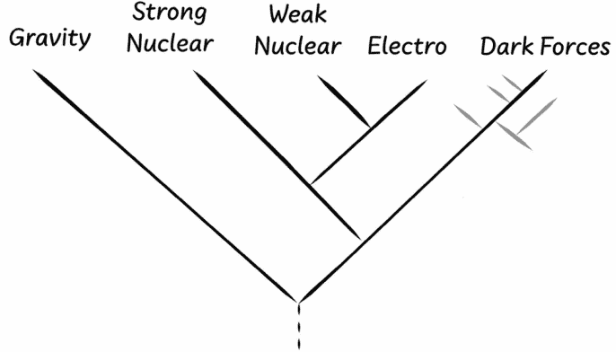

图35。物理法则之树生长于热大爆炸中的一系列对称性破缺转变。统一粒子理论预测，这一最古老的演化层级可能产生完全不同的结果。

还有另一个关键点。在最高能量下占据主导地位的更具野心的大统一理论，并不能唯一确定这种原始演化的结果。恰相反，最宏大的大统一理论预测，对称性有许多不同的破缺方式，导致在宇宙老到一秒的几分之一时，产生了不同的低温法则。这表明，标准模型和暗物质的属性（这两者对宇宙的演化都产生了如此决定性的影响）并非由大统一理论背后的数学唯一决定，而是至少反映了我们宇宙胚胎历史的特定结果。

这种情况在生物演化中是完全熟悉的。第一章提到，生命建立在历史上数量不可想象的“冰结意外”之上，形成了极其巨大的复杂性。从个体生物的功能到物种的特征，再到生命树的分类，生物学中的规律模式编码了无数偶然事件的结果，这些事件在数十亿年的时间里，在一个共同演化的环境中，使得层层复杂性得以出现。生命世界的某些法则甚至可以追溯到对称性破缺的意外，这与我们上面讨论的宇宙转变类似。一个经常被引用的例子是DNA螺旋结构的方向。地球上所有已知的生命体的DNA分子都是右旋的。这种普遍性是惊人的，因为分子化学所依赖的电磁法则对左手和右手DNA是完全平等的。因此，如果生命基于左手DNA，也会同样繁荣。尽管存在一些疯狂的假设，但在37亿年前当生命首次出现时，一次随机意外导致它以右手DNA开始，并且一旦对称性破缺事件发生，这种特定配置就成了其架构的一部分——成为地球上的生命法则。

三种、四种类型的光子，或者可见光与暗物质之间的强相互作用。这些变异将产生与我们的宇宙截然不同的宇宙。大统一理论及其更高级的超扩展都指向一个令人惊叹的结论：粒子作用力的相对强度、粒子的质量和种类，甚至可能包括物质和力的存在本身，都不是刻在石头上的数学真理，而是宇宙诞生后，一个古老且在很大程度上隐藏的演化时期所留下的化石。

然而，你可能会说，这种物理学的达尔文式分支发生在（不到）一眨眼之间，而且处于一个极其原始的环境中。相比之下，地球上的生命是在这个行星复杂的生物圈中经历了数十亿年的演化才来的，而这个生物圈本身也在不断演化。

事实确实如此。在暴胀结束后的十分之一秒内，当宇宙冷却到宜人的十亿度时，有效物理法则的形式已基本结晶。人们本会认为，这真的没有为任何类型的达尔文过程的发生留出空间。然而，在制定有效法则时，重要的不是时间跨度，而是系统所跨越的温度范围。后者在早期宇宙中显然是巨大的，导致了无数次转变，并为这些累积机会塑造低温度下的物理学和宇宙学提供了充足的空间。

那么，到底有多少回旋余地呢？在基础物理法则方面，变异与选择之间的平衡是什么？众所周知，在生物学中，变异的空间是巨大的。从数学上可以构想的基因数量，不用说它们在 DNA 中可能的序列，远超过我们遇到过的任何数字。在地球生命中，只有这些分子组合中的极小一部分实现了。生物学中这种巨大的配置空间意味着机会获胜——压倒性的获胜——而且生物演化是一个强发散现象。事实上，生命树中包含的源自整个演化冻结的信息量，远大于纯化学和物理所推导出的结果。

这促使古尔德（Gould）等人宣布，如果我们能够拨回时间时钟重新运行一遍生物演化，我们将得到一棵完全不同的生命树。

但在热大爆炸之后，是否存在同样广阔的竞技场呢？图 35 所示的物理法则分支树的结构，是由其根部的深层数学对称性决定的，还是主要由历史偶然塑造的？显然，这是一个至关重要的点，也是多宇宙宇宙学家追求的核心目标之一。

为了感受这些可能性，我们必须将通向统一框架的旅程再向前迈一步，将引力纳入其中。

正如我已经提到的，将大统一理论扩展到包含引力带来了完全不同数量级的挑战。首先，爱因斯坦的广义相对论用刚性经典场——时空结构——来描述引力，而标准模型和大统一理论（GUTs）谈论的是量子场。因此，一个统一理论似乎需要对引力和时空进行量子描述。史蒂芬的量子引力欧几里得方法提供了这一点（至少是近似的），但它所依赖的虚时间几何仅捕捉到了引力量子领域的某些一般属性。它们很难阐明时空背后的微观量子的本质。此外，利用量子场已被证明不足以获得引力的完备量子描述。这是因为时空的量子抖动在越来越小的尺度上会变得无限制地增强。时空的微观波动创造了一个自我加强循环，产生更加剧烈的抖动，从而摧毁它的基本结构。与其他在固定时空背景中波动的场不同，引力本身就是时空。当试图调和引力与量子理论时，这就是困难的关键所在。

弦理论登场了。在 20 世纪 80 年代中期，理论学家们通过将点粒子替换为弦作为物理现实的基本组成部分，发现了一条通往量子引力的兴奋新路径。弦理论的核心信条是，如果你在越来越精细的尺度上对物质进行剖析（远小于我们用最大的粒子加速器所能达到的最小尺度），你会在所有粒子的内部深处发现着微小的振动能量束——物理学家们将其称为“弦”。

弦对于弦理论而言，就像原子之于古希腊人一样：是不可分割且不可再分的。然而，与古希腊的原子概念不同，弦理论中所有的弦都是平等的：完全相同的弦潜伏在所有粒子物种之中。这种平等主义确实完美地契合了统一哲学，但你可能会好奇，同一种弦如何赋予单个粒子物种不同的身份，从它们特定的质量、自旋到电荷或色荷。根据弦理论的说法，答案是：不同的振动产生不同的粒子。就像大提琴的不同振动产生不同的音符一样，弦理论预测电子、夸克甚至光子都源于弦的不同模式。

它们最终统一在了一起。更强大的是，在某种意义上，这两大支柱都源于统一的弦理论框架。当弦理论应用于大型且质量重大的物体时，它的规则基本上归化为广义相对论的爱因斯坦方程。当它应用于少数几个振动能量不高的弦时，同样的弦理论规则则产生了通常的量子场理论。

然而，直到今天，该理论的底层结构仍然有些难以捉摸。事实上，如果你询问几位理论学家“弦理论是什么？”，你可能会得到一系列不同的答案。由于无法直接通过实验观测到物质和引力的弦状本性可能显现的超高能环境，弦理论学家在大多数时候不得不用实验输入的缺失，代之以狄克的格言——“寻找有趣且优美的数学”，以进一步发展他们的理论。必须说，在很大程度上，弦理论学家并没有因此感到困扰。多年来，弦理论社区已经发展出了一套自己的制衡体系来判断进展，其标准主要与框架的数学一致性，以及它所提供的理论理解的纯粹深度有关。这已经产生了一门极具创新性的科学。到目前，弦理论领域已经远远超越了将引力与量子力学结合的原始目标。它创造了一个相互连接广泛物理和数学领域的关系网，从超导物理和量子信息理论，到我将在第7章讨论的量子宇宙学。

然而，与广义相对论的爱因斯坦方程，或量子力学的薛定谔方程和狄拉克方程不同，尚未发现一个公认的、涵盖弦理论核心的单一主方程。此外，弦理论的统一力量是有代价的，而且绝非小事：为了弦理论背后的数学能够成立，弦必须在九维空间中运动（忽略歧义性）。这意味着，除了熟悉的长度、宽度和高度之外，弦理论的规则要求存在六个额外的空间维度，以便理论在数学上自洽。[44]

你可能会想，为什么这些额外维度没有立即将该理论作为对我们世界的有效描述排除掉？如果存在更多的维度，我们难道不会注意到吗？然而，这并非一定如此，因为这六个额外维度可能极小，并且在每一个点上紧紧卷曲，而不是像三个熟悉的维度那样在宇宙尺度上延伸。如果是这样，要证明它们的存在将非常困难。这就像从很远处观察一根吸管。吸管看起来是一维的，尽管它有一个环绕它的二维圆形维度，如果你手里拿着吸管喝水，这个维度是可见的。同样，如果这六个额外维度远小于大型对撞机（LHC）或任何其他高能实验目前能够识别的尺度，它们的存在就一直回避了我们的注意。到为止，可能潜伏在空间每个点的六维空间斑块看起来就像……嗯，一个点（见图38）。

但由于弦如此微小，它们确实会进入这六维世界。正如大提琴的形状决定了振动模式的组合从而创造出其独特的音色，弦理论中六维微结的几何形状决定了游离的弦呼吸出何种粒子物种和力。

弦理论将我们可见的三维世界描绘成某种远为复杂的可见、高维现实的影子投影，而我们只能通过间接的方式感知它。

因此，显现出来的图景是：在我们经验的三个大维度中，物质的本质和有效物理定律的形式——包括粒子力的强度、粒子的数量和类型（包括可见和黑暗）、它们的质量和电荷等等，甚至暗能的数量——都取决于潜伏在每个点的六个小维度的卷曲方式。

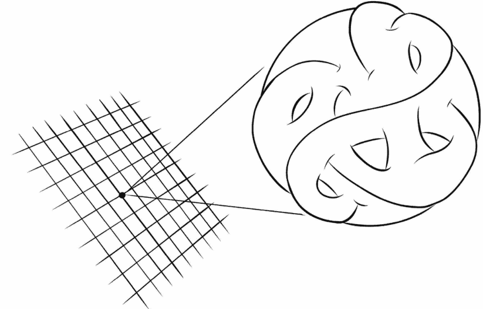

图38。弦理论预测，如果我们能极大地放大空间的织物，我们可能会看到……（此处原文未完，未翻译）

任何有效法则都编码了元素，而量子世界中的涌现受到随机变异的影响。

因此，奇的是，大统一的故事可以从两种方式解读，每种方式都展示了故事的不同侧面。

从低能到高能阅读（即图 35 中从上到下），我们恢复了粒子物理学统一计划的成功故事。随着能量的升高，我们遇到了日益包容的对称性，它们编码着日益深层的数学模式，这些模式将观测到的力、粒子，甚至可能包括暗物质连接在一个愈发包容性的统一框架中。这是粒子物理学对统一的正统解读，也是在实验室中测试这些想法的方式。粒子物理学家要求建造更大型的加速器，以更高的能量对粒子进行撞击，从而探索更深层的统一对称性（在此期间，假设产生黑洞的阈值尚未达到）。这种解读还强调了自然构建块之间的相互依赖性，以及统一理论试图揭示的必然性核心。

从高能到低能阅读（即图 35 中从下到上），我们看到了一系列转换，这些转换创造了物理力和粒子物种的分支树状结构，非常让人想起生命之树（见图 5）。这是宇宙学背景下的自然解读，在这种背景下，膨胀导致冷却，而冷却导致分支。从这个角度看，统一首先是变异的源泉，使得物理法则能够发生突变和多样化，就像数十亿年后生物物种所做的那样。

这些解读之间并不矛盾。它们仅仅是同一枚硬币的两面——变异与选择。

弦理论中惊人的分支路径谱的这一重大发现，证明了多宇宙理论的规则改变者。早在早期，像林德（Linde）和维伦金（Vilenkin）这样的多宇宙论者已经意识到，我们可以预计岛屿宇宙（暴胀结束并转变为热大爆炸的区域）在结构和组成上存在差异。有些宇宙将拥有足够的物质产生数十亿个星系，而另一些则几乎空空如也。有了弦理论，岛屿宇宙之间的变异空间飙升到难以想象的高度。弦理论预测，如果存在一个永恒暴胀的区域，那么它就孕育了极其多样化的岛屿宇宙。每一个宇宙都刻着其诞生的印记，在扩张和冷却时经历了一系列级联转换。整个多宇宙将是一个真正令人困惑、五彩斑斓的宇宙织锦，由弦理论元素的无形之手缝合在一起。

某个岛屿宇宙的居民环顾四周，可能会产生物理定律是普遍的印象——事实也如此——他们甚至可能怀疑定律经过精心设计以产生生命。但在弦理论多变的多宇宙中，这将是一个幻觉。我们所谓的“物理定律”只是局部模式，是反映我们这片空间从热大爆炸冷却的特定方式的冻结遗迹。就像树篱栅栏的尖顶或 DNA 的手性一样，粒子和力的属性并不是宏大设计的一部分，而仅仅是我们宇宙环境的特征。只是那种产生有效物理法则的类达尔文式过程发生在遥远的过去，隐藏了它们的演化特征。

生动地记得列昂纳德·苏斯金德（Leonard Susskind）在“宇宙还是多宇宙？”（Universe or Multiverse?）会议上的讲座“弦理论的人性图景”，那是将弦理论学家和宇宙学家汇聚在一起的首批科学会议之一。会议于 2003 年 3 月在斯坦福大学举行，由林德和保罗·戴维斯（Paul Davies）召集。聚集的理论学家中充满了欢快的气氛。多年来，通向与观测世界唯一匹配的最终理论的进展一直停滞。苏斯金在会议上提出了一个惊人的转折，认为这种追求被误了。他解释说，弦理论建立在坚实且深远的数学基础上，但该理论并不是通常意义上的物理定律。相反，我们应该将其视为一种元法则，管理着拥有无数岛屿宇宙的多宇宙，每个宇宙都有自己的局部物理定律。

同年晚些时候，在南方的圣芭芭拉，卡尔维理论物理研究所（Kavli Institute for Theoretical Physics）举办了它的首个超弦宇宙学计划。在座无虚席的礼堂里，神采奕奕的林德向倾听他每一个字的弦理论学家解释道，他那永恒暴胀宇宙产生机制如何吹出无限增殖的岛屿宇宙，占据了弦理论图景中最遥远的角落。他主张，永恒暴胀将理论中巨大的变异空间变成了真实的宇宙补丁——多宇宙。

然而，令人担忧的是，弦理论的形而上学中并没有说明我们发现处于这种疯狂的宇宙织锦中，以及我们应该期待观测到什么样的宇宙。多宇宙本身是不带感情且不完整的。也就是说，需要人择原理。通过将多宇宙与人择原理结合，该理论可以获得预测能力。对零的根本解释的搜索很快被一种信念所取代：在巨大的多宇宙中，暗能量的数量从一个岛屿宇宙到另一个随机变化，而人择原理选择了我们观测到的极小但非零的值。

从我们看来，真正触发宇宙学中人择原理“革命”的是弦理论中这些新理论洞察与指向渗透空间的无形暗能量的新颖观测之间的卓越相互作用。我之前提到过，在 21 世纪初，令所有人惊讶的是，对超新星的天文观测表明宇宙在过去的五十亿年来一直在加速。理论学家在忙于寻找解释时，复活了爱因斯坦臭名昭著的 $\lambda$ 项，其暗能量和负压导致引力在大尺度上产生斥力。然而，解释观测到的加速所需的暗能量量——宇宙常数的值——小得惊人：比任何自然值都要小得多，令人震惊。这种预期与观测之间令人尴尬的差异与量子力学有关，量子力学预测真空空间充斥着虚粒子。与真空中所有这些活动相关的能量实际上产生了一个宇宙常数。但当物理学家加上所有虚粒子的贡献时，他们发现 $\lambda$ 是一个荒谬的大数字，其宇宙常数的规模大到在星系形成之前就会撕裂宇宙。现在，直到 20 世纪 90 年代，大多数理论学家认为理论的核心存在一个尚未发现的对称性原理，它将暗能量唯一固定为零。但 2000 年初的发现——该理论孕育着扩张的多宇宙——结合宇宙常数不为零这一惊人观测，促成了对“什么是自然”视角的剧烈变化。

事实上，如果岛宇宙中的 $\lambda$ 只比我们观测到的值大那么一点点，那么它们将在大爆炸后数百万年而非数十亿年后开始加速，导致物质没有时间聚集。[6] 如今，如果没有星系，宇宙将是一个死寂的地方。因此，温伯格得出，我们存在的这一事实自然地引导我们关注那些仅带有极微暗能量痕迹的岛宇宙，它们处于一个极其狭窄的宜居窗口内。


另一方面，我们不应期望暗能量密度比我们生存所需的密度小得多。这是他论点中的人择色彩。温伯假设我们是居住在多宇宙岛宇宙中的随机观测者，这些岛宇宙采样了几乎所有可能的 $\lambda$ 值，即使是在与生命兼容的窄值范围内。绝大多数宜居岛宇宙的暗能量密度将接近生命设定的上限，因为要选择一个更小的 $\lambda$ 值需要过度的精调。沿着这一思路推论，他得出结论：观测到的暗能量数量不应该是零（正如当时人们普遍认为的那样），而应该尽可能大，只要不破坏星系的形成即可。这一结论导致温伯早在 1987 年就预测，天文观测有一天可能揭示宇宙学常数并没有消失，而是取了一个非常小的非零值。十年之内，超新星观测证明了他是正确的。

此外，弦理论为温伯在他思想实验（`gedankenexperiment`）中假设的那个极其多样的多宇宙提供了支持。就这样，在一系列非凡事件中，关于 $\lambda$ 的观测、理论化和人择推理所构成的三角形——每一项本身都是革命性的——在 21 世纪初汇聚在了一起。正是这些理念的汇流导致了人择多宇宙宇宙学，这一新范式为苏斯金德等人所接受的对宇宙精调视角的剧烈变化提供了动力。

如果那里存在一个多宇宙，那么仅仅由于偶然，这里也会存在罕有的、拥有适宜生命局部法则岛宇宙。显然，生命只会出现在那些岛宇宙中。其他条件不宜生存的宇宙将保持未被观测状态，简单因为我们无法在不存在的地方观测。人择原理的作用是在多宇宙中选择宜居岛屿，即使这些岛屿极其罕见。总而言之，人择多宇宙宇宙学似乎解决了古老的设计之谜：我们居住在一个由人择原理在大部分死寂的宇宙马赛克挑选出的稀有宜居斑块中。

乍看，这种思维方式与我们解释可观测宇宙内普通选择效应的方法并没有很大区别。我们无法存在物质密度低到无法形成恒星的宇宙区域，也不会存在于碳等元素供应良好之前的时代。相反，我们居住在一个岩石行星上，被大气层环绕，位于一个特别稳定宁静的恒星系统的宜居带内，在大爆炸发生几百亿年后，因为这是一个特别宜居的环境，智能生命在此有机会发展。同样，人择多宇宙宇宙学说，我们不太可能在一个物理条件排除了我们存在的宇宙中进化出来。从某种意义上说，人择原理认为，我们发现可观测宇宙的物理学之所以是这样，是因为我们在这里。

斯蒂芬对此并不为然。他非常不同于苏斯金、林德以及他们的追随者的观点，即宇宙显眼的宜居设计需要一个解释。他深表反对人择多宇宙宇宙学解释了任何问题。在从圣芭芭拉的会议返回帕塞迪纳的路上，我们在比弗利山山的一家古巴舞厅停了下来，斯蒂芬抽出跳舞的时间表达他对新弦宇宙学的不满。“永恒膨胀和多宇宙的拥护者在典型观测者会看到什么的问题上让自己陷入了困境，”他在古巴萨萨舞的节奏中打下这些文字，“在他们的蓝图中，我们都是中国人，而灾难近在咫尺。”

在世纪交之年，斯蒂芬日益担心宇宙学中的人择推理破坏了作为科学心脏的理性方法。这可能是一个难以理解的微妙点，但请听我解释，因为我们已经来到了“林德对阵霍金”争论的核心。

基本问题是，人择原理依赖于一个假设——这个假设往往被掩盖——即以某种方式或另一种方式，我们是多宇宙的典型居民。为了进行人择推理，即必须首先指明什么是典型的，什么是不典型的。这是通过挑选出物理世界中被认为对生命重要的某些人择属性（`anthropic properties`）来完成的。

宇宙学家将此称为多重宇宙学中的“测量问题”（`measure problem`）：我们缺乏一种明确的方法来衡量不同岛屿宇宙的权重，这在涉及到我们的观测时削弱了该理论的预测能力。事实上，当我们试图预测与生命无关的宇宙属性时，这一测量问题表现得尤为尖，人择原理并没有提供任何逃避的路径。

我们陷入了一个教科书式的危机。原本希望人择原理能够在永恒暴胀的宇宙拼图中指明“我们是谁”，将多重宇宙理论与我们观测者的经验联系起来。然而，它未能以符合基本科学实践的方式将“我们”引入方程。

事实上，在不变的物理法则之外援用随机选择过程，掩盖了一种决定性的非人择视角。随机选择想象我们从外部审视宇宙，并“选择”了像我们这样的存在。如果某种形而学的机构确实执行了这种操作并预知了结果，这或许是合理的。然而，这没有任何证据。仅仅注意到我们人类生活在一个执行了随机选择行为的宇宙中，是谬误的推理。因此，我们不应认为是从随机选择的集合中推导出理论预测。事实上，我们完全可能（也并非不可能）生活在一个许多方面都是非寻常的法则宇宙中。事实上，这正是对称破缺转换的随机性应该预期的。

观测到的宇宙及其物理法则、恒星和星系的配置偶尔孕育了生命。无论这是否全部还是作为巨大多重宇宙的一部分，逻辑情况都是相同的：我们所观测的这个宇宙，展现了一系列极其适合产生生命的物理属性。无论遥远的宇宙正在或可能发生什么，当我们试图理解这个宇宙的设计时，都是完全无关的。

基于寻常性的推理陷阱在其他历史科学中——从生物进化到人类历史——都太熟悉了。如果达尔文假设我们是寻常的，他会考虑包含各种生命树的类地行星集合。他那时将会尝试预测我们——即地球上的人类这一特定实例——应该是所有可能的生命树中最常见的那种。这意味着，他将完全忽略了他的核心洞察，即每一次分支都涉及一场机遇的游戏，而我们所知的生命树包含了数十亿生物实验中数万亿次偶然的转折，而非外部的随机选择。

生物进化中可能性的巨大空间意味着任何对为何会有这种特定生命树的因果决定论解释注定失败。这就是为什么生物学家只能事后工作，描述一个给定结果如何回到特定的分支序列。如果有的话，寻常性可以作为一个指导原则，来解释生物圈一些最通用的结构属性。

弦理论在大爆炸后形成有效法则方面，连接了同样广阔的可能性路径空间，这是一个涉及随机跳跃和一系列对称破缺转换的量子过程。因此，给定结果既不需要寻常也不具有先验概率。与现代生物学不同，人择多重宇宙拒绝这种随机性，坚持一种将“为什么”置于“如何”之上的根本决定论解释方案。然而，生物学的案例表明，这为理解宇宙设计的出现提供了一个错误的基础。诺奖得主大卫·格罗斯长期持有这一观点：“我们对宇宙的观测和了解越多，人择原理就越显得糟糕。”

多重宇宙理论认为，整个进化概念存在根本性的限制。在不变法则的固定背景下，将通向有效物理法的古代进化框架化，多重宇宙学遵循的毕竟是物理学中一种相对正统的解释方案。它假设在物理学和宇宙学的底部我们会找到稳定的、永恒的法则。这些法则被假设为治理整个宇宙拼图的核心主方程，从中对像我们这样的低能观测的概率预测是可以计算的。在这个宏大的框架中，多重宇宙仅仅是牛顿认识论上的一个轮圆，类似于古代人为了拯救托勒密世界模型而增加轮圆的方式。进化和涌现在多重宇宙学中最终是次要现象，相对不那么根本。这是霍金与林德之争的核心：在深处，是变化还是永恒获胜。

就这样这样？贝弗利山的那个夜晚，在人择多重宇宙革命之后，背景音乐播放着古巴乐队，史蒂芬准备彻底抛弃人择原理。“让我们认真这样做，”他说。不再满足于将宇宙学理论的可证伪性外包给非科学原理，我们发誓要重新思考它的基本基础。设计的谜题将带我们深入物理学的最根源，而我们只能自力更生。弦理论学家在另一个宇宙中。

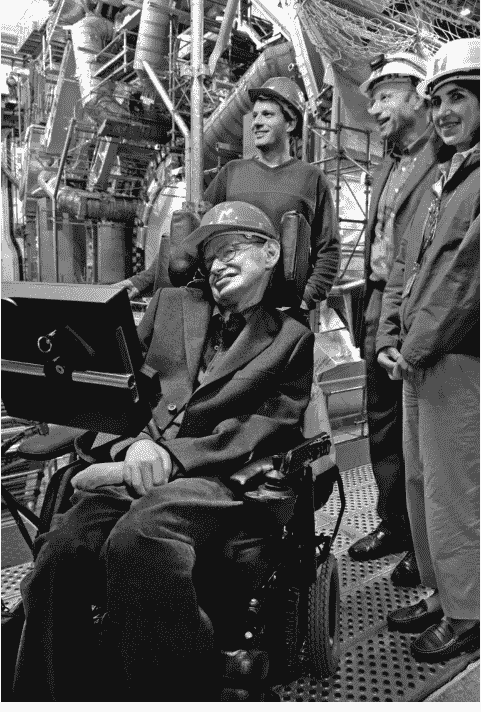

图 39。史蒂芬·霍金与作者，2005年

## 第6章

### 没有问题？就没有历史！

> 物理学问题

- 阿奇巴尔德·惠勒

我们曾有一种旧观念，认为那里有一个宇宙，而在这里，为了观测宇宙，人们必须能够看到它。这是在我毕业后不久，我们合作几年后。我的妻子和我正沿着丝绸之路在亚洲旅行。收到史蒂芬的一封邮件，敦促我去看他。由于担心，我们立即出发。然而，在试图离开阿富汗时，我们被困在跨阿穆河的一座桥上，这是一条流经乌兹别克斯坦和阿富汗的河流。桥中间唯一的守卫解释进入阿富汗的关口关闭了。我告诉我们要出去而不是进去，但这对他没有影响。在马马的乌兹别克斯斯坦领馆，我们在谈判通行证时展示了史蒂芬的简信。事实证明，他就是史蒂芬·霍金，几分钟后，他亲自开车带我们过桥进入乌兹别克斯坦，以便前往剑桥。

DAMTP已经离开了剑桥市中心，成为了一个由圣约翰学院球场围成的、新建的数学科学校园的一部分。史蒂芬那间宽敞、明亮的角办公室俯瞰着校园，且变无常——这与我们最初见面时那个灰暗、昏暗的银街办公室完全不同。当我冲向他时，他的眼睛里闪烁着兴奋的光芒，我隐约明白了原因。

众所周知，实验室被专门设计用于从外部视角研究系统的行为。实验室科学家严丝合缝地维持着他们的实验与外部世界之间的纯粹分离。（而且，欧洲核子研究中心（`CERN`）的实验粒子物理学家应该安全地远离他们的高能碰撞！）正统物理理论反映了这种分离，在受自然法则支配的动力学与代表实验安排及系统初始状态的边界条件之间，划有一道清晰的概念界限。前者是我们寻求发现和测试的，而后者则是我们努力控制的。这就是我在第三章中描述的二元论。

这种法则与边界条件之间的尖锐划分，使得实验室科学具有了严谨的预测性，但也限制了它的范畴，因为我们无法将整个宇宙挤进实验室的“束缚衣”之中。预判到斯蒂芬的想法，我有力地回答：“在宇宙学中‘上帝视角’显然是谬误的”。我们处于宇宙之中，而不是在宇宙外的某个地方。

斯蒂芬表示赞同并全贯贯地构思着下一个句子。

“未能意识到这一点，”他按了一下键盘，“导致了我们陷入了一条死胡同。我们需要为宇宙学寻找一种新的[物理学]哲学。”

啊，我笑了，终于该谈哲学了！

他暂时放下对哲学的疑虑，点了点头——并挑起眉毛。我们逐渐理解，林德与霍金之争，并仅仅是关于一种宇宙学理论与另一种理论的辩论。多宇宙争端的核心，在于关于物理理论更深层认识论本质的核心问题。我们如何与我们的物理理论建立联系？物理学和宇宙学的那些惊人发现最终对于存在这一宏大问题告诉了我们什么？

自从现代科学革命以来，物理学通过采纳对宇宙的神一般的视角而繁荣发展——并非作为创造者——至少不总是如此——而是从理论视角出发的。

当哥伯尼挑战古人的地心世界观时，他是通过想象自己正从星辰的视角俯瞰地球和太阳系来实现此的。他关于行星沿圆轨道运行的假设，意味着他的日心模型是不准确的，当时的天文观测也是如此。[2]。然而，通过将地球和行星想象得仿佛它们悬浮在自身上方，哥伯尼开启了一种思考宇宙以及我们在其中地位的革命性新方式。他发现了物理学和天文学中所谓的“阿基米德点”，即认为存在一个遥远的视角，通过该视角可以获得客观的理解。[2] 虽然这一思想所催生的新科学花费了几世纪才发展起来并改变世界，但哥伯尼革命仅用了几十年时间，就开启了一个全新的概念现实，在这个现实中，人类不再是宇宙的焦点。[3]

今天我们知道，哥伯尼的著作仅仅是对阿基米德点不懈追求的开始。在过去的几个世纪里，哥伯尼视角深深地植根于物理学语言。无论我们今天在物理学中做什么，无论是加速粒子、合成新元素，还是捕捉微弱的宇宙微波背景（`CMB`）光子，我们总是推理得好像我们是从一个外部的抽象点在处理自然——如果你愿意，可以称之为“无处视角”。[4]。在并非真正处于“无处”、却仍受限于地球及其地球条件的情况下，物理学家发明了越来越精妙的方法，去行动并思考，正如我们客观上所构想的那样去理解宇宙。

没有任何其他发现能像牛顿运动定律和引力定律在这一追求中提供更大的飞跃。牛顿理解，自柏拉多以来一直困扰科学者的数学与物理世界之间的关系，涉及到动力学和演化，而非永恒的形状和形式。他的定律的成功和普遍性强化了这样一个观点：科学正在发现关于世界的真实客观知识。牛顿试图在他的工作中实现一种“无处视角”，将所有运动都归于一个由遥远星辰所标记的虚想固定空间舞台，一个被他认为是不改变且不移动的绝对空间。他的引力定律和三大运动定律规定了物体如何绕着那个舞台运动，但没有任何东西能改变绝对空间本身。绝对空间和绝对时间，就像牛顿物理学中坚如磐石的脚架，一个上帝赐予的固定且永恒的竞技场，一切都在其中上演。

然而，牛顿这种绝对性的背景并不完全如此。

我们这些受限于生活在地球条件下的人，如何可能同时客观地观察我们的世界？现代科学时代黎明时，即时的哲学反应并非胜利的狂喜，而是深刻的怀疑，这始于笛卡尔的《一切皆疑》（`De omnibus dubitandum`），以及他对于真理或现实这类事物是否存在的深远怀疑。引发科学革命的重大洞察——“无知”（`Ignoram`，“我们并不知道”）——也对世界的信心造成了打击。20世纪最著名的思想家之一汉娜·阿伦特（`Hannah Arendt`）在《人类境遇》中尖锐地阐述了这种不安的、矛盾的立场：“伽利略的巨大进步证明了人类推测最糟糕的部分——我们的感官背叛了我们——以及它最自以为是的希望——即从一个外部点来开启宇宙知识的阿基米德式愿望——只有同时才能实现。”[[6

笛卡尔对科学革命的答案是将阿基米德点转向内部，转向人类自身，并选择心灵作为终极参考点。现代时代的黎明让人类回归自身。源自“我思故我在”（`Dubito ergo sum`）。因此，科学革命产生了一个悖论性的局面：人类向内看，而他们的望远镜（以及随之而来的实验和抽象）将他们带向了亿万光之外。五个世纪后，这两种相反运动的结合让人类感到迷茫和困惑。在一个层面，现代科学和宇宙学揭示了宇宙本质与我们存在其中之间最奇妙的相互联系网络。从数代恒星中碳的融合，到星系的量子种子，我们对宇宙的现代理解揭示了一种奇妙的合成。然而，在更基础的层面（即斯蒂芬试图解锁的层面），这些发现让人类对自己在宏大宇宙图景中的地位感到极度不确定。现代科学在我们对自然运行规律的理解与人类目标之间制造了裂痕，这侵蚀了我们对这个世界的归属感。

史蒂芬·温伯（`Steven Weinberg`）

“该停止扮演上帝了，”斯蒂芬在我们吃完午饭回来时宽脸笑着说道。

新数学校园的食堂与旧数学和粒子物理研究所（`DAMTP`）热闹的休息室相比大相径庭，那里曾促进了如此优秀的科学研究和良好的友谊。这个新食堂的主要问题不在于食物不好，而是我们不被允许在桌子上涂写方程。

因为斯蒂芬似乎同意哲学家们的观点。“我们的物理理论并不是免费地住在柏拉图式的天堂里，”他们打着字写道，“我们不是从外部观察宇宙的天使。我们和我们的理论本身就是我们所描述的宇宙的一部分。”

他继续说道：

“我们的理论永远不会与我们完全解钩。”[7

这是一个显而易见且看似同义反复的观点：宇宙学理论化最好考虑到我们在宇宙中的存在。一个显而易见的事实是我们住在银河系中的一个行星上，被恒星和其他星系环绕，沉浸在微波背景辐射的微弱光芒中，这意味着我们必然对宇宙拥有一种“由内而外”的视角。斯蒂芬称之为“虫视角”（`worm's-eye viewpoint`）。难道尽管这听起来很悖论，我们必须学会接受这种虫视角中固有的微妙主观性元素，以便在宇宙学中获得更高层次的理解吗？

当我们思考这些问题时，斯蒂芬的办公室已经变成了一个鸽子笼。同事、医务人员到名人进进不断，但斯蒂芬似乎对周围的狂热视而不见。像通常一样，我注意到适的混乱恰恰是他集中注意力所需要的。在我们习惯的下午茶歇期间，他一边给我倒茶，一边狼口吞掉一大盘香蕉和奇异果，我们会再次聚焦于多宇宙宇宙学的古典基础，将其认为是宇宙学中持续存在的“上帝思维”的罪魁祸首。

多宇宙的支持者坚持“上帝视角”，因为他们假设从全球范围内来看，宇宙有一个单一的历史，表现为一个具有明确起点和独特演化的确定时空。这基本上是一个经典图景。

公平地说，多宇宙宇宙学是量子思维和经典思维的混合。一方面，人们想象随机的量子跃迁产生了各种岛屿宇宙。另一方面，人们假设这发生在一个巨大的、预先膨胀的空间内。后者在多宇宙理论中充当古典背景——一个脚手架，与牛顿的舞台不同，这个舞台在不断膨胀。这种背景使得可能（而且确实非常有诱惑力）在我们处于外部时去思考这个岛屿组成的马赛克，仿佛岛屿宇宙的创造在根本上与普通的实验室实验没有区别。

斯蒂芬继续点击击字器来强调这一点。他说，多宇宙导致了一种自下而上的宇宙学哲学，在其中，人们想象沿着时间向前演化宇宙，以预测我们应该看到什么。

作为一种解释方案，多宇宙理论赞同牛顿和爱因斯坦的本体论计划，以及他们对宇宙的根本性的因果和决定论推理。这种思维的相关表现是：多宇宙中给定岛屿宇宙的居民被认为拥有独特且确定的过去。

“但你和吉以同样的自下而上的方式构思了你们的无边界理论，”我提道，“尽管那应该是量子的。那种缺陷的因果观是你们在《时间简史》（`A Brief History of Time`）中描述的愿景。”

似乎由于我的这段话，我们触及了一个关键点。斯蒂芬抬起眉毛，迅速继续点击。

当我等他组织好句子时，我翻阅了他在身后书架上找到的1965年的博士论文。我在结尾处看到一段话，他在其中详细阐述了他刚刚证明的大爆炸奇点定理，指出这意味着宇宙的起源是一个量子事件。斯蒂芬后来不得不开发无边界假设来描述这个量子起源（见第3章）。然而，他通过经典宇宙学的因果透镜诠释了他的无边界理论。

从自下而上的观点来看，无边界假设描述了宇宙从无中产生的过程。该理论被视为另一个柏拉图式的建筑，仿佛它居住在时空之前的抽象“无”之中。当吉姆和斯蒂芬首次提出他们的边界起源论时，他们希望为宇宙的起源提供一个真正的因果解释，不仅关于它是如何产生的，还关于它为何会存在。这进展并不顺利。作为一种自下而上的方案，无边界假设预测了一个没有星系和观察者的真空宇宙。这理解地使得该理论极具争议，正如我在第四章中描述的那样。

斯蒂芬停止了点击，我靠在他的肩膀旁。“我现在反对宇宙具有全局经典状态的想法。我们生活在量子宇宙中，因此它应该由历史的叠加来描述，每个历史都有自己的概率。”

斯蒂芬开始背诵他的宇宙学格言。为了衡量我们是否还在同一频道上，我重新表述了我认为他表达的意思：“你是说，我们应该采取一种全面的量子观，不仅针对宇宙内部发生的事情——粒子和弦的波函数等等——而且针对宇宙整体。这意味着反对存在某种全局经典背景的想法。相反，我们应该将宇宙看作许多可能时空的叠加。因此，量子宇宙即使在大尺度上，在超出我们宇宙视界的永恒膨胀相关的尺度上也是不定的。而这种大尺度的模糊性为林德和多宇宙爱好者假设存在的永恒背景投下了一颗炸弹。”

令人松口气的是，他的眉毛再次抬了起来，这次动作慢了许多，似乎在犹豫。但最终得出了结论：“我们所观察到的宇宙是宇宙学中唯一合理的起点。”

能够维持基本的科学原理吗？在哥白之后五百年，那将是某种非凡的统一。

再次缓慢地，在我们在这种库恩式的范式转移中面临的混乱之中心，斯蒂芬聚集起所有的能量，似乎又整合出了一线：

“我认为，一种恰当的量子视角[对于宇宙而言]将导致一种不同的宇宙学哲学，在这种哲学中，我们从自上而下、沿着时间倒流的方向，从我们观测的表面开始工作。”]

我惊呆了——斯蒂芬这种新的自上而下的哲学似乎将颠覆宇宙学理论中因果关系的关系。当我向斯蒂芬提到这一点时，他笑了。他显然沉浸在发现的甜美中，毫不掩饰。在我们离开的路上，我们以标志性的简洁和雄心勃勃表达了我们全新的视角：

宇宙的历史取决于你提出的问题。晚安。


斯蒂芬是什么意思？当然，量子力学中“观测行为”的关键作用——正如斯蒂芬所说，即提出的问题——自20世纪20年代该理论诞生起就已被认可。量子力学最令人惊讶的特征之一，就是实验者的观测和测量显式地进入了预测过程。

事实上，这一特征正是让爱因斯坦对量子力学感到困扰的。当第一代量子物理学家于1927年10月在布鲁塞尔召开第五届索尔瓦会议时，他们正在庆祝一种全新的、胜利的微观世界理论。据报道德国物理学家马克斯·玻恩说物理学将在六个月内结束，这与埃内斯特·索尔瓦最初的设想也并不远。索尔瓦在1911年建立这些会议是为了为期三十年，因为他认为到那时物理学将向世界提供它所能提供的一切。[8]

然而，对于这位二十世纪最大的科学革命家之一来说，新的量子力学被证明太难以接受。当第五届索尔瓦会议开始时，爱因斯坦对量子理论感到深感不安。他拒绝了洛伦兹发表论文的邀请，据报道他在会议期间非常安静。然而，正式会议并不是讨论的唯一论坛。科学家们住在同一家酒店，在餐厅里，爱因斯坦要活跃得多。诺贝尔奖得主奥托·斯特恩为我们留下了这段第一手记录：“爱因斯坦下楼吃早餐表达了他对新量子理论的疑虑。每当他发明某种完美的实验时，人们就能看到该理论的核心包含一个逻辑上的不一致性……玻尔会仔细思考它，并在晚上的晚餐时详细地解决这个问题。”[9]

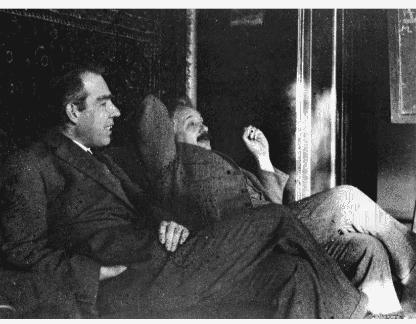

图40. 尼尔斯·玻尔和阿尔伯特·爱因斯坦在比利时布鲁塞尔参加第六届索尔瓦会议。

爱因斯坦反对这种量子观点，即粒子在被观测时处于确定位置，而在未被观测时只有出现在此处或那里的概率。“物理学是尝试把握其本身的现实，而不取决于它是否被观测，”[101]他反对道，并开玩笑地想，粒子是否需要人类观察者才能采取确定的位置，还是老鼠随口一眼就足够。

对于爱因斯坦来说，量子力学的概率性质意味着该理论是不完全的，必须有一个更深层的框架，允许对物理现实进行客观的描述，无论是否有任何观测行为。“[量子]理论产生了很多结果，但几乎没有带我们接近‘老者’的秘密，”他写信给玻恩。“无论如何，我信他不掷骰子。”[111]

另一方面，尼尔斯·玻尔既有哲学又有数学背景，他有一种深刻的直觉，认为量子力学是自洽的。玻尔严肃对待量子力学的核心原则——观测性——我们向自然提出的本质问题——自然是如何表现自身的。“任何现象在成为被观测现象之前，都不是真实的现象，”他认为。

索尔瓦引发了二十世纪最伟大的辩论之一的序幕：爱因斯坦对阵玻尔。在量子革命的深度和规模上。

在一个层面上，他们的辩论关于物理学中因果律和决定论的基本地位。凭借其随机跳跃和概率预测，量子力学显然破坏了在经典物理学中完全熟悉的、关于我们现在所在地与我们未来去向之间的直接联系。我们对自然描述中这种因果律和决定论的缺失是暂时的权宜之计——爱因斯坦的立场，还是物理理论的根本性重构——玻尔的立场？

但他们的辩论还深入了量子力学的深层本体论。为了回应爱因斯坦的反对，玻尔被迫澄清是什么诱导量子力学中的波函数从一种模糊幽灵般的现实叠加转变为日常经验的确定现实。我们观测到的不是现实的叠加；实验者发现粒子要么在这里，要么在那里，而不会既在这里又在那里。这到底是如何发生的？哥本哈根学派给出的大胆回答是，这种转换归因于实验者的干预本身。玻尔假定测量行为促使自然做出决定，并揭示这种现实或那种现实。你看，当我们决定测量某个粒子的位置时，我们必须对其施加某种影响，例如通过激光。玻尔断言，这种影响导致粒子的扩散波函数坍缩到一个单一位置——即观测位置。释放激光，波函数将再次扩散，根据`薛定谔方程`平滑演化，正如我在第三章中描述的那样。照射并测量，波函数将再次扩散，根据`薛定谔方程`平滑演化。

玻尔方案的问题在于，这种突然的坍缩与`薛定谔方程`是不一致的。根据`薛定谔方程`演化的波函数不会突然坍缩，而是平滑、轻轻地波动。这意味着哥本哈根方案等同于所谓的工具主义解释，一种接受基础差异的解释……在多重宇宙中。

玻尔和爱因斯坦在多年里完善了他们的立场，从未达成共识。回想起来，我们重视玻尔的深刻洞察力，即观测过程在量子宇宙中产生物理现象起着关键作用。另一方面，他关于波函数突然坍缩的描述是有严重缺陷的。今天所有的证据表明，`薛定谔`的数学不仅适用于少数粒子的微观集合，也适用于构成宏观系统的规模更大的粒子集合，包括实验室、观测者乃至整个宇宙。因此，爱因斯坦是正确的，他没有被玻尔的方案所说服。然而，他错误的在于追求一种基于预测框架的替代物理学理论，这种框架再次让观测者变得无关。

所有可能的历史路径。也就是说，埃弗特迈出了具有里程碑意义的一步，开始从向外的方式思考量子世界，将其视为一个闭合系统，不受任何外部干涉。图 41 唤起了这种观点，将`薛定谔的猫`连同观察者和他的实验室一起放在一个大箱子里。

那么，埃弗特面临的巨大挑战就是解释，例如在测量情情况下，宇宙波函数如何产生一个单一、具体的答案，同时避免了坍缩。这正是他的推理变得令人兴奋且震惊的地方。

埃弗特仔细考虑了究竟什么构成了量子观测的行为。他推理道，当实验人员进行测量时，他们与被测系统的相互作用会将几个粒子纠缠，然后是他们的仪器，最后是他们的心理状态与系统的量子态纠缠。`薛定谔方程`告诉我们，这种纠缠使得他们的复合波函数不会发生神秘的坍缩（正如玻尔所主张的那样），相反，而是分支成不同的碎片，对应测的每种可能的结果。因此，通过对包含观察者和被观测者的宇宙波函数进行推理，埃弗特能够让所有可能的测量结果保持悬空状态。当然，这也意味着观察者也发生了分裂。量子力学中的观察者分化成几乎完全相同的副本——每人一个——唯一的区别在于所记录的测量结果。

以`薛定谔的猫`为例，这是`薛定谔`描述的那个著名的困境：将一只猫放在一个密封的箱子里，箱上方有一个爆炸物，如果旁边的放射性原子核衰变，爆炸物就会爆炸（见图 41）。在给定时间内，这种情况发生的概率为 50%。基于实验室的哥本哈根解释从外部视角观察箱子，预测猫处于处于与死的叠加态，直到箱子被打开，观察者看向它，迫使猫做出决定。这不符合逻辑。猫不能处于“半死”状态，就像人不能“半怀孕”一样。但埃弗特的向外视角讲述了一个完全不同的故事。它说，在这样的将猫的命运与放射性原子核命运纠缠的实验中，宇宙的历史不断分支。在一种历史中，原子核在给定时刻衰变，爆炸物爆炸，猫死去了。在另一种历史中，原子核没有衰变，猫快乐地多活了一段时间。整个分支过程平稳地发生。两只猫都没有经历不寻常的叠加，尽管其中一个副本显然比另一个幸运得多。

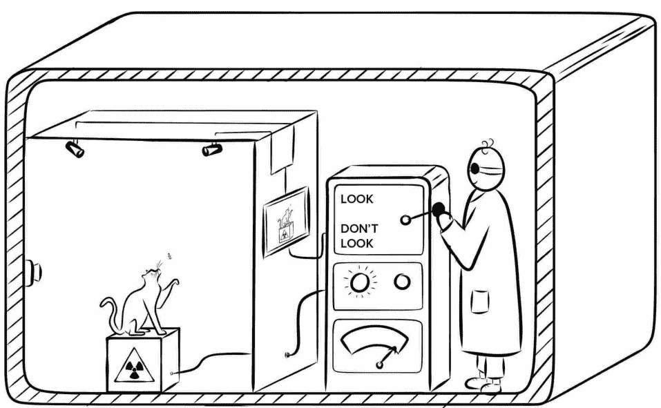

图 41。埃弗特将宇宙想象为一个闭合量子系统，一个不仅包含粒子和实验，还包含观察者、他们的仪器以及原则上所有其他东西的大箱。这里显示的箱子宇宙可能的历史包括：观察者决定以及何时看猫、他在看时放射性原子核是否已经衰变、这种情况在观察者的大脑中如何被记录和解释等。埃弗特寻求一种量子力学的表述，以预测描述大箱内发生情况的不同历史的概率，而无需从外部对箱子内部进行观测或其他干涉。

因此，从实际用途考虑，埃弗特波函数的各个碎片表现就像现实的不同分支。每个波碎片描述了一条特定的历史路径，由记录特定结果的测量设备、观察者对该结果的意识以及随之而来的这一切——实验室、地球、太阳系和大规模宇宙组成。对于生活在给定分支中的观察者来说，整个分化过程是无缝的，就像河流分成两条溪流。没有观察者意识到“副本”的存在，因为他们将在不同的历史中度过余生的生活，在宇宙量子波的不同岸边上冲浪。“只有这些观察者状态的总和，以及它们多样化的知识，包含了完整的信息，”埃弗特宣布道。[13]

埃弗特自己说以某种方式桥起了爱因斯坦和玻尔的观点。他声称他们的差异是观点问题，并将他的方案描述为“客观决定论的，概率出现在主观层面”。这是一个有趣的点。在量子力学的早期哥本哈根表述中，概率是公理且基础的。翻开 20 世纪 30 年代的量子力学教科书，你会在前几页之一发现概率被定义为波函数幅的平方。在埃弗特的框架中情况并非如此，概率是以一种更微妙的“主观”方式进入量子理论的，就像概率进入我们日常生活的思维方式一样。无论我们是在思考天气、彩票，还是下一道通过地球的引力波的形状，我们一直在使用主观概率来量化我们在知识不完全的情况下下的不确定性。这种概率概念由意大利数学家布鲁诺·费内提形式化，他在 1974 年写了一篇论文，“我的论点，矛盾且带有一点挑衅性，仅仅是：[公理化的]概率不存在……只存在主观概率，即给定人在特定时刻根据给定的信息对某一事件发生的信念程度。”[14] 而这就是日常生活中发生的情况。在我们一生中，大多数人对主观概率充满信心，因为我们发现认为可能发生的结果经常发生，而那些认为不发生的结果很少发生。

背离教科书，埃弗特提出了这样一个观点：就像我们使用的所有其他概率一样，量子力学中的概率是主观的。它们在他的方案中出现，是因为实验人员对于他们将见证哪种特定结果的无知是不完全信息的来源。概率量化了这种不确定性，因此为实验人员提供了下注他们将找到何种结果的，就像我们利用天气预报来判断是否需要伞一样。量子力学的优美和实用在于，`薛定谔方程`可以预先预测对应所有可能测量结果的波碎片高度，而这些波幅的平方证明是下注的最优策略。

在经验层面，可能的未来的分支树等同于对它们进行的某种修剪。量子理论中的测量情景就像道路的叉路，历史在此分为两个或多个独立分支。在任何给定观察者的经验中，在这样的分支点，只有一个分支生存了下来。更准确地说，在每个分支上，只有该分支生存了下来。与观察者的测量结果不对应的分支独立演化且不再相关，与其产生的所有树部分也是如此。在某种意义上，它们漂移，进入了巨大的不可思的可能性空间。物理学家说，这种非干涉的历史分支是解耦的，或退相干的。

然而，并非所有的个体历史都会退相干，一个著名的例子就是我在第 3 章讨论过的双缝实验中的干涉轨迹。在那种装置中，通过隔板一个缝的电子路径没有与另一条缝的路径解耦，而是混合在一起，在屏幕上产生干涉条纹（见图 20）。它们的相互混合意味着我们从屏幕的观测无法判断电子来自哪个狭缝。这似乎每个单独路径并没有完全独立的身份。只有到达屏幕上给定位置的所有干涉路径之和才构成了现实的一个独立分支，并具有相应的概率，这正是`费曼`的“历史求和”方案解释观测到的干涉图样的方式。

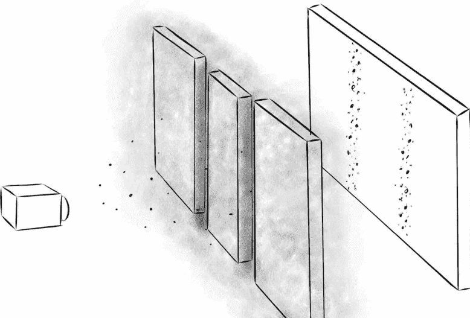

图 42。双缝实验的一种变体，在狭缝附近有一种粒子气体，它们会与电子相互作用。即使这些相互作用并没有怎么影响电子的轨迹，它们仍然带走了所有可能路径之间微妙的关联性。结果是，干涉图样被破坏了，取而代之的是大致与两个狭缝对齐的亮纹，对应于到达屏幕的两条主要路径。这些粒子实际上执行了量子意义上的观测行为。

但现在想象实验的另一种变体，即在狭缝附近增加了一种相互作用粒子气体（图 42）。当电子穿过隔板时，从每个缝隙出的两个波片段将与气体相互作用并迅速分离，以至于它们在后续几乎不可能发生干涉。令人惊讶的是，屏幕上的干涉图样消失了，取而代之的是大致与两个狭缝对齐的亮纹，反映了到达屏幕的两条主要路径。在埃弗特的语言中，我们说狭缝附近的粒子环境执行了观测行为，导致波片段退相干成两个清晰划分的历史——现实的分支——从那时起独立演化。人们可以说，粒子气体实际上在提问：“电子通过了哪个狭缝？”，通过提出这个问题，它促使电子的波函数分裂成两个不相交的片段，对应于两个可能的答案。

这双缝实验的两种变体说明了埃弗特方案的两个关键特性。首先，我们向袋中独立分支的树状结构所提问题的确切本质是什么。其次，只有通过具有显著差异的适当独立且退相干的历史路径，才能做出概率之和为 1 的有意义的预测。我们将在第 7 章回到这一点，届时我将讨论一旦采用量子宇宙学观点，宇宙还剩下了什么。

在宏观世界中，导致退相干的过程无处不在。在每一刻，我们的环境都在执行无数次观测行为，冲刷掉量子干涉，并将无数种可能性转化为少数几个现实。通过这种方式，环境充当了叠加态的幽灵微观世界与日常经验的确定宏观世界之间的自然桥梁。此外，环境退相干过程使得尽管在微观尺度上存在不断的量子抖动，相当稳健的经典现实成为可能。

以地壳中铀等放射性原子释放的高能粒子为例。最初，这个粒子以波函数的形式存在，向每个可能的方向扩散，在与（比如一块石英相互作用之前，它并不真实。当这种情况发生时，它可能的轨迹之一凝结了。与石英的相互作用将“可能发生的事”变成了铀原子衰变时“发生的事”。在任何给定的历史分支中，这一过程表现为一种冻结意外，形式为受高能粒子影响的原子阵列，其轨迹有时被用于测定矿物的年代。

我们周围看到的宇宙——这一个现实分支——是无数此类环境观测行为的集体结果。在数十亿的时间里，记录并建立在无数偶然结果的基础上，为我们的历史分支贡献了几个比特信息，这就是我们周围的世界获得其特异性的方式。令人意外的是，斯蒂芬，在我们的对话中，你推理出对宇宙的量子视角会向宇宙学中引入某种时间倒流的元素。

从数学上来说，埃弗特的方案极其优雅：`薛定谔方程`支配一切。普适地。埃弗特的框架证明了玻尔的经典包装是可以丢弃的负担。子系统通过产生纠缠的相互作用过程导致宇宙波函数分裂成相互不可见的独立、退相干的分支，这为量子测量提供了一个极令人满意的微观描述。人类意识、人类实验者和人类观测，在埃弗特的方案中既不是完全无关，也不是作为遵循不同规则的独立外部实体。它们仅仅被视为更广泛的量子力学环境的一部分，从本质上与空气分子和光子没有区别。埃弗特提出了一种从内向外思考量子世界的方法。他证明了我们可以乘浪在宇宙量子波上，而不仅仅是在岸边观察。

这**不仅仅是**语义或诠释的问题。埃弗特和玻尔的方案对于量子测量和观测如何展开做出了截然不同的预测。玻尔认为除了一个结果外，所有结果都幸存了，而埃弗特声称这只是给定历史分支内部的观点。他的方案说，对于任何观测者来说，其他结果似乎已经消失了。在埃弗特的框架中，如果某人能够反转组成观测的所有相互作用，原则上就可以重新组合不同的分支并让它们再次发生干涉。当然，任何观测行为涉及的粒子数量是天文数字，在实践中这是一项艰巨的任务。然而，如果波函数在观测时已经坍缩，那么即使在理论上这这也是可能的。

当我们考虑过去时，玻尔与埃弗特的对比极其重要。你看，玻尔的坍缩模型阻止人们甚至考虑追溯过去。根据玻尔的，反向运行`薛定谔方程`来寻找过去是什么样的是没有用的，因为无数次观测行为干扰了方程所规定的平滑演化。为了理解现在是如何而来的追溯过去是宇宙学的核心。因此，哥本哈根体系对于宇宙学来说是完全不充分的。它需要埃弗特式的观测者整合到理论的数学形式中，以使量子宇宙学成为可能。埃弗特的方案凸显了支撑量子理论的深层原则，这些原则被证明为应用于整个宇宙铺平道路至关重要。

被描述为是同等真实的，而实际上的意思是物理系统具有许多可能的历史。

然而，根结底，这无可避免。爱弗特的宇宙波函数概念证明了这一基础性洞察，使得我们能够开始用量子术语将宇宙视为一个整体，视为一个“自自系统（system an sich）”，它既不被复制，也不包含在一个更大的盒子里。爱弗特的工作让我们能够希望，对宇宙采取正确的量子视角确实有潜力摒弃“上帝视角”，并从“虫眼视角”出发重新构建宇宙学。因此，它为斯蒂芬（Stephen）、他的剑桥小组以及许多人随后继续发展的量子宇宙学播下了种子。

从这些努力中产生的量子宇宙学**架构**在图 43 中勾勒出来。它呈现为一种相互关联的三联画（triptych）形式，除了宇宙起源模型（例如无边界假设）和演化概念（例如`费曼`关于弦论图景中许多可能历史的思想）之外，还有一个关键的第三个元素：观测性（observership）。

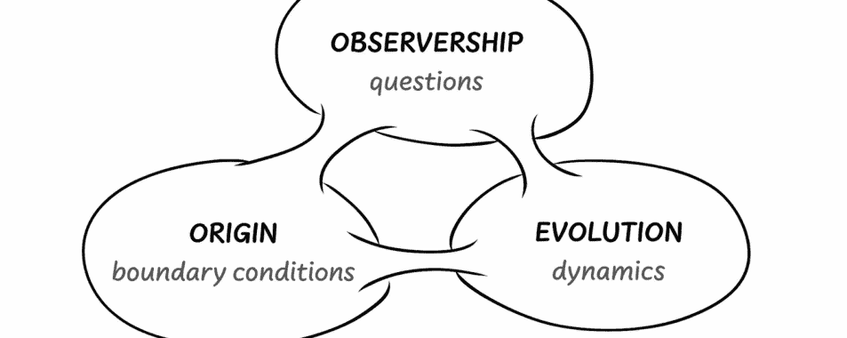

图 43。物理学中常用的预测框架假设演化法则、边界条件与观测或测量之间存在根本区别。对于大多数科学问题，这种分裂的框架就足够了。但宇宙学中的设计之谜更为深层，因为它探讨的是法则的起源以及我们在宏大宇宙图景中的位置。它需要一个将这三个实体交织在一起的更通用的预测框架。宇宙学的量子视角恰恰提供了这一点。这里相互关联的三联画构成了新的关于演化中宇宙的量子理论的概念核心，其中演化、边界条件和观测性被折入一个单一、整体的预测方案中。它的连通性标志着，量子宇宙学中的任何法则都源于这三者的混合。

我必须说明，这种方案中的“观测性”并不是指环顾四周。量子宇宙学中的“观测”更多地涵盖了我在在本书中一直讨论的更基础的观测行为：即历史中的分支将一个范围的可能结果转化为一个事实的过程。虽然这个过程总是涉及某种相互作用，但绝不限于人类观测，而且产生事实不需要与生命本身有关，甚至可以是孤立的微波背景光子。

图 43 中的三联画总结了斯蒂芬和我开发的新宇宙学的概念核心。它设想了物理现实是通过两步过程产生的。首先，构想宇宙所有可能的历史，每个历史都起源于——例如无边界起始。历史发生分支——每一次分支都涉及一场概率游戏——产生有效的物理学和更高层次的复杂性。但这个不可测的不确定性领域仅在某种程度上描述了宇宙。在这个层面上，没有预测，没有统一方程，没有全局时间概念——只有可能性的谱。然而，其次存在我们称为“观测性”的交互过程，它将“可能”转化为“已然”。

想一想“可能”的领域包含了无数种问题的答案，但它只有在被提问时才向我们展示世界。在一个量子宇宙中——我们的宇宙中——通过一个不断的提问和观测过程。

涉及到**未来**时，观测性是修剪在我们面前延伸的可能路径之树。在这个过程中，在给定观测者的体验中，只有一个分支存活。这就是我所描述的爱弗特对量子测量情境的由内向外的描述。当霍金说“宇宙的历史取决于机遇”时，我认为这正是他的意思。斯蒂芬是想说，刻画我们周围宇宙的特征事实集合（从生物圈到有效的物理法则）在实际上构成了我们向宇宙提出的宏大问题。三联画唤起了这样一个想法：这个宏大问题追溯地将那些被观测到的少数宇宙学历史分支拉入现实。也就是说，量子宇宙学中的观测性不仅仅是事后之补。

正是在这个更深层次的量子层面，连接这三部曲关键要素的线条变得至关重要，整个方案带带我们远远超越了正统物理学。

在20 世纪70 年代后期，约翰·惠勒（John Wheeler）提出了一个奇妙的思想实验（gedankenexperiment），这很大程度上澄清了量子宇宙中这种“逆向因果”的奇异元素。惠勒的思想实验证明了，在普通的粒子量子力学中，观测行为如何微妙地触及过去，甚至是触及遥远的路径。


# 惠勒与参与性宇宙

惠勒是费曼和爱弗里特的导师，在二战期间加入曼哈顿计划之前，他曾与波尔合作研究核裂变。在20世纪50年代的普林斯顿大学，他重振了广义相对论的研究，从爱因斯坦停止的地方继续下去。当时，只有一个精确的观测测试——水星的近日点移动，以及两个定性测试——广义相对论在当时已成为物理学的一个边缘领域，通常被视为数学的一个分支，甚至不是一个很有趣的分支。但正如惠勒所说，相对论太重要了，不能交给数学家，于是他着手复兴这一领域。惠勒在普林斯顿大学教授了第一门相对论课程，其中包含了物理课梦寐以求的最特权年度活动：访问住在默瑟街家中的阿尔伯特·爱因斯坦，一起喝茶并讨论。

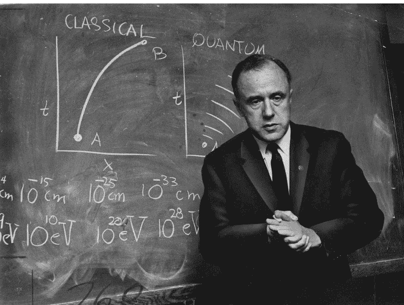

图44。1967年在普林斯顿讲授经典力学与量子力学的约翰·惠勒。

与斯蒂芬一样，惠勒似乎拥有无限的科学乐观主义。他富有想象力的视野，以及将物理学中最大的问题更尖锐地引导未来几十年富有启发性的研究方向的能力。当他在2008年去世时，享寿97岁，《纽约时报》的讣告引用了弗里曼·戴森的话：“富有诗意的惠勒像摩西一样站在毕斯伽山顶的先知，俯瞰着他的人民终将继承的应许之地。”

## 延迟选择实验

在关于量子理论中观测者角色和因果关系的思想实验中，惠勒考虑的是粒子而非宇宙，因为粒子更容易处理。他的思想实验今天被称为“延迟选择实验”。它是18世纪由英国博学多才托马斯·杨首次完成光子双缝实验的变体。在杨实验的现代版本中，光穿过隔板上的两个平行狭缝，击在狭缝后的感光板上。这在底板上产生了明暗交替的干涉条纹，因为光波从任一狭缝到屏幕上给定点的旅行距离通常是不同的。当人们大幅减弱光源，将波减少为稀疏的光子流逐个发射时，光的量子性质就显现出来。与我在第3章描述的电子实验类似，每个光子粒子的到达都表现为底板上的一个小点。但如果在这种极低强度模式下运行一段时间，光子的撞击集合就会开始产生干涉条纹。量子力学预测了这个结果，因为它将每个单独的光子描述为传播的波函数，该函数在狭缝处破碎、扩散并在远端与自身混合，从而产生每个光子落在底板上某个位置的高低概率模式。

然而，如果实验者决定“作弊”，在狭缝附近增加一对探测器来跟踪光子是经过了哪条路径——或两条路径——那么干涉条纹就不会再出现。相反，光子点集体在底板上勾勒出两条亮纹，这是两个清晰不同的、类经典的路径（通过一个狭缝或另一个）的特征。这是因为，正如图42所示装置中的粒子环境一样，在狭缝附近放置探测器等于执行了观测行为，导致从两个狭缝出的波碎片解耦。探测器通过光子从哪个狭缝通过，实际上迫使光波函数揭示光的粒子性。

现在，惠勒构想了杨实验的一种巧妙变体，其中探测器没有放在狭缝附近，而是放在更靠后的感光板附近（见图45）。事实上，他想象用百叶窗代替感光板，并将一对探测器放置在其后面，每个指向其中一个狭缝。如果我们关闭百叶窗，实验就像以前一样运行：波函数碎片混合并产生干涉条纹。相比之下，如果我们打开百叶窗，光子只需穿过板，探测器就可以用来验证它们是从哪个狭缝出的。通过这种方式，实验者可以为每个光子单独决定以何种模式进行实验——即提哪一个问题——从而揭示其粒子性或波动性。

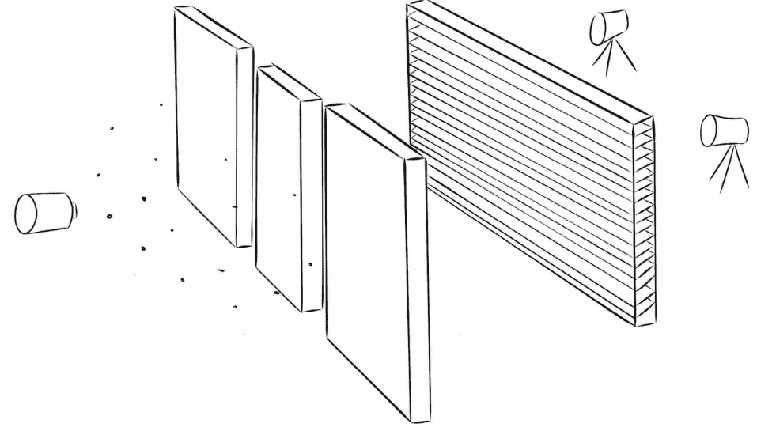

图45。光子杨双缝实验的变体，其中右侧的感光板被转换为百叶窗，在其后面安置了一对探测器，每个指向其中一个狭缝。操作探测器的实验者可以将决定推迟到每个单独光子到达百叶窗的那一刻，决定是保持百叶窗关闭并进行通常的双缝实验产生干涉条纹，还是打开它并验证光子从哪个狭缝通过。人们可能认为这种延迟选择会困扰光子。完全没有：大自然是聪明的，光子总是正确的，这证明了量子理论中的观测行为微妙地触及过去。惠勒的关键洞察是，将是否打开或关闭百叶窗的选择延迟到光子到达感光板的瞬间。这是一个引人入胜的情况。光子在到达隔板时如何知道根据实验者未来的选择，是像波一样同时旅行两条路径，还是像粒子一样只旅行一条路径？显然，光子无法预知实验者稍后会打开还是关闭百叶窗。另一方面，它们也无法延迟变成波或粒子的决定，因为如果光子要为百叶窗被关闭的可能性做准备，它的波函数最好在隔板处分裂，这样两个碎片的组合就能产生观测到的干涉条纹。然而，如果百叶窗最终是打开的，似乎很有风险，因为实验者恰好在最后一刻决定知道光子的路径。他们使用了高科技百叶窗（内置感光板的超快速电子开关），在两种操作模式之间进行切换。他们证实了惠勒想法的本质：击中“百叶窗”的光子产生干涉条纹；通过的光子则不会。某种方式，光子总是正确的，即使开启或路径追踪探测器的选择被延迟到给定光子通过隔板之后。这是为什么呢？

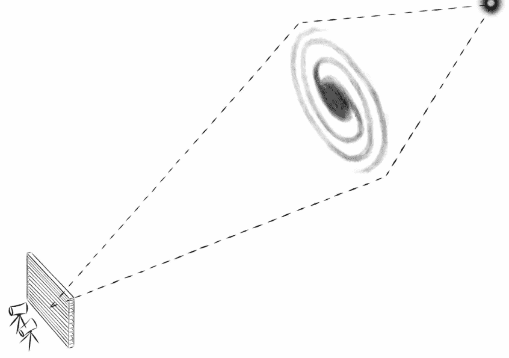

图 46。延迟选择双缝实验变体的宇宙尺度版本。星系的引力透镜弯曲了来自遥远类星体的光。这为光到达地球创造了多条路径，复制了双缝（甚至三缝）实验的设置。

惠勒是一个一贯的乐观主义者，他曾推测过他延迟选择实验的大规模版本（见图 46）。他想象了中间星系的质量弯曲了遥远类星体的光，然后将其引向地球。在天空中发现了许多此类引力诱导的透镜实例，天文学家经常利用它们来了解更多关于宇宙中暗物质和暗能量含量的信息。这种偏折意味着来自类星体的光可以通过不同方式绕过中间星系到达地球，模拟了双缝——或多缝——实验的情况。惠勒思考道，如果天文学家能够在这种宇宙背景下进行延迟选择实验，他们将是在塑造数十亿年前的过去，触及一个系统甚至形成之前的时代。“我们不可避免地参与了那些似乎正在发生的事情之中，”惠勒写道。[16]

> 我们不仅是旁观者。
>
> 我们还是参与者。
>
> 在某种奇特的意义上，这是一个参与性的宇宙。

随后，他画了这幅非凡的图画（如图 47 所示），将宇宙的演化描绘为一个 U 形物体，一侧的眼睛注视着另一侧的过去，以此说明在量子宇宙中，今天的观测为“那时”的宇宙赋予了切实的现实。[17]

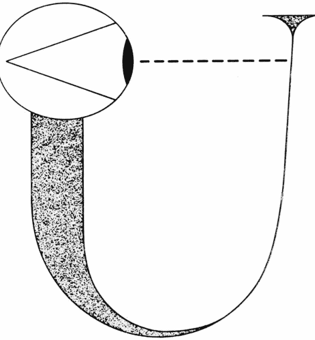

图 47。惠勒将量子宇宙视为一种自激励电路。从右上角的小点开始，宇宙随着时间的推移而增长，最终产生了观察者，观察者的行为为过去赋予了切实的现实，甚至是那个还没有观察者存在的遥远过去。

在那个时代看来是异想天开的，惠勒对参与性宇宙的愿景在四十年后成为了我们自上而下宇宙学的核心。霍金非常严肃地对待惠勒关于观察者参与的观点——非常严肃——不仅将其应用于追溯确定量子粒子的路径，还应用于整个宇宙的路径。

## 自上而下的宇宙学

有史以来最雄心勃勃的思想实验。量子宇宙学由于其篮子里充满了可能的路径，在某种意义上解构了经典的大爆炸奇点。呈现出来的是一个叹为观止的更深层次的进化，将我们带入大爆炸。在这一层面上，我们识别出某种“元进化”，一个熟悉的进化法则本身也在发生演化的阶段。正如我在第5章描述的那样，这种由此涉及的类似于达尔文式的变异与选择分支过程，只能通过回溯来理解。这种真正古老的进化层级，必须从自上而下的角度来构想——回顾过去。

以空间大维度的数量为例。根据弦理论，可能领域包含了从 0 到 10 个所有可能的大维度的历史。尚未发现任何先验理由能精确解释为什么是三个维度生长了而其他维度没有。因此，一种自下而上的哲学无法解释为什么我们的宇宙应该有三个大维度。然而，一种自上而下的方法告诉我们，这并不是一个正确的问题。自上而下的宇宙学要求，扩张早期阶段最原始环境所进行的观测显示，三个维度脱颖而出并开始膨胀，在所有可能的历史中，只有这少数历史以三个大维度结尾。维度上的概率分布是没有意义的，因为“我们”已经测量出我们生活在具有三个大维度的宇宙中。这就像是在询问生命之树与完全不同的树（包括没有智人分支的树）相比的概率一样。这既不相关也无法计算。只要可能的扩张历史领域中包含某些三个维度正在扩张的宇宙，这些宇宙与其它相比有多稀有并不重要。而且，这无论“三”是否是唯一适合生命的数字。在使拟人择原理失效后，自上而下的宇宙学将友好属性与所有其他事物置于同等地位[[20]]。

粒子物理学的标准模型也是如此。根据大统一理论和弦理论，标准模型拥有二十个看似如此精细调优的参数，远不是热大爆炸中对称性破缺变换序列的唯一结果。事实上，越来越多的证据表明，在弦理论领域，通往标准模型的路径极其罕见，正如地球上的生命之树在所有可能的树中可能也是极其罕见一样。因此，一种因果性的自下而上方法无法解释为什么宇宙最终以标准模型告终。自上而下的范式以不同的方式处理这一问题。它设想在早期宇宙“进行”的观测——其结果被编码在构成有效法则的冻结意外中——从广阔的可能宇宙学历史谱中刻画出与标准模型一致的历史。

但宇宙起源的自上而下视角，最引人注目的意义可能与原始暴胀爆发的强度有关。记住，作为一种自下而上的理论，无边界假设预测了膨胀的绝对最小值，仅足以让宇宙存在。无边界波最显著的分支是近乎空空的宇宙，它们仅伴随着一缕膨胀出现（见图 31）。也就是说，如果我们忽略自己是由原子构成的、在时空中移动的感官生物，转而暂时用一种“上帝视角”来观察无边界波的形状，仿佛我们不是它的一部分，那么我们会发现自己本不该存在。这种局面在二十多年里一直是斯蒂芬在宇宙学中最大的头疼问题。无边界假设对斯蒂芬来说听起来非常真实——非常如此——但它似乎是错误的。

引入自上而下。通过采用虫眼视角，自上而下的宇宙学从内部向外并逆着时间进行推理。结果如何呢？波发生了剧烈变化。自上而下的方法将对应空宇宙的波碎片降到波的远端，并放大了那些随着强力膨胀爆发而生的宇宙。我在图 48 中说明了这一点。与图 31 中无边界波的自下而上视角对比显示，字面上，自上而下的宇宙学完全重新洗牌了构成波函数的分支。此外，由于不同波碎片的高度代表了它们的相对概率，这意味着自上而下的宇宙学回溯出宇宙开始时经历了一次主要的膨胀爆发，这与我们的观测一致。[21] 显然，斯蒂芬对这种结果非常满意。最后，他告诉我（仿佛我没意识到过似的），他一直对无边界假设有良好的感觉。

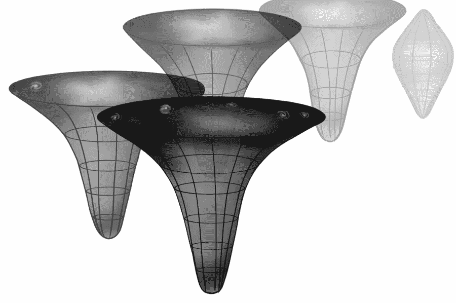

图 48。从自上而下的视角看无边界波的形状。当从上而下观察时，无边界假设回溯出我们的宇宙是随着一次主要的膨胀爆发产生的，从而形成了一个星系网络，这与我们的观测一致。主导自下而上波的近空宇宙（见图 31）退到了远方。

无边界假设命运的**惊人逆转**生动地说明了，在深层，过去取决于现在。但如果我们无论如何都自上而下观察宇宙，那么起源理论的作用究竟是什么呢？人们可能会说，无边界假设之于宇宙学，正如 LUCA（最后普遍共同祖先）之于生物演化一样。显然，LUCA 的生化组成并不决定从它身上长出的生命之树。另一方面，没有 LUCA 就没有生命之树。同样，无边界起源对于宇宙的存在至关重要。

因此，对应于这些分支的根并没有出现在量子树上。那些“孤岛历史”消失了——迷失在不确定性的海洋中。

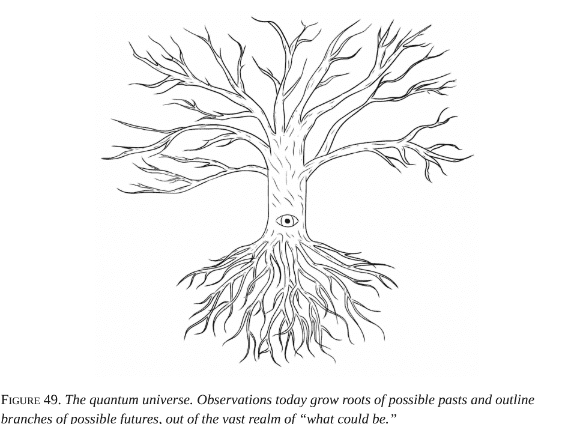

然而，我必须强调（如果需要的话），`自上而下的宇宙学`（**自上而下的宇宙学**，`top-down cosmology`）仍然是一个假设。我们现在的处境与19世纪的达尔文并无相似，数据极其匮乏，无法详细重建法则之树在大爆炸中是如何产生的。我们关于那个遥远时代的化石证据仍然残缺不全。以暗物质或暗能量为例，它们共同占宇宙内容的95%。导致主宰暗部门的力和粒子的对称性破缺级联变换是怎样的？只有时间能给出答案。

鉴于如此有限的证据，我的同类宇宙学家中，仍存在着狂热的“前达尔文主义者”，他们坚定地信奉自下而上的世界观。他们认为，宇宙学的任务是为宇宙精妙的设计找到一个真正的因果解释。在他们的哲学中，偶然和历史意外——更不用说观测者的存在——必须让于次席。他们假设基于某些可靠且恒定的原则，宇宙必须以这种方式呈现。自上而下的哲学在本体论本质上挑战了这一前提，将偶然与必然——即冻结的意外和类规律的模式——置于同等地位。如果说有什么的话，我们预测未来的观测将揭示更多偶然的转折。

然而，当我反思通往自上而下宇宙学的漫长道路时，很清楚的是，我们并非完全受哲学考虑的驱动。（考虑到史蒂芬在团队中，我们怎么可能呢。）相反，我们是在寻找一种更好的科学理解，动力源于解决多元宇宙悖论以及破解设计之谜的渴望。事实上，在吉姆和史蒂芬于1983年提出`无边界假设`（`no-boundary hypothesis`）后，他们分道扬镳。史蒂芬认为我们对量子力学的理解已经足够，没有必要进一步对其基础进行筛选。“每当我听到‘薛定谔的猫’这个词时，我就想拔枪，”他曾这样说，并继续尝试对他的无边界提议进行测试。但吉姆并不确定我们对量子力学的理解是否足够，因此他转向了量子宇宙学。通过与已故默里·盖尔-曼（`Murray Gell-Mann`）合作——这位在1964年推导出量子存在的博学学者——吉姆继续发展了埃弗雷特关于粒子和物质场的量子思想。他们的基础工作结合许多其他物理学家的工作，最终导致了量子理论的完整表述，即`退相干历史量子力学`（`decoherent histories quantum mechanics`）。这种表述大大阐明了埃弗雷特方案中分支过程的物理本质，而且至关重要的是，它将观测者牢固地嵌入在其概念框架之中。因此，在2006年，我意识到如果量子宇宙学要发挥其潜力，必须合并吉姆和史蒂芬的见解，我再次将他们聚在一起，这是一个启发性的举措，预示了我们自上而下方法发展的第二阶段。

但说实话，我认为自上而下的三部曲大致上是勒梅特（`Lemaître`）和狄拉克（`Dirac`）在对量子宇宙学的诗意开创中，所预想的最终走向。1958年，在第十一届关于宇宙结构与演化的索尔维会议上，勒梅特对`原始原子假设`（`primordial atom hypothesis`）提交了现状报告[26]。在注意到“分支——而且了解它们的相对概率并无意义——毫无典型性！”——他继续写道：“演绎宇宙学在分裂进行得足够远以达到实际的宏观决定论之前无法开始”——换句话说，我们扩张的分支必须退相干，自下而上的方法才可行。勒梅特用这句晦涩的话结束了他的报告：“关于这一时刻[原子分裂刚之后]状态的任何信息，都必须从实际宇宙能够从中演化这一条件中推断出来”——这确实是对自上而下视角的早期瞥见。

尽管如此，除了这几个晦涩的评论外，自上而下的宇宙学最切实的依据是惠勒（`Wheeler`）富有预言性的思想实验以及他对`参与性宇宙`（`participatory universe`）的愿景。

在最近对惠勒的致敬[27]中，基普·索恩（`Kip Thorne`）提到1971年在位于加州理工附近的Burger Continental餐厅与惠勒和费曼共进过午餐，那是史蒂芬在加州理工期间经常去的餐馆。

在亚美尼亚菜肴旁，惠勒向我们描述了他的观点：物理定律是可变的。“那些定律一定已经产生了……什么原则决定了哪些定律在我们宇宙中出现？”他问道。20世纪40年代惠勒的学生费曼，转向20世纪60年代惠勒的学生索恩，说：“这家伙听起来很疯了。你们这一代人不知道的是，他一直听起来很疯。但当我当他的学生时，我发现如果你取他的一个疯狂的想法，并像剥洋葱一样一层一层地剥开其中的疯狂层级，在想法的核心处，你往往会发现一个强大的真理内核。

当史蒂芬和我开启我们的自上而下的宇宙学方法时，我并没有意识到惠勒的思想，尽管我怀疑史蒂芬至少模糊地知道。回想起来，我们正在剥开惠勒疯狂的许多层，将他的直觉转化为一个正式的科学假设。我们开车来到冈维尔凯凯斯学院（`Gonville and Caius College`），史蒂芬在剑桥的另一个学院。那是周四，这意味着要在学院的组合厅（`Combination Room`）用餐。在木桌旁，壁炉火噼啪作响，我们聊到了丝绸之路。史蒂芬回忆起1962年夏天访问伊朗的旅行，前往伊斯法罕和波斯波利斯（古代波斯帝国的首都），并穿越沙漠到达东部的马什哈德。“在从德黑兰去大不里士的班车上时，发生了布因·扎拉地震（7.1级地震，造成了一万多死亡）”他告诉我们。“尽管我想回去，”他补充道，“科学合作不应有界限。”

皇家歌剧院问我是否愿意开车送他们伦敦——以此纪念我与上帝斗争的终结。

他再也没有回到过去那套自下而上的宇宙学哲学。那天，当我从阿富汗回来走进他的办公室时，他内心似乎发生了某种变化。多年后，斯蒂芬引用爱因斯坦关于宇宙学常数的话，告诉他，从因果的自下而上的角度来看他的无边界起源模型是“最大的错误”。回想起来，我们可以看到爱因斯坦和斯蒂芬都被自己的理论所惊扰。1917年，爱因斯坦对静态宇宙这一古老观念的执着，让他未能领会他经典相对论理论深远的宇宙学影响。同样，斯蒂芬对时间起源根深蒂固的因果律思维，也让他忽视了他的半经典无边界假设所揭示的新愿景。

自上而下宇宙学的发展标志着我们合作最丰实、最激烈的阶段。无论是在工作中还是在酒吧，在机场还是深夜的营火旁，自上而下的哲学都成为了无尽快乐和灵感的源泉。在《时间简史》中，早期的（自下而上）霍金曾著名地写道：“即使我们找到了万有理论，它也是一组规则和方程。是什么为这些方程注入了灵魂？”晚期的（自上而下）霍金给出的答案是：观测者。我们创造宇宙，正如宇宙创造我们一样。

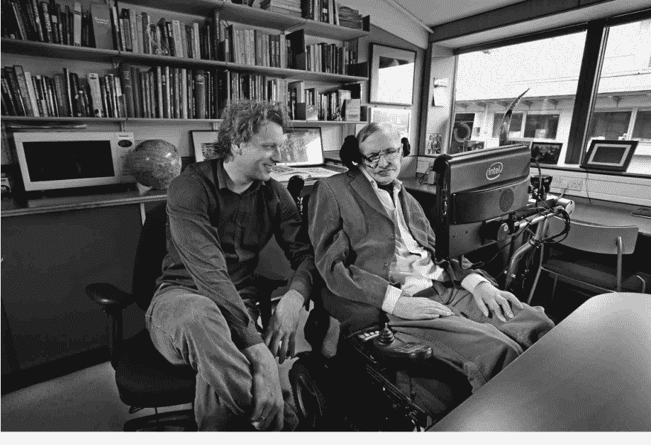

## 注释

*1 后来我们在试图离开乌兹别克斯坦时遇到了严重的麻烦，因为通过关闭的边境口岸入境是非法的。

*2 古希腊科学家叙拉古的阿基米德实验了杠杆起重物。据报道，他在杠杆上的成就使他评论道：“给我一个立足点，我能移动地球。”

*3 斯蒂芬所说的“表面”是指四维时空的一个三维切片。严格来说，“我们观测的表面”恰位于我们的过去光锥之内。作为一种近似，人们通常考虑某一时刻的三维空间宇宙。

# 第 7 章

# 无时间的时间

> 现在的时间与过去的时间
>
> 或许都存在于未来的时间之中
>
> 而未来的时间包含在过去的时间之中
>
> 如果所有时间永恒无法救赎。
>
> —— T. S. 艾利奥特，《焦灼伯顿》

在宇宙学中发起达尔文革命是一项典型的霍金式行为。它是一个大胆、冒险且直觉驱动的物理学实践的绝佳范例，这正是他后期大部分作品的特征。

我们关于自上而下宇宙学的早期写作可以追溯到2002年，尽管回想起来我们正处于正确的道路上，但我们实际上是走在流沙上。即使在后期阶段，处于自上而下哲学核心的时空叠加仍然难以捉摸。它们是结合成了埃弗雷特宇宙波函数的巨大延伸吗——一种触角延伸至弦景观每个角落的量子版多重宇宙？然而，如果是如此，宇宙的宏大波函数难道不是长期寻找的、支撑所有物理理论的`元律`（`metalaw`），从而将观测者再次降级为仅仅是一种后选择效应吗？

我们早期的自上而下想法是吉姆·哈特尔曾说的“关于想法的想法”——这些见解可能是深远且重要的，但需要一个合适的物理理论作为土壤才能取得结果。因此，我们开始寻找更坚实的地面。


# 灵感来自全息革命

在宇宙学中发起达尔文革命是一项典型的霍金式行为。它是大胆、冒险且直觉驱动的物理学实践的绝佳范例，这正是他后期大部分作品的特征。

我们关于自上而下宇宙学的早期写作可以追溯到 2002 年，尽管回想起来我们正处于正确的道路上，但我们实际上是走在流沙上。即使在后期阶段，处于自上而下哲学核心的时空叠加仍然难以捉摸。它们是结合成了埃弗雷特宇宙波函数的巨大延伸吗——一种触角延伸至弦景观每个角落的量子版多重宇宙？然而，如果是如此，宇宙的宏大波函数难道不是长期寻找的、支撑所有物理理论的元律，从而将观测者再次降级为仅仅是一种后选择效应吗？

我们早期的自上而下想法是吉姆·哈特尔曾说的“关于想法的想法”——这些见解可能是深远且重要的，但需要一个合适的物理理论作为土壤才能取得结果。因此，我们开始寻找更坚实的地面。

灵感来自一个意想不到的角落。大约那时，物理学的第二次革命正在兴起。这场革命正在弦理论学家办公室的办公桌和黑板上酝酿，而他们在对假设宇宙进行实验时，发现这些宇宙具有奇异的全息属性。

## 初识全息革命

我第一次听到 1998 年 1 月席卷理论物理学的全息革命。作为一名新毕业的研究生，我正在参加剑桥数学物理系（DAMTP）中用剑桥术语称为“第三部分”的高级数学课程。春学期，系里组织了一系列特别的研究研讨会——他们告诉我们，由于一项重大新进展，传闻这将会“改变一切”。

这听起来很令人兴奋，所以我决定溜进研讨会教室听第一场讲座。当时仍在剑桥中心银色街的 DAMTP 旧大楼里，教室光线昏暗，窗户如所意料地落着雾气，有一块贯穿整个前墙长度的大黑板。房间里挤满了近百名理论物理学家，气氛嘈杂且随意。有些人沉浸在激烈的讨论中，另一些人疯狂地涂写着方程，还有一些似乎只是在悠闲地喝着茶。

正当我试图找个位置来感受这一切时，我的目光捕捉到了当天的演讲者。我以前见过他——斯蒂芬推着轮椅在剑桥是一个熟悉的景象。但仅仅是看到他出现在他的科学总部，就揭示了他人格中的一个新维度。尽管几乎无法活动，斯蒂芬依然充满活力。他显然深受同行的喜爱，并处于他的引力小组的中心，他微笑着以一种我无法解读的微妙方式与周围的人互动。整个场景散发着一种亲切和纯粹快乐的氛围。我觉得自己就像是闯入了一个大家庭派对。菜单上是：我们所知的时空的终结。

## 霍金的登场

斯蒂芬操纵着轮椅，左手握着椅子扶手上的转向结，显然试图调整位置，以便通过将眼睛向上并略向右移动看到观众，并通过将眼睛向上并略向左移动看到投影屏幕。当斯蒂芬终于对这种配置满意时，加里·吉布恩斯站起来告诉观众，斯蒂芬将发表他们特别系列的第一场讲座，房间陷入了沉默。

斯蒂芬读了他的演讲稿，开始执行一系列操作显示他准备在屏幕上展示的幻灯片。他然后停了下来，抬头看向我们，再次看向屏幕，又点击了一下。

> 在《时间简史》中，早期的（自下而上）霍金曾著名地写道：“即使我们找到了万有理论，它也是一组规则和方程。是什么为这些方程注入了灵魂？”晚期的（自上而下）霍金给出的答案是：观测者。我们创造宇宙，正如宇宙创造我们一样。

# 第 7 章 无时间的时间

> 现在的时间与过去的时间
>
> 或许都存在于未来的时间之中
>
> 而未来的时间包含在过去的时间之中
>
> 如果所有时间永恒无法救赎。
>
> —— T. S. 艾利奥特


斯蒂芬的演讲者


皇家歌剧院问我是否愿意开车送他们去伦敦——以此纪念我与上帝斗争的终结。

他再也没有回到过去那套自下而上的宇宙学哲学了。那天，当我从阿富汗回来走进他的办公室时，他内心似乎发生了某种变化。多年后，斯蒂芬引用爱因斯坦关于宇宙学常数的话，告诉他，从因果的自下而上的角度来看他的无边界起源是“最大的错误”。回想起来，我们可以看到爱因斯坦和斯蒂芬都被自己的理论所惊扰。1917年，爱因斯坦对静态宇宙这一古老观念的执着，让他未能领会他经典相对论理论深远的宇宙学影响。同样，斯蒂芬对时间起源根深蒂固的因果律思维，也忽视了他的半经典无边界假设所揭示的新愿景。

自上而下宇宙学的发展标志着我们合作最丰实、最激烈的阶段。无论是在工作中还是在酒吧，在机场还是深夜的营火旁，自上而下的哲学都成为了无尽快乐和灵感的源泉。在《时间简史》中，早期的（自下而上）霍金曾著名地写道：“即使我们找到了万有理论，它也是一组规则和方程。是什么为这些方程注入了灵魂？”晚期的（自上而下）霍金给出的答案是：观测者。我们创造宇宙，正如宇宙创造我们一样。


注释

*1 后来我们在试图离开乌兹别克斯坦时遇到了严重的麻烦，因为通过关闭的边境口岸入境是非法的。

*2 古希腊科学家叙拉古的阿基米德实验了杠杆起重物。据报道，他在杠杆上的成就使他评论道：“给我一个立足点，我能移动地球。”

*3 斯蒂芬所说的“表面”是指四维时空的一个三维切片。严格来说，“我们观测的表面”恰位于我们的过去光锥之内。作为这的近似，人们通常考虑某一时刻的三维空间宇宙。

# 第 7 章

# 无时间的时间

> 现在的时间与过去的时间
>
> 或许都存在于未来的时间之中
>
> 而未来的时间包含在过去的时间之中
>
> 如果所有时间永恒无法救赎。
>
> —— T. S. 艾利奥特，《焦灼伯顿》

在宇宙学中发起达尔文革命是一项典型的霍金式行为。它是一个大胆、冒险且直觉驱动的物理学实践的绝佳范例，这正是他后期大部分作品的特征。

我们关于自上而下宇宙学的早期写作可以追溯到2002年，尽管回想起来我们正处于正确的道路上，但我们实际上是走在流沙上。即使在后期阶段，处于自上而下哲学核心的时空叠加仍然难以捉摸。它们是结合成了埃弗雷特宇宙波函数的巨大延伸吗——一种触角延伸至弦景观每个角落的量子版多重宇宙？然而，如果是如此，宇宙的宏大波函数难道不是长期寻找的、支撑所有物理理论的元律，从而将观测者再次降级为仅仅是一种后选择效应吗？


皇家歌剧院问我是否愿意开车送他们伦敦——以此纪念我与上帝斗争的终结。

他再也没有回到过去那套自下而上的宇宙学哲学了。那天，当我从阿富汗回来走进他的办公室时，他内心似乎发生了某种变化。多年后，斯蒂芬引用爱因斯坦关于宇宙学常数的话，告诉他，从因果的自下而上的角度来看他的无边界起源是“最大的错误”。回想起来，我们可以看到爱因斯坦和斯蒂芬都被自己的理论所惊扰。1917年，爱因斯坦对静态宇宙这一古老观念的执着，让他未能领会他经典相对论理论深远的宇宙学影响。同样，斯蒂芬对时间起源根深蒂固的因果律思维，也忽视了他的半经典无边界假设所揭示的新愿景。

自上而下宇宙学的发展标志着我们合作最丰实、最激烈的阶段。无论是在工作中还是在酒吧，在机场还是深夜的营火旁，自上而下的哲学都成为了无尽快乐和灵感的源泉。在《时间简史》中，早期的（自下而上）霍金曾著名地写道：“即使我们找到了万有理论，它也是一组规则和方程。是什么为这些方程注入了灵魂？”晚期的（自上而下）霍金给出的答案是：观测者。我们创造宇宙，正如宇宙创造我们一样。


注释

*1 后来我们在试图离开乌兹别克斯坦时遇到了严重的麻烦，因为通过关闭的边境口岸入境是非法的。

*2 古希腊科学家叙拉古的阿基米德实验了杠杆起重物。据报道，他在杠杆上的成就使他评论道：“给我一个立足点，我能移动地球。”

*3 斯蒂芬所说的“表面”是指四维时空的一个三维切片。严格来说，“我们观测的表面”恰位于我们的过去光锥之内。作为这的近似，人们通常考虑某一时刻的三维空间宇宙。

# 第 7 章

# 无时间的时间

> 现在的时间与过去的时间
>
> 或许都存在于未来的时间之中
>
> 而未来的时间包含在过去的时间之中
>
> 如果所有时间永恒无法救赎。
>
> —— T. S. 艾利奥特，《焦灼伯顿》

在宇宙学中发起达尔文革命是一项典型的霍金式行为。它是一个大胆、冒险且直觉驱动的物理学实践的绝佳范例，这正是他后期大部分作品的特征。

我们关于自上而下宇宙学的早期写作可以追溯到 2002 年，尽管回想起来我们正处于正确的道路上，但我们实际上是走在流沙上。即使在后期阶段，处于自上而下哲学核心的时空叠加仍然难以捉摸。它们是结合成了埃弗雷特宇宙波函数的巨大延伸吗——一种触角延伸至弦景观每个角落的量子版多重宇宙？然而，如果是如此，宇宙的宏大波函数难道不是长期寻找的、支撑所有物理理论的元律，从而将观测者再次降级为仅仅是一种后选择效应吗？

我们早期的自上而下想法是吉姆·哈特尔曾说的“关于想法的想法”——这些见解可能是深远且重要的，但需要一个合适的物理理论作为土壤才能取得结果。因此，我们开始寻找更坚实的地面。

灵感来自一个意想不到的角落。大约那时，物理学的第二次革命正在兴起。这场革命正在弦理论学家办公室的办公桌和黑板上酝酿，而他们在对假设宇宙进行实验时，发现这些宇宙具有奇异的全息属性。

我第一次听到 1998 年 1 月席卷理论物理学的全息革命。作为一名新毕业的研究生，我正在参加剑桥数学物理系（`DAMTP`）中用剑桥术语称为“第三部分”的高级数学课程。春学期，系里组织了一系列特别的研究研讨会——他们告诉我们，由于一项重大新进展，传闻这将会“改变一切”。

这听起来很兴奋，所以我决定溜进研讨会教室听第一场讲座。当时仍在剑桥中心银色街的 `DAMTP` 旧大楼里，教室光线昏暗，窗户如预期般落着雾气，有一块贯穿整个前墙长度的大黑板。房间里挤满了近百名理论物理学家，气氛嘈杂且随意。有些人沉浸在激烈的讨论中，另一些人疯狂地涂写着方程，还有一些似乎只是在悠闲地喝着茶。

当我试图找个位置来感受这一切时，我的目光捕捉到了当天的演讲者。我以前见过他——斯蒂芬推着轮椅在剑桥是一个熟悉的景象。但仅仅看到他出现在他的科学总部，就揭示了他人格中的一个新维度。尽管几乎无法活动，斯蒂芬依然充满活力。他显然深受同行的喜爱，并处于他的引力小组的中心，他微笑着以一种我无法解读的微妙方式与周围的人互动。整个场景散发着一种亲情和纯粹快乐的氛围。我觉得自己就像是闯入了一个大家庭派对。菜单上是：我们所知的时空的终结。

斯蒂芬操纵着轮椅，左手握着椅子扶手上的转向结，显然试图调整位置，以便通过将眼睛向上并略向右移动看到观众，并通过将眼睛向上并略向左移动看到投影屏幕。当斯蒂芬终于对这种配置满意时，加里·吉布恩斯站起来告诉观众，斯蒂芬将发表他们特别系列的第一场讲座，房间陷入了沉默。


这听起来很兴奋，所以我决定溜进研讨会教室听第一场讲座。当时仍在剑桥中心银色街的 DAMTP 旧大楼里，教室光线昏暗，窗户如所意料地落着雾气，有一块贯穿整个前墙长度的大黑板。房间里挤满了近百名理论物理学家，气氛嘈杂且随意。有些人沉浸在激烈的讨论中，另一些人疯狂地涂写着方程，还有一些似乎只是在悠闲地喝着茶。

当我试图找个位置来感受这一切时，我的目光捕捉到了当天的演讲者。我以前见过他——斯蒂芬推着轮椅在剑桥是一个熟悉的景象。但仅仅看到他出现在他的科学总部，就揭示了他人格中的一个新维度。尽管几乎无法活动，斯蒂芬依然充满活力。他显然深受同行的喜爱，并处于他的引力小组的中心，他微笑着以一种我无法解读的微妙方式与周围的人互动。整个场景散发着一种亲人和纯粹快乐的氛围。我觉得自己就像是闯入了一个大家庭派对。菜单上是：我们所知的时空的终结。

斯蒂芬操纵着轮椅，左手握着椅子扶手上的转向结，显然试图调整位置，以便通过将眼睛向上并略向右移动看到观众，并通过将眼睛向上并略向左移动看到投影屏幕。当斯蒂芬终于对这种配置满意时，加里·吉布恩斯站起来告诉观众，斯蒂芬将发表他们特别系列的第一场讲座，房间陷入了沉默。斯蒂芬读了他的演讲稿，斯蒂芬开始执行一系列操作显示他准备在屏幕上展示的幻灯片。他然后停了起来，抬头看向我们，再次看向屏幕，又点击了一下。

*(注：由于输入文本存在大量机械重复，译文仅保留核心翻译内容。)*

本章将描述，它有效地实现了一种全面的自上而下的方法，以揭开大爆炸的必然性。

全息宇宙学的发展标志着我们旅程的第三阶段。我们在 2011 年秋季史蒂芬访问比利时期间开始了这一阶段的旅程，并最终在他去世前不久发表的一篇论文中达到了顶峰。[3] 最重要的是，这是一场深入理论物理学前沿的旅程，将从量子信息到黑洞和宇宙学等影响深远的领域结合在一起，形成了一种令人向往的综合，暗示了可能存在“没有时间的时间”。

## 全息的早期线索可以追溯到 20 世纪 70 年代的黄金时代，当时，数学家和理论物理学家终于理解了这些极高密度物体的基本属性。

这一黄金时代在霍金的一项惊人发现中达到了顶峰：黑洞并不是完全黑的，而是会发出微弱的辐射。起初，史蒂芬著名地认为自己的计算出了错。黑洞本应该吞噬所有的物质和辐射，而不是喷射它们——毕竟，这被认为是黑洞的本质。曾经让他确信自己的计算正确且辐射是真实的，是它具有热辐射的所有特征，即所谓的**黑体辐射**（这是物理学家的术语，指在给定温度下由普通非反射体发射的辐射）。例如，2.7 开尔文的宇宙微波背景辐射就是黑体辐射。它告诉我们，即使是整个观测宇宙也表现得像一个普通的辐射体。

1900 年，普朗克对黑体辐射光谱的理论推导标志着量子革命的黎明。今天，每当普朗克光谱在自然界出现时，物理学家都会将其视为底层量子过程的征兆。这正是霍金所观察的那种过程——从半经典角度观察黑洞，研究在黑洞经典弯曲几何结构中运动的物质的量子行为。令他惊讶的是，他发现视界表面（相对论中的回不回头点）附近的量子过程产生了一小股向各个方向从黑洞流出的微量热辐射。随后他他计算了黑洞的温度 $T$，得如图 51 奖章所示的公式。

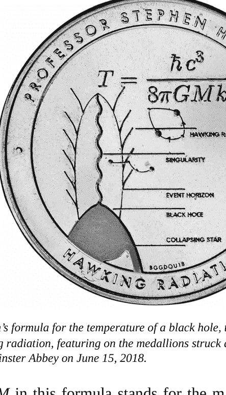

**图 51.** 史蒂芬的黑洞温度公式，以及霍金辐射过程的描绘，这些内容出现在 2018 年 6 月 15 日在威斯敏斯特教堂遗骸安葬仪式上铸制的奖章上。

公式中的字母 $M$ 代表黑洞的质量。其余数量都是自然的基本常数：$c$ 是光速，$G$ 是牛顿引力常数，$h$ 是普朗克量子常数，$k$ 是热力学玻尔兹曼常数——即研究能量、热和功的学科。霍金公式的纯美之处在于它将所有这些常数整合在一个方程中。与 20 世纪物理学其他著名的方程（如爱因斯坦方程或薛定谔方程）不同，后者描述的是独立的物理领域，而霍金公式展示了不同领域的相互作用。通过结合量子理论和广义相对论的原理，霍金冒了一次数学上的风险，但他获得了一种无论是相对论还是量子理论都无法提供的洞察：黑洞会辐射。惠勒曾评价霍金公式说，它就像“在舌尖上滚动的糖果”。今天，黑洞温度方程刻在史蒂芬位于威斯敏斯特教堂的墓碑上，仿佛是他通往永恒的门票。[11]

史蒂芬的发现如晴天之雳。他在 1974 年 2 月在牛津附近的鲁瑟福德-阿普顿质子中心的一次量子引力会议上，通过一次惊惊的演讲宣布了他的结果。“黑洞是炽热的，”他宣布道，让观众目瞪口呆。诚然，这是一个典型的霍金式夸张。对于作为恒星残骸的黑洞，他公式中的数字计算出的温度低于 0.0000001 开尔文，比寒冷的 2.7 开尔文 CMB 辐射要冷得多。在这里我们不太可能观测到黑洞辐射。这仅仅是一个事实上的不便。霍金辐射从理论角度来看本身就是革命性的，因为它更新了黑洞的经典图像——即时空中空洞的、无底的深渊，没有任何东西可以逃脱。

它之所以颠覆了这一图像，是因为热辐射通常源于物体内部成分的运动。这就是为什么温度与熵并肩存在，玻尔兹曼对系统成分微观排列数量的测量在不改变宏观属性的情况下保持不变。反之，熵与信息密切相关，这种观点认为宇宙中的每一个物质粒子和每一个力粒子都包含一个对“是”或“否”问题的隐含答案。粗来说，高熵意味着更多的信息可以存储在系统的微观细节中，而不会改变其整体宏观属性。现在，根据他的黑洞温度公式，霍金可以立即推导出它们包含的熵量 $S$ 的表达式。如下：

```
$S = \frac{kc^3A}{4G}$
```

事实上，霍金并不是第一个提出黑洞具有熵的人。早在1972年，以色列物理学家雅各布·贝肯斯坦（Jacob Bekenstein）就提出了黑洞熵与其视界面积 $A$ 成正比的想法。当时科学界几乎所有人（包括史蒂芬）都拒绝了这一观点，认为黑洞没有表面。通过发现霍金辐射，史蒂芬无意中证明了贝肯斯坦是对的。熵公式告诉我们比特的数量是有限的。熵公式暗示了爱因斯坦的广义相对论因为它忽略了量子力学和不确定性原理，完全错过了编码在黑洞微观结构中的海量字节。

尽管如此，熵随面积 $A$ 增长而非黑洞体积增长，这一事实更加令人惊讶。所有熟悉系统的存储容量都与其内部体积相关，与其边界面积无关。例如，如果要估计一个图书馆书籍的信息量，最好数数所有书架上的书，而不仅仅是墙墙上的。但对于黑洞，似乎并非如此。为了计算黑洞的量子信息内容，熵公式指示我们考虑视界面积 $A$，并用微小单元的网格图案覆盖它，每个单元的边长测量值为普朗克长度（如图 52）。普朗克长度 $l_p$ 基本上是一个长度量子。它是距离概念产生意义的最短长度尺度。用自然界常数表示，单个普朗克单元的面积 $l_p^2 = Gh/c^3$，大约为 $10^{-66}$ $\text{cm}^2$。以普朗克面积单位测量视界面积，熵公式预测黑洞的总信息是覆盖整个视界所需的此类单元数量除以四。从熵方程中得出的巨大洞察是，视界上的每个普朗克单元携带一个比特的信息。这些比特中的每一个都可以为关于黑洞演化及其微观结构的单个“是”或“否”问题提供答案，而所有这些比特的集合就是关于黑洞的所有信息。

这是现代物理学中全息性的首次曙光：黑洞的容量并不取决于其内部体积，而是取决于其视界面的面积。仿佛黑洞并没有内部，而是全息图。

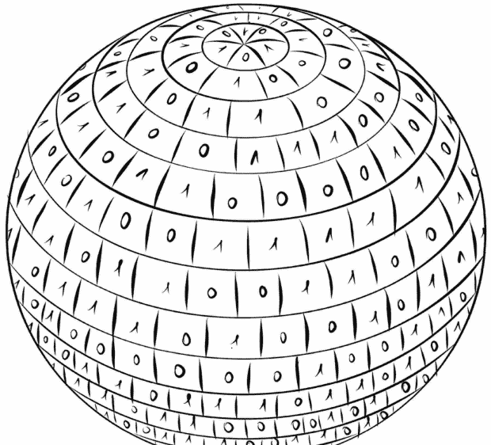

图 52。黑洞的熵等于覆盖其视界表面所需的普克尺度单元数量，除以四。就好像每个微小的细胞都存储了单个比特的信息，而它们的总和就是关于黑洞的所有信息。

我们对这一切该如何解释？熵公式并没有告诉我们黑洞是如何存储它们的泽字节（zettabytes）数据的，甚至没有说明量子芯片是否真的缝合在不可不可测的视界表面上。熵也没有列出它所计数的比特位据称提供答案的“是或否”问题列表。它仅仅表明这些比特应该存在。

当我们想象黑洞变老时，隐藏信息会发生什么时，情况变得更加混乱。黑洞质量 $M$ 出现在温度公式的分母上。因此，如果黑洞通过缓慢辐射能量和粒子流失质量，它的温度就会升高，使其光芒更亮并以更快的速度流失质量。因此，霍金辐射尽管开始比人们想象的要慢，但是一个自我强化的过程，最终会导致黑洞消失。它们并没有逃脱霍金，“黑洞不是永恒的，”他写道，“它们以不断增加的速度蒸发，直到在一次巨大的爆炸中消失。”

但当黑洞辐射并最终蒸发时，存储在内部的海量信息的将归何从？

似乎有两种合理的假设。第一，信息永远丢失了。黑洞是终极的擦器。考虑到黑洞的吞噬能力，这似乎是一个自然的结果。但问题是，量子理论禁止这种假设。量子理论的基本规则规定任何系统的波函数都以保持信息的方式演化。始终如此。量子演化可以处理无法识别的信息，永远无法不可逆地抹除信息。这一属性与显而易见的要求：无论发生什么，量子理论中的概率必须始终和为一。信息的保护意味着，例如，当你燃烧一本百科全书时，量子物理定律预测你原则上可以从灰烬中检索所有信息。同样，如果量子力学适用于黑洞视界表面——而我们没有明显的理由怀疑它适用——那么当黑洞最终消失时，每一碎片信息都最终会回来。

让我们考虑第二种假设。也许所有信息都泄露了，并加密在霍金辐射中？由于蒸发过程需要数亿万年，这似乎也并不可行。而且，这与量子力学完美契合。遗憾的是，这并不是斯蒂芬计算所描述的发生的情况。霍金辐射并不携带任何信息。当黑洞以霍金辐射的形式发射其部分质量时，该辐射的频谱是尽可能的无特征的。辐射中的没有任何部分能揭示关于黑洞微观结构或过去历史的信息。根据霍金的说法，一旦黑洞辐射了它的最后一克质量并消失，留下的只有云随机的热辐射，从这些云中，即使在原则上也不可能知道是否存在过黑洞——更不用说是一个洞了。蒸发的黑洞，霍金宣称，与燃烧百科全书有本质区别。

当黑洞蒸发时，信息似乎是可检索的丢失，但量子理论说这是可能的。物理学家逐渐意识到，斯蒂芬凭借他天才的思想实验，触及了一个极其深奥且困难的问题，这个问题产生于相对论和量子理论涉足同一领域时。基于一个看起来是这两种理论完美的半经典混合体，他证明了区分这两种理论的深渊实际上比他或任何人预想的要深得多、宽得多。蒸发黑洞内部锁定信息的命运悖论，变成了20世纪后期理论物理学中最令人头疼的谜题，涉及的一一个而是两代物理学家。在某些方面，它是19世纪水星异常的现代类比，那种挑战牛顿理论的水星轨道摆动。因此，这种黑洞信息悖论成为了寻找统一理论的灯塔。物理学家们觉得，如果他们能解开霍金的结，并理解当黑洞不再存在时隐藏信息会发生什么，他们就将顺利地将相对论和量子理论原理统一到一个单一自洽的框架中。

早期，斯蒂芬押注了第一种假设：信息丢失了；物理学面临严重问题；量子理论必须被修正。《引力坍塌中可预测性的崩溃》是他首次详述信息丢失后果的论文标题。

诚然，一个具有太阳质量的黑洞直到几百亿年后才会开始蒸发，届那时微波背景辐射的温度最终低于恒星黑洞的温度。蒸发过程本身将需要 $10^{60}$ 年，比宇宙目前的年龄还要长。所以，除非热大爆炸已经产生了微黑洞，或者除非欧洲核研究中心的大强对撞机某天确实制造出了这些，否则黑洞爆炸在很长一段时间内可能只是理论上的思想实验。

但斯蒂芬观点是一个原则问题。如果黑洞破坏了信息，那么它们在最终开始蒸发时，可以发射任何组合的粒子。这意味着黑洞的生命周期，从引力坍塌到霍金辐射云，将为物理学注入一个全新的随机性和不可预测性水平，在普通概率之上。极微小的普克尺度，引力的量子性质在那里将变得重要，似乎完全遥不可及，因为你需要一个像太阳系那样粒子加速器来探测那么小的尺度。此外，尽管多年来创新的数学魔法，该理论未能解释在……情况下引力的量子性质

这确实非常重要——在黑洞内部以及大爆炸时刻。更糟糕的是，弦理论物理学家意识到并不只有一种弦理论，而是五种不同的变体，而它们都声称自己是自然的“唯一”统一理论。在此基础上，还有一种此前未曾发现的第六种理论，称为超引力，它是爱因斯坦相对论的扩展，涉及了物质和超对称性，并包含了膜状物体——弦。事实上，作为超引力研究的热点，剑桥在这一时期产生了一定的“反弦理论”的声誉。

《关于弦的动力学的一些评论》是维滕在 1995 年弦会议上的讲座标题，这个标题并没有暗示他正准备打破这一僵局。但他确实做到了。在场在物理学史册上被视为传奇的讲座中，维滕勾勒出了弦理论的新视角。他阐述了这五种弦理论与某种异议的超引力理论并不是六个独立的理论，而同一个数学大厦的不同侧面。通过结合大量的见解，维滕识别出一个复杂的数学关系网络，该网络将各种弦理论相互转化，并转化为超引力，创造了一个相互联结所有的网状实体（见图 53）。他将这个网络命名为 M 理论。尽管 M 理论本身可能没有确定的结构——有人声称 M 代表魔法（magic）或谜（mystery）——但它具有神奇的变形能力，有点像小妖精（boggart），根据人的视角，它可以获得六个伙伴理论之一的形式。M 理论揭示的这种更深层次的统一足以引发第二次弦理论革命。M 理论让理论学家们意识到，他们通统一理论的六种不同方法并不冲突，而是进入量子引力领域的互补切入点，可以相互加强。[7]

## 11维超引力

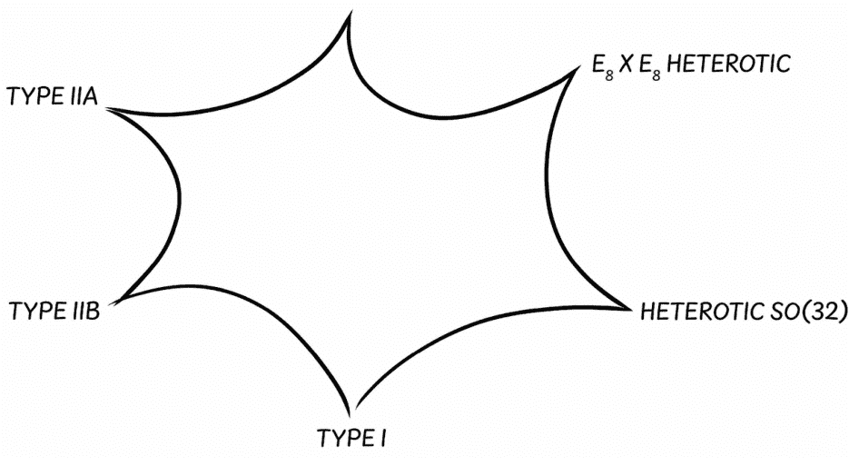

图 53。一个数学关系网络将五种弦理论和超引力理论相互联系，暗示着一个更深层次的统一故事。

物理学家将这种看似不同的理论相互转化的数学关系称为*对偶性*（dualities）。两个对偶的理论在某种程度上是等价的；它们用不同的数学语言描述了同一种物理情况。一个简单的例子是量子力学中的波/粒子对偶性，这在量子理论的早期曾造成了巨大的困惑。

对偶性是强大的计算工具，因为通过对给定的物理系统提供互补的视角，它们可以开启新的见解。M 理论的对偶性尤其强大，因为它们通常能将一种弦理论中令人生畏的分析转化为其对偶伙伴理论中直观简单的问题。在第二次弦理论革命之前，物理学家必须依靠近似方法分别分析每种弦理论。这限制了他们的发挥空间，仅局限于半经典情况，在那种情况下，只有少量的弦在轻微弯曲的经典背景空间中振动。结果是，黑洞迷人的量子特性（更不用说大爆炸了）仍然无法通过他们的分析触及，而宏大的统一计划也停滞不前。

第二次弦理论革命剧烈地改变了这一切。从以后，当某一种弦理论遇到困难时，对偶性往往会出来救场，将一个几乎不可能完成的计算重塑为另一种弦理论中完全可行的计算。因此，维滕的 M 理论网络远比其组件总和得多。通过缝合来自所有五种弦理论和超引力的见解，M 理论在引力和统一的量子领域开启了完全未知的处女。

但第二次弦理论革命的巅峰是发现了一种完全新类型的对偶性，这种对偶性如此奇异，以至于没有人认为它可以存在——全息对偶（holographic duality）。

1997 年，出生于阿根廷的胡马尔达塞纳（Juan Maldacena）在哈佛大学担任年轻助理教授期间，偶然发现了一种极其迷人的对偶性，它既没有连接两种弦理论，也没有连接两种粒子理论。相反，它将带引力的弦理论与不带引力的粒子理论联系起来。而且，马尔达塞纳对偶性中的两个方面生活在不同的维度上：粒子理论是引力理论的全息图。

马尔达塞纳通过思考特定假设设置下的弦理论和超引力，发现了这种奇异的对偶性。马尔达塞纳对偶性的引力部分涉及广义相对论和反德西特空间（anti-de Sitter space）。正如其名称所示，反德西特空间是德西特空间的对立面。后者是荷兰天文学家廉·德西特（Willem de Sitter）在 1917 年发现的描述一个充满正宇宙常数 [λ > 0] 的指数级扩张宇宙。反德西特空间具有负宇宙常数 [λ < 0] 且不膨。相反，它类似于一个被不可渗透表面包围的雪球内部。

马尔达塞纳对偶性的另一侧涉及类似于标准模型的粒子量子理论。这些是量子场理论（QFT），因为它们将粒子和作用力描述为弥散场的局域激发。马尔达塞纳对偶性中的 QFT 类似于描述强核作用力的量子色动力学。

这种对偶性奇异的全息性质之所以出现，是因为粒子侧的量子场并不渗透雪球的内部，而是可以被认为限制在它的边界表面。因此，QFT 显然在少一维的时空中运行。如果反德西特空间具有空间维度，那么 QFT 就生活在三维中。它缺乏反德西特空间的内部，即垂直于边界的维度。QFT 也是没有引力的。我们曾是这么认为的。马尔达塞纳的大胆主张的核心在于，这两种理论尽管看起来不同，但实际上是彼此的伪装版本。马尔达塞纳认为，反德西特空间中的（超）引力理论与边界上的 QFT 在某种上是等价的。这就是全息原理的作用！因为这意味着通过仔细分析橘皮，你可以了解橙子内部的所有信息。

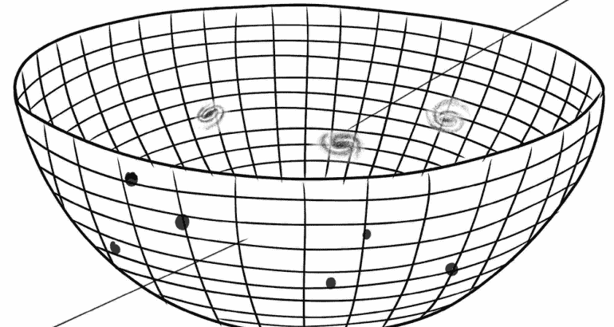

## 边界上的粒子

图 54。全息关系将弯曲时空内部的弦理论和引力与在该时空边界上的某些粒子和场的量子理论等起来。

在最宏的形式中，全息对偶性指出场和粒子的边界世界完全决定了 AdS 内部引力和物质的行为，而不仅仅是经典或半经典的近似。双倍兴奋的是，马尔达塞纳对偶性中出现的粒子是人们最熟悉的量子场理论之一，自20 世纪中叶以来粒子物理学家对其进行了深入研究。因此，全息原理——在其宏大的形式下——提供了一个引力和物质完全量子理论的工作示例。

马尔达塞纳（Maldacena）对偶性带来了这种震撼的视角转变。

与M 理论中的其他对偶性一样，全息对偶性双方之间关系的性质是：当一方非常简单直观时，另一方的情况通常会变得极其复杂。例如，当引力很弱且 AdS 宇宙轻微弯曲时，边界描述涉及了其组分之间如此强大的量子相互作用，以至于量子场论（QFT）变得完全无法处理，甚至单个粒子的概念可能都不再有多大的意义。

这种特性使得全息对偶性非常难以证明，但也异常强大。因为这意味着物理学家可以利用爱因斯坦的引力理论来了解粒子量子世界中的新现象，反之亦然。多年来，全息原理已成为一个真正的数学实验室，理论学家在其中进行了最天才的实验，以便对对自然界迷人的全息基础有更深入的理解——以及一些直觉。今天，全息物理已经伸出了翅膀，超越了它在 M 理论中的起源，通过一个丰富的关系网络，将我们过去认为互不相关的物理分支连接在一起，从广义相对论、凝聚态物理和核物理，到量子信息，甚至天体物理学。

让我们回到黑洞。如果全息原理等同于完整的量子引力理论（尽管是在 AdS 设置下），那么它一定解决了史蒂芬（Stephen）那著名的棘手的黑洞信息悖论吧？

嗯，这相当微妙。原因在于，马尔达塞纳的表面描述以高度杂乱且完全无法识别的方式加密了 AdS 内部世界。这并不令人意外；即使是普通的光学全息图，与它所编码的三维场景也完全没有点相似之处。一个常见的二维全息图的表面包含了看似随机的线条和涂鸦。它需要一种复杂的运算（通常是激光光穿过表面的形式）将这些转换为三维场景。


# 全息原理与 AdS/QFT 对偶性

同样，这需要一种复杂的数学操作，才能从全息表面描述中破译 AdS 空间内部发生了什么。遗憾的是，全息原理的发现并没有带来一本我们可以查阅以发现双方如何相互翻译的数学字典。理论学家必须逐条条目地开发这本字典，以解码全息图，从而揭示全息对偶性的巨大力量。

## 消失的维度

也许你在 AdS–QFT 字典中寻找的第一个条目关于一个被认为是对偶性最奇异的属性：消失的维度。受限于表面的粒子和场是如何捕捉到 AdS 内部深度发生的一切的？关于 AdS 宇宙内部所有事物的每一碎片信息必须以某种方式编码在 QFT 中，否则对偶性就称不上是对偶性了。那么，量子场论是否设法某种方式“吸收”了整个维度？

这里相关的 AdS 关键特性是垂直于边界表面的内部维度是高度弯曲的。de Sitter 空间中的“反”（anti）是指 AdS 具有负曲率。在真实的负曲率 AdS 空间中，所有的天使和恶魔的大小都是相同的。但在埃舍（Escher）的平化投影中，人物变得越来越小，并在圆形边界附近聚集，在边缘处于无限的分形中消失。

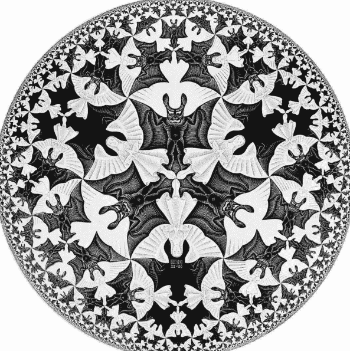

图 55。M. C. 埃舍的《圆限界 IV》。

现在，如果你想象将埃舍木刻中的其中一个天使（或恶魔）投影到圆片的圆形边界上，比如通过创建一个线段形式的阴影，那么对于靠近边缘的天使来说，那条线将比位于内部深处的同一天使的线短得多。这正是全息原理的工作方式：马尔达塞纳的对偶性将 AdS 中的“内部深度”翻译为边界上的“尺寸”。因此，AdS-QFT 字典中的第一个条目读，边界世界中的收缩和增长分别对应于弯曲 AdS 宇宙中沿垂直于边界的方向的靠近或远离。

## 全息物理的广泛应用

事实上，全息原理的这种特性使得物理学家可以利用爱因斯坦的引力理论来了解粒子量子世界中的新现象，反之亦然。多年来，全息原理已成为一个真正的数学实验室，理论学家在其中进行了最天才的实验，以便对自然界迷人的全息基础有更深入的理解——以及一些直觉。今天，全息物理已经伸出了翅膀，超越了它在 M 理论中的起源，通过一个丰富的关系网络，将我们过去认为互不相关的物理分支连接在一起，从广义相对论、凝聚态物理和核物理，到量子信息，甚至天体物理学。

## 黑洞信息悖论

让我们回到黑洞。如果全息原理等同于完整的量子引力理论（尽管是在 AdS 设置下），那么它一定解决了史蒂芬（Stephen）那著名的棘手的黑洞信息悖论吧？

嗯，这相当微妙。原因在于，马尔达塞纳的表面描述以高度杂乱且完全无法识别的方式加密了 AdS 内部世界。这并不令人意外；即使是普通的光学全息图，与它所编码的三维场景也完全没有点相似之处。一个常见的二维全息图的表面包含了看似随机的线条和涂鸦。它需要一种复杂的运算（通常是激光光穿过表面的形式）将这些转换为三维场景。

同样，这需要一种复杂的数学操作，才能从全息表面描述中破译 AdS 空间内部发生了什么。遗憾的是，全息原理的发现并没有带来一本我们可以查阅以发现双方如何相互翻译的数学字典。理论学家必须逐条条目地开发这本字典，以解码全息图，从而揭示全息对偶性的巨大力量。


# 全息原理与 AdS/CFT 对偶性

## AdS 空间的几何特性

这里相关的 AdS 关键特性是垂直于边界表面的内部维度是高度弯曲的。de Sitter 空间中的“反”（anti）是指 `AdS` 具有负曲率。在真实的负曲率 `AdS` 空间中，所有的天使和恶魔的大小都是相同的。但在埃舍（Escher）的平化投影中，人物变得越来越小，并在圆形边界附近聚集，在边缘处于无限的分形中消失。


图 55。M. C. 埃舍的《圆限界 IV》。

现在，如果你想象将埃舍木刻中的其中一个天使（或恶魔）投影到圆片的圆形边界上，比如通过创建一个线段形式的阴影，那么对于靠近边缘的天使来说，那条线将比位于内部深处的同一天使的线短得多。这正是全息原理的工作方式：马尔达塞纳的对偶性将 `AdS` 中的“内部深度”翻译为边界上的“尺寸”。因此，`AdS-QFT` 字典中的第一个条目读，边界世界中的收缩和增长分别对应于弯曲 `AdS` 宇宙中沿垂直于边界的方向的靠近或远离。

## 全息原理的物理意义

事实上，全息原理的这种特性使得物理学家可以利用爱因斯坦的引力理论来了解粒子量子世界中的新现象，反之亦然。多年来，全息原理已成为一个真正的数学实验室，理论学家在其中进行了最天才的实验，以便对自然界迷人的全息基础有更深入的理解——以及一些直觉。今天，全息物理已经伸出了翅膀，超越了它在 `M` 理论中的起源，通过一个丰富的关系网络，将我们过去认为互不相关的物理分支连接在一起，从广义相对论、凝聚态物理和核物理，到量子信息，甚至天体物理学。

## 黑洞信息悖论与全息对偶性

让我们回到黑洞。如果全息原理等同于完整的量子引力理论（尽管是在 `AdS` 设置下），那么它一定解决了史蒂芬（Stephen）那著名的棘手的黑洞信息悖论吧？

嗯，这相当微妙。原因在于，马尔达塞纳的表面描述以高度杂乱且完全无法识别的方式加密了 `AdS` 内部世界。这并不令人意外；即使是普通的光学全息图，与它所编码的三维场景也完全没有点相似之处。一个常见的二维全息图的表面包含了看似随机的线条和涂鸦。它需要一种复杂的运算（通常是激光光穿过表面的形式）将这些转换为三维场景。

同样，这需要一种复杂的数学操作，才能从全息表面描述中破译 `AdS` 空间内部发生了什么。遗憾的是，全息原理的发现并没有带来一本我们可以查阅以发现双方如何相互翻译的数学字典。理论学家必须逐条条目地开发这本字典，以解码全息图，从而揭示全息对偶性的巨大力量。

## 消失的维度：AdS/QFT 字典的核心条目

也许你在 `AdS–QFT` 字典中寻找的第一个条目关于一个被认为是对偶性最奇异的属性：消失的维度。受限于表面的粒子和场是如何捕捉到 `AdS` 内部深度发生的一切的？关于 `AdS` 宇宙内部所有事物的每一碎片信息必须以某种方式编码在 `QFT` 中，否则对偶性就称不上是对偶性了。那么，量子场论是否设法某种方式“吸收”了整个维度？


# 全息原理与 AdS/QFT 对偶性

同样，这需要一种复杂的数学操作，才能从全息表面描述中破译 AdS 空间内部发生了什么。遗憾的是，全息原理的发现并没有带来一本我们可以查阅以发现双方如何相互翻译的数学字典。理论学家必须逐条条目地开发这本字典，以解码全息图，从而揭示全息对偶性的巨大力量。

## 消失的维度

也许你在 `AdS–QFT` 字典中寻找的第一个条目关于一个被认为是对偶性最奇异的属性：消失的维度。受限于表面的粒子和场是如何捕捉到 AdS 内部深度发生的一切的？关于 AdS 宇宙内部所有事物的每一碎片信息必须以某种方式编码在 QFT 中，否则对偶性就称不上是对偶性了。那么，量子场论是否设法某种方式“吸收”了整个维度？

这里相关的 AdS 关键特性是垂直于边界表面的内部维度是高度弯曲的。de Sitter 空间中的“反”（anti）是指 AdS 具有负曲率。在真实的负曲率 AdS 空间中，所有的天使和恶魔的大小都是相同的。但在埃舍（Escher）的平化投影中，人物变得越来越小，并在圆形边界附近聚集，在边缘处于无限的分形中消失。


图 55。M. C. 埃舍的《圆限界 IV》。

现在，如果你想象将埃舍木刻中的其中一个天使（或恶魔）投影到圆片的圆形边界上，比如通过创建一个线段形式的阴影，那么对于靠近边缘的天使来说，那条线将比位于内部深处的同一天使的线短得多。这正是全息原理的工作方式：马尔达塞纳的对偶性将 AdS 中的“内部深度”翻译为边界上的“尺寸”。因此，`AdS-QFT` 字典中的第一个条目读，边界世界中的收缩和增长分别对应于弯曲 AdS 宇宙中沿垂直于边界的方向的靠近或远离。

## 全息物理的广泛影响

事实上，全息原理的这种特性使得物理学家可以利用爱因斯坦的引力理论来了解粒子量子世界中的新现象，反之亦然。多年来，全息原理已成为一个真正的数学实验室，理论学家在其中进行了最天才的实验，以便对自然界迷人的全息基础有更深入的理解——以及一些直觉。今天，全息物理已经伸出了翅膀，超越了它在 M 理论中的起源，通过一个丰富的关系网络，将我们过去认为互不相关的物理分支连接在一起，从广义相对论、凝聚态物理和核物理，到量子信息，甚至天体物理学。

## 黑洞信息悖论

让我们回到黑洞。如果全息原理等同于完整的量子引力理论（尽管是在 AdS 设置下），那么它一定解决了史蒂芬（Stephen）那著名的棘手的黑洞信息悖论吧？

嗯，这相当微妙。原因在于，马尔达塞纳的表面描述以高度杂乱且完全无法识别的方式加密了 AdS 内部世界。这并不令人意外；即使是普通的光学全息图，与它所编码的三维场景也完全没有点相似之处。一个常见的二维全息图的表面包含了看似随机的线条和涂鸦。它需要一种复杂的运算（通常是激光光穿过表面的形式）将这些转换为三维场景。


# 全息原理与 AdS/QFT 对偶性

## 全息原理的物理意义

事实上，全息原理的这种特性使得物理学家可以利用爱因斯坦的引力理论来了解粒子量子世界中的新现象，反之亦然。多年来，全息原理已成为一个真正的数学实验室，理论学家在其中进行了最天才的实验，以便对自然界迷人的全息基础有更深入的理解——以及一些直觉。今天，全息物理已经伸出了翅膀，超越了它在 `M` 理论中的起源，通过一个丰富的关系网络，将我们过去认为互不相关的物理分支连接在一起，从广义相对论、凝聚态物理和核物理，到量子信息，甚至天体物理学。

## 黑洞信息悖论

让我们回到黑洞。如果全息原理等同于完整的量子引力理论（尽管是在 `AdS` 设置下），那么它一定解决了史蒂芬（Stephen）那著名的棘手的黑洞信息悖论吧？

嗯，这相当微妙。原因在于，马尔达塞纳的表面描述以高度杂乱且完全无法识别的方式加密了 `AdS` 内部世界。这并不令人意外；即使是普通的光学全息图，与它所编码的三维场景也完全没有点相似之处。一个常见的二维全息图的表面包含了看似随机的线条和涂鸦。它需要一种复杂的运算（通常是激光光穿过表面的形式）将这些转换为三维场景。

同样，这需要一种复杂的数学操作，才能从全息表面描述中破译 `AdS` 空间内部发生了什么。遗憾的是，全息原理的发现并没有带来一本我们可以查阅以发现双方如何相互翻译的数学字典。理论学家必须逐条条目地开发这本字典，以解码全息图，从而揭示全息对偶性的巨大力量。

## AdS/QFT 字典：消失的维度

也许你在 `AdS–QFT` 字典中寻找的第一个条目关于一个被认为是对偶性最奇异的属性：消失的维度。受限于表面的粒子和场是如何捕捉到 `AdS` 内部深度发生的一切的？关于 `AdS` 宇宙内部所有事物的每一碎片信息必须以某种方式编码在 `QFT` 中，否则对偶性就称不上是对偶性了。那么，量子场论是否设法某种方式“吸收”了整个维度？

这里相关的 `AdS` 关键特性是垂直于边界表面的内部维度是高度弯曲的。de Sitter 空间中的“反”（anti）是指 `AdS` 具有负曲率。在真实的负曲率 `AdS` 空间中，所有的天使和恶魔的大小都是相同的。但在埃舍（Escher）的平化投影中，人物变得越来越小，并在圆形边界附近聚集，在边缘处于无限的分形中消失。


图 55。M. C. 埃舍的《圆限界 IV》。

现在，如果你想象将埃舍木刻中的其中一个天使（或恶魔）投影到圆片的圆形边界上，比如通过创建一个线段形式的阴影，那么对于靠近边缘的天使来说，那条线将比位于内部深处的同一天使的线短得多。这正是全息原理的工作方式：马尔达塞纳的对偶性将 `AdS` 中的“内部深度”翻译为边界上的“尺寸”。因此，`AdS-QFT` 字典中的第一个条目读，边界世界中的收缩和增长分别对应于弯曲 `AdS` 宇宙中沿垂直于边界的方向的靠近或远离。


图 55。M. C. 埃舍的《圆限界 IV》。

现在，如果你想象将埃舍木刻中的其中一个天使（或恶魔）投影到圆片的圆形边界上，比如通过创建一个线段形式的阴影，那么对于靠近边缘的天使来说，那条线将比位于内部深处的同一天使的线短得多。这正是全息原理的工作方式：`马尔达塞纳`的对偶性将 `AdS` 中的“内部深度”翻译为边界上的“尺寸”。因此，`AdS-QFT` 字典中的第一个条目读，边界世界中的收缩和增长分别对应于弯曲 `AdS` 宇宙中沿垂直于边界的方向的靠近或远离。

事实上，全息原理的这种特性使得物理学家可以利用爱因斯坦的引力理论来了解粒子量子世界中的新现象，反之亦然。多年来，全息原理已成为一个真正的数学实验室，理论学家在其中进行了最天才的实验，以便对自然界迷人的全息基础有更深入的理解——以及一些直觉。今天，全息物理已经伸出了翅膀，超越了它在 `M` 理论中的起源，通过一个丰富的关系网络，将我们过去认为互不相关的物理分支连接在一起，从广义相对论、凝聚态物理和核物理，到量子信息，甚至天体物理学。

让我们回到黑洞。如果全息原理等同于完整的量子引力理论（尽管是在 `AdS` 设置下），那么它一定解决了史蒂芬（`Stephen`）那著名的棘手的黑洞信息悖论吧？

嗯，这相当微妙。原因在于，`马尔达塞纳`的表面描述以高度杂乱且完全无法识别的方式加密了 `AdS` 内部世界。这并不令人意外；即使是普通的光学全息图，与它所编码的三维场景也完全没有点相似之处。一个常见的二维全息图的表面包含了看似随机的线条和涂鸦。它需要一种复杂的运算（通常是激光光穿过表面的形式）将这些转换为三维场景。

同样，这需要一种复杂的数学操作，才能从全息表面描述中破译 `AdS` 空间内部发生了什么。遗憾的是，全息原理的发现并没有带来一本我们可以查阅以发现双方如何相互翻译的数学字典。理论学家必须逐条条目地开发这本字典，以解码全息图，从而揭示全息对偶性的巨大力量。

也许你在 `AdS–QFT` 字典中寻找的第一个条目关于一个被认为是对偶性最奇异的属性：消失的维度。受限于表面的粒子和场是如何捕捉到 `AdS` 内部深度发生的一切的？关于 `AdS` 宇宙内部所有事物的每一碎片信息必须以某种方式编码在 `QFT` 中，否则对偶性就称不上是对偶性了。那么，量子场论是否设法某种方式“吸收”了整个维度？

这里相关的 `AdS` 关键特性是垂直于边界表面的内部维度是高度弯曲的。`de Sitter` 空间中的“反”（`anti`）是指 `AdS` 具有负曲率。在真实的负曲率 `AdS` 空间中，所有的天使和恶魔的大小都是相同的。但在埃舍（`Escher`）的平化投影中，人物变得越来越小，并在圆形边界附近聚集，在边缘处于无限的分形中消失。


图 55。M. C. 埃舍的《圆限界 IV》。

现在，如果你想象将埃舍木刻中的其中一个天使（或恶魔）投影到圆片的圆形边界上，比如通过创建一个线段形式的阴影，那么对于靠近边缘的天使来说，那条线将比位于内部深处的同一天使的线短得多。这正是全息原理的工作方式：`马尔达塞纳`的对偶性将 `AdS` 中的“内部深度”翻译为边界上的“尺寸”。因此，`AdS-QFT` 字典中的第一个条目读，边界世界中的收缩和增长分别对应于弯曲 `AdS` 宇宙中沿垂直于边界的方向的靠近或远离。

马尔达塞纳的对偶性带来了这种震撼的视角转变。

与 `M` 理论中的其他对偶性一样，全息对偶双方之间关系的性质是：当一方非常简单直观时，另一方的情况通常会变得极其复杂。例如，当引力很弱且 `AdS` 宇宙轻微弯曲时，边界描述涉及了其组分之间如此强大的量子相互作用，以至于量子场论（`QFT`）变得完全无法处理，甚至单个粒子的概念可能都不再有多大的意义。这种特性使得全息对偶性非常难以证明，但也异常强大。因为这意味着物理学家可以利用爱因斯坦的引力理论来了解粒子量子世界中的新现象，反之亦然。多年来，全息原理已成为一个真正的数学实验室，理论学家在其中进行了最天才的实验，以便对自然界迷人的全息基础有更深入的理解——以及一些直觉。今天，全息物理已经伸出了翅膀，超越了它在 `M` 理论中的起源，通过一个丰富的关系网络，将我们过去认为互不相关的物理分支连接在一起，从广义相对论、凝聚态物理和核物理，到量子信息，甚至天体物理学。

让我们回到黑洞。如果全息原理等同于完整的量子引力理论（尽管是在 `AdS` 设置下），那么它一定解决了史蒂芬（`Stephen`）那著名的棘手的黑洞信息悖论吧？

嗯，这相当微妙。原因在于，`马尔达塞纳`的表面描述以高度杂乱且完全无法识别的方式加密了 `AdS` 内部世界。这并不令人意外；即使是普通的光学全息图，与它所编码的三维场景也完全没有点相似之处。一个常见的二维全息图的表面包含了看似随机的线条和涂鸦。它需要一种复杂的运算（通常是激光光穿过表面的形式）将这些转换为三维场景。

同样，这需要一种复杂的数学操作，才能从全息表面描述中破译 `AdS` 空间内部发生了什么。遗憾的是，全息原理的发现并没有带来一本我们可以查阅以发现双方如何相互翻译的数学字典。理论学家必须逐条条目地开发这本字典，以解码全息图，从而揭示全息对偶性的巨大力量。

也许你在 `AdS–QFT` 字典中寻找的第一个条目关于一个被认为是对偶性最奇异的属性：消失的维度。受限于表面的粒子和场是如何捕捉到 `AdS` 内部深度发生的一切的？关于 `AdS` 宇宙内部所有事物的每一碎片信息必须以某种方式编码在 `QFT` 中，否则对偶性就称不上是对偶性了。那么，量子场论是否设法某种方式“吸收”了整个维度？

这里相关的 `AdS` 关键特性是垂直于边界表面的内部维度是高度弯曲的。`de Sitter` 空间中的“反”（`anti`）是指 `AdS` 具有负曲率。在真实的负曲率 `AdS` 空间中，所有的天使和恶魔的大小都是相同的。但在埃舍（`Escher`）的平化投影中，人物变得越来越小，并在圆形边界附近聚集，在边缘处于无限的分形中消失。


图 55。M. C. 埃舍的《圆限界 IV》。

现在，如果你想象将埃舍木刻中的其中一个天使（或恶魔）投影到圆片的圆形边界上，比如通过创建一个线段形式的阴影，那么对于靠近边缘的天使来说，那条线将比位于内部深处的同一天使的线短得多。这正是全息原理的工作方式：`马尔达塞纳`的对偶性将 `AdS` 中的“内部深度”翻译为边界上的“尺寸”。因此，`AdS-QFT` 字典中的第一个条目读，边界世界中的收缩和增长分别对应于弯曲 `AdS` 宇宙中沿垂直于边界的方向的靠近或远离。


# 物理学

马尔达维纳伟大的对偶性成功地消除了量子理论与黑洞之间的任何形式的矛盾，但它并没有阐明斯蒂芬在他最初基于引力的计算中在何处犯了错误。可以理解，而且值得赞的是，斯蒂芬坚持用他自己的术语来解决这一悖论：用引力和几何的语言来描述逃逸路线，这不需要他盲目信任那种对偶的魔法。

又过了几年，斯蒂芬才最终转变态度，并公开宣布在黑洞面前量子力学是安全的。他表现得极具戏剧性。选定的地点是 2004 年 7 月在都柏林举行的第 17 届广义相对论与引力国际会议，这正是他在 1965 年首次展示他的重大奇点定理时参加的会议。当斯蒂芬发邮件给会议组织者请求演讲名额，理由是“他解决了黑洞信息悖论”时，他们不仅给了他一个名额，还为他预订了皇家柏林学会的主厅。不久之后，他们就不得不应对这堂本应是科学讲座的媒体证件短缺问题。

一如既常，会议是霍金门下的学生和学生们聚会的机会。在斯蒂芬演讲的前一天晚上，我们在都柏林的圣殿酒吧区出去喝了酒。斯蒂芬利用这段难得的悠闲时光，调大了他的语音合成器的量。“我要公开了，”他面带大微笑宣布道。确实，第二天，霍金向坐满了物理学家和记者这一奇特组合的会场宣布，黑洞并不是他们想象中的那种无底洞，而是在它们辐射并消失时，会释放出关于它们过去的所有信息。在演讲后的新闻发布会上，斯蒂芬与口才极佳的加州理工学院物理学家约翰·普拉斯基尔（John Preskill）履行了一个赌约。普拉斯基尔在 1997 年曾与斯蒂芬和基普·索恩打赌，所有信息最终都会从蒸发的黑洞中泄漏出来。赌约规定，“失败者将奖励胜者一本其选择的百科全书，书中可以随心所欲恢复信息。”斯蒂芬送给约翰一本《总棒球：终极棒球百科全书》，尽管没有提到他或许应该给对方的是骨灰。约翰兴奋地将百科全书举过头顶，仿佛他刚刚赢得了世界赛冠军。闪光灯此此闪烁，其中一张照片登上了《时代》周刊。

然而，斯蒂芬在都柏林的表演略显尴尬。当然，我们早已习惯了这样一个事实：关于黑洞的每种想法在公众舞台上都拥有属于自己的生命。斯蒂芬非常擅长向全球观众进行交流——而且从小就与流行文化保持同步——他已成为我们时代伟大的声音之一，激励了全世界数百万的人。都柏林的这次活动是一个罕见的时刻，斯蒂芬的公众形象与真正的科学实践之间的界限变得模糊。尽管媒体对斯蒂芬在黑洞问题上的转变大肆渲染，但无论是他的都柏林演讲还是随后关于该主题的论文都没有推动问题的解决——更不用说解决它。出席的大多数弦理论学家在六年前就已经得出结论，黑洞并没有破坏信息，他们认为斯蒂芬的让协演讲早就该发生了。另一方面，相对论者们并没有被斯蒂芬深奥的报告所打动，认为他过早地改变了主意。他们中包括基普·索恩，他拒绝在都柏林承认他们的赌约——我不认为他从未放弃过。

斯蒂芬继续与他当时的学生、法国人克里斯托夫·加尔法德（Christophe Galfard）尝试纠正黑洞悖论，克里斯托夫当时由于（不）幸运地在一个“黑洞之年”走进了斯蒂芬的办公室。克里斯托夫也意识到，他们的计算并没有他们预期的那样顺畅，而是指向了更深层的问题。那么，为什么斯蒂芬要在都柏林登台宣布信息并没有丢失在黑洞内部呢？是什么让他觉得尽管缺乏确凿证据，但证据体仍然倾向于信息保护？我认为他看中了全息图中一个一个晦涩且被低估的元素，他认为那是解决悖论的关键，即：内部并不止一个。

你看，表面全息图加密的不单是一个内部弯曲几何体，还是一种不同形状的时空混合体。[19] 全息对偶性，也就是说，它显然融入了那种费曼式的、关于引力的激进量子思维（我在上一章中讨论过，并证明对解开宇宙学信息悖论至关重要）。全息性加强了这些观点，并预测在某种层面上，引力涉及的不是一个而是多个时空几何的叠加。它鼓励我们将 AdS 内部看作一个波函数，而不是单一的时空。

> “当我们说黑洞是由史瓦西几何结构描述时，我们就面临了信息丢失问题，”斯蒂芬在都柏林告诉他的观众。[110] 然后他继续道：“然而，精确状态的信息被保留在一个不同的几何结构中。困惑和悖论的出现是因为我们从经典角度、从单一客观时空中思考。但费曼的几何求和允许它同时是两种几何结构。”

这是霍金新的“自上而下”观点。

在他对霍金辐射的原始推导中，自下而上的霍金（非常合理地）假设任何逃逸的辐射都是在黑洞的时空中运动，即史瓦西在 1916 年发现的弯曲几何体。当然，这种假设排除了从长远来看，一种全新的空间形状发挥作用的可能性。三十年后，斯蒂芬看到这种推理稍微过于古典了。他现在宣布，当黑洞变老时，惊讶的是，关于黑洞及其历史的大部分信息不再存储在原始的黑洞几何中，而是在完全不同的时空中。因此，新的自上而下的斯蒂芬承认了——也许是不情愿，谁知道呢——他年轻时在开始计算之前就错了，因为他假设时空是给定的。

回顾过去，自上而下的斯蒂芬在直觉上是正确的，即涉及另一个几何结构。从内部几何求和而非单一几何的正确量子思维，最终证明是开始解开黑洞悖论的关键。他对都柏林演讲的争议在于，斯蒂芬没有指出老黑洞的过去可能存储在何种弯曲形状中。他有效地暗示（错误地）了，根本不存在黑洞的可能性就足以解决悖论。

还需要在马尔达维纳的全息实验室中进行更多工作，并探索更多的盲目盟友，理论学家才能最终开始辨认出老黑洞的逃逸路线。事实上，在斯蒂芬去世后的这些年里，浸淫全息术的新一代黑物理学家意识到，可能涉及到虫洞。虫洞是奇特的空间形状，类似于手柄，起着连接时空中原本遥远地点或时刻的几何桥梁的作用。图 56 显示了惠勒在 1955 年对虫洞的第一幅画，他当时称之为“多连空间”。现在，在 2019 年，斯坦福大学独立工作的杰夫·佩宁顿，以及由艾哈迈德·阿尔梅希里、内塔·恩格尔哈德特、唐纳德·马尔洛夫和亨利·马克斯菲德组成的斯坦四人组发现了震撼证据：在蒸发过程的中期，黑洞可能会经历令人震惊的重组。[11] 计算表明，辐射粒子缓慢但逐渐的积累可以激活费曼叠加中潜在的虫洞几何结构，在可能形成的视界区域创造出某种几何隧道，为内部信息的逃逸提供了通道[12]。

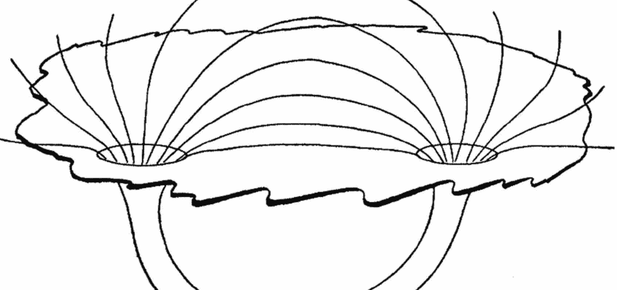

**图 56.** 虫洞的第一个示意图由约翰·惠勒（John Wheeler）绘制，他在 1957 年创造了这一术语，用于描述时空几何中连接两个远点的隧道。近年来，理论学家们认为，虫洞可能为信息逃离旧的、蒸发的黑洞提供一条通道。

远处的辐射被认为是通过利用一种名为`量子纠缠`的细微量子现象实现了这一非凡成就。请记住，霍金辐射源于黑洞视界附近场的量子涨动。这些涨动产生了粒子-反粒子对。每当反粒子掉入黑洞时，它的伙伴粒子就可以逃逸到遥远的宇宙，并以黑洞发出的霍金辐射的形式出现。然而，尽管距离遥远，粒子和反粒子之间仍保持着量子力学联系。物理学家说它们保持着“纠缠态”。这种纠缠意味着，如果你单独测量发射出的辐射，它看起来像是随机的热辐射。但如果你能够共同考虑这些对的成员，就会发现它们确实包含信息，这些信息编码在相互关联个体属性的精细相关性中。这就像用密码加密你的数据。没有密码的数据是毫无意义的。密码（如果你选了一个好的话）本身也没有意义。但它们结合就能解锁信息。

彭宁顿（Pennington）和弦乐四重奏发现的——以及后来许多理论学家所阐述的——是：蒸发黑洞内部与外部之间越千年积累的越来越多的量子纠缠，可以被看作产生了一个跨越视界的虫洞。这好像霍金辐射粒子与其视界背后的反粒子伙伴共同织就了它们的时空桥梁，将一个旧黑洞从一个隐世的王国变成了一种“快速穿服务店”。

此外，`量子纠缠`似乎是马尔达森纳（Maldacena）全全息工作的关键部分。这涉及了可能是 `AdS-QFT`（量子场论）字典中最显而易见同时也最深远的入口：引力和弯曲时空是涌现现象。多年的研究表明，为了让表面全息能够编码弯曲的内部几何结构，仅具有大量类粒子成分的边界表面是远远不够的。相反，只有当`量子纠缠`连接了大量的边界成分时，弯曲的内部才会出现。严格来说，`量子纠缠`似乎是全息物理中产生引力和弯曲时空的核心引擎。对于马尔达森纳来说，`量子纠缠`就像激光对于普通光学全息图一样。

这是一个惊人的洞察。爱因斯坦证明了引力是扭曲时空的表现。全息原理更进了一步，假设扭曲的时空是由`量子纠缠`织而成的。正如热力学第二定律源于许多经典粒子的统计行为，或者声波源于物质分子的同步振动一样，全息对偶辐射出这样观点：爱因斯坦的广义相对论是从在低维边界表面上运动的无数量子粒子的集体纠缠中涌现出来的。`AdS` 内部的相邻区域对应于边界表面上的高度纠缠成分。内部空间的遥远部分对应于边界纠缠程度较低的部分。如果表面配置具有有序的纠缠模式，就会出现一个近乎真空的内部。如果表面系统处于混沌状态，所有组件相互相互纠缠，那么内部就包含一个黑洞。如果你对纠缠量子比特执行极其复杂的量子操作，希望能读出黑洞的历史，你会困惑地发现一个内部虫洞几何结构。

在这一切中，存在一个明显的“自上而下”的元素。用上一章的语言来说，我们可以说纠缠边界充当了观测者的角色。在自上而下的宇宙学中，观测表面的数据从可能的过去海洋中选择出一个。全息原理预测，以类似的方式，球形边界上的纠缠模式决定了内部维的形状。全息原理和自上而下的宇宙学都会宣布物理学通常顺序的惊人反转：扭曲的时空次于“边界表面上提出的问题”。

现如今，引力理论学家和量子实验学家在实验室里讨论由受限原子或离子组成的强纠缠系统，这些系统模拟了黑洞的一些性质。通过实验这些系统，人们希望了解更多支撑扭曲时空的纠缠，以及当纠缠分解时会发生什么。在 20 世纪 90 年代全息革命之初，谁会认为实验学家会带来黑洞模型？

遗憾的是，斯蒂芬没能享受到这些惊人的新见解。他如果能看到虫洞作为蒸发黑洞难以捉摸的逃通道，无疑会非常激动。我们只能好奇他会提出什么样的精辟格言。我相信，我们也会同样兴奋于洞察到黑洞与早期宇宙理解之间的另一层联系，这两个主题一直驱动着他的工作。在整个职业生涯中，来自黑洞的洞察影响了他随后关于宇宙学的工作，从彭斯的黑洞奇点定理到他发现霍金辐射。全息的出现导致这两个领域之间更紧密的相互作用，例如我们在 2002 年开始开发的自上而下的方法启发了他 2004 年对黑洞的研究。

尽管如此，一些理论学家对黑洞量子理论的这些进展感到困。他们一直希望黑洞信息悖论的解决能将霍金那种奇异的几何混合替换为完全不同的东西。相反，现在看来我们应该认真对待霍金的几何叠加，并且在足够认真的情况下，这种量子引力的思考方式将超出所有人的预期（当然除了霍金，他的预期一直很高）。尽管在通过读取其灰烬——霍金辐射——来读取黑洞历史之前还有很多需要学习的内容，但许多理论学家现在认为不再存在真正的悖论了。此外，我认为这种发展是完全不同的。从单一时空向涌现时空的转变，具有真正的基础性意义。

首先，这种转变标志着基础物理学中旧的还原主义梦想的终结。还原主义是一个极其成功的思想，认为科学中的解释箭头总是指向更低层次的复杂性。它认为在科学的层层叠叠的大厦中，从物理到化学再到生物，高层次的现象在原理上可以通过低层次的现象来解释。还原主义并不意味着总是需要低层次的解释，或者在实践中总是可以实现的。它与更高复杂性水平产生的新现象和“定律”并不冲突。还原主义仅仅意味着，这些高层定律与其底层根源并不是脱节的；我们定性地从化学术语角度理解生物现象，从物理术语角度理解化学现象。而且如果我们有强大的计算机可以在微观层面模拟复杂的生物系统基于它们的分子化学性质，我们确实会看到它们的生物行为显现。

但物理学基本法则的最底层水平呢？这是否是支撑科学大厦所有高层结构的坚实基础——绝对性的结构？全息学描绘了一幅截然不同的画面。如果纠缠——这一让爱因斯坦困扰不已的幽灵现象（这也是 2022 年诺贝尔物理奖的主题）是构建时空的核心，那么还原论与涌现论对比来看世界的方式就显得过于局限了。全息将涌现的一个基本元素引入了物理学的根源——时空结构本身。全息对偶性体现了这样观点：物理现实及其遵循的“基础”法则源于基础区块的汇聚以及它们纠缠的方式。它创造了一种相互依赖的闭环，从还原到涌现，再循环回还原。全息学认为，最基本的类规律性规律最终根根于我们周围宇宙的复杂性。这引导我们思考：这一结论的宇宙学意义是什么？

在马尔达维纳发现反德·西特空间的全息性质后，理论学家们很快推测，我们扩张的宇宙可能也是一个全息图。在我记录与史蒂芬的一些对话的笔记本中，我早在 1999 年 2 月就发现了关于扩张的德·西特空间可能的表面描述的思考。但直到十年后，当我们的自上而下的方法坚定步入正轨时，我们才开始认真追求全息宇宙学的观点。

遗憾的是，那时史蒂芬正在失去对肌肉的细微控制，这种控制奇迹般地在肌萎缩硬化症（ALS）中维持了多年。由于目前尚不清楚的原因，从大脑到脊髓以及从脊髓到肌肉传输电信号的长神经细胞在 ALS 患者体内会萎缩死亡，导致他们的肌肉因失去任何指令而萎缩。此时，ALS 已经夺取了史蒂芬几乎所有的肌肉控制。显然，这严重限制了他的行动自由。在我们合作的早期，史蒂芬可以轻松地转动轮椅寻找同伴，并利用小心放在他右手手中的设备参与对话。此时，史蒂芬已无法独立巡行，这在实践中意味着他的科学交流局限在一个较小的亲密同事圈。此外，疾病的进展使得史蒂芬几乎无法用他的点击器操作 `Equalizer`（调音器）。这个旧设备多年来一直是他思想与外界联系的脐带，从说话、发邮件到打电话或谷歌搜索，被一个安装在他眼镜上的传感器所取代，他可以通过稍微扭动脸颊来激活它。这确保了一条至关重要的通信线路，但它并没有恢复他驾驶甚至在午餐或晚餐期间进行讨论的能力，而这些曾是他与更广泛同事圈交流的关键场合。（在点击器时代，史蒂芬喜欢自称自己可以边吃边说。）因此，史蒂芬一直面临着被孤立的风险。可以说，他晚年无法流利地沟通，证明这是他科学生活中最大的限制。这意味着他无法再充分参与那些激烈的辩论了——涵盖从方程中的一个负号到哲学的价值的一切问题，而我们都需要通过这些辩论来完善和测试自己的想法。尽管他所有的认知能力仍然保持完好，在他生命的最后十多年里，他有时几乎完全被封锁在了身体里。

更糟糕的是，他开始出现呼吸困难，我们都担心他很快将完全无法移动。但随后，他的支持团队在轮椅上安装了呼吸机，这使其变成了一种移动重症监护室和 IT 热点的结合体。很快，他再次上上了路。此外，他那些健朗的朋友们出自己的私人飞机接他环游全球，与我们过去的探险相比，旅行变得非常顺畅。他经常去休斯顿，因为他与德克萨斯石油大亨乔治·P·米切尔建立了友谊，米切尔主动邀请史蒂芬和他的亲密同事在他的牧场参加年度物理研讨会，“以创造一个史蒂芬可以工作的环境”。史蒂芬也确实如此。远离剑桥办公室的喧嚣，年复一年，我见证了霍金的探究精神在德州的森林中焕发生。就在米切尔的牧场上，黑板课无缝过渡到晚餐和营火讨论，史蒂芬的宇宙全息理论诞生了。

将全息学应用于宇宙学的障碍在于，我们并不生活在一个反德·西特雪球世界里。我们在一个在一个像德·西特空间的扩张宇宙中。从经典角度看，它和德·西特对极具有非常不同的属性。`AdS` 空间的负曲率产生引力场，将物体拉向空间中心。相比之下，扩张的西特宇宙的正曲率导致万物相互排斥。这种差异可以追溯到宇宙学常数 `$\lambda$` 的符号，它也是爱因斯坦方程中的暗能量项。像我们这样的宇宙具有正的 `$\lambda$`，导致它拉伸；而 `AdS` 空间具有负的 `$\lambda$`，导致额外的引力。更重要的是，与 `AdS` 不同，扩张宇宙可能根本没有可以承载全息图的边界表面。某些扩张宇宙是超球体，即球的三维版本。超球没有边界，我们无法在上面编码内部发生的事情。因此，要工程出像马尔达维纳全息对偶那东西似乎几乎是不可能的。

但如果我们放弃经典思维，转而采用半经典观点呢？如果我们我们在虚数时间中构想 `AdS` 及其对极会怎样？毕竟，开发全息宇宙学的主要动力是为了更好地掌握宇宙的量子行为，而史蒂芬长期以来认为四维几何决定了它的量子特性。这是他的欧几里得引力方法的核心（见第 3 章）。记得他要求我画的那个圆吗？那个圆代表了将图 23(b) 所示的圆形膨胀宇宙投影到平面时得到的圆盘边缘。图 57 通过更复杂的手段唤起了这种投影。宇宙的无边界起源位于圆盘中心，那里时间演变成了空间。今天的宇宙对应于圆形边界。如果我能画出四个大维度，图 57 中的维度边界圆将是一个超球体，即我们对宇宙的所有观测大致局限于四维时空中的三维表面。现在，我们可以看到在这个投影中，扩张意味着构成过去的空间体积挤到了圆盘边缘。结果是，大多数星星和星系堆积在边界表面附近。这听起来耳熟吗？确实！将星星和星系替换为天使和恶魔，图 57 中的圆盘无缝转变为图 55 所示的 `AdS` 空间的埃舍式投影。

这正是史蒂芬一直在寻找的联系。经典 `AdS` 空间完全不像扩张宇宙。但从半经典视角来看，通过虚数时间，我们看到这两种空间形状实际上密切相关。在半经典领域，`AdS` 和它的德·西特对极都可以被认为是中式的圆盘，其大部分内部体积堆积在球形边界表面附近。史蒂芬断言，引力和时空的半经典思考在某种意义上统一了 `AdS` 和它的对极。仿佛 `$\lambda$` 的符号在量子引力领域没有真正的意义。

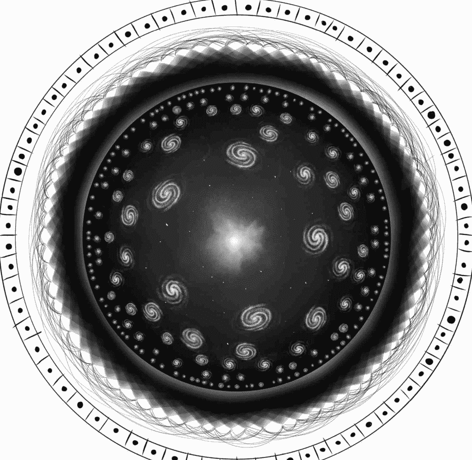

**图 57。** 为了掌握其量子起源，早期的斯蒂芬在 20 世纪 80 年代在虚时间中构想了宇宙。在虚时间中思考，所有维度都表现为空间的方向，图中展示了两个。宇宙的起源位于圆心，并沿着径向（虚时间）方向向外膨。今天的宇宙对应于圆形边界。然而，后期的斯蒂芬更远了一步，远得多，将我们从虚时间带到了完全的无时间。利用引力的全息特性，我们将圆盘边界想象成由纠缠量子比特组成的全息图，内部时空——我们的过去历史——从中投影出来。全息宇宙学建立了一种一种自上而下的视角，在这种视角下，过去在某种意义上取决于现在。

这一洞察力为全息 `dS–QFT` 对立铺平了道路。正如 `AdS` 一样，图 57 中的圆形边界表面为膨胀宇宙的全息描述提供了一个自然的家园。考虑到这些相似性，生活在这个表面上的对立场和粒子可能与 `AdS` 全息图共享一些属性。[13] 物理学家们正努力理解如何通过调整全息世界中的“螺丝和螺钉”，产生一个没有生命的 `AdS` 空间，或者一个膨胀并产生星系和生命的宇宙。*宇宙终究可能有一个边界*，斯蒂芬调侃道。

镜像 `AdS` 的全息图与膨胀宇宙全息图之间的主要区别在于弹出的额外维度的性质。在前的情况下，涌现的方向是一个弯曲的空间维度，它是 `AdS` 的内部深度。在膨胀宇宙的情况下，时间维度是涌现的。也就是说，历史本身被全息地加密了。而这很可能成为全息字典中最令人不可置信的条目！


现在这听起来可能很荒谬。然而，时间和宇宙膨胀是宇宙的涌现属性这一观点，自然地遵循了我们在旅途中遇到的系列洞察。当乔治·勒梅特（Georges Lemaître）首次提出量子起源的想法时，他已经在思考时间可能是涌现的：“只有当量子时间分成足够数量的量子时，时间才开始具有意义。”[14] 五十年后，吉姆和斯蒂芬的无边界描述证实了勒梅特的直觉，他们的观点是，当我们接近起点时，时间会演变成空间。图 57 所示的他们理论的全息化身将我们带到了更遥远的无时间状态。通过将引力和宇宙演化刻画在受限于三维表面的无数量子交互中，全息技术完全抛弃了先验的时间概念。在全息宇宙中，时间在某种意义上是虚幻的。这使得最初的无边界提议看起来确实相当保守。

这是一段多么非凡的旅程，从牛顿的绝对时间到没有时间的时间。尽管如此，将时间的流逝视为一种全息投影仍然让人感到陌生，即使对于理论物理学家也是如此。我预想，物理学家还需要很多年才能破译那些编码了像我们这样犹豫不决的宇宙的摇摆膨胀史的全息图。无数复杂的数学细微之处（其本身就极具趣味性）将在很长一段时间内让物理学家们忙碌。我们不应指望全息技术某天就会要求我们重写标准宇宙学教科书。特别是因为爱因斯坦的几何语言作为描述大多数大尺度宇宙的方法运行得非常完美。另一方面，我们可以预计当爱因斯坦理论失效时——黑洞内部，特别是大爆炸时刻——全息技术将变得至关重要。毕竟，这就是全息对立性的本质——力量。一个特别令人兴奋的可能性是，膨胀的全息基础在暴胀期间可能至关重要，而这种在微波背景波动中的细微痕迹可以通过未来的引力波观测探测。时间将证明一切！

在概念层，全息技术封印了宇宙学的自上而下方法。全息宇宙学的核心宗旨——过去投影自一个形成低维全息图的纠缠量子粒子网络——意味着了一种宇宙的自上而下的视角。如果正如全息宇宙学所假设的，我们观测的表面在某种意义上就是全部，那么这些逆向时间的操作就是自上而下宇宙学的标志。全息技术告诉我们，存在比时间更基础的实体——

全息原理认为宇宙的真正起源位于遥远的未来，因为只有遥远的未来才能展现出全息的全盛光彩。

**关于那些**遥远的过去呢？超越时间的宇宙学是如何构想时间起源的？假设明天理论学家识别出了与我们膨胀宇宙相对应的全息图，而我们开始阅读它——手持 `AdS-QFT` 字典，开启一段溯源之旅。在时空的最尽头，我们会发现什么？

在全息宇宙学中，探索过去就像是对比全息图采取某种模糊的视角。请记住，在马尔达西纳的对偶性中，通过考虑表面全息图中更大的尺度，可以进入 `AdS` 的内部。位于 `AdS` 正中央的物体被全息编码为跨越整个全息图的长程关联。同样，一个膨胀宇宙的全息图将遥远的过去刻在跨越表面世界距离的比特中。我们通过剥离一层层全息图中的信息向过去移动——向图 5 中圆心的中心移动——直到剩下几个远程纠缠的量子比特。从全息的角度来看，宇宙最早的时刻无疑是所有现象中最幽灵的。事实上，最终，纠缠比特是耗尽的。那么，这就是时间的起源。[16]

### 早期（自下而上）

霍金将无边界假设视为对宇宙从无中创造的描述。在那个时代，史蒂芬试图为宇宙起源给一个根本性的因果解释：是“为什么”，而不是“如何”。但全息原理对他理论提出了一种更激进的解释。全息宇宙学展示了史蒂芬那种“从时间到空间”的转换真正想要表达的是：当我们溯回大爆炸时，物理学本身就会消失。无边界假设从全息中浮现，与其说是一种开端的法则，不如说是法则本身的开始。那么，关于大爆炸终极原因的古老问题还剩下什么？它似乎会蒸发。最终起决定作用的不是法则本身，而是它们改变和转换的能力。

这种作为从全息宇宙学中涌现的真正极限边界的宇宙起源概念，对多重宇宙学具有深远影响。在物理学家构想过的任何全息图中，都没有证据显示岛屿宇宙的马赛克结构。相反，全息编码的内部波函数仅包含了弦景观中极小的一块区域：史蒂芬得出结论，全息宇宙学像奥卡姆剃刀一样割除了多重宇宙。在他生命的最后几年里，他坚信多重宇宙的热潮是“旧的、自下而上的思维自我陷入死结”的产物。

多重宇宙在许多方面是（半）经典黑洞理论的宇宙学类比。后者未能识别出黑洞存储信息量存在上限。同样，多重宇宙学假设我们的宇宙学理论可以包含任意大量的信息，而不影响它们所描述的宇宙。但全息宇宙学描绘了另一幅画面。延伸到弦景观所有角落的岛屿宇宙织锦，在全息宇宙学中似乎迷失在了不确定之中。与其说是真实的物理超结构，不如将那个景观视为一个数学领域，它告知物理学但并不存在，有点像门德列夫对生物学的意义。史蒂芬说，询问我们宇宙之外还有什么，就像询问哪个缝的电子通过了双缝实验一样。我们处于一片时空区域，被一片不确定性的海洋包围，对此我们必须保持沉默。

在旅程的终点，我在一次会议上遇到了安德烈·林德（Andrei Linde），并问他二十年后对多重宇宙有什么感受。令我惊讶的是，安德烈说，他认为要掌握多重宇宙，需要对宇宙学中观测者的角色采取一种恰当的量子观点。他一直都是这么想的吗？当然，他没有。科学是科学家所做的事情。我们通过交流思想、通过论证和推理、基于现有证据和抽象来进步。是多重宇宙的深层悖论，才使传统物理范式（追溯到牛顿）的局限性更加清晰地成为焦点。安德烈的工作启发了我们找到那个让量子“进入”的裂缝。如果没有多重宇宙理论强加我们的那些极其令人沮丧且困难的难题，我们可能还在那里寻找那种“无处之视角”，在时空之外的虚无中迷失和困惑。

史蒂芬在 2016 年 11 月，在教皇科学院举行的一场纪念乔治·勒梅特（Georges Lemaître）的宇宙学会议上，揭开了我们对多重宇宙挑战的迷纱。当史蒂芬告诉我他将参加这次集会时，我并不感到惊讶。毕竟，他是在 1981 年在梵蒂冈首次提出宇宙没有边界的。将宇宙的历史颠倒、内外翻转，他一定觉得欠这个学院对这个多年来一直挂在他心头的话题提供一个更新。

那是史蒂芬的最后一次海外旅行，并变成了一次艰难的远征。霍金的医生不再允许他乘坐任何朋友的私人飞机。在途中，他必须由空中救护机运送，而且不是普通的救护机，而是来自某特定瑞士公司的。这非常昂贵，由于教皇科学院资金紧张，我们不得不找到方法在研究资助中安排这笔预算。当他的医生拒绝签字行程时，史蒂芬告诉他们他计划与教皇方济各会面。最终，他们不想与会见圣面的愿景发生争执（尽管这话出自史蒂芬口，他们可能对这一说法表示怀疑），史蒂芬得以飞往罗马。

事实确实发生了，在他首次在梵蒂冈演讲三十五年后，史蒂芬再次坐在圣彼得教堂后的教皇科学院内。在那里，他解释了宇宙存在一种双重描述，一种完全不同且反直觉的观察现实的方式，其中空间扩张——实际上时间——是一种显而易见的涌现现象，由无数量子线织而成的低维表面。宇宙终究可能有边界。[17]

在我探访史蒂芬家之前的几周，他已经几乎无法行动，但周围环绕着最好的护理。我知道他很快就会离世。在伍兹沃斯树园（Wordsworth Grove）的书房里，我们进行了最后一次交流。“我从不是多重宇宙的粉丝，”他艰难地写道，仿佛我不知道一样。“该写本新书了……包含全息。”是他留给我的最后的话——我相信史蒂芬觉得，宇宙的新全息视角最终会让我们自上而下的宇宙学方法变得显而易见，我们有一天会后悔为什么错过了这么久。

那天下得很大，仿佛自然为史蒂芬的最后航程提供一条毯子。走回学校时，经过马尔丁斯路和科恩湖，穿过剑河并经过磨坊，绕回到数学物理学院（DAMTP），我反思了我们的旅程。在寻找现实终极基础的过程中，我们通过某种奇妙的连接循环，被带回了我们的观测。“卡尔·萨根曾有名地说：‘我们是宇宙认识自己的方式’”但在我看来，在量子宇宙中——我们的宇宙中——我们正在认识自己。自上而下的宇宙学，无论是否以全息形式存在，都根于我们与宇宙的关系。这带有一种微妙的人性色彩。在许多时候，这种从上帝视角到虫视角观察宇宙的转变，对史蒂芬来说确实像是一种归家。

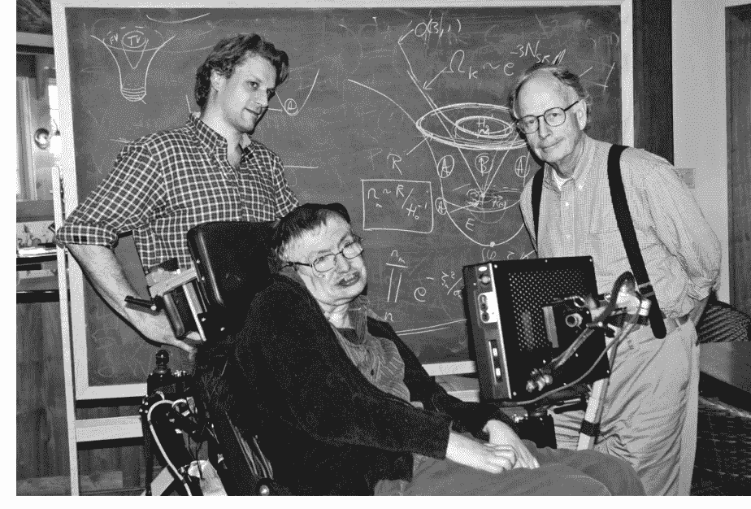

*^1 这并不是在威敏斯特可以找到的唯一公式。在牛顿墓附近的威敏斯特大教堂中殿内，有一块保罗·狄拉克的纪念石。石碑上的铭文包含了“狄拉克方程”`iγ^μ∂_μ=mψ`，它描述了电子的量子行为。有一次我和斯蒂芬访问过这座教堂，他忍不住评论道：“显然，上帝是一个纯粹的数学家。”

*^2 斯蒂芬指的是哲学中的一个原则，该原则通常归功于13世纪的英国哲学家威廉·奥卡姆，即“凡必要不增实体”。

# 第8章

# 在宇宙中如家

> 存在的织物自我编织成一个整体。
>
> ——查尔斯·艾维斯

## 1963年，汉娜·阿伦特参加了由《今日重大思想》编辑组织的一场太空研讨会的论文竞赛

这发生在人类首次进入太空后，当时美国国家航天局正计划发射阿波罗11号登月任务。阿伦特被问及人类对太空的征服是提高还是降低了他们的地位。显而易见的答案是，当然，它提高了人类的地位。然而，阿伦特并不认同这一观点。

在她关于《征服太空与人类的地位》的文章中，她反思了科学技术如何改变了“人”的含义。[1] 她人文主义概念的核心是自由。她认为，行动和产生意义的自由使我们能够成为人。[2] 当我们日益获得重新设计和控制世界的知识时——从我们的物理环境、生物世界到智能的本质——阿伦特开始思考，人类的自由是否受到了威胁。

汉娜·阿伦特于1906年出生于汉诺威的一个德国犹太人家庭，她在马堡大学师从马丁·海德格尔，但像爱因斯坦一样，她在1933年被迫逃离德国。这是一次亲身经历的教训——人类的自由和尊严是如何被削弱的。在随后的八年里，她住在巴黎，然后于1941年移民到美国，在那里成为纽约一个活跃知识分子圈的一部分。后来，在为《纽约客》报道阿多夫·艾希曼在耶路撒冷的战争罪行审判时，她提出了著名的（或在他人看来是臭名昭著的）论点：普通人在极权主义体系中变成了安于现状的演员，因为他们停止了自由思考（甚至停止了思考）并与世界脱节。她将社会政治领域的此类极端现象归因于她所谓的“世界异化”所带来的社会腐蚀——即对世界归属感的丧失，以及对“我们相互相连”这一事实的认知，即对人类统一感以及这种纽带所包含的公民参与感的感知的丧失。

阿伦特坚定地认为，现代科学技术是人类疏离世界的根源。事实上，她指出引发现代科学革命的核心洞察——“世界是客观的”这一观点是罪魁祸首。从诞生以来，现代科学一直在寻求受自然和普遍规律支配的高级真理。在追求这些真理的过程中，科学家屈从了阿伦特所谓的“地球异化”（与世界异化混淆），即寻找一种阿基米德式的视角，希望利用这种视角来实现这种客观的理解。

她的论点是，这种立场与人文主义是对立的。当然，科学方法在理论和实践方面都取得了巨大的成功，它对人类的处境是不可否认的。但逃离地球根源是现代科学的标志，这导致了我们人类目标与所谓的自然客观运作机制之间产生了鸿沟。阿伦特认为，在近五个世纪的时间里，这道鸿沟不断扩大，并日益挑战人性，改变了社会结构，并缓慢而坚定地将“地球异化”（许多科学中固有的“无处之眼”）转变为“世界异化”（一种与世界的广泛脱节）。

在文章中，阿伦特指出了现代科学核心的这一困境，并认为这最终将被证明是一个自相矛盾的范式。有趣的是，为了支持她的观点，她引用了量子先驱维尔纳·海森堡的话，海森堡曾说：“人类在寻找客观现实的过程中，突然发现自己总是独自地面对自己。”[3] 海森堡指的是量子理论中观察者的关键作用，即正是那些被问及现实如何显现的人。他和玻尔所提出的、并代表了早期量子时代的理论工具主义解释产生了一个深层次的认识论难题。物理学家们被要求“闭嘴计算”，而不要担心量子理论的本体论。阿伦特正是敏锐地指出，随着量子理论的出现，科学做到了人文科学几乎永远无法证明的事情，即人文主义者担心新科学世界中人类的地位是正确的。

对于阿伦特来说，斯普特尼克卫星的发射这一“重要性次于其他”的事件，象征着向完全人工世界的演变，一个受人类支配和控制的“技术空间”（technotope）。她在文中写道：“宇航员被射向太空，被困在充满设备的太空舱内，与周围环境的每一次物理接触都可能导致死亡，这可能被视为海森堡式人的象征化身——一个不太可能遇到自身和人造物之外的任何东西的人。”

现代科学可能孕育出的新世界观可能再次呈现出地心论和拟人论的色彩。这并非旧意义上的地球是宇宙中心、人类是存在之巅。但这种“地心论”的意义在于：地球而非宇宙之外的某一点，才是人类的中心和家园。而这种“拟人论”的意义在于：人类将自身的局限性视为科学努力之所以可能的要素条件之一。

这正是汉娜（Hannah）与斯蒂芬（Stephen）相遇之处。即后期的、自上而下的斯蒂芬。霍金的最终理论将宇宙学从其柏拉图式的束缚中解脱出来。它在某种意义上将物理规律带回了家。通过对宇宙采取由内而外的视角，该理论植根于阿伦特所说的我们的地球生存条件。这并非纯粹的抽象问题，因为一种承认我们“虫眼视角”下宇宙具有内在局限性的物理宇宙学，终将重新主导整个科学议程。事实上，如果过去可以作为指南，我们或许希望霍金的最终理论能成为一个新的科学和人类世界观的核心，在这个世界观中，人类的知识和创造力将再次围绕其核心运转。

宇宙学可能是汉娜·阿伦特所关注的问题有效性毫无疑问的科学领域。无疑，我们正处于宇宙之中！然而，自从牛顿以来，宇宙学家一直试图从宇宙之外的一个点进行推理；到20世纪末，多宇宙假设已将“地球异化”转变为“宇宙异化”。宇宙学家受困于所谓的客观规律所具有的亲生物性本质，并迷失在多宇宙中，最终变得更加渺小，而非更宏大，正如阿伦特所预见的那样。

我认为，阿伦特没有预见到的是，海森堡的新量子理论——在这种“人类独自面对自己”的理论中——也包含了宇宙学自我重塑的种子。在书中，我论证了一种真正的宇宙量子视角可以对抗现代科学无情的异化力量，并让人们从一个内部视角重新构建宇宙学——这正是霍金最终理论的精髓。

在量子宇宙中，真实的过去和未来通过不断的提问和观察，从可能性的迷雾中显现出来。这种观测过程，即量子理论核心的交互过程（它将“可能”转化为“发生”），不断将宇宙更牢固地拉入存在之中。观测者——在量子的意义上——在宇宙事务中获得了一种创造性的角色，这为宇宙学注入了微妙的主观色彩。观察者身份还为宇宙学理论引入了一个微妙的回溯元素，因为就好像今天的观察行为在追溯性地固定了“彼时”大爆炸的结果。这就是为什么斯蒂芬将他的最终理论称为“自上而下的宇宙学”；我们从上到下、反向地阅读宇宙历史的基础。

通过将观察整合进其架构中，但同时又不赋予生命特权地位，自上而下的宇宙学避开了阿伦特所描述的“迷失在数学中”的危险，也避开了人类中心原理的陷阱。直白地说，人们可能会说斯蒂芬的最终理论既没有将人类构想为悬浮在宇宙之上的神性形象，也没有将其视为现实边缘演化的无助受害者，而仅仅是其自身。由于在职业生涯的大部分时间里与人类中心原理斗争，斯蒂芬显然对这一结果感到满意。自上而下的宇宙学在某种意义上颠倒了宇宙表面设计之谜团。它体现了这样一种观点：在量子水平上，宇宙工程化了自身的生物友好性。根据该理论，生命与宇宙在某种意义上是相互匹配的，因为从更深层的意义上说，它们共同产生。

事实上，我敢于称，这种观点捕捉到了哥白尼革命的真正精神。哥白尼将太阳放在中心时，他非常清楚地意识到，从这一点上需要通过地球绕太阳的运动来解释天文观测。哥白尼革命并没有假装我们在宇宙中的位置是无关紧要的，只是认为它并不特权。五个世纪过去了，我们或许希望霍金的最终理论能成为一个新的科学和人类世界观的核心，人类的知识和创造力将再次围绕其核心运转。


# 量子宇宙学与自上而下的宇宙观

在量子宇宙中，真实的过去和未来通过不断的提问和观察，从可能性的迷雾中显现出来。这种过度观测，即量子理论核心的交互过程（它将“可能”转化为“发生”），不断将宇宙更牢固地拉入存在之中。观测者——在量子的意义上——在宇宙事务中获得了一种创造性的角色，这为宇宙学注入了微妙的主观色彩。观察者身份还为宇宙学理论引入了一个微妙的向回溯元素，因为就好像今天的观察行为在追溯性地固定了“彼时”大爆炸的结果。这就是为什么斯蒂芬将他的最终理论称为“自上而下的宇宙学”；我们从上到下、反向地阅读宇宙历史的基础。

在现代科学时代黎明时期基督教宗教统治西欧这一事实，与例如粒子物理标准模型中电子反常磁矩的数值之间，它们都是“被冻结的偶然”，只是处于截然不同的复杂性水平。

## 无边界模型与时间的起源

史蒂芬关于开端的**无边界模型**——这是一种自上而下构思的！——是实现我所倡导的物理学和宇宙学基本历史视角的关键，这种物理学观点包含了法则的起源。无边界假设预测，如果我们尽可能地向过去追溯原始宇宙，它的结构属性将继续不断蒸发、演变和转化，而且这种趋势最终将延伸到时间本身。时间最初会与空间融合，形成某种类似于高维球体的东西，将宇宙闭合于虚无之中。这导致早期的霍金（仍以因果关系的自下而上方式进行推理）宣布宇宙是从无中创造的。但霍金最终的理论对这种大爆炸时期的时空闭合提供了一种截然不同的解释。晚期的霍金认为，开端时的这种“无”并非真空的空虚（真空可能产生也可能不产生宇宙），而是一个深刻的认识论视界，其中既没有空间，没有时间，至关重要的是，也没有物理法则。史蒂芬最终理论中的“时间的起源”是我们对过去所能言说的极限，而不仅仅是万物的起点。这种观点在理论的全息形式中得到了特别证实，在该形式中，时间维度以及由此产生的演化基本概念（还原论概念的精髓）被视为宇宙的涌现属性。从全息视角来看，回溯时间就像是对全息图进行越来越模糊的观察。人们从字面上剥离掉它编码的越来越多的信息，直到量子比特耗尽。那便是开始。

## 自上而下宇宙学的预测力与多元宇宙

自上而下的宇宙学有一个引人注目的特性，即它拥有一种内置机制，限制了我们对世界所能说的话。这就像是对宇宙的正确量子取向保护着我们不想要知道太多。

这非常重要，因为正是霍金最终理论中对我们过去的闭合，以及对这种闭合所强加的某种“有限性”的根本承认，防止了我们陷入多元宇宙的悖论陷阱。在量子宇宙学中，多元宇宙像太阳前的雪花一样蒸发。自上而下的宇宙学剥离了色彩斑斓的宇宙锦缎，但奇怪的是，这种还原反而增强了理论的预测范围。正如汉娜·阿伦特在她敏锐的分析中预见的那样，通过抛弃阿基米德立场，宇宙学理论变得更加宏大，而非更微小。引用维特根斯坦在他著名的《逻辑哲学论》结尾处的话——“凡是不可说的，就必须保持沉默。”宇宙的量子视角的力量在于，它赋予了我们数学工具来真正保持沉默。

结果是，我们对宇宙学最终能从世界上发现什么的理解了一次深刻的修正。早期的霍金（以及早期作者）试图通过时间起源时的物理条件，对宇宙表象的设计寻求更深层次的理解。我们（我们）假设在主大爆炸的数学方程中隐藏着一种基础的因果解释，它决定了正如史蒂芬经常所说的“宇宙为什么是现在这个样子”。也就是说，我们假设存在一个终极理论，这个理论取代了物理宇宙——或多元宇宙。在将宇宙学彻底颠倒并翻转过来后，晚期的霍金声称他早期的化身犯错了。我们自上而下的视角反转了物理学中法则与现实的等级体系。它引出了一种新的物理哲学，拒绝了宇宙是一个受先验存在的、无条件法则支配的机器的想法，取而代之的观点是：宇宙是一种自组织实体，其中出现了各种涌现模式，其中最通用的模式我们称为物理法则。人们可以说，在自上而下的宇宙学中，法则服务于宇宙，而不是宇宙服务于法则。该理论认为，如果存在关于存在这一大答案，它应该在这个世界内部找到，而不是在这个之外的绝对性结构中。

## 三联画框架与物理法则的本质

我在图 43 中勾勒的相互关联的三联画中，总结了自上而下方法背后的广泛原则。这一方案泛化了传统的物理学范式，在传统范式中，三根支柱——历史、起源和过度观测——并不是纠缠在一起的，而是被视为独立的、不相干的实体，每个都有自己的地位。这三联画等同于一个新的预测框架，在该框架内描述了关于宇宙法则构建的归纳过程，并且作为结果，我们的物理理论被视为许多可能性中的一种。自上而下的观点流露了最诚实的一点，即物理法则是我们从集体数据中归纳出来的宇宙属性，[5] 被压缩进计算算法，而不是某些外部真理的体现。物理理论的演进被理解为识别日益通用的模式，涵盖了越来越多相互关联的经验现象。这种进展极大地增强了物理理论的预测能力和实用性，但如果说这让我们走上了通往终极理论的道路，那是完全不同的解读——这种理论将是唯一的、独立于其构建的并独立于我们的数据。这确实是一个基本观察：总有许多理论符合有限的数据集，就像有许多曲线可以在有限点集之间插值一样。同样，自上而下的宇宙学方法引导我们怀疑，我们将发现一个延续到底的系列理论，而不是一个终点。在某种意义上，史蒂芬最终的理论表明不存在终极理论。

## 后柏拉图时代的科学新视野

从任何绝对真理的诉求中解放出来，自上而下的宇宙学为从艺术到科学的各种思想提供了空间，每种思想都有不同的目的，并激发了互的洞见。如果我们的自上而下的思维包含新世界世界的种子，那么它是一个彻底多元化的世界。时间和法则模式的概念被看到是以一种方式涌现的，这种方式取决于我们提出的问题并植根于宇宙的复杂性。当晚期的霍金在 2016 年 11 月于梵蒂冈概述我们的后柏拉图宇宙学时，并没有更多与上帝或教皇的战斗。相反，史蒂芬与教朗济在保护我们共同家园的目标上产生了强烈且感人的共鸣。

我们从量子宇宙学中学到，生物演化和宇宙演化在根本上不是分离现象，而是同一个进化树的两个截然不同的水平。生物演化关注高复杂度领域的分支，而宇宙学处理低复杂度层级，天体、地质和化学水平填充了两者之间的范围。尽管每个层级都有自己的特殊性，但宇宙函数将它们全部编织在一起。[6] 物理法则树在早期宇宙中这种“杂乱无章”的方式表明，达尔文主义这一典型的生物方案的基本原则一直延伸到我们可以想象的最深层进化水平。在某种意义上，量子宇宙学跨越了这一巨大的概念鸿沟，它告诉我们，达尔文的生命之树草图和梅特的犹豫宇宙草图（分别见插图图 4 和图 3）是深度连接的，代表了单一宏大历史过程的两个阶段。

这种非凡的弧线揭示了自然界深刻而强大的统一。截然不同的进化水平正在合并为一个相互关联的整体，相关性将它们相互连接。我们旅程中的主旋律——物理法则对生命的惊人适应性——可以说是跨多个复杂性水平相关性的卓越范例。我们现在可以更深入地理解，我们作为生命之树上的一个小分支，连同地球上的所有其他物种，是如何与周围的物理宇宙相互联系的。事实上，达尔文凭借他的远见可能已经预见到了这一发展。1882 年，在给乔治·沃利克的信中，达尔文写道：“连续性原理使得生命原则以后可能被证明是……的一部分，或”

……结果，源于某种涵盖所有自然界的普遍法则。”我们可能正处于实现达尔文愿景的边缘。

尽管如此，许多物理学家，尤其是理论学家（他们往往对自然界法则的深层根源持有强烈的观点），仍然更倾向于相信存在一种终极理论，它悬浮在物理现实之外——作为存在中心科学大厦的一座坚如磐石的基石。这种心态并没有逃过斯蒂芬。[2] 他注意到道：“如果最终没有终极理论，有些人将会感到非常失望。”但他继续说道：“我曾属于过那个阵营。现在我很高兴，我们对理解的追求将永无止境，我们将永远面临新发现的挑战。没有它，我们将停滞不前。”以霍金典型的霍金风格，斯蒂芬准备好向前迈进，开启一段令人兴奋的后柏拉图式发现之旅。

和达尔文一样，斯蒂芬在这一观点中感受到了宏大感。而且这确实是一个极其令人振奋的前景！如果所有的科学规律都是涌现法则（包括物理学的“基础”法则），我们正处于发现更广阔的自然观的边缘。事实上，这些见解与一系列科学领域的近期进展相契合。通过抛弃我们正在寻找独特规则集的想法，科学的多个领域正在从研究“是什么”转向研究“可能是什么”。

### 信息科学、生物工程与量子工程的前沿

在信息科学领域，人工智能和机器学习正在创造新的计算和智能形式，其中某些具有演化甚至获得某种直觉（无论是人类的还是其他的）的能力。生物工程根据不同的遗传代码甚至蛋白质开启了新的进化路径。例如，`CRISPR` 等基因编辑技术允许遗传学家修改细胞的 DNA 并创建目标基因，设计出在“自然界”中不存在的形状或能力的生命形式。这些从天才小鼠到长寿虫，也许有一天，会有天才长寿人类，或者说，后人类。同时，量子工程师正在制造新形式的物质，这些物质在日常生活的宏观尺度上展示出微观量子纠缠的奇异性。这些材料甚至可能以全息方式加密关于引力和黑洞的新理论，或者对膨胀宇宙进行模拟实验，其演化被编码在大量互联量子比特的算法操作中。

这些都是深远的发展。科学家们不再仅仅通过研究那里的现象来发现自然法则，而是开始设想假设性法则，然后工程化这些法则涌现的系统。寻找智能本质或万有理论的老目标，很快可能被视为过时或过度限制的世界观的遗迹。在最近的《量子杂志》（Quanta Magazine）的一篇文章中，普林斯顿高等研究所前所长罗伯特·迪克斯斯特拉表示：“我们过去所说的‘自然’，只是外面一个极其广阔图景中极小的一部分，等待着被开启。”[[8]

此外，这些发展相互强化，而就在它们的交汇处，我们可能会发现最惊人的后果。2020年，由 Google AI 部门 `DeepMind` 开发的名为 `AlphaFold` 的深度学习程序通过自我训练学会了根据氨基酸序列确定蛋白质的三维结构，解决了分子生物学领域的重大开放挑战之一。在未来几年，机器学习算法将在欧洲核研究中心（`CERN`）大型离子对撞机（`LHC`）产生的 PB 级数据寻找新粒子，并寻找 `LIGO` 捕捉到的引力波模式。随着时间的推移，我们预计这些深度学习程序将与我们一起深入支撑物理理论的数学结构，谁知道，可能会重构物理的基础语言。

因此，通过拥抱“可能是什么”的领域，我们已经了现代科学时代一个全新篇章的边缘。在 20 世纪，科学家们确定了自然的基本构建块：粒子、原子和分子是所有物质的成分；基因、蛋白质和细胞是生命的组成部分；比特、代码和网络系统支撑着智能和信息。在这个世纪，我们将开始通过新颖的方式连接这些组件，工程化具有自身法则的新现实。当然，自然界的其他部分……

## 面向未来的责任与愿景

这引导我们思考一个问题：我们为地球和物种设想了什么样的未来？后人类生命会繁荣并扩张到宇宙吗？从量子的角度来看，通往未来的万千路径在某种意义上已经存在那里，成为一片可能性的图谱。某些未来甚至看起来非常合理。然而，我们应该从过去中学到，偶然会产生干扰，导致意想不到的转折和变数。2019年武汉某只蝙蝠的偶然行为只是一个例子。我们仍然可以通过对我们向往的未来建立清晰的全球愿景，并概述避免悬崖的步骤，尽管存在不确定性，但要在某种定量的基础上对其可能的运作方式进行建模。其中，一项重大责任将由科学家和学者群体承担，充当社会智库，并确保他们的研究被整合并指向共同利益——从生物工程到机器学习再到量子技术。

因为我们不能仅仅坐等等待并希望最好的结果。如果人类甚至无法愿景自己所向往的未来，我们几乎无法获得任何与其相似的事物。那里没有手册供我们参考，也没有任何基础——我曾主张，甚至在物理定律的底层也没有基础可以缓冲任何失败。如果人类不编写自己的剧本，没有人会为我们编写。我们要么让演化遵循其盲目的进程，将人类的地位降低到大型蚁群的水平，被集体化和监控，被剥夺所有自由；或者我们可以意识到命运掌握在自己手中，一步一步地将那种命运塑造为一种协调的愿景，即构成一个可能证明费米悲观主义错误的未来。

在历史的这一关键时刻，当我们踏上自然的足迹迈出第一步时，记住汉娜·阿伦特（`Hannah Arendt`）的信息将比任何时候都重要：我们是地球上的骑手，而不是从天而降的神灵。我们是不断变化的宇宙中的代理。我们就是演化。我们需要找到通往行星意识的方法，以缓解阿伦特的世界异化感，并转向一种重新描绘我们相互以及与生物圈其他部分关系的、重视未来的世界观。通过珍视我们作为地球管家的身份，以及随之而来的有限性，我们是否能够避免人类自身的多种力量相互对抗。

通过**撤销“无处之的视角”**，史蒂芬最后的理论提供了一个有力的希望核心。我们进入大爆炸的之旅是**关于我们的起源**，而不仅仅是始于大爆炸的宇宙起源。那是其中关键的一部分。像爱因斯坦一样，史蒂芬认为人类的长期未来最终取决于我们多大程度上理解我们最深层的根源。这就是驱动他研究大爆炸的原因。他最后的宇宙理论不仅仅是科学宇宙学。它是人文意义上的宇宙学，宇宙被视为我们的家——尽管是一个巨大的家——其物理学根于我们与它的关系。霍金的宇宙学终章在更深层次意义上连接了艾萨克·牛顿的数学严谨性和达尔文的深刻洞察：我们是一体。史蒂芬的灰骨现在葬在伦敦威敏斯特教堂牛顿和达尔文坟墓之间确实是恰当的。

在与史蒂芬相处的旅程中，我了解到渴望我们所有人都能拥抱更多关于存在的宇宙视角，并从深度时间的角度思考。他的最后理论像一颗萌芽的种子，潜力成长为一种完全基于科学同时植根于我们人性的新世界观。显然，从量子宇宙学到道德宇宙的弧线极其长且脆弱。但阿伦特所勾勒的弧线也是如此，从伽利略观测月球到今天的高科技社会。

史蒂芬坚信，我们问题的勇气和答案的深度将允许我们安全、明智地引导地球走向未来。他在被诊断出渐冻性侧索硬化症（`ALS`）后发现的生命故事——去爱、生孩子、体验世界的所有维度以及掌握宇宙的意志，激励了数百万人，并将继续作为人类所能成就的强有力隐喻。他的遗言在 2018 年 6 月 15 日在威敏斯特教堂的一场追念仪式上发射到太空，概括了一切：“当我们从太空观察地球时，我们看到自己是一个整体；我们看到统一而非分裂。这是一个简单的图像，却带有引人深心的信息：一个星球，一个人类。我们唯一的边界是我们看待自己的方式。我们必须成为全球公民。让我们共同努力，让那个未来成为我们想要去的地方。”

从史蒂芬·霍金身上，我们可以学习如此热爱世界以至于渴望重新想象它，并且永不放弃。成为真正的人。尽管他几乎无法活动，但史蒂芬是我认识过的最自由的人。

- 簇间规律间隔短回文重复序列

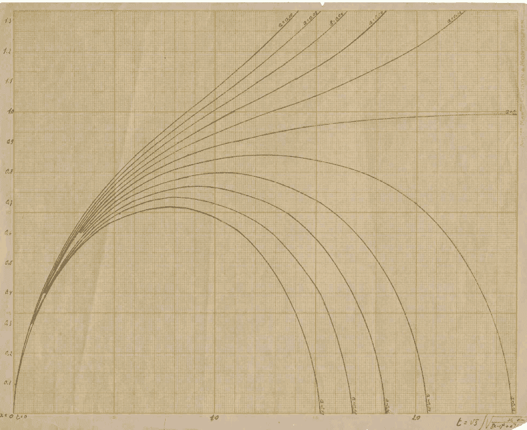

**图 1.** 乔治·勒梅特（`Georges Lemaître`）在 1930 年左右绘制了这张标志性的图表，展示了宇宙的演化。在左下角他写下“t = 0”，这是后来被称为大爆炸的第一个时刻。

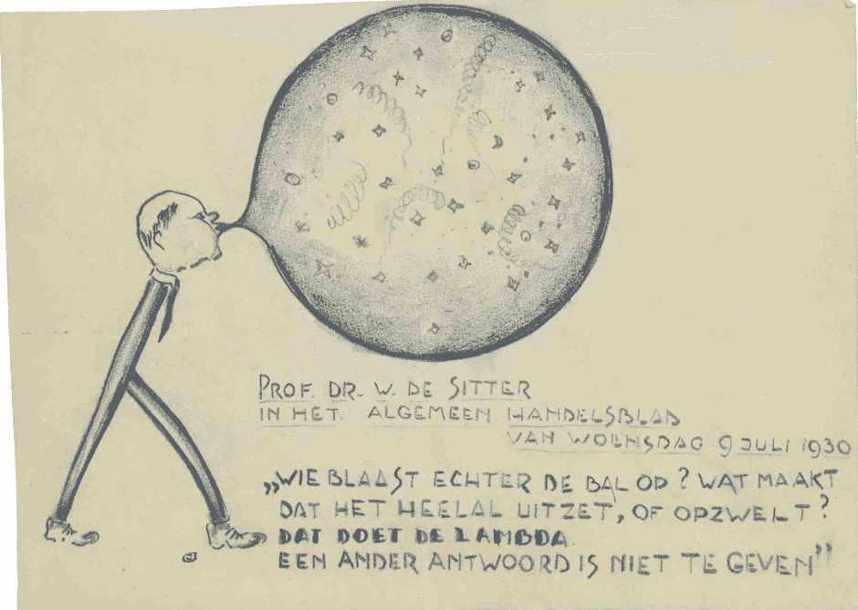

**图 2.** “是谁吹了气球？什么导致了宇宙的膨胀？”

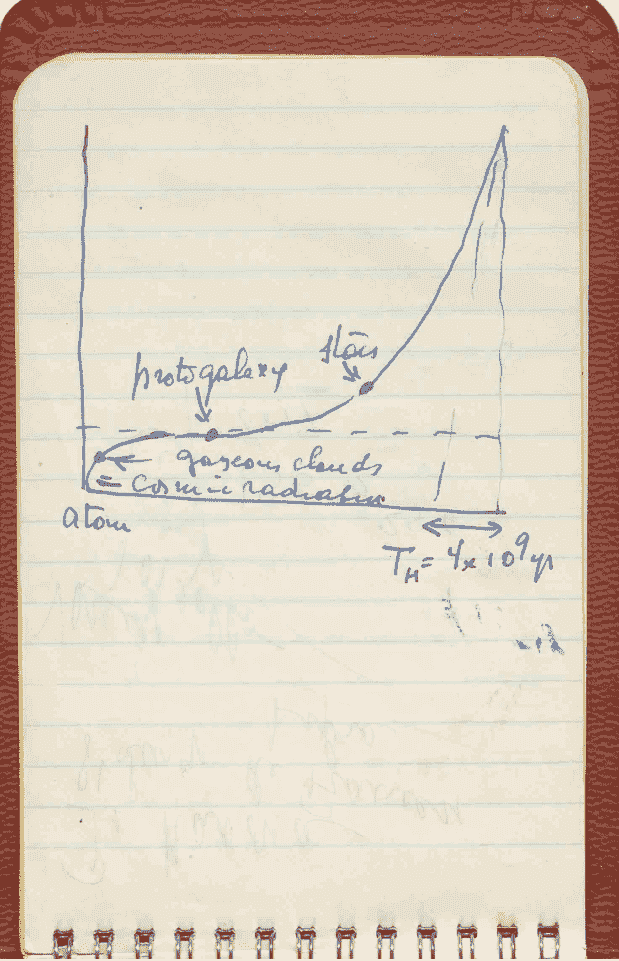

**图 3.** 乔治·勒梅特在 1930 年左右绘制了这张标志性的图表，展示了宇宙的演化。在左下角他写下“t = 0”，这是后来被称为大爆炸的第一个时刻。

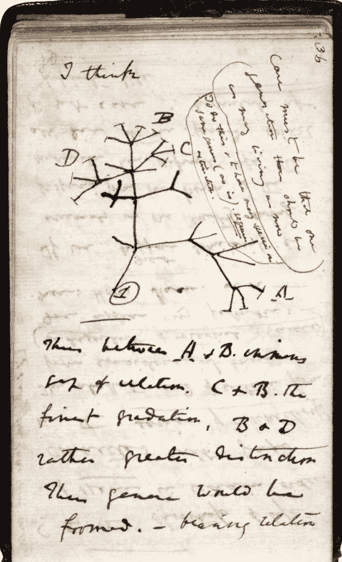

**图 4.** “是谁吹了气球？什么导致了宇宙的膨胀？”

**图 5.**

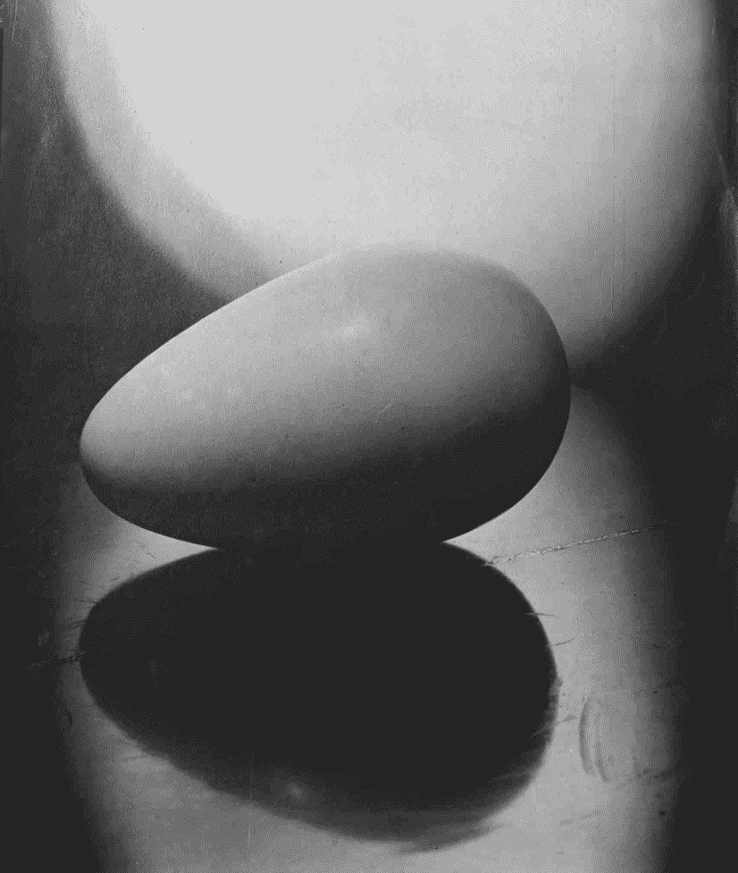

**图 6.** 《世界起源》，由罗马尼亚裔雕塑家康斯坦丁·布朗库西（`Constantin Brâncuși`，1920 年）创作的抽象的、永恒的蛋形。

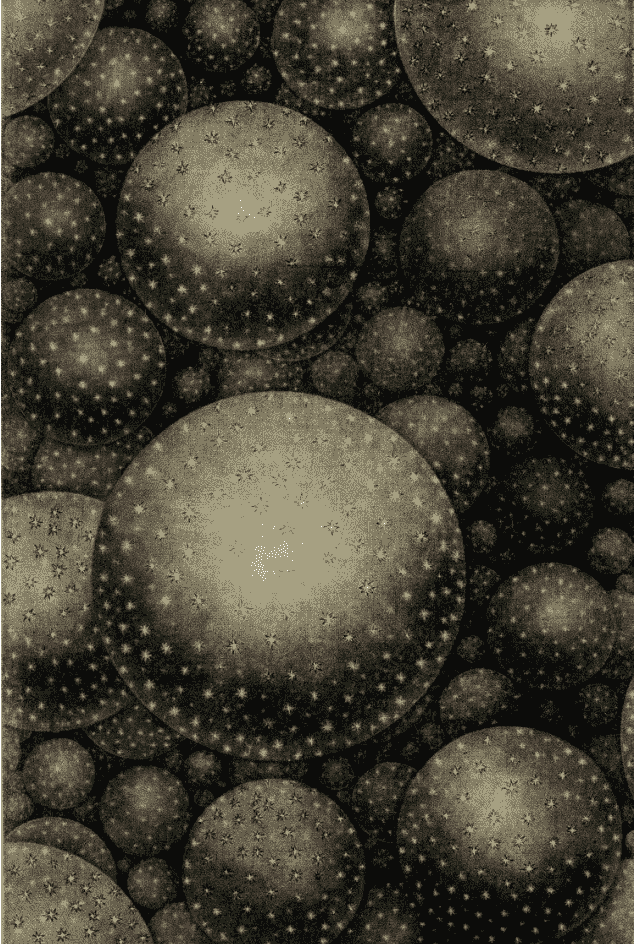

**图 7.** 在《宇宙原始理论》（1750 年）中，托马斯·莱特（`Thomas Wright`）想象了一个无边无际的宇宙，其中充满了星系，“创造出一种无尽的广阔……与银河系相似”。将星系替换为“岛屿宇宙”，莱特的图景类似于今天的多重宇宙理论，在那种理论中，新的岛屿宇宙被不断创造。我们的应该是什么样的岛屿宇宙？

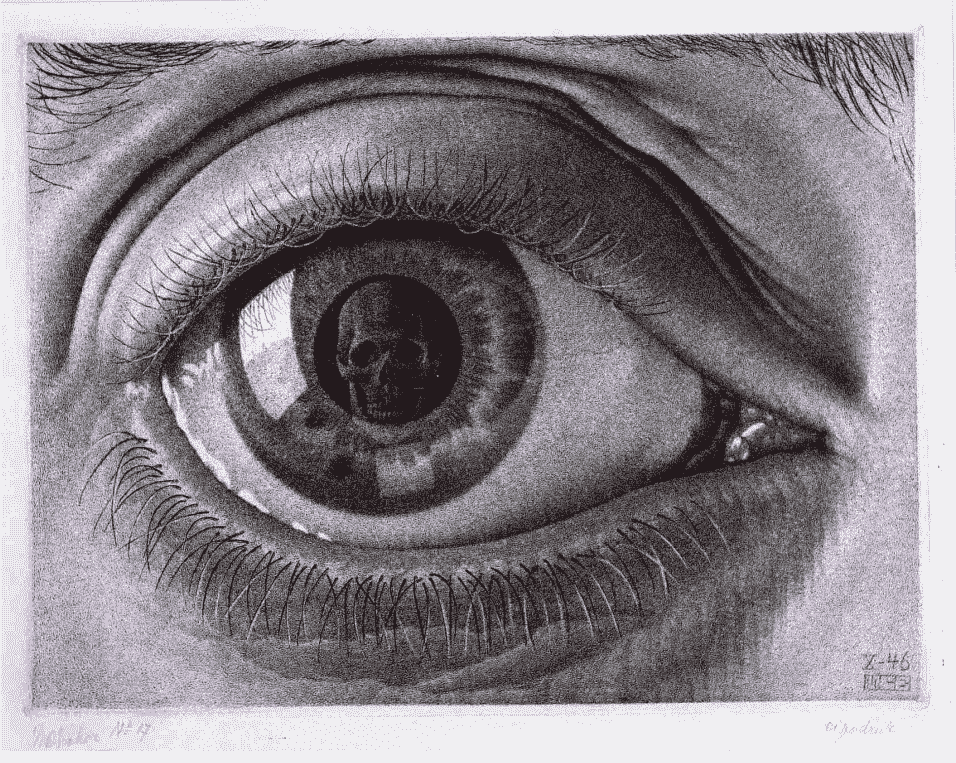

**图 8.** 马里茨·科内内利斯·埃舍（`Maurits Cornelis Escher`）的《眼睛》提醒我们人类的有限性。我们处于宇宙之中，向上并向外看，而不是某种悬浮在外面。


**图 9.** 残留宇宙微波背景（`CMB`）辐射到达地球时，球心来自空间不同方向的温度。这种辐射在我们周围形成了一个球，提供了大爆炸后仅 380,000 年的宇宙快照。这个 `CMB` 球也标记了我们的宇宙学视界：我们无法看得更远。


**图 10.** 这块黑板挂在史蒂芬·霍金剑桥大学的办公室里。这是他在 1980 年举办的一场超引力会议的纪念品。早期的史蒂芬将超引力预言为可能的万有理论。


**图 11.** 2012 年在剑桥办公室的史蒂芬，大约在他七十生日期间。背景中的“第二块黑板”展示了作者最初的计算，这些计算引导我们把宇宙视为全息图。晚期的史蒂芬认为，从更深层的意义上说，宇宙理论和观测是结合在一起的。我们创造宇宙，正如宇宙创造我们一样。

---

## 致谢

如果没有一路上许多同事和朋友的帮助，我与史蒂芬·霍金的旅程将是不可能的。

感谢来自爱尔兰柏林的阿德里安·奥特维尔（`Adrian Ottewill`）和彼得·霍根（`Peter Hogan`），他们在 1996 年送我上了前往英国剑桥的火车。诚心感谢尼尔·图罗克（`Neil Turok`），他在这个理论宇宙学圣地授课的迷人课程鼓励我去敲了史蒂芬的门。感谢我在霍金和图罗克轨道内的博士同事们，包括克里斯托夫·加尔法德（`Christophe Galfard`）、哈维·瑞尔（`Harvey Reall`）、詹姆斯·斯帕克斯（`James Sparks`）和托比·威斯曼（`Toby Wiseman`），感谢战友。

“你应该尽可能走远，”史蒂芬在我毕业时说道。感谢 `Steve Giddings`、大卫·格罗斯（`David Gross`）、吉姆·哈特（`Jim Hartle`）、加里·霍洛维茨（`Gary Horowitz`）、唐·马尔洛夫（`Don Marolf`）、马克·斯雷德尼基（`Mark Srednicki`）以及已故乔·波尔钦斯基（`Joe Polchinski`），他们在弦宇宙学这些激动人心的早期，在圣地亚哥加州大学圣巴巴拉分校创造了非凡且极具启发性的研究环境。

此时，史蒂芬与乔治·米切尔（`George Mitchell`）建立了深厚感情。诚心感谢米切尔家族，在库克分支保护区（`Cook’s Branch Conservancy`）创造了一个极好的避风港，史蒂芬可以在那里工作。特别感谢布鲁塞尔的国际索瓦学院，他们的主席让·马里·索尔瓦（`Jean-Marie Solvay`）和他们的长期主管马克·亨内（`Marc Henne`）。

## 插图致谢

**图 1：** © 博物馆集团（英国）科学与社会图片库

**图 2：** © ESA—欧洲空间局/普朗克天文台


# 图片版权信息

图 3, 5, 9, 20, 21, 23, 24, 25, 27, 28, 29, 30, 31, 33, 34, 35, 36, 37, 38, 42, 43, 46, 48, 49, 52, 53, 54, 57：© 作者/De Grauwe

图 4：经文化部—罗马国立博物馆，戴克莱清安浴场许可，照片编号 6：Servizio Fotografico

图 6：公有领域/苏黎世联邦大学图书馆

图 7(a)：由 Anna N. Zytkow 拍摄；7(b), 14, 17, 50, 51：© 作者

图 8：公有领域/卡内基梅隆大学波斯纳图书馆

图 10：© 事件视界合作组

图 11：转自 Roger Penrose 的《引力坍缩与奇点》，物理评论快报 34 (1965): 57–59

图 12：首次发表于 M. Slipher 的《星云》，美国哲学学会论文集 56 (1917)

图 13：© Georges Lemaître，鲁汶纳天主教大学，鲁汶纳-拉-内维夫，比利时

图 15a/15b：Paul A. Dirac 论文集，佛罗里达州立图书馆

图 16：由 Eric Long 拍摄，史密森国家航空航天博物馆 (NASM)

图 18：转自 George Ellis 的《相对论宇宙学》，载于《国际物理学校论文集》，R. K. Sachs 编（纽约：学术出版社，1971）

图 22：照片集，加州理工学院档案馆/CMG

图 26：© 照由 Anna N. Zytkow 拍摄

图 32：© Andrei Linde 个人档案

图 39：© Maximilien Brice/欧洲核子研究组织 (CERN)

图 40：© Paul Ehrenfest 照片，由 AIP 慷赠

图 44：©《纽约时报》

图 47：转自 John A. Wheeler 的《时间的前沿》，载于《物理基础问题》，G. Toraldo di Francia 编（阿姆斯特丹；纽约：北荷兰出版公司，1979）

图 55：© M.C. Escher 的《圆极限界限 I》©2022 M.C. Escher 公司，荷兰。保留所有权利。

图 56：转自 John A. Wheeler 的《几何胶子》，物理评论 97 (1955): 51–36

图 58：© 照由 Anna N. Zytkow 拍摄

## 图片插图

- 版画 1：© Georges Lemaître，鲁汶纳纳天主教大学，鲁汶纳-拉-内维夫，比利时
- 版画 2：首次发表于 1930 年 7 月 9 日的《通用日报》，“AFA 词汇’，莱顿天文台论文集
- 版画 3：© Georges Lemaître，鲁汶纳纳天主教大学，鲁汶纳-拉-内维夫，比利时
- 版画 4：公有领域
- 版画 5：©《纽约时报杂志》。首次发表于 1933 年 2 月 19 日。
- 版画 6：© Brâncuși 继承人—保留所有权利 (AD)/蓬皮杜中心，NMAM-CCI/Dist. RMN-GP 分发
- 版画 7：首次发表于 Thomas Wright 的《宇宙的原始理论》(1750)
- 版画 8：M.C. Escher 的《眼睛》(Oog) © The M.C. Escher 公司—巴尔恩，荷兰。保留所有权利。
- 版画 9：© ESA—欧洲空间局/普朗克天文台
- 版画 10：© 博物馆集团（英国）科学与社会图片库
- 版画 11：© Sarah M. Lee

# 参考文献

Arendt, Hannah. *人类境遇*. 芝加哥：芝加哥大学出版社，1958。

Barrow, John, and Frank Tipler. *人择宇宙学原理*. 牛津：牛津大学出版社，1986。

Carr, Bernard J., George F. R. Ellis, Gary W. Gibbons, James B. Hartle, Thomas Hertog, Roger Penrose, Malcolm J. Perry, and Kip S. Thorne. *英国皇家学会院士传记回忆：史蒂芬·威廉·霍金 CH CBE，1942年1月8日–14*. 伦敦：皇家学会，2019。

Carroll, Sean. *大图景：论生命的起源、意义与宇宙本身*. 伦敦：Oneworld，2017。

Davies, Paul. *金发姑娘般的谜题：为什么宇宙对生命恰恰好？* 伦敦：Allen Lane，2006。

Farmelo, Graham. *那个最奇特的人：保罗·狄拉克克的隐秘生活，原子的神秘者*. 纽约：Basic Books，2009。

Gell-Mann, Murray. *夸克与美洲*. 纽约：Freeman，1997。

Greene, Brian. *宇宙的织锦*. 纽约：Alfred A. Knopf，2004。

Greene, Brian. *隐藏的现实：平行宇宙与宇宙的深层法则*. 纽约：Basic Books。

Halpern, Paul. *量子迷宫*. 纽约：Basic Books，2018。

Hawking, Stephen. *时间简史：从大爆炸到黑洞*. 纽约：Bantam，1998。

Hawking, Stephen, and Leonard Mlodinov. *宏大设计*. 纽约：Bantam，2010。

Lambert, Dominique. *宇宙的原子：勒梅特的生平与著作*. 克拉科夫：Copernicus Press，2009。

Nussbaumer, Harry, and Lydia Bieri. *发现宇宙*. 克拉科夫：Copernicus Press，2011。

Pais, Abraham. *上帝是微妙的：爱因斯坦的生活*. 牛津：Oxford Press，1982。

Peebles, James. *物理学的世纪：现代宇宙的发现*. 牛津：Oxford Press，2020。

Pross, James. *什么是生命？*. 牛津：Oxford Press。

Rees, Martin. *如果科学能拯救我们*. 剑桥：Polity，2011。

Rees, Martin. *宇宙的栖息*. 普林斯顿：Princeton University Press，2001。

Rovelli, Carlo. *时间的物理学*. Yardtholme，2011。

Smolin, Lee. *物理学的麻烦：弦理论的崛起*. 波士顿：Mariner Books，2007。

Susskind, Leonard. *宇宙景观*. 纽约：Little Brown，2006。

Susskind, Leonard. *黑洞战争*. 纽约：Little Brown，2008。

Turok, Neil. *内在宇宙*. 多伦多：House of Anansi Press，12。

Weinberg, Steven. *解释世界*. 纽约：Harper，2015。

Wheeler, John Archibald, and Kenneth Ford. *几何胶子、黑洞与量子泡沫*. 伦敦：Norton。

# 注释

## 前言

1. 史蒂芬去世后，这块黑板被国家博物馆集团收购，连同霍金办公室的其他纪念品一起。

2. Christopher B. Collins 和 Stephen W. Hawking，“为什么宇宙是向同性的？”，天体学杂志 180 (1973): 317–34。

3. 史蒂芬偶尔借用他的声音，这种做法是由人起草陈述，然后通过他的语音软件向外界广播。然而，他周围的人很容易辨别假的霍金的话和真实的——后者以简洁、清晰和他标志性的幽默脱颖而出。虽然这种做法出于某些原因是必要的，但也是遗憾的，因为它意味着公众形象逐渐与本人分离了。

# 第一章：一个悖论

1. Fred Hoy, “宇宙：过去与现在的反思”，天文学与物理学评论 20 (1982): 1–36。

2. Steven Weinberg, “人择宇宙常数边界”, 物理评论快报 59 (1987): 2607。

3. Paul Davies, *金发姑娘般的谜题：为什么宇宙对生命恰恰好？* (伦敦：Allen Lane, 2006), 3。

4. 这段片段是通过西里西亚的西普留斯传给我们的，他在他对亚里士多德《物理学》的注释中引用了它。

5. 伽利略·伽利莱，《实验者》 (罗马：App presso Giacomo Mascardi, 1623)。

6. 归于 François Arago 的话。

7. Paul Dirac，如引自 Graham Farmelo 的《那个最奇特的人：保罗·狄拉克克的隐秘生活，原子的神秘者》(纽约：Basic Books, 2009), 435。

8. William Paley, *自然神学；或从自然现象中收集的神的存在与其属性的证据* (伦敦：R. Faulder 印刷，1802)。

9. 查斯·达尔文，《物种起源》，手稿，1859。

10. 斯蒂芬·杰·戈尔德，《奇妙的生命：伯格斯页岩与历史的本质》（纽约：Norton，1989）。

11. 查尔斯·达尔文，引自查尔斯·亨斯肖·沃德，《查尔斯·达尔文：人及其战争》（印第安纳波利：Bobbs-Merrill，1927），第297页。

12. 伦纳德·苏斯金德，《宇宙图景：弦理论与智能设计的幻象》（纽约：Little, Brown，2006）。

13. 尽管名称所暗示的那样，卡特或任何其他人并不认为人择性原理是专门针对人类的，而是针对更广泛的生命生存条件。关于这一观点的详细回顾，可以参考约翰·巴罗和弗兰克·蒂普勒的著作《人择性宇宙学原理》（牛津：牛津大学出版社，1986）。

14. 安德烈·林德，“宇宙、生命、意识”（讲座，加利福尼亚州伯克利，神学与自然科学中心[CTNS]“科学与精神探求”计划物理与宇宙学小组，1998年）。

15. 史蒂芬·温伯，《生活在多元宇宙中》，于2005年9月在剑桥三一学院的“终极理论的预期”研讨会上发表，并出版于 B. Carr 编的《宇宙还是多元宇宙？》（剑桥：剑桥大学出版社，2007年）。

16. 尼马·阿尔基尼-哈梅，“弦理论与实验接触的前景”（讲座，Strings 2019，布鲁塞尔，弗拉日，2019年7月9日至13日）。

返回注释 16

17. 霍金在他名为“自上而下的宇宙学”的讲座中重复了这一点（讲座，加利福尼亚州戴维斯，加州大学戴维斯校宇宙膨胀会议，2003年3月22日至25日）。

返回注释 17

18. 在《科学革命的结构》中，美国科学哲学家托马斯·库恩解释说，当处于既有科学运行的主导范式与新现象变得不兼容时，就会产生范式转移。人们可能会好奇，在21世纪之初出现并引发宇宙学变革呼声的那些“新现象”究竟是什么。我认为，其中主要的因素是20世纪90年代后期关于加速膨胀的天文学观测。这些观测与弦理论中新的理论见解相结合，证明了亲生命法则具有偶然的偶然性。

返回注释 18

19. 霍金在20世纪70年代中期与他的学生伯纳德·卡尔合作，推测了在热大爆炸之后可能形成的小黑洞。这种原初黑洞的温度更高，辐射也更快。事实上，那些质量为`10^15`克的黑洞——即质量相当于一座山，但大小仅如质子——在宇宙目前的时代正在发生爆炸。令斯蒂芬非常失望的是，尚未观察到此类爆炸。

返回注释 19

# 第二章：没有昨天的日子

1. 乔治·勒梅特尔，“与爱因斯坦的会面”，收于《科学问题评论》（Revue des Questions scientifiques）（布鲁塞尔：布鲁塞尔科学学会，1958年1月20日），第129页。

返回注释 1

2. 乔治·勒梅特尔，“宇宙与原子”，这是他在1963年向一群鲁鲁文学生发表的最后一次公开演讲。这种措辞比他通常描述自己立场的方式要强烈，这无疑反映了他对对手态度的某种挫败感。多米尼克·兰伯特在《乔治·勒梅特尔的精神历程》（L'itinéraire spirituel de Georges Lemaître）中对勒梅特尔关于科学与宗教关系的（某种演变的）观点进行了详细阐述，包括对这次演讲的分析。

3. 在恒星的大部分寿命里，通过核聚变产生的热压力来抵抗引力。然而，恒星最终会耗尽燃料并收缩。如果恒星初始质量不是太大，电子（或中子）产生的压力将阻止坍缩。印度裔美国天体物理学家苏布拉马扬·钱德塞拉在1930年证明了白矮星有质量极限，并获得了诺贝尔奖。随后，在1939年，奥本海默和乔治·沃尔科证明了中子星也有质量极限。结论是，足够质量的恒星无法阻止引力坍缩，将产生黑洞。

4. 赫尔曼·闵可夫斯，“空间与时间”（Raum und Zeit）（讲座，科隆，1908年）。

返回注释 4

5. 《广义相对论与引力》（General Relativity and Gravitation）（牛津：出版社，1982）。

返回注释 5

6. 第42页的爱因斯坦方程包含一个系数`8πG/c^4`，它乘以右侧物质的质量和能量。该量的数值极小，这意味着需要巨大的质量或能量才能微弱扭曲左侧的时空。举个例子，整个地球的质量使其周围的空间相对于标准欧几里得空间的变形程度约为`10^-9`。

7. 阿奇伯德·惠勒，《几何胶子、黑洞与量子泡沫》（Geons, Black Holes, and Quantum Foam）（伦敦：Norton，1998年）。

返回注释 7

8. 派斯，“主是微妙的”（Subtle is the Lord）

返回注释 8

9. 早在18世纪，利用牛顿力学的约翰·米歇尔和皮尔·西蒙·拉普拉斯发现球形质量的逃逸速度等于光速。

10. 勒梅特尔，“膨胀的宇宙”（L’univers en expansion），见《布鲁塞尔科学学会公告》（Annales de la Société Scientifique de Bruxelles）A53（1933），51–85。

11. 关于发现膨胀的详细历史，推荐哈里·努斯鲍默和莉迪亚·比里的《发现膨胀宇宙》（Discovering the Expanding Universe）（剑桥：剑桥大学出版社，2009年）。

12. 爱因斯坦给威廉·德西特的信，1917年3月12日，收于《论文集》（Collected Papers）第8卷，阿尔伯特·爱因斯坦、马丁·J·克莱恩和约翰·J·斯坦塞尔编辑（普林斯顿大学出版社，1998年）：文献311。

13. 罗杰·彭罗斯，“引力坍缩：广义相对论的作用”（Gravitational Collapse: The Role of General Relativity），见《La Rivista del Nuovo Cimento》1（1969），252–76。

返回注释 13

14. 罗杰·彭罗斯，“引力坍缩与时空奇点”（Gravitational Collapse and Space-time Singularities），见《物理评论快报》（Physical Review Letters）14，第3期（1965），57–59。

19. 勒梅特在此引用了圣托马斯·阿奎那的话，他曾说：“凡不在感官之，必不在理智之中。”

20. 乔治·勒梅特，“L’Etrangeté de l’Univers”（宇宙的奇特性），这是他在1960年在罗马俱乐部发表的演讲，重印于 *Pontificiae Scientiarum Scripta Varia* 36 (1972): 239。

21. 变星是其亮度变化周期从几个月到一天不等的恒星。现代早期首批女性天文学家之一的亨利埃塔·李维特早早就发现了变星的脉动周期与其亮度之间存在一种奇妙的关系：亮度较暗的变星周期较短。这意味着人们可以通过观测变星亮度的周期性变化来测量宇宙学中的距离。于是，变星成为了天文学家测量宇宙遥远天体的第一个可靠尺度，哈勃也极具智慧地利用它估算了星云的距离。

22. 洛威尔天文台由珀西瓦尔·洛威尔于1894年建立，旨在研究火星上神秘的“通道”。1930年，这里是冥王星被发现的地方。

23. 光谱是光分布在不同颜色上的方式。天体光谱的光谱移动可以通过比较光谱中某一可识别特征的波长与在地球实验室测得的相同特征的波长来确立。

24. 韦斯·M·斯利珀，“Nebulae”（星云），*Proceedings of the American Philosophical Society* 56 (1917): 403–9。

25. 他的论文是用法语写的，并发表于当时较为冷门的《Annales de la Société Scientifique de Bruxelles》（Série A. 47 [1927]; 49–59）。他的标题为“Un universe homogène de masse constante et de rayon croissant, rendant compte de la vitesse radiale des nébuleuses extragalactiques”（一个质量恒定且半径增加的均匀宇宙，解释了河外星云的径向速度），这使得勒梅特的意图变得不言自明。实际上，勒梅特在手稿的最终编辑期间对其进行了微调，将“variant”（变异）改为“croissant”（增加的），可能是为了加强他的模型与天文观测之间的联系，暗示星系正在远离我们。

26. 兰伯特，《宇宙的原子》。

27. 由于距离测量存在巨大的不确定性，勒梅特将哈勃估算距离的星系样本中的速度平均值除以距离平均值。取平均值有助于消除单次距离测量中的巨大不确定性。

28. 为了继续与爱因斯坦的对话，勒梅特坐上了那辆要把爱因斯坦送到他曾在柏林的学生奥古斯特·皮卡实验室的出租车。在车上，勒梅特提到了观测到的星云退行现象，并认为这为宇宙膨胀提供了一些证据。然而，根据他的回忆，他离开时的印象是爱因斯坦对最新的天文观测既不知情也不感兴趣。

29. 弗里德曼的知识领域非常广泛，从高海拔气球飞行的纯数学工作，到研究高度对人体的影响。他曾在1925年创下世界气球飞行高度记录，升至7,400米（24,278英尺）的高度，比俄罗斯最高的山还要高。他几个月后去世，显然死于斑疹热，年仅三十七。

30. 和爱因斯坦一样，勒梅特对空间有限宇宙有强烈的哲学偏好。

31. 1918年，国际天学会通过了一项决议，该关系应被称为哈勃-勒梅特定律。

32. 基于对24个星系的改进观测，哈勃得到的速度-距离关系中的比例常数 `H` 值为每百万光年530公里/秒——这与勒梅特之前发现的值并无差异。哈勃和哈姆森将他们的观测解释为普通的多普勒频。

33. 爱因斯坦给托尔曼的信，1931年，收于《阿尔伯特·爱因斯坦档案》，A3。


## 34–52 章节注释

34. 亚瑟·斯坦利·爱德丁顿，《The Expanding Universe》（膨胀的宇宙）（剑桥：剑桥大学出版社，1933年），24。

35. 乔治·勒梅特，“Evolution of the expanding universe”（膨胀宇宙的演化），*Proceedings of the National Academy of Sciences*，20, 12–17。

36. 爱因斯坦给勒梅特的信，1947年，收于《乔治·勒梅特档案》，鲁汶新内夫天主教大学，A。

37. 哈勃和哈姆森的红移观测只能带我们回到几百万光年以前。因此，他们的测量确定了最近的膨胀速率，但没有说明该速率在宇宙历史中是如何演变的。20世纪90年代，对亮度超新星爆发的光谱观测（可观测到数十亿光年）使得重建约五十年前的宇宙膨胀过程成为可能。这揭示了我们的宇宙从减速膨胀转变为加速。

38. 乔治·勒梅特，“Discussion sur l’évolution de l’univers”（关于宇宙演化的讨论），（巴黎：Gauthier-Villiers，1933年），15–22。

39. 勒梅特属于新一代天文学家，他们坚信天文学的未来将涉及纯分析和计算机编程。他的计算研究紧密跟随计算技术的进展。在20世纪20年代早期，他曾协助麻省理工学院的内瓦·布什在斯特尔默问题上测试微分分析仪。后来，他将宇宙射轨道计算从对数表转移到手摇加法器，再到电力机器，最后在50年代哈特里提供剑桥大学开发的电子管计算机时实现了他的梦想。

40. 亚瑟·S·爱德丁顿，“The End of the World”（从数学物理学角度看世界的终结），*Nature* 127, no. 3 (1931年3月21日):447–53。

41. 勒梅特，《科学问题》。

42. 勒梅特，“L’univers en expansion”（膨胀中的宇宙）。

43. 乔治·勒梅特，“The Beginning of the World from the Point of Quantum Theory”（从量子理论观点看世界的起源），*Nature* 127, no. 3 (1931年5月9日):706。

44. P.A.M·狄拉克，“The Relation Between Mathematics and Physics”（数学与物理的关系），他在1939年2月6日为获得詹姆斯·斯科奖发表的演讲。发表于*爱丁堡皇家学会论文集* *Proceedings of the Royal Society of Edinburgh* 1938–39，第二部分）：122–29。

45. 弗雷德·霍尔，“The Universe: Past and Present Reflections”（宇宙：过去与现在的思考），*Annual Review of Astronomy and Astrophysics* 20 (1982):1–36。

46. 弗雷德·霍尔，《The Origin of the Universe and the Origin of Religion》（宇宙的起源与宗教的起源）（罗德岛州：Moyer Bell，1993）。

47. 关于他丰富生活的更多轶事可以在伽莫夫的自传《My World Line: An Informal Autobiography》（纽约：Viking Press,1970）中找到。

48. 碳等较重的化学元素后来通过恒星内部的核聚变形成。比铁更重的元素形成更晚，产生于超新星爆发的瞬间高温或中子星的剧烈碰撞中。这些和其他过程造就了当今宇宙丰富的化学环境。事实上，最奇异的元素今天正在地球物理学实验室（也可能在其他地方）中合成。

49. 兰伯特，《宇宙的原子》。

50. 引用自邓肯·艾克曼，“Lemaître Follows Two Paths to Truth”（勒梅特通往真理的路径），《纽约时报杂志》，1933年2月19日（见插页，图5）。

52. 勒梅特，“原始原子假设与星系团问题。”

---

# 第 3 章：宇宙起源

1. 史蒂芬·霍金，《时间、宇宙与简史》（纽约：Bantam出版公司，2013年），第 29 页。

2. 压力随之而来，例如来自对射源（后来被称为类星体）的调查，这些调查显示这些射源在整个天空中分布相当均匀。这意味着它们可能在我们银河系之外。但由于微弱源太多了，这表明在遥远的过去，它们的密度比现在要得多，这与人们对一个恒不变的稳态宇宙的预想不符。

3. 与彭罗斯一样，史蒂芬确定出了一个无法回越的点，即反陷获表面的形成，从该表面开始，光线向各个方向辐射。史蒂芬证明，如果曾经存在一个反陷获表面，那么在时间上再回溯一点的地方一定存在奇点。

4. 乔治·F·R·埃利斯，“相对论宇宙学”，收于“恩里科·费尔米”国际物理学校论文集，课程 47：广义相对论与宇宙学，R. K. Sachs 编（纽约与伦敦：学术出版社，1971年），第 104–82 页。

5. 引用自《广义相对论与引力：百年展望》，A. Ashtekar, B. Berger, J. Isenberg, M. Maccallum 编（剑桥：剑桥大学出版社，2015年），第 19 页。

6. 亨德里克·A. 洛伦兹，“辐射理论与量子”，收于第一次索尔瓦会议论文集，1911 年 10 月 30 日至 11 月 3 日，P. 朗之万与 M. 德布罗意 编（巴黎：Gauthier-Villars，1912年），第 6–9 页。

7. 海森堡不确定原理与普朗克假设是密不可分的。想象你想测量一个量子粒子的位置。为了这样做，你必须观察这个粒子，例如通过向它投光。为了更精确地测量位置，可以使用波长更短的光。然而，根据普朗克的量子假设，必须使用至少一个光子。这个光子会轻微扰动粒子，以一种无法预测的方式改变它的速度。波长越短，单个光子的能量就越高，导致粒子速度产生的不确定性也越大。海森堡不确定原理量化了这一点，规定粒子位置的不确定性与其动量的不确定性之积永远不会小于一个称为普朗克常数的特定值，记作 `h`。普朗克常数的值可以通过实验确定。它是自然界的基本常数之一，与光速 `c` 以及牛顿引力常数 `G` 并列，两者出现在第 42 页的爱因斯坦方程中。相比之下，普朗克量子常数在这个经典（而非量子）方程中却显而易见的缺失！

8. 薛定谔用概率波描述粒子的方法也解释了早期的原子量子实验。例如，环绕原子核运行的电子。如果我们把电子视为波形实体，那么只有在某些轨道上，轨道长度才对应于电子波长的整数倍。对于这些轨道，波峰在每次环绕时都会处于相同的位置，因此波会相互叠加并加强彼此。这些正是玻尔的量子化轨道。

9. 埃尔温·薛定谔，《科学与人文：我们时代的物理学》（剑桥：剑桥大学出版社，1951年），第 25 页。

10. 为了详细描述理查德·费曼和约翰·惠勒之间的科学与个人互动，我强烈推荐保罗·哈尔彭的《量子迷宫》。

11. 弗里曼·J· 迪森在1980 年引用费曼，引自尼克·赫伯特的《现实》（花园城：Anchor 出）。

12. 想象你通过在附近放置仪器来测量电子。如果我们把电子视为波形实体，那么只有在某些轨道上，轨道长度才对应于电子波长的整数倍。对于这些轨道，波峰在每次环绕时都会处于相同的位置，因此波会相互叠加并加强彼此。这些正是玻尔的量子化轨道。

13. 詹姆斯·B· 哈特尔和 S. W· 霍金，“路径积分推导”，*物理评论 D*（1976年）。

14. 为了避免物理定律失效，哈特尔和霍金在 1983 年提出了“无边界”建议，认为宇宙在时间上是有限的。这意味着在开始时刻并没有奇点，而是几何结构变得光滑了。

15. 哈特尔，私下交流。

16. G. W. 吉布斯和 S. W. 霍金 编，《欧几得引力》（新加坡：世界科学，1993年），第 74 页。

17. 辛迪·科尔曼，“为什么存在某些东西：宇宙常数的理论”，《物理学》第 310 卷，第 3–4 期（1988年）。

18. 这种讨论由勒梅特神父在 20 世纪 60 年代担任科学院院长时建立。

19. 教皇保禄二世圣谕，引自《天体物理宇宙学：基础物理研究周报》（梵蒂冈市：梵蒂冈天文台，1982年）。

---

# 第 4 章：灰烬与烟

1. 热大爆炸理论还预言了宇宙中微子背景（简称 `CNB`），甚至是引力子背景。如果被观测到，`CNB` 将提供宇宙诞生仅几秒钟时的快照。

2. 乔治·勒梅特，《原始原子假设：宇宙起源学说》（内沙泰尔：Editions du Griffon，1946年）。

3. 伯纳德·J· 卡等，《皇家学会会员传记：史蒂芬·威廉·霍金 CBE（1942 年 1 月 8 日 – 2018 年 3 月 14 日）》（伦敦：皇家学会，2019年）。

4. 在这些理论预言背后的主要参与者包括在俄罗斯工作的根纳塔迪·奇比索夫、维亚切斯拉夫·穆哈诺夫和阿列克谢·斯塔罗霍斯基，以及在西方工作的詹姆斯·巴德丁、艾兰·古斯、史蒂芬·霍金、苏-扬·皮、保罗·斯坦因哈特和迈克尔·特纳。

5. G. W. 吉布斯、S. W. 霍金和 S.T.C. 席克洛 编，《极早期宇宙：纳菲尔德研讨会论文》，剑桥，6 月 21 日至1982年7月9日（剑桥；纽约：剑桥大学出版社，1983年）。

7. 一对虚粒子中的其中一个成员具有正能量，而另一个具有负能量。负能量粒子无法在普通时空中保持存在，而必须寻找它的正能量伴侣并与之湮灭。然而，黑洞包含了负能量态，因此如果一个虚粒子对中的负能量成员掉入黑洞，它就可以继续存在，而无需与其伴侣湮灭，这通过自由落体略微降低了黑洞的质量，这解释了为什么霍金辐射会导致黑洞缩小并最终消失。

8. 关于宇宙的内容比表面看到的更多的最早迹象可以追溯到20世纪30年代，瑞士天文学家弗里茨·兹维基（Fritz Zwicky）对星系团的观测。兹维基观察到某些星系以惊人的速度绕其他星系运行。这意味着必须有比可见恒星所能解释的多得多的物质将这些星系聚集在一起。20世纪70年代，美国天文学家薇拉·鲁宾（Vera Rubin）在单个星系的边缘观察到了类似的效应。她的观测表明，螺旋星系的臂也必须嵌入在暗物质云中，由它将所有这一切固定在一起。

9. 两组天文学家团队，由亚当·里斯（Adam Riess）和布莱恩·施密特（Brian Schmidt）共同领导的高红超新星项目，以及萨尔·珀尔穆特（Saul Perlmutter）领导的超新星宇宙学项目，测量了被称为超新星的爆炸恒星的光的红移，这些超新星非常亮，在遥远的星系中可见。由于这些超新星的固有亮度是已知的，研究人员能够将这些恒星作为深层宇宙的距离基准。结合红移观测，这两个团队建立了联系距离与退行速度的哈勃-莱梅特定律，范围延伸到数十亿光年，从而重建了数十亿年前的扩张过程。令他们惊讶的是，测量结果显示宇宙膨胀在大约五十亿年前开始加速，这一发现让珀尔穆特、里斯和施密特共同获得了2011年诺贝尔奖。

10. 对于目前的膨胀加速是由真正的恒定宇宙学常数驱动，还是涉及一个非常缓慢变化的标量场（某种残留的暴胀子场），人们仍然存在怀疑。在前一种情况下，压力与能量密度的比值将精确等于 `-1`，而在后一种情况下它将大于 `-1`。这种差异看起来并不严重，但它在（非常）长远来看会影响加速度，并可能改变宇宙的最终命运。目前人们正努力尽可能精确地确定这个比值的值。

11. 自此以后出现了一个小云。相对局部的天文学观测（例如超新星的光谱）指向每百万秒差距每秒73公里的膨胀速率。相比之下，借助广义相对论观测宇宙微波背景推断出的膨胀速率约为每百万秒差距每秒67公里。这种差异被称为“哈勃张力”，尽管它实际上应该被称为“哈勃-莱梅特张力”。宇宙学家们正在热烈地寻找解释。这难道是广义相对论的“水星时刻”吗，即该理论需要以某种方式进行调整？请保持关注！

12. 在没有引力的普通量子力学中，波函数遵循薛定谔方程，该方程规定了它们随时间演化。时间是普通量子力学中唯一不干涉其他任何物的实体。物理学家可以毫无问题地计算量子力学中精确给定时刻观测的概率。然而，这一切之所以可能，是因为普通量子力学假设存在固定且确定的时空背景，粒子波函数在其中演化。相比之下，在量子宇宙学中，时空本身是量子化的且波动的。结果是我们不再拥有任何可以作为通用时钟的东西。因此，在整个宇宙的量子描述中，时间的消失并不意外。确实，宇宙的波函数遵循由约翰·惠勒（John Wheeler）和布莱斯·德维特（Bryce DeWitt）首次写出的薛定谔方程的抽象版本，但这并不是动力律。它更像是对波函数整体的一种无时间约束。

13. S. W. and N. Turok, “Open Inflation without Falseua,” *Physics B* 425 (1998): 25–32.

14. 就我所知，永恒暴胀的思想是由林德（Linde）在他在纳菲尔德研讨会的论文《极早期宇宙》（剑桥；纽约：剑桥大学出版社，1983年）205–49页首次提到的。

15. Hawking and Linde, “Eternal Inflation,”

16. 你可能会想这可能是可能的：在一个引力随时间增强的宇宙中，太阳的能量输出在不远的过去会大得多……

---

# 第 5 章：迷失多元宇宙

1. 空间额外维度可能与力的统一有关的观点可以追溯到20世纪20年代德国数学家西奥多尔·卡鲁扎（Theodor Kaluza）和瑞典物理学家奥斯卡·克莱因（Oskar Klein）的工作。卡鲁扎发现，适用于一维时间四空间宇宙的爱因斯坦方程不仅描述了熟悉的四维时空中的引力，还描述了麦克斯韦电磁方程。电磁学在卡鲁扎的设置中是通过第四空间维度传播的波纹产生的。克莱因随后建议，如果这个额外维度非常小，它就可以从我们的感官中隐藏。合在一起，卡鲁扎和克莱因的方案提供了额外维度统一能力的早期示例。

2. 狄拉克注意到三种不同的自然常数组合都约等于极其巨大的数字 `10³⁹`。他推理认为这不可能是巧合，并推测更深层的定律联系着这些数量。狄拉克建议中最激进的部分是，他将宇宙现在的年龄作为所考虑的“常数”之一。显然宇宙的年龄随时间变化，通过赋予这些数值巧合基本意义，他迫使自然常数之一随时间推移而改变。狄拉克牺牲了最老的“常数”，牛顿引力常数 `G`，为了让他的计算成立，`G` 必须与宇宙年龄成反比。事实证明是错误的：在一个引力随时间增强的宇宙中，太阳的能量输出在不远的过去会大得多，导致寒武纪的地球海洋沸腾，以至于我们所知的生命无法进化。

3. 超对称性认为每个物质粒子都有一个伴侣。现在，大型强子对撞机（`LHC`）未能找到超对称性预测的伴侣粒子，导致了对其存在的怀疑。质量将完美抵消。

4. 此外，宇宙学常数也不能太负，因为这会导致额外的引力，导致（岛屿）宇宙在星系有机会形成之前再次坍缩为大挤压（`big crunch`）。

7. 原因是，如果（岛屿）宇宙在暴胀后初期具有更大的原始密度涨落，那么大尺度结构的增长过程就能更好地抵御宇宙学常数的向外推力。这使得与星系存在相兼容的 `λ` 值范围扩大跨越了几个数量级。

8. 例如，考虑宇宙景观中的两类岛屿宇宙，它们同样宜居，但组成暗物质的粒子不同（暗物质总量相同）。想象在一个宇宙中，弦理论中额外的螺旋维度产生了非常重的暗物质粒子，这些粒子在地球上无法制造；而另一个宇宙则有一种轻质暗物质粒子，可以通过大型强子对撞机（`LHC`）的继承者进行探测。当我们启动下一个粒子对撞机时，应该预期发现暗物质粒子吗？这是一个完全合理的问题，每一个粒子物理学家（更不用说支持物理研究的政府和公众）都想要知道答案。显然，人择原理在这里没有帮助；从人择角度来看，这两类岛屿都是同样完美的。相反，人们需要一种理论先验，在不依赖人择随机选择的情况下，权衡这两类岛屿的相对概率。我们在下一章中回到这个问题，我将论证这恰恰是正确的宇宙学量子视角所提供的。

9. 关于宇宙学中随机选择的雄辩批判，请参见 James B. Hartle 和 Mark Srednicki 的《Are We Typical?》，《Physical Review D》75 (2007): 123523。

10. 宇宙学的一些奠基人也意识到，在考虑一个独特的系统时，先验概率或典型性概念的作用很小。在沉思宇宙的量子起源时，勒梅特（Lemaître）曾说：“原子的分裂可能以许多方式发生。真正发生的那种可能是极不可能的。”狄拉克（Dirac）在给伽莫（Gamow）的信中也表达了类似的观点，伽莫曾批评狄拉克关于太阳系形成的时变引力理论，理由是：伽莫同意在狄拉克的理论中太阳的轨迹是不可能的，但这种不可能性并不重要。“如果我们考虑所有由于拥有行星的恒星，只有其中极小一部分恒星会经过密度恰合适的云团……然而，只要存在一个，就足以解释事实。因此，并不反对假设我们的太阳拥有一段非常不寻常且不可能的历史。”

11. 私人交流。

---

# 第 6 章：没有问题？就没有历史！

1. 本章第一部分涉及对话的核心内容已发表 S. W. Hawking 和 Thomas Hertog 的《Populating the Landscape: A Top-Down Approach》，《Physical Review D》 73 (2006): 123527，以及 S. W. Hawking 的《Cosmology from the Top Down》，收录于 *Universe or Multiverse?*, Bernard Carr 编（Cambridge: Cambridge University Press, 2007），91–99。另见 Amanda Gefter 的报告《Mr. Hawking’s Flexiverse》，《New Scientist》 189, no. 2548 (2006年4月22日)。


## 2

哥白尼基于数学上的简洁性为日心模型提供了辩护，而非基于其与天文观测的更好契合度。哥白尼太阳系模型的第一版本假设行星轨道为圆周，并且对太阳和行星视运动的预测几乎与地心说的托勒密模型相同。行星并非沿圆周而是沿椭圆运动的想法，这一对数千年思维的重大偏离是由约翰内·开普勒于1609年在其著作《新天文》中提出的，旨在调和新的哥白尼理论与他在布拉格的前任者布拉更精确的天文数据。但即使是开普勒对日心模型的改进，也可以通过在托勒密系统中增加几个本轮来模拟。彻底支持日心说优于古代托勒密系统的第一个观测证据，直到伽利的望远镜观测才出现。伽利发现金星具有相位，像月亮一样，这是任何托勒密理论都无法解释的。

## 3

至于哥白尼本人，如果说他是一个革命者，他也是一个不情愿的革命者。他的《天体运行》在1543年他去世前不久交付印刷厂，其最初的影响微乎其微。此外，仿佛为了安慰他的读者，哥白尼指出在他日心模型中，地球“几乎”位于中心，他写道：“尽管地球不在世界的中心，但与中心的距离与恒星的距离相比微不足道。”

## 4

这一说法出现在 Thomas Nagel 的完全不同的背景中，《The View from Nowhere》（Oxford: Clarendon Press, 1986）。

## 5

Sheldon Glashow, “The Death of Science!”，收录于 *The End of Science Attack and Defense*, Richard J. Elvee 编（Lanham, Md.: University Press of America, 1992）。

## 6

Hannah Arendt，《The Human Condition》（Chicago: University of Chicago Press, 1958）。

## 7

Stephen 在大约同一时期公开发表了类似的陈述，“Gödel and the End of。”

## 8

事实上，索尔瓦会议至今仍然存在，并继续获得慷慨的支持。

## 9

Otto Stern，引用自 Abraham Pais 的《Subtle Is the.。

## 10

Albert Einstein, “Autobiographical Notes,”，收录于 Albert Einstein, M. Born, and.

## 11

Einstein 写给 Born 的信，1926年12月4日。

## 12

引用自 J.W. Sullivan 的《The Limitations of

## 13

Hugh Everett III，《The Many-Worlds Interpretation of Quantum Mechanics》博士论文

## 14

Bruno de Finetti，《Theory of Probability》，第1卷。

## 15

John A. Wheeler，“Assessment of Everett’s ‘Relative State’ Formulation of Quantum Theory，”*Reviews of Modern Physics*29, no. 3 (1957): 463–65。

## 16

John A. Wheeler，“Genesis and,”，收录于 *Foundational Problems in the Special Sciences*, Robert E. Butts 等人编。

## 17

G. Toraldo di Francia。

## 18

John A. Wheeler，“Frontiers of Time》。

## 19

我认为我们的论文——S. W. Hawking 和 Thomas Hertog 的《Populating the Landscape: A Top-Down Approach》，发表于 *Physical Review D* 73 (2006): 123527——是自上而下宇宙学发展第一阶段的完成。我们首次在 S. W. Hawking 和 Thomas Hertog 的《Why Does Inflation Start at the Top of the?》（发表于 *Physical Review D* 66 (2002): 123509）中使用自上而下宇宙学，但那时我们还没有任何连贯的实现方案。

## 20

自上而下宇宙学在这一点上呼应了狄拉克。参见第5章第10条注释，以及我们很快看到的勒梅特。

## 21

James B. Hartle, S. W. Hawking 和 Thomas Hertog 的《The No-Boundary Measure of the Universe》，《Physical Review Letters》 100, no. 20 (2008): 201301。

## 22

奇妙的是，达尔文似乎不愿讨论生命的起源。1863年，他在给朋友 Joseph Dalton Hooker 的信中认为，思考生命的起源是“纯粹的胡思乱想”，“不如去思考物质的起源”。

## 23

自上而下宇宙学避开了多重宇宙预测性丧失的悖论，因为该理论得益于它的量子根源，预测了不同波片段的相对概率。当量子宇宙学家说宇宙的两个属性相关联时，他们的意思是，在宇宙演化过程中，这两个属性同时涌现的波片段出现的概率很高。我们在 James B. Harle、S. W. Hawking 和 Thomas Hertog 合著的《永恒膨胀中的局部观测》（发表于《Physical Review Letters》106 (2021): 141302）中详细阐述了自上而下的预测。我记得当时《物理评论快报》要求我们修改论文的标题时，斯蒂芬非常愤怒。他非常喜欢我们最初提交的手稿标题《没有形而上学的永恒膨胀》，这个标题反映了斯蒂芬日益增长的信念，即永恒膨胀的多重宇宙在对宇宙的恰当量子视角下无法生存。

回到注释引用 23

## 24

在埃弗雷特量子力学进一步发展做出重要贡献的物理学家中，有 Robert Griffiths 和 Roland Omnès，还有 Erich Jos、Dieter Zeh 和 Wojciech Zurek。

回到注释引用 24

## 25

退相历史量子力学区分了系统的细粒度历史和粗粒度历史。细粒度历史描述了系统所有可能的路径——无论是单个粒子、一个生物还是整个宇宙——并以极其精细的细节进行追踪。然而，如此程度的细节也意味着细粒度历史之间不会发生退相干，因此它们本身几乎没有意义。这就是粗粒度历史大显身场。粗粒度历史是将细粒度历史组合在一起形成单一（粗粒度）历史。粗粒度历史忽略了系统演化中的足够细节，使其彼此发生退相干，从而具有独立的存在性，例如具有有意义的概率。但是，哪些应该组合在一起的细粒度历史呢？换句话说，人们应该保留哪些粗粒度历史的集合？这取决于人们想要描述或预测的系统特征。粗粒化的程度，即与人们向系统提出的问题密切相关。这便是退相干历史量子力学在其框架内对历史进行积分的方式。

回到注释引用 25

## 26

Lemaître，“原初原子假设”。

回到注释引用 26

## 27

Charles W. Misner、Kip S. Thorne 和 Wojciech H. Zurek，“约翰·惠勒、相对论与量子信息”，发表于《物理今日》（2009年4月）：40–50。

## 第 7 章：没有时间的时间

### 1

“膜新世界”始于斯蒂芬在1999年春季某个时候从美国回到剑桥。他溜进我们的办公室，宣布有一篇论文要写，并引用了《暴风雨》中米兰达的话说，它应该被称为“膜新世界”，让我们一时间对这篇论文究竟该关于什么感到困惑。当时的一个关键问题是，具有不可见第四维的膜宇宙是否能从某种大起源产生。我们发表在《Physical Review D》62 (2000) 043501 上的论文《膜新世界》最终表明，在斯蒂芬关于宇宙起源的无边界提议中，这种（膜）世界可以在量子产生过程中从无中产生。此外，我们发现垂直于膜的额外维度尽管我们无法直接观测到，但它可以在膜内的宇宙微波背景波动中留下微妙的印记，这带给了我们希望，也许有一天我们能够间接测试我们是否生活在一个膜世界。

回到注释引用 1

### 2

斯蒂芬的书中确实包含了他的一些最新研究。他1983年的无边界理论是《时间简史》的亮点，而我们最早的自上而下的思想出现在2010年的《奇迹》中。“膜新世界”启发了《奇异宇宙》的最后一章，在书中斯蒂芬将膜宇宙的诞生比作沸水中蒸汽泡泡的产生。这种他的研究与科普写作之间的来回互动，是他学术实践的核心，并且我认为这反映了他坚定的信念：科学（包括新的尖端见解）如果想要让世界变得更好，就应该成为我们文化的一部分。这一切意味着，当斯蒂芬在他去世前不久告诉我是时候是是……时，我一点也不感到意外。

回到注释引用 2

### 3

“膜新世界”始于斯蒂芬从美国回到剑桥…… 3. S. W. Hawking 和 Thomas Hertog，“从膨胀中平滑退出？”发表于《高能物理杂志》4 (2018): 147。

回到注释引用 3

### 4

S. W. Hawking，“引力坍缩中预测性的崩塌，”发表于《物理评论 D》14 (1976): 2460。

回到注释引用 4

### 5

当然，人们可能会认为霍金的半经典方法并不适用于分析信息是如何逃逸的。毕竟黑洞包含一个奇点，半经典理论在那里会失效。这通过称为熵的量来捕捉，即由数学家冯·曼设计的量子熵，用于衡量人们对精确波函数信息的缺乏。在蒸发过程开始，纠缠熵显然为零，因为黑洞还没有发射任何可以与之纠缠的辐射。随着霍金辐射渗出，纠缠熵不断增长，因为发射的粒子与其视界背后的伙伴纠缠在一起。Page 推理认为，如果要保留信息，这种趋势最好在某处反转，以便在最后没有黑洞时，纠缠熵再次为零。在那个点，黑洞仍然很大，因此斯蒂芬的半经典框架应该是有效的，因为它没有在大黑洞附近的相对低曲率环境下失效。然而，在霍金的半经典计算中，没有任何能让纠缠熵曲线向下弯曲的东西。根据霍金的观点，纠缠会持续上升。这种上升趋势加剧了悖论。黑洞消失之前量子引力效应获取所有信息的假设似乎并不可靠。Page 对霍金思想实验的改进表明，黑洞信息问题是引力半经典框架内的悖论。Page 将他的分析“子系统的平均熵”发表在《物理评论快报》71 (1993): 1291。

### 6

S. W. Hawking，“黑洞并不像它们描述的那样黑，”BBC演讲，2015。

### 7

Edward Witten，“对偶、时空与量子力学，”发表于《物理今日》50, 5, 28 (1997)。

Maldena 通过从两个视角考虑紧密堆的三维膜（理论家称为三膜）的属性，得到了他的全息对偶。早些，远明的理论学家 Joe Polchinski 意识到 M 理论中的这些膜是特殊的区域，构成物质“粒子”的弦的端点附在上面。弦可以自由穿过膜，但不能离开膜。这个规则唯一的例外是负责引力的弦，因为这些是没有端点的闭合环，所以膜无法捕获它们。这意味着在弦理论中，引力必然会泄漏出膜，传播到所有空间维度，而物质可以被限制在膜上。现在从一个视角来看，从内在视角来看……

关于穿过膜的弦的动力学，马尔达塞纳发现，三膜堆由一个存在于三个空间维度上的量子场论描述——这三个维度构成了三膜。但接着，马尔达塞纳从外部视角考虑了同一组三膜堆，观察该堆整体如何影响其环境。通过这种方式观察膜堆，马尔达塞纳发现它本质上是一个引力系统。膜具有质量和能量，并且会弯曲其周围的时空。此外，膜产生的弯曲时空被证明延伸到膜正交的一个额外方向上，呈现出 AdS 空间的形状。这两种视角看起来截然不同。然而，马尔达塞纳纳推论道，它们描述的是同一个物理系统，最终将是相同的。也就是说，它们应该是相互对偶的。因此，马尔达塞纳得了一种全息对偶，将弯曲 AdS 空间中的引力和弦理论与边界曲面上的量子场论联系起来。马尔达塞纳在《理论与数学物理进展》第2卷（1998年）第231–52页的论文《超对形场理论的大N极限与超引力》中发表了他引人注目的分析。

回到注释 8

### 9

全息对偶的引力侧涉及内部几何结构的求和这一通用观点可以追溯到对偶理论的早期。当维特首次提出 AdS 宇宙中的黑洞在边界世界中运动的夸克和胶子的热浴中具有对偶描述时，他也注意到在他的计算中存在第二个没有黑洞漂浮的内部几何结构。当夸克“汤”很热时，这种无黑洞的内部处于低谷。它在波函数中的幅度小到忽略不计。但当维特降低“汤”的温度（作为一个思想实验！）时，他注意到其组成发生了变化，夸克聚集在一起形成像质子或中子那样紧密结合的复合粒子。在引力侧，这种从热到冷的转变对应于无黑洞内部开始占据具有黑洞的内部几何结构的主导地位。因此，通过改变边界表面粒子汤的温度，内部的其中一种或另一种几何结构会表现出来——这是费曼时空叠加理论的生动例释。维特在《理论与数学物理进展》第2卷（1998年）第253页的论文《反德·西特空间、热相变与规范理论中的禁闭》中发表了他的分析。

回到注释 9

### 10

S. W. Hawking, “黑洞中的信息丢失，”Physical Review 72 (2005): 084013.

回到注释 10

### 11

Geoffrey Pington, “纠缠楔重构与信息悖论，”Journal of High-Energy Physics 09 (2020) 002; Geoff Pington, Stephen H. Shenker, Douglas Stanford, “复制子虫洞与黑洞内部,”JHEP 03 (2022) 205; Ahmed Almheiri, Netta Engelhardt, Donald Marolf, Henry Maxfield, “体量子场的熵与蒸发黑洞的纠缠楔，”JHEP 12 (2019) 063.

回到注释 11

### 12

图自 John Archibald Wheeler，“Geons，”Physical Review (1955): 511–36.

回到注释 12

### 13

多年来，许多理论学家对开发如德西特空间等膨胀宇宙的全息对偶做出了贡献，这是一项持续至今的集体努力。关于 dS–QFT 对偶的首次发表的想法可以追溯到 2000 年初，包括 Andrew Strominger 以及 Vijay Balasubramanian, Jan de Boer 和 Djordje Minic 的工作。通用波函数视角起源于诸如“单场暴胀模型中的非高斯涨落”的研究（由 Maldacena 等人提出），Journal of High-Energy Physics 05 (2003) 01；而边界态的对偶性，则源于 Hartle 和 Hertog 的论文“无边界态的波函数，”Physical Review 88 (2013) 08449。

回到注释 13

### 14

Georges Lemaître，“从量子角度看宇宙的起源”（未完）。

回到注释 14

### 15

John Archibald Wheeler，“信息，”Physics, Quantum: Proceedings of the 3rd International Symposium on Foundations of Mechanics, 1990 (Tokyo: Physical Society of Japan), 354–58.

回到注释 15

### 16

这种无边界特征在波函数中趋于零。全息原理给出了一种解释。

回到注释 16

### 17

S. W. Hawking，“宇宙的起源，”Proceedings of the Plenary Session, 25–29 November 2016, eds. Arber, J. von Braun, and M. Sorondo, (Vatican City, 2020), Acta。

阿伦特的观点与《人类状况》产生了共鸣，该书在第二版中收录《过去与未来》（New York: Viking Press, 1968）。

回到注释 17

另一方面，阿伦特推论道，人是进入世界的，面临着他无法控制的命运和运气。另一方面，人是创造者，可以在某种程度上重塑世界。人类自由的种子在于这两种力量的汇合。

回到注释 2

Werner Heisenberg, 《物理学家的自然观》，1st American ed. (New York: Brace, 1958).

回到注释 3

从他们的著作中，很难推断狄拉克或勒梅特等人是否已经预见到宇宙的起源是一个某种认知极限。然而，在该手稿完成后不久，比利时电视台 VRT 在档案中发现了一段由 Jerome Verhae 在 1964 年进行的失传访谈，他在他对 1931 年的原始原子假说进行了详细阐述。勒梅特在此强调了这一点，他所设想的“原子”不仅代表了时间的开始，更是一个深层次的、无法到达的起源，“物理学之前”。

物理定律再次展现出了生物友好的特征。但与生物演化相关的某些步骤仍然具有出名的不确定性。演化生物学家已经识别出大约七个困难的尝试步骤，这些步骤可能是通往永生道路上的主要瓶颈候选者。这些包括生命起源、复杂真核细胞的形成、有性生、多细胞生命以及智能的出现。在未来的十年左右，通过火星星探测任务和对系外行星大气的观测，我们将更多地了解某些转变的可能性。如果科学家在火星上发现了多细胞生命（假设它是独立演化的），或者在系外行星大气的化学成分中发现了原始生命的迹象，这些发现将消除我们过去某些步骤作为“不可能转变”的候选，从而进一步加剧费米悖论。

返回注释 9

# 索引

本索引中的页码指的是书籍的印刷版。

每个链接都将带您进入相应打印页的开头。

您可能需要从该位置向下滚动，以便在电子阅读器上找到相应的引用。

插图的页码以斜体显示。

+ A B C D E F G H I J K L M N O P Q R S T U V W X Y Z

## A

+ AdS（反德·西特空间），212, 224–25, 227–28, 228, 240, 296n13

- 黑洞和，229, 232, 295–96n9

- 引力场和，239

- 全息对偶性和，235, 236, 238, 245, 294–95n8

- 在虚数时间中，239

- Aikman, Duncan, 69, 282n50

- Albrecht, Andreas, 110

- 《天体本》（托勒密），10


## 索引

### A

- Almheiri, Ahmed, 233
- Alpher, Ralph, 66, 67, 68
- 米提斯的阿纳克西曼德，11, 11
- 《论自然》，11–12, 276n4
- 古希腊，10–11, 12
- 人择原理，xv, xx, 26–32, 156–62, 198, 200, 255, 276n13, 289n8
- 人择多宇宙宇宙学，158–62, 163
- 基本问题，160–64
- 宇宙学常数和，157–58, 161
- 伪证化以及，31
- 霍金和，xvi, xx, 26, 29, 30, 159, 160
- 莱布尼斯的许多宇宙和，31
- 反引力，50, 58, 110, 111, 285n4
- 反物质，63, 142, 143, 216
- 反质子，132, 133, 287–88n1
- 圣托马斯·阿奎那，279n19
- 叙拉古的阿基米德，167–68, 168n
- 汉娜·阿伦特，170, 250–54, 258, 263, 265, 266, 297n1
- 《太空征服与人类地位》，250, 252–53, 297n2
- 地球异化和，251
- 《人类境况》，170, 297n1
- 自上而下的宇宙学和，253–54, 255
- 世界异化和，251, 265
- 亚里士多德，9
- 终因，9, 10, 15, 122
- 物理，276n4
- 阿尼哈梅德, Nima, 29, 276n16
- 《天》（开普勒），290n2

### B

- 《回到未来》（电影），125
- 巴德丁, James, 285n5
- 巴切洛, George, 104
- 《世界的起源》（布朗西），62
- 《从量子理论视角看世界的起源》（勒梅），61–62, 96
- 贝肯斯坦, Jacob, 216, 217
- 贝尔实验室，xvii, 68
- 大爆炸，xiii, xv, xx
- “超自然的对立”，36
- 显现设计，xiii–xv, vi, xx, 1–9, 10, 15, 22, 23, 27, 32, 36, 71, 96, 131, 159, 161, 187, 190, 205, 255, 258
- 大爆炸的因，60–66, 78–79, 246
- 基督教创世故事和，36, 66, 70, 101
- 爱因斯坦的反对，36

#### 大爆炸理论

- 背景辐射和，4–5, 5, 68, 73, 107, 108, 114–17, 125, 143, 209, 220, 256, 285n1
- 边界条件和，81
- 霍尔天线，xvii, 68
- 热大爆炸，4, 23, 68, 78, 108, 109, 138–40, 140, 142, 144, 256, 285n1
- 霍日的反对，65–66
- 暴胀和，121, 128
- 物理定律和，xix, 23, 94, 144, 144–45, 190, 256–57, 258
- 勒梅的原初原子假说，36, 61–63, 64, 65, 70, 96, 206, 297n4
- 元演化和，144, 256
- 无边界假设，95–96, 98, 99–102, 240, 246, 257
- 时间起源和，xix, 15, 71
- 粒子，力和，143–44
- 量子理论/量子属性和，xviii, 63, 82, 189, 190, 199, 223, 256
- 奇点定理，34, 73–79, 75, 81, 82, 93–94, 94, 102, 173, 231
- 自上而下的范式和，257
- 均匀性，77
- 生物学，18, 19
- 与物理学的鸿沟，22
- 达尔文演化和，xix, 16–20, 31, 146, 147, 163, 189, 190, 202, 256, 259–60, 262, 263, 297–98, 298
- 生命的系统发育树和，18, 19, 145, 147, 163, 190, 202, 260
- 生物亲宇宙，xiv, xxi, 6, 7–10, 15, 16, 23, 25, 32, 61, 77, 79, 123–24, 134, 141, 144, 152, 158–59, 162, 170, 198, 208, 254, 255, 260
- 黑体辐射，214
- 黑洞，vii, 7, 45, 213–14, 246, 278–79n12
- 反德·西特空间中的洞，229, 232, 295–96
- 时间的终结和，74
- 熵，216–18, 218, 229–30
- 蒸发，218–21, 229–30, 236
- 事件视界，47, 73, 76
- 事件视界图像，43–44
- 引力波和，47–49
- 霍金辐射，33, 34, 97, 115, 120, 133, 213–14, 219, 220, 237, 285
- 全息性质的，217, 221, 226–27, 229
- 在虚数时间中，97–98, 98, 284
- 信息悖论，32–33, 34, 219–21, 226, 229–33, 234
- 信息存储，216–19, 218
- 粒子加速器和，133, 134, 155
- 彭罗斯的工作和，45–47, 46, 73, 283
- 广义相对预测，33, 44–45, 73
- 原始黑洞，277
- 量子纠缠和，234–35
- 人马座 A*，216
- 史瓦西几何和，44
- 奇点，47, 73, 74
- 温度，214, 214–15, 216, 217
- 虚粒子和，115, 234, 285
- 虫洞和，233–34, 234
- 玻尔，尼尔斯，66, 84, 176, 176–78, 179, 185–86, 191, 251, 283
- 玻尔兹曼，路德维希，123, 214–15
- 邦迪，赫尔曼，66
- 边界德，阿林文德，287
- 博尔赫斯，豪尔·路易斯，《分叉的路》，104
- 玻恩，马克斯，175, 177
- 边界条件，79–82, 87, 98, 99, 101, 167, 171, 208, 243
- 宇宙起源和，80–81
- 物理预测和，187, 196
- 万物理论和，82
- 《宇宙的边界条件》（霍金），101
- 赫根，第西柯，290
- 布朗库西，康斯坦丁，《世界的起源》，62
- 《膜世界》（霍金、赫托格和里尔），212, 293
- 《引力坍缩中预测性的崩溃》（霍金），220
- 《时间简史》（霍金），xvi, xx, 97, 102, 107, 166, 173, 209, 293
- 布鲁特，罗伯特，136
- 《伯特诺顿》（埃略特），210
- 布什，范内瓦尔，281

### C

- 加州理工学院，93, 206, 231
- 霍金访问，59, 92, 206
- 惠勒、索恩、费曼午餐，206
- 剑桥大学
- 剑桥物理实验室，104
- 理论宇宙学中心，268
- 应用数学与理论物理系（DAMTP），xvii, 104–5, 107, 166, 172, 211
- 冈维尔与凯斯学院，207
- 霍金抵达，72–73
- 霍金办公室，xii, xii, 114, 166, 209
- 国王学院，103
- 纳菲尔德，198
- 相对论宇宙学，73
- 圣约翰学院，166
- 碳，8, 27, 159, 171
- 卡尔特，布兰登，30
- 欧洲核研究组织（CERN），110, 111, 166
- ATLAS 实验，132, 133, 164
- CMS 实验，133
- 钱德拉塞卡，苏布拉马姆，278
- 奇比索夫，格纳纳迪，285
- 《圆极限》（埃舍尔），227–28
- 库尔曼，西德尼，100
- 君士丁，皇帝，20
- 哥白尼，尼古拉斯，26, 27, 167, 168, 170, 175, 255
- 《行星运行论》，290
- 《宇宙景观》（萨斯金德），28
- CMB（宇宙微波背景）辐射，68, 77–79, 78, 116, 143, 256
- 探测，4, 5, 68, 107, 112, 115, 116
- 涨落，6, 7, 107, 113, 114, 116, 203
- 全息和，243
- 暴胀信号，114, 116
- 膜类宇宙和，293
- 原始引力波和，119
- CNB（宇宙中微子背景），285

宇宙学, 3, 5–6, 22, 23–24, 24n, 25, 107–8, 112, 114, 115–16, 120, 130, 161, 172, 173, 186

阿纳西曼德 (Anaximander), 11, 11–12

阿基米德观点, 167–68, 170, 171, 174, 208, 251, 258

大爆炸宇宙学（参见大爆炸）

自下而上的宇宙学, 198, 204–5

宇宙设计之谜, xiii, xiv–xv, xvi, xx, 1, 8–9, 10, 15, 16, 22, 23, 27, 36, 71, 96, 131, 159, 161, 187, 190, 198, 205, 255

爱因斯坦的静态宇宙, 50, 53, 56, 57, 111, 208, 255

膨胀宇宙, 3–6, 5, 26–27, 32, 118, 286n9

星系的形成, 5, 6, 7, 26, 108, 113, 122, 282n48

大统一理论 (GUTs) 与, 142–46

全息原理与, 213–49

暴胀理论, xiii, xv, 32, 109–31, 239–40

多重宇宙及其, 23, 26, 155–63, 172, 174

柏拉图主义者, 16, 25, 29, 173

量子宇宙学, xx, xx–xx, 71, 96, 102–3, 120, 124–27, 151, 165–209

稳态理论, 66, 72–73, 81, 130

弦理论与, xvi, 14, 23, 28, 29, 31, 107, 131, 148, 148–n57, 149, 152, 159, 163–64, 187, 210, 213, 221–23, 223, 276–77n18

自上而下的宇宙学, xx-xi, 107, 174, 197–210, 204, 232, 233, 248–49, 253–54, 257, 292n19, 292n20, 292n23

虫眼视角, 172, 175, 187, 198, 201, 208, 249, 253–54

克里克，弗朗西斯 (Francis Crick), 21, 66, 104, 104n

### D

暗能量, 8, 23, 57, 117, 118, 142, 144, 153, 157, 158, 195

暗物质, 4, 110, 117, 118, 142, 144, 145, 154, 195, 256, 286n8, 289n8

达文，查尔斯 (Charles Darwin), 16–19, 22, 31, 163, 260, 261, 265, 276n9, 276n11, 292n22

《人类的由来》(The Descent of Man), 31

加拉帕戈斯雀雀与, 16–17, 18, 156

写乔乔·瓦尔奇的信, 260

《物种起源》(On the Origin of Species), 22

演化论, xix, 16–20, 31, 145, 146, 147, 163, 189, 190, 203, 256, 259–60, 262, 263, 297–98n6, 298n9

生命之树, 260

戴维斯，保罗 (Paul Davies), 8, 156

延迟选择实验, 192–96, 193

《天体运行论》(De Revolutionibus Orbium Coelestium)(哥白尼), 290–91 3

笛卡尔，勒内 (René Descartes), 9, 170, 171

德·西特，威廉 (Willem de Sitter), 49, 212, 296n13

德·西特空间, 224, 239, 296n13

德维特，布莱斯 (Bryce DeWitt), 287n12

迪克，罗伯特 (Robert Dicke), 26, 27

拉克，保罗 (Paul Dirac), 14, 62–64, 73, 91, 144–45, 151, 215n, 297n4

反质子与, 287–88n

量子宇宙学与, 205, 289–90n10, 292n20

斯文奖, 63–64, 102, 288n3

DNA, 21, 104, 104n, 147, 156, 261

多普勒位移, 52, 281n3

双缝实验, 88–89, 90, 91–92, 182–84, 183, 284n12

道克，费伊 (Fay Dowker), 192

### E

地球, xxi, 7, 20, 21, 24n, 50, 79, 95, 116, 117, 143, 188, 227, 279n15, 282n48, 288n3

年龄, 6, 74

生物演化, 5, 17, 19, 21, 74, 145, 146, 163, 200, 262, 297–98

哥白尼革命与, 26, 167, 168, 170, 255, 290n2, 290–91n3

丁顿，阿瑟爵 (Sir Arthur Eddington), 43, 51, 53, 56, 57, 60, 61, 63, 64, 78, 79

爱因斯坦，阿尔伯特 (Albert Einstein), 35, 36, 60, 61, 70, 102, 43, 169, 173, 179, 191, 250, 265

边界条件, 98–99

宇宙常数, 4, 50, 57–99, 100, 111, 118, 157, 158–59, 161, 208, 239, 240, 289n6, 289n7

E = mc², 112, 137

广义相对论, xvii–xviii, 4, 33, 35, 41–42, 44–52, 57–59, 70–71, 81, 94, 95, 96, 100, 118, 150, 157, 169, 208, 216–17, 239, 240, 277–78n, 279n15, 283n7, 285n4, 288–89n4

爱因斯坦与, 35, 56, 57, 58–59, 60, 69, 70–71, 280n28, 280n30

水星轨道, 42–43

形而学立场, 102

光子与, 84

普林斯顿, 191

量子纠缠, 237

量子理论与, 176–77, 255

宇宙的形状与, 49–50, 99

索尔维会议与, 85, 176, 255

时空与, 41–42, 49–50, 82, 96, 147, 169, 235, 277–78n6

狭义相对论, 37–38, 63, 142–43

静态宇宙, 50, 51, 53, 56, 57, 111, 208, 255

对称性原理与, 142–43

统一理论与, 134, 154

电磁力, 8, 134–35, 139, 140, 141, 144

电磁学, 42, 83, 84

埃利斯，乔治 (George Ellis), 75, 75–76

恩格尔哈特，内塔 (Netta Engelhardt), 233

恩格尔特，弗朗索 (François Englert), 136

《人类理解探论》(An Enquiry Concerning Human Understanding)(休谟), 51

熵, 123, 215

黑洞与, 216–18, 218, 229–30

熵之箭, 123

宇宙的起源, 123

欧洲空间局 (ESA), xii, xxi, 238

埃舍尔，M. C., 227–28, 228, 240

欧几里得, 97

量子引力的方法, 96–101, 98, 99, 147–48, 240

几何, 49, 277–78n, 279n15

普朗克卫星, 4–5, 77, 115–16

事件界, 47, 73, 76

事件视远镜, 43–44

埃弗里特，休伊 (Hugh Everett), 179–82, 180, 184, 185–88, 191, 205, 206, 291n13, 292n24

宇宙波函数, 179–80, 185, 166, 210

演化, 16, 17, 22

生命起源, 19, 21, 297–98n, 298n9

逆时间推论, 189, 199

宇宙学的, 145, 146, 154, 156, 190, 210, 256, 259–60, 297–98

达尔文的, xx, 16–20, 31, 145, 146, 147, 163, 189, 190, 202, 256, 259–60, 262, 263, 297–98n, 298n9

设计与, 16

地球的, 21

涌现的, 21

人类 (Homo sapiens)与, 31

最后共同祖先 (LUCA), 19, 202

自然选择, xx, 16, 146, 154

物理法则与, 144, 145, 146–47

随机变异, 16–19, 22, 146, 154

自上而下的范式应用于, 202, 208

自然的统一性与, 260

外星生物生命, 263–64, 298n9

### F

法拉第，迈克尔 (Michael Faraday), 42

费米，恩里科 (Enrico Fermi), 263–65, 298n9

费曼，理查德 (Richard Feynman), 90–92, 91, 149, 174, 191, 206, 234, 295–96n

费曼图, 135

《费曼物理学讲》，93

哈特尔与, 93

霍金与, 92, 93, 96, 98, 179, 232

量子理论的路径积分表述, 92, 93, 96, 98, 135, 135–36, 179, 183, 232, 284n12

场, 42

电磁场, 42, 135

引力场, 43, 140, 239

希格斯, 110, 136–32

暴胀子, 110–13, III, 118, 122, 127–28, 136, 286n10


# 索引

## Q

量子场论 (QFTs), 224–25, 227, 228–29, 230, 294–95n8

量子, 94, 112–15, 147, 157, 234

作为场的时空, 42, 57

最终理论, 15–16, 23, 29, 34, 260

霍金的, xxi, 26, 29, 34, 249, 254, 257–58, 265–66

费内蒂，布鲁诺·德 (Bruno de Finetti), 182, 291n14

《最初的三分钟》(温伯) 3

弗里德曼，亚历山大·亚历山德罗维奇 (Alexander Alexandrovich Friedmann), 56, 66

## G

贾诺蒂，法比奥拉 (Fabiola Gianotti), 169

吉本斯，加里 (Gary Gibbons), 30, 114, 211, 285

格肖，谢尔登 (Sheldon Glashow), 140

《哥德尔与物理学的终结》(霍金), 291

金，托马斯 (Thomas Gold), 66

金发塔系数, 292

古尔扎迪扬，瓦赫 (Vahe Gurzadyan), 131

古斯，艾伦 (Alan Guth), 110, 285n5, 287n16

大统一理论 (GUTs)。参见统一理论

伽利略·伽利利 (Galileo Galilei), 9, 49, 69, 280

引力波, 14, 47, 49, 119, 256, 279

原始引力波, 119

引力, 7, 13, 14, 32, 42–43, 58, 140, 144

反还原论的元素, 133–34

作为涌现现象, 235

爱因斯坦定律 (广义相对论)

牛顿定律, 13, 36, 41, 42, 79, 168

半经典的, 33, 34

时空与, 142, 148

时空奇性, 60

## 霍金，斯蒂芬 (Hawking, Stephen)

- xi, xiv, xix, xx, 29, 71, 93, 99, 106, 107, 175, 188, 197, 209, 211–12, 220–221, 260–61, 265, 266, 2753
- 与普雷斯基 (Preskill) 一起，231
- 遗葬于斯敏斯特寺 (Westminster Abbey)，215, 215n, 265
- 到剑桥，72–73
- 剑桥办公室，xi–xii, 105, 114n, 166, 209, 275n
- 在 CERN，132, 164
- 超引力会议（1980），xii
- 在德克斯分支 (Cook’s Branch, Texas)，239, 249
- 在 DAMTP，xi, 29, 104–7
- 去世，xix
- 与狄拉克 (Dirac) 一起，63
- 在都柏林（2004），230–33
- 认识论乐观，xix
- 与费曼 (Feynman) 一起，92
- 研究生与博士后学者，xi, xvii, 96, 106
- 就职演讲，卢卡斯讲座 (Lucasian Chair)，81–82
- 与林德 (Linde) 一起，129–30, 131, 161
- 交流方式，xii–xiii, xv–xvi, xx, 106, 107, 129, 231, 238–39, 2753
- 获得勋章安葬，214
- 在牛津，72
- 告别信息，266
- 身体状况，与 ALS 以及，xi, xii, xx, xxi, 99, 211, 238–39, 266
- 在教皇科学院（1981），101, 247–48
- 六十生日宴，103, 129
- 思想实验，33–34, 199, 219
- 伊朗旅行，207
- 极早期宇宙工作坊（1982），113–14, 114n, 2855

### 霍金，斯蒂芬 (Hawking, Stephen)：理论、观点与发现

- 人原理，xi, xx, 30, 159, 160–61, 255
- 大爆炸，xvii, 34
- 黑洞，xvii, 32–33, 34, 214, 214–15, 236, 27719
- 黑洞与霍金辐射，33, 34, 93, 97, 98, 115, 120, 133, 213–14, 219, 230, 285–867
- 黑洞信息悖论，219–21, 230–33, 2945
- 黑洞温度方程，214, 214–15, 216, 217, 230
- 宇宙设计，xiii, xiv–xv, xvi, xx, 8, 23, 198, 258
- 早期（自下而上）视角，173–74, 206, 207, 208, 209, 232–33, 241, 246, 249, 253, 257, 258
- 量子引力的欧几里得方法，96–101, 98, 99, 147–48, 240
- 费曼的路径积分方法与，92, 93, 96, 179, 232
- 终理论，xxi, 26, 29, 249, 254, 257–58, 265–66（另见自上而下宇宙学）
- 宇宙的全息理论，212–13, 239–46, 241, 248, 29616
- 霍尔 (Hoyle) 的稳态理论与，73
- 关于暴胀理论，114–15, 129
- 里程碑式的发现，34
- 膜宇宙与，212, 293n1, 293n2
- 多宇宙，xv, 36, 130, 159, 160, 167, 246, 248, 29223
- 无边界假设，34, 95–102, 99, 109, 120–21, 121, 124–27, 126, 173–74, 200–22, 201, 205, 208, 242, 246, 284, 2931, 2932, 29616
- 彭罗斯 (Penrose) 的工作，74
- 超越二元论，82
- 原始引力波，119–20
- 半经典引力，33, 34, 100, 130, 208, 214, 217, 219–20, 236, 240, 243, 2945
- 奇点定理，34, 73–79, 75, 82, 93–94, 94, 102, 173, 231, 28716
- 弦理论与，159, 213
- 自上而下的宇宙学，xx–xvi, 107, 174, 197–209, 204, 210, 232, 233, 248–49, 253–54, 257, 29219, 29220
- 宇宙的波函数，96
- 惠勒的参与宇宙，196

### 霍金，斯蒂芬 (Hawking, Stephen)：著作

- 《时间简史》，ix, xix, 97, 102, 107, 166, 173, 209, 2932
- 《大设计》，xx
- 膨胀宇宙的属性，xvii
- 《宇宙简》(The Universe in a Nutshell)，212, 2932
- “宇宙的波函数”，96

## H

海德格尔 (Heidegger, Martin)，250

海森堡 (Heisenberg, Werner)，85–86, 113, 136, 251, 252, 283, 297

赫尔曼 (Herman, Robert)，66

赫歇 (Herschel, Sir John)，22

赫约尔 (Heurer, Rolf)，132, 133

《隐藏的现实》(The Hidden Reality, Greene)，154

希格斯 (Higgs, Peter)，136

希格斯玻子，132, 133, 136–38, 288

希格斯场，110, 136–40, 141

希格斯转换，139–42, 144

历史，19–21, 29, 242

宇宙学的，239–43, 241, 245–46, 296

决定论与，19–20

全息，210–49, 241, 249, 2931, 2932, 294

多宇宙与，32, 127–29

无边界假设与，120–27, 121, 126, 200

观测特征，114, 2855

这里的驱者，109–10

暴胀后的膨胀，146–47

预测，32, 114, 116, 117, 118

原始引力波，119–20

量子抖动与，113, 114, 115, 116–17, 119, 120

极早期宇宙（剑桥纳菲尔德工作坊），114, 114n, 2856, 28714

国际天文学联合，28031

《际穿越》(电影)，xix, 41

## I

“理论物理学的终点是否可见？”(霍金)，82

艾夫斯 (Ives, Charles)，250

## J

雅克 (Jacqmin, François)，ix

《通岔的小径园》(博尔赫斯，El jardín de senderos que se bifurcan)，104

詹尼 (Jenni, Peter)，164

约翰保禄二世，教皇 (John Paul II, Pope)，101

约·约斯 (Jos, Erich)，29224

## K

卡夫卡 (Kafka, Franz)，132

卡鲁扎 (Kaluza, Theodor)，288–894

康德 (Kant, Immanuel)，129

位于圣芭芭芭拉的理论物理研究所，156, 159

超弦宇宙学，156

开尔文 (Kelvin, William Thompson, Lord)，37, 84, 2773

“紫外灾难”，83–84

开普勒 (Kepler, Johannes)，23–24, 24n, 25

《新天体》(Astronomia Nova)，2902

《宇宙图解》(Mysterium Cosmographicum)，25

斯莱因 (Klein, Oscar)，288–894

库恩 (Kuhn, Thomas)，《科学革命的结构》，276–7718

## L

拉弗姆 (Laflamme, Raymond)

拉格朗日 (Lagrange, Joseph-Louis)，14

拉普拉斯 (Laplace, Pierre-Simon)，xviii, 27810

《宇宙论》(Leçons sur les Cosmèses，Poincaré)，51

莱布尼茨 (Leibniz, Gottfried)，31

梅特 (Lemaître, Georges)，3, 22, 26, 27, 50–62, 63, 64, 55, 96, 109, 118, 247, 255, 256, 27919, 28023

- 大爆炸作为创造的对立面，36, 64
- 宣言，31, 71, 2825
- 《隐藏之神》(Deus Absconditus)，70, 102, 2825
- 与爱因斯坦 (Einstein)，35, 56, 58–59, 60, 69, 70–71, 28028
- 十一次索瓦会议，205
- 膨胀宇宙与，35–36, 53–56, 130, 2802
- 广义相对论与，51, 53
- “膨胀的宇宙”，6, 8, 59, 260
- 哈勃-莱特尔 (Hubble–Laitre)，28031
- 《纽约时报》，69
- 教皇科学院，69, 36, 62–63, 64, 65, 96, 206
- 原始原子假设与，205, 242, 28990
- 科学与宗教，36, 69–70, 277
- 开创性论文，53, 55, 57, 59, 2802
- 零时间与，59, 60, 74

勒韦耶 (Le Verrier, Urbain)，13–14, 42

大型强子对撞机 (LHC)，132–34, 143, 262

- 黑洞与，132, 133, 153
- 希格斯玻子与，132, 133, 137
- 产生物质与反物质，142
- 超对称性与，2882

生命/活世界，xiv, xv, xxi, 7–9, 10, 15, 16, 19, 21, 26, 27–28, 32, 171

胚胎，21

人原理多宇宙学，159

亚里士多德的神学观点与，16

生性宇宙与，xiv, xxi, 6, 7–10, 15, 16, 23, 32, 61, 77, 79, 123–24, 134, 137, 141, 144, 152, 158–59, 162, 170, 198, 208, 254, 255, 260

- 宇宙设计与，8–9, 10, 15, 16
- 达尔文主义，17
- DNA 与，21, 104, 104n, 145, 147, 156, 261
- 演化，16–19, 22, 145, 146, 147, 163, 189, 202, 259–60, 262, 297–986, 2989
- 外星的，263–64, 2989
- 律，18, 145
- 起源，32, 29222
- 生命的系树，18, 19, 145, 147, 163, 190, 200, 202, 260

光，40, 75, 76, 84

- 爱因斯坦的相对论理论与，37
- 引力弯曲，41, 43, 194–95, 195
- 量子，83, 84, 2837
- 红移，52, 55, 28023, 28132, 28137, 2869
- 速度，37

激光干涉引引力波天文台 (LIGO)，xvii, 48, 262

林德 (Linde, Andrei)，xiii, xv, 27–28, 30, 110, 131, 159, 174

- 永恒暴胀与，156, 28714
- 霍金与，129–30, 131, 161
- 膨胀与，xiii, xv
- 多宇宙与，xiii, xv, xvii, xix, 36, 127, 130–31, 155, 156, 247
- “在多宇宙中生活”(韦伯)，29

海王星的发现，13–14

广义相对论方程，41–42, 44–45, 49, 112, 137, 169

伽利略论，13

休谟论，51

物理定律和，8, 14, 15, 102

柏拉图的永恒真理和，15

麦克斯韦，詹姆斯，36, 42, 83, 84

米歇尔，约翰，278n10

银系，xx, 52, 54, 110, 129, 172

- 黑洞中的，216

闵可斯基，赫尔曼，38–39, 39, 96

《时与空》，39

米切尔，乔治·P.，239

《单子体论》(莱布尼茨)，31

M理论，xvi, 223, 226, 294–95n8

穆哈霍夫，维亚彻契斯拉夫，285n5

多宇宙，xiii, xv, xvii, xix, xx, 23, 127, 130–31, 155–62, 172, 174, 210, 292n23

- 人类原理和，26–32, 156–62
- 生物喜爱宇宙和，158–59, 161
- 宇宙设计和，25, 27, 159
- 永恒暴胀和，156, 159
- 霍金对的反对，xv, 36, 130, 159, 160, 161, 167, 246, 248, 292n23
- 全息图和，246–47
- 暴胀理论和，32, 127–29
- 岛宇宙，138, 155, 158, 159, 161, 173, 247, 289n7, 289n8
- 物理定律和，23, 24, 31, 155–56
- 测量问题，161–62
- 元规律和，161, 170
- 悖论的，32, 33, 34, 80–81, 247, 258
- 量子宇宙学对比，203–4, 258
- 量子力学和，86, 146, 147
- 弦理论和，153, 155–57, 221, 247
- 宇宙异化和，254

《宇宙神秘学》(开普勒)，25

## N

拿破仑·波拿巴雷，19–20

中子，7–8, 67, 117, 134, 137, 141, 295–96n9

中子星，119, 278–79n12, 282n48

牛顿，艾萨克，xx, 13, 14, 15, 79, 81, 83, 87–88, 90, 90–91, 168–69, 173, 247, 254, 297n5, 288n3

- 海王星的发现和，13
- 引有力定律，13, 36, 41, 42, 79, 168, 283n7, 285n4
- 运动定律，13, 36, 79, 93, 168, 169
- 《自然原理》，13
- 时间与空间，38, 40, 42, 168, 169, 242

无边界假设，97, 98–100, 99, 102, 109, 121, 124, 125–27, 126, 130, 240, 242, 284n14, 293n1, 293n2

- 用人类条件增强，127
- 自下而上的理论，173–74
- 宇宙的创造和，120–24, 121, 240, 246, 257, 293n1
- 霍金最大的错误和，208
- 全息图和，246
- 虚时间，97, 100
- 关于的问题，124, 126–27, 200
- 量子宇宙学和，130, 187, 188, 196
- 与暴胀理论的共鸣，120–21, 126
- 自上而下的理论，201, 201–2
- 波函数和，101, 124–25, 126, 200

纳菲尔德，威廉·勋爵，114, 纳菲尔德基金，113–14

## O

奥卡剃刀

奥姆斯，罗兰，292n24

《论自然》(阿那西德)，11–12, 276n4

《物种起源》(达尔文)，22

奥本海默，罗伯特，105, 278–79n12

牛津大学，72, 215 人类的未来

## P

佩，唐，63, 294n5

佩利，威廉，16, 17

现象 (卡夫卡)，132

粒子加速器

粒子物理，21, 132–34, 136–42, 140, 141, 144, 215–16, 228, 287–881

- 加速器，133, 134, 154–55, 228, 287–881
- 物质的组成，134
- 有效定律，141, 153, 154, 162, 256–57, 260
- 电磁力，134–35, 140, 141
- 电弱力，140, 142, 143
- 交换粒子或玻色子，135, 136, 140
- 费曼图，229, 295–96n9
- 引力和，133–34, 142


## 索引

### A
- 阿伦特（Arendt），251–52

### B
- 裴布斯，詹姆斯，119
- 彭宁顿，格内夫，233
- 彭罗斯，罗杰，45, 74, 75, 96
  - 关于黑洞的，45–47, 46, 73, 76, 97
- 暴胀作为幻想，124
- 彭齐亚斯，阿诺，68

### C
- 门德列夫周期表，21, 247
- 帕尔穆特，索尔，286n9

### D
- 狄拉克方程，151

### E
- 爱因斯坦对比玻尔，177–79
- 爱因斯坦和，134

### F
- 物理
  - 边界条件和，79, 80–81, 82, 166
  - 经典物理，36–37, 85, 87–88, 90, 90–91, 93, 101, 191, 247
  - 与生物学的概念鸿沟，22
  - 二元论在，29, 79, 81, 88, 101, 102, 166
  - 偶对性和，223
  - 场和，110–13, III, 118, 120, 136–40, 146
  - 全息革命，210–49
  - 律，15, 17, 102, 144, 144–47, 155–56, 167, 169, 208, 237, 258, 259, 261, 297n5
  - 牛顿的，13, 17, 36, 38, 79–80, 93, 247, 297n5
  - 柏拉图的观点，16, 25, 29
  - 量子物理/量子力学，33, 37, 61, 83, 85, 87–88, 93, 101
  - π，S，285n5

### G
- 大统一理论（GUTs）和，142–46
- 广义相对论和，41–42, 74, 77, 82, 96, 147, 169, 277–2786

### H
- 希格斯场，136, 137, 138, 141
- 黑洞
  - 信息悖论和，232, 236–37
  - 奇点，47, 73, 217
  - 量子物理/量子力学和，33, 219, 229–30, 236
- 皇家科学院，69, 247, 285n19
- 宇宙学会议，198, 101

### I
- 皮卡，，奥斯特，280

### J
- 量子纠缠，234–36, 244
  - 全息图和，244

### K
- 库恩（Kuhn），《科学革命的结构》，276–77n18

### L
- 律，15, 17, 102, 144, 144–47, 155–56, 167, 169, 208, 237, 258, 259, 261, 297n5

### M
- 门德列夫周期表，21, 247
- 多世界解释，179, 180, 184, 185, 186
- 多宇宙和，153, 155–57
- 多宇宙会议，203, 156

### N
- 牛顿的，13, 17, 36, 38, 79–80, 93, 247, 297n5
- 牛顿的绝对时间，168, 242

### P
- 帕尔穆特，索尔，286n9
- 普朗克，马克，5, 83–84, 214, 283n7
- 普朗克长度，217, 218, 222, 288n2
- 普朗克卫星，116, 116–17
- 普朗克地图，5, 77, 115–16
- 普朗克光谱，214
- 普朗克的猫，180
- 柏拉图，152
  - 洞穴寓喻，212
- 庞加莱，亨利，15, 51–52
- 波尔钦斯基，乔，295n28
- 普珀，卡尔，29–30
- “填充景景观：自上而下的方法”（霍金和），292n19
- 普雷斯基，约翰，231
- 质子，7–8, 32, 48, 67–68, 110, 117, 132, 133, 134, 137, 141, 143, 216, 277n19, 278–79n12, 287–88n1, 295–969

### Q
- 量子宇宙学，xx–xi, 71, 96, 102–3, 120, 124–27, 151, 165–209, 187, 254–55, 258, 259, 297–986
  - 架构，三联画，187, 187–90, 196, 198, 243, 258–59
  - 逆时间元素，185, 189, 190, 194, 243, 254
  - 无边界假设和，187, 188, 196
  - 观测者态和，187, 187–91, 196, 203, 204, 209, 236, 243, 247, 254–55
  - 宇宙的起源和，199, 202, 241, 242
  - 时空叠加，124, 174, 190, 216
  - 宇宙波函数，96, 126–27, 179–80, 185, 186, 260, 296n13, 297–986, 297n6
  - 作为全息的宇宙，236, 238–46
  - 虫视角，175, 187
- 量子场论（QFTs），224–25, 227, 228–29, 230, 294–95n8
- 量子引力，96–101, 98, 99, 147–48, 240, 288n2
- 量子信息，344
- 量子物理/量子力学，xx, xviii, 32, 33, 63, 85–87, 90–93, 98, 114, 114n, 178–79, 190, 194
  - “观测行为”和，175, 176, 177–78, 182, 183, 184–85, 187–88, 191, 195
  - 黑洞和，33, 219, 229–30, 236
  - 玻尔对比埃弗里特，236
  - 哥本哈学体系，177, 78, 180–81
  - 相相干历史，205, 292n24
  - 延迟选择实验，91, 92, 93
  - 狄拉克方程，151
  - 双缝实验，88–89
  - 早期宇宙和，63
  - 早期实验，284
  - 爱因斯坦对比玻尔，177–79
  - 多世界解释，179, 180, 184, 185, 186
  - 普朗克的猫，180
  - 概率，61–344
  - 总和历史，95–344
  - 不确定性原理，85, 86
  - 虚粒子，115, 285–86n7
  - 波粒二象性，223
  - 虫视角，175, 187

### R
- 热力学第二定律，123, 124, 235

### S
- 科学革命/现代科学，9–10, 12, 29, 30, 32, 170–71, 237, 261–63, 261n, 276–77n18
  - 阿伦特（Arendt）关于，251–52
  - 物理学中的达尔文主义和，22
  - 二元论断言“我们无知”（Ignoramus）和，9–10
- 斯利弗（Slipher），Vesto，52, 53, 54, 55–56
  - 表格，52, 53
- 斯莫林（Smolin），Lee，30
  - 《物理学的麻烦》，31
- “永恒暴胀的平滑退出”（霍金与赫特格），293n3
- 索尔瓦（Solvay），Ernest，84–85, 175
- 索尔瓦会议，布鲁塞尔，291n8
  - I（1911年），85, 114
  - V（1927年），35, 56, 175–76
  - VI（1930年），176
  - VII（1933年），66
  - XI（1958年），205–26
- “关于弦动力学的意见”（维滕），222–23
- 时空，35, 38–44, 44, 47–50, 58, 73, 75–76, 93, 94, 94–97, 117, 120, 125, 149, 149–50, 174, 175, 175n, 224, 225, 237, 277–78n6, 27n15
  - AdS空间，224, 225
  - 光弯曲，43
  - 对偶性，150
  - 纠缠和，235, 236, 237
  - 作为场，42, 57
  - 广义相对论和，41–42, 74, 82, 96, 147, 169, 277–2786
  - 引力波和，48
  - 引力和，142, 148, 225, 235
  - 闵可夫斯第一图，39
  - 量子纠错和，245
  - 奇异性，221
  - 狭义相对论和，38–41
  - 弯曲几何，39, 82, 96–97, 142, 150, 175n, 235, 240, 227–78
  - 虫洞，233–34
- 狭义相对论，37–41, 142–43
- 螺旋星系，52, 53, 129, 280n25, 280n2
- 标准模型，28, 110, 132, 135–36, 137, 138, 140, 141, 142, 143, 145, 147, 154, 200, 257, 288n2
  - GUTs和，142–46, 200
  - 量子色动力学和，224
- 斯坦福大学，28, 233
- 斯罗宾斯基（Starobinsky），Alexei，285n5
- 稳态理论，66, 72–73, 81, 130
- 斯坦因哈特（Steinhardt），Paul，29, 110, 285n5
- 斯特恩（Stern），Otto，176
- 斯特伯格天文研究所，129–30
- 弦理论，xvi, 14, 23, 28, 29, 31, 107, 131, 148, 148–57, 159, 163–64, 187, 210, 213, 221–23, 223, 276–77
  - 黑洞信息悖论和，232, 236–37
  - 膜和，294–95
  - 空间维度，151–54, 152, 199, 222, 224–25, 288n4
  - 有效定律，154
  - 引力和，148, 148–54, 149, 222, 295n9
  - 全息和，224–26, 246
  - 岛屿宇宙和，246, 289n7, 289n8
  - 物理定律和，155–56
  - 作为定律，154, 155, 162
  - M理论，xvi, 222–23, 226, 294–95n8
  - 多宇宙和，153, 155–57
  - 第二次革命，221–22, 223–24
  - 超引力和，222–23, 223, 225
  - 统一理论和，148, 148–54, 222
- 《科学革命的结构》（库恩/Kuhn），276–77n18
- 太阳，76, 77, 79–80, 123
- 超引力，222–23, 223, 224, 225
- 超新星，59, 157, 158, 281n37, 286–87n11, 286n9
- 超对称性，144, 288n2
- 斯金德（Susskind），Leonard，156–57, 159, 276n12
  - 《宇宙景观图》（The Cosmic Landscape），28

### T
- 泰勒（Taylor），Marika，xvi
- 特格马马克（Tegmark），Max，161
- 泰勒斯（Thales），10–11
- 万物理论，xv, xx, 82, 154
- 《万物理论》（The Theory of Everything，电影），74
- 汤姆森（Thomson），J.J.，04
- 索恩（Thorne），Kip，xvi, 206, 231, 232
- 时间，62, 74–77
  - 时间之箭，122, 123
  - 大爆炸起源，xix, 15, 74, 95
  - “烧焦的时间”（尼尔顿/Norton），210
  - 涌现，242, 248
  - 时间的终结，74, 95
  - 虚时间，97, 98, 100, 239, 240
  - 牛顿的绝对时间，168, 242
  - 观测者，188
  - 起源，62, 245, 246, 257
  - 物理定律的开始，144–45
  - 超越物理定律的时间，xvi, 125
  - “没有时间”，213, 242
- 《解释世界》（温伯/Weinberg），12
- 托尔曼（Tolman），Richard，57
- 自上而下宇宙，ii, 107, 174, 197, 209, 204, 232, 233, 248, 253, 292, 292n, 292n3, 292n, 292n2
- 《物理学的麻烦》（斯莫林/Smolin），31
- 特纳（Turner），Michael，285n5

### U
- 统一理论，14, 29, 132, 144, 210, 221
  - 爱因斯坦和，134
  - 最终理论，142–46, 200
  - 大统一理论和，154
  - 量子色动力学和，224


# 索引

## 作为定律
154, 155, 162

## M理论
xvi, 222–23, 226, 294–95n8

## 多宇宙和
153, 155–57

## 第二次革命
221–22, 223–24

## 超引力和
222–23, 223, 225

## 统一理论和
148, 148–54, 222

## 《科学革命的结构》（库恩/Kuhn）
276–77n18

## 太阳
76, 77, 79–80, 123

## 超引力
222–23, 223, 224, 225

## 超新星
59, 157, 158, 281n37, 286–87n11, 286n9

## 超对称性
144, 288n2

## 斯金德（Susskind），Leonard
156–57, 159, 276n12

## 《宇宙景观图》（The Cosmic Landscape）
28

## T

### 泰勒（Taylor），Marika
xvi

### 特格马马克（Tegmark），Max
161

### 泰勒斯（Thales）
10–11

### 万物理论
xv, xx, 82, 154

### 《万物理论》（The Theory of Everything，电影）
74

### 汤姆森（Thomson），J.J.
04

### 索恩（Thorne），Kip
xvi, 206, 231, 232

### 时间
62, 74–77

### 时间之箭
122, 123

### 大爆炸起源
xix, 15, 74, 95

### “烧焦的时间”（尼尔顿/Norton）
210

### 涌现
242, 248

### 时间的终结
74, 95

### 虚时间
97, 98, 100, 239, 240

### 牛顿的绝对时间
168, 242

### 观测者
188

### 起源
62, 245, 246, 257

### 物理定律的开始
144–45

### 超越物理定律的时间
xvi, 125

### 《解释世界》（温伯/Weinberg）
12

### 托尔曼（Tolman），Richard
57

### 自上而下宇宙
ii, 107, 174, 197, 209, 204, 232, 233, 248, 253, 292, 292n, 292n3, 292n, 292n

### 《物理学的麻烦》（斯莫林/Smolin）
31

### 特纳（Turner），Michael
285n5

## U

### 统一理论
14, 29, 132, 144, 210, 221

### 爱因斯坦和
134

### 最终理论
142–46, 200

### 大统一理论和
154

### 量子色动力学和
224

### 斯坦福大学
28, 233

### 多宇宙会议
203, 156

### 斯罗宾斯基（Starobinsky），Alexei
285n5

### 稳态理论
66, 72–73, 81, 130

### 斯坦因哈特（Steinhardt），Paul
29, 110, 285n5

### 斯特恩（Stern），Otto
176

### 斯特伯格天文研究所
129–30

### 弦理论
xvi, 14, 23, 28, 29, 31, 107, 131, 148, 148–57, 159, 163–64, 187, 210, 213, 221–23, 223, 276–77

### 黑洞信息悖论和
232, 236–37

### 膜和
294–95

### 空间维度
151–54, 152, 199, 222, 224–25, 288n4

### 有效定律
154

### 引力和
148, 148–54, 149, 222, 295n9

### 全息和
224–26, 246

### 岛屿宇宙和
246, 289n7, 289n8

### 物理定律和
155–56
