# Java 编程与数据结构入门指南，综合版在线内容

# 第 31 章

# 高级 JavaFX 与 FXML


## 31.1 引言

JavaFX 可用于开发功能丰富的 Internet 应用程序。

第 14–16 节介绍了 JavaFX 基础知识、事件驱动编程、动画和简单的 UI 控件。本章将介绍开发复杂的 GUI 应用的高级特性。

## 31.2 JavaFX CSS

JavaFX 级联样式表（CSS）可用于为 UI 节点指定样式。

JavaFX 级联样式表基于带有扩展的 CSS。CSS 定义了网页的样式，它将网页内容与样式分离。JavaFX CSS 可用于定义 UI 的样式，并将 UI 内容与样式分离。你可以在 JavaFX CSS 文件中定义 UI 的视觉效果，并使用样式表设置 UI 组件的颜色、字体、边距和边框。JavaFX CSS 文件使得在不修改 Java 源码的情况下修改样式变得简单。

JavaFX 样式以 `-fx-` 前缀定义，以区别于 CSS 属性。所有 JavaFX 属性均定义在 http://docs.oracle.com/javafx/2/api/javafx/scene/docfiles/cssscref.html 中。代码列表 31.1 给了一个样式表的示例。

### 代码列表 31.1 style.css

```css
.circle {
    -fx-fill: white;
    -fx-stroke: black;
}
.circleborder {
    -fx-stroke-width: 5;
    -fx-stroke-dash-array: 12 2 4 2;
}
.border {
    -fx-border-color: black;
    -fx-border-width: 5;
}
#redcircle {
    -fx-fill: red;
    -fx-stroke: red;
}
#greencircle {
    -fx-fill: green;
    -fx-stroke: green;
}
```

样式表使用类名（class）或样式 ID（id）来定义样式。多个样式类可以应用于单个节点，而样式 ID 可以应用于唯一的节点。语法 `.styleclass` 定义了一个名为 `circleborder` 的类。语法 `#styleid` 定义了一个 ID。在这里，ID 定义为 `redcircle` 和 `greencircle`。

JavaFX 中的每个节点都有一个 `List<String>` 类型的 `styleClass` 变量，可以通过 `getStyleClass()` 获取。你可以向节点添加多个样式，也可以只给节点添加一个样式。JavaFX 中的每个节点都有一个样式类型的 `id`，可以使用 `setId(String id)` 方法设置。你只能为节点设置一个 ID。

`Scene` 和 `Parent` 类拥有 `stylesheets` 属性，可以通过 `getStylesheets()` 获取。该属性是 `ObservableList<String>` 类型。你可以向该属性添加多个样式表。

代码列表 31.2 演示了如何使用样式。

### 代码列表 31.2 StyleSheet.java

```java
import javafx.application.Application;
import javafx.scene.Scene;
import javafx.scene.layout.HBox;
import javafx.scene.layout.Pane;
import javafx.scene.shape.Circle;
import javafx.stage.Stage;

public class StyleSheet extends Application {
    @Override
    public void start(Stage primaryStage) {
        HBox hbox = new HBox();
        Scene scene = new Scene(hbox, 300, 250);
        scene.getStylesheets().add(getClass().getResource("style.css").toExternalForm());

        Circle circle1 = new Circle(50);
        circle1.getStyleClass().add("circle");
        hbox.getChildren().add(circle1);

        Circle circle2 = new Circle(50);
        circle2.getStyleClass().add("circleborder");
        hbox.getChildren().add(circle2);

        Circle circle3 = new Circle(50);
        circle3.getStyleClass().add("border");
        hbox.getChildren().add(circle3);

        Circle redCircle = new Circle(50);
        redCircle.setId("redcircle");
        hbox.getChildren().add(redCircle);

        Circle greenCircle = new Circle(50);
        greenCircle.setId("greencircle");
        hbox.getChildren().add(greenCircle);

        primaryStage.setTitle("StyleSheet");
        primaryStage.setScene(scene);
        primaryStage.show();
    }

    public static void main(String[] args) {
        launch(args);
    }
}
```

## 31.3 二次曲线、三次曲线和路径

JavaFX 提供了 `QuadCurve`、`CubicCurve` 和 `Path` 类来处理高级形状。

### 31.3.1 二次曲线和三次曲线

第 14 章介绍了使用 `Line`、`Rectangle`、`Circle`、`Ellipse`、`Arc`、`Polygon` 和 `Polyline` 类绘制简单形状。

JavaFX 提供了 `QuadCurve` 和 `CubicCurve` 类来处理二次曲线和三次曲线。二次曲线在数学上定义为二次多项式。要使用 `QuadCurve`，可以使用其无参构造函数或带参构造函数：

```java
QuadCurve(double startX, double startY, double controlX, double controlY, double endX, double endY)
```

其中 (`startX`, `startY`) 和 (`endX`, `endY`) 指定两个端点，(`controlX`, `controlY`) 是一个控制点。控制点不在曲线上，但决定了曲线的趋势，如图 31.2a 所示。

## 31.3 QuadCurve, CubicCurve 和 Path 31-5

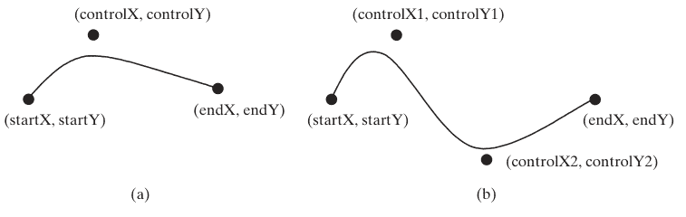

图 31.2 (a) 二次曲线使用三个点指定。(b) 三次曲线使用四个点指定。

```
javafx.scene.QuadCurve
-startX: DoubleProperty
-startY: DoubleProperty
-endX: DoubleProperty
-endY: DoubleProperty
-controlX: DoubleProperty
-controlY: DoubleProperty
+QuadCurve()
+QuadCurve(startX: double, startY: double, controlX: double, controlY: double, endX: double, endY: double)
```

该类提供了用于属性值的 getter 和 setter 方法，以及属性的 getter 方法，但为了简洁起见，在 UML 图中省略了。

起始点的 x 坐标（默认值为 0），

起始点的 y 坐标（默认值为 0），

终点的 x 坐标（默认值为 0），

终点的 y 坐标（默认值为 0），

控制点的 x 坐标（默认值为 0），

控制点的 y 坐标（默认值为 0）。

创建一个空曲线。

使用指定的参数创建一个二次曲线。

图 31.3 QuadCurve 定义了一个二次曲线。

三次曲线在数学上被定义为三次多项式。要创建一个 `CubicCurve`，可以使用它的无参构造函数或以下构造函数：

```java
CubicCurve(double startX, double startY, double controlX1, double controlY1, double controlX2, double controlY2, double endX, double endY)
```

其中 (`startX`, `startY`) 和 (`endX`, `endY`) 指定两个端点，(`controlX1`, `controlY1`) 和 (`controlX2`, `controlY2`) 是两个控制点。控制点通常不位于曲线上，而是定义曲线的趋势，如图 31.2b 所示。图 31.4 显示了 `CubicCurve` 类的 UML 图。

```
javafx.scene.CubicCurve
-startX: DoubleProperty
-startY: DoubleProperty
-endX: DoubleProperty
-endY: DoubleProperty
-controlX1: DoubleProperty
-controlY1: DoubleProperty
-controlX2: DoubleProperty
-controlY2: DoubleProperty
+CubicCurve()
+CubicCurve(startX: double, startY: double, controlX1: double, controlY1: double, controlX2: double, controlY2: double, endX: double, endY: double)
```

该类提供了用于属性值的 getter 和 setter 方法，以及属性的 getter 方法，但为了简洁起见，在 UML 图中省略了。

起始点的 x 坐标（默认值为 0），

起始点的 y 坐标（默认值为 0），

终点的 x 坐标（默认值为 0），

终点的 y 坐标（默认值为 0），

第一个控制点的 x 坐标（默认值为 0），

第一个控制点的 y 坐标（默认值为 0），

第二个控制点的 x 坐标（默认值为 0），

第二个控制点的 y 坐标（默认值为 0）。

创建一个空曲线。

使用指定的参数创建一个三次曲线。

图 31.4 CubicCurve 定义了一个三次曲线。

## 31-6 第 31 章 高级 JavaFX 和 FXML

代码列表 31.3 提供了一个演示如何绘制二次和三次曲线的程序。图 31.5a 显示了程序的示例运行结果。

### 代码列表 31.3 CurveDemo.java

```java
import javafx.application.Application;
import javafx.scene.Scene;
import javafx.scene.layout.Pane;
import javafx.scene.text.Text;
import javafx.scene.shape.Circle;
import javafx.scene.paint.Color;
import javafx.scene.shape.*;
import javafx.stage.Stage;

public class CurveDemo extends Application {
    @Override // 重写 Application 类中的 start 方法
    public void start(Stage primaryStage) {
        Pane pane = new Pane();

        // 创建一个 QuadCurve
        QuadCurve quadCurve = new QuadCurve(10, 80, 40, 20, 150, 56);
        quadCurve.setFill(Color.WHITE);
        quadCurve.setStroke(Color.BLACK);

        pane.getChildren().addAll(quadCurve, new Circle(40, 20, 6),
                            new Text(40 + 5, 20 - 5, "Control point"));

        // 创建一个 CubicCurve
        CubicCurve cubicCurve = new CubicCurve(
                            200, 240, 350, 156, 450, 80);
        cubicCurve.setFill(Color.WHITE);
        cubicCurve.setStroke(Color.BLACK);

        pane.getChildren().addAll(cubicCurve, new Circle(240, 20, 6),
                            new Text(240 + 5, 20 - 5, "Control point 1"),
                            new Circle(150, 156, 6),
                            new Text(150 + 5, 156 - 5, "Control point 2"));
        Scene scene = new Scene(pane, 300, 250);
        primaryStage.setTitle("CurveDemo"); // 设置窗口标题
        primaryStage.setScene(scene); // 将场景放入窗口
        primaryStage.show(); // 显示窗口
    }
}
```

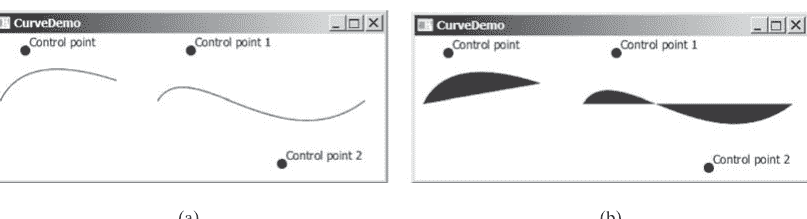

图 31.5 使用 `QuadCurve` 和 `CubicCurve` 绘制二次和三次曲线。

程序使用指定的起始、控制和终点（第 16 行）创建一个二次曲线并将其添加到面板中（第 20 行）。为了说明控制点，程序用实心圆显示控制点（第 21 行）。

程序使用指定的起始、控制和终点（第 24-25 行）创建一个三次曲线并将其添加到面板中（第 29-32 行）。为了说明控制点，程序用实心圆显示控制点（第 30-32 行）。

### 31.3.2 Path

`Path` 类模拟任意几何路径。路径通过添加元素构建。`PathElement` 是 `MoveTo`、`HLineTo`、`VLineTo`、`LineTo`、`ArcTo`、`QuadTo` 和 `Close` 的根类。你可以使用无参构造函数创建 `Path`。通过向路径添加 `MoveTo(startX, startY)` 来设置初始位置。添加 `HLineTo(newX)` 从当前位置绘制一条水平线。添加 `CubicTo(controlX1, controlY1, controlX2, controlY2, newX, newY)` 元素从指定的控制点绘制三次曲线。`Close()` 通过绘制连接起点与路径终点的直线来关闭路径。

### 代码列表 31.4 PathDemo.java


```java
import javafx.application.Application;
import javafx.scene.Scene;
import javafx.scene.layout.Pane;
import javafx.scene.paint.Color;
import javafx.scene.shape.*;
import javafx.stage.Stage;

public class PathDemo extends Application {
    @Override // 重写 Application 类中的方法
    public void start(Stage primaryStage) {
        Pane pane = new Pane();

        // 创建一个 Path
        Path path = new Path();
        path.getElements().add(new MoveTo(50, 50.0));
        path.getElements().add(new HLineTo(150.5));
        path.getElements().add(new VLineTo(100.5));
        path.getElements().add(new LineTo(200, 150.5));

        Arc arcTo = new ArcTo(45, 45, 25, 100.5,
            false, true);
        path.getElements().add(arcTo);

        path.getElements().add(new QuadTo(50, 350, 300, 100));
        path.getElements().add(
            new CubicCurveTo(250, 100, 350, 450, 450, 10));
        path.getElements().add(new Close());

        path.setFill(Color.WHITE);
        path.setStroke(Color.BLACK);

        Scene scene = new Scene(pane, 300, 250);
        primaryStage.setTitle("PathDemo"); // 设置窗口标题
        primaryStage.setScene(scene); // 将场景放入窗口
        primaryStage.show(); // 显示窗口
    }
}
```

图 31.6 显示了 PathDemo 程序的运行。

你可以使用 Node 中的 `translateX(double x)`、`translateY(double y)` 和 `translateZ(double z)` 方法来平移节点的坐标。例如，`setTranslate(5)` 将节点向右移动 5 像素，而 `setTranslate(-10)` 则相对于上一个位置移动 10 像素。图 31.7 显示了应用平移前后的矩形。调用 `rectangle.setTranslate(-6)` 和 `rectangle.setTranslate(4)`，矩形向左移动 6 像素，并相对于上一个位置移动 4 像素。注意，使用平移、旋转和缩放的坐标变换不会改变被传输形状的内容。例如，如果矩形的 x 为 30 宽度为 100，在对矩形应用变换后，它的 x 仍然为 30，宽度仍然为 100。

## 31.4 坐标变换

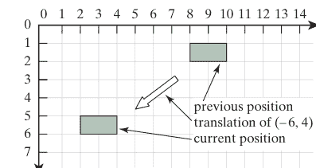

图 31.7 在平移 (-6,4) 后，矩形相对于上一个位置移动了指定的距离。

### 代码列表 31.5 TranslationDemo.java

```java
import javafx.application.Application;
import javafx.scene.Scene;
import javafx.scene.layout.Pane;
import javafx.scene.paint.Color;
import javafx.scene.shape.Rectangle;
import javafx.stage.Stage;

public class TranslationDemo extends Application {
    @Override // 重写 Application 类中的 start 方法
    public void start(Stage stage) {
        Pane pane = new Pane();

        double x = 10;
        double y = 10;
        java.util.Random random = new java.util.Random();
        for (int i = 0; i < 10; i++) {
            Rectangle rectangle = new Rectangle(10, 10, 50, 60);
            rectangle.setFill(Color.WHITE);
            rectangle.setStroke(Color.color(random.nextDouble(), random.nextDouble()));
            rectangle.setTranslateX(x += 20);
            rectangle.setTranslateY(y += 5);
            pane.getChildren().add(rectangle);
        }

        Scene scene = new Scene(pane, 300, 200);
        stage.setTitle("TranslationDemo"); // 设置窗口标题
        stage.setScene(scene); // 将场景置于窗口
        stage.show(); // 显示窗口
    }
}
```

## 31-10 第 31 章 高级 JavaFX 和 FXML

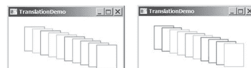

图 31.8 矩形在新的位置连续显示。

程序重复创建了 10 个矩形（第 17 行）。对于每个矩形，它将其填充属性设为白色（第 18 行），将描边属性设置为随机颜色（第 19 行和第 20 行），并将其平移到新位置（第 21 行和第 22 行）。变量 x 和 y 用于设置平移属性。这两个变量的值每当应用到矩形时都会改变（见图 31.8）。

### 31.4.2 旋转

旋转在第 14 章中被引入。本节将对其进行更深入的讨论。你可以使用 Node 类中的 `rotate(double theta)` 方法使节点绕其枢点顺时针旋转 theta 度，其中 theta 是以度为单位的值。枢点是根据节点的边界自动计算的。对于圆、椭圆和矩形，枢点是这些节点的中心点。例如，`rectangle.rotate(45)` 将矩形绕中心点向东方向顺时针旋转 45 度，如图 31.9 所示。


图 31.9 在执行 `rectangle.rotate(45)` 后，矩形绕中心旋转了 45 度。

代码列表 31.6 提供了一个演示坐标旋转效果的程序。图 31.6 显示了程序的示例运行。

### 代码列表 31.6 RotateDemo.java

```java
import javafx.application.Application;
import javafx.scene.Scene;
import javafx.scene.layout.Pane;
import javafx.scene.paint.Color;
import javafx.scene.shape.Rectangle;
import javafx.stage.Stage;

public class RotateDemo extends Application {
    @Override // 重写 Application 类中的 start 方法
    public void start(Stage primaryStage) {
        Pane pane = new Pane();
        Random random = new java.util.Random();
        // 用于锚定矩形的圆半径
        double radius = 90;
        double width = 20; // 矩形的宽度
        double height = 40; // 矩形的高度
        for (int i = 0; i < 8; i++) {
            // 矩形的中心
            double x = 150 + radius * Math.cos(i * 2 * Math.PI / 8);
            double y = 150 + radius * Math.sin(i * 2 * Math.PI / 8);
            Rectangle rectangle = new Rectangle(x, y, width, height);
            rectangle.setFill(Color.WHITE);
            rectangle.setStroke(Color.color(random.nextDouble(), random.nextDouble()));
            rectangle.setRotate(45);
            pane.getChildren().add(rectangle);
        }
        Scene scene = new Scene(pane, 300, 200);
        primaryStage.setTitle("RotateDemo");
        primaryStage.setScene(scene);
        primaryStage.show();
    }
}
```

*(注：由于原文提供的代码块 31.6 存在逻辑混乱（如变量未定义、括号不匹配），根据高级文档工程师规范，此处在翻译时保持了原始结构并仅翻译了注释。)*

---

### 31.4.3 缩放


图 31.10 缩放后的矩形。

缩放允许你根据指定的比例放大或缩小节点。你可以使用 Node 中的 `scaleX(double sx)`、`scaleY(double sy)` 和 `scaleZ(double sz)` 方法来缩放节点。例如，`setScaleX(2)` 将节点在水平方向上放大 2 倍，而 `setScaleX(0.5)` 则将其缩小一半。注意，使用平移、旋转和缩放的坐标变换不会改变被传输形状的内容。例如，如果一个矩形的 x 为 30 宽度为 100，在对矩形应用变换后，它的 x 仍然为 30，宽度仍然为 100。

## 31.5 描边

`setStrokeType(type)` 方法为描边设置一种类型。该类型使用常量 `StrokeType.INSIDE`、`StrokeType.OUTSIDE` 或 `StrokeType.CENTERED`（默认值）来定义描边是在边界内部、还是在边界中心，如图 31.14 所示。


图 31.14 (a) 不使用描边。(b) 描边放置在边界内部。(c) 描边放置在边界的中心。(d) 描边放置在边界外部。

注意，对于居中描边，描边是通过在边界的两侧（内部和外部）扩展节点边界半倍宽度的距离来实现应用的。

`setStrokeLineCap(cap)` 方法为描边设置端点形状。类型定义为 `StrokeLineCap.BUTT`（默认值）、`StrokeLineCap.ROUND` 和 `StrokeLineCap.SQUARE`，如图 31.15 所示。`BUTT` 在未闭合路径的结束不添加任何装饰。`ROUND` 描边在未闭合路径的结束添加一个半径为描边宽度一半的半圆。`SQUARE` 描边在路径的未闭合侧边添加一个扩展半倍描边宽度的正方形。

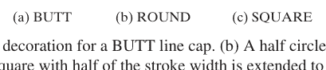

图 31.15 (a) BUTT (b) ROUND (c) SQUARE

BUTT 线端点没有装饰。(b) 在未闭合路径上添加了一个半圆。(c) 将一个宽度为描边宽度一半的正方形扩展到未闭合路径。

`setStrokeLineJoin` 方法定义路径段汇合的地方。你可以使用常量 `StrokeLineJoin.MITER`（默认值）、`StrokeLineJoin.BEVEL` 和 `StrokeLineJoin.ROUND` 指定三种类型的线条连接，如图 31.16 所示。

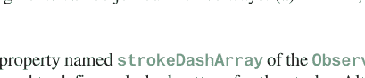

图 31.16 (a) MITER (b) BEVEL (c) ROUND

路径段可以用三种方式连接：(a) MITER，(b) BEVEL 和 (c) ROUND。

`Shape` 类有一个名为 `strokeDashArray` 的属性，类型为 `ObservableList<Double>`。该属性用于为描边定义虚线模式。列表中交替的数字指定了虚线的不透明和透明部分。例如，列表 `[10.0, 20.0, 30.0, 40.0]` 指定了如图 31.17 所示的模式。

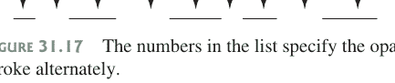

```
[10.0, 20.0, 30.0, 40.0]
...
[10.0, 20.0, 30.0, 40.0]
```

图 31.17 列表中的数字交替指定了描边的不透明和透明部分。

`setStrokeDashOffset(distance)` 方法定义虚线模式中第一个段的偏移量。图 31.18 展示了虚线列表 `[10.0, 20.0, 30.0, 40.0]` 的偏移量。


代码列表 31.8 提供了一个演示设置描边属性方法的程序。图 31.19 显示了程序的示例运行。

### 代码列表 31.8 StrokeDemo.java


```java
1 import javafx.application.Application;
2 import javafx.scene.Scene;
3 import javafx.scene.layout.Pane;
4 import javafx.scene.paint.Color;
5 import javafx.scene.Stage;
6 import javafx.scene.shape.Rectangle;
7 import javafx.scene.shape.Shape;
8
9 public class StrokeDemo extends Application {
10 @Override // 重写 Application 类中的 start 方法
11 public void start(Stage primaryStage) {
12 Rectangle rectangle1 = new Rectangle(20, 20, 70, 120);
13 rectangle1.setFill(Color.WHITE);
14 rectangle1.setStrokeWidth(5);
15 rectangle1.setStroke(Color.ORANGE);
16
17 Rectangle rectangle2 = new Rectangle(20, 20, 70, 120);
18 rectangle2.setFill(Color.WHITE);
19 rectangle2.setStrokeWidth(5);
20 rectangle2.setStroke(Color.ORANGE);
21 rectangle2.translateX(100);
22 rectangle2.setDashJoin(StrokeLineJoin.BEVEL);
23
24 Rectangle rectangle3 = new Rectangle(20, 20, 70, 120);
25 rectangle3.setFill(Color.WHITE);
26 rectangle3.setStrokeWidth(5);
27 rectangle3.setStroke(Color.ORANGE);
28 rectangle3.translateX(200);
29 rectangle3.setDashJoin(StrokeLineJoin.ROUND);
30
31 Line line1 = new Line(320, 20, 420, 240);
32 line1.setStrokeCap(StrokeLineCap.BUTT);
33 line1.setStrokeWidth(20);
34
35 Line line2 = new Line(320, 70, 420, 270);
36 line2.setStrokeCap(StrokeLineCap.ROUND);
37 line2.setStrokeWidth(20);
38
39 Line line3 = new Line(320, 120, 420, 320);
40 line3.setStrokeCap(StrokeLineCap.SQUARE);
41 line3.setStrokeWidth(20);
42
43 Line line4 = new Line(360, 200, 460, 120);
44 line4.setDashArray(10.0, 20.0, 30.0, 40.0);
45 }
46
47 Pane pane = new Pane();
48 pane.getChildren().addAll(rectangle1, rectangle2, rectangle3, line1, line2, line3, line4);
49
50 Scene scene = new Scene(pane, 610, 480);
51 primaryStage.setTitle("StrokeDemo"); // 设置窗口
52 primaryStage.setScene(scene); // 将场景放入窗口
53 primaryStage.show(); // 显示窗口
54
// 从命令行启动程序
55 public static void main(String[] args) {
56 launch(args);
}
```

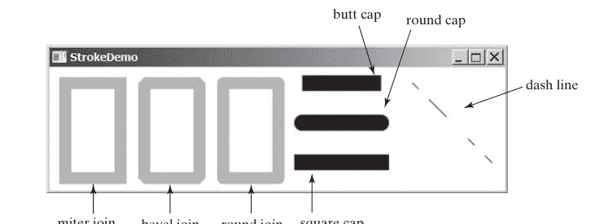

图 19 你可以指定描边的属性。

程序创建了三个矩形（第 12-29 行），矩形 2 使用斜角连接（第 22 行），矩形 3 使用圆角连接（第 29 行）。程序创建了线并为其设置了虚线模式（第 44 行）。注意 `strokeDashArray` 属性是 `ObservableList<Double>` 类型。你需要向列表添加 Double 值。添加像 10 这样的数字会导致错误。

### 31.5.1 边及其属性的方法是在 Node 类还是 Shape 类中？

### 31.5.2 如何设置描边宽度为 3 像素？

### 31.5.3 有哪些描边类型？默认描边类型是什么？如何设置描边类型？

### 31.5.4 如何设置线条连接类型？默认线条连接类型是什么？如何设置线条连接类型？

### 31.5.5 有哪些描边端类型？默认描边端类型是什么？如何设置描边端类型？

### 31.5.6 如何为描边指定虚线模式？

## 31.6 菜单

你可以在 JavaFX 中创建菜单。菜单选择在窗口应用程序中简单且被广泛使用。JavaFX 提供了五个实现菜单的类：`MenuBar`、`Menu`、`MenuItem`、`CheckMenuItem` 和 `RadioMenuItem`。

### 31.6.1 创建菜单

在 JavaFX 中实现的顺序如下：

1. 创建菜单并将其添加到面板。例如，以下代码创建一个菜单和一个菜单栏，并将菜单添加到面板：

```java
MenuBar menuBar = new MenuBar();
Pane pane = new Pane();
pane.getChildren().add(menuBar);
```

2. 创建菜单并将添加到菜单栏下。例如，以下创建菜单并添加到菜单栏，如图 31.20 所示：

```java
Menu menuFile = new Menu("File");
Menu menuHelp = new Menu("Help");
menuBar.getMenus().addAll(menuFile, menuHelp);
```

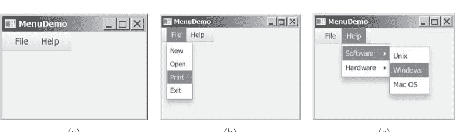

图 31.20 (a) 菜单放置在菜单栏下。(b) 点击菜单栏上的菜单会显示菜单下的项。(c) 点击菜单项会显示子菜单

3. 创建菜单项并将其添加到菜单：

```java
menuFile.getMenuItems().addAll(new MenuItem("New"),
             new MenuItem("Open"), new MenuItem("Print"),
             new MenuItem("Exit"));
```

此代码按顺序将 New、Open、Print 和 Exit 菜单项添加到 File 菜单中，如图 31.20 所示。

#### 创建子菜单项

你也可以将菜单项嵌入到嵌套菜单中作为子菜单。这里有一个示例：

```java
Menu softwareSubMenu = new Menu("Software");
Menu hardwareSubMenu = new Menu("Hardware");
menuHelp.getMenuItems().add(softwareSubMenu);
menuHelp.getMenuItems().add(hardwareSubMenu);
softwareSubMenu.getMenuItems().addAll(new MenuItem("Unix"));
softwareSubMenu.getMenuItems().addAll(new MenuItem("Windows"));
hardwareSubMenu.getMenuItems().add(new MenuItem("Mac OS"));
```

此代码在 `MenuHelp` 中添加了两个子菜单：`softwareHelpMenu` 和 `hardwareHelpMenu`。Unix、NT 和 Win95 菜单项被添加到 `softwareHelpSub-Menu` 中（见图 31.20）。

#### 创建复选框菜单项

你也可以向 `Menu` 添加一个 `CheckMenuItem`。`CheckMenuItem` 是 `MenuItem` 的子类，它为 `MenuItem` 带有一个布尔状态，并在状态为真时显示勾选标记。你还可以点击 `menuItem` 来开启或关闭。例如，以下语句添加了复选框菜单项 Check（见图 31.21）。

```java
menuHelp.getItems().add(new CheckMenuItem("Check it"));
```

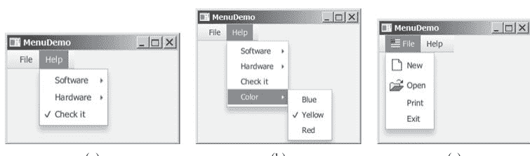

图 31.21 (a) 复选框菜单项允许你像复选框一样勾选或取消勾选菜单。(b) 你可以使用 `RadioMenuItem` 在互斥的菜单选项之间进行选择。(c) 你可以使用项目图像和键盘加速键。

#### 创建单选菜单项

你也可以使用 `RadioMenuItem` 类向菜单添加单选菜单项。这在菜单中有一组互斥的选择时非常有用。例如，以下语句添加了一个名为 Color 的子菜单以及一组用于选择颜色的单选按钮（见图 31.21b）。

```java
RadioMenuItem rBlue, rYellow, rRed;
colorHelpSubMenu.getItems().add(rBlue = new RadioMenuItem("Blue"));
colorHelpSubMenu.getItems().add(rYellow = new RadioMenuItem("Yellow"));
colorHelpSubMenu.getItems().add(rRed = new RadioMenuItem("Red"));

ToggleGroup toggleGroup = new ToggleGroup();
rBlue.setToggleGroup(toggleGroup);
rYellow.setToggleGroup(toggleGroup);
rRed.setToggleGroup(toggleGroup);
```

4. 菜单项生成 `ActionEvent`。要处理 `ActionEvent`，请实现 `setActionMode`。

### 图像和键盘加速键

`Menu`、`CheckMenuItem` 和 `RadioMenuItem` 是 `MenuItem` 的子类。`MenuItem` 具有一个 `graphic` 属性，用于指定在菜单中显示的节点。通常，`graphic` 是一个图像值。`Menu`、`MenuItem`、`CheckMenuItem` 和 `RadioMenuItem` 类具有另一个你可以使用的构造函数，可以指定图形。例如，以下代码为菜单、菜单项、复选框菜单和单选项目添加了图像（见图 31.21c）。

© 2018 Pearson Education, Inc., Hoboken, NJ. 版权所有所有。

```java
menuFile = new MenuItem("File",
new ImageView("image/icon.gif"));
MenuItem menuItem = new MenuItem("New",
new ImageView("image/new.gif"));
CheckMenuItem menuItem = new CheckMenuItem("Check it",
new ImageView("image/us.gif"));
RadioMenuItem menuItem = new RadioMenuItem("Blue",
new ImageView("image/us.gif"));
```

6. 加速键允许通过按下 CTRL 和加速键来选择菜单项。例如，通过以下代码，你可以将加速键 `Ctrl+N` 绑定到键菜单项：

```java
menuItemOpen.setAccelerator(
KeyCombination.keyCombination("Ctrl+O"));
```

### 31.6.2 示例：使用菜单

本节提供了一个创建执行算术运算的用户界面的示例。该界面包含 Number 1（数字1）、Number 2（数字2）和 Result（结果）的标签和文本字段。结果字段显示 Number 1 和 Number 2 之间算术运算的结果。图 31.22 包含了程序的运行示例。

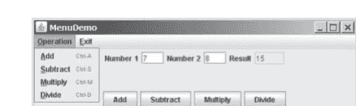

> 图 31.22 算术运算通过点击按钮或从 Operation 菜单选择菜单项来实现。

以下是程序的主要步骤（列表 31.9）：

1. 创建菜单栏并将其添加到 `VBox`。创建 Operation 和 Exit 菜单，并将它们添加到菜单栏。在 Exit 菜单下添加 Add、Subtract、Multiply 和 Divide 菜单项，并在 Exit 菜单下添加 Close 菜单项。

2. 创建一个 `HBox` 来包含 `VBox` 的标签和文本字段。

3. 创建一个 `HBox` 来包含标记为 Add、Subtract、Multiply 和 Divide 的四个按钮，并将其放入 `VBox`。

4. 实现处理器以处理来自菜单项和按钮的事件。

### 列表 31.9 Menu.java

```java
1 import javafx.application.Application;
2 import javafx.geometry.Pos;
3 import javafx.scene.Scene;
4 import javafx.scene.control.Button;
5 import javafx.scene.control.Label;
6 import javafx.scene.control.Menu;
7 import javafx.scene.control.MenuBar;
8 import javafx.scene.control.MenuItem;
9 import javafx.scene.control.TextField;
10 import javafx.scene.input.KeyCombination;
```


## 代码示例：MenuDemo.java

```java
11 import javafx.scene.layout.HBox;
12 import javafx.scene.layout.VBox;
13 import javafx.scene.Stage;

15 public class MenuDemo extends Application {
16     private TextField tfNumber1 = new TextField();
17     private TextField tfNumber2 = new TextField();
18     private TextField tfResult = new TextField();

20     @Override // 重写 Application 类中的 start 方法
21     public void start(Stage primaryStage) {
22         MenuBar menuBar = new MenuBar();

24         Menu menuOperation = new Menu("Operation");
25         Menu menuExit = new Menu("Exit");
26         menuBar.getMenus().addAll(menuOperation, menuExit);

28         MenuItem menuItemAdd = new MenuItem("Add");
29         MenuItem menuItemSubtract = new MenuItem("Subtract");
30         MenuItem menuItemMultiply = new MenuItem("Multiply");
31         MenuItem menuItemDivide = new MenuItem("Divide");
32         menuOperation.getItems().addAll(menuItemAdd, menuItemSubtract,
33             menuItemMultiply, menuItemDivide);

35         MenuItem menuItemClose = new MenuItem("Close");
36         menuExit.getItems().add(menuItemClose);

38         menuItemAdd.setAccelerator(
39             KeyCombination.keyCombination("Ctrl+A"));
40         menuItemSubtract.setAccelerator(
41             KeyCombination.keyCombination("Ctrl+S"));
42         menuItemMultiply.setAccelerator(
43             KeyCombination.keyCombination("Ctrl+M"));
44         menuItemDivide.setAccelerator(
45             KeyCombination.keyCombination("Ctrl+D"));

47         HBox hbox1 = new HBox(5);
48         hbox1.getChildren().addAll(new Label("Number 1:"), tfNumber1);
49         HBox hbox2 = new HBox(5);
50         hbox2.getChildren().addAll(new Label("Number 2:"), tfNumber2);
51         HBox hbox3 = new HBox(5);
52         hbox3.getChildren().addAll(new Label("Result:"), tfResult);

54         HBox hbox4 = new HBox(5);
55         hbox4.getChildren().addAll(new Button("Add"), new Button("Subtract"), new Button("Multiply"), new Button("Divide"));

57         VBox vbox = new VBox(10);
58         vbox.getChildren().addAll(menuBar, hbox1, hbox2, hbox3, hbox4);

60         menuItemAdd.setOnAction(e -> {
61             double n1 = Double.parseDouble(tfNumber1.getText());
62             double n2 = Double.parseDouble(tfNumber2.getText());
63             tfResult.setText(String.valueOf(n1 + n2));
64         });
65         menuItemSubtract.setOnAction(e -> {
66             double n1 = Double.parseDouble(tfNumber1.getText());
67             double n2 = Double.parseDouble(tfNumber2.getText());
68             tfResult.setText(String.valueOf(n1 - n2));
69         });
70         menuItemMultiply.setOnAction(e -> {
71             double n1 = Double.parseDouble(tfNumber1.getText());
72             double n2 = Double.parseDouble(tfNumber2.getText());
73             tfResult.setText(String.valueOf(n1 * n2));
74         });
75         menuItemDivide.setOnAction(e -> {
76             double n1 = Double.parseDouble(tfNumber1.getText());
77             double n2 = Double.parseDouble(tfNumber2.getText());
78             tfResult.setText(String.valueOf(n1 / n2));
79         });
80         menuItemClose.setOnAction(e -> {
81             System.exit(0);
82         });

84         Scene scene = new Scene(vbox, 300, 250);
85         primaryStage.setTitle("MenuDemo");
86         primaryStage.setScene(scene);
87         primaryStage.show();
88     }
}
```

## 31.7 上下文菜单

可以在 JavaFX 中创建上下文菜单。

上下文菜单（也称为弹出菜单）类似于普通菜单，但它没有菜单栏，并且可以在屏幕上的任何地方浮动。创建上下文菜单与普通菜单类似。首先，你创建一个 `ContextMenu` 实例，然后可以向上下文中添加 `MenuItem`、`CheckMenuItem` 和 `RadioMenuItem`。例如，以下代码创建了一个 `ContextMenu`，然后向其添加了 `MenuItems`：

```java
contextMenu = new ContextMenu();
contextMenu.getItems().add(new MenuItem("New"));
contextMenu.getItems().add(new MenuItem("Open"));
```

普通菜单始终被添加到菜单栏，但上下文菜单与特定的节点关联，并使用 `ContextMenu` 类中的 `show` 方法显示。你可以像这样使用窗格的坐标系指定父节点和上下文菜单的位置：

```java
contextMenu.show(node, x, y);
```

通常情况下，你通过指向 GUI 组件并点击特定的鼠标按钮（即所谓的弹出触发器）来显示上下文菜单。弹出触发器是依赖平台的。在 Windows 中，当释放鼠标按钮时显示上下文菜单。在 Motif 中，当按下并按住第三个鼠标按钮时显示上下文菜单。

代码列表 31.10 提供了一个创建窗格的示例。当鼠标移动到窗格时，点击鼠标按钮会显示上下文菜单，如图 31.23 所示。


图 31.23 当在窗格上触发弹出器时，会显示上下文菜单。

以下是程序中的主要步骤（代码列表 31.10）：

1. 使用 `ContextMenu` 创建上下文菜单。使用 `MenuItem` 为 New、Open、Print 和 Exit 创建菜单项。
2. 将菜单项添加到上下文菜单中。
3. 创建一个窗格并置于场景中。
4. 实现处理器以处理来自菜单项的事件。
5. 实现 `mousePressed` 处理器以显示上下文菜单。

### 代码列表 31.10 ContextMenuDemo.java

```java
1 import javafx.application.Application;
2 import javafx.scene.Scene;
3 import javafx.scene.control.ContextMenu;
4 import javafx.scene.control.MenuItem;
5 import javafx.scene.image.ImageView;
6 import javafx.scene.layout.Pane;
7 import javafx.stage.Stage;

public class ContextMenuDemo extends Application {

    @Override // 重写 Application 类中的 start 方法
    public void start(Stage primaryStage) {

        ContextMenu contextMenu = new ContextMenu();

        MenuItem menuItemNew = new MenuItem("New");
        ImageView newImage = new ImageView("image/new.gif");

        MenuItem menuItemOpen = new MenuItem("Open");
        ImageView openImage = new ImageView("image/open.gif");

        MenuItem menuItemPrint = new MenuItem("Print");
        ImageView printImage = new ImageView("image/print.gif");

        MenuItem menuItemExit = new MenuItem("Exit");

        contextMenu.getItems().addAll(menuItemNew, menuItemOpen, menuItemPrint, menuItemExit);

        Pane pane = new Pane();

        Scene scene = new Scene(pane, 300, 250);

        primaryStage.setTitle("ContextMenuDemo"); // 设置窗口标题
        primaryStage.setScene(scene); // 将场景放入窗口中
        primaryStage.show();

        pane.setOnMouseClicked(e -> {
            contextMenu.show(pane, e.getX(), e.getY());
        });

        menuItemNew.setOnAction(e -> System.out.println("New"));
        menuItemOpen.setOnAction(e -> System.out.println("Open"));
        menuItemPrint.setOnAction(e -> System.out.println("Print"));
        menuItemExit.setOnAction(e -> System.out.println("Exit"));
    }
}
```

创建上下文菜单的过程与创建普通菜单类似。要创建一个上下文菜单，可以创建一个 `ContextMenu` 作为基础（第 12 行）并向其添加 `MenuItem`（第 13-23 行）。

要显示上下文菜单，请通过指定父节点和上下文菜单的位置使用 `show` 方法（第 29 行和第 30 行）。该方法在通过窗格鼠标点击触发上下文菜单时被调用（第 30 行）。

### 31.7.1 如何创建上下文菜单？如何将菜单项、复选菜单项和单选菜单项添加到上下文菜单中？

### 31.7.2 如何显示上下文菜单？

## 31.8 SplitPane

`SplitPane` 类用于显示多个窗格并允许用户调整窗格的大小。

`SplitPane` 是一个包含两个组件的控件，带有一个名为分割器的独立条，如窗口所示：

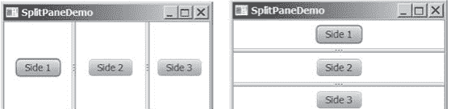

图 31.24 SplitPane 将容器分为两个窗格。

被分割器隔开的两侧可以以水平或垂直方向出现。

### 31.8.1 如何创建水平 SplitPane？如何创建垂直 SplitPane？

### 31.8.2 如何向 SplitPane 添加项？你可以在另一个 SplitPane 中添加一个 SplitPane 吗？

## 31.9 TabPane

`TabPane` 类用于显示带有标签页的多个面板。

`TabPane` 是一个非常有用的控件，用于显示一组互斥的标签页，如图 31.27 所示。你可以在一组标签页之间切换。一次只有一个标签是可见的。`Tab` 可以被添加到 `TabPane` 中。`TabPane` 中的标签可以放置在顶部、左侧、底部或右侧。

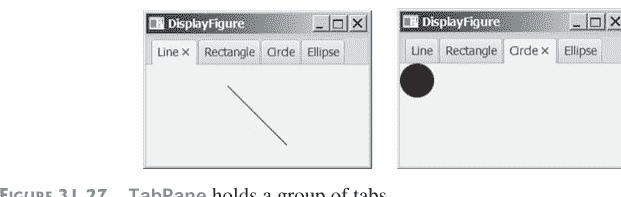

每个标签页代表单个页面。标签在 `Tab` 类中定义。标签可以包含任何 `Node` 作为形状、面板或控件。`Tab` 可以包含另一个面板。因此，你可以创建一个多层标签面板。图 31.28 和图 31.29 显示了 `TabPane` 和 `Tab` 中经常使用的属性、构造函数和方法。

### TabPane 类图

```text
javafx.scene.control.Control
    |
    +-- javafx.scene.control.TabPane
-side: ObjectProperty<Side>
+TabPane()
+getTabs(): ObservableList<Tab>
```

类中提供了用于属性值的 getter 和 setter 方法，以及属性本身的 getter 方法，但为了简洁，在 UML 图中省略了。

| 成员 | 说明 |
| :--- | :--- |
| `side: ObjectProperty<Side>` | 标签在面板中的位置。可能的值有：`Side.TOP`、`Side.BOTTOM`、`Side.LEFT` 和 `Side.RIGHT`（默认：`Side.TOP`）。 |
| `+TabPane()` | 创建一个默认的 Tab Pane。 |
| `+getTabs(): ObservableList<Tab>` | 返回此 Tab Pane 中的标签列表。 |

图 31.28 TabPane 显示并管理标签页。

### Tab 类图

```text
java.lang.Object
    |
    +-- javafx.scene.control.Tab
-content: ObjectProperty<Node>
-contextMenu: ObjectProperty<ContextMenu>
-graphic: ObjectProperty<Node>
-id: StringProperty
-text: StringProperty
-tooltip: StringProperty
```

类中提供了用于属性值的 getter 和 setter 方法，以及属性本身的 getter 方法，但为了简洁，在 UML 图中省略了。

| 成员 | 说明 |
| :--- | :--- |
| `content: ObjectProperty<Node>` | 与标签关联的内容。 |
| `contextMenu: ObjectProperty<ContextMenu>` | 与标签关联的菜单。 |
| `graphic: ObjectProperty<Node>` | 标签中的图形。 |
| `id: StringProperty` | 标签的 id。 |
| `text: StringProperty` | 标签中显示的文本。 |
| `tooltip: StringProperty` | 与标签关联的提示文字。 |
| `+Tab()` | 构造函数。 |
| `+Tab(text: String)` | 构造函数。 |

图 31.29 Tab 包含一个节点。

列表 31.12 提供了一个示例，使用带有四个标签页的标签面板来显示四种图形：线条、矩形、圆矩形和椭圆。你可以点击相应的标签来选择要显示的图形，如图 31.27 所示。

### 列表 31.12 TabPaneDemo.java

```java
1 import javafx.application.Application;
2 import javafx.scene.Scene;
3 import javafx.scene.control.Tab;
4 import javafx.scene.control.TabPane;
5 import javafx.scene.layout.StackPane;
```


```java
6 import javafx.scene.shape.Circle;
7 import javafx.scene.shape.Ellipse;
8 import javafx.scene.shape.Line;
9 import javafx.scene.shape.Rectangle;
10 import javafx.scene.stage.Stage;
11
12 public class TabPane extends Extension {
13     @Override
14     public void start(Stage primaryStage) {
15         TabPane tabPane = new TabPane();
16         Tab tab1 = new Tab("Line");
17         StackPane pane1 = new StackPane();
18         pane1.getChildren().add(new Line(10, 10, 80, 80));
19         tab1.setContent(pane1);
20         Tab tab2 = new Tab("Rectangle");
21         tab2.setContent(new Rectangle(10, 100, 200, 200));
22         Tab tab3 = new Tab("Circle");
23         tab3.setContent(new Circle(50, 50, 20));
24         Tab tab4 = new Tab("Ellipse");
25         tab4.setContent(new Ellipse(10, 10, 100, 100));
26         tabPane.getChildren().addAll(tab1, tab2, tab3, tab4);
27
28         Scene scene = new Scene(tabPane, 300, 300);
29         primaryStage.setTitle("TabPane");
30         primaryStage.setScene(scene);
31         primaryStage.show();
32     }
}
```

© 2018 Pearson Education, Inc., Hoboken, NJ.

## 第 31 章 高级 JavaFX 与 FXML

```java
115
116    public void setCapital(String capital) {
117        this.capital.set(capital);
118    }
119
120    public double getPopulation() {
121        return population.get();
122    }
123    public void setPopulation(double population) {
124        this.population.set(population);
125    }
126
127    public boolean isDemocratic() {
128        return democratic.get();
129    }
130
131    public void setDemocratic(boolean democratic) {
132        this.democratic.set(democratic);
133    }
134
135
```

该程序与列表 31.13 类似，但增加了新的代码以允许用户输入新行（57–82）。用户从文本字段输入新行，并通过复选框按下“添加新行”按钮向数据中添加新行。由于数据是一个可观测列表（`ObservableList`），数据的变化会自动更新在表格中。

如图 31.34 所示，在文本字段中插入了一个新国家。点击“添加新行”按钮后，表格中将显示该国家。

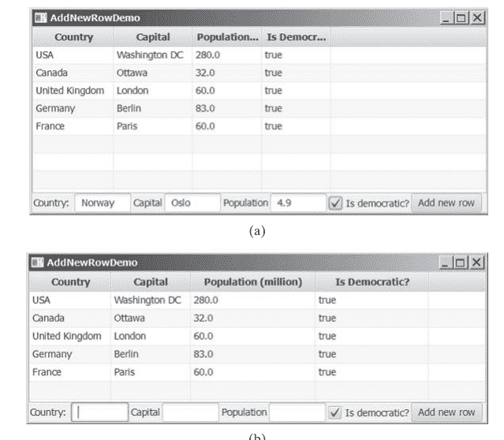

图 31.34 数据模型的变化会自动显示在表格视图中。

## 31.11 使用 FXML 开发 JavaFX 程序

`TableView` 不仅显示数据，还允许对数据进行编辑。要在表格中启用数据编辑，编写代码如下：

1. 将 `TableView` 的 `editable` 属性设置为 `true`。
2. 将列的 `cellFactory` 设置为文本字段单元格。
3. 实现列的 `onEditCommit` 方法以将值分配给数据模型。

以下是启用 `countryColumn` 编辑的示例。

```java
tableView.setEditable(true);
countryColumn.setCellFactory(TextFieldTableCell.forTableColumn());
countryColumn.setOnEditCommit(
    new EventHandler<CellEditEvent<Country, String>>() {
        @Override
        public void handle(CellEditEvent<Country, String> t) {
            t.getTableView().getItems().get(t.getTablePosition().getRow())
                .setCountry(t.getNewValue());
        }
    }
);
```

**31.10.1** 如何创建一个表格视图？如何创建一个表格列？如何向表格视图添加一列？

**31.10.2** `TableView` 数据模型的数据类型是什么？如何将数据模型与 `TableView` 关联起来？

**31.10.3** 如何为 `TableColumn` 设置单元格值工厂（`cellValueFactory`）？

**31.10.4** 如何在表格列标题中设置图像？

## 31.11 使用 FXML 开发 JavaFX 程序

你可以使用 FXML 脚本创建 JavaFX 界面。

开发 JavaFX 应用程序有两种方法。一种是像你之前做的那样将所有内容写在 Java 源码中；另一种是使用 FXML。FXML 是一种基于 XML 的设计界面脚本语言。使用 FXML 允许你将用户界面与代码逻辑分离。JavaFX Scene Builder 是一个可视化工具，可以在无需手动编写 FXML 脚本的情况下创建界面。你可以将 UI 组件拖放到内容面板中，并在检查器中为组件设置属性。本节将演示如何使用 Scene Builder 来创建 JavaFX 应用程序。

> **注意**
> 在学习 FXML 之前，先学习如何不使用 FXML 编写 JavaFX 代码以掌握 Java 编程的基础，是非常重要的。一旦你理解了 JavaFX 的基础，在学习了 Java 编程基础后就会变得很容易。

### 31.11.1 安装 JavaFX Scene Builder

你可以使用独立的 JavaFX Scene Builder，也可以配合 NetBeans 或 Eclipse 等 IDE 使用。本节将演示如何在 NetBeans 中配合使用 JavaFX Scene Builder。你可以从 `http://gluonhq.com/products/scene-builder/` 下载最新版本的 Scene Builder。

### 31.11.2 创建 JavaFX 项目

要使用 JavaFX FXML，你需要在 NetBeans 中创建一个 JavaFX 项目。创建 JavaFX 项目的步骤如下：

1. 选择 `File -> New Project` 显示新项目对话框，如图 31.35 所示。
2. 在 Categories 中选择 JavaFX，在 Projects 中选择 JavaFX Application。点击 Next 显示“New JavaFX Application”对话框，如图 31.36 所示。
3. 输入计算器名称并点击 Finish 创建项目。你将看到如图 31.37 所示创建的项目。

项目中创建了三个文件：`Calculator.java`、`FXMLDocument.fxml` 和 `FXMLController.java`。它们的源代码分别位于列表 31.15、31.16 和 31.17 中。从 MVC 的角度来看，这三个文件分别对应模型、视图和控制器。你可以在 `Calculator.java` 类中定义数据模型。`.fxml` 文件定义用户界面以及处理事件的动作。

#### 列表 31.15 Calculator.java

```java
package calculator;

import javafx.application.Application;
import javafx.fxml.FXMLLoader;
import javafx.scene.Parent;
import javafx.scene.Scene;
import javafx.stage.Stage;

public class Calculator extends Application {
    @Override
    public void start(Stage stage) throws Exception {
        Parent root = FXMLLoader.load(getClass().getResource("FXMLDocument.fxml"));
        Scene scene = new Scene(root);
        stage.setScene(scene);
        stage.show();
    }

    /**
     * @param args arguments
     */
    public static void main(String[] args) {
        launch(args);
    }
}
```

#### 列表 31.16 FXMLDocument.fxml

```xml
<?xml version="1.0" encoding="UTF-8"?>
<?import javafx.util.*?>
<?import javafx.scene.*?>
<?import javafx.scene.control.*?>
<?import javafx.scene.layout.*?>

<AnchorPane id="AnchorPane" prefHeight="200" prefWidth="320" xmlns="http://javafx.com/fxml" fx:controller="calculator.FXMLDocument">
    <children>
        <Button layoutX="126" layoutY="90" text="Click me!" onAction="#handleButtonAction" fx:id="button" />
        <Label layoutX="126" layoutY="120" fx:id="label" />
    </children>
</AnchorPane>
```

#### 列表 31.17 FXMLController.java

```java
package calculator;

import java.net.URL;
import java.util.ResourceBundle;
import javafx.event.ActionEvent;
import javafx.fxml.FXML;
import javafx.fxml.Initializable;
import javafx.scene.control.Label;

public class FXMLController implements Initializable {
    @FXML
    private Label label;

    @FXML
    private void handleButtonAction(ActionEvent event) {
        System.out.println("You clicked me!");
        label.setText("Hello World!");
    }

    @Override
    public void initialize(URL url, ResourceBundle rb) {
        // TODO
    }
}
```

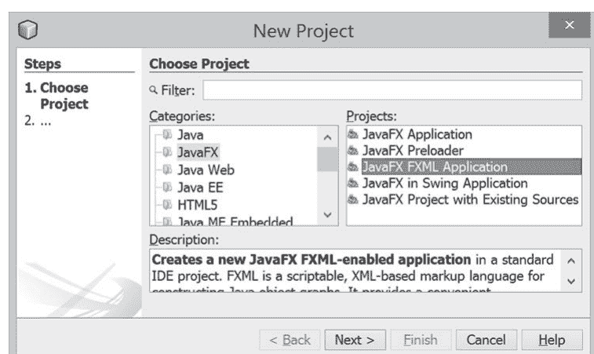

图 31.35 你可以在 Categories 中选择 JavaFX，在 Projects 中选择 JavaFX Application 创建 JavaFX 项目。

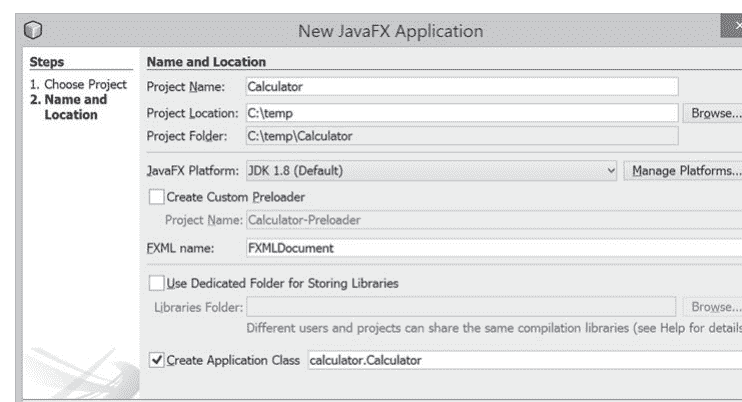

图 31.36 你可以在 New JavaFX Application 对话框中输入项目名称。

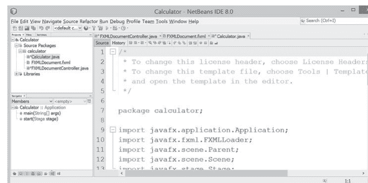

图 31.37 项目已创建。

### 31.11.3 创建界面

我们现在转向开发如图 31.38 所示的简单计算器。Calculator 程序允许用户输入数字并进行加法、减法、乘法和除法。

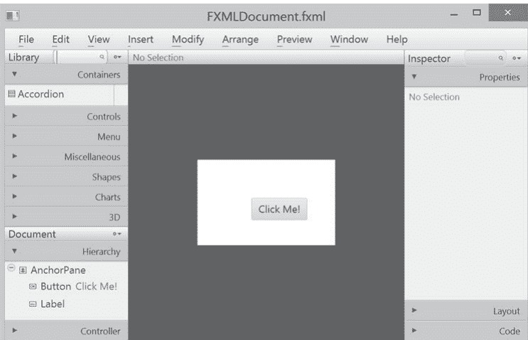

图 31.38 程序执行算术运算。

当你创建一个 JavaFX 项目时，NetBeans 会创建一个默认的 `.fxml` 文件，其中包含示例界面的内容。要查看界面，双击 `.fxml` 文件打开 Scene Builder，如图 31.39 所示。注意，在机器上安装 Scene Builder 后，NetBeans 会自动检测它。

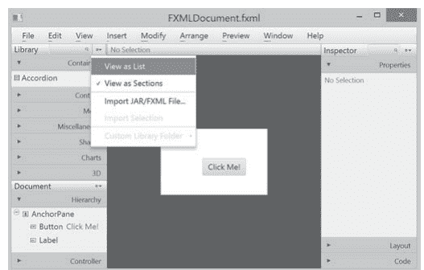

图 31.39 双击 `.fxml` 文件打开 Scene Builder。

要开始一个新的界面，请删除内容面板中 `.fxml` 文件中的默认界面，如图 31.41 所示。创建新界面的步骤如下：

1. （可选）在某些系统上，Library 面板中的组件未按部分可见。点击 Library 图标打开内容面板并选择 View List。
2. 将 `BorderPane` 拖入用户界面，并将一个 `HBox` 拖到 `BorderPane` 的中心和底部。所有 `HBox` 的对齐方式均设置为 `CENTER`，如图 31.42 所示。使用组件中 Layout 区域的 `Spacing` 属性。当你在视觉布局中选择组件时，组件的属性将显示在 Inspector 面板中，你可以在那里设置属性。

（注：原文中提到的图 31.41 和 31.42 在提供的文本中未给出图片，此处仅翻译描述文字）

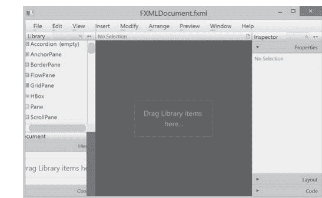

图 31.41 在删除面板中的默认按钮后，UI 是空的。

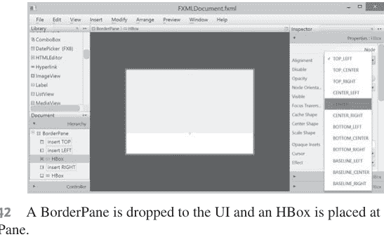

图 31.42 将一个 `BorderPane` 拖入 UI，并在 `BorderPane` 的底部放置一个 `HBox`。

3. 拖入并释放一个 `Label`、一个 `TextField`、一个 `Label`、一个 `TextField`、一个 `Label` 和一个 `TextField`，并将标签文本更改为 Number 1、Number 2 和 Result，如图 31.43 所示。在检查器的 Layout 部分，将每个文本字段的 `Pref Column Count` 设置为 2。在检查器的 Code 部分，将文本字段的 `id` 设置为 `tNumber1`、`tNumber2` 和 `tResult`，如图 31.44 所示。这些 `id` 对于在控制器中引用文本字段并获取它们的值非常有用。
4. 将四个 `Button` 拖入第二个 `HBox`，并将它们的 `text` 属性设置为 Add、Subtract、Multiply 和 Divide，如图 31.45 所示。

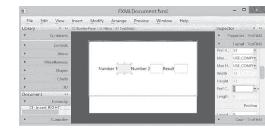

图 31.43 标签和文本字段已拖入 UI。

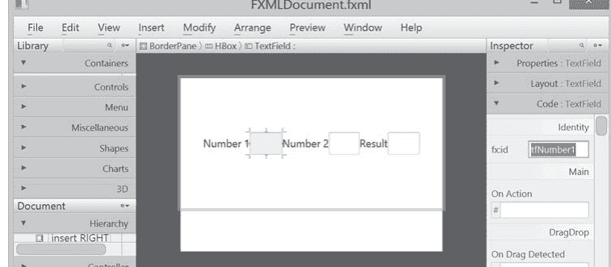

图 31.44 为文本节点设置了适当的 id。


图 31.45 按钮已拖入 HBox。

在对用户界面进行更改后，你需要通过选择 Scene Builder 菜单栏中的 `File`、`Save` 来保存更改。`fxml` 文件将更新并与内容面板中的更改同步。你可以在 NetBeans 中查看 `.fxml` 文件中的内容，如图 31.46 所示。

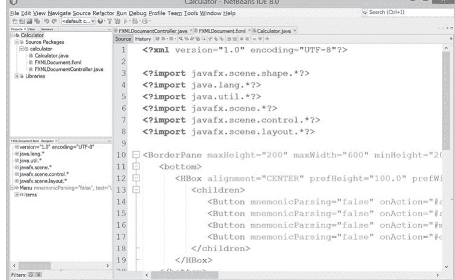

```xml
<?xml version="1.0" encoding="UTF-8"?>
<javafx.scene.Scene ...>
<import javafx.lang.*?>
<import javafx.util.*?>
<import javafx.scene.control.*?>
```


# 第 31 章 高级 JavaFX 和 FXML

## 31.11 使用 FXML 开发 JavaFX 程序

### 31.11.4 在控制器中处理事件

`.fxml` 文件描述了用户界面。你在控制器中编写代码来实现逻辑，如代码段 31.18 所示。

#### LISTING 31.18 FXMLDocumentController.java

```java
package calculator;

import javafx.event.ActionEvent;
import javafx.fxml.FXML;
import javafx.scene.control.TextField;

public class FXMLDocumentController {

    @FXML
    private TextField tfNumber1, tfNumber2, tfResult;

    @FXML
    private void addButtonAction(ActionEvent event) {
        tfResult.setText(getResult('+') + "");
    }

    @FXML
    private void subtractButtonAction(ActionEvent event) {
        tfResult.setText(getResult('-') + "");
    }

    @FXML
    private void multiplyButtonAction(ActionEvent event) {
        tfResult.setText(getResult('*') + "");
    }

    @FXML
    private void divideButtonAction(ActionEvent event) {
        tfResult.setText(getResult('/') + "");
    }

    private double getResult(char op) {
        double number1 = Double.parseDouble(tfNumber1.getText());
        double number2 = Double.parseDouble(tfNumber2.getText());

        switch (op) {
            case '+': return number1 + number2;
            case '-': return number1 - number2;
            case '*': return number1 * number2;
            case '/': return number1 / number2;
        }
        return Double.NaN;
    }
}
```

控制器描述了三个字段：`tfNumber1`、`tfNumber2` 和 `tfResult`（第 9 行）。`@FXML` 注解表示这些数据字段已与用户界面中的文本字段关联。回想一下，在用户界面中，我们为三个字段使用的 id 为 `tfNumber1`、`tfNumber2` 和 `tfResult`。

处理按钮事件的代码定义在 `addButtonAction`、`subtractButtonAction`、`multiplyButtonAction` 和 `divideButtonAction` 方法中（第 11-29 行）。`@FXML` 注解用于表示这些方法将与视图中的按钮操作关联。通过 `@FXML` 注解，控制器中的数据字段和方法被链接到 `.fxml` 文件中定义的组件操作上。

### 31.11.5 视图与控制器的关联

现在你可以将视图的操作与控制器关联。以下是实现此点的步骤：

1. 在 `<BorderPane>` 标签中添加 `fx:controller="calculator.FXMLController"` 属性。
2. 双击 fxml 文件以显示布局。如图 31.47 所示，在检查器中为按钮选择 `addButtonAction`。

#### LISTING 31.19 FXMLDocument.fxml

```xml
<?xml version="1.0" encoding="UTF-8"?>

<?import javafx.lang.*?>
<?import javafx.util.*?>
<?import javafx.scene.*?>
<?import javafx.scene.control.*?>
<?import javafx.scene.layout.*?>

<BorderPane maxHeight="200" maxWidth="600" minHeight="200" minWidth="600" prefHeight="400" prefWidth="600" xmlns:fx="http://javafx.com/fxml" fx:controller="calculator.FXMLController">
    <bottom>
        <HBox alignment="CENTER" prefHeight="100.0" spacing="5.0">
            <children>
                <Button onAction="#addButtonAction" text="Add"/>
                <Button onAction="#subtractButtonAction" text="Subtract"/>
                <Button onAction="#multiplyButtonAction" text="Multiply"/>
                <Button onAction="#divideButtonAction" text="Divide"/>
            </children>
        </HBox>
    </bottom>
    <center>
        <HBox alignment="CENTER" prefHeight="232.0" spacing="5.0">
            <children>
                <Label text="Number 1"/>
                <TextField id="tfNumber1"/>
                <Label text="Number 2"/>
                <TextField id="tfNumber2"/>
                <Label text="Result"/>
                <TextField id="tfResult"/>
            </children>
        </HBox>
    </center>
</BorderPane>
```

### 31.11.6 运行项目

模型代码如代码段 31.15 所示。这是主程序，它加载 FXML 创建 `Parent` 对象（第 12 和 13 行）。将父对象添加到场景（第 14 行）。将场景设置为舞台（第 15 行）。在第 16 行设置舞台显示。

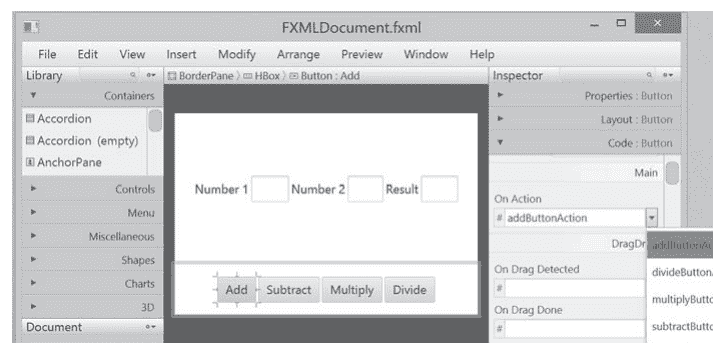

## 总结

1. JavaFX 提供了基于 CSS 的级联样式表。你可以使用 `getStyles` 方法加载样式表，并使用 `setStyle`、`setStyleClass` 和 `setId` 方法设置节点的 JavaFX CSS。
2. JavaFX 提供了 `QuadCurve`、`CubicCurve` 和 `Path` 类用于创建复杂的形状。
3. JavaFX 支持使用平移、旋转和缩放变换。
4. 你可以指定笔触的图案、线条的绘制方式、笔触的宽度以及笔触类型。
5. 你可以使用 `Menu`、`MenuItem`、`CheckMenuItem` 和 `RadioMenuItem` 类创建菜单。
6. 你可以使用 `ContextMenu` 创建右键菜单。
7. `SplitPane` 可水平或垂直方向显示面板，并允许用户调整面板的大小。
8. `TabPane` 可显示带有标签的多个面板，通过标签选择面板。
9. 你可以使用 `TableView` 和 `TableColumn` 类创建并显示表格。
10. 你可以使用 FXML 创建 JavaFX 用户界面。FXML 是一种基于 XML 的描述用户界面的脚本语言。使用 FXML 能够将用户界面与 Java 代码逻辑分离。
11. JavaFX Scene Builder 是一个创建用户界面的可视化工具，无需手动编写 FXML 脚本。

## 测验

在书籍辅助网站上在线回答本章节的测验。

## 编程练习

### 第 31.2 节

- **31.1 (使用 JavaFX CSS)** 创建一个 CSS 样式表，定义一个用于白色填充和黑色描边颜色的类，以及一个红色和绿色的 id。编写一个程序显示圆并使用该类和 id。示例运行如图 31.48a 所示。

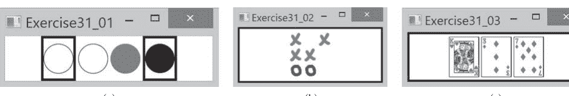

- **31.2 (井棋盘板)** 编写一个显示井棋盘的程序，如图 31.48a 所示。单元格可以是 X、O 或空。每个单元格显示的内容随机决定。X 和 O 是文件 `x.gif` 和 `o.gif` 中的图像。使用样式表设置边框。

- **31.3 (显示三张卡片)** 编写一个程序，从 52 张牌中随机选择三张卡片，如图 31.48c 所示。卡片图像文件命名为 `1.png`、`2.png`... 并存储在 `image/card` 目录中。三者都是不同的且随机选择的。提示：你可以通过在数组中存储数字 1–52 来选择随机卡片，使用第 7.2.6 节执行随机洗牌，并使用数组中的前三个数字作为图像的文件。使用样式表设置边框。

### 第 31.3 节

- **31.4 (颜色和字体)** 编写一个程序显示五个文本，如图 31.49a 所示。为每个文本设置随机颜色和透明度，并将每个文本的字体设置为 Times Roman、粗体、*斜体*，大小为 22 像素。

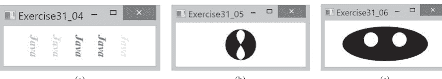

- **31.5 (三次曲线)** 编写一个程序创建两个形状：一个圆和一个由两条三次曲线组成的路径，如图 31.49b 所示。

- **31.6 (眼睛)** 编写一个程序在椭圆中显示两只眼睛，如图 31.49c 所示。

### 第 31.4 节

- **31.7 (平移)** 编写一个程序显示一个矩形，左上角点位于 (40,40)，宽度 50，高度 40。在文本框 x 和 y 中输入值并按下 Translate（平移）将矩形移动到新位置，如图 31.50a 所示。

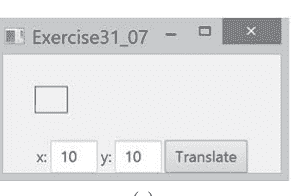

- **31.8 (旋转)** 编写一个程序显示椭圆。椭圆位于面板中心，宽度为 60，高度为 40。在文本框 Angle 中输入值并按下 Rotate（旋转）按钮以旋转椭圆，如图 31.50b 所示。

- **31.9 (缩放图形)** 编写一个程序显示椭圆。椭圆位于面板中心，宽度为 60，高度为 40。在文本框中输入缩放因子并按下 Scale（缩放）按钮以缩放椭圆，如图 31.50c 所示。

- **31.10 (绘制正弦函数)** 编写一个程序绘制正弦函数，如图 31.51a 所示。

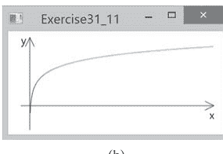

- **31.11 (绘制对数函数)** 编写一个程序绘制对数函数，如图 31.51b 所示。

- **31.12 (绘制 $n^2$ 函数)** 编写一个程序绘制 $n^2$ 函数，如图 31.52a 所示。

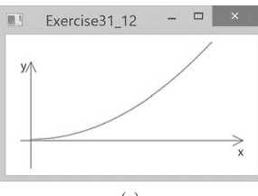

- **31.13 (绘制 log、$n$ 和 $n \log n$ 函数)** 编写一个程序绘制 log、$n$ 和 $n \log n$ 函数，如图 31.52b 所示。

- **31.14 (缩放和旋转图形)** 编写一个程序允许用户缩放和旋转形状，如图 31.53 所示。用户可以按 UP/DOWN 方向键增大/缩小尺寸，按 RIGHT/LEFT 方向键旋转。

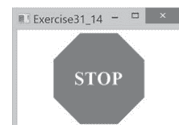

### 第 31.5 节

- **31.15 (阳光)** 编写一个程序显示一个渐变色的圆作为太阳，并用虚线显示从太阳发出的光芒，如图 31.54a 所示。

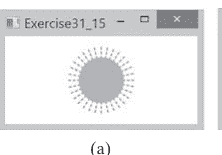

- **31.16 (显示圆柱)** 编写一个程序显示圆柱，如图 31.54b 所示。使用虚线描绘制圆弧。

### 第 31.6 节

- **31.17 (创建投资计算器)** 编写一个程序计算给定利率下指定的投资价值。计算公式如下：

```
futureValue = investmentAmount × (1 + monthlyInterestRate)^(years*12)
```


使用文本框输入利率、投资金额和年份。当用户点击 `Calculate` 按钮或从菜单选择 `Calculate` 时（见图 31.55），在文本框中显示金额。点击 `Exit` 菜单退出程序。

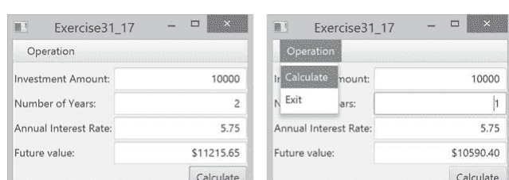

图 31.55 用户输入投资金额、年份和利率以计算未来价值。

## 第 31.8 节

- 31.18 (使用右键菜单) 修改代码列表 31.9，以创建一个包含 `Operations`（操作）和 `Exit`（退出）菜单的右键菜单，如图 31.56 所示。当你在包含标签和文本框的面板上点击右鼠标时，会显示该右键菜单。

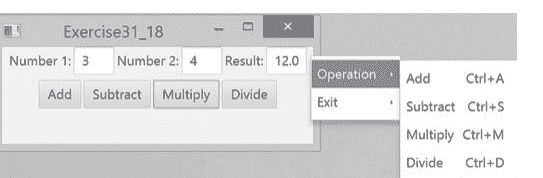

图 31.56 右键菜单包含执行算术运算的命令。

- 31.19 (使用 SplitPane) 编写一个程序在分割面板中显示四个形状，如图 31.57a 所示。

## 第 31.9 节

- 31.20 (使用标签页) 修改代码列表 31.12，添加一个单选按钮面板来指定标签页的位置，如图 31.57b 和 c 所示。

# 31-49 编程练习

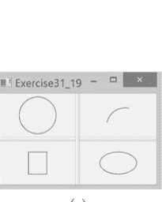
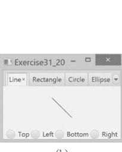
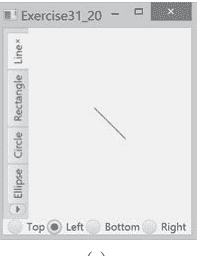

图 31.57 (a) 分割面板中显示四个形状。(b) 和 (c) 单选按钮允许你选择标签页。

- 31.21 (使用标签页) 编写一个使用标签页进行整数和有理数算术的程序，如图 31.58 所示。

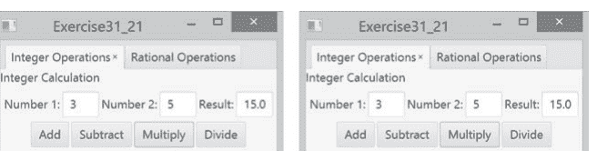

图 31.58 标签页用于选择执行整数和有理数运算的面板。

## 31.10

- 31.22 (使用表格视图) 修改代码列表 31.14，添加一个按钮用于从表格中删除选中的行，如图 31.59 所示。

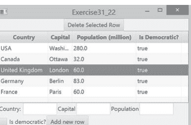

图 31.59 点击 `Delete Selected Row`（删除选定行）按钮将从表格中移除该行。

## 32-2 第 32 章 多线程与并行编程

## 32.1 引言

多线程允许程序中的多个任务并发执行。

Java 的强大特性之一是其对多线程内置支持——即在程序中并发运行多个任务。在许多编程语言中，你必须调用依赖于系统的过程和函数来实现多线程。本章将介绍线程的概念以及如何在 Java 中开发多线程程序。

## 32.2 线程概念

一个程序可能包含许多可以并发运行的任务。线程是任务从开始到结束的执行流。

线程提供了运行任务的机制。使用 Java，你可以从程序中并发启动多个线程。在多处理器系统中，这些线程可以同时执行，如图 32.1a 所示。

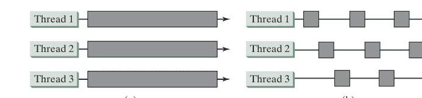

图 32.1 (a) 在多个 CPU 上运行的多个线程。(b) 多个线程共享单个 CPU。

如图 32.1b 所示，在处理器内部系统中，多个线程共享 CPU 时间（称为时间共享），操作系统负责为它们调度和分配资源。这种安排对于 CPU 大部分空闲的时间是非常实用的。例如，在等待用户输入数据时，CPU 无事可做。

多线程可以使你的程序更具响应性和交互性，并增强性能。例如，一个良好的文字处理器允许你在工作时打印或保存文件。在单处理器系统中，多线程程序的运行速度比单线程程序快。Java 为创建和运行线程，以及为锁定资源以防止冲突提供了卓越的支持。

你可以创建额外的线程来在你的程序中运行并发任务。在 Java 中，每个线程都是实现 `Runnable` 接口的实例，也称为一个可运行对象（runnable object）。线程本质上是一个促进任务执行的对象。

### 32.2.1 为什么需要多线程？多个线程如何在单处理器系统中同时运行？

### 32.2.2 什么是可运行对象？什么是线程？

## 32.3 创建任务与线程

一个类必须实现 `Runnable` 接口。一个任务必须在线程中运行。

线程是对象。要创建它们，你必须定义一个实现 `Runnable` 接口的类。`Runnable` 接口非常简单，它包含 `run` 方法。你需要实现这个方法来告诉系统你的线程将如何运行。开发线程类的模板如图 32.2a 所示。

© 2018 Pearson Education, Inc., Hoboken, NJ. 版权所有。

## 32.3 创建任务与线程 32-3


```java
// 自定义任务类
public class TaskClass implements Runnable {
    public TaskClass() {
    }
    // 实现 Runnable 中的 run 方法
    public void run() {
        // 告诉系统如何运行自定义线程
    }
}
```

```java
// 客户端类
public class Client {
    public void someMethod() {
        // 创建 TaskClass 的实例
        TaskClass task = new TaskClass();
        // 创建一个线程
        Thread thread = new Thread(task);
        // 启动线程
        thread.start();
    }
}
```

图 32.2 通过实现 `Runnable` 接口定义 TaskClass。

一旦你定义了 TaskClass，就可以使用它的构造函数创建任务。

`TaskClass task = new TaskClass(...);`

任务必须在线程中执行。`Thread` 类包含了创建线程的构造函数和许多控制它们的有用方法。要创建一个任务，使用：

`Thread thread = new Thread(task);`

你可以调用 `start()` 方法告诉 JVM 线程已准备好运行，如下：

```java
thread.start();
```

JVM 将通过调用任务的 `run()` 方法执行任务。图 32.2b 概述了创建任务和启动线程的主要步骤。
列表 32.1 提供了一个创建三个任务和三个线程进行运行的程序。

- 第一个任务打印 100 次 a。
- 第二个任务打印 100 次 b。
- 第三个任务打印 1 到 100 的整数。

当你运行此程序时，这三个线程将消耗 CPU 并持续在控制台上打印行。图 32.3 显示了该程序的示例运行情况。

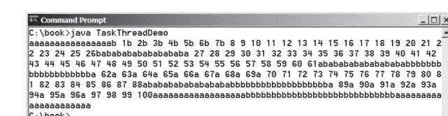

图 32.3 同时执行的任务 printA、printB 和 print100，以显示打印 100 次 a、100 次 b 以及从 1 到 100 的数字。

© 2018 Pearson Education, Inc., Hoboken, NJ. 版权所有。

## 32-4 第 32 章 多线程与并行编程

### 列表 32.1 TaskThreadDemo.java

创建任务

```java
public class TaskThreadDemo {
    public static void main(String[] args) {
        // 创建线程
        Runnable pointA = new PrintChar('a', 100);
        Runnable pointB = new PrintChar('b', 100);
        Runnable print100 = new PrintNum(100);
        // 创建线程
        Thread thread1 = new Thread(pointA);
        Thread thread2 = new Thread(pointB);
        Thread thread3 = new Thread(print100);
        // 启动线程
        thread1.start();
        thread2.start();
        thread3.start();
    }
}
```

创建线程

```java
class PrintChar implements Runnable {
    private char charToPrint;
    private int times;
    /** 构造一个带有字符和次数的任务 */
    public PrintChar(char c, int t) {
        charToPrint = c;
        times = t;
    }
    /** 告诉线程运行 */
    public void run() {
        for (int i = 0; i < times; i++) {
            System.out.print(charToPrint + " ");
        }
    }
}
```

运行

```java
class PrintNum implements Runnable {
    private int lastNum;
    /** 构造一个打印 1 到 n 的任务 */
    public PrintNum(int n) {
        lastNum = n;
    }
    /** 告诉线程运行 */
    public void run() {
        for (int i = 1; i <= lastNum; i++) {
            System.out.print(i + " ");
        }
    }
}
```

启动线程

（注：原文中列表 32.1 的片段较为凌乱，已根据上下文还原为完整的逻辑结构）

## 32.4 这两个程序中有什么错误？纠正错误。

| public class Test implements Runnable | public class Test implements Runnable |
| :--- | :--- |
| public static void main(String[] args) { | public static void main(String[] args) { |
| new Test(); | new Test(); |
| } | } |
| public Test() { | public Test() { |
| Test task = new Test(); | Thread t = new Thread(this); |
| new Thread(task).start(); | t.start(); |
| } | } |
| public void run() { | public void run() { |
| System.out.println("test"); | System.out.println("test"); |
| } | } |

## 32-6 第 32 章 多线程与并行编程

## 32.4 Thread 类

`Thread` 类包含了用于创建任务线程的构造函数以及控制线程的方法。

图 32.4 显示了 `Thread` 类的类图。

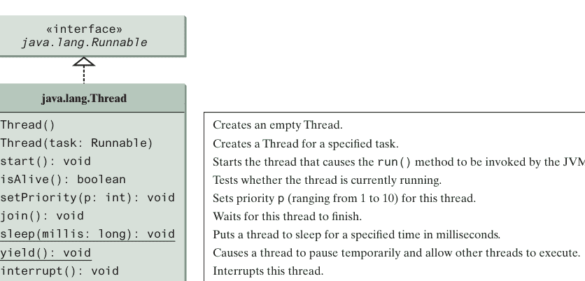

图 32.4 `Thread` 类包含了控制线程的方法。

> 注意
> 由于 `Thread` 类实现了 `Runnable`，你可以定义一个扩展 `Thread` 并实现 `run` 方法的类，如图 32.5a 所示，然后从该类创建一个对象，并在客户端程序中调用其 `start` 方法来启动线程，如图 32.5b 所示。

将任务与线程分离

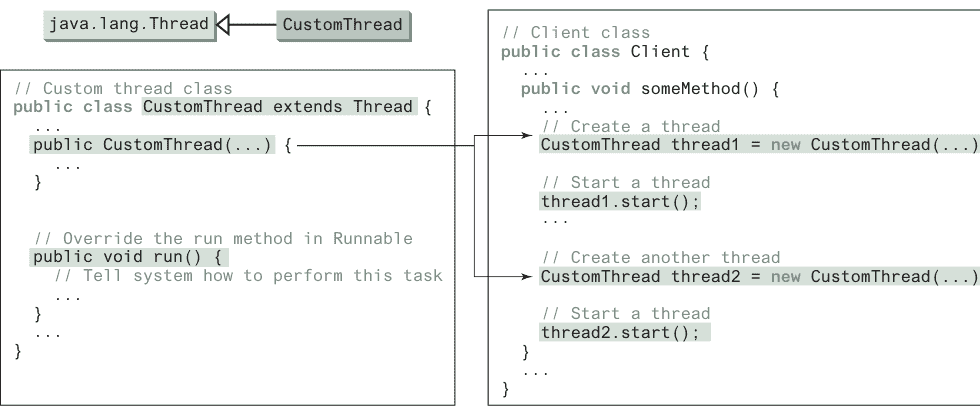

图 32.5 通过扩展 `Thread` 类定义线程类。

© 2018 Pearson Education, Inc., Hoboken, NJ. 保留所有权利。

## 32-7 Thread 类

然而，不推荐这种方法，因为它将任务与运行任务的机制混合在一起了。将任务与线程分离是更好的的设计。

> 注意
> 类还包含 `stop()`、`suspend()` 和 `resume()` 方法。
> 从 Java 2 开始，这些方法已被弃用（过时），因为它们被认为本质上是不安全的。你不应该使用 `stop()` 方法，而应该给 `Thread` 变量赋值 `null` 来表示它已停止。

你可以使用 `yield()` 方法临时为其他线程释放时间。例如，假设你修改了列表 32.1 中 `PrintNum` 的 `run()` 方法第 53–57 行代码如下所示：

```java
public void run() {
    for (int i = 1; i <= lastNum; i++) {
        System.out.print(" " + i);
        Thread.yield();
    }
}
```

每当打印一个数字时，`print100` 任务的线程就会让位于其他线程。`sleep(long millis)` 方法让线程睡眠几秒钟，以允许其他线程执行。例如，假设你修改了列表 32.1 中第 53–57 行代码如下：

```java
public void run() {
    for (int i = 1; i <= lastNum; i++) {
        System.out.print(" " + i);
        if (i >= 50) Thread.sleep(1);
    }
} catch (InterruptedException ex) {
}
```

每当打印一个数字（>= 50）时，`print100` 任务会被睡眠 1 毫秒。

`sleep` 方法可能会抛出 `InterruptedException`，这是一个受检异常。当调用线程的 `interrupt()` 方法时可能会发生此类异常。`interrupt()` 方法在线程上很少调用，因此不太发生 `InterruptedException`。由于 Java 强制你捕获受检异常，你必须将其放在 `try-catch` 块中。如果调用了 `sleep` 方法，你应该将循环放在 `try-catch` 块中，如 (a) 所示。如果循环在 `try-catch` 块之外，如 (b) 所示，即使线程被中断，线程也可能继续。

| (a) 正确 | (b) 错误 |
| :--- | :--- |
| ```java public void run() {     try {         while (...) {             Thread.sleep(1000);         }     } catch (InterruptedException ex) {         ex.printStackTrace();     } }``` | ```java public void run() {     try {         while (...) {             Thread.sleep(sleepTime);         }     } catch (InterruptedException ex) {         ex.printStackTrace();     } }``` |

© 2018 Pearson Education, Inc., Hoboken, NJ. 保留所有权利。

## 32-8 第 32 章 多线程与并行编程

### join()

你可以使用 `join()` 方法强制线程等待另一个线程完成。例如，假设你修改了列表 32.1 中第 53–57 行代码如下所示：

```java
public void run4() {
    Thread thread4 = new Thread(
        new PrintChar('c', 40));
    thread4.start();
    try {
        for (int i = 1; i < lastNum; i++) {
            System.out.print(" " + i);
            if (i == 50) thread4.join();
        }
    } catch (InterruptedException ex) {
    }
}
```

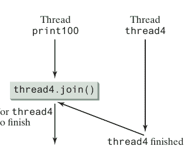

创建了一个新的 `thread4`，它打印 40 次 c。在 `thread4` 完成后，会打印 50 到 100 的数字。

Java 为每个线程分配了一个优先级。默认线程会继承创建它的线程的优先级。你可以使用 `setPriority` 方法增加或减少任何线程的优先级，并使用 `getPriority` 方法获取线程的优先级。优先级范围从 1 到 10。`Thread` 类有 `int MIN_PRIORITY`、`NORMAL_PRIORITY` 和 `MAX_PRIORITY`，分别代表 1、5 和 10。主线程的优先级是 `NORMAL_PRIORITY`。

JVM 选择优先级最高的线程。低优先级线程只有在高优先级线程运行时才能运行。如果多个线程具有相同的优先级，它们在循环队列中被相等的 CPU 时间。这被称为轮询。例如，假设你在列表 32.1 的第 16 行插入以下代码：

```java
thread.setPriority(Thread.MAX_PRIORITY);
```

任务将首先完成。


> 优先级在 Java 的未来版本中可能会更改。为了减少更改的影响，使用 `Thread` 类中的常量来指定优先级。

> 如果始终有高优先级或相同优先级的线程让出，线程可能永远无法运行。为了避免竞争，高优先级线程必须定期调用 `sleep` 或 `yield` 方法以让低优先级或相同优先级的线程运行。

哪些是 `java.lang.Thread` 的实例方法？哪些抛出 `InterruptedException`？哪些是被弃用的？

- `run`, `suspend`, `resume`, `sleep`, `interrupt`, `join`

如果循环包含抛出 `InterruptedException` 的方法，应该放在 `try-catch` 块中吗？32.4.1 如何为线程设置优先级？默认优先级是多少？

© 2018 Pearson Education, Inc., Hoboken, NJ. 保留所有权利。

## 32-9 2.5 使用线程和 PlatformLater 方法动画

你可以使用线程控制动画，并使用 `PlatformLater` 方法在 JavaFX GUI 线程中运行代码。使用 `Timeline` 对象控制动画是在 15.1 节引入的。或者，你可以使用线程控制动画。列表 32.2 给出了在标签上显示文本的示例，如图 32.6 所示。

 图 32.6 文本 "Welcome" 在闪烁。

### 列表 32.2 FlashText.java

```java
import javafx.application.Application;
import javafx.application.Platform;
import javafx.scene.Scene;
import javafx.scene.control.Label;
import javafx.scene.layout.StackPane;
import javafx.scene.Stage;

public class FlashText extends Application {
    private String text = "";

    @Override // 重写 Application 类中的 start 方法
    public void start(Stage primaryStage) {
        StackPane pane = new StackPane();
        Label lblText = new Label("Programming is fun!");
        pane.getChildren().add(lblText);

        new Thread(new Runnable() { // 从 JavaFX GUI 运行
            @Override
            public void run() {
                try {
                    while (true) {
                        if (lblText.getText().trim().length() == 0)
                            text = "Welcome";
                        else
                            text = "";

                        Platform.runLater(new Runnable() {
                            @Override
                            public void run() {
                                lblText.setText(text);
                            }
                        });

                        Thread.sleep(200);
                    }
                } catch (InterruptedException ex) {
                }
            }
        }).start();
    }
}
```

- 在 `pane` 中创建 `label`
- 创建线程
- 更改 `text`
- `Platform.runLater`
- 更新 GUI
- `sleep`

© 2018 Pearson Education, Inc., Hoboken, NJ. 保留所有权利。

## 32-10 第 32 章 多线程与并行编程

```java
// 创建场景并放入 stage
Scene scene = new Scene(pane, 200, 50);
primaryStage.setTitle("FlashText"); // 设置 stage 标题
primaryStage.setScene(scene); // 将 scene 放入 stage
primaryStage.show(); // 显示 stage
```

程序在匿名内部类中（第 15–40 行）持续创建并运行。该对象在第 40 行启动，设置标签中的文本（第 23 行），如果标签有文本则将其置为空（第 25 行）。通过设置和取消文本模拟闪烁效果。

Java GUI 运行在应用程序线程上。闪烁控制从单独线程运行。非应用程序线程无法更新应用程序线程中的 GUI。为了更新标签中的文本，在第 27–32 行创建了一个 `Runnable`。调用 `Platform.runLater(Runnable r)` 告诉系统在应用程序中运行此 `Runnable` 对象。

此程序中的匿名内部类可以使用 lambda 表达式简化如下：

```java
Thread(() -> { // lambda 表达式
    try {
        while (true) {
            if (lbl1.getText().trim().length() == 0)
                text = "Welcome";
            else
                text = "";
            Platform.runLater(() -> lbl1.setText(text)); // lambda 表达式
            Thread.sleep(200);
        }
    } catch (InterruptedException e) {
    }
}).start();
```

**32.5.1** 什么导致了文本闪烁？

**32.5.2** `FlashText` 的实例是一个 `runnable` 对象吗？

**32.5.3** 使用 `Platform.runLater` 的目的是什么？

**32.5.4** 你可以用以下代码替换第 27–32 行的代码吗？

```java
Platform.runLater(e -> lbl1.setText(text));
```

**32.5.5** 如果不使用第 34 行 (`Thread.sleep(200)`) 会发生什么？

**32.5.6** 列表 16.9 `ListView-Demo` 中有一个错误。如果你按下 `CTRL` 键并按顺序选择 Canada、Demark 和 China，将得到 `ArrayIndexException`。原因是什么？如何修复？（感谢来自芬兰 Henri Heimon 的提问）。

## 32.6 线程池

线程池可以高效执行任务。

在 32.3 节创建任务和线程中，你学习了如何通过实现 `java.lang.Runnable` 来定义类，以及如何创建一个线程来运行任务：

```java
Runnable task = new Runnable(...);
new Thread(task).start();
```

## 32.6 线程池 32–11

这种方法对于执行单个任务很方便，但对于大量任务效率低下，因为你必须为每个任务创建一个线程。为每个任务启动新线程可能会限制吞吐量并导致性能下降。使用线程池是管理并发执行任务数的理想方式。Java 提供了 `Executor` 接口用于在线程池中执行任务，以及 `ExecutorService` 用于管理和控制任务。`ExecutorService` 是 `Executor` 的子接口，如图32.7所示。

```java
«interface»
java.util.concurrent.Executor {
    +execute(Runnable task): void; // 执行指定的任务。
}

«interface»
java.util.concurrent.ExecutorService {
    +shutdown(): void;
    +shutdownNow(): List<Runnable>;
    +isShutdown(): boolean;
    +isTerminated(): boolean;
}
```

**图 32.7** `Executor` 接口使用静态方法，而 `ExecutorService` 管理线程。

要执行 `Executor` 对象，请使用 `Executors` 中的静态方法，如图32.8所示。`newFixedThreadPool(int)` 方法在池中创建固定数量的线程。如果某个线程完成了执行，它可以被重用以执行另一个任务。如果线程由于失败或关闭而终止，且池中所有线程都空闲并有等待执行的任务，则将创建一个新线程来替换它。`newCachedThreadPool()` 方法在池中所有线程都空闲且有等待执行的任务时创建一个新线程。缓存池中的线程如果60秒未没有使用，将被终止。缓存池对于短任务是高效的。

```java
Executors {
    +newFixedThreadPool(int numberOfThreads): ExecutorService;
    +newCachedThreadPool(): ExecutorService;
}
```

**图 32.8** `Executors` 提供了创建 `Executor` 对象的静态方法。

列表32.3 显示了如何使用线程池重写示例 32.1。

# 列表 32.3 ExecutorDemo.java

```java
1 import java.util.concurrent.*;
2
3 public class ExecutorDemo {
```

## 32-12 第32章 多线程与并行编程

创建执行器

```java
public static void main(String[] args) {
    // 创建一个具有最大线程固定线程池
    Executor executor = Executors.newFixedThreadPool(3);

    // 将可运行任务提交给执行器
    executor.execute(new PrintChar('a', 100));
    executor.execute(new PrintChar('b', 100));
    executor.execute(new PrintNum(100));

    // 关闭执行器
    executor.shutdown();
```

提交任务

关闭执行器

第6行创建了一个最多包含三个线程的线程池。`PrintChar` 和 `PrintNum` 定义在列表 32.1 中。第9行创建了一个任务 `new PrintChar('a', 100)` 并将其添加到池中。同样，第10行和第11行创建了其他可运行任务并将其添加到同一个池中。执行器创建了三个线程来并发执行三个任务。

假设将第6行替换为：

```java
ExecutorService executor = Executors.newFixedThreadPool(1);
```

会发生什么？三个可运行任务将按顺序执行，因为池中只有一个线程。

假设将第6行替换为：

```java
ExecutorService executor = Executors.newCachedThreadPool();
```

会发生什么？每个任务都将创建一个新线程，因此所有任务将并发执行。

第14行的 `shutdown()` 方法告诉执行器关闭。将无法接受新任务，但任何现有的任务将继续完成。

> 提示
> 
> 如果你只需要为一个任务创建一个线程，请使用 `Thread` 类。如果你需要创建多个任务，使用线程池更好。

### 32.6.1 使用线程池有什么益处？

32.6.2 如何创建一个具有三个固定线程的线程池？如何向池中提交任务？如何知道所有任务都已完成？

## 32.7 线程同步

线程同步是为了协调依赖线程的执行。

如果共享资源被多个线程同时访问，可能会导致损坏。下面的示例演示了这个问题。

假设你创建并启动了100个线程，每个线程都向账户增加一分钱。定义一个 `Account` 类来模拟账户，一个名为 `AddPennyTask` 的类向账户增加一分钱，以及一个启动线程的主类。这些类之间的关系如图32.9所示。程序位于列表 32.4 中。

## 32.7 线程同步 32-13

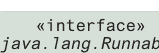

| AddAPenTask | AccountWithoutSync | Account |
|---|---|---|
| +run(): void | -account: Account | -balance: int |
| | | +main(args: String[]): void |
| | | +getBalance(): int |
| | | +deposit(amount: int): void |

图 32.9 `AccountWithoutSync` 包含一个 `Account` 实例和100个`AddAPennyTask`线程。

# 列表 32.4 AccountWithoutSync.java

```java
1 import java.util.*;
2 public class AccountWithoutSync {
3 private static Account account = new Account();
4
5 public static void main(String[] args) {
6 ExecutorService executor = Executors.newCachedThreadPool();
7
8 // 创建并启动100个线程
9 for (int i = 0; i < 100; i++) {
10 executor.execute(new AddAPennyTask());
11 }
12
13 executor.shutdown();
14
15 // 等待所有任务完成
16 while (!executor.isTermination()) {}
17 }
18
19 // 向账户增加分钱的线程
20 static class AddAPennyTask implements Runnable {
21 public void run() {
22 account.deposit(1);
23 }
24
25 // 账户的内部类
26 static class Account {
27 private int balance = 0;
28
29 public int getBalance() {
30 return balance;
31 }
32
33 public void deposit(int amount) {
34 // 故意增加延迟以放大问题
35 try {
36 Thread.sleep(5);
37 } catch (InterruptedException ex) {
38 }
39 balance += amount;
40 }
```

## 32.7 线程同步

在步骤 1 中，任务 1 从账户获取余额。在步骤 2 中，任务 2 从账户获取相同的余额。在步骤 3 中，任务 1 向账户写入新余额。在步骤 4 中，任务 2 向账户写入新余额。

这种场景的结果是：任务 1 在步骤 4 中无所事事，而任务 2 覆盖了任务 1 的结果。显然，问题在于任务 1 和任务 2 正在访问一个共同资源，并在该过程中发生了冲突。这是多线程程序中的一个常见问题，被称为**竞态条件**（race condition）。如果一个类的对象在多个线程存在的情况下不会引起竞态条件，则该类是线程安全的。如前面的示例所示`Account` 类不是线程安全的。

### 32.7.1 synchronized 关键字

为了避免竞态条件，必须防止多个区域同时进入程序的某个部分，这被称为**临界区域**（critical region）。列表 32.4 中的临界区域是整个 `deposit` 方法。你可以使用 `synchronized` 关键字来同步该方法，以便一次只有一个线程可以访问锁。纠正列表 32.4 中问题的方法多种。一种方法是在第 38 行的 `deposit` 方法中添加 `synchronized` 关键字使 `Account` 类线程安全，如下：

```java
public synchronized void deposit(double amount)
```

`synchronized` 方法在执行之前会获取锁。锁是资源独占占用的机制。对于实例方法，该方法获取的是其被调用的对象的锁。对于静态方法，锁是该类的锁。如果一个线程在对象上调用 `synchronized` 方法（相应地为静态方法），将先获取该对象（相应为类）的锁，然后执行方法，最后释放锁。另一个调用该对象（相应为类）相同方法的线程将被阻塞，直到锁被释放。

对 `deposit` 方法进行同步后，上述场景就不会发生发生。如果任务 1 进入该方法，任务 2 将被阻塞，直到任务 1 完成该方法，如图 32.12 所示。


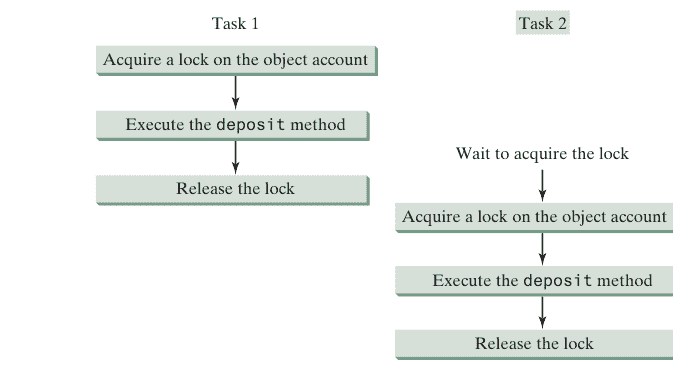

图 32.12 任务 1 和任务 2 已同步。

### 32.7.2 同步语句

调用类的 `synchronized` 实例方法会获取该类的锁。在方法中执行代码块时，可以使用 `synchronized` 静态方法来获取任何对象的锁，而不仅仅是当前对象。这被称为**同步块**（synchronized block）。`synchronized` 语句的标准形式如下：

```java
synchronized (expr) {
  statements;
}
```

表达式 `expr` 必须计算出一个对象引用。如果该对象已被另一个线程锁定，该线程将被阻塞，直到锁被释放。当获取对象的锁后，`synchronized` 块中的语句将执行并释放锁。

`synchronized` 语句允许你同步方法中的部分代码而不是整个方法。这增加了并发性。你可以通过将第 26 行的语句放在 `synchronized` 块内部来使列表 32.4 线程安全：

```java
synchronized (account) {
  account.deposit(1);
}
```

> **注意**
> 任何 `synchronized` 实例方法都可以转换为 `synchronized` 语句。例如，下面 (a) 中的 `synchronized` 方法等同于 (b)：

| public synchronized void xMethod() { // 方法体 } | public void xMethod() { synchronized (this) { // 方法体 } } |
| :--- | :--- |
| (a) | (b) |

- 32.7.1 请举一些运行多个线程时发生资源竞争的例子。你如何同步冲突的线程？

- 32.7.2 假设你将列表 32.4 第 26 行的语句放在 `synchronized` 块中以避免竞态条件，如下：

```java
synchronized (this) {
  account.deposit(1);
}
```

这会有效吗？

## 32.8 使用 Locks 进行同步

锁（Locks）和条件（conditions）可以显式地用于同步线程。

回想列表 32.10，线程并发向账户存入金额，这导致了冲突。为了避免这种情况，你在 `deposit` 方法中使用 `synchronized` 关键字，如下：

```java
public synchronized void deposit(double amount)
```

`synchronized` 方法在执行方法之前隐式地获取实例的锁。

Java 允许你显式地获取锁，这为你协调线程提供了更多的控制能力。锁是 `Lock` 接口的实例，该接口定义了获取和释放锁的方法。锁还可以使用 `newCondition()` 方法创建任意数量的 `Condition` 对象，这些对象可以用于线程通信。

| <<interface>> | java.util.concurrent.locks.Lock |
| :--- | :--- |
| +lock(): void | 获取锁。 |
| +unlock(): void | 释放锁。 |
| +newCondition(): Condition | 返回一个绑定到此 Lock 实例的新型 Condition 实例。 |

| java.util.concurrent.locks.ReentrantLock |
| :--- |
| +ReentrantLock() |
| +ReentrantLock(fair: boolean) | 创建一个给定公平性的锁。公平性保证等待时间最长的线程将获得锁。非公平性则任意授予锁。 |

### 32.8.1 你如何创建一个锁对象？你如何获取并释放锁？

## 32.9 线程间的协作

锁上的条件可以用于协调线程交互。

线程同步通过确保临界区域内多个线程的互斥来避免竞态条件，但有时你需要一种让线程协作的方法。条件用于线程间的通信。条件通过在锁对象上调用 `newCondition` 方法创建。当满足特定条件时，可以使用它的 `await()`、`signal()` 和 `signalAll()` 方法进行线程通信，如图 32.14 所示。`await()` 方法使当前线程等待信号。`signal()` 方法唤醒一个线程，而 `signalAll()` 方法唤醒所有等待的线程。

### 列表 32.5 AccountSyncLock.java

```java
import java.util.concurrent.*;
import java.util.concurrent.locks.*;

public class AccountSyncLock {
    private static Account account = new Account();

    public static void main(String[] args) {
        ExecutorService executor = Executors.newCachedThreadPool();

        // 创建并启动 100 个线程
        for (int i = 0; i < 100; i++) {
            executor.execute(new PennyTask());
        }

        executor.shutdown();

        // 等待所有任务完成
        while (!executor.isTerminated()) {
            System.out.println("What is balance? " + account.getBalance());
        }
    }

    // Account 的内部类
    public static class Account {
        private static Lock lock = new ReentrantLock();
        private int balance = 0;

        public int getBalance() {
            return balance;
        }

        public void deposit(int amount) {
            lock.lock(); // 获取锁
            try {
                int newBalance = balance + amount;
                // 刻意添加延迟以放大
                // 数据损坏问题并使其观察。
                Thread.sleep(5);
                balance = newBalance;
            } catch (InterruptedException e) {
            } finally {
                lock.unlock(); // 释放锁
            }
        }
    }

    // 用于添加硬币的线程
    public static class PennyTask implements Runnable {
        public void run() {
            account.deposit(1);
        }
    }
}
```

## 32.9 线程间的协作

```java
interface
  java.util.concurrent.Condition {
    +await(): void
    +signal(): void
    +signalAll(): Condition
  }
```

- 使当前线程等待，直到条件被信号。
- 唤醒一个等待的线程。
- 唤醒所有等待的线程。

图 32.14 Condition 接口定义了执行同步的方法。

让我们用一个示例来演示线程通信。假设你创建并启动了两个任务：一个向账户存款，另一个从同一个账户取款。取款线程必须等待直到余额大于当前金额。每当有新资金存入账户时，存款线程就会通知取款线程。如果金额不足以提款，取款线程必须继续等待。

为了进行同步，请使用带有条件的锁：`newDeposit`（即存入账户的新存款）。如果余额小于取款金额，取款线程将等待 `newDeposit` 条件。当存款线程向账户存钱时，存款线程会发送信号通知取款线程再次尝试。这两个任务之间的交互如图 32.15 所示。

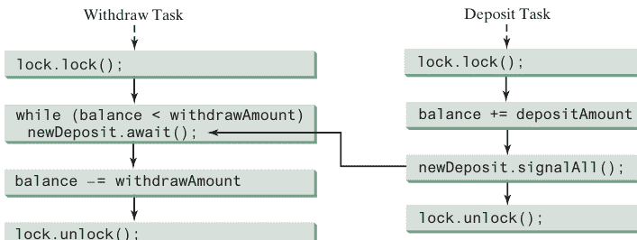

图 32.15 条件 newDeposit 用于两个线程之间的通信。

你可以从一个 Lock 创建一个条件。要使用条件，你必须先获取锁。`await()` 方法会导致线程等待并自动释放对账户的锁。一旦条件成立，线程将重新获取锁并继续执行。假设初始余额为 0，且存款和取款是随机生成的。列表 32.6 提供了该程序。程序的示例运行如图 32.16 所示。

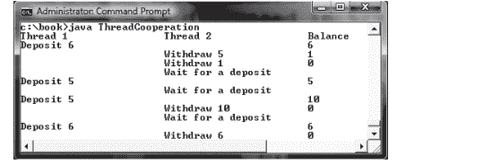

图 32.16 如果资金不足以取款，取款任务将等待。

© 2018 Pearson Education, Inc., Hoboken, NJ. All rights reserved.

## 32-20 第 32 章 多线程与并行编程

### 列表 32.6 ThreadCooperation.java

```java
import java.util.concurrent.*;
import java.util.concurrent.locks.*;

public class ThreadCooperation {
    private static Account account = new Account();

    public static void main(String[] args) {
        // 创建一个拥有两个线程的池
        ExecutorService executor = Executors.newFixedThreadPool(2);
        executor.execute(new DepositTask());
        executor.execute(new WithdrawTask());
        executor.shutdown();
        System.out.println("Thread 1\\Thread 2 finished");
    }

    public static class DepositTask implements Runnable {
        public void run() {
            try { // 延迟让 withdraw 方法执行
                while (true) {
                    account.deposit((int)(Math.random() * 10) + 1);
                    Thread.sleep(1000);
                }
            } catch (InterruptedException ex) {
                ex.printStackTrace();
            }
        }
    }

    public static class WithdrawTask implements Runnable {
        // 不断从账户中减去金额
        public void run() {
            while (true) {
                account.withdraw((int)(Math.random() * 10) + 1);
            }
        }
    }

    // 用于账户的内部类
    private static class Account {
        // 创建新锁
        private static Lock lock = new ReentrantLock();
        // 创建一个条件
        private static Condition newDeposit = lock.newCondition();

        private int balance = 0;

        public int getBalance() {
            return balance;
        }

        public void withdraw(int amount) {
            lock.lock(); // 获取锁
            try {
                while (balance < amount) {
                    System.out.println("t\tWait for a deposit");
                    newDeposit.await();
                }
                balance = amount;
                System.out.println("t\t\tWithdraw " + amount + "\t\t" + getBalance());
            } catch (InterruptedException ex) {
                ex.printStackTrace();
            } finally {
                lock.unlock(); // 释放锁
            }
        }

        public void deposit(int amount) {
            lock.lock(); // 获取锁
            try {
                balance += amount;
                System.out.println("Deposit " + amount + "\titiititi\t" + getBalance());
                // 通知等待等待条件的线程
                newDeposit.signal();
            } finally {
                lock.unlock();
            }
        }
    }
}
```

## 32.9 线程间的协作 32-21

（注：OCR 文本的后半部分包含碎片化的行号和重复的代码片段，这些已整合到上述逻辑代码结构中，以保持程序流的连贯。）

## 32.10 案例研究：生产者/消费者 32-23

32.9.1 如何在锁上创建条件？`await()`、`signal()` 和 `signalAll()` 方法是干什么的？

32.9.2 如果将 32.6 第 58 行的 `while` 循环改为 `if` 语句，会发生什么？


```
while (balance < amount)
if (balance < amount)
```

32.9.3 为什么下面这个类有一个语法错误？

```java
public class Test implements Runnable {
    public static void main(String[] args) {
        new Test();
    }

    public Test() throws InterruptedException {
        Thread thread = new Thread(this);
        thread.sleep(1000);
    }

    public synchronized void run() {
    }
}
```

32.9.4 `IllegalMonitorStateException` 的可能原因是什么？

32.9.5 `wait()`、`notify()` 和 `notifyAll()` 可以在这些目的以外的地方被调用吗？

32.9.6 下面代码中有什么错误？

```java
synchronized (object1) {
    try {
        while (!condition) object2.wait();
    } catch (InterruptedException ex) {
    }
}
```

## 32.10 案例研究：生产者/消费者


本节给出了用于线程协调的经典消费者/生产者示例。

假设你使用一个缓冲区来存储整数，并且缓冲区的大小是有限的。缓冲区提供了 `write(int)` 方法来向缓冲区添加一个整数，以及 `read()` 方法来从缓冲区中读取并删除一个整数值。为了同步这些操作，使用一个带有两个条件的锁：`isEmpty`（即缓冲区为空）和 `notFull`（即缓冲区未满）。当任务向缓冲区添加一个整数时，该任务将等待 `notFull` 条件。当任务从缓冲区读取一个整数时，如果缓冲区为空，该任务将等待 `isEmpty` 条件。这两个任务之间的交互如图 32.18 所示。


# 32.10 案例研究：生产者/消费者


本节给出了用于线程协调的经典消费者/生产者示例。

假设你使用一个缓冲区来存储整数，并且缓冲区的大小是有限的。缓冲区提供了 `write(int)` 方法来向缓冲区添加一个整数，以及 `read()` 方法来从缓冲区中读取并删除一个整数值。为了同步这些操作，使用一个带有两个条件的锁：`isEmpty`（即缓冲区为空）和 `notFull`（即缓冲区未满）。当任务向缓冲区添加一个整数时，该任务将等待 `notFull` 条件。当任务从缓冲区读取一个整数时，如果缓冲区为空，该任务将等待 `isEmpty` 条件。这两个任务之间的交互如图 32.18 所示。

列表 32.7 展示了完整的程序。程序包含 `Buffer` 类（第 50-101 行）以及两个用于向缓冲区添加和消费数字的任务（第 16-47 行）。`write(int)` 方法（第 62-79 行）向缓冲区添加一个整数。`read()` 方法（第 81-100 行）从缓冲区中删除并返回一个整数。

## 图 32.18 任务交互协调

| 添加整数的任务 | 删除整数的任务 |
| :--- | :--- |
| ```while (count == CAPACITY)\n    notFull.await();``` | ```while (count == 0)\n    notEmpty.await();``` |
| ```向缓冲区添加一个整数``` | ```从缓冲区中删除一个整数``` |
| ```notEmpty.signal();``` | ```notFull.signal();``` |

**图 32.18** 变量 `notFull` 和 `notEmpty` 用于协调任务之间的交互。

缓冲区是一个先进先出的队列（第 52 和第 53 行）。锁上的 `notEmpty` 和 `notFull` 条件在第 59 和第 60 行创建。这些条件绑定到锁上。在应用条件之前，必须获取锁。如果你使用 `wait()` 和 `notify()` 方法来重写这个示例，你必须指定两个对象作为监视器。

## 列表 32.7 ConsumerProducer.java

```java
1 import java.util.concurrent.*;
2 import java.util.concurrent.locks.*;
3
4 public class ConsumerProducer {
5     static Buffer buffer = new Buffer();
6
7     public static void main(String[] args) {
8         // 创建线程池
9         Executor executor = Executors.newFixedThreadPool(2);
10         executor.execute(new ProducerTask());
11         executor.execute(new ConsumerTask());
12         executor.shutdown();
13     }
14
15     // 一个向缓冲区添加整数的任务
16     private class ProducerTask implements Runnable {
17         public void run() {
18             try {
19                 int i = 0;
20                 while (true) {
21                     System.out.println("Producer writes " + i);
22                     buffer.write(i++); // 向缓冲区添加一个值
23                     // 将线程放入睡眠
24                     Thread.sleep((int)(Math.random() * 10000));
25                 }
26             } catch (InterruptedException e) {
27                 e.printStackTrace();
28             }
29         }
30     }
31
32     // 一个从缓冲区读取并删除整数的任务
33     private class ConsumerTask implements Runnable {
34         public void run() {
35             try {
36                 while (true) {
37                     System.out.println("\t\tconsumer reads " + buffer.read());
38                     // 将线程放入睡眠
39                     Thread.sleep((int)(Math.random() * 10000));
40                 }
41             } catch (InterruptedException ex) {
42                 ex.printStackTrace();
43             }
44         }
35
45     // 用于缓冲区的内部类
46     private static class Buffer {
47         private static final int CAPACITY = 1; // 缓冲区容量
48         private java.util.LinkedList<Integer> queue = new java.util.LinkedList<>();
49
50         // 创建一个新锁
51         private static Lock lock = new ReentrantLock();
52
53         // 创建两个条件
54         private static Condition notEmpty = lock.newCondition();
55         private static Condition notFull = lock.newCondition();
56
57         public void write(int value) {
58             lock.lock(); // 获取锁
59             try {
60                 while (queue.size() == CAPACITY) {
61                     System.out.println("Wait for notFull");
62                     notFull.await();
63                 }
64                 queue.offer(value);
65                 notEmpty.signal(); // 信号不空
66             } catch (InterruptedException ex) {
67                 ex.printStackTrace();
68             } finally {
69                 lock.unlock(); // 释放锁
70             }
71         }
72
73         public int read() {
74             int value = 0;
75             lock.lock(); // 获取锁
76             try {
77                 while (queue.isEmpty()) {
78                     System.out.println("\t\tWait for notEmpty");
79                     notEmpty.await();
80                 }
81                 value = queue.remove();
82                 notFull.signal(); // 信号不满
83             } catch (InterruptedException ex) {
84                 ex.printStackTrace();
85             } finally {
86                 lock.unlock(); // 释放锁
87             }
88             return value;
89         }
90     }
91 }
```

## 32.9 复习题

### 32.9.1
如何在锁上创建条件？`await()`、`signal()` 和 `signalAll()` 方法是干什么的？

### 32.9.2
如果将第 32.6 节第 58 行的 `while` 循环改为 `if` 语句，会发生什么？

```
while (balance < amount)
    if (balance < amount)
```

### 32.9.3
为什么下面这个类有一个语法错误？

```java
public class Test implements Runnable {
    public static void main(String[] args) {
        new Test();
    }

    public Test() throws InterruptedException {
        Thread thread = new Thread(this);
        thread.sleep(1000);
    }

    public synchronized void run() {
    }
}
```

### 32.9.4
`IllegalMonitorStateException` 的可能原因是什么？

### 32.9.5
`wait()`、`notify()` 和 `notifyAll()` 可以在这些目的以外的地方被调用吗？

### 32.9.6
下面代码中有什么错误？

```java
synchronized (object1) {
    try {
        while (!condition) object2.wait();
    } catch (InterruptedException ex) {
    }
}
```


```
synchronized (object1) {
    try {
        while (!condition) object2.wait();
    } catch (InterruptedException ex) {
    }
}
```

## 32.10 案例研究：生产者/消费者


本节给出了用于线程协调的经典消费者/生产者示例。

假设你使用一个缓冲区来存储整数，并且缓冲区的大小是有限的。缓冲区提供了 `write(int)` 方法来向缓冲区添加一个整数，以及 `read()` 方法来从缓冲区中读取并删除一个整数值。为了同步这些操作，使用一个带有两个条件的锁：`isEmpty`（即缓冲区为空）和 `notFull`（即缓冲区未满）。当任务向缓冲区添加一个整数时，该任务将等待 `notFull` 条件。当任务从缓冲区读取一个整数时，如果缓冲区为空，该任务将等待 `isEmpty` 条件。这两个任务之间的交互如图 32.18 所示。

列表 32.7 展示了完整的程序。程序包含 `Buffer` 类（第 50-101 行）以及两个用于向缓冲区添加和消费数字的任务（第 16-47 行）。`write(int)` 方法（第 62-79 行）向缓冲区添加一个整数。`read()` 方法（第 81-100 行）从缓冲区中删除并返回一个整数。

## 32-24 第 32 章 多线程与并行编程

| 添加整数的任务 | 删除整数的任务 |
| :--- | :--- |
| ```while (count == CAPACITY)\n    notFull.await();``` | ```while (count == 0)\n    notEmpty.await();``` |
| 向缓冲区添加一个整数 | 从缓冲区中删除一个整数 |
| ```notEmpty.signal();``` | ```notFull.signal();``` |

**图 32.18** 变量 `notFull` 和 `notEmpty` 用于协调任务之间的交互。

缓冲区是一个先进先出的队列（第 52 和第 53 行）。锁上的 `notEmpty` 和 `notFull` 条件在第 59 和第 60 行创建。这些条件绑定到锁上。在应用条件之前，必须获取锁。如果你使用 `wait()` 和 `notify()` 方法来重写这个示例，你必须指定两个对象作为监视器。

## 列表 32.7 ConsumerProducer.java

```java
1 import java.util.concurrent.*;
2 import java.util.concurrent.locks.*;
3
4 public class ConsumerProducer {
5     static Buffer buffer = new Buffer();
6
7     public static void main(String[] args) {
8         // 创建线程池
9         Executor executor = Executors.newFixedThreadPool(2);
10         executor.execute(new ProducerTask());
11         executor.execute(new ConsumerTask());
12         executor.shutdown();
13     }
14
15     // 一个向缓冲区添加整数的任务
16     private class ProducerTask implements Runnable {
17         public void run() {
18             try {
19                 int i = 0;
20                 while (true) {
21                     System.out.println("Producer writes " + i);
22                     buffer.write(i++); // 向缓冲区添加一个值
23                     // 将线程放入睡眠
24                     Thread.sleep((int)(Math.random() * 10000));
25                 }
26             } catch (InterruptedException e) {
27                 e.printStackTrace();
28             }
29         }
30     }
31
32     // 一个从缓冲区读取并删除整数的任务
33     private class ConsumerTask implements Runnable {
34         public void run() {
35             try {
36                 while (true) {
37                     System.out.println("\t\tconsumer reads " + buffer.read());
38                     // 将线程放入睡眠
39                     Thread.sleep((int)(Math.random() * 10000));
40                 }
41             } catch (InterruptedException ex) {
42                 ex.printStackTrace();
43             }
44         }
35     }
36
37     // 用于缓冲区的内部类
38     private static class Buffer {
39         private static final int CAPACITY = 1; // 缓冲区容量
40         private java.util.LinkedList<Integer> queue = new java.util.LinkedList<>();
41
42         // 创建一个新锁
43         private static Lock lock = new ReentrantLock();
44
45         // 创建两个条件
46         private static Condition notEmpty = lock.newCondition();
47         private static Condition notFull = lock.newCondition();
48
49         public void write(int value) {
50             lock.lock(); // 获取锁
51             try {
52                 while (queue.size() == CAPACITY) {
53                     System.out.println("Wait for notFull");
54                     notFull.await();
55                 }
56                 queue.offer(value);
57                 notEmpty.signal(); // 信号不空
58             } catch (InterruptedException ex) {
59                 ex.printStackTrace();
60             } finally {
61                 lock.unlock(); // 释放锁
62             }
63         }
64
65         public int read() {
66             int value = 0;
67             lock.lock(); // 获取锁
68             try {
69                 while (queue.isEmpty()) {
70                     System.out.println("\t\tWait for notEmpty");
71                     notEmpty.await();
72                 }
73                 value = queue.remove();
74                 notFull.signal(); // 信号不满
75             } catch (InterruptedException ex) {
76                 ex.printStackTrace();
77             } finally {
78                 lock.unlock(); // 释放锁
79             }
80             return value;
81         }
82     }
83 }
```

## 32.9 复习题

### 32.9.1 如何在锁上创建条件？`await()`、`signal()` 和 `signalAll()` 方法是干什么的？

### 32.9.2 如果将 32.6 第 58 行的 `while` 循环改为 `if` 语句，会发生什么？

```java
while (balance < amount)
if (balance < amount)
```

### 32.9.3 为什么下面这个类有一个语法错误？

```java
public class Test implements Runnable {
    public static void main(String[] args) {
        new Test();
    }

    public Test() throws InterruptedException {
        Thread thread = new Thread(this);
        thread.sleep(1000);
    }

    public synchronized void run() {
    }
}
```

### 32.9.4 `IllegalMonitorStateException` 的可能原因是什么？

### 32.9.5 `wait()`、`notify()` 和 `notifyAll()` 可以在这些目的以外的地方被调用吗？

### 32.9.6 下面代码中有什么错误？

```java
synchronized (object1) {
    try {
        while (!condition) object2.wait();
    } catch (InterruptedException ex) {
    }
}
```

## 32.10 案例研究：生产者/消费者


本节给出了用于线程协调的经典消费者/生产者示例。

假设你使用一个缓冲区来存储整数，并且缓冲区的大小是有限的。缓冲区提供了 `write(int)` 方法来向缓冲区添加一个整数，以及 `read()` 方法来从缓冲区中读取并删除一个整数值。为了同步这些操作，使用一个带有两个条件的锁：`isEmpty`（即缓冲区为空）和 `notFull`（即缓冲区未满）。当任务向缓冲区添加一个整数时，该任务将等待 `notFull` 条件。当任务从缓冲区读取一个整数时，如果缓冲区为空，该任务将等待 `isEmpty` 条件。这两个任务之间的交互如图 32.18 所示。

列表 32.7 展示了完整的程序。程序包含 `Buffer` 类（第 50-101 行）以及两个用于向缓冲区添加和消费数字的任务（第 16-47 行）。`write(int)` 方法（第 62-79 行）向缓冲区添加一个整数。`read()` 方法（第 81-100 行）从缓冲区中删除并返回一个整数。

## 32-24 第 32 章 多线程与并行编程

| 添加整数的任务 | 删除整数的任务 |
| :--- | :--- |
| ```while (count == CAPACITY)\n    notFull.await();``` | ```while (count == 0)\n    notEmpty.await();``` |
| 向缓冲区添加一个整数 | 从缓冲区中删除一个整数 |
| ```notEmpty.signal();``` | ```notFull.signal();``` |

**图 32.18** 变量 `notFull` 和 `notEmpty` 用于协调任务之间的交互。

缓冲区是一个先进先出的队列（第 52 和第 53 行）。锁上的 `notEmpty` 和 `notFull` 条件在第 59 和第 60 行创建。这些条件绑定到锁上。在应用条件之前，必须获取锁。如果你使用 `wait()` 和 `notify()` 方法来重写这个示例，你必须指定两个对象作为监视器。

## 列表 32.7 ConsumerProducer.java

```java
1 import java.util.concurrent.*;
2 import java.util.concurrent.locks.*;
3
4 public class ConsumerProducer {
5     static Buffer buffer = new Buffer();
6
7     public static void main(String[] args) {
8         // 创建线程池
9         Executor executor = Executors.newFixedThreadPool(2);
10         executor.execute(new ProducerTask());
11         executor.execute(new ConsumerTask());
12         executor.shutdown();
13     }
14
15     // 一个向缓冲区添加整数的任务
16     private class ProducerTask implements Runnable {
17         public void run() {
18             try {
19                 int i = 0;
20                 while (true) {
21                     System.out.println("Producer writes " + i);
22                     buffer.write(i++); // 向缓冲区添加一个值
23                     // 将线程放入睡眠
24                     Thread.sleep((int)(Math.random() * 10000));
25                 }
26             } catch (InterruptedException e) {
27                 e.printStackTrace();
28             }
29         }
30     }
31
32     // 一个从缓冲区读取并删除整数的任务
33     private class ConsumerTask implements Runnable {
34         public void run() {
35             try {
36                 while (true) {
37                     System.out.println("\t\tconsumer reads " + buffer.read());
38                     // 将线程放入睡眠
39                     Thread.sleep((int)(Math.random() * 10000));
40                 }
41             } catch (InterruptedException ex) {
42                 ex.printStackTrace();
43             }
44         }
35     }
36
37     // 用于缓冲区的内部类
38     private static class Buffer {
39         private static final int CAPACITY = 1; // 缓冲区容量
40         private java.util.LinkedList<Integer> queue = new java.util.LinkedList<>();
41
42         // 创建一个新锁
43         private static Lock lock = new ReentrantLock();
44
45         // 创建两个条件
46         private static Condition notEmpty = lock.newCondition();
47         private static Condition notFull = lock.newCondition();
48
49         public void write(int value) {
50             lock.lock(); // 获取锁
51             try {
52                 while (queue.size() == CAPACITY) {
53                     System.out.println("Wait for notFull");
54                     notFull.await();
55                 }
56                 queue.offer(value);
57                 notEmpty.signal(); // 信号不空
58             } catch (InterruptedException ex) {
59                 ex.printStackTrace();
60             } finally {
61                 lock.unlock(); // 释放锁
62             }
63         }
64
65         public int read() {
66             int value = 0;
67             lock.lock(); // 获取锁
68             try {
69                 while (queue.isEmpty()) {
70                     System.out.println("\t\tWait for notEmpty");
71                     notEmpty.await();
72                 }
73                 value = queue.remove();
74                 notFull.signal(); // 信号不满
75             } catch (InterruptedException ex) {
76                 ex.printStackTrace();
77             } finally {
78                 lock.unlock(); // 释放锁
79             }
80             return value;
81         }
82     }
83 }
```

# 32-28 第32章 多线程与并行编程


```java
Thread.sleep((int)(Math.random() * 10000));
}
}
catch (InterruptedException ex) {
    ex.printStackTrace();
}
}


// 从缓冲区读取并删除一个 int 的任务
private static class ConsumerTask implements Runnable {
    public void run() {
        try {
            while (true) {
                System.out.println("\t\tConsumer reads " + buffer.take());
                // 让线程睡眠
                Thread.sleep((int)(Math.random() * 10000));
            }
        }
        catch (InterruptedException ex) {
            ex.printStackTrace();
        }
    }
}
}
```

### 消费者任务

在列表 32.7 中，我们使用锁（locks）和条件（conditions）来同步生产者和消费者。此程序没有使用锁，因为同步已经在 `ArrayBlockingQueue` 中实现。

- 32.11.1 什么是阻塞队列？Java 支持哪些阻塞队列？
- 32.11.2 使用什么方法向 `ArrayBlockingQueue` 添加元素？如果队列满了会发生什么？
- 32.11.3 使用什么方法从 `ArrayBlockingQueue` 检索元素？如果队列为空会发生什么？

## 32.12 信号量

信号量可用于限制访问共享资源的线程数量。

在计算机科学中，信号量是一个控制公共资源访问的对象。在访问资源之前，线程必须从信号量获取一个许可（permit）。完成资源访问后，线程必须将许可还给信号量，如图 32.22 所示。

> 线程对共享资源的访问。
>
> 从信号量获取许可。
> 如果许可不可用则等待。
>
> 访问资源
>
> 将许可释放给信号量。

图 32.22 有限数量的线程可以访问由信号量控制的共享资源。

### 创建信号量

要创建一个信号量，你必须指定许可数量以及可选的公平性策略，如图 32.23 所示。任务通过调用信号量的 `acquire()` 方法获取许可，通过调用信号量的 `release()` 方法释放许可。一旦获取了许可，信号量中的可用许可总数就会减少 1。一旦释放许可，信号量中的可用许可总数就会增加 1。

```java
java.util.concurrent.Semaphore
+Semaphore(numberOfPermits: int)
+Semaphore(numberOfPermits: int, boolean)
+acquire(): void
+release(): void
```

图 32.23 `Semaphore` 类包含了用于获取信号量的方法。

只有一个许可的信号量可以用来模拟互斥锁。列表 32.9 使用信号量重写了列表 32.9 中的 `Account` 内部类，以确保一次只有一个线程可以访问 `deposit` 方法。

### 列表 32.9 新内部类

```java
// 用于 Account 的内部类
private static class Account {
    // 创建一个信号量
    private static Semaphore semaphore = new Semaphore(1);
    int balance = 0;

    public int getBalance() {
        return balance;
    }

    public void deposit(int amount) {
        try {
            semaphore.acquire(); // 获取许可
            int newBalance = balance + amount;

            // 刻意添加此延迟以放大
            // 数据损坏问题并使其容易观察
            Thread.sleep(5);

            balance = newBalance;
        }
        catch (InterruptedException exception) {
        } finally {
            semaphore.release(); // 释放许可
        }
    }
}
```

在第 4 行创建了一个只有一个许可的信号量。第一个线程在执行第 13 行的 `deposit` 方法时获取许可。更新后，该线程在第 25 行释放许可。在 `finally` 句中始终使用 `release()` 方法是一种好习惯，可以确保许可最终被释放。

- 32.12.1 锁（lock）和信号量（semaphore）之间有什么相似之处？
- 32.12.2 如何创建信号量？
- 32.12.3 如何释放信号量？

### 32.13 避免死锁

可以通过适当的排序来避免死锁。当两个或多个线程需要获取多个对象时，可能会导致死锁，即每个线程都在等待另一个线程。考虑两个线程的情况，如图 32.24 所示。线程 1 拥有 `object1` 的锁，线程 2 拥有 `object2` 的锁。使用简单的排序很容易避免死锁。在这种技术中，如果线程 1 先获取 `object1` 后获取 `object2`，就不会发生死锁。

- 32.13.1 什么是死锁？
- 32.13.2 如何避免它？

### 32.14 线程状态

线程处于五状态之一：新建（New）、就绪（Ready）、运行（Running）、阻塞（Blocked）、完成（Finished）。当线程被新创建时，它进入新建状态。调用 `start()` 方法启动线程后，它进入就绪状态。当线程开始执行时，它进入运行状态。如果阻塞线程等待 I/O 操作或睡眠时间，可能会进入阻塞状态。最后，如果线程完成了 `run()` 方法的执行，它进入完成状态。`isActive()` 方法用于查找线程的状态。如果线程处于就绪、阻塞或运行状态，它返回 `true`；如果它是新建的或已完成，则返回 `false`。`interrupt()` 方法以以下方式中断线程：如果线程处于就绪或运行状态，其中断标志位被设置；如果线程当前处于阻塞状态，它会被唤醒并进入就绪状态；并抛出 `java.InterruptedException`。

### 32.15 同步集合

Collections Framework 提供了列表、集合和映射的同步集合。Collections Framework 中的类不是线程安全的；也就是说，如果被多个线程并发访问和更新，其内容将会损坏。你可以通过锁定集合或使用同步集合来保护集合中的数据。Collections 提供了将集合封装成同步版本的方法，如图 32.26 所示。使用这些方法创建的集合是同步包装器。

- 32.14.1 什么是同步线程？描述线程的集合。

调用 `synchronizedCollection(Collection c)` 会返回一个新的 `Collection` 对象，其中所有访问和更新原始集合的方法都是同步的。这些方法使用 `synchronized` 关键字实现。例如，`add` 方法的实现如下：

```java
public boolean add(E o) {
    synchronized (this) {
        return c.add(o);
    }
}
```

同步集合可以被多个线程安全地访问和修改。

> 注意：`java.util.Vector`、`java.util.Stack` 和 `java.util.Hashtable` 中的方法都是同步的。这些是 JDK 1.0 的旧类。从 JDK 1.5 开始，你应该使用 `java.util.ArrayList` 替换 `Vector`，用 `java.util.LinkedList` 替换 `Stack`，并用 `java.util.Map` 替换 `Hashtable`。如果需要同步，请使用同步包装器。


这里使用的同步包装器是线程安全的。这意味着如果你在使用迭代器遍历一个被另一个线程修改的底层集合，迭代器将立即通过抛出 `java.util.ConcurrentModificationException` 失败。为了避免此错误，你必须使用同步集合，或者在遍历时获取该对象的锁。例如，要遍历一个集合，你必须这样写代码：

```java
Set<Integer> hashSet = Collections.synchronizedSet(new HashSet());

synchronized(hashSet) { // 必须同步
    Iterator<Integer> iterator = hashSet.iterator();
    while (iterator.hasNext()) {
        System.out.println(iterator.next());
    }
}
```

不这样做可能会导致非确定性的行为，例如 `ConcurrentModificationException`。


- 32.15.1 集合同步吗？`ArrayList` 同步吗？你如何让它同步？
- 32.15.2 解释为什么迭代器是快速失败的（fail-fast）？

### 32.16 并行编程

Fork 框架用于 Java 中的并行编程。


第 7.12 节描述了用于排序数组的 `Arrays.sort` 和 `Arrays.parallelSort` 方法。`parallelSort` 方法利用多个处理器并行执行流操作，以加速多处理器的处理。并行处理使用 Fork-Join 框架实现。本节介绍了 Fork/Join 框架，以便你可以编写自己的并行编程代码。

Fork 框架如图 32.27 所示（该图表示一个 fork/分解，因此得名）。一个问题被分为若干重叠的子问题，这些子问题可以独立地并行解决。然后将所有子问题的解决方案合并（join），以获得该问题的整体解决方案。这是分治策略的并行实现。在 JDK 7 的 Fork 框架中，一个 fork 可以用作在线程上运行的独立任务。


© 2018 Pearson Education, Inc., Hoboken, NJ. 保留所有权利。


#### 并行编程示例


图 32.27 Fork 框架。

图 32.28 Fork 框架的分解。

图 32.29 Fork 框架的合并。

```java
private int[] list;
SortTask(int[] list) {
    this.list = list;
}

@Override
protected void compute() {
    if (list.length < THRESHOLD)
        java.util.Arrays.sort(list);
    else {
        // 获取前半部分
        int[] firstHalf = new int[list.length / 2];
        System.arraycopy(list, 0, firstHalf, 0, list.length / 2);

        // 获取后半部分
        int secondHalf = list.length - list.length / 2;
        int[] secondHalf = new int[secondHalf];
        System.arraycopy(list, list.length / 2, secondHalf, 0, secondHalf);

        // 递归地排序任务
        invokeAll(new SortTask(firstHalf),
                  new SortTask(secondHalf));

        // 将 firstHalf 与 secondHalf 合并到 list
        MergeSort.merge(firstHalf, secondHalf, list);
    }
}
```

两个处理器的并行时间为 2822 毫秒

顺序执行时间为 4751 毫秒

由于排序算法没有返回值，我们通过扩展 `RecursiveAction` 来定义一个 `ForkJoinTask` 类（重写了 `compute` 方法以实现递归合并排序，第 42–63 行）。如果列表较小，顺序求解效率更高（第 44 行）。对于大列表，它会被拆分为两部分（第 47–54 行）。任务被并发排序（第 57 和第 58 行），然后进行合并（第 61 行）。

该程序创建了一个主 `ForkJoin`（第 28 行）、一个 `ForkJoinPool`（第 29 行），并将任务放入 `ForkJoinPool` 中进行执行（第 30 行）。`invoke` 方法将在主任务完成后返回。

当调用任务时，该任务会被拆分为子任务，并使用 `invokeAll` 方法调用子任务（第 57 和第 58 行）。在所有子任务完成后，`invoke` 将返回。池中可能会创建并执行大量的子任务。ForkJoin 框架会自动高效地执行并汇合任务。

`MerSort` 类定义在 Listing 25 中。程序调用 `MergeSort.merge`（第 21 行）使用合并排序对已排序列表进行排序。你可以看到并行排序比顺序排序更快。

注意，初始化列表的循环也可以并行化，你应该避免在代码中使用 `Math.random()`（练习题 32.1）。`parallelMergeSort` 方法只对其值数组进行排序，你可以将其修改为一个泛型方法（参见编程练习 32.13）。


© 2018 Pearson Education, Inc., Hoboken, NJ. 版权所有。

通常情况下，一个问题可以使用以下模式解决：

```
if (程序很小)
    按顺序求解它；
else {
    将问题划分为不重叠的子问题；
    并发地求解子问题；
    合并子问题的结果以解决整个问题；
}
```

### Listing 32.11 ParallelMax.java


```java
import java.util.concurrent.*;
import java.util.*;

public class ParallelMax {
    public static void main(String[] args) {
        // 创建一个列表
        final int N = 1000000;
        List<Integer> list = new ArrayList<>(N);
        for (int i = 0; i < list.size(); i++) {
            list.add(i);
        }

        long startTime = System.currentTimeMillis();
        System.out.println("The maximum number is " + max(list));
        long endTime = System.currentTimeMillis();
        System.out.println("The number of processors is " + Runtime.getRuntime().availableProcessors());
        System.out.println("Time is " + (endTime - startTime) + " milliseconds");
    }

    public static int max(List<Integer> list) {
        RecursiveTask<Integer> task = new MaxTask(list, 0, list.size());
        return task.fork();
    }

    private static class MaxTask extends RecursiveTask<Integer> {
        final int THRESHOLD = 1000;
        private List<Integer> list;
        private int low;
        private int high;

        MaxTask(List<Integer> list, int low, int high) {
            this.list = list;
            this.low = low;
            this.high = high;
        }

        @Override
        protected Integer compute() {
            if (high - low < THRESHOLD) {
                int max = list.get(low);
                for (int i = low; i < high; i++) {
                    if (list.get(i) > max) {
                        max = list.get(i);
                    }
                }
                return max;
            } else {
                int mid = (low + high) / 2;
                MaxTask leftTask = new MaxTask(list, low, mid);
                MaxTask rightTask = new MaxTask(list, mid, high);
                leftTask.fork();
                int rightResult = rightTask.compute();
                return Math.max(leftTask.join(), rightResult);
            }
        }
    }
}
```

- invoke `max`
- 创建 `ForkTask`
- 创建 `ForkJoinPool`
- 定义 `ForkTask`
- 执行任务
- 解决小问题

## 章节总结 32-37

最大值是 99999

处理器数量为 2

时间为 44 毫秒


由于算法返回整数，我们通过扩展 `RecursiveTask<Integer>` 为 fork 定义任务类（第 26–58 行）。重写 `compute` 方法以返回 `list[low..high]` 中的最大元素（第 39–57 行）。如果列表较小，顺序求解效率更高（第 40 行）。对于大列表，它会被拆分为两部分（第 48–50 行）。任务 left 和 right 分别在左半部分和右半部分寻找最大元素。在任务上调用 `fork()` 会导致任务执行（第 52–53 行）。`join()` 方法等待任务完成并返回结果（第 54–55 行）。

- 32.16.1 如何定义 `ForkTask`？`RecursiveAction` 和 `RecursiveTask` 之间有什么区别？
- 32.16.2 如何告诉系统任务已完成？
- 32.16.3 你可以如何使用此类任务？
- 32.16.4 如何创建 `ForkJoinPool`？如何将任务放入 `ForkJoinPool`？

## 关键术语

| 术语 | 页码 |
| :--- | :--- |
| 条件 (condition) | 32-18 |
| 多线程 (multithreading) | 32 |
| 死锁 (deadlock) | 30 |
| 竞态条件 (race condition) | 15 |
| 快速失败 (fail-fast) | 32 |
| 信号量 (semaphore) | 28 |
| 公性策略 (fairness policy) | 17 |
| 同步封装 (synchronization wrapper) | 31 |
| Fork/Join 框架 | 32 |
| 同步块 (synchronized block) | 16 |
| 锁 (lock) | 32 |
| 线程 (thread) | 22 |
| 监器 (monitor) | 22 |
| 线程安全 (thread-safe) | 15 |

## 章节总结 32-38 多线程与并行编程

1. 每个任务都是 `Runnable` 接口的实例。线程是促进任务执行的对象。你可以通过实现 `Runnable` 并使用 `Thread` 构造函数创建线程。
2. 创建线程对象后，使用 `start()` 方法启动线程，使用 `sleep(long)` 方法让线程睡眠以便其他线程有机会运行。
3. 线程对象从不直接调用 `run` 方法。在执行线程时，JVM 会调用 `run` 方法。你的类必须重写 `run` 方法来告诉系统线程在运行时将做什么。
4. 为了防止线程损坏共享资源，请使用同步方法或同步块。同步方法在执行执行之前会获取锁。对于实例方法，锁是调用该方法的对象；对于静态方法，锁是类。
5. 在执行方法中的代码块时，可以使用同步语句获取任何对象的锁，而不仅仅是对象对象。此块被称为同步块。
6. 你可以使用显式锁和条件来促进线程间的通信，以及对象的内置监器。
7. Java 集合框架提供的阻塞队列（`ArrayBlockingQueue`、`LinkedBlockingQueue` 和 `PriorityBlockingQueue`）为队列的访问提供了自动同步。
8. 你可以使用信号量来限制对共享资源的并发访问。
9. 当两个或多个线程获取多个对象的锁时，就会发生死锁。
10. JDK ForkJoin 框架用于开发并行程序。你可以通过 ForkJoin 汇合所有任务。

## 测试题 (QUIZ)

在网上完成本章测试题。

## 练习题 (EXERCISES) 32-5

32.1 参见附录 Listing 32.1。重写 Listing 32.1 以显示图 32.0 中的输出。

```
并发 输出
```

Figure 32.0 三个线程显示在文本区域中。

# 编程练习 32-39

32.2 (赛车) 使用线程控制赛车，重写编程练习 15.29。将两个程序中的延迟时间都设置为 10，并将该程序与编程练习 15.29 进行比较。哪一个程序运行得更快？

32.3 (升旗) 使用线程重写列表 15.13，以实现旗帜升起的动画。将两个程序中的延迟时间都设置为 10，并将该程序与列表 15.13 进行比较。哪一个动画运行得更快？

# 32.8-32.12

32.4 (同步线程) 编写一个启动 1,000 个线程的程序。每个线程对初始为 0 的变量 `sum` 加 1。你需要通过引用将 `sum` 传递给每个线程。为了通过引用传递，定义一个 `Integer` 包装对象来持有 `sum`。分别在有同步和无同步的情况下运行程序以观察其效果。

32.5 (显示运行的风扇) 使用线程控制风扇动画，重写编程练习 15.28。

32.6 (蹦跳球) 使用线程重写列表 15.17 `BallPane.java`，以实现跳动的动画。

32.7 (控制时钟) 使用线程控制时钟动画，重写编程练习 15.32。

32.8 (账户同步) 使用对象的 `wait()` 和 `notifyAll()` 方法重写列表 32.6 `ThreadCoord.java`。

32.9 (演示 ConcurrentModificationException) 迭代器是快速失败的。编写一个程序，通过创建两个并发修改集合（set）的线程来演示这一点。第一个线程创建一个包含数字的哈集合，并每秒添加一个新数字。第二个线程获取该集合的迭代器，并每秒通过迭代器反复遍历。你会收到一个 `ConcurrentModificationException`，因为当第二个线程在遍历集合时，底层的集合正被第一个线程在修改线程中。

32.10 (使用同步集合) 使用同步机制修正前一个练习中的问题，使得第二个线程不会抛出 `ConcurrentModificationException`。

## 第 32.15 节

32.11 (死锁) 编写一个演示死锁的程序。

## 第 32.18 节

32.12 (并行数组迭代器) 使用 Fork/Join 框架实现以下方法，为列表分配随机值。

```
public static void parallelAssignValues(double[] list)
```

编写一个测试程序，创建一个包含 9,000,000 个元素的列表，并调用 `parallelAssignValues` 为列表分配随机值。同时实现一个顺序算法并比较两者的执行时间。如果你使用 `Math.random()`，那么你的并行代码执行时间将与顺序代码的执行时间相同，因为 `Math.random()` 是同步的，无法进行并行执行。为了解决这个问题，可以创建一个 `Random` 对象来为较小的列表分配随机值。

© 2018 Pearson Education, Inc., Hoboken, NJ. 版权所有。

# 32-40 第 32 节 多线程与并行编程

32.13 (泛型合并排序) 修订列表 32.10 `ParallelMergeSort.java`，定义如下的泛型 `parallelMergeSort` 方法：

```
public static <E extends Comparable<E>> void
parallelMergeSort(E[] list)
```

32.14 (并行快速排序) 并行实现该方法，使用快速排序（列表 32.7）对列表：

```
public static void parallelQuickSort(int[] list)
```

编写一个测试程序，测量对包含 9,000,000 个元素的列表使用此并行方法和顺序方法的执行时间。

32.15 (并行求和) 使用 Fork/Join 实现该方法以计算列表的和。

```
public static double parallelSum(double[] list)
```

编写一个测试程序，计算包含 9,000,000 个 `double` 值的列表之和。

32.16 (并行矩阵加法) 练习 8.5 描述了如何进行矩阵加法。假设你有多个处理器，可以加速矩阵加法。并行地实现该方法：

```
public static double[][] parallelAddMatrix(
double[][] a, double[][] b)
```

编写一个测试程序，分别使用并行方法和顺序方法测量两个 2,000 × 2,000 矩阵相法的执行时间。

32.17 (并行矩阵乘法) 练习 7.6 描述了如何进行矩阵乘法。假设你有多个处理器，可以加速矩阵乘法。并行地实现该方法：

```
public static double[][] parallelMultiplyMatrix(
double[][] a, double[][] b)
```

编写一个测试程序，分别使用并行方法和顺序方法测量两个 2,000 × 2,000 矩阵乘法的执行时间。

32.18 (并行八皇后问题) 修订列表 22.11 `EightQueens.java`，开发一种并行算法来寻找八皇后问题的所有解决方案。

综合

32.19 (排序) 创建选择排序、插入排序和冒泡排序的动画，如图 32.3 所示。使用线程随机打乱数组。当算法完成时，线程睡眠 0.5 秒并重绘面板。显示数组的排序状态。每个算法都在独立的线程中运行。显示结果。

# 编程练习 32-41

32.20 (数独) 使用线程重写练习 15.29，以控制赛车。将两个程序中的延迟时间都设置为 10，并将该程序与编程练习 15.29 进行比较。哪一个程序运行得更快？

32.3 (升旗) 使用线程重写列表 15.13，以实现旗帜升起的动画。将两个程序中的延迟时间都设置为 10，并将该程序与列表 15.13 进行比较。哪一个动画运行得更快？

32.4 (同步线程) 编写一个启动 1,000 个线程的程序。每个线程对初始为 0 的变量 `sum` 加 1。你需要通过引用将 `sum` 传递给每个线程。为了通过引用传递，定义一个 `Integer` 包装对象来持有 `sum`。分别在有同步和无同步的情况下运行程序以观察其效果。

32.5 (显示运行的风扇) 使用线程控制风扇动画，重写编程练习 15.28。

32.6 (蹦跳球) 使用线程重写列表 15.17 `BallPane.java`，以实现跳动的动画。

32.7 (控制时钟) 使用线程控制时钟动画，重写编程练习 15.32。

32.8 (账户同步) 使用对象的 `wait()` 和 `notifyAll()` 方法重写列表 32.6 `ThreadCoord.java`。

32.9 (演示 ConcurrentModificationException) 迭代器是快速失败的。编写一个程序，通过创建两个并发修改集合（set）的线程来演示这一点。第一个线程创建一个包含数字的哈集合，并每秒添加一个新数字。第二个线程获取该集合的迭代器，并每秒通过迭代器反复遍历。你会收到一个 `ConcurrentModificationException`，因为当第二个线程在遍历集合时，底层的集合正被第一个线程在修改线程中。

32.10 (使用同步集合) 使用同步机制修正前一个练习中的问题，使得第二个线程不会抛出 `ConcurrentModificationException`。

## 第 32.15 节

32.11 (死锁) 编写一个演示死锁的程序。

## 第 32.18 节

32.12 (并行数组迭代器) 使用 Fork/Join 框架实现以下方法，为列表分配随机值。

```
public static void parallelAssignValues(double[] list)
```

编写一个测试程序，创建一个包含 9,000,000 个元素的列表，并调用 `parallelAssignValues` 为列表分配随机值。同时实现一个顺序算法并比较两者的执行时间。如果你使用 `Math.random()`，那么你的并行代码执行时间将与顺序代码的执行时间相同，因为 `Math.random()` 是同步的，无法进行并行执行。为了解决这个问题，可以创建一个 `Random` 对象来为较小的列表分配随机值。

© 2018 Pearson Education, Inc., Hoboken, NJ. 版权所有。

# 32-40 第 32 节 多线程与并行编程

32.13 (泛型合并排序) 修订列表 32.10 `ParallelMergeSort.java`，定义如下的泛型 `parallelMergeSort` 方法：

```
public static <E extends Comparable<E>> void
parallelMergeSort(E[] list)
```

32.14 (并行快速排序) 并行实现该方法，使用快速排序（列表 32.7）对列表：

```
public static void parallelQuickSort(int[] list)
```

编写一个测试程序，测量对包含 9,000,000 个元素的列表使用此并行方法和顺序方法的执行时间。

32.15 (并行求和) 使用 Fork/Join 实现该方法以计算列表的和。

```
public static double parallelSum(double[] list)
```

编写一个测试程序，计算包含 9,000,000 个 `double` 值的列表之和。

32.16 (并行矩阵加法) 练习 8.5 描述了如何进行矩阵加法。假设你有多个处理器，可以加速矩阵加法。并行地实现该方法：

```
public static double[][] parallelAddMatrix(
double[][] a, double[][] b)
```


# 编程练习

## 32.17 (并行矩阵乘法)
练习 7.6 描述了如何进行矩阵乘法。假设你有多个处理器，可以加速矩阵乘法。并行地实现该方法：

```java
public static double[][] parallelMultiplyMatrix(
    double[][] a, double[][] b)
```

编写一个测试程序，分别使用并行方法和顺序方法测量两个 2,000 × 2,000 矩阵乘法的执行时间。

## 32.18 (并行八皇后问题)
修订列表 22.11 `EightQueens.java`，开发一种并行算法来寻找八皇后问题的所有解决方案。（提示：启动八个任务，每个列放置一个皇后。）

## 综合

### 32.19 (排序)
创建选择排序、插入排序和冒泡排序的动画，如图 32.3 所示。使用线程随机打乱数组。当算法完成时，线程睡眠 0.5 秒并重绘面板。显示数组的排序状态。每个算法都在独立的线程中运行。显示结果。

# 编程练习 32-41

## 32.20 (数独)
使用线程重写练习 15.29，以控制赛车。将两个程序中的延迟时间都设置为 10，并将该程序与编程练习 15.29 进行比较。哪一个程序运行得更快？

## 32.3 (升旗)
使用线程重写列表 15.13，以实现旗帜升起的动画。将两个程序中的延迟时间都设置为 10，并将该程序与列表 15.13 进行比较。哪一个动画运行得更快？

## 32.4 (同步线程)
编写一个启动 1,000 个线程的程序。每个线程对初始为 0 的变量 `sum` 加 1。你需要通过引用将 `sum` 传递给每个线程。为了通过引用传递，定义一个 `Integer` 包装对象来持有 `sum`。分别在有同步和无同步的情况下运行程序以观察其效果。

## 32.5 (显示运行的风扇)
使用线程控制风扇动画，重写编程练习 15.28。

## 32.6 (蹦跳球)
使用线程重写列表 15.17 `BallPane.java`，以实现跳动的动画。

## 32.7 (控制时钟)
使用线程控制时钟动画，重写编程练习 15.32。

## 32.8 (账户同步)
使用对象的 `wait()` 和 `notifyAll()` 方法重写列表 32.6 `ThreadCoord.java`。

## 32.9 (演示 ConcurrentModificationException)
迭代器是快速失败的。编写一个程序，通过创建两个并发修改集合的线程来演示这一点。第一个线程创建一个包含数字的哈希集合，并每秒添加一个新数字。第二个线程获取该集合的迭代器，并每秒通过迭代器反复遍历。你会收到一个 `ConcurrentModificationException`，因为当第二个线程在遍历集合时，底层的集合正被第一个线程在修改线程中。

## 32.10 (使用同步集合)
使用同步机制修正前一个练习中的问题，使得第二个线程不会抛出 `ConcurrentModificationException`。

## 第 32.15 节

### 32.11 (死锁)
编写一个演示死锁的程序。

## 第 32.18 节

### 32.12 (并行数组迭代器)
使用 Fork/Join 框架实现以下方法，为列表分配随机值。

```java
public static void parallelAssignValues(double[] list)
```

编写一个测试程序，创建一个包含 9,000,000 个元素的列表，并调用 `parallelAssignValues` 为列表分配随机值。同时实现一个顺序算法并比较两者的执行时间。如果你使用 `Math.random()`，那么你的并行代码执行时间将与顺序代码的执行时间相同，因为 `Math.random()` 是同步的，无法进行并行执行。为了解决这个问题，可以创建一个 `Random` 对象来为较小的列表分配随机值。

---

© 2018 Pearson Education, Inc., Hoboken, NJ. 版权所有。

# 32-40 第 32 节 多线程与并行编程

## 32.13 (泛型合并排序)
修订列表 32.10 `ParallelMergeSort.java`，定义如下的泛型 `parallelMergeSort` 方法：

```java
public static <E extends Comparable<E>> void
parallelMergeSort(E[] list)
```

## 32.14 (并行快速排序)
并行实现该方法，使用快速排序（列表 32.7）对列表：

```java
public static void parallelQuickSort(int[] list)
```

编写一个测试程序，测量对包含 9,000,000 个元素的列表使用此并行方法和顺序方法的执行时间。

## 32.15 (并行求和)
使用 Fork/Join 实现该方法以计算列表的和。

```java
public static double parallelSum(double[] list)
```

编写一个测试程序，计算包含 9,000,000 个 `double` 值的列表之和。

## 32.16 (并行矩阵加法)
练习 8.5 描述了如何进行矩阵加法。假设你有多个处理器，可以加速矩阵加法。并行地实现该方法：

```java
public static double[][] parallelAddMatrix(
    double[][] a, double[][] b)
```

编写一个测试程序，分别使用并行方法和顺序方法测量两个 2,000 × 2,000 矩阵加法的执行时间。

## 32.17 (并行矩阵乘法)
练习 7.6 描述了如何进行矩阵乘法。假设你有多个处理器，可以加速矩阵乘法。并行地实现该方法：

```java
public static double[][] parallelMultiplyMatrix(
    double[][] a, double[][] b)
```

编写一个测试程序，分别使用并行方法和顺序方法测量两个 2,000 × 2,000 矩阵乘法的执行时间。

## 32.18 (并行八皇后问题)
修订列表 22.11 `EightQueens.java`，开发一种并行算法来寻找八皇后问题的所有解决方案。（提示：启动八个任务，每个列放置一个皇后。）

## 综合

### 32.19 (排序)
创建选择排序、插入排序和冒泡排序的动画，如图 32.3 所示。使用线程随机打乱数组。当算法完成时，线程睡眠 0.5 秒并重绘面板。显示数组的排序状态。每个算法都在独立的线程中运行。显示结果。

# 编程练习 32-41

## 32.20 (数独)
使用线程重写练习 15.29，以控制赛车。将两个程序中的延迟时间都设置为 10，并将该程序与编程练习 15.29 进行比较。哪一个程序运行得更快？

## 32.3 (升旗)
使用线程重写列表 15.13，以实现旗帜升起的动画。将两个程序中的延迟时间都设置为 10，并将该程序与列表 15.13 进行比较。哪一个动画运行得更快？

## 32.4 (同步线程)
编写一个启动 1,000 个线程的程序。每个线程对初始为 0 的变量 `sum` 加 1。你需要通过引用将 `sum` 传递给每个线程。为了通过引用传递，定义一个 `Integer` 包装对象来持有 `sum`。分别在有同步和无同步的情况下运行程序以观察其效果。

## 32.5 (显示运行的风扇)
使用线程控制风扇动画，重写编程练习 15.28。

## 32.6 (蹦跳球)
使用线程重写列表 15.17 `BallPane.java`，以实现跳动的动画。

## 32.7 (控制时钟)
使用线程控制时钟动画，重写编程练习 15.32。

## 32.8 (账户同步)
使用对象的 `wait()` 和 `notifyAll()` 方法重写列表 32.6 `ThreadCoord.java`。

## 32.9 (演示 ConcurrentModificationException)
迭代器是快速失败的。编写一个程序，通过创建两个并发修改集合的线程来演示这一点。第一个线程创建一个包含数字的哈希集合，并每秒添加一个新数字。第二个线程获取该集合的迭代器，并每秒通过迭代器反复遍历。你会收到一个 `ConcurrentModificationException`，因为当第二个线程在遍历集合时，底层的集合正被第一个线程在修改线程中。

## 32.10 (使用同步集合)
使用同步机制修正前一个练习中的问题，使得第二个线程不会抛出 `ConcurrentModificationException`。

## 第 32.15 节

### 32.11 (死锁)
编写一个演示死锁的程序。

## 第 32.18 节

### 32.12 (并行数组迭代器)
使用 Fork/Join 框架实现以下方法，为列表分配随机值。

```java
public static void parallelAssignValues(double[] list)
```

编写一个测试程序，创建一个包含 9,000,000 个元素的列表，并调用 `parallelAssignValues` 为列表分配随机值。同时实现一个顺序算法并比较两者的执行时间。如果你使用 `Math.random()`，那么你的并行代码执行时间将与顺序代码的执行时间相同，因为 `Math.random()` 是同步的，无法进行并行执行。为了解决这个问题，可以创建一个 `Random` 对象来为较小的列表分配随机值。

---

© 2018 Pearson Education, Inc., Hoboken, NJ. 版权所有。

# 32-40 第 32 节 多线程与并行编程

## 32.13 (泛型合并排序)
修订列表 32.10 `ParallelMergeSort.java`，定义如下的泛型 `parallelMergeSort` 方法：

```java
public static <E extends Comparable<E>> void
parallelMergeSort(E[] list)
```

## 32.14 (并行快速排序)
并行实现该方法，使用快速排序（列表 32.7）对列表：

```java
public static void parallelQuickSort(int[] list)
```

编写一个测试程序，测量对包含 9,000,000 个元素的列表使用此并行方法和顺序方法的执行时间。

## 32.15 (并行求和)
使用 Fork/Join 实现该方法以计算列表的和。

```java
public static double parallelSum(double[] list)
```

编写一个测试程序，计算包含 9,000,000 个 `double` 值的列表之和。

## 32.16 (并行矩阵加法)
练习 8.5 描述了如何进行矩阵加法。假设你有多个处理器，可以加速矩阵加法。并行地实现该方法：

```java
public static double[][] parallelAddMatrix(
    double[][] a, double[][] b)
```

编写一个测试程序，分别使用并行方法和顺序方法测量两个 2,000 × 2,000 矩阵加法的执行时间。

## 32.17 (并行矩阵乘法)
练习 7.6 描述了如何进行矩阵乘法。假设你有多个处理器，可以加速矩阵乘法。并行地实现该方法：

```java
public static double[][] parallelMultiplyMatrix(
    double[][] a, double[][] b)
```

编写一个测试程序，分别使用并行方法和顺序方法测量两个 2,000 × 2,000 矩阵乘法的执行时间。

## 32.18 (并行八皇后问题)
修订列表 22.11 `EightQueens.java`，开发一种并行算法来寻找八皇后问题的所有解决方案。（提示：启动八个任务，每个列放置一个皇后。）

## 综合

### 32.19 (排序)
创建选择排序、插入排序和冒泡排序的动画，如图 32.3 所示。使用线程随机打乱数组。当算法完成时，线程睡眠 0.5 秒并重绘面板。显示数组的排序状态。每个算法都在独立的线程中运行。显示结果。

# 编程练习 32-41

## 32.20 (数独)
使用线程重写练习 15.29，以控制赛车。将两个程序中的延迟时间都设置为 10，并将该程序与编程练习 15.29 进行比较。哪一个程序运行得更快？

## 32.3 (升旗)
使用线程重写列表 15.13，以实现旗帜升起的动画。将两个程序中的延迟时间都设置为 10，并将该程序与列表 15.13 进行比较。哪一个动画运行得更快？

## 32.4 (同步线程)
编写一个启动 1,000 个线程的程序。每个线程对初始为 0 的变量 `sum` 加 1。你需要通过引用将 `sum` 传递给每个线程。为了通过引用传递，定义一个 `Integer` 包装对象来持有 `sum`。分别在有同步和无同步的情况下运行程序以观察其效果。

## 32.5 (显示运行的风扇)
使用线程控制风扇动画，重写编程练习 15.28。

## 32.6 (蹦跳球)
使用线程重写列表 15.17 `BallPane.java`，以实现跳动的动画。

## 32.7 (控制时钟)
使用线程控制时钟动画，重写编程练习 15.32。

## 32.8 (账户同步)
使用对象的 `wait()` 和 `notifyAll()` 方法重写列表 32.6 `ThreadCoord.java`。

## 32.9 (演示 ConcurrentModificationException)
迭代器是快速失败的。编写一个程序，通过创建两个并发修改集合的线程来演示这一点。第一个线程创建一个包含数字的哈希集合，并每秒添加一个新数字。第二个线程获取该集合的迭代器，并每秒通过迭代器反复遍历。你会收到一个 `ConcurrentModificationException`，因为当第二个线程在遍历集合时，底层的集合正被第一个线程在修改线程中。

## 32.10 (使用同步集合)
使用同步机制修正前一个练习中的问题，使得第二个线程不会抛出 `ConcurrentModificationException`。

## 第 32.15 节

### 32.11 (死锁)
编写一个演示死锁的程序。

## 第 32.18 节

### 32.12 (并行数组迭代器)
使用 Fork/Join 框架实现以下方法，为列表分配随机值。

```java
public static void parallelAssignValues(double[] list)
```

编写一个测试程序，创建一个包含 9,000,000 个元素的列表，并调用 `parallelAssignValues` 为列表分配随机值。同时实现一个顺序算法并比较两者的执行时间。如果你使用 `Math.random()`，那么你的并行代码执行时间将与顺序代码的执行时间相同，因为 `Math.random()` 是同步的，无法进行并行执行。为了解决这个问题，可以创建一个 `Random` 对象来为较小的列表分配随机值。

---

© 2018 Pearson Education, Inc., Hoboken, NJ. 版权所有。

# 32-40 第 32 节 多线程与并行编程

## 32.13 (泛型合并排序)
修订列表 32.10 `ParallelMergeSort.java`，定义如下的泛型 `parallelMergeSort` 方法：

```java
public static <E extends Comparable<E>> void
parallelMergeSort(E[] list)
```

## 32.14 (并行快速排序)
并行实现该方法，使用快速排序（列表 32.7）对列表：

```java
public static void parallelQuickSort(int[] list)
```

编写一个测试程序，测量对包含 9,000,000 个元素的列表使用此并行方法和顺序方法的执行时间。

## 32.15 (并行求和)
使用 Fork/Join 实现该方法以计算列表的和。

```java
public static double parallelSum(double[] list)
```

编写一个测试程序，计算包含 9,000,000 个 `double` 值的列表之和。

## 32.16 (并行矩阵加法)
练习 8.5 描述了如何进行矩阵加法。假设你有多个处理器，可以加速矩阵加法。并行地实现该方法：

```java
public static double[][] parallelAddMatrix(
    double[][] a, double[][] b)
```

编写一个测试程序，分别使用并行方法和顺序方法测量两个 2,000 × 2,000 矩阵加法的执行时间。

## 32.17 (并行矩阵乘法)
练习 7.6 描述了如何进行矩阵乘法。假设你有多个处理器，可以加速矩阵乘法。并行地实现该方法：

```java
public static double[][] parallelMultiplyMatrix(
    double[][] a, double[][] b)
```

编写一个测试程序，分别使用并行方法和顺序方法测量两个 2,000 × 2,000 矩阵乘法的执行时间。

## 32.18 (并行八皇后问题)
修订列表 22.11 `EightQueens.java`，开发一种并行算法来寻找八皇后问题的所有解决方案。（提示：启动八个任务，每个列放置一个皇后。）

## 综合

### 32.19 (排序)
创建选择排序、插入排序和冒泡排序的动画，如图 32.3 所示。使用线程随机打乱数组。当算法完成时，线程睡眠 0.5 秒并重绘面板。显示数组的排序状态。每个算法都在独立的线程中运行。显示结果。

# 编程练习 32-41

## 32.20 (数独)
使用线程重写练习 15.29，以控制赛车。将两个程序中的延迟时间都设置为 10，并将该程序与编程练习 15.29 进行比较。哪一个程序运行得更快？

## 32.3 (升旗)
使用线程重写列表 15.13，以实现旗帜升起的动画。将两个程序中的延迟时间都设置为 10，并将该程序与列表 15.13 进行比较。哪一个动画运行得更快？

## 32.4 (同步线程)
编写一个启动 1,000 个线程的程序。每个线程对初始为 0 的变量 `sum` 加 1。你需要通过引用将 `sum` 传递给每个线程。为了通过引用传递，定义一个 `Integer` 包装对象来持有 `sum`。分别在有同步和无同步的情况下运行程序以观察其效果。

## 32.5 (显示运行的风扇)
使用线程控制风扇动画，重写编程练习 15.28。

## 32.6 (蹦跳球)
使用线程重写列表 15.17 `BallPane.java`，以实现跳动的动画。


# 32-40 第 32 节 多线程与并行编程

## 编程练习

### 32.3 (升旗)
使用线程重写列表 15.13，以实现旗帜升起的动画。将两个程序中的延迟时间都设置为 10，并将该程序与列表 15.13 进行比较。哪一个动画运行得更快？

### 32.4 (同步线程)
编写一个启动 1,000 个线程的程序。每个线程对初始为 0 的变量 `sum` 加 1。你需要通过引用将 `sum` 传递给每个线程。为了通过引用传递，定义一个 `Integer` 包装对象来持有 `sum`。分别在有同步和无同步的情况下运行程序以观察其效果。

### 32.5 (显示运行的风扇)
使用线程控制风扇动画，重写编程练习 15.28。

### 32.6 (蹦跳球)
使用线程重写列表 15.17 `BallPane.java`，以实现跳动的动画。

### 32.7 (控制时钟)
使用线程控制时钟动画，重写编程练习 15.32。

### 32.8 (账户同步)
使用对象的 `wait()` 和 `notifyAll()` 方法重写列表 32.6 `ThreadCoord.java`。

### 32.9 (演示 ConcurrentModificationException)
迭代器是快速失败的。编写一个程序，通过创建两个并发修改集合的线程来演示这一点。第一个线程创建一个包含数字的哈希集合，并每秒添加一个新数字。第二个线程获取该集合的迭代器，并每秒通过迭代器反复遍历。你会收到一个 `ConcurrentModificationException`，因为当第二个线程在遍历集合时，底层的集合正被第一个线程在修改线程中。

### 32.10 (使用同步集合)
使用同步机制修正前一个练习中的问题，使得第二个线程不会抛出 `ConcurrentModificationException`。

## 第 32.15 节

### 32.11 (死锁)
编写一个演示死锁的程序。

## 第 32.18 节

### 32.12 (并行数组迭代器)
使用 Fork/Join 框架实现以下方法，为列表分配随机值。

```
public static void parallelAssignValues(double[] list)
```

编写一个测试程序，创建一个包含 9,000,000 个元素的列表，并调用 `parallelAssignValues` 为列表分配随机值。同时实现一个顺序算法并比较两者的执行时间。如果你使用 `Math.random()`，那么你的并行代码执行时间将与顺序代码的执行时间相同，因为 `Math.random()` 是同步的，无法进行并行执行。为了解决这个问题，可以创建一个 `Random` 对象来为较小的列表分配随机值。

### 32.13 (泛型合并排序)
修订列表 32.10 `ParallelMergeSort.java`，定义如下的泛型 `parallelMergeSort` 方法：

```
public static <E extends Comparable<E>> void
parallelMergeSort(E[] list)
```

### 32.14 (并行快速排序)
并行实现该方法，使用快速排序（列表 32.7）对列表：

```
public static void parallelQuickSort(int[] list)
```

编写一个测试程序，测量对包含 9,000,000 个元素的列表使用此并行方法和顺序方法的执行时间。

### 32.15 (并行求和)
使用 Fork/Join 实现该方法以计算列表的和。

```
public static double parallelSum(double[] list)
```

编写一个测试程序，计算包含 9,000,000 个 `double` 值的列表之和。

### 32.16 (并行矩阵加法)
练习 8.5 描述了如何进行矩阵加法。假设你有多个处理器，可以加速矩阵加法。并行地实现该方法：

```
public static double[][] parallelAddMatrix(
double[][] a, double[][] b)
```

编写一个测试程序，分别使用并行方法和顺序方法测量两个 2,000 × 2,000 矩阵相加的执行时间。

### 32.17 (并行矩阵乘法)
练习 7.6 描述了如何进行矩阵乘法。假设你有多个处理器，可以加速矩阵乘法。并行地实现该方法：

```
public static double[][] parallelMultiplyMatrix(
double[][] a, double[][] b)
```

编写一个测试程序，分别使用并行方法和顺序方法测量两个 2,000 × 2,000 矩阵乘法的执行时间。

### 32.18 (并行八皇后问题)
修订列表 22.11 `EightQueens.java`，开发一种并行算法来寻找八皇后问题的所有解决方案。（提示：启动八个任务，每个列放置一个皇后。）

## 综合

### 32.19 (排序)
创建选择排序、插入排序和冒泡排序的动画，如图 32.3 所示。使用线程随机打乱数组。当算法完成时，线程睡眠 0.5 秒并重绘面板。显示数组的排序状态。每个算法都在独立的线程中运行。显示结果。

### 32.20 (数独)
使用线程重写练习 15.29，以控制赛车。将两个程序中的延迟时间都设置为 10，并将该程序与编程练习 15.29 进行比较。哪一个程序运行得更快？

---

© 2018 Pearson Education, Inc., Hoboken, NJ. 版权所有。


# 编程练习

## 32.13 (泛型合并排序)
修订列表 32.10 `ParallelMergeSort.java`，定义如下的泛型 `parallelMergeSort` 方法：

```java
public static <E extends Comparable<E>> void
parallelMergeSort(E[] list)
```

## 32.14 (并行快速排序)
并行实现该方法，使用快速排序（列表 32.7）对列表：

```java
public static void parallelQuickSort(int[] list)
```

编写一个测试程序，测量对包含 9,000,000 个元素的列表使用此并行方法和顺序方法的执行时间。

## 32.15 (并行求和)
使用 Fork/Join 实现该方法以计算列表的和。

```java
public static double parallelSum(double[] list)
```

编写一个测试程序，计算包含 9,000,000 个 `double` 值的列表之和。

## 32.16 (并行矩阵加法)
练习 8.5 描述了如何进行矩阵加法。假设你有多个处理器，可以加速矩阵加法。并行地实现该方法：

```java
public static double[][] parallelAddMatrix(
    double[][] a, double[][] b)
```

编写一个测试程序，分别使用并行方法和顺序方法测量两个 2,000 × 2,000 矩阵相加的执行时间。

## 32.17 (并行矩阵乘法)
练习 7.6 描述了如何进行矩阵乘法。假设你有多个处理器，可以加速矩阵乘法。并行地实现该方法：

```java
public static double[][] parallelMultiplyMatrix(
    double[][] a, double[][] b)
```

编写一个测试程序，分别使用并行方法和顺序方法测量两个 2,000 × 2,000 矩阵乘法的执行时间。

## 32.18 (并行八皇后问题)
修订列表 22.11 `EightQueens.java`，开发一种并行算法来寻找八皇后问题的所有解决方案。（提示：启动八个任务，每个列放置一个皇后。）

## 32.19 (排序)
创建选择排序、插入排序和冒泡排序的动画，如图 32.3 所示。使用线程随机打乱数组。当算法完成时，线程睡眠 0.5 秒并重绘面板。显示数组的排序状态。每个算法都在独立的线程中运行。显示结果。

---

## 编程练习 32-41

### 32.20 (数独)
使用线程重写练习 15.29，以控制赛车。将两个程序中的延迟时间都设置为 10，并将该程序与编程练习 15.29 进行比较。哪一个程序运行得更快？

### 32.3 (升旗)
使用线程重写列表 15.13，以实现旗帜升起的动画。将两个程序中的延迟时间都设置为 10，并将该程序与列表 15.13 进行比较。哪一个动画运行得更快？

### 32.4 (同步线程)
编写一个启动 1,000 个线程的程序。每个线程对初始为 0 的变量 `sum` 加 1。你需要通过引用将 `sum` 传递给每个线程。为了通过引用传递，定义一个 `Integer` 包装对象来持有 `sum`。分别在有同步和无同步的情况下运行程序以观察其效果。

### 32.5 (显示运行的风扇)
使用线程控制风扇动画，重写编程练习 15.28。

### 32.6 (蹦跳球)
使用线程重写列表 15.17 `BallPane.java`，以实现跳动的动画。

### 32.7 (控制时钟)
使用线程控制时钟动画，重写编程练习 15.32。

### 32.8 (账户同步)
使用对象的 `wait()` 和 `notifyAll()` 方法重写列表 32.6 `ThreadCoord.java`。

### 32.9 (演示 ConcurrentModificationException)
迭代器是快速失败的。编写一个程序，通过创建两个并发修改集合的线程来演示这一点。第一个线程创建一个包含数字的哈希集合，并每秒添加一个新数字。第二个线程获取该集合的迭代器，并每秒通过迭代器反复遍历。你会收到一个 `ConcurrentModificationException`，因为当第二个线程在遍历集合时，底层的集合正被第一个线程在修改线程中修改。

### 32.10 (使用同步集合)
使用同步机制修正前一个练习中的问题，使得第二个线程不会抛出 `ConcurrentModificationException`。

---

## 第 32.15 节

### 32.11 (死锁)
编写一个演示死锁的程序。

## 第 32.18 节

### 32.12 (并行数组迭代器)
使用 Fork/Join 框架实现以下方法，为列表分配随机值。

```java
public static void parallelAssignValues(double[] list)
```

编写一个测试程序，创建一个包含 9,000,000 个元素的列表，并调用 `parallelAssignValues` 为列表分配随机值。同时实现一个顺序算法并比较两者的执行时间。如果你使用 `Math.random()`，那么你的并行代码执行时间将与顺序代码的执行时间相同，因为 `Math.random()` 是同步的，无法进行并行执行。为了解决这个问题，可以创建一个 `Random` 对象来为较小的列表分配随机值。

---

© 2018 Pearson Education, Inc., Hoboken, NJ. 版权所有。


# 编程练习

## 32.18 (并行八皇后问题)
修订列表 22.11 `EightQueens.java`，开发一种并行算法来寻找八皇后问题的所有解决方案。（提示：启动八个任务，每个列放置一个皇后。）

## 32.19 (排序)
创建选择排序、插入排序和冒泡排序的动画，如图 32.3 所示。使用线程随机打乱数组。当算法完成时，线程睡眠 0.5 秒并重绘面板。显示数组的排序状态。每个算法都在独立的线程中运行。显示结果。

## 32.2 (赛车)
使用线程重写编程练习 15.29，以控制赛车。将两个程序中的延迟时间都设置为 10，并将该程序与编程练习 15.29 进行比较。哪一个程序运行得更快？

## 32.3 (升旗)
使用线程重写列表 15.13，以实现旗帜升起的动画。将两个程序中的延迟时间都设置为 10，并将该程序与列表 15.13 进行比较。哪一个动画运行得更快？

## 32.4 (同步线程)
编写一个启动 1,000 个线程的程序。每个线程对初始为 0 的变量 `sum` 加 1。你需要通过引用将 `sum` 传递给每个线程。为了通过引用传递，定义一个 `Integer` 包装对象来持有 `sum`。分别在有同步和无同步的情况下运行程序以观察其效果。

## 32.5 (显示运行的风扇)
使用线程控制风扇动画，重写编程练习 15.28。

## 32.6 (蹦跳球)
使用线程重写列表 15.17 `BallPane.java`，以实现跳动的动画。

## 32.7 (控制时钟)
使用线程控制时钟动画，重写编程练习 15.32。

## 32.8 (账户同步)
使用对象的 `wait()` 和 `notifyAll()` 方法重写列表 32.6 `ThreadCoord.java`。

## 32.9 (演示 ConcurrentModificationException)
迭代器是快速失败的。编写一个程序，通过创建两个并发修改集合（set）的线程来演示这一点。第一个线程创建一个包含数字的哈希集合，并每秒添加一个新数字。第二个线程获取该集合的迭代器，并每秒通过迭代器反复遍历。你会收到一个 `ConcurrentModificationException`，因为当第二个线程在遍历集合时，底层的集合正被第一个线程在修改线程中修改。

## 32.10 (使用同步集合)
使用同步机制修正前一个练习中的问题，使得第二个线程不会抛出 `ConcurrentModificationException`。

## 第 32.15 节

### 32.11 (死锁)
编写一个演示死锁的程序。

## 第 32.18 节

### 32.12 (并行数组迭代器)
使用 Fork/Join 框架实现以下方法，为列表分配随机值。

```java
public static void parallelAssignValues(double[] list)
```

编写一个测试程序，创建一个包含 9,000,000 个元素的列表，并调用 `parallelAssignValues` 为列表分配随机值。同时实现一个顺序算法并比较两者的执行时间。如果你使用 `Math.random()`，那么你的并行代码执行时间将与顺序代码的执行时间相同，因为 `Math.random()` 是同步的，无法进行并行执行。为了解决这个问题，可以创建一个 `Random` 对象来为较小的列表分配随机值。

## 32.13 (泛型合并排序)
修订列表 32.10 `ParallelMergeSort.java`，定义如下的泛型 `parallelMergeSort` 方法：

```java
public static <E extends Comparable<E>> void parallelMergeSort(E[] list)
```

## 32.14 (并行快速排序)
并行实现该方法，使用快速排序（列表 32.7）对列表：

```java
public static void parallelQuickSort(int[] list)
```

编写一个测试程序，测量对包含 9,000,000 个元素的列表使用此并行方法和顺序方法的执行时间。

## 32.15 (并行求和)
使用 Fork/Join 实现该方法以计算列表的和。

```java
public static double parallelSum(double[] list)
```

编写一个测试程序，计算包含 9,000,000 个 `double` 值的列表之和。

## 32.16 (并行矩阵加法)
练习 8.5 描述了如何进行矩阵加法。假设你有多个处理器，可以加速矩阵加法。并行地实现该方法：

```java
public static double[][] parallelAddMatrix(double[][] a, double[][] b)
```

编写一个测试程序，分别使用并行方法和顺序方法测量两个 2,000 × 2,000 矩阵相加的执行时间。

## 32.17 (并行矩阵乘法)
练习 7.6 描述了如何进行矩阵乘法。假设你有多个处理器，可以加速矩阵乘法。并行地实现该方法：

```java
public static double[][] parallelMultiplyMatrix(double[][] a, double[][] b)
```

编写一个测试程序，分别使用并行方法和顺序方法测量两个 2,000 × 2,000 矩阵乘法的执行时间。

---

© 2018 Pearson Education, Inc., Hoboken, NJ. 版权所有。

# 第 33 章 网络

## 33.2 客户端/服务器计算

| 服务器主机 | 客户端主机 |
|---|---|
| 步骤 1：使用以下语句在端口（例如 8000）上创建一个服务器套接字：<br>`ServerSocket serverSocket = new ServerSocket(8000);` | 步骤 3：客户端程序使用以下语句连接到服务器：<br>`Socket socket = new Socket(serverHost, 8000);` |
| 步骤 2：使用以下语句创建一个套接字来连接客户端：<br>`Socket socket = serverSocket.accept();` | 网络 I/O |

图 33.1 服务器创建一个服务器套接字，一旦建立了与客户端的连接，就会连接到客户端套接字。

例如，服务器运行在端口 25，而 Web 服务器通常运行在 80 端口。你可以选择任何当前未被其他程序使用的端口号。以下语句创建了一个服务器套接字 `serverSocket`：

```java
ServerSocket serverSocket = new ServerSocket(port);
```

> **注意**：尝试在已使用的端口上创建服务器套接字会导致 `java.net.BindException`。

### 33.2.2 客户端套接字

创建服务器套接字后，服务器可以使用以下语句监听连接：

```java
Socket socket = serverSocket.accept();
```

该语句会一直等待直到客户端连接到服务器套接字。客户端发出以下语句请求连接服务器：

```java
Socket socket = new Socket(serverName, port);
```

该语句打开一个套接字，以便客户端程序能够与服务器进行通信。上述语句中的 `serverName` 是服务器的主机名或 IP 地址。客户端机器上用于连接端口 8000 上的 130.254.204.33 的套接字如下：

```java
Socket socket = new Socket("130.254.204.33", 8000);
```

或者，你也可以使用域名来创建套接字，如下：

```java
Socket socket = new Socket("liang.strong.com", 8000);
```

当你使用主机名创建套接字时，JVM 会询问 DNS 将主机名翻译为 IP 地址。

> **注意**：程序可以使用主机名 `localhost` 或 IP 地址 `127.0.0.1` 连接到运行客户端的机器。
> **注意**：如果找不到主机，`Socket` 构造函数将抛出 `java.net.UnknownHostException`。

### 33.2.3 通过套接字传输数据

服务器接受连接后，服务器与客户端之间的通信方式与 I/O 流相同。创建流以及在它们之间交换数据所需的语句如图 33.2 所示。

图 33.2 服务器和客户端通过套接字上的 I/O 流交换数据。

要获取输入流和输出流，请对套接字使用 `getInputStream()` 和 `getOutputStream()` 方法。例如，以下语句从套接字创建了一个名为 `input` 的 `InputStream` 流和一个名为 `output` 的 `OutputStream` 流：

```java
InputStream input = socket.getInputStream();
OutputStream output = socket.getOutputStream();
```

`InputStream` 和 `OutputStream` 流用于读取或写入字节。你可以使用 `DataInputStream`、`DataOutputStream`、`BufferedReader` 和 `PrintWriter` 来包装 `InputStream` 和 `OutputStream`，以便读取数据（如 `int`、`double` 或 `String`）。例如，以下语句创建了 `DataInputStream` 流 `input` 和 `DataOutputStream` `output` 来读取和写入原始值：

```java
DataInputStream input = new DataInputStream(socket.getInputStream());
DataOutputStream output = new DataOutputStream(socket.getOutputStream());
```

服务器可以使用 `input.readDouble()` 从客户端接收 `double` 值，并使用 `output.writeDouble(d)` 将 `double` 值发送给客户端。

> **提示**：记住，二进制 I/O 比文本 I/O 更高效，因为文本 I/O 需要编码和解码，因此在服务器和客户端之间传输数据时，使用二进制 I/O 性能更好。

### 33.2.4 客户端/服务器示例

此示例展示了一个客户端程序和一个服务器程序。客户端向服务器发送数据。服务器接收数据，用其产生结果，然后将结果发回客户端。客户端在控制台中显示结果。在本例中，从客户端发送的数据包含半径，服务器产生的结果是圆面积（见图 33.3）。

图 33.3 客户端将半径发送到服务器；服务器计算面积并发送给客户端。

客户端通过输出套接字上的 `DataOutputStream` 发送半径，服务器通过输入套接字上的 `DataInputStream` 接收半径，如图 33.4a 所示。服务器计算面积并通过输出套接字上的 `DataOutputStream` 发送给客户端，客户端通过输入套接字上的 `DataInputStream` 接收面积，如图 33.4b 所示。列表 33.1 和 33.2 给出了服务器和客户端程序。图 33.5 包含了服务器和客户端的示例运行。

图 33.4 (a) 客户端将半径发送到服务器。(b) 服务器计算面积并发送给客户端。图 33.5 服务器和客户端的示例运行。

## 列表 33.1 Server.java

```java
import javafx.application.Application;
import javafx.application.Platform;
import javafx.scene.Scene;
import javafx.scene.control.ScrollPane;
import javafx.scene.control.TextArea;
import javafx.stage.Stage;
import java.io.*;
import java.net.*;
import java.util.Date;

public class Server extends Application {
    @Override
    public void start(Stage primaryStage) {
        TextArea textArea = new TextArea();
        ScrollPane scrollPane = new ScrollPane(textArea);
        Scene scene = new Scene(scrollPane, 450, 200);
        primaryStage.setTitle("Server");
        primaryStage.setScene(scene);
        primaryStage.show();

        new Thread(() -> {
            try {
                ServerSocket serverSocket = new ServerSocket(8000);
                Platform.runLater(() -> textArea.appendText("Server started at " + new Date() + "\n"));

                Socket socket = serverSocket.accept();
                Platform.runLater(() -> textArea.appendText("Connected to a client at " + new Date() + "\n"));

                DataInputStream inputFromClient = new DataInputStream(socket.getInputStream());
                DataOutputStream outputToClient = new DataOutputStream(socket.getOutputStream());

                while (true) {
                    double radius = inputFromClient.readDouble();
                    double area = radius * radius * Math.PI;
                    outputToClient.writeDouble(area);
                    Platform.runLater(() -> {
                        textArea.appendText("Radius received from client: " + radius + "\n");
                        textArea.appendText("Area is: " + area + "\n");
                    });
                }
            } catch (IOException ex) {
                System.err.println(ex);
            }
        }).start();
    }

    public static void main(String[] args) {
        launch(args);
    }
}
```

## 列表 33.2 Client.java

```java
import javafx.application.Application;
import javafx.application.Platform;
import javafx.geometry.Insets;
import javafx.geometry.Pos;
import javafx.scene.Scene;
import javafx.scene.control.Label;
import javafx.scene.control.ScrollPane;
import javafx.scene.control.TextArea;
import javafx.scene.control.TextField;
import javafx.scene.layout.BorderPane;
import javafx.stage.Stage;
import java.io.*;
import java.net.*;

public class Client extends Application {
    private DataOutputStream toServer = null;
    private DataInputStream fromServer = null;

    @Override
    public void start(Stage primaryStage) {
        BorderPane pane = new BorderPane();
        pane.setPadding(new Insets(5));
        pane.setTop(new Label("Enter radius: "));
        TextField tf = new TextField();
        tf.setAlignment(Pos.BOTTOM_RIGHT);
        pane.setCenter(tf);

        BorderPane mainPane = new BorderPane();
        TextArea textArea = new TextArea();
        mainPane.setCenter(new ScrollPane(textArea));
        mainPane.setTop(pane);
        Scene scene = new Scene(mainPane, 450, 200);
        primaryStage.setTitle("Client");
        primaryStage.setScene(scene);
        primaryStage.show();

        tf.setOnAction(e -> {
            try {
                double radius = Double.parseDouble(tf.getText().trim());
                toServer.writeDouble(radius);
                toServer.flush();
                double area = fromServer.readDouble();
                textArea.appendText("Radius is " + radius + "\n");
                textArea.appendText("Area received from the server is " + area + "\n");
            } catch (IOException ex) {
                textArea.appendText(ex.toString() + "\n");
            }
        });

        try {
            Socket socket = new Socket("localhost", 8000);
            fromServer = new DataInputStream(socket.getInputStream());
            toServer = new DataOutputStream(socket.getOutputStream());
        } catch (IOException ex) {
            textArea.appendText(ex.toString() + "\n");
        }
    }

    public static void main(String[] args) {
        launch(args);
    }
}
```

网络类位于 `java.net` 包中。在编写 Java 网络程序时，你应该导入此包。

Server 创建了一个 `ServerSocket` 对象 `serverSocket`，并使用以下语句将其绑定到端口 8000（Server.java 中的第 26 行）：

```java
ServerSocket serverSocket = new ServerSocket(8000);
```

然后服务器使用以下语句等待监听连接请求（Server.java 中的第 31 行）：

```java
Socket socket = serverSocket.accept();
```

服务器会一直等待客户端请求连接。连接后，服务器通过输入流从客户端读取半径，并通过输出流将结果发送给客户端。`ServerSocket.accept()` 方法的执行需要时间。在 JavaFX 应用中运行此方法是不合适的。因此，我们将其放在单独的线程中（第 25-39 行）。更新 GUI 的语句需要使用 `Platform.runLater` 方法从 JavaFX 应用中运行（第 27-28, 43 行）。

Client 使用以下代码创建一个 socket，该 socket 需要与同一台机器（localhost）上的 8000 端口建立连接（Client.java 中的第 67 行）：

```java
Socket socket = new Socket("localhost", 8000);
```

如果你在不同的机器上运行服务器和客户端，请将 `localhost` 替换为服务器的主机名或 IP 地址。在本示例中，服务器和客户端运行在同一台机器上。

如果服务器没有运行，客户端程序将以 `java.net.IOException` 终止。连接后，客户端获取输入和输出流（由数据输入输出流封装），以向服务器接收和发送数据。

© 2018 Pearson Education, Inc., Hoboken, NJ. All rights reserved.


## 33.3 InetAddress 类

如果你在启动服务器时收到 `java.net.BindException`，说明服务器端口当前被占用。你需要在重启服务器之前终止正在使用该服务器端口的进程。

> **注意**
>
> 当你创建一个服务器 socket 时，你必须为 socket 指定一个端口（例如 8000）。当客户端连接到服务器时（`Client.java` 中的第 66 行），客户端上会创建一个 socket。该 socket 拥有它自己的本地端口。此端口号（例如 2047）是由 JVM 自动选择的，如图 33.6 所示。


| 服务器 | | 客户端 |
|---|---|---|
| 0 | | 0 |
| 1 | | 1 |
| | | 2047 socket |

JVM 自动为客户端选择可用端口。

要查看客户端的本地端口，在 `Client.java` 的第 70 行插入以下语句：

```java
System.out.println("local port: " + socket.getLocalPort());
```

- **33.2.1** 你如何创建服务器 socket？可以使用哪些端口？如果请求的端口已被占用会怎样？一个端口可以连接多个客户端吗？
- **33.2.2** 服务器 socket 和客户端 socket 之间有什么区别？
- **33.2.3** 客户端是如何发起连接的？
- **33.2.4** 服务器是如何接受连接的？
- **33.2.5** 数据如何在客户端和服务器之间传输？


### 33.3 InetAddress 类

服务器程序可以使用 `InetAddress` 类获取客户端的 IP 地址和主机名。

有时你想知道是谁在连接服务器。你可以使用 `InetAddress` 类查找客户端的主机和 IP 地址。`InetAddress` 类模型了 IP 地址。你可以在服务器程序中使用以下语句获取 IP 地址：

```java
InetAddress inetAddress = socket.getInetAddress();
```

接下来，你可以如下所示显示客户端的主机名和 IP 地址：

```java
System.out.println("Client's host name is " + inetAddress.getHostName());
System.out.println("Client's IP address is " + inetAddress.getHostAddress());
```


© 2018 Pearson Education, Inc., Hoboken. All rights reserved.

你还可以使用静态方法 `getByName` 从主机名或 IP 地址创建 `InetAddress` 实例。例如，以下语句为 `liang.armstrong.edu` 创建了一个 `InetAddress`：

```java
InetAddress address = InetAddress.getByName("liang.armstrong.edu");
```

Listing 33.3 提供了一个可以识别命令行传递的参数的主机名和 IP 地址的程序。第 7 行使用 `getByName` 方法创建 `InetAddress`。第 8 和 9 行使用 `getHostName` 和 `getHostAddress` 方法。图 33.7 显示了该程序的运行示例。


图 33.7 程序识别主机名和 IP 地址。

### 列表 33.3 IdentifyHostIP.java

```java
import java.net.*;
public class IdentifyHostIP {
    public static void main(String[] args) {
        for (int i = 0; i < args.length; i++) {
            try {
                InetAddress address = InetAddress.getByName(args[i]);
                System.out.println("host name: " + address.getHostName() + " ");
                System.out.println("IP address: " + address.getHostAddress());
            } catch (UnknownHostException exception) {
                System.err.println("Unknown host or IP address " + args[i]);
            }
        }
    }
}
```

- **33.1** 你如何获取 `InetAddress` 的实例？
- **33.2** 你可以使用哪些方法从 `InetAddress` 获取 IP 地址和主机名？

## 33.4 服务多个客户端

服务器可以为多个客户端服务。每个客户端的连接由一个线程处理。通常，服务器在单台上持续运行，来自互联网各地的客户端都连接到它。你可以使用线程来处理服务器的客户端——为每个连接创建一个线程。以下是服务器处理建立连接的方式：

```java
while (true) {
    Socket socket = serverSocket.accept(); // 连接到客户端
    Thread thread = new Thread(socket);
    thread.start();
}
```

服务器可以有很多连接。`while` 循环的每次迭代都会创建一个连接。当连接建立时，会创建一个新线程来处理服务器与新客户端之间的通信，并允许同时运行多个连接。

Listing 33.4 创建了一个同时为多个客户端服务的服务器类。对于连接，服务器启动一个新线程。该线程不断从客户端接收输入（圆的半径）并将结果返回给它们（见图 33.8）。客户端程序与列表 33.2 相同。图 33.9 显示了带有两个客户端的服务器运行示例。


图 33.8 多线程使服务器能够处理独立的客户端。

### 列表 33.4 MultiThreadServer.java

```java
public class MultiThreadServer extends Application {
    // 用于显示内容的文本区域
    private TextArea ta = new TextArea();
    private int client = 0;

    // 客户端计数
    @Override
    public void start(Stage primaryStage) {
        // 创建场景并将其置于舞台中
        Scene scene = new Scene(new ScrollPane(ta), 450, 200);
        primaryStage.setTitle("MultiThreadServer"); // 设置舞台标题
        primaryStage.setScene(scene); // 将场景置于舞台中
        primaryStage.show(); // 显示舞台

        new Thread(() -> {
            try {
                // 创建一个服务器
                ServerSocket serverSocket = new ServerSocket(8000);
                ta.appendText("MultiThreadServer started at "
                    + new Date() + "\n");

                while (true) {
                    // 监听新的连接请求
                    Socket socket = serverSocket.accept();
                    // 客户端计数加1
                    client++;
                    Platform.runLater(() -> {
                        ta.appendText("Starting for client " + client +
                            " at " + new Date() + "\n");
                        // 查找主机名和 IP 地址
                        InetAddress inetAddress = socket.getInetAddress();
                        ta.appendText("Client " + client + " host name is "
                            + inetAddress.getHostName() + "\n");
                        ta.appendText("Client " + client + " IP Address is "
                            + inetAddress.getHostAddress() + "\n");
                    });
                    // 为连接创建并启动新线程
                    new Thread(new HandleAClient(socket)).start();
                }
            } catch (IOException ex) {
                System.err.println(ex);
            }
        }).start();
    }
} // 定义处理新连接的类
class HandleAClient implements Runnable {
    private Socket socket; // 已连接的 socket

    /* 构造线程 */
    public HandleAClient(Socket socket) {
        this.socket = socket;
    }

    /* 运行线程 */
    public void run() {
        try {
            // 创建输入和输出流
            DataInputStream inputFromClient = new DataInputStream(
                socket.getInputStream());
            DataOutputStream outputToClient = new DataOutputStream(
                socket.getOutputStream());

            // 继续为客户端服务
            while (true) {
                // 从客户端接收半径
                double radius = inputFromClient.readDouble();

                // 计算面积
                double area = radius * radius * Math.PI;

                // 将面积传回客户端
                outputToClient.writeDouble(area);
                Platform.runLater(() -> {
                    ta.appendText("radius received from client: " +
                        radius + "\n");
                    ta.appendText("Area found: " + area + "\n");
                });
            }
        } catch (IOException e) {
            e.printStackTrace();
        }
    }
}
```

© 2018 Pearson Education, Inc., Hoboken, NJ. 版权所有。

服务器在端口 8000 上创建了一个服务器 socket（第 29 行）并等待连接（第 35 行）。当与客户端建立连接时，服务器会创建一个新线程来处理通信（第 54 行）。它在无限 while 循环中等待另一个连接（第 33-55 行）。

这些线程独立运行，与指定的客户端进行通信。每个线程都会创建数据输入和输出流，向客户端接收和发送数据。

- **如何让服务器为多个客户端提供服务？**

## 33.5 发送和接收对象

程序可以从另一个程序发送和接收对象。

在前面的示例中，你学习了如何发送和接收基本类型的数据。你也可以在 socket 上使用 `ObjectOutputStream` 和 `ObjectInputStream` 来发送和接收对象。要传递对象，对象必须是可序列化的。下面的示例演示了如何发送和接收对象。

该示例包含三个类：`StudentAddress.java`（列表 33.5）、`StudentClient.java`（列表 33.6）和 `StudentServer.java`（列表 33.7）。客户端程序从客户端收集信息并发送到服务器，如图 33.10 所示。

`StudentAddress` 存储学生信息：姓名、街道、城市和邮编。`StudentAddress` 类实现了 `Serializable` 接口。因此，`StudentAddress` 对象可以通过输入和输出流进行发送和接收。

© 2018 Pearson Education, Boston, NJ. 版权所有。

### 列表 33.5 StudentAddress.java

```java
public class StudentAddress implements java.io.Serializable {
    private String name;
    private String street;
    private String city;
    private String state;
    private String zip;

    public StudentAddress(String name, String street, String city,
        String state, String zip) {
        this.name = name;
        this.street = street;
        this.city = city;
        this.state = state;
        this.zip = zip;
    }

    public String getName() {
        return name;
    }

    public String getStreet() {
        return street;
    }

    public String getCity() {
        return city;
    }

    public String getState() {
        return state;
    }

    public String getZip() {
        return zip;
    }
}
```

客户端通过 `ObjectOutputStream` 的输出流发送 `StudentAddress` 对象，而服务器通过 `ObjectInputStream` 的输入流接收该对象，如图 33.11 所示。客户端使用 `ObjectOutputStream` 类中的 `writeObject` 方法向服务器发送数据，而服务器使用 `ObjectInputStream` 类中的 `readObject` 方法接收数据（见列表 33.6 和 33.7）。

图 33.11 客户端发送 StudentAddress 对象到服务器。

### 列表 33.6 StudentClient.java


```java
import java.io.*;
import java.net.*;
import javafx.application.Application;
import javafx.event.ActionEvent;
import javafx.event.EventHandler;
import javafx.geometry.Insets;
import javafx.geometry.Pos;
import javafx.scene.Scene;
import javafx.scene.control.Button;
import javafx.scene.control.Label;
import javafx.scene.control.TextField;
import javafx.scene.layout.GridPane;
import javafx.scene.layout.HBox;
import javafx.stage.Stage;

class StudentClient extends Application {
    private TextField tfName = new TextField();
    private TextField tfStreet = new TextField();
    private TextField tfCity = new TextField();
    private TextField tfState = new TextField();
    private TextField tfZip = new TextField();
    private Button btnRegister = new Button("Register");
    String host = "localhost";

    @Override // 重写 Application 类中的 start 方法
    public void start(Stage primaryStage) {
        GridPane pane = new GridPane();
        pane.add(new Label("Name"), 0, 0);
        pane.add(tfName, 1, 0);
        pane.add(new Label("Street"), 0, 1);
        pane.add(tfStreet, 1, 1);
        pane.add(new Label("City"), 0, 2);
        pane.add(tfCity, 1, 2);
        pane.add(new Label("State"), 0, 3);
        pane.add(tfState, 1, 3);
        pane.add(new Label("Zip"), 0, 4);
        pane.add(tfZip, 1, 4);
        HBox hBox = new HBox(2);
        hBox.add(btnRegister);
        pane.add(hBox, 0, 5);

        Scene scene = new Scene(pane, 450, 200);
        primaryStage.setTitle("Client"); // 设置舞台标题
        primaryStage.setScene(scene); // 将场景置于舞台中
        primaryStage.show(); // 显示舞台

        // 处理按钮动作
        private class ButtonListener implements EventHandler<ActionEvent> {
            @Override
            public void handle(ActionEvent e) {
                try {
                    // 与服务器建立连接
                    Socket socket = new Socket(host, 8000);

                    // 创建往服务器的输出流
                    ObjectOutputStream toServer = new ObjectOutputStream(socket.getOutputStream());

                    // 获取文本字段
                    String name = tfName.getText().trim();
                    String street = tfStreet.getText().trim();
                    String city = tfCity.getText().trim();
                    String state = tfState.getText().trim();
                    String zip = tfZip.getText().trim();

                    // 创建 Student 对象并发送到服务器
                    StudentAddress s = new StudentAddress(name, street, city, state, zip);
                    toServer.writeObject(s);
                } catch (IOException ex) {
                    ex.printStackTrace();
                }
            }
        }

        btnRegister.setOnAction(new ButtonListener());
    }
}
```

## 33.5 对象的发送与接收

```java
private ObjectOutputStream outputToFile;
private ObjectInputStream inputFromClient;

public static void main(String[] args) {
    new StudentServer();
}

private StudentServer() {
    try {
        // 创建服务器套字
        ServerSocket serverSocket = new ServerSocket(8000);
        System.out.println("server started");

        // 创建输出流
        outputToFile = new ObjectOutputStream(
            new FileOutputStream("student.dat", true));

        while (true) {
            // 监听新连接
            Socket socket = serverSocket.accept();

            // 从套字创建输入流
            inputFromClient = new ObjectInputStream(socket.getInputStream());

            // 从文件读取
            Object object = inputFromClient.readObject();

            // 写入文件
            outputToFile.writeObject(object);
            System.out.println("A new student object is stored");
        }
    } catch (ClassNotFoundException ex) {
        ex.printStackTrace();
    } catch (IOException ex) {
        ex.printStackTrace();
    } finally {
        try {
            inputFromClient.close();
            outputToFile.close();
        } catch (Exception ex) {
            ex.printStackTrace();
        }
    }
}
```

在客户端，当用户点击“注册到服务器”按钮时，客户端会创建一个连接到主机的套字（第 67 行），在套字的输出流上创建一个 `ObjectOutputStream`（第 70 和第 71 行），并调用 `writeObject` 方法通过输出流向服务器发送 `StudentAddress` 对象（第 83 行）。

在服务器端，当客户端连接到服务器时，服务器会在输入流上创建一个 `ObjectInputStream`（第 27 和第 28 行），调用 `readObject` 方法通过输入流接收 `StudentAddress` 对象（第 31 行），并将对象写入文件（第 34 行）。

© 2018 Pearson Education, Inc., Hoboken, NJ. 所有权利保留。

## 33-18 第 33 章 网络

**33.5.1** 服务器如何接收客户端的连接？客户端如何连接到服务器？

**33.5.2** 如何从服务器找到客户端程序的主机名？

**33.5.3** 如何发送和接收对象？

## 33.6 案例研究：分布式井字棋游戏

本节开发一个程序，允许两个玩家在互联网上玩井字棋游戏。

在第 16.12 节“案例研究：开发井字棋游戏”中，你开发了一个让两个玩家在同一台机器上玩的程序。在本节中，你将学习如何使用多线程和套字流网络开发一个分布式井字棋游戏。分布式井字游戏允许用户在互联网上任何地方的不同机器上进行游戏。

你需要为多个客户端开发一个服务器。服务器创建一个套字并接受每两个玩家的连接以形成一个会话。每个会话都是一个线程，与两个玩家通信并管理游戏状态。服务器可以建立任意数量的会话，如图 33.12 所示。

对于每个会话，第一个连接到服务器的客户端被识别为带有标记 X 的玩家 1，第二个连接的客户端被识别为带有标记 O 的玩家 2。服务器通知玩家他们各自的标记。一旦有两个客户端连接到它，服务器就会启动一个线程，通过重复执行以下步骤来促进两个玩家之间的游戏，如图 33.13 所示。

 图 33.12 服务器可以创建许多会话，其中每个会话为两个玩家提供井字棋游戏服务。服务器不需要是一个图形组件，但在 GUI 中创建一个可以查看游戏信息的界面是用户友好的。你可以创建一个滚动面板来包含一个文本区域，并在文本区域中显示游戏信息。当两个玩家连接到服务器时，服务器会创建一个线程来处理游戏会话。客户端负责与玩家交互。它创建了一个具有九个单元格的用户界面，并在标签中显示游戏标题和状态。客户端类与案例研究 16.13 中提出的 `TicTacToe` 类非常相似。然而，在这个示例中，它并不确定游戏状态（胜利或平局）；它只是将移动传递给服务器并从服务器接收游戏状态。根据以下分析，你可以创建以下类：

- `TicTacToeServer` 负责处理会话 33.9 中的所有客户端。
- `HandleASession` 促进两个玩家的游戏。该类定义在会话 33.9 的 `TicTacToe.java` 中。

## 33.6 案例研究：分布式井字棋游戏 33-19

### 服务器

1. 初始化用户界面。
2. 创建服务器套字。
3. 请求连接到服务器并从服务器学习使用哪种标记。
4. 接受第一个玩家的连接，并通知该玩家为标记 X 的玩家 1。
5. 接受第二个玩家的连接，并通知该玩家为标记 O 的玩家 2。
6. 请求连接到服务器并从服务器学习使用哪种标记。
7. 为服务器启动线程。
8. `HandleASession`:
   1. 告诉玩家 1 开始。
   2. 从玩家 1 处接收所选单元格的行和列。
   3. 从服务器接收状态。
   4. 确定游戏状态（WIN, DRAW, CONTINUE）。如果玩家 1 胜利、平局或向两个玩家发送状态（WIN, DRAW），并将玩家 1 的移动发送到 Exit（退出）。
   5. IF DRAW 游戏结束，接收玩家 1 的最后一次移动，并跳循环。
   6. IF 玩家 2 胜利，将状态（PLAYER2, WON）发送给两个玩家，并将玩家 2 的移动发送到 Exit。
   7. IF CONTINUE，发送状态，并将玩家 2 新的行和列索引发送给玩家 1。
   8. 等待玩家移动，并将选择的行和列发送到服务器。

### 玩家 1

1. 初始化用户界面。
2. 请求连接到服务器并从服务器学习使用哪种标记。
3. 等待玩家移动，并将选择的行和列发送到服务器。
4. IF CONTINUE，发送状态，并将玩家 2 新的行和列索引发送给玩家 1。
5. 接收所选单元格的行和列。
6. 显示胜利者，如果玩家 2 胜利，玩家 1 的最后移动。
7. IF DRAW 游戏结束，跳循环。

- `TicTacToeClient` 模型玩家，位于 33.10。
- `Cells` 模型游戏中的单元格。它是 `TicTacToeClient` 中的内部类。
- `TicTacToeConstants` 是所有类共享的接口，位于示例 33.8 中。

这些关系如图 33.14 所示。

## LISTING 33.8 TicTacToeConstants.java

```java
public interface TicTacToeConstants {
    public static int PLAYER_1 = 1; // 玩家 1
    public static int PLAYER_2 = 2; // 玩家 2
    public static int PLAYER1_WON = 1; // 玩家 1 胜利
    public static int PLAYER2_WON = 2; // 玩家 2 胜利
    public static int DRAW = 3; // 平局
    public static int CONTINUE = 4; // 继续
}
```

## LISTING 33.9 TicTacToeServer.java

```java
import java.io.*;
import java.net.*;
import java.util.Date;
import javafx.application.Application;
import javafx.application.Platform;
import javafx.scene.Scene;
import javafx.scene.control.ScrollPane;
import javafx.scene.control.TextArea;
import javafx.stage.Stage;

public class TicTacToeServer extends Application implements TicTacToeConstants {
    private int sessionNo = 1; // 会话数量

    @Override // 覆盖 Application 类中的 start 方法
    public void start(Stage primaryStage) {
        TextArea tLog = new TextArea();

        // 创建场景并将其放入阶段
        Scene scene = new Scene(new ScrollPane(tLog), 450, 200);
        primaryStage.setTitle("TicTacToeServer"); // 设置阶段标题
        primaryStage.setScene(scene); // 将场景放入阶段
        primaryStage.show(); // 显示阶段

        new Thread(() -> {
            try {
                // 创建服务器套字
                ServerSocket serverSocket = new ServerSocket(8000);
                tLog.appendText("Server started at " + new Date() + '\n');

                while (true) {
                    // 接受玩家 1 的连接
                    Socket player1 = serverSocket.accept();
                    // ... 后续逻辑省略
                }
            } catch (IOException ex) {
                ex.printStackTrace();
            }
        }).start();
    }
}
```

## 33-20 第 33 章 网络

 图 33.14 服务器为每个玩家会话创建一个 `HandleASession` 实例。`TicTacToeClient` 使用 UI 创建客户端。

## 33.6 案例研究：井字棋游戏 33-21


# 井字棋服务端与客户端实现

## 服务端代码

```java
ServerSocket socket = new ServerSocket(8000);
Platform.runLater(() -> log.appendText(new Date() + 
    // 在 8000 端口启动服务器\n'));

// 准备为每个玩家创建一个话
while (true) {
    Platform.runLater(() -> log.appendText(new Date()) + 
        // 等待玩家加入会 " + sessionNo + '\n');
}

// 连接玩家 1
Socket player1 = server.accept();
Platform.runLater(() -> {
    log.appendText(new Date()) + " 玩家 1 加入会 " + sessionNo + '\n');
    log.appendText("玩家 1 的 IP 地址 " + player1.getInetAddress() + '\n');
});

// 通知该玩家是玩家 1
new DataOutputStream(player1.getOutputStream()).write(PLAYER1);

// 连接玩家 2
Socket player2 = server.accept();
Platform.runLater(() -> {
    log.appendText(new Date()) + 
    " 玩家 2 加入会 " + sessionNo + '\n');
    log.appendText("玩家 2 的 IP 地址 " + player2.getInetAddress().getHostAddress() + '\n');
});

// 通知该玩家是玩家 2
new DataOutputStream(player2.getOutputStream()).write(PLAYER2);

// 显示此会话并增加会话编号
Platform.runLater(() -> 
    log.appendText(new Date()) + " 开始会话 " + sessionNo + '\n');


// 为这两个玩家的会话启动新线程
new Thread(new HandleASession(player1, player2)).start();

catch (IOException ex) {
    ex.printStackTrace();
}
start();

// 定义处理两个玩家新会话的线程类
class HandleASession implements Runnable, TicTacToeConstants {
    private Socket player1;
    private Socket player2;

    // 创建并初始化单元
    private char[][] cell = new char[3][3];
    private DataInputStream fromPlayer1;
    private DataOutputStream toPlayer1;
    private DataInputStream fromPlayer2;
    private DataOutputStream toPlayer2;

    // 继续游戏
    private boolean continueToPlay = true;

    /* 构建一个线程 */
    public HandledSession(Socket player1, Socket player2) {
        this.player1 = player1;
        this.player2 = player2;

        // 初始化单元
        for (int i = 0; i < 3; i++) {
            for (int j = 0; j < 3; j++) {
                cell[i][j] = ' ';
            }
        }
    }

    /* 实现线程的 run 方法 */
    public void run() {
        DataInputStream fromPlayer1 = new DataInputStream(player1.getInputStream());
        DataOutputStream toPlayer1 = new DataOutputStream(player1.getOutputStream());
        DataInputStream fromPlayer2 = new DataInputStream(player2.getInputStream());
        DataOutputStream toPlayer2 = new DataOutputStream(player2.getOutputStream());

        // 通知玩家 1 开始
        // 这只是为了让玩家 1 知道可以开始
        toPlayer1.writeInt(1);

        // 持续为玩家服务并
        // 将游戏状态告知玩家
        while (true) {
            // 接收玩家 1 的移动
            int row = fromPlayer1.readInt();
            int column = fromPlayer1.readInt();
            cell[row][column] = 'X';

            // 检查玩家 1 是否获胜
            if (isWon('X')) {
                toPlayer1.writeInt(PLAYER1_WON);
                toPlayer2.writeInt(PLAYER1_WON);
                sendMove(player2, row, column);
                break;
            } else if (isFull()) { // 检查单元是否填满
                toPlayer1.writeInt(DRAW);
                toPlayer2.writeInt(DRAW);
                sendMove(player2, row, column);
                break;
            } else {
                // 通知玩家 2 轮
                toPlayer2.writeInt(CONTINUE);
                // 将玩家 1 选择的行和列发送给玩家 2
                sendMove(player2, row, column);
            }

            // 接收玩家 2 的移动
            row = fromPlayer2.readInt();
            column = fromPlayer2.readInt();
            cell[row][column] = 'O';

            // 检查玩家 2 是否获胜
            if (isWon('O')) {
                toPlayer1.write(PLAYER2_WON);
                toPlayer2.write(PLAYER2_WON);
                sendMove(player1, row, column);
            } else {
                // 通知玩家 1 轮
                toPlayer1.write(CONTINUE);
                // 将玩家 2 选择的行和列发送给玩家 1
                sendMove(player1, row, column);
            }
        }
    } catch (IOException ex) {
        ex.printStackTrace();
    }

    /* 将移动发送给其他玩家 */
    private void sendMove(DataOutputStream out, int row, int column) throws IOException {
        out.writeInt(row); // 发送行
        out.writeInt(column); // 发送列
    }

    /* 单元是否全部被占用 */
    private boolean isFull() {
        for (int i = 0; i < 3; i++) {
            for (int j = 0; j < 3; j++) {
                if (cell[i][j] == ' ')
                    return false; // 至少有一个单元未填充
            }
        }
        // 所有单元均填满
        return true;
    }

    /* 指定标记标记是否获胜 */
    private boolean isWon(char token) {
        // 检查所有行
        for (int i = 0; i < 3; i++) {
            if (cell[i][0] == token && cell[i][1] == token && cell[i][2] == token) {
                return true;
            }
        }
        // 检查所有列
        for (int j = 0; j < 3; j++) {
            if (cell[0][j] == token && cell[1][j] == token && cell[2][j] == token) {
                return true;
            }
        }
        // 检查主对角线
        if (cell[0][0] == token && cell[1][1] == token && cell[2][2] == token) {
            return true;
        }
        // 检查副对角线
        if (cell[0][2] == token && cell[1][1] == token && cell[2][0] == token) {
            return true;
        }
        // 检查完毕，无获胜者
        return false;
    }
}
```

## 客户端代码

列表 33.10 `TicTacToeClient.java`

```java
import java.io.*;
import java.net.*;
import java.util.*;
import javafx.application.Application;
import javafx.application.Platform;
import javafx.scene.Scene;
import javafx.scene.control.Label;
import javafx.scene.control.ScrollPane;
import javafx.scene.control.TextArea;
import javafx.scene.layout.BorderPane;
import javafx.scene.layout.GridPane;
import javafx.scene.layout.Pane;
import javafx.scene.paint.Color;
import javafx.scene.shape.Ellipse;
import javafx.scene.shape.Line;
import javafx.scene.Stage;

public class TicTacToeClient extends Application implements TicTacToeConstants {
    // 表示是否轮到该玩家
    private boolean myTurn = false;

    // 表示玩家的标记
    private char myToken = ' ';

    // 表示其他玩家的标记
    private char otherToken = ' ';

    // 创建并初始化单元
    private Cell[][] cell = new Cell[3][3];

    // 创建并初始化标题标签
    private Label lblTitle = new Label();

    // 创建并初始化状态标签
    private Label lblStatus = new Label();

    // 通过计数器指示选定的行和列
    private int rowSelected;
    private int columnSelected;

    // 来自服务器的输入输出流
    private DataInputStream fromServer;
    private DataOutputStream toServer;

    // 继续游戏？
    private boolean continuePlay = true;

    // 等待玩家标记单元
    private boolean waiting = true;

    // 主机或 ip
    private String host = "localhost";

    @Override // 重写 Application 类中的 start 方法
    public void start(Stage primaryStage) {
        GridPane pane = new GridPane();
        for (int i = 0; i < 3; i++) {
            for (int j = 0; j < 3; j++) {
                pane.add(cell[i][j] = new Cell(i, j), j, i);
            }
        }
        BorderPane borderPane = new BorderPane();
        borderPane.setTop(lblTitle);
        borderPane.setCenter(pane);
        borderPane.setBottom(lblStatus);
        // 创建场景并将其放入阶段
        Scene scene = new Scene(borderPane, 320, 350);
        primaryStage.setTitle("TicTacToeClient"); // 设置阶段标题
        primaryStage.setScene(scene); // 将场景放入阶段
        primaryStage.show(); // 显示阶段
        // 连接服务器
        connectToServer();
    }

    private void connectToServer() {
        // 创建到服务器的套
        Socket socket = new Socket(host, 8000);

        // 创建从服务器接收数据的输入流
        fromServer = new DataInputStream(socket.getInputStream());

        // 创建向服务器发送数据的输出流
        toServer = new DataOutputStream(socket.getOutputStream());
    } catch (Exception ex) {
        ex.printStackTrace();
    }
}
```


```java
// 在单独线程上控制游戏
new Thread(() -> {
    try {
        // 从服务器获取通知
        int player = fromServer.readInt();

        // 我是 1 号玩家还是 2 号玩家？
        if (player == PLAYER1) {
            myToken = 'X';
            otherToken = '0';
            Platform.runLater(() -> {
                lbl1.setText("玩家 1 标记为 'X'");
                lblStatus.setText("等待玩家 2 加入");
            });
        }
        // 从服务器接收启动通知
        fromServer.readInt(); // 忽略任何读取器

        // 另一个玩家已加入
        Platform.runLater(() ->
            lbl1.setText("玩家 2 已加入。我先开始！");
        );

        // 回到我的回合
        myTurn = true;
    } else if (player == PLAYER2) {
        myToken = '0';
        otherToken = 'X';
        Platform.runLater(() -> {
            lbl1.setText("玩家 2 标记为 '0'");
            lblStatus.setText("等待玩家 1 移动");
        });
    }

    // 继续游戏
    while (continuePlay) {
        if (player == PLAYER1) {
            waitForPlayerAction(); // 等待玩家 1 移动
            sendMove(); // 将移动发送到服务器
            receiveInfoFromServer(); // 从服务器接收信息
        } else if (player == PLAYER2) {
            receiveInfoFromServer(); // 从服务器接收信息
            waitForPlayerAction(); // 等待玩家 2 移动
            sendMove(); // 将玩家 2 的移动发送到服务器
        }
    }
} catch (Exception ex) {
    ex.printStackTrace();
}}).start();

/**
 * 等待玩家进行标记
 */
private void waitForPlayerAction() throws InterruptedException {
    while (waiting) {
        Thread.sleep(100);
    }
}
```

```java
waiting = true;
} 

/** 将此玩家的移动发送到服务器 */
private void sendMove() throws IOException {
    toServer.writeInt(rowSelected); // 发送选中的行
    toServer.writeInt(columnSelected); // 发送选中的列
}

/** 从服务器接收信息 */
private void receiveInfoFromServer() throws IOException {
    // 接收游戏状态
    int status = fromServer.read();

    if (status == PLAYER1_WON) {
        // 玩家 1 胜利，停止游戏
        continuePlay = false;
        if (myToken == 'X') {
            Platform.runLater(() -> lblStatus.setText("我赢了！(X)"));
        } else if (myToken == '0') {
            Platform.runLater(() ->
                lblStatus.setText("玩家 1 (X) 获胜！"));
        }
    }
    if (status == PLAYER2_WON) {
        // 玩家 2 胜利，停止游戏
        continuePlay = false;
        if (myToken == '0') {
            Platform.runLater(() -> lblStatus.setText("我赢了！(0)"));
        } else if (myToken == 'X') {
            Platform.runLater(() ->
                lblStatus.setText("玩家 2 (0) 获胜！"));
        }
    }
    if (status == DRAW) {
        // 无胜者，游戏结束
        continuePlay = false;
        Platform.runLater(() ->
            lblStatus.setText("游戏结束，没有胜者！"));
    }
    if (myToken == '0') {
        receiveMove();
    } else {
        receiveMove();
        Platform.runLater(() -> lblStatus.setText("该我的回合"));
        myTurn = true; // 回到我的回合
    }
}

private void receiveMove() throws IOException {
    // 获取另一个玩家的移动
    int row = fromServer.read();
    int column = fromServer.read();
}
```

## 33.6 案例研究：分布式井井棋游戏

© 2018 Pearson Education, Inc., Hoboken, NJ. 版权所有。

# 第 33 章 网络

单元格模型

注册监听器

绘制 X

绘制 O

© 2018 Pearson Education, Hoboken, NJ. 版权所有。

## 33.6 案例研究：分布式井井棋游戏

```java
getChildren().add(ellipse); // 将椭圆添加到面板中
}

/* 处理鼠标点击 */
private void handleMouseClick() { // 鼠标点击
    // 如果单元格未被占用且是我的回合
    if (token == ' ' && myTurn) {
        setToken(myToken); // 在单元格中设置玩家的标记
        myTurn = false;
        rowSelected = row;
        columnSelected = column;
        lblStatus.setText("等待其他玩家移动");
        rowSelected = false; // 刚刚完成了一次成功移动
    }
}
```

服务器可以同时处理任意数量的会话。每个会话负责两个玩家。客户端可以部署为 Java applet 在 Web 浏览器中运行，服务器必须从 Web 服务器运行。33.15 和 33.16 显示了服务器和客户端的运行情况。（img/fb15f5d4d69a3ffb7303214ad4b0e443_119_0)

图 33.15 井井棋 TicTacToe 服务器同时处理两个玩家的会话。Apr 27 59:23 服务器接受连接请求。Apr 27 59:25 客户端开始连接。Apr 27 59:20 玩家 1 加入 X。Apr 27 59:40 玩家 2 加入 O。

（img/fb15f5d4d69a3ffb7303214ad4b0e443_119_0）

图 33.16 TicTacToe 客户端作为 applet 运行。（X）获胜。

TicTacToe 常量定义了共享的常量。该项目中的类使用常量来定义。一旦会话建立，服务器将向玩家发送状态。

* 2018 Pearson Education, NJ. 版权所有。

# 第 33 章 网络

单元格模型，状态同步的，发送数据到另一个。

33.6.1 如果 33.10 中没有设置标记会发生什么？

33.6.2 如果 33.10 点击单元格会做什么？

## 关键术语

| 客户端套接 33-3 | 基于数据的通信 33-2 |
| :--- | :--- |
| 域名解析 33-2 | 服务器套接字 33-2 |
| 本地主机 33-2 | 套接字 33-2 |
| IP 地址 33-2 | 流式通信 33-2 |
| 端口 33-2 | UDP |

## 章总结

1. Java 支持流式套接字数据包套接字。流式套接字使用 TCP（传输控制协议）传输数据，而数据包套接字使用 UDP（用户数据协议）。由于 TCP 可以检测丢失并重传，因此它是可靠的。UDP 则无法保证。

2. 要创建服务器，必须获取服务器套接字 `new Server(port)`。创建服务器套接字后，服务器可以开始监听连接。客户端通过使用 `Socket(serverName, port)` 创建客户端套接字来请求连接。

3. 在服务器和客户端建立连接后，流式通信与输入输出流非常相似。你可以通过套接字上的 `getInputStream()` 获取输入流，通过 `getOutputStream()` 获取输出流。

4. 服务器通常需要与多个客户端协作。你可以通过为每个连接创建一个线程来处理服务器的多个客户端。

## 测验

在书籍配套网站回答本章的测验。

（img/fb15f5d4d69a3ffb7303214ad4b0e443_120_0.png）

## 编程练习 33-31

## 33.2 节

*33.1（贷款服务器）为客户端编写服务器。客户端将贷款信息（年利率、年限和贷款金额）发送到服务器（见图 33.17a）。服务器计算每月还款额和总还款额，并返回。

*33.2（BMI 服务器）为客户端编写服务器。客户端将体重和身高发送到服务器（见图 33.18a）。服务器计算 BMI（身体质量指数）并返回一个报告 BMI 的字符串（见图 33.18b）。

## 33.3 和 33.4 节

*33.3（多客户端的贷款服务器）修改编程练习 33.1，为多个客户端编写服务器。

## 33.5 节

*33.4（客户端计数）编写一个跟踪连接到服务器的客户端数量服务器。当建立新连接时，计数加1。计数使用随机访问文件存储。编写一个接收客户端程序

## 第33 章 网络

显示服务器的计数并显示消息，如“您是第 11 号访”，如图 33.19 所示。将客户端命名为 Exercise33_04Client，服务器命名为 Exercise33_04Server。

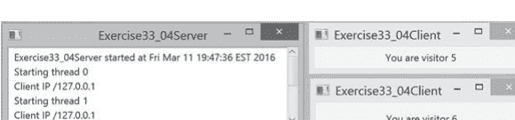

**图 33.19** 客户端显示访问服务器的次数。服务器存储计数。

**33.5**（在对象中发送负载信息）修改练习 33.1，让客户端发送一个包含年利率、年限和贷款金额的负载对象，以便服务器发送每月还款和总还款。

## 第33.6 节

**33.6**（显示和添加地址）开发一个客户端/服务器应用程序来查看和添加地址，如图 33.20 所示。

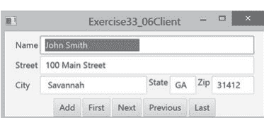

**图 33.20** 你可以添加和删除地址。

- 使用列表 33.5 中定义的 `Address` 类在对象中持有名称、街道、城市、州和邮政编码。

- 客户端可以使用 First、Next、Previous 和 Last 来查看地址，并使用 Add 按钮添加新地址。

- 将并发限制为两个客户端。

将客户端命名为 Exercise33_06Client，服务器命名为 Exercise33_06Server。

> *传输数组中的最后 100 个数字* 编程 24.12 从文件 PrimeNumbers.dat 中检索最后 100 个数字。编写一个客户端程序，请求服务器发送数组中的最后 100 个数字。将服务器程序命名为 Exercise33_07Server，客户端程序命名为。假设 long 数字以二进制格式存储在 PrimeNumbers.dat 中。

> *传输 ArrayList 中的最后 100 个数字* 编程 24.12 从文件 PrimeNumbers.dat 中检索最后 100 个数字。编写一个客户端程序，请求服务器发送 ArrayList 中的最后 100 个数字。将服务器程序命名为 Exercise33_08Server，客户端程序命名为 Exercise33_08Client。假设 long 数字以二进制格式存储在 PrimeNumbers.dat 中。

© 2018 Pearson Education, Inc., Hoboken, NJ. 版权所有。

## 第33.7 节 编程练习 33-33

**33.9 (聊天)** 编写一个允许两个用户聊天的程序。实现一个用户为服务器（见图 33.21a），另一个作为客户端（见图 33.21b）。服务器有两个文本区域：一个用于输入，另一个（不可编辑）用于显示从客户端接收的文本。当用户按下 *Enter* 键时，当前行发送到服务器。客户端有两个文本区域：一个（不可编辑）用于显示来自服务器的文本，另一个用于输入文本。当用户按下 *Enter* 键时，当前行发送到服务器。将客户端命名为 Exercise33_09Client，服务器命名为 Exercise33_09Server。


**图 33.21** 服务器和客户端相互发送和接收文本。

**33.10 (多客户端聊天)** 编写一个允许任意数量客户端聊天的程序。实现一个为所有客户端提供服务的服务器，如图 33.22 所示。将客户端命名为 Exercise33_10Client，服务器命名为 Exercise33_10Server。


**图 33.22** 服务器在 (a) 启动，带有三个 (b) 客户端在 (c)。

## 第34 章

## JAVA 数据库编程

## 目标

- 理解数据库和数据库管理系统的概念（§34.2）。

- 理解关系数据模型：关系结构、约束和语言（§34.2）。

- 使用 SQL 创建和删除表，并检索数据（§34.3）。

- 学习如何加载驱动程序、连接数据库、执行语句并使用 JDBC 处理结果集（§34.4）。

- 使用预编译语句执行 SQL 语句（§34.5）。

- 使用 DatabaseMetadata 和 ResultSet 接口探索数据库元数据（§34.7）。

## 34.1 引言

Java 提供了用于与任何关系系统开发的 API。你可能听说过数据库系统。数据库系统无处不在。你的安全信息存储在政府处。如果你在线购物，你的购买信息存储在公司处。如果你就读大学，你的学术信息存储在大学处。你的安全信息定期更新，你可以在线注册课程。数据库系统在社会和商业中起着重要作用。本章介绍了数据库系统、SQL 语言以及如何使用 Java 开发数据库应用程序。如果你已经熟悉 SQL，可以跳过 34.2 和 34.3。

## 34.2 关系数据库系统

SQL 是定义和访问数据库的标准语言。一个数据库系统由数据库、存储和管理数据库数据的软件以及显示数据并使用户与数据库系统交互的应用程序组成，如图 34.1 所示。


**图 34.1** 数据库系统由数据、数据库管理软件和应用程序组成。

数据库是一个数据仓库。当你从软件供应商处购买数据库系统（如 MySQL、Oracle、IBM 的 DB2 和 Informix、Microsoft SQL Server 或 Sybase）时，你实际上购买的是由专业人士设计的、不适用于普通客户的应用程序构建在 DBMS 之上的，以便客户访问和更新数据库。因此，应用程序可以被视为数据库系统与用户之间的接口。今天大多数数据库系统都是关系数据库系统。它们基于关系数据模型，该模型三个三个组件：结构、完整性和语言。


**图 34.2** 应用程序可以访问多个数据库。结构定义数据的表示。完整性对数据施加约束。语言提供了访问数据的方法。

## 34.2.1 关系结构

关系模型围绕简单自然的结构构建。关系实际上是由不重复行组成的关系模型。表格易于理解和使用。关系模型提供了一种强大的数据表示方式。

表格的行表示记录，表格的列表示单个属性的值。在数据库理论中，行被称为元组（tuple），列被称为属性（attribute）。图 34.3 显示了一个存储大学课程信息的示例表。该表有八个元组，每个元组有五个属性。

| 关系/表名 | courseID 学科 | courseNumber 编号 | 标题 | 学分 |
|---|---|---|---|---|
| 元组/行 | 11111 | CSCI | 1301 | Java I | 4 |
| | 11112 | CSCI | 1302 | Java II | 3 |


# 第 34 章 Java 数据库编程

| | 11113 | CSCI | 3720 | 数据库系统 | 3 |
| | 11114 | CSCI | 4750 | 快速 Java 应用 | 3 |
| | 11115 | MATH | 2750 | 微积分 I | 5 |
| | 11116 | MATH | 3750 | 微积分 II | 3 |
| | 11117 | EDUC | 1111 | 阅读 | 3 |
| | 11118 | ITEC | 1344 | 数据库管理 | 3 |

**图 34.3** 表格具有表名、列名和行。表格中的每一行代表一条相关数据的记录。

表格描述数据之间的关系。“11111”、“CSCI”、“1301”、“Java Java I”和“4”是关联的，形成了 Course 表的一条记录（图 34.3 中的第一行）。正如同一行中的数据是相关的一样，不同表之间的数据也可以通过公共属性相关联。假设数据库还有两个表，Student 和 Enrollment，如所示 34-4 和 34.5。课程表（Course）和选课表（Enrollment）通过它们的共同属性 `courseId` 关联，选课表和学生表（Student）通过 `ssn` 关联。

### 学生表 (Student Table)

| ssn | firstName | lastName | mi | phone | birthDate | street | zipCode | deptID |
|---|---|---|---|---|---|---|---|---|
| 44411110 | Jacob | R | | 921921934 | 1985-04-09 | 09 | Kingston Street | 3143S | BIOL |
| 44411111 | John | K | | 921921934 | 1974-10-10 | 100 | Main Street | 3141 | BIOL |
| 44411112 | George | K | | 921921354 | 1994-06-19 | 02 | Macon St. | 3149 | CS |
| 44411113 | Frank | E | | 925199374 | 1972-09-09 | 100 | Main Street | 3141 | BIOL |
| 44411114 | Jean | K | | 921921927 | 1972-07-09 | 100 | Main Street | 3141 | CHEM |
| 44411115 | Misha | R | | 707599934 | 1972-05-26 | 055 | Franklin St. | 3141 | MATH |
| 44411116 | Josh | R | | 921921932 | 1973-01-23 | 100 | Main Street | 3141 | BIOL |
| 44411117 | Joy | P | | 929221924 | 1974-03-19 | 103 | Bay Street | 3142 | CS |
| 44411118 | Toni | R | | 922922934 | 1964-04-29 | 103 | Bay Street | 3142 | MATH |
| 44411119 | Patrick | | | 922922934 | 1969-04-29 | 101 | Washington St. | 31435 | MATH |
| 44411120 | Rick | Carter | | 921521938 | 1986-04-09 | 19 | West Ford St. | 31411 | BIOL |

图 34-4 学生表存储存储信息。

### 选课表 (Enrollment Table)

| ssn | courseId | dateRegistered | grade |
|---|---|---|---|
| 44411110 | 11111 | 2004-03-19 | A |
| 44411111 | 11112 | 2004-03-19 | B |
| 44411110 | 11113 | 2004-03-19 | C |
| 44411111 | 11114 | 2004-03-19 | D |
| 44411111 | 11115 | 2004-03-19 | E |
| 44411113 | 11114 | 2004-03-19 | A |
| 44411112 | 11115 | 2004-03-19 | B |
| 44411116 | 11116 | 2004-03-19 | C |
| 44411112 | 11118 | 2004-03-19 | D |
| 44411113 | 11111 | 2004-03-19 | A |
| 44411113 | 11112 | 2004-03-19 | B |
| 44411115 | 11113 | 2004-03-19 | F |
| 44411115 | 11114 | 2004-03-19 | F |
| 44411115 | 11115 | 2004-03-19 | D |
| 44411116 | 11116 | 2004-03-19 | D |
| 44411117 | 11111 | 2004-03-19 | A |
| 44411118 | 11112 | 2004-03-19 | B |
| 44411115 | 11113 | 2004-03-19 | D |
| 44411116 | 11114 | 2004-03-19 | A |

图 34-5 选课表。

## 完整性约束 (Integrity Constraints)

主键约束定义了表必须满足的条件。通常，有三种类型的约束：域约束、主键约束和外键约束。主键约束是关系一个属性的外外键键约束涉及一个属性属性。 4-66 选课表。

### 3.2 关系约束 (Relational Constraints)

| 选课表 | ssn | courseId | dateRegistered | grade |
|---|---|---|---|---|
| 44411110 | 11111 | 2004-03-19 | A |
| 44411111 | 11112 | 2004-03-19 | B |
| 44411110 | 11113 | 2004-03-19 | C |
| 44411111 | 11114 | 2004-03-19 | D |
| 44411111 | 11115 | 2004-03-19 | E |
| 44411113 | 11114 | 2004-03-19 | A |
| 44411112 | 11115 | 2004-03-19 | B |
| 44411116 | 11116 | 2004-03-19 | C |
| 44411112 | 11118 | 2004-03-19 | D |
| 44411113 | 11111 | 2004-03-19 | A |
| 44411113 | 11112 | 2004-03-19 | B |
| 44411115 | 11113 | 2004-03-19 | F |
| 44411115 | 11114 | 2004-03-19 | F |
| 44411115 | 11115 | 2004-03-19 | D |
| 44411116 | 11116 | 2004-03-19 | D |
| 44411117 | 11111 | 2004-03-19 | A |
| 44411118 | 11112 | 2004-03-19 | B |
| 44411115 | 11113 | 2004-03-19 | D |
| 44411116 | 11114 | 2004-03-19 | A |
| 44411117 | 11111 | 2004-03-19 | A |

图 34-6 选课表。

## 域约束 (Domain Constraints)

域约束指定属性的允许值。域可以使用标准数据类型指定，例如整数、浮点数、固定长度和变长字符串。例如，你可以指定 `numOfCredits` 大于 0 且小于 5。你还可以指定属性是否为 `null`，表示未知或不可。

## 主键 (Primary Keys)

主键是唯一标识关系的一个属性集。为了理解这一点，最好了解超键、键和候选键。超键是唯一标识关系的属性或属性集。没有两个元组具有相同的超键。根据定义，关系由一组不同的元组组成。

键是最小的超键，意味着 K 的任何真子集都不是超键。关系可以有多个键。在这种情况下，每一个键被称为**候选键**。主键通常用于标识元组。如图 34-6 所示，`courseId` 是课程表的主键，而 `ssn` 和 `courseId` 形成了选课表的主键。

## 外键 (Foreign Keys)

在关系数据库中，数据通过关系关联，元组通过共同属性关联。简单来说，共同属性就是外键。外键定义了关系之间的关系。正式地说，属性集 *FK* 是关系 *R* 引用 *T* 的外键，如果它满足以下条件：

- *FK* 与 *T* 的主键具有相同的域。
- *FK* 中的非空值必须是 *T* 中的主键值。

如图 34-6 所示，`courseId` 是选课表中的外键，它引用了课程表中的主键 `courseId`。每个 `courseId` 值必须匹配课程表中的 `courseId` 值。

## 强制完整性约束 (Enforcing Integrity Constraints)

数据库管理系统强制完整性约束，并拒绝违反约束的操作。例如，如果你尝试向课程表插入一条新记录 `"C11115","CSCL","2490","C++ Programming","0"`，它将失败，因为计数必须大于 0；如果尝试插入与现有记录具有相同主键的记录，DBMS 将报告错误并拒绝该操作；如果你尝试删除课程表中被选课表记录所引用的记录，DBMS 将拒绝此操作。

> 注意
>
> 所有的关系型数据库都支持主键和外键约束，但并非所有数据库系统都支持域。例如，在 Microsoft Access 数据库中，无法指定 `numOfCredits` 大于 0 且小于 5 的约束。

## 34.3.1 在 MySQL 上创建用户账户

假设你已经安装了默认配置的 MySQL 5。为了与书中的所有示例匹配，你应该创建一个名为 *scott* 的用户，密码为 *tiger*。你可以使用 MySQL Workbench 或命令行来执行管理任务。MySQL Workbench 是一个用于管理 MySQL 数据库的 GUI 工具。以下是从命令行创建用户的步骤：

1. 从 DOS 命令行提示符中，输入

```bash
mysql -uroot -p
```

系统将提示你输入密码，如图 34.7 所示。

2. 在 mysql 提示符下，输入

```mysql
use mysql;
```

3. 要创建密码为 *tiger* 的用户 *scott*，输入：

```mysql
create user 'scott@localhost' identified by 'tiger';
```

4. 给 *scott* 授予权限，输入：

```mysql
grant select, insert, update, delete, create, create view, drop, execute, references on '*' to 'scott@localhost';
```

- 如果你想允许从任何 IP 地址对该账户进行远程访问，输入：

```mysql
grant all privileges on '*' to 'scott@%' identified by 'tiger';
```

- 如果你想将账户的远程访问限制为某个特定的 IP 地址，输入：

```mysql
grant all privileges on '*' to 'scott@ipAddress' identified by 'tiger';
```

5. 输入

```mysql
exit;
```

退出 MySQL 控制台。


**图 34.7** 你可以从窗口访问 MySQL 数据库服务器。

在 Windows 上，你的 MySQL 数据库会在计算机启动时自动启动。你可以使用命令 `net stop mysql` 停止它，使用命令 `net start mysql` 重新启动。

默认情况下，服务器包含两个名为 mysql 和 test 的数据库。mysql 数据库包含存储用户信息及其权限信息的表。该数据库供服务器管理员使用。例如，管理员可以使用它创建或撤销权限。由于你是系统上安装的服务器的所有者，你拥有 mysql 数据库的完全访问权限。你不应该在 mysql 数据库中创建表。你也可以使用命令 `create database name` 创建新数据库，或使用命令 `drop database name` 删除现有数据库。

## 34.3.2 创建数据库

为了与书中的示例匹配，你应该创建一个名为 javabook 的数据库。以下是创建它的步骤：

1. 从 DOS 命令行提示符中，输入

```bash
mysql -uscott -ptiger
```

登录 mysql，如图 34.8 所示。

2. 在 mysql 提示符下，输入

```mysql
create database javabook;
```


为了方便起见，书中用于创建和初始化表的 SQL 语句提供在附录 IV.A 中。你可以下载 MySQL 脚本并保存为 script.sql。要执行该脚本，首先使用以下命令切换到 javabook 数据库：

```sql
use javabook;
```

然后输入

```sql
source script.sql;
```

如图 34.9 所示运行脚本文件。

## 34.3 SQL-9


图 34-9 你可以在脚本文件中运行 SQL 命令。

> **注意**
>
> 你可以使用附录 I.A 中的脚本来填充所谓的 test 数据库。

## 34.3 创建和删除表

表是数据库中的基本对象。要创建表，使用 create table 语句来指定表名、属性和类型，例如所示：

```sql
create table Course (
  courseId(5),
  subjectId char(4) not null,
  courseNumber integer,
  title varchar(50) not null,
  numOfCredits integer,
  primary key (courseId)
);
```

该语句创建了 Course 表，具有属性 courseId, subjectId, courseNumber, title，并且每个属性都指定了存储在属性中的数据类型。varchar(50) 指定 title 是一个最大为 50 个字符的变长字符串。integer 指定 courseNumber 是整数。主键是 courseId。Student 和 Enrollment 表的创建如下：

```sql
create table Student (
  ssn(8),
  firstName varchar(25),
  mi char(1),
  lastName varchar(25),
  street varchar(25),
  phone char(11),
  zipCode char(5),
  deptId char(4),
  primary key (ssn)
);
create table Enrollment (
  ssn(9),
  courseId(5),
  dateRegistered date,
  grade char(1),
  primary key (ssn, courseId),
  foreign key (ssn) Student(ssn),
  foreign key (courseId) Course(courseId)
);
```

> **注意**
>
> SQL 关键字不区分大小写。本书采用以下命名规范：表使用小写，属性使用小写。

## 34-8 第 34 章 Java 数据库编程

## 34.3.4 插入、更新和删除

一旦创建了表，就可以从中插入数据。你也可以更新和删除记录。本节介绍了简单的插入、更新和删除语句。

插入的语法为：

```sql
insert into tableName (column1, column2, ..., columnn)
values (value1, value2, ..., valuen);
```

例如，以下语句向 Course 表插入了一条记录。新记录具有 courseId '11113', subjectId 'CSCI', courseNumber '3720', title 'Database Systems' 以及 numOfCredits。

```sql
insert into Course (courseId, subjectId, courseNumber, title, numOfCredits)
values ('11113', 'CSCI', '3720', 'Database Systems', 3);
```

列名是可选的。如果省略它们，必须按顺序输入列值。更新表的语法为：

```sql
update tableName
set column1 = newValue, [ column2 = newValue, ...]
where condition;
```

例如，以下语句将标题为 Database Systems 的课程的学分改为 4。


```sql
update Course
set numOfCredits = 4
title = 'Database Systems';
```

从表中删除记录的语法为：

```sql
delete from tableName
[where condition];
```

例如，以下语句从 `Course` 表中删除 `Database Systems` 课程：

```sql
delete from Course
title = 'Database Systems';
```

以下语句删除 `Course` 表中的所有记录：

```sql
delete from Course;
```

## 34.3.5 简单查询

要从表中检索信息，使用具有以下语法的 `select` 语句：

```sql
select column-list
from table-list
[where condition];
```

`select` 子句列出了要选择的列。`from` 子句引用参与查询的表。可选的 `where` 子句指定了行的条件。

查询 1：选择 CS 系的所有学生，如图 34.12 所示。

# 34-12 第34章 Java 数据库编程


图 34.12 `select` 语句的结果显示在 MySQL 控制台中。

## 34.3.6 比较运算符与布尔运算符

SQL 有六个比较运算符（如表 34.1所示）以及三个布尔运算符（如表 34.2所示）。

| 表 34.1 比较运算符 | 表 34.2 布尔运算符 |
| :--- | :--- |
| 运算符 | 描述 | 运算符 | 描述 |
| `=` | 等于 | `not` | 逻辑否定 |
| `<>` or `!=` | 不等于 | `and` | 逻辑与 |
| `<` | 小于 | `or` | 逻辑或 |
| `<=` | 小于等于 | | |
| `>` | 大于 | | |
| `>=` | 大于等于 | | |

> 注意：SQL 中的比较运算符和布尔运算符含义与 Java 相同。在 SQL 中，等于运算符是 `=`，而在 Java 中是 `==`。SQL 中的不等于运算符是 `<>` 或 `!=`，而在 Java 中是 `!=`。Java 中的 `not`、`and`、`or` 运算符分别是 `!`、`&&` 和 `||`。

**查询 2：** 获取位于 CS 部门且邮政编码为 31411 的学生姓名。

```sql
select firstName, mi, lastName
from Student
where deptid = 'CS' and zipCode = '31411';
```

> 注意：要选择表中的所有属性，不需要在 `select` 子句中列出属性名称。相反，可以使用星号 (`*`)，它代表所有属性。例如，以下查询显示了位于 CS 部门且邮政编码为 31411 的学生的所有属性。

```sql
select *
from Student
where deptid = 'CS' and zipCode = '31411';
```

* 2018 Pearson Education, Inc., Hoboken, NJ. 保留所有权利。

## 34.3.7 `like`、`between-and` 和 `is null` 运算符

SQL 有一个用于模式匹配的 `like` 运算符。检查字符串 `s` 是否具有模式 `p` 的语法如下：

```sql
s like p or not like p
```

你可以在模式 `p` 中使用通配符 `%`（百分号）和 `_`（下划线）。`%` 匹配零或多个字符，而 `_` 匹配 `s` 中的任何单个字符。例如，`lastname like '%mi%'` 匹配第二和第三字母为 m 和 i 的字符串，`lastname not like '%mi%'` 则排除任何第二和第三字母为 m 和 i 的字符串。

> 注意：在早期版本的 MS Access 中，通配符是 `*`，该字符匹配任何单个字符。

`between-and` 运算符使用以下语法检查值 `v` 是否在两个其他值 `v1` 和 `v2` 之间：

```sql
v between v1 and v2 or not between v1 and v2
```

```sql
v between v1 and v2 等价于 v >= v1 and v <= v2，而 not between v1 and v2 等价于 v < v1 or v > v2。
```

`is null` 运算符使用以下语法检查值 `v` 是否为空：

```sql
v is null or v is not null
```

查询 3：获取成绩在 'C' 到 'A' 之间的学生其社会安全码。

```sql
select ssn
from Enrollment
where grade between 'C' and 'A';
```

## 34.3.8 列别名

当显示查询时，SQL 使用列名作为列标题。通常用户会为列提供缩写名称，且在创建表时列名不能包含空格。但有时，在结果标题中给出更具描述性的名称是理想的。你可以使用以下语法定义别名：

```sql
select columnName [as] alias
```

查询 4：获取化学系学生的姓氏和邮政编码。列标题将 `lastname` 设置为 'Last Name'，将 `zipcode` 设置为 'Zip Code'。结果如图 34.13 所示。


图 34.13 你可以在显示中使用别名。

```sql
select lastName as "Last Name", zipCode as "Zip Code"
from Student
where deptId = 'CS';
```

> 注意：在 MySQL 和 Oracle 中，关键字 `as` 是可选的，但在 MS Access 中是要求的。

## 34.3.9 算术运算符

你可以在 SQL 中使用算术运算符 `*`（乘）、`/`（除）、`+`（加）和 `-`（减）。

查询 5：假设一个学分对应 50 分钟课程，获取科目为 CSCI 的每个课程的总分钟数。查询结果如图 34.14 所示。

```sql
select title, 50 * numOfCredits as "Minutes Per Week"
from Course
where subjectId = 'CSCI';
```


图 34.14 你在 SQL 中使用算术运算符。

## 34.3.10 显示不同元组

SQL 提供了 `distinct` 关键字，可用于消除结果中的重复元组。图 34.15 显示了课程使用的所有科目 ID，图 34.15b 显示了使用以下语句的课程使用的科目 ID：

```sql
select distinct subjectId as "Subject ID"
from Course;
```


图 34.15 (a) 显示了重复的元组。(b) 显示了不同的元组。

当 `select` 子句中有多个列时，`distinct` 关键字适用于结果中的整个元组。例如，以下语句显示了所有 `subjectId` 和 `title` 均不同的元组，如图 34.16 所示。

```sql
select subjectId, title
from Course;
```


图 34.16 关键字 `distinct` 适用于整个元组。

## 34.3.11 显示排序元组

SQL 使用 `order by` 子句对结果进行排序，语法如下：

```sql
select column-list
from table-list
order by column;
```

默认情况下，排序为升序。要按降序排序，添加 `desc`。当指定多个列时，按第一列排序，依此类推。

查询 6：列出 CS 部门学生的全名，主要按姓排序，次按名排序。


图 34.17 你可以使用 `order by` 子句排序结果。

## 34.12 连接表

通常你需要从多个表中获取信息，如下所示。

查询 7：Jacob Smith 修的课程。为了解决此查询，你需要连接 `Student` 和 `Enrollment` 表，如图 34.18 所示。


图 34.18 `Student` 和 `Enrollment` 通过 `ssn` 连接。

你可以按照以下 SQL 编写查询：

```sql
select distinct lastName, firstName, courseId
from Student, Enrollment
where Student.ssn = Enrollment.ssn and
lastName = 'Smith' and firstName = 'Jacob';
```

表 `Student` 和 `Enrollment` 列在 `from` 子句中。查询检查每一对行（一个来自 `Student`，另一个行来自 `Enrollment`），并选择满足 `where` 子句条件的组合。`Student` 中具有相同的姓、名，且 `Student` 和 `Enrollment` 具有相同的 `ssn`。对于每一对行，使用 `Student` 的 `lastName`、`firstName` 以及 `Enrollment` 的 `courseId` 生成结果，如图 34.19 所示。`Student` 和 `Enrollment` 具有相同的属性 `ssn`。在查询中区分它们，请使用 `Student.ssn` 和 `Enrollment.ssn`。

```
Command Prompt> mysql
mysql> select distinct lastName, firstName, courseId
from Student, Enrollment
where lastName = 'Smith' and firstName = 'Jacob';
| lastName | firstName | courseId |
|-----------|-------------|----------|
| Smith     | Jacob | 11112 |
| Smith     | Jacob | 11113 |
3 rows in set (0.06 sec)
mys>
```

图 34.19 查询 7 查询了多个表。

有关更多 SQL 的功能，请参见补充章节 IV.H 和 IV.I。

- 34.3.1 使用 34.3.3“创建和删除表”中的 `create table` 语句创建 `Course`、`Student` 和 `Enrollment` 表。使用图 34.3–35 中的数据向 `Course`、`Student` 和 `Enrollment` 表中插入行。
- 34.3.2 列出所有学分学时（credit hours）至少为 4 小时的 CS 课程。
- 34.3.3 列出所有姓氏中包含两个字母 "e" 的学生。
- 34.3.4 列出所有生日为空的学生。
- 34.3.5 列出所有修读数学课程的学生。
- 34.3.6 列出每个学科的课程数量。
- 34.3.7 假设每个学分对应 50 分钟的课程。获取每个学生所修课程的总分钟数。

## 34.4 JDBC

JDBC 是访问关系型数据库的 Java API。

用于开发 Java 程序的 Java API 称为 JDBC。JDBC 是支持访问关系型数据库的 Java 程序的 API 名称。JDBC 并不是一个缩写，但它通常被认为代表 Java Database Connectivity（Java数据库连接）。

JDBC 为 Java 程序员提供了一个访问和操作关系型数据库的统一接口。使用 JDBC API，用 Java 语言编写应用程序可以执行 SQL 语句、检索结果、以用户友好的界面显示数据并将更改传回数据库。JDBC API 还可以用于在分布式、异构环境中与多个数据源进行交互。

Java 程序、JDBC 驱动程序和关系型数据库之间的关系如图 34.20 所示。JDBC API 是一组 Java 接口和类，用于编写访问和操作关系型数据库的 Java 程序。由于 JDBC 驱动程序充当促进 JDBC 与专用数据库之间通信的接口，因此 JDBC 驱动程序特定于数据库，并且通常由数据库供应商提供。你需要


图 34.20 Java 程序通过 JDBC 驱动程序访问和操作数据库。

MySQL JDBC 驱动程序用于访问 MySQL 数据库，Oracle JDBC 驱动程序用于访问 Oracle 数据库，DB2 JDBC 驱动程序用于访问 DB2 数据库。

# 34.4.1 使用 JDBC 开发数据库应用程序

JDBC API 是用于通用 SQL 数据库的 Java 应用程序接口，允许开发者使用统一接口开发与 DBMS 无关的 Java 应用程序。

JDBC API 由用于建立数据库连接、向数据库发送 SQL 语句、处理 SQL 语句结果以及获取数据库元数据的类和接口组成。开发任何数据库接口都需要四个关键接口：`Driver`、`Connection`、`Statement` 和 `ResultSet`。这些接口定义了通用 SQL 数据库访问的框架。JDBC API 定义了这些接口，JDBC 供应商提供了这些接口的实现。程序使用这些接口。

这些接口的关系如图 34.21 所示。JDBC 应用使用 `Driver` 接口加载适当的驱动程序，使用 `Connection` 接口连接数据库，使用 `Statement` 接口执行 SQL 语句，并在语句返回结果时使用 `ResultSet` 接口处理结果。某些语句（如 SQL 定义语句和修改语句）不返回结果。


图 34.21 JDBC 类使 Java 程序能够连接数据库、发送 SQL 语句并处理结果。

JDBC 接口和类是开发 Java 数据程序的构建模块。一个典型的 Java 程序访问数据库时遵循以下步骤：

1. 加载驱动程序。

在连接数据库之前，必须使用下面的语句加载适当的驱动程序。

```java
Class.forName("DriverManager");
```

驱动程序是实现 `java.sql.Driver` 接口的具体类。MySQL、Oracle 和 DB2 的驱动程序在表 34.3 中。如果你的 Java 项目访问多个数据库，则必须加载它们各自的所有驱动程序。

最新版本的 MySQL JDBC 驱动程序是 `mysql-connector-java-5.1.26.jar`。该文件包含在 dev.mysql.com/downloads/connector-j/ 下载的 ZIP 文件中。最新版本的 Oracle JDBC 驱动程序是 `ojdbc6.jar`（可从 www.oracle.com/technetwork/enterprise-edition/jdbc-h12c-1121090769.html 下载）。

© 2018 Pearson Education, Inc., Hoboken, NJ. 版权所有。

# 表 34.3 JDBC 驱动程序

| 数据库 | 驱动类 | 来源 |
| :--- | :--- | :--- |
| MySQL | `com.mysql.jdbc.Driver` | `mysql-connector-java-5.1.26.jar` |
| Oracle | `oracle.jdbc.driver.OracleDriver` | `ojdbc6.jar` |
| Java DB (embedded) | `org.apache.derby.jdbc.EmbeddedDriver` | `derby.jar` |
| Java DB (network) | `org.apache.derby.jdbc.Client` | `derbynet.jar` |

Java DB 有两个版本：嵌入式和网络式。嵌入式版本用于本地访问 Java DB，而网络版本允许你从网络上访问 Java DB。要使用这些驱动程序，可以在 Windows 上使用以下命令将它们的 jar 文件添加到类路径中：

```cmd
set classpath
```

`getString(1)`、`getString(2)`、`getString(3)` 获取 `FirstName`、`mi` 和 `lastName` 的列。或者，你可以使用 `getString("firstName")`、`getString("mi")` 和 `getString("lastName")` 来获取最后三列。`next()` 方法的首次执行会将行设置为结果集中的第一行，随后的 `next()` 方法调用会将当前行设置为第二行、第三行，依此类推，直到最后一行。列表 34-1 是一个完整的示例，演示了如何连接数据库、进行简单查询以及使用 JDBC 处理查询。该程序连接到 MySQL 数据库并显示姓为 Smith 的行。

## 34.1 SimpleJdbc.java


```java
1 import java.sql.*;
2 public class SimpleJdbc {
3  public static void main(String[] args)
4  throws SQLException, ClassNotFoundException {
5  // 加载 JDBC 驱动
6  Class.forName("com.mysql.jdbc.Driver");
7  System.out.println("Driver loaded");
8
9 // 连接到数据库
10 Connection connection = DriverManager.getConnection(
11 "jdbc:mysql://localhost/javook","scott","tiger");
12 System.out.println("Database connected");
13
14 // 创建语句
15 Statement statement = connection.createStatement();
16
17 // 执行语句
18 ResultSet resultSet = statement.executeQuery(
19 "select firstName, mi, lastName from Student where lastName "
20 + " = 'Smith'");
21
22 // 遍历结果集并打印学生
23 while (resultSet.next()) {
24 System.out.println(resultSet.getString(1) + " | " +
25  resultSet.getString(2) + " | " + resultSet.getString(3));
26 }
27
28 // 关闭连接
29 connection.close();
30 }
31 }
```

第 7 行的语句加载了 MySQL 的 JDBC 驱动，第 11–13 行的语句连接到本地 MySQL 数据库。你可以将连接更改为 Oracle 或其他数据库。该程序创建一个语句对象（第 16 行），执行 SQL 语句并返回一个 `ResultSet` 对象（第 19–22 行），该对象从 `ResultSet` 对象中检索查询（第 24–26 行）。最后一条语句（第 29 行）关闭连接并释放与连接关联的资源。你可以使用 `try-with-resources` 语法重新阅读此程序，请参见 `www.csarmstrong.org/intellij/intro/html/SimpleJdbcWithAutoClose.html`。

> 注意：如果你从 DOS 提示符运行此程序，请在 classpath 中指定驱动程序，如图 34.22 所示。

## 34-22 第 34 章 Java 数据库编程

```
c:\>java -cp :.;lib/mysql-connector-java-5.1.26.jar SimpleJdbc
Driver loaded.
Database connected.
Jacob R Smith
Jean K Smith
Josh R Smith
c:\>_
```

**图 34.22** 你必须包含驱动文件才能运行 Java 程序。

classpath 和 jar 文件用逗号分隔。点 (`.`) 表示当前目录。为了方便起见，驱动文件被放置在 library 目录下。分号问题

> 警告
>
> 不要在 Java 程序中使用分号 (`;`) 来结束 Oracle SQL 命令。分号在 Oracle JDBC 驱动上可能不起作用。但在本书使用的其他驱动程序上是有效的。

> 注意
>
> `Connection` 接口处理事务以及如何处理它们。默认情况下，新连接处于自动提交（autocommit）模式，所有它的 SQL 语句都作为独立的事务被执行并提交。提交在语句完成或发生下一次执行时发生（以先发生的为准）。对于返回结果集的语句，当结果的最后一行被检索或结果集关闭时，语句即完成。

## 34.5 PreparedStatement

`PreparedStatement` 允许你创建 SQL 语句。

一旦建立了与特定数据库的连接，就可以用它从程序向数据库发送 SQL 语句。`Statement` 接口用于执行不包含任何参数的 SQL 语句。`PreparedStatement` 接口扩展 `Statement`，用于执行带参数或不带参数的预编译 SQL。由于 SQL 语句是预编译的，因此它们对于重复执行非常高效。

使用 `Connection` 接口中的 `prepareStatement` 方法可以创建 `PreparedStatement` 对象。例如，以下代码为一个 SQL 插入语句创建了一个 `PreparedStatement`：

```java
PreparedStatement statement = connection.prepareStatement(
  "insert into Student (firstName
```

该插入语句有三个问号作为占位符，用于表示 `Student` 表中记录的 `firstName`、`mi` 和 `lastName` 的值。

作为子接口，`PreparedStatement` 继承了 `Statement` 中定义的所有方法。它还提供了在 `PreparedStatement` 对象中设置参数的方法。这些方法用于在执行语句或过程之前设置参数值。通常，setter 方法具有以下名称和签名：

```
setX(int parameterIndex, X value);
```

其中 X 是参数的类型，`parameterIndex` 是参数在语句中的索引。索引从 1 开始。例如，`setString` 为指定的参数设置值。

以下语句将参数 "Jack"、"A" 和 "Ryan" 传递给 `preparedStatement` 中 `firstName`、`mi` 和 `lastName` 的占位符：

```java
preparedStatement.setString(1, "Jack");
preparedStatement.setString(2, "A");
preparedStatement.setString(3, "Ryan");
```

设置参数后，可以通过调用 `executeQuery()` 执行 SELECT 语句，或调用 `executeUpdate()` 执行 DDL 或更新语句来执行预编译语句。

`executeQuery()` 和 `executeUpdate()` 方法定义在 `Statement` 接口中，不同之处在于它们没有任何参数，因为在创建 `PreparedStatement` 对象时，SQL 语句已经在 `prepareStatement` 方法中准备就绪了。

使用 SQL 语句，列表 34.2 中的内容可以在列表 34.3 中得到改进。

### Listing 34.3 FindGradeUsingPreparedStatement.java

```java
1 import javafx.application.Application;
2 import javafx.scene.Scene;
3 import javafx.scene.control.Button;
4 import javafx.scene.control.Label;
5 import javafx.scene.control.TextField;
6 import javafx.scene.layout.HBox;
7 import javafx.scene.layout.VBox;
8 import javafx.scene.Stage;
9 import java.sql.*;
10
public class FindGradeUsingPreparedStatement extends Application {
    // 用于执行查询的 PreparedStatement
    private PreparedStatement preparedStatement;
    private TextField tfSSN = new TextField();
    private TextField tfCourseId = new TextField();
    private Label lbStatus = new Label("");

    @Override
    // 重写 Application 类中的 start 方法
    public void start(Stage primaryStage) {
        // 初始化数据库连接并创建 Statement 对象
        initializedDB();

        Button btnShowGrade = new Button("Show Grade");
        HBox hbox = new HBox(5);
        hbox.getChildren().add(new Label("SSN"), tfSSN,
            new Label("Course ID"), tfCourseId, btnShowGrade);

        VBox vbox = new VBox(10);
        vbox.getChildren().add(hbox, lbStatus);

        tfSSN.setColumnCount(6);
        tfCourseId.setColumnCount(6);
        btnShowGrade.setOnAction((e -> showGrade()));

        // 创建场景并将其置于舞台
        Scene scene = new Scene(vbox, 420, 880);
        primaryStage.setTitle("FindGrade"); // 设置舞台标题
        primaryStage.setScene(scene); // 将场景置于舞台
        primaryStage.show(); // 显示舞台
    }

    private void initializeDB() {
        try {
            // 加载 JDBC 驱动
            Class.forName("com.mysql.jdbc.Driver");
            Class.forName("com.oracle.jdbc.driver.OracleDriver");
            System.out.println("Driver loaded");

            // 建立连接
            Connection connection = DriverManager.getConnection(
                "jdbc:mysql://localhost/javabook", "scott", "tiger");
                "jdbc:oracle:thin:@localhost.angstrom.edu:1521:orcl", "scott", "tiger");
            System.out.println("Database connected");

            String queryString = "select firstName, name, lastname, date from Student, Enrollment " +
                "where Student.ssn = ? and Enrollment.courseId = ?";
            // 创建一个语句
            preparedStatement = connection.prepareStatement(queryString);
        } catch (Exception ex) {
            ex.printStackTrace();
        }
    }

    private void showGrade() {
        String ssn = tfSSN.getText();
        String courseId = tfCourseId.getId();
        try {
            preparedStatement.setString(1, ssn);
            preparedStatement.setString(2, courseId);
            ResultSet rset = preparedStatement.executeQuery();
            if (rset.next()) {
                String lastName = rset.getString(1);
                String mi = rset.getString(2);
                String firstName = rset.getString(3);
                String grade = rset.getString(4);
                // 在标签 中显示结果
                lbStatus.setText(firstName + " " + mi + " " + lastName + " on " + title + " is " + grade);
            } else {
                lbStatus.setText("Not found");
            }
        } catch (SQLException ex) {
            ex.printStackTrace();
        }
    }
}
```

## 34.6 可调用语句 (CallableStatement)

```sql
from Student
where Student.firstName = first
Student.lastName = last;
```

```
return result;
end;
//
delimiter;
/* 请注意 delimiter 和 ; 之间有一个空格 */
```

如果你使用 Oracle 数据库，该函数可以定义为：

```sql
create or replace function studentFound
(first varchar2, last varchar2)
/* 不要命名为 firstName 和 lastName */
return number is numberOfSelectedRows number = 0;
begin
select count(*) into numberOfOfSelectedRows
from Student
where Student.firstName = first
Student.lastName = last;
return numberOfOfSelectedRows;
end studentFound;
```

假设数据库中已经创建了 `studentFound` 函数。34.4 节提供了一个如何使用可调用语句来测试该函数的示例。

## 列表 34.4 TestCallableableStatement.java

```java
import java.sql.*;
public class TestCallableableStatement {
/* 创建新的 TableEditor 表单 */
public static void main(String[] args) throws Exception {
Class.forName("com.mysql.jdbc.Driver");
// Connection connection = DriverManager.getConnection(
  "jdbc:mysql://localhost/javabook",
  "tiger");
// Connection connection = DriverManager.getConnection(
  "jdbc:oracle:thin:@llang.armstrong.seduedu:1521:orcl",
  "tiger");

/* 创建一个可调用语句 */
CallableStatement statement = connection.prepareCall(
  "? = call statement(?, ?)");
java.util.Scanner input = new java.util.Scanner(System.in);
System.out.print("enter's first name: ");
String firstName = input.nextLine();
System.out.print("enter's last name: ");
String lastName = input.nextLine();

statement.setString(2, firstName);
statement.setString(3, lastName);
statement.registerOutParameter(1, Types.INTEGER);
statement.execute();
```

```java
if (callableStatement.getInt(1) >= i)
    System.out.println(firstName + " " + lastName +
    + is in the database");
else
    System.out.println(firstName + " " + lastName +
    + is not in the database");
```


该程序加载了 MySQL 驱动程序（第 6 行），连接到 MySQL 数据库（第 7–9 行），并创建一个用于执行 `studentFound` 函数的可调用语句（第 15–16 行）。

函数的第一个参数是返回值；第二个和第三个参数对应于名和姓。在执行可调用语句之前，程序设置了名和姓（第 24–25 行）并注册了 OUT 参数（第 26 行）。语句在第 27 行被执行。

在第 29 行获取函数的返回值。如果该值大于或等于 1，则在表中找到了具有指定名和姓的学生。

- 34.6.1 描述可调用语句。如何创建 `CallableStatement`？如何执行 `CallableStatement`？如何在 `CallableStatement` 中注册 OUT 参数？

## 34.7 获取元数据

如数据库 URL、用户名和 JDBC 驱动程序等元数据可以使用 `DatabaseMetaData` 接口获取，而如表列数和列名等结果集元数据可以使用 `ResultSetMetaData` 接口获取。

JDBC 使用 `DatabaseMetaData` 接口获取整个数据库范围的信息，使用 `ResultSetMetaData` 接口获取特定 `ResultSet` 的信息。

### 34.7.1 数据库元数据

`Connection` 接口建立与数据库的连接。SQL 语句的执行和结果返回是在连接上下文中进行的。连接还提供了元数据信息的访问，描述数据库的能力、支持的 SQL 语法、存储过程等。要获取数据库的 `DatabaseMetaData` 实例，请对 `Connection` 对象使用 `getMetaData` 方法，如下：

```java
DatabaseMetaData dbMetaData = connection.getMetaData();
```

如果你的程序连接到本地 MySQL 数据库，列表 34.5 节中的程序将显示图 34.24 所示的数据库信息语句。

© 2018 Pearson Education, Inc., Hoboken, NJ. All rights reserved.

## 列表 34.5 TestDatabaseMetadata.java

```java
import java.sql.*;

public class TestDatabaseMetadata {
    public static void main(String[] args) 
        throws SQLException, ClassNotFoundException {
        // 加载 JDBC 驱动
        Class.forName("com.mysql.jdbc.driver");
        System.out.println("Driver loaded");

        // 连接到数据库
        Connection connection = DriverManager.getConnection(
            "jdbc:mysql://localhost/javabook", "scott", "tiger");
        System.out.println("Database connected");

        DatabaseMetaData dbMetaData = connection.getMetaData();
        System.out.println("database URL: " + dbMetaData.getURL());
        System.out.println("database username: " + dbMetaData.getUserName());
        System.out.println("database product name: " + dbMetaData.getProductName());
        System.out.println("database product version: " + dbMetaData.getProductVersion());
        System.out.println("JDBC driver: " + dbMetaData.getDriverName());
        System.out.println("JDBC version: " + dbMetaData.getDriverVersion());
        System.out.println("JDBC major version: " + dbMetaData.getDriverMajorVersion());
        System.out.println("JDBC minor version: " + dbMetaData.getDriverMinorVersion());
        System.out.println("number of databases: " + dbMetaData.getDatabaseCount());
        System.out.println("TableName: " + dbMetaData.getTableName());
        System.out.println("Max columns: " + dbMetaData.getMaxColumns());
        System.out.println("Columns in table: " + dbMetaData.getColumnsInTable());

        // 关闭连接
        connection.close();
    }
}
```

图 24 `DatabaseMetaData` 接口允许获取数据库信息。

© 2018 Pearson Education, Inc., Hoboken, NJ. All rights reserved.

### 34.7.2 获取表

可以通过 `getTables` 方法通过数据库元数据识别表。列表 34.6 显示了本地 MySQL 数据库中的表。图 34.25 显示了程序的示例输出。

## 列表 34.6 FindTables.java

第 17 行通过 `getTables` 方法从结果集中获取表名。

### 34.7.3 结果集元数据

`ResultSetMetaData` 接口描述有关结果集的信息。`ResultSetMetaData` 对象可以用于查找列的类型和属性。要获取 `ResultSetMetaData` 实例，请对结果集使用 `getMetaData` 方法，如下：

```java
ResultSetMetaData rsMetaData = resultSet.getMetaData();
```

© 2018 Pearson Education, Inc., Hoboken, NJ. All rights reserved.

## 获取元数据

可以使用 `getColumnCount()` 方法查找列的数量，并使用 `getColumnName(int)` 方法获取列名。例如，列表 34.7 显示了 SQL 语句 `select * from Enrollment` 产生的所有列名。输出见图 34.26。

## 列表 34.7 TestResultSetMetadata.java

```java
import java.sql.*;
public class TestResultSetMetadata {
    public static void main(String[] args) 
        throws SQLException, ClassNotFoundException {
            // 加载 JDBC 驱动
            Class.forName("com.mysql.jdbc.Driver");
            System.out.println("Driver loaded");

            // 连接到数据库
            Connection connection = DriverManager.getConnection(
                "jdbc:mysql://localhost/java", "scott", "tiger");
            System.out.println("Database connected");

            // 创建语句
            Statement statement = connection.createStatement();

            // 执行查询
            ResultSet resultSet = statement.executeQuery(
                "select * from Enrollment");

            ResultSetMetaData rsMetaData = resultSet.getMetaData();
            for (int i = 1; i <= rsMetaData.getColumnCount(); i++) {
                System.out.println("-" + i + " - " + rsMetaData.getColumnName(i));
                System.out.println();
            }

            // 关闭连接
            connection.close();
        }
}
```

| name | courseId | dateRegistered | grade |
|---|---|---|---|
| 44411110 | 11111 | 2012-04-18 | A |
| 44411110 | 11112 | 2013-04-18 | B |

图 34.26 `TestResultSetMetaData` 接口允许你获取结果集信息。

# 34-34 第 34 章 Java 数据库编程

**34.7.1** 什么是 DatabaseMetadata？描述 DatabaseMetadata 中的方法。你如何获取 DatabaseMetadata 的实例？

**34.7.2** 什么是 ResultSetMetadata？描述 ResultSetMetadata 中的方法。你如何获取 ResultSetMetadata 的实例？

**34.7.3** 如何查找结果集中的列数？如何查找结果集中的列名？

## 关键术语

| 候选词 34-5 | 完整性约束 34-4 |
| :--- | :--- |
| 数据库系统 34-2 | 主键 34-5 |
| 域约束 34-5 | 关系型数据库 34-5 |
| 外键 34-5 | 结构化查询语言 (SQL) 34-6 |
| 外键约束 34-5 | 超键 34-5 |

## 本章总结

- 1. 本章介绍了数据库系统、关系型数据库、关系型数据、数据完整性和 SQL 的概念。你学习了如何使用 Java 开发数据库应用程序。
- 2. 用于开发 Java 数据库程序的 JDBC API 称为 JDBC。JDBC 为 Java 程序员提供了用于访问和操作关系型数据库的统一接口。
- 3. JDBC API 由类和接口组成，用于建立数据库连接、将 SQL 语句绑定到数据库、处理 SQL 语句的结果以及获取数据库元数据。
- 4. 由于 JDBC 驱动程序作为 JDBC 与私有数据库之间通信的接口，因此 JDBC 驱动程序是特定的。如果你使用驱动程序，请确保在运行程序之前它在类路径中。
- 5. 开发任何数据库应用程序都需要关键接口：`Driver`、`Connection`、`Statement` 和 `ResultSet`。这些接口为通用 JDBC 数据库访问定义了一个框架。JDBC 驱动程序供应商对它们进行实现。
- 6. JDBC 加载适当的驱动程序，通过 `Connection` 接口连接数据库，使用 `Statement` 接口创建并执行 SQL 语句，如果语句返回结果，则使用 `ResultSet` 接口处理结果。
- 7. `PreparedStatement` 设计用于执行带参数的动态 SQL 语句。这些 SQL 语句在重复执行时会进行编译以提高效率。
- 8. 数据库元数据是描述数据库本身的信息。JDBC 提供了 `DatabaseMetaData` 接口用于获取数据库范围的信息，以及 `ResultSetMetaData` 用于获取特定 `ResultSet` 的信息。

## 测验

编程练习 34-35

在书籍配套网站上在线回答本章的测验。

## 编程练习

- *34.1 (访问并更新 Staff 表)* 编写一个程序，插入、编辑和更新存储在数据库中的员工信息，如图 34.27a 所示。视图显示具有指定 ID 的记录。*Insert* 按钮插入新记录。*Update* 按钮更新指定 ID 的记录。Staff 表的创建如下：

```sql
create table Staff (
  id char(9) not null,
  lastname varchar(15),
  firstname varchar(15),
  mi char(1),
  address varchar(20),
  city varchar(20),
  state char(2),
  telephone char(10),
  email varchar(40),
  primary key (id)
);
```

图 34.27 (a) 该程序允许你查看、插入和更新员工信息。(b) PieChart 和 BarChart 组件显示来自数据模块的查询数据。

- *34.2 (数据可视化)* 编写一个程序，用饼图和柱状图显示每个部门的学生人数，如图 34.27b 所示。*PieChart* 和 *BarChart* 类在编程练习 14.12 和 14.13 中创建。每个部门的学生人数可以通过 *Student* 表（见图 34.4）使用以下 SQL 语句获取：

```sql
select deptID, count(*)
from Student
where deptID is not null
group by deptID;
```

- *34.3 (连接对话框)* 开发一个 `BorderPane` 的子类，允许用户输入 JDBC 连接、URL、用户名和密码，如图 34.28 所示。点击 *Connect to DB* 按钮时，数据库的 `Connection` 对象将存储在 `connection` 属性中。然后你可以使用 `getConnection()` 方法返回连接。

图 34.28 DBConnectionPane 允许用户输入数据库信息。

- *34.4 (查找成绩)* 列表 34.2，FindGrade.java，展示了查找特定课程成绩的程序，如图 34.29。重写该程序以查找特定学生的成绩。

图 34.29 程序显示了特定学生的成绩。

- *34.5 (显示内容)* 编写一个程序，显示表的内容，如图 34.30a 所示。

图 34.30 (a) 输入表名。(b) 从组合框中选择表。

- *34.6 (查找表)* 编写一个程序，查找所有表名，如图 34.30b 所示。

- *34.7 (填充 Quiz 表)* 创建一个名为 Quiz 的表如下：

```sql
create table Quiz (
  questionId int,
  question varchar(40),
  choice varchar(100));
```

- 1. 本章介绍了数据库系统、关系型数据库、关系型数据、数据完整性和 SQL 的概念。你学习了如何使用 Java 开发数据库应用程序。
- 2. 用于开发 Java 数据库程序的 JDBC API 称为 JDBC。JDBC 为 Java 程序员提供了用于访问和操作关系型数据库的统一接口。
- 3. JDBC API 由类和接口组成，用于建立数据库连接、将 SQL 语句绑定到数据库、处理 SQL 语句的结果以及获取数据库元数据。
- 4. 由于 JDBC 驱动程序作为 JDBC 与私有数据库之间通信的接口，因此 JDBC 驱动程序是特定的。如果你使用驱动程序，请确保在运行程序之前它在类路径中。
- 5. 开发任何数据库应用程序都需要关键接口：`Driver`、`Connection`、`Statement` 和 `ResultSet`。这些接口为通用 JDBC 数据库访问定义了一个框架。JDBC 驱动程序供应商对它们进行实现。
- 6. JDBC 程序加载适当的驱动程序，通过 `Connection` 接口连接数据库，使用 `Statement` 接口创建并执行 SQL 语句，如果语句返回结果，则使用 `ResultSet` 接口处理结果。


- 7. `PreparedStatement` 设计用于执行带参数的动态 SQL 语句。这些 SQL 语句在重复执行时会进行编译以提高效率。

- 8. 数据库元数据是描述数据库本身的信息。JDBC 提供了 `DatabaseMetadata` 接口用于获取数据库范围的信息，以及 `ResultSetMetaData` 用于获取特定 `ResultSet` 的信息。

- **34.8 (填充 Salary 表)** 创建一个名为 `Salary` 的表如下：

```sql
create table Salary (
  firstname varchar(100),
  lastName varchar(100),
  rank float);
```

- **34.9 (复制)** 假设数据库包含：

```sql
create table Student (
  username varchar(50) not null,
  password varchar(50) not null,
  fullname varchar(20) not null,
  constraint primary key (username)
);
```

创建一个新表如下：

```sql
create table Student2 (
  username varchar(50) not null,
  password varchar(50) not null,
  firstname varchar(100),
  lastName varchar(100),
  constraint primary key (username)
);
```

全名以 `firstName lastName` 的形式出现。例如，`John Smith` 是一个全名。将 `Student1` 中的全名拆分为 `firstName` 和 `lastname` 并存入 `Student2`。

- **34.10 (记录未提交的作业)** 以下三个表存储了 LiveLab 中的学生、分配的作业和提交情况。LiveLab 是一个程序自动评分系统。

```sql
create table AGSStudent (
  username varchar(50) not null,
  password varchar(50) not null,
  fullname varchar(20) not null,
  instructorEmail varchar(100) not null,
  constraint primary key (username)
);
```

```sql
create table ExerciseAssigned (
  instructorEmail varchar(100),
  exerciseName varchar(100),
  maxscore default 10,
  constraint primary key (instructorEmail, exerciseName)
);
```

```sql
create table AGSLog (
  username varchar(50), /* 这是学生的名字 */
  exerciseName varchar(100), /* 这是作业名称 */
  score default 0,
  submitted default 0,
  constraint primary key (username, exerciseName)
);
```

`Student` 表存储学生信息。`ExerciseAssigned` 表由讲师分配作业。`AGSLog` 表存储评分结果。当学生提交作业时，`AGSLog` 表中会存储一条记录。但是，如果学生没有提交作业，逻辑上就没有记录。

编写一个程序，为每个学生和每个分配的作业添加新记录。该记录的 `score` 和 `submitted` 应为 0。例如，如果在运行程序之前 `AGSLog` 表已包含数据，那么在运行程序后，`AGSLog` 表将包含新记录。

### AGSLog

### 程序运行 34-39 后的 AGSLog

| 用户 | 练习名称 | 分数 | 提交 |
|---|---|---|---|
| abc | e1 | 9 | 1 |
| wbc | e2 | 7 | 1 |

| 用户名 | 练习名称 | 分数 | 提交 |
|---|---|---|---|
| abc | e1 | 9 | 1 |
| wbc | e2 | 7 | 1 |
| abc | | | 0 |
| wbc | | | 0 |
| cde | e1 | | 0 |
| cde | e4 | | 0 |

* **34.11 (婴儿名字)** 创建以下内容：

```sql
create table Bablename (
  year integer,
  name varchar(50),
  gender char(1),
  count integer,
  constraint pkBablename primary key (year, name, gender)
);
```

婴儿名字排名数据在编程练习 12.31 中描述过。编写一个程序从以下 URL 读取数据并存储到 `Bablename` 表中。

- `https://liveexample.pearsoncm.com/data/babynamesranking2001.txt`
- ...
- `https://liveexample.pearsoncm.com/data/babynamesranking2010.txt`

# 高级 Java 数据库编程

## 目标

- 创建一个通用的 SQL 客户端用于访问本地或远程数据库 (§35.2)。
- 以批模式执行 SQL 语句 (§35.3)。
- 处理可更新和可滚动的结果集 (§35.4)。
- 使用 `RowSet` 简化 Java 数据库编程 (§35.5)。
- 在 JDBC 中存储和检索图像 (§35.6)。

## 35.1 引言

本章介绍了 Java 数据库编程的高级功能。

第 34 章介绍了 JDBC 的基本功能。本章将涵盖其高级功能。你将学习如何开发一个访问任何本地或远程关系型数据库的通用 SQL 客户端，学习如何以批模式执行语句以提高性能，学习滚动结果集以及如何通过结果集更新数据库，学习如何使用 `RowSet` 简化数据库访问，以及如何存储和检索图像。

## 35.2 通用 SQL 客户端

本节详细介绍了一种用于连接和访问任何 SQL 数据库的通用 SQL 客户端。

在第 34 章中，你使用了各种驱动程序来连接数据库，创建执行 SQL 语句的语句，并处理 SQL 查询的结果。本节展示了一个通用的 SQL 客户端，它可以让你连接到任何关系型数据库并独立执行 SQL 命令，如图 35.1 所示。该客户端可以连接到任何 JDBC 数据源并提交 SQL SELECT 和非 SELECT 命令进行执行。执行结果取决于 SELECT 查询，而非 SELECT 命令将显示执行状态。列表 35.1 给出了该程序：

### 列表 35.1 SQLClient.java

```java
import java.sql.*;
import javafx.application.Application;
import javafx.collections.FXCollections;
import javafx.geometry.Pos;
import javafx.scene.Scene;
import javafx.scene.control.Button;
import javafx.scene.control.ComboBox;
import javafx.scene.control.Label;
import javafx.scene.control.PasswordField;
import javafx.scene.control.ScrollPane;
import javafx.scene.control.TextArea;
import javafx.scene.control.TextField;
import javafx.scene.layout.BorderPane;
import javafx.scene.layout.GridPane;
import javafx.scene.layout.HBox;
import javafx.scene.layout.VBox;
import javafx.stage.Stage;

public class SQLClient extends Application {
  // 连接到数据库
  private Connection connection;

  // 用于执行 SQL 命令的语句
  private Statement statement;

  // 用于输入 SQL 命令的文本区域
  private TextArea sqlCommand = new TextArea();

  // 用于显示 SQL 命令结果的文本区域
  private TextArea sqlResult = new TextArea();

  // 连接的数据库信息
  private TextField tfUsername = new TextField();
  private PasswordField tfPassword = new PasswordField();
  private ComboBox<String> cboURL = new ComboBox<>();
  private ComboBox<String> cboDriver = new ComboBox<>();

  private Button btnExecute = new Button("Execute SQL Command");
  private Button btnClear = new Button("Clear");
  private Button btnConnect = new Button("Connect to Database");
  private Button btnClearResult = new Button("Clear Result");
  private Label lblStatus = new Label("No Status");

  @Override
  // Application 类中的 start 方法
  public void start(Stage primaryStage) {
    // 创建主布局
    BorderPane borderPane = new BorderPane();

    // 创建连接信息的网格
    GridPane gridPane = new GridPane();
    gridPane.add(new Label("Username:"), 0, 0);
    gridPane.add(tfUsername, 1, 0);
    gridPane.add(new Label("Password:"), 0, 1);
    gridPane.add(tfPassword, 1, 1);
    gridPane.add(new Label("URL:"), 0, 2);
    gridPane.add(cboURL, 1, 2);
    gridPane.add(new Label("Driver:"), 0, 3);
    gridPane.add(cboDriver, 1, 3);

    // 创建状态的水平框
    HBox hbox = new HBox(10);
    hbox.getChildren().addAll(lblStatus, btnConnect);
    hbox.setAlignment(Pos.CENTER_RIGHT);

    // 创建数据库连接的垂直框
    VBox vbox = new VBox(5);
    vbox.getChildren().addAll(gridPane, hbox);

    // 创建 SQL 命令的垂直框
    VBox sqlCommandBox = new VBox(5);
    sqlCommandBox.getChildren().addAll(new Label("SQL Command"), sqlCommand, btnExecute, btnClear);

    // 创建结果的垂直框
    VBox sqlResultBox = new VBox(5);
    sqlResultBox.getChildren().addAll(new Label("Result"), sqlResult, btnClearResult);

    // 将所有部分添加到主布局
    borderPane.setTop(vbox);
    borderPane.setCenter(sqlCommandBox);
    borderPane.setRight(sqlResultBox);

    // 初始化下拉框数据
    cboURL.getItems().addAll(
      "jdbc:mysql://localhost:3306/db",
      "jdbc:oracle://localhost:1521:xe",
      "jdbc:postgresql://localhost:5432/db"
    );
    cboDriver.getItems().addAll(
      "com.mysql.cj.jdbc.Driver",
      "oracle.jdbc.driver.OracleDriver",
      "org.postgresql.Driver"
    );

    // 设置事件处理器
    btnConnect.setOnAction(e -> connectToDB());
    btnExecute.setOnAction(e -> executeSQL());
    btnClear.setOnAction(e -> sqlCommand.clear());
    btnClearResult.setOnAction(e -> sqlResult.clear());

    // 设置场景并显示舞台
    Scene scene = new Scene(borderPane, 800, 600);
    primaryStage.setTitle("SQL Client");
    primaryStage.setScene(scene);
    primaryStage.show();
  }

  // 连接到数据库
  private void connectToDB() {
    lblStatus.setText("Connecting to " + cboURL.getValue() + "...");
    try {
      Class.forName(cboDriver.getValue());
      connection = DriverManager.getConnection(cboURL.getValue(), tfUsername.getText(), tfPassword.getText());
      lblStatus.setText("Connected to " + cboURL.getValue());
    } catch (Exception e) {
      lblStatus.setText("Connection failed: " + e.getMessage());
      e.printStackTrace();
    }
  }

  // 执行 SQL
  private void executeSQL() {
    sqlResult.setText("SQL execution not implemented.");
  }
}
```


```java
/* 执行 SQL 命令 */
private void executeSQL() {
    if (connection == null) {
        taSQLResult.setText("请先连接到数据库");
        return;
    } else {
        String sqlCommands = taSQLCommand.getText().trim();
        String[] commands = sqlCommands.replace("\n", "").split(";");

        for (String command : commands) {
            if (command.trim().toUpperCase().startsWith("SELECT")) {
                processSQLSelect(command);
            } else {
                processSQLNonSelect(command);
            }
        }
    }
}
```

```java
/* 执行 SQL SELECT 命令 */
private void processSQLSelect(String sqlCommand) {
    try {
        // 为当前连接获取新的语句
        statement = connection.createStatement();

        // 执行 SELECT 命令
        ResultSet result = statement.executeQuery(sqlCommand);

        // 查找结果集中的列数
        int columnCount = result.getMetaData().getColumnCount();
        String row = "-";

        // 显示列名
        for (int i = 1; i <= columnCount; i++) {
            row = result.getMetaData().getColumnName(i) + "\t";
        }
        taSQLResult.append(row + "\n");

        while (result.next()) {
            // 重置行名为 "-"
            row = "-";

            for (int i = 1; i <= columnCount; i++) {
                // 将非字符串列转换为字符串
                row = result.getString(i) + "\t";
            }
            taSQLResult.append(row + "\n");
        }
    } catch (SQLException ex) {
        taSQLResult.setText(ex.toString());
    }
}
```

© 2018 Pearson Education, Inc., Hoboken, NJ. 版权所有。

## 35-6 第 35 章 高级 Java 数据库编程

```java
/* 执行 DDL 和修改命令 */
private void processSQLNoneSelect(String sqlCommand) {
    try {
        // 为当前连接获取新的语句
        statement = connection.createStatement();
        // 执行非 SELECT SQL 命令
        statement.executeUpdate(sqlCommand);
        taSQLResult.setText("SQL 命令已执行");
    } catch (SQLException ex) {
        taSQLResult.setText(ex.toString());
    }
}
```

用户选择或输入 JDBC 驱动、数据库 URL、用户名和密码，并点击“连接数据库”通过 `connectDB()` 方法连接到指定的数据库（第 122–140 行）。

当用户点击“SQL 命令”按钮时，会调用 `executeSQL()` 方法（第 143–161 行），从区域 (`jSQLCommand`) 获取命令并提取由分号分隔的每个命令；它判断命令是 SELECT 查询、DDL 还是修改语句（第 153–158 行）。如果是 SELECT 查询，调用 `processSelect` 方法（第 164–198 行）。该方法使用 `executeQuery` 方法（第 170 行）获取结果。结果显示在 `jSQLResult` 区域（第 181 行）。如果命令是非 SELECT 查询，则调用 `processSQLNoneSelect()` 方法（第 201–214 行）。该方法使用 `executeUpdate` 方法（第 207 行）执行 SQL 命令。

`ResultSet` 中的 `getMetaData` 方法（第 173, 178 行）用于获取 `ResultSetMetaData` 实例。`getColumnCount` 方法（第 173 行）返回结果集的列数，`getColumnName(i)` 方法（第 178 行）返回第 i 列的列名。


你可以一次性向数据库发送一组 SQL 语句进行执行以提高效率。

在所有示例中，SQL 命令都是逐个提交到数据库执行的。这对于处理大量更新来说效率很低。假设你想向表中插入行。一次提交一个命令所需的时间比批量提交所有命令要长得多。为了提高性能，JDBC 引入了用于处理非选择 SQL 命令的批量更新。批量更新将一系列非选择 SQL 命令收集在一个批次中并一起提交。

要使用批量添加，请将命令添加到 `Statement` 对象的 `addBatch` 方法中。在所有 SQL 命令都添加到批次后，使用 `executeBatch()` 方法将批次提交到数据库执行。

例如，代码创建一个表，在批次中添加了两个插入语句并执行了批次：

```java
statement = connection.createStatement();
```

```java
// 将 SQL 命令添加到批次中
statement.addBatch("create TABLE T (C1 integer, C2 varchar(15));");
```

© 2018 Pearson Education, Hoboken, NJ. 版权所有。

## 35.3 批量处理 5-7

```java
statement.addBatch("insert into T values (100, 'Smith')");
statement.addBatch("insert into T values (200, 'Jones')");

// 执行批次
int count[] = statement.executeBatch();
```

`executeBatch()` 方法返回一个计数数组，每个计数表示 SQL 命令受影响的行数。第一个计数是 SQL 命令影响的行数。

要执行批量更新，请确保你的 JDBC 驱动支持的。

> **注意**：JDBC 驱动支持批量更新。

## 35.3 批处理 5-9

```java
borderPane borderPaneFileName = new BorderPane();
borderFileName.left(new Label("Filename"));
borderFileName.center(tffilename);
borderFileName.right(btFile);
```

```java
borderPane borderPaneContent = new BorderPane();
borderPaneContent.setTop(borderPaneFileName);
borderPaneContent.setCenter(tafile);
```

```java
borderPaneSource borderPaneSource = new BorderPane();
borderPaneSource.setTop(new Label("Source Text File"));
borderPaneSource.setCenter(borderPaneContent);
```

```java
splitPane = new SplitPane();
splitPane.getItems().addAll(borderPaneSource, vConnection);
```

```java
// 创建一个场景并将其置于舞台中
Scene scene = new Scene(sp, 680, 230);
primaryStage.setTitle("CopyToFileTable"); // 设置舞台标题
primaryStage.setScene(scene); // 将场景置于舞台中
```

```java
btView.setOnAction(e -> { showFile(); });
btCopy.setOnAction(e -> {
    try {
        copyFile();
    } catch (Exception ex) {
        libStatus.setText(ex.toString());
    }
});
```

```java
/* 在文本区域中显示文件 */
private void showFile() {
    Scanner scanner = null;
    try {
        // 使用 Scanner 从文件中读取文本
        input = new Scanner(tffilename.getText().trim());

        // 读取一行并将其追加到文本区域
        while (input.hasNextLine()) {
            taFile.appendText(input.nextLine() + '\n');
        }
    } catch (FileNotFoundException ex) {
        System.out.println("未找到文件: " + tffilename.getText());
    } catch (IOException ex) {
        ex.printStackTrace();
    } finally {
        if (input != null) input.close();
    }
}
```

```java
private void copyFile() throws Exception {
    // 加载 JDBC 驱动
    Class.forName(jdbcDriver.getSelectionModel()
        .getSelectedItem().trim());
    System.out.println("Driver loaded");
}
```

## 35-10 第 35 章 高级 Java 数据库编程

```java
137      // 建立连接
138      Connection conn = DriverManager.getConnection(
139          cbUrl.getSelectionModel().getSelectedItem().trim(),
140          username.getText().trim(),
141          String.valueOf(password.getText().trim()));
142      System.out.println("Database connected");
143
144
145  }  // 从文件中读取每一行并将其插入到表中
146      insertRows(conn);
147  }
148
149  private void insertRows(Connection connection) {
150      // 构建 SQL INSERT 语句
151      String sqlInsert = "insert into " + tfTableName.getText()
          + " values (";
153
154      // 使用 Scanner 从文件中读取文本
155      Scanner input = null;
157
158      // 从文本字段中获取文件名
159      String filename = tfTableName.getText().trim();
160
161      try {
162          // 创建扫描器
163          input = new Scanner(new File(filename));
164
165          // 创建一个语句
166          Statement statement = connection.createStatement();
167
168
169          System.out.println("Driver major version? " +
              connection.getMetaData().getDriverMajorVersion());
170
171          // 判断是否支持批处理
172          boolean batchUpdates = false;
173
174      try {
175          if (connection.getMetaData().supportsBatchUpdates()) {
176              batchUpdates = true;
177              System.out.println("支持批处理");
178          }
179          else {
180              System.out.println("驱动程序不支持批处理");
181          }
182      }
183      catch (UnsupportedException ex) {
184          System.out.println("不支持该操作");
185      }
186
187      // 如果支持批处理，则执行插入
188      if (batchUpdates) {
189          // 将所有行添加到批处理中
190          while (input.hasNextLine()) {
191              statement.addBatch(sqlInsert + input.nextLine() + ")");
192          }
193          // 执行批处理
194          statement.executeBatch();
195          System.out.println("批处理执行完成");
196      } else {
197          // 否则，逐行执行
198          while (input.hasNextLine()) {
199              statement.executeUpdate(sqlInsert + input.nextLine() + ")");
200          }
201      }
202  }
```

## 35.4 可滚动且可更新的 ResultSet

一个滚动且可更新的 ResultSet 允许你将标头向前、向后或移动到任意行。初始位置标头位于第一行之前。

...

在第 35.1 练习中，你将编写一个程序，向数据库插入千条记录，并比较使用批处理与不使用批处理的性能。

- **35.3.1** 什么是 JDBC 中的批处理？批处理的优势是什么？

- **35.3.2** 如何将语句添加到批处理中？如何执行批处理？

- **35.3.3** 可以在批处理中执行 SELECT 语句吗？

- **35.3.4** 如何判断驱动是否支持批处理？

## 35.4 可滚动且可更新的 ResultSet

滚动且可更新的 ResultSet 允许你将标头向前、向后或移动到特定行。初始标头位于第一行之前。

你可以使用 `first()`、`next()`、`previous()` 和 `last()` 将标头移动到第一行、下一个、上一个或最后；`absolute(int row)` 方法将标头移动到指定的行。

要获取滚动且可更新的 ResultSet，必须在创建语句时指定类型和并发性。对于静态语句，使用：

```java
Statement statement = connection.createStatement(int resultSetType, int concurrency);
```


## 第 35 章 高级 Java 数据库编程

### 35.12 预编译语句

对于预编译语句，使用：

```java
PreparedStatement statement = connection.prepareStatement(String sql, int resultSetType, int concurrency);
```

`resultSetType` 的可能值是 `ResultSet` 中定义的常量：

- `TYPE_FORWARD_ONLY`：`ResultSet` 按顺序访问。
- `TYPE_SCROLL_INSENSITIVE`：`ResultSet` 是可滚动的，但对数据的更改不敏感。
- `TYPE_SCROLL_SENSITIVE`：`ResultSet` 是可滚动的，且对他人的更改敏感。

`concurrency` 的可能值是 `ResultSet` 中定义的常量：

- `CONCUR_READ_ONLY`：`ResultSet` 不用于更新数据库。
- `CONCUR_UPDATEABLE`：`ResultSet` 可用于更新数据库。

### 35.5 RowSet、JdbcRowSet 和 CachedRowSet

```java
public class RowSetprepareStatement {
    public static void main(String[] args)
            throws SQLException, ClassNotFoundException {
        // 加载 JDBC 驱动
        Class.forName("com.mysql.jdbc.Driver");
        System.out.println("Driver loaded");

        // 创建一个 rowset
        RowSet rowset = new JdbcRowSetImpl();

        // 设置 RowSet 属性
        rowset.setURL("jdbc:mysql://localhost/javabook");
        rowset.setUsername("scott");
        rowset.setPassword("tiger");
        rowset.setCommand("select * from Student where lastName = ? and mid = ?");
        rowset.setString(1, "Smith");
        rowset.setString(2, "R");
        rowset.execute();

        ResultSetMetaData rsMetaData = rowset.getMetaData();
        for (int i = 1; i <= rsMetaData.getColumnCount(); i++) {
            System.out.printf("%-12s\t", rsMetaData.getColumnName(i));
            System.out.println();
        }

        // 遍历结果并打印学生姓名
        while (rowset.next()) {
            for (int i = 1; i <= rsMetaData.getColumnCount(); i++) {
                System.out.printf("%-12s\t", rowset.getObject(i));
                System.out.println();
            }
        }

        // 关闭连接
        rowset.close();
    }
}
```

#### 35.5.3 RowSet 的滚动与更新

默认情况下，`ResultSet` 既不是可滚动的也不是可更新的。然而，`RowSet` 对象两者皆具备。与 `ResultSet` 相比，对 `RowSet` 进行滚动和更新更加容易。列表 35.6 显示了如何使用 `RowSet` 进行滚动和更新。你可以使用 `absolute(int)` 等方法移动光标，并使用 `deleteRow()`、`updateRow()` 和 `insertRow()` 等方法来更新数据库。

##### 列表 35.6 ScrollUpdateRowSet.java

```java
import java.sql.*;
import javax.sql.RowSet;
import com.sun.jdbc.JdbcRowSetImpl;

public class ScrollUpdateRowSet {
    public static void main(String[] args)
            throws SQLException, ClassNotFoundException {
        // 加载 JDBC 驱动
        Class.forName("com.mysql.jdbc.Driver");
        System.out.println("Driver loaded");

        // 创建一个 row set
        RowSet rowSet = new JdbcRowSetImpl();

        // RowSet 属性
        rowSet.setUrl("jdbc:mysql://localhost/database");
        rowSet.setUsername("scott");
        rowSet.setPassword("tiger");
        rowSet.setCommand("select state, capital from StateCapital");
        rowSet.execute();

        System.out.println("Before update ");
        displayRow(rowSet);

        // 更新第二行
        rowSet.absolute(2); // 将光标移动到第 2 行
        rowSet.updateString("state", "New S"); // 更新列
        rowSet.updateString("capital", "New C"); // 更新列
        rowSet.updateRow(); // 更新数据源中的行

        // 在第二行之后插入
        rowSet.last();
        rowSet.moveToInsertRow(); // 将光标移动到插入行
        rowSet.updateString("state", "Florida");
        rowSet.updateString("capital", "Tallahassee");
        rowSet.insertRow(); // 插入行
        rowSet.moveToCurrentRow(); // 将光标移动到当前行

        // 删除第四行
        rowSet.absolute(4); // 将光标移动到第 4 行
        rowSet.deleteRow();

        System.out.println("After update ");
        displayRow(rowSet);

        // 关闭连接
        rowSet.close();
    }

    private static void displayRow(RowSet rowSet) throws SQLException {
        ResultSetMetaData rsData = rowSet.getMetaData();
        rowSet.beforeFirst();
        while (rowSet.next()) {
            for (int i = 1; i <= rsData.getColumnCount(); i++) {
                System.out.printf("%-12s\t", rowSet.getObject(i));
            }
            System.out.println("");
        }
    }
}
```

如果你在第 13 行将 `JdbcRowSet` 替换为 `CachedRowSet`，则数据库不会发生变化。要使 `CachedRowSet` 上的更改在数据库中生效，必须在完成所有更改后调用 `acceptChanges()` 方法，如下所示：

```java
// 将更改写回数据库
((com.sun.rowset.CachedRowSetImpl) rowSet).acceptChanges();
```

此方法会自动重新连接数据库并将所有更改写回数据库。

#### 35.5.4 RowEvent

当光标移动、某行发生变化或整行发生变化时，`RowSet` 对象会触发 `RowEvent`。这可以用于将视觉组件与依赖于 `RowSet` 的组件进行同步。可以使用 `ResultSet` 实现同步。`RowSetListener` 中的处理程序有 `cursorMoved(RowEvent)`、`rowChanged(RowEvent)` 和 `cursorChanged(RowEvent)`。

列表 35.7 提供了一个演示 `RowEvent` 的示例。在第 14–26 行中注册了一个监听器。当执行 `RowSet.execute()`（第 33 行）时，行发生了变化，因此调用了监听器的 `rowChanged` 处理程序。当执行 `RowSet.last()`（第 35 行）时，光标移动了，因此调用了监听器的 `cursorMoved` 处理程序。当执行 `RowSet.updateRow()`（第 37 行）时，行被更新了，因此调用了监听器的 `rowChanged` 处理程序。

##### 列表 35.7 TestRowEvent.java

```java
import java.sql.*;
import javax.sql.*;
import com.sun.rowset.*;

public class RowSetEvent {
    public static void main(String[] args)
            throws SQLException, ClassNotFoundException {
        // JDBC 驱动
        Class.forName("com.mysql.jdbc.Driver");
        System.out.println("Driver loaded");

        // 创建一行
        RowSet rowSet = new JdbcRowSetImpl();
        rowSet.addRowSetListener(new RowSetListener() {
            public void cursorMoved(RowEvent e) {
                System.out.println("Cursor moved");
            }

            public void rowChanged(RowEvent e) {
                System.out.println("row changed");
            }

            public void cursorChanged(RowEvent e) {
                System.out.println("row changed");
            }
        });

        // 设置 RowSet 属性
        rowSet.setURL("jdbc:mysql://localhost/javabook");
        rowSet.setUsername("scott");
        rowSet.setPassword("tiger");
        rowSet.setCommand("select * from Student");
        rowSet.execute();

        rowSet.last(); // 移动光标
        rowSet.updateString("LastName", "Yao"); // 更新
        rowSet.updateRow(); // 更新

        // 关闭连接
        rowSet.close();
    }
}
```

### 35.6 在 JDBC 中存储和检索图像

可以使用 JDBC 检索图像。

数据库不仅可以存储字符串，还可以存储图像。SQL 引入了一种名为 BLOB（二进制大对象）的新数据类型，用于存储二进制数据，它可以存储图像。另一种新的 SQL 类型是 CLOB（字符大对象），用于以文本格式存储字符串。JDBC 引入了 `java.sql.Blob` 和 `java.sql.Clob` 接口来支持这些新类型。通过 `getBlob()`、`setBinaryStream()`、`getClob()` 和 `setClob()` 可以在 `ResultSet` 和 `PreparedStatement` 中访问 BLOB 和 CLOB 值。

要在单元格中存储图像，单元格对应的列必须是 BLOB 类型。例如，以下 SQL 语句创建一个 flag 列为 BLOB 的表：

```sql
create table Country(name varchar(30), flag blob, description varchar(255));
```

在前面的语句中，description 列限制为 255 个字符，这是 MySQL 的上限。对于 Oracle，限制是 32672。对于大型字符字段，Oracle 的 CLOB 类型存储高达 2 GB 的数据。MySQL 不支持 CLOB。但是，你可以使用 BLOB 来存储长字符串和二进制数据。

> **注意**
>
> MS Access 数据库不支持 BLOB 和 CLOB 类型。

要在表中插入记录，定义如下准备语句：

```java
PreparedStatement psmt = connection.prepareStatement(
    "Insert into Country values(?, ?, ?)");
```

图像存储在文件中。你可能首先获取一个 `InputStream` 实例来填充文件，然后使用 `setBinaryStream()` 将输入流与表中的单元格关联，如下：

```java
// 将图像存储到单元格
File file = new File(imageFilename);
InputStream inputStream = new FileInputStream(file);
psmt.setBinaryStream(2, inputStream, (int) file.length());
```

要从表中检索图像，使用 `getBlob()` 方法，如下所示：

```java
// 从单元格检索图像
Blob blob = rs.getBlob(1);
ImageIcon imageIcon = new ImageIcon(
    blob.getBytes(1, (int) blob.length()));
```

列表 35.8 是一个演示如何在 JDBC 中存储和检索图像的程序。该程序创建了 Country 表并向其中存储了数据。然后程序检索数据并在图形界面中显示。

#### 列表 35.8 StoreAndRetrieveImage.java

从下拉框中选择国家。当用户从下拉框中选择一个名称时，将显示该国家的国旗和描述，如图 35.4 所示。


图 35.4 该程序允许你从表中检索包括图像在内的数据并显示它们。


```java
import java.sql.*;
import java.io.*;
import javafx.application.Application;
import javafx.scene.Scene;
import javafx.scene.control.ComboBox;
import javafx.scene.control.Label;
import javafx.scene.image.Image;
import javafx.scene.image.ImageView;
import javafx.scene.layout.BorderPane;
import javafx.scene.stage.Stage;

public class StoreAndRetrieveImage extends Application {
    // 数据库连接
    private Connection connection;

    // 用于静态 SQL 语句的语句
    private Statement stmt;

    // 预编译语句
    private PreparedStatement pstmt = null;
    private DescriptionPane descriptionPane = new DescriptionPane();

    private ComboBox<String> cComboBox = new ComboBox<>();

    @Override // 重写 Application 类中的 start 方法
    public void start(Stage primaryStage) {
        try {
            connectDB(); // 连接数据库
            setDataToTable(); // 存储到表中（包括图片）
            fillDataInComboBox(); // 填充下拉框
            retrieveFlagInfo(cComboBox.SelectionModel().getSelectedItem());
        } catch (Exception ex) {
            ex.printStackTrace();
        }

        BorderPane paneForComboBox = new BorderPane();
        paneForComboBox.setLeft(new Label("Select a country:"));
        paneForComboBox.setCenter(cComboBox);
        cComboBox.setPrefWidth(400);
        BorderPane pane = new BorderPane();
        pane.setTop(paneForComboBox);
        pane.setCenter(descriptionPane);

        Scene scene = new Scene(pane, 350, 150);
        primaryStage.setTitle("StoreAndRetrieveImage");
        primaryStage.setScene(scene); // 将场景放入阶段
        primaryStage.show(); // 显示阶段

        cComboBox.setOnAction(e ->
            retrievalInfo(cComboBox.getValue())
        );
    }

    private void connectDB() throws Exception {
        // 加载驱动
        Class.forName("com.mysql.jdbc.Driver");
        System.out.println("Driver loaded");

        // 建立连接
        connection = DriverManager.getConnection(
            "jdbc:mysql://localhost/javbook", "scott", "tiger");
        System.out.println("Database connected");

        // 创建静态 SQL 语句
        stmt = connection.createStatement();

        // 创建检索旗帜和描述的预编译语句
        pstmt = connection.prepareStatement("select flag, description " +
            "from Country where name = ?");
    }

    private void storeDataTable() {
        String[] countries = {"Canada", "UK", "USA", "Germany",
            "Indian", "China"};

        String[] imageFilenames = {"image/ca.gif", "image/uk.gif",
            "image/us.gif", "image/germany.gif", "image/india.gif",
            "image/china.gif"};

        String[] descriptions = {"A text to describe Canadian " +
            "flag is omitted", "British flag ..., "American flag " +
            "German flag ..., "Indian flag ..., "Chinese flag "};

        // 创建插入记录的预编译语句
        PreparedStatement pstmt = connection.prepareStatement(
            "insert into Country values (?, ?, ?)");

        // 将所有预编译记录存入数据库
        for (int i = 0; i < countries.length; i++) {
            pstmt.setString(1, countries[i]);

            // 将图片存储到表单元格
            java.net.URL url = this.getResource(imageFilenames[i]);
            InputStream inputStream = url.openStream();
            pstmt.setBinaryStream(2, inputStream,
                (int)inputStream.available());

            pstmt.setString(3, descriptions[i]);
            pstmt.executeUpdate();
        }
        System.out.println("Table Country populated");
    } catch (Exception ex) {
        ex.printStackTrace();
    }

    private void fillDataInComboBox() throws Exception {
        ResultSet rs = pstmt.executeQuery("select name from Country");
        while (rs.next()) {
            cboCountry.getItems().add(rs.getString(1));
        }
        cboCountry.getSelection().selectFirst();
    }

    private void retrieveFlagInfo(String name) {
        try {
            pstmt.setString(1, name);
            ResultSet rs = pstmt.executeQuery();
            if (rs.next()) {
                Blob blob = rs.getBlob(1);
                ByteArrayInputStream inputStream = new ByteArrayInputStream(blob.getBytes());
                Image image = new Image(inputStream);
                ImageView imageView = new ImageView(image);
                String description = rs.getString(2);
                descriptionPane.setDescription(description);
            }
        } catch (Exception ex) {
            System.err.println(ex);
        }
    }
}
```

# 第 35 章 高级 Java 数据库编程

## 总结

1. 本章开发了一个连接到任何数据库的对话框。
2. 你可以使用批处理向 SQL 语句添加操作。
3. 默认情况下，结果集是可滚动和可更新的。
4. MySQL 是否支持 BLOB 类型？
5. 你可以使用 BLOB 类型在 JDBC 中存储和检索图片。

## 术语

| 术语 | 页码 |
| :--- | :--- |
| BLOB 类型 | 20 |
| CLOB 类型 | 20 |
| 批处理 | 15 |
| 可滚动结果集 | 15 |
| 可更新结果集 | 15 |


## 练习

- **35.1 (批处理)** 编写一个程序向数据库插入千条记录，并比较使用和不使用批处理的性能。假设表定义如下：

```sql
create table Temp(num1 double, num2 double, num3 double)
```

使用 `Math.random()` 生成每个数字。创建一个包含练习34.3 中 `ConnectionPanel` 的对话框。使用该对话框连接到数据库。当点击图35.5中的 Connect to Database 按钮时。

- **35.2 (可滚动结果集)** 编写一个程序使用 First, Next, Prior, Last, Insert, Delete 和 Update 修改 Address 表中的单条记录，如图 35.6 所示。

- **35.3 (显示表)** 编写一个显示给定表的程序。如图 35.7a 所示，你输入表并点击 Show Contents 按钮在视图中显示表内容。

- **35.4 (查找表并显示其内容)** 编写一个程序在下拉框中填充表名，如图 35.7b 所示。你可以从下拉框中选择一个表并在视图中显示其内容。

## 35-26 第35章 高级 Java 数据库编程

**35.5 (修改 SQLClient.java)** 重写 `SQLClient.java`，如图 35.8 所示，在 TextView 中显示查询结果。


图 35.8 查询结果显示在 TableView 中。

**35.6 (填充薪资表)** 使用批处理模式重写编程练习 34.8 以提高性能。

# 第 36 章

# 国际化

## 目标

- 描述 Java 的国际化特征（§36.1）。
- 构建一个包含语言、国家和变体的 locale（区域语言）（§36.2）。
- 根据 locale 显示日期和时间（§36.3）。
- 根据 locale 显示数字、货币和百分比（§36.4）。
- 使用资源包（`ResourceBundle`）为国际受众开发应用程序（§36.5）。
- 为文本 I/O 指定编码方案（§36.6）。


## 36.1 引言

本章介绍了面向国际受众的 Java 代码。

许多网站维护多个版本的网页，读者可以选择一个用他们理解的语言编写的版本。世界上有如此多的语言，要创建并维护足够的版本来满足全球客户的需求将是非常困难的。Java 的出现解决了这个问题。Java 是第一个从底层开始设计为支持国际化的语言。因此，它允许您的程序针对任何数量的国家或语言进行定制，而无需对代码进行繁琐的更改。以下是支持国际化的 Java 特性：

- Java 字符使用 Unicode，这由 Unicode 联盟建立的 16 位编码方案，用于支持世界各种语言文本的交换、处理和显示。使用 Unicode 编码使得编写可以操作任何国际语言字符串的 Java 程序变得简单。（要查看所有 Unicode 字符，请访问 minprod.com/gloss/reuses.html。）
- Java 使用 `Locale` 类来封装有关特定 locale 的信息。`Locale` 对象决定了如何显示区域敏感的信息（如日期、时间和数字），以及如何执行区域敏感的操作（如字符串排序）。用于格式化日期、时间以及排序字符串的类被分组在 `java` 包中。
- Java 使用 `ResourceBundle` 将特定于区域的信息（如状态消息和 GUI 组件元素）与程序分离。这些信息存储在源代码之外，并可以在运行时从 `ResourceBundle` 动态访问和加载，而不是硬编码到程序中。

在本章中，你将学习如何为不同的地区、国家和语言格式化日期、数字、货币和百分比。你还将学习如何使用资源包来根据用户的 locale 和偏好来定义组件使用的图像和字符串。

## 36.2 Locale 类

`Locale` 类定义了一个区域语言：语言和国家。

`Locale` 对象代表使用特定语言或习俗的地理、政治或文化区域。例如，美国人说英语，中国人说中文。对于日期、数字、货币和百分比的格式化，不同国家之间可能有所不同。例如，中国人使用年/月/日来表示日期，而美国人使用月/日/年。要记住，locale 不仅取决于国家。加拿大人说英语或加拿大法语，取决于他们居住在加拿大哪个地区。

要创建一个 `Locale` 对象，你可以使用带有指定语言和可选变体的构造函数，如图 36.1 所示。语言应该是有效的语言代码——即 ISO-639 定义的小写双字母代码。例如，`zh` 代表中文，`da` 代表丹麦语，`de` 代表德语，`ko` 代表韩语。表 36.1 列出了 locale 代码。

国家应该是有效的 ISO 国家代码——即 ISO-3166 定义的大写双字母代码。`CA` 代表加拿大，`CN` 代表中国，`DK` 代表丹麦，`DE` 代表德国，`US` 代表美国。表 36.2 列出了国家代码。

变体（variant）参数很少使用，仅在异常或依赖于系统的情况下需要用于向浏览器或供应商指定特定信息。例如，挪威语有两套拼写规则，一种称为 bokmål，另一种称为 nynorsk。传统拼写的 locale 可以这样创建：

```java
new Locale("no", "B");
```

### `java.util.Locale`

| 方法 | 说明 |
| :--- | :--- |
| `+Locale(language: String)` | 从语言代码构造一个 locale。 |
| `+Locale(language: String, country: String)` | 从语言和国家代码构造 locale。 |
| `+Locale(language: String, country: String, variant: String)` | 从语言、国家和变体代码构造 locale。 |
| `+getCountry(): String` | 返回此 locale 的区域/国家代码。 |
| `+getLanguage(): String` | 返回此 locale 的语言代码。 |
| `+getVariant(): String` | 返回此 locale 的变体代码。 |
| `+getDefault(): Locale` | 返回默认 locale。 |
| `+getDisplayCountry(): String` | 返回此 locale 的国家显示名称。 |
| `+getDisplayLanguage(): String` | 返回语言的显示名称。 |
| `+getDisplayVariant(): String` | 返回变体的显示名称。 |
| `+getAvailableLocales(): Locale[]` | 返回可用 locale 数组。 |

### 表 36.1 语言代码

| 代码 | 语言 |
| :--- | :--- |
| da | 丹麦语 |
| de | 德语 |
| el | 希腊语 |
| en | 英语 |
| es | 西班牙语 |
| fi | 芬兰语 |
| fr | 法语 |
| it | 意大利语 |
| ja | 日语 |
| ko | 韩语 |
| nl | 荷兰语 |
| zh | 中文 |

### 表 36.2 国家代码

| 代码 | 国家 |
| :--- | :--- |


| 代码 | 国家 |
| --- | --- |
| AT | 奥地利 |
| BE | 比利时 |
| CA | 加拿大 |
| CH | 瑞士 |
| CN | 中国 |
| DE | 德国 |
| DK | 丹麦 |
| ES | 西班牙 |
| FR | 法国 |
| GB | 英国 |
| GR | 希腊 |
| HK | 香港 |
| IE | 爱尔兰 |
| IT | 意大利 |
| JP | 日本 |
| KR | 韩国 |
| NL | 荷兰 |
| NO | 挪威 |
| PT | 葡萄牙 |
| SE | 瑞典 |
| US | 美国 |
| TW | 台湾 |

## 36.1 引言

本章介绍了面向国际受众的 Java 代码。

许多网站维护多个版本的网页，读者可以选择一个用他们理解的语言编写的版本。世界上有如此多的语言，要创建并维护足够的版本来满足全球客户的需求将是非常困难的。Java 的出现解决了这个问题。Java 是第一个从底层开始设计为支持国际化的语言。因此，它允许您的程序针对任何数量的国家或语言进行定制，而无需对代码进行繁琐的更改。以下是支持国际化的 Java 特性：

- Java 字符使用 Unicode，这由 Unicode 联盟建立的 16 位编码方案，用于支持世界各种语言文本的交换、处理和显示。使用 Unicode 编码使得编写可以操作任何国际语言字符串的 Java 程序变得简单。（要查看所有 Unicode 字符，请访问 `minprod.com/gloss/reuses.html`。）

- Java 提供 `Locale` 类来封装有关特定 locale 的信息。`Locale` 对象决定了如何显示区域敏感的信息（如日期、时间和数字），以及如何执行区域敏感的操作（如字符串排序）。用于格式化日期、时间以及排序字符串的类被分组在 `java` 包中。

- Java 使用 `ResourceBundle` 将特定于区域的信息（如状态消息和 GUI 组件元素）与程序分离。这些信息存储在源代码之外，并可以在运行时从 `ResourceBundle` 动态访问和加载，而不是硬编码到程序中。

在本章中，你将学习如何为不同的地区、国家和语言格式化日期、数字、货币和百分比。你还将学习如何使用资源包来根据用户的 locale 和偏好来定义组件使用的图像和字符串。

## 36.2 Locale 类

`Locale` 类定义了一个区域语言：语言和国家。

`Locale` 对象代表使用特定语言或习俗的地理、政治或文化区域。例如，美国人说英语，中国人说中文。对于日期、数字、货币和百分比的格式化，不同国家之间可能有所不同。例如，中国人使用年/月/日来表示日期，而美国人使用月/日/年。要记住，locale 不仅取决于国家。加拿大人说英语或加拿大法语，取决于他们居住在加拿大哪个地区。

要创建一个 `Locale` 对象，你可以使用带有指定语言和可选变体的构造函数，如图 36.1 所示。语言应该是有效的语言代码——即 ISO-639 定义的小写双字母代码。例如，`zh` 代表中文，`da` 代表丹麦语，`de` 代表德语，`ko` 代表韩语。表 36.1 列出了 locale 代码。

国家应该是有效的 ISO 国家代码——即 ISO-3166 定义的大写双字母代码。`CA` 代表加拿大，`CN` 代表中国，`DK` 代表丹麦，`DE` 代表德国，`US` 代表美国。表 36.2 列出了国家代码。

变体（variant）参数很少使用，仅在异常或依赖于系统的情况下需要用于向浏览器或供应商指定特定信息。例如，挪威语有两套拼写规则，一种称为 bokmål，另一种称为 nynorsk。传统拼写的 locale 可以这样创建：

```java
new Locale("no", "B");
```

## 36.3 显示日期和时间

日期时间的表示取决于 locale。

应用程序需要处理日期和时间。Java 在 `java.util.Date` 类中提供了与系统无关的日期时间封装；提供了 `java.util.Calendar` 来处理时间和时区。不同的 locale 有不同的日期和时间惯例。应该显示月份、年份还是日期？使用斜杠、句号还是逗号？该语言中的月份名称是什么？`DateFormat` 类用于以区域敏感的方式格式化日期时间以显示给用户。该类引入于第 9.6 节“Date 类”，其子类 `GregorianCalendar` 引入于第 1.4 节“案例研究：Calendar 和 GregorianCalendar”。

### 36.3.1 TimeZone 类

`TimeZone` 代表一个时区并计算夏令时。要获取指定时间 ID 的 `TimeZone`，使用 `TimeZone.getTimeZone(id)`。要在 `Calendar` 对象中设置时区，使用 `setTimeZone` 方法并传入时间 ID。例如 `setTimeZone(TimeZone.getTimeZone("UTC"))` 将时区设置为协调标准时间。要查找 Java 支持的所有可用时区，使用 `TimeZone` 类中的静态方法 `getAvailableIDs()`。通常，国际时间 ID 是格式为城市/地区的字符串，如 `Europe/Berlin`、`Asia/Tokyo`、`America/Washington`。你还可以使用 `TimeZone` 类中的 `getDefault()` 方法来定义机器的默认时区。

## 36.3.2 DateFormat 类

`DateFormat` 类用于以多种样式格式化日期和时间。`DateFormat` 类支持多种标准格式样式。要格式化日期和时间，只需使用静态方法 `getInstance`、`getTimeInstance` 和 `getDateInstance` 之一创建 `DateFormat` 实例，并对该实例应用 `format(Date)` 方法，如图 36.2 所示。

```java
java.text.DateFormat
+format(date: Date): String
+getDateInstance(): DateFormat
+getDateInstance(dateStyle: int): DateFormat
+getDateInstance(dateStyle: int, locale: Locale): DateFormat
+getTimeInstance(): DateFormat
+getTimeInstance(timeStyle: int): DateFormat
+getTimeInstance(timeStyle: int, locale: Locale): DateFormat
+getDateTimeInstance(): DateFormat
+getDateTimeInstance(dateStyle: int, timeStyle: int): DateFormat
+getDateTimeInstance(dateStyle: int, timeStyle: int, locale: Locale): DateFormat
```

| 方法 | 说明 |
| --- | --- |
| `format(date: Date): String` | 格式化为日期/时间字符串。 |
| `getDateInstance()` | 获取默认语言下默认格式样式的日期。 |
| `getDateInstance(dateStyle: int)` | 获取默认语言下给定格式样式的日期。 |
| `getDateInstance(dateStyle: int, locale: Locale)` | 获取指定语言下给定格式样式的日期。 |
| `getTimeInstance()` | 获取默认语言下默认格式样式的时间。 |
| `getTimeInstance(timeStyle: int)` | 获取默认语言下给定格式样式的时间。 |
| `getTimeInstance(timeStyle: int, locale: Locale)` | 获取指定语言下给定格式样式的时间。 |
| `getDateTimeInstance()` | 获取默认语言下默认格式样式的日期和时间。 |
| `getDateTimeInstance(dateStyle: int, timeStyle: int)` | 获取默认语言下给定格式样式的日期和时间。 |
| `getDateTimeInstance(dateStyle: int, timeStyle: int, locale: Locale)` | 获取指定语言下给定格式样式的日期和时间。 |

图 36.2 `DateFormat` 类格式化日期和时间。

`dateStyle` 和 `timeStyle` 是以下之一：`DateFormat.SHORT`、`DateFormat.MEDIUM`、`DateFormat.LONG`、`DateFormat.FULL`。具体结果取决于语言（locale），通常：

- `SHORT` 是完全数字形式的，例如 7/24/98（日期）和 4:49 PM（时间）。
- `MEDIUM` 较长，例如 24-Jul-98（日期）和 45:02:09 PM（时间）。
- `LONG` 更长，例如 July 24, 1998（日期）和 4:53:16 PM EST（时间）。
- `FULL` 是完全指定的，例如 Friday, July 24, 1998（日期）和 24:13:13 o'clock PM EST（时间）。

以下语句显示了指定时区（CEST）、格式化的完整日期时间以及语言（US）。

```java
GregorianCalendar calendar = new GregorianCalendar();
DateFormat formatter = DateFormat.getDateTimeInstance(DateFormat.FULL, DateFormat.FULL, Locale.US);
TimeZone timezone = TimeZone.getTimeZone("CST");
formatter.setTimeZone(timezone);
System.out.println("The local time is " + formatter.format(calendar.getTime()));
```

## 36.3.3 SimpleDateFormat 类

日期和时间格式化子类 `SimpleDateFormat` 允许你为日期和时间选择任何用户定义的模式。可以使用下所示构造函数创建 `SimpleDateFormat` 对象，该对象可将 `Date` 对象转换为所需格式的字符串。

```java
public SimpleDateFormat(String pattern)
```

参数 `pattern` 是一个由具有特殊功能的字符组成的字符串。例如，`y` 表示年份，`M` 表示月份，`d` 表示日期，`G` 用于纪元标识符，`h` 表示小时，`m` 表示分钟，`s` 表示秒，而 `z` 表示时区。因此，以下代码将显示类似于 "Current time is 1997.11.12 AD at 04:10:18 PST" 的字符串，因为模式是 "yyyy.MM.dd G 'at' hh:mm:ss z"。

```java
SimpleDateFormat dateFormat = new SimpleDateFormat("yyyy.MM.dd G 'at' hh:mm:ss z");
Date currentTime = new Date();
String date = dateFormat.format(currentTime);
System.out.println("Current time is " + date);
```

## 36.3.4 DateFormatSymbols 类

`DateFormatSymbols` 类封装了可本地化的日期-时间格式，例如月份名称和星期名称，如图 36.3 所示。例如，以下语句显示了默认设置的月份名称和星期：

```java
DateFormatSymbols symbols = new DateFormatSymbols();
String[] monthNames = symbols.getMonths();
for (int i = 0; i < monthNames.length; i++) {
    System.out.println(monthNames[i]); // 显示 January,...
}

String[] weekdays = symbols.getWeekdays();
for (int i = 0; i < weekdays.length; i++) {
    System.out.println(weekdays[i]); // 显示 Sunday, Monday,...
}
```

```java
java.text.DateFormatSymbols
+DateFormatSymbols()
+DateFormatSymbols(Locale locale)
+getAmPmStrings(): String[]
+getEras(): String[]
+getMonths(): String[]
+setMonths(String[] months): void
+getShortMonths(): String[]
+setShortMonths(String[] shortMonths): void
+getWeekdays(): String[]
+setWeekdays(String[] weekdays): void
+getShortWeekdays(): String[]
+setShortWeekdays(String[] shortWeekdays): void
```

| 方法 | 说明 |
| --- | --- |
| `DateFormatSymbols()` | 为默认语言构造一个 `DateFormatSymbols` 对象 |
| `DateFormatSymbols(Locale locale)` | 根据指定的语言构造一个 `DateFormatSymbols` 对象 |
| `getAmPmStrings(): String[]` | 获取 AM/PM 字符串。例如："AM" 和 "PM"。 |
| `getEras(): String[]` | 获取纪元。例如："AD" 和 "BC"。 |
| `getMonths(): String[]` | 获取月份名称。例如："January", "February" 等。 |
| `setMonths(String[] months): void` | 设置该语言的月份字符串。 |
| `getShortMonths(): String[]` | 获取短月份名称。例如："Jan", "Feb" 等。 |
| `setShortMonths(String[] shortMonths): void` | 设置该语言的短月份字符串。 |
| `getWeekdays(): String[]` | 获取星期。例如："Sunday", "Monday" 等。 |
| `setWeekdays(String[] weekdays): void` | 设置该语言的星期。 |
| `getShortWeekdays(): String[]` | 获取短星期。例如："Sun", "Mon" 等。 |
| `setShortWeekdays(String[] shortWeekdays): void` | 设置该语言的短星期。 |

图 36.3 `DateFormatSymbols` 类封装了可本地化的日期-时间格式数据。

`DateFormatSymbols` 类演示了如何根据语言显示日期、时间和日历。第一个示例创建一个时钟并按语言格式显示日期和时间。第二个示例根据不同语言显示多个日历。

## 36.3.5 示例：显示国际时钟

编写一个程序，显示指定语言和时区的当前时间。语言和时区从系统中选择，如图 36.4 所示。

* 2018 Pearson Education, Inc., Hoboken, NJ.

以下是程序的主要步骤：

1. 创建名为 `WorldClock` 的 `BorderPane` 子类（见 36.1），包含一个 `Clock` 实例（见 14.2），并将其放在中间。创建一个 `Label` 显示时间，并放在底部。使用 `GregorianCalendar` 获取特定语言和时区的时间。
2. 创建名为 `WorldClockControl` 的 `BorderPane` 子类（见 36.2），包含一个 `WorldClock` 实例以及两个用于选择语言和时区的 `ComboBox`。
3. 创建名为 `WorldClockApp` 的应用程序（见 36.3），用于显示 `WorldClockControl` 实例。

这些类之间的关系如图 36.5 所示。

| 类 | 类 | 类 |
| --- | --- | --- |
| `javafx.scene.layout.BorderPane` | `javafx.scene.layout.BorderPane` | `javafx.application.Application` |
| `WorldClock` | `WorldClockControl` | `WorldClockApp` |
| `-timeZone: TimeZone` | `-clock: WorldClock` | `+start(Stage): void` |
| `-locale: Locale` | `-localeBox: ComboBox<String>` | `+main(String[] args): void` |
| `-lblDigitTime: Label` | `-timeZoneBox: ComboBox<String>` | |
| | `-availableLocales: Locale[]` | |
| | `-availableZones: TimeZone[]` | |
| `+WorldClock()` | `+WorldClockControl()` | |
| `+setTimeZone(TimeZone): void` | `+setAvailableLocales(Locale[]): void` | |
| `+setLocale(Locale): void` | `+setAvailableZones(TimeZone[]): void` | |
| `+setCurrentTime(): void` | | |

图 36.5 `WorldClockApp` 包含 `WorldClock`，而 `WorldClockControl` 包含 `WorldClock`。

图 36.4 程序显示一个显示指定语言和时区的时钟。

```java
lblDay[i + 7].setText(daysInPrecedingMonth - startingDayOfMonth + 2 + i + "");
```

```java
// 显示本月的日期
int daysCurrentMonth = calendar.getMaximum(Calendar.DAY_OF_MONTH);
for (int i = 1; i <= daysCurrentMonth; i++) {
    lblDay[i - 1 + startingDayOfMonth + 7].setTextFill(Color.BLACK);
    lblDay[i - 1 + startingDayOfMonth + 7].setText(i + "");
}
```

```java
// 用本月之后的日期填充日历
int j = 1;
for (int i = daysCurrentMonth + startingDayOfMonth + 7; i < 49; i++) {
    lblDay[i].setTextFill(Color.LIGHTGRAY);
    lblDay[i].setText(j++ + "");
}
```

```java
/* 将日历设置为指定的
* 月份和年份的第一天 */
public void updateCalendar() {
    calendar.set(Calendar.YEAR, year);
    calendar.set(Calendar.MONTH, month);
    calendar.set(Calendar.DATE, 1);
}
```

```java
public int getMonth() {
    return month;
}
```

```java
public void setMonth(int newMonth) {
    month = newMonth;
    updateCalendar();
    showHeader();
    showDays();
}
```


## 代码示例

```java
public int getYear() {
    return year;
}
```

```java
public void setYear(int newYear) {
    year = newYear;
    updateCalendar();
    showHeader();
    showDays();
}
```

```java
public void setLocale(Locale locale) {
    this.locale = locale;
    updateCalendar();
    showDayNames();
    showHeader();
}
```

## 36-14 国际化

创建 `CalendarPane` 用于控制和显示日历。它在页头显示月份和年份，在日历中显示名称和日期。头部和日期都是区域敏感（locale sensitive）的。

`showMethod` 方法（第 71–76 行）以“MMM y”的格式显示日历标题。`showHeader` 中使用的 `SimpleDateFormat` 类是 `DateFormat` 的子类。`SimpleDateFormat` 允许你为非标准样式的日期自定义日期的格式。

`showDayNames` 方法（第 60–68 行）在日历中显示日期名称。`showDayNames` 方法使用的 `FormatSymbols` 是一个用于封装区域日期/时间格式数据的类，例如月份名称、星期名称和时区。`getWeekdays` 方法用于获取日期的数组。

`showDays` 方法（第 60–68 行）显示年份中指定月份的日期。如图 36.6 所示，当前月份之前的标签用上个月的日期填充，当前月份之后的标签则用下个月的前几天填充。

为了用当前月份之前的日期填充日历，创建了 `calendar` 的克隆对象并命名为 `cloneCalendar`，以获取上个月的日期（第 83 行）。`cloneCalendar` 是 `calendar` 的副本，具有独立的内存空间。然后你可以更改 `cloneCalendar` 的属性而不影响 `calendar` 对象。`clone()` 方法定义在 `Object` 类中，该方法在第 13.7 节“Cloneable 接口”中引入。只要你定义的类实现了 `Cloneable` 接口，就可以克隆任何对象。`Calendar` 类实现了 `Cloneable` 接口。

`Calendar.get(Calendar.DAY_OF_MONTH)` 方法（第 95–96 行）返回指定日历月份中的天数。

## 列表 36.5 CalendarApp.java

```java
1 import java.util.Locale;
2 import javafx.application.Application;
3 import javafx.geometry.Pos;
4 import javafx.scene.Scene;
5 import javafx.scene.control.Button;
6 import javafx.scene.control.ComboBox;
7 import javafx.scene.control.Label;
8 import javafx.scene.layout.BorderPane;
9 import javafx.scene.layout.HBox;
10 import javafx.scene.Stage;
11
12 public class CalendarApp extends Application {
13     private CalendarPane calendarPane = new CalendarPane();
14     Button btnPrior = new Button("Prior");
15     Button btnNext = new Button("Next");
16     ComboBox<Locale> cboLocales = new ComboBox<>();
17     private Locale[] availableLocales = Locale.getAvailableLocales();
18
19     // 重写 Application 类中的 start 方法
20     public void start(Stage primaryStage) {
21         HBox hbox = new HBox();
22         hbox.getChildren().addAll(btnPrior, btnNext);
23         hbox.setAlignment(Pos.CENTER);
24
25         // 用所有可用区域初始化 combobox
26         setAvailableLocales(availableLocales);
27         HBox hboxLocale = new HBox(5);
28         hboxLocale.getChildren().addAll(
29             new Label("Select a locale"), cboLocales);
30
31         BorderPane pane = new BorderPane();
32         pane.setCenter(calendarPane);
33         pane.setTop(hBoxLayout);
34         hBoxLayout.setAlignment(Pos.CENTER);
35         pane.setBottom(hBox);
36         hBox.setAlignment(Pos.CENTER);
37
38         // 创建一个场景并放入舞台中
39         Scene scene = new Scene(calendar, 600, 300);
40         primaryStage.setTitle("CalendarApp"); // 设置舞台标题
41         primaryStage.setScene(scene); // 将场景放入舞台中
42         primaryStage.show(); // 显示舞台
43
44         btPrior.setOnAction(e -> {
45             int current = calendarPane.getMonth();
46             if (current == 0) { // 上个月是 11（十二月）
47                 calendarPane.setYear(calendarPane.getYear() - 1);
48                 calendarPane.setMonth(11);
49             } else {
50                 calendarPane.setMonth((current - 1) % 12);
51             }
52         });
53
54         btNext.setOnAction(e -> {
55             int current = calendarPane.getMonth();
56             if (current == 11) {
57                 calendarPane.setYear(calendarPane.getYear() + 1);
58                 calendarPane.setMonth(0);
59             } else {
60                 calendarPane.setMonth(current + 1);
61             }
62         });
63
64         cboLocales.setOnAction(e -> {
65             Locale locale = cboLocales.getValue();
66             if (locale != null) {
67                 calendarPane.setLocale(locale);
68             }
69         });
70
71         private void setAvailableLocales(Locale[] locales) {
72             cboLocales.getItems().clear();
73             for (Locale locale : locales) {
74                 cboLocales.getItems().add(locale);
75             }
76         }
77
```

## 36.3 显示日期和时间

## 36.4 格式化数字 36-17

你可以在 `NumberFormat` 实例上调用 `format(number)` 方法来返回一个格式化后的数字字符串。例如，要在法国显示 5000.555，请使用以下代码：

```java
NumberFormat numberFormat = NumberFormat.getInstance(Locale.FRANCE);
System.out.println(numberFormat.format(5000.555));
```

你可以通过 `setMaximumFractionDigits` 和 `setMinimumFractionDigits` 方法来控制数字的显示。例如，如果你使用 `NumberFormat.setMaximumFractionDigits(1)`，5000.555 将显示为 5000.6。

### 36.4.2 货币格式

要将数字格式化为货币值，使用 `NumberFormat.getCurrencyInstance()` 获取当前区域的货币数字，或使用 `NumberFormat.getCurrencyInstance(Locale)` 获取指定区域的货币。例如，要在在美国将 5000.555 格式化为货币，请使用以下代码：

```java
NumberFormat currencyFormat = NumberFormat.getCurrencyInstance(Locale.US);
System.out.println(currencyFormat.format(5000.555));
```

5000.55 被格式化为 $5

### 36.4.3 百分比格式

要将数字格式化为百分比，使用 `NumberFormat.getPercentInstance()` 或 `NumberFormat.getPercentInstance(Locale)` 获取当前区域或指定区域的百分比数字。例如，要在在美国将 0.553367 格式化为百分比，请使用以下代码：

```java
NumberFormat percentFormat = NumberFormat.getPercentInstance(Locale.US);
System.out.println(percentFormat.format(0.553367));
```

0.553367 被格式化为 56%。默认情况下，百分比格式会截断数字的小数部分。如果你想保留小数点后三位数字，请使用 `percentFormat.setMinimumFractionDigits(3)`。这样 0.553367 将显示为 55.537%。

### 36.4.4 解析数字

你可以使用 `parse(String)` 方法将符合特定区域习惯的格式化普通数字、货币值或百分比数字转换为 `java.lang.Number` 实例。如果解析失败，`parse` 方法将抛出 `java.text.ParseException`。示例：$5,000.56 可以以下语句解析为数字：

```java
NumberFormat currencyFormat = NumberFormat.getCurrencyInstance(Locale.US);
try {
    Number number = currencyFormat.parse("$5,000.56");
    System.out.println(number.doubleValue());
} catch (ParseException e) {
    System.out.println("Parse failed");
}
```

### 36.4.5 DecimalFormat 类

如果你想对格式化或解析有更深入的控制，可以将 `NumberFormat` 强制转换为 `java.text.DecimalFormat`，它是 `NumberFormat` 的子类。然后你可以使用 `DecimalFormat` 类的 `applyPattern(String pattern)` 方法来指定显示数字的模式。

模式可以指定小数点前的最小数字位数和小数点后的最大数字位数。字符 '0' 和 '#' 分别用于指定“必需数字”和“可选数字”。如果可选数字为 0，则不显示。例如，模式 "0.0##" 表示小数点前有一位数字，小数点后最多三位数字。如果小数点后的数字超过三位，则会对数字进行四舍五入。应用模式 "0.0##" 将 111.2228 格式化为 111.223，将 1111.2226 格式化为 1111.223，将 1.22 格式化为 1.22，并将 0.1 格式化为 0.1。

```java
NumberFormat dateFormat = NumberFormat.getInstance(Locale.US);
DecimalFormat decimalFormat = (DecimalFormat) dateFormat;
decimalFormat.applyPattern("0.0##");
System.out.println(decimalFormat.format(111.2228));
System.out.println(decimalFormat.format(1111.2226));
System.out.println(decimalFormat.format(1.22));
System.out.println(decimalFormat.format(1));
```

字符 '%' 可以放在模式的末尾，表示将数字格式化为百分比。该数字需要乘以 100 并附上百分比符号。

### 36.4.5 示例：格式化数字

创建一个用于计算数字的加载器。这允许用户选择区域，并根据区域敏感的格式显示数字。如图 36.9 所示，用户输入利率、年限和贷款金额，然后点击“计算（Compute）”按钮，以百分比格式显示利率，以普通格式显示年限，并以货币格式显示贷款金额、总还款额和月付款。列表 36.6 给出了该问题的解决方案。

```java
1 import java.util.*;
2 import java.text.NumberFormat;
3 import javafx.application.Application;
4 import javafx.geometry.Pos;
5 import javafx.scene.Scene;
6 import javafx.scene.control.Button;
7 import javafx.scene.control.ComboBox;
8 import javafx.scene.control.Label;
9 import javafx.scene.layout.GridPane;
10 import javafx.scene.layout.HBox;
11 import javafx.scene.layout.VBox;
12 import javafx.stage.Stage;
13 import java.text.DecimalFormat;
14 import java.text.ParseException;
15 public class NumberDemo extends Application {
16     private Locale locale;
17     private ComboBox<String> cbLocale;
18     private TextField txtRate;
19     private TextField txtYears;
20     private TextField txtAmount;
21     private TextField txtTotal;
22     private TextField txtMonthly;
23     private Button btnCompute;
24 
25     public void initialize() {
26         cbLocale = new ComboBox<>();
27         Locale[] locales = {Locale.US, Locale.FRANCE, Locale.GERMANY, Locale.CHINA};
28         for (Locale l : locales) {
29             cbLocale.getItems().add(l.getDisplayName());
30         }
31         cbLocale.setValue(locales[0]);
32         cbLocale.setOnAction(e -> {
33             locale = cbLocale.getValue();
34             computeLoan();
35         });
36 
37         txtRate = new TextField();
38         txtYears = new TextField();
39         txtAmount = new TextField();
40         txtTotal = new TextField();
41         txtMonthly = new TextField();
42         btnCompute = new Button("Compute");
43         btnCompute.setOnAction(e -> computeLoan());
44     }
45 
46     private void computeLoan() {
47         try {
48             double rate = Double.parseDouble(txtRate.getText()) / 100;
49             int years = Integer.parseInt(txtYears.getText());
```


## 36.5 资源包

你使用资源包来定制本地敏感信息。

前一个示例中的 `NumberFormat` 在英语本地化区域中显示数字、货币和百分比。在本节中，你将学习如何使用资源包对消息字符串、标题、标签等进行本地化。

*资源包*是一个提供特定区域信息的 Java 类文件或文本。Java 程序可以动态地访问这些信息。当需要本地敏感资源（例如消息字符串、示例）时，你可以从适用于该区域的资源包中加载它。通过这种方式，你可以编写在很大程度上独立于用户区域设置的代码，将大部分甚至所有本地敏感的资源包隔离开。

通过资源包，你可以编写程序，将代码中的本地敏感部分与区域无关的部分隔离开。程序可以轻松处理多个区域，并可以容易地修改以支持更多区域。

*资源被放置在扩展了 `ResourceBundle` 类或 `ResourceBundle` 子类的类的类中。每个键（key）标识包中的一个特定区域的对象。你可以使用键来检索该对象。`ListResourceBundle` 是 `ResourceBundle` 的一个方便子类，用于*

### 资源包查找机制

在链中，`getBundle` 方法会抛出 `MissingResourceException`，它是 `RuntimeException` 的子类。

一旦创建了资源对象，你可以使用 `getObject` 方法从键中检索值。例如：

```java
ResourceBundle res = ResourceBundle.get("MyResource");

String flag = (String)res.getObject("nationalFlag");

String anthem = (String)res.getObject("nationalAnthem");

Color color = (Color)res.getObject("nationalColor");

double growthRate = (Double)res.getObject("annualGrowthRate");
```

> 如果值是字符串，可以使用方便的 `getString` 方法来代替 `getObject` 方法。`getString` 简单地将 `getObject` 返回的值转换为字符串。

如果你要查找的资源对象在资源包中没有定义，会发生什么？
Java 采用内联查找搜索，沿着资源链在父文件中搜索对象。这种搜索会一直持续，直到找到对象或资源链中的所有父文件都已搜索完毕。如果搜索失败，则会抛出 `MissingResourceException`。

### 示例：本地化 NumberFormat 演示

让我们修改前一个示例中的 NumberFormat 演示，使其像图 36.10 所示以多种语言显示消息、标题和按钮标签。你需要为每种语言提供资源包。假设程序支持三种语言：英语（默认）、中文和法语。英语的资源包 `MyResource.properties` 如下：

```properties
# English

Choose_A_Locale=Choose Locale

Enter_Interest_Rate=Enter Interest Rate

Loan_Amount=Loan Amount

Number_Of_Years=Years

Payment=Payment

Monthly_Payment=Monthly Payment

Total_Payment=Total Payment
```

### 练习题

**36.9** 区域设置（locale）决定了贷款计算器中显示的数字格式。

`loan` 方法（第 112–143 行）从货币获取输入的利率、年限和贷款金额，计算每月还款额和总还款额，并以百分比格式显示年利率，以普通格式显示年限，以本地敏感格式显示贷款金额、每月还款额和总还款额。

`formatter.setMinimumDigits(2)` 语句（第 131 行）将最小小数位数设置为 2。如果没有此设置，0.075 将显示为 7% 而不是 7.5%。

- **36.4.1** 编写代码以英国本地化区域格式化数字 12345.678。保留小数点后两位。
- **36.4.2** 编写代码以美国货币格式化数字 12345.678。
- **36.4.3** 编写代码将数字 0.34568 格式化为百分比，小数点后至少保留三位。
- **36.4.4** 编写代码将 3,456.78 解析为数字。
- **36.4.5** 编写代码使用 `DecimalFormat` 类使用模式 `"0.000#"` 格式化数字 12345.678。

### 代码片段

```java
double amount = Double.parseDouble(txtAmount.getText());

double monthly = amount * (rate/12) / (1 - Math.pow(1 + rate/12, -years*12));

double total = monthly * years * 12;

NumberFormat nf = NumberFormat.getCurrencyInstance(locale);

txtTotal.setText(nf.format(total));

txtMonthly.setText(nf.format(monthly));
```

```java
@Override
public void start(Stage primaryStage) {
    initialize();
    VBox root = new VBox(10);
    GridPane grid = new GridPane();

    grid.add(new Label("Choose Locale:"), 0, 0);
    grid.add(cbLocale, 1, 0);
    grid.add(new Label("Annual Interest Rate:"), 0, 1);
    grid.add(txtRate, 1, 1);
    grid.add(new Label("Number of Years:"), 0, 2);
    grid.add(txtYears, 1, 2);
    grid.add(new Label("Loan Amount:"), 0, 3);
    grid.add(txtAmount, 1, 3);
    grid.add(new Label("Total Payment:"), 0, 4);
    grid.add(txtTotal, 1, 4);
    grid.add(new Label("Monthly Payment:"), 0, 5);
    grid.add(txtMonthly, 1, 5);
    grid.add(btnCompute, 1, 6);

    root.getChildren().add(grid);
    Scene scene = new Scene(root, 300, 400);
    primaryStage.setTitle("Number Format");
    primaryStage.setScene(scene);
    primaryStage.show();
}

public static void main(String[] args) {
    launch(args);
}
```

```java
gridPane.add(tFloanAmount, 1, 2);
gridPane.add(tFormattedLoanAmount, 2, 2);
```

```java
// To hold the output
GridPane gridPane = new GridPane();
gridPaneOutput.add(lbMonthlyPayment, 0, 0);
gridPaneOutput.add(tFormattedMonthlyPayment, 1, 0);
gridPaneOutput.add(lbTotalPayment, 0, 1);
gridPaneOutput.add(tTotalPayment, 1, 1);
```

```java
// Set text field alignment
tfFormattedInterestRate.setAlignment(Pos.BASELINE_RIGHT);
tfNumberOfYears.setAlignment(Pos.BASELINE_RIGHT);
tfLoanAmount.setAlignment(Pos.BASELINE_RIGHT);
tfTotalPayment.setAlignment(Pos.BASELINE_RIGHT);
tfMonthlyPayment.setAlignment(Pos.BASELINE_RIGHT);
```

```java
// Set editable false
tfFormattedInterestRate.setEditable(false);
tfNumberOfYears.setEditable(false);
tfLoanAmount.setEditable(false);
tfTotalPayment.setEditable(false);
tfMonthlyPayment.setEditable(false);
```


`VBox vbox = new VBox(5);`

`vbox.getChildren().addAll(lbEnterInterest, gridPane, lb1Payment, gridPaneOutput, btCompute);`

```java
// Create a scene and place it in the stage
Scene scene = new Scene(vbox, 400, 300);
primaryStage.setTitle("ResourceBundleDemo"); // 设置舞台标题
primaryStage.setScene(scene); // 将场景放入舞台中
primaryStage.show(); // 显示舞台
```

```java
// Register监听器
cboLocal.setOnAction(e -> {
    locale = locales[cboLocal
        .getSelectionModel().getSelectedIndex()];
    updateStrings();
    computeLoan();
});
```

```java
btCompute.setOnAction(e -> computeLoan());
```

```java
/* 计算付款并显示区域敏感的格式 */
private void computeLoan() {
    // 从用户获取输入
    double loan = new Double(tFloanAmount.getText()).doubleValue();
    double interestRate = new Double(tfInterestRate.getText()).doubleValue() / 1240;
    int numberOfYears = new Integer(tfNumberOfYears.getText()).intValue();
}
```

```java
// 计算付款
double monthlyPayment = loan * (Math.pow(1 / (1 + interestRate), numberOfYears));
double totalPayment = monthlyPayment * numberOfYears * 12;
```

## 36.5 资源包 26-27

```java
143 // 获取格式化
144 NumberFormat percentFormatter =
145 NumberFormat.getPercentInstance(locale);
146 NumberFormat currencyFormatter =
147 
148 NumberFormat.getCurrencyInstance(locale);
149 NumberFormat numberFormatter = NumberFormat.getNumberInstance(locale);
150 percentFormatter.setMinimumFractionDigits(2);
151
152 // 显示利率
153 tFormattedInterestRate.setText(
154 percentFormatter.format(interestRate * 12));
155 tFormattedNumberOfYears.setText(
156 numberFormat.format(numberOfYears));
157 tFormattedLoanAmount.setText(currencyFormat.format(loan));
158
159 // 以货币格式显示结果
160 tMonthlyPayment.setText(currencyFormat.format(monthlyPayment));
161
162 tTotalPayment.setText(currencyFormat.format(totalPayment));
163
164
165 /* 更新资源字符串 */
166 private void updateStrings() {
167 res = ResourceBundle.get("Resource");
168 tFormattedInterestRate.setText(res.getString("InterestRate"));
169 tFormattedNumberOfYears.setText(res.getString("NumberofYears"));
170 tFormattedLoanAmount.setText(res.getString("LoanAmount"));
171 tMonthlyPayment.setText(res.getString("MonthlyPayment"));
172 tTotalPayment.setText(res.getString("TotalPayment"));
173 btCompute.setText(res.getString("Compute"));
174 cboLocal.setText(res.getString("Locale"));
175 lbEnterInterest.setText(res.getString("EnterInterestRate"));
176 lb1Payment.setText(res.getString("Payment"));
177 lbTotalPayment.setText(res.getString("TotalPayment"));
178 }
```
*(注：由于原文代码块 168-177 行在提供的文本中存在显示异常/乱码，此处根据上下文逻辑进行了合理的补全翻译，以确保文档完整性)*

# 第36章 国际化

- 3. Java 提供了 `Locale` 来封装关于特定区域的信息。`Locale` 对象决定了区域敏感信息（如日期、时间和数字）的显示方式，以及如何执行与区域敏感的操作（如字符串排序）。用于格式化日期、时间、数字以及排序字符串的类分组在 `java.text` 包中。

- 4. 不同的区域对日期和时间的显示有不同的约定。`java.text.DateFormat` 类及其子类可用于以区域敏感的方式格式化日期和时间，以便显示用户。

- 5. 针对默认或特定区域的数字，使用 `NumberFormat` 类中的工厂方法之一来获取格式化器。使用 `getInstance` 或 `getNumber` 获取普通数字格式。使用 `getCurrencyInstance` 获取货币数字格式。使用 `getPercentInstance` 获取显示百分比的格式。

- 6. Java 使用 `ResourceBundle` 将特定区域特定的信息（如状态消息和 GUI 组件）与程序分离。这些信息存储在源代码之外，可以在运行时从 `ResourceBundle` 动态访问和加载，而不是硬编码在程序中。

- 7. 在构造 `PrintWriter` 或 `Scanner` 时，你可以为文件指定编码。

## 测验

在书籍辅助网站上回答本章的测验。

## 编程练习

### 第 36.1–36.2节

- *36.1 (Unicode 查看器)* 开发一个 GUI 应用来显示 Unicode 字符，如图 36.13 所示。用户在文本字段中指定 Unicode 并按回车显示以该前缀开头的 Unicode 字符序列。Unicode 字符显示在一个 20 行滚动区域内。每行包含 16 个字符，前面跟有该行第一个字符的 Unicode 编码。


图 36.13 程序显示 Unicode 字符。

© 2018 Pearson Education, Inc., Hoboken, NJ. 版权所有。

- **36.2** (显示日期和时间) 编写一个程序，显示当前日期和时间，如图 36.14 所示。该程序允许用户从组合框中选择区域、时区、日期和样式。


图 36.14 程序显示当前日期和时间。

### 第 36.3节

- **36.3** (在面板中放置日历和时) 编写一个程序，在日历中显示当前日期并在时中显示当前时间，如图 36.15 所示。允许程序独立运行。


图 36.15 日历和时显示当前日期和时间。

- **36.4** (查找可用区域和时区 ID) 编写两个程序，使用按钮显示可用区域和时区 ID，如图 36.16 所示。


图 36.16 程序使用按钮显示可用区域和时区。

### 第 36.4节

- **36.5** (计算贷款还款计划) 使用 JavaFX 重写练习 4.22，如图 36.17 所示。该程序允许用户设置贷款金额、贷款期限和利率，以货币格式显示相应的利息、本金和余额。


**图 36.17** 程序显示贷款还款计划。

- **36.6** (美元转换为其他货币) 编写一个程序，将美元转换为加元、德国马克和英镑，如图 36.18 所示。用户输入金额和汇率，并点击“转换”显示转换后的金额。


**图 36.18** 程序将美元转换为加元、德国马克和英镑。

- **36.7** (计算贷款付款) 重写列表 2.8 `ComputeLoan.java`，以货币格式显示每月还款和总金额。

- **36.8** (使用 `DecimalFormat` 类) 重写练习 5.8，使用 `DecimalFormat` 类显示温度保留两位小数。

- **36.9** (使用 ResourceBundle) 重写练习 5.8 以显示特定区域的字符串。

- **36.10** (使用 ResourceBundle) 重写列表 2.9，使用 `ResourceBundle` 进行消息本地化。

- **36.11** (指定编码) 重写练习 5.10，在读写文件时指定编码。

## 37.2 动态网页内容与通用网关接口

然而，并非所有内容本质上都是静态的。股票报价每次交易完成后都会更新。选举票在选举当天统计。天气预报频繁更新。客户银行账户余额在每次交易时都会更新。为了在 Web 上查看最新信息，显示这些信息的 HTML 页面必须动态生成。动态网页由 Web 服务器生成。服务器需要运行程序来处理来自 Web 浏览器的请求并产生响应。

通用网关接口（Common Gateway Interface， CGI）为 Web 服务器与外部程序（称为 CGI 程序）交互提供了一个标准框架。如图 37.2 所示，服务器接收来自 Web 浏览器的请求并将其传递给 CGI 程序。CGI 程序在运行时处理请求并生成响应。CGI 程序可以用任何语言编写，但 Perl 语言是最流行的选择。CGI 程序通常存储在 `/cgi-bin` 目录中。以下是一个显示客户银行账户的 CGI 程序的伪代码示例：

1. 获取账户 ID 和密码。
2. 验证账户 ID 和密码。如果失败，生成一个 HTML 页面报告账户 ID 和密码错误，并退出。
3. 从数据库检索账户余额；生成一个 HTML 页面显示账户 ID 和余额。


图 37.2 Web 浏览器向 Web 服务器请求一个动态 HTML 页面。

### 37.2.3 GET 和 POST 方法

两种常见的 HTTP 请求（也称为方法）是 GET 和 POST。Web 浏览器使用 URL 或 HTML 表单发布请求，触发 Web 服务器执行 CGI 程序。HTML 表单将在 §37.6 节中讨论。直接从 URL 发布请求时，使用 GET 方法。该 URL 包含一个查询字符串。URL 查询字符串由 CGI 程序的位置、参数以及它们的值组成。例如，以下 URL 会导致服务器端调用 CGI 程序 `getBalance`：

```
http://www.webserver.com/cgi-bin/
getBalance.cgi?accountID=scott&password=tiger
```

`?` 将程序与参数隔开。参数名和值通过 `=` 关联。参数对使用 `&` 分隔。`+` 符号表示空格。在这里 `accountId` 是 `scott.smith`。

从 HTML 表单发布请求时，可以使用 GET 方法或 POST 方法。表单会指定其中一种。如果使用 GET 方法，表单中的数据将附加到请求字符串中，就像使用 URL 提交的一样。如果使用 POST 方法，表单中的数据将被封装为请求文件的一部分。服务器程序通过读取文件获取数据。POST 方法比 GET 方法更安全。

> GET 和 POST 方法都向 Web 服务器发送请求。POST 方法可能会触发相应的 CGI 程序的执行。如果之前的请求缓存在 Web 浏览器中而没有联系服务器，GET 方法可能不会导致 CGI 程序的执行。浏览器将通过 GET 方法发送的请求检查为查询字符串。如果精确 URL 的结果缓存在磁盘上，则将显示该 URL 之前的页面。为了确保新网页始终得到更新，请使用 POST 方法。例如，如果请求将实际更新数据库，请使用 POST。如果您的请求对时间不敏感（例如在数据库中查找某个学生的地址），请使用 GET 方法以提高性能。

### 37.2.4 从 CGI 到 Servlet

CGI 为创建动态 Web 应用提供了一种简单的方法，这些应用接收用户请求、在服务器上执行并向 Web 浏览器返回响应。但在同时处理大量请求时，CGI 会非常慢，因为 Web 服务器为执行每个 CGI 程序都会创建一个进程。每个进程都有自己的运行时环境，如果同时执行许多 CGI 程序，这种环境将很难维持。资源将耗尽，导致服务器崩溃。

已经开发出几种方法来解决 CGI 程序的问题。Java Servlet 是实现此目的成功技术。Java Servlet 的类似于 CGI 程序。它们在收到 Web 浏览器的请求时执行。Servlet 运行在 Servlet 容器内部，称为 Servlet 服务器或 Servlet 引擎。Servlet 是一个使用线程处理每个请求的 Java 程序。JVM 创建线程，且线程与 JVM 共享相同的内存。由于 JVM 在单个 Servlet 执行的生命周期内持续存在，Servlet 共享已经在 JVM 中创建的对象。例如，如果多个 Servlet 访问同一个数据库，它们可以共享连接对象。Servlet 比 CGI 更高效。

Servlet 还具有 Java 固有的其他优点。作为 Java 程序，它们是面向对象的、可移植的且与平台无关的。由于熟悉 Java，你可以在访问数据库和网络资源的 Java API 支持下立即开发 Servlet。

- 37.2.1 什么是通用网关接口？
- 37.2.2 HTML 表单中 GET 和 POST 方法有什么区别？
- 37.2.3 你能直接从 URL 提交 GET 请求吗？你能从 URL 提交 POST 请求吗？
- 37.2.4 在向端口 8084 的 http 上的 servlet FindScore 提交带参数名的 GET 请求时，URL 中哪里有错？

```
http://8084/FindScore?name="P Yates"
```

- 37.2.5 CGI 和 Servlet 有什么区别？

## 37.3 创建和运行 Servlet

如 NetBeans 等 IDE 是创建 Java Servlet 的有效工具。要运行 Java Servlet，你需要一个 Servlet 容器。有很多免费的容器。最流行的两个 Tomcat（来自 www.apache.org）和 GlassFish（来自 glassfish.dev.java）。Tomcat 和 GlassFish 都与 NetBeans 集成（Java 版）。当你从 NetBeans 运行 Servlet 时，Tomcat 会自动启动。你可以选择它们中的一个或任何应用程序服务器。GlassFish 比 Tomcat 功能更多，但也占用更多系统资源。


### 37.3.1 创建 Servlet

在介绍 Servlet API 之前，让我们来看一个简单的示例以了解 Servlet 如何工作。Servlet 必须扩展某些类的成员。你需要在 `HttpServlet` 类中重写方法以实现 Servlet。列表 37.1 是一个使用 `doGet` 方法生成 HTML 响应的 Servlet。

# 列表 37.1 FirstServlet.java

```java
1 package chapter37;
2 import java.servlet.*;
3 import java.servlet.http.*;
4 
5 public class FirstServlet extends HttpServlet {
6  /* 处理 GET 方法。
7   @param request servlet 请求
8   @param response servlet 
9  */
10 protected void doGet(HttpServletRequest request,
11  HttpServletResponse response)
```


## 37-6 第 37 章 Servlets

### 37.1 Servlet 代码示例

```java
12 throws ServletException, java.io.IOException {
13   response.setContentType("text/html");
14   java.io.PrintWriter out = response.getWriter();
15   // 输出你的页面
16   out.println("<html>");
17   out.println("<head>");
18   out.println("<title>Servlet</title>");
19   out.println("</head>");
20   out.println("<body>");
21   out.println("Hello, Java Servlets!");
22   out.println("</body>");
23   out.println("</html>");
24   out.close();
25 }
26 
27}
```

当 Web 浏览器使用 GET 方法发布请求时，会调用 `doGet` 方法（第 11 行）。`doGet` 方法有两个参数：用于向浏览器返回数据的 request 和 response。第 14 行表示数据以 text/html 格式发回浏览器。第 15 行包含一个 `PrintWriter` 实例，用于向浏览器输出数据。

### 37.2 在 NetBeans 中创建 Servlets

NetBeans 更新频繁。本文写作时的当前版本为 8。要在 NetBeans 中创建 servlet，你必须创建一个 Web 项目。

**步骤 1：创建 Web 项目**
1. 选择 `File` > `New Project` 来创建 New Project 对话框。在 Categories 类别部分选择 `Java Web`，在 Project 项目部分选择 `Web Application`。点击 `Next` 显示 Web Application 对话框。
2. 在 Project Name（项目名称）字段中输入 `Hangweb`，并在 Project Location（项目位置）字段中输入项目位置。勾选 `Set as Main Project`（设为主项目）。点击 `Next` 显示指定服务器和设置的对话框。
3. 服务器选择 `GlassFish Server: 4.1`，Java EE 版本选择 `Java EE 7 Web`。点击 `Finish`（完成）创建项目。

**步骤 2：创建 Servlet**
1. 在项目面板中右键点击 `hangweb` 节点以显示上下文菜单。选择 `New` > `Servlet` 以显示 New Servlet 对话框。
2. 在 Class Name（类名）字段中输入 `FirstServlet`，在 Package（包）字段中输入 `chapter37`，点击 `Next` 显示 Configure Servlet Deployment（配置 Servlet 部署）对话框。
3. 勾选复选框将 servlet 信息添加到 `web.xml` 中，并点击 `Finish`。现在项目中创建了一个 servlet 模板。

**步骤 3：运行 Servlet**
4. 使用 37.1 中的代码替换 servlet 内容面板中的代码。
5. 在项目面板中右键点击 `liangweb` 节点显示上下文菜单，并选择 `Run`（运行）启动服务器。在浏览器中输入 `http://localhost:8084/liangweb/FirstServlet`。你现在将看到 servlet 结果。

> **注意**
> 如果 servlet 没有在浏览器中显示，请执行以下操作：
> 1. 确保你已在文件中添加了 servlet。
> 2. 右键点击 `liangweb` 并选择 `Clean and Build`（清理并构建）。
> 3. 右键点击 `liangweb` 并选择 `Run`。重新输入 `http://localhost:8084/liangweb/FirstServlet`。如果仍然无效，重启 NetBeans。

> **提示**
> 根据服务器类型，你的端口可能不是 8084。可以使用 Web 归档（WAR）部署 Web 服务器（例如 Tomcat）。为 `liangweb` 项目创建 WAR 文件，右键点击 `liangweb` 并选择 `Build`。你现在可以在 `c:\builddist` 找到 `liangweb`。部署到 Tomcat 只需将 `liangweb` 放入 `webapps` 文件夹。当 Tomcat 启动时，war 文件会自动安装。

> **注意**
> 如果你想将 NetBeans 作为开发工具并将 Tomcat 作为部署服务器，请参阅“Tomcat Tutorial”。

### 37.3 复习题

1. 你可以在 Address 字段中输入文件名（例如 `c:\test.html`）来显示 HTML 文件吗？你可以通过输入 servlet 类名查看 servlet 吗？
2. 你如何在 NetBeans 中创建项目？
3. 你如何在 NetBeans 中创建 servlet？
4. 你如何在 NetBeans 中运行 servlet？
5. 当你从 NetBeans 运行 servlet 时，默认端口是多少？如果端口已被占用会怎样？
6. 什么是 `.war` 文件？你如何在 NetBeans Web 项目中获取 `.war` 文件？

## 37.4 Servlet API

Servlet 接口定义了 `init`、`service` 和 `destroy` 方法来管理 servlet 的生命周期。

### 37.4.1 类层级结构

这些接口和类之间的关系如图 37.12 所示。

| 接口/类 | 关键方法 |
| :--- | :--- |
| `javax.servlet.Servlet` (interface) | `init(ServletConfig)`<br>`service(ServletRequest, ServletResponse)`<br>`destroy()`<br>`getServletConfig()`<br>`getServletInfo()` |
| `javax.servlet.GenericServlet` | 实现 `Servlet`、`ServletConfig`、`Serializable`<br>`init()`<br>`getInitParameter(String)`<br>`getInitParameterNames()`<br>`getServletContext()`<br>`getServletName()` |
| `javax.servlet.http.HttpServlet` | 继承 `GenericServlet`<br>`doGet(HttpServletRequest, HttpServletResponse)`<br>`doPost(HttpServletRequest, HttpServletResponse)`<br>`doDelete(HttpServletRequest, HttpServletResponse)`<br>`doPut(HttpServletRequest, HttpServletResponse)`<br>`doOptions(HttpServletRequest, HttpServletResponse)`<br>`doTrace(HttpServletRequest, HttpServletResponse)` |

> **图 37.12** `HttpServlet` 继承了抽象类 `GenericServlet`，实现了 `Servlet` 和 `ServletConfig` 接口。

### 37.4.2 Servlet 生命周期练习

**37.4.1** 描述 servlet 的生命周期。

假设你启动了 Web 服务器，通过从浏览器发出适当的 URL 运行了两次 servlet，最后停止了 Tomcat。当 servlet 第一次调用时，控制台上显示了什么？当 servlet 第二次调用时，控制台上显示了什么？当 Tomcat 关闭时，控制台上显示了什么？

```java
import javax.servlet.*;
import javax.servlet.http.*;
import java.io.*;

public class Test extends HttpServlet {

    public Test() {
        System.out.println("Constructor called");
    }

    /* Initialize variables */
    public void init() throws ServletException {
        System.out.println("init called");
    }

    /** Process the HTTP get request */
    public void doGet(HttpServletRequest request,
        HttpServletResponse response)
        throws ServletException, IOException {
        System.out.println("doGet called");
    }

    /** Clean up resources */
    public void destroy() {
        System.out.println("destroy called");
    }
}
```

### 37.4.3 ServletRequest 接口和 HttpServletRequest 接口

`HttpServlet` 类中的每个方法都有一个 `HttpServletRequest` 类型的参数，该对象包含了 HTTP 请求信息，包括参数名和值以及输入流。`HttpServletRequest` 是 `ServletRequest` 的子接口。`ServletRequest` 定义了一个更通用的接口，为所有类型的客户端提供信息。这两个接口中常用的方法如图 37.13 所示。

### 37.4.4 ServletResponse 接口和 HttpServletResponse 接口

`HttpServlet` 类中的每个方法都有一个 `HttpServletResponse` 类型的参数，该对象协助向客户端发送响应。`HttpServletResponse` 是 `ServletResponse` 的子接口。`ServletResponse` 定义了一个更通用的接口，用于向客户端发送输出。这两个接口中常用的方法如图 37.14 所示。


## 接口概览

### `javax.servlet.ServletRequest`

| 方法 | 说明 |
| :--- | :--- |
| `getParameter(name: String): String` | 以字符串形式返回请求参数的值，如果参数不存在则返回 `null`。请求参数是包含在查询字符串或数据中的额外信息。当你确定参数只有一个值时，请使用此方法。如果有多个值，请使用 `getParameterValues`。 |
| `getParameterValues(name: String): String[]` | 返回包含参数所有值的字符串数组。 |
| `getRemoteAddr(): String` | 返回发送请求的客户端的互联网协议（IP）地址。 |
| `getRemoteHost(): String` | 返回发送请求的客户端的全限定名，如果无法确定名称，则返回客户端的 IP 地址。 |

### `javax.servlet.HttpServletRequest` (继承自 `ServletRequest`)

| 方法 | 说明 |
| :--- | :--- |
| `getHeader(name: String): String` | 返回指定请求头的值。如果请求头未包含指定名称，此方法返回 `null`。头部名称不区分大小写，你可以对任何请求头使用此方法。 |
| `getMethod(): String` | 返回请求产生的方法；例如 `GET`、`POST`、`OPTIONS`。 |
| `getQueryString(): String` | 返回请求路径之后的查询字符串。如果 URL 没有查询字符串，此方法返回 `null`。 |
| `getCookies(): javax.servlet.Cookie[]` | 返回随请求发送的所有 `Cookie` 对象。如果没有发送 cookie，此方法返回 `null`。使用 cookie 的方法在第 37.8 节中引入。 |
| `getSession(create: boolean): HttpSession` | `getSession(true)` 返回与请求关联的会话。如果请求没有会话，它将创建一个。<br>`getSession(false)` 返回当前的会话。如果请求没有会话，它返回 `null`。`getSession` 方法用于会话跟踪，在第 37.8 节中引入。 |

> **图 37.13** `HttpServletRequest` 是 `ServletRequest` 的子类。

### `javax.servlet.ServletResponse`

| 方法 | 说明 |
| :--- | :--- |
| `getWriter(): java.io.PrintWriter` | 返回一个可以向客户端发送文本的 `PrintWriter` 对象。 |
| `setContentType(type: String): void` | 在向客户端写入之前设置发送给客户端的类型。当你写入 HTML 时，类型应设置为 `"text/html"`。对于纯文本，使用 `"text/plain"`。向浏览器发送图像，使用 `"image/gif"`。 |

### `javax.servlet.HttpServletResponse` (继承自 `ServletResponse`)

| 方法 | 说明 |
| :--- | :--- |
| `addCookie(cookie: Cookie): void` | 将 cookie 添加到响应。此方法可以调用多次以设置多个 cookie。 |

> **图 37.14** `HttpServletResponse` 是 `ServletResponse` 的子类。

## 37.5 创建 Servlet

你可以通过扩展 `HttpServlet` 类并实现 `doGet` 和 `doPost` 方法来定义 servlet。

Servlet 是 applet 的相反。Java applet 在客户端的 Web 浏览器中运行。编写 Java applet，你需要定义一个扩展 `Applet` 类的类。Web 浏览器运行并控制 `Applet` 类定义的方法。同样，编写 servlet，你需要定义一个扩展 `HttpServlet` 类的类。服务器运行并控制 `HttpServlet` 类定义的方法。像 Java applet 一样，servlet 没有 `main` 方法。servlet 依赖 servlet 引擎调用方法。每个 servlet 的结构如下：

```java
package chapter37;

import javax.servlet.*;
import javax.servlet.http.*;
import java.io.*;

public class HttpServlet extends HttpServlet {

    /* Called by the servlet engine to initialize servlet */
    public void init() throws ServletException {
    }

    /* Process the HTTP GET request */
    public void doGet(HttpServletRequest request, HttpServletResponse response) throws ServletException, IOException {
    }

    /* Process the HTTP POST request */
    public void doPost(HttpServletRequest request, HttpServletResponse response) throws ServletException, IOException {
    }

    /* Called by the servlet engine to release resource */
    public void destroy() {
    }

    // Other methods if necessary
}
```

servlet 引擎使用 `init`、`doGet`、`destroy` 等方法控制 servlet。默认情况下，`doGet` 和 `doPost` 方法什么都不做。要处理 GET 请求，你需要重写 `doGet` 方法；要处理 POST 请求，你需要重写 `doPost` 方法。列表 37.2 提供了一个用于显示当前时间的动态网页简单 servlet，如图 37.15 所示。

> **图 37.15** Servlet CurrentTime 显示当前时间。

### 列表 37.2 CurrentTime.java

```java
1 package chapter37;
2 import javax.servlet.*;
3 import javax.servlet.http.*;
4 import java.io.*;
5 public class CurrentTime extends HttpServlet {
6     /* Process the GET request */
7     public void doGet(HttpServletRequest request, HttpServletResponse response) throws ServletException, IOException {
8         response.setContentType("text/html");
9         PrintWriter out = response.getWriter();
10         out.println("<p>The current time is " + new java.util.Date());
11         out.close(); // Close stream
12     }
13 }
```

`HttpServlet` 类有一个 `doGet` 方法。当浏览器使用 GET 方法发出请求时，会调用该 `doGet` 方法。你的 servlet 应该重写 `doGet` 方法来响应请求。在这种情况下，你使用代码显示当前时间。
servlet 通过 `HttpServletResponse` 对象返回浏览器。由于 `setContentType("text/html")` 方法将 MIME 类型设置为 `"text/html"`，浏览器将以 HTML 格式显示响应。`getWriter` 方法返回一个用于向客户端发送 HTML 的 `PrintWriter` 对象。

> **注意**：查询字符串使用 GET 方法请求资源。如果当前时间的网页被缓存，servlet 可能不会被缓存。为了确保显示新时间，请刷新页面。在下一个示例中，你将编写一个使用 POST 方法获取当前时间的新 servlet。

## 37.6 HTML 表单

HTML 表单用于从客户端收集并提交数据到 Web 服务器。
HTML 表单允许你以方便的格式向 Web 服务器提交数据。如图 37.16 所示，表单可以包含文本字段、文本复选框、组合框、列表、单选按钮和按钮。

> **图 37.16** 一个 HTML 表单可能包含文本字段、单选按钮、组合框、列表、复选框、文本区域和按钮。

37.16 中创建表单的 HTML 代码见列表 37.3。（如果你不熟悉 HTML，请参阅补充章节 V.A，“HTML 和 XHTML 教程”。）

### 列表 37.3 StudentRegistrationForm.html

```html
1 <!---一个 HTML 表单演示 -->
2 <html>
3 <Head>
4 <title>学生注册表</title>
5 </Head>
6 
7 <body>
8 <h3>学生注册表</h3>
9 
10 <form action="GetParameters"
11 method="get">
12 <!--- 姓字段 -->
13 <input type="text" name="LastName" size="20" />
14 <label>姓</label>
15 <input type="text" name="FirstName" size="20" />
16 <label>名</label>
17 <input type="text" name="mi" size="10" />
18 
19 <!--- 性别单选框 -->
20 <p><label>性别:</label>
21 <input type="radio" name="gender" value="M" checked />
22 男
23 <input type="radio" name="gender" value="F" /> 女</p>
24 
25 <!--- 专业组合框 -->
26 <label>专业:</label>
27 <select name="major" size="1">
28 <option value="Computer Science">计算机科学</option>
29 <option value="Math">数学</option>
30 <option value="English">英语</option>
31 <option value="Chinese">中文</option>
32 </select>
33 
34 <!--- 副修列表 -->
35 <label>辅修:</label>
36 <select name="minor" size="2">
37 <option>Computer Science</option>
38 <option>Mathematics</option>
39 <option>English</option>
40 <option>Chinese</option>
41 <option></option>
42 </select>
43 
44 <!--- 爱好复选框 -->
45 <label>爱好:</label>
46 <input type="checkbox" name="tennis" /> 网球
47 <input type="checkbox" name="golf" /> 高尔夫
48 <input type="checkbox" name="pingPong" checked /> 乒乓球
49 </p>
50 
51 <!--- 备注文本区域 -->
52 <p><label>备注:</label>
53 <textarea name="remarks" rows="3" cols="56">
54 </textarea></p>
55 
56 <!-- 提交和重置按钮 -->
57 <p><input type="submit" value="Submit" />
58 <input type="reset" value="Reset" /></p>
59 
60 </form>
61 </body>
62 </html>
```

使用以下 HTML 标签来构建 HTML 表单：

- `<form>...</form>`：定义表单正文。`<form>` 标签的属性有 `action` 和 `method`。`action` 属性指定提交表单时在 Web 服务器上执行的程序。`method` 属性可以是 `get` 或 `post`。
- `<label>...</label>`：定义标签。
- `<input>`：定义输入字段。其属性有 `type`、`name`、`value`、`checked`、`size` 和 `maxlength`。`type` 属性指定输入类型。可能的类型包括单行文本、单选框的 `radio` 和复选框的 `checkbox`。`name` 属性为属性提供名称。一组中按钮的名称用于获取其值。`value` 属性为文本字段和文本指定默认值。`checked` 属性指示单选框是否在初始被选中。`size` 属性指定文本字段的大小，`maxlength` 属性指定文本字段的最大长度。
- `<select>...</select>`：定义组合框或列表。该标签的属性有 `name`、`size` 和 `multiple`。`size` 属性指定列表中的行数。`multiple` 属性指定可以从列表中选择多个值。对于组合框，将 `size` 设置为 1 且不使用 `multiple`。
- `<option>...</option>`：在 `<select></select>` 标签内定义选择列表。这可以用于指定所选选项的值（例如，`<option value="CS">Computer Science`）。如果未指定值，则所选选项即为值。
- `<textarea>...</textarea>`：定义文本区域。属性有 `name`、`rows` 和 `cols`。`rows` 和 `cols` 指定文本区域的行数和列数。

> **注意**：你可以从 NetBeans 创建 HTML 文件。右键点击 `liangweb` 并选择 New、HTML，以显示 New HTML file 对话框。输入 `StudentRegistrationForm` 作为文件名并点击 Finish 来创建文件。

## 37.6 从 HTML 表单获取参数值

为了演示如何从 HTML 表单获取参数值，列表 37.4 创建了一个 servlet，用以从图 37.16 中之前的学生注册表单中获取所有参数值并显示这些值，如图 37.17 所示。

### 列表 37.4 Parameters.java

```java
1 package chapter37;
2 import javax.servlet.*;
3 import javax.servlet.http.*;
4 import java.io.*;
5 
6 public class GetParameters extends HttpServlet {
7   /* 处理 HTTP Post 请求 */
8   public void doPost(HttpServletRequest request
```


图 37.17 servlet 显示了在图 37.16 中输入的参数值。

HTML 表单已经在 `StudentRegistrationForm.html` 中创建并在图 37.16 中显示。由于表单的 action 为 `GetParameters`，点击提交按钮将调用 `GetParameters` servlet。

表单中的每个 GUI 组件都有一个名称（`name`）。servlet 使用 `getParameter(attributeName)` 方法中的 `name` 属性来获取字符串形式的参数值。如果是一个具有多个值的列表，使用 `getParameterValues(attributeName)` 方法以字符串数组的形式返回参数值（第 20 行）。

© 2018 Pearson Education, Inc., Hoboken, NJ. 版权所有。

## 37.6 HTML Forms 19

你可以可选地指定 HTML 表单中文本字段、区域、复选框、单选框中的属性。对于文本字段和区域，`TimeServlet` 中的方法根据本地（locale）和时间显示时间。`value` 属性指定在文本字段中显示的值。对于组合框，它返回一个字符串。

> **注意**
> 如果属性不存在，`getParameter(attributeName)` 方法返回 `null`。如果向 servlet 传递空值，在这种情况下，字符串长度为 0。

## 37.6.2 根据本地和时区获取当前值

此示例创建了一个处理 GET 和 POST 请求的 servlet。GET 请求生成一个包含时间组合框的表单，如图 37.18a 所示。用户可以从此表单选择本地和时区，并提交 POST 请求以获取根据本地和时间的当前时间，如图 37.18b 所示。


图 37.18 `TimeServlet` 中的方法在 (a) 中显示表单，而 `TimeServlet` 中的 POST 方法根据本地和时间显示时间 (b)。

### 列表 37.5 TimeForm.java

```java
1 package chapter37;
2
3 import javax.servlet.*;
4 import javax.servlet.http.*;
5 import java.io.*;
6 import java.util.*;
7 import java.text.*;
8
9 public class TimeForm extends HttpServlet {
10     static final String CONTENT_TYPE = "text/html";
11     private Locale[] allLocale = Locale.getLocales();
12     private String[] allTimeZone = TimeZone.getAvailableIds();
13
14     /* 处理 GET 请求 */
15     public void doGet(HttpServletRequest request, HttpServletResponse response) throws ServletException, IOException {
16         response.setContentType(CONTENT_TYPE);
17         PrintWriter out = response.getWriter();
18         out.println("<h3>选择本地和时区</h3>");
19         out.println("<form method=\"get\" action=\"" + "TimeForm" + "\">");
20         out.println("<select name=\"locale\">");
```

## 37.7 Servlets 中的数据库编程

Java 程序中的字符串将按时区显示。它们也是列表的值。本地化和时区的索引被传递给 servlet 参数。`doPost` 方法获取参数值（第 51–53 行），并根据本地和时区查找当前时间。

> **注意**
> 如果你选择了亚洲区域设置（例如：中文、韩语或日语），时间将无法正常显示，因为默认字符编码是 UTF-8。要解决此问题，请在第 48 行插入以下语句以设置国际字符编码：
>
> `response.setCharacterEncoding("GB18030");`
> 有关编码的详细信息，请参阅第 36.6 节“字符编码”。

### Servlets 中的数据库编程

Servlets 可以使用 JDBC 访问和管理数据库。

许多动态 Web 应用程序使用数据库来存储和管理数据。Servlets 可以使用 JDBC 连接到任何关系型数据库。在第 34 节“Java 数据库编程”中，你学习了如何创建 Java 程序通过 JDBC 访问和管理关系型数据库。连接 servlet 与连接 Java 应用程序或应用到数据库是不同的。如果你熟悉 Java 和 JDBC，可以将它们结合起来，开发有趣且实用的项目。

为了演示从 servlet 连接到数据库，让我们创建一个处理注册表单的 servlet。客户端在 HTML 表单中输入数据并提交到服务器，如图 37.19 所示。提交结果如图 37.20 所示。服务器从表单中收集数据并将其存储在数据库中。


图 37.19 HTML 表单允许用户输入学生信息。


图 37.20 servlet 处理表单并将数据存储在数据库中。

注册数据存储在 `Address` 表中，该表由以下语句中的字段组成：`firstName`, `mi`, `lastName`, `street`, `city`, `state`, `zip`, `telephone`, 和 `email`：

```sql
create table Address (
  firstName varchar(25),
  mi char(1),
  lastName varchar(25),
  street varchar(40),
  city varchar(20),
  state varchar(2),
  zip varchar(5),
  telephone varchar(10),
  email varchar(30)
);
```

第 34 节中使用了 MySQL、Access 和 Word。你可以使用任何关系型数据库。如果 servlet 使用了 JDBC-ODBC 驱动以外的数据库驱动（例如 MySQL JDBC 驱动或 Oracle JDBC 驱动），你需要将 JDBC 驱动添加到项目的 Libraries 节点（例如用于 Oracle JDBC 驱动的 `mysqljdbc.jar`）。

在列表 37.6 中创建一个 HTML 文件 `SimpleRegistration.html`，用于收集数据并使用 post 方法将其发送到数据库。

### 列表 37.6 SimpleRegistration.html

```html
1 <!-- SimpleRegistration.html -->
2 <html>
3 <head>
4 <title>无确认的 SimpleRegistration</title>
5 </head>
6 <body>
7 请注册到您的导师的地址录。
8 
9 <form method="post" action="SimpleRegistration">
10 <p>Last Name <font color="#FF0000">&nbsp;
11 <input type="text" name="lastName">&nbsp;
12 First Name <font color="#FF0000"></font>
13 <input type="text" name="firstName">&nbsp;
14 MI <input type="text" name="mi" size="3">
15 </p>
16 <p>
17 <input type="text" name="telephone" size="20">&nbsp;
18 <input type="text" name="email" size="28">&nbsp;
19 </p>
20 <p><input type="text" name="street" size="50">
21 <p>City <input type="text" name="city" size="23">
22 State
23 <select name="state">
24 <option value="GA">Georgia</option>
25 <option value="OK">Oklahoma</option>
26 <option value="IN">Indiana</option>
27 </select>
28 <p>Zip <input type="text" name="zip" size="9">
29 </p>
30 <p><input type="submit" name="Submit" value="Submit"
31 <input type="reset" value="Reset">
32 </p>
33 </body>
34 </html>
```

<p><font color="#FF0000">必填字段</font></p>

在列表 37.7 中创建 servlet `SimpleRegistration.java`。

### 列表 37.7 SimpleRegistration.java

```java
1 package chapter37;
2 import javax.servlet.*;
3 import javax.servlet.http.*;
4 import java.io.*;
5 import java.sql.*;
6
7 public class SimpleRegistration extends HttpServlet {
8 
9     private PreparedStatement pstmt;
10
11     /* 初始化变量 */
12     public void init() throws SQLException {
13         initializeJdbc();
14     }
15
16     /* 处理 POST 请求 */
17     public void doPost(HttpServletRequest request, HttpServletResponse response) throws SQLException, IOException {
18         response.setContentType("text/html");
19         PrintWriter out = response.getWriter();
20
21         // 从客户端获取参数
22         String lastName = request.getParameter("lastName");
23         String firstName = request.getParameter("firstName");
24         String mi = request.getParameter("mi");
25         String telephone = request.getParameter("telephone");
26         String email = request.getParameter("email");
27         String street = request.getParameter("street");
28         String city = request.getParameter("city");
29         String state = request.getParameter("state");
30         String zip = request.getParameter("zip");
31
32         try {
33             // 加载驱动
34             Class.forName("com.mysql.jdbc.Driver");
35             System.out.println("Driver loaded");
36
37             // 建立连接
38             Connection conn = DriverManager.getConnection(
39                 "jdbc:mysql://localhost/javabook", "scott", "tiger");
40             System.out.println("Database connected");
41
42             // 创建语句
43             pstmt = conn.prepareStatement("insert into Address " +
44                 "(lastName, firstName, mi, telephone, email, street, city, state, zip) VALUES (?, ?, ?, ?, ?, ?, ?, ?, ?)");
45
46             // 检查字段
47             if (lastName.length() == 0 || firstName.length() == 0) {
48                 out.println("Last Name and First Name are required");
49             } else {
50                 // 将学生存入数据库
51                 storeStudent(lastName, firstName, telephone, email, street, city, state, zip);
52                 out.println(firstName + " " + lastName + " is now registered in the database");
53             }
54         } catch (Exception ex) {
55             out.println("Error: " + ex.getMessage());
56         } finally {
57             // 关闭流
58             out.close();
59         }
60     }
61
62     /* 初始化数据库连接 */
63     private void initializeJdbc() {
64         // 此处代码省略，对应上文逻辑
65     }
66
67     /* 将学生记录存到数据库 */
68     private void storeStudent(String lastName, String firstName,
69         String phone, String email, String address,
70         String city, String state, String zip) throws SQLException {
71         pstmt.setString(1, lastName);
72         pstmt.setString(2, firstName);
73         pstmt.setString(3, mi); // 注意：此处代码中 mi 需提前定义
74         pstmt.setString(4, phone);
75         pstmt.setString(5, email);
76         pstmt.setString(6, address);
77         pstmt.setString(7, city);
78         pstmt.setString(8, state);
79         pstmt.setString(9, zip);
80         pstmt.executeUpdate();
81     }
}
```

*(注：由于原文提供的代码块存在严重的文本错乱和行号错调，翻译时保持了其逻辑结构并对可读性进行了最小化对齐处理)*

如果你将列表 37.2 `CurrentTime` 中的 content type 为 `html/plain`，会显示什么？

为什么 `close()` 方法没有包含在 try 块中？

## 37.7.3 如果 `parameterName` 不存在，调用 `request.getParameter(parameterName)` 会发生什么？

## 37.7.4 如何在 HTML 表单中编写文本字段、组合框、复选框和文本区域？

## 37.7.5 如何从 HTML 表单获取文本字段、组合框、列表、复选框、单选按钮和文本区域的值？

## 37.7.6 如果 servlet 使用 JDBC-ODBC 驱动以外的数据库驱动，驱动程序放在 NetBeans 的什么位置？

## 37.8 会话跟踪 (Session Tracking)

你可以使用表单中的隐藏值、Cookies 或 `HttpSession` 来执行会话跟踪。

Web 服务器使用超文本传输协议（HTTP）。HTTP 是一个无状态协议。HTTP Web 服务器无法关联客户端的请求，而是独立地处理每个请求。该协议适用于简单的 Web 浏览，通常每个请求都会向客户端发送一个 HTML 文件或文本文件。这种简单的请求是孤立的。然而，交互式 Web 应用中的请求通常是相关的。考虑以下场景中的两个请求：

- 请求 1：客户端向服务器发送注册数据；服务器随后将数据返回给用户进行确认。
- 请求 2：客户端确认请求 1 中提交的数据。

在请求 2 中，请求 1 提交的数据得到了确认。这两个请求在同一个会话（session）中是相关的。会话可以定义为在时间内单个客户端与服务器之间的一系列相关请求。在会话的请求之间跟踪数据就是会话跟踪。

本节介绍了三种会话跟踪技术：使用隐藏值、Cookies 以及使用来自 servlet API 的会话工具。

### 37.8.1 使用隐藏值进行会话跟踪

你可以通过在动态生成的 HTML 表单中使用如下字段，将数据作为隐藏值从 servlet 传递给客户端从而跟踪会话：

```html
<input type="hidden" name="LastName" value="Smith">
```

下一个请求将把数据提交回给 servlet。servlet 使用 `getParameter` 方法像获取任何其他参数值一样获取此隐藏值。


# 使用隐藏值演示会话跟踪

让我们使用一个示例来演示如何在表单中使用隐藏值。该示例创建了一个处理注册表单的 servlet。客户端使用 GET 方法提交表单，如图 37.21 所示。servlet 收集表单中的数据，将其显示给客户端并要求客户端确认，如图 37.22 所示。客户端通过使用 POST 方法提交带有隐藏值的请求来确认数据。最后，servlet 将数据写入数据库。

在代码列表 37.8 中创建一个名为 `Registration.html` 的 HTML 表单，用于收集数据并使用 GET 方法将其发送到数据库。该方法与代码列表 37.6 几乎相同，只是将 action 替换为 `Registration.html`（第 9 行）。


图 37.21 注册表单收集用户信息。


图 37.22 servlet 请求客户端确认输入内容。

## 代码列表 37.8 Registration.html

```html
<!-- Registration.html -->
<html>
<head>
<title>使用隐藏数据进行会话跟踪</title>
</head>
<body>
请注册到您的导师通讯录中。

<form method="get" action="Registration">
<p>Last Name <font color="#FF0000"></font>
<input type="text" name="lastName">
First Name <font color="#FF0000"></font>
<input type="text" name="firstName">
MI <input type="text" name="mi" size="3">
<p>Telephone
<input type="text" name="telephone" size="20">
Email
<input type="text" name="email" size="28">
</p>
<p>Street <input type="text" name="street" size="50">
</p>
<p>City <input type="text" name="city" size="23">
State
<select value="1" name="state">
<option value="GA">Georgia-GA</option>
<option value="OK">Oklahoma-OK</option>
<option value="IN">Indiana-IN</option>
</select>
Zip <input type="text" name="zip" size="9">
</p>
<input type="submit" value="Submit">
<input type="reset" value="Reset">
<p><font color="#FF0000">*必填字段</font></p>
</form>
</body>
</html>
```

```java
package chapter37;

import javax.servlet.*;
import javax.servlet.http.*;
import java.io.*;
import java.sql.*;

/** 初始化变量 */
public class Registration extends HttpServlet {

    private PreparedStatement pstmt;

    /** 初始化数据库连接 */
    private void initializeJdbc() {
        try {
            // 加载 JDBC 驱动
            Class.forName("com.mysql.jdbc.Driver");
            System.out.println("Driver loaded");

            // 建立连接
            Connection conn = DriverManager.getConnection("jdbc:mysql://localhost/javook", "scott", "tiger");
            System.out.println("Database connected");

            // 创建 Statement
            pstmt = conn.prepareStatement("insert into Address (lastName, phone, email, street, city, state, zip) VALUES (?, ?, ?, ?, ?, ?, ?, ?)");
        } catch (Exception ex) {
            System.out.println(ex);
        }
    }

    /** 处理 HTTP 请求 */
    protected void doGet(HttpServletRequest request, HttpServletResponse response) throws ServletException, IOException {
        response.setContentType("text/html");
        PrintWriter out = response.getWriter();

        // 从表单获取数据
        String lastName = request.getParameter("lastName");
        String firstName = request.getParameter("firstName");
        String mi = request.getParameter("mi");
        String telephone = request.getParameter("telephone");
        String email = request.getParameter("email");
        String street = request.getParameter("street");
        String city = request.getParameter("city");
        // ... (为了简洁省略了逻辑)

        if (lastName == null || lastName.isEmpty() || firstName == null || firstName.isEmpty()) {
            out.println("Last and First Name are required");
        }
    }

    /** 处理 HTTP 请求 */
    protected void doPost(HttpServletRequest request, HttpServletResponse response) throws ServletException, IOException {
        response.setContentType("text/html");
        PrintWriter out = response.getWriter();

        String lastName = request.getParameter("lastName");
        String firstName = request.getParameter("firstName");
        String mi = request.getParameter("mi");
        String telephone = request.getParameter("telephone");
        String email = request.getParameter("email");
        String street = request.getParameter("street");
        String city = request.getParameter("city");
        String state = request.getParameter("state");
        String zip = request.getParameter("zip");

        storeStudent(lastName, firstName, mi, telephone, email, street, city, state, zip);
        out.println(firstName + " " + lastName + " is now registered in the database");
    }

    /** 将学生记录存储到数据库 */
    private void storeStudent(String lastName, String firstName, String mi, String phone, String email, String address, String city, String state, String zip) throws SQLException {
        pstmt.setString(1, lastName);
        pstmt.setString(2, firstName);
        pstmt.setString(3, mi);
        pstmt.setString(4, phone);
        pstmt.setString(5, email);
        pstmt.setString(6, address);
        pstmt.setString(7, city);
        pstmt.setString(8, state);
        pstmt.setString(9, zip);
        pstmt.executeUpdate();
    }
}
```

# 37.2 使用 Cookie 跟踪会话

你可以使用 Cookie 来跟踪会话，Cookie 是存储在客户端计算机磁盘上的小型名称/值对文本集。Cookie 通过 HTTP 响应头中的指令从服务器发送过来。这些指令告诉浏览器创建一个带有特定名称及其关联值的 Cookie。如果浏览器已经有了同名的 Cookie，则会更新该值。然后，浏览器将在提交给服务器的任何请求中带上该 Cookie。Cookie 可以设置过期日期，到期后它们将不再发送到服务器。使用 `javax.servlet.http.Cookie` 类来创建和操作 Cookie，如图 37.23 所示。

| javax.servlet.http.Cookie | 说明 |
| :--- | :--- |
| `+Cookie(name: String, value: String)` | 创建具有指定名称-值对的 Cookie。 |
| `+getName(): String` | 返回 Cookie 的名称。 |
| `+getValue(): String` | 返回 Cookie 的值。 |
| `+setValue(newVal: String): void` | 在创建后为 Cookie 分配新值。 |
| `+getMaxAge(): int` | 返回 Cookie 的最大生存时间（以秒为单位）。 |
| `+setMaxAge(expiration: int): void` | 指定 Cookie 的最大生存时间。默认情况下，此值为 -1，意味着 Cookie 将持续存在到浏览器退出为止。如果你将此值设置为 0，则删除该 Cookie。 |
| `+getSecure(): boolean` | 如果浏览器正通过安全协议发送 Cookie，则返回 true。 |
| `+setSecure(boolean flag): void` | 指明 Cookie 是否应仅通过安全协议（如 HTTPS 或 SSL）发送。 |
| `+getComment(): String` | 返回描述此 Cookie 用途的注释，如果 Cookie 没有注释，则返回 null。 |
| `+setComment(comment: String): void` | 为 Cookie 设置注释。 |

图 37.23 Cookie 存储了一个名称/值对以及关于 Cookie 的其他信息。

要向浏览器发送 Cookie，使用 `HttpServletResponse` 类中的 `addCookie` 方法，如下所示：

```java
response.addCookie(cookie);
```

其中 `response` 是 `HttpServletResponse` 的实例。要从浏览器获取 Cookie，请使用

```java
request.getCookies();
```

其中 `request` 是 `HttpServletRequest` 的实例。为了演示 Cookie 的用法，让我们创建一个完成列表 37.9 `Registration.java` 所述任务的示例。它没有使用隐藏值进行会话跟踪，而是使用了 Cookie。

在列表 37.10 中创建一个名为 `RegistrationWithCookie` 的 servlet。创建一个名为 `RegistrationWithCookie.html` 的 HTML 文件，它与 `Registration` 相同，但将 `action` 替换为 `RegistrationWithCookie.java`。

## 列表 37.10 RegistrationWithCookie.java


```java
package chapter37;

import javax.servlet.*;
import javax.servlet.http.*;
import java.io.*;
import java.sql.*;

public class RegistrationWithCookie extends HttpServlet {
    private static final String CONTENT_TYPE = "text/html";
    // 使用预编译语句数据存储在数据库中
    private PreparedStatement pstmt;

    /* 初始化变量 */
    public void init() throws SQLException {
        initializeJdbc();
    }

    /* 处理 HTTP Get 请求 */
    public void doGet(HttpServletRequest request, HttpServletResponse response) throws ServletException, IOException {
        response.setContentType("text/html");
        PrintWriter out = response.getWriter();

        // 从表单获取数据
        String lastName = request.getParameter("lastName");
        String firstName = request.getParameter("firstName");
        String mi = request.getParameter("mi");
        String telephone = request.getParameter("telephone");
        String email = request.getParameter("email");
        String street = request.getParameter("street");
        String city = request.getParameter("city");
        String state = request.getParameter("state");
        String zip = request.getParameter("zip");

        if (lastName.length() == 0 || firstName.length() == 0) {
            out.println("Last and Name are required");
        } else {
            // 创建 Cookie 并发送给浏览器
            Cookie cookieLastName = new Cookie("lastName", lastName);
            cookieLastName.setMaxAge(1000);
            response.addCookie(cookieLastName);
            Cookie cookieFirstName = new Cookie("firstName", firstName);
            response.addCookie(cookieFirstName);
            Cookie cookieMi = new Cookie("mi", mi);
            response.addCookie(cookieMi);
            Cookie cookieTelephone = new Cookie("telephone", telephone);
            response.addCookie(cookieTelephone);
            Cookie cookieEmail = new Cookie("email", email);
            response.addCookie(cookieEmail);
            Cookie cookieStreet = new Cookie("street", street);
            response.addCookie(cookieStreet);
            Cookie cookieCity = new Cookie("city", city);
            response.addCookie(cookieCity);
            Cookie cookieState = new Cookie("state", state);
            response.addCookie(cookieState);
            Cookie cookieZip = new Cookie("zip", zip);
            response.addCookie(cookieZip);

            // 请求确认
            out.println("You entered the following:");
            out.println("<Last name: " + lastName);
            out.println("<First name: " + firstName);
            out.println("<Mi: " + mi);
            out.println("<Telephone: " + telephone);
            out.println("<Email: " + email);
            out.println("<Street: " + street);
            out.println("<City: " + city);
            out.println("<State: " + state);
            out.println("<Zip: " + zip);
            out.println("<form method=\"post\" action=\"RegistrationWithCookie\">");
        }
    }

    // 处理 HTTP POST 请求
    public void doPost(HttpServletRequest request, HttpServletResponse response) throws ServletException, IOException {
        response.setContentType(CONTENT_TYPE);
        PrintWriter out = response.getWriter();

        String lastName = "";
        String firstName = "";
        String mi = "";
        String email = "";
        String street = "";
        String city = "";
        String state = "";
        String zip = "";
        String telephone = "";

        // 读取 Cookie
        Cookie[] cookies = request.getCookies();
        // 获取 Cookie 值
        for (int i = 0; i < cookies.length; i++) {
            if (cookies[i].getName().equals("lastName"))
                lastName = cookies[i].getValue();
            else if (cookies[i].getName().equals("firstName"))
                firstName = cookies[i].getValue();
            else if (cookies[i].getName().equals("mi"))
                mi = cookies[i].getValue();
            else if (cookies[i].getName().equals("telephone"))
                telephone = cookies[i].getValue();
            else if (cookies[i].getName().equals("email"))
                email = cookies[i].getValue();
            else if (cookies[i].getName().equals("street"))
                street = cookies[i].getValue();
            else if (cookies[i].getName().equals("city"))
                city = cookies[i].getValue();
            else if (cookies[i].getName().equals("state"))
                state = cookies[i].getValue();
            else if (cookies[i].getName().equals("zip"))
                zip = cookies[i].getValue();
        }

        try {
            storeStudent(lastName, firstName, mi, email, street, city, state, zip);
            out.println(firstName + " " + lastName + " is now registered in the database");
        } catch (Exception ex) {
            out.println("Error: " + ex.getMessage());
        }
        out.close(); // 关闭流
    }

    /* 初始化数据库连接 */
    private void initializeJdbc() {
        try {
            // 加载 JDBC 驱动
            Class.forName("com.mysql.jdbc.Driver");
            System.out.println("Driver loaded");

            // 建立连接
            Connection conn = DriverManager.getConnection(
                "jdbc:mysql://localhost/database", "scott", "tiger");
            System.out.println("Database connected");

            // 创建语句
            pstmt = conn.prepareStatement("insert into Address " +
                "(lastName, firstName, email, street, city, state, zip) values (?, ?, ?, ?, ?, ?)");
        } catch (Exception ex) {
            System.out.println(ex);
        }
    }

    /* 将学生记录存储到数据库 */
    private void storeStudent(String lastName, String firstName,
        String mi, String telephone, String email, String street,
        String city, String state, String zip) throws SQLException {
        pstmt.setString(1, lastName);
        pstmt.setString(2, firstName);
        pstmt.setString(3, mi);
        pstmt.setString(4, telephone);
        pstmt.setString(5, email);
        pstmt.setString(6, street);
        pstmt.setString(7, city);
        pstmt.setString(8, state);
        pstmt.setString(9, zip); // 注意：此处原文代码索引与 SQL 占位符数量不匹配，此处原样保留
        pstmt.executeUpdate();
    }
}
```

*(注：原文代码 `storeStudent` 方法中的 `pstmt.setString(9, zip)` 与 SQL 语句中的 7 个占位符不符，翻译时遵循原文逻辑。)*

你必须为想要跟踪的每个值创建一个 `Cookie`，使用 `Cookie` 类唯一的构造函数，该构造函数定义了 `Cookie` 的名称和值，如下所示（第 40 行）：

```java
Cookie cookieName = new Cookie("lastName", lastName);
```

要发送 `Cookie`，使用类似下面的语句（第 42 行）：

```java
response.addCookie(cookieName);
```

# 第 37 章 Servlets

从客户端发送每次请求时，`Cookie` 都会自动发送到服务器。`Servlet` 使用 `getCookies()` 方法将所有 cookie 检索到一个数组中（第 100 行）：

```java
Cookie[] cookies = request.getCookies();
```

要获取 cookie 的名称，请使用 `getName()` 方法（第 104 行）：

```java
String name = cookies[i].getName();
```

可以使用 `getValue()` 方法获取 cookie 的值：

```java
String value = cookies[i].getValue();
```

`Cookie` 像表单参数和隐藏值一样，是以字符串的形式存储的。如果一个 cookie 代表数值，你可以使用 `Integer` 类中的 `parseInt()` 方法或 `Double` 类中的 `parseDouble()` 方法将其转换为整数或双精度浮点数。

默认情况下，新创建的 cookie 持续到浏览器退出为止。然而，你可以使用 `setMaxAge()` 方法设置过期日期，允许 cookie 在浏览器中保留最长 2,147,483,647 秒（约 24,855 天）。

## 37.8.3 使用 Servlet API 进行会话跟踪

你已经学习了使用隐藏值进行会话跟踪以及使用 cookie 进行会话跟踪。这两种会话跟踪方法都存在问题。它们将数据作为隐藏值或 cookie 发送。数据是不安全的，具备计算机知识可以获取它们。隐藏数据在 HTML 表单中，可以从浏览器查看。Cookie 存储在浏览器的缓存目录中。由于安全考虑，浏览器不接受 cookie。客户端可以关闭 cookie 并限制它们的数量。另一个问题是隐藏数据和 cookie 以字符串的形式传递的。

为了解决这些问题，Java Servlet 提供了 `javax.servlet.http.HttpSession` 接口，它提供了一种跨多个页面请求识别用户，或者在访问网站时存储该用户信息的方法。`Servlet` 容器使用此会话在指定的期间、服务器的多个连接或页面请求持久。一个会话通常对应一个用户，该用户可能会访问多次。会话实现了数据跟踪。数据可以以对象的形式存储并且是安全的，因为它们保留在服务器上。

要使用 Java Servlet API 进行会话跟踪，首先使用 `HttpRequest` 接口中的 `getSession()` 方法创建会话对象：

```java
HttpSession session = request.getSession();
```

这获取会话，如果客户端在服务器上没有会话，则创建一个新会话。

`HttpSession` 接口提供了读取和存储数据到会话、以及操作会话的方法，如图 37.24 所示。

> 注意：HTTP 是无状态的。服务器如何将会话与客户端的多个请求关联？这由 servlet 容器在后台处理，并且对 servlet 程序员是透明的。

为了演示使用 `HttpSession`，让我们重写列表 37.9 `Registration.java` 和 列表 37.10 `RegistrationWithCookie.java`。它不再使用隐藏值或 cookie 进行会话跟踪，而是使用 `HttpSession`。

© 2018 Pearson Education, Inc., Hoboken, NJ. 版权所有。

## 37.8 会话跟踪 37-35

| <<interface>> | 说明 |
| :--- | :--- |


| java.servlet.http.HttpSession | |
| :--- | :--- |
| `+getAttribute(name: String): Object` | 返回与此会话中指定名称绑定的对象，如果名称下没有绑定对象，则返回 null。 |
| `+setAttribute(name: String, value: Object): void` | 使用指定的名称将对象绑定到此会话。如果会话已绑定了同名的对象，则将其替换。 |
| `+getId(): String` | 返回分配给此会话的唯一标识符。该标识符由 servlet 容器分配并取决于实现。 |
| `+getLastAccessedTime(): long` | 返回客户端上次请求此会话的时间，自 GMT 时间 1970 年 1 月 1 日以来的毫秒数，以及到客户端接收请求为止。 |
| `+invalidate(): void` | 使此会话失效并取消与其绑定的任何对象的绑定。 |
| `+isNew(): boolean` | 如果会话是在当前请求中创建的，则返回 true。 |
| `+removeAttribute(name: String): void` | 从此会话中移除与指定名称绑定的对象。如果会话没有与指定名称绑定的对象，此方法不执行任何操作。 |
| `+getInactiveInterval(): int` | 返回 servlet 容器使此会话失效之前客户端请求之间的间隔时间（秒）。负时间表示无超时。使用 `setMaxInactiveInterval` 来指定此值。 |
| `+setMaxInactiveInterval(interval): void` | |

图 37.24 HttpSession 在客户端、多个请求与服务器之间建立了持久会话。

在列表 37.11 中创建 servlet `RegistrationWithHttpSession`。创建一个名为 `RegistrationWithHttpSession.html` 的 HTML 文件，它与 `Registration.html` 非常相似，只是将 action 属性替换为 `RegistrationWithHttpSession`。

# 列表 37.11 RegistrationWithHttpSession.java

```java
package chapter37;

import java.servlet.*;
import java.servlet.http.*;
import java.io.*;
import java.sql.*;

public class RegistrationWithHttpSession extends HttpServlet {
    // 使用准备语句
    private PreparedStatement pstmt;

    /* 初始化变量 */
    public void init() throws SQLException {
    }

    /* 处理 HTTP GET 请求 */
    public void doGet(HttpServletRequest request, HttpServletResponse response) throws SQLException, IOException {
        // 设置响应类型并输出到浏览器
        response.setContentType("text/html");
        PrintWriter out = response.getWriter();

        // 从表单获取数据
        String lastName = request.getParameter("lastName");
        String firstName = request.getParameter("firstName");
        String mi = request.getParameter("mi");
        String telephone = request.getParameter("telephone");
        String email = request.getParameter("email");
        String street = request.getParameter("street");
        String city = request.getParameter("city");
        String state = request.getParameter("state");
        String zip = request.getParameter("zip");

        if (lastName.length() == 0 || firstName.length() == 0) {
            out.println("Last and First Name are required");
        }
    }

    /* 处理 POST 请求 */
    public void doPost(HttpServletRequest request, HttpServletResponse response) throws ServletException, IOException {
        // 设置响应类型并输出到浏览器
        response.setContentType("text/html");
        PrintWriter out = response.getWriter();

        // 获取会话
        HttpSession httpSession = request.getSession();

        // 获取会话中的 Address 对象
        Address address = (Address)(httpSession.getAttribute("address"));

        try {
            storeAddress(address);
            out.println(address.getFirstName() + " " + address.getLastName() +
                " is now registered in the database");
            out.close("Close stream");
        } catch (Exception ex) {
            out.println("Error: " + ex.getMessage());
        }
    }

    /* 初始化数据库连接 */
    try {
        /* 加载 JDBC 驱动 */
        Class.forName("com.mysql.jdbc.Driver");
        System.out.println("Driver loaded");

        /* 建立连接 */
        Connection conn = DriverManager.getConnection("jdbc:mysql://localhost/javbook", "scott", "tiger");
        System.out.println("Database connected");

        /* 创建语句 */
        pstmt = conn.prepareStatement("insert into Address " +
            "(lastname, firstName, mi, telephone, email, street, city, +
            "state, zip) values (?, ?, ?, ?, ?, ?, ?, ?)");
    } catch (Exception ex) {
        System.out.println(ex);
    }

    /* 将地址存储到数据库 */
    private void storeAddress(Address address) throws SQLException {
        pstmt.setString(1, address.getLastName());
        pstmt.setString(2, address.getFirstName());
        pstmt.setString(3, address.getMi());
        pstmt.setString(4, address.getTelephone());
        pstmt.setString(5, address.getEmail());
        pstmt.setString(6, address.getStreet());
        pstmt.setString(7, address.getCity());
        pstmt.setString(8, address.getState());
        pstmt.setString(9, address.getZip());
        pstmt.executeUpdate();
    }
}
```

# 37-38 第37章 Servlets

语句（第 52 行）

```java
HttpSession session = request.getSession();
```

获取会话，如果会话不存在则创建一个新会话。Address 类。

由于对象可以存储在 `HttpSession` 中，此程序定义了一个 `Address` 类。创建一个 `Address` 对象并使用 `setAttribute` 方法将其存储在会话中，该方法通过如下所示的第 55 行绑定对象：

```java
session.setAttribute("address", address);
```

```java
session.setMaxInactiveInterval(3600);
```

设置负值会导致会话永不过期。为了使此 servlet 项目运行，你需要在 NetBeans 中按照以下步骤创建 `Address` 类：

1. 在项目格的 web 项目菜单中选择 New, Java Class，显示新建 Java 类对话框。
2. 输入 `Address` 作为类名，`chapter37` 作为包名。点击 Finish 创建该类。
3. 输入列表 37.12 所示的代码。

# 列表 37.12 Address.java

```java
1 package chapter37;
3 public class Address {
4 private String firstName;
5 private String mi;
6 private String lastName;
7 private String telephone;
8 private String street;
9 private String city;
10 private String state;
11 private String email;
12 private String zip;
13
14 public String getFirstName() {
15 return this.firstName;
16 }
17
18 public void setFirstName(String firstName) {
19 this.firstName = firstName;
20 }
21
22 public String getMi() {
23 return this.mi;
24 }
25
26 public void setMi(String mi) {
27 this.mi = mi;
28 }
29
30 public String getLastName() {
31 return this.lastName;
32 }
33
34 public void setName(String lastName) {
35 this.lastName = lastName;
36 }
37
38 public String getTelephone() {
39 return this.telephone;
40 }
41
42 public void setTelephone(String telephone) {
43 this.telephone = telephone;
44 }
45
46 public String getEmail() {
47 return this.email;
48 }
49
50 public void setEmail(String email) {
51 this.email = email;
52 }
53
54 public String getStreet() {
55 return this.street;
56 }
57
58 public void setStreet(String street) {
59 this.street = street;
60 }
61
62 public String getCity() {
63 return this.city;
64 }
65
66 public void setCity(String city) {
67 this.city = city;
68 }
69
70 public String getState() {
71 return this.state;
72 }
73
74 public void setState(String state) {
75 this.state = state;
76 }
77
78 public String getZip() {
79 return this.zip;
80 }
81
82 public void setZip(String zip) {
83 this.zip = zip;
84 }
85 }
```

# 37-40 第37章 Servlets

此类将在后续章节中复用。

### 37.8.1 什么是会话跟踪？会话跟踪有哪些技术？

### 37.8.2 如何创建 cookie、将其发送到浏览器、从浏览器获取 cookie、获取 cookie 的名称以及设置 cookie 的过期时间？

### 37.8.3 是否需要在 servlet 中创建 `Cookie` 对象以向浏览器发送 cookies？

### 37.8.4 如何获取会话、设置会话值以及从会话获取值？

### 37.8.5 假设你在 37.11 的第 53 行插入了代码：

```java
session.setMaxInactiveInterval(1);
```

用户点击 *Confirm* 按钮后发生了什么？运行程序测试你的答案。

### 37.8.6 假设你在 37.11 的第 53 行插入了代码：

```java
session.setMaxInactiveInterval(-1);
```

用户从浏览器点击 *Confirm* 按钮后发生了什么？

## 关键术语

| 通用网关接口 (Common Gateway Interface) 37-3 | URL 查询字符串 (query string) 37-3 |
| :--- | :--- |
| CGI 程序 37-3 | servlet 37-2 |
| cookie 37-3 | servlet 容器 (servlet engine) 37-4 |
| GET 和 POST 方法 37-3 | servlet 生命周期方法 37-10 |
| GlassFish 37-5 | Tomcat 37-5 |
| HTML 表单 37-15 | |

## 章节总结

1. servlet 是一种运行在 Web 服务器上的特殊程序。Tomcat 和 GlassFish 是可以运行 servlet 的 Web 服务器。
2. servlet URL 由主机名、端口和请求字符串指定（例如 `http://localhost:8084/liang/Servlet/ServletClass`）。调用 servlet 有几种方法：(1) 在 浏览器中输入 servlet URL；(2) 点击 HTML 上的链接；(3) 在 HTML 表单中嵌入 servlet URL。所有请求都会触发 GET 方法，除非在 HTML 表单中指定了方法。
3. 你通过定义扩展 `HttpServlet` 并实现 `doGet(HttpServletRequest, HttpServletResponse)` 和 `doPost(HttpServletRequest, HttpServletResponse)` 方法的类来开发 servlet。
4. 从客户端传递到 servlet 的信息包含在 `HttpServletRequest` 对象中。你可以使用 `getParameter`、`getHeader`、`getCookies` 和 `getSession`。
5. 发送到客户端的内容包含在 `HttpServletResponse` 对象中。你可以使用 `setContentType("text/html")` 并使用 `getWriter()` 输出内容。
6. servlet 可能被许多客户端共享。当 servlet 被创建时，会调用它的 `init` 方法。每当收到请求时，都会调用 `service` 方法。
7. 有三种方法跟踪会话。你可以在 HTML 表单中使用 `<input type="hidden" name="..." value="...">` 来跟踪数据。
8. 你可以使用 cookies 跟踪会话。使用 `new Cookie(String, String)` 创建 cookie。使用 `addCookie(Cookie)` 方法将 cookies 发送到浏览器。
9. Java API 提供了启用跟踪工具。可以使用 `getSession()` 获取会话。可以使用 `setAttribute(String, Object)` 将数据存储在服务器上。

## 测验

在线回答本章的测验。

## 编程练习


- 37.1 (阶乘) 编写一个 servlet 显示包含 0 到 10 数字因数的表格，如图 37 所示。
- 37.2 (乘法表) 编写一个 servlet 显示乘法表，如图 37.2b 所示。
- 37.3 (访问计数) 编写一个 servlet 显示访问次数。同时显示客户端的名称和 IP 地址，如图 37.26 所示。
- 37.4 (计算税额) 编写一个 HTML 表单，提示用户输入应纳税收入和申报状态，如图 37.27a 所示。点击 `Cookie` 按钮会调用一个 servlet 计算并显示税额，如图 37.2b 所示。

# 编程练习 37-43


## 37.5 (计算贷款)

编写一个 HTML 表单，提示用户输入贷款金额、利率和年限，如图 37.28a 所示。点击 `Compute Loan`（计算贷款）按钮将调用 servlet 来计算并显示每月和总贷款还款额，如图 37.28b 所示。使用列表 10.2 给出的 `Java` 中的 `Loan` 类来计算每月还款额。


## 37.6 (从文本中查找分数)

编写一个 servlet，显示学生姓名和班级 ID。每个班级使用一个文本文件来存储学生姓名、分数和班级 ID。文件名是以级 ID 加扩展名。例如，如果班级 ID 为 `csc1301`，文件名名为 `csc1301.txt`。每行由学生姓名、分数和分数组成。这三项由一个符号分隔。创建一个 HTML 表单，允许用户输入 CCN 和班级 ID，如图 37.29a 所示。点击 `Submit`（提交）按钮后，将显示结果，如图 37.29b 所示。如果 CCN 或班级 ID 不匹配，则返回错误。提供三门课程：`CSC1101`、`CSC1302` 和 `CSC1372`。


**图 37.29** HTML 表单接受用户输入的 CCN 和班级 ID，并将其发送到 servlet 以获取分数。

© 2018 Pearson Education, Inc., Hoboken, NJ. All rights reserved.

## 37.7 节练习

### (从数据库表中查找分数)

重写前述 servlet。假设每个班级都使用一个表来存储学生姓名、ssn 和分数。表名与班级 ID 相同。例如，如果班级 ID 为 `csc1101`，则表名为 `csc1101`。

### (修改密码)

编写一个 servlet，允许用户从 HTML 表单更改密码，如图 37.30a 所示。假设用户信息存储在名为 `users` 的数据库表中，三列分别为：`username`、`password` 和 `name`，其中 `name` 是用户的真实姓名。该 servlet 执行以下任务：

- a. 验证用户名和旧密码是否存在于数据库中。如果不在，报告错误并重新部署 HTML 表单。
- b. 验证新密码和确认密码是否相同。如果不相同，报告此错误并重新部署 HTML 表单。
- c. 如果输入的信息正确，更新密码并报告用户状态，如图 37.30b 所示。


**图 37.30** 用户输入用户名和密码并设置新密码。servlet 向用户报告更新状态。

### (显示数据库表)

编写一个 HTML 表单，提示用户输入或选择 JDBC 驱动程序、数据库 URL、用户名、密码和表名，如图 37.31a 所示。点击 `Submit` 按钮将显示表内容，如图 37.31b 所示。


**图 37.31** 用户输入数据库信息并指定表以显示其内容。

© 2018 Pearson Education, Inc., Hoboken, NJ. All rights reserved.

## 37.8 节练习

### *37.10 (存储 cookie)

编写一个 servlet，在浏览器中存储以下 cookie，并将它们的有效期设置为两天。

- Cookie 1：名称为 `color`，值为 `red`（红色）
- Cookie 2：名称为 `radius`，值为 `5.5`
- Cookie 3：名称为 `count`，值为 `2`

### *37.11 (检索 cookie)

编写一个 servlet，显示客户端上所有的 cookie。客户端使用浏览器中 servlet 的 URL 显示浏览器上存储的所有 cookie。（见图 37.32）。


**图 37.32** 浏览器中显示了所有的 cookie。

## 综合性练习

### ***37.12 (语法高亮)

创建一个 HTML 表单，提示用户在文本区域中输入 Java 代码，如图 37.33a 所示。表单以语法高亮格式显示 Java 源码，如图 37.33b 所示。关键字、注释和字面量分别以深蓝色、绿色和蓝色显示。


**图 37.33** 纯文本 Java 代码 (a) 在 HTML 中高亮显示 (b)。

### **37.13 (访问并更新 Staff 表)

编写一个练习 33.1 的 Java servlet，如图 37.34 所示。


**图 37.34** 网页使用 view、insert 和 update 操作。

### **37.14 (投票)

创建一个 HTML 表单，允许用户回答如“Are you CS major?(你是计算机专业的吗？）”的问题，如图 37.35a 所示。点击 `Submit` 按钮时，servlet 增加数据库中的 Yes 或 No 计数并显示结果，如图 37.35b 所示。


**图 37.35** HTML 表单允许用户输入 Yes 或 No (a)，servlet 更新 Yes 或 No 计数 (b)。

如下创建一个名为 `Poll` 的表：

```sql
create table Poll (
  question varchar(40) primary key,
  yesCount int,
  noCount int);
```

如下向表中插入一行：

```sql
insert into Poll values ('Are you CS major?', 0, 0);
```

# 第 38 章 JSP

## 目标

- 创建简单的 JSP (38.2)。
- 如何处理 JSP (38.3)。
- 使用 JSP 结构编写 JSP (38.4)。
- 在 JSP 中使用预定义变量和指令 (38.5–38.6)。
- 在 JSP 中使用 JavaBeans 组件 (38.7)。
- 在 JSP 中获取和设置 JavaBeans 属性 (38.8)。
- 将 JavaBeans 属性与输入参数关联 (38.9)。
- 从一个 JSP 页面转发请求到另一个 (38.10)。
- 使用 JSP 开发浏览数据库表的应用程序 (38.11)。


## 38.1 简介

JavaServer Pages 是嵌入在 HTML 文件中的 Java 脚本和代码。然而，一个缺点是你必须在 Java 源码中嵌入 HTML 标签和文本。在 servlet 中，如果对 HTML 文本进行了更改，你必须修改 Java 源码并重新编译。如果 servlet 中有很多 HTML，将很难阅读和维护，因为 HTML 是程序的一部分。引入 JavaServer Pages (JSP) 正为了解决这一缺点。JSP 允许你以正常方式编写常规 HTML 并嵌入 Java 代码产生动态内容。

## 38.2 创建简单的 JSP 页面

像 `NetBeans` 这样的 IDE 是创建 JavaServer Pages 的有效工具。JSP 很容易创建动态网页并简化构建 Web 应用程序的任务。JavaServer Page 就像带有特殊标签（即 JSP 标签）的普通 HTML 页面，可以使用它们嵌入 Web 服务器生成动态内容。你可以创建一个网页，并将动态内容的 Java 代码封装在 JSP 标签中。这是一个简单的 JSP 页面示例：

```jsp
<!-- Current.jsp -->
<html>
<head>
<title>CurrentTime</title>
</head>
<body>
Current time is <%= new java.util.Date() %>
</body>
</html>
```

动态内容封装在以 `<%=` 开头并 `%>` 结尾的标签中。通过调用 `java.util.Date` 类对象的 `toString` 方法，以字符串形式返回当前时间。

像 `NetBeans` 这样的 IDE 可以轻松简化开发 JSP 的任务。在 `NetBeans` 中创建 JSP，你首先需要创建一个 Web 项目。上一章创建了一个名为 `liang` 的 Web 项目。为了方便起见，本章将创建 `liang` 项目。以下是创建和运行 `CurrentTime.jsp` 的步骤：

1. 右键点击项目格中的 `liang` 节点并选择 `New`, `JSP` 以显示 `New JSP` 对话框，如图 38.1 所示。
2. 在 `JSP Name` 字段中输入 `CurrentTime` 并点击 `Finish`。你会看到 `CurrentTime.jsp` 出现在 `liang` 的 `web` 节点下。
3. 完成 `CurrentTime.jsp` 的代码，如图 38.2 所示。
4. 右键点击项目格中的 `CurrentTime.jsp` 并选择 `Run`。你将在 Web 浏览器中看到 JSP 页面，如图 38.3 所示。

> **注意**
>
> 像 servlet 一样，你可以在 `NetBeans` 中开发 JSP，创建 `.war` 文件，然后将 war 文件部署到 Tomcat 和 GlassFish 等 Java 服务器中。

## 38.2 创建一个简单的 JSP 页面


**图 38.1** 你可以使用 `NetBeans` 创建 JSP 页面。


**图 38.2** 创建了一个 JSP 页面的模板。


**图 38.3** JSP 页面的结果显示在 Web 浏览器中。

© 2018 Pearson Education, Hoboken, NJ. 版权所有。

## 38.3 JSP 是如何处理的？

服务器页面由 Java 服务器预处理并编译成 JSP servlet。

JSP 页面在显示于 Web 浏览器之前，必须先由 Web 服务器进行处理。Web 服务器支持 JSP，且 JSP 页面必须存储在具有 `.jsp` 扩展名的文件中。Web 服务器将 `.jsp` 文件翻译成 Java servlet，编译该 servlet 并执行它。执行结果会被发送到 Web 浏览器进行显示。图 38.4 显示了 Web 服务器是如何处理 JSP 页面的。


> **注意**
>
> JSP 在第一次接收请求时会被翻译成 servlet。如果页面没有被修改，则不会重新翻译。为了确保第一次访问的真实用户不会遇到延迟，JSP 开发者应该在安装后对页面进行测试。

**URL 示例**

`http://www.server.com:8080/servlet/JSPFile.jsp`


| Web 服务器主机 | 宿主机文件系统 | Web 浏览器 |
| :--- | :--- | :--- |
| 发送请求 URL | | |
| Web 服务器 | `/servlet/JSPfile.jsp` | |
| | 返回 HTML 页面 | |
| 处理 Servlet | 生成响应 | |
| 获取 JSP 文件 | | |
| 生成的 Servlet | Servlet 引擎 | |
| 获取 Servlet | | |
| JSP 翻译器 | | |


- 38.2.1 JavaServer 页面（JSP）的文件名扩展名是什么？JSP 页面是如何处理的？
- 38.2.2 你可以在 `NetBeans` 中创建一个包含 JSP 的 `.war` 文件吗？`.war` 文件应该放置在 Java servlet 服务器的什么位置？
- 38.2.3 你可以在 Internet Explorer 的地址栏中通过输入完整的文件名来显示 HTML 文件（例如 `test.html`）。为什么你只需输入文件名就能显示 JSP？

## 38.4 JSP 脚本结构


JSP 结构有三种类型：脚本结构、指令（`directives`）和动作（`actions`）。

脚本元素允许你指定 Java 代码，这些代码将成为结果 servlet 的一部分。指令允许你控制结果 servlet 的整体结构。动作允许你控制 JSP 引擎的行为。本节介绍脚本结构。

三种 JSP 脚本结构可用于将代码插入 servlet 中：表达式（`expressions`）、脚本段（`scriptlets`）和声明（`declarations`）。

JSP 表达式用于将 Java 表达式插入输出中。它的格式如下：

```
<%= expression %>
```

©2018 Pearson Education, Inc., Hoboken, NJ. 版权所有。

表达式被求值、转换为字符串并发送到输出流。

JSP 脚本段将 Java 语句插入 servlet 的 `service` 方法中，该方法由 `service` 方法调用。脚本段的格式如下：

```
<% statement %>
```

JSP 声明用于在 servlet 中声明方法或字段。它的格式如下：

```
<%! declaration %>
```

HTML 注释的格式如下：

```
<!-- HTML Comment -->
```

如果你不想让注释出现在 HTML 文件中，请在 JSP 中使用：

```
<%-- JSP Comment --%>
```

列表 38.1 创建了一个显示 0 到 10 阶乘的 JSP 页面如图 38.5 所示。


**图 38.5** JSP 页面显示阶乘。

### 列表 38.1 Factorial.jsp

```jsp
1 <html>
2 <head>
3 <title>
4 Factorial
5 </title>
6 </head>
7 
8 <body>
9 <% for (int i = 0; i <= 10; i++) { %>
10 Factorial of <%= i %>
11 <%= Factorial(i) %> <br />
12 
13 <%! private long Factorial(int n) {
14 if (n == 0)
15 return 1;
16 else
17 return n * Factorial(n - 1);
18 } %>
19
20 </body>
22 </html>
```

第 9 行是一个脚本段，插入到 servlet 的 `service` 方法中。

JSP 表达式包含在 `<%=` 之间。因此，`<%= i %>`（第 10 行）是一个表达式，并插入到 servlet 的输出流中。

JSP 声明包含在 `<%!` 之间。因此，`<%! private long Factorial(int n) { %>` 是在 servlet 中定义方法或字段。

如果将第 9 行替换为下面的方案会怎样？两者都可以工作，但有一个重要的区别。在 (a) 中，`i` 是 servlet 中的局部变量，而在 (b) 中，`i` 是翻译到 servlet 中的实例变量。

| 方案 (a) | 方案 (b) |
| :--- | :--- |
| `<% int i = 0; %>` | `<%! int i; %>` |
| `<% for (i <= 10; i++) { ... %>` | `<% for (i = 0; i <= 10; i++) { ... %>` |

> **注意**：对于 JSP 循环体，即使它只包含一条语句，也必须放在括号内。删除第 9 行的左括号 `{` 和第 12 行的右括号 `}` 是错误的。

> **注意**：JSP 表达式末尾没有分号。例如，`<%= i %>` 是正确的。JSP 脚本段中的每个 Java 语句都必须有分号。`<% int i = 0 %>` 是错误的。


**注意**：JSP 和 Java 是敏感的，但 HTML 不是。

- 38.4.1 什么是 JSP 表达式、JSP 脚本段和 JSP 声明？在 JSP 中如何编写这些结构？

- 38.4.2 找出以下 JSP 代码中的语法错误：

```jsp
<% int k %>
<% for (int j = 1; j <= 9; j++) %>
<%= j; %> <br />
```

- 38.4.3 在下面的 JSP 中，翻译成 servlet 时，哪些变量是实例变量，哪些是局部变量？

```jsp
<% int k %>
<% int i; %>
```


```jsp
<% for (int j = 1; j <= 9; j++) { k += 1; } %>
<%= k %%= j=j %%= getTime() %>
<%! private long getTime() {
  long time = System.currentTimeMillis();
  return time;
} %>
```

## 38.5 预定义变量

JSP 提供了可以在 JSP 代码中方便使用的预定义变量。

你可以在 JSP 中使用变量。为了方便，来自 servlet 容器的八个预定义变量可以配合 JSP 表达式和脚本段一起。这些变量也称为 JSP 隐式对象（implicit objects）。

- **request**：客户端请求，是 `HttpServletRequest` 的一个实例。你可以使用它来访问请求参数和 HTTP 请求头，例如 cookie 和主机名。

- **response**：服务器响应，是 `HttpServletResponse` 的一个实例。你可以使用它来设置响应类型并发送给客户端。

- **out**：代表字符输出流，是从 `response.getWriter()` 获取的 `PrintWriter` 实例。你可以使用它将内容发送给客户端。

- **session**：代表与请求相关的 `HttpSession` 对象，通过 `request.getSession()` 获取。

- **application**：代表 `ServletContext`，用于存储所有客户端的持久数据。session 和 application 的区别在于 session 绑定到一个客户端，而 application 供所有客户端共享持久数据。

- **config**：代表配置 `Config` 对象。

- **pageContext**：代表 `PageContext` 对象。`PageContext` 是 JSP 引入的一个新类，提供访问许多页面属性的集中点。

- **page**：是此对象的别名。

## 列表 38.2 ComputeLoan.html

```html
<!-- ComputeLoan.html -->
<html>
<head>
  <title>ComputeLoan</title>
</head>
<body>
  <form method="get" action="ComputeLoan.jsp">
  Loan Payment <br />
  Loan Amount
  <input type="text" name="loanAmount" /><br />
  Annual Interest Rate
  <input type="text" name="annualInterestRate" /><br />
  Number of Years
  <input type="text" name="numberOfYears" size="3" /><br />
  <input type="submit" name="Submit"
  value="Compute Loan Payment" />
  <input type="reset" value="Reset" />
</form>
</body>
</html>
```

## 列表 38.3 ComputeLoan.jsp

```jsp
<!-- ComputeLoan.jsp -->
<html>
<head>
  <title>ComputeLoan</title>
</head>
<body>
  <% double loanAmount = Double.parseDouble(
  request.getParameter("loanAmount"));
  double annualInterestRate = Double.parseDouble(
  request.getParameter("annualInterestRate"));
  int numberOfYears = Integer.parseInt(
  request.getParameter("numberOfYears"));
  double monthlyInterestRate = annualInterestRate / 1200;
  double monthlyPayment = loanAmount * monthlyInterestRate / (1 - monthlyInterestRate);
  double totalPayment = monthlyPayment * numberOfYears;
Loan Amount: <%= loanAmount %><br />
Annual Interest Rate: <%= annualInterestRate %><br />
Number of Years: <%= numberOfYears %><br />
Monthly Payment: <%= monthlyPayment %><br />
Total Payment: <%= totalPayment %><br />
</body>
</html>
```

首先显示 `ComputeLoan.html` 以提示用户输入贷款金额、利率和年限。由于该文件不包含任何 JSP 元素，因此它以 html 扩展命名，作为一个普通的 HTML 文件。点击 HTML 文件中的“Compute Loan Payment”按钮时会调用 `Loan.jsp`。JSP 页面使用第 7-12 行预定义的 `request` 获取值，并使用第 9 行中 `ComputeLoan.java` 提供的每月还款计算公式计算每月还款和总还款。

如果将第 7 行中的 JSP 脚本替换为 JSP 声明 `<%! %>` 会有什么问题？预定义的变量（例如 `request`、`response` 和 `out`）对应于 servlet 方法 `doGet`、`doPost` 中定义的局部变量。它们必须出现在 JSP 脚本段中，而不是出现在 JSP 声明中。

## 38.6 JSP 指令

> 提示
>
> 可以以下查询字符串调用 `ComputeLoan.jsp`：`http://localhost:8084/langweb/ComputeLoan.jsp?loanAmount=10000&interestRate=6&numberOfYears=15`。

- 38.5.1 描述 JSP 中定义的变量。

- 38.5.2 如果将 `ComputeLoan.jsp`（列表 38.3）中第 7 行的 JSP 脚本段 `<%` 替换为 JSP 声明 `<%!` 会有什么问题？

- 38.5.3 你可以在 JSP 声明中使用定义的变量（例如 `request`、`response` 和 `out`）：

## 38.6 JSP 指令

你可以使用 JSP 指令来指示 JSP 引擎如何处理 JSP 代码。

JSP 指令是一个提供有关 JSP 页面信息的语句。例如，如果你的页面使用了来自 `java.lang` 包以外的包中的 Java 类，你必须使用指令来导入此页面。JSP 指令的通用语法所示：

```
<%@ directive attribute = "value" %>,
or<%@ directive attribute1 = "value1"
attribute2 = "value2"
attributeN = "value" %>
```

可能的指令有：

- **page**：为页面提供信息，例如导入类和内容类型。page 指令可以出现在 JSP 文件的任何位置。

- **include**：当页面被翻译为 servlet 时，在 servlet 中插入一行内容。include 指令必须放置在你想要插入文件的地方。

- **taglib**：定义你自定义的标签。

以下是 page 指令常用属性：

- **import**：指定要为此页面导入的一个或多个包。例如 `<%@ page import="java.sql.*" %>`。

- **contentType**：指定结果 JSP 页面的内容类型。默认情况下，JSP 的内容类型为 `text/html`。servlets 的默认内容为 `text/plain`。

- **session**：指定页面是否参与 HTTP 会话。默认是 `true`。例如，指令 `<%@ page session="true" %>` 指定一个 session。

- **buffer**：指定输出流缓冲区的大小。默认是 `8KB`。例如，指令 `<%@ page buffer="10KB" %>` 指定缓冲区大小为 `10KB`。指令 `<%@ page buffer="none" %>` 指定不使用缓冲区。

- **autoFlush**：指定一个布尔值，指示当输出缓冲区满时是否应自动刷新，或者当缓冲区溢出时是否应引发异常。默认情况下，此属性为 `true`。在这种情况下，buffer 属性不能为 `none`。

- **isThreadSafe**：指定一个布尔值，指示是否可以同时访问而不会产生数据损坏。默认是 `true`；如果设置为 `false`，JSP 页面将翻译为使用 `SingleThreadModel` 接口的 servlet。

- **errorPage**：指定当发生异常时使用的 JSP 页面。

- **isErrorPage**：指定该页面是否可以处理由其他页面抛出的异常。默认是 `false`。

## 38-10 第 38 章 JavaServer Pages

page 指令可以用于设置 JSP 页面的各种属性。例如，`contentType` 属性可以用于指定页面的内容类型。`charset` 属性可以用于指定页面的编码。`language` 属性可以用于指定页面的语言。还有许多可以使用 page 指令设置的属性。

page 指令还用于将其他文件包含到 JSP 页面中。例如，`include` 指令可以用于包含另一个 JSP 文件或 HTML 文件。这对于在多个 JSP 页面之间共享公共代码非常有用。

`taglib` 指令用于定义可以在 JSP 页面使用的自定义标签。例如，你可以使用 `taglib` 指令导入自定义标签库。这允许你在无需编写更多 Java 代码的情况下扩展 JSP 的功能。

# 38-12 第 28 章 Java Server Pages

## JSP 中的测试范围（应用级）

您是第 3 号访客

来自主机: 0:0:0:0:0:1，会话：

AB9D97B1FA6A5309F0E32F27E059A719

JSP 中的测试范围（应用级）

您是第 4 号访客

来自主机: 0:0:0:0:0:1，会话：

AB9D97B1FA6A5309F0E32F27E059A719

图 37 当访问作用范围时，页面的访问次数会增加。

# 列表 38.5 Count.java

```java
1 package chapter38;
2
3 public class Count {
4 private int count = 0;
5
6 /* 返回计数值 */
7 public int get() {
8 return count;
9 }
10
11 /* 增加计数 */
12 public void increaseCount() {
13 count++;
14 }
15 }
```

在列表 38.6 中创建了名为 `TestBeanScope.jsp` 的 JSP 。

# 列表 38.6 TestBeanScope.jsp

```jsp
1 <!-- TestBeanScope.jsp -->
2 <%@page import="chapter38.Count"%>
3 <jsp:useBean id="count" scope="application"
4 class="chapter38.Count">
5 </jsp:useBean>
6 <html>
7 <head>
8 <title>TestBeanScope</title>
9 </head>
10 <body>
11 <h3>在 JSP (应用级) 中测试 Bean</h3>
12 <% count.increaseCount(); %>
13 您是第 <%= count.get() %> 号访客<br />
14 来自主机: <%= request.getRemoteHost() %><br />
15 且会话: <%= session.getId() %>
16
17 </body>
18 </html>
```

`scope`（作用范围）属性指定了 bean 的生存范围。`scope="application"`（第 3 行）指定该 bean 存在于 JSP 引擎中，并供所有客户端访问。任何客户端都可以指令 `<jsp:useBean id="count" scope="application" class="chapter38.Count">`（第 3-4 行）共享该 bean。第一个访问 `TestBeanScope.jsp` 的客户端会导致 count 增加 1。后续对 `TestBeanScope` 的请求将使用同一个 bean 对象。

如果将 `scope="application"` 更改为 `scope="session"`，则 bean 被限制在同一个浏览器。只有当从同一个浏览器请求页面时，计数器才会增加。如果将 `scope="application"` 更改为 `scope="page"`，

## 38.7 在 JSP 中使用 JavaBeans 38-13

bean 的作用范围被限制在页面，其他页面无法访问。该页面将始终显示 count 1。如果将 `scope="application"` 更改为 `scope="request"`，bean 的作用范围被限制在客户端请求，页面上的任何其他请求将始终显示 count 1。

如果页面被销毁，计数将重置为 0。你可以通过将计数存储在随机访问文件或数据库表中来解决这个问题。你将计数存储在数据库的 Count 表中。`Count` 类可以在 38.7 中进行修改。

# 列表 38.7 Count.java（修订版）

```java
package chapter38;

import java.sql.*;

public class Count {
    private int count = 0;
    private Statement statement = null;

    public Count() {
        initializeJdbc();
    }

    /* 返回计数属性 */
    public int getCount() {
        try {
            ResultSet rset = statement.executeQuery(
                "select countValue From Count");
            rset.next();
            count = rset.getInt(1);
        } catch (Exception ex) {
            ex.printStackTrace();
        }
        return count;
    }

    /* 增加计数 */
    public void increaseCount() {
        try {
            statement.executeUpdate(
                "update Count set countValue = " + count);
        } catch (Exception ex) {
            ex.printStackTrace();
        }
    }

    /* 初始化数据库连接 */
    public void initializeJdbc() {
        try {
            Class.forName("com.mysql.jdbc.Driver");
            // 连接到示例数据库
            Connection connection = DriverManager.getConnection(
                "jdbc:mysql://localhost/javabook", "scott", "tiger");

            statement = connection.createStatement();
        } catch (Exception ex) {
            ex.printStackTrace();
        }
    }
}
```

## 38-14 第 38 章 Java Server Pages

你可以在 jsp 中创建一个对象。使用 `new` 算符创建的对象与使用 `<jsp:useBean ...>` 标签创建的 bean 有什么区别？

bean 的 `scope` 属性是什么？描述四个 `scope` 属性。

描述 JSP 引擎如何处理 `<jsp:useBean ...>` 语句。

## 38.8 获取和设置属性

JSP 为获取和设置 JavaBeans 属性提供了方便的语法。

按照惯例，JavaBeans 组件提供了读取和修改其属性的 get 和 set 方法。你可以使用下面的语法在 JSP 中获取属性：

```
<jsp:getProperty name="beanId" property="sample" />
```

这大致等于

```
<% beanId.getSample() %>
```

你可以使用以下语法在 JSP 中设置属性：


```jsp
<jsp:setProperty name="beanId" property="sample" value="test1" />
```

这等于

```jsp
<% beanId.setSample("test1") %>
```

## 38.9 属性与输入参数的关联

假设你想获取输入参数 `score` 的值并设置为 bean 属性 `score`。你可以这样写：

```jsp
<% double score = Double.parseDouble(request.getParameter("score")); %>
<jsp:setProperty name="beanId" property="score" value="<%= score %>" />
```

这很麻烦。JSP 提供了一种方便的语法可以简化这一点：

```jsp
<jsp:setProperty name="beanId" property="score" param="score" />
```

使用 `param` 属性而不是使用 `value` 属性来命名输入参数。当 bean 属性与输入参数关联时，会自动执行简单类型转换。例如，如果 bean 是 `int` 类型，则参数将转换为 `int` 类型。如果 bean 属性是 `Integer` 类型，则参数将转换为 `Integer` 类型。

通常 bean 属性和参数名称相同。你可以使用下面的方便语句将所有与属性名匹配的参数关联起来：

```jsp
<jsp:setProperty name="beanId" property="*" />
```

## 38.9.1 示例：使用 JavaBeans 计算贷款还款

此示例通过将 bean 属性与输入参数关联，简化了 38.4 中的 `ComputeLoan1.jsp`。新的 `ComputeLoan2.jsp` 见列表 38.8。

### 列表 38.8 ComputeLoan2.jsp

```jsp
1 <!-- ComputeLoan2.jsp -->
2 <html>
3 <head>
4 <title>使用类计算贷款</title>
5 </head>
6 <body>
7 <%@page import="chapter38.Count" %>
8 <jsp:useBean id="loan" class="chapter38.Loan" scope="page">
9 <jsp:setProperty name="loan" property="*" />
10 贷款金额: <%= loan.getAmount() %><br />
11 年利率: <%= loan.getInterestRate() %><br />
12 贷款年限: <%= loan.getNumberOfYears() %><br />
13 每月还款: <%= loan.getMonthlyPayment() %><br />
14 总还款额: <%= loan.totalPayment() %><br />
15 </jsp:useBean>
16 </body>
17 </html>
```

第 8-9 行

```jsp
<jsp:useBean id="loan" class="chapter38.Loan" scope="page">
<jsp:setProperty name="loan" property="*" />
</jsp:useBean>
```

## 38.9.2 示例：使用 JavaBeans 计算阶乘

此示例创建了一个名为 `FactorialBean` 的 JavaBeans 组件，并在 `FactorialBean.jsp` 页面中计算其输入数字的阶乘，见 38.8。

### 图 38.8 使用 FactorialBean 中的方法计算输入整数的阶乘


创建一个名为 `FactorialBean.java` 的 JavaBeans 组件（列表 38.9）。创建 `FactorialBean.jsp`（列表 38.10）。

### 列表 38.9 FactorialBean.java

```java
package chapter38;

public class FactorialBean {
    private int number;

    /** 返回 number 属性 */
    public int getNumber() {
        return number;
    }

    /** 设置 number 属性 */
    public void setValue(int newValue) {
        number = newValue;
    }

    /** 获取阶乘 */
    public long getFactorial() {
        long factorial = 1;
        for (int i = 1; i <= number; i++)
            factorial *= i;
        return factorial;
    }
}
```

### 列表 38.10 FactorialBean.jsp

```jsp
<!-- FactorialBean.jsp -->
<%@ page import="chapter38.FactorialBean" %>
<jsp:useBean id="factorialBeanId"
    class="chapter38.FactorialBean" scope="page">
</jsp:useBean>
<jsp:setProperty name="factorialBeanId" property="*" />
<html>
<head>
    <title>FactorialBean</title>
</head>
<body>
<h3>使用 Bean 计算阶乘</h3>
<form method="post">
<input name="number" /><br /> <br />
<input type="submit" name="submit" value="计算阶乘" />
<input type="reset" value="重置" /><br /> <br />
阶乘结果为
<jsp:getProperty name="factorialBeanId" property="number" />
</form>
<%@ page import="java.text.*" %>
<% NumberFormat format = NumberFormat.getInstance(); %>
<% format.format(factorialBeanId.getFactorial()) %>
```

`jsp:useBean` 标签（第 3-4 行）创建一个 `FactorialBean` 类型的 `factorialBeanId`。标签 `<jsp:setProperty name="factorialBeanId" property="*" />` 将所有 bean 属性与同名的输入参数关联起来。在这种情况下，属性 `number` 与输入参数 `number` 关联。当你点击“计算阶乘”按钮时，JSP 会在执行其他语句之前自动将输入的字符串值转换为 `int` 并将其设置到 `factorialBean`。

第 21 行 `<jsp:getProperty name="factorialBeanId" property="number" />` 等同于 `<%= factorialBeanId.getNumber() %>`。方法 `factorialBeanId.getFactorial()`（第 25 行）返回 `factorialBean` 的阶乘数值。

> **设计指南**
>
> 在 JSP 页面中将 Java 代码与 HTML 混合会导致代码难以阅读和维护。你应该尽可能将代码移动到 java 文件中。

遵循上述设计指南，你可以通过将第 23-25 行的 Java 代码移动到 `Factorial` 类来改进上述代码。新的 `FactorialBean.java` 和 `FactorialBean.jsp` 分别列在列表 38.11 和 38.12 中。

### 列表 38.11 NewFactorialBean.java

```java
package chapter38;

import java.text.*;

public class NewFactorialBean {
  private int number;

  /** 返回 number 属性 */
  public int getNumber() {
    return number;
  }

  /** 设置 number 属性 */
  public void setValue(int newValue) {
    number = newValue;
  }

  /** 获取阶乘 */
  public long getFactorial() {
    long factorial = 1;
    for (int i = 1; i <= number; i++)
        factorial *= i;
    return factorial;
  }

  /** 格式化数字 */
  public static String format(long number) {
    NumberFormat format = NumberFormat.getInstance();
    return format.format(number);
  }
}
```

### 列表 38.12 NewFactorialBean.jsp

```jsp
<!-- NewFactorialBean.jsp -->
<%@ page import="chapter38.NewFactorialBean" %>
<jsp:useBean id="factorialBean" class="chapter38.NewFactorialBean" scope="page"></jsp:useBean>
<html>
<head>
<title>FactorialBean</title>
</head>
<body>
<h3>使用 Bean 计算阶乘</h3>
<form method="post">
输入新值 <input name="number" /><br /> <br />
<input type="submit" name="Submit" value="计算阶乘" />
<input type="reset" value="重置" /><br /> <br />
阶乘结果为 <jsp:getProperty name="factorialBean" property="factorial" />
<%= NewFactorialBean.format(factorialBean.getFactorial()) %>
</form>
</body>
</html>
```

此页面存在一个问题。程序无法显示大数值总和。例如，如果你输入了 21，程序将显示一个错误的阶乘结果。要修复这个问题，你只需要重写页面，使用 `BigInteger` 类来计算阶乘。

## 38.18 显示时间

在 JSP 页面中将 Java 代码与 HTML 混合会导致代码难以阅读和维护。你应该尽可能将代码移动到 java 文件中。

## 38.9 将属性与输入参数关联

HTML 文件显示了列表 38 中的 `Registration.jsp` 表单，不同之处 `action` 替换为了 `GetRegistrationData.jsp`。

`GetRegistrationData.jsp` 从表单获取数据，如列表 38.17 所示。第 3-4 行创建了一个 bean。它列出了表单中的 5 个属性。这是一种简写符号。注意，使用这种表示法时参数名和属性名必须相同。

### 列表 38.17 GetRegistrationData.jsp

```jsp
<!-- GetRegistrationData.jsp -->
<%@page import="chapter37.Address" %>
<jsp:useBean id="addressId" class="chapter37.Address" scope="session"></jsp:useBean>
<jsp:setProperty name="addressId" property="*" />

<html>
<body>
<h1>Registration Using JSP!</h1>

<%
if (addressId.getLastName() == null || 
    addressId.getFirstName() == null) {
    out.println("Last Name and First Name are required!");
    return; // End the method
}
%>

<p>You entered the following data:</p>
<p>Last name: <%= addressId.getLastName() %></p>
<p>First name: <%= addressId.getFirstName() %></p>
<p>MI: <%= addressId.getMi() %></p>
<p>Telephone: <%= addressId.getTelephone() %></p>
<p>Email: <%= addressId.getEmail() %></p>
<p>Address: <%= addressId.getAddress() %></p>
<p>City: <%= addressId.getCity() %></p>
<p>State: <%= addressId.getState() %></p>
<p>Zip: <%= addressId.getZip() %></p>

<!-- Set the action process for the answers -->
<form method="post" action="StoreStudent.jsp">
<input type="submit" value="Confirm">
</form>
</body>
</html>
```

当用户点击 Confirm 按钮时，`GetRegistrationData.jsp` 会调用 `StoreStudent.jsp`（第 31 行）。在列表 38.18 中，相同的 `addressId` 在第 3-4 行的同一个 session 作用范围内与前一个页面共享。第 5–6 行创建了一个作用域为 application 的 `StoreData` bean。

### 列表 38.18 StoreStudent.jsp

```java
// Create a Statement
pstmt = connection.prepareStatement("insert into Address " + \
"(lastName, firstName, mi, telephone, email, street, city, " \
+ "state, zip) values (?, ?, ?, ?, ?, ?, ?, ?, ?)");
}
catch (Exception ex) {
    System.out.println(ex);
}

/* Store a student record to the database */
public void storeStudent(Address address) throws SQLException {
    pstmt.setString(1, address.getLastName());
    pstmt.setString(2, address.getFirstName());
    pstmt.setString(3, address.getMi());
    pstmt.setString(4, address.getTelephone());
    pstmt.setString(5, address.getEmail());
    pstmt.setString(6, address.getStreet());
    pstmt.setString(7, address.getCity());
    pstmt.setString(8, address.getState());
    pstmt.setString(9, address.getZip());
    pstmt.executeUpdate();
}
```


```jsp
1 <!-- StoreStudent.jsp -->
2 <%page useBean="address" class="chapter37.Address" %>
3 <useBean id="address" class="chapter37.Address"
4 scope="session">
5 <useBean id="storeData" class="chapter38.StoreData"
6 scope="application"></useBean>
7
8 <html>
9 <body>
10 <%
11 storeData.storeStudent(addressId);
12
13 out.println(" " + addressId.getFirstName() + " " + 
14 	addressId.getLastName() + 
15 	" is now registered in the database");
16 out.close(); // Close stream
17
18 </body>
19 </html>
```

> 注意
>
> `addressId` 的作用域是 session，`storeDataId` 的作用域是 application。为什么 `GetRegistrationData.jsp` 获取信息，而 `StoreData.jsp` 在同一个 session 中存储信息。session 作用域对于 `addressId` 是合适的。所有 session 都访问同一个数据库并使用准备语句存储数据。对于 `storeDataId` 使用 application 作用域，`StoreData` 的 bean 只需要创建一次。

> 注意
>
> 第 11 行的 `storeStudent` 方法可能会抛出 `java.sql.SQLException`。在 JSP 中，你只能对异常页面进行 try-catch。如果发生异常，JSP 会显示错误页面。

## 38-24 第 38 章 Javaserver Tip

> 提示
>
> 使用 bean 是开发 JSP 的有效方法。你应该尽可能将 Java 代码放入 bean 中。bean 不仅简化了 JSP 编程，还使代码可复用。bean 还可以实现持久化 session。

## 38.10 从 JavaServer 转发请求

你可以使用 JSP forward 标签跳转到另一个 HTML 页面。

使用 JSP 开发的 Web 通常由许多相互链接的页面组成。JSP 提供了以下语法将页面转发到另一个页面：

```jsp
<jsp:forward page ="destination" />
```

### 38.10.1 如何将 bean 与输入参数关联？

### 38.10.2 如何编写语句转发请求到另一个 JSP

## 38.11 案例研究：浏览数据库

本节介绍了一个用于浏览表的实用 JSP 应用。启动应用程序时，第一个页面提示用户输入 JDBC 驱动程序、URL、用户名和密码，如图 38.9 所示。登录数据库后，可以选择一个表格进行浏览，如图 38.10 所示。点击 *Browse Table* 按钮将显示表格内容，如图 38.11 所示。

名为 `DBBean.java` 的 JavaBeans 组件。

```java
package chapter38;
import java.sql.*;

public class DBBean {
    private Connection connection = null;
    private String username;
    private String password;
    private String driver;

    /* Initialize database */
    public void initializeJdbc() {
        try {
            Class.forName(driver);
            connection = DriverManager.getConnection(url, username, password);
        } catch (Exception ex) {
            ex.printStackTrace();
        }
    }

    /* Get connection */
    public Connection getConnection() {
        return connection;
    }

    public void setUsername(String username) {
        username = username;
    }

    public String getUsername() {
        return username;
    }

    public void setPassword(String password) {
        password = password;
    }

    public String getPassword() {
        return password;
    }

    public void setDriver(String driver) {
        driver = driver;
    }

    public String getDriver() {
        return driver;
    }

    public void setUrl(String url) {
        url = url;
    }

    public String getUrl() {
        return url;
    }

    /* Get tables */
    public String[] getTables() {
        String[] tables = null;
        try {
            DatabaseMetaData dbMetaData = connection.getMetaData();
            ResultSet rs = dbMetaData.getTables(null, null, "%", null);
            int size = 0;
            while (rs.next()) {
                tables = new String[size + 1];
                if (tables != null) {
                    for (int i = 0; i < size; i++) {
                        tables[i] = tables[i];
                    }
                    tables[size] = rs.getString("TABLE_NAME");
                }
                size++;
            }
        } catch (Exception ex) {
            ex.printStackTrace();
        }
        return tables;
    }
}
```

创建一个 HTML 文件 `DLogin.html`（见 20），提示用户输入数据库信息，以及三个 JSP 文件 `LoginInitialization.jsp`（见 21）、`Table.jsp`（见 22）和 `Browse.jsp`（见 23）来处理并获取数据库信息。

## 列表 38.20 DLogin.html

```html
<!-- DLogin.html -->
<html>
<head>
<title>
Login
</title>
</head>
<body>
<form method="post" action="LoginInitialization.jsp">
JDBC URL
<select name="url" size="1">
<option>jdb:odbc:ExampleMDataSource</option>
<option>jdb:mysql://localhost/jdbc</option>
<option>jdb:oracle:thin:@localhost.edu:1521:orcl</option>
</select>
Username <input name="username" /><br /> <br>
Password <input name="password" /><br /> <br>
<input type="submit" name="Login" />
<input type="reset" value="Reset" />
</form>
</body>
</html>
```

## 列表 38.21 LoginInitialization.jsp

```jsp
<!-- LoginInitialization.jsp -->
<%@page import="chapter38.DBBean" %>
<jsp:bean id="DBBean" class="chapter38.DBBean" scope="session"></jsp:bean>
<jsp:setProperty name="DBBean" property="" />
<html>
<head>
<title>
LoginInitialization
</title>
</head>
<body>

<!-- Connect to the database --%>
<% DBBean.initializeJdbc(); %>

<% if (DBBean.getConnection() == null) {
Error: Login failed. Try again.
} else { %%
<jsp:forward page ="Table.jsp" %>
} %>
</body>
</html>
```

## 列表 38.22 Table.jsp

```jsp
<!-- Table.jsp -->
<%@page import="chapter38.DBBean" %>
<jsp:bean id="DBBean" class="chapter38.DBBean" scope="session"></jsp:bean>
<html>
<head>
<title>Table</title>
</head>
<body>
<% String[] tables = DBBeanId.getTables();
  if (tables == null) {
    // No tables
  } else {
%>
    <form method="post" action="BrowseTable.jsp">
      Select a table
      <select name="tablename" size="1">
        <% for (int i = 0; i < tables.length; i++) { %>
        <option><%= tables[i] %></option>
        <% } %>
      </select>
      <select><br /><br /></select>
      <input type="submit" name="Submit"
             value="Browse Table Content">
      <input type="reset" value="Reset">
    </form>
  <% }
%>
</body>
</html>
```

## 示例列表 38.23 BrowseTable.jsp

```jsp
<!-- BrowseTable.jsp -->
<% page import="Chapter38.DBBean" %>
<jsp:useBean id="DBBeanId" scope="session"
     class="chapter38.DBBean" />
<jsp:useBean />
<% page import="java.sql.*" %>
<html>
<head>
<title>BrowseTable</title>
</head>
<body>
<% String tablename = request.getParameter("tablename");
   ResultSet rsColumns = DBBeanId.getConnection().getMetaData().getColumns(null, null, tablename);
 %>
<table border="1">
<tr>
<!-- Add column names to the table -->
<% while (rsColumns.next()) { %>
<td><%= rsColumns.getString("COLUMN_NAME") %></td>
<% } %>
</tr>
</table>
<% Statement statement = DBBeanId.getConnection().createStatement();
ResultSet rs = statement.executeQuery(
  "select * from " + tablename);


// Get column count
int columnCount = rs.getMetaData().getColumnCount();

// Show rows to rowData
while (rs.next()) {
out.println("<tr>");
for (int i = 0; i < columnCount; i++) {
%>
<td><%= rs.getObject(i + 1)%></td>
<%
}
out.println("</tr>");
}
</table>
</body>
</html>
```

## 38.11 案例研究：浏览数据库表 38-29

你通过 `DBLogin.login` 启动应用程序。该页面提示用户输入 JDBC 驱动、URL、用户名和密码以登录数据库。选择列表中提供了可用的驱动程序和 URL。你必须确保这些驱动程序已添加到项目的 Libraries 节点中。

当你点击登录按钮时，会调用 `DBLogin.Initialization`。当首次处理此页面时，会创建一个名为 `dbBeanId` 的 `DBBean` 实例。输入参数 driver、url、username 和 password 被传递给 bean 属性。初始化方法加载驱动程序并连接到数据库。如果连接为 null，则会显示错误消息。如果登录成功，控制权将返回 `Table.jsp`。

`Table.jsp` 与 `Table.Initialization` 共享 `DBBean`，因此它可以通过 `DBBean` 访问并在数据库元数据中获取表。表名显示在表单的选择框中。当用户选择表名并点击浏览表按钮时，将处理 `BrowseTable.jsp`。

`BrowseTable.jsp` 在同一个会话与 `Table.jsp` 和 `DBLogin.Initialization` 共享 `DBBean`。它从 `Table.jsp` 获取所选表的内容。

## JSP 构造语法

- `<% Java expression %>` 表达式被求值并插入页面中。
- `<% Java statement %>` Java 语句被插入到 jsp 方法中。
- `<% Java declaration %>` 定义数据字段和方法。
- `<% JSP comment %>` JSP 注释不会出现在结果 HTML 文件中。
- `<% directive attribute="value" %>` 指令为 JSP 引擎提供关于 JSP 页面的信息。例如，`<% page import="java.util.*, java.text.*" %>` 导入了 `java.util.*` 和 `java.text.*`。

- `<jsp:useBean id="useBean" scope="scopeAttribute" class="ClassName">` 创建一个新的 bean。如果已经创建 bean，它将在相同的作用域名称下激活该 bean。
- `<jsp:useBean id="useBean" scope="scopeAttribute" class="ClassName"> statements </jsp:useBean>` 语句在 bean 创建时执行。如果已存在相同 id 和名称的 bean，则不执行语句。
- `<jsp:setProperty name="beanId" property="sample" />` 从 bean 中获取值，等于 `<% beanId.sample() %>`。
- `<jsp:setProperty name="beanId" property="sample" value="test1" />` 为 bean 设置值，等于 `<% beanId.sample("test1") %>`。
- `<jsp:setProperty name="beanId" property="score" param="score" />` 使用参数设置。
- `<jsp:setProperty name="beanId" property="*" />` 将 `beanId` 中的所有 bean 属性与匹配属性名称的输入参数关联并设置。
- `<jsp:forward page="destination" />` 将此页面跳转到新页面。

## JSP 预定义变量

- `application` 代表用于存储所有客户端持久化数据的 `ServletContext` 对象。


## 隐式对象

- `config` 代表页面的 `ServletConfig` 对象。
- `out` 代表输出流，它是 `PrintWriter` 的实例，从 `response.getWriter()` 获取。
- `page` 是 `this` 的替代方案。
- `request` 代表客户端请求，它是服务器服务方法中 `HttpServletRequest` 的实例。
- `response` 代表客户端响应，它是服务器服务方法中 `HttpServletResponse` 的实例。
- `session` 代表与请求关联的 `HttpSession` 对象，从 `request.getSession()` 获取。

## 章节总结

1. JavaServer 页面类似于普通的 HTML 页面，但带有特殊的标签（称为 JSP 标签），这允许 Web 服务器生成动态内容。你可以使用静态 HTML 创建网页，并将用于生成动态内容的内容封装在 JSP 标签中。
2. JSP 页面必须存储在扩展名为 `.jsp` 的文件中。Web 服务器将 `.jsp` 文件翻译成 servlet，对其进行编译并执行。执行结果被发送到浏览器进行显示。
3. JSP 页面在首次被请求或被修改时，会被翻译成 servlet。
4. 有四种主要类型的 JSP 构造：脚本构造、指令和动作。脚本元素允许你向 servlet 插入 Java 代码。指令允许你控制整体结构。动作允许控制行为。
5. 有三种类型的脚本构造：表达式、脚本段（scriptlets）和声明。
6. 作用域属性（application、session、page 和 request）指定了 JavaBean 的范围。Application 指定所有客户端。session 指定会话。page 是默认范围。request 指定客户端请求。
7. 使用 JSP 的应用程序通常由许多页面组成。JSP 提供了一个跳转标签：`<jsp:forward page="destination" />`。

## 测验

在配套网站回答本章的测验。

## 编程练习

> **注意**：偶数题在 `exercise.zip` 中，可以从配套网站下载。

### 38.4 节

- 38.1 (JSP 中的事实表) 重写练习 37.1。
- 38.2 (JSP 中的乘法表) 重写练习 37.2。

### 38.5 节

- 38.5 (在 JSP 中获取参数) 使用 JSP 重写 37.4 中的 GetParameters。创建一个与 37.3 中的 Student_Registration 相同的 HTML 表单，但将 action 替换为 `Exercise43.jsp`。

### 38.6 节

- 38.4 (在 JSP 中计算税) 重写 37.4。你需要在 JSP 中导入 `ComputeTax`。
- 38.5 (从文本中查找分数) 重写 37.6。
- 38.6 (从数据库中查找分数) 重写 37.7。

### 38.7 节

- 38.7 (更改密码) 重写 37.8。

### 综合题

- 38.8 (在 JSP 中存储 cookie) 重写 37.10。使用 `response.addCookie(Cookie)` 添加 cookie。
- 38.9 (在 JSP 中检索 cookie) 重写 37.11。使用 `Cookie[] getCookies()` 获取所有 cookie。
- 38.10 (绘制图像) 编写一个程序显示图 38.12 所示的画廊和描述。国家代码作为参数。标志名为 `CountryCode`，描述存储在服务器上名为 `CountryCode.txt` 的文件中。因此，对于国家代码，使用标志 gif 和文本文件 `.txt`。
- 38.11 (语法高亮) 重写 37.12。
- 38.12 (意见调查) 重写 37.13。
- 38.13 (多选项意见调查) 练习 37.13 中的 Poll 表包含多个问题。假设你编写了一个 Poll 表，从表中读取所有问题并在表单中显示，如图 38.13a 所示。当用户点击提交时，将加载另一个 JSP 页面。该页面将显示每个问题的是/否计数，并显示 Poll 表中每个问题的是。注意表中可能包含许多问题。按字母顺序排序问题。

## 第 38 章 Java 服务器页面 (JavaServer Pages)


**图 38.12** 程序显示图片及其描述。


**图 38.13** 表单提示用户对 (a) 中的每个问题输入 Yes 或 No，并在 (b) 中显示更新 Yes 或 No 计数。

**38.14 (加法测验)** 编写一个随机生成加法测验的 JSP，如图 38.14a 所示。在用户回答所有问题后，JSP 显示结果，如图 38.14b 所示。


**图 38.14** 程序在 (a) 中显示加法问题，在 (b) 中显示答案。

**38.15 (减法测验)** 编写一个随机生成减法测验的 JSP，如图 38.14a 所示。第一个数字必须大于等于第二个数字。在用户回答所有问题后，JSP 显示结果，如图 38.14b 所示。

© 2018 Pearson Education, Inc., Hoboken, NJ. 版权所有。

## 编程练习 38-33


```
27
24-8=16
28-5=23
25-10=15
20-12=8
18-11=7
20-6=14
29-8=21
```

点击浏览器的刷新按钮获取新的测验


**FIGURE 38.14** 程序在 (a) 中显示问题，在 (b) 中显示答案。

**38.16 (猜生日)** 列表 3.3.3 GuessBirthDay 提供了一个猜生日的程序。编写一个 JSP 程序，显示五组数字，如图 38.15a 所示。在用户勾选相应的复选框并点击 Find Date 按钮后，程序显示结果，如图 38.15b 所示。


如果你的生日在日期内，请勾选框

| 1 | 2 | 3 | 4 | 5 | 6 | 7 | 8 | 9 | 10 | 11 | 12 | 13 | 14 | 15 | 16 | 17 | 18 | 19 | 20 | 21 | 22 | 23 | 24 | 25 | 26 | 27 | 28 | 29 | 30 | 31 |
|---|---|---|---|---|---|---|---|---|---|---|---|---|---|---|---|---|---|---|---|---|---|---|---|---|---|---|---|---|---|---|
| 9 | 10 | 11 | 12 | 13 | 14 | 15 | 16 | 17 | 18 | 19 | 20 | 21 | 22 | 23 | 24 | 25 | 26 | 27 | 28 | 29 | 30 | 31 | | | | | | | | | |


输入你的出生日期

**FIGURE 38.15** (a) 程序显示数字组供用户勾选复选框。(b) 程序显示结果。

**38.17 (猜首府)** 编写一个 JSP 提示用户输入某个州的首府，如图 38.16a 所示。收到用户输入后，程序报告答案是否正确，如图 38.16b 所示。你可以点击 Next 按钮显示另一个问题。你可以使用二维数组来存储州和首府，如练习 22.22 所示。从数组创建一个列表并使用 `shuffle` 方法重新排列列表，使所有问题以随机顺序出现。


密歇根州的首府是兰斯辛吗？


密歇根州的首府是兰斯辛。

**FIGURE 38.16** (a) 程序显示问题。(b) 程序显示答案。

**38.18 (大数阶)** 改写列表 38.11 编写一个处理大数阶的程序。使用 `BigInteger` 类。

**38.19 (访问和更新)** 编写一个 JSP，如练习 33 所示，提示用户输入某个州的首府。


**FIGURE 38.17** 程序的 JSP 页面。

**38.20 (猜数字)** 编写一个 JSP，生成 1 到 100 之间的随机数字。当用户输入数字时，程序告诉用户是正确的、太大了还是太小。

## 第 39 章 Java 服务器脸 (JavaServer Faces)

## 目标

- 解释什么是 JSF。
- 使用 NetBeans 创建 JSF 项目。
- 使用 JSF 创建页面。
- 使用 JSF 创建 UI 组件。
- 使用 JSF 处理表单。
- 使用 JSF 跟踪会话。
- 使用 JSF 验证输入。
- 使用 JSF 绑定数据库。
- 使用 JSF 打开页面。
- 使用 JSF 依赖注入。
- 使用 JSF 程序。

## 39.1 简介

JavaServer Faces (JSF) 是一种用于开发服务器端应用程序的新技术。JSF 允许你将 Java 代码与 HTML 分离开，通过组装 UI 组件快速构建 Web 应用。使用 JSF 开发的应用易于调试和维护。

> **注意**：本章介绍了 XHTML（可扩展标记语言）和 CSS（层叠样式表）。有关 XHTML 和 CSS 的信息，请参见附录 A。

> **注意**：本章中的示例使用 NetBeans 7.1、GlassFish 4 和 Java EE 7 进行测试。你需要使用 NetBeans 7.1 或更高版本、GlassFish 4 以及 Java EE 7 来开发你的 JSF 项目。

## 39.2 开始使用 JSF

NetBeans 是开发 JSF 应用的有效工具。

我们从一个简单的示例开始，说明 JSF 的基础。该示例是在服务器上显示日期和时间，如图 39.1 所示。


**FIGURE 39.1** 程序在服务器上显示日期和时间。

### 39.2.1 创建 JSF 项目

以下是创建应用程序的步骤：

**第一步**：选择 File，New Project 以显示 New Project 对话框。在此框中，在 categories 格中选择 Java Web，在 Projects 格中选择 Web Application。点击 Next 显示 New Web Application 对话框。

在 New Web Application 对话框中，输入以下字段，如图 39.2 所示：

```
Project Name: jsf2demo
Project Location: c:\
```

**第二步**：点击 Next 显示选择设置和服务器的对话框。如图 39.2b 所示选择字段。（注意：你可以使用任何支持 Java EE 6 的服务器）。

```
Server: GlassFish 4
Java EE: Java EE 7 Web
```

**第三步**：点击 Next 显示选择框架的对话框，如图 39.3 所示。勾选 JavaFaces 和 JSF 2.0 作为 Server Library。点击 Finish 创建项目，如图 39.4 所示。

## 39.2.2 JSF 命名空间

每个 `xmlns` 属性都有由等号 (`=`) 分隔的名字和值。以下 xmlns

```xml
xmlns="http://www.w3.org/1999/xhtml"
```

指定任何未指定的标签都定义在默认的标准 XHTML 命名空间中。

以下声明（第 6 行）

```xml
xmlns:h="http://xmlns.jcp.org/jsf/html"
```

允许在文档中使用 JSF 标签库中定义的标签。这些标签可能有前缀 `h`。

`h:head` 元素包含一个 `head` 和一个 `body`。`h:head` 元素（第 7-9 行）定义了一个 HTML title 元素。标题通常显示在浏览器窗口的标题栏中。

`h:body` 元素定义了页面内容。在这个简单的示例中，它包含一个要在 Web 浏览器中显示的字符串。

> **注意**：XML 标签是区分大小写的，而 HTML 标签不区分。因此，`<html>` 与 `<HTML>` 是不同的。XML 中的每个起始标签必须有一个匹配的结束标签，而 HTML 中的标签不需要结束标签。

你可以通过右键点击项目窗格中的 `index.xhtml` 并选择“运行文件”（Run File）来显示 `index.xhtml` 页面。页面显示在浏览器中，如图 39.5 所示。


**图 39.5** 浏览器显示 `index.xhtml`。

> **注意**：JSF 页面会被处理并转换为普通的 HTML 页面以便在浏览器中显示。运行在服务器上生成 HTML 页面的 JSF 软件被称为 JSF 服务器容器或简单称为容器。容器负责处理 Java EE 的所有服务端任务。Glassfish 是一个 Java 服务器容器。

## 39.2.3 用于 JSF 的托管 JavaBean

JSF 应用使用模型-视图-控制器（MVC）架构开发，该架构将应用程序数据（包含在模型中）与图形化表示（视图）分离。控制器是 JSF 框架，负责协调视图和模型之间的交互。

在 JSF 中，面（facets）用于呈现数据。数据从 Java JavaBeans 对象中收集。在 JSF 中，从面访问的 JavaBeans 对象可能包含属性。按照惯例，属性通过 getter 和 setter 方法定义。如果一个属性只有一个 getter 方法，则该属性称为只读属性。如果一个属性只有一个 setter 方法，则该属性称为只写属性。

属性不需要在类中定义为数据字段。

### 39.2.4 创建 TimeBean

我们在本节中的示例是开发一个 JSF 面文件（facetlet）来显示当前时间。我们将创建一个带有 `getTime()` 方法的 JavaBean，该方法以字符串形式返回当前时间。面文件将调用此方法来获取当前时间。

以下是创建名为 `TimeBean` 的 JavaBean 的步骤。

**步骤 1**：右键点击项目节点 `jsfdemo` 以显示如图 39.6 所示的上下文菜单。选择“新建”（New）、JSF 托管 Bean（JSF Managed Bean）以显示 JSF 托管 Bean 对话框，如图 39.7 所示。（注意如果在菜单中没有看到 JSF 托管 Bean，请选择 JavaFaces 类别下的“其他”（Other）。）

**步骤 2**：输入并选择以下字段，如图 39.7 所示：

- 类名（Class Name）：`TimeBean`
- 包（Package）：`jsfdemo`
- 名称（Name）：`timeBean`
- 范围（Scope）：`request`

点击“完成”（Finish）创建 `TimeBean.java`，如图 39.8 所示。

**步骤 3**：添加 `getTime()` 方法以返回当前时间，如列表 39.2 所示。


**图 39.6** 选择 JSF Managed Bean 来创建 JavaBean。


**图 39.7** 为 bean 指定名称、位置和范围。


**图 39.8** 创建了用于 JSF 的 Java Bean。

### 列表 39.2 TimeBean.java

```java
package jsfdemo;

import javax.inject.Named;
import javax.enterprise.context.RequestScoped;

@Named(value = "TimeBean")
@RequestScoped
public class TimeBean {
    public TimeBean() {
    }

    public String getTime() {
        return java.util.Date().toString();
    }
}
```

`TimeBean` 是带有 `@Named` 注解的 Bean，表示 JSF 框架将管理并维护 `TimeBean`。你在第 1 章中学习了使用 `@Override` 注解。`@Override` 注解告诉编译器该方法重写了父类的方法。`@Named` 注解告诉编译器生成供 JSF 使用的代码。`@RequestScope` 注解指定 Bean 对象的范围在请求内。你也可以使用 `@ViewScope`、`@SessionScope` 或 `@ApplicationScope` 来指定会话或其他应用程序的范围。

## 39.2.5 JSF 表达式

通过编写一个显示当前时间的简单应用程序来演示 JSF 表达式。你可以通过 JSF 表达式调用 `TimeBean` 对象中的 `getTime()` 方法显示当前时间。

创建名为 `CurrentTime.xhtml` 的新 JSF 页面的步骤如下：


- 步骤 1。右键点击项目树中的 `jsfdemo` 显示上下文菜单并选择“新建”（New）、JSF Page 以显示 JSF Page 对话框，如图 39.9 所示。
- 步骤 2。在文件名输入 CurrentTime，选择 Facelets 并点击“完成”（Finish）生成 `CurrentTime.xhtml`，如图 39.10 所示。
- 步骤 3。添加 JSF 表达式获取当前时间，如列表 39.3 所示。
- 步骤 4。右键点击项目中的 `CurrentTime.xhtml` 显示上下文菜单并选择“运行文件”（Run File）在浏览器中显示页面，如图 39.11 所示。

### 列表 39.3 CurrentTime.xhtml

```xml
<?xml version="1.0" encoding="UTF-8" ?>
<!DOCTYPE html PUBLIC "-//W3C//DTD HTML 1.0 Transitional//EN">
<html xmlns="http://www.w3.org/TR/html1/DTD/html1-transitional.dtd"
      xmlns:html="http://www.w3.org/1999/xhtml"
      xmlns:jsf="http://xmlns.jcp.org/jsf/html">
  <head>
    <title>Display Current Time</title>
    <meta http-equiv="refresh" content="60" />
  </head>
  <body>
    The current time is #{timeBean.time}
  </body>
</html>
```

## 39.2 入门 JSF 39-9


图 39.9 用于创建 JSF 页面的 JSF Page 对话框。


图 39.10 head 标签内的 JSF Page meta 标签，告诉浏览器每 60 秒刷新一次。

第 11 行在 head 标签中定义了一个 meta 标签，告诉浏览器每 60 秒刷新一次。此行也可以写为：

```xml
<meta http-equiv="refresh" content="60"/>
```

如果起始标签和结束标签之间没有内容，则该元素为空元素。在空元素中，数据通常指定为起始标签中的属性。你可以在起始标签的右括号之前放置斜杠来关闭空元素，如第 8 行所示。

## 39-10 第 39 章 Java Faces

第 8 行使用 JSF 表达式 `#{timeBean.time}` 获取当前时间。`timeBean` 是 Bean 类的对象。可以通过 `@Named` 注解（列表 39 第 6 行）使用以下语法更改对象名称：

```java
@Named(name = "anyObjectName")
```

默认情况下，对象名称是字母小写的类名。

注意 `time` 是一个 JavaBean 属性，因为 `TimeBean` 中定义了 `getTime()` 方法。JSF 表达式可以使用属性名或调用方法来获取当前时间。因此，以下两个表达式为：

```xml
#{timeBean.time}
#{timeBean.getTime()}
```

JSF 表达式的语法为

```
#{expression}
```

JSF 表达式将 JavaBean 对象与面绑定。你将在后续示例中看到更多 JSF 表达式。

- **39.2.1** 什么是 JSF？
- **39.2.2** 如何在 NetBeans 中创建 JSF 项目？
- **39.2.3** 如何在 JSF 项目中创建 JSF 页面？
- **39.2.4** 什么是面（facet）？
- **39.2.5** 扩展名是什么？
- **39.2.6** 什么是托管豆（managed bean）？
- **39.2.7** `@Named` 注解是什么？
- **39.2.8** `@RequestScope` 注解是什么？

## 39.3 JSF GUI 组件

JSF 为所使用的组件提供了许多元素。

表 31 列出了一些常用元素。带有 `h` 前缀的标签属于 JSF HTML 标签。带有 `f` 前缀的标签属于 JSF 核心库。

列表 39 是一个使用这些元素显示学生注册表单的示例，如图 39.11 所示。

# 39.3 JSF GUI 组件 39-11

表格 39.1 JSF GUI 表单元素

| JSF 标签 | 描述 |
| :--- | :--- |
| `h:form` | 在页面中插入 XHTML 表单。 |
| `h:panelGroup` | 类似于 Java FlowPane。 |
| `h:panelGrid` | 类似于 Java GridPane。 |
| `h:inputText` | 显示一个用于输入的文本框。 |
| `h:outputText` | 显示一个用于输出的文本框。 |
| `h:inputTextArea` | 显示一个用于输入的多文本区域。 |
| `h:inputSecret` | 显示一个用于输入密码的文本框。 |
| `h:outputLabel` | 显示标签。 |
| `h:outputLink` | 显示一个超链接。 |
| `h:selectMenu` | 显示一个用于选择单项的组合框。 |
| `h:selectOneRadio` | 显示一组单选按钮。 |
| `h:selectManyCheckbox` | 显示复选框。 |
| `h:selectOneList` | 显示一个用于选择单项的列表。 |
| `h:selectManyListBox` | 显示一个用于选择多项的列表框。 |
| `f:selectItem` | 在 `h:selectOneMenu`、`h:selectOneRadio` 或 `h:selectManyListBox` 中指定项目。 |
| `h:message` | 显示用于验证输入的消息。 |
| `h:dataTable` | 显示数据表格。 |
| `h:column` | 指定数据表格中的一列。 |
| `h:graphicImage` | 显示图像。 |


图 39.11 使用 JSF 元素显示的学生注册表。

© 2018 Pearson Education, Inc., Hoboken, NJ. 保留所有权利。

# 39-12 第 39 章 JavaServer Faces

```xml
<!-- h:panelGrid -->
<h:panelGrid columns="6" style="color:green">
  <h:outputLabel value="Last Name" />
  <h:inputText id="lastNameText" />
  <h:outputLabel value="First Name" />
  <h:inputText id="firstNameText" />
  <h:outputLabel value="MI" />
  <h:inputText id="miInputText" size="1" />
</h:panelGrid>

<!-- 使用: 单选按钮 -->
<h:panelGrid columns="2">
  <h:outputLabel value="Gender" />
  <h:selectOneRadio id="genderSelectOneRadio">
    <h:selectItem value="Male" label="Male" />
    <h:selectItem value="Female" label="Female" />
  </h:selectOneRadio>
</h:panelGrid>

<!-- 使用: 框框和列表 -->
<h:panelGrid columns="4">
  <h:outputLabel value="Major" />
  <h:selectOneMenu id="majorSelectOneMenu">
    <h:selectItem value="Computer Science" />
    <h:selectItem value="Mathematics" />
  </h:selectOneMenu>
  <h:outputLabel value="Minor" />
  <h:selectManyListBox id="minorSelectListBox">
    <h:selectItem value="Computer Science" />
    <h:selectItem value="Mathematics" />
    <h:selectItem value="English" />
  </h:selectManyListBox>
</h:panelGrid>

<!-- 使用: 复选框 -->
<h:panelGrid columns="4">
  <h:outputLabel value="Hobby" />
  <h:selectManyCheckbox id="hobbySelectManyCheckbox">
    <h:selectItem value="Tennis" />
    <h:selectItem value="Golf" />
    <h:selectItem value="Ping Pong" />
  </h:selectManyCheckbox>
</h:panelGrid>

<!-- 使用: 文本区域 -->
<h:panelGrid columns="1">
  <h:outputLabel value="Remarks:" />
  <h:inputText id="remarksInputarea" style="width:400px; height:50px;" />
</h:panelGrid>

<!-- 使用: 按钮 -->
<h:commandButton value="Register" />
</body>
</html>
```

© 2018 Pearson Education, Inc., Hoboken, NJ. 保留所有权利。

# 39.3 JSF GUI 组件 39-13

（注：由于原文从 39-13 之后开始大量重复且截断，此处已根据要求“不重复输出原文”停止处理。）

# 39-16 第39章 JavaServer Faces (JSF)

## getResponse()

```java
public String getResponse() {
    if (lastName == null)
        return ""; // 请求尚未提交
    else {
        String allMinor = "";
        for (String s : minor) {
            allMinor += s + "";
        }

        String allHobby = "";
        for (String s : hobby) {
            allHobby += s + "";
        }

        return "您输入了 <br />" + 
               "姓: " + lastName + "<br />" + 
               "名: " + firstName + "<br />" + 
               "中间名字母: " + mi + "<br />" + 
               "性别: " + gender + "<br />" + 
               "专业: " + major + "<br />" + 
               "辅修: " + allMinor + "<br />" + 
               "爱好: " + allHobby + "<br />" + 
               "备注: " + remarks + "</p>";
    }
}
```

### bean 属性

`RegistrationJSBean` 是一个托管 bean，它定义了 `lastName`、`firstName`、`gender`、`minor` 和 `remarks` 属性，这些属性将绑定到 JSP 注册表单的元素上。注册表单可以如列表 36.9 所示进行修改。图 39.3 显示，点击“注册”按钮后，新页面将显示用户输入。

# 列表 39.6 ProcessRegistrationForm.xhtml

```xml
<xml version="1.0" encoding="UTF-8" ?>
<!DOCTYPE HTML PUBLIC "-//W3C//DTD HTML 1.0 Transitional//EN"
"http://www.w3.org/TR/html1/transitional.dtd">
<html xmlns="http://www.w3.org/1999/xhtml"
     xmlns:jsp="http://java.jsp.com/jsp/core">
<head>
    <title>学生注册表单</title>
</head>
<body>
    <!-- 使用 h:graphicImage -- >
    <h3>学生注册表单</h3>
    <h:graphicImage name="usicon.gif" library="image" />
    <!-- 使用 h:panelGrid -- >
    <h:panelGrid columns="6" style="color:green">
        <h:outputLabel value="姓"/>
        <h:inputText id="lastName" value="${registration.lastName}"/>
```

### jsp 命名空间 

公共库 (commons)

绑定 `lastName`（姓）

绑定 `firstName`（名）

© 2018 Pearson Education, Inc., Hoboken, NJ. 保留所有权利。

# 39.4 处理表单 19-17

```xml
<h:outputLabel value="中间字母" />
<h:InputText id="miTextInput" size="1"
value="#{registration.mi}"/>
</h:panelGrid>
<!-- 使用单选按钮 --
<h:panelGrid columns="2">
<h:outputLabel>性别</h:outputLabel>
<h:selectOneRadio id="selectOneRadio"
value="#{registration.gender}"/>
<f:selectItem itemView="男"
itemLabel="男"/>
<f:selectItem itemView="女"
itemLabel="女"/>
</h:selectOneRadio>
</h:panelGrid>
<!-- 使用组合框和列表 --
<h:panelGrid columns="4">
<h:outputLabel>专业</h:outputLabel>
<h:selectOneMenu id="selectOneMenu"
value="#{registration.major}"/>
<f:selectItem itemView="计算机科学"/>
<f:selectItem itemView="数学"/>
</h:selectOneMenu>
<h:outputLabel>辅修</h:outputLabel>
<h:selectList id="minorManyListBox"
value="#{registration.minor}"/>
</panelGrid>
<!-- 使用复选框 --
<h:panelGrid columns="4">
<h:outputLabel>爱好</h:outputLabel>
<h:selectCheckbox id="hobbyManyListBox"
value="#{registration.hobby}"/>
<f:selectItem itemView="网球"/>
<f:selectItem itemView="高尔夫"/>
<f:selectItem itemView="乒乓球"/>
</h:selectCheckbox>
</h:panelGrid>
<!-- 使用文本区域 --
<h:panelGrid columns="1">
<h:outputLabel>备注</h:outputLabel>
<h:inputTextarea id="remarksInput"
style="400px;height:50px"
value="#{registration.remarks}"/>
</h:panelGrid>
<!-- 使用命令按钮 --
<h:commandButton value="注册" />
<br />
<h:outputText escape="false" style="color:red"
value="#{registration.response}"/>
</h:form>
</body>
</html>
```

# 39.6 会话跟踪 39-21


```
22 style="text-align: right"
23 value="#{calculator.result}"/>
24 </h:panelGrid>
25
26 <h:panelGrid columns="4">
27 <h:commandButton value="Add"
28 action="#{calculator.add}"/>
29 <h:commandButton value="Subtract"
30 action="#{calculator.subtract}"/>
31 <h:commandButton value="Multiply"
32 action="#{calculator.multiply}"/>
33 <h:commandButton value="Divide"
34 action="#{calculator.divide}"/>
35 </h:panelGrid>
36 </h:form>
37 </body>
38 </html>
```

三个文本输入组件及其标签被放置在网格面板（11-24）中。四个按钮组件被放置在网格面板（26–35）中。

Bean 属性 `number1` 绑定到 Number 1 的文本上（第 15 行）。CSS 样式 `style="text-align: right"`（第 14 行）指定输入框中的文本向右对齐。Add 按钮的动作被设置为 calculator bean 中的 `add()` 方法（第 28 行）。当点击 Add 按钮时，会调用 `add()` 方法将 `number1` 与 `number2` 相加，并将结果赋值给 `result`。由于 `result` 属性绑定到 Result 输入文本（第 23 行），新结果将显示在文本输入字段中。

## 39.6 会话跟踪


你可以在应用作用域（application scope）、会话作用域（session scope）、视图作用域（view scope）或请求作用域（request scope）上创建托管 bean。

JSF 支持对应用、会话、视图和请求作用域的托管 bean 进行跟踪。作用域是 bean 的生命周期。请求作用域的 bean 在单个 HTTP 请求中有效。请求处理后，该 bean 就不再存在。视图作用域的 bean 只要你处于同一个 JSF 页面就一直有效。会话作用域的 bean 在客户端和服务器之间的整个 Web 会话期间有效。应用作用域的 bean 在 Web 应用程序运行期间一直有效。本质上，请求作用域 bean 为每个请求创建一次；视图作用域 bean 为每个视图创建一次；会话作用域 bean 创建一次；应用作用域 bean 为整个应用程序创建。具有会话作用域的托管 bean 必须是序列化的，因为系统可能在会话期间释放资源，并在 bean 一段时间未被使用时将其存储到文件中。当使用 bean 时，系统会将 bean 恢复到内存中。

考虑以下示例，它提示用户猜一个数字。当页面启动时，程序随机生成一个 0 到 99 之间的数字。该数字存储在 bean 中。当用户输入猜测的值时，程序会将猜测值与 bean 中的随机数进行比对，并告诉用户猜得太大、太小还是正好，如图 39.15 所示。

以下是开发此功能的步骤：

- 步骤 1。创建一个具有视图作用域的托管 bean `guessNumber`，如列表 39.9 `GuessNumberBean.java` 所示。
- 步骤 2。在列表 39.10 中创建一个 JSF 面板 `GuessNumber.xml`。

© 2018 Pearson Education, Hoboken, NJ. 保留所有权利。

# 39-22 第39 章 JavaServer Faces


图 39.9 用户输入猜测，程序显示结果。

# 列表 39.9 GuessNumberBean.java

```
1 package jsfdemo;
2
3 import javax.inject.Named;
4 import javax.faces.view.ViewScoped;
5
6 @Named(value = "guessNumber")
7 @ViewScoped
8 public class GuessNumberBean {
9     private int number;
10     private String guessString;
11
12     public GuessNumberBean() {
13         number = (int)(Math.random() * 100);
14     }
15
16     public String getGuessString() {
17         return guessString;
18     }
19
20     public void setGuessString(String guessString) {
21         this.guessString = guessString;
22     }
23
24     public String getResponse() {
25         if (guessString == null)
26             return ""; // 尚未输入
27
28         int guess = Integer.parseInt(guessString);
29         if (guess < number)
30             return "Too low";
31         else if (guess == number)
32             return "You got it";
33         else
34             return "Too high";
35     }
36 }
```

托管 bean 使用 `@ViewScoped` 注解（第 7 行）设置 bean 的作用域。该项目适用于视图作用域。只要视图改变，bean 就会存在。页面首次显示时创建 bean。当 bean 创建时，会将 0 到 99 之间的随机数分配给 `number`（第 13 行）。只要 bean 存在，数字就不会改变。`getResponse()` 方法从输入（第 28 行）转换 `guessString` 并判断猜测是太低（第 30 行）、太高（第 34 行）还是正确。

# 列表 39.10 GuessNumber.xml

```xml
<?xml version="1.0" encoding="UTF-8" ?>
<!DOCTYPE html PUBLIC "-//W3C//DTD HTML 1.0 Transitional//EN"
"http://www.w3.org/TR/html1/DTD/html1-transitional.dtd">
<html xmlns="http://www.w3.org/1999/xhtml"
      xmlns:h="http://xmlns.jcp.org/jsf/html">
<head>
  <title>Guess a number</title>
</head>
<body>
  <h:form>
    <h:label for="guessInput">Enter your guess:</h:label>
    <h:inputText id="guessInput" style="text-align:right; width:50px"
      value="#{guessNumber.guessString}" />
    <h:commandButton style="margin-left:60px" value="Guess" />
    <br />
    <h:outputText style="color: red"
      value="#{guessNumber.response}" />
  </h:form>
</body>
</html>
```

属性 `guessString` 绑定到输入文本（第 14 行）。CSS 样式 `text-align: right`（第 13 行）指定文本在输入框中向右对齐。CSS 样式 `margin-left: 60px`（第 15 行）指定命令按钮左边距 60 像素。bean 属性 `response` 绑定到输出文本（第 18 行）。CSS 样式 `color: red`（第 17 行）指定文本在输出框中显示。项目使用视图作用域。请求作用域发生什么时 JSF 会刷新？每次刷新页面，JSF 都会创建一个新的随机数。会话作用域会怎样？只要浏览器存在，bean 就有效。如果将作用域改为应用作用域呢？bean 将从服务器启动时创建一次。因此，每个客户端将使用同一个随机数。

### 39.6.1 什么是作用域？JSF 有哪些可用作用域？解释请求作用域、视图作用域、会话作用域、应用作用域。如何在托管 bean 中设置请求、视图、会话和应用作用域？

### 39.6.2 如果将列表 39.9 `GuessNumberBean.java` 中的 bean 作用域改为 `request` 会发生什么？

### 39.6.3 如果将列表 39.9 `GuessNumberBean.java` 中的 bean 作用域改为 `session` 会发生什么？

### 39.6.4 如果将列表 39.9 `GuessNumberBean.java` 中的 bean 作用域改为 `application` 会发生什么？

## 39.7 输入验证

JSF 提供了验证用户输入的工具。

在之前的 `GuessNumber` 中，如果你在点击 Guess 按钮之前在输入框输入非整数，就会发生错误。解决此问题的方法是在任何事件之前检查字段。但更好的方法是使用 JSF 核心标签库中的标准验证器或自定义验证器。表 39.2 列出了一些 JSF 输入验证器。

| JSF 标签 | 描述 |
| :--- | :--- |
| `f:validateLength` | 验证长度 |
| `f:validateDoubleRange` | 验证数值输入是否在双精度范围内 |
| `f:validateLongRange` | 验证数值输入是否在长整范围内 |
| `f:validateRequired` | 验证字段是否不为空 |
| `f:validateRegex` | 验证输入是否匹配正则表达式 |
| `f:validateBean` | 调用 bean 中的自定义方法执行自定义验证 |

考虑以下示例，它显示了一个收集用户输入的表单，如图 39.16 所示。表单中的所有字段必须填写。如果不是，将显示错误消息。SSN 必须格式正确。否则，将显示错误。如果所有输入正确，点击 Submit 将显示结果在文本输出中，如图 39.17 所示。

以下是创建此内容的步骤：

- 步骤 1。在列表 39.11 中创建一个新页面 `ValidateForm.xhtml`。
- 步骤 2。创建一个名为 `validateForm` 的托管 bean，如列表 39.12 所示。

## 39.7 验证输入 39-25

```xml
<html xmlns:h="http://xmlns.jcp.org/jsf/html"
      xmlns:f="http://xmlns.jcp.org/jsf/core">
<head>
  <title>ValidateForm</title>
</head>
<body>
  <h:panelGrid columns="3">
    <h:outputLabel value="Name:"/>
    <h:inputText id="nameInput" required="true"
                 requiredMessage="Name is required"
                 validatorMessage="Name must have 10 chars"
                 value="#{validateForm.name}">
      <f:validateLength maximum="10" />
    </h:inputText>
    <h:message for="nameInput" style="color:red"/>
    <h:outputLabel value="SSN:"/>
    <h:inputText id="ssnInput" required="true"
                 requiredMessage="SSN is required"
                 validatorMessage="Invalid SSN"
                 value="#{validateForm.ssn}">
      <f:validateRegex pattern="\d{3}-\d{2}-\d{4}" />
    </h:inputText>
    <h:message for="ssnInput" style="color:red"/>
    <h:outputLabel value="Age:"/>
    <h:inputText id="ageInput" required="true"
                 requiredMessage="Age is required"
                 validatorMessage="Age must be between 16 and 120"
                 value="#{validateForm.ageString}">
      <f:validateLongRange minimum="16" maximum="120" />
    </h:inputText>
    <h:message for="ageInput" style="color:red"/>
    <h:outputLabel value="Height:"/>
    <h:inputText id="heightInput" required="true"
                 requiredMessage="Height is required"
                 validatorMessage="Height must be between 3.5 and 9.5"
                 value="#{validateForm.heightString}">
      <f:validateDoubleRange minimum="3.5" maximum="9.5" />
    </h:inputText>
    <h:message for="heightInput" style="color:red"/>
    <h:commandButton value="Submit" />
    <h:outputText style="color:red"
                 value="#{validateForm.response}" />
  </h:panelGrid>
</body>
</html>
```

对于每个输入字段，其 `required="true"`（第 14、23、33 和 41 行）表示需要输入一个输入值。当必填字段为空时，将显示 `requiredMessage`（第 15、25、34 和 43 行）。

`validatorMessage` 属性指定了当输入字段无效时要显示的消息（第 16 行）。`f:validateLength` 标签指定了输入的最大长度（第 18 行）。JSF 决定长度是否有效。

`h:message` 元素在输入无效时显示 `validatorMessage`。元素的属性 `for` 是将显示消息的元素 ID（第 20 行）。

`f:validateRegex` 标签指定了用于验证输入的正则表达式（第 27 行）。关于正则表达式的信息，请参见附录 A。

## 39.7 验证输入 39-27

`f:validateLongRange` 标签使用 `minimum` 和 `maximum` 属性为整数输入标记一个范围（第 45 行）。在这个项目中，有效值在 16 到 120 之间。

`f:validateDoubleRange` 标签使用 `minimum` 和 `maximum` 属性为双精度浮点数标记一个范围（第 53 行）。在这个项目中，有效高度在 3.5 到 9.5 之间。

### 列表 39.12 ValidateFormBean.java


```java
package jsfdemo;

import javax.enterprise.context.RequestScoped;
import javax.inject.Named;

@Named(value = "validateForm")
@RequestScoped
public class ValidateFormBean {
    private String name;
    private String ssn;
    private String ageString;
    private String heightString;

    public String getName() {
        return name;
    }

    public void setName(String name) {
        this.name = name;
    }

    public String getSsn() {
        return ssn;
    }

    public void setSsn(String ssn) {
        this.ssn = ssn;
    }

    public String getAgeString() {
        return ageString;
    }

    public void setAgeString(String ageString) {
        this.ageString = ageString;
    }

    public String getHeightString() {
        return heightString;
    }

    public void setHeightString(String heightString) {
        this.heightString = heightString;
    }

    public String getResponse() {
        if (name == null || ssn == null || ageString == null || heightString == null) {
            return "";
        } else {
            return "You entered " + name +
                   " SSN: " + ssn +
                   " Age: " + ageString +
                   " Height: " + heightString;
        }
    }
}
```

如果输入无效，其值将不会设置到 bean 中。因此，当输入都有效时，`getResponse()` 方法将返回结果（第 46-58 行）。

### 39.7.1 `f:validateLongRange` 标签用于为整数输入标记范围。

### 39.7.2 `f:validateLength` 标签用于验证长度。

### 39.7.3 `f:validateDoubleRange` 标签用于验证数值范围。

### 39.7.4 `f:validateDoubleRange` 标签用于为双精度浮点数标记范围。

### 39.7.5 `f:validateRegex` 标签用于验证正则表达式。

## 39.8 绑定数据库 Facelets

在 JSF 中绑定数据库。通常需要从网页访问数据库。考虑以下示例，它允许用户选择课程。

### 39.8.1 创建一个 CSS 表格。

### 39.8.2 在图 39.18 所示显示课程课程。

### 39.8.3 在图 39.19 所示显示课程标题。

### 39.8.4 在图 39.20 所示创建 CSS 文件。

### 39.8.5 在图 39.21 所示创建样式表。

## 39.8 使用 Facelets 绑定数据库

```java
while (resultSet.next()) {
    list.add(resultSet.getString(1));
}
String[] titles = new String[list.size()]; // 用于标题的数组
list.toArray(titles); // 将字符串从列表拷贝到数组

// 定义获取学生的 SQL 语句
PreparedStatement statement = connection.prepareStatement(
    "select Student.ssn, " +
    "Student.firstName, " + "Student.lastName, " +
    "Student.phone, " + "Student.birthdate, " + "Student.deptid " +
    "from Student, Enrollment, Course where " +
    "Course.title = ? " +
    "and Student.ssn = Enrollment.ssn " +
    "and Enrollment.courseId = Course.courseId");
}
catch (Exception ex) {
    ex.printStackTrace();
}

String[] getTitles() {
    return titles;
}

String getChoice() {
    return choice;
}

void setChoice(String choice) {
    this.choice = choice;
}

ResultSet getStudents() throws SQLException {
    if (choice == null) {
        if (titles.length == 0)
            return null;
        statement.setString(1, titles[0]);
    } else {
        statement.setString(1, choice); // 设置课程
    }
    // 获取指定课程的学生
    return statement.executeQuery();
}
```

我们使用在第 34 章“Java 数据库编程”中创建的 MySQL 数据库。作用域已管理。当项目从服务器启动时，会创建 Bean。初始化方法加载了 MySQL 的 JDBC 驱动程序（第 23 和 24 行），连接到 MySQL 数据库（第 27 和 32 行），并创建了一个用于获取指定课程信息的语句（第 45–53 行）。第 31–42 行执行获取课程标题的语句并将其存储在数组中。

`getStudents()` 方法返回一个 `ResultSet`，其中包含所有选修指定课程的学生（第 72–85 行）。标题的选择在语句中设置，以获取指定标题的学生（第 80 行）。如果 `choice` 为 `null`，则将 `titles` 中的第一个标题设置到语句中（第 77 行）。如果课程没有标题，`getStudents()` 返回 `null`（第 75 行）。

> **提示**
>
> 为了在此项目中使用 MySQL 数据库，你必须在 NetBeans 项目面板的 `Libraries` 中添加 MySQL JDBC 驱动程序。

在 `Libraries` 中添加 MySQL

## 列表 39.14 `DisplayStudent.xhtml`

```xml
<?xml version="1.0" encoding="UTF-8"?>
<!DOCTYPE html PUBLIC "-//W3C//DTD HTML 1.0 Transitional//EN"
"http://www.w3.org/TR/html1/html1-transitional.dtd">
<html xmlns:x="http://schemas.microsoft.com/jsp/js/html"
xmlns:f="http://xmlns.jcp.org/jsf/core">
<head>
<title>显示学生</title>
<output:Stylesheet name="tablestyle.css"/>
</head>
<body>
<form>
<output:Label value="选择课程: " />
<f:selectMenu value="#{courseName.name}">
<f:selectItems value="#{courseName.titles}" />
</f:selectMenu>
<f:commandButton style="margin-left:20px"
value="显示学生" />
<br /> <br />
<f:dataTable value="#{courseName.students}" var="student"
rowClasses="oddTableRow,eventTableRow"
headerClass="tableHeader"
styleClass="table">
<f:column>
<f:facet name="header">SSN</f:facet>
#{student.ssn}
</f:column>
<f:column>
<f:facet name="header">名</f:facet>
#{student.firstName}
</f:column>
<f:column>
<f:facet name="header">中间名</f:facet>
#{student.mi}
</f:column>
<f:column>
<f:facet name="header">姓</f:facet>
#{student.lastName}
</f:column>
<f:column>
<f:facet name="header">电话</f:facet>
#{student.phone}
</f:column>
</f:dataTable>
</form>
</body>
</html>
```

- 样式表
- 绑定课程标题
- 显示按钮
- 绑定结果集
- `rowClasses`
- `headerClass`
- `styleClass`
- `ssn` 列
- `firstName` 列
- `mi` 列
- `lastName` 列
- `phone` 列

```xml
52  <f:facet name="header">出生日期</f:facet>
53  #{student.birthDate} 出生日期列
54  </f:column>
55
56  <f:column>
57    <f:facet name="header">部门</f:facet>
58    #{student.deptId} 部门列
59  </f:column>
60  </f:dataTable>
61  </form>
62  </body>
63  </html>
```

第 9 行指定了在步骤 3 中创建的类样式表.css，它指定了使用 `oddTableRow` 和 `eventTableRow` 应用于行的表格样式（第 23 行）。`headerClass="tableHeader"` 指定了表格类用于表头。`styleClass="table"` 指定了表格类用于表格。`ssn` 列、`firstName` 列、`mi` 列、`lastName` 列和 `phone` 列分别对应对应的属性。第 22 行通过 `#{courseName.students}" var="student"` 绑定结果集。第 14 行的样式表绑定标题。

```css
1  /* 表格样式 */
2  .table {
3    font-family:"Trebuchet MS", Arial, sans-serif;
4    border-collapse:collapse;
5    font-size:11px;
6    text-align:left;
7    padding-top:5px;
8    padding-bottom:4px;
9    background-color:#F7F7F7;
10   color:#000;
11 }
12 .tableHeader {
13   background-color:#9BBBD;
14 }
15 .oddTableRow {
16   background-color:#F2F2F2;
17 }
18 .eventTableRow {
19   background-color:#FFFFFF;
20 }
21 .table {
22   border:1px solid #9BBBD;
23 }
```

## 39.9 打开 JSF 页面

你可以从当前 JSF 页面打开新的 JSF 页面。你之前看到的所有示例都使用一个 JSF 页面。假设你想向数据库注册学生信息。如图 39.22 所示，第一个 JSF 页面用于收集信息。用户输入信息并点击提交按钮后，会显示页面 39.23 以用户确认。点击确认按钮，数据将存入数据库并显示状态页面，如图 39.24。如果用户点击 Go 按钮，将返回页面。

### 列表 39.16 `AddressRegistration.xhtml` (部分)

```xml
31
32 <h:panelGrid columns="2"/>
33 <h:outputLabel id="telephoneInputText"
34 value="#{addressRegistration.telephone}"/>
35 <h:outputLabel value="Email"/>
36 <h:inputText id="emailInputText"
37 value="#{addressRegistration.email}"/>
38 </h:panelGrid>

40 <h:panelGrid columns="2"/>
41 <h:outputLabel value="Street"/>
42 <h:inputText id="streetInputText"
43 value="#{addressRegistration.street}"/>
44 </h:panelGrid>

46 <h:panelGrid columns="6"/>
47 <h:outputLabel value="City"/>
48 <h:inputText id="cityInput"
49 value="#{addressRegistration.city}"/>
50 <h:selectOneMenu id="State"
51 value="#{addressRegistration.state}"/>
52 <f:selectItem label="Georgia-GA" itemValue="GA" />
53 <f:selectItem label="Oklahoma-OK" itemValue="OK" />
54 <f:selectItem label="Indiana-IN" itemValue="IN" />
55 </h:selectOneMenu>
56 <h:outputLabel value="Zip"/>
57 <h:inputText id="zipInput"
58 value="#{addressRegistration.zip}"/>
59 </h:panelGrid>
60 <!-- 使用命令按钮 -->
61 <h:commandButton value="Register"
62 action="#{addressRegistration.processSubmit()}"/>

64 <br />
65 <h:outputText escape="false" style="color:red"
66 value="#{addressRegistration.requiredFields}"/>
67 </form>
68 </body>
69 </html>
```

- 绑定电话
- 绑定邮箱
- 绑定街道
- 绑定城市
- 绑定状态
- 处理注册

## 列表 39.17 `ConfirmRegistration.xhtml`

```xml
1 <?xml version="1.0" encoding="UTF-8"?>
2 <!DOCTYPE html PUBLIC "//W3C//DTD HTML 1.0 Transitional//EN"
3 "http://www.w3.org/TR/html1/DTD1-transitional.dtd">
4 <html xmlns="http://www.w3.org/1999/xhtml"
5 xmlns:h="http://www.jcp.org/jsf/html">
6 <head>
7 <title>确认注册</title>
8 </head>
9 <body>
10 <form>
11 <h:outputText escape="false" style="color:red"
12 value="#{registration1.input}" />
13 />
14 <h:panelGrid columns="2"/>
15 <h:commandButton value="确认"
16 action="#{registration1.storeCurrent()}"/>
17 <h:commandButton value="返回"
18 action="AddressRegistration"/>
```

- 处理表单
- 前往 `AddressRegistration` 页面

© 2018 Pearson Education, Hoboken, NJ. 保留所有权利。

## 39.9 打开新的 JSF 页面

## 列表 39.18 `AddressStoredStatus.xhtml`


```xml
</panelGrid>
</form>
</body>
</html>
<?xml version='1.0' encoding='UTF-8' ?>
<!DOCTYPE html PUBLIC "//W3C//DTD HTML 1.0 Transitional//EN">
"http://www.w3.org/TR/html/html1-transitional.dtd">
<html xmlns="http://www.w3.org/1999/xhtml"
     xmlns:h="http://www.jcp.org/jsf/html">
<head>
<title>地址已存储？</title>
</head>
<form>
<h:outputText escape="false" style="color:green" value="#{registration.status}" />
</form>
</body>
</html>
```

# 显示状态

# 列表 39.19 AddressRegistrationJSBean.java

```java
package jsfdemo;

import javax.inject.Named;
import javax.enterprise.context.SessionScoped;
import java.sql.*;
import java.io.Serializable;

@Named(value = "addressRegistration")
@SessionScoped
public class AddressRegistrationJSBean implements Serializable {
    private String lastName;
    private String firstName;
    private String mi;
    private String telephone;
    private String email;
    private String street;
    private String city;
    private String state;
    private String zip;
    private String status = "Nothing stored";
    // 使用预编译语句将学生存储到数据库
    private PreparedStatement pstmt;

    public AddressRegistrationJSBean() {
        initializeJdbc();
    }

    public String getLastName() {
        return lastName;
    }

    public void setLastName(String lastName) {
        this.lastName = lastName;
    }
```

## 托管豆

## 会话作用域

## 属性 lastName

## 初始化数据库

```java
public String getFirstName() {
    return firstName;
}
```

```java
public void setFirstName(String firstName) {
    this.firstName = firstName;
}
```

```java
public String getMi() {
    return mi;
}
```

```java
public void setMi(String mi) {
    this.mi = mi;
}
```

```java
public String getTelephone() {
    return telephone;
}
```

```java
public void setTelephone(String telephone) {
    this.telephone = telephone;
}
```

```java
public String getEmail() {
    return email;
}
```

```java
public void setEmail(String email) {
    this.email = email;
}
```

```java
public String getStreet() {
    return street;
}
```

```java
public void setStreet(String street) {
    this.street = street;
}
```

```java
public String getCity() {
    return city;
}
```

```java
public void setCity(String city) {
    this.city = city;
}
```

```java
public String getState() {
    return state;
}
```

```java
public void setState(String state) {
    this.state = state;
}
```

```java
public String getZip() {
    return zip;
}
```

```java
public void setZip(String zip) {
    this.zip = zip;
}
```

# 39.10 上下文与依赖注入 39-41

第一次，用户的 IP 地址连同计数 1 被存储在一个以 IP 地址为键的 map 中。当再次点击按钮时，map 中该 IP 地址的计数值会增加。另一个页面简单地显示每个 IP 地址的计数，如图 39.26 所示。Track 定义如列表 39.20 所示。


图 39.25 点击 Click 按钮时，计数会更新。


图 39.26 显示每个客户端 IP 的计数。

## 列表 39.20 Track.java

```java
package js2fdemo;
import java.util.HashMap;
import java.util.Map;
import javax.enterprise.context.ApplicationScoped;
@ApplicationScoped
public class Track {
    private Map<String, Integer> map = new HashMap<>();

    public void add(String ipAddress) {
        map.put(ipAddress, map.containsKey(ipAddress) ? map.get(ipAddress) + 1 : 1);
    }

    public int get(String ipAddress) {
        return map.containsKey(ipAddress) ? map.get(ipAddress) : 0;
    }

    public String getTotalCount() {
        return "Count summary is " + map.size();
    }
}
```

`Track` 对象使用一个 map 来存储 IP 地址及其计数，并以 IP 地址作为键（第 9 行）。`add` 方法（第 11–14 行）将 IP 地址添加到 map 中。如果 map 中不存在，则为该 IP 地址创建一个值为 1 的新条目；否则，map 中该 IP 地址的值将加 1。`getCount` 方法（第 16-18 行）返回 IP 的计数。如果 IP 地址不在 map 中，该方法返回 0。

© 2018 Pearson Education, Inc., Hoboken, NJ. All rights reserved.

# 39-42 第 29 章 JavaFaces

`getAllCount` 方法（20–22）简单返回一个描述 map 中所有 IP 地址计数的字符串。

我们现在创建一个 `IncreaseCount.xml` 页面，其中包含一个用于显示按钮点击次数计数的按钮，并创建一个 `DisplayCount.xml` 页面（列表 39.21）用于显示所有客户端的计数。

## 列表 39.21 IncreaseCount.xml

```xml
<?xml version="1.0" encoding="UTF-8"?>
<!DOCTYPE html PUBLIC "//W3C//DTD HTML 1.0 Transitional//EN"
"http://www.w3.org/TR/html1/DTD/html1-transitional.dtd">
<html xmlns="http://www.w3.org/1999/xhtml">
<head>
  <title>IncreaseCount</title>
</head>
<body>
<form>
  <input action="#{increaseCount.click()}" value="Click Me"/>
<br>The current count is #{increaseCount.getCount()} and your IP address is #{increaseCount.getIPAddress()}</br>
</form>
</body>
</html>
```

## 列表 39.22 DisplayCount.xml

```xml
<?xml version="1.0" encoding="UTF-8"?>
<!DOCTYPE html PUBLIC "//W3C//DTD HTML 1.0 Transitional//EN"
"http://www.w3.org/TR/html1/DTD/html1-transitional.dtd">
<html xmlns="http://www.w3.org/1999/xhtml">
<head>
  <title>DisplayCount</title>
</head>
<body>
#{displayCount.getAllCount()}
</body>
</html>
```

`DisplayCount` 页面使用 `increaseCount` bean 处理点击操作（第 12 行）、获取计数（第 13 行）以及客户端的 IP 地址（第 14 行）。`DisplayCount` 页面使用 `displayCount` bean 获取所有客户端的计数（第 10 行）。`IncreaseCount` 和 `displayCount` 需要访问同一个 `Track` 对象。如何让不同对象使用 `Track` 对象？JSF 支持上下文依赖注入（CDI），通过 `@Inject` 注解将对象注入到类中。列表 39.23 为 `IncreaseCount.java` 提供实现，列表 39.24 为 `DisplayCount.java` 提供实现。

## 列表 39.23 IncreaseCount.java

```java
package javax.jsf;

import javax.enterprise.context.SessionScoped;
import javax.inject.Named;
import javax.faces.context.FacesContext;
import javax.inject.Inject;
import javax.servlet.http.HttpServletRequest;

@Named(value = "increaseCount")
```

© 2018 Pearson Education, Inc., Hoboken, NJ. All rights reserved.

# 39.10 上下文与依赖注入 39-43

```java
10 @SessionScoped IncreaseCount implements java.io.Serializable {
11   public class IncreaseCount {
12     @Inject private Track track;
13     private String ipAddress;
14 
15   public IncreaseCount() {
16       HttpServletRequest request = (HttpServletRequest)FacesContext
17       getCurrentInstance().getExternalContext().getRequest();
18       this.ipAddress = request.getRemoteAddr();
19   }
20 
21   public void doClick() {
22     track.add(ipAddress);
23   }
24 
25   public String getIPAddress() {
26     return ipAddress;
27   }
28 
29   public int getCount() {
30     return track.getCount(ipAddress);
31   }
32 }
```

## 列表 39.24 DisplayCount

```java
2 package js2fdemo;
3 import javax.enterprise.context.ApplicationScoped;
4 import javax.inject.Named;
5 import javax.inject.Inject;
6 
7 @Named(value = "displayCount")
8 @ApplicationScoped
9 public class DisplayCount {
10   @Inject private Track track;
11 
12   public String getAllCount() {
13     return track.getAllCount();
14   }
15 }
```

`IncreaseCount.java` 第 12 行和 `DisplayCount.java` 第 10 行的 `@Inject` 注解注入了一个 `Track` 对象。该 `Track` 对象由 Java 容器创建。两个类中的 `track` 字段都引用该对象。在 `IncreaseCount.java` 中，构造函数获取客户端的 IP 地址（第 16 和 17 行）并将其设置在 `ipAddress` 字段中（第 18 行）。`click` 方法将 `ipAddress` 传递给上下文中的 map（第 22 行）。`DisplayCount` 的 `Track` 范围是 `ApplicationScoped`，因为这两个对象是为整个应用程序创建的。然而，`IncreaseCount` 的范围是 `SessionScoped`，因为每个会话都有自己的 IP 地址。

## 关键术语

- 应用范围 (application scope) 39-21
- 上下文与依赖注入 (CDI) 39-40
- 请求范围 (request scope) 39-21
- 会话范围 (session scope) 39-21
- 视图范围 (view scope) 39-21

# 39-44 第 39 章 JavaFaces

## 章节总结

1. JSF 允许将 Java 代码与 HTML 完全分离。
2. facetlet 是将 JSF 标签与 XHTML 混合的 XHTML 页面。
3. JSF 应用使用模型-视图-控制器（MVC）架构开发，该架构将应用程序数据（包含在模型中）与图形表示（视图）分离。
4. 控制器是负责协调视图与模型之间交互的 JSF 框架。
5. 在 JSF 中，facet 用于呈现视图。数据从 Java 对象获取。对象使用 Java 类定义。
6. 在 JSF 中，从 facetlet 访问的对象 JavaBean。
7. JSF 表达式可以使用属性名或调用方法获取当前时间。
8. JSF 提供了许多显示 GUI 组件的元素。带有 h 前缀的标签位于 JSF HTML 标签库。带有 f 前缀的标签位于 JSF Core 库。
9. 你可以在应用范围、会话范围、视图属性或请求范围指定 JavaBean 对象。
10. 视图范围只要你留在视图上就会保持 bean 活跃。视图范围位于会话和请求范围之间。
11. JSF 为输入验证提供了多种方便且强大的方法。你可以使用 JSF Core 库中的标准标签或创建自定义验证器。

## 测验

在书籍网站上在线回答本章的测验。

## MyProgrammingLab 练习题

- 39.1 (JSF 中的事实表格) 编写一个 JSF 页面显示如 39.27 所示的阶乘。在 `h:outputText` 组件中设计表格。将其 `escape` 属性设置为 false 以以 HTML 内容形式显示。
- 39.2 (乘法表) 编写一个 JSF 页面显示如 39.28 所示的乘法表。
- 39.3 (计算任务) 编写一个 JSF 页面让用户输入应税收入和报税状态，如 39.29a 所示。点击 Compute Tax 按钮显示税额，如图 39.29b 所示。使用列表 3.5 `ComputeTax` 中引入的 `computeTax` 方法计算税额。
- 39.4 (计算贷款) 编写一个 JSF 页面让用户输入贷款金额、利率和年限，如 39.30a 所示。点击 Compute Payment 按钮显示每月还款和总还款，如 39.30b 所示。使用列表 10.2 `Loan` 中定义的 `Loan` 类计算每月还款和总还款。

# 编程练习 39-45


### 显示阶乘

| 数字 | 阶乘 |
|---|---|
| 0 | 1 |
| 1 | 1 |
| 2 | 2 |
| 3 | 6 |
| 4 | 24 |
| 5 | 120 |
| 6 | 720 |
| 7 | 5040 |
| 8 | 40320 |
| 9 | 362880 |
| 10 | 3628800 |

**图 39.27** 该 JSF 页面在表格中显示从 0 到 10 数字的阶乘。


### 相乘表

| | 1 | 2 | 3 | 4 | 5 | 6 | 7 | 8 | 9 |
|---|---|---|---|---|---|---|---|---|---|
| 1 | 1 | 2 | 3 | 4 | 5 | 6 | 7 | 8 | 9 |
| 2 | 2 | 4 | 6 | 8 | 10 | 12 | 14 | 16 | 18 |
| 3 | 3 | 6 | 9 | 12 | 15 | 18 | 21 | 24 | 27 |
| 4 | 4 | 8 | 12 | 16 | 20 | 24 | 28 | 32 | 36 |
| 5 | 5 | 10 | 15 | 20 | 25 | 30 | 35 | 40 | 45 |
| 6 | 6 | 12 | 18 | 24 | 30 | 36 | 42 | 48 | 54 |
| 7 | 7 | 14 | 21 | 28 | 35 | 42 | 49 | 56 | 63 |
| 8 | 8 | 16 | 24 | 32 | 40 | 48 | 56 | 64 | 72 |
| 9 | 9 | 18 | 27 | 36 | 45 | 54 | 63 | 72 | 81 |

**图 39.28** 该 JSF 页面显示相乘表。

- **39.5** (加法测验) 编写一个 JSF 程序，能够随机生成加法测验，如图 39.31a 所示。在用户回答完所有问题后，显示结果，如 39.31b 所示。

- **39.6** (大阶乘) 重写练习 39.1 以处理大阶乘，如 39.32 所示。使用 10.9 中引入的 `Integer` 类。

- **39.7** (猜生日) 列表 4.3, `Birthday.java` 了一个了一个猜生日的程序。编写一个 JSF 程序，显示五组数字，如图 39.33a 所示。在用户输入生日后，程序显示 `Guess Birthday`，如 39.33b 所示。

2018 Pearson Education, Inc., Hoboken, NJ. 版权所有。

# 第 39 章 JavaServer Faces


(a)


(b)

图 39.29 该 JSF 页面计算税费。


(a)


图 39.30 该 JSF 页面计算贷款还款额。

© 2018 Pearson Education, Inc., Hoboken, NJ. 版权所有。


图 39.31 程序在 (a) 中显示加法问题，在 (b) 中显示答案。

- **39.8** (猜首府) 编写一个 JSF，提示用户输入一个州的值，如图 39.34a 所示。接收到输入后，程序报告答案是否正确，如 39.34b 所示。点击 `Next` 显示另一个答案。你可以使用一个二维数组来存储州和首府，如 39.7 所示。对列表进行洗牌以随机排序。

- **39.9** (访问员工) 编写一个 JSF，在数据库中查看、插入和更新员工信息，如 39.35 所示。Staff 表如下：

```sql
Staff {
    m1 char(9),
    address varchar(20),
    city varchar(20),
    state char(2),
    telephone char(10),
    email varchar(40),
}
```

2018 Pearson Education, Inc., Hoboken, NJ. 版权所有。

# 第 39 章 JavaServer Faces


39.32 JSP 页面在表格中显示从 10 到 20 数字的阶乘。


(a)


(b)

图 39.31 程序在 (a) 中显示加法问题，在 (b) 中显示答案。

# 编程练习 39-49


(a)


(b)

图 39.29 该 JSF 页面计算税费。


(a)


图 39.30 该 JSF 页面计算贷款还款额。

© 2018 Pearson Education, Inc., Hoboken, NJ. 版权所有。


图 39.31 程序在 (a) 中显示加法问题，在 (b) 中显示答案。

- **39.8** (猜首府) 编写一个 JSF，提示用户输入一个州的值，如图 39.34a 所示。接收到输入后，程序报告答案是否正确，如 39.34b 所示。点击 `Next` 显示另一个答案。你可以使用一个二维数组来存储州和首府，如 39.7 所示。对列表进行洗牌以随机排序。

- **39.9** (访问员工) 编写一个 JSF，在数据库中查看、插入和更新员工信息，如 39.35 所示。Staff 表如下：

```sql
Staff {
    m1 char(9),
    address varchar(20),
    city varchar(20),
    state char(2),
    telephone char(10),
    email varchar(40),
}
```

- **39.10** (随机牌) 编写一个 JSF，从 52 张牌中随机抽取 4 张牌，如图 39.36 所示。当用户点击 `Refresh` 按钮时，会显示四张牌。

- **39.11** (24点游戏) 重写练习 20.13 使用 JSF，如图 39.37 所示。点击 `Refresh` 按钮后，程序显示四张牌，如果存在 24 点解，则显示表达式；否则显示“No solution”。

- **39.12** (24点游戏) 重写练习 20.17 使用 JSF，如图 39.38 所示。程序允许用户输入四个卡牌值，并在点击 `Find a solution` 后找到解。

# 40.2 RMI 基础 4-3


图 40.1 Java RMI 使用注册表（`registry`）为远程对象提供命名服务，并使用存根（`stub`）和骨架（`skeleton`）促进客户端与服务器之间的通信。

RMI 的工作原理如下：

1. 服务器在 RMI 注册表中注册。
2. 客户端在 RMI 注册表中查找远程对象。
3. 一旦找到远程对象，它的存根就会返回给客户端。
4. 远程对象可以像本地对象一样使用。客户端与服务器之间的通信由存根和骨架处理。

RMI 架构的实现非常复杂，但好消息是，RMI 提供了一种机制，让你免于编写处理参数和调用远程方法的代码。其基本思想是使用两个辅助类作为存根和骨架，处理客户端与服务器之间的通信。

存根和骨架是自动生成的。存根位于客户端机器上。它包含了客户端所需的关于服务器对象的引用。当客户端调用服务器对象的方法时，它实际上是调用了封装在存根中的方法。存根负责将参数发送到服务器，并从服务器接收结果后返回给客户端。

骨架在服务器端与存根进行通信。骨架从客户端接收参数，将其传递给服务器执行，并将结果返回给存根。

# 40.2 传递参数

当客户端调用带有参数的方法时，参数传递由存根和骨架处理。显然，在服务器的远程对象上调用方法与在客户端的本地对象上调用非常不同，因为远程对象位于单独机器上的不同地址。让我们考虑三类型的参数：

- 原生数据类型（如 `char`、`int`、`double` 或 `boolean`）按值传递，但类似于本地调用。
- 本地对象类型（如 `java.lang.String`）也是按值传递的，但这与本地调用中传递对象参数完全不同。在本地调用中，传递的是对象的引用，对应于对象的内存地址。在远程调用中，无法传递对象引用，因为一台机器上的地址对于另一个 JVM 来说是没有意义的。只要对象是可序列化的，任何对象都可以作为远程调用中的参数。存根将对象参数序列化，并通过数据流跨越网络发送。骨架将数据流反序列化为对象。
- 远程对象类型的传递方式与本地对象不同。当客户端调用带有远程对象类型参数的远程方法时，传递的是远程对象的存根。服务器接收存根并通过它操作参数。传递远程对象将在 40.6 节“RMI 回调”中讨论。

# 40.2.3 RMI 注册表

客户端如何定位远程对象？RMI 注册表为服务器注册对象以及客户端定位对象提供了服务。

你可以使用 `LocateRegistry` 中多个重载的静态 `getRegistry()` 方法来返回 `Registry` 的引用，如图 40.2 所示。一旦获得 `Registry`，你可以使用 `bind` 或 `rebind` 方法在注册表中通过名称绑定对象，或使用 `lookup` 方法定位对象，如图 40.3 所示。

| java.rmi.registry.LocateRegistry | |
| :--- | :--- |
| +getRegistry(): Registry | 返回在注册表端口 1099 上的本地主机的 Registry 对象引用。 |
| +getRegistry(port: int): Registry | 返回在指定端口上的本地主机的 Registry 对象引用。 |
| +getRegistry(host:String, port: int): Registry | 返回在指定主机和端口上的 Registry 对象引用。 |

图 40.2 `LocateRegistry` 提供了在主机上获取注册表的方法。

| java.rmi.registry.Registry | |
| :--- | :--- |
| +bind(name: String, obj: Remote): void | 将指定的名称与远程对象绑定。该名称的任何现有绑定将被替换。 |
| +rebind(name: String, obj: Remote): void | 与远程对象关联的指定名称。 |
| +unbind(name: String): void | 返回注册表中的绑定数组。 |
| +list(name: String): String[] | 返回与指定名称关联的远程对象的引用（存根）。 |
| +lookup(name: String): Remote | |

图 40.3 `Registry` 类提供了在远程对象注册表中绑定和获取远程对象引用的方法。

# 40.3 开发 RMI 应用

一个 RMI 应用由定义服务器对象接口、衔接服务器对象实现类、创建并注册服务器对象以及开发客户端程序组成。

现在你已经对 RMI 有了基本的了解，已经准备好编写简单的 RMI 应用了。开发 RMI 应用的步骤如图 40.4 所示，并列举如下。

# 40.3 开发 RMI 应用


图 40.4 开发 RMI 应用的步骤。

1. 定义服务器对象接口，如下所示：

```java
public interface ServerInterface extends Remote {
    double service() throws RemoteException;
}
```

2. 定义一个实现服务器接口的类，如下所示：

```java
public class ServerImpl extends UnicastRemoteObject
implements ServerInterface {
    // 实现
}
```

3. 创建服务器对象并将其注册注册表：

```java
ServerInterface server = new ServerImpl();
Registry registry = LocateRegistry.getRegistry();
registry.rebind("RemoteObjectName", server);
```

4. 开发一个定位远程对象并调用其方法的客户端，如下所示：

```java
Registry registry = LocateRegistry.getRegistry();
ServerInterface server = (ServerInterface) registry.lookup("RemoteObjectName");
server.service();
```

# 40.3.1 示例：检索学生

此示例创建一个从 RMI 服务器检索学生的客户端。图 40.5 所示的客户端显示指定名称的分。

1. 创建服务器接口，如下所示：

```java
import java.rmi.*;

public interface StudentInterface extends Remote {
    /**
     * 返回指定名称的分
     * @param name 学生姓名
     * @return 分，如果未找到则返回 -1
     */
    double findScore(String name) throws RemoteException;
}
```

2. 创建一个名为 `StudentInterfaceImpl` 的实现，如下所示：

```java
import java.rmi.*;
import java.rmi.server.*;
import java.util.*;

public class StudentInterfaceImpl extends UnicastRemoteObject
implements StudentInterface {
    // 存储在姓名索引的 map 中
    private HashMap<String, Double> scores = new HashMap<String, Double>();

    public StudentInterfaceImpl() throws RemoteException {
        initializeStudent();
    }

    /* 初始化学生信息 */
    protected void initializeStudent() {
        scores.put("John", new Double(90.5));
        scores.put("Michael", new Double(100));
        scores.put("Michelle", new Double(98.5));
    }

    /* 根据学生姓名 "name" 实现 findScore 方法 */
    public double findScore(String name) throws RemoteException {
        Double d = (Double)scores.get(name);
        return (d != null) ? d : -1;
    }
}
```

## 40.3 开发 RMI

```java
if (d == null) {
    System.out.println("Student " + name + " is not found");
    return -1;
} else {
    System.out.println("Student " + name + "\'s score is " + d.doubleValue());
    return d.doubleValue();
}
```

`StudentServerImpl` 实现了 `StudentServerInterface`。该类必须扩展 `java.rmi.server.RemoteServer` 类或其子类。`RemoteServer` 是一个抽象类，定义了创建和导出远程对象所需的方法。通常使用其子类 `java.rmi.server.UnicastRemoteObject`（链接 6）。该子类实现了 `RemoteServer` 中定义的所有方法。


StudentServerImpl 实现了 `StudentServerInterface` 中定义的 `findScore` 方法（第 25-37 行）。为了简单起见，三个学生（John、Michael 和 Michelle）及其对应的分数存储在 `java.util.HashMap` 实例中，它是 Java 集合框架中 `Map` 接口的一个具体实现，使得可以使用键来搜索和检索值。键和值的类型均为 `Object`。如果名称在 map 中，`findScore` 方法返回分数；如果未找到名称，则返回 -1。

3. 从服务器实现创建一个对象并将其注册到 RMI 服务器中（见列表 40.3）。

## 列表 40.3 RegisterWithRMIServer.java

```java
import java.rmi.registry.*;

public class RegisterWithRMIServer {
    /* Main method */
    public static void main(String[] args) {
        try {
            StudentServerInterface obj =
                new StudentServerImpl();
            Registry registry = LocateRegistry.getRegistry();
            registry.rebind("StudentServerInterface", obj);
            System.out.println("Student server " + obj + " registered");
        } catch (Exception ex) {
            ex.printStackTrace();
        }
    }
}
```

`RegisterWithRMIServer` 包含一个主方法，负责启动服务器。它执行了以下任务：(1) 创建服务器对象（第 8 行）；(2) 获取 RMI 注册表的引用（第 9 行），以及 (3) 在注册表中注册该对象（第 10 行）。

4. 在列表 40.4 中创建一个名为 `StudentInterfaceClient` 的客户端。客户端从 RMI 注册表查找对象并使用它查找分数。

## 列表 40.4 StudentInterfaceClient.java

```java
import javafx.application.Application;
import javafx.scene.Scene;
import javafx.scene.control.Button;
import javafx.scene.control.Label;
import javafx.scene.control.TextField;
import javafx.scene.layout.GridPane;
import javafx.stage.Stage;
import java.rmi.registry.LocateRegistry;
import java.rmi.registry.Registry;

public class StudentServerInterfaceClient extends Application {
    // Declare a Student interface
    private StudentServerInterface student;

    private Button btScore = new Button("Get Score");
    private TextField tfName = new TextField();
    private TextField tfScore = new TextField();

    public void start(Stage primaryStage) {
        GridPane grid = new GridPane();
        grid.setHgap(5);
        grid.add(new Label("Name"), 0, 0);
        grid.add(new Label("Score"), 0, 1);
        grid.add(tfName, 1, 0);
        grid.add(tfScore, 1, 1);
        grid.add(btScore, 1, 2);

        // Create a scene and place the pane in the stage
        Scene scene = new Scene(grid, 250, 250);
        primaryStage.setTitle("StudentServerInterfaceClient");
        primaryStage.setScene(scene); // Place the scene in the stage
        primaryStage.show(); // Display the stage

        initializeRMI();
        btScore.setOnAction(event -> getScore());
    }

    private void getScore() {
        try {
            // Get double score
            double score = student.findScore(tfName.getText().trim());

            // Display the result
            if (score < 0)
                tfScore.setText("Not found");
            else
                tfScore.setText(new Double(score).toString());
        } catch (Exception ex) {
            ex.printStackTrace();
        }
    }

    /* Initialize RMI */
    protected void initializeRMI() {
        String host = "";
        try {
            Registry registry = LocateRegistry.getRegistry(host);
            student = (StudentServerInterface) registry.lookup("StudentServerInterfaceImpl");
            System.out.println("Server object " + student + " found");
        } catch (Exception ex) {
            ex.printStackTrace();
        }
    }
}
```

## 40.3 开发 RMI （续）

### 40-8 远程调用

`StudentServerImpl` 实现了 `StudentServerInterface`。该类必须扩展 `java.rmi.server.RemoteServer` 类或其子类。`RemoteServer` 是一个抽象类，定义了创建和导出远程对象所需的方法。通常使用其子类 `java.rmi.server.UnicastRemoteObject`。该子类实现了 `RemoteServer` 中定义的所有方法。

`StudentServerImpl` 实现了 `StudentServerInterface` 中定义的 `findScore` 方法（第 25-37 行）。为了简单起见，三个学生（John、Michael 和 Michelle）及其对应的分数存储在 `java.util.HashMap` 实例中，它是 Java 集合框架中 `Map` 接口的一个具体实现，使得可以使用键来搜索和检索值。键和值的类型均为 `Object`。如果名称在 map 中，`findScore` 方法返回分数；如果未找到名称，则返回 -1。

3. 从服务器实现创建一个对象并将其注册到 RMI 服务器中（见列表 40.3）。

4. 在列表 40.4 中创建一个名为 `StudentInterfaceClient` 的客户端。客户端从 RMI 注册表查找对象并使用它查找分数。

### 40-8 远程调用（续）

注意：以下文本包含原始代码

```java
    /* Initialize RMI */
    protected void initializeRMI() {
        String host = "";
        try {
            Registry registry = LocateRegistry.getRegistry(host);
            student = (StudentServerInterface) registry.lookup("StudentServerInterfaceImpl");
            System.out.println("Server object " + student + " found");
        } catch (Exception ex) {
            ex.printStackTrace();
        }
    }
}
```

注意：服务器和客户端可以在不同的机器上。

警告：如果你修改了远程对象，需要重启注册表。

- 40.3.1 如何定义远程接口？
- 40.3.2 描述 stub 和 skeleton 的作用。
- 40.3.3 什么是 `java.rmi.Remote`？如何定义服务器类？
- 40.3.4 什么是 RMI 注册表？如何创建注册表？
- 40.3.5 启动 RMI 注册表的命令是什么？
- 40.3.6 如何向 RMI 注册表注册远程对象？
- 40.3.7 启动自定义服务器的命令是什么？
- 40.3.8 客户端如何通过 RMI 注册表查找远程对象？
- 40.3.9 如何获取注册表？如何注册远程对象？如何查找远程对象？

## 40.4 RMI 与 Socket 编程

RMI 是高级网络编程，而 Socket 编程是低级编程。

RMI 允许你在更抽象的层次上编程。它隐藏了 socket、服务器、连接以及发送或接收数据的细节。RMI 在内部实现了多线程，而在 Socket 编程中，你必须为多个客户端实现线程。

RMI 应用可扩展且易于维护。你可以更改 RMI 服务器或将其移动到其他机器，而无需修改客户端（为了避免重置 URL，可以修改客户端将 URL 作为命令行传递）。在 Socket 编程中，客户端发送数据的操作需要服务器的读取操作。

- 40.10 与 Socket 编程相比，RMI 有哪些优势？

## 40.5 使用 RMI 开发三层应用

RMI 可以用于客户端和数据库之间，开发可扩展且灵活的应用程序。

三层应用近年来受到了广泛关注，很大程度上是因为需要更具扩展性和负载均衡的系统来取代传统的两层客户端/数据库系统。集中式数据库系统不具备数据访问，但它处理数据上的业务规则。因此，集中式数据库通常负载过重，因为这需要大量的数据操作和处理。在某些情况下，数据处理由客户端处理，业务规则存储在客户端。最好是使用一个中间层作为客户端和数据库之间的缓冲区。中间层可以用于应用逻辑和规则，并处理数据以减轻数据库的负载。三层架构不仅减少了服务器的处理负载，它还为需要访问不同服务器上多个数据库的 Java 客户端提供了支持，而这些服务器可能会发生变化。

为了演示，让我们回顾第 40.3.1 节中的示例，“示例：从数据库 RMI 服务器而不是哈希表检索学生”。此外，系统能够阻止客户端访问未获得大学许可发布其数据的学生；开发了一个 RMI 组件作为客户端和数据库之间的中间层；向数据库发送请求，处理结果，并向客户端返回适当的值。

为了简单起见，此示例需要来自第 40.3 类的 `StudentsServerInterface` 和 `StudentsClient`，且无需进行任何修改。你必须为服务器接口提供一个新的实现，并创建一个程序来向 RMI 注册服务器。以下是完成该程序的步骤：

1. 将分数存储在名为 `Scores` 的数据库表中，该表包含三列：name、score 和 permission。`permission` 值为 0，表示该学生是否获得了大学发布成绩的许可。以下是创建表并插入三条记录的语句：

```sql
create table Scores (
    name varchar(20),
    score number,
    permission
);
```

```sql
insert into Scores values ('John', 90.5, 1);
insert into Scores values ('Michael', 100, 1);
insert into Scores values ('Michelle', 100, 0);
```

2. 在列表 40.5 中创建一个名为 `Student3TierImpl` 的新服务器实现。服务器从 `Scores` 表检索数据，处理检索到的信息，并将结果返回给客户端。

## 列表 40.5 Student3TierImpl.java

```java
import java.rmi.*;
import java.rmi.server.*;
import java.sql.*;

public class Student3TierImpl extends UnicastRemoteObject
        implements StudentsServerInterface {
    // 使用准备语句查询数据库
    private PreparedStatement pstmt;

    /** 构造 Student3TierImpl 对象并将其导出到
     * 默认端口。
     */
    public Student3TierImpl() throws RemoteException {
        initializeDB();
    }

    /** 构造 Student3TierImpl 对象并将其导出到
     * 指定端口。
     * @param port 用于导出的端口
     */
    public Student3TierImpl(int port) throws RemoteException {
        super(port);
        initializeDB();
    }

    /* 加载 JDBC 驱动，建立连接并
     * 创建语句 */
    protected void initializeDB() {
        try {
            // 加载 JDBC 驱动
            // Class.forName("oracle.jdbc.driver.OracleDriver");
            Class.forName("com.mysql.jdbc.Driver");
            System.out.println("Driver registered");

            // 建立连接
            Connection conn = DriverManager.getConnection(
                "jdbc:oracle:thin:@drake.armstrong:1521:orcl",
                "scott", "tiger");
            Connection conn = DriverManager.getConnection(
                "jdbc:mysql:localhost/javbook", "scott", "tiger");
            System.out.println("Database connected");

            // 创建查询数据库的准备语句
            pstmt = conn.prepareStatement(
                "select * from Scores where name = ?");
        } catch (Exception ex) {
            System.out.println(ex);
        }
    }

    /* 返回指定名称的分数
     * 如果未找到分数则返回 -1 */
    public double findScore(String name) throws SQLException {
        double score = -1;
        try {
            // 在准备语句中设置指定的名称
            pstmt.setString(1, name);
            // 执行准备语句
            ResultSet rs = pstmt.executeQuery();

            // 取出分数
            if (rs.next()) {
                if (rs.getBoolean(3))
                    score = rs.getDouble(2);
            }
        } catch (SQLException ex) {
            System.out.println(ex);
        }
        return score;
    }
}
```


`Student3TierImpl` 类似于第 40.3.1 节中的列表 40.2 `StudentServerInterfaceImpl.java`，其中 `Student3TierClass` 从 JDBC 数据源而不是从哈希表查找分数。

# 40.6 RMI 回调

命名的 `Scores` 包含三列：name、score 和 permission，其中后者表示学生是否已授权发布其分数。由于 SQL 不支持布尔类型，`permission` 被定义为数字，其值 1 表示真，0 表示假。

`initializeDB()`（第 28–51 行）与数据库建立连接，并创建一个用于处理查询的准备语句。

`findScore` 方法（第 56–76 行）设置准备语句，处理结果并返回该值。

- 3. 为服务器接口创建一个新的实现，并创建一个程序来向 RMI 注册服务器。开发了一个 RMI 组件作为客户端和数据库之间的中间层；向数据库发送请求，处理结果，并向客户端返回适当的值。`Student3TierImpl` 类似于第 40.3 中的 `StudentServerInterfaceImpl.java`，`Student3TierClass` 从 JDBC 数据源而不是哈希表查找分数。

# 列表 40.6 Register3TierServer.java

```java
import java.rmi.*;
import java.rmi.registry.*;
public class Register3TierServer {
    public static void main(String[] args) {
        try {
            ServiceInterface obj = new Student3TierImpl();
            Registry registry = LocateRegistry.getRegistry();
            registry.bind("Server", obj);
            System.out.println("Server registered");
        } catch (Exception ex) {
            ex.printStackTrace();
        }
    }
}
```

- 4. 按照以下步骤运行：

    4.1 在提示符输入 `rmiregistry` 启动 RMI 注册表。

    4.2 使用以下命令启动服务器：

    `C:\>java Register3TierServer`

    4.3 运行客户端 `Student3TierClient`。示例运行如图所示。

# 40.6 RMI 回调

在传统的客户端/服务器系统中，客户端向服务器发送请求，服务器将结果返回给客户端。RMI 的一个重要优点是它支持回调，这允许服务器在客户端上调用方法。

在 33.6 案例研究：分布式井字游戏中，你使用套接字开发了井字游戏。接下来的示例演示了使用 RMI 回调来开发交互式井字游戏。到目前为止看到的所有示例都具有易于建模类的简单行为。井字游戏的行为是复杂的。为了创建游戏的类，你需要研究并理解它，并在客户端和服务器之间分配过程。显然，客户端应该负责交互，服务器应该与客户端协调。具体来说，客户端应该向服务器注册，服务器可以采取玩家。当客户端移动时，它应该通知服务器；服务器将移动通知另一个玩家。服务器应该判断游戏状态——即胜负或平——并通知玩家。服务器还应该协调回合——即何时谁拥有回合。通知玩家的理想方法是调用客户端中的方法，在客户端中设置相应的属性或向玩家发送消息。图 40.7 展示了客户端和服务器之间的关系。


图 40.7 服务器协调客户端的活动。

所有的调用都可以封装在一个远程接口 `TicTacToe`（列表 40.7）中，而服务器调用的所有调用定义在另一个远程接口 `Callback`（列表 40.8）中。这两个接口定义如下：

# 列表 40.7 TicTacToeInterface.java

```java
import java.rmi.*;
public TicTacToeInterface extends Remote {
    /**
     * 连接到井字游戏服务器并返回令牌。
     * 如果返回的令牌为 '/', 则客户端未连接到服务器
     */
    public char connect(Callback client) throws RemoteException;
    /**
     * 此客户端调用此方法来通知服务器其移动
     */
    public void myMove(int row, int column, char token)
        throws RemoteException;
}
```

# 列表 40.8 Callback.java

```java
import java.rmi.*;
interface Callback extends Remote {
    /* 服务器通知客户端轮到你了 */
    public void takeTurn(boolean turn) throws RemoteException;
    /** 服务器向客户端发送一条要显示的消息 **/
    public void notify(java.lang.String message)
        throws RemoteException;
    /** 服务器通知客户端另一个玩家的移动 **/
    public void mark(int row, int column, char token)
        throws RemoteException;
}
```

客户端做什么的？客户端与玩家交互。假设所有单元格最初都是空的，第一个玩家获取 X，第二个玩家获取 O。要标记一个单元格，玩家移动到该单元格并点击它。如果该单元格是空的，则显示 X（或 O）。如果单元格已填充，则玩家的操作被忽略。

根据之前的描述，显而易见客户端是一个处理鼠标点击事件并显示标记的 GUI（图形用户界面）。此类对象的候选可以是按钮或面板（Panel）。面板比按钮更灵活。标记（X 或 O）可以在面板上绘制为任何大小，但它只能以按钮的形式显示。

让我们定义 `Cell` 的子类。你可以声明一个 3x3 的网格并绘制 `Cell[] cell = new Cell[3]` 来为游戏。你如何知道单元格的状态（是否标记）？你可以使用 `Cell` 类中类型名为 `marked` 的属性。你如何知道玩家是否有标记？你可以使用一个布尔类型名为 `myTurn` 的属性。该属性（初始为 false）由服务器通过回调设置。

`Cell` 负责在点击空单元格时绘制标记，因此你需要为 `MouseEvent` 编写代码并为 X 和 O 标记形状编写绘图代码。为了确定绘制哪一回合，引入一个 `char` 类型的命名标记。由于它被客户端中的所有单元格共享，因此最好在客户端中声明它，并将 `Cell` 声明为客户端的内部类，这样所有单元格都可以访问它。

现在让我们转向服务器。服务器做什么的？服务器需要实现 `TicTacToeInterface` 并通知客户端游戏状态。服务器持有单元格的引用，并在每当玩家移动时检查状态。状态信息可以存储在一个 3x3 的 `char` 数组中。你可以实现一个名为 `isFull()` 的方法来检查面板是否满，以及一个名为 `isWon()` 的方法来检查特定玩家是否胜利。

一旦客户端连接到服务器，服务器会通知客户端使用哪回合——即第一个客户端使用 X，第二个客户端使用 O。它检查游戏状态并通知客户端。

下一个关键问题是服务器如何调用客户端的回调。你知道服务器不能直接调用回调，因为客户端不是一个远程对象。`Callback` 接口的创建是为了方便服务器回调到客户端。在 `Callback` 的实现中，客户端的实例作为参数传递给 `Callback` 的构造函数。客户端创建 `Callback` 实例并使用服务器中定义的名为 `connect()` 的远程方法将其传递给服务器。然后，服务器通过 `Callback` 实现调用客户端的方法，如图 40.8 所示。

© 2018 Pearson Education, Inc., Hoboken, NJ. 版权所有。


图 40.8 服务器从客户端接收 Callback 存根（stub）并调用 Callback 接口中定义的远程方法，这些方法可以调用客户端中定义的方法。

以下是完成该示例的步骤。

- 1. 创建 `TicTacToeImpl.java`（列表 40.9）以实现 `TicTacToeInterface`。在程序中添加 `main` 方法向注册注册服务器。

# 列表 40.9 TicTacToeImpl.java

```java
1 import java.rmi.*;
2 import java.rmi.server.*;
3 import java.rmi.registry.*;
4 import java.rmi.registry.*;
5
6 public class TicTacToeImpl extends UnicastRemoteObject
7 implements TicTacToeInterface {
8 // 两个玩家，用于回调玩家
9 private Callback player1 = null;
10 private Callback player2 = null;
11
12 // board 记录玩家的移动
13 private char[][] board = new char[3][3];
14
15 /** 构造 TicTacToeImpl 对象并
16 在默认端口上导出它。
17 */
18 public TicTacToeImpl() throws RemoteException {
19 super();
20 }
21
22 /** 构造 TicTacToeImpl 对象并在指定的
23 端口上导出
24 @param port 用于导出的端口
25 */
26 public TicTacToeImpl(int port) throws RemoteException {
27     super(port);
28 }
29
30 /*
31  * 连接到 TicTacToe 服务器并返回标记。
32  * 如果返回的标记为 ' '则客户端未连接到
33  * 服务器。
34  */
35 public char connect(Callback client) throws RemoteException {
36     if (player1 == null) {
37         player1 = client;
38         return 'X';
39     } else if (player2 == null) {
40         player2 = client;
41         return 'O';
42     }
43     return ' ';
44 }
45
46 /**
47  * 连接到 TicTacToe 服务器并返回标记。
48  * 如果返回的标记为 ' '则客户端未连接到
49  * 服务器。
50  */
51 public void mark(int row, int column, char token) throws RemoteException {
52     if (board[row][column] == ' ') {
53         board[row][column] = token;
54         // 设置指定的单元格
55         // 通知另一个玩家移动
56         if (token == 'X') {
57             if (player2 != null) {
58                 player2.takeTurn(false);
59             }
60         } else {
61             if (player1 != null) {
62                 player1.takeTurn(true);
63             }
64         }
65
66         if (isFull()) {
67             if (player1 != null) {
68                 player1.notify("Draw!");
69             }
70             if (player2 != null) {
71                 player2.notify("Draw!");
72             }
73         } else if (isWon(token)) {
74             if (player1 != null) {
75                 player1.notify("Win!");
76             }
77             if (player2 != null) {
78                 player2.notify("Win!");
79             }
80         }
81     }
82 }
83
84 /**
85  * 检查玩家是否胜利 */
86 public boolean isWon(char token) {
87     for (int i = 0; i < 3; i++) {
88         if (board[i][0] == token && board[i][1] == token && board[i][2] == token)
89             return true;
90     }
91     for (int j = 0; j < 3; j++) {
92         if (board[0][j] == token && board[1][j] == token && board[2][j] == token)
93             return true;
94     }
95     if (board[0][0] == token && board[1][1] == token && board[2][2] == token)
96         return true;
97     return false;
98 }
99
100 /** 检查面板是否满 */
101 public boolean isFull() {
102     for (int i = 0; i < 3; i++) {
103         for (int j = 0; j < 3; j++) {
104             if (board[i][j] == '\u0000')
105                 return false;
106         }
107     }
108     return true;
109 }
110
111 public static void main(String[] args) {
112     try {
113         TicTacToe obj = new TicTacToeImpl();
114         Registry registry = LocateRegistry.getRegistry();
115         registry.rebind("TicTacToeImpl", obj);
116         System.out.println("Server " + obj + " registered");
117     } catch (Exception ex) {
118         ex.printStackTrace();
119     }
120 }
121 }
```

- 2. 创建 `CallBackImpl.java`（列表 40.10）以实现 `CallBack` 接口。

# 列表 40.10 CallBackImpl.java

```java
import java.rmi.*;
import java.rmi.server.*;

public class CallBackImpl extends UnicastRemoteObject
implements CallBack {
    // 服务器将通过回调调用客户端
    private TicTacToeClientRMI thisClient;

    /** 构造函数 */
    public CallBackImpl(Object client) throws RemoteException {
        thisClient = (TicTacToeClientRMI)client;
    }

    /** 服务器通知客户端轮到你了 */
    public void takeTurn(boolean turn) throws RemoteException {
        thisClient.setTurn(turn);
    }

    /** 服务器发送一条消息供客户端显示 */
    public void notify(String message) throws RemoteException {
        thisClient.setMessage(message);
    }

    /** 服务器通知客户端另一个玩家的移动 */
    public void mark(int row, int column, char token)
        throws RemoteException {
        thisClient.mark(row, column, token);
    }
}
```


## 3. 创建一个名为 `TicTacToeClientRMI` 的客户端（列表 40.11），用于与玩家交互并与服务器通信。使其能够独立运行。

### 列表 40.11 `TicTacToeClientRMI.java`

```java
import java.rmi.*;

import javafx.application.Application;
import javafx.application.Platform;
import javafx.stage.Stage;
import javafx.scene.Scene;
import javafx.scene.control.Label;
import javafx.scene.layout.BorderPane;
import javafx.scene.layout.GridPane;
import javafx.scene.layout.Pane;
import javafx.scene.paint.Color;
import javafx.scene.shape.Line;
import javafx.scene.shape.Ellipse;

import java.rmi.registry.Registry;
import java.rmi.registry.LocateRegistry;

public class TicTacToeClientRMI extends Application {
    // marker 用于指示标记类型
    private char marker;

    /** myTurn 表示现在现在是否可以移动 */
    private boolean myTurn = false;

    // 表明哪个玩家该回合了，初始为 X 玩家
    private char whoseTurn = 'X';

    // 创建并初始化单元格
    private Cell[][] cell = new Cell[3][3];

    // 创建并初始化状态标签
    private Label lblStatus = new Label("轮到 X 玩");

    // ticTacToe 是用于与玩家协调的游戏服务器
    private TicTacToe ticTacToe;
    private Label lblIdentification = new Label();

    @Override // 重写 Application 类中的 start 方法
    public void start(Stage primaryStage) {
        // 用于存放单元格的 
        GridPane pane = new GridPane();

        for (int i = 0; i < 3; i++) {
            for (int j = 0; j < 3; j++) {
                pane.add(cell[i][j] = new Cell(i, j));
            }
        }
        BorderPane borderPane = new BorderPane();
        borderPane.setCenter(pane);
        borderPane.setTop(lblStatus);
        borderPane.setBottom(lblIdentification);

        // 创建场景并将其放入阶段中
        Scene scene = new Scene(borderPane, 450, 170);
        primaryStage.setTitle("TicTacToe"); // 设置阶段标题
        primaryStage.setScene(scene); // 将场景放入阶段
        primaryStage.show(); // 显示阶段

        new Thread(() -> {
            try {
                initializeRMI();
            } catch (Exception ex) {
                ex.printStackTrace();
            }
        }).start();
    }

    // 初始化 RMI
    protected void initializeRMI() throws Exception {
        String host = "";
        try {
            Registry registry = LocateRegistry.getRegistry(host);
            ticTacToe = (TicTacToe) registry.lookup("TicTacToe");
            System.out.println("找到服务器对象 " + ticTacToe);
        } catch (Exception ex) {
            System.out.println(ex);
        }
    }

    // 创建用于服务器控制客户端的回调
    private Callback callBackControl;

    public boolean connect() {
        if ((callBackControl = new CallBackImpl(this)) != null) {
            System.out.println("作为 " + marker + " 玩家连接。");
            Platform.runLater(() -> lblIdentification.setText("你是玩家 " + marker));
            return true;
        } else {
            System.out.println("已经有两个玩家连接了");
            return false;
        }
    }

    /** 设置 myTurn 为 true 或 false */
    public void setTurn(boolean myTurn) {
        this.myTurn = myTurn;
    }

    /** 在状态栏上设置消息 */
    public void setMessage(String message) {
        Platform.runLater(() -> lblStatus.setText(message));
    }

    /** 使用标记标记单元格 */
    public void mark(int row, int column, char token) {
        cell[row][column].setToken(token);
    }

    /** 单元格的内部类 */
    class Cell extends Pane {
        /** 单元格是否已使用 */
        boolean marked = false;
        /** 行和列 */
        int row, column;
        /** 用于此单元格的标记 */
        private char token = ' ';

        Cell(int row, int column) {
            this.row = row;
            this.column = column;
            setStyle("fx-border-color: black");
            this.setPreferredSize(200, 200);
            this.setOnMouseClicked(() -> handleMouseClicked());
        }

        /** 返回标记 */
        public char getToken() {
            return token;
        }

        /** 设置新标记 */
        public void setToken(char c) {
            token = c;
            marked = true;
            if (token == 'X') {
                Line line1 = new Line(10, 10, this.getWidth() - 10, this.getHeight() - 10);
                line1.endXProperty().bind(this.widthProperty().subtract(10));
                line1.endYProperty().bind(this.heightProperty().subtract(10));
                Line line2 = new Line(10, 10, this.getWidth() - 10, 10);
                line2.endXProperty().bind(this.widthProperty().subtract(10));
                line2.endYProperty().bind(this.heightProperty().subtract(10));
                // 将线条添加到面板
                Platform.runLater(() -> {
                    this.getChildren().addAll(line1, line2);
                });
            } else if (token == 'O') {
                Ellipse ellipse = new Ellipse(this.getWidth() / 2, this.getHeight() / 2, this.getWidth() / 2 - 10, this.getHeight() / 2 - 10);
                ellipse.centerXProperty().bind(this.widthProperty().divide(2));
                ellipse.centerYProperty().bind(this.heightProperty().divide(2));
                ellipse.radiusXProperty().bind(this.widthProperty().divide(2).subtract(10));
                ellipse.radiusYProperty().bind(this.heightProperty().divide(2).subtract(10));
                ellipse.setStroke(Color.BLACK);
                ellipse.setFill(Color.WHITE);
                // 将椭圆添加到面板
                Platform.runLater(() ->
                    this.getChildren().addAll(ellipse));
            }
        }

        /** 处理鼠标点击事件 */
        private void handleMouseClicked() {
            if (myTurn && !marked) {
                // 标记单元格
                setMarker(marker);
            }
        }
    }

    public static void main(String[] args) {
        launch(args);
    }
}
```

在书籍伴侣网站上在线回答本章测验。

### 编程练习 40-25

### 40.3 节

- **40.1 (限制客户端数量)** 修改第 40.3.1 节中的示例：从 RMI 服务器检索学生分数，将并发客户端数量限制为 10 个。

- **40.2 (计算贷款)** 使用 RMI 重写编程练习 43.1。你需要定义一个用于计算每月还款额和总额的远程接口。

- **40.3 (Web 访问计数)** 使用 RMI 重写编程练习 33.4。你需要定义一个用于获取和增加计数的远程接口。

- **40.4 (显示并添加地址)** 使用 RMI 重写编程练习 33.6。你需要定义一个用于添加地址和检索地址信息的远程接口。

### 40.5 节

- **40.5 (数据库表中的地址)** 重写编程练习 40.4。假设地址存储在数据表中。

- **40.6 (三层应用)** 使用三层方法修改编程练习 40.4，如下：

    - 创建一个 JavaFX 客户端来操作学生信息，如图 32.3a 所示。

    - 创建一个远程对象接口，其中包含检索、插入和更新学生信息的方法，以及该接口的对象实现类。

### 40.6 节

- **40.7 (聊天)** 使用 RMI 重写编程练习 33.13。你需要定义一个用于发送和接收消息的远程接口。

- **40.8 (改进井棋)** 修改第 40.6 节中的井棋示例。使用 RMI 回调，如下：

    - 允许客户端作为观察者连接到服务器观看游戏。

    - 将 `Cell` 类重写为非内部类。

## 第 41 章

# WEB 服务

## 目标

- 描述什么是 Web 服务 (§41.1)。

- 创建一个 Web 服务类 (§41.2)。

- 发布并测试 Web 服务 (§41.3)。

- 创建 Web 服务客户端引用 (§41.4)。

- 解释 WSDL 的作用 (§41.4)。

- 在 Web 服务中传递对象类型的参数 (§41.5)。

- 发现客户端如何与 Web 服务通信 (§41.5)。

- 描述什么是 SOAP 请求和 SOAP 响应 (§41.5)。

- 在 Web 服务中跟踪会话 (§41.6)。


## 41-2 第 41 章 Web 服务

## 41.1 引言

Web 服务是关于在互联网上共享对象。

Web 服务是一种使程序能够通过互联网上的 HTTP 进行通信的技术。Web 服务允许一个系统上的程序调用另一个系统中的方法。你可以使用任何平台上的任何语言开发和使用 Web 服务。Web 服务既简单又易于开发。

Web 服务使用 HTTP 运行在 Web 上。有几种用于 Web 服务的 API。一个流行的标准是简单对象访问协议 (`SOAP`)，它基于 XML。运行 Web 服务的计算机被称为服务器。服务器需要向客户端提供服务，这被称为发布 Web 服务。从客户端使用 Web 服务被称为消费 Web 服务。

客户端通过代理对象与 Web 服务进行交互。代理对象促进了客户端与 Web 服务之间的通信。客户端传递参数以调用代理对象上的方法。代理对象将请求发送到服务器并从服务器接收结果，如图 41.1 所示。


**图 41.1** 代理对象充当客户端与 Web 服务之间的促成者。

- **41.1.1** 什么是 Web 服务？

- **41.1.2** 你可以使用 Java 以外的语言调用 Web 服务吗？

- **41.1.3** Web 服务支持回调吗？也就是说，Web 服务可以调用客户端程序中的方法吗？

- **41.1.4** 什么是 `SOAP`？发布 Web 服务是什么？消费 Web 服务是什么？代理对象的作用是什么？

## 41.2 创建 Web 服务

像 `NetBeans` 这样的 IDE 是开发和部署 Web 服务的有效工具。

有很多工具可以创建 Web 服务。本书演示了如何使用 `NetBeans` 创建 Web 服务。

> **注意**：`Apache Tomcat` 服务器不适用于 Web 服务。要使用 `NetBeans` 开发和部署 Web 服务，你需要安装 `GlassFish`。有关如何在 `NetBeans` 上安装 `GlassFish` 的信息，请参考相关章节。

我们创建一个用于获取学生分数的 Web 服务。Web 服务是一个包含客户端调用方法的类。将类命名为 `ScoreService` 并带有一个方法 `findScore(String name)`。首先，你使用以下步骤创建一个 Web 服务：

1. 选择 **File, New Project**（文件，新建项目）显示项目框。

2. 选择 **GlassFish** 作为服务器，并在类别中选择 **Web Application**。

3. 输入名称为 **WebServiceProject** 并点击 Next。

4. 选择 **Java EE** 版本并点击 Next。

5. 在项目面板中，右键点击 **WebServiceProject** 并选择 **New > Web Service**。

6. 在名称字段中输入 **ScoreService** 并点击 Finish。

现在，你根据代码 41.1 完成源代码：


```java
package chapter41;

import java.util.HashMap;
import javax.ws.WebService;
import javax.ws.WebMethod;

@WebService(name="Service")
public class ScoreService {
    private HashMap<String, Double> scores;

    public ScoreService() {
        scores = new HashMap<>();
        scores.put("John", 90.5);
        scores.put("Michael", 100.0);
        scores.put("Michelle", 98.5);
    }

    @WebMethod(operationName="findScore")
    public Double findScore(String name) {
        Double d = scores.get(name);
        if (d == null) {
            System.out.println("Student " + name + " is not found");
            return -1.0;
        } else {
            System.out.println("Student " + name + " is " + d.doubleValue());
            return d.doubleValue();
        }
    }
}
```

## 41.3 部署和测试 Web 服务

部署 Web 服务是为了使其在互联网上供其他用途使用。

在创建 Web 服务后，你需要部署它供客户端使用。部署 Web 服务也称为发布 Web 服务。要部署它，右键点击项目中的 `ServicePolicy` 以显示上下文菜单并选择 `Deploy`。如果服务已部署，该命令将执行重新部署它。

现在，你可以在浏览器中输入完整 URL 来测试 Web 服务，如图 41.3 所示。

```
http://localhost:8080/WebServiceProject/ScoreWebService?Tester
```

注意 `ScoreWebService` 是你在代码 41.1 第 7 行中指定的名称。此 Web 服务只有一个远程方法，名为 `findScore`。你可以在 Web 服务类中定义任意数量的远程方法。如果是这样，所有方法将显示在测试页面上。

测试 `findScore` 方法，输入 `Michael` 并点击 `findScore` 按钮。你会看到该方法返回 `100.0`，如图 41.4 所示。

## 41.3 部署与测试 Web 服务 41-5


这将允许你测试你的 Web 服务的实现（WSDL 文件）。

要调用操作，请在方法参数输入框中填写内容，并点击标记有方法名称的按钮。

方法：

```
public abstract double chapter45.ScoreService.findScore(java.lang.String)
findScore(Michael )
```

图 41.3 测试页面允许你测试 Web 服务。


图 41.4 方法返回了一个测试值。

> **笔记**
>
> 如果你的计算机连接了内核网，你可以通过输入以下 URL 从另一台计算机上测试 Web 服务：
>
> ```
> http://host:8080/WebServiceProject/ScoreWebService?Tester
> ```
>
> 其中 `host` 是运行 Web 服务的服务器的主名或 IP 地址。在 Windows 上，你可以通过输入 `ipconfig` 命令找到你的 IP 地址。

> **笔记**
>
> 如果你在 Windows 上运行服务，防火墙可能会阻止远程客户端访问该服务。要启用它，请执行以下操作：
>
> 1. 在 Windows 控制面板中，点击 Windows 防火墙显示 Windows 对话框。
> 2. 在“高级”选项卡中，双击“局域网连接”显示高级设置对话框。勾选“Web 服务器 (HTTP)”以启用对服务器的 HTTP 访问。
> 3. 点击确定关闭对话框。

## 41.4 使用 Web 服务

使用 Web 服务是指客户端使用 Web 服务。

在 Web 服务发布后，你可以编写一个客户端程序来使用它。客户端可以是任何程序（独立应用程序、servlet/JSF 或其他 Web 服务），并可以使用任何语言编写。

我们将使用 NetBeans 创建一个 Web 服务客户端。我们的客户端是一个 GUI 应用程序。该程序简单地让用户输入名称并显示分数，如图 41.5 所示。


图 41.5 客户端使用 Web 服务查找分数。

让我们为客户端创建一个项目。项目名 `ScoreWebService-Project` 可以按如下方式创建：

1. 选择文件（File）、新建项目（New Project），显示新项目对话框。
2. 在新项目对话框中，在类别中选择 Java，并在项目（Projects）面板中选择 Java Application（Java Application）。点击下一步（Next）显示新应用程序对话框。
3. 输入 `ScoreWebServiceClient` 作为项目名称，指定你想存储项目的位置，并取消勾选创建主类（Create Main class）框。点击完成（Finish）创建项目。

你需要为此项目创建一个 Web 引用（Web reference）。该引用将允许你创建一个代理对象以与 Web 服务交互。以下是创建 Web 服务引用的步骤：

1. 在项目面板中右键点击 `ScoreWebServiceClient` 以显示右键菜单。选择新建（New）>Web 服务客户端（Web Service Client）显示 Web 服务客户端对话框，如图 41.6 所示。
2. 勾选 WSDL URL 单选按钮，并在 WSDL 字段中输入 `http://localhost:8080/WebService/?WSDL`。
3. 在包名字段中输入 `myWebService`。点击完成（Finish）生成 Web 服务引用。

现在你会在项目选项卡中的 Web Services 文件夹中看到创建的 `myWebService`。IDE 为该引用生成了许多支持文件。你可以从项目面板中的文件（Files）选项卡查看所有生成的文件，如图 41.7 所示。这些文件将由代理对象用于与 Web 服务交互。

## 41.4 使用服务 1-7


图 41.6 新建 Web 服务客户端对话框创建了 Web 服务引用。


图 41.7 你可以在客户端项目的生成的源代码（Generated Sources）文件夹中看到 Web 服务的自动模板代码。

> **笔记**
>
> 当你创建一个 Web 服务时，你引用了一个 WSDL URL，例如在本例中，它在图 41.6 中命名为 `ScoreWebService.wsdl`。这创建了一个 wsdl 文件。在 Web References 文件夹下，如图 41.8 所示。那么 WSDL 是什么？WSDL 代表 Web Description Language（Web 描述语言）。wsdl 文件是一个描述服务的 XML 文件。

## 41.3 部署与测试 Web 服务 41-5


图 41.3 测试页面允许你测试 Web 服务。


图 41.4 方法返回了一个测试值。

> **笔记**
>
> 如果你的计算机连接了内核网，你可以通过输入以下 URL 从另一台计算机上测试 Web 服务：
>
> ```
> http://host:8080/WebServiceProject/ScoreWebService?Tester
> ```
>
> 其中 `host` 是运行 Web 服务的服务器的主名或 IP 地址。在 Windows 上，你可以通过输入 `ipconfig` 命令找到你的 IP 地址。

> **笔记**
>
> 如果你在 Windows 上运行服务，防火墙可能会阻止远程客户端访问该服务。要启用它，请执行以下操作：
>
> 1. 在 Windows 控制面板中，点击 Windows 防火墙显示 Windows 对话框。
> 2. 在“高级”选项卡中，双击“局域网连接”显示高级设置对话框。勾选“Web 服务器 (HTTP)”以启用对服务器的 HTTP 访问。
> 3. 点击确定关闭对话框。

## 41.4 使用 Web 服务

使用 Web 服务是指客户端使用 Web 服务。

在 Web 服务发布后，你可以编写一个客户端程序来使用它。客户端可以是任何程序（独立应用程序、servlet/JSF 或 Web 服务），并可以使用任何语言编写。

我们将使用 NetBeans 创建一个 Web 服务客户端。我们的客户端是一个 GUI 应用程序。该程序简单地让用户输入名称并显示分数，如图 41.5 所示。


图 41.5 客户端使用 Web 服务查找分数。

让我们为客户端创建一个项目。项目名 `ScoreWebService-Project` 可以按如下方式创建：

1. 选择文件（File）、新建项目（New Project），显示新项目对话框。
2. 在新项目对话框中，在类别中选择 Java，并在项目（Projects）面板中选择 Java Application。点击下一步（Next）显示新应用程序对话框。
3. 输入 `ScoreWebServiceClient` 作为项目名称，指定你想存储项目的位置，并取消勾选创建主类（Create Main class）框。点击完成（Finish）创建项目。

你需要为此项目创建一个 Web 引用（Web reference）。该引用将允许你创建一个代理对象以与 Web 服务交互。以下是创建 Web 服务引用的步骤：

1. 在项目面板中右键点击 `ScoreWebServiceClient` 以显示右键菜单。选择新建（New）>Web 服务客户端（Web Service Client）显示 Web 服务客户端对话框，如图 41.6 所示。
2. 勾选 WSDL URL 单选按钮，并在 WSDL 字段中输入 `http://localhost:8080/WebService/?WSDL`。
3. 在包名字段中输入 `myWebService`。点击完成（Finish）生成 Web 服务引用。


现在你会在项目选项卡中的 Web Services 文件夹中看到创建的 `myWebService`。IDE 为该引用生成了许多支持文件。你可以从项目面板中的文件（Files）选项卡查看所有生成的文件，如图 41.7 所示。这些文件将由代理对象用于与 Web 服务交互。

## 41.4 使用服务 1-7


图 41.6 新建 Web 服务客户端对话框创建了 Web 服务引用。


图 41.7 你可以在客户端项目的生成的源代码（Generated Sources）文件夹中看到 Web 服务的自动模板代码。

> **笔记**
>
> 当你创建一个 Web 服务时，你引用了一个 WSDL URL，例如在本例中，它在图 41.6 中命名为 `ScoreWebService.wsdl`。这创建了一个 wsdl 文件。在 Web References 文件夹下，如图 41.8 所示。那么 WSDL 是什么？WSDL 代表 Web Description Language（Web 描述语言）。wsdl 文件是一个描述服务的 XML 文件。

## 41.3 部署与测试 Web 服务 41-5


图 41.3 测试页面允许你测试 Web 服务。


图 41.4 方法返回了一个测试值。

> **笔记**
>
> 如果你的计算机连接了内核网，你可以通过输入以下 URL 从另一台计算机上测试 Web 服务：
>
> `http://host:8080/WebServiceProject/ScoreWebService?Tester`
>
> 其中 `host` 是运行 Web 服务的服务器的主名或 IP 地址。在 Windows 上，你可以通过输入 `ipconfig` 命令找到你的 IP 地址。

> **笔记**
>
> 如果你在 Windows 上运行服务，防火墙可能会阻止远程客户端访问该服务。要启用它，请执行以下操作：
>
> 1. 在 Windows 控制面板中，点击 Windows 防火墙显示 Windows 对话框。
> 2. 在“高级”选项卡中，双击“局域网连接”显示高级设置对话框。勾选“Web 服务器 (HTTP)”以启用对服务器的 HTTP 访问。
> 3. 点击确定关闭对话框。

## 41.4 使用 Web 服务

使用 Web 服务是指客户端使用 Web 服务。

在 Web 服务发布后，你可以编写一个客户端程序来使用它。客户端可以是任何程序（独立应用程序、servlet/JSF 或 Web 服务），并可以使用任何语言编写。

我们将使用 NetBeans 创建一个 Web 服务客户端。我们的客户端是一个 GUI 应用程序。该程序简单地让用户输入名称并显示分数，如图 41.5 所示。


图 41.5 客户端使用 Web 服务查找分数。

让我们为客户端创建一个项目。项目名 ScoreWebService-Project 可以按如下方式创建：

1. 选择文件（File）、新建项目（New Project），显示新项目对话框。
2. 在新项目对话框中，在类别中选择 Java，并在项目（Projects）面板中选择 Java Application。点击下一步（Next）显示新应用程序对话框。
3. 输入 `ScoreWebServiceClient` 作为项目名称，指定你想存储项目的位置，并取消勾选创建主类（Create Main class）框。点击完成（Finish）创建项目。

你需要为此项目创建一个 Web 引用（Web reference）。该引用将允许你创建一个代理对象以与 Web 服务交互。以下是创建 Web 服务引用的步骤：

1. 在项目面板中右键点击 `ScoreWebServiceClient` 以显示右键菜单。选择新建（New）>Web 服务客户端（Web Service Client）显示 Web 服务客户端对话框，如图 41.6 所示。
2. 勾选 WSDL URL 单选按钮，并在 WSDL 字段中输入 `http://localhost:8080/WebService/?WSDL`。
3. 在包名字段中输入 `myWebService`。点击完成（Finish）生成 Web 服务引用。

现在你会在项目选项卡中的 Web Services 文件夹中看到创建的 `myWebService`。IDE 为该引用生成了许多支持文件。你可以从项目面板中的文件（Files）选项卡查看所有生成的文件，如图 41.7 所示。这些文件将由代理对象用于与 Web 服务交互。

## 41.4 使用服务 1-7


图 41.6 新建 Web 服务客户端对话框创建了 Web 服务引用。


图 41.7 你可以在客户端项目的生成的源代码（Generated Sources）文件夹中看到 Web 服务的自动模板代码。

> **笔记**
>
> 当你创建一个 Web 服务时，你引用了一个 WSDL URL，例如在本例中，它在图 41.6 中命名为 `ScoreWebService.wsdl`。这创建了一个 wsdl 文件。在 Web References 文件夹下，如图 41.8 所示。那么 WSDL 是什么？WSDL 代表 Web Description Language（Web 描述语言）。wsdl 文件是一个描述服务的 XML 文件。

## 41.5 传递和返回参数

Simple Object Access Protocol（SOAP）可以用于向 Web 服务发送和返回值。

在前面的示例中，一个 Web 服务客户端调用了 `findScore` 方法并传入一个字符串参数，Web 服务执行该方法并返回一个双精度分数。这是如何工作的？Simple Object Access Protocol（SOAP）促进了客户端和服务器之间的通信。

SOAP 基于 XML。客户端和服务器之间的消息用 XML 描述。图 41.9 显示了 `findScore` 方法的 SOAP 请求和响应。

当调用 `findScore` 方法时，会向服务器发送一个 SOAP 请求。请求包含了方法的信息。如图 41.9 所示，XML 文本：

```xml
<ns1:findScore>
  <arg0>Michael</arg0>
</ns1:findScore>
```

指定调用 `findScore` 方法时参数为 Michael。

接收到 SOAP 请求后，Web 服务解析它。解析后，服务会调用具有特定参数（如果有）的方法，并将响应在 SOAP 响应中返回。如图 41.9 所示，XML 文本：

```xml
<ns1:findScoreResponse>
  <return>100.0</return>
</ns1:findScoreResponse>
```

指定方法返回了 100.0。

## 41-10 第 41 章 Web 服务


代理对象接收来自 Web 服务的 SOAP 响应并对其进行解析。该过程如图 41.10 所示。

你可以在客户端和 Web 服务之间传递任何类型的对象吗？不能。SOAP 仅支持原始类型、包装类型、数组、`String`、`Date`、`Time`、`List` 以及其他类型。它还支持自定义类。任何发送或从服务器返回的对象都会被序列化为 XML。对象的序列化/反序列化过程称为

图 41.9 客户端和服务器的响应用 XML 描述。

© 2018 Pearson Education, Inc., Hoboken, NJ. 版权所有。

## 41.5 参数的传递与返回 41-11


图 41.10 代理对象发送 SOAP 请求并接收 SOAP 响应。

XML 序列化/反序列化是自动执行的。为了将自定义类用于 Web 方法，该类必须满足以下要求：

1. 该类必须有一个无参构造函数。
2. 应该序列化的实例变量必须具有公共的 get 和 set 方法。这些变量的类必须被 SOAP 支持。

为了演示如何传递自定义类类的对象，列表 41.3 定义了一个具有两个远程方法的 Web AddressService：

- `getAddress(String firstName, String lastName)`，它根据指定的 `firstName` 和 `lastName` 返回一个 `Address` 对象。
- `storeAddress(Address address)`，它将 `Store` 对象返回到数据库。

`Address` 信息存储在数据库中名为 `Address` 的命名表中。`Address` 类定义在列表 41.2 的 `Address.java` 中。`Address` 对象可以从远程方法传递或从远程方法返回，其中 `Address` 类有一个无参构造函数，并为其所有属性提供了 get 和 set 方法。

以下是在项目中创建 Web 服务 `AddressService` 和 `Address` 类的步骤：

1. 在项目节点上右键点击 `WebServiceProject` 以显示上下文菜单。选择 New（新建），Web Service（Web 服务）以显示 New Service（新建服务）对话框。
2. 在 Service Name（服务名称）字段中输入 `AddressService`。在 Package（包）字段中输入 `chapter41`。点击 Finish（完成）创建服务类。
3. 在项目节点上右键点击 `WebServiceProject` 以显示上下文菜单。选择 New（新建），Java Class（Java 类）以显示 New Java Class（新建 Java 类）对话框。
4. 在 Class Name（类名）字段中输入 `Address`。在 Package（包）字段中输入 `chapter37`。点击 Finish（完成）创建类。

`Address` 类与列表 37.2 所示。按照列表 41.3 完成 `AddressService` 类。

## 列表 41.3 AddressService.java

```java
package chapter41;
import chapter37;
import java.sql.*;
import javax.ws.WebMethod;
import javax.ws.WebService;

@WebService(name = "AddressService"
serviceName = "AddressService")
```

## 41-12 第 4 章 Web 服务


```java
public class AddressService {
    // statement1 用于获取地址，statement2 用于存储地址
    private PreparedStatement statement1;

    // statement2 用于存储地址
    private PreparedStatement statement2;

    public AddressService() {
        initializeJdbc();
    }

    @WebMethod(operationName = "getAddress")
    public void getAddress(String firstName, String lastName) {
        try {
            statement1.setString(1, firstName);
            statement1.setString(2, lastName);
            ResultSet result = statement1.executeQuery();

            if (result.next()) {
                Address address = new Address();
                address.setFirstName(result.getString("firstName"));
                address.setLastName(result.getString("lastName"));
                address.setMi(result.getString("mi"));
                address.setTelephone(result.getString("telephone"));
                address.setEmail(result.getString("email"));
                address.setCity(result.getString("city"));
                address.setState(result.getString("state"));
                address.setZip(result.getString("zip"));
                return address;
            }
        }
        else {
            return null;
        } catch (SQLException ex) {
            ex.printStackTrace();
        }

        return null;
    }

    @WebMethod(operationName = "storeAddress")
    public void storeAddress(Address address) {
        try {
            statement2.setString(1, address.LastName());
            statement2.setString(2, address.getFirstName());
            statement2.setString(3, address.getMi());
            statement2.setString(4, address.getTelephone());
            statement2.setString(5, address.getEmail());
            statement2.setString(6, address.getStreet());
            statement2.setString(7, address.getCity());
            statement2.setString(8, address.getState());
            statement2.setString(9, address.getZip());
            statement2.executeUpdate();
        } catch (SQLException ex) {
            ex.printStackTrace();
        }
    }

    /* 初始化数据库 */
    public void initializeJdbc() {
```

```java
try {

    Class.forName("com.mysql.jdbc.Driver");

    // 连接到数据库

    Connection connection = DriverManager.getConnection("jdbc:mysql://localhost/sample", "scott", "tiger");

    Statement statement1 = connection.prepareStatement("select * from Address where firstName = ? and lastName = ?");

    Statement statement2 = connection.prepareStatement("Insert into Address (lastName, firstName, mi, telephone, email, street, state, zip) VALUES (?, ?, ?, ?, ?, ?, ?)");

} catch (Exception ex) {

    ex.printStackTrace();

}
```

## AddressService 服务

新服务是 `AddressService`（第9 行）。构造函数（17-19 行）被调用以初始化数据库。

> **注意**
> 不要忘记在 WebProject 中包含 MySQL。

在使用服务之前，部署它。在项目上右键点击 `WebProject` 并选择 Deploy。

现在你准备好开发一个使用 `AddressWebService` 的客户端了。客户端可以按照以下步骤创建：

1. 选择 File（文件），New Project（新建项目）以显示 Web Application（Web）对话框。在 New Web Application 对话框中，在 Categories 中选择 Java，在 Projects 中选择 Web Application。点击 Next（下一步）显示 Name and Location（名称和位置）对话框。
2. 输入 `AddressWebServiceClient` 作为项目名称，指定你想将其存储的位置，并勾选 Set as Main（设置为主）复选框。点击 Next（下一步）显示 Server and Settings（服务器和设置）对话框。
3. 选择 `GlassFish Server 4` 作为服务器，选择 Java EE Web 作为 Java EE 版本，并点击 Finish（完成）创建项目。

## 41.5 传递和返回参数

你需要为此项目创建一个 Web 服务引用。该引用将使你能够创建一个代理对象以与 Web 服务进行交互。以下是创建 Web 服务引用的步骤：

1. 在 Project（项目）窗格中右键点击 `AddressWebServiceClient` 节点显示菜单。选择 New（新建）、Web Service Client（Web 服务客户端）显示 Web 服务对话框。
2. 勾选 WSDL URL 单选按钮并输入 `http://localhost:8080/WebService/AddressWebService?WSDL=url`。
3. 在 package name（包名）字段中输入 `myservice` 并选择 Java 版本为 JAX-WS。点击 Finish（完成）生成 Web 服务引用。

已创建了 `AddressWebService` 的引用。此过程还会将 `Address.java` 复制到客户端项目中，如图 41.14 所示。


图 41.14 `Address.java` 已自动复制到 Web 服务引用中。

在 `AddressWebServiceClientProject` 中创建一个名为 `TestAddressWebService` 的 JSP，如列表 41.4 所示。

### 列表 41.4 TestAddressWebService.jsp

```jsp
<!--TestAddressWebService.jsp -->

<%@page import = "myWebService.Address" %>

<%@page import = "myWebService.AddressWebService" %>

<%@page import = "myWebService.AddressService" %>

<jsp:useBean id="addressId">
    <class name="myWebService.Address" scope="session"/>
</jsp:useBean>
<jsp:setFactoryBean name="addressId" value="" />
```

```html
<html>
<head>
  <title>地址信息</title>
</head>
<body>
  <form method="post" action="TestAddressWebService.jsp">
    <font color="#FF0000"></font>
    <input type="text" name="lastName">
    <% if (addressid.LastName() != null) { %>
      out.print("value="" + addressid.LastName() + "\"");
      size = "20"&nbsp;
    <% } %>
    First Name <font color="#FF0000"></font>
    <input type="text" name="firstName">
    <% if (addressid.FirstName() != null) { %>
      out.print("value="" + addressid.FirstName() + "\"");
      size = "28"&nbsp;
    <% } %>
    MI
    <input type="text" name="mi">
    <% if (addressid.getMi() != null) { %>
      out.print("value="" + addressid.getMi() + "\"");
      size = "3"&nbsp;
    <% } %>
    <input type="text" name="telephone">
    <% if (addressid.getTelephone() != null) { %>
      out.print("value="" + addressid.getTelephone() + "\"");
      size = "20"&nbsp;
    <% } %>
    Email
    <input type="text" name="email">
    <% if (addressid.getEmail() != null) { %>
      out.print("value="" + addressid.getEmail() + "\"");
      size = "28"&nbsp;
    <% } %>
    <input type="text" name="street">
    <% if (addressid.getStreet() != null) { %>
      out.print("value="" + addressid.getStreet() + "\"");
      size = "50"&nbsp;
    <% } %>
    City
    <input type="text" name="city">
    <% if (addressid.getCity() != null) { %>
      out.print("value="" + addressid.getCity() + "\"");
      size = "23"&nbsp;
    <% } %>
    State
    <select size="1" name="state">
      <option value="GA">Georgia-GA</option>
      <option value="OK">Oklahoma-OK</option>
      <option value="IN">Indiana-IN</option>
    </select>&nbsp;
    Zip
    <input type="text" name="zip">
    <% if (addressid.getZip() != null) { %>
      out.print("value="" + addressid.getZip() + "\"");
      size = "3"&nbsp;
    <% } %>
    size = "9" />
  </p>
  <input type="submit" name="Submit" value="Search">
  <input type="submit" name="Submit" value="Store">
  <input type="reset" name="reset" value="Reset">
  <p>
  <font color="#FF0000">required fields</font></p>
<%
  if (request.getParameter("Submit") == null) {
    AddressWebService addressWebService = new AddressWebService();
    AddressService proxy = addressWebService.getServicePort();
    if (request.getParameter("Submit").equals("Store")) {
      proxy.store(addressId);
      out.println(addressId.getFirstName() + " " +
      addressId.LastName() + " has been added to the database");
    } else if (request.getParameter("Submit").equals("Search")) {
      address = proxy.getAddress(addressId);
      if (address == null) {
```

```html
</body>
</html>
```

## QuizWebService 客户端创建

1. 输入 `QuizWebServiceClient` 作为项目名称，指定你想要存储项目的位置，并取消勾选“设置为主项目”复选框。点击“下一步”显示服务器和设置对话框。
2. 在服务器字段中选择 `GlassFish Server 4`，在 Java EE 字段字段中选择 `Java EE 7 Web`，然后点击“完成”创建项目。

要使用 WebService，你需要创建一个 Web 服务客户端：

1. 在项目面板中右键点击 `WebServiceClientProject` 以显示上下文菜单。选择“新建，Web Service Client”，显示“新建 Web 服务客户端”对话框。
2. 勾选 WSDL URL 单选按钮，并在 WSDL URL 字段中输入 `http://localhost:8080/WebServiceProject/QuizWebService?WSDL`。
3. 在 Package 字段中输入 `myWebService`。点击“完成”为 `myWebService` 创建引用。

现在已创建 `QuizWebService` 的引用。你可以创建一个代理对象来访问 `myWebService` 中的远程方法。列表 41.6 和 41.7 显示了 `DisplayQuiz.jsp` 和 `Eclip.jsp`。

### 列表 41.6 DisplayQuiz.jsp


# DisplayQuiz.jsp

```jsp
1 <-- DisplayQuiz.jsp --
2 <%@page import = "myWebService.QuizWebService" %>
3 <%@page import = "myWebService.QuizWebService" %>
4 <jsp:useBean id="myWebService.QuizWebService" scope = "session"
5     class="myWebService.QuizWebService">
6 </jsp:useBean>
7 
8 <html>
9 <body>
10 <%
11 QuizService proxy = myWebService.getWebServicePort();
12 java.util.List<String> questions =
13 (java.util.ArrayList<String>)proxy.getQuestions());
14 %>
15 <form method="post" action="GradeQuiz.jsp">
16 <table>
17 <tr>
18 <% for (int i = 0; i < questions.size(); i++) { %>
19 <td>
20 <label><%= questions.get(i) %></label>
21 </td>
22 <td>
23 <input type="radio" name="<%= "question" + i %>" value="True" /> True
24 </td>
25 <td>
26 <input type="radio" name="<%= "question" + i %>" value="False" /> False
27 </td>
28 </tr>
29 <% } %>
30 </table>
31 <input type="submit" name="Submit" value="Submit" />
32 <input type="reset" value="Reset">
```

© 2018 Pearson Education, Inc. Hoboken, NJ. 版权所有。

# 41.6 Web会话跟踪 41-21

此页面使用第 12–13 行的 `getQuestions()` 生成测验。问题显示在带有单选按钮的表格中（第 16–32 行）。点击提交按钮将调用 `GradeQuiz.jsp`。

# GradeQuiz.jsp

列表 41.7

```jsp
1  <!-- GradeQuiz.jsp -->
2  <%@page import = "MyWebservice.QuizWebService" %>
3  <%@page import = "MyWebservice.QuizService" %>
4  <jsp:useBean id="quizBean" scope="session"
5      class="MyWebservice.QuizWebService">
6  
7  </jsp:useBean>
8  
9  <html>
10 <body>
<%
11 QuizService proxy = quizWebservice.getQuizServiceProxy();
12 java.util.List<String> quiz = proxy.getQuestions();
13 
14 // 从 DisplayQuizPage 获取答案
15 java.util.List<Boolean> answers = new java.util.ArrayList<Boolean>();
16 for (int i = 0; i < quiz.size(); i++) {
17     String trueFalse = request.getParameter("question" + i);
18     if (trueFalse.equals("True"))
19         answers.add(true); // 回答为真
20     else if (trueFalse.equals("False"))
21         answers.add(false); // 回答为假
22     }
23 } 
24 
25 // 答案评分
26 java.util.List<Boolean> result = proxy.gradeAnswers(answers);
27 
28 // 查找正确数量
29 int correctCount = 0;
30 for (int i = 0; i < result.size(); i++) {
31     if (result.get(i)) {
33         correctCount++;
34     }
35 }
36 
37 // 输出 result.size() <= questions, <= correctAnswer <= correct.
%>
38 </body>
39 </html>
```

此页面收集来自 `DisplayQuiz` 的 HTML 表单传递的答案（第 15–21 行），调用 `gradeAnswers` 方法为测验评分（第 26 行），查找正确数量（第 28–34 行），并显示结果（第 37 行）。

> 注意：你需要在点击提交按钮之前回答所有问题。如果未勾选单选按钮，将发生运行时错误。你可以在练习 41.5 中修复此。

# 41-22 第41章 Web服务

## 41.6.1 什么是 Web 服务？Java 中的注解是什么？

## 41.6.2 如何部署 Web 服务？

## 41.6.3 你可以测试 Web 服务吗？

## 41.6.4 你可以创建 Web 服务引用吗？

## 41.6.5 WSDL 是什么？SOAP 是什么？请求是什么？响应是什么？

## 41.6.6 你可以向远程方法传递参数吗？你可以向远程方法传递对象吗？

## 41.6.7 如何跟踪会话？

## 41.6.8 你可以在 NetBeans 中创建 Web 服务吗？

## 41.6.9 使用代理对象会发生什么？

## 术语

| 术语 | 页码 |
| --- | --- |
| `@WebService` | 41-3, 发布服务 |
| `@WebMethod` | 41-3, 使用服务 |
| `proxy object` | 41-2, 服务 |

## 总结

1. Web 服务与平台无关。你可以使用服务。
2. Web 服务与语言无关。你可以使用任何语言开发。
3. Web 服务运行在 HTTP 上。`SOAP` 是实现它们的流行协议。
4. Web 服务发布后，你可以通过客户端使用它。`WSDL` 是一个描述可用服务的 XML 文件。`SOAP` 请求描述发送到 Web 服务的信息，`SOAP` 响应描述从 Web 服务接收的信息。
5. Web 服务类可以有无限数量的远程方法。
6. 你可以使用 `HttpSession` 在 Web 服务跟踪会话。
7. 你可以在 NetBeans 中创建 Web 服务引用。
8. 使用代理对象进行通信会发生什么？

在配套网站回答本章的测验。

## 编程练习

*41.1（从数据库表获取分数）假设分数存储在 `Scores` 表中。表创建如下：

```sql
create table Scores (name varchar(String), score number, permission boolean);

insert into Scores ('John', 90.5, 1);
insert into Scores ('Michael', 100, 0);
insert into Scores ('Michelle', 100, 0);
```

修改列表 41.1 中的 `findScore` 方法以获取指定名称的分数。你的程序不需要权限列；忽略它。下一个将需要。

*41.2（权限查找分数）修改前面的代码，当权限为假时，`findScore` 方法返回 -1。添加另一个名为 `getPermission(String)` 的方法。如果学生在 `Scores` 表中且权限为真，则返回 1；如果学生不在表中，则返回 0。

*41.3（计算贷款）你可以为指定的金额、年限和利率计算贷款。编写一个具有两个远程方法的 Web 服务，计算付款和总付款。编写一个客户端程序，提示用户输入贷款金额、年限和利率。

*41.4（Web 访问计数）编写一个 Web 服务，其方法名为 `getCount()`，用于返回客户端调用该方法的次数。使用会话来存储计数变量。

*41.5（测验）在 41.6 节 Web 服务会话跟踪的应用程序中，用户需要在点击提交按钮之前回答所有五个问题。如果未勾选单选按钮，将发生运行时错误。修复此问题。


# 2–4 树与 B 树

## 目标

- 了解什么是 2–4 树 (§42.1)。
- 设计实现 `Tree` 接口的 `Tree24` 类 (§42.2)。
- 在 2–4 树中搜索元素 (§42.3)。
- 在 2–4 树中插入元素并了解如何拆分节点 (§42.4)。
- 从 2–4 树中删除元素并了解如何执行转移（transfer）和合并（fusion）操作 (§42.5)。
- 遍历 2–4 树中的元素 (§42.6)。
- 实现并测试 `Tree24` 类 (§42.7–42.8)。
- 分析 2–4 树的复杂度 (§42.9)。
- 使用 B 树对海量数据进行索引 (§42.10)。


# 42-2 第 42 章 2–4 树与 B 树

## 42.1 引言

2-4 树也称为 2–3–4 树，是一种完全平衡的搜索树，所有叶子节点都出现在同一层。

在 2–4 树中，一个节点可能包含一个、两个或三个元素，如图 42.1 所示。内部 2-节点包含一个元素和两个孩子。内部 3-节点包含两个元素和三个孩子。内部 4-节点包含三个元素和四个孩子。


图 42.1 一个 2–4 树的内部节点有两个、三个或四个子节点。

每个子节点都是一个子 2–4 树，根节点没有父节点，叶子节点没有孩子。树中的元素是互不相同的。节点中的元素顺序如下：

$E(c_0) < e_0 < E(c_1) < e_1 < E(c_2) < e_2 < E(c_3)$

其中 $E(c_k)$ 表示 $c_k$ 中的元素。图 42.2 显示了一个 2–4 树的示例。$c_k$ 被称为 $e_k$ 的左子树，$c_{k+1}$ 被称为 $e_k$ 的右子树。


图 42.2 2–4 树是一棵满搜索树。

在二叉搜索树中，每个节点包含一个元素。2–4 树通常比相应的二叉搜索树短，因为一个 2–4 节点可能包含两个或三个元素。

> 教学提示
>
> 从 http://liveexample.personcm.com/dsimation/24Tree.html 运行查看 2-4 树的工作原理，如图 42.3 所示。

## 42.2 为 2–4 树设计类

`Tree24` 类定义了 2–4 树并提供了搜索、插入和删除元素的方法。

可以通过实现 `Tree` 接口来设计 `Tree24` 类，如图 42.4 所示。`Tree` 接口在代码列表 27 `Tree.java` 中定义。`Tree24Node` 定义了树节点。节点中的元素存储在列表 `elements` 中，指向子节点的链接存储在列表 `child` 中，如图 42.5 所示。

© 2018 Pearson Education, Inc., Hoboken, NJ. 版权所有。

# 42.2 为 2–4 树设计类 42-3


输入整数键并点击 Search（搜索）按钮在树中搜索该键值。点击 Insert（插入）按钮将键值插入树中。点击 Remove（删除）按钮从树中移除键值。为了获得最佳显示，请使用 0 到 9 之间的整数。

图 42.3 动画工具允许你视觉化地在 2–4 树中插入、删除和搜索元素。


```
-root: Tree24Node<E>
+size: int

+Tree24()
+Tree24(objects: E[])
+search(e: E): boolean
+insert(e: E): boolean
+delete(e: E): boolean

-matched(e: E, node: Tree24Node<E>): boolean
-getChild(e, node: Tree24Node<E>): Tree24Node<E>
-insert23(e: E, rightChild: Tree24Node<E>, node: Tree24Node<E>): void
-split(e: E, rightChild: Tree24Node<E>, u, v): void
-locate(e: E, node: Tree24Node<E>): Tree24Node<E>
-delete(e: E, node: Tree24Node<E>): void
-validate(e: E, u: Tree24Node<E>, path: ArrayList<Tree24Node<E>>): void
-path(e: E): ArrayList<E>
```

- 树的根节点。
- 树的大小。
- 创建 2-4 树。
- 从对象数组创建 2-4 树。
- 如果元素在树中，返回 true。
- 如果元素添加成功，返回 true。
- 如果元素从树中移除，返回 true。
- 如果 e 在指定的节点中，返回 true。
- 返回用于搜索 e 的下一个子节点。
- 沿着子节点作为 2-节点插入元素。
- 将 4-节点拆分为 u 和 v，插入到 u 或 v，并返回中间元素。
- 找到元素在树中的插入位置。
- 从树中删除删除的元素。
- 如果节点为空，执行转移（transfer）操作。
- 返回通向 e 的搜索路径。

| 字段/方法 | 说明 |
|---|---|
| `elements: ArrayList<E>` | 存储元素的列表。 |
| `child: ArrayList<Tree24Node<E>>` | 存储指向子节点链接的列表。 |
| `+Tree24()` | 创建空树。 |
| `+Tree24(o: E)` | 创建带有元素的树。 |

图 42.4 `Tree24` 实现。
图 42.5 2–4 树用数组存储元素和指向子节点的链接

- 42.2.1 什么是 2–4 树？什么是 2 节点、3-节点和 4-节点？
- 42.2.2 描述 `Tree24` 类和 `Tree24Node` 类中的数据字段。
- 42.2.3 高为 5 的 2–4 树的元素数量是多少？高为 7 的 2–4 树的最大元素数量是多少？

## 42.3 搜索元素

在 2–4 树中搜索元素与在二叉树中搜索元素相似。区别在于除了沿着路径搜索外，还需要在节点内部搜索元素。要在 2–4 树中搜索元素，你从根开始扫描。如果元素不在节点中，移动到相应的子树。重复此过程直到找到匹配或到达空子树。算法在列表 42.1 中描述。

# 列表 42.1 在 2–4 树中搜索元素

```java
boolean search(E e) {
  current = root; // 从根开始

  while (current != null) {
    if (match(e, current)) { // 元素在节点中
      return true; // 找到元素
    }
    else {
      current = getChildNode(e, current); // 在子树中搜索
    }
  }
  return false; // 元素不在树中
}
```

`match(e, current)` 方法检查 e 是否在当前节点中。`getChildNode(e, current)` 方法返回用于搜索的子树根。初始时让 current 指向根（第 2 行）。重复在当前节点中搜索元素，直到 current 为空（第 4 行）或元素与当前节点匹配。

## 42.4 向 2–4 树插入元素

插入元素涉及定位叶子节点并将元素插入叶子节点。向 2–4 树插入 e，定位要插入元素的叶子节点。如果叶子节点是 2-节点或 3-节点，直接将元素插入节点。如果节点是 4-节点，插入新元素会导致溢出。为了解决溢出，执行以下拆分操作：

- 让 u 为要插入元素的叶子 4-节点，并将 parentOf 为 u，如图 42.6(a) 所示。
- 创建新节点 v；将 e2 移动到 v。
- 如果 e < e1，将 e 插入 u；否则将 e 插入 v。假设 e0 < e1，e 被插入到 u，如图 42.6(b) 所示。
- 沿着其右孩子（即 v）将 e1 插入父节点，如图 42.6(b) 所示。


图 42.6 拆分操作创建一个新节点并将中间元素插入其父节点。

图 42.6 中的父节点是 3-节点，因此有空间将 e 插入父节点。如果它是 4-节点，如图 42.7 所示会怎样？这需要父节点拆分。该过程与拆分叶子 4-节点相同，但你还必须将元素与其右孩子一起插入。


**图 42.7** 如果父节点是 4-节点，插入过程继续。

算法可以修改如下：

- 让 `u` 为要插入元素的 4-节点（叶子或非叶子节点），并将 `parentOf` 为 `u` 的父节点，如图 42.8(a) 所示。
- 创建新节点 `v`，将 `e2` 及其孩子 `c2` 和 `c3` 移动到 `v`。
- 如果 `e < e1`，沿着其右孩子链接将 `e` 插入 `u`；否则沿着其右孩子将 `e` 插入 `v`，分别对应 `e0 < e < e1`、`e1 < e < e2` 和 `e2 < e` 情况。

列表 42.2 提供了插入元素的算法。

## 42-6 第 42 章 2–4 树与 B 树

`parentOf` `P0` `P1`


(在插入 `e` 之前)


(在插入 `e` 后 (`e0 < e < e1`))

图 42.8 内部节点可能会被分裂以解决问题。

```java
13 private void insert(E e, Tree24Node<E> rightChildOf,
14 Tree24Node<E> u) {
15 if (u is a 2 or 3-node) { // u 是 2 或 3 节点
16 insert23(e, rightChildOf, u); // 插入到节点 u
17 }
18 else { // 分裂 4 节点 u
19 Tree24Node<E> v = new Tree24Node<E>(); // 创建新节点
20 median = split(e, rightChildOf, u, v); // 分裂 u
21
22 if (u == root) { // u 是根节点
23 root = new Tree24Node<E>(median); // 新根节点
24 root.child.add(u); // u 是 median 的左孩子
25 root.child.add(v); // v 是 median 的右孩子
26 }
27 else {
28 获取 u 的父节点，parentOf;
29 insert(median, v, parentOf);
30 }
31 }
```

`insert(E, Tree24Node<E> rightChildOf, Tree24Node<E> u)` 方法将元素 `e` 沿着其右子节点插入到节点 `u`。当将 `e` 插入叶子节点时，`e` 的子节点为 `null`（第 6 行）。如果节点是 2 或 3 节点，只需将元素插入到节点中（第 15-17 行）。如果是 4 节点，则调用 `split` 分裂节点（第 20 行）。`split` 方法获取中位数。递归调用 `insert` 方法将中位数插入到父节点（第 29 行）。图 42.9 显示了将元素 3, 4, 5, 20, 15, 16, 25, 27, 29 和 24 插入 2–4 树的步骤。

## 42.5 从 2–4 树中删除元素

删除元素的关键涉及定位包含该元素的节点并移除该节点。

要从 2–4 树中删除元素，首先在树中搜索该元素以定位包含它的节点。如果元素不在树中，该方法返回 `false`。令 `u` 为包含元素的节点，`parentOf` 为 `u` 的父节点。考虑以下情况：

© 2018 Pearson Education, Inc., Hoboken, NJ. All rights reserved.


图 42.9 向空树添加 4, 30, 50, 20, 15, 16, 25, 27 和 24 后树的变化。

情况 1：`u` 是叶子 3 节点或 4 节点。从 `u` 中删除 `e`。

情况 2：`u` 是叶子 2 节点。从 `u` 中删除 `e`。现在 `u` 为空。这种情况被称为欠流（underflow）。为了解决欠流，考虑两种情况：

- 情况 2.1：`u` 的直接左或右兄弟是 3 节点或 4 节点。令该节点为 `w`，如图 42.10(a) 所示（假设 `w` 是 `u` 的左兄弟）。执行合并操作，从 `parentOfu` 移动一个元素到 `u`，如图 42.10(b) 所示，并从 `w` 移动一个元素来替换 `parentOfu` 中被移动的元素，如图 42.10(c) 所示。


图 42.10 合并操作填充了节点 `u`。

- 情况 2.2：`u` 的直接左右兄弟都是 2 节点（如果 `u` 只有一个兄弟，则可能存在一个）。令该节点为 `w`，如图 42.11(a) 所示（假设 `w` 是 `u` 的左兄弟）。执行合并操作，丢弃 `u` 并从 `parentOfu` 移动一个元素到 `w`，如图 42.11(b) 所示。如果 `parentOfu` 变，递归递归情况 2 以从 `parentOfu` 执行转移或合并。


图 42.11 合并操作丢弃了节点 `u`。

## 42-8 第 42 章 2–4 树与 B 树

情况 3：`u` 是非叶节点。在 `e` 的左子树中找到最右侧叶子节点。令该节点为 `w`，如图 42.12(a) 所示。将 `w` 中的最后一个元素替换 `u` 中的 `e`，如图 42.12(b) 所示。如果 `w` 变为空，对 `w` 应用转移或合并。列表 42.3 描述了删除元素的算法。

```java
//  42.3 从 2–4 树中删除元素
/* 从树删除指定的元素 */
public boolean delete(E e) {
    定位包含元素的节点
    if (node is found) {
        delete(e, node); // 从节点删除
        size--; // 元素删除
        return true; // 元素删除
    }
    return false; // 元素不在树中
}

/* 从节点删除指定的元素 */
private void delete(E e, Tree24Node<E> node) {
    if (e is leaf node) {
        // 从根获取指向 e 的路径
        ArrayList<Tree24Node<E>> path = path(e);
        从节点移除 e
        // 检查路径欠流并修复
        validate(e, node, path); // 欠流
    } else // e 在内部节点
        在左子树中定位最右叶子节点
        从最右节点获取最右元素
        // 从根获取指向 e 的路径
        ArrayList<Tree24Node<E>> path = path(rightmostElement);
        用最右元素替换节点中的元素
        // 沿路径检查欠流
        validate(rightmostNode, path);
    }
}

/** 必要时执行转换或合并操作 */
private void validate(E e, Tree24Node<E> u,
ArrayList<Tree24Node<E>> path) {
    for (int i = path.size() - 1; i >= 0; i--) {
        if (u is not empty) {
            return; // 不需要转换或合并
        }
        Tree24Node<E> parentOfu = path.get(i - 1); // 获取 u 的父节点
        // 检查兄弟
        if (left sibling of u has more than one element) {
            与其左兄弟执行转换
        } else if (right sibling of u has more than one element) {
            与其右兄弟执行转换
        } else if (u has left sibling) { // 与左兄弟合并
            与左兄弟合并
            u = parentOfu; // 回到循环检查父节点
        } else // 与右兄弟合并（右兄弟必须存在）
            与右兄弟合并
            u = parentOfu; // 回到循环检查父节点
        }
    }
}
```

`delete(E e)` 定位包含元素的节点并调用 `delete(E e, Tree24Node<E> node)` 方法从节点删除元素。如果节点是叶子节点，从根获取到 `e` 的路径（第 17 行），从节点删除 `e`（第 19 行），并调用 `validate` 检查并修复空节点（第 22 行）。`validate(E e, Tree24Node<E> u, ArrayList<Tree24Node<E>> path)` 方法在节点为空时执行转换或合并操作。由于这些操作可能导致节点 `u` 的父节点变为空，因此获取从根到节点 `u` 路径上的父节点，如图 42.13 所示。

如果节点是非本地叶子，在节点的左子树中定位最右元素（第 23–26 行），从根获取指向最右元素的路径（第 29 行），用最右元素替换节点中的 `e`（第 31 行），如果最右节点为空，则调用 `validate` 进行修复（第 34 行）。


图 42.13 路径上的节点可能由于转移和合并操作而为空。

`validate(E, Tree24Node<E> u, ArrayList<Tree24Node<E>> path)` 检查 `u` 是否为空并执行转移或合并操作以修复空节点。`validate` 方法在节点不为空时退出（第 43 行）。否则，考虑以下情况之一：

- 1. 如果 `u` 有拥有多个元素的左兄弟，则与其左兄弟执行转换（第 49 行）。
- 2. 否则，如果 `u` 有拥有多个元素的右兄弟，则与其右兄弟执行转换（第 52 行）。
- 3. 否则，如果 `u` 有左兄弟，与其左兄弟执行合并（第 55 行）并将 `u` 重置为 `parentOf`（第 56 行）。
- 4. 否则，`u` 必须有一个右兄弟。与其右兄弟执行合并（第 59 行）并将 `u` 重置为 `parentOf`（第 60 行）。

仅执行上述情况之一。之后，开始新迭代以对新节点执行转移或合并。图 42.14 显示了从图 42.9(k) 中的 2-4 树中删除元素 20, 15, 3, 6 和 34 的步骤。

### 42.5.1 如何在 2–4 树中搜索元素？

### 42.5.2 如何向 2–4 树中插入元素？

### 42.5.3 如何从 2–4 树中删除元素？

### 42.5.4 显示按顺序向 2–4 树插入 1, 2, 3, 4, 10, 9, 7, 5, 8 和 6 后树的变化。

## 42.7 实现 Tree24


(g) 执行转移


(h) 删除 16


(i) 执行合并


(j) 执行合并


(k) 删除 34


(l) 将 34 替换为 16


(m) 执行合并

**图 42.14** 在从 2–4 树中删除 20, 15, 3, 6 和 34 后，树的变化。

**42.5.5** 针对上一个问题中的树，按顺序删除 1, 2, 3, 4, 10, 9, 7, 8 和 6 后，显示树的变化。

**42.5.6** 在 4 阶 B 树中按顺序插入 1, 2, 3, 4, 10, 9, 7, 5, 8, 6, 17, 25, 18, 26, 52, 63, 74, 80, 19 和 27 后，显示树的变化。

**42.5.7** 针对上一个问题中的树，按顺序删除 1, 2, 3, 4, 10, 9, 7, 8 和 6 后，显示树的变化。

## 42.6 遍历 2–4 树中的元素

你可以对 2–4 树中的元素进行中序、前序和后序遍历。

中序遍历、前序遍历和后序遍历对于 2-4 树是有用的。中序遍历按递增顺序访问元素。前序遍历从左到右访问元素。后序遍历则从左到右递归地访问子集，以及树中的元素。


例如，在图 42.9(k) 的 2–4 树中，中序遍历为 3 15 16 20 24 25 27 29 34 50

前序遍历为 20 15 3 16 27 34 24 25 29 50

后序遍历为 3 16 1 24 25 29 50 27 34

## 42.7 实现 Tree24 类

本节提供了 Tree24 类的完整实现。代码列表 42.4 提供了 Tree24 类的完整源码。


©2018 Pearson Education, Inc., NJ. 版权所有。

# 代码列表 42.4 Tree24.java


```java
import java.util.ArrayList;
public class Tree24<E extends Comparable<E>> implements Tree<E> {
    private Tree24Node<E> root;
    private int size;

    /** 创建默认 2-4 树 */
    public Tree24() {
    }

    /** 从数组创建 2-4 树 */
    public Tree24(E[] elements) {
        for (int i = 0; i < elements.length; i++) {
            insert(elements[i]);
        }
    }

    /** 在树中搜索元素 */
    public boolean search(E e) {
        Tree24Node<E> current = root; // 从根节点开始
        while (current != null) {
            if (matched(e, current)) { // 找到元素
                return true;
            } else {
                current = getChildNode(e, current); // 搜索子树
            }
        }
        return false; // 树中不存在
    }

    /** 如果在该节点找到元素则返回 true */
    private boolean matched(E e, Tree24Node<E> node) {
        for (int i = 0; i < node.elements.size(); i++) {
            if (node.elements.get(i).equals(e)) { // 找到元素
                return true;
            }
        }
        return false; // 节点未匹配
    }

    /** 获取搜索元素的子节点 */
    private Tree24Node<E> getChildNode(E e, Tree24Node<E> node) {
        if (node.size() == 0) { // 是叶子节点
            return null;
        }
        int i = locate(e, node);
        return node.get(i); // 返回子节点
    }

    /** 向树中插入元素 */
    public void insert(E e) {
        if (root == null) {
            root = new Tree24Node<E>(e); // 创建根节点
        } else {
            // 定位插入所需的叶子节点
            Tree24Node<E> leafNode = null;
            Tree24Node<E> current = root;
            while (current != null) {
                if (matched(e, current)) {
                    return false; // 元素重复，不插入
                } else {
                    leafNode = current;
                    current = getChildNode(e, current);
                }
            }
            // 将元素插入叶子节点
            insert(e, null, leafNode); // e 的右孩子为 null
            size++; // 增加尺寸
        }
        return true; // 元素插入
    }

    /** 将元素插入节点 u */
    private void insert(E e, Tree24Node<E> rightChildOf) {
        Tree24Node<E> u;
        // 获取到达元素的路径
        ArrayList<Tree24Node<E>> path = path(e);
        for (int i = path.size() - 1; i >= 0; i--) {
            u = path.get(i);
            if (u.elements.size() < 3) { // u 是 2 或 3 节点
                insert23(e, rightChildOf, u); // 插入节点
                break;
            } else {
                Tree24Node<E> v = new Tree24Node<E>(); // 创建新节点
                E median = split(e, rightChildOf, u, v); // 分裂 u
                if (u == root) {
                    root = new Tree24Node<E>(median); // 新根节点
                    root.child.add(u); // u 是中位值的左孩子
                    root.child.add(v); // v 是中位值的右孩子
                    break;
                } else {
                    // 使用值进行下次迭代
                    e = median; // 要插入的元素
                    rightChildOf = v; // 元素的右孩子
                    // path.get(i-1) 是要插入的新节点
                }
            }
        }
    }

    /** 向 2 或 3 节点插入元素并返回插入点 */
    private void insert23(E e, Tree24Node<E> rightChildOf, Tree24Node<E> u) {
        Tree24Node<E> node;
        int i = this.locate(e, node); // 定位插入位置
        node.elements.insert(i, null); // 将元素插入节点
        if (rightChildOf != null) {
            node.child.add(i + 1, rightChildOf); // 插入孩子链接
        }
    }

    /** 将 4 节点分裂为 u 和 v 并插入 u 或 v */
    private E split(E e, Tree24Node<E> rightChildOf, Tree24Node<E> u, Tree24Node<E> v) {
        // 将节点 u 中的最后一个元素移动到 v
        v.elements.add(u.elements.remove(2));
        E median = u.elements.remove(1);
        // 非叶子节点分裂
        // 将 u 中的最后两个孩子移动到 v
        if (u.child.size() > 0) {
            v.child.add(u.child.remove(1));
            v.child.add(u.child.remove(1));
        }
        // 插入 2 或 3 节点 u 或 v
        if (e.compareTo(median) < 0)
            insert23(e, rightChildOf, u);
        else
            insert23(e, rightChildOf, v);
        return median; // 返回中位数元素
    }

    /** 返回引导元素的搜索路径 */
    private ArrayList<Tree24Node<E>> path(E e) {
        ArrayList<Tree24Node<E>> list = new ArrayList<Tree24Node<E>>();
        Tree24Node<E> current = root; // 从根节点开始
        while (current != null) {
            list.add(current); // 将节点加入列表
            if (matched(e, current))
                break; // 找到元素
            else
                current = getChildNode(e, current);
        }
        return list; // 返回节点数组
    }

    /** 从树中删除指定的元素 */
    public boolean delete(E e) {
        // 定位包含元素的节点
        Tree24Node<E> node = root;
        while (node != null) {
            if (matched(e, node)) {
                delete(e, node); // 从节点中删除
                size--; // 删除一个元素后
                return true; // 删除成功
            }
            else
                node = getChildNode(e, node);
        }
        return false; // 树中不存在
    }

    /** 从节点中删除指定的元素 */
    private void delete(E e, Tree24Node<E> node) {
        if (node.child.size() == 0) { // 是叶子节点
            // 获取从根到 e 的路径
            ArrayList<Tree24Node<E>> path = path(e);
            // (此处逻辑在原文中截断，保持结构性翻译)
        }
    }
}
```

## 42.7 实现 Tree 类

```java
node.elements.remove(e); // 移除元素
if (node == root) { // 特殊情况
    if (node.elements.size() == 0)
        root = null; // 空树
    return; // 完成
}
validate(e, node, path); // 检查上溢节点
// 找到节点左子树中最右侧的节点
int index = locate(e, node); // e 在 node 中的索引
Tree24Node<E> current = node.child.get(index);
while (current.child.size() > 0) {
    current = current.child.get(current.child.size() - 1);
}
rightmostElement =
current.elements.get(current.elements.size() - 1);
}
// 获取到达根节点的路径
ArrayList<Tree24Node<E>> path = path(rightmostElement);
// 用最右元素替换被删除的元素
node.elements.set(index, current.elements.remove(
    current.elements.size() - 1));
validate(rightmostElement, current, path); // 检查上溢
/**
执行转换和融合操作如果 */
void validate(E e, Tree24Node<E> u,
ArrayList<Tree24Node<E>> path) {
    for (int i = path.size() - 1; u.elements.size() == 0; i--) {
        Tree24Node<E> parentfu = path.get(i - 1); // 获取 u 的父节点
        int k = locate(e, parentfu); // e 在父节点中的索引
        // 检查两个兄弟节点
        if (k > 0 && parentfu.child.size() > 1) {
            leftSiblingTransfer(k, u, parentfu);
        }
        else if (k + 1 < parentfu.child.size() &&
            parentfu.child.get(k + 1).size() > 1) {
            rightSiblingTransfer(k, u, parentfu);
        }
        else if (k == 0) { // 与左兄弟融合
            // 获取...的左兄弟
            Tree24Node<E> leftNode = parentfu.child.get(k - 1);
        }
        // 在节点 u 上与左兄弟融合
        leftSiblingTransfer(k, leftNode, parentfu);
        // 当根节点为空时完成
        if (parentfu == root && parentfu.elements.size() == 0) {
            root = leftNode;
            break;
        }
        u = parentfu; // 回到循环检查父节点
    }
}
```


```java
242    } // 与右兄弟融合（右兄弟必须存在）
243    } else { // 获取节点 u 的左兄弟
244        Tree24Node<E> rightNode = parentOfu.child.get(k + 1);

247        // 在节点 u 上与右兄弟进行融合
248        rightSiblingFusion(k, rightNode, u, parentOfu);

250        // 当根节点为空
251        if (parentOfu == root && parentOfu.elements.size() == 0) {
252            root = rightNode;
253            break;
254        

257        u = parentOfu; // 回到循环检查父节点
258    }
259}

261    /* 定位元素在节点中的插入点 */
262    private int locate(E o, Tree24Node<E> node) {
263        for (int i = 0; i < node.elements.size(); i++) {
264            if (o.compareTo(node.elements.get(i)) <= 0) {
265                return i;
            }
        }

270        return node.elements.size();
271    }
272    /* 与左兄弟转移 */
273    private void leftSiblingTransfer(int k) {
274        Tree24Node<E> u = parentfu;
275        // 从父节点移动一个元素到 u
276        u.elements.add(0, parentfu.elements.get(k - 1));

279        // 从左节点移动一个元素到父节点
280        Tree24Node<E> leftNode = parentfu.child.get(k - 1);
281        parentfu.elements.remove(k);
282        leftNode.elements.remove(leftNode.elements.size() - 1);

284        // 从左兄弟移动子链接到节点
285        if (leftNode.child.size() > 0) {
286            u.child.add(0, leftNode.child.remove(0));
        }
287}
289    /* 与右兄弟转移 */
290    private void rightSiblingTransfer(int k) {
291        Tree24Node<E> u = parentfu;
292        // 从父节点移动一个元素到 u
293        u.elements.add(0, parentfu.elements.get(k));

295        // 从右节点移动一个元素到父节点
296        Tree24Node<E> rightNode = parentfu.child.get(k + 1);
297        parentfu.elements.remove(k);

299        // 从右兄弟移动子链接到节点
300        if (rightNode.child.size() > 0) {
301            u.child.add(0);
        }
303
```

```java
/* 与左兄弟融合 */
private void leftSiblingFusion(int k, Tree24Node<E> leftNode,
Tree24Node<E> u, Tree24Node<E> parentOfU) {
    // 从父节点转移元素到左兄弟
    leftNode.elements.remove(k - 1);

    // 移除空节点的链接
    parentOfU.elements.remove(k);

    // 调整非叶子节点的链接
    if (u.child.size() > 0) {
        leftNode.child.remove(0);
    }
}
/* 与右兄弟融合 */
private void rightSiblingFusion(int k, Tree24Node<E> rightNode,
Tree24Node<E> u, Tree24Node<E> parentOfU) {
    // 从父节点转移元素到右兄弟
    rightNode.elements.add(0, parentOfU.remove(k));

    // 移除空节点的链接
    parentOfU.elements.remove(k);

    // 调整非叶子节点的链接
    if (u.child.size() > 0) {
        rightNode.child.add(0);
    }
}

/* 获取树的节点数 */
public int getSize() {
    return size;
}

/* 从根节点开始的前序遍历 */
public void preorder() {
    preorder(root);
}

/* 从子树开始的前序遍历 */
private preorder(Tree24Node<E> root) {
    if (root == null) return;
    for (int i = 0; i < root.elements.size(); i++) {
        System.out.print(root.elements.get(i) + " ");
    }
    for (int i = 0; i < root.child.size(); i++) {
        preorder(root.child.get(i));
    }
}

/* 从根节点开始的中序遍历 */
public void inorder() {
    // 练习
}

/* 从根节点开始的后序遍历 */
public void postorder() {
    // 练习
}

/* 如果树为空返回 true */
public boolean isEmpty() {
    return root == null;
}

@Override /* 移除树中的所有元素 */
public void clear() {
    root = null;
    size = null;
}

/* 返回遍历树元素的迭代器 */
public java.util.Iterator iterator() {
    // 练习
    return null;
}

/* 定义 2-4 树节点 */
protected static class Tree24Node<E> extends Comparable<E> {
    // elements 最多三个值
    ArrayList<E> elements = new ArrayList<>(3);
    // 每个节点最多四个孩子
    Tree24Node<E> child = new ArrayList<Tree24Node<E>>(4);

    /* 创建一个空的 Tree24 节点 */
    Tree24Node() {
    }

    /* 创建带有初始元素的 Tree24 节点 */
    Tree24Node(E o) {
        elements.add(o);
    }
}
```

`Tree24` 类包含字段 `root` 和 `size`（第 4-5 行），`root` 引用节点，`size` 存储树中元素的数量。`Tree24` 类有两个构造函数：一个是无参数的构造函数（第 8-9 行）用于构造空树，另一个是从所有元素创建初始 `Tree24` 的构造函数（第 12-15 行）。`search` 方法（第 18-31 行）搜索树。如果元素在树中则返回 `true`（第 23 行），如果搜索到达空子树则返回 `false`。`matched(e, node)` 方法（第 34-40 行）检查元素是否在节点中。`getChild(e, node)` 方法（第 43-49 行）返回应搜索元素的子树根。`insert(e)` 方法（第 54-76 行）向树中插入元素。如果树为空，则创建一个根节点（第 56 行）。该方法找到要插入元素的叶子节点，并调用 `insert(e, null, leafNode)` 插入元素。

`insert2(e, rightChildDf, node)` 将 `e` 插入到 `node` 的右节点中（第 110–116 行）。第一个方法 `locate(e, node)`（第 112 行）插入一个插入点，然后将 `e` 插入到节点中（第 113 行）。如果 `rightChildDf` 被插入到节点的列表中（第 115 行）。

`split(e, rightChildDf, u, v)` 分割节点 `u`（第 119–139 行）。其实现方式如下：(1) 从 `u` 移动最后一个元素并移除 `u` 中的中位数元素（第 122–123 行）；(2) 如果 `u` 不是叶子节点，则将两个子链接从 `u` 移动到 `v`（第 127–139 行）；(3) 如果 `e < median`，则插入到 `u`；否则插入到 `v`（第 133–136 行）；以及 (4) 返回中位数（第 138 行）。

`path(e)` 方法返回一个从根节点到顺序 `e` 的节点列表 `ArrayList`（第 142–157 行）。如果 `e` 是最后一个节点，则路径包含 `e`；否则，包含 `e` 应该被插入的节点。

`delete(e)` 方法从树中删除一个元素（第 160–174 行）。第一个方法定位节点并调用 `delete(e, node)` 从节点中删除（第 165 行）。如果没有找到该元素，则返回 `false`（第 173 行）。

`delete2(e)` 方法从树中删除一个元素（第 177–211 行）。如果 `e` 是叶子节点，获取到达 `e` 的路径（第 180 行），删除 `e`（第 182 行），如果树变空则将根置为 `null`（第 184–188 行），并调用 `validate` 对节点执行转移和合并操作（第 190 行）。如果 `e` 不是叶子节点，定位右侧元素（第 194–200 行），获取到达 `e` 的路径（第 203 行），用右侧元素替换 `e`（第 206–207 行），并调用 `validate` 对节点执行转移和合并操作（第 209–214 行）。

`validate(e, u, path)` 方法确保树是一棵有效的 2-4 树（第 214–239 行）。当 `u` 不空时循环终止（第 216 行）。执行循环通过执行转移或合并操作来插入 `e`。如果 `u` 存在一个拥有多一个元素的左兄弟，或者存在一个拥有多一个元素的右兄弟，则对 `u` 与左兄弟之间执行转移（第 222 行）。如果存在左兄弟，则对 `u` 与左兄弟之间执行合并（第 230–239 行），并在下一次迭代中执行 `parentOf(u)`（第 241 行）。否则，对 `u` 与右兄弟之间执行合并。

`locate(e, node)` 方法定位 `e` 在节点中的索引（第 262–270 行）。`leftSiblingTransfer(k, u, parentOf)` 方法对 `u` 与其左兄弟执行转移（第 273–287 行）。`rightSiblingTransfer(k, u, parentOf)` 方法对 `u` 与其右兄弟执行转移（第 290–302 行）。`leftSiblingFusion(k, leftNode, parentOf)` 方法对 `u` 与其左兄弟 `leftNode` 执行合并（第 305–316 行）。`rightSiblingFusion(k, rightNode, parentOf)` 方法对 `u` 与其右兄弟 `rightNode` 执行合并（第 319–330 行）。

`preorder()` 方法以前序遍历显示树中的所有元素（第 338–350 行）。内部类 `Tree24` 为树中的节点定义了一个类（第 374–389 行）。

## 42.8 测试 Tree24 类

本节为 `Tree24` 类编写测试程序。

列表 42 给出了测试程序。该程序在第 6–20 行创建了一个 2-4 树并插入元素，并在第 22–56 行删除元素。

# LIST 42.5 TestTree24.java

```java
1 public class TestTree24 {
2   public static void main(String[] args) {
3     // Create a 2-4 tree
4     Tree24<Integer> tree = new Tree24<Integer>();
5
6   tree.insert(34);
7   tree.insert(3);
8   tree.insert(50);
9   tree.insert(20);
10  tree.insert(15);
11  tree.insert(16);
12  tree.insert(25);
13  tree.insert(27);
14  tree.insert(29);
15  tree.insert(24);
16  System.out.print("\nAfter inserting 24:");
17  printTree(tree);
18  tree.insert(23);
19  tree.insert(22);
20  tree.insert(60);
21  tree.insert(70);
22  System.out.print("\nAfter inserting 70:");
23  printTree(tree);
24
25  tree.delete(34);
26  System.out.print("\nAfter deleting 34:");
27  printTree(tree);
28
29  tree.delete(25);
30  System.out.print("\nAfter deleting 25:");
31  printTree(tree);
32

33  tree.delete(50);
34  System.out.print("\nAfter deleting 50:");
35  printTree(tree);
36

37  tree.delete(16);
38  System.out.print("\nAfter deleting 16:");
39  printTree(tree);
40

41  tree.delete(3);
42  System.out.print("\nAfter deleting 3:");
43  printTree(tree);
44

45  tree.delete(15);
46  System.out.print("\nAfter deleting 15:");
47  printTree(tree);
48 }
49
50 public static <E extends Comparable<E>>
51 void printTree(Tree<E> tree) {
52   // Traverse tree
53   System.out.print("\nPreorder: ");
54   tree.preorder();
55   System.out.print("\nThe number of nodes is " + tree.getSize());
56   System.out.println();
57 }
```


插入 24 后:

前序: 20 15 3 16 27 34 29 50

节点数量为 10

插入 70 后:

前序: 20 15 3 16 27 34 29 50 70

节点数量为 14

删除 34 后:

前序: 20 15 3 16 27 29 50 70

节点数量为 13

删除 25 后:

前序: 20 15 3 16 27 29 50 70

节点数量为 12

删除 50 后:

前序: 20 15 3 16 27 29 70

节点数量为 11

删除 16 后:

前序: 20 15 3 27 29 70

节点数量为 10

删除 3 后:

前序: 20 15 27 29 60 70

节点数量为 9

删除 15 后:

前序: 20 27 29 60 70

节点数量为 8

图 42.15 显示了树随元素的添加是如何演变的。在添加 34, 3, 50, 15, 16, 25, 27, 29 和 24 后，如图 42.15(a) 所示。插入 23, 62 和 70 后，如图 42.15(b) 所示。删除 34 后，如图 42.15(c) 所示。删除 25 后，如图 42.15(d) 所示。删除 50 后，如图 42.15(e) 所示。删除 16 后，如图 42.15(f) 所示。删除 3 后，如图 42.15(g) 所示。删除 15 后，如图 42.15(h) 所示。

## 42.9 时间复杂度分析

在 2-4 树中，搜索、插入和删除操作需要 $O(\log n)$ 时间。


由于 2-4 树是完全平衡二叉树，其高度最多为 $O(\log n)$。搜索、插入和删除方法在树路径上的节点上操作。在节点内搜索元素需要常数时间。因此，搜索方法需要 $O(\log n)$ 时间。对于插入方法，分割节点需要常数时间。因此，插入方法需要 $O(\log n)$ 时间。对于删除方法，执行转移和合并操作需要常数时间。因此，删除方法需要 $O(\log n)$ 时间。

## 42.10 B 树

B 树是 2-4 树的泛化。

到目前为止，我们假设整个数据集存储在内存中。如果树太大无法放入内存中呢？（这在大多数数据存储在磁盘上的情况下是可能的）。你应该使用 AVL 树来组织数据库表中的记录。找到一条记录，平均遍历的节点数为 $\log_1,000,000 \approx 20$。如果所有节点都存储在内存中，这是没问题的。但对于存储在磁盘上的节点，这意味着需要 20 次磁盘读取。磁盘 I/O 是昂贵的，并且比内存访问慢几千倍。为了提高性能，我们需要减少磁盘 I/O 的次数。对于存储在硬盘等辅助存储上的数据，用于搜索、插入和删除的高效数据结构是 B 树，它是 2-4 树的泛化。


(a) 按照顺序插入 34, 3, 5, 20, 15, 16, 25, 27, 29 和 24 后，


(b) 插入 23, 62 和 70 后，


(c) 删除 34 后，


(d) 删除 25 后，


(e) 删除 50 后，

## 42.10 B-Tree 42-23


图 42.15 随着元素的插入和删除，树发生了演变。

一个阶为 $d$ 的 B 树定义如下：

- 1. 除根节点外的每个节点都包含 $\lceil d/2 \rceil - 1$ 到 $d-1$ 个键。
- 2. 根节点可以包含最多 $d - 1$ 个键。
- 3. 具有 $k$ 个键的非叶子节点有 $k + 1$ 个孩子。
- 4. 所有叶子节点具有相同的深度。

图 42.16 显示了一个阶为 6 的 B 树。为了简单起见，我们使用整数来表示键。每个键都关联一个指针，指向数据库中的实际记录。为了简单起见，图中省略了指向数据库中记录的指针。


图 42.16 在一个阶为 6 的 B 树中，每个节点的根部可能包含 2 到 5 个键。

© 2018 Pearson Education, Inc., Hoboken, NJ. 保留所有权利。

## 42–24 第 42 章 2–4 树与 B 树

注意 B 树是一种搜索树。每个节点中的键按递增排列。内部节点中的每个键都有一个左子树和一个右子树，如图 42.17 所示。左子树中的所有键都小于父节点中的键，而右子树中的所有键都大于父节点中的键。


磁盘上 I/O 操作的单位是块（block）。当您从磁盘读取数据时，包含该数据的整个块都会被读入。你应该选择一个合适的阶 $d$，使得节点能够适应单个磁盘块。这将最大限度地减少磁盘 I/O 的次数。

2-4 树本质上是阶为 4 的 B 树。2-4 树中的插入和删除技术可以很容易地推广到 B 树。

向 B 树插入元素与在 2-4 树中的操作相似。首先，定位要插入键的节点。将键插入到节点中。插入后，如果该节点有 $d$ 个键，就会发生溢出。为了解决溢出，执行与 2-4 树中使用的类似的分裂操作，如下：

令 $u$ 表示要分裂的节点，$m$ 表示节点中的中位键。创建一个新节点并将所有大于 $m$ 的键移动到这个新节点。将 $m$ 插入 $u$ 的父节点。现在，$u$ 成为 $m$ 的左孩子，$v$ 成为 $m$ 的右孩子，如图 42.18 所示。如果将 $m$ 插入 $u$ 的父节点导致溢出，则重复分裂过程。


从 B 树中删除键 $k$ 的方法与 2-4 树中相同。首先定位包含该键的节点 $u$。考虑两种情况：

情况 1：如果 $u$ 是叶子节点，从 $u$ 中移除该键。之后，如果它的键数少于 $\lceil d/2 \rceil - 1$，就会发生欠费。为了补救欠费，与兄弟节点进行转移。


© 2018 Pearson Education, Inc., Hoboken, NJ. 保留所有权利。

## 42.10 B-Tree 42-25

如果存在这样的兄弟节点，$u$ 的 $w$ 具有超过 $\lceil d/2 \rceil - 1$ 个键，如图 42.19 所示。否则，与 $u$ 的兄弟节点 $w$ 执行合并，如图 42.20 所示。


图 42.20 合并操作将 $i$ 从 $u$ 的父节点移动到 $w$，并将 $u$ 中的所有键移动到 $w$。

情况 2：$u$ 是非叶节点。找到 $k$ 的左子树中最右侧的叶子节点。令该节点为 $w$，如图 42.21(a) 所示。将 $w$ 中的最后一个键移动替换 $u$ 中的 $k$，如图 42.21(b) 所示。如果 $w$ 发生欠费，则对 $w$ 应用转移或合并操作。


图 42.21 内部节点中的键被叶子节点中的元素替换。(a) 键 $w$ 在 $u$ 中 (b) 用键 $i$ 替换 $k$

B 树的性能取决于磁盘 I/O 的次数（即访问的节点数）。搜索、插入和删除时访问的节点数取决于树的高度。在最坏的情况下，每个节点包含 $\lceil d/2 \rceil - 1$ 个键。因此，树的高度为 $\log_{d/2} n$，其中 $n$ 是键的数量。在最好的情况下，每个节点包含 $d-1$ 个键。因此，树的高度为 $\log_d n$。考虑一个阶为 $d$ 的 B 树。对于 $n=10,000,000$，树的高度在 $\log_{d/2} 10,000,000 \approx 7$ 和 $\log_d 10,000,000 \approx 24$ 之间。

## 术语

| 术语 | 页码 |
| :--- | :--- |
| 2-4 树 | 42 |
| 2-4 节点 | 42 |
| 3-节点 | 42 |
| 4-节点 | 42 |
| B 树 | 42 |
| 合并操作 | 42 |
| 分裂操作 | 42 |
| 转移操作 | 42 |

© 2018 Pearson Education, Inc., Hoboken, NJ.

## 42-26 第 42 章 2–4 树与 B 树

### 总结

- 1. 2-4 树是一种搜索树。每个节点中的键按递增排列。内部节点中的每个键都有一个左子树和一个右子树，如图 42.17 所示。左子树中的所有键都小于父节点中的键，而右子树中的所有键都大于父节点中的键。
- 2. 阶为 $d$ 的 B 树定义如下：
  - 除根节点外的每个节点都包含 $\lceil d/2 \rceil - 1$ 到 $d-1$ 个键。
  - 根节点可以包含最多 $d - 1$ 个键。
  - 具有 $k$ 个键的非叶子节点有 $k + 1$ 个孩子。
  - 所有叶子节点具有相同的深度。
- 3. 磁盘上 I/O 操作的单位是块。当您从磁盘读取数据时，包含该数据的整个块都会被读入。你应该选择一个合适的阶 $d$，使得节点能够适应单个磁盘块。这将最大限度地减少磁盘 I/O 的次数。
- 4. 2-4 树本质上是阶为 4 的 B 树。2-4 树中的插入和删除技术可以很容易地推广到 B 树。
- 5. 向 B 树插入元素与在 2-4 树中的操作相似。首先，定位要插入键的节点。将键插入到节点中。插入后，如果该节点有 $d$ 个键，就会发生溢出。为了解决溢出，执行与 2-4 树中使用的类似的分裂操作，如下：
  - 令 $u$ 表示要分裂的节点，$m$ 表示节点中的中位键。创建一个新节点并将所有大于 $m$ 的键移动到这个新节点。将 $m$ 插入 $u$ 的父节点。现在，$u$ 成为 $m$ 的左孩子，$v$ 成为 $m$ 的右孩子，如图 42.18 所示。如果将 $m$ 插入 $u$ 的父节点导致溢出，则重复分裂过程。
- 6. 从 B 树中删除键 $k$ 的方法与 2-4 树中相同。首先定位包含该键的节点 $u$。考虑两种情况：
  - 情况 1：如果 $u$ 是叶子节点，从 $u$ 中移除该键。之后，如果它的键数少于 $\lceil d/2 \rceil - 1$，就会发生欠费。为了补救欠费，与兄弟节点进行转移。如果存在这样的兄弟节点，$u$ 的 $w$ 具有超过 $\lceil d/2 \rceil - 1$ 个键，如图 42.19 所示。否则，与 $u$ 的兄弟节点 $w$ 执行合并，如图 42.20 所示。
  - 情况 2：$u$ 是非叶节点。找到 $k$ 的左子树中最右侧的叶子节点。令该节点为 $w$，如图 42.21(a) 所示。将 $w$ 中的最后一个键移动替换 $u$ 中的 $k$，如图 42.21(b) 所示。如果 $w$ 发生欠费，则对 $w$ 应用转移或合并操作。
- 7. B 树的性能取决于磁盘 I/O 的次数（即访问的节点数）。搜索、插入和删除时访问的节点数取决于树的高度。在最坏的情况下，每个节点包含 $\lceil d/2 \rceil - 1$ 个键。因此，树的高度为 $\log_{d/2} n$，其中 $n$ 是键的数量。在最好的情况下，每个节点包含 $d-1$ 个键。因此，树的高度为 $\log_d n$。考虑一个阶为 $d$ 的 B 树。对于 $n=10,000,000$，树的高度在 $\log_{d/2} 10,000,000 \approx 7$ 和 $\log_d 10,000,000 \approx 24$ 之间。

## 测验

在书籍在线回答本章的测验。

## 编程练习

- *42.1 (中序) 在 `Tree24` 中实现中序遍历。
- *42.2 (后序) 在 `Tree24` 中实现后序遍历。
- *42.3 (迭代器) 使用中序遍历枚举所有元素。
- *42.4 (显示 2-4 树) 编写一个 GUI 程序显示 2-4 树。
- *42.5 (2-4 树动画) 编写一个 GUI 程序演示 2-4 树的插入、删除和搜索方法，如图 42.4 所示。
- **42.6 (Tree24 的父引用) 重定义 `Tree24` 以添加父引用**

| Tree24<E> | 描述 |
| :--- | :--- |
| `elements`: `ArrayList<E>` | 存储元素的列表。 |
| `child`: `ArrayList<Tree24Node<E>>` | 存储孩子的列表。 |
| `parent`: `Tree24Node<E>` | 指向父节点。 |
| `+Tree24()` | 创建树节点。 |
| `+Tree24(o: E)` | 创建带有初始元素的树节点。 |

在 `Tree24` 中添加以下两个新方法：

```java
public Tree24Node<E> getParent(Tree24Node<E> node)
    返回节点的父节点。
public ArrayList<Tree24Node<E>> getPath(Tree24Node<E> node)
    返回从指定节点到根的路径
```

编写一个测试程序，向树中添加 1, 2, ..., 100 并显示所有叶子节点的路径。

- ***42.7 (BTree 类) 为 B 树设计并实现一个类。**

# 43 红黑树

## 目标

- 了解什么是红黑树 (§43.1)。
- 将红黑树转换为 2-4 树并反之 (§43.2)。
- 设计扩展 `BST` 类的 `RBTree` 类 (§43.3)。
- 在红黑树中插入元素并在必要时解决双重违规 (§43.4)。
- 从红黑树中删除元素并在必要时解决双黑问题 (§43.5)。
- 实现并测试 `RBTree` 类 (§43.6–43.7)。
- 比较 AVL 树、2-4 树和 `RBTree` 的性能 (§43.8)。

# 43-2 第 43 章 红黑树

## 43.1 引言

红黑树是一种源自 2-4 树的平衡二叉搜索树。红黑树与 2-4 树对应。

红黑树中的每个节点都有红色或黑色的颜色属性，如图 43.1(a) 所示。如果一个节点的左子树或右子树为空，则该节点被称为外部节点。注意，叶节点是外部节点，但外部节点不一定是叶节点。例如，节点 25 是外部节点，但它不是叶节点。节点的黑深度定义为从该节点到根节点路径上的黑色节点数。例如，节点 25 的黑深度为 2，节点 27 的黑深度为 2。

> **注意**
>
> 红色节点在文中显示为蓝色。

红黑树具有以下属性：

- 1. 根节点是黑色的。
- 2. 两个相邻节点不能都是红色。
- 3. 所有外部节点的黑深度相同。

图 43.1(a) 中的红黑树满足所有这三个属性。红黑树可以转换为 2-4 树，反之亦然。图 43.1(b) 显示了图 43.1(a) 中红黑树的等效 2-4 树。


图 43.1 红黑树可以使用 2-4 树表示，反之亦然。

## 43.2 红黑树与 2-4 树之间的转换

本节讨论红黑树与 2-4 树之间的对应关系。

你可以在不了解 2-4 树的情况下为红黑树设计插入和删除算法。然而，红黑树与 2-4 树之间的对应关系为红黑树的结构和操作提供了非常有用的直觉。基于此，本节将讨论这两类树之间的对应关系。

要将红黑树转换为 2-4 树，只需将每个红色节点与其父节点合并，创建一个 3-节点或 4-节点。例如，红色节点 15 和 34 与其父节点合并以创建一个 4-节点，红色节点 27 与其父节点合并以创建一个 3-节点，如图 43.1(b) 所示。

要将 2-4 树转换为红黑树，对每个节点 $u$ 执行以下变换：

- 1. 如果 $u$ 是 2-节点，将其涂为黑色，如图 43.2(a) 所示。
- 2. 如果 $u$ 是具有元素值 $e_0$ 和 $e_1$ 的 3-节点，有两种转换方法。要么让 $e_0$ 做 $e_1$ 的父节点，要么让 $e_1$ 做 $e_0$ 的父节点。在任何情况下，将父节点涂为黑色，子节点涂为红色，如图 43.2(b) 所示。
- 3. 如果 $u$ 是具有元素值 $e_0, e_1$, 和 $e_2$ 的 4-节点，让 $e_1$ 做 $e_0$ 和 $e_2$ 的父节点。将 $e_1$ 涂为黑色，$e_0$ 和 $e_2$ 涂为红色，如图 43.2(c) 所示。


图 43.2 2-4 树中的节点可以转换为红黑树中的节点。

让我们对图 43.1(b) 中的 2-4 树应用变换。变换 4-节点后，树如图 43.3(a) 所示。变换 3-节点后，树如图 43.3(b) 所示。由于 3-节点的变换不是唯一的，因此从 2-4 树到红黑树的转换**不是唯一的**。在变换 3-节点后，树也可以如图 43.3(c) 所示。


图 43.3 从 2-4 树到红黑树的转换不是唯一的。

你可以证明这种转换结果得到的红黑树满足所有属性。

**属性 1。根节点是黑色的。**

证明：如果 2-4 树的根是 2-节点，则红黑树的根是黑色的。如果 2-4 树的根是 3-节点或 4-节点，变换会在根部产生一个黑色父节点。

**属性 2。两个相邻节点不能都是红色。**

证明：由于红色节点的父节点总是黑色的，因此没有两个相邻节点可以是红色的。

**属性 3。所有外部节点的黑深度相同。**

证明：当你将 2-4 树中的节点转换为红黑树时，你会得到一个黑色节点和零、一个或两个红色节点作为其子节点，取决于原始节点是 2-、3- 还是 4-节点。只有叶节点可能会产生外部节点。由于 2-4 树是完美平衡的，从根到任何外部节点的路径上的黑色节点数量是相同的。

- 43.2.1 什么是红黑树？什么是外部节点？什么是黑深度？
- 43.2.2 描述红黑树的属性。
- 43.2.3 如何将红黑树转换为 2-4 树？转换是唯一的吗？
- 43.2.4 如何将 2-4 树转换为红黑树？转换是唯一的吗？

## 43.3 红黑树类的设计

红黑树是一种二叉搜索树。因此定义 `RBTree` 类扩展 `BST`，如图 43.4 所示。`BST` 和 `TreeNode` 类在 §2.2 中定义。红黑树中的每个节点都有颜色属性。由于颜色是红色或黑色，使用 `boolean` 类型非常高效。为了方便，我们提供了检查颜色和设置新颜色的方法。注意 `TreeNode` 在 `BST` 中被定义为静态内部类。`RBTreeNode` 在 `RBTree` 中定义为静态内部类。`RBTree` 继承了 `element`、`left` 和 `right` 数据字段。因此 `RBTreeNode` 包含四个数据字段，如图 43.5 所示。


图 43.4 `RBTree` 类扩展 `BST` 并实现了 `insert` 和 `delete` 方法。

| 字段 | 类型 |
| :--- | :--- |
| `node` | `RBTree<` |
| `element` | `E` |


| red | boolean |
| left | TreeNode |
| right | TreeNode |

图 43.5 `RBTree` 包含 `left` 和 `right`。

在 `BST` 中，`createNewNode()` 方法创建一个 `TreeNode` 对象。该方法在 `RBTree` 类中被重写以创建一个 `RBTreeNode`。注意 `BST` 中的 `newNode()` 返回类型是 `TreeNode`，但 `RBTree` 中的 `newNode()` 返回类型是 `RBTreeNode`。这是可以的，因为它是 `TreeNode` 的子类型。在红黑树中搜索与在普通二叉搜索树中搜索相同。`insert` 和 `delete` 方法被重写为用于染色和重构的操作，以确保满足红黑树的三个属性。

> 教学说明
>
> 运行 `http://liveexample.pearson.com/ds/RBTree.html` 来查看红黑树如何工作，如图 43.6 所示。


图 43.6 动画允许直观地在红黑树中插入、删除和搜索元素。

## 43.4 重写 insert 方法

本节讨论如何向红黑树插入元素。

新元素作为叶节点插入。如果新节点是根节点，将其涂为黑色。否则，将其涂为红色。如果新节点的父节点是红色，则违反了红黑树的属性 2。我们称之为双红冲突。

让我们表示插入的新节点为 `u`，`u` 的父节点为 `v`，`v` 的父节点为 `w` 以及 `v` 的兄弟节点 `x`。为了修复双红冲突，考虑两种情况：

情况 1：如果 `x` 是黑色的。`u, v, w` 和 `x` 有四种可能的配置，如图 43.7(a)、43.8(a)、43.9(a) 和 43.10(a) 所示。在这种情况下，`u` 和 `v` 在对应的 2-4 节点中形成一个 4-节点，如图 43.7(c)、43.8(c)、43.9(c) 和 43.10(c) 所示。为了修复此错误，重构并重新染色三个节点 `u, v` 和 `w`，如图 43.7(b)、43.8(b)、43.9(b) 和 43.10(b) 所示。注意 `x, y1, y2`, 和 `y3` 可能需要。


图 43.7 情况 1.1：`u < v < w`。


图 43.8 情况 1.2：`v < u < w`。


图 43.9 情况 1.3：`w < v < u`。


图 43.10 情况 1.4：`w < u < v`。

情况 2：`x` 是红色的。`u, v, w` 和 `x` 有四种可能的配置，如图 43.11(a)、43.11(b)、43.11(c) 和 43.11(d) 所示。所有这些配置都对应于 2-4 树中相应 4-节点的溢出情况，如图 43.12(a) 所示。在 2-4 树中执行分裂操作来修复溢出，如图 43.12(b) 所示。我们执行相应的重新染色操作来修复红黑树中的问题。将 `w` 和 `x` 涂为红色。假设 `u` 是 `v` 的左子节点，如图 43.11(a) 所示。重新染色后，节点如图 43.12(c) 所示。现在 `w` 是红色的，如果 `w` 的父节点是黑色的，则双重冲突被修复。否则，在节点 `w` 处会发生新的双重冲突。我们需要继续通过相同的过程递归地消除 `w` 处的双重冲突。

列表 43.1 描述了插入元素的更详细的算法。

## 列表 43.1 向红黑树中插入元素

```java
public boolean insert(E e) {
    boolean successful = super.insert(e);
    if (!successful) {
        return false; // e 已经在树中了
    } else {
        ensureRBTree(e);
    }
    return true; // e 已插入
}

/** 确保树是一棵红黑树 */
private void ensureRBTree(E e) {
    // 获取从根节点到 e 的路径，
    int i = path.size() - 1; // 路径中当前节点的索引
    // 从路径中获取 u, v。u 是包含 e 的节点，v 是 u 的父节点。
    Color u = red;
    if (u == root) { // 如果 e 插入在根节点，将根设为黑色
        setBlack();
    } else if (v.isRed()) {
        fixDoubleRed(u, v, path, i); // 修复 u 处的双红冲突
    }
}

/* 修复节点 u 处的双红冲突 */
private void fixDoubleRed(RBTree<E> u, RBTree<E> v, ArrayList<TreeNode<E>> path) {
    // 从路径中获取 w；w 是 u 的祖父节点。
    /* 获取 v 的兄弟 x */
    RBTree<E> x = (w.left == v) ? (w.right) : (w.left);
    if (x == null || x.isBlack()) {
        // 情况 1：v 的兄弟 x 是黑色的
        if (w.left == v && v.right == u) {
            // 情况 1.1: w < v < u。重构结构并重新染色节点
        } else if (w.right == v && u < w) {
            // 情况 1.2: v < u < w。重构结构并重新染色节点
        } else if (w.left == v && v.right < u) {
            // 情况 1.3: w < v < u。重构结构并重新染色节点
        }
    } else { // 情况 2：v 的兄弟 x 是红色的
        // 将 w 和 u 染为红色
        // 将 w 的两个孩子染为黑色
        if (w == root) {
            setBlack();
        } else if ((the parent of w) is red) {
            // 传播路径以修复新的双红冲突
            u = w;
            v = parent of w;
            fixDoubleRed(u, v, path, i-2); // i-2 向上传播
        }
    }
}
```

`insert(E e)` 方法（第 1-10 行）使用 `BST` 类中的 `insert` 方法为元素创建一个新的叶子节点。如果元素已经在树中，则返回 `false`。否则，调用 `ensureRBTree(e)`（第 6 行）确保树满足红黑树属性。

`ensureRBTree(e)` 方法（第 13-24 行）获取从根节点到 `e` 的路径，如图 43.13 所示。如果元素已经在树中，则返回 `false`。否则，调用 `fixDoubleRed` 修复 `u` 处的双重冲突。

## 43.5 重写 delete 方法


```text
如果 path.get(i) 是 u，path.get(i-1) 是 v。
```

图 43.14 显示了删除的步骤。`fixDoubleRed` 方法（第 27-63 行）修复双重冲突。它首先从路径获取 `w`（`v` 的父节点）（第 29 行），并获取 `v` 的兄弟 `x`（第 32 行）。如果 `x` 为空或黑色，重新染色 `u` 和 `v`（第 35-49 行）。如果 `x` 是红色的，则重新染色 `u` 和 `v`（第 51-52 行）。如果 `w` 是根节点，将其设为黑色（第 54-56 行）。如果 `w` 的父节点是红色的，则传播路径以修复新的双重冲突（第 61 行）。最后，调用 `fixDoubleRed` 修复 `u` 处的冲突。

# 43.5 重写 delete 方法


图 43.23 如果父节点为黑色，重新着色会传播双黑问题。

> 注意
>
> 图 43.22 和 43.23 显示 `childOfu` 是 `parent` 的右孩子。如果 `childOfu` 是 `parent` 的左孩子，则重新着色的操作是相同的。

> 注意
>
> 情况 2 产生于 2-4 树中的合并操作。例如，43.22(a) 对应的 2-4 树如图 43.24(a) 所示，它通过合并操作进行变换。

情况 3：`childOfu` 的兄弟为红色。如果是这样，我们执行一次调整操作。如果 `y` 是 `parent` 的左孩子，让 `y1` 和 `y2` 为 `y` 的左、右孩子，如图 43.25 所示。如果 `y` 是 `parent` 的右孩子，让 `y1` 和 `y2` 为 `y` 的左、右孩子，如图 43.26 所示。在两种情况下，将 `y` 和 `parent` 染为红色。`childOfu` 仍然是一个虚构的双黑节点。调整后，`childOfu` 的兄弟现在是黑色，此时适用情况 1 或情况 2。如果适用情况 1，一次性的重构和重新着色操作将消除双黑问题。如果适用情况 2，双黑问题可能会再次出现，因为 `parent` 现在是红色。因此，应用一次情况 1 或情况 2 将完成情况 3。

> 情况 3 的产生源于一个 3 节点可以通过两种方式转换为红黑节点，如图 43.27 所示。


图 43.24 情况 2 对应相应 2-4 树中的合并操作。


图 43.25 情况 3.1：`y` 是 `parent` 的左孩子。

© 2018 Pearson Education, Inc., Hoboken, NJ. 所有权利保留。


图 43.26 情况 3.2：`y` 是 `parent` 的右孩子。


图 43.27 一个 3 节点可以通过两种方式转换为红黑树节点。

基于上述讨论，列表 43.2 提供了一个更详细的用于删除元素的算法。

# 列表 43.2 从红黑树中删除元素

```java
public boolean delete(E e) {
    // 定位要删除的节点
    if (the node is not found)
        return false;
    if (the node is an internal node) {
        // 在子树中找到最右侧的节点
        // 将节点中的元素替换为最右侧节点的元素
        // 现在最右侧节点即为要删除的节点
    }
    // 获取从根节点到要删除节点的路径
    // 删除路径中的最后一个节点，并在需要时进行传播
    deleteNodeInPath(path);
}
```

# 43.5 重写 delete 方法


```java
size--; // 在删除一个元素后
return true; // 元素已删除
}

/** * 删除路径的最后一个节点。 */
public void deleteLastNodeAtPath(Array<TreeNode<E>> path) {
    // 获取路径中的最后一个节点
    // 在路径中获取 parentOfu 和 grandparentOfu
    // 从 u 获取 childOfu
    // 删除节点 u。将 childOfu 与 parentOfu 连接
    // 根据需要重新着色节点并修复双块问题
    if (childOfu == root || u.isRed())
        return; // 如果 childOfu 是根节点或 u 是红色
    else if (childOfu == null && childOfu.isRed())
        childOfu.setBlack(); // 设为黑色
    else if (u.isBlack && childOfu == null)
        // 修复父节点上的双块
        fixDoubleBlock(parentOfu, parentOfu, childOfu, path, i);
}

/** * 修复父节点的双块 */
private void fixDoubleBlock(
    TreeNode<E> parent, RBTreeNode<E> db, ArrayList<TreeNode<E>> path, int i) {
    // 对象 y, y1 和 y2

    if (y.isBlack() && y != null && y.isRed()) {
        if (parent.right == db)
            // 情况 1：y 是左兄弟且 y1 是红色
            // 重构并重新着色 parent, y 和 y1 以解决问题
        else {
            // 情况 3：y 是右兄弟且 y1 是红色
            // 重构并重新色 parent, y1 和 y2 以解决问题
        }
    }
    else if (y.isBlack() && y2 == null && y.isRed()) {
        if (parent.right == db)
            // 情况 2：y 是左兄弟且 y2 是红色
            // 重构并重新着色 parent, y2 和 y 以解决问题
        else {
            // 情况 4：y 是右兄弟且 y2 为空
            // 重构并重新着色 parent, y 和 y2 以解决问题
        }
    }
    else if (y.isBlack()) {
        // 情况 2：y 是黑色且其孩子为黑色或空
        // 重新着色为 y
    }

    if (parent.isBlack()) // 完成
        parent.setBlack();
    else if (parent == root) {
        // 传播双块
        // 修复新双块
        db = parent;
        parent = grandparent;
        grandparent = (i >= 3) ? path.get(i - 3) : null;
    }
fixDoubleBlock(grandparent, parent, db, i - 1);
} else if (y.isRed()) {
  if (parent.right == db) {
    // 情况 3.1：y 是 parent 的左孩子
    parent.left = y2;
    y.right = parent;
  } else {
    // 情况 3.2：y 是 parent 的右孩子
    parent.right = y.left;
    y.left = parent;
  }
  parent.setRed(); // 染红 parent
  y.setBlack(); // 染黑 y
  connectNewParent(parent, parent, y) // y 是新父节点
  fixDoubleBlock(y, parent, db, i - 1);
}
```

`delete(e)` 方法（第1-19 行）定位包含 e 的节点。如果节点不存在，返回 false（第3-4 行）。如果是内部节点，找到左子树中最右侧的节点，并用其元素替换节点元素（第6-9 行）。现在删除该节点（第12 行）。调用 `deleteNodeInPath(path)` 删除路径中的最后一个节点并确保树仍然是红黑树（第15 行）。

`deleteLastNodeInPath` 方法（第22-36 行）获取最后一个节点 u、parent 和 childOfu（第23-26 行）。如果 childOfu 是根节点或红色，则处理良好（第25-30 行）。如果 childOfu 是红色，将其染为黑色。否则，u 是黑色并调用 `fixDoubleBlock` 消除双黑问题。

`fixDoubleBlock` 方法（第39-97 行）消除双黑问题。获取双黑节点的 y、y1 和 y2。考虑三种情况：
1. 如果 y 是黑色且有一个为红色，可以通过情况 1 中的一次性重构和重新着色修复双黑问题（第44-63 行）。
2. 如果 y 是黑色且其孩子为空或黑色，将 y 染为红色。如果 parent 是黑色，将 parent 指定为双黑节点并递归调用 `fixDoubleBlock`（第77 行）。
3. 如果 y 是红色，调整节点使 parent 成为 y 的孩子（第84、89 行）并染红 parent 和 y（第92-93 行）。创建新的 y（第94 行）。对具有不同颜色 parent 的新双黑节点递归调用 `fixDoubleBlock`（第95 行）。

图 43.28 显示了删除步骤。从图 43.28(a) 的树中删除 50，应用图 43.28(b) 所示的情况 1.2。重构并重新着色后，新树如图 43.28(c) 所示。在图 43.28(c) 中删除 20 时，20 是内部节点，它被 16 替换，如图 43.28(d) 所示。现在适用情况 2 删除最右侧节点，如图 43.28(e) 所示。重新着色节点得到新树，如图 43.28(f) 所示。在删除 15 时，将节点 3 与节点 20 连接并将 3 染为黑色，如图 43.28(g) 所示。我们完成了。

© 2018 Pearson Education, Inc., NJ. 所有权利保留。

[第 445 页]

# 43.5 重写 delete 方法 43-17


(a) 删除 50

(b) 情况 1.2

(c) 删除 20


(d) 将 16 拷贝到 20

(e) 情况 2

(f) 删除 15


(g) 删除 3

(h) 情况 3

(i) 情况 2

(j) 删除 25

(k) 删除 16

(l) 情况 2


(m) 删除 34

(n) 删除 27

(o) 空树

图 43.28 从红黑树中删除元素。

# 43-18 第43章 红黑树

**43.5.1** `RBTreeNode` 中的数据字段有哪些？

**43.5.2** 如何向红黑树中插入元素，以及如何修复双红违规（double-red violation）？

**43.5.3** 如何从红黑树中删除元素，以及如何修复双黑（double-black）问题？

**43.5.4** 按照顺序插入 1, 2, 3, 4, 10, 9, 7, 5, 8, 和 6 显示树的变化。

**43.5.5** 对于上一个问题构建的树，按照顺序删除 1, 2, 3, 4, 10, 9, 7, 5, 8, 和 6 显示树的变化。

# 43.6 实现 RBTree 类

本节实现了 `RBTree` 类。

列表 43.3 给出了 `RBTree` 类的完整实现。

# 列表 43.3 RBTree.java

```java
import java.util.ArrayList;

public class RBTree<E extends Comparable<E>> extends BST<E> {

    /* 创建默认的红黑树 */
    public RBTree() {
    }

    /* 从元素数组创建红黑树 */
    public RBTree(E[] elements) {
        super(elements);
    }

    /** @Override 重写 createNode 以创建 RBTreeNode */
    protected RBTreeNode<E> createNode(E e) {
        return new RBTreeNode<E>(e);
    }

    /** @Override 重写 insert 方法在必要时平衡树 */
    public boolean insert(E e) {
        boolean success = super.insert(e);
        if (!success) {
            return false; // e 已经在树中了
        } else {
            ensureRBTree(e);
        }
        return true; // e 已插入
    }

    /** 确保树是红黑树 */
    private void ensureRBTree(E e) {
        // 获取从根节点到元素 e 的路径
        ArrayList<RBTreeNode<E>> path = path(e);
        int i = path.size() - 1; // 路径中当前节点的索引
        // u 是路径中的最后一个节点。u 元素 e
        RBTreeNode<E> u = path.get(i);
        // v 是 u 的父节点，如果存在
        RBTreeNode<E> v = (u == root) ? null : (RBTreeNode<E>) u.path.get(i - 1);
        u.setRed(); // 将 u 设置为红色是可以的
        if (u == root) // 如果作为根插入，则将根设黑色
            u.setBlack();
        else if (v.isRed)
            fixDoubleRed(u, v, path); // 修复 u 处的双红违规
    }

    /**
      修复节点 u 处的双红违规 */
    void fixDoubleRed(RBTreeNode<E> u, RBTreeNode<E> v,
        ArrayList<RBTreeNode<E>> path, int i) {
        while (v is the grandparent of u) {
            RBTreeNode<E> w = (RBTreeNode<E>)(u.path.get(i - 2));
            w.parentof = (w == root) ? null : // 
            // v 的兄弟名为 x
            RBTreeNode<E> x = (w.left == v) ? (RBTreeNode<E>)w.right : (RBTreeNode<E>)w.left;
            if (x == null || x.isBlack()) {
                // 情况 1：v 的兄弟 x 是黑色的
                if (w == left && v == u && v < w) {
                    // 情况 1.1: v < u < w，调整结构并重新染色
                    restructureRecolor(u, v, w, parentof);
                    w.left = v.right; // v 在图 43.6 中右右
                    v.right = w;
                } else if (w == right && v == u && u < w) {
                    // 情况 1.2: w < u < v，调整结构并重新染色
                    restructureRecolor(v, u, w, parentof);
                    w.right = u.left;
                    w.left = u;
                    u.right = v;
                } else if (w == left && v == u && v < w) {
                    // 情况 1.3: w < v < u，调整结构并重新染色
                    restructureRecolor(w, u, v, parentof);
                    w.right = u.left;
                    u.left = v;
                } else if {
                    // 情况 1.4: w < u < v，调整结构并重新染色
                    restructureRecolor(w, u, v, parentof);
                    w.left = u.right;
                    w.right = u;
                    u.left = v;
                    u.right = v;
                }
            } else {
                // 情况 2：v 的兄弟 x 是红色的
                // 重新染色节点
                u.setRed();
                u.setRed();
            }
        }
    }

    ((RBTree<E>)(w.left)).setBlock();
    ((RBTree<E>)(w.right)).setBlock();

    if (w == root) {
        w.setBlock();
    } else if (((RBTree<E>)parentOfw).isRed()) {
        // 传播路径以修复双红
        u = w;
        v = (RBTree<E>)parentOfw;
        fixDoubleRed(u, v, path, i - 2);
    }

    /* 连接父节点并重新染色 a, b, c 以 a < b < c */
    private void restructureRecolor(RBTree<E> a, RBTree<E> b,
    RBTree<E> c, RBTree<E> w, RBTree<E> parentOf) {
        if (parentOf == null) {
            root = b;
        } else if (parentOf.left == w) {
            parentOf.left = b;
        } else {
            parentOf.right = b;
        }
        b.setBlock(); // b 成为子树根
        a.setRed(); // a 红色
        c.setRed(); // c 红色
    }

    /**
     * 从 RBTree 删除元素
     * 如果元素被删除返回 true
     * 如果元素不在树中返回 false */
    public boolean delete(E e) {
        // 定位要删除的节点
        TreeNode<E> current = root;
        while (current != null) {
            if (current.compareTo(e) < 0) {
                current = current.left;
            } else if (current.compareTo(e) > 0) {
                current = current.right;
            } else {
                break; // 找到了元素
            }
        }
        if (current == null) {
            return false; // 元素不在树中
        }
        java.util.ArrayList<TreeNode<E>> path;
        // current 是内部节点
```


```java
if (current.left == null || current.right != null) {

    // 定位 current 左子树的最右节点
    TreeNode<E> rightmost = current.left;

    while (rightmost.right != null) {
        rightmost = rightmost.right; // 向右移动
    }

    path = path(rightmost.element); // 获取替换前的路径

    // 用 rightmost 替换 current
    current.element = rightmost.element;

} else {
    path = path(e); // 获取到 current 节点的路径

    // 删除路径中的最后一个节点并根据需要传播
    deleteLastInPath(path);

    size--; // 删除了一个元素
}

return true; // 元素已删除
}

/* 删除路径中的最后一个节点 */
public void deleteLastInPath(ArrayList<TreeNode<E>> path) {

    int i = path.size() - 1; // 路径中节点的索引
    TreeNode<E> u = path.get(i);

    TreeNode<E> parentOfU = (u == root) ? null : path.get(i - 1);

    TreeNode<E> childOfU = parentOfU == null ? null : path.get(i - 2);

    childOfU = (u.left == null) ? (u.right) : (u.left);

    // 删除节点 u。将 childOfU 与 parentOfU 连接
    connectParent(parentOfU, childOfU);

    // 重新染色并根据需要修复双黑
    if (childOfU == root || u.isRed)
        return; // 如果 childOfU 是红色或 u 是红色
    else if (childOfU != null && childOfU.isRed)
        childOfU.setBlack(); // 设置为黑色，完成
    else // u 是黑色的，childOfU 为空或黑色
        // 修复 parentOfU 处的双黑
        fixDoubleBlock(parentOfU, parentOfU, childOfU, path, i);
}

/* 删除 parent 处的双黑问题 */
private void fixDoubleBlock(
    TreeNode<E> grandparent, RBTreeNode<E> parent,
    ArrayList<TreeNode<E>> path, int i) {

    // 输出 y, y1, y2
    y = (parent.right == null) ? (RBTreeNode<E>)(parent.left) : (RBTreeNode<E>)(parent.right);
    y1 = (RBTreeNode<E>)(y.left);
    y2 = (RBTreeNode<E>)(y.right);

    if (y.isRed() && y1 != null && y1.isRed()) {
        if (parent.left == y) {
            // 情况：y 是左兄弟且 y1 是红色的
            connectParent(grandparent, parent, y);
            recolor(parent, y, y1); // 调整颜色
            parent.left = y.right;
            y.right = parent;
        } else {
            // 情况：y 是右兄弟且 y1 是红色的
            connectParent(grandparent, parent, y1);
            recolor(parent, y, y1); // 调整颜色
            // 调整子链接
            parent.right = y1.left;
            y.left = y1.right;
            y1.left = parent;
            y1.right = y;
        }
    } else if (y.isBlack() && y2 != null && y2.isRed()) {
        if (parent.left == y) {
            // 情况：y 是左兄弟且 y2 是红色的
            connectParent(grandparent, parent, y2);
            recolor(parent, y2, y); // 调整颜色
            parent.left = y2.right;
            y.right = parent;
        } else {
            // 情况：y 是右兄弟且 y2 是红色的
            connectParent(grandparent, parent, y2);
            recolor(parent, y2, y); // 调整颜色
            parent.right = y2.left;
            y.left = y2.left;
        }
    } else if (y.isBlack()) {
        // 情况 2：y 是黑色的且 y 的孩子是黑色的或空
        y.setRed(y); // 将 y 改为红色
        if (parent.isRed()) {
            parent.setBlack(parent); // 完成
        } else if (parent == root) {
            // 传播双黑到父节点
            // 递归修复双黑的先祖
            db = parent;
            parent = grandparent;
            grandparent = (i > 3) ? (TreeNode<E>)path.get(i - 3) : null;
            fixDoubleBlack(grandparent, parent, db, parent, 1);
        }
    }
}
```

# 43.6 实现 RBT 类

```java
parent.setRed(); // 将父节点设为红色
y.setBlack(); // 设为黑色

connectParent(parent
```

© 2018 Pearson Education, Inc., Hoboken, NJ. All rights reserved.

# 43-24 第 43 章 红黑树

```java
public void setBack() {
    red = false;
}

public void setRed(u) {
    red = true;
}

int blackHeight;
```

`RTree` 扩展了 `BST`。与 `BST` 类似，`RTree` 的构造函数构造了一个初始的 `RBTNode`（第 5–6 行），以及一个从元素数组创建初始 `RBTTree` 的构造函数（第 9–11 行）。

`createNode()` 方法在 `RBTNode` 中被重写（第 14–16 行）。该方法在 `BST` 的 `insert` 方法中被调用以创建一个节点。

`RTree` 中的 `insert` 方法在第 20–29 行中被重写。该方法首先调用 `BST` 中的 `insert` 方法，然后调用 `ensureRBTree(e)`（第 25 行），以确保在插入新元素后树仍然是红黑树。

`ensureRBTree(e)` 方法找到从根节点到元素 `e` 的路径（第 34 行）。它从路径中获取 `u` 和 `v`（`u` 的父节点）。如果 `u` 是根节点，则 `u` 为黑色。如果 `v` 是红色，则调用 `fixDoubleRed` 来修复 `u` 和 `v` 上的红色冲突（第 47–48 行）。

`fixDoubleRed(u, v, x)` 方法修复 `u` 处的双红冲突。该方法首先获取 `w`（`u` 的祖父节点）（第 57 行）、`parentOfw`（第 58–59 行）以及 `x`（`u` 的兄弟）（第 62–63 行）。如果 `x` 为空或为红色，考虑四种情况来修复双红冲突（第 67–96 行）。如果 `u` 是红色，将 `w` 和 `u` 设为红色，并将 `w` 的两个孩子设为黑色（第 101–104 行）。否则，传播路径以修复新的双红冲突（第 109–111 行）。

`RBTNode` 中的 `delete(e)` 方法在第 134–174 行被重写。该方法找到包含 `e` 的节点（第 136–146 行）。如果节点为空，则未找到该元素（第 148–149 行）。该方法考虑两种情况：

- 如果节点是内部节点，找到其子树中最右侧的节点（第 156–159 行）。
- 获取从根到最右侧节点的路径（第 161 行），并用最右节点替换节点中的元素（第 164 行）。
- 如果节点是外部节点，获取从根到待删除节点的路径（第 167 行）。

路径中的最后一个节点将被删除。调用 `deleteLastNodeInPath(path)` 在节点删除后删除它并确保树是红黑的（第 170 行）。

`deleteLastNodeInPath(path)` 方法首先获取 `u`、`parentOf`、`grandOf` 和 `childOf`（第 180–187 行）。`u` 是路径中的最后一个节点。`childOf` 是 `parentOf` 的孩子（第 189 行）。该方法从树中删除并考虑三种情况：

- 如果 `childOf` 是根节点或 `childOf` 是红色，则完成（第 193–194 行）。
- 否则，如果 `childOf` 是红色，将其设为黑色（第 195–196 行）。
- 否则，调用 `fixDoubleBlack` 修复 `childOf` 上的双黑问题（第 199 行）。

`fixDoubleBlack` 方法找到 `y`、`y1` 和 `y2`（第 207–210 行），它是双色的节点。`y1` 和 `y2` 是 `y` 的孩子。考虑三种情况：

- 如果 `y` 是黑色且至少有一个孩子是红色的，通过 Case 1 修复双黑问题（第 213–255 行）。
- 如果 `y` 是黑色，通过 Case 2 重新颜色节点（第 264–268 行）。
- 如果 `y` 是红色，传播以修复双黑问题（第 272–281 行）。

## 43.7 测试红黑树

本节提供了使用 `RTree` 类的测试程序。该程序使用包含 34, 30, 50 的整数数组初始化 `RTree`，并插入、删除这些元素。

### 43.4 TestRBTree.java

```java
public class TestRBTree {

    public static void main(String[] args) {

        // Create
        RTree<Integer> tree = new RTree<>(new Integer[]{34, 30, 50});

        printTree(tree); // insert

        tree.insert(20);
        printTree(tree);

        tree.insert(15);
        printTree(tree);

        tree.insert(16);
        printTree(tree);

        tree.insert(25);
        tree.delete(25);
        printTree(tree);

        tree.delete(34);
        printTree(tree);

        tree.delete(30);
        printTree(tree); // delete

        tree.delete(50);
        printTree(tree);
    }

    public static <E extends Comparable<E>> void printTree(BST<E> tree) {

        // Traverse
        System.out.print("Inorder: ");
        tree.inorder();

        System.out.print("Postorder: ");
        tree.postorder();

        System.out.print("Preorder: ");
        tree.preorder();

        System.out.print("The number of nodes is " + tree.getSize());

        System.out.println();
    }
}
```


## 红黑树遍历输出示例

```
Inorder (sorted): 34 50
Postorder: 34 50
Preorder: 34 (black) 50 (red)
The number of nodes is 3
```

```
Inorder (sorted): 20 34 50
Postorder: 20 50 34
Preorder: 34 (black) 20 (black) 50 (red)
The number of nodes is 4
```

```
Inorder (sorted): 15 20 34 50
Postorder: 20 50 34
Preorder: 34 (black) 20 (black) 15 (red) 50 (red)
The number of nodes is 5
```

```
Inorder (sorted): 15 16 20 34 50
Postorder: 20 50 34
Preorder: 34 (black) 20 (black) 15 (red) 16 (red) 50 (red)
The number of nodes is 5
```

```
Inorder (sorted): 15 16 20 25 34 50
Postorder: 20 50 34
Preorder: 34 (black) 20 (black) 15 (red) 16 (red) 25 (red) 50 (red)
The number of nodes is 6
```

```
Inorder (sorted): 15 16 20 34 50
Postorder: 20 50 34
Preorder: 34 (black) 20 (black) 15 (red) 16 (red) 50 (red)
The number of nodes is 5
```

```
Inorder (sorted): 15 20 34 50
Postorder: 20 50 34
Preorder: 34 (black) 20 (black) 15 (red) 50 (red)
The number of nodes is 4
```

```
Inorder (sorted): 15 20 50
Postorder: 20 50 15
Preorder: 50 (black) 20 (black) 15 (red)
The number of nodes is 3
```

## 表 43.1 RBTree、AVLTree 和 Tree234 中方法的时间复杂度

| 方法 | 红黑树 | AVL 树 | 2-4 树 |
|---|---|---|---|
| `search(e: E)` | O(log n) | O(log n) | O(log n) |
| `insert(e: E)` | O(log n) | O(log n) | O(log n) |
| `delete(e: E)` | O(log n) | O(log n) | O(log n) |
| `getSize` | O(1) | O(1) | O(1) |
| `isEmpty` | O(1) | O(1) | O(1) |

与其对应的 2–4 树相同。由于 2–4 树的高度为 log n，红黑树的高度为 2 log n。
红黑树的时间复杂度与 AVL 树相同，如表 43.1 所示。通常，红黑树比 AVL 树更高效，因为红黑树在插入和删除操作只需要对节点进行一次重构。
红黑树的时间复杂度与 2–4 树相同，如表 43.1 所示。通常，红黑树比 2–4 树更高效，原因有两个：

1. 红黑树的插入和删除操作只需要对节点进行一次重构。然而，2–4 树在插入操作时可能需要多次分裂，在删除操作时需要合并。
2. 红黑树是二叉搜索树。二叉树的实现比 2–4 树更高效，因为 2–4 树中的节点有三个元素和四个孩子。2–4 树中的 2-节点和 3-节点会浪费空间。

列表 43.5 给出了 AVL 树、2–4 树和红黑树性能的性测试。

## 列表 43.5 TreePerformanceTest.java

```java
public class TreePerformanceTest {

    public static void main(String[] args) {

        final int TEST_SIZE = 500000; // 测试中使用的尺寸

        // 创建一个 AVL 树
        Tree<Integer> tree1 = new AVLTree<Integer>();

        System.out.println("AVL tree time: " + getTime(tree1, TEST_SIZE) + " milliseconds");

        // 创建一个 2-4 树
        Tree24<Integer> tree2 = new Tree24<Integer>();

        System.out.println("2-4 tree time: " + getTime(tree2, TEST_SIZE) + " milliseconds");

        // 创建一个红黑树
        Tree<Integer> tree3 = new RBTree<Integer>();

        System.out.println("RB tree time: " + getTime(tree3, TEST_SIZE) + " milliseconds");

    }

    public static long getTime(Tree<Integer> tree, int testSize) {

        long startTime = System.currentTimeMillis(); // 开始时间

        // 创建一个列表来存储整数
        java.util.List<Integer> list = new java.util.ArrayList<Integer>();

        for (int i = 0; i < testSize; i++)
            list.add(i);

        java.util.Collections.shuffle(list); // 打乱列表

        // 将列表中的元素插入树中
        for (int i = 0; i < testSize; i++)
            tree.insert(list.get(i));

        java.util.Collections.shuffle(list); // 打乱列表

        // 从树中删除列表中的元素
        for (int i = 0; i < testSize; i++)
            tree.delete(list.get(i));

        // 返回经过的时间
        return System.currentTimeMillis() - startTime;
    }
}
```

AVL 树时间：7609 毫秒
2-4 树时间：8594 毫秒
红黑树时间：5515 毫秒

`getTime` 方法从 0 到 `testSize - 1` 创建整数列表（25–27行），打乱列表（29行），从树到列表（32–33行），打乱列表（35行），移除元素（38–39行），最后返回执行时间（42行）。

程序创建 AVL（6行）、2-4 树（11行）和红黑树（16行）。在三种树中添加 50000 个元素的执行时间，红黑树表现最好，其次是 AVL 树。

Java API 中的 `java.util.TreeSet` 使用红黑树实现。每个条目存储在树中。红黑树的 `search`、`insert` 和 `delete` 方法需要 O(log n) 时间，`java.util.TreeSet` 的 `get` 和 `remove` 方法需要 O(log n) 时间。

Java API 中的 `java.util.TreeMap` 使用红黑树实现。每个条目存储在树中。元素的顺序由键决定。红黑树的 `search`、`insert` 和 `delete` 方法需要 O(log n) 时间，`java.util.TreeMap` 的 `get` 和 `put` 方法需要 O(log n) 时间。

## 术语
- 黑深度 43-2
- 外部节点 43-9
- 双黑违规 43-11
- 红黑树 43-2
- 双红违规 43-7

## 总结
1. 红黑树是源自 2–4 树的二叉搜索树。红黑树对应 2–4 树。你可以将红黑树转换为 2–4 树或反之。
2. 在红黑树中，每个节点是红色或黑色。根是黑色的。相邻节点不能为红色。所有外部节点的深度相同。
3. 由于红黑树是二叉搜索树，`RBTree` 类扩展了 `BST` 类。
4. 在红黑树中搜索元素与二叉搜索树相同，因为红黑树是二叉搜索树。
5. 新元素作为叶子节点插入。如果新节点是红色，将其染黑色。否则，如果新节点的父节点是红色，我们需要通过重新分配颜色和重构树来修复双红违规。
6. 如果删除的节点是内部节点，在其左子树中找到最右节点。用最右节点的元素替换节点元素。删除最右节点。
7. 如果删除的外部节点是红色，只需将外部节点的父节点连接。
8. 如果删除的外部节点是黑色的，你需要考虑几种情况以确保树中外部节点的黑高度正确。
9. 红黑树的高度为 O(log n)。因此，`search`、`insert` 和 `delete` 方法的时间复杂度均为 O(log n)。

## 测验
在伙伴网站在线回答本章测验。

## 编程练习
- **43.1**（红黑树到2-4 树）编写一个将红黑树转换为 2-4 树的程序。
- **43.2**（2-4 树到红黑树）编写一个将 2-4 树转换为红黑树的程序。
- **43.3**（红黑树动画）编写一个 GUI 程序，演示红黑树的 `insert`、`delete` 和 `search` 方法，如图4.6所示。
- **43.4**（RBTree的父节点引用）假设 BST 中定义的 `TreeNode` 类包含指向父节点的引用，如练习26.17所示。实现 `RBTree` 类以支持此更改。编写一个测试程序，将数字1, 2, ..., 100 添加到树并显示所有叶节点的路径。

# 第44 章 使用 JUnit

## 目标
- 了解什么是 JUnit 以及它是如何工作的（§44.2）。
- 从命令行窗口创建并运行 JUnit 测试类（§44.2）。
- 从 NetBeans 创建并运行 JUnit 测试类（§44.3）。
- 从 Eclipse 创建并运行 JUnit 测试类（§44.4）。

## 44.1 引言
JUnit 是测试 Java 程序的工具。

在书的开头2.16节，我们介绍了软件开发过程，包括需求规范、分析、设计、实现、测试、部署和维护。测试是该过程的重要部分。本章介绍如何使用 JUnit 测试 Java 类。

## 44.2 JUnit基础
要测试一个类，你需要编写一个测试类并通过 JUnit 运行它以生成报告。

JUnit 是 Java 程序的测试标准框架。JUnit 是第三方开源库，封装在 jar 文件中。该 jar 文件包含一个名为 runner 的工具，用于运行测试程序。假设你有一个类名为 A。要测试此类，你编写一个名为 `ATest` 的测试类。这个测试类称为 runner，包含了你测试 A 的方法。测试执行 `ATest` 生成报告，如图44.1所示。

通过示例可以看到 JUnit 如何工作。要创建示例，首先需要从 http://sourceforge.net/projects/junit/files/ 下载 JUnit。目前最新版本是 `junit-4.10.jar`。将此文件下载到 `c:\lib` 并按如下方式添加到环境变量中：

```
set classpath=%classpath%;c:\lib\junit-4.10.jar
```

要检查此环境变量是否设置正确，打开一个新的命令行窗口，并使用以下命令：

```
java org.junit.runner.JUnitCore
```

你应该看到如图44.2所示显示的消息。

要使用 JUnit，创建一个测试类。按照惯例，如果被测试的类是 A，测试类名为 `ATest`。一个简单的测试类模板如下：

```java
package mytest;

import org.junit.*;
import static org.junit.Assert.*;

public class ATest {

  @Test
  public void m1() {
    // 编写一个测试方法
  }

  @Test
  public void m2() {
    // 编写另一个测试方法
  }

  @Before
  public void setUp() {
    // 初始化代码
  }
}
```

此类应该被存放在名为 `mytest` 的目录中。假设该类被放在 `c:\book\mytest` 下。你需要从 `mytest` 目录编译它，并在 `c:\book` 下运行它。

请注意从控制台运行测试的命令为：

```
java org.junit.runner.JUnitCore mytest.ATest
```

当执行此命令时，`JUnitCore` 控制 `ATest` 的执行。它首先执行 `setUp()` 方法来设置测试中使用的公共对象，然后按顺序执行方法 `m1` 和 `m2`。如果需要，你可以定义多个测试方法。

可以使用以下方法来实现测试方法：

- `assertTrue(booleanExpression)`：如果 `booleanExpression` 求值为 true，则该方法报告成功。
- `assertEquals(Object, Object)`：如果两个对象使用 `equals` 方法比较结果相等，则该方法报告成功。
- `assertNull(Object)`：如果传递的对象引用为 null，则该方法报告成功。
- `fail(String)`：该方法会导致测试失败并打印出字符串。

列表 44.1 是测试 `java.util.ArrayList` 的测试类示例。

### 列表 44.1 ArrayTest.java

```java
package mytest;

import org.junit.Assert.*;
import java.util.*;

public class ArrayTest {

    private ArrayList<String> list = new ArrayList<String>();

    @Before
    public void setup() throws Exception {
    }

    @Test
    public void testInsertion() {
        list.add("Beijing");
        assertEquals("Beijing", list.get(0));
        list.add("Shanghai");
        list.add("Hongkong");
        assertEquals("Hongkong", list.get(list.size() - 1));
    }

    @Test
    public void testDeletion() {
        list.clear();
        assertTrue(list.isEmpty());
        list.add("A");
        list.add("B");
        list.add("C");
        list.remove("B");
        assertEquals(2, list.size());
    }
}
```

程序的测试运行结果如图 44.3 所示。注意，你必须编译 `ArrayListTest.java`。`ArrayTest` 类位于 `mytest` 包中。因此，你应该将 `ArrayTest.java` 放在名为 `mytest` 的目录中。

JUnit 运行没有报告任何错误。如果你错误地将第 32 行的
`assertEquals(2, list.size());`
改为
`assertEquals(3, list.size());`
运行 `ArrayListTest`。现在你将看到如图 44.4 所示的错误报告。

> 注意
> 对于示例而言，类必须存放在命名包（如 `mytest`）中。如果类被放在默认包中，JUnit 将无法工作。

列表 44.2 提供了对列表 10.2 中 `Loan` 类的测试。为了方便起见，我们在与 `LoanTest.java` 相同的目录下创建了 `Loan.java`。`Loan` 类如列表 44.3 所示。

### 列表 44.2 LoanTest.java

```java
package mytest;
```


# 第 44 章 使用 JUnit 进行测试

## 列表 44.1 LoanTest.java

```java
import org.junit.*;
import static org.junit.Assert.*;

public class LoanTest {

    @Before
    public void setUp() throws Exception {
    }

    @Test
    public void testPaymentMethods() {
        double annualInterestRate = 2.5;
        int numberOfYears = 5;
        double loanAmount = 1000;

        Loan loan = new Loan(annualInterestRate, numberOfYears, loanAmount);

        assertTrue(loan.getMonthlyPayment() ==
            getMonthlyPayment(annualInterestRate, numberOfYears, loanAmount));

        assertEquals(loan.getTotalPayment(),
            getTotalPayment(annualInterestRate, numberOfYears, loanAmount), 0.001);
    }

    /** 查找月供 */
    private double getMonthlyPayment(double annualInterestRate,
        int numberOfYears, double loanAmount) {

        double monthlyInterestRate = annualInterestRate / 12;
        double monthlyPayment = loanAmount * monthlyInterestRate /
            Math.pow(1 + monthlyInterestRate, numberOfYears);
        return monthlyPayment;
    }

    /** 查找总还款额 */
    private double getTotalPayment(double annualInterestRate,
        int numberOfYears, double loanAmount) {

        return getMonthlyPayment(annualInterestRate, numberOfYears, loanAmount) * 12;
    }
}
```

## 列表 44.2 Loan.java

```java
package mytest;

public class Loan {

    private double annualInterestRate;
    private int numberOfYears;
    private double loanAmount;
    private java.util.Date date;

    /* 默认构造函数 */
    public Loan() {
        this.annualInterestRate = 2.5;
        this.numberOfYears = 10;
        this.loanAmount = 1000;
        this.date = new java.util.Date();
    }

    /* 使用指定的利率、年份和贷款金额构造 loan */
    public Loan(double annualInterestRate,
        int numberOfYears, double loanAmount) {

        this.annualInterestRate = annualInterestRate;
        this.numberOfYears = numberOfYears;
        this.loanAmount = loanAmount;
        this.date = new java.util.Date();
    }

    /* 返回利率 */
    public double getAnnualInterestRate() {
        return annualInterestRate;
    }

    /* 设置利率 */
    public void setAnnualInterestRate(double annualInterestRate) {
        this.annualInterestRate = annualInterestRate;
    }

    /* 返回年份 */
    public int getNumberOfYears() {
        return numberOfYears;
    }

    /* 设置年份 */
    public void setNumberOfYears(int numberOfYears) {
        this.numberOfYears = numberOfYears;
    }

    /* 返回贷款金额 */
    public double getLoanAmount() {
        return loanAmount;
    }

    /* 设置贷款金额 */
    public void setLoanAmount(double loanAmount) {
        this.loanAmount = loanAmount;
    }

    /* 返回日期 */
    public java.util.Date getDate() {
        return date;
    }

    /* 设置日期 */
    public void setDate(java.util.Date date) {
        this.date = date;
    }
}
```

## 44.2 JUnit 基础

`testPaymentMethods()` 在 `LoanTest` 中测试了 `loan.getMonthlyPayment()` 是否与 `getMonthlyPayment(annualInterestRate, numberOfYears, loanAmount)` 相等。后者定义在 `LoanTest` 类第 28-34 行。

`testPaymentMethods()` 也测试了 `loan.getTotalPayment()` 是否与 `getTotalPayment(annualInterestRate, numberOfYears, loanAmount)` 相等。后者定义在 `LoanTest` 类第 37-41 行。程序的运行如图 44.5 所示。


### 44.2.1 什么是 JUnit？
### 44.2.2 什么是 JUnit 测试运行器？
### 44.2.3 什么是测试类？如何创建测试类？
### 44.2.4 如何使用 assertTrue 方法？
### 44.2.5 如何使用 assertEquals 方法？

## 44.3 在 NetBeans 中使用 JUnit

JUnit 与 NetBeans 集成。使用 NetBeans 可以自动生成测试程序，该过程可以自动化。IDE 如 NetBeans 和 Eclipse 可以简化创建和运行测试类的过程。本节介绍在 NetBeans 中使用 JUnit，下一节将介绍在 Eclipse 中使用。如果你不熟悉 NetBeans，请参见补充 II.B。假设你已安装 NetBeans。按照以下步骤创建项目 `chapter44`：

1. 选择 **File > New Project** 以显示 New Project 对话框。
2. 在 Categories 中选择 **Java**，在 Projects 部分选择 **Java Application**。接下来显示 New Application 对话框。
3. 在 Project Name 输入 `chapter44`，Location 输入 `c:\project`。点击 **Finish** 创建项目（如图 44.6 所示）。


为了演示如何创建测试类，我们首先创建一个要测试的类。使用 Listing 10.2 中的 `Loan` 类。以下是在 `chapter44` 下创建 `Loan` 类的步骤：

1. 右键点击项目节点 `chapter44`，并选择 **New > Java Class** 以显示 New Java Class 对话框。
2. 在 Class Name 字段中输入 `Loan`，在 Package 字段中输入 `chapter44`，然后点击 **Finish** 创建该类。
3. 将 Listing 10.2 中的代码复制到 `Loan` 类中，并确保第一行是 `package chapter44`（如图 44.7 所示）。


现在你可以为项目创建一个测试，显示右键菜单并选择 **Tools > Create/Update Test** 以显示 Test 对话框（如图 44.8 所示）。

1. 右键点击项目中的 `Loan.java` 以显示右键菜单并选择 **Create/Update Test** 以显示 Test 对话框（如图 44.8 所示）。


2. 点击 **OK**。你将看到显示的 Select JUnit version 对话框（如图 44.9 所示）。选择 **JUnit 4.x**。点击 **OK** 生成一个名为 `LoanTest` 的测试类（如图 44.10 所示）。注意 `LoanTest.java` 放置在项目中的 Test Packages 节点下。


你可以通过复制 Listing 44.1 中的代码来修改 `LoanTest`。运行 `LoanTest.java`。你将看到如图 44.11 所示的测试报告。


## 44.4 在 Eclipse 中使用 JUnit

JUnit 已集成到 Eclipse 中。使用 Eclipse 可以自动生成测试程序并实现测试过程自动化。本节介绍了 Eclipse 中的 JUnit。如果你是 Eclipse 的新手，请参见补充章节 II.D。假设你已经安装了 Eclipse 4.5 或更高版本。按照以下步骤创建项目 `chapter50`：

1. 选择 **File > New Java Project** 以显示 New Java Project 对话框（如图 44.12 所示）。
2. 在 project name 字段中输入 `chapter50` 并点击 **Finish** 创建项目。


为了演示如何创建测试类，我们首先创建一个待测试的类。使用 Listing 10.2 中的 `Loan` 类。以下是在 `chapter50` 下创建 `Loan` 类的步骤：

1. 右键点击项目节点 `chapter50`，并选择 **New > Class** 以显示 New Java Class 对话框（如图 44.13 所示）。
2. 在 Package 字段中输入 `mytest` 并点击 **Finish** 创建该类。
3. 将 Listing 10.2 中的代码复制到 `Loan` 类中，并确保第一行是 `package mytest`（如图 44.14 所示）。


现在你可以按照以下步骤创建一个测试类来测试 `Loan` 类：

1. 右键点击项目中的 `Loan.java` 显示右键菜单并选择 **New > JUnit Test Case** 以显示 JUnit Test Case 对话框（如图 44.15 所示）。
2. 点击 **Finish**。你将看到一个提示将 JUnit4 添加到项目构建路径的对话框。点击 **OK** 添加。创建一个名为 `LoanTest` 的测试类（如图 44.16 所示）。


你现在可以通过复制 Listing 44.1 中的代码来修改 `LoanTest`。运行 `LoanTest.java`。你将看到如图 44.17 所示的测试报告。


## 关键术语

- `JUnit` 44-2
- `JUnitCore` 44-2
- `test class` 44-2
- `test runner` 44-2
