# Oracle Hospitality OPERA 酒店管理系统 (PMS) 参考手册 - 酒店软件培训支持与 Java JEE AWS Amazon云开发精通：参考手册手册

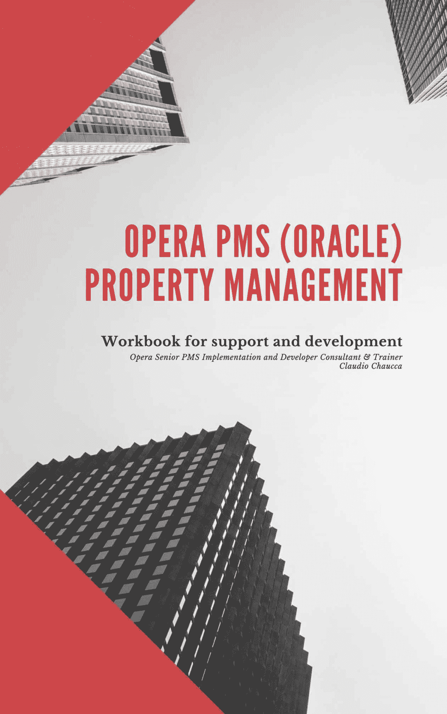

# 从 Opera PMS 中开具凭证、发票和票据

为了开具票据（Ballot），我们必须验证客户个人资料中的 `Tax Type`（税务类型）字段为 `TICKET`。

进入菜单 `Front Desk`（前台）选项 `In House Guests`（住客），列出所有入住酒店的客户。

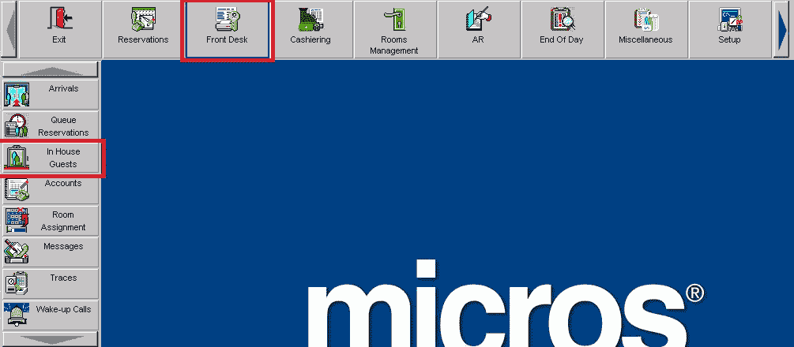

在 `In House Guest` 界面上，选择想要验证其个人资料 `Tax Type` 的客户，并选择单选按钮 `Profile`（资料）。

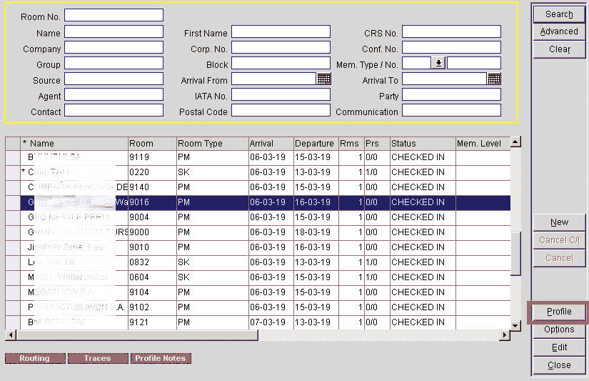

`Individual Profile`（个人资料）界面显示最重要的客户数据。在此界面上，选择 `More Fields`（更多字段）按钮。

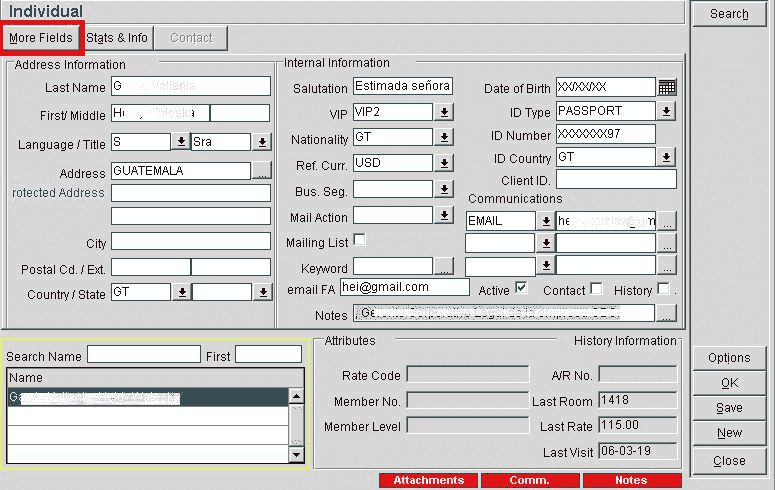

在 `More Fields` 界面上，确保 `Tax Type` 字段已标记为 `TICKET` 选项，并选择 `OK` 按钮。

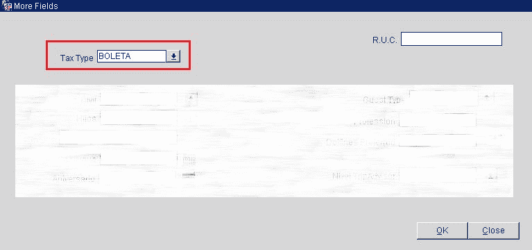

返回 `Individual Profile` 界面后，选择 `Save`（保存）按钮以保存所做的更改，然后点击 `Ok` 和 `Close` 按钮。

通过这种方式我们确保客户的 `Tax Type` 为 `TICKET`，这将允许我们生成付款类型为 `Ticket` 的收据。

进入菜单 `Cashiering`（收银）选项 `Billing`（账单），显示可以为任何住宿、消费或服务概念生成付款证明的住客客户。

在此之前，将显示 `Login`（登录）界面以请求 `ATM` 访问凭据。


在 `In House Guest Search`（住客搜索）界面上，筛选 `Due Outs`（待结账）记录，这些记录是尚未离开的客户、正在入住并消费酒店提供的服务的客户，必须为他们生成付款收据（在这种情况下为票据）。

选择 `Due Outs` 选项并点击 `Search` 按钮。

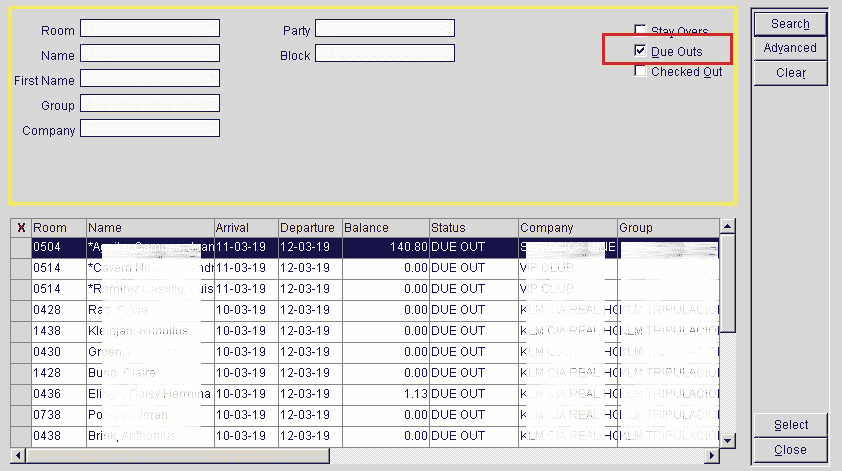

在 `House Guest Search`（住客搜索）界面上，选择您想要生成付款单的客户记录，然后点击 `Select` 按钮。将显示 `Billing` 界面。

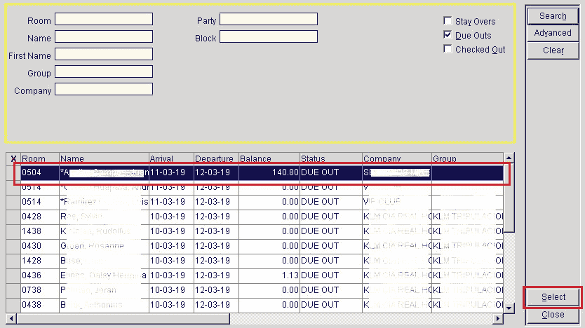

在 `Billing` 界面上显示客户的账户详情。需要指出，在此界面上最多可以有 8 个窗口（Windows），这些窗口允许我们对客户账户分类并为每个窗口生成收据。

让我们观察窗口 `(02)` 有一个尚未支付的 `140.80 USD` 账户，窗口 `(03)` 有一个通过 `VISA` 付款方式支付的 `32.00 USD` 账户。

选择窗口 `(02)` 并点击 `Check Out`（结）按钮，将显示 `Payment` 界面。

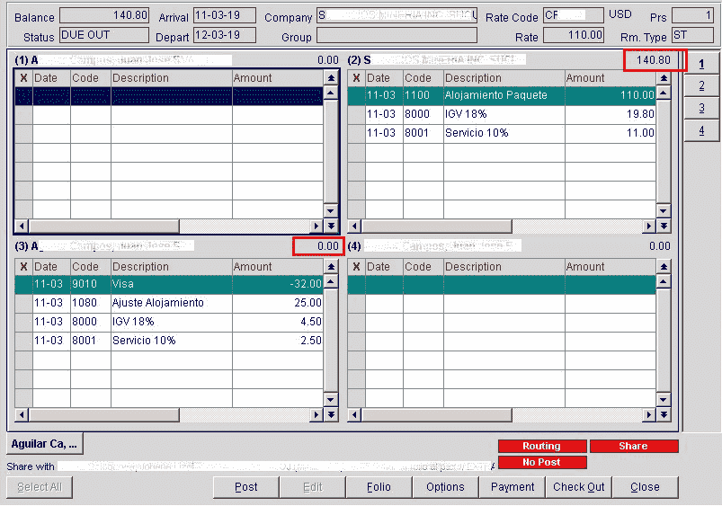

在 `Payment` 界面上，选择 `Payment Code`（付款代码）为 `Cash Dollars`，`Currency`（货币）选项为 `USD`，在 `Amount` 字段中输入金额 `140.80`，在 `Reference` 字段输入账户描述，然后点击 `Post`（过账）按钮，付款将加载到系统中并关闭账户。

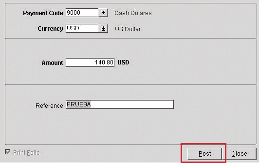

在下一个弹窗界面中指示 `No`，以便将收据发送到您所在国家的数字税务文件开具程序（或中央税务管理局的电子发票）。

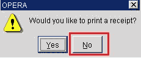 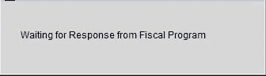

这种将收据发送到您所在国家的数字税务文件开具程序（或中央税务管理局的电子发票）的过程允许我们生成付款类型为 `Ticket` 的收据。

例如，如果某类别的客房在入住率超过 10% 之前以折扣出售，一旦超过此入住百分比，折扣将取消，剩余的 90% 将按无折扣价格出售。

我们希望此限制适用于 `05/01/2019` 到 `05/31/2019` 之间的入住，我们希望控制 3 月和 4 月期间的限制，即从 `03/01/2019` 到 `04/30/2019`。

在 Opera 中，我们进入配置模块。

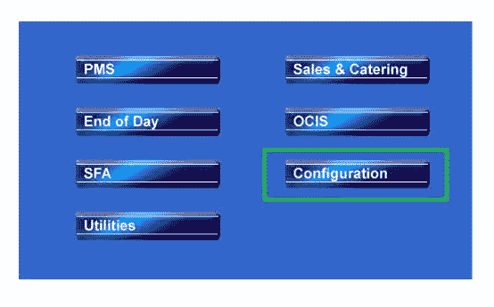

然后我们选择 `Rate Strategy`（房价策略）选项。

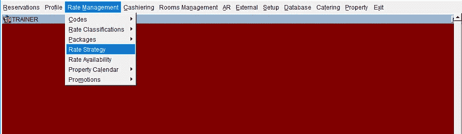

在 `Rate Strategy` 屏幕上，我们将根据建立的条件定义房价策略。

您应该始终定义两个策略记录：房价策略及其对应的对应策略。换句话说，房价是针对入住率高于 10% 的预订定义的，而针对入住率低于 10% 的预订定义房价策略注册。

针对特定定价代码 `CRESP` 的房价策略。

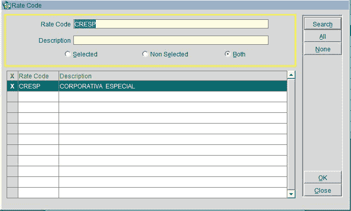

适用于 `2019 年 5 月 1 日` 到 `2019 年 5 月 31 日` 之间的入住或到达

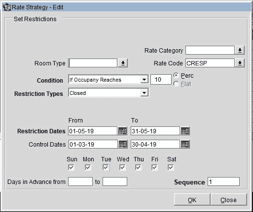

这些订单在 `3 月 1 日` 到 `4 月 30 日` 之间进行销售或预订，我们还要定义其对应的限制策略

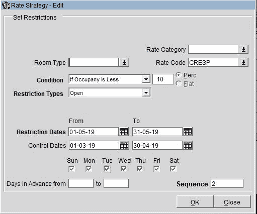

因此，在 `Rate` 屏幕上，`Strategy` 对每个房价限制必须有 2 条记录。

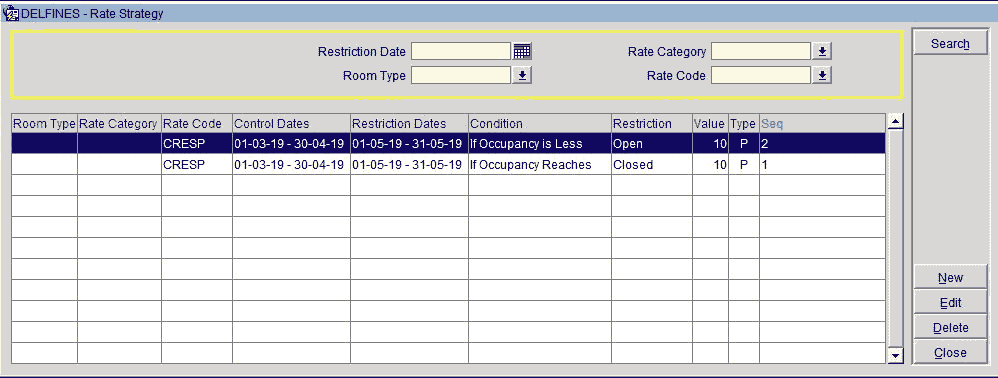

然后我们在预订时测试定义的房价策略。

# Opera PMS 中通过贷单制作贷记（Credit Notes）

我们将通过 `CREDIT BILL`（贷单）制作贷记，进入 `Cashiering`（收银）菜单，`Cashier Functions`（收银功能）选项。将显示 `Cashier Functions` 表单。

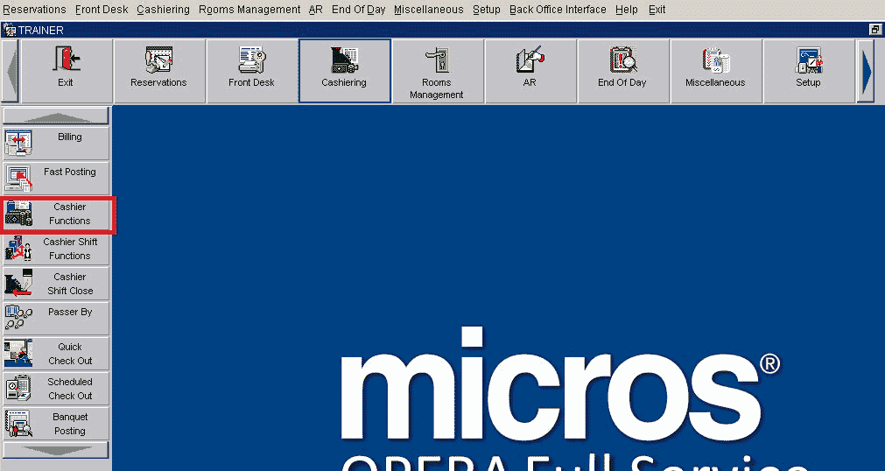

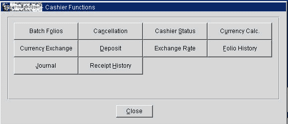

选择 `Folio History`（账单历史）选项，将显示 `Folio History` 表单。

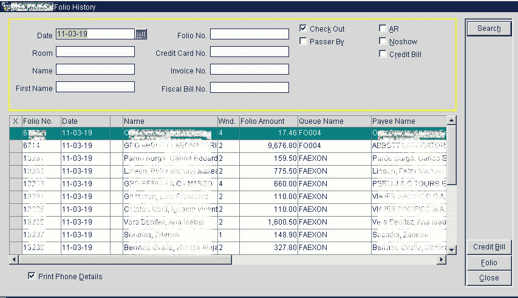

- 请注意，只有针对提前一天开出的凭证可以通过 `CREDIT BILL` 开具贷记，否则 Opera 将禁用 `Credit Bill` 选项按钮；例如，截至今天 `3 月 12 日`，仅允许开具贷记。针对 `3 月 11 日`之前开出的凭证通过贷单制作贷记。

- 另一个需要考虑的因素是，贷记的发行必须与付款收据的系列类别对应，也就是说，如果系列类别为 `F010`，则贷记必须使用 `F010` 系列；如果系列类别是 `B011`，则贷记必须相应地使用 `B011` 系列。如果没有发生这种关联，将存在中央税务机关拒绝开具贷记的风险。

- 为了实现这种关联，在开具贷记时，必须更改 `Client's Profile`（客户资料）中的 `Tax Type`（税类型）字段。

例如，为客户 `Liu, Fang` 的发票凭证开具贷记时

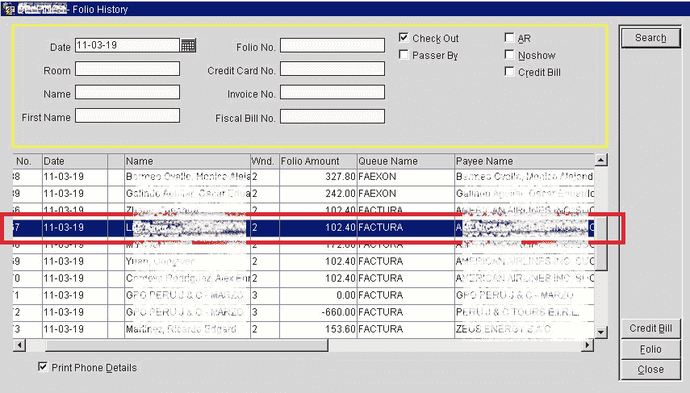

进入 `Reservations Menu`（预订菜单）`Profiles`（资料）选项，在 `Profile Search` 屏幕上找到并选择 `Client Profile`（客户资料）。

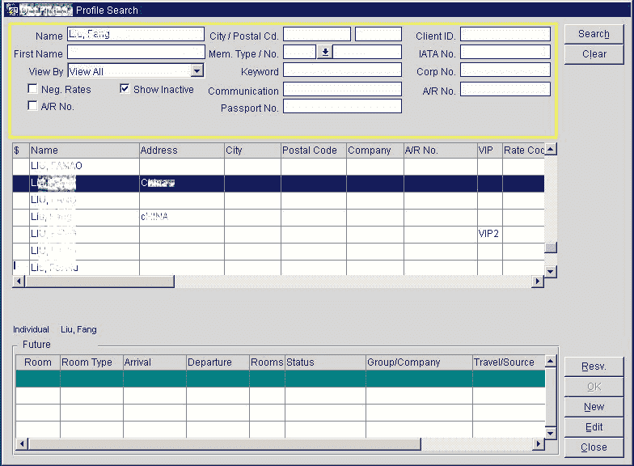

点击 `Edit`（编辑）按钮显示带有客户数据的 `Individual Profile`（个人资料）表单，

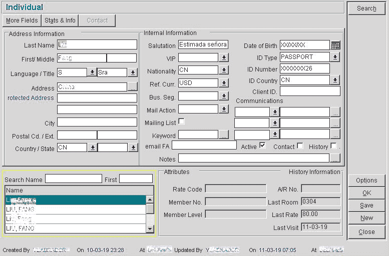

选择 `More Fields`（更多字段）按钮查看 `Tax Type` 选项

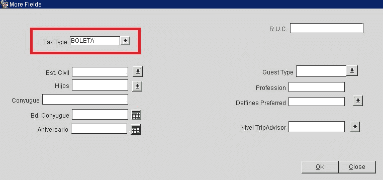

为了正确生成发票贷记，将 `Profile` 的 `Tax Type` 从 `Client`（客户）更改为 `INVOICE`（发票）很重要。

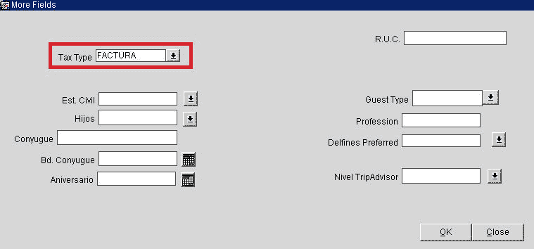

更改 `Tax Type` 字段后，我们从 `Folio History` 屏幕生成发票的 `Credit Bill`。

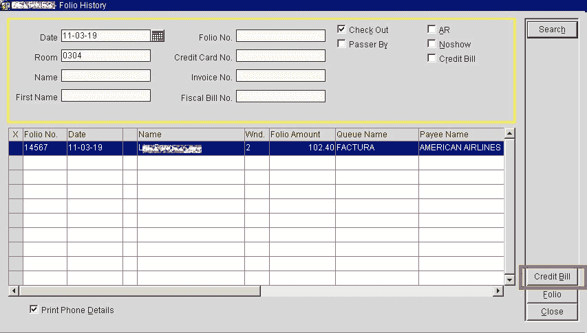

系统会要求输入收银员的凭据，你

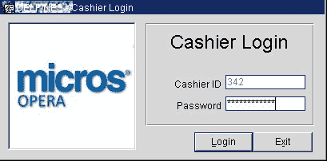

必须指定 `Marked Code`（标记代码）和 `Source Code`（来源）值，然后点击 `Post`（过账）按钮。

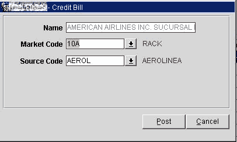

我们过账金额相同但为负值的贷记。

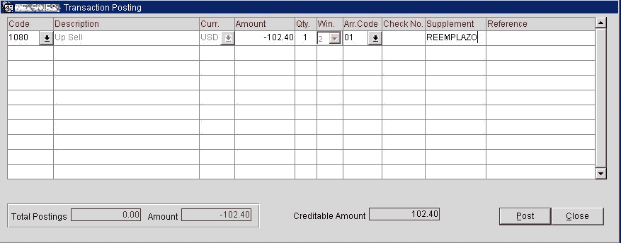

请注意，执行 `CREDIT BILL` 必须使用与制作预订时相同的市场代码（market code）和来源（source）。

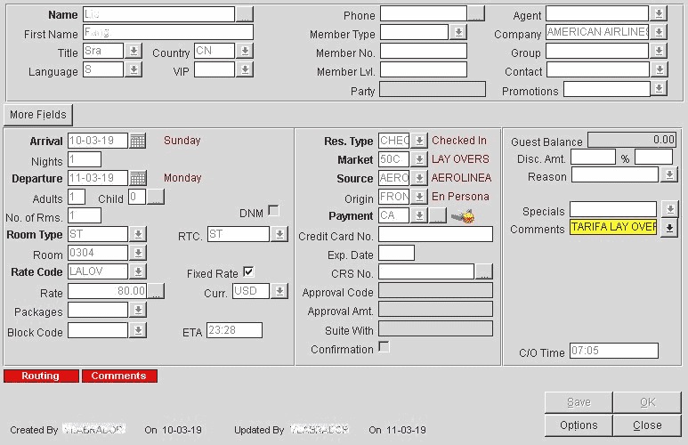 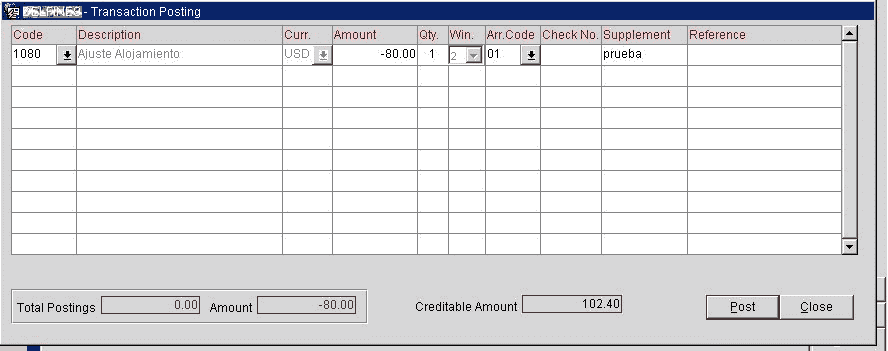

# Opera PMS 中的房价策略配置与演示

本指南配置了定价策略并演示了限制的应用。

## 1. 用户资料 (USER PROFILES)

考虑以下前台和预订资料的权限：

### 前台资料

对于用户必须遵守房价策略限制的资料。这适用于收银员或前台接待人员。

您不能拥有以下权限：

- `RESERVATIONS \ OVERRIDE RATECODE`

- `BLOCKS \ OVERRIDE BLOCK RATE RESTRICTIONS`

您必须拥有以下权限：

- `RESERVATION \ RATE CODE CHANGE`

### 预订资料

对于用户可以授权打破价格策略限制的资料。这适用于主管人员。

您必须拥有以下权限：

- `RESERVATION \ OVERRIDE RATECODE`

- `BLOCKS \ OVERRIDE BLOCK RATE RESTRICTIONS`

## 2. 系统参数 (SYSTEM PARAMETERS)

必须在 `System Settings` 屏幕中指定以下参数：

| 参数 | 值 |

| :--- | :--- |

| `RATES \ SET CATEGORY` | `Y` |

| `RATES \ SET RATE CODE` | `Y` |

## 3. 房价策略定义

为了配置房价策略，进入 `Configuration` 主菜单，将显示 `Configuration` 屏幕。进入 `Rate Management` 菜单，`Rate Strategy` 选项，将显示 `Rate Strategy` 屏幕。

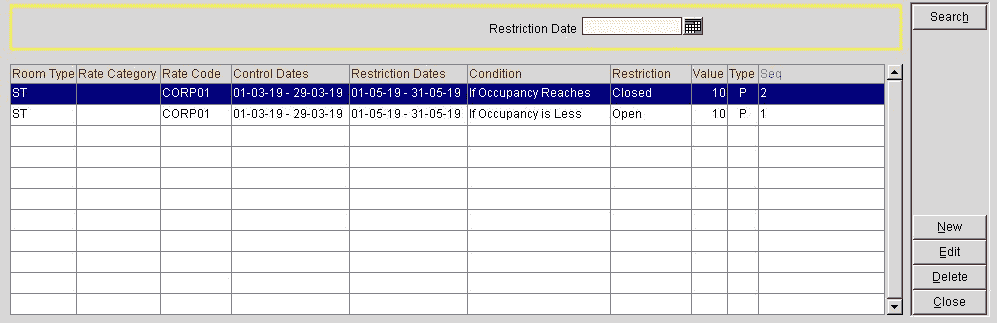

点击 `New`（新建）按钮。定义入住率小于 10% 的直接房价策略为 `OPEN`。

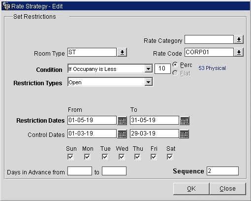

同时也定义入住率大于 10% 的反向房价策略为 `CLOSED`。

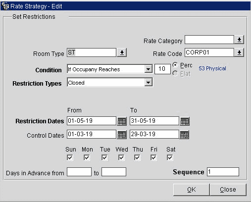

`Restriction Dates` 字段中的日期对应于预订的日期。

## 4. 入住水平与预测处理器 (OCCUPANCY LEVEL AND FORECAST PROCESSOR)

房价策略的正确执行根据入住水平决定是否应用价格限制。这种入住水平要求从预订房库存中扣除（Deduct）。

为了激活库存扣除，确保预测处理器正在运行很重要。

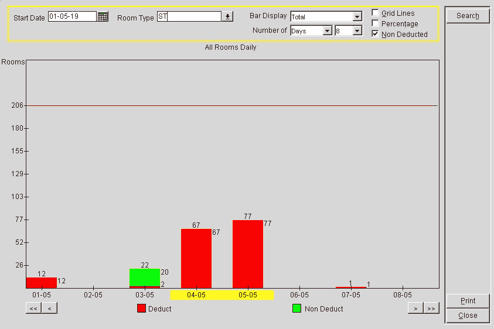

要激活它，进入 `Utilities` 主菜单，将显示 `Utilities` 屏幕。在此屏幕上，进入 `Processors` 菜单，`Forecast Processor` 子菜单，将显示 `Forecast Processor Status` 屏幕。


在 `Forecast Processor Status` 屏幕上，运行进程应显示为 `Running`，否则点击 `Start`（启动）按钮。

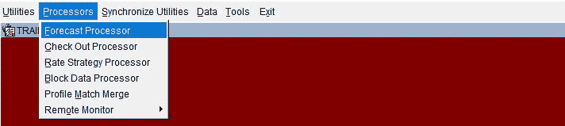

## 5. 房价代码配置 (RATE CODE CONFIGURATION)

我们需要验证房价配置，进入 `Rate Management` 菜单，`Rate Classifications` 菜单选项，`Rate Codes` 选项。选择涉及房价策略的 `Rate Code` 并点击 `Edit`（编辑）按钮。

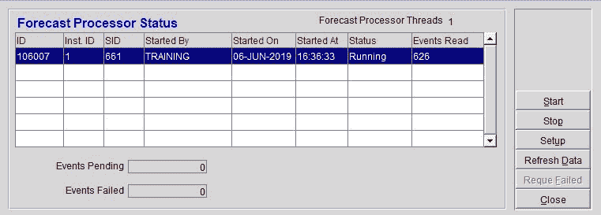

在 `Rate Header` 表单中，确保 `Room Types` 字段具有我们建立房价策略的房型类型 `ST`，同时验证 `Begin Sell Date` 和 `End Sell Date` 日期范围符合房价策略的执行日期和控制日期。

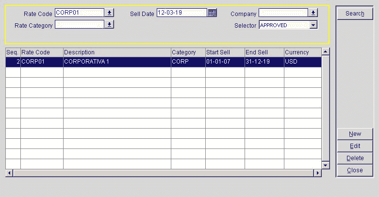

在 `Rate Detail` 表单中，选择与房价策略考虑的 `Room Types` `ST` 对应的记录，确保 `Start Date` 和 `End Date` 日期范围与定义的执行日期和控制日期一致。

## 6. 预订类型的配置

我们必须验证 `Reservation Types` 预订类型，并考虑那些会从房间物理房存中扣除的预订类型，也就是说这些预订一旦确认将无法取消。

这非常重要，因为 `Rate Strategy` 价格策略只计算预订并从房间库存中扣除的房间，以验证入住率。

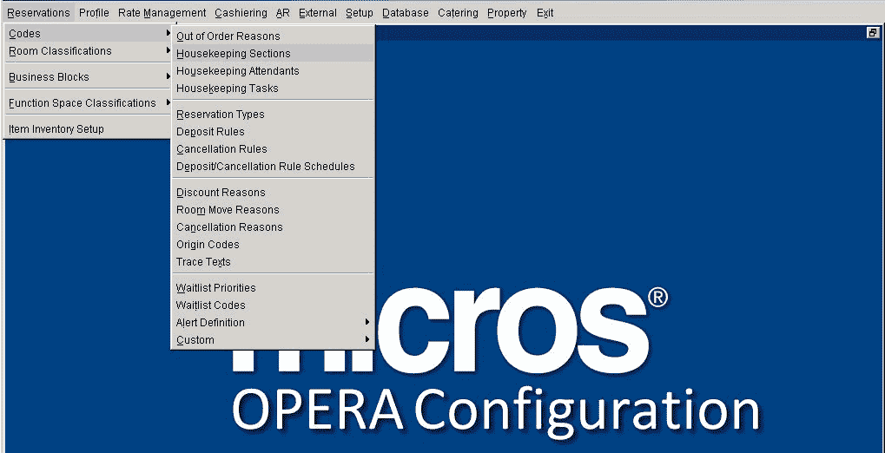

在 `Reservation Type`（预订类型）屏幕中，我们必须至少有一个记录作为 `Deduct` 扣减预订类型。

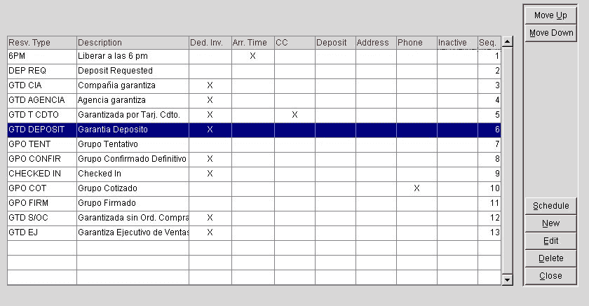 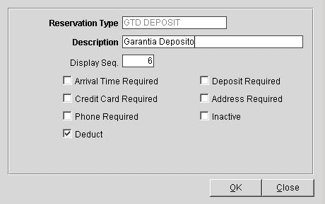

## 7. 进行预订

在对初步参数配置进行充分验证后，进入 `Reservations`（预订）选项菜单，选择 `New Reservation`（新建预订）选项按钮。

在 `Profile Search`（资料搜索）屏幕中，我们搜索特定的客户。

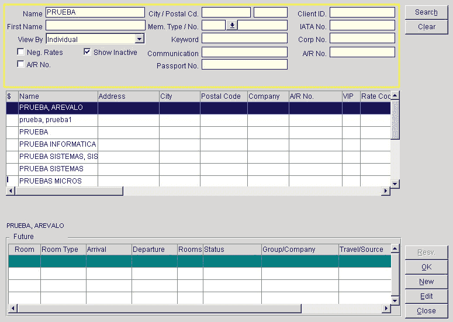

在 `Reservation`（预订）屏幕上，`Arrival`（到达）字段中的日期必须在价格策略的执行范围内，选择价格策略中定义的 `Room Type` 房型和 `Rate Code` 房价代码。

**重要**你必须在 `Res Type` 字段中选择带有 `Deduct` 扣减的预订类型。

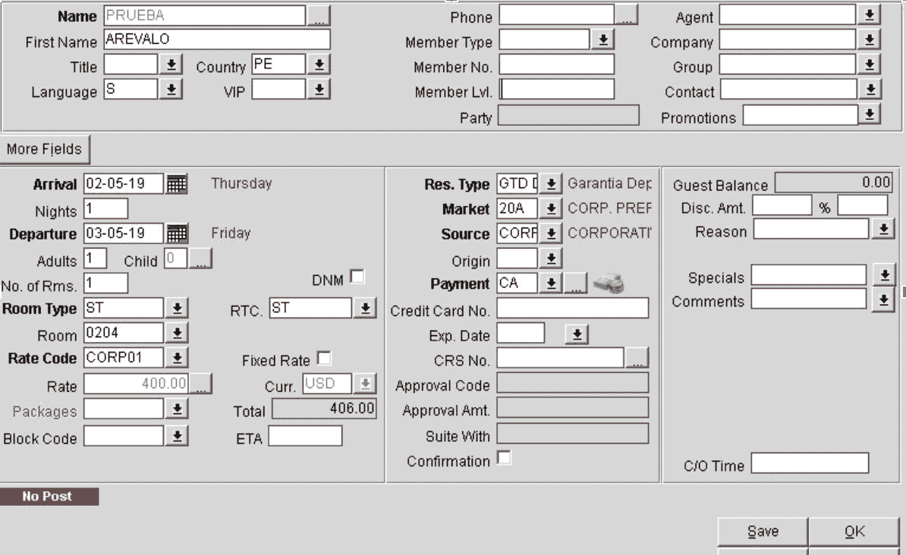

只要限制规则未达到直接定价策略的限制（`<10% occupancy OPEN`），即可按天进行预订。

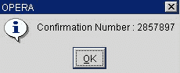

一旦在入住屏幕（`Shift + F1`）上对 5 月 2 日进行了预订，我们观察到有 1 间房间被预订并从库存中扣除（`Deduct`）。

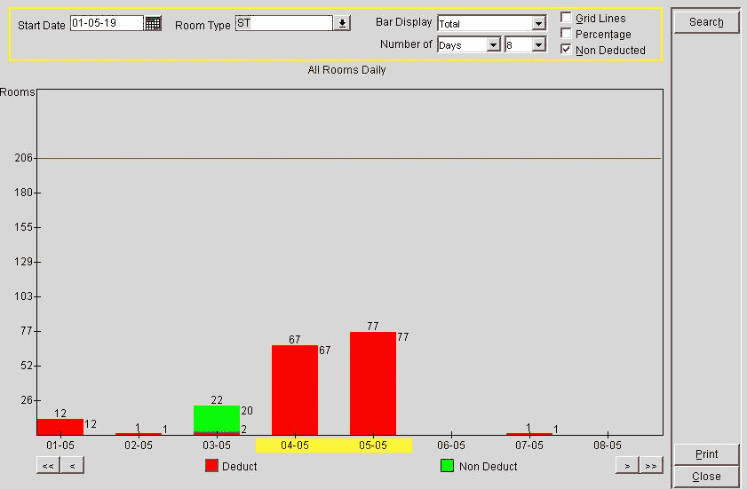

我们使用收银员资料进行预订，房间数量恰以覆盖 10% 的入住率（定价策略的限制）。

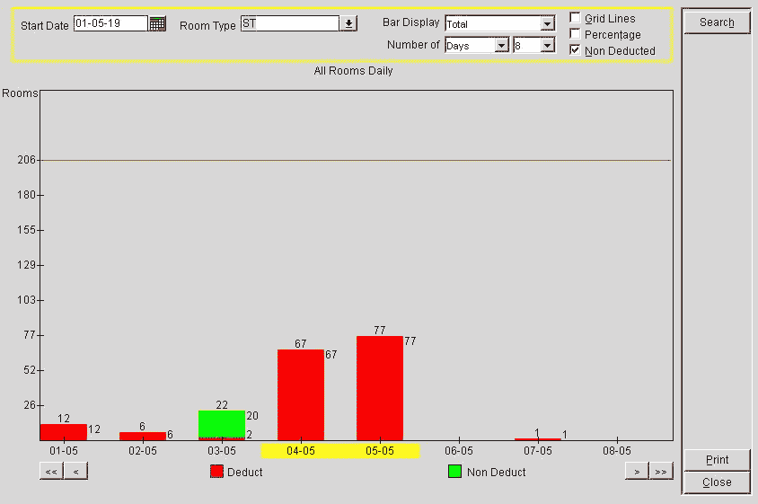 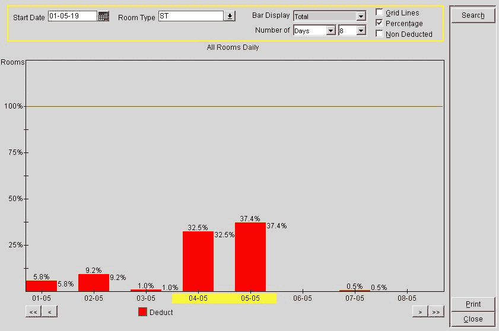

在下一次预订意向中，将显示 `Rate Query Details` 房价查询详情屏幕，价格处于 `Close` 关闭状态，这确认了定价策略限制了价格分配。

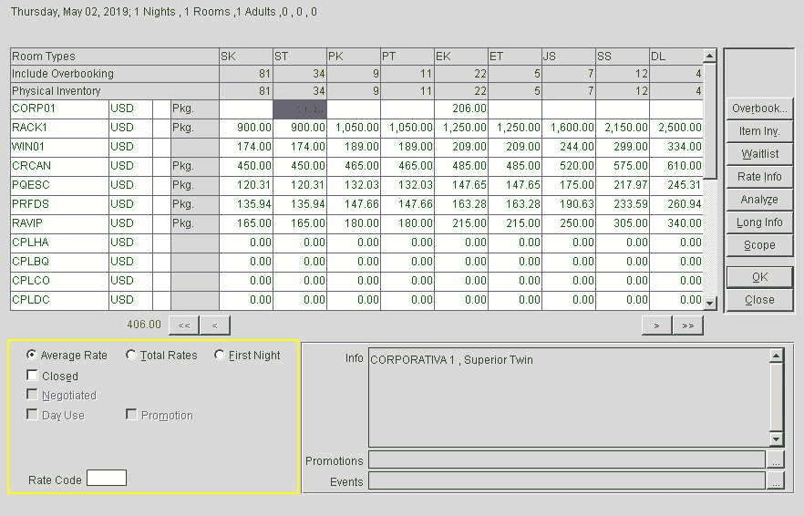 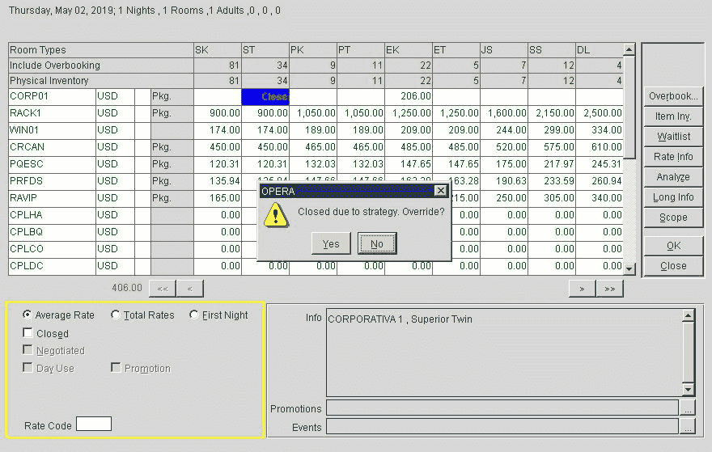

如果你想继续分配，将显示价格分配权限请求屏幕。此授权由 `Supervisor`（主管）用户提供。

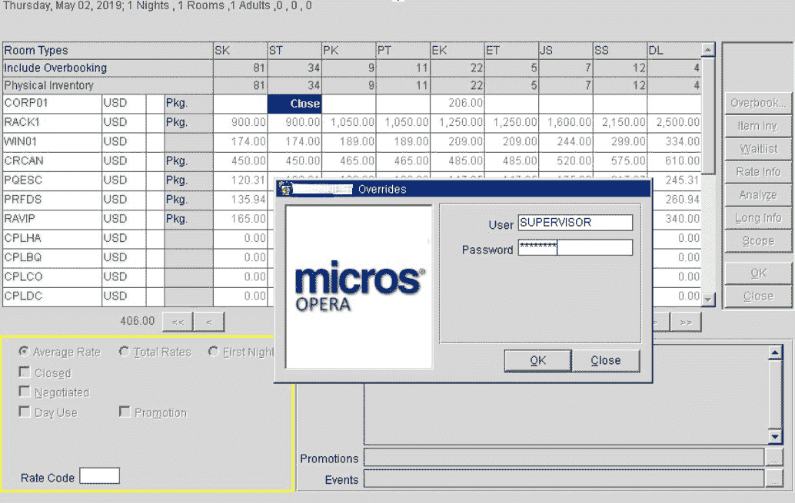

## 8. 与价格策略相关的报告

如果你想查看定价策略的行为，请使用以下报告：

| 报告名称 | .rep 文件 |

| :--- | :--- |

| 限制详情 (Restrictions Detail) | `raterest.rep` |

| 预订房价检查 (Reservation Rate Check) | `res_rate_check.rep` |

| 按房价代码生成的预订 (Reservations made On by Ratecode) | `paris_reservationsmadeonbyratecode.rep` |

# 使用 Opera PMS 和 Oracle Reports Developer 创建报告

在 Opera 中创建自定义报告，你必须首先创建一个 SQL 语句以从 Opera 的 Oracle 数据库中获取报告数据，然后在 `Oracle Reports Developer` 工具中设计报告，最后在 Opera 可用的报告列表中分配一个选项。

使用正确版本的 `Oracle Reports Developer` 非常重要，通常该工具由 Opera PMS 商安装。

| Opera | Oracle Reports Developer |

| :--- | :--- |

| v 5.0 | v 10.1.2.0 |

| v 5.5 | v 11.1.2.2.0 |

在本博客中，我们将创建一个列出常住客户列表的报告。

我们执行从 Opera Oracle 数据库中提取数据的 SQL 语句。

```sql
SELECT a.room, trim (initcap (a.guest_first_name)) || ' '|| trim (initcap (a.sname)) As Name,
trim (a.company_name) ||' '|| a.travel_agent_name As Company,
a.resv_status, a.arrival, a.departure
FROM reservation_general_view
WHERE (a.resv_status =' CHECKED IN 'OR a.resv_status =' DUE OUT ')
ORDER BY a.room
```

我们将使用视图 `reservation_general_view`，该视图包含必要的查询来提取所有客户在不同状态下的预订数据：

- CHECKED IN（已入住）

- PROSPECT（意向）

- CANCELLED（已取消）

- NO SHOW（未到）

- CHECKED OUT（已退房）

- RESERVED（已预订）

我们在开发环境 `Oracle SQL Developer` 中执行此查询，以验证查询正常工作。


我们执行设计程序 `Oracle Reports Developer`。


将显示生成器（Builder）


我们将生成器连接数据库，为此我们选择`File`菜单选项`Connect ...`。


将显示数据库的连接向导，你必须输入`User`（用户名）、`Password`（密码）和 Oracle 数据库的实例名称，然后点击单选按钮`Connect`连接到数据库。


选择`File`菜单，`New` / `Report…`菜单选项，将显示`New Report`向导。选择`Use the Report Wizard`选项并点击`OK`按钮。


将显示向导`Report Wizard!`，点击`OK`按钮。


为了访问 Opera 数据字典，你必须能够通过 Oracle SQL Developer 或另一个 Oracle 开发环境访问 Oracle 数据库。

使用以下 SQL 语句来提取 Opera 数据字典：

```sql
select cc.table_name, tc.column_name, tc.nullable, tc.data_type ||
case
when tc.data_type = 'NUMBER' and tc.data_precision is not null
then '(' || tc.data_precision || ',' || tc.data_scale || ')'
when tc.data_type like '% CHAR%'
then '(' || tc.data_length || ')'
else null
end type
, cc.comments
from user_col_comments cc
join user_tab_columns tc
on (cc.column_name = tc.column_name and cc.table_name = tc.table_name)
order by cc. table_name ASC, tc.column_name ASC
```

对于那些无法访问 Opera Oracle 数据库的用户，我遗留了 Excel 格式的数据字典，以及字段描述的英语说明及其对应的西班牙语翻译。

由于 Opera 拥有超过 4800 张表，本博客将描述维护和开发过程中最重要的表和字段。

[Opera PMS 数据字典 - Oracle](https://docs.google.com/spreadsheets/d/19lfAxMjt29iqhjeux8wn6DuMa9-cgiTC/export?format=xlsx)

# Opera PMS 每日付款报表的设计与创建

我们将创建一个报告，显示每天的付款列表，以及来自各种支付形式（现金、卡片等）的付款情况。此类报告允许我们查看并验证每个交易日内 ATM 收取的费用。

报表将显示以下列：

- 交易日期
- 交易代码
- 交易代码描述
- 预订
- 房号
- 宾客姓名
- 凭证号
- 美元总计费金额
- 货币代码
- 收银员

```sql
SELECT TO_CHAR (fi.TRX_DATE,'DD / MM / RR') TRX_FECHA, --Date of Transaction
  fi.TRX_CODE TRX_CODE, -Transaction Code
  UPPER(trc.DESCRIPTION) TRX_DESCRIPTION, - Transaction Code Description
  fi.RESV_NAME_ID NR_RESERVA, --Reservation Number
  fi.ROOM NR_HAB, --NVL Room
  Number (n.SNAME||','||n.SFIRST,' ''), GUEST--Guest Name
  fi.fiscal_bill_no NR_DOCUMENTO, - Voucher Number
  DECODE (fi.bill_no,NULL,0, decode (fi.trx_no, fol.bill_payment_trx_no, fol.total_gross,0)) BILLED_USD, --Total Billed in Dollars
  fi.CURRENCY CURRENCY, --RPAD Currency
  Code (UPPER (au.APP_USER),5) USER --User
FROM 
  FINANCIAL_TRANSACTIONS fi
 INNER  JOIN FOLIO_TAX fol ON (fol.BILL_NO = fi.BILL_NO AND fol.NAME_ID = fi.NAME_ID)
 INNER  JOIN  NAME n ON (n.NAME_ID = fi.NAME_ID)
 INNER  JOIN TRX$_CODES trc ON (trc.TRX_CODE = fi.TRX_CODE)
 INNER  JOIN APPLICATION$_USER au ON (au.APP_USER_ID = fi.INSERT_USER)
WHERE
--- TO_CHAR (fol.BUSINESS_DATE, 'DD / MM / RRRR') = '11 / 03/2019 '
fol.BUSINESS_DATE =  : P_BUSDATE
AND fi.BILL_NO IS  NOT  NULL
AND (fi.TRX_CODE BETWEEN  9000  AND  9999)
AND fi.DISPLAY_YN ='Y'
AND fi.RECPT_TYPE ! =  'CUX'
AND fi.PACKAGE_CREDIT IS  NULL
AND fi.PACKAGE_DEBIT IS  NULL
AND fi.PRICE_PER_UNIT <>  0
ORDER  BY
TRX_FECHA, NR_DOCUMENTO, TRX_CODE, TRX_FECHA;
```

为了制作此报表，将使用与财务交易、客户账单或其他相关的表：

- `FINANCIAL_TRANSACTIONS`：此表存储所有与收银服务相关的交易、每个预订的交易（宾客账、定金账、应收账账和套餐账）。
- `FOLIO_TAX`：此表存储按发票汇总的收入信息。
- `NAME`：此表存储宾客、公司、旅行社、来源和小组的配置信息。
- `TRX $ _CODES`：此表存储系统所有的交易代码，这些交易是在过账（POST）时选择的概念。
- `APPLICATION $ _USER`：此表存储操作系统的所有用户信息。

我们在“Oracle SQL Developer”开发环境中执行查询来验证 SQL 语句。


我们运行报表设计程序“Oracle Reports Builder”，并使用“Report Wizard”（报表向导）创建一个新报表。

在“Report Style”（报表样式）屏幕上，我们指定报表标题并选择“Group Left”（左分组）格式，这种格式允许我们在报表中创建分组。


在报表向导的“Data Source Definition”（数据源定义）屏幕上，将显示创建 `P_BUSDATE` 报表参数的确认。该参数将允许我们从中进行选择。

预测是指使用如历史数据等不同的变量，对产品或服务的未来需求进行估计和分析。

酒店预测的基础的主要变量之一是对物业在先前期间的统计数据的分析，通过这些数据，我们可以预测未来的收入，并做出适当的业务决策以纠正偏差，从而实现收入最大化和成本最小化。

明确预测工具的重要性，特别是在线的、实时且通过手机直接从 `Opera PMS` 查询数据的预测工具，这对于物业的高效管理来说将是一个非常实用的工具。

需要考虑的是，在线预测工具必须包含以下数据，其描述保留自原始 `Opera` 文档：

- **日期 (Date)**：统计数据适用的日期。
- **总入住率 (Total Occupancy)**：总占用房间数（非扣减、扣减、个人和团体）。
- **入住房间数 (Arrival Rooms)**：在此日期入住的客房。对于入住，组合房间计为 1 个，而不是组成组合房间的物理房间数量。
- **赠房数 (Comp Rooms)**：免费房间（关联到订单且房型代码标记为“免费”的房间）。
- **员工用房 (House Use)**：员工用房（关联到订单且房型代码标记为“员工用房”的房间）。
- **个人扣减房 (Individual Deduct)**：订单类型标记为“扣减库存”的个人预订。
- **非扣减个人房 (Non-Deduct Individual)**：订单类型未标记为“扣减库存”的个人预订。
- **团体扣减房 (Deduct Group)**：订单类型标记为“扣减库存”的团体预订。
- **非扣减团体房 (Non-Deduct Group)**：订单类型未标记为“扣减库存”的团体预订。
- **入住率 (Occupancy%)**：(`（总占用房间数 / 物业总房间数） x 100`）。
- **房收入 (Room Revenue)**：与此日期相关的扣减、非扣减、个人和团体预订的住宿交易代码总收入。
- **平均房价 (Average Rate)**：总房收入 / 占用房间数。
- **退房房间数 (Departure Rooms)**：在此日期退房的客房。对于退房，组合房间计为 1 个，而不是组成组合房间的物理房间数量。
- **当日入住房间数 (Day Use Rooms)**：该日的当日入住房间。
- **未入住房间数 (No Show Rooms)**：该日的未入住房间数。

为此，为 `Oracle` 构建了以下 `SQL Query`，用于获取本月收入（`HISTORY`）相对于预计年收入（`FORECAST`）的预测。


该 `Query` 将成为构建手机在线预测工具的基础。


```sql
SELECT rec_type rec_type,
DECODE (rec_type,'A_STAT', f_message ('REP_HISTORY','History'), f_message ('REP_FORECAST','Forecast')) rec_type_desc,
TO_CHAR (considered_date,'DD / MM / RRRR') considered_date,
SUM (no_rooms * count_resv_01) no_rooms,
SUM (ind_deduct_rooms * count_resv_01) ind_deduct_rooms,
SUM (ind_non_deduct_rooms * count_resv_01) ind_non_deduct_rooms,
SUM (grp_deduct_rooms * count_resv_01) grp_deduct_rooms,
SUM (grp_non_deduct_rooms * count_resv_01) grp_non_deduct_rooms,
SUM (no_persons * count_resv_01) no_persons,
SUM ( arrival_rooms * count_resv_01) arrival_rooms,
SUM (departure_rooms * count_resv_01) departure_rooms,
SUM (complimentary_rooms * count_resv_01) complimentary_rooms,
SUM (house_use_rooms * count_resv_01) house_use_rooms,
SUM (day_use_rooms * count_resv_01) day_use_rooms,
SUM (no_show_rooms * count_resv_01) no_show_rooms,
SUM (revenue * count_revenue_01) revenue,
SUM (DECODE (group_yn,'N', DECODE (deduct_yn,'Y', revenue,0),0) * count_revenue_01) ind_deduct_revenue,
SUM (DECODE (group_yn,'N', DECODE (deduct_yn,'N', revenue,0),0) * count_revenue_01) ind_non_deduct_revenue,
SUM (DECODE (group_yn,'Y', DECODE (deduct_yn,'Y', revenue,0),0) * count_revenue_01) grp_deduct_revenue,
SUM (DECODE (group_yn,'Y', DECODE (deduct_yn,'N', revenue,0),0) * count_revenue_01) grp_non_deduct_revenue,
SUM (owner_rooms * count_resv_01) owner_rooms,
SUM (ff_rooms * count_resv_01) ff_rooms
FROM (
SELECT SUBSTR (rsf.Rec_type,1,6) rec_type,
rsf.considered_date considered_date,
DECODE (rsf.owner_rental_flag,'H',0, rsf.no_rooms) no_rooms,
DECODE (rsf.owner_rental_flag,'H',0, rsf.group_yn,'N', DECODE (deduct_yn,'Y', rsf.no_rooms,0)) ind_deduct_rooms,
DECODE (rsf.owner_rental_flag,'H',0, rsf.group_yn,'N', DECODE (deduct_yn,'N', rsf.no_rooms,0)) ind_non_deduct_rooms,
DECODE (rsf.owner_rental_flag,'H',0, rsf.group_yn,'Y', DECODE (deduct_yn,'Y', rsf.no_rooms,0)) grp_deduct_rooms,
DECODE (rsf.owner_rental_flag,'H',0, rsf.group_yn,'Y', DECODE (deduct_yn,'N', rsf.no_rooms,0)) grp_non_deduct_rooms,
rsf.no_persons no_persons,
rsf.arrival_rooms arrival_rooms,
rsf.departure_rooms departure_rooms,
rsf.complimentary_rooms complimentary_rooms,
rsf.house_use_rooms house_use_rooms,
rsf.day_use_rooms day_use_rooms,
rsf.no_show_rooms no_show_rooms,
rsf.revenue revenue,
DECODE (rsf.group_yn,'N', DECODE (rsf.deduct_yn,'Y', rsf.revenue,0),0) ind_deduct_revenue,
DECODE (rsf.group_yn,'N', DECODE (rsf.deduct_yn,'N', rsf.revenue,0),0) ind_non_deduct_revenue,
DECODE (rsf.group_yn,'Y', DECODE (rsf.deduct_yn,'Y', rsf.revenue,0),0) grp_deduct_revenue,
DECODE (rsf.group_yn,'Y', DECODE (rsf.deduct_yn,'N', rsf.revenue,0),0) grp_non_deduct_revenue,
rsf.owner_rooms owner_rooms,
rsf.ff_rooms ff_rooms
FROM rep_res_stati_hld rsf
where rsf.considered_date between TO_DATE (('01'||to_char (sysdate,'MMRRRR')),'DDMMRRRR') and TO_DATE (TO_CHAR (LAST_DAY (to_char (ADD_MONTHS (SYSDATE, 11),'YYYYMM')),'YYYYMM'),'DDMMRRRR'),'DDMMRRRR')
and rsf.deduct_yn='Y'
UNION ALL
SELECT (CASE WHEN (TO_DATE (('01'||to_char (sysdate,'MMRRRR')),'DDMMRRRR') + ns.N - 1) < pms_p.business_date THEN 'A_STAT' ELSE 'B_FORE' END) rec_type,
(TO_DATE (('01'||to_char (sysdate,'MMRRRR')),'DDMMRRRR') + ns.N - 1) considered_date,
0 no_rooms,
0 ind_deduct_rooms,
0 ind_non_deduct_rooms,
0 grp_deduct_rooms,
0 grp_non_deduct_rooms,
0 no_persons,
0 arrival_rooms,
0 departure_rooms,
0 complimentary_rooms,
0 house_use_rooms,
0 day_use_rooms,
CASE WHEN (TO_DATE (('01'||to_char (sysdate,'MMRRRR')),'DDMMRRRR') + ns.N - 1) < pms_p.business_date THEN 0 ELSE TO_NUMBER (NULL) END no_show_rooms,
0 revenue,
0 count_resv_01
)
```

```sql
 0 count_revenue_01,
 0 owner_rooms,
 0 ff_rooms,
 'N' deduct_yn,
 'N' group_yn
 FROM number_scale ns
 WHERE ns.n <= TO_DATE (TO_CHAR (LAST_DAY (to_date (to_char (ADD_MONTHS (SYSDATE, 11),'YYYYMM'),'YYYYMM')),'DDMMRRRR'),'DDMMRRRR') - TO_DATE (('01'||to_char (sysdate,'MMRRRR')),'DDMMRRRR') +  1
)
 group by rec_type,
 considered_date ORDER BY rec_type,
 TO_DATE (considered_date,'DD / MM / RRRR')
```

# Opera PMS 中交易明细表报告的创建

需要告诉你，就像我们在房务（HouseKeeping）中通过智能手机显示房间状态一样，你可以基于资产平衡表（Trial Balance）开发分析报告，以实现在线损益表。

此报告显示了过账客人的所有交易详情以及这些交易的分类。

由于平衡表的术语如果直接翻译成西班牙语会扭曲其含义，我将在博客中保留英文定义。

资产平衡表（Trial Balance）报告包含了所有已过账的交易，然后对五个分类账（客人账、应收账、定金账、套票账和酒店间来账）中的每一个业务进行细分。资产平衡表可帮助确保您的物业账户平衡且状态良好。

## 可用于对账的其他报告摘要

| 报告标题 | .REP 文件名 | 附加信息 |
| :--- | :--- | :--- |
| 按类型账龄摘要 | `araging` | 可以针对特定日期运行。 |
| 详细账龄报告 | `aragingdet` | 可以针对特定日期运行。 |
| 应收账 (AR Ledger) | `arledger` | 持续更新 |
| 定金活动报告 | `deposit_activity` | 可以针对特定日期运行，但如果用于对账，应按活动日期运行。 |
| NA 定金账 (NA Deposit Ledger) | `deposit_ledger` | 持续更新。 |
| 财务支付与收入过账 | `findeptcodes` | 可以针对特定日期运行，但如果用于对账，应始终按净收入运行。 |
| 按收银员和交易代码分类日志 | `finjrnlbytrans` | 可以针对特定日期运行，但如果用于对账，应始终按净收入运行。 |
| 生成的财务交易日志 | `finjrnlbytrans2` | 可以针对特定日期运行，但如果用于对账，应始终按净收入运行。 |
| 套票过账 | `finpkgposting` | 捕获当前业务日期的数据，如果用于对账，必须附在夜审报告组中。 |
| 客人资产平衡表 (Guest Trial Balance) | `gl_trial_balance` | 可以针对特定日期运行。 |
| 经理报告 | `manager_report` | 可以针对特定日期运行。 |
| 入/离店转转定金 | `nadeptransci` | 捕获当前业务日期的数据，如果用于对账到资产平衡表，必须与夜审一同运行。 |
| 套票账明细 | `napkgledger` | 捕获当前业务日期的数据，如果用于对账到资产平衡表，必须与夜审一同运行。 |
| 资产平衡表 (Trial Balance) | `trial_balance` | 可以针对特定日期运行。 |

资产平衡表明细具有以下结构：


- **Room**: 预订的房间号。
- **Guest Name**: 客人姓名。
- **Arragement Desc**: 交易分类名称。
- **Trx Code**: 交易代码。
- **Trx No**: 交易序列号。
- **Description**: 交易描述。
- **Old Balance (Opening Balance)**: 报告运行当日客人账户的总余额。
- **Credits**: 客人已向账户支付的总金额（贷方）。
- **Debits**: 记入客人账户的总金额（借方）。
- **Transferred Credits**: 任何转入客人账户并被视为贷方的金额。
- **Transferred Debits**: 结果转账而记入客人账户的任何金额。
- **New Balance (Closing Balance)**: 账户的结余额。此列通过以下公式计算：`Opening Balance + Debits + Transfer Debit - Credits - Transfer Credits`。

## Oracle 的 SQL 查询：


# Opera PMS 中交易明细表报告的创建

需要告诉你，就像我们在房务（HouseKeeping）中通过智能手机显示房间状态一样，你可以基于资产平衡表（Trial Balance）开发分析报告，以实现在线损益表。

此报告显示了过账客人的所有交易详情以及这些交易的分类。

由于平衡表的术语如果直接翻译成西班牙语会扭曲其含义，我将在博客中保留英文定义。

资产平衡表（Trial Balance）报告包含了所有已过账的交易，然后对五个分类账（客人账、应收账、定金账、套票账和酒店间来账）中的每一个业务进行细分。资产平衡表可帮助确保您的物业账户平衡且状态良好。

## 可用于对账的其他报告摘要

| 报告标题 | .REP 文件名 | 附加信息 |
| :--- | :--- | :--- |
| 按类型账龄摘要 | `araging` | 可以针对特定日期运行。 |
| 详细账龄报告 | `aragingdet` | 可以针对特定日期运行。 |
| 应收账 (AR Ledger) | `arledger` | 持续更新 |
| 定金活动报告 | `deposit_activity` | 可以针对特定日期运行，但如果用于对账，应按活动日期运行。 |
| NA 定金账 (NA Deposit Ledger) | `deposit_ledger` | 持续更新。 |
| 财务支付与收入过账 | `findeptcodes` | 可以针对特定日期运行，但如果用于对账，应始终按净收入运行。 |
| 按收银员和交易代码分类日志 | `finjrnlbytrans` | 可以针对特定日期运行，但如果用于对账，应始终按净收入运行。 |
| 生成的财务交易日志 | `finjrnlbytrans2` | 可以针对特定日期运行，但如果用于对账，应始终按净收入运行。 |
| 套票过账 | `finpkgposting` | 捕获当前业务日期的数据，如果用于对账，必须附在夜审报告组中。 |
| 客人资产平衡表 (Guest Trial Balance) | `gl_trial_balance` | 可以针对特定日期运行。 |
| 经理报告 | `manager_report` | 可以针对特定日期运行。 |
| 入/离店转转定金 | `nadeptransci` | 捕获当前业务日期的数据，如果用于对账到资产平衡表，必须与夜审一同运行。 |
| 套票账明细 | `napkgledger` | 捕获当前业务日期的数据，如果用于对账到资产平衡表，必须与夜审一同运行。 |
| 资产平衡表 (Trial Balance) | `trial_balance` | 可以针对特定日期运行。 |

资产平衡表明细具有以下结构：


- **Room**: 预订的房间号。
- **Guest Name**: 客人姓名。
- **Arragement Desc**: 交易分类名称。
- **Trx Code**: 交易代码。
- **Trx No**: 交易序列号。
- **Description**: 交易描述。
- **Old Balance (Opening Balance)**: 报告运行当日客人账户的总余额。
- **Credits**: 客人已向账户支付的总金额（贷方）。
- **Debits**: 记入客人账户的总金额（借方）。
- **Transferred Credits**: 任何转入客人账户并被视为贷方的金额。
- **Transferred Debits**: 结果转账而记入客人账户的任何金额。
- **New Balance (Closing Balance)**: 账户的结余额。此列通过以下公式计算：`Opening Balance + Debits + Transfer Debit - Credits - Transfer Credits`。

## Oracle 的 SQL 查询

```sql
SELECT t.room, t.guest_name, t.arrangement_desc,
t.trx_code, t.trx_no,
t.description,
t.old_balance, t.credit, t.debit, t.transfer_credit, t.transfer_debit, t.new_balance
FROM(
 SELECT
        fs.trx_no,
        ar.arrangement_desc,
        fs.resv_name_id,
        fs.name_id,
        fs.resort,
        rv.room,
        rv.guest_name,
        co.trx_code,
        co.description,
        - 在 from_date 之前的 GL 过账
        DECODE (abs (trunc (to_date (to_char (to_char (pms_p.business_date)))) - trunc (fs.trx_date)), 0, -1,
        NVL (fs.Guest_account_debit,0)) - (NVL (fs.Guest_account_credit,0))) old_balance,
        - 在 from_date 过账的 GL 贷方
        DECODE (fs.from_res_id,NULL, decode (pms_p.business_date - trunc (fs.trx_date)), 0, n1 (fs.Guest_account_credit,0), 0) credit,
        - from__date 过账的 GL 借方
        DECODE (fs.from____________________.trx__)), 0, n, (fs.Guest_account_debit,0), 0) debit,
        - 在 from_date 过账的其他订单贷方
        DECODE (fs.from_res_id,NULL,0 (pms_p.business_date - trunc (fs.trx_date)), 0, nvl (fs.Guest_account_credit,0), 0)) transfer_credit,
        - 在 from_date 过账的其他订单借方
        DECODE (fs.from_res_id,NULL, decode (pms_p.business_date - trunc (fs.trx_date)), 0, nvl (fs.Guest_account_debit,0), 0)) transfer_debit,
        - 在 from_date 之前的 GL 过账
        DECODE (pms_p.business_date - trunc (fs.trx_date)), -1,0,
        NVL (fs.Guest_account_debit,0) - NVL (fs.Guest_account_credit,0)) new_balance
FROM financial_transactions_view fs
inner join rep_reservation_all_view rv on (fs.resv_name_id = rv.resv_name_id)
inner join trx$_codes co on (co.trx_code=fs.trx_code)
inner join trx$_code_arrangementar on (ar.arrangement_id=co.arrange)
where fs.resv_name_id IN
    - 今日过账的客人订单
SELECT resv_name_id
FROM financial_transactions ftx
WHERE ftx.resort = : RESORT
AND ftx.trx_date = pms_p.business_date
AND ftx.resv_name_id IS NOT Null
UNION ALL
- 今日（应该）入住的订单
SELECT resv_name_id
FROM reservation_daily_elements rde,
reservation_element_name rdn
WHERE rde.resort = : RESORT
AND rde.reservation_date = pms_p.business_date
AND rdn.resort = rde.resort
AND rdn.reservation_date = rde.reservation_date
AND rdn.resv_daily_el_seq = rde.resv_daily_el_seq
)
AND fs.trx_date <= pms_p.business_date
AND (fs.Guest_account_credit IS NOT Null OR fs.guest_account_debit IS NOT NULL)
and fs.resv_name_id=3142559 and rv.room='0206'
) t
ORDER BY t.room, t.arrangement_desc, t.trx_code, t.trx_no
```

```sql
SELECT ROOM_STATUS_ID, ROOM_STATUS_CODE, ROOM_STATUS_DESC FROM OPERA.ROOM_STATUS_CODES_ALL
```

| ROOM_STATUS_ID | ROOM_STATUS_CODE | ROOM_STATUS_DESC |
| :--- | :--- | :--- |
| 1 | CL | 已清洁 |
| 2 | DI | 脏 |
| 3 | IP | 已检查 |
| 4 | OS | 维修中 |
| 5 | OO | 故障 |

```sql
SELECT DISTINCT HK_STATUS FROM OPERA.ROOM
```

OCC: 已入住

VAC: 空闲

使用以下查询显示特定楼房间的当前状态：


```sql
SELECT r.room, r.room_status, r.hk_status, c.label, c.short_description,
CASE WHEN NVL (v.Resv_status,'F')='CHECKED IN' THEN 'CI' WHEN NVL (v.Resv_status,'F')='CHECKED OUT' THEN 'CO' ELSE '' END resv_status,
TO_CHAR (v.Arrival,'DD / MM') arrival,
TO_CHAR (v.Departure,'DD / MM') departure, TO_CHAR (v.Departure_time) departure_time,,CASE WHEN r.hk_status<>r.fo_status THEN 'AND' ELSE 'N' END isdiscrepancy
FROM OPERA.ROOM r
INNER JOIN OPERA.ROOM_CATEGORY_TEMPLATE c ON (r.Room_category=c.Room_category) 
LEFT JOIN (
SELECT r.room, MIN (r.resv_status) resv_status, min (r.arrival) arrival, max (r.departure) departure, max (r.departure_time) departure_time
FROM reservation_general_view r
WHERE r.trunc_departure> =pms_p.business_date and r.room is not null
AND r.resv_status IN ('CHECKED IN','CHECKED OUT')
GROUP BY r.room
) v ON (v.room=r.room)
WHERE SUITE_TYPE<>'PSUEDO' 
AND to_number (r.Floor)=4--FLOOR
ORDER BY to_number (r.Floor) ASC, to_number (r.Room) ASC
```


从手机设备显示的查询房间状态的 Web 系统界面所示：

 

## 差异 (Discrepancies)

在 Opera 的“房间差异”（Room Discrepancy）报告中可以观察到差异：

在 PMS 模块中，进入“其他”（Miscellaneous）菜单，“报告”（Reports）子菜单，寻找“房间差异”报告并点击“确定”。


系统将显示“报告参数”（Report Parameters）屏幕，在此屏幕上选择您想要查看的“房间状态”（Room Status）。


在“房间状态”选择中，观察 2 种差异状态：


- **跳过/睡眠睡差异 (Skip / Sleep Discrepant)**：基于房间状态的差异。

- **人数差异 (Persons Discrepant)**：基于每个房间客人数量的差异。

在此示例中，我们选择了“所有房间”（ALL Rooms），它将向我们显示物业的所有差异。


请注意，如果 `FO Status` 字段与 `HK Status` 字段不同，就会出现跳过或睡眠差异。

房间状态出现差异的原因如下：

- **睡眠 (Sleep)**：

  - `FO_STATUS` 指明 `VAC`（前台登记客人办理退房）

  - `HK_STATUS` 指明 `OCC`（客房表示房间内有人）

- **跳过 (Skip)**：

  - `FO_STATUS` 指明 `OCC`（客人在未正式退房的情况下离开房间）

  - `HK_STATUS` 指明 `VAC`（客房表示房间已空闲）

要解决差异，进入房间管理（Rooms Management）菜单，选择“客务”（Housekeeping）项，将显示带有可用选项的客务屏幕。我们选择“房间差异”（Rm. Discrepancies）选项。


在“房间差异”屏幕中，你可以看到“FO Status”（前台状态）和“HK Status”（客房状态）字段之间的状态差异，要解决此差异，两种状态必须匹配。


## Opera PMS 中分配给交易代码的会计科目

重要的是，我们在“账单”（Billing）中进行“过账”（Post）操作期间使用的“交易代码”（Transaction Codes）与居住地国家税务管理部门要求我们提供的某些会计科目相关联。

 

要显示“交易代码”与会计科目之间的对应关系或映射，它们显示在“后台接口交易代码映射”（BackOffice Interface Transaction Codes Mapping）报告中显示。在“其他”（Miscellaneous）菜单中，进入“报告”（Reports）选项。


在“报告”屏幕中，寻找报告“后台接口交易代码映射”，然后点击确定，系统将预览显示“交易代码”与会计科目之间的对应关系。

 

如果你需要为某个交易代码分配某个账户，进入“外部”（External）菜单，“前台”（Back Office）子菜单，“配置”（Configuration）选项。


在“前台”屏幕中，选择“交易代码”并点击。


将显示“交易代码”屏幕，选择。


将显示分配账户的屏幕，选择相应的。


## Opera PMS 中更改房间类型

这将显示更改房间类型的操作。

为了更改物业的房间类型，我们过滤出未预订且空空的房间。

```sql
SELECT r.room, r.room_status, r.hk_status, c.label, c.short_description,
CASE WHEN NVL (v.Resv_status,'F')='CHECKED IN' THEN 'CI' WHEN NVL (v.Resv_status,'F')='CHECKED OUT' THEN 'CO' ELSE '' END resv_status,
TO_CHAR (v.Arrival,'DD / MM') arrival,
TO_CHAR (v.Departure,'DD / MM') departure, TO_CHAR (v.Departure_time) departure_time,,CASE WHEN r.hk_status<>r.fo_status THEN 'AND' ELSE 'N' END isdiscrepancy
FROM OPERA.ROOM r
INNER JOIN OPERA.ROOM_CATEGORY_TEMPLATE c ON (r.Room_category=c.Room_category) 
LEFT JOIN (
SELECT r.room, MIN (r.resv_status) resv_status, min (r.arrival) arrival, max (r.departure) departure, max (r.departure_time) departure_time
FROM reservation_general_view r
WHERE r.trunc_departure> =pms_p.business_date and r.room is not null
AND r.resv_status IN ('CHECKED IN','CHECKED OUT')
GROUP BY r.room
) v ON (v.room=r.room)
WHERE SUITE_TYPE<>'PSUEDO' 
AND to_number (r.Floor)=4--FLOOR
ORDER BY to_number (r.Floor) ASC, to_number (r.Room) ASC
```


在“工具”（Utilities）模块中，进入“工具”（Utilies）菜单，“配置”（Config）子菜单，“房间”（Rooms）项。


在“房间列表”表中，我们可以验证想要更改状态的状态。


在“工具”（Utilities）中，进入“属性”（Property）菜单，“配置”（Config）子菜单。


屏幕将出现。在此屏幕上选择要更改房间类型的房间号，重要的是房间只有在处于以下状态时才能更改：

- `FO_STATUS`: 空

- `ROOM_STATUS`: 已检查

指定房间号并选择新的房间类型。


如果房间已入住或已预订，将显示相应的错误信息，从而阻止重新分配房间类型。


我们在房图（Room Plan）中查看预订情况，要显示房图按 `Ctrl + F3` 键，如果将鼠标悬停在图标上，可以看到摘要。


等待房间释放。

为了继续示例，我们通过房图找到未预订且空空的房间，在我们的案例中是房间 1018。


点击“是”按钮。房间类型的更改将完成。

 

## Opera 管理中有用的 Oracle 查询

### 按活动产量 (Production byevent)

```sql
SELECT a.room, a.resv_name_id, a.passerby_name, a.trx_code, a.trx_date, a.guest_account_debit
FROM financial_transactions_view to
WHERE to_char (a.trx_date,'RRRR') = 2019
and a.guest_account_debit <> 0.00
and a.trx_code IN (2580,2503)
```

### 锁定房间 (Habitaciones blocked)

```sql
SELECT distinct a.room, a.description, b.begin_date, b.end_date,
b.repair_remarks, b.reason_code, a.room_status, b.completed_date
FROM room a, room_repairs b
WHERE substr (a.room_status,1,1)='O'
and a.room=b.room
and b.end_date> =TO_CHAR (pms_p.business_date)
and b.begin_date<=TO_CHAR (pms_p.business_date)
and b.completed_date is NULL
```

```sql
ORDER BY room, BEGIN_DATE
```

### 已预订住房

```sql
SELECT distinct a.share_id, a.room, a.room_category_label, a.company_name, a.sguest_name, a.guest_country_desc,
      a.trunc_arrival, a.trunc_departure, a.currency_code, a.share_amount,
      a.market_desc, a.confirmation_no, a.market_code, a.effective_rate_amount, a.fixed_charge
FROM reservation_general_view to
WHERE substr (a.ARRIVAL,1,11)=TO_CHAR (SYSDATE)
and (A.RESV_STATUS='RESERVED'OR A.RESV_STATUS='PROSPECT')
and a.share_amount<>0.00
```

### 按公司和市场收入

```sql
SELECT distinct a.share_id, a.room, a.room_category_label, a.company_name, a.sguest_name, a.guest_country_desc,
      a.trunc_arrival, a.trunc_departure, a.currency_code, a.share_amount,
      a.market_desc, a.confirmation_no, a.market_code, a.effective_rate_amount, a.fixed_charge
FROM reservation_general_view_hld to
WHERE a.resv_status='CHECKED IN'
and a.share_amount>0.00
UNION ALL
SELECT distinct a.share_id, a.room, a.room_category_label, a.company_name, a.sguest_name, a.guest_country_desc,
      a.trunc_arrival, a.trunc_departure, a.currency_code, a.share_amount,
      a.market_desc, a.confirmation_no, a.market_code, a.effective_rate_amount, a.fixed_charge
FROM reservation_general_view_hld to
WHERE a.resv_status='CHECKED IN'
and substr (a.market_code,1,2)='80' and a.financially_responsible_yn is null
```

### 每日房间数

```sql
SELECT a.considered_date, sum (a.no_rooms), sum (a.arrival_rooms), sum (a.departure_rooms), sum (a.complimentary_rooms),
      sum (a.net_room_revenue)
FROM rep_res_statistics_forecast to
WHERE (a.CONSIDERED_DATE BETWEEN TO_CHAR (SYSDATE-TO_CHAR (sysdate-1,'DD')) and TO_CHAR (SYSDATE+366)) and a.ROOM_CATEGORY<>'-1'
AND ((a.Deduct_yn='N' AND a.market_code='50A') or a.deduct_yn='Y')
GROUP BY a.CONSIDERED_DATE
```

### 按市场代码每月预测


```sql
SELECT
    CONSIDERED_MONTH,
    CONSIDERED_YEAR,
    MARKET_GROUP,
    MARKET_GROUP_DESC,
    SUM (no_rooms) NO_ROOMS,
    SUM (room_revenue) ROOM_REVENUE,
    market_code
FROM(
    SELECT
        CONSIDERED_MONTH,
        CONSIDERED_YEAR,
        CONSIDERED_DATE,
        MARKET_GROUP,
        MARKET_GROUP_DESC,
        MARKET_CODE,
        SUM (no_rooms) NO_ROOMS,
        SUM (room_revenue) ROOM_REVENUE
    FROM(
        SELECT
            to_char (rsf.Considered_date,'MONTH') CONSIDERED_MONTH,
            to_char (rsf.Considered_date,'RRRR') CONSIDERED_YEAR,
            mc.parent_market_code MARKET_GROUP,
            mg.description MARKET_GROUP_DESC,
            rsf.market_code MARKET_CODE,
            rsf.considered_date CONSIDERED_DATE,
            decode (rsf.room_category,-1,0, rsf.no_rooms) NO_ROOMS,
            rsf.net_room_revenue ROOM_REVENUE
        FROM
            rep_res_statistics_forecast rsf, markets mc, market_groups mg
        WHERE
            rsf.CONSIDER_DATE BETWEEN TO_CHAR (SYSDATE -TO_CHAR (date-1,'DD')) and TO_CHAR (SYSDATE+135)
            AND (mc.Parent_market_code = mg.Market_group AND rsf.Market_code = mc.Market_code)
            AND rsf.deduct_yn='Y'
        GROUP BY
            CONSIDERED_MONTH,
            CONSIDERED_YEAR,
            CONSIDERED_DATE,
            MARKET_GROUP,
            MARKET_GROUP_DESC,
            MARKET_CODE
        ORDER BY
            CONSIDERED_MONTH,
            CONSIDERED_YEAR,
            CONSIDERED_DATE,
            MARKET_GROUP,
            MARKET_GROUP_DESC,
            MARKET_CODE
    )
    GROUP BY
        CONSIDERED_MONTH, CONSIDERED_YEAR, MARKET_GROUP, MARKET_GROUP_DESC, market_code
    ORDER BY
        CONSIDERED_MONTH, CONSIDERED_YEAR, MARKET_GROUP, market_code
)
```

### 每日订量

```sql
SELECT a.business_date_created as F_Reserva, a.trunc_arrival as Arrival, a.trunc_departure as Output, a.nights,
      a.room_category_label as Room, a.share_amount as rate, a.rate_code, a.guarantee_code,
      a.sfirst_guest_name as names, a.guest_name as name, a.company_name, a.travel_agent_name,
      b.srep_code as Executive, a.share_amount
FROM reservation_general_view a, name_view b
WHERE a.room_category_label<>'PM'
and a.resv_status<>'CANCELLED'
and a.share_amount > 0.00
and b.name_id (+)= decode (a.company_id,null, a.travel_agent_id, a.company_id)
and a.business_date_created =TO_CHAR (business_date)
ORDER BY a.trunc_arrival
```

### 按销售主管产出

```sql
SELECT a.room_revenue, a.share_amount, b.srep_code, a.rate_code,
      a.sfirst_guest_name || '' || a.guest_name,
      a.trunc_arrival, a.trunc_departure, a.company_name, a.rate_code
FROM reservation_general_view a, name_view b
WHERE a.room_category_label<>'PM'
and a.resv_status<>'CANCELLED'
and a.share_amount > 0.00
```

### 每房间产出

```sql
SELECT a.room_revenue, a.share_amount, b.srep_code, a.rate_code,
      a.sfirst_guest_name || '' || a.guest_name,
      a.trunc_arrival, a.trunc_departure, a.company_name, a.rate_code
```


```sql
SELECT
    to_char(rsd.trunc_begin_date,'DD-MM-RR') ARRIVAL,
    to_char(rsd.trunc_end_date,'DD-MM-RR') DEPARTURE,
    n2.company,
    rsd.source_code,
    rsd.market_code,
    rsd.room,
    rsd.room_category
FROM
    reservation_stat_daily rsd, name_owner no, application$_user au, name n1, name n2
WHERE
    no.name_id = rsd.company_id
    and no.primary_yn = 'AND'
    and au.person_name_id = no.user_id
    and rsd.market_code<>'80C'
    and (rsd.resv_status <> 'CANCELLED' and rsd.resv_status <> 'NO SHOW')
    and n1.name_id (+) = rsd.name_id
    and n2.name_id (+) = rsd.company_id
    and rsd.room_revenue>0
UNION ALL
SELECT
    rsd.business_date BUSINESS_DATE,
    rsd.room_revenue ROOM_REVENUE,
    au.app_user CIA_OWNER,
    rsd.rate_code RATE_CODE,
    initcap(n1.sname||','||n1.sfirst) GUEST_NAME,
    to_char(rsd.trunc_begin_date,'DD-MM-RR') ARRIVAL,
    to_char(rsd.trunc_end_date,'DD-MM-RR') DEPARTURE,
    n2.company,
    rsd.source_code,
    rsd.market_code,
    rsd.room,
    rsd.room_category
FROM
    reservation_stat_daily rsd, name_owner no, application$_user au, name n1, name n2
WHERE
    no.name_id = rsd.company_id
    and no.primary_yn = 'AND'
    and au.person_name_id = no.user_id
    and rsd.market_code<>'80C'
    and (rsd.resv_status <> 'CANCELLED' and rsd.resv_status <> 'NO SHOW')
    and n1.name_id (+) = rsd.name_id
    and n2.name_id (+) = rsd.company_id
    and rsd.room_revenue<0
UNION ALL
SELECT
    rsd.business_date BUSINESS_DATE,
    rsd.room_revenue ROOM_REVENUE,
    au.app_user CIA_OWNER,
    rsd.rate_code RATE_CODE,
    initcap(n1.sname||','||n1.sfirst) GUEST_NAME,
    to_char(rsd.trunc_begin_date,'DD-MM-RR') ARRIVAL,
    to_char(rsd.trunc_end_date,'DD-MM-RR') DEPARTURE,
    n2.company,
    rsd.source_code,
    rsd.market_code,
    rsd.room,
    rsd.room_category
FROM
    reservation_stat_daily rsd, name_owner no, application$_user au, name n1, name n2
WHERE
    rsd.company_id is null
    and no.name_id = rsd.agent_id
    and no.primary_yn = 'Y'
    and au.person_name_id = no.user_id
    and (rsd.resv_status <> 'CANCELLED' and rsd.resv_status <> 'NO SHOW' and rsd.resv_status <> 'CHECKED OUT')
    and n1.name_id(+) = rsd.name_id
    and n2.name_id(+) = rsd.agent_id
    and rsd.room_revenue<>0
UNION ALL
SELECT
    rsd.business_date BUSINESS_DATE,
    rsd.room_revenue ROOM_REVENUE,
    'SUPERVISOR' CIA_OWNER,
    rsd.rate_code RATE_CODE,
    '*** NO DISPONIBLE ***' GUEST_NAME,
    to_char(rsd.trunc_begin_date,'DD-MM-RR') ARRIVAL,
    to_char(rsd.trunc_end_date,'DD-MM-RR') DEPARTURE,
    n1.display_name company,
    rsd.source_code,
    rsd.market_code,
    rsd.room,
    rsd.room_category
FROM
    reservation_stat_daily rsd, name_view n1
WHERE
    n1.name_id = rsd.name_id
    and rsd.market_main_group='900'
    and (rsd.resv_status <> 'CANCELLED' and rsd.resv_status <> 'NO SHOW')
    and rsd.company_id is NULL
    and rsd.room_revenue>0
UNION ALL
SELECT
    rsd.business_date BUSINESS_DATE,
    rsd.room_revenue ROOM_REVENUE,
    'SUPERVISOR' CIA_OWNER,
    rsd.rate_code RATE_CODE,
    '*** NO DISPONIBLE ***' GUEST_NAME,
    to_char(rsd.trunc_begin_date,'DD-MM-RR') ARRIVAL,
    to_char(rsd.trunc_end_date,'DD-MM-RR') DEPARTURE,
    n1.display_name company,
    rsd.source_code,
    rsd.market_code,
    rsd.room,
    rsd.room_category
FROM
    reservation_stat_daily rsd, name_view n1
WHERE
    n1.name_id(+) = rsd.name_id
    and rsd.market_main_group='900
    and (rsd.resv_status <> 'CANCELLED' and rsd.resv_status <> 'NO SHOW')
    and rsd.company_id is NULL
    and rsd.room_revenue<0
UNION ALL
SELECT
    rsd.business_date BUSINESS_DATE,
    rsd.room_revenue ROOM_REVENUE,
    au.app_user CIA_OWNER,
    rsd.rate_code RATE_CODE,
    initcap(n1.sname||','||n1.sfirst) GUEST_NAME,
    to_char(rsd.trunc_begin_date,'DD-MM-RR') ARRIVAL,
    to_char(rsd.trunc_end_date,'DD-MM-RR') DEPARTURE,
    n2.company,
    rsd.source_code,
    rsd.market_code,
    rsd.room,
    rsd.room_category
FROM
    reservation_stat_daily rsd, name_owner no, application$_user au, name n1, name n2
WHERE
    to_char(rsd.business_date,'RRRR') = 2018
    and to_char(rsd.business_date,'MM') = '12'
    and no.name_id = rsd.company_id
    and no.primary_yn = 'Y'
    and rsd.nights>0
    and au.person_name_id = no.user_id
    and substr(rsd.market_code,1,2)='80'
    and (rsd.resv_status <> 'CANCELLED' and rsd.resv_status <> 'NO SHOW')
    and n1.name_id(+) = rsd.name_id
    and n2.name_id(+) = rsd.company_id
    and rsd.room_revenue=0
UNION ALL
SELECT
    rsd.business_date BUSINESS_DATE,
    rsd.room_revenue ROOM_REVENUE,
    alh.rms_owner_code CIA_OWNER,
    rsd.rate_code RATE_CODE,
    initcap(n1.sname||','||n1.sfirst) GUEST_NAME,
    to_char(rsd.trunc_begin_date,'DD-MM-RR') ARRIVAL,
    to_char(rsd.trunc_end_date,'DD-MM-RR') DEPARTURE,
    n2.company,
    rsd.source_code,
    rsd.market_code,
    rsd.room,
    rsd.room_category
FROM
    reservation_stat_daily rsd, name n1, name n2, allotment$header alh
WHERE
    rsd.company_id is NULL
    and (rsd.resv_status <> 'CANCELLED' and rsd.resv_status <> 'NO SHOW')
    and rsd.room_revenue>0
    and n1.name_id = rsd.name_id
    and alh.allotment_header_id = rsd.allotment_header_id
    and n2.name_id = alh.company_name
ORDER BY arrival

-- 详细执行产量
SELECT
    rsd.business_date BUSINESS_DATE,
    to_char(rsd.business_date,'MM') MONTH,
    to_char(rsd.business_date,'RRRR') YEAR,
    rsd.stay_rooms STAY_ROOMS,
    decode(n2.sname,NULL,'***ÑIA',n2.sname) GUEST_NAME,
    au.app_user CIA_OWNER,
    rsd.rate_code RATE_CODE,
    rsd.room_revenue ROOM_REVENUE
FROM
    reservation_stat_daily rsd, name_owner no, application$_user au, name n1, name n2
WHERE
    rsd.business_date>=TO_CHAR(pms_p.business_date-30)
    and no.name_id = rsd.company_id
    and no.primary_yn = 'Y'
    and au.person_name_id = no.user_id
    and (rsd.resv_status <> 'CANCELLED' and rsd.resv_status <> 'NO SHOW')
    and n1.name_id(+) = rsd.name_id
    and n2.name_id(+) = rsd.company_id
UNION ALL
SELECT
    rsd.business_date BUSINESS_DATE,
    to_char(rsd.business_date,'MM') MONTH,
    to_char(rsd.business_date,'RRRR') YEAR,
    rsd.stay_rooms STAY_ROOMS,
    decode(n2.sname,NULL,'***ÑIA',n2.sname) GUEST_NAME,
    au.app_user CIA_OWNER,
    rsd.rate_code RATE_CODE,
    rsd.room_revenue ROOM_REVENUE
FROM
    reservation_stat_daily rsd, name_owner no, application$_user au, name n1, name n2
WHERE
    rsd.business_date>=TO_CHAR(pms_p.business_date-30)
    and rsd.company_id is null
    and no.name_id = rsd.agent_id
    and no.primary_yn = 'Y'
    and au.person_name_id = no.user_id
    and (rsd.resv_status <> 'CANCELLED' and rsd.resv_status <> 'NO SHOW' and rsd.resv_status <> 'CHECKED OUT')
    and n1.name_id(+) = rsd.name_id
    and n2.name_id(+) = rsd.agent_id

-- 分组按执行产量
SELECT
    au.app_user,sum(rsd.room_revenue)
FROM
    reservation_stat_daily rsd, name_owner no, application$_user au
WHERE
    no.name_id = rsd.company_id
    and no.primary_yn = 'Y'
    and au.person_name_id = no.user_id
    and rsd.market_code<>'80C'
    and (rsd.resv_status <> 'CANCELLED' and rsd.resv_status <> 'NO SHOW')
    and rsd.room_revenue>0
group by au.app_user
UNION ALL
SELECT
    au.app_user,sum(rsd.room_revenue)
FROM
    reservation_stat_daily rsd, name_owner no, application$_user au
WHERE
    rsd.company_id is null
    and no.name_id = rsd.agent_id
    and no.primary_yn = 'Y'
    and au.person_name_id = no.user_id
    and (rsd.resv_status <> 'CANCELLED' and rsd.resv_status <> 'NO SHOW' and rsd.resv_status <> 'CHECKED OUT')
    and rsd.room_revenue>0
group by au.app_user

-- 按日期分组预测
SELECT a.considered_date,sum(a.no_rooms), sum(a.arrival_rooms),sum(a.departure_rooms),sum(a.complimentary_rooms),
```


```sql
sum(a.net_room_revenue)
FROM rep_res_statistics_forecast a
WHERE ( EXTRACT(YEAR FROM a.CONSIDERED_DATE) = 2019 ) and a.ROOM_CATEGORY IS NOT NULL
GROUP BY a.CONSIDERED_DATE
UNION ALL
SELECT a.considered_date,sum(a.no_rooms), sum(a.arrival_rooms),sum(a.departure_rooms),sum(a.complimentary_rooms),
       sum(a.net_room_revenue)
FROM rep_res_statistics_forecast a
WHERE ( EXTRACT(YEAR FROM a.CONSIDERED_DATE) = 2019 ) and a.ROOM_CATEGORY IS NOT NULL
and (a.group_yn='N' or (a.group_yn='Y' and a.deduct_yn='Y'))
GROUP BY a.CONSIDERED_DATE
```

### 按公司和房型类型的产出

```sql
SELECT to_char(rsd.business_date,'RRRR'),to_char(rsd.business_date,'MM'),rsd.company_id,rsd.room,rsd.room_category,sum(rsd.room_revenue),sum(rsd.room_adults)
FROM
reservation_stat_daily rsd
WHERE
to_char(rsd.business_date,'RRRR') >= 2010
AND Rsd.market_code<>'80C'
and (rsd.resv_status <> 'CANCELLED' and rsd.resv_status <> 'NO SHOW')
and rsd.room_revenue<>0
group by to_char(rsd.business_date,'RRRR'),to_char(rsd.business_date,'MM'),rsd.company_id,rsd.room,rsd.room_category
order by to_char(rsd.business_date,'RRRR'),to_char(rsd.business_date,'MM'),rsd.company_id,rsd.room
```

### 按市场和执行人员划分月产出

```sql
SELECT
    rsd.business_date BUSINESS_DATE,
    to_char(rsd.business_date,'MM') MONTH,
    to_char(rsd.business_date,'RRRR') YEAR,
    decode(n2.sname,NULL,'SIN COMPAÑIA',n2.sname) CIA_NAME,
    rsd.market_main_group MARKET_GRP,
    rsd.market_code,
    n2.industry_code,
    au.app_user OWNER,
    rsd.rate_code RATE_CODE,
    sum(rsd.room_revenue) ROOM_REVENUE,sum(rsd.stay_rooms) ROOMS
FROM
reservation_stat_daily rsd, name_owner no, application$_user au, name n1, name n2
WHERE
    rsd.business_date=TO_CHAR(pms_p.business_date-2)
and no.name_id = rsd.company_id
and rsd.room_revenue<>0
and no.primary_yn = 'Y'
and au.person_name_id = no.user_id
and (rsd.resv_status <> 'CANCELLED' and rsd.resv_status <> 'NO SHOW')
and n1.name_id(+) = rsd.name_id
and n2.name_id(+) = rsd.company_id
GROUP BY
    rsd.business_date,
    decode(n2.sname,NULL,'SIN COMPAÑIA',n2.sname),
    rsd.market_main_group,
    rsd.market_code,
    n2.industry_code,
    au.app_user,
    rsd.rate_code
UNION ALL
SELECT
    rsd.business_date BUSINESS_DATE,
    to_char(rsd.business_date,'MM') MONTH,
    to_char(rsd.business_date,'RRRR') YEAR,
    decode(n2.sname,NULL,'SIN COMPAÑIA',n2.sname) CIA_NAME,
    rsd.market_main_group MARKET_GRP,
    rsd.market_code,
    n2.industry_code,
    au.app_user OWNER,
    rsd.rate_code RATE_CODE,
    sum(rsd.room_revenue) ROOM_REVENUE,sum(rsd.stay_rooms) ROOMS
FROM
reservation_stat_daily rsd, name_owner no, application$_user au, name n1, name n2
WHERE
    rsd.business_date=TO_CHAR(pms_p.business_date-2)
and rsd.company_id is null
and no.name_id = rsd.agent_id
and no.primary_yn = 'Y'
and au.person_name_id = no.user_id
and (rsd.resv_status <> 'CANCELLED' and rsd.resv_status <> 'NO SHOW' and rsd.resv_status <> 'CHECKED OUT')
and n1.name_id(+) = rsd.name_id
and n2.name_id(+) = rsd.agent_id
and rsd.room_revenue<>0
GROUP BY
    rsd.business_date,
    decode(n2.sname,NULL,'SIN COMPAÑIA',n2.sname),
    rsd.market_main_group,
    rsd.market_code,
    n2.industry_code,
    au.app_user,
    rsd.rate_code
```

### 按执行人员、房间的产出

```sql
SELECT
    rsd.room,n1.last,
    rsd.business_date BUSINESS_DATE,
    to_char(rsd.business_date,'MM') MONTH,
    to_char(rsd.business_date,'RRRR') YEAR,
    rsd.stay_rooms STAY_ROOMS,
    decode(n2.sname,NULL,'SIN COMPAÑIA',n2.sname) CIA_NAME,
    au.app_user OWNER,
    rsd.room_revenue ROOM_REVENUE,
    rsd.source_code
FROM
reservation_stat_daily rsd, name_owner no, application$_user au, name n1, name n2
WHERE
no.name_id = rsd.company_id
and rsd.room_revenue<>0
and no.primary_yn = 'Y'
and au.person_name_id = no.user_id
and (rsd.resv_status <> 'CANCELLED' and rsd.resv_status <> 'NO SHOW')
and n1.name_id(+) = rsd.name_id
and n2.name_id(+) = rsd.company_id
order by BUSINESS_DATE,room
```

### 按市场代码预测

```sql
SELECT
    CONSIDERED_MONTH,
    CONSIDERED_YEAR,
    CONSIDERED_DATE,
    MARKET_GROUP,
    MARKET_GROUP_DESC,
    MARKET_CODE,
    NO_ROOMS,
    ROOM_REVENUE
FROM
    to_char(rsf.considered_date,'MONTH') CONSIDERED_MONTH,
    to_char(rsf.considered_date,'RRRR') CONSIDERED_YEAR,
    mc.parent_market_code MARKET_GROUP,
    mg.description MARKET_GROUP_DESC,
    rsf.market_code MARKET_CODE,
    rsf.considered_date CONSIDERED_DATE,
    decode(rsf.room_category,-1,rsf.no_rooms) NO_ROOMS,
    rsf.net_room_revenue ROOM_REVENUE
FROM
rep_res_statistics_forecast rsf, markets mc, market_groups mg
WHERE
year(rsf.CONSIDERED_DATE) =2019
AND (mc.parent_market_code = mg.market_group AND rsf.market_code = mc.market_code)
```

### 活动搜索 - 执行人员和客人的备注

```sql
SELECT a.salesrep,a.insert_date, a.act_type, a.purpose,a.acc_name, a.con_name, a.notes,a.problem_desc
FROM activity_search a
WHERE a.insert_date>= sysdate-1
ORDER BY a.insert_date
```

### 取消的订单

```sql
SELECT a.nights*a.share_amount as trevenue, a.nights,b.srep_code,a.rate_code,a.sfirst_guest_name || '|| a.guest_name as nombres, a.trunc_arrival, a.trunc_departure,
b.name,a.cancellation_reason_desc
FROM reservation_general_view a, name_view b
WHERE a.resv_status='CANCELLED'
and a.booked_room_category_label<>'PM'
and substr(a.cancellation_date,1,11)>=TO_CHAR(SYSDATE-10)
and b.name_id = decode(a.company_id,null,a.travel_agent_id,a.company_id)
ORDER BY a.trunc_arrival
```

### 按公司的联系人

```sql
SELECT a.name as Apellidos,a.first as Nombre,a.udfc10 ,a.udfd11 as sexo,a.title as Trato,
a.business_title as Cargo,a.email,a.name_id as Key_con_Cia,a.company Razon_Social,a.udfc12 as Nbr_Comercial,
a.address1 as Direccion,a.city as Distrito, a.udfc13 as Rubro, a.srep_code as Owner,a.phone_no as Telefono,
a.mobile_phone_number as Celular,a.udfc14,a.udfc15,a.udfc16,a.udfc01 as DClub
FROM name_view a
WHERE a.tracecode='CON' and a.active_yn='Y' and a.country='PE'
ORDER BY a.name
```

### 在 Material Controls Micros Fidelio 中创建价值实物账

```sql
create or replace PROCEDURE SP_KARDEX_FISICO_VALORADO(
vn_kst_id IN MCDATA.KOSTST.KST_ID%TYPE,
vn_art_id IN MCDATA.ARTIKEL.ART_ID%TYPE,
vs_tipo IN CHAR,
vs_fec_ini IN varchar2,
vs_fec_fin IN varchar2,
P_OUT_ID_GTT_KARDEX OUT NUMBER
)
IS
-------------------------------------------------------------------------------
-- 生成价值实物账 (KARDEX) 过程
-- 版本 : Micros Fidelio :: Materials Control v 8.6.5
-------------------------------------------------------------------------------
CURSOR SC_ARTICULOS IS
--采购或退货
SELECT K.KST_ID,
K.KST_ADRES,
K.KST_NAME,
I.ART_ID,
A.ART_NUMMER AS ART_COD,
A.ART_NAME,
unidad_code_sunat(A.VPK_NR) VPK_NR,
VP.VPK_NAME,
A.ART_INFO,
I.WES_TYP,
'01' AS TIPO_OPE,
I.WES_ID1,
I.WES_ID2,
L.lfs_datum WES_DOCDATE,
DECODE(L.LFS_STATUS,42,
(.._NAME(L.LFS_ID),1,3)
 WHEN 'F' THEN '01' --发票
 WHEN 'B' THEN '03' --小票
 WHEN 'LC' THEN '04' --采购结算
 WHEN 'NCP' THEN '07' --贷记单
 WHEN 'NDP' THEN '08' --借记单
 WHEN 'GRE' THEN '09' --发货运单
 WHEN 'TK' THEN '12' --票据
 WHEN 'RET' THEN '20' --退货
 WHEN 'GT' THEN '31' --运输单
 WHEN 'OT' THEN '99' --其他
 WHEN 'I' THEN '16' --库存
ELSE '01'
 END),
(CASE TRIM(SUBSTR(TRIM(L.LFS_NAME),1,3))
```


```sql
WHEN 'F' THEN '01' --FACTURA
WHEN 'B' THEN '03' --BOLETA DE VENTA
WHEN 'LC' THEN '04' --LIQUIDACIÓN DE COMPRA
WHEN 'NCP' THEN '07' --NOTA DE CREDITO
WHEN 'NDP' THEN '08' --NOTA DE DEBITO
WHEN 'GRE' THEN '09' --GUÍA DE REMISIÓN Remitente
WHEN 'TK' THEN '12' --TICKET
WHEN 'RET' THEN '20' --Retencion
WHEN 'GT' THEN '31' --GUÍA DE REMISIÓN Transportista
WHEN 'OT' THEN '99' --Otros
WHEN 'I' THEN '16' --INVEMTARIO
ELSE '01'
END)) AS TIPO_DOC,
DECODE(L.LFS_STATUS, 42, SUBSTR(MCDATA.F_FACT_NAME(L.LFS_ID), 2, 3), SUBSTR(L.LFS_NAME, 2, 3)) AS SERIE_DOC,
DECODE(L.LFS_STATUS, 42, SUBSTR(MCDATA.F_FACT_NAME(L.LFS_ID), 6, LENGTH(MCDATA.F_FACT_NAME(L.LFS_ID))), SUBSTR(L.LFS_NAME, 6, LENGTH(L.LFS_NAME))) AS NRO_DOC,
ROUND(I.WES_MENGE, 4) AS CANT_COMPRA,
ROUND(I.WES_ESP, 4) AS COST_UNI_COMPRA,
ROUND(I.WES_MENGE * I.WES_ESP, 4) AS COST_TOT_COMPRA,
0.00 AS CANT_VENTA,
0.00 AS COST_UNI_VENTA,
0.00 AS COST_TOT_VENTA,
I.WES_VKP,
L.LFS_STATUS,
(SELECT NVL(COUNT(1), 0)
FROM MCDATA.LIEFERPOS T
WHERE T.LFP_MENGE < 0 AND T.LFP_STATUS <> 64
AND T.LFS_ID = L.LFS_ID) AS LFP_STATUS
FROM MCDATA.INVWES I,
MCDATA.ARTIKEL A,
MCDATA.VPCKEINH VP,
MCDATA.KOSTST K,
MCDATA.LIEFERSCHEIN L
WHERE (I.ART_ID = A.ART_ID)
AND (I.KST_ID = K.KST_ID)
AND (A.VPK_NR = VP.VPK_ID)
AND (I.WES_ID1 = L.LFS_ID)
AND (I.WES_TYP = 10)
AND (I.ART_ID = vn_art_id OR vn_art_id = 0)
AND (K.KST_ID = vn_kst_id)
AND ((L.lfs_datum >= TO_DATE(vs_fec_ini || '00:00:00', 'DD/MM/YYYY HH24:MI:SS'))
AND (L.lfs_datum <= TO_DATE(vs_fec_fin || '23:59:59', 'DD/MM/YYYY HH24:MI:SS')))
UNION ALL
-- COMPRAS EN CONTABILIDAD
SELECT K.KST_ID,
K.KST_ADRESSE,
K.KST_NAME,
I.ART_ID,
A.ART_NUMMER AS ART_COD,
A.ART_NAME,
unidad_code_sunat(A.VPK_NR) VPK_NR,
VP.VPK_NAME,
A.ART_INFO,
I.WES_TYP,
'02' AS TIPO_OPE,
I.WES_ID1,
I.WES_ID2,
RE.RNG_DATUM WES_DATE,
RE(TRIM(SUBSTR(RE.RNG_NAME), 1, 3))
WHEN 'F' THEN '01'
WHEN 'B' THEN '03'
WHEN 'LC' THEN '04'
WHEN 'NCP' THEN '07'
WHEN 'NDP' THEN '08'
WHEN 'GRE' THEN '09'
WHEN 'TK' THEN '12'
WHEN 'RET' THEN '20'
WHEN 'GT' THEN '31'
WHEN 'OT' THEN '99'
WHEN 'I' THEN '16'
ELSE '01'
END AS TIPO_DOC,
SUBSTR(RE.RNG_NAME, INSTR(RE.RNG_NAME, '-'), INSTR(RE.RNG_NAME, ' ')) AS SERIE_DOC,
SUBSTR(RE.RNG_NAME, INSTR(RE.RNG_NAME, '-') + 1, LENGTH(RE.RNG_NAME)) AS NRO_DOC,
ROUND(I.WES_MENGE, 4) AS CANT_COMPRA,
ROUND(I.WES_ESP, 4) AS COST_UNI_COMPRA,
ROUND(I.WES_MENGE * I.WES_ESP, 4) AS COST_TOT_COMPRA,
0.00 AS CANT_VENTA,
0.00 AS COST_UNI_VENTA,
0.00 AS COST_TOT_VENTA,
I.WES_VKP,
RE.RNG_STATUS,
(SELECT NVL(COUNT(1), 0)
FROM MCDATA.LIEFERPOS T WHERE T.LFP_MENGE < 0 AND T.LFP_STATUS <> 64
AND T.LFS_ID = I.WES_ID1) AS L__
FROM MCDATA.INVWES I,
MCDATA.ARTIKEL A,
MCDATA.VPCKEINH,
M.KOSTST K,
MCDATA.RE_UNG
WHERE (I.ART_ID = A.ART_ID)
AND (I.KST_ID = K.KST_ID)
AND (A.VPK_NR = VP.VPK_ID)
AND (I.WES_TYP = 10)
AND (I.ART_ID = vn_art_id OR vn_art_id = 0)
AND (K.KST_ID = vn_kst_id)
AND (RE.RNG_DATUM >= TO_DATE(vs_fec_ini || '00:00:00', 'DD/MM/YYYY HH24:MI:SS'))
AND (RE.RNG_DATUM <= TO_DATE(vs_fec_fin || '23:59:59', 'DD/MM/YYYY HH24:MI:SS'))
UNION ALL
--TRASFERENCIAS DEMACEN (2)
SELECT K.KST_ID,
K.KST_ADRESSE,
K.KST_NAME,
I.ART_ID,
A.ART_NUMMER AS ART_COD,
A.ART_NAME,
unidad_code_sunat(A.VPK_NR) VPK_NR,
VP.VPK_NAME,
A.ART_INFO,
I.WES_TYP,
'11' AS TIPO_OPE,
I.WES_ID1,
I.WES_ID2,
HL.LBW_DATUM WES_DATE,
'00' AS TIPO_DOC,
SUBSTR(HL.LBW_NAME, 1, 6) AS SERIE_DOC,
HL.LBW_NAME AS NRO_DOC,
ROUND(I.WES_MENGE, 4) AS CANT_COMPRA,
ROUND(I.WES_ESP, 4) AS COST_UNI_COMPRA,
ROUND(I.WES_MENGE * I.WES_ESP, 4) AS COST_TOT_COMPRA,
0.00 AS CANT_VENTA,
0.00 AS COST_UNI_VENTA,
0.00 AS COST_TOT_VENTA,
I.WES_VKP,
HL.LBW_STATUS AS LFS_STATUS,
0 AS LFP_STATUS
FROM MCDATA.INVWES I,
MCDATA.ARTIKEL A,
MCDATA.VPCKEINH VP,
MCDATA.KOSTST K,
MCDATA.HIS_LAGER HL
WHERE (I.ART_ID = A.ART_ID)
AND (I.KST_ID = K.KST_ID)
AND (A.VPK_NR = VP.VPK_ID)
AND (I.WES_ID1 = HL.LBW_ID)
AND (I.WES_TYP = 2)
AND (I.ART_ID = vn_art_id OR vn_art_id = 0)
AND (K.KST_ID = vn_kst_id)
AND ((HL.LBW_DATUM >= TO_DATE(vs_fec_ini || '00:00:00', 'DD/MM/YYYY HH24:MI:SS'))
AND (HL.LBW_DATUM <= TO_DATE(vs_fec_fin || '23:59:59', 'DD/MM/YYYY HH24:MI:SS')))
UNION ALL
--SALID (1)
SELECT K.KST_ID,
K.KST_ADRESSE,
K.KST_NAME,
I.ART_ID,
A.ART_NUMMER AS ART_COD,
A.ART_NAME,
unidad_code_sunat(A.VPK_NR) VPK_NR,
VP.VPK_NAME,
A.ART_INFO,
I.WES_TYP,
'11' AS TIPO_OPE,
I.WES_ID1,
I.WES_ID2,
HL.LBW_DATUM WES_DATE,
'00' AS TIPO_DOC,
SUBSTR(HL.LBW_NAME, 1, 6) AS SERIE_DOC,
HL.LBW_NAME AS NRO_DOC,
0.00 AS CANT_COMPRA,
0.00 AS COST_UNI_COMPRA,
0.00 AS COST_TOT_COMPRA,
ROUND(I.WES_MENGE, 4) AS CANT_VENTA,
ROUND(I.WES_ESP, 4) AS COST_UNI_VENTA,
ROUND(I.WES_MENGE * I.WES_ESP, 4) AS COST_TOT_VENTA,
I.WES_vkP,
HL.LBW_STATUS AS LFS_STATUS,
0 AS LFP_STATUS
FROM MCDATA.INVWES I,
MCDATA.ARTIKEL A,
MCDATA.VPCKEINH VP,
MCDATA.KOSTST K,
MCDATA.HIS_LAGW
WHERE (I.ART_ID = A.ART_ID)
AND (I.KST_ID = K.KST_ID)
AND (A.VPK_NR = VP.VPK_ID)
AND (I.WES_ID1 = HL.LBW_ID)
AND (I.WES_TYP = 1)
AND (I.ART_ID = vn_art_id OR vn_art_id = 0)
AND (K.KST_ID = vn_kst_id)
AND ((HL.LBW_DATUM >= TO_DATE(vs_fec_ini || '00:00:00', 'DD/MM/YYYY HH24:MI:SS'))
AND (HL.LBW_DATUM <= TO_DATE(vs_fec_fin || '23:59:59', 'DD/MM/YYYY HH24:MI:SS')))
UNION ALL
--MERMAS
SELECT K.KST_ID,
K.KST_ADRESSE,
K.KST_NAME,
I.ART_ID,
A.ART_NUMMER AS ART_COD,
A.ART_NAME,
unidad_code_sunat(A.VPK_NR) VPK_NR,
VP.VPK_NAME,
A.ART_INFO,
I.WES_TYP,
'05' AS TIPO_OPE,
I.WES_ID1,
I.WES_ID2,
HL.VBR_DATUM WES_DATE,
'00' AS TIPO_DOC,
SUBSTR(HL.VBR_NAME, 1, 7) AS SERIE_DOC,
HL.VBR_NAME AS NRO_DOC,
0.00 AS CANT_COMPRA,
0.00 AS COST_UNI_COMPRA,
0.00 AS COST_TOT_COMPRA,
ROUND(I.WES_MENGE, 4) AS CANT_VENTA,
ROUND(I.WES_ESP, 4) AS COST_UNI_VENTA,
ROUND(I.WES_MENGE * I.WES_ESP, 4) AS COST_TOT_VENTA,
I.WES_vkP,
HL.VBR_STATUS AS LFS_STATUS,
0 AS LFP_STATUS
FROM MCDATA.INVWES I,
MCDATA.ARTIKEL A,
MCDATA.VPCKEINH VP,
MCDATA.KOSTST K,
MCDATA.HIS_VERUCH HV
WHERE (I.ART_ID = A.ART_ID)
AND (I.KST_ID = K.KST_ID)
AND (A.VPK_NR = VP.VPK_ID)
AND (I.WES_TYP IN (30, 31))
AND (I.WES_ID1 = HV.VBR_ID)
AND (I.KST_ID = HV.KST_ID)
AND (I.ART_ID = vn_art_id OR vn_art_id = 0)
AND (K.KST_ID = vn_kst_id)
AND ((HV.VBR_DATUM >= TO_DATE(vs_fec_ini || '00:00:00', 'DD/MM/YYYY HH24:MI:SS'))
AND (HV.VBR_DATUM <= TO_DATE(vs_fec_fin || '23:59:59', 'DD/MM/YYYY HH24:MI:SS')))
UNION ALL
--VENTAS
SELECT K.KST_ID,
K.KST_ADRESSE,
K.KST_NAME,
I.ART_ID,
A.ART_NUMMER AS ART_COD,
A.ART_NAME,
unidad_code_sunat(A.VPK_NR) VPK_NR,
VP.VPK_NAME,
A.ART_INFO,
I.WES_TYP,
'10' AS TIPO_OPE,
I.WES_ID1,
I.WES_ID2,
```


```sql
      T.TAT_DATUM WES_DOCDATE,
  '00'  AS TIPO_DOC,
  TRIM(SUBSTR(T.TAT_NAME,1,6)) AS SERIE_DOC,
      T.TAT_NAME AS NRO_DOC,
 0.00  AS CANT_COMPRA,
 0.00  AS COST_UNI_COMPRA,
 0.00  AS COST_TOT_COMPRA,
      ROUND(I.WES_MENGE,4) AS CANT_VENTA,
      ROUND(I.WES_ESP,4) AS COST_UNI_VENTA,
      ROUND(I.WES_MENGE * I.WES_ESP,4) AS COST_TOT_VENTA,
      I.WES_VKP,
      AU.ATG_STATUS AS LFS_STATUS,
 0  AS LFP_STATUS
 FROM MCDATA.INVWES I,
      MCDATA.ARTIKEL A,
      MCDATA.VPCKEINH VP,
      MCDATA.KOSTST K,
      MCDATA.TEILAUFTRAG T,
      MCDATA.AUFTRAG AU
WHERE ( I.ART_ID = A.ART_ID )
 AND ( I.KST_ID = K.KST_ID )
 AND ( A.VPK_NR = VP.VPK_ID )
 AND ( I.WES_TYP =  21 )
 AND ( I.WES_ID1 = T.TAT_ID )
 AND ( T.ATG_ID = AU.ATG_ID )
 AND ( I.ART_ID = vn_art_id OR vn_art_id=0 )
 AND ( K.KST_ID = vn_kst_id )
 AND ( (T.TAT_DATUM >= TO_DATE(vs_fec_ini||'00:00:00', 'DD/MM/YYYY HH24:MI:SS'))
 AND (T.TAT_DATUM <= TO_DATE(vs_fec_fin||'23:59:59', 'DD/MM/YYYY HH24:MI:SS')))
UNION  ALL
-- 库存调整
 SELECT K.KST_ID,
          K.KST_ADRESSE,
          K.KST_NAME,
          I.ART_ID,
          A.ART_NUMMER AS ART_COD,
          A.ART_NAME,
          unidad_code_sunat(A.VPK_NR) VPK_NR,
          VP.VPK_NAME,
          A.ART_INFO,
          I.WES_TYP,
 '99'  AS TIPO_OPE,
          I.WES_ID1,
          I.WES_ID2,
          IV.INV_DATUM WES_DOCDATE,
 '00'  AS TIPO_DOC,
 TRIM(SUBSTR(INV_NAME,1,7)) AS SERIE_DOC,
          IV.INV_NAME AS NRO_DOC,
          DECODE(SIGN(I.WES_MENGE),1,ROUND(I.WES_MENGE,4),0.00) AS CANT_COMPRA,
          DECODE(SIGN(WES_MENGE),1,ROUND(I.WES_ESP,4),0.00) AS COST_UNI_COMPRA,
          DECODE(SIGN(ROUND(I.WES_MENGE * I.WES_ESP,4)),1,ROUND(I.WES_MENGE * I.WES_ESP,4),0.0) AS COST_TOT_COMPRA,
          DECODE(SIGN(I.WES_MENGE),-1,ROUND(I.WES_MENGE,4),0.0) AS CANT_VENTA,
          DECODE(SIGN(WES_MENGE),-1,ROUND(I.WES_ESP,4),0.0) AS COST_UNI_VENTA,
          DECODE(SIGN(ROUND(I.WES_MENGE * I.WES_ESP,4)),-1,ROUND(I.WES_MENGE * I.WES_ESP,4),0.0) AS COST_TOT_VENTA,
          I.WES_VKP,
          IV.INV_STATUS AS LFS_STATUS,
 0  AS LFP_STATUS
 FROM MCDATA.INVWES I,
          MCDATA.INVENTUR IV,
          MCDATA.ARTIKEL A,
          MCDATA.VPCKEINH VP,
          MCDATA.KOSTST K
 WHERE I.ART_ID = A.ART_ID )
 AND ( I.KST_ID = K.KST_ID )
 AND ( A.VPK_NR = VP.VPK_ID )
 AND ( I.WES_ID1 = IV.INV_ID )
 AND ( I.WES_TYP =  50 )
 AND ( IV.INV_TYP IN (1,22) )
 AND ( I.ART_ID = vn_art_id OR vn_art_id=0 )
 AND ( K.KST_ID = vn_kst_id )
 AND ((IV.INV_DATUM >= TO_DATE(vs_fec_ini||'00:00:00', 'DD/MM/YYYY HH24:MI:SS'))
 AND (IV.INV_DATUM <= TO_DATE(vs_fec_fin||'23:59:59', 'DD/MM/YYYY HH24:MI:SS')))
... (此处省略重复逻辑以保持简洁)
```

```sql
ln_cost_tota := 0.00;

ln_art_id := VC_ARTICULO.ART_ID;

-- Inventario Inicial del Artículo.

SELECT MAX(I.INV_ID) INTO ln_inv_id
FROM MCDATA.INVENTUR I,
     MCDATA.INVPOSART IA
WHERE I.INV_ID = IA.INV_ID
AND I.KST_ID = vn_kst_id
AND IA.ART_ID = ln_art_id
AND I.INV_DATUM < TO_DATE(vs_fec_ini, 'DD/MM/YYYY');

IF ln_inv_id > 0 THEN
    SELECT IA.INP_IST,IA.INP_ESP into ln_cant_tota,ln_cost_uni_tota
    FROM MCDATA.INVENTUR I, MCDATA.INVPOSART IA
    WHERE I.INV_ID = IA.INV_ID
    AND I.INV_ID = ln_inv_id
    AND I.KST_ID = vn_kst_id
    AND IA.ART_ID = ln_art_id
    AND I.INV_STATUS = 8 -- CERRADO
    AND I.INV_TYP <> 22; -- DIFERENTE A AJUSTE DE INVENTARIO

    ln_cant_tota:=NVL(ln_cant_tota,0);
    ln_cost_tota:=ln_cant_tota*ln_cost_uni_tota;
    ln_inv_ist:=ln_cant_tota;
    ln_inv_esp:=ln_cost_uni_tota;
    ln_total:=ln_cost_tota;

    INSERT INTO MCDATA.GTT_KARDEX_VALORIZADO
    (KST_ID,
     KST_ADRESSE,
     KST_NAME,
     FEC_INI_PER,
     FEC_FIN_PER,
     ART_ID,
     WES_TYP,
     ART_COD,
     ART_NAME,
     ART_INFO,
     VPK_NR,
     VPK_NAME,
     TIPO_OPE,
     LFS_STATUS,
     LFP_STATUS,
     WES_ID1,
     WES_ID2,
     WES_DOCDATE,
     TIPO_DOC,
     SERIE_DOC,
     NRO_DOC,
     CNT_COM,
     CST_UNI_COM,
     CST_TOT_COM,
     CNT_VTA,
     CST_UNI_VTA,
     CST_TOT_VTA,
     CNT_SLD_FIN,
     CST_UNI_SLD_FIN,
     CST_TOT_SLD_FIN,
     ID_GTT_KARDEX,
     ID_GTT_KARDEX_VALORIZADO)
    VALUES
    (VC_ARTICULO.KST_ID,
     VC_ARTICULO.KST_ADRESSE,
     VC_ARTICULO.KST_NAME,
     TO_DATE(vs_fec_ini, 'DD/MM/YYYY'),
     TO_DATE(vs_fec_fin, 'DD/MM/YYYY'),
     VC_ARTICULO.ART_ID,
     0,
     VC_ARTICULO.ART_COD,
     VC_ARTICULO.ART_NAME,
     VC_ARTICULO.ART_INFO,
     TRIM(VC_ARTICULO.VPK_NR),
     VC_ARTICULO.VPK_NAME,
     '16',
     0,
     0,
     null,
     0,
     TO_DATE(vs_fec_ini, 'DD/MM/YYYY'),
     '',
     '',
     'INV INICIAL',
     NULL,
     NULL,
     NULL,
     NULL,
     NULL,
     NULL,
     ln_inv_ist,
     ln_inv_esp,
     ln_total,
     V_ID_GTT_KARDEX,
     ID_GTT_KARDEX_VALORIZADO_SEQ.next);
    COMMIT;

    --Actualizamos Saldo
    ln_cant_tota := ln_inv_ist;
    ln_cost_tota := ln_cost_tota;
    ln_cant_tota := ln_cant_tota + ROUND(NVL(VC_ARTICULO.ANT_COMPRA,0),4) + ROUND(NVL(VC_ARTICULO.ANT_VENTA,0),4);
    ln_cant_tota:=NVL(ln_cant_tota,0);
    IF VC_ARTICULO.ANT_COMPRA>0 THEN
        cost_uni_tota := ROUND(VC_ARTICULO.COST_UNI_COMPRA,4);
    ELSE
        IF VC_ARTICULO.ANT_VENTA>0 THEN
            cost_uni_tota := ROUND(VC_ARTICULO.COST_UNI_VENTA,4);
        ELSE
            cost_uni_tota := CASE WHEN VC_ARTICULO.COST_UNI_VENTA>0 THEN ROUND(VC_ARTICULO.COST_UNI_VENTA,4) ELSE ROUND(VC_ARTICULO.COST_UNI_COMPRA,4) END;
        END IF;
    END IF;
    ln_cost_tota := ln_cost_tota*ln_cant_tota;

    --Tipo Operacion
    IF VC_ARTICULO.WES_TYP = 10 THEN
        IF VC_ARTICULO.LFP_STATUS = 0 THEN
            tipo_ope := '2'; -- COMPRA
        ELSE
            tipo_ope := '5'; -- DEVOLUC
        END IF;
    ELSE
        tipo_ope := VC_ARTICULO.TIPO_OPE;
    END IF;

    INSERT INTO MCDATA.GTT_KARDEX_VALORIZADO
    (KST_ID,
     KST_ADRESSE,
     KST_NAME,
     FEC_INI_PER,
     FEC_FIN_PER,
     ART_ID,
     WES_TYP,
     ART_COD,
     ART_NAME,
     ART_INFO,
     VPK_NR,
     VPK_NAME,
     TIPO_OPE,
     LFS_STATUS,
     LFP_STATUS,
     WES_ID1,
     WES_ID2,
     WES_DOCDATE,
     TIPO_DOC,
     SERIE_DOC,
     NRO_DOC,
     CNT_COM,
     CST_UNI_COM,
     CST_TOT_COM,
     CNT_VTA,
     CST_UNI_VTA,
     CST_TOT_VTA,
     CNT_SLD_FIN,
     CST_UNI_SLD_FIN,
     CST_TOT_SLD_FIN,
     ID_GTT_KARDEX,
     ID_GTT_KARDEX_VALORIZADO)
    VALUES
    (VC_ARTICULO.KST_ID,
     VC_ARTICULO.KST_ADRESSE,
     VC_ARTICULO.KST_NAME,
     TO_DATE(vs_fec_ini, 'DD/MM/YYYY'),
     TO_DATE(vs_fec_fin, 'DD/MM/YYYY'),
     VC_ARTICULO.ART_ID,
     0,
     VC_ARTICULO.ART_COD,
     VC_ARTICULO.ART_NAME,
     VC_ARTICULO.ART_INFO,
     TRIM(VC_ARTICULO.VPK_NR),
     VC_ARTICULO.VPK_NAME,
     '16',
     0,
     0,
     null,
     0,
     TO_DATE(vs_fec_ini, 'DD/MM/YYYY'),
     '',
     '',
     'INV INICIAL',
     NULL,
     NULL,
     NULL,
     NULL,
     NULL,
     NULL,
     ln_inv_ist,
     ln_inv_esp,
     ln_total,
     V_ID_GTT_KARDEX,
     ID_GTT_KARDEX_VALORIZADO_SEQ.next);
    COMMIT;
```
