# Oracle SQL Developer Data Modeler 数据库设计精通指南 (Oracle Press)

在现实世界中，我们所思考和做的一切的基础是数据。我们大脑通过模式来组织数据，这换句话说就是集合。在编程的虚拟世界中，核心仍然是数据。但现在，我们必须自己来构建和管理这些数据集。我们可以学习并使用 SQL 语言作为通信手段，但在此之前，我们必须确保数据经过良好的组织，以便准确地捕捉和表达它们之间的关系。跳过或糟糕的数据库设计，你应用程序开发过程中的其他所有环节都将受到影响。如果做得正确，后续的所有工作将更加直观、更容易构建且易于维护。

凭借长期而深厚的经验，Heli 编写了这本关于数据库设计和 Oracle SQL Developer Data Modeler 的理想指南。

> —Steven Feuerstein
> Oracle 公司架构师

作为一名数据库管理员和开发人员，你遇到的最困难的问题之一，就是在后期加入一个正受性能问题困扰的项目。在许多情况下，这些问题是由数据库设计的根本性缺陷引起的。如果在开发过程后期才发现这些问题，那么重新设计数据库和重构相关代码的工作将成为一个巨大的难题。

在过去的 30 多年里，编程范式层出不穷，但数据始终是王道。无论你选择何种开发方法，只要你计划使用关系型数据库，就无法不可以在设计阶段上花费时间。试图走捷径总会在后期导致问题。

> —Tim Hall
> Oracle ACE 总监
> 数据库管理员、开发人员及作者
> http://oracle-base.com

数据建模对于成功至关重要。数据建模和数据设计比以往任何时候都更加重要。随着大数据的冲击，我们的工作更加关键；将数据转化为信息是一项必要任务，如果不真正理解数据的结构，就无法完成这一任务。如果我们不聚焦于理解数据结构，就无法正确地识别或理解它，更不用说将其转化为业务可以利用的信息了。

> —Dan Linstedt
> 创始人兼首席执行官
> http://LearnDataVault.com

企业级应用用于实现业务。一个优秀的应用程序不仅支持流程，还能让组织理解正在发生什么并使其做出反应。这一切的关键在于数据，而良好的数据库设计提供了这种访问的灵活性。

我的经历是，每当我挣扎从应用程序获取所需信息时，都是是因为数据库设计糟糕。这本书将强化对高质量数据库设计的必要性。

> Debra Lilley
> ACE 总监

许多人认为，现在产生正式数据库设计的想法是过时的。然而，根据我在数据库性能领域工作 25 多年的经验，我确实看到在前期投入时间设计数据库以满足功能需求，与项目成功率之间存在明显的相关性。反向方向的相关性甚至更加明显：如果不投入时间来理解应用系统的需求以及理解存储其数据的数据库，那么构建满足用户要求的系统概率就很小，而且偏离核心要求的概率会大大增加。性能是无法事后到系统中的；它必须在设计阶段就植入。

使用工具帮助自动化设计过程（如本书推荐的那样），可以缩短设计阶段所需的时间，并减少跳过设计阶段的诱惑。

> —Graham Wood
> 架构师

# 使用条款

献我亲爱的家人：Marko、Patrik 和 Matias。

以及我的祖父母，Laura 和 Matti Luukkainen，Marja Lehto 和 Harri Holmikari。我会永远想念你们！

# 关于作者

Heli Helskyaho 拥有赫尔辛基大学计算机科学硕士学位，专注于数据库。Heli 是 Oracle ACE 总监，曾是多次会议的演讲者。她自 1990 年起从事 IT 行业，自 1993 年起使用 Oracle 产品。她曾担任多个职位，但每个角色都涉及数据库设计。Heli 自 1996 年起一直是 Oracle Designer 用户，自 2010 年起使用 Oracle SQL Developer Data Modeler。Heli 是 Oracle 用户社区的活跃成员，包括芬兰 Oracle 用户组以及欧洲中东和非洲 Oracle 用户组社区（EOUC），自 2007 年以来她在该社区担任发言人/大使。Heli 还是 Miracle Finland Oy 的首席执行官。Heli 认为良好的数据库设计和文档可以减少性能问题并使工作变得更容易。你可以在 Twitter 上关注她 @helifromfinland，并在 helifromfinland.wordpress.com 阅读她的博客。

# 关于技术编辑

Kent Graziano 是 Data Warrior LLC 的所有者，也是落基山 Oracle 用户组（RMOUG）和 ODTUG 的终身成员。他是一位获奖作者和演讲者、Oracle ACE 总监、认证数据卷大师（DVDM）和数据卷 2.0 架构师，以及数据建模专家和数据仓库架构师，拥有超过30 年的经验，包括超过 25 年的 Oracle（从版本5开始）及 Oracle 工具使用经验以及二十年的数据仓库经验。他是 Oracle CASE、Oracle Designer 和 Oracle SQL Developer Data Modeler 的认可专家。Kent 写过许多文章，编写了一本 Kindle 书（可在亚马逊上购买），合著了四本书，并在国内和国际上进行过多次演讲。最近，他是芬兰赫尔辛基 OUG14 大会的二等奖演讲者。你可以在 Twitter 上关注 Kent @KentGraziano 或访问他的博客 Data Warrior (kentgraziano.com)。

Jeff Smith 是 Oracle SQL Developer Data Modeler 的产品经理，他非常高兴有像 Heli 和 Kent 这样真正的设计专家帮助 Oracle 数据库客户从一开始就正确构建他们的应用程序。Jeff 拥有西弗吉尼亚大学计算机科学学士学位，过去14年里专注于数据库开发和管理工具。你可以在 Twitter 上 @jeffsmith 关注 Jeff，或在 www.thatjeffsmith.com 阅读他关于 Oracle SQL Developer Data Modeler 的生产力提示和技巧。

- 导出 DDL 文件 ............................................................................ 170
- 设置偏好和属性 ................................................... 207

# 究竟什么是数据库设计？

数据库处于 IT 世界中许多工作的核心，因此它们需要适当的设计无疑是显而易见的。然而，在整个行业中，无论是设计理论还是设计最佳实践，似乎都没有被很好的理解。（你只需要看看关于数据库设计的维基百科条目就能看出这些说法的真实性。）基于此，我将提供以下定义：

**数据库设计** 根据上下文需要，指逻辑数据库设计或物理数据库设计——尽管不加限定的术语 *数据库设计*（有时仅称为 *设计*）通常特指逻辑数据库设计（除非上下文另有要求）。

**逻辑数据库设计（或仅指逻辑设计）** 决定数据库应该包含哪些表、这些表应该有哪些列，以及这些表和列应该受到哪些完整性约束的过程。其目标是产生一个独立于所有物理实现或特定应用程序考量的设计（后者的目标之所以理想，是因为在设计时，通常无法知道数据库将被用作所有用途）。总而言之，逻辑设计过程可以总结为：(a) 尽可能仔细地确定表谓词（table predicates）和其他业务规则，尽管这某种程度上是非正式的，然后 (b) 将谓词和规则映射到特定的表、列和约束——最好是以一种确保该过程的结果不涉及不受控的冗余的方式。（我稍后会解释 *表谓词、业务规则和不受控的冗余* 这些术语的含义。）

物理数据库设计（或仅指物理设计） 在给定某些逻辑设计的情况下，决定该设计如何映射到目标 DBMS 所支持的任何物理结构的过程或过程的结果。因此，请注意，物理设计应该从逻辑设计推导出，而不是反过来；理想情况下，它应该是自动派生的。

在本文简短讨论的剩余部分，我将专门关注逻辑设计。首先我想说的是，存在某些科学可以帮助逻辑设计过程；我指的是诸如进一步规范化原则和正交设计原则等事项。因此，如果你是一个设计师，你对你自己（以及你的客户，即那些将使用你设计的数据库的人）有义务熟悉这些原则，并知道如何以及何时应用它们。顺带一句，我注意到有很多事情需要让许多人意识到。这显然不是确保所有表都达到第三范式的问题。然而，这里不涉及细节细节。

我想说的第二点是，尽管科学很重要，但遗憾的是，设计有很多方面是科学完全没有涉及的。这就是实践经验发挥的地方。如果你在设计领域有大量的个人经验，那太棒了——你将学会（可能是第一种方式！）什么是有效的，什么是不有效的。如果你没有足够的自己的经验可以依靠（即使你有），那么你需要可以遵循的建议，来自有经验的人的建议。一本由胜任专业人士编写的优秀设计书籍可以满足你的需求。提醒一下：数据库技术书籍（专门针对设计的书籍）可能不是你需要的。此类书籍通常描述了概念，但未能提供如何将这些概念应用于设计实践任务的指导。读者小心（Caveat lector）。

让我像我承诺的那样，详细说明 *表谓词、业务规则和不受控的冗余* 这些术语。首先，给定表的谓词仅仅是用自然语言对该表的含义进行的相当准确但非正式的陈述——换句话说，用户应该如何理解该表。例如，假设我们有一个名为 `EMP`（员工）的表，带有名为 `ENO`、`ENAME`、`DNO` 和 `SALARY` 的列。那么，该表的谓词可能看起来像这样：

> 工员号为 `ENO` 的人是公司的员工，名为 `ENAME`，在部门号为 `DNO` 的部门工作，薪水 `SALARY`。

`ENO`、`ENAME`、`DNO` 和 `SALARY` 是此谓词的参数，当然对应于表的列。

其次，业务规则也是一种相当准确但非正式的语言陈述，捕捉了数据库数据应如何受到约束的某些方面。（实际上，某些作者将谓视为业务规则的特例；然而，广义的业务规则比表谓词本身要多。）首先，会有规则规定这些表谓词的参数表示什么类型的信息；例如，对于员工，会有一条规则规定 `SALARY` 参数（“工资”）表示金额值，以比方，欧元或美元表示。然后，会有规则来限制在单独考虑给定员工时这些参数可以取的值（例如，一条规则规定工资必须为负数且小于某个指定的上限）。还会有规则约束整体考虑的员工集合，独立于在同一数据库中可能表示的其他“实体”（例如，一条规则规定员工号必须是唯一的）。最后，会有规则约束与其他实体结合考虑的员工（例如，一条规则规定每个员工必须分配到某个已知部门，或者一条规则到

## 前言 xvii

因此，说数据库包含某些冗余，就意味着应该应用某种约束。在“相同薪水”的示例中，该约束可以在 SQL 中如下式表述：

```sql
CREATE ASSERTION EX1 CHECK
(( SELECT COUNT (DISTINCT DNO ) FROM EMP ) =
( SELECT COUNT (*) FROM
( SELECT DISTINCT DNO , SALARY FROM EMP ) )) ;
```

清晰显式地指出这一点是为了告知用户冗余的存在；而执行该约束则是为了确保它不会导致任何不一致性，从而保证相关的冗余得到控制。现在，我们再次看到（这绝非偶然），DBMS 能够执行这些约束是多么重要的事情。

我还有一点想说。我深信，某些读者会发现上述关于一致性和冗余的言论有点有些困惑，尤其是考虑到最近对所谓的“最终一致性”（eventual consistency）的关注。如果可以的话，让我对这些言论进行进一步的阐述和澄清吧：

- 首先，重复一遍：从形式上说，是指数据库符合所有声明的约束。现在，让数据库在形式意义上始终保持一致是至关重要的；事实上，一个在某个特定时刻在该形式意义上不一致的数据库，就像一个存在矛盾的逻辑系统。事实上，它确实就是——一个存在矛盾的逻辑系统。你可以证明任何结论（例如，你可以证明 1=0）。在数据库术语中，这意味着如果数据库在任何时刻在形式意义上是不一致的，你就永远无法信任你得到的查询结果——这些结果可能是假的，也可能是真的，而且你通常没有办法知道是哪一个。换句话说，所有的推测都失效了。这就是为什么形式意义上的一致性如此至关重要。这也是为什么与大众观点相反，完整性检查必须始终是实时的，以及为什么“延迟检查”（deferred checking）是一个逻辑错误。

- 但形式意义上的一致性并不一定等同于传统理解的一致性（指的是数据库世界之外（特别地）所理解的一致性）。假设数据库中有两个项目 A 和 B，在现实世界中，我们认为它们应该具有相同的值。例如，它们可能是某个给定商品的售价，因为为了提高可用性使用了复制技术而存储了两次。如果 A 和 B 在某个给定时刻实际上具有不同的值，我们当然可以非正式地说，该时刻存储的数据存在不一致性。但这种“不一致”仅在系统被告知 A 和 B 应该相等时才是一种不一致——即，只有当“A = B”被声明为一项形式约束时如此。如果它没有声明，那么 (a) 在某些时刻 A = B 这一事实本身对于系统而言并不构成任何一致性违背，且 (b) 系统永远不会依赖 A 和 B 相等的假设。

> 正如你所见，查询中的约束是通过 SQL 中的 `CREATE ASSERTION` 语句定义的。出于某种原因，SQL 有时（但并非总是！）将约束称为断言（assertions）。

因此，如果我们希望 A 和 B “最终”相等——即，如果我们乐于让该要求在应用程序层被处理——那么从数据库系统的角度来看，我们所做的仅仅是省略任何将“A = B”作为形式约束的声明。这没有问题，而且没有违反关系模型。

到此，我将结束这些关于数据库设计的简短言论。感谢 Heli 给我这个机会就这个话题发表我的观点，感谢 Hugh Darwen 花时间对我的话进行评论（他的评论导致了多处改进和澄清）。当然，我祝愿 Heli 和她的书在她所选择的领域取得巨大成功。

> -C. J. Date
> 加利福尼亚州，希尔斯堡
> 2015年2月

我叫 Tom Kyte。我是 http://asktom.oracle.com/ 网站以及《Oracle Magazine》专栏后的 Tom。我从事数据库工作已有几十年，追溯到 1987 年。我教教的内容之一就是强大设计的重要性——既包括软件设计也包括强大的数据库设计。在任何基于数据的应用程序中（实际上有什么用的应用程序是不基于数据的呢？），这一切的基础都是数据库模式（schema）。

在过去的 30 年里，我的经验是数据库及其模式比它们的应用程序寿命更。当我 1993 年加入 Oracle 公司时，我访问报销表数据库的界面是一张纸（和报销表单）和一支笔。我会填写它并邮寄，然后有人会使用字符模式的 VT100 Terminal将这些信息转录到数据库中。后来，我的界面发生了变化——开发了一个 Oracle 表单并部署给销售团队的约 10,000 人。客户端/服务器架构由于许多原因变成了一个痛苦的时期，但就在那时，他们使用字符模式屏幕和新开发的 GUI 对同一个数据库进行操作。设计的模式是非常健壮的。如果……（Note: The source text seems to have a typo/fragment here "If it and column, then" - Note: The translation follows the provided source text's logic where possible, but the source text has a jump between "If it and column, then" and "violation of the relational model" in the previous block, however, looking at the provided text: "If it and column, then, (a) the fact that A = B at some time...". *I will translate the text as provided.*）

一个强大的数据模型将带给你比你今天使用的最新酷技术和框架更持久的数据库。早期用于构建数据库报表的工具现在是博物馆陈品，但数据库本身仍在运行并扩展。

这值得对你提供一些严肃的思考。我知道这本书的作者 Heli Helsky 不仅认同这种观点，而且她也被认为是该领域的专家。我确定你也会喜欢她的讨论。

> —Tom Ky

```
http://asktom.oracle.com/
```

## 前言 xix

我要感谢我完美的家人的支持，特别是我的丈夫 Marko 和我们两个出色的儿子 Patrik 和 Matias。没有你们的支持，我无法完成这本书。

还要感谢我的父母 Marja-Leena 和 Kalevi Luukkainen，他们教我没有什么是可能的，我可以做任何我想做的事。甚至天空都不是极限。


特别感谢 Philip Stoyanov 和 C. J. Date 提供的所有宝贵建议和支持！当然感谢世界上最好的技术编辑：Jeff Smith 和 Kent Graziano。我要感谢赫尔辛基大学的退休教授 Seppo Sippu 在数据库设计和关系理论方面的许多指导，并点了我对数据库的火花。感谢那些愿意在书开头分享数据库设计观点的朋友：C. J. Date, Thomas Kyte, Steven Feuerstein, Tim Hall, Dan Linstedt, Debra Willey 和 Graham Wood。感谢所有一直支持我并告诉我我可以做到的朋友：谢谢你们！

还要感谢 Paul Carlstrom、Amanda Russell、Bettina Faltermeier 以及 McGraw-Hill Education 的制作团队，他们让这本书成为可能，给了我写作的主意，并在过程中一直支持我。感谢 Kritika Kaushik 和 Cenveo Publisher Services 团队提供的所有帮助和建议。

# 引言

对于任何重视数据（我们最宝贵的资产）的公司来说，数据库设计至关重要。为了支持高效的数据库设计工作，设计人员必须有一个工具，能够以正式的方式记录数据和数据使用情况。本书帮助人们更好地设计数据库，并展示了如何在工作中使用一个名为 Oracle SQL Developer Data Modeler 的工具。

数据库设计包括分析需求以及创建概念、逻辑和物理设计。这个过程是迭代和增进的，所有这些阶段都将反复进行，以根据目的获得正确且最优的设计。数据库设计是一个生成详细的实体关系（ER）图和数据流图（DFD）的过程，并最终生成用于创建数据库所需所有对象的脚本（DDL）。在书中，我将介绍使用 Oracle SQL Developer Data Modeler 完成整个数据库设计流程。

## 第 2 章：上手使用 Oracle SQL Data Modeler

在本章中，你将探索如何开始使用 Data Modeler 以及如何对其进行设置以满足你的需求。

# 第 3 章：介绍需求分析

需求分析是发现和分析数据库未来用户需求的过程。该过程的结果是用户需求规范。在本章中，你将看到如何使用 Data Modeler 完成这些任务。

# 第 4 章：介绍概念数据库设计（逻辑）

概念数据库设计包括将需求转换为正式的概念数据模型和过程模型。概念数据库设计的结果是概念模式过程模型。在本章中，你将看到如何使用 Data Modeler 创建逻辑模型。

## 第 5 章：介绍逻辑数据库设计（关系）

逻辑数据库设计主要包括将概念模型（逻辑模型）转换为关系模型。数据库设计这一阶段的结果是关系模式、一组关系模式以及它们的约束条件。在本章中，你将看到如何使用 Data Modeler 创建关系模型。

# 第 6 章：介绍物理数据库设计

物理数据库设计是决定数据库技术和版本的阶段。Data Modeler 支持不同版本的 Oracle、Microsoft SQL Server 和 IBM DB2 数据库。在物理数据库设计中，你设计与所选技术相关的物理数据库元素，并为关系模型中的元素添加物理属性。在本章中，你将学习如何使用 Data Modeler 创建物理设计。

数据定义语言（DDL）用于创建数据库对象。使用 Data Modeler 生成 DDL 脚本非常简单，可以反复进行，以找到正确的设置来获取所需的脚本。DDL 是基于关系模型及其其中一个物理模型的的。在本章中，你将学习如何使用 Data Modeler 生成 DDL。

在本章中，你将简要查看数据仓库设计的常用方法：星型模型、雪花模型和 Data Vault（数据库）。你还将学习如何使用 Data Modeler 设计数据仓库数据库。

在配合 Data Modeler 时，Subversion 可用于版本控制，也可用于启用多用户环境。在本章中，你将学习版本控制（Subversion）如何与 Data Modeler 工作，包括如何将设计添加到版本控制中以及如何处理它们。你还将探索如何解决可能的冲突。在本章中，你还将学习如何使用 Microsoft Excel 来启用多用户环境。

为数据库准备文档是非常重要的。如果你不了解数据，就无法保持其更新、安全、高质量等。如果你不理解你正在更改的内容，就无法根据当前需求更改数据结构。在解决与性能等数据问题时，文档也至关重要。通过 Data Modeler，你可以通过从数据字典或现有的 DDL 反向工程数据库来记录现有数据库，你可以使用可能来自第三方建模工具的文档并将其导入 Data Modeler，或者你也可以结合这些方法。

在选择数据库设计工具时，报告功能是必不可少的。如果你无法从工具中生成报告，那么该工具就不值得使用。报告有很多不同的需求：审计、质量审查、记录、与最终用户交流、内部通知等。Data Modeler 具有强大的报告功能，在本章中你将了解更多信息。

在许多情况下，你需要将两个设计与其他设计或与数据库进行比较。在本章中，你将学习如何使用 Data Modeler 进行比较，以及如何根据结果更改设计或数据库。


# 介绍数据库设计和 Oracle SQL Developer Data Modeler

数据库设计对于任何重视数据（我们最宝贵的资产）的公司来说至关重要。为了支持高效的数据库设计工作，设计人员必须有一个工具，能够以正式的方式记录数据和数据使用情况。本书帮助人们更好地设计数据库，并展示了如何在工作中使用一个名为 Oracle SQL Developer Data Modeler 的工具。

数据库设计包括分析需求以及创建概念、逻辑和物理设计。这个过程是迭代和增进的，所有这些阶段都将反复进行，以根据目的获得正确且最优的设计。数据库设计是一个生成详细的实体关系（ER）图和数据流图（DFD）的过程，并最终生成用于创建数据库所需所有对象的脚本（DDL）。在书中，我将介绍使用 Oracle SQL Developer Data Modeler 完成整个数据库设计流程。

在本章中，你将学习数据库设计和 Data Modeler 的基础知识，并获得关于在敏捷系统开发过程中设计数据库的一些想法。

## 章节 2：上手使用 Oracle SQL Data Modeler

在本章中，你将探索如何开始使用 Data Modeler 以及如何对其进行设置以满足你的需求。

需求分析是发现和分析数据库未来用户需求的过程。该过程的结果是用户需求规范。在本章中，你将看到如何使用 Data Modeler 完成这些任务。

概念数据库设计包括将需求转换为正式的概念数据模型和过程模型。概念数据库设计的结果是概念模式过程模型。在本章中，你将看到如何使用 Data Modeler 创建逻辑模型。

## 章节 5：介绍逻辑数据库设计（关系）

逻辑数据库设计主要包括将概念模型（逻辑模型）转换为关系模型。数据库设计这一阶段的结果是关系模式、一组关系模式以及它们的约束条件。在本章中，你将看到如何使用 Data Modeler 创建关系模型。

物理数据库设计是决定数据库技术和版本的阶段。Data Modeler 支持不同版本的 Oracle、Microsoft SQL Server 和 IBM DB2 数据库。在物理数据库设计中，你设计与所选技术相关的物理数据库元素，并为关系模型中的元素添加物理属性。在本章中，你将学习如何使用 Data Modeler 创建物理设计。

数据定义语言（DDL）用于创建数据库对象。使用 Data Modeler 生成 DDL 脚本非常简单，可以反复进行，以找到正确的设置来获取所需的脚本。DDL 是基于关系模型及其其中一个物理模型的的。在本章中，你将学习如何使用 Data Modeler 生成 DDL。

## 章节 8：设计数据仓库数据库

在本章中，你将简要查看数据仓库设计的常用方法：星型模型、雪花模型和 Data Vault。你还将学习如何使用 Data Modeler 设计数据仓库数据库。

## 章节 9：使用版本控制和在多用户环境中工作（Subversion）

在配合 Data Modeler 时，Subversion 可用于版本控制，也可用于启用多用户环境。在本章中，你将学习版本控制（Subversion）如何与 Data Modeler 工作，包括如何将设计添加到版本控制中以及如何处理它们。你还将探索如何解决可能的冲突。在本章中，你还将学习如何使用 Microsoft Excel 来启用多用户环境。

## 章节 10：现有数据库的文档

为数据库准备文档是非常重要的。如果你不了解数据，就无法保持其更新、安全、高质量等。如果你不理解你正在更改的内容，就无法根据当前需求更改数据结构。在解决与性能等数据问题时，文档也至关重要。通过 Data Modeler，你可以通过从数据字典或现有的 DDL 反向工程数据库来记录现有数据库，你可以使用可能来自第三方建模工具的文档并将其导入 Data Modeler，或者你也可以结合这些方法。

在选择数据库设计工具时，报告功能是必不可少的。如果你无法从工具中生成报告，那么该工具就不值得使用。报告有很多不同的需求：审计、质量审查、记录、与最终用户交流、内部通知等。Data Modeler 具有强大的报告功能，并在在本章中你将了解更多信息。

## 章节 12：比较设计与数据库

在许多情况下，你需要将两个设计与其他设计或与数据库进行比较。在本章中，你将学习如何使用 Data Modeler 进行比较，以及如何根据结果更改设计或数据库。

# 第 1 章：数据库设计简介与 Oracle SQL Developer Data Modeler 3

当数据库设计师在设计数据库时，应用程序设计师在数据库设计师的配合下设计应用程序。在数据库设计师转向逻辑设计之前，数据库设计师和应用设计师应该坐下来比较他们的模型，以确保设计中实现了所有需求。UML 模型中可能包含 ER 模型中没有或不应包含的信息。例如，在 UML 模型中可能会有一个 `AGE`（年龄）属性，但在数据模型（ER）中，可能会有一个名为 `DATE OF BIRTH`（出生日期）的属性。数据模型中也可能存在 UML 模型不需要的技术属性。例如，每个表都可能包含 `Created`、`Date`、`Modifier` 和 `Modified_Date` 等列。这意味着 UML 和 ER 模型不需要完全相同，也很少相同，但创建和维护这两个模型将保证获得更好的结果。但只有当你拥有一个兼顾这两个用途的工具时，这种说法才成立；如果没有工具完成这项工作，双重流程将消耗过的时间和金钱。你希望使用工具来协作创建设计，并利用每个人的专业技能和知识。

注意

UML 模型和 ER 模型不需要相同，而且也很少相同。

数据库设计在敏捷项目中的重要性日益增加。在这种情况下，流程不仅涉及设计，还涉及提出正确的问题，并在与最终用户交流时提供图片（ER 模型和 DFD 图）。你需要从最终用户和业务所有那里获取尽可能多的信息。你需要理解大局，否则可能会得到一个与你预想完全不同的数据库。这就像“在行动之前思考”一样简单。

正确理解数据库的主要概念（实体）及其关系非常重要，因为以后添加实体和属性很容易，但要拆分它们或纠正错误的关系并不容易。始终为了正确的目的和仅针对所需设计数据库，并从最困难的任务开始。

在图 1-1 中，你可以看到我版本的敏捷数据库设计。它始于需求分析以及寻找主要概念及其关系。接下来，你尝试尽可能地对概念模型进行建模。然后你为迭代 *n* 设计概念模型，使其尽可能详尽；继续迭代 *n* 的逻辑设计；最后移动到物理设计，并使用 DDL 脚本创建数据库对象。然后你为迭代 *n+1* 再次执行整个循环，依此类推。该过程与其他项目相同；敏捷项目唯一的区别在于你从一个阶段移动到另一个阶段更快，并且分部分设计，而不是整体设计。


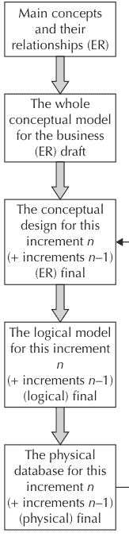

图 1-1. 敏捷数据库设计流程

如果数据库将存储有价值的数据，则必须由理解数据库工作原理并知道数据应如何建模的人来设计。在设计数据库时，你可能需要所有类型的领域专家为你提供设计决策所需的信息。此外，如果你的截止日期很紧迫，你需要更多信息来确保做出了正确的决策；你不希望以后再更改一切。优先级排序对每个人（甚至是最终用户）来说都很重要。没有什么比工作太多而时间太少更有压力了。数据库设计意味着团队合作，这就是为什么在当今环境下，你需要一个工具来正确地进行数据库设计。

在选择数据库设计工具时，你希望它支持这些功能：ER 符号、从概念设计到逻辑设计的自动转换过程、在多用户环境中工作的能力、版本控制、报告功能、自动生成数据库对象的脚本（最好是可调的）以及强大的文档工具。如果该工具还支持命名、流程和设计规则的标准化；修改脚本以更改数据库的能力；以及设计设计之间以及设计与数据库之间比较的能力，那将是加分项。

Oracle SQL Developer Data Modeler（书中称为 Data Modeler）是一个用于设计和记录数据库及数据架构的免费工具。它不仅支持 Oracle 数据库，还支持 DB2 和 Microsoft Server 数据库，并在某种程度上支持任何具有 Java 数据库连接 (JDBC) 连接器的基于标准的数据库。Data Modeler 支持数据库设计中的所有步骤，并具有简单的正向和反向工程能力。在你设计好数据库并对其拥有物理模型后，可以将脚本导出到数据库对象。Data Modeler 还支持不同类型的模型和多维模型。Data Modeler 帮助你保持数据库文档化并实现敏捷。该工具作为独立产品形式提供，但也集成在 Oracle SQL Developer 中，因此你可以决定哪种方式最适合你。该工具非常简单，如果你有数据库支持合同，Oracle 将提供支持。

Data Modeler 为数据库设计师提供以下功能：

- **数据库设计工具**：关于数据库的元数据集合在 Data Modeler 中被称为“设计”。一个设计由逻辑模型、多维模型、关系模型、关系域、数据类型模型、过程模型、业务信息和请求请求以及它们所需的所有对象组成。每个对象（实体、表、图表等）都是单一的可扩展语言 (XML) 文件。设计本身以 `.dmd` 格式保存，`.dmd` 文件包含 XML 文件的指针。

- **自定义**：你可以根据自己的喜好调整 Data Modeler。在偏好设置中，你可以定义工作副本的位置。

- **版本控制**：Data Modeler 集成了名为 Subversion 的版本控制工具。这允许多个用户同时更改模型。它还提供了版本控制功能。在使用版本控制时，设计的最新版本位于版本控制中，而你正在操作的版本位于本地目录。

- **记录现有数据库**：你可以从现有数据库、其他设计工具（例如 Oracle Designer 或 ERwin）或 DDL 脚本将设计导入 Data Modeler。

- **报告功能**：Data Modeler 内置了报告功能，你也可以创建自己的报告和模板并使用搜索功能作为基础。如果你想跨所有设计进行报告，可以使用报告库并使用 SQL 查询信息。你还可以打印设计布局。

## 使用 Oracle SQL Developer Data Modeler 设计数据库

使用 Modeler 设计数据库的过程从设计逻辑模型开始。在逻辑模型中，你定义实体、属性和关系。下一步是基于逻辑模型创建关系模型。你只需点击“Engine To Relational”图标即可。完成关系模型后，就是创建物理模型的时间了。你只需在浏览器中右键点击 Physical Model 并选择 New 即可。在创建物理模型时，你必须知道将使用什么数据库（Oracle、SQL Server 或 DB2）以及其版本。物理模型的所有属性取决于所选的技术。在你创建物理模型后，你应该定义物理对象的属性。完成这些后，你就可以准备生成 DDL（即创建数据库对象的 SQL 脚本）。你可以通过选择 File | Export | DDL File 来创建 DDL。然后只需在数据库上运行这些 DDL 即可创建对象。这一切都可以在多用户环境中并在版本控制的同时完成。

# 第1章：介绍数据库设计和 Oracle SQL Developer Data Modeler 7

你还可以使用 Data Modeler 来记录现有的数据库（Oracle、SQL Server、DB2）。你可以从数据字典或现有的 DDL 逆向工程文档，或者从其他设计工具（Oracle Designer、ERWin 或 VAR 文件）导入。或者，你也可以结合所有技术，例如，从另一个设计工具引入一些描述，并将其添加到来自数据字典的物理信息中。你可以通过选择文件（File）|导入（Import）来找到这些功能。

由于数据库设计的重要部分是报告，你可能希望使用 Data Modeler 创建你的模板，并根据这些模板创建报告。你还可以创建一个报告仓库；除了模板外，你还可以使用 SQL 从那里查询信息。你也可以打印图表，或使用强大的搜索功能来搜索报告中的信息。

在同一个地方记录所有与数据库相关的信息也同样重要。在 Data Modeler 中，你可以记录数据库设计所需的所有信息，以及变更请求、业务信息等内容。

## 总结

如果你要在数据库中存储重要数据，那么完成整个数据库设计过程至关重要。数据库设计是生成详细的实体关系图和数据流图，以为创建数据库对象生成 DDL 脚本的过程。数据库设计包括需求分析、概念设计、逻辑设计、物理设计，以及取决于你问谁，的事务设计。为了能够设计数据库（特别是在敏捷系统中），你需要 Oracle SQL Developer Data Modeler。它是一个免费工具，支持数据库设计师的所有需求以及额外功能。


# 第2章

## 开始使用 Oracle SQL Developer Data Modeler


# 开始使用 Oracle SQL Developer Data Modeler

本章将介绍你在开始使用 Oracle SQL Developer Data Modeler 之前需要了解的内容。在开始使用该工具之前，与团队达成一致并实施某些指南将有助于你简化工作。具体来说，在生产环境或多用户环境中开始使用 Data Modeler 之前，对标准化问题做出决定，调整工具中的某些设置，并针对你的需求对工具进行调优是有价值的。在许多情况下，首次将 Data Modeler 引入你的工作流时，从一个小项目开始是好的，并不是因为它工具很难用，而是因为为了发挥它的全部潜力，需要做出很多决定。

标准化团队工作流并提高数据库设计质量的一种方法是使用领域（domains）、词表（glossaries）和设计规则（design rules）。领域定义了属性的可能值。创建领域很容易，但决定它们可能包含什么很困难。词表是一组预先接受的术语，换句话说，是在设计中使用的词汇。创建词表可能比创建领域更具挑战性，因为对概念命名达成一致通常很难。设计规则是针对设计质量的一组预定义规则。为所有设计师共享创建领域和词表，并实施领域和词表将提高你的生产力和所有设计的质量。此外，在进入设计过程的下一个阶段之前使用规则将提高最终数据库的质量。

这里还有一些需要考虑的问题：你想使用哪些报告？你把它们保存在哪里？你会有什么类型的数据定义语言（DDL）文件，你会保存它们吗？你如何使用版本控制（如果有的话）？你将使用哪种关系型数据库管理系统（RDBMS）？我将在书中涉及这些主题。

你可以从 Oracle 技术网络 (OTN) 下载 Data Modeler，网址为：`www.oracle.com/technnetwork/developer-tools/datamodeler/overview/index.html`。下载 `.zip` 文件后，解压它以开始使用 Data Modeler。

Data Modeler 有不同的版本，取决于你的操作系统以及你想要带有或不带 Java 环境（JRE）的版本。你可以下载 Data Modeler 的免费独立版本产品，或者下载 Oracle SQL Developer，它集成了 Data Modeler。你应该就组织内将使用哪种产品版本达成一致，以避免不同版本之间的冲突，特别是在使用多用户环境中的版本控制时。

## 什么是设计？

在 Data Modeler 中，你创建的对象集合被称为设计（design）。一个设计由一个扩展名为 `.dmd` 的可扩展标记语言（XML）文件（例如 `Customer.dmd`）、一个目录（例如 `Customer`）以及子目录和 XML 文件组成。设计中的每个元素（例如设计、表或实体）都有自己的 XML 文件和唯一标识符（对象 ID）。`.dmd` 文件创建了所有需要的目录和指向这些所有信息的子目录指针。这些 Data Modeler 在你创建设计时自动创建。你不应该在工具之外编辑这些 XML 文件，除非你真的知道自己在做什么，因为你会破坏文件。XML 文件损坏的常见原因是使用不支持 XML 的编辑器或使用错误的字符集。如果你破坏了这些文件之一，Data Modeler 将无法读取它。

> 提示：如果你想将设计给另一个使用 Data Modeler 的人，只需将 `.dmd` 文件和目录压缩到一个 zip 文件中。

一个设计由一个逻辑模型、可选的一个或多个基于该逻辑模型的关系模型，以及可选的一个或多个基于它的物理模型组成。还可以有多维模型、数据类型模型、过程模型、领域、业务信息等。

在生产环境中开始使用 Data Modeler 之前，你需要决定设计将包含什么：你将如何命名它。一个设计可以包含组织中的所有数据库、一个实例、一个架构或其他不同的内容。如果你想共享对象，它们应该在同一个设计中，因为 Data Modeler 不完全支持设计之间共享对象。此外，决定谁将使用 Data Modeler 以及他们将用它做什么是有价值的。这个决定可能帮助你理解设计在你的组织中的含义，并为组织中的人员授予正确的权限。此外，你应该为你的设计创建一个命名标准。例如，你可以将设计命名为 `Customer` 或 `CUSTOM` 或 `CustomerDB` 或 `CustomerData`。你会使用哪一个？如果设计命名一致且你知道在哪里找到它们，将高效得多。

在 Data Modeler 中，浏览器面板（Browser pane）显示设计中的所有元素（见图 2-1）。还有用于不同操作的菜单：文件（File）、编辑（Edit）、视图（View）、团队（Team）、工具（Tools）和帮助（Help）。Data Modeler 不会自动保存，因此请通过选择文件 | 保存（Save）或文件 | 另存（Save As）频繁保存。如果你想以不同的位置或不同的名称保存设计，请使用另存。在文件菜单中你会看到最近（Recent Designs）选项。这是你处理过的设计列表；顶部的是上次打开的。如果你想在打开设计时节省时间并知道它是你上次处理的同一个设计；与其使用文件 | 打开（Open）浏览文件来打开设计，不如选择文件 | 最近设计（Recent Designs）。你可以选择文件 | 关闭（Close）关闭一个设计，选择文件 | 关闭所有（Close All）关闭所有打开的设计。在使用其中任一操作时，Data Modeler 保持打开状态。如果你选择文件 | 退出（Exit），所有设计以及 Data Modeler 将关闭。

（图 2-1）

图 2-1. Data Modeler 中的浏览器面板


> 提示

> 选择 File | Exit（文件退出）可以退出 Data Modeler 并关闭所有打开的设计。Data Modeler 将要求你保存所有设计。如果你点击窗口右上角的关闭 (X) 按钮，系统会询问你是否只保存其中一个设计。

在浏览器（Browser）窗格中，你可以选择一个实体或表，右键点击并选择“转到图（Go To Diagram）”。你将看到该对象所在的所有设计、子视图和显示，并可以选择你需要的一个。该图/子视图/显示将打开，且对象将在画布上被选中。

如果你在画布上点击右键，将看到几个选项。你可以通过选择添加/删除对象（Add/Remove Objects）并取消勾选包含（include）属性，向此图/子视图/显示中添加或删除对象。通过“查看详情（View Details）”，你可以调整图中显示哪些对象细节以及不显示哪些。通过“显示（Show）”，你可以向图中添加网格、页面网格、标签和图例。网格将帮助你对齐对象并使图更易读。页面网格显示了页面开始后的起始和结束位置。标签例如外键名称或关系中的源名称和目标名称。图例显示审计信息，包括图的名称、作者、创建时间、修改时间、设计名称和模型类型（逻辑或关系型）。

如果浏览器窗格（或其他任何窗格）消失，你可以从“视图（View）”菜单恢复它。如果你需要查看日志以排查故障或了解工具正在做什么，请检查 View | Log（查看|日志）或根据需要选择 View | External Log（查看|外部日志）。

学习如何使用该工具最好的方法是从启动页（见图 2-1）开始。在启动页上，你将找到文档、教程和在线演示的链接。如果启动页由于某种原因消失，你可以选择 Help | Start Page（帮助|启动页）来获取帮助。事实上，你可以使用搜索和目录查找有关该工具的更多信息。通过 Help | About（帮助|关于），你可以检查你正在使用的 Data Modeler 版本和构建版本。你还可以看到包含哪些组件、属性和扩展。

你可以使用导航（Navigator）窗格（位于图 2-1 右侧）跳转到图的精确位置或查看其全景。如果你有一个大图，或者无法通过查看画布找到所需的对象，导航窗格将非常有用。在导航中，你可以在图片周围拖动红色矩形。然后当你移动光标时，逻辑或关系模型中的图会相应移动。还有带有用于设计的工具栏和图标的图。通过右键点击对象，你可以查看在该对象上允许的操作。

对象具有属性，可以通过右键点击对象并选择“属性（Properties）”或双击对象来访问。

还有一个“消息 - 日志（Messages - Log）”窗格（图 2-1 底部），显示 Data Modeler 中正在发生的消息。红色的消息可能需要你注意；其他信息仅供你参考。

对于版本控制，有一个“版本（Versions）”窗格作为 Subversion 目录，以及“待处理更改（Pending Changes）”窗格，你可以从中跟踪传入和传出的更改。

你可以根据自己的工作习惯自定义 Data Modeler 的用户界面。你可以决定屏幕上显示哪些工具，可以调整它们的大小，并可以将不同的窗格移动到合适的位置以更好地提供服务。只需拖动任何面板将其移动到你想要的地方。你会看到一个矩形跟随该面板移动。当位置和形状符合你的要求时，松开鼠标按钮将其放下。可能性是无限的，因此请找到适合你自己的组合。在图 2-2 中，你可以看到我偏好的 Data Modeler 设置，以便高效工作。

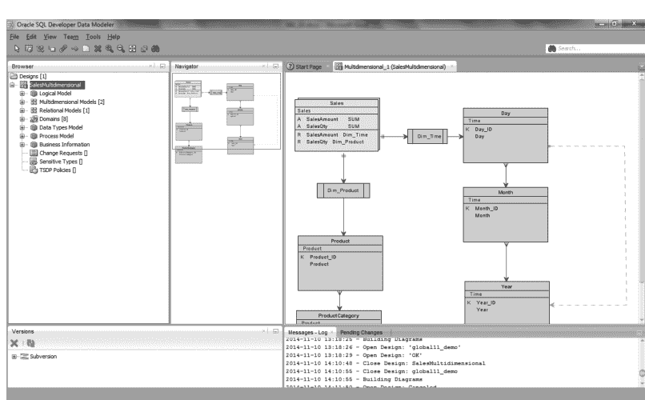

图 2-2。我偏好的 Data Modeler 布局

## 调整 Oracle SQL Developer Data Modeler

该工具具有设计规则，有助于维护你的设计质量。有预定义的设计规则，但你可以根据需要创建任意多个。完成所有这些将提高你的生产力和工作质量。

偏好是影响安装级别 Data Modeler 行为的设置，你可以将这些偏好与其他 Data Modeler 安装共享。某些偏好会立即生效，但其他偏好需要你关闭设计并重新打开它们才能生效。这是因为偏好设置位于缓存内存中，或者被复制到其他地方的属性。

在每个版本的 Data Modeler 中，都有新的偏好供用户调整工具。更改偏好后，需要关闭 Data Modeler 并重新打开。这些偏好仅影响你的 Data Modeler 安装，除非你与其他用户共享。你可以通过选择 Tools | Preferences（工具|偏好）找到偏好，如图 2-3 所示。本章将涵盖最重要的偏好。

本节将涵盖让工具以你想要的方式运行的偏好，并将如何与其他用户共享这些偏好。你可以在处理项目时更改所有偏好，但之后更改设置总是困难的，因为它会影响所有用户以及工具的行为。

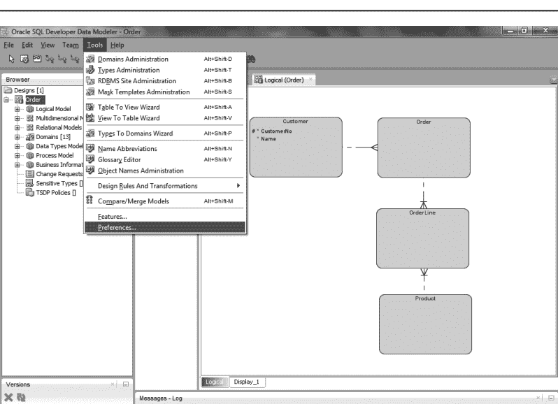

图 2-3。Tools | Preferences

图 2-4 显示了偏好对话框，在你选择 Tools | 并在左侧选择 Data Modeler 后打开。为 Data Modeler 使用定义默认目录是有价值的。如果你知道它们的确切位置，查找这些目录将更容易。你应该为所有用户在 Data Modeler 标签中定义目录，因为这会让生活变得方便很多，特别是版本控制和解决问题方面。

- 默认设计目录（Default Designs Directory）是你默认查找设计的目录，如果你导出或导入 Data Modeler 设计，将默认保存在这里。

- 默认导入目录（Default Import Directory）是偏好和设计级属性导入等的默认目录。

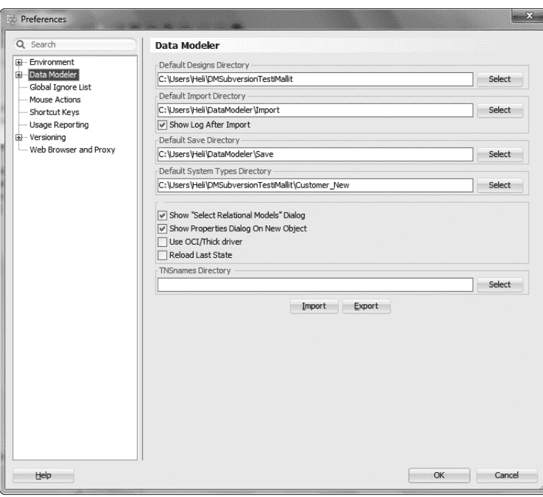

图 2-4。Data Modeler 偏好对话框

- 保存目录（Save Directory）是你默认保存文件的目录。例如，Data Modeler 将尝试在此处查找导出的文件。

- 系统类型目录（System Types Directory）是默认存储所有 Data Modeler 系统文件的目录。通常这些文件是类型定义文件、默认领域文件、词表文件、RDBMS 站点、自定义脚本和保存的搜索标准。这些文件仅影响你的 Data Modeler 安装。注意对于领域，Data Modeler 不会使用“默认系统类型目录”偏好设置的目录中 `defaultdomains.xml` 之外的任何文件的更改。如果对其他文件进行了更改，必须将这些更改添加到此默认文件中才能生效。

- 默认报告目录（Default Reports Directory）是 Data Modeler 生成的报告存储目录，可以在“偏好 -> Data Modeler | Reports”中定义。

如果你在“偏好”对话框的左窗格中展开 Data Modeler，你将看到更多按类别分组的偏好。

注意

你可以通过设置 Data Modeler | DDL 下的 DDL Files Export Directory，为在 Data Modeler 下创建数据库对象的 DDL 脚本定义默认目录。


在图（Diagram）偏好中，你会找到针对逻辑模型的偏好。Data Modeler 支持多种表示法类型。你可以在符号列表（Notation List）中将首选表示法类型设置为 Barker 或 Bachman。（信息工程表示法无法设置为默认表示法）。你还可以通过选择实体继承偏好中的“Box-in-Box Presentation”来决定将继承的展示方式设置为框中框。你可以随时更改所选的偏好，甚至可以通过右键点击图并选择“符号”（Notation）来更改当前图的符号或框框设置。

还有模型（Model）偏好，如图 2-5 所示。RDBMS 类型是 Data Modeler 中支持的 RDBMS 类型列表，而 RDBMS 站点是 RDBMS 类型的别名。根据需要添加尽可能新的 RDBMS 站点。例如，Oracle 12c 或 SQL Server 2008 是一种 RDBMS 类型，你可以创建一个名为 `TEST12c` 的别名，以定义你环境中对应 Oracle 12c 的 RDBMS 站点。默认 RDBMS 类型（Default RDBMS Type）偏好用于选择默认 RDBMS，默认 RDBMS 站点（Default RDBMS Site）偏好在创建物理模型时默认被选为 RDBMS 站点。（第 6 章将详细介绍 RDBMS 类型和站点）。数据类型（Datatype）选项用于定义工具为属性（以及列）建议数据类型的默认值。例如，如果你选择了域（Domain），在创建新属性时，默认将建议域作为数据类型。首选逻辑类型（Preferred Logical Types）是一项实用功能。工具中有许多不同的逻辑类型，而你可能只需要其中十种以内。如果你定义了自己的首选逻辑类型集，那么在创建新属性时，供你选择的列表将会短。你可以随时向列表中添加新的逻辑类型。通过点击指向右侧箭头添加首选逻辑类型。你将在对话框的右侧（首选逻辑类型）看到已选逻辑类型的列表。

你还可以定义快捷键以使工具的使用更加流畅。图 2-6 显示了快捷键偏好。你可以使用列出的快捷键，也可以定义自己的快捷键。

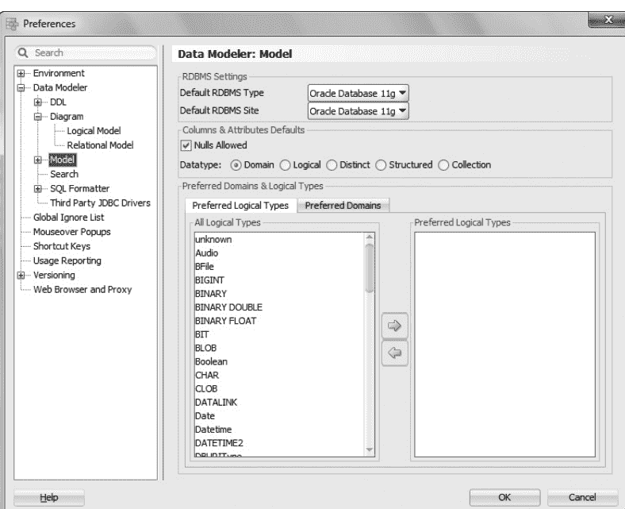

图 2-5. 模型偏好

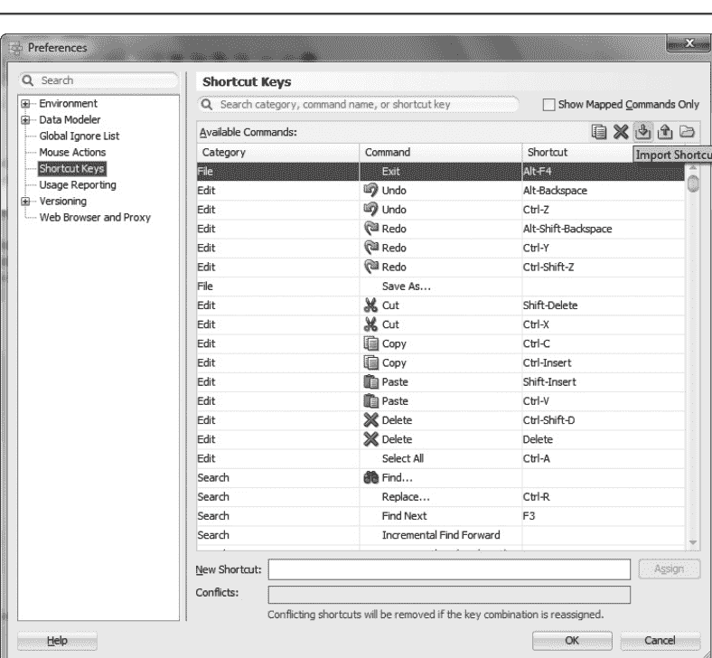

图 2-6. 快捷键偏好

## 与其他用户共享偏好

当选中 Data Modeler 时，可以使用“偏好”对话框底部的“导出/导入”按钮与其他用户共享你的 Data Modeler 偏好。要导出偏好，请点击“导出”按钮。系统将要求输入保存 XML 文件的名称和位置，并据此保存。此 XML 文件可以通过“导入”按钮导入到另一台计算机。你只需要定义一次设置，然后将其导入到组织中的其他计算机。每当你更改工作环境中更改官方偏好时，请确保向所有用户导出/导入新偏好。

> 提示

如果你发现导入失败（例如导入了错误的文件），请勿点击“确定”，点击“取消”。只有在……导入才完成。

> 提示

如果你发现导入失败（例如导入了错误的文件），请勿点击“确定”，点击“取消”。导入才完成。（注意：已处理 OCR 中的重复文本）

除了偏好外，还有影响模型显示方式的属性。例如，你可以更改实体和表格的颜色、字体和样式。这些属性可以在图（Diagram）偏好对话框中找到。

如所述，你可以通过双击设计名称或右键点击设计并选择“属性”（Properties）来查找属性。这些属性允许你自定义模型的视觉表示。


命名标准让人们更容易阅读模型。例如，你可以定义属性、列、域和表格的命名方式。在设计词表规则时，可以检查这些标准。

- Oracle 12c 或 SQL Server 0008 是一种 RDBMS 类型。

- Oracle 12c 或 SQL Server 2008 是一种 RDBMS 类型。

- Oracle 12c 或 SQL Server 2008 是一种 RDBMS 类型，你可以创建一个名为 `TEST12c` 的别名，以定义你环境中对应 Oracle 12c 的 RDBMS 站点。

- 这些标准在设计词表规则时，可以检查。

- 这些标准在设计词表规则时，可以检查。

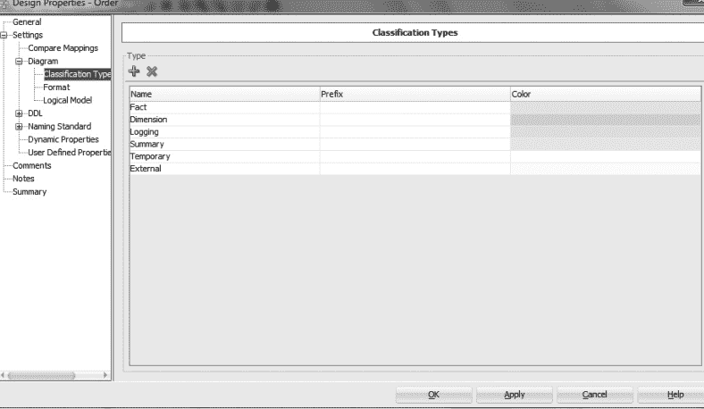

图 2-7. 分类类型

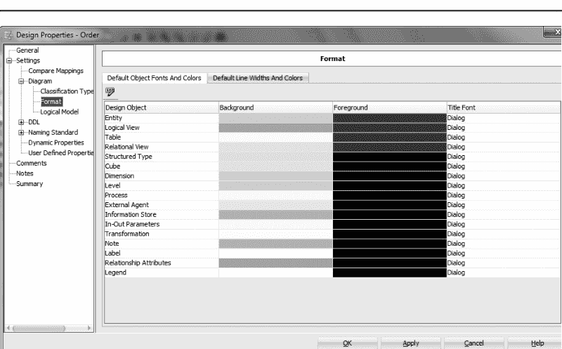

图 2-8. 定义对象类型的格式

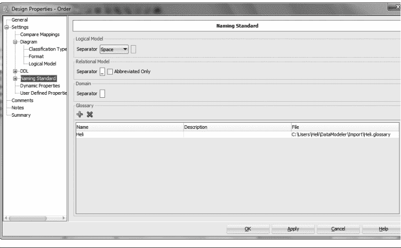

图 2-9. 命名标准设置

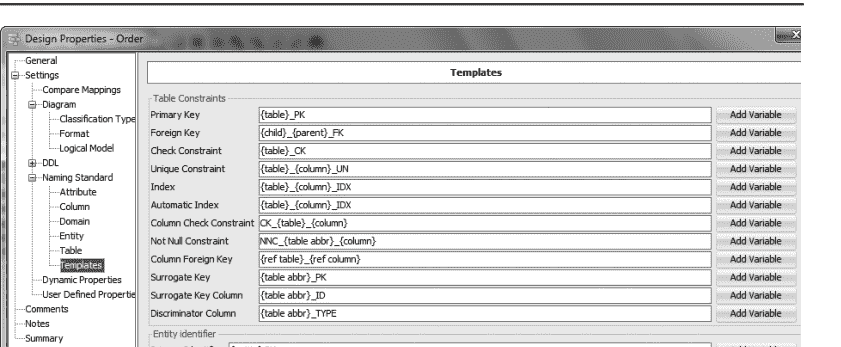

**图 2-10.** 使用模板实施命名标准

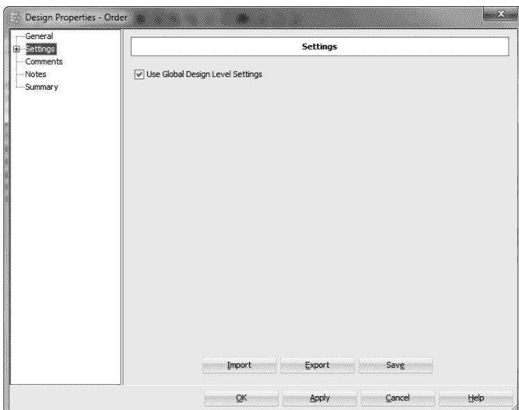

导入你或他人为其他用户出的属性。包含定义属性的 XML 文件应保留在版本控制中，并在任何属性发生更改时都应导入到每个设计中。

属性导出的默认目录在首选项（Preferences）的 Data Modeler 下通过默认保存目录（Default Save Directory）设置，属性导入的默认目录通过默认导入目录（Default Import Directory）设置定义。


从 4.0.3 版本开始，你还可以使用全局设计级设置。你可以在设计属性（Design Properties）对话框的设置（Settings）下为当前设计选择全局设计级设置（Global Design Level Settings）选项。如果选了使用全局设计级设置（Use Global Design Level Settings），设计属性将根据文件 `datamodeler\datamodeler\dl_settings.xml` 中的全局设计级设置自动修改。

当打开设计时，例如，对分类类型、默认字体和颜色、默认线宽和颜色、命名标准规则以及比较映射的更改将在设计属性中自动实现。设计仍然使用位于某个目录下的 `dl_settings.xml` 文件，勾选使用全局设计级设置（Use Global Design Level Settings）框将在打开设计时，从全局文件中复制设置。

因此，如果你想对设计使用全局设置，请根据你对设计属性的更改更新 `datamodeler\datamodeler\types\dl_settings.xml` 文件，选择使用全局设计级设置，并记住与其他用户共享该全局文件。通常步骤如下：

1. 在其中一个设计中创建所需的设计属性。
2. 点击保存（Save）在设计属性对话框中保存设置。如果你不保存，更改将不会保存到本地或全局文件。如果你点击保存并勾选了使用全局设计级设置框，你将收到消息：“通过勾选‘使用全局设计级设置’复选框，你将覆盖两个文件——全局设计级设置文件和当前设计级设置文件。是否继续？”点击确定。
3. 使用 Subversion 与其他用户共享文件，并确保你有一套更新该文件的程序。你可以将文件从版本控制复制到 `datamodeler\datamodeler\types\`，让 Data Modeler 自动将更改复制到本地设计文件。

> **注意**  
> 当你为一个设计选择全局设计级设置选项时，所有新设计的默认设置将启用“使用全局级设置”。旧设计不会自动更改。

如所述，术语表是设计工作中使用的词汇表。你可以使用它们来保证定义的设计规则，或在逻辑模型和关系模型之间进行工程设计。你可以从零创建一个新的术语表，基于现有逻辑模型创建一个，或使用现有的术语表。术语表是一个扩展名为 `.glossary` 的 XML 文件。

## 创建或编辑术语表

你可以在术语表编辑器（Glossary Editor，选择 Tools | Glossary Editor）中创建和编辑术语表，如图 2-12 所示。保存术语表的默认目录在首选项中设置。

如果你想编辑现有术语表，打开术语表编辑器，选择术语文件，进行更改并点击保存。该文件可以是 `.csv` 或 `.txt` 文件，使用 ERwin 创建。

如果你想创建一个新的术语表，启动术语表编辑器并定义一个不存在的文件。Data Modeler 将自动为该文件创建一个术语表。每个术语表都应该有一个名称和描述。通过选择不完整修符（Incomplete Modifiers），将允许修符和限定符命名在术语表中。如果你选择大小敏感（Case Sensitive），所有验证将基于名称必须与术语表中的词相同的事。通过选择唯一缩写（Unique Abbreviations），术语表中的所有缩写将是唯一的。相同的缩写不能用于多个词，且没有缩写。验证过程将报告这些情况。通过分隔符（Separator）和 Sep.

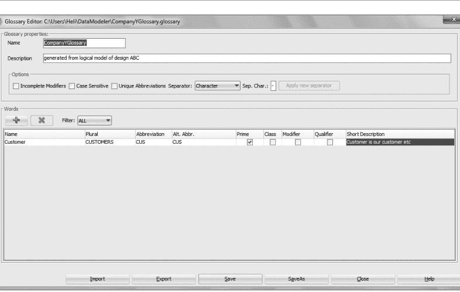

图 2-12 术语表编辑器

为多个词定义分隔符。每当加载术语表编辑器时，都会检查分隔符设置，如果有任何违反规则，将给出警告。列表中的词可以通过过滤（Filter）按分类限制显示：主词（Prime Word）、类词（Class Word）、修符（Modifier）、限定符（Qualifier）和未分类（Unclassified）。未分类显示没有分类的项目。

你可以通过绿色加号向术语表添加新词，并通过红色 X 删除它们。名称是术语表的唯一元素。一个词可以有一个缩写。也可以有一个替代缩写（Alt. Abbr.）。通过选择所有分类类型尽可能对术语表进行分类。可选分类类型如下：

- 主词是定义对象的词；主词通常列为关键字。Customer Name 中的 Customer 是主词。
- 类词是标识词用途或目的的词。Customer Name 中的 Name 是类词示例。
- 修符提供关于类词或主词的附加信息。Official Customer Name 中的 Official 是修符。修符可以是形容词或名词。
- 限定符是一种特殊的修符类，提供域值内的限定符信息。Delivery Time 中的 Time 是限定符示例。

为词编写描述也是一种良好的做法，这可以在短描述（Short Description）中完成。如果你想编辑现有的术语表条目，选择它并修改它。

你可以通过在右侧面板中右键点击逻辑模型并选择从逻辑模型生成术语表（Glossary From Logical Model）在逻辑模型上创建一个新的术语表。但在逻辑模型准备好之前你不这样做；如果你编辑了术语表然后再次根据逻辑模型生成，所有手动编辑的更改将丢失。要么始终根据逻辑模型生成术语表并定义所有信息，要么生成一次并手动更新。

一旦定义了术语表，可以通过保存文件并与其他用户共享。你还可以点击首选项中的导出按钮进行导出，并点击导入按钮导入。术语导出的默认目录是保存目录。导出的文件是 `.csv` 文件。

## 介绍域 (Domains)

如所述，域是预定义的数据类型定义，包含某些数据（如地址、货币或社会安全号码）所需的所有信息。域及其定义保存在 XML 文件中。


> **提示**  
> 对于标准化属性和列属性以及提高设计质量，域是有用的。

域定义是 Data Modeler 安装级设置。文件位置在默认类型目录（Default Types Directory）首选项中设置，Data Modeler 将文件命名为 `defaultdomains.xml`。你可以在浏览器的 domains 下查看你的 Data Modeler 安装程序使用的域集。

你可以通过选择 Tools | Domains Administration 管理域；打开 Domains Administration 对话框。你可以点击选择（Select）按钮找到你需要的域文件，或通过输入不存在的名称创建一个。如果你不选择任何内容，将使用默认文件（`defaultdomains.xml`）。

要创建一个新域，在 Domains Administration 对话框中点击添加（Add）。填写域定义（如图 2-13 所示）并点击应用（Apply）。然后点击保存（Save）。更改将保存在 Domains Administration 对话框中 Domains 字段显示的文件。

在 Data Modeler 中，你还可以为域定义数据类型和长度以外的内容。你可以定义约束、范围、值列表以及数据的规则。图 2-13 显示了一个名为 Boolean 的域。当你具有 True/False 值的属性时，你会希望使用此域。你可以点击值列表（Value List）定义这些值。如果你想对现有的域定义进行这些更改，点击修改（Modify）然后点击值列表（Value List）。要在列表中添加新的允许值，点击添加（Add）。打开值列表（List Values）对话框，如图 2-14 所示。填写值和描述。在添加完所有所需值后，点击确定。

接下来你想定义一个名为 Category 的域，以便为该域定义范围。在 Domains Administration 中选择名为 Category 的域。

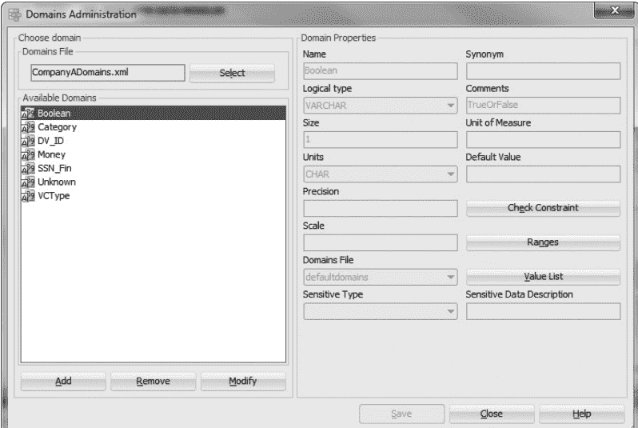

图 2-13. 域管理对话框

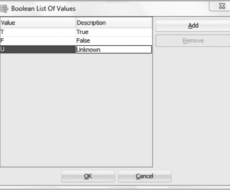

图 2-14. 定义值列表

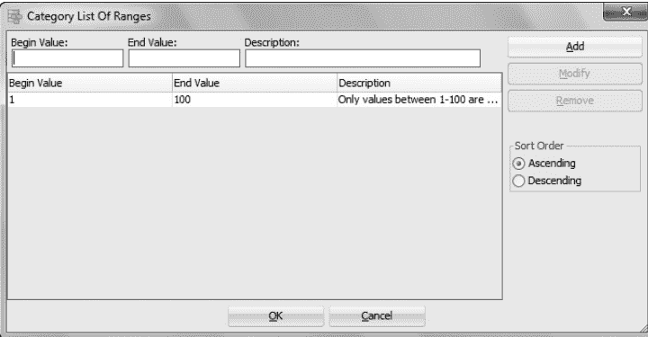

图 2-15. 定义范围列表

对话框并点击修改（Modify）。然后点击范围（Ranges）。在范围类别列表（Category List Of Ranges）对话框中，如图 2-15 所示，填充所需的范围并点击添加（Add）。然后点击确定（OK）。如果列表中有很多范围，可以使用右侧的单选按钮按升序或降序排序。

Data Modeler 使用唯一的域文件是 `default.xml`，位于你在默认系统类型目录（Default System Types Directory）首选项中设置的目录。与其他用户共享新域有两种可能：你可以对默认文件进行更改并与其他用户共享，或者对一个单独的文件进行更改并共享给所有用户，以便导入到他们的本地默认文件中。为组织的标准域集准备一个单独的文件是有用的，可以确保所有人都使用同一文件的最新版本。该解决方案允许用户定义自己的不会与其他用户共享的域。

如果你决定使用默认域文件并共享它，可以将该文件复制到默认系统类型目录（Default System Types Directory）指定的目录，这样所有用户都可以在他们的设计中使用这些域。

如果你决定为公司特有的域准备一个单独的文件，可以将该文件与用户共享，但在使用新域之前，必须先将设置导入到本地默认文件中。导入可以通过文件（File）菜单中的导入（Import）功能完成：选择 File | Import | Domains。选择打开域文件（Open Domain File），并选择所需的文件。勾选导入到默认域（Import In Default Domains）框。如果你没有勾选该框，这些域将仅对此设计有效，这可能不是你想要的。有关域导入功能的更多信息请参见图 2-16。

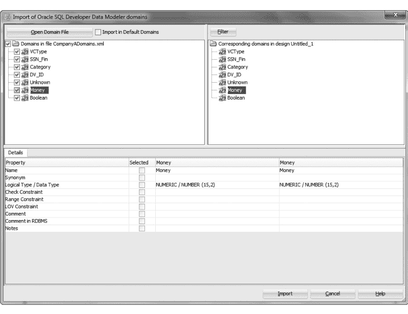

图 2-16. 域导入

> **提示**  
> 你应该将共享的域文件保存到版本控制中。你将在第 9 章学习更多关于版本控制的知识。

## 设计规则介绍

如所述，设计规则是数据库设计规则标准化测试的一种方法。测试是自动的，但每当你认为需要时，必须手动启动。工具中预设了设计规则，你也可以创建自己的规则和规则集。选择 Tools | Design Rules and Transformations | Design Rules 来打开设计规则（Design Rules）对话框。

Data Modeler 中有很多预定义的设计规则，如图 2-17 所示。这些规则根据模型类型（通用、逻辑、关系、过程模型、物理）和模型组件（表、视图、属性等）进行分类。你可以根据这些规则检查你的模型，也可以创建将进行检查的规则集。你可以通过选择一个或多个规则并点击应用所选（Apply Selected）来检查模型。或者通过点击应用所有（Apply All）来检查所有规则。结果以错误（红色）或警告（蓝色）的形式报告。

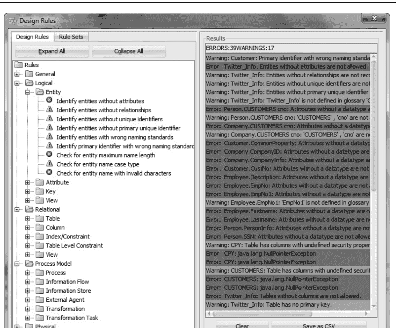

图 2-17. 设计规则对话框

双击错误/警告消息，将带你进入错误或警告的位置，你可以逐个修复任何错误或警告。

当你开始使用 Data Modeler 时，可能对工具自带的设计规则感到满意，但在工作中可能会产生新规则，因此知道在需要时添加它们作为自定义设计规则是好的。你可以根据库创建自定义设计规则。首先，在库（Libraries）对话框中创建一个自定义库，如图 2-18 所示（Design Rules and Transformations | Libraries）。然后在自定义设计规则（Custom Design Rules）对话框中根据库创建一个自定义设计规则，如图 2-19 所示（Design Rules and Transformations | Custom Rules）。


图 2-18. 创建库

| 名称 | 对象 | 引擎 | 类型 | 变量 |
|---|---|---|---|---|
| 1 复杂规则 - 注释演示 | 表 | Rhino | 警告 | 表 |
| 2 非空约束演示 | 列 | Rhino | 错误 | 列 |
| 3 方法 | 表 | | | |

```
def tables_up(model) {
  tables = model.getTableSet().toArray()
  for (i=0; i<tables.length; i++) {
    table = tables[i]
    name = table.getName().uppercase()
    column = table.getElements().size()
    size = table.getColumnCollection().size()-1
    for (i=0; i<size; i++) {
      column = columns[i]
      cname = column.getName().uppercase()
      column.setName(cname)
    }
    keys = table.getKeys()
  }
}
```

图 2-19: 创建自定义设计规则

自定义设计规则将自动添加到你的设计规则中，你可以在规则集中选择它们。库是一组在 Java 中使用的函数，并且可以重复使用。对于每个库，你可以在自定义库（Custom Libraries）对话框中定义名称、执行引擎和严重程度（错误或警告）。你可以用绿色按钮添加库，如果需要，可以使用红色按钮删除它。

> **提示**  
> 你可以在文档中找到一些关于域导入的信息。

（注：后续文本为大量重复内容，已根据指令要求翻译核心逻辑并保持格式一致性）

# 38 数据库设计精通：Oracle SQL Developer Data Modeler

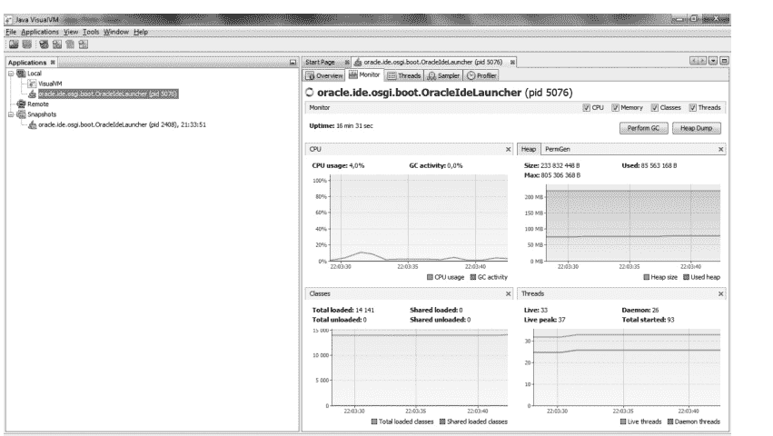

图 2-21. 内存使用的 Java VisualVM 报告

在 Data Modeler 4.1 版本中，有一个新的设计属性，允许您将设计保存到一个或多个文件中。您也可以使用混合模式，将某些对象保存在一个文件中，将另一些保存在单独的文件。如果您正在使用版本控制，仍然需要将每个对象保存到单独的文件。添加此功能是为了提高性能。

> **提示**  
> 如果不需要，请不要打开物理模型，特别是当物理模型很大时，因为这会严重影响性能。

## 总结

在您的组织中的多个用户开始在生产中使用 Data Modeler 之前，设定一些标准并根据您的需求自定义 Data Modeler 是明智的。对于使用哪个版本的工具、谁来使用该工具以及用途，达成一致非常重要。您还需要决定组织中什么是“设计”，以及您将如何命名您的设计。

根据您的需求对工具进行调整至关重要。您可以设置偏好和设计属性并与所有用户共享，还可以创建并共享术语表和域以支持标准。同样重要的是，要理解您可以使用设计规则并设置自己的规则来检查和强制执行这些标准。这一切将提高生成设计的效率和质量。Data Modeler 能够轻松地在整个组织和设计师之间实施标准。此外，对 Data Modeler 中的所有共享和常用文件使用版本控制将将质量和生产力提升到新水平。

Data Modeler 不会自动保存设计，请确保通过选择“文件 | 保存”来频繁保存。您可以直接通过拖放将不同的导航器、浏览器和画布移动到您想要放置的地方。花些时间找到适合自己的方法；这绝对是值得的。

Data Modeler 是一个 Java Swing 应用程序，需要 JDK。有时您可能需要更改 JVM 设置以获得更好的性能。


## 引入需求分析

需求分析是发现和分析应用程序及数据库未来用户的需求的过程。此过程的结果是用户需求规范。需求至少有三种：数据需求、功能性需求和非功能性需求。功能性需求描述了应用程序必须做什么，数据需求描述了需求所需的数据，非功能性需求（例如安全和性能需求）描述了执行功能性需求的约束条件。功能性需求的一个示例是应用程序必须返回客户名称。对于数据需求，这可能意味着一个具有 Name 属性的 Customer（客户）实体；非功能性需求的示例是它只能向拥有信息权限的人返回该信息，并且必须在 5 秒内返回。

需求分析过程用于指定项目目标以及规划周期和增量。需求分析还作为规划测试用例的来源。很多时候，需求分析为风险分析提供输入。发现数据库的需求非常重要。了解哪些需求是强制性的、哪些是可选的、以及哪些将优先于其他需求（排序）也很重要。

需求分析期间的工作是收集所有可用数据并将其正式化为一致的形式。包括进行访谈、会议、阅读现有文档并尽一切可能的方法来寻找书面信息。在收集信息时，与最终用户和业务所有者核实结果也很重要。

根据您的组织正在使用的流程以及您正在使用的工具，需求分析可能会有所不同。本书将不会详细介绍文档；它重点关注数据库设计过程中的这一阶段的数据库设计师（如果您足够幸运地参与了项目的早期阶段的话）。很多时候，数据库设计师并不知道有一个新项目启动，因为一切都与他们无关，只有在概念设计开始时才会联系数据库设计师。在需求分析期间，数据库设计师试图提出所有问题，以弄明这个新系统拥有哪些数据（数据需求）以及如何使用它们（功能性需求）。数据库设计师还尝试收集数据库的所有可能的非功能性需求（与安全、性能等）。因此，将数据库设计师排除在此过程之外是不明智的。

需求分析主要由编写笔记组成，但 Data Modeler 提供了逻辑实体关系 (ER) 模型、数据流图 (DFD) 和转换包来帮助文档正式化。您可以在第 4 章中找到更多关于 ER 模型的信息。Data Modeler 还允许您记录：

业务信息，例如责任方、联系人、电话号码、电子邮件等。在 Data Modeler 需求分析阶段创建的所有模型都可以作为进入概念设计时设计工作的基础。


在需求分析阶段，数据库设计师并不是试图为整个世界建模，而只是建模核心概念及其关系和行为。尽管如此，在设计数据库时，写下任何可能感兴趣的内容都是好的。在`Data Modeler`需求分析阶段创建的所有模型都可以作为进入概念设计时设计工作的基础。

在需求分析阶段，数据库设计师并不是试图为整个世界建模，只是建模核心概念及其关系和行为。尽管如此，在设计数据库时，写下任何可能感兴趣的内容都是好的。在`Data Modeler`需求分析阶段创建的所有模型都可以作为进入概念设计时设计工作的基础。

在需求分析阶段，数据库设计师并不是试图为整个世界建模，只是建模核心概念及其关系和行为。尽管如此，在设计数据库时，写下任何可能感兴趣的内容都是好的。在`Data Modeler`需求分析阶段创建的所有模型都可以作为进入概念设计时设计工作的基础。

## 逻辑模型的需求收集

在`Data Modeler`中，实体关系模型被称为逻辑模型，可以在浏览器面板中找到。如果画布上没有打开逻辑模型，可以通过右键点击浏览器面板来打开。在画布上完成使用`ER`表示的设计。

`Data Modeler`中的每个对象都有属性。您可以通过双击对象或在浏览器面板中右键点击对象并选择属性来查找属性。

实体有多个属性；图2显示了通用属性。实体具有名称、同义名和长名。名称作为同义名和长名的默认值。长名用于实体名称结合属性名称（`entity-name.attribute-name`）的屏幕，且无法更改；它与名称相同。您还可以为实体定义短名称，它可以用于外键命名。例如，实体名称可以是`Customer`，短名称为`Cust`，同义名为`Customer`，长名为`Customer`。如果选择创建键，系统将自动为表生成代理键。

# 数据库设计精通：Oracle SQL Data Modeler

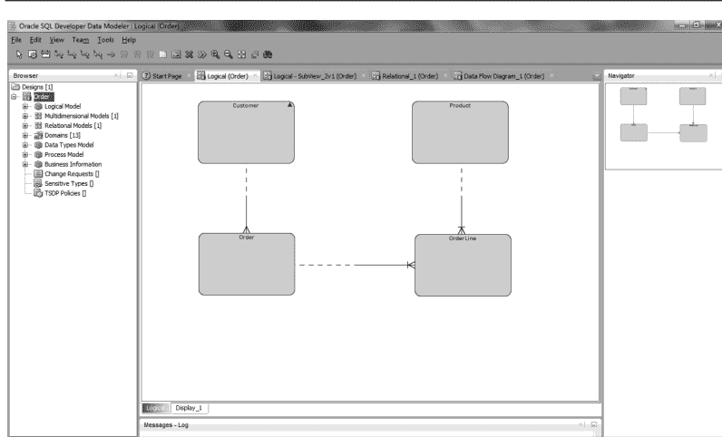

**图 3-1.** 新实体的工具栏和气泡帮助。

如果您已经知道某些属性，可以在实体属性对话框的属性选项卡中将它们添加到设计中，如图3-3所示。您可以通过点击绿色加号在列表末尾添加属性。如果您想在选定属性之前添加，请按住`SHIFT`键点击绿色加号。如果您想在选定属性之后添加，请按住`CTRL`键点击绿色加号。如果属性顺序错误，选择您想要移动的属性并点击向上或向下的蓝色箭头指定移动的方向。如果您想修改属性属性，选择列表中的属性并点击属性图标（铅笔图标），如图3-3所示。对于属性，您必须定义名称，并且可以

## 第3章：需求分析简介 45

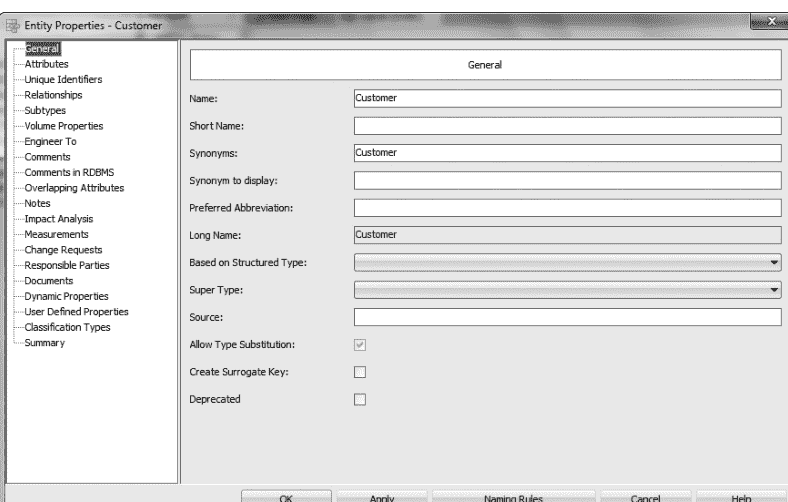

图 3-2. 实体的通用属性

定义数据类型：域（`Domain`）、逻辑（`Logical`）或结构化（`Structured`）。如果你定义了自己的集合（`collection`）或唯一（`distinct`）用户数据类型，也可以将其选择数据类型。`Data Modeler`中始终为结构化数据类型预定义了类型；因此，即使你没有定义任何类型，数据类型可用。根据你选择的内容，类型（`Type`）列表将显示该类别下的可用类型。如果你只想查看首选列表（在第2章介绍的优选项中定义），请选择首选（`Preferred`）。你可以通过选择主`UID`来决定此属性是否为主键，还可以通过选择强制性（`Mandatory`）将该属性定义为必填。

你可以对属性编写三种描述：注释（`comments`）、关系型数据库管理系统（`RDBMS`）中的注释和备注（`notes`）。`RDBMS`中的注释是可以一直带到数据库的文档，用于描述将作为数据库列进行工程设计的属性。在“`Comments In RDBMS`”字段中，你应该输入有助于帮助人们正确使用你的数据库的描述。此文本出现在数据库中，是未使用`Data Modeler`或其报告的人唯一能看到的描述。

## 46 用于数据库精通的 Oracle SQL Developer Data Modeler

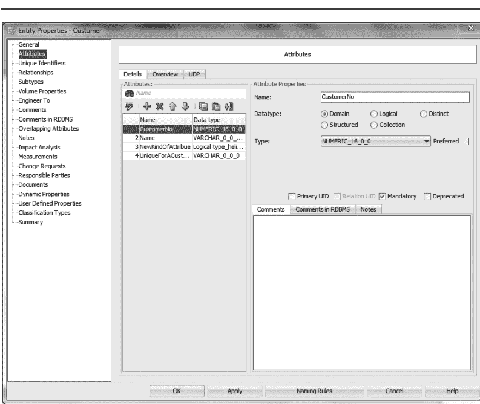

图 3-3. 属性属性

> 提示

> 使用“`Comments in RDBMS`”为没有访问`Data Modeler`或其报告的用户描述如何使用该数据库。使用“`Comments`”进行正式文档，使用“`Notes`”进行非正式文档。

`Comments`字段是对此属性的描述，使用`Data Modeler`的人员可以阅读它。它可能是其他用户看到的官方描述。`Notes`（备注）通常是非正式的笔记，通常在规划会议期间编写。可能在需求分析期间，`Notes`字段是做笔记的最佳地方。之后，你可以使用`Notes`中的描述并对其进行编辑使其更正式，然后插入到`Comments`或`Comments In RDBMS`字段中。

## 第3章：需求分析简介

> 提示

> 你可以在建模会议和会议中记录听到的所有内容，并将它们放在`Notes`中，之后从`Notes`中编辑/复制/移动你喜欢的描述到`Comments In RDBMS`或`Comments`中。

如果你有任何关于实体的数量或增长率的信息，你可以在卷属性（`Volume Properties`）选项卡上添加这些信息。这些信息仅用于记录目的；不会用于估算数据库所需的空间（`DB2`除外）。尽管这些信息可能不会被自动使用，但它们对于数据库设计是非常重要的信息。

`Data Modeler`中的每个对象都有摘要（`Summary`）。摘要选项卡不仅显示`XML`文件中使用的对象`ID`，还显示该对象的创建者、创建时间以及最后一次修改者是谁以及修改了什么。图3-4显示了实体的摘要选项卡。

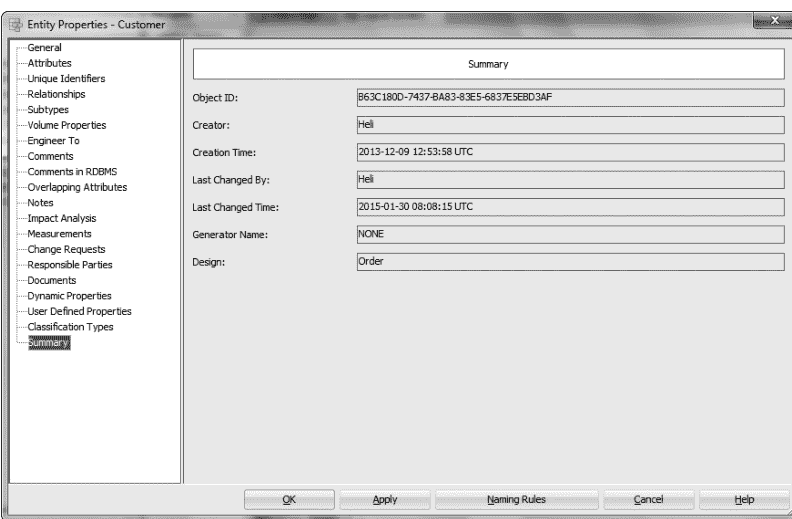

图 3-4. 摘要属性

关系也有属性，当获得更多关于关系的知识时可以更改。你可以通过在浏览器（`Browser`）面板中选择关系、右键单击并选择属性，或者在逻辑模型画布上双击关系来查看和编辑属性。图3-5显示了通用关系属性。你可以为关系定义名称；否则将使用默认名称。当你有许多相似的关系，并且在有多对多关系时需要知道是哪一个时（多对多关系将被工程化为以关系命命名的新表），使用默认名称并非最佳。如果你想为关系中的角色（`role`）添加描述，请填写“`Name On Source`”（源端名称）或“`Name On`”（源名称）字段。如果你右键单击画布并选择“`Show Labels`”（显示标签），此文本将显示在图中。从同一个菜单中，你还可以定义网格、页面网格、关系属性或要显示的图例，如图3-6所示。

在此阶段我还想指出的另一个概念：子视图（`SubViews`）。如果你有许多实体，阅读模型可能会非常困难。你可能想要

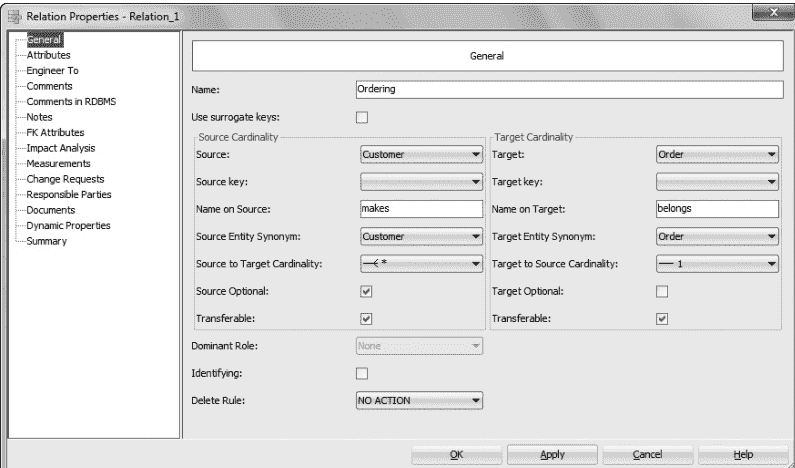

图 3-5. 关系的通用属性

## 第3章：需求分析简介 49

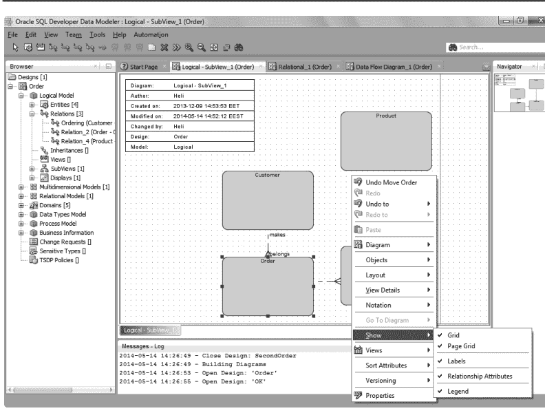

图 3-6. 视图属性

子视图是整个模型的子集。你可以通过：

- 在浏览器面板中选择关系，右键单击并选择属性。

- 在逻辑模型画布上双击关系。

如果你右键单击画布并选择“`Show Labels`”（显示标签），此文本将显示在图中。从同一个菜单中，你还可以定义网格、页面网格、关系属性或要显示的图例。

## 用于数据库精通的 Oracle SQL Developer Data Modeler

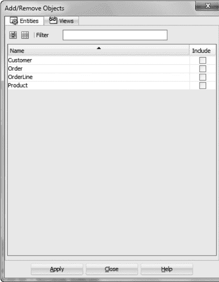

图 3-7. 选择对象

## 需求收集

在需求分析期间，为没有访问`Data Modeler`或其报告的用户描述如何使用数据库。

- 卷属性（`Volume Properties`）

你可以创建一个子视图：

- 在浏览器面板中选择关系，右键单击并选择属性。

- 在逻辑模型画布上双击关系。

## 第3章：需求分析简介 51

## 数据流图

数据流图是一种对功能过程的正式表示法。数据流图由过程、信息存储、外部代理和数据流组成。过程是被执行的活动。在理想情况下，每个过程应包含一个活动。原始过程和复合过程的区别在于原始过程是单个过程，而复合过程由过程组成。外部代理是与系统交互的组织或系统。外部代理向过程发送信息，也从过程接收信息。数据流显示信息如何在过程中流动。事件触发过程的执行。可以使用备注以文本格式显示重要信息。图3-8显示了数据流图的示例。

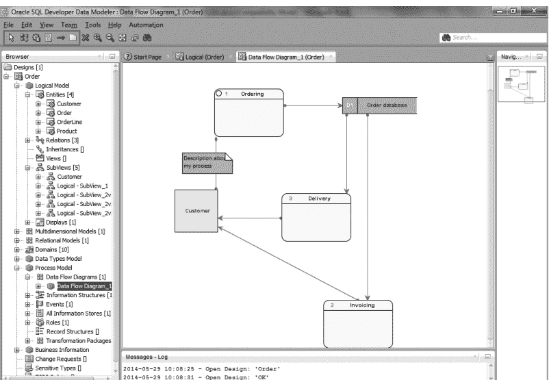

图 3-8. 数据流图

要创建新的数据流图，在浏览器面板中，在“数据流”（`Data Flows`）下，右键单击并选择“新建数据图”（`New Data Diagram`）。使用工具栏在画布上创建元素。

点击你想要添加到图中的元素图标，然后单击画布。当你想要开始元素时，点击工具栏上的“选择”。数据流图中的每个元素都有属性。

图3-9显示过程属性对话框。每个过程都有名称和类型（原始、复合或使用转换任务）。过程还可以有一个简短定义。它有一个模式（批处理、交互式、手动或未知），并根据模式，你可以定义其他内容如响应时间。你还可以为过程定义峰值期、频率和优先级设置。

图3-10显示外部代理属性对话框。外部代理必须有一个名称和一种类型（组织单元、系统、角色或其他）。它可以具有数据文件规范或数据元素，以及其他设置。

图3-11显示信息存储属性对话框。信息存储必须有一个名称和一种类型（`RDBMS`、文件、对象或临时），并根据类型具有某些其他定义。

# 第3章：需求分析简介 53

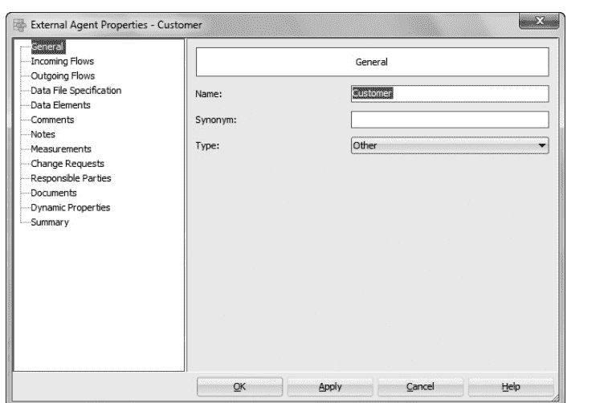

图 3-10. 外部代理属性对话框

图3-12显示了流属性对话框。流具有名称、同义词、源和目的地。它可以具有一个父流，可以是一个日志流，还可以有一个触发过程的事件。

## 介绍转换包

转换用于数据仓库环境，以将数据转换为所需的格式。不同的目标可能有不同的需求，例如，`OLAP`与数据挖掘的需求可能不同，因此非常有必要设计`ETL`过程。转换包是根据对象管理组织（`OMG`）通用仓库元数据模型（`CWM`）规范`V1.1`（[www.omg.org/spec/CWM/1/](）定义的包。

转换包将不同的源转换为不同的目标，并允许对不同的转换进行分组。只有当你已经定义了代表数据源或目标的包时，才能创建转换包：对象模型（面向对象）、关系型、记录、多维、`XML`，

## 54 Oracle SQL Developer 数据库设计精通

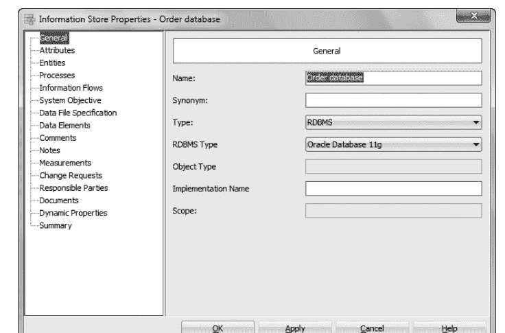

图 3-11. 信息存储属性对话框

`OLAP`或数据挖掘。通常情况下，你无法在需求分析阶段创建转换包，因为执行此操作需要比你通常拥有的更多的信息。但了解`Data Modeler`的这项功能是有益的，你可以记录任何与转换相关的有趣内容。

要创建一个新的转换包，在浏览器窗格中选择“过程模型 | 转换包”，右键点击并选择“新建包”。然后，右键点击转换包的名称并选择“新建转换任务”。`Data Modeler`将自动创建一个与你的转换任务同名的画布，并提供一个“输入参数”框。你可以将转换任务视为一个函数，它将有一个输入参数来定义函数的功能，以及一个输出参数来指示函数的如何结束。函数本身（转换任务）可能有几项操作要执行。

在工具栏中，你可以找到设计转换任务的工具：新建转换、新建信息存储、新建流和新建注释。你也可以通过从浏览器窗格将现有的信息存储拖放到画布上来使用它们。

## 第3章：需求分析简介 55

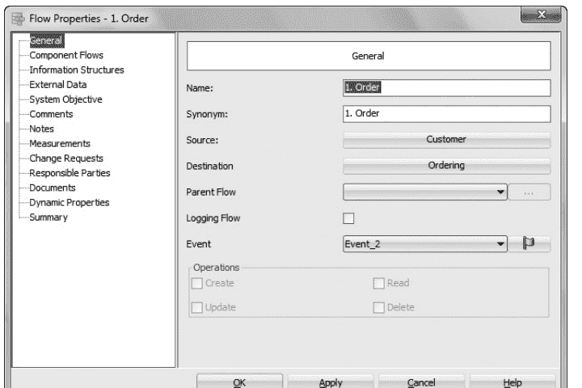

图 3-12. 流属性对话框

## 添加业务信息

你可以向`Data Modeler`添加业务信息。在浏览器窗格中转到“逻辑模型”，双击或右键点击并选择“属性”。在“逻辑模型属性”中，你可以添加、编辑和删除文档以及负责人。负责方可以包括，例如，电子邮件地址、电话号码、统一资源定位符（`URL`）和位置。所有这些内容都可以先添加到负责方中，然后通过双击或选择属性符号（铅笔图标）进行编辑。你可以为设计中的元素添加负责方。

此外，你还可以更改对象的请求，并可以定义，例如，状态、完整性、请求日期、完成日期和原因。例如，假设你想为实体`Customer`（客户）添加一个“新属性，状态”的变更请求。你可以使用搜索功能（有关搜索的更多信息请参见第11章）找到所有未完成的变更请求。选择“逻辑模型”，然后选择“高级模式”。从对象类型列表中选择“变更请求逻辑”并点击“添加属性”。选择“完成”并将`False`定义为值。在“结果”选项卡上，你可以看到逻辑模型中所有未完成的变更请求。搜索后，你可以生成`.xls`或`.xlsx`格式的报告发送给项目经理进行更新。项目经理可能会更新状态、完成日期和注释（“我已关闭此变更请求/Tim”）并将`Microsoft Excel`表格发送给你，以便上传到`Data Modeler`。

你还可以为属性创建变更请求。变更请求可以是，例如，“数据类型必须从`NUMBER`更改为`VARCHAR`，因为用例说信息也可以包含字符。”你为什么想在`Data Modeler`中创建变更请求呢？因为你可以在一个地方获取有关数据库的所有文档。例如，在实体的属性“变更请求”上，你可以随时检查更改了什么以及何时更改的，并根据“影响分析”属性进行影响分析。如果你不在`Data Modeler`中进行变更请求，你就无法完成这两个任何一项任务。

## 总结

数据库设计人员参与需求分析阶段是非常重要的，因为必须收集并记录对数据库的需求。数据库设计人员需要提很多问题，以发现并记录所有可能的所需信息。记录需求的正式方法通常是实体-关系图和数据流图。文档越能以正式的形式插入工具中，它在数据库设计的后续阶段中用得就越好。记录你在需求分析期间听听到和看到的所有内容是有价值的。但如果你无法做到这一点，也不要担心，幸运的是，在概念设计阶段也可以使用相同的工具。


## 第 4 章

## 介绍概念数据库设计（逻辑模型）

## 58 Oracle SQL Developer 数据库设计精通

概念数据库设计是将需求转换为正式模型和过程模型的过程。数据库设计的结果是概念模式和过程模型。概念数据库设计与需求分析相似，区别在于数据库设计人员必须获取设计所需的所有信息。主要的关注点是数据以及如何保存和检索。

本章将关注实体关系（`ER`）建模。数据流图也很重要，如果它们在需求分析阶段没有制作，你就需要花时间处理它们。它们对于显示数据库将如何被使用非常有价值；你可以在第3章学习更多关于数据流图的信息。

概念设计阶段出现的问题是需求质量。通常没有足够的材料和信息来理解全局，这对于设计数据库非常重要。数据库设计人员必须提很多问题并要求完整的答案。建模是一项工作，但口头语言不准确的事实使其更加困难。此外，用户不会告诉数据库设计人员他们知道的一切，即使是基本信息，因为设计人员并不是业务专家。设计人员至少应该具有业务意识，以便能够形式化口头语言。

为了能够生成有价值的报告，将你的所有信息插入`Oracle SQL Developer Modeler`是重要的。有关报告请参见第11章。`Data Modeler`具有为相同类型的对象设置常用属性的特性。有关这些功能请参见第11章。

## 设置偏好和属性

为设计设置标准是非常重要的。现在是约定命名标准和规则（如第2章所述）的时间，如果你还没有这样做的话。例如，你会使用斯堪的维亚字母吗？名称是大写还是混合大小写？有很多方法可以让`Data Modeler`以你想要的方式工作并支持你的标准。

在浏览器窗格中选择你的设计，右键点击并选择“属性”。“设计属性”对话框显示了第2章讨论的设计属性。你可以指定图表的外或设置一些通用的命名标准和模板。你还可以通过设置名称模式为属性、列、域、实体和表定义命名标准。模式是

# 第 4 章：介绍概念数据库设计（逻辑模型） 59

在模式中通过词类型及其强制性进行定义。`Data Modeler`支持的词类型为第2章中定义的主词（`Prime`）、类（`Class`）、修饰符（`Modifier`）和限定符（`Qualifier`）。属性的定义结构例如：一个强制性的主词、一个可选的修饰符和一个强制性的类词。这种结构的示例有“临时公司送货地址”或“公司地址”。你可以通过点击对象类型设计属性（`Design Properties`） | 命名标准（`Naming Standard`）中该对象类型的绿色加号为对象名称创建一个结构，并从列表中选择词类型。然后，你可以选择“强制”（`Mandatory`）来将此模式定义为必选，或者留为“可选”（`optional`）。你可以根据需要为模式添加任意数量的词类型。可以通过红色`X`按钮从模式中删除词类型。

当你应用设计规则时，这些命名标准将与定义的词表进行比较，任何违规都将作为警告报告。你可以使用此功能确保设计中的所有词都已在词表中定义，正如第2章所示，你可以在设计属性对话框的设置（`Settings`）中定义一个或多个词表作为验证词表。如果你定义了多个词表，只要使用任何一个定义的词表通过验证，该名称即被视为有效。你可以使用不同的词表，例如，一个表示感兴趣区域，另一个用于销售，第三个用于财务。最后，你可以按照第2章所述，与其他用户共享设计级属性。

> 注意

> 如果两个词表中存在相同的词，使用多个词表进行验证可能会导致问题。

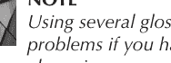


还有一些适用于逻辑模型级的属性。在浏览器（`Browser`）窗格中选择“逻辑模型”（`Logical Model`），右键点击，并选择“属性（`Properties`） | 命名选项（`Naming Options`）”。你可以指定名称的最大长度和字符大小写（大写、小写、混合）。你还可以从“有效字符”（`Valid Characters`）列表中选择一个，或者指定你自己的有效字符列表，或者选择“全部”（`All`）作为有效字符。你可以为实体、属性和视图指定这些设置。更多细节请见图 4-1。如果你尝试创建违反你的命名选项的内容，将立即收到错误消息。例如，如果命名选项属性定义实体名称必须全大写，但设计人员创建了一个全小写的实体名称，则会给出错误消息。如果元素在更改命名选项之前已经创建，则在应用设计规则时将对该元素进行检查，任何违反命名选项属性的违规都将作为错误报告。在 `Data Modeler 4.0.2` 版本中，命名选项设置无法与其他用户共享，但计划在未来的发布中提供此功能。

# 60 Oracle SQL Developer Data Modeler 数据库设计精通

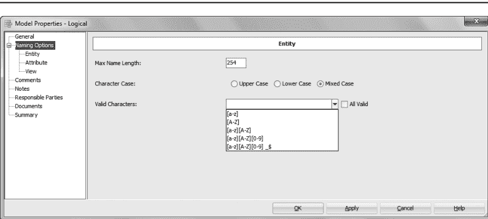

图 4-1. 逻辑模型的命名选项

除了属性之外，你还可以设置一些影响逻辑模型的偏好。选择“工具（`Tools`） | 偏好（`Preferences`）”菜单打开偏好对话框。通过按照你希望 `Data Modeler` 工作的方式设置逻辑模型的偏好，可以让你的工作更轻松、更舒适。在第 2 章中，你已经了解了如何定义符号法以及如何定义首选类型等。在偏好对话框中，选择 `Data Modeler | 逻辑（Logical）`以查看逻辑模型的设置，如图 4-2 所示。通过设置这些偏好，你可以定义在创建新实体或关系或在正向工程到关系型模型时的默认值。你可以随时更改这些默认值以影响新元素，并且如果需要，可以在你的逻辑模型中单独更改它们。你可以定义源和目标为可选或强制（源可选 `Source Optional`，目标可选 `Target Optional`）。源是关系开始的地方，目标是结束的地方。例如，客户可以是源，订单可以是目标。客户可能是可选（源可选 `Source Optional`，意味着源侧是可选的；客户可以不存在），订单可能是强制（目标强制 `Target Mandatory`，意味着目标侧是强制的；订单可以不存在）。换句话说，如果有客户，就不需要订单。你可以告诉 `Data Modeler` 将第一个唯一键设置为主键，通过选择“使用第一个唯一键作为主键”（`Set First Unique Key As Primary`）。实体中可能有多个唯一键，第一个

# 第 4 章：介绍概念数据库设计（逻辑模型） 61

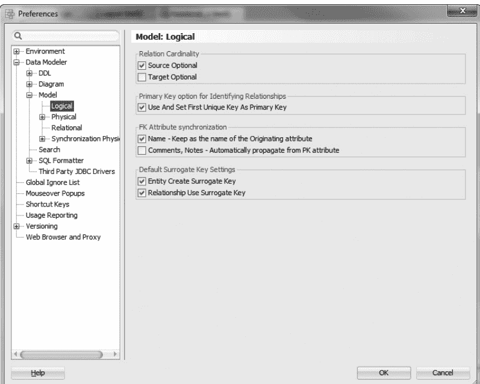

图 4-2. 逻辑模型的偏好

键。我不建议这种功能，因为我想定义自己的主键并确保选择了正确的唯一键，即第一个。另一个问题是唯一键可以为空，但主键不能。所以，如果将第一个唯一键设置为主键，其所有属性都不允许为空。无论如何，实体中可能有多个唯一键。要查看用于正向工程的逻辑模型偏好以及关系型模型的偏好，请参见第 5 章。

> 注意
>
> 更改某些偏好只会影响之后创建的元素。

62 Oracle Data Modeler 数据库设计精通

## 介绍逻辑模型

在设计数据库时，尽快开始设计工作是有价值的，因为在将需求形式化时，设计人员可能会发现有很多问题尚未被提问。事实上，有很多建模方法。你不能总是说一种方法比另一种方法更好，但逻辑理论有时会为你发现和选择其中一种提供指导。关系理论在正确地实现需求方面很有帮助。例如，最终用户可能会简单地说：“客户必须下单。”通过这句话，用户可能认为这定义了一个客户（也就是说，要成为客户，必须下单）。换句话说，用户认为他们定义了客户的概念。接受过逻辑训练的人意识到事实并非如此；有许多可能的解释。重要的任务是找出哪一种是所图的。为了澄清，示例中客户的定义可以是：

- 每个客户至少下一次订单。
- 至少有一个客户下过一次订单。
- 每个客户都至少有一个订单。
- 每个客户恰好下一个订单。
- 每个客户恰好有一个订单。

或者它可能意味着其他。在这种情况下，找到正确的定义会很容易，因为客户对大多数人来说是一个熟悉的概念，但对于你不熟悉的概念你也会遇到类似的断言，你仍然必须准备好提出正确的问题以便在建模时做出正确的决策。

## 第 4 章：引入概念数据库设计（逻辑模型） 63


提示

尝试不要表现得太聪明而设计过于复杂的解决方案；记住，通常简单的解决方案是最好的。

在概念数据库设计期间，你不需要主动担心归一化等问题，请记住关系理论，因为它对你有所帮助。重要的是尽可能完整地建模目标，同时又要足够让其他人能够理解它。发现并建模概念以及它们之间的关系至关重要。尝试记录你所听到和学到的所有内容。建模时要系统化。决定在何处以及如何记录，并确定合适的记录水平。确保你在注释和评审时使用清晰且易懂的词汇。

你应该从需求分析（第 3 章）期间创建的模型开始。如果你没有需求分析的任何结果，就必须从头开始，从本章描述的概念数据库开始。最好的情况下，这意味着更多工作；甚至可能意味着你没有足够的信息来做出正确的建模决策。

逻辑模型由实体、关系、视图、继承、子视图和显示组成。所有逻辑对象都显示在浏览器面板的“逻辑模型”下。一个逻辑模型由一个逻辑图和可能的一个或多个子视图/或显示组成。

如果你在浏览器面板中右键点击“逻辑模型”，你将看到针对逻辑模型的操作。

- 通过“隐藏”和“显示”，你可以控制逻辑模型图是否打开。
- 你可以根据逻辑模型创建子视图和显示（本章稍后会介绍更多）。
- 你可以设置分类类型（更多内容请见第 8 章）。
- 你可以应用命名标准和自定义转换脚本从逻辑模型创建词汇表（更多内容请见第 3 章）。
- 你可以搜索并基于搜索结果创建报告，并通过 `Excel` 工作表更新 `Data Modeler` 中的数据（更多内容请见第 11 章）。
- 你可以选择“工程关系模型”（更多内容请见第 5 章），当然可以查看和编辑属性。

## 用于数据库设计的 Oracle SQL Developer Data Modeler

- 在浏览器面板的每个对象中，你都有选择版本的能力。你可以在第 9 章中找到更多关于版本和版本控制的知识。

如果你右键点击逻辑模型图（或子视图图），可以执行以下操作：

- 你可以撤销操作。
- 你可以定义布局。
- 你可以定义显示哪些细节（显示详细信息）：所有细节、仅名称或属性。你还可以指定显示时包含分类类型（元素上分类类型的名称）或注释。
- 你可以选择符号表示法。
- 你可以显示页面网格或网格，或者让图中的标签（源和目标名称）以及关系属性可见。你可以指定显示图例。图例显示图中的摘要属性。所有这些都可以在“显示”下进行选择。

## 实体及其属性

实体是建模目标感兴趣的任何事物，例如一个说（`say`）。每个实体都属于某种实体类型。一组具有共同属性的实体（`Person`）具有某些共同属性（`Heli`、`Marko`、`Patrik` 和 `Matias`——和所有类型为 `Person` 的实体一样——都有名称）。实体始终是一个名称（`Employee`，`Customer`）。实体是实体类型的子集，它只包含建模目标中的那些。在口语中，实体类型和实体集通常都被称为实体。在本书中，我们将实体类型和实体集都称为实体，因为在 `Data Modeler` 的语境下是如此。当引用实体集（`Person`）中的单个实体（`Heli`）时，我们将使用“实体实例”一词。你可以在 `Data Modeler` 中点击实体图标并插入实体的属性，在逻辑模型上创建一个实体，如第 3 章所示。

实体可以是强实体也可以是弱实体。强实体（例如 `Customer`）不需要其他实体或关系即可识别自己；强实体具有独立存在性。弱实体（例如 `Orderline`）依赖其他实体来标识它（`Order`，`Customer`），并与它们有强制性的标识性关系。实体的弱性通过关系线末尾的水平线表示。你可以在“关系属性”对话框中通过从属性的源侧选择“标识（`Identifying`）”来定义。

## 第 4 章：引入概念数据库设计（逻辑模型） 65

如前所述，实体具有属性（例如，`Person` 有一个名称）。这些属性被称为属性。属性可以是原子的，这意味着它只包含来自某个域的单个值，且不能划分为更小的组件。邮政编码（`Zip Code`）是一个原子属性。属性也可以是复合的，这意味着它是两个或多个可以是原子或复合的属性的组合。复合属性的示例是 `Name = Firstname + Lastname`。属性可以是多值的或集合值的，这意味着该属性将有多个值，但不同值的数量可以是有限的。例如，一个客户可以只有三个电话号码：家庭、工作和手机。或者属性可以是派生属性。例如，年龄（`Age`）可以从出生日期（`Date of Birth`）派导出。对于属性，你可以在“属性属性”对话框中找到特定属性，如图 4-3 所示。你可以通过点击找到它：

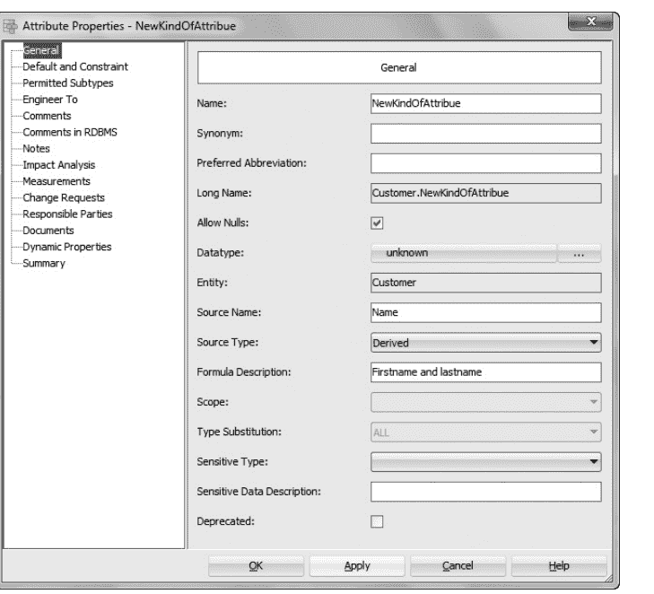

图 4-3 属性属性对话框，常规选项卡

## 66 用于数据库设计的 Oracle SQL Developer Data Modeler

实体对话框属性选项卡上的属性图标、双击属性名称，或在浏览器面板中选择属性、右键点击并选择属性。在属性对话框中，你还可以在源名称字段中定义属性的源，然后选择源类型，源类型的允许可选值有：空（无源类型）、手动（`Manual`）、系统（`System`）、派生（`Derived`）和聚合（`Aggregate`）。如果你想为派生或聚合属性定义公式，可以在公式描述中输入公式，如图 4-3 所示。

属性可以是强制的或可选的。如果属性在创建时通过选择“强制（`Mandatory`）”被定义为强制，它在画布上的名称前将有一个星号（`*`）。如果属性是可选的，在 `Barker` 表示法中其名称前将有一个小圆圈（`o`），在巴曼或信息工程表示法中则为空。

如果你在画布上右键点击实体，你可以看到允许对实体的操作。例如，你可以执行以下：

- 完全删除实体（删除对象）或仅从图中删除（删除视图）。
- 复制实体。
- 显示/隐藏元素。
- 选择邻居并通过“从选择创建视图”创建实体及其邻居的子视图。
- 对实体的属性排序。
- 创建同义名。同义名实际上是指创建视觉同义名；换句话说，是在同一张图中实体的另一种表示形式。它不是你数据库中可能使用的同义名。它旨在让图表更易读。同义名可以与原始实体具有不同的元素和格式。

在 `Modeler` 中，我们可以设置对象名称为不可更改，这样名称在属性中将显示为灰色。这对于防止更改名称非常有用。例如，如果你想在设计中包含另一个架构（另一个设计、另一个系统等）的表，你希望它们在那里以显示存在逻辑关系，但你想防止任何人更改它们的名称。或者更常见的原因是你已经在数据库中有了此对象，由于任何原因无法更改名称。你可以通过工具 | 对象名称管理（图 4-4）来找到此功能。在对象名称管理对话框中，为你想要具有固定名称的所有元素选择“固定（`Fixed`）”。你可以对实体、属性、关系、标识符和视图的名称执行此操作。

## 第 4 章：介绍概念性数据库设计（逻辑模型） 67

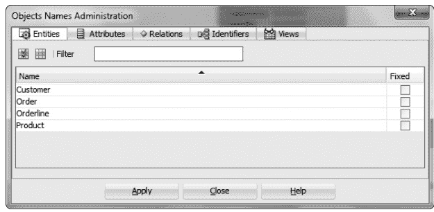

图 4-4. 对象名称管理对话框

另一个有时很有用的功能是将对象标记为已弃（`deprecated`），以告知用户该元素不应被使用。在许多属性对话框中，你可以找到此功能（例如，在实体属性的 `General` 和 `Attributes` 卡上）。在图 4-5 中，你可以看到实体 `ProductGroup` 被划线了，这意味着它已被标记为已弃，其属性 `GroupNo` 也是如此。

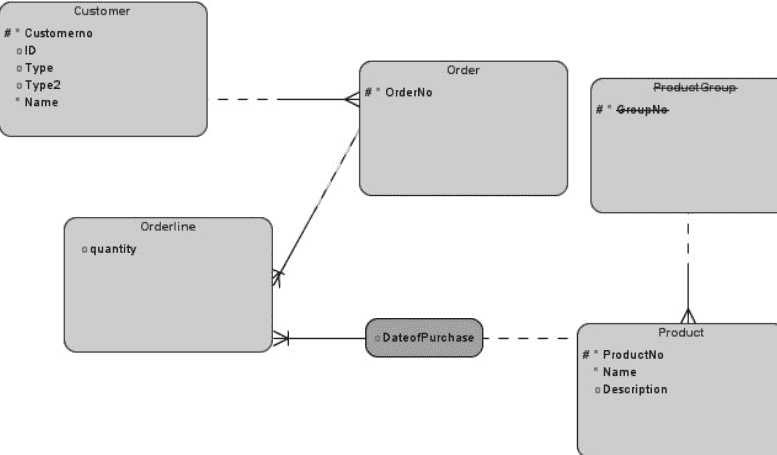

图 4-5. 被标记为已弃的实体属性

## 用户定义类型

`Data Modeler` 中有四种用户定义数据类型：区分类型、结构化类型、集合类型和逻辑类型。

逻辑类型并非实际的数据类型；它们是可以与所选关系型数据库管理系统（`RDBMS`）的原生类型关联的名称，然后定义为属性或域的数据类型。要创建逻辑类型或编辑现有类型，选择 `Tools | Types Administration`（图 4-6）。要创建一个新类型，在 `User Defined Native Types` 卡上为选定的 `RDBMS` 类型（`Oracle 12c`、`SQL Server 2008` 等）定义一个用户定义类型。点击 `Save`。然后为新的逻辑类型命名，并为 `RDBMS` 类型选择你刚刚创建的原生类型。点击 `Save`。现在，你可以在 `Logical Types To Native Types` 卡上看到这个带有原生类型设置的新逻辑类型。它可以被选定作为属性或域的数据类型。我曾用过这种方法，例如，针对一个新版本的 `Microsoft SQL Server`，该版本包含了 `Data Modeler` 尚未支持的新型数据类型。我将这些数据类型定义为逻辑类型，并在设计时使用了它们。

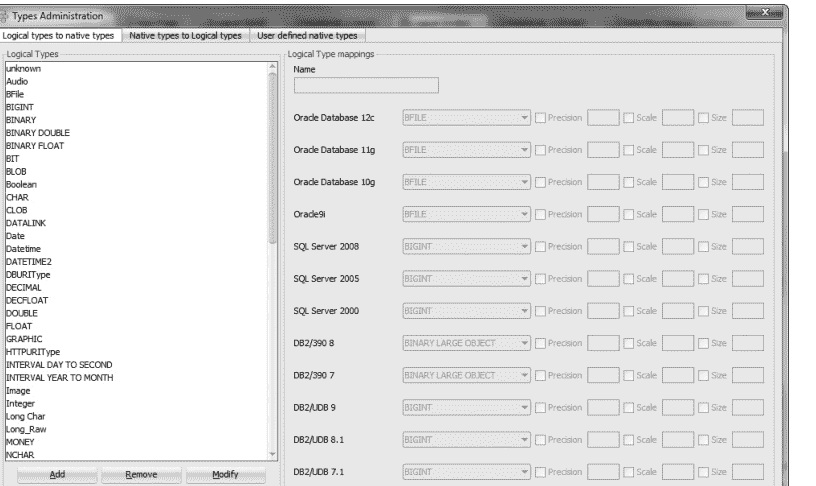

图 4-6. 类型管理对话框

你可以使用 `Types To Domains` 向导（选择 `Tools | Types To Domains Wizard`）根据设计中使用过的数据类型创建域。但要小心，因为域必须经过仔细定义和约定，我更倾向于手动定义它们。可以通过选择 `Tools | Domains Administration` 来维护域。你可以在第 2 章中阅读更多关于域的信息。

区分、结构化和集合类型可以在 `Browser` 面板的 `Data Model` 下定义和管理。逻辑模型和关系模型都使用数据类型模型的定义来指定属性和列的数据类型。某些结构化类型还可以定义实体或表属于特定的结构化类型。数据类型模型可以手动构建，也可以从 `Oracle Designer` 仓库导入。你可以在 `File` 中找到导入功能，可以在第 10 章中阅读更多从 `Oracle Designer` 导入的知识。

要创建区分类型或集合类型，进入 `Browser Pane`，选择数据类型并点击右键。填写所需信息。对于区分类型，你需要定义名称并从值列表中选择逻辑数据类型。你也可以定义大小。不要忘记为区分类型添加注释和文档。创建区分类型后，它将出现在属性或列的数据类型列表中。记住选择数据类型为 `Distinct`。要创建集合类型，你必须定义名称并将集合设置为数组（`array`）或集合（`collection`）。对于数组，你必须定义数组中的最大元素数量；对于集合，则不需要定义此元素。你应该为你的数组或集合定义数据类型。数据类型可以是域、逻辑、区分、集合或结构化。你还应该定义 `Max Size String` 参数，并不要忘记为集合类型添加注释和文档。创建集合类型后，它将作为属性或列的数据类型可用。在为属性分配数据类型时，记住选择数据类型 `Collection`。

结构化类型是具有属性和方法的用户定义数据类型。属性可以是逻辑、区分、结构化或集合类型。结构化类型还可以被定义为另一个结构化类型的子类型。可以基于结构化类型定义实体。要创建一个新的结构化类型，进入 `Browser Pane` 中的 `Data Types`，点击右键并选择 `Show`；或者，在 `SubViews` 下点击右键并选择 `SubView`。然后使用工具栏上的图标设计结构化类型。只有结构化类型对象在数据类型图中以图形形式表示。数据类型图由结构化类型、引用链接、嵌入结构链接、引用链接集合、嵌入结构链接集合和注释组成。

从数据类型的属性中，你可以通过 `Used In` 看到此数据类型在何处以及何时被使用。

## 敏感数据

`Oracle` 数据库版本中有一个可选功能（包含在 `Advanced Security` 中），允许对被定义为敏感的数据进行不同的处理。请在 `Oracle` 文档中阅读更多相关信息。`Data Modeler` 支持设计敏感数据。在 `Data Modeler` 中，你可以定义敏感类型并将其与透明敏感数据保护（`TSDP`）策略关联。你可以在 `Browser Pane` 中右键点击 `Sensitive Types` 并选择 `Sensitive Type` 来创建一个新的敏感类型。敏感类型应该有一个名称。在 `Data Modeler` 中，你可以定义敏感类型并将其与透明敏感数据保护（`TSDP`）策略关联。你可以在 `Browser Pane` 中右键点击 `Sensitive Types` 并选择 `Sensitive Type` 来创建一个新的敏感类型。敏感类型应该有一个名称。在 `Data Modeler` 中，你可以定义敏感类型并将其与透明敏感数据保护（`TSDP`）策略关联。你可以在 `Browser Pane` 中右键点击 `Sensitive Types` 并选择 `Sensitive Type` 来创建一个新的敏感类型。敏感类型应该有一个名称。

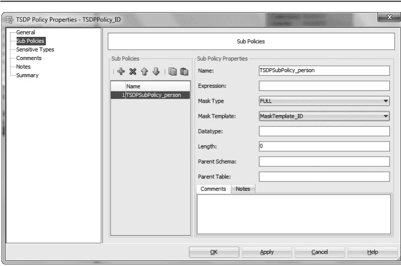

图 4-7. `TSDP` 策略属性，子策略

## 第 4 章：介绍概念性数据库设计（逻辑模型） 71

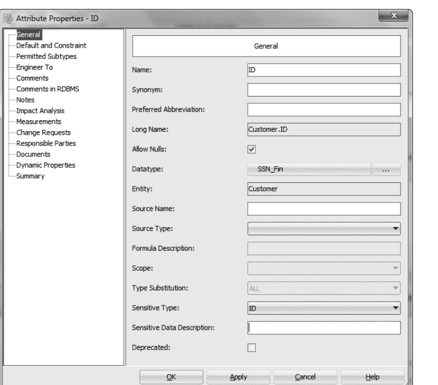

图 4-8. 为属性关联敏感类型

## 关系

关系是两个或多个实体之间的逻辑关联。关系的度数是涉及的实体数量。如果一个关系包含两个以上的实体，则被称为复杂关系。“`Heli` 购买了 `iPad`”是一个度数为 2 的 `Heli` 关系。关系类型是一组相似的关系，例如 `BUY (CUSTOMER, PRODUCT)`。关系类型是一个动词。关系集是关系类型的子集，仅包含属于建模目标的关系。在口语中，关系类型和关系集通常被称为关系。在书中，我们将关系类型和关系集称为关系，因为在 `Data Modeler` 的上下文中它们是这样被称为。你可以使用工具栏上的关系图标之一在 `Data Modeler` 的逻辑模型画布上创建关系。

复杂关系通常需要更多的调查。`ER` 模型是二维的，复杂关系在不产生疑问的情况下无法融入。图 4-9 显示了复杂关系的示例。客户正在订购由供应商提供的产品。任何供应商都能提供任何产品吗？客户可以订购产品列表中的任何产品吗，还是有某些限制（例如客户的年龄？）在基于更多问题之前，`ER` 模型无法回答这些问题。


关系具有参与约束：它是强制的（全额）或可选的（部分）。在 `Data Modeler` 中，你将在 `Preferences` 对话框的 `Logical` 卡上定义参与约束。如果你希望关系的源端是可选的，选择 `Source Optional` 属性；否则，禁用它。`Target Optional` 属性为关系的目标端定义相同的内容。

关系具有基数约束（映射基数、基数比例），用于描述该实体在关系中拥有的实例数量。对于

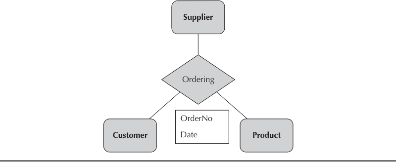

图 4-9. 复杂关系的示例

# 第 4 章：引入概念数据库设计（逻辑模型） 73

实例，一个员工可以恰好有一个主管，最多一个主管，或有多个主管。在 `Data Modeler` 中，有四种不同的映射基数：一对一（`1:1`）、一对多（`1:m`）、一对多标识性以及多对多（`m:n`）。你还可以在关系（`Relation`）对话框中，通过使用源到目标基数（`Source To Target Cardinality`）和目标到源基数（`Target To Source Cardinality`）属性来定义这些设置。

同一个实体可以在不同的角色中参与多次。例如，一个员工（`Employee`）既可以是员工，也可以是主管（`Supervisor`），而两者都是员工。图 4-10 显示了一个实体与同一实体建立两个关系的示例。在 `Data Modeler` 中，你可以通过选择一对多关系符号并双击该实体来创建这种关系。如果关系指向实体本身，则称为递归（`recursion`）。为了避免混淆，请确保为不同的角色命名。你可以在关系属性（`Relation Properties`）对话框中命名关系角色。在“源端名称”（`Name On Source`）和“目标端名称”（`Name On Target`）字段中为角色命名。若要在 `Data Modeler` 的图表中显示这些名称，请右键点击画布并选择“标签”（`Labels`）。

关系属性对话框还有一个删除规则（`Delete Rule`）列表，你可以在这里定义当父表的行被删除且子表中存在该值的行时，删除子表的规则。可能的选项有：无操作（`No Action`）、级联（`Cascade`）、置空（`Set Null`）和限制（`Restrict`）。

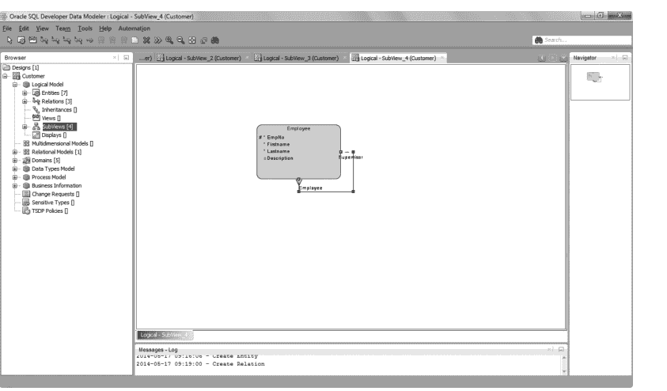

图 4-10。指向同一实体的关系，递归

- 默认值 `No Action`（无操作）对这些行不执行任何操作，这意味着在从父表中删除这些行之前，必须手动从子表中删除这些行。
- 选项 `Cascade`（级联）会在 `Data Modeler` 删除父表行时，自动从子表中删除这些行。
- 值 `Set Null`（置空）将子表中所有可以设置为为空的列设置为空。如果存在不能设置为为空的列，则必须手动处理。
- 值 `Restrict`（限制）防止对从子表引用的父表列进行任何更新或删除。

在逻辑模型中，删除规则没有意义，但这里是找到记录所需信息的正确位置。在 `Data Modeler` 的逻辑模型中就可以对其进行记录是好事，它将会被正向工程到关系模型中。

关系可以有自己的属性。例如，客户（`Customer`）与订单（`Order`）之间的关系可能有一个“购买日期”（`Date of Purchase`）属性。关系的属性可以在关系属性（`Relation Properties`）的属性（`Attributes`）选项卡中定义，如图 4-11 所示。在图表中，关系属性在图 4-12 中显示。默认情况下图表中不会显示关系属性。如果你看不到它们，请右键点击画布并选择“显示 | 关系属性”（`Show | Relationship Attributes`）。

> 注意

一个常见的错误是将外键建模为一种属性。不要这样做。如果你这样做了，在正向工程之后，你的关系模型中会出现重复列。

如果关系线的看起来不符合你的要求，你可以选择并移动它，或者使用 `Data Modeler` 功能来移动它。你可以删除或隐藏该关系。你可以选择直线（`Straight Lines`）、添加折线（`Add Elbow`）或更改格式（`Change The Format`）。如果你想更改关系线的样式，请选择更改格式（`Change Format`）并修改。你可以通过在图表中右键点击关系和关系线来查看允许对其进行的所有操作。

# 第 4 章：引入概念数据库设计（逻辑模型） 75

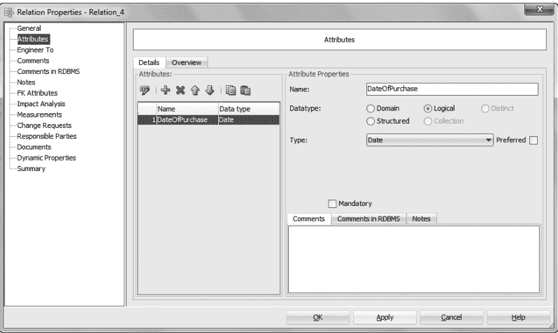

图 4-11。关系属性的属性

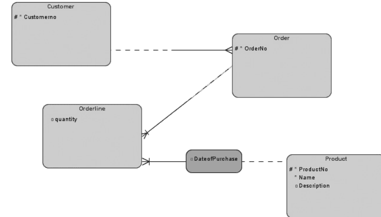

图 4-12。图中的关系属性

# 76 Oracle SQL Developer Data Modeler 数据库设计


> 提示

如果你想看到逻辑图中由逻辑关系隐含的外键属性，请选择巴赫曼表示法（`Bachman notation`）。这是检查模型的一种简单方法，可以查看正向工程是否会产生你预期的关系模型。

## 约束

属性或一组属性可以是标识性的（`identifying`），这意味着这些属性标识该实体并约束该实体。实体的唯一标识符（`UID`）可以由一个或多个属性组成。你可以指定一个主标识符，它唯一地标识每个实体实例并作为主键。主键中的所有属性都是强制的；它们不能为空。主键可以是自然键（`natural key`），意味着它由该实体能够真正标识它的一个或多个属性组成；也可以是代理键（`surrogate key`），即由一个属性（通常是数字属性）组成，该属性对实体本身没有意义，只是将每个与其他区分来。

你还可以定义一个或多个额外的唯一标识符作为约束或唯一键（`unique keys`）。主键和唯一键的区别在于唯一键为空。在 `Data Modeler` 中，你可以通过选择属性（`Attributes`）选项卡上的 `UID` 来定义主键。这会打开键（`Key`）对话框，如图 4-13 所示。始终记住点击“应用”（`Apply`）和“保存”（`Save`）。你可以在浏览器（`Browser`）的“主键”（`Primary Keys`）下找到主键，可以在“备用键”（`Alternate Keys`）下找到其他唯一键。

# 第 4 章：引入概念数据库设计（逻辑模型） 77

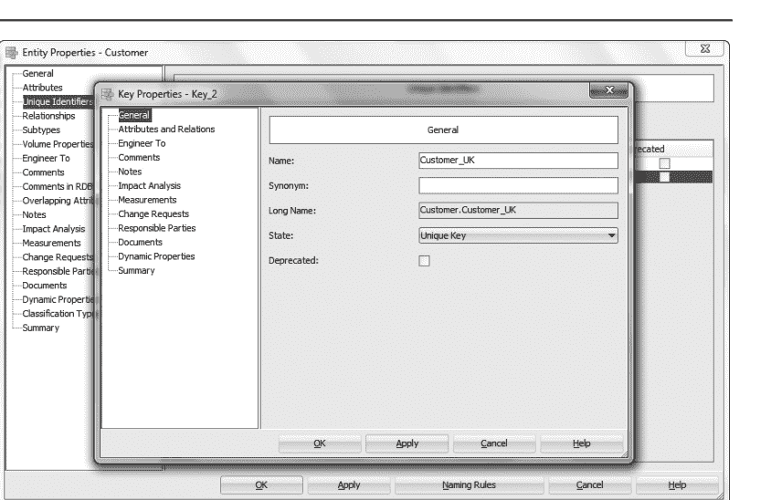

图 4-13。键的属性

主键的属性应该是标识性的、稳定的且不发生变化的。例如，在许多系统中，社会安全号码（`SSN`）被定义为人的主键。它是一个好的主键吗？不是。原因如下：

- `SSN` 不是唯一的，至少在全球范围内不是唯一的。
- `SSN` 并不标识一个人；在少数情况下，一个人可以有多个 `SSN`。

# 78 Oracle SQL Developer Data Modeler 数据库设计精要

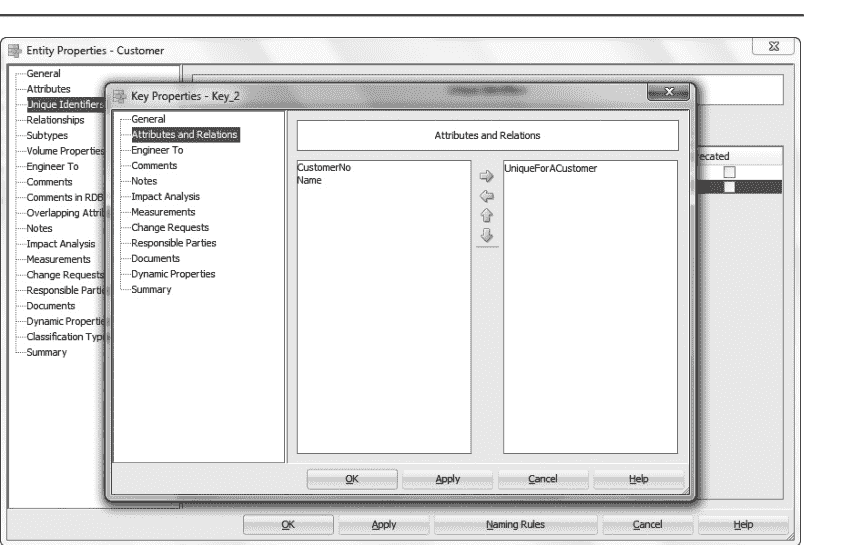

图 4-14。为唯一键选择实体和关系

- `SSN` 是可以更改的。当你搬到另一个国家时，你会得到一个临时 `SSN`。当你获得公民身份时，你会得到一个永久的。这有很多 `SSN` 发生变化的情况。
- `SSN` 不是你可以自己定义的；它来自另一个系统，并由其他组织及其规则控制。如果他们更改了规则怎么办？不要使用来自其他系统的数据（历史数据等）作为主键。
- `SSN` 在多个表（作为外键时）中被多次定义为敏感数据、脱敏数据或掩码数据，这并不高效。

在选择主键时，你有两种选择：自然键或代理键。哪一个更好？对于任何建模问题的问题的唯一正确答案都是：取决于情况。但决定主键是最重要的步骤之一

# 第 4 章：引入概念数据库设计（逻辑模型） 79

概念数据库设计中的决策。自然键（`natural key`）通常更高效；有时你可以消除连接操作（`join`），有时查询优化器可以高效地工作，以此此类推。但如果没有零候选键（`zero candidate`），尝试寻找主键是没有意义的，尽管在很多情况下这表明模型存在问题。很多时候，设计者过于谨慎，不敢将属性设置为空值（`null`），因此只能定义唯一键。或者是对概念的理解不够深入，无法真正识别实体。设计数据库时考虑的因素之一是数据质量。为了获得高质量的数据，你必须理解你正在建模的内容，并且尽可能将许多属性设置为非空（`not null`），并找到所有可能的代理键（`surrogates`）。代理主键不会阻止用户在数据库中插入重复数据，但自然键可以，而且代理主键的索引通常不被使用（因为查询不是基于代理键进行的）。另一方面，很多时候数据的最佳解决方案来自另一个系统，且不受你组织的控制，此时应使用代理键，因为你永远无法确定另一个系统是否更改了你认为唯一的数据。因此，这个问题没有单一的答案。如果你必须使用代理键，请在实体属性（`Entity Properties`）或关系属性（`Relationship Properties`）框中选择代理键（`Surrogate Keys`）。

键约束是指引用实体主键的属性或属性集，如前所述，它可以是另一个实体或实体本身。

你也可以为属性定义约束。例如，域约束（`Domain constraints`）可以定义数据类型、允许值默认值。你可以在要使用的域（`Domains`）中重新定义它们（参见第 2 章），也可以在属性属性（`Attribute Properties`）对话框（图 4-15）中为每个属性单独定义。定义约束的名称并定义默认值。如果你想使用域管理中为关联域定义的属性，请选择使用域约束（`Use Domain Constraints`）。如果未勾选此选项，你可以继续定义设置。你可以从约束列表中为一个或多个类型的数据库指定约束。你可以为属性指定一个或多个范围。如果你选择了域约束，所有更改将自动应用到该属性上。例如，如果域约束中添加了新的允许值，它将自动作为该属性的默认值候选并出现在允许值列表中。我建议使用域及其设置，这会让维护变得更容易。

另一种常用的约束是检查约束（`check constraint`）。检查约束的一个示例可以是 `Check (Name=upper(Name))`。约束可以是即时的（`immediate`）或延迟的（`deferred`），这意味着它将立即检查或稍后进行检查。

# 80 Oracle SQL Developer Data Modeler 数据库设计精通

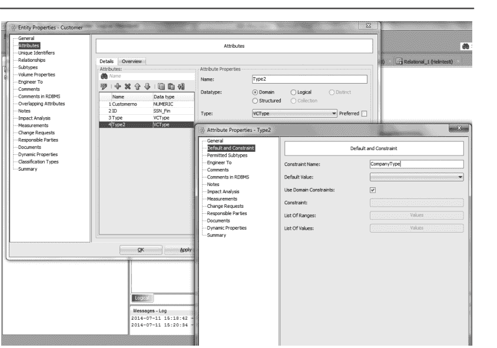

**4-15.** 域约束

## 实体视图 (Entity Views)

实体视图是逻辑模型中的元素，允许设计者为概念模型创建一个新级。这一层是为了使设计更加具体，以便业务所有者理解。实体视图可以是模型中实体的组合或子类。如果需要，实体视图可以正向工程变为关系模型中的视图以及数据库视图。

你可以通过点击 `Data Modeler` 画布上“新实体”图标旁边的“新视图”来创建一个新的实体视图，它作为一个实体但背景颜色为橙色。那里有实体视图的名称，并在视图中选择了属性。在实体视图的底部是该视图中使用的实体。在视图属性（`View Properties`）对话框（图 4-16）中，你可以命名实体视图并使用查询生成器（`Query Builder`）构建视图。你将在第 5 章学习更多关于查询生成器的知识。如果你选择了“关系自动连接”（`Auto Join On Relationships`），查询生成器将根据视图所选实体之间的关系自动为你的视图创建关系。

# 第 4 章：引入概念数据库设计（逻辑模型） 81

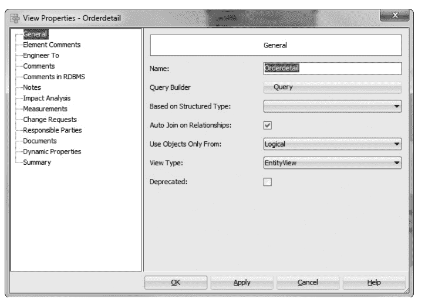

图 4-16. 实体视图属性

如果你禁用了“关系自动连接”，则必须手动创建关系。你可以通过从“仅使用对象”（`Use Objects Only From`）列表中选择所需的项，决定可以使用逻辑模型中的所有对象还是特定子视图中的对象。视图类型可以是实体视图或命名查询。

## 继承 (Inheritance)

有时，你需要对一个具有两个或多个互斥子实体的实体进行建模。例如，你可能想建模一种情况：主实体是客户（`Customer`），但客户要么是个人（`Person`），要么是公司（`Company`）。你可以通过弧（`arc`）或超类型（`supertype`）和子类型（`subtype`）的概念来解决。

弧是一种互斥的关系组，对于实体的给定实例，只能存在其中一种关系。要画一个弧，你必须先创建所有想要包含在弧中的实体和关系。选择实体并选择所有要包含的关系线（按 `SHIFT` 或 `CTRL` 并点击条线）。现在你可以看到工具栏上的弧图标（`Arc icon`）已启用。点击“新建”

# 82 Oracle SQL Developer Modeler 数据库设计精通

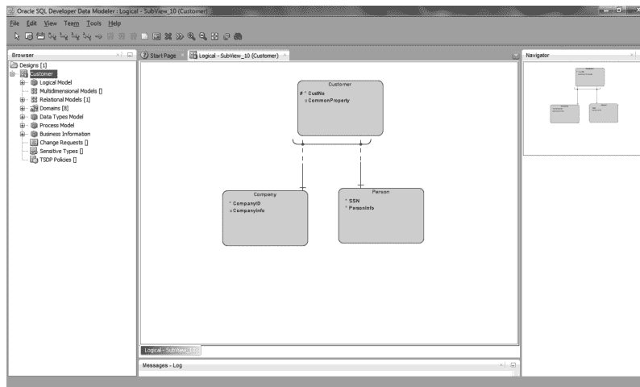

图 4-17. 弧解决方案

弧图标。图 4-17 显示了一个弧解决方案，其中 `Customer` 和 `Person` 之间或 `Customer` 和 `Company` 之间存在关系。换句话说，客户是个人或公司，但两者不可兼得。弧中的所有关系应属于同一个实体，并且它们具有相同的基数。在正向工程中，弧解决方案为每个实体生成一个表。为了将此设置正向工程到关系模型，你必须将属于关系的外键属性设置为允许空，因为表中的每行只能有一个值。表中将根据超类型（`Customer`）为每个子类型的外键设置额外的列，并需要额外的检查约束来实现弧。你将在第 5 章学习更多关于正向工程的知识。当子类型之间没有许多共同点且可以独立使用时，弧是一个很好的选择。

在许多情况下，使用子类型和超类型来表达相同的需求更容易建模。超类型和子类型的建模策略通常对用户更容易阅读和理解，并且让设计者自由决定如何将其实现到关系模型中。基于超类型和子类型的实体层次被称为*继承*。超类型的所有属性和关系

# 第 4 章：引入概念数据库设计（逻辑模型） 83

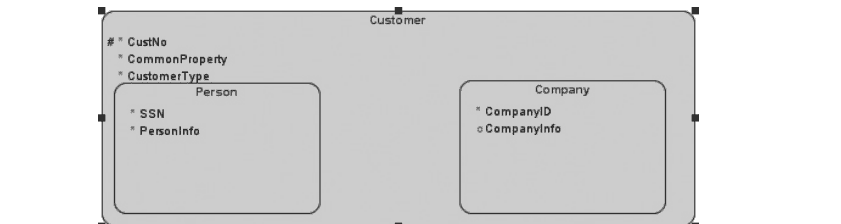

图 4-18. 框内框表示

必须属于其所有子类型。如果许多实体实例除了超类型的属性外还具有属性，则通常会定义子类型。在实体的常规属性（`Entity General Properties`）中，通过从“超类型”（`Super Type`）列表中选择相应的实体为实体定义超类型（图 4-18 示例中，`Customer` 是超类型，`Person` 是子类型）。如果选择了框内框表示法，继承看起来就像图 4-18 中的模型。

如果没有选择框内框表示法，相同的继承将像图 4-19 中的那样。在这种情况下，继承关系属性可以

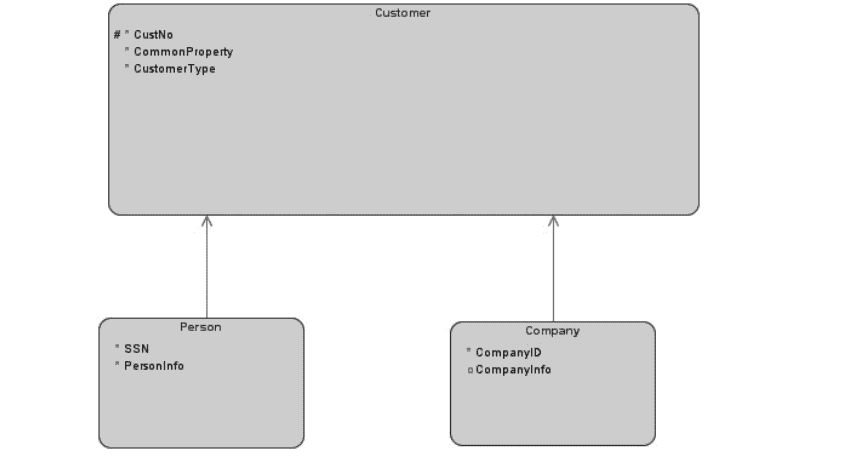

图 4-19. 继承，无框内框表示

## 84 精通数据库设计的 Oracle SQL Developer Data Modeler

可以在继承属性中进行修改。你可以定义名称（`Name`）、全名（`Long Name`）、超类型（`Super Type`）和子类型（`Sub Type`）字段。你还可以定义工程师目标（`Engineer To`）、注释（`Comments`）、`RDBMS` 中的注释以及备注（`Notes`）。

实体属性对话框中的“`Engineer To`”页面用于定义层次结构中的哪个实体将转换为表，如果存在多个关系模型，则转换为哪一个关系模型。此定义应该对每个实体进行。

自 `Data Modeler 4` 版本起，实体属性对话框中新增了“`Subtype`”的页面，用于在工程中实现子类型并设置区分器列，如图 4-20 所示。对于实体和子类型的生成，有两个决策：子树生成（`Subtree Generation`）和应用模型（`Apply To Model`）。子树有四种选择：不预设（`Do Not Preset`）、单表（`Single Table`）、每个子类表（`Table Per Child`）和每个实体（`For Each Entity`）。如果你想通过手动为每个实体设置 `Engineer To` 属性来自己选择，请选择不预设。我将在本节稍后部分详细讨论这些选择。同一页面上的 `Apply Model` 选择定义了实体属性的可能更改是应用于所有关系模型，还是应用于特定的

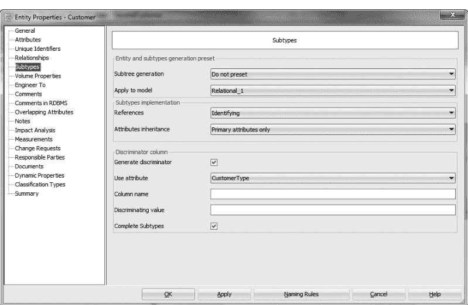

图 4-20. 定义继承

## 第 4 章：概念性数据库设计简介（逻辑模型） 85

模型。对于子类型实现（图 4-20），有两个设置：引用（`References`）和属性继承（`Attributes Inheritance`）。对于引用，你有三个选择：无（`None`）、标识（`Identifying`）和 `Arc` 实现（`Arc Implementation`）。如果对引用选择“无”，则会在表之间创建外键。如果选择 `Arc` 实现，将创建从超类型到子类型的可选外键。如果选择标识，将创建从子类型表到子类型表的外键。你还可以指定继承关系，你有两个选择：仅主属性（`Primary Attributes Only`）和所有属性（`All Attributes`）。此属性定义了超类型的主属性或所有属性继承到实现为表的子类型中。

对于子类型实现（图 4-20），你还可以指定区分器列，这通常在选择泛化（即单表实现）时使用。我将在本节中详细讨论这一点。

在关系模型中实现继承有三种方法：特化（`specialization`，每个实体一个表）、泛化（`generalization`，单表）或两者都不是（每个子类一个表）。建模继承没有正确的方法；它始终取决于需求。

实体的特化意味着将实体划分为子类型。例如，客户（`Customer`）实体可以分为个人（`Person`）和客户（`Customer`）。所有共同属性将位于 `Customer` 实体中。`Person` 和 `Customer` 将拥有这些实体的特定属性。这与你在图 4-16 中看到的 `Arc` 解决方案类似。在 `Data Modeler` 中，这被称为“每个实体一个表”（`Table For Each Entity`，见图 4-20），你可以通过在实体属性对话框中设置子类型生成来选择它（当选中 `Table For Each Entity` 时，当前子集中的所有实体都将被选中用于工程）。

为了确保方案是正确的，你应该问自己几个问题。客户可以是人或公司吗？通常从性能角度来看，这并不是一个好的解决方案，因为你可能经常需要连接这些表。


实体的泛化意味着为一组实体创建一个超类型实体。子类型可能具有不适用于泛化在该超类型下的所有实体的属性。假设你有名为`Customer`（客户）、`Company`（公司）和`Person`（个人）的实体。你可以将所有这些泛化为名为`Customer`的超类型。该子类型现在泛化了其他子类型。子类型继承了超类型的属性，并拥有自己的属性。在 Data Modeler 中，这被称为“单表”（Single Table），你可以通过在实体设置对话框中将子类型生成选项设置为 Single Table 来选择它。在 Data Modeler 中，此的 Engineer To 属性将被设置，当前子集中的所有子类型将被清除。

在现实，你可能需要一个新属性来描述每个客户属于哪种类型，例如`CustomerType`属性，因为可能有此类需求。在 Data Modeler 中，你使用区分器列

## 86 精通数据库设计的 Oracle SQL Developer Data Modeler

为了实现该目的。如果你选择“生成区分器”（Generate Discriminator），系统将自动为你的表生成区分器列。在“使用属性”（Use Attribute）中，你可以定义使用哪个现有属性作为区分器；在这种情况下，将是`CustomerType`。如果你想为该列定义名称，使用“列名”（Column Name）属性。此属性定义了生成的区分器列的名称。如果不指定名称，则使用模板。你可以在“区分值”（Discriminating Value）属性中为每个子类型定义区分值。例如，对于`Person`，区分值可以是`P`，对于`Company`可以是`C`。如果你不定义值，则使用实体名称或实体名称全称。如果你希望子类型是完整的，请选择“完整子类型”（Complete Subtypes）。此属性对泛化弧有影响，如果子类型列表不完整，则生成可选弧，超类型实体的值也会包含在区分器列的允许值列表中。参见图 4-21 带有区分器`CustomerType`的`Customer`泛化。由于像 Data Modeler 这样的工具，你可以使用子类型来建模真实案例，并通过使用实体属性决定在正向工程到关系模型时如何实现它。

泛化的问题在于只能定义共同属性，泛化的问题在于只能定义共同属性，而不能定义非空。因此，子类型实体中的强制属性变成了可选列。在第 5 章中，你将看到正向工程是如何工作的。泛化可能是最流行的解决方案，它通常适用于子类型实体。


图 4-21 使用区分器的泛化

## 第 4 章：概念性数据库设计（逻辑模型）87

也可以选择既不特化也不泛化。在这种情况下，你将没有`Customer`的概念，只有`Person`。所以你的模型中将没有这种信息，并且你必须确定`Person`在生命周期内无法变为`Company`。在这种情况下，你必须在两个实体中定义所有共同属性以及特定属性。在 Data Modeler 中，这被称为“每个子类表”（Table Per Child），以及 Per Child。你可以通过在实体设置中将子树生成设置为 Table Per Child 来选择它。选择 Table Per Child 会将当前子集中的所有实体用于工程。在正向工程到关系模型时，只有子类型实体会被生成表，它们将带有来自子实体的列。你将在第 5 章中详细查看。如果子类型实体之间的共同点较少、如果子类型实体没有许多属性、且业务规则在子类型实体之间很大，这种方案可能是好的。

Data Modeler 还支持替换，它补充了继承。类型替换仅在结构化类型之间可行。

## 视图（Subviews）

视图是用于表示不同区域并使大型图更具可读性的图。对视图中的元素进行的任何更改都将自动应用于逻辑图，因为元素是相同的。你可以通过在浏览器面板中选择 SubView、右键点击并选择 New SubView 来创建任意多个视图。或者在画布上右键点击并选择 Diagram | Create SubView。右键点击选择的视图也有属性，最好为所有额外的视图命名，以便更容易找到它们。视图可以通过其属性进行命名。

所有新实体都会自动添加到逻辑图中。只有对在其他视图已存在的对象的更改才会显示在其中。视图中所选实体之间的关系将显示；如果没有选择所有所需的实体，则不会显示关系。你可以在任何视图中添加新的实体和关系并进行任何更改，所有更改都将自动应用于相关的视图。所有对象在 Data Modeler 中只一次，视图只是它们的界面。但有一个例外：你可以从设计或从一个视图中删除整个对象。在任何视图的任何对象上右键点击以查看两个选择：删除对象和删除视图。Delete Object 将删除对象

# 88 Oracle SQL Developer Data Modeler 数据库设计精通

在处处指定，并且“删除视图”（Delete View）将从此子视图中移除该对象。

如果你想创建一个包含特定实体的子视图，请在画布上选择你需要的实体（使用 CTRL 选取多个），右键点击并选择“从所选项创建子视图”（Create Subview From Selected）。选择所需实体最简单的方法是选择一个实体，右键点击它，并选择“选择邻项”（Select Neighbors）。你可以通过定义区域来指定仅选择最近的邻项，也可以选择所有邻项。然后再次右键点击该实体并“从所选项创建子视图”。你也可以从浏览器画布上拖放元素到此子视图中。你还可以在子视图中右键点击并选择“对象（Objects） | 添加/删除元素（AddRemove Elements)”来向子视图添加或移除对象，或者选择“显示/隐藏关系（Show/Hide Relationships)”来显示隐藏的关系。

从工具栏上，你可以点击图标进行放大或缩小，点击“屏幕（Screen)”以使子视图更好地适应屏幕。通过右键点击子视图画布，你可以调整布局（Layout）、决定显示哪些细节（View Details）、更改符号法（Notation），并决定在画布上显示哪些元素（Show）。

## 显示（Displays）

显示（Display）是子视图或逻辑模型的独立视觉版本。它具有与原始相同的所有元素，但你可以根据需要任意更改视觉效果，并将其按原样保存。例如，你可以更改符号法，以便与偏好使用你通常使用的符号法的人进行讨论。或者你可以更改布局或显示的细节。例如，你可以选择仅显示每个实体的名称。如果显示是针对逻辑模型的，可以在浏览器面板格的“逻辑模型 | 显示（Logical Model | Displays）”下找到。如果它是为子视图创建的，可以在浏览器面板格的特定子视图下找到。如果画布上的模型有显示项，可以在画布下方看到并选择它们，如图 4-22 所示。

如果你右键点击画布，可以通过选择“图表 | 创建显示（Diagram | Create-Display）”来创建显示。你也可以在浏览器面板格中右键点击子视图并选择“创建显示”（Create Display），或右键点击浏览器面板格中的“显示（Displays）”并选择“新建显示”（New Display）。

显示项应该命名以便在需要时找到它们。你可以在属性（Properties）对话框中命名显示项，

> 提示

> 要在图表中查找特定元素，右键点击浏览器面板格中的名称，选择“转到图表”（Go To Diagram），并选择你想去的图表。

图表（Diagram）可以是逻辑/关系模型、子视图或显示。

# 第 4 章：引入概念数据库设计（逻辑模型） 89


**图 4-22. 显示**

## 总结

本章讨论了开发概念数据库设计和实体关系建模，以及 Data Modeler 如何支持这些工作。

你可以通过设置偏好和属性按最符合你要求定义 Data Modeler 的行为并支持企业标准。概念数据库设计的主要工具是逻辑 ER 模型和数据流图。概念数据库设计的核心是尽可能准确地建模目标，同时保持足够的简单性，以便其他人也能理解。Data Modeler 为你提供了许多选项以最好地建模你的解决方案。找到并对概念以及它们如何通过实体和关系相互关联进行建模是非常重要的。你应该对能找到的所有属性及其数据类型、长度、域、参与约束等进行建模。在选择主键时，也尝试寻找唯一标识符，并注意冗余；每个细节必须只保存一次。不要羞于定义不允许空的属性。在建模时要保持一致性和逻辑性。子视图和显示在 Data Modeler 中用于生成更具读性的图表。


# 第 5 章：引入逻辑数据库设计（关系模型）

# Oracle SQL Developer Data Modeler 数据库设计精通

创建概念数据库设计的过程主要包括将概念模型（逻辑模型）转换为关系模型。通常将其称为逻辑数据模型，但在 Oracle SQL Data Modeler 中它被称为关系模型。数据库设计此阶段的结果是关系数据库模式（Schema），一组关系模式及其约束的集合。如果概念设计是用 Data Modeler 完成的，那么向关系模型的工程是非常容易。如果是使用其他工具或在没有工具的情况下完成的，第一步是将所有数据插入 Data Modeler 中，以便使用 Data Modeler 提供的功能进行转换。

数据库设计过程始于数据库设计之前阶段创建的实体-关系（ER）模型。取决于其完成得如何，你要么继续对其进行工作，要么转向转换。通常模型是不完整的；你可能需要添加更多属性、定义数据类型等。现在轮到你开始思考实体和关系是否是根据关系理论建模的，并且你对建模中更复杂的问题做出决策。在这个点，你将知道此数据库将如何被使用（其功能模型）。

如果之前没有完成，那么开始思考如何处理数据历史数据、你是否需要安全解决方案、用户会有何种角色等。当对数据库有清晰的愿景和理解时，实现这些功能将更容易。

## 设置偏好和属性（Setting Preferences and Properties）

有一些影响关系模型的偏好尚未调查。你可以通过“工具（Tools） | 偏好（Preferences）”找到这些偏好。在偏好对话框中，在 Data Modeler 中看到一个名为“显示关系模型（Show Relational Models）”的偏好。如果你选择了它，可以指定在打开设计时显示哪些关系模型（以及物理模型）。如果未选择，则所有关系模型将自动打开。我的建议显示“选择关系模型”对话框，以便你可以控制哪些将打开。

要定义关系模型图表的偏好，选择偏好并转到“Data Modeler | 图表 | 关系（Diagram | Relation）”。这里有一个偏好需要定义：“外键箭头方向（Foreign Key Arrow Direction）”。此偏好控制箭头指向主键还是外键。

要定义逻辑模型的偏好，选择偏好并转到“Data Modeler | 模型 | 逻辑（Model | Logical）”。（这些偏好在第 4 章显示过；见图 4-2。）在“模型 | 逻辑”标签页上，你可以定义以下内容：

- 通过“保留源属性名称（Keep As Name Ofating Attribute）”，你告诉 Data Modeler 在关系模型中保留指定的外键名称。

- 通过选择“注释、备注 自动从属性传播（Comments, Notes – Automatically Propagate From Attribute）”，你将在关系模型的外键中获得与属性相同的注释和备注。

- 选择“实体创建代理键（Entity Create Surrogate Key）”告诉 Data Modeler，当对应实体不创建主键时为表创建一个代理键；而“关系使用代理键（Relationship Use Surrogate Key）”告诉 Data Modeler，在没有主键的情况下为关系模型中的父表创建一个代理键；Data Modeler 使用该列作为子表的外键。

这些偏好仅影响设置偏好后创建的表，因为该值会被复制到实体和关系的属性中，正如第 4 章所述。对于关系模型的偏好，选择偏好并转到“Data Modeler | 模型 | 关系（Model | Relational）”，如图 5-1 所示。在“模型关系”选项卡上，你可以定义以下内容：

- “删除 FK 列策略（Delete FK Columns Strategy）”定义了 Data Modeler 在删除指向一个或多个生成的外键列的表时的规则。你可以将其设置为删除外键列、不删除外键列或在删除外键列时确认。

- “默认外键删除规则（Default Foreign Key Delete Rule）”规定了当用户尝试删除涉及外键关系的数据行时发生什么。可能的值有无操作（No Action）、级联（Cascade）、置空（Set Null）和限制（Restrict）。你可能已经看到逻辑模型中关系的某个值；在这种情况下，该值将用于在该实体创建的表。如果你在关系模型上创建一个全新的外键（我不建议这样做），则将使用此值。

- “在工程过程中允许重排列（Allow Columns Reorder During Engineering (Table's Default Value))”允许 Data Modeler 在工程到关系模型时将列重排为与属性相同的顺序，并在表工程到逻辑模型时将属性重排为与列不同的顺序。此偏好再次仅影响设置偏好后创建的表，因为该值被复制到表属性（允许

# 94 数据库设计大师 Oracle SQL Developer Modeler


图 5-1. 关系模型的偏好设置

（在工程过程中重排列），该属性可以针对单个表进行更改。如果你手动重新排列列顺序，该属性将自动清除。

- 加载模型时同步远程对象（Synchronize Remote Objects When Model Is Loaded）定义了当原始对象在其原始位置发生更改时，共享该对象的模型是否自动更新。你可以让模型与数据库进行同步，反之亦然。数据库同步

# 第 5 章：介绍逻辑数据库设计（关系模型） 95

偏好定义了在此同步中是否使用源连接（Use Source Connection）、源模式（Use Source Schema）或源对象（Use Source Object）。你可以在第 12 章中了解更多关于同步的知识。代理键的默认数据类型是不带精度的逻辑数据类型“Numeric”。代理键设置可以在“代理列数据类型”（Surrogate Column Data Type）中更改。你无法更改逻辑数据类型（代理键始终是数字型的），但你可以为代理键定义精度，或者选择一个域（domain）作为代理键列的数据类型。

第 2 章讨论了设计级属性。确保你按照自己的意设置了这些属性。

关系模型也有属性。在“模型属性”（Model Properties）对话框中，你可以重命名模型、将其显示或隐藏，并为它定义默认的关系型数据库管理系统（RDMS）类型。你可以在命名选项卡（Naming Tabs）上定义逻辑模型的命名选项。你也可以通过右键点击关系模型的名称并选择“属性”（Properties）来定义关系模型的命名选项。你可以像为逻辑模型中的元素表、列、视图和约束那样来定义命名选项。我建议对关系模型使用相同的“有效字符”（Valid Characters），以使工程工作更加顺畅。“向关系模型工程”（Engineering To Relational Model）可以进行大和小写之间的转换，但它无法转换例如斯堪的纳维亚字母。如果你在逻辑模型中允许但在关系模型中不允许某些字符，Data Modeler 在向关系模型执行工程时不会检查这些字符，只有当你尝试打开存在冲突的属性时（例如表属性）才会检查。

## 从逻辑模型转换为关系模型

当逻辑模型（目前）完成后后，就是时候将其转换为关系模型了。在转换之前，最好再次检查一遍逻辑模型。你的模型是否满足了业务数据的所有需求和要求？主键是否正确且定义？是否存在没有主键的实体？你是希望 Data Modeler 为它们定义代理键，还是想自己处理？所有已知的属性都已定义吗？它们的数据类型和必填性（compulsories）是否定义正确？这是运行逻辑模型设计规则的好时机。有关设计规则的更多信息请参见第 2 章。

# 96 数据库设计大师 Oracle Developer Data Modeler

如果你在逻辑模型中有一对一关系，请再次检查它们是否正确。有时，建立一对一关系有充分的理由，例如，如果元数据和其他数据的生命周期不同。一个例子可以是一个名为“Letter”（信件）的实体。可能会有一条业务规则规定：关于信件接收人的信息以及信件何时发送的信息必须保存 10 年，但信件的内容只能保存一个月。从维护的角度来看，两个独立的实体和一个一对一关系是一个很好的解决方案。如果你做的方案很有针对性但并不显而易见，请记住记录它们。

> 提示

> 记录那些合理但不显而易见的解决方案。你可以使用“备注”（Notes）属性来实现。

现在，确保你已经根据需要对逻辑模型进行了规范化处理。Data Modeler 支持规范化设计，它还允许你在“属性”选项卡中的“范式”（Normal Form）属性中记录每个实体（和表）的规范化程度，并通过“足够规范”（Adequate Normalized）属性定义其是否足够规范化。有很多关于关系理论的优秀书籍会解释规范化等内容。简而言之，这意味着信息只被保存和建模了一次。确保数据库中的数据质量至关重要；如果数据库充满了你无法信任的信息，那还有意义？如果数据只保存一次，它比在数据库中许多处重复更容易保持正确和高标准。当你准备好逻辑模型后，就是时候转向关系模型的转换了。

## 设置转换规则

从逻辑模型到关系模型的转换是直接的。实体将变成表，属性将变成列，关系将变成外键。对于一对多关系，将在子表中添加一个新的外键列；对于一对一关系，外键将添加到关系中强制性侧的表中。在这两种情况下，如果关系是标识性的（identifying），新的外键列也将添加到子表的主键中。如果为实体选择了“创建代理键”（Create Surrogate Key）属性，则会自动为表生成代理主键。

# 第 5 章：介绍逻辑数据库设计（关系模型） 97

> 注意


> 如果实体没有主键，且你希望根据父表的关系和代理主键为表生成主键，请确保在点击“执行关系模型工程”（Engineer Relational）之前，为实体创建主键并为其列选择所有关系。否则，子表将没有主键。参见第 8 章生成数据表的示例（图 8-1、8-2 和 8-3）。

如果关系处于多对多（m:n）的基数上，将创建一个新表来解决 m:n 基数问题，并在每个表上创建一个新列。新表的主键将根据这些列创建。同时，会在涉及的两个表中都创建一对多关系。

如果关系具有其自身的属性，某些工具将根据原始关系和关系中的属性创建一个新表。`Data Modeler`不允许 m:n 具有唯一性。在一对多的情况下，`Data Modeler`将该属性作为列添加到子表中，并为后续部分创建依赖约束。如果你不希望将列添加到子表，请不要为关系创建属性，而是为你希望其所属的实体创建属性。这意味着你需要创建一个新的实体。

如果一个属性是多值的（如电话号码：家庭电话、办公电话、手机），有几种选择。你可以创建一个自定义数据类型（集合）并将其用作该属性的数据类型（更多信息请参见第 4 章），或者你可以将该属性拆分为该实体的多个属性，或者创建一个新实体。通常建议使用新实体，因为它更灵活，但有时你需要将值限制在特定数量内（例如一个人允许最多有三个电话号码），这时使用原始实体中的属性会更好。解决方案很大程度上取决于需求以及模型需要规范化的程度。

如果一个属性是复合的（结构化的），例如地址（街道名称、门号、城市、邮政编码、国家），同样有几种选择。你可以创建一个自定义数据类型（结构化）并将其用作该属性的数据类型（更多信息请参见第 4 章），或者你可以将属性拆分为实体中的多个属性，或者创建一个新实体。通常建议使用新实体，因为它更灵活，并且你可能会为该实体发现其他属性（地址类型、地址有效期等），但有时你需要为了避免连接查询而反规范化，最终将属性添加到原始实体中（在这种情况下，请确保你的解决方案满足所有要求）。

# 98 掌握 Oracle SQL Data Modeler 数据库设计精通

> 注意
> 如果你想在图表中展开结构化列，只需右键点击关系图并选择“查看详情 (View Details) | 展开复杂类型 (Expand Complex Types)”。刚刚解释的转换规则在表 5-1 中以更复杂的形式显示。

| 逻辑模型中的标题元素 | 关系模型中的标题元素 |
| --- | --- |
| 实体 (Entity) | 转换为表。 |
| 属性 (Attribute) | 转换为列。 |
| 关系 (Relationship) | 转换为外键约束。 |
| 唯一标识符 (Unique identifier) | 转换为主键。 |
| 一对多关系 (One-to-many relationship) | 在子表中添加外键列；如果该关系是识别性的，则这些新的外键列也将添加到主键中。 |
| 一对一关系 (One-to-one relationship) | 在关系强制性侧的表中添加外键列；如果该关系是识别性的，则这些新的外键列也将添加到主键中。 |
| 多对多关系 (Many-to-many relationship) | 将创建一个新表（以关系命名）。将根据关系中每个表的主键属性添加列。根据这些列为新表创建主键。此外，为涉及的两个表创建新的一对多关系。 |
| 带有属性的关系、多对多关系 (Relationship with attributes, relationship many-to-many) | `Data Modeler`将属性作为列添加到子表中，并创建依赖约束。将创建一个新表（以关系命名）。将根据关系中每个表的主键属性添加列。根据这些列为新表创建主键。此外，为涉及的两个表创建新的一对多关系。还将为新表创建一个用于关系属性的列。 |
| 多值属性 (Multivalued attribute) | 有以下几种选择：<br>- 创建一个用户定义数据类型（集合）并将其作为属性的数据类型。<br>- 在工程化到关系模型之前，将属性拆分为单独的属性/实体。 |

表 5-1. 工程化到关系模型的转换规则（续）

# 第 5 章：引言逻辑数据库设计（关系模型） 99

有两种选择：

- 创建一个用户定义数据类型（结构化）并将其作为属性的数据类型。
- 将属性拆分为多个属性存入实体中，或者为复合属性创建一个新的实体/实体。

**表 5-1。** 工程化到关系模型的转换规则

有时，例如 ER 图中的循环结构可能会导致一个或多个候选键重叠的情况。这意味着它们有一个或多个公共属性。图 5-2 显示了一个包含学生（Students）和课程（Courses）的学院（Faculty）。当学生通过某门课程（Course）时，它将在学生记录（StudentRecord）中标记。在图 5-2 中，你可以看到两个外键都在


**图 5-2.** 重叠键（巴赫表示法）

# 10 掌握 Oracle SQL Developer Data Modeler 数据库设计精通

`StudentRecord`（来自`Student`和`Course`的）在其中都包含`FacultyID`属性。如果学生可以选修所属学院以外其他系的课程，那么这种情况就是没问题的；这意味着这两个`FacultyID`可以不同。如果学生只从自己的学院选课，那么从两个不同的路径引入`FacultyID`可能会引起混淆。你在实体属性（Entity Properties）对话框的“重叠属性”（Overlapping Attributes）选项卡中可以看到相同的情况，见图 5-3。

在此路径上，你可以通过选择没有标题的复选框（如图 5-3 所示）来指定该属性将被折叠（不工程化为列）。具有实际属性名（`FacultyID`）的属性将被工程化，但带有版本号的名称（`FacultyID1`）的属性将被折叠。你可以通过关系的创建顺序来定义这一点。在本章稍后的部分，你将看到折叠如何影响工程化到关系模型的过程。

第 4 章讨论了继承的概念。在开始转换之前，请检查你针对所需的继承转换设置是否正确。在下一节中，你将看到继承在`Data Modeler`中如何被转换。


图 5-3. 一个重叠属性

# 第 5 章：引言逻辑数据库设计（关系模型） 101

## 工程化到关系模型

在`Data Modeler`中，转换功能称为“工程化到关系模型”（Engineer To Relational Model）。你可以通过在浏览器（Browser）面板中右键点击模型并选择“工程化到关系模型”，或点击指向右的双箭头（如图 5-2）来开始转换。图 5-4 显示了工程化到关系模型的屏幕。树形视图显示了要转换的内容。可以使用图 5-5 所示的表格视图。此屏幕用于查看和选择哪些元素，元素前的标识表示


FIGURE 5-4. 工程化到关系模型屏幕，树形视图

# 102 掌握 Oracle Developer Data Modeler 数据库设计精通

该元素将被工程化。如果你想在工程化过程中排除某个元素，只需取消勾选。在视图中，你可以选择对象的范围：你可以在视图中选择对象的范围。你也可以缩小对象范围，如图 5-4 所示。你还可以筛选对象数量，只显示新的、删除的或修改的对象。如果你有多个模型，你应该指定逻辑模型中的哪一个。如果你有多个逻辑视图（如图 5-5 所示），你也可以


Figure 5-5. 工程化到关系模型屏幕，表格视图

# 第 5 章：逻辑数据库设计（关系模型） 103

在逻辑模型中，你将在关系强制性侧的表中添加外键列；如果该关系是识别性的，则这些新的外键列也将添加到主键中。在图 5-6 中，你可以看到重叠属性的实体属性（Entity Properties）对话框。重叠属性，可以看到：

- 绿色加号表示该元素是新的。
- 红色感叹号表示该元素已删除。
- 黄色感叹号表示该元素有更改。

在图 5-6 中，你可以根据关系的创建顺序来定义这种折叠。


图 5-6. 重叠属性

## 选项

工程化到关系模型

有很多选项可以生成关系模型。如果你点击“工程化”（Engineer），更改将提交到关系模型。如果你点击“取消”（Cancel），关系模型将关闭。如果你点击“应用”（Apply），在关系模型屏幕的底部，你会找到一个“通用”（General）的选项卡（如图 5-7）。在通用选项卡上，你可以指定逻辑模型中的工程化规则。“仅工程化已创建的对象”（Engineer Only Created）将限制对逻辑模型中显式对象的工程化。


图 5-7. 工程化到关系模型屏幕，通用选项卡

# 106 Oracle SQL Developer Data Modeler 数据库设计精髓

## 提示

对于“首选缩写”（Preferred Abbreviation）属性，你实际上不需要定义缩写。你也可以使用它，例如，如果你想在实体名称中使用单数形式，而在表名中使用复数形式。例如，你可以为实体名称输入`STUDENT`，为实体输入`STUDENTS`。然后在进行工程化时同时勾选“名称翻译”（Name Translation）和“使用首选缩写”（Use Preferred Abbreviations）。现在你的表将具有复数名称，而你的实体仍然保持单数名称。对于你不希望在关系对象中使用缩写的那些实体和属性，请确保将“首选缩写”属性留空。


## 提示

你还可以使用工具菜单上的“名称缩写”（Name Abbreviations）实用程序将缩写转换为名称，反之亦然。你将在第 8 章中学习更多相关内容。


如果你选择了“来自实体层级的列前缀”（Prefix For Columns From Entity Hierarchies），则层级中表的列名将以表名作为外键或主键列的前缀，即使你可能对所有其他列名应用了“名称翻译”并“了“首选缩写”。如果没有勾选“来自实体层级的列前缀”，则将遵循定义的其他表的相同规则。

有时你可能向表中添加一些技术列，但不需要在实体中包含这些列。这些列可以是`CreatedDate`、`Creator`、`ModifiedDate`和`Modifier`。在`Data Modeler`执行“工程到关系模型”（Engineer To Relational Model）转换时，有一种简单的方法可以向每个表或一组表添加这些列。你只需要一个名为`_template`的表，它只包含你想添加到其他表中的列。在本例中，将是`table_template`（包含`CreatedDate`, `Creator`, `ModifiedDate`, `Modifier`）。在“工程到关系模型”屏幕上，首先选择你想要添加这些列的所有表，并选择“使用模板表”（Use Template Table）。然后从“使用模板表”列表中选择`table_template`并点击“工程”（Engineer）。你不需要担心之前是否创建了这些列，因为该功能只有在列尚未添加时才会进行添加。

# 第 5 章：引言逻辑数据库设计（关系模型） 107

> 提示
> 如果你想向表中添加技术列而不将其添加到实体中，请在工程到关系模型时使用“模板表”功能。

在“比较/复制选项”（Compare/Copy Options）选项卡（图 5-8）上，你可以选择对象对（实体/表、属性/列、唯一标识符/索引、关系/外键、关系/


图 5-B. 工程到关系模型屏幕，比较/复制选项选项卡

# 108 Oracle SQL Developer Data Modeler 数据库设计精髓

表，实体视图/视图）并定义在检查发生了变化时将比较哪些属性更改，以及哪些更改需要工程化到关系模型。因此，你可以决定哪些更改值得关注和工程化，哪些不值得。你可以通过勾选“仅显示选中属性”（Selected Properties Only）来缩小“详情”（Details）选项卡上显示的属性范围。换句话说，如果你从“比较/复制选项”选项卡的列表中取消勾选某个属性，它将不会显示在“详情”选项卡上，不会在“工程到关系模型”屏幕上作为更改显示，也不会被工程化到关系模型中。如果你选择了“不应用于新对象”（Don't Apply For New Objects），则所有新对象的更改（以及对这些未勾选属性的更改）都将工程化到关系模型，但在设置此属性之前创建的对象除。

例如，如果你禁用了“来自实体/表”（From Entity/Table）属性并选择了“仅显示选中属性”和“不应用于新对象”，则实体表的`Comment`属性将不会显示在“详情”选项卡上，对其的任何更改都不会在工程屏幕上用三角形显示。如果你勾选了“不应用于新对象”，那么对于新实体，注释中的更改也不会被工程化到关系模型。

如果你选择了“从树中排除未选对象”（Exclude Unchecked Objects From Tree）选项，则“工程到关系模型”屏幕上未勾选的对象将完全不再显示（因为它们未被勾选，所以也不会被工程化）。当你更改“从树中排除未选对象”设置时，记住始终点击“更新树”（Update Tree）按钮以使你的更改更新到“工程到关系模型”中。

如果你在“工程到关系模型”屏幕上取消勾选实体`Customer`并选择“从树中排除未选对象”，你将在该屏幕上完全看不到`Customer`实体，它也不会被工程化到关系模型。

在 5-9 中你可以看到有一个属性（`HelisNewAttribute`）从逻辑模型中被删除，但它仍然存在于之前工程化的关系模型中。如果你想从关系模型中删除该列，必须选择“已删除对象的同步”（Synchronization Of Deleted Objects）选项卡。如果不选择此项，删除将在工程过程中完成。

在“重叠折键”（Overlapping Folding Keys）选项卡（图 5-10）上，你可以查看是否存在重叠的键（有关重叠候选键的更多信息，请参考本章前面的部分“设置转换规则”），并决定如何处理它们。

如果你不折叠（Fold，图 5-10），则工程化将照常进行。如果你选择折叠，工程化将不会生成`Student`键。在 5-11 中，你可以看到左侧是未折叠的工程化，右侧是启用折叠的工程化。

# 第 5 章：引言逻辑数据库设计（关系模型）


图 5-9. 工程到关系模型屏幕，已删除对象的同步

在表格视图（5-12）中，你可以根据元素的状态选择对象对。你还可以通过状态过滤列表，值为所有（All）、未更改（Unchanged）、已修改（Modified）和已删除（Deleted）。在表格视图右上角有一个生成报告的按钮。如果你选择“按状态分离对象”（Separate Objects By Status），报告将分别显示修改、新建和删除的对象。点击“报告”（Report）生成报告。

# Oracle SQL Developer Data Modeler 数据库设计精髓


图 5-10. 工程到关系模型屏幕，重叠键

## 工程到关系模型的示例

转换到关系模型有一系列通用规则，如本章前面所述。在转换过程中，还会定义关系模型中元素的名称。以下是关于这的一些指南：

- 如果不干预转换，实体将变成一个具有与实体相同名称、实体长名称和实体缩写的表。列将根据属性命名，列的缩写字段默认为空。
- 如果在工程化时选择“名称翻译”（Name Translation）和“使用首选缩写”（Use Preferred Abbreviations），则表名和列名将是实体的首选缩写设置，列的缩写将为空。
- 如果你选择“应用翻译”（Apply Translation）并为设计分配了词表（glossary），翻译将按照本章前面介绍的方法遵循词表。

# 112 数据库设计精通：Oracle SQL Data Modeler


**图 5-12.** “工程化到关系模型”（Engineer To Relational Model）界面、制格视图和“生成报告”按钮。

图 5-15 显示了单表解决方案（在第 4 章中描述）的示例，并展示了它是如何转换为关系模型的。只有一个表（在右侧），其中包含了左侧实体中每个属性的列。子实体中的任何强制属性都会转换为表中的必填列（obligatory columns）。不需要外键，主键是父实体的主键。

## 第 5 章：引言逻辑数据库设计（关系模型） 113


**图 5-13.** “工程化到关系模型”界面、报告对话框。


还有一个新列（`Customer_TYPE`），它是该表的鉴别器列（见第 4 章），用于驱动表行成为公司（`Companies`）或个人（`Persons`）。`Data Modeler` 会自动创建如图 5-16 所示的“存在依赖约束”（`Existence Dependency Constraint`）。该约束是一个检查约束：如果 `Customer_TYPE` 为 `C`，则 `Company_ID` 不能为 `NULL`；然而，`SSN` 和 `PersonInfo` 必须为 `null`；如果 `Customer_TYPE` 为 `P`，则 `CompanyID` 和 `CompanyInfo` 必须为 `NULL`，且 `SSN` 和 `PersonInfo` 都不能为 `NULL`。因此，`Data Modeler` 自动创建了人员或公司存在的逻辑。在图 5-17 中，你可以看到由 `Data Modeler` 创建的带有允许值列表的检查约束，用于检查鉴别器列。

## 114 数据库设计精通：Oracle SQL Data Modeler


图 5-14 弧形解决方案（`arc solution`）的工程化。

5-18 显示了每个子表解决方案（在第 4 章中描述）的示例以及它是如何转换为关系模型的。有两个表（在右侧）。这些表中没有外键，父实体的属性已转换为两个表中的列。子实体中的属性转换为对应表中的列。两个表的主键都是根据父表的主键创建的。


图 5-15 单表解决方案的工程化。

## 第 5 章：引言逻辑数据库设计（关系模型） 115


图 5-16 单表解决方案的存在依赖。

图 5-19 显示了第 4 章中描述的“每个实体一个表”解决方案（`table-for-each-entity`）的示例，以及它是如何转换为关系模型的。有三个表（在右侧）。两个子表都创建了外键列（标记为 `PF`），因为子实体是弱实体，所以父实体的主键与两个子表的主键一起取用。两个子表都创建了外键。关系模型中的弧（`arc`）显示客户可以是个人，也可以是公司，但不能两者兼有。你也可以要求 `Data Modeler` 创建鉴别器列。它会创建允许值列表和触发器，以确保与插入或更新到子表的行相比，`Company_TYPE` 的值是正确的。因此，如果在 `Company` 表中插入或更新了行，触发器将检查 `Company_TYPE` 中的值是否为 `C`。如果不是，将抛出错误。

## 116 数据库设计精通：Oracle SQL Data Modeler


图 5-17 单表解决方案的检查约束。


图 5-18 每个子表的工程化。

## 第 5 章：引言逻辑数据库设计（关系模型） 117


图 5-19 “每个实体一个表”解决方案的工程化。

第 4 章还讨论了带有自身属性的一对多关系案例。在图 5-20 中，你可以看到它是如何转换的。关系属性（`OrderDate`）已创建为子表的一列，由于它最初不是强制的，因此它作为列也不是强制的。创建了一个依赖。


图 5-20 带有属性的一对多关系工程化示例。

创建了一个列约束，为子表创建了外键及其列（`OrderNo`），由于子实体没有主键，因此为子表创建了一个代理主键（`surrogate primary key`）。在图 5-21 中，你会找到一个带有自身属性的多对多关系示例。在右侧，你可以看到创建了一个新表（`Relation_1`），并带有属性（`Order`）。`Product` 实体没有主键，因此它被创建为代理主键，并将外键及其列添加到子表（`Relation_1`）中。子表的主键是根据父表的主键创建的。


图 5-21 带有属性的多对多关系工程化示例。

## 第 5 章：引言逻辑数据库设计（关系模型） 119

> **提示**：在工程化到关系模型时，如果键不符合要求，可以在关系模型中对键进行操作。

## 引入关系模型

在关系模型，新表（`Relation_1`）在第一次保存设计时自动创建。你可以通过在右侧右键点击模型并选择“新关系模型”来创建。关系模型可以隐藏或显示。在图 5-22 中，你可以看到一个关系模型的示例。在关系模型中，主键是根据第 4 章所述创建的。

图 5-22 关系模型示例。

## 120 数据库设计精通：Oracle SQL Dataeler

带有星号（`*`）的是强制的。外键及其列已在子表中创建，由于子实体没有主键，因此为子表创建了代理主键。主键是强制的。

在图 5-20 中，你可以看到它是如何转换的。关系属性（`OrderDate`）已创建为子表的列，由于它最初不是强制的，因此它作为列也不是强制的。创建了一个依赖列约束，为子表创建了外键及其列（`OrderNo`），由于子实体没有主键，因此为子表创建了一个代理主键。在图 5-21 中，你会找到一个带有自身属性的多对多关系示例。在右侧，你可以看到创建了一个新表（`Relation_1`），并带有属性（`Order`）。`Product` 实体没有主键，因此它被创建为代理主键，并将外键及其列添加到子表（`Relation_1`）中。子表的主键是根据父表的主键创建的。

关系模型的主要概念是表、列和键。在关系模型中，你可以通过在侧格面板右键点击模型并选择“同步对象”来同步表。设计之间的共享具有某些局限性：共享设计意味着你将无法拥有设计级的数据域和定义。


图 5-23 关系模型的右键菜单，带有详细选项。

## 第 5 章：引言逻辑数据库设计（关系模型） 121

指向另一个图中的表，而不是它的副本。如果你想与另一个设计共享表，必须先打开两个设计/关系模型。然后到侧格面板，将可共享表拖到另一个设计的关系模型画布上。表的左上角，你可以看到一个符号显示表已被共享（图 5-24）。

此表的所有属性在共享端都将变为灰色，只能在原始位置编辑。如果表在原始位置发生了更改，将其更新到共享设计是很有用的。这样做有两种方法：自动或手动。对于自动同步，设置“加载模型时同步对象”属性（如本章前面所述），在这种情况下，每当共享表的设计模型发生变化时，表都会更新。在实践中，这意味着表是最新的。如果你没有设置该属性，可以通过右键点击侧格面板中的关系模型并选择“同步对象”，或右键点击关系图并选择“同步”然后“远程对象”来手动同步。

从表的属性摘要表中，你可以看到表是从哪个设计共享的，显示在“远程设计”和“远程模型”属性中。如果你决定与另一个设计共享表，请注意某些局限性：

# 122 数据库设计精通：Oracle Developer Data Modeler

如前所述：没有设计级领域域，也没有来自数据类型模型的定义。在这种情况下，我还建议选择自动同步。

> 注意

> 在将表共享到任何其他设计之前，请记住保存原始设计。

## 表

表具有许多属性。实体中拥有的属性在工程过程中将从实体转换而来，而表特有的属性可以在“表属性”对话框中编辑，如图 5-25 所示。工程完成后后的第一件事可能是为关系模型运行命名规则。这可以通过点击“表属性”对话框中常规（`General`）面板上的“命名规则”按钮轻松实现。


图 5-25。表属性，常规选项卡

# 第 5 章：引入逻辑数据库设计（关系模型） 123

“常规”选项卡具有用于控制工程、逆向工程和 DDL 生成的属性。“工程（`Engineer`）”定义了在工程到逻辑模型（逆向工程）时是否包含该表及其属性，“在工程过程中允许重排列（`Allow Columns Reorder During Engineering`）”允许 `Data Modeler` 按照关联实体在表定义中的列顺序重新排列属性。此属性复制自本章较早之前的属性（在工程过程中允许重排列），但如果单个表需要，可以对其进行更改。“在 DDL 中生成（`Generate In DDL`）”定义了生成 DDL 时是否包含该表。

“作为关系（`Engineer As Relationship`）”定义了在逆向工程期间是否创建关系属性。换句话说，如果表是一个交叉表，选择一项将使表被逆向工程为多对多（`m:n`）关系，其中列不是关系的外键属性。这与逻辑模型具有带有可能属性的多对多关系时的转换行为是相反的。如果您想将架构（`schema`）与表关联，可以在表属性中通过从列表中选择架构来实现。如果您尚未添加架构，可以在浏览器（`Browser`）面板的“关系模型”下右键点击架构，选择“新建架构（`New Schema`）”并为架构命名。您可以在表/视图/索引属性上添加表、视图和索引到架构中，也可以在架构属性中选择它们。如果您将架构关联到您的关系模型对象，架构名称将出现在图中，且架构名称在 DDL 生成期间也会使用。您可以在第 7 章中阅读更多关于 DDL 生成的信息。通常架构在物理设计中添加，如第 6 章所示。


> 提示

> 如果您创建了架构并与对象关联，可以基于此创建关系模型。在浏览器面板中，转到关系模型，右键点击并选择“根据架构名称新建模型（`New Models Based On Schema Names`）”。`Data Modeler` 将为您指定的每个架构创建一个新的关系模型，并使用与架构相同的命名。

表还有其他属性。您可以通过选择“注册为空间表（`Register As Spatial Table`）”告诉工具该表是空间表。对于结构化类型，可以通过选择“允许类型替换（`Allow Type Substitution`）”来允许 DDL 生成时的类型替换。可以通过选择“对象标识符是主键（`Object Identifier Is PK`）”定义该表将具有标识符主键 (`OID`)，并在 Oracle 的 DDL 生成生成 `OBJECT IDENTIFIER IS PRIMARY KEY` 子句。

# 124 数据库设计精通：Oracle SQL Developer Modeler

提示

> 要查看表或视图的 DDL，请右键点击画布上的对象并选择“DDL 预览（`DDL Preview`）”。预览器打开时，您可以选择关系模型中的另一个对象，预览器将相应更新。


在表属性中，还有列列表及其属性。有三个选项卡：详细（`Details`）、概览（`Overview`）和安全（`Security`）。通过双击（或点击属性图标），您可以查看更多列。在“安全”选项卡中，可以找到列列表及其安全属性（您可以在“安全”下的属性属性（`attribute Properties`）中找到相同的属性）。可以定义列的敏感性。对于某一列，您可以定义它是否包含个人身份识别信息 (`PII`) 或敏感信息，并定义掩码类型（`FULL`、`NO`、`PARTIAL`、`RANDOM`、`REGEXP`）。如果选择 `PARTIAL` 或 `REGEXP`，还可以选择掩码模板（创建掩码模板请参阅第 4 章）。掩码类型必须与与其绑定的列具有相同的数据类型。如果您将列标记为“敏感信息（`Sensitive Info`）”，列名将在任何图上上以红色显示。如果您知道自己将创建一个 Oracle 数据库（企业版 11.2.0.4 或更高版本，带有高级安全选项许可），您可能还想为表定义脱敏策略（`Redaction Policy`）。脱敏策略可以在表属性的“脱敏策略”下定义。您可以定义策略的名称，定义在生成 DDL 时该策略是否启用并保持完整（在 DDL 中生成），以及通过设置表达式（`expression`）来定义是否向用户展示真实数据。如果您留空表达式，它将默认为 `true` 并向用户显示所有未定义掩码的数据。每个脱敏策略仅针对该表的一个列。

*(注：由于原始文本中存在大量重复段落，已按要求仅翻译唯一内容。)*

## 126 适用于数据库设计的精通 Oracle Developer Data Modeler

在逻辑数据库设计中，你可以开始考虑索引，但当你知道在使用哪种关系型数据库管理系统 (`RDBMS`) 以及它支持的索引类型时，可以在物理设计中继续该部分。你可以在属性（`Properties`）选项卡中创建新索引或编辑现有索引。点击绿色加号并插入索引数据。对于索引，你可以定义名称、是否唯一、是否将由 DDL 生成、以及在反向工程时是否进行工程化。你还可以指定索引是否为空间索引。你可以选择索引的列，或者将其标记为表达式（索引表达式 `Index Expression`），并在属性（通过双击索引或点击属性图标）中，你可以为索引定义许多其他属性。你可以定义普通索引、主约束或约束。你还可以将索引附加到模式（`schema`）上，或为空间索引定义空间属性。你还可以查看并修改备注（`Notes`）、注释（`Comments`）以及 RDBMS 中的注释（`Comments In RDBMS`）字段。

在表约束（`Table Constraints`）选项卡上，你可以指定表级约束并使用验证规则定义它们，以及设置它们是否被设置为在 DDL 中生成（`Generated In DDL`）。在存在依赖（`Existence Dependencies`）选项卡上，你可以创建存在依赖约束。在本章中，你可以找到更多关于存在依赖约束（`Existence Dependency Constraints`）选项的信息。

你还可以定义具有名称、开始时间列和结束时间列的有效时间维度（`Valid Time Dimensions`），并定义具有名称和空间列/函数表达式的空间属性（`Spatial Properties`）。你可以双击空间属性或点击属性按钮（铅笔图标）来显示和编辑空间定义属性。

如果你为实体定义了卷（`Volume`）属性，你将在表属性的卷属性（`Volume Properties`）下看到它们。例如，你可以查看（（你看来）该模型是否已充分归一化，以及它属于哪种范式。遗憾的是，这些属性并不用于估计 Oracle 数据库中对象所需的空间。这些信息仅用于 DB2 数据库。

分类类型（`Classification types`）对于多维模型非常有用，但它们也可以用于操作数据库，例如当你想用特定颜色突出所有的查找表（代码表），以便在大图中轻松查看它们。你可以在单个实体或在它们的属性中设置分类类型，或者在浏览器（`Browser`）面板的逻辑模型或关系模型上使用“设置分类类型”（`Set Classification Type`）操作。你也可以通过在浏览器面板中右键点击逻辑/关系模型并选择设置分类类型，将其设置为一组实体/表。你可以在第 8 章中找到关于此的更多信息。

> 提示

> 你可能想为你的查找表（代码表）创建一个新的查找（`Lookup`）分类类型，并将其分配给所有类型的实体。当颜色传达重要信息时，阅读图表会更简单。


## 第 5 章：逻辑数据库设计简介（关系模型） 127

在脚本（`Scripts`）选项卡上，你可以定义在指定时间自动运行的 SQL 语句：在此表执行删除/重命名之前、在此表执行创建操作之前，或为该表指定的脚本结束之前。你可以通过选择“包含到 DDL 脚本”（`Include Into DDL Script`）将这些脚本包含在 DDL 中。你还可以为表（以及许多其他对象）创建你自己的动态属性。第 8 章讨论了动态属性。

> 注意

> 与表或视图相关的脚本将不会在 DDL 预览中。


## 视图

在逻辑模型（第 4 章）中，你可能创建了一些实体视图。如果你创建了，这些实体视图在工程过程中将转换为关系模型上的视图。在逻辑模型上，实体视图显示为橙色，而关系模型上的视图显示为绿色。在关系模型中，视图的名称旁边可能会有一个图标，指示其状态。带有感叹号的黄色三角形表示它是用较早的数据模型版本创建的旧式视图，或者是已导入但尚未解析的视图。要解析视图，在图表中右键点击视图并选择“解析样式视图”（`Parse Style Views`）。带有感叹号的红色三角形表示这是一个无效视图。这可能意味着解析后发生了变化，或者视图包含不正确的语法。要验证视图，在图表中右键点击视图并选择“验证所选视图”（`Validate Selected Views`）。你可以通过右键点击关系模型画布，选择“视图”（`Views`），然后选择“验证所有视图”（`Validate All Views`）或“解析样式视图”（`Parse Style Views`）来同时验证或解析所有视图。

你可以在关系模型上创建视图。在关系图中，点击“新建视图”（`New View`）图标并点击画布。视图具有属性，如图 5-26 所示。首先你应该给视图命名，然后构建视图。查询基本上是一个保存的查询，可以包含来自多个表的信息。查询在查询生成器（`Query Builder`）中构建，可以通过点击名为“查询”（`Query`）的查询生成器字段找到（图 5-26）。如果你选择外键自动连接（`Auto Join On FKs`）属性，查询生成器中的表连接将根据外键自动创建。如果你在“使用对象来自”（`Use Object From`）属性中选择特定的关系模型或子视图，则只有该图中的对象位于查询生成器中。你还可以通过选择“在 DDL 中生成”（`Generate In DDL`）来定义是否生成视图的 DDL，并通过选择“已弃”（`Deprecated`）使视图失效。你可以基于结构化类型创建查询，为其定义 OID 列，并允许类型替换。你还可以为视图指定模式。

## 154 适用于数据库设计的精通 Oracle Developer Data Modeler


图 5-26. 视图的属性


在 SQL 中，查询生成器由三个界面组成：主界面、输出标准（output criteria）和 SQL 预览。从右侧的过滤器，你可以将表拖到画布（主）上进行包含。你可以将列表限制为关系模型或子视图（按图筛选对象 `Filter Objects By Diagram`）。在画布上，你可以选择你需要的列并取消选择不需要的列。在主界面下方的输出标准窗口中，你可以指定列的聚合、别名、排序类型、排序顺序、分组和条件。

## 第 5 章 逻辑数据库设计简介（关系模型） 129


图 5-27. 用于创建查询的查询生成器

你也可以根据需要编辑 SQL 子句，运行测试查询（测试查询图标），并将连接语法更改为 ANSI 连接或 Oracle 连接。如果你手动编辑查询，请记住勾选更新图表（`Update Diagram`）图标以同步图表与 SQL 查询。你还可以通过选择左上角的“结构树”（`Structure Tree`）以结构化树格式查看查询。可以在许多提供程序（语法提供者列表）中选择语法，包括 Oracle、DB2、MSSQL、MySQL、PostgreSQL、SQLite、Sybase 和 Firebird。你也可以通过点击视图属性对话框（如图 5-26 所示）中的测试查询来测试你的查询。在查询生成器主界面的右上角，你会看到一个大字母 Q 的图标。那是更新查询（`Update Query`）按钮，如果你点击它，主界面中的查询将更新。点击“应用”（`Apply`）将查询生成器元素中一个的更改应用于所有其他元素。点击“确定”（`OK`）保存查询并关闭查询生成器，点击“取消”（`Cancel`）取消更改并关闭查询生成器。

在视图属性对话框中，你可以将列内容添加到查询的列中，或者添加到视图的注释、注释和备注中。你还可以像在本章前面为表看到的那样，指定在创建之前/之后、删除/重命名之前或脚本结束时运行的脚本。你可以通过选择“包含 DDL 脚本”（`Include DDL Script`）将这些脚本在 DDL 中创建。

130 Oracle SQL Data Modeler 数据库设计大师

# 名称缩写与前缀管理

你可以使用名称缩写和前缀管理来快速更改对象的命名以满足你的需求。

## 名称缩写

你可以使用“名称缩写”（`Name Abbreviation`）工具将许多相似的单词批量更改为单词；例如，你可以将 C 和 CUST 都更改为 CUSTOM。或者，你可以使用它为表和列添加缩写。该更改基于逗号分隔的值（CSV）文件。文件中存有成对的单词，这些单词用逗号或执行更改时定义的其他分隔符分隔。第一个单词是名称，第二个单词是缩写。图 5-28 显示了“名称缩写”对话框。如果你在“方向”（`Direction`）上选择“名称缩写”，则第一个单词将被第二个单词替换。但如果你选择“缩写转名称”（`Abbreviation To Name`），列表中的第二个单词将被第一个单词替换。换句话之，“方向”设置告诉了列表是如何被读取的。

你可以通过在“范围”（`Scope`）设置中选择“所有对象”（`All Objects`）或“缩写”（`Abbreviations`），来对名称或缩写执行名称缩写。对名称的名称缩写可以应用于表、视图、外键约束、主键和唯一键约束、列和索引。对缩写的名称缩写可以应用于表和列的缩写。


图 5-28。名称缩写对话框

# 第 5 章：引入逻辑数据库设计（关系模型） 131

比较是区分大小大小的，并且只有整个单词或带有下划线 (`_`) 的单词会被替换。例如，CSV 文件中的这些行将产生不同的结果：

```
CUSTOMER, CUST
CUSTOMER, CUST
```

第一行会将例如 `Customer_ID` 替换为 `CUST_ID`，但后者由于区分大小写，根本无法找到 `Customer` 单词。这两者都不会将 `CUSTOMID` 替换为 `CUSTID`，因为该单词中的 `CUSTOM` 不是一个独立的单词，也不是由下划线分隔的单词的一部分。CSV 文件中的最后一行会将 `CUSTOM_ID` 替换为 `CUST_ID`。

你通过选择 CSV 文件来开始名称缩写；在“名称缩写”对话框中点击“浏览”（`Browse`）按钮并找到正确的文件。对于分隔符，你可以根据需要定义逗号或任何其他分隔符。如果你选择了一个文件中不存在的分隔符，你将收到错误消息。选择文件后，选择转换的范围和方向。如果你想在更改部分名称时保留原始的字母大小写，请选择“保留大小写”（`Keep Case`）。如果你想使用 CSV 文件中定义的字母大小写，请取消勾选此属性。如果你有一行包含：`customer, cust`。如果你有一列 `customer_name` 且你禁用了“保留大小写”属性，则列名将被更改为 `CUST_name`。如果选择了该属性，列名将更改为 `cust`。当你选了正确的设置后，点击 OK。如果你有多个关系模型，从列表中选择你想要执行名称缩写的设计。从它们中选择一个。然后点击 OK。更改将完成，日志将显示所有更改，如图 5-29 所示。如果你需要，可以保存日志。

> 注意
> 
> 如果你使用相同的文件和设置向两个方向执行名称缩写，名称和缩写应与你开始时相同。在这种情况下，名称/缩写的组合必须是唯一的。


在 `datameler/datameler/templates` 中，你可以找到两个用于名称缩写的示例文件：`ABBREVS_SAMPLE.csv` 和 `plurals.csv`。`plurals.csv` 是该工具的一个用例示例。如果你在项目过程中决定表名实际上应该是复数/单数而不是单数/复数，你可以使用此工具非常方便地更改命名。记住，名称

# 132 Oracle SQL Developer Data Modeler 数据库设计大师


**图 5-29.** 名称缩写的日志

名称缩写对实体和属性不起，因此如果你使用该工具，请记住点击“工程到逻辑模型”（`Engineer To Logical Model`）以便在逻辑模型中进行更改。

## 前缀管理

在设计数据库时，前缀管理也非常有用。当你不想使用不同的模式（schemas）时，可以使用前缀为了管理而对不同对象分离并分类。你可能希望对具有不同生命期的对象使用前缀管理，例如历史表（`HIST_`）或汇总表（`MONTH_WEEK_DAY`）。你可能希望使用前缀管理根据应用程序或应用程序的一部分对其进行分类，例如，对所有客户信息、表、包等使用 `CUST_`。Oracle 数据字典视图就是一个例子：`USER_ALL_` 和 `DBA_`。或者你可能想使用前缀来描述对象的用途，

# 第 5 章：引入逻辑数据库设计（关系模型） 133

使用 `TEMP_` 用于临时对象，或使用 `IDX_` 用于仅包含索引的表空间。前缀对于 DDL 生成可以是永久或临时的。

你可以在创建对象或更改其属性时手动为对象名称添加前缀。例如，与其命名为 `ADDRESS`，你可以命名为 `CUST_ADDRESS`。但你也可以使用 Data Modeler 工具自动完成。你可以对关系模型或特定子树中的表、视图、外键约束、主键和唯一键约束以及索引进行操作。在浏览器（`Browser`）面板中，针对所需的关系模型，右键点击并选择“更改对象名称前缀”（`Change Object Names Prefix`）。你可能完全根据你用于前缀命名的标准将对象划分为子视图（subviews）。在这种情况下，从浏览器面板中选择子树，右键点击并选择“更改对象名称前缀”。或者你可能在对象上附加了分类类型，这允许你更改该分类类型的所有前缀，如第 8 章所述。根据你的需求，可以使用其中任何一种，它们都会进入“更改对象名称前缀”对话框，如图 5-30 所示。

在“更改对象名称前缀”对话框中，你可以选择“前缀替换”（`Prefix Replacement`）或“添加分类前缀”（`Add Classification Prefix`）。“添加分类前缀”将在第 8 章中解释。现在你将看到可以使用“前缀替换”做什么。如果你选择“前缀替换”，你可以替换现有的前缀或添加一个新的。如果你想替换现有的前缀，只需将当前前缀设置为“当前前缀”（`Current Prefix`），将新前缀设置为“新前缀”（`New Prefix`）。


图 5-30。更改对象名称对话框

# 134 Oracle SQL Data Modeler 数据库设计大师

不使用它也没有关系；即使你已经有一个带下划线 (`_`) 的前缀，也没有区别。例如，`CUST` 和 `CUST_` 是相同的。无论当前前缀是手动添加的还是使用 Data Modeler 添加的，也没有区别。然后选择你是否希望搜索时区分大小写，即选择“区分大小写”（`Case Sensitive`）。如果选择了此项且你在当前前缀输入了 `CUST`，则前缀为 `cust` 的对象将不会选中。在对话框的“应用”（`Apply`）部分选择要搜索的对象。更改对象名称将影响此处指定的的关系模型/子视图以及对象类型。然后点击应用。

如果你想添加新前缀，选择“添加新前缀”（`Add New Prefix`）并在“新前缀”字段中输入名称；记住在该字段末尾也输入 `_`。如果你对象名称中已有前缀，它将被添加到前面，因此如果你想替换现有的前缀，请使用替换功能，仅在使用“添加新前缀”功能时添加新名称。

你也可以在生成 DDL 时更改前缀。按照第 7 章所述选择“文件|导出”（`File | Export`）。如果你打开了多个设计，选择你想要生成 DDL 的设计，选择用于 DDL 生成的关系模型。选择 RDBMS 站点，如果你想从所选的关系模型获取视图，请选择它。点击生成。在“生成选项”对话框中选择“名称替换”（`Name Substitution`）。在“旧”字段中输入你想替换的前缀，在“新”字段中输入你想使用的前缀。例如，在旧中输入 `CUST_`，在新中输入 `TEST_`。然后选择“已选择”（`Selected`），以便此名称替换规则包含 DDL 生成过程中。选择对象选项卡并启用你想包含更改的对象类型。例如，选择表以仅对表前缀执行更改。然后点击屏幕底部的“应用替换”（`Apply Substitution`）。如果不选择，则不执行替换。这里是使用名称替换为表 `CUST_CUSTOMER` 生成的 DDL 脚本示例：

```
PROMPT CREATING TABLE 'CUST_CUSTOMER';
CREATE TABLE "TEST_CUSTOMER"
(
"Cust No" NUMBER (16) NOT NULL,
"CustName" VARCHAR2 (30) NOT NULL
)
...
```

> 注意
> 
> 使用名称替换仅影响生成的 DDL；不对 Data Modeler 中的对象进行任何更改。

# 第 5 章：逻辑数据库设计简介（关系模型） 135

## 模型的调与重构

你早晚需要对你的模型进行更改。特别是当系统开发方法论是敏捷的时，在第一个版本之后，逻辑模型会有很多变化；设计工作是迭代的。你在每个阶段对模型检查得越仔细，结果就会越好。

重构的问题通常不在于数据库及其对象的所有方面（如测试用例、程序、数据、迁移等）。尽早发现核心概念及其关系并正确地理解它们是明智之举。在过程的后期拆分一个实体（entity）或修复问题通常会引起大量工作。从数据库对象的角度来看，重构是很容易的，特别是你有像 Data Modeler 这样的工具时。你只需要在逻辑模型中进行更改，然后将其正向工程（engineer）到关系模型。你的更改将应用到物理模型，你就可以轻松生成新的 DDL 脚本。我的观点是，无论你有多忙，都应该始终遵循流程：在逻辑模型中进行更改，然后正向工程到关系模型。千万不要先在关系模型或数据库中进行更改。为什么要这样做？首先，流程建立是为了系统地完成工作，如果你打破了它们，就承担了某些工作可能未实际完成的风险（例如实体或属性的文档）。其次，即使工具提供了不同模型和数据库之间所有可能的比较，我认为寻找差异并不是任何人的全职工作。而且，如果存在差异，如果不遵循流程，你如何知道实际情况应该是怎样的？许多数据库中具有相同的数据也是也是的：其中一个源必须是主（master），其他所有都是主的副本。如果它们不一致，以主为准。在数据库设计中，实体就是主。

在逻辑数据库设计过程中，你可以做出反规范化（denormalization）的决策以获得更好的性能，但要确保每个决策都是明智的并经过记录。逻辑数据库设计中一种典型的优化策略是拆分或合并表。将一个垂直分为两个（或多个）的表进行拆分；将那两个（或多个）表合并，以避免连接（joins）并获得更好的性能。这些操作通常针对关系模型进行，它们对逻辑模型没有影响。Data Modeler 支持这两种操作。

要拆分表，在关系模型图中选择该表并点击关系工具栏中的“拆分表”（`Split Table`）图标以启动拆分表向导。输入新表的名称（`Table Name`），在“为新表添加注释”（`Add Comments For The New Table`）属性中输入所需的注释，并点击“下一步”（`Next`）。然后从列表中选择要添加到新表的外键并点击“下一步”。从列表中选择其他要添加到新表的列，并点击“完成”（`Finish`）。要合并表，点击工具栏中的“合并表”（`Merge Tables`）图标，并从图中选择你想要合并的表。对于问题“你确定要合并所选表吗？”点击“是”（`Yes`）。然后回答后续问题，你的表就会合并为一个。

## 总结

逻辑数据库设计从概念设计中的逻辑模型开始。通过 Data Modeler，逻辑模型将使用“工程到关系模型”（`Engineer To Relational Model`）功能转换为关系模型。数据库设计这一阶段的结果是关系数据库模式（schema）：一组关系对象及其约束。“工程到关系模型”功能是一个简单且快速的过程，每当有对概念模型有请求时，都应该执行它。

设计数据库是一个迭代过程。为了拥有高效可靠的流程，始终遵循相同的程序和顺序是有价值的：更改逻辑模型，并使用“工程到关系模型”功能将更改正向工程到关系模型。也可以对数据库进行反向工程（reverse engineer）。你可以在第 10 章阅读更多信息。你可以使用名称缩写和前缀管理来快速更改对象的命名以满足你的需求。


# 第 6 章

# 物理数据库设计简介

## 188 Oracle Developer Data Modeler 数据库设计大师

物理数据库设计从逻辑设计中创建的关系模型继续。一个关系模型可以没有物理模型，也可以有任意数量的模型，且物理模型将由其关系数据库模型（RDBMS）站点定义。RDBMS 是与 SQL Developer Data Modeler 支持的 RDBMS 类型（Oracle 12c、Oracle 11g、SQL Server 2008 等）关联的别名。为了能够设计物理模型，你需要对所选的 RDBMS 站点良好的了解，以便做出正确的决策。

在物理数据库设计中，你设计与所选技术相关的物理数据库元素（表空间、数据文件等），并为来自关系模型的元素添加物理属性。你估算数据库所需的空间，规划磁盘和组，并确定将哪些数据库对象放在哪个磁盘中。你必须规划备份和恢复策略，并决定如何记录数据库更改，包括对象的更改和 RDBMS 的更改（运行了哪些补丁等）。你还需要约定由谁来创建文档、他们将记录什么以及在哪里记录。你还设计了数据库模式（schemas），它们是基于由模式名称定义的命名空间数据库的子集。你定义用户、角色和权限。你定义索引，而不仅仅是主键和外键。你设计数据库模式以便你能够创建数据库。数据定义语言（DDL）脚本的生成主要基于物理模型。物理模型没有图形表示，只有一个用于创建、编辑和删除元素的浏览器。物理设计过程的结果是创建数据库所需的 DDL。在第 7 章，你将学习在所有对象定义后如何生成数据库。

> 提示：为表空间和数据文件等物理对象约定命名标准。这些无法作为 Data Modeler 中命名标准的一部分，但为了一致性，拥有命名规范是有价值的。


本章将通过物理设计过程中的所有任务。你将只阅读使用 Data Modeler 为 Oracle 12c 设计物理模型的某些任务。所有技术都有其需要设计的物理对象。物理数据库设计中有大量设计工作，某些决策必须与最终用户（如用户和角色定义）甚至公司层（如备份策略和敏感数据定义）共同做出。

## 设置偏好和属性

Data Modeler 有一些影响物理模型的偏好。在“偏好”（`Preferences`）对话框的“模型”选项卡中，你可以定义默认的 RDBMS 类型和站点。你还可以为 DB2、Oracle、SQL Server 和通用数据库（UDB）的物理模型定义一些默认值。预定义的默认值取决于你使用的 RDBMS。对于 Oracle 和 DB2，列表更大，但对于 SQL Server 你可以定义默认所有者（`Default Owner`）设置。

在图 6-1 中，你可以看到为 Oracle 物理模型定义的默认。你可以定义默认用户和默认表空间。默认用户和默认表空间只有在物理模型中创建了这些用户表空间并关闭重新打开设计后才会生效。如果你已经更改了任何元素的用户或表空间属性，它们将不会被覆盖。你可以


图 6-1. Oracle 物理模型的默认值

# 140 Oracle SQL Developer Data Modeler 数据库设计大师


图 6-2. Oracle 表模板规范


# 第 6 章：引入物理数据库设计

为表的物理属性（见图 6-2）和索引（见图 6-3）预定义模板。要能够定义模板，你必须首先选择“使用模板”（Use Template）或“使用索引模板”（Use Index Template）。这些模板将在创建物理模型以及在关系模型上创建新表或索引时使用。当你使用模板创建物理模型时，请先保存并关闭设计，以便 Data Modeler 可以保存所有修改后的数据。如果你在创建后立即查看物理模型，将无法看到模板实际上做了什么。

你还可以定义“自增列模板”（Auto Increment Column Templates）的设置。对于触发器或序列，你可以使用变量（就像你在第 2 章中对许多元素做的那样）来为新的自动创建的对象定义命名模板。这意味着如果


**图 6-3.** Oracle 索引模板规范

如果在列的“属性”列中选择了“自增”（Auto Increment），则将根据“自增列模板”中定义的规则自动创建相应的序列和触发器，除非你在“自增”选项卡的列属性中显式地定义它们。你可以在列属性中为序列和触发器定义名称。序列和后者的触发器不会作为对象在物理模型中创建，但如果这些对象被定义为生成，它们在生成时将包含在 DDL 脚本中。

你可以为自增 DDL 定义默认值（默认增量 DDL：无、触发器或 DEFAULT 子句）。你还可以为标识 DDL 定义默认值（默认标识 DDL）：无、触发器、DEFAULT 子句或 IDENTITY 子句。

还有用于同步物理模型的优选项，位于“模型 | 同步物理模型”（Model | Synchronization Physical），这些设置与 RDBMS 类型有关。对于列出的每种类型对象，你可以指定是否将其与关系模型中的更改同步。同步意味着如果关系模型中更改了对象类型，该更改将自动应用于关联物理模型中的对象上。

对于 Oracle 而言，这些对象类型包括：用户、簇、表空间或同义名。例如，如果你更改了关系模型的所有者，并且选择了一个用户进行同步，则该表的所有者将在物理模型中自动更新。如果物理模型中没有定义此类用户，则该表的所有者将为空。

物理模型没有设计级别的属性，物理模型本身不具有任何属性。

## 创建物理模型

当你创建一个新的物理模型时，你必须知道将使用的 RDBMS 技术是什么，因为创建物理模型的唯一决策是 RDBMS 站点。为了设计出优的物理模型，你必须熟悉所选的技术。

## 管理 RDBMS 站点

RDBMS 站点是与 Data Modeler 支持的 RDBMS 类型关联的，例如 Oracle 12c、Oracle 11g、SQL Server 2008 或 DB2/390。Data Modeler 中预定义了几个 RDBMS 站点，但你也可以为支持的类型创建新站点（别名）。物理模型始终基于一个 RDBMS 站点。在一个关系模型中只能使用一次 RDBMS 站点，因此如果你的关系模型有多个物理模型，你不能拥有两个具有相同 RDBMS 站点的模型。如果你想让一个关系模型拥有三个三个不同的 Oracle 12 物理模型（用于测试、教育和生产环境），你必须定义你自己的 RDBMS 站点。你的测试环境可能非常简单，你的教育环境可能与其他环境不同，而生产环境可能使用加密/压缩等功能。或者你可能正在销售自己的软件，并同时支持 SQL Server 和 Oracle 以及这些产品的不同版本和不同的设置（小环境与大环境）。所有这些都可以通过定义自己的 RDBMS 站点来实现。

所有 RDBMS 站点都通过“RDBMS 站点编辑器”（RDBMS Sites Editor，见图 6-4）管理，通过选择“工具 | RDBMS 站点管理”（Tools | RDBMS Sites Administration）打开它。你可以将 RDBMS 站点添加到当前设计或外部文件中。如果你将它们添加到外部文件，你就可以共享站点。一个名为 `defaultRDBMSSites.xml` 的文件是 RDBMS 站点的默认文件，它保留在定义为默认系统类型目录目录目录。每个设计在自己的目录下都有自己的 RDBMS 站点文件，但当打开设计时，新站点将从默认文件复制到该设计的文件。因此，在打开设计时，你将拥有该设计定义的所有站点以及默认文件中定义的站点。


**图 6-4.** RDBMS 站点编辑器

> **提示**
>
> 如果你想让所有用户都拥有相同的 RDBMS 站点，将 `defaultMMSSites.xml` 文件保存到版本控制中是明智的。

你可以通过点击“添加站点”（Add Site）、输入站点名称并从支持类型列表中选择 RDBMS 类型，向当前设计添加新的 RDBMS 站点。然后只需点击“应用”（Apply）。

> **注意**
>
> 对默认文件的更改不会应用到设计中。你需要关闭设计或重启 Data Modeler 来复制新站点。

可以通过“编辑文件”（Edit File）选项卡向文件添加 RDBMS 站点。点击“选择”，导航到系统类型目录并选择 `defaultRDBMSSites.xml`。点击“添加”。输入站点名称并从类型列表中选择 RDBMS 类型。然后只需点击“应用”。现在下次打开设计时，你将拥有所有站点（以及为设计定义的站点）。

## 新物理模型

创建物理模型非常简单。只需在浏览器的物理模型上右键点击并选择“新建”（New）。你将看到可用 R 站列表。如果你忘记创建要使用的站点，只需点击“取消”，按照上一节创建 RDBMS 站点的说明操作。如果在列表中看到了，只需点击它并点击“确定”。将创建一个以该站点命名的物理模型。当你向关系模型添加新元素时，它们将自动存储在物理模型中。如果你希望元素具有某些属性，可以通过设置物理模型的偏好来实现。如果你没有在偏好中设置模板，则手动完成属性，见下一节。

在浏览器中，选择物理模型名称并右键点击。你可以通过“保存”（Save）保存物理模型，也可以通过“删除”（Delete）删除它。你可以通过“打开”（Open）或“关闭”（Close）来打开或关闭物理模型。

当你打开设计时，物理模型不会自动打开。其原因是因为你的设计中可能有多个带有对象的物理模型。所以，当你想要查看或编辑物理模型时，转到浏览器中的模型名称，右键点击并选择“打开”。

> **提示**
>
> 启动 Data Modeler 时，在“选择关系模型”面板中，你可以告诉 Data Modeler 在启动时打开选定的关系模型。你还可以选择关系模型的第一个物理模型以便在启动 Data Modeler 时自动打开。因此，除了浏览器中的第一个模型外，所有物理模型都不会打开（也不会建议打开）。


在 Data Modeler 中可以克隆物理模型。这意味着克隆目标模型中不存在的所有元素都将被添加。对于已在该物理模型中的对象，所有属性也将

你正在克隆的模型中发生更改将得到更新。仅存在于你正在克隆的模型中的对象将保持不变。通过选择想要克隆的物理模型名称并点击右键开始克隆。选择“克隆自（Clone From）”，从“数据库站点”列表中选择你想要克隆的物理模型；然后点击确定。

你只能在相同版本或更早版本的数据库站点上克隆物理模型。对于 Oracle 12c，你可以从 Oracle 12c 或早期版本克隆；对于 Oracle 11g，你可以从 Oracle 11g 或早期版本克隆，而不能从 Oracle 12c 克隆。

> **提示**
>
> 从一个物理模型克隆物理细节到另一个时，确保你已保存了想要克隆的物理模型。

## 定义物理模型属性

在物理模型中有一些与关系模型关联的元素，但这些元素尚未为 DDL 创建设置所有属性，因为这些属性取决于所选的 RDBMS 类型。物理数据库设计的步骤之一就是设置这些属性。还有一些关系模型中完全不存在的新元素，这些元素完全取决于所选的 RDBMS 类型。物理数据库设计的另一个步骤是定义这些元素并在过程中创建物理数据库。物理模型中的元素和属性取决于所选的 RDBMS；这些是在所选的 RDBMS 上创建数据库所需的元素和属性。在本章中，你将看到 Oracle 12c 的元素和属性，因为你至少有一个 Oracle 数据库，且 Oracle 的元素和属性数量最多。我不会深入探讨这些属性的细节，但会从通用层面进行讨论。

某些对象在设计的之前的阶段已经创建，在物理数据库设计阶段，你无法创建新对象；你只需要为现有对象添加一些物理属性。如果你需要创建新对象，请在逻辑或关系模型中进行。

某些属性在不创建新物理对象的情况下无法创建。例如，为了创建表属性，必须定义所有用户和角色以便授予权限。你必须定义表空间、存储模板、回滚段、临时表空间、undo 表空间等以便定义存储设置。然后还有如实际数据库和目录、磁盘组、外部表、物化视图、簇、上下文等元素。

> **提示**
>
> 如果你不使用某个物理模型，可能将其关闭以为其他用途释放内存。

## 定义用户和角色

为了能够定义并授予权限，你需要定义用户和角色。为了能够定义用户和角色，你需要了解系统将会有什么种用户，以便设计角色并相应地命名。当然，然后创建用户并命名。在设计用户和角色时，一个重要问题是数据库需要什么样的权限。相同的需求可以组合到一个角色中，用户可以授予所有需要的角色。为用户和角色创建命名标准也很重要。Data Modeler 无法记录用户和角色的命名标准，但它们仍然必须存在。如果命名标准清晰，创建和维护角色、用户和数据库对象权限将简单得多。

> **提示**
>
> 就用户和角色的命名标准达成共识。

用户有两种：对象所有者（模式所有者）和将被授予权限的个人用户。你可能想为这两类用户设置不同的命名标准，以便区分哪一个。每个 Oracle 物理模型默认都有 MDSYS 和 PUBLIC。你可以通过右键点击“用户”并选择“新建”，在浏览器面板中创建额外的用户。打开的“用户属性”对话框中将看到多个页签：常规、角色、系统权限、类、表、索引、物化视图、视图、维度、序列、同义名、过程、函数和注释。在“常规”属性中，你定义用户名称、验证方法（通过密码、外部或全局）以及密码（标识符）。你还可以定义为 Oracle 12c 生成 CREATE user DDL 时使用的默认表空间、临时表空间、配置文件和其他属性。在“角色”页签上，你可以为该用户授予角色，在“系统权限”页签上，你可以为该用户授予系统权限。在“注释”页签上，你可以对用户输入注释。如果用户是模式用户且其模式上有对象，这些对象将列在“用户属性”对话框的其他页签中。

> **注意**
>
> 如果你在逻辑模型中定义了模式，它们与这些用户完全不同，且与物理模型绑定。

如果你想向用户授予权限，点击打开的“用户属性”对话框中的“权限”按钮，你可以向物理模型中的所有对象授予权限（见图 6-5）。在左上角，你可以选择对象类型（可用对象），并选择你想授予权限的对象类型。如果你选择“表”，可以授予整个表的权限，也可以授予该表中某些列的权限。要授予权限，选择“可用对象”框并点击指向右侧的箭头（对象）。选择对象，在右下角（可用权限）中，你可以看到该对象可能的权限列表。选择你想授予的权限并点击向右的箭头（已授予权限）。你可以在右侧的框中看到。（img/431fac8f273fa89a2837c500ed60d7.png）

**图 6-5** 权限对话框

> **注意**
>
> 物理模型中设置的所有密码在保存设计文件时都是加密的。

如果你想撤销权限，从列表中选择要撤销的权限或对象并点击指向左的箭头。如果“对象”框中有许多权限，可以通过从过滤列表中选择类型来进行过滤。

> **注意**
>
> 只有在“对象”框中选择对象名称时，才能看到授予对象的权限。

如果有需要，你可以为用户定义配额。配额意味着用户只能使用一定数量的空间。这是确保单个用户不会占用整个表空间的方法。这在测试环境中可能很有用，可以确保每个用户拥有相同的资源。右键点击并选择“新建”。在“用户属性”对话框中，定义表空间（从表空间列表选择）和空间大小。空间由 RDBMS 监控。你也可以在“注释”页签上记录配额。

角色是一组可以授予用户或其他角色的权限，当你授予角色时，实际上授予了该角色拥的所有权限。你可以使用角色来轻松管理数据库权限。例如，你可以创建一个名为 `SystemAdminReportUser` 的角色，它对选定的表具有查询权限；创建一个名为 `SystemAMainRole` 的角色，它具有查询、插入和更新权限；并为 SystemB 创建类似的角色：`SystemBReportUser`、`SystemBMainUser` 和 `SystemBUser`。可能你有一个名为 Mark 的用户需要查看两个系统的所有报告（这些在同一个数据库中，你可以授予他两个角色：`SystemReportUser` 和 `SystemBReportUser`）。如果 SystemA 有新表，你不需要担心 Mark 的权限，因为新权限将授予 `SystemReportUser`，Mark 会自动获得它。可能你还有超级用户 Lisa 和 Tom，他们可以在系统中执行几乎任何操作（甚至删除行），但仅限于 SystemA，而在 SystemB 中不允许查看任何数据。你可以授予 Lisa 和 Tom `SystemASuperUser` 角色。

你可以通过右键点击“角色”并选择“新建”，在浏览器面板中创建角色。打开的对话框中有四个页签：常规、角色、系统权限、以及注释。在常规（General）属性中，你可以定义角色的名称、该角色是否会被标识（否/是）、标识类型（通过密码、外部、全局或使用包）以及密码。如果你选择使用包进行标识，你需要定义包的架构（Schema）和包名（Package）。在“角色”（Roles）选项卡中，你可以为此角色授予/撤销其他角色（及其权限），在“系统权限”（System Privileges）选项卡中，你可以为该角色授予系统权限。在“注释”（Comments）选项卡中，你可以对该角色输入注释。在常规属性中，你可以点击权限（Permissions）按钮授予和撤销之前描述的相同权限（图 6-5）。

> **提示**
>
> 使用角色使维护数据库对象变得更容易。

## 存储模板和 LOB 存储

模板是用于表、物化视图或簇的 DDL 中 `physical_attributes_clause` 属性的模板。`physical_attributes_clause` 子句允许你指定 Oracle 数据库如何存储持久性数据库对象，存储参数之所以重要，不仅是因为它们影响数据库所需的空间大小，还因为影响访问数据库中存储的数据所需的时间。定义存储模板是一种良好的做法，既可以使物理设计更简单，也可以使数据库定义更加标准化。在定义存储模板之前，你必须定义它们以及你将如何使用它们。

要创建一个新的存储模板，在浏览器（Browser）面板中选择“存储模板”，右键点击并选择“新建”。在属性的常规选项卡中，你可以定义 `physical_attributes_clause` 子句中参数的值：`PCTFREE`（PCT Free）、`PCTUSED`（PCT Used）、`INTRANS`（initrans）、`INITIAL`（SC Initial Ext）、`NEXT`（SC Next Ext）、`MINEXTENTS`（SC Min Ext.）、`MAXEXTENTS`（SC Max Ext.）、`maxSize_clause`、`PCTINCRE`（SC PCT Increase）、`FREELIST`（SC Free List）、`FREELIST GROUPS`（SC List Groups）以及 `BUFFER_POOL`（SC Buffer Pool）。`physical_attributes_clause` 的参数 `OPTIMAL`、`FLASH_CACHE` 和 `ENCRYPT` 无法为存储模板指定。在存储模板的常规选项卡中，当使用此存储模板时，“当前正在使用”（Currently Used）属性会被自动选中。

在“簇”（Clusters）”、“表”（Tables）”、“索引”（Indexes）和“物化视图”（Materialized Views）选项卡中，你可以设置对象使用指定的存储模板。点击绿色加号，从列表中选择所有你想使用该存储模板的对象，并点击“确定”。你也可以在（例如）表属性中指定某个表将使用此存储模板。

你还可以为表或物化视图中的列指定 LOB 存储。进入浏览器面板，在要创建的表或物化视图下选择“LOB 存储”（LOB Storages），右键点击它并选择“新建”。在“LOB 存储属性”对话框的常规选项卡中，你定义了 LOB 子句所需的所有参数，并在“存储属性”（Storage Properties）中定义了该存储的存储子句参数。之后，在生成 DDL 期间，通过在“LOB 列”（Lob Column）属性中输入列名，将它分配给这些参数所属的列。在 Data Modeler 中实现它们之前，你必须先定义 LOB 存储。

## 表空间

在进入 Data Modeler 的表空间之前，你必须对它们进行设计并计划如何使用它们。数据库对象保存在表空间上，表空间是数据库中的一组逻辑文件。这些表空间被归为永久表空间，因为它们持久地保存数据。还有两种表空间：临时（temporary）和回滚（undo）。临时表空间用于管理数据库排序操作的空间以及存储全局表。临时表空间仅在会话期间包含架构对象。临时表空间中的对象存储在临时表（temples）中。回滚表空间用于管理回滚。回滚记录用于在执行 `ROLLBACK` 语句时回滚事务、恢复数据库、提供一致性，使用 Oracle 闪回查询（Flashback Query）分析早期时间点的数据或恢复逻辑损坏。Oracle 9 之前的 Oracle 版本使用回滚段处理大多数数据。尽管 Oracle 强烈建议使用表空间而不是回滚段，但 Data Modeler 支持回滚段。


一个对象必须保存在一个表空间中，但多个对象可以保存在同一个表空间中。通常保存在同一个表空间的对象在稳定性和大小上是类似的。通常一个表空间只保存一种对象（这不是规则，但它能让工作变得简单）：表存放在一个，索引存放在另一个，依此类推。无论你在设计表空间使用时有什么偏好，请记住要设计它们，并知道你为什么要那样设计。

在浏览器中通过选择表空间、右键点击并选择“新建”创建表空间。表空间属性有八个选项卡：常规（General）、默认存储（Default Storage）、存储（Storage）、表（Tables）、簇（Clusters）、索引（Indexes）、物化视图（Materialized View）和注释（Comments）。在常规选项卡中，你定义表空间 DDL 子句的名称和其他属性。在默认存储选项卡中，你可以指定表空间的默认存储值。如果在该表空间上创建的对象没有存储设置，则使用表空间的默认存储设置。在存储、表、簇、索引和物化视图选项卡中，你可以进行设置，在“注释”选项卡中，你可以记录该表空间是否用于该类型的对象。

当你在物理模型中创建表空间后，你可以在浏览器面板的表空间名称下看到名为“数据文件”（Data Files）的新分支。如果你右键点击并选择“新建”，就可以为表空间定义数据文件。

对于数据文件，你可以定义生成 DDL 和注释所需的属性。

通过在浏览器面板中选择“临时表空间”（Temp Tablespaces）、右键点击并选择“新建”创建临时表空间。临时表空间属性只有两个选项卡：常规（General）和注释（Comments）。在常规选项卡中，你定义表空间 DDL 子句的名称和其他属性。在注释选项卡中，你可以对表空间进行记录。就像在物理模型中创建临时表空间一样，你可以在浏览器面板中看到名为“数据文件”（Data Files）的新分支。如果你右键点击并选择“新建”，可以像定义表空间一样定义数据文件。

通过在浏览器面板中选择“回滚表空间”（Undo Tablespaces）、右键点击并选择“新建”创建回滚表空间。回滚属性仅包含两个选项卡：常规（General）和注释（Comments）。在常规选项卡中，你定义表空间 DDL 子句的名称和其他属性。在注释选项卡中，你可以对表空间进行记录。就像在物理模型中创建表空间一样，你可以在浏览器的回滚表空间名称下看到名为“数据文件”（Data Files）的新分支。如果你右键点击并选择“新建”，可以像定义表空间一样定义数据文件。

## 同义名

你可能在设计过程之前的阶段定义过同义名。那些同义名与 Oracle 对象的同义名完全不同。定义 Oracle 同义名的首次位置是在物理设计和物理模型中。同义名是数据库中的一种对象，为另一个数据库对象提供替代名称（表、视图、序列、过程、存储函数、包、用户定义类型等）。同义名提供了独立性和位置透明性，这意味着你不需要知道哪个用户拥有该对象或对象位于哪个数据库；所有这些信息都隐藏在同义名详情中。同义名并不取代权限。如果你没有背后对象的权限，你就无法访问该对象。

要新建同义名，进入浏览器面板，选择“同义名”（Synonyms），右键点击并选择“新建”。对于同义名，你必须创建一个名称、所有者（用户）以及该同义名是否公共（是/否）。如果同义名是公共的，它对所有数据库可用。如果是私有的，则只有拥有该同义名的数据库用户才能使用它。接下来，你为要创建的对象定义对象所有者（Object Owner）和对象名称（Object Name）设置。所有者可以从列表中选择，但遗憾的是名称必须手动输入。我希望在 Data Modeler 的未来版本中这里有一个值列表，因为存在拼错对象名称的风险。你还可以指定数据库链接（DB Link）。

通过同义名告诉 Oracle 对象所在的位置。当然，你可以使用注释（Comments）和备注（Notes）字段来记录同义名。

## 表

在之前的阶段中，你已经定义了表，但你可能还没有定义外部表（external tables）。这可能是更好的，因为外部表实际上依赖于 RDBMS 类型，并且其中有一个元素应该在物理数据库设计中定义。外部表的概念是你可以像访问数据库中的表一样访问数据库中的数据。在 Data Modeler 4.0.2 版本中，外部表的展示和处理方式发生了变化。物理模型中的“外部表（External tables）”分支不再使用，且在打开物理模型时，旧式的外部表将转换为新的定义。在逻辑/关系模型中，你可能定义了一个实体或将其分类类型设置为“外部（External）”。此处定义的外部表会显示在物理模型的“表（Tables）”下，但它们实际上并不是外部表。你可以通过将表的“组织（Organization）”属性设置为“外部（External）”在物理模型中定义外部表。该表将作为外部表显示在定义的关系模型中。

> 提示
>
> 你也可以使用 Data Modeler 设计和创建 Hive 表。在物理模型中，通过将表的“组织（Organization）”属性设置为“外部（External）”，并将外部表属性（External Table Properties）中的“访问驱动程序（Access Driver）”属性设置为 `ORACLE_HIVE`。你还可以为关系模型中的表设置名为 `hiveName` 和 `hiveSchema` 的动态属性，这些属性在生成 DDL 时会被考虑。注意，你可以在 DDL 生成选项（DDL Generation Options）中的“外部表（External Tables）”选项卡找到该表。


在之前阶段创建的表会自动带到浏览器（Browser）面板中“表（Tables）”下。在关系模型浏览器面板中下方定义的所有属性和元素都将带到物理模型的“表（Tables）”下。在物理模型中，你为所选 RDBMS 类型的表及其下所有元素添加生成 DDL 所需的属性。在本示例中，在“常规（General）”选项卡上定义为 Oracle 12c 创建表所需的 `create_table` 子句参数：模式所有者（Schema Owner）（用户）；名称（Name）；临时（Temporary）（否/是 (保留行)/(删除行)）；组织（Organization）（HEAP/INDEX/EXTERNAL）；簇（Cluster）（从列表中选择簇名称）；日志（Logging）：存储（Storage）（从列表中选择存储模板）；缓存（Cache）（否/是）；并行（Parallel）（否/是）；如果是，则并行度（Degree）（否/是）；分区（Partitioned）（否/是）；行移动（Row Movement）（禁用/启用）；数据压缩（Data Compression）（否/是）；如果是，压缩类型（从列表中选择压缩类型）；结构类型（如果是基于某种），以及实现物化视图（Implement Materialized View）（从列表中选择视图名称）。如果你为表定义了簇（选择了簇的名称），你可以在“簇列（Cluster Columns）”选项卡上选择涉及的列。如果你将“分区（Partitioned）”设置为 YES，可以为分区子句定义分区参数。如果你将“组织（Organization）”设置为 INDEX，可以在“索引组织表属性（IOT Properties）”选项卡上定义索引组织表子句的参数。如果你将“组织（Organization）”设置为 EXTERNAL，可以在“外部表属性（External Table Properties）”选项卡上定义外部表子句的参数。在“补充日志（Supplemental Log）”选项卡上，你可以定义表级启用日志的参数。补充日志用于将额外的列记录到重做日志中。

在设计过程之前的阶段，你还为表定义了列。这些列可以在物理模型浏览器面板的“表（Tables）”下找到。列的所有逻辑属性已经在关系模型中定义，且只能在那里更改（如果你更改了任何内容，更改后的值将立即显示在物理模型中），但在物理模型中你可以定义列的物理属性。在“常规（General）”选项卡上，你可以为它定义默认值和最大大小（Max Size As）设置。如果你将加密（Encryption）设置为 YES，你可以在“加密（Encryption）”选项卡上定义加密参数。


> 注意
>
> 如果你在关系模型中更改了列的逻辑属性（数据类型、长度等），你可以在物理模型中立即看到该更改。

在“列非空约束（Column Not Null Constraints）”选项卡上，你可以更改此列可能的非空约束参数，或者在没有约束时创建一个新的。首先，你定义约束的名称：初始（Initially）（立即, 延迟），可延迟（Deferrable）（是/否），启用（Enable）（是/否），验证（Validate）（是/否）。然后从列表中选择一个表名作为异常表。在“列检查选项（Column Check Options）”选项卡上，你可以更改此列可能的检查约束参数：初始（Initially）（立即, 延迟），可延迟（Deferrable）（是/否），启用（Enable）（是/否）或验证（Validate）（是/否）；然后从列表中选择一个表名作为异常表。如果该列是自增列，你可以在“自增表（Auto Increment）”上定义参数。Data Modeler 还支持 Oracle 12c 中的原生标识列（identity column）。

你还可以在这些选项卡上为 XML 类型、嵌套表集合和 Varray 集合指定参数：`XMLType`、`XMLStorage`、`Varray` 和 `Nested Table`。你可以在“注释（Comments）”选项卡上查看并编辑 RDBMS 字段中的注释（Comments）”，但请记住，如果你在关系模型中更改了列的逻辑属性（数据类型、长度等），你可以在物理模型中立即看到该更改。

在“列非空约束（Column Not Null Constraints）”选项卡上，你可以更改此列可能的非空约束参数，或者在没有约束时创建一个新的。首先，你定义约束的名称：初始（Initially）（立即, 延迟），可延迟（Deferrable）（是/否），启用（Enable）（是/否），验证（Validate）（是/否）。然后从列表中选择一个表名作为异常表。

在“列检查选项（Column Check Options）”选项卡上，你可以更改此列可能的检查约束参数：初始（Initially）（立即, 延迟），可延迟（Deferrable）（是/否），启用（Enable）（是/否）或验证（Validate）（是/否）；然后从列表中选择一个表名作为异常表。如果该列是自增列，你可以在“自增表（Auto Increment）”上定义参数。Data Modeler 还支持 Oracle 12c 中的原生标识列（identity column）。

无论事务是提交还是回滚，编号都会生成。你也可以在序列中使用 `CACHE` 选项。序列号会被预留——这些数字定义在缓存中——且其中任何一个都不会返回（回滚）。如果将 `CACHE` 设置为 20 且序列 A 的下一个值为 1，则此获取下一个值的操作将从序列中取 20 个，当你再次请求下一个值时，你将得到 21。`CACHE` 选项通常用于批量加载。序列号的唯一性在于两个用户无法获得相同的数字（除非序列被修改或重新创建），但用户可以根据需要多次使用生成的序列号（Oracle 不会阻止）。通常，建议为每个表创建一个序列。

在物理模型中，你可以通过右键点击浏览器（Browser）中的“序列”（Sequence）并选择“新建”（New）来定义序列。对于定义的序列，你可以定义所有者（用户）、序列的起始数字（StartWith）、每次的增量（Increment By）、序列的最小值和最大值（Min Value, Max Value）、达到最大值后序列是否可以从第一个值重新开始（Cycle, NO/YES）、是否禁用缓存（Disable Cache, NO/YES）、缓存大小（Cache）、在实时应用集群（RAC）环境中生成的序列顺序是否保证符合请求顺序（Order, NO/YES），以及该序列是否仅限会话（Session Only, NO/YES）。你还可以点击权限（Permissions）按钮输入注释和备注并添加权限。

在 Oracle 12c 中，你还可以使用标识列（identity column）。在 `CREATE TABLE` 子句中，你只需告知该列是标识列，值就会按照你定义的方式自动递增；不需要触发器。Data Modeler 支持此功能，可以在关系模型的列属性（Column Properties）中通过选择“标识列”（Identity Column）来定义列。

## 视图 (Views)

如果你在关系模型中创建视图，它们将自动出现在物理模型中。你不能在物理模型中创建新视图，但可以添加与所选 RDBMS 站点相关的架构和其他物理属性，并授予读取权限。

## 物化视图 (Materialized Views)

物化视图是一个数据库对象，包含特定时刻的查询结果，你可以定义如何以及何时更新这些结果。物化视图可以基于表、视图或其他物化视图。在复制术语中，物化视图所基于的对象被称为主表；在数据仓库术语中，它们被称为细节表。在 Oracle 之前的版本中，物化视图的某些功能被称为快照（snapshots）。

你可以通过在浏览器窗格中选择“物化视图”、右键点击并选择“新建”，在物理模型中创建物化视图。物化视图属性有七个标签页：常规（General）、主体（Body）、簇列（Cluster Columns）、分区（Partitioning）、刷新子句（Refresh Clause）、注释（Comments）和备注（Notes）。在“常规”标签页上，你可以定义物化视图的名称和所有者（用户）。你可以定义是否分区、是否作为簇的一部分、保存的表空间、存储设置以及 DDL 子句的其他物理属性。你还可以定义是立即更新（Build）还是延迟更新、是否可更新（Update），以及是否启用了查询重写。在“主体”标签页上，你可以指定 DDL 的刷新部分。在“注释”和“备注”中，你可以对物化视图进行文档说明。通过权限按钮，你可以为……创建权限

## 存储过程、函数和包 (Stored Procedures, Functions, and Packages)

在 Oracle 数据库中存在实际上是 PL/SQL 程序的对象，如存储过程、函数和包；你也可以用 Data Modeler 创建这些。在浏览器窗格中，转到你想创建的对象（存储过程、函数或包），右键点击并选择“新建”。然后定义该对象的名称和所有者（用户）。你还可以添加注释并授予权限（Permissions）。当你保存对象（点击 OK）时，你会被带到另一个地方编辑器。完成编辑后，可以点击保存图标进行保存。如果你在浏览器窗格中选择对象名称、右键点击并选择“编辑”（Edit），就可以编辑这些对象；可以通过“删除”（Delete）来删除对象。

虽然你可以用 Data Modeler 创建这些类型的对象，但编辑器并不理想，因此可能使用 Oracle SQL Developer 创建它们会更明智。你只需要在 Data Modeler 中记录名称和权限，或者将 Oracle SQL Developer 中的代码复制并粘贴到 Data Modeler 中。

## 触发器 (Triggers)

在 Data Modeler 中，你可以为表和视图创建触发器。在 Oracle 中，你也可以将它们分配给架构或数据库，但 Data Modeler 的当前版本不支持这些功能，而且可能也不需要这些功能。触发器类似于存储过程，区别在于你不能显式地调用它；数据库会根据触发事件自动执行。如果触发器被禁用，它将不会被调用。也许这正是大家都使用触发器的原因。数据库中在没有人实际调用程序的情况下可能会产生大量流量，因此在数据库中拥有触发器意味着你可以控制这些。

要创建触发器，转到物理模型的浏览器窗格以及要添加触发器的表或视图名称，进入“触发器”，右键点击并选择“新建”。对于触发器，你在四个标签页上定义属性：常规（General）、主体（Body）、列（Columns）和注释（Comments）。在“常规”标签页上，定义触发器的名称、架构（用户）以及它执行的操作（插入/更新或删除）。你还可以指定触发时间（之前/之后）、范围（每行/每语句）以及状态（启用/禁用）。你可以定义旧参数（Ref OLD as）、新参数（Ref NEW as）和父级参数（Ref PARENT as）以及条件（Condition）。在“主体”标签页上，你可以编写触发器的实际 PL/SQL 代码，在“列”标签页上，如果触发器操作是更新，你可以选择或移除列。在“注释”标签页上，你可以对触发器进行说明。

## 用户定义类型 (User-Defined Data Types)

你无法在物理模型中创建数据类型，但你早早定义的集合类型和结构类型会被引入物理模型。

你可以更改集合类型的名称并定义设置：所有者、强制（NO/YES）、OID（对象标识符）以及注释。你还可以点击权限按钮定义权限。

你还可以重命名结构类型并定义设置：所有者、强制（NO/YES）、全局 ID、调用者权限（空、当前用户、定义者）、映射顺序函数、映射到 Java 类（NO/YES）以及注释。你还可以点击权限按钮定义权限。

## 其他元素 (Other Elements)

如果你希望在 Data Modeler 中设计并记录整个数据库，是可以做到的。你可以将带有属性的数据库添加到物理模型中以获取其 DDL。在数据库属性中，你可以在“常规”、“日志”（Logging）和“表空间”（Tablespaces）标签页上定义属性，并编写注释。在物理模型中定义数据库后，你可以在浏览器窗格中看到为该数据库添加数据文件、重做日志组和 SYSAUX 文件的分支。


你可以定义目录和磁盘组，并定义上下文（一组应用程序定义的属性，用于验证和保护应用程序）。簇是包含一个或多个表数据的架构对象。簇的想法是将经常一起检索的数据存储在一起，以提高性能。簇中的所有表必须至少有一个公共列。索引簇将具有相同簇键的所有行存储在一起，哈希簇将具有相同哈希值的行存储在一起。在物理模型中，你可以创建一个簇，并在簇属性的“表/物化视图属性”标签页中附加表或物化视图。

# 属性传播

在大多数属性对话框中，你都会看到一个“传播属性”（Propagate Properties）按钮。当你定义了某种对象的属性，并希望将相同的属性复制到相同类型的其他对象时，此功能非常有用。例如，你可能已经为用户（User）、表空间（Tablespace）、日志（Logging）、存储（Storage）、行依赖（Row Dependency）、行移动（Row Movement）和权限（Permissions）等表定义了属性，并希望另外25张表具有相同的设置。你不需要为这25张表手动输入所有信息，可以使用“传播属性”工具。在某个表上好所需的属性后，只需点击“传播属性”。弹出传播对话框后，你可以选择传播哪些属性，以及这些属性将传播到哪些对象。这个工具可能是你或 DBA 在物理数据库设计中最喜欢的工具。

> 提示
>
> 你可以使用“传播属性”按钮来复制权限。你可以为一张表定义权限，然后点击“传播属性”将相同的权限集复制到其他表。


# 索引

定义索引以使数据库性能尽可能良好，是物理数据库设计中最重要的任务之一。为了做到这一点，你必须了解用户将通过哪些索引访问数据库，并且必须理解你的 RDBMS 支持哪些类型的索引任务。关于索引理论以及特定 RDBMS 上的索引有很多书籍。请学习这些书籍以获取更多关于索引的信息，特别是针对你的 RDBMS 的索引。在本书中我将简要介绍这个主题。

索引是一种提供快速查找数据库数据的数据库对象。不同类型的搜索有不同类型的索引。通常，索引的合理性取决于其用途：数据量、数据的主要使用方式（查询/更新/插入/删除）以及查询频率。如果数据量很小，可能不需要索引。如果数据主要是插入、更新和删除，那么添加索引可能不是好主意，因为索引只会加快查询，而会使其他操作变慢。如果你有一个每年只运行一次的查询，那么在数据库中维护支持它的12个月的索引可能不是好主意。索引是为表中的列或多个列定义的，它仅支持在查询 `WHERE` 子句中包含这些列的查询。索引并不支持所有查询，它也不是性能问题的万灵药。

# 160 Oracle SQL Data Modeler 数据库设计大师

索引有多种类型。最常见的是 B 树索引（B-tree, B+-tree, B*-tree）；对于空间数据有 R 树索引（R-tree, R+-tree, R*-tree），以及后续：位图索引（bitmap index）、上下文索引（context index）、多级索引、哈希索引、基于函数的索引、位图连接索引（bitmap join index）、反向键索引等。主键具有称为主索引的索引，一个表只能有一个主索引。创建许多外键索引是为了支持连接并避免锁定问题。但为了能够决定其他可能的索引，你应该研究最频繁的查询及其频率。如果查询检索表中的一小部分数据，索引可能没用，因为全表扫描会更有效。

在定义索引时，按顺序设置索引列至关重要，将选择性最高的列放在前面。此外，使用“等号”评估的列应放在索引的前部，而用于范围评估的列放在最后。在使用索引执行查询时，通常如果需要访问表获取某些内容，成本是最大的。由于某些原因，有时会将查询的 `WHERE`、`JOIN`、`ORDER BY` 或 `SELECT` 部分添加到索引中，以避免访问表的需求。确保表中的索引不要过多，且它们不要太相似。记住，更新索引中的列的成本比不在索引中的列高出两到三倍。在选择索引列时要小心，确保它们的顺序正确，在某些情况下你也可以使用临时索引。


> 提示
>
> 在查询中使用错误的数据类型会阻止使用索引，因为必须进行数据转换。确保你知道列的数据类型，以便进行正确查询。例如，`WHERE ProductID = 123` 性能可能不好，因为 `ProductID` 是数值，而它正与字符集进行比较。

索引在关系模型中创建，它将立即显示在物理模型浏览器（Browser pane）中它所属的表下。在物理模型中，你可以在九个选项页中为索引添加所有物理属性：常规（General）、列（Columns）、列排序（Column Sort Order）、索引参数（Index Parameters）、全局分区（Global Partitioning）、按表空间哈希/复合（Hash/ Composite By Tablespaces）、按数量全局分区（Global Partitions By Quantity）、空间索引（Spatial Index）和注释（Comments）。在“常规”选项页上，你定义位图索引（Bitmap Index NO/YES）；索引类型（你可以输入任何内容，它将出现在该索引类型的 DDL 中）；表空间（Tablespace）；日志（Logging YES/NO）；存储（从列表中选择存储模板）；压缩（Compress）；并行（Parallel NO/YES）；如果你将 `Parallel` 设置为 `YES`，那么你还可以定义并行度（Degree for parallelism）；排序行（Sorted Rows Sorted, Reverse, No）；计算统计信息（Compute Stats NO/YES）；在线（Online NO/YES）；不可见（Invisible NO/YES）；以及分区（非分区 Non-partitioned、本地 Local、按范围全局 Global By Range、按数量全局哈希分区 Global Hash Partitioned By Quantity、按列表哈分区等）。如果索引是分区的，你可以在“全局分区”选项页上定义全局分区列。如果 `Partitioned` 设置为按数量全局哈希分区，你可以在“按数量全局哈希分区”选项页上定义所需的参数。在“列排序”选项页上，你可以定义列的排序顺序。如果是空间索引，则在“常规”选项页上设置空间索引。

位图连接索引在物理模型中创建。它们是一种支持两个或多个表连接的索引类型。在物理模型中，你可以通过选择要分配的表并右键点击选择“位图连接”（Bitmap join），然后选择“新建”（New）来创建位图连接索引。你可以插入生成位图连接索引所需的所有参数。


> 注意
>
> 你也可以为簇（cluster）定义索引。

# 第 6 章：介绍物理数据库设计 161

## 分区

如果表或物化视图很大，则可能对其进行分区。Oracle 中的分区需要企业版数据库才可用的分区选项。分区使操作变得更简单并提高性能。在我看来，分区的主要优势是维护，其次是性能的提升。例如，分区使得删除变得快速；你可以删除分区（drop a partition）。如果你决定使用分区，请仔细研究你的 RDBMS 提供的分区可能性，并仔细设计分区。

分区操作只影响物理模式。这意味着逻辑模型（以及关系模型）保持不变，不需要更改任何程序。有时分区可能需要额外的列来获取有效的分区键，这时必须更改逻辑模型和程序。

你可以在物理模型的浏览器窗格中创建新分区；在要创建的表下，右键点击并选择“新建”（New）。有五个选项页：常规（General）、分区顺序（Partition Order）、子分区（Subpartitions）、本地（Local）和注释（Comments）。在“常规”选项页上，你可以指定以下内容：名称（Name）、列表（List 自由编辑）、表空间（Tablespace 来自表空间列表）、日志（Logging 空, YES, NO）、存储（从存储模板列表中选择）和数据压缩（Data Compression 空, YES, NO）。对于“表属性”中的表，你将 `Partitioned` 属性设置为 `YES`，并在“分区”选项页上选择分区类型，如果需要，选择子分区类型。在为表选择子分区类型后，你可以在所选类型（Hash, List, Range）下创建新的子分区并指定生成 DDL 需要的参数。你还可以为子分区定义存储模板和 LOB 存储。

## 摘要

在物理数据库设计中，你负责设计并定义与所选 RDBMS（关系型数据库）站点相关的物理元素，并为逻辑设计中创建的元素添加物理属性。物理数据库设计过程的成果是用于创建数据库的 DDL 脚本。为了能够设计物理模型，你需要深入理解所选的 RDBMS 站点以便做出正确的决策。在物理数据库设计期间，你还必须设计其他内容，例如备份和恢复策略。


# 第 7 章

## 生成创建数据库对象的 DDL 脚本

## 数据库设计精通 Oracle SQL Data Modeler

数据定义语言（DDL）用于创建数据库对象。使用 Oracle SQL Data Modeler 生成 DDL 脚本非常简单，并且可以重复进行，以找到合适的设置来获取特定类型的脚本。困难的任务在于决定你想要哪种类型的 DDL 文件。你是希望在一个文件中包含某个特定时间点的整个数据库版本，还是希望每个对象一个文件或其他方式？你计划将文件保存在哪里，谁有权访问它们？你打算用这些文件做什么？你需要一个用于创建特定版本的整个数据库的文件吗？可能你还需要一个用于创建生产环境中最新版本 `Customer` 表格的文件？在创建 DDL 文件之前，你必须决定它们的用途，这样你才知道需要什么。你需要生产环境和测试环境不同版本的 DDL 吗？它们有什么不同？你把 DDL 保存在哪里？第 12 章将介绍比较模型与数据库以及生成用于修改数据库对象的 DDL 脚本。在 DDL 在数据库中运行之前，必须对其进行审核，并应该有一套记录的流程。还应该明确了解谁在何时、何如何在数据库上运行 DDL，以及该人员如何记录运行情况。

DDL 基于关系模型及其物理对象之一。如果你没有打开任何物理模型，则仅使用关系模型，生成的 DDL 将是不含物理参数的基础性版本。你可能想使用这一点，例如为你的测试数据库创建对象，其中你已经定义了表空间和用户的默认值，创建对象不需要自身的物理参数。

## 设置偏好和属性

某些偏好会影响 DDL 生成的执行以及生成的 DDL 的外观。在 Data Modeler 的每个新版本中，都有新的偏好来使生成更具可调性。应该仔细研究 DDL 偏好，正确设置它们将帮助你无需手动操作即可从工具中获取所需的 DDL。

图 7-1 显示了打开 Data Modeler | DDL 选项卡的偏好对话框。通过“Statement Termination Character for DB2 And UDB”，你可以为 IBM DB2 和 UDB 数据库定义 DDL 子句的终止符。你在框中输入想要作为终止符的字符。

在此选项卡上有若干个用于定义触发器生成的参数：

- `Create Type Substitution Triggers For Oracle And UDB` 设置定义了在 Oracle 和 IBM UDB 中是否生成替换触发器。
- `Create Arc Constraints` 定义了在 DDL 脚本中是否生成外键弧约束的触发器。


图 7-1. DDL 选项

- `Create Triggers For Non Transferable FKs` 定义了在 DDL 脚本中是否生成不可传递的外键关系的触发器。

然后是一些关于生成的偏好：

- `Show CHAR/BYTE Unit For Oracle VARCHAR2 And Char Types` 偏好定义了与 Oracle 类型 `CHAR` 和 `VARCHAR2` 属性长度相关的单位（`CHAR` 或 `BYTE`）是否包含在生成的 `CREATE TABLE` 语句中。
- `Generate Short Form Of NOT NULL Constraint` 偏好定义了是否生成 `NOT NULL` 约束的短格式。
- `Using Quoted Identifiers` 偏好定义了对象名是否使用双引号括。
- `Generate Comments In RDBMS` 偏好定义了是否在 DDL 中包含模型注释。
- `Generate Inline Check Constraints` 偏好定义了是否在 `CREATE TABLE` 语句中内联检查约束。
- `Generate Valid Value` 偏好定义了是否在 DDL 中生成有效的约束。
- `Include Default Settings In DDL` 偏好会在 DDL 中添加所有可能的关键字。
- `Include Logging In DDL`、`Include Schema In DDL`、`Include Storage In DDL`、`Include Redaction In DDL`、`Include Protection In DDL` 定义了是否在 DDL 中包含这些参数。
- `Include PROMPT Command (For Oracle Only)` 偏好仅在生成 Oracle DDL 语句时有效；它定义了是否在每个 DDL 语句之前添加命令。
- 如果在 SQL 格式下选择了 `Use SQL Developer Formatter` 偏好，SQL 格式将遵循开发者设置。
- 在 `Default DDL Files Export Directory` 中，你可以指定默认保存 DDL 文件的目录。
- `Extended Size For Characters Object` 偏好已引入。它在生成 DDL 时限制 `MAX_STRING` 参数。
- 引入了一个新偏好 `Name DDL Files Path`。通过选择此偏好，DDL 文件路径将包含设计和模型名称，这使得查找正确的 DDL 更加容易。我建议选择此偏好。

以下是一个使用了之前提到的所有偏好的名为 `Order` 的表格的 DDL 脚本示例：

```
PROMPT CREATING TABLE 'Order';
CREATE TABLE "Order"
(
  "OrderNo" NUMBER NOT NULL,
  "Information" VARCHAR2 (100 CHAR) NULL
   ORGANIZATION HEAP NOCOMPRESS NOCACHE PARALLEL NOROWEDDEPENDCIES
) DISABLE ROW MOVEMENT;
COMMENT ON TABLE "Order" IS
'This is the table for Orders.'
PROMPT CREATING PRIMARY KEY ON 'Order';
ALTER TABLE "Order" ADD CONSTRAINT Order_pk PRIMARY KEY ("OrderNo"
) NOT DEFERABLE VALIDATE;
```

如果在 SQL 格式下没有选择 `Use SQL Developer Formatter` 偏好，DDL 看起来将如下：

```
PROMPT CREATING TABLE 'Order';
CREATE TABLE "Order"
(
  "OrderNo" NUMBER NOT NULL,
  "Information" VARCHAR2 (100 CHAR) NULL
)
```

# 168 数据库设计精通 Oracle Developer Data Modeler 可视

```sql
ORGANIZATION HEAP
NCOMPRESS
NOCACHE
NOPARALLEL
NOROWDEPENDENCIES
DISABLE ROW MOVEMENT
```

```sql
;
COMMENT ON TABLE "Order" IS 'This is the table for Orders.'
;
PROMPT PRIMARY KEY ON 'Order';
ALTER TABLE "Order"
ADD CONSTRAINT "Order_PK" PRIMARY KEY ("Order") NOT DEFERRABLE
ENABLE VALIDATE;
```

你也可以使用偏好进行格式化。在 Preferences（Preferences）对话框中，在 Data Modeler | SQL Formatter 下下有一个名为 `Autoformat SQL and PL/SQL` 的参数。如果你选择它，SQL 格式化器选项将自动应用于生成的存储过程、包、视图和触发器的 PL/SQL 代码中。如果你不选择，SQL 格式化选项仅会在你请求时应用。此外，还有特定产品的格式化选项以及导出/导入（Export/Import）功能，用于与其他用户共享格式。


> 提示
>
> 定义 `Default DDL Files Export Directory`（默认 DDL 文件导出目录）设置，你将始终知道 DDL 文件保存在哪里。


> 注意
>
> 第 10 章将涵盖影响导入的 DDL 偏好设置（导入时替换系统名 `Replace System Names During Import`、导入域 `Create Domains Import`）。


# 图 7-2 与 DDL 存储选项

图 7-2 显示了打开到 `Data Modeler | DDL | DDL/Storage` 标签的 `Preferences` 对话框。`DDL Storage Options For Import And Export`（导入和导出存储选项）下的选项允许你定义存储选项将包含在导入和导出操作的 DDL 中。你可以在 DDL 的存储子句中包含或排除这些参数：`PCTFREE`、`PCTUSSED`、`ITRANTS`、`MAXTRANSANS`、`INITIAL`、`NEXT`、`MINEXTENTS`、`MAXEXTENTS`、`PCTINCREASE`、`BUFFER_POOL`、`FREELIST`、`FREELIST GROUPS`、`OPTIMAL` 以及 `Encryption`。默认行为是所有这些关键字都被选中，并且物理模型中定义的值将包含在生成的 DDL 中。

## 第 7 章：用于创建数据库对象的 DDL 脚本 169


图 7-2. 导入和导出的 DDL 存储选项

还有两个设计属性会影响 DDL 的生成。在 `DDL Properties` 对话框中（通过选择 `Design Properties | Settings | DDL` 打开），你可以决定是否要为主键、唯一和外键约束自动生成索引。如果你启用了自动索引生成，索引将自动生成，你不需要在物理模型中定义它。我建议禁用这些设计属性（该功能在工具中也是默认值），并在你的数据库中指定每个索引。有时会有两个相似的索引候选者，你可能决定不创建外键索引，因为另一个候选者包含了所有的外键列，并且索引末尾还有额外列。手动查看所有索引并决定是否创建索引是非常重要的。另一个属性是 `Preserve DDL Generation Options`（保留 DDL 生成选项），它控制在当前 DDL 生成操作后是否恢复原始的 DDL 生成选项。

> **提示**
> 记住，在设计级属性中，你也可以为自动生成的索引定义一个命名标准的模板。

在 `DDL Migration Properties`（`Design Properties | Settings | DDL | Migration`）的 `Name Substitution`（名称替换）标签页上，你可以定义在生成 DDL 语句时用新字符串替换对象名称中的旧字符串。只有当你同样在 `DDL Generation Options` 对话框中勾选 `Apply Name Substitution` 时，它才会生效。这在很多情况下非常有用。例如，如果你的测试数据库有一个名为 `TEST` 的架构，而你的生产数据库有一个名为 `XYZ` 的架构，你不需要拥有两个独立的物理模型；你可以使用名称替换在生成测试数据库的 DDL 时替换 `XYZ`。如果你在 `Design Properties` 中指定 `Name Substitution` 规则，你可以在 DDL 生成中的 `Name Substitution` 表中看到它们，并且它们可以用于名称替换。


> **提示**
> 测试这些偏好和属性的最快方法是使用 `DDL Preview`。在关系图中选择一个表，右键点击并选择 `DDL Preview`。现在查看器已打开，你可以选择图中的另一个对象，DDL 脚本将随之更新。你也可以更改偏好或设计属性，并查看更改如何影响 DDL 的生成。

## 导出 DDL 文件

你可以通过选择 `File | Export | DDL File` 或者通过点击关系模型工具栏上的 `Generate DDL` 图标来开始 DDL 生成。首先，你选择用于 DDL 生成的 RDBMS 站点和关系模型，然后点击 `Generate`（生成）（见图 7-3）。如果你为一个关系模型有多个物理模型，`Data Modeler` 将默认建议最近使用过的 RDBMS 站点；如果你需要，可以选择另一个。在 DDL 生成后也会显示此屏幕，这就是为什么有 `Clear`（清除）、`Save`（保存）和 `Find`（查找）按钮。`Clear` 清除屏幕，`Save` 将内容保存到文件。你可以使用 `Find` 搜索 DDL 中的某些特定文本。图 7-3 的示例是在生成后你可以在屏幕上看到生成的 DDL。


> **注意**
> 如果选择的 RDBMS 站点不存在该关系模型或未打开，生成的 DDL 将包含所选 RDBMS 站点的信息。

## 第 7 章：用于创建数据库对象的 DDL 脚本 171


图 7-3. DDL 文件

## 探索 DDL 生成选项

图 7-4 显示了 DDL 生成选项视图。这些选项控制包含在 DDL 脚本中的内容。在树中你可以看到物理模型的所有元素，并且所选物理模型的名称出现在列表的顶部。在树的底部你可以看到这些标签：`Tables`、`UK Constraints`、`Indexes`、`Foreign Keys`、`Views`、`Clusters`、`Dimensions`、`Materialized Views`、`Synonyms`、`Sequences`、`Bitmap Join Indexes`、`External Tables`、`Collection Types`。例如，在 `Tables` 标签上，你可以根据对象类型选择某些表并取消其他。

# 172 数据库设计精通 Oracle SQL Data Modeler


**图 7-4.** DDL 生成选项对话框

这些标签下方有一个 `Design Rules` 按钮。该按钮允许你检查预定义的设计，并在生成 DDL 之前修复任何违反。如果选择了 `Includes` 选项，DDL 将包含关系模型定义的注释。支持的 DDL 类型列表：`Regular DDL`、`Interactive DDL` 和 `Advanced CL DDL`。`Regular DDL` 生成常规 DDL，而 `Interactive DDL` 和 `Advanced CL DDL` 支持交互式脚本。在生成的 DDL 脚本开头（在注释中），你可以看到什么样的交互类型以及该功能需要哪些权限。常规 DDL 就像你之前在本章中创建 `Order` 表时看到的。

## 第 7 章：用于创建数据库对象的 DDL 脚本 173

一个为 `Order` 表定义的 `Advanced Interactive DDL` 脚本片段可能如下所示：

```sql
declare
  statement varchar2(32000);
  comments varchar2(200)
begin
  statement :=
    'PROMPT CREATING TABLE ''Order''
  CREATE TABLE ''Order'' (
    ''OrderNo'' NUMBER NOT NULL,
    ''Information'' VARCHAR2(100 CHAR) NULL
    ORGANIZATION HEAP NOCOMPRESS NOCACHE PARALLEL NOROWDEPENDCIES)
  DISABLE ROW MOVEMENT';
  comments := ''PROMPT CREATING TABLE ''Order''
  CREATE TABLE ''Order'' '';
adv_scripting.EXEC_STATEMENT(10,statement,comments);
end;
/
end Step10
Step20
declare
  statement varchar2(32000);
  comments varchar2(200)
begin
  statement := ''COMMENT ON TABLE ''Order'' IS ''This is the table for
Orders.'''';
  comments := ''COMMENT ON TABLE ''Order'' '';
adv_scripting.EXEC_STATEMENT(20,statement,comments);
end;
/
end Step20
Step30
declare
  statement varchar2(32000);
  comments varchar2(200)
begin
  statement := ''PROMPT CREATING PRIMARY KEY ON ''Order''
  ALTER TABLE ''Order''
    ADD CONSTRAINT ''Order_PK'' PRIMARY KEY (''OrderNo'') NOT DEFERRABLE
    ENABLE VALIDATE '';
  comments := ''PROMPT CREATING PRIMARY KEY ON ''Order''
  ALTER TABLE ''Order''
    ADD CONSTRAINT'';
adv_scripting.EXEC_STATEMENT(30,statement,comments);
end;
/
```

# 174 运用 Oracle SQL Developer Data Modeler 数据库精通

以下是选择高级 CL DDL 时，针对相同示例的代码：

```sql
-- Step10
declare
  statement varchar2(32000);
  comments varchar2(200);
begin
statement :=''PROMPT CREATING TABLE ''Order''
CREATE TABLE (
  ''OrderNo'' NUMBER NOT NULL,
  ''Information'' VARCHAR2 (100 CHAR) NULL
)
ORGANIZATION HEAP
NOCMPRESS
NOCACHE
NOPARALLEL
NOWDEPENDENCIES
DISABLE ROW MOVEMENT
);
comments := ''PROMPT CREATING TABLE ''Order''
CREATE TABLE ''Order'' '';
ad_scripting.EXEC_STATEMENT(10,statement,comments);
end/
-- Step20
declare
  statement varchar2(32000);
  comments varchar2(200);
begin
statement :=''COMMENT ON TABLE "Order" IS ''This is the table for Orders.'''
comments := ''COMMENT ON TABLE "Order" '';
adv_scripting.EXEC_STATEMENT(20,statement,comments);
end/
-- Step30
declare
  statement varchar2(32000);
  comments varchar2(200);
begin
statement :=''PROMPT CREATING PRIMARY KEY ON ''Order''
ALTER TABLE ''Order''
  ADD CONSTRAINT ''Order-PK'' PRIMARY KEY ( ''OrderNo'' ) NOT DEFERRABLE
ENABLE VALIDATE '';
comments := ''PROMPT CREATING PRIMARY KEY ON ''Order''
ALTER TABLE ''Order''
```

# 第 7 章：生成创建数据库对象的 DDL 脚本 175

```sql
ADD CONSTRAINT';

adv_scripting.EXEC_STATEMENT(30,statement,comments);

end;

/

-- 结束 Step30

spool off

exit;
```

如果你想为每个对象拥有一个独立的 DDL 文件，请选择“生成分离 DDL 文件”（`Generate DDL Separate Files`）。否则，所有 DDL 将生成在单个文件中。此选项从 4.0.2 版本起一直可用。将其添加到工具中是因为许多用户希望每个对象对应一个 DDL，而在那之前，只能一次生成一个。现在你可以通过选择“在独立文件中生成 DDL”（`Generate DDL In Separate Files`）来一次生成它们。文件将生成到你在生成期间指定的目录，或者你在“偏好”中定义的目录。数据模型将创建一个以设计名称命名的目录，并在其子目录下创建关系模型，在另一个子目录下创建物理模型。对于物理模型目录，如果你定义了策略，可以在那里找到创建策略的 DDL 以及一个名为 `DataObject` 的目录。在 `DataObjects` 下，你会找到所有对象类型的目录，在它们下面你会找到每个对象类型的所有 DDL。在我看来，这是处理生产环境 DDL 的最佳方法，因为你可以逐个创建对象，并仔细地计划和测试它们。对于测试环境（即你希望创建特定版本的整个数据库，以及除“常规 DDL”选项之外的任何其他 DDL 类型），如果你想将所有 DDL 放在一个文件中，选项是让 DDL 位于独立文件中。如果你已选择

在示例树视图的顶部，你可以看到不同类型 DDL 操作的标签页。在“选择”标签页（如图 7-4 所示）上，你可以选择要包含在 DDL 生成中的元素，也可以使用底部的标签页按对象类型选择或取消选择。在“删除”选择标签页（图 7-5）上，你可以指定哪些对象类型的 DDL 将在 `CREATE` 子句之前包含带有 `DROP` 子句的语句。你还可以决定 `DROP` 子句是为所有选中的对象生成，还是仅为生成的对象生成（仅删除生成的对象），以及是否会在 DDL 子句中添加 `CASCADE` 选项。`CASCADE` 意味着子表将会在 `DROP` 操作中。

在“名称替换”标签页（图 7-6）上，你可以定义在生成 DDL 语句时将对象名称中的旧字符串替换为新字符串。这只有在你也选择屏幕底部的“应用名称替换”（`Apply Name Substitution`）时才会生效。你也可以如在本章前面解释过的那样，在设计属性中定义名称替换。在设计属性中定义的名称替换

# 176 运用 Oracle Developer Data Modeler 数据库设计精通


**图 7-5.** “删除”选择标签页

将自动出现在此屏幕上。在“对象类型”标签页上，你可以指定用于名称替换的对象类型：索引、角色、表、表空间和用户。如果你为你的表定义了这些脚本（见第 5 章），你可以在“包含表脚本”标签页（图 7-7）上看到它们。在此标签页上，你可以定义这些脚本是否包含在生成的 DDL 中。这不会影响为视图定义的脚本；它们只能通过“脚本”标签页上的“包含到 DDL 脚本”（`Include Into DDL Script`）来控制。在关系模型中，通过设计属性定义的 DDL 脚本将影响。

> **注意**
> 在 DDL 预览中。

# 第 7 章：生成创建数据库对象的 DDL 脚本 177


**视图 脚本**

如果你已选择在“脚本”标签页上的“包含到 DDL 脚本”（`Include Into DDL Script`）来控制。在关系模型中，通过设计属性定义的 DDL 脚本将影响。

> **注意**
> 在 DDL 预览中。

# **总结**

设计数据仓库（DW）数据库通常与设计在线事务处理（OLTP）数据库不同。数据仓库数据库可以像任何其他数据库一样使用实体关系（ER）建模、第三范式（3NF）等原则进行设计，但通常由于复杂的关系，这并不是最优解决方案。因此，你可以使用称为维度建模的逻辑设计技术来设计数据仓库。

运营数据库通常面临大量的快速插入、更新和删除，以及合理的选择查询，而数据仓库通常用于大量数据的复杂查询用于规划、分析和决策支持，被称为在线分析处理（OLAP）。数据仓库的数据来自多个其他数据库，数据可以在数据库上进行转换或整合。对于数据仓库有几种建模技术：ER 建模（3NF）、维度建模（最流行的是星型和雪花型）以及 Data Vault（ER 和维度建模的混合）。这些技术还包括设计数据仓库时对已知问题的解决方案。维度建模是用 ER 符号完成的。如果数据库支持 OLAP 功能，可以在多维建模之上使用多维符号。多维建模包括立方体的概念。

在设计数据仓库时，你的工具应该支持 ER 符号、多维建模、逆向工程、正向工程、目标映射、数据字典/存储库、设计中的元素、报告能力和多维建模。

208 # 8 章

# 设计数据仓库数据库

在 OLAP 环境中，对数据库的查询可能比 OLTP 中的查询复杂得多。这里是 OLTP 中一个二维查询的例子：“本月卖了多少产品？”在 OLAP 环境中，查询可能不是二维的，而是多维的；

## 介绍维度建模技术

# 第 8 章：设计数据仓库数据库 183

它可能类似于：“在特定的一天，由特定的销售人员在特定的城市，我们的每种产品售出了多少？”在多维模型中，该查询的每个独立部分被称为维度（dimension）。在 OLAP 环境的数据库中，许多子查询的答案不是计算出来的，而是从数据库中确定的。

有多种技术可以使用维度模型对数据仓库（DW）数据库建模。你将学习其中三种：星型模型（star schema）、雪花模型（snowflake）和数据库模型（Data Vault model）。这些技术包含了建模技术以及针对数据仓库数据库已知问题的预定义解决方案。

星型模型模型基于一个中心表（事实表）和若干从主键和外键径发出的表。雪花模型模型也基于一个中心表（事实表）和一组构成的维度表，这些维度表被进一步归一化为子域表。数据库模型模型由三个基本部分组成：架构（系统）、三层方法论（关于如何以及为何的规则）和模型（具有严格定义实体的标准化数据模型）。数据库模型是星型模型和 3NF（第三范式）的结合。该模型基于三个关键组件：枢纽（hubs）、链接（links）和卫星（satellites）。枢纽是跟踪和识别关键业务键的唯一列表，链接是多个信息集的关联，卫星是为枢纽和链接提供上下文的描述符。


在使用敏捷方法构建数据仓库时，数据库方法是最灵活的，可能最符合目的。但星型模型和雪花模型之间的区别是什么？你应该选择哪一个？雪花模型的冗余比星型模型少，因为维度表是规范型的，这使得雪花模型更容易维护，但对其进行查询可能会变得复杂，因此性能较差。雪花模型适用于维度分析，而星型模型更适用于数据仓库核心以及存在复杂的多对多关系和简单关系（一对一和一对多）的情况。雪花建模是一种自下而上的方法，而星型建模是一种自上而下的建模方法。

## 探索维度设计

维度设计的过程显然与设计任何数据库相似，但在设计数据仓库数据库时，有一些技巧和工具会有帮助。

需求分析主要关于收集需求并按照第 3 章所述的方式进行记录。数据仓库数据库的区别在于，你还必须收集源驱动的需求。这些可以通过调查源数据库的 ER 模型和业务流程文档来收集。如果源数据库没有文档和流程模型，且 Data Modeler 支持该源数据库系统，你可以像第 10 章描述的那样轻松地生成模型。否则，维度需求分析的过程与第 3 章描述的过程相同。

在概念和逻辑数据库设计中，工具是 ER 模型和数据流图。该过程与第 4 章和第 5 章描述的过程相似。数据仓库数据库设计的特殊之处在于，你应该利用分类类型，有时甚至将其作为转换处理。Data Modeler 工具中已经预设了分类类型，但你可以根据需要创建任意数量的新类型。右键点击设计并选择属性（Properties）。在设计属性对话框中，转到设置（Settings）| 图表（Diagram）| 分类（Classification）选项卡。你可以看到为此设计定义的所有分类类型。你可以点击绿色加号添加新类型，也可以选择你想更改的类型并修改你想修改的属性来更改现有类型。你可以为分类类型定义名称、定义其前缀，并定义设计中使用该类型对象的颜色。使用分类不仅能让图表更易读，还能让你作为设计师在操作数据仓库数据库中的不同类型的对象时拥有更多工具。分类类型已用于本章的所有图中。

与你在第 4 章和第 5 章学到的不同的是，操作数据库的 ER 模型与维度模型（用 ER 符号创建）之间的关系是：单个 ER 图可能会根据业务流程拆分为多个维度模型。例如，订单可能是一个业务过程，发票是另一个过程，但它们都会被建模在同一个 ER 图中。这就是为什么业务过程必须经过排序和记录，以便理解它们。

将数据加载到数据仓库数据库的过程可以使用数据流图进行设计，转换可以使用转换包（在第 3 章介绍）进行设计。在数据流图中，你设计加载数据的过程；在转换包中，你设计数据在加载到数据仓库数据库之前所需的所有转换。

## 星型模型还是雪花模型

在设计星型模型或雪花模型时，已经有了名为“事实（Fact）”和“维度（Dimension）”的预定义分类。如果你想为分类类型定义前缀（设计属性对话框的设置 | 图表 | 分类选项卡上），可以编辑这些规范。例如，你可以为表定义 `FACT_`，为事实定义 `DIM_`（注：此处原文逻辑似乎有误，通常事实是 `FACT_`）。首先，你从逻辑模型使用 ER 符号设计维度模型，就像你设计星型/雪花模型一样：你选择业务过程，声明粒度（grain），识别维度并识别事实。模型的粒度用一句话描述该维度模型的核心过程，并帮助你定义维度和事实。然后，你为设计中的每个实体定义分类类型。你可以在实体属性对话框的分类类型下进行，或者在浏览器面板中右键点击逻辑模型并选择“设置分类类型（Set Classification Types）”。在打开的对话框中，你可以指定哪些实体属于某种类型。你可以通过选择浏览器面板中的“额外分类类型”为实体定义额外的分类类型。在图中，实体左上角的大字母 D 表示这是一个维度类型的实体，大字母 F 表示它是事实表。如果你想查看分类类型名称或你为一个实体定义了多个分类类型，右键点击图表并选择“查看详情 | 分类类型（View Details | Classification Types）”。图 8-1 显示了使用 DataModel 的 ER 符号的星型（左）和雪花（右）设计。

当你准备好 ER 模型后，可以通过运行“引擎到关系（Engine To Relational）”命令按照第 5 章所述移动到关系模型。此转换根据逻辑模型、偏好和属性自动完成。如果你希望为表自动生成代理键（IDs）（这也是数据仓库数据库的建议），请为实体（通常是维度）定义“创建代理键（Create Surrogate Key）”属性。如果你希望事实表具有基于父表外键构建的主键，首先将你想要的主键的关系定义为标识关系（identifying relationship）（更多信息请参见第 4 章）。然后转到事实实体的属性，为其定义一个唯一标识符。进入该唯一键的属性（双击或点击属性图标），并将唯一标识符状态设置为“主键（Primary Key）”。


图 8-1. 星型和雪花模型的逻辑维度模型

# 186 掌握 Oracle SQL Developer Data Modeler 数据库设计大师

如果点击“属性”（Attributes And）选项卡并为主键选择所有关系，如图 8-2 所示。现在事实表将拥有一个主键。

如果您正在使用自动生成的 ID，并希望将此多维模型作为另一个多维模型的基础，在创建多维模型时，将绑定模型（Bound Model）设置为“关系模型”（Relational Model）（在本章稍后详细介绍）。如果您选择“逻辑模型”（Logical Model），您将无法看到 ID（因为它们是为关系模型创建的），从而无法链接维度模型实体和多维模型对象。如果您想基于逻辑模型构建多维模型，请手动为逻辑模型定义实体。除了主代理键之外的任何其他 ID 均必须手动添加（例如，在映射到多维模型时可能使用的实体潜在 ID）。请记住，在“设置（Setting） | 命名标准（Naming Standards） | 模板（Templates）”的设计属性（Design Properties）对话框中，您可以定义自动生成的代理键的名称。


**图 8-2.** 为事实实体定义主键

# 第 8 章：设计数据仓库数据库 187

（代理键 Surrogate Key）及其列（代理键列 Surrogate Key Column）。工程化之后，有两件事需要处理：如果约束名称没有自动设置，则必须正确设置约束名称，并根据分类类型为表关联前缀。如果您不想在约束名称上带有表前缀，请在浏览器（Browser）面板中进入您的关系模型，右键点击并选择“对键和约束应用命名标准”（Apply Naming Standards For Keys And Constraints）；再次右键点击关系模型并选择“更改对象名称前缀”（Change Object Names Prefix）。在“更改对象名称前缀”对话框中，选择“添加前缀”（Add Prefix）。图 8-3 显示了右侧的雪花示例；可以看到分类前缀不在键和约束名称中。如果您希望在约束名称中包含前缀，请先运行“对键和约束应用命名标准”，然后再运行“更改对象名称前缀”。图 8-3 显示了左侧的星形示例，您可以看到分类前缀也在键和约束名称中。

由于维度模型是一个标准框架，它包含了针对业务需求建模情况的模板或模式，例如缓慢变化维度（SCDs）、事实表结构、异构产品、预付数据库、事件处理数据库（无事实表）、累积快照事实表、维度表结构、周期性快照表、代理键、退化维度、反规范化扁平维度、维度中的多层次、作为文本维度属性的标志和指标、日历维度、角色扮演维度、垃圾维度，


图 8-3. 用于星形和雪花型架构的关系维度模型，挂接维度等等。在书中我没有详细介绍这些，但我鼓励您寻找更多关于它们的信息并使用您认为有用的。

您可以找到许多关于这些解决方案以及数据仓库设计最佳实践的文献。例如，`www.kimballgroup.com` 是一个很好的起点。

## 数据立方 (Data Vault)

Data Vault 是一种用于数据仓库建模的新兴方法。由 Dan Lindstedt 创建。Data Vault 是第三范范式（3NF）和星形模式的混合。Dan Lindstedt 和 Kent Graziano 编写了关于 Data Vault 的优秀书籍。您可以从 `LearnDataVault.com` 或 `http://danlinstedt.com/about/data-vault-basics/` 找到更多关于 Data Vault 的信息。

开始使用 Data Vault 模型建模数据仓库时，您必须首先为中心（hubs）、链路（links）和卫星（satellites）定义分类类型。如前所述，您可以在设计属性对话框中进行操作。您还可以为它们定义前缀，例如中心使用 `HUB`，卫星使用 `SAT`。要定义 Data Vault 模型，您必须首先定义中心和关联卫星，并定义中心之间的多对多关系。这种关系将按照您希望生成的链路表（link table）进行命名。如果您也想为链路表使用前缀，请带上前缀命名关系，例如 `LNK_SalesProduct`。还记得在实体属性（Entity Properties）对话框的常规（General）选项卡中为中心选择“代理键”，因为 Data Vault 中的所有表都应该有一个哈希值作为代理键，例如 MD5 哈希。

> TIP
>
> 在偏好设置（Data Modeler | Relational 选项卡）中，您可以定义代理键的长度或为其选择一个域。


当本地模型完成后，选择“工程到关系模型”（Engineer To Relational Model）。8-4 显示了一个逻辑 Data Vault 模型示例。

运行“工程到关系模型”命令后，您应该为创建的链路表定义分类类型。在浏览器面板中，选择您的关系模型，右键点击并选择“设置分类类型”（Set Classification Types）。在分类类型列表中选择 Link，并在查找类型（Find type）中输入 `LNK`。选择表并点击指向右的箭头。点击“应用”或“确定”。是时候执行之前看到的针对星形和雪花模型的两个操作了；换句话说，修正约束名称（它们没有自动设置），并根据分类类型为表关联前缀。如果您不想在约束名称上带有表前缀，请在浏览器面板中进入您的关系模型，右键点击并选择“对键和约束应用命名标准”然后

[第215 页]

# 第 8 章：设计数据仓库数据库 189


**图 8-4.** Data Vault 的逻辑模型

右键点击关系模型并选择“更改对象名称前缀”。在“更改对象名称前缀”对话框中，选择“添加前缀”。如果您希望在约束名称中包含前缀，请先运行“对键和约束应用命名标准”，然后再运行“更改对象名称前缀”。在 Data Vault 中，每张表必须具有某些预定义的列。当然，如果您需要，可以在实体上定义它们并工程化到表中，但您也可以使用脚本添加这些列。中心应该具有业务键（业务键是对业务具有某种意义的键）、代理键（SQN 或哈希键）、最后出现日期（LSDT）、加载日期（LDTS）和记录源（RSRC）。链路应该具有代理键（SQN 或哈希键）、最后出现日期（LSDT）、加载日期（LDTS）、记录源（RSRC）以及中心键。卫星应该具有继承自父中心或链路表的代理键（SQN 或哈希键）

[第216 页]

# 190 Oracle SQL Developer Data Modeler 数据库设计大师

我定义了三个表模板：`table_template_Hub`、`table_template_Lnk` 和 `table_template_Sat`。在 `table_template_Hub` 中定义了中心表需要的列，在 `table_template_Lnk` 中定义了链路表需要的列，在 `table_template_Sat` 中定义了卫星表需要的列。然后我让儿子 Patrick 修改“表模板 使用列名”（Data Modeler 中预定义的），以查找以 `hub` 开头的表并将 `table_template_Hub` 中定义的列添加到（如果已添加过）。代码如下：

```
// 允许重用已有的列
// 动态属性 columnName 在之后设置 - 将保持对
模板的连接
// 即使列名发生了变化
var t_name = "table_template_Hub";
var p_name = "
template = model.getTableSet().ByName(t_name);
if(template==null) {
columns = template.getElement();
tables = model.getTableSet().toArray();
for (var i = 0; i<tables.length;i++) {
table = tables[i];
// 忽略大小写比较名称
if(table.getName().equalsIgnoreCaseCase(t_name)) {
if((table.getName().substring(0,3).equalsIgnoreCaseCase("HUB"))) {
for (var i = 0; i<columns.length; i++) {
column = columns[i];
col = table.getColumnByName(column.getName());
if(col==null) {
col = 
table.getColumnByProperty(p_name, column.getID());
}
if(col==null) {
col = table.createColumn();
}
column.copy(col);
}}
// 在拷贝之后设置属性，否则会被拷贝
操作清除
col.setProperty(p_name, column.getID());
table.setDirty(true);
}}}}
}}}}
}}}}
```

# 第 8 章：设计数据仓库数据库 191

然后我要求他为名称以 `Lnk` 开头的表创建另一个脚本，这些表的列在模板表 `table_template_Lnk` 中指定。代码如下：

```javascript
// columns are found by column name
// allowing reuse of already existing columns
// dynamic property ctemplateID is set afterwards - will keep
// connection to template
// column even if the name of column is changed
var t_name = "table_template_Lnk"
var p_name = "ctemplateID"
template = model.getTableSet().GetByName(t_name);
if(template==null)
  tcolumns = template.getElements();
tables = model.getTableSet().toArray();
for (var t = 0; t < tables.length; t++) {
  table = tables[t];
  // 忽略大小写比较名称
  if(table.getName().equalsIgnoreCase(t_name)) {
    if(table.getName().substring(0,3).equalsIgnoreCase("LNK")) {
      for (var i = 0; i < columns.length; i++) {
        column = columns[i];
        col = table.getColumnByName(column.getName());
        if(col==null) {
          col = -
        }
        table.getColumnProperty(p_name, column.getObjectID());
        if(col==null) {
          col = table.addColumn();
        }
        column.copy(col);
        // 在 col 拷贝后设置属性，否则会被清除
        }
        col.setProperty(p_name, column.getObjectID());
        table.setDirty(true);
      }
    }
  }
}
```

然后我要求他为名称以 `Sat` 开头的表再创建一个脚本，这些表的列在模板表 `table_template_Sat` 中指定。代码如下所示：

```javascript
// columns are found by column name
// allowing reuse of already existing columns
// dynamic property ctemplateID is set afterwards - will keep
// connection to template
```

# 192 Oracle SQL Developer Data Modeler 数据库设计精通之路


```javascript
// column even if the name of column is changed
var t_name = "table_template_Sat";
var p_name = "ctID";
template = model.getTableSet().getByName(t_name);
if(template==null) {
  tcolumns = template.getElements();
  tables = model.getTableSet().toArray();
  for (var t = 0; t<tables.length; t++) {
    table = tables[t];
    
    // 忽略大小写比较名称
    if(!table.getName().equalsIgnoreCase(t_name)) {
      if (table.getName().substring(0,3).equalsIgnoreCase("SAT")) {
        for (var i = 0; i<tcolumns.length; i++) {
          column = tcolumns[i];
          col = table.getElementByName(column.getName());
          if(col==null) {
            col = table.getColumnProperty(p_name,column.getObjectID());
            if(col==null) {
              col = table.createColumn();
            }
            column.copy(col);
          }
        }
        // 拷贝后设置属性，否则会被
        // 拷贝清除
        col.setProperty(p_name,column.getObjectID());
        table.setDirty(true);
      }
    }
  }
}
```

你可以通过选择 工具（Tools） | 设计规则与转换（Design Rules and Transformations） | 转换（Transformations）添加这些转换脚本。点击绿色加号，为脚本定义名称，并定义以下内容：设置对象为关系（Set Object to Relational），引擎（Engine）为 Mozilla Rhino，变量（Variable）为 Model。然后在脚本编辑器中编写代码。保存后，即可点击应用（Apply）运行脚本。在编写转换脚本时，你可以使用动态属性为调整 Data Modeler 以满足你的需求提供很多可能性。我将在本章稍后详细介绍动态属性。

# 第 8 章：设计数据仓库数据库 193

| L_Store | L_City_Hash | L_City | L_Country | L_Store |

|---|---|---|---|---|

| S_Store_Hash | City_Hash | County_City_Hash | Country_Hash | |

| S_Store | Store_Name | | | |

| LST | LST | LST | LST | |

| RRC | RRC | RRC | RRC | |

| LM_Stores | R_Sales | L_ProductSales | | L_ProductGroup |

|---|---|---|---|---|

| S_Store_Hash | Product_Hash | Product_Hash | ProductCategory_Hash | |

| S_Store | Sale_Name | | | |

| LST | LST | LST | LST | |

| RRC | RRC | RRC | RRC | |

| L_Date | L_Product | L_Product | L_ProductGroup | |

|---|---|---|---|---|

| S_Date_Hash | Product_Hash | | | |

| S_Date | Date_Name | | | |

| LST | LST | LST | LST | |

| RRC | RRC | RRC | RRC | |

| Day_Of_Week | | | | | | |

|---|---|---|---|---|---|

| S_Date_Hash | | | | | |

| S_Day_Of_Week | | | | | |

| LST | LST | LST | LST | |

| RRC | RRC | RRC | RRC | |

| F_Date | | | | | |

|---|---|---|---|---|---|

| S_Date_Hash | | | | | |

| LST | LST | LST | LST | |

| RRC | RRC | RRC | RRC | |

| F_Date | | | | | | |

|---|---|---|---|---|---|

| S_Date_Hash | Date_Hash | | | |

| S_Date | Date_Name | | | |

| LST | LST | LST | LST | |

| RRC | RRC | RRC | RRC | |

图 8-5：一种关系型的 Data Vault 模型

Data Vault 关系模型通常很大，你可能希望将模板表与实际 Data Vault 表分开。选择表并创建子视图。然后选择 Data Vault 模型（本例中的 Sales），并在右键点击，选择邻接表并创建子视图。现在你可以定义布局了。

> 提示：
> 如果你想将模板表与实际 Data Vault 表分开，选择表并创建子视图。

画布上的网格使其更容易对齐。你可以通过右键点击画布并显示 | 网格来开启它。

# 194 Oracle SQL Developer Data Modeler 数据库设计精通之路

## 物理数据库设计与 DDL

Data Vault 的物理数据库设计与第 6 节相同。

## 引入多维设计

Data Modeler 还支持多维模型，其包含立方体、维度、层次和链接。如果数据库支持，可以使用 ROL 或 MOLAP。关系 OLAP（ROLAP）是扩展了 OLAP 支持的数据库，而多维 OLAP（MOLAP）是通过多维数组存储数据的数据库。

在多维设计中，你使用多维模型（在本章之前以 ER 表示法创建）并将其映射到多维表示法。多维建模的典型操作是片（slicing）、切块（dicing）、钻取/向上（drilling down/up）。在切片操作中，你选择一个维度的值，创建一个比原始立方少一个维度的立方。例如，你可以只有 2013 年的销售数据，其他维度与原始立方相同。在切块操作中，终端用户可以在原始立方体的每个维度上选择特定的值，并基于此创建一个子立方。在钻取/向上操作中，用户可以在最汇总（向上）到最详细（向下）之间导航。向上操作是沿维度汇总数据。汇总规则可能是通过层次计算或应用一组公式。旋转操作允许旋转立方体以查看不同的侧。

## 创建多维模型

多维模型是设计数据仓库的重要组成部分。多维模型旨在帮助业务用户以意义的方式检索数据，并便于读取业务查询。在 Data Modeler 中，你可以通过右键点击浏览器面板中的多维模型并选择新建多维模型来创建模型。在创建多维模型时，你还可以定义其属性。你可以定义模型的名称、是否可见（Visible）、基于哪个模型（逻辑或关系以及是哪一个，如绑定模型 Bound Model）、注释和备注。

## 第8章：设计数据仓库数据库 195

注意

在开始创建多维模型之后，你无法更改多维模型的边界模型。请确保在开始设计之前正确设置。该决定取决于你如何决定创建维度模型，以及你是否在逻辑模型或关系模型中拥有所有所需信息。


通过创建一个立方体（Cube）开始你的多维设计。立方体是以维度数组形式存储数据的数据库对象。在“常规”（General）属性卡中，你可以定义立方体的名称（Name）和其他一些属性。如果你选择“虚拟”（Virtual），则立方体将被定义为虚拟立方体。虚拟立方体是多个立方体的逻辑组合。分区（Partitioning）是在立方体中存储度量的方法，用于提高大型度量的性能。通过选择“已分区”（Partitioned）来开启分区。如果你定义了立方体进行分区，你还应该定义其他分区属性，但当然你可以在定义了带有维度、层次和层级的模型后再进行这些操作。在“部分维度”（Part. Dimension）字段中，你指定用于分区立方体的维度。该维度必须至少有一个基于层级的层次，才能被定义为“部分层次”（Part. Hierarchy）字段中的分区以及“部分层级”（Part. Level）字段中的分区。如果该维度有多个层次，请选择成员最多的一个并定义为默认层次。

复合体（Composite）是一种分析工作空间对象，用于维护所有非空稀疏维度-值组合的列表。当数据被添加到所示的度量时，Oracle 分析工作空间会自动带有新值维护复合体。全局复合（Global composite）是立方体中所有数据的单一复合体。根据你做的压缩和分区决策，如果你选择“全局复合”（Global composites），则立方体将使用一个全局复合；否则，它将使用多个复合。此选择仅适用于未压缩且分区的立方体，并在使用的情况下。如果立方体未分区，它始终始终有一个立方体；如果已分区，则每个分区都有一个复合体。如果你选择“压缩复合”（Compressed Composites）属性，意味着立方体将被压缩。如果立方体是稀疏的，这将非常有用。使用压缩选项（自 Oracle OLAP 10g 起），它对于聚合稀疏多维数据非常出色。它能提高聚合性能。通过压缩可能会提高查询性能并减少磁盘存储。此功能适用于大量的稀疏数据，但不适用于稠密立方体。

在“全立方体物化”（Full Cube Materialization）中，整个数据立方体在 Oracle 中物理物化；这会影响具有所有物化能力的视图，包括计划刷新。通过选择“全立方体物化”获取物化的立方体。

## 196 Oracle SQL Developer 数据库设计大师

在“实体”（Entities）选项卡中，你可以看到左侧的可用实体（Available entities）和右侧的已选实体（Selected entities）。在此选项卡上，你选择立方体基于的实体。如果你只想可用实体列表显示事实实体，请选择“仅列出实体”（List Entities Only）。

在“连接”（Joins）选项卡中，你可以看到立方体的连接列表，并添加或删除连接。如果你想添加新连接，点击绿色加号。现在你将进入“连接属性”（Join Properties）屏幕。为连接对象定义名称（Name）。在连接操作中定义左实体（Left Entity）和右实体（Right Entity）。通过“现有关系”（Existing Relation）属性，从列表中选择这些实体已定义的关系。“基数”（Cardinality）属性不可编辑：它显示所选关系的基数。如果该实体是主导的，请选择“主导角色”（Dominant Role）。

在“属性”（Attributes）选项卡中，你定义连接左右实体的属性对。你还可以定义注释和备注（notes）。

“维度”（Dimensions）选项卡用于查看、添加和删除立方体的维度；定义维度的顺序；以及为维度设置 Oracle AW 假设层级（Oracle AW Presumized Levels）。你也可以定义维度的属性。你将在本节中学习更多内容。

在“度量”（Measures）选项卡中，你可以为立方体添加和删除度量。你还可以编辑度量属性（点击属性图标或双击度量名称）。维度模型中的度量通常是事实表中的一列。在度量对话框的“常规”（General）选项卡中，你可以编辑度量的名称。如果你选择“是公式”（Is Formula）属性，则“公式”（Formula）字段中的公式将用于该度量，并指定公式类型（无、基本公式、OLAP 公式、MS 计算）。你还可以定义它是否为自定义公式。如果你不选择“是公式”属性，则将使用“聚合函数”（Aggregation Function）属性。你还可以定义它所基于的事实（Based Fact）。在这两种情况下，你都可以定义相加（完全相加、半相加、非相加）以及限制聚合函数的 WHERE 子句。在“聚合函数”（Aggregation Functions）选项卡中，你可以查看、添加和删除聚合函数以及度量别名。如果你想为度量设置汇总级别，请从列表项中选择项目并点击 Oracle AW 假设层级图标。如果你在“常规”选项卡的“公式类型”中选择了立方体为 OLAP 公式，那么你可以在 Oracle OLAP 度量上指定 OLAP 属性。在“名称”（Names）选项卡中，你可以为度量指定不同的名称：短名称（Short Name）、长名称（Long Name）和复数名称（Plural Name）。你还可以为度量指定注释、备注和描述。

在“预计算 S”（Precalculated S）选项卡中，你可以编辑、添加和删除预计算并存储在立方体中的切片（slices）。在“Oracle 名称”（Oracle Names）选项卡中，你可以为度量指定不同的名称：短名称、长名称和复数名称。在“SQL 访问 Oracle AW”选项卡中，你可以编辑、添加和删除对 Oracle AW 的 SQL 访问。你可以定义该对象的名称（Name）和存储数据的分析工作空间（AW）。如果你选择“包含 GID”，将包含 ID。如果你选择“使用对象类型”（Object Types），你可以指定对象类型（Object Type）和表名称（Table Name）。如果你选择“子句”（Clause）属性，将使用该 SQL 语句。在“属性”（Attributes）中，你可以定义查看并更改属性顺序（Attributes Order）的 SQL 语句。在点击 SQL 语句后，你可以看到属性的设置。在“维度属性”（Dimensions Attributes）选项卡中，你可以查看、编辑、添加和删除与相关的维度。对于每个维度，你可以指定预定义的属性和层次结构。在“度量”（Measures）选项卡中，你可以查看、编辑、添加和删除度量。你还可以为切片指定注释、备注，例如销售金额（SalesAmount）或销售数量（SalesQty）

## 第8章：设计数据仓库数据库 197

对于立方体，你还可以指定注释、备注和分区描述（Partitioning Description）。

然后你创建层级（levels）。通常数据按层级汇总。例如，你可能希望按每周、每月和每年汇总。在层级属性的“常规”选项卡中，定义层级名称（Name）和与层级相关的实体（Level Entity）。如果你启用值层次（Value Hierarchy），意味着你将层次定义为基于值的；否则，它是基于层级的。层级更为常见，因此是 Dataeler 的默认设置。区别在于在值层次中，父子关系不像使用基于层级那样具有命名的层级（Indexed）。如果你选择了值层次，你还应该定义根标识（ParentBlankOrMissing,ParentSelf,ParentMissing,ParentBlank,ParentHasValue）和标识值设置。在这两种情况下，你都可以从所需的列表中选择默认值。

在“选择标准”（Selection Criteria）选项卡中，你可以为该层级指定标准。在“选择标准”选项卡中，你可以为它编写描述。在“键”（Key）选项卡中，你可以查看所有作为层级键的属性。你可以向键添加或删除属性，并编辑某些属性属性。在“描述性属性”（Descriptive Attributes）选项卡中，你可以查看、添加和删除描述性属性。对于新的描述性属性，你定义名称并从列表中选择（Attribute）。你还定义它是否被索引（Indexed）以及它是否为缓慢变化属性（Slow Changing, NONE, 1, 2, 3）。如果层级已被定义为值层次，你可以看到“父键”（Parent Key）选项卡中父实体的属性列表以选择作为父键。在“计算属性”（Calculated Attributes）选项卡中，你可以定义计算属性及其表达式。在“Oracle AW 属性”选项卡中，你可以定义 Oracle 分析工作空间所需的属性，并在 MS

# 198 Oracle SQL Developer Data Modeler 数据库设计精通

在 Olap 标签页中，你可以设置 Microsoft OLAP 所需的项目。在 Oracle Names 标签页中，你可以为层定义不同的名称（短名称、全称、复数名称）。你还可以编写注释和备注，并在 Description（描述）标签页中为层编写描述。

接下来，你为立方体创建维度。立方体维度是一个数据库对象，可以看作立方体的边或存储在立方体中数据的索引。首先，你在 General（常规）标签页中定义维度的名称（Name）。如果选择 Use Natural Keys（使用自然键），则将不修改地使用来自关系源的源键；如果禁用，在将维度成员加载到分析工作空间时，将为它们添加层级前缀以确保唯一性。如果选择 Time Dimension（时间维度），则该维度被定义为时间维度；否则，它将被定义为用户维度。时间维度必须至少有一个支持时间分析的层。


在 `Hierarchies`（层级）标签页中，你可以查看和编辑与此维度相关的层级。要查看或编辑层级属性，双击层级名称或选择 `Properties`（属性）图标（铅笔）。在 `Hierarchy Properties`（层级属性）中，你可以为层级定义一个名称。如果选择 `Value Based Hierarchy`（基于值的层级），该层级将被定义为基于值；否则，将被定义为基于层的层级。如果选择 `Time Based Hierarchy`（基于时间的层级），该层级将被定义基于时间。如果选择 `Ragged Hierarchy`（不规则层级），该层级将是不规则层级，其叶子节点位于不同的级别。你稍后的图 8-6 中看到用虚线表示的不规则层级。通过选择 `Default Hierarchy`（默认层级），你可以将其定义为维度的默认层级。在 `Levels`（层）标签页中，你可以查看或编辑与此层级相关的层定义，而在 `Rollup Links`（汇总链接）标签页中，你可以查看或编辑链接定义。在 `Oracle Names` 标签页中，你可以为层级指定不同的名称：短名称、全称和复数名称。在 `Description`（描述）中，你可以为层级定义描述。你还可以为层级定义注释和备注。

在 `Slowly Changing`（缓慢变化）标签页中，你可以查看或编辑与此维度相关的层定义。你可以查看和编辑与缓慢变化维度（SCD）相关的缓慢变化属性。在 `Calculated Members`（计算成员）标签页中，你可以查看、添加和删除与此维度相关的计算成员。在 `Oracle Names` 标签页中，你可以为维度指定不同的名称：短名称、全称和复数名称。在 `Description`（描述）标签页中，你可以为维度定义描述。你还可以为维度定义注释和备注。

最后，你应该在立方体之间、以及维度与层之间创建链接。图 8-6 显示了左侧的简单维度模型示例，以及右侧基于该逻辑模型的多维模型。

如果你想看到更简化的模型，只需进入 `Browser`（浏览器）窗格，右键点击并选择 `Show Compact Model`（显示紧凑模型）。图 8-7 显示了一个紧凑图。要再次查看所有细节，请选择 `Hide Compact Model`（隐藏紧凑模型）。

# 第 8 章：设计数据仓库数据库 199


图 8-6. 基于逻辑维度模型的多维模型


图 8-7. 紧凑图

## 创建物理模型和导出

在 Oracle 数据库的物理模型中，你可以为维度定义某些属性。否则，物理模型将按照第 6 章所述进行定义。要将你的维度导入物理模型，你需要进入 `Browser`（浏览器）窗格中的多维模型，右键点击并选择 `Engineer To Oracle Model`（工程化到 Oracle 模型）。如果你选择 `Engineer From Oracle Model`（从 Oracle 模型工程化），多维模型将根据反向工程过程中给定的物理模型和参数创建。

创建关系对象的 DDL 可以按照第 7 章的描述进行导出。多维模型可以导出到立方体视图元数据、Microsoft XMLA 或 Oracle Analytic Workspace（Oracle 分析工作空间，简称 Oracle AW）。你可以在 `File`（文件）菜单下的 `Export`（导出）中找到所有这些选项。立方体视图元数据和 Microsoft XMLA 的 DDL 可以在不连接数据库的情况下生成，但 Oracle AW 只能在连接数据库时生成。

> 注意：多维视图也可以导入到 Data Modeler。

如果你想导出为立方体视图元数据，选择 `File | Export | Cube Views Metadata`。插入默认 schema，选择 `Dimensional Model And Relational Model And Physical (DB2 UDB) Model`，并点击 `OK`。然后你可以定义 XML 文件的文件名及其保存位置。现在你可以将其部署在 UDB v8.1 物理环境中。

如果你想导出为 Microsoft XMLA（用于分析的 XML），选择 `Microsoft XMLA`。输入数据库名称，选择维度模型，并点击 `OK`。然后你可以定义 XML 文件的文件名及其保存位置。

如果你想导出为 Oracle AW，选择 `Oracle AW`。定义默认 schema，选择维度模型、关系模型和物理模型（Oracle 模型）。定义 Oracle AW 名称并选择导出模型（`Recreate AW` 重建 AW 或 `Export Metadata To File Only` 仅导出元数据到文件）。如果你想填充立方体，请选择 `Populate Cubes`（填充立方体）。定义 `Output XML File`（输出 XML 文件），即导出的定义的 XML 文件。你可以通过点击带有三个点的框 (`...`) 来指定输出目录。选择一个 JDBC 连接或通过 `New JDBC Connection` 旁边的 `Create` 按钮创建一个新连接。要测试连接，点击 `Test` 按钮。在 `Cubes And Slices` 标签页中，你可以选择要包含或排除的立方体和切片。你可以将其导出到分析工作空间。

# 第 8 章：设计数据仓库数据库 201

> 注意：导出前必须定义 `AW Attributes`（AW属性）。

> 注意：导出到 Oracle AW 时会检查某些验证规则，如果违反规则，将在验证日志中显示错误消息。例如，如果你没有为维度定义短描述，或者没有为度量定义属性。

还有立方体视图元数据、Microsoft XMLA 和 Oracle AW 的导入功能。你可以使用这些功能进行反向工程和现有数据库建模。

## 报告

第 11 章将更多介绍报告，但在本章中你将看到获取多维模型定义的可能性。主报告功能（`File | Reports`）中没有针对多维模型的标准报告。但可能不需要，因为你可以轻松地在搜索功能（第 11 章将详细讨论搜索）中定义报告模板。

激活你的多维模型（点击画布）并选择工具栏上的搜索按钮（望远镜图标）。例如，输入 `Time`。在选择 `Dimension Multidimensional_1`（其中 `Multidimensional_1` 是你的多维模型名称）的 `Filter` 字段。选择“`Property = All levels`”所在的行并点击 `Report`。在 `Custom Templates`（自定义模板）中点击 `Manage` 创建你自己的模板，每次运行报告时都可以。保存模板后，生成报告时可以在 `Custom Templates` 列表中找到它。你可以在第 11 章阅读更多关于创建报告模板的内容。

> 注意：`Report` 按钮只有在 `Filter` 中选择了对象类型时可用。

# 22 Oracle SQL Developer Data Modeler 数据库设计精通

## 使用动态属性自定义属性

你可以使用动态属性为 Data Modeler 添加自定义功能。动态属性是在脚本期间可以创建和使用的键值对。一个例子是第 10 章描述的发现外键工具，Data Modeler 在外键创建过程中会自动创建一个名为 `byFKDiscoverer` 的动态属性并将其附加到所有外键上。你可以在 Data Modeler 中大部分元素的属性界面的 `Dynamic Properties` 标签页创建新的动态属性。在该标签页上，你可以定义你想要的属性及其值。在同一个界面上，你可以删除动态属性。你还可以使用转换脚本创建动态属性并附加到对象。图 8-8 显示了一个转换脚本，它添加了一个名为 `Heli` 的动态属性并将其值设为 `True`。脚本的最后一行 `table.setDirty(true);`


图 8-8. 为表添加动态属性的自定义转换脚本

# 第 8 章：设计数据仓库数据库

必要的，因为在 Data Modeler 中保存时，只有脏状态（dirty status）为 `True` 的对象会被保存。如果脏状态未设置为 `True`，更改将不会持久化。

> 你可以从 `.../datamodeler/xmlmetadata/doc` 读取更多关于脚本的介绍。

> 你可以使用转换脚本用于许多事情。例如，正如 David Allan 在他的文章中所述的，你可以使用它们基于 Data Modeler 关系模型创建 Oracle 数据集成器 (ODI) 模型，文章地址为：`https://blogs.oracle.com/dataintegration/entry/odi_12c_building_models_in`。

你可以使用以下与动态属性脚本相关的方法：

- `void voidProperty(String key, String value);`

- `getProperty(String key);`

- `boolean hasProperty(String key);`

- `boolean hasProperty(String key, String value);`

- `removeProperty(String key);`

- `clearProperties();`

- `Iterator getPropertyNames();`（此处为代码）

从 4.0.1 版本开始，你可以在自定义报告模板和生成的报告中包含动态属性。从 4.0.2 版本开始，增加了一个选项，可以在关系图和逻辑图中显示动态属性。你可以在设计属性（`Design Properties`）中进行设置（在浏览器窗格中右键点击设计名称并选择属性，或者在 `Settings | Dynamic Properties` 处双击设计名称并选择可见（`Visible`）属性）。你可以通过在显示名称（`Presentation Name`）字段中输入内容来定义在图中显示的不同名称。更多信息请参见图 8-9。然后进入图形画布，右键点击并选择查看详情（`View Details`）| 动态属性（`Dynamic Properties`）。

在 Data Modeler 4.1 中，你可以将现有的动态属性升级为用户定义属性。用户定义属性是具有额外元数据层的动态属性。用户定义属性可以类型（数字、文本、日期、值列表）以及相关的控件。它们可以在图中可视化，并且除了动态属性外，它们还可以设置颜色。


**图 8-9。** 设计属性对话框，动态属性选项卡

## 总结

设计数据仓库数据库与设计运营数据库略有不同。主要区别在于，你不关注数据本身，而是关注业务流程、业务规则以及报告和分析的需求。数据仓库数据库通常由维度模型描述的业务流程组成。

Data Modeler 中辅助数据仓库设计的主要工具是数据流图、转换包、维度建模（逻辑模型和关系模型）以及多维模型。数据仓库建模的过程与第 3 到第 7 章描述的过程相似，不同在于通常使用数据仓库特定的建模技术，而不是 3NF。最常用的技术是星型模型、雪花模型和 Data Vault。多维模型是基于维度模型（星型或雪花型）创建的，并可以实现在支持多维数组的数据库中。多维对象用于 OLAP 工具分析数据。

Data Modeler 对各种搜索和报告操作提供了很好的支持。你还可以创建自己的报告模板。动态属性和用户定义属性可以为 Data Modeler 添加你自己的功能。


## 第 9 章

### 使用版本控制并在多用户环境中工作 (Subversion)

通常软件开发项目都会实施版本控制工具和方法。因此，为数据库设计使用版本控制也是有意义的，甚至可以使用与应用开发相同的版本编号系统和逻辑。开发团队经常会要求特定版本的数据库。如果没有在数据库设计中集成版本控制工具，这将是不可能实现的。

对于通常不熟悉版本控制工具及其工作原理的数据库设计人员来说，使用版本控制听起来可能很困难。事实上，当我听到 Oracle SQL Data Modeler 将基于文件和真实数据库内部的版本控制时，我曾持反对意见，因为版本控制并不是我熟悉的东西。我决定先查看版本控制功能，然后再形成观点。现在我认为，在我们生活的的世界中，Oracle 设计模型提供的比构建在数据库之上的支持要好得多。相信我的，我从没想过自己会这样说。

Data Modeler 集成了一个名为 Subversion 的版本控制工具界面。Subversion 是一个免费的开源版本控制工具。在偏好对话框（选择 `Tools | Preferences | Versioning | Subversion`）中，你可以检查你的 Data Modeler 版本支持哪个版本的 Subversion。

Data Modeler 中的所有内容都包含目录和文件，因此任何支持文件版本控制控制产品都可以手动使用，但这样做并不明智，因为每个设计中都有许多文件，且文件名基于人类难以读取和识别的对象 ID 的。管理许多文件不会有好结果，因此我不建议你使用任何其他版本控制工具。此外，Data Modeler 对 Subversion 的集成已经实现，使得在待处理更改（`Pending Changes`）中显示对象名称而不是文件名。

在开始使用 Subversion 之前，你必须做出许多决定。首先，你必须决定拥有一个 Subversion 仓库还是多个。然后，你需要一个用于设计的目录。如果你已经决定了这一点，在第 2 章（默认设置）中你就不需要考虑它。在该目录中，你需要创建一个设计。你还应该决定在 Subversion 中如何命名这些设计。

其他其他需要考虑的问题：

- 你想把哪些其他文件带入 Subversion？

- 你会使用版本控制与其他用户共享文件吗？

- 你会使用模板进行注释吗？

- 你会使用像应用开发那样的版本号还是其他的？

- 如果还没有安装 Subversion，将如何安装？

- 由谁来管理？

- 你将如何在 Subversion 中定义用户权限？

使用版本控制工具时，你必须学会与团队成员沟通，因为沟通是成功版本控制的关键因素。Subversion 可同时用于版本控制和多用户环境的选择。

## 设置偏好和属性

Data Modeler 没有任何影响版本控制的属性，但有一些影响 Data Modeler 行为的偏好设置。偏好对话框（选择 `Tools | Preferences`）| `Subversion`。

在通用选项卡上，你可以定义环境设置和操作超时，并编辑 Subversion 配置文件。这些偏好如下：

- 状态叠加属性（图标和标签）指示文件夹中版本控制文件与 Subversion 相比的状态（例如：更新、未修改）；它们仅存在于版本控制的文件夹下，且仅在文件浏览器中可见。状态叠加图标是文件浏览器中文件上方标识文件类型的小符号。如果你使用导航状态叠加图标（`Navigator State Overlay Icons`），就会出现图标。状态叠加标签是与文件浏览器中的对象名称相关的标签。如果你选择了导航状态叠加标签（`Navigator State Overlay Labels`），就会显示状态叠加标签。

在注释模板（`Comment Templates`）中，你可以为提交到 Subversion 的更改定义模板。花一点时间思考什么样的模板最适合你是明智的。你可以随时添加新模板或编辑现有的。你可以将其中一个模板设置为默认模板。你也可以根据需要删除模板。你可以点击导出按钮导出模板，并在另一台计算机上点击导入按钮将其导入。模板可能像这样：

- 版本号

- 规范说明书和 ID：

- 修复说明：

# 208 Oracle SQL Developer Data Modeler 数据库设计精通

由于 Data Modeler 的默认行为，不需要“提交工作副本”（`Committing Working Copy`）偏好。

- 如果你勾选“检出后自动锁定带有 `Svn:needs-lock` 属性的文件”，你从仓库中检出的文件将被自动锁定。Subversion 不推荐这种行为，我建议你自行决定此偏好。锁定会让工具的使用变得复杂，而且工具在没有锁的情况下也能完美运行。作为一名数据库人员，我曾想使用锁定，但在在使用一段时间并为自己锁定了文件后，我决定不再使用锁定，发现这是一种更灵活且安全的工作方式。但如果你决定使用这种担忧的锁定模型，请记住当发生异常锁定时，有一种解决方法：选择团队（`Team`）| 清理工作副本（`Cleanup Working Copy`）。

- 在执行合并操作时，有两种选择：对话框或向导。如果你勾选“`Subversion` 合并使用合并向导”（`Use Merge Wizard For Subversion Merge`）偏好，则将使用向导。否则，合并请求将打开合并对话框。

如果你勾选“在 `Subversion` 控制台中显示日志消息”（`Show Log Messages In Subversion Console`），当有日志消息需要显示时，SV 控制台会自动打开。这些消息是关于你提交更改时 Data Modeler 与 Subversion 之间的操作。例如：

```
commit --m "" -N C:///rel/62A6AD018-081AFB6E3E/table/seg_0/F591AED-CA75-BB62-C06F-083F15171634.xml
Adding C:/Users/Helix/DMSubversionTesti/User2/Design1/rel/62A6AD018-081AFB6E3E/table/seg_0/F591AED-CA75-BB62-C06F-083F15171634.xml
Transmitting file data ...
Committed 66.
```

一直开启此偏好可能会让你困扰，因此你可能想禁用它，仅在某些原因需要调试 Data Modeler 和 Subversion 的问题，或者你需要导入版本进行控制时才选择它。如果你更改了此偏好，需要重启 Data Modeler 使新设置生效。

- 在“操作超时”（`Operation Timeout`）中，指定允许 Subversion 操作完成的最大秒数、分钟或小时数。


如果你想编辑 Subversion 配置文件，可以通过点击“编辑 Subversion 配置文件”中的“编辑‘服务器’”按钮来实现。以 `#` 开头的行是注释。如果你点击“重置”，未保存的更改将从文件中移除，且编辑器将保持打开状态。如果你点击“确定”，更改将被保存并关闭编辑器。点击“取消”将取消所有更改并关闭编辑器。如果你的公司有严格的安全设置，你可能需要编辑配置文件并添加代理异常以便使用版本控制。你只需在 `[global]` 部分添加以下行：`http-proxy-exceptions = *.mycompany.com` 或者你可以编辑 Web 浏览器代理偏好。

在“版本工具”（Version Tools）选项卡上，你可以定义待处理更改（Pending Changes）对话框和合并编辑器的工作。在待处理更改对话框中，你可以看到“输出更改”（Outgoing Changes，你修改并保存的更改）和“输入更改”（Incoming Changes，他人修改并提交到 Subversion 的更改）。对于“待处理更改窗口”选项，你可以指定输出更改对话框是始终显示、在更改隐藏时显示还是从不显示（使用输出更改提交）。“输入更改计时器”间隔指定了 Data Modeler 检查 Subversion 文件状态以获取输入更改的时间间隔。你可以随时通过“待处理更改”中“输入更改”选项卡上的“刷新输入更改”偏好来手动检查状态。你还可以通过设置“合并编辑器”偏好来定义是在本地还是在服务器进行合并。我的个人偏好是本地，这样我总是知道我想要提交到 Subversion 的本地版本是什么。

# 第 9 章：使用版本控制在多用户环境中工作（Subversion）

## Subversion 简介

在开始使用 Subversion 之前，你必须安装它。检查“偏好设置”对话框查看 Data Modeler 支持哪个版本的 Subversion。下载该版本的 Subversion，按照说明操作并安装。

如果你只需要 Subversion 用于版本控制，最简单的方法是使用 Oracle SQL Developer 创建本地仓库。这样你就不需要做任何操作了。在 Oracle SQL Developer 中，选择团队（Team） | Subversion | 创建本地仓库（Create Local Repository）。按照说明操作，你将拥有一个可以用于版本控制的本地仓库。如果你还需要多用户环境功能，则需要在服务器上创建一个真正的 Subversion 仓库。

当你使用 Subversion 工作时，你的计算机上总有一份设计的工作副本。当你保存时，你将更改保存到设计的副本中。当你提交时，你将更改从本地工作副本带到 Subversion 中的副本。从 Subversion 仓库检出会在你的计算机上创建该目录的工作副本以及 `.svn` 目录。除非检出期间另有定义，否则该副本包含 Subversion 仓库中找到的目录及其树的最新版本。

在工作副本目录中，有一个名为 `.svn` 的目录，包含了 Subversion 用于管理你的工作副本并确保一切运行正常的文件。如果你不小心删除了 `.svn` 子目录或对其发生了任何变化，解决问题最简单的方法是删除设计目录中的所有文件和文件夹，然后重新从版本控制将设计检出到相同的目录。Subversion 服务器并不知道你的计算机上有工作副本，删除工作副本不会影响 Subversion。但在删除工作副本之前，请确保你已经提交了所有更改，除非你将不再处理该设计。

带有 Subversion 的工作模型是“复制-修改-合并”解决方案。复制（从版本控制到你的工作目录），修改你在工作目录中的副本，并将更改合并到 Subversion。每次提交时，你都会为 Subversion 仓库中的你的设计创建一个新版本。总有一个数字标识该版本。每个版本号都关联着一个文件系统，它是保存时刻的快照。版本号适用于整个树，而不是单个文件。

在 Subversion 中，项目是在所有文件都保存之下的实体单元。在 Subversion 中，它是一个目录，你可以在其中为用户组定义权限并将用户账户添加到权限列表中。但想一想你是否真的需要这样做，因为可能在任何人插入文件之前就在 Subversion 中创建了项目/设计目录并建立了权限。而且必须有人维护层级结构。另一种可能性是给 Subversion 仓库或 Data Modeler 设计的主目录授予权限。

Subversion 并没有为你的项目布局提供结构，它没有定义你需要一个仓库还是多个仓库。你可以为每个 Subversion 仓库准备一个项目，将所有项目放在一个仓库中，或者介于两者之间的方案。如果你决定使用一个仓库，通常意味着管理工作较少，但版本号是全局的，无法有意义地使用。大型项目会对同一仓库中的其他项目产生问题，例如消耗仓库的大量资源。如果项目之间互不相关且需要单独管理，多个仓库通常效果更好。在这种情况下，仓库结构可以为每个项目定制，并可以轻松定义用户权限，但有一个很大的局限性：Subversion 不支持不同仓库之间的合并。通常，最简单的解决方案是为所有 Data Modeler 设计创建一个仓库。Subversion 没有定义仓库的结构或项目布局。你可能想在 Subversion 仓库中（在根目录下或每个设计下）三个子目录：主干（trunk）、分支（branch）和标签（tags）。主干是设计的主线或根，主开发线应该保存在 `trunk` 文件夹中。你可能想创建特定的分支，它们应该保存在 `branch` 目录。标签是特定开发线的命名稳定快照，保存在 `tags` 目录。例如，设计的 1.0 版本可以是作为标签（tag），以便有一种稳妥且方便的方法找到它的某个版本。在 Subversion 中，每个存储库版本（revision）实际上与通常的标签相同：它是每次提交后文件系统的快照。从 Subversion 的意义上来说，不需要标签；你再也不需要查找设计版本控制的特定版本了。但如果人们在使用标签，最好为它们创建一个目录，因为创建分支（branch）或标签对 Subversion 来说是一个复制操作，只有选定的位置会告诉用户实际上执行了哪种复制：分支还是标签。使用 Subversion 并没有区别，因为目录就是目录，文件就是文件，仅此而已。这种结构主要是为了让用户知道去哪里查找，而且遵循拥有 `trunk`（主干）、`branch`（分支）和 `tag`（标签）目录的通用标准更容易遵循。你还需要决定是希望这些目录是整个仓库通用的，还是为每个项目或设计创建它们。

## 连接到 Subversion

在使用 Subversion 并在版本浏览器（Versions browser）中看到它之前，你必须在 Data Modeler 中创建一个到 Subversion 存储库的连接。要创建连接，选择 Team | Connection，或者进入版本浏览器，右键点击并选择 Create Connection。然后选择你是想手动创建（Manually Create A Subversion Connection），还是通过导入他人创建的连接来自动创建（Import Subversion Connections），可以使用 Data Modeler 或 Oracle SQL Developer 进行此操作。你将手动创建它，稍后你将看到如何导出和导入连接。选择 Manually A Subversion Connection。在 Repository URL 中，输入 Subversion 存储库的完整且有效的 URL。以下是可能的选择，取决于存储库所在的位置以及你需要使用的哪种：

- `file://` 直接访问本地磁盘上的存储库

- `http://` 通过 WebDAV 协议通过 Apache 访问进行访问

- `https://` 与 `http://` 相同，但带有安全套接层 (SSL) 加密

- `svn://` 通过自定义协议访问 `svnserver`

- `svn+ssh://` 与 `svn://` 相同，但通过 SSH 隧道进行访问

例如，在我的本地计算机上有一个存储库，我将 URL 定义为 `file://C:/Users/Heli/DataModeler/SubversionRepository`。记住将路径中的反斜杠（`\`）替换为斜杠（`/`）。

然后定义连接名称。如果你将其留空，连接名称将是整个存储库的位置。如果你已经创建了用户并授予了仓库权限，输入你的用户名（User Name）和密码（Password）。如果你的存储库不要求这些，请将其留空。

如果你的存储库是生产存储库，它应该定义用户权限。记住用户名和密码是敏感的。你可以点击 Test Read Access 按钮测试连接。如果成功，就可以开始使用 Subversion 了。如果收到错误消息，则需要修复并重试。

要复制你的连接，你可以使用导出/导入功能。要导出连接，进入版本浏览器，右键点击并选择 Export Connections。使用 Browse 按钮选择导出文件的目录，并从列表中选择你想要导出的连接，点击 OK。要将连接导入到新的 Data Modeler 安装中，进入版本浏览器，右键点击并选择 Import Connections。使用 Browse 按钮选择包含连接的文件，然后点击 OK。在过程中创建的文件还包含用户名和密码，因此此文件不应与其他用户共享。密码在文件中是加密的。

## 在 Oracle SQL Developer Data Modeler 中使用 Subversion

使用 Subversion 的主要概念是本地计算机上的工作副本（working copy）。你的设计工作副本将存在那里，当你保存设计时，所有更改都将保存到你的本地工作副本中。你始终通过工作副本（传出更改）将更改提交到版本控制，并从版本控制将他人所做的更改（传入更改）更新到你的工作副本中。一个工作目录只能存放一个设计，因此你必须为每个设计准备一个工作目录。

> 注意：记住保存！只有在保存操作后，你的更改才会出现在 Pending Changes（待处理更改）中。

当你第一次从 Subversion 获取文件并为设计定义工作目录时，使用 Check Out（检出）。Check Out 将设计文件从 Subversion 取到你的工作目录，并为 Subversion 创建 `.svn` 目录。Check Out 与锁定无关（除非你在偏好中定义了它），并且与其他版本控制工具不同。Subversion 可以配合锁定使用，但 Subversion 或 Data Modeler 并不建议这样做。锁定是复杂的，并且会让 Data Modeler 的工作变得困难。我的建议是不使用锁定，我在本章中的所有建议和工作模型都是基于此的。如果你想使用锁定，请确保在使用之前已充分研究过 Subversion 及其工作原理。

当你准备好更改后，将它们提交到 Subversion 存储库。记住在准备就绪立即提交，以防止冲突。

当你继续处理之前处理的设计时，始终刷新传入更改（incoming changes）以查看 Subversion 中是否有更改，然后点击 Update Working Copy（更新工作副本）将这些更改获取到你的本地工作副本。Update Working Copy 还会更新你的 `.svn` 目录使其与 Subversion 存储库状态一致。如果你收到任何关于混合版本的错误或指示本地工作副本与 Subversion 不一致的错误，请尝试先点击 Update。

> 提示：如果你在工具之外做了更改（例如删除 `.svn` 目录），请重启 Data Modeler，因为许多内容都在缓存中。

## 探索 Oracle SQL Data Modeler 的 Subversion 工具

使用 Subversion 时主要的工具是版本浏览器（Versions browser）、Pending Changes（待处理更改）和 Team 菜单。此外，通过右键点击面板中的元素，可以选择 Versioning（版本）以及与版本相关的操作。

在版本浏览器中，你可以看到所有现有 Subversion 连接的定义。通过双击连接名称或右键点击 Properties 可以编辑连接定义。如果你在版本浏览器中右键点击目录名称，将获得允许目录的操作：

- New Remote Directory 在 Subversion 中创建一个新目录

- URL 将定义创建目录的位置。它将自动定义为你选择 New Remote Directory 所在的导航树位置。你需要填写 Directory Name（目录名称）和 Comments（注释）字段。注释可以基于模板。

- delete 按钮删除目录或文件。

- Copy URL 复制所在位置的 URL，你可以在需要的地方粘贴。

- 刷新版本浏览器。

- Show Log 启动日志浏览器，显示所选文件或目录的版本。

- 你可以在列表中看到版本号（Revision）、操作、更改日期和时间以及更改者：

列表带有这些参数：Stop On Copy（复制停止）、Show All Revisions（显示所有版本）和 Next 20 Revisions（后20个版本）。在 Comment 中，你可以看到为版本写的注释。如果你从版本列表中选择一个版本，可以看到它的所有更改，如图 9-1 所示。

图 9-1. 显示所有版本的日志浏览器

（默认值），或者你可以选择一个版本。不会创建指向 Subversion 和所选目的地的链接。

- 分支/标签（Branch/Tag）：在 Subversion 中为最新版本（HEAD 版本，默认值）或所选版本创建新的分支或标签。源路径（From）将是你在版本浏览器（Versions browser）中激活此操作的目录。你选择所需的版本，以及在 Subversion 中创建新分支或标签的目标位置（To）。建议编写注释来描述此分支或标签。

- 在属性（Properties）中，你可以选择存储库 URL 选项、最后更改信息（版本、日期时间和用户）、锁定信息（所有者、创建时间、注释）以及用户定义的 Subversion 属性。

在待处理更改（Pending Changes）中，你可以看到传入更改（Incoming Changes）、输出更改（Outgoing Changes）和未版本文件（Unversioned Files）。只有在点击了“刷新传入更改”（Refresh Incoming Changes）后才能看到传入更改，在保存设计以及未版本文件后可以看到输出更改。输出更改和未版本文件选项卡也有“刷新”按钮。

- 传入更改列出了其他人对同一设计所做的更改。此人已将它们提交到 Subversion，但你尚未将它们更新到你的工作副本。

- 你可以通过点击“刷新”按钮或旁边的列表并选择“刷新传入更改”或“刷新全部”来刷新传入更改列表。

- 你可以通过点击“更新工作副本”（Update Working）图标来更新你的工作副本。

- 输出更改列出了你已经在本地保存但尚未提交到 Subversion 的更改。

- 你可以通过点击“刷新”按钮或旁边的列表并选择“刷新输出更改”或“刷新全部”来刷新输出更改列表。

- 你可以通过点击“提交”（Commit）图标将更改提交到 Subversion，也可以通过点击“撤销工作”（Revert Working）图标取消更改。如果你决定撤销更改，Data Modeler 会询问你：“你真的想丢弃工作副本中的更改吗？”。如果你点击“是”，则完成撤销。当将更改提交到 Subversion 时，你可以为每个版本添加注释。注释可以在查找正确版本时使用，因此为每个版本创建注释是非常重要的。你还可以使用本章前面介绍的模板来创建注释。定义一个（或多个）模板有助于注释的标准化。

- 在未版本文件（Unversioned Files）选项卡上，你可以看到尚未添加到 Subversion 的文件。

- 你可以通过点击“刷新”按钮或旁边的列表符号并选择“刷新未版本文件”或“刷新全部”来刷新未版本文件列表。

- 你可以通过点击绿色加号添加文件，或点击红色 X 图标删除文件。

在待处理更改中，你还可以右键点击任何面板，获取此时可能允许的操作，例如：与之比较（Compare With）、版本历史（Version History）、查看 Subversion 属性（View Subversion Properties）、添加 Subversion 属性（Add Subversion Property）和属性（Properties）。属性可能是如名称、ID、文本状态、属性状态、版本和路径（显示文件在工作目录中的位置及其名称）。如果 Subversion 出现任何问题，将出现 SVN 控制台（SVN Console）——面板（除非你在偏好设置中阻止了它），你可以看到问题所在并修复它。

| Relational_1 | SVN 控制台 - 日志 | 待处理更改 (Subversion) | 待处理更改 | 版本历史 |

|---|---|---|---|---|

| Customer (C:Users\Fred\SubversionTest\Main\Customer_95) | | | | |

| mapping | | | | |

| Customer [95] | | | | |

| Logical | | | | |

| Entities | | | | |

| 1E8C0D1B-300C-660C-B2D7-19ECD27B198 | | | | |

| Person [95] | | | | |

| Company [95] | | | | |


# 第 9 章：使用版本控制和在多用户环境中工作 (Subversion)

## 9-2. 待处理更改列表

| Employee [95] | | | | |
| Diagrams | | | | |
| Rational_Models | | | | |
| Relational_1 | | | | |
| Diagrams | | | | |
| Relational_1 [95] | | | | |
| Tables | | | | |
| CUSTOMERS [95] | | | | |
| 6D0B4AD3-2078-67A4-A22C-FD396B78FD | | | | |
| E45D091B-2826-6293-C404-30EAECA889BD | | | | |
| 传入更改... | 待处理更改: 0 | 未版本文件: 0 |

还有一个“团队”（Team）菜单，其中包含 Subversion 的操作。这些大部分操作在本章的其他地方有解释。版本（Versions）打开版本浏览器，待处理更改（Pending Changes）打开待处理更改面板。团队菜单中还有检出（Check Out）、提交（Commit）、提交设计更新（Commit Design Update）、撤销（Revert）和更新设计（Update Design）操作。如果你正在使用锁定，可以在团队菜单中找到锁定（Lock）和解锁（Unlock）操作。清理工作副本（Cleanup Working Copy）会移除工作副本中的锁定并恢复未完成的操作。

**提示：** 如果 Subversion 出现任何问题，将出现 SVN 控制台（SVN Console）——面板（除非你在偏好设置中阻止了它），你可以看到问题所在并修复它。

**注意：** 如果设计处于打开状态，Data Modeler 创建的锁定将阻止导入。

**注意：** 如果你想使用导入方法，可以这样做操作，但不建议这样做。

## 将设计添加到 Subversion

要将设计保存到 Subversion，有两种方法：另存为（save-as）或导入（import）。如果你使用另存为方法，请按照以下步骤操作：

1. 打开你的设计。
2. 在版本浏览器中创建一个新的远程目录。
3. 使用文件 | 另存为（File | Save As）将设计保存到位置。
4. Data Modeler 会询问你：“将设计添加到版本控制吗？”。
5. 关闭设计。

如果你使用导入方法，步骤如下：

1. 从版本浏览器中选择连接。如果你没有看到版本浏览器，进入团队菜单并选择版本。
2. 右键点击目录名称创建新的远程目录。你可能想将其命名为与工作目录相同的名称。
3. 选择团队 | 导入文件（Team | Import Files）打开导入 Subversion 向导。
4. 从存储库连接列表中选择正确的连接。然后选择新创建的目录作为目标点击下一步。
5. 选择工作目录作为源目录。你也可以输入注释或使用预定义的注释模板。编写清晰的注释总是好事，因为有助于你以后查找特定版本。点击下一步。
6. 在过滤器对话框中，你可以根据扩展名定义不导入 Subversion 的文件类型。你也可以点击新建按钮创建过滤器。如果你没有想要排除的，点击下一步。
7. 在选项对话框中，有两个参数：不递归（Do Not Recurse）和执行检出（Perform Checkout）。如果你选择不递归，你选择的源目录及其内容将被导入到 Subversion，而不是它的任何子目录及其内容。如果你选择执行检出，导入的文件将在导入后检出。点击下一步。
8. 在摘要屏幕上，你可以看到哪些内容被选择了导入。
   - 如果你想更改某些内容，点击“返回”(Back)；如果你想完成导入，如果你想取消，请点击“取消”(Cancel)。

无论您选择哪一个，您的设计现在已成功添加到 Subversion，并且为您的工作副本目录创建了一个新目录 (`.svn`) 以跟踪更改。如果您想继续处理该设计，请像通常一样打开本地副本（File | Open）并开始工作。

请注意，将设计添加到版本控制总是需要时间的，文件越大，花费的时间越长。这是因为需要添加设计的所有文件，如前面提到的，每个设计都包含多个文件。如果在 SVN Console – Log 中选了“在 Subversion 控制台中显示日志消息”(Show Log Messages In Subversion Console)选项，您将看到处理进度，并在完成后看到“Committed revision xyz”文本。如果禁用了该选项，您将完全无法看到 SVN Console – Log。如果您使用“另存为”方法导入文件，您可以在 Message – Log 窗格中看到如下内容：

```
2014-09-14 10:44:44 - Start adding files
2014-09-14 10:44:57 - End adding files
2014-09-14 10:44:58 - save properties - start
2014-09-14 10:45:03 - save properties - end
```

如果您使用的是导入方法，即使 Message – Log 也不会告诉您处理过程。因此，如果您倾向于使用导入方法，请务必始终选择“在 Subversion 控制台中显示日志消息”选项，并在开始导入之前退出并重启 Data Modeler，以便在日志窗格中查看进度。

## 对设计进行修改

### 您之前处理过的设计

要开始处理设计，请像通常一样从其工作副本目录打开它（选择 File | Open）。您如何知道其他人是否对设计做了任何更改？进入“待处理更改”(Pending Changes)中的“传入更改”(Incoming Changes)选项卡（见图 9-2）并选择“刷新传入更改”(Refresh Incoming Changes)。通过右键点击“待处理更改”中的元素并选择“比较”(Compare，图 9-3）或“作为文本比较”(Compare As Text，图 9-4），您可以确切看到与本地副本相比更改了哪些内容。然后点击刷新图标上的图标选择“更新工作副本”(Update Working Copy)。现在，您在本地工作目录中拥有了设计的最新版本。

如果您在忘记在 Subversion 中提交之前更改了更改，您将在“待处理更改”中的“输出更改”(Outgoing Changes)选项卡中看到它们。提交它们。如果设计版本存在冲突，您必须解决它。为了避免冲突，请务必在离开工具之前提交到 Subversion。


**图 9-3.** 比较两个版本，XML 元数据比较器

现在您可以准备好处理您的设计了。像往常一样修改并保存。当您准备好将更改提交到 Subversion 时，选择“待处理更改 | 输出更改”并提交。请记住，只有在您保存了设计后，“待处理更改”才会显示您的更改。如果您在“更改”(Changes)中的“未版本文件”(Unversioned Files)选项卡中看到文件，这意味着您向工作目录添加了本应添加到 Subversion 的文件。您可以将其添加到“待处理更改”中的“未版本文件”选项卡。选择文件并点击绿色加号进行添加。如果您不想添加它，请选择它并点击红色 X 按钮。如果您想查看 Subversion 中的更改，可以从“版本”(Versions)中检查。刷新“版本”(Refresh Versions)，进入文件应所在的子目录并检查更改。


**图 9-4.** 以文本形式比较两个版本

> **提示** 始终保存您的设计，以便在“待处理更改”和“输出更改”中查看您所做的更改，并在完成后始终将更改提交到 Subversion。不要将单元留到稍晚或或明天，例如。在更改后立即提交比以后解决冲突要容易得多。记住，您有版本控制，所以如果您提交了想要回滚的内容，可以轻松地做到。

## 从 Subversion 检出设计

如果您以前没有处理过此设计，在第一次开始处理它时，必须从 Subversion 检出。如果您已经检出过，只需按照说明打开设计并开始工作即可。

首先，在您的默认设计目录中为设计创建一个子目录，或者让 Data Modeler 在检出时为您创建。然后选择“团队”(Team) | 检出”(Check Out)，或进入“版本”(Versions) 浏览器，选择设计目录，右键点击并选择“检出”(Check Out)。如果您使用“团队”菜单，请选择正确的 Subversion 存储库（Repository Connection）和正确的目录（Path）。然后在“目标”(Destination)中选择工作目录。如果您尚未创建设计，不要担心；只需指定所需的设计并以反斜杠 (\) 完成规范，Data Modeler 将自动创建目录。如果您不想获取设计的最新版本，可以指定版本。再次点击“选择修订”(Select Revision) 按钮选择“修订”(Revision)。在“深度”(Depth) 列表中，您可以定义检出时进入目录结构的何种位置。在检出设计时，我建议不要触动“深度”选择，而是使用“无限：递归”(Infinity: Recursive)，这是默认设置。确定。然后通过选择 File | Open 从您的工作目录打开设计。

如果您尝试检出到一个已有文件的目录，将收到错误消息：“检出到非空目录可能会导致不可预的结果。您确定要检出到 `C:\...` 吗？”我不建议您这样做，因为使用集成版本控制本身就具有挑战性，不应受到干扰。请对此回复“否”(No)。如果您想继续处理已检出的设计，请遵循“如何处理以前处理过的设计”的说明。如果您真的想再次检出，请选择一个新的设计作为工作目录，或者在检出之前删除此工作副本目录中的所有文件。Data Modeler 将自动创建一个新目录并为其建议一个名称（`MyDesign_0`, `MyDesign_1` 等）。

## 解决冲突

冲突（图 9-5）意味着您对某个版本进行了更改，而该版本在您更新副本后已被其他人更改，且您的更改与其他更改发生了冲突。这通常发生在一个用户在做出更改后没有立即提交，而是稍后提交的情况下。因此，您在“传入更改”(Incoming Changes)中看不到其他人的更改（因为他们还没有提交到 Subversion），因此无法更新本地副本，并在不知道这些更改的情况下继续工作。当你们最终都提交到 Subversion 时，这种情况被称为冲突，必须由最后提交的人解决。冲突在“待处理更改”中以红色显示。


**图 9-5.** 冲突

当冲突发生时，您可以同时看到传入和输出更改。如果接受了所做的更改，它们将更新到您的工作副本中。您可以从列表中选择更改，右键点击它，并选择“更新”(Update)或“全部更新”(Update All)。或者您可以点击“更新工作副本”图标或旁边的箭头并选择“全部更新”。然后您决定如何处理输出更改：提交或撤销(revert)。请记住，其中的所有内容仍然处于冲突状态，必须解决后才能继续。

如果您不想接受提交到版本控制的更改，可以逐个查看它们（双击“传入更改”中的更改），并通过点击“合并”(Merge，XML 元数据比较器)按照您的需要进行合并。点击“合并”会将选定的更改带入您的本地工作副本。这样，您就可以在本地工作副本中逐步构建所需的版本，并最终将其提交到 Subversion。

> **注意**
>
> 为了避免冲突，请记住在完成工作后提交您的更改。切勿在未提交或撤回更改的情况下直接离开 Data Modeler。

以下是一个冲突的示例：User2 创建了一个新表 `user2`，并在 `CUSTOMERS` 表中添加了一个名为 `User2Column` 的新列，但忘记了将其提交到版本控制。与此同时，User1 在同一设计中创建并添加了新表 `user1`，并在 `CUSTOMERS` 表中添加了名为 `User1Column` 的新列，并将更改提交到了版本控制。User2 回工作工作打开 Data Modeler，看到了他们发出的更改（outgoing changes）。由于 User2 熟悉流程，下一步是点击“刷新迁入”（Refresh Incoming），并注意到也有迁入更改。User2 现在可以看到更改以红色显示（包括迁入和发出的更改），并知道存在冲突。User2 没有意识到这一点并尝试提交，将收到之前如图 9-5 所示的错误消息。合并（Merge）用户接下来必须做的是构建所需的设计版本。由于合并首选项设置为“本地”（Local），版本将在本地工作目录中构建。User2 将从迁入更改开始。正如之前的图 9-3 所示，User2 可以看到本地设计版本需要添加一个新列（`User1Column`），而本地副本中有一个 Subversion 版本中不存在的列（`User2Column`）。User2 现在必须做出以下决定：

- 列 `User1Column` 是否正确，或者应该将其添加到本地版本中？
- 列 `User2Column` 是否正确，或者应该将其删除？

如果 User2 想要保留列 `User1` (`User1Column`)，让它在 XML 比较器屏幕上保持选中状态。如果 User2 不想保留它，则将其禁用。如果 User2 想要添加列 `User2Column`，则应在 XML 比较器屏幕上将其禁用。但如果 User2 不再想添加它，则应该将其选中。在用户决定好如何处理这些更改后，User2 点击“合并”（Merge）并保存设计。现在本地工作副本已按照 User2 的意愿构建完成。

User2 在“迁入更改”（Incoming Changes）中看到红色，是因为存在关于新表的问题。与列一样，User2 现在必须决定如何处理 User1 添加的表以及如何处理 User2 添加的表。做出决定后，User2 点击“合并”并保存设计。如果“迁入更改”标签页中有某些更改但不是红色，User2 将它们更新到工作副本并保存设计。完整版本位于 User2 的工作副本中。

User2 将在“发出更改”（Outgoing Changes）标签页中的所有更改提交到 Subversion，User1 在下次打开设计并查看“迁入更改”时将看到它们。可能会发生现实冲突：当 User1 意识到 User2 之前删除了该表时，User1 可以在“迁入更改”中看到更改，并根据其本地工作副本重新添加该表，或者以后从之前的版本恢复该表。


> **提示**
>
> 记住，如果你还没有提交到版本控制，可以随时通过以下方式取消更改：在“待处理更改”面板中右键点击发出的更改并选择“撤销全部”（Revert All），或者选择“团队 | 撤销”（Team | Revert）。在尝试解决复杂的冲突时，你也可以使用这些选项。

## 基于旧版本进行更改

你可以根据旧版本更改你的设计。更改可以是单个更改也可以是多个更改，或者你可以回到某个时间点的设计。如果你想更改某个元素或某项内容，转到“浏览器”（Browser）面板中的该元素，右键点击并选择“版本控制 | 版本历史”（Versioning | Version History）。在“版本历史”中，选择你想比较的版本，右键点击并选择“以文本比较”（Compare As Text）。现在你可以看到两个版本之间的差异，并决定是否应从旧版本合并到当前版本。如果你想回滚到旧版本（无论是永久还是临时），可以像之前解释的那样，在“版本”中选择“检出”（Check Out）或“导出”（Export）。你可能想要获取 DDL 或查看设计特定版本的逻辑模型。如果你想取消工作设计与版本控制的关联，请删除 `.svn` 目录。


> **提示**
>
> 如果你想从设计的之前的版本中恢复已删除的元素，可以选择“团队 | 设计版本历史”（Team | Design Version History）。

## 理解分支、更改和同步

某些开发团队喜欢保持某个版本的设计不受影响且易于获取，因此将其保存在标签（tags）目录中（记得在注释中记录），有些团队希望拥有两个独立的开发轨道（主干 trunk 和分支 branch），之后可以进行合并。主轨道之外的独立轨道将保存在分支目录中。正如本章之前解释的，你可以通过右键点击“版本”（Versions）浏览器中的源位置并选择“分支/标签”（Branch/Tag）来创建一个新的分支或标签，取决于你将其保存到标签目录还是分支目录，这赋予了版本作为标签或分支的含义。

如果你想完全或部分合并分支，有许多方法可以实现。例如，如所述，你可以使用菜单中的“合并”（Merge）功能将分支合并到主干中。如果你想完全或部分合并分支，请遵循以下步骤：

1. 获取所有更改，
2. 保存设计。
3. 使用分支。
4. 选择设计。
5. 点击设计。
6. 点击设计。
7. 保存设计。
8. 提交设计。

> **提示**


> **提示**


## 22 精通数据库设计的 Oracle SQL Developer Data Modeler

一个设计中的多个子目录和另一个设计中的一个子目录。此外，合并可能会导致元素数量超过 70，其他类似的情况有时在合并设计时会引起冲突。

有时，与其使用 Subversion 版本，不如使用比较并获取所需的更改来简单。如果你想比较两个设计并据此进行更改，有两种方法：工具 (Tools) | 比较/合并模型 | 导入 (Import)。我们将在第 12 章详细讨论比较。如果你决定使用 工具 | 比较/合并模型，操作方法如下：

1. 确保你的工作目录中拥有两个设计的最新版本，因为比较是针对工作目录中的设计进行的，而不是针对 Subversion 中的设计。
2. 打开原始设计（目标）。
3. 选择 工具 | 比较/合并模型。在“导入设计”对话框中选择分支设计（源）。
4. 分别源和目标选择要比较的关系模型。点击确定。
5. 在树形视图中查看更改，如图 9-6 所示。
6. 在表格视图（图 9-7）中，你可以生成报告以查看具体更改了哪些，如图 9-8 所示。
7. 如果在合并时想删除表，请选择该表；否则它不会被删除。删除的默认值为“否”。如果你想添加它，请选择该表。插入的默认值为“是”。
8. 点击合并 (Merge)。
9. 选择 文件 (File) | 保存 以保存本地副本中的更改。
10. 在“待处理更改” (Pending Changes) 中将导出的更改提交到 Subversion。

> 注意
> 如果你使用表格视图，请记住它的行为与树形视图不同。例如，如果你只想更改一列，请记住不仅要选择该列，还要选择它相关的表。如果你只选择该列，则对你的目标设计不会执行任何更改。


现在你已经将分支中的更改合并到设计的主线中。你可以随随使用这种方法合并两个设计。这种方法的唯一局限性是你只能比较关系模型或物理模型，但好处是你可以还可以获取目标数据库按需更改的脚本（Alter DDLs）（DDL 预览）。如果你还想将逻辑模型与其他逻辑模型进行比较并合并其中的更改，你应该使用 文件 | 导入方法，如此处所示：

## 第 9 章：使用版本控制和在多用户环境中工作（Subversion）

1. 确保你的工作目录中拥有两个设计的最新版本，因为比较是针对工作目录中的设计进行的，而不是在 Subversion 中。


**图 9-6.** 树形视图中的比较模型对话框


图 9-7. 表格视图中的比较模型对话框

1. 打开原始设计（目标）。
2. 选择 文件 | 导入 | Data Modeler 设计。在“导入设计”对话框中选择分支设计（源）。
3. 如果你想比较逻辑模型，请选择逻辑模型（已选中）；如果你想比较关系模型，请选择它。对于关系模型，你可以选择将其导入到新的关系模型（新关系模型），或者从目标设计中的关系模型列表中选择一个。点击下一步。点击完成。将打开“比较 Oracle SQL Developer Data Modeler 设计”对话框。

#### 比较模型

| 设计名称 | 客户 | | |
|---|---|---|---|
| 源模型 | Relational_1 | | |
| 目标模型 | | | |

#### 对象

| 源名称 | 目标名称 | 类型 | 状态 |
|---|---|---|---|
| Totally/NewinBranch | | 表 | 新建 |
| | NewinOriginal | 表 | 已删除 |

**图 9-8.** 基于两个模型的比较报告

5. 在树形视图中，你可以看到更改，如前文图 9-6 所示。
6. 在表格视图中，你可以生成报告来查看两个模型之间的差异。
7. 如果你想从目标设计中删除一个元素，请选择它；否则它不会被删除。删除的默认值为“否”。如果你想添加一个元素，请选择该元素。插入的默认值为“是”。
8. 点击应用 (Apply)。
9. 选择 文件 (File) | 保存 保存本地副本中的更改。
10. 在“待处理更改” (Pending Changes) 中将导出的更改提交到 Subversion。

如果你熟悉 Subversion 及其工作原理，我建议你使用后两种方法来比较本地工作副本，并将本地构建的版本提交到 Subversion。在合并过程中，可能会发生冲突，你必须理解冲突的原因并知道如何解决它们，才能确保合并正确。例如，如果你提前合并了某些更改并尝试再次合并所有内容，之前提交的更改会导致必须解决的冲突。

## 共享文件

第 2 章讨论了从现在起可能保存到版本控制并与其他用户共享的文件。现在你将看到实现此操作的一种选项。

在 Subversion 中为你决定与所有用户共享的文件（偏好、域、RDBMS 会话、设计属性、词汇表、报告模板等）创建一个目录，方法是右键点击所需位置并选择“新建远程目录” (New Remote Directory)。创建目录并点击确定。在你的计算机上创建一个目录并将所有文件收集在那里。返回 Data Modeler 并选择 团队 (Team) | 导入文件 (Import Files)。使用导入向导将文件导入到 Subversion。你也可以使用 Subversion 客户端执行此操作。

在每台计算机上为目录确定名称，例如 SharedFiles。返回 Data Modeler 并选择 团队 (Team) | 导入文件 (Import Files)。使用导入向导将文件导入到 Subversion。你也可以使用 Subversion 客户端执行此操作。

## 使用 Microsoft Excel 在多用户环境中工作

Microsoft Excel 只提供某些单元格进行编辑。将报告交给用户进行编辑。在图 9-10 中你可以看到编辑后的报告示例。当用户完成更改后，在 Data Modeler 中打开设计。在浏览器面板中右键点击逻辑模型或关系模型（取决于你要上传的是哪种级别的报告），并选择使用以前导出的 XLS (XLSX) 文件更新模型 (Update Model With Previously Exported XLS (XLSX) File)，如图 11 所示。从列表中报告并点击打开。视图日志将显示更新了哪些。如果你需要，可以点击保存保存日志，点击关闭关闭。现在所有更改已保存到设计中。

# 234 用于数据库设计的 Oracle SQL Developer Data Modeler


图 9-11. 使用之前导出的 XLS (XLSX) 文件更新后的模型


图 9-12. 在 Microsoft Excel 中更新的实体 Customer（客户）及其注释属性

## 总结

在开始使用 Subversion 之前，你需要做出一些决定，特别是关于权限、Subversion 仓库的数量以及 Subversion 目录的结构。此外，为提交到 Subversion 时使用的注释创建模板也是很有价值的，这可以更容易找到正确的版本号。

Data Modeler 提供了与 Subversion 的集成，这意味着你可以在 Data Modeler 中流畅地使用 Subversion。Subversion 既可用于版本控制，也可启用多用户环境。事实上，Subversion 可以像对应用设计进行版本控制一样，对数据库设计进行版本控制。每个设计都必须有一个工作副本目录，其中保存更改，然后将更改提交到 Subversion。Subversion 中的每次提交更改都会创建一个新版本。在“待处理更改”（Pending Changes）中，你可以看到所有传入和传出的更改，以及应该添加到 Subversion 的新文件。

如果发生冲突，必须由某人解决；它们无法自动解决。冲突根据预期的结果，通过合并、提交或回滚来解决。通常可以通过可以在完成更改后立即保存并提交来避免冲突。

你可以让最终用户在 Microsoft Excel 中编辑设计，然后轻松地将这些更改上传到 Data Modeler。


# 第 10 章

## 现有数据库建模

# 238 用于数据库设计的 Oracle SQL Developer Data Modeler 精通指南

为你的数据库准备文档是非常重要的。如果你不了解数据，就无法保持其更新、安全、质量良好等。此外，如果你不了解你正在更改的内容，那么根据当前需求更改数据结构将是不可能实现的。在处理与数据相关的问题（如性能低下的）时，文档也至关重要。

惊讶的是，数据库往往没有任何文档。这可能是因为数据库是随应用程序产品一起提供的，而供应商没有交付任何关于数据库的文档。在这些情况下，数据库可能没有任何文档，因为所有的更改、问题解决等都是由供应商完成的；了解你买了什么是有好的。在某些情况下，你可能拥有某些在软件开发过程中创建的数据库文档，但它没有经过维护，现在要将其更新到最新状态将花费大量工作。在其他情况下，文档是手写的，无法使用，例如无法生成数据定义语言（DDL）脚本。有很多原因导致没有文档或创建文档如此昂贵。

你可以从零开始手动对现有数据库进行建模，这可能昂贵且耗力，但 Data Modeler 提供了其他许多更高效且具成本效益的可能性。它允许你通过从数据字典或现有的 DDL 反向工程数据库来对现有数据库进行建模。或者你可以使用你可能在第三方建模工具上的文档，并将其导入 Data Modeler。你也可以结合这些方法。

## 设置偏好和属性

Data Modeler 有一些偏好设置，会改变反向工程或从第三方建模工具导入的结果。选择 工具（Tools）|偏好（Preferences）来打开它们。

在 Data Modeler | DDL 选项卡上，你可以为导入定义两个偏好：导入时替换系统名称（Replace System Names During Import）和导入时创建域（Create Domains During Import）。如果没有勾选导入时替换系统名称，约束名称将按照定义的方式（SYS_）从字典导入。如果选中，名称将根据设计属性中定义的命名标准在导入期间更改。如果勾选导入时创建域，则会在导入操作根据数据类型创建域。如果没有勾选，则不创建域。

在 Data Modeler | DDL | DDL/存储 选项卡上，你将看到用于导入和导出的 DDL 存储选项。在这里，你可以定义哪些存储参数被导入，哪些不导入。在主数据（Data）选项卡上，你可以定义导入文件的默认目录（Default Import Directory）。如果你选择导入后显示日志（Show Log After Import），你将在每次导入操作后始终看到日志。

在 Data Modeler | Model | Relational 选项卡上，默认外键删除规则（Default foreign Key Delete Rule）防止在创建新键时进行删除。如果你通过导入 DDL 脚本或多个脚本创建设计，请确保在导入之前设置该选项。

你可以在偏好对话框中定义，如果可用，Oracle 连接默认是否使用 OCI（厚客户端）驱动而不是 JDBC（薄客户端）驱动。你可以在 Data Modeler 选项卡上通过偏好 OCI/Thick Driver 设置此项。

## 反向工程现有数据库

如果你有一个在另一个建模工具中没有文档的数据库，那么记录你数据库的方法有两种：你可以从数据字典进行反向工程，或者你也可以导入用于创建数据库的 DDL。如果你想用 Data Modeler 开始设计数据库的更改，在导入物理和关系模型后，可以使用“转换为逻辑”（Engineer To Logical）功能生成逻辑模型。然后你就可以准备通过同步模型来导出 DDL 或 ALTER DDL。

## 从数据字典反向工程

你可以从 Oracle 进行反向工程，也可以从其他支持的关系数据库管理系统（RDBMS）导入。目前，支持的数据库有 SQL Server 2000 到 2012、IBM DB2/LUW v7-v10、IBM DB2 for OS/390、DB2 Mainframe 以及符合 ODBC/JDBC 的字典。非 Oracle 驱动未包含在 Data Modeler 安装中。为了能够从非 Oracle 数据库导入，你需要下载所需的驱动并在偏好对话框中添加它们。具体来说，下载驱动后，你必须打开偏好对话框，选择 Data Modeler | 第三方驱动（Third Party Drivers），并点击绿色符号添加驱动。你将在选择数据库对话框中看到非 Oracle 数据库作为一个新标签，并创建一个新连接。

例如，如果你在选择数据库对话框中看到一个名为 Oracle 和 JDBC 的标签，如图 10-1 所示。

# 240 用于数据库设计的 Oracle SQL Developer Data Modeler 精通指南


图 10-1. 连接到 SQL Server

工作，例如带有 Java 设置，但通常过程是下载驱动、解压它们并设置 Data Modeler 对第三方驱动的偏好。

## 从 Oracle 数据库反向工程

要从 Oracle 数据库进行反向工程，选择文件（File）|导入（Import）|数据字典（Data Dictionary）。然后在数据字典导入向导列表中选择所需的连接，如图 10-2 所示。或者点击添加（Add），使用图 10-3 所示的选择数据库对话框创建一个新连接。

你可以创建 Oracle 连接或基于 JDBC 驱动的。从 Data Modeler 4.0.3 开始，你可以使用安全外壳（SSH）隧道建立连接，代理连接已移动到设置中的相同位置。要创建 SSH 隧道，在选择数据库对话框中点击高级（Advanced）按钮进入高级属性对话框。选择 SSH 选项卡并填写 SSH 连接所需要的信息：

- 使用 SSH 定义要使用的 SSH 隧道。
- 在主机处输入 SSH 服务器（Host）。
- 在端口处输入 SSH 端口。默认端口为 22。

# 第 10 章：记录现有数据库 241


图 10-2. 数据字典导入向导


图 10-3. 新建/选择数据库连接对话框

## 242 数据库设计精通 Oracle Developer Data Modeler

- 输入用于授权 SSH 会话的用户名。
- 如果选择 Key File（密钥文件），将使用密钥文件来提供身份验证。密钥文件包含一个与服务器上注册的公钥对应的私钥，用于确保用户是其所声称身份。
- 为 Key File 输入密钥文件路径，或使用 Browse（浏览）按钮查找它。

你也可以通过在“新建/选择数据库连接”对话框中选择相应的单选按钮来使用 OS 身份验证或 Kerberos 身份验证。从 4.0.3 版本开始，代理连接不再是一个单选按钮，而是“高级属性”对话框中的一个标签。要定义代理连接，请选择 Proxy（代理）标签。

- 选择 Proxy Connection（代理连接）以定义要使用的 SSH 通道。
- 选择 User Name（用户名）或 Distinguished Name（区分名称）作为代理类型。
- 如果选择了 User Name，请填写 Proxy Client（代理客户端）和 Proxy Password（代理密码）字段。
- 如果选择了 Distinguished Name，请填写 Proxy Client 和 Distinguished Name 字段。

选择好连接后，选择反向工程所需的模式（schema）或方案（见图 10-4）。你1可以在 Import（导入）下的选项中设置是对象对象导入到现有的关系模型 (Relational_1)，还是为它们创建一个新的关系模型 (New Relational Model)；在列表中，你可以从与操作数据库版本匹配的现有 RDBMS 站点中选择。例如，如果你为 Oracle 11g 定义了多个 RDBMS 站点，这将显示所有它们。如果你点击 Options（选项），可以排除某些对象不导入（见图 10-5）。例如，如果你有一大组分区，如果不想导入，请不要导入它们。

在 Comparisons（比较）中，你可以看到第 12 章介绍的比较映射。当你点击 Next（下一步）时，可以选择要导入 Data Modeler 的对象（见图 10-6）。你可以按类型选择对象，并使用 filter（过滤）命名如 CUST 之类的对象，从而只看到名称包含 CUST 的对象。选择对象后，点击 Next。

在摘要（如图 10-7 所示）中，你可以看到导入的摘要。如果这不是你想要的，点击 Cancel（取消），将不执行任何导入。如果你满意，点击 Finish（完成）。点击 Finish 后，你还会看到最终日志（如图 10-8 所示）。你现在 Data Modeler 中就有了一个关系模型和一个物理模型。

## 第 10 章：记录现有数据库 243


**图 10-4. 选择模式**

> 注意
> 如果你从数据字典引入了多个模式，Data Modeler 将自动为每个模式创建一个子视图。


**图 10-5. 可选导入和处理选项**

## 24 数据库设计精通 Oracle SQL Developer Data Modeler


# 第 10 章：记录现有数据库


图 10-6. 选择导入的对象

> **注意**  
> 从数据字典或定义了一个或多个表存储属性的 DDL 文件导入时，会自动定义存储模板（见第 6 章）。

从 4.0.2 版本开始，`Data Modeler`（以及 4.0.3 版本的 `SQL Developer`）支持 Oracle Big Data SQL 和 Hive。这种支持允许你连接 Hive 并反向工程 Hive 表，使用 `SQL Developer` 查询 Hive 表、设计/创建/修改 Hive 表，并为 Big Data SQL 表生成 DDL。要能够连接到 Hive，你必须先下载 JDBC 驱动和连接器。`Data Modeler` 集成最早开发于 Hortonworks Sandbox 2.0，它也支持这些 JDBC 驱动。`SQL Developer` 的 Hive 集成仅适用于 Cloudera 的 JDBC 驱动。你可以下载来自 `www.cloudera.com/content/cloudera/downloads.html` 的 Cloudera JDBC 驱动。Hive 的 Cloudera JDBC 驱动以 `.zip` 文件交付：`Cloudera_Hive3_<version>.zip` 和 `Cloudera_Hive4_<version>.zip`。这些文件编译 3.0 和 4.0 标准，因为 Java 运行时 (JRE) 是 6.0 或更高。启动 `Data Modeler` 或 `SQL Developer`，选择 `Tools`（工具） | `Preferences`（偏好），选择 `Modeler` | `Third Party Drivers`（第三方驱动）。点击绿色加号找到 `Cloudera_Hive4_<version>.zip` 文件，如图 10-9 所示。关闭 `Data Modeler` 或 `SQL Developer` 并重启。选择 `File` | `Import` | `Data Dictionary` 并在向导中点击 `Add` 创建新连接。对于 `Data Modeler`，Hive 连接是 JDBC 连接，只需选择 JDBC 类型并定义 JDBC URL 和驱动设置。当你下载驱动时，还会得到一个说明在此处插入的文件。对于 `SQL Developer`，在“新建/选择数据库连接”对话框中（如图 10-10 所示），有一个创建 Hive 连接的新标签。输入连接详情并点击 `Test`（测试）确保连接正常。然后点击 `Save`（保存）保存连接。现在你可以使用此连接从 Hive 到 Oracle 导入（反向工程）。


图 10-7. 数据字典导入摘要


图 10-8. 数据字典导入日志


**图 10-9. Hive 的偏好**


图 10-10. SQL Developer 中的 Hive 连接

## 导入 DDL 文件

记录数据库的方法之一是找到 DDL 文件并将它们导入 `Data Modeler`。要这样做，选择 `File` | `Import` | `DDL File`。点击绿色加号选择正确的 DDL 文件，或点击红色 X 将其从列表中移除。如果你有 `CREATE` 和 `ALTER` DDL，请确保按正确的顺序运行它们。例如，先运行 `TABLE` DDL，然后运行 `ALTER` 子句的 DDL。在 `Options`（选项）部分，你可以选择是导入到现有模型还是创建一个新的关系模型 (`New Relational Model`)。如果你选择新模型，`Skip Merge Dialog`（跳过合并对话框）将不再变。如果你选择了 `Skip Merge Dialog`，在导入操作期间不会显示关系模型。如果你选择 `entity`（实体），`Swap Target Model`（交换目标模型）对话框将不再变。如果未选择 `Swap Target Model`，脚本内容将合并到关系模型，在 `Compare Models`（比较模型）屏幕上，左侧显示脚本内容，右侧显示关系模型。如果选择了 `Swap Target Model`，关系模型的内容将合并到脚本，在 `Compare Models` 屏幕上，左侧显示关系模型，右侧显示脚本内容。你可以在第 12 章阅读更多关于比较模型的内容。`View Compare Mappings` 将显示第 12 章中的现有比较映射。

按照你想要的方式设置参数后点击 `OK`。接下来，你必须在 `Database Sites`（数据库站点）对话框中选择数据库。确保选择正确的 RDBMS 站点。如果你选择了错误的，结果可能是错误的，这取决于标准 SQL DDL 与正确 RDBMS 站点点的程度。

然后你会看到 `View Log`（查看日志）屏幕。如果你没有选择 `Skip Merge Dialog`，将显示 `Compare Models` 屏幕。如果你选择了，DDL 文件/文件的内容将导入到新的关系模型以及所选数据库站点类型的物理模型中。

## 发现外键

如果数据库中没有外键，你的模型中也不会有。没有关系的数据模型有什么价值呢？你会有很多表和实体，但它们之间互没有任何关系。数据库中可能没有外键，但没有关系的关系模型或逻辑模型意义不大。

在 `Data Modeler` 中，你可以让工具为你寻找外键。发现是基于列之间的名称和数据类型匹配。你可以指定用于发现过程的外键列命名策略。进入 `Browser`（浏览器）面板并选择关系模型。右键点击并选择 `Discover Foreign Keys`（发现外键），打开创建发现的外键窗口。在对话框中将看到可以用于外键的主键。你可以选择和取消选择它们。在列表中，你可以选择引用表、引用键和列（引用表、引用键），并在 `Filter`（过滤）中输入字符串以限制列表。例如，你可以限制列表仅为包含 `LINK` 的表名。如果选择了 `Single Use OF FK`，一个外键列只能绑定到一个外键。你可以通过选择 FK 列名策略来定义选择外键候选的命名策略。可能的值有 `Referred Column`、`FK Column Template`、`Referred And Template` 或 `Template And`。

例如，你有两个表：`Customer`（客户）和 `Order`（订单）。在 `Customer` 表中，你定义了一个名为 `CustNo` 的主键。在 `Order` 表中，你有两个潜在的外键列：`CustNo` 和 `Customer_ID`。如果你知道该数据库中的外键列名称始终与父表中的名称相同，你只需选择“Referred Column”（被引用列）作为外键列命名策略，如图 10-11 所示。

> **注意**  
> 如果在添加发现的外键之前，你的模型中已经有一些外键，可能会可能会出现不同名称的重复外键。请确保手动删除多余的项。


图 10-11.“创建发现的外键”对话框，同名

如果你知道此数据库中的外键始终被称为 `ForeignTable_ID`，你只需进入设计级属性并更改外键列的模板设置，如图 10-12 所示；并在“发现外键”（`Discover Foreign Keys`）中，选择“FK Column Template”（外键列模板）作为外键列名称选项，如图 10-13 所示。

如果你知道这两种情况都是可能的，可以根据偏好选择“Referred And Template”（被引用和模板）或“Template And”（模板和被引用）。例如，如果你选择“Referred And Template”，`Order.CustNo` 将被定义为外键；如果你选择“Template And Referred”，`Order.Customer_ID` 将定义为 `Order` 表的外键。

点击“再次扫描”（`Scan Again`）将使用更改后的参数刷新屏幕。点击“确定”，将创建发现的外键。点击“取消”，则不创建任何外键。所有发现的外键都带有一个名为 `createdByFKDiscover` 的动态属性，并可以轻松找到。如果你想删除发现的外键，请选择“Edit | Remove Dis Foreign Keys”（编辑 | 删除发现的外键）。外键将被移除且没有警告。

当你创建了发现的外键后，记得点击“Engineer to Logical Model”（工程化到逻辑模型）以获取实体之间的关系。请注意，


动态属性 `createdByFKDiscover` 不会被工程化到逻辑模型的关系中。如果你由于某些原因决定删除发现的外键，记得再次点击“Engineer To Logical Model”，这样关系也会被移除。

> **提示**  
> 你可以使用“Create New Models Based On Schema Names”（根据模式名称创建新模型）获取每个模式的关系模型。这可能有助于更有针对地寻找正确的外键。右键点击关系模型名称并选择“Create New Models Based On Schema Names”。

如果数据库中没有主键，定义它们可能是值得的，这不仅是为了让“发现外键”功能生效，还为了让数据库运行得更好。主键可以保持高数据质量，并通常有助于数据库优化器改进查询执行计划并提高效率。你可以在 `Data Modeler` 中定义主键，并编写在数据库中创建它们的 DDL。请确保你确实知道这些是正确的主键，因为它们将阻止数据库中插入重复数据。你可能需要查看表中的数据、读取应用程序代码并与了解此应用程序的人交流以确保主键正确。在为父表创建主键时，如果数据库中存在重复数据，将收到错误消息。

有时，父表主键列和子表外键候选列中的日期类型相等，但其他定义不匹配。在父表中，该列必须是 `NUMBER(16,0)`，而在子表中，它可能是 `NUMBER`。在这种情况下，你可能想将子表的定义更改为 `NUMBER(16,0)`。你可以使用搜索功能以及相关的“设置属性”（setting properties）操作来实现此。你可以在第 11 章中阅读更多相关信息。在 `Data Modeler` 中更改数据类型后，你可以将数据与数据库进行比较（详见第 12 章），并获取用于更改列类型的 `ALTER` DDL。


> **注意**  
> 只有当父表定义了主键或唯一键，且父表和子表列的数据类型相同时，才执行“发现外键”。例如，如果列名与父表的主键列名匹配，但子表中的数据类型不同，则该列不会被视为外键候选。

## 工程化到逻辑模型

当你从数据字典或 DDL 导入时，记得使用“Engineer To Logical Model”（工程化到逻辑模型）按钮（见图 10-14），如果你想用 `Data Modeler` 开始设计数据结构的更改。从现在起，你可以对逻辑模型进行更改并进行正向工程。

## 从 Oracle Designer 导入

在开始使用 Oracle Designer 之前，确保 Oracle Designer 中的设计是有效的，并且没有不想导入到 `Data Modeler` 的内容。还要检查你是否真的想导入所有内容；如果不是，记录哪些不需要导入以及原因。避免将旧信息导入到 `Data Modeler` 是更好的。

> **注意**  
> 如果 Oracle Designer 中启用了版本控制，则仅导入最新版本的对象。

打开 `Data Modeler` 并保存空设计。选择“File | Import”（文件 | 导入）并选择“Oracle Designer Model”。首先，你需要使用具有足够权限查看所需的对象的连接到 Oracle Designer 存储。点击“下一步”。选择工作区域并点击“下一步”。选择你想导入的对象。从一个 Oracle Designer 应用创建一个 `Data Modeler` 设计在逻辑上是合理的。选择你想导入的所有对象并点击“下一步”。你将看到将导入到 `Data Modeler` 的数据库对象摘要。如果你对结果满意，点击“完成”。

否则，点击取消。“查看日志”对话框将显示用于导入的最终日志。

现在你已经拥有了导入到 `Data Modeler` 的所有信息。你可能有两个关系模型：`Relational_1` 和另一个以 Oracle Designer 连接命名的模型。在这种情况下，你可以删除空的 `Relational_1` 模型，并可能重命名另一个关系模型。保存设计。在我看来，这种导入效果良好，值得一试。

> **注意**  
> 在从 Oracle Designer 存储库导入期间，Designer 中的实体短名称将同时用于 `Data Modeler` 中的实体短名称和映射表的表缩写。实体的 `Oracle Designer` `复数`（Plural）属性将映射到 `Data Modeler` 中实体的 `首选缩写`（Preferred Abbreviation）属性。

目前，`Data Modeler` 不支持从 Oracle Designer 存储库导入表空间、存储过程、包、函数和数据流图。大部分这些可以按照下一步所述从数据字典添加。`Data Modeler` 的每个版本在从 Oracle Designer 导入方面都变得更好。

> **注意**  
> 导入不会导入其他建模工具中图中原始布局。导入后，你需要手动更改或使用 `Data Modeler` 提供的自动布局功能来更改 `Data Modeler` 中的布局以满足你的需求。

现在，你可能会发现并非所有所需信息都在设计中。这有几个原因。可能的原因是你使用了 Oracle Designer 不支持的数据库功能、你没有将所有信息添加到 Oracle Designer 中（例如数据文件），或者可能是因为 `Data Modeler` 的限制。你的数据库中可能已经拥有所有内容，你可以连接到数据字典并从那里导入所有缺失信息。选择 `文件 | 导入 | 数据字典`。选择数据库连接或创建一个新连接。确保你有足够的权限查看所需的所有内容。点击“下一步”。选择包含此设计信息的模式（Schema）。点击“下一步”。选择你想要导入的所有对象。点击“下一步”查看导入摘要。点击“完成”。现在你将看到“比较模型”屏幕（在第 12 章中阅读更多信息）。选择你想要在设计中实施的更改并点击“合并”。记住，“比较模型”对话框中有有很多参数，它们可以让你轻松地选择正确的更改。例如，你可能不想用数据字典中的空表替换表。现在你应该拥有了数据库的完整文档了。你可能想检查你的模型设计（见第 9 章），甚至将你的设计添加到版本控制中。

> **注意**  
> 导入不会导入图表的布局。导入后，你必须手动编辑它们。


## 总结

你可以手动记录现有数据库，通过使用其他建模工具的文档，或者通过从数据字典或 DDL 文件导入信息。`Data Modeler` 支持从许多工具导入设计，包括 Oracle Designer 9 及更高版本、CA Data Modeler 4.x 和 7.x、Sterling Designer v2.1、Sterling Modeler v7.2 以及 Cayenne Modeler v7.2 格式。对于多维模型，支持立方体视图（Cube Views）和 XML。

没有文档的数据库可以通过从数据字典或 DDL 文件导入来反向工程到 `Data Modeler` 中。目前，支持的数据库包括 Microsoft SQL Server 2000、IBM DB2 for LUW v7 或 v8、IBM DB2 for OS/390 and zOS 以及符合 ODBC/JDBC 标准的数据字典。如果数据库具有外键，你可以使用“发现外键”来获取这些键。在导入物理和关系模型后，如果需要，可以使用“工程逻辑模型”功能生成逻辑模型。然后你就可以准备维护逻辑模型、将更改正向工程到关系模型，并按照第 12 章所说的通过与模型同步来导出 DDL。


# 第 11 章：生成报告和使用搜索

在选择数据库设计工具时，报告功能是必须的。如果你无法使用该工具创建报告，那么它就不值得使用。对报告的需求非常多：审计、质量审查、文档编制、与内部用户交流等。`Data Modeler` 具有强大的报告功能。在 `Data Modeler` 中，你可以从打开的设计或从所有上传到存储库的设计（通过可选的存储库）中生成报告。你可以使用报告功能生成报告，或使用搜索功能并将搜索结果生成为报告。报告可以用于为表、实体、域、词表、结构化类型、区别类型、集合类型、请求或测量创建文档。你还可以通过选择 `文件 | 打印图表` 来打印图表。你可以将图表打印到图像文件（转到图像文件）或 PDF 文件（转到 PDF 文件）。用户可以轻松地为报告创建模板，并可以使用 SQL 查询报告存储库。你可以在 `datameler\reports\` 中找到有关报告的有用信息。


# Data Modeler 报告生成

Data Modeler 使用标准转换从源的可扩展样式表语言（XML）生成报告。XSLT 定义了将 XML 文档转换为其他文档格式的语法和语义。Data Modeler 使用 XSLT 1.0，但你也可以下载 Saxon XSLT 2.0 处理器并在报告中使用。版本 2.0 更加先进，例如支持大型 PDF 和富文本格式 (RTF) 报告中的多字节字符。如果你知道你将生成大型 PDF 或将从包含多字节字符的设计中运行报告，那么使用 Saxon XSLT 2.0 处理器将是至关重要的。

你可以使用 Apache Formatting Objects Processor (FOP) v0.95 生成 PDF 报告。FOP 配置文件名为`fop.conf`。该文件包含所有基本字体和默认设置，会自动添加系统字体目录中的字体。如果 PDF 报告不支持你需要的字体，请按照`datamodeler\reports\Reports_Info.txt`中的说明编辑`fop.conf`文件。

当 Data Modeler 生成报告时，如果使用了存储库，它首先创建一个名为`report_data.xml`（或`report_data_rs.xml`）的文件。在`datamodeler\reports\`目录下有两个用于模板的子目录。报告可以以不同的格式保存，如 Microsoft Excel、HTML 或 RTF。最佳选择是 Microsoft Excel，因为信息可以在其中进行编辑。

> **注意**
> 从 4.1 版本开始，你可以插入用于报告的公司名称，并决定在每个对象后是否添加分页。


## 设置首选项和属性

没有属性影响报告功能，但首选项可以。在首选项中（选择`工具 | 首选项`），转到`Data Modeler | 报告`选项卡以定义默认报告目录。如果你下载了 Saxon XSLT 2.0 处理器并希望 Data Modeler 在生成报告时使用它，你可以在`指向 XSLT 2.0 JAR 文件`中定义其路径。如果你未指定路径，Data Modeler 使用 XSLT 1.0 进行报告。

首选项对话框中的某些首选项影响用于报告的搜索功能。你可以通过转到`Data Modeler | 搜索`选项卡找到它们。你可以定义是在按下回车后开始还是在打字时开始。如果你希望在打字时开始，你还可以定义开始搜索前的字符数。默认为三个字符。从 4.1 版本开始，你还可以定义搜索时使用的搜索配置文件。搜索配置文件用于缩小搜索操作范围。

### 基于打开的设计生成报告

你可以通过选择`文件 | 报告`来运行报告。报告将自动打开并保存到首选项（默认报告目录）中指定的目录。“消息 - 日志”面板将告诉你报告何时就绪以及保存在何处。报告对话框中有三个部分用于定义报告的范围和格式：报告、模板和设计。见图 11-1。

在“报告”部分，你可以指定以下内容：

- 在“可用报告”中，你选择报告的元素类型：表
- 实体
- 域
- 词表
- 结构化类型
- 区别类型
- 集合类型
- 请求
- 测量


图 11-1. 报告对话框

- 对于*输出格式*（Output Format），你可以为标准模板选择 HTML、PDF 或 RTF，为自定义模板选择 HTML、PDF、XLS 或 XLSX。对于 HTML 报告，将生成多个文件；其他格式仅有一个文件。XLS 和 XLSX 报告都可以像本章后文“搜索”部分描述的那样导入到 Data Modeler。

在 JVM 选项中，如果需要，你可以为 PDF 报告指定内存分配。Data Modeler 默认建议的值是`-Xmx768M`。PDF 报告（尤其是使用 XSLT 1.0 时）会消耗大量内存，如果你在运行 PDF 报告时遇到问题，你可能需要增加内存分配值，或者考虑在生成报告时使用 XSLT 2.0。

在*报告标题*（Report Title）中，你可以为报告定义名称。该名称将显示在报告的页眉中。

在*报告文件*（Report File）中，你可以定义报告文件的名称。Data Modeler 会通过在文件名末尾添加序列自动确保文件名的唯一性。如果你手动将名称更改为非唯一，Data Modeler 会给出警告：“文件 ... 已存在！确定要覆盖吗？”

在*模板*（Templates）中，你可以指定是想使用标准模板还是自定义模板。标准模板有一组相对固定且有限的可选选项，而自定义模板将允许你对最终报告中的元素进行广泛控制。根据你的选择，可用模板列表是不同的，你的选择也不同。标准报告模板保存在一个名为`report_templates.xml`的文件中，自定义报告模板保存在一个名为`custom_report_templates.xml`的文件中。这两个文件都保存在“首选项”（Preferences）中“默认系统类型”目录定义的目录中。你可以像第 9 章解释的那样使用 Subversion 创建并对模板进行版本控制。如果你想使用现有模板，可以从列表中选择。如果你想编辑或删除现有模板或创建新模板，点击“管理”（Manage）按钮。

要创建一个新模板，点击“添加”（Add）。你必须赋予模板名称（Template Name），但为报告模板选择的元素取决于为报告选择的元素类型。例如，如果你在“可用报告”（Available Reports）中选择了“表”（Tables）并为其创建一个新模板，选项将在“报告模板管理”对话框中显示，如图 11-2 所示。你可以启用希望在报告中显示的元素，禁用不需要的元素。完成后，点击“保存”（Save）。该模板将显示在标准模板列表中并可以使用。要与其他用户共享，只需与其他用户共享`report_templates.xml`文件即可。他们应将其保存到自己的默认系统类型目录中。

要创建一个自定义模板，点击“添加”图标（绿色加号）。然后赋予模板名称（Name）和描述（Description）。为报告模板选择的元素取决于为报告选择的元素类型。例如，如果你在“可用报告”中选择了“表”（Tables）并为其创建一个新的自定义模板，选项将在“自定义报告模板”对话框中显示，如下：


**图 11-2.** 标准模板的报告模板管理对话框

如图 11-3 所示。在“可用集合”（Available Collections）中，你可以看到相关信息列表，这些信息可以添加到此类元素的报告布局中。使用箭头从“报告布局”（Report Layout）部分添加或移除信息。在*自定义名称*（Custom Name）中，你可以为报告中的该元素定义一个名称。“报告布局”部分显示了哪些信息将包含在报告模板中。在*可用属性*（Available Properties）中，有所有可选报告布局元素的可用属性列表。使用箭头从“报告列”（Report Columns）部分添加或移除信息。在“报告列”中，你可以看到报告模板的列。如果你愿意，可以在*列名*（Column Name）中更改报告的列名称。在*列宽*（Column Width）中，你可以设置列的宽度。如果你不更改，系统将自动定义最佳宽度。在*数据排序顺序*（Data Sort Order）中，你可以对单独列的值进行排序。将 1 设置为第一个，2 设置为第二个，依此类推。屏幕右侧有可用于重新排序元素的箭头。完成后，点击“保存”图标。此模板将显示在自定义模板列表中并可以使用。要与其他用户共享，只需与其他用户共享`custom_report_templates.xml`文件即可。他们应将其保存到自己的默认系统类型目录中。


图 11-3. 模板的自定义报告模板对话框

如果你正在为你的报告创建自定义模板，你还可以选择“替换布尔值”（Replace Boolean Values），以指定报告中真（Y, YES, y, y）和假（N, NO, n, no）的值。

> **提示（TIP）**
> 你可以使用自定义报告模板对话框中的“自定义名称”和“列名”字段，为报告中的元素获得一个与模型中定义不同的名称。例如，如果你想让报告模板使用芬兰语，可以这样做。

> **注意（NOTE）**
> 你无法为词表创建模板；报告是基于“可用报告词表”运行的。

在“设计”（Designs）部分（图 11-1）中，你可以选择“已加载设计”（Loaded Designs）或“报告体系”（Reporting Schema）。如果你选择“已加载设计”，现在将看到选项，并在下一节学习更多关于“报告体系”。如果你选择“已加载设计”，你可以定义这些设置：

- 在“可用设计”（Available Designs）中，你可以看到当前打开的设计列表，你可以选择你想要作为报告基础的设计。请注意，你无法使用这种方法对尚未打开的设计执行报告。
- 在“可用模型”（Available Models）中，你可以看到与你在“可用报告”中选择的类型匹配且位于所选设计中的模型列表。
- 在“报告配置”（Report Configurations）中，你可以将报告限制为某个特定对象。你可以将其留空、从列表中选择一种配置，或点击“管理”（Manage）在“标准报告配置”（Standard Reports Configurations）对话框中创建、编辑或删除配置。此对话框对于标准和自定义报告是相同的。在“标准报告配置”（图 11-4）中，你可以添加、编辑或删除标准报告配置。

1. 要创建一个新的，点击“添加”（Add）。
2. 在“报告”部分，为配置赋予一个名称（Name）和描述（Description）。
3. 选择所有对象（包含所有对象 Include All Objects）或仅子视图对象（选择子视图对象 Choose Subview(s) Objects）。你可以使用箭头在“子视图”（Subviews）部分选择子视图。选中的子视图显示在右侧，可能的子视图显示在左侧。使用子视图是获取报告所需元素的有效方法，比逐个选择快得多。
4. 在“对象”（Object）部分，你可以选择或取消选择包含在报告中的对象。

- 报告将使用目录中的图。在生成报告时，图会被保存并可以重复使用以节省时间和资源。如果不勾选“清除图”（Clear Diagrams），这些图文件将被重复使用而不再生成。如果勾选，现有的图文件将被删除并创建新的。选择“清除图”可能会极大影响性能，如果图没有变化，则无需再次创建文件。

当你选好所有内容并准备好运行报告时，点击“生成报告”（Generate Report）。Data Modeler 将在“消息 –日志”（Messages – Log）面板中通知报告已就绪以及在哪里查找。报告就绪后，它会自动打开。


图 11-4. 标准报告配置对话框

# 介绍报告库

Data Modeler 报告存储库（Reporting Repository）是一个数据库架构，包含用于存储元数据和关于 Data Modeler 设计信息的数据库对象。你可以决定将哪些设计导出到存储库，并在需要时从存储库中移除设计。报告库可以作为一个数据库，用于存储与没有 Data Modeler 访问权限的用户共享的所有信息。对于拥有 Data Modeler 权限的用户，其价值在于将所有信息集中在一个地方，具备为所有设计生成报告的能力，以及可以使用 SQL 查询报告库。在`datamodeler\datamodeler\reports\Reporting Schema`目录中，你可以找到报告库结构的描述。报告库是一个只读存储库。对内容的任何更改必须通过 Data Modeler 完成并导出到存储库中。可以授予用户对存储库的只读访问权限，以便直接在报告库上运行 SQL 脚本。

# 创建报告库

要创建报告库，你应首先在数据库中创建一个存储库所有者（架构）。这并非强制（你可以使用任何架构），但拥有一个专门的存储库所有者会让维护存储库变得更容易。这是一个示例：

```
use DM_REPORT_REPOS identified by password;
```

在`datamodeler\datamodeler\reports`中找到`Reporting_Schema_Permissions.sql`文件。你可以使用此文件为存储库所有者授予权限，并定义`OSDDM_REPORTS_DIR`目录供报告生成在运行时作为临时目录使用。编辑文件并将`<USER>`实例替换为你的用户名（例如`DM_REPORT_REPOS`），并将`<OS DIRECTORY>`替换为运行存储库数据库的服务器上的临时目录路径和名称。该目录将包含报告运行的文件：`osddm.reports.log`和`report_data_rs.xml`。值不能超过 30 个字符，例如`/home/oracle/`。然后转到该计算机或服务器并创建该目录。现在在你的数据库中运行编辑后的`Reporting_Schema_Permissions.sql`脚本。你的脚本可能如下：

```
CREATE OR REPLACE DIRECTORY OSDDM_REPORTS_DIR AS '/home/oracle/';
GRANT READ, WRITE ON DIRECTORY OSDDM_REPORTS_DIR TO DM_REPORT_REPOS;
GRANT CREATE SESSION TO DM_REPORT_REPOS;
GRANT RESOURCE TO DM_REPORT_REPOS;
GRANT CREATE TABLE TO DM_REPORT_REPOS;
GRANT CREATE SEQUENCE TO DM_REPORT_REPOS;
GRANT CREATE VIEW TO DM_REPORT_REPOS;
GRANT CREATE PROCEDURE TO DM_REPORT_REPOS;
```

第一次将设计导出到报告库时，会自动创建报告架构。请确保你以架构所有者的身份登录。

> **提示**
> 你可以使用`/reports`目录下的`CreateExtraUserForReporting.sql`脚本在报告库中创建仅具有读取访问权限的额外用户。

# 将设计导出到报告库

当你将第一个设计导出到报告库时，存储库所需的所有数据库对象都将自动创建。要将设计导出到报告库，先在 Data Modeler 中打开该设计，然后选择**文件 | 导出 | 到报告架构**。然后你将选择一个现有连接或创建一个新连接（图 11-5）。要创建新连接，点击绿色加号；打开“新建/选择数据库连接”对话框，如图 11-6 所示。填写所需信息。记住以架构所有者的身份登录。然后点击**测试**以查看连接是否正常。状态应显示为：


图 11-5. 导出到报告架构对话框


图 11-6. 定义数据库连接

成功。然后点击**保存**。在“导出到报告架构”对话框的“连接”部分，你可以执行以下操作：

- 通过点击“连接属性”图标编辑连接
- 通过点击“添加连接”图标添加新连接
- 通过点击“删除连接”图标移除连接
- 通过点击“导入 SQL Developer 数据库连接”从 SQL Developer 导入连接
- 通过点击“测试连接”图标测试连接
- 通过双击连接名称编辑连接
- 为每个连接编写说明（注释）

在屏幕底部有三个选项卡：**选项**、**维护**和**术表**。在**选项**中，你可以指定是否将图表以 PDF 格式导出到存储库（导出 PDF 图表），以及在导入之前是否先清除目录并重新生成。记住，如果选择了“清除图表”，导出将花费更长的时间。

在**维护**选项卡上，你可以丢弃报告库、删除设计以及启用和删除索引。如果你删除了存储库，所有数据库对象和存储库的所有内容都将被删除。当你点击“删除存储库”按钮时，Data Modeler 会提示“你确定要删除报告库吗？”。如果你决定删除它，删除完成后 Data Modeler 会说“报告库已成功删除”。如果你点击“删除设计”按钮，可以选择要从存储库中删除哪些设计。从每个设计中，你可以看到导出的日期时间、名称和注释。如果你想删除某个设计，选择该设计并点击“删除所选项”。现在存储库未被删除；仅删除了所选设计的数据。如果你启用了“索引”，存储库数据库对象的索引将重新重建并设置为“不可用”。如果索引未被使用，稍后将生成报告。

在**术表**选项卡上，你可以通过点击“导出术表”按钮将术表导出到报告库，也可以从存储库文件中删除术表（点击“打开”后），要删除术表，你选择存储库中的该术表并点击“删除所选项”。听起来可能很奇怪，但可能存在没有 Data Modeler 访问权限的用户，他们可能对术表感兴趣。将所有信息导出到报告库让他们有机会看到所有与 Data Modeler 设计相关的信息。

要导出该设计，点击**确定**，它将被导出到所选连接中的存储库中。Data Modeler 将通知你设计已成功导出。

# 从报告库运行报告


当你创建了报告库并导了设计后，可以从存储库运行报告，也可以使用 SQL 查询它。报告将保存到“偏好设置”对话框中定义的“默认报告目录”中。要从报告库运行报告，选择 **文件 | 报告**。运行报告的操作与本章早期相同，但现在你选择**报告架构**而不是“已加载的设计”。具体来说，你在“报告架构”部分选择所需的报告连接。在此部分，你可以添加、删除和测试连接。点击**重新加载设计模型**以从报告库获取信息填充可用设计和可用模型。然后你可以从列表中选择可用设计、可用模型和报告配置，如文所述。列表中的值取决于“可用报告”设置和选定的“报告架构”设置。如果你希望重新创建图表，还可以选择“清除图表”。你可以点击**管理**并在本章早期的“标准报告配置”对话框中定义，来编辑、添加和删除报告配置。当你完成报告配置后，点击**生成报告**按钮。

# Oracle SQL Developer Data Modeler 数据库设计精通

> 提示

如果有几个人经常运行库报告，服务器上的临时目录可能会变得繁忙。在启动报告时，你可以在“报告”对话框的“目录路径”字段中输入目录来定义不同的目录。记住，你必须拥有创建目录的服务器权限，否则操作将失败。

> 提示

在 SQL Developer 中，有多个针对 Data Modeler 报告存储库的报告。进入 SQL Developer，运行报告，获取 SQL，并将其作为你自己的 SQL 查询的依据。

# 使用搜索

Data Modeler 具有强大的搜索功能。改进后的搜索功能在 3.3 版本中引入。你能够以多种方式在多个搜索级别进行搜索。在搜索结束时，你可以根据搜索结果生成报告。搜索操作将仅在所选范围内进行。全局搜索将搜索整个设计，而模型搜索仅搜索模型。你可以在“编辑（查找）”和“视图（模型搜索）”菜单中找到搜索操作，也可以在窗格中逻辑模型或关系模型的右键菜单中找到它。工具栏上也有一个针对逻辑模型和关系模型的搜索图标。在“视图”菜单中，你还会找到“全局搜索”，它将搜索整个设计。

你可以使用搜索进行查找，但也可以将其用于报告和设置常用属性。你可以通过两种不同的模式进行搜索：简单模式或高级模式。

# 使用搜索进行报告

搜索功能为查找所需信息以及将其转换为报告提供了精细的可能。你可以在所选范围内、使用一个单词或其部分、并使用否定匹配进行搜索，也可以搜索空值。例如，你可以查找所有类型为 `XMLTYPE` 的列并根据它们创建报告。或者，你可以找到没有唯一键的表并获取它们的报告。从搜索操作的“结果”窗格（见图 11-7），你会看到一个“报告”按钮。一旦你从模型列表中选择了模型，或者在开始搜索时从对象列表中选择了对象（如果有任何需要报告的对象），“报告”按钮将可用。自定义报告一次只能包含一种类型的对象，这就是为什么在未选择对象类型之前，“报告”按钮是灰色的。

- 点击“报告”运行报告；将打开生成 Data Modeler 报告的“报告”对话框（见图 11-8）。


图 11-7. 搜索结果并启动报告


图 11-8. 配置报告

在“报告”对话框的“报告”部分，你可以指定以下内容：

- 对于“输出格式”（Output Format），你可以为标准模板选择 HTML、PDF 或 RTF，为自定义模板选择 HTML、PDF、XLS 和 XLSX。对于 HTML 报告，将生成多个文件；其他格式仅生成一个文件。在 XLS 和 XLSX 格式中，可以编辑并导入 Data Modeler。例如，编辑 RDBMS 中的注释。

- 在“JVM 选项”（JVM Options）中，如果需要，你可以为 PDF 报告指定内存分配。Data Modeler 建议的默认值为 `-Xmx768M`。

- 在“报告标题”（Report Title）中，你可以为报告定义名称，该名称将显示在报告的页眉中。

- 在“文件名”（File Name）中，你可以为报告文件定义名称。Data Modeler 通过在文件名末尾添加序列号自动确保文件名的唯一性。如果你手动更改名称使其不再唯一，Data Modeler 将给出此警告：“文件 ... 已存在！是否要覆盖”

- 在“模板”（Templates）部分，你可以指定是否使用自定义模板或标准模板。在 XLS 或 XLSX 格式中，你可以根据模型类型使用这些模板。

> 提示

如果你想搜索所有内容，只需在搜索框中输入星号 (`*`)。

在“过滤器”（Filter）中选择全部或对象类型以限制搜索。如果你选择“区分大小敏感”（Case Sensitive），搜索将检查大小写。如果你选择“首次停止”（Stop On First），如果存在重复项，将显示第一个出现的结果。

在“模板”部分中，你可以根据模型类型使用这些模板。在 XLS 或 XLSX 格式中，你可以根据键键键这些报告，或者可以查看这些键的属性。

在 XLS 或 XLSX 格式中，可以编辑并导入到 Data Modeler。例如，编辑 RDBMS 中的注释。

> 提示

如果有几个人经常运行库报告，服务器上的临时目录可能会变得繁忙。在启动报告时，你可以在“报告”对话框的“目录路径”字段中输入目录来定义不同的目录。记住，你必须拥有创建目录的服务器权限，否则操作将失败。

> 提示

在 SQL Developer 中，有多个针对 Data Modeler 报告存储库的报告。进入 SQL Developer，运行报告，获取 SQL，并将其作为你自己的 SQL 查询的依据。

# 简单模式

在简单模式下，你可以使用字符串进行搜索，也可以使用正则表达式。要启动简单模式，选择“简单模式”单选按钮并在框中输入，如图 11-7 所示。


在“结果”中，你可以看到符合标准的元素。如果你双击列表中的元素，可以查看并编辑元素的属性。你可以通过拖放列来更改结果中的列顺序，并点击列标题对结果进行排序。

在“图表”中，你可以看到找到对象的图表或图表。如果你双击名称，将打开图表。

如果你想保存搜索，转到“新搜索”字段，为搜索输入名称，点击“更多”，并选择“保存”。如果你在“更多”中选择“清除”，搜索结果将被删除。在删除之前，Data Modeler 会询问：“你确定要删除搜索吗？”如果你使用一个已保存的搜索，点击“新搜索”旁边的列表按钮，通过图钉图标从列表中选择所需的搜索，如果发现了另一个操作，它将位于单独的标签页。

如果你使用 RegEx（正则表达式），你将在使用正则表达式搜索开放设计的内容时无限可能。例如，你可以搜索开放设计中具有 URL 指示的任何内容（包含以下字符串：`http://`；`https://`；`ftp://` 或 `ftps://`）。括号 `()` 将元素分组为单个元素，管道符号 `|` 表示匹配备选方案之一（`or` 或 `ht`）。问号 `?` 表示前面的模式是可选的。然后，前面的正则表达式匹配它；`+` 以及字符串。图 11-9 显示了使用正则表达式搜索的示例。搜索返回属性 `EMPLOYEE.Information` 的注释属性，值为 `\.`。字符 `|` 和 `?` 被称为元字符，使用它们使得正则表达式非常强大。另一个元字符示例是 `{}`，它表示区间。`{1}` 表示恰好一个，`{1,7}` 表示至少一个，而 `{1,7}` 表示在 1 到 7 之间。

# 274 用于数据库设计的精通 SQL Developer Data Modeler


# 图 11-9. 使用正则表达式进行全局搜索

7. 使用此功能，你可以找到例如，任何包含带有 p[2] 的 p 的内容，或者至少包含两个带有 p[2] 的 p 的内容。这种搜索将返回例如 humppa。

大括号 `{}` 被称为量符。其他量符还有：`*` 表示 0 次或多次，`+` 表示 1 次或多次，`?` 表示 0 或 1。如前所述，`(...)` 是一个组。方括号 `[...]` 表示一个范围。例如，`[abc]` 表示“a 或 b 或 c”。`[1-9]` 表示“1 到 9 之间的任何数字”，`[.]` 范围是包含边界的。还有许多其他元字符也可以使用。你可以使用所有基本元素来创建复杂且强大的模式。例如，`((?=\d)(?==[a-z])(?==[A-Z]).{8,15})` 可以检查字符串是否至少包含一个数字、一个小写字母和一个大写字母，并且长度在 8 到 15 个字符之间。


> 提示

> 你可以在 http://docs.Oracle.com 查看更多关于正则表达式的内容。

# 高级模式

高级模式比简单模式拥有更多搜索功能。在高级模式下，你可以按对象属性进行搜索，并在搜索逻辑中指定 OR（或）或 AND（与）。选择高级模式单选按钮以启用这些功能。

# 第 11 章：生成报告和使用搜索 275

高级模式屏幕的上部分与简单模式相同：区别在于屏幕的下部分。在高级模式下，你还有一个选项卡：Options（Options）。在选项选项卡中，你可以添加将用于搜索的对象属性类型，然后点击“添加属性”（Add Property）按钮来选择所需的属性类型。从“可搜索属性”（SearchableProperties）列表中再次选择你想要搜索的属性，并在其旁边的字段中插入搜索标准。如果你希望搜索是取反，勾选“否”（Not）。如果你希望区分大小写，勾选“区分大小写”（Case Sensitive）。你可以通过点击“属性”（Properties）并选择属性和标准来添加任意数量的属性。在右侧，你可以通过单选按钮决定将单独属性及其标准用 OR 还是 AND 组合。如果你想从搜索中删除属性，点击属性行旁边的红色 X 按钮。当你想执行搜索时，点击“添加属性”旁边的“查找”（Find）按钮。你可以在“结果”（Results）选项卡上查看搜索结果。

例如，你可以找到所有已弃用的属性（见图 11-10），或所有具有 VARCHAR 数据类型的实体，亦或所有具有已弃用属性的关系。简而言之，你可以根据在设计中输入的任何属性进行搜索。此工具非常强大，当你将前面解释的正则表达式添加到搜索标准中时，它会变得更加强大。对于该工具可以搜索的内容，几乎没有限制。


图 11-10. 针对属性 deprecated=true 的高级模式搜索

记住，每个搜索结果都可以保存到报告中。报告可以是不同的格式，具有不同的模板，并且可以轻松构建新模板。搜索结果可以用于更新结果集的公共属性。

# 设置公共属性

如果你在“对象”（Object）中选择了一个对象，“报告”（Report）和“属性”（Properties）按钮都会出现。通过点击“属性”按钮，你可以查看并设置结果集的公共属性，如图 11-11 所示。在“设置公共属性”（Set Common Properties）对话框中，你可以更改整个集合的属性。在“旧值”（Old Value）中，你可以看到该属性的当前值，在“新值”（New Value）中，你可以输入新值或从列表（标记为 `...`）中选择一个值作为结果列表中所有项的新值。双击属性名的“新值”字段以输入新值。当你点击“应用”（Apply）时，所有项都会变为此新值。


图 11-11. 设置公共属性

# 第 11 章：生成报告和使用搜索 277

例如，如果你想为关系模型中的所有表关联相同的模式名称，为所需的关系模型启动搜索，在搜索字段中输入 `*`，并在过滤器（Filter）中选择 Oracle Database 12c（或其他任何 RDBMS 站点）。然后点击“属性”，转到“属性名称 User”，并点击列表选择模式名称的值。点击“应用”。


> 提示

> 如果想将现有值替换为空值，点击左侧

## 总结

你可以通过选择文件（File） | 报告（Reports）以及相关内容来生成报告。你也可以通过选择文件（File） | 图表（Diagram）来打印图表。比较和同步最好的部分在于，你可以从源中选择任何差异并在目标中实施。

在所有比较中，你始终有一个目标和一个源，可能的更改始终在目标上执行。源显示在左侧，目标显示在右侧。在同步中，在“与数据字典同步”中目标是模型，而在“数据字典与模型同步”中目标是数据库。

某些偏设置会影响比较——比较的不是对象而是功能。你可以在偏设置对话框中通过选择 Data Modeler | DDL | Comparison 找到它们。DDL 比较部分包含了调整比较的偏设置。

- 始终会进行数据类型比较，但如果你选择了“数据类型”（Data Type Kind）属性功能设置，则将自动启用差异。数据类型意味着，如果比较一侧的列是 VARCHAR (10)，而另一侧定义为 VARCHAR，这些定义是存在差异的。或者如果列被定义为逻辑类型 (VARCHAR)，而在另一侧定义为域 (NameFirst)，尽管它们的数据类型和长度相同 (VARCHAR(30))，它们在数据类型上也是不同的。

 使用 使用“模式”（Schema）属性功能定义了比较两个对象时，不同的模式定义是否是显示差异的原因，如果选择了此项且例如，一侧相同的表

# 第 11 章：生成报告和使用搜索

# 比较设计

与数据库


# 第 12 章

在许多情况下，你需要比较设计与数据库。你可以通过文件（File） | 导入（Import） | 模型设计（Modeler Design）或工具（Tools） | 比较（Compare/Models）来比较设计。这两种方法的主要区别在于，在 Compare/Models 中你只能比较关系模型和物理模型，而在 Import | Data Design 中你可以比较所有内容。另一方面，通过 Compare/Models 你还可以预览将生成的 DDL。设计和数据库可以通过“模型与数据字典同步”（Synchronize Model With Data Dictionary）或“数据字典与模型同步”（Synchronize Data Dictionary With Model）进行比较，实际比较将在“比较模型”（Compare Models）对话框中进行。与设计的比较也会在“比较模型”对话框中进行。

## 设置偏好和属性

# 第12章：设计与数据库的比较 281

位于 TEST 模式，另一侧是 PROD 模式，数据建模器（Data Modeler）建议你创建一个新表，因为它将其视为一个新表。

- 每个表的列顺序始终会被检查，但如果选了“比较功能中的列顺序属性”（Use ‘Columns Order’ Property In Compare Functionality），则详细选项卡中列顺序的差异将被自动选中用于合并。如果没有勾选，则差异不会启用合并，但可以根据需要手动进行选择。

- “比较功能中的大小写敏感名称”（Case Sensitive Names In Compare Functionality）定义了比较时名称是否敏感。如果选中此项，例如，CUSTOM 表和 Customer 表将是不相同的。工具将建议删除其中一个或添加另一个。

- 如果你选择了“比较功能中的系统名称”（System Names In Compare Functionality），则将比较系统生成的约束名称。这并不明智，因为生成的名称是随机的，并且在不同的数据库中很可能不同。

如果你没有特定理由更改这些偏好，应该让它们保持默认设置。

还有一些影响导入 DDL 或与数据库同步结果的偏好设置。这些偏好定义了从数据库提取哪些对象进行比较。设计中的所有对象始终会被比较。在偏好对话框中，可以在 Data Modeler | Model | Relational 选项卡找到它们。有一个名为“数据库同步”（Database Synchronization）的类别，包含以下偏好：

- 如果使用“源连接”（Source Connection），则为数据库连接定义的用户名和连接是选择比较对象的主要标准。只有源中那些在物理模型中定义为包含用户模式的对象会被包含在比较中。例如，如果你的连接用户名是 Heli，则只有在设计的物理模型中定义在用户 Heli Schema 中的对象才会从数据库侧纳入比较。在两种情况下，物理模型中没有所有者的所有对象都将被包含。设计中的所有对象都将被包含。如果你使用多个连接来导入相同或不同数据库、相同或不同用户的对象，可以使用此选项过滤掉通过同步对话框中未选连接导入的对象。

- 如果未勾选“使用源模式”（Use Source Schema），则只有源中与设计具有相同所有者（模式）的对象会被包含在比较中。设计中的所有对象都将被包含。如果选择了“使用源模式”，则源模式中所有在设计也存在的对象都将被包含，无论它们是否具有相同的所有者。数据库中设计中不存在的对象不被包含。物理模型中没有所有者的对象在这些情况下都将被包含。

- 如果选择了“源对象”（Source Object），则仅对使用连接时数据库中存在的对象进行比较。物理模型中没有所有者的对象在这些情况下都将被包含。

- 如果选择了“同步整个模式”（Synchronize The Whole Schema），则数据库中存在的所有和设计中存在的所有对象都会显示在列表中。

如果未选择这些选项，具有相同所有者的对象将从数据库中排除进行比较。如果全部选中，你将看到来自数据库的所有和设计中的所有对象。

# 282 Oracle SQL Developer Data Modeler 数据库设计大师

## 比较两个设计


比较两个设计有两种方法：你可以选择 `File | Import | Data Modeler Design`，或者可以选择 `Tools | Compare/Merge Models`。“Import | Data Modeler Design”方法用于在每个层级比较两个设计：逻辑模型、关系模型、物理模型等。“Compare/Merge Models”方法仅用于比较关系模型和物理模型。在后者情况下进行比较的“比较对话框”（Compare Dialog）与导入 DDL、从数据字典导入或使用数据库同步时使用的对话框相同。

## 导入 Data Modeler 设计

如果你想在关系模型和物理模型之外比较逻辑模型并从那里应用更改，你应该使用 `File | Import | Data Modeler Design`。在 Data Modeler 中打开目标设计（target）。然后选择 `File | Import | Data Modeler Design`。在导入屏幕上选择源设计。如果你想比较逻辑模型，请选择“逻辑模型”设置；如果你想比较关系模型，请选择该项。对于关系模型，你可以选择将其导入到新的关系模型（New Relational），或者从目标设计中的关系模型列表中选择现有的关系模型，如图 12-1 所示。你可以使用 New Relational 在逻辑模型下创建一个新的关系模型而不影响现有的关系模型。但如果你想将关系模型与现有的关系模型进行比较，请选择该模型。点击 Next（下一步）和 Finish（完成）。将打开图 12-2 所示的 Oracle SQL Data Modeler 设计界面。

# 第12章：设计与数据库的比较 283


图 12-1. 选择导入的逻辑和关系模型

如前所述，源设计始终位于左侧，目标设计始终位于右侧；源上的任何更改都将应用于目标，查看差异的再次通过两种方法：树形视图和表格视图。在表格视图中，你可以运行差异的报告（HTML, PDF, RTF），并通过选择“按状态分离对象”（Separate Objects By Status），可以按其状态（已修改、新建、已删除）列出它们。在这两种视图中，你都可以在比较下的详细（Details）面板中查看差异。详情从选定的元素显示。黄色三角形表示两个设计之间存在差异。红色 X 表示已删除，绿色加号表示已添加。在将差异应用到目标模型时，删除默认始终是禁用的，而添加是选中的。在点击 Apply（应用）之前，务必检查你是否选中了所需的差异。如果点击 Apply 后发现某些不正确，你可以随时关闭设计而不保存。当你选择了想要对目标执行的更改时，可以运行更改的报告并

# 284 Oracle SQL Data Modeler 数据库设计大师


图 12-2. 比较界面

然后将更改应用于目标设计。当你点击 Apply 或 Close 时，Oracle SQL Data Modeler 将关闭，如果你想运行报告或获取 DDL，请在关闭之前操作。在这些视图中，你可以看到以下选项卡上的差异：Details（详细）、Options（选项）、Tables（表）、That Be Recreated（将被重建）以及 Data Type Conversion（类型转换）。在 Details 选项卡上，你可以通过树形或表格视图查看与元素相关的详细信息（例如列名）。如果源和目标中的值存在差异，将被标记为红色。

# 第12章：设计与数据库的比较 311 285

实例，源设计始终位于左侧，目标设计始终位于右侧；源上的任何更改都将应用于目标，查看差异的再次通过两种方法：树形视图和表格视图。在表格视图中，你可以运行差异的报告（HTML, PDF, RTF），并通过选择“按状态分离对象”，可以按其状态（已修改、新建、已删除）列出它们。在这两种视图中，你都可以在比较下的详细面板中查看差异。详情从选定的元素显示。黄色三角形表示两个设计之间存在差异。红色 X 表示已删除，绿色加号表示已添加。在将差异应用到目标模型时，删除默认始终是禁用的，而添加是选中的。在点击 Apply（应用）之前，务必检查你是否选中了所需的差异。如果点击 Apply 后发现某些不正确，你可以随时关闭设计而不保存。当你选择了想要对目标执行的更改时，可以运行更改的报告并

## 比较合并模型

这种方法用于比较关系模型和物理模型。目标设计必须打开。选择 `Tools | Compare/Merge Models`。从打开的 Import 设计 中选择要比较的源模型。注意，你的工作目录中也必须有源设计。如果你选择的目标设计中不存在的 RDBMS，将在比较期间为你创建一个。点击 OK。

在 Compare Models 对话框中，你可以清楚地看到两个模型的差异。源设计始终位于左侧，目标设计始终位于右侧。查看差异的再次通过两种方法：树形视图和表格视图。黄色箭头表示存在差异。如果选择元素并在源中查看详情，你可以看到更改了什么。红色 X 表示已移除，绿色加号表示已添加。删除是默认的，添加是选中的。在点击 Merge（合并）之前，务必检查你是否选中了所需的差异。如果合并后发现某些不正确，你可以随时关闭设计而不保存。当你选择了想要对目标执行的更改时，可以通过点击 DDL Preview（DDL 预览）查看它生成的 DDL，并检查是否是你需要的，然后合并到目标设计。

如果没有特定理由更改这些偏好，应该让它们保持默认设置。

还有一些影响导入 DDL 或与数据库同步结果的偏好设置。这些偏好定义了从数据库提取哪些对象进行比较。设计中的所有对象始终会被比较。在偏好对话框中，可以在 `Data Modeler | Model | Relational` 选项卡找到它们。有一个名为“数据库同步”（Database Synchronization）的类别，包含以下偏好：

- 如果使用“源连接”（Source Connection），则为数据库连接定义的用户名和连接是选择比较对象的主要标准。只有源中那些在物理模型中定义为包含用户模式的对象会被包含在比较中。例如，如果你的连接用户名是 Heli，则只有在设计的物理模型中定义在用户 Heli Schema 中的对象才会从数据库侧纳入比较。在两种情况下，物理模型中没有所有者的对象都将被包含。设计中的所有对象都将被包含。如果你使用多个连接来导入相同或不同数据库、相同或不同用户的对象，可以使用此选项过滤掉通过同步对话框中未选连接导入的对象。

- 如果未勾选“使用源模式”（Use Source Schema），只有源中与设计具有相同所有者（模式）的对象会被包含在比较中。设计中的所有对象都将被包含。如果选择了“使用源模式”，则源模式中所有在设计也存在的对象都将被包含，无论它们是否具有相同的所有者。数据库中设计中不存在的对象不被包含。物理模型中没有所有者的对象在这些情况下都将被包含。

- 如果选择了“源对象”（Source Object），则仅对使用连接时数据库中存在的对象进行比较。物理模型中没有所有者的对象在这些情况下都将被包含。

- 如果选择了“同步整个模式”（Synchronize The Whole Schema），则数据库中存在的所有和设计中存在的所有对象都会显示在列表中。

如果未选择这些选项，具有相同所有者的对象将从数据库中排除进行比较。如果全部选中，你将看到来自数据库的所有和设计中的所有对象。

## 28 使用 Oracle SQL Developer Data Modeler 进行数据库设计精通

更改将在目标元素上执行。你可以在树形视图中看到更改将在列上执行，而在“详细信息”（Details）选项卡中，你可以选择仅执行建议的某些更改。例如，你可以指定仅更改名称而不更改数据类型，如图 12-3 所示。

在“详细信息”（Details）选项卡中，你可以查看具有存储值的元素（如表）的源和目标存储值。如果存在差异，将用红色标出。存储详细信息例如，表空间或存储子句中的任何参数。


图 12-3 比较模型（Compare Models）对话框，详细信息选项卡

## 第 12 章：比较设计与数据库 287

在“选项”（Options）选项卡中，你可以定义 DDL 选项、DDL 存储选项、比较选项、属性过滤器、存储属性过滤器以及日期/时间格式。让我们仔细查看它们：

- 在 DDL 选项中，你可以指定以下内容：

  - 你可以指定包含在 DDL 子句中的元素。在“偏好设置”（Preferences | Data Modeler | DDL）中，你指定了除“包含注释”（Include Comments，见第 7 章）之外的所有参数值。通过在“比较模型 | 选项”中设置不同的值，可以在比较时覆盖该偏好设置。下次启动 Data Modeler 时，偏好设置将再次覆盖此参数设置。

  - 包含注释（Include Comments）参数控制是否在比较中包含注释。

  - 包含默认设置（Include Default Settings）参数控制是否在生成的 DDL 中包含设置。它将为生成的 DDL 语句中创建的对象添加所有 DDL 关键字。如果你想查看对象 DDL 的语法，此选项非常有用。

  - 包含日志（Include Logging）参数控制是否将日志信息包含在生成的 DDL 中。

  - 包含架构（Include Schema）参数控制生成的 DDL 语句中的对象名是否带有架构名前缀，例如使用 `PROD.CUSTOMER` 而不是 `CUSTOMER`。

  - 包含存储（Include Storage）参数控制是否将存储信息包含在生成的 DDL 中。如果不包含存储，Oracle 中将使用保存对象所在的表空间的存储设置。存储设置例如：`PCTREE`、`PCTUSED`、`INITRANS` 和 `MAXTRANS`，`INITIAL`、`NEXT`、`MEXTEXTS` 和 `MAXEXTENTS`。

  - 包含表空间（Include Tablespace）参数控制是否将表空间信息包含在生成的 DDL 中。

  - 你可以像第 7 章提到的那样选择 DDL 类型。可能的类型有常规 DDL（Regular DDL）、高级交互式 DDL（Advanced Interactive DDL）和高级命令行（CL）DDL。高级交互式 DDL 和高级 CL DDL 都会创建脚本。这两个脚本都是交互式的，且高级 CL DDL 脚本可以从命令行运行。两个脚本都包含输入参数，如起始步骤、停止步骤、日志文件和日志级别（1、2 或 3）。如果你想在 SQL*Plus 中运行高级 CL DDL 脚本，语法如下：`SQL> sqplus user/password@ name @script_name start_step stop_step_log_file log_level`。

  - 如果选择了“替换现有文件”（Replacing Existing Files）参数，Data Modeler 将自动替换任何现有的 DDL 文件。

  - 还可以指定“卸载目录”（Unload Directory）。这是服务器端的一个目录，用于执行操作时出现任何问题的情况。例如，如果数据库运行在 Linux 上，则这是一个 Linux 目录。例如，原本应重新创建表的表空间空间可能会耗尽。这仅适用于高级交互式 DDL 或高级 DDL，且备份策略必须设置为“卸载”。常规 DDL 仅对备份进行重命名。

- 在“DDL 存储选项”（DDL Storage Options）中，你可以更改在“偏好设置”中设置的值，以决定 DDL 子句包含的内容（第 7 章）。你可以在 DDL 存储子句中包含或排除这些参数：`PCTFREE`、`PCTUSED`、`ITRANS`、`INITIAL`、`NEXT`、`MINEXTENTS`、`MAXEXTENTS`、`PCTINCREASE`、`BUFFER_POOL`、`FREELIST`、`GROUPS` 和 `OPTIMAL`。

- 在“比较”（Compare）中，你可以指定在本章之前介绍的相同偏好参数：使用数据类型属性（Use Data Type Kind Property）、使用架构属性（Use Schema Property）、使用列顺序属性（Use Column Order Property）、大小敏感名称（Case Sensitive Names）和包含系统名称（Include System Names）。值将来自“偏好设置”，但你可以为比较更改它们。更改这些参数后，点击“刷新树”（Refresh Tree）以更新屏幕上半部分，这些参数将对当前比较生效。

- 在“属性过滤器”（Properties Filter）中，你可以选择比较时包含或排除的属性。对于弧、列、外键、主键和唯一键约束、结构化类型、表和视图等元素都有设置。对于你想要包含的元素，为所有属性选择“包含”（Included）。例如，当你比较一个带有注释的模型与另一个从数据库创建且没有注释的模型时，可以排除表的注释和备注，并确保元素不被覆盖。

- 如果元素是具有存储属性的类型，则“存储属性过滤器”（Storage Properties Filter）会有内容。你可以从比较中排除某些存储属性。如果源和目标表的表空间不同且是刻意为之，你可能希望从比较中排除表空间。

- 在“日期/时间格式”（Date/Time Format）中，你可以设置日期格式、时间戳格式和时间时区格式。

## 第 12 章：比较设计与数据库 289

在“表将重新创建”（Tables Will Recreated）选项卡中，你可以为每个表定义备份策略（重命名/无）、数据恢复（恢复/无）、脚本执行（继续）和卸载目录。在“数据转换”（Data Conversion）选项卡中，你可以看到哪些列将进行转换以及新的数据类型。你可以定义表是否将重新创建。如果表是空的，可以删除并创建；但如果不为空，则必须重新创建。你还可以定义转换表达式。

如果你选择了高级 DL 或 CD DL，可以指定在脚本执行期间忽略的 Oracle 错误。例如，你可以指定 `-942`。


你可以通过点击标题并移动来更改“表将重新创建”和“数据转换”选项卡的顺序。这种更改可能会让屏幕更易读。

人们经常问树形视图和表格视图哪一个更好。我的回答是它们互为补充，这取决于你在做什么。在表格视图中，你可以一键选择/取消所有内容，并只选择你想要查看的模型元素：全部、数据类型模型和关系模型。在两个视图中，你都可以按状态（新建、删除或修改）选择，但在表格视图中还可以选择“未更改”。在表格视图中，你可以按类型选择：全部、列、外键弧、结构化类型或表。对我来说，树形视图更易读，但在表格视图中你可以查看索引等内容，这是很有用的。我建议你学会使用这两个视图，因为它们都非常好，根据你的需求，特定情况下一个可能比另一个更好。我还会建议在最终合并逻辑时使用树形视图，因为表格视图中的合并逻辑可能并不明显。在任何一个视图中，你都可以生成差异报告（HTML、PDF、RTF）。通过选择“按状态分离对象”（Separate Objects By Status），你可以让报告按状态列出差异。

## 比较设计与数据库

设计和数据库可以通过“同步模型与数据字典”或“同步数据字典与模型”进行比较。在所有比较中，你始终有一个目标和一个源，且可能的更改始终在目标上执行。在“同步模型与数据字典”中，目标是模型，

# 290 Oracle SQL Data Modeler 数据库设计精通

并且在“将数据字典与模型同步”（Synchronize Data Dictionary With Model）中，它是数据库。如果你不想使用同步功能来比较数据库，还有其他几种选项：导入 DDL 或从数据字典导入。

这些方法之间的区别在于过程的开始：所有方法最终都会进入上一节介绍的“比较模型”（Compare Models）对话框。唯一的区别在于“将数据字典与模型同步”，因为“比较模型”界面还包含一个“同步新对象”（Sync New Objects）按钮。

如果你正在使用同步功能比较数据库，如果之前没有创建过连接，则需要创建一个数据库连接。没有特定的创建连接的地方，但可以通过“导入”（Import）来实现。选择 `文件 | 导入 | 数据字典`。点击“添加”（Add）创建一个新连接，并插入连接所需的信息。点击“测试”（Test）确保连接正常，完成后点击“保存”（Save）。现在连接已创建，你不需要继续导入任何内容，因此点击“取消”（Cancel）。

通过“将模型与数据字典同步”（Synchronize Model With Data Dictionary），你可以查看数据库中的更改并将这些更改应用到你的模型中。点击指向左侧的箭头，如图 12-4 所示。从“重定向连接”（Redirect Connection）中选择并点击“确定”。现在你会看到“比较模型”对话框建议将仅存在于数据库中的对象添加到设计中，而仅存在于设计中的对象不应从数据库中删除。你可以使用此比较将直接对数据库的更改获取到设计。选择你想执行的更改。在点击“合并”（Merge）按钮之前，你可以查看 DDL 预览，以确保模型按你的预期进行更新。你还可以使用 Data Modeler 提供的 DDL 脚本来修改数据库。在保存之前检查设计是否符合你的要求。


图 12-4。“将模型与数据字典同步”和“将字典与模型同步”按钮

# 第 12 章：比较设计与数据库 291

通过“将数据字典与模型同步”（Synchronize Data Dictionary With Model）按钮，你可以查看设计中的更改并将这些更改应用于数据库。点击指向右侧的箭头，如图 12-4 所示。在“重定向连接”（Redirect Connection）行中选择你的连接并点击“确定”。Data Modeler 建议仅存在于数据库中的对象应从数据库中删除，仅存在于设计中的对象应添加到数据库。当你对设计进行了更改但尚未在数据库中实现时，可以使用此比较。注意，图 12-4 中的“合并”按钮没有被禁用，是因为设计中没有可以执行的更改。另注意，在将数据字典与模型同步时，有一个名为“同步视图对象”（Sync View Objects）的新按钮。选择你想执行的更改并打开 DDL 预览。检查脚本是否正确并保存。在数据库中运行该脚本。根据你的选择，此脚本可能包含用于在数据库中创建新对象以及删除或修改对象的元素。


你还可以使用用于创建数据库的 DDL 与设计进行比较。选择 **文件 | 导入 | DDL 文件** 来操作。你可以与设计中现有的关系模型（目标）进行比较，或者基于 DDL 创建一个新的关系模型。如果你想让 DDL 设计作为目标，可以导入“交换目标模型”（Swap Target Model）来将模型从 DDL 切换到目标。然后你可以选择要比较的数据库站点（RDBMS 站点）。之后，你可以在“查看日志”（View Log）对话框中查看日志并在需要时保存。

另一个选项是从数据字典导入。选择所需的连接并选择要导入的模式、导入它们的关系模型，然后将打开你之前见过的“比较模型”界面。如果你需要，可以像之前解释的那样选择“交换目标模型”。然后选择你想导入的对象。“比较模型”界面将打开。

例如，如果有人更改了数据库中某条列的名称和数据类型。“比较模型”对话框并不知道这一点。它显示设计中有一个数据库中不存在的列，反之亦然。选择源上的该列并右键点击。选择“映射到现有列”（Map To Existing Column）并选择它应该映射的列。你刚刚创建了一个比较映射，Data Modeler 将会在下次进行比较时记住它。这仅用于设计与数据库、DDL 脚本或数据字典之间的比较。如果你比较两个设计，Data Modeler 会识别出它们是同一个列，无需创建比较映射。你可以在“设计属性”（Design Properties）中查看现有的比较映射，如图 12-5 所示。如果你想执行该操作（更改名称和数据类型），点击“合并”。

# 292 Oracle SQL Data Dataeler 数据库设计精通


## 总结

有多种方法可以比较设计之间以及比较设计与数据库。通过比较的结果，你还可以相应地更改设计或数据库。

设计可以通过“导入”功能或通过“比较/合并模型”（Compare/Merge Models）进行比较。“导入”比较设计中有的所有元素，而“比较/合并模型”仅比较关系模型和物理模型。

设计和数据库的比较可以通过同步、导入创建数据库的 DDL 或从数据字典导入 DDL 来。设计与数据库的比较是通过“比较/合并模型”对话框完成的。在比较期间，你可以更改模型或获取 DDL 来更改数据库。你还可以获取 ALTER DDL，例如重命名表或更改列的数据类型。有几个参数可以用于获取你所需的 DDL。记住，在数据库上运行它们之前务必始终检查 DDL。

# 索引

# 符号

+ * (星号)

  用于全局搜索，273, 277

  作为量词，274

{} (大括号)，作为量词，274

# A

仅缩写（Abbreviated Only），命名标准，22, 23

缩写词（abbreviations），名称，130–132

添加新前缀选项（Add New Prefix option），134

足够的归一化属性（Adequate Normalized property），逻辑模型，96

管理 RDBMS 站点（administering RDBMS sites），142–144

高级模式（advanced mode），搜索操作，274–276

敏捷设计（agile design），274

比较模式（Compare mode），搜索，273–74

应用名称（Apply Name），应用到

关系模型（relational model），93

高级模式（advanced mode），搜索操作，274–276

敏捷设计（agile design），274

比较模式（Compare mode），搜索，273–74

应用名称（Apply Name），应用到

关系模型（relational model），93

高级模式（advanced mode），搜索操作，274–276

敏捷设计（agile design），274

比较模式（Compare mode），搜索，273–74

应用名称（Apply Name），应用到

关系模型（relational model），93

... 仅缩写（Abbreviated Only），命名标准，22, 23

缩写词（abbreviations），名称，130–132

添加新前缀选项（Add New Prefix option），134

足够的归一化属性（Adequate Normalized property），逻辑模型，96

管理 RDBMS 站点（administering RDBMS sites），142–144

高级模式（advanced mode），搜索操作，274–276

敏捷设计（agile design），274

比较模式（Compare mode），搜索，273–74

应用名称（Apply Name），应用到

关系模型（relational model），93

...（此处根据文本正确索引）

# 索引 295

数据字典，反向工程, 239–240

数据文档，Modeler, 6, 7

数据流，定义, 51

数据图

创建, 52–55

在数据库设计中, 2

在 DW 数据库设计中, 184

特征/关于的, 51

Modeler 设计，导入, 282–285

Data Modeler (Oracle SQL Data Modeler)

添加业务信息, 55–56

使用其进行数据建模, 6, 7

下载, 10

将 Excel 报告导入到, 232–234

界面。参见 UI（用户界面），Data Modeler

性能调优, 37–38

首选布局, 14

准备工作, 11

设置偏好。参见偏好 (preferences)

数据类型转换表，Compare Models 对话框, 289

数据类型种类比较, 280

数据类型

从...创建域, 69

敏感的, 70

用户定义的, 68–71

Data Vault 建模

分类类型, 188

DW 数据库的, 188–189

逻辑模型用于, 188–189, 193

关系模型用于,

转换脚本用于, 189–190

数据仓库：参见 DW (data warehouse)

数据库设计

敏捷设计, 3–4

与数据库比较, 289–292

在 Data Modeler 中, 5, 6

概览, 2–3

工具选择, 4–5

数据库同步偏好,

关系模型, 94–95

数据库。参见 记录现有数据库 (documenting existing databases)

数据类型选项，Modeler 偏好, 18–19

日期/时间格式，Compare Models 对话框, 288

DDL（数据定义语言）脚本

更改前缀并, 134

自定义生成, 179

在数据库设计中, 2

默认 Henry, 18

示例, 173–175

导出文件, 170–171

在...生成，表和, 122–123

生成选项, 171–172, 175–179

选项, 247–248

物理数据库设计和,

针对敏感数据, 70

设置默认值, 141

设置偏好, 164–168

设置属性, 169–170

查看表, 124

不带物理参数, 155

DDL 文件编辑器, 170–171, 178

DDL 生成选项

在 ‘Drop’ 选择选项卡中, 175–176

特征, 172

在 Name Substitution 表格中, 134, 169–170

175–177

在 Table Scripts 中, 176, 178

DDL 迁移对话框，名称替换, 169–170

DDL 选项，Compare Models 对话框, 287

DDL 预览, 170

DDL 存储选项，Compare Models 对话框, 288

默认 DDL：文件导出目录, 168

默认外键删除规则，关系模型, 93

默认导入目录, 16–17

默认 RDBMS 类型, 18, 19

默认报告, 18, 259

默认安全目录, 17

在...设置默认域文件集, 29

特征, 17–19

共享和, 31

树，的关系, 71

删除 PK 列策略，关系模型, 93

删除规则列表，关系属性, 73–74

派生的, 65

设计比较

比较/合并方法，用于, 285–289

Data Modeler 设计方法，用于, 282–285

# 296 Oracle SQL Developer Modeler 数据库设计精通

设计属性对话框, 21–26

在分类/对象类型/命名标准中, 22–23,

记录数据库。另见 反向工程 (reverse engineering)

比较映射 (Compare Mappings), 291–292

发现外键, 248–253

导入 DDL 文件, 247–248

创建/使用, 33–36

创建, 29–31

设计规则，DDL 生成选项对话框, 172

域对话框, 29–31

设计 (Designs)，报告对话框, 260,

特征, 5

(s)

添加到 Subversion, 217–219

在旧版本上更改, 222–225

与数据库比较, 289–292

维的, 183–188

定义, 10

(s)

允许的操作, 66

标记为已弃, 67

逻辑视图, 80–81

复杂关系, 72

在概念数据库设计中。另见 UML 模型比较 (UML model comparison), 2–3

触发过程, 51

存在约束，简单表, 113, 115

导出设计属性, 24–26

规则, 37

多维模型, 200–201

偏好, 20–21

外部代理, 50–53

外部表，物理模型, 152

外键箭头偏好, 92

外键线，关系模型, 193

外键(s)

属性, 74, 76, 79

发现, 248–253

在物理模型中, 155

查看图表名称, 125

全实例化，多维设计, 195–196

在物理模型中创建函数, 157

泛化, 85–86

继承,

关联敏感类型到, 70–71

关系, 48

视图, 127–128

泛化, 85–86

定义,, 10

共享, 28

层级, 198

基于层级的 vs. 基于值的, 197

文件/退出选项，Data Modeler, 12–13

流属性对话框，数据图, 53, 55

折叠键，工程到关系模型, 108–110

在 SQL Developer 中, 246–247

导入。另见 数据字典导入 (Data importing)

DDL 文件, 247–248

设计属性, 24–26

规则, 37

Subversion, 218–219

多维模型, 200

来自 Oracle Designer, 254–254

偏好, 20–21

最新版本设计, 219–221

解决冲突, 223–225

创建/编辑, 126, 160–161

定义/函数, 159

规格, 141, 169

类型, 160

信息属性对话框，数据流, 52, 54

信息存储，定义, 51

在...框框表示中, 82

实现子类型, 84–85

在...框框表示中, 83–84

在...中专门化, 85

带有表 (Table Child), 87

标签, 13

层, 13

多维设计, 197–198

设计规则中, 34–36

在多维设计中, 198

已加载的, 188

范围列表对话框, 31

值列表对话框, 29–30

加载的设计 (Loaded Designs)，报告对话框, 260, 264

LOB（大对象）对象策略, 149–150

浏览器，Subversion, 213–214

逻辑数据类型, 68–69

逻辑数据库设计。另见 关系模型 (relational model)

逻辑模型

基于多维模型, 198–199

用于架构/雪花模型, 184–185

逻辑模型。另见 概念数据库设计 (conceptual database design)

在添加业务信息中, 55–56

在 Data Modeler 设计中, 5, 11

Data Vault, 188, 189

图表偏好, 18

在实体视图中, 80–81

收集需求, 43–50

命名标准, 22–23, 59–60

导入到, 282–283

设置偏好, 60–61, 92–93

转换为关系模型, 95–96

调优/重构, 135–136

# 297 实体属性对话框

定义继承, 84–85

定义主键/唯一键, 76–77

在 重叠属性选项卡中, 100

实体集, 64

实体类型, 64

实体(ies)

约束, 76–80

定义, 64

继承和, 80–81

逻辑模型视图, 80–81

允许的操作, 66

关系和, 71–76

Microsoft Excel 的报告, 232–234

ER（实体-关系）模型

用于架构/雪花模型, 184–185

UML 模型比较, 2–3

触发过程, 51

工程到关系模型, 107–108

导出到报告架构对话框 (Export to Reporting Schema), 267–269

设计到报告报告, 267–269

多维模型, 200–201

偏好, 20–21

可扩展标记语言。参见 XML (Extensible Markup Language) 文件

外部代理, 50–53

外部表，物理模型, 152

外键箭头偏好, 92

外键线，关系模型, 193

外键(s)

属性, 74, 76, 79

发现, 248–253

在物理模型中, 155

查看图表名称, 125

全实例化，多维设计, 195–196

在物理模型中创建函数, 157

泛化, 85–86

继承,

关联敏感类型到, 70–71

关系, 48

视图, 127–128

泛化, 85–86

定义, 10

共享, 28

层级, 198

基于层级的 vs. 基于值的, 197

文件/退出选项，Data Modeler, 12–13

流属性对话框，数据图, 53, 55

折叠键，工程到关系模型, 108–110

在 SQL Developer 中, 246–247

# 298 Oracle SQL Developer Modeler 数据库设计精通

维护选项卡, 导出到报告架构 (Export To Report Schema)

对话框, 267, 269

手动创建 Subversion 连接, 211

多对多属性, 118

主表, 156

物化视图

在物理模型中创建, 157

用于立方体, 195–196

定义, 156

度量选项卡，立方体, 196, 197

内存使用，JavaVisualVM 报告在, 37–38

合并设计，设计分支, 226–227

合并编辑器偏好，版本控制, 209

Java ，Data Modeler,作为 37–38

JavaVisualVM 工具，内存设置, 37–38

连接选项卡，立方体，报告对话框, 260–261, 272

键属性对话框, 76–77

# 索引 299

- 合并表图标，关系模型工具栏, 135–136

- 消息-日志 窗格功能, 12, 14

- 特殊字符，在搜索中, 273–274

- Microsoft Excel

  - 在其中编辑报告, 272

  - 使用, 232–234

- Microsoft SQL Server, 连接到, 239–240

- 模型偏好, 18–19

- 模型属性对话框，关系型, 98

- OLAP (多维在线分析处理), 194

- 多维模型

  - 基于逻辑维度模型, 198–199

  - 紧凑图表, 189–199

  - 创建立方体维度/链接, 198

  - 创建立方体, 194–197

  - 创建层级, 197–198

  - 作为物理模型/导出, 200

  - 报告和, 201

- 多值属性, 65

- 非 Oracle 数据库，反向工程自, 239–240

- 规范化，转换规则, 96–100

- Notes 属性，记录解决方案, 96

# O

- 对象名称管理对话框, 66–67

- 对象类型，设计属性, 22, 23

- 对象

  - 授予权限, 147

  - 作为物化视图, 156

  - 作为同义词, 151–152

- OLAP (在线分析处理)

  - 定义, 182

  - 环境，在其中进行多维查询, 182–183

  - 关系型/多维, 194

- 旧值字段，设置常用属性对话框, 276

- 一对多关系，属性, 117–118

- 操作超时，版本控制, 208

- 可选导入和处理，反向工程, 242, 243

- 选项标签页

  - 模型比较对话框, 287–288

  - 导出到报告模式对话框, 267–268

- OR 按钮，高级搜索模式, 275

- Oracle AW (分析工作空间), 194–201

- Oracle 数据库，反向工程，自, 240–244

- Oracle Data，导入自, 254–256

- Oracle SQL Developer Data Modeler。参见 Data Modeler (Oracle SQL Developer Data Modeler)

- 出出的更改标签页

  - 在其中提交更改, 219, 221

  - 在待处理更改对话框中, 215–216

- 输出格式，报告对话框, 260, 272

- 重叠与折叠键标签页，同步删除的对象, 108, 110–111

- 折叠或未折叠的键, 108, 110–111

- 转换为关系模型, 99–100

# N

- 名称缩写对话框, 106–130

- 名称替换标签页，DDL 生成选项, 134–190, 170–177

- 命名选项，逻辑模型, 59–60

- 命名标准

  - 设计属性, 22–23

  - 在工程到关系模型中, 105, 110–111

  - 针对物理对象, 128


# 300 Oracle SQL Developer Modeler 数据库设计精通

## 索引

### 设置

- 由设置, 58–59
- 针对表, 122
- 导入模板, 24
- 针对用户/角色, 146–149

### 导航

- 导航窗格, 12–13
- 新实体，帮助, 43–44
- 新远程目录，Subversion, 213
- 新/选择数据库连接对话框
  - 导出到报告存储库, 267–268
  - 反向工程和, 240–242
- 新值字段，设置常用属性对话框, 276

## P

- 包，在物理模型中, 157
- 页面网格功能, 13
- 参与约束，关系, 72
- 分区
  - 立方体, 195
  - 在物理模型中, 161
- 密码，在物理模型中, 148
- 待处理更改对话框
  - 文本文本比较, 219, 221
  - 在其中比较, 219–220
  - 在其中的选项列表, 215–216
  - 针对版本控制, 209
- 性能调优，Data Modeler, 37–38
- 权限对话框，用户权限, 147–148
- 物理模型
  - 克隆, 144–145
  - 集合/结构化数据类型, 158
  - 创建/打开/关闭, 146
  - 在 Data Modeler 设计中, 5, 11
  - 为其定义属性, 15
  - 为其定义用户/规则, 146–149
  - 基于多维模型, 200
  - 在其中的索引, 138–161
  - 概述, 138
  - 在其中分区, 161
  - 在其中传播属性, 159
  - RDBMS 系统管理和, 142–144
  - 关系模型比较到, 285–289
  - 在其中的序列, 155–156
  - 设置默认偏好/属性, 139–142
  - 在存储模板/LOB 存储中, 149–150
  - 在其中的存储过程/函数/包中, 157
  - 在其中的同义词, 151–152
  - 在其中的表, 150–151
  - 在表空间中, 150–151
  - 在其中的触发器, 157–158
  - 在其中的视图, 156
- 立方体预计算切标签页, 196–197
- 偏好
  - 针对比较, 280–282
  - 针对 DDL 脚本, 164–168
  - 默认, 15, 139–140
  - 定义/位置, 15–16
  - 针对逻辑模型, 18, 60–61, 92–93
  - 模型, 18–19
  - 针对物理模型, 139–142
  - 针对关系模型, 93–95
  - 针对报告, 259
  - 格式化, 168
  - 共享, 20–21
  - 快捷键, 19–20
  - 针对版本控制, 207–209
- 偏好对话框
  - DDL 选项中, 164–167
  - 导入/导出存储选项, 168–169
  - 功能, 16–20
  - 模板规格中, 141
  - 针对物理模型的默认, 139–141
  - 模板规格, 140
- 偏选缩写，工程到关系模型, 104, 116
- 偏选类型, 18–19
- 优先条目层级，工程到关系模型, 104
- 管理, 132–133
- 替换选项, 133–134
- 主键
  - 属性, 77–78
  - 针对关系, 77–78
  - 为条目定义, 185–186
  - 生成变量, 72
  - 改进数据库, 252
  - 在逻辑模型偏好中, 60–61
  - 强制属性, 76
  - 在物理模型中, 145–155
  - 主索引, 160
  - 在关系模型中, 125
  - 选择, 78–79
  - 授予用户, 147–148
- 过程模型
  - 功能, 50
  - 需求, 51–54
- 过程对话框，数据图, 52
- 属性, 51
- 传播按钮, 159
- 过滤器对话框, 288
- 量词，操作, 274
- 查询生成器，视图, 127–129
- 总属性对话框, 148
- 配额，用户, 148

# 索引 301

## R

- RDBMS (数据库管理系统)
  - 添加新站点, 143
  - 创建站点, 142
  - 基数约束中, 72
  - 定义默认, 139
  - 定义/度, 71–72
  - 字段中, 45–46
  - 参与约束中, 72
  - 索引站点, 159
  - 原生类型, 68–69
  - 偏好, 18–19
  - 偏好, 238
  - 递归，以及实体角色, 73
  - 屏蔽策略，表, 124
  - 重构模型, 135–136
  - 最近设计选项, 12
  - RDBMS Editor, 142–144
- 命名标准, 22–23
- 创建的物理模型, 285–289
- 在 Microsoft Excel 中更新, 234
- 选择到, 282–283
- 报告对话框
  - 在其中配置报告, 271–272
  - 目录字段中, 270
  - 设置转换规则, 96–100
  - 选项中, 259–261
  - 共享其他设计中的表, 120–122
- 存储库所有者，创建, 266
- 需求
  - 调优/重构, 135–136
  - 针对设计, 183–184
  - 视图详情, 120
  - 针对逻辑模型, 43–50
- 关系型在线处理 (ROLAP), 194
  - 过程模型, 50–54
- 关系属性，通用, 48
- 责任者，添加/编辑, 55
- 关系集, 72
- 关系类型, 71–72
- 结果窗格，操作, 270–271
- 反向工程。参见现有数据库
- 反向工程, 239–240
- 报告存储库
  - 导出到, 267–269
  - 的, 11
- 应用名称缩写，工程到关系模型, 105
- 来自数据字典, 239–240
- 来自 Oracle, 244–247
- 来自 Oracle 数据库, 240–244
- 关系型在线处理 (ROLAP), 194
- 角色, 148–149
- 规则集, 36
- 多值属性, 65
- 快捷键, 19–20
- 显示消息在版本控制中, 208, 219
- 显示仅选择属性，工程到关系模型, 107–108
- 简单模式，操作, 273–274
- 单表解决方案
  - 检查约束, 116
  - 工程化, 112, 114
  - 扩展依赖, 113, 115
  - 快照, 156
- 雪花建模
  - DW 数据库中, 183
  - 逻辑维度模型针对, 184–185
  - 关系维度模型针对, 186–188
- 删除, 74
- 设计。参见设计转换规则, 96–100

# 索引 303

## S

- Sub Policies 标签页，TDP 策略属性对话框，70–71
- 子类型
  - 实现, 84–85
  - 继承, 82–83
- Subversion (版本控制)
  - 添加, 217–219
  - 修改设计, 219–221
  - 从中检出设计, 222
  - 提交更改, 221
  - 连接, 211–212
  - 注意事项, 206–207
  - 功能, 209–211
- 待处理更改 (Pending Changes), 215–216
  - 在其中共享文件, 231–232
  - Team 菜单, 217
  - 利用, 212–213
- 用于版本控制，5
- 之前的版本, 213–215
- 子视图 (subviews)
  - 添加对象, 50
  - 创建, 48–49
  - 定义, 87
  - 功能, 88–89
- Summary 标签页，用于实体属性，47
- 超类 (superpertypes)
  - 泛化与, 85–86
  - 继承, 82–83
- 代理键 (surrogate keys)
  - 选择, 78–79
  - 用于 Data Vault 模型中的表, 188
- 同步 (synchronization)
  - 比较, 280
  - 模型偏好，物理模型 141–142
- 已删除对象同步 (Synchronization Of Deleted Objects) 标签页，工程化关系模型, 108–109
- 与数据字典同步, 289–292
- 将模型与数据字典同步, 289–292
- 加载时同步远程对象
  - 用于关系模型, 94–95
  - 用于共享表, 121
- 同步整个架构 (Synchronize The Whole Schema)
  - 偏好, 282
- 同义词，创建, 151–152

## T

- 实体表方案 (table-for-entity solutions)，工程化, 115, 117
- 每个子表方案 (table-per-child solutions)
  - 工程化, 114, 116
  - 继承, 87
- 表属性对话框 (Table Properties dialog)
  - 在其中创建/编辑索引, 126
  - General 标签页, 122–123
- 表脚本标签页 (Table Scripts tab), DDL 生成选项对话框, 176, 178
- 表 (tables)
  - 添加动态属性, 202–203
  - 分类类型, 126
  - 列属性和, 124–125
  - 在物理模型中定义, 152–153
  - 外部, 5
  - 外外键/约束, 15
  - 授予权限, 147
  - 主键/唯一性约束, 125
  - 其中的主唯一键, 154
  - 属性, 122–123
  - 关联脚本, 127, 176, 178
  - 设置列属性, 153–154
  - 与其他模型共享, 120–122
  - 拆分/合并, 135–136
  - 模板规范, 139–140
- 将重建的表 (Tables That Will Be Recreated) 标签页，比较对话框, 289
- 表空间 (tablespaces), 150–151
- 表视图 (table view)
  - 在比较模型对话框中, 228, 230–231, 285–286
  - 用于比较两个设计, 283–285
  - 工程化到关系模型屏幕, 109–113
- 目标可选 (Target Optional)，逻辑模型偏好, 60–61
- 目标，在比较中，280
- Team 菜单，用于 Subversion, 217
- 模板和被引用选择 (Template And Referred selection)，创建覆盖外键对话框, 248–250
- 模板 (templates)
  - 为表/索引定义, 139–141
  - 基于此发现外键, 250–251

# 304 Oracle SQL Developer Modeler 数据库设计精通

## 模板（续）

- 用于报告对话框的选项, 260–263, 272
- 存储, 149–150
- 用于版本控制, 202
- 模板标签页，命名标准, 24
- 临时表, 150–151
- 从从第三方建模工具导入, 253–254
- 工具/偏好选择 (Tools/Preferences selection)
  - 查找偏好, 15, 16
  - 用于逻辑模型, 60
  - 用于关系模型, 92
  - 在 Reports 标签页中, 259
- 转换包, 53–54
  - 添加动态属性, 202–203
  - 带有 Data Vault 模型, 189–192
  - 转换到关系模型, 112, 114
- 比较/复制选项标签页 (Compare/Copy Options tab) 用于, 107–108
  - 用于工程化到 Rational 模型屏幕, 101–103
  - 其中的通用选项, 202
  - 生成报告, 109, 112–113
  - 带属性的多对多关系, 118
  - 命名指南用于, 110–111
  - 带属性的一对多关系, 117–118
  - 其中的重叠和折叠键, 108, 110
  - 准备, 95–96
  - 规则用于, 96–97
  - 单表方案, 112, 114
  - 其中已删除对象的同步, 108–109
  - 每个实体表方案, 115, 117
  - 每个子表方案, 114, 116
- 转换，的, 53
- 树树 (tree)
  - 在比较模型对话框中, 228, 229, 231, 285–286, 289
  - 在其中比较两个设计, 283–285
- 触发器 (triggers)
  - 在物理模型中创建, 157–158
  - DDL 选项中的参数, 164–165
- TSDP (透明数据保护) 策略属性对话框, 70–71
- 类型管理对话框 (Types Administration dialog)，逻辑类型, 68–69
- 类型到域 (Types To Domains)，创建, 202
- 域 (Domains), 69

## U

- UI (用户界面)，Data Modeler, 12–14
- UML (统一建模语言) 模型, 2–3
- 缩写表 (Abbreviations)
  - 编辑器, 27
- 唯一约束，关系模型, 125
- 唯一键 (unique keys)
  - 功能, 76
  - 逻辑模型, 202
  - 物理模型, 154–155
  - 条目/关系, 77
- 卸载对话框 (Unload Dialog)，比较对话框, 288
  - 待处理更改中的文件, 216
- 使用之前使用的 XLS 文件更新模型, 223–234
- 并设置第一个主键 (And Set First Primary Key), 60–61
  - 比较功能中的“自定义顺序”, 280–281
- 使用全局设计级别 (Use Global Design Level)，设计属性, 21, 26
- 比较功能中的“架构”, 280–281
- 源连接 (Source Connection), 281
- 源属性, 202
- 使用源架构 (Use Source Schema), 281–282
- 使用模板表 (Use Template Table)，工程化关系模型, 104–107
- 自定义数据类型 (user-defined data types)
  - 功能, 68–70
  - 模型, 158
  - 信息规则, 97
  - 自定义属性, 203–204
  - 界面。见 UI (用户界面), Data Modeler
- 用户 (users)
  - 定义引号, 148
  - 授予权限, 147–148
  - 操作, 146

## V

# 索引 305

- 有效时间维度 (Valid Time Dimensions), 126
- 物化的, 156–157
- 版本控制 (version control)
  - 在物理模型中, 156
  - 基于旧版本的比较, 225
  - 使用 Data Modeler, 5–6
  - 属性, 127–128
  - 查询生成器创建, 128–129
  - 设置偏好/属性, 207–209
  - 虚拟立方，定义, 195
  - 在其中共享文件, 231–232
- Volume 标签页，实体属性, 47

## X

- 版本浏览器 (Versions browser)
- XML (可扩展标记语言) 文件
  - 用于将设计添加到 Subversion, 218–219
  - Data Modeler 设计, 5, 20
  - 在 Data Modeler 设计中, 11
  - 作为 Subversion 目录, 14, 213–215
  - 作为词汇表, 26
- 查看日志屏幕 (View Log screen)
  - 数据字典导入向导, 242, 245
- XML 元数据比较器 (XML Metadata Comparator)
  - 导入 DDL 文件, 248


在其中比较两个版本，219，220

查看菜单（View menu），13

在其中合并设计分支，226

视图属性对话框，实体视图中的，80–81

# 与 Oracle 出版集团携手，触达超过 700,000 名 Oracle 客户

与对您的业务最重要的受众建立联系

**Oracle Magazine（杂志）**

全球最大的 IT 出版物发行量：550,000

受众：IT 经理、DBA、程序员和开发者

**Profit 杂志**

为企业级业务领导者提供商业洞察，帮助他们利用 Oracle 技术构建更好的业务

发行量：100,000

受众：高管及各业务部门经理

**Java Magazine（Java 杂志）**

关于 Java 技术、Java 编程语言以及基于 Java 应用的核心来源

发行量：125,000 且稳定增长

受众：企业级及独立 Java 开发人员、程序员和架构师

欲了解更多信息或注册免费订阅：

扫描二维码访问 Oracle 在线发行。


## Oracle 软件 Beta 测试

抢先体验我们的最新产品——并帮助完善它们。您必须符合以下标准：

- 授权 Oracle 客户或 Oracle PartnerNetwork 成员

- Oracle 软件专家

- Oracle 产品的早期采用者

请在此处申请：`pdpm.oracle.com/BPO/userprofile`


## 加入 OraclePressBooks.com Oracle Press 社区

获取 Oracle 产品和技术的最新信息。获取 Oracle Press 书籍的专属折扣。与 Oracle Press 专业作者和其他 Oracle Press 社区成员互动。阅读博客文章、下载内容和多媒体等。立即加入吧！

### 立即加入 Oracle Press 社区，享受以下福利：

- 专属会员折扣和优惠

- 完整访问网站所有功能：示例章节、免费代码和下载、作者博客、播客、视频等

- 与作者和 Oracle 爱好者互动

- 关注您喜爱的作者和主题并接收更新

- 包含独家优惠、折扣、预告以及作者播客和访谈的通讯邮件


