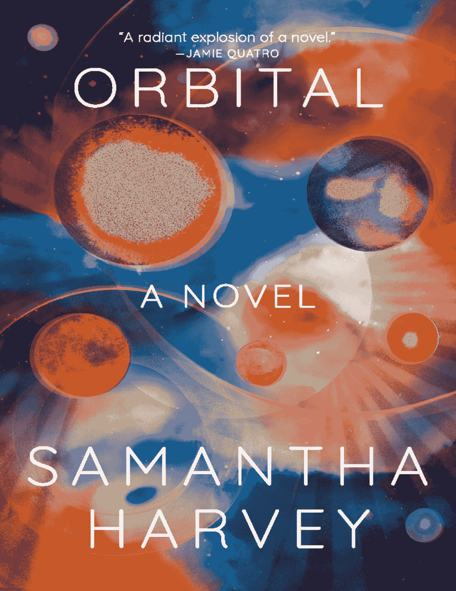
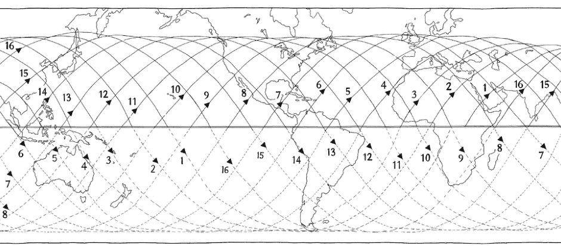

# 轨道

> “一部小说如光芒般爆发。”
>
> —— 杰米·夸特罗

## 萨曼莎·哈维的其他作品

- 虚构类
  - 《荒野》(The Wilderness)
  - 《万物皆歌》(All is Song)
  - 《亲爱的窃偷》(Dear Thief)
  - 《西风》(The Western Wind)
- 非虚构类
  - 《无形的焦虑：失眠的一年》(The Shapeless Unease: A Year of Not Sleeping)

致谢

## 轨道减 1

他们在飞船中环绕地球旋转，是如此彼此依靠，又如此孤独，以至于他们的思想、他们内在的神话，有时也会汇聚在一起。有时他们做着同样的梦——关于分形、蓝球，以及被黑暗吞噬的熟悉孔，以及冲击他们感官的明亮而充满能量的黑色太空。原始的空间是一只豹子，野性而原始；他们梦见它在自己的舱室里穿行。

他们挂在睡袋里。金属外壳之外仅手掌之宽，宇宙在简单的永恒中展开。他们的睡眠开始变得稀薄，某个遥远的地球清晨降临，他们的笔记本电脑闪烁着新一天的第一条静默信息；时刻清醒、时刻警觉的空间随着风扇和过滤器的声音而震动。厨房里留着昨晚晚餐的残留——用磁铁固定在桌上的脏叉子，以及插在墙上袋子里的筷子。四个蓝色气球在流动的空气中漂浮，一些褪色的彩带写着“生日快乐”——这是一场庆祝，也是他们拥有的一切。剪刀上有一抹巧克力，一根绳子上挂着一个小毛毡月亮，系在折叠桌的把手旁。

外面，地球在月光中摇曳，随着他们向那无尽的边缘迈进，地球向后剥落；横跨太平洋的云朵将海洋呈现出钴蓝色。现在，圣地亚出现在南美洲靠近的海岸线上，笼罩在云雾迷绕的金色光芒中。穿越太平洋温暖海域的风掀起了一场风暴。台风向西移动亚洲，他们的飞行器轨迹则向东向下进入巴塔哥尼亚，那里的地平线是一颗双星。大气层环线之外便是太阳，下一分钟它就将越过地平线，黎明将在几秒钟内到来离开，随后阳光将无处不在。中东非突然变得明亮而炽热。

今天是他进入太空的第四百三十四天，这是通过三个不同的任务统计的总数。他仔细记录着。就这次任务而言是八十八天。在单次为期九个月的任务中，总共大约有两百多天（此处原文逻辑）。

## 轨道 1，上升

罗曼早醒了。他挣掉睡袋，在黑暗中游向窗户。我们在哪里？我们在地球上的哪里？南半球正在转瞬即逝。“你们受协调世界时限制，”地面工作人员告诉他们。“对这件事保持清醒，”看着自己的手表来锚定思想，在醒来时告诉自己：这是新一天的黎明。

事实如此，在这一天里，他们将环绕地球十六次。他们将看到十六次日出，十六次日落，十六个夜晚。罗曼抓住窗户边的扶手以稳身体；日子飞速流逝。

事实如此。但这一天包含了五大洲、秋季与春天、冰川与沙漠、荒野与战区。在环绕地球的旋转中，在光影的积累以及对推力、姿态、速度和传感器的复杂算术中，清晨的鞭响每九十分钟到来一次。他们喜欢这些日光的光芒与他们自身重合的日子。

绘画，而他正在画的是国王和王后，但他们在画作之外，就在我们所在的地方，正向内看。我们知道他们在那里的唯一方式，是因为我们在正前方的一面镜子里看到了他们的倒影。国王和王后正在看到的正是我们正在看到的——他们的女儿和她的侍女们，这也是这幅画的名字——《宫廷侍女》（*Las Meninas*，意为“侍女们”）。那么，这幅画真正的主体是什么呢——国王和王后（他们正被画着，他们的白脸虽然很小，但位于背景中心），他们的女儿（她是中间的明星，在幽暗中是如此明亮、金发），她的侍女们（还有侏儒、监护人和狗），背景门框处一个正迈步的神秘男子，他似乎正要送来一个消息；委拉斯奎斯（他作为画家的身份通过他出现在画中得到了证实，他正坐在画架前画一幅国王王后的画像，但那幅画也是《宫廷侍女》本身）。或者，是我们这些观众，占据了与国王王后相同的位置，我们正向内看，并且同时被委拉斯奎斯和小公主注视，并通过倒影被国王和王后注视？或者，主体是艺术本身（它是生活中的一系列幻象、技巧和人工手段），还是生活本身（它是一个试图通过感知、梦境和艺术来理解生活的意识中所产生的系列幻象、技巧和人工手段）？或者——老师说——这仅仅是一幅关于虚无的画？只是一个有着几人和一面镜子的房间？

对于十五岁的肖恩来说，他不想上艺术课，并且已经知道想成为一名战士，这节课简直是徒劳的极顶点。他并不喜欢这幅画，也不在乎它画的是什么。也许那只是一个有几人和一面镜子的房间，但他甚至没闲工夫去举手说出这种话。他在笔记本上画着一些几何形状的涂鸦。然后，他画了一个被吊的人。坐在他旁边的女孩看到了这些涂鸦，戳了戳他，挑起眉毛微笑，那是一个微小而逃避的微笑。多年后当她成为他的妻子时，她给了他一张《宫廷侍女》的明信片，对她来说，那是他们第一次真正交流的象征。多年以后，当他远在俄罗斯准备进入太空时，他在明信片背面用密密麻麻的字体写下了老师所说一切的精要，他早已完全忘光，但她却记得如此清晰，这种清晰度让他并不意外，因为她是他见过的最敏锐、最清醒的人类。

他在船员宿舍里留着那张明信片。今天早上当他醒来时，发现自己正盯着它看，盯着妻子在背面写的关于主体和视角的所有可能性。国王、王后、侍女、女孩、镜子、艺术家。他凝视的时间比他意识到的要长。有一种未完成之梦的残存感，思绪中有些狂野。当他爬出睡袋，穿上跑步服去厨房喝咖啡时，他看到了阿曼进入波斯湾的另一个独特地标，阿拉伯海海面上方的尘云，巨大的印度河河口，以及他所知道的卡拉奇——在白天是不可见的，但在夜晚却是一个巨大的、复杂的、交叉线条的网格，让他想起了以前画的那些涂鸦。

根据他们在这里使用的、被摧毁的任意时间标准，现在是清晨六点。其他人正在起床。

他们向下望去，理解了为什么地球被称为“大地之母”。他们不时会感受到。他们都会将地球与母亲联系在一起，这反过来让他们觉得自己像孩子。在他们剃得干净的胡须的中性波波头中，在他们普通的短裤和易用勺舀的食物中，在清晨、用吸管喝的果汁中，在生日彩带中，在早起、在那些被迫尽责的夜晚里，他们在这里共同拥有一种被突然抹除的童年感和渺小感。透过高耸入云的圆顶。

但现在，更是如此。自从琪来到周五厨房做晚餐时，她脸色苍白，说道：“我妈妈去世了。”肖恩松掉了手中的那包面条，让它漂浮在桌子上，皮特罗向她走过了三步，低下头，握住她的手，动作流畅得让你以为他已经准备好了，而内尔喃喃了一句听不清的话——什么？怎么了？*什么？* 看着琪的脸突然变得通红，仿佛这些话带给了她痛苦。

自从那个消息，他们发现自己在俯视地球，正如他们绕着地球运行（看起来是漫游的，尽管事实并非如此），还有那个词：母亲，母亲。琪现在唯一的妈妈是那个旋转的、发光的球，它不由自主地绕着太阳运行。琪成了一个孤儿，她的父亲已经去世十年。那个球是她现在唯一能指着的东西，它带给了她生命。没有它，就没有生活。没有那颗行星，就没有生活。显而易见。

Think a new thought, they sometimes tell themselves. The thoughts you have in orbit are so grandiose and old. Think a new one, a completely new.

在轨道运行的某个时刻，他们每个人心中都产生了一种强烈的愿望——一种永不想离开的愿望。这是一种突如其来的幸福袭击。他们随处都能发现这种幸福，它从最平淡的地方涌现出来——实验甲板，从意大利饭和鸡肉炖菜的小料包中，从屏幕、开关和通风口的面板中，从他们被困的那些极度狭窄的钛合金、凯夫拉材料和钢管中，从那些地板即墙壁、墙壁即天花板、天花板即地板的地板上。从那些磨着脚趾的扶手上。从那些候在气闸舱里的宇航服中，那里预示着身处太空，而太空就是一切——幸福就这样袭击了他们。与其说他们不想回家，倒不如说“家”是一个已经坍塌的概念——它变得如此巨大、膨胀且充盈，以至于向内塌陷。

在任务初期，他们都会想念家人，有时这种思念剧烈到仿佛要掏空内脏；现在，出于所迫，他们意识到自己的家人就在这里，是那些知道他们所知、所见之事的人，他们无需解释。当他们回去时，又该如何开始讲述他们经历了什么，他们变成了谁，又变成了什么？他们除了从太阳能电池的窗户望出去，看着它们没入虚无中，什么都不想要。世界上没有任何钉子能取代窗框上的这些钉子。他们余生都想要有软垫的走廊。想要这持续的嗡嗡声。

他们感到空间正试图消除他们对“天”的概念。空间在说：什么是一天？他们坚持认为是二十四小时，地面小组也是这么说的，但空间夺走了他们的二十四小时，回馈给他们十六个昼夜。他们守着自己的二十四小时计时，因为那是虚弱的受时间限制的身体所知的——睡眠、排泄以及所有与之相连的事。但大脑在第一周内就获得了自由。大脑进入了一个没有日子的狂热区，在地球飞速移动的地平线上冲浪。白天来临，接着他们看到云朵的阴影掠过麦田。四十五分钟后，白天再次来临，踏过太平洋。万物不再如他们所想的那。

现在，他们从俄罗斯东部出发，斜穿过日本与俄罗斯之间的鄂霍次克海。在片模糊的光线下，岛屿看起来像是一串干涸的足迹。她的国家是一个在水面上游荡的幽灵。她的国家是一个曾经记忆过的梦。它倾斜而纤细。

运动后，她擦干身体从实验室窗向外望。她的无重漂浮平稳而直立。如果她余生都能留在轨道上，一切都会好。只有当她回去时，她的母亲去世了；就像音乐椅子游戏，座位比需要它的人少一个，但只要音乐还在响，座位的数量并不重要，每个人都在局中。你不能停止。你必须不断移动。你拥有这辉煌的轨道，当你环绕时，你是防撞的，没有什么能触碰你。当行星在空间中奔驰，你带着那醉了时间的大脑在光明与黑暗中追逐它时，一切都不会结束。不会有结束，只有循环。

不要回去。留在这里持续下去。海洋反射出的乳色光如此精致；轻柔的云朵在潮汐中起伏。透过变焦镜头，是富士山顶的第一片雪，是她童年长大的长良河的银手镯。就在那里，完美的太阳能电池正汲取着阳光。

从空间站的距离看，人类是一种在夜晚才出现的生物。人类是城市的灯光，是道路被照亮的灯丝。白天，他们隐藏在众目睽睽之下。

在这次轨道上，十六人中的两人，如果有那么长的时间，他们可以环绕地球一整圈，几乎看不到一丝人类或动物生命的痕迹。

他们的航线接近西非，大片干涸的斑块遮蔽了肉眼可见的所有明显的人类地标。他们经过中非、高加索和里海、俄罗斯南部、蒙古、中国东部，以及白光中的日本北部。当西太平洋夜晚降临时，视野中没有土地，没有城市宣告人类。在这次轨道上，整个夜晚段是海洋般的漆黑，穿过新西兰与南美之间的中太平洋，掠过帕塔哥尼亚半岛直回到非洲。正当海洋耗尽，利比利亚、加纳和塞拉利昂的海岸浮现时，日出破开了黑暗，白天涌入，整个北半球再次变得明亮却空无一人。海洋、湖泊、平原、沙漠、山脉、河口、三角洲、森林和冰川。

当他们环绕时，他们就像偶然发现一片处女边界的星际旅行者。当他们在早餐前向外望时说：“队长，这里看起来无人。我们认为这可能是一个崩溃文明的遗迹。准备助推器着陆。”

### 轨道 3，上升

为什么飞船不能装饰得像一个老农场呢，有着花纹墙纸和橡木梁——假的橡木梁，”彼特罗在早餐时说。轻质的不燃扶手椅和所有这些。像一个老意大利农场。或者一个英式的农场。

此时，每个人都看着内尔，她是英国人，而他们耸着肩在……还有十四个人向北而去，不过等那些星星出现时，他们已经回到床上睡觉了。

那天早些时候，内尔收到了哥哥的一封邮件，说他感冒了，很不舒服。这让她感触良多，自己生病已经多久了——她感觉自己置身于太空，仿佛身体重新年轻了，不再有酸痛疼痛，除了他们都会患的那种太空头痛——即便对她来说，那种疼痛也是罕见的。这种减轻体重的感觉，关节没有压力，大脑没有压力——没有选择。你的每一天都以分钟为单位安排在日程表中。你听从别人的指令，早早睡觉，通常时精疲力竭，然后早起重新开始，唯一需要做的决定就是吃什么，而且那也受到限制。

在邮件里，她哥哥说了一半这样：他讨厌这种全身生病的感觉，而且一直和别人在一起一定很美好吧，他称之为“漂浮家庭”。在这里，“美好”这个词每次听起来都是如此异样。这里是残酷的、不近人情的、令人窒息的、孤独的、非凡且壮丽的。没有哪件事是美好的。她本想把这些话写给哥哥听，但觉得那样太啰嗦了，于是她只写了表达思念，并附了一张塞文河口日出的照片，一张月亮的照片，以及一张智和安东在观察窗前的照片。她发现自己经常找不到可以告诉家里人的说辞，因为琐事太乏味，而其他的事情又太令人置信，两者之间似乎什么都没有，没有那些通常的八卦，他说她说的，只有周而复始的。有很多在思考，如何可能如此快速地变得无所事事。

在她看来，这是一件奇怪的事情。所有对冒险和自由的梦想，结果你来到这里却被困住了，整天都在打包和拆卸东西，在实验室里摆弄植物芽和棉花根，无处可去，只能带着同样的思绪转圈圈。天哪，不，这不是抱怨。

确实有这种“漂浮家庭”的想法，但在某些方面，他们并不是真正的家人——他们比这多得多，也少得多。在如此短暂的时间里，彼此，因为他们是伴侣、导师、牙医、发型师。在出太空、发射、再入大气层的紧急情况下，他们是彼此的生命线。每个人都是人类的代表——他们必须用自己代替地球上的家庭、动物、天气、性爱、树木。有些日子他们只想走走，或者躺下。当他们想念人们，感到地球如此遥远，以至于抑郁情绪笼罩他们几天，甚至看到甲板上的日落也无法让他们振作起来时，他们必须能够看到某种支撑他们下去的东西。有些日子，他们看着其中一个人的脸，那里对方微笑或专注的神情就是他们爱过的所有人、每件事，一切都在那里。而人类，其精髓浓缩到这几个人身上，不再是一个充满困惑的差异和距离的物种，而是一个近在且可触及的存在。

他们彼此并不完全独立，与飞船也如此。无论他们在来到这里之前是什么身份，无论他们的训练或背景、动机或性格有何差异，无论来自哪个国家，在这里，他们因为飞船那微妙的力量而是平等的。每个人都是彼此不言的规则。他们是飞船身体动作与功能的编排：

- 安东——安静，幽默感干练，感性，看电影时会大流泪——飞船的心。
- 皮得罗是它的大脑，
- 罗马（现任指挥官，灵巧且能干，能修理任何东西，以毫米级精度控制机械臂，布线最复杂的电路板）是它的手，
- 肖恩是它的灵魂（肖恩在那里是为了说服他们所有人都有灵魂），
- 智——有条理、公正、智慧、难以完全定义或捕捉——是它的良知，
- 内尔（带着她那八升容量的肺）是它的呼吸。

然后他们同意这种比喻是愚蠢的。毫无意义。但同样不可动摇。在低地球轨道上遭受痛苦的某种感觉让他们产生了这种想法，因为作为一个整体，他们那艘蔓延的飞船变得鲜活了，并成为了他们的一部分。他们曾认为，生活在一个复杂的生命支持机器中的这种事实是危险的，而且这种可能在瞬间结束的前景——机器任何一个部分的故障。火灾、氨气泄漏、辐射、陨石撞击。在某些时刻他们确会这样——但通常并非如此，而且，所有的生物都生活在被称为“身体”的生命支持机器中，而这一切最终都会失效。这一个，虽然危险，但局限于它的轨道轨迹，一个很少有惊喜的地方，所有不可预见的都在预见之中——二十四小时受监控、勤恳监测、痴迷地维修、全面报警、经过仔细加垫的少数尖锐物体、没有绊倒物，没有什么会掉落。这不像地球自由的那种多重危险，你游荡在枪支、蚊子、传染病和裂缝中，以及八百万物种在不受监控的情况下竞相生存的可悲命运，我们是无限制的，被铅笼困着。他们有时会产生一个惊讶的想法：他们是被封装的，像一艘在真空深处独自航行的潜艇，当他们离开时，会感到更不安全。他们将作为某种陌生人重新地球表面。学习疯狂世界的外星人。

### 轨道 3，下降

想象一座房子。日本海边岛上的一座木屋，推拉门敞向庭院，榻榻米地板被阳光晒得褪白且磨损。想象厨房水槽龙头上有一只蝴蝶，一只蜻蜓看着它折叠的褥垫，门廊拖鞋里有一只蜘蛛。

想象一座破旧的木屋，所有的木头摸起来都很光滑。被潮湿、炎热和雪侵蚀，被小地震震得凌乱。然后想象一对年轻男女弯腰在室外的菜地上，八月天空如铅般沉沉地压下来。南瓜在长着，有很多，像月亮在夏天盛满时看起来那么大，除了大海的声音，什么也没有。不，只有蝉鸣、蟋叫、青蛙声，女人扯杂草的撕裂声，男人在挖掘间隙中干脆的声音，以及大海的声音。

伴随着几株蔓延的南瓜藤。茎部、木门框和木台阶上有霉菌；清晨的湿气渗透在纸窗上。那是最近最美丽的晚霞。女人躺在其中狭窄的台阶上，她人也很瘦削，在她眼里，自己就像一把扫帚。周围全是木质的东西，没有人类，所以为了不显得落败，她转向了内心。

你知道的，有时当某一天成为你的最后一天时，她绝不会在百万年之后这样在清晨傍晚躺在自己的台阶上，摆出这种晚期放弃、微小反叛的姿态——她是一把坚硬的老扫帚。她讨厌胡闹。她的血液变慢了，一切都变慢了。这几周她一直感觉不太好。她曾仰望着天空中的那个移动的光点，自从丈夫去世后，那个光点已经绕地球运行了近六万次轨道，她本以为可以再等一个月让女儿回来。但死亡又何时等待过谁呢？而且那又算是什么样的归途呢？在女儿抵达时死去。她的四肢突然发热，仿佛心脏正试图将血液从体内排出去。让我休息吧，她的心在说。她听到蝉鸣，在这一年的这个时候，你从未听过深夜的蝉鸣，现在一直如此温暖，以至于它们不知道何时死去。那听起来像是一声长长的、留恋的雄鸣，也许如果她被埋在地下十五年等待交配的机会，她也会那样留恋，但现在他的鸣叫不是为了交配，而是为了孤独，是别理我，只是寂静黄昏中的唯一一声鸣叫。

日子向前推移，一天一天，又是三天四天，身体被从台阶上移走，房子被荒废了。从昏暗夜空中无形的光中——那是女人的女儿驻守的地方——亚洲号向右舷滑去。四国和九州从下方掠过，其余一切都是海洋；同一片海洋冲刷着木屋旁的岸边，更近了十年前的花园，那里的南瓜开始变软。亚洲号最后的影像已向西方向后消失，除了太平洋深海之外空无一物，它们的轨道向东南延伸，越过无尽的空旷。

在那片空虚中，台风正在组织。在过去的二十四小时里，它一直在向西移动，此刻已经过了马绍尔群岛，那是如此破碎且饱经风霜的沉没陆地的脆弱轨迹。起初是一些成簇的高空浮云，云层从四方汇聚，变得愈发浓稠黑暗；不是一场风暴，而是几场风暴的碰撞，现在很清楚了，云层正在挤压并螺旋，形成一个至少是四级的台风。

尽可能多拍照片，船员们被告知道，他们确实做了，长镜头对着玻璃，快门断续地跳动，目前只看到风暴的东部旋臂，在右舷远处，它像成团旋转的灰色丝云一样缠绕在地球的地平线上；观察着地球上无人能看到的细节——云层是如何逆时针排列的，像是一场被吹起的风中行军。阳光从云层乳色的覆盖层和地面反射，散发出如同患白内障眼球般的诡异苍光。它似乎正用一种不稳定的目光注视着他们。

地球似乎突然变得亢奋而清醒。他们认为，这并非那种随机袭击世界某些区域的常规风暴。他们看不到全貌，但它比此前预测的要大，移动得更快。他们发送图像，发送经纬度。船员们就像占卜者。能看透并预言未来却对改变或阻止它无所做的占卜者。很快，它们的轨道将向东向南下降，无论他们如何对着观测窗向后仰脖子，台风都会移出视线，他们的守望将结束，黑暗将全速袭来。

他们没有力量——他们只有相机，以及对那正在形成的宏丽奇观的特权而焦虑的观察。他们看着它到来。

## 轨道 4，上升

在今天第四次地球轨道的新清晨，撒哈拉尘土以百英里的条带扫过大海。朦胧的浅绿色闪烁海洋，朦胧的橘色陆地。这是非洲在光中共鸣。从飞行器内部，你几乎能听到这种光。大加那利岛陡峭的放射状峡谷堆积着，像一座匆匆筑的沙城堡；当亚特拉斯山宣告沙漠的终结，云朵呈鲨的形状，尾巴在西班牙南部海岸甩动，鳍尖顶着南部阿尔卑斯山，口鼻在瞬间将俯入地中海。阿尔巴尼亚和黑黑山的山峦如天鹅绒般柔软。

理解。他们知道视力会衰退，骨骼会恶化。即使在运动，肌肉也会萎缩。血液会凝固，大脑在脑液中移位。脊椎变长，T细胞艰难繁殖，形成结石。当他们在这里时，食物尝起来有金属味。他们的鼻窦简直是折磨。本体感受失灵了——不看的话，很难知道自己的身体部位在哪里。他们变得形状扭曲的水袋，身体上液体过多，而下方却不足。液体聚集在眼球上，压迫视神经。睡眠变得变异。他们的肠道微生物群生长出新的细菌。他们的癌症风险在增加。

正如罗马所说，这些并不是励志的想法。安顿稍后问他是否在担心这些。

“不，”他说，“从不。你呢？”

在他们下方，南太平洋现在正处于绝对的黑暗中，那是一个无尽的黑色深渊，没有行星，只有大气层柔和的绿色线条和无数星辰，令人震惊的孤独，一切都是如此接近无限。

“不，”安顿回答道，“从不。”

有时他们看着地球，可能会想要推翻他们所认知的真理，相信这颗行星坐落在万物的中心。它看起来是如此壮丽，如此庄严且高贵。他们可能仍会被诱导相信上帝亲自将其掉在那里，在整个宇宙的最中心，而他们可以忘记人类男女所发现的所有真理（通过一条蹒跄、结结的发现路径，随后是否认，接着是发现，最后是掩盖）——地球只是虚无中心一个微不足道的点。他们可能会想：微不足道的东西也可以闪闪发光，未展开的虚无卫星怎么会自烦于这些美丽的展示，任何卑微的岩石无法排列像真菌和心灵那样的复杂结构。

所以有时，拆解日心说的几个世纪变得更容易，回到那个神圣而巨大的地球的时代，万物都绕着它运行——太阳、行星、宇宙本身。你需要比他们拥有的更远的地球距离才能发现它的微不足道和渺小；才能真正理解它在宇宙中的位置。它显然不是古老那种王一般的地球，一个上帝赐予的土块，过于粗壮庄严以至于无法在太空舞厅中移动；不是的。它的美在回响——它的美是它的回声，是它响亮歌唱的轻盈。它既不是边缘也不是中心；它既不是一切，也不是虚无，但它看起来比某些东西要得多。它由石石组成，但从这里看起来像是光芒和以太，一个灵活的行星，以三种方式移动——绕轴旋转、绕轴倾斜、以及绕太阳运行。这颗被放逐出中心进入边缘的行星——那个绕行而非被绕的东西，除了它那块肌肉。这个孕育着人类的东西，人类打磨着越来越大的望远镜镜片，告诉我们自己多么渺小。而我们目呆。随着时间推移，我们发现我们不在宇宙的边缘，而是一个由边缘组成的宇宙，没有中心，只有一群旋转舞的眩晕物体，也许我们全部的理解都包含了对我们自身外源性的复杂且不断演变的认知，通过科学探索的工具不断击碎人类的时代，直到那个“自我”，变成一座让光穿过的、破碎的建筑。

他们说，在他们近地轨道这种中间的距离上，在他们半掩的视角中。他们想：也许人类太脆弱了，也许这就是问题所在。从认为你的行星在万物中心是安全的，转变为知道它实际上是一个正常尺寸、正常质量的行星，在一个一切平均的太阳系中绕着一颗平均恒星旋转，在一个拥有无数个平均星系中，而这一切将要爆炸或坍塌。

也许人类文明就像单一生命——我们从童年的尊贵成长为极极的平庸；我们发现自己并不特殊，并在一阵纯真的冲动中，我们感到相当庆幸——如果我们是特别的，我们可能并不孤独。如果存在无数个像我们这样的太阳系，拥有无数个行星，其中一个星球一定有生命居住，那么陪伴就是我们对琐碎事事的慰藉。因此，在孤独、好奇和希望中，人类向外看，想也许可能在火星，其他的，于是发射了探测器。但火星看起来是一片充满裂缝和陨石的冰冻沙漠，所以在这种情况下，也许它们在附近的太阳系，或者邻的星系，或者之后。

它们被抛弃后，将沿着一条长达二十万英里的航线逐段推进，这条路径上的每一寸都被数字标绘，它们将一直这样前进，直到明天晚抵达月球。

昨晚，这里的六名航天员找出了派对用品，吹起了气球，挂起了生日彩旗，并从银色包装袋的收藏品中尽所能地准备了一顿庆祝晚餐——他们发现了巧克力布丁、桃子酥饼和几包奶昔。罗曼（Roman）挂起了儿子送给他的毛毡月亮，那是他带进太空的少数物品之一。他们感到欣悦、焦虑、嫉妒和自豪交织在一起，这种情绪最终又回到了欣悦。最后，他们像往常一样早早睡了。因为无论是否登月，总会有清晨。每天，总都有一个清晨。

他们心中都有一种反作用感，寂静而无人分享，那是对于他们突然变得平庸的生活。他们那受地球束缚的轨道是平淡无奇，无处可去；他们周复运动，永不离去。这种单调的环绕在昨晚令他们感到谦卑的美感。一种关注与服侍感，宛如一种崇拜。尽管他们在睡前向外望去，仿佛能看到那些飞往月球的航天员擦肩而过，尽管他们的睡眠因期待而不安，但他们进入梦境的并非月球，而是飞天器外那片荒野的空间花园——那是他们都曾在某个时刻漫步过的花园。以及地球那永恒的、电蓝色引力。

令人烦心的事：

- 紧随者
- 疲倦的孩子
- 想去跑步
- 凹凸不平的枕头
- 匆忙在太空时拉链漏尿
- 卡住的拉链
- 小声私语的人
- 肯尼迪一家（The Kennedys）

千（Chie）将她的清单夹在宿舍的储物袋上，那里放着她的纪念品和寥寥几件个人物品：一支缓解她手部干裂疼痛的小型润肤霜；一张她家附近海滩上年轻母亲的黑白照片；一本关于日本山山的诗集，那是她叔叔在上次机组包裹中送上的，但她完全没时间读。她撕下书末空白的几页，在上面用随性且草率的笔迹写下了她的清单。

令人安心的事：

- 脚下方的地球
- 有坚固手柄的杯子
- 树
- 宽敞的楼梯
- 手织品
- 内尔（Nell）的歌声
- 强壮的膝盖
- 南瓜

在飞天器的底端，是皮特罗（Pietro）和内尔在一天前执行太空出舱任务时安装的装置，那是一个测量地球辐射的光谱仪。它扫过飞天器轨道上宽七十公里的行星，从一个大陆移动到另一个大陆，南北移动，像一只痴迷的眼睛在观测、收集、校准光线。

皮特罗执行过其他任务，进行过其他出舱，在太空的四百多天里进行了数以万计的实验。这一切都带有一种冷静的距离感：你执行实验，或者安装装置，或者收集数据，然后传递并进入下一个。作为航天员或传导者，你究竟是什么——你是因为那种“不粘性”的性格被选中的，也许有一天机器人可以胜任你的工作，也许它会；你难免怀疑。他们有时也会怀疑。机器人不需要水分、养分、排泄、睡眠，机器人没有烦人的脑脊髓液、经期、性欲或味蕾。你不需要给火箭运送水果，也不需要用维生素、抗氧化剂、睡眠药和止痛药来制造它，更不需要一个需要经过培训课程才能使用的、带有漏斗和泵的马桶，更不需要一个能将尿液循环为饮用水的装置，因为它没有尿液，不需要水，它不想要，也不要求。

但如果向太空投掷那些没有眼睛去观察、没有心脏去恐惧或崇拜的创造，那是怎样的体验？多年，航天员在泳池、洞穴、潜艇和模拟器中训练，每一个缺陷或弱点都被定位、测试并淘汰，直到最后留下一个近乎完美、波澜不惊的大脑、四肢和感官三角。这对某些人来说很难，对另一些人来说更容易。对皮特罗来说更容易；他是一个天生的航天员，他从从小就有一种平衡感，一种非凡的从容和冷静让他避过了幼儿时期的大部分闹气和青少年期的叛逆。深邃的好奇心、建筑结构的大脑、专注、乐观和务实；在他甚至知道什么是航天员之前，他骨子里就是航天员了。但机器人，不是。

他的胸口里有一颗会倾斜、摇晃的心。他可以保持心跳缓慢平稳，平息恐惧、恐慌或冲动的习惯，停止它对家的过度渴望，遏制它放纵的冲动。冷静而稳定，冷静而稳定。像节拍器一样节奏着呼吸。然而，它依然在倾斜、摇晃。它有它想要的，渴望它所需要的，爱它所爱的。航天员的心如此努力地“非机器人化”，以至于它离开了大气层并向外推——停止了向内挤，心脏的重力向外推，仿佛突然意识到自己是一个活着的、有感官的动物的一部分。这种动物不仅是见证，更爱它所见证的一切。

于是皮特罗思考外面那个光谱仪，它将有助于确定地球是否正在变暗。自从他和内尔在内部安装了它，他每天醒来都会想起它，镜头指向三个方向：地球、太阳和月亮，测量现存的光。

彼特罗认为，有一个特别的渔民和他的家人，现在该走了，昨天就该走了。但去哪里呢？怎么去呢？对于那个渔民来说，有一种保护物品的冲动，不想离开你的东西，因为那是你在经历了最后一次台风、上一次以及再之前的台风后仅有的几件东西。距离台风袭击可能还有几小时，而你正处一个海洋中岛屿之又岛屿上，那里绝望地低洼。因此，你能做的只有绝望地躺着。你幸过了所有其他人。你拥有一间由锡皮、纸板、硬纸板和木棍做的房子，如今台风如此频繁，建造更好的房子毫无意义，与其留住某些东西，不如变得无可失去。

所以你留下了。你抬头望向动不安的夜空，你那位忙碌无果的宇航员朋友在那里度过余生，并给你发来关于萨马尔（你的岛屿）在青绿色海域中的疯狂照片。他会叫你离开。现在任何时候你都会看到手机，收到一条告诉你离开的信息。他会告诉你，如果需要，他可以找人安排，去买航班。

你的妻子小心翼翼地说，他是个好人，事实确实如此。一个最善良的男人。每个月给你的孩子寄学费，而且他只见过你一次面，是在一次潜水旅行中（这鬼的竟然是他的蜜月），而你在你的渔船上。你掉掉了割线刀，它瞬间没入水底，那把刀花了你十美元，它非常好又锋利。这时，宇航员和他的妻子浮出水面，他们一直在海豚跳跃之远的浅滩间潜水，看到你正趴在船边向下看。他们争留了十五分钟，在找到你的刀之前拒绝离开，坚决地拒绝。“没关系的，”你举起手示意道，“别麻烦了。”但他们确实费心了，并奇迹地在二十五米下的岩石间找到了它。

一个宇航员和一个渔民。这是何怎样的世界的碰撞。他带着妻子来吃晚餐，迷迷了你的孩子，并对你的纸板房子施了神奇的咒，仿佛他那天下午直接从空间本身降临的。尽管你妻子天生的疑虑从未完全消除，但她大多被说服了。甚至你拍的所有照片都带有一种神奇的色彩——你妻子面容喜悦，你你自己，神情严峻如狮子，四个孩子（坐着的、站着的、惊讶的、平静的、微笑的、抓着的）一种整体的美感——这让你在最初就开口了。

你现在手里拿着那张照片。如果你们都要逃离这场风暴，你会带这一张，宇航员的照片。但你并不打算逃离。逃到哪里去？不像那样。你有你的生活，它无法被移动。

前方是晨明线，昼夜交替的界线，横跨整个行星的周长。它切分了巴布亚新几内亚，那是白天，另一半是黑暗。

岛屿被照亮的一半是茂密的，如龙一般，它的山脉在神话的光芒中，被发光的海岸线勾勒。它的黑暗的一半是皇家蓝色水面上的影子。电光出现在海岸边，船只向东南滑入黑暗中，索罗门群岛、瓦努阿图、斐吉，淡金色的斑点。飞向堪培拉、悉尼和布里斯班，在慰藉中，然后是新西兰的穿梭机尖，点缀着南方海域。

在这个季节，南极更北地区的绝对黑夜不到六小时，剩下的是白天和黄昏的色彩。现在是陡峭的夜晚。在南极研究基地，生物学家们刚刚为北极燕的年度抵达安营。它们飞向极地，这些稀有的鸟。它们消化了一些器官，变成了长距离运动员，旅行了数千英里。十月的开始，南极释放了长久的暮色，在冰层下涌动。那些生物学家会等待，直到白光出现，天空充满了尖锐的顶峰。但现在在狭窄的黑暗间隙中，生物学家们出来看到了别的东西。他们甚至不需要抬头就知道它在那里。在他们的基地周围是一圈绿。火星人来了，他们说。他们脚踩在如月球般的雪花上，红光劈开了了银河。

从这里的太空，当罗曼透过圆顶窗向外张望时，景色起初是模糊的。需要时间来适应。一片寒冷的虚无，珍珠般的云层，然后是延伸至南极圈的冰层熟悉的微光。右舷，七姐妹星直接闪烁。有时人们会有冲动去看特定的东西——金字塔，或是新西兰的峡湾，或一片亮橙色且完全抽象的沙丘，眼睛无法理解——那幅图像完全可以看作是他们培养皿中某一个细胞的特写。有时他们想看戏剧性的表演，看歌剧，看地球的大气层，看大气光，有时是那些最微小的东西，马来西亚海岸外散落的渔船的灯光，像星辰一样点布在黑色的海洋中。但现在，罗曼可以开始看到他怀疑在那里的东西，一种他们都知道的、凭借某种第六感存在在那里的——在大气层内部环绕的、变幻的红极光，焦躁而壮丽，仿佛被困住的什么。

内尔，他说，快来。内尔，快来。内尔，他说，快来。内尔，快来。内尔，他说，快来。内尔，快来。内尔，他说，快来。内尔，快来。内尔，他说，快来。

等等，你的妻子小心翼翼地说，他是个好人，事实确实如此。一个最善良的男人。每个月给你的孩子寄学费，而且他只见过你一次面，是在一次潜水旅行中（这鬼的竟然是他的蜜月），而你在你的渔船上。你掉掉了割线刀，它瞬间没入水底，那把刀花了你十美元，它非常好又锋利。这时，宇航员和他的妻子浮出水面，他们一直在海豚跳跃之远的浅滩间潜水，看到你正趴在船边向下看。他们争留了十五分钟，在找到你的刀之前拒绝离开，坚决地拒绝。“没关系的，”你举起手示意，“别麻烦了。”但他们确实费心了，并奇迹地在二十五米下的岩石间找到了它。

一个宇航员和一个渔民。这是何怎样的世界的碰撞。他带着妻子来吃晚餐，迷迷了你的孩子，并对你的纸板房子施了神奇的咒，仿佛他那天下午直接从空间本身降临的。尽管你妻子天生的疑虑从未完全消除，但她大多被说服了。甚至你拍的所有照片都带有一种神奇的色彩——你妻子面容喜悦，你你自己，神情严峻如狮子，四个孩子（坐着的、站着的、惊讶的、平静的、微笑的、抓着的）一种整体的美感——这让你在最初就开口了。

你现在手里拿着那张照片。如果你们都要逃离这场风暴，你会带这一张，宇航员的照片。但你并不打算逃离。逃到哪里去？不像那样。你有你的生活，它无法被移动。

前方是晨明线，昼夜交替的界线，横跨整个行星的周长。它切分了巴布亚新几内亚，那是白天，另一半是黑暗。

岛屿被照亮的一半是茂密的，如龙一般，它的山脉在神话的光芒中，被发光的海岸线勾勒。它的黑暗的一半是皇家蓝色水面上的影子。电光出现在海岸边，船只向东南滑入黑暗中，索罗门群岛、瓦努阿图、斐吉，淡金色的斑点。飞向堪培拉、悉尼和布里斯班，在慰藉中，然后是新西兰的穿梭机尖，点缀着南方海域。

在这个季节，南极更北地区的绝对黑夜不到六小时，剩下的是白天和黄昏的色彩。现在是陡峭的夜晚。在南极研究基地，生物学家们刚刚为北极燕的年度抵达安营。它们飞向极地，这些稀有的鸟。它们消化了一些器官，变成了长距离运动员，旅行了数千英里。十月的开始，南极释放了长久的暮色，在冰层下涌动。那些生物学家会等待，直到白光出现，天空充满了尖锐的顶峰。但现在在狭窄的黑暗间隙中，生物学家们出来看到了别的东西。他们甚至不需要抬头就知道它在那里的。在他们的基地周围是一圈绿。火星人来了，他们说。他们脚踩在如月球般的雪花上，红光劈开了了银河。

从这里的太空，当罗曼透过圆顶窗向外张望时，景色起初是模糊的。需要时间来适应。一片寒冷的虚无，珍珠般的云层，然后是延伸至南极圈的冰层熟悉的微光。右舷，七姐妹星直接闪烁。有时人们会有冲动去看特定的东西——金字塔，或是新西兰的峡湾，或一片亮橙色且完全抽象的沙丘，眼睛无法理解——那幅图像完全可以看作是他们培养皿中某一个细胞的特写。有时他们想看戏剧性的表演，看歌剧，看地球的大气层，看大气光，有时是那些最微小的东西，马来西亚海岸外散落的渔船的灯光，像星辰一样点布在黑色的海洋中。但现在，罗曼可以开始看到他怀疑在那里的东西，一种他们都知道的、凭借某种第六感存在在那里的——在大气层内部环绕的、变幻的红极光，焦躁而壮丽，仿佛被困住的什么。

据说，他并不在那张照片里，而这一直是一个巨大魅力的源泉。据人类所知，目前世界上存在的每一个人都包含在那幅影像中；唯独缺少了一个，那个人拍摄这张照片的人。

安东从未真正理解过那种说法，或者至少没有理解过其中的魔力。那么地球另一端那些相机看不见的人呢？那些正处于夜色、被太空黑暗吞噬的南半球的所有人又呢？他们在照片里吗？事实上，照片里没有人，没有任何人能被看见。每个人都是隐形的——阿姆斯特朗和阿尔德林在月球舱舱内，而人类在一个从这个角度看完全可能是荒芜的行星上是不可见的。照片中关于生命的最有力、最易推断的证明就是摄影师自己——他位于取景器里的眼睛，手指按在快门释放键上的温度。从这个意义上说，柯林斯的图像越是迷人，是因为在拍摄照片的那一刻，他真的是这张照片中唯一的人类存在。

他想象自己的父亲为此感到沮丧——这张照片中唯一的人类存在，宇宙中唯一的生命形式，是一个美国人。他记得父亲曾如何给他讲关于俄罗斯人登陆的故事，那些环环相扣、详尽、华丽的传说，他曾以为（因为是父亲这么说的）那是真的，但它们当然是虚话。那些虚话对他产生了如此强烈的影响。当他问父亲，等他长大后是否能成为下一个登上月球的俄罗斯人时，父亲说他可以，那是写在星空里的。在月球表面，俄罗斯国旗旁，放着一小盒科罗夫卡（`Korovka`）糖，那是他喜欢的乳制甜心，由最后一位访问的宇航员留下的。那个盒子上有他的名字，他总有一天会吃掉那些科罗夫卡。

他不记得确切是什么时候意识到这一切并不是真的——没有俄罗斯人去过月球，没有旗帜，也没有科罗夫卡。他也记得自己是从什么时候决定，尽管如此，他会让父亲故事中的一部分变成现实：他要去那里。他告诉妻子，他会去。他以极其肯定的、预判性的自豪，以及一种膨胀的民族、个人、丈夫以及后来作为父亲的责任感告诉她；他会去那里，成为第一个俄罗斯人，但绝不是最后一个。很多年前，那是，他告诉了她的一切。

在他在两周前的第一个梦里，他只是看着那张照片——或者说，照片中的影像就是他的现实，仿佛他就是柯林斯，他正独自漂浮出去，成为宇宙中唯一的男人。在第二个梦里，是同样平静的孤独，接着他听到了一些声音，变成了一种微弱的呢喃，那是成千上万声音的泡泡般的低语，当他凑近倾听时，那些声音在喧嚣并汇聚在一起，那是他自己的声音。他看到了自己，或者也许没有——他看到了自己的声音，或者那就是他的声音——站在地球的表面，望向太空和月球，月球极其遥远，只有一粒沙子大——他正对着某人大喊，而那个人就在这颗遥远月球某处的相机镜头后。当然，他听不见，但不知为何知道自己能通过相机镜头看到他，正大喊着、比着手，仿佛在求救，或者在实施救援；他不确定是哪一种。

内尔有时想问尚恩，成为宇航员并相信上帝是什么感觉（指的是一个创造主的上帝），但她知道他的答案会是什么。他会问成为宇航员却不信上帝是什么感觉。他们会陷入无言。她会指着左舷和右舷的窗外，那里的黑暗无尽且狂野。在那里，太阳系和星系被剧烈散落。在那里，视野如此深邃且多维，以至于时空的扭曲你几乎能看见。“看，”她会说，“是什么让某种没有头脑的冲撞的力量变得美丽？”

而尚恩会看向左舷和右舷的窗外，那里的黑暗无尽且狂野。在那里，太阳系和星系被剧烈散落。在那里，视野如此深邃且多维，以至于时空的扭曲你几乎能看见。“看，”他会说，“是什么让某种没有头脑的冲撞的力量变得美丽？”

她说，那七位在“挑战者号”上去世的宇航员，我对他们的生活了如指掌，一切。

肖恩从塑料咖啡杯口吸着水——很滑稽，就像在用玩具浇水壶喝水。

她说，我当时才七岁。我的墙上贴着他们的照片，那批机组成员。在他们生日那天，我会点蜡烛，不知道大概过了三年后。肖恩说：“你点过？”

我点过。

好。

我我在想，我父亲从未试图阻止过这种行为。

肖恩缓慢地赞同着点头，咀嚼着，在脑海中处理着这个孩子为死的宇航员点蜡烛的画面；点蜡烛，此为止，老天爷。但是为了宇航员。不过又为什么不能呢；他以前经常在房间周围布置光纤陷阱来防止妹妹闯入。孩子都有自己的办法。

我感到很惊恐，内尔说。我很惊恐他们就在那里，然后就在七十秒内消失了。消失了。

我的意思是，当然，肖恩说。

在七十秒内，消失了。

在全世界的注视下，他说。孩子们也在注视。

每个人都在看，每个人——，内尔停住了，仿佛她站在悬崖边缘。当我还是孩子时，那个念头就再也没有停止过睡眠，她说。关于一切转变得有多之快的想法。还有我父亲，让我继续说。蜡烛能驱散恶魔，他曾这样说过，以此来安慰我——这就是为什么当你想念某人时要点蜡烛，让恶魔远离他们。我父亲很少说些荒唐的话，但那确实是荒唐的。当你身处一个碎成五千块碎片的航天飞机舱内，当你的舱室以每数百英里的速度坠落十二英里并在海洋中破碎时，防恶魔的保护有什么用呢？如果真有恶魔，它们难道不是已经行动了吗？

她清楚地记得这一切；在厨房橱子里找到一些生日蜡烛和烛台，把它们插在橡皮泥里，好几个小时都不敢划火，知道自己不被允许用这些东西，觉得它们会发生危险的事，也许会在她手里爆炸。

肖恩没有回答，但那语气并没有轻蔑之。他似乎在思考。她也是。思考着一个月后，当残骸和宇航员的遗体从海底被打捞起来时她是如何哭的，以及在甚至无法理解的悲痛中，她是如何沉溺于一种执念的。她父亲认为她现在仍在埋葬它。

在刹那，肖恩在想，我到底在这里干什么，在一个真空的铁罐头里？一个铁罐头里的罐头人。距离死亡只有四英寸钛钛。不仅仅是死亡，而是彻底的虚无。

你为什么要这么做？试图在一个永远无法繁荣的地方生存？试图去往一个宇宙并不想要你的地方，而明明有一个完美的地球在接纳你。他从不确定人类对太空的渴望好奇还是不知报。这种奇异的渴望是让他成为了英雄还是白痴。无疑，是介于两者之间的那么一点点。

这些念头撞在墙上，消失了。它们重生为一种突然的忧虑，这是今天第一百次了，为了那些灵魂，他的同事和朋友，在前往月球的途中。

“带上她吧，”他的妻子曾说过，“如果你在上面丧生了，你身上的数百万个碎片将环绕地球；这是个好主意，不是吗？”并带着同谋般的微笑。并像往常那样摸了摸他的耳垂。

“嘿，小鼠们，”智低声说，“嘿。”

她从实验架上取下一个单元，滑出一个模块，里面的老鼠盖住身体试图夺回。她用手指把它捏起来。在她周围，空间站的无线电像涨水的溪流一样涌动着，现在是下午，美国已经醒了。涌动着关于月球的讨论。第一位登上月球女性宇航员，人类历史上伟大的跨越。

有五组每组八只老鼠——那些未被科学之手触碰过的（除了把它们送这里的火箭外）；那些定期注射以防止肌肉萎缩的鼠；以及那些出生就经过改造、肥壮且适应无重力生活的鼠。

第一到第三组的未受触碰的老鼠每天都在萎缩。自从它们乘坐补给船到达这一周以来，它们的灵魂仿佛坍塌了。它们的黑眼睛在萎缩的身体里凸出；它们的脚大而无用，让它们看起来像某种变异且未进化的生物。

第四组注射了诱饵受体的老鼠更大、更强壮。智逐一地把它们拎出来，拇指用力按住它们的后脑，这样一来它们就知道不要挣扎，只能僵结；它们盯着某个无法揣测的东西。甚至它们折叠的蝙蝠耳朵也不动。她的另一只拇指轻轻按下注射器。松开后，每只老鼠都从她的手中流回笼子里。

然而，第五组的改造老鼠更大胆，仿佛它们通过本能知道膨胀的身体赋予了它们更大的优势和力量。当她伸手对她的手感兴趣时，它们的食物棒向前送并吱叫，那比它们本身大不了多少。而那些肌肉萎缩的未处理老鼠，像掌中的梅子一样。她把嘴贴在它们耳。“对不起，”她低声说，“但你们没有一个是活着的。不管是小小的，还是大大的。你们都完蛋了。我很抱歉告诉你们。”

老鼠对这个消息表现出某种程度的镇定。“你们必须是这样，”她说，“永远保持冷静。”她用拇指滑过尖锐的脊椎。她会想念母亲的挑骨仪式，当他们从灰烬中寻找火化后幸存的骨碎片。想念那个将是最难的。（等，让我重新检查一下“bone-picking”的OCR，它可能是“骨-挑选”或“骨-选择”。考虑到上下文，“骨-picking”似乎是不可能的，除非它是一处明显的拼错误。根据原文的“bone-picking”……“尺骨”或“桡”——这些是解剖学术语。）重新读一遍：“她会想念母亲的挑骨仪式，当他们从灰烬中寻找火化后幸存的骨碎片。想念那个将是最难的。”

- 第一-三组的未受触碰的老鼠每天都在萎缩……

- “他曾试图用大瓣新鲜的大蒜来点缀，那是补给车里的。他加热了一些大蒜瓣混合了油，在一个旧袋子里，这会让它变成蒜泥。但袋子过热溢了，厨房，休息室，闻着那股浓烈的气味持续了好几天，事实上是一周。他（在无限循环空气的密封舱内）可能还是那样。”

他只是能听到无线电。关于猎户座，阿尔忒弥斯的弟弟，关于宇航员们三天的旅程和着陆。阿尔忒弥斯，月亮女神，狩猎女神。很奇怪，最尖端的科学竟然与神话中的神灵联系在一起。但无论如何，这里的哪一个不想成为那艘疯狂神天飞机上的宇航员之一？站在另一个不是地球的岩石体上；难道事实是，你离某东西越远，对它的视角就越大吗？这是一个幼稚的想法，但他认为自己可以离开地球足够远，从而最终理解它——用他自己的眼睛去看它，一个微小的蓝点，一个宇宙而神秘的东西。不是理解它的奥秘，而是理解它是神秘的。看着数学上的群落。看着坚实感远去。

在午休时间，罗曼正试图让数据包无线电工作，但他们正处于澳大利亚空旷的中心地区，那里没有人，更不用说有无线电的人了。令他惊讶的是，传来了一些滋滋声，但没有清晰的内容。“你好，”他说，“`Zdraste`（你好）？”

在俄罗斯厨房的墙上，他们挂着一张谢尔盖·克里卡列夫的照片，他是第一次进入空间站的探险活动中的第一个俄罗斯人，那个帮助建造它的人，那个在那之前被苏联送往太空并在轨道上的……

米尔比计划多留了近六个月，因为在他在那里期间，苏联不复存在，他无法回家。一年来，他每天都通过分组数据无线与一位古巴妇女通话，她向他发送关于他正在崩溃的国家的消息。罗曼的英雄，克里卡列夫。

（注：提供的 OCR 文本似乎是多个叙事线索的高度碎片化或损坏的混合，可能来自一部小说或短篇集。根据保留所有信息并合并连续段的指令，以下是对所提供字符串的清理重构。）

米尔比计划多留了近六个月，因为在他在那里期间，苏联不复存在，他无法回家。一年来，他每天都通过分组数据无线与一位古巴妇女通话，她向他发送关于他正在崩溃的国家的消息。

罗曼的英雄，克里卡列夫。

米尔比计划多留了近六个月，因为在他在那里期间，苏联不复存在，他无法回家。一年来，他每天都通过分组数据无线与一位古巴妇女通话，她向他发送关于他正在崩溃的国家的消息。罗曼的英雄，克里卡列夫。

（注：提供的 OCR 文本似乎是多个叙事线索的高度碎片化或损坏的混合，可能来自一部小说或短篇集。根据保留所有信息并合并连续段的指令，以下是对所提供字符串的清理重构。）

米尔比计划多留了近六个月，因为在他在那里期间，苏联不复存在，他无法回家。一年来，他每天都通过分组数据无线与一位古巴妇女通话，她向他发送关于他正在崩溃的国家的消息。罗曼的英雄，克里卡列夫。（此处省略重复的“罗曼的英雄，克里卡列夫”……）

[由于原文存在大量重复，此处已处理逻辑]

米尔比计划多留了近六个月，因为在他在那里期间，苏联不复存在，他无法回家。一年来，他每天都通过分组数据无线与一位古巴妇女通话，她向他发送关于他正在崩溃的国家的消息。罗曼的英雄，克里卡列夫。

[此处为重复的文本内容]

### 轨道 5，下降

地球是一个充满了循环系统的地方：生长与分解，降雨与蒸发，在环绕大陆输送天气的气流循环作用下生机勃勃。

你当然知道这些，但在太空中你可以看到它。循环的天气。这是内尔可以看一整天的。在成为宇航员之前，她是一名研究型气象学家，对天气很有眼光。地球如何拖拽空气。我们看到赤道的云如何被地球的旋转向上并向东移动。从赤道海洋蒸发出的潮湿空气被拉成弧形移向极地，冷却并下沉。

尚通过地面小组与前往月球的宇航员朋友取得联系。他们像宇航员那样互相交流。“上升时有点颠簸，但现在飞得很顺畅。那里的风景真美。”他说他也去那里，这事半真半假。他比任何事情都想去，但他也想念他的妻子，无法忍受离她更远的想法。月球是亏月的，华丽而丰满。由于靠近大气，它的下半部分被压缩得变形，像一个坐垫。当他们向北飞越雪山、云雾缭绕的安第斯山脉时，出现了苍白的光，然后云层变薄，下方是亚马逊，被火灼得斑驳且疮痍。

“你好吗？”罗曼对着口袋里的无线电，对着正在消失的澳洲大大陆说道，“你好吗（Zdraste）？”

一个声音透过静电和划擦声艰难地传回来。“你在吗？你在吗，你好？”

当千智听到母亲去世的消息时，她立刻走向她在轨道上仅有的几件地球财产之一——那张母亲在离开这里之前留给她的照片。照片中，母亲站在他们家附近的海滩上。那时的她正值年华。二十四岁，在她生下千智之前，在她结完婚搬进那栋海边房子时。母亲站在沙滩上，穿着一件厚实的羊毛外套，尽管那是七月，天气一定很热。照片背面用父亲的笔迹写着“1969年登月日”。母亲正皱眉盯着天空，那里有一只海鸥掠过。当母亲的身影清晰时，海鸥是模糊的，狭窄而渺小。不清楚她的皱眉是为了那只鸟，还是为了那片她认为阿波罗号飞船可能所在的天空。

对于小时候的千智来说，这张照片有一种她既理解也不质疑的力量。缺席的月球、缺席的着陆、那被宣告的正在发生的宏大盛事，但却远在彼方。遥远得带有神话色彩。登月日。她小时候想，母亲一定是在看着海滩，月球上正在发生什么，而母亲可以用肉眼看到它。或者母亲以某种方式参与了那场活动。直到母亲在这次任务之前把照片交给她，她才想起了那些念头，并感受到了这些想法的分量，以及过去的力量，以及过去塑造未来时是如此无声——正因为她在回望，这张照片才产生了她对太空的第一个想法。

现在，照片的反面，“1969年登月日”下方写着句话，这次是母亲的笔迹：“给未来的以及以后所有的登月日。”当千智读到它时，这似乎完全不像母亲的作风，她不禁怀疑母亲是否可能预知了某些事，那是对自己死亡的预兆，并在离开前悄悄留下了一些情感。这个念头让她大脑空白。她想念母亲。她想念母亲的坚韧、直率和疏离。她预感到母亲是独一无二的。还有多少人曾在原子弹爆炸时躺在婴儿床上？寥寥无几。有多少人在那个可怕的八月因炸弹失去了母亲？母亲的生活是安静而静止的，一点也不像千智。想起来，她在海滩上的照片是那种生活的完美象征，世界在身边模糊流逝，而她保持静止。尽管她们的生活截然不同，但千智所有的勇气都归于母亲。母亲的韧性、脸皮厚度以及对任何事情的准备，即使是困难、痛苦或危险。她面对困难和危险的胆量与喜悦。她那测试飞行员的大脑，让她思考飞行、呼吸和梦想飞行。她与死亡之间的竞技性对斗，她正赢得那场比赛，这让她感到自己无所不能、坚不可摧。静静地、出人意料地鲁莽。

她知道自己并非无所不能。但她出身于一个从历史裂缝中滑落的家族，一切都崩塌了。她的祖父在炸弹爆炸当天因工作劳累生病，带着婴儿离开了，而她的奶奶去市场了。奶奶没有留下遗骸。在祖父工作的长崎弹药工厂，几乎也没有什么人的遗骸，如果不生病，他本会在那里。在经历了多年的战争后，当时的日本每个人都身体状况不佳。每个人不是半挨饿，要么患有霍乱、痢疾、疟疾，或是任何在体内游荡且无药可救的老病毒或感染——她的祖父因为其中一种病毒已经不舒服了一段时间，那是他第一天请假。为什么是这样？如果他那天上班，他就会死。如果他留在家，婴儿就不会陪在他身边；如果那个婴儿——千智的母亲——那天去了市场，她短暂的生命就会终结，千智也就不会后后存在。他们的家族在命运的裂缝中侧向挪动生存。

千智凝视着这张照片。她们曾把它挂家里的一面墙上；她记得母亲指着它说：“看，千千，那是我们去月球那天的我。”直到现在，她依然不知道自己在海滩“登月日”照片里看到了什么；她不知道该如何解读那个场景的奇异，以及图像与标题之间的不协调。她审视着母亲的脸，质问那个皱眉以寻找其含义的线索，但她不知道。她读出的一切都是事后诸葛的、叠加的、是对真实的猜测。为什么这张照片会在千智小时候挂在墙上？它有什么特别或有意义的地方？那是母亲在对女儿说：“现在我要让你看到你生命中可能的一切，人类——以及你——所能做到的是近乎无限的。”但那个皱眉，难道不是对可能或希望的表达吗？或者她在说：“这里有一些人到达月球——你看到或听到其中一个女性吗，更不用说是非白人种、非美国的女性了。你有没有注意到这是一群正处于男性气概巅峰的男人，带着他们的火箭、推进器、载荷，全世界的目光都盯着他们——这就是世界，一个男人的游乐场，一个男人的实验室，不要去竞争，因为任何竞争尝试都会让你感到沮丧、自卑和被毁灭，为什么要去跑一场你注定失败、永远无法赢得比赛呢？所以请记住，我的女儿，你不卑微，把这句话记在心里。”

### 轨道 6

“国家厕所”的概念让船员们觉得有些有趣。“我要去尿一次‘国家尿’，”尚会说。或者罗马曼：“伙计们，我要去为俄罗斯解决一下。”俄罗斯航天局对美国、欧洲和日本的人说：“你们必须付钱才能使用我们的厕所设施，”而这些机构也同样回应：“尽管去用吧，反正我们的厕所比你们的好。而且你们也用不了我们的健身车。”通过飞船内部的摄像头，任务控制中心看着船员们公然无视这些法令，对此也无能为。他们得出，宇航员和宇天员非常像猫——无畏、冷静，且无法被驱赶。船员们想，我们一直在旅行，旅行了多年，几乎没有过一个安定下来的时刻；我们都住在包里和借用的地方，酒店、太空中心和训练设施里，在从一个训练课程到另一个训练课程之间的中间城市的朋友沙发上睡觉。住在洞穴、潜水艇和沙漠里测试我们的胆量。如果我们有什么共同点的话，那就是我们接受了无处归属也无处不在，为了到达这艘、这艘近乎神话的飞行器。这个最后的无国家、无国界的哨所，正挣脱生物生命的束缚。什么

马桶与这有什么关系吗？在被锁在冷漠无情轨道上的航天器上，外交游戏又有什么用呢？

而我们呢？我们是一一体的。至少目前，我们是一一体的。我们在上面拥有的一切只有我们循环利用和分享的东西。我们无法被分割，这是事实。我们不会被分割，因为我们无法分割。我们喝着彼此回收的尿液，呼吸着彼此回收的空气。

在实验室，我们戴着虚拟现实头显漂浮，一个富有启发性的声音温暖地问道：数数蓝色方块在你视野中出现的秒数。他们猜是八秒。将此记录在笔记本电脑上。三十六秒。二十秒。三秒。二十九秒。“谢谢，”声音说道，听起来似乎很诚恳。“做得太棒了，”它说，“准备好接受下一个任务了吗？准备好了就按开始。”

现在，他们根据给定的持续时间注视蓝色方块：五秒、十九秒、四秒、三十八秒。反应时间；当蓝色方块出现时，他们触摸笔记本屏幕按钮的速度有多快。“你做得很好，”声音说，“准备好接受下一个任务了吗？准备好了就按开始。”今天第一次，美国在一个光洁的上午出现在船体左侧，随后很快就驶远了。

数到一分钟，完成后触摸屏幕。

数到九十秒，完成后触摸屏幕。

这一分钟，然后九十秒，似乎在途中迷失了，他们想自己数得太快了，改变了主意，不，太快了；他们从四十二秒跳到四十五秒，并立刻后悔，停留在五十秒。“做得太棒了，”声音说。

当他们看着蓝色方块时，他们了赤道，守卫发生了交替；北半球来临，月亮已经升起。它的盈亏光现在从左边缘移到了右边缘。像一个在锅里翻转的薄饼。星光稀疏了。不再是那望向银河中心的稠密南方星空；现在我们看到的星星是遥远的，位于银河的外层螺旋上，星系在那里以光年为单位汇聚，某些东西让位给了虚无。夜晚让位给另一天。在委内瑞拉上方，地平线上出现了第一道刺眼的光芒，他们很清楚那是太阳。它闪烁着消失，闪烁着消失。然后，地球曲线的右侧变成了一把闪光的弯刀。银光倾泻而出，星辰被放逐，黑暗的海洋化作瞬间的黎明。

“你做得很好，”声音说。“你每次都错了！对来说太霉了，蓝色方块出现了十五秒你却报告了十秒；你数出来的一分钟是一个延长的东西——有时是一分钟半。对来说太霉了，对控制台来说，你漂浮了太久，漂浮了太久，你细胞里的时钟已经乱了节奏。对来说太霉了，当你早上醒来，不一看就不知道自己的手臂在哪里，失去了重量的反馈，你的肢体丢失了位置。（我把手臂放在哪儿了？）恐慌的大脑说道。（我把它留在哪了？）对来说太霉了，肢体迷失在空间里，而那些迷失在空间里的东西也迷失在时间里。你正在失去控制。当你快速抓住一把掠过的钳子时，你的的一分秒变成了迟缓的两或三秒，你周围的时间变得空闲而臃肿。你不再是以前那个敏锐的工具了。对来说太霉了，你手腕上的欧米茄 Speedmaster 带有计时码、测速表和同轴擒系装置，它并没有意识到自今天早上醒来后你已经绕了地球七圈，太阳像机械玩具一样升起-落下-升起-落下。对来说太霉了，你的世界变得富有弹性且混乱无章、左右颠倒，而且现在是春天，半小时后就是秋天，你的生物钟被打乱了，你的感官变慢了，你那超速宇航员的状态变得有些松散、无忧无虑，像藻一样游动。准备好接受下一个任务了吗？准备好了就按开始。

秒数消融，越来越少。时间缩减为空白区域上的一个点，具体而毫无意义，然后无边地膨胀并失去形状。每当被要求时，他们扑向光标，快如闪电，又完全不是。欧洲在下午的薄雾中下方移动，云层勾勒出海岸的形状。有英国西南部的脚无力地踢着北大西洋，有英吉海峡，眨眨眼就错过了，有布鲁塞尔、阿姆斯特丹、汉堡和柏林，尽管它们是用隐形水在灰绿色毛毡上画出的，有丹麦正向挪威和瑞典如海豚般跃动，有波罗的海、波罗的海国家，突然出现了俄罗斯。欧洲来了，欧洲走了。“真遗憾，”声音依然温暖地说道，“你存在于所有时区又不存在于任何一处，你在这只巨大的金属信天翁中跨越经线，对你大脑的要求超过了它所知道的承受范围。对来说太霉了，这一切发生得如此快。一个大陆消失并让给另一个，那备受喜爱的地球，从未停留在你的掌握中。你这人生的旅程将在弹指间过去，正如生命对衰老的大脑来说那样，它缓慢的动作让一切看起来都移动得更快。对来说太霉了，在你反应过来之前，你就会回到你的着陆舱里，那里有隔热罩和落地伞，你将在火焰中穿过大气层，在等离子体轨迹中下降，愿上帝保佑，你会降落在比视野更广阔的平原上，从着陆舱中拉出来，带着断断续续的音节。在大陆的边缘，光正在消失。海是平坦的，是铜色的，带着反射的太阳，云层很长，在水面上。亚洲来了，澳大利亚走了。一个无特征的形状对着这最后一道光，现在变暗了。地球的地平线裂开了，变成了紫色，像水彩冲掉。轨道向北。他们接近美国，当黄昏带是那里时，清晨在身后。当这是第七天时，快速且完全，光在到达地球之前，飞船器是一颗子弹。

无论如何，他们都有关于发现的慵懒之梦，那是关于打破或获得自由的梦想。他们在梦中曾进行、或现在正进行的飞行，是他们对在太空中移动最接近的类比，这些梦共享着同样的失重量的轻盈和同样的奇迹感，因为一个沉重而无翼的身体本不可能自由而平稳地滑行，但它确实就在这里，似乎你终于在做那件与生而生的事。这令人难以置信。与此同时，也难以相信其他任何事情。难以相信环绕着白昼地球的整片空间的漆黑色质，那里吸收了所有的光——却又难以相信唯有那片黑暗，是活着的、呼吸着并向你召唤的。如果内尔（Nell）曾经恐惧过虚无，她曾渴望过除此之外的任何东西——坠入其中，让她的系绳延伸出数千英里。

你俯视着自己挂在支架上的身体，一边与手斗握式工具、扭矩倍增器以及那些已经生锈、没有重力可以拆除的旧螺丝搏斗，而在脚下两百五十英里处，地球那缓冲的球体也悬挂在那里，宛如幻觉，某种由光构成的东西，某种你可以穿过其中心的东西，而唯一适用于它的词是“非凡的”。这不可能。忘记你所知的一切。你回望空间站的广阔布局，在这一刻，它——而不是地球——感觉更像家。飞船内还有其他四个人。但在那里，忘记你所知的一切。她和皮特罗（Pietro）是唯一在地球大气层之间以及任何人能想象的遥远太阳系之外的空间穿梭的人。他们的两颗心跳平静地穿过其中，从没有两次出现在同一个地方。永远不再回到同一个地方。

当他们六个人之后谈起他们的太空漫步时，他们描述了似曾相识——他们知道自己以前去过那里。罗马（Roman）说，也许那是由于在母体中未被开发的记忆。对我来说，在太空中漂浮的感觉就是这样。尚未出生。

这里是粉色晨曦的古巴。

阳光在海面上随处跳跃。加勒比海碧绿色的浅滩和地平线勾勒出萨加藻海。

内尔想，身处那里，她和这一切之间没有任何玻璃或金属。只有一套装满冷却剂以抵御阳光热量的宇航服。只有一套宇航服、一段绳子，以及她纤细的生命。

只有她的脚悬挂在大陆上方，左脚遮挡了法国，右脚挡住了德国。她戴着手套的手遮蔽了中国西部。

起初，他们被夜景所吸引——城市灯光华丽的镶嵌和人类造物表面的闪烁。夜晚的地球是如此清脆、清晰且充满目的性，这片厚实的刺绣的城市织锦。欧洲海岸线几乎每一英里都有人居住，整个大陆被精确地勾勒出来，城市的星座由金色的道路丝线连接在一起。那些同样金色的丝线横跨阿尔卑斯山脉，那里通常因积雪而呈现灰蓝色。

夜晚，他们可以回到家——那里有西雅图、大阪、伦敦、博洛尼亚、圣彼得堡和莫斯科——莫斯科像一个巨大的光点，宛如尖锐清澈天空中的极星。夜晚的过剩令他们屏息。生命的蔓延。星球向深渊宣告：这里有东西，也有人。尽管如此，一种友好与和平的感觉占据了主导，即使在夜晚，在世界中也只有一条人造的边界；巴基斯坦和印度之间一条长长的灯带。这就是文明在分裂上所能出的全部，而在白白天，那已经消失了。

很快，情况发生了变化。在了一周左右对城市的惊叹后，每当他们爱上地球，感官就开始变得广阔而深邃。那是陆地和海洋非人性的简单。星球似乎在呼吸，就像一个动物本身。那是星球在冷漠空间中漠意的转动，以及超越所有语言的球体完美。太平洋的黑洞变成了一片金色的田。

他们在训练中被警告过反复接触这种无缝的地球会发生什么。他们告诉他们，你们将看到它的完整，看到它除了陆海边界之外别无边界。你们将看不到国家，只有一个滚动的、不可分割的球体，它不知道分离的可能性，更不用说感知到了。你会感到自己同时被两个方向拉扯。兴奋、焦虑、狂喜、抑郁、温柔、愤怒、希望、绝望。因为你知战争横行，边界是人们会为之拼死的东西。虽然可能有细微而遥远的陆地起伏告诉那里有一座山脉，可能有一条纹路暗示一条大河，但到此为止了。没有墙或障碍——没有部落，没有战争或腐败，没有特定的恐惧的理由。

很快，对他们所有人来说，一种欲望占据了主导。那是欲望——不，是需求（由狂热驱动）——去保护这颗微小的地球。这个如此奇妙又奇异美丽的东西。这种不可思议的美丽，是无法言喻的。无法停止这种不可思议的、这种奇妙又美丽的事物。我们不能停止这种我们生命赖以生存的东西吗？这不是一个温柔的愿望，而是令人心碎。我们不能停止这种侵蚀和毁灭吗？

似乎读新闻变得更容易了。有些人如此，有些则没有。当他们看向星球时，很难注意到他们曾忽略了。这种无边界的、政治的剧场，是正在发生的。这种政治的剧场，是对星球这种温柔的侵辱。他们听着新闻，感到无比疲惫或不耐烦。每当他们清晨睁开眼睛时，夜晚的过剩令他们屏息。地球在它的转动中耸了肩。如果他们听广播，通常是为了音乐，或者是某种带有纯真的东西，来来去去，不留下痕迹。而且他们听得越来越少。

但随后某一天，情况发生了变化。一天，他们看向地球，看到了真相。如果政治真的只是一场戏。如果政治仅仅是一场滑稽的、有时荒谬的疯狂的娱乐，由大多数角色提供，在他们所处的地方，并非出于任何革命性、洞察力或智慧，而是通过变得更大声、更大、更张扬、更无廉耻，比周围的人更渴望权力的游戏，如果这就是故事的开始和结束，那它并不坏。相反，他们开始看到这并不是一场戏，或者它不仅仅是。这是一种巨大的力量，以至于塑造了地球表面的每一个事物，他们曾以为从这里看是无法影响的。

行星推拉着潮汐，塑造了海岸线，政治也如此雕刻、塑造着，并在处处留下了自己的痕迹。

他们看到了欲望的政治。那是关于增长与获取的政治，是对“更多”渴望的十亿次推演，那是他们向下看时开始看到的景象。他们甚至不需要向下看，因为他们也是这些推演的一部分，而且比任何时候都如此——在他们的火箭上，起飞时助推器燃尽了数百万辆汽车的燃料。

行星正被人类欲望那极其惊叹的力量所塑造着，这种力量改变了一切：森林、极地、水库、冰川、河流、海洋、山脉、海岸线、天空——一个被欲望勾勒轮廓并景观过的行星。

### 轨道 8，上升

如果你知道该往哪里看，并拿上大变焦镜头近距离观察，你就能看到亚利桑那州沙漠中人造陨石，它们是被炸出来的，用来模仿月球。在 20 世纪 60 年代，阿姆斯特朗和奥德林在这里进行着陆训练，尽管现在那些陨石正在消失，被侵蚀殆尽。

新墨西哥州、德克萨斯州、堪萨斯州，美国西南地带宽阔干燥的牛皮上没有边界的州和无形的城市。云朵被风扭曲成丝带状在旅行。此地偶尔出现转瞬即逝的闪光，标志着阳光在飞机身上反射；看不见飞机，只有光芒。在这片巨大的皮革质感表面上，布满了毫无意义的刻痕、压在表面上的凹痕，那当然是河流，但没有流动。它们看起来干燥、静止、偶然且抽象。它们看起来像一缕落落的长发。

在地球的曲线上，快速接近的是一种更翠绿的色调，一片不那么干燥的土地；接着是深邃的蓝色。密歇根湖、超级大湖、休伦湖、安大略湖、伊利湖。它们的湖心在午后的阳光下闪烁。

过去而来，未来到来，过去而来，未来到来。永远是现在，永无现在。

他们的环绕飞天器上是下午 5 点。在他们下方的地球上，多伦才刚刚出现，那里还是正午。在世界的另一端，已经是明天，世界的另一端将在 40 分后到达。

在那里，在明天，台风召唤了每小时 180 英里的狂风。它正横扫马里亚纳群岛。岛屿海岸的海平面已经因为暖水的膨胀而上升，现在，当强风将海水推向盆地的西缘时，海水进一步升高，五米高的风暴潮吞没了提尼安岛和塞潘岛。这些岛屿就像被集散弹击中一样——炸毁、墙壁坍塌、家具飞散、树木断裂。

没有人预料到这场台风会如此迅速增长，24 小时内，它从大洋中心每小时 70 英里的小规模战斗变成了一个正向陆地冲刺的力量。现在看到图像的气象学家们将其等级提升至五级，有些人认为它是台风，另人认为是超级台风，他们能做的只有预测它登陆菲律宾的最精确时间。他们说，时间将是当地时间上午 10 点，这里这里是凌晨 2 点。

这一切都发生在地球的另一边，发生在一个尚未到来的日子。船员们继续完成最后的任务。安东吃了一根能量棒来对抗下午的睡意。肖恩拆掉了需要更换的烟雾报警器架上的四个固定固件。切米检查了细菌过滤器。他们的路径现在起起伏伏，离开了美国，那里的大西洋是古老的，像独木舟胸针宁静的银灰色。宁静对于这个半球已经足够了。他们毫无仪式地完成了又一次对孤独星球的环绕。他们在爱尔兰海岸外 300 英处达到顶点。

经过实验室时，内尔向窗外看，在水天平线上看到了欧洲的希望。她感到有些无言。对于她爱的人就在下方那个庄严而华丽的球体上的事实感到无言，仿佛她刚刚发现他们一直住在国王或王后的宫殿里。人们住在那里，她想。我也住在那里。这在今天她看来似乎是不可思议的。

罗马、内尔和肖恩在三个月前到达那里，是三个折叠在双人帐篷大小模块里的宇航员。他们与站对接，舱探测器整齐地穿过航天器的导流罩。软捕获。蜜蜂进入花朵。航天器的八个机械钩锁定了模块。硬捕获，确认，硬捕获完成。模块内部安静下来，片刻停顿，罗马、内尔和肖恩互相看向，用那几双还没弄清失力意味着什么的手击了击掌。罗马轻轻托起他儿子送给他的毛毡月亮，它在航途中挂在他们面前，作为一个吉祥物，现在漂浮着。在太空的宏伟中，即使是那个吉祥物也具有极大的尊严。一切都充满了可能。他们几乎无法言言。

寂静，又是寂静，寂静在船员的心中绽放。那是六小时令人兴奋的速度，而现在空无所有。入港。难道六小时前你还在陆地上吗？伸直你的腿，从座椅上移动到轨道模块，伸伸你扭曲的背。

他们被留了大约两个小时，等待漏气检查完成以及飞行器之间的压力达到平衡。舱门另一侧是提前三个月到达的船员。安东、皮得罗、切米。

这一切都发生在地球的另一边，发生在一个尚未到来的日子。船员们继续完成最后的任务。安东吃了一根能量棒来对抗下午的睡意。肖恩拆掉了需要更换的烟雾报警器架上的四个固定固件。切米检查了细菌过滤器。他们的路径现在起起伏伏，离开了美国，那里的大西洋是古老的，像独木舟胸针宁静的银灰色。宁静对于这个半球已经足够了。他们毫无仪式地完成了又一次对孤独星球的环绕。他们在爱尔兰海岸外 300 英处达到顶点。

经过实验室时，内尔向窗外看，在水天平线上看到了欧洲的希望。她感到有些无言。对于她爱的人就在下方那个庄严而华丽的球体的事实感到无言，仿佛她刚刚发现他们一直住在国王或王后的宫殿里。人们住在那里，她想。我也住在那里。这在今天她看来似乎不可不可议的。

罗马、内尔和肖恩在三个月前到达那里，是三个折叠在双人帐篷大小模块里的宇航员。他们与站对接，舱探测器整齐地穿过航天器的导流罩。软捕获。蜜蜂进入花朵。航天器的八个机械钩锁定了模块。硬捕获，确认，硬捕获完成。模块内部安静下来，片刻停顿，罗马、内尔和肖恩互相看向，用那几双还没弄清失力意味着什么的手击了击掌。罗马轻轻托起他儿子送给他的毛毡月亮，它在航途中挂在他们面前，作为一个吉祥物，现在漂浮着。在太空的宏伟中，即使是那个吉祥物也具有极大的尊严。一切都充满了可能。他们几乎无法言言。

寂静，又是寂静，寂静在船员的心中绽放。那是六小时令人兴奋的速度，而现在空无所有。入港。难道六小时前你还在陆地上吗？伸直你的腿，从座椅上移动到轨道模块，伸伸你扭曲的背。

他们被留了大约两个小时，等待漏气检查完成以及飞行器之间的压力达到平衡。舱门另一侧是提前三个月到达的船员。安东、皮得罗、切米。

短短几周时间就让你变得苍白而消瘦。皮埃托在想，如果人类在太空中停留得足够久，他们最终会变成某种水栖生物吗？他在这里已经待了几乎六个月，还有三个月。他认为自己正在变成一只蝌蚪，只有一个头而没有身体。随着身体的萎缩，生命不再那样紧紧拽着他。他感到饿了就吃，而鼻腔如此阻塞，导致食物毫无滋味；他没有真正的食欲，不像在地球上那样深层或强烈。他睡觉是因为必须如此，但他的睡眠大多是试探性的，他体内的每一个部分似乎都对他动物生命的使命缺乏投入，仿佛是系统正在冷却，是对多余部分的有效损耗。在节奏放缓和冷却中，他听得自己的思考更加清晰，它们像远处的钟声在脑海中一个接一个响起。在轨道上，他的生命感变得更简单、更温柔、更包容，并不是他的想法变了，而是他的想法变少了、更直接了。它们不再像以前那样雪崩般涌来。它们到来，在需要的时间内引起他的兴趣，然后消失。

在进入太空一个月后，有几个夜晚，他带着近乎疯狂而痛苦的思念想起了妻子。他想起她骨瘦的裸体、晒出的线条、深色的腋下毛、凸出的肋骨、被束缚的手腕，以及午睡酷热时她胸前的汗水。这些想法让他瞬间变得如余烬般灼热，沉醉于渴望。一周后，他和内尔进行了太空外行走，第二天晚上，她——内尔——出现在了一个梦里。梦里涉及一个他不熟悉的地球场景：一个绝对黑暗的房间，看起来很狭窄，在他的脑海里铺着木板，但内尔的声音从远远处传来，尽管她的身体正贴着他。发现她在那里的感觉如此惊喜，那种片刻的狂喜贯穿了他的核心。视线之外正进行着一场派对——他能听到音乐，但无法真感觉到所在位置。他亲手抱起她，吻着她的脖子，敬畏地重复着她的名字。他只记得这些，第二天吃早餐时，他几乎不敢看她，因为她当时尴尬极极了。

那个梦没有再次出现，那时他感到身体里的任何性色彩都平息了。它似乎理解到这毫无意义，一个开关被关掉了，一切都变得空白而平静。

## 轨道 8 号，下降

当内尔去自由潜水时，她会想：也许成为宇航员就是这种感觉。现在在这里上面，她有时会闭上眼睛想：这就像潜水。身体在缓慢的悬浮中移动，平静地被载着，仿佛在水中。他们在环飞船的迷宫中移动的方式，就像绕着一处残船——那些狭窄的空间、舱门，以及以几乎相同的模式四处穿插的狭窄管道，很难知道你从哪里开始的，或者当你向外看时地球会在什么位置。当你向外看时，任何幽闭恐惧都会瞬间变成广场恐惧症，或者你同时拥有这两种恐惧。

她将货物袋从一个地方搬到另一个地方。所有可燃烧的物品、所有不需要带回地球的东西都放进了储物舱；食物垃圾袋、垃圾、用过的纸巾、卫生纸和湿巾、裤子、T 恤、袜子、内衣和毛巾、浸透了几周汗水的健身服、旧牙膏管、他们吃过的每一包食物和饮料、指甲和头发屑，这一切最终都会进入下周到达的补给船，这样在两个月后它对接时，所有货物在大气层中燃烧，任何剩下的碎片将开始它们在地球轨道上的长生。任务变成了盲目的体力活，在 3D 拼图中移动货物立方体。这里像是一场房车旅行；空间太小了，一切都挤在到处，你用脚压住它，在它飘走之前按住。当她在门口经过安东时，他们侧过身面对面滑过，她的鼻尖擦过他腹部微微的隆起。

她有一段房车假期，在她母亲去世前可能没持续多久。也许她那时四五岁。就像她现在一样，她的母亲把包包推向任何能去的地方，在层合板脱落的小厨房橱子里，在桌下座椅的箱子里，在狭小的卧室衣柜里，在磁吸扣咔哒作响的吊柜里（一整天都是“咔、咔、咔”的声音），她的母亲静静而勤碌，仿佛他们是在搬家而不是在度假。他们走来走去，经常如此，有一段时间是父亲后来说的“两家之间”的（她那时总是想象在某个亲戚或朋友家里），但他并没有提到过房车，如果他们住过房车，无论住多久，她一定记得的。

窗外的一道光——那是他瞬间认出的北欧午后后的清醒感，云层交织复杂，下方有无数种棕色色调。爱尔兰南岸——她丈夫所在地——以及英国港口一侧；他们在这些海岸下方绕行，然后穿过欧洲中心向南行驶。他们的轨道运行方式如此不稳定，似乎总是在攀爬地球苍白的顶脊。尽管如此，这种运行方式带着耐心和目的。当他们穿过这些色彩时，棕色变得明亮，不再那么忧郁，从山脉的绿色到海洋的青绿色。棕色变成了桃红色；非洲下方如一幅染锦。尼罗河是流淌的皇蓝色墨水。

她丈夫说，从太空看非洲像一幅特纳式的晚画；画面充满了厚涂法触感的光影。他曾告诉她，如果他处于她所在的地方，他会一直流泪，他需要坚实的地面。有像他这样的人（他这么说）因为情感过多而让生活复杂，因此需要稳定性。例如，一个房子，一片田地。

“没有人是无限的，”她毫不犹豫地说。“我想那种渴望的感觉，”他说道。“我想成为那种想要去火星的人，但我会在路上疯掉，我会成为那个威胁任务的人，为了大局，他们将安乐死我。”“算了吧，”她温柔地说道（尽管内心深处她认为他可能是的）。移动最后一批货物袋时，她将其放入气闸舱，还有那些宇航服——幽灵般漂浮的物体，接触着太空的粗粝。她会穿上这些出去吗？那真的就像自由潜水，在器械之外。曾有一次她在夜晚通过生物光中进行自由潜水——星光在四周闪烁。肺部充满空气，身体与水平衡并融为一体，大脑宁静而汇聚。

其他的。除了在太空中曾经——但那时被数百人紧密地联系着。

她是，必须说，被困在了那里。他的行迹已不为人知；他可能在任何地方。在六年的时间里，他们结婚了五年；在这些年里，他们共同度过了几个月，甚至其中三分时间是在爱尔兰的家中度过的，他带着行李箱进入了最后一年，因为他没有花园或空间或自我感。现在他追逐着，比他们的伦敦公寓更好，追逐着一个她几乎不知的国家，这些地球景观对他而言如同神话。一片长满芦苇、泥炭棉、金花石和倒鹃花的土地。他的土地，他在田野里的照片，在落日中将他映照成一个剪影，一个空白。（那是谁拍的照片？）

于是她问他：“谁更未知？”他的回答是：“两者不同，但同样未知。你的大脑充满了缩写，我的大脑充满了羊的哀鸣。我们都同样未知。”

## 轨道 9

你好？罗曼对着无线电说。Zdraste（你好）。你好？

你好？

Zdraste（你好），你好。

那真的是你吗？那是太空吗？你是宇天员吗？

宇天员，zdraste（你好），你好。

请问？

你好吗？

我是托尼。

我是罗曼。

我说托尼。

我知道。

我听不见你。

我是罗曼。

声音很嘈杂，很微弱。

我是罗曼，一个宇天员。

你好吗？

我很好，你好吗？

我是托尼。

穿过日球层进入星际空间的是被称为旅行者1号和旅行者2号的两个压缩体，坠入无波的黑暗。高增益天线、低场磁计、高场磁计、肼推进器、宇宙射线、偏航、俯仰，距离地球十三亿英里，走向永恒。在每一个载有电子设备的设备上，都安装了一个金色圆盘，它看起来可能是一块纪念牌或入口，但实际上是一个留声机，一张黑胶片，充满了地球的声音。

在未来的五千亿年的某一天，当探测器完成银河系的一个完整回路时，它们可能会发现智能生命。大约四万年后，当两个探测器足够接近一个行星系统时，也许其中一颗行星将某种生命形式的家，这种生命将用它所谓的眼睛监视探测器，停止它的望远镜，用它所谓的好奇取回这个废弃的没有燃料的旧探测器，将针头（它所谓的数字）放到唱片上，释放贝多芬第五交响曲的“哒哒哒哒”。它将在另一个边疆领域响如雷鸣。人类音乐将渗透银河系的边缘。会有查克·伯里和巴赫，会有斯特拉文斯基和盲人威利·约翰逊，还有迪杰里杜、小提琴、滑吉他和尺八。鲸歌将飘过小熊座。也许AC+793888恒星行星上的一个生物将听到1970年代录音的羊叫、笑声、脚步声和轻柔的吻声。也许他们会听到拖拉机的轰鸣声和一个孩子的声音。

当他们在留声机上听到一段快速鞭炮般的咔哒声和爆发声时，他们将知道这些声音代表脑波。他们是否会推断出，在四万年前，在一个未知的太阳系中，一个女性被连接到了脑电图，她的思想被记录了？他们是否知道从这些抽象声音中反推并将其重新翻译成脑波，他们是否能从这些脑波知道这个女性正在产生什么样的想法？他们是否知道她是一个处于恋爱中的年轻女性？他们能看透人类的大脑吗？他们能从脑电图模式的起伏中判断出，她同时在思考地球和爱人，仿佛这两者是连续的吗？他们能看到，尽管她试图遵循自己的心理脚本，回想起林肯、冰河时代、古埃及象形文字以及任何塑造了地球并她希望传达给外星观众的事物，每一个念头都倾泻到爱人深色的眉毛和骄傲的鼻子上，他手部奇妙的动作，以及他像鸟一样倾听的样子，以及他们曾如此触碰却又未曾触碰。当她想到亚历山大城、核裁军以及地球潮汐的交响乐，他下颌的方正以及他说话如此精确的方式时，他所说都是启示和发现，他看着她的样子就像是她一直拥有的启示。她追逐在火焰中的自我，以及关于她身体涌动的热量，她考虑过对她想要什么，那是穿越犹他平原的野牛迁徙，以及艺人无表情的脸，以及拥有那个世界上本不该拥有的事物的幸运，两个大脑和身体在相互飞行，以如此惊人的力量，导致她的生命在侧面滑动，所有的窗格都那样，她被包裹在渴望的火焰中，他的手，他的喉咙，他赤裸的背。

所有这些想法听起来像一个脉冲星。它们是快速的击打。也许这样的生命会发现它，这个金色圆盘，它有某种播放方式，就像大脑所决定的那样。

在海边小屋，他们曾是人类，一个女人，一个男人，一个妻子母亲和女儿，一个丈夫儿子，他们曾祈祷，曾敲指甲，带着无意识的焦虑。当他们到达发射台时，他们是好莱坞和科幻、星际漫游和迪士尼，是被想象的、被品牌化的且准备就绪的。火箭在顶端闪烁着光亮的新感，绝对且壮丽的白色和新生，天空是一片辉煌且可征服的蓝色。

### 轨道 10

在约八千万英里之外，太阳在咆哮中运行。它正向着大约十年一度的活动峰值迈进，爆发并闪烁着。当你望去时，可以看到它的边缘正被剧烈的光芒撕裂，表面布满了太阳黑斑的伤痕。巨大的太阳耀斑将质子射向地球，随之而来的是地磁风暴，引发了高达三英里的极光秀。

那里是一锅放射性汤液，如果他们的护盾失效，他们就会被烤熟，他们心知如明。但当太阳如此活跃时，会产生一种奇异的效应，它的辐射（相对微弱且具有抵抗性）会推开宇宙辐射（一袋喷吐的毒蛇），他们所处的汤液也随之得到了缓解。护盾无法偏挡的，地球磁场可以挡住，实验室的剂量几乎没有受到扰动。太阳的粒子云涌、耀斑爆发并在八分钟内精准地扫向地球，能量脉冲跳动、爆炸，这是一个巨大的融合与愤怒的球体。在太阳的狂暴中，他们被有些并不恰当地冷却了，仿佛太阳是一条龙，而他们凭借巨大的运气，发现自己处于它的领地和保护之下。

他们在背风的避难所中；现在是傍晚：尚（Shaun）在收集垃圾袋，罗马（Roman）清理厕所，皮特罗（Pietro）在处理美国，安东（Anton）清理空气净化系统，千惠（Chie）擦拭消毒，内尔（Nell）吸尘通风口，她在那里发现了一铅笔、一个螺栓和一把螺丝刀，还有一些头发和指甲屑。

随后，他们陷入了一刻无目的。她漂浮在左舷窗口，知道他们的轨道正处于日本最远的地方；还要四个小时才会再次经过。我的母亲在那里，她这样想。我母亲留的一切都在那里，很快就会被焚毁消失。他们正掠过非洲西部，毛里塔尼亚、马里，很快将是尼日利亚、加蓬、安哥拉；这是他们今天第二次看到这些国家，但今天早晨是在上升轨道，而这次他们下降到海岸，像那些古老的船只一样绕过好望角下方。

飞过达喀尔的箭头形半岛，跨越赤道，在白日的最后几分钟，刚果河两岸布拉然柴维和金沙萨的灯光在暮色中显得微弱。蓝色变成紫色，变成靛青色，夜晚的非洲融为一体。那个如油彩斑驳、墨水浸染、破碎缎面、破碎色彩笔、溢出的水果盆般的混乱完美容器消失了，那片盐池、红色沉积物泛滥区，以及从平原中如生长般绿色丝绒般涌出的河流山脉网络消失了。一个大陆消失了，只剩下另一层如星辰般的黑夜之纱。

罗马和安东在俄式模式中，罗马试图寻找一个从剪刀里掉出来的松动螺丝，现在可能在他头顶某处；安东站在窗边看向下方，双腿抬起。那是开普敦消失的灯光和海洋上的风暴。无论你夜晚身处地球何处，总有地方存在闪电柔和且不稳定的脉冲。电光蓝色的静静花绽放又闭合。这里，那里，这里。

安东不在，他手指抚过过去两周在脖子上出现的一个圈，试图通过拉起Polo衫的领来遮盖它。在太空中你最不需要的就是生病。他们会担心并送你回家，因为你无法独自飞回来，另外两个人必须陪你一起去，而中断那两个人的任务将是不可原谅的。他不会对飞行医生或船员说任何话，他希望没人注意到。它只有樱桃大，在他脖颈的凹处，完全没有痛。

家里有妻子，她自己也病已久，他告诉孩子们永远不会他们身上发生坏事，仿佛那是一种礼物。他是载着他穿过黑暗的载体，是支撑他走过数年的重量。但他也被黑暗所噬，正如我们所有人一样。他从未打算如何告诉他们。他从未打算如何对妻子说出他想要友好表达的话：

忘掉吧，好吗？（Zabudem, ladno?）让我们忘记它吧。到此为止。我们不再相爱了，何必让简单变得复杂？当他发现那个肿块时，这些话直接浮入脑海。忘掉吧，好吗？它们在他脑中听起来是如此随意而轻松，仿佛他正在提议结束一段尴尬的对话。这些轻柔的话语终结了他内心数十年的挣扎，他确信说出这些话后，他们都将获得解脱——他，他的妻子，他们的孩子——他们将从他本该拯救却永远无法从中解脱的黑暗中解脱出来。

他婚姻中的不爱是一个逐渐降临在他身上的事实，一次又一次温柔的舞。当他通过望远镜观察巡航海洋船只留下的流线，或是玻利维亚明橙色的彩色古拉达湖（Laguna Colorada）的古老海岸，或是喷发火山的红色硫磺尖端，或是卡维尔沙漠被风侵蚀的岩层褶皱，每一处景象都让他感到心脏被拉开，一次一道裂缝。他不知道心脏有多宽广。他不知道自己竟能会对一颗岩石如此痴迷；这种生命的生命力令他彻夜难眠。然后，当他第一次看到脖子上的肿块时，它似乎——尽管他无法真正说明为什么——是所有缠绕的逻辑终点，是心脏的拆解，一次一道裂缝。（注：原文此处存在大量重复，翻译时已根据逻辑去重）。

这六个人，以及那些先于他们的人，是让一切成为可能的实验白鼠。他们是样本，也是研究对象，为自己的超越铺平了道路。终有一天，他们的太空之旅将显得无异于一次教练员的远足，而从他们指尖开启的可能之边界，将只会印证他们自身的渺小与短暂。他们在微重力中游泳，像一条条被观察的小鱼。他们培养的心脏细胞有一天将被用于替换那些前往火星的弹道宇航员的细胞。但不是他们自己的，他们的细胞注定会死去。他们采集血液、尿液、粪便和唾液样本，监测自己的心率、血压和睡眠模式，记录任何酸痛、疼痛或异常感觉。他们是数据。最重要的是，这意味着并非终点。

在这种赤裸面前，这种想法带给了他们对太空痛苦的解脱——那种身处此地的孤独，以及在这里学习的恐惧。这从未真正关乎他们，现在也与他们无关——他们想要什么、想什么、相信什么。他们的抵达与返回。这关乎那些此刻正前往月球的宇航员，以及未来的男女，那些有一天将生活在新月球站上、将进入深层太空的人们，以及在他们之后的几十年里的男女。甚至这都不关乎，这仅仅关乎未来和另一个世界的塞壬之歌，某种关于星际生命的宏大抽象梦想，关于人类摆脱受限的地球并获得自由；关于对虚无的征服。

这里的六个人也许也会做这个梦，也许不会，而他们是否做这个梦并不重要，完全不重要，只要他们服从并扮演好自己的角色。而他们日复一日地乐意这样做。他们测量自己的握力。他们在睡眠时，胸部被带子和阻碍呼吸的监测器束缚。他们扫描大脑。他们擦拭喉咙。他们从过度使用的静脉中拔出注射器。这一切，他们都乐在其中。

令人疯狂的事情：

- 遗忘
- 问题
- 每隔十五分钟响一次的钟声
- 打不开的窗户
- 彻夜难眠
- 鼻塞
- 管道和过滤器里的头发
- 火灾警报测试
- 无力感
- 进眼里的苍蝇

在俄罗斯居住区，有一个充气地球球在桌上方漂浮；墙上挂着乌拉尔山的照片，另一张是宇航员阿列克谢·列昂诺夫，还有一张是谢尔盖·克里卡列夫；桌子上堆满了用魔术贴固定的工作工具，金枪鱼罐里的叉子，罗马人的业余半径装置。在经历了二十多年和一百五十次剧烈的轨道飞行后，舱体变得老化、咯吱作响，不再那么适合飞行。飞行器的外壳上了一道裂缝。纤细，但令人忧心。

这里没有闪耀的资本主义西方太空梦；不，只有灰色的、实用主义沉重感，一座属于坚固工程和实用主义天才的殿堂。后苏联时代的时光胶囊，消逝世纪的最后回响。他们试图营造家的感觉，说这里是地板，那是天花板，这里是上方，以此反抗其他舱室的空间感——在那些舱室里，上下左右已是消失的概念。但它对舒适氛围的尝试是徒劳的，魔术贴墙、数里的电缆和扁平的嗡嗡灯光没有任何舒适可言，最后它既不是太空时代的，也不是家庭的——更像是一个地下地堡，尽管如此，他们依然充满了巨大的情感——他们辩称，他们对舒适的努力失败了。

今晚，这六个人聚在一起吃晚餐，罗马和东东从他们的储室里拿出物资——有汤、罗勒汤和俄式酸汤、腌制鱼、橄榄、奶酪和干面包块。

“我们不是今天早上谈过要让空间站看起来像个农场吗？”彼特罗说，“感觉像两分钟前，又或像五年前，我无法决定。也许是台风吧，”他说。它在我们下方的轨迹就像一只老野兽。

安东坐在观察窗旁，本能地向外看，但并没有台风可看。他不知道他们在哪里，只有海洋和一片银色的夜晚。只有当他发现右舷有一个光点时，他推断那是塔斯马尼亚，并算出他们现在有多南。飞行器机械臂的剪影斜过他的视野。

内尔带来了一包蜂蜜糖，那是丈夫在最后一次补给船中寄给她的，因为她渴望那种有脆口感且无法用勺子舀的食物；他寄了三包，她一直在小块小块地吃，吃它时的快乐几乎被吃完后的痛苦所掩盖。她将剩下的分给船员；这种廉微的积攒毫无意义，她心想。他们谈论着想念的东西——甜甜圈、鲜奶油、烤土豆。她童年的甜点。

“我清楚记得小时候去小零食店（`dagashiya`），”千惠说，“我们放学后都会一起去，那里就像另一个世界——当你进去时有一个装满糖果的大柜台，糖果挂在天花板和墙上，还有气味——甜味。呆久了会让你晕倒。你会进去要一份混合。有些*山橘（`Bontan ai`）*，有些*萝卜（`ninjin`）*，有些糖烟。”

“我们会十分钱的组合，”内尔说，“如果你选得仔细，就能买到可以含着的糖果，让它们持续一整天。”

“科罗娃（`Korova`），”安东想着他的梦说。罗马也重复道，“科罗娃。”

“我们吃的糖点是那种吗？”彼特罗问。

“噢，我很喜欢那些，”肖恩说，“那些最好吃了。”

“现在全都是便利店了，”千惠说，“日本几乎已经没有小零食店了。”

内尔把一片蜂蜜糖在掌心拍打，看着它像穿梭一样滑动。

她把筷子固定在桌子上，开始讲述关于母亲在四国县爬山的记忆。她用手臂比划着大山的宏伟，那块仍抓着的纸巾变成了一面飘扬的旗帜。她讲述母亲如何在狂风肆虐中抵达山顶，兴奋地举起手臂喊道：“千惠！我在这儿！我在这儿！”那是她对成年母亲最幸福的记忆，那时母亲坚健且充满快乐。“我在她身边感到最安全、最受喜爱的时刻，”千惠说，“当她喊道‘千惠！我在这儿！’的时候。我无法停止想起她。想起父母在她的花园里。”

她安静了，把纸巾塞进口袋。也许她在短短几个月里，从未对自己说过这么多——甚至在之前的多年训练中也是如此。他们都多少有些孤独和内敛，但比这里的任何一个人都更。安东发现自己哭了，他的泪水化作四滴水珠从他的眼睛里浮出，他和智子在手心里接住了。这里是不让液体流出的，他们对此非常谨慎。

“你听得见我的话吗？”罗曼问道。

“我听到了，”那个声音说。

“很好。我是罗曼。”

“你好，罗曼，我是特蕾丝。”

“特蕾丝，”他说，“我是一个俄罗斯宇航员。”

“哇。你的英语怎么样？我的俄语不太好。”

“别担心。每个人的俄语都不好。”

“我在温哥华郊。”

“那不错，我以前去过温哥华。”

“嗯，我从未去过太空。”

“我早料料之中。”

“我并不想去，你懂的。”

“在轨道经过、信号丢失之前，我们只有六七分钟时间，所以如果你有什么问题的话？”

“嗯，罗曼，我想我有一个。”

“我在。”

“你有没有觉得过——你有没有感到过沮丧（`crestfallen`）？”

“沮丧？”

“是的。你也有过吗？”

“我不认识这个词，它是什么意思？”

“它是什么意思？它的意思是，你是否曾想过，意义是什么？”

“在太空的意义是什么？”

“意义。你有没有。你是否有时会在太空中睡觉，然后想，为什么？这会让你感到困惑吗？或者你在太空中刷牙时。我有一次在长途飞机的飞机上，在洗手间刷牙，我向窗外望去，突然在想，我的牙有什么意义？不是什么坏的想法，只是这种‘我刷牙到底有什么意义’的想法瞬间让我泄了气。它让我在那儿停滞了脚步。你能听懂我的话吗？我说话得太快了吗？”

“我听懂。”

“现在很多时候当我睡觉时，也有同样的感觉。当我掀开被子，我想起在飞机上的那个时刻，气就泄了。我的肩膀塌了，我感到很沮丧。我感到难过。但我不知道为什么。”

“沮丧。它的意思是——也许是抑郁？”

“它的意思是可能是失望。意兴消沉。是的，就像灵魂离开了你。”

“你想知道我是不是这种感觉吗？”

“因为我看过你们在上面睡觉的照片，那里就像挂在小电话亭里的睡袋，看起来那么冷清。所以——如果你介意我这么说，太荒谬了。我在想，你们在付出了所有努力之后到达那里——因为那需要努力——然后看着那个地方想，就这样？这难道不像是一个大失所望吗？你懂我的意思吗？”

“荒谬。”

“我冒犯你了。”

“不，不。我在思考。”

“抱歉。”

“我告诉你，特蕾丝，关于我们的睡袋。确实是挂着的，我们大多数甚至不用弹筋把它固定在墙上，我们自由地漂浮，那种感觉非常舒服。但我记得我第一个晚上看到我的睡袋，也许第一眼你可能会觉得——什么？沮丧，想到这就是你几个月的床，但接着你看到它，它让你微笑。我看到它并没有完全挂直，它不只是挂着，你懂的——没有重力让它变得，那个词是什么，沉重或者——”

“毫无生气或软塌。”

“你知道的，它在飘起；轻微地飘起，就像完美风中的船帆。你知道的，只要你还在轨道上，一切都会好，你不会感到沮丧，一次也没有。你可能会想家，你可能会精疲力竭，你可能会觉得自己像笼子里的动物，你可能会孤独，但你永远、永远不会感到沮丧。”

“那么就像灵魂是进入了你的身体，而不是离开你。就像一切都是活的？就像你的睡袋是活的。”

“我想——是的，没错。”

“我听不太清楚了。”

“不。”

“我希望那是夜晚，这样我就可以抬头看到你们的光经过头顶。”

“尽管我们正在经过。”

“我丈夫去世了，这是他的无线电——”

“抱歉，特蕾丝，信号正在丢失。”

“在夏天，我们去世了。”

“抱歉，特蕾丝——”

“你好，你在吗？你好？”

“爱，我想你，”肖恩写道。

在《宫廷群》明信片的背面是他妻子的字迹，那是左倾的左手字，紧紧的，棱角且富有男子气味。这种缺失。然而，如果现在给他一个回家的机会，他不会接受，而当几个月后该出发时，他将不愿去。这是一种陶醉；太空带来的高海拔病般的思乡症药物。这种既不想留在这里又一直想留在这里的感觉，心被哀鸣声掏空了，但那一点也不空虚，而是意识到自己可以被填满。轨道上的景象正是如此；它们让你变成一只飘逸的风筝，由你所有不具备的东西赋予了你形状和柔软。

他让它浮在笔记本电脑上方的空间，在那里在缓慢的弹道式漂移中旋转。在电子邮箱里，他有一个关于即将降临的时刻的社论问题需要回答；他们请了一位演员、一位物理学家、一个学生、一位艺术家、一位作家和一个生物学家。

## 轨道 11

一切，一切都在旋转、流逝。

于是肖恩在思考了，当他把明信片滑回口袋时，他觉得面对面前的问题很好笑。我们如何书写人类的未来？我们什么也没有在写，是未来在书写我们。我们是随风飘零的叶子。我们自以为是风，但我们只是叶子。难道不觉得奇怪吗？我们作为人类所做的一切，只是让我们变得越来越像动物？我们不是一种如此缺乏安全感的物种，以至于永远在注视自己并试图确定是什么让我们与众不同吗？我们是伟大、聪明、好奇的生物，开拓太空并改变未来，但实际上，人类唯一能做到的就是，其他动物无法从零开始。这似乎是唯一的一点——诚然，这改变了一切，但也如此。我们只是比其他一切生物领先了几次石击法，仅此而已。如果黑猩猩观察我们并学习，它们也能做到，很快，它们就会围着火堆聚集，向更寒冷的山地迁移，并征服它们的食物，而你猜怎么着。

他为月球宇航员祈祷，为悲伤中的千惠祈祷，为那些处于台风路径上的人祈祷。他想起在老挝一个自然保护区的时光，想起听到长臂猿的晨间重奏，那是一个穿透树冠的幽灵般的旋律。当他想起这里的六个人，或者此刻正前往月球的宇航员时，他听到了那声幽灵般的呼唤——这就是我们进入太空所做的事，通过扩张领土来维护物种的存在。太空是我们仅存荒野。我们进入的太阳系是新的边疆，因为我们地球上的边疆已被发现和掠夺。他想，这项伟大的人类太空探索事业本质上只是一场动物的迁移，一次为了生存的尝试。一首发向旷野的循环歌曲，一首领地动物之歌。

他闭上眼睛，能听到那长臂猿的叫声，空灵而回荡。能看到画中那只狗带着私有的尊严。想象将手放在马匹温暖的脖子上，能感觉到它光滑、带有油脂感的皮毛，他这辈子几乎从未碰过马。蓝松鸦在后院树木间的穿梭。蜘蛛钻入隐蔽处的窜。梭鱼在水下的阴影。一只鼱嘴里叼着幼崽。兔子跳跃的高度似乎超出了常理。一只金龟甲虫顺着星辰导航。

他突然想到，在地球上任选一个生物，它的故事就是地球的故事。那一个生物能告诉你一切。整个世界的历史，以及整个世界未来可能发生的模样。

当千惠像往常一样去检查老鼠时，她在显示器上看到一个奇迹发生了——它们正在绕圈飞行。它们花了一周的时间，但避开了笼子里的格栅，找到了自己的“太空腿”，并学会了应对微重力。现在——是喜悦还是疯狂？——它们像小飞毯一样环绕着鞋盒形状的模块转动。一定是喜悦吧。看起来确实很像喜悦。她把它们从模块中取出来，尽管没必要，只是为了抱抱它们。

就在那时，她感到悲伤第一次完全袭来。不是刺痛或撞，而是一种隐蔽而令人窒息的感觉，她抓住扶手呼吸。飞行器内部是一台旋转的机器，她生活在钟表的构造内部，时间正穿过她的骨骼磨损，而她的母亲就在那座山顶，穿着那件蓝白条纹上衣、端庄的A字裙和步行靴，那种感觉让她像是经历了女孩、年轻母亲、老年人的多个时代，用她那甜美深沉的声音呼唤着。

千惠松开手，蜷缩成一个球。她就这样挂着。母亲的葬礼偏偏在登月日，偏偏是这一天。她呼出气。她可能发出了奇怪的声音，但她不知道，因为模块内的噪音盖过了一切。一旦你掌握了漂浮，就可以静静地漂浮而不倾斜。于是她这样做。她膝抵下巴，缓慢地从模块的一端漂到另一端，直到轻轻撞上舱门。然后她又反弹回模块中心。

在外面，夜色如一片死黑的羽笼罩在大西洋中部，行星消失了。

有时，似乎唯一能做的就是……

时光已久，在12月5日，多细胞生命降临，红色的、褐色的，最后是绿色藻类在阳光照射的浅水中散发着无尽的荧光；12月20日，植物走上了陆地，地衣和苔藓，无茎无根，但紧随其后仅在几千年后，维管植物出现了——草类、蕨类、仙人掌、树木，地球完好的土壤现在被根系蜿蜒缠绕和开采，被掠夺的水分很快被云层重新补充，生长与腐烂的循环系统再次开启，为了水和光、为了高度、为了呼吸、为了绿色和色彩而进行竞争性的挤撞和推搡。

圣诞节到了，尽管基督尚未出生——那是0.23亿年前，而恐龙来了，在灭绝前经历了五年的光辉，直到灭绝消灭了它们，或者至少消灭了那些陆地生物，那些迟钝者和食树者；在它们的缺席处出现了一个空位：招募——陆地生命形式，不接受时间浪费者，请申请。而谁来申请呢？是哺乳动物，它们在新年夜夕的下午很快进化成了最具有投机性且狡猾的形式：火的点燃者、石块的黑客、铁的熔化者、土地的耕耘者、神的崇拜者、时间的记录者、船只的航员、鞋子的穿着者、谷物的商人、土地的发现者、系统的策划者、音乐的编织者、歌曲的歌手、颜料的调配者、书籍的装订者、数字的计算、箭的发射者、原子的观察者、身体的装饰者、药片的吞噬者、头发的分割者、头的抓挠者、思维的主、万物的掠食者、与死亡争论者、过度的爱者、爱的过剩、被爱困扰、爱的亏欠、对爱的匮乏、对爱的渴望、对渴望之爱，这种双足的生物，人类。佛陀在午夜前六秒到来，半秒后是印度神，另一个半秒是基督，一秒半后是真真拉。

在宇宙年工业化的尾声中，法西斯主义、内燃机、奥古斯托·皮诺切特、尼古拉·特斯拉、弗里达·卡洛、马拉拉·优萨夫莱、亚历山大·汉密尔顿、维夫·里查兹、幸运·卢西安诺、阿达·洛芙莱斯、众筹、分裂原子、冥王星、超现实主义、塑料、爱因斯坦、乔·福、坐牛、贝特丽克斯·波特、英迪拉·甘迪、波尔、龙骑珍、鲍勃·迪伦、随机访问内存、足球、石灰粉、日俄战争、可可·香儿、抗生素、哈利法塔、比莉·假日、戈尔达·梅尔、伊戈尔·斯特文斯基、披萨、保温瓶、古巴导弹危机、三十届夏季奥运和二十四届冬季奥、葛饰北斋、巴沙尔·阿萨德、`Lady Gaga`、埃里克·萨蒂、拳阿里、深政府、世界大战、网络、钢铁、晶体管、科索沃、茶包、`W.B.` 叶慈、暗物质、牛仔裤、交易所、阿拉伯之春、弗吉尼亚·伍尔夫、阿尔贝托·贾科梅蒂、尤塞因·博尔特、约翰尼·卡什、避孕、冷冻、弹簧床、希格斯玻子、动态影像、象棋。

当然，宇宙并没有在午夜时分结束。时间按照它惯常的虚无主义运行，割了我们所有人，对我们生活的偏好无动于衷，将我们击倒。在另一个千年后，地球上的生物已变成了外骨骼-机械-机-不死的后人类，他们利用了某些更快乐的恒星的能量，并正在枯竭。

如果宇宙日历包含了所有时间（其中大部分尚未发生），那么在两个月内，任何事情都可能发生在冰凉的大理石地球，从生命的角度来看，这些都没有希望——一颗流星可能会将整个太阳系同地球一起抛出去，陨石撞击可能导致大灭绝，地球倾角可能会增加，轨道的弯曲和漂移最终可能弹出某些行星；而在所有情况下，大约还有四个月（五十亿年），太阳将耗尽燃料，膨变成红矮星并吞噬水星和金星。地球如果幸存，也将变得焦枯干旱，海洋被煮干，成为一颗留在白矮星、黑矮星、死太阳永恒轨道上的灰烬，直到整场戏结束，轨道衰减，太阳将我们吞噬。

这只是局部场景；一场小争斗，一出微剧。我们被困在一个碰撞与漂移的宇宙中，大大爆炸破碎时那长而缓慢的涟漪；最近的星系相互碰撞，留下的星系四散逃离彼此，直到每个都变得孤单，只剩下空间，一种向自身的扩张，一种虚无自身的诞生；而在当时的宇宙日历中，人类曾经所做和将要做的一切，仅仅是年中某一天闪烁后熄灭的短暂光芒，不被任何人记忆。

我们现在存在于生命与认知的转瞬逝逝的花盛中，疯狂存在的一个指响，事实如此。这盛夏般的生命爆发比花蕾更具毁灭性。这些丰饶时代飞速前进。

（太晚了，太晚了，那六个人从他们电影般的睡眠中醒来。是白天还是夜晚？他们到达月球了吗？我们处于哪个年代，哪个世纪？）

现在是凌晨1:30，已经过了固定的睡眠时间。幸运任务控制中心在深夜关闭了监控摄像头，他们想：

在宇宙年工业化的尾声中，法西斯主义、内燃机、奥古斯托·皮诺切特、尼古拉·特斯拉、弗里达·卡洛、马拉拉·优萨夫莱、亚历山大·汉密尔顿、维夫·里查兹、幸运·卢西安诺、阿达·洛芙莱斯、众筹、分裂原子、冥王星、超现实主义、塑料、爱因斯坦、乔·福、坐牛、贝特丽克斯·波特、英迪拉·甘迪、波尔、龙骑珍、鲍勃·迪伦、随机访问内存、足球、石灰粉、日俄战争、可可·香儿、抗生素、哈利法塔、比莉·假日、戈尔达·梅尔、伊戈尔·斯特文斯基、披萨、保温瓶、古巴导弹危机、三十届夏季奥运和二十四届冬季奥、葛饰北斋、巴沙尔·阿萨德、`Lady Gaga`、埃里克·萨蒂、拳阿里、深政府、世界大战、网络、钢铁、晶体管、科索沃、茶包、`W.B.` 叶慈、暗物质、牛仔裤、交易所、阿拉伯之春、弗吉尼亚·伍尔夫、阿尔贝托·贾科梅蒂、尤塞因·博尔特、约翰尼·卡什、避孕、冷冻、弹簧床、希格斯玻子、动态影像、象棋。）

当然，宇宙并没有在午夜时分结束。时间按照它惯常的虚无主义运行，割了我们所有人，对我们生活的偏好无动于衷，将我们击倒。在另一个千年后，地球上的生物已变成了外骨骼-机械-机-不死的后人类，他们利用了某些更快乐的恒星的能量，并正在枯竭。

如果宇宙日历包含了所有时间（其中大部分尚未发生），那么在两个月内，任何事情都可能发生在冰凉的大理石地球，从生命的角度来看，这些都没有希望——一颗流星可能会将整个太阳系同地球一起抛出去，陨石撞击可能导致大灭绝，地球倾角可能会增加，轨道的弯曲和漂移最终可能弹出某些行星；而在所有情况下，大约还有四个月（五十亿年），太阳将耗尽燃料，膨变成红矮星并吞噬水星和金星。地球如果幸存，也将变得焦枯干旱，海洋被煮干，成为一颗留在白矮星、黑矮星、死太阳永恒轨道上的灰烬，直到整场戏结束，轨道衰减，太阳将我们吞噬。

这只是局部场景；一场小争斗，一出微剧。我们被困在一个碰撞与漂移的宇宙中，大大爆炸破碎时那长而缓慢的涟漪；最近的星系相互碰撞，留下的星系四散逃离彼此，直到每个都变得孤单，只剩下空间，一种向自身的扩张，一种虚无自身的诞生；而在当时的宇宙日历中，人类曾经所做和将要做的一切，仅仅是年中某一天闪烁后熄灭的短暂光芒，不被任何人记忆。

我们现在存在于生命与认知的转瞬逝逝的花盛中，疯狂存在的一个指响，事实如此。这盛夏般的生命爆发比花蕾更具毁灭性。这些丰饶时代飞速前进。

（太晚了，太晚了，那六个人从他们电影般的睡眠中醒来。是白天还是夜晚？他们到达月球了吗？我们处于哪个年代，哪个世纪？）

现在是凌晨1:30，已经过了固定的睡眠时间。幸运任务控制中心在深夜关闭了监控摄像头，他们想：

在宇宙年工业化的尾声中，法西斯主义、内燃机、奥古斯托·皮诺切特、尼古拉·特斯拉、弗里达·卡洛、马拉拉·优萨夫莱、亚历山大·汉密尔顿、维夫·里查兹、幸运·卢西安诺、阿达·洛芙莱斯、众筹、分裂原子、冥王星、超现实主义、塑料、爱因斯坦、乔·福、坐牛、贝特丽克斯·波特、英迪拉·甘迪、波尔、龙骑珍、鲍勃·迪伦、随机访问内存、足球、石灰粉、日俄战争、可可·香儿、抗生素、哈利法塔、比莉·假日、戈尔达·梅尔、伊戈尔·斯特文斯基、披萨、保温瓶、古巴导弹危机、三十届夏季奥运和二十四届冬季奥、葛饰北斋、巴沙尔·阿萨德、`Lady Gaga`、埃里克·萨蒂、拳阿里、深政府、世界大战、网络、钢铁、晶体管、科索沃、茶包、`W.B.` 叶慈、暗物质、牛仔裤、交易所、阿拉伯之春、弗吉尼亚·伍尔夫、阿尔贝托·贾科梅蒂、尤塞因·博尔特、约翰尼·卡什、避孕、冷冻、弹簧床、希格斯玻子、动态影像、象棋。）

### 轨道上升

在难以言说的和平与寂静中，台风登陆了陆地。从他们的视角来看，航天器是黑暗且发出嗡嗡声的。通过圆顶窗，看到的只有一片没有透感的台风风野。

任何看到这一切的人都会被这旋转的地球感到眩晕。

那些在云层之底的人看到海洋卷过了一座城市。机场塌了，飞机翻覆。桥梁断了。

地球右肩第一道银光预示着黎明即将到来，随着轨道向北移动，云层开始消散，台风在身后倾去。台湾和香港的灯光在地球曲面上向他们汇聚，看起来像熊熊的火焰。大气层的空气光环是霓虹绿渐变为橙色。

现在智惠做了一些梦，梦里她的母亲还活着；这些梦充满了宽慰和狂喜。在她下方，日本和东亚挤满了前方的视野，如果她醒来向外看，她几乎看不到或完全看不到台风。那里是最后的夜晚，大陆被金光勾勒出来。

## 轨道 14，下降

预想中的事：

- 李子
- 饭团
- 滑雪
- 愤怒中关上门
- 脚酸痛
- 煎蛋
- 青蛙鸣叫
- 需要厚冬大衣
- 天气

列清单是千惠在小时候感到困扰或焦虑时会做的事。她曾经历过一段毫无名妙的愤怒期，开始列下所有她想要除掉的人，以及她希望他们死去的所有方式。她知道亲手杀掉他们是不对，所以他们的死亡总是是可以避免的意外。当愤怒平息后，清单的情绪发生了变化，但从未停止过。她的父母认为这是她控制情绪的方式，从未试图阻止她，也几乎没有评论；在她的一生中，每当困难时期，清单都会再次浮现。在某些情况下，她几乎没有注意到自己在写它们，它们就像咬指甲或磨牙一样，能带来一种反射性的安慰。在这里，当她做梦时，这些清单微微歪在宿舍的固定架子上。有一次，在她八岁左右时，她写了一份异常事物的清单，其中一项是女飞行员。她问她的父母和老师，日本有多少女飞行员，答案是零，至少在军队里是这样。零。一颗种子种进了一个坚定的心智，一个有条理、无畏且晶莹的心灵。

当安东六、七岁时，他像很多孩子一样，用洗洁精瓶和锡箔制作了一个太空船模型，他的宇航员是由木塞制成的，并包裹在棉花里，几乎每天进行太空出步。他们永远穿着太空出步的服饰，洁白且蓬松得没有肢体，醒来后几秒钟内就从舱门跳出来，就像下床一样简单。他的父亲向他展示，如果坐在黑暗的房间里打开手电筒，通常能看到光路中悬浮的闪烁尘埃；宇航员就会向那里发射，而他会用拇指和食指轻地捏住他们，让他们在尘埃中漂浮，仿佛置身于星辰之间。这很快变成了太空出步的目的——记录一片日益深深的星空。

在她的现在的梦里，内尔正和尚恩一起游泳，寻找“挑战号”宇航员，只不过内尔是个孩子，至少梦境是这样告诉她的——她不像孩子，看起来像她自己，但由于她本人有点精灵化，所以梦将这两者（孩子与成年人）易位是恰当的；他们正在开车。内尔有一支蜡烛，火焰在水里摇曳。他们找到了正在寻找的东西，结果发现是一场火。在海边，有一个篝火。它的火焰像微重力状态下的火焰一样是圆形的，他们带着火来到一艘船上，而那艘船实际上是海洋中漂浮的一块岩石。在这块岩石上，她的母亲抱着内尔今天记忆起的那只小猴子，那是对开普敦广场的记忆，而这个梦似乎是新鲜且充满意义的。啊，内尔想，我明白了。我终于明白了；这就是我来到太空的原因。一阵悲恸的冲击引爆了她的梦，将其吹散成碎片。她醒了。她不知道在梦中理解了什么，它存在于她的脑海中，但一触碰就消失了。那只是对已去世母亲的古老哀伤。不再感到痛苦，只是一道擦痕。当她滑向睡眠时，她看到的母亲不是她，而是千奇的。

奇怪的事情（他们永远不会发现）是，尚恩也梦见了这团圆形的火焰，这个微重力的火甜圈。不是别的，只有火火。它在太空中旋转，困扰了他，因为它在某种只属于梦境的逻辑中，似乎否定了上帝的存在。接着，那个火甜圈变成了一个台风，一个看起来像星系的小螺旋，他正在远处看着它。夜里的某个时刻，他取下了耳塞，两只紧闭的手各握着一个。

“我还在子宫里就决定要当宇航员了，”罗曼对着满屋的人说。“在我出生以前，当我通过脐带吸入氧气时，当我无失重状态游泳时，当我我知道我刚从那里来时，那是我决定成为宇航员的时候。”房间里的人开始大笑并鼓掌，仿佛他讲了一个笑话，而实际上他讲述的是他所知的最朴实的真理。尽管如此，他感到异常开心。他的父母在房间里，也跟着鼓掌，在安东身后。

千惠半醒半睡，在四国她父母海边的房子里，台风在咆哮，月亮是歪着的。她坐在走廊台阶上，紧紧抱着母亲入怀，母亲是个孩子，她在千惠手中的手像橘子一样小。海水拍打着底台阶。“没关系的，”母亲低声说，“*daijobō-desu*，”她说，“抬头看看。”但他们看到的是月亮，当宇航员在航行时，月亮被吹离了轨道，宇航员找不到它，对此母亲说：“我一直知道会发生。我一直知道。”她抱着母亲，千年流逝，挤入她的胸膛。我不该离开你，她想道。我再也不会走那么远了。

## 轨道 15

他们一直在黑暗中从南极冰架向东北航行，跨越数英亩无人见过的虚无。所有人都在睡觉。夜晚，印度洋在下方滑过，几乎感觉不到地球的存在。曼纳湾的浅滩和沙洲。右舷是马来西亚和印度尼西亚的海岸，那里……

沙子、藻类、珊瑚和浮游生物让水域呈现出一系列绿色的光芒——但现在却出现了翻滚破碎的暴雨云，通常宁静的景色显得疲惫而不安。当它们向印度东岸攀升时，云层正在变薄；晨光增强了，短暂地显得冷峻，随后雾气从孟加拉湾袭入，云层稀疏而密集，恒河的泥沙河口向孟加拉国敞开。赭色的平原和赭黄色的河流，横跨千里山脊的酒红色山谷。喜马拉雅山脉是蔓延的霜叶；珠穆玛峰是一座难以辨认的悬崖。它们之外覆盖地球的一切切，都是西藏高原深邃的棕色，冰川径就、河流径就，点缀着宝石蓝色的冰冻湖。

现在向上斜向穿过中国的大山脉，那抹淡淡的锈色斑迹是九寨沟谷非凡的秋季景观，接着是戈壁沙漠，看上去十分平淡，但近距离观察，那里有一位画家无畏的笔触，他在水流中看到了动态，在棕色的蛋壳紫和深红色块中看到了色彩，将干旱描绘成油渍溢出的色调，将峡谷描绘成母贝壳。北向轨道向此压来，进入朝鲜和北海道上方。日本是一缕没入消失点的丝缕。那是十一个轨道和十六小时前，它们经过那里，而这一次它们在向上时掠过它，穿过沿着太平洋海脊的俄罗斯岛屿群，越过白令海。而现在，陆地像一条丝绸滑裙般退去。

有一种跨越大陆的感觉，向上攀升并越过地球的脊线。以一条洁净的弧线向上并越过北太平洋。尽管它们的轨道是绕行星运行的直线，但转弯让轨道路径看起来在上下、南北之间剧烈起伏，从北极圈边缘延伸到南方海洋。现在，在它最北的点上，它再次下沉。在左侧远处，是一块平滑、清脆的冰块，标志着阿拉斯加。那是一团无云的、可破碎的白色甜点。当云层进一步向南积聚时，整个景象是冰浮和云的液体旋涡。阿拉斯加半岛的长尾。瞥见陆地、峡湾和入海。山脉变薄。左舷的加拿大海岸根本不是海岸线，而是一片被大锤砸成随机碎片的陆地。

在它们来到这里之前，曾有一种世界另一端的感觉，一种遥远而不可触及。现在他们看到大陆如何像过度生长的花园一样交织在一起——亚洲和澳澳洲完全并不分离，而是由穿插其间的岛屿连接在了一起；同样，俄罗斯和阿拉斯加面贴面，只有极小的一片水将它们隔开。欧洲毫无声张地汇入亚洲。大陆和国家一个接一个地出现，地球感觉——并不小，而是几乎是无止境的连接，像一首流动诗节的史诗。它没有任何产生对立的可能性。即使当海洋来临，来去又来，以一种无缝的卷轴没入时，也没有关于陆地或任何被抛光成蓝色的感觉，你听过的每一个国家似乎都滑入了洞穴，即便那时，也不再等待任何其他。别无他物，从未有过。当陆地再次出现时，你想，噢，是的，仿佛从一个迷人的梦中醒来。而当海洋再次出现时，你想，噢，是的，仿佛从一个梦中醒来，直到你被梦境填满到找不到出口，也不再想去尝试。你只是在漂浮、在旋转、在梦境深处数百英里的地方飞行。

夜晚结束了。在东面，地平线变得模糊。还没到这里，但它们正追踪靠近。下方的太平洋以及在扭曲的曲线上坠落的内华华达山脉更近了，如果你透过透镜看，你会看到远处的旧金山、洛杉矶，印记在一块印记在海上的陆地上，一条用尖锐的白色勾勒出的海岸线，一种萎缩土地的灰色色调。下加利福尼亚半岛肥沃的沿海平原。然后，它们也扭曲着远去。

夜晚结束了。在东面，地平线变得模糊。还没到这里，但它们正追踪靠近。

有时，这种横跨地球的速度足以让人精疲力竭且困惑。你离开一个大陆，在十分之四内到达了下一个，很难摆脱那种大陆消失的感觉，它压在你的背上，那里发生的一切生命来来去去。日日夜夜，季节与独裁。只有在夜晚睡觉时，你才从这台跑步机上解脱出来。即使在睡眠时你也能感觉到地球在旋转，正如你站在那里感觉到它一样。你感受到所有穿透你皮肤的日子，如果地球在轨道上停顿一秒，你会从惊中醒来，感知到某种。

黎明后已经过去了四十分钟，夜晚的阴影从东部渗入。它看起来并不多，左舷的一抹污迹。蓝色已变成紫色，但仅此如此。绿色变成了紫色，白色变成了紫色，或者说是它的残迹。不，美国已经离开了。夜晚拆开了地球的蓝绿色织锦。赤道再次从北向南被跨越，月色昏暗，只有一度。突然间，仿佛由于不悦快，太阳拂去了地球表面的日光，星辰如雪滴花般从上帝的某处迸而出。船员们在睡中感受到了夜晚突如其来的重量——那颗巨大的球形行星。他们现在向海洋深处坠落了一格，在厄瓜多尔岸边，基多和利马预示着陆地。有千里的闪电击打着岸，有一条两英里的积云带停留在海上，有一道四千里的山脉屏障。在没有城市的最浓稠黑暗中，有一千里橙色斑点组成的补丁，那里雨林在燃烧。

一千百万生命栖息在下方的布宜诺斯艾利斯，郊区让位于黑色农田，河流汇入海洋，还有高南极圈。躲在地球的腹下，在这些公顷的夜晚中，有南极黄昏时奇特的氛围，但在这些北纬纬度，天空是厚实且充满银系的。你现在正直视银河的心脏，它的引力如此强大且迷人，以至于感觉轨道将脱离，进入那深邃的海洋，那引力是如此强烈且令人心醉，以至于感觉轨道将脱离，进入那深邃的海洋。这种引力是如此强烈且令人心醉，以至于感觉轨道将脱离在没有云的夜晚，直到没有了。当陆地再次出现时，你想，噢，是的，仿佛从一个迷人的梦中醒来。而当海洋再次出现时，你想，噢，是的，仿佛从一个梦中醒来，直到你被梦境填满到找不到出口，也不再想去尝试。你只是在漂浮、在旋转、在梦境深处数百英里的地方飞行。

夜晚结束了。在东面，地平线变得模糊。还没到这里，但它们正追踪靠近。

现在，奥曼湾的那些城市正逐渐远离，被黎明的光芒平衡。粉红的山脉、紫色的沙漠，前方是阿富汗、乌兹别克斯坦、哈萨克斯坦，以及一轮如月亮般的淡云。有时，当他们飞过哈萨克斯坦时，他们无法完全接受自己是从那里离开地球，并将返回那里的这一事实。回家的唯一手段就是带着火焰冲破大气层，玻璃被烧黑，祈祷隔热罩能撑住，降伞和反向推进器能展开，所有成千上万个运动、运作的部件都能正常运转。很难想象，那条低语的线条竟是他们必须撞击的障碍。他们必须在炽热的球体中燃烧翻滚，直到被减速伞猛地拉起，看到哈萨克斯平原的草地和野马。

在睡眠中，船员又完成了一个整整九十分钟环地球飞行，这是他们第六次轨道中的第十五次。俯瞰视角的是白雪覆盖的喜马拉雅山脉，它们像一条路一样延伸，是一条广阔、开放且无止尽的路。

在这些山脉南方是城市，拉合尔和新德里，它们在白昼的光芒中已褪色融入景观，消失。被一片似乎不知人类存在的荒野地形所吞噬。只有那片山脉向南方永远地延伸。

进入俄罗斯时已是上午中分，在刺眼的光线下，地球再次是最黑空间中的一颗玻璃弹珠。它现在显得孤独而脆弱，邻近的星辰和行星已不可见。然而，它同时又是脆弱的对立面。在它完美的表面上没有任何可以破碎的东西，仿佛那里实际上什么都没有——你越看它，它的物质感就越少，越变得像一个幻影，一个神圣的幽灵。

整个地球从他们下方经过，并将继续经过。每经过一个轨道，他们都会向西偏移几度，当九十分钟后轨道再次出现时，它将位于东欧，那里另一的一天将黎明。所有新鲜日子里的又一个新鲜日子。地球围着蓝色的环，覆盖着积雪。地球几乎处于它所能的最北端，开始在北极圈的底部变得圆润。在那之外，是从未被完全观测过的北极。现在正离开俄罗斯，飞向一个跨越五千英里的太平洋通道。

### 第16次轨道

此时，月球宇航员正坐在他们那如顶针般的小指令舱向月球轨道进发。他们正在进入动力飞行的第一阶段。地面控制中心的通信主任（`Capcom`）说：“你们知道吗，单人遭受雷击次数最多的记录被打破了？是七次，但直到上周，中国的一个男人被避雷针击中了大约八次。”“噢，”月球船员中的一个说，“他随身带着根避雷针吗？”“人们为了打破记录真会做出这种事，”另一个宇航员笑着说。通信主任告诉他们，雷击导致死的人数中有百分之八十四是男性。“这数据很有说明力，”船员说，“愚蠢活着，死得早。顺便问一下，你昨晚说的那头困在豌豆沼泽里的牛怎么了？”通信主任说，他们把它吊出来了。花了一整天时间，但他们找了一些带子和一辆三菱皮卡，把那头东西拉了出来。希望它最后能报答他们一点牛奶。“从你们那里看，月亮怎么样？”“它看起来阴暗发灰，像个老头，”他们说。“看起来破破烂烂，但同样很欢迎。“我们只能看到到达南极时的着陆点附近。这比我们想象的要震撼得多。”通信主任告诉他们：“接下来的九小时内你们将平安无事到达。“愿上帝保佑，如果有顺风，”其中一个说，另一个补充道：“为了救一头牛，付出了这么多努力。”

从外面看，你会看到他们在两个巨大的球体之间穿过一条久未有人足迹的人造路径。你会看到他们并非孤身独行，而是穿行过一片卫星群，那是群密如蝇蚋般涌动的轨道物体，是两亿个被抛出的物体。运行中的卫星、爆炸成碎片的旧卫星、天然卫星、漆片、冻结的发动机冷却剂、火箭上级、人造1号、铱33号和宇宙莫斯科2251号的碎片、固体火箭尾气颗粒、一个丢失的工具包、一个错放的相机、掉落的钳钳和一副手套。两亿个物体以每小时两万五千英里的速度绕地运行，像太空的喷砂层。

从外面看，你看到月球飞船在这片垃圾场中轻盈地穿行。它穿过近地——这是太阳系最繁忙、最脏的地段——并通过切入燃烧迫使自己进入前往月球的途中，那里的杂物稀疏了，道路也变得顺畅。像一艘在富翁火箭中全速逃离的者，向外远去，远离垃圾，远离那个破碎、燃烧、闪烁着光芒、逃离罪案现场的地球。远离那不断拉扯、鸣啸的台风，以及那些冲撞街道的房屋，正变成快速且灾难性的废墟，这种破坏还无法衡量。远离那颗被人类掌控的星球，一个在倾斜轨道上轻微旋转的巨星，驶向未开发的上游荒野，这片新的黑金，这片等待征服的新领地。穿过他们那二十万里的太空。

在这里，安东、罗马曼、千惠、肖恩和皮特罗在管形舱内每天都遭受撞击并产生凹痕。他们像诱饵一样挂在自己的舱室里。安东短暂醒来，拳头抵着脸颊。他第一个也是唯一的想法是那艘正在前往月球的太空器，伴随着喜悦的感觉。仿佛每一个轨道都编码进了了他的身体。他在这里已经住了快半年，他知道他们飞越地球时那些重复的路径。即使在睡眠中，他也能隐约觉察到阳光在托雅齐金色圆顶上的闪烁——那光芒仿佛凭空出现。沃尔尔加格的小三角形形状，当他们从星城飞往哈萨克斯坦时能看到它；你就知道自己靠近边境，离开了俄罗斯。

已经是凌晨五点多了，罗马知道在这样的光线下，他们将在靠近土尔曼斯坦、乌兹别克斯坦的地方绕行，这意味着俄罗斯西部在远远的侧方，黑海和里里海。彻夜之间，城市覆盖了季节的第一场雪——萨马拉和托雅齐。窗外出现的那道裂缝扩大了几厘米。它发出的裂纹大致勾勒出沃尔尔加河的地图。这道裂缝离罗马的头并不远，隔着薄薄的合金外壳，任何环氧胶和肯顿胶带的修补都无法挡住它。俄罗斯模块的压力下降了一小部分，几乎难以察觉，不足以引起报警，而时钟正倒计时着醒来时刻，迎接又一个被狂轰的人造天。

当你沿着飞船的长度移动到后部，穿过越来越小的舱门和越来越旧的舱室，来到末端安东和罗马睡觉的苏联风格地堡时，你会看到桌子上摆满了晚餐后的垃圾（这组船员有个坏习惯，把清理工作留到第二天）——有些魔术贴固着勺子，固在上面的是空的真空包装橄榄小袋，袋里塞着沾了红菜汤的纸巾；还有四块静止旋转的蜂窝饼，它们在模块通风风口推力和飞船通风风口拉力的平衡作用下，悬浮在空中；在它们漂浮的下方，还有一些未开启的面饼干包钉在墙上。

在那四块悬浮的碎片之外一英尺处，是罗马英雄塞尔盖伊·克里卡列夫（`Sergei Krikalev`）的照片——他消瘦、整洁而难以捉摸，耳朵小小的，蓝色眼睛，脸上带着一丝忧郁，带着蒙娜丽莎式的微笑。克里卡列夫是这艘飞船上的最早人类之一，也是第一个开启灯光的人，光透过窗户洒进光裸的黑暗中。

他似乎知道某些事情正在结束，美好的事物必须如此，走向破碎与坠落。这么多宇航员和航天员曾经过这里，这间轨道实验室，这个在精心控制的和平环境中进行的科学实验。它将结束。而且将通过那种让这一切可能的、不安分的探索精神而结束。向外，向更深处。月，月。火星，月球。更远。人类并非为了停下。

也许我们是恐龙，需要小心。但也许尽管重重困难，我们将迁移到火星，在那里建立一个温和守护者的殖民地，那些想要保持红色星球依然红色的人们；我们会设计一面行星旗，因为那是我们在地球上缺乏的东西，我们会怀疑这是否就是一切崩溃的原因，我们会回望那个康复中地球的蓝色小点，我们会说：还记得吗？听过那些故事吗？也许还有另一个母行星——地球是我们的母亲，而火星或某处将成为我们的父亲。我们终究不是孤儿。

照片中的克里卡列夫似乎像神俯视它的造物，带着耐心的宽容。人类是大海上的航海员兄弟会。人类不是这个国家或那个国家，而是一个整体，无论发生什么。他坐在永恒的寂静中，周围是舱内持续的80分贝的震动，绿色的魔术贴易燃墙在无氧的空气中逼近。每一天每一周，船壳上的裂缝都在扩大，克里卡列夫的微笑似乎越发自豪，越发神圣。

愿光如此，他似乎轻声说道。

四十或五十具身体躲在一座低矮在树丛中的教堂祭坛下。洪水触及了屋顶。从这里到岸边的一英里椰子林完全被潮汐淹没，树木的缓冲作用救了这座教堂；由于设计，它的东侧（面向大海）没有窗户，其他地方也免于一灾。教堂的门在水的压力下挣扎但挺住了。混凝土墙裂了，但它们也坚持住了。石膏在弯曲的木梁下从天花板落下。一条死鲨从前窗翻过。风正在平息。里面的人听不到屋顶上的撞击声了。如果建筑能再坚持几小时直到海水退去，他们就能幸存。他们祈祷。

是圣婴（`Santo Niño`）救了他们，他们倾向于相信。即使是不信教的人现在也这么想。他们聚集在这个耶稣的小刺绣神像周围，祈着又祈着，祈祷了几个小时，背对着靠在窗户上的海洋，低声呢喃，互相拥抱，他们想自己一定见证了奇迹。他们不知道建筑为何能屹立。这不可能。规模更大、更坚固的建筑在台风的肆虐中早已坍塌。但如果圣婴也完好地留在它的玻璃罩里。他们把像从台上取下，聚在一起不再移动；不知为何，几个因恐惧而哭哭的孩子现在已熟睡。

渔夫的妻子腿上横着一个孩子，另一个靠在她怀里。另外两个蜷缩睡着，头枕在渔夫膝盖上，他的右手静静地放在一个额头上，左手托着另一个。他的妻子肩膀在逃跑时被金属片划出了一道口，她毫无抱怨。一种超自然的水光充满了教堂，弥漫着咸水和湿木的味道。孩子们是安全的。海水停止了涌动，精疲力竭地休息。菲律宾和印度尼西亚笼罩在多个涡流和漩涡中的细密云层，很快将向西移动。台风在陆地上被撞得粉碎。岛屿比几小时前变小了，被洪水冲毁了形状。糟糕的已经过去。

一股无情的酷热从东部从太平洋涌出，从这第十六次轨道的最后下降看，那是散乱之光的华丽铜色。那不是地球，只是光子，无法抓握也无法停留。随着夜色深地横跨南太平洋带，它开始消散。

几年后的某一天，在它现在正经过的太平洋同一地点，这艘飞船将优雅地离开轨道，穿过大气层坠入海洋。潜艇将下潜探索它的残骸；那是另一个三万五千轨道之后的事。这条轨道到达它最深的边缘，极光在南极闪烁，月亮像一个弯曲的自行车轮一样巨大。现在是周三凌晨5:30；登月日。星辰爆发。

在这里，电磁震动在真空中波动，太空中的天体发出光芒。如果这些震动被翻译成声音，每颗行星都有自己的音乐，它们光的声音。它们磁场和电离层的声音，它们太阳风的声音，被困在行星大气层之间的无线电波。

海王星的声音是液体且湍急的，是拍啸着冲击岸岸的海潮；土星环则完全不同；天王星的是疯狂的；木星的卫星伊奥让地球变成了一场宏丽的交响乐。叶间的风声，远处的城市声。

通往知识与文化的的大门。人人可用。

`www`

`z-library.se` `singlelogin.re` `go-to-z-library.se` `single-login.ru`

官方 Telegram 频道

`Z-Access`

`https://wikipedia.org/wiki/Z-Library`
