# 我们的绿色之心：森林的灵魂与科学

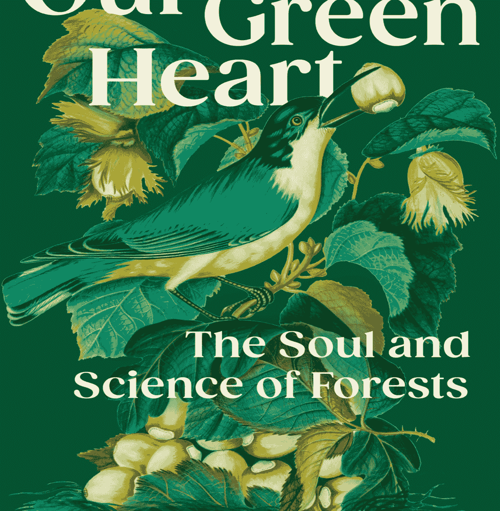

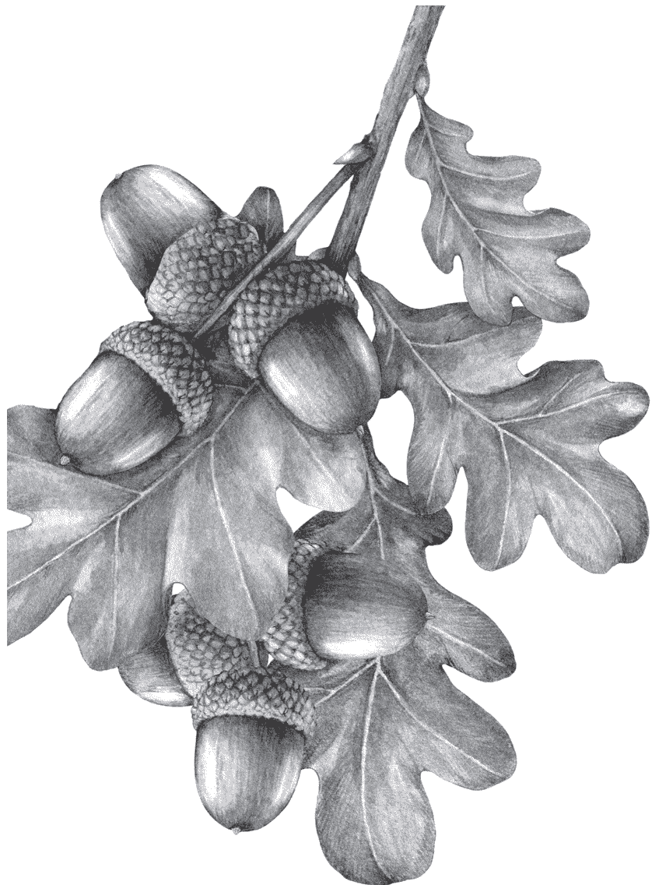

迪娜·贝雷斯福德-克罗格的其他作品：

- 《为树说话》：我从古代凯尔特智慧到森林治愈愿景的人生历程
- 《简单生活的甜美》：一位远见卓学的科学家提供的更健康、更快乐、更善良的生活建议
- 《全球森林》：树木拯救我们的 40 种方法
- 《北方植物园》：地球的生命线
- 《美国植物园》：森林的哲学
- 《时间将证明一切》：里河谷的故事
- 《生命之园》：设计、种植和维护北方温带花园的自然方法

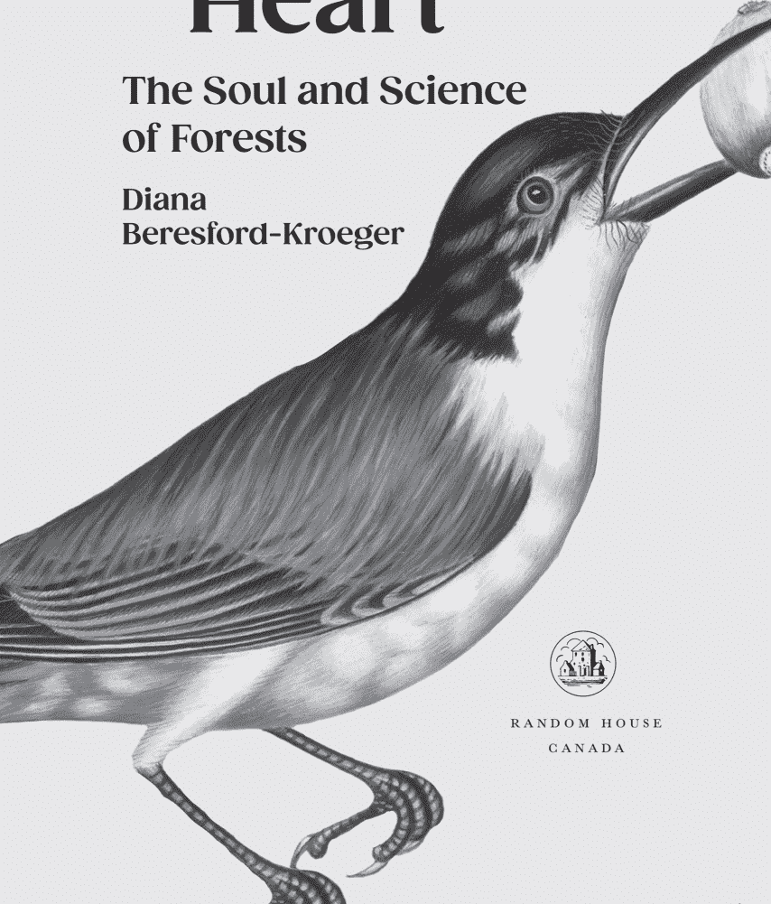

## 由随机房屋（加拿大）出版

`a_prh_7_0_148118692_c0_0`

> 献给所有努力保护和维护我们星球——我们绿色家园的无形 `way`

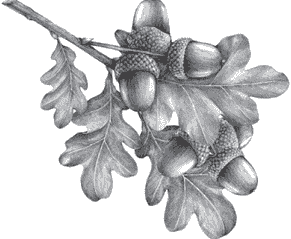

- 关于作者

# 圣餐

在栗色的天空下，森林忘记了白昼……落日投射出指尖的光，寂静在噼啪作响……树木扫过时间的潮汐，一阵呼吸的拂动让叶子叹息，怀念着倾斜长剑的苔藓，树冠因失落而紧绷……松树修饰而骄傲，那是寂静的声音，一株蕨类举起它绿色的角斗，森林地面散发的香气，带着精细华装饰的期待……苦涩果螺旋中的倒影如今与橙色的月亮相映……萤火虫颤抖，闪烁出夜晚的寂静。森林在移动，一只夜莺找到了声音，回声震荡，猫头醒了。

这，是你的世界，如夜般赤裸。

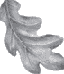

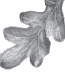

# 引言

在我们身体之外，还有另一种脉动让我们维持生命。那是生命景观的绿色。森林的树木提供氧气，我们的肺接收它。吸入又呼出，来来回，跳动、跳动、跳动、跳动，我们在树木的呼吸中被创造并重塑，点缀着太阳系及以外的星尘。

我们从出生起就感受到这种连接。我们与树的共鸣，在任何一个释放到森林里的孩子脸上都写得白如昼。我们从出生起就感受到这种连接。那是生命景观的绿色。森林的树木提供氧气，我们的肺接收它。吸入又呼出，来来回，跳动、跳动、跳动、跳动，我们在树木的呼吸中被创造并重塑，点缀着太阳系及以外的星尘。

我们从出生起就感受到这种连接。这种连接是清晰的，但阐述我们的灵魂和生命如何依赖树木，并非易事。它需要科学知识、生活经验，以及倾听的意愿——这是我一生的工作。

这项工作，并延伸到本书，始于我父母的去世。当我还是个孩子时，我显赫的英国家族本可以结束我的生命。相反，它给了我一份巨大的礼物。在在科克（Cork）和里河谷（Lisheens）之间度过时光时，我接受了独一教育。我学习了凯尔特人的布列恩法（Brehon laws），提炼了三千年的智慧，教授了那些进入现代药物的草药用途。在学校里，我发现自己对公式过目不忘。我学习植物学、物理学和医学生物化学。我获得了硕士和博士学位。我领导过研究项目，但最终离开了学术界，找到了自己的农场。

简而言之，我学会了运用自然的化学和灵性语言。我仍在学习。

当我离开爱尔兰前往北美攻读研究生时，里河谷的长辈们为我举行了程度的送别会。一位以预言未来而闻名的当地女性受邀查看我的命运。她告诉我，我将前往“新世界”分享我的德鲁伊教育，教导人们自然的价值以及与自然的关系，并帮助人类摆脱贪婪破坏性的行为。我的一生都在努力履行预言，在精神上，我在任何认为可以做出贡献的地方投入了知识和能力。我对六大洲的森林保护和维护做出了贡献。我写过许多文章和书籍，接受过无数采访，我还是一部关于森林纪录片的中心人物，此外还有许多其他项目。重要的是，我从未停止过我的科学工作，我的实地观察和实验。本书是我一生项目的延续，是另一种分享我所学、并鼓励他人接过接子、承担这项工作的尝试。

当我写下这些文字时，我正接近八十岁生日。我不是一个经常考虑年龄的人，但我想，在这个里程碑时刻，确实有某种反思和评估的理由。当我环顾四周——我的生活、我的农场、我们的世界——我看到有许多关于树木、森林和我们赖以生存的星球的基础问题仍待解答。树木如何违背物理定律并让水向上流动？叶柄如何移动叶子以追踪太阳？树如何对未来做出判断？橡树叶是否含着免费可再生能源的秘密？

我也看到了许多森林对地球星球至关重要作用的迷人例子：树木对抗人类癌症和抑郁症的能力；它们为森林浴者提供的受控剂量的药剂；森林向海洋输送构建海洋食物链基础所需的金属的方式；它们通过化学物质和次声波进行交流的方式。最后，我在气候变化中看到了人类曾面临的最严挑战。

这本书提醒着我们，树木为我们所做的一切。它提醒我们它们在地球的健康运行以及其上所有——所有——生命的存续中身处的核心作用。它提醒我们，由于我们的贪婪和轻率对森林造成的破坏，以及这种破坏带来的后果。它还提醒我们，走出我们所制造的这场困局的唯一方法是保护森林并植种新树。

我们的《绿色心脏》（Our Green Heart）并非关乎过去。它关乎仍在进行的工作。关乎在树木植物中尚未发现的解决方案。关乎一个结束气候危机的具体计划。

这本书关于希望。这本书关于明天。

它的书页承载着一种不同的愿景，一种合作与同情的愿景，一种为我们所有人提供全新绿色地平线的愿景。

# 红色与绿色王国

要了解你是谁，你必须了解你的历史。这是你的故事，是你进入生命世界伊甸园的起点，但这也是我们所理解的生命故事。正如这种生命，它既是独特的，也是共同的。

在太空雷鸣般的寂静中，一个为了生命而装扮的岩石星球出现了。起初，由分子运动产生的婴儿态次声波带着对称的种子，随后起舞着波峰和波谷。随着时间的推移，这些知识的种子延伸成弦，在玫瑰的祝福下，这些弦随后塑成了一个螺旋形状，即我们所知的 DNA。在 X 射线衍射分析的镜像下，它的末端视图呈现了一朵玫瑰的设计。物质的创造与保护要求一个镜像，作为第一个螺旋的姐妹而存在。在“万物皆一，万物皆统一”的荣光中，一化为二，万物产生于零。

生命的二项法计数——那产生生命所有奇迹之美的 1+1——已经开始了，这是一门大多数人未曾看到的神圣数学。螺旋充满了知识的语言，它到达太阳并分裂为两个实体。第一个是植物王国。它等待着、等待着，沐浴在绿意之中。随后是动物王国，以红色为主体。两者都贪婪地渴望着燃料。以生存之名，它们决定分享，作为平等的伙伴相互依赖。

它们所分享的燃料——对生命的生存至关重要——是氧气。氧气是我们星球上最丰富的元素，占地球地壳的高达 46.6%。因此，从丰富程度来说，这个选择是安全的。此外，氧气还具有化学上的简单性和可塑性，因为它是一种双原子分子气体，其分子本身仅由两个原子组成。这对于自然的用途是完美的，因为这两个原子的能力相等，并在必要时也可以独立发挥。因此，氧气在大气和土壤中，通过所有植物动物的身体、海洋、湖泊和水道被使用和重复利用，并随着时间的推移，缓慢地通过土壤的化学作用。

在正常的一天，氧气驱动着生命的引擎。这种气体进入地球上每一种动物的肺部，并以二氧化碳的形式排出。这些呼出的废气在大气中供人争夺，而植物则登场。在植物王国，尺寸或生物量至关重要：一片草维持生存活动所需的二氧化碳远少于一棵成熟的树。一棵树，任何一棵树，都完全能够高效处理氧气和二氧化碳；森林更是。氧气和二氧化碳是移动的，不断进出森林社区。但愈发明显的是，人类尚未理解森林对生命星球至关重要的所有方式。我们对宏观图的理解仍在进行中，并且在未来一段时间内将继续如此。

一种通化学法则支撑着植物和动物王国将氧气作为燃料。这被称为氧化还原反应，氧气从一种状态转换到另一种状态。火需要氧气才能燃烧。人体内也是如此。需要氧气来分解碳水化合物、蛋白质和脂肪等食物以释放二氧化碳，然后将其呼出。就像点燃的炉火或火灾，这是燃烧，氧气对于燃烧过程的发生是不可少的。

生命的两个王国，绿色和红色，尽管路线不同，到达了同一个成功的终点。植物的螺旋状 DNA 链产生了一种名为叶绿素的扁大分子——绿色分子。与此同时，哺乳动物的脱氧核糖酸产生了另一种扁大分子，红色的，被称为血红蛋白。它们之间唯一的区别在于两个碱基元素：叶绿素的设计是从大气二氧化碳中产生氧气，而血红蛋白的工作是捕捉这些氧气。它们几乎是完全相同的分子，一种在植物中，另一种在动物中，都承担着至关重要的任务：让氧气在整个星球循环和再利用，并按时间表维持这种进出生命网的运动——从几秒到分钟，从世纪到千年，始终在自然昼夜节律的支配下。

叶绿素和血红蛋白还有另一个共同点：它们都包含一个金属原子。在植物中，它是镁；在动物中，它是铁。这两种金属位于分子的中心，氧气在此被捕获或释放。这是循环的核心，是维持地球生命的化学交换。植物吸收二氧化碳并释放氧气，而动物吸收氧气并释放二氧化碳。这是一场由太阳能量驱动的完美、持续的原子舞蹈。击中叶绿素的光子提供了分裂水分子的能量，释放出我们呼吸的氧气。我们血液中的血红蛋白将同样的氧气带到体内的每个细胞。这是绿色和红色王国之间的基本联系。

## 当大地打破沉默

所有的孩子都出生于大地，我们在土地上生活，我们每个人死后都必须回到大地。大地是神圣的，应当被尊崇。它承载着创造的声音。有时它会说话，打破它奇迹的沉默。当它这样做时，那些亲近它、呼吸着它芬芳的人会倾听。他们知道大地是最好的老师。

当我还是女孩时，每个夏天我被送到爱尔兰南部利申河谷（Lishen）的大姨姨尼莉和她的儿子帕特所在的农场去生活。他们是自给自足的农民，像数百年来那样依靠土地生存。在他们身上，我亲眼见证了对土地深的敬畏。

我的表哥帕特是一个成年人，在照料动物、播种、收割的劳作中变得坚毅。他会走到脊线（Droim）上——这个词不仅指人类或动物的背部，也指形状像背部的田地，古代那里有束缚咒语。帕特会独自站在那里。他凝视着山丘，张开双臂拥抱整个景观，将其吸入灵魂。

……眼睛。这表达了他那种屏息的惊叹——如此美景竟由他独自欣赏。

帕特那歌唱般的话语是古爱尔兰语，自基督时代以前就被作为一种祝福被诉说和重复。它连接着深藏在这片土地上的记忆，深藏在田野的绿色裙摆下，在奔流的水和蔚蓝的天空之下。当他说话和倾听时，这段记忆鲜活了，并为他注入了未来的梦想。饱后，帕特慢慢转身，顺着小径（bótharin）回到家里。那条路是由他的奶牛踩出来的，领头羊“草莓”走在最前面。它起始于Droim 的山脊，穿过草丛和野花，然后沿着一条长满冬树的小径路过石板井。当小径与农场建筑汇合时，紫红色的倒金金丝篱丛通向牛圈、泥草味房和马厩，召唤着帕特回到当天的事务中。

随着我慢慢长大，我开始了自己的了自己的朝圣，与大山共处。我走在小径（bóarin）来到大门口。我站在最低的栏杆上，固定好凉鞋，双手悬空开始摇晃。大门来回摆动，发出生锈的响声，我伸长脖看向风景。慢慢地，一种宁静填满了我的脑海，由我内心深处的某种东西在守护。视线范围内没有别人，但我并不孤独。我正与某种强大的力量在一起，它将我紧紧拥抱在希望的怀里。

我也给大山命名。然后，我按照韵律添加了田野的名字，它们像朋友一样站在我身后。长长的Inch 田田就在我身边，在土地里守护着一个秘密：一个黑蜜蜂群，它们采养着干草场里的野花。我看着那些蜜蜂来来去去，充满心地飞过金雀花那种酸性的铬黄色和针状的叶片。紫色的石楠像皇冠上的光环一样漂浮在山丘上。我观察并等待。然后我回到农舍厨房，感到快乐而满足。

内莉（Nellie）是我母那一辈父亲的妹妹。据说她年轻时是爱尔兰南部最美丽的女性之一。在我眼里，她的美随着银发的出现而倍增，那头银发被一只玳玳牛壳质制的发梳固定着。她穿着长裙和衬裙，全都是手工织就，透着质朴。她的亚麻衬衫衬托出她皮肤的光滑。皱纹没有在她脸上停留。它们甚至都不敢。

我父母的恋情曾是一段波澜起阔的。我父亲源自英国贵族，而我母亲高贵的爱尔兰血统则可以追溯到几代以前。内莉有勇气欢迎我进入她的家，无视我的“标准爱尔兰语”（Béarla ceart）或“王室英语”。我口中说出的每一个字都证实我是一个“萨森人”（Sasanach），一个家族中的异类者，一个说英语的孩子，但她从未将我身份中的英伦部分视为冒犯。

当我第一次在灰树前见到她时，她令我屏住了呼吸。那棵巨树矗立在农场大部分建筑上方，像一个阴影日晙。下午，内莉会打理好准备拜访。然后她会走向那棵拥有许多名字的神树。欧洲白蜡在拉丁语中称为 *Fraxinus excelselsior*。在古爱尔兰语中，它被称为 *nem*，是凯尔特文明古代奥姆（Ogham）字母中的字母 N——这种基于树木的神圣文字构成了欧洲第一种书写语言。

内莉会面对树站立。访问者和被拜访者始终静止，似乎在他们周围聚起了一层寂静的网。这不是普通的寂静，而是爱尔兰语中称为 *tost* 的词。这个词指的是只有通过深层冥想才能获得的死寂或屏息的寂静。在在这种 *tost* 中，两者似乎在交流，一种无声的涟漪在女人与树之间传递并往复。就好像他们分享着如此深奥的秘密，只有沉默才能承载他们特殊的亲密，就像一对老夫夫妻亲密地坐在一起，一言不发——这种沉默本身也包含着一种理解。这就是我们一生中都在渴望的连接。而内莉指尖拥有这一切。即便在一个小孩子眼中，这对我也是清晰的。

内莉不去教堂。她推辞了这类祈祷。她的信仰悬浮在古老世界与“新”世界之间。她能看到周围的人正在抛弃他们最美好的部分，将数千年来积累的智慧斥为一文不值，她不喜欢她预知人类家族在道路尽头将面临的未来。于是她带我走到篱篱丛和路边，那里长着甘菊。她告诉我，鸡群需要甘菊来保持健康。她揉碎叶子和白色的小雏菊花，让我闻到那种挤压产生的刺鼻气味。

她牵着我的手，带我穿过风景，向我介绍隐藏在每一片草叶中的奇迹。她轻声告诉我，有时风景会打破沉默，向那些愿意倾听的人说话。她引导我走向了土地的智慧。她释放了自我。

### 自然之星

2010年春季的一个时候，我收到一个随意的邀请，加入一群女性的午餐。地点是纽约格拉姆公园的国立艺术俱乐部。我也被邀请发言，但我被告知我的言辞不需要多么华丽：“噢[文本继续]……

（注：由于原文22-23页的OCR文本存在严重重复和碎片化，此处仅翻译提供的连贯片段。）

叶子是自然界智能设计的完美案例。每种植物的每一片叶子都是拥有独立 DNA 的生命体。从基本意义上说，它是一个带有移动手臂的太阳能平台。这个绿色物体从清晨到黄昏，在地球的任何角落追踪太阳。它是一台在空中运行的引导追踪机器。它也存在于水下，尽管海洋森林采用了不同的设计，旨在应对水的阻力。它们在栖息地中还垂直堆叠，以获得最大的光照。

叶子的形状和大小各异。它们可以从尖锐足以刺破皮肤的针形，到卵圆形、铲形、手掌形，以及具有许多裂片的倒卵形、匙形形、三叶形和掌形。总的来说，形状是由树木所属科的基因组决定的。越复杂的叶子往往属于星球上一些最有趣的物种。有时，DNA 会发生易位或重组，突然之间（通常令科学界感到惊讶），某个领域内出现了一个“新成员”。这种新的树木或植物被称为“变体”（sport）。

叶片由纤细的叶柄固定位置。这些部分可能非常短，使叶子看起来直接从茎上长出，这种情况被称为“无柄叶”。叶柄也可以非常长。叶柄控制着叶片（或叶肉）的运动。这种运动可能基于渗透压力的物理学，但目前尚不清楚它是如何发生的。这只是树木和森林生命中许多基本且核心的、科学界仍未解之谜之一。

世界上发现了一类树木，它们的叶柄有一种不寻常习惯。这一类植物是柳科（Salicaceae），其中的杨属（*Populus*）非常独特。这些树大约有三十个物种，是自然界的绿色风车。叶片的质量与叶柄的长度恰好匹配，以至于气压的任何微小变化都能体现在运动。这种不可思议的活动性体现在树的名字中——*Populus tremuloides*，即颤抖杨（quaking or trembling aspen），它响彻世界上任何变化的警钟。

尽管孩子们自古以来就一直玩叶叶子，但人们对一片简单叶子的生态功能知之甚少。叶子是一部肺。单看它，无疑是一部很小的肺。然而，如果剥掉整棵落叶树的冠层并将所有叶子放在一起，更宏大的视野就会展现在眼前。这个整体是树木完整的呼吸和交换装置。其表面积巨大，据认为覆盖了许多英亩。森林反过来放大了并倍增加了这种规模。它们是惊人的巨大碳捕仪器。

人类的呼吸受到大脑深层中心（或边缘系统）的严格调节。树木和森林也有类似的调节，但在它们身上，过程要复杂得多。由于阴影的存在，冠层并不遵循同一份曲谱；光照充足的区域对交换的优于阴影区域。这种设计被称为“分布式涌现计算”，是一种源自基因的、命令与服从的二元函数，存在于树木、森林，以及人类的免疫系统中。树木中这种交换的数学原理被称为“细胞自动机”，这是一种智能形式，在人类身上局限于大脑。没有人知道它在树木中是如何发生的，更不用说在森林中了。就像叶片跨越天空追踪太阳的运动一样，这仍然是一个谜团，尽管我们每天的每一分钟的呼吸都依赖于此。

大自然之星是叶子，既简单又复杂得惊人，是一个我们每一个人都可以摘下并握在掌心的谜。街上那个微笑的年轻人一针见血。谢谢你，陌生人，感谢你优雅的话。

## 古老与亚原子

当我还是一个和家人住在英国的小女孩时，我的母亲带我去参加一个爱尔兰的葬礼。她的一个远表亲去世了。我们乘坐 Innisfallen 号渡轮跨越爱尔兰，落在 Lishens 山谷参加庆祝活动。死亡和后世对凯尔特人来说非常重要。我们血脉相连。

那座粉刷的小房子和附带的牛棚在数百年前就已嵌入山腰，与山融为一体。那位表亲是单身，独自住在房子里，收藏了大量的希腊语和拉丁语书籍。现在，农场的泥地板和粉白的墙壁挤满了他留下的家人。

我记得那袋破布进门的那一刻。他掌控了整个房间。甚至连尸体都移动了一下。这个男人，衣服堆在一堆毯子碎片上，身上散发着电流。他是`seanchaí`，故事讲述者，古老知识的守护者；他的工作世代相传。`seanchaí`在秋季收获到春季播种的几个月里四处流浪，分享故事。该地区的每个农场都为他留一张床，人们用食物和全神贯注迎接他的到来。他是步行来参加婚礼的，从远方来纪念死者。

他开始谈论`Ollúna`，古代的大型诗人和历史学家，望向窗外房子背后的山。他似乎进入了恍神状态。接着他谈到了“分身”，即同时出现在两个地方的能力。他向现场所有人报告了山谷里的一起事件：他认识并信任的人被看到同时出现在`Lishens`和`Gougan`。这个概念本身是不可思议的，这种念头似乎否定了科学中所有确定的事物。但我在世界各地大学求学期间，这个念头从未离开过我的脑海。一个想法一旦诞生，就会延续下去。

在职业生涯中期，阿尔伯特·爱因斯坦开始抱怨电子。他称它们的行为很“怪异”，并对它们的举动摇头。电子，当然，已经在物理学中被描述过——带有负电荷的基本粒子。地球上的每种元素都幸运地拥有一云电子。它们数量可能会改变，但它们的行为被认为是恒定且可预测的。直到几年前的一天，在伯克利的一个实验室以及随后的其他实验室里，单个电子设法地同时出现在两个地方。这些实验中的所有时间测量都被判断是正确的，尽管这一壮迹看起来是不可能的。这些科学家执行了“分身”的行为。一个微小的电子跨越了根深蒂固信念的巨大障碍，必须停留在想象中。虽然这不会让`seanchaí`感到惊讶，但这一发现对科学来说是新颖且奇特的。一旦被接受，其他科学家开始观察另一种基本粒子，一种整个星球都非常熟悉的粒子，尤其是对于它们的树木：光子。

从某种意义上说，光子就是阳光。它是来自太阳能量场的电磁辐射量子。而且，再次令科学界惊讶的是，光子，任何光子，都能执行神奇的分身动作，尽管其距离大于电子测量的距离。（这些光子实验是最近完成的，但这一发现引起的关注和兴奋异常之。）

爱因斯坦在普林斯顿大学居住期间（20世纪30年代中期到50年代中期），对阳光的物理学着迷。然而在研究它的行为时，他遇到了困境。在测量光波长时，发现它们以两种方式传播：一种是直线称为直线，另一种是波长很短的波，就像海浪有节奏地拍岸。尽管他解决了直线向量的问题，但这些正弦波如何以及为何仍然无法触及。它们在自然界中有什么意义？

这种失败中包含着一种微妙的讽刺，因为普林斯顿校园到处都是树木，每一棵都生长良好、养分充足。无疑，热爱自然之音的爱因斯坦曾多次靠在其中一棵树干上，沉思地望向天空。在他头顶上方，在绿色的树冠中，每一片小叶子都在解决他无法解决的问题，为阳光之下的量子表演铺平了舞台。

电子和光子是活的树木、活的森林的生命线。在亚原子水平上，阳光落在叶子上并渗透到绿色组织中。这是叶肉组织层，由称为叶绿体的绿色叶绿素囊组成。每个叶绿素分子都是一台分子机器。它的形状类似于床垫，中心坐着一个镁原子，等待着光子的到来。镁原子周围环绕着一片电子云。一个光子冲入并取代了一个电子。这种原子接管所产生的能量足以让二氧化碳分子分裂成两部分：氧气和碳。氧原子自由地与另一个同类原子结合形成稳定的气体分子，然后通过测量并与地球大气混合。碳被树木抓住并转化为木材。这种基础能量的易物系统在一个被称为“大碳循环”的碳银行系统中滋养着整个星球。

大自然以专家会计师的节俭和严谨经营着这个系统。森林收集碳来积累资本，而且来源并不匮乏。活系统中存在熟悉的碳收割与播种，地球地壳中也有储备，太空中还有丰富的资源。有时，过量的碳会随着时间的推移而积累。这些碳为了未来被仔细烘焙，主要作为水下的底层、永久冻土和海洋。在地球许多地区，这个碳库在压力脉冲下随时间变化，由于碳的稳定成键原子结构而重新形成、塑造。随着时间的推移，煤炭、石墨甚至钻石诞生了。

这些是树木特有的过程，使我们的空气可以呼吸，我们的地球变得宜居。它们在全球和亚原子的尺度上，由一种我们几乎无法理解（如果真的能理解的话）的内在智能进行协调。然而，直到今天，我们仍在盲目地摧毁这份不可思议的礼物，对我们所消除和释放的后果知之甚少。终局如今是气候危机的苦药，我们必须全体口下这颗苦药，没有任何甜味可以送服。

森林的大部分分子机器已被移除；当你读到这段文字时，更多的树正在被砍伐。那些具有快速键合能力的碳现在只剩下一个去处，那就是通向天空。天空因此变得黑暗。正如化学中的所有事物一样，温度越高，反应速率就越快。热量的现象正追在我们的脚后。我们必须制止这个怪物。我们可能无法理解其复杂的过程和解决方案，但树木和森林懂。我们必须重新种植。我们必须停止砍伐。就在今天。

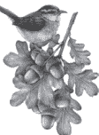

## 森林结实 (Forest Mast)

`Mast`是一个关于食物的古词，可以追溯到人类家族的最早期时期，在梵语和古盖尔语中分别被称为`*meas*`。`Mast`源于乡村。它是大自然的礼物。有时，仅仅是有时，当压力点完美时，大自然会产生一个丰产年年，使生命之网中的所有生物都能获得过剩的食物。这被称为结实年（`mast year`）。

这样一个一年的到来首先在森林中被注意到。在结实年，所有植物类的树木都听到了召唤。每棵树都长出更大的叶冠，以履行即将到来的收获承诺。然后，整个森林作为一个关怀共同体，产生了过量的种子、坚果、小坚果和橡果。这是代表大量时间和能量投入的作物，它的礼物对森林及以外的每一个生物来说都是恩赐。

种子中富含着优质植物蛋白、碳水化合物、必需脂肪，以及作为维生素和植物激素前体的植物化学物质。矿物质也存在于种皮（或外壳）中，作为微量和宏量元素。这种丰饶铺满了整个森林地面，绵延数英。森林社区，无论任何地方的任何森林，都有自己的意志。在树木深处的基因知识库中，存在对未来天气模式的理解。这种理解的准确性对于一棵树、以及整个森林生态系统来说是生死攸的。它提供了信息基础，树木必须据此决定何时以及何处消耗最宝贵的资源；树木在必要时会做出明智、甚至是无情的决策。在压力下，树木会产生更多的花粉；如果情况变得非常艰难，它们会使用生物化学斧，放弃种子、叶子甚至树枝。

任何原生森林都包含常绿、落叶常绿和完全落叶树种。这片深浅不一的绿色在白天产生了一个凉凉的系统。在古树高耸而广阔的树冠下，最幼的树木带着它们稚嫩的叶子，免受太阳最强紫外线的侵害。这些致命的紫外线由于温度升高引起的温室效应而被放大。在许多古老的森林中，林下树种得到了保护。通过这一底层，灵活的藤蔓开始了通往阳光的向上战斗。如果成功，这些攀爬植物也会像瀑布一样落下种子，有时一直延伸到充满生命的森林地面，而那里的土壤蕴含着许多秘密。

如今只剩下扭曲的树干，曾经这些树曾像士兵一样直插星空。

这些森林树木以及许多其他植物的消失，也影响了注入海洋的溪流、河流和河口，严重减少了最终沿海水的腐殖酸和黄酸流。这些巨型分子是森林林果（`mast`）最后的馈赠，是铁的跨洲载体——铁是让藻类分裂的关键金属。从这些不明显的森林食物中，海洋的丰饶爆发了。即使是巨大的鲸鱼也从中受益，无论是由于直接释放到它们产卵地的生命线，还是分布在整个海洋的养分。

“林果”可能是食物的古语，但它也是当今地球星球生命的秘密钥匙，未来亦如此。维持每一个生物的设计一直都在这里。这只是一个睁开双眼去观察和感知的问题。

### 森林学校

在爱尔兰当孩子时，我对“教育”这个词非常敏感。根据说话人的不同，它有着不同的含义，这凸显了塑造我年幼身份的两种文化之间的巨大差异。在我家族的英国裔一方中，教育似乎是为了面子。我的父亲在我出生时就把我送入一所寄宿学校，以便我被训练成一个完美的妻子和我们血脉财富的化身。对他和他那些贵族同类来说，教育是一种外在的事物，是地位的标记和防御者。另一方面，我母亲的爱尔兰家族则在知识本身中看到了财富。他们珍视知识，并追求教育来完善自己并维持周围的世界。尽管他们拒绝说英语，但他们的拉丁语和希腊语随着古爱尔兰语从口中流而跳舞；在我看来，他们的每一次呼吸似乎都源自《布雷洪法》（`Brehon laws`）——凯尔特文化的古代智慧。我的老师强调深度倾听的必要性。对于那些学会真正聆听的人来说，他们说的话包含了层层含义。他们会指向一个时代，一个`*cluas*`。“`*Cá bhfuil chil do chluasa?*`——你的耳朵在哪里？”——这始终是留心言语之下含义的信号。

在位于科克和凯里之间的谢希山脉，有一个名为高根巴拉的山谷，中心有一座圣湖。那里坐落着一座`*crannóg*`，一种古老的湖上居所，是一种为了保护居民而建造的人造堡垒。高根巴拉的`*crannog*`很小。它包括一座圣芬纳布的小拜堂和一些建成蜂窝状的石屋，它们建于基督出生后不久——可能更早。修士们在这座岛屿的讲台上祈祷。这些修士是该地区教育的核心，这种教育在英国占据者颁布《惩罚法》（`Penal Laws`）的几个世纪以前，就从我那位于基尔尼罗斯斯城堡的学者家族开始了。那些旨在根除凯尔特文化的残暴法律持续了五百年，直到1916年的复复活节起义才结束。

从我还只是个蹒跚学童起，我母亲就坚持每年带我前往高根巴拉朝圣，并回到我们的祖祖地——罗斯斯城堡。我们会停在`*crannóg*`旁，我惊叹于自己的凉鞋重叠了修士们的足迹。但在那个祈祷和学习的地方，我还看到了其他东西。那是湖泊上方高处的一个山脊。有时这个山脊清晰可见，有时则被灰色的雾气遮挡。在《惩罚法》让爱尔兰人教孩子成为违法的五百年里，山脊边缘存在着一种秘密的树篱学校，`*scoil ghearr*`。世代孩子聚集在那里。大和小孩子在峡谷灌丛的掩护下爬到山顶。他们坐成一圈。每天都会更换哨兵。这几个孩子必须趴着，张开他们的`*cluas*`（耳朵）来学习。

老师可能是当地的男女或神父，他们处于危险之中。他们小心而恐惧地来到教室。他们给孩子们提供长达五个小时的教学，涵盖数学、被禁止的爱尔兰语、诗歌、天文学和历史。一天结束时，老师们（尤其是神父）会躲在附近的房子里，直到能够安全回家，他们随时准备逃入被称为“神父洞”（`priest holes`）的秘密通道。如果被抓住，分享知识（`*colas*`）的惩罚是可怕的。一想起这些，我的手臂就会起鸡皮疙瘩。`*eolai*`（专家或老师）会被绞决、剖腹分肢。英国人会等到肉体停止抽动。然后才宣布死亡。有时，知识的代价是极其巨大的。

我们每年的朝圣，结合我母亲关于树篱学校和那些不可思议的老师的故事，以及对我祖先为了保留最终传给我的古老知识所付出的努力的理解，留下了深刻的印象。作为加拿大的成年人，我对“教育”一词依然敏感。它向公众展示了许多面孔，就像我小时候一样，但对知识的管理和分享仍然是文明的安全网。我尽所能地提供帮助，因为我很幸运，首先是《布雷洪法》的庇护，其次是在失去父母后住在叔叔帕特里克家里度过学校。他是一个对书籍有着奇异痴迷的人，我沉浸在书书中，包括他大量的初版收藏；这些书籍成为我信赖的伙伴，并为持续到大学的关系奠定了基础，在大学，医学院里的书籍似乎通过它们的重量，尤其是触感在对我说话。

非常危险。他们正在向最好的老师学习，那就是大自然慷慨的自然界。

不久，一位老师制作出了一块厚实的木头，我受邀坐下。火堆冒着烟，但我很喜欢这种味道；它与学术界那些经过消毒处理的走廊截然不同。火堆周围的围裙剧场是孩子的栖息地，而不是大人的。对我来说，显而易见的是我是孩子的客人，而他们才是主人。他们也照顾我。每个孩子都有一项任务。在这所森林学校里，他们提供并烹饪自己的午餐。在炉边会议之后，烤饼从煎锅上出现了，紧接着是一个盘子。当我把烤饼平衡在膝盖上递出的盘子上时，他们紧盯着烤饼。我把烤饼举到嘴边咬了第一口。孩子们像雕像一样等待着我的反应。我咽下口水，然后笑了。

一个男孩爬上围裙高处的一个树枝。他小心翼地平衡在那里，双手背在身后。他的表情很严肃。话语从他口中而出：“我们为你做了烤饼！”他说，“我的意思是，我们很高兴你能来参观我们的学校。我们为你做了，还有很多。非常多！”他的同学向他聚拢。他们并肩在一起，互相支持，并因他们招待客人的技巧而充满底气。

那天我带了一些东西回家。小森林学校教会了领导力、诚实和合作，以及对自然的深切尊重。这种结合是独特且至关重要的。如果爱尔兰的灌篱学校（`scoil ghearr`）能培养总统和首相，那么这些森林学校就能为我们所有人开辟通往美好未来的道路。教育可以被货币化，也可以被珍藏；理解可以被积累和专利化，也可以被分享和感受。孩子的微笑所蕴含的知识深度可能比任何地方的大学都要深。

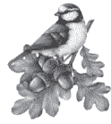

### 隐藏在树中

秋天，冷却的太阳如陀仪眼凝视着冰冷的北方，森林地面铺了一层色彩斑斓的新地毯。当落叶被吹开，绚丽夺目的蘑菇便显现出来。这些森林果实是年度最后的最后的野餐——生物多样性，大自然的秘密武器，正处于最佳运行状态。

自然不断地重塑自我。这种不断的创造过程留下了成功与失败的足迹，新的生命形式的存亡取决于其先天的遗传灵活性，以及它们寻找并适应自身生态位的能力。这种与他人共处的学习可能需要几秒钟、几年或几千千年。每一个错误和失误的记录都留在了基因组中，直到达到某种完美——其最终目标是确保安全的复制或生殖。

在生命网中，从病毒到哺乳动物，所有生物都以某种形式与叶绿素的绿色世界结合在一起。一棵树，任何一棵树，都有4亿或5亿的时间来达到自己的完美状态。达到后，树木就与它的森林伴侣和土壤匹配，并与它在地球表面的地理位置完美对齐，而这个位置又与太阳同步。生命网要填补树木消失留下的空缺，至少需要同样的时间，再经过半亿年的尝试与错误。这种修复的时间跨度是巨大的，无法加速或颠覆。科学从未理解或充分描述过全球花园中任何原始原生森林的模式语言。因此，这样的社区是不可能被完全取代的。我们必须等待新事物的出现，同时永远无法完全掌握我们失去的一切。

可以肯定，我们依赖于那些尚未被理解的森林；在本书书中，我勾勒了几个仍然神秘的相互依赖轮廓。原生森林与人类状况表现出许多人的相似之处，这种镜像关系可以提供宝贵的提示——偶尔是晶莹剔透的洞见——关于这些生态系统如何影响人类健康。一个有趣的例子是内生真菌，它们是人类微生物组的推论。正如我在前面的章节提到的，这些真菌生活在树的内部基质中，位于根、干和叶中，就像人类消化系统是细菌的家园一样。在这两种情况下，都会发生酶对话——在树内和肠道内——为了将进入的食物转化为可用的组成部分。生命本身取决于蜜蜂与微小的和谐。

关于森林与真菌的关系，比对人类微生物组细菌的了解要少，但这些真菌仍被用于生产复杂的现代药物，这些药物承载着人类家族的命运。一个例子是山楂（`*Crataegus*`）的提取物。强心剂，如`Curtacrac`（`*Crataegus-Kreussler and Esberic*`），可以打开心脏的左前升状动脉。另一种这种森林药物是来自白桦树（`*Betula*`）的名为木糖醇的糖，它可以轻松缓解幼儿耳痛。它以口香糖的形式出售。似乎森林越古老，药库就越丰富。这源于机会和设计。

鸟类、哺乳动物、风、水、温度以及土壤和大气的酸性或碱性，都可以开启孢子、担子孢或更复杂的囊孢的大门——类似于种子遗传物质球。因此，许多真菌在任何时候都会沿着树的木质部向上和韧皮部向下移动。奇怪的是，对于每种特定的树来说，这个数量似乎是恒定的。在松科（`*Pinaceae*`）中，有六十四种真菌躲在树的肚子里。栎科（`*Fagaceae*`）的橡树（`*Quercus*`）宿主仅有十四种。

内生真菌并不总是友好的客人。有时它们会制造自己的恐怖之堂，对宿主发动生化战争。这对于科学也很有意义，因为这种毒素可以用来治疗和杀死癌细胞。一种名为紫杉醇（以`Taxol`销售）的已知抗癌药物是从受真菌感染的榛果树（`Corylus`）中分离出来的。

对这些真菌隐藏栖息地的发现也相当近期。当然，它们为医学新学科贡献了大量知识，而物理学正在探索它们的精细作用。这些关联还通过释放气胶在生化上表现出来。科学通过云室一个分子一个分子地研究气胶。在森林中，不稳定的分子（我稍后会详细讨论）被扩散到空气中进入更大的大气层，成为这个世界的生态屏障。

当森林中的一棵树死去时，生活在其内部的真菌生命发生了变化。当低语传遍整个菌体时，扩散的菌丝手指停止了。一场危机发生了。遗传顺序立即改变，无性菌丝从地面出现或作为树上可见的苞片。蘑菇体释放出的孢子随动物或鸟类旅行，或随风传播。孢子以数亿数万亿计散布，一些会在幼树中找到生态位，生命循环再次开始。

任何为冬天收集木柴的人都可以阅读他们劈开的木头中的颜色，并识别内生真菌。当木材被切成长度并晾干，然后进一步劈开并堆叠后，在开启的垂直面上会出现无穷尽的色彩——尽管有时木材需要放在阳光下才会出现颜色。然后，一夜之间，深红、粉色、紫色、蓝色、黄色和荧光绿组成的彩虹从粗糙的表面升起，仿佛魔法一般。这些划痕和色调就像波洛克或里奥埃的绘画，是自然在创造冒险中的原创作品。

然后，有时，在秋天温暖潮湿的日子里，木头似乎生长在了一起。每根木头都相互依靠，通过一种形成基质的弹性物质连接。这些是堆肥细菌的消化液。碳是它们的王。除了自身，它们什么也没有留下。

### 栗果的魔法

我对核桃（或核桃科`*Juglandaceae*`）有着科学上的兴趣，特别是山核桃。这一属（`*Carya*`）在全球范围内由二十到二十五种物种组成的小群体组成。这些是雄花树，主要原产于北美和南洲，尽管也有少数分布在亚洲和欧洲。

长期以来，核桃与美洲的风土（`terroir`）有着极其深厚的关系。这两个大陆的光照非常强烈。这种光子能量充足的证据在这些树每年产出的果实中可见一斑；核桃在阳光下舒适生长的每一个方面对于这些树来说都是独一无二的。叶片呈羽形。树干粗糙肥实。春季，所有根系的生长点（或顶端分生组织）都是巨大的、多毛的呈橙粉色的。间伐这些树木的经验法是什么？分生组织越大，果实越大。

很段时间以来，这个家族的一个成员一直在我下定决心培育的稀有树清单上。它是栗果，`*Carya lacinosa*`，也被称为壳皮山核桃。它的遗传基因保存在我在安大略省农场的植物园里，但我想通过添加来自加拿大本土不同森林的相似物种来扩大这一基因组。事实证明，这项任务比我最初想象的要困难；由于大湖沿岸的开发，这些树在安大略省已几乎完全灭绝。

我在旅行途中经常寻找栗果。这种树很容易发现，即使在很远处也是如此，因为它的树皮会卷曲。成熟的栗果是一场视觉盛宴；长条树皮被其形成层推开，并卷成六英尺长。看起来就像树正在从自己的皮肤上颤抖。事实上，这种卷曲是一种巧妙的扭转，而不仅仅是一种强烈的视觉表达。它让树干难以攀爬，保护了树冠免受松鼠等食草动物的侵害。

2019年11月，当我被请求帮助在附近的一所儿童森林学校保护五英亩的成熟林时，我与当地的护林员交谈，他们认为可能在该地区发现过一些异常的山核桃。我希望他们可能发现过这种伟大的栗果。但他们摇摇头告诉我：“树已经没了。”开发商们忙碌了一整天。尽管如此，我还是请求护林员继续寻找，以防有一天，他们能在森林里遇到栗果。那棵野生的树将是该物种在加拿大的最后几个之一。

去年秋天一个明亮的早晨，我收到了由一位护林员快递寄来的小盒子。我打开它，喜之若狂——五颗栗果从它们浅棕色冬季外套的保护下向我绽放光芒。它们带有棱脊，果实本身的顶端有一个尖锐的喙。它们有些扁平，因此看起来有四种明显的尺寸。我知道，如果我掰开一个并咬一口，褐色外壳内的核桃肉在舌尖上的味道将是甜的。它们有点小——母树显然正遭受缺水和土壤贫瘠的苦苦——但它们毕竟是栗果。我手里握着五个硬壳的“宝宝”。

我面前的下一个任务是说服这些独特的果实生长。这可能需要很长的时间、极大的耐心，以及比任何人想象的更多的科学智慧。每颗果实都是一个种子，一个胚胎，包裹在保护性的壳中。胚胎就像生物化学火箭，但它需要完美的条件来点燃。当果实从母树上脱落时，它预感到会有各种麻烦，它通过保持休眠来规避这些麻烦。种子的肉进入深层次的、定时的休眠，主要是为了度过冬月。

打破这种休眠的挑战是重大的，如果森林里有很多 *C. lacinosa*；只要果实容易获得，或者错误并不重要。但如果你手里只握着五颗果实，你知道它们是该物种的最后几个，你面对的是一个无法生存的物种，而且没有犯错余地。

我拥有的这五颗果实变得更加重要，因为它们来自最北方的风土或生态系统，*C lacinosa* 在美洲大陆。与北方的阳光系统让树更容易生长，因为面临的生理压力较小。此外，与南方的树木杂交，产生了更好的杂交种，具有更强的活力。这种活力赋予了它更强的抗病能力并在气候变化面前保持健康。

休眠和植物生理学在科学上尚未被理解。任何果实的肉都是未来树的真实胚胎。挤在果壳内部的蛋白质、糖分、必需脂肪酸和矿物质微元素是生存的能量储备。蛋白质堆叠并弯曲以适应狭小的空间——想象一下折叠椅。糖分结合成聚合物形式。必需脂肪的链贯穿始终。而矿物质很可能与高分子蛋白质螯合。（螯合是一种金属被添加到大分子中作为运输载体的过程。）此外，果壳中还有保护性的药用化合物。总之，所有的生物化学原理都应该被理解。

具有极大的意义。仅切罗基人的药典就使用了这种树的药用来缓解疼痛、治疗病毒，并利用其树皮浸液增强长骨韧性的非凡能力，以防止在各种运动中受伤。通过对这些草原上的坚果树进行野外园艺管理，他们能够收获坚果，为饮食提供最高质量的一等蛋白质，将鹿肉的蛋白质含量增加了一倍。

今天，王果（kingnut）可以重新引入北美作为农业辅助。如果将其种在树篱中，树木可以保护农田免受阳光过量紫外线的照射。树的根部会将深层土壤的矿物质财富循环回土壤表层。王果能让周围的土壤生态系统对昆虫而言更加稳定。授粉者可以获得充足的食物和用于保护的树脂。一些昆虫和少数鸟类将树脂作为抗生素和抗真菌的“墙纸”，在发育过程中保护后代，这是一种防止疾病的打扫方式。鸟类在树木旁繁衍，它们在树冠中梳理羽毛时摄入维生素 D 用于产卵。王果的大叶子可以清除空气中的颗粒污染，包括同位性放射性减少，而它们的阴影保护了两栖动物免受遗传损伤。

这些从北美景观中被随意移除的树，能够使任何农业经营的植物蛋白翻倍。制作坚果奶、坚果奶油、奶酪和坚果豆腐可以成为农业社区的一个新产业。此外，印度南部阿南塔普尔地区最近的研究表明，像王果这样将木本多年植物与农作物一起生长的旧模式，可以增加34%的大气二氧化碳吸收。

造福自然的造福农场。造福农场的造福人类。王果是一份礼物。我们只需要接受它。

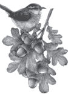

### 喂养海洋，滋润土地

我曾负责过水，那是我在利申（Lisheens）山谷小时候的时候。Nellie 和 Pat 的农场没有室内管道。由于饮水、烹饪、洗涤和各种日常任务都需要水，每天早餐后，我都会手各提一桶水去水井。

我去水的路程是快乐的。我走在潮湿的小径（bótharín）上，穿过紫藤花隧道，红花在我的头上方悬挂。我身处一个充满神奇植物的仙境。

回到农场的路程就完全不同了。水很重。桶手勒着我的手掌，隆起粉红色的疼痛垫。我不得不停下很多次用裙子揉手并变换握姿。将双臂举过头顶只能获得片刻的缓解。每当我再次举起水桶时，它们感觉越来越重。

正是这些每日的旅行让我学会了水的价值。从那以后，我视水为理所当然。这使得我在家里做的每项任务中都变成了一个吝水者，而这恰恰是应该的。

我也发现水在科学上非常迷人。它是一个如此简单的分子，而这种极度的简单使其作为自然界的桥梁化学物质变得如此重要。水由两个氢原子和一个氧原子组成。这使其成为已知最通用的溶剂，对于地球上所有的动植物生命都至关重要。在某些岩石中甚至以水合形式存在。水具有以三种状态——液态、固体和气态存在的神奇能力，似乎两个氢原子相对于较大的氧原子所形成的角度赋予了水分子堆叠的能力。

清洁、可饮的水对于这个星球上的生命至关重要，而森林为全球社区管理着这一珍贵资源；树木是地球水循环的关键。这一事实如此明显，却往往被忽视。水是如此普通，以致许多国家将其视为商品。直到它变得稀缺。只有当水源枯竭时，人们才会真正怀念它。地球上的每一棵树、每一个森林社区都是水分的重要调节器，将水从大气循环到陆地，并不断重置海洋的盐平衡。

爱尔兰当然是一个岛屿，海岸线很长。当我不在提水时——事实上，当我完成家务或完全摆脱家务时——我喜欢画这些粗糙、崎岖的海岸。在大学期间，当我坐在南海岸靠近巴利利基（Ballylickey）的地方画画时，我注意到每一个溪流与潮汐汇合处海洋植物的变化。在淡水和咸水的混合中，充满了生物多样性的交响乐。海藻充满了色彩和紫色——从深褐色到红色，再到石苔（*Porphyra gardneri*）那种近乎透明的浅黄色，它们由单层细胞薄片组成，悬挂在黑岩上的每个开放空间。我的眼前有一片海洋花园，盐分悬挂在周围空气中，宛如光环。

海水本身就是一种神奇的药物。它是 DNA 向陆地漫长旅程的起点，对于每种形式的海洋生命（动植物）来说都是安全且健康的。作为一种简单的溶液，海水是一种缓冲液。它的化学可塑性保护生物免受伤害。它是一种局部抗炎药。自古以来，盐水就被用于灌洗。前往海洋一直被视为一种“治疗”——一种重建健康不良和焦虑者身体的方法。凯尔特传说特别推荐在潮汐沙滩上赤脚行走，随后用墨角藻（*Fucus vesiculosus*）敷肢。墨角藻中的可用碘含量对甲状腺有益，使该腺体功能处于最佳状态。医学上仍在使用海水，作为一种等渗溶液来缓解脱水。

海边等待我和我的电影团队。他是松永光彦（Katsuhiko Matsunaga）教授，日本顶尖的海洋化学家，我正为《森林的呼唤》对他进行采访。松永教授及其团队花费了四十年时间，试图识别陆地与海洋之间对海洋生命至关重要的纽带。最终，他们发现了一些惊人的东西。

所有的蓝藻（Cyanophyta，以前被称为蓝绿藻的细菌）在繁殖和分裂都需要铁；这种金属通过叶绿体或植物型铁氧还蛋白在海洋光合作用中起着重要作用，这些分子使这些微小植物能够捕获和传递电子。此外，当太阳落在地平线以下时，铁取代了太阳成为蓝藻制造蛋白质的催化剂——其繁殖依赖于这些蛋白质。总的来说，水生海洋植物种的稳定繁殖代表了海洋食物的基础。

陆地富铁，而海洋贫缺铁。松永发现，一种来自陆地的酸——富里酸，像一个笼子一样将铁带入海洋。富里酸——以及它的姐妹分子腐殖酸——是一种螯合剂。这两种分子从陆地肥沃的红色土壤中抓取铁盐，并将它们引入海洋。

树木和森林产生大量的这两种酸。随着秋天的到来，落叶树发生了重构。首先，它们的叶子变色，熟悉的绿色变成红色、黄色和橙色，甚至变成雾紫色或紫色，珍贵的叶绿素被储存在树木的维管射线和根系中，以便在冬季储存。树木产生一种称为脱落酸的分子剪刀，导致叶子掉落在地面，并在枝条上留下熟悉的叶痕。针叶树并不能逃脱脱落酸，但常绿树对树冠更为节约。在大多数情况下，一片常绿针叶悬挂七年。有时，如果天气异常干燥，树周围会落下如橙色的针叶。也有落叶针叶树，如北方的落叶松（*Larix*），每年秋天都会落叶。

当森林地面铺满叶子地毯时，脱落酸有了另一个任务。冬雨雪将这种酸溶解在落叶中，在随后的几个月里，随着这些叶子被分解，它们变成了骨架。剩下的只有木质素织的网络，有时甚至勾勒出叶子的精确轮廓。久而久之，这些会被还原。这一过程在森林土壤中产生了巨大的聚合物——富里酸和腐殖酸。它们被雨水溶解，向着广阔的地平线出发，在途中收集大量的铁盐。淡水溪和河流将它们带入海洋，在那里交付它们珍贵的货物。

正是这种流入导致了我在绘画和与猴子嬉戏的地方目睹了生物多样性的盛宴。在这些交汇点，巨大的微型蓝藻柱等待着铁，它们至关重要的营养。这些柱状体的命名充满了诗意。它们是球藻目（Chroococcales）、丝藻目（Camaesiphonales）、毛藻目（Pleurocapsales）、念藻目（Nostocales）和结藻目（Stigonematales）。铁启动了它们的蛋白质构建酶，以滋养鱼、滋养哺乳、滋养所有生命。

松永教授告诉我日本的一句古老谚语：“想吃鱼，就得种树。”大洋需要食物。生命之网比任何人想象的都要更加紧密。日本渔民现在沿着曾经荒芜的海岸线种植树，以喂养未来的鱼。

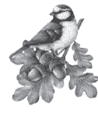

### 橡树的纠缠

当我们直视气候危机，试图应对其现状和未来的影响时，生物多样性为我们的世界提供了缓冲的福祉。树木有自己的历史。它们已经经历过地球上的多个危机时代，并发展出了应对的策略和解决方案。许多树种在过去曾充当先锋，它们现在可以再次这样做，因为过去气候事件的记忆作为一个活生生的教训库，保存在它们的物理结构中。希望树木的表观遗传学将引导它们向更稳定的状态生长，但这仍有待观察。

维持现有的生物多样性，特别是在原生森林中，至关重要，因为并不是所有树在适应变化的能力都是平等的。任何冒险物种的故事——这里指的是那些进入并生存于未知且严酷环境的树木或森林——都是非常了不起的。它们的成功是调整基因组以适应特定栖息地的结果。DNA算法最终学会了修改其行为以适应景观的复杂性。这可能需要数千年，但它通常会为生命的生存工具箱增加新的事物。例如，干旱地区对白豆科植物——如刺槐（*Gleditsia*）、金合欢树灌木和树，以及黄花槐（*Sophora chrysophyllum*）青睐，针叶树也学会了在干旱条件下应用的技巧。沙漠化改变了叶片上的皮孔，产生了蓝绿树。此外，树木在它们的口部或气孔处产生特殊的胡须，以保持水分。

生物多样性还与芳香分子的多样性有关。通常来说，同科的不同树种表现出相似的化学物质模式。然而，处于生命边缘的树种显示出这些化学物质的不同含量，通常以异常的数量和浓度存在。这些差异反过来影响树木的内部运作，一直直到根部的生长点。这些区域需要地下的黑暗来运作。真菌丝体的无性菌丝体听着这些化学音符并改变性别。土壤中的蓝藻也可以做同样的事。病毒和细菌可能随之加入，噬菌体分解以寻找有用的DNA片段。

专注于电子的运动。现在他们意识到光子也可以用于制造量子计算机，因为光子已被证明具有纠缠性——那种同时存在于两个地方的能力。这种能力对于能量的流动和捕获极其重要，而树木是这场游戏的大师。

大自然的答案可能近在眼前，而我们却视而不见。我们需要学会关注站在我们面前的事物。

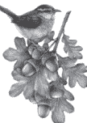

### 植物学课程

当我是科克大学学院的一名年轻学生时，我的植物学教授奥利·罗伯茨博士（Dr. Ollie Roberts）出现了一些健康问题。1962年，正当我准备进入本科学习的最后一年时，医生建议他停止研究和教学以便休息。在当时，植物学并不是一门备受重视的学科。对于科学系的学生来说，它处于声望的最底端。也许那时，罗伯茨博士在寻找接手他工作的人选时选择并不多。无论原因如何，他解释道，他当时手忙脚乱。他还没有找到能负责授课的人。鉴于我是他的荣誉班学生，我是否有机会胜任这项任务？

我当然同意了，没有多想这种情况的奇特。于是，我本科最后一年的生活开始了，我处于一种既是学生又是老师的矛盾位置。每个人都生存到了最后，正如诗人帕勃罗·内鲁达（Pablo Neruda）所说，通过教学的过程，我获得了“全新的视角”。

随着开课首日的临近，我充满热情地补充了罗伯茨博士的课程。我决定涵盖一些我认为对未来几年重要的新课题。气候变化就是其中之一。当时，它被称为“天气变化”，主要由农业社区的人讨论，他们是气候危机最直接、最亲密的受害群体。田间、动物和天空黑板的变化并没有让他们感到困惑，利申斯（Lisheyns）开始向我表达这些疑虑。我知道，树木记录气候模式的能力就像记录地球上任何其他事物一样准确，因此我决定将通过化石遗骸的树木演化故事加入我的讲座中。

树木已经屹立了4亿年且仍在持续，但像地球上所有的生命一样，它们的故事可以追溯到海洋。树木繁殖过程的起源于海洋物种的盐水繁殖——某些藻类和真菌物种的卵器（雌器官）和精子器（雄器官）结合形成游动的、可移动的配子。这些原始生物奠定了海洋水下森林和草甸。它们是海洋的产氧者。它们的繁殖策略传给了蕨类，蕨类将它们的一个版本带到了陆地，在那里繁殖、生长和演化。

尽管今天蕨类和硅质武装的水木藻是退化物种（新西兰的树类蕨 *Dicksonia antarctica* 除外），它们的祖先曾主导了景观，生长到数百英尺高。它们巨大叶片的背面小心地庇护着植物的苗场——称为孢子囊的产孢结构。这些孢子室受到植物组织包裹的进一步保护以免伤害，这种组织像一个绿色的子宫，被称为顶囊（indium）。蕨类生活并喜爱远古地球的大气，那里充满了二氧化碳，这种空气的毒性足以在几分钟内杀死大多数哺乳动物。然后，在数百万年前的遥远过去，一棵巨大的400英尺高的蕨类植物发生了变异，开启了通往我们今天在全球森林中看到的形状、形态和性别的道路。

常绿树首先出现，延伸到大气的更高区域以捕捉阳光，并为它们的双名植物名称提供了植物完美的燃料。它们可能也从地面向上生长到400英尺以上，利用它们巨大的树干作为主柱将自己固定在位置，但没有人确定这一点。幼树的冠层可以竞争并掌握“二分法”规则——一变二，二变四，四变八——这是任何物种延续至今成功的数学公式。冠层以圆形方式扩张以利用阳光，有时一根树枝会掉落（甚至是第三根），从而形成一个向大气扩张的强大常绿前线。多层冠层是古代原始森林的标志，这种森林在今天很少见到。现在只剩下几棵真正巨大的树了。

古树承载的巨大冠层结合在一起形成了令人印象深刻的森林，维持了林地的黑暗。在那些阴影区域寻找阳光的过程为变化提供了红利，刺激了生物多样性。森林中每棵树的每片叶子都发育出特殊的叶柄，即叶片（或表面）的附着点。这赋予了叶子运动能力，即移动和追踪阳光的能力。有些树甚至更进一步，在没有阳光的情况下折叠或进入关闭状态，利用中叶脉或中心脉的轴。这种能力在豆科（Leguminosas family）树木中可见，当黑暗降临时，它们会将叶片折叠成折层。

我记得几年前在哈佛大学，与一位刚获得研究生学位的学生聊天。她研究一种非常奇怪的树，叫做 *Gleditia triacanthus*，即豆科的刺果槐。这棵树是美国总统富兰克林·罗斯福为了应对“动荡的三十年代”的干旱、沙尘暴和侵蚀而种植的。它还经过杂交，以最大限度地增加树长褐色果荚中的糖分，这些果荚含有高糖分，被发酵成高级乙醇以驱动农用设备。在对话期间，我询问那个学生是否在实验中使用这种树。她盯着我，我告诉她，她在植物园里的蜜槐。叶片中叶脉像一个信封，从日落到晨光控制着叶片的两侧。随着世纪滑入千年，板块将地球陆地移动成大陆，古森林就这样生存了下来。它们忠实地耕作阳光。慢慢，随着森林生长并成熟为“天堂牧场”（引用斯坦贝克的书名），树木从它们的绿色叶绿素向大气泵入氧气使其变得甜。它们还克服了由于过热行星产生的过剩水分。简而言之，古森林承受了“温室效应”的全部，生存了人类似乎如此强烈的气候条件。

随着世纪滑入千年，千年随着年龄堆积，生命落入了森林的怀抱。氧气增加，大气二氧化碳下降——气候的影响。森林中的每棵树都完成了它的任务。随着时间的推移，有些树的根系延伸到了冠层的滴水线。另一些像桃树那样深入土壤，用主根系进行探索。许多树以克隆的形式进入地下睡眠，像杨树（Populus）一样处于休止状态的酵母，等待风暴。柳树、杨树和白杨通常是灾难后的第一批定居者。

经常潮湿的建筑基座。那么，可以取一个小藻的样本，将其放在培养皿中，与一棵树的样本放在一起。如果你真的这样做，两者看起来如此不同，以至于几乎无法相信那棵树是来自旁边那个绿色的微小颗粒。

树木有形态。它们是智能的。它们的行为像计算机，似乎拥有某种大脑。树木的大脑可能是一层完全包裹它的形成层组织皮。树木中激素的结构与人类激素相似。树木产生称为植物抗毒素的抗微生物物质来对抗感染。树木在倾听。树木产生次声波。树木在量子水平上进行着生命的活动，困扰了最基本的物理原理。它们复杂得令人惊叹，而小藻，说得委婉，并不复杂。那么，一个是如何从另一个演化而来的？

我代表罗伯茨博士准备并发表的讲座涵盖了该问题的大部分答案。但它们缺少了关键的一部分，而这一部分至今仍然缺失。在大学二年级时，我听教授说了一句令我屏息的话：“法医植物学家和考古学家正在寻找蕨类植物和针叶树之间的连接性原始树木。”基本上，他的意思是，跨越400英尺树蕨与古树之间鸿沟的物种仍然未知。树木复杂性的起源是一个未完成的谜题。

我立即冲向图书馆，决心在那些排列在我头顶上方书架上的皮装书中找到那个缺失的环节。我每次都回到维多利亚时代，汤姆、迪克和哈里兜里揣着钱在世界各地寻找植物……一无所获！

好吧，也许并非一无所获。我确实遇到过奇异而奇妙的事物。一种令人记忆的树是在安哥拉南部的一个灭绝火山内以及纳米比亚的沃尔维斯湾附近发现的。孤独的卷兰万寿植物（Welwitsch mirabilis）看起来像一棵经历过激烈战斗的大大白菜。从远处看，它很容易被误认为是纳米比亚沙漠中的一堆垃圾。但这些候选者并没有让我相信它们拥有关于祖先的任何重要线索。也许在今天或明天，某位流浪植物学家会从一片被遗忘的森林中捡起一块化石树木，并找到最终的答案。

树木为人类家族的出现搭建好了舞台。森林将行星的大气带入能够维持人类生命的平衡状态。地球上数万亿树木中，有许多尚未被完全鉴定。植物学家估计，约有9,200种物种尚未被发现——大多数存在于全球生物多样性热点——他们认为自己可能低估了高达14%。地球上只有73,300种树科。我不理解，我们怎么能对我们所有人如此重要的东西如此疏忽，但答案仍在那里，等待着新的发现。

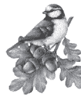

# 错地方的错树

在维多利亚女王于1837年登位前后，一种爱好开始流行。由于贵族阶层已经从奴隶制的丰饶中获益，不费吹灰之力就从他人的痛苦中赚取财富，他们也变得擅长教养。年轻人在伊顿学校和牛津大学的巴利奥学院打着哈欠度过学业。毕业后依然打着哈欠的他们只适合一种职业，尽可能远离乡村庄园——被派往英国的殖民地成为汇款员。在他们新气候地区的旅行中，为了抵御所有的无聊和哈欠，他们收集植物，将最好的样本寄回国内。

来自中国和日本的树木变得非常时尚。英国的庄园遍满了茶花、杜鹃、日本杉以及来自亚特拉斯山脉和黎巴嫩的雪松。搜索延伸到澳大利亚，桉树大批运回。然后是来自智利的纤细树木——猴果松（*Araucaria araucana*）和爬地黄菊被精细地安置在巨大的玻璃温室里。最后，移民浪潮席卷北美，将巨大的红杉（*Sequoia sempervirens*，越大越好）带回更大的庄园。这些贵族们站在装饰着骑兵战利品的战利品树旁拍摄肖像，那里充满了狩猎后的余晖。

当定居者们也变得富有时，树木的流动变成了双向的。他们开始从家乡进口欧洲松（*Pinus sylvestris*），并将其种在整个北美，从花园到水沟，再往复。随着工业和国际贸易的加速，植物苗场开始运输树木以填补景观中的空白。

这些出口树木（主要是松树）大部分来自加拿大西岸，那里在当地人中享有极盛誉。海岸松（或扭叶松，*Pinus contorta*）在爱尔兰的湖泊和河口周围种了数百万株。然后西云杉（*Picea sitchensis*）也同样播种，这种努力源于一种信念：加拿大西岸好的东西对爱尔兰也会好。最终，爱尔兰的孩子们认为他们正在目睹自己的原生森林在周围生长。

这些移植物所取代的本土物种是“比树”，或圣树，它们代表了凯尔特文化的医药、健康和财富。随着森林的消失，附着在上面的古代智慧也随之消失了，同样的盖尔语也是。今天，只有少数人能背诵被称为奥姆字母（Ogham script）的树木字母，这些字母在刻在爱尔兰的石头上依然可见。

加州红杉（*Sequoia sempervirens*）和巨型红杉（*Sequoiadendron giganteum*）曾是这道加州天然防火墙的支柱。树木是浓缩的水柱，这些巨树拥有坚硬、纤维状、深沟纹且鳞片状的脊部，内部由活细胞形成的形成层皮层，它们不仅能蓄水（从地面并从海雾中吸收水分），还能抵御火灾。这些树保护了加州免受火焰侵害近四千年，直到它们开始倒下。

全球范围内，这种疯狂的状况持续至今。森林被砍伐，树木被移到另一个地方，完全没有考虑这对两个地区居住的人、植物和动物的后果。幸运的是，树木给了人类这份最持久、最乐观的礼物：种子。通过在所属的地方种植正确类型且具有正确遗传来源的种子，可以修复原生森林。当我们错误的地方种错了树时，我们就像是在希望并祈祷一头驴能赢得肯塔基德比马赛。它不会的——无论现在还是将来。

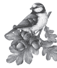

# 我们仍然不理解的

我有一个研究花园，那是我进行植物学实验和观察的地方，我在那里研究植物的各种隐藏性状。我还有一个自己的植物园，根据定义，这是一个为了科学和教育目的而栽培和生长树木、灌木和草本植物的地方。植物园通常隶属于大学或政府机构。不幸的是，这些乐趣在现代已经失去了风味，并变得过时了。我将研究花园和植物园都留在我位于安大略省的家中，可以说，它们是独立的，仅归我所有。

我的植物园就像诺亚的方舟。我正尝试在重重困难和资金匮乏的情况下，维护并保护树木中一些最有价值的遗传特性。我使用某些标准，并遵循严格的议程。我实行隔离措施。一切都是从种子从头（*de novo*）生长的，即使是最大、最高的树木也是如此，以确保没有植物带着土壤进入花园区域。没有任何接穗材料能通过我的大门。接穗可能是隐藏的破口，携带病毒或细菌，当树受到压力时它们就会显现。我只寻找稀有和濒危物种。有时我想，它们也在寻找我。

一旦我得到了我的目标（目前，我正在寻找最接近 *Carya tomentosa*，即假壳核桃或山核桃木，它曾原产于加拿大东部南部，用于保存食物），我就开始工作。我将种子放入试验区。随着季节的更替，我注视并观察。我寻找那些能让成年树安全跨越并超越气候变化问题的特征——例如抗霜性、抗旱性，以及对极端温度的耐受力。所有幼树在它们能承受的极限上表现出差异。

最后，由我决定谁生谁死。我选择优中之优者，让他们延续作为树木的事业——为世界提供可以依赖的植物蛋白、强度、阴凉以及大自然的通用食物。这是我实地工作的核心焦点，但在寻找这些力量和适应能力的迹象，以及阅读其他专注的植物学观察者的著作时，更多的发现浮出水面。同样重要的是，其他问题也随之而来。森林给科学带来了许多谜团。它们是巨大的、协作的生命体，充满了不可见的相互关系，并以远超我们的时间尺度在运行。科学家可以看到并记录他们眼前的事物，但那些看不见的事物呢？自然界是复杂的。有一系列永无止境的问题仍待解答——其中之一是在大气二氧化碳水平达到灾难性程度之前，如何与之达成和谐。我相信自然掌握着这个问题的答案。

树干的多样性及其树皮覆盖的差异是显而易见的。树皮表面的粉末状周皮则并不明显，尽管它至关重要。周皮就像是由树皮的上皮细胞形成的干燥皮肤，它有时会像滑石粉一样变成粉末。然后，在冬天，它像一个反射器，防止一种被称为“西南损伤”的树皮冬季损伤，因为那是树干下西南部树皮产生的裂纹。周皮可能会因为地衣的存在而增强，或者——（等等，这里的OCR乱码了，让我仔细重新处理）。

树木大军。既有异性树，也有同性树。既有单性树，也有两性器官分布在树木不同部分的物种。既有单夫树，也有多妻树。有些树能实现处女出生、孤丝生殖的奇迹，而在撒哈拉以南的非洲，甚至关于雄树能够产生可活种子的传闻。森林中的性关系是流动的，幸运的是，这导致了它们持续的繁殖成功。

树的指挥中心在土壤里。地球表面的土壤层是一个生命体，是无机底土转化为生命的神秘之地。树的根尖伴随着激素的流动，产生大量的酶，这些酶是植物的动力源，为土壤开启了酶促门户。大量的微生物物种利用这些门户。它们是蓝藻（与海洋中的蓝藻非常相似），以及病毒、细菌和它们亲密的调节者——噬菌病毒。此外还有真菌，它们隐秘的生活——菌丝和菌丝体，通过地面上蘑菇的性迸发，在与树木的旅程中开启了新的循环。还有陆栖昆虫；根据经验，大约有四十种。小型哺乳动物和地巢鸟类也来来去去，像蝙蝠一样成群出现。

在成年树的基部周围，通常会有土壤堆积。这些隆起对法医生态学家来说一直意义重大，因为过去就在其中。成年至古树周围的土丘是圆形的，在滴水线处变得平坦，滴水线是水从冠层最外边缘滴落在地面的环。这些土丘包含了随着生长冠层的叶片逐渐沉积的腐殖酸和富里酸。这些是具有巨大分子量的分子，酚类聚合物，具有在芳香族化学结构中保留太阳光子的独特能力，这种证据在冬末可以观察到，此时储存在土丘中的能量融化了周围的积雪，产生出一大圈无霜土壤。通过这种方式，树的作用非常像温血动物。落叶腐质的光活性是森林中另一个需要探索的奇事。

我们尚未理解这些生态系统中许多看似基础的过程。在涉及到它们的来源或内部机制时，即使是观测到的现象仍然是谜。向光性（植物向光源调整方向、追踪天空太阳移动的能力）可以用化学、生物化学语言以及尚未完全理解的、与太阳协同作用的生化相互作用来描述。气溶胶从冠层向上运动可以在非常晴朗潮湿的一天结束时，傍晚微光中观察到，如一层遮住平线的蓝雾。但这种运动的物理机制（在分子水平上类似于飞行和升力）尚未被理解。夜晚带来了森林的变化，树木进入了呼吸模式，就像它们的动物同类一样。森林树木释放的二氧化碳进入大气并汇合。这种行为引发了叶柄、叶片和花中的渗透运动，使它们关闭进入休息。夜晚森林的奥秘对科学来说仍然是一个谜。

然而，最引人入迷的是蒸腾作用——完全理解它将获得诺贝尔奖。所有的树都能在它们的木质管道系统中让水滴向上流动，违背重力法则。这种行为似乎违背了物理学，但树木每天都这么做，运的水高度有时可达四十层楼——如果考虑到根系的长度，可能更高——而科学无法解释这是做到的。这个问题的答案困扰着我。我因找不到答案而感到痛苦。蒸腾作用与全球饮用水供应一样重要，因为蒸腾是获得净水的关键。树从根部吸水，起到了分子过滤器的作用。当水从叶孔以水气形式释放到大气时，它是纯净的H2O，没有任何污染物。换句话说，所有的树都作为水的净化单元。在实验室，特别是在有机化学实验室中，双蒸馏水是反应中唯一的形式。在我情况下，它是我阐明生化途径的唯一形式。如果蒸馏器停止，我也停止。全世界的树每天都会产生类似于双蒸馏水的水。

请注意，没有找到蒸腾作用（这个潜在的诺贝尔奖）的结论答案并不意味着我缺乏主意。我在厨房水槽里测试过。我有一个塑料袋、一些洗洁精和保持在体温左右的温水。我向干袋里挤入一些洗洁精，然后加入一些水。水似乎违背了重力，在袋中向上流动。洗洁精以糖苷这种植物化学物质的形式存在于所有植物中。糖苷有两个阶段——活性和非活性。水似乎激发了活性阶段，构建了所谓的表面张力，这是一种强足以抵抗重力的量子力。树内部维管髓的位置很可能有助于水向上移动。无论如何，植物的糖苷和髓都可能帮助产生向上的拉力。也许这就是水有时向上流动的方式，而不仅仅是在树中。我将继续研究这个植物之谜。保证。

在我的厨房之外，世界上大多数顶尖大学的科学家正在研究这个问题。他们对于如何解释这种现象也仍然一头雾水。

这一切导致了一个更大的谜团：当我们对所失去的东西以及可能产生的后果了解得如此少时，我们如何能证明破坏森林生态系统的合理性？

### Céile

很久以前，一位邻居给了我一个建议，尽管起初我并没有意识到它有多重要。那是20世纪80年代初，我离开了学术界，最终是被性别歧视和骚扰，以及我在整个职业生涯中忍受的卑劣欺凌和背刺所逼出去的。摆脱了那个世界、它的机构和守门人后，我投入了自己的研究，这些研究是在我的丈夫克里斯蒂安（Christian）拥有的财产上进行的，我们在70年代中期购买了那里并在那里盖了一栋房子——我们现在住在那里。

当时我也是一个新妈妈。当我被邀请到这位邻居家里喝茶时，我带着我的女儿艾莉卡（Erika）。我走进主人温暖的厨房。新鲜出炉的玛芬味道弥漫在潮湿空气中。我坐在木椅子上。她把我的孩子抱在怀里，我第一次放松下来。

我低头看发现我正在漏水，我的哺乳服完全浸透了。邻居看到了发生了什么，冲进浴室拿了一条干净的毛巾。她把它围在我的腰上还给我。然后她用非常慈祥的表情看着我说：“戴安娜，别担心。你辛苦了。”

我们聊了一会儿。农业社区总是充满了古怪的人，我们对着一些最新的八卦大笑起来。

“你得安定下来，”她说，“这里就像一个鸡圈。我们都是同一个群子。群子需要晚上栖息，早晨就会到来。这就是我们生存的方式！”

她是在告诉我要收起我的受教育背景，因为这可能会让我所在的这个新国家显得格格不入，并引起问题。她还在告诉我，无论是否受过教育，这颗星球上所有人都是平等的，我们需要彼此才能生存。

在我女孩时代在内莉（Nellie）和帕特（Pat）的农场度过的夏天，利希斯（Lishees）山地乃至整个爱尔兰发生着变化。拖拉机和化学肥料的引入改变了年轻一代看待土地以及与土地关系的看法。他们想要更高的产量和更多的工作报酬，否则就会去城市或国外找工作。他们对数年来引导人们与人以及与自然互动的古老智慧的欣赏也发生了变化——受到了严重破坏，甚至消失了。与此同时，古老智慧的守护者正在老去和去世，知识面临着丢失的危险。内莉和她的邻居聚在一起，决定将他们所知的传给我。

整体而言。这种统一的形式被称为 céile，而它的行为被称为 *ag táhú céile*。最直接的翻译是“彼此结合”。

古老的爱尔兰智慧在音乐、诗歌、冥想、孤独、与他人共处、祈祷和歌唱中发现了 céile。céile 既是灵感和想象力的源泉，也是结果，在无论是简陋的房屋还是城堡的任何聚会所需的开场白中显而易见。凯尔特世界的每个人都有自己的“专长”，无论是诗歌、音乐还是歌曲。他们被期望在任何庆祝或集体活动中加入 céile 的氛围中，通过共同的情感和理解，将个体存在系成一个更大、更强大的整体。

我仍然在范围内宗教机构的祈祷中看到 céile 的运作。许多圣书中的教义被吟诵着；智慧与爱的弦紧紧贴心心。此类行动具有治愈作用。它们通过降低血液中肾上腺皮质激素水平促进健康，减少衰老对身体整体的影响。

凯尔特文明走遍世界。它扎根的一个地方是非洲，céile 在柏柏尔文化中也有对应词。将文化联系在一起的精神和情感胶水被称为 asabiya 和 asabiyyah。这种强烈的凝聚感将文化在书文字的美感与对称中结合在一起，成为一种供所有人欣赏的奇迹。

中国也没有逃脱流浪之情。思想传播得比风更快，并拥有自己的生命。在孔子和五论时代，文化连接是为人知的。居住在中国中部黄河沿岸的古代商或殷人是在基督出生一千年前居住的。这些人与凯尔特人一样，在金属加工和陶器艺术上表现出高超的技术水平。最重要的是，他们创造了文字语言，汉字是现代汉字的直接祖先。凯尔特 Ogham 字母的脆弱图案与这些汉字有某些相似之处。这两种文化隔着半个地球，但对艺术及其将我们团结在一起的力量有着敏锐的欣赏，通过共同的理解和经验帮助我们变得更强大。

在今天这种破坏的气氛围中，必须重新获得思想的统一。世界各地的人必须学会欣赏他们自身生物多样性的奇迹，并将其作为修补破碎灵魂的良药。他们必须能够运用 *céile*，然后是 *asabiyya*，最后是 *Wu lun*。孩子们自然能做到这一点。难道我们必须从年幼者的智慧中学习吗？

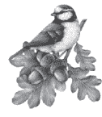

### Dúchas (根源)

在 Lisheens 山谷当女孩时，我听到很多关于自然的话。父母去世后，当我的时间在科克（Cork）舅舅 Patrick 的家里和舅姑妈 Nellie 的农场之间分配时，由于 Lisheens 社区的长辈们开始对我的教育产生特别兴趣，教我古代知识以及管理人与人、人与自然的布雷洪法（Brehon laws），学习成为我夏天主要的努力方向之一。布雷洪法看不起任何愚蠢到违背自然法则的人，在这种背景下，我听了许多关于自然的话。但也不断听到这个词本身——至少是它的爱尔兰语对应词，Dúchas。

这有一个简单的原因：Caha 山脉中的其中一座山定义了山谷北部的地平线，在爱尔兰还是圣人和学者之土地且被称为 Éire 的时代，它被命名为 Dúchas。在我在 Lisheens 生活期间，我每天看着那座被称为 Dúchas 的山。它随着季节和太阳而变化。它的高贵似乎悬挂在山谷上方，请求仰慕。很多时候，当我站在栅栏杆上或在牛径上停下脚步欣赏风景时，会有其他人加入我，分享我对这种我们所拥有的美所感到的宁静奇叹。

在布雷洪法下，Dúchas 在山脉、田野、花草、动物和树木的物理表现之外还有额外的含义。这个词也意味着一个人的自然继承。这个概念被粗线条勾勒，意味着每个人对自然都有继承性的主张，一种出生权利。这种集体所有权在每个人与土地、甚至甚至是天空之间建立了一种传统的联系。这种联系旨在保护自然本身。在舅姑妈 Nellie 的厨房桌旁，我反复听到一句我至今仍在使用的警告性谚语：

“Briseann dúchas tri shúile chait.” 它的字面意思是“从猫眼中看到的自然”，但它传达的警告是：深邃的荒野如果被滥用，会反过来咬你。你需要与自然合作，否则就会面临自然对你进行报复的风险。

在漫长的历史某处，自然产生了一个脑力。这个孩子是绿色的，花费了4亿年才完善。这个孩子收集阳光并创造了一片森林。逐渐，这些原始森林遍布了世界。它们在每一次呼吸和占据的每一寸土地上都承载着可能性的绿色宏伟。它们被称为“处女林”，因为它们巨大的树干上紧绷的皮肤从未感受过斧头的伤口。尽管它们对自己所占据的特定生态位拥有权利，但现在地球上剩下的原始森林寥寥无几。如果它们尽快被取代，整个人类家族在地平线上只能预见到毁灭。

森林的天才基于碳。以某种形式，碳流经了我们星球上的每一个森林系统，从北向南，从东向西……（此处原文存在大量重复句，已按要求精简翻译并保持逻辑）。

在一块巨大的沼泽木旁。帕特告诉我，这种发现本身——这块隐藏在土里的深色木头块——并不罕见。当山谷的人们割伐草炭时，经常会出现类似的木块。然而，令我震惊的是，在如今放眼望及之处是一片无林的景观中，竟然曾经存在过如此庞大的树木。那些孕育了这些巨头的森林都去哪儿了？

几天后，我开始在行走，每走一步都睁大我那植物学的双眼。每当我注意到某个农场外散发着泥炭味时，我就会询问。整个乡村，一直到山顶，几乎一直到山峰，都覆盖着草炭，我很快发现帕特说的话的是真。扭曲的树枝和橡树根部裸露出来，数量足以制成雕刻的沼泽木，它们那深色、抛光的光泽，是人们想要获得和使用的物品。

然而，古老森林的模式语言——即森林社区成员所拥有的知识——地层植物，如昆虫；那些带有攀缘植物的小树林下层；以及主导地位的树冠——已经消失了。只有一种多年生植物，从爱尔兰最原始森林中幸存了下来。那是在小田周围的篱树篱和沟渠中看到的一种忠诚的踪迹。这种植物是黄花，学名金黄（*Digitalis purpurea*）。它们依然举起带有斑点的花穗，在六月与这些古老田野的仙子共舞。一个被剥离了社区的幸存者。

除了偶尔的错误——少数几个某种方式避开了人类贪婪的地方，如北方林系统中的区域和某些山区地区——我在利希斯（Lishees）谷见证的现实在全球范围内上演。在过去的五十年里，森林的面貌已经发生了变化。如果通过无人机、飞机或直升机从空中观察，森林呈现出一种棋盘般的景象。这当然是它们被破坏的原因，但也源于它们被“管理”的方式。一些区域被砍伐殆尽，眼前只有树桩。另一些被部分砍伐。在加拿大东岸，采用了一种不同的策略：当你开车在道路和公路上时，似乎你被周围未受破坏的森林包围着。实际上，你正经过一道树帘，深度可能有三十到六十米，它们被留下来作为护林。这道屏障后面的一切都被砍光了。在屏障的另一侧，灾难性的状况延伸到眼所能及。

即使森林在被砍伐后重新种植，它们看起来与曾经占据这些地方的原生混合林也大不相同。在不同国家，从众效应影响了种植的种类。选择一如既往是常绿树，因为常绿树种起来更方便。我认为选择常绿树也是因为小树苗看起来像一棵树；在它最初的几个月和几年里，人们更容易想象它长成一棵更大的树。进一步支持这种做法的是政府圈子、甚至一些学者中的一种谬误，即落叶树需要很长时间才能生长。我的实验表明这并非事实。常绿树会立即生长，但落叶树一旦树冠展开并扩大其绿色体积，就能追上并超过它。

世界各地存在的人工林看起来都一样。从上面看，整个区域看起来就像树木被推了平头。它们得到了环保部门、大工业甚至许多保护组织的认可，但这些“平头森林”玩了一个残酷的把戏。随着时间的推移，公众——尤其是那些从未见过成熟混合林的孩子们——开始将生长在他们门口的人工林视为真正的森林，即原生的森林。

这些“平头森林”还隐藏着另一个自然灾害，我大约在四十年前第一次意识到。我们农场旁边的土地正在种树。一群二十多岁的年轻人是种植工。由于某种只有他们雇主和上帝才知道的原因，他们在幼小的松树周围使用一种神经毒素。他们既不戴呼吸口罩，不戴护目镜，也不戴手套。有一次，他们来我家要水，并告诉他们正在使用什么毒药来“消灭蚂蚁”。我问他们是否结婚以及是否计划生孩子。当他们肯定回答时，我告诉他们：“不要计划生健康的孩子。”他们惊坏了。

我获知，这种做法并非孤例。这些曾经是森林、如今被砍伐殆尽的区域经常被洒上毒素的雨。这些可能是除草剂、杀虫剂、萌前杀剂、控制化学品，有时是用来杀死昆虫的神经毒素。植物和人类一样，带有调节激素。有些是脂溶性的，另一些是水溶性的。为了发挥作用，这些设计出的毒素击中了土壤中对地球生命至关重要的水路。它们最终到达河流、湖泊和海洋，不可避免地，这种分子战争武器最终落在阻力最小的地方，如南北极。它们落在了从鲸鱼到陆地顶级掠食者的所有生物的乳汁中。

“管理的”森林导致了有毒的单一种植林园。那些毒素留在自然界中破坏生物多样性。相反，原生森林树木内部的生物多样性产生了植物生命的进一步生物多样性，进而引发地下真菌的生物多样性。这反过来增加了昆虫生物的多样性，导致健康哺乳动物、尤其是鸟类的增加，它们巡视着树木，保护它们免受疾病和感染。这就是原生森林在地球上任何地方自我保护的方式。蓝图存在于DNA中。它是灵活的，它是这个星球上所有生命形式背后真正的天才，一种基于简单的算法。

# 百英亩的错误

三十年前，在我们定居这片土地十年后，由于某种错误，我和我的丈夫克里斯蒂安（Christian）买下了大约百英亩土地，这片土地的篱树篱和周围是为了私密性和隔绝。曾经，这片土地是羊群场。这片土地曾是草场，但那可能只是我的想象。在任何情况下，这片土地曾是这种木的栖息地，那里有一小群白鹿。

在有鹿的地方，有男人。在有鹿的地方，有猎犬。在两足动物与四足动物交汇的地方，有枪支。当地人，他们把这片土地看作他们的杀戮场。在黑暗的十一月，在狩猎季节期间。

十一月的一个早晨，一只受伤的鹿来到我家。那是一只母鹿，痛苦万分。她的腹部中中了，走上了台阶。我仿佛能听到她在问：“你是医生。你能治好我吗？”在我永远的痛苦中，我不会忘记这次事件和它的恐怖。

我向农场北方寻找伤害她的那些人。我感到恐惧，感觉自己的生命在手中像鸟一样颤动，一想到要面对这些持枪者我就非常愤怒。当我遇到他们时，我要求他们离开。他们认为这是个笑话。“一个小爱尔兰女人在为一只鹿担心，”他们嘲笑道，“她一定是有问题的。”最后，我找到了一个愿意帮助的老邻。他冷冷地装好了枪。鹿的痛苦结束了。

那时，男人们聚集在我的门口，在那里冷笑着。我回到室内拿了一个铃铛、一本书和蜡烛。在布伦法律（Brehon）监护期间，我接受过对抗邪恶的训练。我走到门口，开始吟唱古老的咒语——古爱尔兰语中一种不幸的咒语。铃铛是玻璃的。我响了它。当它清脆的声音消失时，巨大的寂静如罩般降临。令我惊讶的是，浓雾笼罩了我们。它附着在我们的衣服上，似乎抓住了时间。“这片农场，我们脚下的片土地是神圣的，”我用爱尔兰语说道，“在这里，在这片记忆之地，祖先们轻睡。”男人们听到了古语。尽管他们听不懂词句，但他们理解了背后的意图。

土地刚刚种了白云杉、杰克松，以及红松。这些都是北方林的物种。千年来，当地的岩石喀斯特地形孕育了东雪杉，它们长到了巨大的尺寸。现在，曾经的雪杉林重新长出了山核桃和极其巨大的东冷杉。稍过之后，我惊讶地发现了一小块稀有的加拿大冷杉。我注意到土壤中的呼吸裂缝中织着精致的少女蕨。

## 地下

穿梭在该地区的白云岩裂缝的加热系统为这种稀有植物提供了一个黑箱般的苗场。

作为一名植物学家，我决定长期观察这片人工林，将其并入我现有的加拿大稀有树木植物园中，作为一种种植错误的对照系统。这些针叶树遭受了多年的苦难。它们偏好酸性土壤，却被碱性条件所束缚。我的菌根——即树根与地下真菌之间的共生关系——在酸性土壤中的表现不同。然而，随着时间的推移，红松开始向上生长。这些树中的光开关使得它们比种植的另外两种针叶树更适应南方生活，而后两种并没有长得那么成功。最终，黄松的叶绿素含量开始下降。它们看起来病态而虚弱。云杉则表现得若无其事，只是生长得有些矮小。

安大略省和魁北克省在1998年经历了一场著名的冰暴暴。这场风暴在针叶树被种植大约二十年后降临，如果说有什么事能让人警醒，那无疑是它了。冰层不断地堆积。它加厚了常绿树的枝条，这种条件非常有利于积聚。额外的重量迫使枝条触地。一旦这种情况发生，所有种植的常绿树就像多米牌一样倒下，有时是整整排同时倒下，有时则杂乱无章。断裂声和坠落声充斥着。

这种情况在世界各地的人工林都在发生，树木因为大风或暴雨而倒下。当我上次在2019年访问列颠哥伦比亚省时，我注意到雪落下时不仅破坏了人工林，也破坏了原生森林。雪花是超含水的，由于水分含量较高，其尺寸和重量大幅增加。结果，所有树的枝条都在重压下折断，在森林地面上留下了一层树脂碎片地毯，这在夏天会成为致命的火灾隐患。（在德国的黑森林，林业员会对这类碎片进行堆肥和覆盖，以消除火灾风险。）

我们那片百英亩的错误也引发了我对气候变化的另一系列问题。大气碳的增加以及随之而来的酸性土壤和空气状况导致苔藓、蕨类和木贼草爆发式增长。这些在远古地球富碳的大气中繁盛生生的原始植物正在进军。木贼属由35种植物组成，除了澳大利亚和新西兰，它们随处可见。它们是曾经有毒的世界留下的指纹之一。它们是含硅植物，在土壤下产生一层生长层，一直渗透到底土。它们通过盘状孢子囊繁殖，产生数百万个相同的孢子。此外，由于硅的存在，它们对哺乳动物是有毒的，从不被它们食用。它们的茎含有气室，可以抵御洪水；曾几何，这些植物在温暖而有毒的大气中长到了三十米。

大气中碳的增加似乎也增加了2.5微米污染指数。除了进入肺部，这种2.5微米污染还覆盖了花朵的所有表面，包括子房、柱和柱头，这些富含糖分，以吸引授粉者飞来吸蜜。污染阻止了它们的进食，让这些大自然的仆人饥饿。它们的数量正在急剧下降。这一证据体现在春、夏、秋季节汽车挡风玻璃上——或者说，没有撞在上面。现在，玻璃上不再沾溅，大多保持清洁，没有昆虫的尸体。

在过去的五年里，人工林里的花朵覆盖了一层深色的碳膜，这种膜倾向于粘附在花朵内部表面。随着夏季的进行，碳层也之增厚，阻塞了授粉，更重要的是阻塞了营养。这导致授粉者无法获得足够的糖分，反过来影响了它们的免疫系统，而这些免疫系统已经受到农药和除草剂的攻击。全球范围内昆虫和授粉者都在减少，尤其是蜜蜂。这些小生物的衰落预示着一个名为“饥荒”的大问题。

是的，我丈夫多年前买了一个巨大的错误，这给我们带来了不少头疼的事。但在生命的漫长道路上，我现在意识到那是份礼物。那片土地为我研究气候危机科学提供了一块更大的黑板。科学是寻找真理的过程，而土地教授的智慧是大学里永远找不到的。我是很幸运的。

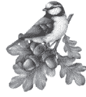

## 树的语言

树是我的第一段记忆。在我还是四五岁的孩子时，在又一个晚上，在我第一次看电影很久以前，床边明亮的墙壁变成了一个屏幕，窗外树木的影子在墙纸上跳动。

有些夜晚，这些影子树冠在轻柔、抚慰的动作中延伸和起伏。另一些夜晚，当风随着潮汐涌入河口时，它们变得怪异地伸展、撕裂和纠缠，融合成一场动剧般的灾难，仿佛直击我的内心深处。即便在那时，我也知道它们在对我说话，用一种我不懂的语言向我讲述关于它们自己的事情。这种树木努力交流的感觉，那种努力在我年幼的眼中堪称英雄般的，伴随了我的一生。

在清晨的阳光下，影子变回了树。夜晚的炭色化作了坚实的绿色。生长在窗外露台的月桂（*Laurus nobilis*）树冠，像纯血马一样，克制地抖动着它们皮革质的、暗绿色的叶子。这些树都已成熟，围在一个巨大的圆圈中生长，曾为接送乔治亚时代女士们进入家宽敞弧形前门阶的马车提供转弯空间。

当阳光透过高大的双悬窗洒在地板上时，是时候带着我的娃娃去那些树木下寻求慰藉了。一股甜美的香气从树下升起，月桂树在窗外摇曳着，这种香气包围着我，进入了我的那个让我感到安全的游戏世界。在一个懒散的午后，我决定，就像夜晚的影子移动一样，白天的沉默密码传递着自己的信息或代码。我想用它们自己的语言与树木交流，理解它们试图告诉我的事，那种绿绿叶叶的方式。我刚刚发现，就像夜晚的影子游动一样，在潮湿的日子里，树下的香气扑面而来。

这种沉默是树木的密码，我刚刚开始学读。当我读我最喜欢的床边书——一本童歌集时，那首以“骑马去班伯里十字（Ride a horse to Banbury Cross）”开头的诗突然对我变得真实起来。在那一秒我不懂厚纸上的标记，在那一秒我懂了。这些词是由字母构成的。

一切一定都是这样运作的，我想。我只需要破解这些代码。我首先和邻居的猫在一起。除了呼噜声，它似乎是沉默的，但也一定有自己的密码。几个月来，我把橘猫抱在膝上，有时用我的爱吸引它进入室内，有时和它一起坐在门口冰冷的台阶上。我倾听它呼噜声的变化。我仔细地向它提问，它看起来很舒适满足。我可以报告，那只猫从未对我说话；胡须下没有出一个字。我没有找到密码，回到了娃娃身边。

我下一次破解密码是一个意外。我的青少年生活里发生了很多事。当我十四岁时，失去了父母。母亲死于一场车祸。与我们疏远的父亲去世时的情况我并不知晓。被留在了爱尔兰的科克，由单身的舅舅帕里克照顾，我退缩到了内心，生活在思想中。但渐渐，舅舅的书和他充满活力的对话，以及我在利申学习尔特文明古老知识和保守智慧的夏天，带我回了世界——或者帮助我在世界中找到了一个新位置。一直以来，生命的密码仍然是我无法解决的谜题，但它从未完全离开我的思绪。我到处寻找钥匙，寻找理解的碎片。当我在利申的老师们，

特别是我的大姨奶奶妮莉（Nellie），她开始向我介绍大自然的药典，那种感觉就像我找到了其中的某些钥匙。

在一个明媚的下午，妮莉让我坐下来学习“爱尔兰墨苔”（*Chondrus crispus*）。她手里抓着一团红色的苔类，向我解释这是一种含有治疗结核药物的植物，我们当时称之为“肺病”。我听后很惊讶，这是一种生长在岸边的海藻，特别是在岩石林立的西岸，是她在退潮时采集的。她解释说，大西洋的水域从美国大陆带来了一股暖流，而这些暖水是这种苔类生长的必需成分。

爱尔兰墨苔是用敞口的柳条篮采集的。它们被取出并放入水中煮，提取出一种胶质，然后被制成一种类似布丁的东西。这是每天给肺病病人服的药物。那些被疾病折磨的人会睡好几天不醒。他们的肺部出血，血液随着持续不断的咳嗽涌出。她告诉我，爱尔兰墨苔的胶质是治疗这种状况的良药，一种有助于免疫系统的抗炎剂。

几年后，我入读了科克大学学院，并尽职地向财务交了学费，我去的第一个地方是医学图书馆。那个拥有高耸天花板的巨大房间里摆满了皮装大书，当我坐在窗边时，这些书仿佛在对我微笑。我觉得自己简直是流落到了天堂。

正在那里，我的侦探工作开始了。我对我所学的所有关于爱尔兰自然药典的知识进行了审判。妮莉和其他人分享给我的智慧——我那古老的遗产——能被科学事实证实吗？我觉得自己正在拼凑一个巨大的拼图，真正是生命的密码，这种感觉同时带给了我能量和热情。但是，我羞于承认，我也持怀疑态度。我对于通向现代世界的浪潮并非完全免疫。在我看来，海边并不是采集药物的地方。那是游泳和钓鱼的地方，与治愈疾病毫无关系。尽管如此，我从《植物学杂志》（*Journal of Botany*）的不同年份中取下了好几期杂志。就在那里，我发现妮莉的爱尔兰墨苔有一个拉丁学名称。我找到了 *Chondrus crispus* 的条目，它就在那里，一种看起来像长坏了的生菜头的红色植物。我从生物化学区抽出书，很快身边就堆起了一山书，皮装的书仿佛要发生雪崩一般。发现自己躲在书后，我感到兴奋不已。

那天我获得了一个悟，一个伴随我一生的启示。*Chondrus crispus* 这种被德鲁伊医生在桑拿房里使用的植物，含有亲水性胶体粘合剂，这些物质能稳定并增强其他药物。这些胶体还具有抗生素作用，今天有时被用于治疗胃癌。化学让我理解了植物带给我们的一切。

随着时间的推移，我逐渐理解化学是树木和森林的密码。它们在树冠层高处产生的化学物质和生物化学物质调节着我们的生活世界。它们是我们大多数复杂药物——抗癌药、抗病毒和抗炎化合物以及止痛药的来源。树木所说的语言是奉献、关怀、共情和互助的语言。对我来说，需要那叠摇摇欲坠的书才能开启它，但在此之前我早已听过并感受到了它，我知道化学的语言只是与树木交流的一种唯一方式。在古代，我们倾听它们的信息，它们引导了我们的许多行动。解决今天问题的答案需要同样的耳朵。

## 森林土壤

树木形成土壤，森林产生了大量的土壤——那种我们所有生命赖以生存的肥沃壤土。土壤分布在从热带几乎到极地的范围内，但制造土壤的魔法是一个缓慢的过程，是森林碎片层层逐渐堆积和分解，根据树木的健康状况和生长能力，每厘米土壤可能需要一千年的时间。土壤反映了遥远的过去。一把土壤就是一把古老的森林。它是古老树木世界的第一个果实，它的形成是一场爱的劳作。土壤是地球首个生命支持系统。它也是科学的一个谜团。

土壤很难研究，因为其中的特征是如此众多且环环相扣。土壤是一个活体，充满了微观生命形式，每种形式都照顾着自己的小领地。30克土壤可能包含1,000,000个单类细菌，以及100,000个酵母细胞和50,000个真菌丝体碎片。其中一些细菌——薄层的蓝藻（*Cyanophyta*），与厚皮酵母合作，赋予土壤塑性，使其能够在根部移动。隐藻真菌通过其菌丝探测器在土壤中缓慢移动和运动，进行以物易物的接触。它们是变幻者。在二倍体状态下，它们的菌丝寻找食物。当饱足时，它们会转换性别，从无性状态转变为完全的性生物。然后，只有在那里，它们才以蘑菇的形式进入白天。细菌、病毒和噬菌体——这些有好的、坏的和无差的——享受着一种微观生活，如果土壤的化学性质随着风向标而变化，它们的本质可以在瞬间发生改变。雨水会迅速将氧气挤出土壤，造成缺氧。

但明天总有希望。总的来说，微小的英雄们与螨、马陆、昆虫和虫一起工作，将氮、磷与其他微量元素转化为其主子们（即树木和植物）可以使用的形式。土壤是其皇冠上的一颗宝石，是一种巨大的分子，被称为腐殖酸。正如我在之前的章节中提到的，富里酸和腐殖酸在海洋注入铁方面起着至关重要的作用。现在看来，这种酸是一个整个大分子家族的一员。从分子标准来看，这些结构来自于死亡并回归土壤的有机质。作为古代森林的腐质，它们存在于煤炭和泥炭中。它们统称为异黑色素（*allomelanin*）。

“黑色素”这个词无疑听起来熟悉，因为这些化合物负责你每天到处看到的羽毛、毛皮和皮肤的色素。黑色素是由可以成形的聚合物结构组成的。它们看起来像分支的珠子项，可以收缩也可以散开。它们微溶于水，这使得它们膨胀并看起来肿肿。它们的吸收能力是一份巨大的礼物；黑色素是活土壤的水守护者。这些巨大的化合物兽还充当种子的单宁，作为天然生长激素。

黑色素将光子注入土壤、你的皮肤和周围的色素中。它们捕捉太阳的光子，并以不为人理解的方式将这种能量释放到自然世界中。光子强行进入黑色素的苯环结构并打破了化合平衡。这种能量以电子的形式流失到橡树树干等地方，使其能够抵御更强烈的阳光。

土壤是一种宝藏，就像森林带给我们的许多礼物一样，我们对它以及它为我们做的许多事情知之甚少。几年前，我的朋友正死于癌症。他的疾病像沉重的负担一样压在我的肩上，因为作为医学生物化学家，我觉得我应该想出某种帮助他的办法。在他告诉我诊断结果后不久，我受邀访问加拿大东部的一片森林。那片森林是

这片小小的土地，未被打扰了大约三百年。树木上挂满了叶状地衣，捕捉着来自大海的海风。地面布满了稀有植物，密密得我不知道脚落在何处。落叶层没过了我的膝盖。土壤的气味如此甜美，即使我当时是在品尝它，依然记得那种在舌尖上的味道。在那个地方，土壤似乎成了我身体的一部分。空气中弥漫着如雷鸣般的寂静。

在朋友的带领下，我去了一处神圣的泉水。这是少数仍处于第一原住民手中的治愈之泉之一。它的地点非常隐秘。我小心翼翼地朝水走去。当水从地面跃起三十厘米高到空中时，我注意到它泛着蓝光。泉水周围生长着一圈稀有的百合植物——斑点木兰（*Clintonia umbellata*）。花朵是白色的，点着绿色和紫色斑点。有的呈现出奶油色和乳白色之间的色调。序花似乎生长在一簇绿苔丛中。在我看来，这些花朵以一种我无法理解的方式感知着潮湿的土壤、流动的流水和森林的守护。它们用内心的语言对我诉说。

我想起我生病的朋友，问是否可以带一些水回渥太华。我得到了许可，并得到一种保证，称这种源自这片森林土壤的水具有治愈癌症的力量。“这是一种古老、非常古老的疗法，”我告诉他。不知为何，听到这我并不意外。

我决定把水送给朋友，而不告诉他关于它的任何细节。后来，他问我水里有什么，我告诉我不知道。我相信这让他多活了一年。大自然产生了一种具有治愈力的纯净。健康，正如许多其他事物一样，确实源于土壤。

现在，土壤正在发生变化。克里斯蒂和我在农场安顿后不久，我与一位当地农民交谈。他是一位老老人，见过许多苦乐参半的日子；他知道如何充满神采地在裤膝处打补丁。有一次，我问他是否对土壤还有记忆。他毫不犹豫地回答。“土壤已经枯竭了，”他说，“我祖父曾跟我提过落叶。它们能让作物生长。现在田地枯竭了。树消失了。他们本不该让我们砍伐森林的。”

失去了树木，土壤形成的过程就从缓慢变为不存在。随着新补充土壤源头的流失，我们赖以生存的土壤正在发生剧变。除了所周知的热效应外，大气碳的增加也放大了紫外线的光谱，增加了它对活植物和动物组织的杀伤力。在夏天，你可以感受到紫外线对暴露皮肤的伤害，那是一种灼烧感。它对土壤——地球的皮肤——也有类似的影响，这种皮肤在夏天和秋季每天都在遭受破坏。

如果你观察周围发芽的种子，这种伤害的显而易见。如今，种壳（保护胚质的外壳）往往延迟开启，由于某种原因，在被称为“脐点”的部位裂开非常缓慢。这导致了子叶发育受阻，失去了继续延伸生长的力量。子叶是特殊的叶子，充满了来自发育胚胎的养分。它们对于产生第一根（即胚根）并将植物固定在土壤中至关重要。生长的延迟通常会让幼苗付出代价，最终导致幼苗死亡。

自上一次世界大战以来，活土壤上又出现了另一类“角色”。这些是广义上农药和除草剂的化学物质，其中包括神经毒素。这些杀手级化合物被用于全球的作物、农田和森林。无处可逃。它们乘着微小颗粒物的隐形翅膀随风飞行。将它们固定在运输媒介上的是电离。正负力相互吸引引发了一场空中灾难。土壤吸收了这群生物，植物要么承受或分享。人类摄入它。器官储存它。产生蛋白质为细胞能量的内质网被它刺激。母乳泵出它。哺乳动物和所有生物都死于此。瑞秋尔·卡森对此感到担忧，并写下了它，在1962年的著作《寂静之春》中警告了世界。这是一个勇敢的行为。

对于今天的农民来说，播种发芽率低的种子可能是灾难性的。第二次播种总是一项昂贵的买卖。在季节较短的地方，可能没有足够的时间让作物完全成熟。还存在种子耗竭的风险。富国家的农民不再自己培育种子作为保险。而贫穷国家的人们被拥有专利的跨国公司禁止留种。国际粮食安全并不是一个常见的讨论话题。也许随着土壤的变化，这一点也会改变。

在过去的一年里，我的植物园、水景园、药用植物步径、花坛以及大量的蔬菜园都经历了一个“寂静之春”。授粉者没有在树间嗡嗡作响。蝴蝶消失了。细膜蜂的巢几乎空如。没有青蛙，没有牛蛙卵带，没有蝌蚪。只有一条蛇——只有一条。鸣鸟和冬鸟正随着昆虫一起在减少。

卡森警告过化学物质，但她没有告诉你们去种树。我是告诉你们去种树。把它们种进土里。现在。我们仍然可以修复土壤并拯救我们的世界。我们可以让声音回到春天。

# 宇宙保护伞 (Our Cosmic Umbrella)

对于今天的农民来说，播种发芽率低的种子可能是灾难性的。第二次播种总是一项昂贵的买卖。在季节较短的地方，可能没有足够的时间让作物完全成熟。还存在种子耗竭的风险。富国家的农民不再自己培育种子作为保险。而贫穷国家的人们被拥有专利的跨国公司禁止留种。国际粮食安全并不是一个常见的讨论话题。也许随着土壤的变化，这一点也会改变。

在过去的一年里，我的植物园、水景园、药用植物步径、花坛以及大量的蔬菜园都经历了一个“寂静之春”。授粉者没有在树间嗡嗡作响。蝴蝶消失了。细膜蜂的巢几乎空如。没有青蛙，没有牛蛙卵带，没有蝌蚪。只有一条蛇——只有一条。鸣鸟和冬鸟正随着昆虫一起在减少。

卡森警告过化学物质，但她没有告诉你们去种树。我是告诉你们去种树。把它们种进土里。现在。我们仍然可以修复土壤并拯救我们的世界。我们可以让声音回到春天。

广义上，树是一个施用单元。树干充当电梯，将饥渴的树冠升向天空。在那里，在大气与叶片角质层的界面处，发生着物质交换。树的口部，即气孔，是像肺一样的吸入单元，开启以吸收二氧化碳。随后，树会分解气体，保留碳作为食物，并将氧气释放到大气中，连同大量的药物分子和颗粒物。在春季初夏，这种空气中的基质包含了微米级的花粉和真菌孢子。在炎热潮湿的日子，植物界的许多其他部分还会像气球一样释放甲基化气胶。

随着它们的上升，这些大部分眼不可见的分子团与大气水分结合，构建出更大的原子形态，在全球范围内引发降雨并形成天气模式。云，就像我童年的夏云一样，开始忙漂浮并成为遮荫者——一种低空覆盖层。在这些云层中，来自森林的分子气溶胶像微型反射器，将阳光散射回太空。总而言之，森林及其伴随的生物多样性为行星制造了分子级的遮荫，就像一把伞。

近年来，随着森林的砍伐，这把伞日益被折叠。这意味着云层已无法遮蔽海洋和陆地。到达地表的额外阳光辐射正在温暖海洋，并融化北极和南极冰冰。辐射增加的链式反应意味着陆地和土壤也在变暖。根据加利福尼亚大熊太阳天文台菲利普·古德（Philip Goode）的测量，地球反射率的下降使对行星的变暖效应几乎增加了一倍。

是的！世界上的一切事物都连接在一起以保护生命。我们需要这把伞。

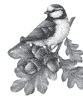

## 液态光

Solas 是爱尔兰语中代表“光”的。对于过去和现在的凯尔特文化来说，这是一个具有重大意义的词，代表着光、明亮、照明和生命本身，是一个带有神性色彩的词。在古代，Solas 用万字形表示，并被锤造成金质饰品供世人欣赏。

我记得某个下午在利斯希恩（Lisheen）和邻居站在外面。由于整个山谷社区都决定分担教我凯尔特古代知识的责任，夏天只要我能从家务中抽身，我就会把时间花在任何需要教我的人身上。跑步者（通常是个男孩）会带着邀请函来到内莉（Nellie）的门口，我会和当天的老师一起喝茶或散步。当这位老师布满皱纹的脸掠过风景时，目光停留在那些散落在德鲁特文物的刻石表面，这些器物仿佛从内部散发光。“Solas, cailin，”我记得其中一人这样说道——“光，孩子，”用英语翻译道，“所有的能量有一天都将来自太阳。记住我的话。那是先知（fáidhe）告诉我们的。”Fáidhe 意为先知。

即使我不确切知道那是什么意思，也没有忘记那个预言的危险：光令我着迷。在那个时间和地方，作为一个对光感兴趣的女性学者，等同于在煤油灯的光下学习物理。我把这盏微小的光源带到床上，放在头附近的石窗台上，这样我就可以阅读从科克大学学院约翰·J·麦亨利（John J. McHenry）教授课程中做的笔记。有太多要学了。阳光很奇异。它有很多欺骗科学家的能力，甚至是今天的科学家。但尽管有许多谜团，阳光也拥有一个丰富的特征：它是免费的。阳光穿过大气层，提供自然所需的所有能量。

大气中的碳以二氧化碳气体的形式存在，这些碳可以被回收为石油产品。将碳原子以可用形式结合在一起只需要能量，这种能量可以从太阳免费获得，通过聚焦阳光的光子。聚焦光子可以产生极其强烈的热量，至于可以从头重造分子——足以将碳重新配对结合。这种碳燃料产生的能量是碳中性的；大气中的碳可以被反复捕获，在自然的碳循环中和谐地管理，赋予我们减少和控制全球温度的能力。

幸运的是，煤油等碳烃是非常简单的分子，十个到十六个碳原子像雏菊链一样连接在一起，形成一个分子项链。这种燃料的成分已经在空中，等待被使用。第一次由这种燃料驱动的飞行——航空业称之为“可持续航空燃料”或 SAF——发生在 2008 年 10 月。欧盟于 2023 年 10 月通过的《欧盟混合指令》明确排除了任何用于人类和动物食物的作物 SAF，将 SAF 的研究明确指向太阳。

可持续碳烃燃料的制造提供了人类如此渴望的能量，同时将碳从大气中封存，而碳正是导致温度升高并引发气候危机的首要原因。这种形式的大气封存将有助于全球森林再生，而它们最擅长的就是让二氧化碳保持在微妙的平衡中。

目前，自然需要一切能得到的的帮助。我们可以在大碳循环安全网内燃烧的生物燃料很可能是答案之一。所有能量都来自太阳。

# 我母亲的树

每当我母亲经过一株颤杨（Populus tremuloides），她就会惊喜地呼叫道。“看那里！”她的声音充满了惊奇，“它不美吗？”颤杨总是是一样子的，”她会说。事实上，这个家族所有的树都做同样的事情——

它们在微风的轻微细语中颤抖着。这种动作在世界上许多语言中都有过描述。我的母亲也曾与朋友和家人因一个独特的凯尔特词汇 *cnámhseala* 而大笑。这个词被形容海风吹过，白杨树叶摇动的景象，它描述着一个老人在骨头里作响和搅动。白杨树长着一片卵形的叶冠，这些叶子比其他落叶树的叶子更透明、更薄。每一片丝滑的叶子都悬挂在叶柄上，叶柄比其他树的叶柄更长、设计更精细。这种整体设计使其在微风中就产生那种早期而剧劲的运动。这棵树曾是凯尔特和中国文明的风向标。在现代世界，白杨叶的设计可以被复制成一种新型的绿色风车。自然界的设计已经过过考验，代表着完美。

直到母亲去世后，我才学习了奥格字母（Ogham），这是欧洲的第一种书写语言，但在它带给我的许多惊喜中，有一个是关于她深爱的那棵树的。在奥格文字中——正如我小时候时被刻在我母亲身上一样，后来又刻在我的身上一样——白杨树是字母 E。它是 *Eabha*，或者说夏娃。这不仅是我母亲的树，更是属于所有母亲、所有女性的树——它在表象的脆弱中蕴含着巨大的力量，蕴含着带我们走向未来的知识和能力，蕴含着生命的蓝图。

## 科学家们的疯狂噬噬

科学和股市一样，深受“从众心理”的影响，每个人都想加入那些兴奋的新前景。尽管地球工程的根源可以追溯到 20 世纪 70 年代，面对我们日益严峻的气候危机，地球工程被重新青睐并推向潮流——在某些圈子里被重新命名为“气候工程”。

地球工程可以定义为为了解决紧迫问题而对地球一个或多个生态系统进行通常的大规模改变。调解气候危机是今天最大的问题。地球工程是一条已经勾勒出著名的道路，结果是地球工程师的战斗旗已从世界上许多最声誉大学的象牙塔中升起。

科学家对资助他们的公众负责任。无论我们采取哪种路径，无论何种学科和问题吸引了我们的注意并激发了我们的想象力，我们本应该是真理的追求者。我们通常没有像医学那样下过“不伤害”的誓言；但作为真理的讲述者，科学家表现诚实似乎至关重要。在所有科学领域，诚实、独立与批判性思维相结合应该是指路之星。

在我看来，地球工程师们失去了对这些星辰的关注，将气候危机作为他们的借口。他们许多人迷自己的天才，以至于似乎散发着自负的光芒。这种自我驱动的人存在于学术界，正如存在于政界和其他交易权威、声誉和影响力的领域一样。我的老朋友、故哈佛教授 E.O. 威尔逊在他许多毕业演讲中的一次中一针见血，他将现在描述为充满了拥有石器时代情感的人，他们却在中世纪的机构中工作，并根据对自身拥有神一般力量的信念进行思考和行动。

地球工程师们想要快速解决气候变化，以便我们能以最少的干扰继续对自然进行侵略和掠夺。他们相信，尽管科学仍然无法掌握他们计划摆弄的生态系统的基本方面，他们仍能完成干预。这就像在完全不理解建筑设计的情况下拆除建筑的地基，而且没有计划共享支撑屋顶的墙壁。这是伪装成逻辑的疯狂。

地球工程的傲慢在这一术语出现之前就对我显而易见了，因为在青少年早期，我是 Lisheens 谷地的一名布雷洪监护人（Brehon ward）。那时，我被教了一首古老的爱尔兰语三联诗，它是几千年来通过口头相传的。

二十年后，当我在加拿大作为一名科学家生活和工作时，一个下午我接到一个电话。一群来自太平洋西岸、温哥华岛以北某处大陆的人，想要进行一些小小的地球工程。他们说服了几个当地的原住民民族加入他们的行列，而另一些人则对该项目坚决反对。他们也希望得到我的许可，但我拒绝了他们的邀请，理由是不存在所谓的“小小的地球工程”。

他们的目标是通过向一片沿海水域投放铁屑，增加鲑鱼的洄游量并改善西岸渔业。正如我在之前介绍腐植酸和黄酸的章节中所述的那样，向海洋中撒铁，蓝藻（Cyanophyta）确实会在它们长长的微观互动生命柱体中生存并生长。这些主要是单细胞生物是海洋食物链的基础。给它们繁殖所需的铁——这是一种在海洋环境中极其稀缺的金属——你就为整个食物链提供了助力，并最终让像鲑鱼这样的顶级掠食者受益。嘿，如果森林能做到，也许人类也可以！

大约六个月后，我听说铁屑实验失败了。虽然铁屑分布在海洋表面，蓝藻确实通过藻华产生了反应。藻类也为了生存而战，需要氧气。由于这场呼吸之战，海洋生态系统变得缺氧。毫无防备的鱼类、哺乳动物或其他迁移海洋生物进入这些缺氧水域，就像撞上了一面无氧的墙。结果导致了鱼类死亡。过量的藻类给海洋世界带来了死亡。除了消耗氧气，许多藻华还会产生非常简单的杀手化合物的毒性气溶胶。实验区域变成了一个水水下的巨大坟墓。

我们不吸教训。今天，参与其中的哈佛科学家正准备治疗气候变化的方案；其捐赠者之一是比尔·盖茨。该想法是向高平流层注入极细的碳酸钙粉，使碳分子能够像气溶胶一样，将阳光反射回太空。人们希望这种尘埃浴能创造一个反射阳光的反射屏障——类似于森林提供的保护伞。

该项目始于一次名为“平流层受控扰动实验”（SCoPEx）的测试飞行。2021年，第一个气球在瑞典北部北极圈外的基基纳的埃斯兰格太空中心升起。它是一次探测。在气球试验之后，计划进行大规模的碳酸钙注入，试图通过一项巨大的努力遏制气候变化的势头。这项实验的缺陷在于，为了使其发挥屏障作用，碳酸钙必须无限地释放到平流层。此外，随着这些尘埃不可避免地漂落并进入海洋，碳酸盐将转化为碳酸，对海洋生命产生严重后果。

对这一操作的反对意见表现为“道德风险”和“终止冲击”等警告性词汇。布雷洪法（Brehon laws）会审判这些实验者吗？

## 北方的春天

植物气溶胶对于现代医学和科学来说是新鲜事物；我是第一个在2000年发表树木气溶胶的人，当时在书中《美国树园：森林哲学》。然而，对于自然界来说，它们并不新鲜。这种化学作用一直存在于植物世界，是一种独特的交流方式，说话者是植物，产生的话语是一张生物化学分子片。每种分子形式都有其特定的含义，引起接收者的反应，无论是授粉者、苍蝇、蚂蚁、哺乳动物、鱼类，还是另一种植物或树——如果信号足够响、足够急，那就是整个森林生态系统。

气溶胶是一个微型气球，一个碳主框架，可以携带其他附件，大有小。这些分子是自然构建的，用于响应大气的流动动力学，这是自然交通系统的一种形式。要理解它们如何工作，想象一个孩子的生日气球。气球系在孩子的手或手腕上，在孩子头顶上方漂浮，受绳子的限制，直到它被风吹走，或在不小心或好奇的瞬间飞走。释放时，总会有几秒钟时间气球看起来悬挂在那里。抬头看着这个彩色的物体，你想想它是否会起飞。然后发生了某些事情，它就离开了。这种“某些事情”就是流体物理，在航空领域被称为“升力”的现象。升力的作用取决于物体的设计、背后的力量以及大气当前的风速特性。气球起飞，在空气中浮浮并穿行。突然爆发的动量带着气球向侧面消失在视线之外。

植物气溶胶分子肉眼不可见——太小而无法看到——但说话的声波也是如此。人类声音可以通过声波波长来测量。同样，气溶胶现在可以通过云室实验中的位移进行追踪，并通过气相色谱法进行识别。

随着对这些分子的深入研究，它们开始显现其的多样性。有些气溶胶非常微小，另一些具有形状对称性以节省能量，更多在分子标准下是庞大的。后者需要像火箭一样分阶段，通过减轻重量来增加起飞时的动量，进入空气。还有一些带有子弹的分子形式。剩下的像风筝一样漂浮和悬挂，其巧妙的帆状设计让它们能在流动的空气中漂浮。这些分子风筝有两种镜像品种；一种设计让风筝向左旋转，另一种则向右旋转。当我在下一章关于森林浴中探索更多细节时，左旋旋转是一种更好的药物，以某种方式与人类健康更契合。

植物气溶胶分子肉眼不可见——太小而无法看到——但说话的声波也是如此。人类声音可以通过声波波长来测量。同样，气溶胶现在可以通过云室实验中的位移进行追踪，并通过气相色谱法进行识别。

随着对这些分子的深入研究，它们开始显现其的多样性。有些气溶胶非常微小，另一些具有形状对称性以节省能量，更多在分子标准下是庞大的。后者需要像火箭一样分阶段，通过减轻重量来增加起飞时的动量，进入空气。还有一些带有子弹的分子形式。剩下的像风筝一样漂浮和悬挂，其巧妙的帆状设计让它们能在流动的空气中漂浮。这些分子风筝有两种镜像品种；一种设计让风筝向左旋转，另一种则向右旋转。当我在下一章关于森林浴中探索更多细节时，左旋旋转是一种更好的药物，以某种方式与人类健康更契合。

二十年后，当我在加拿大作为一名科学家生活和工作时，一个下午我接到一个电话。一群来自太平洋西岸、温哥华岛以北某处大陆的人，想要进行一些小小的地球工程。他们说服了几个当地的原住民民族加入他们的行列，而另一些人则对该项目坚决反对。他们也希望得到我的许可，但我拒绝了他们的邀请，理由是不存在所谓的“小小的地球工程”。

他们的目标是通过向一片沿海水域投放铁屑，增加鲑鱼的洄游量并改善西岸渔业。正如我在之前介绍腐植酸和黄酸的章节中所述的那样，向海洋中撒铁，蓝藻确实会在它们长长的微观互动生命柱体中生存并生长。这些主要是单细胞生物是海洋食物链的基础。给它们繁殖所需的铁——这是一种在海洋环境中极其稀缺的金属——你就为整个食物链提供了助力，并最终让像鲑鱼这样的顶级掠食者受益。嘿，如果森林能做到，也许人类也可以！

大约六个月后，我听说铁屑实验失败了。虽然铁屑分布在海洋表面，蓝藻确实通过藻华产生了反应。藻类也为了生存而战，需要氧气。由于这场呼吸之战，海洋生态系统变得缺氧。毫无防备的鱼类、哺乳动物或其他迁移海洋生物进入这些缺氧水域，就像撞上了一面无氧的墙。结果导致了鱼类死亡。过量的藻类给海洋世界带来了死亡。除了消耗氧气，许多藻华还会产生非常简单的杀手化合物的毒性气溶胶。实验区域变成了一个水下巨大的坟墓。

我们不吸取教训。今天，参与其中的哈佛科学家正准备治疗气候变化的方案；其捐赠者之一是比尔·盖茨。该想法是向高平流层注入极细的碳酸钙粉，使碳分子能够像气溶胶一样，将阳光反射回太空。人们希望这种尘埃浴能创造一个反射阳光的反射屏障——类似于森林提供的保护伞。

该项目始于一次名为“平流层受控扰动实验”（`SCoPEx`）的测试飞行。2021年，第一个气球在瑞典北部北极圈外的基律纳的埃斯兰格太空中心升起。它是一次探测。在气球试验之后，计划进行大规模的碳酸钙注入，试图通过一项巨大的努力遏制气候变化的势头。这项实验的缺陷在于，为了使其发挥屏障作用，碳酸钙必须无限地释放到平流层。此外，随着这些尘埃不可避免地漂落并进入海洋，碳酸盐将转化为碳酸，对海洋生命产生严重后果。

对这一操作的反对意见表现为“道德风险”和“终止冲击”等警告性词汇。布雷洪法（`Brehon laws`）会审判这些实验者吗？

## 北方的春天

植物气溶胶对于现代医学和科学来说是新鲜事物；我是第一个在2000年发表树木气溶胶的人，当时在书中《美国树园：森林哲学》。然而，对于自然界来说，它们并不新鲜。这种化学作用一直存在于植物世界，是一种独特的交流方式，说话者是植物，产生的话语是一张生物化学分子片。每种分子形式都有其特定的含义，引起接收者的反应，无论是授粉者、苍蝇、蚂蚁、哺乳动物、鱼类，还是另一种植物或树——如果信号足够响、足够急，那就是整个森林生态系统。

气溶胶是一个微型气球，一个碳主框架，可以携带其他附件，大有小。这些分子是自然构建的，用于响应大气的流动动力学，这是自然交通系统的一种形式。要理解它们如何工作，想象一个孩子的生日气球。气球系在孩子的手或手腕上，在孩子头顶上方漂浮，受绳子的限制，直到它被风吹走，或在不小心或好奇的瞬间飞走。释放时，总会有几秒钟时间气球看起来悬挂在那里。抬头看着这个彩色的物体，你想想它是否会起飞。然后发生了某些事情，它就离开了。这种“某些事情”就是流体物理，在航空领域被称为“升力”的现象。升力的作用取决于物体的设计、背后的力量以及大气当前的风速特性。气球起飞，在空气中浮浮并穿行。突然爆发的动量带着气球向侧面消失在视线之外。

植物气溶胶分子肉眼不可见——太小而无法看到——但说话的声波也是如此。人类声音可以通过声波波长来测量。同样，气溶胶现在可以通过云室实验中的位移进行追踪，并通过气相色谱法进行识别。

随着对这些分子的深入研究，它们开始显现其的多样性。有些气溶胶非常微小，另一些具有形状对称性以节省能量，更多在分子标准下是庞大的。后者需要像火箭一样分阶段，通过减轻重量来增加起飞时的动量，进入空气。还有一些带有子弹的分子形式。剩下的像风筝一样漂浮和悬挂，其巧妙的帆状设计让它们能在流动的空气中漂浮。这些分子风筝有两种镜像品种；一种设计让风筝向左旋转，另一种则向右旋转。当我在下一章关于森林浴中探索更多细节时，左旋旋转是一种更好的药物，以某种方式与人类健康更契合。

每个分子形式都有其特定的含义，引起接收者的反应，无论是授粉者、苍蝇、蚂蚁、哺乳动物、鱼类，还是另一种植物或树——如果信号足够响、足够急，那就是整个森林生态系统。

[/content]
[/content]
[/content]
[/content]
[/content]
[/content]
[/content]
[/content]
[/content]
[/content]
[/content]
[/content]
[/content]
[/content]
[/content]
[/content]
[/content]
[/content]
[/content]
[/content]
[/content]
[/content]
[/content]
[/content]
[/content]
[/content]
[/content]
[/content]
[/content]
[/content]
[/content]
[/content]
[/content]
[/content]
[/content]
[/content]
[/content]
[/content]
[/content]
[/content]
[/content]
[/content]
[/content]
[/content]
[/content]
[/content]
[/content]
[/content]
[/content]
[/content]
[/content]
[/content]
[/content]
[/content]
[/content]
[/content]
[/content]
[/content]
[/content]
[/content]
[/content]
[/content]
[/content]
[/content]
[/content]
[/content]
[/content]
[/content]
[/content]
[/content]
[/content]
[/content]
[/content]
[/content]
[/content]
[/content]
[/content]
[/content]
[/content]
[/content]
[/content]
[/content]
[/content]
[/content]
[/content]
[/content]
[/content]
[/content]
[/content]
[/content]
[/content]
[/content]
[/content]
[/content]
[/content]
[/content]
[/content]
[/content]
[/content]
[/content]
[/content]
[/content]
[/content]
[/content]
[/content]
[/content]
[/content]
[/content]
[/content]
[/content]
[/content]
[/content]
[/content]
[/content]
[/content]
[/content]
[/content]
[/content]
[/content]
[/content]
[/content]
[/content]
[/content]
[/content]
[/content]
[/content]
[/content]
[/content]
[/content]
[/content]
[/content]
[/content]
[/content]
[/content]
[/content]
[/content]
[/content]
[/content]
[/content]
[/content]
[/content]
[/content]
[/content]
[/content]
[/content]
[/content]
[/content]
[/content]
[/content]
[/content]
[/content]
[/content]
[/content]
[/content]
[/content]
[/content]
[/content]
[/content]
[/content]
[/content]
[/content]
[/content]
[/content]
[/content]
[/content]
[/content]
[/content]
[/content]
[/content]
[/content]
[/content]
[/content]
[/content]
[/content]
[/content]
[/content]
[/content]
[/content]
[/content]
[/content]
[/content]
[/content]
[/content]
[/content]
[/content]
[/content]
[/content]
[/content]
[/content]
[/content]
[/content]
[/content]
[/content]
[/content]
[/content]
[/content]
[/content]
[/content]
[/content]
[/content]
[/content]
[/content]
[/content]
[/content]
[/content]
[/content]
[/content]
[/content]
[/content]
[/content]
[/content]
[/content]
[/content]
[/content]
[/content]
[/content]
[/content]
[/content]
[/content]
[/content]
[/content]
[/content]
[/content]
[/content]
[/content]
[/content]
[/content]
[/content]
[/content]
[/content]
[/content]
[/content]
[/content]
[/content]
[/content]
[/content]
[/content]
[/content]
[/content]
[/content]
[/content]
[/content]
[/content]
[/content]
[/content]
[/content]
[/content]
[/content]
[/content]
[/content]
[/content]
[/content]
[/content]
[/content]
[/content]
[/content]
[/content]
[/content]
[/content]
[/content]
[/content]
[/content]
[/content]
[/content]
[/content]
[/content]
[/content]
[/content]
[/content]
[/content]
[/content]
[/content]
[/content]
[/content]
[/content]
[/content]
[/content]
[/content]
[/content]
[/content]
[/content]
[/content]
[/content]
[/content]
[/content]
[/content]
[/content]
[/content]
[/content]
[/content]
[/content]
[/content]
[/content]
[/content]
[/content]
[/content]
[/content]
[/content]
[/content]
[/content]
[/content]
[/content]
[/content]
[/content]
[/content]
[/content]
[/content]
[/content]
[/content]
[/content]
[/content]
[/content]
[/content]
[/content]
[/content]
[/content]
[/content]
[/content]
[/content]
[/content]
[/content]
[/content]
[/content]
[/content]
[/content]
[/content]
[/content]
[/content]
[/content]
[/content]
[/content]
[/content]
[/content]
[/content]
[/content]
[/content]
[/content]
[/content]
[/content]
[/content]
[/content]
[/content]
[/content]
[/content]
[/content]
[/content]
[/content]
[/content]
[/content]
[/content]
[/content]
[/content]
[/content]
[/content]
[/content]
[/content]
[/content]
[/content]
[/content]
[/content]
[/content]
[/content]
[/content]
[/content]
[/content]
[/content]
[/content]
[/content]
[/content]
[/content]
[/content]
[/content]
[/content]
[/content]
[/content]
[/content]
[/content]
[/content]
[/content]
[/content]
[/content]
[/content]
[/content]
[/content]
[/content]
[/content]
[/content]
[/content]
[/content]
[/content]
[/content]
[/content]
[/content]
[/content]
[/content]
[/content]
[/content]
[/content]
[/content]
[/content]
[/content]
[/content]
[/content]
[/content]
[/content]
[/content]
[/content]
[/content]
[/content]
[/content]
[/content]
[/content]
[/content]
[/content]
[/content]
[/content]
[/content]
[/content]
[/content]
[/content]
[/content]
[/content]
[/content]
[/content]
[/content]
[/content]
[/content]
[/content]
[/content]
[/content]
[/content]
[/content]
[/content]
[/content]
[/content]
[/content]
[/content]
[/content]
[/content]
[/content]
[/content]
[/content]
[/content]
[/content]
[/content]
[/content]
[/content]
[/content]
[/content]
[/content]
[/content]
[/content]
[/content]
[/content]
[/content]
[/content]
[/content]
[/content]
[/content]
[/content]
[/content]
[/content]
[/content]
[/content]
[/content]
[/content]
[/content]
[/content]
[/content]
[/content]
[/content]
[/content]
[/content]
[/content]
[/content]
[/content]
[/content]
[/content]
[/content]
[/content]
[/content]
[/content]
[/content]
[/content]
[/content]
[/content]
[/content]
[/content]
[/content]
[/content]
[/content]
[/content]
[/content]
[/content]
[/content]
[/content]
[/content]
[/content]
[/content]
[/content]
[/content]
[/content]
[/content]
[/content]
[/content]
[/content]
[/content]
[/content]
[/content]
[/content]
[/content]
[/content]
[/content]
[/content]
[/content]
[/content]
[/content]
[/content]
[/content]
[/content]
[/content]
[/content]
[/content]
[/content]
[/content]
[/content]
[/content]
[/content]
[/content]
[/content]
[/content]
[/content]
[/content]
[/content]
[/content]
[/content]
[/content]
[/content]
[/content]
[/content]
[/content]
[/content]
[/content]
[/content]
[/content]
[/content]
[/content]
[/content]
[/content]
[/content]
[/content]
[/content]
[/content]
[/content]
[/content]
[/content]
[/content]
[/content]
[/content]
[/content]
[/content]
[/content]
[/content]
[/content]
[/content]
[/content]
[/content]
[/content]
[/content]
[/content]
[/content]
[/content]
[/content]
[/content]
[/content]
[/content]
[/content]
[/content]
[/content]
[/content]
[/content]
[/content]
[/content]
[/content]
[/content]
[/content]
[/content]
[/content]
[/content]
[/content]
[/content]
[/content]
[/content]
[/content]
[/content]
[/content]
[/content]
[/content]
[/content]
[/content]
[/content]
[/content]
[/content]
[/content]
[/content]
[/content]
[/content]
[/content]
[/content]
[/content]
[/content]
[/content]
[/content]
[/content]
[/content]
[/content]
[/content]
[/content]
[/content]
[/content]
[/content]
[/content]
[/content]
[/content]
[/content]
[/content]
[/content]
[/content]
[/content]
[/content]
[/content]
[/content]
[/content]
[/content]
[/content]
[/content]
[/content]
[/content]
[/content]
[/content]
[/content]
[/content]
[/content]
[/content]
[/content]
[/content]
[/content]
[/content]
[/content]
[/content]
[/content]
[/content]
[/content]
[/content]
[/content]
[/content]
[/content]
[/content]
[/content]
[/content]
[/content]
[/content]
[/content]
[/content]
[/content]
[/content]
[/content]
[/content]
[/content]
[/content]
[/content]
[/content]
[/content]
[/content]
[/content]
[/content]
[/content]
[/content]
[/content]
[/content]
[/content]
[/content]
[/content]
[/content]
[/content]
[/content]
[/content]
[/content]
[/content]
[/content]
[/content]
[/content]
[/content]
[/content]
[/content]
[/content]
[/content]
[/content]
[/content]
[/content]
[/content]
[/content]
[/content]
[/content]
[/content]
[/content]
[/content]
[/content]
[/content]
[/content]
[/content]
[/content]
[/content]
[/content]
[/content]
[/content]
[/content]
[/content]
[/content]
[/content]
[/content]
[/content]
[/content]
[/content]
[/content]
[/content]
[/content]
[/content]
[/content]
[/content]
[/content]
[/content]
[/content]
[/content]
[/content]
[/content]
[/content]
[/content]
[/content]
[/content]
[/content]
[/content]
[/content]
[/content]
[/content]
[/content]
[/content]
[/content]
[/content]
[/content]
[/content]
[/content]
[/content]
[/content]
[/content]
[/content]
[/content]
[/content]
[/content]
[/content]
[/content]
[/content]
[/content]
[/content]
[/content]
[/content]
[/content]
[/content]
[/content]
[/content]
[/content]
[/content]
[/content]
[/content]
[/content]
[/content]
[/content]
[/content]
[/content]
[/content]
[/content]
[/content]
[/content]
[/content]
[/content]
[/content]
[/content]
[/content]
[/content]
[/content]
[/content]
[/content]
[/content]
[/content]
[/content]
[/content]
[/content]
[/content]
[/content]
[/content]
[/content]
[/content]
[/content]
[/content]
[/content]
[/content]
[/content]
[/content]
[/content]
[/content]
[/content]
[/content]
[/content]
[/content]
[/content]
[/content]
[/content]
[/content]
[/content]
[/content]
[/content]
[/content]
[/content]
[/content]
[/content]
[/content]
[/content]
[/content]
[/content]
[/content]
[/content]
[/content]
[/content]
[/content]
[/content]
[/content]
[/content]
[/content]
[/content]
[/content]
[/content]
[/content]
[/content]
[/content]
[/content]
[/content]
[/content]
[/content]
[/content]
[/content]
[/content]
[/content]
[/content]
[/content]
[/content]
[/content]
[/content]
[/content]
[/content]
[/content]
[/content]
[/content]
[/content]
[/content]
[/content]
[/content]
[/content]
[/content]
[/content]
[/content]
[/content]
[/content]
[/content]
[/content]
[/content]
[/content]
[/content]
[/content]
[/content]
[/content]
[/content]
[/content]
[/content]
[/content]
[/content]
[/content]
[/content]
[/content]
[/content]
[/content]
[/content]
[/content]
[/content]
[/content]
[/content]
[/content]
[/content]
[/content]
[/content]
[/content]
[/content]
[/content]
[/content]
[/content]
[/content]
[/content]
[/content]
[/content]
[/content]
[/content]
[/content]
[/content]
[/content]
[/content]
[/content]
[/content]
[/content]
[/content]
[/content]
[/content]
[/content]
[/content]
[/content]
[/content]
[/content]
[/content]
[/content]
[/content]
[/content]
[/content]
[/content]
[/content]
[/content]
[/content]
[/content]
[/content]
[/content]
[/content]
[/content]
[/content]
[/content]
[/content]
[/content]
[/content]
[/content]
[/content]
[/content]
[/content]
[/content]
[/content]
[/content]
[/content]
[/content]
[/content]
[/content]
[/content]
[/content]
[/content]
[/content]
[/content]
[/content]
[/content]
[/content]
[/content]
[/content]
[/content]
[/content]
[/content]
[/content]
[/content]
[/content]
[/content]
[/content]
[/content]
[/content]
[/content]
[/content]
[/content]
[/content]
[/content]
[/content]
[/content]
[/content]
[/content]
[/content]
[/content]
[/content]
[/content]
[/content]
[/content]
[/content]
[/content]
[/content]
[/content]
[/content]
[/content]
[/content]
[/content]
[/content]
[/content]
[/content]
[/content]
[/content]
[/content]
[/content]
[/content]
[/content]
[/content]
[/content]
[/content]
[/content]
[/content]
[/content]
[/content]
[/content]
[/content]
[/content]
[/content]
[/content]
[/content]
[/content]
[/content]
[/content]
[/content]
[/content]
[/content]
[/content]
[/content]
[/content]
[/content]
[/content]
[/content]
[/content]
[/content]
[/content]
[/content]
[/content]
[/content]
[/content]
[/content]
[/content]
[/content]
[/content]
[/content]
[/content]
[/content]
[/content]
[/content]
[/content]
[/content]
[/content]
[/content]
[/content]
[/content]
[/content]
[/content]
[/content]
[/content]
[/content]
[/content]
[/content]
[/content]
[/content]
[/content]
[/content]
[/content]
[/content]
[/content]
[/content]
[/content]
[/content]
[/content]
[/content]
[/content]
[/content]
[/content]
[/content]
[/content]
[/content]
[/content]
[/content]
[/content]
[/content]
[/content]
[/content]
[/content]
[/content]
[/content]
[/content]
[/content]
[/content]
[/content]
[/content]
[/content]
[/content]
[/content]
[/content]
[/content]
[/content]
[/content]
[/content]
[/content]
[/content]
[/content]
[/content]
[/content]
[/content]
[/content]
[/content]
[/content]
[/content]
[/content]
[/content]
[/content]
[/content]
[/content]
[/content]
[/content]
[/content]
[/content]
[/content]
[/content]
[/content]
[/content]
[/content]
[/content]
[/content]
[/content]
[/content]
[/content]
[/content]
[/content]
[/content]
[/content]
[/content]
[/content]
[/content]
[/content]
[/content]
[/content]
[/content]
[/content]
[/content]
[/content]
[/content]
[/content]
[/content]
[/content]
[/content]
[/content]
[/content]
[/content]
[/content]
[/content]
[/content]
[/content]
[/content]
[/content]
[/content]
[/content]
[/content]
[/content]
[/content]
[/content]
[/content]
[/content]
[/content]
[/content]
[/content]
[/content]
[/content]
[/content]
[/content]
[/content]
[/content]
[/content]
[/content]
[/content]
[/content]
[/content]
[/content]
[/content]
[/content]
[/content]
[/content]
[/content]
[/content]
[/content]
[/content]
[/content]
[/content]
[/content]
[/content]
[/content]
[/content]
[/content]
[/content]
[/content]
[/content]
[/content]
[/content]
[/content]
[/content]
[/content]
[/content]
[/content]
[/content]
[/content]
[/content]
[/content]
[/content]
[/content]
[/content]
[/content]
[/content]
[/content]
[/content]
[/content]
[/content]
[/content]
[/content]
[/content]
[/content]
[/content]
[/content]
[/content]
[/content]
[/content]
[/content]
[/content]
[/content]
[/content]
[/content]
[/content]
[/content]
[/content]
[/content]
[/content]
[/content]
[/content]
[/content]
[/content]
[/content]
[/content]
[/content]
[/content]
[/content]
[/content]
[/content]
[/content]
[/content]
[/content]
[/content]
[/content]
[/content]
[/content]
[/content]
[/content]
[/content]
[/content]
[/content]
[/content]
[/content]
[/content]
[/content]
[/content]
[/content]
[/content]
[/content]
[/content]
[/content]
[/content]
[/content]
[/content]
[/content]
[/content]
[/content]
[/content]
[/content]
[/content]
[/content]
[/content]
[/content]
[/content]
[/content]
[/content]
[/content]
[/content]
[/content]
[/content]
[/content]
[/content]
[/content]
[/content]
[/content]
[/content]
[/content]
[/content]
[/content]
[/content]
[/content]
[/content]
[/content]
[/content]
[/content]
[/content]
[/content]
[/content]
[/content]
[/content]
[/content]
[/content]
[/content]
[/content]
[/content]
[/content]
[/content]
[/content]
[/content]
[/content]
[/content]
[/content]
[/content]
[/content]
[/content]
[/content]
[/content]
[/content]
[/content]
[/content]
[/content]
[/content]
[/content]
[/content]
[/content]
[/content]
[/content]
[/content]
[/content]
[/content]
[/content]
[/content]
[/content]
[/content]
[/content]
[/content]
[/content]
[/content]
[/content]
[/content]
[/content]
[/content]
[/content]
[/content]
[/content]
[/content]
[/content]
[/content]
[/content]
[/content]
[/content]
[/content]
[/content]
[/content]
[/content]
[/content]
[/content]
[/content]
[/content]
[/content]
[/content]
[/content]
[/content]
[/content]
[/content]
[/content]
[/content]
[/content]
[/content]
[/content]
[/content]
[/content]
[/content]
[/content]
[/content]
[/content]
[/content]
[/content]
[/content]
[/content]
[/content]
[/content]
[/content]
[/content]
[/content]
[/content]
[/content]
[/content]
[/content]
[/content]
[/content]
[/content]
[/content]
[/content]
[/content]
[/content]
[/content]
[/content]
[/content]
[/content]
[/content]
[/content]
[/content]
[/content]
[/content]
[/content]
[/content]
[/content]
[/content]
[/content]
[/content]
[/content]
[/content]
[/content]
[/content]
[/content]
[/content]
[/content]
[/content]
[/content]
[/content]
[/content]
[/content]
[/content]
[/content]
[/content]
[/content]
[/content]
[/content]
[/content]
[/content]
[/content]
[/content]
[/content]
[/content]
[/content]
[/content]
[/content]
[/content]
[/content]
[/content]
[/content]
[/content]
[/content]
[/content]
[/content]
[/content]
[/content]
[/content]
[/content]
[/content]
[/content]
[/content]
[/content]
[/content]
[/content]
[/content]
[/content]
[/content]
[/content]
[/content]
[/content]
[/content]
[/content]
[/content]
[/content]
[/content]
[/content]
[/content]
[/content]
[/content]
[/content]
[/content]
[/content]
[/content]
[/content]
[/content]
[/content]
[/content]
[/content]
[/content]
[/content]
[/content]
[/content]
[/content]
[/content]
[/content]
[/content]
[/content]
[/content]
[/content]
[/content]
[/content]
[/content]
[/content]
[/content]
[/content]
[/content]
[/content]
[/content]
[/content]
[/content]
[/content]
[/content]
[/content]
[/content]
[/content]
[/content]
[/content]
[/content]
[/content]
[/content]
[/content]
[/content]
[/content]
[/content]
[/content]
[/content]
[/content]
[/content]
[/content]
[/content]
[/content]
[/content]
[/content]
[/content]
[/content]
[/content]
[/content]
[/content]
[/content]
[/content]
[/content]
[/content]
[/content]
[/content]
[/content]
[/content]
[/content]
[/content]
[/content]
[/content]
[/content]
[/content]
[/content]
[/content]
[/content]
[/content]
[/content]
[/content]
[/content]
[/content]
[/content]
[/content]
[/content]
[/content]
[/content]
[/content]
[/content]
[/content]
[/content]
[/content]
[/content]
[/content]
[/content]
[/content]
[/content]
[/content]
[/content]
[/content]
[/content]
[/content]
[/content]
[/content]
[/content]
[/content]
[/content]
[/content]
[/content]
[/content]
[/content]
[/content]
[/content]
[/content]
[/content]
[/content]
[/content]
[/content]
[/content]
[/content]
[/content]
[/content]
[/content]
[/content]
[/content]
[/content]
[/content]
[/content]
[/content]
[/content]
[/content]
[/content]
[/content]
[/content]
[/content]
[/content]
[/content]
[/content]
[/content]
[/content]
[/content]
[/content]
[/content]
[/content]
[/content]
[/content]
[/content]
[/content]
[/content]
[/content]
[/content]
[/content]
[/content]
[/content]
[/content]
[/content]
[/content]
[/content]
[/content]
[/content]
[/content]
[/content]
[/content]
[/content]
[/content]
[/content]
[/content]
[/content]
[/content]
[/content]
[/content]
[/content]
[/content]
[/content]
[/content]
[/content]
[/content]
[/content]
[/content]
[/content]
[/content]
[/content]
[/content]
[/content]
[/content]
[/content]
[/content]
[/content]
[/content]
[/content]
[/content]
[/content]
[/content]
[/content]
[/content]
[/content]
[/content]
[/content]
[/content]
[/content]
[/content]
[/content]
[/content]
[/content]
[/content]
[/content]
[/content]
[/content]
[/content]
[/content]
[/content]
[/content]
[/content]
[/content]
[/content]
[/content]
[/content]
[/content]
[/content]
[/content]
[/content]
[/content]
[/content]
[/content]
[/content]
[/content]
[/content]
[/content]
[/content]
[/content]
[/content]
[/content]
[/content]
[/content]
[/content]
[/content]
[/content]
[/content]
[/content]
[/content]
[/content]
[/content]
[/content]
[/content]
[/content]
[/content]
[/content]
[/content]
[/content]
[/content]
[/content]
[/content]
[/content]
[/content]
[/content]
[/content]
[/content]
[/content]
[/content]
[/content]
[/content]
[/content]
[/content]
[/content]
[/content]
[/content]
[/content]
[/content]
[/content]
[/content]
[/content]
[/content]
[/content]
[/content]
[/content]
[/content]
[/content]
[/content]
[/content]
[/content]
[/content]
[/content]
[/content]
[/content]
[/content]
[/content]
[/content]
[/content]
[/content]
[/content]
[/content]
[/content]
[/content]
[/content]
[/content]
[/content]
[/content]
[/content]
[/content]
[/content]
[/content]
[/content]
[/content]
[/content]
[/content]
[/content]
[/content]
[/content]
[/content]
[/content]
[/content]
[/content]
[/content]
[/content]
[/content]
[/content]
[/content]
[/content]
[/content]
[/content]
[/content]
[/content]
[/content]
[/content]
[/content]
[/content]
[/content]
[/content]
[/content]
[/content]
[/content]
[/content]
[/content]
[/content]
[/content]
[/content]
[/content]
[/content]
[/content]
[/content]
[/content]
[/content]
[/content]
[/content]
[/content]
[/content]
[/content]
[/content]
[/content]
[/content]
[/content]
[/content]
[/content]
[/content]
[/content]
[/content]
[/content]
[/content]
[/content]
[/content]
[/content]
[/content]
[/content]
[/content]
[/content]
[/content]
[/content]
[/content]
[/content]
[/content]
[/content]
[/content]
[/content]
[/content]
[/content]
[/content]
[/content]
[/content]
[/content]
[/content]
[/content]
[/content]
[/content]
[/content]
[/content]
[/content]
[/content]
[/content]
[/content]
[/content]
[/content]
[/content]
[/content]
[/content]
[/content]
[/content]
[/content]
[/content]
[/content]
[/content]
[/content]
[/content]
[/content]
[/content]
[/content]
[/content]
[/content]
[/content]
[/content]
[/content]
[/content]
[/content]
[/content]
[/content]
[/content]
[/content]
[/content]
[/content]
[/content]
[/content]
[/content]
[/content]
[/content]
[/content]
[/content]
[/content]
[/content]
[/content]
[/content]
[/content]
[/content]
[/content]
[/content]
[/content]
[/content]
[/content]
[/content]
[/content]
[/content]
[/content]
[/content]
[/content]
[/content]
[/content]
[/content]
[/content]
[/content]
[/content]
[/content]
[/content]
[/content]
[/content]
[/content]
[/content]
[/content]
[/content]
[/content]
[/content]
[/content]
[/content]
[/content]
[/content]
[/content]
[/content]
[/content]
[/content]
[/content]
[/content]
[/content]
[/content]
[/content]
[/content]
[/content]
[/content]
[/content]
[/content]
[/content]
[/content]
[/content]
[/content]
[/content]
[/content]
[/content]
[/content]
[/content]
[/content]
[/content]
[/content]
[/content]
[/content]
[/content]
[/content]
[/content]
[/content]
[/content]
[/content]
[/content]
[/content]
[/content]
[/content]
[/content]
[/content]
[/content]
[/content]
[/content]
[/content]
[/content]
[/content]
[/content]
[/content]
[/content]
[/content]
[/content]
[/content]
[/content]
[/content]
[/content]
[/content]
[/content]
[/content]
[/content]
[/content]
[/content]
[/content]
[/content]
[/content]
[/content]
[/content]
[/content]
[/content]
[/content]
[/content]
[/content]
[/content]
[/content]
[/content]
[/content]
[/content]
[/content]
[/content]
[/content]
[/content]
[/content]
[/content]
[/content]
[/content]
[/content]
[/content]
[/content]
[/content]
[/content]
[/content]
[/content]
[/content]
[/content]
[/content]
[/content]
[/content]
[/content]
[/content]
[/content]
[/content]
[/content]
[/content]
[/content]
[/content]
[/content]
[/content]
[/content]
[/content]
[/content]
[/content]
[/content]
[/content]
[/content]
[/content]
[/content]
[/content]
[/content]
[/content]
[/content]
[/content]
[/content]
[/content]
[/content]
[/content]
[/content]
[/content]
[/content]
[/content]
[/content]
[/content]
[/content]
[/content]
[/content]
[/content]
[/content]
[/content]
[/content]
[/content]
[/content]
[/content]
[/content]
[/content]
[/content]
[/content]
[/content]
[/content]
[/content]
[/content]
[/content]
[/content]
[/content]
[/content]
[/content]
[/content]
[/content]
[/content]
[/content]
[/content]
[/content]
[/content]
[/content]
[/content]
[/content]
[/content]
[/content]
[/content]
[/content]
[/content]
[/content]
[/content]
[/content]
[/content]
[/content]
[/content]
[/content]
[/content]
[/content]
[/content]
[/content]
[/content]
[/content]
[/content]
[/content]
[/content]
[/content]
[/content]
[/content]
[/content]
[/content]
[/content]
[/content]
[/content]
[/content]
[/content]
[/content]
[/content]
[/content]
[/content]
[/content]
[/content]
[/content]
[/content]
[/content]
[/content]
[/content]
[/content]
[/content]
[/content]
[/content]
[/content]
[/content]
[/content]
[/content]
[/content]
[/content]
[/content]
[/content]
[/content]
[/content]
[/content]
[/content]
[/content]
[/content]
[/content]
[/content]
[/content]
[/content]
[/content]
[/content]
[/content]
[/content]
[/content]
[/content]
[/content]
[/content]
[/content]
[/content]
[/content]
[/content]
[/content]
[/content]
[/content]
[/content]
[/content]
[/content]
[/content]
[/content]
[/content]
[/content]
[/content]
[/content]
[/content]
[/content]
[/content]
[/content]
[/content]
[/content]
[/content]
[/content]
[/content]
[/content]
[/content]
[/content]
[/content]
[/content]
[/content]
[/content]
[/content]
[/content]
[/content]
[/content]
[/content]
[/content]
[/content]
[/content]
[/content]
[/content]
[/content]
[/content]
[/content]
[/content]
[/content]
[/content]
[/content]
[/content]
[/content]
[/content]
[/content]
[/content]
[/content]
[/content]
[/content]
[/content]
[/content]
[/content]
[/content]
[/content]
[/content]
[/content]
[/content]
[/content]
[/content]
[/content]
[/content]
[/content]
[/content]
[/content]
[/content]
[/content]
[/content]
[/content]
[/content]
[/content]
[/content]
[/content]
[/content]
[/content]
[/content]
[/content]
[/content]
[/content]
[/content]
[/content]
[/content]
[/content]
[/content]
[/content]
[/content]
[/content]
[/content]
[/content]
[/content]
[/content]
[/content]
[/content]
[/content]
[/content]
[/content]
[/content]
[/content]
[/content]
[/content]
[/content]
[/content]
[/content]
[/content]
[/content]
[/content]
[/content]
[/content]
[/content]
[/content]
[/content]
[/content]
[/content]
[/content]
[/content]
[/content]
[/content]
[/content]
[/content]
[/content]
[/content]
[/content]
[/content]
[/content]
[/content]
[/content]
[/content]
[/content]
[/content]
[/content]
[/content]
[/content]
[/content]
[/content]
[/content]
[/content]
[/content]
[/content]
[/content]
[/content]
[/content]
[/content]
[/content]
[/content]
[/content]
[/content]
[/content]
[/content]
[/content]
[/content]
[/content]
[/content]
[/content]
[/content]
[/content]
[/content]
[/content]
[/content]
[/content]
[/content]
[/content]
[/content]
[/content]
[/content]
[/content]
[/content]
[/content]
[/content]
[/content]
[/content]
[/content]
[/content]
[/content]
[/content]
[/content]
[/content]
[/content]
[/content]
[/content]
[/content]
[/content]
[/content]
[/content]
[/content]
[/content]
[/content]
[/content]
[/content]
[/content]
[/content]
[/content]
[/content]
[/content]
[/content]
[/content]
[/content]
[/content]
[/content]
[/content]
[/content]
[/content]
[/content]
[/content]
[/content]
[/content]
[/content]
[/content]
[/content]
[/content]
[/content]
[/content]
[/content]
[/content]
[/content]
[/content]
[/content]
[/content]
[/content]
[/content]
[/content]
[/content]
[/content]
[/content]
[/content]
[/content]
[/content]
[/content]
[/content]
[/content]
[/content]
[/content]
[/content]
[/content]
[/content]
[/content]
[/content]
[/content]
[/content]
[/content]
[/content]
[/content]
[/content]
[/content]
[/content]
[/content]
[/content]
[/content]
[/content]
[/content]
[/content]
[/content]
[/content]
[/content]
[/content]
[/content]
[/content]
[/content]
[/content]
[/content]
[/content]
[/content]
[/content]
[/content]
[/content]
[/content]
[/content]
[/content]
[/content]
[/content]
[/content]
[/content]
[/content]
[/content]
[/content]
[/content]
[/content]
[/content]
[/content]
[/content]
[/content]
[/content]
[/content]
[/content]
[/content]
[/content]
[/content]
[/content]
[/content]
[/content]
[/content]
[/content]
[/content]
[/content]
[/content]
[/content]
[/content]
[/content]
[/content]
[/content]
[/content]
[/content]
[/content]
[/content]
[/content]
[/content]
[/content]
[/content]
[/content]
[/content]
[/content]
[/content]
[/content]
[/content]
[/content]
[/content]
[/content]
[/content]
[/content]
[/content]
[/content]
[/content]
[/content]
[/content]
[/content]
[/content]
[/content]
[/content]
[/content]
[/content]
[/content]
[/content]
[/content]
[/content]
[/content]
[/content]
[/content]
[/content]
[/content]
[/content]
[/content]
[/content]
[/content]
[/content]
[/content]
[/content]
[/content]
[/content]
[/content]
[/content]
[/content]
[/content]
[/content]
[/content]
[/content]
[/content]
[/content]
[/content]
[/content]
[/content]
[/content]
[/content]
[/content]
[/content]
[/content]
[/content]
[/content]
[/content]
[/content]
[/content]
[/content]
[/content]
[/content]
[/content]
[/content]
[/content]
[/content]
[/content]
[/content]
[/content]
[/content]
[/content]
[/content]
[/content]
[/content]
[/content]
[/content]
[/content]
[/content]
[/content]
[/content]
[/content]
[/content]
[/content]
[/content]
[/content]
[/content]
[/content]
[/content]
[/content]
[/content]
[/content]
[/content]
[/content]
[/content]
[/content]
[/content]
[/content]
[/content]
[/content]
[/content]
[/content]
[/content]
[/content]
[/content]
[/content]
[/content]
[/content]
[/content]
[/content]
[/content]
[/content]
[/content]
[/content]
[/content]
[/content]
[/content]
[/content]
[/content]
[/content]
[/content]
[/content]
[/content]
[/content]
[/content]
[/content]
[/content]
[/content]
[/content]
[/content]
[/content]
[/content]
[/content]
[/content]
[/content]
[/content]
[/content]
[/content]
[/content]
[/content]
[/content]
[/content]
[/content]
[/content]
[/content]
[/content]
[/content]
[/content]
[/content]
[/content]
[/content]
[/content]
[/content]
[/content]
[/content]
[/content]
[/content]
[/content]
[/content]
[/content]
[/content]
[/content]
[/content]
[/content]
[/content]
[/content]
[/content]
[/content]
[/content]
[/content]
[/content]
[/content]
[/content]
[/content]
[/content]
[/content]
[/content]
[/content]
[/content]
[/content]
[/content]
[/content]
[/content]
[/content]
[/content]
[/content]
[/content]
[/content]
[/content]
[/content]
[/content]
[/content]
[/content]
[/content]
[/content]
[/content]
[/content]
[/content]
[/content]
[/content]
[/content]
[/content]
[/content]
[/content]
[/content]
[/content]
[/content]
[/content]
[/content]
[/content]
[/content]
[/content]
[/content]
[/content]
[/content]
[/content]
[/content]
[/content]
[/content]
[/content]
[/content]
[/content]
[/content]
[/content]
[/content]
[/content]
[/content]
[/content]
[/content]
[/content]
[/content]
[/content]
[/content]
[/content]
[/content]
[/content]
[/content]
[/content]
[/content]
[/content]
[/content]
[/content]
[/content]
[/content]
[/content]
[/content]
[/content]
[/content]
[/content]
[/content]
[/content]
[/content]
[/content]
[/content]
[/content]
[/content]
[/content]
[/content]
[/content]
[/content]
[/content]
[/content]
[/content]
[/content]
[/content]
[/content]
[/content]
[/content]
[/content]
[/content]
[/content]
[/content]
[/content]
[/content]
[/content]
[/content]
[/content]
[/content]
[/content]
[/content]
[/content]
[/content]
[/content]
[/content]
[/content]
[/content]
[/content]
[/content]
[/content]
[/content]
[/content]
[/content]
[/content]
[/content]
[/content]
[/content]
[/content]
[/content]
[/content]
[/content]
[/content]
[/content]
[/content]
[/content]
[/content]
[/content]
[/content]
[/content]
[/content]
[/content]
[/content]
[/content]
[/content]
[/content]
[/content]
[/content]
[/content]
[/content]
[/content]
[/content]
[/content]
[/content]
[/content]
[/content]
[/content]
[/content]
[/content]
[/content]
[/content]
[/content]
[/content]
[/content]
[/content]
[/content]
[/content]
[/content]
[/content]
[/content]
[/content]
[/content]
[/content]
[/content]
[/content]
[/content]
[/content]
[/content]
[/content]
[/content]
[/content]
[/content]
[/content]
[/content]
[/content]
[/content]
[/content]
[/content]
[/content]
[/content]
[/content]
[/content]
[/content]
[/content]
[/content]
[/content]
[/content]
[/content]
[/content]
[/content]
[/content]
[/content]
[/content]
[/content]
[/content]
[/content]
[/content]
[/content]
[/content]
[/content]
[/content]
[/content]
[/content]
[/content]
[/content]
[/content]
[/content]
[/content]
[/content]
[/content]
[/content]
[/content]
[/content]
[/content]
[/content]
[/content]
[/content]
[/content]
[/content]
[/content]
[/content]
[/content]
[/content]
[/content]
[/content]
[/content]
[/content]
[/content]
[/content]
[/content]
[/content]
[/content]
[/content]
[/content]
[/content]
[/content]
[/content]
[/content]
[/content]
[/content]
[/content]
[/content]
[/content]
[/content]
[/content]
[/content]
[/content]
[/content]
[/content]
[/content]
[/content]
[/content]
[/content]
[/content]
[/content]
[/content]
[/content]
[/content]
[/content]
[/content]
[/content]
[/content]
[/content]
[/content]
[/content]
[/content]
[/content]
[/content]
[/content]
[/content]
[/content]
[/content]
[/content]
[/content]
[/content]
[/content]
[/content]
[/content]
[/content]
[/content]
[/content]
[/content]
[/content]
[/content]
[/content]
[/content]
[/content]
[/content]
[/content]
[/content]
[/content]
[/content]
[/content]
[/content]
[/content]
[/content]
[/content]
[/content]
[/content]
[/content]
[/content]
[/content]
[/content]
[/content]
[/content]
[/content]
[/content]
[/content]
[/content]
[/content]
[/content]
[/content]
[/content]
[/content]
[/content]
[/content]
[/content]
[/content]
[/content]
[/content]
[/content]
[/content]
[/content]
[/content]
[/content]
[/content]
[/content]
[/content]
[/content]
[/content]
[/content]
[/content]
[/content]
[/content]
[/content]
[/content]
[/content]
[/content]
[/content]
[/content]
[/content]
[/content]
[/content]
[/content]
[/content]
[/content]
[/content]
[/content]
[/content]
[/content]
[/content]
[/content]
[/content]
[/content]
[/content]
[/content]
[/content]
[/content]
[/content]
[/content]
[/content]
[/content]
[/content]
[/content]
[/content]
[/content]
[/content]
[/content]
[/content]
[/content]
[/content]
[/content]
[/content]
[/content]
[/content]
[/content]
[/content]
[/content]
[/content]
[/content]
[/content]
[/content]
[/content]
[/content]
[/content]
[/content]
[/content]
[/content]
[/content]
[/content]
[/content]
[/content]
[/content]
[/content]
[/content]
[/content]
[/content]
[/content]
[/content]
[/content]
[/content]
[/content]
[/content]
[/content]
[/content]
[/content]
[/content]
[/content]
[/content]
[/content]
[/content]
[/content]
[/content]
[/content]
[/content]
[/content]
[/content]
[/content]
[/content]
[/content]
[/content]
[/content]
[/content]
[/content]
[/content]
[/content]
[/content]
[/content]
[/content]
[/content]
[/content]
[/content]
[/content]
[/content]
[/content]
[/content]
[/content]
[/content]
[/content]
[/content]
[/content]
[/content]
[/content]
[/content]
[/content]
[/content]
[/content]
[/content]
[/content]
[/content]
[/content]
[/content]
[/content]
[/content]
[/content]
[/content]
[/content]
[/content]
[/content]
[/content]
[/content]
[/content]
[/content]
[/content]
[/content]
[/content]
[/content]
[/content]
[/content]
[/content]
[/content]
[/content]
[/content]
[/content]
[/content]
[/content]
[/content]
[/content]
[/content]
[/content]
[/content]
[/content]
[/content]
[/content]
[/content]
[/content]
[/content]
[/content]
[/content]
[/content]
[/content]
[/content]
[/content]
[/content]
[/content]
[/content]
[/content]
[/content]
[/content]
[/content]
[/content]
[/content]
[/content]
[/content]
[/content]
[/content]
[/content]
[/content]
[/content]
[/content]
[/content]
[/content]
[/content]
[/content]
[/content]
[/content]
[/content]
[/content]
[/content]
[/content]
[/content]
[/content]
[/content]
[/content]
[/content]
[/content]
[/content]
[/content]
[/content]
[/content]
[/content]
[/content]
[/content]
[/content]
[/content]
[/content]
[/content]
[/content]
[/content]
[/content]
[/content]
[/content]
[/content]
[/content]
[/content]
[/content]
[/content]
[/content]
[/content]
[/content]
[/content]
[/content]
[/content]
[/content]
[/content]
[/content]
[/content]
[/content]
[/content]
[/content]
[/content]
[/content]
[/content]
[/content]
[/content]
[/content]
[/content]
[/content]
[/content]
[/content]
[/content]
[/content]
[/content]
[/content]
[/content]
[/content]
[/content]
[/content]
[/content]
[/content]
[/content]
[/content]
[/content]
[/content]
[/content]
[/content]
[/content]
[/content]
[/content]
[/content]
[/content]
[/content]
[/content]
[/content]
[/content]
[/content]
[/content]
[/content]
[/content]
[/content]
[/content]
[/content]
[/content]
[/content]
[/content]
[/content]
[/content]
[/content]
[/content]
[/content]
[/content]
[/content]
[/content]
[/content]
[/content]
[/content]
[/content]
[/content]
[/content]
[/content]
[/content]
[/content]
[/content]
[/content]
[/content]
[/content]
[/content]
[/content]
[/content]
[/content]
[/content]
[/content]
[/content]
[/content]
[/content]
[/content]
[/content]
[/content]
[/content]
[/content]
[/content]
[/content]
[/content]
[/content]
[/content]
[/content]
[/content]
[/content]
[/content]
[/content]
[/content]
[/content]
[/content]
[/content]
[/content]
[/content]
[/content]
[/content]
[/content]
[/content]
[/content]
[/content]
[/content]
[/content]
[/content]
[/content]
[/content]
[/content]
[/content]
[/content]
[/content]
[/content]
[/content]
[/content]
[/content]
[/content]
[/content]
[/content]
[/content]
[/content]
[/content]
[/content]
[/content]
[/content]
[/content]
[/content]
[/content]
[/content]
[/content]
[/content]
[/content]
[/content]
[/content]
[/content]
[/content]
[/content]
[/content]
[/content]
[/content]
[/content]
[/content]
[/content]
[/content]
[/content]
[/content]
[/content]
[/content]
[/content]
[/content]
[/content]
[/content]
[/content]
[/content]
[/content]
[/content]
[/content]
[/content]
[/content]
[/content]
[/content]
[/content]
[/content]
[/content]
[/content]
[/content]
[/content]
[/content]
[/content]
[/content]
[/content]
[/content]
[/content]
[/content]
[/content]
[/content]
[/content]
[/content]
[/content]
[/content]
[/content]
[/content]
[/content]
[/content]
[/content]
[/content]
[/content]
[/content]
[/content]
[/content]
[/content]
[/content]
[/content]
[/content]
[/content]
[/content]
[/content]
[/content]
[/content]
[/content]
[/content]
[/content]
[/content]
[/content]
[/content]
[/content]
[/content]
[/content]
[/content]
[/content]
[/content]
[/content]
[/content]
[/content]
[/content]
[/content]
[/content]
[/content]
[/content]
[/content]
[/content]
[/content]
[/content]
[/content]
[/content]
[/content]
[/content]
[/content]
[/content]
[/content]
[/content]
[/content]
[/content]
[/content]
[/content]
[/content]
[/content]
[/content]
[/content]
[/content]
[/content]
[/content]
[/content]
[/content]
[/content]
[/content]
[/content]
[/content]
[/content]
[/content]
[/content]
[/content]
[/content]
[/content]
[/content]
[/content]
[/content]
[/content]
[/content]
[/content]
[/content]
[/content]
[/content]
[/content]
[/content]
[/content]
[/content]
[/content]
[/content]
[/content]
[/content]
[/content]
[/content]
[/content]
[/content]
[/content]
[/content]
[/content]
[/content]
[/content]
[/content]
[/content]
[/content]
[/content]
[/content]
[/content]
[/content]
[/content]
[/content]
[/content]
[/content]
[/content]
[/content]
[/content]
[/content]
[/content]
[/content]
[/content]
[/content]
[/content]
[/content]
[/content]
[/content]
[/content]
[/content]
[/content]
[/content]
[/content]
[/content]
[/content]
[/content]
[/content]
[/content]
[/content]
[/content]
[/content]
[/content]
[/content]
[/content]
[/content]
[/content]
[/content]
[/content]
[/content]
[/content]
[/content]
[/content]
[/content]
[/content]
[/content]
[/content]
[/content]
[/content]
[/content]
[/content]
[/content]
[/content]
[/content]
[/content]
[/content]
[/content]
[/content]
[/content]
[/content]
[/content]
[/content]
[/content]
[/content]
[/content]
[/content]
[/content]
[/content]
[/content]
[/content]
[/content]
[/content]
[/content]
[/content]
[/content]
[/content]
[/content]
[/content]
[/content]
[/content]
[/content]
[/content]
[/content]
[/content]
[/content]
[/content]
[/content]
[/content]
[/content]
[/content]
[/content]
[/content]
[/content]
[/content]
[/content]
[/content]
[/content]
[/content]
[/content]
[/content]
[/content]
[/content]
[/content]
[/content]
[/content]
[/content]
[/content]
[/content]
[/content]
[/content]
[/content]
[/content]
[/content]
[/content]
[/content]
[/content]
[/content]
[/content]
[/content]
[/content]
[/content]
[/content]
[/content]
[/content]
[/content]
[/content]
[/content]
[/content]
[/content]
[/content]
[/content]
[/content]
[/content]
[/content]
[/content]
[/content]
[/content]
[/content]
[/content]
[/content]
[/content]
[/content]
[/content]
[/content]
[/content]
[/content]
[/content]
[/content]
[/content]
[/content]
[/content]
[/content]
[/content]
[/content]
[/content]
[/content]
[/content]
[/content]
[/content]
[/content]
[/content]
[/content]
[/content]
[/content]
[/content]
[/content]
[/content]
[/content]
[/content]
[/content]
[/content]
[/content]
[/content]
[/content]
[/content]
[/content]
[/content]
[/content]
[/content]
[/content]
[/content]
[/content]
[/content]
[/content]
[/content]
[/content]
[/content]
[/content]
[/content]
[/content]
[/content]
[/content]
[/content]
[/content]
[/content]
[/content]
[/content]
[/content]
[/content]
[/content]
[/content]
[/content]
[/content]
[/content]
[/content]
[/content]
[/content]
[/content]
[/content]
[/content]
[/content]
[/content]
[/content]
[/content]
[/content]
[/content]
[/content]
[/content]
[/content]
[/content]
[/content]
[/content]
[/content]
[/content]
[/content]
[/content]
[/content]
[/content]
[/content]
[/content]
[/content]
[/content]
[/content]
[/content]
[/content]
[/content]
[/content]
[/content]
[/content]
[/content]
[/content]
[/content]
[/content]
[/content]
[/content]
[/content]
[/content]
[/content]
[/content]
[/content]
[/content]
[/content]
[/content]
[/content]
[/content]
[/content]
[/content]
[/content]
[/content]
[/content]
[/content]
[/content]
[/content]
[/content]
[/content]
[/content]
[/content]
[/content]
[/content]
[/content]
[/content]
[/content]
[/content]
[/content]
[/content]
[/content]
[/content]
[/content]
[/content]
[/content]
[/content]
[/content]
[/content]
[/content]
[/content]
[/content]
[/content]
[/content]
[/content]
[/content]
[/content]
[/content]
[/content]
[/content]
[/content]
[/content]
[/content]
[/content]
[/content]
[/content]
[/content]
[/content]
[/content]
[/content]
[/content]
[/content]
[/content]
[/content]
[/content]
[/content]
[/content]
[/content]
[/content]
[/content]
[/content]
[/content]
[/content]
[/content]
[/content]
[/content]
[/content]
[/content]
[/content]
[/content]
[/content]
[/content]
[/content]
[/content]
[/content]
[/content]
[/content]
[/content]
[/content]
[/content]
[/content]
[/content]
[/content]
[/content]
[/content]
[/content]
[/content]
[/content]
[/content]
[/content]
[/content]
[/content]
[/content]
[/content]
[/content]
[/content]
[/content]
[/content]
[/content]
[/content]
[/content]
[/content]
[/content]
[/content]
[/content]
[/content]
[/content]
[/content]
[/content]
[/content]
[/content]
[/content]
[/content]
[/content]
[/content]
[/content]
[/content]
[/content]
[/content]
[/content]
[/content]
[/content]
[/content]
[/content]
[/content]
[/content]
[/content]
[/content]
[/content]
[/content]
[/content]
[/content]
[/content]
[/content]
[/content]
[/content]
[/content]
[/content]
[/content]
[/content]
[/content]
[/content]
[/content]
[/content]
[/content]
[/content]
[/content]
[/content]
[/content]
[/content]
[/content]
[/content]
[/content]
[/content]
[/content]
[/content]
[/content]
[/content]
[/content]
[/content]
[/content]
[/content]
[/content]
[/content]
[/content]
[/content]
[/content]
[/content]
[/content]
[/content]
[/content]
[/content]
[/content]
[/content]
[/content]
[/content]
[/content]
[/content]
[/content]
[/content]
[/content]
[/content]
[/content]
[/content]
[/content]
[/content]
[/content]
[/content]
[/content]
[/content]
[/content]
[/content]
[/content]
[/content]
[/content]
[/content]
[/content]
[/content]
[/content]
[/content]
[/content]
[/content]
[/content]
[/content]
[/content]
[/content]
[/content]
[/content]
[/content]
[/content]
[/content]
[/content]
[/content]
[/content]
[/content]
[/content]
[/content]
[/content]
[/content]
[/content]
[/content]
[/content]
[/content]
[/content]
[/content]
[/content]
[/content]
[/content]
[/content]
[/content]
[/content]
[/content]
[/content]
[/content]
[/content]
[/content]
[/content]
[/content]
[/content]
[/content]
[/content]
[/content]
[/content]
[/content]
[/content]
[/content]
[/content]
[/content]
[/content]
[/content]
[/content]
[/content]
[/content]
[/content]
[/content]
[/content]
[/content]
[/content]
[/content]
[/content]
[/content]
[/content]
[/content]
[/content]
[/content]
[/content]
[/content]
[/content]
[/content]
[/content]
[/content]
[/content]
[/content]
[/content]
[/content]
[/content]
[/content]
[/content]
[/content]
[/content]
[/content]
[/content]
[/content]
[/content]
[/content]
[/content]
[/content]
[/content]
[/content]
[/content]
[/content]
[/content]
[/content]
[/content]
[/content]
[/content]
[/content]
[/content]
[/content]
[/content]
[/content]
[/content]
[/content]
[/content]
[/content]
[/content]
[/content]
[/content]
[/content]
[/content]
[/content]
[/content]
[/content]
[/content]
[/content]
[/content]
[/content]
[/content]
[/content]
[/content]
[/content]
[/content]
[/content]
[/content]
[/content]
[/content]
[/content]
[/content]
[/content]
[/content]
[/content]
[/content]
[/content]
[/content]
[/content]
[/content]
[/content]
[/content]
[/content]
[/content]
[/content]
[/content]
[/content]
[/content]
[/content]
[/content]
[/content]
[/content]
[/content]
[/content]
[/content]
[/content]
[/content]
[/content]
[/content]
[/content]
[/content]
[/content]
[/content]
[/content]
[/content]
[/content]
[/content]
[/content]
[/content]
[/content]
[/content]
[/content]
[/content]
[/content]
[/content]
[/content]
[/content]
[/content]
[/content]
[/content]
[/content]
[/content]
[/content]
[/content]
[/content]
[/content]
[/content]
[/content]
[/content]
[/content]
[/content]
[/content]
[/content]
[/content]
[/content]
[/content]
[/content]
[/content]
[/content]
[/content]
[/content]
[/content]
[/content]
[/content]
[/content]
[/content]
[/content]
[/content]
[/content]
[/content]
[/content]
[/content]
[/content]
[/content]
[/content]
[/content]
[/content]
[/content]
[/content]
[/content]
[/content]
[/content]
[/content]
[/content]
[/content]
[/content]
[/content]
[/content]
[/content]
[/content]
[/content]
[/content]
[/content]
[/content]
[/content]
[/content]
[/content]
[/content]
[/content]
[/content]
[/content]
[/content]
[/content]
[/content]
[/content]
[/content]
[/content]
[/content]
[/content]
[/content]
[/content]
[/content]
[/content]
[/content]
[/content]
[/content]
[/content]
[/content]
[/content]
[/content]
[/content]
[/content]
[/content]
[/content]
[/content]
[/content]
[/content]
[/content]
[/content]
[/content]
[/content]
[/content]
[/content]
[/content]
[/content]
[/content]
[/content]
[/content]
[/content]
[/content]
[/content]
[/content]
[/content]
[/content]
[/content]
[/content]
[/content]
[/content]
[/content]
[/content]
[/content]
[/content]
[/content]
[/content]
[/content]
[/content]
[/content]
[/content]
[/content]
[/content]
[/content]
[/content]
[/content]
[/content]
[/content]
[/content]
[/content]
[/content]
[/content]
[/content]
[/content]
[/content]
[/content]
[/content]
[/content]
[/content]
[/content]
[/content]
[/content]
[/content]
[/content]
[/content]
[/content]
[/content]
[/content]
[/content]
[/content]
[/content]
[/content]
[/content]
[/content]
[/content]
[/content]
[/content]
[/content]
[/content]
[/content]
[/content]
[/content]
[/content]
[/content]
[/content]
[/content]
[/content]
[/content]
[/content]
[/content]
[/content]
[/content]
[/content]
[/content]
[/content]
[/content]
[/content]
[/content]
[/content]
[/content]
[/content]
[/content]
[/content]
[/content]
[/content]
[/content]
[/content]
[/content]
[/content]
[/content]
[/content]
[/content]
[/content]
[/content]
[/content]
[/content]
[/content]
[/content]
[/content]
[/content]
[/content]
[/content]
[/content]
[/content]
[/content]
[/content]
[/content]
[/content]
[/content]
[/content]
[/content]
[/content]
[/content]
[/content]
[/content]
[/content]
[/content]
[/content]
[/content]
[/content]
[/content]
[/content]
[/content]
[/content]
[/content]
[/content]
[/content]
[/content]
[/content]
[/content]
[/content]
[/content]
[/content]
[/content]
[/content]
[/content]
[/content]
[/content]
[/content]
[/content]
[/content]
[/content]
[/content]
[/content]
[/content]
[/content]
[/content]
[/content]
[/content]
[/content]
[/content]
[/content]
[/content]
[/content]
[/content]
[/content]
[/content]
[/content]
[/content]
[/content]
[/content]
[/content]
[/content]
[/content]
[/content]
[/content]
[/content]
[/content]
[/content]
[/content]
[/content]
[/content]
[/content]
[/content]
[/content]
[/content]
[/content]
[/content]
[/content]
[/content]
[/content]
[/content]
[/content]
[/content]
[/content]
[/content]
[/content]
[/content]
[/content]
[/content]
[/content]
[/content]
[/content]
[/content]
[/content]
[/content]
[/content]
[/content]
[/content]
[/content]
[/content]
[/content]
[/content]
[/content]
[/content]
[/content]
[/content]
[/content]
[/content]
[/content]
[/content]
[/content]
[/content]
[/content]
[/content]
[/content]
[/content]
[/content]
[/content]
[/content]
[/content]
[/content]
[/content]
[/content]
[/content]
[/content]
[/content]
[/content]
[/content]
[/content]
[/content]
[/content]
[/content]
[/content]
[/content]
[/content]
[/content]
[/content]
[/content]
[/content]
[/content]
[/content]
[/content]
[/content]
[/content]
[/content]
[/content]
[/content]
[/content]
[/content]
[/content]
[/content]
[/content]
[/content]
[/content]
[/content]
[/content]
[/content]
[/content]
[/content]
[/content]
[/content]
[/content]
[/content]
[/content]
[/content]
[/content]
[/content]
[/content]
[/content]
[/content]
[/content]
[/content]
[/content]
[/content]
[/content]
[/content]
[/content]
[/content]
[/content]
[/content]
[/content]
[/content]
[/content]
[/content]
[/content]
[/content]
[/content]
[/content]
[/content]
[/content]
[/content]
[/content]
[/content]
[/content]
[/content]
[/content]
[/content]
[/content]
[/content]
[/content]
[/content]
[/content]
[/content]
[/content]
[/content]
[/content]
[/content]
[/content]
[/content]
[/content]
[/content]
[/content]
[/content]
[/content]
[/content]
[/content]
[/content]
[/content]
[/content]
[/content]
[/content]
[/content]
[/content]
[/content]
[/content]
[/content]
[/content]
[/content]
[/content]
[/content]
[/content]
[/content]
[/content]
[/content]
[/content]
[/content]
[/content]
[/content]
[/content]
[/content]
[/content]
[/content]
[/content]
[/content]
[/content]
[/content]
[/content]
[/content]
[/content]
[/content]
[/content]
[/content]
[/content]
[/content]
[/content]
[/content]
[/content]
[/content]
[/content]
[/content]
[/content]
[/content]
[/content]
[/content]
[/content]
[/content]
[/content]
[/content]
[/content]
[/content]
[/content]
[/content]
[/content]
[/content]
[/content]
[/content]
[/content]
[/content]
[/content]
[/content]
[/content]
[/content]
[/content]
[/content]
[/content]
[/content]
[/content]
[/content]
[/content]
[/content]
[/content]
[/content]
[/content]
[/content]
[/content]
[/content]
[/content]
[/content]
[/content]
[/content]
[/content]
[/content]
[/content]
[/content]
[/content]
[/content]
[/content]
[/content]
[/content]
[/content]
[/content]
[/content]
[/content]
[/content]
[/content]
[/content]
[/content]
[/content]
[/content]
[/content]
[/content]
[/content]
[/content]
[/content]
[/content]
[/content]
[/content]
[/content]
[/content]
[/content]
[/content]
[/content]
[/content]
[/content]
[/content]
[/content]
[/content]
[/content]
[/content]
[/content]
[/content]
[/content]
[/content]
[/content]
[/content]
[/content]
[/content]
[/content]
[/content]
[/content]
[/content]
[/content]
[/content]
[/content]
[/content]
[/content]
[/content]
[/content]
[/content]
[/content]
[/content]
[/content]
[/content]
[/content]
[/content]
[/content]
[/content]
[/content]
[/content]
[/content]
[/content]
[/content]
[/content]
[/content]
[/content]
[/content]
[/content]
[/content]
[/content]
[/content]
[/content]
[/content]
[/content]
[/content]
[/content]
[/content]
[/content]
[/content]
[/content]
[/content]
[/content]
[/content]
[/content]
[/content]
[/content]
[/content]
[/content]
[/content]
[/content]
[/content]
[/content]
[/content]
[/content]
[/content]
[/content]
[/content]
[/content]
[/content]
[/content]
[/content]
[/content]
[/content]
[/content]
[/content]
[/content]
[/content]
[/content]
[/content]
[/content]
[/content]
[/content]
[/content]
[/content]
[/content]
[/content]
[/content]
[/content]
[/content]
[/content]
[/content]
[/content]
[/content]
[/content]
[/content]
[/content]
[/content]
[/content]
[/content]
[/content]
[/content]
[/content]
[/content]
[/content]
[/content]
[/content]
[/content]
[/content]
[/content]
[/content]
[/content]
[/content]
[/content]
[/content]
[/content]
[/content]
[/content]
[/content]
[/content]
[/content]
[/content]
[/content]
[/content]
[/content]
[/content]
[/content]
[/content]
[/content]
[/content]
[/content]
[/content]
[/content]
[/content]
[/content]
[/content]
[/content]
[/content]
[/content]
[/content]
[/content]
[/content]
[/content]
[/content]
[/content]
[/content]
[/content]
[/content]
[/content]
[/content]
[/content]
[/content]
[/content]
[/content]
[/content]
[/content]
[/content]
[/content]
[/content]
[/content]
[/content]
[/content]
[/content]
[/content]
[/content]
[/content]
[/content]
[/content]
[/content]
[/content]
[/content]
[/content]
[/content]
[/content]
[/content]
[/content]
[/content]
[/content]
[/content]
[/content]
[/content]
[/content]
[/content]
[/content]
[/content]
[/content]
[/content]
[/content]
[/content]
[/content]
[/content]
[/content]
[/content]
[/content]
[/content]
[/content]
[/content]
[/content]
[/content]
[/content]
[/content]
[/content]
[/content]
[/content]
[/content]
[/content]
[/content]
[/content]
[/content]
[/content]
[/content]
[/content]
[/content]
[/content]
[/content]
[/content]
[/content]
[/content]
[/content]
[/content]
[/content]
[/content]
[/content]
[/content]
[/content]
[/content]
[/content]
[/content]
[/content]
[/content]
[/content]
[/content]
[/content]
[/content]
[/content]
[/content]
[/content]
[/content]
[/content]
[/content]
[/content]
[/content]
[/content]
[/content]
[/content]
[/content]
[/content]
[/content]
[/content]
[/content]
[/content]
[/content]
[/content]
[/content]
[/content]
[/content]
[/content]
[/content]
[/content]
[/content]
[/content]
[/content]
[/content]
[/content]
[/content]
[/content]
[/content]
[/content]
[/content]
[/content]
[/content]
[/content]
[/content]
[/content]
[/content]
[/content]
[/content]
[/content]
[/content]
[/content]
[/content]
[/content]
[/content]
[/content]
[/content]
[/content]
[/content]
[/content]
[/content]
[/content]
[/content]
[/content]
[/content]
[/content]
[/content]
[/content]
[/content]
[/content]
[/content]
[/content]
[/content]
[/content]
[/content]
[/content]
[/content]
[/content]
[/content]
[/content]
[/content]
[/content]
[/content]
[/content]
[/content]
[/content]
[/content]
[/content]
[/content]
[/content]
[/content]
[/content]
[/content]
[/content]
[/content]
[/content]
[/content]
[/content]
[/content]
[/content]
[/content]
[/content]
[/content]
[/content]
[/content]
[/content]
[/content]
[/content]
[/content]
[/content]
[/content]
[/content]
[/content]
[/content]
[/content]
[/content]
[/content]
[/content]
[/content]
[/content]
[/content]
[/content]
[/content]
[/content]
[/content]
[/content]
[/content]
[/content]
[/content]
[/content]
[/content]
[/content]
[/content]
[/content]
[/content]
[/content]
[/content]
[/content]
[/content]
[/content]
[/content]
[/content]
[/content]
[/content]
[/content]
[/content]
[/content]
[/content]
[/content]
[/content]
[/content]
[/content]
[/content]
[/content]
[/content]
[/content]
[/content]
[/content]
[/content]
[/content]
[/content]
[/content]
[/content]
[/content]
[/content]
[/content]
[/content]
[/content]
[/content]
[/content]
[/content]
[/content]
[/content]
[/content]
[/content]
[/content]
[/content]
[/content]
[/content]
[/content]
[/content]
[/content]
[/content]
[/content]
[/content]
[/content]
[/content]
[/content]
[/content]
[/content]
[/content]
[/content]
[/content]
[/content]
[/content]
[/content]
[/content]
[/content]
[/content]
[/content]
[/content]
[/content]
[/content]
[/content]
[/content]
[/content]
[/content]
[/content]
[/content]
[/content]
[/content]
[/content]
[/content]
[/content]
[/content]
[/content]
[/content]
[/content]
[/content]
[/content]
[/content]
[/content]
[/content]
[/content]
[/content]
[/content]
[/content]
[/content]
[/content]
[/content]
[/content]
[/content]
[/content]
[/content]
[/content]
[/content]
[/content]
[/content]
[/content]
[/content]
[/content]
[/content]
[/content]
[/content]
[/content]
[/content]
[/content]
[/content]
[/content]
[/content]
[/content]
[/content]
[/content]
[/content]
[/content]
[/content]
[/content]
[/content]
[/content]
[/content]
[/content]
[/content]
[/content]
[/content]
[/content]
[/content]
[/content]
[/content]
[/content]
[/content]
[/content]
[/content]
[/content]
[/content]
[/content]
[/content]
[/content]
[/content]
[/content]
[/content]
[/content]
[/content]
[/content]
[/content]
[/content]
[/content]
[/content]
[/content]
[/content]
[/content]
[/content]
[/content]
[/content]
[/content]
[/content]
[/content]
[/content]
[/content]
[/content]
[/content]
[/content]
[/content]
[/content]
[/content]
[/content]
[/content]
[/content]
[/content]
[/content]
[/content]
[/content]
[/content]
[/content]
[/content]
[/content]
[/content]
[/content]
[/content]
[/content]
[/content]
[/content]
[/content]
[/content]
[/content]
[/content]
[/content]
[/content]
[/content]
[/content]
[/content]
[/content]
[/content]
[/content]
[/content]
[/content]
[/content]
[/content]
[/content]
[/content]
[/content]
[/content]
[/content]
[/content]
[/content]
[/content]
[/content]
[/content]
[/content]
[/content]
[/content]
[/content]
[/content]
[/content]
[/content]
[/content]
[/content]
[/content]
[/content]
[/content]
[/content]
[/content]
[/content]
[/content]
[/content]
[/content]
[/content]
[/content]
[/content]
[/content]
[/content]
[/content]
[/content]
[/content]
[/content]
[/content]
[/content]
[/content]
[/content]
[/content]
[/content]
[/content]
[/content]
[/content]
[/content]
[/content]
[/content]
[/content]
[/content]
[/content]
[/content]
[/content]
[/content]
[/content]
[/content]
[/content]
[/content]
[/content]
[/content]
[/content]
[/content]
[/content]
[/content]
[/content]
[/content]
[/content]
[/content]
[/content]
[/content]
[/content]
[/content]
[/content]
[/content]
[/content]
[/content]
[/content]
[/content]
[/content]
[/content]
[/content]
[/content]
[/content]
[/content]
[/content]
[/content]
[/content]
[/content]
[/content]
[/content]
[/content]
[/content]
[/content]
[/content]
[/content]
[/content]
[/content]
[/content]
[/content]
[/content]
[/content]
[/content]
[/content]
[/content]
[/content]
[/content]
[/content]
[/content]
[/content]
[/content]
[/content]
[/content]
[/content]
[/content]
[/content]
[/content]
[/content]
[/content]
[/content]
[/content]
[/content]
[/content]
[/content]
[/content]
[/content]
[/content]
[/content]
[/content]
[/content]
[/content]
[/content]
[/content]
[/content]
[/content]
[/content]
[/content]
[/content]
[/content]
[/content]
[/content]
[/content]
[/content]
[/content]
[/content]
[/content]
[/content]
[/content]
[/content]
[/content]
[/content]
[/content]
[/content]
[/content]
[/content]
[/content]
[/content]
[/content]
[/content]
[/content]
[/content]
[/content]
[/content]
[/content]
[/content]
[/content]
[/content]
[/content]
[/content]
[/content]
[/content]
[/content]
[/content]
[/content]
[/content]
[/content]
[/content]
[/content]
[/content]
[/content]
[/content]
[/content]
[/content]
[/content]
[/content]
[/content]
[/content]
[/content]
[/content]
[/content]
[/content]
[/content]
[/content]
[/content]
[/content]
[/content]
[/content]
[/content]
[/content]
[/content]
[/content]
[/content]
[/content]
[/content]
[/content]
[/content]
[/content]
[/content]
[/content]
[/content]
[/content]
[/content]
[/content]
[/content]
[/content]
[/content]
[/content]
[/content]
[/content]
[/content]
[/content]
[/content]
[/content]
[/content]
[/content]
[/content]
[/content]
[/content]
[/content]
[/content]
[/content]
[/content]
[/content]
[/content]
[/content]
[/content]
[/content]
[/content]
[/content]
[/content]
[/content]
[/content]
[/content]
[/content]
[/content]
[/content]
[/content]
[/content]
[/content]
[/content]
[/content]
[/content]
[/content]
[/content]
[/content]
[/content]
[/content]
[/content]
[/content]
[/content]
[/content]
[/content]
[/content]
[/content]
[/content]
[/content]
[/content]
[/content]
[/content]
[/content]
[/content]
[/content]
[/content]
[/content]
[/content]
[/content]
[/content]
[/content]
[/content]
[/content]
[/content]
[/content]
[/content]
[/content]
[/content]
[/content]
[/content]
[/content]
[/content]
[/content]
[/content]
[/content]
[/content]
[/content]
[/content]
[/content]
[/content]
[/content]
[/content]
[/content]
[/content]
[/content]
[/content]
[/content]
[/content]
[/content]
[/content]
[/content]
[/content]
[/content]
[/content]
[/content]
[/content]
[/content]
[/content]
[/content]
[/content]
[/content]
[/content]
[/content]
[/content]
[/content]
[/content]
[/content]
[/content]
[/content]
[/content]
[/content]
[/content]
[/content]
[/content]
[/content]
[/content]
[/content]
[/content]
[/content]
[/content]
[/content]
[/content]
[/content]
[/content]
[/content]
[/content]
[/content]
[/content]
[/content]
[/content]
[/content]
[/content]
[/content]
[/content]
[/content]
[/content]
[/content]
[/content]
[/content]
[/content]
[/content]
[/content]
[/content]
[/content]
[/content]
[/content]
[/content]
[/content]
[/content]
[/content]
[/content]
[/content]
[/content]
[/content]
[/content]
[/content]
[/content]
[/content]
[/content]
[/content]
[/content]
[/content]
[/content]
[/content]
[/content]
[/content]
[/content]
[/content]
[/content]
[/content]
[/content]
[/content]
[/content]
[/content]
[/content]
[/content]
[/content]
[/content]
[/content]
[/content]
[/content]
[/content]
[/content]
[/content]
[/content]
[/content]
[/content]
[/content]
[/content]
[/content]
[/content]
[/content]
[/content]
[/content]
[/content]
[/content]
[/content]
[/content]
[/content]
[/content]
[/content]
[/content]
[/content]
[/content]
[/content]
[/content]
[/content]
[/content]
[/content]
[/content]
[/content]
[/content]
[/content]
[/content]
[/content]
[/content]
[/content]
[/content]
[/content]
[/content]
[/content]
[/content]
[/content]
[/content]
[/content]
[/content]
[/content]
[/content]
[/content]
[/content]
[/content]
[/content]
[/content]
[/content]
[/content]
[/content]
[/content]
[/content]
[/content]
[/content]
[/content]
[/content]
[/content]
[/content]
[/content]
[/content]
[/content]
[/content]
[/content]
[/content]
[/content]
[/content]
[/content]
[/content]
[/content]
[/content]
[/content]
[/content]
[/content]
[/content]
[/content]
[/content]
[/content]
[/content]
[/content]
[/content]
[/content]
[/content]
[/content]
[/content]
[/content]
[/content]
[/content]
[/content]
[/content]
[/content]
[/content]
[/content]
[/content]
[/content]
[/content]
[/content]
[/content]
[/content]
[/content]
[/content]
[/content]
[/content]
[/content]
[/content]
[/content]
[/content]
[/content]
[/content]
[/content]
[/content]
[/content]
[/content]
[/content]
[/content]
[/content]
[/content]
[/content]
[/content]
[/content]
[/content]
[/content]
[/content]
[/content]
[/content]
[/content]
[/content]
[/content]
[/content]
[/content]
[/content]
[/content]
[/content]
[/content]
[/content]
[/content]
[/content]
[/content]
[/content]
[/content]
[/content]
[/content]
[/content]
[/content]
[/content]
[/content]
[/content]
[/content]
[/content]
[/content]
[/content]
[/content]
[/content]
[/content]
[/content]
[/content]
[/content]
[/content]
[/content]
[/content]
[/content]
[/content]
[/content]
[/content]
[/content]
[/content]
[/content]
[/content]
[/content]
[/content]
[/content]
[/content]
[/content]
[/content]
[/content]
[/content]
[/content]
[/content]
[/content]
[/content]
[/content]
[/content]
[/content]
[/content]
[/content]
[/content]
[/content]
[/content]
[/content]
[/content]
[/content]
[/content]
[/content]
[/content]
[/content]
[/content]
[/content]
[/content]
[/content]
[/content]
[/content]
[/content]
[/content]
[/content]
[/content]
[/content]
[/content]
[/content]
[/content]
[/content]
[/content]
[/content]
[/content]
[/content]
[/content]
[/content]
[/content]
[/content]
[/content]
[/content]
[/content]
[/content]
[/content]
[/content]
[/content]
[/content]
[/content]
[/content]
[/content]
[/content]
[/content]
[/content]
[/content]
[/content]
[/content]
[/content]
[/content]
[/content]
[/content]
[/content]
[/content]
[/content]
[/content]
[/content]
[/content]
[/content]
[/content]
[/content]
[/content]
[/content]
[/content]
[/content]
[/content]
[/content]
[/content]
[/content]
[/content]
[/content]
[/content]
[/content]
[/content]
[/content]
[/content]
[/content]
[/content]
[/content]
[/content]
[/content]
[/content]
[/content]
[/content]
[/content]
[/content]
[/content]
[/content]
[/content]
[/content]
[/content]
[/content]
[/content]
[/content]
[/content]
[/content]
[/content]
[/content]
[/content]
[/content]
[/content]
[/content]
[/content]
[/content]
[/content]
[/content]
[/content]
[/content]
[/content]
[/content]
[/content]
[/content]
[/content]
[/content]
[/content]
[/content]
[/content]
[/content]
[/content]
[/content]
[/content]
[/content]
[/content]
[/content]
[/content]
[/content]
[/content]
[/content]
[/content]
[/content]
[/content]
[/content]
[/content]
[/content]
[/content]
[/content]
[/content]
[/content]
[/content]
[/content]
[/content]
[/content]
[/content]
[/content]
[/content]
[/content]
[/content]
[/content]
[/content]
[/content]
[/content]
[/content]
[/content]
[/content]
[/content]
[/content]
[/content]
[/content]
[/content]
[/content]
[/content]
[/content]
[/content]
[/content]
[/content]
[/content]
[/content]
[/content]
[/content]
[/content]
[/content]
[/content]
[/content]
[/content]
[/content]
[/content]
[/content]
[/content]
[/content]
[/content]
[/content]
[/content]
[/content]
[/content]
[/content]
[/content]
[/content]
[/content]
[/content]
[/content]
[/content]
[/content]
[/content]
[/content]
[/content]
[/content]
[/content]
[/content]
[/content]
[/content]
[/content]
[/content]
[/content]
[/content]
[/content]
[/content]
[/content]
[/content]
[/content]
[/content]
[/content]
[/content]
[/content]
[/content]
[/content]
[/content]
[/content]
[/content]
[/content]
[/content]
[/content]
[/content]
[/content]
[/content]
[/content]
[/content]
[/content]
[/content]
[/content]
[/content]
[/content]
[/content]
[/content]
[/content]
[/content]
[/content]
[/content]
[/content]
[/content]
[/content]
[/content]
[/content]
[/content]
[/content]
[/content]
[/content]
[/content]
[/content]
[/content]
[/content]
[/content]
[/content]
[/content]
[/content]
[/content]
[/content]
[/content]
[/content]
[/content]
[/content]
[/content]
[/content]
[/content]
[/content]
[/content]
[/content]
[/content]
[/content]
[/content]
[/content]
[/content]
[/content]
[/content]
[/content]
[/content]
[/content]
[/content]
[/content]
[/content]
[/content]
[/content]
[/content]
[/content]
[/content]
[/content]
[/content]
[/content]
[/content]
[/content]
[/content]
[/content]
[/content]
[/content]
[/content]
[/content]
[/content]
[/content]
[/content]
[/content]
[/content]
[/content]
[/content]
[/content]
[/content]
[/content]
[/content]
[/content]
[/content]
[/content]
[/content]
[/content]
[/content]
[/content]
[/content]
[/content]
[/content]
[/content]
[/content]
[/content]
[/content]
[/content]
[/content]
[/content]
[/content]
[/content]
[/content]
[/content]
[/content]
[/content]
[/content]
[/content]
[/content]
[/content]
[/content]
[/content]
[/content]
[/content]
[/content]
[/content]
[/content]
[/content]
[/content]
[/content]
[/content]
[/content]
[/content]
[/content]
[/content]
[/content]
[/content]
[/content]
[/content]
[/content]
[/content]
[/content]
[/content]
[/content]
[/content]
[/content]
[/content]
[/content]
[/content]
[/content]
[/content]
[/content]
[/content]
[/content]
[/content]
[/content]
[/content]
[/content]
[/content]
[/content]
[/content]
[/content]
[/content]
[/content]
[/content]
[/content]
[/content]
[/content]
[/content]
[/content]
[/content]
[/content]
[/content]
[/content]
[/content]
[/content]
[/content]
[/content]
[/content]
[/content]
[/content]
[/content]
[/content]
[/content]
[/content]
[/content]
[/content]
[/content]
[/content]
[/content]
[/content]
[/content]
[/content]
[/content]
[/content]
[/content]
[/content]
[/content]
[/content]
[/content]
[/content]
[/content]
[/content]
[/content]
[/content]
[/content]
[/content]
[/content]
[/content]
[/content]
[/content]
[/content]
[/content]
[/content]
[/content]
[/content]
[/content]
[/content]
[/content]
[/content]
[/content]
[/content]
[/content]
[/content]
[/content]
[/content]
[/content]
[/content]
[/content]
[/content]
[/content]
[/content]
[/content]
[/content]
[/content]
[/content]
[/content]
[/content]
[/content]
[/content]
[/content]
[/content]
[/content]
[/content]
[/content]
[/content]
[/content]
[/content]
[/content]
[/content]
[/content]
[/content]
[/content]
[/content]
[/content]
[/content]
[/content]
[/content]
[/content]
[/content]
[/content]
[/content]
[/content]
[/content]
[/content]
[/content]
[/content]
[/content]
[/content]
[/content]
[/content]
[/content]
[/content]
[/content]
[/content]
[/content]
[/content]
[/content]
[/content]
[/content]
[/content]
[/content]
[/content]
[/content]
[/content]
[/content]
[/content]
[/content]
[/content]
[/content]
[/content]
[/content]
[/content]
[/content]
[/content]
[/content]
[/content]
[/content]
[/content]
[/content]
[/content]
[/content]
[/content]
[/content]
[/content]
[/content]
[/content]
[/content]
[/content]
[/content]
[/content]
[/content]
[/content]
[/content]
[/content]
[/content]
[/content]
[/content]
[/content]
[/content]
[/content]
[/content]
[/content]
[/content]
[/content]
[/content]
[/content]
[/content]
[/content]
[/content]
[/content]
[/content]
[/content]
[/content]
[/content]
[/content]
[/content]
[/content]
[/content]
[/content]
[/content]
[/content]
[/content]
[/content]
[/content]
[/content]
[/content]
[/content]
[/content]
[/content]
[/content]
[/content]
[/content]
[/content]
[/content]
[/content]
[/content]
[/content]
[/content]
[/content]
[/content]
[/content]
[/content]
[/content]
[/content]
[/content]
[/content]
[/content]
[/content]
[/content]
[/content]
[/content]
[/content]
[/content]
[/content]
[/content]
[/content]
[/content]
[/content]
[/content]
[/content]
[/content]
[/content]
[/content]
[/content]
[/content]
[/content]
[/content]
[/content]
[/content]
[/content]
[/content]
[/content]
[/content]
[/content]
[/content]
[/content]
[/content]
[/content]
[/content]
[/content]
[/content]
[/content]
[/content]
[/content]
[/content]
[/content]
[/content]
[/content]
[/content]
[/content]
[/content]
[/content]
[/content]
[/content]
[/content]
[/content]
[/content]
[/content]
[/content]
[/content]
[/content]
[/content]
[/content]
[/content]
[/content]
[/content]
[/content]
[/content]
[/content]
[/content]
[/content]
[/content]
[/content]
[/content]
[/content]
[/content]
[/content]
[/content]
[/content]
[/content]
[/content]
[/content]
[/content]
[/content]
[/content]
[/content]
[/content]
[/content]
[/content]
[/content]
[/content]
[/content]
[/content]
[/content]
[/content]
[/content]
[/content]
[/content]
[/content]
[/content]
[/content]
[/content]
[/content]
[/content]
[/content]
[/content]
[/content]
[/content]
[/content]
[/content]
[/content]
[/content]
[/content]
[/content]
[/content]
[/content]
[/content]
[/content]
[/content]
[/content]
[/content]
[/content]
[/content]
[/content]
[/content]
[/content]
[/content]
[/content]
[/content]
[/content]
[/content]
[/content]
[/content]
[/content]
[/content]
[/content]
[/content]
[/content]
[/content]
[/content]
[/content]
[/content]
[/content]
[/content]
[/content]
[/content]
[/content]
[/content]
[/content]
[/content]
[/content]
[/content]
[/content]
[/content]
[/content]
[/content]
[/content]
[/content]
[/content]
[/content]
[/content]
[/content]
[/content]
[/content]
[/content]
[/content]
[/content]
[/content]
[/content]
[/content]
[/content]
[/content]
[/content]
[/content]
[/content]
[/content]
[/content]
[/content]
[/content]
[/content]
[/content]
[/content]
[/content]
[/content]
[/content]
[/content]
[/content]
[/content]
[/content]
[/content]
[/content]
[/content]
[/content]
[/content]
[/content]
[/content]
[/content]
[/content]
[/content]
[/content]
[/content]
[/content]
[/content]
[/content]
[/content]
[/content]
[/content]
[/content]
[/content]
[/content]
[/content]
[/content]
[/content]
[/content]
[/content]
[/content]
[/content]
[/content]
[/content]
[/content]
[/content]
[/content]
[/content]
[/content]
[/content]
[/content]
[/content]
[/content]
[/content]
[/content]
[/content]
[/content]
[/content]
[/content]
[/content]
[/content]
[/content]
[/content]
[/content]
[/content]
[/content]
[/content]
[/content]
[/content]
[/content]
[/content]
[/content]
[/content]
[/content]
[/content]
[/content]
[/content]
[/content]
[/content]
[/content]
[/content]
[/content]
[/content]
[/content]
[/content]
[/content]
[/content]
[/content]
[/content]
[/content]
[/content]
[/content]
[/content]
[/content]
[/content]
[/content]
[/content]
[/content]
[/content]
[/content]
[/content]
[/content]
[/content]
[/content]
[/content]
[/content]
[/content]
[/content]
[/content]
[/content]
[/content]
[/content]
[/content]
[/content]
[/content]
[/content]
[/content]
[/content]
[/content]
[/content]
[/content]
[/content]
[/content]
[/content]
[/content]
[/content]
[/content]
[/content]
[/content]
[/content]
[/content]
[/content]
[/content]
[/content]
[/content]
[/content]
[/content]
[/content]
[/content]
[/content]
[/content]
[/content]
[/content]
[/content]
[/content]
[/content]
[/content]
[/content]
[/content]
[/content]
[/content]
[/content]
[/content]
[/content]
[/content]
[/content]
[/content]
[/content]
[/content]
[/content]
[/content]
[/content]
[/content]
[/content]
[/content]
[/content]
[/content]
[/content]
[/content]
[/content]
[/content]
[/content]
[/content]
[/content]
[/content]
[/content]
[/content]
[/content]
[/content]
[/content]
[/content]
[/content]
[/content]
[/content]
[/content]
[/content]
[/content]
[/content]
[/content]
[/content]
[/content]
[/content]
[/content]
[/content]
[/content]
[/content]
[/content]
[/content]
[/content]
[/content]
[/content]
[/content]
[/content]
[/content]
[/content]
[/content]
[/content]
[/content]
[/content]
[/content]
[/content]
[/content]
[/content]
[/content]
[/content]
[/content]
[/content]
[/content]
[/content]
[/content]
[/content]
[/content]
[/content]
[/content]
[/content]
[/content]
[/content]
[/content]
[/content]
[/content]
[/content]
[/content]
[/content]
[/content]
[/content]
[/content]
[/content]
[/content]
[/content]
[/content]
[/content]
[/content]
[/content]
[/content]
[/content]
[/content]
[/content]
[/content]
[/content]
[/content]
[/content]
[/content]
[/content]
[/content]
[/content]
[/content]
[/content]
[/content]
[/content]
[/content]
[/content]
[/content]
[/content]
[/content]
[/content]
[/content]
[/content]
[/content]
[/content]
[/content]
[/content]
[/content]
[/content]
[/content]
[/content]
[/content]
[/content]
[/content]
[/content]
[/content]
[/content]
[/content]
[/content]
[/content]
[/content]
[/content]
[/content]
[/content]
[/content]
[/content]
[/content]
[/content]
[/content]
[/content]
[/content]
[/content]
[/content]
[/content]
[/content]
[/content]
[/content]
[/content]
[/content]
[/content]
[/content]
[/content]
[/content]
[/content]
[/content]
[/content]
[/content]
[/content]
[/content]
[/content]
[/content]
[/content]
[/content]
[/content]
[/content]
[/content]
[/content]
[/content]
[/content]
[/content]
[/content]
[/content]
[/content]
[/content]
[/content]
[/content]
[/content]
[/content]
[/content]
[/content]
[/content]
[/content]
[/content]
[/content]
[/content]
[/content]
[/content]
[/content]
[/content]
[/content]
[/content]
[/content]
[/content]
[/content]
[/content]
[/content]
[/content]
[/content]
[/content]
[/content]
[/content]
[/content]
[/content]
[/content]
[/content]
[/content]
[/content]
[/content]
[/content]
[/content]
[/content]
[/content]
[/content]
[/content]
[/content]
[/content]
[/content]
[/content]
[/content]
[/content]
[/content]
[/content]
[/content]
[/content]
[/content]
[/content]
[/content]
[/content]
[/content]
[/content]
[/content]
[/content]
[/content]
[/content]
[/content]
[/content]
[/content]
[/content]
[/content]
[/content]
[/content]
[/content]
[/content]
[/content]
[/content]
[/content]
[/content]
[/content]
[/content]
[/content]
[/content]
[/content]
[/content]
[/content]
[/content]
[/content]
[/content]
[/content]
[/content]
[/content]
[/content]
[/content]
[/content]
[/content]
[/content]
[/content]
[/content]
[/content]
[/content]
[/content]
[/content]
[/content]
[/content]
[/content]
[/content]
[/content]
[/content]
[/content]
[/content]
[/content]
[/content]
[/content]
[/content]
[/content]
[/content]
[/content]
[/content]
[/content]
[/content]
[/content]
[/content]
[/content]
[/content]
[/content]
[/content]
[/content]
[/content]
[/content]
[/content]
[/content]
[/content]
[/content]
[/content]
[/content]
[/content]
[/content]
[/content]
[/content]
[/content]
[/content]
[/content]
[/content]
[/content]
[/content]
[/content]
[/content]
[/content]
[/content]
[/content]
[/content]
[/content]
[/content]
[/content]
[/content]
[/content]
[/content]
[/content]
[/content]
[/content]
[/content]
[/content]
[/content]
[/content]
[/content]
[/content]
[/content]
[/content]
[/content]
[/content]
[/content]
[/content]
[/content]
[/content]
[/content]
[/content]
[/content]
[/content]
[/content]
[/content]
[/content]
[/content]
[/content]
[/content]
[/content]
[/content]
[/content]
[/content]
[/content]
[/content]
[/content]
[/content]
[/content]
[/content]
[/content]
[/content]
[/content]
[/content]
[/content]
[/content]
[/content]
[/content]
[/content]
[/content]
[/content]
[/content]
[/content]
[/content]
[/content]
[/content]
[/content]
[/content]
[/content]
[/content]
[/content]
[/content]
[/content]
[/content]
[/content]
[/content]
[/content]
[/content]
[/content]
[/content]
[/content]
[/content]
[/content]
[/content]
[/content]
[/content]
[/content]
[/content]
[/content]
[/content]
[/content]
[/content]
[/content]
[/content]
[/content]
[/content]
[/content]
[/content]
[/content]
[/content]
[/content]
[/content]
[/content]
[/content]
[/content]
[/content]
[/content]
[/content]
[/content]
[/content]
[/content]
[/content]
[/content]
[/content]
[/content]
[/content]
[/content]
[/content]
[/content]
[/content]
[/content]
[/content]
[/content]
[/content]
[/content]
[/content]
[/content]
[/content]
[/content]
[/content]
[/content]
[/content]
[/content]
[/content]
[/content]
[/content]
[/content]
[/content]
[/content]
[/content]
[/content]
[/content]
[/content]
[/content]
[/content]
[/content]
[/content]
[/content]
[/content]
[/content]
[/content]
[/content]
[/content]
[/content]
[/content]
[/content]
[/content]
[/content]
[/content]
[/content]
[/content]
[/content]
[/content]
[/content]
[/content]
[/content]
[/content]
[/content]
[/content]
[/content]
[/content]
[/content]
[/content]
[/content]
[/content]
[/content]
[/content]
[/content]
[/content]
[/content]
[/content]
[/content]
[/content]
[/content]
[/content]
[/content]
[/content]
[/content]
[/content]
[/content]
[/content]
[/content]
[/content]
[/content]
[/content]
[/content]
[/content]
[/content]
[/content]
[/content]
[/content]
[/content]
[/content]
[/content]
[/content]
[/content]
[/content]
[/content]
[/content]
[/content]
[/content]
[/content]
[/content]
[/content]
[/content]
[/content]
[/content]
[/content]
[/content]
[/content]
[/content]
[/content]
[/content]
[/content]
[/content]
[/content]
[/content]
[/content]
[/content]
[/content]
[/content]
[/content]
[/content]
[/content]
[/content]
[/content]
[/content]
[/content]
[/content]
[/content]
[/content]
[/content]
[/content]
[/content]
[/content]
[/content]
[/content]
[/content]
[/content]
[/content]
[/content]
[/content]
[/content]
[/content]
[/content]
[/content]
[/content]
[/content]
[/content]
[/content]
[/content]
[/content]
[/content]
[/content]
[/content]
[/content]
[/content]
[/content]
[/content]
[/content]
[/content]
[/content]
[/content]
[/content]
[/content]
[/content]
[/content]
[/content]
[/content]
[/content]
[/content]
[/content]
[/content]
[/content]
[/content]
[/content]
[/content]
[/content]
[/content]
[/content]
[/content]
[/content]
[/content]
[/content]
[/content]
[/content]
[/content]
[/content]
[/content]
[/content]
[/content]
[/content]
[/content]
[/content]
[/content]
[/content]
[/content]
[/content]
[/content]
[/content]
[/content]
[/content]
[/content]
[/content]
[/content]
[/content]
[/content]
[/content]
[/content]
[/content]
[/content]
[/content]
[/content]
[/content]
[/content]
[/content]
[/content]
[/content]
[/content]
[/content]
[/content]
[/content]
[/content]
[/content]
[/content]
[/content]
[/content]
[/content]
[/content]
[/content]
[/content]
[/content]
[/content]
[/content]
[/content]
[/content]
[/content]
[/content]
[/content]
[/content]
[/content]
[/content]
[/content]
[/content]
[/content]
[/content]
[/content]
[/content]
[/content]
[/content]
[/content]
[/content]
[/content]
[/content]
[/content]
[/content]
[/content]
[/content]
[/content]
[/content]
[/content]
[/content]
[/content]
[/content]
[/content]
[/content]
[/content]
[/content]
[/content]
[/content]
[/content]
[/content]
[/content]
[/content]
[/content]
[/content]
[/content]
[/content]
[/content]
[/content]
[/content]
[/content]
[/content]
[/content]
[/content]
[/content]
[/content]
[/content]
[/content]
[/content]
[/content]
[/content]
[/content]
[/content]
[/content]
[/content]
[/content]
[/content]
[/content]
[/content]
[/content]
[/content]
[/content]
[/content]
[/content]
[/content]
[/content]
[/content]
[/content]
[/content]
[/content]
[/content]
[/content]
[/content]
[/content]
[/content]
[/content]
[/content]
[/content]
[/content]
[/content]
[/content]
[/content]
[/content]
[/content]
[/content]
[/content]
[/content]
[/content]
[/content]
[/content]
[/content]
[/content]
[/content]
[/content]
[/content]
[/content]
[/content]
[/content]
[/content]
[/content]
[/content]
[/content]
[/content]
[/content]
[/content]
[/content]
[/content]
[/content]
[/content]
[/content]
[/content]
[/content]
[/content]
[/content]
[/content]
[/content]
[/content]
[/content]
[/content]
[/content]
[/content]
[/content]
[/content]
[/content]
[/content]
[/content]
[/content]
[/content]
[/content]
[/content]
[/content]
[/content]
[/content]
[/content]
[/content]
[/content]
[/content]
[/content]
[/content]
[/content]
[/content]
[/content]
[/content]
[/content]
[/content]
[/content]
[/content]
[/content]
[/content]
[/content]
[/content]
[/content]
[/content]
[/content]
[/content]
[/content]
[/content]
[/content]
[/content]
[/content]
[/content]
[/content]
[/content]
[/content]
[/content]
[/content]
[/content]
[/content]
[/content]
[/content]
[/content]
[/content]
[/content]
[/content]
[/content]
[/content]
[/content]
[/content]
[/content]
[/content]
[/content]
[/content]
[/content]
[/content]
[/content]
[/content]
[/content]
[/content]
[/content]
[/content]
[/content]
[/content]
[/content]
[/content]
[/content]
[/content]
[/content]
[/content]
[/content]
[/content]
[/content]
[/content]
[/content]
[/content]
[/content]
[/content]
[/content]
[/content]
[/content]
[/content]
[/content]
[/content]
[/content]
[/content]
[/content]
[/content]
[/content]
[/content]
[/content]
[/content]
[/content]
[/content]
[/content]
[/content]
[/content]
[/content]
[/content]
[/content]
[/content]
[/content]
[/content]
[/content]
[/content]
[/content]
[/content]
[/content]
[/content]
[/content]
[/content]
[/content]
[/content]
[/content]
[/content]
[/content]
[/content]
[/content]
[/content]
[/content]
[/content]
[/content]
[/content]
[/content]
[/content]
[/content]
[/content]
[/content]
[/content]
[/content]
[/content]
[/content]
[/content]
[/content]
[/content]
[/content]
[/content]
[/content]
[/content]
[/content]
[/content]
[/content]
[/content]
[/content]
[/content]
[/content]
[/content]
[/content]
[/content]
[/content]
[/content]
[/content]
[/content]
[/content]
[/content]
[/content]
[/content]
[/content]
[/content]
[/content]
[/content]
[/content]
[/content]
[/content]
[/content]
[/content]
[/content]
[/content]
[/content]
[/content]
[/content]
[/content]
[/content]
[/content]
[/content]
[/content]
[/content]
[/content]
[/content]
[/content]
[/content]
[/content]
[/content]
[/content]
[/content]
[/content]
[/content]
[/content]
[/content]
[/content]
[/content]
[/content]
[/content]
[/content]
[/content]
[/content]
[/content]
[/content]
[/content]
[/content]
[/content]
[/content]
[/content]
[/content]
[/content]
[/content]
[/content]
[/content]
[/content]
[/content]
[/content]
[/content]
[/content]
[/content]
[/content]
[/content]
[/content]
[/content]
[/content]
[/content]
[/content]
[/content]
[/content]
[/content]
[/content]
[/content]
[/content]
[/content]
[/content]
[/content]
[/content]
[/content]
[/content]
[/content]
[/content]
[/content]
[/content]
[/content]
[/content]
[/content]
[/content]
[/content]
[/content]
[/content]
[/content]
[/content]
[/content]
[/content]
[/content]
[/content]
[/content]
[/content]
[/content]
[/content]
[/content]
[/content]
[/content]
[/content]
[/content]
[/content]
[/content]
[/content]
[/content]
[/content]
[/content]
[/content]
[/content]
[/content]
[/content]
[/content]
[/content]
[/content]
[/content]
[/content]
[/content]
[/content]
[/content]
[/content]
[/content]
[/content]
[/content]
[/content]
[/content]
[/content]
[/content]
[/content]
[/content]
[/content]
[/content]
[/content]
[/content]
[/content]
[/content]
[/content]
[/content]
[/content]
[/content]
[/content]
[/content]
[/content]
[/content]
[/content]
[/content]
[/content]
[/content]
[/content]
[/content]
[/content]
[/content]
[/content]
[/content]
[/content]
[/content]
[/content]
[/content]
[/content]
[/content]
[/content]
[/content]
[/content]
[/content]
[/content]
[/content]
[/content]
[/content]
[/content]
[/content]
[/content]
[/content]
[/content]
[/content]
[/content]
[/content]
[/content]
[/content]
[/content]
[/content]
[/content]
[/content]
[/content]
[/content]
[/content]
[/content]
[/content]
[/content]
[/content]
[/content]
[/content]
[/content]
[/content]
[/content]
[/content]
[/content]
[/content]
[/content]
[/content]
[/content]
[/content]
[/content]
[/content]
[/content]
[/content]
[/content]
[/content]
[/content]
[/content]
[/content]
[/content]
[/content]
[/content]
[/content]
[/content]
[/content]
[/content]
[/content]
[/content]
[/content]
[/content]
[/content]
[/content]
[/content]
[/content]
[/content]
[/content]
[/content]
[/content]
[/content]
[/content]
[/content]
[/content]
[/content]
[/content]
[/content]
[/content]
[/content]
[/content]
[/content]
[/content]
[/content]
[/content]
[/content]
[/content]
[/content]
[/content]
[/content]
[/content]
[/content]
[/content]
[/content]
[/content]
[/content]
[/content]
[/content]
[/content]
[/content]
[/content]
[/content]
[/content]
[/content]
[/content]
[/content]
[/content]
[/content]
[/content]
[/content]
[/content]
[/content]
[/content]
[/content]
[/content]
[/content]
[/content]
[/content]
[/content]
[/content]
[/content]
[/content]
[/content]
[/content]
[/content]
[/content]
[/content]
[/content]
[/content]
[/content]
[/content]
[/content]
[/content]
[/content]
[/content]
[/content]
[/content]
[/content]
[/content]
[/content]
[/content]
[/content]
[/content]
[/content]
[/content]
[/content]
[/content]
[/content]
[/content]
[/content]
[/content]
[/content]
[/content]
[/content]
[/content]
[/content]
[/content]
[/content]
[/content]
[/content]
[/content]
[/content]
[/content]
[/content]
[/content]
[/content]
[/content]
[/content]
[/content]
[/content]
[/content]
[/content]
[/content]
[/content]
[/content]
[/content]
[/content]
[/content]
[/content]
[/content]
[/content]
[/content]
[/content]
[/content]
[/content]
[/content]
[/content]
[/content]
[/content]
[/content]
[/content]
[/content]
[/content]
[/content]
[/content]
[/content]
[/content]
[/content]
[/content]
[/content]
[/content]
[/content]
[/content]
[/content]
[/content]
[/content]
[/content]
[/content]
[/content]
[/content]
[/content]
[/content]
[/content]
[/content]
[/content]
[/content]
[/content]
[/content]
[/content]
[/content]
[/content]
[/content]
[/content]
[/content]
[/content]
[/content]
[/content]
[/content]
[/content]
[/content]
[/content]
[/content]
[/content]
[/content]
[/content]
[/content]
[/content]
[/content]
[/content]
[/content]
[/content]
[/content]
[/content]
[/content]
[/content]
[/content]
[/content]
[/content]
[/content]
[/content]
[/content]
[/content]
[/content]
[/content]
[/content]
[/content]
[/content]
[/content]
[/content]
[/content]
[/content]
[/content]
[/content]
[/content]
[/content]
[/content]
[/content]
[/content]
[/content]
[/content]
[/content]
[/content]
[/content]
[/content]
[/content]
[/content]
[/content]
[/content]
[/content]
[/content]
[/content]
[/content]
[/content]
[/content]
[/content]
[/content]
[/content]
[/content]
[/content]
[/content]
[/content]
[/content]
[/content]
[/content]
[/content]
[/content]
[/content]
[/content]
[/content]
[/content]
[/content]
[/content]
[/content]
[/content]
[/content]
[/content]
[/content]
[/content]
[/content]
[/content]
[/content]
[/content]
[/content]
[/content]
[/content]
[/content]
[/content]
[/content]
[/content]
[/content]
[/content]
[/content]
[/content]
[/content]
[/content]
[/content]
[/content]
[/content]
[/content]
[/content]
[/content]
[/content]
[/content]
[/content]
[/content]
[/content]
[/content]
[/content]
[/content]
[/content]
[/content]
[/content]
[/content]
[/content]
[/content]
[/content]
[/content]
[/content]
[/content]
[/content]
[/content]
[/content]
[/content]
[/content]
[/content]
[/content]
[/content]
[/content]
[/content]
[/content]
[/content]
[/content]
[/content]
[/content]
[/content]
[/content]
[/content]
[/content]
[/content]
[/content]
[/content]
[/content]
[/content]
[/content]
[/content]
[/content]
[/content]
[/content]
[/content]
[/content]
[/content]
[/content]
[/content]
[/content]
[/content]
[/content]
[/content]
[/content]
[/content]
[/content]
[/content]
[/content]
[/content]
[/content]
[/content]
[/content]
[/content]
[/content]
[/content]
[/content]
[/content]
[/content]
[/content]
[/content]
[/content]
[/content]
[/content]
[/content]
[/content]
[/content]
[/content]
[/content]
[/content]
[/content]
[/content]
[/content]
[/content]
[/content]
[/content]
[/content]
[/content]
[/content]
[/content]
[/content]
[/content]
[/content]
[/content]
[/content]
[/content]
[/content]
[/content]
[/content]
[/content]
[/content]
[/content]
[/content]
[/content]
[/content]
[/content]
[/content]
[/content]
[/content]
[/content]
[/content]
[/content]
[/content]
[/content]
[/content]
[/content]
[/content]
[/content]
[/content]
[/content]
[/content]
[/content]
[/content]
[/content]
[/content]
[/content]
[/content]
[/content]
[/content]
[/content]
[/content]
[/content]
[/content]
[/content]
[/content]
[/content]
[/content]
[/content]
[/content]
[/content]
[/content]
[/content]
[/content]
[/content]
[/content]
[/content]
[/content]
[/content]
[/content]
[/content]
[/content]
[/content]
[/content]
[/content]
[/content]
[/content]
[/content]
[/content]
[/content]
[/content]
[/content]
[/content]
[/content]
[/content]
[/content]
[/content]
[/content]
[/content]
[/content]
[/content]
[/content]
[/content]
[/content]
[/content]
[/content]
[/content]
[/content]
[/content]
[/content]
[/content]
[/content]
[/content]
[/content]
[/content]
[/content]
[/content]
[/content]
[/content]
[/content]
[/content]
[/content]
[/content]
[/content]
[/content]
[/content]
[/content]
[/content]
[/content]
[/content]
[/content]
[/content]
[/content]
[/content]
[/content]
[/content]
[/content]
[/content]
[/content]
[/content]
[/content]
[/content]
[/content]
[/content]
[/content]
[/content]
[/content]
[/content]
[/content]
[/content]
[/content]
[/content]
[/content]
[/content]
[/content]
[/content]
[/content]
[/content]
[/content]
[/content]
[/content]
[/content]
[/content]
[/content]
[/content]
[/content]
[/content]
[/content]
[/content]
[/content]
[/content]
[/content]
[/content]
[/content]
[/content]
[/content]
[/content]
[/content]
[/content]
[/content]
[/content]
[/content]
[/content]
[/content]
[/content]
[/content]
[/content]
[/content]
[/content]
[/content]
[/content]
[/content]
[/content]
[/content]
[/content]
[/content]
[/content]
[/content]
[/content]
[/content]
[/content]
[/content]
[/content]
[/content]
[/content]
[/content]
[/content]
[/content]
[/content]
[/content]
[/content]
[/content]
[/content]
[/content]
[/content]
[/content]
[/content]
[/content]
[/content]
[/content]
[/content]
[/content]
[/content]
[/content]
[/content]
[/content]
[/content]
[/content]
[/content]
[/content]
[/content]
[/content]
[/content]
[/content]
[/content]
[/content]
[/content]
[/content]
[/content]
[/content]
[/content]
[/content]
[/content]
[/content]
[/content]
[/content]
[/content]
[/content]
[/content]
[/content]
[/content]
[/content]
[/content]
[/content]
[/content]
[/content]
[/content]
[/content]
[/content]
[/content]
[/content]
[/content]
[/content]
[/content]
[/content]
[/content]
[/content]
[/content]
[/content]
[/content]
[/content]
[/content]
[/content]
[/content]
[/content]
[/content]
[/content]
[/content]
[/content]
[/content]
[/content]
[/content]
[/content]
[/content]
[/content]
[/content]
[/content]
[/content]
[/content]
[/content]
[/content]
[/content]
[/content]
[/content]
[/content]
[/content]
[/content]
[/content]
[/content]
[/content]
[/content]
[/content]
[/content]
[/content]
[/content]
[/content]
[/content]
[/content]
[/content]
[/content]
[/content]
[/content]
[/content]
[/content]
[/content]
[/content]
[/content]
[/content]
[/content]
[/content]
[/content]
[/content]
[/content]
[/content]
[/content]
[/content]
[/content]
[/content]
[/content]
[/content]
[/content]
[/content]
[/content]
[/content]
[/content]
[/content]
[/content]
[/content]
[/content]
[/content]
[/content]
[/content]
[/content]
[/content]
[/content]
[/content]
[/content]
[/content]
[/content]
[/content]
[/content]
[/content]
[/content]
[/content]
[/content]
[/content]
[/content]
[/content]
[/content]
[/content]
[/content]
[/content]
[/content]
[/content]
[/content]
[/content]
[/content]
[/content]
[/content]
[/content]
[/content]
[/content]
[/content]
[/content]
[/content]
[/content]
[/content]
[/content]
[/content]
[/content]
[/content]
[/content]
[/content]
[/content]
[/content]
[/content]
[/content]
[/content]
[/content]
[/content]
[/content]
[/content]
[/content]
[/content]
[/content]
[/content]
[/content]
[/content]
[/content]
[/content]
[/content]
[/content]
[/content]
[/content]
[/content]
[/content]
[/content]
[/content]
[/content]
[/content]
[/content]
[/content]
[/content]
[/content]
[/content]
[/content]
[/content]
[/content]
[/content]
[/content]
[/content]
[/content]
[/content]
[/content]
[/content]
[/content]
[/content]
[/content]
[/content]
[/content]
[/content]
[/content]
[/content]
[/content]
[/content]
[/content]
[/content]
[/content]
[/content]
[/content]
[/content]
[/content]
[/content]
[/content]
[/content]
[/content]
[/content]
[/content]
[/content]
[/content]
[/content]
[/content]
[/content]
[/content]
[/content]
[/content]
[/content]
[/content]
[/content]
[/content]
[/content]
[/content]
[/content]
[/content]
[/content]
[/content]
[/content]
[/content]
[/content]
[/content]
[/content]
[/content]
[/content]
[/content]
[/content]
[/content]
[/content]
[/content]
[/content]
[/content]
[/content]
[/content]
[/content]
[/content]
[/content]
[/content]
[/content]
[/content]
[/content]
[/content]
[/content]
[/content]
[/content]
[/content]
[/content]
[/content]
[/content]
[/content]
[/content]
[/content]
[/content]
[/content]
[/content]
[/content]
[/content]
[/content]
[/content]
[/content]
[/content]
[/content]
[/content]
[/content]
[/content]
[/content]
[/content]
[/content]
[/content]
[/content]
[/content]
[/content]
[/content]
[/content]
[/content]
[/content]
[/content]
[/content]
[/content]
[/content]
[/content]
[/content]
[/content]
[/content]
[/content]
[/content]
[/content]
[/content]
[/content]
[/content]
[/content]
[/content]
[/content]
[/content]
[/content]
[/content]
[/content]
[/content]
[/content]
[/content]
[/content]
[/content]
[/content]
[/content]
[/content]
[/content]
[/content]
[/content]
[/content]
[/content]
[/content]
[/content]
[/content]
[/content]
[/content]
[/content]
[/content]
[/content]
[/content]
[/content]
[/content]
[/content]
[/content]
[/content]
[/content]
[/content]
[/content]
[/content]
[/content]
[/content]
[/content]
[/content]
[/content]
[/content]
[/content]
[/content]
[/content]
[/content]
[/content]
[/content]
[/content]
[/content]
[/content]
[/content]
[/content]
[/content]
[/content]
[/content]
[/content]
[/content]
[/content]
[/content]
[/content]
[/content]
[/content]
[/content]
[/content]
[/content]
[/content]
[/content]
[/content]
[/content]
[/content]
[/content]
[/content]
[/content]
[/content]
[/content]
[/content]
[/content]
[/content]
[/content]
[/content]
[/content]
[/content]
[/content]
[/content]
[/content]
[/content]
[/content]
[/content]
[/content]
[/content]
[/content]
[/content]
[/content]
[/content]
[/content]
[/content]
[/content]
[/content]
[/content]
[/content]
[/content]
[/content]
[/content]
[/content]
[/content]
[/content]
[/content]
[/content]
[/content]
[/content]
[/content]
[/content]
[/content]
[/content]
[/content]
[/content]
[/content]
[/content]
[/content]
[/content]
[/content]
[/content]
[/content]
[/content]
[/content]
[/content]
[/content]
[/content]
[/content]
[/content]
[/content]
[/content]
[/content]
[/content]
[/content]
[/content]
[/content]
[/content]
[/content]
[/content]
[/content]
[/content]
[/content]
[/content]
[/content]
[/content]
[/content]
[/content]
[/content]
[/content]
[/content]
[/content]
[/content]
[/content]
[/content]
[/content]
[/content]
[/content]
[/content]
[/content]
[/content]
[/content]
[/content]
[/content]
[/content]
[/content]
[/content]
[/content]
[/content]
[/content]
[/content]
[/content]
[/content]
[/content]
[/content]
[/content]
[/content]
[/content]
[/content]
[/content]
[/content]
[/content]
[/content]
[/content]
[/content]
[/content]
[/content]
[/content]
[/content]
[/content]
[/content]
[/content]
[/content]
[/content]
[/content]
[/content]
[/content]
[/content]
[/content]
[/content]
[/content]
[/content]
[/content]
[/content]
[/content]
[/content]
[/content]
[/content]
[/content]
[/content]
[/content]
[/content]
[/content]
[/content]
[/content]
[/content]
[/content]
[/content]
[/content]
[/content]
[/content]
[/content]
[/content]
[/content]
[/content]
[/content]
[/content]
[/content]
[/content]
[/content]
[/content]
[/content]
[/content]
[/content]
[/content]
[/content]
[/content]
[/content]
[/content]
[/content]
[/content]
[/content]
[/content]
[/content]
[/content]
[/content]
[/content]
[/content]
[/content]
[/content]
[/content]
[/content]
[/content]
[/content]
[/content]
[/content]
[/content]
[/content]
[/content]
[/content]
[/content]
[/content]
[/content]
[/content]
[/content]
[/content]
[/content]
[/content]
[/content]
[/content]
[/content]
[/content]
[/content]
[/content]
[/content]
[/content]
[/content]
[/content]
[/content]
[/content]
[/content]
[/content]
[/content]
[/content]
[/content]
[/content]
[/content]
[/content]
[/content]
[/content]
[/content]
[/content]
[/content]
[/content]
[/content]
[/content]
[/content]
[/content]
[/content]
[/content]
[/content]
[/content]
[/content]
[/content]
[/content]
[/content]
[/content]
[/content]
[/content]
[/content]
[/content]
[/content]
[/content]
[/content]
[/content]
[/content]
[/content]
[/content]
[/content]
[/content]
[/content]
[/content]
[/content]
[/content]
[/content]
[/content]
[/content]
[/content]
[/content]
[/content]
[/content]
[/content]
[/content]
[/content]
[/content]
[/content]
[/content]
[/content]
[/content]
[/content]
[/content]
[/content]
[/content]
[/content]
[/content]
[/content]
[/content]
[/content]
[/content]
[/content]
[/content]
[/content]
[/content]
[/content]
[/content]
[/content]
[/content]
[/content]
[/content]
[/content]
[/content]
[/content]
[/content]
[/content]
[/content]
[/content]
[/content]
[/content]
[/content]
[/content]
[/content]
[/content]
[/content]
[/content]
[/content]
[/content]
[/content]
[/content]
[/content]
[/content]
[/content]
[/content]
[/content]
[/content]
[/content]
[/content]
[/content]
[/content]
[/content]
[/content]
[/content]
[/content]
[/content]
[/content]
[/content]
[/content]
[/content]
[/content]
[/content]
[/content]
[/content]
[/content]
[/content]
[/content]
[/content]
[/content]
[/content]
[/content]
[/content]
[/content]
[/content]
[/content]
[/content]
[/content]
[/content]
[/content]
[/content]
[/content]
[/content]
[/content]
[/content]
[/content]
[/content]
[/content]
[/content]
[/content]
[/content]
[/content]
[/content]
[/content]
[/content]
[/content]
[/content]
[/content]
[/content]
[/content]
[/content]
[/content]
[/content]
[/content]
[/content]
[/content]
[/content]
[/content]
[/content]
[/content]
[/content]
[/content]
[/content]
[/content]
[/content]
[/content]
[/content]
[/content]
[/content]
[/content]
[/content]
[/content]
[/content]
[/content]
[/content]
[/content]
[/content]
[/content]
[/content]
[/content]
[/content]
[/content]
[/content]
[/content]
[/content]
[/content]
[/content]
[/content]
[/content]
[/content]
[/content]
[/content]
[/content]
[/content]
[/content]
[/content]
[/content]
[/content]
[/content]
[/content]
[/content]
[/content]
[/content]
[/content]
[/content]
[/content]
[/content]
[/content]
[/content]
[/content]
[/content]
[/content]
[/content]
[/content]
[/content]
[/content]
[/content]
[/content]
[/content]
[/content]
[/content]
[/content]
[/content]
[/content]
[/content]
[/content]
[/content]
[/content]
[/content]
[/content]
[/content]
[/content]
[/content]
[/content]
[/content]
[/content]
[/content]
[/content]
[/content]
[/content]
[/content]
[/content]
[/content]
[/content]
[/content]
[/content]
[/content]
[/content]
[/content]
[/content]
[/content]
[/content]
[/content]
[/content]
[/content]
[/content]
[/content]
[/content]
[/content]
[/content]
[/content]
[/content]
[/content]
[/content]
[/content]
[/content]
[/content]
[/content]
[/content]
[/content]
[/content]
[/content]
[/content]
[/content]
[/content]
[/content]
[/content]
[/content]
[/content]
[/content]
[/content]
[/content]
[/content]
[/content]
[/content]
[/content]
[/content]
[/content]
[/content]
[/content]
[/content]
[/content]
[/content]
[/content]
[/content]
[/content]
[/content]
[/content]
[/content]
[/content]
[/content]
[/content]
[/content]
[/content]
[/content]
[/content]
[/content]
[/content]
[/content]
[/content]
[/content]
[/content]
[/content]
[/content]
[/content]
[/content]
[/content]
[/content]
[/content]
[/content]
[/content]
[/content]
[/content]
[/content]
[/content]
[/content]
[/content]
[/content]
[/content]
[/content]
[/content]
[/content]
[/content]
[/content]
[/content]
[/content]
[/content]
[/content]
[/content]
[/content]
[/content]
[/content]
[/content]
[/content]
[/content]
[/content]
[/content]
[/content]
[/content]
[/content]
[/content]
[/content]
[/content]
[/content]
[/content]
[/content]
[/content]
[/content]
[/content]
[/content]
[/content]
[/content]
[/content]
[/content]
[/content]
[/content]
[/content]
[/content]
[/content]
[/content]
[/content]
[/content]
[/content]
[/content]
[/content]
[/content]
[/content]
[/content]
[/content]
[/content]
[/content]
[/content]
[/content]
[/content]
[/content]
[/content]
[/content]
[/content]
[/content]
[/content]
[/content]
[/content]
[/content]
[/content]
[/content]
[/content]
[/content]
[/content]
[/content]
[/content]
[/content]
[/content]
[/content]
[/content]
[/content]
[/content]
[/content]
[/content]
[/content]
[/content]
[/content]
[/content]
[/content]
[/content]
[/content]
[/content]
[/content]
[/content]
[/content]
[/content]
[/content]
[/content]
[/content]
[/content]
[/content]
[/content]
[/content]
[/content]
[/content]
[/content]
[/content]
[/content]
[/content]
[/content]
[/content]
[/content]
[/content]
[/content]
[/content]
[/content]
[/content]
[/content]
[/content]
[/content]
[/content]
[/content]
[/content]
[/content]
[/content]
[/content]
[/content]
[/content]
[/content]
[/content]
[/content]
[/content]
[/content]
[/content]
[/content]
[/content]
[/content]
[/content]
[/content]
[/content]
[/content]
[/content]
[/content]
[/content]
[/content]
[/content]
[/content]
[/content]
[/content]
[/content]
[/content]
[/content]
[/content]
[/content]
[/content]
[/content]
[/content]
[/content]
[/content]
[/content]
[/content]
[/content]
[/content]
[/content]
[/content]
[/content]
[/content]
[/content]
[/content]
[/content]
[/content]
[/content]
[/content]
[/content]
[/content]
[/content]
[/content]
[/content]
[/content]
[/content]
[/content]
[/content]
[/content]
[/content]
[/content]
[/content]
[/content]
[/content]
[/content]
[/content]
[/content]
[/content]
[/content]
[/content]
[/content]
[/content]
[/content]
[/content]
[/content]
[/content]
[/content]
[/content]
[/content]
[/content]
[/content]
[/content]
[/content]
[/content]
[/content]
[/content]
[/content]
[/content]
[/content]
[/content]
[/content]
[/content]
[/content]
[/content]
[/content]
[/content]
[/content]
[/content]
[/content]
[/content]
[/content]
[/content]
[/content]
[/content]
[/content]
[/content]
[/content]
[/content]
[/content]
[/content]
[/content]
[/content]
[/content]
[/content]
[/content]
[/content]
[/content]
[/content]
[/content]
[/content]
[/content]
[/content]
[/content]
[/content]
[/content]
[/content]
[/content]
[/content]
[/content]
[/content]
[/content]
[/content]
[/content]
[/content]
[/content]
[/content]
[/content]
[/content]
[/content]
[/content]
[/content]
[/content]
[/content]
[/content]
[/content]
[/content]
[/content]
[/content]
[/content]
[/content]
[/content]
[/content]
[/content]
[/content]
[/content]
[/content]
[/content]
[/content]
[/content]
[/content]
[/content]
[/content]
[/content]
[/content]
[/content]
[/content]
[/content]
[/content]
[/content]
[/content]
[/content]
[/content]
[/content]
[/content]
[/content]
[/content]
[/content]
[/content]
[/content]
[/content]
[/content]
[/content]
[/content]
[/content]
[/content]
[/content]
[/content]
[/content]
[/content]
[/content]
[/content]
[/content]
[/content]
[/content]
[/content]
[/content]
[/content]
[/content]
[/content]
[/content]
[/content]
[/content]
[/content]
[/content]
[/content]
[/content]
[/content]
[/content]
[/content]
[/content]
[/content]
[/content]
[/content]
[/content]
[/content]
[/content]
[/content]
[/content]
[/content]
[/content]
[/content]
[/content]
[/content]
[/content]
[/content]
[/content]
[/content]
[/content]
[/content]
[/content]
[/content]
[/content]
[/content]
[/content]
[/content]
[/content]
[/content]
[/content]
[/content]
[/content]
[/content]
[/content]
[/content]
[/content]
[/content]
[/content]
[/content]
[/content]
[/content]
[/content]
[/content]
[/content]
[/content]
[/content]
[/content]
[/content]
[/content]
[/content]
[/content]
[/content]
[/content]
[/content]
[/content]
[/content]
[/content]
[/content]
[/content]
[/content]
[/content]
[/content]
[/content]
[/content]
[/content]
[/content]
[/content]
[/content]
[/content]
[/content]
[/content]
[/content]
[/content]
[/content]
[/content]
[/content]
[/content]
[/content]
[/content]
[/content]
[/content]
[/content]
[/content]
[/content]
[/content]
[/content]
[/content]
[/content]
[/content]
[/content]
[/content]
[/content]
[/content]
[/content]
[/content]
[/content]
[/content]
[/content]
[/content]
[/content]
[/content]
[/content]
[/content]
[/content]
[/content]
[/content]
[/content]
[/content]
[/content]
[/content]
[/content]
[/content]
[/content]
[/content]
[/content]
[/content]
[/content]
[/content]
[/content]
[/content]
[/content]
[/content]
[/content]
[/content]
[/content]
[/content]
[/content]
[/content]
[/content]
[/content]
[/content]
[/content]
[/content]
[/content]
[/content]
[/content]
[/content]
[/content]
[/content]
[/content]
[/content]
[/content]
[/content]
[/content]
[/content]
[/content]
[/content]
[/content]
[/content]
[/content]
[/content]
[/content]
[/content]
[/content]
[/content]
[/content]
[/content]
[/content]
[/content]
[/content]
[/content]
[/content]
[/content]
[/content]
[/content]
[/content]
[/content]
[/content]
[/content]
[/content]
[/content]
[/content]
[/content]
[/content]
[/content]
[/content]
[/content]
[/content]
[/content]
[/content]
[/content]
[/content]
[/content]
[/content]
[/content]
[/content]
[/content]
[/content]
[/content]
[/content]
[/content]
[/content]
[/content]
[/content]
[/content]
[/content]
[/content]
[/content]
[/content]
[/content]
[/content]
[/content]
[/content]
[/content]
[/content]
[/content]
[/content]
[/content]
[/content]
[/content]
[/content]
[/content]
[/content]
[/content]
[/content]
[/content]
[/content]
[/content]
[/content]
[/content]
[/content]
[/content]
[/content]
[/content]
[/content]
[/content]
[/content]
[/content]
[/content]
[/content]
[/content]
[/content]
[/content]
[/content]
[/content]
[/content]
[/content]
[/content]
[/content]
[/content]
[/content]
[/content]
[/content]
[/content]
[/content]
[/content]
[/content]
[/content]
[/content]
[/content]
[/content]
[/content]
[/content]
[/content]
[/content]
[/content]
[/content]
[/content]
[/content]
[/content]
[/content]
[/content]
[/content]
[/content]
[/content]
[/content]
[/content]
[/content]
[/content]
[/content]
[/content]
[/content]
[/content]
[/content]
[/content]
[/content]
[/content]
[/content]
[/content]
[/content]
[/content]
[/content]
[/content]
[/content]
[/content]
[/content]
[/content]
[/content]
[/content]
[/content]
[/content]
[/content]
[/content]
[/content]
[/content]
[/content]
[/content]
[/content]
[/content]
[/content]
[/content]
[/content]
[/content]
[/content]
[/content]
[/content]
[/content]
[/content]
[/content]
[/content]
[/content]
[/content]
[/content]
[/content]
[/content]
[/content]
[/content]
[/content]
[/content]
[/content]
[/content]
[/content]
[/content]
[/content]
[/content]
[/content]
[/content]
[/content]
[/content]
[/content]
[/content]
[/content]
[/content]
[/content]
[/content]
[/content]
[/content]
[/content]
[/content]
[/content]
[/content]
[/content]
[/content]
[/content]
[/content]
[/content]
[/content]
[/content]
[/content]
[/content]
[/content]
[/content]
[/content]
[/content]
[/content]
[/content]
[/content]
[/content]
[/content]
[/content]
[/content]
[/content]
[/content]
[/content]
[/content]
[/content]
[/content]
[/content]
[/content]
[/content]
[/content]
[/content]
[/content]
[/content]
[/content]
[/content]
[/content]
[/content]
[/content]
[/content]
[/content]
[/content]
[/content]
[/content]
[/content]
[/content]
[/content]
[/content]
[/content]
[/content]
[/content]
[/content]
[/content]
[/content]
[/content]
[/content]
[/content]
[/content]
[/content]
[/content]
[/content]
[/content]
[/content]
[/content]
[/content]
[/content]
[/content]
[/content]
[/content]
[/content]
[/content]
[/content]
[/content]
[/content]
[/content]
[/content]
[/content]
[/content]
[/content]
[/content]
[/content]
[/content]
[/content]
[/content]
[/content]
[/content]
[/content]
[/content]
[/content]
[/content]
[/content]
[/content]
[/content]
[/content]
[/content]
[/content]
[/content]
[/content]
[/content]
[/content]
[/content]
[/content]
[/content]
[/content]
[/content]
[/content]
[/content]
[/content]
[/content]
[/content]
[/content]
[/content]
[/content]
[/content]
[/content]
[/content]
[/content]
[/content]
[/content]
[/content]
[/content]
[/content]
[/content]
[/content]
[/content]
[/content]
[/content]
[/content]
[/content]
[/content]
[/content]
[/content]
[/content]
[/content]
[/content]
[/content]
[/content]
[/content]
[/content]
[/content]
[/content]
[/content]
[/content]
[/content]
[/content]
[/content]
[/content]
[/content]
[/content]
[/content]
[/content]
[/content]
[/content]
[/content]
[/content]
[/content]
[/content]
[/content]
[/content]
[/content]
[/content]
[/content]
[/content]
[/content]
[/content]
[/content]
[/content]
[/content]
[/content]
[/content]
[/content]
[/content]
[/content]
[/content]
[/content]
[/content]
[/content]
[/content]
[/content]
[/content]
[/content]
[/content]
[/content]
[/content]
[/content]
[/content]
[/content]
[/content]
[/content]
[/content]
[/content]
[/content]
[/content]
[/content]
[/content]
[/content]
[/content]
[/content]
[/content]
[/content]
[/content]
[/content]
[/content]
[/content]
[/content]
[/content]
[/content]
[/content]
[/content]
[/content]
[/content]
[/content]
[/content]
[/content]
[/content]
[/content]
[/content]
[/content]
[/content]
[/content]
[/content]
[/content]
[/content]
[/content]
[/content]
[/content]
[/content]
[/content]
[/content]
[/content]
[/content]
[/content]
[/content]
[/content]
[/content]
[/content]
[/content]
[/content]
[/content]
[/content]
[/content]
[/content]
[/content]
[/content]
[/content]
[/content]
[/content]
[/content]
[/content]
[/content]
[/content]
[/content]
[/content]
[/content]
[/content]
[/content]
[/content]
[/content]
[/content]
[/content]
[/content]
[/content]
[/content]
[/content]
[/content]
[/content]
[/content]
[/content]
[/content]
[/content]
[/content]
[/content]
[/content]
[/content]
[/content]
[/content]
[/content]
[/content]
[/content]
[/content]
[/content]
[/content]
[/content]
[/content]
[/content]
[/content]
[/content]
[/content]
[/content]
[/content]
[/content]
[/content]
[/content]
[/content]
[/content]
[/content]
[/content]
[/content]
[/content]
[/content]
[/content]
[/content]
[/content]
[/content]
[/content]
[/content]
[/content]
[/content]
[/content]
[/content]
[/content]
[/content]
[/content]
[/content]
[/content]
[/content]
[/content]
[/content]
[/content]
[/content]
[/content]
[/content]
[/content]
[/content]
[/content]
[/content]
[/content]
[/content]
[/content]
[/content]
[/content]
[/content]
[/content]
[/content]
[/content]
[/content]
[/content]
[/content]
[/content]
[/content]
[/content]
[/content]
[/content]
[/content]
[/content]
[/content]
[/content]
[/content]
[/content]
[/content]
[/content]
[/content]
[/content]
[/content]
[/content]
[/content]
[/content]
[/content]
[/content]
[/content]
[/content]
[/content]
[/content]
[/content]
[/content]
[/content]
[/content]
[/content]
[/content]
[/content]
[/content]
[/content]
[/content]
[/content]
[/content]
[/content]
[/content]
[/content]
[/content]
[/content]
[/content]
[/content]
[/content]
[/content]
[/content]
[/content]
[/content]
[/content]
[/content]
[/content]
[/content]
[/content]
[/content]
[/content]
[/content]
[/content]
[/content]
[/content]
[/content]
[/content]
[/content]
[/content]
[/content]
[/content]
[/content]
[/content]
[/content]
[/content]
[/content]
[/content]
[/content]
[/content]
[/content]
[/content]
[/content]
[/content]
[/content]
[/content]
[/content]
[/content]
[/content]
[/content]
[/content]
[/content]
[/content]
[/content]
[/content]
[/content]
[/content]
[/content]
[/content]
[/content]
[/content]
[/content]
[/content]
[/content]
[/content]
[/content]
[/content]
[/content]
[/content]
[/content]
[/content]
[/content]
[/content]
[/content]
[/content]
[/content]
[/content]
[/content]
[/content]
[/content]
[/content]
[/content]
[/content]
[/content]
[/content]
[/content]
[/content]
[/content]
[/content]
[/content]
[/content]
[/content]
[/content]
[/content]
[/content]
[/content]
[/content]
[/content]
[/content]
[/content]
[/content]
[/content]
[/content]
[/content]
[/content]
[/content]
[/content]
[/content]
[/content]
[/content]
[/content]
[/content]
[/content]
[/content]
[/content]
[/content]
[/content]
[/content]
[/content]
[/content]
[/content]
[/content]
[/content]
[/content]
[/content]
[/content]
[/content]
[/content]
[/content]
[/content]
[/content]
[/content]
[/content]
[/content]
[/content]
[/content]
[/content]
[/content]
[/content]
[/content]
[/content]
[/content]
[/content]
[/content]
[/content]
[/content]
[/content]
[/content]
[/content]
[/content]
[/content]
[/content]
[/content]
[/content]
[/content]
[/content]
[/content]
[/content]
[/content]
[/content]
[/content]
[/content]
[/content]
[/content]
[/content]
[/content]
[/content]
[/content]
[/content]
[/content]
[/content]
[/content]
[/content]
[/content]
[/content]
[/content]
[/content]
[/content]
[/content]
[/content]
[/content]
[/content]
[/content]
[/content]
[/content]
[/content]
[/content]
[/content]
[/content]
[/content]
[/content]
[/content]
[/content]
[/content]
[/content]
[/content]
[/content]
[/content]
[/content]
[/content]
[/content]
[/content]
[/content]
[/content]
[/content]
[/content]
[/content]
[/content]
[/content]
[/content]
[/content]
[/content]
[/content]
[/content]
[/content]
[/content]
[/content]
[/content]
[/content]
[/content]
[/content]
[/content]
[/content]
[/content]
[/content]
[/content]
[/content]
[/content]
[/content]
[/content]
[/content]
[/content]
[/content]
[/content]
[/content]
[/content]
[/content]
[/content]
[/content]
[/content]
[/content]
[/content]
[/content]
[/content]
[/content]
[/content]
[/content]
[/content]
[/content]
[/content]
[/content]
[/content]
[/content]
[/content]
[/content]
[/content]
[/content]
[/content]
[/content]
[/content]
[/content]
[/content]
[/content]
[/content]
[/content]
[/content]
[/content]
[/content]
[/content]
[/content]
[/content]
[/content]
[/content]
[/content]
[/content]
[/content]
[/content]
[/content]
[/content]
[/content]
[/content]
[/content]
[/content]
[/content]
[/content]
[/content]
[/content]
[/content]
[/content]
[/content]
[/content]
[/content]
[/content]
[/content]
[/content]
[/content]
[/content]
[/content]
[/content]
[/content]
[/content]
[/content]
[/content]
[/content]
[/content]
[/content]
[/content]
[/content]
[/content]
[/content]
[/content]
[/content]
[/content]
[/content]
[/content]
[/content]
[/content]
[/content]
[/content]
[/content]
[/content]
[/content]
[/content]
[/content]
[/content]
[/content]
[/content]
[/content]
[/content]
[/content]
[/content]
[/content]
[/content]
[/content]
[/content]
[/content]
[/content]
[/content]
[/content]
[/content]
[/content]
[/content]
[/content]
[/content]
[/content]
[/content]
[/content]
[/content]
[/content]
[/content]
[/content]
[/content]
[/content]
[/content]
[/content]
[/content]
[/content]
[/content]
[/content]
[/content]
[/content]
[/content]
[/content]
[/content]
[/content]
[/content]
[/content]
[/content]
[/content]
[/content]
[/content]
[/content]
[/content]
[/content]
[/content]
[/content]
[/content]
[/content]
[/content]
[/content]
[/content]
[/content]
[/content]
[/content]
[/content]
[/content]
[/content]
[/content]
[/content]
[/content]
[/content]
[/content]
[/content]
[/content]
[/content]
[/content]
[/content]
[/content]
[/content]
[/content]
[/content]
[/content]
[/content]
[/content]
[/content]
[/content]
[/content]
[/content]
[/content]
[/content]
[/content]
[/content]
[/content]
[/content]
[/content]
[/content]
[/content]
[/content]
[/content]
[/content]
[/content]
[/content]
[/content]
[/content]
[/content]
[/content]
[/content]
[/content]
[/content]
[/content]
[/content]
[/content]
[/content]
[/content]
[/content]
[/content]
[/content]
[/content]
[/content]
[/content]
[/content]
[/content]
[/content]
[/content]
[/content]
[/content]
[/content]
[/content]
[/content]
[/content]
[/content]
[/content]
[/content]
[/content]
[/content]
[/content]
[/content]
[/content]
[/content]
[/content]
[/content]
[/content]
[/content]
[/content]
[/content]
[/content]
[/content]
[/content]
[/content]
[/content]
[/content]
[/content]
[/content]
[/content]
[/content]
[/content]
[/content]
[/content]
[/content]
[/content]
[/content]
[/content]
[/content]
[/content]
[/content]
[/content]
[/content]
[/content]
[/content]
[/content]
[/content]
[/content]
[/content]
[/content]
[/content]
[/content]
[/content]
[/content]
[/content]
[/content]
[/content]
[/content]
[/content]
[/content]
[/content]
[/content]
[/content]
[/content]
[/content]
[/content]
[/content]
[/content]
[/content]
[/content]
[/content]
[/content]
[/content]
[/content]
[/content]
[/content]
[/content]
[/content]
[/content]
[/content]
[/content]
[/content]
[/content]
[/content]
[/content]
[/content]
[/content]
[/content]
[/content]
[/content]
[/content]
[/content]
[/content]
[/content]
[/content]
[/content]
[/content]
[/content]
[/content]
[/content]
[/content]
[/content]
[/content]
[/content]
[/content]
[/content]
[/content]
[/content]
[/content]
[/content]
[/content]
[/content]
[/content]
[/content]
[/content]
[/content]
[/content]
[/content]
[/content]
[/content]
[/content]
[/content]
[/content]
[/content]
[/content]
[/content]
[/content]
[/content]
[/content]
[/content]
[/content]
[/content]
[/content]
[/content]
[/content]
[/content]
[/content]
[/content]
[/content]
[/content]
[/content]
[/content]
[/content]
[/content]
[/content]
[/content]
[/content]
[/content]
[/content]
[/content]
[/content]
[/content]
[/content]
[/content]
[/content]
[/content]
[/content]
[/content]
[/content]
[/content]
[/content]
[/content]
[/content]
[/content]
[/content]
[/content]
[/content]
[/content]
[/content]
[/content]
[/content]
[/content]
[/content]
[/content]
[/content]
[/content]
[/content]
[/content]
[/content]
[/content]
[/content]
[/content]
[/content]
[/content]
[/content]
[/content]
[/content]
[/content]
[/content]
[/content]
[/content]
[/content]
[/content]
[/content]
[/content]
[/content]
[/content]
[/content]
[/content]
[/content]
[/content]
[/content]
[/content]
[/content]
[/content]
[/content]
[/content]
[/content]
[/content]
[/content]
[/content]
[/content]
[/content]
[/content]
[/content]
[/content]
[/content]
[/content]
[/content]
[/content]
[/content]
[/content]
[/content]
[/content]
[/content]
[/content]
[/content]
[/content]
[/content]
[/content]
[/content]
[/content]
[/content]
[/content]
[/content]
[/content]
[/content]
[/content]
[/content]
[/content]
[/content]
[/content]
[/content]
[/content]
[/content]
[/content]
[/content]
[/content]
[/content]
[/content]
[/content]
[/content]
[/content]
[/content]
[/content]
[/content]
[/content]
[/content]
[/content]
[/content]
[/content]
[/content]
[/content]
[/content]
[/content]
[/content]
[/content]
[/content]
[/content]
[/content]
[/content]
[/content]
[/content]
[/content]
[/content]
[/content]
[/content]
[/content]
[/content]
[/content]
[/content]
[/content]
[/content]
[/content]
[/content]
[/content]
[/content]
[/content]
[/content]
[/content]
[/content]
[/content]
[/content]
[/content]
[/content]
[/content]
[/content]
[/content]
[/content]
[/content]
[/content]
[/content]
[/content]
[/content]
[/content]
[/content]
[/content]
[/content]
[/content]
[/content]
[/content]
[/content]
[/content]
[/content]
[/content]
[/content]
[/content]
[/content]
[/content]
[/content]
[/content]
[/content]
[/content]
[/content]
[/content]
[/content]
[/content]
[/content]
[/content]
[/content]
[/content]
[/content]
[/content]
[/content]
[/content]
[/content]
[/content]
[/content]
[/content]
[/content]
[/content]
[/content]
[/content]
[/content]
[/content]
[/content]
[/content]
[/content]
[/content]
[/content]
[/content]
[/content]
[/content]
[/content]
[/content]
[/content]
[/content]
[/content]
[/content]
[/content]
[/content]
[/content]
[/content]
[/content]
[/content]
[/content]
[/content]
[/content]
[/content]
[/content]
[/content]
[/content]
[/content]
[/content]
[/content]
[/content]
[/content]
[/content]
[/content]
[/content]
[/content]
[/content]
[/content]
[/content]
[/content]
[/content]
[/content]
[/content]
[/content]
[/content]
[/content]
[/content]
[/content]
[/content]
[/content]
[/content]
[/content]
[/content]
[/content]
[/content]
[/content]
[/content]
[/content]
[/content]
[/content]
[/content]
[/content]
[/content]
[/content]
[/content]
[/content]
[/content]
[/content]
[/content]
[/content]
[/content]
[/content]
[/content]
[/content]
[/content]
[/content]
[/content]
[/content]
[/content]
[/content]
[/content]
[/content]
[/content]
[/content]
[/content]
[/content]
[/content]
[/content]
[/content]
[/content]
[/content]
[/content]
[/content]
[/content]
[/content]
[/content]
[/content]
[/content]
[/content]
[/content]
[/content]
[/content]
[/content]
[/content]
[/content]
[/content]
[/content]
[/content]
[/content]
[/content]
[/content]
[/content]
[/content]
[/content]
[/content]
[/content]
[/content]
[/content]
[/content]
[/content]
[/content]
[/content]
[/content]
[/content]
[/content]
[/content]
[/content]
[/content]
[/content]
[/content]
[/content]
[/content]
[/content]
[/content]
[/content]
[/content]
[/content]
[/content]
[/content]
[/content]
[/content]
[/content]
[/content]
[/content]
[/content]
[/content]
[/content]
[/content]
[/content]
[/content]
[/content]
[/content]
[/content]
[/content]
[/content]
[/content]
[/content]
[/content]
[/content]
[/content]
[/content]
[/content]
[/content]
[/content]
[/content]
[/content]
[/content]
[/content]
[/content]
[/content]
[/content]
[/content]
[/content]
[/content]
[/content]
[/content]
[/content]
[/content]
[/content]
[/content]
[/content]
[/content]
[/content]
[/content]
[/content]
[/content]
[/content]
[/content]
[/content]
[/content]
[/content]
[/content]
[/content]
[/content]
[/content]
[/content]
[/content]
[/content]
[/content]
[/content]
[/content]
[/content]
[/content]
[/content]
[/content]
[/content]
[/content]
[/content]
[/content]
[/content]
[/content]
[/content]
[/content]
[/content]
[/content]
[/content]
[/content]
[/content]
[/content]
[/content]
[/content]
[/content]
[/content]
[/content]
[/content]
[/content]
[/content]
[/content]
[/content]
[/content]
[/content]
[/content]
[/content]
[/content]
[/content]
[/content]
[/content]
[/content]
[/content]
[/content]
[/content]
[/content]
[/content]
[/content]
[/content]
[/content]
[/content]
[/content]
[/content]
[/content]
[/content]
[/content]
[/content]
[/content]
[/content]
[/content]
[/content]
[/content]
[/content]
[/content]
[/content]
[/content]
[/content]
[/content]
[/content]
[/content]
[/content]
[/content]
[/content]
[/content]
[/content]
[/content]
[/content]
[/content]
[/content]
[/content]
[/content]
[/content]
[/content]
[/content]
[/content]
[/content]
[/content]
[/content]
[/content]
[/content]
[/content]
[/content]
[/content]
[/content]
[/content]
[/content]
[/content]
[/content]
[/content]
[/content]
[/content]
[/content]
[/content]
[/content]
[/content]
[/content]
[/content]
[/content]
[/content]
[/content]
[/content]
[/content]
[/content]
[/content]
[/content]
[/content]
[/content]
[/content]
[/content]
[/content]
[/content]
[/content]
[/content]
[/content]
[/content]
[/content]
[/content]
[/content]
[/content]
[/content]
[/content]
[/content]
[/content]
[/content]
[/content]
[/content]
[/content]
[/content]
[/content]
[/content]
[/content]
[/content]
[/content]
[/content]
[/content]
[/content]
[/content]
[/content]
[/content]
[/content]
[/content]
[/content]
[/content]
[/content]
[/content]
[/content]
[/content]
[/content]
[/content]
[/content]
[/content]
[/content]
[/content]
[/content]
[/content]
[/content]
[/content]
[/content]
[/content]
[/content]
[/content]
[/content]
[/content]
[/content]
[/content]
[/content]
[/content]
[/content]
[/content]
[/content]
[/content]
[/content]
[/content]
[/content]
[/content]
[/content]
[/content]
[/content]
[/content]
[/content]
[/content]
[/content]
[/content]
[/content]
[/content]
[/content]
[/content]
[/content]
[/content]
[/content]
[/content]
[/content]
[/content]
[/content]
[/content]
[/content]
[/content]
[/content]
[/content]
[/content]
[/content]
[/content]
[/content]
[/content]
[/content]
[/content]
[/content]
[/content]
[/content]
[/content]
[/content]
[/content]
[/content]
[/content]
[/content]
[/content]
[/content]
[/content]
[/content]
[/content]
[/content]
[/content]
[/content]
[/content]
[/content]
[/content]
[/content]
[/content]

## 北方的春天

植物气溶胶对于现代医学和科学来说是新鲜事物；我是第一个在2000年发表树木气溶胶的人，当时在我的书籍《美国树园：森林哲学》中。然而，对于自然界来说，它们并不新鲜。这种化学作用一直存在于植物世界，是一种独特的交流方式，说话者是植物，产生的话语是一张生物化学分子片。每种分子形式都有其特定的含义，引起接收者的反应，无论是授粉者、苍蝇、蚂蚁、哺乳动物、鱼类，还是另一种植物或树——如果信号足够响、足够急，那就是整个森林生态系统。

气溶胶是一个微型气球，一个碳主框架，可以携带其他附件，大有小。这些分子是自然界构建的，用于响应大气的流动动力学，这是自然交通系统的一种形式。要理解它们如何工作，想象一个孩子的生日气球。气球系在孩子的手或手腕上，气球在孩子头顶上方漂浮，受绳子的限制，直到它被风吹走，或在不小心或好奇的瞬间飞走。释放时，总会有几秒钟时间气球看起来悬挂在那里。抬头看着这个彩色的物体，你想想它是否会起飞。然后发生了某些事情，它就离开了。这种“某些事情”就是流体物理，在航空领域被称为“升力”的现象。升力的作用取决于物体的设计、背后的力量以及大气当前的风速特性。气球起飞，在空气中浮浮并穿行。突然爆发的动量带着气球向侧面消失在视线之外。

植物气溶胶分子肉眼不可见——太小而无法看到——但说话的声波也是如此。人类声音可以通过声波波长来测量。同样，气溶胶现在可以通过云室实验中的位移进行追踪，并通过气相色谱法进行识别。

随着对这些分子的深入研究，它们开始显现其的多样性。有些气溶胶非常微小，另一些具有形状对称性以节省能量，更多在分子标准下是庞大的。后者需要像火箭一样分阶段，通过减轻重量来增加起飞时的动量，进入空气。还有一些带有子弹的分子形式。剩下的像风筝一样漂浮和悬挂，其巧妙的帆状设计让它们能在流动的空气中漂浮。这些分子风筝有两种镜像品种；一种设计让风筝向左旋转，另一种则向右旋转。当我在下一章关于森林浴中探索更多细节时，左旋旋转是一种更好的药物，以某种方式与人类健康更契合。

树油的复杂成分释放到变暖的大气中，随着气温升高向南旅行。暖空气因密度小而移动迅速，在升腾的气流中交错。这些物质是为空气旅行而设计的，结构像前列腺素和水杨苷的子弹。这两种化合物的形式也可以以不稳定气溶胶的形式飞行，增加空气载体的气溶胶质量。

升华树油化合物内部的生物化学协同是强大的。这些北方的气溶胶为春天带来了清新，让爱人的脚步变得轻盈。它们针对人体的多个方面。它们刺激肠道和其他不受自主控制的内脏的平滑肌，并扩张向躯体表面供血的小动脉。它们敞开肺部以优化呼吸。它们降低血压并抑制胃部盐酸的过度分泌。它们改善了红细胞的流体动力学，意味着分娩变得更加容易，炎症反应有所减少。这些气溶胶还会引起鼻腔血管收缩，使得感冒、流感和其他病毒群等空气病毒进入呼吸道变得更加困难。

森林的手指触碰大气，深入人类的心脏，使其保持跳动。森林的歌声预示着春天和整个世界的健康。极少数人看到的北带森林系统对个人健康有着深远的影响。树油气溶胶的羽流在云室中需要很长时间才能研究。医学也需要同样的时间从北带森林中锻造新的生物化学物质。但自然的古老智慧已准备好教导我们：我们连接在生命的之网中。

## 森林浴

走进古老的森林，缓慢地行走。这种体验将包裹你的身体、心灵和灵魂。这种感觉是独特的，甚至连指尖的刺痛感也是。仿佛你作为一个人类被压缩了，缩进了你自己的凡胎躯壳中，大与小在此相遇。静立着。站得挺拔。感受这个地方意识的交流，这是一条超越语言的连接生命线。

当你站在森林里时，五感都会受到刺激。静静沉浸的过程增加了血液中皮质醇的水平，从而而将感官切换到高度警觉的状态。起初的陌生感之后是排倒而出的生命感，一种被生命环绕的感觉。这种综合效果是一种充满能量的宁静，一种充满意义的内在沉静。

依次关注每种感官，从视觉开始。你的视觉皮层记录了头顶树枝中一种有序的无序。大自然绘出的绿色杰作，通往天空的田园诗，充满了每一个视线。

听觉开始运作，树冠中叶片脆弱的沙沙声。片绿色的宫殿里没有回声；声音被抑制和吸收，被树木中的软栓质阻塞——这种物质是一种减衰剂，抽走空气中的声音。突然，一只鸣鸟在木质的中殿中鸣叫。空气留住了所有的音符，像藏宝一样积蓄着。歌声过后，寂静回归，交织着沉默。然后缓慢地、缓慢地，次声波网（或“无声”波）随着其低沉、跳跃的波纹到达你，它是通过胸腔而非耳朵感知到的。你深呼吸，在它消失之前紧紧抓住它。

当你开始行走时，气味随着每一个脚步而升起。它们从森林地面深色的黑色素中盘旋而上。离开了它们的地下家园，气味带着甜美腐烂的浓郁果味穿透空气。这种气味如此浓重，你觉得可以用指尖拨动它。它闻起来好得可以吃掉。

那是随森林空气扩散的味道，富含内酯，在口腔和鼻腔的湿润通道中旅行，挤压会喉，压迫口腔腺体分泌消化液。你享受了树木的完整味道，然后将其吞下，这是一种森林茶饮，被胃酸分解后流遍全身。随着森林改变人体的生物化学作用，血液中发生着混合与融合。

你触摸。也许你捡起一根树枝、一片叶子、一颗坚果或一个松果。细菌在野性的本能问候中交换。触摸是爱的语言，一种无声的纽带。手里拿着松果或核桃一会儿，将其滑进口袋，稍后你会把它当作压力缓解物。或者一个孩子会去触摸，捡起这样的宝物并加入他们的收藏。保护生命的药物一直都在。孩子手指的压力释放了核桃壳中的鞣越酸，幼儿时期的癌症因此得到了遏制。

森林浴自古以来就是一种医疗实践。凯尔特文明在鼎盛时期延伸到亚洲中部，他们的森林浴处方被编入《布雷洪法》中，这些法律为森林提供的保护比今天任何法律都多。凯尔特人知道他们主要的药库就是森林。北美原住民通过他们的“汗屋”维持着一种神圣的森林浴形式，那是一种崇畏自然的复杂仪式。事实上，在世界上几乎所有的文化中都能找到森林浴的实践。

今天，日本人处于领先地位。森林浴（或“森林浴”，`shinrin-yoku`）的中心之一是京都北部的鞍山。在山峦绿色的肩膀上，原生森林展示了其非凡的生物多样性，供人们享受。孩子们一会走路，就会加入与父母祖父母一起在森林中行走的人群，他们持续的灵活性是这种练习益处的证明。

森林浴本身始于一种对温度敏感的气溶胶云，主要由树释放。这些药物分子随后沿着森林的呼吸道旅行。虽然重的分子源自树冠，但轻质分子有时从地面开始，轻松地沿着树干移动并进入树冠。大气的压力限制了不稳定的物质，使其反复流回树冠。气溶胶以无水形式释放，意味着它们不含水；它们吸收清晨的水分，使其更容易进入人体。许多树还会产生一种生物化学物质，一种固定剂，作用于新释放的气溶胶，将其固定在浴者的皮肤上。（想想香水工业中常用的固定剂。）

从医学和生物化学的角度来看，树木与人体之间的交换发生了奇妙的事情。森林蒸汽含有两种形式的药物；人们还不知道有两种。每种形式都是对方的镜像，只有一个关键区别：当光穿过它们时，一种形式会让光线向右旋转——有机化学家称为右旋；而它的双胞胎形式会让光线向左旋转，即左旋。

人体是一个非常敏感的东西，而左旋药物证明是治愈的理想选择。这种左手分子似乎能更有效地适应人体路径的拼图模式。

在植物世界中，那些长得越长、越精细的树木总是出现在原始森林中；这些树木总是先被砍伐，因为它们的木材没有节疤且质量很高。在树干之上，叶子、花朵和果实组成的冠层在阳光下沐浴。根系锚定在地上，树干可以在风的压力下移动，冠层也是如此。传播机制在物种间各异，从自由释放的腺体到用于无菌储存植物药的特殊器官，但由风引起的运动通常会对树躯产生足够的扭矩，从而释放出气溶胶。

药用气溶胶在树的一个部位制造，然后储存在腺体中。在同一个树种家族中，这些腺体器官都是相似的。例如，北美东一种被称为白侧杉（*Thuja occidentalis*）的树木，其腺体位于果实的末端。肉眼即可可见。这种微小的腺体是圆形的，充满了盛夏般的黄色液体。这些是涂抹叶，旨在通过触摸和有时通过时间来分散气溶胶。这些腺体对温度也极其敏感。在炎热晴朗的日子里，它们释放到空气中的松香酸会调节血压，改善所有哺乳动物的循环。

然后是橘科（`Rutaceae`）产生的气溶胶，其作用原理与地雷相似。在压力下，果实和花朵会像微型爆炸一样释放出芳香气溶胶。再次，这些腺体在橙子粗糙的表皮上很容易看到，看起来像嵌入真皮的微小香膏。剥皮时的压力会引发爆炸，让果实的色彩和气味精华精髓涂满在手指上。

通过这些方式以及森林浴赋予的其他方式来用药，有一个巨大且有些出乎意料的优势。那就是剂量。树木产生了大量的药物，但身体只会挑选它需要的。体型较小的人会从森林大气中吸收少量的药物；体型大的人会接收大量的药物。这种协作产生的剂量是精确为人体的最后一个上皮细胞定制的。这是你需要的药物，不多一分。

随着我们对树木及其生态系统的理解加深，森林浴的具体益处被不断揭示，这确实令人惊叹。由于森林浴，公众对松树的兴趣日益增加，也许因为它们是最容易识别的树种之一。松科在北半球约有95个品种，还有更多的品种和杂交种。松树分布从海平面到林木界线的各个地方，它们都产生大量的气溶胶，主要是α-松油烯和β-松油烯。松油气溶胶是人体的保护分子，是许多有癌症倾向的人的救星，也是任何暴露于环境污染物中的人的助手。

松油气溶胶的关键在于它们是脂溶性的，且偏好皮脂油——一种由皮脂腺分泌并存在于人类皮肤和头发上的脂肪润滑剂。松油一旦落在身体上，就会溶解在这种油中，被吸收并冲向大脑以及连接到大脑的所有线路系统。最后，它进入血液。

日本医科学院教授、全球森林医学专家李青（`Qing Li`）博士对松油的影响进行了一系列临床研究。李博士发现，当人们暴露在松树释放的新鲜气溶胶中时，松油的流入会引发血液蛋白一系列复杂的变化，特别是在中性粒细胞周围。这些变化增加了`T`细胞的产生，`T`细胞是免疫系统中攻击外源颗粒的细胞。只需在成熟树木或森林中停留15分钟就足以引起这种变化。`T`细胞对入侵者保持大约30天的高警报。这一过程可以从春末持续到整个夏天直到秋季，直到树木进入冬季休眠期。

人类男性在森林中通过杉木科（`Taxodiaceae`）的成员——红杉拥有了一位朋友。这些常绿植物释放出一种高度挥发的气溶胶，称为杉松酮（`taxodione`），它对男性具有很强的抗肿瘤作用，特别是泌尿生殖系统。在红杉慈爱的枝下喝一杯早晨咖啡，将为健康的未来带来回报。不过，有一个注意事项：绅士应该在法律允许范围内尽可能多地脱衣服，让皮肤直接接收这种丰饶。在这次树木浴之后，他应该避免洗澡两天。

另一种形式的森林浴对于任何遭受孤独、焦虑或抑郁的人来说都非常重要，特别是青少年，他们的代谢率高于成人。柳科（`Salicaceae`）在北半球分布有300个品种，为抑郁提供了整体治疗方案。对于北美，黑柳（*Salix nigra*）最好；对于亚洲，垂柳（*S. babylonica*）是最佳时机。在流流水、溪流或河流附近寻找此类树。

一棵冠叶茂盛的成熟柳树在湿润土壤或流动水的作用下产生一系列化学反应。它释放的完整水杨酸类库（约30种生物化学物质）在水分充足时会变成更活跃的需氧药物。这些化学物质包括止痛药、抗炎药、抗风湿药、抗生素和抗真菌剂，由名为水杨羟酸的螯合剂结合在一起。一种称为水杨醛的固定剂会将气溶胶粘附在皮肤上。在温暖晴朗的日子里，这种森林浴运动应该持续半小时，浴者坐在树木旁休息，树木会降低血浆中的转甲硫蛋白水平。再次，尽可能裸露，让水杨柳气溶胶在皮肤上干燥24小时以获得全部益处。

森林浴也适用于动物界。当单子叶植物家族——新鲜的绿草——在阳光下或雨中盛开时，森林为所有生物提供了一个避难所。树木是荒野的守护者，提供了庇护和森林的呼吸。

药物是人类健康未来和过去的关键。多么珍贵。

## 取代自然的风险

地球的管理是一个持续了45亿年的持续过程。在几乎所有的这段跨度里，自然都是指挥家。在产生生命的温暖海洋中，通过原始类片体指令进行光合作用的最简单藻类需要时间生长和变化。那时还没有树木。森林仅仅是进化道路远远处的一个梦想。但随着时代的发展，类片体膜演化成了受欢迎的`DNA`双螺旋，然后演变成双螺旋形式——一个完成螺旋的分子镜像图像。这种设计的精妙天赋让无数动物物种应运而生，唯有自然引导着它们的成功与失败、生长与死亡——直到我们现在的时代。

我们现在生活在一个越来越多的人称为“人类世”的地质时代，在这个时代，单一物种（我们自己）的行为拥有重塑地球生命的力量。自然已被推下指挥台，人类接过了指挥棒。事实证明证明，人类并不是好的指挥家，因为贪婪往往会模糊思维的清晰度。在无知的驱动下，我们的贪婪改变了地球的大气，使其成为各种毒性废物的倾倒场，混合了气体和日益增多的战争与工业颗粒物。这种混合物中的主要气体无疑是惊人的二氧化碳，其体积昼夜都在增加，树木的流失加剧了这种加速。作为支柱的全球森林几乎消失了。它们曾是大气中巨大的产氧器，生命的肺。没有了它们，这个过程——大自然的引擎

碳循环——崩溃，大气中的二氧化碳含量将攀升至不可回的地的地，届时，除了植物界的某些部分外，每一个呼吸生物都将灭亡。讽刺的是，植物将通过它们自身的简单性获得拯救——许多物种退回到过去的能力，去利用它们最初创造我们大气层时的策略。

战争已经打响。双方对峙——人类和二氧化碳——尽管人类真正的考验实际上是它那低劣的本性。二氧化碳在数千年前就曾泛滥大气，并使其产生毒性。植物的`DNA`中镌刻着这场灾难的回响，而藻类、地钱、苔藓和蕨类等低等生物将欢喜地迎接它的再次出现。针叶树则处于观望状态。但我愿意打赌，出于适应性的多种原因，它们将加入这些坚果亲属的行列。

这场冲突可能释放的武器是恐怖的。细菌、病毒、黏菌和 RNA 病毒（如流感和麻疹病毒），它们都很微小，而且一旦有机会，大多是致命的。噬菌体在变化的气候中也蕴含着潜力。这些微型生物最初发现于 1915 年，曾被认为只存在于海。随后它们在土壤中被发现，然后在其他任何地方。我们现在知道它们是地球上数量最多的生物。噬菌体从一个生物身上夺取 DNA 并添加到另一个身上，将病毒和细菌变成具有不同基因组的新生物。它们的能力是新药的工具包。

大气中二氧化碳的进一步增加——大量的碳正随甲烷一起，从开采锂等矿产的荒野沼泽和淡水底层区域释放——将使我们达到地球不再支持动物生命的节点。大气中碳元素过量的影响很快就会在体内显现。妊娠时间会变长，因为大气氧气被二氧化碳稀释。这种新的混合物将进入母亲的循环系统，然后穿过胎盘进入羊水，婴儿就悬浮在保护性囊内的羊水中。婴儿发育为健康个体的各个方面都涉及基于氧化还原的化学反应。这是所有生物的生物化学基础。到达胎儿的氧气减少将增加其成熟所需的时间，直到它有获得自主呼吸的机会。

对于成年人来说，高浓度的含二氧化碳气体是一种不受欢迎的毒素，会干扰呼吸。圆形的红细胞是整个身体的运输系统，将活跃的氧合成分从心脏泵送到皮肤下的微小外周循环。它们也起反向作用，将二氧化碳带到肺部排出。进入身体的所有食物都会分解为二氧化碳，即使是复杂的脂肪；当红细胞从消化的食物中吸收二氧化碳时，颜色会明显变深。在健康的身体内，进入身体、消耗和排出的物质之间维持着微妙的平衡。我们呼吸的空气中过量的大气二氧化碳破坏了这种平衡，将红细胞中的血红蛋白变为甲血红蛋白，有时变为碳氧血蛋白，这些分子无法在血液中吸收氧气。它们首先变得毫无用处，然后如果它们在血液中浓度增加，就会变成毒素。这就是为什么全世界所有的手术都要监测手术中患者的二氧化碳水平。

气候变化是真实的，无论世界领袖是否承认其存在。它的后果正在影响并将继续影响地球上的全人类，无论贫富、老幼，无论种族、宗教和国籍。我们都呼吸着同样的大气。全球各地的大学和机构挤满了对我们面临的威胁有一定程度理解的人。但许多人保持沉默，也许是出于对养老金的担心。委员会一次又一次召开。专家们揉着手，然后休午餐或晚餐休息。

但不要误会。战争正向你而来，你的碳进攻将导致你的心脏停止。

## 森林的声音与沉默

现在看来，除了化学语言外，树木还通过声波交流。森林产生的声音可能是沉重的，甚至是愤怒的，当树木在高风中水平摇曳时，这种声音被称为“寂静”的声音，尽管这种寂静是指它的频率太低，人类耳朵无法采集并将其记录为信号。其他人可以接收它——其他生物、其他乐器，那些学会了倾听或尚未忘记如何听它的人。还带着子宫湿润的幼童可以感知到树的声音。特别敏感和富有创造力的人，尤其是当他们成年后，会在胸腔上部感觉到这种信号。例如，音乐、歌剧可以增强这种现象并让人落泪。

所有的声音都有波长。波的起伏——其频率——取决于源头的能量，这种可能的差异是巨大的。我们每天都淹没在声音中，但由于人类耳朵只能捕捉大约从低端 20 赫兹到高端 20 千赫兹之间的频率，有些我们能听到，有些则听不到。当受到物理干扰时，蜂群或黄蜂群可以产生集体声音，其频率足以让大多数哺乳动物逃往安全处。相反，树木倾向于 20 赫兹左右更低的光谱。尽管这些寂静的声音或次声波对我们来说是听不见的，但它们仍然具有抚慰作用，对大脑产生冷静和关怀的重复摇曲效应。

树木产生次声波是因为它们独特的设计和外部解剖结构。它们是大自然的弦器。弦是贯穿整个树干长度的木质组织长纤维。正如《我的母亲之树》中所描述的，这些弦由长形空心细胞组成，像家用水管一样一个接一个。由于木质组织在地下的长度可以与树木的可见部分相当，这些弦可以延伸到甚至超过 250 米。

这些内部丝状物的圆壁具有纹腔。我们在之前的关于蒸腾的章节中提到过这一特征，并注意到木质部在植物移动水分方面的作用。它们还有另一个用途，科学界更为人知。这些木质部与其前方和后方的形状大小完全一致，允许了整棵树的运动和灵活性。它们赋予了树的上部就地关节性，使树干能够在雪风雨中摇曳。

正如我提到的，落叶或常绿花木树总是呈现出巨大的棒棒糖形状——树干树冠。在幼树中，树冠很小且在生长；在古树中，树冠巨大。这种树冠通常由多个相互作用的冠组成。古树的多重树冠产生了许多鸣禽类喜欢的音频频率。这些鸟反过来产生如铃般纯净的求偶歌，增加了它们的配偶选择范围。歌曲越美，雏鸟越优。

我们不知道树木为何会说话，但确实知道它们是如何听的。在生长中的树木根部和梢端，总是存在着顶端分生组织。这些是芽和根尖，它们持续并引导着树木生存健康所赖的生长活动。顶端分生组织是一个化学枢纽，充满了植物激素。这些“绿色激素”的结构与人类激素相似。其中有一组脱颖而出，因为它们自成一派——一个被称为赤霉素的六十种激素家族。这一家族悬挂在一个被称为赤霉素骨架的框架上，其中包含一个被称为赤霉烯核的结构。

赤霉烯核是树木的助听器。它还是调节季节生长的激素——这种进展后来记录在树木的年轮中。赤霉烯核的框架就像麦克风一样捕捉次声波；树木之所以能够听，是因为它们有一套分子听觉系统。

作为一名科学家，我一直对这种通信感兴趣。我第一次着迷是在青少年时期，我观察我的姑奶奶内莉（Nellie）与遮蔽着他们农场的那棵巨大的灰树交流。在我的硕士论文中，我决定亲自测试树木的通信，研究校园里的山毛树。

那是早春——可能是二月，因为那时山毛树的生长点尚未扩张。我去取了一些细尖注射器，并配制了含有不同赤霉素的溶液，这些赤霉素是我从树木中活跃的六十多种促进和调节生长的激素中挑选出来的。

就在树枝的树皮变成叶柄生长的鲜绿色时，我向分生组织进行了注射。我得到了一些奇怪的结果。无论是注射，还是在不同的场合我本着我姑奶奶的精神对树木轻声说话，都导致了顶端分生组织的延伸——用一个词来说，就是生长。然后我观察了赤霉素本身的基本框架，发现这些分子具有简单的骨架，在我看来，就像是基础的声音接收器——即我提到的那些简单麦克风。

无论声音和次声波在森林中所扮演的角色（无论理论上的还是现实中的）多么重要，也存在沉默的需求——真正的沉默。在古老的森林中，所有的声音都发生了变化。它们可能被地衣、以及树木中的栓组织、硬组织和木栓质所减弱。这些沉默以某种方式在人类耳朵中记录为具有极深度的宁静。它们保持着自然界中独特的静止。对于那些需要这种寂静的生物——我算其中之一——这种声音的货币几乎消失了。

## 生物计划

关于气候变化问题的警告，是我在科克大学学院学习期间首次进入我耳朵的。那时，冬天将我留在了城市和大学，而夏天则带我回到乡村，回到内莉和帕特（Pat）的农场。凯尔特文化的古老传统引导了我这么久，在我开始大学学习后，山谷的长辈们开始向我寻求某些情况的答案。农民们教了我他们对土地以及我们与土地关系的认知，但现在正在发生变化。季节、天气、植物和动物的行为不再像几千年来那样，因此农民们来向我寻求建议。他们希望知道发生了什么。他们确信我有答案。

他们告诉我，变化的迹象随处可见。首先，鲑鱼的洄游减少了；鱼类直接开始消失。云的模式改变了。铁匠在季节更早的时候就开始给马钉蹄和修剪马蹄。某些苹果和樱桃的产量不如预期。农民脸上的皱纹越发深，然后他们继续列举清单。八月的风更强了，从大西洋吹来，伴随着暴雨，将沉甸甸的谷物头打在地上，毁了燕麦和大麦。这些受了伤的作物很难脱粒，产量下降了。农民们非常担心。大饥荒的记忆在他们的壁炉旁依然鲜活。

我开始理解，这些并不是可以被视为离群异常的孤立事件。地平线上正面临着威胁。我钻进图书馆，一只胳夹着生物化学知识，另一只夹着物理知识，像母鸡带着两只小鸡。我研究了光合作用反应的经验方程式，一个关于自然世界的画面在我脑海中浮现。我从里到外倒过观察那个反应方程式，突然画面清晰了。这种事情可能吗？我周围的书似乎在回答：“是的。”

其中有一本书特别特别，是 H.J. Bonham 编写的一本很短的小册，名为《植物学教程》。我曾在为一位老朋友提供辅导时用过它，那是一个医学生，在生物考试上遇到了困难。我从图书馆里挑选它，是因为 Bonham 成功地将生物世界简化了。这本小书很有深度，我现在还摆在书架上。

正是《植物学教程》真正帮助我意识到，大量的森林正在消失，地球正在变暖。农民们在利申（Lisheen）与我讨论的担忧，以某种方式、形式，都可以追溯到这个更大的封存问题——温室效应日益加剧。我们都陷入了巨大的麻烦中。

在图书馆度过那天之后，森林和树木对我产生了更强的着迷……（此处省略重复段落，已按要求处理）。

每一棵古树都是独特的，承载着生存的化学和生物学密码。这转化为更强的抵抗气候变化生态影响的能力，也赐予了我们一个药库，既用于树木的生存，也用于我们自己——神经药物、强心剂、抗癌化合物以及作用如此精准以至于成为现代医学奇迹药物的协同剂。

其次，我们每个人都必须尽一份“小”力，减少大气中的二氧化碳和甲烷。我们必须种树，在接下来的六年里每人每年种棵。这些新种的树木必须受到保护和照顾；干旱时浇水，覆盖覆盖物以造益根部。它们必须免受机械损伤。六年的生长就能产生中等尺寸的树。为了实现这一目标，大规模种植将通过碳气获得解渴。种植一片约 500 亿棵树的新国际森林，所有物种均为其地理区域的本土物种，将大气碳浓度从目前的 410 至 412 ppm（ppm）降至 300 ppm 以上，然后缓慢地回到 350 ppm 中左右。这种逆转起初是微小的，但缓慢的下降总比没有好。随着树木生长，它们的树冠、树干和地下系统将贡献更多的碳封，下降速率也将倍倍增长。这将是我们所有人都想听到的好消息——我们正在成功地阻止气候变化的影响。

城市和微型城市森林随处可见，而且它们提供的益处远超碳封。树木能过滤受污染的空气，净化它并使其更加清新。这些新植的将是标准树木，而不是像公寓委员会和商业改进协会编年史那样的嫁接植物。遮蔽街道和市中心的巨大树冠将为未来提供必要的冷却。此类树木投下的树影和取代的绿地也减轻了年轻人和老年人的焦虑。我相信它们是我们在童年时期形成的记忆景观的城市锚点，这成为我们以后梦想和欲望的背景，成为我们一辈子的心理稳定。这些树木传递出和平的信息以减少犯罪，它们释放的放松气溶胶有助于减轻哮喘、压力和高血压。

在西方世界的乡村，曾经精致的农民农田已扩张到如海洋般巨大，恢复树篱和森林围栏将再次保护土壤免受侵蚀，并为野花和浆果提供边界，以维持鸟类和蜜蜂。农民和树篱喂养了未来，取代了只带来饥荒的工业农场和对基金。

第三是教育。世界的城市人口需要被提醒，森林曾是每个人的过去。人们必须走向户外，去结识附近森林和公园里的树木。他们还必须去图书馆查阅关于树木的指南。记住，每个人种植和保护的树木必须是本土原生物种。学习如何从它们身上采集种子。学习萌芽和生长的技巧。孩子们对这些过程非常着迷，所以努力将这些理念引入当地的学校。给这些机构和高等学习的堡垒写信。寻求帮助。向农民或园丁寻求这类帮助，而他们将成为你的朋友。

当不确定该种什么时，看看橡树。对抗气候变化战斗的良好开端在于山毛科（Fagaceae）的栎属（*Quercus*）。在世界上约六百种落叶和常绿橡树中，几乎在每个国家都有一两植物本土的橡树——有些国家则多得多。无论品种如何，橡树作为全球生物计划（Bioplan）中首要种植的物种具有许多优势。

与其他许多物种不同，橡树能耐石灰岩，只要土壤深层且肥沃。它们产生的橡果在世界各地的市场上销售，这意味着它们也是抗饥荒的树木。橡果可以磨成面粉、烤花生或或简单的烘烤，尽管某些物种需要加入草灰或氢氧化钾来浸出单宁的苦味。

橡树的解剖结构也很重要。随着树木年龄增长，水平枝向地面延伸，在那里生根并在滴水线的开放边缘产生次级树冠。这意味着成熟的橡树比其他树木需要更多的地面，但它们巨大的树冠使它们在风暴中极其稳定，其水平生长的模式进一步加固了它们的树枝。这对于抵抗气候变化带来的水分增加的大气将更加重要，因为它将带来更猛烈的冰暴和由于巨大重量雪花造成的潮湿雪载。橡树的根由于其尺寸和在底土中广泛锚定，也能抵御洪水。橡树还极其耐旱。一棵生长良好的树预计可以活大约千年。

那么，如何种植一颗橡果呢？

首先，你在盛夏季开始，在你居住的地方到处寻找健康、成熟的橡树。关注那棵树，并尽可能经常去拜访。注意落在树周围地上第一批成熟橡果，但忽略它们，因为最早掉落的橡果往往是因为疾病而流掉的。同样也要忽略绿橡果，因为它们未成熟，不可能生长。橡果在变成褐色或有时是黑色时就成熟了；在北半球，橡树的果实在 8 月到 12 月之间成熟。

在种植之前（你也可以在 8 月到 12 月之间进行，只要地没冻），去掉果壳。健康橡果上的果壳痕应该是柠檬色的。任何被象虫攻击或损坏的橡果都不会生长。如果你想双重检查，这类种子会漂浮，而它们更健康、更重的同类会沉到水桶底部。

将健康的橡果放在侧面，用四分之一英寸的土壤覆盖。像小麦籽一样，橡果没有胚乳。相反，树木将营养导向两片幼叶，称为子叶。种植后，橡果需要三到五周时间就会长出一根良好的绿芽。与此同时，一根同样强壮的根扎入土壤。树也需要阳光来变成一根真正的胡萝卜。这些幼苗和我们的孩子将手手未来。

在 20 世纪 70 年代初，我接受康涅狄格大学大学的研究员金，研究辐射对生物系统的影响。我在那里的工作本身就非常迷人。但像我的猫“靴子”一样，我深受一种强烈的好奇心驱动。因此，我密切关注我附近实验室的进出，每当发生什么事情就凑过去看看。有一次，隔壁实验室的团队成功地从一根胡萝卜（*Daucus carota*）中提取出一个细胞，并将其置于琼脂制成的“土壤”介质表面。琼脂最初源自海洋作为粘胶，它仍然带有其来源的电解质。那个单个胡萝卜细胞的小橙色斑点扩大了，最终长成了一根完整的胡萝卜。研究小组当时并不知道，他们的工作代表了植物世界干细胞研究的卑微起源。

这项小型研究向我揭示了：含有 DNA 的植物细胞拥有复制自身的所有工具。在实验室中，当细胞获得了正确范围的电解质（或宏、微元素，作为生长的催化剂）时，细胞就会繁殖。胡萝卜细胞还需要阳光来变成一根真正的胡萝卜，因为它具备了光合作用装置。胡萝卜细胞永远是胡萝卜细胞，但在适当条件下，它也可以变成你餐盘里一个成熟的橙红色蔬菜。

对于某个人来说，这种细胞可以回到同一个人的身体内而不会产生排斥。

在当时，这已经足够让我费脑了，但在职业生涯的后期，我产生了另一个想法：如果将细胞内的机制提取出来，并让它继续工作会怎样？我选择实验一种名为红细胞（erythrocyte）的细胞——来自加拿大红十字会储存的旧血。尽管红细胞呈甜甜圈形状，但它们在血液中游泳，为器官提供氧气。肺、心脏、循环系统以及其间的几乎一切都从中获益。在无菌条件下，我从这些红细胞中提取出细胞机制，创造出一种不分型的人造血。无论病人的血型如何，这种血在体内体内运行得非常完美。它是一种通用的受体和供体，是治疗病人的万能药。今天，它被用于组织移植，以及癌症和心脏研究。

后来，另一个想法又出现了。在出版了作为研究里程碑的《美国植物园》（*Arboretum America*）后，我在德克萨斯州发现了一棵寻找已久的稀有树。这种树是三叶翘（*Ptelea trifoliata*）的阔叶品种，被北美原住民用作医学协同剂，并被第一第一民族（First Nations）视为神树。那时，我已成功从收集的种子中培育出这种树，它已成为我北美医学漫步之旅的明星。

一天，我正跪在地上，手里拿着铁铲，在树周围种植球茎，一个念头闪过我的脑海。我植物园里的树都是稀有的。其中一些还是濒危物种。只要我在，它们就是安全的，但当我离开后会发生什么呢？必须采取行动来保护并繁衍它们；它们都是遗传物种，应该以某种方式被拯救。接着我想：“一棵树，任何一树，都可以克隆。它可以从一个细胞开始，努力生长并长成。”由于所有的树木都适合克隆，我可以启动一个基因组计划来拯救全球森林的所有物种。

作为一名科学家，我一直试图面对气候变化的残酷以及它对所有生物将产生的巨大影响。我主要将精力集中在森林上，因为树木代表了整个自然界。

它们是生命金字塔的顶端和底部，如果它们被地震、风暴、干旱、过度辐射或直接的人类活动破坏，我们就回到了原点。为了拯救这个地球星球，为了拯救人类，我们必须拯救树木。因此，隐藏在我许多工作之下的大问题就是：*我能拯救全球森林吗？*如果对一个奇幻的想法说是——即从单个存活细胞重新生长出丢失和受威胁的森林物种的可能性——可以让我对那个基础且首要的问题回答“可以”，那么我将全心地投入。

在我的职业生涯中，我一直在处理植物克隆的想法，并取得了一些成功——其中一次甚至让位于米里克维尔（Merrickville，离我农场最近的小镇）的邮局感到恐惧。我一直在记录一份想要研究的多年生植物清单（我也为稀有且重要的树、灌木、药用植物和农作物列了类似的清单）。在一段时间以来，我的多年生清单上有一株奇特的牡丹，它是黑色的，带有巧力的香气。我搜遍了整个植物学界，发现牛津植物园里只下一株这样的牡丹。我设法通过邮寄发送细胞样本，说服了牛津的植物学家与我分享。这些“绿色孩子”装在试管里到达，大约十个被放在一个普通的开放式试管架上寄给我。管内的细胞在琼脂上聚集形成种子，整团乱象用胶带粘在一起，用了好几米长。当邮局长用一根长手指将我的实验性“牛津宝宝”过柜台推向我这边时，那些绿点似乎在对他眨眼。对我来说，这种触摸科学边缘的经历对他来说太难以承受了。这些由让邮局长如此焦虑的样本生长出来的牡丹植物，现在于我的花园里开出了多朵带有精致巧克力香气的黑色花朵。

是否可以做类似的事情来拯救全球森林的物种？我仍然相信，我戏称的“不可能的任务”是可能的。

解决这个问题有三种方法。第一种是利用植物本馆（herbarium）。植物本馆是干燥植物标品的收集，包括叶子、果实、种子和一些树皮。标本可以通过装裱在纸上风干，然后根据普通名称和拉丁学名进行分类，拉丁语是植物学的通用语言。此外，还需要记录采集者的姓名、标本采集日期以及地理位置。存放这些收藏的房间必须控制温度和湿度。

随着时间的推移和 DNA 鉴定技术的改进，植物本馆证明对一个国家具有巨大的价值。已经灭绝或进入濒危名单的物种仍然含有活性的 DNA。植物界和动物界的 DNA 提取是类似的。构建任何成熟树木的指令包都包含在其 DNA 中。

拯救世界森林的第二种方法是通过体细胞克隆（`somatic cloning`）。在过去的几十年里，我们大大改进这种无性繁殖的形式。我怀疑树木拥有这种隐藏了数百万年的本领，也许是从过去的创伤和气候灾难中习得的行为。在普通的春夏，大多数在森林里散步的人都会看到体细胞克隆的发挥作用。一棵美国榆（`Ulmus americana`）、一棵杨（`Populus`）或一棵野梅（`Prunus`）可能在风暴中被砍或吹倒。这些树以及许多其他树具有非常有生命力的根系。在几周内，在倒下的树的几米范围内就会发现一棵幼树。这就是体细胞克隆，一种不需要精子和卵子相互作用的方法的产物。体细胞克隆具有完整的双倍染色体，即二倍体数。因此，通过精心的处理，树的任何部分都可以像种子一样提取并克隆。克隆的小苗然后可以生长成母植物完全相同的树。

拯救森林的第三种方法从科学角度来看可能是有趣的。这里的目标是树木的性生活。精子和卵子从生殖器官中分离。储存的单倍体细胞（只有一个DNA拷贝的性细胞）等待受精。当雄性能性结合时，种子就诞生了。种子是二倍体的，包含了形成树体的元素。但在DNA中嵌入的是一种旅行因子、折叠蛋白和聚糖，作为应急安全网包含在种子中。它们也是脱水的；失去水分增加了这些微小性点的生存能力，因为种子的命运不仅是空间旅行，还有时间。有些种子，如枣，可以在很长时间后发芽。另一些种子，如泡杨（`Asimina triloba`），则需要人类或浣熊的一抹油脂才能起作用。

由于单倍体性细胞能够抵御生命时间的风暴，它们也可以以特殊方式保存在未来。这主要是因为它们是脱水的。单倍体性细胞可以在零下40摄氏度的温度下利用液氮以这种低温形式无限储存。换句话说，整个全球森林的单倍体细胞可以放在一个餐桌大小的冰箱里，等待作为超级森林、全球性森林的更好未来。

每个国家都可以维护其森林的DNA作为一种安全网。克隆技术正在成熟，也许在未来某处这样的计划更容易实施。目前，克隆全球森林对我们所有人来说都是至关重要的基因组计划。

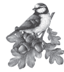

## 圣圣森林

在我生命中，有两种伟大的热爱：诗歌与和平。当我还坐在母亲膝上时，诗歌就敞开了我的眼界，让我看到了语言的力量。四、五岁时，我恳求她给我读莎士比亚的十四行诗。她很愿意，尽管她认为我太小了。我不能说我读懂了它们，但我喜欢那种语言的节奏。随后，我沉浸在爱尔兰语言和乡村的诗歌中，以及那种古老的问候方式：在进入之前，在门口吟诵“诗人的话”来问候一个家庭——任何一位诗人都可以。

直到今天，诗歌书籍依然摆满了我的书架，位于那些植物学和生物化学书籍的下方。诗歌具有爆发出的力和生命力。思想可以像种子一样，在书中休眠。在书脊之后，隐藏着整个世界，等待点燃年轻的心灵。一首诗可以带你去任何地方；它开启你心灵的大门，让你飞越世界各地。诗歌可以赋予科学各个分支想象力和创造力——即使是数学也不例外。韵律诗是音乐的红血，是舞台的戏剧。我很幸运，在孩子时代，我的生活被诗歌交织在一起。

和平对我来说是另一种东西。当我作为一个布列塔尼人在利申斯（`Lishens`）山谷生活时，我学会了和平。傍晚，大家聚集在厨房里，围坐在炉火堆旁，火堆还残留着最后一点光亮。唯一的窗户是黑暗的，阴影像大黑猫一样在地板爬行。

椅子的华尔兹在混乱中开始，椅腿在泥地上摩擦。它们似乎对离开厨房桌的舒适感感到惊讶，那张松木桌面干净且擦得锃，家里唯一的圣像画像就显眼地摆放在上面。客人们络绎不绝。他们熟悉路线，并对此感到高兴。旅行者的折叠床——即 `leaba shuiochain`——总是有人占据。当月亮和星星出来伴与夜晚的剪影嬉戏时，我的表哥帕特（`Pat`）将手插进他粗花呢裤的右口袋。

帕特的手磨损得没有任何童年梦想的痕迹。他的皮肤粗糙且布满皱纹，充满了只有随着年龄增长才会的美。他从来不需要修指甲，因为指甲早已被工作磨平，每天一根一根地被锉掉。那只手现在无法笔直平整了。当他从口袋里掏出那只曾经是手的爪子时，传听到了一阵沙沙声，仿佛念珠在抗议他笨拙的抓握。这是一个充满爱的紧握，将念珠缓慢拉出，像一串希望的链条，随后他熟悉而舒适地在掌心间拨弄。它开启的序曲，承载着过往祈祷的回响。他轻轻地将念珠贴在唇边。他闭上那双通常充满恐惧的眼睛。他在念珠的寂静上落下一吻。然后，所有的头接一个地低头祈祷。

每个人都跪在地板上，肘撑在平坦的椅背上。沉默聚集了，是更多的沉默，然后点出了发言者的名字，即那位领唱的人。念经开始了，是第一段祈祷文和五组十遍圣母祷。呼吸慢了下来。祈祷深入每个人的身体。思想汇聚力量。统一的喜悦席卷整个房间。一天的忧虑烟消云散。一种轻盈降临，封闭了祈祷之间的间隙，将它们连接在一起。声音的交响乐如瀑布般升起，有爱尔兰语和古爱尔兰语，带有词句的语调美，与英语混合，所有说话者的意图一致。

为家庭和平，为世界和平祈祷。在那黑暗的厨房里，熄灭的火中仍透出最微弱的红光，二十个人为和平祈祷，他们的念珠紧贴着低下的脸庞。这些灵魂的歌声进入了黑暗的夜晚，被黑夜承载。

Ó Donaill, Niall. Foclóir Gaelge-Béarla（爱尔兰语-英语字典）.Dublin: Richview Browne and Nolan, 1977.

O'Neil, Maryadele T. 《默克指数：化学、药物和生物学百科全书》（The Merck Index: An Encyclopedia of Chemicals, Drugs, and Biologicals）.第14版。Whitehouse, NJ: Merck, 2006. Pakenham, Thomas. 《寻找奇树：在南非洲的游猎》（In Search of Remarkable Trees: On Safari in Southern Africa）.New York: Walter and Company, 2008.

Perkins, Sid. “地球反射的阳光在减少。《科学新闻》（Science News），2021年11月6日，第16页。Rawlens, Ben. 《林木线：最后的森林与地球生命的未来》（The Tree Line, the Last Forest and the Future of Life on Earth）.London: Jonathan Cape, 2022.

Sheehan, P.A. 《在雪松与星空下》（Under the Cedars and the Stars）.Cork, Ireland: Browne and Nolan, 1903.

Sibi, Arasu. “印度的气候友好农业。《科学新闻》（Science News），2022年5月7日和21日，第36–38页。

Strutt, Lesley, 编. 《心木：致爱树木诗》（Heartwood: Poems for the Love of Trees）.Toronto: League of Canadian Poets, 2018.

Stuart, Malcolm. 《草药与草疗百科全书》（The Encyclopedia of Herbs and Herbalism）.London: Orbix, 1979.

爱尔兰树木委员会（Tree Council of Ireland）. 《奥格姆字母》（The Ogham Alphabet）.

Warwick, Graham. “瑞士将使用太阳能制液体可持续燃料。《航空与航天技术》（Aviation Week and Space Technology），2022年3月21日至4月3日，第62页。

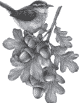

# 致谢

我想要那些让这本书成为可能的人流表示感谢。那股河流从爱尔兰的利申（`Lisheens`）山谷开始，流向科克的圣Alo禄学院的修女们。这些人将我推向了注定的命运，尽管当时我并不知道。我那时太年轻了。

我那位强大的编辑安·柯林斯（`Anne Collins`），用笑声作为媒介追求完美。我敢提到加了咖啡冲水的浓茶，然后是巧克力，以及我们裹着皮草抵御深冬的寒意吗？文字大师埃文·罗塞尔（`Evan Rosser`）在零下度的天气里透过敞开的窗户倾听，为忙工作的作家和编辑提供敏锐的建议。斯图特·伯恩斯坦（`Stuart Bernstein`），我卓越的代理人也是我的朋友，他开启了出版界的大门。非常感谢。

琳和南西·沃特曼（`Lynn and Nancy Wortman`）为我的文字处理支持，通过交谈清洗我的文字。他们的友谊温暖了我的心。

此外，我很感谢莉莎·贾格（`Lisa Jager`）的艺术。她将一个想法化作天堂般的美景。约翰·斯维特（`John Sweet`）用他的大脑肌肉带着眼睛在页面上扫视寻找错误。没有人是完美的。

然后，我必须感谢我亲爱的艾莉卡（`Erika`）和特伦斯（`Terence`），他们对我所做事业的爱和信任给了启发。我的丈夫克里斯蒂安（`Christian`）是我的大脑。他的支持从未消减，表现为坐在我们芬德莱奥场（`Findlay Oval`）的木炉旁，膝上放着猫：这是理解的三位一体。我是幸运的。

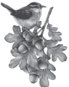

# 索引

索引中的页码指的是书籍的印刷版本。每个链接将把您带到相应打印页的开头。您可能需要在电子阅读器上从该位置向前滚动，以找到对应的引用。

+ A B C D E F G H I J K L M N O P Q R S T U V W X Y Z

2.5 微米污染，111

# A

+ 亚加西冷杉（`Abies religiosa`），86

脱落酸，59–60

糖枫（`Acer saccharum`），85

橡果，179–181

猴面包树（`Adansonia`），128

适应性，62–4

流苏蕨（`Adiantum caudatum`），109

气根，128

气溶胶

关于，44, 146–7

北方森林系统，150–1

气候危机，144–5

通信，146–148

多样性，147–8

水分充足，155

心理健康，159–60, 178

松树，158–9

保护，158–9

反射器，129

储存在腺体中，157

二酮，100, 159

可见的，88–9

琼脂，182, 183

老化，95

植物学（波纳姆），173–4

反照率效应，127, 128

藻类。见蓝藻门（`Cyanophyta`）

氨，120–1

替代燃料，132–3

美国山，51

古树，31

动物界，7, 8–9.见哺乳动物

人类世，163–6, 175–6

抗饥荒。见核桃树；橡树

顶端生组织，170

林地，79, 109

美国（贝雷斯福德-凯格），146

北极，149

灰，13–14, 31, 184

三叶，31, 188

树，20, 134–7.见杨树（`Populus`/poplar）

# B

+ 婴儿，165

细菌，164

噬病毒，164

结，39

猴面包树，128

树皮

桉树，78

核桃树，47, 52

药用，85–6

周皮，83

核桃树，46

月桂树，114

山毛榉，63

蜜，64–5, 111

柏伯文化，96

贝雷斯福德-凯格，戴安娜

关于，2–4

林园，109

林园的，81, 2, 184

猫，134–5

孩子，36–40

气候危机，172–3

山，12

对抗，89–90

百英亩错误，105, 109–10

数百棵，47–8, 50

爱尔兰守夜，22

松树和，58–9, 60

国家艺术，16–18

内，15, 94, 116

海洋标本，57

父母，115

和平，190–2

诗歌，189–90

秘密花园，126–7

教师，35–40, 66–7, 70, 1, 72, 172

树木通信，113–14, 115–16, 170

树，114

水和，54

贝雷斯福德-凯格的教育，33–6, 131

凯尔，94

DNA研究，182–4

光，132

奥格姆文字，137–8

和平，190

过磷酸肥，142–3

三联诗，141

大学，66–7, 116–17, 172

桦桦，43

胆，76

生物化学品，62

在秋季，24

巴利基，56

失去，31

维持，61

自然的养育，63

毒素和，105

生物定位，24

生物计划，175–81

桦树，43

鸟类，52, 84, 128, 153

黑柳，159

岩墨藻，56

欧盟指令，133

血

人工血，183–4

蓝雪松，128

蓝藻。见蓝藻门

蓝胶树，78

沼橡树，101–2

树干，156–7

波纳姆，H.J.,173–4

《凯尔经书》，77

北方森林系统，148–51

爱尔兰法，3, 33–4, 97–8, 108, 142, 154

Breitheahm，142

盐水，56

大果核桃树，82

伯克，埃德蒙，174–5

猴子，86

# C

凯利亚，15

碳酸钙，145

《森林之声》（电影）（Call of the Forest），58

洋菊，14

加拿大冷杉，108

癌症，44, 118, 2, 154

树冠

气溶胶和，146, 148

在北极中，149

分布式计算，121

电子和，121

演化的，68–9

橡树的，179

流苏蕨，128

碳

在北方森林系统中，149–50

气候危机，144–5

过量的，76

重要性，99

反转，177

转化为木材，25–6

紫外光和，123–4

碳循环，25–6

二氧化碳

关于，9

捕捉，132–3

森林的捕捉，29

作为燃料，7–8

核桃树的，53

作为石油产品，132–3

植物适应性，163–4

呼吸和，89, 165–6

气孔，129

没有树的，163–5（另见气候危机）

作为废物，7

碳酸，

碳，115

卡森，瑞切尔

酵母和, 120

# D

- 奶制品, 63–4

- 胡萝卜 (`Daucus carota`), 182–3

- 阔叶树与针叶树, 103

- 丹尼 (`Denny`，叔父), 142–3

- 荒漠化, 79

- 右旋性, 156

- 二分法, 68

- 毛地黄花 (`Digitalis purpurea`), 102

- 两性花, 30

- 二倍体, 135, 187–8

- 扩散, 84

- 分布式涌现计算, 21

- DNA

  - 关于, 6

  - 噬菌体及, 164

  - 二倍体, 135, 187–8

  - 作为灵活的, 31, 62, 77, 105

  - 植物标本馆及, 186

  - 基因库, 188

  - 自复制, 182–4

  - 盐水, 56

  - 休眠, 48–9, 50, 85

- 虫类 (`drochroach`), 108

- 德里 (`Droim`), 10–12

- 德鲁伊教, 3, 117, 128, 131–2. 另另凯尔特文化

- 杜卡 (`Düchas`), 97–8

# E

- 地球起源, 6, 162

- 地光 (`Earth shine`), 127, 128–30

- 东白杉, 31, 108, 157

- 教育, 34–5. 另另贝斯福德-克罗杰的教育；森林学校

- 晓 (`eos`), 140–1

- 爱因斯坦，阿尔伯特 (`Einstein, Albert`), 23, 24–5

- 电子, 9, 23–4, 25, 64–5, 121

- 大象, 169–70

- 鞣酸, 154

- 榆树, 31, 187

- 内源性真菌, 42–5

- 欧莱 (`eolai`), 35

- 欧欧拉斯, 35

- 表观遗传学, 31, 61

- 木贼草 (`Equisetum`), 110–11

- 红细胞, 183–4

- 乙醇, 69

- 欧盟混合指令 (`EU Blending Mandate`), 133

- 蓝果桉 (`Eucalyptus globulus`), 78

- 澳洲桉 (`Eucalyptus regans`), 83–4

- 桉树, 78

- 欧洲白蜡, 13–14

- 常绿树, 59, 68, 103, 109–10

- 灭绝, 47–9

- 灭绝/濒危物种, 31–2, 82

# F

- 壳科 (`Fagaceae family`), 63, 178–9. 另另橡树

- 饥荒, 111

- 农业, 3, 67, 93–4, 172–3

- 费尔，约翰·莱尔德 (`Farr, John Laird`), 135

- 蕨类植物, 30, 67–8, 72–3, 109

- 肥料, 143

- 火灾, 78–9, 110

- 防火墙, 79

- 鱼, 60, 144

- 固定剂, 155

- 运动灵活性, 169

- 花, 111

- 食物

  - 树皮和花蜜, 85–6

  - 核桃科的, 51

  - 花粉作为, 30

  - 种子作为, 84

  - 储存, 49

- 森林浴, 152–61

- 森林工业, 136. 另另人工林；

- 森林学校, 33–40. 另另贝斯福德-克罗杰的教育

- 毛地黄花, 102

- 美国白蜡 (`Fraxinus americana`), 31

- 欧洲白蜡 (`Fraxinus excelsior`), 13–14

- 黑白蜡 (`Fraxinus nigra`), 31

- 四角白蜡 (`Fraxinus quadrangula`), 31

- 自由能, 65

- 法语的, 36

- 淡水, 56, 57–8, 60

- 冻碳, 149

- 墨角藻 (`Fucusiculosus`), 56

- 腐植酸, 59, 60

- 葬礼, 22–3

- 真菌

  - 关于, 30, 42–3

  - 变性, 62

  - 生命周期, 87

  - 树木死亡及, 44–5

  - 土壤及, 120

  - 毒性, 43–4

- 毛皮, 160

# G

- 配子, 67

- 盖茨，比尔 (`Gates, Bill`), 145

- 性别, 44, 62

- 基因, 62–3

- 遗传灵活性, 31, 62, 27, 105

- 地球工程, 139–41, 142, 143–5

- 萌发, 49–50

- 生殖质系, 31

- 妊娠, 165

- 巨型杉, 79

- 没角香 (`gibbbane`), 170–1

# 索引

- 腺体, 157
- 刺果 (Gleditia triacanth), 62, 69–70. 另见核桃树
- 糖苷, 90
- 戈瓦谷 (Gougan Valle), 34–6
- 嫁接, 82
- 祖辈树, 31
- 草, 160
- 大碳循环, 25–6
- 贪婪, 163
- 温室效应, 29, 70, 174. 另见气候危机
- 绿色王国, 7, 8–9, 41–42

# H

- 悬挂, 35
- 单倍体, 187–8
- 山楂, 43
- 榛子树, 44
- 治愈, 95, 122–3
- 听力, 153
- 树高, 156
- 血红蛋白, 8–9
- 植物标本馆, 186
- 山核桃树, 46. 另见核桃树
- 均质森林, 103–5, 111
- 诚实, 140
- 蜜蜂, 111
- 黄蜡树, 62, 69–70
- 人类责任, 175–7. 另见人类世
- 腐殖酸, 59, 60, 120–1
- 猎人, 106–8
- 杂交种, 49
- 水循环, 55

# I

- 冰暴, 109–10
- 土著民, 52, 79, 122–3, 154, 184
- 铋, 68
- 超声, 167–70
- 昆虫, 30, 52, 87, 111
- 相互依赖, 28
- 碘, 56
- 爱尔兰苔, 116–18
- 铁, 9, 59, 60, 144
- 铁结籽, 144

# J

- 日本, 58, 154–5, 192
- 核桃科 (Juglandaceae family). 另见核桃树；核桃树

# K

- 毛罗叶松, 128
- 核桃树, 47–53
- 奇异果鸟, 128
- 知识共享, 34–6

# L

- 不稳定分子, 44
- 落叶松, 59
- 欧洲松, 59
- 月桂 (Laurus nobilis), 114
- 法律, 142. 另见布尔森法律
- 叶子
  - 杨树的, 137
  - 秋季, 59–60
  - 黄蜡树的, 70
  - 核桃树的, 51, 52
  - 肺, 20–1
  - 橡树的, 64
  - 部分, 19–20
  - 杨树的, 150
  - 形状, 19
  - 运动, 19
  - 追踪太阳, 19, 21
  - 树木进化, 69
  - 作为树星, 17–18, 21
  - 核桃树的, 46
  - 左手形旋转, 148, 156
  - 法律权利, 142
  - 豆科 (Leguminosae family), 62, 69
  - 旋转, 156
  - 李，清 (Li, Qing), 158–9
  - 提升, 147
  - 光, 131–2. 另见地光；太阳
- 鹅杉 (Liriododendron tulipifera), 32

# M

- 大分子, 120–1
- 镁, 9
- 尖叶橘 (Magnolia acuminata), 32, 84
- 泪叶蕨, 109
- 哺乳动物（一般）, 160
- 管理森林, 103–5, 111
- 红树林, 128
- 坚果, 28–30, 32
- 松永，胜彦 (Matsunaga, Katsuhiko), 58–9, 60
- 均值, 121
- 测量, 28
- 药用
  - 真菌, 44
  - 爱尔兰苔, 116–18
  - 核桃, 52
  - 北森林的树脂, 150–1
  - 盐水, 56–7
  - 土壤 pH 及, 99
  - 另见森林浴
- 矮人, 143
- 心理健康, 159–60, 177–88
- 金属, 86. 另见铁
- 水杉 (Metasequoia glyptrobides), 128
- 微生物组, 42–3
- 宫胁，彰 (Miyawaki, Akira), 192
- 假树, 82
- 僧侣, 34–5
- 同生, 30
- 蒙特利松, 78–9
- 月亮, 9
- 混乱, 30, 37
- 山灰桉, 83–4
- 鞍山 (Mount Kurama), 41. 另见真菌
- 蘑菇, 62
- 菌丝, 44
- 菌丝体, 44
- 谜, 82–3, 88–91, 119

# N

- 国家艺术俱乐部 (National Arts Club), 16–18
- 碱, 85–6
- 妮莉 (Nellie-大), 10, 13–15, 54, 94, 116
- 神经毒素, 124–5
- 营养, 13–14
- 北方树, 49
- 果实工业, 53
- 果实树, 101. 另见个体树

# O

- 橡树, 32, 43, 63–5, 79, 101–2, 178–81
- 海洋, 56–9, 60, 67, 99–100, 144
- 欧格姆文字, 63, 77, 96, 137
- 树脂, 150
- 橙子, 157
- 氧气
  - 藻类及, 144
  - 叶绿素及, 8–9
  - 作为燃料, 7
  - 萌发及, 165
  - 在海洋中, 67
  - 氧化还原反应, 8
- 二氧化碳, 25–6
- 水及, 55

# P

- 帕特里克 (Patrick-表弟), 10–12, 54, 101–2, 190–1
- 帕特里克 (Patrick-叔叔), 115
- 野果树, 31, 188
- 和平, 190
- 山桃树, 51
- 牡丹, 185–6
- 完美, 41
- 永冻层, 149
- 农药, 124–5
- 叶柄, 19–20, 69
- 药物学, 156
- 酚类, 149
- 现象, 88
- 光子, 9, 24–5, 65, 132–3
- 光合作用, 127
- 光性, 19, 21, 88
- 植物毒素, 72
- 西云杉 (Picea siechensis), 76
- 松科 (Pinaceae family). 另见松树
- 松树
  - 抗森林的, 78–9
  - 森林浴及, 158–9
  - 在真菌中, 43
  - 药用的, 32
- 扭松 (Pinus contorta), 76
- 澳洲松 (Pinus radiata), 78–9
- 刚硬松 (Pinus rigida), 32

# Q

- 量子提升, 64
- 量子力学, 9
- 槲皮素, 64
- 单宁类, 64
- 橡树 (Quercus). 另见加州红橡, 79
- 白橡 (Quercus alba), 32

# R

- 红色王国, 7, 8–9
- 红杉树, 79, 83, 128, 159
- 修复, 142
- 替换/迁移, 76–80, 103–5
- 繁殖, 30, 67, 87, 135, 187
- 树脂, 52, 64, 86
- 呼吸, 165
- 报复, 98
- 林格液, 183
- 罗伯茨，奥利 (Roberts, Ollie), 66
- 罗斯福，富兰克林·德拉诺 (Roosevelt, Franklin Delano), 69
- 根
  - 分生组织, 170
  - 化学交换及, 100–1
  - 橡树的, 179
  - 呼吸根, 128, 189

# S

- 圣果杉, 86
- 柳科 (Salicaceae family), 20, 149–50, 159–60
- 水杨酸盐, 160
- 垂柳 (Salix babylonica), 160
- 黑柳 (Salix nigra), 159
- 盐水, 56–7. 另见海洋
- 科学（一般）, 139–40
- 鳞兰 (scill ghearr), 34–5, 40
- 欧洲松, 76
- 屏障树, 102–3
- 海结菜, 56
- 塞恰纳 (sechanai), 22–3
- 海洋, 56, 116
- 海藻
- 种子
  - 关于, 28–30
  - 贝斯福德-克罗杰的植物园, 81–2
  - 二倍体, 187–8
  - 扩散, 84
  - 休眠, 85
  - 作为食物, 125
  - 萌发及, 165
  - 核桃树, 52
  - 保护, 84
  - 拯救, 125
  - 双生, 20
- 巨大的巨型杉 (Sequoiaendron giganteum), 79
- 这里的红杉 (Sequoia sempervires). 另见红杉树
- 无柄的, 19
- 性, 87, 120. 另见性别
- 阴影, 29
- 尚族, 96
- 谢希山, 34
- 壳皮山核桃树. 另见核桃树
- 避难, 86
- 森林浴 (shinrin-yoku), 154–5
- 视觉, 153
- 寂静, 167, 71
- 《寂静春天》(Carson), 125
- 西加云杉, 76
- 小叶椴, 17
- 味道, 153
- 雪, 110
- 土壤, 87–8, 99, 119–21, 123–4, 178
- 索拉斯 (Solas), 131–2
- 细胞克隆, 187
- 歌鸟, 153
- 声波, 167–70
- 南方树, 49
- 紫杉松醇, 44
- 加拿大红杉, 108–9
- T 细胞, 159
- 教师, 34–6
- 温度, 77
- 种壳, 29
- 加拿大侧柏, 31, 108, 157
- 鳞叶美国侧杉, 31
- 松树子酸, 157
- 心形椴, 17
- 测试, 14
- 触摸, 154
- 毒
  - 关于, 124–5
  - 抗癌药物, 44
  - 农田肥料, 143
  - 铁种子播种, 144
  - 人造林, 104–5
- *另请参见* 二氧化碳；污染
- 气管, 136
- 蒸腾作用, 89–90, 136
- 砍伐
  - 关于, 26–7
  - 与海洋变暖有关, 130
  - 研究, 84
  - 筛选树木, 103
  - 土壤制造, 123
  - 视觉效果, 102–3
  - 与生命之网有关, 42
- 植树, 176–8. *另请参见* 人造林；替代/迁移
- 树/森林
  - 关于, 4–5
  - 收集, 75–7
  - 死亡, 44
  - 进化, 67–72, 162
  - 法律权利, 142
  - 周围昆虫物种数量, 87
  - 未标识, 73–4
- *另请参见* 叶子
- 树之星, 17–18, 21
- 颤抖杨, 20, 134–37
- 三联节诗, 141
- 结核病, 116

# U

- 美国榆, 31, 187
- 托马斯榆, 31
- 反射伞, 126–30, 145
- 地下, 100–1
- 统一, 95–6, 126–7
- 城市森林, 177
- 紫外线（UV rays）, 29, 52, 64, 123–4

# V

- 蒸气, 88–9
- 原始森林, 98–9
- 病毒, 164

# W

- 薄片白蜡, 184
- 觉醒, 22–3
- 核桃树, 46, 71, 154
- 水, 54–60, 89–90, 122–3, 136
- 天气模式, 29, 129
- 垂柳, 159–60
- 井, 54–5
- 巨叶植物兰, 73
- 鲸鱼, 32
- 白橡树, 32
- 野生梅树, 187
- 柳树, 20, 149–50, 159–60
- 木材, 25, 45
- 五轮（Wu lun）, 96

# X

- 木质组织, 136, 168–9
- 木糖醇, 43

# Y

- 因纽人, 96

---

迪娜·贝雷斯福德-克罗格（DIANA BERESFORD-KROEGER）是一位在医学生物化学、植物学和医学领域公认的科学家，她终生都在为大众解读科学。2023年，贝雷斯福德-克罗格博士获得了科克大学学院卓越校友奖和加拿大皇家地理学会 Kamookak 奖。她是多本自然类畅销书的作者，《美国植物园：森林哲学》被植树日基金会授予关于树木和森林的典范教育著作。2020年，她凭借自传《为树发声》（To Speak for the Trees）获得了西格德·F·奥森自然写作奖。她是专题片《森林之唤》（Call of the Forest）的作者和讲述者，该片基于她的著作《全球森林》。贝雷斯福德-克罗格在加拿大安大略省的私人植物园里继续她的研究和写作。

您通往知识与文化的门户。人人可用。

z-library.se singlelogin.re go-to-zlibrary.se single-login.ru

官方 Telegram 频道

Z-Access

https://wikipedia.org/wiki/Z-Library
