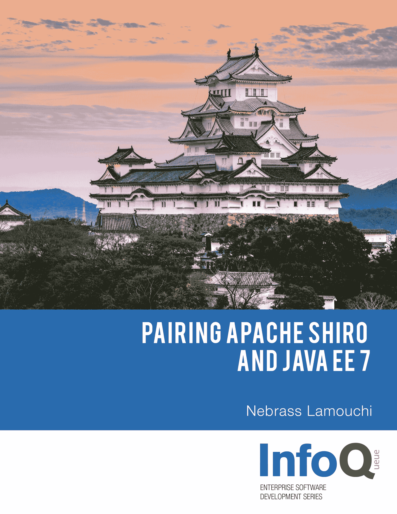

# Apache Shiro 与 Java EE 7 配对



**Nebrass Lamouchi**

## 致谢

致妈妈：无论如何，无法充分感谢你所做的一切。

致爸爸的灵魂：我每天都在想念你……

致 Firass：你是最好的，愿上帝保佑你……

致我的爱人：自从你进入我的生活，许多新的情感和感受开始喷涌而出……

我想向许多帮助我完成这本书的人表示感谢。感谢所有提供支持、阅读、撰写、提供评论以及协助编辑和设计的人。

感谢我的朋友们，感谢你们在我需要时一直都在那里。

感谢 Jérome Salles，感谢你教我 Java EE 艺术，以及给予我的支持和指导。

感谢 Paul Bernardi 和 Geertjan Wielenga，感谢你们信任我的能力，并为我提供机会。

感谢 Victor Grazi 和 Laurie Nyveen，这些为本书付出的优秀技术评审人员。感谢你们出色的工作。

感谢 Ana Ciobotaru 和 Charles Humble，感谢你们让这本书的想法变为现实。感谢你们提供的所有帮助和支持。

最后，同样重要的是，我恳请这些年来一直陪伴在我身边但我未能提及的各位给予原谅。

## 引言

在过去的几年里，我参与了许多使用 Java 开发应用程序的项目和公司。在这些应用程序中，我曾尝试实现身份验证与授权模块，有时会使用 `Spring Security` 或 `JBoss Picketlink`。

我对 IT 安全的硕士研究以及在 OWASP 基金会的经验让我更有动力去探索如 `JAAS`、`JASPIC`、`Spring Security` 和 `Picketlink` 等安全框架。

当我听到 `Apache Shiro` 时，我立刻就想使用它。它将我常用的框架整合到了一个易于使用的包中。我想写这本书，是因为我看到这对于初级 Java 开发者来说，能够快速入门并开始安全化他们的应用程序非常有帮助。我想进一步深化这个精彩项目的知识。我想向他们展示安全并不可怕，它只是另一个可以提高你的应用程序安全体验（Application Security eXperience）的框架。

## InfoQ 微型书包含什么内容？

InfoQ 微型书的设计旨在精简扼要，旨在为希望快速深入地对新技术或技术获得坚实概念理解的技术架构师提供服务。你可以将这些书看作是对主题的策略性或本质性的涵盖。在读完微型书后，读者应该对某项技术有基本的理解，包括何时以及如何应用它、它与其他技术的关系，并总体上感觉自己吸收了已经搞清楚这项技术的其他人士的综合知识。这样，当他们的项目需要时，读者就能对该技术做出明智的决策，并在那时深入研究更详细的信息源（如较大的书籍或教程）。

## 本书适合读者

本书专门针对希望通过学习如何将 `Apache Shiro` 与 Java EE 7 结合来快速了解 `Apache Shiro` 的 Java 开发者。

## 读本书需要什么

为了尝试书中的代码示例，你需要一台运行最新操作系统（Windows、Linux 或 Mac OS X）的电脑。你需要安装 Node.js 和 Java。书中的代码针对 Node.js v0.12 和 JDK 8 进行过测试，但较新版本也应该有效。

## 规范

我们在书中使用了一些排版惯例，以区分不同类型的信息。

文中的代码（包括命令、变量、文件名、XML 配置和属性名称）所示：`ShiroFilterActivator` 继承了 `ShiroFilter` 类。它的注解 `@WebFilter("/*")` 启用了所有请求的过滤器。

代码块如下所示。根据你阅读本书的格式，颜色可能会不同。

```xml
<?xml version="1.0" encoding="UTF-8"?>
<beans
        xmlns:xsi="http://www.w3.org/2001/XMLSchema-instance"
        xmlns="http://xmlns.jcp.org/xml/ns/javaee"
        xsi:schemaLocation="http://xmlns.jcp.org/xml/ns/javaee
                      http://xmlns.jcp.org/xml/ns/javaee/beans_1_1.xsd"
        bean-discovery-mode="all">
</beans>
```

Listing 1. `src/main/webapp/WEB-INF/beans.xml`

```java
@ApplicationPath("api")
public class JaxRsConfiguration extends Application {
    // JAX-RS 配置类
}
```

Listing 2. `src/main/java/demo/DemoApplication.java`

当我们想要你注意代码特定部分时，会使用数字标注。

```java
private String getCredentials(AuthenticationInfo info) { ①

    Object credentials = info.getCredentials(); ②
    return toString(credentials); ③
}
```

1. *①* 我们将基础 `AuthenticationInfo` 对象传递给 `getCredentials()` 方法。

2. *②* `info.getCredentials()` 是 `getCredentials()` 方法调用的函数，用于从 `AuthenticationInfo` 实例获取 `credentials` 对象。

3. *③* 将 `credentials` 实例的字符串格式返回给 `getCredentials()` 调用。

最后，这段文字展示了引用格式。

> “最后，重要的不是生命的长度，而是生命的广度。”

> 

> ~ 林肯

## 读者反馈

我们总是欢迎读者的反馈。告诉我们你对这本书的看法——你喜欢或不喜欢。读者反馈有助于我们开发你受益最大的书籍。向我们发送反馈，请邮件至 `feedback@infoq.com`。

如果你在某个领域拥有知识并兴趣编写或贡献书籍，请查看我们的微型书指南：`http://www.infoq.com/minibook-guidelines`。

每一位合格的 Java EE 开发者都知道，平台中必须具备安全 API，无论是原生提供的，还是由第三方框架提供的。但自 1999 年 12 月 12 日 Java EE 诞生以来，Java EE 一直缺乏一个完整且专用的安全规范。`JSR-375` 的创建是为了为 Java EE 安全提供一个完整的规范，它涵盖了所有需求，但将会在 Java EE 8 版本中可用，预计于 2017 年发布。

安全特性中最受期待的之一是认证和授权。在本文中，我将认证和授权称为“Auth²”。尽管尝试过通过 `JAAS` (2001-2003) 和 `JASPIC` (2009) 让 Java EE 的开发人员实现某些“标准化”的 Auth²，但平台尚未为这些功能提供实用的解决方案。

如往常一样，当社区需要一个平台不幸未提供的功能时，第三方会尝试满足这一需求。Java EE 中 Auth² 最流行的明星项目是 `Spring Security`、JBoss 的 `PicketLink` 以及 `Apache Shiro`。

许多开发者选择实现自己的 Auth² 机制，而不是花时间去理解和实现这些古异的第三方解决方案。我之所以用“古异”，是因为每个第三方解决方案都与其创建者紧密绑定（例如 `Spring Security` 和 `JBoss PicketLink`），或者文档记录不全且模糊（`Apache Shiro` 就属于这种情况）。

## 个人案例

我决定分享我使用 Auth² 框架的个人经验。我正尝试为 Java EE 7 构建一个我自己的、最新的安全框架。在 `JSR-375` 参考实现发布之前，我的实现将非常有用。我将尝试解释所做的每一个选择，并希望这对你有所帮助。

我尝试过许多 API，但每一个都让我感到失望。要么是方案难以实现（使用 `EJB` 实现 `Spring Security`、使用 `JAAS` 和 `JASPIC` 并不理想），要么是方案特定于供应商（`PicketLink` 只能在 JBoss 服务器上使用），或者是 API 文档不全（`Apache Shiro`）。

我在 2012 年 12 月发现了 `Apache Shiro`。在那时它并不流行。它用起来很困难，且受困于糟糕的文档和参考。我曾尝试使用它，但最终放弃了。

## 专业经验

自从开始我的 Java 开发者生涯以来，每一位客户都要求我帮助实现他们自己的 Auth² 解决方案，只有一个客户要求我在他的 Web 应用中实现 `Spring Security`。每当我处理安全层的工作时，我都会问自己：“为什么我又要做一遍这个？为什么没有高效的解决方案？可用性在哪里？我为什么要重复自己？”

上一次实现 Auth² 机制时，我使用了旧的 Java EE 6 技术：`JSP` 2.5、`Servlets` 3.0、`JMS` 1.1、`EJB` 3.1 和 `JPA` 2.0。使用 Java EE API 实现开放应用安全项目（OWASP）规范是一次奇妙的体验。

## 编写本教程的动力

在完成上一个项目后，我决定重新审视 `Apache Shiro`，那个三年前我无法使用的神秘框架。

奇怪的是，我发现 Shiro 网站页面多年来没有发生变化。没有新的板块，没有新的教程，也没有新的文档。显然，我在 YouTube、Vimeo 和 Dailymotion 上寻找 Shiro 的视频教程，但无果。我寻找了任何相关的书籍或文章，也没有显著结果。这对于一个 Apache 项目来说非常奇怪。通常情况下，任何 Apache 项目都能得到良好的覆盖。但 Shiro 并非如此。

我尝试在一个示例项目中使用 Shiro，以下是我的初步反馈：

* 它支持使用 `INI` 文件，这与 `Spring Security` 使用 `XML` 文件进行配置的风格不同。

* 官方文档和资源不足。例如，网站上的官方教程只关注 `Stormpath`。

* 最新版本 Shiro 的 `JavaDoc` 网站几乎无法访问（我已向 Apache Shiro Twitter 账号报告了此问题）。

我决定编写本教程来填补这一空白。

## 什么是 Shiro？

`Apache Shiro` 是一个开源软件安全框架，负责认证、授权、加密和会话管理。它最初被称为 `JSecurity`，Shiro 的设计旨在提供直观且易于实现的健壮安全功能。

书中详细介绍的教程针对寻求用于现代技术栈的 Auth² 框架的 Java 开发者。

该项目在 2008 年推向 Apache 社区时获得了它的名字（“shiro”在日语中是“城堡”的意思）。“城堡”的任务旨在提供一个能够满足任何 Java 项目全方位安全考虑的标准框架。

## 城堡计划

`Apache Shiro` 涵盖了应用安全的四个核心关注：

* 认证（Authentication），有时被称为“登录”，是证明用户是其所称身份的行为。

* 授权（Authorization）访问控制的过程，即确定谁有权访问什么。

* 会话管理（Session management）管理用户特定的会话，即使在非 Web 或 Enterprise JavaBeans (`EJB`) 应用中也是。

* 加密（Cryptography）使用加密算法保持数据安全，同时保持易用性。


支持的环境包括：

* Web 支持——Shiro 的 Web 支持 API 有助于保护 Web 应用。

* 缓存（Caching）——缓存是 `Apache Shiro` 的特性，确保安全操作保持快速。

* 并发（Concurrency）——Shiro 的并发功能设计用于支持多线程应用。

* 测试（Testing）——测试支持简化了单元测试和集成测试的创建，并确保你的代码是安全的。

* “以身份运行”（Run As）——Shiro 允许用户假设另一个身份（如果有权限），这在管理场景中非常有用。

* “记住我”（Remember Me）——Shiro 跨会话记住用户的身份，他们只需在需要时登录。

## 为什么不用 JAAS 或 Spring Security？

现有的 Java 安全机制（如 `JAAS`）令人困惑，并在应用层安全方面不足。某些方案（例如 `PicketLink`）依赖服务器。其他方案（如 `Spring Security`）需要繁琐的 `XML` 配置。

`Apache Shiro` 旨在通过提供一个用户友好、标准化的 API 来在项目中解决这些挑战。


## 技术栈

本教程使用了：

* `Apache Shiro` 1.2.4

* Java EE 7 后端，带有 `JPA` 2.1、`EJB` 3.2 和 `JAX-RS` 2.0

* `Payara Server`

* `NetBeans` 8.1 IDE

# Java 平台企业版 (Java EE)

Java 是社区驱动型企业软件的标准。Java EE 通过 Java 社区进程（Java Community Process）不断扩展，其贡献来自行业专家、商业和开源组织、Java 用户组以及无数个人。每个版本的发布都整合了符合行业需求的新功能，提高了开发效率并增强了应用程序的可移植性。

Java EE 的最新版本是 Java EE 7，于 2013 年 6 月发布。Java EE 7 平台对 Web 标准的最新发展提供了原生支持，包括 `WebSockets` 和 `JSON`，它们为 Java EE 支持 HTML 5 提供了基础。Java EE 7 还增加了由 `JAX-RS 2.0` 定义的现代 HTTP 客户端 API。

Java EE 7 规范包括：

* [WebSocket Java API — JSR-356](https://www.jcp.org/en/jsr/detail?id=356)

* [JSON 处理 Java API — JSR-353](https://www.jcp.org/en/jsr/detail?id=353)

* [Java 平台批处理应用 — JSR-352](https://www.jcp.org/ja/jsr/detail?id=352)

* [Java EE 并发实用程序 — JSR-236](https://www.jcp.org/ja/jsr/detail?id=236)

* [RESTful Web Services Java API — JSR-311](https://www.jcp.org/en/jsr/detail?id=311)

* [Java Message Service 2.0 — JSR-343](https://www.jcp.org/en/jsr/detail?id=343)

* [表达式语言 3.0 — JSR-341](https://www.jcp.org/en/jsr/detail?id=341)

* [Enterprise JavaBeans 3.2 — JSR-345](https://www.jcp.org/en/jsr/detail?id=345)

* [Java 持久化 2.1 — JSR-338](https://www.jcp.org/en/jsr/detail?id=338)

* [JavaServer Faces 2.2 — JSR-344](https://www.jcp.org/en/jsr/detail?id=344)

你可以在 [JSR-342](https://jcp.org/en/jsr/detail?id=342) 汇总页面找到关于 Java EE 7 规范的所有必要信息。

Java EE 7 规范。

## Payara Server

Payara Server 是 `GlassFish` 服务器的无缝替代品，并保证季度发布。Payara 团队为上游 `GlassFish` 服务器及其依赖库提供增强、错误修复和补丁。这使得 Payara Server 成为 Java EE 生态系统中适用于生产环境的应用程序服务器之一。Payara 团队还提供行业内顶级中间件工程师提供的 24/7 专用事故处理和软件支持。该团队欢迎贡献，并公开报告其在编写功能或修复错误方面的进展。此外，还有一个响应敏捷的社区对任何请求做出快速反应。Payara Server 在微调 `GlassFish` 的同时，保留了它的易用性和优美的管理功能。

你可以从[项目网站](http://www.payara.fish/downloads) 获取 Payara Server 的最新版本。


## NetBeans IDE

NetBeans IDE 是 Oracle 提供的免费 Java IDE，旨在无需配置或插件即可减少编码错误并优化生产力。NetBeans 可以与你所有的环境组件（如数据库、自动化服务器、应用程序服务器、质量工具等）进行交互，而无需花费大量时间准备环境。


NetBeans IDE 具有出色的调试器功能，可以优化重构和调试过程。它包含一个强大的文本编辑器，带有重构工具、代码补全、代码片段和分析器，甚至还有多语言拼写检查器。NetBeans 还通过开箱即 `Git`、`SVN`、`CVS` 和 `Mercurial` 等工具提供了强大的多系统版本控制。除了 Java 和 `JavaFX` 之外，NetBeans IDE 还支持 `C/C++`、`PHP` 和 `HTML5/JavaScript`。NetBeans IDE 适用于所有支持兼容 `JVM` 的操作系统。

NetBeans 在美国、法国、英国、荷兰、巴西等国家和全球范围内举办许多免费会议和活动。参加这些活动不仅让你学到 NetBeans 的技能，还能学到通用编程。

你可以在 [NetBeans 网站](https://netbeans.org/downloads/index.html) 下载最新版本的 NetBeans IDE。


 Nebrass Lamouchi

本书剩余部分是一个分步骤演示的教程，旨在让你能够轻松跟随。

首先，安装教程工具集以便你可以根据截图进行操作：

* [JDK 8](http://www.oracle.com/technetwork/java/javase/downloads/jdk8-downloads-2133151.html)
* [Maven 3](https://maven.apache.org/download.cgi)
* 关系型数据库，如 [MySQL](https://www.mysql.com/)
* [PostgreSQL](https://www.postgresql.org/)（推荐）
* [Payara Server](https://www.payara.fish/)（推荐）
* [WildFly](https://www.wildfly.org/)（推荐）
* [NetBeans](https://netbeans.org/)（推荐）

## 1：项目

### 1.1：创建项目

通过创建一个新的 Web 应用开始教程。


接下来，完成名称（Name）。


然后，填写服务器设置。


创建项目后，进入 `pom.xml` 并对其进行编辑。

```xml
<?xml version="1.0" encoding="UTF-8"?>
<project xmlns="http://maven.apache.org/POM/4.0.0" 
         xmlns:xsi="http://www.w3.org/2001/XMLSchema-instance"
         xsi:schemaLocation="http://maven.apache.org/POM/4.0.0 http://maven.apache.org/xsd/maven-4.0.0.xsd">
    <modelVersion>4.0.0</modelVersion>

    <groupId>targa.dev</groupId>
    <artifactId>ShiroTutorial</artifactId>
    <version>1.0-SNAPSHOT</version>
    <packaging>war</packaging>

    <name>ShiroTutorial</name>

    <properties>
        <maven.compiler.source>1.8</maven.compiler.source>
        <maven.compiler.target>1.8</maven.compiler.target>
        <failOnMissingWebXml>false</failOnMissingWebXml>
    </properties>

    <dependencies>
        <dependency>
            <groupId>javax</groupId>
            <artifactId>javaee-api</artifactId>
            <version>7.0</version>
            <scope>provided</scope>
        </dependency>
    </dependencies>

    <build>
        <finalName>ShiroTutorial</finalName>
    </build>
</project>
```

### 1.2：设计示例应用程序

#### 1.2.1：BCE/ECB 模式

我们将使用实体-控制-边界（ECB）模式，这是模型-视图-控制器（MVC）模式的一种变体。在识别系统内执行序列的元素时，你可以将每个参与元素分类为三类之一：实体、控制或边界。

实体是长寿的被动元素，负责某些有意义的信息。这并不是说实体是“数据”而其他设计元素是“功能”，而是实体执行的行为是围绕某些数据集组织的。

控制元素管理场景内部的交互流。控制元素可以管理整个场景的端到端行为，也可以管理部分元素之间的交互。你应该将与场景相关的涉及信息的行为和业务规则分类为实体；控制元素只负责场景的流程。

边界元素位于系统或子系统的边缘内部。对于跨整个系统或在某个子系统内部考虑的任何场景，某些边界元素是接受设计区域外部输入的前端元素，其他元素则是后端，负责与系统或子系统外部的支持元素通信。

边界-控制-实体模式。

#### 1.2.2：BCE 实现

创建一些空的 Java 包，仅用于突出应用程序中 BCE 模式的实现。这些包将采用以下格式：

**BCE 模式包结构。** 

我们将身份验证和授权需求的功能层命名为 "security"。输出如下：


现在开始创建你的实体。

## 步骤 2：JPA 实体

使用 `JPA` 2.1 构建持久化实体。在 `com.targa.dev.shirotutorial.security.entity` 包中创建两个实体。

对于我们的 Auth² 实现，将有两个实体：

`User`，引用应用程序的客户端；`Role`，引用用户的授权级别。

**`User` 和 `Role` 实体的类图。** 

你可以通过添加一个 `Permission` 实体来扩展“角色与权限”策略（基于权限的授权），该实体包含赋予关联 `Role` 的权限——例如，“只读”或“控制”。生成的类图如下：

**`Role` 和 `Permission` 实体的类图。** 

```java
@Entity ①
@NamedQueries({ ②
    @NamedQuery(name = "User.findAll", query = "select u from User u"),
    @NamedQuery(name = "User.findByUsername", query = "SELECT u FROM User u WHERE u.username = :username") ③
})
public class User {
    private static final long serialVersionUID = 1L;
    @Id ④
    @GeneratedValue ⑤
    @Column(name = "id", nullable = false, updatable = false) ⑥
    private long id;
    @NotNull ⑦
    @Column(name = "username", length = 50, nullable = false)
    private String username;
    @NotNull
    @Column(name = "password", nullable = false)
    private String password;
    @OneToOne(cascade = CascadeType.PERSIST) ⑧
    private Role role;
    @Column(name = "enabled", nullable = false)
    private Boolean enabled;
    @Version ⑨
    @Column(name = "version", nullable = false)
    private Timestamp version; ⑩

//Getters & setters
}
```

列表 1. User:

1. ① 将带注解的类声明为 JPA 实体。
2. ② 声明 `NamedQuery` 元素列表。
3. ③ 最小的 `NamedQuery` 声明 = 查询名称 + JPQL 查询。
4. ④ 将属性定义为实体的 `id` 字段。
5. ⑤ 用在实体的 `id` 字段上，以指定 `id` 生成策略。
6. ⑥ 规定对应表列的定义。
7. ⑦ 为相应的字段值定义验证约束 → username 不为空。
8. ⑧ 定义实体之间的关系。
9. ⑨ 指定实体类中的版本字段，作为其乐观锁值。该版本号用于在执行合并（merge）操作时确保完整性，并用于乐观并发控制。
10. ⑩ `Timestamp` 是版本属性的类型。

```java
@Entity
@NamedQueries({
    @NamedQuery(name = "Role.findAll", query = "SELECT r FROM Role r")
})
public class Role {
    private static final long serialVersionUID = 1L;
    @Id
    @GeneratedValue
    @Column(name = "id", nullable = false, updatable = false)
    private long id;
    @NotNull
    @Column(name = "name", length = 50, nullable = false)
    private String name;
    @NotNull
    @Past ①
    @Column(name = "creation", nullable = false, updatable = false)
    @Temporal(TemporalType.TIMESTAMP) ②
    private Date creation;
    @Column(name = "enabled", nullable = false)
    private Boolean enabled;

//Getters & setters
}
```

列表 2. Role:

1. ① 创建日期必须发生在过去。
2. ② 表明这是一个日期或时间列。

接下来，为每个实体创建一个服务。你的服务将创建在 `com.targa.dev.shirotutorial.security.control` 包中。`EntityManager` 是一个封装了处理实体所需的 CRUD 操作的对象：

* 保存/编辑
* 删除
* 查找

```java
@Stateless
public class UserService {
    @PersistenceContext
    EntityManager em;

    public User save(User entity) {
        return this.em.merge(entity);
    }

    public void delete(long id) {
        try {
            User reference = this.em.getReference(User.class, id);
            this.em.remove(reference);
        } catch (EntityNotFoundException e) {
            //它已经不存在
        }
    }

    public User findById(long id) {
        return this.em.find(User.class, id);
    }

    public List<User> findAll() {
        return this.em.createNamedQuery("User.findAll", User.class)
                .getResultList();
    }
}
```

列表 3. UserService:

```java
@Stateless
public class RoleService {
    @PersistenceContext
    EntityManager em;

    public Role save(Role entity) {
        return this.em.merge(entity);
    }

    public void delete(long id) {
        try {
            Role reference = this.em.getReference(Role.class, id);
            this.em.remove(reference);
        } catch (EntityNotFoundException e) {
            //它不存在
        }
    }

    public Role findById(long id) {
        return this.em.find(Role.class, id);
    }

    public List<Role> findAll() {
        return this.em.createNamedQuery("Role.findAll", Role.class)
                .getResultList();
    }
}
```

列表 4. RoleService:

你的服务现在可以使用了。为了实现更灵活的依赖注入（CDI），创建一个 `beans.xml` 文件，并将 `bean-discovery-mode` 从 `annotated` 改为 `all`。

```xml
<?xml version="1.0" encoding="UTF-8"?>
<beans xmlns="http://xmlns.jcp.org/xml/javaee"
    xmlns:xsi="http://www.w3.org/2001/XMLSchema-instance"
    xsi:schemaLocation="http://xmlns.jcp.org/xml/javaee
                      http://xmlns.jcp.org/xml/javaee/beans_1_1.xsd"
    bean-discovery-mode="all">

</beans>
```

## 步骤 3：Apache Shiro

首先，在你的项目中添加 Apache Shiro 依赖：

```xml
<dependency>
    <groupId>org.apache.shiro</groupId>
    <artifactId>shiro-web</artifactId>
    <version>1.2.4</version>
</dependency>
```

Apache Shiro 使用 INI 配置文件来定义参数。这是一个 `shiro.ini` 文件的示例：


```ini
[main]
authc.loginUrl = /login.jsp ①
authc.successUrl = /home.jsp

passwordMatcher = org.apache.shiro.authc.credential.HashedCredentialsMatcher ②
passwordService = org.apache.shiro.authc.credential.DefaultPasswordService
passwordMatcher.passwordService = $passwordService

ds = com.jolbox.bonecp.BoneCPDataSource ③
ds.driverClass=com.mysql.jdbc.Driver
ds.jdbcUrl=jdbc:mysql://localhost:3306/simple_shiro_web_app
ds.username = root
ds.password = 123qwe

jdbcRealm = org.apache.shiro.realm.jdbc.JdbcRealm ④
jdbcRealm.permissionsLookupEnabled = true
jdbcRealm.authenticationQuery = SELECT password FROM USERS WHERE username = ?
jdbcRealm.userRolesQuery = SELECT role_name FROM USERS_ROLES WHERE username = ?
jdbcRealm.permissionsQuery = SELECT permission_name FROM ROLES_PERMISSIONS WHERE role_name = ?
jdbcRealm.credentialsMatcher = $passwordMatcher
jdbcRealm.dataSource=$ds

securityManager.realms = $jdbcRealm ⑤

[urls] ⑥
## /login.jsp 不限制为已验证的用户（否则没人能登录！），
# 但必须为其指定 'authc' 过滤器以便处理该 URL 的登录提交。
# 它足够智能，可以允许上述 shiro.loginUrl 指定的请求通过。
/login.jsp = authc
/home.jsp = anon, authc
/logout = logout
/account/** = authc
```

1. ① [`authc`](http://shiro.apache.org/static/current/apidocs/org/apache/shiro/web/filter/authc/FormAuthenticationFilter.html) 登录过滤器的配置。

2. ② 哈希密码匹配器。

3. ③ 数据源。

4. ④ JDBC Realm。

5. ⑤ 安全管理器的领域（realms）。

6. ⑥ URL 映射。

② 对 [`passwordMatcher`](http://shiro.apache.org/static/current/apidocs/org/apache/shiro/authc/credential/PasswordMatcher.html) 和 [`passwordService`](http://shiro.apache.org/static/current/apidocs/org/apache/shiro/authc/credential/PasswordService.html) 的配置，它们是用于密码验证和匹配的组件。

③ 此示例中 `Datasource` 的定义是一个 JDBC `DataSource`。

④ 此示例中 `Realm` 的配置是一个 JDBC `Realm`。

⑤ 这将配置好的 `Realm` 分配给 Shiro 的 `SecurityManager`。

⑥ 这将 URL 模式分配给相应的过滤器。

此 `shiro.ini` 文件必须放置在 `src/main/webapp/WEB-INF` 或 `src/main/resources` 中。若要启用 Shiro 框架，你必须配置你的 `web.xml` 文件。

```xml
<listener>
    <listener-class>
        org.apache.shiro.web.env.EnvironmentLoaderListener
    </listener-class>
</listener>

<filter>
    <filter-name>ShiroFilter</filter-name>
    <filter-class>org.apache.shiro.web.servlet.ShiroFilter</filter-class>
</filter>

<filter-mapping>
    <filter-name>ShiroFilter</filter-name>
    <url-pattern>/*</url-pattern>
    <dispatcher>REQUEST</dispatcher>
    <dispatcher>FORWARD</dispatcher>
    <dispatcher>INCLUDE</dispatcher>
    <dispatcher>ERROR</dispatcher>
</filter-mapping>
```

我听到你的抗议了！这些配置文件与 Java EE 的“约定优于配置”方法完全冲突！

在每一个新的 Java EE 版本中，你都应该尽量减少配置文件。本教程的一个重点是在不使用混乱配置文件的情况下构建我们的 Shiro 框架应用程序。你可以尝试用一些创新解决方案来绕过这个问题。例如，你可以使用 Servlet 3.0 的特性来代替 `web.xml` 文件，在代码中定义过滤器：

- 你可以通过添加 servlet、过滤器、web 帧等方法来增加可插性。

- 你可以通过针对 servlet、servlet 过滤器和 servlet 上下文监听器的注解来提高开发便利性。

## 第 4 步：Shiro：深入阶

### 第 4.1 步：消除 web.xml 配置

#### 第 4.1.1 步：从过滤器到 @WebFilter

过滤器是可以转换请求或响应头部和内容（或两者）的对象。过滤器与 web 组件的区别在于，过滤器通常不会自己创建响应。相反，过滤器提供了可以附加到任何类型 web 资源的功能。因此，过滤器不应该对其作为过滤器的 web 资源有任何依赖；这样，它就可以与多种类型的 web 资源组合。

过滤器可以执行的主要任务包括：

- 查询请求并采取相应的行动。

- 阻止请求-响应对继续向下传递。

- 修改请求头和数据。你通过提供请求的自定义版本来实现这一点。

- 修改响应头和数据。你通过提供响应的自定义版本来实现这一点。

- 与外部资源交互。

Shiro 过滤器是实现 Shiro 框架的 web 应用程序的主要过滤器。

要实现这一点，引入扩展 `org.apache.shiro.web.servlet.ShiroFilter` 的类 `ShiroFilterActivator`，并将该过滤器应用于所有请求（`"/*"`）。

```java
@WebFilter("/*")
public class ShiroFilterActivator extends ShiroFilter {
    private ShiroFilterActivator() {
    }
}
```

#### 第 4.1.2 步：从监听器到 @WebListener

创建一个扩展 `org.apache.shiro.web.env.EnvironmentLoaderListener` 的 `ShiroListener` 类。在 `contextInitialized()` 方法中，使用 `DefaultWebEnvironment` 类名初始化 `ENVIRONMENT_CLASS_PARAM`（`shiroEnvironmentClass`）。它用于定义在 servlet 上文中使用的 `WebEnvironment` 实现类。

```java
@WebListener
public class ShiroListener extends EnvironmentLoaderListener {
    @Override
    public void contextInitialized(ServletContextEvent sce) {
        sce.getServletContext()
           .setInitParameter(ENVIRONMENT_CLASS_PARAM, DefaultWebEnvironment.class.getName());
        super.contextInitialized(sce);
    }
}
```

***

### 第 4.2 步：消除 INI 配置文件

为了消除对 INI 配置文件的使用，使用 `createEnvironment(ServletContext sc)` 方法来定义 `WebEnvironment`。

```java
@Override
protected WebEnvironment createEnvironment(ServletContext sc) {
    DefaultWebEnvironment webEnvironment = (DefaultWebEnvironment) super.createEnvironment(sc);
    ...
    return webEnvironment;
}
```

在 `WebEnvironment` 组件中，你必须定义两个参数：`FilterChainResolver` 和 `SecurityManager`。但在定义 `FilterChainResolver` 之前，你必须先理解 `FilterChain` 的概念。

换说 Java EE 5 的 JavaDoc，servlet 容器提供了 `FilterChain` 对象，允许开发者查看针对资源的经过过滤请求的调用链。过滤器使用 `FilterChain` 来调用链中的下一个过滤器，或者如果调用的过滤器是链中的最后一个过滤器，则调用链末尾的资源。

Shiro 官方 JavaDoc 定义了一些 `WebEnvironment` 组件。它指出 `FilterChainResolver` 可以解析适当的 `FilterChain`。它允许在 Servlet 请求执行期间解析任意 `FilterChain`。

这种机制比普通的 `web.xml` 过滤器定义提供了更灵活的 `FilterChain` 解析。它允许以更简洁、易读的方式为每个 URL 定义任意的过滤器链，甚至在底层实现支持的情况下在运行时动态解析或构建过滤器链。

`SecurityManager` 执行整个应用程序中所有 `Subjects`（即用户）的安全操作。该接口本身主要为了便利——它扩展了 `Authenticator`、`Authorizer` 和 `SessionManager` 接口，从而将这些行为整合到一个引用点中。在大多数情况下，通过允许开发者与单个 `SecurityManager` 交互而不是分别引用 `Authenticator`、`Authorizer` 和 `SessionManager` 实例，这简化了配置。

显然，你需要创建这些组件：`FilterChainResolver` 和 `SecurityManager`。

***

首先创建一个类来持有 `ShiroConfiguration` 类的配置。该类有两个公共 getter。

```java
public class ShiroConfiguration {
    private ShiroConfiguration() {
    }

    public WebSecurityManager getSecurityManager() {
    }

    public FilterChainResolver getFilterChainResolver() {
    }
}
```

但这个解决方案仍然不；你想使用依赖注入来设置 `FilterChainResolver` 和 `SecurityManager` 实例。为了启用这两个配置组件的注入，通过注解两个 getter 方法来将实例绑定到你的会话。

```java
public class ShiroConfiguration {
    private ShiroConfiguration() {
    }

    @Produces
    public WebSecurityManager getSecurityManager() {
    }

    @Produces
    public FilterChainResolver getFilterChainResolver() {
    }
}
```

***

你可以创建一个更优雅的 `ShiroListener`，为两个参数都使用 `@Inject`。

```java
@WebListener
public class ShiroListener extends EnvironmentLoaderListener {
    @Inject
    WebSecurityManager webSecurityManager;
    @Inject
    FilterChainResolver filterChainResolver;

    @Override
    protected WebEnvironment createEnvironment(ServletContext sc) {
        DefaultWebEnvironment webEnvironment = (DefaultWebEnvironment) super.createEnvironment(sc);

        webEnvironment.setSecurityManager(securityManager);
        webEnvironment.setFilterChainResolver(filterChainResolver);

        return webEnvironment;
    }

    @Override
    public void contextInitialized(ServletContextEvent sce) {
        sce.getServletContext()
            .setInitParameter(ENVIRONMENT_CLASS_PARAM, DefaultWebEnvironment.class.getName());
        super.contextInitialized(sce);
    }
}
```

`ShiroListener` 类现在已经准备就绪，是时候定义你的 `ShiroWebEnvironmentConfiguration` 类了。

## 步骤 4.2.1: 编写 SecurityManager 生产者

Shiro 的 `SecurityManager` 有许多用于调调安全体验的功能和选项。对于基于 Web 的应用程序，Shiro 提供了一个名为 `DefaultWebSecurityManager` 的默认 `SecurityManager` 实现，它包含许多预配置的选项。这种选择对于新手以及功能性较简单的应用程序来说都特别有用。我建议你从默认实现开始，并根据需要修改每个选项。

以下是 Apache Shiro 框架中最重要的核心元素：

* `SessionManager`

* `Realm`

* `Authenticator`

* `Authorizer`

* `CacheManager`

* `SubjectDAO`

* `CredentialsMatcher`

在进入代码之前，让我们先回顾一下官方 Shiro Javadoc 中指定的定义：

* `SessionManager` 负责所有应用程序会话的创建、维护和清理。

* `Realm` 是一种安全组件，可以访问特定的应用程序安全实体（如用户、角色和权限），以确定身份验证和授权操作。`Realm` 通常与数据源（如关系型数据库、文件系统或类似的资源）有一一的对应关系。因此，该接口的实现使用特定数据源的 API 来确定授权数据（角色、权限等），例如 `JDBC`、`File IO`、`Hibernate` 或 `JPA` 或任何其他数据访问 API。`Realm` 本质上是一个特定的安全的 DAO。

* `Authenticator` 负责应用程序中的账户身份验证。它是进入 Shiro API 的主要入口点之一。

* `Authorizer` 为任何给 `Subject`（即应用程序用户）执行授权（访问控制）操作。每个方法都需要一个主体主体（principal）来为相应的用户执行操作。

* `CacheManager` 提供并维护缓存实例的生命周期。Shiro 本身没有实现完整的缓存机制，因为这超出了安全框架的核心范畴。相反，该接口在底层缓存框架的主管理器组件（例如 `JCache`、`Ehcache`、`JCS`、`OSCache`、`JBoss Cache`、`Terracotta`、`Coherence`、`GigaSpaces` 等）之上提供了一个抽象 API，允许 Shiro 用户配置选择的任何缓存机制。

* `SubjectDAO` 是一种数据访问对象的设计规范，允许会话访问企业信息系统（EIS）。它提供了常用的 CRUD 方法：

    * `create(org.apache.shiro.session.Session)`

    * `readSession(java.io.Serializable)`

    * `update(org.apache.shiro.session.Session)`

    * `delete(org.apache.shiro.session.Session)`


`CredentialsMatcher` 是一个接口，由类实现以判断 `AuthenticationToken` 提供的凭据与系统中存储的对应账户凭据是否匹配。

`PasswordMatcher` 是 `CredentialsMatcher` 的实现，它对哈希后的文本密码采用最佳实践比较。

`RememberMeManager` 是 Shiro 框架 `SecurityManager` 接口的默认具体实现，基于一组 `Realms`。该实现通过父类实现将其身份验证、授权和会话操作分别委托给封装的 `Authenticator`、`Authorizer` 和 `SessionManager` 实例。

Shiro 的 JavaDoc 有些不足，但希望我们的解释能改善这一点。

对于你的 `SecurityManager`，你将：

- 使用 `DefaultWebSecurityManager` 作为实现。
- 创建你自定义的 `Realm`（我们稍后会看到原因）。
- 使用带有自定义 `PasswordService` 的 `PasswordMatcher` 作为 `CredentialsMatcher`。
- 使用 `CookieRememberMeManager` 作为 `RememberMeManager`，因为你的实现将使用 cookie 来记住和跟踪用户（`Subjects`）。你将为 `RememberMeManager` 添加 `CipherKey` 以改进 cookie 命名。
- 还有一个大惊喜，你将使用一个缓存管理器，即 `EhCacheManager`！（Shiro 承诺在未来的版本中提供对 `Hazelcast` 等缓存提供器的原生支持）。

### 步骤 4.2.1.1: 编写 Realm

要创建 `Realm`，你必须创建一个扩展 `org.apache.shiro.realm.AuthorizingRealm` 抽象类并实现关键方法：

- `doGetAuthenticationInfo(AuthenticationToken token)` 方法是位于存储系统（DB、LDAP 等）中的身份信息（在我们例中为用户名和密码）的“get”。
- `doGetAuthorizationInfo(PrincipalCollection principals)` 方法是授权信息（在我们例中仅为角色，但根据项目选择的授权策略，可以是角色和权限，或仅限权限）的“get”。

由于此项目使用了带有 Shiro 框架的 Java EE 特性，你将使用 EJB 处理数据。因此我们将使用注入（或尝试）来调用 EJB。注意，Shiro 组件并不是 CDI 感知的，因为某些方法是 final 的。

Stack Overflow 上有一些说明该问题的帖子：

- [`stackoverflow.com/questions/15605038`](http://stackoverflow.com/questions/15605038)
- [`stackoverflow.com/questions/18507629`](http://stackoverflow.com/questions/18507629)

但不用担心——有一些技巧可以让它工作！注入我们的 EJB 至少有两种方法：`UserService` 和 `RoleService`。

```java
public class ShiroConfiguration {
    @Inject
    UserService userService;

    @Produces
    public WebSecurityManager getSecurityManager() {
        DefaultWebSecurityManager securityManager = null;
        if (securityManager == null) {
            AuthorizingRealm realm = new SecurityRealm(userService);
            …
            securityManager = new DefaultWebSecurityManager(realm);
        }
        return securityManager;
    }
}
```

列表 5。方法 1) 将 EJB 注入到 `ShiroConfiguration` 类并将其传递给 `Realm` 的构造函数。

遗憾的是，这种策略违反了正确的关注点分离，因此让我们看看另一种方法。

**方法 2) 在 `Realm` 中使用经典的 JNDI 查找来获取对 EJB 的访问：** Java EE 6 规范为 EJB JNDI 查找名称提供了通用格式：`java:global[/appName]/moduleName/beanName`。

查找名称中的 `appName` 组件被显示为可选，因为它不适用于部署在独立模块中的 beans。只有封装在 `.ear` 文件中的 beans 才会在 `java:global` 查找名称中包含 `appName` 组件。由于你的应用程序被打包为 WAR，因此在企业 Bean（EJB）的 JNDI 名称中不会有 `appName` 值。你的 `moduleName` 为 `"ShiroTutorial"`（请参见 `pom.xml`）。

因此，你 EJB 的 JNDI 名称为：

```
java:global/ShiroTutorial/UserService
java:global/ShiroTutorial/RoleService
```

***

现在，你可以按照如下方式编写 `SecurityRealm`：

```java
public class SecurityRealm extends AuthorizingRealm {
    private Logger logger;
    private UserService userService;

    public SecurityRealm() {
        super();
        this.logger = Logger.getLogger(SecurityRealm.class.getName());

        try {
            InitialContext ctx = new InitialContext();
            this.userService = (UserService) ctx.lookup("java:global/ShiroTutorial/UserService");
        } catch (NamingException ex) {
            logger
                .warning("Cannot do the JNDI Lookup to instantiate the User service : " + ex);
        }
    }
}
```

规范为 `appName` 和 `moduleName` 固定了预定义的 JNDI 名称，因此你可以动态地获取它们。

```
java:app/AppName
java:module/ModuleName
```

使用这些名称，你可以这样编写 JNDI 查找代码：

```java
try {
    InitialContext ctx = new InitialContext();
    String moduleName = (String) ctx.lookup("java:module/ModuleName");
    this.userService = (UserService) ctx.lookup(String.format("java:global/%s/UserService", moduleName));
} catch (NamingException ex) {
    logger
        .warning("Cannot do the JNDI Lookup to instantiate the User service : " + ex);
}
```

***

现在，在 `doGetAuthenticationInfo()` 和 `doGetAuthorizationInfo()` 方法中使用你的 EJB。

```java
@Override
protected AuthenticationInfo doGetAuthenticationInfo(AuthenticationToken token) throws AuthenticationException {
    // 识别要登录的账户
    UsernamePasswordToken userPassToken = (UsernamePasswordToken) token;
    String username = userPassToken.getUsername();
    if (username == null) {
        logger.warning("Username is null.");
        return null;
    }

    // 从数据库中读取用户
    User user = this.userService.findByUsername(username);
    if (user == null) {
        logger.warning("No account found for user [" + username + "]");
        throw new IncorrectCredentialsException();
    }

    return new SimpleAuthenticationInfo(username, user.getPassword(), getName());
}

@Override
protected AuthorizationInfo doGetAuthorizationInfo(PrincipalCollection principals) {
    // 用户名是无效的
    if (principals == null) {
        throw new AuthorizationException("PrincipalCollection method argument cannot be null.");
    }

    String username = (String) getAvailablePrincipal(principals);
    Set<String> roleNames = new HashSet<>();
    roleNames.add(this.userService.findByUsername(username).getRole().getName());
    AuthorizationInfo info = new SimpleAuthorizationInfo(roleNames);

    /**
    * 如果你想进行基于权限的授权，可以获取与你的用户关联的权限列表：
    * Set<String> permissions = new HashSet<>();
    * permissions.add(this.userService.findByUsername(username).getRole().getPermissions());
    * ((SimpleAuthorizationInfo)info).setStringPermissions(permissions);
    */
    return info;
}
```

代码非常直观，且组件名称已经说明了一切。

### 步骤 4.2.1.2：编写 CredentialsMatcher

`CredentialsMatcher` 是用于验证凭据并检查是否可以授予访问的组件。`CredentialsMatcher` 接口有许多实现：

- `AllowAllCredentialsMatcher`
- `HashedCredentialsMatcher`
- `Md2CredentialsMatcher`
- `Md5CredentialsMatcher`
- `PasswordMatcher`
- `Sha1CredentialsMatcher`
- `Sha256CredentialsMatcher`
- `Sha384CredentialsMatcher`
- `Sha512CredentialsMatcher`
- `SimpleCredentialsMatcher`

`CredentialsMatcher` 的每个实现都有特定的属性和功能。例如，`SimpleCredentialsMatcher` 用于直接的明文比较。`PasswordMatcher` 使用内部的 `PasswordService` 来比较密码。Shiro 的 JavaDoc 将 `PasswordMatcher` 描述为“一个对哈希文本密码采用最佳实践比较的 `CredentialsMatcher`”。

选择 `PasswordMatcher` 作为 `CredentialsMatcher` 的实现，以便你可以为密码验证定义自定义的 `PasswordService`。

让我们来聊聊密码本身。我们需要选择一种哈希算法来存储和比较密码。经过研究，我选择了 `bcrypt` 作为哈希算法。基于 Blowfish 对称密钥块密码加密算法，`bcrypt` 是一种自适应哈希函数，它引入了一个工作因子（也称为安全因子），该因子允许你确定哈希函数的成本。

让我们使用 `bcrypt` 的 `jBCrypt` 实现，你必须在 `pom.xml` 文件中添加该依赖。

```xml
<dependency>
    <groupId>de.svenkubiak</groupId>
    <artifactId>jBCrypt</artifactId>
</dependency>
```

***

接下来，编写自定义的 `PasswordService` 类。将类命名为 `BCryptPasswordService` 并实现 `PasswordService` 接口及其两个方法 `encryptPassword()` 和 `passwordsMatch()`。

```java
public class BCryptPasswordService implements PasswordService {
    public static final int DEFAULT_BCRYPT_ROUND = 10;
    private int logounds;

    public BCryptPasswordService() {
        this.logounds = DEFAULT_BCRYPT_ROUND;
    }

    public BCryptPasswordService(int logounds) {
        this.logounds = logounds;
    }

    @Override
    public String encryptPassword(Object plaintextPassword) {
        if (plaintextPassword instanceof String) {
            String password = (String) plaintextPassword;
            return BCrypt.hashpw(password, BCrypt.gensalt(logounds));
        }
        throw new IllegalArgumentException(
                "BCryptPasswordService encryptPassword only support java.lang.String.");
    }

    @Override
    public boolean passwordsMatch(Object submittedPlaintext, String encrypted) {
        if (submittedPlaintext instanceof char[]) {
            String password = String.valueOf((char[]) submittedPlaintext);
            return BCrypt.checkpw(password, encrypted);
        }
        throw new IllegalArgumentException(
                "BCryptPasswordService passwordsMatch only support char[].");
    }

    public void setLogRounds(int logounds) {
        this.logounds = logounds;
    }

    public int getLogRounds() {
        return logounds;
    }
}
```

***

该类将在 `CredentialsMatcher` 的 `passwordMatch()` 方法中使用。但它也可以用于新用户的注册过程，在调用 `UserService` 的 `save` 方法之前。

因此，更新你的 `ShiroConfiguration` 类。


```java
public class ShiroConfiguration {
    @Inject
    UserService userService;

    @Produces
    public WebSecurityManager getSecurityManager() {
        DefaultWebSecurityManager securityManager = null;
        if (securityManager == null) {
            AuthorizingRealm realm = new SecurityRealm(userService);
            CredentialsMatcher credentialsMatcher = new PasswordMatcher();
            ((PasswordMatcher) credentialsMatcher).setPasswordService(new BCryptPasswordService());
            realm.setCredentialsMatcher(credentialsMatcher);
            …
            securityManager = new DefaultWebSecurityManager(realm);
        }
        return securityManager;
    }
}
```

#### 步骤 4.2.1.3：编写 `RememberMeManager`

接下来，为`SecurityManager`添加一个`RememberMeManager`，它将使用 Cookie 来记住安全会话。为此请使用`CookieRememberMeManager`实现。

Cookie 值是多个主体（principals）集合的序列化表示经过 AES 加密表示后的 Base64 编码表示。简单来说，它包含了必要的用户信息，可以使用正确的密钥进行解密。使用默认密钥是不可行的，因为黑客通过查看 Shiro 的源码就能发现这一点，因此请指定自定义的`AES`密码密钥。

你自定义的`RememberMeManager`如下：

```java
byte[] cypherKey = String.format("0x%s", Hex.encodeToString(new AesCipherService().generateNewKey().getEncoded())).getBytes();

RememberMeManager rememberMeManager = new CookieRememberMeManager();
((CookieRememberMeManager) rememberMeManager).setCipherKey(cypherKey);

securityManager.setRememberMeManager(rememberMeManager);
```

你自定义的`RememberMeManager`已准备就绪。

#### 步骤 4.2.1.4：编写 `CacheManager`

Shiro 已开始支持缓存系统，虽然目前的支持尚显不足，但在未来的版本中它将变得更加健壮。但 Shiro 支持 EhCache，它非常符合本项目的需求。让我们将该依赖添加到`pom.xml`文件中。

```xml
<!-- EhCache Dependencies -->
<dependency>
    <groupId>org.apache.shiro</groupId>
    <artifactId>shiro-ehcache</artifactId>
    <version>1.2.4</version>
</dependency>

<dependency>
    <groupId>net.sf.ehcache</groupId>
    <artifactId>ehcache</artifactId>
    <version>2.10.1</version>
</dependency>
```

接下来，在`src/main/resources`文件夹中创建 EhCache 配置文件。你可以将其命名为`ehcache.xml`。

```xml
<ehcache name="shiro" updateCheck="false">
    <diskStore path="/Users/nebrass/shiro-ehcache"/>

    <defaultCache
        maxElementsInMemory="10000"
        eternal="false"
        timeToIdleSeconds="120"
        timeToLiveSeconds="120"
        overflowToDisk="false"
        diskPersistent="false"
        diskExpiryThreadIntervalSeconds="120"/>

</ehcache>
```

我建议避免使用默认值，并始终将`diskStore`值指定为缓存存储的路径。

***

现在，你可以在`ShiroConfiguration`类中为你的`SecurityManager`定义`CacheManager`。

```java
CacheManager cacheManager = new EhCacheManager();
((EhCacheManager) cacheManager).setCacheManagerConfigFile("classpath:ehcache.xml");
securityManager.setCacheManager(cacheManager);
```

`classpath:ehcache.xml`段表示`ehcache.xml`文件已在类路径可用。你刚刚将`EhCacheManager`设置为`SecurityManager`的`CacheManager`。缓存将根据指定配置文件中定义的设置进行处理。

#### 步骤 4.2.1.5：组装组件

你的`SecurityManager`几乎准备就绪。你的`SecurityManager` getter 方法将如下：

```java
@Produces
public WebSecurityManager getSecurityManager() {
    DefaultWebSecurityManager securityManager = null;
    if (securityManager == null) {
        AuthorizingRealm realm = new SecurityRealm();

        CredentialsMatcher credentialsMatcher = new PasswordMatcher();
        ((PasswordMatcher) credentialsMatcher).setPasswordService(new BCryptPasswordService());
        realm.setCredentialsMatcher(credentialsMatcher);

        securityManager = new DefaultWebSecurityManager(realm);

        CacheManager cacheManager = new EhCacheManager();
        ((EhCacheManager) cacheManager).setCacheManagerConfigFile("classpath:ehcache.xml");
        securityManager.setCacheManager(cacheManager);

        byte[] cypherKey = String.format("0x%s",
Hex.encodeToString(new AesCipherService().generateNewKey().getEncoded()))
                    .getBytes();

        RememberMeManager rememberMeManager = new CookieRememberMeManager();
        ((CookieRememberMeManager) rememberMeManager).setCipherKey(cypherKey);
        securityManager.setRememberMeManager(rememberMeManager);
    }
    return securityManager;
}
```

CDI 的`@Produces`注解标识一个“生产者”方法或字段，这意味着它将`getSecurityManager()`方法识别为 CDI 上文中`WebSecurityManager`实例的生产者。

`WebSecurityManager`生产者已准备就绪。下一步是定义你的`FilterChainResolver`。

#### 步骤 4.2.2：编写 `FilterChainResolver` 生产者

`FilterChainResolver`生产者方法提供了为应用程序中任何匹配的 URL 路径定义即时过滤器链的能力。这种方法比在`web.xml`中定义过滤器链的常用策略要灵活、强大且简洁得多；即使你从未使用任何其他 Shiro 功能，单凭这一点就足以证明其使用价值。`<URL path expression, filterName>`将每个过滤器映射到其应用的 URL 路径表达式。

URL 路径表达式按照它们定义的顺序对传入的请求进行求值，第一个匹配获胜。

Shiro 提供了大量的预定义过滤器。

| 过滤器名称 | 类 |
| --- | --- |
| | |

本项目主要使用`anon`、`authc`和`user`：

- `anon`允许立即访问路径，而无需执行安全检查。
- `authc`要求请求用户必须经过验证才能继续请求，通过重定向到`loginUrl`强制用户登录。
- `user`如果允许访问者是已知用户，则允许访问资源，已知用户定义为拥有主体（principal）。这意味着任何通过“记住我”功能验证或记住的用户都将被允许访问。

***

选择过滤器后，在`FilterChainManager`中指定你的选择。

```java
FormAuthenticationFilter authc = new FormAuthenticationFilter();
AnonymousFilter anon = new AnonymousFilter();
UserFilter user = new UserFilter();

FilterChainManager fcMan = new DefaultFilterChainManager();
fcMan.addFilter("authc", authc);
fcMan.addFilter("anon", anon);
fcMan.addFilter("user", user);
```

接下来，定义过滤器所需的属性。例如，你的`authc`和`user`过滤器需要定义`loginUrl`。

```java
authc.setLoginUrl("/login.html");
user.setLoginUrl("/login.html");
```

接下来将 URL 路径表达式与相关的过滤器名称映射。

```java
fcMan.createChain("/index.html", "anon");
fcMan.createChain("/css/**", "anon");
fcMan.createChain("/api/auth", "anon");
fcMan.createChain("/login.html", "authc");
fcMan.createChain("/**", "user");
```

将你的`fcMan`（`FilterChainManager`）设置为你正在产生的`FilterChainResolver`。

```java
PathMatchingFilterChainResolver resolver = new PathMatchingFilterChainResolver();
resolver.setFilterChainManager(fcMan);
filterChainResolver = resolver;

return filterChainResolver;
```

最后，这就是`FilterChainResolver`生产者方法。

```java
@Produces
public FilterChainResolver getFilterChainResolver() {
    FilterChainResolver filterChainResolver = null;
    if (filterChainResolver == null) {
        FormAuthenticationFilter authc = new FormAuthenticationFilter();
        AnonymousFilter anon = new AnonymousFilter();
        UserFilter user = new UserFilter();

        authc.setLoginUrl(WebPages.LOGIN_URL);
        user.setLoginUrl(WebPages.LOGIN_URL);

        FilterChainManager fcMan = new DefaultFilterChainManager();
        fcMan.addFilter("authc", authc);
        fcMan.addFilter("anon", anon);
        fcMan.addFilter("user", user);

        fcMan.createChain("/index.html", "anon");
        fcMan.createChain("/css/**", "anon");
        fcMan.createChain("/api/auth", "anon");
        fcMan.createChain(WebPages.LOGIN_URL, "authc");
        fcMan.createChain("/**", "user");

        PathMatchingFilterChainResolver resolver = new PathMatchingFilterChainResolver();
        resolver.setFilterChainManager(fcMan);
        filterChainResolver = resolver;
    }
    return filterChainResolver;
}
```

***

此时，你的`WebSecurityManager`和`FilterChainResolver` CDI 生产者已经准备就绪，你可以更新`ShiroListener`类了。

```java
@WebListener
public class ShiroListener extends EnvironmentLoaderListener {
    @Inject
    WebSecurityManager securityManager;

    @Inject
    FilterChainResolver filterChainResolver;

    @Override
    protected WebEnvironment createEnvironment(ServletContext sc) {
        DefaultWebEnvironment webEnvironment = (DefaultWebEnvironment) super.createEnvironment(sc);

        webEnvironment.setSecurityManager(securityManager);
        webEnvironment.setFilterChainResolver(filterChainResolver);

        return webEnvironment;
    }

    @Override
    public void contextInitialized(ServletContextEvent sce) {
        sce.getServletContext().setInitParameter(ENVIRONMENT_CLASS_PARAM, DefaultWebEnvironment.class.getName());
        super.contextInitialized(sce);
    }
}
```

如你所见，你的`ShiroListener`中已启用 CDI 感知。

## 第 5 步：将 Shiro 操作暴露为 REST 服务

Java EE 7 对 REST Web 服务、HTML5、WebSockets 等许多功能提供了强有支持。为了从客户端与我们的应用程序交互，让我们使用 JAX-RS 创建一些 RESTful Web 服务来暴露服务器操作，例如：

- 登录
- 退出
- 列出已连接的用户
- 获取已连接用户的信息
- 等

### 5.1 节：启用 JAX-RS


要启用 JAX-RS 服务，你必须定义一个 JAX-RS 应用类。在`com.targa.dev.shirotutorial.security`包的根目录下创建一个名为`JaxRsConfiguration`的类。但为什么要放在根目录下呢？

按照 BCE 模式，此类是配置（configuration）；它不是边界（boundary）、控制器（controller）或实体（entity）。由于它涉及应用程序的配置，因此属于包根。

```java
@ApplicationPath("api")
public class JaxRsConfiguration extends Application {
}
```

RESTful 服务的根 URL 将为`http://[ApplicationPath]/api/**`。

你希望有两个服务：用于登录、退出、列出已连接用户以及获取连接用户信息的`Authentication` Web 服务，以及用于用户增删改查（CRUD）的`User Management` Web 服务。

Web 服务将在`com.targa.dev.shirotutorial.security.boundary`中创建，因为它们是应用程序的边界，并将有助于与外部客户端交互。

首先创建具有以下功能的`Authentication` Web 服务：

* `login()`
* `logout()`
* `getSubjectInfo()`
* `getConnectedUsers()`

```java
@Path("auth")
public class AuthenticationResource {
    public Response login(){}
    public Response logout(){}
    public Response getSubjectInfo(){}
    public Response getConnectedUsers(){}
}
```

该 Web 服务将通过`http://[ApplicationPath]/api/auth`访问。

---

登录时，使用以下代码：

```java
try {
    SecurityUtils.getSubject().login(new UsernamePasswordToken(username, password, rememberMe));
} catch (AuthenticationException e) {
    throw new IncorrectCredentialsException("Unknown user,请重试");
}
```

在上述代码中，`username`和`password`是字符串，`rememberMe`是布尔值。用户通过 HTML 表单提供这些值（例如）。因此，`login()`方法如下：

```java
@POST
@Path("login")
public Response login(@NotNull @FormParam("username") String username, ①
                      @NotNull @FormParam("password") String password, ②
                      @NotNull @FormParam("rememberMe") boolean rememberMe,
                      @Context HttpServletRequest request) { ③

    boolean justLogged = false;
    if (!SecurityUtils.getSubject().isAuthenticated() ) { ④
        justLogged = true;
    }

    try {
        SecurityUtils.getSubject().login(new UsernamePasswordToken(username, password, rememberMe));
    } catch (AuthenticationException e) {
        throw new IncorrectCredentialsException("Unknown user,请重试");
    }

   SavedRequest savedRequest = WebUtils.getAndClearSavedRequest(request); ⑤

    if (savedRequest != null) {
        return this.getRedirectResponse(savedRequest.getRequestUrl(), request);
    } else {
        if (justLogged) {
            return this.getRedirectResponse(WebPages.DASHBOARD_URL, request); ⑦
        }
        return this.getRedirectResponse(WebPages.HOME_URL, request); ⑥
    }
}
```

1. `@NotNull`用于 bean 验证；在此定义验证是为了在尽可能早的时刻执行。
2. `@FormParam("paramName")`获取 HTTP 请求的参数。
3. `@Context`注入支持的资源实例。在这里，它注入了`HttpServletRequest`。
4. 这检查用户是否已身份验证。
5. 从之前保存的请求获取请求 URL。如果没有保存的请求或使用了回退 URL。
6. 我们将创建一个`WebPages`类，其中包含实用的页面 URL，例如`HOME_URL`（应用程序首页）、`DASHBOARD_URL`（已连接用户的欢迎页）和`LOGIN_URL`（登录页）。
7. 我创建了这个方法来执行重定向到指定的 URL：

```java
private Response getRedirectResponse(String requestedPath, HttpServletRequest request) {

    String appName = request.getContextPath();
    String baseUrl = request.getRequestURL().toString().split(request.getRequestURI())[0] + appName;

    try {
        if (requestedPath.split(appName).length > 1) {
            baseUrl += requestedPath.split(appName)[1];
        } else {
            baseUrl += requestedPath;
        }
        return Response.seeOther(new URI(baseUrl)).build();
    } catch (URISyntaxException ex) {
        logger.warning("URL redirection failed for request[" + request + "] : " + ex);
        return Response.serverError()
                       .status(404)
                       .type(MediaType.TEXT_HTML)
                       .build();
    }
}
```

---

`logout()`方法简单得多。

```java
@GET
@Path("logout")
public Response logout(@Context HttpServletRequest request) {
    SecurityUtils.getSubject().logout();
    return this.getRedirectResponse(WebPages.HOME_URL, request);
}
```

这是`getSubjectInfo()`。

```java
@GET
@Path("me")
public Response getSubjectInfo() {
    Subject subject = SecurityUtils.getSubject();
    if (subject != null && subject.isAuthenticated()) {
        User connectedUser = this.userService.findByUsername(subject.getPrincipal().toString());
        return Response.ok(connectedUser).build();
    } else {
        return Response.serverError()
                       .type(MediaType.TEXT_HTML)
                       .build();
    }
}
```

`getConnectedUsers()`的设计思想是创建一个持有所有已连接用户的集合。当用户登录时，该用户会被添加到集合中；当用户注销时，该用户会被从集合中移除。我们将利用 CDI 的一个优秀特性：CDI 事件机制。

首先注入`Event<T>`来监听类型为 T 的触发事件。

```java
@Inject
private Event<AuthenticationEvent> monitoring;

@Inject
private AuthenticationEventMonitor authenticationEventMonitor;
```

`AuthenticationEventMonitor`类是一个用于事件生产者和监控的持有类。

---

按照如下所示创建`AuthenticationEvent`事件类。

```java
public class AuthenticationEvent {
    public enum Type { LOGIN, LOGOUT }

    private String username;
    private Date creation;
    private Type type;

    public AuthenticationEvent(String username, Type type) {
        this.username = username;
        this.type = type;
        this.creation = new Date();
    }

    ...

    @Override
    public String toString() {
        return "AuthenticationEvent{" +
                "username='" + username + '\'' +
                ", creation=" + creation +
                ", type=" + type + '}';
    }
}
```

---

接下来，为事件生产者和管理器创建一个持有类。

```java
public class AuthenticationEventMonitor {
    @Inject
    private Logger logger;

    private CopyOnWriteArrayList<String> connectedUsers;

    @PostConstruct
    public void init() {
        this.connectedUsers = new CopyOnWriteArrayList<>();
    }

    public void onAuthenticationEvent(@Observes AuthenticationEvent event) {
        if (event != null &&
                ((event.getType() == AuthenticationEvent.Type.LOGIN) ||
                        (event.getType() == AuthenticationEvent.Type.LOGOUT))) {
            if (event.getType() == AuthenticationEvent.Type.LOGIN) {
                if (!connectedUsers.contains(event.getUsername())) {
                    this.connectedUsers.add(event.getUsername());
                }
            } else {
                if (connectedUsers.contains(event.getUsername())) {
                    this.connectedUsers.remove(event.getUsername());
                }
            }
        } else {
            logger.warning("Unrecognized AuthenticationEvent : [" + event + "]");
        }
    }

    public boolean isUserAlreadyConnected(String username) {
        return this.connectedUsers.contains(username);
    }

    public List<String> getConnectedUsers() {
        return connectedUsers;
    }
}
```

---

`AuthenticationResource`类如下。

```java
@Path("auth")
@Produces(MediaType.APPLICATION_JSON)
public class AuthenticationResource {
    @Inject
    private Logger logger;

    @Inject
    private UserService userService;

    @Inject
    private Event<AuthenticationEvent> monitoring;

    @Inject
    private AuthenticationEventMonitor authenticationEventMonitor;

    @POST
    @Path("login")
    public Response login(@NotNull @FormParam("username") String username,
                          @NotNull @FormParam("password") String password,
                          @NotNull @FormParam("rememberMe") boolean rememberMe,
                          @Context HttpServletRequest request) {
        boolean justLogged = false;
        if (!SecurityUtils.getSubject().isAuthenticated()) {
            justLogged = true;
        }

        try {
            SecurityUtils.getSubject().login(new UsernamePasswordToken(username, password, rememberMe));
        } catch (Exception e) {
            throw new IncorrectCredentialsException("Unknown user, please try again");
        }

        SavedRequest savedRequest = WebUtils.getAndClearSavedRequest(request);
        if (savedRequest != null) {
            return this.getRedirectResponse(savedRequest.getRequestUrl(), request);
        } else {
            if (justLogged) {
                return this.getRedirectResponse(WebPages.DASHBOARD_URL, request);
            }
            return this.getRedirectResponse(WebPages.HOME_URL, request);
        }
    }
```


```java
@GET
@Path("logout")
public Response logout(@Context HttpServletRequest request) {
    SecurityUtils.getSubject().logout();
    return this.getRedirectResponse(WebPages.HOME_URL, request);
}

@GET
@Path("me")
public Response getSubjectInfo() {
    Subject subject = SecurityUtils.getSubject();
    if (subject != null && subject.isAuthenticated()) {
        User connectedUser = this.userService.findByUsername(subject.getPrincipal().toString());
        return Response.ok(connectedUser).build();
    } else {
        return Response.serverError().type(MediaType.TEXT_HTML).build();
    }
}

@GET
@Path("users")
public Response getConnectedUsers() {
    List<String> connectedUsers = this.authenticationEventMonitor.getConnectedUsers();
    return Response.ok(connectedUsers).build();
}

private Response getRedirectResponse(String requestedPath, HttpServletRequest request) {
    String appName = request.getContextPath();
    String baseUrl = request.getRequestURL().toString().split(request.getRequestURI())[0] + appName;

    try {
        if (requestedPath.split(appName).length > 1) {
            baseUrl += requestedPath.split(appName)[1];
        } else {
            baseUrl += requestedPath;
        }
        return Response.seeOther(new URI(baseUrl)).build();
    } catch (URISyntaxException ex) {
        return Response.serverError().status(404).type(MediaType.TEXT_HTML).build();
    }
}
```

然后创建 `UserResource` 类。

```java
@Path("users")
@Produces(MediaType.APPLICATION_JSON)
public class UserResource {
    @Inject
    private UserService userService;

    @POST
    public Response addUser(@Valid User user, @Context UriInfo info) {
        User saved = this.userService.save(user);
        long id = saved.getId();
        URI uri = info.getAbsolutePathBuilder().path("/" + id).build();
        return Response.created(uri).build();
    }

    @DELETE
    @Path("{id}")
    public Response deleteUser(@PathParam("id") long id) {
        this.userService.delete(id);
        return Response.ok().build();
    }

    @PUT
    public Response editUser(@Valid User user, @Context UriInfo info) {
        User searched = this.userService.save(user);
        return Response.ok(searched).build();
    }

    @GET
    @Path("{id}")
    public Response findUser(@PathParam("id") long id) {
        User searched = this.userService.findById(id);
        return Response.ok(searched).build();
    }

    @GET
    public Response listUsers() {
        List<User> all = this.userService.findAll();
        return Response.ok(all).build();
    }
}
```

JAX-RS 层中的最后一项是 `ExceptionMapper` 类。

```java
@Provider
public class ShiroExceptionMapper implements ExceptionMapper<Exception> {

    private static final String CAUSE = "cause";

    @Override
    public Response toResponse(Exception ex) {
        if (ex instanceof UnknownAccountException) {
            return Response.status(Response.Status.FORBIDDEN)
            .header(ShiroExceptionMapper.CAUSE, "Your username wrong")
                    .type(MediaType.TEXT_HTML)
                    .build();
        }
        if (ex instanceof IncorrectCredentialsException) {
            return Response.status(Response.Status.UNAUTHORIZED)
                    .header(ShiroExceptionMapper.CAUSE, "Password is incorrect")
                    .type(MediaType.TEXT_HTML)
                    .build();
        }
        if (ex instanceof LockedAccountException) {
            return Response.status(Response.Status.CONFLICT)
                    .header(ShiroExceptionMapper.CAUSE, "This username is locked")
                    .type(MediaType.TEXT_HTML)
                    .build();
        }
        if (ex instanceof AuthenticationException) {
            return Response.status(Response.Status.BAD_REQUEST)
                    .header(ShiroExceptionMapper.CAUSE, ex.getMessage())
                    .type(MediaType.TEXT_HTML)
                    .build();
        }

        return Response.serverError().
                header(ShiroExceptionMapper.CAUSE, ex.toString()).build();
    }
}
```

此时，你的 JAX-RS 服务已准备就绪，并且你所有的 Shiro 服务都已通过 RESTful 服务暴露出来。

`JSESSIONID` 是由 servlet 容器（如 Tomcat 或 Jetty）生成的 cookie，用于 Java EE HTTP Web 应用程序中的会话管理。由于 HTTP 是一个无状态协议，Web 服务器必须通过工作将来自单个客户端的各个请求关联起来。会话管理是使用 cookie 和 URL 重写等标准技术跟踪用户会话的过程。

一旦创建了会话，容器就会客户端响应中发送 `JSESSIONID` cookie。在通过 HTML 访问时，不会创建用户会话。如果客户端禁用了 cookie，则容器将使用 URL 重写来管理会话，此时 `JSESSIONID` 会像这样附加到 URL 中：`https://localhost:8080/ShiroTutorial/login.htm`;`jsessionid=9e934f9330d5081e34ce607b478a8e32dd9b0297dbb8`

```xml
<session-config>
    <session-timeout>
        30
    </session-timeout>
    <tracking-mode>COOKIE</tracking-mode>
</session-config>
```

### 第 5.2 步：测试你的 RESTful 服务

让我们编写一个小型 Java SE 应用形式的小型客户端来测试这些 Web 服务。客户端程序将向我们的 Web 服务发送请求，你将使用 `JUnit` 来检查一切是否正常。

为了测试这些 Web 服务，我们将编写一个小型 Java SE 应用形式的小型客户端。我们的客户端程序将向 Web 服务发送一些请求以检查其是否正常。此检查将使用 `JUnit` 完成。

### 第 5.2.1 步：创建客户端项目

现在一切都解释完毕了，将这些组件组合成一个运行的项目：


接下来是……


创建项目后，转到 `pom.xml` 并进行如下修改。

```xml
<?xml version="1.0" encoding="UTF-8"?>
<project xmlns="http://maven.apache.org/POM/4.0.0" xmlns:xsi="http://www.w3.org/2001/XMLSchema-instance" xsi:schemaLocation="http://maven.apache.org/POM/4.0.0 http://maven.apache.org/xsd/maven-4.0.0.xsd">
  <modelVersion>4.0.0</modelVersion>

  <groupId>com.targa.dev</groupId>
  <artifactId>ShiroTutorialClient</artifactId>
  <version>1.0-SNAPSHOT</version>
  <packaging>jar</packaging>

  <properties>
    <project.build.sourceEncoding>UTF-8</project.build.sourceEncoding>
    <maven.compiler.source>1.8</maven.compiler.source>
    <maven.compiler.target>1.8</maven.compiler.target>
  </properties>

  <build>
    <finalName>ShiroTutorialClient</finalName>
  </build>
</project>
```

在你的 `pom.xml` 中添加 `JUnit` 依赖。

```xml
<dependencies>
    <dependency>
      <groupId>junit</groupId>
      <artifactId>junit</artifactId>
      <version>4.12</version>
      <scope>test</scope>
    </dependency>
    <dependency>
      <groupId>org.hamcrest</groupId>
      <artifactId>hamcrest-core</artifactId>
      <version>1.3</version>
      <scope>test</scope>
    </dependency>
  </dependencies>
```

在添加带有 "Test" 范围的这些依赖后，NetBeans 将为项目中添加一个名为 "Test Packages"测试包）的新部分。


创建你的第一个 JUnit 类。右键点击 Test Packages 并选择 New → JUnit。

由于你要测试登录功能，必须添加依赖项。以下假设你使用的是 Payara Server 及其 json-processing 模块：


```java
public class LoginTest {

  private Client client;
  private WebTarget target;

  @Before
  public void setUp() {
    client = ClientBuilder.newClient();
    target = client.target("http://localhost:8080/ShiroTutorial/")
                   .path("api/auth/login");
  }
```

使用该类测试登录操作。验证登录成功和失败是否符合预期。

对于成功登录：

* 将用户名、密码和 `rememberMe` 发送到 RESTful 服务

* 获取 "OK" 响应状态 (200)

对于失败的登录尝试：

* 将用户名、密码和 `rememberMe` 发送到 RESTful 服务

* 获取 "Unauthorized" 响应状态 (401)

在测试登录操作之前，我们创建一个新的 `User` 记录。有很多方法可以实现，但让我们构建一个初始化 EJB，在应用程序启动时插入新用户。

```java
@Singleton
@Startup
public class InsertUser {
    @Inject
    UserService us;
    @Inject
    BCryptPasswordService passwordService;

    @PostConstruct
    public void insert() {
        User craftsman  = new User("shiro", passwordService.encryptPassword("netbeans"));
        Role role = new Role();
        role.setName("ADMIN");
        craftsman.setRole(role);

        this.us.save(craftsman);
    }
}
```

1. `us` 用于用户实体的 CRUD 服务。

2. `BCryptPasswordService` 用于匹配 `PasswordMatcher` 中密码的工具类。

3. `@PostConstruct` 在 EJB 构建后执行带注解的方法（`public void insert()`）。

为了避免每次重启时都重复记录，我们可以要求 ORM 在每次应用程序启动时 **drop-and-create** 表。要实现这一点，只需在你的 `persistence.xml` 文件的属性部分添加以下行：

```xml
<property name="javax.persistence.schema-generation.database.action" value="drop-and-create"/>
```

测试方法将是：


```java
@Test
public void testSuccessfulLogin() {
  Form form = new Form();
  form.param("username", "shiro");
  form.param("password", "netbeans");
  form.param("rememberMe", "false");

  Response response = target.request(MediaType.APPLICATION_JSON_TYPE)
          .post(Entity.entity(form, MediaType.APPLICATION_FORM_URLENCODED));

  assertEquals(response.getStatus(), Response.Status.OK.getStatusCode());
}

@Test
public void testFailingLogin() {
  Form form = new Form();
  form.param("username", "shiro");
  form.param("password", "netbeans2");
  form.param("rememberMe", "false");

  Response response = target.request(MediaType.APPLICATION_JSON_TYPE)
          .post(Entity.entity(form, MediaType.APPLICATION_FORM_URLENCODED));

  assertEquals(response.getStatus(), Response.Status.UNAUTHORIZED.getStatusCode());
}
```

***

执行测试。


你将得到以下结果。


你可以不断编写 JUnit 测试来检查你的 RESTful 服务，我推荐这种方法，因为你可以轻松地调试它们。相比之下，像 Postman 这样的浏览器插件会让调试变得更加困难。


 Ne Nebrass Lamouchi

# 将 APACHE SHIRO 与 JAVA EE 7 结合

## 如何消费 Shiro 的 Web 服务

我们的 RESTful Web 服务可以使用任何可以发送 HTTP 请求的客户端来消费：

* HTML5 页面

* Swing 应用程序

* iOS、Android 等移动应用

* 等等

例如，我们可以制作一个 AngularJS 单页应用 (SPA) 作为我们 JavaEE7 应用程序的视图层：

* 在服务层进行 REST 调用。

* 根据 HTTP 响应码管理你的 Auth² 操作。

* 对于授权，你可以使用 AngularJS 授权插件（`angular-route-authorisation`、`angular-http-auth`、`angular-permission` 等）。

你可能需要微调代码以与你的授权机制保持一致。

## 你可以在实现中添加哪些内容？

我们对 Apache Shiro 框架的实现是基础的。我们没有尝试如 LDAP、ActiveDirectory、CAS SSO、OAuth 或其他概念。

社区提供了许多集成方案：

* 将 [Stormpath 用户管理](http://www.stormpath.com/blog/user-management-java-web-apps-stormpath-and-apache-shiro) 与 Shiro 结合，可以提供一个完整的应用安全和用户管理系统，且几乎不需要任何代码。

* [Grails](http://grails.org/plugins/shiro) 提供了最新的 Grails/Shiro 集成，包括 Grails 2.0 和 Shiro 1.2。该插件为 Grails 应用程序添加了简单的身份验证和访问控制。

* [OAuth](https://github.com/FeedTheCoffers/shiro-oauth) 为基于 Scribe 的 Apache Shiro OAuth 模块提供了源码。

* [Google App Engine](https://github.com/cilogi/gaeshiro) 展示了将 Shiro 与 Google App Engine 以及 Google Guice 集成的一种方法，并带有前端用户注册和密码管理。

* [Play Shiro Integration](https://github.com/wsargent/play-shiro) 简单地集成了 Apache Shiro 和 Play 2.0。如果你想尝试它，该项目自 Shiro 1.2 发布后可能需要处理无状态更新。

* [The 55 Minutes Wicket project](https://github.com/55minutes/fiftyfive-wicket) 是一组实用的工具和库，用于增强 Apache Wicket Java Web 框架的生产力，包括 Shiro 集成。

* [Lift Shiro](https://github.com/timperrett/lift-shiro) 将 Shiro 与 Lift Web 框架集成，使用 Lift 的 sitemap 代替 Shiro 内置的 `web.xml` 资源过滤器来控制 URL 的访问。

## 建议

1. 处理每一个 HTTP 错误代码（`404`、`400`、`500` 等），并尝试在每个响应的 HTTP 头部中包含显式的错误信息。

2. 确保你的设计涵盖了最大的用例，并确保所有允许匿名访问的资源既不脆弱也不敏感。

3. 尽可能激活并配置 SSL。

4. 避免通过明文 HTTP 传输 `JSESSIONID` 参数。

5. 避免使用 URL 参数进行会话跟踪。

6. 确保定义了一个符合你需求的合理会话超时值。

7. 尝试构建你对 Auth² 机制和策略的理解。查看 [OWASP](http://www.owasp.org) 的有用资源：

    1. [OWASP 身份认证备查清单](https://www.owasp.org/index.php/Authentication_Cheat_Sheet)

    2. [OWASP 授权指南](https://www.owasp.org/index.php/Guide_to_Authorization)

    3. [OWASP REST 安全备查清单](https://www.owasp.org/index.php/REST_Security_Cheat_Sheet)

    4. [OWASP 会话管理](https://www.owasp.org/index.php/Session_Management)

8. 对你的应用程序进行渗透测试，以确保你的安全机制是强大的。使用 [OWASP 指南](https://www.owasp.org/index.php/Web_Application_Testing)。

 Ne Nebrass Lamouchi

## 额外阅读

建议你深入研究 Shiro 的官方文档。与 Spring Security 或 PicketLink 等框架相比，它的文档确实匮乏，后者拥有更多资源：

* [https://shiro.apache.org/static/latest/apidocs/]

* [http://shiro.apache.org/tutorial.html]

有一些实用的教程，包括旧版本的 Shiro，例如 INI 和 XML 配置：

* [http://meri-stuff.blogspot.fr/2011/03/shiro-part-1-basics.html]

* [http://en.kodcu.com/2013/10/security-framework-2/]

* [http://www.jjoe64.com/2014/01/apache-shiro-with-hibernates-full.html]

* [http://balusc.omnifaces.org/2013/01/apache-shiro-is-it-ready-for-java-ee-6.html]

你可以从这些教程中学习技巧，并将这些修改应用到任何 JavaEE7 项目中。
