# 流行病政治：新冠时代党派斗争的致命代价

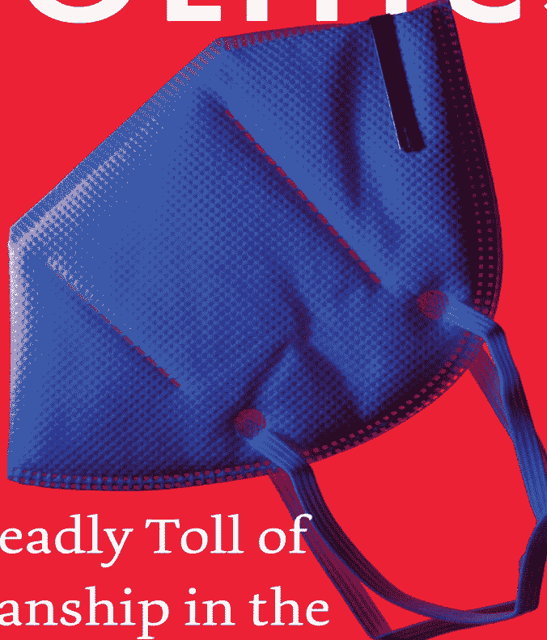

姓名：Gadarian, Shasta Kushner, 1979–作者；Goodman, Sara Wallace, 1979–作者；Pepinsky, Thomas B., 1979–作者。

书名：大流行病政治：新冠时代极极化的致命代价 / Shasta Kushner Gadarian, Sara Wallace Goodman, Thomas B. Pepinsky 著。

版本 1.0

提供英国图书馆书目录索引数据

编辑：Bridget Flattery-McKey, Alena Chebanov

封底设计：Kevin Quach

制作：Erin Boyd

宣传：James Schneider, Karen Farquhar-Thompson

封封感谢：Davy Russo / Adobe Stock

- 5. 大流行病的政治化 42

# 致谢

我们感谢国家科学基金会、鲁塞尔·萨奇基金会、康奈大学社会科学中心、坎贝尔公共事务学院以及叙拉库斯大学冲突与合作计划提供的慷慨资金支持。这些资助者对我们在此处展示的任何数据的收集、分析或解释均不起任何作用。YouGov 收集了我们在书中使用的问卷调查数据；我们感谢 Ashley Grosse 和 YouGov 的其他人在整个过程中的提供的支持。特别感谢 Emma Dreher、Ahmed El Sammak 和 Kevin Zong 提供的卓越研究协助。

我们非常幸能与 Bridget Flannery-McCoy 和 Alena Chekanov 合作，这一项目的圆满完成。她们和普林斯顿大学出版社的其他团队成员使编辑过程变得简单而顺畅，Bridget 帮助我们清晰、完整地讲述了这场被政治化的疫情故事。我们感谢他们的支持与鼓励，尤其在这场颠覆了我们生活和工作方式的大流行病期间，这种支持尤为难得。

我们感谢现实生活中以及 Twitter 上的许多朋友和同事提供的宝贵反馈和建议。感谢来自美国大学、达特茅斯学院、丹佛大学、哈佛大学、康斯坦茨大学、伦敦政治学院、麦吉尔大学、北卡罗来纳大学切皮尔分校、普林斯顿大学、叙拉库斯大学和威斯康星大学的同事们举办我们的虚拟讲座，让我们获得了极其有用的反馈。感谢那些学校、营地和看护者安全地照顾了我们的孩子，让我们能够继续教学和研究。作者感谢彼此的辛勤、创意和坚持，并为多元化的情感提供了一个富有成效的宣泄。最后，我们感谢家人的耐心、支持、爱和乐观，当我们三个人找到了一种比大多数普通人更多地思考疫情的方法时。我们将此书献给他们：给 Mike、Jonah、Ethan、Ella、Adam、Micah、Silvia、Julie、Eli 和 Anisa。

## 引言

塔尔萨市俄克拉荷马银行中心的地板浸泡在红、白、蓝的色彩中。唐纳德·特朗普总统热热的支持者们举着标牌，戴着“让美国再次伟大”的帽子，穿着 T 恤，上面的口号从“枪支、上帝和特朗普”到“让自由派再次哭泣”不等。与会者有老有少，但主要是白人。父母带着孩子们来到现场。那里有供售卖的纪念品。场馆内的每个人都准备好了手机，渴望捕捉这位主角人物的时刻。

在室内，感觉像是一场典型的集会。然而，室外的气氛非常紧张。距离乔治·弗洛德（George Floyd）被明尼阿波利斯警察局官员德里克·肖文（Derek Chauvin）杀害已不到一个月，抗议者们聚集在会场，拿着写有“下台特朗普”、“没有公正就没有和平”和“削减警察经费”的标牌。执法部门维持着严密的封锁。警察拿着带有标志的盾牌和警棍，俄克拉荷马高速巡逻队和国民卫队的成员也已武装待命。在街道上——用巨大的黄色大写字母写着“黑人命关重要”（BLACK LIVES MATTER）。

但让这场集会引起关注不仅仅是抗议者的出现。真正不同寻常的是人数。那是 2020 年 6 月 20 日，特朗普在全球疫情爆发期间举行了他的四个月以来的首次线下竞选集会。

在典型的选举中，一位总统离开竞选活动场四个月是闻所未闻的。对于像特朗普这样渴望掌声的候选人来说，情况尤其如此。但这不是寻常的一年。美国正处于全球疫情之中。新型冠状病毒 SARS-CoV-2——通常被称为 COVID-19——从 2019 年底中国武汉的一种源自动物的感染，演变成一场全球范围内的公共卫生紧急事件。COVID-19 通过呼吸、咳嗽、喷嚏或说话时产生的呼吸道传播传播，当人们近距离接触时，传播的可能性更大，特别是在通风不良的室内设施等场所。COVID-19 的感染情况因人而异。有些感染者没有症状；有些人会经历发热、嗅觉和味觉丧失以及呼吸困难；有些人则需要住院使用呼吸机。对许多人来说，COVID-19 证明是致命的。

## 疫情的政治化

很难描述 COVID-19 疫情对美国造成的破坏。无论贫富、红州还是蓝州、黑人白、沿海还是内陆、城市还是农村，美国没有任何一个角落不受影响。

并确保他们的家人安全。阿尔茨海默症、阿片类成瘾和癌症等疾病不会根据美国人的体育忠诚度、音乐品味或政党偏好来区别对待。当脊髓质炎在美国导致儿童瘫痪并夺命时，跨政治光谱的美国人向白宫捐赠了三百万枚十分币，资助了脊髓质炎疫苗的研发。在大流行病等公共卫生危机期间，我们可能会预期人们在寻求了解情况和保障安全时，差异会消失。但在新冠肺炎（COVID-19）的情况下，并没有发生。

此外，随着危机规模的显现，我们本可能认为人们会团结起来支持政府采取行动来克服它。经济危机，如大萧条（1929-1933）和大大衰退（2007–2009），产生了对政策的巨大需求，这些政策扩大了联邦政府的范围和规模，以保护公民免受金融冲击最严重的影响。历史上，恐怖袭击和军事危机往往增加总统的批准率，因为团结感和爱国主义情绪的增长，反对者的批评也随之消失。这种“围旗效应”没有任何一个地方比9/11袭击后更明显，当时“我们团结一致”（United We Stand）的横幅挂在美国人的家庭中，乔治·W·布什的批准率飙升至90%以上。在新冠肺炎的情况下，这种凝聚也没有发生。

美国的大流行病注定会很糟糕。我们可以将美国视为一个患有一系列基础疾病的医疗患者，这些疾病使其容易患病。一种基础病是衰败的医疗体系，保险利益集团在成本和覆盖方面发挥着过时的作用。第二种基础病是深层次的社会、经济和种族分歧，结合医疗资源获取的不平等，延续了结构性不平等。第三种基础病是特朗普总统——他痴迷于展示力量以确保自己的形象、负责协调应急响应的日益庞大的官僚机构、拒绝承担管理危机的责任，并培养了一种围绕着他不可挑战的权威的个人崇拜。

但没有什么证明对深化新冠肺炎危机更具影响，莫过于党派极化这一致命的共病。极化是指政党、运动和个人倾向于将自己定位在政治光谱的极端，而非中心。它是“对立或冲突的原则、倾向或观点的同时存在”。¹⁴ 民主本质上是冲突性和竞争性的，但极化拉开了人们之间的距离，减少了达成共识的可能性，并在极端形式下破坏了礼貌。正如政治学家詹妮弗·麦考（Jennifer McCoy）和穆拉特·索默（Murat Somer）所写，“极化政治始终带有自发的风险，侵蚀交叉纽带和非党派的妥协渠道，并变得有害。”¹⁵

简而言之，极化将“人民”中的“我们”分成了“我们”与“他们”。个人离开了中心地带（跨群体对话和妥协发生的地方），并向极端移动。在美国，这种离心力是由党派倾向驱动的。两个政党——民主党和共和党——划分了美国选民群体。

在今天的美国，党派倾向不再是指你选择的候选人或你支持的政策。美国的党派倾向是一种社会身份。它是一种观点、经历和特征的身份，这不仅定义了你投票给谁¹⁶，而且越来越多地定义了你是谁。重要的是，党派倾向是一种社会身份，因为它不仅是你个人的感受，还取决于你如何展示自己以及如何与他人交往，包括与你拥有相同身份的人（你的同党）以及与你身份不同的人（你的政派对手）。

当然，个人拥有许多社会身份，包括性别、宗教、阶级、教育和性格。但在今天的美国，这些身份中的许多正与党派倾向趋同.¹⁷ 例如，从历史上看，美国虔实的基督徒曾是共和党和民主党的共同选民基础。今天，福音派基督徒压倒性地投票给共和党¹⁸ 美国农村人历史上既投过共和党也投过民主党，但今天农村白人日益趋向于共和党¹⁹。由于这些原因，政治学家莉莉安娜·麦迪森（Lilliana Madison）将党派倾向描述为一种“元身份，带有其所暗示的所有心理和行为放大”。²

当党派倾向成为社会身份时，它将“谁是民主党人或共和党人”的身份与“民主党或共和党做什么以及他们听谁的”联系起来。例如，如果美国人对待党派倾向是程序——即通过检查他们关心的问题并看哪个政党最能支持这些问题——而不是在政党立场改变时改变或更新他们的党派倾向，那么强硬党派分子（即那些强烈认同某一政党的人）就会改变自己的立场以匹配他们所认同的政党。没有什么比2016年总统大选中那种打破常规的经历更能作为这一命题的证据了。共和党长期以来被视为美国全球资本主义的政党，发现自己被一位反对全球贸易、支持保护主义的政治人物领导。政党变了，其许多支持者的偏好也随之改变。换句话之，美国人效忠于他们的政派身份，而非政策信念。这就是政治学家朱莉亚·阿扎里（Julia Azari）所说的“弱势政党与强党派倾向”的毒性结合，即政党成员在总统和政党背离核心原则时仍愿意追随的意愿。

美国政治并非一直以极端极化为特征。该国家的赢者通吃选举制产生了两党制，在这一制度下，共和党和民主党必须诉诸多个社会群体以形成可行的选举联盟。但过去是政党内部的意识形态差异（例如保守派自由派共和党人），而现在意识形态与党派倾向紧密结合，自由派投票给民主党，保守派投票给共和党。即使是大多数独立选民也倾向于某一个政党，其行为方式也像党派分子。

公民擅长捕捉党派信号，因为美国人已经按照党派归属进行了分类。在过去的时代，交叉纽带是破坏党派分歧的关键因素，但现在这种纽带变得减少且脆弱。在共同纽带可以克服党派分歧的地方，今天左右两人的互动不再那么频繁。党派分类的第二层含义更为阴险。如果党派倾向是一种日益与其他身份对齐的“大身份”，那么意味着不需要诉诸党派倾向就可以动员选民。一个确信农村白人具有其特定倾向的竞选活动，通过诉诸其农村身份来动员选票同样有效。

决定了谁佩戴口罩，谁不佩戴。它营造了一种对政府以及人与人之间低信任的环境。总体而言，党派极化导致了公众对疫情的反应，即个人根据其政党认同来评估风险、形成态度并参与某些健康相关行为（或不参与）。

但这并非不可避免。是的，美国面临着结构性和社会前提条件，这些条件会让任何大流行病都变得艰难。是的，美国人在危机发生之初就因党派分歧而严重分裂。但极化并不是集体行动或协调、有效应对疫情的不可逾越的障碍。其他形式的极化在世界范围内都很常见，英国、韩国和台湾等深度分裂的国家并没有将党派对立视为观察或经历 COVID-19 疫情的视角。虽然美国的局部分裂比任何其他先进民主国家都更深、更广，但这并不意味着他们在应对 COVID-19 时的表现——从对政府如何处理危机的认知到佩戴口罩和接触追踪等各种问题——是不可避免的。

美国与其他高收入民主国家相比区别的关键因素在于，特朗普政府选择将疫情政治化。在 COVID-19 疫情初期，疫情的情况以及哪些类型的政策可以有效管理它至关重要。对专家的积极破坏始于总统，渗透到他拥有重大影响力的机构中（如疾病控制与预防中心），并被保守派媒体的放大，最后下传给各州长和市长。最重要的是，它影响了数百万向他寻求领导的美国人的行为。

面对多条相互冲突的信息——以及一个削弱自身健康官僚机构的行政首脑——美国人不得不决定如何评估来自冠病毒的威胁以及随后如何做出反应。在这些冲突的信号下，美国人听从了他们所属政党的领导意见。这导致普通美国人在应对危机的方式上产生了剧烈的党派差异。

这是我们的论点。美国对 COVID-19 灾难性反应的核心解释是党派对立。特朗普政府及其党派盟友通过将疫情与特朗普个人的执政命运联系起来，选择了疫情政治化。这一决定导致随后对 COVID-19 疫情的应对主要变成了党派政治，而非公共健康。这种党派反应是全方位的，触及了疫情涉及的所有方面，从健康行为到政策观点，再到疫情高峰期间举行的选举担忧。随着这些差异的持续，它们发生了泛化。被削弱的社会团结——他们采取行为保护他人有时也保护他们自己的意愿——成为美国人解释以及他们选出的官员对疫情做出反应的核心框架。这些观点上的差异以及随后的行为差异导致了数十万美国人的死亡。在两年的疫情政治之后，政策格局被永远改变了，因为曾经跨党派的问题——例如针对学生的措施和脊髓疫苗要求，以及对专家的信任——现在已变得政治化。

## 调查疫情

为什么加利福尼亚州和内华达州发布了居家令，而邻近犹他州和俄明州却没有？为什么美国总统告诉美国人 COVID “会消失的。保持冷静。它会消失的”，而此时医院已经满员，护士和关键工作者在外面为寻求口罩等防护装备进行抗议？我们是否应该用消毒剂擦拭信件？如果我们在户外并保持社交距离，我可以见邻居吗？我可以在哪里买到纸巾？我在外面需要戴口罩吗？我们正在平息曲线吗？在监督孩子在线网课的同时，我们还要居家办公多久？你们认为我们不得不取消暑假吗？政府是否正在尽一切努力保护我、我的家人和我的社区？

这些是我们像美国人一样，在 2020 年 3 月开始问的问题。随着美国大部分经济和社会生活转为线上和居家进行，我们也看到了自己的生活被疫情所颠覆。作为政治学家，我们特别敏锐地观察这种转变中的政治影响。作为政治过程和行为的专家——无论在美国还是全球范围内——我们关注我们的美国同胞如何对此做出反应。尽管有“会消失”的说法，但早期来自中国和意大利的病例数增加、医院挤满、公民被隔离以及封锁的早期报道是不可能忽视的。

在意识到 COVID-19 抵达美国是不可避免后，我们决定利用专业技能研究美国人的态度和行为。我们中的每个人都是政治不同领域的专家：从情绪和外部威胁（从恐怖主义到健康恐慌），主要在美国（Gadarian）；公民身份和民主威胁，包括移民和选举干预，主要在欧洲（Goodman）；以及经济危机和民主倒退，主要在亚洲（Pepsinsky）。我们感兴趣的领域和我们的生存担忧开始汇聚到同一个的话题中。我们想知道美国谁和我们有着同样的担忧。我们想知道美国人是否团结起来应对这一集体挑战，还是会像我们多年研究中恐惧地怀疑的那样，政治将主导美国的应对。我们意识到，我们可以提供一种关于新兴危机的视角，这种视角并非来自社交媒体的回声室或有线新闻的嘈杂。

启动一项大型研究项目来调查美国人在应对新兴健康危机的行为和态度绝非易事。我们在对新兴健康危机的行为和态度进行调查时，增加了工作量。我们对普通美国人进行了六次调查，从 2020 年 3 月（州开始封锁，转向虚拟教学）到我们研究的预期。在社会科学中，这被称为“预注册”（preregistering），通过了伦理委员会的批准并获得了美国科学基金会快速响应研究基金（Rapid Response Grant）的资助，我们的调查在 2020 年 3 月开始，当时我们正转向居家办公。


来源：https://covid.cdc.gov/covid-data-tracker/#trendsdailcases

总体而言，我们对普通人进行了六次调查，从 2020 年 3 月（州开始封锁，学校转向虚拟模式）到 2021 年 3/4 月（拜登就职，以及疫苗的大规模推广）。每一波调查都提供了美国在疫情反复期间的不同快照（见图 1）。我们还能利用这一年中的其他事件。我们可以询问例如，乔治·弗洛伊德死后的种族正义（第 3 波）、复学的挑战（第 4 波）、即将举行的总统选举的意义（第 5 波）以及疫苗之前的态度（第 6 波）。

相比于每一波都抽取新样本，这样做既昂贵又耗时，因为调查公司必须重新联系相同的个人并激励他们参与。然而，这种策略让我们对某些情况有了无比拟的洞察，例如信念的僵化或灵活性，以及环境因素（如当地新冠病例）或偶然因素（如失业）随时间推移的影响。在 2021 年 3 月/4 月的最后一次调查中（受罗塞尔·萨奇基金会的资助），我们增加了所谓的“过度采样”，即在我们的样本小组之外额外采访了一组非白人受访者，其中包括 450 名黑人受访者、450 名非裔裔美国人和 450 名拉丁裔受访者。这些额外的受访者让我们能够更可靠地理解少数裔社区在疫情期间状况如何，以及他们在疫苗方面的经历。

在追踪疫情期间健康行为、态度、担忧和政策偏好的演变过程中，我们阐述了党派性在塑造个人应对新冠肺炎反应中发挥早期且持续的作用。尽管病例增加、病毒扩散失控且生命损失前所未有，但即使考虑到试图脱离国家背景的局部因素，党派性在疫情早期就定义了精英阶层和大众对疫情的反应。一旦定型，疫情的党派轨迹就从未偏离。

我们通过十章来阐述这一论点。我们的目标是对美国新冠肺炎疫情的政治提供一个定性的描述，从它如何变得党派化，到这种选择的后果，从个人的担忧和政策态度，到佩戴口罩和接种疫苗等健康相关行为。全面的描述必然始于疫情到达美国海岸之前。第一章通过详细描述我们标记为“预存状况”的内容来铺垫舞台，我们在引言中对此做了伏笔。它们包括日益恶化和政治化的医疗环境、经济和种族不平等、特朗普本人，以及最重要的一点——党派极化。我们将这些条件视为“零时间点”，即流行病学家所描述的病原体开始高率繁殖之前的爆发阈值时间。¹ 虽然这些因素会使美国的疫情爆发变得糟糕，但将疫情政治化的选择——将党派身份认同定在行为和态度上——使其变得独地更加糟糕。这些因素中的任何一个单独都会挑战集体或有效的疫情应对；而它们的相互作用证明是致命的。

第二章详细记录了从2020 年 1 月到 4 月的疫情起源。虽然在新冠肺炎的漫长历程中仅涵盖了短时间，但我们认为，在这些关键的早期阶段，精英信号、媒体放大和党派选择足以永久地影响疫情的轨迹和严重性。随后的一系列选择——从 2020 年夏季的早期开放，到特朗普在染上新冠肺炎后仍拒绝佩戴口罩的形象，以及红州与蓝州之间不同的支持背书和接种率——都复制了这些精英阶层的模式。在详细阐述新冠肺炎疫情如何开始席卷美国各社区时，我们也看到了预存状况的相互作用如何使美国变得独地更加糟糕。在这里，我们与从英国到巴西的多个国家进行了比较，以说明民粹主义领导者和极化等预存状况如何导致糟糕的疫情，但又使党派政治化变得不可避免。


# 第一章：既有状况

## 疫情前的美国

第 3 章至第 10 章从精英和政治转向了我们分析的核心：个人。疫情是全方位的——它影响了社会、经济和政治态度。但它始于健康。在第 3 章中，我们询问了基本的健康行为。谁洗手次数更多？谁戴口罩？谁停止了旅行？党派性始终是健康行为最强的预测因素；民主党人表现得比共和党人更积极。第 4 章转向美国人对疫情的担忧，以及情绪在健康行为和责任归因中起的作用。通过关注这些情感动机，我们看到民主党人表达了愤怒、厌恶和焦虑，并更频繁地寻求信息，而共和党人则一致报告感到希望。

第 5-7 章从个人行为和情绪转向政策态度。第 5 章从健康政策开始：政府是否应该执行封锁措施？政府是否应该监控人们的活动？第 6 章将焦点转向经济：新冠肺炎和经济关闭对我们的受访者产生了什么影响？失业等经历如何影响对经济政策和政府优先事项的看法？政府应对数百万美国人的经济困难应该怎么办？第 7 章考虑了移民政策：谁支持关闭国际边界？谁支持对美国人进行隔离？在每一个这些政策领域，态度在几乎每一个维度上都根据党派性产生了强烈的分歧。

第 8 章和第 9 章将疫情置于更广泛的社会问题背景下。疫情与本世纪美国自由民主面临的两大重大威胁并行：乔治·弗洛伊德去世引发的种族不平等和警察暴力暴露，以及充满争议的 2020 年总统选举。第 8 章考察了疫情与种族的交集，揭露并提高了人们对黑人和其他美国少数裔社区在健康和死亡方面深度不平等的意识。这一章还探讨了针对亚裔美国社区的暴力，他们被不公平地当作病毒媒介的替罪羊，这种不公是移民社区及其后代在疫情期间经常经历的。

正如公民平等是民主的核心宗旨一样，自由公平的选举也是。第 9 章关注了对美国选举制度完整性和独立的直接攻击。从对非法选民毫无根据的担忧到对投票可靠性的质疑，民主是在不稳足的基础上进入疫情的，但这些主张和阴谋让它变得糟糕。当支持特朗普的叛乱分子在 1 月 6 日冲入美国国会大厦时，深重的伤害已经造成。

第 10 章通过转向疫苗接种政治结束了实证章节。政策专家——以及数百万热切的美国人——乐观地希望疫苗的到来将开启疫情的终结。

在结论章节中，我们提出了一个根本性问题：有没有可能不同？我们贯穿的论点是，党派化的疫情是不可避免的，但在过程中是否有一个时间点国家可以发生改变？我们认为，如果有不关注选举逻辑的领导层，加上更稳健的公共卫生基础设施，结果可能是不同的。

疫情依然与我们共存。它体现在家庭餐桌上缺席的亲人、那些未能恢复的工作、所谓“新冠后遗症”患者的症状中，以及整整一代儿童面临的学习滞后中——我们可以一直列下去。它也存在于内疚与愤怒中；存在于所谓“红人”与“蓝人”之间的不信任中。作为美国人，我们必须理解这场疫情，以调和过去并尝试共同前进。但它并不是我们要留下的东西。就像病毒一样，疫情政治也变成了一种流行病。

在“患者零”——2020年1月中旬，华盛顿州诺霍米什县的一名35岁男性（他最近刚去过中国武汉）染上COVID-19之前，且在“冠状病毒”和“COVID”这两个词进入集体词汇很久以前，美国已经做好了应对一场艰难的疫情形势的准备。世界上每一个国家都面临着应对前所未有的公共卫生紧急状况的挑战，但几乎没有先进民主国家的反应像美国这样低效且无效。为什么？本书的其余部分将讨论疫情政治，以及政治选择是如何做出对美国人产生不可估量后果的。在本章中，我们将通过关注做出这些选择的背景，为理解疫情政治奠定基础。

本章揭示了在疫情爆发前的一系列制度和政治脆弱性。我们将这些描述为“既有状况”，即在2020年1月1日就已经削弱政策制定环境的结构和政治。这些既有状况包括：(1) 深度的党派极化；(2) 唐纳德·特朗普本人依靠个人魅力的人格和民粹政治来做出可能在选举年维持其受欢迎度的决策；(3) 崩溃且过时的美国医疗体系；以及(4) 系统性的种族和经济不平等。这些既有状况为美国爆发糟糕的疫情铺平了道路，使其特别容易受到党派政治化的影响。单看每一种既有状况，都会让缓解疫情变得困难。它们的相互作用使得美国的新冠疫情变得独有地可怕。

## 党派极化：最根深蒂固的既有状况

党派极化对美国政治的影响怎么强调都不为过，更不用说COVID-19疫情了。极化是美国应对疫情时最根深且最终产生影响的既有状况。如果没有极化，一个受魅力政治权威支持的反复无常总统将受到其政党内部更严格的纪律，而两党对其行为负责的跨党努力也将更容易维持。另一方面，极化实际上保护了政治家，让他们不必面对其选择的后果。

正如引言章所解释的，极化创造了一种政治环境，在这种环境中，党派中间立场被抛弃，转而倾向于更极端的党派立场，且两党在缺乏交叉立场优势的情况下越走越远。在美国的背景下，政党精英层面的党派极化意味着，领导人更多地关注攻击对手和展示其党派忠诚，而不是制定良好的政策或为共同问题寻找跨党解决方案。这也延伸到了更广泛的人群，因为美国人在社会上变得越来越极化。最令人担忧的是，美国的党派极化不仅反映了政策问题上日益扩大的分歧，还捕捉了将差异视为“善”与“恶”的*道德化*倾向。学者们将这种情感效用描述为“情感极化”（`affective polarization`），使得分歧变得具有破坏性。简而言之，“民主党人和共和党人都说对方政党的成员是虚伪、自私且固执不己的，他们不愿意跨党派界进行社交，甚至不愿意在各种其他活动中与对手合作。”

### 党派身份作为社会启发式

党派极化是如何成为日常政治和社交生活的主导特征的？作为一个普遍观察，大多数美国人在大多数时候对政治关注很少。当他们对某个重要话题（如经济、外交政策或新的健康危机）信息较少时，他们会利用自己的社会身份作为线索，决定如何应对、处理信息和解释事件。这意味着人们根据他们所认同的社会群体而产生的自我认同感，塑造了他们的思考。

各种类型的社会群体——从性别到经济阶级再到喜欢的体育球队——在社会世界中传达了归属感和身份认同。但在当今美国，党派倾向是这些身份中最强有力的之一。它是意义和自豪感的来源，是识别谁与你相似、谁与你不同的捷径。党派身份是一种启发式方法，简化了在特定问题上持有相同政策观点的人与不持有的人之间原本复杂且多层次的区分。

因此，作为一种社会身份的党派倾向不仅引导个人做出如投票给谁以及采取什么政策立场等政治选择，而且越来越多地影响诸如选择应该喜欢谁并以尊重和尊严对待谁，以及应该不喜欢谁并以敌意对待。社会科学中最一致的发现之一是，人们倾向于自己的社会群体（内群体）而非他们不属于的群体成员（外群体），并会主动对外来人产生歧视，特别是在分配资源时。人们在日常生活中会避免与外群体成员互动。为了说明这种对外群体敌意的政治影响有多么强大，政治行为学者们发现，不喜欢反对党的支持者比喜欢自己政党的成员更能强烈地激励投票选择：民主党人和共和党人基于对党派对手的厌恶而投票的动力比基于自身政党立场的动力更强。党派人士认为对方党的支持者在道德上是可疑的。对手变成了敌人；分歧变成了敌对。由于美国人日益追随党派线索来培养与此人相似的人的社交网络，这种“分类”过程在活动、爱好和新闻来源中创造了党派“孤岛”。即使是经济决策（例如购买什么种汽车）也会与党派倾向相关。`MSNBC`和`CNN`的观点存在差异；`Fox News`对2017年席卷波多黎哥的飓风报道比例少于`MSNBC`。

这些信息供应差异是由社会身份的心理倾向维持的。强党派人士寻求证实他们既有观点的信息，并忽视那些观点，因为在社会心理学中，他们从内群体获得自尊。换句话说，我们可以从心理角度将党派行为理解为表达。正如埃拉·克莱因在《我们为何极化》中所述：“当我们为了解决问题而参与政治时，我们是在交易。但当我们为了表达自我而参与政治时，这意味着政治已变成了一种身份。”作为疫情的既有状况，党派极化意味着美国人倾向于接受他们青睐政党领导人的信息，无论这些信息是否准确，并拒绝对手领导人的信息，无论这些信息是否准确。

### 精英极化与特朗普现象

特朗普总统的当选是当代美国政治中党派极化强大程度的鲜明写照。与越南战争不同，两政党在经济、贸易和外交政策等问题上的立场重合程度要少得多。在精英层面，尽管早期曾希望国会民主党人和共和党人能在基础设施和处方药成本等问题上达成某种共识，但在特朗普执政期间，国会几乎没有跨党合作精神。特朗普的政策议程——例如针对穆斯林的移民禁令和经济民族主义的“购买美国制造”计划——与现有的共和党政纲有显著不同，但大多数共和党人都拥护总统，并与特朗普的优先事项步调一致。例如，只有少数共和党人反对针对穆斯林的移民禁令，其中最著名的包括议员约翰·麦凯恩和林西·格拉姆。未来的副总统迈克·彭斯在特朗普竞选期间首次暗示这一构想时，曾斥责针对穆斯林的禁令是“冒犯性的且违宪的”。然而，受特朗普在共和党内强大品牌的震慑，像泰德·克鲁斯、克里斯·克里斯蒂和林西·格拉姆这样的前共和党对手变成了总统最响亮的助威者。

这种极端的极化在公众中得到了反映，因为跨党合作精神的衰落导致党派立场与意识形态和其他社会身份的结合变得更加紧密。2016年选举后，美国见证了行动主义的激增，形式包括在“不可分割”（`Indivisible`）运动旗下倡导自由政策的志愿者网络、女性游行，以及在全国范围内推选基层候选人的进步团体——这是一场由不同团体组成的抵制运动，他们都致力于反对特朗普的政策。政治右翼也有类似的动员活动，从查尔斯维尔的新纳粹主义分子和“自豪男孩”，到演变成一种“匿名”式的氛围，充满了特朗普选举真相、新冠否认者和阴谋论幻想家，他们声称华盛顿精英经营着一个儿童性贩卖集团。

当然，党派立场和政策观点并非固定不变。人们的观点会随着重大、破坏性的生活经历而发生改变。情感（尤其是焦虑和共情）以及纯粹的自利也可以超越党派信号。但党派立场具有很强的粘性。它变成了政治折射的棱镜，也引导了人们寻找和接受信息的方式。

### 2020年冬天：极化的巅峰

在疫情爆发前夕，这种极化程度达到了现代史所未有的高度。我们甚至可以将2020年的冬天描述为它的巅峰。众议院举行总统弹劾听证会，这是由于一名举报人控诉特朗普与乌克兰总统弗洛基米尔·泽连斯基在通话中存在利益交换。无论国会成员在私下里对总统有多么严厉，国会的每一位共和党人都排在特朗普身后，为2020年选举周期的进程押注。没有一位众议院共和党成员投票支持将弹劾案送交参议院。参议院罢免总统的投票以47比53票失败，没有共和党参议员投赞成票罢免特朗普。

公众意见也呼应了这种精英层的极化，党派人士为支持或反对总统而排队。根据蒙茅斯大学的一项调查，92%的民主党人和52%的独立选民支持弹劾，而共和党人这一比例仅为13%。对特朗普总统的支持率显示出类似的模式：随着时间的推移，自科学民调查出现以来，其极化程度比任何其他总统都更严重。在2020年1月特朗普首次弹劾期间进行的一项调查中，特朗普的支持率（94%）与民主党的支持率（7%）之间存在87个百分点的差距。正如这些惊人的数字所示，美国人深陷分裂，在党派立场的驱动下，日益极化为由党派身份定义的两个不同阵营。每一位独立选民——即陷入党派分化的三分之一美国公众——以及一群不认为自己接近任何政党的独立选民，大多数人都会倾向于民主党或共和党的方向（并投此票），其行为更像党派人士而非真正的独立选民。极化实际上描述了美国人在任何问题上都存在的多元化倾向。

美国人倾向于认为每一场选举都是他们最重要的。但在一位刚刚经历过弹劾并违背了几乎所有治理规范的争议性总统的背景下，2020年选举被预认为是一生中最重要的。对于三分之一陷入党派分化的美国公众中的每一位独立选民——以及一群不认为自己接近任何政党的独立选民，大多数人都会倾向于民主党或共和党的方向（并投此票），其行为更像党派人士而非真正的独立选民。极化实际上描述了美国人在任何问题上都存在的多元化倾向。在选举眼前，左右双方都通过党派视角来看待任何政治问题。

## 特朗普的领导风格：魅力威权与庇护政治

极化本身就让政策制定变得困难。一个对民主规范缺乏承诺且对治理不感兴趣的总统会让情况变得更加困难。特朗普的治理风格是反复无常且分裂的，从他鲁莽的言论方式到大写字母推文，以及对民主党和共和党的人身攻击。这些个人偏好可能令人反感，但它们并不是我们将特朗普视为一种既有状况的原因。我们并不是主张共和党的任何特定观点或承诺导致了美国应对措施的失效。相反，我们认为特朗普本人在危机中证明了他是致命的：他基于魅力威权和庇护关系的领导风格，以及他追求的经济和政治实力而非解决问题的优先事项。

特朗普的虚荣心既是他那种鲁莽领导风格的来源，也是他识别信赖顾问的工具，这些顾问往往是他的长期朋友、家庭成员或商业伙伴。作为他夸张人格和投影成功形象的延伸，特朗普聚集了大量的支持者，用以传递韦伯所描述的魅力威权。这种权威在个人被视为救世主、先知或英雄时出现。正如詹妮弗·梅罗拉和伊丽莎白·泽马赫所言，“唯一重要的是那个被魅力威权所认同的个人。”在2016年接受共和党提名的演讲中，特朗普描绘了一个处于混乱和暴力之中的美国。他通过说“只有我能修复它”来为自己的总统之路辩护。

但全球政治学者数十年的研究表明，魅力领袖不仅仅是绕过政党。相反，他们会改造政党，破坏内部层次，并将党内晋升与个人关系挂钩。魅力威权之所以强大，是因为它是高度个人化的，但由于它集中在一个身上，所以它的制度化程度很低，例如无法以同样的强度转移给非唐纳德·特朗普的人。这意味着，如果没有特朗普作为共和党的领袖，特朗普主义的长期维持将非常困难。

作为这种魅力威权的延伸，并作为执政期间巩固和保护权力手段，特朗普根据忠诚度而非表现、专业知识或技能培养了一群信赖顾问。他对捐赠者、家庭成员和商业伙伴的庇护和偏袒，这在现代美国历史上是前所未有的。在实践中，这意味着非常高级职位——这些对于疫情政策设计和应急响应至关重要的职位——是由那些对总统忠诚、但缺乏关键经验或不屑于进行跨部门协调、与州合作、识别获取关键物资以及政府在紧急情况下面临的众多任务的人所担任的。

除了对专业知识的漠视外，特朗普还掏空了联邦官僚机构。联邦政府的几个重要职位由代理局长担任，这反映了特朗普对参议院批准程序的蔑视，也反映他认为代理局长更容易受他控制。联邦官僚机构的关键职位——那些对有效的公共卫生响应至关重要的职位——要么处于空缺，要么由临时任命者担任。布鲁金斯学会（`Brookings Institute`）的一项研究统计了关键内阁级部门中惊人数量的空缺职位：教育部经参议院确认的职位空缺率为44%，卫生与人类服务部为17%，国土安全部为65%。2019年，美国疾病控制与预防中心（`CDC`）派驻中国疾病控制中心的流行病学家辞去了该职位。特朗普政府没有任命继任者，而是取消了这一职位；这导致在2020年1月疫情爆发时，没有一名美国人在中国监测公共卫生状况。

在美国极端的党派极化背景下，特朗普从未因其领导风格的过激或治理的失败而受到其支持者的惩罚。他仅仅是一个具有分裂性的人物，受到支持者的崇拜，并受到反对者的敌视。在他整个执政期间，他在盖洛普（`Gallup`）民调数据中的工作批准率从未达到50%，且其不批准率几乎始终高于批准率，如图1.1所示，这种现象在现代政治时代是所未见的。

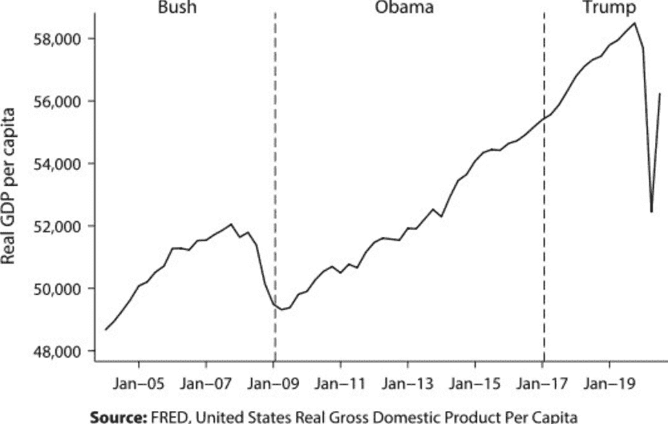

一方面，经济状况、行政决策和政治事件与另一方面对特朗普的大众支持之间几乎没有联系。这证明了该政府既不是因为有效的治理而获得回报，也不是因为治理不力而受到惩罚，而是高度关注他个人本身。

相比之下，此前总统深受饱受争议和不受欢迎的决策的影响。乔治·W·布什在9/11事件后获得了一波支持，但在经历了伊拉克战争的余波和对卡特里娜飓风的处理不当后遭受了巨大损失。巴拉克·奥巴马在两个总统任期内的人气波动剧烈，早期由于金融危机带来的支持让位于了对联邦政府规模和范围的更多分裂。作为新冠（`COVID-19`）极化的预演，围绕健康和医疗保健等的问题（如《平价医疗法案》）不仅变得具有党派之争，而且与种族态度以及对更扩张医疗体系受益者的信念联系得更加紧密。

但特朗普从未需要大多数美国人给他积极的批准率。在美国的政治体系中，赢得连任选举不是通过获得大多数选民票，而是通过夺得关键州来实现。正如安德里亚·施奈德（`Andrea Schneider`）所认为的，特朗普那种独特的魅力号召——不仅仅是作为一个民粹主义者，而是作为一个拥有建制内政治家和其他建制精英所缺乏的独特权威和知识的“超级英雄”——可以解释他特定的政策选择以及这些政策在其支持者中的吸引力。具体来说，对特朗普而言，这意味着对经济增长的单一关注。

特朗普从前任者那里继承了强大的经济，在奥巴马总统领导下近十年的稳步增长后（见图1.2），他迅速将美国的成功归功于自己。特朗普认为经济表现是他竞选连任的不可或缺的一部分。2020年1月，在弹劾案的前夕，他正在达沃斯向世界经济论坛讲述美国经济的繁荣。他对经济增长有着近乎单一的痴迷。

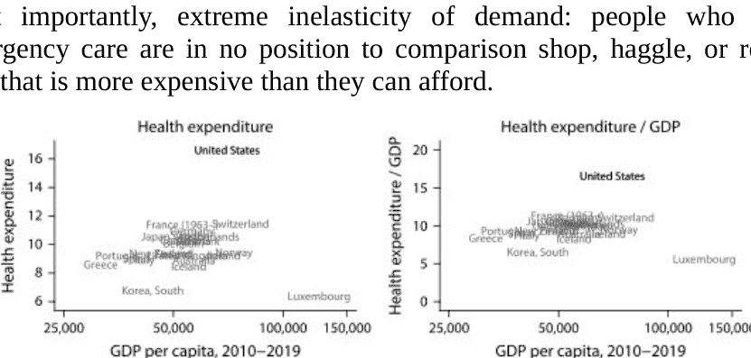

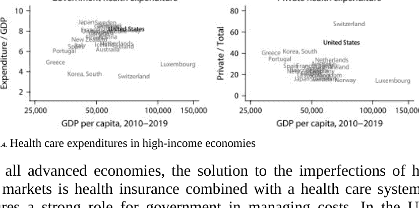

## 崩溃的医疗体系

对所消费“商品”价值存在无与伦比的不确定性，提供者面临着令人眼花缭乱的许可要求，最重要的是需求极度缺乏弹性：需要急救治疗的人根本没有精力去比较商店、权衡或拒绝超出其承受能力的医疗服务。

在所有发达经济体中，解决医疗市场缺陷的方案是医疗保险，并结合政府在管理成本方面的强有力作用。例如，在英国，大多数医生是国家医疗服务体系（`NHS`）的员工，该体系作为政府政策控制成本。私人保险仍然存在，但国家医疗服务体系作为一种社会权利为所有人提供基础保障。在德国，雇主和员工都向非营利医疗基金交费，这些基金涵盖了其余的人口。美国则完全不同，维持着一个比任何其他高收入国家都依赖市场机制的医疗体系。美国人通过许多不同方式支付健康费用：通过雇主补贴的保险或医疗维护组织、个人购买医疗保险、自付医疗费用、通过医疗保险（`Medicare`）或医疗补助（`Medicaid`），或者通过退伍军人事务部。长期以来，许多美国人根本没有医疗保险（这是《平价医疗法案》旨在填补的空白）。

高成本并不意味着能产生更好的健康结果。相反，它们会导致结果产生更大的不平等。对于有保险的人来说，美国的医疗服务是世界级的。而对于没有保险的人，世界级的美国医疗服务通常无法获得。很难想象，当在这种局面中加入一种高传染性病毒时，会给系统带来多么大的混乱和压力，因为有如此多的美国人正在为获得诊断的费用以及所需治疗的费用感到担忧。


# 美国的联邦结构与医疗不平等

美国的联邦结构——关键国家医疗政策由各州管理——进一步加剧了提供优质医疗服务的挑战。某些州在医疗保健方面长期存在资金不足的历史，并伴随着高税收和对政府的低信任度。² 例如，获得护理的机会、护理质量和整体健康结果在州之间存在巨大差异，夏威夷州和马萨诸塞州处于顶端，而阿肯色州和密西西比州处于底端。³ 一些新媒体刊登关于“最好和最差州”的点击党文章（在此记录一下，你去新泽西州的医院比去俄克拉荷马州的医院要好得多）。⁴ 这突出了健康结果不仅取决于联邦政府的优先事项，还取决于这些政策在各州的执行情况。⁵

这对于健康结果中的种族不平等具有特殊影响。⁶ 2016 年，阿拉巴马州马里恩这个黑人为主的农村社区发生结核病爆发时，高发病率不仅归因于“世代医疗机会的限制”，还归因于“对公共卫生官员的不信任”。⁷ 事实上，爆发始于两年前，但患者一直不愿向公共卫生官员透露他们的接触者（“每个病例使用的短语都是‘我不想让任何人知道我的私事’”）。许多人指出塔斯基基实验的遗产——即 20 世纪 30 年代阿拉巴马州梅肯县的黑人在一项关于未治疗梅毒的研究中被拒绝获得青霉素——这是对公共卫生官员产生此类不信任的原因。

美国医疗体系在应对流行病方面的弱点在最近的全球埃博拉病毒爆发中已显无遗。²⁶ 2014 年 9 月，一名访问美国的利比里亚公民在德克萨斯州达拉斯接受了埃博拉病毒检测。他在 10 月去世。全美总共只有 11 例埃博拉病例，在美国感染病毒的病例仅 2 例，两个都是与受害者一起工作的护士。另一个死者是一个在非洲感染埃博拉病毒的医生。

奥巴马政府对此次埃博拉爆发的反应暴露了所有问题：医疗体系的碎片化、去中心化的决策以及对州政府的依赖。医疗资源的不平等程度，这种不平等体现在医疗政策在州政府的执行上，以及对医疗资金的依赖上。由于医疗资金的分配不平等导致了医疗结果的这种不平等，以及州政府对医护人员的负担，这显示了医疗体系的种种特征。

……对医生的获取不足，以及一项研究所说的“风化效应”（weathering effect），即“对社会和经济劣势的长期暴露会导致身体健康状况加速恶化”。简而言之，美国生活中没有一个领域是不受种族不平等影响的。

这些健康领域的种族差异比美国本身还要悠远。然而，自奥巴马政府以来，医疗政策变得更加具有种族色彩。具体来说，迈克尔·特斯拉（Michael Tesla）认为，《平民医疗法案》是由一位黑人总统倡导并通过的，美国人开始将医疗与种族联系起来。结果，美国人对种族和歧视的态度现在比以往任何时候都更能预测他们对医疗政策的态度。对奥巴马总统的基于种族的反对不仅助长了对医疗改革的反对，还影响了公众对经济及其他几个问题的看法。

正是在这里，我们看到了反奥巴马情绪与特朗普 2016 年选民基础之间的联系。特朗普的选民绝大多数是白人，他的言辞和竞选风格一贯利用美国社会中的种族化刻板印象来吸引这一选民群体。特朗普的竞选口号“让美国再次伟大”被描述为一种种族主义的“口哨”，直接针对“那些在其他群体获得更多权力时感到地位丧失的人”发声，而后工业城市的美国人正挣扎着恢复社会声望和政治权力。在一项研究中，特朗普选民表示，他们坚信黑人“比平均美国人更不值得”。再加上城市/郊区中产阶级选民与农村及工人阶级选民之间日益加剧的分裂——前者倾向民主党，后者倾向于特朗普的共和党——显而易见，我们在上文中讨论的极化现象与一系列种族、阶级和地理划分密切相关。

在不平等的案例中，我们看到了这些预先存在的条件是如何相互作用的。美国医疗保健的党派政治加剧了健康获益（医疗服务获取机会）和健康结果方面的种族差异。在过去的四十年里，社会和经济政策更慷慨的州份，其预期寿命高于社会政策更保守的州份。这对比健康结果的种族不平等产生了直接影响，因为由共和党州长和立法机构领导的州，不太可能通过《平民医疗法案》的成本分担来扩大医疗（Medicaid）的适用范围，而未扩张的州更有可能有大量的黑人居民。正如我们将看到的，这些州在疫情初期关闭经济的速度较慢（如果关闭的话），重新开放的时间较早，且不太可能执行口罩令；这些政策都与居民病例的增加有关。

当整体经济运行良好时，贫困、不平等和福利国家软弱等深层次问题更容易被政客忽视。但即使是稳定的经济增长也掩盖了深层的脆弱性。黑裔美国人的家庭收入比非裔白裔美国人低 37%。任何种族的拉丁裔，其收入差异约为 22%；对于美洲原住民，这一差异为 26%。这意味着，尽管贫困和经济不安全感本身对应对疫情构成了重大风险，但如果我们不关注美国贫困和不平等的种族化维度，我们将无法完全掌握这些风险。

这些观察结果无一新。任何在 2020 年 1 月关注美国政治的人都会报告：美国人极度极化；医疗不平等是一项迫在眉睫的挑战；种族、阶级、地位和地理是理解美国民主的关键；而美国总统对这些问题中的任何一个都一无知。然而，很少有人能预料到，这些预先存在的条件在疫情背景下将是多么危险，以及它们将如何从根本上塑造特朗普政府对 COVID-19 疫情的应对。

这些先决条件也为我们从比较的视角审视美国提供了一个有用工具。美国非常独特，这些因素的汇合虽不寻常，但没有先例，也无可比性。其他国家也在与深层极化（英国）、联邦制（德国、加拿大）以及深层次的种族和经济不平等（巴西）作斗争。当我们观察美国疫情时间的展开时，这些案例是具有启发意义的基准。虽然我们确实从所有州中学到了重要的政策教训，但那些缺乏美国先决条件的州可能利用社会和政府的信任来鼓励公民行为。

# 2 疫情的政治化

为了换取支持而采取了蓄意的不作为。政府不仅放弃了保护最弱势美国人的责任——那些病患、体虚弱者以及生活在辅助性生活设施和监狱中的人——还抛弃了所有美国人，同时将疫情描绘成一场无不亚于针对特朗普政府的政治阴谋。这些选择导致数百万美国人以党派斗争的角度来理解疫情，即倾向于采取符合他们“团队”利益的做法，而不是符合国家利益的做法。COVID-19 演变成一个党派问题并非不可避免，但特朗普政府的选择使其成为了现实。

本章展示了 2020 年最初关键几个月的时间线。疫情持续了多年，但我们只需要回顾这早期的几个月就可以确立我们的核心论点：早期将疫情政治化的决策巩固了一种态度和行为的模式，这种模式将贯穿整个疫情期间，从佩戴口罩、接种疫苗，到对经济复苏和社会重新开放的态度。本质上，到 2020 年 4 月，我们已经掌握了理解 COVID-19 疫情政治学所需的一切。随着 COVID-19 的党派化方法——在疫情最早阶段已成型——成为其核心特征，疫情从一场健康危机演变为一场社会危机。

我们在本章开头首先考察了政策选择如何在美国现有的政治格局（特别是极化和特朗普的总统状态）背景下做出的，以展示政治如何加剧了这些既有条件，反之也被这些既有条件加剧。在第一章的基础上，我们展示了特朗普政府的选择如何创造了独特的美国式 COVID-19 疫情。为了说明美国 COVID-19 的经历是多么独特，我们考虑了美国的政治应对与其他国家的 COVID-19 政治有何不同。许多国家在获取医疗资源方面也面临类似的困境，但没有哪个国家像特朗普那样将疫情政治化得如此——或者说如此成功。

## 短暂的机会窗口

美国首例确诊 COVID-19 病例于 2020 年 1 月 21 日确诊，但它并未引起大多数美国人或新闻机构的关注。COVID-19 是发生在中国或意大利的事情——它还不是一个美国问题。美国面临着许多问题，包括弹劾听证会和总统初选。随着道琼斯指数处于历史高位且就业数据强劲，特朗普总统将竞选重点放在经济上，传递出一种强势信号以掩盖弹劾程序。在美国人关注中国的范围内，这种关注是基于特朗普备受推崇的“历史性”贸易协议。1 月 17 日，特朗普转发了保守派福克斯新闻节目主持人劳拉·因格拉姆（Laura Ingraham）的推文，她说：“多年以后，当我们回首这一天时，没有人会记得南西[Nancy Pelosi]的那些廉价戏码，他们会记得特朗普总统如何将中国人带到谈判桌前，并取得了少数人认为是不可能的成就。”

民主党方面正在为 2020 年 11 月的大选选拔总统候选人，已从 29 位候选人的名单中缩减到 6 位：乔·拜登、皮特·布提蒂吉耶格、艾米·卢卡查尔、伯尼·桑德斯、汤姆·斯蒂尔和伊丽莎白·沃伦。在 1 月 14 日在爱荷华州德梅因举行的一场辩论中，没有一位候选人提到中国的健康危机。任何对中国的提及都是为了在施压朝鲜建立核武器储备的背景下（拜登），以及由于特朗普贸易协议导致的跨国公司利润和国内工作流失的背景下（桑德斯）。

但尽管美国公众在 2020 年 1 月并未关注中国，但传染病和医学专家却在关注。2019 年 12 月，官员们已经担心世界卫生组织（WHO）和疾病控制与预防中心（CDC）处理病毒的速度太慢了¹。在私下，卫生官员和特朗普政府的成员收到了关于不断发展的疫情的惊人信息，并试图向总统传达危机的严重性。健康专家就为一线工作人员采购外科口罩的紧迫需求拉响了警报¹²。CDC 开始开发 COVID-19 的诊断测试，并在 1 月 20 日，在美首例确诊病例出现前一天，对来自武汉的旅客开始健康筛查³。在收到第一个警告后，特朗普报告称：“1 月 23 日，我被告诉可能会有病毒进来，但事实并不重要。换句话说，我们没做什么，我们得做点什么。”⁴

情报界也在集结；罗伯特·奥布莱恩（Robert O’Brien），特朗普的首席安全顾问，在 1 月 28 日警告总统：“这将是最大的安全威胁。”¹⁴ 那天，退伍军人事务部的一位高级顾问向卫生专家写了一封邮件：“无论什么方式，情况都很糟糕。”¹⁵ 此时，一位中国科学家已经确认新型冠状病毒可以人传人，世界卫生组织已发布全球健康紧急状况。纳瓦罗（Navarro）在 1 月向特朗普报告了关于 COVID-19 的数百万损失¹⁶。

（注：原文此处存在大量重复的段落，译文已根据要求去重并保留核心逻辑内容）

共和党人或民主党人。事实上，第一位将新冠肺炎与美国政治挂钩的国家级政治人物正是乔·拜登。今年 1 月 27 日，当时还是候选人的拜登在《今日美国报》的一篇评论文章中写道：“大流行的可能性是唐纳德·特朗普作为总统无法胜任的挑战。”但当时候选人拜登的预先警告并未引起多少关注。特朗普并没有像他往常对待政治对手那样对拜登进行人身攻击，而是简单地推文道：“我们与中国就病毒问题保持非常密切的沟通。美国报告的病例极少，但正在高度警惕。”他的其余推文则集中在弹劾（“猎巫猎仍在继续！”）和中美贸易协定上。

当我们回溯 2020 年 1 月时，我们看到了新冠肺炎政治影响的最初端倪。当时，大疫情在美国尚未被政治化。“政治性”与“政治化”之间存在着微妙但重要的区别。预期美国人对大流行的看法会遵循他们的政治取向，这是完全正常的。例如，宪法保守主义者可能会合理地质疑联邦政府是否有权对联邦员工实施强制疫苗接种。进步人士则会担心在国家公共卫生紧急状态期间，美国不平等的医疗体系会产生的影响。这只是正常的政治。在某种程度上，我们预期共和党和民主党在如何应对新冠肺炎疫情上产生分歧，因为他们对政府的规模和范围通常就存在分歧。但我们也预期他们对大流行的基本性质以及管理的必要性能达成共识。


# 当大流行被政治化

当我们说大流行被政治化时，我们特指的是由特朗普领导的一小部分美国政治和媒体精英——将新冠肺炎大流行本质上视为政治问题。当像拜登这样的总统候选人撰写一篇评论文章，批评现任总统对大流行的政策准备工作不足时，他关注的是选民应该如何评估政治人物在危机时刻的表现。而当总统声称大流行是“深层政府”的阴谋，并旨在损害他的连选机会时（即在第一次被弹劾后，民主党所谓的“新骗局”）——他就是在将大流行政治化。当时的公共话论不再是关于威胁的规模、适当的政策应对或其对公共卫生的影响，而是关乎你是否支持一个称大流行为骗局并指责民主党不支持他的总统。

我们在此明确表态：是特朗普让大流行政治化的。我们并不认同这种观点，即在他开始就新冠肺炎对他有多不公平的推特发泄后，民主党也随之报复。一旦大流行被政治化，任何民主党人或共和党人都很难退出这种党派斗争。但当时只有一个政党执掌白宫，只有一个人坐在椭圆形办公室里。也许，如果民主党在2020年初占领白宫，民主党总统也会像特朗普一样将大流行政治化。但事实上，是作为总司令的特朗普做出了决定性的决定，将新冠肺炎描绘为一个党派性的政治问题。遵循他将所有政治和政策相关事务个人化的典型策略，他选择将辩论转化为实体之争：支持特朗普就是认同他关于大流行的观点。特朗普将大流行变成了一个忠诚度的试金石。

## 安心信息与形象管理

传递安心的信息以及对信心和力量的塑造，是特朗普深思熟虑的辞。在接受《华盛顿邮报》记者鲍勃·伍德沃德的一系列采访中，特朗普承认在那段时间他刻意向公众淡化危险的冠状病毒。“我想淡化它，”他说，“我还是喜欢淡化它。因为我不想引发恐慌。”^25 在同一次采访中，他也向伍德沃德承认，“它比你更致命——你懂的，你的——甚至你严重的流感也比它得多”，但他公开宣称——这是一种流感。这就像流感.^26

当特朗普在公开场合淡化威胁时，他在政策上在做什么？新冠肺炎构成了威胁，但他直到1月27日才刻意不对这些信息采取行动。在那一天，他组建了一个由住房和人类服务部部长亚历克斯·阿扎尔领导的冠状病毒工作组。但特朗普的许多行政任命、工作组成成员很大程度上是出于忠诚而非专业任命的；这个十二人小组仅包含两位医疗健康专业人士：疾病控制预防中心（CDC）主任罗伯特·雷德菲尔德（一位并未引起多少信心的病毒学家）和安东尼·法斯奇博士（一位深受尊敬的免疫学家，但在医学界外鲜为人知）。1月31日，总统还签署了一份公告，由于感染风险禁止所有中美之间的旅行，并在2月2日自夸道：“我们基本上切断了从中国入境的情况。”特朗普经常回到“中国禁令”话题，将其归功于自己有力的早期应对。

但二月也充满了政策失误。当卫生官员恳求特朗普获取更多口罩和个人防护装备（PPE）时，2月7日——就在世界卫生组织（WHO）警告“PPE储备有限”的同一天——国务卿迈克·蓬培宣布美国正在向中国捐赠十七顿医疗物资。一天后，在世界经济论坛上回答问题时，特朗普表示他已经知道了美国首例病例，并且并不担心大流行：“我们完全控制了局面。它是完全受控的。我们已经完全控制了局面。它是完全受控的。我们完全受控的。”根据《华街日报》记者，美国国家安全顾问马特·波廷格（Matt Pottinger）根据韩国和日本的经验，建议需要立即交付口罩，但特朗普却按部就班办事。在2月中旬，他在白宫指示工作人员不要佩戴口罩。

在没有对自己政府成员的这些警告采取行动时，特朗普去打高尔夫球并去印度旅行，而此时工作组正在运行最坏情况模拟。2月24日，特朗普推文道：“新冠肺炎非常受控。我们完全受控了局面。股市看起来非常不错！”这是他自2月7日以来首次就冠状病毒发文。2月26日，特朗普报告称美国只有15例新冠肺炎，并称“在几天内[病例]将趋于零。”而且由于缺乏市场竞争，总统经济委员会主席拉里·库德洛（Larry Kudlow）告诉CNBC，“我们已经控制了局面。我不会说万无一失，但非常接近密封。”

关于形象管理和力量展示的尴尬真相是，你只能控制叙事多久，之后新闻和全球事件的影响就会超过你。早在2月5日，参议员克里斯·墨菲（民主党，康涅狄州）就推文道：“刚离开关于新冠的简报。底：他们没有认真对待。值得注意的是，没有申请紧急资金，这是一个巨大的错误。地方医疗系统需要物资、培训、人员等等。他们现在就需要。”随着世界范围内出现疫情，特朗普的沉默和煤气行为传达了一种冷漠和不严肃的信息。

## 检测失败与旅行限制的实情

更糟糕的是，由于缺乏综合的检测、追踪和隔离计划，病毒在未被发现的情况下传播。世界卫生组织在1月17日就为各国提供了检测新冠病毒的制造方案，参考了德国模式，但美国选择开发自己的测试。2月5日，CDC开始向全国公共卫生实验室运输其测试盒，但几天后这些测试盒被报告为无效，这种情况持续了近一个月。卫生和人类服务部的一项调查记录了这一灾难性错误是各种功能障碍和系统故障的产物，包括联邦缺乏领导力和协调。例如，一名CDC员工承认在特朗普时期复制WHO的测试在政治上是不可能的：“想象一下如果CDC说‘嘿，让我们用德国的测试’我们会面临怎样的反弹。”当卫生机构等待CDC修复其故障诊断测试时，医院不允许使用WHO分发的测试，临床和商业实验室也被禁止开发和使用自己的测试。当美国食品药品管理局在2月底批准CDC测试时，在缺乏市场竞争的情况下，测试的供应有限意味着必须进行配给。迈克尔·谢尔和其他时代记者将二月称为“无法遏制的最后一个月。”

与此同时，特朗普在今年1月签署的禁止中国旅行者进入美国的旅行禁令根本不是禁令，而是一系列限制措施。持有美国护照的旅行者仍然被允许，从中国返回的游客以及香港和澳门居民也是如此，他们不受此限制。据估计，在禁令实施后期间，通过1300多架从中国飞往美国17个城市的直飞航班，并接受疾病预防控制中心（CDC）的筛查方案，有约43万人从中国来到美国。然而，特朗普反复回到他“中国旅行禁令是一项伟大成就”的说法，并在2月28日的推特中吹嘘道：“我忙于尽早关闭订单和航班，这让我们在与冠状病毒的战斗中处于领先地位。民主党人认为这非常错误！”

到2月下旬下旬——由于普遍缺乏检测，导致人们无法得知疫情的扩散范围有多大——机会窗口正在关闭。民主党人在幕后推动提高透明度和做好准备工作，但在整个2月里，国会成员发表的与新冠相关的推文很少。例如，2月19日和2月25日，只有3%的推文是关于新冠19的，但到下周这一数字将跃升至15%。与此同时，特朗普公开声称“它将消失的。总有一天——就像——它会消失的。”共和人也指责民主党将疫情政治化，特朗普将他们对其政府处理疫情的批评定性为“新的骗局”。右翼媒体也步调一致：“看起来冠状病毒正被武器化，成为推倒唐纳德·特朗普的另一个元素。现在，我想告诉你们关于冠状病毒的真相……是的，在这件事上我是完全正确的。朋友们，冠状病毒就是感冒。”福克斯新闻的一位主播声称，这种病毒没有任何……

这种对总统政治运势而非疫情准备的日益关注，导致政策分歧演变成了党派政治化。林姆鲍（Limbaugh）并没有通过宣布管理疫情的新计划，来应对冠状病毒带来的准备不足问题，也没有通过（虚假地）向人们准备工作足够以让美国人感到安全，而是在指示他的听众先考虑特朗普，其次才考虑国家健康——如果考虑的话。这种重点的细微变化产生了灾难性的后果，因为它将有关疫情的新闻与对总统的观点挂钩在一起。支持特朗普的人并没有对有关冠状病毒传播的持续新闻就政府行动或个人牺牲提出更大的要求，而是被训练得忽视了新闻本身。

## 专家声音的缺失与台湾的对比

美国人从特朗普那里听到了声音，也从媒体那里听到声音，但在2月，他们没有从健康专家那里听到声音。这与其他高收入国家不同，那些国家发现沟通是建立早期合规的关键因素——回想起当时的一句话——“压平曲线”。例如，台湾优先考虑进行频繁且透明的沟通，目标是尽可能让更多的居民。为了这一点，台湾向信息渠道输送了高质量材料，从YouTube和迷因到广播媒体应有。台湾数字部长唐彩虹（Audrey Tang）帮助开发了一张实时更新药店口罩供应的地图。统一的政府应对关注高质量信息，这有助于台湾公民与政府的优先事项保持一致。

## 现实冲击与叙事崩塌

最后，当很明显疫情将对美国经济产生无法忽视的严重影响时，特朗普才开始认真对待这场肺炎。CDC发言人南西·梅斯纳（Nancy Messner）是政府内部第一个向美国公众发表公开声明传达新冠19严重性的人。她在2月26日的警告包括了远程办公、关闭学校和取消大型聚集的建议，并得出结论：“我理解这种情况可能看起来让人难以措措，对日常生活的干扰可能是严重的。但这些是人们需要开始的……”

梅斯纳的警告完全削弱了特朗普精心塑造的形象。她的声明引发了投资者的，导致道琼斯工业指数下跌1000点。梅斯纳在第二天就被撤了职，而特朗普私下表达了完全解雇她的想法。这结束了“一切都会好”的神话，但特朗普每天推特提到冠状病毒，吹嘘自己工作得很好。

随着病毒的现实开始显现，官方说法与日常体验之间的差距变得越来越大。特朗普在投影信心，而CVS和屈臣氏在警告美国人手消毒液短缺。私地，2月29日，纳瓦罗（Navarro）收到了病毒学家兼顾问史蒂芬·哈菲尔（Steven Hatfield）的警告，他说：“事实上我们不知道美国有多少人感染。我们预计第一波将在未来7天内扩散。”大卫·弗鲁姆（David Frum）在《大西洋月刊》的一篇名为《这是特朗普的错》的文章中描述了这一关键时刻，当时已经太晚了：到2月28日，将冠状病毒排除在美国之外已经太晚了。进行检测和追踪太晚了……补充储备太晚了……生产足够的呼吸机也太晚了。但在2月28日，安排医疗物资有序分配还不太晚，与盟友协调还不太晚，在春假前关闭佛罗里达的海滩还不太晚，让家庭离开隔离线，确保失业保险办公室配备并就绪还不太晚，地方政府向食品银行获得资金还不太晚，开始社交距离还不太晚。

# 规避与否认

我们所知的关于美国新冠19的首次调查是2020年3月6日发布的路透/Ipsos调查，当时特朗普仍在公开淡化冠状病毒的严重性。到那时，共和党人和民主党人对新冠19的看法就已经存在显著差异。民主党认为新冠19是“对美国的紧迫威胁”的可能性是共和人的两倍。在经历了一个月的淡化以及淡化新冠19严重性的媒体报道后，解释这种差异并不困难。正如极化及其对民主产生的影响专家詹妮·麦科伊（Jennifer McCoy）所观察到的：“我们的过度极化如此严重，以至于我们无法以相同的方式评估潜在的健康危机。这阻碍了我们应对它的能力。”事实上，过度极化分裂了美国人，影响了他们对自己、自己的政派盟友、政治对手以及他们接触的新闻的看法。这种

结果是产生了一个极化的党派媒体环境，这使得 COVID-19 不仅仅是一个公共卫生问题，更变成了一场对特朗普政府的公投。

党派极化与其他预存条件一样，会使管理流行病变得困难。但预存条件并不意味着在健康行为和态度上的深层党派差异是不可避免的。正如我们在接下来的章节中所示，民主党愿意支持强有力的边境控制（这通常是共和党持有的移民立场），而共和党也愿意支持强有力的 COVID 经济救济措施（这通常是民主党持有的福利立场）。保护性措施本身并没有内在的党派性；例如，可以想象这样一种场景：如果意味着让国家业务重回正轨，共和党也会强烈支持口罩令。然而，这些措施与许多其他健康行为一样，变成了党派问题。尽管在第一波疫情期间对 COVID-19 本身的态度已分了党派阵营，但在民主党和共和党领导的州，都存在跨党派的合作来平息曲线。个人会对信号和行为做出反应，而精英阶层——尤其是特朗普和大众媒体——选择了党派立场。在缺乏无党派领导的情况下，党派信息就这一场根本上是非党派的公共卫生紧急事件制造了党派冲突。

## 国际对比：英国的团结

我们可以借鉴其他国家的经验，观察分裂地区是如何不同地管理流行病政治的。回想一下，英国与美国同样极化，最近是在脱欧这一政治问题上，该问题于 2020 年 2 月 1 日最终落实。脱欧本可以是英国疫情期间分裂公众舆论的简单问题，在那里，关闭边境和优先考虑经济开放都可能变成政治问题。但在 3 月 30 日的一项针对英国成人的 YouGov 民意调查中，跨政治光谱的大多数人同意，新冠病毒爆发将英国团结在了一起。

4 月下旬，刚刚从冠状病毒中康复的首相鲍里斯·约翰逊表示，“如果我们能展现出过去六周我们所表现出的同样的团结和决心精神，我完全相信我们能够战胜它。”这种典型的乐观、开朗的信息传递，也意识到了英国民众对封锁的不耐烦以及共同遭受的痛苦。这种乐观但诚实的信息以及团结精神本也可以在美国发生。此外，这种团结一直持续着：2020 年 6 月，英国民众压倒性地（89%）同意这一说法：“与被诊断患有冠状病毒的人接触后，有义务自我隔离 14 天。”

## 3月：混乱的信息与失控的蔓延

2020 年 3 月的第一周，特朗普继续投射缺乏诚实的乐观情绪。3 月 2 日，“超级周二”，他在北卡罗来纳州的夏洛特举行了集会。当被问及大型活动对健康的影响时，特朗普断言：“我认为非常安全。”3 月 3 日，他参观了国立卫生研究院，并谈到了潜在疫苗的 I 期临床试验，扎尔证实了美国有 60 例病例和 48 例遣回病例。第二天，特朗普表示“很多人都会这种病，而且症状很轻”。他在福新闻的采访中还表示，认为世界卫生组织报告的死亡率“真的是一个假数字”。

3 月 6 日，特朗普签署了《COVID-19 准备与应对补充拨款法案》，拨出数十亿美元用于应对流行病。特朗普在访问亚特兰大疾病预防与控制中心（CDC）的同时，花时间批评了华盛顿州民主党州长杰伊·因斯利，后者正敦促总统更严肃地对待病毒。与此同时，十个州在当天报告了首例。

到此时，特朗普的信息传递变得反复幻无常，既否认流行病的严重性，又虚假地吹嘘其政府的成就。在 CDC 期间，他声称：“任何想要检测的人都可以获得。” 事实并非如此。实际上，3 月 6 日仅进行了不到两千次检测。与此同时，COVID 正在未被察觉的情况下传播，美国人正在搬空货架，3 月 9 日，医务长表示 COVID-19 集中在纽约。

湖北省大部分地区（人口5600万）被封锁，而其首府武汉市又封锁了两个周。中国的封锁非常严厉：街道上只有警察和应急人员。但在一个威权单党制政权下，中国官员不对民选产生的立法机构或公民负责，在监控和监视公民的能力方面不受限制。相比之下，意大利也封锁了十四个省，影响了1600万居民。但意大利是一个民主国家，因此它结合了一系列引导和控制措施，在封锁后将病例保持在低水平。德国虽然尚未封锁，但已经在进行大规模检测——包括无症状人员，我们现在理解这是管理冠状病毒传播的关键。

到3月初，新冠肺炎在每个州都在迅速失控地蔓延。然而，几乎没有人进行检测；当美国每天检测数百人时，其他人口较少的国家每天检测数千人。在当地新闻节目中，美国人看到医院里挤满了患者。在州长下达命令后，工作场所接连倒闭。幼儿园也正在关闭。大多数美国人的日常生活与特朗普政府的传达形成了鲜明对比。

到3月中旬，美国阻止新冠肺炎政治化已经为时已晚了。在皮ew研究中心3月的一项调查中，79%主要将福克斯新闻（Fox News）作为政治新闻主要来源的受访者表示，新闻媒体“大大”或“稍微”夸大了冠状病毒的风险。相比之下，看CNN的比例为54%，看MSNBC的比例为35%。特朗普通过否认大流行疫情的严重性并指责民主党人的策略成了主导性的政治叙事。

3月15日，《纽约时报》专栏作家大卫·莱昂哈特（David Leonhardt）对总统应对新冠肺炎进行了冷静指控：“他本可以采取行动，但他没有。”在缺乏总统领导和行动的情况下，各州、公司和文化组织采取了自主行动——正如《大西洋月刊》雅沙·蒙（Yascha Moun）在3月10日的专栏中所述，“取消一切”。3月16日，旧金山湾地区的六个城市宣布了“居家隔离令”。加利福尼亚州于3月19日发布了首个全州居家令。到3月底，美国生活的几乎每个方面都受到了新冠肺炎的影响：全国范围内学校关闭，但所有最基本的业务都已停业，拉斯维加斯的赌场关闭，航空旅行被迫停滞。民主党总统候选人乔·拜登发布了他的第一条针对总统处理新冠肺炎疫情的广告。拜登的观点很明确：“特朗普很清楚。他失败了。”

如果特朗普曾想让美国人认真对待疫情，他通过诉诸党派指责破坏了这一目标，并通过推特削弱非营利组织管理危机的努力，例如“我们不能让治疗方法比问题本身更糟糕”这样的推文，以及4月3日支持者听说是关于疾病控制中心（CDC）口罩建议的蓄意模糊表述：“这真的将是一件自愿的事。你可以这么做。你不得这么做。我选择不做，但有些人想这么做，那没关系。这可能是好的。也许很不错。”

在此期间，特朗普和他的新闻发布会一直关注经济何时能再次开放：起初是15天后，然后是4月17日前开放，他推特说“解放密歇根！”以鼓励那些反对民主党州长格雷琴·惠特默发布的新冠居家令的武装密歇根抗议者。

将公共卫生努力贴上党派色彩被认为是特朗普最危险的决定之一，这是一个在选举之年为了短期的面子工程而牺牲美国人生命的决定。这是一场冒险的游戏，一些共和党州长在疫情初期并不愿意玩这场游戏。例如，俄亥俄州州长迈克·德维恩（Mike DeWine）——一位坚定的保守派共和党人——早早离开了特朗普团队，通过频繁指导俄亥俄州卫生部局长成为著名的“科学追随者”。德维恩在疫情初期就与特朗普分歧，由于缺乏总统领导和行动，各州、公司和文化组织采取了自主行动。

（此处略有重复内容，根据逻辑翻译翻译，关于美国阻止新冠肺炎的政治化）

特朗普通过否认大流行疫情的严重性并指责民主党人的策略成了主导性的政治叙事。

（此处为关于密歇根抗议者的描述衔接）

“我选择不做，但有些人想这么做，那没关系。这可能是好的。也许很不错。”

一直以来，特朗普和他的新闻发布会一直盯着经济何时再次开放：起初是15天后，然后是4月17日前开放，他推特说“解放密歇根！”以鼓励那些反对民主党州长格雷琴·惠特默发布的新冠居家令的武装密歇根抗议者。

将公共卫生努力贴上党派色彩被认为是特朗普最危险的决定之一，这是一个在选举之年为了短期的面子工程而牺牲美国人生命的决定。这是一场冒险的游戏，一些共和党州长在疫情初期并不愿意玩这场游戏。例如，俄亥俄州州长迈克·德维恩（Mike DeWine）——一位坚定的保守派共和党人——早早离开了特朗普团队，通过频繁指导俄亥俄州卫生部局长成为著名的“科学追随者”。

（注：由于原文后部分存在大量逻辑重复和断句，译文已按要求对给定文本进行了完整对应翻译。）

为了建立免疫力。尽管主流新闻来源试图进行无党派报道——并频繁指责其对手福克斯新闻（Fox News）发布危险的虚假信息——但他们仍然每天直播特朗普的新冠发布会，而没有试图对其主张进行事实核查。


# 媒体是大多数美国人获取当前事件信息的主要来源

针对新冠肺炎与媒体的研究发现，美国人看到的新闻直接影响了他们的态度和行为。福克斯新闻的观众更有可能旅行、更少保持社交距离，并且购买消毒液和口罩的意愿较低。令人震惊的是，这些同样的保守媒体也是特朗普本人主要的“情报”来源。在其中一个例子中，特朗普在接受福克斯新闻采访时称，他通过观看肖恩·汉尼迪（Sean Hannity）的节目获取有关呼吸机需求的信息。特朗普甚至播放了汉尼迪讨论特朗普应对疫情的视频，并在 4 月 13 日的电视新冠工作小组简报会上展示了它。

这种叙述只提到了 4 月初。然而，通过精英信息传递、政党动员和大众媒体，疫情已经演变成了政治化。从早期的否认和转移到战斗性的进攻，特朗普政府的信息完全是党派色彩。

## 联邦制与各州：华盛顿之外的新冠政治

到目前为止，疫情的故事很大程度上是特朗普的病态表现，即在极化的政治环境中做出决策，以维护他的选举前景。早期不作为的一个关键教训是，大部分新冠应对工作被推给了各州。疫情早期故事的最后拼图是理解联邦政府与各州之间发生了什么。其中，我们看到了美国独特的病态现象，即联邦制和各州不协调的医疗系统如何阻碍了早期控制疫情。

在美国的联邦制下，州政府在管理公共卫生危机方面发挥着核心作用，而联邦政府作为必要的紧急授权，允许其向需要的州分配资源。这与德国面临的压力并不相似，在德国的联邦宪法结构中，州（Länder）拥有很大权力。安格拉·梅克尔（Angela Merkel）总理不愿率先领导，这不可避免地导致备受批评的迟缓反应，一位专家写道：“有一种是‘冷静并坚持’，另一种是‘掩耳盗铃’。”¹

美国的应对不仅迟缓，而且不协调、混乱且不一致。这种应对危险地让各州与联邦政府——以及州与州之间在个人防护装备（PPE）的竞价大战中对立。当总统本人（“不，我不承担任何责任”）——但奇怪的是，他并没有权力（“当某人是美国总统时，权力是绝对的”）——应急响应必然是以州为中心的。然而，清醒的现实是，即使联邦政府想做也无法完全应对疫情。在疫情期间对联邦员工的调查中，只有三分之一的受访者表示其机构的规模和质量足以完成使命。² 这是联邦官僚机构长期衰退以及特朗普对治理和人事管理不感兴趣共同导致。

联邦政府的不作为解释了为什么资源最初就匮乏。1 月和 2 月初，美国仍在向中国出口 PPE。随着全球供应链陷入停滞，新冠工作小组没有将国家储备作为优先事项，总统也没有要求国内生产者在紧急时期生产关键物资以支持国家。特朗普使用这些储备时太晚了（他曾批评其为不负责任并将其比作国有化）³，而且在使用时表现得过于温和。3 月 18 日，他启动了《国防生产法》，但停止了其实施以强制生产某些商品，如呼吸机零件和 PPE。他没有命令国内公司生产（比如）更多的口罩，并向他们承诺来自美国政府的大额采购订单，任何生产出的供应都必须在公开市场上进行竞标。酿酒厂开始生产手部消毒液，服装制造商开始制作口罩，但并没有满足市场需求，这并不是因为它们在响应特朗普政府的命令。

由于各州无法依靠联邦政府及其枯竭的国家储备来寻求援助，他们不得不自力更生。在没有联邦政府协调的情况下，各州之间相互竞争——甚至与联邦政府竞争——以获取口罩和其他基本物资。随着所有州都试图获取呼吸机来治疗重症新冠患者，竞价大战推高了价格。一些州形成了联盟，例如加利福尼亚州、俄勒冈州和华盛顿州形成的“西部州公约”，以减少竞价并改进分配。在几次情况下，特别是在加利福尼亚州，只有当州长加文·纽瑟姆（Gavin Newsom）亲自向特朗普请求并公开感谢他时，联邦政府才会协助该州（在此情况下是）棉花交换。马里兰州州长拉里·霍根（Larry Hogan）是一位共和党人，他将州的新冠检测物资放在马里兰州国民卫队的监督下；担心联邦政府可能会没收它，因为有报道称联邦应急管理局（FEMA）在其他州有此类行动。

特朗普政府并没有利用现有的基础设施来支持防疫，而是依靠政府外的商业联系寻求解决方案。政府派遣白宫高级顾问兼女婿贾德·库什纳（Jared Kushner）领导一个新冠供应链小组，为各州提供呼吸机和 PPE。库什纳的策略依赖于私营行业联系和人脉，而不是联邦应急管理局（FEMA）的基础设施，而且该小组本身由缺乏经验的志愿者组成。根据所有说法——包括一份知名的举报哨人投诉——这项联邦采购行动是一场灾难。事后，库什纳试图推卸责任，他在一次新闻简报会上说：“关于联邦储备的概念，它本应该是我们的储备。它不应该是各州使用的储备。” 这显然是错误的。目前还不清楚联邦政府为何证明自己如此无力或不愿协调各州。

工作岗位流失，损失集中在休闲和酒店业，以及酒吧、餐厅和其他低薪资行业。美国流失的工作数量是欧盟的数倍（欧盟是一个由 27 个成员国组成的共同体，总人口近 5 亿）。尽管欧盟成员国在很大程度上维持了稳健的医疗和就业保留计划，但美国却依赖于刺激支票和补偿。在 2020 年 5 月，美国有近 4000 万人申请了失业金，只有三分之一的人在六个月后回到了原来的工作。由于缺乏全面的社会安全网（如强有力的失业保护），许多美国人在工作时间缩减或工作场所关闭后，发现自己欠了债、买不起食物，并被赶出门。

此外，这些工作流失中的许多位于无法进行远程办公的领域。而被归类为基础性的工作——从杂货到超市货架上货——不成比例地由黑人美国人担任。基础工作人员不仅无法在家里工作、采取预防措施保护自己和家人，而且他们无法在家里监督居家学习。疫情初期，根据收入、职业和种族的不同，体验产生了巨大的差异。种族不平等意味着一些美国人可以毫不费力地承受失业或减薪的冲击。那些人不仅可以获得更好的医疗服务，而且更有可能居家办公——享受更多安全感——并避免与他人接触，而这些都是遏制病毒传播的关键措施。与此同时，许多美国人在照顾家庭与维持工作和薪水之间面临着艰难的权衡。一个鲜明的对比是，当《纽约时报》报道曼哈顿人撤回市内的二家园（“一个用于聚会的家庭庭院——不是为了工作”），并在学校网课时聘请家教经营“疫情防疫小组”时，你也能发现这样的例子：由于没有电脑或网络，孩子们不得不坐在麦当劳门外的停车场或已关闭的公共图书馆外，以便在网上“上课”或提交作业。

到 2020 年 4 月底，美国越过了一个阴郁的里程碑：COVID-19 确诊病例达到 100 万例。此时，美国人在疫情中的经历很大程度上取决于他们的居住地，而这反过来又受到执政者派性倾向的影响。与此同时，总统发表了越来越多令人担忧的声明，削弱了亲健康信息的传递，包括注射消毒剂和“对身体进行巨大的冲击，无论是紫外线还是只是非常强的光线”（4 月 23 日）；“坦率地说，检测被高估了”（5 月 14 日）；以及他正在接受一种未经美国食品药品管理局（FDA）授权的预防性治疗（“我正在吃——羟氯喹”）。总统还做出了放弃联邦责任的决定。例如，为了鼓励佩戴口罩和监督供应链，美国邮政局和卫生与人类服务部起草了计划，向全国每人寄送 6.5 亿只可重复使用的口罩（即每户 5 只），但该计划被白宫取消了，以避免引起“担忧或恐慌”。这些步骤不仅仅是否认了疫情，它们让局势变得更加恶化。到 5 月底，美国与新冠相关的死亡人数已超过 10 万。

# 疫情持续

随着病毒扩散到华盛顿和纽约之外，它变成了一场真正的美国式灾难。记者埃德·勇（Ed Yong）在 2020 年 8 月的《大西洋杂志》上写了一篇大胆辞的文章，指出 COVID-19“击败了美国”，因为它“挫败并羞辱了这个星球最强大的国家”。悲哀的事实，尽管对病毒本身还有许多最初的未知——它是如何传播的、谁最脆弱、如何治疗以及如何最好避免它——但美国事件的发展轨迹从春季初起就是可以预测的。到 4 月底，我们已经知道了我们需要知道的一切——即美国人将如何应对。

为了恢复我们的核心论点之一，COVID-19 疫情由于美国独特的既有状况注定会糟糕，但新冠撕裂美国并非必然。情况本可以是不同的。美国进入 COVID-19 疫情时，拥有强大的经济体，但伴随着极化的政治体系、一个关注形象的总统、一个空心化的联邦官僚机构，以及一个受医疗服务获取和质量不平等困扰的医疗系统。在 2 月和 3 月初，有一个窗口期，特朗普本可以信任卫生官员走在前面，加强他们的信息传递，通过跨党派的信息统一民主党和共和党的领导层，并搁置政治问题以平抑曲线。但当被赋予采取高昂行动来保护美国人的机会时，特朗普政府往往决定表现出一种强有领导力和好消息的形象。当疫情被证明严重到无法忽视时，特朗普转为防御姿态，推卸责任，将责任归咎于州，而没有在联邦层面提供支持。

在本章中，我们将美国与其他高收入国家进行了比较：英国、德国、韩国和台湾。美国将 COVID-19 视为一个根本性政治问题的经历与这些每一个国家都形成了鲜明对比，尽管其中许多国家也存在严重的极化（英国、韩国和台湾），或者是联邦制（德国），需要多个司法管辖区之间的协调。特朗普期间的疫情管理同样灾难，但美国并非唯一一个在 COVID-19 疫情中遭受如此惨重痛苦的国家。

最后，经历可能与美国最贴合（特别是在最初几个月）的国家是巴西。和美国一样，巴西是一个拥有总统制政府的联邦国家。巴西也是一个极不平等的社会，各州之间的国家能力和福利存在巨大差异，这部分是奴隶制的部分遗留。而且巴西由一个具有威权野心的保守民粹主义领袖雅伊尔·博尔索纳罗（Jair Bolsonaro）领导。与特朗普不同，博尔索纳罗拥有军事背景，并领导一个非常小的政党。2020 年，巴西首例病例出现在 2 月 26 日。随着病毒扩散，巴西卫生部在缺乏科学证据的情况下，向马纳乌斯（Manaus，亚马逊地区一个遭受严重疫情爆发和氧气短缺的城市）供应了伊维菌素和氯喹。英国医学杂志《柳叶刀》（The Lancet）的编辑们宣布，“巴西应对 COVID-19 面临的最大威胁可能是其总统。”和特朗普一样，博尔索纳罗最终也检测出新冠阳性。但超越了特朗普对保护形象的渴望，博尔索纳罗报告说他不会接种新冠疫苗。

当巴西各城市不得不自行实施补救方案时，博尔索纳罗对实施限制措施的地方官员大发雷霆。博尔索纳罗发布了一项行政命令，剥夺州限制行动的权力，该命令很快被巴西最高法院撤销。他的儿子、议员弗拉维奥·博尔索纳罗（Flavio Bolsonaro）曾发布过一段带有 #brasilnopoder（巴西无法停止）标签的视频。2021 年 1 月，在疫苗开始普及之前，巴西遭受了全球第二大损失，仅次于美国。3 月 6 日，博尔索纳罗在电视上说：“现在是团结时刻。我们必须回到正常。但我们不能停止。”除了否认病毒的严重性，博尔索纳罗还将疫情政治化了。早期的做法没有奏效，到 2021 年 11 月，这一数字已达到 15.3 万。

没有任何国家是完美的。英国在疫情初期的应对中陷入了一团乱象，其首相深信的一位政治策略师曾因反复违反国家封锁规定而引发全国性头条。但我们认为，这些政治错误与特朗普政府的欺骗和谎言有着本质区别。最终，是双重标准和对信任的背叛彻底瓦解了公众对鲍里斯·约翰逊新冠防疫措施的支持——因为在 2021 年 12 月，他被曝光早在一年前曾在唐宁街举行过多次非法聚会，违反了当时的防疫封锁规定，而当时国家其他地区的人正与家人分居度过圣诞节。

如果没有社会团结和政治信任，很难要求国家做出牺牲。法国、意大利、荷兰和英国等国被反复迫回到封锁状态，这之所以能够实现，是因为人们有一种共识：每届政府在应对新冠肺炎时，并没有刻意煽动党派分歧。如果你希望公民下载接触者追踪应用（例如德国的 Corona-Warn-App，其已有超过 1500 万德国人下载），那么政府信任也是必要的。但在美国，信任度很低，重新封锁是不可行的。即使在 2020 年至 2021 年冬季最糟糕的一波疫情期间，商店和餐厅依然维持营业，尽管有数百万名学生仍在居家学习。

美国的政治精英并没有选择建立信任和团结，而是选择了党派主义。没有哪个国家像美国这样政治极化严重。2021 年春季的一项新研究考察了 11 个民主国家对新冠限制措施的比较属性。主要发现是，意识形态上的右翼更有可能认为公共活动的限制应该更少，但在美国，右翼（52% 认为限制减少）与左翼（7%）之间的差距是巨大的。其次的差距是其的一半（澳大利亚相差 21 个百分点）。荷兰和韩国的差距最小，但也达到了 11 个百分点。简单来说，没有其他哪个高收入民主国家像美国这样极化且充满派系对立。

一旦启动，党派政治就证明是顽固的。即使是共和党骨干如前副总统迪克·切尼和前加利福尼亚州长阿诺德·施瓦辛格的强力反击，也未能改变共和党对佩戴口罩的态度；特朗普的公众行为以及对疾病控制预防中心（CDC）建议的轻率态度已经播下了怀疑的种子。特朗普的反对是故意的；他和顾问们将其视为一个可以作为“烹饪性争议话题（culinary wedge issue）”来利用的机会。遗憾的是，这种影响在几个月后才显现。在疫情初期新冠发病率较低的共和党州长州负担得起淡化威胁。他们甚至可能真心相信沿海州在夸大其词，或者这些指责言过其实。尽管这些州在第一波疫情中病例较少，但在疫情剩余的时间里，他们的病例数反而更高。

党派政治渗透了美国的新冠肺炎疫情。我们展示了华盛顿如何处理不当疫情，以及其影响如何渗透到各州。但我们尚未看到普通美国人如何反应：谁的行为发生了改变，美国人随着疫情推演对病毒的想法和感受又是怎样的。我们现在关注的正是从 2020 年 3 月及随后一年的这些行为和态度。

## 对新冠的行为反应

洗手。待在家里。戴口罩。使用洗手消毒液。这些是数百万美国人在 2020 年 3 月迅速学到的教训。“社交距离”进入了集体词汇。卫生官员警告人们不要触摸脸或握手，并避免吹灭生日蜡烛。《今日早秀》（The Today show）汇总了一份人们在洗手时可以唱 20 秒的歌单，包括《生日快乐》、多莉·帕顿的《Jolene》以及比吉斯乐队的《Stayin' Alive》。格洛丽亚·盖诺拍摄了自己边洗手边唱《I Will Survive》的视频，尼尔·戴蒙德则在《Sweet Caroline》中加入了“洗手（washing hands）”的歌词。人们对这些指令的反应是用卫生纸扫空了超市货架上的肥皂和洗手消毒液，导致了全国性的短缺。

很难描述疫情爆发头几个月美国生活变化的剧烈程度和速度。企业、电影院和体育场关闭了，邻居和朋友现在携带着潜在致命的病菌，婚礼和葬礼等活动突然变成了疾病的危险媒介。数百万人开始居家办公，而另有数百万人失去了工作。在几周内，一家名为 Zoom 的鲜为人知公司成为了面对面会议、课程和欢乐聚会的首选方案。美国人擦拭他们的邮件、包裹和杂货。电视节目突然从人们的客厅而非演播室播出，本该在学校的小孩在新闻背景中跑来跑去。

从世界卫生组织到疾病控制预防中心（CDC）再到地方卫生部门，所有机构都建议待在家里、不要为了社交活动而聚集、避免乘坐公共交通工具，并在随后在公共场所佩戴口罩。各州要求有流感症状的人进行隔离，新的令人担忧的症状似乎每天都会出现：味觉和嗅觉丧失、恶心或“新冠脚”。由于缓解措施仍在进行，并不是所有人都留在了家里。像金·卡戴珊这样的名人举办了奢华派对，像加文·纽瑟姆这样的政客则违反了他们自己颁布实施的室内用餐等规则。除了名人之外，是什么决定了普通美国人遵循健康建议还是忽视它们？

疫情的先决条件决定了最初谁能完全采纳健康指导。健康的社会决定因素（如收入、年龄、住房和保险机会）都让资源较多的人更容易遵循指令。资源较多者的优势被放大了，因为高收入者往往健康状况较好，且工作环境不那么面对公众。经济上的不稳定性意味着许多从事肉类、运输和零售等高风险工作的低收入工人既无法居家度过疫情，也无法负担生病后的请假成本。基于就业的医疗体系意味着许多发现失业的人突然失去了保险，即使他们感到不适也不寻求医疗服务。有色人种比白人美国人更有可能在密度更高的社区和代际住房中，这使得保持距离变得困难。

这些结构性问题在决定人们遵循最佳实践的能力方面非常重要，但它们并没有说明全部情况。对于普通美国人来说，这是一个充满焦虑的时刻，他们想知道病毒如何传播、致命性如何、疫情会持续多久、他们能否获得检测等等。他们望向当时的政治领袖，看到不同政党在讨论疫情以及人们是否应该担心方面存在巨大差异。2 月下旬，总统唐纳德·特朗普向公众保证美国病例非常少，而到 2020 年 3 月初，他仍在宾夕法尼亚州、田纳西州和佛罗里达州参加竞选活动，举行集会和市政厅会议，现场没有明显的社交距离或口罩，这直观地说明了特朗普政府对疫情的反应是迟缓且不情愿的。国会中的民主党人更早、更频繁地讨论了病毒。

相比共和党同僚，他们更关注对公共健康和美国劳动者造成的威胁。⁵

党派性不仅决定了疫情初几周的健康行为和信念，在整个疫情期间持续发挥作用。2020 年 4 月下旬，在经历了一段看似是共同努力居家的短暂时期——通过平滑曲线来减轻医疗服务的压力——之后，焦虑、困难和疲劳的结合驱动了在特朗普和共和党州长的推动下，党派人士重新开放美国经济的努力。随着病例增加，一些人认为最糟糕的时期已经过去，阿拉巴马州、乔治亚州、爱达荷州和田纳西州等共和党领导的州开始重新开放。从这一时期起，民主党人和共和党人的健康行为产生了分歧，这种分歧成为美国 COVID-19 疫情期间持续的特征。我们在 2020 年 3 月观察到的健康行为模式是由党派而非风险驱动的，这些模式在早期就已经形成并随时间推移持续，即使病毒进入了更农村、更保守的地区。健康行为的反应不是现场的风险，而是来自政党领导人的信息。

到 3 月底，疫情已导致美国经济几近停滞。我们的第一轮调查（3 月 20 日至 23 日）恰逢病例的首次高峰相吻合。该调查在加利福尼亚州发布居家令（3 月 19 日，首个发布此类规定的州）一天后进行，并与随后伊利诺伊州、新泽西州、纽约州和其他六个州的指令吻合。随后还会有几十个州效仿此举。⁶ 由于我们在疫情早期就开展了调查，我们能够看到美国人在危机发生时是如何反应的。

没有一项调查能涵盖所有方面，因此我们设计的调查目标是捕捉美国人如何以简单和困难的方式改变其健康行为，以及他们的人口统计特征（如种族、民族、收入、性别、党派性）如何影响这些反应。基于此，我们在调查的第一波次中选择了八种健康行为，其范围从简单且低成本的行为（例如更频繁地洗手和购买手部消毒液）到高成本且复杂的行为（如看医生和自我隔离）。有趣的是，在第一轮调查中，我们没有询问佩戴口罩的情况，因为 CDC 明确表示，只有从事医疗保健工作或照顾感染者的人才需要佩戴口罩，而且美国医学总监正积极劝阻公众购买口罩，因为医疗保健工作人员的个人防护设备短缺。

某些行为是公开可观察的（例如出门），而另一些是私人的（例如洗手）。我们并不一定预期在洗手这种成本极低且通常由自己完成的行为中出现党派或其他人口统计学差异。如果行为的意图不仅是为了保护人们免受冠状病毒侵害，还为了向其他人传递他们对病毒重视程度的信息，那么像佩戴口罩和社交距离这种公开姿态的行为，将更清楚地表明健康行为也具有政治意义。

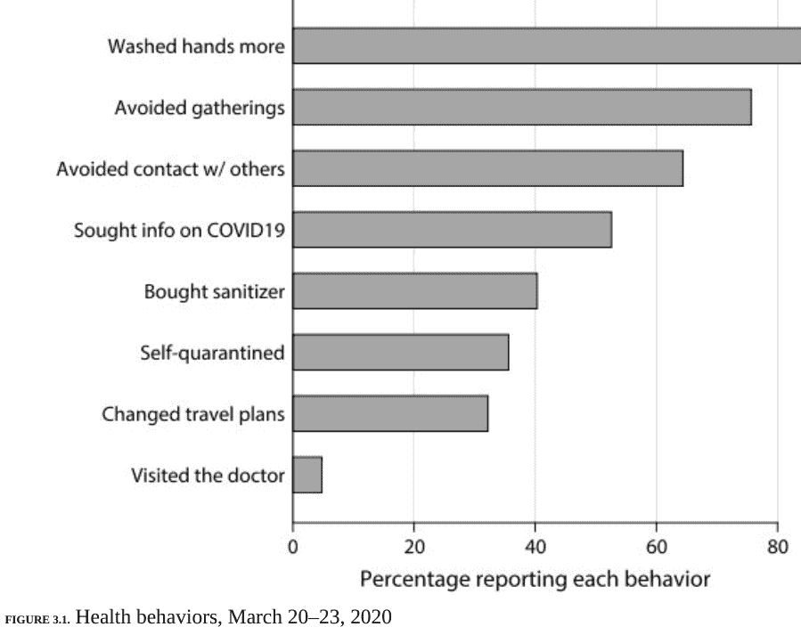


# 图3.1 显示了我们的三千调查受访者报告的这八种健康行为的百分比

从图中可以看出，美国人意识到了疫情并做出了反应。到3月，大多数美国人洗手的频率比以前更频繁；许多人还避免了社交聚会和与他人接触。报告采取更严格措施（如自我隔离或更改旅行计划）的人要少得多，尽管在同一时期进行的一项盖洛普民调查中，有64%的人表示取消或推迟了旅行，80%的人表示避免了乘坐飞机、巴士、地铁或火车旅行¹¹²。在同一项调查中，受访者还被问及了让孩子留在家不上学的情况——由于全州居家令，这一比例迅速从37%（3月13-15日）飙升到一周后的84%（3月23-29日）。其他全国性调查显示了相同的总体趋势：大多数美国人正在为了疫情改变他们的社会行为。

如果这些数字就是故事的全部，那么就有乐观的理由。避免社交互动是人们管理 COVID-19 传播最重要的事情之一，而大多数美国人正在这样做。虽然只有十分之四的美国人报告购买了手部消毒液，但供应链问题意味着即使美国人想买也很难买到。我们的大多数受访者没有报告看过医生，但这可能是一种谨慎的信号，即个人尽可能减少暴露，同时也反映了全美范围内尚有极少数人陷入重症。

然而，这些汇总数据并不能说明问题。美国人根据其居住地、职业和身份，对疫情的经历各不相同。前线工作者，如医疗专业人员、公交司机、杂货店员工和其他基本工作人员，无法在家工作，而居住在集体或多代同堂住房的人更容易接触到病毒。经济状况迫使某些工人更频繁地出门并使用公共交通工具，增加了感染病毒的机会。获得医疗保健机会较少以及居住在贫困社区、农村社区、有色人种社区的人也更容易感染病毒并可能死于病毒。疫情早期的成本不成比例地由穷人承担，这一点我们将在第6章回归，届时我们将讨论美国 COVID-19 疫情的经济影响。

如果人们在决定改变行为时最看重风险，我们可能会预见到会根据个人特征产生差异。富裕的美国人可能更适合居家办公和避免社交聚会，但低收入的杂货店服务员或公交司机则面临暴露。我们首先观察了早期对 COVID-19 的行为反应如何随收入而异（图3.2）。我们的预期是，如果疫情的经历是不平等的，那么有能力适应疫情的人比资源有限的人更有可能这样做。事实正如我们发现的：收入水平最高的人最可能报告几乎所有行为，而遵循程度随收入增加而下降。这些结果证实，图3.1中的汇总数字实际上掩盖了美国人之间巨大的异质性。这些数字讲述了一个机会的故事；高收入工作转向了远程办公。建筑师、律师和教授的工作大部分可以在家里通过简易设施完成，并有收入购买杂货和食物外卖，而低收入美国人较少有机会隔离或居家。对于许多人来说，他们的工作被重新归类为“基本工作”，因为仓库包装、邮件、杂货店员工和肉类加工工人成为维持经济运转和帮助其他美国人居家生活的关键组成部分。这些工作场所恰好是疫情最严重且最早的地点，这并非巧合。

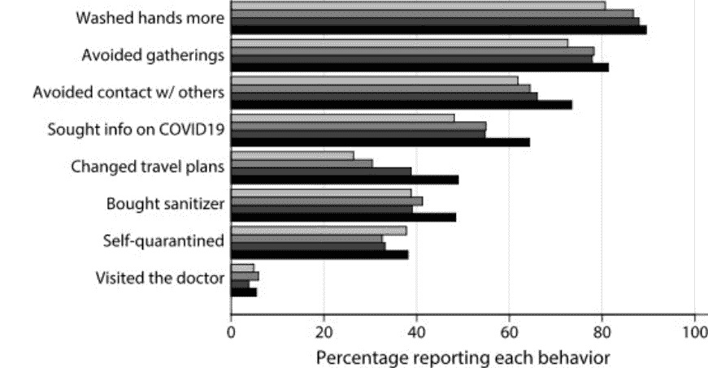

当我们比较不同教育水平的美国人时，我们发现了一个相似但略为明显的模式（图 3.3）。

显然，教育在解释 COVID-19 行为方面至关重要：受教育程度较高的人更有可能采纳了我们要求的几乎每种行为。尽管十分之八的美国人正在避免聚会，但在高中毕业生中这一比例为十分之七，而在拥有研究生学位的人中这一比例接近十分之九。在搜索 COVID-19 信息方面的差异也表明，不同教育水平的美国人对 COVID-19 的经历各不相同。2020年3月，关于疫情的信息虽然随处可见，但变化迅速且自相矛盾（例如，口罩有效吗？还是公众应该把口罩留给医护人员？），这使得应对这些信息的海啸变得困难。受教育程度较高的人寻找的信息更多，而且更有可能将这些信息转化为行为的变化。

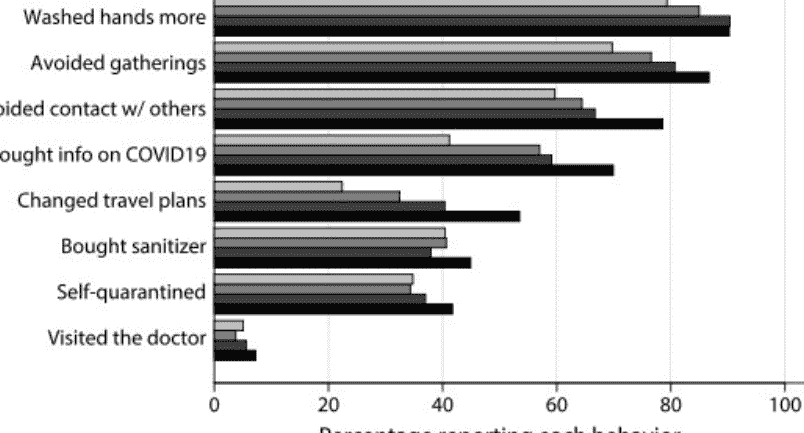

图 3.2 和 3.3 中的 COVID-19 健康行为模式之所以如此相似，是因为在美国收入和教育是高度相关的¹¹⁴。这一点尤为重要，因为它表明存在更深层次的社会经济差异——最好理解为阶级——这区分了美国人对 COVID-19 的应对。同样，我们将在第6章中有更多机会探索这些问题，届时我们将转向 COVID-19 疫情的经济影响。但目前，我们可以得出结论：在美国人生活的许多其他领域区分美国人的社会经济因素，也塑造了他们应对 COVID-19 疫情的行为。

我们接下来查看了按性别分类（图 3.4）。我们最初的预期是，男性对健康行为的服从程度较低，且对脆弱性的性别预期也较低，而女性更有可能考虑整个家庭的利益¹¹⁵。事实上，在几乎每一个回答中，美国女性报告我们的某项 COVID-19 健康行为的概率都略高于男性。

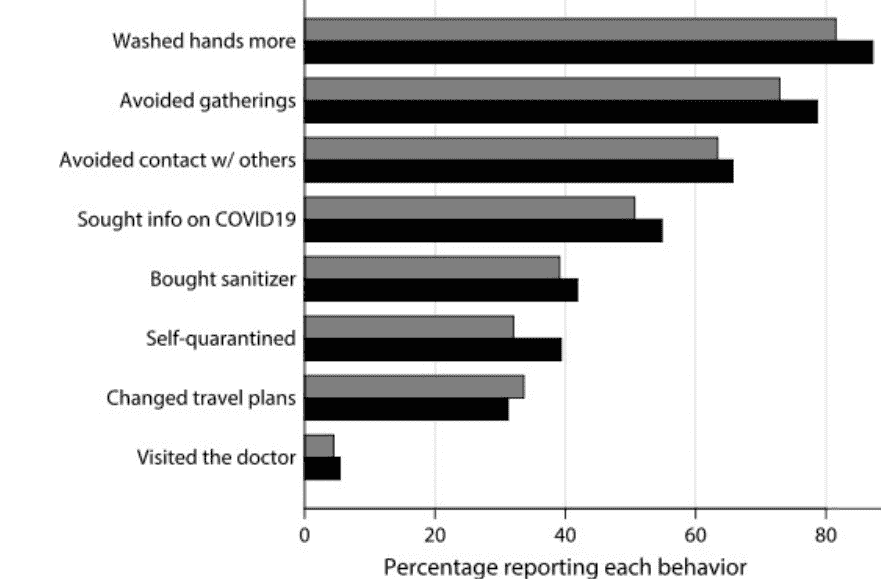

这种模式值得注意之处在于其高度的一致性。这些性别差异并非性别收入或就业差异的结果：在我们的样本中，女性并没有比男性更有可能受过高等教育，或报告更高的收入¹¹¹²。其他研究在 COVID-19 的顺从性方面也发现了类似的性别模式，女性通过支持限制性政策措施比男性更认真地对待 COVID-19，并且总体上更顺从亲社会健康行为¹¹¹³。有一项研究将这种不对称性归因于女性更有可能听取医学专家的意见并参考其他国家的经验¹¹¹⁴。在同一项研究中，女性还把自己的行为归因于感到焦虑以及对自己和他人的责任感。这些证据表明，女性对疫情对其家庭的影响更加敏感，并通过表现出保护性行为来做出反应¹¹¹⁵。

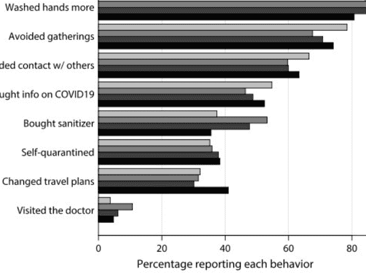

接下来，我们考虑了受访者种族和民族身份的健康行为。受访者自我识别了自己的主要种族群体，以及他们是否认同自己为西班牙裔或拉丁裔。虽然美国的种族和民族格局非常复杂，但为了方便宏观比较，我们对这些类别进行了简化。我们将受访者分为四类：白人、黑人、西班牙裔和其他人。“其他”类别具有很大的异质性（例如，它包括亚裔美国人、美国原住民、多族裔以及那些选择不报告种族和民族身份的人）。但即使是这种简化的种族分类也有助于有效可视化主要群体之间的差异，正如图 3.5 所示。

有色人种社区承担了疫情最早且最深重的代价，住院率和死亡率较高，但至少在初始阶段，我们没有看到个人行为上的重大差异。图表显示，各种族之间广泛存在预防性健康行为。白人美国人报告称倾向于寻找有关 COVID 的信息以及避免聚会和与他人接触，但黑人和西班牙裔美国人更有可能购买消毒手液并自我隔离。跨种族群体的绝大多数强化了这样一个观点：冠状病毒对少数族裔个体的不成比例影响很大程度上是健康结构性障碍（如工作场所安全、住房类型、医疗保健不平等）的结果，而非个人选择。

这种观点仅触及了少数社区在疫情不平等经历的表象。第8章将密切观察不同民族和种族群体对 COVID-19 的不同行为、态度和经历。同时，研究显示，随着疫情的发展，非裔美国男性最可能不知道 COVID 是如何传播的，最不熟悉症状，且出门次数更多。

所在社区中 COVID 的生活体验——加重当地医疗服务的负担并席卷当地养老院——是否促使个体参与更多预防性行为？为了回答这个问题，我们查看了根据 COVID-19 病毒本身暴露导致的 COVID-19 行为差异。我们使用了 COVID-19 Tracking Project 的数据，该项目提供了美国每个县记录的 COVID-19 每日诊断人数以及 COVID-19 死亡人数。

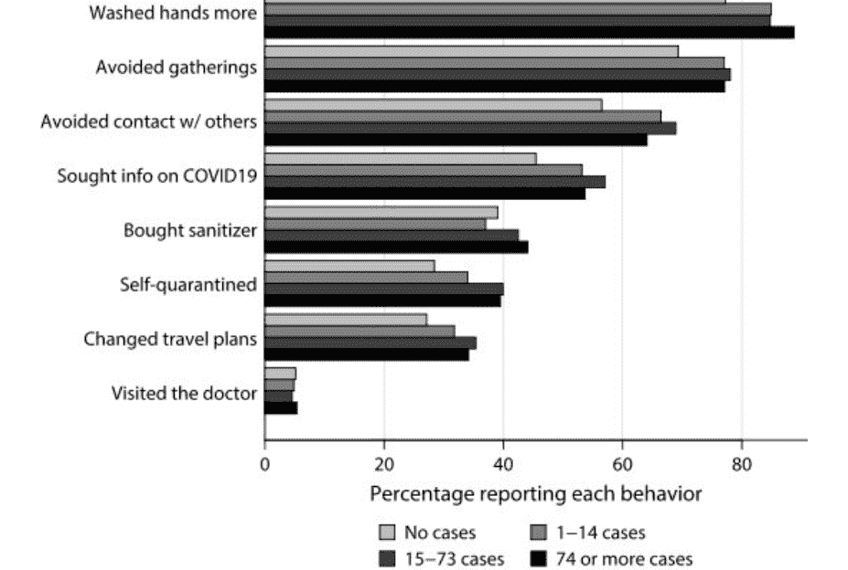

为了比较经历，我们将受访者大致分为四组：无病例县、至少1例但少于15例病例的县、15至73例病例的县，以及74例或更多病例的县。图 3.6 按病例比较了我们的调查。在洗手、避免聚会和与他人接触以及寻找信息等项目上，病例类别之间存在显著差异。但对于有病例的地区，我们没有看到太大差异，因为这个快照来自3月，即在广泛检测或接触追踪实施之前。当地病例信息仍然有限，主要来自当地新闻、社交报告或汇总县数据的国家仪表板。总之，我们的调查讲述了一个相当一致的故事：社会经济因素对于理解美国人如何应对疫情初期至关重要。收入、教育、种族和民族以及当地病例都很重要。

最后，我们查看了对 COVID-19 的行为如何随政治取向而变化。我们可以通过多种方式实现这一点：查看他们的政党派别、对特朗普的支持，或者他们在保守派与自由派的意识形态光谱上的位置。党派、意识形态和对特朗普的支持在美国政治系统中紧密结合¹⁴，所以我们使用哪种政治衡量并不重要。党派倾向总是重要的，正如图 3.7 所示。美国人对 COVID-19 的早期行为反应存在一致的党派差异，民主党和共和党之间平均有约10个百分点的差异。在寻找有关 COVID-19 信息方面，共和党和民主党之间有近20个百分点的差异。简而言之，到3月23日，美国人在 COVID-19 问题上已经生活在不同的世界里。这些世界是由政治定义的。在巴拉克·奥巴马总统任内，共和党人对埃博拉病毒爆发担忧更多，获得 H1N1 疫苗的可能性较低，这反映了他们对总统处理这些危机的信任程度较低。即使是关于营养和肥胖的政策（这些通常不分党派结构），也可能受到与党派人物相关的政治因素驱动²⁷。

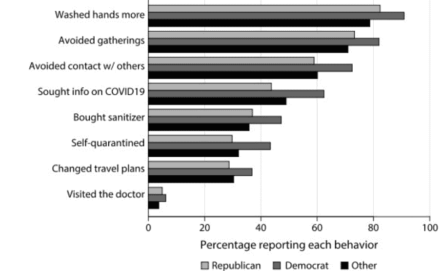

尽管大多数共和党人表示经常洗手并保持社交距离，而且绝没有完全拒绝 COVID-19 预防措施，但从政治和公共健康的角度来看，政党之间的差异是有意义的。民主党人和共和党人都表现出早期关注，但民主党人始终报告了更多（且更频繁）的 COVID-19 健康行为。从社区角度来看，无论政治信仰如何，群体免疫可以减缓病毒传播。因此，在共和党人占多数的社区中，健康行为会较慢，且不太阻止 COVID-19 的传播。如果十个共和党人中有四个人继续与家庭以外的人见面，社区传播就无法停止。这意味着在这些社区中需要更具说服力和亲健康的信息，而不是更少。

这些差异随着时间的推移依然存在，正如我们在下文中看到的。而且，它们还在扩大。在疫情初期，在一个不确定性高、信息有限的时期，大多数美国人采取了遏制传播所需的高昂行为，但对于如何处理疫情的党派分歧的种子已经种下。

## 这真的与党派之争有关吗？

作为社会科学家，我们在观察这类结果时必须问的问题之一是：行为上的差异是否真的与政治有关。毕竟，美国人的政治归属和意识形态取向既是他们社会经济状况的产物，也是其身份中固有的特质。也许民主党人消费不同类型的新闻，让他们对疫情的严重性有了不同的看法，或者也许民主党人倾向于从事那些让他们能更有效地社交距离的工作。如果是如此，仅仅知道民主党人和共和党人存在差异，并不能告诉我们这种差异是因为他们的政治取向或党派归属。

我们还知道，COVID-19 在美国的传播存在显著的地理差异。首当其冲的是华盛顿州和纽约州等蓝州，而不是阿拉巴马州和爱达荷州等红州。此外，危机首先发生在特别倾向左派的城市地区（西雅图和纽约市），而不是投票给共和党人的农村地区（例如纽约州北部锡拉丘兹和伊萨卡之间的小镇）。如果共和党受访者倾向于居住在密苏里州或德克萨斯州等红州的小镇或大城市外郊区，而我们的民主党人倾向于来自城市地区或蓝州，那么我们发现的党派差异可能与地理有关，而非党派本身。

在社会科学的语言中，收入、教育和地理等可能合理解释民主党人和共和党人健康差异的因素被称为“混杂因素”（confounds）。如果我们想知道健康行为的党派差异是否真的与党派有关，而不是无意中反映了诸如与党派相关的地理或收入等因素，我们需要采用一种考虑到或控制这些差异的策略。

为了做到这一点，我们使用了一种名为多元回归的常用统计技术（方法的详细信息请参阅附录）。这种技术帮助我们确定，我们发现的党派与健康行为之间的关联是否实际上由我们已知的其他因素解释——我们知道民主党人的平均受教育程度较高，共和党人的收入较高，也许他们居住在国家的不同地区和不同环境中。多元回归调整了其他因素，并向我们展示了民主党人和共和党人在所有其他维度（收入、教育、居住地等）上是如何具有可比性的。如果在考虑了这些差异后我们仍然看到行为差异，那么我们非常有信心这是党派在起作用。

我们多元回归分析的总体信息是，我们在图 3.7 中发现的党派差异无法被我们之前讨论的任何社会人口统计学或地理混杂因素所解释。例如，在考虑了收入、教育和性别等人口统计的影响后，民主党人避免聚集的可能性仍比共和党人高出约 10 个百分点，寻求 COVID-19 信息的可能性则高出 20 个百分点。

我们还以不同的方式问了这个问题：“如果我们必须选择最预测 COVID-19 健康行为的因素，党派会是其中之一吗？”提出这个问题允许我们使用一种名为“套索”（lasso）的统计程序，通过这种方法，我们可以筛选数百个变量，选出解释健康行为的变量。我们在附录中详细说明了这种分析的逻辑；结果显示，在我们衡量的所有因素中，党派是 COVID-19 健康行为的最佳预测因素。

这是一个有力的证据，表明尽管美国人在社会、经济和地理方面存在许多差异，政治仍然关键。特别是当涉及到身体距离等亲社会健康行为时，3 月份美国人的健康行为存在有意义的党派差异，这些我们无法通过其他因素整齐地解释。

# 党派差异随时间的演变

2020 年 3 月份美国大部分地区实施的封锁措施和居家令对许多人来说是很困难的。虽然并不是所有人受到同样的影响——《华盛顿邮报》的一篇评论将其称为“白领隔离”，低收入工人“承受着疫情的直接冲击”³⁹——但我们知道，党派人士已经在通过党派视角经历疫情了。因此，当美国人躲缩起来应对 COVID-19 危机的冲击时，对于如何以及何时恢复常态出现了深层的分歧。共和党人和民主党人对于留在家里有不同的意愿。根据凯撒家族基金会的研究，大多数民主党人（64%）和独立人士（56%）在 4 月中旬认为“最糟糕的还没有到来”，而 53% 的共和党人认为“最糟糕的已经过去”⁷²。早早在 2020 年 3 月 24 日，特朗普就提出了复活节前开放的想法（4 月 12 日）⁴⁶。许多人感到焦急并寻求恢复常态。《新冠病毒援助、缓解和经济安全法案》提供的 1200 美元补贴并不持久，特别是对于小企业主来说，美国人渴望恢复营业。

在疫情带来的日益严峻的影响以及特朗普本人焦急情绪驱动下，一些美国人开始动员。“重新开放经济”的抗议从加利福尼亚州、密歇根州到弗吉尼亚州涌现。到 5 月初，盖洛普调查的 54% 受访者认为当时最大的威胁是新冠病毒，而 47% 的人认为是经济封锁³¹。这直接反映了政党的言论方式，民主党人关注病毒，而共和党人关注经济³²。

随着 2020 年的持续，许多共和党政治家敦促恢复常态，认为封锁及其社会经济成本是不可持续的。威斯康星州州议会的共和党人甚至起诉了该州最高公共卫生官员，以结束疫情封锁³³。许多美国人不再愿意适应管理疫情所必要的亲社会健康行为。令人担忧的是，疫情开始从城市爆发转向农村爆发，特别是在那些在 2016 年选举中投票给特朗普的县³⁴。在州一级，民主党州长更早实施封锁，而共和党州长则更早重新开放经济，俄亥俄州、马里兰州和佛蒙特州的共和党州长是显著的例外。

采取更激进的措施对抗病毒³⁵。尽管共和党国家领导层最初低估了病毒的严重性，但共和党精英开始嘲讽那些认真对待病毒的人。

在2020年竞选期间，特朗普持续嘲讽候选人乔·拜登，拜登在总统竞选活动中采取了安全措施，包括始终佩戴口罩。特朗普竞选团队在竞选活动期间公开蔑视健康措施。回想6月20日在图尔萨举行的活动介绍，当时特朗普举行了一场不戴口罩的室内竞选集会。与会人数极其稀少，不仅场馆没有坐满，连外部的溢出区域也无人使用。虽然巨大的预期是青少年和K-pop粉丝为了开玩笑而产生的，但低出席率也表明，共和党支持者对面对面集会的接受程度可能并没有看起来那么高。

随着夏季的到来，党派差异日益扩大。通过在随后非凡的七个月里追踪同一批受访者，我们可以观察到行为是如何演变的。如图3.8所示，从2020年3月开始的围绕COVID-19的党派分歧会随着时间的推移而扩大。

以是否会避免聚会这个问题为例。我们的第一波调查捕捉到民主党人与共和党及“其他人士”之间存在约10个百分点的差异。在从4月20日至5月5日的第二波调查中，所有三组人报告避免聚会的可能性都增加了。因此，尽管党派差异仍然存在，但三个党派群体都朝着同一个方向移动。但从第三波调查（6月6日至26日）开始，趋势线出现了分歧。报告避免聚会的民主党人比例基本持平，但共和党人和“其他人士”的比例却显著下降。这种现象——即健康行为的党派分歧——在几乎每一个子图中都再次出现。请注意这些差异是多么持久。即使人们对每项健康措施的总体遵守水平随时间推移而变化，但民主党人与共和党人之间的差距几乎从未缩小。


在2020年期间，随着疫情的持续，美国人的COVID-19健康行为变得更加分化。如果党派差异的种子是在2020年3月初由于总统削低了疫情的严重性，而民主党官员却在敦促谨慎，那么我们可以在夏天看到这些差异的后果：由共和党州长领导的州比民主党州长领导的州更快解除了限制。这种信息传递和政策差异转化为公众分化的行为。

鉴于党派媒体极化的深度，人们可能会怀疑，这些党派差异是否仅仅是共和党人和民主党人消费的新闻类型的结果。在任何一天，有线新闻都会以不同的实质方式报道疫情。具体而言，正如《华盛顿邮报》的一篇文章写道：“MSNBC使用‘防护装备’一词的可能性是CNN的1.5倍，福克斯新闻的2.7倍。CNN使用‘检测’一词的频率比福克斯新闻高2.2倍，‘去检测’比MSNBC高1.3倍。”² 但所有的报道都是政治性的；福克斯和MSNBC引用党派的次数都多于引用健康专家³。

在图3.9中，我们通过根据受访者在调查第一波中是否报告观看右翼新闻来分解图3.8的结果，检查了这种可能性。

事实证明，党派性对健康行为差异的解释比媒体消费大得多：从右翼新闻来源获取新闻的共和党人与不获取的共和党人基本上是一样的，民主党人也是如此。在媒体消费存在差异的情况下，这种差异主要体现在那些被标记为“其他”的人中，他们既不是任何政党的成员。在这一组中，我们发现看右翼新闻的人报告的亲社会健康行为往往比不看的人少。

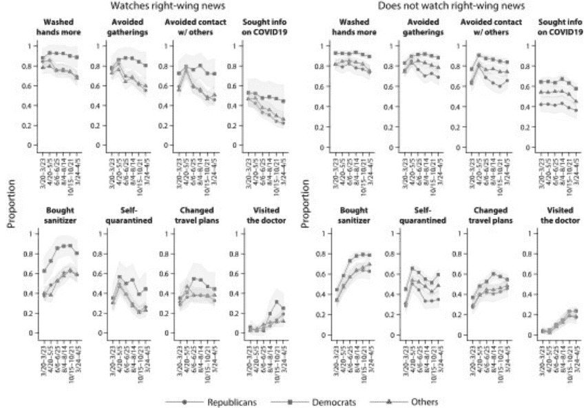

> 图 3.9 按新闻消费划分的六波调查党派健康差异


我们必须提问，这些党派差异应该归因于党派性本身，还是归因于与党派性相关的其他因素。例如，美国许多地区从5月开始解除了居家令，这可能仅仅是因为共和党人倾向于居住在比其他地方更快、更彻底开放的地方。对于居住在农村地区的共和党人来说，现实生活中与其他人的见面更为罕见，这意味着他们不需要像民主党人那样接受社交距离措施，而民主党人倾向于住在社区传播易发的城市地区。使用我们上述的相同多元回归方法，我们测试了这些差异是因为党派性本身，还是由于与党派性相关的其他因素，再次发现即使在考虑了这些其他因素的情况下，党派性仍然重要。我们在附录中详细说明了这些结果。

## 作为微观世界的口罩

没有什么问题比佩戴口罩的政治化更能更好地说明亲社会健康行为中早期且持久的党派差异了。像社交距离一样，它是信号个人对疫情严谨程度的较公开的行为之一。与我们已经检查过的某些行为不同，美国疾病控制中心（CDC）直到4月3日才建议佩戴口罩（因此我们没有在第一波调查中询问遵从情况）。而且从一开始，佩戴口罩就成了政治化最高的COVID预防措施。

我们首先询问美国受访者在4月20日是否佩戴了口罩，此时距离CDC支持佩戴口罩已过去三周。然而，当时没有可以购买的口罩，导致许多美国人搬出缝纫机自己制作。Etsy在4月的销售额翻了一番。在我们的数据中，我们发现几乎十个民主党中有九人在4月初报告佩戴了口罩，而共和党人只有六个。共和党人和民主党人之间佩戴口罩的党派差距为15个点，但整体遵守率很高。并不意外，我们在上一节讨论的Lasso程序也将党派性选择为佩戴口罩的良好预测。

到2020年6月，美国新冠死亡人数已达千，许多计划重新开放的州推迟了计划。在夏季感染病例激增期间，世界卫生组织宣布新冠病毒可通过空气传播，病毒可以在室内空间停留。在6月和8月的两次调查中，我们看到所有群体佩戴口罩的情况都有增加。对于我们在2020年8月到2021年4月观察到的持续10个百分点的党派差距，应该如何解释？我们在第二章中预告了口罩的政治，在那里为美国人提供口罩的后期努力被特朗普阻挠了。在这里，我们认为精英阶层的公开口罩选择影响了普通人的行为。共和党和民主党精英的表现截然不同。当国家疾病预防控制中心主任安东尼·福奇（Anthony Fauci）在5月12日戴着口罩在国会作证时，苏珊·柯林斯（Susan Collins，共和党）显然没有戴。共和党参议员如泰德·克鲁斯（Ted Cruz）和米奇·麦康纳（Mitch McConnell）在公共场所被未戴口罩，却坚称他们“遵循科学”并“听取专家意见”。² 回想最高大法艾米·康尼·巴雷特（Amy Coney Barrett）的提名仪式，数十未戴口罩的共和党人聚集在室内和白宫玫瑰花园，结果变成了一个超级传播事件。


这种信息传递来自高层。特朗普经常违反口罩规定，并举行了数百名无意义参与者的集会。他直到5月21日在参观密歇根州伊普兰蒂（Ypsilanti）的一家工厂时才首次被看到佩戴口罩，那里生产呼吸机、口罩和其他医疗用品。早期证据表明某些 **FIGURE 3.18.** 调整混杂因素后的2020年4月到2021年4月的口罩遵守情况

特朗普的支持者希望他佩戴口罩，但他在5月份的表态是模棱两可（（我选择不这样做，但某些人可能想这样做，这没关系”），而在7月份则表现出明显的不情愿。特朗普推特了一张他戴着口罩的照片，并配文：“很多人说，在无法保持社交距离时佩戴口罩是爱国主义的表现。”在他发推后不到两天，特朗普在华盛顿特区的一家酒店募捐活动上被目击未戴口罩，这引发了当地当局对新冠防疫规定合规情况的调查。作为其对公共卫生指南漠视的显著表现，特朗普在从医院回来时仍感染有新冠肺炎19后，在白宫工作人员和摄像头的面前摘掉了口罩。白宫有佩戴口罩的要求，但特朗普没有。

并非所有共和党人都像特朗普那样反对佩戴口罩。怀俄明州州众议员利兹·陈尼（共和党，华州）推特了她父亲、前副总统陈尼佩戴口罩的照片，并配文道：“迪克·陈尼，戴上口罩。#真实的新口罩。”支持佩戴口罩的知名共和党人非常稀少，与民主党人的对比是鲜明的。拜登将佩戴口罩作为他竞选的特征。在他与副总统竞选伙伴卡马拉·哈里斯的首次公开亮相中，两人都戴了口罩。拜登还承诺将“立即实施口罩令”。民主党全国大会以调整后的形式进行电视直播，以保持社交距离，其中新冠肺炎安全和佩戴口罩成为他首日日程安排的基石。事实上，拜登就职典礼上的每位参与者都戴了口罩，美国国会大厦阶梯上保持了社交距离，而通常挤满参与者的国家广场，取而代之的是满了数以千计的美国国旗。在执职的第一天，拜登签署了一项行政命令，要求在联邦财产和州际旅行中强制佩戴口罩。

尽管有证据表明口罩在缓解新冠肺炎19方面有效，且放宽口罩政策的州新冠病例率更高，但到目前整个疫情过程中，佩戴口罩习惯的差异一直存在。我们认为，对口罩令的日常抵抗根源于疫情期间的党派政治，因为保守精英的怀疑和不情愿成为关于疫情公众辩论中的一个显著触点。一些更为激进的反戴口罩抗议活动在社交媒体上疯传，包括在杂货店发脾气，以及对执行店内政策的店员大大大。在加州橙县，首席卫生官尼科尔·奎克（Nichole Quick）因死亡威胁而被迫辞职，原因是她要求居民在无法进行社交距离时在家外戴口罩。根据《山报》（The Hill）的一项研究，到7月底，总体对国家性口罩令的支持率很高（约82%），但不同党派之间的差异依然巨大：民主党人支持比例为93%，独立派支持比例为85%，共和党人支持比例为66%。快进到2021年1月，一项YouGov的民意调查也表达了类似的共识模式，拜登选民（93%）对比特朗普选民（63%）支持要求国会会议员在国会大厦内佩戴口罩。此前有报道称几位共和党议员在1月6日骚乱期间与同事一起避难时拒绝佩戴口罩，导致三名民主党国会议员在随后的不久内新冠肺炎检测呈阳性。

反对口罩的少数派确实是少数，但他们声音很大，并从当地杂货店到公共市政厅坚持不懈。反对从定义上说是一种表演。有时这些行为被拍摄并发布到网上引发疯传，例如持有“医疗豁免”卡，或者在Costco超市发脾气并被护送出去。阿拉斯加州的一位州立法员因不遵守口罩要求被终身禁止乘坐阿拉斯加航空。但口罩令的政治变得如此具有政治色彩——且深受政治影响——以至于2021年秋，尽管有明确证据表明口罩能减少传播，共和党州仍制定了法律或发布了行政命令，禁止学区在学校实行口罩令：亚利桑那州、阿肯色州、佛罗里达州、爱荷华州、南卡罗来纳州、俄克拉荷马州、德克萨斯州和犹他州。

这种“美国式”的口罩党派分裂吗？党派差异随时间推移有所减少，但差距依然存在。有人认为，共和党对佩戴口罩的拒绝是因为他们关注自由和顽强个人主义（作为边疆文化）或毒性男性气概。但与此同时，反对口罩的行为遍布全球，从巴西到德国再到印度尼。根据伦敦帝国学院收集的数据，欧洲内部的口罩遵从性存在显著差异。到6月底，西班牙的接受度约为92%，意大利为81%；而在法国（那里曾有一辆公交车因执行口罩政策被乘客杀害），遵从性竟高达73%[55]。相比之下，只有52%的英国人报告“经常”或“总是”佩戴口罩，令人震惊的是，83%的瑞典人和85%的芬兰人表示从未佩戴过口罩[56]。在欧洲之外，香港的遵从性高达97%[57]，而澳大利亚则仅为20%[58]。加拿大也表现出较高的整体遵从性[59]。

让美国即使在那些口罩遵从率很低的国家中也脱颖而出的，是美国佩戴口罩的党派政治。在英国这样一个同样极极化的国家，反对口罩的行为并未遵循党派路线。在9月的一项YouGov调查中，反对口罩的情况并未随党派划分。在那项调查中，保守派选民和工党选民在公共场所佩戴口罩的比例相似[60]，尽管政府最初对口罩感到犹豫，且口罩在学校或商店并不普遍，佩戴口罩并未存在巨大的党派差异。

## 结论

我们从2020年的数据中学了关于疫情政治的两个主要教训。首先，从疫情早期开始，美国应对新冠肺炎19的方式就存在明显的党派差异。民主党人比共和党人更有可能采取社交距离等行为。其次，这些党派差异在之后的几个月里一直持续。我们无法通过种族、收入、教育或其他任何我们可以衡量的因素来解释这些党派差异。

关于我们发现的党派差异还有待探索。在第四章中，我们将注意力转向疫情的情感基础，研究美国人的情感反应——厌恶、愤怒以及希望——以及他们对疫情指的对象，以便更深入地探讨党派政治。

### 对新冠的情感反应

联邦航空管理局在2020年之前没有系统地追踪不规行为，但随后开始收到大量攻击空乘人员、不配合和言语虐待的报告。乘客推搡和踢打工作人员。人们感到愤怒——对必须戴口罩感到愤怒，对疫情期间旅行的不便感到愤怒，对那些缺乏责任感的人感到愤怒。“过去的五个月里，我们从未在飞机上见过这样的攻击和暴力，”一位空乘在2021年初说道。到去年11月，联邦航空管理局记录了超过5000次事件，启动了970项调查，而2020年只有183项。另一位空乘对问题的描述更为形象：“我正在处理大量的带孩子工作，这从没想过要做……飞机上的孩子比大人表现得更好。”

政治往往是情感化的，而疫情政治充满了威胁、不确定性和指责。谁能忘记听到邻居拒绝佩戴口罩时的愤怒感，或者通过Zoom观看重大生活时刻（婚礼、葬礼、成人礼和感恩节晚餐）时的伤心？尽管我们大多数人都希望避免这些负面情绪，但它们具有重要的功能。情绪能提醒人们环境中存在潜在的伤害或奖励，并帮助他们找到应对威胁的适当应对机制，消除不适的情绪，增强积极的情绪。² 在 Zoom 感恩节晚餐上感受到的那种悲伤，是我们社会纽带的情感表现，即将我们与朋友和家人联系在一起的纽带。愤怒情绪可能会导致我们避免那些可能让我们陷入危险的作为。

在政治中，情绪可能直接源于经历，例如看到垃圾时的厌恶感，或失去亲人的悲痛。情绪也可能通过社交网络、媒体消费或来自政治领袖来中介——例如在遇到富有魅力的演讲者时的兴奋感，或者看到媒体对他们反对的政策选择进行报道时的愤怒感。有时，我们的情绪是为了应对可能伤害民众的威胁而产生的，例如疾病、战争、恐怖主义或经济危机。人们通常不需要太多解释就能理解为什么要担心这些威胁；美国 9/11 恐怖袭击在任何政治家对此发表评论之前，就已经引发了所有美国人的情感共鸣。³ 但在其他情况下，情绪可能会被政治领袖制造出来，或至少是助长的。领袖这样做是为了在公众中制造愤怒、恐惧或厌恶，这可能会促使个人采取某些政策，例如美国政客如何利用对恐怖主义的恐惧来制造拒绝海外敌对战斗员的支持，或者所谓的“移民大队”图像如何被用于边境安全的讨论。当政治领袖想要指责或需要公众采取集体行动时，他们还会努力平息负面情绪，并将公众情绪引导向希望和乐观等积极情绪。

在本章中，我们展示了美国人的情感反应在疫情初期就存在差异，并且这些差异随着时间的推移而持续。共和党人表达负面情绪较少，感受负面情绪的程度也比民主党人低。而且共和党人比民主党人更容易对未来表达希望和乐观。在我们看来，这些情绪的表达并非仅仅源于疫情期间不同的经历（即共和党受病毒影响比民主党人小），还源于政派领袖提供的信号、信息传递和信息，这些信息在将新冠病毒描述为威胁以及公众应该感受什么情绪方面存在差异。尽管州级和国家层面的民主党领袖、民主党总统候选人以及公共卫生专业人士对公共健康威胁响了警报，但总统唐纳德·特朗普、共和党国会议员和保守派媒体来源却淡化了威胁的严重性。²

为了理解这一观点，请回到疫情爆发的最早期。许多美国人经历了困惑和恼怒感，这些情绪很快演变为挫败感、悲伤和愤怒，因为疫情失去了控制，他们的日常生活被颠覆了。如果没有美国美国政客或官员对疫情发表任何言论，情绪本会更加激烈。但现在请考虑当时来自华盛顿、州政府和媒体的信息传递。正当总统在淡化疫情的严重性并预见会快速恢复正常（投射出希望）时，美国人正面对着超市空空的货架，并读到学校将改为上网以及大型公共活动将取消的新闻（产生恐惧和焦虑）。

当情况具有高度不确定且具有威胁性时，人们会观察周围世界，看看这些压力源是否会影响到他们，如果是，他们将如何应对.³ 因此，一位父母会通过寻找常规安排的替代方案来透露学校正陷入混乱，而患有严重健康状况的人可能会寻求有关居家办公的信息。人们可以通过心理手段——寻求专业护理、向信任的朋友倾诉等——来应对压力情况，或者通过处理导致情绪的源头问题。情绪可以成为动力使人们打破常规，并从根本上改变他们的工作方式、上学方式以及与社会和经济互动的方式⁴

情绪甚至可以使人们在形成态度时摆脱对身份认同和偏好的依赖⁵ 这可能是一件好事：面对疫情等意外之外的威胁，某些人可能会对恐惧或焦虑情绪做出反应，寻找新的信息源以使威胁更易处理。但并非所有情绪都能产生这种成效的反应。例如，愤怒源于对威胁的感知，但也体现在确定性以及对谁最初导致伤害的判断上。与愤怒程度较轻的人相比，愤怒的人不太接受新信息，而且更愿意承担风险⁶ 望和乐观等积极情绪表明，人们认为某种情况是愉悦的，符合他们的动机，甚至可能是有回报的⁷

因此，特朗普投射乐观和自信的情绪是完全合理的的，他在 2 月表示 COVID-19 可能完全不会传播，并宣布了在复活节前重新开放的计划。乐观情绪会鼓励美国人不要将疫情视为一个需要解决方案的威胁。而对于那些反对特朗普及其处理疫情方式的人来说，这些相同的信息可能会产生愤怒。

与 COVID-19 疫情的所有其他方面一样，这种情感体验在不同党派群体之间并不是共有的。应对新冠病毒威胁的一种主要手段是通过社交距离、洗手、佩戴口罩等遵循公共卫生指南。因此，一个面临疫情担忧的美国人可能会花时间在网上大批量购买手消毒液或取消计划好的家庭旅行。但如果人们不想采取社交距离和佩戴口罩等行为，或者他们不认为疫情与他们的生活有关，他们可以用不同的方式应对：通过调节自己的情绪，压制负面情绪并增加积极情绪。那么，美国人可能并不是取消假期，而是通过比比常更兴奋的心情庆祝他们的假期来应对疫情，在社交媒体上分享他们的冒险故事，并刻意地避开任何关于疫情健康后果的讨论。

美国人竟然通过拒绝公共卫生机构的建议来应对公共卫生危机，这似乎很奇怪。当健康——即生命——面临威胁时，人们会想要改变或抑制自己的情绪，而不是改变行为吗？一个显而易见的答案是，行为改变是不愉快的。即使是担心病毒的人也并不总是采取这些行为。

以佩戴口罩为例——口罩是不舒服的，而且它们让与亲人的互动变得不自然。几乎没有人会在没有要求的情况下选择戴口罩。但口罩的政治性比这深得多。疫情的政治化让许多人认为口罩是不必要的、是无效的，甚至是极权主义控制的标志。担心病毒的人不太可能遵守这些规定。当他们对疫情表达愤怒时，通常是因为政策而非病毒本身。在某些极端情况下，反对口罩的情绪导致了对维护规则员工的暴力，其中包括密歇根州一名保安的遇杀。ᵃ

正如我们在第 3 章提到的，口罩只是疫情的一个方面，尽管这是一个特别显眼的方面，它引发了支持和反对的情感反应。在本章中更广泛地关注疫情的情绪维度，以概述党派在情感反应上的差异，以及党派沟通在驱动这些不同反应的作用。

## 党派健康行为的情绪根源

跨越美国民众并跨越时间。具体而言，我们询问了受访者对病毒的三种社会影响有多大担忧：经济影响、正常生活的干扰以及学校关闭。我们还询问了两个健康忧虑：他们对生病的担忧程度，以及对朋友和家人生病的担忧程度。

图 4.1 显示了受访者根据党派身份的平均担忧水平。这些数据没有考虑其他人口统计学特征，正如我们在第3章中所示的，即使考虑到教育、就业、受访者所在邮政区的新冠病例数和其他政治因素，也不会改变这些模式。

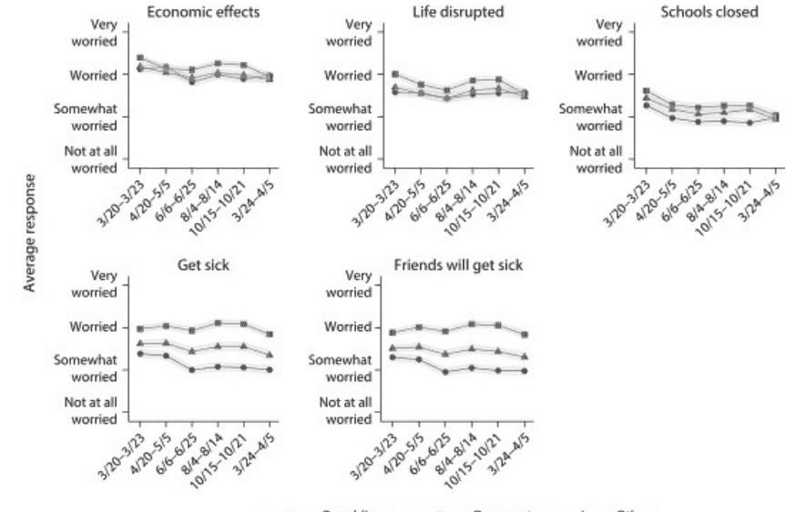

图 4.1。六个波次（2020年3月至2021年4月）的担忧情况。

图 4.1 有两个主要结论。前三张图表显示，人们平均对新冠肺炎带来的社会动荡担忧程度处于较高水平。我们看到，民主党人对疫情的社会影响总是比共和党人担心，但党派之间的差异相当小。平均担忧水平没有太大变化，但学校关闭的情况除外；对于大多数美国人来说，这发生在第一波次和第二波次之间，因此它不再是一件需要担心的事情，而是一件需要应对的事情。

其次，底部两张图表显示，不同党派之间对病毒健康影响的担忧存在显著的变异和分歧。在这里，我们看到了巨大的差异。共和党人对生病的担忧远低于民主党人，这种差异在整个疫情期间不断扩大。在这些图表表中，我们看到了健康行为中党派差异的心理基础。理理认为，如果你对病毒感到担忧，你将更有可能采取行动来保护自己，例如自我隔离和避免聚集。相比之下，那些对疫情担忧较少的人不太可能认为有必要采取遏制传播的个人行动。因此，图 4.1 帮助我们解释了为什么（正如我们在第3章中看到的）共和党人比民主党人和无党派人士更少采取亲社会健康行为。这不仅在疫情初期是如此（当时病毒更多地集中在城市地区和蓝州），而且在特朗普执政的整个疫情期间不断扩大，因为各州开始看到大量的住院和死亡病例。对新冠肺炎健康影响担忧的党派差距直到我们调查的最后波次——即乔··拜登就职以及大规模接种三个月后——才开始缩小。这些党派差距并非媒体习惯不同的产物：右翼新闻观看者与与其他渠道获取新闻的人之间，模式通常是相同的，尽管观看右翼新闻的共和党人和其他人比不看此类新闻的共和党人和其他人更担心生病。

对疫情后果的担忧仅仅是一种情感反应。许多美国人在面对疫情时还感受到了愤怒、悲伤甚至厌恶。在我们的调查中，我们询问了受访者五种重要的情绪——愤怒、厌恶、焦虑、悲伤和希望，以及他们在思考美国政府对疫情的反应时是否感受到了这些情绪。这让我们看到人们对不仅是病毒本身，而且特别是政府对危机的处理方式的情感反应。图 4.2 显示了每个党派小组在调查的每个波次中表示感到这些情绪的受访者百分比。

情感反应的党派分化尤为引人，我们在拜登总统任期间的第6波次观察到了反转，这显示了精英信号的强大作用。在特朗普总统任期的最后一年，民主党人报告了更多的负面情绪，而共和党人则更强烈地表达了希望这一积极情绪。十个民主党人中有七个报告在3月下旬对疫情感到愤怒、厌恶和悲伤，这一比例随着时间的推移而增加。在特朗普执政的最后一年，民主党人的焦虑水平一直在高位。至于希望？在民主党人中最初很低，尽管时间推移仍在下降，直到特朗普被拜登取代。

相比之下，共和党人在2020年3月表达了极低的愤怒和厌恶。共和党人的悲伤和焦虑情绪更为常见，但程度差得多少。这些数字在前三个波次中略有上升，但在夏末到秋季再次下降。然而，在整个疫情期间，共和党人比民主党人保持了更多的希望，尽管他们的希望水平在最后一个调查波次中有所下降。真正导致共和党人对政府处理新冠肺炎疫情失去希望的是拜登的就职。

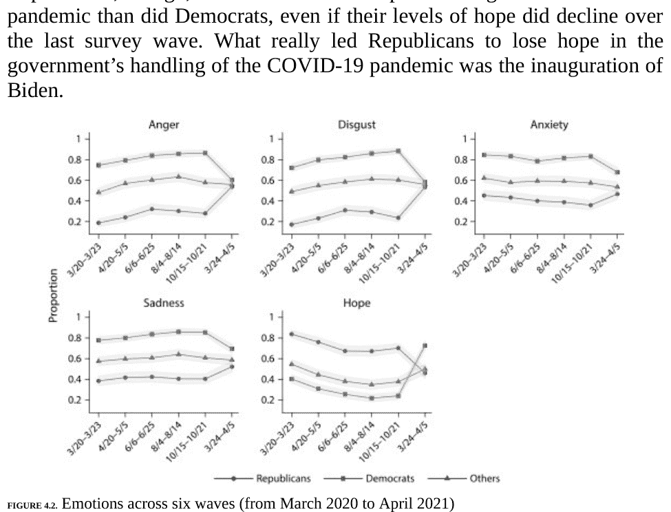


总之，共和党人和民主党人对疫情报告了完全不同的情感反应。共和党人在疫情初期感到非常有希望，而民主党人则经历了从愤怒到厌恶的一系列负面情绪。尽管我们确实看到所有美国人中存在变化——愤怒增加、希望下降——但这些随时间推移的变化从未消除我们所看到的显著党派差异。唯一似乎能改变美国人对新冠肺炎看法的，是选出一位来自不同政党的新总统，这充分证明了美国新冠肺炎在本质上具有党派特征。

这些情感反应无疑有助于解释健康行为的差异。它们还通过另一种方式转化为政治，即塑造了他们将哪些政府官员归咎于表现不佳，并将谁归功于表现良好。不担心疫情后果的美国人不太可能采取遏制传播的个人行动。（注：原文此处存在大量重复句，已按要求去重处理）。

为了了解美国人在如此复杂的政治体系背景下是如何分配责任的，我们要求调查的第一波（2020年3月）和第三波（2020年6月）的受访者评估，谁对美国应对疫情的准备工作负最大的责任。受访者收到的问题是：“公共卫生官员警告说，美国对冠状病毒爆发尚未做好充分准备。你认为谁对这种准备不足有主要责任？”随后，我们要求受访者对四个参与者进行排名，其名称随机排列：总统唐纳德·特朗普、前总统巴拉克·奥巴马、疾病控制与预防中心（CDC）以及州卫生机构。我们将奥巴马列入名单，以便受访者表达，尽管特朗普政府已经上任三年，但前一届政府在疫情准备方面做得还不够。在第三波调查中，我们随机设置受访者看到的名称为“巴拉克·奥巴马”或“国会中的民主党人”，以测试那些在第一波中说“奥巴马”的人是否在指责民主党作为一个政党，或指责作为曾面对过H1N1和埃博拉危机的总统的奥巴马。

图4.3显示了根据受访者的党派身份，将他们看到的每个参与者评为“最应受责”的百分比（对于看到“巴拉克·奥巴马”的人和看到“国会中的民主党人”的人，我们分别使用了相应的标签）。

数据中出现了两个大趋势。首先，民主党人和认同为独立人士或非党派人士（其他类别）比任何其他参与者更指责特朗普准备不足。他们对特朗普的指责随着调查波次的增加而增长：在3月的第一波调查中，超过70%的民主党人将新冠应对不力的主要责任归咎于特朗普，到6月，这一比例已增长到80%。独立人士比民主党人更倾向于分散他们的指责，但他们中的大多数将特朗普排在指责首位；“其他”类别中，有40%的人在3月认为特朗普的责任最大，到6月这一比例上升至45%。“其他”类别的受访者在两次调查中都将疾病控制与预防中心（CDC）评为第二最受责的机构。

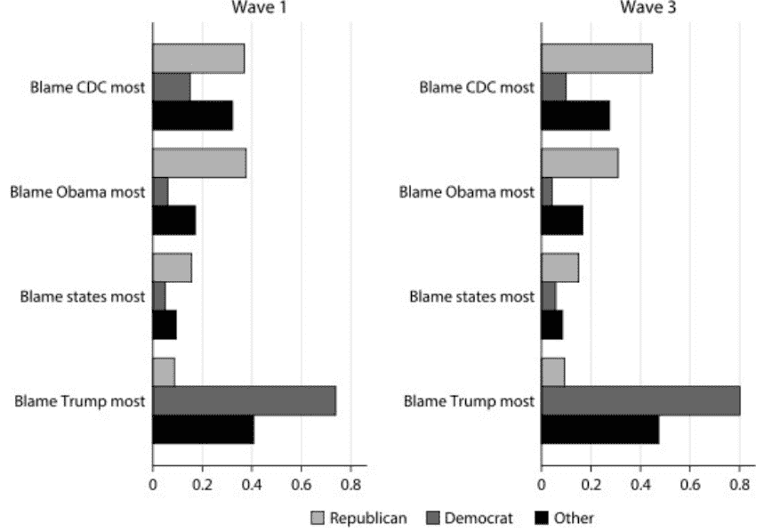

图4.3 谁该为规划不周负责？按党派划分

第二个趋势是，共和党人在所有排名的参与者中，对特朗普的指责最少，少于民主党人或其他人士。共和党人最可能将责任归咎于CDC；2020年3月有近40%的共和党人和6月有43%的共和党人指责CDC未能做好准备。在3月，指责前总统奥巴马规划不周的共和党人数与指责CDC的人数相等，这大约是指责与其拥有党派身份的特朗普共和党人数量的四倍。到6月，共和党人对责任的排名保持不变；他们仍然认为特朗普是最不值得受责的，而CDC最应该承担最大的责任。我们发现，当我们根据意向投票选择（特朗普、拜登或其他）而非党派倾向（共和党人、民主党人或其他）来观察指责的差异时，得到了类似的结果。

综上所述，我们看到调查受访者看到了同一组情况——全国封锁、经济崩盘以及各州死亡率飙升——但做出的反应非常不同。不同党派团体之间对于政府哪个部分应该承担责任存在广泛分歧。共和党人和特朗普选民寻找总统以外的任何人来指责，而民主党人和非党派人士/独立人士则将准备不足的责任大部分归于特朗普和CDC。

与我们上述对问责政治的讨论一致，在疫情等大灾难之后知道应该指责谁或什么对民主来说非常重要，这样选民就可以决定如何制裁那些没有履行义务或未采取符合国家利益的行动者。当公众从死亡或破坏中感到痛苦时，他们可以要求政府负责——但他们指责的是反对党的领导人，而不是自己党的领导人。如果威胁是外部的，例如恐怖袭击，或者领导人成功地将威胁描述为外部——正如特朗普试图通过一直指责中国并使用一系列贬义的、带有种族色彩的蔑称来描述病毒——现任领导人有时可以推卸责任。

这不仅仅是一个学术上的好奇点。责任归因中广泛的党派差异可能导致公众在无意中惩罚那些对某些任务（在此案例中，如拥有疫情应对方案或发放联邦储备个人防护装备）并非明确负责的人员。责任归因中的党派偏见意味着，人们判断自己所属政党总统的标准与他们判断其他政党成员的标准并不相同。事实上，他们可能会改变对经济、战争和外交政策等广泛问题的实地情况的看法，以符合其党派身份。在新冠病例中，这在指责中产生了一种党派反馈效应，即共和党人拒绝指责特朗普误判疫情，这导致他们认为疫情并没有像最初那么严重，进一步强化了他们认为特朗普从根本上没有责任的信念。民主党人的情况也恰恰相反。民主党人高水平的愤怒以及……（此处原文不完整）

由于这些动态，党派之间在责任归因上的分歧使得达成共识变得困难。这种极化不仅关于事实，还关于对国家本身。当一方将危机视为领导力的失败，而另一方将其视为外部攻击时，共识就消失了。

虽然公众在谁该指责疫情应对方面存在巨大差异，但对于谁应该获得功劳有更多共识。在我们调查的第二波（2020年4月），我们不仅要求受访者评估谁应对危机负责，还评估谁应该为帮助美国获得功劳。受访者可以认为某个参与者完全没有、很少、一些或很大功劳。受访者对以下人员进行评分：特朗普、州卫生机构、州长、医生、关键岗位工作人员（超市店员、司机、清洁工等）以及福西（过敏和传染疾病研究所主任）。

图4.5显示了所有受访者落在每个类别的百分比。大多数人对州参与者（政府和卫生部门）的表现给予了一些或很大的功劳。而且绝大多数人也认为医生、关键岗位工作人员和福西值得“很大”的功劳。（福西曾是美国疫情应对的早期英雄，后来成为保守媒体和政治右翼的核心反派。福克斯新闻的塔克·卡尔森曾称呼他为“制造新冠的人”，以及其他贬义词。佛罗里达州长罗恩·德桑蒂斯甚至出售过“别让福西进入我的佛罗里达”的商品。特朗普多次尝试解雇福西，早在4月13日就发布了一条以“是时候#福西了”结尾的推文。）到2021年冬天，共和党国会议员甚至要求将福西关进监狱。

特朗普是名单上唯一被大多数受访者认为不值得功劳的参与者。约60%的受访者认为特朗普的价值“很少”或“完全没有”。我们知道受访者在情绪反应和对疫情指责的评估上分歧巨大，但对于哪些参与者帮助了人们，似乎有一个更清晰的共同现实。如果我们根据党派划分受访者，同样的故事将会出现：各党之间存在广泛共识，认为医生、关键岗位工作人员、福西、州长和州卫生机构值得大多数受访者的赞誉。唯一在评估上存在明显差异的参与者是特朗普。倾向特朗普的选民认为他在帮助应对疫情方面的功劳与医生和关键岗位工作人员相当，但拜登和第三党选民对特朗普帮助美国民众的平均评价功劳非常少。这还揭示了共和党人的某种认知失调；人们不会认为医生和

如果人们也认为大流行不是严重威胁，那么基本工作人员理应获得大部分功劳。如果共和党人也将功劳归于特朗普，这或许可以解释这一发现，因为他们认为大流行并没有多大威胁，因为他领导了成功的公共卫生应对。

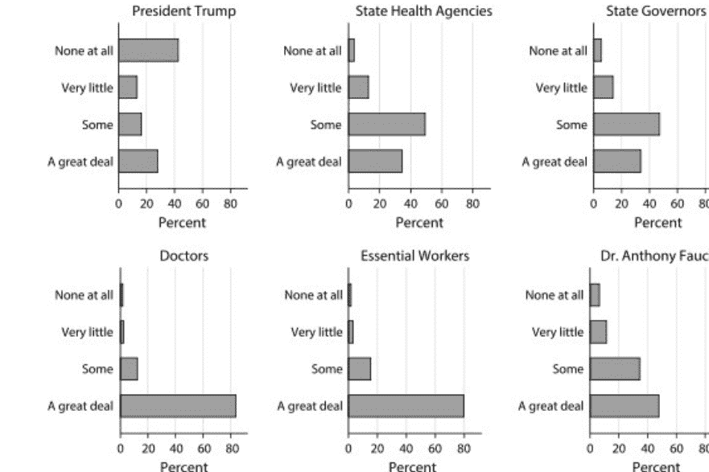

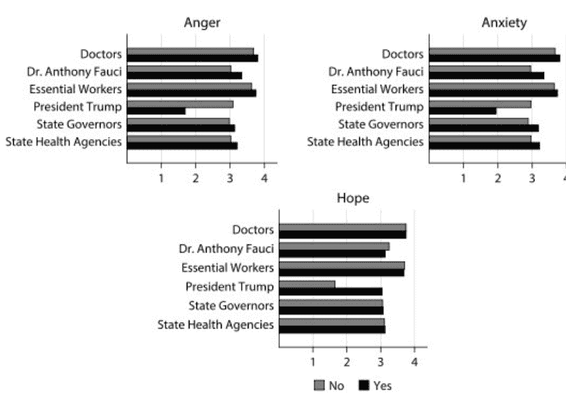

情绪，尤其是愤怒和希望，强烈决定了公众将哪些参与者归咎于对新冠肺炎准备不足。情绪对人们给予政府官员帮助行为的多少赞誉是否有影响？图4.6显示了受访者根据对政府处理疫情的情感愤怒、焦虑或希望，对相同参与者给予的平均赞誉水平。在大多数情况下，感到负面或积极情绪与对大多数参与者的“值得赞誉者”评分之间并不相关。这一模式的例外是对特朗普在处理疫情方面应该获得多少功劳的评分。这些发现与指责的发现形成镜像：那些表达愤怒或焦虑的人给予特朗普的赞誉极少，而那些表达希望的人对总统对疫情的处理给予了更多赞誉。

## 结论

新冠肺炎疫情是一个充满情感的时期，也许是社会科学史上最大的轻描淡写。从理论上讲，没有什么比对公众和政治领袖更具威胁性的了：一种能够杀死健康人的未知病原体，在几乎不尊重国界的情况下在全球传播。政策制定和维护公共安全的常规工具在危机面前显得力不从心，这场危机不仅让美国人生病，还击垮了旅游、娱乐和餐饮等整个行业，导致整个经济陷入混乱。

出乎意料的是，人们对疫情存在大量的负面情绪——对政府糟糕表现的愤怒和厌恶，对生病和生活受到干扰的担忧——这些负面情绪持续了几个月。然而，我们已经表明，对公共卫生和政府应对疫情初期的这些负面情绪，在民主党人中比共和党人更强，并且随着时间的推移保持得更好。民主党人比共和党人更担心，特别是担心生病。共和党人则充满希望，对染病的担忧较少，对政府早期混乱且低效的疫情应对的负面情绪也较少。

大多数时候，人们对像大流行这样的冲击性事件以标准方式做出反应。他们评估是否存在问题、这种威胁或机会与自己有多大关联、他们对原因有多确定，以及是否有某人或某物对这些威胁负责。他们感受到的情绪反过来有助于塑造他们对事件的反应，包括自我保护行为以及将事件归咎于谁。但在新冠肺炎疫情期间，党派性干预了这一过程。党派性影响了情绪反应，以及人们如何分配处理疫情的功劳和责任。像我们对疫情的情绪反应如此基本的问题，本质上受到了党派身份的偏差。民主党人和共和党人都看到了同样的死亡率和政府应对，但对这些结果归咎于不同的参与者，甚至对它们的感受也不同。我们在第3章展示了党派性如何塑造健康行为，接下来我们将调查其对应对疫情的公共政策的影响。

对于数百万在新冠肺炎期间遭受痛苦和损失的美国人来说，得知在基层层面上，如此多的同胞经历疫情的方式完全不同，是深感不安的。这不仅是因为他们的经历不同，而且他们的情绪反应也是不同的。对于许多深陷对肺炎焦虑中的民主党人及其他人来说，许多共和党人和其他人根本不担心疫情，这种想法是令人震惊的。对于那些坚持疫情将是短暂的、并认为几周后就能重新开放的共和党人及其他人来说，数百万美国人正接受数月甚至几年的活动减少的想法是令人不安的。这些党派的情绪反应侵蚀了任何跨党合作的可能性——即一种真正的美国式疫情应对，让所有美国人都觉得自己正处于危机之中。美国人喜欢相信战争、经济危机和其他国家苦难时刻会将我们团结在一起。但新冠肺炎引发的愤怒、焦虑和希望是以党派划分了美国人的，而不是将他们团结。

## 政策中的党派分裂

洛杉矶市中心的道奇斯球场外，汽车排了一整街，进入内部的等待时间超过了三个小时。尽管这不是一场季后赛比赛；道奇斯球场在2020年3月被改为洛杉矶县的一个新冠病毒自驾检测点，这些人是在等待进行新冠检测。他们都已通过洛杉矶市的网络门户进行了筛选并预约了预约。起初，这些检测仅供出现症状的个人、急救人员和护理人员使用。一对都感到不适并等了两个小时的夫妇对系统表示了沮丧：“我们都是来这里检测的。她比我更严重。我们没预料到这个……我正在失去信心。我准备要走了。这太荒谬了。”

大规模检测的扩展很缓慢；测试剂不足，预约名额也不够。周围的一些县（如河赛县和橙县）也在增加检测，但其他一些县（如圣贝纳迪诺县）尚未开始。测试剂不足；国民卫队和消防员正与医疗保健人员一起采集鼻拭子。加利福尼亚州长加文·纽斯姆要求退休的医疗工作人员回来，这已经足够糟糕了。即使是那些在早期成功完成新冠检测的人，获得结果时也会遇到巨大的延迟。橙县的一家商业实验室增加了五倍检测，该县的人等待结果需要一周或更长时间，在此期间他们可能将病毒传染给他人。还有一个谁来付费的问题。正如美国临床实验室协会主席在给国会领导人的信中所说，尽管特朗普政府承诺为美国人提供免费新冠检测，“但实验室不应承担‘免费’检测的成本。”2020年3月，洛杉矶县已放弃将检测作为“遏制”新冠病毒爆发的手段。

最终，美国人能够购买居家新冠抗原快速检测。全国范围内的一些地点（包括CVS和Rite Aid药店）提供免费检测，一些城市和学校为其居民免费提供检测，但美国人必须为居家检测的便利性付费：一盒由雅培制药两装测试剂售价23.99美元。与此同时，英国人只需1英镑即可购买，或免费送到家里。在德国，检测一直免费直到2021年10月（作为鼓励接种计划的一部分被淘汰），在法国，居家检测的价格相当于一杯咖啡。与欧洲模式不同，美国食品药品管理局（FDA）仅批准了两家公司制造居家检测，这必然限制了供应并推高了价格。此外，由于疫苗已普及，2021年夏季进行新冠检测的美国人减少了，雅培缩减了产量。当孩子们在秋季开学、病例再次上升时，已经找不到检测剂了。10月底，乔·拜登总统利用《美国救援计划》的资金，指示国立卫生研究院加速新检测剂进入市场的授权流程。

并应对这场疫情。正如我们在本章后文所示，这种党派分歧的至少部分源于共和党人和民主党人对疫情将持续多久，以及政府采取何种积极应对措施需要持续多久的持有不同观点。

在分析美国人认为政府应当如何应对COVID-19疫情的意愿时，我们面临着美国政治中的几个核心问题。辩论的一个中心轴是个人自由与国家权威：尽管许多美国人珍视其日常生活中大多数方面不受政府干预的自由，但COVID-19疫情迫使他们在个人自由与只有政府才能提供的快速、全面的公共卫生响应的益处之间进行权衡。在对政府信任度极低的背景下（这是现代美国政治的一个特定特征），这些问题触及了公民与其政府之间关系的核心。

次要辩论涉及政府应如何应对疫情。政府是否应该动员国民卫队来协调疫情应对？应该由联邦政府还是州政府主导？联邦政府是否应该针对确诊病例实施接触者追踪，还是应该实施更激进的政策（如新加坡等国那样）来监测人们的活动？在这一切中，党派问题也产生了有趣的紧张关系，因为将权威赋予联邦政府意味着民主党人赋予了一个他们通常反对其行为的共和党政府权力。对于共和党来说——他们通常被认为比民主党人对联邦权威更怀疑——困境在于，他们的政党控制着联邦官僚机构。

正如我们在健康行为案例中看到的，政策态度上的党派差异在疫情早期就出现了，并随着时间的推移而持续。美国人在如此早期就对政府应对疫情产生如此分裂，这是一个令人担忧的信号，表明即使在面对真正前所未有的危机时，党派主义是如何塑造公共生活的。此外，健康政策上党派差异的持续，与许多预期相悖，即随着疫情对所有背景美国人的毁灭性影响日益明显，严重的健康危机最终会将美国人团结在一起。更加团结的美国民众可能会为政府采取一致行动对抗疫情提供跨党支持，但在缺乏支持的情况下，政府对疫情的应对变成了又一个党派问题。

但是，对政府应对疫情的党派分歧是不可避免的。正如第2章所论，我们认为由特朗普政府领导的坚决联邦政府应对本可以产生不同的结果。民主党人想要支持他们的总统。跨党的方法本可以通过真正鼓励美国人团结一致并环绕国旗集结来增加国家团结，就像过去在国家紧急情况和危机中发生过的那样。但事实并非如此。

## COVID检测

诊断检测是减轻COVID传播的最关键的步骤之一，在疫情爆发初期，它也被证明是美国最难以实施的步骤之一。疾病控制与预防中心（CDC）决定不采用世界卫生组织使用的由德国开发的测试方法，而是建立他们自己的测试方法。2020年2月4日，当CDC获得FDA的“紧急使用授权”以便广泛分发时，它在全国范围内仅发送了约两百份测试。

2月28日——在中方公布病毒基因序列47天后——CDC宣布其测试的污染问题已解决，并正在加速推广；第二天，FDA放宽了对内部开发COVID-19检测的规则限制。但2月是一个很长的月份，这些延迟使得病毒得以传播并在美国社区中立足。引用《华盛顿邮报》的话，“直到2月27日，州实验室仅进行了203次样本测试；CDC另外进行了3,125次测试。”

开发COVID-19测试是一个问题，以能够实现大规模检测的规模分发测试也是如此。CDC必须将测试送到各州，在当地必须从零开始建设大规模检测点。由于需求远大于供应，到3月初，美国仍然仅对那些去过中国、接触过COVID阳性者或出现症状的人进行检测。缺乏广泛的测试可用性意味着，无论是有症状还是无症状，都无法获得广泛检测，这导致了最终统计的遗漏。

在对政府信任度极低的背景下（这是现代美国政治的一个特定特征），这些问题触及了公民与其政府之间关系的核心。

（注：此处重复了前文部分逻辑，根据翻译指令“不要重复输出原文”，此处仅为确保逻辑连贯，实际翻译中已在前文整合。）

### 联邦权威

除了分发测试外，政府还有很多其他事情可以做。事实上，我们现在从政府能力问题转向政府权威问题：我们不再仅仅问联邦政府在做什么（以及这是否足够），而是问美国人认为联邦政府应该做什么？这触及了长期以来分裂美国政党关于赋予联邦政府多少权威的核心问题。

然而，在国会分裂、总统极具争议性以及一场史无前例的大流行的背景下，赋予联邦政府更多权力的党派政治本应是复杂的。一方面，从党派考虑来看，可以预判民主党人希望赋予反对政党的总统尽可能少的权力。另一方面，民主党人希望政府采取行动来应对疫情，并希望疫情得到重视。共和党人方面，他们可能更倾向于政府扮演更有限的角色，这符合美国政治中的保守主义原则。但与此同时，他们可能更倾向于让自己的总统成为应对疫情的权威，因为他们认为只有通过快速、果断的行动，总统才能结束疫情。鉴于政策制定过程中普遍存在的低信任环境，即使是极微的政府措施也可能遭到反对。我们的调查显示，民主党人对赋予特朗普更多权力的不愿，被他们希望政府采取行动应对疫情的愿望所抵消。相比之下，共和党人普遍倾向于政府不采取行动。

为了理清新冠疫情的党派政治，我们首先观察了对封锁执行这一一般性问题的回答。我们在六月询问了个人：“我所在州的当局是否应该严格执行封锁措施”或“不执行封锁措施”，并使用滑动刻度（从1（严格执行）到9（不执行））来表示受访者的立场。这个问题不仅衡量了对封锁措施的支持或反对，还明确强制受访者评估其州政府在执行封锁措施中应参与何种程度。在全球范围内，居家令的设计和执行方式存在巨大差异。例如，在限制较严的一端，从2020年3月开始的近两个月里，法国要求所有居民在进行任何外出前必须获得许可，如果发现个人在允许范围之外，将罚款。

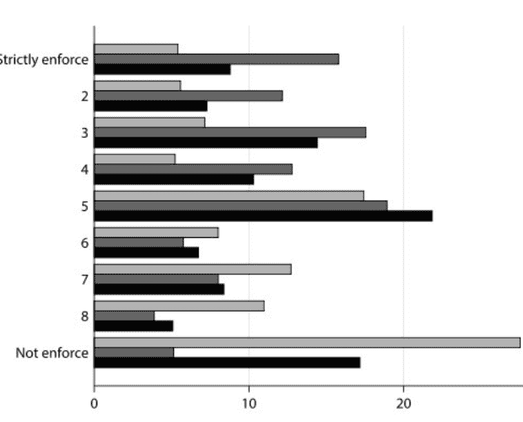

图5.3显示了按党派对执行封锁的支持情况。我们看到对执行封锁的支持存在明显的党派分歧：民主党人希望政府对封锁措施实施更强的执行，而共和党人没有。

虽然共和党人的态度可能也源于一般的反政府情绪，而非针对新冠肺炎疫情的特殊情绪，但这些差异揭示了美国人在2020年6月对执行封锁思考时的深层党派分歧。共和党受访者中的大多数坚决反对任何政府努力。民主党人在接受封锁措施的意愿上稍微没那么极端，但大多数民主党人对封锁措施仍持中度到强支持态度。正如我们在下文讨论的，这种对封锁措施宽容度的差异反映了对疫情可能发展趋势的不同预期。


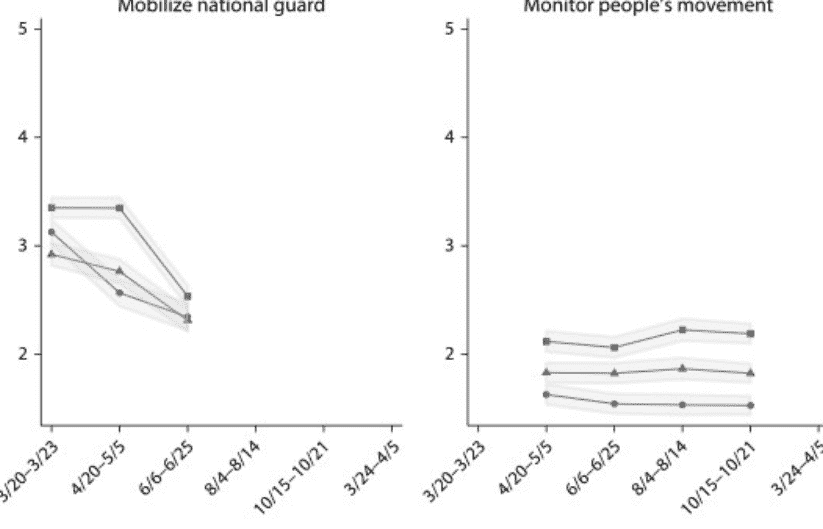

与封锁及其执行这一一般问题相关的是，我们还询问了公民对两项关于控制疫情的具体政策的支持情况：动员国民警卫队执行隔离以及政府监控人们的行踪。受访者在从1（强烈反对）到5（强烈同意）的分值上回答了这些问题。共和人对军队往往更有信心，但倾向于反对联邦或州政府对其私人生活的干预。相比之下，民主党人对军队的支持较少，但更愿意利用国家的强制能力来保护公共健康。

图 5.4 显示了这些政策观点如何随时间演变，但需要注意的是我们并没有在每一波调查中都询问这些每一个问题。

在动员国民警卫队方面（各州长不时根据裁量权发放防护设备并提供护理），2020年3月政策立态上的党派差异非常小。这种分歧在第二波调查中剧增，这是由于共和人和独立人士/非党派人士立场的变化驱动的，他们对动用国民警卫队执行隔离的支持程度大大下降。四月也是特朗普开始恐吓州长的时期，旨在推动他们重新开放经济，这一点我们在下文中将进行阐述。到六月，随着经济和社会生活开始回暖，所有群体对执行隔离的支持率都处于较低水平。由于执行隔离的问题对大多数美国人来说不再突出，我们在第三波调查中停止了提问这个问题。

相比之下，监控人们的行踪被证明在所有群体中都是极不受欢迎的。这种对监控行踪的反对可能是出于隐私担忧。然而，鉴于对监控的支持水平较低，但存在着巨大的党派差距：皮尤研究中心2020年4月进行的一项研究显示，“如果政府追踪人们的位置会有很大帮助/小帮助”，31%的共和人同意这一陈述，而45%的民主党人和42%的独立人士表示同意。在其他地方，我们看到了各种追踪实践：以色列使用位置数据，而新加坡使用了手机应用程序。台湾的位置追踪应用是强制性的，并用于执行隔离，超出封锁范围的公民会收到短信通知或面临巨额罚款。在先进的民主国家，对隐私权利的担忧使公民对基于App的追踪更加犹豫，但法国的一项研究显示，对政府有更高信任的人更愿意下载接触者追踪应用。

美国在疫情初期表现糟糕，有很多原因，包括死亡人数惊人以及病毒蔓延失控，其中最轻微的微不足道的是检测数量不足和美国碎片化的医疗体系。民主双方对隐私的担忧和对政府的不信任可能阻碍了联邦政府推行更激进的追踪系统。2020年8月，《大西洋月》发表了一篇关于接触追踪的文章，标题为《最美国式的新冠肺炎失败》。

为了更充分地探讨这些问题，我们询问了监控问题的第二个版本，以看是否能将政府监控行踪（了解人们的活动以追踪其活动、与谁见面等）与政府运行的接触者追踪计划区分开来。我们在2020年8月（第四波）询问了这个问题。这一时间点很重要：2020年8月疫情已经持续了很久，大规模检测和手机应用已普及并可以大规模发放。2020年8月处于第二波疫情的中期，处于夏季放松、国家降低戒备之后。

图 5.5 比较了我们这两个项目的结果，揭示了对这两种监控和接触追踪方法的支持程度迥异。右侧，我们复制了图5.3的结果（仅限第四波）；左侧，我们看到了明确询问接触追踪的项目。美国人普遍反对监控行踪，但他们确实支持接触追踪，尤其是民主党人。

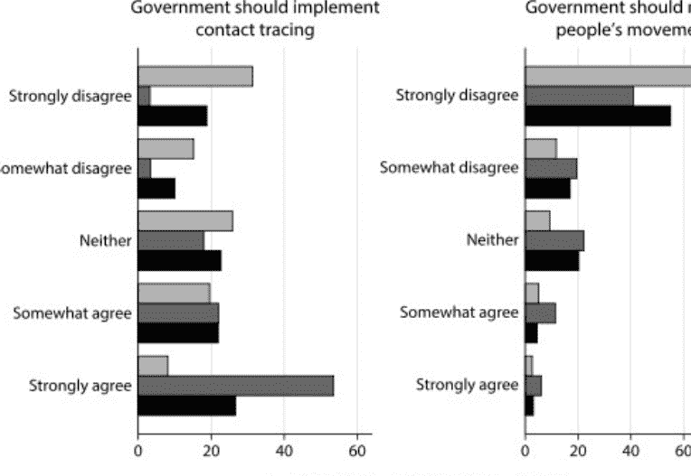

最后，联邦政府本可以做很多事情来减轻新冠肺炎疫情的影响。到本章的目前为止，我们已经探讨了最重要的两点：大规模检测以及监测（从而控制）新冠病毒传播的策略。大规模检测的延迟和未能采取接触追踪的完全失败直接导致了不必要的生命损失。事实上，在白登政府接手后，白宫新冠病毒应对协调员德波博拉·比克斯（Deborah Birx）博士在接受 CNN 采访时表示：“我是这样看的。第一次，我们有一个借口。最初那波浪潮导致了约 10 万人死亡。其余的人在我看来，如果我们吸取了那一刻学到的教训，本可以得到大量的缓解或减少。”

## 取消一切？

当特朗普试图通过展现“政治常态化”的形象来缓解疫情初期经济的不确定性时，事件已超出了他的控制。3 月 6 日，西雅图华盛顿大学宣布将所有课程转为线上。3 月 11 日，美国篮球联盟在犹他爵士队球员新冠病毒检测呈阳性后暂停了赛季。紧接着是大大棒联盟和国家冰球联盟。3 月 12 日，百老汇剧院关闭大门。全国范围内的圣帕特里克日巡游被取消。科切拉谷音乐节被取消。2020 年东京夏季奥运会被取消，这是二战以来首次奥运会被取消。泰勒·斯威夫特（Taylor Swift）和哈里·斯泰斯（Harry Styles）取消了门票巡演。如果有些东西无法取消，它们就转到了线上。这一切都发生在特朗普 3 月 13 日宣布国家紧急状态之前。

这些大规模的取消在全美形成了事实上的封锁，即使在没有发布官方居家令的州也是如此。这就是穆克（Mounk）在《大西洋月》专栏“取消一切”中描述的，其中包含了以大规模取消活动形式呈现的“极端社交距离”，范围从体育、大学到总统竞选活动.¹ 他写道：“这个政府不太可能很好或快速地完成这些事情。因此，社交距离的责任现在落在社会每个层级的决策者身上。”

穆克的论点提醒我们，当我们考虑应对新冠肺炎的政策选择时，必须包含那些在政府权限之外的选项。个人在多大程度上支持“取消一切”？这种想法可能反映了民主党对总统协调安全复课能力的根本性悲观，也反映了他们不愿将经济置于人类生命之上的。无论原因如何，共和党对重新开放持乐观乐观态度，尽管这对弱势的美国人存在风险。3 月下旬，德克萨斯州副州长丹·帕特里克（Dan Patrick）在塔克·卡尔森（Tucker Carlson）的节目中说：“让我们回到正常生活吧。让我们聪明地对待。对于那些 70 岁以上的人，我们会照顾好自己，但不要牺牲国家……我们给国家和子孙留下的最大礼物是我们国家的传承，而现在，它正面临风险……我认为我们可以回到工作了。”

### 也许没有什么比学龄儿童在家学习更让美国家庭感到动荡不安的了

疫情迫使了“近乎完全的关闭”，导致几乎所有学校在 2020 年 3 月切换到虚拟学习，数千万美国儿童在 2020–2021 学年的部分或全部时间都在在线上。学校的关闭和复课政策通常由当地学区和县级官员制定，即使在同一个地理区域内也存在巨大差异。在加州南部，你可以沿着太平洋海岸公路行驶一百英里，从洛杉矶县的长滩市（那里的一级学生参加线上上课）到橙根县的纽波尔海滩（那里的一级是面授），再到圣地亚哥县的拉霍亚（那里的一级再次变为虚拟教学）。或者你可以从克利夫兰市中心（那里 2020–2021 学年学校为虚拟教学）开车二十英里，在邻县找到混合和面授模式。


图 5.7. 2020 年 4 月企业重新开放的前景

学校政治学揭示了关于疫情更困难的权衡。流行病学数据清楚地表明，年轻人受新冠病毒严重影响的可能性远低于成年人。但年轻人与成年人生活在一起，许多情况下还与祖父母或其他那些感染 COVID-19 风险较高的家庭成员生活在一起，而学校可能成为甚至低风险青少年传播病毒的主要场所。

出乎意料的是，关于如何复课学校的公众辩论充满了分歧。布朗大学的经济学家埃米莉·奥斯特（Emily Oster）敦促学校和托儿中心重新开放。她的文章侧重于长期远程教学带来的经济影响：儿童的健康风险较低，而且父母需要返回工作。这一观点遭到了教师工会的反对，他们认为学校没有采取必要的安全措施；同时也遭到了公共卫生专家的反对，这些专家观察到，奥斯特的建议似乎是针对中上产阶级郊区白人家庭的状况提出的，尽管黑人和希斯潘裔儿童感染 COVID-19 的风险要高得多。

但普通美国人是如何看待这些风险的呢？我们可以通过调查数据以两种方式来回答这个问题。在 2020 年春季的第 1-2 波调查中，我们询问受访者在多大程度上认同“为了应对疫情关闭学校”这一表述。我们在 2020 年 8 月进行的第四波调查恰逢美国常规学年的开始，因此为我们提供了观察美国人对线下教学态度的绝佳机会。在这一波调查中，我们让人们在 1（低风险）到 10（高风险）的范围内对送孩子上学的风险评分。在图 5.8 中，我们展示了结果，并按受访者的政派倾向进行了分类。

## 学校应该关闭

### 线下教学有多大风险？

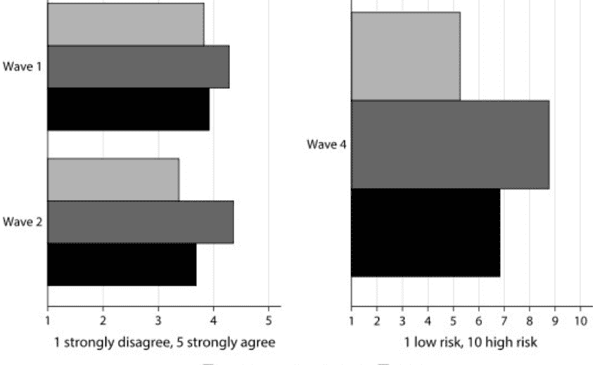

- 1 非常不同意，5 非常同意
- 1 低风险，10 高风险
- 共和党、民主党、其他

图 5.8. 按党派划分学校开放与安全性

当我们观察疫情早期几个月对关闭学校的观点时，无论受访者的政派身份如何，对关闭学校都有相当强有的支持（尤其是在第 1 波）。在第 2 波调查中，日益渴望复课的民主党人之间的差距扩大了。转向第 4 波，我们看到政派倾向在受访者认为线下教学到底有多大的风险上起着核心作用：民主党人对线下教学风险的平均评分（1-10 分制中的 8.8）高于民主党人对室内用餐风险的平均评分（8.2），与参加社交聚会的风险评分（8.8）持平。在共和党人中，线下教学的风险分为 5.3，低于室内用餐（5.7）或参加社交聚会（5.6）。我们可以通过以下这一点解释这些差异：我们数据中的共和党人比民主党人更相信儿童感染 COVID-19 的风险较低（1-5 分制下平均为 3.7），而民主党人的平均分仅为 1.5。

### 线下教学有多大风险？（按种族划分）

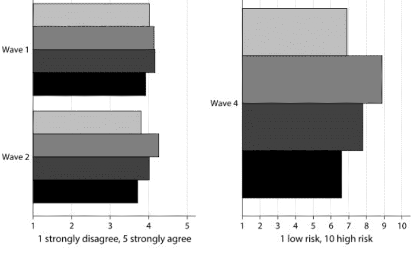

图 5.9. 按种族划分学校开放与安全性

- 白人
- 黑人
- 希斯潘裔
- 其他

我们可以研究数据中的不平等在塑造对关闭学校观点方面方面的作用。令我们惊讶的是，我们在调查中并没有发现收入水平之间存在许多差异。在边缘情况下，我们看到非常有限的证据表明，在第 4 波中，高收入美国人认为线下教学的风险比低收入美国人稍低一点，但仅此而已。然而，种族不平等对疫情和学校教育观点的影响却相当大（图 5.9）。

从第 2 波调查开始，黑人美国人对关闭学校的支持程度显著高于白人，而且在第 4 波调查中也认为线下教学的风险比白人高。这些种族差异中的一些归因于政派倾向，但即使考虑到我们调查中的黑人美国人更有可能是民主党人，我们仍然能看到美国政治中关闭学校问题上不均衡的种族维度。

疫情期间教育的这些种族和政派维度本身就相当令人惊讶：在美国生活中，很少有哪个领域的种族和政派倾向比美国教育背景更具根本性。但为了我们的论点，这些因素强化了美国人对疫情本身的理解在多大程度上已经变成了政派视角，并说明了思考黑人美国人在应对 COVID-19 疫情期间的不同经历是多么重要。我们的发现与相关研究一致，即地方政派倾向导致共和党倾向的地区更有可能比民主党倾向的地区开放。即使美国人认同 COVID-19 对老年人和免疫力缺陷的成人特别致命，民主党人仍然认为 COVID-19 比共和党认为的更危险。政派倾向再次成为帮助美国人理解 COVID-19 本质的引导力量。

## 监管力度是多少？

观察政派倾向如何塑造 COVID-19 政策态度的另一种方法，是观察疫情期间政府应该对日常生活进行多大的监管。换句话说，我们不是询问美国人在多大程度上支持特定政策，而是将转向整体政策环境。思考整体政策环境涉及了在本章引言中提出的关于政府权威与个人自由的一些核心问题。它还涉及政府权力在联邦政府与各州之间的集中问题，因为美国联邦制赋予了各州管理大部分疫情应对措施的权力，而州政府在实施政策的积极性上存在巨大差异。

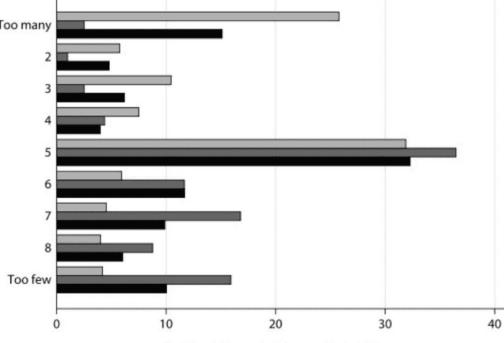

图 5.18. 按党派划分对 COVID-19 监管的态度

我们在 6 月询问个人是否认为“他们所在的州规定了太多”或“太少”的监管，并使用滑动刻度 1（太多）到 9（太少）来表示受访者的立场。使用“我所在的州”这种措辞很重要，因为我们邀请受访者思考地方性的努力，而不是来自华盛顿的政派辞令。

政策态度再次与政派身份强相关。所有共和党人中 25% 的给出了最可能的答案，即他们所在的州规定太多了；很少有民主党人持有这一观点。民主党人没有那么极端，但尽管如此，16% 的民主党人提供了最可能的回答，即他们的州规定太少。很少有共和党人持有这一观点。

但跨党最常见的回答位于刻尺的中间，反映了认为监管数量“恰好”。

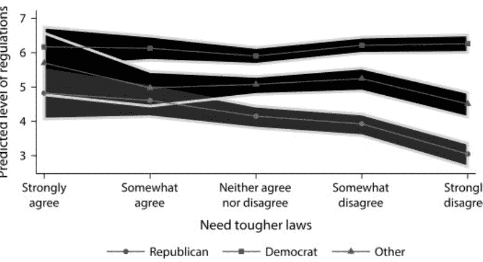

注：为了构建此图表，我们使用了多元回归分析，根据受访者的党派倾向以及收入、居住州、城市或农村县等一系列人口统计和地理变量，计算了他们对州政府实施法律过多或不足的预测信念水平（前述的九点量表）。随后，我们将此与受访者对“社会需要更严格的法律”这一普遍观点的同意程度进行对比。

图 5.1. 对更严格的新冠疫情限制和更严厉法律的支持

这项分析的结果非常具启发性。民主党人对更严格法律的观点分布相当均匀。也就是说，许多民主党人支持社会需要更严格法律的观点，而许多其他民主党人则强烈反对这一立场。但无论他们对这一普遍性问题如何看，民主党人一致地认为，他们所在的州在应对新冠疫情方面实施的规定太少。因此，对于民主党人而言，这场前所未有的新冠疫情似乎超过了他们对“社会需要更严格法律”这一立场的任何分歧。共和人则并非如此。强烈支持应该有更严格法律的共和人认为，该州的新冠疫情规定水平既不多也不少。但那些强烈反对更严格法律的共和人，也倾向于认为，他们所在的州的新冠疫情规定太多了。

这项分析的意义在于，在民主党人中，对新冠疫情规定的态度与对政府效能的信念无关。这意味着，新冠疫情的政策需求可能覆盖民主党人对强政府控制的任何反对。回想上文，民主党人面临的核心困境之一是，赋予联邦政府更多应对疫情的权力，意味着赋予了他们的政派敌对者更多权力。然而，总而言之，即使是那些最可能对政府权威产生怀疑的民主党人，也为了有效应对新冠疫情而容忍更多的权力。

相比之下，在共和人中，对政府效能和新冠政策制定的态度是密切相关的。换句话说，总体上支持有限政府的共和人也支持特定的限制性新冠政策。然而，共和人处于一个不同的境地，这可能使特朗普政府对疫情采取更统一、更激进的应对变得复杂。确实有一些共和人在一般性问题上支持更严格的法律。尽管与持有相似观点的民主党人相比，他们倾向于支持较低的州监管，但这些差异相对较小。但那些反对应该有更严格法律的共和人，也反对州的新冠疫情规定。

这群共和人的存在——与民主党人不同，他们不愿在新冠疫情背景下抑制对政府干预的信念——可能让特朗普政府难以对疫情采取更激进的应对。虽然我们认为特朗普政府错过了动员两党支持全面管理新冠疫情战略的机会，但其党内的自由意志派无论如何都会反对。

# 谁应该做什么？

根据法律和宪法，州长主要负责确保州的安全。尽管各州宪法在授予州长与州立法会的具体权力上有所不同，但州长通常拥有实施居家令和指导经济重启过程的权力。特朗普政府对这一责任的解读非常扩张，将其留给各州去获取个人防护设备和呼吸机等医疗设备。然而，特朗普也认为他可以动员基本盘来迫使民主党州长开放其经济，因为他知道封锁措施和居家令会对关键摇场州的当地经济产生有害影响，损害他的连选机会。特朗普曾著名地推文：“解放明尼苏达州！”、“解放弗吉尼亚州！”以及“解放密歇根州！”，后者这让一群持枪的特朗普支持者聚集到了密歇根州的州议会所在地。

在特朗普管理新冠疫情的许多前所未有的事件中，一个特别突出的治理问题是管理疫情的责任归属。特朗普一方面将决策和执行推给了各州，另一方面在这一危险阶段又声称：“当有人成为美国总统时，权力是全总的。州长们很清楚。”

作为一个法律和宪法问题，州长主要负责确保州内的公共安全。尽管各州宪法在授予州长与州立法会的具体权力上有所不同，但州长通常拥有实施居家令和指导经济重启过程的权力。特朗普政府对这一责任的解读非常扩张，将其留给各州去获取个人防护设备和呼吸机等医疗设备。然而，特朗普也认为他可以动员基本盘来迫使民主党州长开放其经济，因为他知道封锁措施和居家令会对关键摇场州的当地经济产生有害影响，损害他的连选机会。特朗普曾著名地推文：“解放明尼苏达州！”、“解放弗吉尼亚州！”以及“解放密歇根州！”，后者这让一群持枪的特朗普支持者聚集到了密歇根州的州议会所在地。正如我们在第 6 章中提到的，这种做法不仅将健康和经济措施设定为权衡，还将个人选择的理念置于集体责任之上。

特朗普的政治策略是高明的。他让各州为准备工作或组织工作负责。州长们很快学会了依赖联邦政府的后勤支持。例如，纽约州申请的呼吸机仅收到了五分之一。在缺乏国家采购计划的情况下，纽约州不得不与其他州竞争关键物资。

但对于观察州政府在联邦与州激烈斗争中挣扎的普通人来说，又是怎样的？国家政治在疫情期间塑造地方政策起了重要作用，这可能影响了他们对州与联邦权威的看法。确实，在县层面，对移动数据的统计分析显示，州政府领导者的建议在民主倾向县比在共和倾向县更有效，尽管居家令在民主县的影响更大。民主党人可能更倾向于将权力交给州政府和卫生机构，特别是如果他们住在蓝州。

为了辨析美国人对州与联邦应对新冠疫情的观点，我们在调查的第 4 轮（8月）和第 5 轮（10月）加入了一个调查实验。我们在疫情后期加入这些实验，假设到那时公民已经习惯了州与联邦权威之间的差异。那时，美国人已经接受了半年的州和地方卫生部门的信息，这些规定在城市和县之间各异。县一级会报告新冠病例和床位情况，还会报告口罩要求和学校是否开放。我们认为，这让公民能够区分出管理权的实际差异。

调查实验的细节见附录；在这里我们关注基本思想。我们提出了两个关于政策的问题，仅在一个细节上不同，并在受访者之间随机分配该细节。首先，我们询问：“你认为谁应该为企业提供额外的减税和贷款？”其次，我们询问谁应该禁止驱逐和关闭？”

这两项政策对于控制疫情引发和社会成本都至关重要。后者在夏天尤为突出，当时特朗普敦促国会延长《救援援助法案》中实施的即将到期的驱逐禁。

## 第 4 波

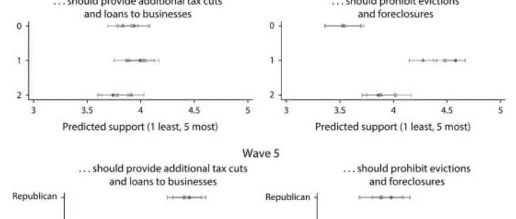

## 第 5 波

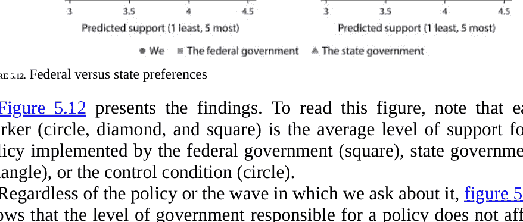

图 5.12 联邦与州的偏好

图 5.12 展示了研究结果。阅读此图时请注意每个标记（圆形、菱形和正方形）代表对联邦政府（正方形）、州政府（三角形）或控制组（圆形）所实施政策的支持程度。


无论是什么政策或处于哪一波，图 5.12 都显示，负责政策的政府层级并不影响对该政策的支持。无论是由联邦还是州（或控制组）负责，对这两类政策的支持在党派倾向上没有统计学上的显著差异。然而，令人惊讶的是，我们发现对于禁止驱逐和止赎的政策，**上**存在强烈的党派差异。民主党人支持驱逐和止赎保护的比例远高于共和党人。更有趣的是，我们发现，通过减税和贷款对企业提供支持在所有党派背景的支持者中都广受欢迎。无论受访者属于哪个政党，无论由哪一层级的政府负责，美国人在疫情期间都倾向于支持有利于企业的政策。

## 结论

我们在本章中的分析显示，美国人几乎在每一个与 COVID-19 疫情相关的政策上都存在党派分歧，从政府的表现如何，到政府应该拥有多大的权力来做其本该做的事以应对疫情等。这些发现与我们在之前的章节中提供的关于党派倾向如何塑造 COVID-19 疫情的证据是**一**的。民主党人比共和党人更有可能调整自己的行为并对疫情及其影响表示担忧，因此他们希望政府能采取行动。共和党人对疫情的感受不同，并对许多旨在抑制疫情的政策表示反对。

然而，退一步来说，本章向我们展示了美国 COVID-19 疫情政治中最令人惊讶的方面之一。并不是特朗普的共和党同僚们支持联邦政府积极应对疫情，而是民主党人对这种应对的支持最高。我们认为，这最终可以归因于——特朗普极化的总统风格，且尽管这种风格如此。特朗普政府最与众**的**特征之一是总统对政府缺乏兴趣。他不仅放任了可能正在全力试图最小化第一波疫情的官僚机构，还将政策责任转移给了州，其理由是圈内党派成员会“追随领袖”（在这种情况下是共和党人），而圈外党派成员会拒绝总统政变（在这种情况下是民主党人），疫情期间经济低迷，而民主党人则要求关闭学校、进行更多检测和更加谨慎。

而且尽管特朗普的领导风格是如此，因为民主党人通常在另一党执政时会削减联邦政府权力（共和党人亦然如此），但正如我们在第 4 章中看到的，民主党人表现出的情绪令他们感到恐惧、渴望信息和（政策）控制。如果提供了强有力的政策，如强制执行居家禁令和接触追踪，他们本会支持这些政策的。这可能导致了一场该国最终并未进行的**对话对话**，尽管其他国家（如新西兰）确实进行了：在跨越从保护到威权的界限之前，行政当局应该拥有多少紧急权力？

本章的发现帮助我们理解美国政治中的重大意识形态辩论——关于政府在日常生活中的作用，关于谁应该领导政府应对公共卫生紧急情况等危机——是如何影响疫情并被疫情影响的。民主党和共和党内部都有对隐私和自由的倡导者，在高度极化的两党制总统制背景下，民主党人完全有理由赋予由其政派竞争对手领导的联邦政府更多权力。然而，民主党人本可以容忍特朗普政府对 COVID-19 疫情采取更激进的应对——他们甚至可能欢迎之。然而，共和党人对联邦层面和州内对抗疫情的政府行动却要怀疑得多，即使在有一位共和党总统执政的情况下。随着美国人陷入深度极化，且党派倾向成为 COVID-19 公众意见的重要驱动力，我们现在可以理解特朗普总统时期最令人困惑的方面之一：执政党的立场并不是通过治理来走出疫情困境。

# 第 6 章 疫情的代价

## COVID-19 与美国经济

COVID-19 疫情不仅是对美国人日常生活的冲击——影响他们与亲友见面、送孩子上学以及去电影院或现场观看喜爱的球队比赛的能力。它对他们的经济生活也是一次前所未有的冲击。数百万美国工人发现自己以全职或兼职的方式在家工作。数百万美国人发现自己突然失业。联邦储备委员会估计，仅第一年疫情就导致了约二十万家小企业倒闭。2021 年 6 月 1 日，副总统卡马拉·哈里斯在 MSNBC 上将这一数字描述为“我们小企业的三之一”。虽然联邦薪资保护计划为某些企业提供了数十亿美元援助以支付员工工资并履行合同，但另一些企业并不幸运。加利福尼亚州遭受的打击最大，到 2020 年 9 月已有四万家小企业关闭。这些小企业主中许多人加入了封锁抗议，或支持了 2021 年 9 月罢免加州州长加文·纽瑟姆的选举运动。简单来说，COVID-19 对经济的影响是毁灭性的。即使是那些足够幸运保住工作的人，也陷入了现代史上最剧烈的衰退之中。

### 衰退

图 6.1 显示了根据美国劳工统计局官方数据的这些趋势的状况。

COVID-19 疫情引发的失业率飙升远超 2007–2009 年金融危机导致的失业率激增。同样可见的是，失业率在最初飙升后迅速回落。金融危机后的恢复是长期且缓慢的，而失业率在 2020 年疫情尚未定型之前就迅速反弹。

从比较的角度来看，美国 COVID-19 的失业冲击显得更加异常。在图 6.2 中，我们将美国与其他五个大型繁荣的民主国家进行比较，以说明每个国家的失业情况是如何应对 COVID-19 疫情的。

这些国家在控制 COVID-19 传播和死亡人数方面都比美国做得好，他们也能更有效地控制疫情对失业的影响。在正常情况下，美国的失业率处于令人羡慕的低水平。但在疫情期间，美国表现出**可能可能**是独特地无法应对疫情带来的经济后果，而其他先进工业民主国家则看到失业率略有上升，在某些情况下根本没有上升。这之所以成为可能，是因为这些国家能够对大规模失业的威胁做出迅速反应，转向诸如德国的“短工补贴”（Kurbeit）等政策，这些政策允许企业利用政府支持向员工支付疫情前工资的大部分。此类政策将应对疫情的经济成本社会化，并借此保护了岗位。

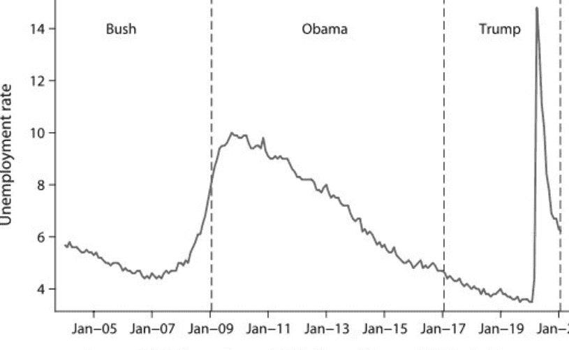

**来源：** FRED，失业率（百分比，季节性调整）

图 6.1. 美国失业率，2004–2021

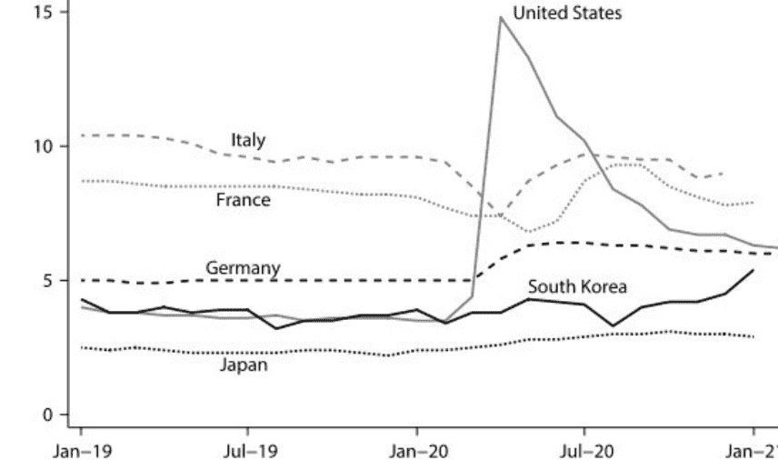

**来源：** FRED，失业率（百分比，季节性调整，不同国家）

图 6.2. 选定**体**失业冲击对比

并不意外，这些国家的政策制定环境也让他们更容易控制疫情的即时影响。全民医疗保健使得 COVID-19 检测能够无成本地大规模开展，而美国则需要国会法案来确保美国人的保险计划不会收取 COVID-19 检测费用。当其他先进经济体在 2020 年夏天将精力集中在检测、追踪和治疗上，而其公民等待疫苗时，美国人却对“薪资保护计划”的缓慢推出感到遗憾，政治家们对是否需要财政刺激争论不已²。

本书的一个重要主题是，COVID-19 疫情的经历在种族上存在严重不平等，我们将在第 8 章详细讨论这一主题。但作为预览并为了说明 COVID-19 疫情的种族化经济后果，图 6.3 使用相同的官方来源分解了按**族**划分的失业趋势。

这些数据描绘了与图 6.1 中看到的完全不同的故事。在 COVID-19 疫情高峰，黑人美国人和拉丁裔美国人的失业率达到接近 20%，这意味着这两个社区中几乎每五个人中就有一个正在找工作但找不到工作。疫情对白人和亚裔社区的影响确实严重，但较轻微。得益于历史背景，我们还可以看到，2007–2009 年金融危机的失业后果对黑人美国来说与 COVID-19 疫情一样严重。美国种族和民族少数群体在美国就业市场中这些不平等的经历，准确地反映了导致疫情如此具有破坏性的预存条件（见第 1 章）。

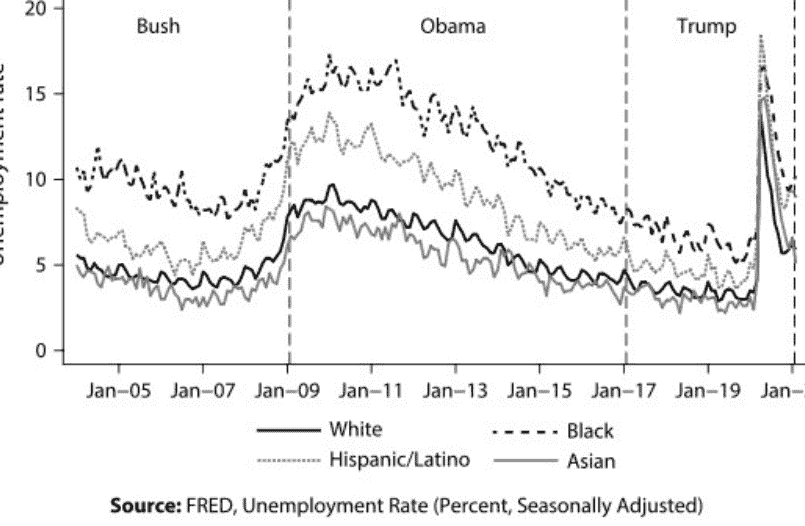

图 6.3. 按**族**划分的美国失业率，2004-2021

当我们按性别细分失业趋势时，另一幅细致的图景也随之浮现，正如我们在[图 6.4](figure6.4)中所示。

比较 2007–2009 年金融危机和 COVID-19 疫情，我们看到在失业方面，COVID-19 疫情对女性的影响不成比例地大于男性，2020 年年中峰值失业率之间存在 2.5% 的差距。相比之下，2007–2009 年金融危机对男性的影响不成比例大于女性，这在美国衰退中是常态。

对 COVID-19 疫情期间失业率异常性别差异的解释有很多。在 2007–2009 年金融危机中，男性的失业情况高于女性，因为危机影响了建筑、制造业和房地产等部门，在这些部门中**女性的比例高于男性**。[40] COVID-19 疫情则不同。女性不成比例地在医疗保健行业，由于医疗需求增加，这本应使她们免受失业冲击。事实上，女性拥有的**三分之一之一**工作被归类为基本工作。[41] 但任何此类保护都被餐饮和酒店业需求的急剧下降所抵消，而在这些行业中女性比例高于男性。更具破坏性的是美国学校的突然关闭和对儿童的迫切需求迫使许多女性临时离开劳动力市场。这些数据共同意味着，正当许多人的劳动力从正式部门转向家庭时，许多女性的劳动力也发生了转移。

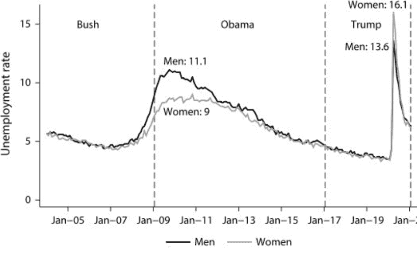

**图 6.4.** 按性别划分的美国失业率，2004–2011

这些官方数据为我们提供了关于 COVID-19 失业冲击的大量细节，这种冲击是根据不同因素的不平等地经历的。其他研究支持了这些发现：疫情的影响根据种族、性别、收入和就业保障的不平等，尤其是那些处于不稳定安排和低收入的人遭受得更多。然而，这些数字并没有告诉我们如何充分探讨这些问题。

## 失业与不稳定性：详细视角

另一个要调查的问题是美国人的经历是否因党派倾向而异。我们在图 6.5 中通过以下图表调查了这一问题。我们还用灰色绘制了 95% 置信区间，以便我们观察差异是否具有统计学意义。

通过比较 2007–2009 年金融危机和 COVID-19 疫情，我们看到在失业方面，COVID-19 疫情对女性的影响不成比例地大于男性，2020 年年中峰值失业率之间存在 2.5% 的差距。相比之下，2007–2009 年金融危机对男性的影响不成比例大于女性，这在美国衰退中是常态。

对 COVID-19 疫情期间失业率异常性别差异的解释有很多。在 2007–2009 年金融危机中，男性的失业情况高于女性，因为危机影响了建筑、制造业和房地产等部门，在这些部门中**女性的比例高于男性**。[40] COVID-19 疫情则不同。女性不成比例地在医疗保健行业，由于医疗需求增加，这本应使她们免受失业冲击。事实上，女性拥有的**三分之一之一**工作被归类为基本工作。[41] 但任何此类保护都被餐饮和酒店业需求的急剧下降所抵消，而在这些行业中女性比例高于男性。更具破坏性的是美国学校的突然关闭和对儿童的迫切需求迫使许多女性临时离开劳动力市场。这些数据共同意味着，正当许多人的劳动力从正式部门转向家庭时，许多女性的劳动力也发生了转移。

本书的一个重要主题是，COVID-19 疫情的经历在种族上存在严重不平等，我们将在第 8 章详细讨论这一主题。但作为预览并为了说明 COVID-19 疫情的种族化经济后果，图 6.3 使用相同的官方来源分解了按**族**划分的失业趋势。

这些数据描绘了与图 6.1 中看到的完全不同的故事。在 COVID-19 疫情高峰，黑人美国人和拉丁裔美国人的失业率达到接近 20%，这意味着这两个社区中几乎每五个人中就有一个正在找工作但找不到工作。疫情对白人和亚裔社区的影响确实严重，但较轻微。得益于历史背景，我们还可以看到，2007–2009 年金融危机的失业后果对黑人美国来说与 COVID-19 疫情一样严重。美国种族和民族少数群体在美国就业市场中这些不平等的经历，准确地反映了导致疫情如此具有破坏性的预存条件（见第 1 章）。


图 6.3. 按**族**划分的美国失业率，2004-2021

当我们按性别细分失业趋势时，另一幅细致的图景也随之浮现，正如我们在[图 6.4](figure6.4)中所示。

比较 2007–2009 年金融危机和 COVID-19 疫情，我们看到在失业方面，COVID-19 疫情对女性的影响不成比例地大于男性，2020 年年中峰值失业率之间存在 2.5% 的差距。相比之下，2007–2009 年金融危机对男性的影响不成比例大于女性，这在美国衰退中是常态。

对 COVID-19 疫情期间失业率异常性别差异的解释有很多。在 2007–2009 年金融危机中，男性的失业情况高于女性，因为危机影响了建筑、制造业和房地产等部门，在这些部门中**女性的比例高于男性**。[40] COVID-19 疫情则不同。女性不成比例地在医疗保健行业，由于医疗需求增加，这本应使她们免受失业冲击。事实上，女性拥有的**三分之一之一**工作被归类为基本工作。[41] 但任何此类保护都被餐饮和酒店业需求的急剧下降所抵消，而在这些行业中女性比例高于男性。更具破坏性的是美国学校的突然关闭和对儿童的迫切需求迫使许多女性临时离开劳动力市场。这些数据共同意味着，正当许多人的劳动力从正式部门转向家庭时，许多女性的劳动力也发生了转移。


**图 6.4.** 按性别划分的美国失业率，2004–2011

这些官方数据为我们提供了关于 COVID-19 失业冲击的大量细节，这种冲击是根据不同因素的不平等地经历的。其他研究支持了这些发现：疫情的影响根据种族、性别、收入和就业保障的不平等，尤其是那些处于不稳定安排和低收入的人遭受得更多。然而，这些数字并没有告诉我们如何充分探讨这些问题。

## 失业与不稳定性：详细视角

第一个要调查的问题是美国人的经历是否因党派倾向而异。我们在图 6.5 中通过以下图表调查了这一问题。我们还用灰色绘制了 95% 置信区间，以便我们观察差异是否具有统计学意义。

我们的数据非常清楚地显示，疫情初期存在巨大的失业差距，这种差距随着危机的恶化而持续。一致地，我们发现民主党人和无党派者的失业率高于共和党人。失业率在 2020 年 3 月至 6 月期间三个小组均上升，随后随着经济稳定到疫情的“新常态”而下降。到 10 月，我们不再看到受访者之间的党派显著差异，尽管我们怀疑如果我们能够访谈美国劳动力，这些差异将具有统计学意义和实质意义。第六波数据（2021 年 4 月）显示，独立人士的失业率出现激增，而民主党人和共和党人的失业率持续下降。我们对这一意外发现没有解释，尽管它可能反映了决定重新进入劳动力市场的独立人士正在经历。

尽管图 6.5 中的数字是按党派倾向划分的简单平均值，但我们也可以说明这些党派间的失业差异并非仅仅是种族失业差异的结果，而这种差异恰好与党派倾向重叠。换句话说，在考虑了受访者的种族、年龄、教育和其他人口统计后，我们发现民主党人和其他人的失业率持续高于共和党人。这种差异最可能的解释是不同政治背景的美国人倾向于从事不同的职业。虽然我们没有对调查**访者**的职业概况进行精细衡量，但民主党人更有可能从事在疫情期间面临裁员的职位，例如低薪服务业职位。共和党人可能更有可能自雇。这种差异意味着尽管党派倾向本身

尽管并未导致民主党人和共和党人在疫情期间拥有完全不同的就业经历，但两党派人士对疫情的感受仍然各不相同。


图 6.5. 按党派划分的失业情况

我们从多大程度上应该将这种失业率的急剧上升归于 COVID-19 本身？很难知道在多大程度上可以将任何个人的失业归咎于特定原因，但我们在第 2 至 6 轮调查中询问了受访者关于他们失业的情况，他们是将其归于 COVID-19 还是其他因素。受访者报告其失业归因于 COVID-19 的比例见图 6.6。


图 6.6 失业原因：COVID-19 与其他

关于 COVID-19 是否是失业原因，两党派之间没有差异（至少在我们的调查受访者眼中）。我们还发现，随着时间的推移，受访者将失业归于 COVID-19 的频率呈现略微下降趋势，尽管在第 6 轮（2021 年 4 月至 5 月）无党派人士中再次出现了上升高峰。考虑到受访者可能对失业原因并不十分了解，我们从这些数据中得出结论：尽管危机期间所有美国人的失业率都在飙升，但其影响对**民主人**和非党派人士而言尤为强烈。所有失业的美国人中很大比例将这种情况归因于 COVID-19 的直接影响。

但疫情是如何影响美国人的经济状况的？我们的调查数据允许我们超越就业统计，观察疫情是如何塑造美国人的经济生活的。在第 2 至 6 轮调查中，我们询问受访者其或其直系**属**是否发生了以下任何情况：失业、**薪资减减**、申请失业金、访问食物援助银行、无法支付房租或寻求慈善机构援助。这些项目比单纯的就业数据更完整地描述了美国人面临的经济困境。

我们发现，大约 20% 的美国人报告他们或其家庭成员失去了工作，而接近 25% 的美国人报告他们申请了失业金并经历了**薪资减减**。直到 2021 年 4 月拜登政府上台且疫苗接种进展顺利，这些数据没有发生太大变化。这让我们意识到了疫情的持久影响，这与我们在失业总体趋势中看到的“快速反弹”信息有所不同。如果我们只关注失业，就会忽略疫情影响美国人经济状况的更微妙的方式，以及这些影响持续了多久。例如，我们的数据显示，在 2020 年 6 月，有 8% 的美国人访问了食物援助银行。“美国食物”（一家非营利组织）报告，疫情期间有超过四千万美国人经历了粮食不安全，其中包括千万儿童。

我们的数据还显示，这些微妙且持久的疫情经济后果的影响并不平等。黑人和拉丁裔受访者在疫情期间更有可能报告难以支付房租，或求助于食物援助银行和慈善机构来支持自己和家人。即使在考虑了年龄、教育、城乡状况和其他人口统计因素后，这一发现仍然成立。也许令人惊讶的是，正如图 6.7 所示，我们也发现经济困境因党派划分而异。

总体模式是，民主党面临的各种形式经济困境程度始终高于共和党；总的来说，非党派人士处于两者之间。在考虑到地理、收入和教育等因素后，这些党派差异仍然存在。

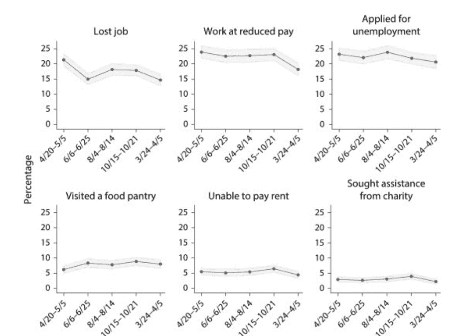

图 6.7. 按党派划分的经济困境

总结我们目前学到的，官方失业统计数据和我们的调查数据描绘了一幅急剧收缩的景象，导致了失业率的大幅波动。COVID-19 衰退的负担在美国不同种族和族群之间的感受是不平等的，而且与之前的美国衰退不同，失业对女性的影响远大于男性。经济影响渗透到了那些成功保住工作的人的经济生活中，引发了一系列**钱钱包**问题。我们还看到 COVID-19 疫情期间经济困境存在党派差异，这反映了华盛顿对于政府在解决这些问题中应扮演何种**角**的分歧。

我们可以通过对比疫情将这些数字背景化。正如我们在本章早期推测的那样，原因之一是**共和人**和民主党人从事不同的职业，这导致他们对与 COVID-19 疫情相关的突然经济放缓具有不同类型的脆弱性。也可能是由于某些对疫情感到担忧的民主党选择了……

## 政策辩论

几乎当疫情的严重性变得显而易见时，面对高度分裂的选民、面临连选的特朗普开始倡导……


# 疫情经济应对与移民态度

## 经济应对分类

对 COVID-19 的经济应对分为两类。第一类是缓解 COVID-19 经济后果的直接措施。例如，企业面临的一个持续问题是是否让员工留在家。如果企业让员工留家里，就会面临工作中断的高昂风险，但只有鼓励生病或接触病毒的员工留家里，才能控制 COVID-19 的传播。补偿企业因病毒遭受损失的政策——就像“薪资保护计划”鼓励员工在生病时留家里一样。通过这样做，政策旨在减轻生产性企业面临的负担，让他们度过疫情，同时保护公共健康。但诚然，此类政策成本高昂，且容易受到无生产力或竞争性企业的操纵或剥削。例如，当发现薪资保护计划让像 Shake Shack 这样的大公司也从旨在保护小企业的条款中获益时，引发了巨大的公众反弹。其他可以应对疫情本身经济影响的政策包括：为所有需要的人提供免费 COVID-19 检测，免除受病毒影响者的治疗费用，以及为因生病或接触而留在家中的工人提供带薪假。其中许多政策最终被纳入《新冠救援法案》（CARES Act）中。

此类政策不仅可以保护美国人的工作，还可以在控制疫情传播中发挥核心作用。4 月月中一个被广泛报道的消息是，禽类和肉类加工行业的工人描述说，他们在狭窄闷热的环境中获得的保护不足。而且由于无法在留家里维持生计，工人面临着反常的激励，即使他们怀疑自己感染了 COVID-19 也要去上班。更糟糕的是，有些企业通过承诺额外薪水甚至肋眼肉来诱导员工在病假时上班。

……在封锁初期还坚持来上班。在这种背景下，对工人提供经济支持是一项可以对抑制病毒产生下游效益的政策。

支付薪水让工人留在家是许多国家采取的政策。在加拿大，收入受疫情影响的工人有权获得每月 2,000 加元的补助，为期长达六个月。这两个国家的政策都超过了美国提供的力度。正如前面提到的，德国采取了“短工”政策，让受影响的公司获得政府补贴，以缩短员工时长和工资，从而避免大规模裁员。法国和西班牙也采取了类似的方法。美国并未提出此类工作分担方案。另一组政策应对的是 COVID-19 疫情对贸易和投资造成的更广泛的宏观经济影响。这些包括降低利率以支持经济复苏的政策，以及增加贸易或在衰退面前加征进口税以保护美国工业的政策。贸易问题特别值得关注，因为它们与现代共和党中民族主义保护主义的复兴相互交织，而且特朗普政府如此急于将 COVID-19 归咎于中国，用种族主义词汇称之为“中国病毒”和“工流（kung flu）”。中国本身在疫情爆发后的 2020 年第一季度出口大幅下降，美国应该对中国进口实施新限制，还是应该接受急需商品的进口，这一问题为 2020 年党派冲突的新轴心。

## 调查设计

在我们调查的第一阶段——紧随特朗普签署《关怀援助法案》（CARES Act）之后——我们询问了受访者对这些政策的意见，询问他们对美国政府实施每每项政策的认同程度。回答范围从 1（强烈不同意）到 5（强烈同意）。我们非常谨慎地确保让受访者思考这些政策对美国的经济影响，并让受访者理解这些是需要由“政府”采纳的政策。如果我们不这样做，受访者可能无法理解我们预期的这些应是由政府代表全体美国人采取的行动。他们给出的答案可能反映了脱离政治的抽象偏好（我们假设每个人都倾向于检测免费），或者反映了其自身的特定立场（受访者可能并不支持一项平等影响每个人的政府政策）。完整的问题表述见表 6.1。

同样注意，这三项经济复苏调查项目明确指出，这些政策对美国经济是有益的，而没有明确提出此类政策的负面影响，例如低利率引发通胀的风险或进口税对消费价格的影响。

## 总体支持情况

在图 6.8 中，我们绘制了所有调查受访者对这些政策的平均支持水平，并将政策按是关注 COVID-19 还是更通用的经济政策进行了分类。

非常明显，美国人普遍对积极的经济政策立场表示支持，即那些应对 COVID-19 护理带来的经济影响并旨在解决中期经济复苏的政策。在大衰条期间，华盛顿经常听到的一句谚言——就像战壕里没有无神论者一样，经济危机期间没有自由意志主义者$^{26}$——似乎非常适用于 COVID-19 疫情。

### 表 6.1. 经济政策调查项目

#### COVID-19 应对

- **免费 COVID-19 检测**：政府应该为所有美国人的所有冠病毒检测提供免费。
- **免除治疗**：政府应该免除治疗冠病毒的保险费用和医院费用。
- **带薪假**：政府应该向任何诊断为患冠病毒的人提供带薪假，以鼓励他们在完全康复前留在家。
- **补偿公司**：政府应该为美国公司提供救助或财务补偿，以恢复因冠病毒造成的损失。

#### 经济复苏

- **增加贸易**：美国必须加强与其他国家的经济联系和贸易，以加强我们的经济。
- **增加税收**：美国必须对外国进口商品增加税收，以刺激国内工业的经济增长。
- **降低利率**：美国应该将利率保持在最低水平，这将鼓励更多支出并支持美国经济。

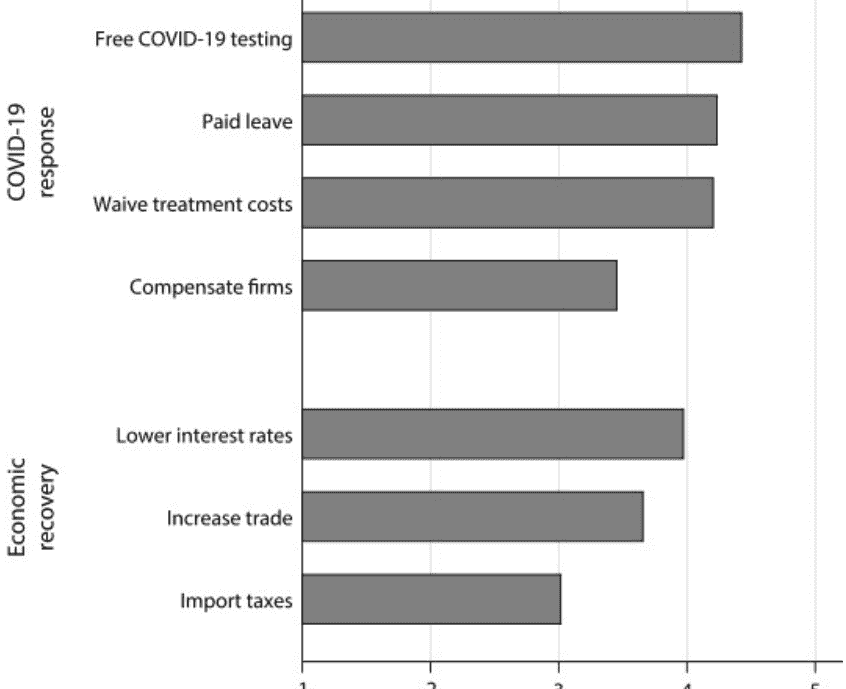

图 6.8. 经济政策应对，2020年3月

## 党派差异分析

然而，发现这些政策偏好中存在党派差异也并不意外。经济政策长期以来一直是民主党与共和党之间、自由派与保守派之间政策分歧的核心轴心。自 20 世纪 30 年代以来，民主党通常倾向于更积极和具干预性的经济政策，而共和党则反对政府干预经济。这可以与一方面非干预的保守主义者和自由意志主义者，与另一方面干预的自由派和进步主义者之间更广泛的意识形态分裂联系起来²。此外，在过去一个世纪的大部分时间内，这些政策组合描述了美国贸易政策，共和党被认为是自由贸易和低关税政党，而民主党则是为所谓“公平贸易”服务的保护主义政党。

当我们在图 6.9 中按党派和意识形态分解这些政策回应时，我们发现这些差异在数据中得到了证实，只有少数显著的例外。

首先看 COVID-19 应对政策。民主党明显比共和党更支持通过降低新冠 护理经济影响来支持工人的政策：免费检测、免除治疗费用，以及为患病或脆弱群群提供带薪假。在补偿公司损失方面，共和党的支持程度略高于民主党（在比较保守派和自由派时也是如此）。似乎在与新冠肺炎相关的经济政策领域，党派态度在某种程度上是由政策的直接受益者驱动的，共和党更倾向于支持针对企业的政策，而民主党更倾向于支持工人的政策。但这些党派差异——符合我们对政派意识形态倾向的普遍理解——相对较小。更重要的发现是所有这些政策都很受欢迎。

与经济复苏相关的政策显示出一些意外和显著的党派分歧。2020年3月，共和党（和保守派）对进口税的支持远高于民主党（和自由派），而对自由贸易的支持则远低于后者。共和党和保守派对降低利率的支持率也高于民主党和自由派。这里各政派的政策偏好似乎反转了 20 世纪美国政治的常规模式。发生了什么？

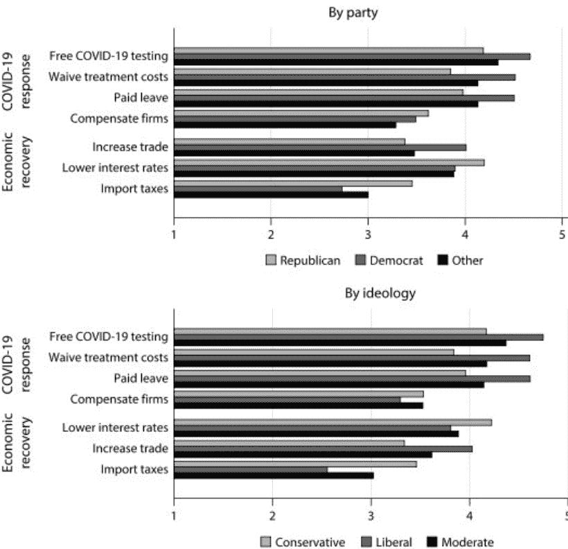

可能的答案是特朗普，他的竞选和执政以共和总统罕少这样做的方式获得了民族主义选票。他对自由贸易的公开蔑视以及对保护美国公司和工人的声声支持引发了民主党的反应，结果他们发现自己更愿意接受自由贸易。在疫情早期的背景下，全国范围内封锁的经济影响深入政客和选民的脑海，政策偏好已经反映了特朗普强烈的反国际主义修辞。共和党也同样支持低利率的宽松货币政策立场，以鼓励美国人消费，保持经济运转。这些党派政策立场——在近期美国历史背景下并不寻常——在疫情发生之前就已经作为预存部分存在了。

与特朗普相关的条件。但在经济危机的背景下，这些条件具有了新的意义和紧迫性。

这些最初的党派差异在整个疫情期间被证明具有惊人的持久性，事实上，这种持久性以至于我们在 4 月的第二波调查后就停止了询问受访者关于其中几项经济政策，因为我们发现这些回答具有这种稳定性。尽管如此，我们仍然对整个样本小组追踪了关于免费检测、带薪病假和增加贸易的回答，因此我们在图 6.10 中展示了这些经济政策上的党派分歧是多么的显著且持久。

在应对 COVID-19 方面，民主党对免费检测、带薪假和自由贸易的支持率始终高于共和人或无党派人士。对于健康行为和其他政策，我们发现共和人对免费检测和假假的支持随着时间的推移趋势更加明显，扩大了党派分歧的程度。这种意见的持续分歧再次反映了 COVID-19 疫情极大的分裂性，其特征是态度的不断加剧的极化，而不是过去国家危机时刻那种熟悉的跨党派共同目标。

## 种族/民族与性别动态

应对 COVID-19 时经济政策偏好的种族化和性别动态又是怎样的？在图 6.11 中，我们根据受访者的种族和民族（左面板）以及性别（右面板）对他们进行了分类。

追踪不同种族和民族政策偏好的图表显示，在应对 COVID-19 的种族化政策反应中并没有表现出简单的模式。总而言，黑人和拉丁裔/女性受访者对免费检测和带薪假的支持率高于白人受访者，但差异较小（且在夏季初的第 波调查中最为显著）。不认同为白人、黑人或拉丁裔的美国人对带薪假的支持率持续较低，这一点尤为引人注目；这一群体包括亚洲裔美国人以及混血、美国原住民和其他受访者。在对自由贸易的支持上，完全不存在一致的种族或民族模式。值得注意的是，当我们使用多元回归分析在控制党派、年龄和地理等因素的情况下，测试经济政策偏好随时间变化的种族差异时，没有发现任何关于种族和民族差异的证据。

### 免费 COVID-19 检测

### 带薪假

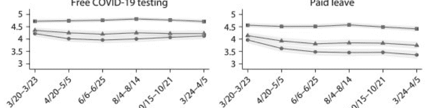

### 增加贸易

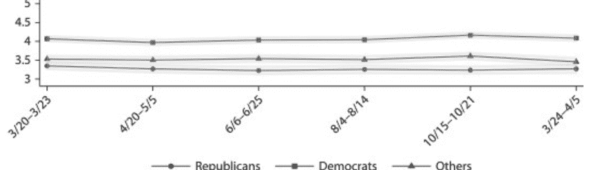

图 6.10. 按党派划分的经济政策反应

相比之下，应对 COVID-19 经济政策反应的性别模式是惊人的。女性对免费检测和休假的支持率始终且大幅地高于男性，然而，女性对自由贸易的支持率通常较低。我们发现女性通常比男性更反对自由贸易，这与关于美国公众对自由贸易态度的既有研究一致，该研究发现即使在“正常时期”，女性对自由贸易的支持率也持续较低。²⁴ 在控制了党派以及地理和人口统计差异的综合统计测试中，性别差异仍然非常强大且具有统计学意义——即使在自由贸易的情况下也是如此。这些关于应对 COVID-19 的性别化经济政策偏好的结果，考虑到上述对疫情新颖性别效应的讨论，是合理的。由于美国女性不成比例地承担了 COVID-19 的经济成本，并从正式就业转为家庭劳动，如带薪假和免费检测等政策——尽管它们本身不会扭转 COVID-19 的性别化劳动力市场影响——对她们来说尤为突出。

### 按种族/民族

### 按性别

免费 COVID-19 检测

带薪假

免费 COVID-19 检测

带薪假

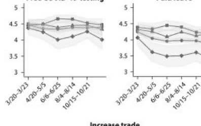

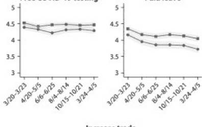 应对 COVID-19 种族分歧的增长率率

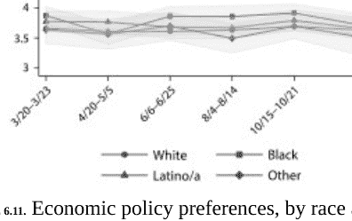 应对 COVID-19 种族分歧的增长率

### 增长率

### 增长率

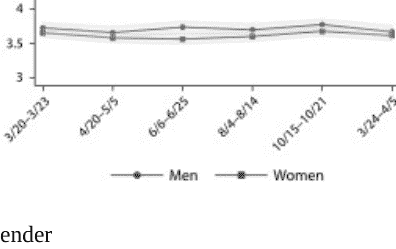

- 拉丁裔/女性
- 其他
- 男性
- 女性

图 6.11. 按种族和性别划分的政策偏好

## 结论

COVID-19 疫情导致了严重的经济衰退并不意外。在奥巴马和特朗普总统时期十年的稳定增长后，2020 年初的失业率是记录以来最高的。与许多过去的衰退一样，失业对黑人和拉丁裔美国人的影响尤为显著。与大多数过去的衰退不同，失业的影响对女性也是不比例的。随着失业率上升的是贫困状况的加剧，这暴露了美国福利国家长期以来的弱点以及贫困的种族化。

深入研究我们的数据也为疫情经济政治学提供了重要见解。美国人广泛支持积极应对，包括《救援援助法》中的措施，但华盛顿对于如何应对的党派分歧反映了美国人对于如何应对危机的党派分歧。总之，我们本章的分析再次说明了美国政治的一个关键动态：

党派意见的持续分歧再次反映了 COVID-19 疫情极大的分裂性，其特征是态度的不断加剧的极化，而不是过去国家危机时刻那种熟悉的跨党派共同目标。

---

# 疫情前移民态度具有党派倾向

移民态度一直具有党派维度。民主党比共和党更支持为非法移民提供合法途径，共和党比民主党更支持增加遣逐非法移民，而民主党普遍倾向于接收来自暴力地区的难民。然而，这种差异的大小随时间发生了变化。图7.1使用盖普数据说明了民主党和共和党对增加移民的支持差异。

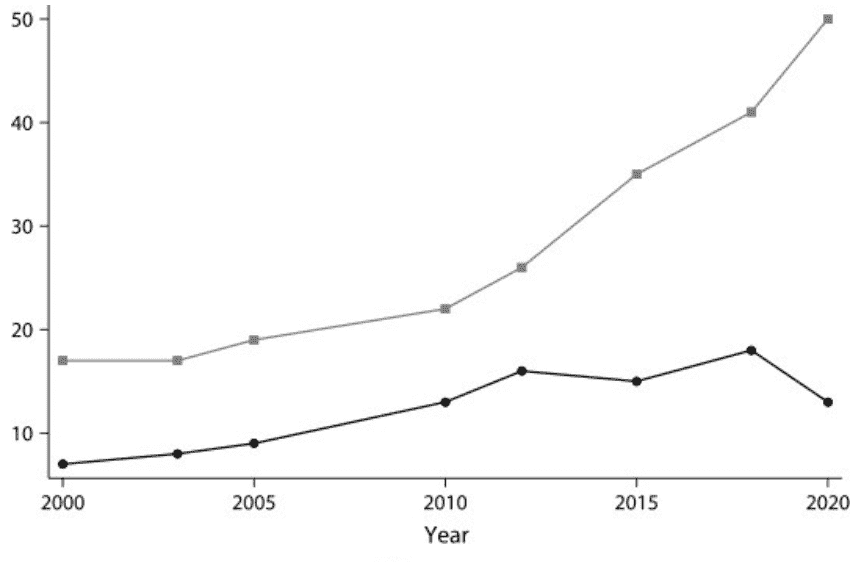

图7.1. 增加移民的偏好，按党派划分

乔治·W·布什政府时期，民主党和共和党对增加移民的立场都变得略微好感（这一时期绝大多数美国人，无论政派如何，都希望移民数量保持不变或减少）。在奥巴马时期，两党在欢迎移民意愿上的党派差距日益扩大，并在特朗普执政期间呈爆发式增长。

自然地，党派倾向并不是解释美国人移民看法的唯一个人特征。在整个世界范围内，对种族和族裔外群体持有偏见刻板印象的个人也更反对移民；在美国，这种现象在对拉丁裔美国人持有偏见的人群中尤为明显。¹¹ 由于于大规模移民不可避免地改变了美国的种族和族裔构成——这是一个比美国本身还要悠老的长期过程——移民态度可能是更大范围的“白人反弹”¹² 的一部分，在这一反弹中，媒体对移民的负面描绘为民族中心主义态度创造了支持。¹³


因此，在审查 COVID-19 期间对移民政策的具体态度之前，我们还需要了解个人的移民态度。在第一波调查中，我们向受访者提了关于移民态度的问题：他们是否同意或不同意（1）移民丰富了美国的文化（或没有丰富），（2）移民是否应该增加（或减少），以及（3）移民是否加强了经济（或没有加强）。在所有问题中，数值越高表示对移民的支持程度越高。我们还在一年后又询问了前两项（在第 6 波中）。按政派划分的结果摘要见图 7.2。

这些结果揭示了移民态度的持续性。首先，与共和党相比，民主党对移民的支持一直明显更高——即认为它丰富了文化、应该增加移民、并加强了经济——而独立人士/无派人士则介于两者之间。其次，移民态度随时间推移而保持稳定。不仅平均支持水平随时间保持一致，民主党和共和党之间的差距也是如此。在结果中，我们发现这些模式在右翼消费者和那些不从右翼新闻获取信息的人群中同样适用，尽管前者的反移民情绪比后者略显负面。这种模式与现有研究一致，这些研究表明，移民态度在时间推移和跨国范围内都是相对稳定的。¹¹⁸ 尽管如此，移民态度确实会随着经济危机，¹⁹恐怖主义，²⁰“移民潮”，²¹以及当然还有流行病²²等重大事件的发生而往往转向支持更严格的限制。我们怀疑，在我们第一波调查开展（2020 年 3 月 20 日开始）时，民意已经开始转向支持更严格的边境控制和移民限制。

## 第 1 波

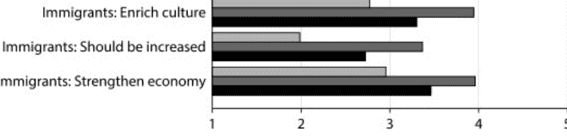

## 第 6 波

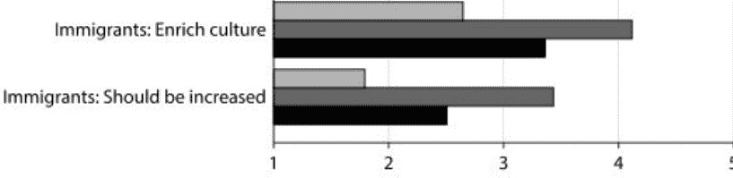

图 7.2. 按政派划分的移民态度

## 关闭边境

与其持续致力于在南部边境筑墙，不如特朗普积极地拥抱边境控制，并将其作为其治理策略的核心部分。没有没有明确他关于疫情与移民之间关系的观点，在 2 月 28 日于南卡罗来州的一次集会上，特朗普甚至将新冠病毒的最初传播与失败的（民主党）移民政策联系起来：“无论我们谈论的是病毒还是许多其他公共健康威胁，民主党的开放边境政策对所有美国人的健康和福祉构成了直接威胁。”²³ 回顾他 2 月 2 日对中国的“禁令”，特朗普吹嘘道：“我很早就切断了与中国的联系。如果我不这样做，我有一张你无法相信的图表。”特朗普将继续引用中国禁令作为他的首选论点，以及他捍卫政府早期应对疫情的最伟大成就。

然而，与特朗普政府的许多方面一样，关闭边境的公众形象是其策略。事实却完全不同。《华盛顿邮报》的一个标题指出：“特朗普的‘早期旅行禁令’根本没有起作用。”与澳大利亚和新加坡等实施严厉限制措施的国家相比，特朗普的措施几乎没有限制入境。美联社报道，在禁令实施后的三个月里，从中国入境的游客超过了 8,000 人。《纽约时报》的一篇报道发现，1 月到 4 月 1 日期间，从中国入境的至少有 40,000 人。在“禁令”实施后的前两个月，有 1,300 架直飞美国的航班。而且，即使特朗普所谓的禁令被严格执行，效果也是有限的，因为 COVID-19 在美国公民中也在蔓延。此外，除了头条新闻外，特朗普政府还在实质性地限制移民。以 COVID-19 为借口，2020 年是特朗普及其移民沙皇斯蒂芬·米勒（Stephen Miller）打击移民的一年。近二十项政策影响了游客、难民、庇护申请者、外国工人和国际学生。这些政策从被称为 `Title 42` 政策的边境限制（该政策以公共健康为名禁止非公民入境），到暂停庇护申请者的重新安置、暂停绿卡发放以及在美国境内的续签。结合大疫情的全球影响，这些严格措施导致了入境美国人数的急剧下降。

某些紧急限制是基于公共健康理由正当化的，但随着时间的推移这发生了变化。最初被视为公共健康问题，即为了控制病毒而“停止”和“禁止”移民，随后被视为美国经济复苏的问题。我们在不断变化的理由中看到了这些不同的框架策略。正如特朗普在 4 月底为了推迟移民而发文所说：“我们必须首先照顾美国工人。”这种信息上的转变和情绪得到了参议院关键盟友的支持，例如汤姆·科顿（Tom Cotton），他声称“考虑到美国求职者工作的极度匮乏，在我们的经济重新开放时允许额外的外国工人违背常理。”⁵

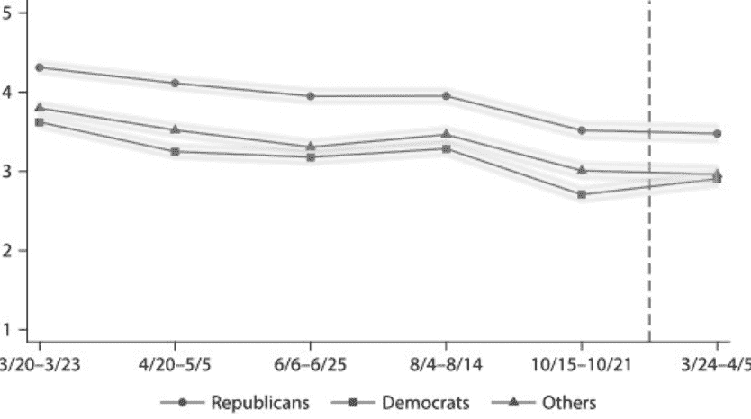

共和党人在第一波疫情中对入境禁表现出强有力的立场，58%的共和党受访者表示他们强烈支持入境禁，而民主党人的这一比例为37%。在疫情初期，尽管所有美国人对入境禁的支持率平均有所下降，但党派间的差距仍保持稳定。

在11月选举前后，对入境禁的支持程度以及政派之间的差异在很大程度上保持相似，这说明了无论谁担任总统，移民政策态度在党派立场上的分立是具有相对的稳定性。然而，并非所有政策都表现出这种党派性的支持。例如，在政府支出的需求方面，我们知道当民主党执掌白宫时，共和党倾向于更关注赤字；当民主党在参议院担任少数派时，他们对党派主义阻碍的支持远比他们在参议院担任多数派并想要通过立法时要多得多。这些都是党派观点具有灵活性的案例，但在美国政治的这一时刻，关于移民问题的党派立场似乎比党派主义阻碍等问题要持久得多且基础得多。

然而，这一事实给我们带来了一个微妙的分析问题：我们在上述识别出的对入境禁的支持（以及这种支持中的党派差异）中，有多少是由预先存在的反移民态度驱动的？一个持有反移民观点的人是否会一直支持入境禁？或者，更有趣的是，一个通常持有亲移民观点的人是否会在国家危机期间转向支持严格边境？知道这个问题的答案至关重要，因为有助于我们理解疫情本身是否加剧了排外和反移民态度。

为了回答这个问题，我们观察了对入境禁的支持与个人对移民的总体态度之间的匹配程度。为了确定这一点，我们将关于移民总体态度的调查（见图7.2）合并成一个数值，我们称之为“反移民态度指数（AIA index）”。高AIA得分意味着一个人从总体上持有更强的排外态度（例如，认为应该减少移民，并认为移民对经济和/或文化生活产生了负面影响）。低AIA得分则对应于更亲移民的态度。图7.4显示了党派立场和通过AIA指数衡量的反移民态度是如何与入境禁支持相互作用的。

首先看左侧的图表，我们看到AIA得分较低的人，党派立场在解释对入境禁的支持方面起了重要作用，尽管这些受访者对入境禁的支持率低于那些AIA指数得分较高的人。在整个疫情期间，甚至仅仅在乔夫·拜登政府执政的第6波，民主党人和独立人士/非党派人士支持入境禁的可能性也显著低于共和党人。

看右侧的图表，出现了另一番景象。在高AIA受访者中，民主党人和共和党人对入境禁的支持上没有显著差异。即使在拜登当选后（随着国内疫苗接种率提高以及印度等国境外病例激增），民主党和共和党对入境禁的支持率仍然相对强劲。换句话说，党派立场仅与那些最初对移民更具接受度的人对入境禁的支持相关。

图7.3：对入境禁的支持

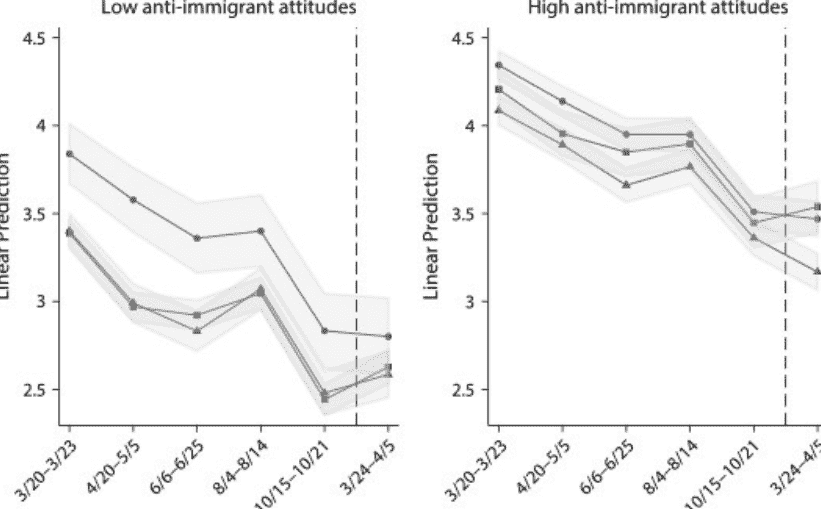

注：为了说明起见，我们根据受访者的得分是高于还是低于所有受访者的中位值，将所有受访者分类为高AIA（反移民）或低AIA。

图7.4. 按党派立场和反移民态度划分入境禁

为什么对入境禁的支持随时间推移而下降？这种模式无论移民态度和党派立场在个人身上都能看到。其一，美国人可能只是厌倦了疫情。另一方面，事实证明入境禁是无效的，热情也不可避免地消减了。也可能是此前章节中提到的对经济状况的广泛担忧，导致美国人软化了对限制人类流动障碍的入境禁的支持。但更广泛地说，政府关于关闭边境的传达并没有能够使其成功的政策支持，例如接触者追踪和隔离，随着COVID-19的肆制蔓延，这些问题在夏天已变得显而易见。正如哈佛大学流行病学家马克·利普西蒂奇（Marc Lipsitch）在2020年7月接受《PBS新闻小时》采访时观察到的，“虽然边境控制可能为我们赢得了一点时间，但我们由于没有建立防御而虚耗了这段时间。现在随着国内新冠病例率的高升，持续的边境限制可能不会产生太大影响。”

我们还怀疑，党派精英的传达在解释图7.4中随时间变化的模式中起了重要作用。无论出于什么理由，支持入境禁就意味着支持特朗普，而立场强硬的民主党人会本能地反对这一点。对入境禁的支持率低可能并不反映个人对移民或新冠政策本身的看法；而是反映对特朗普及其政策的拒绝，而这种拒绝随着时间的推移，与他对关闭边境的言辞联系得愈发紧密。

尽管如此，这些发现有助于我们理解在疫情期间党派立场是如何与反移民情绪相互作用的。从宏观上来说，反移民态度似乎比关于如何利用移民政策来对抗疫情的更为持久。在那些对移民持有高度仇敌意的人群中，党派立场无法解释政策偏好。同时，政策偏好对正在发生的事件更有反应，对入境禁的支持率在疫情期间有所下降，尽管我们一直发现这种支持率在共和党人和AIA得分较高的人中更高。这种在政策偏好（似乎更容易受事件影响）与更基础的态度（更难改变）之间的微妙差别，更广泛地说明了：

## 按国籍歧视

入境禁，至少正如我们描述的那样，是针对从任何地方进入美国的旅行者的泛泛政策。但正如我们所知，入境禁通常是针对特定国籍的人员。

我们通过一个与第5章中联邦与州当局调查类似的调查实验来进行此。具体来说，我们可以根据被入境禁目标的人的国籍，调查此类政策是否反映了特定形式的种族主义或排外情绪。

显示了 Google Trends 的数据，这些数据捕捉了2020年前四个月美国境内对中国、意大利和英国搜索的相对频率。32

我们清楚地看到，在我们启动第一波调查时，相比于英国，对中国和意大利的关注度出现了激增。那么，美国人是否根据他们对威胁的感知——即认为中国和意大利是（错误地）热点，而英国并非如此——而对谁应该被禁入境持有观点？还是说目标的种族背景起了作用？如果是后者，意大利人和英国人将被同等对待（尽管他们对本国大规模疫情爆发的关注程度不同），而中国人则会被区别化地对待？

为了回答这些问题，在第一波调查我们询问入境禁令时，我们随机交替了入境禁令的目标，分别为中国、意大利和英国。具体而言，我们询问受访者是否同意或不同意（采用 5 分量表）“美国必须继续禁止[中国/意大利/英国]公民进入美国”。受访者被随机分配到这三个国家之一。这种实验性分析通常被称为“种族启动”（racial priming），因为使用每个术语都可以“启动”受访者透露他们对每个群体的态度，使我们能够评估他们在政策评估中所起的作用。33

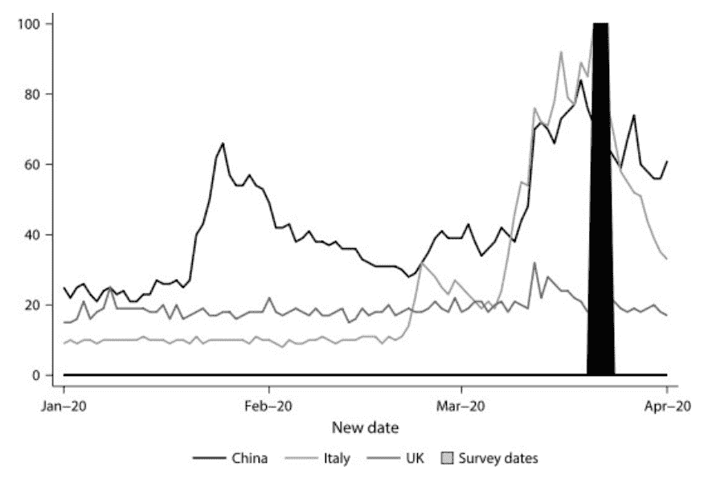

## 图 7.5. Google Trends 数据

我们在图 7.6 中展示了这一分析的结果。

在高度 AIA（反移民态度）的共和党人和民主党人中，无论针对哪个群体，我们看到对入境禁令的支持程度都是最高的。民主党人和共和党人都支持针对意大利人的禁令，且民主人的支持率高于其他国籍。对于具有种族主义倾向的民主党人来说，对禁止英国人和中国人的支持之间没有统计学上的差异。共和党支持来自中国和意大利的禁令，但程度低于来自英国的禁令。总而言，在反移民态度最高的受访者中，无论是民主党还是共和党都没有遵循“针对针对中国而非其他欧洲人”的简单种族启发式。相反，相对于意大利，英国总是受到青睐，而只有在民主党人中，中国受到的惩罚较少。

我们是否应该禁止这些人入境……

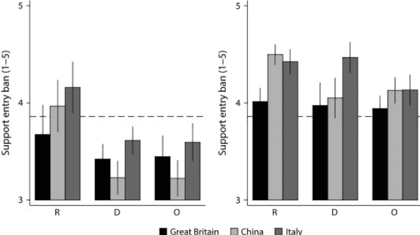

注：虚线是样本中所有受访者的平均回答值。

## 图 7.6. 按党派和移民态度划分的入境禁令，2020年3月

然而，在低 AIA 受访者中，党派倾向显然起了了作用。无论适用于哪个群体，共和党人都更强烈地支持入境禁令，这呼应了我们在图 7.4 中的发现。民主党对针对任何国籍群体的入境禁令支持率较低，独立人士/非党派人士也表达了类似的犹豫。重要的是，低 AIA 的民主党人和独立人士/无党派人士最反对对中国实施入境禁令。我们再次看到，美国人对入境禁令的观点无法通过简单的种族态度来解释。如果说有什么的话，我们认为结果模式表明，低 AIA 的民主党人通过特别反对对中国的入境禁令来抵消特朗普政府的反华修辞。

图 7.6 中的结果捕捉了 2020 年 3 月的情况。但随着疫情的持续，全球热点发生了变化。中国和欧洲（以及伊朗）是 3 月和 4 月国际旅行关注的核心，但到夏天，COVID-19 疫情已扩散到其他地方。巴西在迎来第一波疫情时于 5 月 24 日被加入入境禁令名单（图 7.7）。

这种演变使能够将入境禁令的支持与其他国籍进行比较。在类似的实验中——我们在图 7.8 中绘制了该实验的结果，通过党派倾向区分了国籍的影响。

在共和党人中，对入境禁令最高水平的支持是针对中国的。回想图 7.6 中 3 月的结果，这些结果表明，如果新冠肺炎期间的移民政策最初并非种族化的，它随着时间的推移也确实变成了种族化的。共和党人对来自巴西禁令的支持始终位居第二，而共和党人对来自英国禁令的支持一直显著较低。

民主党人的模式完全不同。在整个疫情期间，对来自中国或英国的禁令支持一直存在，并在 8 月达到峰值，恰逢巴西第一波疫情的高峰。在任何时候，民主党人对来自巴西禁令的支持都高于共和党人。有趣的是，我们看到民主党人对来自中国禁令的支持最低，且在第 6 波中趋势出现了明显的分歧。我们怀疑这反映了民主党人在反对共和党将疫情种族化的信号传递——包括美国亚裔裔和太平洋岛民的仇恨犯罪的大幅增加。在非党派人士中，出现了另一种模式；无论目标是谁，对入境禁令的支持总体上通常没有差异。

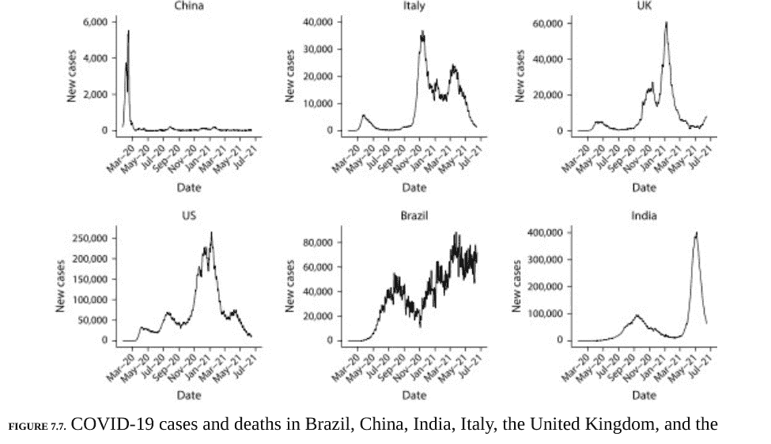

图 7.7. 巴西、中国、印度、意大利、英国和美国的 COVID-19 病例和死亡人数


## 更广泛的移民政策辩论

入境禁令并不是应对 COVID-19 实施的唯一移民政策。它甚至不是最具争议的那个。在美国疫情的第一波期间，几个州实施了政策——虽然执行并不严格，但旨在减缓病毒传播。例如，2020年3月，佛罗里达州州长隆·德桑蒂斯命令来自纽约、新泽西和康涅狄格州的旅行者自我隔离四周，而其他所有州的旅行者不受影响。芝加哥卫生部门局长 Araway 对病例激增州的旅行者发布了类似的命令。印第安州等州从未实施过旅行限制。虽然某些州可以发布并有效执行隔离（夏威夷），但其他州则不能或不愿意。正如新泽西州州长菲尔·墨菲所说：“我心痛地说，我希望能阻止人们并让他们回到我们的边境……我们做不到。这不是美国运作的方式。”26

## 停止所有国际航空旅行

美墨边境入境限制

在美国对华人进行隔离

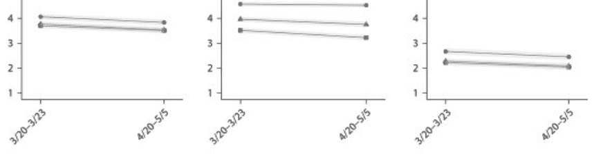

## 禁止国内旅行

在海外营救美国公民

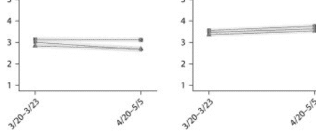

- 共和党人
- 民主党人
- 其他

图 7.9. 按党派划分对移民政策的公众态度

## 在美国进行隔离

禁止国内旅行

美墨边境入境限制

低 AIA（反移民态度倾向程度）

高 AIA

低 AIA

高 AIA

低 AIA

高 AIA

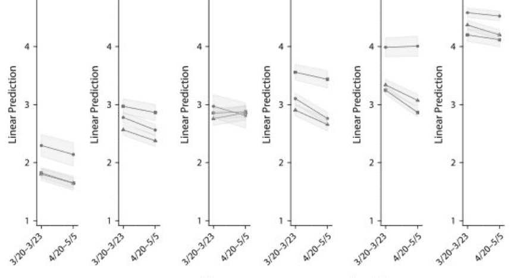

- 共和党
- 民主党
- 其他

图 7.10. 按党派和 AIA划分对特定移民政策的态度

在具有党派差异的政策项目中，反移民态度起了什么作用？图 7.10 像之前一样区分了低 AIA 和高 AIA 的受访者。

在低 AIA 的受访者中，我们看到在支持在美国对华人隔离以及在美墨边境实施入境限制方面，存在强烈的党派差异（且轨迹分歧）。但在支持禁止国内旅行方面，并没有这种党派差异，支持意见相当分对立。这表明低 AIA 的受访者对禁止国内旅行尚未形成坚定的意见。如果州政府和联邦当局有此意愿，他们可以集结支持或反对跨州边境的大规模力量，通过高速公路进行温度检查，并以其他方式限制国内的旅行。

相比之下，在高 AIA 的受访者中，党派差异与人们预期的相反：高 AIA 的民主党人对在美国对华人隔离表现出更大的支持，而高 AIA 的共和党人对美墨边境入境限制的支持超过了民主党人，但仅略占优势。高 AIA 的民主党人对禁止国内旅行的支持也高于高 AIA 的共和党人和独立人士/非党派人士。虽然我们对可能导致高 AIA 民主党人这一发现的动机有限，但可能是这些民主党人对政府采取强力措施应对 COVID-19 有普遍的倾向。

## 结论

COVID-19 在移民政策比近期历史上任何时候都更政治化的时期改变了美国的移民政策。COVID-19 流行病为特朗普实施近期历史上一些最严厉的限制提供了掩护。2020 年 3 月初的联邦紧急措施持续到了夏天，对移民人数和政府行为都产生了负面影响。尽管移民控制是一项广受欢迎的政策，但政府错失了统一和保护美国人的机会。限制措施执行得不力、具有政治化色彩，且缺乏相关政策的支持，而这些政策本可以使移民控制发挥作用缓解病毒传播。特朗普的政策在降低移民人数方面是成功的，这是他的主要政策目标；但在其他方面很大程度上是无效的。

我们的调查数据帮助我们理解移民政策作为管理大疫情工具的政治性。与我们在之前的章节中讨论的其他问题相比，在移民政策方面，我们发现党派倾向以微妙的方式发挥作用，这取决于受访者对移民的总体取向和倾向。尽管移民政策辩论因特朗普政府的反华言辞而高度高度种族化，但美国人对入境禁等政策的看法并没有遵循简单的种族逻辑。相反，我们收集的调查证据告诉我们，在特定国家背景下对疫情的普遍担忧至少与种族立场一样重要。值得注意的是，对于那些持有特朗普愤怒目标（亲移民倾向）的非共和党人，我们检测到了他们对作为弱势群体的华人的一种团结感。我们还看到低 AIA 的民主党人可能担心，支持如入境禁等亲健康措施的观点可能被误解为对特朗普排外主义政策议程的支持，而这种议程在疫情的掩盖下愈演加深了。我们还看到高 AIA 的民主党人支持限制性移民措施，如国内隔离和关闭美墨边境，这表明了紧急时期可以找到号召点。

换句话说，我们总结性学到的是，紧急旅行政策是在支持控制和禁止细微差别的潜在公众背景下做出的。但也许持续关注边境控制，加上精英阶层对“中国病毒”的种族主义评论，其真正的遗产可能是将注意力转向了边境，而偏离了可能减缓病毒在美国传播的努力，例如国内旅行限制、隔离和接触者追踪。

# 8

# 不平等的负担

种族与 COVID-19 流行病


## 2020 年 3 月，密歇根州因冠状病毒肺炎处于州紧急状态

但底特律的巴士仍在运行。关键工作人员需要上班，人们需要去购物食品或看病，没有汽车的居民几乎没有选择只能乘坐公交。底特律是一个贫穷的城市：超过 50% 的居民生活在贫困线以下。该市拥有居住隔离的传统，导致黑人占多数的社区资源更少，犯罪率比白人占多数的社区更高。黑人居民也比白人居民更有可能居住在医院和药店较少的密集社区，并且更有可能是公共交通工具的乘坐者。

一位名叫杰森·哈格罗夫（Jason Hargrove）的公交司机在 2020 年 3 月尽管新冠病毒风险依然上班。当时，公交司机没有配备个人防护装备，乘客也没有社交距离。3 月 21 日，哈格罗夫发布了一段 Facebook 视频，批评一名在没有遮住嘴的情况下咳嗽的乘客，指出她让所有人都陷入了危险。他恳求人们认真对待病毒，说“这是真的”。4 月 3 日，疾病控制与预防中心（CDC）开始建议公众佩戴口罩。这一建议来太晚了。哈格罗夫于 4 月 1 日因 COVID-19 去世。

哈格罗夫发生的事情是未来几个月将再次发生的缩影。哈格罗夫是一个黑人，在一个住房、就业和医疗存在种族不平等的城市担任一线工作人员。少数族社区早且不成比例地遭受了病毒。

## 美国公共卫生中的种族差异

个人党派身份在解释 COVID-19 流行病对有色裔社区的影响，原因是有色裔内部党派认同的差异比白人小。在 2020 年总统选举中，43% 的白人选民支持民主党，而黑人选民为 92%，拉丁裔选民为 59%，亚裔选民为 72%。但党派倾向通过州政府的党派倾向以及州长在疫情之前和期间使用的社会政策影响了有色裔美国人。

COVID-19 对少数族社区来说特别具有毁灭性。截至 2021 年 3 月，美国公共媒体估计，每 390 名原住民中就有 1 人、每 555 名黑人就有 1 人、每 680 名拉丁裔就有 1 人死于 COVID-19。2021 年底，黑人的死亡率是白人的 1.4 倍。一项针对 23 个州的研究发现，由于多代同堂居住、自来水获取有限、更依赖共享交通以及增加病毒致命率的基础疾病，原住民感染 COVID-19 的概率是白人的两倍，死亡概率是四倍。

死亡对个人家庭来说是悲剧，也对整个社区意味着文化损失。在美原住民社区中，因 COVID-19 失去长者也意味着对传统、语言和习俗知识的丧失⁹

健康不平等是我们在第一章中讨论的预存状况之一，而且在种族方面尤为严峻。这些状况是结构性的——从手部消毒液分配器和脉冲血氧仪读取（一种用于估计血氧饱和度的工具，对于判断因 COVID-19 导致的呼吸受阻至关重要）无法像白皮肤那样准确检测黑皮肤¹⁰——也是行为性的，即患者在接受治疗时受到不平等的对待.¹ 这些持续的社会性状况与疾病状况相互作用，导致少数群体产生了更糟糕的结果.¹²

在疫情初期，黑人和拉丁裔美国人比其白人同胞更可能没有保险且缺乏接触全科医生的机会，并且更有可能有高血压、肥胖和糖尿病等慢性疾病.¹³ 2018 年，黑人美国人的预期寿命比白人短四年.¹⁴ 有色种族社区比白人社区更容易接触环境污染，使黑人、拉丁裔和亚洲美国人更容易患呼吸道疾病，⁵ 这种共症导致了 COVID-19 患者更糟糕的结果。美原住民社区由于重叠的结构性问题（如贫困、州政府的政策忽视、印第人健康服务资金不足以及就业不足），在健康结果方面也面临持续的不平等.¹⁶

我们在调查数据中也能看到基于种族的不平等现象。在调查的第一波（2020 年 3 月）中，我们询问了受访者的背景健康状况。首先，我们要求受访者根据“差”到“优秀”的 5 分制对其总体健康进行评分。图 8.1 显示了按种族和族裔划分的各类别百分比：（非西班牙裔）白人、黑人、西班牙裔或拉丁裔，以及包含认同为亚洲人、美原住民或多族族的受访者的“其他”类别.¹⁷

大多数受访者（48%）认为自己的健康状况评为“非常好”或“优秀”，但这因受访者的种族身份而异：48% 的白人受访者报告健康非常好或优秀，而黑人受访者这一比例为 43%。在光谱的另一端，13% 的白人受访者报告健康“中等”，而黑人受访者为 15%，拉丁裔受访者也为 15%。这些差异并不大，但具有意义。一项粗略计算表明，如果我们调查中所有种族感到“良好或优秀”健康的比例相同，这意味着将会有额外的 200 万黑人美国人感到健康。⁴⁸

我们还在调查受访者中考察了对关键健康机构的信任，这次参考了我们的第 6 波调查，该调查于 2021 年 3 月底进行，我们特意从有色种族社区收集了额外数据。信任上的种族差异虽然较小，但在数据中仍然显而易见（图 8.2）。

白人美国人对医生和医院的信任高于黑人美国人，但在涉及学校和更的医疗体系时，种族之间基本上没有区别。然而，尽管承认了这些差异，我们在图 8.2 中仍然看到了所有美国人在医疗保健方面面临的普遍问题总结：总体而言，大多数美国人根本不信任医疗保健机构。我们在第一章中将美国不稳定的、不可靠且往往不协调的医疗保健系统描述为一种预存状况，这是大多数美国人都会认同的。


图 8.1 总体健康，按种族划分


图 8.2 美国医疗保健机构信任度，按种族划分

此外，医疗覆盖也存在不平等，进一步加剧了医疗保健基础设施糟糕的预存状况。在我们的受访者中，18% 的黑人受访者和 20% 的拉丁裔受访者（五分之一）没有医疗保险，而白人受访者仅为 9%，“其他”类别中仅为 10%。潜在的经济劣势和收入不平等也使疫情在少数群体社区中变得严重，正如我们在第六章中详细描述的那样。种族少数群体特别受到失业的影响，并随影响了获得负担得起的医疗服务的机会。由于美国基于就业的医疗体系以及非营利美国人不成比例的失业，这意味着 2020 年约 100 万亚洲美国人、200 万黑人美国人和 300 万拉丁裔失去了医疗保险.¹⁴

即使我们撇开 COVID-19 期间有色种族社区失业率的上升，经济条件中的结构性不平等仍维持了健康结果上的种族差异。州和地方的收入不平等与少数群体及其他人的较高死亡率和健康状况有关。黑人居民比例较高以及公共服务水平较低的城市通常死亡率较高³ 随着 COVID-19 疫情，收入不平等使贫公民比那些居家办公、住在不拥挤住房以及拥有私人交通工具的人面临更高的感染和死亡风险。收入不平等程度较高的县，COVID-19 发病率更高，死亡人数也更多.³ 这些力量与就业中的种族差异相互作用，使黑人和拉丁裔美国人在疫情期间面临特别风险，因为他们更有可能在经济的关键部门工作——交通、铁路、农业、食品服务和医疗保健——在这些部门，远程办公或社交距离并不是选项。

监禁和集体居住条件也增加了 COVID-19 的暴露风险，这些经历随种族而显著不同。有超过 200 万成人在监狱中，超过 4000 人在移民拘留地³ 黑人美国人的监禁率是白人的 5.1 倍，拉丁裔的比例是白人的 1.4 倍³ 监狱、看守场所和拘留设施通常拥挤，通风不足且卫生受限，所有因素都可能使他们对冠病毒特别脆弱。到 2021 年 1 月，监狱已有超过 51 万例阳性病例，超过 2200 名囚犯和工作人员死于 COVID-19.⁵

我们目前为止在这一部分提供的叙述，于将 COVID-19 疫情的种族化后果描绘为收入、就业模式和监禁等恰好与种族相关的不幸后果。但我们知道，COVID-19 期间期间的政策制定本身强化了健康结果的种族差异。我们在第二章中讨论的结构性前提是最具隐蔽性的。在少数裔居民较多的社区，广泛检测、隔离和发放个人防护装备等缓解措施的实施较慢。⁶ 大规模检测中心并不总是设在低收入社区易于到达的地方，在主要是黑人和拉丁裔社区的检测中心服务的人更多，排队更长，且比附近的白人社区更容易缺检。在疫情初期，公共健康信息旨在提供关于个人如何保持安全的通用信息，但这些信息在少数裔以及低收入和农村社区被认为是困惑的、不可信的或无关的⁷

## 族与 COVID-19 疫情

当我们开始调查时，我们怀疑 COVID-19 产生不平等种族后果的一种方式是美国人会观察早期热点并得出 COVID-19 主要是城市问题的结论。由于城市地区也拥有较大的少数裔社区，“城市”可能因此成为（正如它在美国话语中经常那样）“种族”的代名词。当我们询问美国人，他们在多大程度上认为 COVID-19 主要是城市或人口密集地区的问题时，尽管我们发现了混合的证据，如图 8.3 所示。

正如预期的那样，从我们在第 2 波首次询问此问题开始，共和党人比民主党人更可能认为 COVID-19 是一

城市问题。但种族差异被淡化了。尽管黑人美国人总是最不认为 COVID-19 主要是一个城市问题的人，但这些差异在实质上并没有太大意义。要将 COVID-19 这种隐含的种族化政治视为一个城市问题，我们真的需要关注政派倾向本身以及共和人对 COVID-19 的观点。

从 2020 年 4 月开始，我们要求受访者告诉我们他们何时曾感染过 COVID-19，无论是否经过医学检测确认。图 8.4 显示了根据受访者种族报告的 COVID-19 百比。

对于整个公众而言，在调查的前几波中，遭受 COVID-19 的受访者比例很低，随着时间的推移而增长，其中拉丁裔和黑人受访者的增长最多。在调查的第 6 波中，我们大幅扩大了样本，包含了一个新的非白人受访者样本：450 名黑人受访者、450 名亚裔美国人受访者和450 名拉丁裔受访者。如果加上这些新受访者，第 6 波中所有感染过 COVID-19 的受访者比例上升到 13%。


图 8.3. 按政派和种族划分，COVID-19 是一个城市问题


图 8.4 一个奇怪的特征是，黑人受访者在第 2 波和第 3 波之间、拉丁裔受访者在第 4 波和第 5 波之间的 COVID-19 水平有所下降。为了解释这一点，回想我们的一些受访者在每次调查波之间退出了，因此显然在该阶段退出调查的拉丁裔比例比例是那些感染了 COVID-19 的人。同样的现象也解释了黑人美国人在第 2 波和第 3 波之间 COVID-19 感染率的下降。在这些数字中，我们可以看到一点证据，说明 COVID-19 对人们日常生活有多大的破坏性。

但图 8.4 的主要结论是 COVID-19 种族发病率的不平等。从 2020 年春季开始，黑人和拉丁裔受访者比白人或其他种族的受访者更有可能报告感染过 COVID-19，而且这些差距随着时间的推移而扩大。从 2020 年 4 月起，拉丁裔受访者报告的冠状病毒病例最高，拉丁裔受访者与其他群体之间的差距随时间推移而扩大。到 2021 年 4 月的一波，21% 的拉丁裔受访者报告曾感染过病毒，是白人受访者比例的两倍，并显著高于报告感染过病毒的 13% 黑人受访者。“其他”种族类别的受访者发病率与黑人受访者相似。从 2020 年 4 月到一年后，他们的 COVID-19 比例增长了四倍，从调查第 2 波的 3% 跳跃到第 6 波的 12%。尽管所有群体的 COVID-19 感染率随时间都在增加，但拉丁裔受访者在所有调查波中报告病例的可能性明显更高，这可能反映了他们从事一线职位的概率较高、无保险水平较高，以及住在社会福利政策较少的州。这些数字与 CDC 的数据大致平行，CDC 显示，截至 2021 年 9 月，拉丁裔的确诊 COVID-19 病例人数远高于白人，黑人美国人的比例介于拉丁裔和白人之间（亚裔美国人的比例则低于白人）。ᵃ

正如我们在第 4 章的图 4.5 所示，在 2020 年 3 月——也就是我们首次对受访者进行调查时——不同种族群体之间与 COVID-19 相关的健康行为差异很小。白人受访者稍微倾向于说他们正在寻求信息并与其他接触。黑人和拉丁裔受访者更有可能说他们正在购买洗手液。从第 2 波（4 月）开始，我们在调查中增加了一个关于戴口罩的问题。总而言之，所有美国人的戴口罩比例很高，虽然不同种族之间存在某些差异，但这些差异不足以解释按种族划分的病例和死亡人数的巨大差异。这些差异更多是由他们的行为背景引起的，即一线工作人员的比例，以及他们是否获得检测、医疗保健和疫苗，我们在第 11 章将详细讨论。

当我们考虑政策态度、情绪和其他因素的种族维度时，可以更清楚地看到疫情的不平等影响。我们没有发现关于检测可用性的信念存在种族差异的证据，尽管我们在第 6 章发现民主党人远不太可能相信检测是可用的。白人受访者更有可能将 COVID-19 疫情归咎于巴拉克·奥马，而比白人更可能指责特朗普。正如我们在第 7 章发现的，黑人和拉丁裔受访者更有可能面临租金困难、更有可能去过食品银行，并更有可能为自己和家人寻求慈善援助。

正如这一证据所示，疫情对少数群体来说总是更加艰难的。他们因为疫情经历了更多的不稳定性，并且对医疗服务有更深层的不信任和遭受虐待，这会导致政府主导

## 针对亚裔美国人的暴力

在乔治·弗洛德（George Floyd）被谋杀引发全球关注美国黑人生命的同时，COVID-19 疫情也揭示了面对亚裔美国人的深层种族主义。特朗普试图建立病毒与中国之间的早期联系，并多次尝试将新冠标记为“中国病毒”以及其他贬义性词汇，这对亚裔及太平洋岛民（AAPI）拥有的企业以及该社区成员的生活产生了负面影响。疫情初期的特征是非亚裔国家内部对被认为具有亚裔血统的人产生污名化和偏见。美国见证了针对 AAPI 群体前所未有的仇恨犯罪和暴力行为，从纽约市街头对老年亚裔女性的袭击，到亚特兰大针对亚裔美国工人的杀人式大乱。

与其他少数族社区一样，许多亚裔美国小企业也受到了封锁的负面影响。但他们还面临着政客关于中国和病毒所播的偏见和恐惧。2020年春季，美国约一半的中国餐厅关闭了；而到2021年底经济开始回升时，全美曾经繁华的移民社区——唐人街留下的餐厅和家庭企业已寥寥无几。44% 的工作年龄亚裔美国女性（16岁及以上）报告其离开职场超过六个月，这一结果归于她们在受创严重的休闲和旅游行业的工作，也归于她们作为看护者的责任。

亚裔社区也遭受了日益加剧的恶意和暴力。亚裔美国人在美国经常被描绘成“永恒的外地人”，在危机时期通常被刻板化为“黄色人祸”。“黄色人祸”神话认为亚洲人是入侵者，在文化上劣于白人，并且是疾病的源头。这种刻板印象在特朗普执政期间被高度强调和重复，并在 COVID-19 疫情爆发初期变得尤为明确，当时对亚裔美国人的负面观点与新冠担忧以及排外行为联系在一起。正如第7章所描述的，这令人感到悲哀熟悉，因为亚裔人士长期以来在美国和加拿大的流行病期间一直面临着种族主义和排外情绪。

流行病、公共卫生和疾病恐慌不仅导致与病毒源相关的群体被污名化，还导致针对他们的暴力。皮尤研究中心2020年6月的一份报告显示，亚裔美国人报告了高水平的歧视和恐惧约四分之一的亚裔美国人表示，自从新冠病毒爆发以来，人们在他们身边表现得不安；31%的人表示他们曾是辱骂或玩笑的对象；26%的人担心有人会因为他们的种族而进行肉体攻击。

2020年春季，联邦执法部门警告说，基于部分公众会将 COVID-19 与中国和亚裔美国人联系的假设，针对亚裔美国人的仇恨犯罪将会增加。这一警告证明是有预见的。根据纽约警察局的数据，2020年纽约市针对亚裔美国人的仇恨犯罪比去年增长了1900%。针对 AAPI 社区的倡议组织 Stop API Hate 建立了一个在线报告系统供成员举报骚扰。从2020年3月到2021年3月，该系统收到了超过6603 份针对美国 AAPI 的仇恨事件报告，包括言语骚扰、身体攻击和吐口。对这些事件的第一手描述显示，在许多情况下，这些攻击与人们对 COVID-19 疫情的恐惧和愤怒有关。旧金山一位67岁男士的报告阐明了偏见语言对亚裔美国人的负面影响：“我正站在[五金店]的过道里，从背后被击中。视频监控证实了这一事件，一名白人男性用手肘击中我的上背部。随后发生了言语攻击：‘闭嘴，你这个猴子！’‘去死吧，中国人，’‘回中国去’以及‘别把中国病毒带到这里来。’”


图 B.5. 对 AAPI 社区暴力的担忧，按种族和党派划分

2021年3月，我们询问了受访者关于针对亚裔美国人的暴力问题。我们调查的最后一波调查——选择了黑人、拉丁裔和亚裔美国人的大规模新样本——是在一名白人男子在亚特兰大大区的三家当地水疗中心开枪击杀8人（其中6人是亚裔女性）一周后进入实地调查。在调查中，我们通过四分量表询问受访者，他们认为疫情期间反亚裔暴力问题有多严重，分值从1（“完全不”）到4（“严重问题”）。总体而言，40%的受访者认为这种暴力是非常严重的问题，另有29%的人认为这是一个相当严重的问题。图8.5显示了调查中受访者按种族群体和政党派别划分的平均担忧水平。

在所有群体中，白人受访者对针对亚裔邻居的暴力的担忧程度最低。拉丁裔、黑人和亚裔受访者均认为这种暴力比白人受访者认为的严重得多，其中亚裔受访者的担忧最高。57%的亚裔受访者认为暴力非常严重，而47%的黑人受访者、41%的拉丁裔受访者和31%的白人受访者。黑人受访者的高担忧反映了边缘化群体彼此之间的同情心。⁴⁷

这些担忧是有根据的。皮尤的一项研究显示，到2021年4月，几乎一半（45%）的亚裔美国人报告过与其种族族背景相关的事件。⁸在这种令人震惊的环境下，拜登于2021年1月签署了一项行政命令，推进亚裔社区、夏威夷原人和太平洋岛民的公平与公正，以结束反亚裔偏见和排外主义。⁹

正如COVID-19 疫情的许多其他方面一样，党派立场在理解反亚裔观点方面起着核心作用。参考图8.5，我们发现民主党对反亚裔暴力的担忧超过共和党人，独立人士/非党派人士介于中间。我们注意到特朗普使用种族语言来描述疫情，但其他保守派和共和党领导人，如国务卿迈克·蓬佩奥，也公开将新冠病毒与中国联系起来，称其为“武汉病毒”和“中国病毒”。⁰⁰参议员汤姆·棉甚至暗示病毒是由中国的某个实验室开发的，⁵¹ 这一持续到2021年的顽固谣言。⁵²保守派媒体和社交媒体反过来放大了中国与中国人之间的联系，⁵³那些接受新冠肺炎可以归咎于中国、并将责任转嫁给亚裔美国人的应该少那么担心。共和党人最可能接受共和党领导人建立的联系，因此应该比民主党人少担心。


图 8.6. 反亚裔暴力有多严重，按党派立场和新闻来源划分


可以说，我们对右翼新闻来源的发现以及对反亚裔（AAPI）暴力的担忧，与之前章节的发现相一致。高度党派色彩的新闻似乎加剧了双方在反亚裔美国人暴力问题上的信念差异，但我们不能将跨党派的信念差异归结为党派获取新闻渠道的差异。在这个时代，党派倾向是美国人思考种族政治的根本性分歧。

## 结论

新冠肺炎既揭示也加剧了美国深层的种族化社会和经济不平等。美国有色人种社区的健康状况比白人更差，因此许多有色人种社区受新冠肺炎的打击尤为严重。即使在考虑到基础健康状况的情况下，黑人、拉丁裔和美洲原住民比白人更容易感染新冠肺炎、遭受更严重的并发症，且死亡率更高。在亚裔美国社区中，太平洋岛岛民死于新冠肺炎的概率高于白人，而其他亚裔美国群体所面临的情况则与白人相似。这些不平等的结局是美国白人和有色人种社区之间数世纪健康不平等的产物，而这种不平等通过结构性和经济不平等得以持续，并被新冠肺炎再次放大。

健康结果中的种族不平等本身并非党派性的产物，但正如我们在本章所示，党派倾向有助于解释美国人如何解读新冠肺炎的种族政治。当然，党派政治维持了在获得优质医疗服务方面的种族化不平等，正是这些不平等解释了新冠肺炎期间健康结果的种族差异。在这些动态中，我们不仅可以看到种族对美国政治为何重要，还看到了美国政治如何塑造了一场影响所有美国人的流行病的种族后果。

新冠肺炎引发关注的种族化不平等只是故事的一部分，长期潜伏的警察暴力和反黑人种族主义问题在2020年夏天浮出水面。由于毫无根据的恐惧，疫情还给美国亚裔太平洋人（AAPI）社区带来了特殊的苦难。在第九章中，我们将转向新冠肺炎和种族正义是如何与广泛的政治环境以及2020年总统选举产生相互作用的。

# 第9章 为生命投票

## 新冠肺炎与美国民主

> “我们当时正准备赢得这次选举。坦率地说，我们确实赢了这次选举。所以我们现在的目标是确保完整性，为了这个国家的利益——这是一个非常大的时刻，这是我们国家的一场重大欺诈——我们希望法律能被妥善使用。所以我们将前往美国最高法院。我们希望停止所有投票。我们不希望他们在凌晨4点发现任何选票并将其加入列表。这是一个非常悲伤的时刻。”
>
> —— 总统唐纳德·特朗普，2020年11月4日

2020年11月3日（周二）的总统选举与美国历史上任何一次选举都不同。美国总统选举每四年举行一次，鉴于其对美国政治的至关重要，这些始终是政治剧性高潮的时刻。但这次不同。疫情对选举的影响不仅在于它是选举的首要议题，还在于决定选举将*如何*进行。数百万美国人首次进行了提前投票，以至于“投票日”成了一个名不副实之词。当11月3日到来时，已经有一亿美国人通过现场投票或邮寄投票完成了投票。这是前所未有的。根据美国广播公司（NBC）的一项民调，略超过一半的成年人计划提前投票。这意味着会有更多的选票被统计，因此需要更多的时间来统计选票。

那些现场投票的人在新冠肺炎期间通过佩戴口罩和保持社交距离来保护自己。投票工作人员不仅确保了选举的完整性，还确保了其安全性，在选民之间用消毒剂擦拭投票间。疫情完全影响了直到11月3日之前的竞选活动。民主党候选人、前副总统乔·拜登在3月到11月之间没有举行过现场或大规模集会，而总统唐纳德·特朗普发现自己每当举行集会时都会处于公众争议的中心。

回应以及那些认为政府行动要么是不必要的，要么是适得其反的人。我们在第5章（关于疫情）和第6章（关于经济）中讨论了与COVID-19疫情相关的若干政策处方，发现共和党人对政府的扩张持怀疑态度，但渴望重新启动经济并减轻复苏过程中的社会经济成本。民主党人受忧虑驱动，也希望看到政府发挥更大作用来遏制疫情，但无疑，他们对于将新的权力赋予一个倾向于忽视民主准则的总统感到矛盾，而这位总统最近因与一个威权政权进行权钱交易，以干预2020年总统大选而遭到弹劾。

但我们还想更广泛地了解美国民主的整体状况，以及美国人对政治权威、公民自由和媒体自由的普遍取向。其中，第一点我们在第5章讨论政府如何应对疫情时是一个关键问题，但后两点在特朗普政府拼命避免在2020年总统大选中失利时变得日益突出。因此，在这里，我们考察了关于总统权力、两党和睦和媒体的观点。重要的是，我们在特朗普和拜登总统任期期间都询问了前两个调查项目，这让我们看到美国人对权利和自由的观点在多大程度上取决于他们自己喜欢的候选人是否执政。图9.1显示了我们的受访者在第2至6波调查中关于总统权力、人们在危机时刻是否应该团结，以及媒体是否拥有过大的批评政府自由的观点趋势。


图9.1. 按党划分的权威与公民自由

从图9.1左上角的图开始，我们的数据显示，即使是共和党人，总体上比民主党人、独立人士和无党派人士更反对那些承认疫情社会经济成本的积极政策应对；同时我们也发现，他们对特朗普政府下的总统权力要赞赏得多。民主党人的情况相反：尽管他们对积极政策应对表示赞赏，但他们强烈反对在特朗普政府时期应赋予总统更多权力的观点。然而，这些立场在拜登政府时期发生了反转。这一发现与预期一致，即当你的自己党派执政时，你会希望你的自己党派拥有更多权力。

这些发现得到了图9.1中其他调查项目结果的支持：共和党人认为我们在危机时期需要团结，认为指责领导者并质疑他们的决定只会让我们进一步分化。此外，前者的党派差异在2021年1月拜登就职后也发生了反转。这些美国人对公民自由和行政权力的观点呈现的趋势表明，美国人在理解民主的方式上存在深层次的党派分化：共和党人只有在自己的政党掌握总统职位时才支持总统权力，并对媒体批评和社会分歧表示怀疑，而民主党人则反之。这些党派差异具有显著的持久性；当我们使用多元回归法考虑了受访者的种族、年龄、教育以及其他人口统计和地理因素时，这些差异仍然强劲且具有显著的统计学意义。在深度党派极化的背景下，这些结果是令人担忧的信号，很难将关于问题的“正常”政治与关于民主制度的更深层次政治冲突隔离开来。

退后一步，这些关于公民自由和行政权的发现揭示了疫情期间党派政治中内在的矛盾。特朗普政府下的共和党人培养了一个拥有行动权力的总统，但不支持该政府可能实施的大多数政策；而民主党人则想要那些政策，却不想赋予总统实施这些政策的不受限制的权力。这两个发现并不矛盾；民主党人可能怀疑特朗普将实施的政策并非他们所支持的，而共和党人可能认为特朗普会实施他们青睐的政策。尽管如此，这些结果表明，美国民主面临着比对如何应对疫情的简单分歧更深层的挑战：美国人对民主准则的支持取决于立场优势，即你支持执政党还是挑战党。这种分裂直击美国民主的核心。如果公民们对基本的民主价值观无法达成共识，那么我们不仅是在政治上产生争议，而是在民主基础本身产生了争议。

为了进一步了解这种对民主手段的分歧，我们在调查的第4波（2020年8月）中向受访者询问了许多关于好公民素质的问题。成为一个好公民意味着什么？民主公民被期待什么？他们互相期待什么？我们引用的大多数问题源于政治科学的一系列文献，这些文献识别了先进民主国家公民身份的关键属性，关注宽容等自由主义价值观以及参与抗议等公民行为。其他项目则关注美国人对好公民可能持有的不同价值观：遵守法律的人或说英语的人。美国政治中的公民身份学者认为，关于什么才是一个好公民存在着巨大的党派分化。

在这一系列标准项目的基础上，我们增加了两个问题：(1)“好公民是戴口罩的人吗？”和(2)“好公民是抗议不公正法律的人吗？”为了理解我们为什么增加这两个项目，回想起2020年夏天美国政界发生的情况会有帮助。美国第一波疫情在5月初已达到高峰，但死亡人数到8月份仍在稳步上升。6月和7月让许多美国人经历了某种程度的回归正常，我们观察到民主党人和共和党人在避免聚集和在佩戴口罩时与他人接触等行为上出现了分歧（见第3章）。同时，公共卫生部门警告说，对亲社会健康行为的遵循程度降低会导致随后病例增加，这一预测在几个月后得到了证实。在这种背景下，正如我们在之前的章节中论证的那样，戴口罩可能成为一个人遵循公共卫生指南的最单一最重要的指标。

这一时期美国政界的另一项重大发展是乔治·弗洛伊德被杀后引发的剧烈抗议和动员。正如我们在第8章描述的，弗洛伊德之死引发了整个美国乃至世界（从法国巴黎到印度尼西亚西巴布亚）的“黑人的命也是命”抗议。

在美国，关于抗议的竞争性媒体叙事源于针对黑人暴力的长期历史，从菲兰多·卡斯蒂尔被枪杀到弗雷迪·格雷在巴尔的摩警方拘留期间死亡以及无数其他案例。然而，另一组叙事将抗议活动描述为混乱和暴力事件，利用种族刻板印象将有色人种抗议者描绘为失控的暴乱，或指控抗议活动被与Antifa运动相关的左翼或无政府主义团体侵占。在许多“黑人的命也是命”抗议者要求“削减经费”的背景下，许多寻求维护美国警察力量不受批评的人评论道，其中一人是凯尔·里滕豪斯，一个来自伊利诺伊州的17岁少年，他前往威斯康星州，带着他父亲的半自动步枪，在回应抗议的活动中击毙了两人并导致第三人受伤。

对雅各布·布莱克的非致命射击。里滕豪斯的律师辩称其行为是正当防卫，他在2021年11月的审判后被判无罪。在事件期间及之后，里滕豪斯被保守派视为爱国宠儿。

除了这些抗议显而易见的种族维度外，它们共同引发了一个根本性问题：抗议是否是作为良好美国公民定义中的本质组成部分。

考虑到这一背景，图9.2显示了2020年8月的美国人如何认为什么是好公民。柱状图显示了每个群体在1（非常不同意）到5（非常同意）分值上的平均回答。


图9.2. 什么是好公民？按政党划分。

我们看到各政党之间存在广泛的共识，即好公民是宽容的（会努力理解他人）。这是自由民主的核心准则，看到两党对其价值的共识令人欣慰。但我们在几个回答中观察到跨越政党的显著分歧。首先看关于佩戴口罩的选项：尽管所有政党的多数美国人都认为佩戴口罩是好公民应该做的事，但民主党几乎意见一致地强烈支持这一立场，而共和党的支持则较为微弱。

相反，共和党将最大的热情留给了保护个人自由。在关于佩戴口罩是否是国家对个人选择过度控制的这一激烈辩论的背景下，我们将其解读为共和党对某些政策的反应，例如强制佩戴口罩、限制在公共场所聚集以及关闭商店，这反映了在大流行背景下个人自由与公共福利之间的紧张关系。

现在转向与2020年夏天“黑人的命也是命”抗议相关的项目，民主党对“好公民应该抗议不公正的法律”这一观点表示强烈支持。共和党对此意见不一，其中多数共和党人不同意“好公民应该抗议不公正法律”的立场（事实上，共和党人强烈支持“好公民应该遵守法律”的观点，大多数民主党人也持有这一观点，尽管程度略低）。

这种共和党关于抗议的立场在更广泛的背景下值得考虑。虽然6月到8月（即调查开展期间）抗议的动机是种族正义，但4月和5月初也发生过抗议，市民在州首府外和繁忙的市中心路口聚集，抗议州的居家禁令和强制佩戴口罩令。在特朗普的敦促下（他急于重新开放美国经济并提高自己的支持率），从加利福尼亚州长滩到缅因州奥古斯塔的抗议者持着标语，内容从“停止封锁！”到“所有业务都是至关重要的！”，甚至是更简洁的“我需要剪头发！”在4月20日科罗拉多州丹佛的一场抗议的著名画面中，“网锁行动”（Operation Gridlock）的抗议者开着卡车挥舞着旗帜，与穿着刷手服和个人防护装备的护士形成了对峙。4月的一项Yahoo/GovPoll调查显示，虽然大多数共和党人反对反封锁/反关闭的抗议者（47%），但有36%的人支持。这种脱节值得注意。共和党支持这样观点：好公民应该抗议他们自己认为不公正的法律（例如经济关闭和居家禁令），但他们并不支持结束警察暴力的政策。

总而言之，这些来自第四波调查的公民身份项目以及对行政权力和公民自由的分析，描绘了一幅美国民众的图景：他们不仅在政策问题和健康行为上存在分歧。

相反，美国人对基本公民价值和公民自由的观点既反映了他们的政派倾向，也反映了根据其政党是否掌握总统职位而产生的立场激励。在下一节中，我们将看到这些政派观点的差异如何溢出，影响美国人如何处理与2020年选举相关的具体政策问题。

## 选举管理的政派政治

2020年总统大选特别激烈，因为政派人士不仅辩论候选人的实质，还辩论选举本身的基础，即选举将如何进行。由于在大流行病期间，面对面投票在许多美国人看来是严重的公共健康风险，州政府寻求替代方案。有两个方案尤为重要：扩大面对面投票替代方案的可用性（如邮寄投票），以及推迟选举本身。尽管后一个选项看似极端，但它实际上在疫情初期的几个月在十六个州实施了，这正值总统初选季的后半部分。纽约州长安德鲁·库莫想完全取消他的2020年总统初选，理由是初选结果已经确定，而且从公共健康角度来看，面对面投票风险太大。

推迟选举和实施邮寄投票充满了政治风险。推迟总统初选的努力遭到了反对：一名联邦法官拒绝了俄亥俄州长迈克·德怀恩推迟3月初选的计划，称其为“极其糟糕”。选举的时间在美国是神圣不可侵犯的，那里的职员有固定任期，总统选举每年在11月第一个周一之后的周二定期举行。（这与议会制不同，议会制的选举可能更不可预测，由首相发起以战略性地延长任期或引发议会多数的“不信任投票”。）因此，值得注意的是，像德怀恩这样的共和党人和像库莫这样的民主党人都出于对公共健康的考虑而寻求推迟初选。在涉及2020年11月大选时，没有从共和党精英或知名新闻来源处听到任何推迟总统选举的严肃呼声，尽管特朗普本人在7月曾提出过这个想法，但没有成功。

与推迟选举相比，邮寄投票是选举期间保护公共健康的一个不那么激进的步骤。邮寄投票在华盛顿等州的选举中是常态，但在大多数美国州，邮寄投票相对罕见，且要求选民通过行政程序获取缺席票。缺席票在所有五十州都是合法的，根据联邦法律必须为现役军人等群体提供，但提供这些选票的具体规定因州而异。

特朗普反复断言2020年选举会被窃取，这种说法在保守派圈子和保守媒体中被广泛回应，助长了另一种邮寄投票会增加选民欺诈概率的叙事。尽管很少公开表达，但论点很简单：邮寄投票使得选举官员更难监控到底是谁在填写选票，这表明有动机的欺骗者可以收集无意投票的注册选民选票并填上他们选择的候选人。尽管选民欺诈在国家每个司法管辖区都是违法的，且几乎没有证据表明通过邮寄发生了选民欺诈，但在2020年春天，特朗普反对邮寄投票的立场非常明确。

撇开特朗普对邮寄选民欺诈的毫无根据的指控，通过邮寄投票增加选票获取带来的政派选举结果是模糊的。对新冠最脆弱的群体是老年人、免疫功能低下者和既往疾病患者。强制他们面对面投票会降低他们的投票率。然而，在这个群体中，特别是老年人比年轻人更倾向于投票给共和党，而免疫低下者和既往疾病患者并没有按照政派路线进行清晰划分。这意味着至少在原则上，邮寄投票可能会增加而非抑制共和党的投票率。同时，邮寄投票也增加了社会经济地位较低选民的投票机会，包括那些在正常工作时间投票不便的人。邮寄投票还可能增加那些对拥挤投票站长期感到反感的选民投票率。这些群体更倾向于投票给民主党，而这可能驱动了共和党对邮寄投票的敌意。

### 美国人应该能够邮政投票

### 选举应该推迟


图 9.3 按党派划分的邮政投票与推迟选举

当疫情在初选期间爆发时，我们在调查的第一波中开始询问美国人对推迟选举的意见。从调查的第二波开始，我们还作为一个单独问题询问受访者，对于美国人来说，邮政投票的机会是否重要。我们在每一波调查中都重复了这些问题，直到 2020 年选举前的第5 波。在图 9.3 中，我们展示了不同党派对邮政投票和推迟选举的支持趋势。

在疫情爆发的早期，所有党派背景的美国人都表示在某种程度上愿意推迟选举。但随着疫情的持续，所有党派对推迟选举的支持率急剧下降。这可能是因为在调查的早期，受访者理解的“选举”是指“初选”，但到结束时，他们理解的“选举”指的是大选。然而，令人惊讶的是，我们看到从 2020 年夏末开始，这个问题上出现了一种新的分歧：当民主党对推迟选举的支持持续下降时，共和党支持率的下降趋势停滞了。目前尚不清楚是什么解释这种关于是否推迟 2020 年 11 月选举的晚期出现的党派分歧。但我们在图 9.3 中也观察到，这种分歧恰出现在共和党对邮政投票的支持率处于最低点之时。一种解释是，部分共和党人在临近选举的几个月里开始认为特朗普不太可能获胜，可能是由于他们错误地认为邮寄选票会遭受大规模的选举欺诈，因此为了维护他，他们愿意支持推迟 11 月的选举。

然而，转向邮政投票，我们在图 9.3 中看到的党派差异是尖锐且持久的。令人惊讶的是，民主党几乎一致地支持允许所有美国人进行邮政投票。共和党人在这个问题上的平均态度要冷淡得多，因为到 4 月下旬，邮政投票的问题已经被总统政治化了。4 月 7 日，特朗普在媒体面前对“腐败”的邮寄投票大肆抱怨：“邮寄投票、邮寄选票存在大量不诚实行为。”4 月 8 日，他推特道：“选民欺诈潜力巨大，而且出于某种原因，这对共和党不利。”换句话说，特朗普已经向他的选民基础发出信号反对邮政投票。

如果我们按新闻来源对这些结果进行分类汇总，就会出现一个重要模式，如图 9.4 所示。

#### 看右翼新闻

##### 美国人应该能够邮政投票

#### 不看右翼新闻

##### 美国人应该能够邮政投票


#### 选举应该推迟

#### 选举应该推迟


**图 9.4** 按党派和新闻来源划分的邮政投票与推迟选举

对邮政投票支持率相对较低，可能掩盖了共和党内部在这一问题上的分歧。为了探讨这种可能性，我们调查了老年共和党人是否会更支持邮政投票（以保护他们自己）。我们的数据显示了恰恰相反的模式。我们发现，老年共和党人实际上最反对邮政投票。尽管这令人惊讶，但这一发现在我们之前的发现背景下是合理的：如果老年共和党人对 COVID 政策的担忧最低（我们在第 5 章中展示了这一点），那么合理地，他们也不会反对现场投票。但值得考虑这一发现的意义。它有力地证据表明，党派倾向导致了一部分选民——老年共和党人——持有了与其利益显而易见不符的偏好，至少从公共健康的角度来看。


我们可以通过使用调查实验方法来分析推迟选举的理由，进一步探讨美国人在竞争激烈的选举季节背景下，是如何将 COVID-19 与选举联系起来的，其逻辑与我们在第 5 章和第 7 章中提出的逻辑相同。在调查的第 3-5 波中，我们向受访者提供了关于为什么要推迟选举的两种理由。在这三波调查中，大约一半的受访者被随机分配阅读“如果意味着保护人们，我们应该推迟选举”，而另一部分被分配阅读“我们应该推迟选举，因为危机不是政治的时候”。由于这两种理由是随机分配给每个受访者的，我们可以通过比对两个版本的回答，检查是什么驱动了受访者对推迟选举的支持和反对。


我们在图 9.5 中展示了实验结果。对于每个党派，我们根据受访者收到的提示，追踪了推迟选举的平均支持水平，并考虑到这些提示之间的差异随受访者的党派身份而变化。事实证明，各类选民对推迟选举的公共健康理由反应更大，尽管这种差异在统计上并不并不显著（仅出现在民主党的第 3 和第 5 波，以及“其他人”的第 3 波）。在党派对推迟选举支持率激烈分裂的时期，这是一个令人宽慰的信号。

对于 2020 年选举严重政治化的更令人担忧的迹象，我们转向选举本身的合法性问题。回想特朗普多次对 2020 年选举的执行表示怀疑，暗示邮政投票会导致欺诈，并（与许多右翼媒体人物一起）暗示不符合资格或未注册选民的大规模非法投票将让民主党得益。宾夕法尼亚州、密歇根州和佐治亚州等关键州共和党领导的州政府通过限制在选举当天或之前清点缺席或邮寄选票的规定，增加了不确定性。共和党和民主党都预见到结果将出现激烈的竞争，因此预先建立了法律团队。意料之中，选举专家担心胶着的选举会导致对结果合法性的争议。正如我们从事后角度所知道的，这些担忧完全是预见的。

为了预测这种结果，在调查的第 5 波中（即在大选开始前的几周），我们实施了另一项调查实验，以探测受访者如何解释总统选举的结果。具体而言，我们询问受访者“[特朗普/拜登]赢得选举，我们就知道美国选举是被操控的”，并随机分配受访者阅读“特朗普”或“拜登”作为胜利者。我们在图 9.6 中展示了两个分析的结果，按受访者的党派身份（左图）和种族（右图）进行划分。请注意这些是前瞻性的评估：受访者尚未知道选举结果，他们只是在投影自己在两种不同情景下会相信什么。


图 9.5. 对 2020 年选举合法性的感知

对结果合法性感知上的党派差异简直是巨大的惊人。当共和党人被问及特朗普获胜的合法性时，他们几乎意见一致地强烈反对特朗普的获胜意味着选举被操纵了。相比之下，拜登的获胜会被视为选举被操纵的强有力证据。民主党人中则出现了完全相反的模式。在不属于任何政党成员的人员中，获胜者的身份与选举的感知合法性没有关系。

这些都是压倒性的证据，证明公民是根据自己偏好的党派选举结果来解读选举本身的完整性和合法性的。这对美国民主的启示是严峻的。自由、公正且不可逆转的选举是民主的必要条件（sine qua non）：如果没有选择的自由、票数的公平性，以及对结果在政府不喜欢的出现时不会被推翻的坚实保证，选举就不是民主的。当公民不相信选举是公平的会发生什么？当公民相信选举是否公平取决于他们支持哪个政党时会发生什么？正如我们其中一人（Pepinsky）最近认为的那样，这些条件无异于对民主本身的生存威胁。如果公民不认为选举是以自由和公正的方式进行的，就不能指望他们认为选举结果是合法的。

当我们根据受访者的种族细分分析时，这种选举感知合法性的差异就不存在了（我们根据不同种族和族群的党派归属不同模式调整了我们的结果）。例外是黑人受访者，在这些人中，特朗普的获胜更有可能被解释为选举被操纵的证据，而不是拜登的获胜。这种怀疑是有根据的：由共和党领导的州议会通过的限制性投票法主要影响黑人社区，而投票站漫长的等待让黑人选民（以及无法请假的薪资工人）无法参与到他们所信任的民主过程中。我们强调，我们的结果并非由这些因素驱动的。相反，我们的结果反映了美国黑人对美国选举民主其脆弱的真实理解。只有在民权运动时期，黑人才获得了完全的参与权，而今天全国范围内黑人人口多数选区的选举管理实践仍然是一个痛苦的提醒，提醒着美国选举是多么不平等——这一事实与我们在第 8 章中讨论的内容产生了共鸣，即美国的种族不平等如今正以无数种方式影响着我们。

当我们根据受访者的主要新闻来源对其进行细分时，出现了另一个重要发现，如图 9.7 所示。观看右翼新闻的共和党人特别可能在拜登获胜时相信选举被操纵了，而那些不看右翼新闻的民主党人则特别可能在特朗普获胜时相信选举被操纵了。但看看那些被标记为“其他”的人，他们没有党派偏好或不属于第三政党。观看右翼新闻的人在拜登获胜时更有可能相信选举被操纵了，而不看的人在特朗普获胜时更有可能相信选举被操纵了。总而言之，在这里我们看到了明确证据，证明 2020 年的党派媒体环境塑造了非党派人士的观点。


图 9.7. 按新闻来源划分的 2020 年选举合法性的感知

但总而言之，我们的分析显示，2020 年秋季的美国党性不仅影响了对哪位总统候选人是美国正确选择的感知，还影响了选举是否自由且不受干扰的。我们强调，公众相信选举是安全的且他们的投票是按意图计数的，是选举合法性的关键。对选举被操纵的感知会削弱对选举转型过程中民主授权这一整个事业的信任。为了看到这种关于选举合法性的动机性推理的影响，我们可以看看世界上其他面临激烈竞争选举的国家，在这些选举中，双方都否认任何不利自己的结果。在这些情况下，公民可能会抵制或以拒绝参加他们认为不公平的选举。政府可能会因为怀疑选举不会产生他们所希望的结果而暂停选举。双方公民都可能动员（有时是和平的，有时不是）要求撤回、重新计票和重选。这一切都对美国民主的健康预示着不祥。

最终，拜登在 2020 年选举中险胜特朗普。正如预料的那样，特朗普谴责结果是欺诈，发起了持续的法律战试图阻止结果的认证。遗憾的是，我们对 2020 年选举合法性的党派分歧后果的担忧——我们在选举发生前几周就公开预测了——被证明是远见的。由于无法在任何因选举结果缓慢统计而引发其挑战的摇摆州提供任何关于选举欺诈的证据，特朗普的法律团队最终在法院中败了四十多次。尽管如此，在 1 月被要求时，仍有 147 名共和党国会议员投票反对认证选举结果。这次投票发生在 2021 年 1 月 6 日，当天特朗普的忠实者冲入美国国会大厦，试图以某种方式阻止副总统迈克·彭斯认证选举团投票，从而通过武力扭转特朗普的失败。

很难想象有比 1 月 6 日事件对美国民主机构更直接的公众攻击了。这些事件源于特朗普对美国政治机构的持续攻击、他对民主党的魔化，以及他拒绝容忍任何质疑其权威或受欢迎程度的新闻——每一个都是我们在第 1 章中列出的既有条件的症状。尽管我们无法得知 COVID-19 流行病给美国社会和政治带来的压力，但我们认为这一部分美国人的这种挫败感被引导了反政府的行动。

## 波次 1

2020 年 3 月

## 波次 6

2021 年 3-4 月


图 9.8. 按党派划分的美国民主是健康的

对该陈述不同意，或既不同意也不反对。这种共和党受访者中的中间立场到 2021 年 4 月消失了。随着 2020 年和 2021 年初事件的发生，共和党人加入了民主党人和其他人的行列，对美国民主是健康的这一观点表示了强烈反对。2021 年 4 月的数据清楚地显示，无论党派倾向如何，几乎没有美国人强烈赞同“美国民主是健康的”这一陈述。

人们可能预期民主党在第六波期间会对比美国民主变得更加有利。这与图 9.1 中报告的结果相符，即民主党对行政权力和民众团结表现出极大的反对，直到拜登就职后他们立即转变为对行政权力的支持。然而，在这种情况下，拜登的胜利并没有消除民主党对美国民主健康的担忧。悲剧的是，美国民主不健康是所有党派倾向的美国人能够认同的少数政治立场之一。

## 结论

新冠肺炎疫情让本就脆弱的民主局势变得更加岌岌可危。多年来，美国一直在经历政治学家所谓的“民主倒退”，这受到特朗普个人统治风格、家长制做法，以及共和党未能维护保护民主免受权威主义夺权之“制度性保障”的加速。疫情让美国变得更加脆弱。国家卫生紧急状况需要领导和协调，这通常表现为权力的集中。有时国家会通过国家安全法以便快速行动，正如美国在 9/11 事件后通过《爱国者法案》所做的那样。但安全法可能被权威领导人用于非民主目的，例如巴西总统雅伊尔·博索纳罗对新冠肺炎应对批评者的暴力镇压。在危机中集中权力对于民主国家来说是一项危险的尝试，因此关注民主准则是一项至关重要的工作。

我们如何看待党派主义和 2020 年选举？一方面，其影响显而易见：美国人根据其党派身份被严重分裂，这种分裂越来越多地与对美国民主状况的广泛指控有关，而不仅仅是由于他们对执政政府的满意度。民主党人在特朗普任内表达对其反对，共和党人在拜登继任后表达对其反对，这是一回事。而美国的党派人士在举行选举和授予总统权力方面持有如此截然不同的观点，则是完全另一回事。如果民主要成为像美国这样大且多元的国家管理不可避免政治冲突的可行系统，美国人不能将他们的党派挫败感外化到系统本身。尽管如此，到 2021 年春天，唯一的跨党大众共识领域之一是美国民主并不健康。

我们在本章中的某些发现乍看之下可能令人宽慰。尽管许多党派人士支持在危机时期赋予总统更大的权力是令人担忧的，但当占据总统位的政党发生变化时，这些立场随之改变是好事。反对党是对政府扩张的制衡；这是民主的一个主要益处之一，即存在忠诚的反对派以确保执政党不会越权。然而，我们在这种党派立场根据执政党而翻转的发现中仍然看到了更多担忧。在我们看来，这一发现加强了我们的结论：党派主义不仅解释了选民的政策偏好，还解释了他们对民主本身的看法。这个令人担忧的结论无疑也与我们在书中关于党派主义如何彻底渗透美国人的新冠经历的发现产生共鸣。

## 10 支步枪

### 疫苗接种的党派政治

“我对某些人不愿接种疫苗感到困惑，完全困惑。”

——米奇·麦康奈尔议员（肯塔基州共和党）

疫情可以通过几种方式结束。一种是找到治疗方法。另一种是等待群体免疫，这一过程可能需要多年，期间伴随着数百万可以避免的死亡。还有一种是结束我们所知的社交生活直到病毒消退，这需要对全球人口进行全权主义控制。结束疫情最理想的方式——拯救生命的方法——是开发疫苗。接种教会我们的免疫系统如何通过产生抗体来对抗新疾病。对于包括总统唐纳德·特朗普在内的许多人来说，早期开发疫苗是当务之急，大规模接种将开启疫情的结束，或者至少让新冠成为地方流行病后病例数达到一个可控的平台期。

新冠肺炎疫苗的时间线几乎是神迹。世界卫生组织首次于 2019 年 12 月 31 日收到中国武汉市一簇病例的通知，这些病例最初被认为不明原因肺炎，据信早在 10 月中旬就开始了人传人，在未被发现的情况下传播了数月。病毒后来被确定是一种新型冠状病毒 SARS-CoV-2，到盛夏，Moderna 和辉瑞都确立了它们在 mRNA 疫苗开发的地位。Moderna 于 7 月 14 日率先发表了 I 期临床试验（辉瑞于 8 月 12 日发布了结果），并在 12 月 11 日，美国食品药品管理局颁发了紧急使用授权，允许辉瑞-BioNTech 新冠疫苗在美国发放。Moderna 疫苗于 12 月 18 日获得紧急使用授权，单剂的詹森（强生）疫苗则于 2021 年 2 月 27 日获得紧急授权。从发现到分发不到一年。相比之下，腮腺炎疫苗开发耗了四年，而许多疫苗的时间比这长得多。

除了美国提供的三款疫苗外，还有十多种疫苗已在全球至少一个国家被批准使用，从广泛应用的牛津-阿斯利康疫苗到俄罗斯的斯普特尼克 V（Sputnik V），以及中国的国药和科兴等。这些疫苗大多数（以及所有在美国获批准使用的疫苗）对冠状病毒都非常有效：它们减少了传染，减轻了接种者的新冠症状，并基本上消除了死于新冠的风险。几乎每个人的副作用都是中度的，表现为一两天的类似流感的症状。更严重的副作用，如与强生疫苗有关的心脏问题，极其罕见。在美国批准使用的疫苗也被证明对随后的变异株有效，包括德尔塔株（2021 年 11 月达到顶峰）和奥密克戎株（2021 年 12 月首次传播）。

但开发疫苗只是工作的一半。要结束疫情，你需要说服人们接种。而且你需要免疫全球人口，而不仅仅是本国人口。当然，并非每个人都符合接种条件。患有严重过敏或基础疾病的人可能无法接种。但如果足够多的人接种了疫苗，这些人仍然可以获得保护，因为病毒无法进一步传播（这就是群体免疫，通过疫苗而非大规模感染获得）。没有疫苗是 100% 有效的，但疫苗保护了个人和他们生活的社区。疫苗是现代医学的奇迹，基本上消灭了曾困扰世界的麻疹和天花等疾病。但通过大规模隔离或群体免疫来结束疫情的人类代价是巨大的，这意味着应对新冠唯一的严肃公共卫生措施是开发并广泛分配疫苗。

特朗普政府的“曲速行动”监督了一系列新冠疫苗的开发，这些疫苗在病毒首次发现后的一年多内就获得了紧急使用授权，这在少数观察者曾认为是不可能的。该项目因忽视疫苗的分发物流问题而面临批评——一种疫苗如果不能及时分发给需要的人，将是不利的——而且像项目负责人蒙塞夫·斯劳伊（Moncef Slaoui）这样的关键人物面临着民主党关于自我交易和牟利的指控。特朗普本人在 1 月份接种了疫苗，与所有其他世界领导人和国会成员不同，他没有公开这样做，从而错过了向其选民基础支持接种的关键机会。他还在没有证据的情况下指责辉瑞（Pfizer）故意等到选举日后才发布试验结果，并在推特上推测民主党和美国食品药品管理局（FDA）“不想让我在选举前获得疫苗的胜利”。

在这里，我们看到了政治如何可能加速大流行的结束，也可能使其延长比不必要的时间。对疫苗的跨党支持——即政治、宗教和社区领袖通过公开接种疫苗来示范良好行为——长期以来是美国公共卫生运动的支柱。例如，消灭脊髓灰质炎的努力完全是跨党的合作。深受喜爱的《芝麻街》角色大鸟（Big Bird）在 20 世纪 70 年代在电视上接种了麻疹疫苗，以鼓励孩子们这样做。但当一个（永恒的）大鸟在 2021 年 11 月接种了新冠病毒疫苗时，参议员泰德·克鲁兹将其称为“政府宣传”，保守派媒体精英甚至给大鸟贴上了共产主义者的标签。著名的共和党人也养成了不报告是否接种了疫苗的习惯，拒绝成为许多人的自豪点。在反对疫苗强制接种并延续对疫苗的怀疑几个月后，最显眼的保守派声音声称总统乔·拜登对低接种率负责，福克斯新闻主管、前特朗普助手凯莱·麦肯纳尼甚至曾胆大地称拜登政府是该国“疫苗犹豫最大的贡献者”。到 2021 年 12 月，当 80 万美国人死于新冠肺炎时，在疫苗上市后已有震惊的 20 万失去了生命。

与大流行的几乎每一个其他方面一样，健康行为的党派差异出现在接种疫苗背景下，这呼应了美国政治中的长期先例：总统所属政党的成员认为疫苗比非政党成员更安全。例如，在 2009 年 H1N1 流感大流行期间，格伦·贝克（Glenn Beck）和拉什·林博（Rush Limbaugh）等保守派媒体人物公开谴责奥巴马政府的疫苗推广，结果共和党人对接种的接受程度明显低于民主党人。按照老样子，福克斯新闻在节目中播种对接种的怀疑种子，而私下里公司超过 90% 的员工已经接种了疫苗，且对未接种者进行严格的每日检测。正如我们所看到的，尽管特朗普的领导力启动了安全且高效的新冠病毒疫苗的快速开发，但拜登政府时期的大规模推广受到了政治化疫苗犹豫的阻碍，特别是在共和党人中。

## 疫苗意愿与疫苗犹豫

我们首先在 4 月底的第二波调查中询问了受访者关于新冠病毒疫苗的问题。到那时，新冠病毒的危险性已变得显而易见，封锁和社交距离带来的社会、经济和个人成本也是如此。我们询问受访者，如果提供新冠疫苗，他们接种的可能性有多大，回答范围为从“绝对不”到“肯定要”四分量表。我们预计人们对疫苗的可能性会有很高程度的兴奋，但我们的发现令人惊讶。只有 51% 的受访者报告他们肯定会接种疫苗，仅是微弱多数。很大比例的受访者表现出某种程度的犹豫，甚至反对接种疫苗。

我们的调查数据还允许我们更密切地观察疫苗犹豫水平是否随政派、种族、收入或教育而变化。简单的结论是，党派倾向比我们衡量的任何其他变量都更重要。2020 年 4 月下旬，民主党人报告对疫苗强烈感兴趣的可能性远高于共和党和其他人。尽管共和党人和其他人中的大多数（但不是多数）对疫苗表现出浓厚兴趣，但他们表达某种程度疫苗犹豫的可能性也远高于民主党人。再次，新冠肺炎的政治化很早就开始了，这一次塑造了美国人对可能结束大流行的唯一公共卫生措施的态度。

与美国公共卫生倡议的坎坷历史一致，我们的数据还显示，黑人受访者表达了更高水平的疫苗犹豫（在控制收入、教育、党派等因素后，较于白人）。但出乎意料的是，在考虑了种族和党派后，我们发现 2020 年 4 月的教育、收入与疫苗犹豫之间没有关系。我们曾预期过，例如，高教育程度的人更有可能接种疫苗，但我们的数据显示，有学位和无学位者之间的差异很大程度上可以用他们的政治取向来解释。我们还发现地理位置起了重要作用，农村地区的居民比城市中心的人更犹豫。这部分是由于这些地区保守派选民集中程度较高。此外，受访者的年龄也是一个因素，年轻人比老年人更有可能接种疫苗。这些发现共同表明，疫苗犹豫是一个复杂的问题，受多种社会、政治和人口统计因素的驱动。

可能非常危险，卡尔森甚至将拜登的疫苗接种推动描述为“我一生中为止最大的丑闻”。因此，尽管麦康奈尔——一名脊髓灰质炎幸存者——对疫苗犹豫的迷之处发出感叹，但他所在的政党正在传递着削弱推动群体免疫之努力的信息。

## 新冠病毒疫苗推广的种族政治

2021 年 5 月 4 日，拜登设定了一个雄心勃勃的目标，即在独立日之前让 70% 的美国成年人完成部分接种。美国部分地区超过了这一标准，但该国最终未能实现他 7 月 4 日的目标。在全国许多地区，从科罗拉多州西部农村到密苏里州南部，再到宾夕法尼亚州的北部边缘以及大部分农村地区，接种率远低于拜登的目标。最终，有 32 个州没有达到拜登的目标。名单底部的州包括密西西比州、路易斯安那州和怀俄明州，接种率均低于 50%。这与拜登最早的疫苗胜利形成了鲜明对比。拜登白宫在 2021 年上任时设定了在前 100 天内部署一亿剂疫苗的巨大目标，他在第 58 天就实现了这一目标。当然，早期的接种量仅限于供应。此后，挑战变成了说服个人以及扩大服务不足人群的接种机会。

拜登将接种的种族公平设定为一个明确目标。在将疫苗获取途径界定为公平性而不仅仅是可用性时，拜登政府承认许多有色人种社区已经怀疑卫生部门不会对其社区的需求做出回应。在第 6 波调查中——疫苗推广开始后——我们针对疫苗获取途径的种族维度问了三个相关问题，特别是受访者是否认为疫苗分配计划考虑了黑人、西班牙裔和亚洲裔社区的需求。我们在图 10.1 中展示了这些问题中第一个的结果，并按种族分类。


# 疫苗接种中的种族与党派差异

出乎意料的是，黑人美国对疫苗分配计划能满足黑人社区需求的信心程度低于白人美国。但请注意，所有种族的美国人对将疫苗送往黑人社区的计划都只有有限程度的信心。作为对美国健康公平种族政治的一段悲剧性评论，所有种族的美国人很大程度上同意获取途径是黑人美国面临的问题。


这些观点得到了接种数据的证实。到2021年4月下旬，美国44%的成年人口已完全接种，但不同种族和民族之间的接种率存在显著差异。至少接种一剂新冠疫苗的白人美国人比例是黑人美国人的1.6倍，是拉丁裔的1.5倍，亚洲裔美国人的接种率与白人相似。尽管在获得医疗服务方面存在障碍且无保险比例较高，美洲原住民和阿拉斯加原住民在2021年春季比其他群体更有可能接种疫苗。这些高接种率部分归功于印第安健康服务机构早期且充足的疫苗供应、对部落领袖的高水平信任，以及为了覆盖农村和孤立社区而开发的长期战略。

对于美国某些地区接种率持续低迷的原因，我们可以从许多因素中寻找解释，从物流问题、分配挑战到许多农村公民为了到达接种点必须行驶的距离。但我们和其他人注意到，党派倾向和种族也可能解释这些模式。例如，阅读特朗普关于疫苗的推文增加了特朗普支持者对接种的担忧。美国的民族和种族少数群体，特别是黑人美国人和拉丁裔，对新冠疫苗表现出更多犹豫。黑人和拉丁裔个人在意愿上的这些差异，源于对医学专业的不信任、来自医疗专业人员的偏见经历、边缘化、较差的护理以及研究被滥用的历史遗留。

我们使用了三种策略来根据党派倾向对疫苗推广形成的影响，调查各州的疫苗接种总情况。首先，我们根据各州在2020年总统选举中对特朗普的支持程度，查看了各州的疫苗接种总量。图10.2中的数据从2021年1月初持续到12月1日。

在2021年3月至7月期间，投票支持和反对特朗普的州之间存在明显的分歧。（注：此处原文中存在大量重复OCR错误，已根据要求清理并逻辑处理）。

另一种观察此问题的方法是检查2020年得票份额与疫苗接种率之间的相关性。在图10.3中，我们使用与图10.2相同的数据计算州人口的相关性。我们对2021年1月开始到12月1日的每天都进行了这项计算。图10.3中的每个点随后描述了特朗普支持率与州接种率之间的关系。


在疫苗供应的前两个月，点接近零，这意味着党派倾向与接种率之间没有关系。但我们可以清楚地看到，在第一批疫苗给关键工作人员和老人之后，一旦供应增加，党派倾向就占据了主导地位。


> 点的大小与县人口成正比。
>
> **图 18-4。2020年对特朗普的支持率和接种率，2021年6月15日**

这些发现仅适用于特定的时间点，即2021年6月15日。它们对于我们应该如何理解新冠肺炎疫苗推广过程中的党派政治和种族政治具有重要意义。我们表明，共和党人和黑裔美国人表现出的疫苗犹豫程度高于民主党人和白人美国人，但只有党派倾向可以预测美国各县较低的接种率。截至2021年6月15日，黑裔美国人的总体接种率较低，我们将其解释为我们在第一章讨论过的健康不平等以及公共卫生服务中的种族化差异的结果，这些问题可以通过增加途径和针对性的活动来克服。然而，在党派倾向方面，发现更符合另一种解释：对疫苗的怀疑和对特朗普的支持是并存的。


> 注：点的大小与国家人口成正比。
>
> **图 10.5。黑人人口和接种率，2021年6月15日**

## 结论

新冠肺炎疫苗的政治问题比美国的党派考虑要大得多。关键政治问题包括特朗普政府和英国鲍里斯·约翰逊政府以牺牲全球其他数十亿人的代价来获取首批疫苗供应努力的公平性、公正性和伦理问题。其他问题还包括俄罗斯和中国开展疫苗外交，他们开发了多种新冠肺炎疫苗，这些疫苗在美国尚未获得紧急使用批准，但在其他地方已广泛配送。疫苗捐赠是一个关键的政治问题，2021年5月，拜登面临压力要向印度、韩国和台湾等疫情激增的热点国家分配800万剂疫苗。其他政治问题还包括鉴于有关其有效性有限的报告，威权政府在推动疫苗方面的作用。

这些考虑提醒着我们，只有当疫苗分发到全球并在所有国家都获得足够的接种率时，新冠肺炎疫情才会真正结束。只有大规模接种才有机会阻止病毒传播并确保其不会演变成更危险的形式。在经历了卫生政策管理不善的灾难性的一年以及对新冠肺炎疫情每个方面都存在激烈的党派分歧后，美国人发现自己处于获取疫苗队列的最前列，这是一个令人羡慕的位置。当新冠肺炎在印度、秘鲁和乌干达再次反弹时，美国人可以在最近的药店、商场或小学获得安全、免费且非常有效的疫苗。粗略地说，美国在与新冠肺炎的战斗中输了，但美国人可以在疫苗上赢。

但即使疫苗供应充足，美国人口中仍有一部分固执的人拒绝接种疫苗，也不愿让孩子接种。到2021年感恩节，美国有58.9%的人接种了疫苗。这一数字在各州之间不同，佛蒙特州（72.51%）和纽约州（68.07%）位居首位，而爱达荷州（44.95%）和西弗吉尼亚州（41.5%）位居垫底。美国各大公司（如沃尔玛和美国航空）的疫苗强制接种确实推动了进展，但拒绝者阻止了社区达到结束疫情的关键规模。个人还会想方法规避疫苗强制接种。一对佛罗里达夫妇在携带伪造的新冠疫苗卡前往夏威夷后被捕并罚款8000美元，其中包括当时尚不符合接种条件的儿童，这些卡在黑市可以卖数百美元。西雅图警察因不遵守全州疫苗强制接种规定而被解雇。有些甚至寻求极端的“排毒”措施和虚假信息来“抵消疫苗”，例如小苏打浴。

当疫苗可用时，疫情并没有结束。当我们开始研究这本书的研究时，

或许像伯尼尔、法雷尔和瓦尔丁·凯塞尔这样的保守派广播电视节目主持人，如果主张与拜登政府相同的政策，他们将会失去观众。就像2020年夏天佩戴口罩是疫情党派政治的象征一样，接种在2021年变成了彻底的党派问题。正如许多共和党政客抵制口罩令一样，这些政客——从佛罗里达州到德克萨斯州——也抵制疫苗令。这些反对口罩和反对疫苗的措施维持了一个反馈循环，加强了共和党身份与抵抗公共卫生措施之间的联系。

因此，党派极化加剧了美国大众内部持续的分裂。这些分裂以一种方式变得更加僵化，使得坚定的共和党政客和保守派媒体精英无法通过能够拯救生命的公共卫生建议来接触他们的支持者和观众。例如，2021年10月，福克斯新闻主播尼尔·卡瓦图托——一位患有多发性硬化症的癌症幸存者——在感染了新冠突破性病例后，鼓励他的观众为了自己的安全而接种疫苗。作为回应，他收到了死亡威胁。2021年8月，阿拉巴马州集会上的群众在特朗普建议人们接种疫苗时嘘倒了特朗普本人。正如保守派广播主持人一样，特朗普是公共卫生极化的煽动者，最终也成为了其目标之一。

因此，当德尔塔变异在2021年夏季席卷美国人群时，我们在第11章中识别出的疫苗党派差距进一步扩大。皮尤研究中心8月的一项调查显示，86%的民主党人接受了至少一次疫苗，而共和党人的这一比例为60%。虽然接种率的种族和民族差距随着时间的推移有所缩小，但凯撒家族基金会调查发现党派之间存在强烈且持久的差异，“自称为共和党人或倾向于共和党是预测未接种疫苗的最强身份指标之一。”这产生了一个独特的病态结果：死亡率上的党派差距不断扩大。到2021年10月，红州美国人和蓝州美国人新冠死亡人数的差距增长超过了疫情期间的任何时候。这意味着，在整个2021年里，投票给特朗普的县的新冠死亡人数比投票给拜登的县多。

2020年，在缺乏广泛有效疫苗的情况下，新冠肺炎并没有党派模式；而到2021年，死亡本身已经变成了党派问题。

正如我们在书中所强调的那样，没有任何一个开局良好的国家受害于新变异病毒或松散的居家令。像意大利和巴西这样早期遭遇困难的国家从过去中吸取了教训，并在疫苗政策方面取得了卓越。美国新冠肺炎之所以如此独特且悲剧，是因为一个糟糕的开局似乎无法纠正。特朗普管理新冠肺炎的党派方法凌驾于他的总统职能之上。党派极化继续阻碍美国结束病毒的能力，即使在有效疫苗对任何想要它的人广泛可用的情况下，也延长了痛苦并夺走了数十万美国人的生命。

## 难道没有其他可能吗？

我们已经追踪了美国疫情期间党派政治如何导致美国的病例和死亡人数超过了其他具有相似极化水平、高繁荣程度甚至拥有保守派领导人的国家。什么因素可能会改变美国党派疫情的轨迹？

### 领导力

显而易见的是，白宫换一个总统几乎肯定会以不同的方式处理疫情。特朗普由于他的政治风格、危机发生在选举年这一时机、对政府中那些往往不光彩且不受欢迎的治理工作的普遍蔑视，以及蓄意破坏联邦官僚机构的实践，特别不适合管理大型复杂的危机。此外，特朗普的魅力民粹主义实践将他描绘成一个独特博学的人，拥有其他政客和领导人所缺乏的特殊权威。公共卫生危机要求在制定政策和与公众沟通时，都需要医学和科学专家的投入和知识。但特朗普的领导风格并不是服从其他参与者，他要求获得媒体的聚光灯。意识到美国公众对新冠肺炎的论述有如此多集中在特朗普身上，这真是令人震惊。

特朗普不仅虚荣，而且固执。特朗普并没有从疫情的演变中学习（随着我们对其流行病学有了更好的了解），而是从形象管理的角度来考虑新信息。对他来说，纠正错误和更新预期可能标志着软弱。因此，当专家建议他可能是错的时，他倾向于边缘化、忽视和批评他们。在那个臭名昭著的新闻发布会上，特朗普在没有任何医学证据的情况下建议紫外线甚至注射消毒剂可以“杀死”新冠病毒，白宫新冠应对协调员德博拉·布里克斯博士——一位艾滋病/免疫学家——静静地坐在画面中点头赞同。她从未在公开场合纠正过他。她事后承认那一刻让她魂牵梦绕：“我每天都会想起这件事。”

小政府是共和党哲学的一部分；另一位共和党总统可能会削减联邦官僚机构。州权也是该哲学的一部分；另一位共和党政客可能会限制联邦政府在管理新冠肺炎中的作用，赋予州权力。至于对个人自由和自由市场的支持，另一位共和党人可能会拒绝如接触追踪等高成本且具有侵入性的政策，或将经济开放置于长时间的居家令之上。拒绝健康科学并不是共和党的政纲。特朗普的选择是出人意料的短视。

### 不同的传递者

在健康危机中，人们不仅想听听领导者的话，也想听听医疗专业人士和健康专家的意见。他们希望确保所听到的信息是真实的；他们希望信息能让他们理解正在发生的事情，并希望获得在不确定情况下行动的指南。在全球范围内，国家元首将自己的安慰和领导力信息与公共卫生机构的信息相结合，例如法国团结与健康部长奥利维埃·维朗和台湾卫生福利部长陈时中。很难想象任何其他2016年总统竞选人（如希拉里·克林顿或杰布·布什）会在直播中公开反驳传染病专家的意见。特朗普让美国人不确定该想什么，使他们容易受到虚假信息和其他出于政治自利考量的影响。在州一级，像俄亥俄州的迈克·德温和马里兰州的拉里·霍根这样的共和党州长成功地领导了他们所属州的早期应对，与所属州的卫生专业人员步调一致。政治精英需要在他们所持有的价值观、他们所认同的党以及与该身份相随的行为之间建立联系。

正如我们在第一章中论证过的那样，党派性比价值观更持久，并塑造了人们如何将价值观应用于新问题。这意味着党派领导者并不完全受限于对政党成员身份意义的单一愿景。精英可以根据背景和激励积极地将不同的价值观和信念与政党身份联系起来。事实上，面对新冠，我们可以想象一个坚定的共和党政府可能以不同方式处理疫情的许多方法。例如，我们知道认同为政治保守派的人平均对病原体更敏感，对病毒类传染表示担忧。通过关于保护他人责任的道德语言，共和党和保守派领导者可能会将保守派价值观与保护生命、加强社区和合作联系起来。但由于美国政治右翼的领导者一直告诉他们的追随者不要信任机构、不要戴口罩、不要留在家里或接种疫苗，这比政治左翼要困难得多，后者的意识形态更支持积极且强有力的政府应对。或者，共和党人也可以利用特朗普威权主义的线索来强迫服从和纪律，让忠诚的党成员遵循强人总统对抗新冠肺炎的指示。

事实上，新冠为共和党提供了几个月的成就机会。最重要的是，共和党本可以将疫苗宣称为抗击新冠肺炎的一项重大共和党胜利。“曲速行动”可能被描绘成特朗普的早期成就，为支持美国创新投入了数十亿美元。

疫苗本可以被誉为共和党开启经济复苏的关键。而美国作为首批获得疫苗的国家之一，本可以被誉为美国这位“首席企业家”高明的谈判手腕。想象一下，如果特朗普在2021年2月登上电视节目，敦促美国人接种“特朗普疫苗（对您免费，但仅限供应期间）”，那将会怎样。

遗憾的是，特朗普政府选择了另一条路。尽管特朗普在2021年1月接种了疫苗，但他选择不公开接种。相反，他很早就将疫苗政治化了，对辉瑞发布了毫无根据的指控，暗示辉瑞推迟了积极的疫苗试验，直到选举日之后。他选择了出于个人的、狭隘的恩怨，而不是采取对美国人健康甚至对他自己都有好处的行动。也许共和党本可以通过公共卫生成就保住参议院——也许可以让特朗普留在总统位置上。“新冠肺炎州项目”估计，由于对疫情的处理，共和党州长在2020年至2021年间的支持率平均下降了22分，而民主党州长则平均下降了14分。特朗普并没有关注其大流行管理的实际成就，而2020年的大部分时间都在抱怨媒体没有给予他功劳，并损害公共卫生官员的声誉。

### 选举时机与地理

我们可以想象一下2020年初几个月发生情况之外的替代方案。例如，如果疫情是通过杰克逊维尔或辛辛那提进入美国，而不是西雅图和纽约呢？如果那不是一个选举年呢？这些可能不会改变新冠肺炎的传播，但无疑会改变总统应对的积极性。如果2020年不是选举年，特朗普可能不会那么急于看到道琼斯指数反弹，也不会那么急于重新开放企业以向处于困境的美国工人传递信心信号。在之前的如飓风等灾害中，有证据表明，靠近现任总统连任的选区更有可能获得联邦资金帮助恢复工作。特朗普——作为一名卓越的交易型商人——不会在那些无法给他提供回报的州上耗费资源。如果疫情发生在红州而非蓝州，也许他会更快地找到有效的应对措施。

特朗普在2020年的连选口号是“让美国再次伟大”，诉诸他的共和党选民基础。如果首批病例出现在安全的共和党州或竞争性州，也许白宫的行动会更有紧迫感，并与各州协调检测、个人防护装备和医院设备，而不是让各州在医疗物资上相互竞争。疫情袭击了蓝州——这些州并不属于他竞选战略的一部分——这一事实可能解释了为什么特朗普对与联邦政府协调制定国家检测计划不感兴趣，而这种计划本可以允许经济的安全重新开放。再加上疫情早期的政治化以及特朗普在选举之年对形象管理的痴迷，这种策略在各州开始受到不断传播的新型冠状病毒现实的严峻打击时，无法进行调整。这一策略一个荒谬的结局是，特朗普从未受到这群选民基础的惩罚，即使是因为他忽视和抛弃了他的共和党同胞。

### 无干扰的正常运作官僚机构

最后，我们可以想象，一个功能完备且准备充分的联邦机构本足以在疫情早期取得对抗新冠肺炎的进展。大多数国家发现自己缺乏个人防护装备，但供应的短缺，加上中央协调的缺乏以及特朗普政府对巴拉克·奥巴马时代做法的顽固拒绝，从一开始就不必要地束缚了美国政府应对疫情的手脚。到2020年初，美国大部分联邦官僚机构都人手短缺、资源匮乏。许多机构没有经过参议院确认的常任主任，缺乏有效应对疫情复杂需求的能力。特朗普对某些联邦机构抱有敌意，将公务员称为意图损害其总统任期的“深层政府”成员。众议院新冠肺炎危机特别小组随后的调查显示，不仅是联邦机构由于人员配置和士气等内部问题未做好对疫情快速反应的准备，而且白宫在科学和健康问题上也施加了政治干扰。

像疾病控制与预防中心（CDC）这样的科学机构本应独立于政府的党派部门运作。然而，对机构领导的采访以及对备忘录、电子邮件和文件的审查显示，政治任命者试图改变或影响CDC的指南以及关于新冠肺炎流行率和缓解政策的每周科学报告。CDC《发病和死亡率周报》的编辑克里斯汀·凯西博士描述了她收到的一封来自卫生与人类服务部顾问及特朗普政治任命者的电子邮件，她将其解释为停止某科学报告的要求，因为该报告损害了总统。她后来被指示删除那封邮件。一个在没有白宫压力下运作的功能完备的卫生官僚机构无法完全避免疫情，但它本可以从一开始就带来更有协调的应对。

正如童谣所说，“如果我们是马，乞丐也会骑了。”截至2021年12月，疫情已夺走了80多万美国人的生命。这比任何其他国家都要多。美国是地球上最富有、最强大的国家，拥有所有的科学和技术。美国政府投入了数十亿美元用于研发并快速推进救命的新冠肺炎疫苗并将其结合在一起，我们又做了什么？如果你无法说服大部分社区佩戴口罩、接种疫苗或忍受牺牲，那么科学将无法击败新冠肺炎。

## 展望未来

新冠肺炎的死亡人数已经超过了流感季节。事实上，死于新冠肺炎的美国人超过了1918年流感、美国内战、第一次世界大战、第二次世界大战以及9/11事件的总和。我们记录了许多缺陷——从政府的应对到公民的行为——以至于对美国的未来感到悲观。但也有重要的光点，疫情的某些方面体现了美国公众的韧性和勇气。数亿美国人花费生命学习崇拜和举行宗教活动、教学和上学、在法庭辩论、治疗患者等等，这一切在事实上。数亿美国人（绝大多数）在超市、公交车以及学校和工作场所佩戴口罩，没有发生意外。通过联邦政府与私营行业的合作，制药公司开发并测试了新冠肺炎疫苗，并结合了许多条款帮助失业者、租户、提供贷款。由于疫情持续的经济影响以及对2007-2009年大衰退期间缓慢回升的经验推动，拜登政府通过了一系列政策，扩大了联邦政府的影响范围，这在林登·约翰逊总统的“大社会”以来是未见的。这些政策之一——如向家庭的直接支付、宽带资助、扩大大规模接种以及对农村医院的支持——是对疫情的直接反应。


# 美国人在没有联邦政府的情况下也取得了成就

美国人通过互助协会和公民组织组织互相支持。当疫情暴露了社会裂痕（如医疗保健中的种族不平等和种族化的警察暴力）时，数百万人走上街头回应。2020年夏天在乔治·弗洛伊德死后发生的“黑人的命也是命”游行也是美国历史上最大的抗议运动。疫情还证明了政治对美国人日常生活的重要显著性；2020年选举的投票率是1900年以来的最高。这种失败对于气候变化、自然灾害或另一场危机等困难问题预示着什么？我们美国人证明了我们可以合作吗？这个国家将如何恢复并前进？

我们的发现表明，在塑造健康行为、情感或人们在危机时期希望的政策类型时，个人利益并不总是压倒党派之争。人们希望与自己的身份保持一致，并从这些身份中获得自尊；当被要求改变行为时，即使这样做能帮助他们规避致命病毒的侵害，他们也会感到反感。人们会追求出人意料的行为以忠实于自己的政派标签，例如服用`伊维菌素`而不是疫苗。他们甚至会构建出虚幻的信念，例如整个疫情并不是真实的，或者这是一场政治阴谋（即所谓的“大流行”）。这使得党派之争成为一种非常强大的工具，它既可以磨平石块，也可以磨利短剑。

但党派身份是可塑的，党派分歧是可以克服的。例如，我们知道，进入`医疗补助`（Medicare）年龄或通过《负担得起医疗法案》获得医疗保险的人，会成为这些计划的支持者；而在共和党人中，传统上对政府运营的项目支持程度低于民主党人。疾病影响风险较高的人无论其党派倾向如何，更有可能接种疫苗：截至2021年12月，65岁及以上的人中有99%至少接种了一剂新冠疫苗。挑战在于，如何在为时已晚之前，为我们其他人找到克服党派政治的方法。

## 未来的启示

考虑到这一点，我们在本书的结束处概述了一系列我们希望美国人及其政治领袖能从COVID-19大流行中汲取的教训。政治让疫情变得比本该如此更加糟糕，但我们必须努力解决如何让政治能够更好地服务美国人，以及我们作为参与性公民如何相互支持以实现共同利益。

最显而易见的是，美国现有的状况解释了为什么这场疫情在美国具有如此巨大的破坏性。党派之争分裂了美国人，特朗普在管理这场疫情方面格格不入，但我们在这里关注的是刻画今日美国特征的社会经济不平等。美国的医疗保健太不平等，我们的医疗服务体系也太不稳定且无效，无法抵御COVID-19这样的公共卫生应急。医疗改革自20世纪30年代以来一直是一个政治挑战，很少有问题能像`医疗补助`、`负担得起医疗法案`以及与医疗保障相关的自付费用那样吸引美国人的注意力。新冠疫情证实了许多人长期以来的观点：美国需要一个更好、更具包容性且更公平的医疗体系。美国过于庞大、多样且极不平等，如果不对医疗服务的购买、补贴和交付方式进行彻底改革，将无法抵御COVID-19这样的冲击。

然而，除了这些现有状况，从美国的COVID-19悲剧中汲取的教训之一是公共卫生传播在支持公共卫生部门工作中的重要性。作为社会科学家，我们认为记住公共卫生——与更广泛的科学一样——是一种社会现象。科学不会自说自话，发现和建议往往是混乱、充满争议且难以传播的。而普通人——包括我们三位——有自己的信念、偏见和价值观，这些会影响他们接收提供信息的方式。考虑到这些事实，政府公共卫生和气候科学小组应该包含社会科学家，他们帮助其他科学家理解身份在塑造态度和行为变化中的重要性。只有当人们愿意让疫苗进入手臂时，疫苗才有效。当科学需要改变人们的想法并促使其采取行动时，社会科学家可以帮助制定与不同群体产生共鸣的信息。党派之争在美国是一种社会身份——这是我们本书的一个动力前提——那么公共卫生传播策略必须考虑到党派之争。

尽管对公共卫生传播的社会维度有了更好的理解，但美国仍受到对政府信任度低和对公共权威广泛怀疑的影响，特别是在联邦层面。对机构的低信任也导致了社会信任的低迷，这是集体解决问题的巨大障碍。对政府的低信任意味着民选官员在困难时期难以建立权威。对他人的低信任意味着基于社区的解决方案在直觉上没有价值，导致人们默认选择更具个人化的反应。这些是美国公共生活中长期存在的问题，但我们仍然认为美国公民身份需要更稳固的基础。

这意味着要对美国公民身份的至少两个维度进行投资。一个是务实且紧迫的：我们需要在危机之外开展积极的活动，宣传疫苗等公共卫生干预措施的益处，以建立保护我们的公共卫生措施的积极支持储备。这些支持储备库应促进亲社会规范的发展，这些规范不太可能受到持有非主流观点的政治家、媒体人物和名人的破坏。在COVID-19疫情之前，大多数美国人从未想过质疑接种疫苗的公共卫生益处，这主要是因为有效消除疾病使得绝大多数美国人从未考虑过百日咳或猩红热等疾病的后果。但这一事实恰恰让美国人很容易忘记接种疫苗是我们现代世界的奇迹。我们需要美国人积极地将公共卫生成就（如接种疫苗）与公民义务而非共同利益联系起来。

对美国公民身份的第二项投资更难实现。关于为什么（主要是小型且同质化的）国家避免了疫情最糟糕的情况的一个常见观点是，这些是具有高水平政治信任特征的社会。例如，社会科学家将丹麦作为一个例子，由于丹麦人对政府和机构的信任，公共卫生传播特别有效。对于韩国和台湾等国家也有类似的观点。我们承认对政府的信任和对同胞信任会让疫情管理更容易。但我们不能简单通过立法产生信任。社会信任和对政府的信任不是政府可以开启或关闭的政策选择。即使是执行良好的疫情管理策略在美国也会失败。建立社会信任需要时间，但它对于拥有信任顾问并专注于科学而非党派分歧的总统来说，实现共同利益同样重要。

美国人对政府信任度低的一个解释是，近年来政府没有赢得公众的信任。从这个角度看，我们可以看到通过加强功能良好、专业且公正的联邦和州机构来运作政府，可以如何巩固政府。这是一个美国政治家现在愿意就可以采取行动的领域。国会有权实施立法保障，以维护关键联邦机构（如`疾病控制预防中心`（CDC）和`食品药品管理局`（FDA））以及所有负责执行国会政策的其他联邦官僚的独立性。同样，国会可以要求所有行政任命职位有序及时地由具有领域专业知识的管理人员填充。当然，美国政派双方在行政任命的细节上存在分歧。但如果新冠疫情教会了我们任何一件事，那就是我们需要有能力的权威做出决策，而不是寻求利用新闻周期来获取政治利益的政治家。

## 结语

我们在2021年12月完成了《大流行政治》（Pandemic Politics）的编写，当时传染性极强的奥密克戎变异株刚刚出现。奥密克戎的传播速度比最初的武汉病毒更快，几周内席卷了美国。由于其高传播性，奥密克戎导致美国人住院的比例甚至超过了我们2020年12月毒性高峰期。和它之前所有的变异株一样，奥密克戎也被证明是致命的。到2022年1月底，每周有超过一万五千人死于新冠肺炎。这与2020年3月的水平相当。尽管新冠肺炎大流行已经持续了近两年，但似乎什么都没有改变，我们什么也没有学到。医院再次人满为患。尽管政府发生了更迭，我们依然有一位反应迟缓的总统。居家检测盒再次供应短缺。

政治愿景也没有改变。民主党支持政府的缓解措施、口罩令、疫苗强制接种令以及亲健康措施。共和党则支持个人选择、经济开放和“回归正常”，同时对强制接种疫苗表示强烈的反对（此处并非双关）。如果说有什么的话，随着奥密克戎的出现，大流行初期形成的政治裂痕进一步恶化。我们在2020年3月在美国观察到的党派差异随着时间的推移而不断加强。反疫苗运动在美国和全球范围内信息上达成了一致，并在德国和加拿大等地表现出顽固的韧性。鉴于我们对新冠肺炎这种分裂性政治的了解，奥密克戎期间的政治状况完全是可以预见的。

奥密克戎并没有改变我们在编写此书时得出的结论。相反，它加强了我们的结论。党性仍然驱动着人们对佩戴口罩、安全重启和疫苗的态度。在2022年1月的一项研究中，`皮尤中心`（Pew）报告称，支持向商店展示新冠接种证明的民主党人（58%）与共和党人（19%）之间存在近40点的差距。在餐厅内用餐、参加体育赛事或演唱会以及乘坐飞机旅行时，这一差距进一步扩大，80%的民主党支持强制接种疫苗，而共和党仅为31%。

奥密克戎之所以引人注目，不仅是因为它的传播之广，还因为它是大流行政治的顶点。尽管已有广泛提供的免费疫苗，但我们看到的死亡人数与大流行初期相当。尽管有充分证据表明，接种疫苗是预防奥密克戎的最佳保护，但对疫苗和强制接种疫苗的根深蒂固的政治反对依然存在。疫苗政治已经变成了自我毁灭的。到2022年1月底，75%的美国人至少接种了一剂疫苗（64%完成了完全接种）。尽管这足以保护许多人免受严重感染和住院，但不足以建立群体免疫来保护未接种疫苗的人。奥密克戎造成的大多数死亡是可以避免的。

此时做任何事情也太晚了。自德尔塔变异株浪潮以来（2021年7月），乔·拜登总统一直将新冠肺炎称为“未接种疫苗者的大流行”。每周，新冠相关死亡与对特朗普的支持之间的相关性都在增加。2022年10月，`凯撒基金会`（Kaiser Family Foundation）发现，60%的未接种疫苗者自认为是共和党人（而民主党人仅为17%）。² 唐纳德·特朗普本人在2021年12月于德克萨斯州达拉斯因支持新冠加强针而再次遭到当地共和党支持观众的嘘声。信息已经盖过了信息传递者。疫情本身变成了政治。

当我们于2022年2月底写下此书时，美国的新冠肺炎死亡人数已突破90万。党性并没有杀死所有人；医疗获取能力、种族不平等和合并症在这场百年一遇的大流行中是致命的。但党性也是。它杀死的美国人比内战中死的还要多。这场疫情是一场新型内战，美国人与美国人之间爆发了信任、敌意和误信息。这是一场冷战。我们不需要挥舞武器。我们的武器是政治，战场是我们呼吸的空气。

## 附录

在这里我们为感兴趣的读者提供有关调查细节的更多信息以及额外的分析。

### 调查细节

我们的样本由高质量调查公司 `YouGov` 收集。`YouGov` 使用一种名为“主动采样”（active sampling）的程序招募并维护在线受访者池，在该程序中实施了限制，以确保只有被联系的人被允许参与，从而形成注册用户池。`YouGov` 的样本小组通过多种招募策略填充，包括标准广告和与广泛网站的战略合作伙伴关系。`YouGov` 采用内部规则确定资格和排除标准，研究人员在选择参与者方面不发挥作用。`YouGov` 样本小组的参与者获得了积分报酬，积分可以兑换现金和礼品卡（如亚马逊、Best Buy、Target）。

本研究已获得`康奈尔大学`人类参与者研究审查委员会（协议号 2003009479）、`锡拉丘兹大学`研究诚信与保护办公室机构审查委员会（协议号 20-099）以及`加州大学欧尔文分校`（通过研究办公室确认的自免程序，2020年3月6日）的批准。在获取代表性样本时，参与者池在全国范围内具有多样性，并在采样框架内是随机的。该研究没有对脆弱群体产生差异性的收益或伤害。参与者必须点击“是”以确认知情同意，确认后将引导至调查开始处。

`YouGov` 样本根据 2016 年美国社区调查（American Community Survey）全年单样本在年龄、性别、种族和教育程度方面与采样框架进行匹配。匹配案例使用倾向评分（propensity scores）加权到采样框架，倾向函数包含了年龄、性别、种族/民族、受教育年限和人口普查地区。随后根据 2016 年总统投票选择以及年龄、性别（四类）、种族（四类）和教育（四类）四分类进行后分层，以产生最终权重。我们在下方章节描述的所有统计分析中都使用了采样权重，但在仅列出受访者时，我们使用原始未加权数据。

在此，我们描述了受访者的特征，包括年龄、性别、种族、收入、教育、婚姻状况、就业状况和党派身份。

#### 表 A.1：受访者年龄分布

| 年龄段 | 频数 | 百分比 |
|---|---|---|
| 18-29 | 424 | 14.1% |
| 30-44 | 840 | 28.0% |
| 45-64 | 1068 | 35.6% |
| 65+ | 668 | 22.3% |

#### 表 A.2：受访者性别分布

| 性别 | 频数 | 百分比 |
|---|---|---|
| 男性 | 1404 | 46.8% |
| 女性 | 1596 | 53.2% |

#### 表 A.3：受访者种族分布

| 种族 | 频数 | 百分比 |
|---|---|---|
| 白人 | 2171 | 72.4% |
| 黑人 | 308 | 10.3% |
| 西裔 | 322 | 10.7% |
| 其他 | 199 | 6.6% |

#### 表 A.4：受访者收入分布

| 收入区间 | 频数 | 百分比 |
|---|---|---|
| 低于 $30,000/年 | 1335 | 44.5% |
| $30,000-$70,000/年 | 651 | 21.7% |
| $70,000-$120,000/年 | 625 | 20.8% |
| 高于 $120,000/年 | 389 | 13.0% |

#### 表 A.5：受访者教育程度分布

| 教育程度 | 频数 | 百分比 |
|---|---|---|
| 高中及以下 | 989 | 33.0% |
| 大专及以下 | 1042 | 34.7% |
| 本科毕业 | 606 | 20.2% |
| 研究生 | 363 | 12.1% |

#### 表 A.6：受访者婚姻状况分布

| 婚姻状况 | 频数 | 百分比 |
|---|---|---|
| 已婚 | 1443 | 48.1% |
| 离异 | 48 | 1.6% |
| 离婚 | 331 | 11.0% |
| 寡偶 | 183 | 6.1% |
| 未婚 | 846 | 28.2% |
| 同居/民事伙伴 | 149 | 5.0% |

#### 表 A.8：第一波受访者，按城乡状况

| 城乡代码 | 频率 | 百分比 |
|---|---|---|
| 大城市（100万以上） | 1,534 | 51.4 |
| 大城市（25万-100万） | 703 | 23.6 |
| 大城市（25万以下） | 308 | 10.3 |
| 非城市（2万以上，城市调整） | 131 | 4.4 |
| 非城市（2万以上，非城市调整） | 57 | 1.9 |
| 非城市（2万以下，城市调整） | 133 | 4.5 |
| 非城市（2万以下，非城市调整） | 72 | 2.4 |
| 农村（城市调整） | 18 | 0.6 |
| 农村（非调整） | 26 | 0.9 |

#### 表 A.9：第一波受访者，按居住州

| 州 | 频率 | 百分比 |
|---|---|---|
| 阿拉巴马州 | 39 | 1.3 |
| 阿拉斯加州 | 7 | 0.2 |
| 亚利桑那州 | 81 | 2.7 |
| 阿肯色州 | 44 | 1.5 |
| 加利福尼亚州 | 260 | 8.7 |
| 科罗拉多州 | 44 | 1.5 |
| 康涅狄格州 | 31 | 1.0 |
| 特拉华州 | 14 | 0.5 |
| 华盛顿特区 | 8 | 0.3 |
| 佛罗里达州 | 224 | 7.5 |
| 佐治亚州 | 101 | 3.4 |
| 夏威夷州 | 12 | 0.4 |
| 爱达荷州 | 20 | 0.7 |
| 伊利诺伊州 | 116 | 3.9 |
| 印第安纳州 | 62 | 2.1 |
| 爱荷华州 | 29 | 1.0 |
| 堪萨斯州 | 16 | 0.5 |
| 肯塔基州 | 43 | 1.4 |
| 路易斯安那州 | 41 | 1.4 |
| 缅因州 | 14 | 0.5 |
| 马里兰州 | 44 | 1.5 |
| 马萨诸塞州 | 57 | 1.9 |
| 密歇根州 | 111 | 3.7 |
| 明尼苏达州 | 45 | 1.5 |
| 密西西比州 | 28 | 0.9 |
| 密苏里州 | 67 | 2.2 |
| 蒙大拿州 | 15 | 0.5 |
| 内布拉斯加州 | 13 | 0.4 |
| 内华达州 | 45 | 1.5 |
| 新罕布什尔州 | 24 | 0.8 |
| 新泽西州 | 67 | 2.2 |
| 新墨西哥州 | 30 | 1.0 |
| 纽约州 | 175 | 5.8 |
| 北卡罗莱纳州 | 89 | 3.0 |
| 北达科他州 | 8 | 0.3 |
| 俄亥俄州 | 111 | 3.7 |
| 俄克拉荷马州 | 27 | 0.9 |
| 俄勒冈州 | 59 | 2.0 |
| 宾夕法尼亚州 | 178 | 5.9 |
| 罗德岛州 | 8 | 0.3 |
| 南卡罗莱纳州 | 47 | 1.6 |
| 南达科他州 | 10 | 0.3 |
| 田纳西州 | 52 | 1.7 |
| 德克萨斯州 | 185 | 6.2 |
| 犹他州 | 29 | 1.0 |
| 佛蒙特州 | 10 | 0.3 |
| 弗吉尼亚州 | 99 | 3.3 |
| 华盛顿州 | 72 | 2.4 |
| 西弗吉尼亚州 | 26 | 0.9 |
| 威斯康星州 | 60 | 2.0 |
| 怀俄明州 | 3 | 0.1 |

#### 表 A.10：第一波受访者，按党派

| 党派 | 频率 | 百分比 |
|---|---|---|
| 共和党 | 775 | 25.8 |
| 民主党 | 1,176 | 39.2 |
| 其他 | 1,049 | 35.0 |

注：我们总共进行了六波调查。每波的日期和每波的样本量见表 A.11。

#### 表 A.11：波次日期与样本量

| 波次 | 日期 | 样本量 |
|---|---|---|
| 1 | 2020年3月20–23日 | 3,000 |
| 2 | 2020年4月20日–5月4日 | 2,401 |
| 3 | 2020年6月6–25日 | 2,104 |
| 4 | 2020年8月4–14日 | 1,949 |
| 5 | 2020年10月15–21日 | 1,871 |
| 6 | 2021年3月24–4月5日 | 3,000 |

### 第4章补充细节

在第4章中，我们展示了民主党人、共和党和其他人在健康行为方面存在显著差异。但我们经常也会遇到一个问题：这些差异是党派倾向的结果，还是其他因素（例如收入、教育或种族，这些因素恰好也与党派倾向有关）？以收入为例。如果高收入人群更倾向于认同为共和党人，且高收入人群的健康行为与低收入人群不同，那么民主党人和共和党人之间的差异就可以用收入而非党派倾向来解释。


为了解决这个问题，我们依赖于一种被称为“多元回归”（multiple regression）的标准统计技术。以收入和党派倾向为例，基本思想是：首先，观察收入与行为之间存在多大的关系。然后，在考虑到该差异的情况下，查看民主党人和共和党人之间是否还存在差异。在统计学语言中，我们将注意力转移到基于收入的偏条件条件（partial conditional on income）。在本例中，收入等变量被称为“混杂变量”或“混杂因素”（confounders），当我们考虑到我们已经“调整”或“控制”了这些混杂因素时，为了检查党派差异是否由党派倾向以外的其他因素解释，请查看图 A.1。

多元回归并不能让我们回答所有可能想问的问题。它是一种统计程序，而不是魔术。

跨越波次的行为，假设这些行为可以描述为遵循特定的统计分布。

正如这段讨论所明确的，这是一种关于可能导致民主党、共和党人及其他人分歧的非常灵活的方法，它承认在疫情期间、不同州以及不同个人之间可能存在差异。我们仍然发现党派差异持续清晰可见，这证明了这些复杂的统计模型在揭示党派性对健康行为影响方面具有很有用性。

我们的 lasso 回归方法还告诉我们，党派性比我们测量的任何其他变量都更重要。广义地说，如果党派性“重要”，那么这个程序就应该选择党派变量作为健康行为的良好预测因子；如果党派性在预测健康行为方面比其他变量“更重要”，那么党派变量被选中的频率应该高于其他变量。我们分别实施了四八次 lasso 程序，每种健康行为在六个波次中各执行一次。结果是不言而喻的。党派性不仅是几乎每种健康行为的良好预测因子（例外是看医生，上面的结果显示这与党派性的联系并不紧密），而且在总上被选中的频率高于我们测量的任何其他变量。我们可以从这项练习得出结论：党派性不仅与健康行为相关，它实际上是我们数据中健康行为的最优预测因子。

## 第 6 章补充细节

在这里，我们更详细地描述了结果出现在图 5.12 中的调查实验。调查实验背后的想法很简单：我们将受访者随机分配到几组，然后让受访者回答在一个重要细节上与小组不同的问题。然后我们比较不同受访者组之间的回答，以确定该细节有多大影响。随机化赋予了我们关键优势：我们可以假设平均而言，接受每个处理的组与控制组之间没有差异。因此，比较不同组之间的回答允许我们估计处理的效果。尽管各组被询问的是不同的政府级别（联邦对比州），但如果各组对政策的支持程度没有差异，我们就可以确信政府级别并不重要。

图 5.12 的结果绘制了每项政策的预测支持水平，并附带 95% 置信区间，基于指定的政府级别（“我们”、“联邦政府”或“州政府”）并按党派性划分。当置信区间重叠时，我们得出实验没有效果——也就是说，政府级别不影响对政策的支持。

## 第 11 章补充细节

在第 11 章中，我们展示了两幅图表——图 10.4 和图 10.5——显示了六个重要州党派性、种族和疫苗接之间的县级相关性。以下图表描述了变异


注：点的大小与县人口成比。

图 A.3 2020 年特朗普支持率和接种率，2021 年 6 月 15 日（所有州）


注：点的大小与县人口成比。

图 A.4. 黑人人口和接种率，2021 年 6 月 15 日（所有州）

## 注释

### 引言

- 0. 1. Taylor Lorenz, Kellen Browning, and Sheera Frenkel，“TikTok Teens和 K-Pop 粉丝称他们搞砸了特朗普集会，”纽约时报, 2020 年 6 月 21 日。

- 0. 2. Bryan Anderson, Gary D. Robertson, and Jill Colvin，“特朗普表示共和党将从北卡罗来纳撤回大会，”美联社, 2020 年 6 月 2 日。

- 0. 3. Jamilah King，“八位特朗普竞选工作人员在塔尔苏萨集会后新冠病毒检测呈阳性，”母亲杂志, 2020 年 6 月 27 日。

- 0. 4. Sean Murphy，“卫生官员：特朗普集会‘可能’是病毒激增源，”美联社, 2020 年 7 月 8 日。

- 0. 5. Bert Douglas Berlinheim, Nicholas Buchmann, Zach Freitasitas-Groff, and Sebastián Otero，“大型会议对 COVID-19 传播的影响：特朗普集会案例，”斯坦福经济政策研究所论文编号 20-043, 2020 年。

- 0. 6. Ashley Parker and John Dawsey，“七天：追踪特朗普的新冠足迹，”华盛顿邮报, 2021 年 12 月 5 日。

- 0. 7. Stephanie Sourasher，“ coroner：美国首例 COVID-19 死亡发生在 2 月初，”传染病研究与政策中心, 2020 年 4 月 22 日, https://www.cidrap.umn.edu/news-perspective/2020/04/coroner-first-us-covid-19-death-occurred-early-february。

- 0. 8. 关于流感率，“流感的疾病负担，”美国疾病控制与预防中心, 2022 年 1 月 7 日, https://www.cdc.gov/flu/about/burden/index.html。

- 0. 9. Daniel Carpenter，“健康政治不同吗？，”政治学年度评论 15, no. 2012:287–317。

- 0. 10. Olivia Washington，“通货萧条时代的‘小硬币基金’如何得名的故事，”时代杂志, 2018 年 1 月 3 日。

- 0. 11. Bethany Albrecht and Shana Kushner Gadarian, 焦虑政治：威胁世界中的民主公民身份 (纽约: 剑桥大学出版社, 2015 年)。

- 0. 12. John E. Mueller，“从杜鲁门到约翰逊的总统受欢迎程度，”美国政治科学 64, no. 1 (1970): 18–34; D. Baker and John R. Oneal，“爱国主义还是意见领导力？‘围旗效应’，”冲突解决 45, no. 5 (2001): 66–87。

- 0. 13. Richard C. Eichenberg, J. Stoll, and Matthew Lebo，“战争总统：乔治·W·布什的支持率，”冲突解决 50, no. 6 (2006): 783–0。

- 14. Morris P. Fioriora and Samuel Abrams，“政治极化，”政治学年度评论 11 (2008): 563–88。

- 15. Jennifer McCoy and Samuel Somer，“走向有害极化的理论，”美国科学院纪报 681, no. 1 (2019): 235。

- 16. Marc J. Hetherington，“大众极化的回归：精英极化的作用，”美国政治科学 95, no. 3 (2001): 619–31。

- 17. Ezra Klein，“我们为什么极化” (纽约: Simon & Schuster, 2020 年)。

- 18. Erin C. Casse，“偏离党派？观察美国性别和宗教身份的跨界压力，”政治研究季度 73, no. 1 (2019): 169–83。

- 19. Kathy J. Kramer，“愤怒极化：威斯康星州的农村意识和斯科特·沃克的崛起 (芝加哥: 芝加哥大学出版社, 2016)。

- 20. Lilliana Mason，“无礼协议：政治如何成为我们的身份” (芝加哥: 芝加哥大学出版社, 2018), 14。

- 21. Gabriel S. Lenz，“选民如何回应政客的政策和表现 (芝加哥: 芝加哥大学出版社, 2013)。

- 22. Julia Azari，“弱党和强党派性是糟糕的组合，”Vox, 2016 年 11 月 3 日。

- 23. Samara Klar, and Yanna Krunikov，“独立政治：美国政党的缺失导致政治不作为 (纽约: 剑桥大学出版社, 2016)。

- 24. Matthew Levovsky，“党派分类：自由派如何变成民主党人，保守派如何变成共和党人 (芝加哥: 芝加哥大学出版社, 2009); Lilliana Mason，“交叉主：社会分类如何驱动极化，”公共意见季度 80, no. S1 (2016): 351–77。

- 25. Bernard Berelson, Paul Lazarsfeld, and William McPhee，“投票：总统竞选中意见形成的研究 (芝加哥: 芝加哥大学出版社, 1954)。”

- 26. “作家 Michael Anton 关于特朗普为何应该再次连选的理由，”美国公共广播电, 2020 年 10 月 20 日。

- 27. Noam Gridon, James Adams, and Will Horne，“比较视角下的美国情感极化 (剑桥: 剑桥大学出版社, 2020)。”

- 0. 28. Michael Dimock 和 Richard Wike，“美国在政治分化的性质上具有独特性，”皮尤民意研究中心，2020年11月13日，https://www.pewresearch.org/fact-tank/2020/11/13/america-is-exceptional-in-the-nature-of-its-political-divide/

- 0. 29. Alberson 和 Gadarian, 《焦虑政治》（Anxious Politics*）。

- 0. 30. Leonardo Bursztyn, Aakaash Rao, Christopher Roth 和 David Yanagizawa-Drott，“大流行病期间的虚假信息，”NBER 工作论文 No. 27417，2020；Jim Tankersely, Maggie Haberman 和 Roni Caryn Rabin，“特朗普考虑重新开放经济，不顾健康专家的反对，”《纽约时报》，2020年3月23日。

- 0. 31. Matthew Hartfield 和 Samuel Alizon，“流行病学中爆发阈值的介绍，”PLOS Patogens》第9卷，第6期（2013）：e1003277-e77。

- 0. 32. Kim Yi Dionne 和 Fulya Felicity Turkmen，“大流行病他者化的政治：将新冠肺炎置于全球和历史背景下，《国际组织》杂志第74卷，第S1期（2020）：E213–E30。

- 0. 33. Lena H. Sun 和 Joel Achenbach，“CDC报告发现，未接种者死于新冠肺炎的概率是接种者的11倍，《华盛顿邮报》，2021年9月10日。

### 第一章

- 0. 1. Shanto Iyengar, Yptach Lelkes, Matthew Levendusky, Neil Malhotra 和 Sean J. Westwood，“美国情感极化的起源与后果，《政治科学年度评论》第22卷（2019）：130。

- 0. 2. Arthur Lupus，《无知：为什么人们对政治的了解如此少以及我们能做什么》（纽约：牛津大学出版社，2016）；Christopher H. Achen 和 Larry M. Bartels，《现实的民主：为什么选举没有产生政府》（新泽西州普林斯顿：普林斯顿大学出版社，2017）；Bernard Berelson, Paul Lazarsfeld 和 William McGee，《投票：总统竞选期间意见形成的研究》（芝加哥：芝加哥大学出版社，1954）；Michael X. Delli Carpini 和 Scott Keeter，《美国人了解政治及其意义》（康涅狄格州新哈港：耶鲁大学出版社，1996）。

- 0. 3. Richard R. Lau 和 David P. Redlaw，“选民如何决定：选举活动中的信息处理》（纽约：剑桥大学出版社，2006）。

- 0. 4. Milton Lodge 和 Charles S. Taber，《理性化的选民》（纽约：剑桥大学出版社，2013）。

- 0. 5. Larry Bartels，“超越动态计数：政治认知中的党派偏见，《政治行为》第24卷，第2期（2002）：117–50。

- 0. 6. Lila Mason，《统一公民协议：政治如何成为我们的身份》（芝加哥：芝加哥大学出版社，2018）。

- 0. 7. Henri Tajfel，《政治的社会心理学》，第38（伦敦：少数权利集团，1978）。

- 0. 8. Angus Campbell, Philip Converse, Warren E. Miller 和 Donald Stokes，《美国选民》（芝加哥：芝加哥大学出版社，1960）。

- 0. 9. John Zaller，《公共舆的本质与起源》（纽约：剑桥大学出版社，1992）。

- 10. Donald P. Green, Bradley Palmquist 和 Eric Schlickler，《心灵与思想：政党与选民的身份》（康涅狄格州新哈港：耶鲁大学出版社，2004）；Thomas E. Nelson 和 Donald R. Kinder，“美国民论中的议题框架与群体中心主义，《政治杂志》第58卷，第4期（1996）：1055–78。

- 11. Henri Tajfel 和 John C. Turner，“群体间行为的社会身份，”收于《政治心理学：核心读物》，J. T. Jost 和 J. S. Sidanus 编辑，276-3（纽约：心理出版社，2004）。

- 12. Eli J. Finkel, Christopher A. Bail, Mina Cihara, Peter H. Ditto, Samara Klar, Lila Mason 等，“美国的政治割据主义，《科学》第370卷，第6516期（2020）：533–36；Shanto Iyengar, Gaurav Sood 和 Yptach Lelkes，“情感而非意识形态：社会身份视角下的极化，《公共舆论季》第76卷，第3期（2012）：405–31。

- 0. 13. Alan I. Abramowitz 和 Steven Webster，“21世纪负面党派倾向的兴与美国选举的全国化，《选举研究》第41卷（2016）：12–22。

- 0. 14. Diana Mutz，“‘直白式’电视话语对合法反对派认知的影响，《美国政治科学评论》第101卷，第4期（2007）：621–35。

- 0. 15. Shanto Iyengar 和 Maria Krupenkin，“党派性作为社会身份：对极化研究的启示，”2018年论坛论坛会议论文。

- 0. 16. Bill Bishop，《大分流：思想关联的美国聚类正在分化我们》（波士顿：Houston Mifflin Courtney，2009）。

- 0. 17. Drumhil Mehta，“媒体确实忽视了波多黎各，”FiftyThirtyEight，2017年9月28日。

- 0. 18. James N. Roper, Jordan Fein 和 Thomas J. Leer，“公共舆论中的一种偏差来源，《美国政治科学评论》（2012）：430–54。

- 0. 19. Lode 和 Taber, 《理性化的选民》。

- 0. 20. Ezra Klein，《我们为何极化》（纽约：西蒙与舒斯德出版社，2020），第48页。

- 0. 21. George C. Edwards 和 Dan Wan，“谁影响谁？总统、国会与媒体，《

- 0. 22. Gabriel S. Lenz，“选民如何反应”（芝加哥：芝加哥大学出版社，2013）。

- 0. 23. Adam Berinsky，“战争的代价：事件与美国的支持，《政治杂志》第69卷，第4期（2007）：97。

- 0. 24. John Zaller，“信息、价值观与民论，《政治科学评论》第85卷（1991）：215–3。

- 25. Voteview: 通用投票数据库，https://voteview.com/

- 0. 26. Eric Brady 和 Phil Matilly，“共和党对信任的批判，《CNN》，2017年1月29日。

- 0. 27. Jeff Stein，“反对特朗普的组织，《时代》，2017年10月28日。

- 0. 28. Charlotte Alter，“反特朗普的极化，《愤怒》。

- 0. 29. Kevin Rouse，“QAnon 是什么？，《时代》。

- 0. 30. Steven S. Erikson 和 Laura Stoker，“监狱国家的影响，《美国政治科学评论》（2011）：221–37；Wesley M. Weaver 和 Amy，“同理心，《政治心理学》第38卷，第3期（2001）：427–48。

- 0. 31. Dennis Chong, John Carver 和 Patricia Conley，“利益，《政治心理学》第22卷，第3期（2001）：51–70。

- 0. 32. Nolan McCarthy, Keith T. Poole 和 Howard Rosenthal，《极化的美国：意识形态与不平等》（马萨诸塞州：MIT出版社，2016）；Ian A. Abramowitz，“党派-意识形态一致性的高峰，《

- 0. 33. Herbert Kitsitsch，“后共主义民主国家中党派分裂的形成：理论命题，《党派政治》第1卷，第4期（1995）：447–72。

- 0. 34. 为了理解客户主义如何区别程序化政策制定，请参阅 Herbert Kitsitsch，“民主政治中公民与政治者的联系，《比较政治研究》第33卷，第6–7期（2000）：845–79。

- 45. Marisa Taylor, 《独家：病毒爆发前几个月，美国解雇了在华疾病控控专家》，，《路透社，2020年3月22日》。

- 46. Michael Tesla，《后种族主义还是最种族主义？奥巴马时代的种族与政治》（芝加哥：芝加哥大学出版社，2016年）。


## 参考文献

- 47. Andrew Schneider, 《民粹主义领导：作为危机时代救星的超级英雄唐纳·特朗普》，《政治研究》第68卷第4期（2020年）：857–74。

- 48. Jan Teorell, Aksel Sundström, Sören Holberg, Bo Rothstein, Natalia Alvarado Pachon, 和 Cem Mert Dalli, 《政府质量标准数据集，Jan21版》，瑞典哥德堡大学：政府质量研究所，2021年，http://www.qog.pol.gu.se doi:10.18157/qogstddjan21。

- 49. Kenneth J. Arrow, 《不确定性与医疗护理福利经济学》，《美国经济评论》第53卷第5期（1963年）：941–73。

- 50. Nicole Huberfeld, Sarah H. Gordon, 和 David K. Jones, 《联邦制增加了应对COVID-19健康和经济危机的复杂性：我们可以做什么？》，《健康政策与法律杂志》第45卷第6期（2020年）：951–65。

- 51. 其中一项排名是“医疗保健排名：各州如何满足公民的医疗保健需求”，《美国新闻与世界报道》，https://www.usnews.com/best-states/rankings/health-care。

- 52. Radha Chiale, 《遭受健康攻击最好和最差的州》，ABC新闻，2009年7月9日。

- 53. Scott L. Greer 和 Peter D. Jacobson, 《医疗保健改革与联邦制》，《健康政策与法律杂志》第35卷第2期（2010年）：203–26。

- 54. Jamila Michener, 《碎片化民主：医疗补助、联邦制与不平等的政治》（纽约：剑桥大学出版社，2018年）。

- 55. Alan Binder, 《在阿拉巴马州农村地区，对医学的长期不信任引发了结核爆发》，《纽约时报》，2016年1月17日。

- 56. Scott L. Greer 和 Philip M. Singer, 《美国面临埃博拉：劝说、行政行动与碎片化》，《健康经济与法律》第12卷第1期（2017年）：81–104。

- 57. 《治疗埃博拉的成本：两个患者100万美元》，ABC新闻，2014年11月18日。

- 58. Richard Pérez-Peña, 《在美国护理埃博拉的医生看到了他的医院雇主》，《纽约时报》，2015年3月2日。

- 59. Alex U, 《达拉斯医院就埃博拉护理中的“失误”道歉》，《德克萨斯论坛报》，2014年10月16日。

- 60. Avid Acharya, Matthew Blackwell, 和 Maya Sen, 《深根：奴隶制如何塑造南方政治》（新泽西普林斯顿：普林斯顿大学出版社，2018年）。

- 61. 《当前人口调查劳动力统计》，劳工统计局，https://www.bls.gov/web/empsit/cpisee16.htm。

- 62. “图1. 按种族和西班牙裔起源划分的家庭中位数收入：1967年至2017年”，美国人口普查局，https://www.census.gov/content/dam/Census/library/visualizations/2018/demo/p60-263/figure1.pdf。

- 63. “2021年第三季度季度空置与住房拥有”，美国人口普查局，2021年11月2日，https://www.census.gov/housing/files/currenthvress.pdf。

- 64. Marc Horagé, 《通常残酷：监狱、惩罚与美国例外主义》（牛津：牛津大学出版社，2017年）。

- 65. John Ramirez, 《监狱中黑人和白人的数量差距正在缩小》，皮尤中心。

- 66. Frank Edwards, Hedwig Lee, 和 Michael Esposito, 《美国警察武力致死风险：按年龄、种族-民族和性别》，《科学院论文》第116卷第34期（2019年）：16793–98。

- 67. “住房中的种族不平等”，结束无家可归联盟，2020年6月1日，https://endhomelessness.org/resource/racial-inequalities-homelessness-numbers。

- 68. “非白人地区获得230亿美元，而白人地区获得相同数量”，EdBuild，https://edbuild.org/content/23-billion。

- 69. “美国谁投票？”，人口参考局，2020年10月1日，https://www.prb.org/resources/who-votes-in-america/。

- 70. Alana T. Ford, Michael Tester, 《种族化医疗保健：按种族态度和种族》，《美国政治科学杂志》第56卷第3期（2012年）：690–704。

- 71. Tester, 《再次伟大是种族主义吗？》，VOA，2017年8月31日。

- 72. “特朗普认为黑美国人不如‘平均美国人’”，《哈芬顿邮报》，2016年12月19日。

- 73. Jennifer Kraus 等, 《州政策、政治与预期寿命》，《Milbank季刊》第98卷第3期（2020年）：668–99。

- 74. Jamila Michener, 《种族、政治与负担法》，《健康政策与法律杂志》第45卷第4期（2020年）：547–66。

- 75. Christopher Adolph, Kenya Amano, Bree Hang-Jansen, Nancy Fullman, 和 John Wilkerson, 《流行病政治：州级社交距离》，《健康政策与法律杂志》第46卷第2期（2021年）：211–33。

- 76. “美国族群列表：按家庭收入”，维基百科，https://bit.ly/3cqqUS。

## 第二章

- 1. Carey Goldberg, 《额外的口罩或护目镜？医院短缺，征求捐赠》，WBUR新闻，2020年3月17日。

- 2. Liz Adlerman, 《随着病毒传播，口罩制造商进入全力运转》，《纽约时报》，2020年2月6日。

- 3. Beth Healy, 《沟通不畅、物资缺失影响FEMA COVID-19协调》，WBUR新闻，2020年4月12日。

- 4. 《医疗物资大战：各州称通过抢订单获胜》，国家公共广播电台，2020年4月15日。

- 5. Nomad M. Levy, 《医院称联邦在未告知的情况下没收口罩和其他病毒物资》，《洛杉矶时报》，2020年4月7日。

- 6. Kristen Holmes, Karma Hassan, 和 David Williams, 《新英格兰爱国者队飞机从中国运来120万只N95口罩以缓解短缺》，CNN，2020年4月3日。

- 8. Bethany Albrecht 和 Shane Kushner, 《焦虑的政治：威胁世界中的民主公民》（纽约：剑桥大学出版社，2015年）。

- 9. Maggie Haberman, 《贸易顾问曾在1月向白宫警告过大流行病风险》，《纽约时报》，2020年4月6日。

- 10. Eric Upton, 《红黎明：应对新冠病毒进展缓慢的8个关键》，《纽约时报》，2020年4月11日。

- 11. 这在一份美国特别检察官办公室的诉状与披露表中被揭露，详见：Katz, Marshall & Banks, bit.ly/3qGH0v。

- 12. 疾病控制与预防中心, 《2019年新型冠状病毒将在3个美国港口开始卫生检查》，2020年1月17日，https://www.cdc.gov/media-releases/2020/0117-coronavirus-screening.html。

- 13. “采访：Brier Bater和MacCallum与唐纳德·特朗普的镇民会议”，YouTube，2020年3月5日，https://www.youtube.com/watch?v=ckuyV5GuEE。

- 14. Aki Periz, 《情报界预测到了疫情，但政客却搞砸了》。

- 15. Eric Upton, David E. Sanger, Maggie Haberman, Mark Mazzetti, 和 Julian Barnes, 《他本可以预见到这一切》，《纽约时报》，2020年4月11日。

- 16. Haberman, 《贸易顾问曾在1月向白宫警告过大流行病》。

- 17. Greg Miller 和 Ellen Nakashima, 《特朗普告诉伍德沃德故意淡化病毒威胁》，《华盛顿邮报》，2020年4月27日。

- 18. June-Ho Kim, Julia Ah-Reum, Seungju Oh, 和 Jung-Koo Lee, 《韩国借鉴了MERS的教训》，2021年3月5日，https://www.worldidata.org/south-korea。

- 19. Max Price 和 Chloe Sang-Hun, 《韩国如何平息曲线》，《纽约时报》，2020年4月10日。

- 20. Luther H. Wiesler 和 René Gottschalk, 《德国如何维持进展》，2021年3月20日，https://www.worldidata.org/germany。

- 21. Christina Farr, 《德国的防疫措施是科学典范》，CNBC，2020年7月21日。

- 22. Ned Stafford, 《COVID-19：为什么德国的病例死亡率如此低》，《医学杂志》第369卷（2020）。

- 23. 《造成无数生命损失的病毒22天》，《泰晤士报》，2020年5月23日。

- 24. Swapnill Mishra, James A. Scott, Daniel J. Lawson, Seth Flaxman, Axel Gandy, Thomas A. Mellan, H. Juliette T. Unwin 等, 《通过反事实模型比较英国、瑞典和丹麦对COVID-19的应对》，《科学报告》第11卷第1期（2021年）。

- 25. Joe Biden, 《回首：乔·拜登：特朗普在疫情爆发期间不值得领导》，《美国今日报》，2020年1月27日。

- 26. “特朗普告诉伍德沃德故意淡化病毒威胁”，国家公共广播电台，2020年9月10日。

- 27. Morgan Phillips, 《特朗普指责伍德沃德的书是场政治攻击，麦肯尼为其病毒言论辩护》，《福克斯新闻》，2020年9月9日。

- 34. “CNBC 首发：CNBC 转字录：国家经济委员会主任拉里·库德洛在 CNBC 的《今日交易》节目中接受凯莉·埃文斯的采访”，CNBC，2020年9月22日。

- 35. 世界卫生组织, “通过实时 RT-PCR 对 2019-nCoV 进行诊断检测”，2020年1月17日，https://www.who.int/docs/default-source/coronavirus/protocol-v2-pdf?fsvrn=a9ef61bc。

- 36. Shawn Boburg, Robert O’Harrow Jr., Neena Saatja 和 Amy Goldstein, “揭秘冠状病毒检测失败内幕：寻求帮助的科学家们的警觉与沮丧”，《华盛顿邮报》，2020年4月3日。

- 37. Dan Vergano, “政府拒绝发布美国疾控中心（CDC）的首批新冠检测报告，报告在此”，BuzzFeed News，2021年12月8日。

- 38. 同上。

- 39. Joanne Keen, “检测失败导致冠状病毒席卷美国”，《政治》（Politico），2020年3月8日。

- 40. “只有美国能检测冠状病毒——公共实验室小组”，汤森路透记者基金会新闻，2020年2月21日。

- 41. 疾病控制预防中心, “CDC 确认美国可能出现 COVID-19 社区传播”，2020年2月26日，https://www.cdc.gov/media/releases/2020/s0226-covid-19-spread.html。

- 42. Michael D. Shear, Abby Goodenough, Sheila Kaplan, Sheri Fink, Katie Thomas 和 Noah Weiland, “最糟糕的一个月：美国新冠检测的失败”，《纽约时报》，2020年3月28日。

- 43. Steve Eder, Henry Fountain, Michael H. Keller, Muy Xiao 和 Alexandra Stevenson, “自冠状病毒出现以来已有 430,000 人从中国前往美国”，《纽约时报》，2020年4月4日。

- 44. 皮尤研究中心, “国会成员发送的推文中关于 COVID-19 的讨论日益流行”，2020年4月2日，https://www.pewresearch.org/fact-tank/2020/04/02/tweets-by-members-of-congress-the-story-of-an-escalating-covid-19-crisis/2020-04-02-congresslatest-01/。

- 45. Nancy Cook 和 Matthew Choi, “特朗普动员其基础支持者将冠状病毒视为‘骗局’”，2020年2月28日。

- 46. David Frum, “这是特朗普的错”，《大西洋》（The Atlantic），2020年4月7日。

- 47. Jeremy W. Peters 和 Michael M. Grybaum, “右翼评论员正在报道冠状病毒”，《纽约时报》，2020年3月11日。

- 48. Heidi Torek, “从台湾和韩国的技术驱动型 COVID-19 通信中汲取的教训”，布鲁金斯学会，2020年10月6日。

- 49. 疾病控制预防中心, “CDC 关于 COVID-19 的电话简报更新记录”，2020年2月26日，https://www.cdc.gov/media/releases/2020/t0225-cdc-telebriefing-covid-19.html。

- 50. Grace Panetta, “据报道，特朗普曾威胁要解雇一名在二月警告冠状病毒的 CDC 高级医生”，商业内幕（Business Insider），2020年4月22日。

- 51. Nathaniel Mayersson, “CVS 和 Walgreens 警告洗手液可能短缺”，CNN，2020年2月28日。

- 52. Dan Diamond, “在大流行到来之际，特朗普的顾问曾私下警告存在‘严重错误’”，《华盛顿邮报》，2021年9月14日。

- 53. Frum, “这是特朗普的错？”

- 54. Harry Enten, “流感疫苗接种率已成为党派化问题。以前并非如此”，CNN，2021年11月14日。

- 55. Brad Heath, “美国人因党派分歧看待冠状病毒风险：路透/Ipsos 调查”，3月6日。

- 56. Naeem Lauren Kim 和 Hyunoo Im, “自由派是否比保守派更倾向于路边购买？无接触购物作为应对 COVID-19 大流行的保护措施”，《国际消费者研究杂志》，2021年5月7日。

- 57. Guy Grossman, Soojong Kim, Jonah M. Rexer 和 Harsha Thirumurthy, “政党倾向影响了美国对 COVID-19 预防建议的响应”，《美国科学院论文》第117卷，第39期 (2020): 24144–53。

- 58. Maria Sobolska 和 Robert Ford, 《脱欧：身份、多样性与英国政治的重塑》（剑桥：剑桥大学出版社，2020）。

- 59. Yougov, “你认为冠状病毒爆发是让英国更加团结，还是让其变得更加分裂？”，2020年3月30日，https://yougov.co.uk/topics/politics/survey-results/daily/2020/03/30/e959b/2。

- 60. Guy Falconbe 和 Kate Holton, “英国首相恢复健康，解除封锁风险太大”，2020年4月26日。

- 61. Yougov, “你认为与确诊冠状病毒的人接触后是否有义务隔离 14 天？”，2020年6月12日，https://yougov.co.uk/topics/politics/survey-results/daily/2020/06/12/81a5a/1。

- 62. Quinn Fortey, “特朗普在《Hannity》中提出了他的冠状病毒直觉”，《政治》（Politico），2020年3月5日。

- 63. COVID Tracking Project, “美国每日报告1–7”，Covidtracking.com。

- 64. Corinne Reich, “亚马逊计划起诉在冠状病毒期间抬高价格的卖家”，CNET，2020年。

- 65. Kevin Bohn, “美国医长认为冠状病毒已得到控制”，CNN，2020年。

- 66. Alexander Bolton, “共和党参议员要求特朗普面对政府应对”，The Hill，2020年3月10日。

- 67. Anita Kumar, “特朗普的紧急宣言将与政策冲突”，2020年3月11日。

- 68. Ariadne Labs, “韩国的全球教训：保护健康受 COVID-19 侵害”，2020年3月12日，https://covid19.ariadnabs.org/global-learnings-south-korea/。

- 69. “冠状病毒：意大利北部”，BBC News，2020年3月8日。

- 70. Mark Jurowitz 和 Amy Mitchell, “电视和 COVID-19：美国人如何看待主流新闻的报道”，皮尤新闻与媒体中心，2020年4月1日，https://www.journalism.org/2020/04/01/cable-tv-and-covid-19-how-americans-perceive-the-outbreak-and-media-coverage-by-news-source/。

- 71. David Leonard, “特朗普淡化冠状病毒影响的完整列表”，《纽约时报》，2020年3月。

- 72. Yasha Moon, “取消一切”，《大西洋》，2020年3月10日。


# 参考文献

- 73. 白宫任务小组简报，2020年3月3日。
- 74. Fred Gabriel，“俄亥州共和党与特朗普分裂，支持率上升”，《纽约时报》，2020年4月28日。
- 75. Jeff Zeleny，“为什么这些共和党人坚持全州居家令，”CNN，2020年4月4日。
- 76. 同上。
- 77. Samuel Bazzi, Martin Fisbein 和 Maymay Gebresel，“COVID-19 大流行期间的个人主义与集体行动”，《公共经济杂志》第195卷 (2021): 10457。
- 78. Jon Green, Jared Edgerton, Kelsey Shoub 和 Skyler J. Cranmer，“难以捉的共识：精英在 COVID-19 大期间中的极化”，《科学进展》第6卷，第28期 (2020): eabc27。
- 79. Joel B. Pollock，“冠状病毒传播期间民主党推动弹劾，”Breitbart，2020年3月13日。
- 80. Lis Power 和 Rob Savillo，“Fox News 在两周内推广了羟氯喹近 300 次，”Matters America，2020年4月7日。
- 81. OANN，“每日账目，”2020年4月7日。
- 82. Maxim Ananyev, Michael Poyker 和 Yuan Tian，“最安全的飞行时间：Fox News 时代的大流行应对”，《人口经济杂志》第34卷，第3期 (2021): 775–802。
- 83. {作者：请提供完整来源..}(Simonov, 2020)
- 84. Elliott Ash, Sergio Galletta, Dominik Hangartner, Yotam Galardi 和 Matteo Pinna，“COVID-19 期间新闻对健康行为的影响，”SSRN 363762，2020年6月28日。
- 85. Fox News, Hannity，2020年4月7日。
- 86. Amrita Niklar，“简报：冠状病毒与德国，”德国全球与区域研究所，2020年3月12日。
- 87. David E. Lewis，“失败的大流行应对是病态行政国家的症状吗？，《Daed》第150卷，第3期 (2021): 68–88。
- 88. Andrew Restuccia 和 Rebecca Ballhaus，“特朗普规避使用允许制造商”，《华尔街日报》，2020年3月22日。
- 89. Marielle Segarra，“我们是如何陷入呼吸机大战的？，”Marketplace，2020年4月1日。
- 90. Allison Quinn，“加州州长报告他必须与白宫沟通才能获得采样棉，”Daily Beat，2020年7月18日。
- 91. Orion Rümmer，“国民卫队阻止了来自韩国的冠状病毒病毒，”Axios，2020年4月23日。
- 92. James Crump，“这是一个混乱政府’：库什纳冠状病毒小组的举报人被要求伪造数据模型，”The Independent，2020年9月23日。
- 93. Aaron Blake，“特朗普政府调整了国家储备的描述以反驳贾德·库什纳的争议性说法”，《华盛顿邮报》，2020年4月3日。
- 94. Katherine Eban，“Axios，‘那是他们的问题’：贾德·库什纳如何左右美国的冠状病毒命运”，《时尚公平杂志》（Vanity Fair），2020年9月17日。
- 95. 同上。
- 98. Robert Anderton, Vasco Botelho, Agostino Consolo, António Dias da Silva, Claudia Foroni，“新冠肺炎对欧元区劳动力市场的影响，”ECB 经济公告 8 (2020)。
- 99. Patricia Cohen，“仍在追赶：失业人数可能无法反映全部情况”，《纽约时报》，2020年。
- 100. Kim Parker, Rachel Mink, and Jesse Bennett，“新冠引发的经济影响持续沉重打击低收入美国人，”皮尤研究中心，2020年9月25日，https://www.pewresearch.org/social-trends/2020/09/24/economic-fallout-from-covid-19-continues-to-hit-lower-income-americans-the-hardest/
- 101. Tian N. Rogers, Charles R. Rogers, Elizabeth VanSant-Web, Lily Y. Gu, Bin Yan, and Fare Dean，“美国关键岗位人员 COVID-19 死亡率的种族差异”，《世界医学与健康政策》第12卷，第3期 (2020): 311–27。
- 102. Julie Satow，“将第二住宅变为主住所”，《纽约时报》，2020年7月24日。
- 103. Melinda Wender Meyer，“胶囊学校、微学校和家教：父母能独自拯救教育危机吗？”《纽约时报》，2020年7月22日。
- 104. Brett Samuels and Jessie Hellman，“特朗普说可能‘坦率地说被高估了’”，《山上》，2020年5月14日。
- 105. Hannah Miao，“白宫放弃了4月份向全美运送6.5亿个口罩的计划，”CNBC，2020年1月17日。
- 106. Felipe Matoso and Mateus Rodrigues，“新冠病毒：博尔索罗在电视上称没有理由恐慌加剧，”G1，2020年6月3日。
- 107. “新冠病毒：博尔索罗低估了巴西疫情的威胁，”BBC，2020年3月25日。
- 108. Katy Watson，“新冠病毒：博尔索罗治下的巴西处于否认状态且陷入险境，”2020年3月29日。
- 109. Fabio Amato，“新冠病毒：议员进入政府以限制人员流动，”G1，2020年3月21日。
- 110. “卫生部向民众施压并称不使用氯喹抗新冠肺炎是‘不可接受的’，”Flora de S. Paulo，2021年1月1日。
- 111. Pedro C. Hall，“SOS 巴西：遭受攻击的科学”，《柳叶刀》第397卷，第10272期 (2021): 373–74。
- 112. Rodrigo Pedroso，“巴西博尔索罗表示不会接新冠疫苗，”CNN，2021年10月13日。顺便提到，当这对夫妇于2021年9月访问纽约参加联合国大会会议时，他的妻子接了种。
- 113. Tamires D. A. Serdan, Laureane N. Masi, Renata Gorja, Tania C. Piton-Curi, Rei Curi, and Sandro M. Hirabara，“巴西新冠肺炎：历史病例、疾病里程碑和估计的疫情爆发峰值”，《旅行医学与传染病》第38卷 (2020): 10173。
- 114. Aidan Connaughton，“意识形态右翼者倾向于在大多数先进经济体中实行更少的新冠限制，”皮尤研究中心，2021年7月30日，https://www.pewresearch.org/fact-tank/2021/07/30/those-on-ideological-right-favor-fewer-covid-19-restrictions-in-most-advanced-economies/
- 115. Yasmeen Abutale, Ashley Parker, Josh Dawsey, and Philip Rucker，“特朗普的否认、管理不善和魔幻思维如何导致疫情黑暗冬日的内幕”，《华盛顿邮报》，2020年12月19日。
- 116. Brian Neelon, Fedelis Mutiso, Noel T. Mueller, John L. Pearce, and Sara E.Benjamin-Neelon，“美国州长政治派别与新冠病例、死亡人数和检测之间的关联”，《美国预防医学杂志》第61卷，第1期 (2021): P115–19。

# 第3章

- 1. Madeline Merunik, "洗手时唱的歌曲：新冠病毒洗手歌曲？" Today。2020年3月11日，https://www.today.com/health/songs-sing-while-washing-hands-coronavirus-hand-washing-songs-t175755.
- 2. Andrea Buzger, "德德温·约翰逊、吉米·法伦、格洛丽亚·盖诺等人分享了他们的新冠洗手歌曲，" People，2020年3月24日，https://www.people.com/health/coronavirus-hand-washing-songs-celebrities.
- 3. Michelle Roberts, "研究揭示了为什么有些人会这样做，" BBC新闻，2020年10月6日。
- 4. Niloufair Haidar, "金·卡戴珊要封锁了吗？" 《卫报》，2020年10月29日。
- 5. Ben Meligin and Shelly Inshe, "福克斯获得纽森在法国餐厅未遵守新冠规定的独家照片，" 《洛杉矶时报》，2020年11月17日，https://www.foxla.com/news/exclusive-photos-of-newsom-at-french-restaurant-allegedly-not-following-covid-19.
- 6. 健康差异与不平等——美国疾病控制预防中心，https://www.cdc.gov/mm/pdf/su2063.pdf.
- 7. Shanon Guzman, "经济和社会变化推动了住房上涨，" AARP，2019年6月17日，https://www.aarp.org/info/housing.html.
- 8. Jennifer Kates et al., "对比特朗普和拜登对待新冠，" 凯撒基金会，2020年9月11日，https://www.kaiserfoundation.org/coronavirus-covid-19/issue-briefing/comparing-trump-and-biden-on-covid-19.
- 9. Jon Green, Jared Edgeton, Shelly Gomez, and Skyler J. Cranmer, "模糊的共识：新冠肺炎期间的公共沟通，" 《科学进展》第6卷 (2020): eabc271.
- 10. 只有四个州没有发布居家令：阿肯色州、北达科他州和犹他州；怀俄明州发布了地区性指令。CDC关于口罩建议的时间线，《洛杉矶时报》，2021年7月27日，https://www.latimes.com/science/2021-07-27/timeline-cdc-mask-guidance-during-covid-pandemic.
- 11. Gallup, "新冠肺炎，" https://www.gallop.com/poll/308222/coronavirus-pandemic.aspx.
- 12. 事实上，消毒液极度短缺，当地酿酒厂和跨国公司（包括百斯-英施得和生产绝对伏特基及詹姆斯威士忌的公司）开始调整工厂生产以满足需求。
- 13. 教育与收入相关性的统计检验表明，在我们的样本中这些人口变量密切相关：教育程度越高，收入越高。
- 14. Tyler T. Reny, “男性规范与传染病：新冠肺炎，《政治与性别》第16卷，第4期 (2020): 1028-35。
- 15. 事实上，情况恰相反。性别与教育及收入关系的统计检验显示，女性的教育和收入水平低于男性。
- 16. Vincenzo Galasso, Vincent Pons, Paola Profeta, Michel Becher, Sylvain Bard, and Martial Foucault, “新冠态度和行为的性别差异：东国家的面板数据，《美国科学院进展》第117卷，第44期 (2020): 27285-91。
- 17. Irmak Olcaysin, Anton Gottwitzer, and Gabriele Oettingen, “预防新冠病毒的性别差异，《行为科学》第6卷，第2期 (2020): 109–22。
- 18. Lisa S. Moussaui, Dana D. Ofosu, and Olivier Deschier, “新冠爆发期间防护措施的社会心理相关性：国家代表样本的证据与建议，《应用心理学：健康与福祉》第12卷，第4期 (2020): 1183–204。
- 19. Christopher T. Renz, Farah Kidwai-Khan, Janet T. Pate, Lesley S. Park, Joseph T. King Jr., Melissa Skanderson, Ronald G. Hauser, et al., “美国退伍军人种族和民族划分的新冠检测和死亡模式：一项全国性队列研究，《PLOS医学》第17卷，第9期 (2020): e100379。
- 20. Marcell Alans, Stephanie Stancheva, David Yang, and David Cutler, “2019年美国成人报告的发病率、知识和行为差异，《JAMA网络开放》第3卷，第6期 (2020): e201273。
- 21. 新冠追踪项目，https://covidtracking.com。该网站自2021年3月7日起停止收集数据。
- 22. Matthew Levendusky, 《党派分类：自由派如何变成民主党人，保守派如何变成共和党人》（芝加哥：芝加哥大学出版社，2009）。
- 23. Julian Coran and David Levin, “对政府提供医疗服务及患者保护与负担医疗法案的支持，《意见季》第80卷，第1期 (2016): 114–79; Julianna Pacheco, Jake Helswerdt, and Jamila Michener, “负担负担医疗法案与美国极化，《RSF: 罗素塞尔基金会社会科学期刊》第6卷，第2期 (2020): 114–30。
- 25. Tom W. Smith, Michael Davern, Jeremy Freese, Stephen Morgan, “通用社会调查，1972–2018，” 芝加哥大学 NORC，数据访问自 GSS 数据探索器，gssdataexplorer.norc.org。另见 Harry Entlu, “流感疫苗接种率现已部分化。过去并非如此，” CNN, 2021年11月14日，https://www.cnn.com/2021/11/14/politics/partisan-divide-analysis/index.html。
- 26. Matthew A. Baum, “红州、蓝州、媒体：流感疫苗接种中的自选择与党派差异，《健康政治、政策与法律杂志》，第 6 期 (2011): 1021–59。
- 27. J. Eric Oliver 和 Taeku Lee, “美国的公共舆论与肥胖政治，《健康政治、政策与法律杂志》，第 30 期 (2005): 924–534; C. Kam, “为什么这会成为党派问题？来源线索、说服与学校午餐，《政治杂志》82 卷，第 1 期 (2020): 361–66。
- 28. My Ghaiani Jaradat, “别再说‘我们同舟共济’了。你有钱。这不是名字的问题，”华盛顿邮报，2020年4月18日。
- 29. Ashley Kirzinger, Liz Hamel, Cailey Mueller, Audrey Kearney, 和 Mollyann Brodie, “KFF 健康追踪——2020年4月下旬：新冠病毒、社交距离与接触溯源，” 凯撒基金会，2020年4月24日，https://www.kff.org/global-health-policy/issue-brief/kff-health-tracking-poll-late-2020/
- 30. Philip Ewing 和 Barbara Springart, “特朗普为经济复工设定复活节目标，” 国家公共广播电，2020年3月24日。
- 31. 盖洛 (Gallup), “新冠肺炎大流行。”
- 32. Green 等人, “难以捉的共识。”
- 33. Ian Millhiser, “共和党诉讼可能迫使威斯康星州立即重启，” Vox, 2020年5月5日。
- 34. William H. Frey, “COVID-19 扩散至支持特朗普的县，” 布鲁金斯学会，2020年5月。
- 35. Guy Grossman, Soojong Kim, Jonah M. Rexer, 和 Harsha Thakur, “美国党派对立如何影响对州长新冠预防建议的言行为反应，《美国国家科学院院报》117 卷，第 39 期 (2020): 24144–53。
- 36. Ceres Budak, Ashley Middleman, 和 Natalie (Talia) Stout, “美国电视新闻网络是如何报道疫情的？这里有一份计分表，” 华盛顿邮报之猴笼 (Monkey Cage)，2021年2月3日。
- 37. 同上。
- 38. Jacob Kastrenakes, “由于自制口罩，Etsy 四月销售额翻倍，” The Verge, 2020年5月6日。
- 39. Philip Bump, “反对抗病毒努力的党派反抗没有你想的那么大，” 华盛顿邮报，2020年5月13日。
- 40. AJMC, “2020年 COVID-19 时间线，”2021年1月1日，https://www.ajmc.com/view/a-timeline-of-covid19-developments-in-2020。


## 参考文献

- 41. AJMC 员工，“我们在读：制药公司资助抗生素初创公司；COVID-19 可通过空气传播；世卫启动大流行回顾”，2020年7月10日，https://www.ajmc.com/view/what-we-reading-pharma-companies-fund-antibiotic-startups-covid19-can-be-airborne-who-launches-pandemic-review。

- 42. Christina Morales，“泰德·克鲁兹被发现乘坐未戴口罩的航班。他的办公室遵循了航空公司政策”，《纽约时报》，2020年7月13日。

- 43. Kasra Sarei 和 John Dochniesie，“口罩使用率上升州的新冠病例情况”，《费城探讯报》，2020年6月24日。

- 44. Fenit Niripall 和 Julius Alexander Weil，“特朗普试图在不戴口罩的情况下进行集资。市政府派遣了调查员检查该经济学人的酒店”，《华盛顿邮报》，2020年7月22日。

- 45. Ashley Parker, Josh Dausey, 和 Philip Rucker，“白宫执行口罩政策——并非为了特朗普”，《华盛顿邮报》，2020年5月11日。

- 46. 白宫，“关于保护联邦员工和要求佩戴口罩的行政命令”，2021年1月20日，https://www.whitehouse.gov/briefing-room/personal-actions/2021/01/20/executive-order-protecting-the-federal-workforce-and-requiring-masking/。

- 47. Derek K. Ku, Ellie A. Ali, Stephanie Duda, Kara Solo, Sally Yaoub, Holger J. Schünemann, Amena El-harake 等，“物理距离、口罩和眼部防护以防止 SARS-CoV-2 和新冠肺炎的人与人传播：系统性述与元分析”，《柳叶刀》395 卷，第 10242 期 (2020): 1973–7。

- 48. Sarei，“口罩政策上升州的新冠病例情况。”

- 49. “民意：82% 的选民支持国家性口罩令”，《丘陵日报》(The Hill)，2020年8月3日。

- 50. YouGov，“经济：2021年1月16日——美国公民”，https://docs.yougov.com/4k6ux7y/econReport.pdf。

- 51. Bill Chappell，“国会议员测试新冠政策，国会封锁”，国家公共广播电。

- 52. Jesus Jimenez，“航空公司因违反口罩规定禁止阿拉斯加州参议员”，《纽约时报》，2021年4月26日。

- 53. Samuel Bazzi, Martin Fiszbein, 和 Mesay Gebrassi，“对抗新冠肺炎的强硬个人主义与集体行动”，《公共经济杂志》195 卷 (2021): 1043。

- 54. Carl L. Palmer 和 Rolfe D. Peterson，“毒性男子气：新冠时代对佩戴口罩的男性与情感反应之间的联系”，《政治与性别》16 卷，第 4 期 (2020): 1024–51。Dan Cassino 和 Yasemin Besen，“口罩与男性、性别与新冠期间的预防措施”，《政治与性别》16 卷，第 4 期 (2020): 1052–62。

- 55. “围绕口罩的对峙：欧洲最新的前线”，《经济学人》，2020年7月8日。

- 56. “COVID-19 行为追踪”，伦敦帝国学院全球健康创新学院，http://www.covidataub/。

- 57. Vincent Chi-Chung, Shuk-Man, Vivian-Wan, Simon Sridhar, Kelvin Kai-Wang 等，“物理距离、口罩和眼部防护以防止 SARS-CoV-2 和新冠肺炎的人与人传播：系统性述与元分析”，《感染杂志》81 卷，第 1 期 (2020): 107。

- 58. BBC新闻，“新冠：口罩的使用发生了变化”，2020年7月14日。

- 59. Anwar Mohammed, Regan M. Johnston，“对威胁的政治情绪中的认知评估”，

- 60. YouGov，“情绪：2020年2020年情绪追踪”，https://docs.yougov.com/4k6ux7y/econReport.pdf

## 第4章 科学：情绪如何帮助民主克服其集体行动

《情绪评论》第3卷，第4期 (2011): 45–66。

- 0.9. Jon Green, Jared Edgerton, Daniel Na Naftel, Kelsey Shoub and Skyler J. Cranmer，“难以捉摸的共识：精英在新冠19疫情沟通中的极化现象”，《科学进展》6卷，第28期 (2020): eabc2717。

- 0.10. Susan Holman and Richard S. Lazarus，“作为情绪中介的应对策略”，《人格与社会心理杂志》54卷，第3期 (1988): 466。

- 0.11. George Marcus, W. Russell Neumann and Michael MacKuen，《情感智能与政治判断》（芝加哥: 大学大学出版社, 2000）。

- 0.12. Bethany Alexander and Shane Kushner Gadarian，《焦虑的政策：威胁世界中的民主公民身份》（纽约: 大学大学出版社, 2015）。

- 0.13. Steven W. Webster，《美国愤怒：愤怒如何塑造我们的政策》（剑加哥: 大学大学出版社, 2020）。

- 0.14. Ira Roseman, Martin Spindel and Paul Jose，“对诱发情绪事件的评价：离散情绪理论”，《人格与社会心理杂志》59卷，第5期 (1990): 899–915。

- 0.15. Ken Altencicker and Grace Huck，“特朗普让国家因新冠病毒陷入焦虑。我们核实了事实”，《今日美国》，2020年2月26日。

- 0.16. Gross and Thompson，“情绪调节”；Christina L. Jones, Jakob D. Jensen, Courtney L. Scher, Natasha R. Brown, Kateryn Frey and Jeremy Weaver，“健康模型作为传播研究中的解释框架：探索并行、串行和中介中介”，《健康传播》30卷，第6期 (2015): 566–573。

- 0.17. Robert F. Schoeni, Emily E. Wiers, Judith A. Seltzer and Kenneth M. Langa，“美国新冠19并发症风险因素、感知感染与并发症机会以及保护性行为之间的关联”，《JAMA网络》4卷，第3期 (2021): e123984。

- 0.18. Sarah E. Gull, Rebekah H. Nagler and Elena Fowler，“新冠19在美国的爆发：公共卫生与政治传播危机”，《健康政治、政策与法律》45卷，第6期 (2020): 967–981；Mark Pickup, Dominik Secula and Clifton Der Linden，“新冠病毒，旧党派主义：美国和加拿大的新冠19态度与行为”，《加拿大政治科学杂志/法文加拿大政治科学评论》53卷，第2期 (2020): 357–64。

- 0.19. Emily Stewart，“反对口罩者的自白”，Vox，2020年8月7日；Bill Hutchinson，“‘不可理喻’：新冠19危机期间爆发关于口罩的冲突”，《ABC新闻》，2020年5月7日。

- 0.20. Moriss Florina，《美国国家选举中的回顾性投票》（新哈文，康涅狄格州: 耶鲁大学出版社, 1981）。

- 0.21. Christopher H. Achen and Larry M. Bartels，《现实主义者的民主：为什么选举不会产生负责任的政府》（普林斯顿，新泽西州: 普林斯顿大学出版社, 2017）。

- 0.22. Donald M. Taylor and Janet R. Doria，“归中的自利与群体利益偏差”，《社会心理杂志》113卷，第2期 (1981): 201–11。

- 0.23. Thomas J. Rudolf，“谁对经济负责？责任归因的形成与后果”，《美国政治科学杂志》47卷，第4期 (2003): 698–713。

- 0.24. Neil Malhotra and Alexander G. Kuo，“归责：公众对卡特里娜飓风的反应”，《政治杂志》70卷，第1期 (2008): 120–35。

- 0.25. Saudra Schneider，“谁的责任？（对政府间灾害应对的（误）解”，《联邦主义公利斯》38卷，第4期 (2008): 715–38。

- 0.26. David Karol and Edward Miguel，“战争的选举成本：伊拉克伤亡与2004年美国总统选举”，《政治杂志》69卷，第3期 (2007): 633–48；Andrew Healy and Neil Malhotra，“经济损失与回顾性投票：对民主能力的影响”，《政治科学季》5卷，第2期 (2010): 193–208。

- 0.27. Albertson and Gadarian，“焦虑的政治”；Sara Wallace Goodman，《普通人如何应对威胁》（纽约: 大学大学出版社, 2022）。

- 0.28. Terry Nguyen，“特朗普政府如何阻碍防护装备的”，Vox，2020年4月。

- 0.29. Brian J. Gaines, James H. Kuklinski, Paul Quirk, Buddy Peyton and Jay Verkuilen，“相同的事实，不同的解释：党派动机与观点”，《政治杂志》69卷，第4期 (2007): 957–74；Larry Bartels，“超越计数统计：感知中的党派偏差”，《政治行为》24卷，第2期 (2002): 117–50。

## 第5章

- 0.1. Ryan Carter，“排队：需求巨大”，《洛杉矶日报》，3月25日。

- 0.2. Melody Petersen and Emily Baumgartner，“检测的瓶颈”，《洛杉矶时》，3月30日。

- 0.3. Jack Dolan and Britney Meija，“洛杉矶县让患者等待检测”，《洛杉矶时》，3月20日。

- 0.4. Lindsey Dawson and Jennifer Kates，“快速检测的可用性与获取性”，《凯撒基金会》2021年4月4日。

- 0.5. Yasmeen Abutal，“政府检测的速度”，《华盛顿邮报》。

- 0.6. 世界组织。

- 0.7. 上同。

- 0.8. Peter Whicker and Neena Sejati，“我们对新冠病毒的认知”，《华盛顿邮报》，3月16日。

- 0.9. Farah Stockman，“被拒绝检测的人”，《纽约时报》，3月12日。

- 0.10. Sarah E. Gull，“特朗普对病毒的支持”，《公共广播电》，2020年3月17日。

- 0.11. 组织，“疫苗的分配”，《凯撒基金会》2021年5月31日。https://www.kaiser.org/data-tank/vaccine-allocations/?start=2020-01-01&end=2021-01-01&state=CA&sort=desc&222024。

- 0.12. Douglas Reinhold, Nicholas Buchmann, Zach Freitas-Groff and Sebastián Otero，“大型聚集对新冠19传播的影响：斯坦福经济政策研究所工作论文第20-043, 2020。”

- 0.13. E. J. Dionne，“党派偏好”，《军事战略》18卷 (2016): 21–31。

- 0.14. Monica Anderson，“大多数人认为手机追踪会有帮助”，《皮尤研究中心》，2020年4月16日，https://www.peewresearch.org/fact-tank/most-americans-think-cellphone-tracking-will-help/。

- 0.15. 联系应用。

- 0.16. Felix. Craig Timberg and Drew Hardwell，“政府收集位置数据”，《华盛顿邮报》，3月19日。

- 0.18. E. J. Dionne，《美国人讨厌政治》（纽约: 西蒙与叔书, 1991）。

- 0.19. Olga Khazan，“美国新冠最大的失败”，《大西洋》，2020年8月31日。

- 0.20. 乔治亚州的投票改选，《CNN》，2021年3月29日，http://www.cnn.com/TRANSIPTS/2103/29/day.03。

- 0.21. Yascha Mounk，“取消一切”，《大西洋》，2020年3月10日。

- 0.22. Ashley Tisdale，迪士尼《歌舞剧》女星，在TikTok上重现了电影结尾曲目的舞步，“我们都在同一船上。”

- 0.23. Kirk Sieg，“全美各地，愤怒的抗议者要求重新开放”，《公共广播电台》，2020年4月18日。

- 0.24. 经济学家估计这些集会会导致超过30,000例新增确诊新冠19病例和“超过700人死亡（不一定是在参与者中）。”

- 0.28. Ellen H. Lee, Kelsey J. Kepler, Anita Geeverarajase, Rachel Paneth-Pollak, Marie S. Dorsville, Stephanie Ngai, and Kathleen H. Reilly，“新冠肺炎相关多系统炎症综合征儿童中的种族/族群”，《JAMA Network Open》3, no. 11 (2020): e2030280.

- 0.29. Matt Grossman, Sarah Reckow, Katharine O. Strunk, and Meg Turner，“所有州均关闭但红色地区未开放：新冠肺炎期间的线下授学政策”，《Educational Researcher》50, no. 9 (2021): 637–48.

- 0.30. Jeremy B. White，“特朗普声称对州决策拥有‘完全权威’”，Politico, 2020年4月13日.

- 0.31. ABC News，“各州与地方政府之间的竞争引发医疗设备竞标大战”，2020年4月3日。

- 0.32. Ella Nilsen，“纽约急需呼吸机。Chun捐赠了1000台”，Vox, 2020年4月4日。

- 0.33. Danielle Garrand，“州长表示加州从联邦政府收到了‘170台故障呼吸机’”，CBS News, 2020年3月29日。

- 0.34. Daniel Deschers，“发现39例新增新冠病例。总数163例。更多企业必须关闭”，Lexington Herald Leader, 2020年3月24日。

- 0.35. Mirya R. Holman, Emily M. Farris, and Jane Lawrence Sumner，“地方政治机构与应对新冠的先发政策”，《Journal of Political Institutions and Political Economy》1, no. 4 (2020): 523–41.

- 0.36. Guy Grossman, Soojong Kim, Jonah M. Rexer, and Harsha Thirumurthy，“美国政派偏立影响对州长新冠预防建议的行为反应”，《Proceedings of the National Academy of Sciences》117, no. 39 (2020): 24144–53.

- 0.37. Renata Merle，“特朗普说他正在‘停止驱逐’。以下是为什么它们仍在发生”，Washington Post, 2020年8月17日。

- 0.38. Gabriel S. Lenz，《Follow the Leader? How Voters Respond to Politicians’ Policies and Performance》（芝加哥: University of Chicago Press, 2013）。

# 第6章

- 1. Ruth Simon，“新冠肺炎对美国业务的打击？疫情第一年额外增加20,000家停闭企业”，《华尔街日报》，2021年4月16日。

- 2. Yelp，“当地经济影响报告”，2020年9月，https://www.yelpeconomicicaverage.org/business-closures-update-sep-2020

- 3. Nellie Bowes，“因封锁受损，加州小企业将召回州长”，《纽约时报》，2021年2月19日。

- 4. “拜登公布1.9万亿美元经济和医疗救助方案”，《华盛顿日报》，2021年1月14日。

- 5. “失业潮威胁要压垮美国经济”，《纽约时报》，2020年3月19日。

- 6. 失业数据来自每月的《当前人口调查》，反映了那些虽然失业但在过去一个月内积极寻找工作的人。它不包括没有积极寻找工作的美国人。

- 7. Thomas B. Pepinsky，“应对疫情的政治和民主能力”，《科学研究委员会》，2020年5月21日，https://items.ssrc.org/covid-19-and-the-social-sciences/democracy-and-pandemics/political-economy-and-democratic-capacity-to-respond-to-pandemics/


# 参考文献

## 第6章

- 8. “德国如何在人均支出少于美国的情况下拯救其劳动力免于失业，”ProPublica*，2020年6月3日，https://www.proppublica.org/article/how-germany-saved-its-workforce-from-unemployment-while-spending-less-per-person-than-the-us; Abi Adams-Prass, Teodora Boneva, Marta Golin, and Christopher Rauch，“新冠病毒冲击影响的不平等：来自实时调查的证据，”Journal of Public Economics 189 (2020): 104245.

- 9. “洪水导致贷款系统崩溃时，银行家救援了 SBA，”纽约时报*，2020年4月27日；补贴资金警惕虚假员工身份盗窃，”华尔街日报*，2020年5月13日。

- 10. Randy Albelda，“美国‘大衰退’的性别影响，”收录*Women and Aust*,82–101。

- 11. “数百万女性如何成为关键工作人员，”纽约时报*，2020年4月18日。

- 12. 注意此处列出的失业率不包括临时提供儿童护理的人。

- 13. Titan Alon, Matthias Doeke, Jane Olmstead-Rumsey, and Michele Politik，“这次不同：女性在疫情中的作用，”NBER Working Paper No. 27660; Stefania Albanesi and Jiyeon Kim，“新冠对劳动力市场的性别影响，”NBER Working Paper No. 28505, 2021.

- 14. Raj Chetty, John Friedman, Nathaniel Hendren, Michael Stephen, and Opportunity Team，“新冠的经济影响：来自私营部门数据的证据，”NBER Working Paper No. 26463; Adams-Prass 等，“新冠冲击。”

- 15. Monica Ha, Adam Dewey, Emily Engelhard, Tom Summerfahrt, Cory Maloney, Tremain Maebry, and Gray Anders，“新冠对食品不安全的影响，”Feeding America,2021年3月31日，https://www.feedingamerica.org/coronavirus-research.

- 16. “饥饿加剧，食品券成为焦点，”纽约时报*，2020年5月6日。

- 17. “联邦法官暂停食品券至9日，”Orlando Sentinel,2020年7月28日。

- 18. “特朗普提议削减70万失业者的食品券，”华盛顿日报*，2020年10月18日。

- 19. “特朗普应对新冠的经济刺激，”纽约时报*，2020年3月9日。

- 20. “新冠测试了权力极限，”纽约时报*，2020年2月29日。

- 21. João Granja, Status Makridis, Constantine Yannellis, and Eric Zwick，“工资保护计划命中目标了吗？”NBER Working Paper No. 27095,2020.

- 22. “大人物获得救助：资金，”纽约时报*，2020年4月20日。

- 23. Sharon Parrott, Chad Stone, Chye-Ching Huang, Michael Lechman, Peggy Bailey, Avery Avon, Stacy Dean, and Laonna Pavetti，“CARES法包含了应对公共卫生危机的措施，但还需要更多吗？”Center on Budget and Policy Priorities,2020年3月27日，https://www.cbpp.org/sites/default/files/3-27econ.pdf.

- 24. “禽类工人在肉类工厂传播新冠，”纽约时报*，2020年4月19日。

- 25. Polly Mosendiff, Peter Mandel, and Lydia Mulvanny，“美国肉类工厂依然致命，缺乏改变动力，”Bloomberg,2020年6月18日。

- 26. “新冠疫情期间中国出口暴跌，”华尔街日报*，2020年3月7日。

- 27. “美国对部分受新冠影响的进口暂停关税，”华尔街日报*，2020年4月19日。

- 28. Jeffrey A. Frankel，“战壕中没有无神者？金融危机中没有自由主义者？”Belfer Center,哈佛大学,2008年7月17日，https://www.belfercenter.org/publication/no-atheists-foxholes-no-libertarians-financial-crises.

- 29. 当然，我们意识到这些意识形态标签不可避免（政治联盟会根据政策领域发生变化，例如某些自由主义者会与进步派一起反对企业福利）。

- 30. Rubrik Biegon，“民粹主义大战略？特朗普与美国衰落的框架，”International Relations 33, no. 4 (2019): 517–39.

- 31. Joseph Stiglitz，“新冠和特朗普对理论与政策的启示（论文），”Journal of Policy Modeling 43, no. 4 (2021): 749–60.

- 32. Jason Kuo and Megumi Naoi，“个人态度，”收录《国际贸易政治经济学牛手册》，Lisa Martin 编辑，99–118 (纽约: Oxford University Press,2015)。

- 33. “增加已巨大的新冠刺激资金，”华尔街日报*，2020年8月26日。

## 第7章

- 1. “购买美国产品并雇佣美国工人，”行政命令13788，联邦公报，2017年4月18日，https://www.federalregister.gov/documents/2017/04/21/2017-08311/buy-american-and-hire-american.

- 2. Caitlin Czankic and Michael D. Shear，“在新冠之前，特朗普的助手试图关闭边界，”*纽约时报*，2020年5月3日。

- 3. 最初，限制仅适用于申根区的26个国家，即欧洲的自由流动区。限制在3月14日扩大到爱尔兰和美国。

- 4. Hope Yen，“美联社事实核查：特朗普对中国旅行禁的不准确吹嘘，”美透社，2020年3月26日。

- 5. Lorenzo Piccoli, Jelena Piccoli, Andreas Perret, Didier Ruedin, and Timothy Craig Jacobs-Owens，“应对新冠爆发的国际旅行限制数据集，”EUI高级研究中心，2020年，https://hdl.handle.net/1014/6359.

- 6. Timothy C. German, Karl Udanic, Ira M. Mori, and Catherine A. Mack，“美国流感的缓解策略，”美国国家科学院院报103, no. 15 (2020): 5935–440.

- 7. Matteo Chinazzi, Jessica T. Davis, Marco Ajelli, Corrado Gioannini, Maria Litvinova, Stefano Merler, Ana Pastorei and Pietro Italiano，“旅行限制对2019新冠肺炎（COVID-19）传播的影响，”Science (2020): eaba957.

- 8. 路透社，“德国处理入境的首批意大利人，”2020年3月24日。

- 9. Anne Delfs and Naomi Kremsse，“梅克尔说新冠比我们见过的任何时候都糟糕，”Bloomberg,2021年11月22日。

- 10. Kim Yi Dionne and Fuluca Turkeymen，“将新冠放在全球和历史背景下，”International Organization 74, no. S1 (2020): E213–E03.

- 11. Sara Wallace Goodman，“美国州是否应该自由关闭与其他美国公民边界？”*华盛顿日报*，2020年4月3日。

- 12. “新南威尔士和维多利亚州边界在午夜对完全接种者开放，”The Age,2021年11月4日。

- 14. Mohamed Younis，“美国人首次想要更多移民，而不是更少，”Gallup，2020年7月1日，https://news.gallup.com/poll/313106/americans-not-less-immigration-first-time.aspx。

- 15. Elena O. Pérez，“内性态度影响的显性证据：IAT与移民判断，”政治行为》32，第4期 (2010): 517–45；Kumar Yogesaran 和 Nilanjana Dasgupta，“‘真实的’美国人？内性国家原型对歧视性行为的影响，”人格与社会心理》36 (2010): 1332–45。

- 16. Marisa Abrajano 和 Zoltan L. Hajnal，“白人的反弹：移民、种族与美国政策，”普林斯顿大学出版社，2017。

- 17. Nicholas A. Valentino, Ted Bradley 和 Ashley E. Jardina，“美国白人的移民反对：全球民族中心主义还是媒体发布？，”政治心理》34，第2期 (2013): 149–66。

- 18. Alexander Kustov

- 19. Matthew J. Creighton, Aman Jamal 和 Natalia C. Malanco，“经济危机后美国对移民的反对增加了吗？一项实验研究，”国际移民评论》49，第3期 (2015): 727–56。

- 20. Paul M. Sniderman, Michael Bang Petersen, Rouse Struber 和 Philip Petrov，“对袭击的反应：启发式模型，”政治心理》40，第S1 (2019): 245–58；Victoria M. Esses, John F. Dovidio 和 Gordon Haddon，“美国对加拿大和移民的态度以及对2001年9月11日‘袭击美国’的回应，”社会问题与公共政策分析》2，第1期 (2002): 69–85。

- 21. Sara Wallace Goodman，“移民威胁、党派性与民主公民：来自美国和德国的证据，”比较政治研究 (2021): 0010442997165。

- 22. Elliot Clissold, Davina Nylander, Cameron Watson 和 Antonio Ventriglio，“流行病与偏见，”国际社会精神学杂志》66，第5期 (2020): 421–23。总览请参见 Dionne 和 Turken，“流行病的政治化。”

- 23. Daniel Strauss 和 Oliver Laughlin，“特朗普称新冠民主党人是‘新骗局’并与移民有关，”卫卫报，2020年2月28日。

- 24. Thomas J. Bollyky 和 Jennifer B. Nuzzo，“特朗普的‘早期’旅行‘禁令’在失效时并不早，”华盛顿邮报，2020年10月1日。

- 25. Stephen Braun 和 Jason Dearen，“特朗普阻止来自中国COVID-19的‘强墙’存在漏洞，”美联社，2020年7月4日。

- 26. Steve Everder Times，2020年4月。

- 27. “棉及其同事敦促扩大和延长移民公告，”Tom Cotton：阿肯森州州参议员，2020年5月7日，https://www.cotton.senate.gov/news/press-releases/cotton-colleagues-urge-expansion-and-extension-of-immigration-proclamation。

- 28. “公共卫生专家敦促美国官员撤销允许大规模驱逐寻求 Asylum者的命令，”ReliefWeb，2020年5月19日，https://reliefweb.int/report/united-states-america/public-health-experts-urge-us-officials-to-withdraw-order-enabling。

- 29. 美国国务院，“关于H2签证的重要公告，”2020年3月26日，https://travel.state.gov/content/travel/en/news/important-announcement-on-h2-visas.html。

- 30. Priscilla Alvarez，“特朗普执政政府提议基于公共健康理由阻止寻求 Asylum者，”CNN，2020年7月8日。

- 31. Clarence Norwood，“特朗普在流行病期间限制移民。批评者将其视为借口，”PBS，2020年7月28日。

- 32. 此搜索可以在 Google Trends 中重复：“美国：1/20–4/20，”bit.ly/3qJ0l

- 33. Tali Mendelberg，“种族卡片：竞选策略、内性信息与平等规范，”普林斯顿（NJ）。

- 34. Goodman，“美国州应该自由关闭边界进入 Asylum 吗？”

- 35. Colleen Wilson，“墨菲‘想要’在边界处拒绝人们，而不是进入隔离，”NorthJersey.com，2020年7月15日。

## 第8章

- 1. Ron French 和 Oral Brand-Williams，“隔离的代价：黑人付出代价而白人较少，”底特律新闻，2020年4月15日；Rashawn Ray, Jane France Morgan, Lydia Wild, Samantha Elizondo 和 Destiny Yancy，“研究并解决底特律的COVID-19种族差异，”普林斯顿研究院，2021年3月2日，https://www.brookings.org/research/examining-and-addressing-covid-19-disparities-in-detroit;

- 2. Ray 等，“研究并解决COVID-19”

- 3. Colin Dwyer，“在宣布COVID-19后严肃对待，”国家公共广播，2021年4月3日。

- 4. Rashawn Ray，“为什么黑人死于COVID-19的比例更高？”普林斯顿研究院，2020年3月2日，https://www.brookings.edu/fixgov/2020/04/09/why-are-blacks-dying-at-higher-rates-from-covid-19/

- 5. Ruth Igitlin, Scott Keeter 和 Hannah Hight，“2020愿景，”皮研究中心，2021年6月30日，https://www.pewresearch.org/politics/2021/06/30/behind-2020-vision/

- 6. APM Research Lab，“新冠的颜色：美国按种族和民族划分的死亡人数，”2021年3月5日，https://www.apmresearchlab.org/covid/deaths-by-race。

- 7. COVID种族数据，https://www.covidtracking.com/race。

- 8. Sarah Hatcher, Christine Agnew-Burn, Mark Anderson, Laura Zambrando, Charles Rose, Melissa Jim 和 Amy Buagher，“印第亚安人和阿拉斯加人的COVID-19——2020年1月31日至7月3日，”收于《疾病与死亡率周报》，疾病控制中心编辑，116-69（华盛顿特：美国健康服务部与疾病控制中心，2020）。

- 9. Talha Burki，“印第亚安人和阿拉斯加人的COVID-19，”感染病杂志》21，第3期 (2021): 325–326。

- 10. Ben Spring，“‘种族歧视的’氧气设备可能解释为何新冠对少数群体打击如此严重，”星期日报，2021年11月21日。

- 11. Yin Paradis, Mandy Truong 和 Naomi Priest，“医疗保健提供者种族主义的范围和测量的系统回顾，《通用医学杂志》29，第2期 (2014): 364–87。

- 12. Merrill Singer，“药物剂量、暴力暴力、一个艾滋病病例：SAVA共流行病的概念化，”社会学自由探讨》28，第1期 (2000): 13–24。

- 13. Ruth Petersen, Liping Pan 和 Heidi M. Blanc，“美国成人肥胖的种族和民族差异：CDC旨在指导地方行动的追踪，”预防慢性疾病》16 (2019)。

- 14. 国家健康统计中心，“国家生命统计系统，死亡率。”2019，https://www.cdc.gov/nchs/nyss/deaths.html。

- 15. Christopher W. Tessum, David A. Paolo, Sarah E. Chambliss, Joshua S. Apte, Jason D. Hill 和 Julian Marshall，“PM2.5水平如何不成比例且系统地影响美国有色人种，《科学进展》7，第18期 (2021): eabf441。

- 16. Raymond Foxworth, Laura E. Evans, Gabriel R. Sanchez, Cheryl Ellenwood 和 Carmela M. Roybal，“我希望一切不要回到新冠19之前的状态，”边缘化与国家，《政治观点》(2021): 1–18。


## 第八章

- 17. 在此类别中将种族和民族群体结合意味着我们无法使用数据来识别亚洲人的特定情况。

- 18. 使用人口普查快速数据，13.4%为黑人（共328,239,523人），黑人人口为43,984,096人。这些数据可见“人口估算，2021年7月”，https://www.census.gov/quickfacts/fact/table/US/PST045219。健康差距为5%。

- 19. Chris Sloan, Robin Danny-enzel, Samantha Ferguson 和 Angel Valladas，“新冠19预计将加剧医疗覆盖种族差异，”Avalere，2020年9月，https://avalere.com/press-releases/covid-19-projected-to-worsen-racial-disparities-in-health-coverage。

- 20. Babu Subramanian 和 Ichiro Kawachi，“州收入不平等与财富健康的关系不受种族影响”，《国际流行病杂志》32，第6期 (2003): 1022–28。

- 21. Angus Dean 和 Darren Lotsky，“美国城市和州的死亡率、不平等与种族”，《社会科学与医学》56，第6期 (2003): 1139–53。

- 22. “居住隔离与经济不平等共同加剧美国大城市的 COVID-19 死亡率”，《纽约科学院年报》第1494 卷 (2021): 18–34。

- 23. Elizabeth Barnet, Cyrus Ahalt, way Brie Williams，“监狱：隐藏在显眼处的 COVID-19 疫情放大器”，《美国公共卫生杂志》第110卷，第7期 (2020): 964。

- 24. Ashley Nell，“正义的颜色：监狱中的种族与族裔差异，”判决计划（The Sentencing Project），2016年。

- 25. Elizabeth Barnet, Ada Kwan, way Brie Williams，“根据美国监狱超过50万例 COVID-19 案例总结的十项紧急优先级”，《美国公共卫生杂志》第111卷，第6期 (2021): 1099–110。

- 26. Soo Rin Kim, Matthew Vann, Laura Bronner, Grant Macey, Ryan Best, 和 Emily，“哪些城市在 COVID-19 检测获取方面存在最大的种族差距？”FiveThirtyEight，2020年7月22日。

- 27. Mona N. Foud, John Ruffin, 和 Selwyn M. Vickers，“非洲裔的 COVID-19 发病率异常高。这并不令人意外……”，《美国医学杂志》第133卷，第10期 (2020): e544–e45。

- 28. “按种族/族裔划分的 COVID-19 感染、住院和死亡风险，”美国疾病控制与预防中心，2021年9月9日，https://www.cdc.gov/coronavirus-2019-ncov/covid-data-investigations-discovery/coronavirus-death-by-race-by-ethnicity.html。

- 29. Alan M. Krault，《沉默的旅行者：细菌、基因与移民国家》。巴尔的摩：约翰·霍普金斯大学出版社，1995年。

- 30. Ben Chapman 和 Talal Ansari，“美国假日周末期间冠状病毒病例上升”，《华尔街日报》，2020年5月23日。

- 31. “乔治·弗洛德在警察拘留期间死亡”，《纽约时报》，2020年5月31日。

- 32. Larry Buchanan, Doctrong Bui, 和 Jamal K Patel，“黑人命关可能是美国历史上最大的运动”，《纽约时报》，2020年7月3日。

- 33. Berkeley Lovelace Jr.,"CDC 警告乔治·弗洛德抗议可能是冠状病毒爆发的‘种子事件’，”CNBC，2020年6月4日。

- 34. Dhawal M. Dave, Andrew I. Friend, Kyaturo Matsuzawa, Joseph J. Sabia, 和 Samuel Saford，“黑人命关抗议与风险规避：疫情期间的民乱案例，”国家经济研究，2020年。另见 Gregory Neymar 和 William Dalsey，“黑人命关抗议与 COVID-19 案例：两个数据库中的关系”，《公共卫生杂志》第43卷，第2期 (2021): 225–227。

- 35. “特朗普总统称冠状病毒为‘功夫’，”BBC 新闻，2020年6月24日。

- 36. Katherine J. Roberto, Andrew F. Johnson, 和 Beth M. Rauhaus，“COVID-19 疫情期间的污名化与偏见”，《行政理论与实践》第42卷，第3期 (2020)。

- 37. Peter Romeo,"调查发现，全国一半的中国餐厅已关闭，《餐厅商业》，2020年4月13日。

- 38. “疫情和针对亚裔美国人的仇恨犯罪如何改变了他们的开支，”NBC 新闻，2021年6月2日。

- 39. Yao Li 和 Harvey L. Nicholson，“当少数族裔成为‘黄色威胁’——COVID-19 疫情期间亚裔美国人的种族化”，《社会学》第15卷 (2021): e12849。

- 40. Laura Eichelberger，“SARS 与纽约唐人街：恐惧疫情下的风险与指责政治”，《科学与媒体》第65卷，第6期 (2007): 1284-95。

- 41. Tyler T. Reny 和 Matt A. Barrett，“疫情期间的排外主义：亚裔美国人与族同 (2020): 1–24。”

- 42. Hélène Jofte, “风险与其他 (剑桥：剑桥大学出版社，1999年)。

- 44. Josh Margolin，“FBI：亚裔美国人的仇恨犯罪潜在增加，”ABC 新闻，2020年3月27日。

- 45. Katherine Donlevy，“针对亚裔美国人的仇恨犯罪增加了190%”，《皇后纪事》，2020年。

- 46. 2020，2022年2月9日，https://stopaapi.org/wp-content/uploads/2021/04/Stop-AAPI-Hate-Press-Bay-Area-Elderly-Incidents-2020.pdf。

- 47. Cigdem. Sirin, Nicholas A. Valentino, 和 David Jillos，“看到他们：社会分歧与公平 (剑桥：剑桥大学出版社，2021)。”

- 48. Neil Ruiz, Dakakh Edwards, 和 Hugo Lopez，“亚裔美国人害怕身体攻击，大多数人认为暴力正在上升，”研究中心，2021年4月21日。

- 49. 白宫，“推进亚裔美国人、夏威夷裔人和太平洋岛民公平、公正与机会行政命令，”2021年5月28日，https://www.whitehouse.gov/briefing-room/presidential-actions/2021/05/28/executive-order-advancing-equity-justice-and-opportunity-for-americans-native-hawaiians-and-islanders/.

- 50. Sean Darling-Hammond, Eli K. Michaels, Amani Allen, David Chae, Marilyn D. Thomas, Tu Nguyen, Mahasin M. Mujahid, 和 Rucker C. Johnson，“COVID1？‘中国病毒’病毒后：亚裔美国人的种族色彩报道与趋势”，《健康与行为》第47卷，第6期 (2020): 870–79。

- 51. Alexandra Stevenson，“汤姆·棉议员重复冠状病毒起源的边缘理论”，《纽约时报》，2020年2月17日。

- 52. Justin Ling，“实验室泄漏说不通”，《外交》，2021年6月15日。明确我们的立场，尽管我们对 SARS-CoV-2 病毒的真实起源不确定，但我们没有发现任何证据表明病毒源于中国或其他任何地方。动物源是最可能的。

- 53. Reny 和 Barreto，“疫情期间的排外主义。”

- 54. 受访者在调查中有机会告诉我们他们的新闻来源。我们将“福克斯新闻”、“OAN”、“纪时代报”和“塔克·贝森”编码为受访者观看右翼新闻。

- 55. Ray 等，“审查并解决底特律的 COVID-19 差异，”Fouad, Ruffin, way Vickers，“非洲裔的 COVID-19 比例异常高，”Benjamin Seligman, Maddalena Ferranna, 和 David E. Bloom，“COVID-19 死亡的社会因素：使用 NHANES 的模拟研究”，《PLOS 医学》第18卷，第1期 (2021): e100349。

## 第九章

- 56. Lazaro Gamio, John Keefe, Denise Lu, 和 Rich Harris，“创纪录的投票率：追踪2020年选举中的提前投票”，《纽约时报》，2020年11月12日。

- 57. Tucker Higgins 和 Nate Ratner，“邮寄投票和提前投票何时开始？各州指南，”CNBC，2020年9月4日。

- 58. “大多数美国人相信选举是公平的，但存在尖锐分歧，新民意调查显示，”国家公共广播台，2021年11月1日。

- 59. “疫情中的疫情’：冠状病毒和警察暴行动扰了黑人社区，《纽约时报》，2020年6月7日。

- 60. Sara Wallace，“动荡时期的公民身份：普通人如何应对民主威胁”（纽约：剑桥大学出版社，2022年）。

- 61. Nathan P. Kalmee 和 Lilliana Mason，“致命的大党派化：流行率、相关因素和选举偶然，”在美国政治科学协会年度会议上的论文，马波士顿，2018年。

- 62. Hilde Coffé 和 Catherine Bonlindard，“党派分裂在公民权利和责任方面的影响”，《社会科学季》第92卷，第3期 (2011): 656–74；Goodman，动荡时期的公民身份。

- 63. Febria Firdaus，“黑人命关启发了西巴布亚的斗争”，《雅各宾》，2020年7月8日；Guy Gorman，“巴黎的黑人命关：法国的一场运动”，《法国美国》，9月。

- 64. Ben Zimmer，“特朗普为何如此痴迷反华”，《大西洋》，2020年6月4日；难以定义的‘反华’成为选举年的争端，《亚特兰大记者报》，2020年10月9日。

- 65. Andrew Romano, “雅虎新闻/YouGov 冠状病毒调查：大多数美国人反对封锁，”雅虎新闻，2020年4月20日。

- 66. “16个州在疫情期间推迟了初选。这里是列表”，《新时代》，2020年8月10日。

- 67. “选举亮点：俄亥俄法官拒绝州长推迟投票建议；拜登赢得华盛顿初选”，《华盛顿邮报》，2020年3月17日。

- 68. “特朗普攻击可能面临失败的选举”，《纽约时报》，2020年7月30日。

- 69. 许多案例之一，见“在大选前，特朗普努力破坏对选举的信任”，《纽约时报》，2017年8月。

- 70. 值得注意的是，特朗普本人通过缺席投票投票。

- 71. 回顾，请见 Anna Bairinger, Michael C. Herron, way Daniel A. Smith，“邮寄投票和选票退回：佛罗里达州为疫情时代的选举提供的经验”，《选举杂志：规则、政治与政策》第19卷，第3期 (2020): 289–320。

- 72. 关于相关视角，参见 Joshua David Clinton, John S. Lapinski, Sarah Lent 和 Stephen Pettigrew，“特朗普被特朗普反噬？应对 COVID-19 疫情期间对邮寄投票的支持，”SSRN，2020年6月15日，https://ssrn.com/abstract/3630334。

- 73. Eric Lutz，“除非是我自己，否则邮寄投票是‘糟糕的’，”名利杂志（Vanity Fair），2020年4月8日。

- 74. Tim Harper, Rachel Orey 和 Collier Frock，《2020年计票票数》（华盛顿：两党政策中心，2020年）。

- 75. 牛津分析公司（Oxford Analytica），“美国选举可能引发危机”，2020年9月18日，https://doi.org/10.1108/XAN-DB-25643。

- 76. Andreas Schedler，“操纵的菜单”，《民主期刊》（Journal of Democracy）第13卷，第2期（2019年）：36–50页。

- 77. Thomas B. Peppinsky，“为什么弹劾战比你想象的更可怕，”政治杂志（Politico），2019年10月31日。

- 78. 在《谎言的真相中，特朗普声称选举被窃取》，纽约时报，2020年11月5日。

- 79. Tom Peppinsky，“美国人注定会认为2020年总统选举存在造假，”2020年10月28日，https://tompeppinsky.com/2020/10/28/americans-already-set-to-conclude-that-2020-presidential-elections-were-rigged/

- 80. “特朗普及其盟友提起了40多起诉讼挑战2020年选举结果。所有诉讼均告失败，”商业内幕（Business Insider），2021年2月22日。

- 81. “重写1月6日：共和党人和保守派推销关于国会骚乱的虚假和误导性描述，”华盛顿邮报（Washington Post），2021年3月1日。

- 82. Steven Levitsky 和 Daniel Zibl，《民主是如何死亡》（纽约：皇冠出版公司，2018年）。

## 第10章

- 1. Jonathan Pekar, Michael Worobey, Neema Mosiri, Konrad Scheffler 和 Joel O. Wertheim，“湖北省SARS-CoV-2指示病例的时间测定”，《科学》（Science）第372卷，第6540期（2021年）：412–417页。

- 2. Lisa A. Jackson, Evan J. Anderson, Nadine G. Raphael, Paul C. Roberts, Mahdi Makhene, Rhea N. Cole, Michele P. McCullough 等，“一种针对SARS-CoV-2的mRNA疫苗——初步报告”，《新英格兰医学杂志》（New England Journal of Medicine）第383卷，第20期（2020年）：1920–1931页。

- 3. Dan Diamond，“曲速行动计划’的硬陆着，”政治杂志（Politico），2021年1月17日。

- 4. “在经过数月的质疑后，曲速计划的关键顾问的反驳出现，”国家公共广播电（National Public Radio），2020年10月30日。

- 5. Jennifer Bley，“分裂导致失败，”第1期（2021年），https://www.nyu.edu/about/news-publications/publications/scope-magazine/scope-2021/features/divided-we-fail.html。

- 6. 关于此类说法的幽默感，请参见 Alexandra Petri，“观点：大鸟（Big Bird）是个共产主义者，”华盛顿邮报，2021年11月9日。

- 7. Eliza Roman，“仅45%的众会共和党人表示已接种，而100%的民主党人表示已接种，”商业内幕（Business Insider），2021年5月14日。

- 8. Kayleigh McElroy，“人数更多，”福克斯新闻（Fox News），2021年8月9日。

- 9. Masha Gkin，“党派主义是否影响对建议的遵循”，《政治行为》（Political Behavior）第43卷，第1期（2021年）。

- 10. Matthew A. Baum，“红州、蓝州、媒体：疫苗的选择与党派差异”，《健康政策、政策与法律》（Journal of Health Policy, Policy and Law）第36卷，第6期（2021年）：102–109页。

- 11. Samir Dauda，“员工接种新冠疫苗表示怀疑”，《卫报》（The Guardian），2021年9月15日。

- 12. Ashley Kirzinger, Grace Sparks 和 Molly Brodie，“KFF COVID-19疫苗监测：六个月后，”凯瑟基金会（Kaiser Foundation），2021年7月13日。

- 13. Bobby Cain Caldwell，“更多州接种，但佛罗里达州未达，”美联社（Associated Press），2021年4月7日。

- 14. Brett Kalman，“田纳西州放弃对未成年人的COVID-19疫苗外展，”田纳西州（Tennessee），2021年7月11日。

- 15. Tiffany Hsu，“尽管未接种者中爆发，福克斯新闻显示明智的选择，”纽约时报（New York Times），2021年7月11日。

- 16. “拜登举办7月4日庆祝有助于对抗新冠，”ABC新闻，2021年1月15日。

- 17. 白宫，“COVID-19应对与准备国家战略，”2021年1月，https://www.whitehouse.gov/wp-content/2021/01/National-Strategy-for-COVID-19-Response-and-Pandemic-Preparedness.pdf

- 18. 西班牙裔和亚裔社区的数据相同。


## 参考文献

- 19. 疾病控制中心（Centers for Disease Control），美国COVID-19接种情况，2021年，https://www.cdc.gov/coronavirus/covid-19-nov/vaccines/reporting.html。

- 20. Olive Pham, Latoya Hill, Samantha Art 和 Noah Parker，“COVID-19接种最新数据，”凯瑟基金会（Kaiser Foundation），2021年。

- 21. Latoya Hill 和 Samantha Art，“美国印第安人和阿拉斯加原住民的COVID-19接种，”凯瑟基金会（Kaiser Foundation），2021年4月9日，https://www.kff.org/racial-equity-and-health-policy/issue-brief/covid-19-vaccination-american-indian-alaska-people

- 22. @smotus，“拜登支持率和成人接种率现在为84%（CDC数据），”Twitter，2021年6月4日，https://twitter.com/smotus/status/140483957648310467

- 23. Matthew J. Hornsey, Matthew Finley, Gabrielle Chatwood 和 Christopher T. Begen，“唐纳德·特朗普与疫苗：政治意识形态、阴谋论倾向和推文对疫苗犹豫的影响，《实验心理学杂志》（Journal of Experimental Psychology）第88卷（2020年）：147页。

- 24. Carl A. Latkin, Lauren Dayton, Grace Yi, Brian Colson 和 Xiang Long，“美国成人口罩使用、社交距离与COVID-19疫苗的性别相关性，《PLOS One》第16卷，第2期（2021年）：e024670；Samantha Art, Rachel Garfield 和 Kendal Orga，“因新冠引发健康和经济挑战风险较高的社区，”凯瑟基金会（Kaiser Foundation），2020年4月7日，https://www.kff.org/coronavirus-covid-19/issue-brief/communities-of-color-at-higher-risk-for-health-and-economic-challenges-due-to-covid-19

- 25. Rebekah Reuben, Devon Aitken, Jonathan L. Freeman 和 Gillian Einstein，“对医疗人员的不信任和差异预测疫苗犹豫，《PLOS One》第15卷，第9期（2020年）：e023755。

- 26. William J. Hall, Mimi V. Chapman, Kent M. Lee, Yesenia M. Merino, Tainayah W. Thomas, B. Keith Payne, Eugenia Eng, Steven H. Day 和 Tamara Cohen-Beasley，“医疗保健人员中隐性种族/民族偏见及其对医疗结果的影响，《美国公共卫生杂志》（American Journal of Public Health）第105卷，第12期（2015年）：e60–e76页；Sandra C. Quinn 和 Michele P. Andresik，“解决BIPOC社区的疫苗犹豫——走向信任、伙伴关系和互惠，《新英格兰医学杂志》（New England Journal of Medicine）第385卷（2021年）：97–100页。

- 27. 人可能会问是什么解释了2021年4月疫苗率不断上升趋势的逆转。我们特别关注2021年4月13日CDC发布的强生公司疫苗副作用公告，这似乎与接种趋势的突然转变完全吻合。疾病控制中心，“CDC与FDA关于新冠疫苗的声明，”2021年4月13日，https://www.cdc.gov/media/releases/2021/s04ij13-jj-vaccine.html。

- 28. 疾病控制中心（Centers for Disease Control），数据追踪器，https://www.cdc.gov/covid-data-tracker/#datatacker-home。

- 29. 美国人口普查局（U.S. Census Bureau），按特征的人口：2010–2019，https://www.census.gov/data/tables/time-series/depts/2010s-census-detail.html。

- 30. Rodrigo M. Burgos, Melissa E. Badawski, Emery Dragge, Samuel Ghashemi, Nikki Griffith, Fisher Herbst, Mikhail Johnson, O. Smith 和 Sarah M. Michienzi，“新冠疫苗竞赛：开发与分发中的机会与挑战，《药物与同意》（2021年）。

- 31. 牛津分析公司（Oxford Analytica），疫苗外交将为中国带来朋友和资金，2021年5月17日，https://doi.org/10.1108/OXAN-DB261517。

- 32. “巴林面临新冠疫情激增，各州向中国疫苗接种辉瑞加强针，”华尔街日报（Wall Street Journal），2021年6月2日；Sui-Wei Lee，“他们依赖中国疫苗。现在他们正在应对疫情，”纽约时报，2021年6月22日。

- 33. Katie Adams，“按完全接种人口百分比对各州排名：11月22日，”贝克医院评论（Becker’s Hospital Review），2021年11月22日。

- 0. 1. Ethan Hauser 和 Azi Paybarah，“德克萨斯州长阻止新冠疫苗强制接种，”，《纽约时报》，2021年10月11日。

- 0. 2. David Kihara，“第三位谴责新冠疫苗的保守派电台节目主持人，《，《政治》(Politico)，2021年8月29日。

- 0. 3. Adela Suleman 和 Pauline Villegas，“保守派电台主持人及疫苗批评者因新冠肺炎去世，”，《华盛顿邮报》，2021年8月12日。

- 0. 4. Ben Hall，“直言不讳的保守派电台主持人 Phil 在与新冠肺炎斗争后去世，”纳什维尔第5新闻频道，2021年8月21日。

- 0. 5. Sharon LaFraniere，“白宫表示将遗憾未能实现7月4日接种目标，”，《纽约时报》，2021年6月22日。

- 0. 6. Berkeley Lovelace，“CDC 扭转室内口罩政策，要求完全接种疫苗的人员在室内佩戴，”，《财经电视》(CNBC)，2021年7月27日。

- 0. 7. Benjamin Wallace，“拜登在大流行中的‘自由’发生了什么？”，《纽约新人》(New Yorker)，2021年8月12日。

- 0. 8. 疾病控制与预防中心，“按接种状态划分的新冠病例和死亡率，”https://www.cdc.gov/covid-data-tracker/#rates-by-vaccination-status。

- 0. 9. Rachel Treisman，“福克斯新闻主播 Neil Cavuto 辩称疫苗有效，随后收到死亡恐吓，”，《国家邮报》(National Post)，2021年10月27日。

- 0. 10. Allen Smith，“特朗普在阿拉巴马州集会呼吁支持者接种疫苗后遭观众倒声，”，《NBC 新闻》，2021年8月22日。

- 0. 11. Cary Funk 和 John Gramlich，“关于美国人和新冠疫苗的10个事实，”皮尤研究中心，2021年9月20日，https://www.pewresearch.org/fact-tank/2021/09/20-facts-about-americans-and-coronavirus-vaccines/

- 0. 12. Ashley Kirzinger, Audrey Kearey, Liz Hazel 和 Mollyann Brodie，“KFF 新冠肺炎疫苗监测：党派性在预测新冠接种状态方面日益重要，”，《凯撒家庭基金会》(KFF)，2021年11月16日。

- 0. 13. David Leonhardt，“美国新冠死亡人数增加，”，《纽约时报》，2021年11月8日。

- 0. 14. Chico Harlan, Stefano Petrilli 和 Rick Novak，“疫苗强制令正在蔓延。意大利展示了预期情况，”，《华盛顿邮报》，2021年11月12日；Manuela Andreoni，“巴西在完全接种疫苗方面超过美国，”，《纽约时报》，2021年11月14日。

- 0. 15. Andrea Schneieker，“民粹主义领导力：作为危机时刻救主的超级英雄唐纳德·特朗普，”，《政治研究》68卷，第4期 (2020)：857–74。

- 0. 16. 同上。

- 0. 17. Paulina Villegas，“Birx 表示特朗普注射消毒剂的想法让她如挥之不去：‘我每天都会想起这件事’，”，《华盛顿邮报》，2021年3月16日，https://www.washingtonpost.com/health/2021/03/16/deborah-birx-disinfectant-injection-moment-interview/

- 18. Paul Gore，“政派认同与核心政治价值观，”，《美国政治科学杂志》49卷，第4期 (2005)：881–96。

- 19. John A. Terrizzi, Natalie J. Shook 和 Michael A. McDaniel，“行为免疫系统与社会保守主义：元分析，”，《进化与人类行为》34卷，第2期 (2013)：99–108。

- 20. Jay J. V. Bavel, Catherine Baicker, Paolo S. Biglio, Valerio Capetro, Aleksandra Cichokka, Mina Cihara, Molly J. Crock 等，“利用社会和社会行为科学支持新冠肺炎大流行，”，《自然·人类行为》4卷，第5期 (2020)：460–71。

- 21. Grace Dean 和 Andrew Dunn，“唐纳德·特朗普及其儿子在没有证据的情况下，故意等到选举日才发布新冠肺炎审判结果，”，《商业内部人士》(Business Insider)，2020年11月10日。

- 22. Elaine Kamarck，“大流行政策：州长在领导力方面面临困难，”，《布鲁金斯学会》(Brookings Institution)，2021年10月19日。

- 23. Zoe Chen，“选民参与与分布式支出对政治参与的影响，《美国政治科学杂志》57卷，1期 (2013)：200–17。

- 24. Andrew Soeger，“在全球丛林中竞争个人防护装备，”，《美国新闻与世界报道》，2020年4月7日。

- 25. Catherine Evan，“贾德·库什纳的秘密计划如何化为乌有，《时尚华报》(Vanity Fair)，2020年7月30日。

- 26. David E. Lewis，“大流行是疾病国家的症状，《Daedalus》50卷，第3期。

- 27. Jamie Grumble 和 Jessica Small，“众议院发布新冠调查证据，”，《CNN》，2021年11月12日。

- 28. Larry Buchanan, Quoch Bui 和 Jugal Patel，“黑人生命是最大的运动，”，《纽约时报》，2021年7月3日。

- 29. 美国选举项目，“全国性，”，1789-，http://www.electproject.org/national-

- 30. Amy E. Leonard 和 Katherine McCabe，“个人经验与政策反馈，《政治杂志》79卷，第2期 (2017)：624–41。

- 31. 关于有效的政策如何自我削弱的论点，见 Susan Mettler，《沉没的国家：无形侵蚀民主》，《加州大学芝加哥出版社》，2011。

- 32. Michael Bang Petersen, Julie Hassing 和 Johannes Lindvall，“新冠期间瑞典的信任，《西方政治》44卷 (2021)：237–37。

- 33. 参见 Steven Levitsky 和 Daniel Ziblatt，《民主如何死》（纽约：Crown，2018）。

- 34. Bo Rothstein 和 Jan Teorell，“政府质量是什么，《治理》21卷，第2期 (2008)：165–90。

## 结语

- 1. Alison Tyson 和 Cary Funk，“对新冠肺炎应对日益增加的公众批评，《皮尤研究中心》，2022年2月9日，https://www.pewresearch.org/science/2022/02/09/increasing-public-criticism-confusion-over-covid-19-response-in-us?utm_content=buffer8954&utm_medium=social&utm_source=twitter.com

- 2. Ashley Kirzinger, Audrey Kearney, Liz Hamel 和 Mollyann Brodie，“KFF 新冠肺炎疫苗监测：党派性在预测新冠接种状态方面日益重要，《凯撒家庭基金会》，2021年11月16日，https://www.kff.org/coronavirus-covid-19/poll-finding/importance-of-partanship-predicting-vaccination-status/

## 附录

- 1. Andrew Gelman 和 Jennifer Hill，《回归与层次模型分析》（纽约：剑桥大学出版社，2006）。

## 参考文献

Arøe, Lene, Michael Bang Petersen 和 Kevin Arcene。“行为免疫系统塑造政治直觉：个体痛苦差异如何导致反对移民。《美国政治科学杂志》111卷，第2期 (2017)：277–94。

Brajano, Marisa 和 Zoltan L. Hajnal. 《白人反扑：移民、种族与美国政治》。新泽西州：普林斯顿大学出版社，2017。

Bramowitz, Alan I., 和 Steven Webster。“巅峰极化？21世纪政派意识形态一致性的上升及其后果。”发表于2021年11月4-5日在阿克隆大学雷·布莱斯学院举行的政党会议。https://uakron.edu/docs/State-of-the-Parties-2021/bramowitz-sop21.pdf。

Bramowitz, Alan I., 和 Steven Webster。“21世纪政派性的兴起与美国选举的全国化。《选举研究》41 (2016)：12–22。

Butaleb, Yasmeen。“拜登政府寻求加速快速检测的授权，《华盛顿邮报》，2021年10月25日。

Butaleb, Ashley Parker, Josh Downey 和 Philip Rucker。“特朗普否认、管理不善和魔幻思维导致大流行黑暗冬季的内幕。《华盛顿邮报》，2020年12月19日。”

Albelda, Randy. 《美国“大衰退”对性别的影响》。收录于《女性与紧缩：经济危机与性别平等的未来》，Maria Karamassini 和 Jill Berry 编，第82–101页。伦敦：Routledge 出版，2013年。

Albertson, Bethany, 和 Sana Kushner Gadarian. 《焦虑政治：威胁世界中的民主公民身份》。纽约：剑桥大学出版社，2015年。

Aderman, Liz. 《随着新冠病毒扩散，口罩制造商进入了加产模式》。在《纽约时报》，2020年2月。

《在民主党大会（D.N.C.）之前，特朗普对选举不信深深了立场》。在《纽约时报》，2020年8月17日。

Allucker, Ken, 和 Grace Hauck. 《特朗普就新冠病毒向全国发表讲话。我们核实了事实》。在《今日美国》，2020年2月26日。

Long, Titan, Matthias Doepke, Jane Olmstead-Rumsey, 和 Michèle Tertilt. 《这次不同：大流行病衰退期间女性就业的作用》。NBER 工作论文第 27660 号，2020年。

Isan, Marcella, Stefanie Stanche, David David, 和 David Cutler. 《美国成年人 2019 冠状病毒报告发病率、知识和行为的差异》。在 *JAMA Network Open* 3, no. 6 (2020): e2012403-04。

Alter, Charlotte. 《反特朗普抵抗势力是如何组织其愤怒的》。在《时代杂志》，2018年10月18日。

Itmann, Samuel, Luke Milton, Hannah Zillessen, Raffaele Blasone, Federico Gerdon, Ruben, Bau Frake, Kreuter 等. 《基于 App 的新冠肺炎接触追踪者追踪的可接受性：跨国研究》。*JMIR Health and uHealth* 8, no. 8 (2020): e19857。

Alvarez, Priscilla. 《特朗普政府提议基于公共健康理由阻止庇护寻求者》。在《CNN》，2020年7月8日。

Amato, Fábio. 《联邦政府限制人员流动的冠状病毒》。在 G1，2020年3月21日。

Anayev, Maxwell, Michael Polyer, 和 Yuan Tian. 《飞行的安全时间：福克斯新闻时代的大流行病应对》。在*人口经济学杂志* 34, no. 3 (2021): 775–802。


# 参考文献

Anderson, Bryan, Gary D. Robertson, 和 Jill Colvin. 《特朗普说共和党正从北卡罗来纳撤出》。在《美联社》，2020年6月2日。

Anderson, Monica, 和 Brooke Auxier. 《大多数美国人认为手机追踪无助于限制新冠肺炎，对其是否可以接受存在分歧》。皮尤研究中心，2020年4月16日。https://www.pewresearch.org/fact-tank/2020/04/16/most-americans-dont-think-cellphone-tracking-will-help-limit-covid-19-divided-on-whether-its-acceptable/

Anderton, Vasco Botelho, Agostino Consolo, António Dias da Silva, Claudia Foroni, Matthias Mohr, 和 Lara Vivian. 《COVID-19 疫情对欧元区劳动力市场的影响》。ECB 经济公报 8 (2020)。

Andreoni, Manuel. 《巴西在人员完全接种方面超过美国》。在《纽约时报》，2021年11月14日。

PM Research Lab Staff. 《冠状病毒的颜色：美国按种族和民族划分的新冠死亡人数》。APM 研究实验室，2021年3月5日。https://www.apmresearchlab.org/covid/deaths-by-race.

Ariadne Labs. 《来自韩国的全球经验：保护医疗人员免受新冠肺炎侵害》。2020年3月12日。https://covid19.ariadnelabs.org/global-learnings-from-south-k/

Arrow, Kenneth J. 《医疗护理中的不确定性》。在*美国经济评论* 53, no. 5 (1963): 941–73。

Artiga, Santiago, Raphael Garcia 和 Gordon Ukera. 《由于新冠肺炎导致健康和经济后果风险较高的社区》。Kaiser 基金会，2020年4月7日。https://www.kff.org/coronavirus-covid-19/issue-brief/communities-at-higher-risk-for-health-and-economic-consequences-to-covid-19

Ashio, Sergio Galletta, Dominik Hangartner, Yotam Marco 和 Matteo Pinto. 《新冠肺炎期间新闻的影响》。SSRN 363662，6月28日。

Azari, Julia. 《弱政党和强党派是糟糕的组合》。在 Vox，2016年11月3日。

Baker, Peter, 和 Maggie Haberman. 《在谎言洪水中，特朗普声称选举被窃》。在《纽约时报》。

Baker, Peter, Maggie Haberman 和 Annie Karni. 《特朗普应对新冠病毒提出经济刺激方案》。在《纽约时报》，2020年3月9日。

Baker, William D., 和 John R. Lee. 《爱国主义还是观点？“集会效应”的本质与起源》。在*冲突解决杂志* 45, no. 5 (2001): 661–87。

Bringer, Michael C. Herron, 和 Daniel A. Smith. 《拒绝选票投票：新冠肺炎时代的佛罗里达州》。在选举法杂志：规则、政策 19, no. 3 (2020): 289。

Barnet, Elizabeth, Cyrus Altman 和 Brie Williams. 《监狱：显而易见的新冠肺炎放大器》。在*美国公共卫生杂志* 110, no. 7 (2020): 964–66。

Barnet, Elizabeth, Ada Kwan 和 Brie Williams. 《从五十万例新冠肺炎中学到的十个紧急优先级》。在*美国公共卫生杂志* 111, no. 6 (2021): 1009–05。

Bartels, Larry. 《计数之外：政治认知中的党派偏见》。在*政治行为杂志* 24, no. 2 (2002): 117–50。

Baum, Matthew. 《红州、蓝州：流感疫苗接种中的媒体自选和党派差异》。在健康政治、政策与法律杂志 36, no. 6 (2011): 2021–59。

Bavel, Jay Van, Katherine Baicker, Paul S. Boggio, Valerio Capairo, Aleksandra Cichocka, Mina Cikara, 等. 《利用社会和行为科学支持新冠肺炎应对》。在*Nature* 4, no. 5 (2020): 460–71。

Bazzi, Samuel, Martin Fisberg, 和 《新冠肺炎期间的个人主义与集体行动》。在*公共经济杂志* 195 (2021): 104357。

Benoit, Bernard, 和 Tom Fairless. 《慷慨提高了新冠病毒消除率》。在《华尔街日报》，2020年8月26日。

Berelson, Bernard, Paul Lazarsfeld 和 William McPhee. 《投票：总统竞选中的意见形成》。芝加哥：芝加哥大学出版社，1954年。

Berinsky, Adam. 《评估战争成本：精英与美国公众对军事冲突的支持》。在*政治杂志* 69, no. 4 (2007): 975–97。

Bernheim, Douglas, Nicholas Buchmann, Zach Freitas-Groff, 和 Sebastián Otero. 《大型会议对新冠肺炎传播的影响：特朗普集会案例》。斯坦福经济政策工作论文第 20-043 号，2020年。

Biden, Joe. 《乔·拜登的回顾：特朗普是应对新冠爆发最糟糕的领导》。在《今日美国》，2020年1月27日。

拜登将举行7月4日庆祝活动，希望这标志着从新冠中“独立”。ABC 新闻，2021年6月15日。

Biegon, Rupp. 《民粹主义策略？特朗普与美国衰落的框架》。在*国际关系* 33, no. 4 (2019): 517–39。

Bishop, Bill. 《大分类：为什么美国同类人的聚聚正使国家分析》。波士顿：Houghton Mifflin Harcourt 2009年。

Blake, Aaron. 《特朗普政府刚刚根据贾德·库什纳的争议性主张将库存改为积压》。在《华盛顿邮报》，2020年4月3日。

Beyer, Jennifer. 《分歧导致失败》。在 *Scope*，no. 1 (2021)。https://www.nyu.edu/about/news-publications/publications/scope-magazine/scope-2021/features/divided-we-fail.html.

Blinder, Alan. 《在阿拉巴马州农村，对医学的长期不信任引发了结核病爆发》。在《纽约时报》，2017年1月17日。

Boburg, Shawn, Robert’Hara Jr., Neena Satija, 和 Amy Goldstein. 《新冠肺炎引发医疗人员全球抢购物资》。在《华盛顿邮报》。

Bohn, Kevin. 《美国医务长表示新冠病毒在某些地区得到控制》。在 The Hill，2020年3月8日。

Bollyky, Thomas, 和 Jennifer Nuzzo. 《特朗普的“强力”旅行禁没有效果》。在《华盛顿邮报》，2020年10月1日。

Banswell, Helen. 《新冠肺炎担忧导致医疗人员全球抢购物资》。在 Stateless，2020年2月7日。

Braun, Stephen, 和 Jason Dearen. 《特朗普阻止新冠病毒进入中国的“强力”墙墙有漏洞》。在《美联社》，2020年4月4日。

Brooks Institution. 《替代者：为什么以及如何“代理”官员正使参议院确认失效》。2020年9月23日。https://ourpublicservice.org/publications/the-replacements/

Brown, Edna, Ray Block 和 Christopher T. Stout 编. 《抗议政治：黑人命命运动阅读》。纽约：Routledge 出版，2021年。

Buchanan, Larry, Quoctring Bui, 和 Jugal K. Patel. 《黑人命命可能是美国历史上最大的运动》。在《纽约时报》，2020年7月3日。

Burbaugh, David T. 《1973–2016年对美国军队信度的党派维度》。在*Armed Forces & Society* 45, no. 2 (2019): 21–33。

Bureau of Labor Statistics. 《来自当前人口调查的劳动力统计》。https://www.bls.gov/web/empsit/cpsee_e16.htm.

Burgos, Rodrigo M., Melissa E. Badowski, Emily Drwiega, Samane Ghashemi, Nikki Griffith, Fischer Herald, Mikayla Johnson, Renata O. Smith, and Sarah M. Michienzi. “新冠肺炎疫苗的竞跑：开发与分配中的机遇与挑战。” *Drugs in Context* 10 (2021): 2020-12-02.

Burki, Taal. “美国印第安人和阿拉斯加原住民中的新冠肺炎。” *柳叶感染感染杂志* 21, no. 3 (2021): 325–26.

Burns, Alexander. “特朗普攻击一场他面临失败的选举。” *《纽约时报》，2020年7月30日。

Bursztyn, Leonardo, Aakaash Rao, Christopher Roth, and David Yanagizawa-Drott. “大流行期间的虚假信息。” *NBER Working Paper No. 27417, 2020.*

Calvan, Bobby Caina. “更多州长接种了疫苗，但佛里达州保持沉默。” 美联社，2021年4月7日。

Campbell, Angus, Philip Converse, Warren E. Miller, and Donald Stokes. *美国选民*。 芝加哥：芝加哥大学出版社，1960年。

Carpenter, Daniel. “健康政治不同吗？” *政治学学年度评论* 15, (2012): 287–311.

Carter, Ryan. “长队、巨大需求：洛杉矶地区仍然有限的冠状病毒快速检测点拥堵。” *《洛杉矶日报》*，2020年3月25日。

Asese, Erin C. “背离离群？观察美国人的性别和宗教身份如何交叉影响政派倾向性。” *政治研究季报* 73, no. 1 (2019): 169–83.

Cassino, Dan and Yasemin Ben-Cassino. “口罩与男士？新冠肺炎期间的性别、性与保护措施。” *政治与性别* 16, no. 4 (2020): 1052–62.

- 疾病控制与预防中心。“美国的新冠肺炎。”2020年2月26日。https://www.cdc.gov/media/releases/2020/s0226-Covid-19-spread.html。

- COVID数据追踪器。https://www.cdc.gov/covid-data-tracker/#datatracker-home.

- “美国的新冠肺炎疫苗接种。”2021年，https://www.cdc.gov/coronavirus/2019-ncov/vaccines/reporting-vaccinations.html.

- “流感疾病负担。”2022年。https://www.cdc.gov/flu/about/burden/index.html.

- “CDC和FDA关于强生安约翰森新冠肺炎疫苗的联合声明。”2021年4月13日。https://www.cdc.gov/media/releases/2021/s0413-jj-vaccine.html。

- “美国3个机场对2019年新型冠状病毒（2019-nCoV）的公共卫生筛查。”2020年1月17日。https://www.cdc.gov/media/releases/2020/p0117-coronavirus-screening.html。

- “按接种状态划分的新冠肺炎病例和死亡率。”https://www.covid.gov/covid-data-tracker/#rates-by-vaccine-status.

- “按种族/民族划分的新冠肺炎感染、住院和死亡风险。”2021年9月9日。https://www.cdc.gov/coronavirus/2019-ncov/covid-data/investigations/hospitalization-death-by-race-ethnicity.

- “CDC新冠肺炎更新简报转录。”2020年2月26日。https://www.cdc.gov/media/releases/2020/0225-cdc-telebriefing-covid-19.html.

Chait, Jonathan. “特朗普：我是对的，新冠肺炎病例将归零。” *《纽约杂志》*，2020年4月。

Chapman, Ben. “周末，新冠肺炎病例上升。” *《华尔街日报》*，2020年5月23日。

Chen, Jose. “选民参与与分配性支出的影响。” *美国政治学杂志* 57, no. 1 (2013): 200–7.

Cheng, Vincent, Shuk-Chong Wang, Vivien Chuang, Simon Yong, Siddharth Chen Sr., Kelvin-Kang To, et al. “社区佩戴口罩对SARS-CoV-2和新冠肺炎（COVID-19）疫情的影响。” *感染杂志* 81, no.1 (2020): 107–14.

Chetty, Raj, John Field, Michael Steiner, and Others. “新冠肺炎的经济影响：来自私部门的数据。” NBER Working Paper No. 26430, 2020.

“疫情期间，中国出口暴跌。” *《科学科学》(2020): eaba977.

Hinazzi, Matteo, Jessica T. Davis, Marco Ajelli, Corrado Gioannini, Maria Litvinova, Stefano Merler, Ana Pieronti, et al. “旅行限制对2019年新型冠状病毒爆发的影响。”

Hong, Dennis, Caitlin Citrin, and Patricia Conley. “当利益变得重要。” *政治心理学* 22, no. 3 (2009): 541–70.

- Elena A. Kle, Stephanie Dua, Sally Yaacoub, Holger J. Schünemann, Amena Elharake, et al. “社交距离、口罩和眼部防护防止SARS-CoV-2和新冠肺炎的人际传播。” *《柳叶刀》。

Clifton, David John, S. Lapinski, Leonard Lenz, and Stephen Pettrew. “被特朗普化？疫情期间对邮寄的支持。” SSRN,2020.https://ssrn.org/abstract=363034.

Clissold, Elliot, Diana Nylander, Cameron Watson, and Antonio Villarreal. “大流行与偏见。” *国际精神病杂志* 66, no. 5 (2020): 421–23.

CNBC. “CNBC首播：CNBC转录；国家委员会主席Larry Kudlow与CNBC的Kelly Evans对谈。”2020年9月22日。

CNN. “顶级医生对特朗普疫情应对给出严厉评价；参议员Raphael Warnock（乔治亚州）抨击乔治亚州的选举改革。”2021年3月29日。http://www.com/TRANSCRIPTS/2103/29/n03.html.

Coffé, Hilde, and Catherine Bolzendahl. “公民权利与责任的重要性中的党派分歧。” *社会季报* 92, no. 3 (2011): 656-74.

Cohen, Patricia. “仍在追赶：失业人数可能无法反映全面情况。” *《纽约时报》*，2020年5月28日。

“失业潮威胁要压垮美国经济。” *《纽约时报》*，2020年3月19日。

“州与地方政府之间的竞争引发医疗设备招标战，” *ABC新闻*，2020年4月3日。

Connaughton, Aidan。“意识形态右翼的人支持大多数发达国家的新冠肺炎限制。” 皮尤研究中心，2021年7月30日.https://www.pewresearch.org/fact-tank/2021/07/30/on-ideological-right-favor-fewer-covid-19-restrictions-in-most-advanced-economies/

Cook, Nancy, and Matthew Choi. “特朗普动员他的基础，将新冠肺炎视为‘骗局’。” *Politico*，2020年2月28日。

Corasitik, Nick, and Stephanie Paul.“16个州在疫情期间推迟了初选。这是一份名单。” *《纽约时报》*，2020年8月10日。

Coleman, Julian, and David Levin. “对政府提供医疗和《患者保护与负担医疗法案》的支持。” *民意季报* 80, no. 1 (2016): 114-79.

“新冠肺炎：博尔索纳淡化了巴西面临的大流行威胁。” *比BBC新闻*，2020年3月25日。


## 参考文献

“治疗埃博拉的成本：两名患者花费百万。” *NBC新闻*，2014年11月18日。https://www.nbcsnews.com/story/ebola-virus/

- Cotton, Thomas. “棉及其同事敦促扩大移民。” *《华尔街日报》*，2020年5月7日。https://www.senate.gov/news/releases/cotton-colleagues-urge-expansion.

- COVID数据项目。 “美国人的移民优先级：党派之间。” 皮尤研究中心，2019年11月12日。https://www.pewresearch.org/fact-tank/2019/11/12/americans-immigration-policy-priorities-between-and.

- Delfs, Arne, and Naomi Kge. “梅克尔表示新冠疫情比我们见过的任何情况都糟糕。” *彭博*，2021年11月22日。

Delli Capilli, Michael X., and Scott Keeter. *美国人了解政治及其意义*。纽哈港，康涅狄格州：耶尔大学出版社，1996年。

DeParle, Jason. “饥饿补助、食品券成为党派冲突的焦点。” *《纽约时报》*，2020年5月6日。

Desrochers, Daniel. “肯塔基州新增39例新冠肺炎病例。总数达163例。新企业必须关闭。” *《莱星顿先驱报》*，2020年3月24日。

Diamond, Dan. “‘曲速行动’的坠落。” *Politico*，2021年1月17日。

— “在疫情临近之际，特朗普的顾问曾私下警告会有‘致命性错误’。”《华盛顿邮报》，2021年9月14日。

Dickerson, Caitlin, and Michael D. Shear. “在新冠-19 之前，特朗普助手试图利用靠近边界的地区。”《纽约时报》，2020年5月3日。

Dimmock, Michael, and Richard Wise. “美国在分化性质上具有独特性。” 纽民研究中心，2020年11月13日。https://www.pewresearch.org/fact-tank/2020/11/13-america-is-exceptional-in-the-nature-of-its-political-divide/

Dionne, E., Jr. 《美国人为何拥有政治学》。 纽约：西蒙·与斯楚斯特，1991年。

Dionne, Kim Yi, and Felicity Turkey. “他者化的政治：将 COVID-19 置于全球和历史背景下。”《国际组织》74, no. S1 (2020): E213–E30.

Dolan, Jack and Brittney Mejia. “洛杉矶放弃遏制病毒，其他医生建议跳过患者检测。”《洛杉矶时报》，2020年3月20日。

Donleva, Katherine. “反亚裔仇恨犯罪飙升了 1900%。”《皇后区编年史》，2020年。

Druckman, James N., Jordan Fein, and Thomas J. Leeper. “民论稳定性的偏差来源。”《美国政治科学评论》(2012): 430–54.

Dehren, Andrew. “刺激检查发放需防范虚假员工和身份盗用。”《华尔街日报》，2020年5月13日。

Dwyer, Colin. “极其严重：公交司机在呼出接接风险后死于 COVID-19。”《国家公共广播电台》，2021年4月3日。

Eban, Katherine. “贾雷德·詹纳的秘密检测计划如何‘化为乌有’。”《华花画报》，2020年7月30日。

— “‘他们的问题’：贾雷德·詹纳如何让市场决定美国的 COVID-19。”《Fair》，2020年9月17日。

EdBuild. “尽管非白人学区服务的学生相同，获得的资金比白人学区少 230 亿美元。”https://edbuild.org/content/23-billion.

Eder, Steve, Henry Fountain, Michael H. Keller, Muyi Xiao, and Alexandra Stevenson. “有 430,000 人从中国前往新冠疫情中的美国。”《纽约时报》，2020年4月4日。

EducationWeek. “地图：2019–2020 年新冠病毒与学校停课。”《教育周刊》，2020年3月6日。https://www.edweek.org/leadership/map-coronavirus-and-school-closures-in-2019-2020/2020/03.

Edwards, Frank, Hedwig Lee, and Michael Esposito. “美国警察执法致人死亡的风险，按年龄、种族-民族和性别划分。”《美国国家科学院院纪》116, no. 34 (2019): 16793–98.

Edwards, George C., and B. Dan Wood. “谁影响谁？总统、国会和媒体。”《美国政治科学评论》93, no. 2 (1999): 37–44.

Eichelberger, Laura. “SARS 与纽约唐人街：恐惧瘟疫期间风险与指责的政治。”《社会科学与医学》65, no. 6 (2007): 1284–95.

Eichenberg, Richard C., Richard J. Stoll, and Matthew Lebo. “战争总统：乔治·W·布什的批准率。”《冲突杂志》50, no. 6 (2006): 773–808.

Enten, Henry. “流感暴增是分区（过去并非如此）。”CNN。

Erikson, Robert S., and Laura Stoker. “被征入兵伍：越南征兵对政治态度的影响。”《美国政治科学评论》(2021): 221–37.

Esses, Victoria M., John F. Dovidio, and Gordon Hodson. “9/11 袭击后美国和加拿大的对移民的态度。”《社会问题分析》2, no. 1 (2002): 69–85.

Alconbridge, Gray, and Kyle Holton. “再次健康，英国首相表示封锁风险太大。”路透社，2020年4月26日。

Carr, Christina. “德国的疫情应对是科学传播的大师。”CNBC，2020年。

Finkel, El J., Christopher A. Bail, Mina Cikara, Peter H. Ditto, Shanto Iyengar, Lillian Mason, 等. “美国的教派主义。”《科学》370, no. 6516 (2020): 533–36.

Fiorina, Morris. 《美国的回顾性投票》。纽哈文：耶鲁大学出版社，1981。

Fiorina, Morris P., and Samuel J. Abrams. “美国公众的政治极化。”《政治学年度评论》11 (2008): 163–88.

Fischer, Ferdinand. “西巴布亚的自由斗争。”《自然》，2020。

Fisher, Max, and Chloe Sang-Hun. “韩国如何平息曲线。”《纽约时报》，2020年。

Folha de São Paulo. “公共卫生部：‘无法’使用氯对抗 Covid-19。”2021年1月1日。

Folkman, Susan, and Richard S. Lazar. “作为情绪中介的应对。”《人格与社会心理杂志》54, no. 3 (1988): 466–75.

Ford, Allana T., Danielle M. Crookes, Shakira Puglia, and Ryan T. Demmer. “解释健康差异的损耗假说。《流行病学年报》33, no. 10 (2019): e544–55.

Forgey, Quint. “特朗普对‘Hanny’提出了自己的直觉。”福克斯新闻，2020年3月5日。

Fox 13. “西雅图警方称有 10 名员工因豁免离职。”2021年10月19日。https://www.fox.com/news/seattle-police-says-10-employees-leaving-on-exemptions.

Foxworth, Raymond, Laura E. Evans, Gabriel Sanchez, Cheryl Ellenberg, and Carmela Roy. “‘我希望地狱回到过去’边缘化与原生国家。《政治视角》(2021): 1–18.

Frankel, Jeffrey A. “战壕没有无神论者？金融危机没有管理员。”哈佛大学中心，2008。https://belcenter.org/publication/no-atheists-financial-crises.

French, Ron, and Orlando Brand-Williams. “隔离的代价：黑人付出，白人承受较少。《民主新闻》，2020年4月15日。

Frum, David. “这是特朗普的错吗？”《大西洋月》，2020年4月7日。

Funk, Cary, and John Gramlich. “关于美国人和新冠疫苗的 10 个事实。”纽民研究中心，2021年9月20日。https://www.pewresearch.org/fact-tank/2021/09/10-facts-about-americans-and-coronavirus-vaccines/

Gadarian, Shane, James H. Kukinski, Paul. Quirk, and Jay Verkuilen. “同样的实，不同的解释：党派动机与观点。《政治杂志》69, no. 4 (2014): 282–302.

Gaines, Danielle. “州长萨克斯：加州从联邦政府收到了‘1700 台故障呼吸机’。”CBS 新闻，2020年3月29日。

Gelman, Andrew, and Jennifer Hill. *使用回归和多级/层次模型的数据分析*。纽约：剑桥大学出版社，2006。

Germann, Timothy C., Kai Kadau, Ira M. Longini, and Catherine A. Macken. “美国大流流感的缓解策略。《美国国家科学院院纪》103, no. 15 (2006): 5935–40.

Gidron, Noam, James Adams, and Will Horne. 《比较视角下的美国情感极化》。剑桥：剑桥大学出版社，2020。

Goldberg, Carey. “有额外的口罩或护目镜吗？医院已经短缺，请寻求捐赠。”WBUR 新闻，2020年3月17日。

Gollust, Sarah E., Rebekah Hagler, and Erika Franklin Fowler. “COVID-19 在美国的爆发：一场公共卫生与政治传播危机。《健康政治、政策与法律》45, no. 6 (2020): 967–81.

Goodman, Sara Wallace. 《艰难时期的公民》。纽约：剑桥大学出版社，2022。

—. “移民威胁、党派主义与民主公民：来自美国、英国和德国的证据。《比较政治研究》54, no. 11 (2021): 2052–83.

—. “美国州可以自由关闭边界吗？”《华盛顿邮报》，2020年4月3日。

Golsbee, Anton, and Chad Snyder. “恐惧、封锁与转向：比较 2020 年疫情经济下降的驱动因素。《公共经济杂志》193 (2021): 104311.

Goren, Paul. “党派认同与核心政治价值。《美国政治科学杂志》49, no. 4 (2005): 81–96.

Granja, João, Christos Makridis, Constantine Yannelles, and Eric Zick. “薪资保护计划命中了吗？”NBER 工作论文 27095，2020。

Green, Donald P., Bradley Montague, and Eric Schickler. 《内心与思想：政党与选者的社会身份》。纽哈文：耶鲁大学出版社，2004。

Green, Jon, Jared Edgerton, Daniel Naft, Kelsy Shoub, and Skyler J. Crammer. “难以捉摸的共识：精英对新冠-19 疫情的传播极化。《科学进展》6, no. 28 (2020): abe2717.

Gre, Scott L., and Peter D. Jacobson. “医疗改革与联邦制。《健康政治、政策与法律》35, no. 2 (2010): 203–26.

Greer, Scott L., and Phillip M. Singer. “美国应对埃博拉：劝说、行政行动与辩论。《健康经济政策与法律》12, no. 1 (2017): 81–104.

Grossman, Guy, Soojong Kim, John M. Rexer, and Harsha Thirumurthy. “美国政治党派性如何影响对州长 COVID-19 预防建议的行为反应。”《美国国家科学院院报》117, no. 39 (2020): 24144–53.

Grossman, Matt, Sarah Reckhow, Katharine O. Strunk, and Meg Turner. “所有州都已关闭但红州重新开放：COVID-19 疫情期间的线下授课政策。”《教育研究者》50, no. 9 (2021): 637–48.

Guillon, M., and P. Kargel. “COVID-19 爆发期间法国对隔离的态度、意见以及对接触者追踪应用的支持。《公共卫生》188 (2020): 21–31.

Gumbrecht, Jamie, and Jessica Small. “众议院委员会发布关于特朗普政府在 COVID-19 疫情期间干预疾病控制中心（CDC）调查的新证据。”CNN，2021年11月12日。

Laberman, Maggie. “白宫在1月寻求能够应对疫情风险的贸易顾问。”《纽约时报》，2020年4月6日。

Tall, Monica, Adam Dewey, Emily Engelhard, Thomas Summerfield, Corey Malone-Smolla, Tremain Maher, and Craig Gandersen. “新冠病毒对当地食品安全的影响。”美国之粮（Feeding America），2021年3月31日。https://www.feedingamerica.org/research/coronavirus-hunger-research.

Tall, Ben. “直言不讳的保守派广播主持人 Phil 在与 COVID-19 斗争后贬低疫苗。”纳什维尔第5频道新闻频道，2021年8月21日。

Tall, William J., Mimi V. Chapman, Kent M. Lee, Yesenia M. Merino, Tayinah W. Thomas, B. Keith Payne, Eugenia Eng, Steven H. Day, and Tamera Coyne-Beasley. “医疗保健人员中隐性种族/族裔偏见及其对医疗结果的影响：系统性综述。《美国公共卫生杂志》105, no. 12 (2015): e160–e77.

Lal, Pedro C. “SOS 巴西：遭受攻击的科学。《柳叶刀》397, no. 10272 (2021): 373–74.

Larlan, Chico, Stefano Pitrelli, and Rick Noack. “疫苗强制令正在蔓延。《华盛顿邮报》，2021年11月12日。

Harper, Tim, Rachel Orey, and Collier Fermeke. 《2020年选举选票统计》。华盛顿特区：两党政策中心，2020年。

Latartfield, Matthew, and Samuel Alizon. “在流行病学中引入爆发阈值。《PLOS 病病原体》9, no. 6 (2013): e1003277–e77.

Latch, Sarah, Christine Agnes-Burne, Mark Anderson, Laura Zambrando, Charles Rose, Melissa Jim, and Amy Buaguer. “美国印第安人和阿拉斯加原住民的 COVID-19 感染——23个州，2020年1月31日至7月3日。”收于《发病率和死亡率周报》，疾病控制与预防中心编，，1166–69。华盛顿特区：美国卫生与人类服务部和疾病控制与预防中心，2020年。

Lauser, Ethan, and Azi Paybarah. “德克萨斯州长禁止了新冠疫苗强制令。《纽约时报》，2021年10月11日。

Leally, Andrew, and Neil Malhotra. “随机事件、经济损失与回顾性投票：对民主能力的意义。《政治科学季度期刊》5, no. 2 (2020): 193–208.

Leally, Beth. “沟通不畅、物资匮乏影响大众媒体与知名媒体之间的 COVID-19 协调。”WBUR 新闻，2020年4月12日。

Leath, Brad. “美国人在新冠病毒风险上存在党派分歧：路透社/民调调查。”路透社，3月6日。

Hernandez, Joe. “联邦航空管理局（FAA）在2021年看到‘显著增多’的倒霉乘客报告。”国家广播电台。

Letherington, Marc J. “复兴的党派性：精英极化的化的作用。《美国政治科学》95, no. 3 (2001): 619–31.

Liggins, Tucker, and Nate Ratner. “邮寄投票和早期投票从何时开始？”CNBC，2020年9月4日。

Ill, Evan, Anna Tiefenberg, Christian Triebert, Drew Jordan, Haley Wallis, and Robin Stein. “乔治·弗洛伊德在羁留期间被杀。《纽约时报》，2020年5月31日。


## 参考文献

Ill, Latoya, and Samantha Artiga. “美国印第人和阿拉斯加原住民的 COVID-19 接种情况。”凯撒基金会，2021年4月9日。

Tolman, Miya R., Emily M. Harris, and Lawrence Sumner. “地方政治机构对 COVID-19 的首次反应。”《政治机构与政治经济杂志》1, no. 4 (2020): 523–41.

Tolmes, Karsten Hassan, and David Williams. “来自中国的新英 N95 口罩缓解短缺。”CNN，2020年4月3日。

Hor, James, Matthew Finley, Gabrielle Chatt, and Christopher T. Begen. “唐纳德·特朗普与接种：政治身份、阴谋论倾向和总统推文对犹豫情绪的影响。”《实验心理学杂志》88 (2020): 10394.

Howard, Marc. “异常的残忍：监狱、惩罚与真实的例外主义。”牛津：牛津大学出版社，2017年。

Hsu, Spencer S. “联邦法官推地否决了削减 70 万失业美国人食品券的计划。”《华盛顿邮报》，2020年10月18日。

Hsu, Tiffany. “尽管存在未接种者引发的爆发，福克斯新闻主持人仍在此抹黑疫苗。”《纽约时报》，2021年7月11日。

Huberfeld, Nicole, Sarah H. Gordon, and David K. Jones. “联邦主义使应对 COVID-19 健康和经济危机复杂化：我们可以做什么？”《健康政治、政策与法律杂志》45 (6) (2020): 95–65.

Lutchinson, Bill. “‘不可理喻’：关于口罩的对话引发了 COVID-19 危机。”ABC 新闻，2020年5月7日。

Gielnik, Ruth, Scott Keeter, and Hannah Hight. “拜登 2020 胜利的背后。”皮尤研究中心，2021年6月30日。

采访：Bert Baier 和 Masha MacCallum 与唐纳德·特朗普的镇镇会议。”YouTube，2020年3月5日。https://www.youtube.com/watch?v=cuky5UG

Yengar, Shanto, and Masa Kupkin. “作为身份的伙伴关系：对极化研究的意义。”在 The Forum 发表的论文，2018年。

Yengar, Shanto, Lilliana Mason, Matthew Levendusky, and Sean Westwood. “党派性的起源与后果。”《政治科学年鉴》22。

Yengar, Shanto, Gaurav Sood, and Matthew J. “为什么会有党派性？情感、影响。”《公共意见杂志》76, no. 3 (2012).

Jackson, Lisa, Nadine G. Roux, Paul C. Roberts, Chloe J., et al. “新冠-19 的成功案例：韩国吸了 MERS 的教训。”《新英格兰医学杂志》383, no. 20 (2020): 1920–31.

Off, Helene. “健康信仰模型。”《传播研究（Health Communication）》30, no. 6 (2020): 566–74.

Kamarack, Elaine. “疫情政治：红州州长陷入困境。”布鲁金斯学院，2021年10月19日。

Karol, David, and Eduard Miguel. “战争的选举成本：2004 年美国大选。”《政治杂志》69, no. 3 (2007): 633–48.

Kelman, Bret. “田纳西州放弃了对少年的疫苗接种——不仅是为了 COVID-19。”田纳西州，2021年7月13日。

Kenen, Owen. “检测失败如何让新冠病毒席卷美国。”路透社，2020年3月8日。

Khazan, Olga. “最美国的 COVID-1 失败。”《大西洋》，2021年8月31日。

Kihara, David. “第三位谴责疫苗的保守派广播主持人。”路透社，2021年8月29日。

Kim, June-Ho, Julia Ah-Reum An, Seungjuk Jackie Oh, Juhwan Oh, and Jong-Koo Lee. “新冠-19 的成功案例：韩国吸了 MERS 的教训。”世界数据观察，2021年3月5日。https://www.worldindata.org/covid-exemplar-south-korea.

Kim, Lauren, and Hyunjoo Min. “自由派比保守派更想要无接触购物吗？作为应对 COVID-19 疫情的保护措施。”《国际消费者研究杂志》，2021年5月7日。

Kim, Soo Rin, Matthew Vann, Laura Bonner, Grant Mahoney, Ryan Best, and Emily Scherer. “哪些城市在 COVID-19 检测方面存在最大的种族差异？”FiftyEight，2020年7月22日。

King, Mariah. “八名竞选工作人员在图尔卢集会后新冠病毒呈阳性。”母性杂志，2020年6月27日。

Kiringer, Ashley, Audrey Kearns, Liz Hamel, and Mollyann Brodie. “KFF COVID 疫苗监测：党派性在预测 COVID-19 疫苗接种状态方面的日益增加。”凯撒基金会，2021年11月16日。

Kiringer, Ashley, Sparks, and Mollyann Brodie. “KFF Covid-19 疫苗监测：他们自己的话语，六个月后。”Kaiser Family Foundation, 2021年7月13日。

Kitschelt, Herbert. “后共产主义民主国家政党派裂的形成：理论性命题。”《Party Politics》1, no. 4 (1995): 447–72.

- “民主政体中公民与政治家之间的联系。”《Comparative Political Studies》33, no. 6–7 (2000): 845–79.

lar, Samara, and Anya Krupnik. 《独立政治：美国对政党的蔑视如何导致政治互动》。纽约：Cambridge University Press, 2016.

Klein, Ezra. 《我们极化了》。纽约：Simon & Schuster, 2020.

Kraut, Alan M. 《沉默的讲述者：细菌、基因与移民威胁》。巴尔的摩：Hopkins University Press, 1995.

Krupenkin, Masha. “党派倾向是否影响对政府建议的服从性？”《Political Behavior》43, no. 1 (2021): 45–72.

Kumar, Anita. “特朗普担心紧急宣言将削弱新冠病毒信息。”《Politico》， 2020年3月11日。

Kuo, Jason, and Megumi Nao. “个人态度。”收于《国际贸易政治经济学牛津手册》，Lisa Martin 编，99–118页。纽约：Oxford University Press, 2015.

Kustov, Alexander, Dillon Laaker, and Cassidy Rebel. “移民态度的稳定性：证据与启示。”《Journal of Politics》83, no. 4: 1478–94.

Afariene, Sharon. “白宫表示将缩小未能实现7月4日的接种目标。”《纽约时报》， 2021年6月22日。

latkin, Carl A., Lauren Dayton, Grace Yi, Brian Colon, and Xiangrong Kong. “美国成年人 COVID-19 疫苗意愿的口罩使用、社交距离与性别相关性。”《PLOS One》6, no. 2 (2021): e0246970.

Lau, Richard R., and David Redlawsk. 《选民如何决策：选举竞选中的信息处理》。纽约：Cambridge University Press, 2006.

lazarus, Richard S. “情绪中的认知与动机。”《American Psychologist》46, no. 4 (1991): 352–67.

lee, Helen H., Kelsey Lepler, Rachel Paneth-Pollock, Marie S. Dorsville, Stephanie Ngai, and Kathleen H. Reilly. “患 COVID-19 相关系统性炎症综合征儿童的种族/民族。”《JAMA Network Open》3, no. 11 (2020): e2030280.

lee, Sui-Wei. “他们依赖中国疫苗。现在他们正在应对疫情。”《纽约时报》， 2021年6月22日。

enz, Gabriel S. 《跟随领导吗？选民如何回应政治家的政策与表现》。芝加哥：University of Chicago Press, 2013.

- Leonhardt, David. “特朗普试图淡化新冠病毒的完整清单。”《纽约时报》， 2020年3月15日。

- “美国新冠死亡人数变得更加‘红’。”《纽约时报》， 2021年11月8日。

- Eman, Amy E., and Katherine T. McCabe. “个人经验与公众意向：条件政策反馈的理论与测试。”《Journal of Politics》79, no. 2 (2017): 624–41.

- Levendusky, Matthew. 《党派分化：自由派如何变成民主党，保守派如何变成共和人》。芝加哥：University of Chicago Press, 2009.

- Levitsky, Steven, and Daniel Ziblatt. 《民主是如何死的》。纽约：Crown, 2018.

- Levey, Noam M. “医院表示正在一言不发的情况下征用口罩和其他新冠物资。”《洛杉矶时报》， 2020年4月7日。

- Lewis, David E. “对病态行政国家大流行病应对的失败？”《Daedalus》150, no. 3 (2021): 68–88.

- Li, Yao, and Harvey Lincoln Jr. “当‘模范少数’变成‘黄色威胁’——新冠肺炎期间对亚裔美国人的他者化与种族化。”《Sociology》15, no. 2 (2021): e12849.

- Lipton, Eric. “红色黎明’邮件：关于应对新冠病毒的 8 次关键交流。”《纽约时报》， 2020年4月11日。

- Lipton, David E. Sanger, Maggie Haberman, Michael D. Shear, Mark Mazzetti, and Julian E. Barnes. “本可以预见即将发生：特朗普在病毒问题上的失败内幕。”《纽约时报》， 2020年4月11日。

- Lodge, Elias and Charles S. Taber. 《理性选民》。纽约：Cambridge University Press, 2013.

- Lorenz, Taylor, Kevin Browning, and Sheera Frankel. “TikTok 和 K-pop 粉丝说他们支持特朗普集会。” 2021年6月20日。

- Lovelace, Berkeley, “CDC 扭转室内口罩规定，称完全接种者和儿童应佩戴。”《CNBC》， 2021年7月27日。

- “CDC 认为乔治·洛伊德抗议是更多疫情的‘种子’。”《CNBC》， 2021年6月4日。

- Lozano, Alicia Victoria. “航空公司员工被殴打。”《NBC News》， 2021年11月13日。

- Lupia, Arthur. 《为什么我们对政治的了解如此少以及我们能做什么》。纽约：Oxford University Press, 2016.

- Lupia, Arthur, and Jesse Menning. “政治与恐惧的平衡：策略会有互动吗？”收于《The Affect Effect: Dynamics of Emotion》，George E. Marcus, W. Russell Newman 编，337–56.

- Lutz, Eric. “特朗普：邮寄‘糟糕’。”《Vanity Fair》， 2020年4月8日。

- Gillis, Alec. “德国如何在比美国人均支出更少的情况下保住了劳动力。”《ProPublica》， 2020年6月3日。https://www.propublica.org/article/germany-saved-its-workforce-less-per-person-than-u/

- Malhotra, Neil, and Alexander K. Guo. “归咎：公众对飓风的反应。”《Journal of Politics》70, no. 1 (2008): 20–35.

- Marcus, George, W. Russell, and Michael McKuen. 《情感智能与判断》。芝加哥：University of Chicago Press, 2000.

- Margolin, Josh. “FBI 警告针对亚裔美国人的仇恨犯罪可能增加。”《ABC News》。

- Mason, Lillian. “交叉冷静：社会分化驱动情感极化。”《Public Opinion》80, no. 1 (2016): 51–77.

- ——., 非文明的协议：政治如何变成身份》。芝加哥：University of Chicago Press, 2018.

- Matoso, Felipe, Mateus Rodrigues. “问题 deG1, 2020年6月3日。”

- Maullin, William. “美国暂停部分受新冠影响的进口关税。”《华尔街日报》， 2020年4月19日。

- McCarthy, Nolan, Keith T. Poole, and Howard Rosenthal. 《极化的美国：意识形态与财富不等的舞动》。剑桥：MIT Press, 2016.

- McCoy, Jennifer, and Murat Sumer. “有害极化理论以及它如何损害民主。”《ANN of the American Academy and Social Science》681, no. 1 (2019): 234–71.

- McEnaney, Kayleigh. “人数占优。”《FiveThirty》， 2021年8月9日。

- Mehta, Drum. “现实需要波多黎各。《FiveThirty》， 2017年9月。

- Melton, Melissa. “‘让再次伟大’是种族主义的吗？”《Vox》，2017年8月31日。

- Mandel, Tari. 《种族牌：竞选策略、隐含信息与平等规范》。普林斯顿：Princeton University Press, 2001.

- Merle, Renae. “特朗普说他正在停止驱逐。这是它们仍在发生的原因。”《华盛顿邮报》，2020年8月17日。

- Merolla, Jennifer L., and Elizabeth J. Zechmeister. 《风险民主：恐怖主义如何影响公众》。芝加哥：University of Chicago Press, 2009.

- Mettler, Suzanne. 《水下国家：隐藏政府政策如何破坏美国民主》。芝加哥：University of Chicago Press, 2011.

- Meyersohn, Nathaniel. “CVS 和 Walgreens 警告手部消毒剂可能短缺。”《CNN》， 2020年2月。

- Miao, Hannah. “报告显示，白宫放弃了4月份向全美运送 6.5 亿个口罩的计划。”《CNBC》，2020年9月。

- Michener, Jamie. 《碎片的民主：医疗补助、联邦制与不平等政治》。纽约：Cambridge University Press, 2018.

- “种族、政治与平价医疗法案。”《Journal of Health Politics, Policy and Law》45, no. 4 (2020): 54–66.

- Miller, Greg, and Ellen Nakashima. “总统的情报简报反复提到病毒威胁。”《华盛顿邮报》， 2020年4月27日。

- Mishra, James A. Scott, Daniel J. Laydon, Seth Flaxman, Axel Gandy, Thomas A. Mellan, H. Juliette T. Unwin, et al. “使用反事实模型比较英国、瑞典和丹麦对新冠病毒的应对。”《Scientific Reports》11, no. 1 (2021): 1–9.

- Mohammad, Anwar, Regan Johnston, and Clifton de Linden. “对政策逆转的回应：新冠肺炎期间加拿大口罩的使用案例。”《Canadian Public Policy》46, S2 (2020): 119–26.

- Monmouth Polling Institute. “多数人支持特朗普。”2021年1月25日。https://www.monmouth.com/polling-institute/reports/monmouth-poll_01251/

- Montez, Jennifer Karason, Jason Beckett, Kimberly Cooney, Jacob M. Grumbach, Mark Harvey, Steven. Woolf, and Anna Zajova. “美国州政策、政治与有效性。”《Milbank Quarterly》98, no. 3 (2020): 668–99.


- Moreland, Christine Hartley, Michael A. Tynan, Gregory Sunshine, Russell F. McCord, Charity Hilton, James Poovey, et al. “各州和地区居家禁令的时间与人口流动——美国，2020年3月1日至5月31日。”《Morbidity and Mortality Weekly Report》69, no. 35 (2020): 1198.

- Mosendy, Polly, Peter Waldman, and Lydia Mulvany. “美国肉类工厂依然危险，缺乏改变动力。”《Bloomberg》，2020年6月18日。

- Mousaka, Lisa S., Nana D Ofusu, and Olivier Desrichard. “新冠疫情期间保护行为的社会心理相关因素：来自全国性样本的证据与建议。”《Applied Psychology: Health and Well-Being》12, no. 4 (2020): 1183–204.

- Moyer, Melinda Wiener. “小组、微型学校和家教：父母能自己解决危机吗？”《纽约时报》，2020年7月22日。

- Mueller, John E. “从杜门到约翰逊的总统受欢迎度。”《American Political Science》64, no. 1 (1970): 18–34.

Murphy, Sean. “卫生官员：特朗普集会‘可能是’病毒激增的源头。”美联社，2020年7月8日。

Mutz, Diana. “‘直击式’电视话语对对合法反对派感知的影响。”《美国政治科学评论》第101卷，第4期 (2007): 621–35。

Narlikar, Amrita. “简报：冠状病毒与德国。”德国全球与区域研究所，2020年3月12日。

国家无家可归者联盟，“数字数字下的无家可归问题中的种族不平等。”2020年6月1日。https://endhomelessness.org/resource/racial-inequalities-homelessness-numbers/

美国国家卫生统计中心。“国家生命统计统计，死亡率。”2019年。https://www.cdc.gov/nchs/novs/deaths.htm。

国家公共广播。“在经历了几个月的质疑后，一位‘曲速行动’关键顾问的合同紧急情况。”2020年10月30日。

- “特朗普蓄意淡化冠状病毒威胁。”2020年9月10日。

- “医疗物资之战：各州称联邦紧急管理局（FEMA）通过抢夺订单获胜。”2020年4月15日。

- “迈阿海滩夫妇被捕揭示了特朗普为何应连任的理由。”美国国家公共广播台，2020年10月20日。

NBC 6。“迈阿海滩夫妇在夏威夷因使用虚假疫苗卡被捕。”2021年8月18日。https://www.nbcmiami.com/news/local/miami-beach-couple-arrested-in-hawaii-for-fake-vaccination-cards/2531905/

Nugga, Olive Pham, Latoya Hill, Samantha Riga, Asa, Noah Parker.“COVID-19接种率/种族的最新数据。”凯撒家庭基金会，2021年1月12日。

Neelon, Brian, Fedelis Mutiso, Noel T. Mueller, John L. Pearce, and Sara E.Benjamin-Neelon.“美国州长政治派别与COVID-19病例、死亡和检测之间的关联。”《美国预防医学杂志》，2021年3月9日。

Nellis, Ashley。“正义的颜色：州监狱中的种族和民族差异。”判决计划（The Sentencing Project），2016年。

Nelson, Thomas E., and Donald R. Kinder.“美国公众舆中的议题框架和群体中心主义。”《政治杂志》第58卷，第4期 (1996): 1055–78。

Neuman, W. Russell, George Marcus, Ann N. Crigler, and Michael MacKuen, 编. 《影响：政治思考与行为中的情感动力学》。 芝加哥：芝加哥大学出版社，2007年。

Neyman, Gregory, and William Database。“黑人命命运动与COVID-19病例：两个数据库中的关系。”《公共卫生杂志》第43卷，第2期 (2021): 225–27。

Nguyen, Terry. “特朗普政府在PPE分配政治中处于何种位置。” Vox，2020年4月。

Nielsen, Julie Hassing, and Johannes Lindvall.“COVID19疫情期间瑞典和丹麦对政府的信任度。”《西欧政治》第44卷，第5-6期 (2021): 1180-204。

Nlsen, Ella。“纽约需要呼吸机。中国捐赠了1000台。” Vox，2020年4月4日。

Norwood, Candace。“特朗普在大流行期间限制移民。批评者认为这是推行其议程的借口。”PBS，2020年7月28日。

ANN。“每日账本。”2020年4月7日。

总统办公室。“购买美国并雇佣美国。”行政命令13788，《联邦注册》，2017年4月18日。https://www.federalregister.gov/documents/2017/04/21/08311/buy-american-hire.

Oliver, J. and Taeku Eric.“公众舆论与美国的肥胖政治。《健康政治与法律杂志》第30卷，第5期 (2005): 923-54。

Oster, Emily。“等待改革。”《大西洋月刊》，2020年7月2日。

Oxford Analytics.“美国1月选举可能引发危机。”2020年9月18日。https://doi.org/10.1108/OXAN-DB25634.

疫苗外交与金钱。”2021年5月17日。https://doi.org/10.1108/OXAN-DB26157.

Pacheco, Julianna, Jake Hasekwer, and Jamila Michener.“平价医疗法与美国的极化。《RSF社会科学杂志》第6卷，第2期 (2020): 114-30。

Palmer, Carl L., and Rolfe D. Peterson。“毒性：COVID时代的男性气概与戴口罩的关系。《政治与性别》第16卷，第4期 (2020): 1044-51。

Panco, Angelo.政党：组织与权力。纽约：剑桥大学出版社，1988年。

Paretta, Grace。“据报道特朗普威胁解雇一名因调查病毒的CDC高级医生。”Business Insider，2020年4月22日。

Paradies, Jin, Mandy Handy, and Naomi Priest。“医疗提供者范围与测量的系统评价。《普通医学杂志》第29卷，第2期 (2014): 364-87。

Parker, Ashley, and Joshua Downey。“七天：追踪特朗普。”华盛顿邮报，2021年12月5日。

Parker, Kim, Rachel Brink, and Jesse Bennett.“COVID-19的经济影响持续打击低收入美国人皮研究中心，2020年9月25日。https://www.pewresearch.org/social-trends/2020/09/24/economic-fallout-from-covid-19-continues-to-lower-income-americans-the-hardest/

“哪场弹劾战更可怕？”Politico，2019年10月31日。

Pérez, Efrén O.“隐性态度导入显性证据：IAT与移民判断。《政治行为》第32卷，第4期 (2010): 57–45。

Pérez-Peña, Richard。“在美国感染埃博拉病毒的医院。”纽约时报，2015年3月2日。

Petritz, Aki。“情报机构应对了大流行，然后搞砸了它。”华盛顿邮报，2020年9月11日。

Peters, Jeremy W., and Michael Gynbaum。“右翼评论员如何报道新冠病毒。”纽约时报，2020年3月11日。

Petersen, Melody, and Emily Baumgartner。“冠状病毒检测方法的瓶颈：患者等待时间。”洛杉矶时报，2020年3月30日。

Petersen, Michael。“COVID教训：残酷的真相。《自然》第598卷，第7880期 (2021): 237–37。

Petersen, Ruth, Liping Pan, and Heidi M. Blanc。“美国成人肥胖种族和民族差异：CDC旨在指导州和地方行动的追踪。《预防慢性疾病》第16卷 (2019)。

Eetri, Alexandra。“观点：大鸟是个共产主义者。”华盛顿邮报，2021年11月9日。

皮研究中心。“COVID19讨论在国会议员发送的推文中变得日益流行。”2020年4月2日。https://www.pewresearch.org/fact-tank/2020/04/02/tweets-by-members-of-congress-tell-the-story-of-an-escalating-covid-19-crisis/2020-04-02-congressatweets-01/

- “许多黑美国人和亚裔美国人在冠状病毒爆发期间遭受了歧视。”2020年6月7日。https://www.pewresearch.org/social-trends/2020/07/01/black-and-asian-americans-say-they-have-experienced-discrimination-amid-the-covid-19-outbreak/

Phoenix, Devin L..愤怒差距：种族如何塑造政治中的情感。纽约：剑桥大学出版社，2019年。

Piccoli, Lorenzo, Jelena Dzankic, Andreas Perret, Didier Ruedier, and Timothy Jacob-Owens.“应对冠状病毒爆发的国际旅行限制数据集。”EUI研究数据，罗伯特·舒尔曼高级研究中心，2020年。https://dl.handle.net/18114/68359

Pickup, Mary, Dominic, and Clifton Van Der Linden.“新型冠状病毒、老派对立：美国和加拿大的COVID-19态度与行为。《加拿大政治科学杂志/Revue canadienne de politique》第53卷，第2期 (2020): 357–64。

Pollak, Joel B。“民主党在病毒传播期间推行弹劾。”Breithart，2020年3月13日。

人口局。“谁在美国投票。”2000年10月1日。

Power, Lisa, and Rob Savillo。“福克斯在两周内推广了羟氯喹近300次。”Media Matters，2020年4月24日。

特朗普总统将新冠病毒称为“功夫”。BBC，2020年6月24日。

Quinn, Allison。“据报道加州州长必须给白宫人情才能获得采样棉。”Daily Beast，2020年7月18日。

“社区——迈向信任、伙伴关系与互惠。《新英医学杂志》第385卷 (2021): 97–100。

机构，2021年3月。https://www.brookings.edu/research/examining-and-addressing-covid-19-racial-disparities-in-detroit/

Reichert, Corinne. “亚马逊计划起诉在新冠疫情爆发期间高价格售卖的卖家。”CNET, 2020年3月6日。

Reinecke, Carmen. “大流行和针对性仇恨犯罪的增加如何改变了庇护支出。”NBC News, 2021年6月2日。

ReliefWeb. “公共卫生专家敦促美国官员撤销允许寻求庇护者的命令。”ReliefWeb, 2020年5月19日。https://reliefweb.net/report/united-states-america/public-health-experts-urge-us-officials-withdraw-order-enabling-asylum

Elman, Liza. “仅有45%的众议院共和人接种了疫苗，国会民主党人表示他们已全部接种。”Business Insider, 2021年5月14日。

Renschtop, Christoph, T., Farhad Kiwi-Khan, P T Tate, Leslie S Park, Joseph T King Jr., Melissa Skanderson, Roland G. Hauser, et al. “美国不同种族和民族的COVID-19检测与死亡率：一项全国性研究。”PLoS Medicine 17, no. 9 (2020): e100379。

Reny, Tyler T. “男性化规范与传染病：Covid-19案例。”Politics & Gender 16, no. 4 (2020): 125。

Reny, Tyler T., and Matt A. Barrett. “大流行期间的排外主义。”Politics, Groups, and Identities (2020): 1–24.

Restuccia, Andrew, and Rebecca Balhaus. “特朗普对法律的利用。”Wall Street Journal, 2020年3月22日。

Reuben, Rebekah, Devon Aitken, Jonathan L. Freeman, and Gideon Einstein. “对医生的不信任与更高的疫苗敏感性。”PLOS One 15, no. 9 (2020): e023775.

“德国对待第一批意大利人跨国。”2020年3月24日。

“只有三个美国州可以进行新冠检测。”2020年2月21日。

Roberto, Katherine J., Andrew F. Johnson, and Beth M. Rauhaus. “COVID-19期间污名化与偏见。”Administrative Theory & Praxis 42, no. 3 (2020): 364–78.

Carlson, Campbell, and Robert Gebloff. “数百女性如何成为美国的基础工人。”New York Times, 2020年4月18日。

Rogers, Tiana N., Charles R. Rogers, Elizabeth VanSant, Lily Y. Gu, and Fares Qeadan. “美国基础工人COVID-19死亡的种族差异。”World Medical & Health Policy 12, no. 3 (2020): 311–27.

Romano, Andrew. “雅虎新闻调查：大多数美国人拒绝封锁。”Yahoo News, 2020年4月20日。

Romeo, Peter. “研究发现，全国一半的餐厅已经关闭。”Restaurant Business, 2020年4月13日。

Roose, Kevin. “QAnon是什么？”New York Times, 2021年9月3日。

Roseman, Ira, Martin Spindel, and Paul Jose. “引发情绪的评价：离散情绪理论。”Journal of Personality and Social Psychology 59, no. 5 (1999): 899–95.

Rosthein, Bein, and Jan Torell. “政府质量是什么？公正政府理论。”Governance 21, no. 2 (2008): 165–90.

Rudolph, Thomas J. “谁对经济负责？责任的形成与后果。”American Journal of Political Science 47, no. 4 (2003): 698–713.

Ruiz, Neil, Kailijah Edwards, and Mark Hugo. “三分之一美国人担心威胁、身体攻击和针对他们的暴力上升。”Pew Research Center, 2021年4月21日。

Rummler, Orion. “Hogan表示国民卫队正在保护来自韩国的新冠检测。”Axios, 2020年4月23日。

Sadeque, Samira. “所有福克斯员工都接种了新冠。”The Guardian, 2021年9月15日。

Salama, Vivian. “并非‘良好的外观’：关于口罩的白色斗争。”CNN, 2020年10月2日。

Samuels, Brett, and Jessica Hessian. “特朗普说检测可能‘被高估’。”The Hill, 2020年5月14日。

Santich, Kate. “DeSantis取消直到9月1日的食品券工作要求。”Orlando Sentinel, 2020年7月28日。

Satow, Julie. “将二住宅变为主住所。”New York Times, 2020年7月24日。

Schedler, Andreas. “科学家领先的领导并未引发信任。”Star Tribune, 2020年3月22日。

Schneider, Sauandra. “谁的责任？（对灾害政府间应对的误解）。”Publius: Journal of Federalism 38, no. 4 (2008): 715–38.

Schneider, Andrea. “民粹主义领导：危机时期的超级英雄。”Political Studies 68, no. 4 (2020): 857–74.

Schoeni, Robert F., Emily Wiemers, Judith A. Seltzer, and Kenneth Langa. “美国COVID-19并发症风险因素、感知感染与保护行为之间的关联。”JAMA Open 4, no. 3 (2021): e213984.


# 参考文献

Seligman, Benjamin, Maddalena Ferrari, and David E. Bloom. “COVID-19死亡的社会决定因素：使用NHANES的模拟研究。” *PLoS Medicine* 18, no. 1 (2021): e100390.

Segarra, Marielle. “我们是如何陷入呼吸机招标战的？” *Marketplace*, 2020年4月1日。

Serdan, Tamires D., Laureane Masi, Renata Gorja, Tania Curi, and Sandro Hirabara. “巴西COVID-19：历史病例、疾病里程碑和预计覆盖范围。” *Travel Medicine and Infectious Disease* 38 (2020): e10173.

Shamsian, Jacob, and Seth. “特朗普及其盟友提起了40多项诉讼挑战2020年选举结果。它们全部失败了。” *Business Insider*, 2021年2月22日。

Shear, Michael D., Abby Goodenough, Sheila Kaplan, Katie Thomas, and Noah Weiland. “失去的几个月：检测失败如何让美国对新冠视而不见。” *New York Times*, 2020年3月28日。

Siegler, Kirk. “横跨美国，沮丧的抗议者集会要求开放经济。” *National Public Radio*, 2020年4月18日。

Singer, Merrill. “药物剂量、暴力触碰：一个案例。” *Case of Infectious Disease* 28, no. 4 (2020): 123.

Sirin, Craig, Nicholas Sloth, and Philip Petrov. “大流行期间对群体的看法。” *Political Psychology* 40, no. 5 (2019): 245–58.

Snider, Paul, Michael Bang, and Samantha Ferguson. “大流行期间对群体的看法。” *Political Psychology* 38, no. 1 (2017).

Sloan, Chris, Robin Tenren, and Angel Valladas. “COVID-19将加剧种族差异。” *Avalare*, 2020年9月16日。https://avalare.com/press-releases/covid-19-projected-worsen-racial-disparities-in-health.

Smialek, Jeanne, and Jack Ewing. “特朗普让福克斯员工接种新冠。” *New Times*, 2020年2月29日。

Sauchery, Stephanie. “法医：美国首例新冠死亡发生在2月初。” *Center for Infectious Disease Research and Policy*, 2020年4月22日。https://www.cidrap.umm.edu/news-perspective/2020/04/coroner-first-covid-19-death-occurred-early-february.

Spencer, Ben. “种族主义解释了为什么新冠对少数裔打击沉重。” *Sunday Times*, 2021年11月21日。

Stafford, Ned. “新冠：为什么德国的死亡率看起来如此低。” *BMJ* 369 (2020).

Stein, Jeff. “共和党高人在选期间反对特朗普的穆斯林禁令。现在他们支持他的行政命令。” *Vox*, 2017年1月28日。

Stevenson, Alexandra. “参议员汤·康普顿重复新冠起源。” *New Times*, 2020年2月17日。

Stewart, Joseph. “来自新冠的教训与信任与政策理论（论文）。” *Journal of Policy Modeling* 43, no. 4 (2021): 749-60.

Stockman, Frank. “病人反对美国，说他们是新冠检测。” *New Times*, 2020年3月12日。

Stop AAPI. “2020年针对老年人的反亚袭击及全国总事件的新数据。” 新闻发布，2022年2月9日。https://stopaapihate.org/wp-content/uploads/2021/04/Stop-AAPI-Hate-Press-Statement-Bay-Area-Elderly-Incidents-210209.pdf.

Straus, Daniel, and Oliver Laughlin. “特朗普称新冠批评是民主党的‘新骗局！’并将其与移民联系起来。” *The Guardian*, 2020年2月28日。

Street, Francesca. “30000英尺高空的恐惧：日益暴力的美国空乘服务员世界内部。” *CNN*, 2021年9月6日。

Subramamanian, Sabu, V., and Ichiro Kawachi. “国家收入不平等与健康状况恶化的关联不受种族影响。” *国际流行病学杂志* 32, no. 6 (2003): 1022–28.

Salman, Adele, and Paulina Villegas. “保守派电台的狂热与对新冠肺炎疫苗的呼声及其影响。” *华盛顿邮报*, 2021年8月12日。

Sun, Lena, and Joel Achenbach. “CDC报告发现，未接种者死于新冠肺炎的概率是接种者的11倍。” *华盛顿邮报*, 2021年9月10日。

Ajfel, Henri. *少数族的社会心理学.* 第38卷。伦敦：少数族权利集团，1978年。

Ajfel, Henri, and John C. Turner. “群体行为的社会身份理论。” 收录 *政治心理学：核心读物*, J. T. Jost和J. Sidanus 编辑，276–93。纽约：心理学出版社，2004年。

An, Annabel X., Jessica Himman, Hoda S. Abdel Magid, Lorene M. Nelson, and Michelle C. Ogden. “美国收入不平等与县级新冠肺炎病例及死亡人数的关联。” *JAMA网络开放* 4, no. 5 (2021): e218799。

Ankersly, Jim, Maggie Haberman, and Rony Caryan. “特朗普考虑重新开放经济，健康专家的目标。” *纽约时报*, 2020年3月23日。

Taylor, Donald M., and Janet R. Doris. “归因中的自我服务性与群体服务性偏差。” *社会心理学杂志* 113, no. 2 (1981): 201–11.

Taylor, Marissa. “独家：美国CDC专家在病毒爆发前几个月曾在中国工作。” *路透社*, 2020年3月22日。

Torell, Axel, Sundström, Sören Holmberg, Bo Rothstein, Natalia Alvarado Pachon, and Cem Mert Dali. “政府质量标准数据集，哥德滕堡大学，政府质量研究所，2021. http://www.qgg.pol.gu.se doi:10.18157/qqstand21.”

Terizzi, John A., Natalie J. Shook, and A. McDaniel. “行为免疫系统与社会保守主义：元分析。” *进化与人类行为* 34, no. 2 (2013): 99–108.

Tesler, Michael. *后种族时代还是最种族时代？芝加哥时代的种族与政治.* 芝加哥大学出版社，2016年。

“种族化向健康的渗透：奥巴马如何通过种族态度和种族极化意见。” *美国政治科学杂志* 56, no. 3 (2012): 690–704。

“特朗普选民认为非洲裔人不如‘美国人’值得。” *哈佛顿邮报*, 2016年12月19日。

Essum, Christopher W., David A. Paolella, Sarah E. Chambliss, Joshua S. Apte, Jason D. Hill, and Julian D. Marshall. “PM2.5污染物对美国有色人种产生不成比例且系统性的影响。” *科学进展* 7, 18 (2021): eabf4491。

Hess, Craig, and Drew Harvey. “隐私担忧使政府追踪病毒位置数据的努力复杂化。” *华盛顿邮报*, 2020年3月19日。

Hoffman, Rachel. “福克斯新闻主持人Neel Cavuto敦促选民接种疫苗。死亡威胁随之而至。” *国家公共广播台*, 2021年10月27日。

Romanov, Yaroslov, and Summer Said. “巴林面临新冠疫情激增，夏季为中国疫苗接种者免费接种辉瑞加强针。” *华尔街日报*, 2021年6月2日。

Trump, Donald J. “唐纳德·特朗普在共和党大会上的演讲稿。” *CNN*, 2016年7月16日. https://www.cnn.com/2016/07/22/politics/donald-trump-rmc-speech-text/index.

Ulowa, Michael Hennessy, Nora Draper, Okan Akanbi, and Daimo Virgilio. 分裂让我们感到痛苦：美国人对低收入人群监控的情绪政治。宾夕法尼亚大学安嫩伯格传播学院报告，2018年。

“冠状病毒引发的22天疾病与死亡夺夺了成千上万英国人的生命。” *《泰晤士报》*, 2023年5月。

Worek, Heidi. “从台湾和韩国的技术驱动型新冠肺炎传播中获得的教训。” *布鲁金斯学会*, 2020年10月。

United Elections Project. “全国大选VEP投票率，1789年至今.” http://www.electproject.org/national-1789-present.

Zara, Alex. “达拉斯各医院就埃博拉护理中的‘错误’道歉.” *德克萨斯观察者报*, 2014年10月16日。

U.S. Census Bureau. “按特征划分的县人口：2010–2019.” https://www.census.gov/data/tables/demo/2010-2019/pop.html.

U.S. Census Bureau. “2021年7月1日人口估计.” https://www.census.gov/data/tables/demo/time-series/pop-estates.

U.S. Census Bureau. “2021年第三季度空置率与房屋拥有率.” https://www.census.gov/data/tables/demo/time-series/vacancies.html.

U.S. Census Bureau. “按种族和裔划分的家庭中位数收入：1967年至2017年.” https://www.census.gov/data/tables/demo/time-series/visualizations/income-6263.pdf.

U.S. Department of State. “关于签证的重要公告.” 2020年3月26日. https://travel.state.gov/content/travel/en/important-announcement-on-visas.

“美国宣布援助抗击新冠肺炎.” 2020年2月7日. https://www.usaid.gov/coronavirus/updates/state/united-states-announces-assistance.

Valentino, Nicholas A., Ted Bader, and Ashley E. Jardina. “移民：民族主义还是媒体框架？” *心理学* 34, no. 2 (2013): 149–66.

Vasopoulos, Paul. “恐怖袭击、情绪反应与政治参与：2015年.” *欧洲政治* no. 1 (2018): 102–27.

Vargas, Da. “政府未发布CDC失败的测试记录。它们在这里.” *BuzzFeed News*, 2021年12月8日。

Villegas, Paulina. “注射消毒剂的想法：我每天都在想这件事.” *华盛顿邮报*, 2021年3月16日. https://www.washingtonpost.com/health/2021/03/16/deborah-disinfectant-moment/.

Vason, Elias. “NSW维多利亚州在午夜开放接种.” *《时代》*, 2021年4月4日。

Votegov: Gregory. “选举点数据.” https://votegov.com/

Wagner, John, and Felicia Sonnez. “选举亮点：俄亥州法官拒绝州长推迟周二投票的努力；拜登胜出.” *华盛顿邮报*, 2020年3月17日。

Wallace-Wells, Benjamin. “乔·拜登的‘自由夏天’发生了什么？” *纽约客人*, 2021年8月12日。

Watson, Katy. “新冠肺炎：巴西的博索纳罗否认并陷入困境.” *BBC*, 2020年3月29日。

Weaver, Mesa and Amy E. Lerman. “监狱国家的政治后果.” *美国政治科学评论* (2010): 817–33.

Weber, Max. *经济与社会：跨学科社会学大纲.* 第1卷。伯克利：加州大学，1978。

Webster, Steven. *美国时代：愤怒如何塑造我们的政治.* 剑桥：剑桥大学出版社，2020年。

Verner, Eric, and Jeff Stein. “拜登批准万亿美元经济和医疗救援计划.” *华盛顿邮报*, 2021年1月14日。

“我们对新冠肺炎检测延迟的了解.” *华盛顿邮报*, 2020年3月16日。

White House. “关于推进美国夏威夷裔人和太平洋岛民平等、公正和机会的行政命令.” 2021年5月28日. https://www.whitehouse.gov/briefing-room/presidential-actions/2021/05/28/executive-order-on-advancing-equity-justice-and-opportunity-for-asian-americans-native-hawaiians-and-pacific-islanders/.

“白宫新冠肺炎工作组简报.” 2020年4月3日。

White, Jeremy B. “特朗普声称对州决策拥有‘绝对权威’.” *政治杂志*, 2020年4月13日。

Vhoriske, Peter, and Neena Satiya. “美国新冠肺炎检测如何停滞：缺陷的测试、官僚主义以及对使用世卫生产的数百万检测的抵抗.” *华盛顿邮报*, 2020年3月16日。

Wieler, Lothar H., Ute Retroxh, and René Gottschalk. “新兴的新冠成功案例：德国维持进展的努力.” *我们的世界数据*, 2021年3月21日. https://www.worldindata.org/covid-example-germany.

Wikipedia. “按家庭收入划分的美国族群列表.” https://bit.ly/3cnfqUS

Wilson, Cole. “墨菲‘很乐意’在纽泽西州边境将人员拒之门外，但尚未准备好执行隔离.” *NorthJersey.com*, 2020年7月15日。

Vise, Alana. “特朗普检测能力的缺陷应引起警告.” *国家公共广播台*, 2020年4月17日。

World Health Organization. “通过实时PCR对2019-nCoV进行诊断.” 2020年1月. https://www.who.int/docs/default-source/coronavirus/protocol-v2-1.pdf?sf7svrna=aef681

Affelle-Belly, David. “大公司被骗了：餐厅为救援资金而战.” *纽约时报*, 2020年4月20日。

Yelp. “本地经济影响报告.” 2020年9月. https://www.yelpegonomicaverage.com/business-closures-update-sep-2020.

Sen, Hope. “美联事实事实：特朗普关于中国旅行的不准确言论.” *美联社*, 2020年3月26日。

Ogeesaran, Kumar, and Nilanjana Dasgupta. “‘真正的’美国人会站出来吗？隐性国家原型对歧视性行为和判断的影响.” *人格与社会心理学公告* 36, no. 10 (2010): 1332–45.

Younis, Mohamed. “Americans Want More, Not Less, Immigration for First Time.” *Gallup*, July 2020. https://news.gallup.com/poll/313106/americans-not-less-immigration-first-time.aspx.

Qu, Qinggang, Irene Melani, Martha K. Berg, Enrique W. Neble, and Shinobu Kitayama. “Racial Residential Segregation and Economic Disparity Jointly Exacerbate COVID-19 Fatality in Large American Cities.” *Annals of the New York Academy of Sciences* 14994 (2021): 18-30.


# 索引

- **API**. 参见 **亚裔和太平洋岛民**
- **Abbott Pharmaceutical**, 129
- **责任制**, 116–17, 120
- **Acton, Amy**, 64
- **Adams, Jerome**, 59
- **采纳健康指导**, 79–80
- **先进工业化国家**, 139–40, 161–63, 162, 173, 182
- **平价医疗法案**, 39–40, 281
- **年龄**, 134, 135, 290
- **AIA**. 参见 **反移民情绪**
- **美国批判性实验室协会**, 129
- **美国人**: 关于权威, 110; 关于公民, 236–37, 237; 在 COVID-19 疫情期间, 11–12, 60, 72–73, 被考虑者, 192–93; 78–79, 82–83, 91; 关于其他, 241–42; 选举的解读, 245–46; 精英遵循, 101; ……的, 127; 政府的评判, 130; 不平等, 40; 避免互动, 83; 一月震惊事件, 250; 关于自由, 234; 媒体告知, 66–67; 运动, 139; 党派倾向性, 157, 225, 238–39, 281; 极化分裂, 6, 271–72; 不稳定性, 168–69; 动议动员, 95–96; 风险考虑, 146–147; 州准备情况, 8; 组织支持, 280; 测试, 62, 129; 申请业业, 161; 担忧, 111. 参见 **亚裔和太平洋岛民**; **黑人美国**; **拉裔**; **白人美国**
- **愤怒**, 121–22, 125
- **反移民情绪 (AIA)**, 206; 民主党人, 208; 被指责, 194–95, 195, 199–200; 高, 199–200, 206; 低, 200–201, 206; 党派倾向性, 196–97, 200–201; 种族主义指示, 194
- **Anton, Michael**, 8
- **焦虑**, 121–22, 122, 125
- **满意度**, 5, 30, 30–31
- **接触追踪**, 76, 140
- **Arbery, Ahmaud**, 220, 236
- **Arrow, Kenneth**, 34
- **亚裔和太平洋岛民 (AAPI)**, 332n17; 被偏见, 24–25; 业务, 222; 犯罪, 223–24; 责任, 223; 失业, 164; 暴力, 224, 223–25; 针对针对, 222–27, 226
- **亚特兰大, 乔治亚州**, 224; 权威, 155; 旅游, 110, 234; 魅力十足, 27; 有色人社区, 260; 政府, 136; 自由, 130, 233; 党派倾向性审查, 234–35; 公共沟通, 282; 比较, 151; 支持, 138
- **Azar, Alex**, 50
- **Baker, Charlie**, 43, 64
- **禁令**: 关于, 51, 61, 184, 190–97; 被削减, 185; 支持, 193, 201, 203; 旅游, 37, 53, 61, 184–87, 195, 205; 吹嘘, 51, 61, 184, 190–91, 197
- **Barrett, Coney**, 101–2
- **Beck, Glenn**, 256
- **行为**: 避免, 98; 黑人美国人, 88; 混杂因素, 94; 病例数, 90; COVID-19 影响, 89–91; 教育, 85–86; 情绪, 116, 127; 种族, 88, 89; 联邦航空管理局, 106; 性别差异, 86, 87; 健康, 82, 85, 90, 111, 218–19, 294–97, 296; 收入差异, 84–85; 个人, 16, 89; 拉裔, 88; 男性, 81–82; 党派倾向性, 80, 91–93, 96, 280, 296; 种族, 93; 鼓励, 41; 白人美国人, 88; 改变, 83–114; 忠诚度, 12, 117
- **运动**, 87
- **Bernier, Marc**, 269–70
- **偏见**: 针对 AAPI, 225; 指责, 117, 120–21; 协调, 117; 对比, 123; 情绪塑造, 122, 125–27; 党派倾向性引导, 116, 119; 政治, 107; 特朗普使用, 63, 119
- **Blanco, Catherine**, 117
- **Bolsonaro, Flavio**, 74
- **Bolsonaro, Jair**, 74–75, 252, 317n11
- **巴西**, 73–74, 202, 203
- **命令**: 美国人考虑, 192–93; 也部分, 190–97; 国内的, 186–87; 限制, 186; 特朗普控制, 183–84, 190–91
- **Bump, Phillip**, 94, 101
- **Bush, George**, 188; 满意度, 5, 30; GDP 下, 162, 164, 165
- **Bush, Jeb**, 275
- **业务**: AAPI 的, 222; 关闭, 159–60; 小规模, 159–222; 调查, 155–56, 156
- **购买美国产品并雇用美国人**, 183; 运动, 64; 积极的, 282; 政府, 177; 特朗普引导, 96, 97; 优先考虑, 260, 286; 解决, 225
- **Birx, Deborah**, 60, 274
- **费用**, 参见 **应急援助与安全法案 (CARES)**
- **Casey, Christine**, 78
- **Castile, Philando**, 236
- **疾病控制与预防中心 (CDC)**, 10, 36, 52, 79, 132
- **Cheney, Dick**, 76
- **Cheney, Liz**, 103
- **中国**, 200
- **禁止令**: 关于, 51, 61, 184, 190–97; 被削减, 185; 支持, 193, 201, 203; 旅游, 37, 53, 61, 184–87, 195, 205; 吹嘘, 51, 61, 184, 190–91, 197
- **协调**, 117
- **对比**, 123
- **情绪塑造**, 122, 125–27
- **党派倾向性引导**, 116, 119
- **政治**, 107
- **特朗普使用**, 63, 119
- **Biden, Joe**, 2, 13–17, 160; COVID-19 疫情, 48; 选举, 230, 240; 在下, 114; 与……比较, 280; 提及, 256; 政治误导, 270–71; 特朗普信任, 3, 48–49, 61, 63, 96; 优先考虑, 260, 286; 解决, 225
- **Birx, Deborah**, 60, 274
- **黑人美国人**, 291; 行为, 88; COVID-19 疫情影响, 169, 211–218; 死亡, 211; 作为关键工作人员, 71; 关于健康, 213; 犹豫情绪, 257; 监禁, 215; 不平等影响, 38–39, 210; 没有保险, 214; 合法性, 246, 47; 关于失业, 180; 人口, 332n18; 繁荣, 209; 伤痕, 148; 被特朗普怀疑, 247; 信任, 212–13; 土斯基基实验, 36; 失业, 163–64, 164; 关于城市问题, 217; 接种, 261, 64–66, 266, 302–3; 暴力, 224, 225–236. 参见 **黑人命存运动**, 221, 236, 280
- **责任**, 123; 偏见, 117, 120–21; 协调, 117; 对比, 123; 情绪塑造, 122, 125–27; 党派倾向性引导, 116, 119; 政治, 107; 特朗普使用, 63, 119
- **Blanco, Catherine**, 117
- **Bolsonaro, Flavio**, 74
- **Bolsonaro, Jair**, 74–75, 252, 317n11
- **巴西**, 73–74, 202, 203
- **命令**: 美国人考虑, 192–93; 也部分, 190–97; 国内的, 186–87; 限制, 186; 特朗普控制, 183–84, 190–91
- **Bump, Phillip**, 94, 101
- **Bush, George**, 188; 满意度, 5, 30; GDP 下, 162, 164, 165
- **Bush, Jeb**, 275
- **业务**: AAPI 的, 222; 关闭, 159–60; 小规模, 159–222; 调查, 155–56, 156
- **购买美国产品并雇用美国人**, 183; 运动, 64; 积极的, 282; 政府, 177; 特朗普引导, 96, 97; 优先考虑, 260, 286; 解决, 225
- **费用**, 参见 **应急援助与安全法案 (CARES)**
- **Casey, Christine**, 78
- **Castile, Philando**, 236
- **疾病控制与预防中心 (CDC)**, 10, 36, 52, 79, 132
- **Cheney, Dick**, 76
- **Cheney, Liz**, 103
- **中国**, 200
- **禁止令**: 关于, 51, 61, 184, 190–97; 被削减, 185; 支持, 193, 201, 203; 旅游, 37, 53, 61, 184–87, 195, 205; 吹嘘, 51, 61, 184, 190–91, 197
- **协调**, 117
- **对比**, 123
- **情绪塑造**, 122, 125–27
- **党派倾向性引导**, 116, 119
- **政治**, 107
- **特朗普使用**, 63, 119
- **Biden, Joe**, 2, 13–17, 160; COVID-19 疫情, 48; 选举, 230, 240; 在下, 114; 与……比较, 280; 提及, 256; 政治误导, 270–71; 特朗普信任, 3, 48–49, 61, 63, 96; 优先考虑, 260, 286; 解决, 225
- **Birx, Deborah**, 60, 274
- **黑人美国人**, 291; 行为, 88; COVID-19 疫情影响, 169, 211–218; 死亡, 211; 作为关键工作人员, 71; 关于健康, 213; 犹豫情绪, 257; 监禁, 215; 不平等影响, 38–39, 210; 没有保险, 214; 合法性, 246, 47; 关于失业, 180; 人口, 332n18; 繁荣, 209; 伤痕, 148; 被特朗普怀疑, 247; 信任, 212–13; 土斯基基实验, 36; 失业, 163–64, 164; 关于城市问题, 217; 接种, 261, 64–66, 266, 302–3; 暴力, 224, 225–236. 参见 **黑人命存运动**, 221, 236, 280
- **50, 58–60, 61; 失业率**, 167–68, 168; 在英国, 202; 在美国, 4, 45, 202; 作为城市问题, 216–17, 217; 疫苗, 253–54, 267
- **Cox, Sprenser**, 259
- **信用**, 123, 124, 125
- **Cruz, Ted**, 101, 256
- **Cummings, Dominic**, 198
- **Cuamo**, 70, 239–040
- **非裔美国人死亡**, 211; 死于 COVID-19 疫情, 2, 4, 18, 269–70, 278–79, 287; 与经济对比, 101; 死于奥密克戎变异株, 285; 在美国, 161–62; Wilkinson, 269
- **辩论**: 关于 COVID-19 疫情, 130, 158; 在经济中, 160; 关于政府, 131; 关于移民, 203–7, 205, 206; 关于口罩, 237–38; 解释党派性, 171; 关于, 152, 158, 172–181, 177, 179, 180; 在政治中, 158, 160
- **推迟**, 57–67
- **延迟**, 选举, 241–42; 理由理由, 244; 共和党人, 241; 在右翼, 242, 243; 支持, 244–45; 与邮寄投票对比, 239–40
- **民主主义**: 解释为, 120; 与 COVID-19 疫情, 221, 229–52; 选举, 17; 健康状况, 250, 251–52; 1月6日骚乱袭击, 249–50; 党派性影响, 231–321; 选民影响, 252. 另参见 **自由**
- **民主的福音**, 251
- **民主党**, 45–46; AIA, 208; 解释依据, 244; 关于合法性, 246; 关于封锁, 137, 138–378; 口罩, 102; 关于国家卫队, 123, 138–39; 权力削减, 158; 监管, 150; 共和党人, 145; 与, 57, 91–93, 92–98, 97, 99, 101, 105, 108, 111, 113–16, 121, 126–27, 136, 141, 143, 144–53, 151, 152, 158, 166–70, 167, 168, 177, 178, 179, 188–89, 190, 193, 195, 201–2, 205, 206, 217, 226, 233–234, 237, 246, 251, 258, 285–296, 297; 学生考虑, 147; 州, 70; 在调查中, 118; 特朗普压力, 59, 118, 154–55; 关于城市问题, 217; 关于投票, 224; 疫苗, 227; 投票, 241; 担忧, 112. 另参见 **Biden, Obama**
- **否认**, 57–67
- **丹麦**, 283
- **DeSantis, Ron**, 123, 204–5, 259
- **底特律**, 209
- **Wine**, 64, 239–40, 275
- **歧视**, 197–203, 199, 200, 202, 203
- **分布**, 134
- **道杰人球场**, 128
- **埃博拉病毒**, 36–37
- **经济**: 在 COVID-19 疫情中, 81, 159–61; 与对比, 101; 辩论, 160; 党派性与 175, 176–77, 177; 政策, 175; 政治, 181–182; 总统主持, 31; 种族差异, 214–25; 重新开放, 95–96, 101, 143–44, 154, 238, 277; 在调查中, 174, 175; 特朗普考虑, 54–55, 172. 另参见 **业务**; **高收入经济**
- **教育**: 行为差异, 85–86, 88; 性别与 319n16; 与, 318n14 受访者, 291. 另参见 **学校选举**, 236; 美国人解释, 245–46; 与, 230, 249; COVID-19 疫情, 229–30, 243–44, 在, 17; 弹劾, 26; 基础设施, 239; 合法性, 245–51; 党派性与, 248–49, 252; 政治化, 245; 政治, 239–45; 右翼新闻, 247–48, 特朗普期间, 273, 277. 另参见 **选举延迟**: 邮寄投票情绪, 121; 美国人, 127; 态度形成, 109; 行为解释, 116, 126; 在下, 214; 指责, 122, 125–27; COVID-19 疫情产生, 105–6, 126; 信誉, 125; 民主党, 15, 171; 精英, 105, 107; 制造业, 107–8; 党派性差异, 108; 在政治中, 107; 共和党人, 115, 171; 调查, 114; 就业, 291, 136–37
- **入境**: AIA 支持, 194–95, 195, 199–200; 与对比, 194; 出生国影响, 179; 国籍与 201; 党派性解释, 194, 195, 203; 共和党人倾向, 193; 支持, 193, 194–96, 203; 在美国, 197
- **基础工作者**, 71, 84, 124, 125
- **民族性**, 88, 88–89, 165, 180, 261. 另参见 **种族**, **欧洲**, 71, 104, 129
- **欧盟**, 71
- **驱逐**, 155–56, 156
- **支出**, 34
- **经验**, 107, 109–10 **专家**: 关于中国, 46; 关于移民, 192; 与媒体对比, 54; 事实保证, 274–75; 女性遵循, 87
- **家庭**, 145–46
- **福西奇, Anthony**, 50, 101, 123, 124, 125
- **FDA**. 参见 **食品与药品管理局**
- **联邦航空管理局**, 106–7
- **联邦紧急管理局 (FEMA)**, 53


# 索引

## 联邦政府
- 协调转变, 35; 69–70
- 民主党支持, 157–58
- 医疗保健, 35
- 偏好, 156
- 责任转移, 69–70
- 与州对比, 43, 67–68, 155–56
- 特朗普持有, 29
- 另参见总统

## 联邦制
- 67–73

## 联邦储备体系
- 172

## FEMA
- 参见联邦紧急管理局

## 金融危机
- 2007–2009, 161, 164

## 弗洛伊, Gloria
- 17, 220–22, 230, 236, 280

## Lu
- 61–62, 258–59, 279

## 食品与药品管理局 (FDA)
- 129

## 食品银行
- 169

## 断收
- 155–56, 156

## 欺诈
- 229–30, 240–41

## 弗姆, David
- 55–56

## 盖诺
- 78

## 国内总值 (GDP)
- 行为差异, 86, 86–87
- 教育与 319n16
- 收入与 319n16
- 偏好, 178
- 受访者, 290
- 受影响, 179–81
- 失业, 164, 65
- 另参见女性

## 地理
- 93–94

## 德国
- 35, 47, 62, 67

## 基尼系数
- 37, 38

## 谷歌趋势
- 198, 199

## 政府
- 116
- 美国人评判的, 130
- 态度对, 152–53
- 权力, 136
- 接触追踪实施, 141
- COVID-19 疫情影响, 131, 141–42
- 辩论, 131
- 支出, 34
- 监控, 140, 141
- 党派性超过, 131
- 极化, 9
- 隐私考虑, 140
- 受访者, 232
- 支持, 55–57
- 特朗普损害, 32
- 信任, 282–84
- 选民, 117
- 另参见联邦政府; 州

## 格雷, Freddie
- 236

## 英国
- 参见英国; 大萧条, 5, 280

## 国内总值 (GDP)
- 31, 31–32, 34, 38

## 汉尼迪, Sean
- 66–67

## 哈里斯, Kamala
- 103, 159

## 仇恨犯罪
- 223–24

## 菲尔德, Steven
- 55

## 健康
- 行为, 82, 85, 86, 90, 92, 111, 218–19, 294–97, 296
- 非裔美国人, 213
- 党派性, 250, 251–52
- 不平等性, 211–12, 214–15, 227–228
- 医疗保健, 32, 33, 34
- 护理, 214
- 埃博拉病毒, 36
- 在联邦政府中, 35
- 不平等性, 35–38
- 保险与 34–35
- 政策, 40
- 种族与 35–36
- 在美国, 33–34
- 空缺, 255, 266
- 非裔美国人, 257
- 党派性, 257
- 共和党人下, 259

## 收入
- 行为差异, 84–85
- 与, 318n14
- 性别与 319n16
- 质量, 37, 38
- 拉丁裔, 40
- 党派性与, 294
- 受访者, 291

## 高收入经济
- 协调, 47
- 支出, 34
- 不平等, 38
- 死亡率, 33
- 质量, 33
- 与美国对比, 32, 73

## 罗根, Larry
- 69, 275

## 身份
- 6–19, 22–23, 25

## 意识形态
- 7, 177

## 形象管理
- 273–74

## 移民
- 在, 187, 189, 190, 203, 205, 206
- 关于, 24–25
- 偏见, 186, 189
- COVID-19 疫情转型, 188–90, 190, 207
- 辩论, 203–7, 205
- 关于, 192
- 党派性与, 188, 188–90, 190, 205, 206
- 政治, 183–208
- 偏好, 188
- 风险, 197–98
- 信任, 204
- 183, 191–92
- 另参见反移民态度

## 弹劾
- 25–26, 45

## 监禁
- 215

## 收入
- 行为差异, 84–85
- 与, 318n14
- 性别与 319n16
- 质量, 37, 38
- 拉丁裔, 40
- 党派性与, 294
- 受访者, 291

## 独立
- 278

## 印度
- 202

## 个人行为
- 16, 89
- 偏见, 189
- 选择, 22
- 6
- 党派性影响, 15
- 关于, 150
- 与州对比, 130
- 支持, 142–43
- 调查

## 居家学习
- 145–146

## 合法性
- 非裔美国人关于, 246, 247
- 民主党人关于, 246
- 选举, 245–51, 246
- 拉丁裔人关于, 246
- 党派倾向的影响, 246
- 政治学, 245–51
- 共和党人关于, 246
- 右翼新闻, 248
- 白人美国人关于, 246

## 自由
- 美国人关于, 234, 35
- 权威与, 130, 233
- 党派倾向与, 232–239, 237
- 政治揭示的, 234–35
- 权力与, 232–239, 237

## 预期寿命
- 33

## 利姆鲍, 拉什
- 53–54, 256

## 麦康奈尔, 米奇
- 196

## 封锁
- 62, 74, 95, 136–138, 137

## 口罩
- 96, 110
- 可用性, 100–101
- 拜登关于, 103
- 中国制造, 42–43
- 摘口罩关于, 101–102
- 民主党获胜, 102
- 在欧洲, 104
- 没收, 43
- 微观世界, 100–105
- 少数群体反对, 104
- 政治化, 100
- 在, 2
- 共和党人关于, 102
- 短缺, 42–43
- 后续, 68–69

## 麦康奈尔, 米奇
- 101, 253, 259

## 麦肯纳尼, 凯莉
- 256

## 马斯特, 亨利
- 65

## 媒体
- 233
- 美国人获取的信息, 66–67
- 保守派, 66
- COVID-19 疫情的讨论, 66
- 经验对比, 54
- 领导者被放大, 65–66
- 极化中的, 98
- 总统在, 23–24
- 在抗议现场, 236
- 特朗普的后续, 53–54
- 行为, 87
- 在上面, 180
- 失业, 165

## 默克尔, 安格拉
- 67

## MERS
- 中东呼吸道综合征

## 梅斯纳, 南希
- 54–55

## 中东呼吸道综合征 (MERS)
- 52

## 米勒, 史蒂芬
- 183, 191

## 少数社区
- 211, 219–220

## 贵族
- 184–185

## 莫德纳
- 254

## 正常化
- 28

## 发病与死亡率报告
- 278

## 死亡率
- 33

## “迄今最美国的 COVID-19 失败”
- 140

## 穆克, 雅沙
- 63, 142

## 运动
- 美国人保护, 139
- 禁令切断, 185
- 接触追踪的对比, 141
- 政府监控, 140, 141
- 州监控, 138, 138–139
- 另见：移民；旅行

## 谋杀
- 220–222

## 墨菲, 克里斯
- 52

## 墨菲, 菲尔
- 204

## 美国职业篮球协会 (NBA)
- 60–61, 142

## 国民卫队
- 138, 138–139

## 国籍
- 197–203, 199, 200, 202, 203

## 原土主义
- 177–178

## 纳瓦罗, 彼得
- 42–43, 46

## 纽森, 加文
- 69, 79, 129, 159–160

## 尼克松, 理查德
- 24

## 诺姆, 克里斯蒂
- 64

## 奥巴马, 巴拉克
- 92, 188
- 由《平民医疗法案》推动, 39
- 批准, 30, 30
- 挑战埃博拉病毒, 36–37
- 疫情应对小组创建, 37
- 共和党人的批评, 119–120
- 在期间, 118
- 期间的失业, 162, 164

## 奥布莱恩, 罗伯特
- 46

## 微变异
- 在 COVID-19 疫情期间, 18, 184
- 死亡, 285
- 接种, 286

## “曲速行动”
- 255, 276

## 乐观
- 144–145

## 奥斯特, 艾米莉
- 146

## 疫情
- 见：COVID-19 疫情

## 疫情应对小组
- 37

## 伙伴关系
- AI, 196–197, 200–201
- 美国人的, 157, 225, 238–239, 281
- 党派倾向驱动, 130–131, 150–251
- 权威揭示的, 234–235
- 行为影响, 80, 91–93, 92, 96, 280, 296
- 偏见, 117, 120–121
- 辩论引导, 116, 119
- 选择引导, 22–23
- 在 COVID-19 期间, 10–11, 268, 272–273, 285–286
- 民主, 231–232
- 持久性, 178, 234
- 经济与, 175, 176, 177
- 选举与, 248–249, 52
- 精英, 76
- 情绪, 108
- 由 194, 203
- 经验影响, 109
- 政府上, 131
- 对于, 63–64, 97, 98–100
- 犹豫, 257–259
- 敌意, 6–8, 18–19, 25
- 意识形态对比, 7, 177
- 移民与, 188, 188–190, 190, 205, 206
- 收入与, 294
- 个人影响, 15
- 衡量, 298–299
- 合法性影响, 246–247
- 自由与, 232–239, 233, 237
- 封锁, 137, 136–137
- 口罩差异, 104–105
- 多重隔离, 295
- 与极化, 21–26
- 政策解释, 171, 176, 177, 204
- 在政治中, 15, 76–77
- 权力与, 232–239, 233, 237
- 优先与, 169–170, 170
- 偏好影响, 15, 176–177
- 和 40, 149, 224, 262
- 差异相等, 40
- 安慰, 48
- 支持, 149–150, 150
- 受访者划分, 123–125, 293
- 右翼新闻关于, 206, 226
- 科学对比, 56
- 塑造, 70
- 支持差异, 206
- 检测与, 133, 135
- 特朗普展示, 9–11, 63–124
- 信任削弱, 19
- 失业差异, 166, 167
- 城市问题, 217
- 价值观对比, 275
- 在, 226
- 由帕特里克, 丹投票, 145
- 赋予, 242
- 忧虑与, 111–112
- 另见：民主党；共和党

## 个人防护装备 (PPE)
- 中国出口, 68
- 医院奖励, 42
- 库什纳关于, 69–70
- 信任削弱, 67–68
- 特朗普与, 51
- 美国出口, 68
- 另见：口罩

## 辉瑞
- 254, 255, 276

## 极化
- 活跃的, 21
- 美国人划分, 6, 57, 271–272
- 在 COVID-19 疫情期间, 5–6–8–9, 57–58
- 的, 26
- 政府被破坏, 9
- 弹劾演示, 25–26
- 受青睐的领导, 23
- 在媒体中, 98
- 伙伴关系, 21–26, 27, 187
- 政治影响, 21
- 特朗普插图, 24–252
- 在英国, 58, 105
- 政体, 220–222

## 政策
- 34
- 态度, 16–17, 135, 208
- 受益者, 176
- 非裔美国人, 180
- 疫情削弱, 173, 207
- 辩论, 182–171, 179, 180
- 经济, 175
- 正当, 192
- 拉丁裔人关于, 180
- 在
- 伙伴关系, 177, 179
- 扩张, 171, 176, 204
- 极化解释, 27
- 偏好, 178, 180
- 质量, 33
- 受访者同意, 39
- 州
- 放松, 103–104
- 支持, 174, 299
- 由 50–51
- 白人美国人关于, 180
- 女性

## 多样性
- 9–11, 49
- 选举, 245, 100
- 差异, 48–49
- 关于行为, 93
- 获胜, 270–71

## 政治
- 问责, 52
- COVID-19 疫情, 62, 230, 255–256, 284
- 辩论, 158, 160
- 经济, 181–182
- 选举, 239–245, 241, 244
- 医疗保健, 40
- 移民, 183, 208
- 持续, 38–39, 221, 245–251
- 合法性, 15, 76–77
- 权威揭示的, 234–235
- 极化影响, 21
- 政治化, 48–49
- 偏好, 174
- 种族与, 38–39, 260–266, 261, 263, 265, 266
- 学校, 146
- 支持, 187
- 接种, 17–18, 253–268, 261, 263, 265

## 彭佩奥, 迈克
- 51, 225

## 波斯纳, 马特
- 231

## 波廷格, 马特
- 51

## 权力
- 民主党承认, 158
- 自由与, 232–239, 233, 237
- 党派倾向与, 232–239, 233, 237
- 的, 23, 252
- 特朗普保护, 28–29

## 脆弱性
- 168–169
- 在 COVID-19 疫情期间, 172, 251–252
- 不平等, 169
- 少数化社区, 219–220
- 党派倾向与, 169–170, 170
- 前提条件, 15
- 塑造, 79–80
- 对于 COVID-19 疫情, 5, 20–21, 43–44, 281
- 旅行与, 185–186
- 在美国, 41

## 总统
- 批准, 30
- 在, 23–24
- 初选, 45
- 责任回答, 72
- 信任, 92
- 另见：拜登, 乔；布什, 乔治·W；奥巴马, 巴拉克；特朗普, 唐纳德·J

## 隐私
- 美国人动员, 95–96
- 黑命运动动员, 221, 238
- COVID-19 疫情加速, 221–222
- 为了, 236, 280
- 反对不公, 220–222
- 媒体上, 236
- 反对警察, 220–222
- 种族与, 220–222
- 在集会现场, 2
- 公共健康社区, 282–283

## 隔离
- 205
- 迪桑斯命令, 204–205
- 在圣保罗, 74–75
- 州要求, 79

## 白人色的
- 95

## 种族
- 态度影响, 219
- 行为, 88, 88–89
- 报道, 214
- COVID-19 疫情与, 163, 209–218, 217
- 健康与, 39, 210–216, 217–228
- 医疗保健与, 35–36
- 监禁与, 215
- 不平等, 218
- 叙述, 215–216
- 党派倾向与, 40, 149, 224, 262
- 政治, 38–39, 260–266, 261, 263, 265, 266
- 偏好, 178, 180
- 抗议与, 220–222
- 由, 29
- 风险, 148
- 信任差异, 212–213, 213
- 失业与, 163–164, 164, 181
- 城市问题描述, 216–217
- 价值观对比, 275
- 在, 226
- 由帕特里克, 丹投票, 145
- 赋予, 242
- 忧虑与, 111–112
- 另见：民主党；共和党

## 社会化
- 39

## 社会启动效应
- 199

## 以及
- 1–3, 96

## 比例, P90/P10
- 37, 38

## 雷, 拉肖恩
- 210

## 保证
- 48, 50

## 退出
- 5, 181, 280

## 雷德菲尔德, 罗伯特
- 50, 221

## 出境
- 94, 152, 179, 179, 226, 294-98

## 监管
- 149–53, 150

## 远程工作
- 71, 84

## 民主党人
- 民主党支持的, 145
- 成本追溯, 95-96, 101, 143-44, 154, 238, 277
- 对……的乐观主义态度, 144–45
- 共和党支持的, 144, 145, 147
- 学校, 146

## 共和党人
- 态度, 76
- 拒绝接触者追踪的, 274
- 96
- 在 COVID-19 疫情期间, 276
- 被民主党支持的, 57, 91–93, 92–98, 99, 101, 105, 108, 111, 113–16, 126–27, 136, 141, 143, 144, 151–53, 152, 158, 166, 207, 168, 176, 177, 178, 179, 188–89, 190, 193, 195, 201–2, 203, 205, 217, 226, 233, 233–34, 237, 246, 250, 251, 285–86, 297
- 精英阶层中的, 115, 171
- 入境禁令, 193
- 动摇了……的犹豫, 259
- 由……辩护的, 244
- 关于合法性, 246
- 关于封锁, 137–38
- 佩戴口罩的, 25;138, 138–39
- 被奥巴马批评的, 119–20
- 在总统时期, 274
- 在抗议中, 238
- 关于监管, 150
- 关于重新开放, 144, 145, 147
- 学校儿童的, 147
- 健康受损的, 259
- 关于检测, 133–34
- 诉诸于, 64, 277
- 关于问题, 217
- 反对暴力的, 256
- 关于投票的, 224
- 邮政投票, 241, 243
- 担忧, 112
- 见乔治·W·布什
- 受访者, 290
- 关于分裂, 235
- 关于 COVID-19 疫情, 256–57
- 中退的, 218
- 通过教育的, 291
- 通过就业的, 291
- 按性别划分, 290
- 关于政府, 223
- 被……评估的, 212
- 按收入划分, 291
- 按婚姻状况划分, 291
- 党派划分, 23–25, 293
- 被接受的政策, 174
- 按种族划分, 291
- 按身份划分, 292–93
- 在调查中, 90–91
- 按城乡状况划分, 292
- 关于暴力, 223–25

## 限制
- 152, 186

## 强风
- 335n54

## 延迟
- 242, 243

## 关于选举
- 247–48, 248

## 健康与
- 98–100, 99

## 由……赋予合法性
- 248

## 关于党派
- 226, 226

## 邮政投票
- 224, 243

## 风险
- 美国人考虑的, 146–47, 147
- 行为改变……改变, 83–114, 110
- 对哈格罗夫, 209–10
- 移民作为, 197–98
- 按种族划分, 148
- 学校的
- 另见凯尔·里滕豪斯, 236

## 桑德斯, 伯尼
- 144

## 巴西圣保罗
- 74–75

## SARS-CoV-2 病毒
- 见 COVID-19 疫情

## 施耐德, 安德亚
- 30–31

## 舒尔茨, 奥拉夫
- 182

## 学校
- 145, 147, 148, 291
- 美国黑人, 148, 149
- 关闭, 56, 147, 148–49
- 民主党考虑的, 147
- 拉丁裔的, 148
- 政治的, 146
- 按种族划分, 148
- 重新开放, 146
- 共和党考虑的, 147
- 风险对于, 147
- 美国白人的, 148

## 施瓦辛格, 阿诺德
- 76

## 《科学》杂志
- 65

## 谢勒, 迈克尔
- 52–53

## 居家
- 80–81

## 陈世忠
- 275

## 在亚特兰大发生的连环枪击
- 294

## 短缺
- 42–78


# 索引

## 斯
- **斯劳伊，蒙塞夫 (Slauoi, Moncef)**，255

## S
- **SNAP**。参见 **补充营养援助计划**

## 韩
- **韩国**，47, 62

## 州
- **州**，299, 300–301, 302–33
  - 美国人关注的，8
  - COVID-19 疫情被遏制的，161–62
  - 归功于，123
  - 民主党领导的，70
  - 与联邦政府的对比，43, 67–68, 155–156
  - 联邦制与，67–73
  - 商品和服务被限制的，185
  - 与个体的对比，130
  - 被监控的活动，68–69
  - 党派塑造的，70
  - 被……放宽的，138, 38–39
  - 国民卫队动员的，133, 138–139
  - 103–4：支持，156
  - 被……要求的，79
  - 受访者，292–93
  - 旅行被限制的，184

## 居
- **居家令**，11, 95

## 停
- **停止 AAPI 仇恨**，223

## 压
- **压力**，108–9

## 超
- **超级传播事件**，3, 144

## 补
- **补充营养援助计划 (SNAP)**，供应链，42–43

## 支
- **支持**：
  - 活动分子立场，174
  - 美国人组织的，280
  - 支持关闭的，138
  - 支持禁止的，193, 201, 203
  - 取消的，143, 243, 147–48
  - 支持入境的，193, 194, 96
  - 受性别影响，179–81
  - 政府的，5, 156–57
  - 支持移民的，204
  - 个体的，142–43
  - 增加的，281
  - 党派划分的，206
  - 支持政策的，174, 299
  - 政治影响的，187
  - 支持特朗普的，29–30, 265, 300–301

## 瑞
- **瑞典**，48

## 台
- **台湾**，54

## 唐
- **唐，奥德蕾 (Tang, Audrey)**，54

## 泰
- **泰勒，布隆娜 (Taylor, Breonna)**，220, 236

## 田
- **田纳西州卫生部**，259

## 检
- **检测**：
  - 年龄与，135
  - 美国人的，62
  - 居家，129
  - 由 CDC 减少的，132
  - 针对 COVID-19 疫情，132–35, 133
  - 分发的，134
  - 在球场，128-29, 132
  - 党派与，133, 135
  - 共和党支持的，33–34
  - 美国，52–54

## 这
- **这是特朗普的错 (This Is Trump's Fault)**，55–56

## 旅
- **旅行**：
  - 禁止的，37, 53, 61, 160
  - 愤怒与，121–122
  - 批准率，30, 30–31
  - 被禁止的，51, 61, 184, 190–91
  - 被拜登限制的，3, 48–49, 61
  - 美国黑人怀疑的，247
  - 与其，63
  - 与博尔索纳罗 (Bolsonaro, J.) 比较，74
  - 边界由，183–84, 190–91
  - 竞选，96–97, 176
  - CARES 法案签署的，65
  - 被拒绝的，48, 173–74, 190–91, 223
  - 选择，123, 124, 125
  - 民主党受压的，59, 118–119, 154–155
  - 被……考虑的，54–55, 172
  - 在选举期间，273, 277
  - 联邦政府被……掏空的，29
  - 声称欺诈的，229, 240–42
  - 民主党，31–32
  - 政府遭受的，32
  - 形象造成的，183, 191–92
  - 弹劾，25–26
  - 媒体关注，53–54
  - 信息传递的，55
  - 叙事输出，51–52, 56–57, 60
  - 民族主义捕捉的，255, 276
  - 极化的，24–25, 72
  - 政策由，50–61
  - 被……保护的，28–29
  - 个人防护装备 (PPE)，51
  - 作为保证，50
  - 共和党诉诸，6, 277
  - 责任，153–54
  - 支持，29–30, 265, 300–301
  - 失业的，162, 164, 165
  - 美国差异化的，9
  - 疫苗影响的，26–66, 263, 265, 265, 300–301
  - 支持者为，39–40, 277
  - 在沃尔特·里德医疗中心 (Walter Reed Medical Center)，信任被……侵蚀的，41
  - 美国黑人的，212–213
  - 公民，75–76, 283
  - 政府中的，282–84
  - 在，212, 213
  - 在约翰逊，B. (Johnson, B.)，75
  - 拉丁裔的，213
  - 道德化影响，21
  - 党派削弱，19
  - 在，92
  - 种族划分，212–213, 213
  - 美国白人的，213

## 俄
- **俄克拉马州塔尔尔萨**，1–3, 96

## 塔
- **#塔斯基基实验 (Tuskegee experiment)**，36

## 失
- **失业**，291, 327n6, 327n12
  - 亚裔美国人 (AAPI)，164
  - 美国人申请的，161
  - 美国黑人的，163-64, 164
  - 在布什·乔· (Bush, G.) 期间，162, 164, 165
  - 在 COVID-19 疫情期间，167–68 168
  - 按性别划分，164–65, 165
  - 不平等，65–66
  - 拉丁裔的，38–39, 163–64
  - 男性的，165
  - 在奥巴马期间，162, 164
  - 党派划分的，166, 167
  - 种族与，163, 184, 181
  - 调查，170
  - 在特朗普期间，162, 164, 165
  - 美国白人的，164
  - 女性的，165, 170

## 英
- **英国**，198, 199, 200, 203, 267
  - 在……中控制成本，34–35
  - COVID-19 疫情与，202
  - 极化的，58, 52
  - 5, 54

## 美
- **美国**：
  - 与联邦政府对比，43, 67–68, 155–156
  - 联邦制与，67–73
  - 商品和服务被限制的，185
  - 与个体的对比，130
  - 被监控的活动，68–69
  - 党派塑造的，70
  - 被……放宽的，138, 38–39
  - 国民卫队动员的，133, 138–139
  - 103–4：支持，156
  - 被……要求的，79
  - 受访者，292–93
  - 旅行被限制的，184

### 邮
- **邮寄投票**：
  - 延迟的对比，239–240
  - 民主党关于，241
  - 欺诈与，240–41
  - 党派分立的差异，242
  - 与现场投票的对比，239
  - 推迟的对比，231
  - 共和党关于，241
  - 在右翼新闻中，242, 243
  - 在问卷调查中，241

### 沃
- **沃尔特·里德医疗中心**，3

### 韦
- **韦伯**，27

### 美2
- **美国白人**，291
  - 其行为，88
  - 关于健康，213
  - 关于合法性，246
  - 关于政策，180
  - 关于学校，148
  - 信任度，213
  - 失业情况，164
  - 关于城市问题，217
  - 关于接种，261, 261–62
  - 关于暴力，224

### 惠
- **惠特默，格雷琴（Gretchen Whitmer）**，63

### 世
- **世界卫生组织（WHO）**。参见《我们极化了》（Klein），23

### 威
- **威尔金森，丹尼尔（Daniel Wilkinson）**，269, 271

### 女
- **女性**，87, 165
  - 其行为，87
  - 关于政策，
  - 失业情况，165, 170

### 伍
- **伍德华，鲍勃（Bob Woodward）**，50

### 世2
- **世界卫生组织（WHO）**，46, 52, 79, 253

### 担
- **担忧**，111–113, 112

## 种
- **种族仇外**，194

## 永
- **永，埃德（Ed Yong）**，72–73

## 泽
- **泽连斯基，弗洛基米尔（Volodymyr Zelensky）**，26

## Z
- **Zoom**，79

```

```

这是你通往知识与文化的门户。人人可享。

z-library.se singlelogin.re go-to-zlibrary.se single-login.ru

官方 Telegram 频道

Z-Access

https://wikipedia.org/wiki/Z-Library
