# (Part 1) 初学者指南：Java 4 Selenium WebDriver：学习自动化测试编程


## (第一部分) 初级学者：Java 4 Selenium WebDriver：来学习如何为自动化测试编程

Rex Jones 的其他作品：

- [(第一部分) 你必须为 QTP/UFT 学习 VBScript：不要忽视功能自动化测试的这种语言](https://www.draft2digital.com/catalog/139886?distributor=kobo)
- [(第二部分) 你必须为 QTP/UFT 学习 VBScript：不要忽视功能自动化测试的这种语言](https://www.draft2digital.com/catalog/140240?distributor=kobo)
- [(第一部分) 初级学者：Java 4 Selenium WebDriver：来学习如何为自动化测试编程](https://www.draft2digital.com/catalog/159592?distributor=kobo)
- [初级学者（第一部分）功能自动化测试的 Selenium WebDriver](https://www.draft2digital.com/catalog/180614?distributor=kobo)
- [TestNG 入门（Java 测试框架）](https://www.draft2digital.com/catalog/365222?distributor=kobo)


|  |  |  |


# 免费网络研会、视频和直播培训


Jones 先生计划举办免费的逐步演示网络研会、视频和直播培训，引导人们从 A 到 Z 理解 Selenium 和 QTP/UFT 的概念。这些材料将教/培训个人编程语言的基础、Selenium 和 QTP/UFT 的基础，以及 Selenium 和 QTP/UFT 的重要概念。所有的网络研会、视频和直播培训都面向初学者以及中级自动化工程师。

注册接收：

1. 30 天内掌握 Selenium 的 3 个技巧：[`tinyurl.com/3-Tips-For-Selenium`](http://tinyurl.com/3-Tips-For-Selenium)
2. 30 天内掌握 QTP/UFT 的 3 个技巧：[`tinyurl.com/3-Tips-For-QTP-UFT`](http://tinyurl.com/3-Tips-For-QTP-UFT)
3. 免费网络研会、视频和直播培训：[`tinyurl.com/Free-QTP-UFT-Selenium`](http://tinyurl.com/Free-QTP-UFT-Selenium)

|  |  |  |


# Rex Jones 的联系信息


电子地址：Rex.Jones@Test4Success.org

LinkedIn: [`www.linkedin.com/in/rexjones34`](https://www.linkedin.com/in/rexjones34)

书籍：[`tinyurl.com/Rex-Allen-Jones-Books`](http://tinyurl.com/Rex-Allen-Jones-Books)

Twitter: @RexJonesII

Skype: rex.jones34

|  |  |  |


# 前言


我非常热衷于写一本关于 Java 的指导书籍，因为我与许多由于缺乏自动化测试 Java 信息而感到困扰的测试人员交流过。Java 是 Selenium 的编程语言之一。本书旨在帮助初学者学习 Java。

### 目标读者

目标读者是对 Java 几乎没有知识的初学者。初学者是 Selenium 和 Java 的新手，并希望建立深厚的 Java 原理基础。

### 为什么要学习 Java？

Java 是一种强大的编程语言，在信息技术（IT）行业被频繁应用。Java 程序员在 IT 领域需求巨大，能够编写 Java 自动化脚本将成为任何质量保证测试团队的财富。网上有很多 Java 论坛（留言板）可以支持需要解决方案的 Java 程序员。学习 Java 和 Selenium 是一个极佳的组合，可以让任何质量保证测试人员在自动化项目中变得高效。

目前，Rex 担任高级顾问，曾是达拉斯/福特沃斯水星汞用户小组（DFWMUG）的董事会成员，以及达拉斯/福特沃斯质量保证协会（DFWQAA）的成员。除了这些用户小组的成员身份外，他还是认证软件测试工程师（CSTE），并拥有测试管理方法（TMap）认证。

Jones 先生对对功能自动化测试感兴趣的人建议是学习编程语言。这一建议促使他编写了 4 本编程书籍——《（第一部分与第二部分）你必须为 QTP/UFT 学习 VBScript》和《（第一部分与第二部分）Java 4 Selenium WebDriver》。`VBScript` 是统一功能测试（`UFT`，原 Quick Test Professional `QTP`）的编程语言，而 `Java` 是 `Selenium WebDriver` 的编程语言之一。

|  |  |  |


# 关于编辑


当 Samantha Mann 没有通过建设性的编辑标记和注释来改进文档内容时，她正享受在德克萨斯州达拉斯作为一名专业人士的。。Samantha 是研究和设计领域的用户体验专家，并担任信息技术顾问。工作之余，她的爱好包括典型的“宅式”乐趣：自由职业编辑、阅读、写作，以及和她的比特犬一起狂刷 Netflix。

联系 Samantha：

Samantha.danae.mann@gmail.com

https://www.linkedin.com/pub/samantha-mann/84/9b7/100

|  |  |  |


本书受 1976 年美国《版权法》保护。保留所有权利，包括转售权，该权利适用于国际、联邦、州和当地法律。购买者不允许向任何人分享或出售此书。

请注意，本出版物的大部分内容基于个人经验和轶事证据。作者已尽一切合理努力确保书中内容的准确性。他不对未知的错误或遗漏承担任何责任。因此，购买者应根据自己的判断使用这些信息。

任何商标、服务标记、产品名称或命名功能均被视为其各自所有者的财产，并仅供参考。

|  |  |  |


# 致谢


我想向我的妻子、孩子、家人以及许多支持这本书的人致以感谢。这花费了大量的时间和精力，如果没有你们的鼓励，我无法完成。

我还要感谢在此过程中提供反馈和建议的朋友和同事们。你们的支持我不胜感激。

# Java 简介

 |  |  |


Java 是一种强大的、高级的、基于类的、面向对象的编程语言，其设计目标是尽可能减少实现上的依赖。其哲学理念是：“一次编写，随处运行”（WORA），这意味着编译后的 Java 代码可以在所有支持 Java 虚拟机（JVM）的平台上无需修改地运行。

# 概述


Java 是一种强大的、高级的、基于类的、面向对象的编程语言，其设计目标是尽可能减少实现上的依赖。其哲学理念是：“一次编写，随处运行”（WORA），这意味着编译后的 Java 代码可以在所有支持 Java 虚拟机（JVM）的平台上无需修改地运行。

本章提供了关于 Java 的通用概念并将解释以下内容：

- 变量和数据类型
- 运算符
- 控制结构
- 类、对象和方法
- 安装

注意：概念的细节将在后续章节中介绍。

|  |  |  |


# 第 1 章


## 变量和数据类型

变量是一个带有名称并包含一个值的内存位置（请参见第 2 章中的变量和数据类型）。为了使用该变量，必须对其进行声明和初始化。声明变量是通过提供数据类型和变量名来明确表示一个变量的存在。数据类型指的是可以存储在变量中的数据类型，而变量名则标识该变量。在 Java 中，数据类型有两种：基数据类型和引用类型。基数据数据类型支持八种基本数据类型，而引用数据类型则基于类。初始化变量是指给变量分配一个在程序执行期间可以改变的值。以下是变量声明和初始化的示例：

```java
public class Declare_Initialize_Variable
{
    public static void main(String[] args)
    {
        int sum;
        sum = 3 + 4;
        System.out.println("What is the sum of 3 + 4? " + sum);
    }
}
```

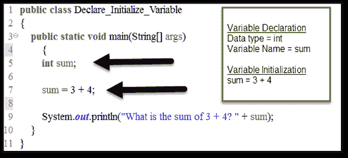

图 1.2 – 变量声明与初始化

程序输出：

第五行声明了数据类型为 `int` 且变量名为 `sum` 的变量，而第七行将 `3 + 4` 初始化为变量 `sum`。在 Java 中，所有变量都拥有数据类型、变量名和值。

|  |  |  |


## 运算符


运算符是如加（`+`）和减（`-`）之类的符号，用于执行数学运算（请参见第 3 章中的运算符）。运算符在操作数上执行，操作数可以是任何可以改变的内容。变量是一种在执行期间发生变化的常见[操作数]。在 Java 中，有四种运算符：

1. 算术运算符 – 对数值执行数学运算
2. 位运算符 – 利用位对操作数进行操作
3. 逻辑运算符 – 根据一个或多个表达式返回布尔值（true 或 false）
4. 关系运算符 – 在比较操作数后返回布尔值（true 或 false）

以下是算术运算符的示例：

```java
public class Subtraction_Operator
{
    public static void main(String[] args)
    {
        // Subtraction Operator
        int x, y, answer;
        x = 100;
        y = 80;
        answer = x - y;
        System.out.println("What is 100 - 80? " + answer);  
    }
}
```

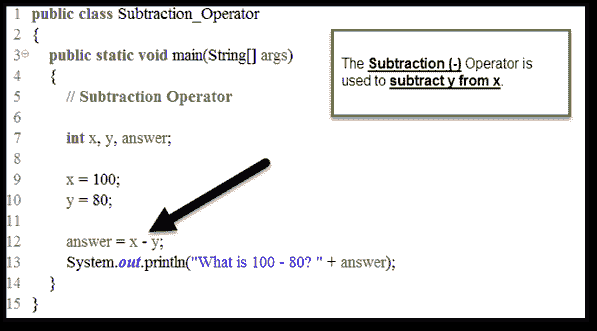

图 1.3 – 减法算术运算符

程序输出：

100 - 80 等于？ 20

第七行声明了数据类型为 `int` 的变量 `x, y, answer`。然而，第九行和第十行将值（`x = 100` 和 `y = 80`）赋值给其中两个变量。`– 减`运算符在第 12 行实现，它从左侧操作数`x` 中减去右侧操作数`y`，然后将值 `20` 分配给变量 `answer`。

|  |  |  |


## 控制结构


控制结构提供了调节程序流的方法（请参见第 4 章中的控制结构）。流程由分支和循环引导。分支允许在评估条件或变量后跳过某些语句。循环允许根据布尔表达式重复特定的语句。以下是两个分支和三个循环的列表：

### 分支

1. if 分支 – 当条件为真时执行语句
2. switch 分支 – 评估变量，然后根据变量的值执行语句

### 循环

1. for 循环 – 执行特定次数的代码块
2. while 循环 – 只要布尔表达式为真就执行语句
3. do-while 循环 – 至少执行一次语句，只要布尔表达式为真就重复

以下是 if 示例：

```java
public class If_Branch
{
    public static void main(String[] args)
    {
        // If Branch
        boolean study;
        study = true;
        if (study == true)
        {
            System.out.println("You can learn Java within 30 days");
        }
        else
        {
            System.out.println("May take longer than 30 days");
        }
    }
}
```


图 1.4 – if 分支

程序输出：

你可以在 30 天内学会 Java

第八行给变量 `study` 赋值 `true`。由于 `study == true` 为真，程序执行第 12 行并跳过其余行（14-17）。如果条件为假，程序将执行 14-17 行。

|  |  |  |


# 类、对象与方法


Java 是一种面向对象的编程（OOP）语言，以对象为中心。对象是任何可以被看到或感知到的。所有对象有两个特征：状态和行为。状态标识对象，行为代表对象的动作。例如，客户可以通过姓名（状态）来识别，而说话（行为）是客户的动作。

状态和行为这两个特征都由类定义。类是对象的模板，也是面向对象编程的基础。数据以及操作数据的语句由类指定。此外，通过类访问数据是通过方法实现的。方法操纵数据并与类交互。以下是一个说明类、对象和方法的示例：


```java
class Customer
{
    String name;
    int age;

    public static void main(String[] args)
    {
        Customer firstCustomer= new Customer ();
        firstCustomer.name = "Joe Doe";
        System.out.println("The customer's name is " + firstCustomer.name);
    }
}
```


图 1.5 – 类、对象与方法示例

程序输出：

客户的名字是 Joe Doe

- 第一行显示关键字 `class` 和类名 `Customer`
- 第六行是 `main` 方法
- 第八行声明 `firstCustomer` 为类型为 `Customer` 的变量。关键字 `new` 分配内存并创建一个新的 `Customer` 对象。
- `Java Interpreter` – 用于 Java 虚拟机执行字节码的主程序
- `Java Archiver (JAR)` – 用于合并 Java 类文件的文件

以下是安装 JDK 的步骤：

### 安装 JDK 的步骤

1. 进入 Java SE 下载页面 [`www.oracle.com/technetwork/java/javase/downloads/index.html`](http://www.oracle.com/technetwork/java/javase/downloads/index.html)
2. 点击 `JDK Download` 按钮。

   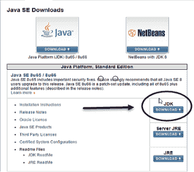

3. 在 `Java SE Development Kit 8u66` 部分点击 `Accept License Agreement`。

   注意：可能存在比 `8u66` 更新的版本。

   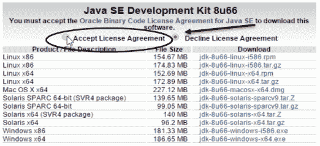

4. 点击对应系统类型（例如，“Windows x64”）的 `Download` 链接。
5. 进入 `Download` 文件夹。
6. 打开下载的可执行文件。

   

7. 点击 `Next` 按钮以设置 `Java SE Development Kit`。
8. 点击 `Next` 按钮进行 `Custom Set Up`。
9. 点击 `Next` 按钮安装到特定位置：例如，“`C:\Program Files\Java`”。
10. 进入该位置并打开 `jdk` 文件夹（例如，`jdk1.8.0_66`）。

    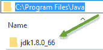

11. 打开 `bin` 文件夹。
12. 复制 `bin` 文件夹的路径（例如，`C:\Program Files\Java\jdk1.8.0_66\bin`）。
13. 通过 `System` 访问 `Advanced system settings` 高级系统设置。

    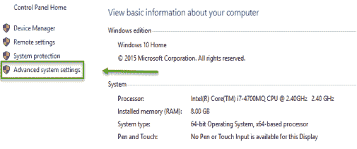

14. 点击 `Advanced` 高级选项卡。
15. 点击 `Environment Variables` 环境变量。
16. 进入系统变量部分中的 `Path`。

    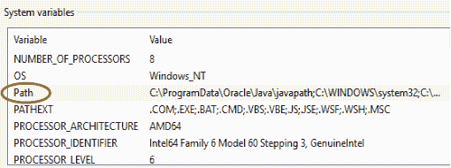

17. 点击 `Edit`。
18. 粘贴 `bin` 文件夹的路径（例如，`C:\Program Files\Java\jdk1.8.0_66\bin`）。

    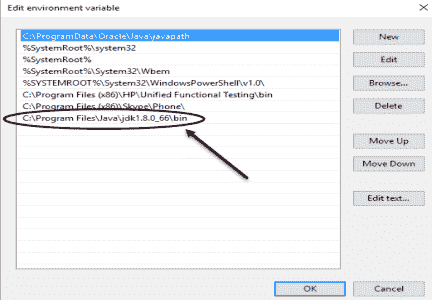

19. 点击 `OK`。
20. 点击 `Apply`。
21. 点击 `OK`。

注意：步骤 10 到 21 是可选的，但很有帮助。Eclipse 会自动在 `Environment Variables` 对话框中搜索路径（例如，`C:\Program Files\Java\jdk1.8.0_66\bin`）。

## 安装 Eclipse IDE

Eclipse 是一个用于开发和测试应用程序的开源 IDE。IDE 是一个综合工具，包含许多功能。源码编辑器和调试器是其中一些功能。源码编辑器允许创建代码，而调试器则负责检查创建的代码。Eclipse 支持多种编程语言，但主要用于 Java。Eclipse 的优点之一是可以使用插件。插件允许自定义和添加额外功能。以下是安装 Eclipse IDE 的步骤：

### 安装 Eclipse 的步骤

1. 访问 [`eclipse.org/downloads/`](https://eclipse.org/downloads/)
2. 选择平台（Windows、Mac OS 或 Linux）
3. 点击 Eclipse IDE for Java EE Developers 的系统类型（例如，“64 bit”）。

   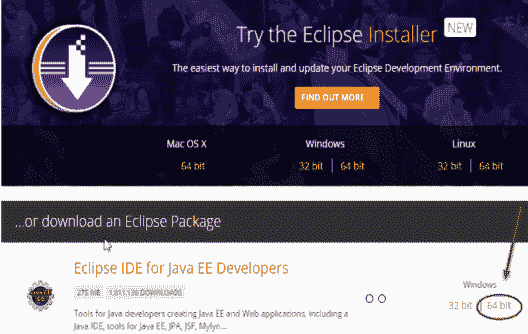

4. 选择一个离你最近的镜像站点（例如，“哥伦大学”）。

   

5. 进入 `Download` 文件夹。
6. 右键点击 `Eclipse` zip 文件并解压所有文件。

   

7. 打开 `eclipse.exe` 文件启动 Eclipse IDE：
   1. 进入解压文件夹（例如，`eclipse-jee-mars-1-win32-x86_64`）。
   2. 打开 `eclipse` 文件夹。
   3. 右键点击 `eclipse.exe` 并选择 Open。

   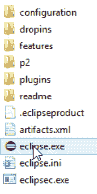

8. 加载 Eclipse IDE。

   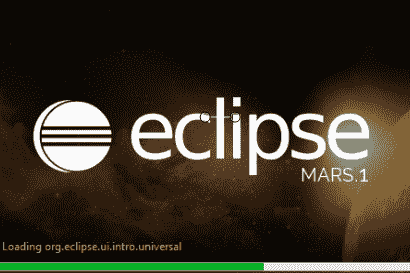

第 1 章概述了关于变量、数据类型、运算符、控制结构、类、对象和方法的通用概念。变量、数据类型、运算符和控制结构的详细信息在本书中给出。然而，类、对象和方法的详细信息将在另一本书“[(Part 2) Java 4 Selenium WebDriver](http://tinyurl.com/Review-Part-2-Java-4-Selenium)”中解释，并结合面向对象编程 (OOP) 概念：继承、封装和多态。第 2 章将定义四种变量 `local`、`parameter`、`instance` 和 `class`，以及原始数据类型：`boolean`, `byte`, `char`, `double`, `float`。

# 第 2 章：变量与数据类型

变量是存储值的命名容器。变量名用于识别变量。数据类型决定了变量的类型。在 Java 中，数据类型有两种：原始类型和引用类型。原始类型包括 `int`、`double`、`boolean`、`float`、`long`、`short` 等。

## 变量命名

变量名在内存中标识时非常重要。因此变量被称为标识符。除了变量外，标识符还代表方法以及其他自定义项。所有变量名从一个字符到无限字符。以下是一个变量命名示例：

```java
public class VariableExample
{
    public static void main(String[] args)
    {
        int custOrder;
        custOrder = 123;
        System.out.println("The customer's order number is " + custOrder);
    }
}
```

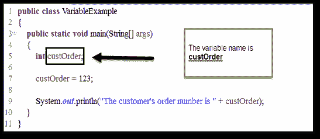

图 2.1 变量命名示例

程序输出：

The customer's order number is 123

## 变量命名规则

Java 有命名规则。其中规则是确保每个变量都是唯一的。唯一的名称可以防止错误的发生，例如“重复的局部变量”——意味着同一个变量名被输入了多次。以下是更多关于变量命名的规则：

- 可以包含区分大小写的字母、数字、美元符号 `$` 和下划线 `_`
- 可以以字母、美元符号 `$` 或下划线 `_` 开头
- 不能以数字开头
- 不能包含空格或美元符号 `$`、下划线 `_` 以外的特殊字符
- 不能包含保留关键字

以下是 50 个 Java 保留关键字：

| abstract | continue | for | new | switch |
| :--- | :--- | :--- | :--- | :--- |
| assert | default | goto | package | synchronized |
| boolean | do | if | private | this |
| break | double | implements | protected | throw |
| byte | else | import | public | throws |
| case | enum | instanceof | return | transient |
| catch | extends | int | short | try |
| char | final | interface | static | void |
| class | finally | long | strictfp | volatile |
| const | float | native | super | while |

图 2.2 - 保留关键字

## 变量命名规范

规范（Convention）是在建立标准时的一种通用的共识或做法。在与自动化工程师团队合作时，为变量命名制定合适的规范是非常关键的。所有标识符名称（例如变量、方法等）对于代码的阅读、理解和维护至关重要。以下是建议的变量命名规范列表：

- 构建具有描述性的名称来描述变量的用途
- 除非名称是单个单词，否则使用混合大小写字母（驼峰法）组合名称
- 如果是单个单词，则使用全小写字母
- 如果是多个单词，第一个单词首字母小写，每个后续单词的首字母大写（例如，`custFirstName`）
- 创建以字母开头的名字，而不是美元符号 `$` 或下划线 `_`
- 选择以单个小写字母开头的循环控制变量（例如，`i`，`x`, `y`）

|  |  |  |
| :--- | :--- | :--- |


## 变量声明


声明变量是明确表示一个变量的存在。在声明变量时，所有变量都与一个数据类型相关。数据类型确保正确的数据被分配给变量。此外，变量的大小由数据类型决定。在程序中使用变量之前必须对其进行声明。以下是声明变量的语法：

### 语法

```
variableType variableName;
```

### 语法细节

| 参数 | 描述 |
| :--- | :--- |
| `variableType` | 被声明变量的数据类型 |
| `variableName` | 被声明变量的名称 |
| `;` | 分号，用于完成声明语句 |

图 2.3 – 变量声明语法细节

以下是一个变量声明的示例：

```java
public class VariableExample
{  
  public static void main(String[] args)
  {
    int x;
    int y;
    x = 5;
    y = 7;
    System.out.println("The values of x and y are " + x + " and " + y);
  } 
}
```

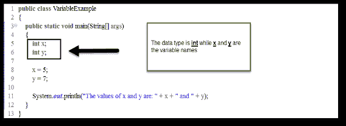

图 2.4 – 变量声明

程序输出：

The values of x and y are: 5 and 7

第五行和第六行声明了 `int` 类型的变量 `x` 和 `y`。注意每个声明都以分号结束。分号完成了声明语句。

注意：如果变量具有相同的数据类型，可以在同一行声明多个变量。以下是使用逗号分隔的多个变量的声明示例：

```
int x, y;
```

|  |  |  |
| :--- | :--- | :--- |


## 变量初始化


通常情况下，变量在使用之前会赋予其一个初始值。赋值运算符分隔等式的两边。每个方程式都有左侧和右侧。左侧显示变量名，右侧显示值。变量可以通过以下方式初始化：

1. 通过值初始化
2. 通过动态初始化

### 通过值初始化

通过值初始化变量需要为变量设置一个值。以下是通过值初始化变量的两种方式：

1. 声明时
2. 声明后

### 声明时

声明时是将数据类型、变量名和值放在同一行。也就是说，同时声明并初始化变量可以使用逗号分隔的列表在声明时初始化多个变量。以下是“声明时”通过值初始化的示例：

```java
public class VariableExample
{  
  public static void main(String[] args)
  {
    int num1 = 100, num2 = 200, total;
    total = num1 + num2;
    System.out.println("The total of num1 and num2 is " + total);  
  } 
}
```


图 2.5 – 声明时变量初始化

程序输出：

The total of num1 and num2 is 300

第五行声明了 `int` 类型的变量 `num1`、`num2` 和 `total`。注意每个声明都以分号结束。分号完成了声明语句。因此，变量在声明时进行了初始化。

### 声明后

声明后是将数据类型、变量名和值放在同一行（注：此处原文描述可能可能有误，通常指在声明之后的行进行赋值）。也就是说，同时声明并初始化变量。可以使用逗号分隔的列表在声明时初始化多个变量。以下是“声明时”通过值初始化的示例：

```java
public class VariableExample
{  
  public static void main(String[] args)
  {
    int x, y;
    x = 5;
    y = 7;
    System.out.println("The values of x and y are " + x + " and " + y);
  } 
}
```

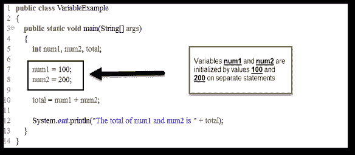

图 2.6 – 声明后变量初始化

程序输出：

The values of x and y are: 5 and 7

第五行和第六行声明了 `int` 类型的变量 `x` 和 `y`。注意每个声明都以分号结束。分号完成了声明语句。因此，变量在声明后进行了初始化。

### 通过动态初始化

通过动态初始化变量不是为变量分配特定的值。相反，将会变化的值分配给变量。偶尔，变化的值来自被测试应用程序（AUT）或其他变量。以下是变量动态初始化示例：

```java
public class VariableExample
{  
  public static void main(String[] args)
  {
    int num1, num2;
    num1 = 100;
    num2 = 200; 
    int total = num1 + num2;
    System.out.println("The total of num1 and num2 is " + total);
  } 
}
```

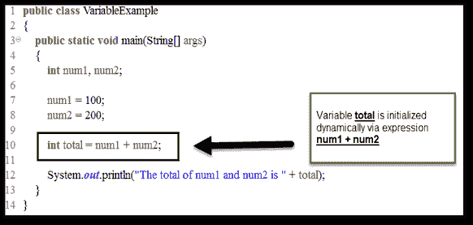

图 2.7 – 通过动态初始化

程序输出：

The total of num1 and num2 is 300

第十行声明并初始化了 `int` 类型的变量 `total`。该变量没有被赋予特定的值。然而，它被分配了可能会变化的信息 `num1` 和 `num2`。例如，自动化工程师可以在执行期间输入语句来增加变量 `num1` 和 `num2` 的值。如果变量 `num1` 和 `num2` 发生变化，那么变量 `total` 随之动态变化。

注意：通过动态初始化变量时需要数据类型 `int`。

Java 允许在程序的任何位置声明变量。因此，变量可以定义在类内部、方法内部，或者作为方法的参数定义。变量的作用域与该变量在程序中声明的位置有关。生命周期是指变量在程序中存在的时间。以下是四种具有独立作用域和生命周期的变量：

1. 局部变量
2. 参数变量
3. 实例变量
4. 类变量

## 局部变量

局部变量声明在 `method` 内部。不同的 `methods` 可以与程序中的其他方法具有相同的 `variable name`（变量名）。局部变量在其所属的 `method` 内部可见。因此，每个变量对于特定的 `method` 都是唯一的。在使用局部变量之前，必须对其声明并初始化一个值，不需要特殊的关键字。因此，局部变量没有默认值。局部变量在 `method` 构建时创建，在 `method` 时销毁。以下是一个局部变量示例：


```java
public class VariableExample {
    public void AutomationEngineers () {
        int yearsEmployed;
        yearsEmployed = 5;
        System.out.println("Joe Doe 'Automation' has been at the organization " + yearsEmployed + " years");
    }

    public void Developers () {
        int yearsEmployed;
        yearsEmployed = 3;
        System.out.println("Jane Doe 'Dev' has been at the organization " + yearsEmployed + " years");
    }

    public static void main(String[] args) {
        VariableExample years = new VariableExample ();
        years.AutomationEngineers();
        years.Developers();
    }
}
```

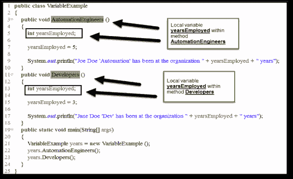

图 2.8 – 局部变量

程序输出：

```
Joe Doe 'Automation' has been at the organization 5 years
Jane Doe 'Dev' has been at the organization 3 years
```

第五行和十三行显示了变量`yearsEmployed`，它是方法`AutomationEngineers`和`Developers`的局部变量。不会发生错误，因为每个变量对于其`method`都是唯一的。然而，在同一个`method`内不能多次声明相同的`variable name`。局部变量的作用域和生命周期限于其声明所在的块/大括号内。

## 参数变量

参数变量被声明并传递到`methods`中。在声明参数变量后，它的实现方式类似于`local variable`（局部变量）。因此，`local variable`和参数变量不能同名。参数变量不需要关键字。但是，在`method`名称之后，`data type`和`variable name`必须括在括号内。以下是一个参数变量示例：

```java
public class VariableExample {
    public void setMtgAmount (double mtgAmount) {
        System.out.println("The mortgage payment amount is " + mtgAmount);
    }

    public static void main(String[] args) {
        VariableExample payment = new VariableExample ();
        payment.setMtgAmount(99000);
    }
}
```

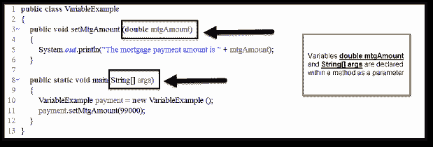

图 2.9 – 参数变量

程序输出：

```
The mortgage payment amount is 99000.0
```

第三行和第八行将参数变量`double mtgAmount`和`String[] args`传递到方法`setMtgAmount`和`main`。值`99000`从第 11 行的方法调用`payment.setMtgAmount`传递到被调用的第三行方法`setMtgAmount`。参数变量的作用域是括号内的方法头，而生命周期是大括号内的方法体。

## 实例变量

实例变量声明在`class`内部、`method`外部，并且可以在创建`object`后可选地访问。实例变量的值对于每个`object`都是唯一的。实例变量可以在初始化之前或之后声明，并且对`class`中的所有`methods`可见。数字类型的默认值为 0，`boolean`类型的默认值为 false。以下是实例变量示例：

```java
public class VariableExample {
    int yearsExist = 34;

    public static void main(String[] args) {
        VariableExample years = new VariableExample();
        System.out.println("This organization has existed for " + years.yearsExist + " years");
    }
}
```

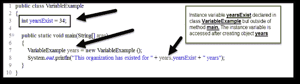

图 2.10 – 实例变量

程序输出：

```
This organization has existed for 34 years
```

第三行在`class`内部、`method main`外部声明了实例变量`yearsExist`。第八行打印变量`years.yearsExist`。

## 类变量

类变量（称为静态变量）声明在`class`内部，但不在`method`内部。关键字`static`通知`compiler`（编译器）特定变量只存在一份，但它被所有`object`实例共享。数字类型的默认值为 0，`boolean`的默认值为 false。类变量在程序开始时创建，在程序结束时销毁。以下是一个类变量示例：

```java
public class VariableExample {
    static int numDays = 30;

    public static void main(String[] args) {
        VariableExample days = new VariableExample ();
        System.out.println("Java can be mastered in " + VariableExample.numDays + " days");
        System.out.println("Selenium can be mastered in " + days.numDays + " days");
        System.out.println("Do you think you can master Java/Selenium in " + numDays + " days");
    }
}
```

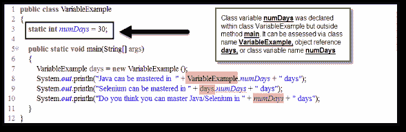

图 2.11 – 类变量

程序输出：

```
Java can be mastered in 30 days
Selenium can be mastered in 30 days
Do you think you can master Java/Selenium in 30 days
```

第三行使用关键字`static`在`class`内部声明了类变量`numDays`。第八行、第九行和十行分别通过`ClassName.ClassVariable`（`VariableExample.numDays`）、`ObjectReference.ClassVariable`（`days.numDays`）以及`ClassVariableName`（`numDays`）访问类变量。

原始数据类型说明了变量中存储的数据类型。每种`data type`(#c017.xhtml_Data_Type)都有精确的范围和行为。因此，`int`(#c022.xhtml_int)`data type`可以存储数值数据，但如果尝试让`boolean`(#c022.xhtml_boolean)存储数值数据，就会发生类型不匹配错误。此外，根据`data type`(#c017.xhtml_Data_Type)，允许对值进行某些操作。例如，不能在`boolean`(#c022.xhtml_boolean)数据类型上执行数学计算，因为`boolean`不能包含数字。以下是所有八种原始数据类型的列表：

| 类型 | 宽度（位/字节） | 描述/范围 |
| :--- | :--- | :--- |
| boolean | | 真或假（True or False） |
| byte | 8 位（1 字节） | -128 到 127 |
| char | 16 位 | 标准字符集，可以是字母、控制字符、数字、标点或代表世界上所有语言的符号 |
| double | 64 位（8 字节） | -1.7976931348623157E+308 到 1.7976931348623157E+308 |
| float | 32 位（4 字节） | -3.4028235E+38 到 3.4028235E+38 |
| int | 32 位（4 字节） | −2,147,483,648 到 2,147,483,647 |
| long | 64 位（8 字节） | -9,223,372,036,854,775,808 到 9,223,372,036,854,755,807 |
| short | 16 位（2 字节） | -32,768 到 32,767 |

图 2.12 – 八种原始数据类型

以下将原始数据类型划分为 4 类：

1. `Integer Type`(#c022.xhtml__Integer_Type)
2. `Floating Point Type`(#c022.xhtml__Floating_Point_Type_2)
3. `Character Type`(#c022.xhtml__Character_Type_1)
4. `Boolean Type`(#c022.xhtml__Boolean_Type_1)

## 整数类型

整数类型支持没有小数部分的数值。整数类型内部的主要区别是值的范围。以下显示了整数类型的每种数据类型：

* `byte`(#c022.xhtml_byte)
* `short`(#c022.xhtml_short)
* `int`(#c022.xhtml_int)
* `long`(#c022.xhtml_long)

`int`(#c022.xhtml_int)数据类型最常用，因为它用于控制循环和数组索引。以下是一个`int`(#c022.xhtml_int)数据类型的示例：

```java
public class VariableExample
{
    public static void main(String[] args) {
        //Calculate 2 integer values
        int i, j;
        int total;
        i = 10;
        j = 20;
        total = i + j;
        System.out.println ("Total of i + j is " + total);
    }
}
```

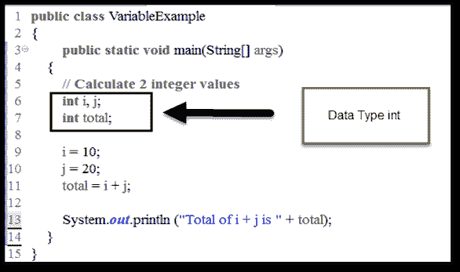

图 2.13 – 数据类型 int

程序输出：

```
Total of i + j is 30
```

第六行和第七行为名为“i”、“j”和“total”的变量声明了`int`(#c022.xhtml_int)数据类型。第九、十和一行初始化了变量。

## 浮点类型

浮点类型支持带有小数部分的数值。`float`(#c022.xhtml_float)和`double`(#c022.xhtml_double)数据类型构成了浮点类型。由于 Java 标准`Math`类的存在，当数值包含小数时，`double`(#c022.xhtml_double)数据类型最常用。以下是一个`double`(#c022.xhtml_double)数据类型的示例：

```java
public class VariableExample
{
    public static void main(String[] args) {
        double d;
        double calc;
        d = 200;
        calc = Math.sqrt (d);
        System.out.println ("Square root of 200 is " + calc);
    }
}
```

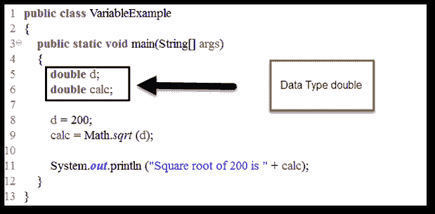

图 2.14 – 数据类型 double

程序输出：

```
Square root of 200 is 14.142135623730951
```

第五行和第六行为名为“d”和“calc”的变量声明了`double`(#c022.xhtml_double)数据类型。第八行为“d”赋值了 200，而第九行为“calc”赋值了平方根方法。

## 字符类型

字符类型的范围为 0 到 65535。`char`数据类型支持 Unicode。以下是一个`char`数据类型的示例：

```java
public class VariableExample
{
    public static void main(String[] args) {
        char cha1, cha2;
        cha1 = 'C';
        cha2 = 67;
        System.out.println("Value assigned to cha1 is " + cha1);
        System.out.println(cha2);
    }
}
```

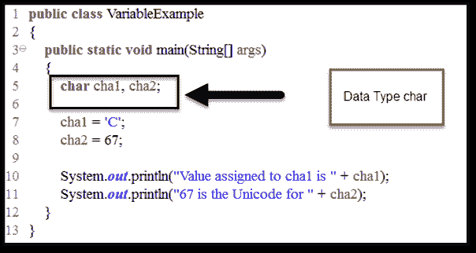

图 2.15 – 数据类型 char

程序输出：

```
Value assigned to cha1 is C
67
```

第五行和第七行为名为“cha1”的变量声明了`char`数据类型。

## 布尔类型

当程序涉及逻辑时，`boolean`类型支持程序。以下是一个`boolean`数据类型的示例：

```java
public class VariableExample
{
    public static void main(String[] args) {
        boolean result;
        result = false;
        System.out.println("Boolean variable was initialized to " + result);
        System.out.println("Is 100 greater than 99? " + (100>99));
    }
}
```

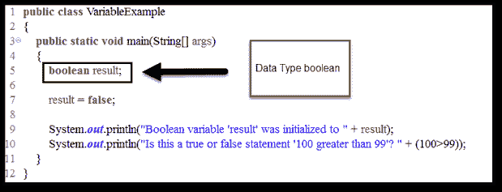

图 2.16 – 数据类型 boolean

程序输出：

```
Boolean variable was initialized to false
Is 100 greater than 99? true
```

第五行和第七行为名为“result”的变量声明了`boolean`数据类型。第七行将变量初始化为 false。第九行打印默认值 false，但第十行在评估条件`100>99`后返回真值 true。

常量的声明和初始化与变量相似。声明常量的区别特征是关键字修饰符`final`](#c018.xhtml_final)。使用`final`](#c018.xhtml_final)的声明语句告知 Java 初始化值将不会改变。以下示例显示了常量的声明和初始化语句：

```java
public class VariableExample
{  
    public static void main(String[] args)
    {
        final int DAYS_IN_WEEK = 7;
        final int DAILY_MAX_HOURS = 24;
        int totalHours;
        totalHours = DAYS_IN_WEEK * DAILY_MAX_HOURS;  
        System.out.println("The total of hours in a week is " + totalHours); 
    } 
}
```

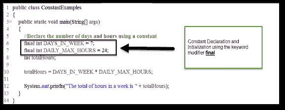

图 2.17 – 声明和初始化常量

程序输出：

```
The total of hours in a week is 168
```

第六行和第七行使用关键字修饰符`final`](#c018.xhtml_final)声明并初始化了常量。常量名`DAYS_IN_WEEK`被赋值为“7”，而`DAILY_MAX_HOURS`被赋值为“24”。赋值的常量值在程序中不会改变。如果尝试更改常量，会提示错误：“The final local variable NAME_OF_CONSTANT cannot be assigned”。

## 默认常量数据类型


数据类型`int`和`double`是它们各自类别中的默认常量类型。然而，可以通过在目标类型后添加字母来修改默认类型。`int`数据类型通过附加字母`l`或`L`变为`long`数据类型。例如，值`34`默认表示`int`数据类型，但`34l`或`34L`表示`long`数据类型。`double`数据类型也是如此。值`12.34`默认指定`double`数据类型，但`12.34f`或`12.34F`指定`float`数据类型。

注意：本节指出了默认常量数据类型。然而，常量可以声明为任何原始数据类型。

## 转义字符

转义字符（称为反斜线字符常量）表示一组字符和非图形字符。根据《Beginning Java® Programming (2015)，“转义字符用于以特定方式显示文本，可以在需要的地方插入制表符或换行，或者显示通常用于代码语法的字符”（第 29 页）。

单引号（‘’）等字符具有特殊含义，不能直接使用。因此，必须在字符前加上反斜线字符`\`，以便`compiler`正确解释给定语句。以下是转义字符列表：

| 转义字符 | 说明 | Unicode |
| :--- | :--- | :--- |
| `\b` | 在文本中插入退格键 | `\u0008` |
| `\f` | 在文本中插入分页符 | `\u000C` |
| `\n` | 在文本中插入换行符 | `\u000A` |
| `\r` | 在文本中插入回车符 | `\u000D` |
| `\t` | 在文本中插入水平制表符 | `\u0009` |
| `\’` | 在文本中插入单引号（撇号） | `\u0027` |
| `\”` | 在文本中插入双引号 | `\u0022` |
| `\\` | 在文本中插入反斜线 | `\u005C` |

图 2.18 – 转义字符

## 字符串常量

字符串常量被包含在双引号（”）中，表示字符序列。普通字符（例如数字、字母等）以及转义字符都可以在字符串常量中处理。以下是一个字符串常量示例：

```java
public class MiscExamples
{  
    public static void main(String[] args)
    {
        System.out.print("The following displays numbers 1 - 10 on two lines: \n");
        System.out.println("1\t2\t3\t4\t5");
        System.out.println("6\t7\t8\t9\t10");   
    }
}
```

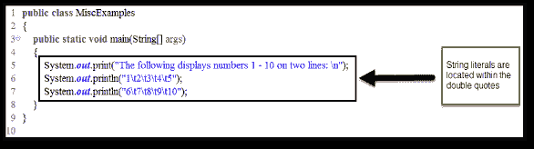

图 2.19 – 字符串常量示例

程序输出：

```
The following displays numbers 1 - 10 on two lines:
1 2 3 4 5
6 7 8 9 10
```

第五、六、七行显示了双引号内的字符串常量。注意第五行使用的是`print()`语句而不是像六、七行的`println()`语句。转义字符（`\n`）插入了换行符，因此不需要`println()`。此外，转义字符（`\t`）插入了制表符。

## 字符常量

单引号（‘’）等字符具有特殊含义，不能直接使用。因此，必须在字符前加上反斜线字符`\`，以便`compiler`正确解释给定语句。以下是转义字符列表：

（注意：此处文本在此章节似乎有重复/重叠）

## 布尔常量

布尔常量初始化`True`和`False`。图 2.16 是一个初始化第七行变量的`boolean`示例。

## 数字常量

数字常量包含整数类型或浮点类型值。这些值允许像标点符号一样使用下划线。例如，一亿写成`100,000,000`。逗号提高了百万的可读性。以下是一个数字常量示例：

```java
public class MiscExamples
{  
    public static void main(String[] args)
    {
        final long FIRST_AMOUNT, SECOND_AMOUNT, TOTAL_AMOUNT;
        FIRST_AMOUNT = 111_111_111;
        SECOND_AMOUNT = 222222222;
        TOTAL_AMOUNT = FIRST_AMOUNT + SECOND_AMOUNT;
        System.out.println("The first amount is " + FIRST_AMOUNT);
        System.out.println("The second amount is " + SECOND_AMOUNT);
        System.out.println("The total of both amounts is " + TOTAL_AMOUNT);
    }
}
```

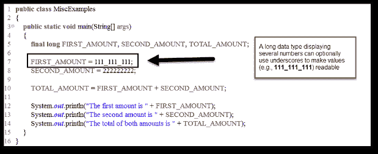

图 2.20 – 数字常量

程序输出：

```
The first amount is 111111111
The second amount is 222222222
The total of both amounts is 333333333
```

第七行和八行显示了包含九位数字的`long`数据类型。然而，第七行使用了两个下划线，使得`111_111_111`的比八行的`222222222`更具可读性。同样，下划线可以用于信用卡号、社会安全号码等，且只能放置数字之间。第 2 章描述了如何声明和初始化变量。此外，还讨论了四种变量（局部、参数、实例和类）以及原始数据类型。第 3 章将探索四种 Java 运算符：算术、位运算、逻辑和关系。

运算符是对一个或多个操作数进行数学或逻辑处理的符号。操作数可以是任何可以被更改或处理的对象。最常见操作数是变量。在`Java`中，有四种运算符：算术运算符、位运算符、逻辑运算符和关系运算符。算术运算符、逻辑运算符和关系运算符是最常用的运算符。下面的示例演示了乘法运算符（`*`）运算符和操作数（三和四）：

```java
public class Operators
{  
    public static void main(String[] args)
    {
        int answer;
        answer = 3 * 4; 
        System.out.println("What is 3 times 4? " + answer);
    }
}
```

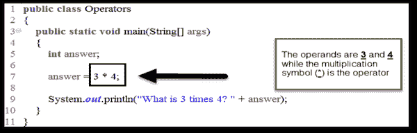

图 3.1 – 运算符和操作数

程序输出：

```
What is 3 times 4? 12
```

本章提供了关于运算符的以下信息：

✓ 算术运算符

✓ 位运算符

✓ 逻辑运算符

✓ 关系运算符

✓ 赋值运算符

✓ 三目运算符

✓ 运算符优先级

✓ 数据类型转换

✓ 表达式

|  | |  |


## 算术运算符


算术运算符对数值执行数学运算。因此，算术运算符可以应用于任何涉及数字的数据类型。以下是算术运算符列表：

1. `+`（加法）运算符
2. `-`（减法）运算符
3. `*`（乘法）运算符
4. `/`（除法）运算符
5. `%`（取模）运算符
6. `++`（自增）运算符
7. `—`（自减）运算符

| 运算符 | 说明 |
| :--- | :--- |
| `+` | 将`+`运算符两侧的值相加；用于连接字符串所需的字符串拼接 |
| `-` | 从左操作数中减去右操作数 |
| `*` | 乘法`*`运算符两侧的值 |
| `/` | 将左操作数除以右操作数 |
| `%` | 将左操作数除以右操作数并返回余数 |
| `++` | 将操作数的值加一 |
| `—` | 将操作数的值减一 |

图 3.2 – 算术运算符

注意：除法运算符（`/`）会截断余数，而取模运算符（`%`）会返回余数。例如，`10/3`只返回三并截断了余数（余数为一）。另一方面，`10%3`只返回余数一。

### 自增算术运算符

自增运算符将操作数加一。该运算符具有前缀和后缀形式。下面的语法显示了两种自增运算符形式，它们与以下表达式相同：

`i = i + 1;`

前缀形式语法

`++i;`

后缀形式语法

`i++;`

### 自减算术运算符

自减运算符从操作数中减一。该运算符具有前缀和后缀形式。下面的语法显示了两种自减运算符形式，它们与以下表达式相同：

`i = i - 1;`

前缀形式语法

`—i;`

后缀形式语法

`i—;`

以下是每个算术运算符的示例：

```java
public class Operators
{  
    public static void main(String[] args)
    {
        int result, x = 10;
        result = x + y; // Addition
        System.out.println("x + y = " + result);
        result = x - y; // Subtraction
        System.out.println("x - y = " + result);
        result = x * y; // Multiplication
        System.out.println("x * y = " + result);
        result = x / y; // Division
        System.out.println("x / y = " + result);
        result = x % y; // Modulus
        System.out.println("x % y = " + result);
        x++; // Increment
        System.out.println("x++ = " + x);
        ++x; // Increment
        System.out.println("++x = " + x);
        x--; // Decrement
        System.out.println("x-- = " + x);
        --x; // Decrement
        System.out.println("--x = " + x);
    }
}
```

（注：代码块示例的原始源文本是碎片化的；我根据文中提供的上下文重构了逻辑。）


图 3.3 – 算术运算符

程序输出：

```
What is 3 times 4? 12
```

在这个示例中，`x`被赋值为`10`，`y`被赋值为`3`。`+`运算符将`x`和`y`相加。`result`被赋值为和。`-`运算符从`x`中减去`y`。`result`被赋值为差。`*`运算符将`x`和`y`相乘。`result`被赋值为积。`/`运算符将`x`除以`y`。`result`被赋值为商。`%`运算符将`x`除以`y`并返回余数。`result`被赋值为余数。`x++`让`x`加一。`++x`也让`x`加一。`x--`让`x`减一。`--x`也让`x`减一。

| `<<` | 将左操作数的值向左移动，移动数为右操作数指定的位数 | `x << 2` |
| `~` | 将每个位反转为相反的位。例如，每个 1 位变为 0，每个 0 位变为 1 | `~2` |

图 3.4 – 位运算符

## 逻辑运算符

逻辑运算符（也称为条件运算符）根据一个或多个表达式（`expressions`）返回`boolean`值。因此，逻辑运算符的数据类型必须是`boolean`。以下是逻辑运算符列表：

* `&&`（逻辑与）运算符
* `||`（逻辑或）运算符
* `^`（逻辑异或 (XOR)）运算符
* `!`（逻辑非）运算符

| 运算符 | 描述 |
| :--- | :--- |
| `&&` | 如果两个操作数都为 true，则返回 true。如果一个或两个操作数为 false，则返回 false |
| `||` | 如果一个或两个操作数为 true，则返回 true。如果两个操作数都为 false，则返回 false |
| `^` | 如果仅有一个操作数为 true，则返回 true。如果两个操作数都为 false 或都为 true，则返回 false |
| `!` | 返回操作数的相反值。如果操作数为 false，则返回 true；如果操作数为 true，则返回 false |

图 3.5 – 逻辑运算符

注意：位运算符和逻辑运算符执行了某些相同的功能。以下是每个逻辑运算符以及两个位运算符的示例：

```java
public class Operators
{  
    public static void main (String[] args)
    {
        boolean x = 100 > 99, y = 99 > 100;
        // 逻辑与 '&&' 运算符
        System.out.println("What is the result of 100 > 99 && 99 > 100? " + (x && y));
        // 位与 '&' 运算符
        System.out.println("What is the result of 100 > 99 & 99 > 100? " + (x & y));
        // 逻辑或 '||' 运算符
        System.out.println("What is the result of 100 > 99 || 99 > 100? " + (x || y));
        // 位或 '|' 运算符
        System.out.println("What is the result of 100 > 99 | 99 > 100? " + (x | y));
        // 逻辑异或 '^' 运算符
        System.out.println("What is the result of 100 > 99 ^ 99 > 100? " + (x ^ y));
        // 逻辑非 '!' 运算符
        System.out.println("What is the result of Not 100 > 99? " + (!x));
        // 逻辑非 '!' 运算符（运算符和操作数周围括号是可选的）
        System.out.println("What is the result of Not 99 > 100? " + !y);
    }
}
```

图 3.6 – 逻辑与位运算符示例

程序输出：

```
What is the result of 100 > 99 && 99 > 100? false
What is the result of 100 > 99 & 99 > 100? false
What is the result of 100 > 99 || 99 > 100? true
What is the result of 100 > 99 | 99 > 100? true
What is the result of 100 > 99 ^ 99 > 100? true
What is the result of Not 100 > 99? false
What is the result of Not 99 > 100? True
```


在此示例中，第五行声明并初始化了变量。变量`x`和`y`都被赋值了布尔表达式。变量`x`被赋值了一个为 `true` 的表达式（`100 > 99`），而`y`被赋值了一个为 `false` 的表达式（`99 > 100`）。第八行的`&&`（逻辑与）运算符和第 11 行的`&`（位与）运算符比较了操作数`x`和`y`，然后返回一个`false`值。返回 `false` 是因为一个操作数`x`为 `true` 而另一个操作数`y`为 `false`。根据图 3.4 和图 3.5，图 3.6 中所有使用位运算符和逻辑运算符的示例都执行了相似的过程。

### 短路行为

短路运算符是`||`（逻辑或）和`&&`（逻辑与）。从图 3.6 可以看出，`||`和`&&`返回的结果与位或和位与运算符相同。然而，区别特征在于对操作数的求值。如果第一个操作数返回 `false`，则`&&`（逻辑与）运算符将不会求值第二个操作数。而位与运算符总是求值两个操作数。同样，`||`（逻辑或）运算符如果第一个操作数返回 `true`，则不会求值第二个操作数。与位或运算符相反，位运算符总是求值两个操作数。注意：短路运算符不求值第二个操作数，因为无论第二个操作数是什么，它都知道结果。

## 关系运算符

关系运算符在比较操作数后返回一个`boolean`值。通常情况下，所有关系运算符都应用于数字操作数。如果数字之间的关系成立，则返回 `true`。例如，如果 34 等于 34，则返回 `true`。以下是关系运算符：

1. `==`（等于）运算符
2. `!=`（不等于）运算符
3. `>`（大于）运算符
4. `>=`（大于等于）运算符
5. `<`（小于）运算符
6. `<=`（小于等于）运算符

| 运算符 | 描述 |
| :--- | :--- |
| `==` | 验证两个操作数是否相等 |
| `!=` | 验证两个操作数是否不等 |
| `>` | 验证左操作数是否大于右操作数 |
| `>=` | 验证左操作数是否大于等于右操作数 |
| `<` | 验证左操作数是否小于右操作数 |
| `<=` | 验证左操作数是否小于等于右操作数 |

图 3.7 – 关系运算符

以下是每个关系运算符的示例：

```java
public class Operators
{  
    public static void main (String[] args)
    {
        int x = 25, y = 50;
        // == 等于 运算符
        System.out.println("Is 25 equal to 50? " + (x == y));
        // != 不等于 运算符
        System.out.println("Is 25 not equal to 50? " + (x != y));
        // > 大于 运算符
        System.out.println("Is 25 greater than 50? " + (x > y));
        // >= 大于等于 运算符
        System.out.println("Is 25 greater than or equal to 50? " + (x >= y));
        // < 小于 运算符
        System.out.println("Is 25 less than 50? " + (x < y));
        // <= 小于等于 运算符
        System.out.println("Is 25 less than or equal to 50? " + (x <= y));  
    }
}
```

图 3.8 – 关系运算符示例

程序输出：

```
Is 25 equal to 50? false
Is 25 not equal to 50? true
Is 25 greater than 50? false
Is 25 greater than or equal to 50? false
Is 25 less than 50? true
Is 25 less than or equal to 50? True
```

在本示例中，第五行声明并初始化了变量。变量`x`被赋值为 25，而变量`y`被赋值为 50。第八行使用`==`（等于）运算符来判断两个变量`(x == y)`是否相等。由于值 25 和 50 不相等，因此返回 `false`。图 3.8 中的所有示例都执行了与此相似的过程，但根据图 3.7 使用了不同的关系运算符。

|  |  |  |


## 赋值运算符


赋值运算符（`=`）位于变量和值之间。其目的是为变量赋值。因此，右侧的值被传输到左侧的变量名中。以下是赋值运算符的语法：

### 语法

```
variableName = expression;
```

### 语法细节

| 参数 | 描述 |
| :--- | :--- |
| `variableName` | 已声明的变量名 |
| `expression` | 赋值给变量名的值 |
| `;` | 分号完成初始化语句 |

图 3.9 – 赋值运算符语法细节

注意：赋值运算符可以生成赋值链。赋值链是为多个变量初始化相同值的一种良好方法。此外，如果变量已存在值，则该值会被覆盖。以下是一个赋值运算符的示例：

```java
public class Operators
{  
  public static void main (String[] args)
  {
    int i, j, k;
    i = j = k = 34;
    System.out.println("The value of i is: " + i);
    System.out.println("The value of j is: " + j);
    System.out.println("The value of k is: " + k);
    j = 38;
    System.out.println("The value of j has been overwritten to: " + j);
  }
}
```

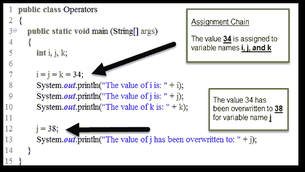图 3.10 – 赋值运算符示例

程序输出：

```
The value of i is: 34
The value of j is: 34
The value of k is: 34
The value of j has been overwritten to: 38
```

第五行使用 `int` 数据类型声明了每个变量`i, j, k`。第七行利用链式赋值在一个语句中将每个变量初始化为相同的值 34。第十二行通过赋值值 38 覆盖了变量`j`。

## 复合赋值

复合赋值（也称为简写赋值）将算术结合在一起。以下运算符被排除在合并功能之外：递增、递减和取反码。这一过程缩短了赋值语句。例如，以下两个语句产生相同的输出：

```
y = y + 3;
y += 3;
```

这两个语句都为变量`y`赋值为`y`加三的值。以下是复合赋值的列表：

1. `+=`（加法赋值）

|  |  |  |


## 三元运算符


根据[dictionary.com](http://dictionary.com/reference)，三元意味着“由三部分组成”。因此，三元运算符（`?`）用于确定赋值给变量的值。以下是三元运算符的语法：

### 语法

```
variableType variableName = expression1 ? expression2 : expression3;
```

### 语法细节

| 参数 | 描述 |
| :--- | :--- |
| `variableType` | 变量的数据类型 |
| `variableName` | 接收值的变量名 |
| `expression1` | 布尔表达式 |
| `expression2` | 表达式为真时的值 |
| `:` | 冒号分隔 `expression2` 和 `expression3` |
| `expression3` | 表达式为假时的值 |

图 3.12 – 三元运算符语法细节

以下是一个三元运算符的示例：

```java
public class Operators
{  
  public static void main (String[] args)
  {
    int x, y;
    x = 5;
    System.out.println("What is the value of x? " + x);
    y = (x == 5) ? 7 : 1;
    System.out.println("x equals 5 so the boolean expression is true: Value is " + y);
    y = (x == 3) ? 7 : 1;
    System.out.println("x does not equal 3 so the boolean expression is false: Value is " + y);
  }
}
```

图 3.13 – 三元运算符示例

程序输出：

```
What is the value of x? 5
x equals 5 so the boolean expression is true: Value is 7
x does not equal 3 so the boolean expression is false: Value is 1
```

第十行显示表达式 1 为`(x == 5)`，而第十三行显示表达式 1 为`(x == 3)`。如果布尔表达式为真，则`y`被赋值为 7，否则`y`被赋值为 1。

## 运算符优先级

运算符优先级是从高到低对 Java 运算符进行的排名。当表达式包含多个运算符时，优先级变得非常重要。表达式：

```
total = 2 + 3 * 4;
System.out.println("What is the total without a parenthesis? " + total);
total = (2 + 3) * 4;
System.out.println("What is the total with a parenthesis? " + total);
```

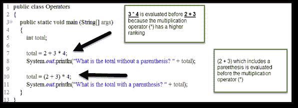图 3.14 – 运算符优先级示例

程序输出：

```
不带括号的总和是多少？14
带括号的总和是多少？20
```

通常，乘法运算符（`*`）会在加法运算符（`+`）之前进行求值。变量`total`在第 7 行和第 10 行被赋值了相同的值。然而，第 7 行的语句不包含括号，而第 10 行包含括号。在第 7 行中，乘法运算符（`*`）优先计算值`3 * 4`，然后通过加法运算符（`+`）加上值`2`。因此，值`14`（`3 * 4 = 12`且`12 + 2 = 14`）被赋值给第 7 行的变量`total`。在第 10 行中，括号的优先级高于乘法运算符（`*`）。结果是，在括号内先计算值`2 + 3`，然后计算乘法运算符（`*`）。因此，值`20`（`2 + 3 = 5`且`5 * 4 = 20`）被赋值给第 10 行的变量`total`。根据[Java ^(TM) 教程](https://docs.oracle.com/javase/tutorial/java/nutsandbolts/operators.html)，以下是运算符优先级列表：

| 运算符 | 优先级 |
| :--- | :--- |
| 后置 | `expr++ expr--` |
| 一元 | `++expr --expr +expr -expr ~ !` |
| 乘除 | `* / %` |
| 相加 | `+ -` |
| 移位 | `<< >> >>>` |
| 关系 | `< > <= >= instanceof` |
| 等于 | `== !=` |
| 位与 | `&` |
| 位异或 | `^` |
| 位或 | `\|` |
| 逻辑与 | `&&` |
| 逻辑或 | `\|\|` |
| 三元 | `? :` |
| 赋值 | `= += -= *= /= %= &= ^= \|= <<= >>= >>>=` |

图 3.15 – 运算符优先级

|  |  |  |


## 数据类型转换


数据类型转换是将一个数据类型 的值转换为另一种数据类型。例如，一个数值数据类型“`float`”的值可以转换为另一个数值数据类型“`double`”。然而，`boolean`数据类型的值永远无法转换为数值类型。转换/转型有两种类型：

1. 隐式转换
2. 显式转换

注意：基本数据类型的层次结构从高到低依次为：`double`、`float`、`long`、`int`、`short`，然后是`byte`。

### 隐式转换

隐式转换是在没有指示编译器 将一种数据类型 转换为另一种数据类型 的情况下发生的转换。这种类型的转换只发生在宽转换中。当某个特定的数据类型 的值转换为更高的数据类型 时，宽转换会自动发生。因此，根据基本数据类型层次结构，`int`可以转换为`float`，但尝试将`float`转换为`int`时会产生错误。以下是一个隐式转换示例：

```java
public class Operators
{
    public static void main (String[] args)
    {
        int i;
        float f;
        i = 78;
        System.out.println("The value of int 'i' is: " + i);
        f = i;
        System.out.println("The value of float 'f' is: " + f);
    }
}
```

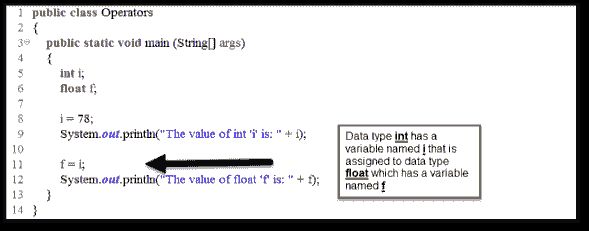

图 3.16 - 赋值类型转换示例

程序输出：

```
The value of int 'i' is: 78
The value of float 'f' is: 78.0
```


`int 'i'`的值是：`78`
`float 'f'`的值是：`78.0`

第五行声明了`i`为`int`类型，而第六行声明`f`为`float`类型。第八行将`78`赋值给`f`。然而，第十一行将`78`转换为`float`。注意在转换`78`时值没有丢失数据。隐式转换需要以下两个原则：

1. 两种数据类型必须兼容
2. 目标数据类型的范围必须高于源类型

以下是根据基本数据类型层次结构列出的宽转换列表：

* `byte`转换为`short`、`int`、`long`、`float`或`double`
* `short`转换为`int`、`long`、`float`或`double`
* `int`转换为`long`、`float`或`double`
* `long`转换为`float`或`double`
* `float`转换为`double`
* `char`转换为`int`、`long`、`float`或`double`

### 显式转换

显式转换是在有指示编译器将一种数据类型转换为另一种数据类型时发生的转换。这种类型的转换可以发生在宽转换和窄转换中。窄转换发生在当特定的数据类型的值转换为较低的数据类型时。因此，在将`float`转换为`int`时不会产生错误。以下是显式转换的语法：

```
(targetDataType) expression;
```

语法细节

| 参数 | 描述 |
| :--- | :--- |
| `targetDataType` | 转换表达式的目标数据类型 |
| `expression` | 将要转换的值 |
| `;` | 分号结束显式转换语句 |

图 3.17 – 显式转换语法细节

以下是一个显式转换示例：

```java
public class Operators
{
    public static void main (String[] args)
    {
        int i = 8;
        double d = (double) i;
        System.out.println("What is the value of int 'i'? " + i);
        System.out.println("What is the value of double 'd'? " + d);
        float f = 12.34f;
        short s = (short) f;
        System.out.println("What is the value of float 'f'? " + f);
        System.out.println("What is the value of short 's'? " + s);
    }
}
```

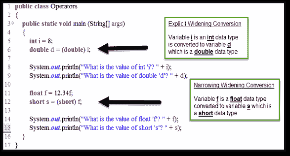

图 3.18 – 显式转换示例

程序输出：

```
What is the value of int 'i'? 8
What is the value of double 'd'? 8.0
What is the value of float 'f'? 12.34
What is the value of short 's'? 12
```

第五行将“8”赋值给数据类型`int`，该类型名为“i”。在第六行，发生了显式的宽化转换，此时变量`i`——一个`int`数据类型——转换为`double`数据类型。第 11 行赋值了 12.34（`double`的默认数据类型），但将其转换为`float`数据类型`12.34f`。变量`f`持有值 12.34，然后在第 12 行转换为`short`数据类型。注意，在第 15 行时发生了数据丢失，此时发生了收缩转换，将`float`值“12.34”转换为`short`值“12”。以下是根据原始数据类型层次划分的收缩转换列表：

* `byte`转换为`char`
* `short`转换为`byte`或`char`
* `char`转换为`byte`或`short`
* `int`转换为`byte`、`short`或`char`
* `long`转换为`byte`、`short`、`char`或`int`
* `float`转换为`byte`、`short`、`char`、`int`或`long`
* `double`转换为`byte`、`short`、`char`、`int`、`long`或`float`

## 表达式

`Operators`、`variables`、`constants`和`methods`（调用和返回）是表达式的组成部分。与`operator`连接的组件形成一个表达式。可以通过组合多个表达式创建一个复合表达式。然而，`data types`必须兼容才能构造有效的复合表达式。例如，`int`数据类型可以与`long`数据类型混合，因为它们都是数值类型。

通过使用类型提升规则，`data types`的混合会被转换为相同的`data type`。从表达式返回的值取决于`data type`。数据类型`char`、`byte`和`short`会提升为`int`。如果`operands`之一是`long`数据类型，则表达式被提升为`long`。`float`数据类型也是如此，如果`operands`之一是`float`，则整个表达式都是`float`。同样，如果`operands`之一是`double`，则表达式被提升为`double`数据类型。

```java
public class Operators {
    public static void main (String[] args) {
        byte b = 7;
        float f = 34.56f;
        float total = (b * f);
        System.out.println("The total of byte 'b' times float 'f' (7 * 34.56) is: " + total);
    }
}
```

**程序输出：**
`The total of byte 'b' times float 'f' (7 * 34.56) is: 241.92`

第五行声明并赋值了一个`byte`数据类型，而第七行声明并赋值了一个`float`数据类型。在第八行，`*`运算符同时乘以`byte`和`float`，尽管类型是混合的。然而，由于`operands`之一是`float`，该表达式被提升为`float`。

第三章介绍了四种类型的 Java 运算符：`Arithmetic`、`Bitwise`、`Logical`和`Relational`。检查了`Assignment Operator`和`Ternary Operator`，以及每个`operator`的优先级排序。第四章将解释两种类型的控制结构：分支和循环。有两种分支：`if branch`和`switch branch`。有三种循环：`for loop`、`while loop`和`do while loop`。

# 第四章

## 控制结构

控制结构是使用逻辑强制程序在循环其他语句的同时跳过某些语句的过程。强制程序跳过语句被称为分支，而对特定语句的循环通过循环来实现。两种分支是`if branch`和`switch branch`。三种循环是`for loop`、`while loop`和`do while loop`。除了分支和循环，还有跳转语句。跳转语句允许执行跳过程序中不必要的组件。跳转语句利用关键字`break`和`continue`。这两个关键字都可以包含在所有的分支和循环中。

第四章将涵盖关于控制结构的内容：

* `If Branch`
* `Switch Branch`
* `For Loop`
* `While Loop`
* `Do While Loop`
* `Break To Exit`
* `Continue To Next Statement`

## If Branch

`if branch`在条件为真时执行一个语句。换句话说，如果满足条件，则执行特定的语句。`if branch`是一种被广泛使用且不可或缺的控制结构。以下是`if branch`的语法：

```java
if (condition)
{
    statement(s);
}
```

### 语法细节

| 参数 | 描述 |
| :--- | :--- |
| `if` | 开始 if 分支的关键字 |
| `condition` | 产生真结果假布尔表达式 |
| `{` | 左大括号 |
| `statement(s)` | 如果条件为真将执行的语句 |
| `;` | 分号完成真值语句 |
| `}` | 右大括号 |

```java
int extraCustomers = 4;
if (extraCustomers >= 3)
{
    System.out.println("Customer receives a discount");
}
```

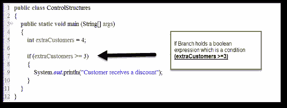

图 4.2 – If 分支

程序输出：

```
Customer receives a discount
```

第五行将“4”赋值给变量`extraCustomers`。第七行显示关键字`if`后紧跟一个括号。括号内部是一个条件`(extraCustomers >= 3)`，其返回值为 true。因为 4 大于 3，所以返回了真。第九行的语句（大括号内部）在求值结果为真后执行。

注意：如果条件返回假，程序将不会执行该语句。然而，当条件为假时，有两种变体的 if 分支可以执行：

1. If Else
2. If Else-If

## If Else 分支

一个可选的`else`关键字可以扩展 if 分支，以防条件返回假值。因此，当条件为真时，执行关键字`if`及其条件之后的语句；反之，当条件为假时，执行关键字`else`之后的语句。以下是 if-else 分支的语法：

### 语法

```java
if (condition)
{
    statement(s);
}
else
{
    statement(s);
}
```

以下示例显示了当客户没有带三个以上的额外客户参加体育活动时如何显示一条消息：

```java
public class ControlStructures
{
    public static void main (String[] args)
    {
        int extraCustomers = 2;
        if (extraCustomers >= 3)
        {
            System.out.println("Customer receives a discount");
        }
        else
        {
            System.out.println("Customer does not receive a discount");
        }
    }
}
```

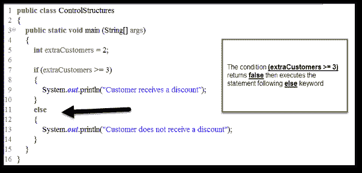

图 4.3 – If Else 分支

程序输出：

```
Customer does not receive a discount
```

第五行将“2”赋值给变量`extraCustomers`。第七行显示关键字`if`后紧跟一个括号。括号内部是一个条件`(extraCustomers >= 3)`，其返回值为 false。因为 2 不大于等于 3，所以返回了假。因此，程序跳过了第九行的语句，并执行了第十三行的语句。

注意：如果关键字`if`和`else`之后只有一个语句，则大括号是可选的。然而，如果存在多个语句，则必须使用大括号。建议始终使用大括号以提高可读性。以下是一个未使用大括号的示例：

```java
public class ControlStructures
{
    public static void main (String[] args)
    {
        int extraCustomers = 2;
        if (extraCustomers >= 3)
            System.out.println("Customer receives a discount");
            System.out.println("Congratulations");
        else
            System.out.println("Customer does not receive a discount");
    }
}
```

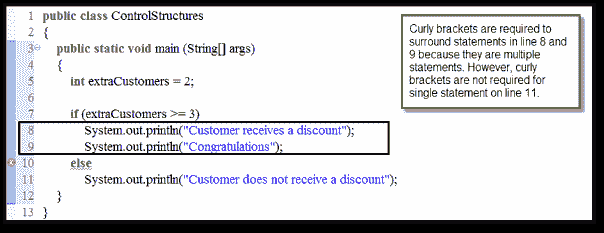

图 4.4 – 无大括号

第八行和第九行是 if 分支的多个语句，需要大括号。注意第 10 行处的红色 X。红色 X 表示之前的语句存在错误。然而，第 11 行不存在错误，因为它是一个单一语句，不需要大括号。

## If Else-if 分支

第一个`if`关键字后面可以可选跟随一个或多个`if`关键字。然而，每个随后的`if`关键字之前必须有一个必选的`else`关键字。else-if 分支只有在第一个 if 分支为假时才会执行。所有的 else-if 分支后面都紧跟一个条件和一个或多个语句。以下是 else if 分支的语法：

```java
if (condition)
{
    statement(s);
}
else if (condition)
{
    statement(s);
}
else if (condition)
{
    statement(s);
}
else
{
    statement(s);
}
```

以下示例显示了当客户带少于三个额外客户参加体育活动时如何显示一条消息：

```java
public class ControlStructures
{
    public static void main (String[] args)
    {
        int extraCustomers = 2;
        if (extraCustomers >= 3)
        {
            System.out.println("Customer receives a discount");
        }
        else if (extraCustomers <= 3)
        {
            System.out.println("No Discount: Customer count less than or equal to 3");
        }
        else
        {
            System.out.println("Error: Not a valid customer count");
        }
    }
}
```

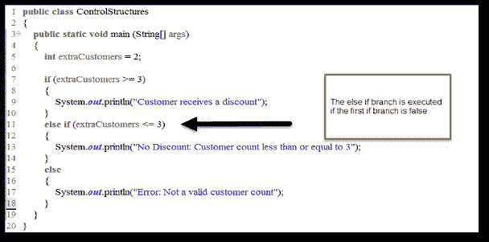

图 4.5 – Else If 分支

程序输出：

```
No Discount: Customer count less than or equal to 3
```

第五行将“2”赋值给变量`extraCustomers`。`else`和`if`关键字后紧跟括号是一个条件`(extraCustomers >= 3)`，其返回值为 false。因为 2 小于等于 3，所以返回了真。嵌套的 if 分支从第 11 行开始

## 嵌套 If 分支

嵌套 if 分支由`if`内部的`if`或`else`分支组成。以下是嵌套示例：

```java
public class ControlStructures
{
    public static void main (String[] args)
    {
        int extraCustomers = 15;
        if (extraCustomers >= 3)
        {
            System.out.println("Customer receives a discount");
            if (extraCustomers >= 10)
            {
```


`System.out.println("25% off");`

```
else
{
    System.out.println("10% off");
}
```

```
else
{
    System.out.println("Customer does not receive a discount");
}
```


图 4.6 – 嵌套 If 分支

程序输出：

```
Customer receives a discount
25% off
```

嵌套 `if` 分支从第 11 行开始到第 18 行结束。变量`extraCustomers`在第五行赋值为 15。因此，条件`(extraCustomers >= 10)`为真并执行语句。

## Switch 分支

`switch` 分支评估单个变量，然后根据变量的值执行语句。原始数据类型`byte`、`short`、`char`和`int`可以与`String`一起被评估。在某些情况下，两种分支都适用。然而，`switch` 分支在处理特定数量的值（如星期）时效率最高。否则，在处理无限数量的值时最好实现`if`分支。以下是`switch`分支的语法：

```java
switch (variableName)
{
    case constant1:
        statement(s);
        break;
    case constant2:
        statement(s);
        break;
    case constant3:
        statement(s);
        break;
    .
    .
    default:
        statement;
}
```

### 语法

| 参数 | 说明 |
| :--- | :--- |
| `switch` | 检查变量的值 |
| `variableName` | 变量名 |
| `{` | 左大括号 |
| `case constant1, 2, 3 ...` | 变量值的可能的匹配项 |
| `statement(s)` | 当变量值匹配给定 `case` 时执行的语句 |
| `;` | 分号完成一个语句 |
| `break` | 可选关键字，用于退出 `switch` 分支 |
| `;` | 分号完成 `break` |
| `default` | 可选关键字，当变量值不匹配任何 `case` 时执行 |
| `statement` | 当变量值不匹配任何 `case` 时执行的默认语句 |
| `}` | 右大括号 |

图 4.7 – Switch 分支语法详情

以下是一个 `switch` 分支的示例：

```java
public class ControlStructures
{
    public static void main (String[] args)
    {
        int day = 6;
        switch (day)
        {
            case 1:
                System.out.println("Sunday is the 1st day of the week");
                break;
            case 2:
                System.out.println("Monday is the 2nd day of the week");
                break;
            case 3:
                System.out.println("Tuesday is the 3rd day of the week");
                break;
            case 4:
                System.out.println("Wednesday is the 4th day of the week");
                break;
            case 5:
                System.out.println("Thursday is the 5th day of the week");
                break;
            case 6:
                System.out.println("Friday is the 6th day of the week");
                break;
            case 7:
                System.out.println("Saturday is the 7th day of the week");
                break;
            default:
                System.out.println("Not valid: There are only 7 days in a week");
        }
    }
}
```

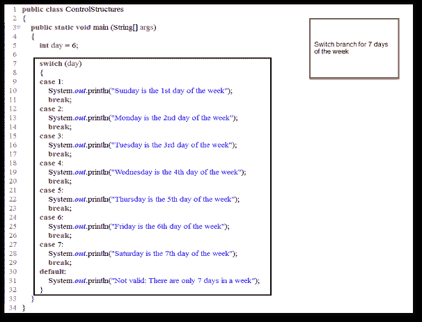图 4.8 – Switch 分支示例

程序输出：

```
Friday is the 6th day of the week
```

第五行给变量`day`赋值为`6`。然后关键字`switch`通过检查变量的值，在第七行开始分支。第 24 行的关键字`case`匹配了变量的值`6`，然后执行第 25 行的语句。第 26 行的关键字`break`是必要的，它能防止`case 7`（第 27 行）和`default`（第 30 行）的执行。

注意：由于`switch`分支采用自上而下的方法顺序执行，匹配后的所有语句都会执行。因此，必须使用关键字`break`在找到匹配项后跳出`switch`分支。

## 嵌套 switch 分支

嵌套 `switch` 分支由另一个 `switch` 分支内部的 `switch` 分支组成。此外，`if`分支也可以嵌套在`switch`分支内部。外部`switch`分支作为内部分支的容器。值对于各自的外部和内部分支是唯一的。例如，`constant`（常量）可以在多个`switch`分支中包含相同的值。以下是一个`switch`分支示例：

```java
public class ControlStructures
{
    public static void main (String[] args)
    {
        int day = 2, numHours = 4;
        switch (day)
        {
            case 1:
                System.out.println("Sunday is the 1st day of the week");
                break;
            case 2:
                System.out.println("Monday is the 2nd day of the week");
                switch (numHours)
                {
                    case 4:
                        System.out.println("Plan to work 4 hours (half a day) due to an appointment");
                        break;
                    case 8:
                        System.out.println("Plan to work 8 hours today");
                        break;
                    default:
                        System.out.println("Not sure how many hours I will work today");
                        break; 
                }    
                break;
            case 3:
                System.out.println("Tuesday is the 3rd day of the week");
                break;
            case 4:
                System.out.println("Wednesday is the 4th day of the week");
                break;
            case 5:
                System.out.println("Thursday is the 5th day of the week");
                break;
            case 6:
                System.out.println("Friday is the 6th day of the week");
                break;
            case 7:
                System.out.println("Saturday is the 7th day of the week");
                break;
            default:
                System.out.println("Not valid: There are only 7 days in a week");
        }
    }
}
```

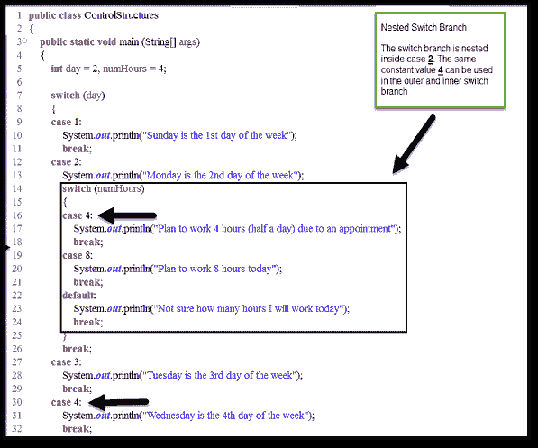图 4.9 – 嵌套 switch 分支

程序输出：

```
Monday is the 2nd day of the week
Plan to work 4 hours (half a day) due to an appointment
```

第五行给变量`numHours`赋值为`4`。然后关键字`switch`通过检查变量的值，在第 14 行开始嵌套`switch`分支。嵌套`switch`分支包含两个`case`和一个`default`。第 16 行的一个`case`与第 30 行的外部`case`拥有相同的常量`4`。

|  |  |  |


## for 循环 (For Loop)


`for`循环执行指定次数的代码块。换句话说，只要满足条件，语句就会执行。`for`循环的用处之一是允许在不重复编写的情况下执行语句。以下是`for`循环的语法：

### 语法

```
for (initialization; condition; iteration)
{
    statement(s)
}
```

### 语法细节

| 参数 | 描述 |
| :--- | :--- |
| `for` | 启动 `for` 循环的关键字 |
| `initialization` | 设置 `for` 循环的赋值 |
| `;` | 分号 |
| `condition` | 决定循环是否重复的布尔表达式 |
| `;` | 分号 |
| `iteration` | 指明循环如何变化 |
| `{` | 左括号 |
| `statement(s)` | 将执行的语句 |
| `;` | 分号 |
| `}` | 右括号 |

图 4.10 – for 循环语法

`initialization`组件声明了数据类型并分配初始值。通常，`loop control variable`（循环控制变量）是一个单字符`i`。`condition`是指定最大值的布尔表达式。所有的`for`循环在条件成立时继续。大多数工程师使用增量 (`++`) 作为迭代表达式。语句放在可选的大括号之间。虽然括号是可选的，但建议使用它们以提高可读性。以下是一个`for`循环示例：

```java
public class ControlStructures
{
    public static void main (String[] args)
    {
        for (int i = 0; i < 5; i++ )
        {
            System.out.println("The loop control variable value is " + i);
        }
    }
}
```

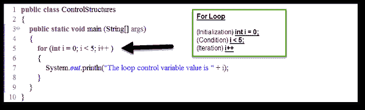图 4.11 – for 循环示例

程序输出：

```
The loop control variable value is 0
The loop control variable value is 1
The loop control variable value is 2
The loop control variable value is 3
The loop control variable value is 4
```

第五行通过关键字`for`及其初始化、条件和迭代参数启动`for`循环。初始化`(int i = 0;)`将赋值为零。条件`(i < 5)`为`loop control variable`设置了停止点。增量`(i++)`使`loop control variable`增加一次。语句位于第七行。

在`for`循环中使用协调的值非常重要。如果不一致，值可能会导致无限循环。无限循环是一个不会停止的循环。例如，下面的`for`循环由于初始值、最大值和迭代表达式会导致无限重复：

```
for (int i = 3; i > 1; i++)
```

初始值`3`从一个大于最大值`1`的值开始，而迭代器`++`在每次循环后增加。为了修正这个无限循环，初始化值`3`必须减少到小于条件值`1`；条件值`1`必须增加到大于初始化值`3`；或者迭代器必须从每次循环后增加`++`变为每次循环后减少`--`。

注意：通常情况下，使用大于运算符（`>`）的条件会实现递减运算符（`--`），而使用小于运算符（`<`）的条件会实现递增运算符（`++`）。

## 嵌套 for 循环

嵌套`for`循环在一个`for`循环内部包含另一个`for`循环。外层`for`循环作为内部循环的嵌套。内部循环中的语句可以使用外层循环的循环控制变量。因此，最好为每个循环使用不同的循环控制变量。以下是一个嵌套`for`循环的示例：

```java
public class ControlStructures
{
    public static void main (String[] args)
    {
        for (int x = 0; x < 3; x++ )
        {
            System.out.println("Outer Loop value is " + x);
            for (int y = 0; y < 3; y++ )
            {
                System.out.println("  Inner Loop value is " + y);
            }
        }
    }
}
```


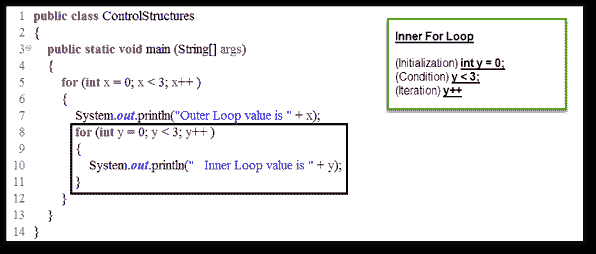
图 4.12 – 嵌套 `for` 循环

程序输出：
```
Outer Loop value is 0
Inner Loop value is 0
Inner Loop value is 1
Inner Loop value is 2
Outer Loop value is 1
Inner Loop value is 0
Inner Loop value is 1
Inner Loop value is 2
Outer Loop value is 2
Inner Loop value is 0
Inner Loop value is 1
Inner Loop value is 2
```

第八行使用关键字 `for` 开始嵌套的 `for` 循环，后面跟随着参数初始化、条件和迭代。初始化 `(int y = 0;)` 将零赋值为起始值。条件 `(y < 3)` 将 3 设置为循环控制变量的停止点。递增 `(y++)` 将循环控制变量增加一。该语句通过第 10 行打印循环控制变量。

|  |  |  |


## while 循环


`while` 循环在条件为真时重复执行语句。条件是在执行语句之前进行检查的布尔表达式。此外，变量名在循环之前初始化，并作为条件的一部分进行评估。在执行语句时，`while` 循环将持续运行直到条件变为假。以下是 `while` 循环的语法。

### 语法

```java
while (condition)

{

    statement(s);

}
```

### 语法细节

| 参数 | 说明 |
| :--- | :--- |
| `while` | 开始循环的关键字 |
| `condition` | 决定循环是否重复的布尔表达式 |
| `{` | 左大括号 |
| `statement(s)` | 条件满足后执行的语句(s) |
| `;` | 完成语句的分号 |
| `}` | 右大括号 |

图 4.13 – `while` 循环语法。以下是一个 `while` 循环示例：

```java
public class ControlStructures

{

    public static void main (String[] args)

    {

        int i = 0;

        while (i < 5)

        {

            System.out.println("The variables value is " + i);

            i++;

        }

    }

}
```

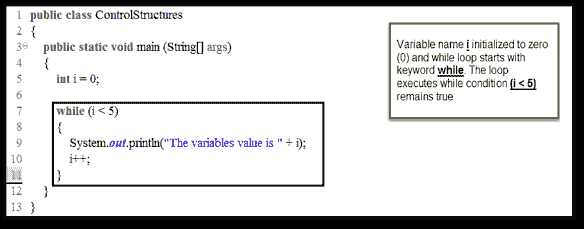
图 4.14 – `while` 循环示例

程序输出：
```
The variables value is 0
The variables value is 1
The variables value is 2
The variables value is 3
The variables value is 4
```

第五行将变量 `i` 初始化为 "0"。该变量将在第七行作为关键字 `while` 之后条件 `(i < 5)` 的一部分进行评估。当条件为真时，通过第九行反复打印变量 `i` 的值。注意第 10 行的递增运算符。需要注意的是，如果不添加递增运算符，`while` 循环将永远停止。因此，循环将无限持续，产生无限循环。此外，如果未设置初始化条件变量，`while` 循环将变得无止。

|  |  |  |


## do while 循环


`do while` 循环在循环底部评估条件。因此，循环将执行语句，然后评估条件。结果是，`do while` 循环至少执行一次语句，只要条件为真就会一直执行。以下是 `do while` 循环的语法：

```java
do

{

    statement(s);

} while (condition);
```

### 语法

| 参数 | 说明 |
| :--- | :--- |
| `do` | 开始循环的关键字 |
| `{` | 左大括号 |
| `statement(s)` | 至少执行的语句(s) |
| `;` | 完成语句的分号 |
| `}` | 右大括号 |
| `while` | 决定循环是否重复的关键字 |
| `condition` | 决定循环是否重复的布尔表达式 |
| `;` | 完成条件的分号 |

图 4.15 – `do` 循环细节。以下是一个 `do while` 循环示例：

```java
public class ControlStructures

{

    public static void main (String[] args)

    {

        int i = 0;

        do

        {

            System.out.println("The variables value is " + i);

            i++;

        }

        while (i > 5);

    }

}
```

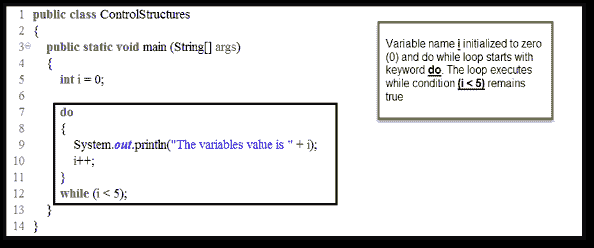
图 4.16 – `do while` 循环示例

程序输出：
```
The variables value is 0
The variables value is 1
The variables value is 2
The variables value is 3
The variables value is 4
```

第五行将变量 `i` 初始化为 "0"。在关键字 `do` 之后，变量将在第七行作为条件 `(i < 5)` 的一部分进行评估。当条件为真时，通过第九行反复打印变量 `i` 的值。巧合的是，在语句第 12 行之后评估条件。和 `while` 循环一样，如果不在第 10 行添加递增运算符（`++`），就会发生无限循环。此外，如果没有正确设置初始化和条件值，可能会产生无限循环。在本示例中，由于条件从真结果开始，语句重复了多次。以下是当条件从假结果开始的情况：

```java
public class ControlStructures

{

    public static void main (String[] args)

    {

        int i = 0;

        do

        {

            System.out.println("The variables value is " + i);

            i++;

        }

        while (i > 5);

    }

}
```

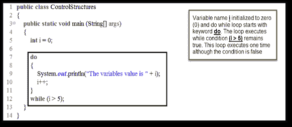
图 4.17 – `do while` 循环示例（假条件开始）

程序输出：
```
The variables value is 0
```

第五行将变量 `i` 初始化为 "0"。因此，第 12 行的条件 `(i > 5)` 为假，因为零小于五。`do while` 循环执行了语句，因为语句先执行，然后评估条件。

注意：循环（`for`、`while` 和 `do while`）在功能上相似。决定使用哪种循环的经验法则是：

*   在执行特定次数的迭代时，使用 `for` 循环
*   当循环重复次数不确定时，使用 `while` 循环
*   当循环需要至少执行一次时，使用 `do while` 循环

## break 退出

`break` (`#c018.xhtml_break`) 关键字是可选的，用于强制退出分支或循环。如果在嵌套分支或循环中发生 `break`，则最内层的分支或循环将停止。然而，执行程序将从紧随当前分支或循环的语句处恢复。以下是一个使用图 4.8 关键字示例。

```java
public class ControlStructures

{

    public static void main (String[] args)

    {

        int day = 6;

        switch (day)

        {

            case 1:

                System.out.println("Sunday is the 1st day of the week");

                break;

            case 2:

                System.out.println("Monday is the 2nd day of the week");

                break;

            case 3:

                System.out.println("Tuesday is the 3rd day of the week");

                break;

            case 4:

                System.out.println("Wednesday is the 4th day of the week");

                break;

            case 5:

                System.out.println("Thursday is the 5th day of the week");

                break;

            case 6:

                System.out.println("Friday is the 6th day of the week");

                break;

            case 7:

                System.out.println("Saturday is the 7th day of the week");

                break;

            default:

                System.out.println("Not valid: There are only 7 days in a week");

        }

    }

}
```

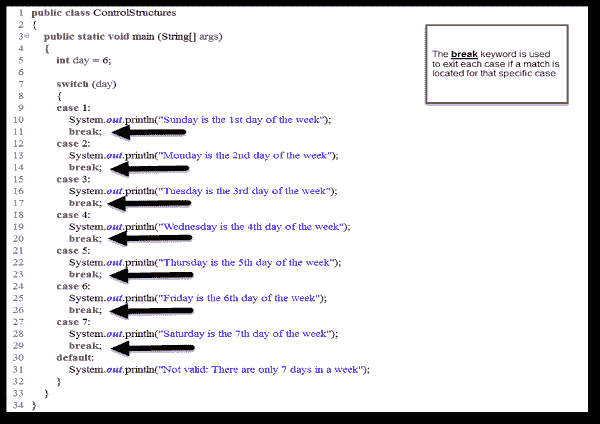图 4.18 – `break` 关键字示例

在此示例中，`break` (`#c018.xhtml_break`) 关键字用于在找到匹配项时退出 `case`。第 24 行的 `case` 六发生了匹配。`break` (`#c018.xhtml_break`) 关键字防止了 `case` 七（第 27 行）和 `default`（第 30 行）的执行。

注意：分支或循环中可以出现多个 `break` (`#c018.xhtml_break`) 关键字。每个 `case` 都有一个 `break` (`#c018.xhtml_break`) 关键字。

|  |  |  |


## 继续下一个语句


`continue` (`#c018.xhtml_continue`) 关键字强制停止当前的循环迭代并立即执行下一次循环迭代。结果是间隔之间的条件和语句被跳过。以下是一个使用 `continue` (`#c018.xhtml_continue`) 关键字跳过所有奇数的示例：

```java
public class ControlStructures

{

    public static void main (String[] args)

    {

        for (int x = 2; x <= 10; x++ )

        {

            if (x % 2 != 0) continue;

            System.out.println("Even numbers " + x);

        }    

    }

}
```


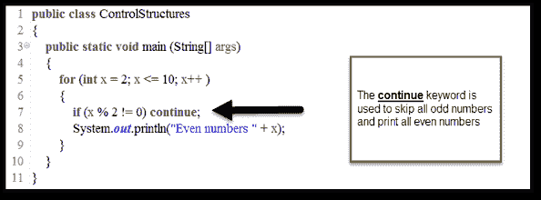图 4.19 – Continue 关键字

程序输出：

```
Even numbers 2
Even numbers 4
Even numbers 6
Even numbers 8
Even numbers 10
```

第七行实现了`continue`关键字以跳过所有奇数。因此，当循环控制变量`i`等于一、三、五、七和九时，条件和语句会被跳过。

|  |  |  |


## 结论


“第一部分 – Java 4 Selenium WebDriver”目的是良好的 Java 基础知识。理解 Java 有助于通过 Selenium 测试待测应用程序（AUT）的过程。在 AUT 中验证数据的关键在于知道如何访问和操作数据。数据由变量表示，变量可以是文本或数字。所有变量必须有一个数据类型以指示其范围和行为。在处理运算符时，数据类型非常重要，因为某些函数是根据数据类型执行的。此外，某些运算符是形成控制结构的要素。以下项目是书中介绍的主题：

- 变量：存储数据的位置
- 数据类型：引用变量的类型
- 运算符：执行数学或逻辑操作的符号
- 控制结构：指的是使用逻辑强制程序跳过或循环语句的过程

第二本书的标题为“[(第二部分) Java 4 Selenium WebDriver](http://tinyurl.com/Review-Part-2-Java-4-Selenium)”。它更深入地探讨了类、对象和方法，同时考察了面向对象编程（OOP），它由继承、封装和多态组成。此外，书中还探讨了包、接口、异常处理以及如何利用输入/输出。

点击下方按钮，您就可以在 Rex Jones 发布新书时接收电子邮件通知。这无需费用，也无任何义务。

[`books2read.com/r/B-H-EELC-OJNI`](https://books2read.com/r/B-H-EELC-OJNI)


连接独立读者与独立作者。

### Rex Jones 的其他作品

- [(第 1 部分）你必须为 QTP/UFT 学习 VBScript：不要忽略功能自动化测试中的这种语言](https://www.draft2digital.com/catalog/139886?distributor=kobo)
- [(第 2 部分）你必须为 QTP/UFT 学习 VBScript：不要忽略功能自动化测试中的这种语言](https://www.draft2digital.com/catalog/140240?distributor=kobo)
- (第 1 部分)零基础：Java 4 Selenium WebDriver：来学习如何编写自动化测试
- [(第 2 部分)Java 4 Selenium WebDriver：来学习如何编写自动化测试](https://www.draft2digital.com/catalog/159592?distributor=kobo)
- [零基础（第 1 部分）用于功能自动化测试的 Selenium WebDriver](https://www.draft2digital.com/catalog/180614?distributor=kobo)
- [入门 TestNG（一个 Java 测试框架）](https://www.draft2digital.com/catalog/365222?distributor=kobo)


# 关于作者

Rex Allen Jones II 是一位 QA/软件工程师，热于分享软件测试知识。自 2005 年 2 月以来，他一直在观看网络研讨会、参加研讨会并测试应用程序。Jones 先生于 1999 年 6 月毕业于 DeVry 大学，获得计算机信息系统 (CIS) 理学学学位。目前，Rex 担任顾问，曾任 User Group: Dallas / Fort Worth Mercury User Group (DFWMUG) 的董事会成员，以及 User Group: Dallas / Fort Worth Quality Assurance Association (DFWQAA) 的成员。除了用户小组的身份外，他还是认证软件测试工程师 (CSTE)，并拥有测试管理方法 (TMap) 认证。

Jones 先生对功能自动化测试感兴趣的人的建议是学习编程语言。这一建议促使他写了两本书《（第 1 部分和第 2 部分）你必须为 QTP/UFT 学习 VBScript》，针对`VBScript`，该语言是统一功能测试 (UFT，以前称为 Quick Test Professional (QTP)) 的编程语言。此外，他的一本书《第 1 部分 – Java 4 Selenium WebDriver》以及即将出版的《第 2 部分 – Java 4 Selenium WebDriver》针对的是`Java`，它是`Selenium`的编程语言之一。
