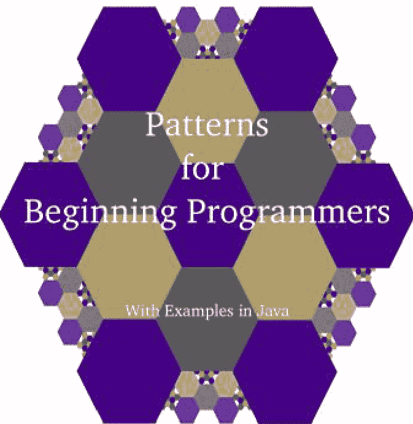
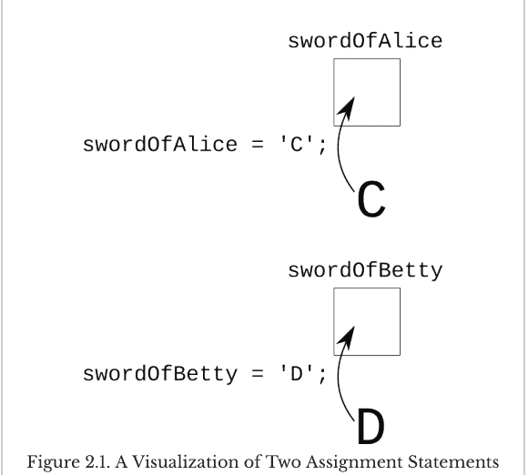
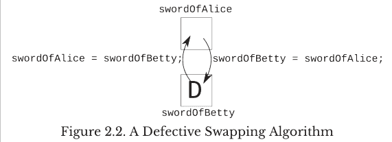
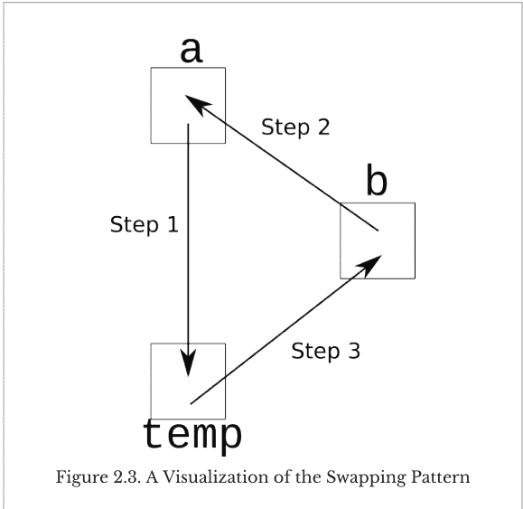
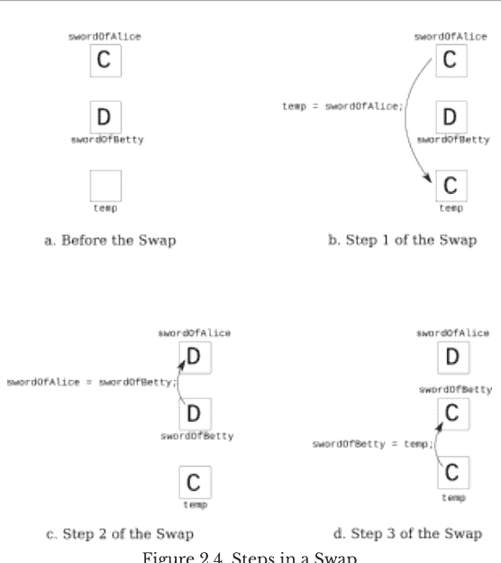
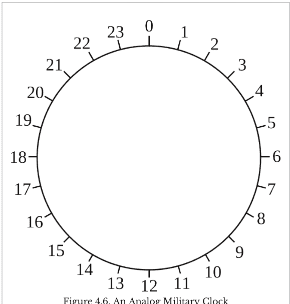
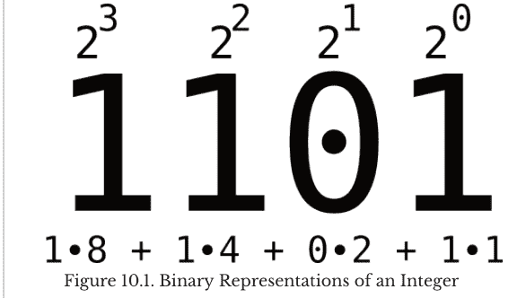
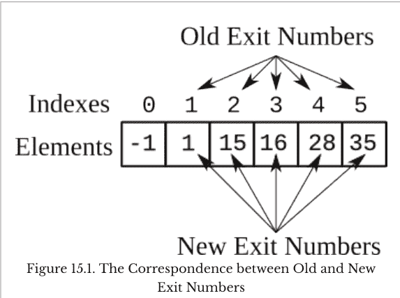

# Java 入门编程模式示例



# 前言

我的入门编程课程总是从一些模糊的定义开始。我将算法（algorithm）定义为使用有限资源解决问题的明确过程，将启发式方法（heuristic）定义为不保证完美/精确或有限的解决过程。我解释说，为计算机编写的算法/启发式方法通常用语言（称为（高级）编程语言）编写，这些语言易于人类理解、无歧义，并且容易转换为机器读的形式。我指出，用编程语言编写的算法/启发式方法是一个程序（或代码），而这一过程被称为编程（或编码），这也是他们在本学期剩余时间里将学习的内容。

从实际角度来看，大多数入门编程课程（包括我的课程）都使用单一特定的编程语言，意不意外的是，关于哪种语言最适合教授初学者（或者这是否重要）存在很大争议。然而，对于编程语言的作用以及此类课程的目标，通常存在共识。事实上，大多数入门编程课程都会做出以下声明：

1. 为课程选择的特定编程语言所涵盖的概念适用于广泛的其他编程语言。
2. 课程对算法思维的教学多于对所用语言（语法）法的教学。

根据我的经验，这些声明并不完全合理。虽然第一点从教学角度来看通常是正确的，但从学习角度来看并非如此。换句话说，学生在将一种语言中学到的内容应用到另一种语言时面临着巨大的困难。第二点是对讲师想要涵盖的内容的诚实描述，但这是一个很少能实现的目标。

在最坏的情况下，入门编程课程的教师花费所有时间教授语法和工具，让学生自己去思考如何解决问题。使用布鲁姆认知分类法（Bloom’s taxonomy）中的概念，此类课程只教“记忆”和“理解”，并期望学生自己去“分析”、“评估”、“应用”和“创造”。

在较好的情况下，入门编程课程的教师会让学生接触包含良好问题解决方案的良好代码，并解释为什么这些代码是好的。他们只希望学生能内化这些解决方案并在其他语言中应用它们；这些课程只教“记忆”、“理解”、“分析”和“评估”，但不教“应用”和“创造”。

在最好的情况下，入门编程课程的教师还会教“应用”和“创造”。也就是说，他们既教解决问题，也教编程。本书的设计是为了让这样做更容易。

# 用模式教学解决问题

多年来，我有一些同事认为解决问题是无法教的，学生要么有能力，要么没有。我和其他人持不同意见；我相信可以通过以下方式教授学生：

最终，这种方法为学生提供了两样东西：一个可以使用的库以及如何增加库的理解。

# 初学者编程模式

多年，这种方法已经在软件工程和其他工程学科的高级课程中成功使用（带有不同的名称）。遗憾的是，它还没有进入入门编程课程。这本书试图弥补这一缺陷。

两点区分了编程模式与其他类型的模式：问题领域（即编程）和抽象层次。编程模式处于更高的抽象层次，因为这些概念不特定于某种语言（或族）。换句话说，编程模式不是特定语言中的“措辞”（即习语）。相反，它是对许多语言中可能出现问题的通用解决方案；它是一种编程思维方式。编程模式的抽象层次低于设计模式和架构风格。换句话说，使用编程模式会创建一个作为大系统部分的代码片段，而使用设计模式或架构风格会创建一个大型系统中实体之间交互的描述。

# 风格问题

用模式教学必然涉及对同一个问题的不同解决方案进行评估，这些解决方案可以使用不同的标准进行评估。本书侧重于与解决方案相关的标准，而不考虑风格问题。例如，识别两个数字最大值的方法可以用三种不同的方式实现。第一种方法使用了中间变量和默认初始化。

```java
public static int max(int a, int b) {
    int result;
    result = b;
    if (a > b) result = a;
    return result;
}
```

在第二种情况下，使用了中间变量，但对两种情况进行了显式处理（即既有 `else` 块也有 `if` 块）。

```java
public static int max(int a, int b) {
    int result;
    if (a > b) result = a;
    else result = b;
    return result;
}
```

在第三种情况下，有多个返回语句，且不需要中间变量。

```java
public static int max(int a, int b) {
    if (a > b) return a;
    else return b;
}
```

这三种解决方案的每种都有其合理的理由，且相对优劣可能随着程序员的经验而异。然而，这些差异更多在于关于解决方案的编程方式，而不是解决方案本身。也就是说，它们是风格上的差异。

同样地，给出一个 `max()` 方法，人们可以用多种不同的方式实现一个 `min()` 方法。例如，有人可能会认为以下实现是更好的，因为它与 `max()` 的实现保持一致（假设选择了第三种实现）。

```java
public static int min(int a, int b) {
    if (a < b) return a;
    else return b;
}
```

或者，有人可能会认为以下实现是更好的，因为它包含的代码重复更少。

```java
public static int min(int a, int b) {
    return -max(-a, -b);
}
```

同样，这些论点更多是关于解决方案的编程方式（即风格），而不是解决方案本身。

最后一个例子是，给定 `max()` 和 `min()` 方法，人们可以用不同的方式实现一个 `clamp()` 方法。有人可能会认为一致性决定了以下实现：

```java
public static int clamp(int x, int lower, int upper) {
    if (x < lower) return lower;
    if (x > upper) return upper;
    return x;
}
```

或者，有人可能会认为代码复用决定了以下实现：

```java
public static int clamp(int x, int lower, int upper) {
    return max(lower, min(upper, x));
}
```

重申一下，本书试图在评估不同解决方案时避免使用风格化准则。换句话说，它试图比较那些不仅在风格上存在差异的解决方案。

## 本书的结构

书中的模式根据传统入门编程教材中涵盖的主题进行组织。第一部分考虑了仅涉及算术运算符（以及相关主题）问题的解决方案。因此，只需要理解变量声明、赋值语句和算术运算符即可考虑第一部分中的问题。第二部分考虑了需要使用逻辑运算符、关系运算符、条件和方法的问题的解决方案。之后，第三部分考虑了需要使用循环、数组、（基础的）属性和数组数组（有时称为多维数组）的模式，第四部分考虑了需要使用数组成员（尤其是 `length` 属性）和数组数组的问题与解决方案。第五部分考虑了涉及 `String` 对象的问题的和解决方案。最后，第六部分考虑了涉及引用的模式。

在很多情况下，模式是相互构建的。因此，除少数例外，书的各个部分需要按顺序考虑。遗憾的是，由于不同的编程课程/教材涵盖这些主题的顺序不同，可能我们需要对某些章节进行粗略了解，然后再回来查看。例如，某些课程/教材在数组之前介绍方法（如本书所示），而另一些则顺序相反。因此，可能有必要在学习方法之后再略读第三部分中的某些模式。

每一章都包含一个动机（即所考虑的问题所出现的场景）、一个模式（即问题的解决方案）以及示例。许多章节还包含一个或多个警告，通常是关于不要过度泛化的。某些章节还包含了“前瞻”，介绍了该模式可能在随后的课程中出现的地方。这些章节的内容通常更高级，可以省略（即后续章节并不需要）。

# 致谢

我的妻子写得很好。我写得不好。尽管她付出了巨大的努力让这本书变得易读，对此我深表感谢，但她失败了。我还想感谢来自 JMU 的两位同事的贡献，他们两位都非常仔细地通读了初版草稿。我不能点出他们的名字，因为他们极大地改进了当前版本。然而，错在我身上，所以请不要埋怪她。

# 图表

# 编程模式

- 10.1 整数的二进制表示
- 17.1 数组示例
- 17.2 两个数组的结果
- 18.1 数组合并的结果
- 18.2 交织的结果
- 18.3 两个数组的概念化
- 19.1 年的参数
- 20.1 元素的大小
- 20.2 元素的大小

# 表格列表

# 第一部分：需要类型、变量和算术运算符知识的模式

第一部分包含了需要理解类型、变量和算术运算符的模式。许多模式大量使用了整数算术。具体来说，本书部分包含了：

- **更新。** 如何更新变量的解决方案。
- **圆周算术。** 对循环数值执行算术的解决方案（例如星期、月份）。
- **截断。** 将整数截断到特定位数（即 10 的幂）的解决方案。

...经验程序员，他们每次使用它们时都必须思考它们。这一观察本身就证明了学习这些模式以及书中其他部分模式的重要性。

# 更新

任何有意义的算法都大量使用算术运算符，无论它是手工执行还是实现为计算机程序由计算机执行。然而，两者之间有一个非常不同的点。手工执行的计算倾向于在页面上推进，使用越来越多的内存（即纸）。而程序则倾向于声明少数变量，给它们赋值，然后分配更新后的值。本章考虑了更新变量的不同方法。

## 动机

假设你正在编写一个跟踪亲属年龄的程序。你可能会声明一个名为 `age` 的 `int` 变量，并将亲属目前的年龄赋值给该变量。

现在，假设你需要明年进行涉及该年龄的计算。显然，你知道他们的年龄将比现在大一岁。但是，你应该为该值创建另一个变量，还是应该直接更新 `age` 的值？

## 复习

更新变量的一种方法你可能已经见过了，涉及到递增和递减运算符 `++` 和 `--`，它们会将操作数增加或减少 1。例如，你可能见过类似下面的代码：

```java
int age;

// 在出生时将年龄初始化为 0
age = 0;

// 在第一个生日时年龄增加 1
age++;
```

你可能不知道的是，在某些情况下，这只是解决特定更新问题（即变量恰好增加或减少 1 的问题）的一种（特别是最简单的）方法。

## 思考问题

可以通过一种稍微复杂一点但最终更灵活的方式来实现相同的结果。要理解这一点，首先要记住赋值运算符会获取其右侧表达式求值的结果，并将其放在左侧变量所标识的内存位置中。在下面的示例中，这种操作进行了三次：

```java
int currentAge, increment, initialAge;

initialAge = 0;
increment = 1;
currentAge = initialAge + increment;
```

这三个赋值语句特别容易理解，因为赋值运算符右侧的表达式没有涉及左侧的变量。然而，赋值语句的语法并没有规定这种情况不能发生。例如，考虑以下语句：

```java
// 将 age 加上 1 并结果赋值给 age
age = age + 1;
```

这条语句首先将 `age` 标识的内存位置中的值与值 1 相加，然后将结果赋值给 `age` 标识的内存位置。换句话说，它的执行效果与 `++age` 相同。

对于非程序员来说，这条语句看起来像是一个错误，因为非程序员会认为它的字面意思是“age 等于 age 加 1”，这显然是不可能的。然而，这并不是它的意思。它实际上的意思是“将 `age` 标识的内存位置中的值与值 1 相加，并将结果放在 `age` 标识的内存位置中”。

## 模式

这种思想可以以多种方式泛化；识别出重要的模式是：在赋值运算符的右侧存在左侧的操作数。在一种相当抽象的情况下，该模式可以用（伪代码）写成：

```
value = value operator adjustment
```

其中，`value` 表示被更新的变量，`=` 表示赋值运算符，`operator` 表示二元运算符，而 `adjustment` 表示调整的“量”。由于 `operator` 的优先级高于 `=`，所以它会被先求值。然后，求值的结果（涉及 `value`）被赋值给 `value`。

这种模式是非常常见的，以至于经验丰富的程序员既不会考虑它，也不会向初学者提到它，但它并没有大家表现得那么显而易见。

## 示例

你将遇到许多必须跟踪某些变化内容的情况，但无论其值如何：

1. 这句话的措辞非常严谨，理解为什么这样做非常重要。请注意，它并没有说“它向 `age` 标识的内存位置中的值加上值 1”。是赋值运算符（而不是加法运算符）改变了 `age` 标识的内存位置中的值，而你想使用相同的名称/标识符。在上面的示例中，你需要随时间推移某位亲属的年龄，但你只需要他们当前的年龄。在另一个程序中，你可能需要跟踪某人随时间变化的银行余额，但你只需要当前余额。在另一个程序中，你可能需要跟踪公路随空间变化的海拔高度，但你只需要某一个地点的海拔。

### 成绩单程序

假设你必须编写一个管理课程成绩的程序。在分配初始成绩后，你必须扣除迟到罚金（当然可能是 0）。你可以这样实现：

```java
// 分配初始成绩
grade = 85;

// 扣除迟到罚金减少成绩
grade = grade - latePenalty;
```

### 零售程序

假设你必须编写一个程序，在频繁购买者结账时提供 25% 的折扣。你可以按照如下方式解决这个问题：

```java
// 提供 25% 的折扣
price = price - 0.25*price;
```

因为运算符具有最高优先级，它首先被求值。然后，乘法操作的结果从 `price` 中减去（而不改变任何变量的内容）。最后，减法操作的结果被赋值给变量 `price`。

假设 `price` 最初包含值 40.0。那么，这条语句可以可视化如图 1.1 所示。

2. 记住，你也可以使用括号影响运算符求值的顺序。例如，在这种情况下，可以通过编写 `price = price - (0.25 * price);` 来避免任何混淆。这是一个风格问题，并不会改变模式。

```
price = price - 0.25*price;
          _____
       40.0
40.0      10.0
          30.0
```

图 1.1 更新的一个示例

### 银行程序

再举一个例子，假设你必须编写一个更新账户持有者余额的程序。假设利率为 5%，新余额将等于旧余额加上旧余额的 5%。你可以像处理零售程序那样解决这个问题，也可以做一点代数：观察到 `balance + 0.05 * balance` 等于 `1.05 * balance`，并按如下方式实现：

```java
// 获取 5% 的利息
balance *= 1.05;
```

## 警告

这种模式非常常见，因此许多语言包含了复合赋值运算符以便更容易使用。此类运算符由多个字符组成：算术运算符符号紧接着赋值运算符符号。注意，由于复合赋值运算符不能包含空格（例如空格、制表符、回车、换行符），例如，评分和银行示例可以使用复合赋值运算符写如下：

```java
// 扣除迟到罚金减少成绩
grade -= latePenalty;
```

初学者在使用复合赋值运算符时需要格外小心。为了解释这一点，考虑以下两个语句：

```java
i = +1;
j -= -1;
```

虽然这些语句看起来使用了复合赋值运算符，但它们并不是——复合赋值运算符是以赋值运算符符号结尾的，而不是以它开头。

然而，这两个语句在语法上都是有效的，因此可以编译。这是因为它们使用了赋值运算符，后紧跟一元“正”（即 `+`）或“负”（即 `-`）运算符，且它们之间没有任何空格。也就是说，它们与以下两个语句相同：

```java
i = 1;
j = -1;
```

```java
swordOfAlice = 'C'; // Caladbolg
swordOfBetty = 'D'; // Durendal
```

可以如图 2.1 所示。第一条赋值语句将字符 'C' 的二进制表示（即使用 ASCII 表示法的 01000011）存储在由 `swordOfAlice` 标识的内存位置中，第二条赋值语句将字符 'D' 的二进制表示（即使用 ASCII 法的 01000100）存储在由 `swordOfBetty` 标识的内存位置中。



其次，记住变量只能包含一个“东西”（一个值或引用，取决于变量的类型）。因此，以下片段中的语句：

```java
swordOfAlice = swordOfBetty;
swordOfBetty = swordOfAlice;
```

可以如图 2.2 所示。第一条赋值语句将 `swordOfBetty` 的当前内容¹（即 'D'）存储在由 `swordOfAlice` 标识的内存位置中。第二条赋值语句将 `swordOfAlice` 的当前内容（现在是 'D'）存储在由 `swordOfBetty` 标识的内存位置中。换句话说，这些语句完全没有交换这两个变量的内容。相反，这两个变量所标识的内存位置现在都包含了字符 'D' 的二进制表示。



## 思考问题

解决交换问题的一种方法是想象一种情况：你左手拿着 Caladbolg，右手握着 Durendal，现在你想交换这两把剑。由于你的两只手都满了，你无法取得任何进展。若要取得进展，你需要一个可以临时存放其中一把剑的地方。例如，你可以将 Caladbolg 放在桌子上，将 Durendal 从右手移动到左手，然后用右手拿起 Caladbolg。

请注意，这种情况与赋值的工作原理并不完全等同，因为赋值操作符会将变量标识的内存的当前内容替换为右侧操作数的副本。然而，它确实提供了一个可以解决交换问题的模式基础。

¹1. 使用复数名词 "contents" 而不是 "content" 可能会让某些读者感到困惑。虽然变量持有一个实体，但它很像一个容器，我们通常会谈论容器的“内容”（contents）。

## 模式

假设你想交换由 a 和 b 标识的两个内存位置的内容（或者更简单地说，假设你想交换变量 a 和 b 的内容）。在开始之前，你需要一个可以临时存储 a 或 b 之一内容的内存位置。将该变量命名为 `temp`，交换模式可以实现如下：


```java
temp = a;
a = b;
b = temp;
```

该过程可以如图 2.3 所示。在步骤 1 中，`a` 的内容临时存储在由 `temp` 标识的内存位置中。在步骤 2 中，`b` 的内容存储在由 `a` 标识的内存位置中。最后，在步骤 3 中，`temp` 的内容存储在由 `b` 标识的内存位置中。



## 示例

使用该模式来交换剑很有启发意义，它可以仔细地阐述每一步发生了什么。执行交换所需的语句包含以下片段中：

```java
temp = swordOfAlice;
swordOfAlice = swordOfBetty;
swordOfBetty = temp;
```

在交换之前，由 `swordAlice` 标识的内存位置包含字符 'C'，由 `swordBetty` 标识的内存位置包含字符 'D'，而由 `temp` 标识的内存位置不包含任何内容（取决于你的观点，可能包含“垃圾”）。如图 2.4a 所示。



在步骤 1 中，`swordAlice` 的内容赋值给 `temp`。因此，`temp` 和 `swordAlice` 现在都包含 'C'。赋值语句及其结果如图 2.4b 所示。在步骤 2 中，`swordBetty` 的内容赋值给 `swordAlice`。因此，`swordAlice` 和 `swordBetty` 现在都包含 'D'。赋值语句及其结果如图 2.4c 所示。在步骤 3 中，`temp` 的内容赋值给 `swordBetty`。因此，`swordBetty` 和 `temp` 现在都包含 'C'。赋值语句及其结果如图 2.4d 所示。结果是，正如所愿的，`swordAlice` 现在包含 'D'，而 `swordBetty` 现在包含 'C'。

## 警告

此时，如果你已经了解方法，你可能会想要写一个 `swap()` 方法以避免重复编写代码。然而，事实证明有很多实现这一点的方法可能会引起困惑。因此，在完全理解参数传递之前，这样做是不明智的。

# 编程模式 19：数字操作

## 动机

假设你想交换由 `a` 和 `b` 标识的两个内存位置的内容（或者更简单地说，假设你想交换变量 `a` 和 `b` 的内容）。在开始之前，你需要一个可以临时存储 `a` 或 `b` 之一内容的内存位置。将该变量命名为 `temp`，交换模式可以实现如下：

```java
temp = a;
a = b;
b = temp;
```

该过程可以如图 2.3 所示。在步骤 1 中，`a` 的内容临时存储在由 `temp` 标识的内存位置中。在步骤 2 中，`b` 的内容存储在由 `a` 标识的内存位置中。最后，在步骤 3 中，`temp` 的内容存储在由 `b` 标识的内存位置中。

## 复习

解决交换问题的一种方法是想象一种情况：你左手拿着 Caladbolg，右手握着 Durendal，现在你想交换这两把剑。由于你的两只手都满了，你无法取得任何进展。若要取得进展，你需要一个可以临时存放其中一把剑的地方。例如，你可以把 Caladbolg 放在桌子上，将 Durendal 从右手移动到左手，然后用右手拿起 Caladbolg。

# 编程模式 19：模式泛化

取决于要提取或丢弃的位数。令 $N$ 表示数字的位数，该模式可以完成如下：

- 要从数字中提取左侧的 $n$ 位数字，你必须除以 $10^{N-n}$。
- 要从数字中丢弃左侧的 $n$ 位数字，你必须找到除以 $10^{N-n}$ 后的余数（等等，检查下方的逻辑）。

## 示例

回到信用卡的例子，假设账户号为 412831758。要从账户号中提取卡类型，你需要提取最右侧的数字。这意味着你需要找到除以 $10^1$（或 10）后的余数。你可以通过以下方式实现：

```
cardNumber = 412831758;
accountType = cardNumber % 10; // 提取右侧 1 位
```

要提取发卡银行号码，你必须提取九位数数字的左侧数字。这意味着你必须除以 $10^{9-3}$，或 $1000000$。这可以通过以下方式实现：

```
cardNumber = 412831758;
issuer = cardNumber / 1000000; // 提取左侧 3 位（共 9 位）
```

账户号中标识账户持有人的部分由剩余数字组成。要获取账户的这部分，你必须首先丢弃左侧数字（即必须找到除以 $10^{9-3}$ 后的余数）。然后，你必须丢弃结果中最右侧的数字（即必须将结果除以 $10^1$）。这可以通过以下方式实现：

```
cardNumber = 412831758;
holder = (cardNumber % 100000) / 10;
```

## 警告

当你重复使用此模式时，需要特别注意执行操作的顺序，因为这些操作会改变位数 $N$。例如，在上面的示例中寻找账户持有者时，你必须先取除以 1000000 的余数，然后除以 10。如果你先除以 10，中间值将是 41283175，而除以 1000000 的余数将是 283175 而不是 831175。

在错误的解决方案中反转操作顺序，是因为中间值 41283175 只有 8 位，而不是 9 位。因此，要提取右侧的 3 位，你必须取除以 $10^{8-3}$ 或（100000）的余数。

## 展望

如果你修读系统编程课程，你可能会遇到以下与数字操作相关的主题：在其他基数工作和位移。这两者将在文中进行简要讨论。

### 模式泛化

出于目前可能并不明显的原因，十六进制（即 16 进制）在计算中经常出现。幸运的是，同样的模式可以适用于其他基数。只需要将 10 替换为所需的基数 $b$ 即可。

### 位移

出于希望你已经明白的原因，二进制（即 2 进制）在计算中也非常重要。许多编程语言（包括 Java）包含了 `>>` 和 `<<` 运算符，用于将整数的二进制表示向右或向左移动指定的位数。这些低级运算符在系统编程课程中比应用程序编程课程更相关，但在第 18 章关于分段/压缩数组的最后将简要提及。

# 圆上的算术

## 动机

当孩子们第一次被教数数时，他们被介绍了数轴的概念。这种方法潜意识里影响了人们思考算术的方式。然而，人们可以在圆上进行算术，事实证明这是解决许多问题的好方法。

## 复习

数轴通常表示为两端都有箭头的线，表示无限延伸。数圆是一个带有整数刻度的圆。数圆沿顺时针方向增加，逆时针方向减少。一个包含前十二个非负整数的示例如图 4 所示。圆上的加法涉及从特定的刻度沿顺时针方向移动。例如，假设你对数量 $x+2$ 感兴趣。那么你在圆上找到 $x$，并顺时针方向移动 $2$ 个刻度。如图 4.1 所示。

同样，圆上的减法涉及从特定的刻度沿逆时针方向移动。例如，假设你对数量 $x-1$ 感兴趣。那么你在圆上找到 $x$，并逆时针方向移动 $1$ 个刻度。如图 4.2 所示。

所以，如果你有 3 美元并有人给了你 15 美元，你将停在 18 点。另一方面，如果你有 3 美元并花了 5 美元，你将欠 2 美元。

## 思考问题

现在，考虑一下从三点（即 3:00）开始增加 15 小时会发生什么。你会停在 18 点（即 18:00），因为在传统的十二小时时钟上没有这样的小时。相反，在概念上发生的是你绕了一圈。事实上，在传统的模拟时钟上，这就是物理上发生的情况。

变化（正或负），而基数表示值集合中元素的数量。

## 示例

圆周模式上的算术运算出现在各种情况下，有些显而易见，有些则并不明显。

### 显而易见的例子

在圆上进行算术运算最明显的例子是圆形模拟钟（它看起来就像一个数字圆）。事实上，这正是图 4.4 中的数字圆，只不过中午和午夜表示为 0 而不是 12。为了避免这种潜在的混淆来源以及 AM/PM 问题，请考虑使用军用时间的钟。在这样的钟上，午夜是“000时”，早上十一点是“1100时”，晚上五点是“1700时”等。这样的钟如图 4.6 所示。



涉及此类钟的问题很容易回答。例如，假设现在是 500 时，8 小时后是几点？这不需要任何计算；你可以使用传统的加法来确定答案是 1300 时。然而，有些问题更困难。例如，假设现在是 1700 时，12 小时后是几点？遗憾的是，传统的加法已不足以解决这个问题了。显然，答案不是 2900 时，因为没有那个时间。相反，你必须考虑到你已经过了一天。更糟糕的是，假设现在是 1700 时，你想知道 93 小时后的时间。那么，你必须考虑到你已经过了几天。

使用圆周模式的算术，1700 时加 12 小时可以被认为（使用整数算术）是 `((17 + 12) / 24)` 的 1 次（即圆周转了一圈），余数为 `((17 + 12) % 24)` 或 `29 % 24` 或 `5`（即额外的五个刻度）。同样，对于 1700 时加 93 小时：

```
remainder = (17 + 93) % 24;
```

结果是 110 % 24 或 14。

作为另一个例子，考虑重量。在美国，重量以磅和盎司测量，盎司被限制在半开区间 [0, 16)。所以，如果你有 9 盎司黄金，有人给了你 14 盎司黄金，你通常不会说你有 23 盎司黄金，而是说你有 1 磅 7 盎司黄金。换句话说，当前值是 9，变化是 14，基数是 16：

```
passes = (9 + 14) / 16;
remainder = (9 + 14) % 16;
```

这意味着 `passes` 是 23 / 16 或 1 磅，`remainder` 是 23 % 16 或 7 盎司。

### 不那么显而易见的例子

如上所示，圆周上的算术可以用于自然数值的值，但也可以用于类别。一个常见的应用是确定未来若干天是星期几。星期集合（即周日、一、二、三、四、五、周六）的基数是 7。使用从 0 开始的编号方案，你可以用 0 表示星期日，用 1 表示星期一，以此类推。那么，如果现在是星期三（即 3），你可以确定 6 天后是星期几：

```
remainder = (3 + 6) % 7;
```

结果是 9 % 7 或 2（星期二）。同样，确定 516 天后是星期几是：

```
remainder = (3 + 516) % 7;
```

结果是 519 % 7 或 1（星期一）。显然，同样的事情可以用于月份。该集合的基数是 12，从 0 开始的编号方案会将一月分配为 0，二月为 1 等。这种模式也可以用于未编号的类别。例如，假设你想知道一个数字是偶数还是奇数（基数为 2）。让 0 表示偶数，1 表示奇数，你可以判断当前和变化的和是否为奇数：

```
remainder = (current + change) % 2;
```

此外，由于变化为零，你可以通过以下方式判断当前是否为偶数：

```
remainder = current % 2;
```

这很有意义，因为如果数字被 2 整除就是偶数。这种模式也可以用于游戏中的轮到哪个玩家等。事实上，这种模式出现频繁，以至于是不可或缺的。

# 截断

## 动机

整数通常需要更多的精度。在某些情况下，处理此类问题的方法是使用截断。截断问题可以通过第 3 章中的技术丢弃末位来解决。

假设你需要为一家公司编写工资程序。公司的员工每批获得固定金额，但仅针对十的倍数。对于库存目的，公司跟踪精确数字；对于工资，该数字需要的精度更少。例如，如果一个员工完成了 520 个、521 个或 529 个，工资系统必须将实际数字截断到位数（即十位）。如果是按批支付，那么你只需要批数。你可以通过丢弃末位来实现这一点。此外，通过第 3 章对数字操作的讨论，你知道这可以通过除以 $10^1$ 完成。例如，让 `number` 表示实际数字：

```
batches = number / 10;
```

其中 `/` 表示整数除法。因此，完成 526 个的员工完成了 52 批（忽略剩余 6 个）。

## 思考问题

遗憾的是，你需要的不是批数，而是截断到十位的数字。幸运的是，给定批数，你可以很容易地计算出来。特别是：

```
truncated = batches * 10;
```

所以，继续之前的例子，52 批对应于截断到十位的 520 单位。

## 模式

事实证明十位并没有特殊之处，通用模式是让 `place` 表示位置（例如十位为 10，百位为 100 等），然后截断到该位置的值为：

```
truncated = (number / place) * place;
```

其中 `/` 再次是整数除法。该模式的一个重要方面是说明了不要过度泛化的重要性。特别是，乍一看，你可能认为 `(number / place) * place` 可以简化为 `number`。然而，在使用整数除法时，情况并非如此。具体来说，在使用整数除法时，只有当 `a` 能被 `b` 整除时，`(a / b) * b` 才等于 `a`。例如，如上所述，`(526 / 10) * 10` 等于 `52 * 10` 或 520，这不等于 526。

## 示例

假设你想讨论 1996 年 87 年后发生的事情。你可能想使用确切年份（1996 + 87 或 2083），但你可能想知道年代或世纪而不是年份。使用截断模式截断到年代（十位为 10）得到 `(2083 / 10) * 10` 或 `208 * 10` 即 2080。同样，使用截断模式截断到世纪（百位为 100）得到 `(2083 / 100) * 100` 或 `20 * 100` 即 2000。

## 注意事项

要注意，人们以多种不同但相关的方式使用“截断”一词。最重要的是，人们经常提到将浮点值截断为整数值（例如，将 3.14 截断为 3），这通常通过类型转换完成（例如，`(int)3.14` 结果为 3）。我们在这里关注的是截断的另一种概念。

区分计算时使用的精度与显示输出时使用的精度（或格式）也很重要。在某些情况下，有必要使用截断后的值进行计算。在其他情况下，有必要使用所有可用精度数字进行计算并在最后进行截断。在另一些情况下，有必要使用所有可用精度数字进行计算，然后在显示时对其进行格式化。了解特定代码段的要求是你的责任。

# 需要逻辑与关系运算符、条件和方法的模式

第二部分包含了需要理解逻辑运算符、关系运算符、条件和方法的编程模式。具体而言，本书的这一部分包含以下编程模式：

- **指标（Indicators）**。解决此类问题的解决方案：即使用二值变量来决定另一个变量是否应该按金额或百分比增加/减少。
- **指标方法（Indicator Methods）**。解决在使用指标之前必须先对其进行计算的问题的解决方案。
- **四舍五入（Round）**。解决将整数四舍五入（而非直接截断）到特定位（即 10 的幂次）问题的解决方案。
- **开始与完成（Starts and Completions）**。解决在给定工作总量和每个任务工作量的情况下，计算已开始和/或完成的任务数量问题的解决方案。
- **位标志（Bit Flags）**。解决此类问题的解决方案：即需要根据一个或多个二值状态的状态来控制程序的流。
- **数字计数（Digit Counting）**。确定整数数字个数问题的解决方案。

本书这一部分中的某些模式没有直接使用先决概念，但替代方案却使用了。例如，指标就是如此。本书这一部分的某些模式仅直接使用了部分先决概念（例如，位标志使用了关系运算符，而数字计数使用了方法）。该部分的其他模式则直接使用了所有的先决概念（例如，指标方法、四舍五入以及开始与完成）。因此，在学习所有先决概念之前，你可能已经理解了其中的某些模式。

同样重要的是，本书这一部分中的许多模式使用了本书前面章节的模式。因此，在开始第二部分之前，理解第一部分的模式至关重要。

最后，本书这一部分的某些模式可以被看作更抽象模式的特定示例。然而，这种观点需要初级程序员可能并不具备的复杂程度，因此我们没有以那种方式呈现。

# 指标

任何程序都必须根据各种条件执行不同的计算。实现这一目标有许多方法，但一种非常强大（且常用）解决方案是使用乘法变量，该变量在条件不满足时取值为 0，在满足时取值为 1。

## 动机

这类变量在数学的许多分支中很常见，被称为指标变量（indicator variables）¹，它们通常用小字母 delta（即 $\delta$）表示，并通常带有下标以表示条件（例如，用 $\delta_s$ 表示某人是否吸烟）。然后在更复杂的表达式中将指标变量与其他变量相乘。

例如，假设你正在编写一个程序，根据孕期（周）来预测婴儿的出生体重（克）。你可能担心母亲在怀孕期间吸烟会导致体重较低。在忽略母亲是否吸烟的情况下，从人口的（随机或代表性的）样本中收集数据后，你可能会确定如下关系：

$w = -2200 + 148.2g$

其中 $w$（因变量）表示出生体重（克），$g$（自变量）表示孕期（周）³。考虑到母亲的吸烟行为，你可能确定当母亲吸烟时，出生体重平均低了 238.6 克。你现在需要决定如何在程序中体现这一点。

## 思考问题

你想做的是在母亲吸烟时降低 $w$，而在母亲不吸烟时保持 $w$ 不变。由于只有两种可能的状态（即母亲吸烟或不吸烟），你可能倾向于使用布尔变量来跟踪这些信息。然而，事实证明使用赋值为 0 或 1 的离散变量比使用取值为 true 或 false 的变量更好。原因是你可以对数值变量使用乘法运算符，而不能对布尔变量这样做。换句话说，布尔变量不能作为乘法运算符的左侧或右侧操作数。

特别是，假设你添加了另一个自变量 $\delta_s$，如果母亲在怀孕期间吸烟，则给 $\delta_s$ 赋值 1，否则给 $\delta_s$ 赋值 0。那么，$w$ 的方程可以简洁地表示如下：

$w = -2200 + 148.2g - 238.6\delta_s$

通过这种方式，当 $\delta_s$ 为 1 时，$w$ 将减少 238.6，当 $\delta_s$ 为 0 时则保持不变。


# 指示器

注意，你可以用不同的定义指标变量。具体来说，如果母亲在怀孕期间不吸烟，则给 `$\delta_s$` 赋值 1，否则赋值为 0。在这种情况下，`$w$` 的方程将变为：

`$w = -2438 + 148.2g + 238.6\delta_s$`

## 模式

在最简单的情况下，使用此模式唯一需要的是定义一个指标变量，根据情况给其赋值 0 或 1，然后通过乘法使用它。哪一个是“原始”的，哪一个是“逆向”的是随意的。逆向指标在原始指标取 0 时必须取值为 1，反之亦然。这个思想可以用公式表示：

```
total = base + (indicator * adjustment);
```

## 示例

回到出生体重的示例，你可以使用该语句比较 `$\delta_s$` 的两个值的出生体重。`$\delta_s$` 为 0 将导致出生体重为 3728，而 `$\delta_s$` 为 1 将导致出生体重为 3489.4。

```
w = -2200 + 148.2g - 238.6delta_s;
```

作为另一个示例，假设第一次罚金比后续罚金小（具体来说，第一次为 10.00，后续为 45.00）。在这种情况下，如果你在没有前科的情况下给指标变量赋值 0，否则赋值为 1，那么你可以编写如下语句来计算罚金：

```
baseFine = 10.00;
repeatOffenderPenalty = 45.00;
totalFine = baseFine + (tickedIndicator * repeatOffenderPenalty);
```

作为最后一个示例，考虑一家每天收取 19.95 美的租公司。如果多人驾驶，每天额外收取 5.00 美；如果驾驶员小于 25 岁，每天额外收取 10.00 美。如果你在有多位司机时给 `multiIndicator` 赋值 1，在有 25 岁以下驾驶员时给 `youngIndicator` 赋值 1，那么你可以编写如下语句来计算费率：

```
baseRate = 19.95;
ageSurcharge = 10.00;
multiSurcharge = 5.00;

rate = baseRate + (multiIndicator * multiSurcharge)
      + (youngIndicator * ageSurcharge);
```

## 注意事项

本章示例描述可能会引导你使用与上述不同的解决方案。虽然你最终可能更喜欢这种解决方案，但在决定之前你应该仔细考虑优缺点。

### 使用 if 语句

你可能尝试使用布尔变量、`if` 语句和第一章中的更新模式，而不是指示器，在某些情况下这样做是合适的。但通常情况下，指示器要少冗长得多。

例如，回到出生体重问题，如果在母亲在怀孕期间吸烟时给 `smoker` 赋值 `true`，那么你可以按照如下方式计算体重：

```java
w = -2200.0 + (148.2 * g);
if (smoker) {
    w = 238.6;
}
```

这个解决方案比使用指示变量的解决方案要简洁得多。它还以不同的方式处理连续独立变量（在此情况下为 `G`）和离散独立变量（在此情况下为 `$\delta_s$`），而且没有明显的原因。

随着离散独立变量数量的增加，这种方法变得更加冗长。例如，回到租赁问题，如果在存在多个驾驶员时给 `areMultipleDrivers` 赋值 `true`，当有任何小于 25 岁的驾驶员时给 `areYoung` 赋值 `true`，那么你可以按照如下方式计算费率：

```java
baseRate = 19.95;
ageSurcharge = 10.00;
multiSurcharge = 5.00;

rate = baseRate;
if (areMultipleDrivers) {
    rate += multiSurcharge;
}
if (areYoung) {
    rate += ageSurcharge;
}
```

使用指示变量时，每增加一个离散独立变量只会在单个赋值语句中增加一个项。而使用布尔变量时，每增加一个离散独立变量都会导致增加一个 `if` 语句。

### 使用三元运算符

你可能也想使用布尔变量、三元条件运算符以及第 1 章中的更新模式，但这几乎从不是合适的。例如，回到罚单问题，如果某人以前有罚单，给布尔变量 `hasBeenTicketed` 赋值 `true`，你可以按照如下方式计算总罚金：

```java
baseFine = 10.00;
repeatOffenderPenalty = 35.00;
totalFine = hasBeenTicketed ? baseFine + repeatOffenderPenalty : baseFine;
```

出于风格原因，有些人更倾向于这种解决方案而不是使用 `if` 的解决方案。也就是说，他们认为三元条件运算符更简洁。然而，它并没有使用指示变量的解决方案更简洁，因此很难认为它应该是首选的。

此外，当离散独立变量的数量增加时，这种方法变得非常不简洁。回到租赁问题，你可以按照如下方式计算租赁率：

```java
baseRate = 19.95;
ageSurcharge = 10.00;
multiSurcharge = 5.00;
rate = areMultipleDrivers ? baseRate + multiSurcharge + 
(areYoung ? ageSurcharge : 0.0) : baseRate +
(areYoung ? ageSurcharge : 0.0);
```

然而，这个语句非常冗长（而且许多人认为难以理解）。

相反，你可以按照如下方式计算租赁率：

```java
baseRate = 19.95;
ageSurcharge = 10.00;
multiSurcharge = 5.00;

rate = baseRate;
rate += areMultipleDrivers ? multiSurcharge : 0;
rate += areYoung ? ageSurcharge : 0;
```

再次，有些人可能偏于这种解决方案而不是使用 `if` 语句的解决方案，因为它更简洁，但它比使用指示变量的解决方案不简洁。

---

1. 在统计学中，它们有时被称为哑变量。
2. 不要将其与大写 delta（即 `$\Delta$`）混淆，后者通常表示变化。
3. 不要被负常数项困扰。该模型仅适用于长孕期，在这种情况下出生体重将为正。
4. 如果指标要与 `double` 相乘，你也可以使用 `double` 变量。但在这种情况下，大多数人认为使用 `int` 是合适的。
5. 在允许在标识符下划线的编程语言中，通常使用下划线字符表示下标。

# 编程模式 39：指示器方法

有时执行计算所需的值是已知的，而有时它也必须经过计算。这对于“传统”值和指示器（第 6 章讨论的那种类型）都是如此。本章考虑的是在另一个表达式之前必须先计算指示器值的问题。

## 动机

表演者中有一句著名的名言：“演出必须继续（the show must go on）”，这意味着只要有观众，就必须有演出。在第 6 章指示器的背景下，这意味着特定场演出的售票数必须用于计算一个指示器，在没有售出票时将其设置为 0，否则设置为 1。这是一个阈值指示器的例子，其阈值为 1。

所以，给定某个特定演出时间售出了某些数量的门票，你必须确定在该时间必须提供的演出场次（即 0 或 1）。让 `shows` 表示场次，`sold` 表示售票数，你希望通过 `sold` 计算 `shows`，使得当 `sold` 为 0 时取值为 0，当 `sold` 为所有正值时取值为 1。

## 回顾

当然，你可以按照如下方式计算变量 `shows` 的值：

```java
if (sold >= 1) {
    shows = 1;
} else {
    shows = 0;
}
```

然而，你应该知道这是一种坏做法，因为你可能需要在多个地方使用这个简单的算法。因此，为了避免代码重复，你应该编写如下方法：

```java
public static int shows(int sold) {
    if (sold >= 1) {
        return 1;
    } else {
        return 0;
    }
}
```

并在需要时使用它。

## 模式

娱乐示例显然是一个非常特殊的问题。然而，它可以很容易推广到。娱乐示例是一个特殊问题，其中你需要确定值是否超过阈值。此外，娱乐示例是一个需要根据值返回 0 或 1 的特殊问题。

```java
public static int indicator(int value, int threshold) {
    if (value >= threshold) {
        return 1;
    } else {
        return 0;
    }
}
```

## 示例

考虑阈值和其他指示器的示例是有用的。

### 阈值指示器

继续娱乐示例，阈值是 1（即观众人数），场次由给出：

```java
shows = indicator(sold, 1);
```

回到第 6 章使用的罚单问题，可以按照如下方式计算罚金：

```java
baseFine = 10.00;
repeatOffenderPenalty = 35.00;
totalFine = baseFine + (indicator(priors, 1));
```

回到租赁示例也是很有启发性的。对于这个示例，你可以按照如下方式初始化变量：

```java
baseRate = 19.95;
ageSurcharge = 10.00;
ageThreshold = 25;
multiSurcharge = 5.00;
multiThreshold = 1;
```

然后，你可以按照如下方式计算费率：

```java
rate = baseRate
+ (indicator(age, ageThreshold) * ageSurcharge)
+ (indicator(drivers, multiThreshold) * multiSurcharge);
```

注意，年龄附加费使用的是指示器，而多驾驶员附加费使用的是普通的阈值指示器。

### 其他指示器

作为更通用的指示器的示例，考虑以下计算人体基础代谢率（BMR）的方法：

`$b = 5.00 + 10.00m + 6.25h - 5.00a - 161.00\delta_f$`

其中 `$b$` 表示 BMR（千卡路里），`$m$` 表示体重（公斤），`$h$` 表示身高（厘米），`$a$` 表示年龄（岁），且 `$\delta_f$` 为女性为 1，否则为 0。

现在，假设双精度变量 `$m, h$` 和 `$a$` 分别包含人的体重、身高和年龄，而字符串变量 `$s$` 包含人的性别。那么，你将创建如下指示器方法：

```java
public static int indicator(char sex) {
    if ((sex == 'F') || (sex == 'f')) {
        return 1;
    } else {
        return 0;
    }
}
```

并按照如下方式使用它：

```
b = 5.00 + 10.00 * m + 6.35 * h - 5.00 * a - 161.00 * indicator(s);
```

## 警告

正如第 6 章对指示变量的讨论，你可能认为应该使用布尔变量、`if` 语句以及第 1 章中的更新模式而不是指示器方法。这里的权衡与那里相同。

同样重要的是，意识到你不应该过度泛化用于此模式的代码。例如，假设你只需要当变量 `age` 的值大于或等于“常量” `DRINKING_AGE` 的值时，给布尔变量 `isLegal` 赋值 `true`。考虑到实现该模式用的代码，你可能倾向于这样做。

```java
if (age >= DRINKING_AGE) {
  isLegal = true;
} else {
  isLegal = false;
}
```

然而，大多数人认为这种做法完全是不恰当的（表现出对关系运算符和布尔变量缺乏理解）。相反，它应该按照如下方式实现：

```java
isLegal = (age >= DRINKING_AGE);
```

也就是说，表达式 `(age >= DRINKING_AGE)` 评估为一个布尔值，应该直接赋值给变量 `isLegal` —— 如果该语句是多余的。换句话说，适用于给数值变量赋值或返回数值（如上一节中的那些值）的模式，可能并不适用于布尔变量。

## 展望

在某些硬件架构上，`if` 语句（包括必须评估的布尔表达式）执行时比算术运算消耗更多的 CPU 时间。因此，在这些架构上，将 `if` 语句替换为算术表达式是非常重要的。阈值指示器就是计算机架构课程中可能会出现的例子。

如果你阅读第 4 章关于圆周算术的内容，你可能会思考如何使用整数除法运算符和/或模运算符来消除 `if` 语句。虽然确实可行，但解决方案并非显而易见。考虑以下候选方案：

- 当 `value` 为 0 时，`(value + 1)` 为 0；对于其他所有可能的 `int`，它也是 0。
- `(value / max)` 稍微好一点，因为它在 `value` 为 0 时为 0，在 `value` 为 `max` 时为 1，但对于所有可能的 `int` 它仍然是 0。
- `value % (max + 1)` 在 `value` 为 0 时为 0，在 `value` 为 1 时为 1，否则为 `value`（而不是 1）。在分母中使用 `max` 而不是 `(max + 1)` 并不会改善情况。

思考可行解决方案的最简单方法是将问题分为三个阶段。首先，考虑阈值小于值两倍的情况。然后，考虑非零阈值指示器的特殊情况（即阈值为 1 时）。最后，考虑一般情况（即阈值可以是任何值）。

### 小于值两倍阈值

当 `value` 严格小于 `(2 * threshold)` 时，可以得出 `(value / threshold)` 将是 0 或 1（因为使用实数除法，结果始终小于 2）。因此，在这种情况下，你可以如下所示找到指示器：

```java
indicator = (value / threshold);
```

遗憾的是，这在一般情况下不可行，因为我们不知道 `value` 的值。

### 阈值为 1

获取阈值为 1 的特殊情况正确解决方案的一种方法，是找到最大的连续整数，这些整数在正确的方向上除以某个值等于 1。

为了向正确的方向移动，观察到对于集合 `{1, 2, ..., max}` 中的 `value`，可以得出 `(value + max)` 是集合 `{(1+max), (2+max), ..., (value+max)}` 中的元素。由于 `value` 小于等于 `max`，因此该集合中的每个元素也小于等于 `(2*max)`。因此，将每个元素除以 `(max+1)`（使用整数除法）的结果为 1（因为使用实数除法得到的结果将严格在 1 和 2 之间）。

为了完成阈值为 1 的模式，观察到 `(0 + max) / (max + 1)` 为 0（使用整数除法），因为分子严格小于分母。这意味着当阈值为 1 时，模式可以表示为如下非零指示器：

```java
indicatorNZ = (value + max) / (max + 1);
```

### 一般情况

在一般情况下，你需要创建一个指示器，当非负值小于某些阈值时其为 0，否则为 1。创建此类指示器的最简单方法是首先计算一个中间值，该值在 `value` 小于 `threshold` 时为 0，否则为正，然后使用非零指示器。

做到这一点，观察到由于 `value` 和 `threshold` 都在区间 `[0, max]` 内，可以按照要求，当 `value` 小于 `threshold` 时，`(value / threshold)` 为 0，否则它在 `[1, max]` 之间。因此，你可以如下计算 `intermediate`：

```java
intermediate = value / threshold;
```

然后，你可以使用 `intermediate` 和非零指示器的表达式如下所示计算阈值指示器：

```java
indicatorT = (intermediate + max) / (max + 1);
```

将所有内容结合起来，得到阈值指示器的通用表达式：

```java
indicatorT = ((value / threshold) + max) / (max + 1);
```

为了证明这确实是特殊情况的推广，你只需要在该表达式中将 `threshold` 替换为 1。这产生了一个如下的通用方法，可以在不使用 `if` 语句的情况下计算阈值指示器：

```java
public static int indicator(int value, int threshold, int max) {
    return ((value / threshold) + max) / (max + 1);
}
```

# 舍入

如第 5 章提到的，整数包含的精度比需要的，有时会导致需要截断数字。本章考虑截断的一种常见替代方案——舍入。

## 动机

在第 5 章的示例中，工人只对倍数部分获得报酬。

## 回顾

在第 5 章的示例中，工人只对倍数部分获得报酬。有时会导致需要截断数字。本章考虑截断的一种常见替代方案——舍入。

## 思考问题

在第 5 章的示例中，工人只对倍数部分获得报酬。有时会导致需要截断数字。本章考虑截断的一种常见替代方案——舍入。

## 问题

在第 5 章的示例中，工人只对倍数部分获得报酬。有时会导致需要截断数字。本章考虑截断的一种常见替代方案——舍入。

## 模式

在第 5 章的示例中，工人只对倍数部分获得报酬。有时会导致需要截断数字。本章考虑截断的一种常见替代方案——舍入。

## 示例

在第 5 章的示例中，工人只对倍数部分获得报酬。有时会导致需要截断数字。本章考虑截断的一种常见替代方案——舍入。

应在进行计算时使用（某种方法），以及在显示输出时使用的精度（或格式）。了解特定代码部分的要求是你的责任。

## 展望未来


正如在第 7 章关于硬件的讨论中提到的，这类指示有时需要仅使用算术运算符来完成（即不使用 `if` 语句）。幸运的是，这样做并不困难。要理解如何做到，最好的办法是从某些特定情况构建到一般情况。

如果你需要四入到十位，那么你需要知道余数是否大于或等于阈值 5，如果是的话，你应该将截断后的值加 10。否则，你不应该增加它（或者加 0）。在这种情况下，当余数大于或等于阈值 5 时，`remainder % 5` 为 1，否则为 0，你可以将增加写为：

```
increase = (remainder % 5) * 10;
```

然而，如果你需要四入到百位，情况就会稍微复杂一些，因为问题不再是余数是否大于或等于阈值 5，而是余数是否大于或等于阈值 50。这意味着，如果阈值的计算方式如下：

```
threshold = 5 * (100 / 10);
```

那么 threshold 小于 2 * value，你可以使用第 7 章中最简单的算术阈值指示。特别是：

```
indicator = remainder / threshold;
```

然后你可以按照以下方式计算增加量。

```
increase = indicator * 100;
```

让 `place` 表示舍入的位数（例如，十位为 10，百位为 100 等），这可以概括为如下所示：

```
truncated = number / place;
remainder = number % place;
threshold = 5 * (place / 10);
indicator = remainder / threshold;
increase = indicator * place;
rounded = truncated + increase;
```

其中所有变量都是整数。

# 开始与完成

程序经常需要根据每个任务的工作量衡量，确定与特定工作量相关的任务数量。有时需要知道开始的任务数，有时则需要知道完成的任务数。本章将考虑这类问题的解决方案。

## 动机

该模式名称中使用的术语源于棒球/垒球，在这些运动中，追踪投手开始比赛的次数和他们完成同一场比赛的次数是很常见的。然而，作为一个启发性示例，考虑跑步更好。例如，假设你为一家慈善机构工作，该机构有一个募捐活动，其中捐赠金额与圈数（取决于捐赠者是开始还是完成）挂钩，而不是英里数。每个参与者都有一个手环，可以跟踪他们跑步的英里。你的工作是编写一个程序，根据跑步的英里（工作量）和每圈英里（每个任务的工作量），计算跑步者开始和完成的圈数。

## 思考问题

寻找完成数量的简单方法是使用除法。例如，如果一个参与者在 3 英里的跑道上跑了 7 英里，那么他们跑了 $7/3 = 2$ 圈。这种方法的明显缺陷是结果不是整数，而捐款是按每个“完整”圈承诺的。

幸运的是，你知道如何解决这个问题。事实上，示例本身就会让你想起在圆上（或者在本情况下是椭圆上）进行算术的概念以及使用整数除法。由此得出，0 英里对应于 $0/3$（即 0 圈），1 英里对应于 $1/3$（即 0 圈），7 英里对应于 $7/3$（即 2 圈），9 英里对应于 $9/3$（即 3 圈，等等）。

基于这一观察，你可能会认为你所需要的在完成数量上加 1，几次测试可能会让你确信这确实如此。例如，3 英里的跑道上跑 7 英里对应于 $7/3$（即 2）次完成和 $7/3+1$（即 3）次开始。遗憾的是，这个“解决方案”只在某些情况下正确。例如，3 英里的跑道上跑 9 英里对应 3 次完成和 3 次开始（而不是 4 次开始）。换句话说，通常情况下当分母不能被分子整除时，你应该只在完成数量上加 1。

## 模式

模式的简单部分涉及第 4 章关于圆上算术的想法，并可以写为：

```java
public static int completions(int work, int workTask) {
    return work / workTask;
}
```

其中 `work` 对应于跑步的英里数，`workTask` 对应于跑道的长度。

较复杂的部分涉及第 7 章的指示方法，另一方面，它涉及另一个：

```java
public static int starts(int work, int workTask) {
    return completions(work, workTask) + remainderIndicator(work, workTask);
}
```

```java
public static int remainderIndicator(int num, int den) {
    if (num % den == 0) {
        return 0;
    } else {
        return 1;
    }
}
```

## 示例

作为一个示例，假设一个参与者在 3 英里的跑道上跑了 26 英里。那么他们完成了 $26/3 = 8$ 圈，开始了 $26/3+1 = 9$ 圈。

另一个示例，假设一个参与者在 3 英里的跑道上跑了 7 英里。那么他们完成了 $7/3 = 2$ 圈，开始了 $7/3+1 = 3$ 圈。

当 `miles` 为 0 时，该方法不起作用（因为结果应该是 0，但会变成 1）。

在另一种定义中，整数除法的结果向负无穷方向移动。使用这种定义，-1 / length 的求结果为 -1。这是 Java 中使用 `Math.floorDiv()` 方法进行整数除法的工作。使用这种整数除法定义，替代模式在 `miles` 为 0 时是有效的（因为结果应该是且也将是 0）。换句话说，以下解决方案：

```
starts = Math.floorDiv({miles - 1}, length) + 1;
```

是有效的。

[10]

# 位标志

程序的执行流通常使用一个或多个标志来控制，这些标志是二进制值（例如：是/否、开/关、真/假），表示系统的当前或期望状态。本章将介绍处理标志的一种方法。

## 动机

假设你正在开发一款冒险游戏，游戏中有玩家可以收集并放入背包的各种物品，并且玩家可以采取的动作（这些动作的结果）取决于他们拥有的物品。在不了解游戏其他信息的情况下，很明显，程序将包含各种控制流的语句，这些语句将包含涉及表示物品变量的布尔表达式。本章将帮助你解决涉及此类变量的管理以及对这些变量进行操作性能的问题。

## 回顾

当然，你可以为每个物品设置一个布尔变量，当玩家拥有该物品时将其赋值为 `true`，否则赋值为 `false`。这种方法的缺点是往往会产生大量的此类变量，而且它们都需要被传递到它们所需的各种方法中。[^1]

## 思考问题

位标志利用了数字计算机中所有内容都存储为 0 和 1 的这一事实。例如，假设一个非负整数由 4 位表示，每个位可以包含 0 或 1。这 4 个位置中的每一个都对应于 2 的幂次（即：1 位、2 位、4 位和 8 位）。图 10.1 示了 4 位二进制数 1101，它在十进制中是 13。（如果你感到困惑，请参阅图 3.1 中一个使用十进制的示例。）



给定这种表示方案，你可以使用单个非负 4 位整数来保存四个不同的标志。然后，你可以使用 `&`、`|` 和 `^` 运算符对这些整数值执行位“与”、“包含或”和“异或”操作。

[^1]: 如果你已经了解数组，你可能会认为 `boolean[]` 数组可以解决这个缺点。虽然确实如此，它引入了另一个缺点：需要跟踪索引数字与背包物品之间的对应关系。

现在，假设你有一个名为 `mask` 的复合掩码和一个名为 `actual` 的状态变量。你可能想知道关于两者关系的几件事，且每个问题的答案都略有不同。

假设你想知道需要的任何位是否也已经在 `actual` 中被设置。你可以通过以下方式实现：

```java
public static boolean anyOf(int needed, int actual) {
  return (needed & actual) > 0;
}
```

表达式 `needed & actual` 评估出的值，当且仅当特定位在 `needed` 和 `actual` 中都被设置时，该值中的该位才设置。如果 `needed & actual` 中的任何位被设置，表达式 `(needed & actual) > 0` 将评估为 `true`。

相反，你可能想知道 `needed` 中的所有位是否也已经在 `actual` 中被设置。你可以通过以下方式实现：

```java
public static boolean allOf(int needed, int actual) {
  return (needed & actual) == needed;
}
```

最后，你可能想知道 `needed` 和 `actual` 是否设置了完全相同的位。这可以通过以下方式实现：

```java
public static boolean onlyOf(int needed, int actual) {
  return (needed == actual);
}
```

也就是说，`needed` 和 `actual` 必须完全相同。

## 示例

回到冒险游戏的示例，你可以使用以下掩码表示单个物品：

```java
public static final int FOOD = 1;
public static final int SPELL = 2;
public static final int POTION = 4;
public static final int WAND = 8;
public static final int WATER = 16;
// 等此类推...
```

然后，你可以如下所示将玩家的背包表示为单个 `int`：

```java
int inventory;
inventory = 0;
```

当玩家获得单个物品时，你可以使用位“或”运算符来调整背包。例如，假设玩家获得了 `WATER`。你可以如下使用第 1 章中的更新模式：

```java
inventory = inventory | WATER;
```

此时，变量 `inventory` 包含值 16。但重要的是，对应于“拥有水”的位被设置了。

假设玩家后来获得了 `SPELL`。你可以这样处理：

```java
inventory |= SPELL;
```

此时，变量 `inventory` 包含值 18。但重要的是，对应于“拥有水”和“拥有法术”的位都被设置了。

## 警告

假设你想知道需要的任何位是否也已经在 `actual` 中被设置。你可以通过以下方式实现：

```java
public static boolean anyOf(int needed, int actual) {
  return (needed & actual) > 0;
}
```

表达式 `needed & actual` 评估出的值，当且仅当特定位在 `needed` 和 `actual` 中都被设置时，该值中的该位才设置。如果 `needed & actual` 中的任何位被设置，表达式 `(needed & actual) > 0` 将评估为 `true`。

相反，你可能想知道 `needed` 中的所有位是否也已经在 `actual` 中被设置。你可以通过以下方式实现：

```java
public static boolean allOf(int needed, int actual) {
  return (needed & actual) == needed;
}
```

最后，你可能想知道 `needed` 和 `actual` 是否设置了完全相同的位。这可以通过以下方式实现：

```java
public static boolean onlyOf(int needed, int actual) {
  return (needed == actual);
}
```

也就是说，`needed` 和 `actual` 必须完全相同。

## 展望

在此时，足够认为整数值由指定的位数表示，其中最左侧位表示符号（正值用 0，负值用 1）。事实上，这并不是常用的表示方案。这种方案的一个易于理解的问题是零有两种表示方法。使用八位时，就有正零（00000000）和负零（即 10000000）。当你深入研究数据类型时，你将学习到整数常用的表示方法是一种称为补码的系统。这种系统本质上像里程表一样，有一个零（00000000），它增加到第一个整数（即 00000001），然后回回到第一个整数（即 11111111）。这意味着负数比正数多一个。幸运的是，所有负数的最左侧位仍然是 1，所有正数的最左侧位仍然是 0。

如果你将来修读了数据结构和算法课程，你可能还会学习 `BitSet` 类，它允许标志的数量能够“增长”。特别是，你可以考虑提供此功能的时间和空间效率。

[11]

## 数字位数计数

在许多情况下，程序需要知道一个 `int` 的数字位数。遗憾的是，`int` 变量除了值之外没有其他属性。换句话说，稍微拟人化一点，`int` 变量对自身一无所知。本章将根据这一观察结果考虑解决该问题的方案。

## 动机

正如你在第 3 章“数字操作”中所学习的样，为了丢弃或提取整数左侧的数字，你需要知道该数字的位数。在该章的示例中，位数是已知的。遗憾的是，情况并非如此。例如，信用卡账号可能在 6 到 9 位之间。因此，问题在于如何确定一个数字的位数。

## 复习

正如你从第 3 章“数字操作”中所了解的样，数字的位置对应于 10 的某个幂。具体来说，位置 $n$ 上的数字（从右侧计数，从 0 开始）对应 $10^n$ 位。例如，位置 2 对应 $10^2$ 位或 100 位。要计算位数，你需要能够反转这个过程。例如，为了计算一个三位数，你需要找到 100 位对应的位置。

希望你还记得，这是对数的领域。在十进制（即基数为 10）表示法中，$\log_{10}(x)$ 通常被描述为：为了得到 $x$，10 必须升起的幂 $n$。更正式地说，$\log_{10}(x)$ 是满足方程 $x = 10^n$ 的 $n$ 值。回到我们的例子，100 位的位置对应 $\log_{10}(100)$，结果为 2（因为 $10^2$ 是 100）。更一般地说，$\log_b(x)$ 是满足方程 $x = b^n$ 的 $n$ 值，其中 $b$ 被称为对数的底。

## 思考该问题

通常情况下，计算 $\log_{10}(x)$ 可能非常困难。然而，找到边界是很容易。例如，由于 $\log_{10}(100)$ 是 2 且 $\log_{10}(1000)$ 是 3（且对数是单调的），因此得出 $\log_{10}(x)$ 位于区间 $x \in [100, 1000]$ 之间。这意味着任何三位数的 $\log_{10}$ 都在 $[2, 3]$ 之间，任何四位数的 $\log_{10}$ 都在 $[3, 4]$ 之间。例如：

- $\log_{10}(7198)$ 的计算结果约为 $3.857218423168926$，正如预期的，它在区间 $[3, 4]$ 内。

- $\log_{10}(462)$ 的计算结果约为 $2.6646419755561257$，正如预期的，它在区间 $[2, 3]$ 内。


- $\log_{10}(10000)$ 的计算结果为 $5.0$，正如预期的，它在区间 $[5, 6]$ 内。

## 模式

更一般地说，任何 $n$ 位数的 $\log_{10}$ 都在区间 $[n - 1, n)$，这意味着它大于等于 $n - 1$ 且严格小于 $n$。因此，任何 $n$ 位数的 $\log_{10}$ 的整数部分将是 $n - 1$。所以，数字 $x$ 的位数由以下公式给出：

```java
public static int digits(int x) {
    return (int) Math.log10(x) + 1;
}
```

## 示例

回到信用卡示例，假设账号如下：

```java
cardNumber = 412831758;
```

那么你可以如下所示找到账号的位数：

```java
n = digits(cardNumber);
```

现在，正如你在第 3 章中所学的，如果你想提取最左边的三位（即前缀），你需要丢弃右侧的 $n-3$ 位数字。这涉及到除以 10 的 $n-3$ 次，你可以这样实现：

```java
prefix = cardNumber / (int) Math.pow(10, n - 3);
```

```java
suffix = 56720;
```

然后你可以按照如下方法计算该变量的位数：

```java
digits = digits(suffix);
```

## 展望

有了第 3 章的数字操作模式，该模式可以用于其他表示方案（即其他基数）。我们只需要将 10 替换为所需的基数。幸运的是，在能够计算 $\log_{10}(x)$ 的情况下，计算某个基数下的对数是非常容易的（例如 Java 中的 `Math.log10()`）：

$\log_{a}(x) = \frac{\log_{10}(x)}{\log_{10}(a)}$，只要 $x > 0$。

## 警告

注意，第 5 章中的截断模式没有在此模式中使用。相反，使用了类型转换来获取 `Math.log10()` 返回值的整数部分。这是因为 `Math.log10()` 返回的是浮点数。

因为你并不总是需要重新提示。事实情况比这稍微复杂一点。

## 思考问题

事实证明，这个问题有两个不同的版本。在第一种版本中，初始提示和后续提示（即在用户提供无效响应后）是相同的。在第二种版本中，初始提示与后续提示是不同的。这意味着在第一个版本的解决方案中使用 `do` 循环是合适的，而在第二个版本的解决方案中使用 `while` 循环是合适的。

## 模式

解决这个问题第一个版本的模式可以描述如下：

- 1. 进入 `do` 循环。在循环体中：
  - 1.1. 提示用户。
  - 1.2. 获取用户的响应。
- 2. 当响应无效时，重复。

解决这个问题第二个版本的模式描述如下：

- 1. 使用普通消息提示用户。
- 2. 获取用户的响应。
- 3. 当响应无效时，进入 `while` 循环。
  - 3.1. 使用交替消息提示用户。
  - 3.2. 获取响应。
- 4. 重复。

## 示例

在以下示例中，用户被要求输入一个年龄，该年龄必须是非负数才有效。在第一个版本中，用户始终收到相同的提示：

```java
System.out.printf("Enter a non-negative age: ");
age = scanner.nextInt();
while (age < 0) {
```

在第二个版本中，只有在提供无效响应后，用户才被告知年龄必须是非负数：

```java
System.out.printf("Enter your age: ");
age = scanner.nextInt();
while (age < 0) {
  System.out.printf(" Enter a non-negative value: ");
  age = scanner.nextInt();
}
```

注意，通常情况下，用户有许多方式做出不当响应，而不只是输入负数。例如，用户可以输入一个过大的数字，或者在需要整数时输入非整数。在所有这些情况下，模式都保持不变，改变的是循环中的布尔表达式（可能还包括读取响应的方式）。

# 累加器

在某些情况下，循环的迭代之间是相互独立的。然而，在许多情况下，程序需要在多次迭代过程中“跟踪”某些东西。在这些情况下，累加器通常派上用场。

## 动机

如果你在“街上”问某人如何手动计算一列数字，他们可能会说“把它们加起来就行”。如果你让他们演示一组五十个单位数的列，他们可能不会有任何困难。然而，如果你在他们操作时与他们聊天（特别是如果你在对话中随口提到一些数字），他们会觉得困难得多，并且可能无法完成所有计算。

如果你接着建议他们在操作过程中“把事情写下来”，那么很有可能他们不知道你的意思，并且/或不知道这会有什么帮助。原因是，在相加单位数字时，人们既用大脑来计算数字对的加和，又用大脑来存储结果，他们无法想象如何使用纸进行存储。然而，正如你所知的，编写程序时你必须仔细区分这两者。

## 复习

假设你需要编写一个处理数字数组（例如，`double` 类型值）中所有元素的程序。你会立即意识到你需要使用循环。希望这是一个确定的（或明确的）循环（即迭代次数是知的），你也会意识到应该使用 `for` 循环。

例如，给定一个名为 `data` 包含 `n` 个元素的数组，你可以从如下代码开始：

```java
for (int i = 0; i < n; i++) {
    // 对 data[i] 执行某些操作
}
```

回到计算总和的程序，你需要考虑对数组的每个元素（即示例中的每个 `data[i]`）需要做什么，以便计算出总和。

## 思考问题

回到街上的那个人，假设你再次要求他们找到五十个单位数的和，并描述他们在操作时正在做什么。进一步假设数字从 7、3 和 2 开始。最可能的是，他们会说类似“7 加 3 等于 10，加 2 等于 12……”。也就是说，他们将使用通常被称为“运行总和”（running total）。

如果你现在向他们指出这一点，他们可以使用一张纸来存储运行总和，而不是使用大脑。这正是你在编写用于此目的的程序时需要使用的相同技术。也就是说，你需要一个称为“累加器”的变量来存储运行总和。

## 模式

累加器模式涉及声明一个适当类型的变量，其中可以存储运行值，将该变量初始化为适当的值，然后使用第一章中的更新模式在每次迭代中（可能）改变该值。

## 在寻找 `double` 数组之和的背景下，该模式实现如下：

```java
double total;
int n;

n = data.length;
total = 0;

for (int i = 0; i < n; i++) {
    total += data[i];
}
```

在此实现中，`total` 被声明为 `double`，初始化为 `0`，并进行迭代。累加器可以是任何类型，并用于许多用途。除了求和，数值累加器可以用于许多用途。

布尔累加器通常用于包含检查（例如，确定数组是否包含某个值）。以下示例确定是否包含 `target`：

```java
boolean found;
int n;

n = data.length;
found = false;

for (int i = 0; i < n; i++) {
    if (target == data[i]) found = true;
}
```

这里的累加器是布尔类型的 `found`。需要注意的是，当 `target` 不等于 `data[i]` 时该方法不会给 `found` 赋值。

# 多个累加器示例

有时在同一个循环中使用两个累加器是方便甚至是必要的。在以下示例中，一个累加器 `total` 包含运行总和，另一个累加器 `lowest` 包含最小值：

```java
double lowest, result, total;
int n;

n = data.length;
total = 0.0;
lowest = Double.POSITIVE_INFINITY;

for (int i = 0; i < n; i++) {
    total += data[i];
    if (data[i] < lowest) lowest = data[i];
}
result = (total - lowest) / (n - 1);
```

另一个示例，假设你想寻找不是数组的最大值，而是最大元素的索引（通常称为 `argmax`）。实现此点的方法是使用一个累加器跟踪最大值，另一个累加器跟踪其索引，如下：

```java
double maximum;
int index, n;

n = data.length;
maximum = Double.NEGATIVE_INFINITY;
index = -1;

for (int i = 0; i < n; i++) {
    if (data[i] > maximum) {
        index = i;
        maximum = data[i];
    }
}
```

## 警告

有些人喜欢将累加器初始化为“更智能”的值。例如，在计算运行总和时，有些人喜欢将累加器初始化为数组的第 0 个元素，而不是 0，如下：

```java
double total;
int n;

n = data.length;
// 初始化为元素 0
total = data[0];

// 从元素 1 开始
for (int i = 1; i < n; i++) {
    total += data[i];
}
```

这种方法的所谓优点是循环少了一次迭代。

另一个例子，在计算最大值时，有些人喜欢将累加器初始化为数组的第 0 个元素，而不是 `Double.NEGATIVE_INFINITY`，如下所示：

```java
double maximum;
int n;

n = data.length;
// 初始化为元素 0
maximum = data[0];

// 从元素 1 开始
for (int i = 1; i < n; i++) {
    if (data[i] > maximum) maximum = data[i];
}
```

同样，这种方法具有少一次迭代的优势。它还有不需要将 `Double.NEGATIVE_INFINITY` 视为特殊情况的优势。

这种方法的缺点是长度为 0 的数组必须被视为特殊情况。也就是说，如果数组不包含任何元素，那么将累加器初始化为数组的第 0 个元素将在数组没有元素时（在运行时）抛出异常。因此，必须先检查确保数组长度至少为 1。

在某些情况下，这可能是值得的。例如，通过更改初始化和语句中的表达式，可以使用仅命名为 `index` 的累加器来编写 `argmax` 代码：

```java
double maximum;
int index, n;

n = data.length;

// 初始化为元素 0
index = 0;

// 从元素 1 开始
for (int i = 1; i < n; i++) {
    if (data[i] > data[index]) index = i;
}
```

这种权衡是否值得取决于个人喜好。

## 展望

尽管你可能还没有在输出之外使用过 `String` 对象，但你很快就会使用它们，而且它们可以并以各种不同的方式用作累加器。它们通常与连接运算符一起，将 `String` 对象组合成更长的 `String`。例如，以下代码使用一个包含 `String` 对象的数组，其中包含姓名的一部分（例如：名、“中间名”和姓氏），并根据它们构建了一个 Gmail 地址：

```java
int n;
String address;
n = name.length;
if (n == 0) {
    address = "no-reply";
} else {
    address = name[0];
    for (int i = 1; i < n; i++) {
        address += "." + name[i];
    }
}
address += "@gmail.com";
```

在这种情况下，累加器（命名为 `address`）创建了一个包含姓名所有部分的长 `String`，部分之间用点分隔。

## 累加器数组

程序通常需要在多次迭代中（以某种方式）跟踪多个事物。在某些情况下，可以通过第 13 章中讨论的多个累加器来实现。然而，在其他情况下，使用累加器数组更好。

## 动机

许多 K-12 学校在学期间会对每个学生分配数值分值（分范围为 0 到 100 分），然后在年底创建一个总结报告，显示处于每个百分位数的学生人数（例如：90 分段、80 分段等）。如果你被要求为此种目的编写一个程序，你会知道（根据第 13 章）你应该使用累加器来保持每个百分位学生人数的运行计数。由于有 11 个不同的百分位（将 100 视为一个完整的百分位），这意味着你需要 11 个不同的累加器。

## 复习

如果你以这种方式处理问题，可以通过如下方式声明并初始化 11 个不同的累加器：

```java
int ones, tens, twenties, thirties, forties, fifties, sixties,
seventies, eighties, nineties, hundreds;

ones = tens = twenties = thirties = forties = fifties
= sixties = seventies = eighties = nineties = hundreds = 0;
```

你可能会编写以下循环来更新这些累加器：

```java
int n = data.length;

for (int i = 0; i < n; i++) {
  if (data[i] < 10) ones++;
  else if (data[i] < 20) tens++;
  else if (data[i] < 30) twenties++;
  else if (data[i] < 40) forties++;
  else if (data[i] < 50) fifties++;
  else if (data[i] < 60) sixties++;
  else if (data[i] < 70) seventies++;
  else if (data[i] < 80) eighties++;
  else if (data[i] < 90) nineties++;
  else hundreds++;
}
```

遗憾的是，这种方法有三个缺点。首先，所有变量都必须单独声明并初始化，虽然在这种情况下它只是略显笨拙，但如果你需要更多累加器，它就会变得非常笨拙。其次，用于更新相应累加器的嵌套 `if` 语句既笨拙、又乏味而且容易出错。最后，由于 Java 只能返回一个值，你需要一个数组来返回所有计数。

## 思考问题

第一点要意识到长度为 0 的数组必须被视为特殊情况。也就是说，如果数组不包含任何元素，那么将累加器初始化为数组的第 0 个元素将在数组没有元素时（在运行时）抛出异常。因此，必须先检查确保数组长度至少为 1。

在某些情况下，这可能是值得的。例如，通过更改初始化和语句中的表达式，可以使用仅命名为 `index` 的累加器来编写 `argmax` 代码：

```java
double maximum;
int index, n;

n = data.length;

// 初始化为元素 0
index = 0;

// 从元素 1 开始
for (int i = 1; i < n; i++) {
    if (data[i] > data[index]) index = i;
}
```

这种权衡是否值得取决于个人喜好。

第二点要意识到，当有多个事物需要跟踪时，使用累加器数组比单独累加器更好。

第三点要意识到，使用数组作为累加器的模式是可以通用的。

## 模式

那么，该模式可以描述为：

1. 声明并初始化一个用于累加器的数组。
2. 创建一个计算累加器索引的算法。
3. 编写一个更新累加器的循环。

在大多数情况下，这种逻辑应该封装在一个方法中。

## 示例

一些示例可以帮助你看到各种情况下使用这种模式。

### 动机示例

继续评分示例，该模式可以如下实现：

```java
public static int[] gradeHistogram(int[] data) {
    int centile, n;
    int[] count = {0, 0, 0, 0, 0, 0, 0, 0, 0, 0};

    n = data.length;

    for (int i = 0; i < n; i++) {
        centile = data[i] / 10;
        count[centile] += 1;
    }

    return count;
}
```

表达式 `data[i] / 10` 用于计算 `data[i]` 在累加器数组中的索引（即百分位），语句 `count[centile] += 1` 将 `centileth` 累加器的值增加 1。

## 其他示例

这种模式在计算累加器索引的算法非常直接时效果最好。例如，假设你需要统计数组中奇偶数的数量。如果偶数存储在元素 0 中，奇数存储在元素 1 中，那么你可以如下实现这种模式：

```java
public static int[] oddsAndEvens(int[] data) {
    int[] count = {0, 0};
    int n = data.length;

    for (int i = 0; i < n; i++) {
        count[data[i] % 2] += 1;
    }

    return count;
}
```

这之所以有效，是因为正如你从第 4 章知道的，当 `data[i] % 2` 为 0 时，`data[i]` 是偶数；当 `data[i] % 2` 为 1 时，它是奇数。

然而，在某些情况下，你无法避免（或者使用复杂的 `if` 语句很笨拙）。例如，你需要统计数组中负数、零和正数的数量。你如下实现它：

```java
public static int[] signs(int[] data) {
```


```csharp
int[] count = {0, 0, 0};
int n = Array.GetLength(data);

for (int i = 0; i < n; i++) {
    if (data[i] < 0) count[0]++;
    else if (data[i] == 0) count[1]++;
    else count[2]++;
}
return count;
```

注意，尽管这种实现使用了嵌套的 `if` 语句，但使用累加数组是有好处的。首先，它方便了累加器的声明和初始化。其次，所有的累加器都可以通过返回数组返回。

[15]

# 查找数组

即使是初学者也能很快意识到，数组可以非常方便地对同类元素组中的每个元素执行相同的操作。然而，他们通常没有意识到，数组也可以用于不那么直观的方式。查找数组就是其中一个例子。

## 动机

高速公路出口以前使用连续整数进行编号。第一个（在某条高速公路上）是 1 号出口，第二个是 2 号出口，以此类推。后来，高速公路出口编号更改为与英里标记对应（至少是密切对应，即从高速公路开始的英里数）。因此，英里 1 处的出口编号为 1，英里 15 处的出口编号为 15，以此类推。问题在于如何将旧出口编号“转换”为新出口编号。

## 复习

如你所知，数组有两个重要特性。首先，每个元素必须是相同类型（即元素必须是同质的）。其次，索引是连续的非负整数值。然而，除此之外，对使用方法没有限制。

当你第一次接触数组时，所有的示例往往都涉及某种“数据处理”。例如，它们涉及每周销售额、年度人口、考试成绩等，而索引仅用于区分元素。然而，索引的值本身也可以具有意义。例如，在当前语境下，索引可以代表出口编号。

## 思考问题

剩下的只需要考虑的是索引应该代表旧出口编号还是新出口编号。坦率地说，考虑到新旧出口编号的性质，正确的表示方案是显而易见的。除了数组从 0 开始之外，它们似乎与旧的高速公路编号系统具有相同的属性。因此，如果有五个出口，你可以使用长度为 6 的数组（索引为 0, 1, ..., 5）来存储每个出口的信息。在这种情况下，你想与每个旧出口编号关联的信息是新出口编号，它本身是一个 `int`。因此，你可以将所需信息保存在长度为 6 的 `int[]` 中。

例如，如果新出口编号位于英里标记 1, 15, 16, 28 和 35 处，你可以将它们存储在名为 `NEW_NUMBERS` 的静态数组中：

```csharp
private static final int[] NEW_NUMBERS = {-1, 1, 15, 16, 28, 35};
```

其中第一个元素为 -1，表示没有旧出口编号 0。这在图 15.1 中所示。



那么，对应旧出口编号 `i` 的新出口编号就是 `NEW_NUMBERS[i]`。例如，`NEW_NUMBERS[3]` 就是对应旧出口编号 3 的新出口编号。

## 模式

该模式直接从这个示例中得出：

- 创建一个数组，其索引对应于用于执行查找的键，元素对应于要确定的值。
- 创建一个方法验证键，并为任何有效键返回数组的相应元素（为任何无效键返回错误状态）。

## 示例

其他示例将有助于说明这种模式的威力和局限性。

# 90 David Bernstein

### 动机示例

继续出口编号的示例，你可以如下所示实现此模式：

```csharp
private static final int[] NEW_NUMBERS = {-1, 1, 15, 16, 28, 35};
public static int newExitNumberFor(int oldExitNumber) {
  if (oldExitNumber > 5) {
    return -1;
  } else {
    return NEW_NUMBERS[oldExitNumber];
  }
}
```

如果旧出口编号无效，此方法返回 -1，否则返回 `NEW_NUMBERS[oldExitNumber]`。

## 非整数值

当然，虽然索引必须是整数（因为数组的本质），但值不必是。可以通过一个查找出口编号对应的出口名称的示例来轻松说明：

```csharp
private static final String[] NAMES = {"Willow Ave.", "Broad St.", "Downtown", "North End", "Lake Dr."};
public static String exitNameFor(int oldExitNumber) {
  if (oldExitNumber > 5) {
    return "";
  } else {
    return NAMES[oldExitNumber];
  }
}
```

## “大”连续键

之前的示例中的键是连续的且从 0 开始。然而，如果键很大且不从 0 开始，使用数组将是低效的。例如，如果出口编号是 1000, 1001, 1002, 1003, 1004 和 1005，你需要一个长度为 1006 的数组来存储值。为了避免这种情况，可以使用映射或哈希表，但本章将关注如何有效地使用数组。

## 非连续键

如你所知，数组有两个重要特性。首先，每个元素必须是相同类型（即元素必须是同质的）。其次，索引是连续的非负整数值。然而，除此之外，对使用方法没有限制。当你第一次接触数组时，所有的示例往往都涉及某种“数据处理”。例如，它们涉及每周销售额、年度人口、考试成绩等，而索引仅用于区分元素。然而，索引的值本身也可以具有意义。例如，在当前语境下，索引可以代表出口编号。

## 思考问题

剩下的只需要考虑的是索引应该代表旧出口编号还是新出口编号。坦率地说，考虑到新旧出口编号的性质，正确的表示方案是显而易见的。除了数组从 0 开始之外，它们似乎与旧的高速公路编号系统具有相同的属性。因此，如果有五个出口，你可以使用长度为 6 的数组（索引为 0, 1, ..., 5）来存储每个出口的信息。在这种情况下，你想与每个旧出口编号关联的信息是新出口编号，它本身是一个 `int`。因此，你可以将所需信息保存在长度为 6 的 `int[]` 中。

例如，如果新出口编号位于英里标记 1, 15, 16, 28 和 35 处，你可以将它们存储在名为 `NEW_NUMBERS` 的静态数组中：

```csharp
private static final int[] NEW_NUMBERS = {-1, 1, 15, 16, 28, 35};
```

其中第一个元素为 -1，表示没有旧出口编号 0。这在图 15.1 中所示。

那么，对应旧出口编号 `i` 的新出口编号就是 `NEW_NUMBERS[i]`。例如，`NEW_NUMBERS[3]` 就是对应旧出口编号 3 的新出口编号。

## 模式

该模式直接从这个示例中得出：

- 创建一个数组，其索引对应于用于执行查找的键，元素对应于要确定的值。
- 创建一个方法验证键，并为任何有效键返回数组的相应元素（为任何无效键返回错误状态）。

## 示例

其他示例将有助于说明这种模式的威力和局限性。

# 90 David Bernstein

### 动机示例

继续出口编号的示例，你可以如下所示实现此模式：

```csharp
private static final int[] NEW_NUMBERS = {-1, 1, 15, 16, 28, 35};
public static int newExitNumberFor(int oldExitNumber) {
  if (oldExitNumber > 5) {
    return -1;
  } else {
    return NEW_NUMBERS[oldExitNumber];
  }
}
```

如果旧出口编号无效，此方法返回 -1，否则返回 `NEW_NUMBERS[oldExitNumber]`。

## 非整数值

当然，虽然索引必须是整数（因为数组的本质），但值不必是。可以通过一个查找出口编号对应的出口名称的示例来轻松说明：

```csharp
private static final String[] NAMES = {"Willow Ave.", "Broad St.", "Downtown", "North End", "Lake Dr."};
public static String exitNameFor(int oldExitNumber) {
  if (oldExitNumber > 5) {
    return "";
  } else {
    return NAMES[oldExitNumber];
  }
}
```

# 92 David Bernstein

```csharp
private static final char[] STATUS = {'F', 'P'};

public static char passFail(double grade) {
    int index;
    index = (int) (grade / 60.0);
    return STATUS[index];
}
```

# 86 David Bernstein

```csharp
int[] count = {0, 0, 0};
int n = Array.GetLength(data);

for (int i = 0; i < n; i++) {
    if (data[i] < 0) count[0]++;
    else if (data[i] == 0) count[1]++;
    else count[2]++;
}
return count;
```

注意，尽管这种实现使用了嵌套的 `if` 语句，但使用累加数组是有好处的。首先，它方便了累加器的声明和初始化。其次，所有的累加器都可以通过返回数组返回。[15]

# 查找数组

即使是初学者也能很快意识到，数组可以非常方便地对同类元素组中的每个元素执行相同的操作。然而，他们通常没有意识到，数组也可以用于不那么直观的方式。查找数组就是其中一个例子。

## 动机

高速公路出口以前使用连续整数进行编号。第一个（在某条高速公路上）是 1 号出口，第二个是 2 号出口，以此类推。后来，高速公路出口编号更改为与英里标记对应（至少是密切对应，即从高速公路开始的英里数）。因此，英里 1 处的出口编号为 1，英里 15 处的出口编号为 15，以此类推。问题在于如何将旧出口编号“转换”为新出口编号。

## 复习

如你所知，数组有两个重要特性。首先，每个元素必须是相同类型（即元素必须是同质的）。其次，索引是连续的非负整数值。然而，除此之外，对使用方法没有限制。

当你第一次接触数组时，所有的示例往往都涉及某种“数据处理”。例如，它们涉及每周销售额、年度人口、考试成绩等，而索引仅用于区分元素。然而，索引的值本身也可以具有意义。例如，在当前语境下，索引可以代表出口编号。

## 思考问题

剩下的只需要考虑的是索引应该代表旧出口编号还是新出口编号。坦率地说，考虑到新旧出口编号的性质，正确的表示方案是显而易见的。除了数组从 0 开始之外，它们似乎与旧的高速公路编号系统具有相同的属性。因此，如果有五个出口，你可以使用长度为 6 的数组（索引为 0, 1, ..., 5）来存储每个出口的信息。在这种情况下，你想与每个旧出口编号关联的信息是新出口编号，它本身是一个 `int`。因此，你可以将所需信息保存在长度为 6 的 `int[]` 中。

例如，如果新出口编号位于英里标记 1, 15, 16, 28 和 35 处，你可以将它们存储在名为 `NEW_NUMBERS` 的静态数组中：

```csharp
private static final int[] NEW_NUMBERS = {-1, 1, 15, 16, 28, 35};
```

其中第一个元素为 -1，表示没有旧出口编号 0。这在图 15.1 中所示。


那么，对应旧出口编号 `i` 的新出口编号就是 `NEW_NUMBERS[i]`。例如，`NEW_NUMBERS[3]` 就是对应旧出口编号 3 的新出口编号。

## 模式

该模式直接从这个示例中得出：

- 创建一个数组，其索引对应于用于执行查找的键，元素对应于要确定的值。
- 创建一个方法验证键，并为任何有效键返回数组的相应元素（为任何无效键返回错误状态）。

## 示例

其他示例将有助于说明这种模式的威力和局限性。

# 90 David Bernstein

### 动机示例

继续出口编号的示例，你可以如下所示实现此模式：

```csharp
private static final int[] NEW_NUMBERS = {-1, 1, 15, 16, 28, 35};
public static int newExitNumberFor(int oldExitNumber) {
  if (oldExitNumber > 5) {
    return -1;
  } else {
    return NEW_NUMBERS[oldExitNumber];
  }
}
```

如果旧出口编号无效，此方法返回 -1，否则返回 `NEW_NUMBERS[oldExitNumber]`。

## 非整数值

当然，虽然索引必须是整数（因为数组的本质），但值不必是。可以通过一个查找出口编号对应的出口名称的示例来轻松说明：

```csharp
private static final String[] NAMES = {"Willow Ave.", "Broad St.", "Downtown", "North End", "Lake Dr."};
public static String exitNameFor(int oldExitNumber) {
  if (oldExitNumber > 5) {
    return "";
  } else {
    return NAMES[oldExitNumber];
  }
}
```

## “大”连续键

之前的示例中的键是连续的且从 0 开始。然而，如果键很大且不从 0 开始，使用数组将是低效的。例如，如果出口编号是 1000, 1001, 1002, 1003, 1004 和 1005，你需要一个长度为 1006 的数组来存储值。为了避免这种情况，可以使用映射或哈希表，但本章将关注如何有效地使用数组。

## 非连续键

如你所知，数组有两个重要特性。首先，每个元素必须是相同类型（即元素必须是同质的）。其次，索引是连续的非负整数值。然而，除此之外，对使用方法没有限制。当你第一次接触数组时，所有的示例往往都涉及某种“数据处理”。例如，它们涉及每周销售额、年度人口、考试成绩等，而索引仅用于区分元素。然而，索引的值本身也可以具有意义。例如，在当前语境下，索引可以代表出口编号。

## 思考问题

剩下的只需要考虑的是索引应该代表旧出口编号还是新出口编号。坦率地说，考虑到新旧出口编号的性质，正确的表示方案是显而易见的。除了数组从 0 开始之外，它们似乎与旧的高速公路编号系统具有相同的属性。因此，如果有五个出口，你可以使用长度为 6 的数组（索引为 0, 1, ..., 5）来存储每个出口的信息。在这种情况下，你想与每个旧出口编号关联的信息是新出口编号，它本身是一个 `int`。因此，你可以将所需信息保存在长度为 6 的 `int[]` 中。

例如，如果新出口编号位于英里标记 1, 15, 16, 28 和 35 处，你可以将它们存储在名为 `NEW_NUMBERS` 的静态数组中：

```csharp
private static final int[] NEW_NUMBERS = {-1, 1, 15, 16, 28, 35};
```

其中第一个元素为 -1，表示没有旧出口编号 0。这在图 15.1 中所示。

那么，对应旧出口编号 `i` 的新出口编号就是 `NEW_NUMBERS[i]`。例如，`NEW_NUMBERS[3]` 就是对应旧出口编号 3 的新出口编号。

## 模式

该模式直接从这个示例中得出：

- 创建一个数组，其索引对应于用于执行查找的键，元素对应于要确定的值。
- 创建一个方法验证键，并为任何有效键返回数组的相应元素（为任何无效键返回错误状态）。

## 示例

其他示例将有助于说明这种模式的威力和局限性。

# 90 David Bernstein

### 动机示例

继续出口编号的示例，你可以如下所示实现此模式：


```csharp
private static final int[] NEW_NUMBERS = {-1, 1, 15, 16, 28, 35};
public static int newExitNumberFor(int oldExitNumber) {
  if (oldExitNumber > 5) {
    return -1;
  } else {
    return NEW_NUMBERS[oldExitNumber];
  }
}
```

如果旧出口编号无效，此方法返回 `-1`，否则返回 `NEW_NUMBERS[oldExitNumber]`。

## 非整数值

当然，虽然索引必须是整数（因为数组的本质），但值不必是。可以通过一个查找出口编号对应的出口名称的示例来轻松说明：

```csharp
private static final String[] NAMES = {"Willow Ave.", "Broad St.", "Downtown", "North End", "Lake Dr."};
public static String exitNameFor(int oldExitNumber) {
  if (oldExitNumber > 5) {
    return "";
  } else {
    return NAMES[oldExitNumber];
  }
}
```

### 示例 92

```csharp
private static final char[] STATUS = {'F', 'P'};

public static char passFail(double grade) {
    int index;
    index = (int) (grade / 60.0);
    return STATUS[index];
}
```

### 示例 86

```csharp
int[] count = {0, 0, 0};
int n = Array.GetLength(data);

for (int i = 0; i < n; i++) {
    if (data[i] < 0) count[0]++;
    else if (data[i] == 0) count[1]++;
    else count[2]++;
}
return count;
```

注意，尽管这种实现使用了嵌套的 `if` 语句，但使用累加数组是有好处的。首先，它方便了累加器的声明和初始化。其次，所有的累加器都可以通过返回数组返回。

## 展望

将任何类型的键（`key`）转换为整数（在特定范围内）的过程被称为哈希（`hashing`）。它是数据结构和算法课程中最重要的主题之一。本章使用了一些非常简单且直观的哈希函数，但哈希函数可能相当复杂，理解它们的属性可能需要深入的思考。

## 区间成员关系检查

在许多情况下，类别是由区间定义的，因此有必要找到包含特定值的区间。本章考虑了组织此类数据并执行此类搜索的一种特定方法。

## 动机

美国税法定义了一组称为税率级（`tax brackets`）的区间，每个税级都有一个对应的边际税率。2017年，这些税级（针对单身纳税人）的定义如表16.1所示。例如，收入为 23,000 美元的人将处于 15% 的边际税率区间（即前 9,325 美元支付 10.0%，超过 9,325 美元的部分支付 15.0%）。

我们在本章的目标是对表 16.1 中的信息进行组织，以便于找到任何收入对应的边际税率。

**表 16.1. 2017年单身纳税人美国税级**

| 起 | 终 | 费率 |
| :--- | :--- | :--- |
| 0 | 9,325 | 10.0 |
| 9,326 | 37,950 | 15.0 |
| 37,951 | 91,900 | 25.0 |
| 91,901 | 191,650 | 28.0 |
| 191,651 | 416,700 | 33.0 |
| 416,701 | 418,400 | 35.0 |
| 418,401 | 以上 | 39.6 |

## 回顾

虽然第15章关于查找数组（`lookup arrays`）使用了不同的术语，但某些示例与此处考虑的问题密切相关。例如，考虑寻找与特定数值成绩对应的字母等级的问题。本质上，需要找到包含该数值成绩的区间。然而，由于所有区间的大小相同，没有理由显式地列出这些区间。因此，第15章中的代码将类似 `[90, 99]` 的区间转换为索引 9。在本章中，情况涉及的是不规则的区间，需要不同的解决方案。

## 思考问题

税表有两个方便的属性（这些属性在许多类似的情况下通用）。首先，所有区间的并集是实数的相关子集（在本例中为非负实数）。换句话说，税表包含了每个可能收入的边际税率。其次，区间是不相交的。也就是说，任何两个区间的交集都是空集。

因此，每种收入都有唯一的边际税率，仅可以使用边界值序列 $b_0, b_1, \dots, b_{n-1}$ 来确定。具体来说，假设你想“覆盖”整个实数集，区间 $I$ 可以定义为：

$[-\infty, b_0)$，区间 **1** 可以定义为 $[b_0, b_1]$，区间 **2** 可以定义为 $[b_1, b_2]$，区间 $n-1$ 可以定义为 $[b_{n-2}, b_{n-1}]$，区间 $n$ 可以定义为 $[b_{n-1}, \infty)$。对于示例，单身纳税人的边界为 **0, 9326, 37951, 91901, 191651, 416701, 418401**，使得区间为 $[-\infty, 0)$, $[0, 9326)$, $[9326, 37951)$, $[37951, 191651)$, $[191651, 416701)$, $[416701, 418401)$。

由于边界是同的（即它们是相同类型的值），单身纳税人的边界可以存储在一个数组中。例如，单身纳税人的边界可以存储在名为 `single` 的 `int[]` 数组中：

```java
int[] single = {0, 9326, 37951, 91901, 191651, 416701, 418401};
```

给定这种区间表示，你可以通过以下方式进行搜索：

```java
public static int indexOf(int value, int[] boundary) {
    int i, n;
    n = boundary.length;

    for (i = 0; i < n-1; ++i) {
        if ((value >= boundary[i]) && (value < boundary[i + 1])) {
            return i + 1;
        }
    }

    return n;
}
```

## 模式

虽然上面的实现是可行的，但它有两个缺点。首先，它使用了 `for` 循环，这可能会让阅读代码的人认为循环是确定的（有限的），但实际上并非如此。其次，这种实现在处理多个查找时不够直观。第一个缺点可以通过使用 `while` 循环来修正。第二个缺点可以通过只要目标值小于右边界就继续循环来修正。结合这两个想法导致了以下模式：

```java
public static int indexOf(int value, int[] boundary) {
    int i, n;
    n = boundary.length;
    int j = 0;
    while (j < n && value >= boundary[j]) {
        j++;
    }
    return j;
}
```

## 示例

继续使用上述数组，现在可以通过以下方式找到某个收入对应的税率：

```java
int[] single = {0, 9326, 37951, 91901, 191651, 416701, 418401};
double bracket;
bracket = indexOf(income, single);
```

## 警告

在使用这种方法时，需要注意的是哪侧是开区间，哪侧是闭区间。对于单身纳税人，我们可能会执行以下操作：

```java
public static double taxRate(int income) {
    int[] single = {0, 9326, 37951, 91901, 191651, 416701, 418401};
    double[] rate = {-1.0, 10.0, 15.0, 25.0, 28.0, 33.0, 35.0, 39.6};

    return rate[indexOf(income, single)];
}
```

另一个需要注意的是，我们通常需要对同一个索引进行多次查找。正如第15章的成绩示例：

```java
int[] intervals = {60, 63, 67, 70, 73, 77, 80, 87, 90, 93};
double[] gp = {-1.0, 0.0, 0.7, 1.0, 1.3, 1.7, 2.0, 2.3, 2.7, 3.3, 3.7, 4.0};
String[] letter = {"NA", "F", "D-", "D", "D+", "C-", "C", "C+", "B-", "B", "B+", "A-", "A"};
int i;
i = indexOf(88, intervals);
out = String.format("Grade: %s %.1f", letter[i], gp[i]);
```

这种方法的缺点是，我们通常需要对同一个索引进行多次查找。正如第15章的成绩示例：

```java
int[] intervals = {60, 63, 67, 70, 73, 77, 80, 87, 90, 93};
double[] gp = {-1.0, 0.0, 0.7, 1.0, 1.3, 1.7, 2.0, 2.3, 2.7, 3.3, 3.7, 4.0};
String[] letter = {"NA", "F", "D-", "D", "D+", "C-", "C", "C+", "B-", "B", "B+", "A-", "A"};
int i;
i = indexOf(88, intervals);
out = String.format("Grade: %s %.1f", letter[i], gp[i]);
```

## 形数组

在许多情况下，需要将多个数据组织成一种易于处理的方式。虽然这类问题有时可以通过单个数组解决，但许多情况下需要更强大的组织方案。这就是形数组（`conformal arrays`）的用场。

## 动机

联邦储备银行跟踪经济许多方面的月度数据。假设你正在为一个开发了分类消费者信心指标的小组工作。该小组想要探索他们的信心指标、消费者价格指数（`CPI`）、民用失业率（以百分比计）以及2018年 `M2` 货币供应量（以十亿美元为单位）之间的关系。你需要组织这些信息，以便进行各种不同的分析。

## 回顾

正如你所知，数组使得对同质值执行相同操作变得容易。因此，如果你只对 `CPI`（消费价格指数）感兴趣，例如，你可以将其存储在一个包含十二个元素的 `double[]` 中（因为 2018 年有 12 个月）。这样的数组被称为时间序列，因为索引是时间的衡量标准。

然而，你需要的组织不仅仅是 `CPI`（消费价格指数）。你需要组织所有的 48 个数据点（4 个不同时间序列的每个 12 个月数据）以及 12 个相关的标签（月份的字母缩写）。由于元素不是同质的（即：有些是数字，有些是三字母缩写），你不能使用单一数组。

## 思考问题

从概念上讲，此示例中的数据可以被视为表格。事实上，时间序列数据（如本示例中的数据）通常以表格的形式呈现，如表 17.1 所示。在这种情况下，表格每种类型的数据有一列，每个月有一行。

**表 17.1 2018 年美国宏观经济数据（未经季节性调整）**

| 月份 | CPI | 失业率 | M2 | 信心指数 |
|---|---|---|---|---|
| 1月 | 247.867 | 4.5 | 13855.1 | 低 |
| 2月 | 248.991 | 4.4 | 13841.2 | 低 |
| 3月 | 249.554 | 4.1 | 14022.9 | 中等 |
| 4月 | 250.546 | 3.7 | 14064.4 | 高 |
| 5月 | 251.588 | 3.6 | 13984.6 | 高 |
| 6月 | 251.989 | 4.2 | 14079.2 | 中等 |
| 7月 | 252.006 | 4.1 | 14113.8 | 低 |
| 8月 | 252.146 | 3.9 | 14170.3 | 中等 |
| 9月 | 252.439 | 3.6 | 14204.7 | 中等 |
| 10月 | 252.885 | 3.5 | 14211.6 | 高 |
| 11月 | 252.038 | 3.5 | 14272.8 | 高 |
| 12月 | 251.233 | 3.7 | 14473.0 | 高 |

虽然组织表格数据有多种方法，但你目前没有任何一种是可用的。幸运的是，你可以使用多个不同的数组。这只需要思考一下。

表格可以用两种方式概念化。一方面，你可以将表格看作由行组成，每行又由列组成。后者被称为*行主*形式（即：行优先）。另一方面，你可以将表格看作由列组成，每列又由行组成。这被称为*列主*形式。在第一种情况下，可以使用一个数组存储每一行；在第二种情况下，可以使用一个数组存储每一列。

无论你使用哪种方法，数组都将是一致的（`conformal`）。也就是说，它们将共享一个公共索引。如果你为每一列使用一个数组，那么公共索引将是概念上的行头。在上面的示例中，如果你使用这种方法，索引将对应于月份。另一方面，如果你为每一行使用一个数组，那么公共索引将是“月份”、“CPI”、“失业率”、“M2”和“信心”。

## 模式

要获得问题的解决方案，你只需要判断是对每一列使用数组还是为每一行使用一个数组。幸运的是，在大多数情况下，这是一个很容易做的决定。具体来说，你应该选择满足以下标准的方案：

- 数组的元素必须是相同类型；
- 索引必须能够容易地表示为 `int` 值

在许多情况下，只有一种方案能满足这两个标准。

每个一致的数组随后可以被认为是一个具有索引编号的单独*记录*。所以，如果你有两个名为 `fieldA` 和 `fieldB` 的数组，那么第 `i` 条记录由 `fieldA[i]` 和 `fieldB[i]` 组成。这在图 17.1 中通过关于四个不同人的数据进行了说明。

```java
String[] fieldA = {"Alice", "Bob", "Carol", "Dinesh"};
int[] fieldB = { 105, 98, 317, 148};
```

**图 17.1 一致数组的图**

## 示例

继续上面的经济示例，考虑表 17.1 中表格表示的两种可能方法是很有用的。

如果你为每一行使用一个数组，那么第一个和最后一个元素将是 `String` 对象，而中间的三个元素将是 `double` 值。因此，这种方法不满足第一个标准，可以被排除。

如果你为第一列和最后一列使用一个数组，那么所有元素都将是 `String` 对象，而所有中间列将是 `double` 值。因此，满足了第一个标准。此外，满足了第二个标准，因为你可以使用从 0 开始的 `int` 表示月份（例如，0 代表 1 月，1 代表 2 月……）。这导致了以下的一致数组：

```java
// 年份
String[] month = {
  "Jan", "Feb", "Mar", "Apr", "May", "Jun",
  "Jul", "Aug", "Sep", "Oct", "Nov", "Dec" };
```

```java
// 所有月份的消费价格指数
// (未经过季节性调整)
double[] cpi = {
  247.867, 248.991, 250.546, 251.588, 251.989,
  252.006, 252.146, 252.439, 252.038, 251.233 };
```

```java
// 失业率（未经过季节性调整）
double[] unrate = {
  4.5, 4.1, 3.7, 3.6, 4.2,
  4.1, 3.8, 3.5, 3.5, 3.7 };
```

```java
// M2 货币供应量（未经过季节性调整）
double[] m2 = {
  13855.1, 13841.2, 14022.9, 14064.4, 13984.6,
  14079.2, 14113.8, 14170.3, 14204.7, 14211.6, 14473.0 };
```

```java
// 消费者信心
String[] confidence = {
"Low", "Low", "Moderate", "High", "High", "Moderate",
"Low", "Moderate", "Moderate", "High", "High" };
```

那么，如果你想处理 5 月的 `CPI` 和 `M2`（在从 0 开始的编号方案中为月份 4），你只需要使用 `cpi[4]` 和 `m2[4]`。相应的缩写将是 `confidence[4]`。

## 警告

你可能想使用一致数组来解决第 16 章讨论的区间问题。也就是说，这种方法的缺点是它很容易出错。特别是，除非它们之间是相等的（取决于如何使用它们），否则很容易违反这一点。

## 展望

经常需要使用非数字键来查找信息。如何高效地做到这是数据结构和算法课程的主题。然而，忽略效率，一致数组是答案。

为了理解这一点，考虑上面的示例。虽然没有这样做，但因为你知道月份如何对应于其他数组，你可以使用 `month` 数组来找到特定月份的索引。特别地，考虑以下方法：


```java
public static int find(String needle, String[] haystack) {
    int i, n;
    i = 0;
    n = haystack.length;
    while (i < n) {
        if (needle.equals(haystack[i])) {
            return i;
        }
        i++;
    }
    return -1;
}
```

它返回 `haystack` 中等于 `needle` 的元素的索引。然后你可以使用此方法获取 5 月的 CPI 和 M2：

```java
int i;
i = find("May", month);
// 对 cpi[i] 和 m2[i] 进行操作
```

# 一致数组

| | 键 | 值 |
|---|---|---|
| 0 | "MATH205" | "B" |
| 1 | "CS239" | "A-" |
| 2 | "ENG201" | "B+" |
| 3 | | |
| 4 | | |
| 5 | | |
| 6 | | |
| 7 | | |

图 17.2 一致数组中键和值的示例。

作为另一个（更相关的）示例，假设你有一组一致数组，存储课程标识符和这些课程中对应的成绩，如图 17.2 所示。你可以使用以下方法获取特定课程的成绩：

```java
public static String getGrade(String key,
    String[] courses, String[] grades) {
    int i, n;

    n = courses.length;
    i = 0;
    while (i < n) {
        if (key.equals(courses[i])) {
            return grades[i];
        }
        i++;
    }
    return "NA";
}
```

# 分段数组

回想第 17 章关于对应数组的内容，讨论了如何使用多个数组来组织包含不同字段的记录（或包含行和列的表格）。本章考虑了该问题的一个特殊情况，其中记录和字段（或行或列）的所有元素都是相同类型。

## 动机

假设你正在为一名医学研究人员工作，该人员收集了许多不同人的身高和体重数据。从第 17 章你已经知道，为了实现这个目的，你可以使用两个对应数组，一个包含身高，另一个包含体重（使用索引来识别个体）。然而，由于所有测量值都是双精度值，也可以将它们组织在一个数组中。这种数组被称为分段数组或紧凑数组。

## 复习

假设你有两个相同大小的数组，显然，一个元素数量翻倍的数组可以容纳这两个数组中的所有值。例如，假设你有以下两个数组（长度均为 4）：

```java
double[] heights = { 60.0, 62.0, 65.0, 70.0 };
double[] weights = { 100.0, 110.0, 120.0, 140.0 };
```

那么，你可以将两个数组的所有元素存储在一个长度为 8 的数组中。

如果你能创建一个用于查找/计算相应索引的算法，你就可以使用这个单一数组代替两个独立的数组。当然，查找/计算相应索引的算法与单个数组的组织方式紧密相关。因此，这两个问题必须结合起来。

## 思考问题

虽然有很多种方法可以将两个数组的元素放入一个数组（大小翻倍）中，但有两种方法特别合理。每种方法都值得考虑。

在第一种中，你拼接两个数组。也就是说，你将一个数组的元素放在另一个数组的元素之后。可以通过以下方式实现：

```java
int n = 4;
for (int i = 0; i < n; i++) {
  concatenated[i] = height[i];
}
for (int i = 0; i < n; i++) {
  concatenated[n + i] = weight[i];
}
```

第一个循环将 `height` 的第 `i` 个元素赋值给 `concatenated` 的第 `i` 个元素，第二个循环将 `weight` 的第 `i` 个元素赋值给 `concatenated` 的第 `n+i` 个元素。换句话说，第一个循环将 `height` 的四个元素分配给 `concatenated` 的前四个元素，第二个循环将 `weight` 的四个元素分配给 `concatenated` 的后四个元素。

| 索引 | 0 | 1 | 2 | 3 | 4 | 5 | 6 | 7 |
|---|---|---|---|---|---|---|---|---|
| 值 | 60.0 | 62.0 | 65.0 | 70.0 | 100.0 | 110.0 | 120.0 | 140.0 |

图 18.1 拼接两个数组的结果

- 1. 哪个在前后并不重要，只要你保持一致即可。

虽然这并不是本章的要点，但你应该清楚，相同的算法可以通过如下单层循环来实现：

```java
int n = 4;
for (int i = 0; i < n; i++) {
    concatenated[i] = height[i];
    concatenated[n + i] = weight[i];
}
```

无论实现如何，最终结果都是一个如图 18.1 所示的组织的数组。

在第二种中，你将交错两个数组。也就是说，你交替来自两个数组的元素。可以通过以下方式实现：

```java
int n = 4;
for (int i = 0; i < n; i++) {
    interleaved[2 * i] = height[i];
    interleaved[2 * i + 1] = weight[i];
}
```

循环中的第一个语句将 `height` 的元素 0, 1, 2 和 3（即 `i` 的值）分配给 `interleaved` 的元素 0, 2, 4 和 6（即 `2*i` 的值）。循环中的第二个语句将 `weight` 的元素 0, 1, 2 和 3（即 `i` 的值）分配给 `interleaved` 的元素 1, 3, 5 和 7（即 `2*i+1` 的值）。最终结果是一个如图 18.2 所示的组织的数组。

| 索引 | 0 | 1 | 2 | 3 | 4 | 5 | 6 | 7 |
|---|---|---|---|---|---|---|---|---|
| 值 | 60.0 | 100.0 | 62.0 | 110.0 | 65.0 | 120.0 | 70.0 | 140.0 |

图 18.2 交错两个数组的结果

虽然这两种方法都有效，但交错方法对于当前的问题更为合适。为了了解为什么（哪个在前后并不重要，只要你保持一致），请考虑图 18.3，它包含了对图 18.2 中数组更抽象的概念化。当交错时，每个记录的字段被保留在一起，使得更容易处理。

| 索引 | 0 | 1 | 2 | 3 | 4 | 5 | 6 | 7 |
|---|---|---|---|---|---|---|---|---|
| 值 | 60.0 | 100.0 | 62.0 | 110.0 | 65.0 | 120.0 | 70.0 | 140.0 |

图 18.3 交错数组的概念化

通常情况下，如果 `recordSize` 表示字段的数量，`record` 表示记录索引，`field` 表示字段索引（基于 0），那么通过以下方式可以计算 `index`：

```java
index = record * recordSize + field;
```

其次，给定 `index`，可以通过以下方式计算 `record` 和 `field`：

```java
record = index / recordSize;
field = index % recordSize;
```

## 示例

分段数组或紧凑数组最经常用于位操作。注意，由于你正在为医学研究人员工作，该人员收集了许多不同人的身高和体重数据。从第 17 章你知道，为了实现这个目的，你可以使用两个对应数组，一个包含身高，另一个包含体重（使用索引来识别个体）。然而，由于所有测量值都是双精度值，也可以将它们组织在一个数组中。这种数组被称为分段数组或紧凑数组。

由于眼睛处理光的方式，许多视觉设备使用红色分量、绿色分量和蓝色分量表示颜色，每个组件可以取 256 个不同的值。由于每个组件可以用 8 位表示，可以使用一个 32 位 `int` 来表示颜色（留有 8 位）。

假设你想忽略高位（即左侧） 8 位，使用接下来的 8 位表示红色分量，接下来的 8 位表示绿色分量，而低位（即右侧） 8 位表示蓝色分量。进一步，假设你想创建一个包含以下紫色的 `int`：

```java
int bb, gg, rr;
rr = 69;
gg = 0;
bb = 132;
```

为了创建紧凑的 32 位整数，你需要将红色分量的位左移 16 位，绿色分量的位左移 8 位，并让蓝色分量的位留在原地（即在最低位）。然后，你需要使用位“包含性或”运算符将它们合并为一个单一 `int`。可以通过以下方式实现：

```java
int color;
color = (rr << 16) | (gg << 8) | (bb << 0);
```

这个 `int` 自然将会有一个值（在本例中为 4522116），但这并不重要。重要的是，这个 `int` 有多个不同的组件。

要从紧凑的 `int` 中提取红色、绿色和蓝色分量，你必须反转该过程。也就是说，你需要使用适当的掩码进行位“与”运算，然后将位右移（将它们移动到最低有效位）。

掩码可以定义如下：

```java
public static final int RED = (255 << 16);
public static final int GREEN = (255 << 8);
public static final int BLUE = 255;
```

然后，可以按照以下方式提取组件：

```java
rr = (color & RED) >> 16;
gg = (color & GREEN) >> 8;
bb = (color & BLUE);
```

# 第四部分：需要数组及数组的数组高级知识的模式

第四部分包含了需要对数组有更高级理解，以及理解数组的数组（有时称为多维数组）的编程模式。具体而言，本书的这部分包含了以下编程模式：

- 子数组。解决需要对数组中两个索引之间的所有元素进行计算问题的方案。
- 邻域。解决需要对数组中距离特定索引“附近”的所有元素进行计算问题的方案。

这两种模式都涉及对数组元素的一个子集进行计算。它们不同之处在于子集的定义方式。

## 子数组

Java 最方便的特性之一是与每个数组关联的 `length` 属性。由于这一特性，没有必要向方法同时传递数组和它的长度（就像在其他某些语言中那样）。然而，这导致人们创建了签名不灵活的方法。子数组模式是弥补这一缺陷的一种方法。

## 动机

你见过的大多数数组示例可能都在遍历所有元素。然而，在某些情况下，你只需要遍历数组中的某些元素。遗憾的是，由于你只接触过不属于这种情况的示例，你可能已经开始使用一种会让这种操作变得困难的模式（因此，有时被称为反模式）。

## 回顾

假设你被要求写一个方法，接收一个 `int` 值的数组并返回总和。你可能会使用一个累加器（见第 13 章），如下所示方法所示：

```java
public static int total(int[] data) {
    int result;
    result = 0;
    for (int i = 0; i < data.length; ++i) {
        result += data[i];
    }
    return result;
}
```

该方法利用了迭代次数是确定的（或具体的）这一事实，并使用了 `for` 循环。该方法还利用了数组具有长度属性这一事实，因此没有将其包含在签名中。^1

这种实现方式的问题在于它不允许你找到元素子集的和。例如，如果索引代表月份，元素代表销售数据，那么你可能只想找到第二季度的总销售额（即 4 月、5 月和 6 月）；对应从 0 开始的月份 3、4、5。

## 思考问题

显然，你需要为方法添加形式参数，以描述感兴趣的子集。例如，你可以传递另一个包含要考虑的索引的数组。或者，你可以传递一个一致的 `boolean[]` 数组，其中要使用的元素为 `true`，要忽略的元素为 `false`。但在实践中，这两种解决方案都比必要的更复杂，因为最常见的需求是遍历元素的一个连续子集（粗略地说，一个不包含“间隙”的子集，或者两个连续索引之差恰好为 1 的子集）。

## 模式

解决这种遍历元素连续子集问题最简单的方法是添加两个形式参数：起始索引和子集的大小。^2

- 1. 如果你还没有学习 `length` 属性，你可以改为调用 `Array.getLength()`，并将其传递给数组。
- 2. 你可以改为让第二个参数包含结束索引。

传统上，起始索引被认为是从 0 开始的偏移量，因此命名为 `offset`。子集的大小传统上命名为 `length`。

每月销售数据的示例可以如图 19.1 所示。从该插图中可以看出，循环控制变量的边界现在将是 `offset` 和 `offset + length`。正如插图所示，在比较循环与上限时，你必须小心地使用强不等式（即使用 `<` 而不是 `<=`），以避免差一错误。因此，循环控制变量将初始化为 `offset`，只要循环控制变量严格小于 `offset + length`，迭代就会继续。

| 索引 | 0 | 1 | 2 | 3 | 4 | 5 | 6 | 7 | 8 | 9 | 10 | 11 |
|---|---|---|---|---|---|---|---|---|---|---|---|---|
| | | | offset | | | | | | | | | |

图 19.1 月度数据的第二季度参数

添加这些参数的缺点是它们必须包含在方法的每次调用中。为了避免这种情况，你可以添加该方法的重载版本，该版本只传递数组并调用三参数的版本，将 0 传递给 `offset`，并将数组的 `length` 属性传递给 `length`。

## 示例

### 动机示例

回到上面的示例，方法的三参数版本如下：

```java
public static double total(double[] data, int offset, int length) {
    double result;
    result = 0;
    for (int i = offset; i < offset + length; i++) {
        result += data[i];
    }
    return result;
}
```

单参数版本则按如下方式调用三参数版本：

```java
public static double total(double[] data) {
    return total(data, 0, data.length);
}
```

创建和寻找这种模式的示例是非常容易的，这消除了关于末尾是否包含的任何困惑。

### 不明显的示例

同样的事情可以用于矩形数组（有时称为多维数组）。在这种情况下，方法如下：

```java
public static double total(double[][] data, int roffset, int coffset, int rlength, int clength) {
    double result;
    result = 0;
    for (int r = roffset; r < roffset + rlength; r++) {
        for (int c = coffset; c < coffset + clength; c++) {
            result += data[r][c];
        }
    }
    return result;
}
```

单参数版本按如下方式调用五参数版本：

```java
public static double total(double[][] data) {
    return total(data, 0, 0, data.length, data[0].length);
}
```

### Java 库中的示例

该模式用于 `Arrays` 类中的 `fill()` 方法和 `copyOf()` 方法，以及 `System` 类中的 `arraycopy()` 方法。

### 注意

调用者可能会传递无效的 `offset` 和 `length`。因此，你应该验证这些参数并适当响应无效值。

对无效值有两种常见的响应。一种是抛出 `IllegalArgumentException`。另一种是对于过小的 `offset` 使用 0，对于过大的 `offset` 使用数组的长度，对于过大的 `offset + length` 使用数组的长度。

## 邻域

第 19 章讨论的子数组模式考虑了一些需要对数组的某些元素进行计算的问题。该章中的解决方案仅适用于使用 `offset` 和 `length` 定义子数组的问题。本章再次考虑了需要对某些元素进行计算的情况，但这些元素现在被概念化为特定元素周围的邻域。

## 动机

为了模糊离散的音频轨道或图像，你必须计算特定元素邻域内元素的加权平均值。对于数组（例如可能包含音频轨振幅测量序列），此类邻域具有奇数个元素，并以感兴趣的元素为中心。这种邻域如图 20.1 所示。

| 索引 | 0 | 1 | 2 | 3 | 4 | 5 | 6 | 7 | 8 | 9 |
|---|---|---|---|---|---|---|---|---|---|---|
| | | | | 中心 | | | | | | |

图 20.1 元素 4 周围大小为 3 的邻域

对于数组的数组（例如，可能包含图像中像素的颜色值），此类邻域是元素个数为奇数的正方形，并以感兴趣的元素为中心。这样的邻域如图 20.2 所示。

| | 0 | 1 | 2 | 3 | 4 | 5 | 6 | 7 | 8 | 9 |
|---|---|---|---|---|---|---|---|---|---|---|
| 0 | | | | | | | | | | |
| 1 | | | | | | | | | | |
| 2 | | | | | | | | | | |
| 3 | | | | | | | | | | |
| 4 | | | | | 中心 | | | | | |
| 5 | | | | | | | | | | |
| 6 | | | | | | | | | | |
| 7 | | | | | | | | | | |
| 8 | | | | | | | | | | |
| 9 | | | | | | | | | | |

图 20.2 二维数组中元素 (4,4) 周围大小为 3 的邻域


| 1 | | | | | | | | | | | | |
| 2 | | | | | | | | | | | | |
| 3 | | | | | | | | | | | | |
| 4 | | | | | | | | | | | | |
| 5 | | | | | | | | | | | | |
| 6 | | | | | | | | | | | | |
| 7 | | | | | | | | | | | | |
| 8 | | | | | | | | | | | | |
| 9 | | | | | | | | | | | | | |

图 20.2 元素 (3,3) 周围的 5 × 5 邻域

## 复习

如果你使用第 19 章中的子数组模式，你将使用偏移量 3 和长度 3 来描述图 20.1 中的元素子集。同样地，你将使用 `roffset`（行偏移）为 1、`IPSET`（列偏移）为 1、`rlength`（行长度）为 5 以及 `clength`（列长度）为 5 来描述图 20.2 中的元素子集。虽然这种解决方案在技术上没有错误，但它与元素周围“邻域”的概念并不一致。换句话说，它不符合领域专家思考该问题的方式。

## 思考问题

当领域专家思考模糊问题时，他们考虑的是计算靠近中心元素的加权平均值。其具体含义取决于领域以及数据的维度。

对于一个数组（例如，来自离散声波的振幅测量序列），每个元素通过单个索引来标识。因此，你需要一个值来表示邻域的中心，以及一个（奇数）值来表示邻域的大小。

对于一个数组数组（例如，颜色测量的栅格/网格），每个元素通过两个索引标识，通常称为行索引和列索引。因此，你需要两个整数值来表示邻域的中心。然后，如果你限制在正方形邻域内（这是很常见的），那么邻域的大小可以用单个（奇数）整数来表示。

## 模式

与第 19 章的子数组模式一样，你需要在你所关注的方法签名中添加形式化参数。传递数组的方法将有两个额外的参数（索引和大小），而传递数组数组的方法将有三个额外的参数（行索引、列索引和大小）。

同样在子数组模式中，你计算计算循环控制变量的边界。虽然这对于子数组来说非常简单，但对于邻域来说，这要复杂一点。回到图 20.1 和图 20.2，你可以看到你希望中心元素两侧具有相同数量的元素。使用整数除法，这意味着

编程模式 125

你希望中心元素两侧都有 `size/2` 个元素。

对于一个数组，这意味着下界由 `index - size/2` 给出，上界由 `index + size/2` 给出。对于数组数组，这意味着行的下界由 `row - size/2` 给出，行的上界由 `row + size/2` 给出，列的下界由 `col - size/2` 给出，列的上界由 `col + size/2` 给出。

当然，一常一样，必须注意使用弱不等式还是强不等式。在这种情况下，需要弱不等式来确保边界上的元素包含在邻域中。为了理解为什么，首先考虑图 20.1 中的数组。在这个例子中，`index` 为 4，`size` 为 3。因此，`size/2` 为 1，这意味着边界为 4 - 1（即 3）和 4 + 1（即 5）。

## 示例

一如既往，考虑一些示例是有启发意义的。

### 一而易见的示例

实现本章引言中讨论的模糊操作的一种方法是使用累加器（如第 13 章所示）来计算邻域平均值。对于数组（例如，采样的音频剪），可以这样实现：

```java
public double average(double[] data, int index, int size) {
    double total;
    int start, stop;

    start = index - size / 2; // 等价于: stop = start + size - 1
    total = 0.0;
    for (int i = start; i <= stop; i++) {
        total += data[i];
    }
    return total / (double)size;
}
```

对于数组数组（例如，图像的栅格表示），可以这样实现：

```java
public double average(double[][] data, int row, int col, int size) {
    double total = 0.0;
    int rowStart, rowEnd, colStart, colEnd;

    rowStart = row - size / 2;
    rowEnd = row + size / 2;
    colStart = col - size / 2;
    colEnd = col + size / 2;

    for (int i = rowStart; i <= rowEnd; i++) {
        for (int j = colStart; j <= colEnd; j++) {
            total += data[i][j];
        }
    }
    return total / (double)size;
}
```

142

David Bernstein

编程模式 126

### 不那么而易见的示例

实现本章引言中讨论的模糊操作的一种方法是使用累加器（如第 13 章所示）来计算邻域平均值。对于数组（例如，采样的音频剪），可以这样实现：

```java
public double average(double[] data, int index, int size) {
    double total;
    int start, stop;

    start = index - size / 2; // 等价于: stop = start + size - 1
    total = 0.0;
    for (int i = start; i <= stop; i++) {
        total += data[i];
    }
    return total / (double)size;
}
```

对于数组数组（例如，图像的栅格表示），可以这样实现：

```java
public double average(double[][] data, int row, int col, int size) {
    double total = 0.0;
    int rowStart, rowEnd, colStart, colEnd;

    rowStart = row - size / 2;
    rowEnd = row + size / 2;
    colStart = col - size / 2;
    colEnd = col + size / 2;

    for (int i = rowStart; i <= rowEnd; i++) {
        for (int j = colStart; j <= colEnd; j++) {
            total += data[i][j];
        }
    }
    return total / (double)size;
}
```

## 居中

任何应用程序都需要在容器（某种）内部将内容（某种）居中显示。虽然内容和容器可能差异巨大，但用于实现居中的模式是非常一致的。

## 动机

假设你有一些文本需要显示在控制台上，并相对于它所在的行居中显示。由于控制台（通常）使用等宽字体，每个字符的宽度（以像素为单位）都是相同的。因此，文本的宽度和行的宽度可以用字符数来衡量。那么，你的目标就是确定包含文本第一个字符的行列号。

## 回顾

此示例中的文本将被表示为一个 `String` 对象。因此，你可以使用它的 `length()` 方法来确定其中字符的数量。遗憾的是，你无法在向控制台写入时指定打印的显示列。因此，你必须创建一个或输出一个在左侧填充了适当数量空格的字符串，你可以使用累加器（见第 13 章）来实现。剩下的唯一问题就是确定适当的空格数量。

1. 这并不是所有控制台都 true。它允许你使用控制序列来指定写入的列（和行）。

## 思考问题

假设行的宽度为 9 个字符，且从 0 开始计数（即第一个字符位于位置 0）。那么，你知道行的中间字符的索引为 4（即 `9 / 2`，使用整数除法），因为索引 4 的左侧有 4 个字符，右侧也有 4 个字符。

进一步假设文本宽度为 5 个字符，且从 0 开始计数。那么，你知道文本的中间字符的索引为 2（即 `5 / 2`），因为索引 2 的左侧有 2 个字符，右侧也有 2 个字符。

所以，为了让文本在行居中，你希望文本的第 2 个字符位于行的位置 4。这意味着文本的第 0 个字符必须位于行的位置 2。

## 模式

居中模式无非此示例的推广。首先，不再是文本，而应该更泛泛地考虑内容。其次，不是行，而应该更泛泛地考虑容器。内容和容器都有一个泛化了示例中“宽度”概念的范围，以及一个泛化了“起始字符”概念的引用。

居中问题是：给定容器的引用、范围以及内容的范围，找到内容的引用。用 $C$ 表示容器，$c$ 表示内容，上标 $R$ 和 $M$ 分别表示（每个维度的）引用、范围和中点，居中模式涉及三个步骤。

然而，这些能力在介绍性编程课程中并不常见。此外，即使有这样的控制台，居居中模式来找到行或列。这种控制台只是消除了填充字符串的需求。

首先，你需要计算容器的中点（在示例中其引用为 0，范围为 9）。你可以如下所示操作：

```
$C^M = C^R + (C^E / 2)
```

接下来，你需要计算内容的中点（在示例中其宽度为 5）。你可以如下所示操作：

```
$c^M = (c^E / 2)
```

最后，你通过从容器的中点减去内容的中点来计算内容的引用。即：

```
$c^R = C^M - c^M
```

在单维情况下（即像文本那样，引用和范围可以用单个数字表示时），该算法的实现方式如下：

```java
public static double center(double containerReference,
double containerExtent,
double contentExtent) {
    double containerMidpoint = containerReference + containerExtent / 2.0;
    double contentMidpoint = contentExtent / 2.0;
    double contentReference = containerMidpoint - contentMidpoint;

    return contentReference;
}
```

当然，许多问题不是单维的。例如，图像和窗口既有宽度又有高度，它们的位置通过水平和垂直坐标指定。幸运的是，所有维度的逻辑是完全相同的。因此，如果范围和引用表示为等价数组（见第 17 章），你可以在循环体中独立地执行每个维度的计算：

```java
public static double center(double[] containerReference,
double[] containerExtent,
double[] contentExtent) {
    int n = containerReference.length;
    double[] reference = new double[n];

    for (int i = 0; i < n; i++) {
        double containerMidpoint = containerReference[i]
        + containerExtent[i] / 2.0;
        double contentMidpoint = contentExtent[i] / 2.0;

        reference[i] = containerMidpoint - contentMidpoint;
    }
    return reference;
}
```

## 示例

与书中的其他模式不同，对于这种模式，考虑一些不涉及代码的示例是很有用的。

### 一维示例

图 21.1 展示了一维居中的示例。图中的正立数字是输入，图中的*斜体*数字是计算出的值。这个示例可能仍然涉及文本，但现在的目标是将文本在行的一部分（例如具有给定宽度的字段）内居中。在这个示例中，内容（即文本）的宽度为 4，字段宽度为 17，且从第 8 列开始

你应该从容器的引用和容器的范围开始，并使用它们如下计算容器的中点：

```
$ = C^R + (C^E/2) = 8 + (17/2) = 8 + 8.5 = 16.5
```

换句话说，有必要向容器引用 8 的右侧移动 8.5 单位，以得到容器的中点 16.5。

然后，你可以如下计算内容的引用：

```
$c^R = C^M - (c^E/2) = 16.5 - (5/2) = 16.5 - 2.5 = 14
```

换句话说，有必要向左移动 2.5 单位。

### 二维示例

图 21.2 展示了二维居中的示例。图中的正立数字是输入，而图中的*斜体*数字是计算出的值。这个示例可能仍然涉及文本，但现在的目标是将文本在行的一部分（例如，具有给定宽度的字段）内居中。在这个示例中，内容（即文本）的宽度为 4，字段宽度为 17，且从第 8 列开始

你应该从容器的引用和容器的范围开始，并使用它们如下计算容器的中点：

```
$ = C^R + (C^E/2) = 8 + (17/2) = 8 + 8.5 = 16.5
```

换句话说，有必要向容器引用 8 的右侧移动 8.5 单位，以得到容器的中点 16.5。

然后，你可以如下计算内容的引用：

```
$c^R = C^M - (c^E/2) = 16.5 - (5/2) = 16.5 - 2.5 = 14
```

换句话说，有必要向左移动 2.5 单位。

## 警告

这种居中模式可以用于各种情况，但有些事情需要注意。

### 坐标系

所有的图形都使用坐标系。水平坐标从左到右增加，而*垂直*坐标则通常从上到上增加。

### 使用整数

上面的代码假设引用和范围都是 `double` 值。然而，如果使用 `int` 值，情况会有所不同。

第一个需要意识到的是，如果范围是偶数，内容将无法完美居中。

第二个需要意识到的是整数除法的影响，以及它如何根据范围的奇偶而不同。

综合所有这些，得出了以下结论：

1. 当容器范围为 9 时，内容的引用将是 4 - 2，无论容器

本章的示例假设容器（在所有维度上）足够大以容纳内容。如果情况并非如此，内容可能需要裁剪以适应容器。幸运的是，这种操作的逻辑非常直观。

[22]

# 字符串的分隔

许多程序（无论是文本用户界面还是图形用户界面）都需要将一个 `String` 对象数组组合成单个 `String` 对象，并在每对元素之间包含一个分隔符。

## 动机


假设你想从一个包含 "Rain"、"Sleet" 和 "Snow" 元素的 `String[]` 生成字符串对象 "Rain, Sleet, Snow"。考虑预期结果的第一种方式是：每对元素之间都有一个逗号（分隔符）。第二种方式是：除了最后一个项目外，每个项目后面都有一个逗号。第三种方式是：除了第一个项目外，每个项目前面都有一个逗号。事实证明，每种方式都会导致不同的实现方法。

## 复习

由于你将遍历 `String[]` 数组并单独考虑每个元素，第一种概念化处理起来有点笨拙。具体来说，在每次迭代中，你都需要同时考虑元素 `i` 和 `i-1` 或 `i+1`。

如果你处理索引 `i-1`，你将需要确保有两个元素，并将循环控制变量初始化为 1。如果你处理索引 `i+1`，则需要确保有两个元素，并在数组长度减 2 处终止循环。这两者并非不可能，但如果可以避免，它们似乎都显得过于复杂。幸运的是，另外两种概念化都要求你使用累加器（在第 13 章中讨论）一次处理一个元素，因此第一种概念化将被忽略。

## 思考问题

另外两种概念化的区别在于：一种是在将元素连接到累加器之后添加分隔符，另一种是在将元素连接到累加器之前添加分隔符。

## 追加分隔符

第二种概念化要求你在除最后一个项目之外的每个项目之后添加分隔符。假设 `item` 包含 `String[]`，`delim` 包含分隔符，可以如下实现：

```java
// 需要时追加分隔符
result = "";
for (int i = 0; i < item.length; ++i) {
    result += item[i];
    if (i < item.length - 1) {
        result += delim;
    }
}
```

也可以将长度为 1 的数组视为特殊情况，相应地初始化累加器，然后像下面的实现所示，从元素 1 开始：

```java
// 需要时追加分隔符，根据长度
// 初始化累加器
if (item.length > 1) {
    result = item[0] + delim;
} else if (item.length > 0) {
    result = item[0];
} else {
    result = ""
}
```

```java
for (int i = 1; i < item.length - 1; ++i) {
    result += item[i];
    result += delim;
}
if (item.length > 1) {
    result += item[item.length - 1];
}
```

这消除了在循环中使用 `if` 语句的需求。

## 前置分隔符

第三种概念化要求你在除第一个项目之外的每个项目之前前置分隔符。可以如下实现：

```java
// 需要时前置分隔符
result = "";
for (int i = 0; i < item.length; ++i) {
    if (i > 0) {
        result += delim;
    }
    result += item[i];
}
```

同样，可以通过将元素 0 视为特殊情况来消除循环中的语句，如下：

```java
// 需要时前置分隔符，根据长度
// 初始化累加器
if (item.length > 0) {
    result = item[0];
} else {
    result = "";
}

for (int i = 1; i < item.length; ++i) {
    result += delim + item[i];
}
```

## 模式

从乍看之下，你可能并不倾向于某一个方案而不是另一个。然而，如果你考虑该问题的细微变体，你的评估可能会改变。特别是，假设你希望在最后一个元素之前使用不同的分隔符。具体来说，假设你想生成字符串 "Rain, Sleet and Snow"。你现在需要区分“普通的”分隔符（逗号和空格）与“最后的”分隔符（由空格包围的单词“and”）。

追加方法可以通过循环中的 `if` 语句实现：

```java
// 需要时追加分隔符
result = ""
for (int i = 0; i < item.length; ++i) {
    result += item[i];
    if (i < item.length - 2) {
        result += delim;
    } else if (i == item.length - 2) {
        result += lastdelim;
    }
}
```

并且在不使用循环 `if` 语句的情况下实现：

```java
// 需要时追加分隔符，根据长度
// 初始化累加器
if (item.length > 2) {
    result = item[0] + delim;
} else if (item.length > 1) {
    result = item[0] + lastdelim;
} else if (item.length > 0) {
    result = item[0];
} else {
    result = ""
}

for (int i = 1; i < item.length - 1; ++i) {
    result += item[i];
    result += delim;
}
if (item.length > 1) {
    result += item[item.length - 1];
}
```

# 动态格式化

在入门编程课程中，几乎不可能不在大量使用格式化符（例如使用 `PrintWriter` 类中的 `printf()` 方法或 `String` 类中的 `format()` 方法）的情况下学到这里。然而，你见过并用过的大多数格式化符（如果不是全部）可能都是硬编码的。事实证明，在许多情况下，必须在程序运行时创建格式化符。

## 动机

如果你想打印一个非负整数 `int[]` 的所有元素，使用如下的格式化符 `"%10d"` 可以很容易实现：

```java
for (int i = 0; i < data.length; i++) {
    System.out.printf("%10d\n", data[i]);
}
```

但是，现在假设你希望字段尽可能窄。由于你编写程序时无法知道数组元素的值，因此你无法硬编码该格式化符。

## 复习

幸运的是，你已经掌握了一些可以帮助解决这个问题的模式。首先，从第 13 章关于累加器的讨论中，你知道可以通过以下方式找到名为 `data` 的 `int[]` 中的最大整数：

```java
max = -1;
for (int i = 0; i < data.length; i++) {
  if (data[i] > max) max = data[i];
}
```

其次，从第 11 章关于数字计数的讨论中，你知道可以通过以下方式找到名为 `max` 的整数值的数字位数：

```java
width = (int) (Math.log10(max)) + 1;
```

所以，要完成动态格式化问题的解决方案只需要一个格式化符。

## 思考问题

幸运的是，格式化符是一个 `String` 对象，你可以在程序运行时构造并操纵 `String` 对象。例如，回到想要使用宽度为 10 的字段的情况，你可以使用名为 `fs` 的 `String` 变量作为格式化字符串，如下：

```java
fs = "%10d\n";
for (int i = 0; i < data.length; i++) {
  System.out.printf(fs, data[i]);
}
```

现在，你只需要将 `fs` 中硬编码的 `10` 替换为变量包含的值。

## 模式

具体来说，你需要的是使用 `StringBuilder` 拼接（或 `StringBuilder` 对象）来构造格式化字符串。回想格式化符具有以下语法：

%[flags][width][.precision]conversion

其中：

- `flags` 是以下一个或多个的：`-` 表示左对齐，`+` 表示必须包含符号，`,` 表示包含分组分隔符等。
- `width` 表示字段的宽度
- `precision` 表示实数小数点右侧的位数
- `conversion` 是以下之一：`b` 用于布尔值，`c` 用于 `char`，`d` 用于整数，`f` 用于实数，`s` 用于 `String` 等。

方括号中的项目是可选的。

所以，假设所有变量都已声明，你可以在运行时如下所示构造格式化符：

```java
fs = "";
if (flags != null) fs += flags;
if (width > 0) fs += width;
if (precision > 0) fs += "." + precision;
fs += conversion;
```

## 示例

假设你想通过打印一个表格来展示 π 的数字具有非重复性的特性，其中第一行包含小数点后一位数字，第二行包含两位数字，以此类推。为了实现这一点，你需要在循环内部构造格式化符，并在每次迭代中使用该格式化符打印 `Math.PI`。可以通过如下方式实现：

```java
for (int digits = 1; digits <= 10; digits++) {
    fs = "%d" + (digits + 2) + "." + digits + "%f\n";
    System.out.printf(fs, Math.PI);
}
```

注意，这个示例使用了 `digits + 2` 来考虑到输出开头的 `3.`。

另一个例子，假设你想从一个字符串 `source` 创建名为 `result` 的 `String`，并希望 `result` 满足以下规范：

1. 它总共必须有 `width` 个字符；且
2. `source` 中的字符必须在 `result` 中居中。

从第 21 章关于居中的讨论中，你知道 `result` 中必须有 `width - source.length()` 个空格，其中“一半”在 `source` 的左侧，另一“一半”在 `source` 的右侧。可以通过如下方式实现：

```java
public static String center(String source, int width) {
    int field, n, append;
    String fs, result;

    // 计算结果字符串中的空格数
    n = width - source.length();
    if (n <= 0) return source;

    // 计算 source 字段的宽度（它将在该字段中
    // 右对齐）
    field = (width + source.length()) / 2;
    width = width - field;

    // 计算要向右侧追加的空格数
    append = n;

    // 构造格式化符
    fs = "%-" + field + "$s" + append + "%s";

    result = String.format(fs, source, " ");
    return result;
}
```

`source` 将在一个宽度为 `(width/2 - source.length())/2` 字符的字段中右对齐，其后面将跟随一个空格，该空格将在一个足够宽以填充字段的字段中右对齐。

# 复数形式

程序经常需要根据关联整数的值创建包含不同单词/短语的输出字符串。解决这个问题有许多方法，但大多数方法充其量是拙劣的。

## 动机

例如，假设你正在为当地动物收容所编写一个程序，当他们只有一只贵宾犬时，必须输出“There is 1 poodle available for adoption.”，当他们有三只贵宾犬时，必须输出“There are 3 poodles available for adoption.”。这两个句子之间有两个区别：“is”/“are”的区别以及“poodle”/“poodles”的区别，这两者都可以被视为复数形式问题。

## 复习

当然，你可以将此视为孤立的问题。例如，假设变量包含宾犬的数量，你可以这样解决：

```java
if (n == 1) {
    result = "There is 1 poodle";
} else {
    result = "There are " + n + " poodles";
}
```

遗憾的是，字符串字面量的重复这种解决方案容易出错；因此，有一个更通用的解决方案将会很好。

## 思考问题

你可能希望构造一种形式的字符串（例如单数），然后调用一个方法（例如 `pluralize()`）将其转换为另一种形式（例如复数）。然而，这种自然语言处理（NLP）问题很难解决。幸运的是，你精通英语并非常擅长从一种形式转换为另一种形式。所以，解决这个问题的方法是利用你的复数能力。

## 模式

解决方案从一个简单的方法开始，该方法根据另一个参数的值返回单词的单数或复数形式（都由你提供）：

```java
public static String form(int n, String singular, String plural) {
    if (n > 1) return plural;
    else return singular;
}
```

这种人为的解决方案有时被称为 `Deus ex machina`，拉丁语意为“机械的神”。然后，你只需要创建一组特定的方法来使用这个方法。

## 示例

继续动物收容所的例子，首先你需要用于单词“is”/“are”的方法：

```java
public static String is(int n) {
    return form(n, "is", "are");
}
```

你需要另一个用于给普通名词添加“s”的方法：

```java
public static String regular(int n, String noun) {
    return noun + form(n, "", "s");
}
```

假设所有方法都在名为 `Pluralize` 的类中，它们可以如下所示用于普通名词“poodle”：

```java
result = "There " + Pluralize.is(n) + " "
+ n + " " + Pluralize.regular(n, "poodle")
+ " available for adoption.";
```

如下所示用于不规则名词“mouse”：

```java
result = "There " + Pluralize.is(n) + " "
+ n + " " + Pluralize.form(n, "mouse", "mice")
+ " available for adoption.";
```

最后，像“sheep”这样的不规则名词可以像“mouse”例子一样处理，或者如下所示：

```java
result = "There " + Pluralize.is(n) + " "
+ n + " " sheep available for adoption.";
```

# 第六部分：需要引用知识的模式

第六部分包含了需要理解对象、引用以及参数传递的编程模式。具体来说，本书的部分包含了以下编程模式：

- **链式变异器（Chained Mutators）**。解决在同一个对象上连续调用多个不同方法的问题的解决方案。
- **输出参数（Outbound Parameters）**。解决从单个方法中返回多个信息片段问题的解决方案。
- **缺失值（Missing Values）**。解决区分缺失值与实际值的问题，以便在进行各种计算时能够对它们进行不同的处理。
- **检查列表（Checklists）**。解决检查是否满足一组特定标准（在运行时识别）的问题的解决方案。

链式变异器模式涉及引用的返回，而输出参数涉及引用的传递。缺失值模式利用了“特殊”引用 `null`。最后，检查列表模式是位标志（bit flags）模式的推广，它允许动态地创建标准准集（即在运行时创建）。

# 链式变异器

在许多示例中，我们直接在另一个方法的返回值上调用一个方法，而没有将返回值赋值给中间变量。对于各个水平的程序员对这种做法的有效性存在不同意见。尽管，它是非常常见的。因此，在实现可能以这种方式链式的方法时，考虑如何应对这种行为是非常重要的。

## 动机

假设你需要从一个名为 `user` 的 `String` 变量（包含用户名）和一个名为 `university` 的 `String` 变量（包含大学名称）构造一个电子邮件地址。此外，出于效率考虑，你想使用 `StringBuilder` 而不是字符串拼接。

实现这种方法如下：

```java
StringBuilder sb = new StringBuilder();
sb.append(user);
sb.append("@");
sb.append(university);
sb.append(".edu");
```

在此实现中，每次调用 `append()` 只是根据需要修改 `StringBuilder` 的状态。

虽然这种方法可行，但它比使用字符串拼接稍微杂乱，因为需要多条语句。你可能更希望在不增加额外复杂性的情况下，利用 `StringBuilder` 类的效率。原则上，你可以通过如下的调用链来实现这一点：

```java
StringBuilder sb = new StringBuilder();
sb.append(user).append("@").append(university).append(".");
```

然而，只有当 `append()` 方法在实现时考虑到这种功能，这种方法才会生效。

## 回顾

现在，考虑一个不同但相关的示例。假设你正在处理一个 `File` 对象，该对象封装了当前的工作目录，你想知道它的名称中有多少个字符。可以通过以下方式实现：


```
cwd = new File("");
String path = cwd.getCanonicalPath();
int length = path.length();
```

然而，不需要中间变量 `path`，许多人倾向于使用以下链式实现：

```
length = new File("");
length = cwd.getCanonicalPath().length();
```

这种链式实现之所以有效，是因为 `File` 类中的 `getCanonicalPath()` 方法返回（并评估为）一个 String 对象，而 `String` 类有一个 `length()` 方法。

## 思考问题

尽管表面上相似，但电子邮件示例和路径示例非常不同。在路径示例中，方法没有改变其所属对象的状态。也就是说，`getCanonicalPath()` 方法是一个访问器而不是变异器（即它不改变其 `File` 对象的状态，而是返回一个 String 对象），且 `length()` 方法也是一个访问器而不是变异器（即它不改变其 `String` 示例的状态，返回一个 int）。相反，在电子邮件示例中，`append()` 方法改变了其 `StringBuilder` 的状态（即它是变异器，且不需要返回任何内容）。

所以很容易看出为什么你可以在路径示例中使用调用链，但在电子邮件示例中似乎是不可以的。事实上，为了让你能够在路径示例中使用调用链，`append()` 方法必须返回它正在修改的那个 `StringBuilder` 对象。

## 模式

这个具有启发性的示例可以推广，创建一个解决链式变异器问题的模式。具体来说，如果你希望能够使用调用链来更改对象，那么要进行链式的变异器方法必须返回该对象，以便链中的后续方法可以被调用。但它不能返回任何内容；它必须返回一个适当类型的对象（即与所属对象相同类型的对象）。但是，仅仅这样是不够的——它必须返回所属对象本身。也就是说，变异器必须返回所属对象的引用，即 `this`。

`StringBuilder` 类正因此原因而使用了这一点。`append()`、`delete()`、`insert()`、`replace()` 和 `reverse()` 方法都返回结果，以便它们的调用可以链式。因此，在示例中，`sb.append(user)` 返回 `this`（即 `sb` 的引用），然后在 `sb` 上调用 `append("@")`，依此类推。

## 示例

假设你想创建一个机器人（Robot）的封装，它在一个或多个属性中记录位置，并能够在四个方向（向前、向后、向右和向左）移动。你显然需要一个或多个变异方法来处理移动。假设你决定为每个方向使用一个变异器方法，命名为 `moveBackward()`、`moveForward()`、`moveLeft()` 和 `moveRight()`。如果你对支持调用链感兴趣，那么这些方法将是 `void`（即它们不返回任何内容），并且可以像下面的示例那样使用：

```
Robot bender = new Robot();moveForward();moveRight();moveForward();
```

然而，如果你对调用链感兴趣，这些方法必须返回所属对象的引用，如下实现所示：

```java
public class Robot {
    private int x, y;

    public Robot() {
        x = 0; y = 0;
    }

    public Robot moveBackward() {
        y--;
        return this;
    }

    public Robot moveForward() {
        y++;
        return this;
    }

    public Robot moveLeft() {
        x--;
        return this;
    }

    public Robot moveRight() {
        x++;
        return this;
    }

    public String toString() {
        return String.format("I am at (%d, %d).", x, y);
    }
}
```

你可以这样使用该对象：

```
Robot bender = new Robot();moveForward().moveForward().moveRight();
```

许多人认为链式调用比每次移动使用单独语句要方便得多。然而，如果你想为移动使用单独语句，也可以；只需忽略返回值（如示例所示）。换句话说，提供调用链没有缺点，只有优势。

## 警告

非常重要仔细记录链式变异器方法，以及看起来像链式变异器的方法。这种需求在 `String` 和 `StringBuilder` 类中变得显而易见。

例如，`String` 类中的 `toString()` 和 `to()` 方法很容易被误认为是变异器。事实上，如果你不知道 String 对象是不可变的，你几乎会认为事实是这样的。它们不是变异器的线索是它们返回 String 对象，这暗示它们从所属的 String 对象构造了一个新的 String 对象并返回。

另一个示例，`Color` 类有 `brighter()` 和 `darker()` 方法，你可能从名称上认为它们是变异器。然而，Color 对象是不可变的，另一个线索是这些方法返回 Color 对象。

然而，重要的是不要过度泛化。正如你所看到的，`StringBuilder` 类中的许多变异器方法返回 `StringBuilder` 对象。在这种情况下，这样做是为了支持调用链。唯一了解的方法是阅读文档。

所以，非常重要仔细记录不可变类中可能看起来是变异器的方法，以及支持调用链的可变类中的变异器方法。仅根据方法签名很容易对对象的行为方式做出不当的假设。防止此类假设产生问题的唯一方法就是编写文档。

# 输出参数 (Outbound Parameters)

尽管在入门编程课程中并不总是被讨论，但参数可以用于向方法传递信息（即输入参数）、从方法传递信息（即输出参数），或两者兼顾（即输入/输出参数）。虽然某些编程语言对此显式地规定了区分，但 Java 并没有。

## 动机

在 Java 中，方法只能返回一个值或引用，这有时是不方便的。例如，假设你想写一个方法，接收一个 `double[]` 并同时返回最大值和最小值。实现这一结果的一种方法是构造并返回一个包含两个元素（最大值和最小值）的 `double[]`。另一种方法是创建一个名为 `Range` 的类，该类包含两个属性（最小值和最大值），并构造并返回该类的一个实例。本章将考虑第三种方法——输出参数。

## 回顾

为了理解 Java 中输出参数的使用，理解*参数传递*至关重要。特别地，理解 Java 是按值传递所有参数的至关重要。这意味着形式参数（有时称为参数）实际上是实际参数（有时称为参数）的拷贝。这很重要，因为这意味着虽然方法可以改变形式参数，但它不能改变实际参数。

## 思考问题

乍一看，这可能让你认为在 Java 中不可能拥有输出参数。然而，当参数是引用类型时，尽管形式参数是实际参数的拷贝，形式参数和实际参数指向同一个对象。也就是说，它们是别名。因此，如果对象是可变的，方法就可以改变该对象的属性。

考虑到这一点，需要考虑三种不同的情况，对应于传递以下每个参数的需求：

1. 可变引用类型；
2. 值类型；或
3. 不可变引用类型。

每种情况必须略有不同的处理。在这种情况下，方法简单地改变输出形式参数的属性（它是实际参数的别名）。

第二种情况稍微复杂。在这种情况下，改变形式参数对实际参数没有影响。你想做的是以某种方式“转换”值类型为引用类型。虽然这是可能的，但你可以创建一个包装类来实现相同的目的。例如，如果你想有一个输出的 int 参数，你可以写一个如下的 `IntWrapper` 类：

```java
public class IntWrapper {
    private int wrapped;

    public IntWrapper() {
        set(0);
    }

    public IntWrapper(int i) {
        set(i);
    }

    public int get() {
        return wrapped;
    }

    public void set(int i) {
        wrapped = i;
    }
}
```

第三种情况更像第二种而不是第一种。由于参数是不可变的，尽管形式参数是别名，但没有办法改变所引用对象的属性。因此，你必须再次创建一个包装类。例如，如果你想有一个输出的 `Color` 参数（它是不可变的），你可以写一个如下的 `ColorWrapper` 类：

```java
import java.awt.Color;

public class ColorWrapper {
    private Color wrapped;

    public ColorWrapper() {
        set(null);
    }

    public ColorWrapper(Color c) {
        set(c);
    }

    public Color get() {
        return wrapped;
    }

    public void set(Color c) {
        wrapped = c;
    }
}
```

## 模式

这一切意味着要使用这种模式，你必须完成以下几个步骤：

1. 必要时编写一个包装类；
2. 声明一个具有适当签名的方法；
3. (见下文)；
4. 在方法体中执行必要的操作；以及
5. 修改输出参数的属性。

要使用这种形式的模式，方法的调用者必须构造输出参数的“空”实例并将其传递给方法。当方法返回时，输出参数的值将被设置，调用者就可以利用它。

通过赋予调用者灵活性，使其既可以使用输出参数作为结果，也可以返回结果，可以改进该解决方案。调用者可以通过传递空/未初始化的输出对象或 `null` 来信号其偏好。在后者的情况下，方法将构造输出参数的实例，修改它并返回它。在前者的情况下，方法将修改给定的输出参数并将其返回（为了保持一致性）。

这导致了以下额外的步骤（你可能已经注意到上面漏掉了这些）：

3. 在方法顶部，检查输出参数是否为 `null`，如果是，则构造输出参数的实例；
6. 返回输出参数。

## 示例

一些示例将帮助消除你可能任何困惑。

### 输出数组

回到动机示例，如果你想同时计算 `double[]` 的最小和最大元素，你可以使用该模式创建一个如下的 `extremes()` 方法：

```java
public static double[] extremes(double[] data, double[] range) {
    if (range == null) range = new double[2];
    range[0] = Double.POSITIVE_INFINITY;
    range[1] = Double.NEGATIVE_INFINITY;

    for (int i = 0; i < data.length; i++) {
        if (data[i] < range[0]) range[0] = data[i];
        if (data[i] > range[1]) range[1] = data[i];
    }

    return range;
}
```

你可以以两种方式之一调用此方法。一方面，你可以构造数组来持有输出参数，如下：

```java
double[] temperatures = {...};
double[] lowhigh = new double[2];

extremes(temperatures, lowhigh);
```

输出参数随后就可以正常使用。在这种情况下，`lowhigh[0]` 包含最小值，`lowhigh[1]` 包含最大值。

另一方面，你可以传递 `null` 作为输出参数来构造并返回它，如下：

```java
double[] temperatures = {...};
double[] lowhigh = extremes(temperatures, null);
```

返回后，`lowhigh` 的用法与之前的示例相同。区别在于数组是在方法中分配的，而不是在调用者中。注意不需要显式传递 `null`。你可以传递一个赋值为 `null` 的变量，如例所示：

```java
double[] temperatures = {...};
double[] lowhigh = null;

extremes(temperatures, lowhigh);
```

这种区别完全是风格上的，尽管有些人由于原因更喜欢显式方法。

### 输出引用对象

继续相同的示例，与其使用数组作为输出引用对象，你可以创建一个名为 `Range` 的对象类来实现相同的功能，如下：

```java
public class Range {

    private double max, min;

    public Range() {
        set(Double.NEGATIVE_INFINITY, Double.POSITIVE_INFINITY);
    }

    public Range(double min, double max) {
        set(min, max);
    }

    public double getMax() {
        return max;
    }

    public double getMin() {
        return min;
    }

    public void set(double min, double max) {
        this.min = min;
        this.max = max;
    }
}
```

寻找最小值和最大值的方法（现在命名为 `extrema()` 而不是 `extremes()` 以避免混淆）可以实现如下：

```java
public static Range extrema(double[] data, Range range) {
    if (range == null) range = new Range();

    double min = Double.POSITIVE_INFINITY;
    double max = Double.NEGATIVE_INFINITY;

    for (int i = 0; i < data.length; i++) {
        if (data[i] < min) min = data[i];
        if (data[i] > max) max = data[i];
    }
    range.set(min, max);
    return range;
}
```

它可以使用一个显式的第二个参数来调用。

`null` 或一个被赋值为 `null` 的 `Range` 变量，如早期的示例所示。

如果你希望同时包含这两个版本（即传递/返回 `double[]` 的版本和传递/返回 `Range` 的版本），并能够显式地将第二个参数传递 `null`，那么这两个方法必须具有不同的名称。否则，调用将产生歧义（即编译器无法确定调用哪一个版本，因为 `null` 在两个版本中均不符合第二个参数的类型）。¹

### 输出值类型 (Outbound Value Types)

假设你想编写一个方法，接收一个 `int[]` 并计算正数的个数、负数的个数和零的个数。你可以返回一个包含这些值的数组，但这种方法容易出错，因为你需要记住哪个索引对应哪个值。因此，你决定使用输出参数。

然而，如上所述，你不能直接使用 `int` 值；这导致了以下实现：

```java
public static void summarize(int[] data,
    IntWrapper positives,
    IntWrapper negatives,
    IntWrapper zeroes) {
    int neg = 0, pos = 0, zer = 0;

    for (int i = 0; i < data.length; i++) {
        if (data[i] < 0) neg++;
        else if (data[i] > 0) pos++;
        else zer++;
    }
    positives.set(pos);
    negatives.set(neg);
    zeroes.set(zer);
}
```

注意，在这个示例中，方法没有返回任何内容。因此，调用者必须构造输出参数。

1. 你可以将 `null` 强制转换为 `double[]` 或 `Range` 来消除歧义，但这样做不方便。

### 输出不可变对象 (Outbound Immutable Objects)

最后，假设你痴迷于大学的色调（例如紫色和金色），你想编写一个方法，将任何 `Color` 转换为该色调中的主颜色（例如紫色）。由于 `Color` 对象是不可变的，你必须如上所述对参数进行包装。你可以如下所示实现 `purpleOut()` 方法：

```java
public static ColorWrapper purpleOut(ColorWrapper wrapper) {
    if (wrapper == null) wrapper = new ColorWrapper();

    wrapper.set(new Color(69, 0, 132));
    return wrapper;
}
```

然后可以如下所示调用：

```java
ColorWrapper color = new ColorWrapper(Color.RED);

purpleOut(color);
```

## 警告 (A Warning)


你可能会奇怪，既然 Java API 已经包含了 `Integer`、`Double`、`Boolean` 等类，为什么还要写一个 `IntWrapper` 类。虽然这些类也是包装类，但它们是为了不同的目的设计的。具体来说，它们的创建是为了让包装的值类型可以添加到集合中（持有引用）。事实证明，这些类中的对象是不可变的，因此不能用于本章的目的。

# 缺失值

在处理数值数据时，人们通常需要处理缺失值。在开发过程中没有考虑到这一需求可能会在后期引起巨大的问题。

## 动机

假设你正在编写一个帮助家庭管理每月预算（以美元和分为单位）的程序。此类程序的用户每周必须输入各项支出。不幸的是，人们有时会忘记这样做。例如，某人可能会忘记输入某周的杂货支出。在计算平均杂货支出时，这个缺失值不应该被视为 0.00，因为这将偏斜结果。然而，必须以某种方式将其考虑。

为了处理这类问题，你必须考虑两点。首先，你需要考虑如何表示缺失值。其次，你必须考虑如何将它们纳入各种计算中。

## 复习

如果你被赋予编写这样一个预算程序的任务，你几乎会使用 `double` 来表示支出。那么，由于支出必须是非负的，你将使用像 -1.00 这样的哨兵值来指示该支出实际上缺失。

这种方法在通用情况下有两个缺点。第一也是最重要的一点是，在很多情况下没有可以可靠作为哨兵的 `double` 值，因为所有可能的 `double` 值都是有效的。它是容易出错。具体来说，如果程序员在某处忘记检查某个值是否为哨兵，它将被视为有效值而使用，导致错误的结果（这是一个非常难以定位和修正的缺陷）。

## 思考问题

理想情况下，每个数据类型都应该有一个关联的哨兵。遗憾的是，事实并非如此。幸运的是，所有引用类型都有关联的哨兵，即引用 `null`。

这意味着对于所有使用引用类型表示的内容，你都有一种自然的方法来表示某些内容的缺失。例如，如果你不知道购买杂货的商店名称，你可以通过给相关变量赋值 `null` 来指示这一点。

## 模式

这一观察引出了解决通用问题的方案。具体来说，正如第 26 章关于输出参数所言，你可以使用包装对象来持有数值。当某个数据点缺失时，包装对象将为 `null`；否则，包装对象将持有该值。由于与第 26 章不同，没有理由让包装对象是可变的，你可以使用内置的 `Double` 和/或 `Integer` 类。

- 这就是 `Double.parseDouble()` 方法（创建数字的字符串表示形式转换为 double）在参数为 `null` 时会抛出 `NumberFormatException` 的原因之一。

该模式可以总结如下。在收集数据时，你必须：

1. 声明一个包装对象为 `Double` 或 `Integer`

2. 如果信息缺失，使用静态的 `Double.valueOf()` 或 `Integer.valueOf()` 来构造包装对象。

3. 判断包装对象是否为 `null`。

    a. 如果是，采取适当的操作。

    b. 如果不是，使用包装对象的 `doubleValue()` 获取该值。

## 示例

作为一个示例，考虑需要计算数据点数组的平均值（使用一个或多个累加器）的情况。每个数据点都表示为 `Double`，这是计算的结果。处理缺失值的情况各不相同。

### 使用默认值

第一种情况是使用默认值代替缺失元素。这在某些情况下是合适的，例如计算课程的平均分，所有考试都是必须的，因此 `defaultValue` 为 0.0，如下所示：

> 2. 注意，内置包装类的构造函数已弃用，这意味着不应该使用它们，因为它们未来可能会被移除。

```
total = 0.0;
for (int i = 0; i < data.length; i++) {
  if (data[i] == null) {
    total += defaultValue;
  } else {
    total += data[i].doubleValue();
  }
}
average = total / (double) data.length;
```

在这种情况下，只需要在元素缺失时将名为 `total` 的累加器增加 `defaultValue`，在未缺失时增加实际值。

### 忽略缺失值

下一种情况是忽略缺失值（即跳过每个缺失值）。这种方法可能被用于，例如在某人忘记输入某周的值时计算其平均杂货单，如下所示：

```
total = 0.0;
n = 0;
for (int i = 0; i < data.length; i++) {
  if (data[i] != null) {
    total += data[i].doubleValue();
    n++;
  }
}
average = total / (double) n;
```

在这种情况下，确保在计算平均值时使用非缺失数量是关键的。为此使用了第二个累加器 `n`。

### 传播缺失值

最后一种情况是传播缺失值。也就是说，任何涉及缺失值的计算都会导致缺失值。这在某些情况下可能是合适的，例如计算美国的平均州人口。如果某个州的人口缺失，它不能被忽略，也不能用默认值替换。因此，平均值本身也必须是缺失，如下所示：

```
missing = false;

total = 0.0;
for (int i = 0; i < data.length; i++) {
  if (data[i] == null) {
    missing = true;
    break; // 没有理由继续迭代
  } else {
    total += data[i].doubleValue();
  }
}

if (missing) {
  result = null;
} else {
  result = Double.valueOf(total / (double) data.length);
}
```

在这种情况下，循环终止后，你需要知道是否存在缺失值。同样，使用了另一个累加器（命名为 `missing`）来达到此目的。请注意，当遇到缺失值时，就可以终止循环。

## 警告

为了方便起见，Java 编译器会对它的包装对象进行装箱和拆箱。这意味着，在给定如下声明的情况下：

```java
double value;
Double wrapper;
```

如下所示的语句：

```java
wrapper = value;
```

实际上被转换为以下内容：

```java
wrapper = Double.valueOf(value);
```

然后进行编译。

同样，如下所示的语句：

```java
value = wrapper;
```

实际上被转换为：

```java
value = wrapper.doubleValue();
```

然后进行编译。

初级程序员很容易忘记这一点，并因此导致错误。也很容易认为编译器会对某些它不会执行的操作进行装箱/拆箱。例如，你不能将 `double[]` 赋值给 `Double[]`，反之亦然。因此，在刚开始时，你不应该依赖这种“便利性”。

## 展望

当你学习集合（collections）时，你将学习参数化类（即类型安全的泛型类）。虽然它们最初总是在集合的背景下教授的，但参数化类实际上有许多其他用途。

一个例子是 `java.util` 包中的 `Optional` 类。它是一个包装类，拥有如 `isEmpty()` 和 `isPresent()` 等方法，可以用于判断值是否缺失或提供。此外，它还有诸如 `orElse()` 等方法，为非缺失数据返回实际内容，并为缺失数据返回默认值。

# 检查列表

在生活的许多方面（无论是个人还是职业），都有必要确定一组标准是否已满足/完成（例如，目标已达成，课程已修读）。做到此点的一种常用方法是使用检查列表。

## 动机

假设你正准备去度假；你有很多想要记得带上的物品（例如：衬衫、袜子、裤子和裙子）。因此，你决定写一个程序来帮助你确保不会遗忘任何东西。然而，与第 10 章中考虑的标志情况不同，程序将在运行时动态提供检查列表（即在编写和编译程序时并不知道列表内容）。

## 复习

为了增加程序的灵活性，你决定将需要满足/完成的标准表示为名为 `checklist` 的 `String[]`，并在你开始处理任务之前填充该数组。然后，每当你完成一项任务时，就将其输入另一个名为 `accomplished` 的 `String[]` 中。每当你完成一项任务时，你都想要确定自己是否已经完成（例如，是否已完成了检查列表中的所有任务）。

当然，使用 `String` 类中的 `equals()` 方法将 `checklist` 的单个元素与 `accomplished` 的单个元素进行比较很容易。然而，这本身并没有解决确定是否已经完成的问题。显然，必须迭代调用 `equals()` 方法。

## 思考问题

你可以通过将 `checklist` 的任何给定元素与 `accomplished` 中的每个元素进行比较，来确定其是否已完成。例如，你可以如下所示确定 `checklist` 中索引为 `index` 的元素是否已完成：

```java
boolean done = false;
for (int a = 0; a < accomplished.length; a++) {
    if (accomplished[a].equals(checklist[index])) {
        done = true;
        break;
    }
}
```

在该循环结束后，且仅当 `checklist[index]` 已完成时，`done` 将包含 `true`。¹

> ¹ 注意 `if` 语句体中包含一个 `break` 语句。并非如此（即如果没有它，该片段也是正确的，在确定 `checklist[index]` 已完成后，没有理由继续迭代）。同样注意，循环体不包含将 `done` 赋值为 `false` 的 `else` 子句。由于 `done` 在循环外初始化为 `false`，因此没有理由在每次迭代时给 `done` 赋值。最后，你应该能够说自己，如果省略 `break` 语句并包含 `else` 子句，该片段将是不正确的（即当循环终止时，`done` 将始终包含 `accomplished[accomplished.length-1].equals(checklist[index])` 的值）。

此循环可以用于确定单个标准是否已满足/完成。要确定所有标准是否已满足/完成，需要将此循环嵌套在另一个循环内部。遗憾的是，有许多错误的方法来实现。

例如，以下实现在两者出现第一个不符之处时返回 `false`：

```java
for all elements in accomplished {
  for all elements in checklist {
    if accomplished element does not equal checklist element {
      return false
    }
  }
}
return true
```

另一个例子是，以下实现在确定项目已完成时立即返回 `true`：

```java
for all elements in accomplished {
  assign false to the accumulator checked
  for all elements in checklist {
    if accomplished element equals checklist element {
      assign true to the accumulator checked
      break
    }
  }
  if checked is true then return true
}
return false
```

简而言之，有许多思考问题的方法。要获得正确答案，你必须仔细考虑循环的嵌套、`if` 语句中的布尔表达式、`break` 语句的使用以及 `return` 语句的位置。

## 模式

对于这种变体，有两种模式。在第一种变体中，你只想在检查列表中的所有项目都完成时让方法返回 `true`。你可以使用单个布尔累加器来解决这种变体：

```java
private static boolean checkFor(String[] checklist, String[] accomplished) {
  boolean checked;
  for (int c = 0; c < checklist.length; c++) {
    checked = false;

    for (int a = 0; a < accomplished.length; a++) {
        if (checklist[c].equals(accomplished[a])) {
            checked = true;
            break;
        }
    }
    if (!checked) return false; // 项目未完成
  }
  return true; // 所有项目已完成
}
```

注意，该算法在确定检查项目已完成时会跳出内部循环。在确定任何检查项目未满足/完成时，它返回 `false`。因此，如果两个循环都正常终止，则检查列表中的所有项目都已完成，方法返回 `true`。

在模式的第二种变体中，你希望在检查列表的项目超过所需时让方法返回 `true`。对于这种变体，你可以使用 `int` 累加器 `count` 来跟踪已完成的检查列表项目数量，如下：

```java
private static boolean checkFor(String[] checklist, String[] accomplished, int needed) {
    int count = 0;
    for (int c = 0; c < checklist.length; c++) {
        for (int a = 0; a < accomplished.length; a++) {
            if (checklist[c].equals(accomplished[a])) {
                count++;
            }
        }

        if (count >= needed) return true;
    }
    return false; // 完成的项目不足
}
```

再次，该算法在确定检查项目已完成时会跳出内部循环。此外，当 `count` 达到 `needed` 时，它可以提前返回。然而，在这种情况下，提前返回意味着检查列表已满足/完成。因此，如果两个循环都正常终止，则方法返回 `false`。

注意，两种实现方式都可以进一步改进，通过检查确保 `accomplished.length` 至少达到完成清单所需的长度（即在第一种变体中至少与 `checklist.length` 相等，在第二种变体中至少与所需数量相等）。为了简单起见，省略了这一改进。

## 示例

此时，考虑涉及上述两种变体的示例是非常有用的。在所有示例中，`checklist` 包含元素“衬衫”、“袜子”、“裤子”和“裙子”。

### 不灵活的变体

首先，假设 `accomplished` 包含元素“衬衫”、“袜子”、“裤子”、“连衣裙”和“鞋子”。在外层迭代 0 中，方法检查“衬衫”是否已完成。在内层迭代 0 中，方法确定已完成并跳出内层循环。在外层迭代 1 中，方法检查“袜子”是否已完成。在内层迭代 0 中，方法确定未完成，但在内层迭代 1 中确定已完成并跳出内层循环。后续迭代继续如下：

现在，假设 `accomplished` 包含元素“袜子”、“衬衫”、“裙子”和“裤子”。在外层迭代 0 中，方法检查“衬衫”是否已完成。在内层迭代 0 中，方法确定未完成，但在内层迭代 1 中确定已完成并跳出内层循环。在外层迭代 1 中，方法检查“袜子”是否已完成。在内层迭代 0 中，方法发现已完成并跳出内层循环。后续迭代继续如下：

| checklist[c] | accomplished[a] |
|---|---|
| 0 Shirts | 0 Socks |
| | 1 Shirts |
| 1 Socks | 0 Socks |
| 2 Pants | 0 Socks |
| | 1 Shirts |
| | 2 Pants |
| | 3 Pants |
| 3 Skirts | 0 Socks |
| | 1 Shirts |
| | 2 Skirts |

在这种情况下，`checked` 在每次外层迭代中都被赋值为 `true`，且方法返回 `true`。

### 灵活的变体

现在考虑上面的第一个示例，但使用方法的第二种变体，将 `2` 传递给名为 `needed` 的形式参数（显然，这个人穿上清单中的任何两个物品时就已经穿得很齐了）。在外层迭代 0 中，方法检查“衬衫”是否已完成。在内层迭代 0 中，方法确定已完成，将 `count` 增加到 1 并跳出内层循环。在外层迭代 1 中，方法检查“袜子”是否已完成。在内层迭代 0 中，方法确定未完成，但在内层迭代 1 中确定已完成，将 `count` 增加到 2，确定 `count` 大于或等于 `needed` 并返回 `true`。

现在，考虑一个 `accomplished` 包含元素“连衣裙”和“衬衫”的示例。这些迭代将如下：


## 核对清单

| checklist[c] | accomplished[a] |
|---|---|
| 0 Shirts | 0 Dresses |
| | 1 Shirts |
| 1 Socks | 0 Dresses |
| | 1 Shirts |
| 2 Pants | 0 Dresses |
| | 1 Shirts |
| 3 Skirts | 0 Dresses |
| | 1 Shirts |

在外层迭代 0 的迭代 1 中，方法确定“衬衫”已打包好，并将 `count` 增加到 1。然而，外层迭代 1 的任何内层迭代都不对应“袜子”，外层迭代 2 的任何内层迭代都不对应“裤子”，外层迭代 3 的任何内层迭代都不对应“裙子”。因此，`count` 从未增加到 `needed`，方法返回 `false`。

## 展望

尽管考虑了上述算法的效率，但许多问题被忽略了，且没有一个经过正式的考虑。如果你上过数据结构和算法课程，你将会详细考虑这类问题。例如，思考对 `checklist` 和/或 `accomplished` 进行部分或完全排序是否更好很有趣。同样，思考当清单由连续整数组成时是否可能创建一个更高效的算法也是很有趣的。
