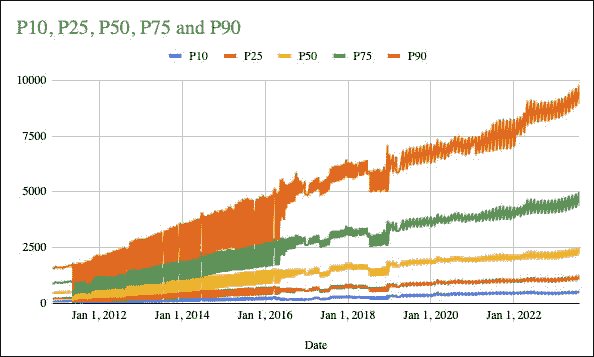
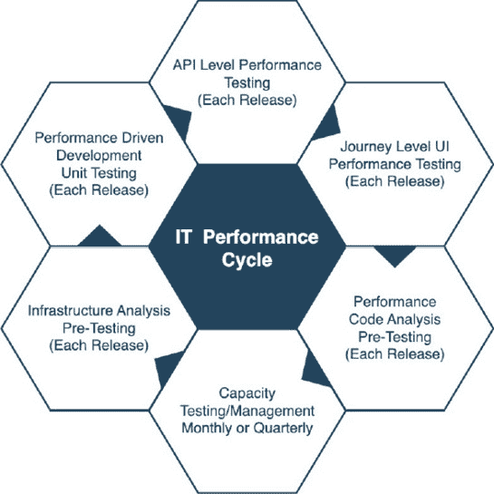
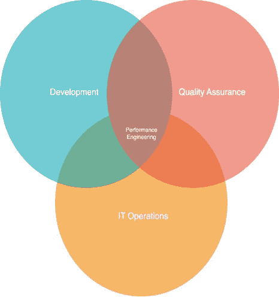
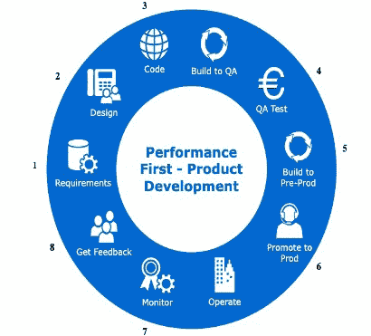
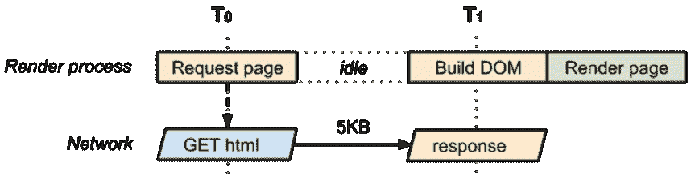
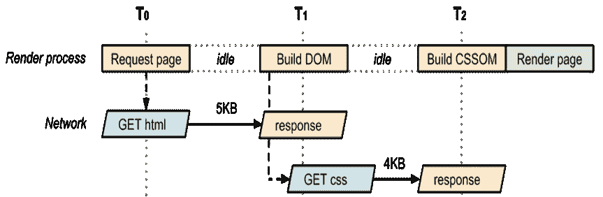
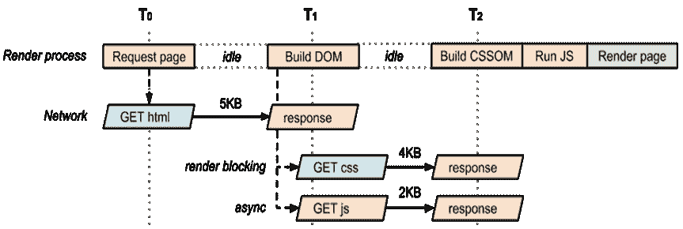
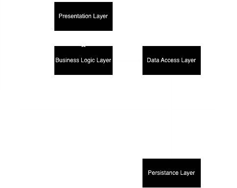
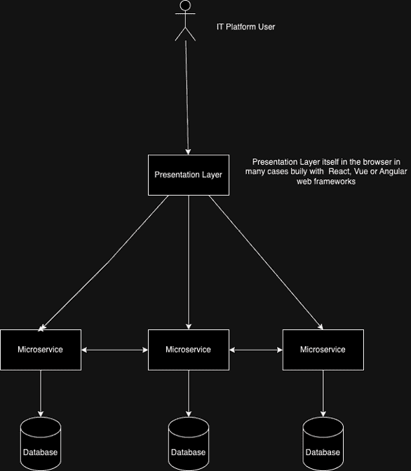

# 性能工程最佳实践：使用 Java 构建高性能云 IT 平台

献给我亲爱的家人：

我的妻子 Gina Michelle Jones，我的儿子 Dalton Vincent Jones 以及我已故的狗 Mocha。

## 关于作者

Nolan Vincent Jones 是一位出色的 IT 负责人，居住在美国密苏里州的奥法农（O’Fallon）。他在 1989 年获得电子工程技术学士学位后开始职业生涯。他的第一份工作是通过`IEE-488`接口，使用`HP9000`微型计算机和`HP3000`小型计算机对 RF/微波军用电子设备进行计量自动化校准和测试。随后，他在许多世界 500 强公司工作，并参与了前沿信息技术计划，例如生物信息学和空间激光通信系统，在这些领域性能和规模是成功的关键。他有机会使用`C`语言编写高性能软件来测试战斗机的内部导航系统，并参与了用于食品行业的 DNA 测序软件产品的开发。他使用`Java`、`C`和`.NET`技术开发了实时财务系统。他对架构的宏观思维使他能够设计/开发复杂的实时企业级电信软件。多年来，他在许多行业的各种 IT 领域工作，如企业架构、运营、开发和性能工程。他使用多种计算机语言编写软件（`Basic`、`C`、`Pascal`、`Golang`、`Python`、`Java`、`C++`、`Visual Basic`、`Prolog`、`Javascript`、`VBScript`、`Rexx`、`HTML`、`C sharp`等）。作为领导，他有效地管理了多个项目经理、应用开发团队、质量团队、性能团队和运营团队。在他漫长的职业生涯中，他直接管理过三个大型公司的性能工程团队，从零开始建立了新的性能实践并制定了策略。他接受过人员领导和定义组织业务流程的重要管理哲学培训。他在性能工程方面的技术洞察和强大的领导力（这是他最大的热情）为许多项目带来了显著收益。

## 致谢

我想感谢几位在本书编写期间向我提供持续支持的人。首先，我要感谢我的妻子和儿子，他们不断鼓励我，并留出专门的时间让我完成它。如果没有他们的支持，我永远无法完成这本书。这需要大量的精力和时间。

感谢那些让我多年来积累了这么多经验的世界 500 强公司。我可以说，在我漫长的 IT 职业中，被推向我不想做的事情让我比大多数留在同一领域或同一份工作上的人拥有更多的知识。如果你像我一样，不在意攀爬职业阶梯，只想追求学习、增长你的 IT 知识并构建伟大的平台，这是我非常鼓励你的一点。如果你从事开发工作，一旦精通了那里，就尝试运营、测试、架构等。如果你在运营部门工作，就尝试开发、架构等。如果你是一个架构师，尝试将自己推向产品之外的企业级规模，或者转而领导一个产品。在每个领域学习、成长并工作，如果你是这样的人，你将感到非常满足。领导力也是可以很有成就感的事情，如对齐组织结构、赋能、人才培养等，但请将其留到学习了其他领域并变得精通之后。

我还要感谢 BPB Publications 团队，他们足够支持，给了我很长时间来返回修改和评审。全职工作之余写书是一项艰巨的任务，尤其是在 IT 领域。

## 前言

本书涵盖了云性能工程的许多不同方面、自动化的重要性以及使用正确的流程和架构。它涵盖了代码、运行时环境和 Web 优化以及许多主题，这些主题将确保你以高速度、低重构构建一个高性能的 IT 平台。

本书针对性能的新学习者采取了实用的方法。它首先介绍了什么是性能工程，并随着章节的进展不断深入。它从性能和流程的非常高层次开始，一旦获得了这些知识，就会进入非常深入的内容。

本书分为 14 章。这些章节将涵盖一些基础的项目管理和开发流程现实、性能工程基础，并开始研究云挑战。然后，它将深入研究优化，以解决与`Java`编写的云分布式平台相关的容量和运行时成本挑战。详情列如下：

- 第 1 章：性能工程简介 - 在本章结束后，你将能够理解创建 IT 平台时涉及的性能工程概念。你将充分理解工程快速平台涉及的不同角色和职责，以及组织成功所需的性能最佳实践。
- 第 2 章：建立性能实践 - 本章将讨论产品交付的不同方法以及性能在产品创建中发挥的作用及其重要性。书中讨论了组织文化以及围绕产品交付的 Agile 和 DevOps 概念。在本章结束后，读者将理解不同方法论周围的一些项目挑战，以及性能在其中起的重要作用。
- 第 3 章：云性能的挑战与现实 - 在本章结束后，读者将能够理解在云端开发新 IT 平台的益处，以及何时应该考虑本地解决方案。我们将讨论各者的优点并比较不同的方法。我们还将讨论混沌工程、事件驱动架构和微服务，以及它们在云平台性能和扩展方面所起的作用。

### 第 4 章：云环境与扩展性

在本章中，我们将深入探讨计算中的重要概念：利特法则（Little’s Law）、阿姆达法则（Amdahl's Law）、通用扩展性法则以及云容量规划的艺术。我们希望本章能为读者提供关于这些高效云计算的核心理论见解，并指导他们进行有效的容量规划。理解容量规划和云计算相关的法则极具实践价值。它有助于制定战略决策并优化资源以实现最高吞吐量。

### 第 5 章：性能自动化

在本章中，我们将讨论性能自动化的重要概念，以确保平台能够以高速度和高质量进行交付。我们还将讨论更多关于服务水平协议（`SLA`）、服务水平目标（`SLO`）和服务水平指标（`SLI`）的概念。我们希望本章能为读者提供关于如何确保客户收到支持高效云计算的优质产品的深刻见解，并指导您进行有效的 IT 平台交付。理解云计算中的性能自动化极具实践价值。它有助于确定瓶颈，并驱动需要完成的优化工作，以确保客户拥有良好的体验且平台持续保持良好的容量。

### 第 6 章：云 Web 平台优化

在本章中，我们将向读者介绍云 Web 平台优化的重要概念。我们诚地希望本章能让他们获得关于如何确保客户收到优质且快速产品的深刻见解。这涉及采用一系列性能策略和技术，旨在加速网站内容向浏览器的交付并改进交互时间。但其重要性在于其对用户体验、参与度和转化率的直接影响。这些方面对于拥有在线业务的成功企业来说都是至关重要的。

### 第 7 章：Java 虚拟机优化

在本章中，我们将向读者介绍云端`JVM`优化的重要概念。我们诚地希望本章能让他们获得关于如何优化 Web 服务和独立应用程序的速度与稳定性的见解。这涉及采用一系列性能策略和技术，针对正在运行的应用配置来优化`JVMs`。

### 第 8 章：Java 代码优化

在本章中，我们将向读者介绍云端 Java 源代码优化的重要概念，并更多地讨论运行时环境。我们将进一步深入，通过扩展上一章，讨论代码和运行时环境如何协同工作以实现优化代码。我们将讨论设计模式，并为读者提供关于设计高性能平台的优质第三方信息源。

### 第 9 章：数据库优化

在本章中，我们将深入探讨数据库，并讨论优化以及如何让操作更快。我们将讨论不同类型以及提高性能的各种技巧和技术。优化包括增强查询和调整数据库，使其以更少的资源运行得更快，同时提供与优化之前相同的功能。

### 第 10 章：高性能架构

在讨论了 Web 和数据库性能的良好设计模式后，是时候在本章中更多讨论基础架构以及它如何影响性能了。我们将讨论不同的架构类型，然后更多地讨论公司在软件创建和性能方面的做法。读者在阅读本章关于架构的内容之前，必须对软件开发实践有基本的了解，才能从所呈现的信息中获益。

### 第 11 章：错误处理与日志记录

现在我们已经深入讨论了架构周围的性能良好设计模式，是时候更多讨论支持已开发产品的低级实现机制了。我们将讨论不同的日志级别、异常处理以及如何让应用程序以卓越性能记录日志。读者必须理解 Java 开发，以便在阅读本章关于日志和错误处理的内容之前理解其背景。

### 第 12 章：云可观测性与云剖析

在本章中，我们将完全关注前端和后端的可观测性，并观察我们如何从性能角度理解正在发生什么。

我们将讨论每个供应商原生的不同云可观测性解决方案，并深入探讨如何进行线程和栈转储（dumps）以查找竞争，以及如何进行堆转储（heap dumps）以查看堆上有哪些类正在消耗内存。

### 第 13 章：告警策略

在本章中，我们将重点实现良好的告警策略。在本书之前的章节，我们讨论了日志记录以及只记录可操作项有多么重要。如果日志中写入了不可操作的内容，那么我们就不应该记录它。这与告警有关。我们不希望因为日志标准不规范导致告警误报，也不希望在不考虑底层可能发生的异常的情况下，仅依赖服务或高层应用模块的高级返回代码。

我们讨论了针对 IT 支持人员的错误处理常识方法，以及利用可观测性和剖析来确定问题的根源。但我们如何知道什么时候该告警以及告警什么呢？在本章中，我们将更多地讨论通用告警，并结合不同的云供应商告警解决方案讨论这些主题。

### 第 14 章：性能工程的未来趋势

在本章中，我们正在讨论未来以及 IT 平台是如何演变的。在本章中，我们将完全关注前端和后端技术的未来。

我们将讨论人工智能以及设计模式和框架是如何演变的。我们将讨论`Fetch Priority API`以及性能工程实践中自动化的新方法。

## 代码包与彩色图片

请点击链接下载书籍的`Code Bundle`（代码包）和彩色图片（Coloured Images）：

`https://rebrand.ly/58fd66`

书籍的代码包也托管在 GitHub 上：`https://github.com/bpbpublications/Performance-Engineering-Best-Practices`。如果代码有更新，将在现有的 GitHub 仓库中更新。

我们在`https://github.com/bpbpublications`提供了我们丰富书籍和视频的代码包。去看看吧！

### 错误列表 (Errata)

我们对 BPB Publications 的工作感到自豪，并遵循最佳实践确保内容的准确性，为订阅者提供沉浸式的阅读体验。读者是我们的镜子，我们利用他们的反馈来反思并改进出版过程中可能出现的人为错误。为了让我们维持质量并帮助接触任何因不可见错误而遇到困难的读者，请邮件联系我们：`errata@bpbonline.com`

BPB Publications 大家非常感谢您的支持、建议和反馈。

## 加入我们书籍的 Discord 社区

加入书籍 Discord 工作空间，获取最新更新、优惠、全球技术动态、新书发布以及与作者的互动：

[`discord.bpbonline.com`](https://discord.bpbonline.com)


## 第 1 章 性能工程简介

### 简介

本书章将向你介绍用于构建快速 IT 平台的工程化概念！它将讨论对于希望通过其产品交付物创造收入的组织而言，性能为何至关重要。随后将讨论相关的流程、角色和职责，并将构建快速软件的考量置于核心位置。

与传统的性能测试实践不同（后者通常发生在产品交付过程的右侧，在开发完成很久之后进行），性能工程是将从系统架构设计之初（流程的最左侧）开始，一直贯穿到实施的设计、代码、测试和监控阶段（右侧），集成了持续的性能改进。这种集成和对性能的早期考虑可以尽早发现潜在的瓶颈，使团队能够对架构和设计做出明智决策，从而在成本较低时预先解决这些问题。它还尽早嵌入了质量检查和平衡，以确保在产品交付时满足性能目标。如果仅在性能测试过程中才发现问题，意味着架构更改可能会迅速变成一项高昂的工程，严重影响产品交付风险。

由于 IT 平台处理日益增加的负载和复杂事务的需求不断，且不能出现可用性的下降和不确定性，性能工程的重要性从未如此显著。通过将性能考量嵌入到开发的所有阶段，组织能够使自己构建健壮、可扩展且符合用户需求的应用程序，同时通过优化资源显著降低成本。没有人希望因为在构建阶段没有考虑性能而长期支付持续的运行成本。这是一个重要的章节，它将向你介绍 IT 系统中性能的各个方面，从工具、角色、设计到心态。

### 章节结构

本章涵盖了以下主题：

- 性能工程
- 架构复杂性的层次
- 角色与职责
- 可用性的重要性
- 预先优化思维
- 工程与性能测试
- 性能工具

### 目标

在本章结束时，你将能够理解创建与性能相关的新 IT 平台所需的工程概念。你将充分理解创建快速平台涉及的不同角色和职责，以及组织获得成功所需的某些性能最佳实践。

### 性能工程

构建快速平台涉及从开发早期一直到生产环境的性能测量。它包括设计高性能的软件架构、基础设施、代码、数据库，并在关于平台创建的所有最终决策中权衡性能与灵活性之间的考量。对于一个组织要在创建响应且产生收入的产品方面取得成功，该组织必须封装一个卓越的软件设计流程。这意味着要先考虑性能，并结合适当的编码规范，以确保平台从诞生之初就是快速的。很多，这些编码规范被称为性能驱动开发（`PDD`）。在产品创建过程中更左侧的 IT 产品创建流程之外，整个平台开发过程中都会进行专注且广泛的测试实践，包括持续的平台性能分析、迭代优化、全业务自动化以及质量关卡。每个人都应该对创建过程中的性能负责。对于驱动最大收入的核心功能，这比产品的任何其他微小功能都更重要。

有一句应该记住的引言：

> 如果它既快又丑，他们会使用并诅咒你；如果它慢，他们将不会使用。
>
> -David Cheriton，亿万富翁 IT 投资者

图 1.1 代表了过去十二年来传输到用户浏览器的数据量。这有助于代表性能工程师需要解决的问题的一部分。从图表中可以看出，在 2012 年，`90^(th)`分位数（意味着网络上前十万网站的 90%）平均传输到用户浏览器的数据约为 2 兆字节。到十一年后的 2023 年，`90^(th)`分位数已经达到 9 兆字节，增长了 450%。今天的网站比以往任何时候都重！

现在，考虑到现状，这也许对起来听起来并不坏。在 IT 领域的多年里，我们有一个摩尔定律的概念，它指出计算机芯片和集成电路上的晶体管每两年增加一倍，这意味着技术在计算能力方面不断演进。如果我们遵循这条定律作为指南，我们现在的计算能力至少是十一年前的五倍。随着云技术、固态硬盘以及支持更多内存的硬件的演进，这可能是正确的，摩尔定律依然有效。当然这足够了，页面变重了，但计算也快了许多。但让我们考虑自 2012 年以来还发生了什么。即使摩尔定律在今天仍然相关（这在某些技术圈内仍有争议），网络速度不仅仅关乎计算能力，它关乎网络带宽限制、网络交换延迟、具有大量需要遍历和过滤规则的负载均衡器、反向代理、Web 服务器和应用程序服务器，以及跨越所有终端的跳转。2012 年，网站托管在 Web 服务器上，可能与关系型数据库交互的应用程序服务器。层次包括网络地址转换（`NAT`）、外部 IP 到内部 IP 的路由、平衡多个区域流量的负载均衡器、反向代理、Web 服务器、应用程序服务器和关系型数据库。随着平台随时间变得分布式，多种云技术相互集成，性能变得更具挑战性。

今天，我们拥有更复杂的架构、更小的组件，以及许多具有极大性的事件驱动架构。跨越更多架构层、数据库、磁盘等检索、传输、解析和转换数据所需的时间越长，遇到的潜在慢点就越多。因此，尽管 2023 年每一层的计算速度可能快得多，但架构分层、容器化和集成点的数量呈指数级增长，从而影响了性能。客户端计算机由于摩尔定律带来了更快的 CPU 而变快了，但接收数据的浏览器在每个域名的线程数上受限，且 I/O 线程阻塞是向用户浏览器下载大量数据时最大的障碍。在设计快速平台时，我们希望处于图 1.1 所示的`10^(th)`分位数。这些是互联网上最快的网站，页面权重小于 1 兆字节。

当后端拥有更多架构层，而前端拥有更多设备或浏览器版本时，良好的性能优势就变得至关重要。我们希望在前端使用轻量级的 Web 框架，并在后端利用良好的性能实践。除此之外，我们还希望使用响应式 Web 设计技术来设计 Web 应用程序，以支持不同的视口大小和精细布局。发送到桌面应用的相同数量数据不应同样发送到移动设备。但我们能给出的最佳建议是：始终以无处不在且具有韧性的思维进行设计。这意味着事务仅在需要时才跨网络传输，并且在没有连接时仍具备某种程度的功能。换句话说，利用`HTML 5`技术并拥抱浏览器服务工作 的演进，这两项技术允许构建出强大的应用程序：



图 1.1：IT 页面权重趋势

### 为什么我们关注性能？

性能在当今行业中变得如此重要，是因为 IT 系统的复杂性以及通过网络传输的数据量正在增加。从 Web 和移动应用到人工智能和机器学习，以高频率运行的数据和软件处理正在遍历大型数据集，这从性能角度来看变得非常昂贵。这通常包括解析、压缩、格式化、显示、注入业务规则等，同时还要跨越分布式云并路由到用户的浏览器或移动应用程序。

搜索引擎将性能视为搜索引擎优化（SEO）考虑的关键指标之一。这说明了当今 IT 产品运行极快是多么重要。如果一个组织的通过 Web 接口访问的产品运行缓慢，它将在搜索结果中排名最后。除非该组织正在向搜索引擎提供者支付费用（通过推广付费以保持在搜索结果的顶端），否则背后的 SEO 分析将决定哪些结果优先显示，哪些应该排在搜索结果的最后。

### 网络带宽

在实现良好的 IT 平台性能时，最重要但经常被忽视的首要考虑因素是完全理解网络带宽以及它如何影响 IT 平台性能。网络带宽是指在特定时间内通过网络可以传输的数据量。我们看到许多性能测试人员和工程师运行测试，却从未考虑过审查应用程序的带宽动态变化。架构师和软件设计师，更不用说最接近数据的数据库设计师了，他们很少考虑这一点。

无论组织是运行在云端、本地、无线连接还是三者的结合，没有什么比理解网络带宽的动态变化作为第一步更重要了。如果一个组织表明一个网页加载需要 3 秒，我们应该问的第一件事是：在什么带宽下？如果你是一个业务分析师或产品架构师，并且你定义了一个需要在`500ms`内响应的 Web 服务需求，我们需要问的首要是：在什么带宽下？性能工程师应该始终询问带宽，并确保其被定义为需求的一部分。他们应该知道，任何针对网页加载时间或 Web 服务定义的需求在很大程度上取决于带宽。低带宽会迅速减慢并拥堵 IT 平台，组件和区域之间的网络带宽对于理解容量以及对用户体验的影响至关重要。

### 网络速度

始终了解网络速度以及相对于数据包延迟的网络速度标准差很重要。网络以数据包的形式传输数据，数据包是数据块，连接在一起就成了更大的数据消息。为什么？因为网络速度和数据包延迟影响了给定时间内跨网络传输的数据量，从而影响了网络带宽。如果组织内部可用网络带宽根据白天的活动发生内部偏差，性能工程师应始终利用反映不同带宽的测试配置来理想地代表全天的动态变化，或者作为最低带宽水平的安全预防进行测试。这让他们能够完全理解对客户体验和容量的潜在影响。


云软件最终运行在变化的带宽上，与企业中的本地服务器和本地数据中心应用程序不同，云本身在不同区域运行多个服务器、网络交换机、负载均衡器、代理和其他组件。云本身组件间交互的入站和出站带宽取决于机器类型，由于由于，由多个组件组成的系统将具有各种带宽。由于其用途和变化的网络流量，需要重点测试组件路径的带宽动态以理解其差异。云服务通常通过具有不同带宽的不同网络访问。数据从一个网络到另一个网络或从一个组件到另一个组件传输的速度全天变化变化，网页下载的速度也会全天变化。网络集成点越多，差异越大。了解代码运行处的客户端和服务器组件带宽至关重要。

这种方法的实现是在测试过程中使用不同的设备配置或配置。这些配置决定了要复制的上传/下载带宽。CPU 和内存的限制代表了设备或浏览器周围的资源限制。对于获得真实结果非常重要。性能工程师在所有通道测试中使用这些配置，并结合测量以完全理解客户在不同带宽下的体验。企业了解他们的客户，在与产品交互时，也需要了解客户的带宽。如果一个企业知道客户是电商客户，使用的是常用的电缆连接，上传速度为 5MB/s，下载速度为 50MB/s，那么他们在测试时使用的内部需求是 200MB/s 在 3 秒内完成。那么，默认情况下，他们预计客户体验到的延迟远大于 3 秒，可能接近 12 秒。遗憾的是，这很少被理解，是性能测试团队看到的最严重的失误之一。另一个常见的无知是对移动设备和桌面电脑上 CPU 限制，以及理解这些动态如何影响产品的响应时间。与本地解决方案相比，如今云资源本身拥有相当不错的带宽。限制通常是企业访问互联网的提供商，这导致了事务的变慢。

## 互联网服务提供商

利用 IT 平台的用户在许多情况下会使用服务提供商提供的互联网服务或专线。这些提供商提供各种带宽的连接和业务。组织几乎总是会对不同等级的带宽进行分级定价以销售给客户，而住宅带宽可能远慢于某些为了保持高生产力而对高速有需求的公司内部运行速度。然而，由于成本以及围绕硬件和软件的网络限制，公司与住宅之间的带宽存在巨大差异。对于某家公司来说运行飞速的程序，对另一家公司来说可能很慢。

对于企业间（B2B）服务，同样的逻辑也适用。

### 带宽与性能差异

由于硬件和软件相关的成本和网络限制，公司与住宅之间的带宽差异显著。对于某家公司运行良好的程序，对另一家公司可能很慢。

### 技术限制与解决方案

在云环境之间交互时，`本地（on-premises）`解决方案的带宽和响应时间可能存在根本性的不同。重要的是，在使用云解决方案时，数据传输和延迟会影响性能。

### 运行时与调试挑战

代码的性能通常受到运行时的影响。当出现问题时，往往很难识别根源——根源通常不在代码本身，而是在运行时环境和线程解释中。

### 语言与框架对比

`Golang`、`Rust`、`C`、`Java` 和 `.NET` 等语言提供了更健壮的解决方案，识别根源通常更快。此外，也更容易找到大型供应商资源流（无论国内还是海外），以便使用这些语言快速创建软件。

然而，流行的 `Java` 和 `.NET` 技术在原生操作系统之上利用了中间虚拟机，这涉及到在运行虚拟机运行时环境的 `C` 语言之上进行大量的嵌套代码。因此，新的框架最终变成了多层代码的封装。抽象层越多，为产品开发编写程序就越容易越快速，但代码执行速度就越慢。同样的逻辑也适用于大型 Web 型 JavaScript 框架，如 `AngularJS`，其规模比在低得级进行编程要大得多，而大多数网站只使用了该框架 20% 的功能。

`Webpack` 是一个模块打包器，可以帮助优化部署，并将 JavaScript 代码拆分为模块以使其加载更快，但 `Angular` 框架可能非常慢。如果在使用 `AngularJS` 时没有利用其许多优化特性，它可能会变得不可用。随着前端出现了 `React` 和 `Vue` 等更轻量的 Web 框架，开启了一个全新的市场，这些工具出现是为了应对 `Angular` 的性能问题，并允许在内存中操作 Web 元素，这被称为虚拟文档对象模型（DOM），区别于传统的 DOM。无论代码是下载到浏览器中，还是由运行时类加载器进程加载，`Java` 或任何语言中的代码层数越多，预期的延迟就越高。此外，Web 浏览器中的处理线程、负载均衡器和反向代理中过于复杂的过滤器或规则以及其他运行时系统的复杂性限制了性能，并在云端环境中不断增长。例如，请参考上方的图 1.1，该图反映了 IT 平台上随时间推推送到用户浏览器的网页大小（单位为 KB）。在过去的 10 年里，反映数据量的页面权重持续上升趋势。

当页面权重或跨网络传输的数据增加时会发生什么？性能本质上会迅速向相反方向——即下降，它们之间存在反比关系。测试或分析期间测量的另一个关键性能指标称为处理率或吞吐量。随着页面权重的增加，数据传输规模增大，响应时间随之增加，处理率和吞吐量则降低。因此，处理率和响应时间是非常反比的关系。当你开始看到在给定的处理率下响应时间增加时，就可以判断平台何时达到了其容量。处理率或吞吐量（是同一术语）决定了在范围内可以处理多少请求。当测试 IT 平台时，响应时间会保持一段时间平稳，当负载下更多请求进入平台导致处理率开始下降时，响应时间就会上升。此时，通常平台倾向于拒绝任何额外的请求；事务耗时变得越来越长，直到平台最终无法响应所需的结果，或者超过了平台被认为仍可用的服务水平目标（`SLO`）。因此，数据量、处理率和响应时间之间存在一种需要理解的关系。这些仅仅是为了真正掌握性能而需要掌握的一些指标。

## 性能预算

当我们深入探讨时，一个重要的概念是理解性能预算的工作原理。这并不是指性能方面的开支，而是指在组件和服务延迟之间进行权衡，以实现最终状态目标。如果我们要求平台必须能够在 4 秒内处理一个事务，而该事务由跨网络到单个服务或多个服务的 4 个请求组成，那么我们从本质上就可以就优化内容进行权衡，以实现最终目标。我们可以让其中一个请求耗时 500ms，另一个耗时 3 秒，另外两个各花费 250ms。我们也可以让一个请求耗时 1.5 秒，另一个花费 2 秒，另外两个各花费 250ms。这些权衡动态反映了优化方面的灵活性，使我们能够实现最终目标，从而满足容量和用户体验需求。这是一个非常重要的概念，但并不总是能被理解。你不需要针对单个请求的延迟设置要求，而应该针对为了完成目标由多个请求组成的事务来设置要求。

性能的目标始终围绕着两点：卓越的用户体验和容量。人们也可以认为，在云成本方面，运行时成本也是一个强有力的第三因素。这些动态也可以转化为网页加载时间。如果要求在 200MB/s 的连接下 3 秒内加载网页，那么跨网络加载该页的各个请求都可以进行优化，以实现 3 秒的性能预算。在产品创建过程的极早期阶段（左移）围绕请求延迟制定最佳实践指南一直是一个好主意，但作为实际需求，业务事务应该是重点，而灵活性则体现在优化满足需求所需的必要内容。之所以这如此重要，是因为性能最终会通过运行时成本、易用性和品牌感知来影响收入。

## 取得的收益效益

过去 10 年中，一些组织通过性能优化实现了收益增长或成本节省效益的示例：

*   Bing：页面变慢 2 秒导致收入下降 4.3%

*   Google：400ms 的延迟导致搜索量下降 0.6%

*   Yahoo：400ms 的减慢导致全页流量减少 5-9%

*   Shopzilla：网站提速 5 秒使转化率提升了 7-12%

*   Mozilla：其落地页缩短了 2.2 秒，使转化率增加了 15.4%

*   Netflix：采用单一优化方案 `gzip 压缩`，速度提升了 13-25%，并减少了 50% 的网络流量

大型分布式云系统的复杂性以及软件和基础设施组件交互的数量，对于 IT 平台上看到的性能不佳和响应时间标准差起着主要作用。在为什么良好的工程如此重要方面，这些仅仅是冰山一角。实现良好性能的工程平台不仅是为了低成本或低容量运行，更是为了拥有一个可用的平台，让组织的品牌感知成为一种积极体验。

如今使用网站的消费者对应用程序的易用性能有很高预期。当平台变慢时，客户通常会离开（跳出）。“跳出”（Bounce）是一个行业术语，意味着他们在执行应用程序用户旅程的某个点停止使用该程序。过去十年 IT 领域的一个日益增长的趋势是平台忠诚度非常有限。如今的消费者最终不会忍受缓慢的网站或移动应用程序，因为他们没有必要这样做。这对于年轻一代来说尤其如此，在网站交互方面，速度被视为常态，且期望即时交互。如果你没有快速的平台，客户最终会转向竞争对手，后者拥有更快的实现，或者在你意识到之前就已经产生了这种质量感知。即使你出于最好的意图发布了一个功能丰富的新 IT 平台，如果该功能运行缓慢，你可能会失去一个客户，而不是像初衷的那样赢得或留住一个。这在很大程度上归于品牌感知，而不总是关乎易用性，它可能关乎感知质量和心态。

## 架构复杂性层

如今，无论是云端还是本地基础设施的现代网站服务器都处于高负载状态，由于移动领域的增长以及全球范围内连通性的提升，消耗着前所未有的原始计算能力。参与软件开发、容量规划或 IT 服务器运营的 IT 团队对这个问题非常熟悉。但随着强大力量的出现，更迫切的需求是确保 `IT` 平台具有响应能力、良好的可扩展性，并在本质上具有高度的韧性。

### 性能与扩展性的重要性

如今要让 `IT` 平台获得良好的性能结果，需要对底层平台的所有层有全面的理解，对当前处理的任务有深入的洞察，并具备在每件硬件的多个层上获得有效性能所需的独创性和创造力。从计算的角度来看，理解哪些需要被`tuned`、哪些需要被`cached`、哪些需要被`distributed` 或 `parallelized`，对于实现最大 `throughput` 所需的平衡至关重要。

掌握复杂且具有挑战性的目标的回报，是能够实现 Web 交互并处理海量交易；如果不建立适当的性能流程，处理速度将快几个数量级且更高效。这使得 `IT` 平台能够获得过去通过单一非分布式处理无法实现的结果。响应能力差和缺乏扩展性可能会决定一个基于 Web 的软件产品的成败。丰富内容的出现增加了页面下载时间的延迟并降低了带宽的可用性。这以及 Web 对更大处理能力的需求，迫使网站寻找 `tuning options` 来构建额外的扩展性。在大多数情况下，如今的大型软件架构都是分层的。这些层将计算处理分发在多台机器上。

### 架构分层与延迟管理

随着软件产品负载的增加，许多层之间的延迟可能会开始积压，直到导致用户被踢出 `IT` 平台。例如，在分布式计算环境中，架构第一层会产生一个 `threaded connection`，调用 `layer two`，再由它调用 `layer three`，以此此类推。如果 `layer three` 开始积压，那么 `layer two` 也会开始积压，最终导致 `layer one`。如果这种情况持续足够长，整个平台将无法响应。通过对这些层进行`Tuning`，确保 `layer three` 能够快速响应 `layer two` 等，可以保持平台及时响应来自客户端 Web 或移动应用程序的请求。这对于实现网站最大的 `throughput` 和响应能力至关重要。

### 优化策略与平台稳定性

任何软件架构中负载最大的部分就是处理最耗时的地方。为了让 `layer two` 和 `layer three` 能够像更快的 `layer one` 那样响应，必须实施`caching` 以减少服务器上的计算处理。目标不是重复已经发生的处理，而是将其存储在内存中，允许请求立即返回调用层，而不是在服务器上增加额外的计算负载从而导致请求产生额外的延迟。

有时 `threads` 可能会由于各种原因而挂起，例如 `database table lock`、`thread contention scenario`，或者由于 `database tuning` 不当或纯粹缺乏计算能力导致请求非常缓慢。为了保持平台处于最优调状态，应该在 Web 平台整个堆栈的每一层设置`timeouts`，以确保在负载下 `threads` 的积压不会在不需要的时候发生。一个设计良好、经过正确`tuned`并设置了`throttle`（`request pool restrictions`）的平台不会被过载，它可能不会允许更多请求，但后端基础设施不会崩溃或瘫痪。当平台没有这样设计时，组件会在不同的运行状态下以不可预测的方式崩溃，使恢复变得非常困难。

### 性能失败的影响

未能达到 `IT` 产品性能目标的最大影响是：

*   进度延迟

*   项目成本超支

*   项目生产力损失

*   客户关系损害

*   错失市场窗口

*   收入损失

*   技术债

### 早期性能设计

为核心功能交付具有良好性能和可用性的软件是重要的。此外，交付性能的成本随着开发过程越靠后而越高。最大且最严重的性能问题并不总是代码糟糕导致的。它们通常是糟糕的架构或软件设计决策的结果，而这些本在过程早期就可以避免。有时，从架构角度来看没有遵循适当的`separation of concerns`，或者跨网络的请求过于细粒，引入了更多的网络延迟和响应时间的波动。

建立一个代表极简设计的`skeleton architecture` 作为起点，并围绕性能进行`proof of concept` 是重要的。在项目生命周期早期做到这些点的组织可以在未来节省大量的成本和烦恼。最好不要等到最后才发现你的架构或软件设计很糟糕。

性能无法事后补救，必须从一开始就设计到软件中才能获得良好的结果。那种将性能视为事后考虑、并在最后更改代码和基础设施的补救方法往往只能获得微小的胜利，代价是更糟糕的性能设计模式，导致响应时间偏差更大、韧性更差。架构和软件设计是实现高性能 Web 平台以保持低成本最重要的组件。

让我们来看看这些产品开发阶段所需的步骤，以确保系统性能良好：

# 软件架构与设计

预先构建并设计灵活的软件架构以满足项目的性能目标。软件架构本身不应完全是迭代的。组织应该在敏捷过程中迭代地进行代码编写和详细设计，但高层软件设计和架构应该预先建立，并分配更多时间，同时确定实现中将使用的设计模式和网络标准。这包含了对工具的考量。

例如，如果你要设计需要满足标准辅助功能读取器访问性要求的软件，请使用在开发阶段就能作为要求提供此类访问功能的 UI 库和工具。工具和流程的选择，以及编码标准、网络标准、包括测试工具在内的辅助功能工具都应预先定义，并留出时间进行概念验证（PoC），以确保选择了正确的工具和流程。这是瀑布模型甚至是迭代过程比敏捷方法得得好的领域之一。

在敏捷开发中，记住在过程早期花时间构思架构、设计（包括数据库设计），并进行必要的概念验证，以理解性能和韧性动态。在此阶段要慢一点，一旦离开了架构和设计阶段，就可以加快速度。平衡灵活性与性能。

对基于敏捷的平台影响最大的是架构、设计甚至需求是有机增长的。这在交付后的质量和维护成本方面是其最大的缺陷。相反，应该预先为灵活性设计架构，并识别产品交付过程中将持续遵循的设计模式和标准。花时间创建所需的接口或合约并定义负载标准，确保实现代码是可插拔、可维护的，并确保未来架构更改的至最低。良好的架构关键在于灵活性以及预先考虑未来的“如果怎样”场景，而不是从小开始并创建一个有机生长成无法维护的“雪球”的。

## 核心功能与性能

在迭代开发周期早期识别代表核心关键功能的故事（Stories）或用例，并为每个故事关联性能目标。这些是通过用户界面或后端服务最频繁的旅程。就服务运行速度、易用性以及如何设计以让用户户用最短时间完成尝试实现的任务而言，这些是产品中最重要的旅程。审查定义的每个用户旅程，并计划优化软件硬件以获得最佳响应时间，以实现 `SLO`。

## 建模与概念验证

在小规模上进行建模，并进行原型设计，创建一个带有骨架代码的真实概念验证，以理解行为和预期延迟。骨架代码是具有最小功能的存根或接口，用于表示一个运行的服务或用户界面。这些允许你看到将向网络发送多少个请求、请求的大小有多大、数据库中 `SQL` 性能如何，并评估性能瓶颈，例如将关系型数据库对象映射到 `Java` 对象，以及将 `Java` 对象映射到 `JSON`。

需要明确的是，分布式平台最大的瓶颈之一是网络延迟、资源限制、发生的数据转换量以及与数据转换相关的延迟。数据转换越少，请求速度就越快，扩展的扩展性就越好。这是 `NoSQL` 最初如此流行的主要原因之一，它不仅消除了与多次表查询相关的缓慢关系归一化，更重要的是有助于消除数据转换。我们可以使用 `MongoDB` 或其他 `NoSQL` 文档数据库存储结果，然后将这些结果直接推送到浏览器进行交互，而无需在产品架构中间层进行任何大型数据转换工作。数据转换是非常消耗 CPU 的。

## 优化策略

1. 测量进入基础设施的延迟，以最好了解 `DNS`、`SSL` 延迟以及当前网站的预期响应速度。还应包括负载均衡器周围的延迟（带有预期的规则/过滤器）以及带有内容交付网络边缘缓存的应用程序接口 (`API`) 网关延迟。如果你不知道，请假设 `DNS` 查询为 `200ms`，`SSL` 影响为 `400ms`，并围绕这些最坏的数字进行设计。

2. 在进行产品开发之前，根据概念验证的结果调整软件和硬件架构以优化解决方案。针对性能的设计本质上是迭代的，但重要的考虑因素是，你需要一个初始基准来理解你是否能满足性能目标。该基准应作为概念验证的一部分进行优化，然后随着代码的交付进一步迭代优化。

3. 尽早设计原型、测量、调整基础设施和软件设计、实现代码、进行代码审查寻找影响性能的反模式、测量性能、分析网页指标（Web Vitals）和前端性能最佳实践，并循环。目标不仅是为每个用例设定性能目标，而是迭代地将性能测量纳入你的流程中，并持续调整软件以满足这些目标。建议在软件处于低环境时及且频繁测量性能，这并不一定意味着负载测试。

## 主动性能管理

将主动的性能目标引入软件开发生命周期 (`SDLC`) 过程是非常简单的，并可以显著降低项目风险。首先，你为特定的开发迭代定义具有定义的功能（包括性能需求），作为该过程的一部分。这不仅应包括吞吐量指标，还应包括来自软件在不同带宽、设备和浏览器下各种位置的响应指标。然后根据这些规范对软件进行架构设计、设计和编码。


为了验证需求，在本地测试性能和功能很重要，以确保软件满足定义的标准。然后，需要通过使用区域在全球或国内范围内进行集成性能测试，以验证在匹配生产环境的基础设施配置和数据占用下，是否仍然满足需求。需要来自不同地理位置、设备、浏览器和带宽的功能性和性能负载测试。对基础设施进行韧性测试，并引入各种失败用例，理解维护窗口或瞬时停机等真实世界事件对性能和功能产生的影响。很多时候，这被称为混沌工程（`Chaos Engineering`）。一旦解决了所有问题，即可发布软件。混沌工程的目标是即使在压力下仍满足 `SLO`，并有足够的线程和容量来处理 IT 平台的中断。

通常情况下，随着软件的演进，最好在本地以及持续集成通道中迭代测量你的网站性能。你希望能够随时间跟踪性能变化。除了在 `SDLC`（软件开发生命周期）的每个阶段都纳入性能之外，利用书中后部分讨论的性能驱动设计最佳实践进行软件设计也至关重要。为了在理解你的平台处理能力方面获得最佳结果，请创建一个在硬件、软件和数据上与生产环境匹配的性能环境。对生产环境的数据进行快照，并将其移回你的测试（`staging`）或开发环境，进行真实的性能测量，并定期衡量平台在处理负载能力方面的变化。然后，在每个测试周期中，追求从不同的地理位置和设备测试你网站的能力。无论你参与哪个项目，无论你是项目经理、业务分析师、开发人员、架构师还是领导层，你在性能方面都扮演着关重要的角色。

## 角色与职责

目前，在任何大型企业中，没有任何单一的角色能够实现当今分布式云平台产品中确保良好平台性能所需的工作。相反，这涉及到 IT 组织中参与平台创建的所有小组。良好的性能实践会带来快速的 IT 平台。很多时候，这些平台是非常复杂的云端分布式 IT 平台，利用了网页、Web 服务、大数据批处理、数据库、负载均衡器、反向代理、`API gateways`、网络交换机等，甚至可能与第三方集成、触点和其他云进行交互，增加了复杂性。为了实现卓越的平台性能，所有这些软硬件组件都需要进行协同校准以实现高性能，并进行优化以兼顾扩展性和可用性。但为了实现这一目标，平台必须从一开始就进行架构设计以支持卓越性能。对编写或设计糟糕的代码进行调优是没有效率的，结果非常有限；在大多数情况下，尝试调优编写或设计糟糕的平台会导致遵循更糟糕的优化实践，最终会进一步影响性能的韧性和预测性。

在流程后期才更改成本远比提前考虑性能要贵得多。需要针对第三方依赖，以及下游回传（平台可能没有多少控制）如何影响上游的扩展和吞吐量做出决策，并设计软件以考虑可预测的回传水平。此外，了解软件如何与数据库交互、慢数据库查询如何影响数据库池化、连接获取和组件吞吐量，随着组件增长以及数据库变得更加分布式和共享，这本身可能变成一门复杂的科学。

## 复杂性对性能预测性的影响

为卓越性能构建工程平台从未像现在这样复杂。云的预期是平台将具有无限扩展性并能自愈。然而，与所有复杂平台一样，性能和韧性变得难以预测，存在更多的不确定性。平台拥有的组件和变量越多，设计就越复杂，在环境中实现一致的性能、韧性以及从故障中恢复就越困难。云提供商由于冗余迅速提供了可用性数字，但在性能数字上给自己留了很大的余地，因为涉及到跨区域和跨组件的基础设施动态，从 Web 应用防火墙（`WAF`）到 `API gateways`，再到反向代理、下游应用服务器和数据库，过程中有许多层次和规则。需要考虑的变量很多，平台越复杂，任务就越困难。在预测性能方面，进入云领域可能会令人敬畏，但结合正确的实践、流程以及一些良好的数学知识，可以成为可能。

## 平衡非功能性与功能性需求之间的优先级

从零开始构建 IT 产品时，在许多情况下，就收入而言，非功能性需求比功能性需求更重要。我知道这一陈述本身对于那些专注于比竞争对手推出新功能的企业来说可能是争议性的。但归根结底，客户想要一个快速、简洁、简单、易用、设计良好且核心功能无缺陷的平台，并且他们希望它具有韧性和可访问性。至少，这将建立一个良好的品牌并确保客户的持续满意。这应该始终是目标。如果你有一个网站下载到用户浏览器中需要 6 秒而不是 2 秒，虽然起初并不总能实现，但如果你对使用该平台的客户进行调查，你可能会发现这对他们对组织的感知非常重要。你起码需要比竞争对手快。

在品牌感知方面，监控客户进入平台的组织往往发现，当平台内用户旅程延迟较高，或者旅程和功能复杂导致整体流程变慢时，跳出率更高。简单和性能比运行缓慢且不可靠的新功能更受青睐。客户的挫败感会低得多。专注于产品质量卓越的组织长期来看会过得很好。IT 平台的用户想要一个检索内容或数据缓慢、复杂或不可靠的平台。作为客户，你是想要使用一个缓慢、可用性差、充斥着难以理解且需要学习曲线功能的 IT 平台，还是想要一个易用、核心功能精简且运行极快的产品？如果平台很慢，你失去的客户可能比缺少某些锦上添花的功能要多得多，因为在大多数情况下，锦上添花的功能只影响小部分客户，而所有客户都会受到缓慢和难用平台的影响。

## 可用性的重要性

如果你回溯过去，想想 Apple 和 Google 是如何变得如此成功的。是因为他们创建了具有比竞争更多功能的 IT 平台吗？绝对不是，恰恰相反，是因为他们专注于核心功能、简单性、质量和速度！他们做了别人没有做的事，即在保持简单和快速的同时，建立围绕质量和可靠性的品牌感知。软件设计越复杂，功能越多、硬件越多、网络跳数越多、代码行越多、错误越多、日志越冗余，实现良好的性能就越困难，因此围绕性能的实践必须改变以获得并预测它。在理解性能和韧性所有动态的领域，这是一个全新的世界。当 Apple 推出 iPod 时，市场上有了数百种 MP3 播放器，有些设计很棒，但并没有想象中那么易用。但 Apple 推出了一个交互快速、设计极简且质量优于竞争的产品，并击败了整个市场，这证明了质量、简单和速度感知至关重要。

Google 搜索引擎刚推出时，从 Web 服务器到浏览器的传输数据量 `< 512k`。在缓存后，后续访问传输的数据量仅为 `< 50k`。这种低页面权重意味着极快的性能。他们使用了很长的缓存时间来确保首次页面加载时间始终保持在最低。在当时，几乎所有使用的带宽都远慢于今天的标准。使用该搜索引擎的消费者仍然能够看到亚秒级的加载时间。即使在今天，初始加载到用户浏览器的数据传输大小为 1.1 兆，在缓存启动后，Google 在后续调用中仅发送 `72k` 的数据，传输量减少得多。当你将数据传输大小保持在如此小的范围内，意味着网站加载速度非常快，凭借如今的带宽，Google 仍然能以其闪电般的加载速度令人印象。任何软件设计的目标都应该是：无论是否有缓存，首次页面加载都是快速的，并且规模较小，请求不会阻塞浏览器线程。在渲染和加载网页之前，这不是执行长时间数据库查询的时机。保持轻量！

## 糟糕的客户体验

让我们从消费者的角度来看另一个相关的例子。假设你想订一个披萨。你搜索当地的披萨店，发现了 Joe’s pizza 的网站。你导航到该网站，花费了 15 秒才加载，因为它加载了许多大型高画质图像，展示披萨冒出的热气以向消费者推销。作为一个在食品行业从事过 IT 工作的人，我们可以告诉你，图片上的热气是一个极好的营销噱头，能让你渴望食物，但它意味着大量的像素密度，在很多情况下意味着大型高分辨率图像。你注意到当网站加载时，它有一个菜单，包含了你想到的所有披萨组合，但你花费了大约 15 分钟才理解如何订购披萨。由于图片很大，一切看起来都很慢，交互操作也显得很迟钝。当你选择一个项目时，它会带你进入另一个页面，在结账之前添加每个配料都需要 4 秒。由于速度缓慢，你觉得这个网站很难用，并且留下的印象是 Joe’s pizza 可能不是存放支付信息的好地方。毕竟，如果支付超时是你的第一个想法，而且你必须不断点击重试，会发生什么呢？更重要的是，此时你感到很挫败，你很饿，现在却不得不使用一种体验糟糕的工具，而且耗费了大量时间。对公司的印象很低，你没有获得良好的体验。你认为，如果有选择，你还会再次使用 Joe’s pizza 吗？

## 追踪用户体验

你认为有多少组织实际上在细粒度的事务或请求类型延迟之外，还跟踪执行功能所需的时间？了解这些是很有价值的，不是吗？这以及理解与客户离开平台相关的时间阈值。组织通常使用分析工具（如 `Google Analytics`、`Adobe Analytics` 或类似的产品） true 这一点。这些工具被用于查看客户在平台上做了什么，以及他们在会话中与平台交互持续了多久。这些工具中的总会话时间指标本身可能足以帮助人们理解平台是否易用。尽管如此，许多优秀的分析解决方案被用于追踪此类问题，包括具有真实用户监控 (`RUM`) 功能的应用程序性能监控 (`APM`) 工具。

APM 和分析工具提供了向网站的 `HTML` 源代码中添加 `JavaScript` 标签或代码段的能力，以便跟踪用户通过网站的旅程。代码通常会将信息发送到 APM 或分析工具服务器进行跟踪，并使用浏览器计时 API 或测量交互时间来发送计时信息。例如，如果我们登录，然后导航到电子商务网站，将产品加入购物车，结账并支付产品，他们会跟踪我们整个交互过程中的旅程，并看到我们点击的一切。他们知道我们暂停了多久，请求花费了多久，以及我们是否完全退出了应用程序。在本书编写时，`Datadog` 和 `Dynatrace` 等供应商在 APM 工具领域处于行业顶端，但那里有很多棒的工具。APM 工具让你能够对应用程序进行剖析，查看用户的会话并对其进行追踪或记录，并在可观测性之外，确定代码和运行环境中性能问题的根源。如果没有可观测性，在涉及性能时，你只能猜测问题所在。对平台生成负载并记录响应时间的测试工具是不够的。你需要看到从测试基础设施到被测试的后端服务的每一层发生了什么。这也意味着分析并理解与测试产品及其基础设施相关的延迟。

## 良好的用户体验

下次你订披萨时，你选择了另一家当地披萨供应商，看看他们是否比 Joe’s pizza 好。你进行了 Google 搜索，发现了一个名为 Speedy Pizza 的网站。他们的网站加载大约需要两秒，而不是一个包含许多难以理解选项且需要在多个页面间导航的菜单，它有一个简单的向导，从单个页面开始从头到尾简化了你的订单流程。配料可以在 `500ms` 以内添加到订单中。它有图片，尽管你看不到热气，但你仍然看到一张看起来很诱人的披萨图片。你感到支付会顺利通过而不出现任何问题或超时，因为该网站感觉可靠、快速且易用。因为网站很快且感觉很稳，你留下的印象是 Speedy’s Pizza 是一家专业的优质组织，你并不觉得在他们的网站上为订单付费或执行交易时会遇到任何问题。你在 2 分钟内就订好了披萨。

到头来，你认为哪一个网站评价更高，你会更频繁地访问哪一个？当然，功能性需求与非功能性需求之间总是有平衡，但请记住，非功能性需求是核心功能始终需要的，而不是锦上添花的功能；区分核心功能与和锦上添花的功能非常重要。非常快且易于使用的产品会给客户和业务伙伴留下深刻的印象。我们无法计算有多少家公司在开展业务之前联系我询问平台性能，或者自己扫描网站并进行测量。

## 可用性研究

一个组织如何在产品创建之前，确定在可用性和性能方面哪些事情对他们的客户真正重要？答案是可用性研究，这是理解客户的一种极佳方法。许多大型组织会有可用性团队，他们对客户群进行抽样、录制应用程序使用的视频、进行问调查，并让他们在各种用户界面或交互和性能上运行概念验证。他们围绕平台感知和可用性开展研究，其中包括问卷，更重要的是在不察觉或不干扰参与者的情况下记录他们使用应用程序时的行为。

这些概念验证产品（PoC）是使用高级计算机语言或产品快速构建的；它们能确保你确实在创建正确的产品，并关注正确的事情。这并不是生产就绪的实现；大多数情况下，它只是一个包含交互和小型本地数据集的网站。没有什么比理解你所销售的客户更重要的了。尝试具有不同速度、不同功能的站点，并从用户的角度理解对应用的感知，产品被感知的方式可能会让你惊讶。为他们提供一个仅包含核心功能的快速流线型站点和一个缓慢的多功能站点，并理解这种感知差异。最终，不可靠或不快速且易用的平台将意味着收入损失。

## 创建快速的产品并产生更多收入

奇怪的是，在当今世界，平台最初开发时，性能往往是事后考虑的，或者被置于功能需求之后。但我们看到过去 10 年这种情况发生了显著变化。公司正在更多地了解客户在性能方面的行为，并开始理解他们的挫败感。因此，为此目的成立了专门的性能团队，或者将性能所有权交给站点可靠性团队。但作为一个准则，我们何时应该开始考虑性能呢？答案在产品开发的需求阶段。在后期才尝试对糟糕性能做出反应并重新架构或修补方案，其成本比在初期高得多，结果也好得多。如果你从一开始就没有考虑性能，真的很难战胜竞争对手的网站性能。在不考虑性能的情况下快速编写一个平台，然后在设计和编码完成后通过平庸的措施来弥补糟糕的性能，这限制了可实现的性能，并且成本比从一开始考虑要贵得多。尽管业务利益相关者可能定义性能需求，但真正的需求是你的竞争对手的产品或在 `https://httparchive.org/` 上看到的主流互联网延迟。你需要比这些更快。如果需求中没有考虑这些数据点，始终向业务利益相关者质疑。

## 晚期修复性能代价高昂

由于没有考虑性能动态而导致用户体验糟糕，对于一个新产品来说是一个非常糟糕的状态，而且在后期修复的成本与在早期相比要显著得多。从流程的角度来考虑这个问题。如果你在流程后期发现某个地方缓慢，它就会变成一个支持项。假设你发现设计缓慢是因为它对网络传输的字段进行了细粒度加密，而不是对整个有效负载进行压缩和解压缩。重新架构应用程序、更新旧记录并更改数据传输对象以支持新方法是一项非常漫长的工程。

如果你在更早阶段发现了这个缺陷，或者在最开始就针对该功能提出了性能需求，并在设计/开发阶段早期进行了测试，那么在产品创建期间就可以立即修复它。可能在架构阶段，决定使用一个需要多租户加密的数据存储，但数据库不支持它，因此必须使用单独的库进行加密解密，这导致无法无缝操作并增加了大量的延迟。这些情况很常见，通过在流程的极左侧（更早）考虑性能就可以避免这些，因为在此时这些问题很容易修复。这个惨痛的教训就是为什么过去十年对强性能 IT 顾问的需求增加的原因。在整个开发生命周期中从一开始考虑性能非常重要，以获得极佳的可用性、卓越的品牌感知和低的运行成本。需求阶段定义性能，架构师根据性能需求进行架构，根据性能需求优化代码，性能/质量测试人员则在产品发布到生产环境之前确保满足了需求。

## 为什么性能没有构建到所有产品中

由于缺乏知识和平台复杂性，良好的性能流程并未纳入 IT 平台中。很多时候，这只是业务认为重要事项的优先级问题。此外，领导者很少理解缓慢平台如何影响组织的收入。除非签署了契约的服务水平协议 (`SLA`)，很多时候性能会次于其他功能。直到以后当客户开始转向竞争对手时，人们才会意识到收入损失。对于 Web 平台，性能方面简单的“触手可得的果实”（例如无论大小如何都优化图片）可以将许多网站的速度提高三倍，或者拆分首次加载时臃大的 JavaScript 包。关注“折叠以上”的内容（即进行任何滚动之前的内容）可以显著提高交互时间 (`TTI`)。但除非由于网络浏览器中过度线程阻塞导致渲染时间变慢产生明显的延迟，否则这些事情很多时候并不被考虑。为了产品获得预期的性能结果，优化工作应该嵌入流程之中，而不应该仅仅是针对某个瓶颈或因为某个在流程后期被感知为缓慢而产生的反应。这种状态起初就不该让流程进行到那一步程度，因为越早修复越便宜。

除了成本讨论之外，优化并不是在事情被感知为缓慢时事后考虑的，无论如何都希望让某些东西更快，因此我们在产品开发的初期极左侧就作为流程的一部分优化了一切。例如，如果一个产品在网站上有一个 100k 的图片，我们可以优化它将其缩小到 50k。影响是什么？这意味着它从 Web 服务器到用户浏览器的下载速度可能会快一倍，从而提高页面加载时间。我们不需要只考虑看到的这一张大图片，作为一种实践，我们应该优化一切。我们在优化方面不想被动，这是一个很容易掉进去的陷阱，相反，我们优化所有的图片、所有的 JavaScript、所有的层叠样式表 (`CSS`)、所有的 Java 代码等。正如我们讨论过的，性能和可用性影响组织的品牌，这会转化为业务。

除了 B2B 场景和业务伙伴的认知之外，利用以消费者为中心的网站的业务对消费者（B2C）用户只有在认为他们正在与高质量且有声誉的企业打交道时才会这样做。一个加载需要 10 秒的网站会给人一种这是一个低质量机构的印象。成本也是一个因素，但很大程度上是一种平衡。随着性能在 IT 领域真正成为每个人的责任，围绕性能的责任和所有权的碎片化理解变得更加严重。诸如“这不是我的问题”以及“只关注功能”等比非功能性需求更重要的态度，很容易成为一个完全理解性能和易用性如何影响收入的组织的格言。这很快就会变成一项仅完成的半程负载测试任务，别无他事，直到为时已晚客户放弃了该产品。性能和易用性应该被视为平台最重要的特性，而这在很多时候被忽视了。

## IT 领域未被理解的角色

假设你是一个被聘用到组织内性能团队的新员工。作为第一步，你联系了 IT 部门的同事，询问你在组织中的角色是什么。在部门内提高 IT 平台速度的流程是什么？我怀疑，如果你询问组织内从事信息技术（IT）领域的三个不同的人关于实现良好性能意味着什么，你会得到三个完全不同的回答。

“为了提高性能，不只是测试云软件并寻找缓慢之处吗？”一个人可能会在回答你的查询时说。另一个人可能会说，你需要为平台投入更多硬件。还有另一个人会说，要实现卓越的性能，你必须执行 `capacity planning`（容量规划）。另一个更技术性的人可能会指出，这涉及到带有队列模式的 `Amdahl’s law`（阿姆达尔）或 `Gunther's universal capacity modeling dynamics`；或许这些动态机制能以某种方式转化为对平台性能依赖关系的完全理解。这些容量法则，连同 `Little’s law`（利特法则），是理解任何平台容量的重要关系，我们稍后会探讨。

某些组织可能仅有测试思维，或许认为提高性能意味着与发布周期相关的测试，寻找可能与规模限制相关的重大警示。但为什么 IT 领域的人在涉及性能和性能改进的角色时会有不同的想法呢？为什么有些组织将性能视为事后考虑的问题，假设它是一个在开发后可以轻松调节的旋钮？

作为 IT 专业人员，我们需要理解性能不仅仅是一个复选框。它是平台的核心需求。我们必须摆脱“这不是我的问题”的心态，转向对性能如何影响收入和易用性的整体理解。


人们通常会接受熟悉的事物，并考虑现有流程而非形成新流程。例如，一个为其产品需要优秀奖励平台的大型组织，希望使用一个用`Java`编写网络服务的分布式平台作为解决方案，以确保他们在与其他小组或业务进行信息往来时具有灵活性。由于时间线和资源可用性的限制，参与该产品的许多架构师来自数据工程小组，他们是负责为数据仓库和操作数据存储设计架构/流程的数据库设计师和架构师。值得的是，这些数据库架构师能够设计出一个快速且运行良好的大型分布式平台，为客户的信用卡交易提供奖励。毫无疑问，他们迅速应对了挑战并交付了任务。但最终，由于他们的技能组合，你认为创建了什么样的产品架构？正如你可能猜到的那样，所有的业务逻辑和大部分应用程序代码都写在数据库本身，包含了 80,000 行的存储过程，以及调用大型数据库存储过程的短`Java`应用程序代码片段。

换句话之，创建出的东西非常难以维护，也缺乏适应变化的灵活性，随着这些存储过程变得越来越并不断需要复制，它会随着时间推移而运行得越来越慢。就像这是一种糟糕的架构，因为它不是 Java 架构师而非数据库专家设计的一样，如果你让错误的团队推导出它，就会发生糟糕的性能实践。例如，那些持续编写缓慢软件的人可能不是你想要用来建立首个实践的人选。

## 建立性能实践

只有当该实践是由真正理解 IT 组织所有动态、并在处理流程时理解正确关注点分离的个人或团队创建时，该实践才能良好地演进。监督多个小组并在高层次理解小组动态的架构师，或者站点可靠性工程（SRE）小组，在建立全新的事物时通常是最佳的候选人。外部咨询公司如果他们拥有正确的专业知识并花时间充分理解组织动态，也可以是良好的候选人。

## 超越性能测试

围绕改进性能的工程流程不仅仅是测试。性能测试只是 IT 平台性能改进实践中一个非常小的子集。就像容量规划是一个独立的领域一样，理解它对于理解如何进行容量管理以及它如何与性能和云配额限制（后者决定了交易云账单的硬限制）至关重要。性能团队为开发和运营团队提供关于将性能构建到产品中的咨询，并帮助识别现有平台性能问题的根因问题/解决方案。测试和容量规划指标只是专业人士用来帮助理解平台动态的工具。例如，每秒交易数（`TPS`）。`TPS`通常指的是业务交易，即一个或多个请求的组合。随着响应时间增加容量，`TPS`通常会下降，因此`TPS`和响应时间之间始终存在反比关系。当响应时间减少，`TPS`增加；当响应时间变慢，`TPS`下降。`TPS`是衡量给定交易吞吐量或处理速率的极佳标准，有助于理解其规模。

性能实践实际上是一种整体方法。最基本的定义意味着只需理解如何设计/构建一个平台以获得最佳性能，这要求能够理解整个分布式技术栈。从业者应该能够在出现问题时隔离出与性能相关的根因。这意味着理解架构、软件设计、代码、存储、反模式、运维、网络以及构建高性能平台的整体最佳实践，并对平台进行彻底理解，以至于理解与性能相关的动态。它还意味着理解“如果……怎样”的情景。在许多情况下，理解平台动态是否发生变化，并理解如何重新设计现有平台以帮助平台实现卓越的客户体验。

## 理想的性能架构师

通常，最好的性能架构师和工程师是那些具备以下技能的人：理解如何构建分布式应用程序、理解运维/网络、理解复杂的软件和性能实践。在为性能设计工程平台时，意味着从硬件、软件和网络角度同时理解平台。在招聘某人担任平台性能管理角色时寻找什么？一个既是优秀的架构师又会编程、理解运维并理解我们可能选择的性能实践的人。然而，你不能只测试软件，除非你已经进化到了更高层次的理解；你需要理解成为优秀性能工程师所需的软件和硬件动态。目标应该始终是识别围绕缓慢运行的根因问题，并告诉团队如何让软件或硬件更快，而不仅仅是生成报告说它慢且未通过测试，然后把问题扔给其他团队让他们去找出到底发生了什么。在平台上拥有可观测性、剖析能力以及足够的确定根因并推荐解决方案的理解至关重要。

## 角色与职责

为卓越性能工程平台意味着进行代码审查、设计审查、架构审查、测试以及基础设施/数据分析，以调整硬件和软件协同工作以实现最佳性能。这意味着在开发周期的早期“左移”（stepping left），尽早地融入良好的性能实践，而不是迟到以后。在平台优化之后，容量规划（根据预期的流量模式理解平台需要如何扩展）将进入视野。

### 优化优先思维

在组织中拥有良好的性能流程非常重要。从性能和规模的角度来看，目标始终是优先优化软件，理解流水线，完成任何智能测试/测量活动，并理解容量驱动因素。例如，我们在许多组织中看到的最糟糕的行为模式之一是平台优化变成了基于测试的被动反应。因此，一个组织会让性能测试团队运行测试、找到瓶颈、运行测试、找到下一个瓶颈、运行测试并找到第三个瓶颈等。在每一步都考虑与软件和硬件的所有配置，并考虑这种反应方法是非常适得其反的。这可能是一个极其缓慢的过程特别是当存在其他团队依赖时。

当性能工程师或测试人员知道（例如）反向代理需要同时接收 100 个请求时，就应该预先设置节流（线程池）以支持该反向代理的需求。大量的预测试活动可以极大节省时间。如前提到的，我们不仅仅是想调优瓶颈，我们希望从一开始就优化好平台。如果已经建立了多线程进程，并且软件通过外部文件配置并行运行的进程数量，或者 Web 服务围绕连接、线程、队列等有配置，而我们知道最终状态下的负载需求，那么这些设置应该始终预先配置好。我们不应该通过运行测试来发现问题后再采取行动，而应该进行尽职调查并将其作为预测试过程的一部分。如果性能专家知道 20 个请求会转化为 5 次数据库查询，且需求是 100 个并发请求，那么数据库池应该设置为 25，或者根据连接池周围接受的延迟设置为更大或更小的值。如果性能工程师分析网页性能，并知道该页面没有进行任何缓存、正在加载一个 10 MB 的图像，并且网络线上有 300 个请求，他们是否应该仍然进行测试？答案是否定的！理解环境、软件配置，对任何不理解的部分进行针对性的测试，并在进行任何全能力测试之前预先调整软件和硬件。如果你采取这种方法，你稍后会感谢我的，它将节省数周的测试。

始终预先调整基础设施并修复已知瓶颈以支持需求，并始终确保平台的基础设施已针对需要优化的部分进行了提前优化。这将节省无数的优化时间，并消除那种为了运行 200 次性能测试来优化组织平台的想法。它不应该是被动反应；性能工程师应该理解应用的分析动态学，并确保在第一次测试之前预先配置好平台以支持它。始终保持主动，在进行任何负载测试之前进行必要的性能分析，并减少所需的测试交互。预先配置接受所需流量所需的设置，已软件瓶颈也是如此。然后运行测试，你会发现自己进行的是非常微小的调整而非巨大的改动，而且时间范围短得多。从数学上来说，在可行的情况下，性能工程师可以通过简单的分析推断出所需的资源。

## 理解客户体验

我在测试方面看到的另一个糟糕模式是，一般的性能测试人员往往没有考虑或在负载下测试前端性能，而对于利用如`Angular`、`React`或`Vue`等现代前端框架的应用来说，这只是性能问题的一半。为什么呢？几十年来，性能测试仅仅意味着检查平台的容量，而并不是真正关注用户体验。我们为什么要关心这个？客户会感到沮丧并离开吗？他们会因为长时间请求导致浏览器超时或浏览器线程堆积而被踢出吗？大多数现代 APM 工具现在都整合了“挫败感指数”（frustration index），当用户在应用程序中的某些路径达到特定阈值，或者用户跳出（离开或被踢出平台）时，它们可以设置警报。使用`JMeter`等负载生成工具对后端进行（它是一个免费工具，不测量 JavaScript 和前端渲染），如果不与仅用于前端的`Selenium`结合，只能得到性能问题的一半的答案。你也可以使用如`LoadRunner`的应用程序以及`TruClient`等前端工具来理解客户的真实体验。对于包含 Web 前端的平台，前端和后端性能都必须被测量。当后端工具处于峰值负载时，还可以使用`Chrome Developer tools`中的`Performance Insights`或或其他浏览器中的工具对前端进行测量，作为一种手动测量的方法。现在有很多工具可以做到这一点。

## 工程化与性能测试

你说你是在 IT 领域工作的性能工程师意味着什么？这是否意味着你的工作是对 IT 平台进行性能测试？这是我们希望在书中早期说明的一个关键点。性能测试是 IT 领域已经存在很长时间的一种实践。在大多数情况下，它涉及编写脚本来测试 Web 产品或服务，尽管它可能是一个数据库或架构中的关键组件。它甚至意味着专门测试硬件组件，例如服务器的磁盘驱动器或`CPU`处理时间。从作为大多数 IT 展示一部分的测试的整体理解来看，在非常高的上，它意味着理解进入组件或应用程序的远程/本地流量流水线，建立工作负载模型（流量如何在请求之间路由）并生成负载和分析结果。这种描述对于该角色来说是极简化的，但在交付新平台时，这是性能测试人员的功能。这是一项需要大量知识才能精通的专门技能。性能测试将在发布前的软件交付过程中编写并运行测试。在大多数情况下，测试是一个手动测试过程；他们使用软件生成目标平台的负载，然后记录处理率、响应时间、错误率等，并向利益相关者发布报告。

专注于性能的工程师所做的比测试多得多，尽管测试也是他们工作内容的一部分。良好的性能流程涉及多个团队，负责平台性能的所有方面。这包括从设计/开发过程早期的“极左移”到生产环境的“右移”的过程。专注于性能的工程师完全理解性能测量的自动化以及跨环境的质量门禁。这些人理解`SLO`、架构、代码瓶颈以及大部分软件设计。这些工程师的角色意味着理解贯穿产品生命周期的性能测量。他们与团队合作识别根源并帮助优化瓶颈。

性能的平台工程仍然包括测试，但它涉及软件和基础设施的优化，以确保良好的平台性能，并解决平台的根源瓶颈。该过程涉及多个 IT 团队，包括开发、站点可靠性工程、性能测试、质量工程，以及最重要的完全理解客户流量和响应时间需求的业务利益相关者。

## 性能测试人员

性能测试人员在工作中做什么？

*   在负载生成工具中编写脚本
*   定义工作负载模型，即生产环境中预期流量模式
*   在类似于生产的环境运行性能测试
*   将结果与作为平台需求定义的`SLO`进行比较。换句话说，我们需要达到的性能目标
*   展示或编写报告，以证明每次发布都符合要求，并识别测试中未满足要求的地方。

让我在此深入探讨，并为您提供一些对比以供参考。对于已有的 IT 平台与新平台相比，其流程虽然相似但仍略有不同。对于现有平台，我们可以获得关于生产环境中使用该平台的现有客户的更准确的信息，这意味着性能测试人员如何进行测试可以做到非常精确。而新系统则需要业务人员在定义需求时提供预期的负载和流量模式需求。根据我的经验，定义的这些在很多情况下往往是愿景而非现实，因为这是为了预期销售和入驻新客户做准备。

对于现有平台，情况完全是另一回事。在这种情况下，性能测试人员将使用可观测性工具审查生产环境的负载水平，并确定有多少请求进入应用程序、服务或组件。他们将为现有流量推出一个真实的业务负载模型。该负载模型定义了流向每个用户路径或应用程序中单个组件的流量百分比。然后，他们编写带有与生产环境数据分布紧密匹配测试数据的脚本，并在生产负载下运行测试，以确保在与生产环境的独立环境中实现了意义的性能服务水平目标（SLO）。

## 性能测试人员需要可观测性来对应用程序进行分析

为了让性能测试人员能够出色工作，需要良好的平台可观测性，因为他们需要能够复制在生产环境中看到的性能动态。他们需要在生产环境和测试环境中都具备可观测性，以便通过对比查看环境之间存在哪些差异（deltas）。然后他们可以对每个环境的行为进行分析并快速识别差异。对于性能测试人员来说，了解环境之间是否存在任何差异至关重要，这样他们才能获得有效的测试。例如，测试人员可能在低环境中使用具有 2 台服务器的环境，这些服务器具有特定处理器家族的四核处理器、特定的总线频率等。而在生产环境中，他们可能使用 6 台具有不同数量处理器的服务器，也许一个具有 64 位寄存器，而另一个是 32 位。如果环境之间的服务器数量、内存、处理器类型、总线频率、内存等存在差异，那么在考虑产生多少负载以及如何解释结果时，这是一个需要考虑进去的情况。如果环境之间的软件或硬件配置不同，或者数据库资源动态不同（例如记录数与生产环境不同，或 CPU 核心数不同），性能测试人员需要考虑这一点，以便他们通过数学外推或通过分析（profiling）来测量差异，我们将在书中后面详细讨论这些。

最重要的是，理解环境差异是获得有效测试的关键。在不了解差异的情况下在非相似环境中运行测试，对于性能测试来说是一场灾难的配方。不幸的是，这种情况发生过太次了：在与生产环境不 100% 匹配的低环境中运行负载测试，结果发现了瓶颈，并花费了数百个工时试图修复一个根本不是真实的问题，那只是一个无效的测试。如果你是性能测试的新手，可能会问，为什么一个组织会有一个在硬件和配置上与生产环境不 100% 匹配的低环境？原因是成本。对于拥有数百台服务器的大型平台，完全相同的服务器数量往往成本太高。在这些情况下，你希望使用倍数因子和相同的处理器、内存、数据库规模等。因此，如果你在生产环境中有 500 台服务器，你可以在低环境中拥有配置完全相同的 100 台服务器，并以`1/5th`的负载进行测试，同时考虑到不确定性以及平台上不同请求路由之间的延迟/上下文切换。如果其他所有项都相同（负载均衡配置、算力、反向代理配置、JVM 配置、相同的 CPU 和内存等），这样做就会变得容易得多。理解这些差异并尽可能减少变量是获得有效测试的关键。如果没有有效的测试，测试的意义何在？

## 不同的性能测试类型

当我们谈论可能发生的不同类型测试时，大多数平台都会进行一些标准测试。这些测试确保了平台性能动态得到了理解，无论是由于流量激增还是随着时间推移而发生的内存泄漏。不同类型的测试不仅涉及容量限制，还涉及导致识别韧性差和负面性能场景的行为。理解当平台处于不同类型的压力或边缘情况行为时，用户体验如何变化，有助于工程师确定如何更好地优化平台。

## 峰值测试 (Spike testing)

测试流量的快速上升，代表了预期的最坏情况上升事件。例如，假设一个应用程序设计用于允许用户购买演唱会门票，作为促销活动，向营销活动目标的大群消费者发送一封电子邮件。邮件在同一时间发送给 20,000 名消费者，预计其中 10% 的消费者会点击链接购买门票。2000 人同时点击链接访问网站，导致平台负载过载。假设电子邮件营销是作为平台凌晨 3:00 批处理的一部分发送给参与者的。当消费者在早晨登录电脑或手机时，他们看到了链接。早上 8:00，大量请求开始进入平台。这些流量再次淹没了平台，但由于所有流量都在早晨同时涌入，应用程序会变慢吗？客户的体验是否与没有额外流量发生时相同？系统是否能够吸收流量而不会变慢、丢弃请求或由于后端长时间运行的线程超时而失败？平台的响应时间及可用性 SLO 是否仍然得到满足？看到了何种类型的错误率？早上 8:00 平台名义负载与由于活动导致的新请求流入之间的差值是多少？这种上升差异就是性能测试人员放在平台上的负载，以理解其行为。

## 浸泡测试 (Soak testing)

这有时也称为持久测试。性能测试人员将以 50% 甚至高达 80% 的流量产生负载，并测试平台 6 到 24 小时，以理解平台行为。他们正在寻找的是响应时间的退化、错误率的增加以及高层面 CPU 和内存的影响。在更深层次层次上，他们正在寻找内存泄漏（最重要的）并审查连接池堆积或请求在应用程序或服务中排队。

例如，假设有一个平台同时有 20 个用户在使用，并以标称负载运行 24 小时。如果平台最初开始消耗 20% 的 CPU 和 50% 的内存，响应时间为 2 秒，错误率为 0.1%。在一天结束时，客户体验到的仍然是响应时间和错误率吗？CPU 利用率是增加了，还是保持不变？内存呢？内存使用量随时间推移而增加了吗？更重要的是，当流量激增并趋稳后，内存是否如预期减少到了原始值？性能测试人员运行的长时间测试（Soak testing）除了确定客户体验外，还能确定平台随时间变化的韧性。通常发现的是，由于坏代码会导致随时间推移的内存泄漏。当我们说坏代码时，这到底意味着什么？意味着内存中保留了对象的引用，`JVM`垃圾回收器无法清理内存。这意味着内存中的对象在代码中从未被解除引用或设置为`null`。对于基于 Java 的平台，使用`JVM`垃圾回收器来清理并释放内存。在许多语言中，也可以通过程序清理对象。但当内存随时间推移没有被释放时，就会发生内存泄漏。运行长时间测试时，性能测试人员可以捕获这一点，并帮助防止平台崩溃或随时间推移损害客户体验。它减少了平均故障时间（`MTBF`），即系统故障之间的平均时间。如果我有一个缓慢的内存泄漏，最终每隔 3 周就会耗尽平台上的可用资源，这是一个问题，因为它降低了客户的可用性。

## 性能负载测试

尽管有时被称为不同的名称，当有人进行性能负载测试时，意味着他们正在测试与生产环境负载水平匹配的软件，并验证响应时间、处理率和错误率均符合平台定义的`SLO`（服务水平目标）。让我举个例子。如果一个平台已经存在于生产环境中，且该平台并发请求数为 10 个，那么你就在较低环境中以 10 个并发请求进入平台进行测试，并测量响应时间、错误率和处理率。这些应该与平台定义的`SLO`一致。因此，基础性能测试是组织每次发布时通常会的操作。开发团队编写新软件，然后性能测试人员为新功能编写脚本，并根据对新功能的预期使用情况增加作为测试部分的负载模型。然后他们在生产负载水平下运行性能测试，以确保平台仍然满足`SLO`，并且创建的新功能没有降低客户的用户体验。许多组织一直错误地执行了这一点。有些组织运行的负载是生产需求的 2 倍、4 倍或更大，因为他们认为这能给他们带来安全感和余量，但并没有在该负载水平下设置`SLO`或在该负载下分析应用程序的行为。除非在该负载水平下定义了`SLOs`（这些通常是为了业务目的建立的应包含在需求中）并且理解较低环境与生产环境在该负载水平下的差异，否则无法可靠地确定`SLO`是否得到满足，或者`SLO`是否有意义。这就是容量测试（Capacity testing）的作用，正如接下来将讨论的，它将确定扩展规模方面的阻力阈值。


基础性能测试应该衡量在给定时间点以生产负载水平进行发布所需的指标。将负载测试和容量测试结合起来以节省时间并不是一个好主意。你通常希望对每次发布都进行性能负载测试，并以较低的频率（每月或每季度）进行容量测试，以查看上限在哪里。在生产负载水平之上增加 10% 或 15% 是可以的，以尽量减少测试差异产生的不确定性。例如，如果我们使用像`JMeter`这样的负载生成工具并运行负载测试，我们将得到一组结果。如果我们再次运行完全相同的测试，我们将看到结果中某种程度的差异。响应时间和其他指标的标准差可能是所实现结果的 5% 或 10%。为什么会发生这种情况？负载生成工具通常有自己的基础设施设置，它们启动线程，跨越常见的防火墙、常见的网络交换机、负载均衡器和常见的反向代理。通用基础设施以及连接在请求之间的活动时间会影响测试结果和测试的一致性。除了这些，日志大小、磁盘延迟等都是软件本身运行之外的因素。即使是作为负载工具的`JMeter`，从响应时间偏差的角度来看，它也会为每个请求贡献 200ms 的偏差。理解这种偏差或在测试基础上加上 10-15% 的系数，或者在至少三次测试运行中看到的偏差水平是非常重要的。

## 容量测试

我们已经见过许多实现方式。这种测试除了其他所有测试之外，是大多数不熟悉组织内部良好性能实践的人失败的地方。首先让我说，容量测试最令人困惑的部分是大多数人并没有完全理解它。有时 IT 人员会将其称为“断点测试”（Breakpoint testing）。他们认为你一直运行平台直到它崩溃，直到硬件故障且不再运行。让我们了解容量测试到底是什么。它是你不断增加平台负载，直到`SLO`不再被满足为止，仅此而已。你平台的容量仅限于客户能够真正使用系统的程度，而不是平台变得不可靠，或者应用程序的功能是否工作取决于运气的程度。一个响应时间在`SLO`之上剧烈波动的平台并不是你客户关心的东西。在所有平台中，在某个点，发送给它的流量都会开始产生阻力，结果响应时间增加，可能在基础设施的不同层开始出现超时，错误率也会随之增加。好消息是，在容量测试方面，你不需要开始破坏性、开始挂起线程，或要求运维人员重启服务器或在云端重启服务。对于本地系统来说，这是一项巨大的工程，尽管对于云平台更加方便，但对于大型平台来说仍然是一项巨大的理解。对于容量测试，优秀的性能测试人员总是会按照平台预期流量容量的 50% 负载水平进行测试（作为实践），然后确定`SLO`是否得到满足。因此，如果你的平台的要求是并发处理 200 个用户，响应时间为 2 秒，错误率为 0.01%，那么只要这些用户超过了这些值，你就停止测试。这就是你的容量，而且你满足了要求。

想要了解构建具有卓越性能工程的 IT 平台时，涉及的关键角色吗？以下是全面的信息，旨在阐明 IT 组织中的每个角色，以及他们具体如何为平台性能做出贡献。我们将深入细节，富有见解地解释每项职能，以及它们如何共同创建一个运行最佳状态的 IT 平台。让我们现在进入正题。

### 产品架构师/ 业务分析师

根据组织结构的不同，总有人负责定义需求以及关于平台如何运作的工作。他们理解交付的内容，并据此获取有关功能输入流水线的信息，范围涵盖客户流量规模等各个方面。从性能的角度来看，他们向业务部门传达平台性能的重要性，并始终将性能视为每项需求中都需要嵌入特性或服务水平目标（`SLO`）。例如，如果产品是一个用于订购衣服的电商产品，从用户旅程的角度来看，下单这些衣服需要多久。用户旅程是指通过应用程序完成任务的路径。

### 平台架构师

行业中存在许多不同的平台架构，有些是分布式的，另一些在本质上是单式的。但所有架构在组件间的互操作性和合理的关注点分离方面的交互方式略有不同；例如，将组件放在正确架构层的正确领域中就是一个例子。许多架构具有不同的通信协议和架构层，有些是多语言的（Polyglot）且自包含的，依赖较少；另一些则具有较大的公共代码和依赖。有些是面向服务的架构（`SOA`），有些是微服务架构，有些是事件驱动的，而另一些在本质上更加同步和直接。平台架构师通常考虑平台未来的灵活性、维护以及组件交互的弹性。他们希望设计出能够轻松适应不断变化的需求，以减少对产品的影响，允许组织保持非常灵活并节省未来的开发成本。他们通常遵循良好的企业集成设计模式，以确保与企业其他领域及其架构的灵性和互操作性。架构师负责设计满足所需性能要求的响应式平台。换句话之，需要做出架构决策以保持平台快速，并且在设计平台时需要考虑这些决策以满足定义的内在。通常情况下，异步对比同步以及并行化技术在整体架构中经常被培养，但在设置时理解加密、细粒度处理与粗粒度处理、保持连接（keep alive）和池如何影响扩展至关重要。他们正在构建一个性能良好的灵活平台，而平衡性能与灵活性是非常困难的挑战，这本身就是一种艺术。他们高度依赖性能团队来理解平台随时间演变的性能动态。

### 性能架构师

参与产品创建周边的整个技术栈演进，重点关注架构、基础设施、设计、编码、容量规划到测试的性能考量。他们通常拥有性能方面的实践和流程，并将它们粘合在一起。这些人具有高水平的专业知识，能够从软件和硬件两个角度理解产品性能的所有瓶颈。他们继续进行针对性的测试、分析、剖析（profile）并审查代码，不断寻找防止平台充分发挥性能潜力的性能反模式。他们在产品创建过程早期进行概念验证（POC），以提供关于如何提高速度的指导，从而在后期节省成本，并始终对容量和性能需求保持知情状态。

### 性能测试员

通常在平台发布的开发周期中执行性能测试。基于流量模式的负载模型创建脚本。测试与代码更改相关的变更，并运行针对性测试或持续对前 10 个流程进行测试，以理解其对发布容量和性能的影响。

### 软件工程师

如今，一名软件工程师意味着远不仅仅是编写无 Bug 的代码。随着高度分布式应用变得日益复杂，开发者需要确保他们的系统尽可能用户友好、快速、安全且可扩展。当开发者不这样做时，收入就会损失，跳出率会显著增加。一个简单的例子是，开发者犯了一个简单而常见的错误：在代码中使用异常来抛出调用堆栈以引导程序流，`Java`使用的即时编译器（Just in Time compiler）无法优化这一点，从而导致应用性能不佳。事实上，如果你的错误处理不当并生成了堆栈跟踪，你将等同于执行了 100 行代码。未优化的堆栈调用和堆栈流会导致这种延迟。在涉及性能时，良好的编码规范至关重要，而在开发优秀代码时，理解性能方面的模式和反模式也非常重要。

### 站点可靠性工程师 (SRE)

当软件开始转向云端时，站点可靠性工程变得流行。这些人是新的运维人员，是云自动化和平台监控的专家。他们设置告警并管理/拥有环境，以确保环境始终可用且运行良好。将他们既视为构建专家又视为运行专家是非常重要的，他们是能够构建优秀基础设施并监控运行时环境的人。当软件或硬件性能不佳时，他们设置了告警阈值来通知相关人员，并采取必要行动使平台再次快速、可靠地运行。从性能的角度来看，这些人设置仪表板，并密切关注性能异常，并在出现异常时发出告警。在许多情况下，他们承担了云端传统的容量规划角色。

### 质量工程师

质量工程师负责确保在性能测试员介入之前平台功能完备。在许多情况下，他们也是针对功能需求和性能测试的自动化专家。在行业中，大多数这些人是`Selenium`或其他工具（如`Playwright`、`Cypress`等）的专家；涉及到性能时，这些工具在前端测量方面具有强大的性能测量能力，与其他负载生成器结合时，可以以自动化的方式获取性能的全景。在`Selenium`、`JMeter`、`Gatling`、`LoadRunner`等负载工具以及`Java Microbenchmark Harness`（`JMH`）等工具之间，这些人可以在集成测试和高环境端到端测试中完成很多工作。

### 容量规划师/工程师

容量规划师是尽职尽业的人，他们是本地平台性能的专家。他们监控服务器，理解 CPU、内存或其他阈值何时被突破，并在需要时帮助获取更多服务器。他们了解流水线，并且理想情况下还了解行为模型，以确定何时需要更多容量，并运行定期的每月容量报告。这些人是 Linux 工具的专家，如`SAR`、`perf-stat`、`Dtrace`、`IOStat`等，这些工具对于理解本地服务器的容量至关重要。

在新的云环境中，一切都变成了配额（quotas），这仅仅是允许的算力限制，以防止账单过高。我们看到容量规划最常见地属于站点可靠性工程（SRE）领域或性能测试团队领域，而不是由专门的容量规划师负责。并不是说大型组织不是以混合方式（同时使用云和本地架构）工作并需要一个专门的容量规划小组。

## 性能工具

在本节中，我们将介绍一些性能工具：

- **软件代码分析工具**：这些工具用于分析前端和后端代码，寻找在性能方面编写不良的软件模式。在本书编写时，流行的工具有`Chrome LightSpeed`、`Page Speed Insights`、`GTMetrix`和`PMD`等，但对此类工具的需求是永久的。为了良好的性能实践，运行代码分析至关重要，以了解代码没有为了最佳性能而编写，或者何时没有遵循正确的的设计模式。例如：服务器之间传输的数据是否经过压缩？JavaScript 和 CSS 是否经过压缩化？图像是否经过优化？是否实施了生存时间（TTL）缓存（在架构层中实现的跨时间缓存——稍后我们将详细讨论 TTL 缓存以加速请求处理等），以及在可以使用异步逻辑的地方是否应用了非阻塞脚本模式？是否在浏览器空闲时预取了域名系统（DNS）或对第三方依赖进行了 SSL 协商，以加快页面加载速度等？大型 JavaScript 库模块是否已拆分成更小的模块进行下载，并且仅使用了框架所需的代码；优化机会列表层不穷。这些工具有助于在过程早期快速发现糟糕的代码模式。

- **代码运行时分析工具**：运行时分析器是必不可少的，大多数云提供商都提供了可用的分析器，例如由 Google 创建的`Google Cloud Profiler`。在本书编写时，其他流行的分析器还有`JProfiler`以及对于 Java 内置在`JVM`中的`Java Flight Recorder`。APM 工具通常会在底层利用这些其他工具，并提供良好的界面管理/数据聚合能力来深入调查问题。

- **负载测试工具**：有很多工具用于在性能测试中生成负载。所有这些工具在这方面都做得很好，这并不复杂。从一次测试到下一次测量的标准差是多少？像`JMeter`这样流行的工具平均响应时间偏差为 200ms，而像`JMH`这样的微基准测试工具结合 Java 中对等优先级的多线程，只有几毫秒的偏差，且所需的开销和算力要少得多。当涉及到负载生成时，你需要快速的、需要最小 CPU 和开销的东西。为今天运行在云平台上的应用程序选择工具时，需要考虑最重要的因素是云端负载生成器的位置及其重复性。例如，你是否同时拥有本地和云平台，并且是否需要同时在本地和云端生成负载的能力？该工具是否支持从不同的地理位置以不同的带宽进行测试？该工具是否支持以真实世界中相同的线程和渲染动态测试不同的浏览器？对于 Web 应用程序，该工具默认测试前端还是仅测试后端？在本书编写时最流行的工具是带有`TruClient`的`LoadRunner`，它支持后端和前端网站测试。多年年来这一直是最全面的测试解决方案。其他流行的工具还有`JMeter`、`Gatling`、带有 Java Web 客户端的`JMH`、`Neoload`、`Locust`、`Grinder`、`k6`，许多负载生成工具内置在 APM 工具等可观测性产品中。还有许多`Apache`等 Web 服务器自带性能负载生成器。这些产品通常只有命令行，非常易于生成负载，但功能集有限。

### 可观测性工具

可观测性工具为 IT 平台收集遥测数据和指标。在理解不同负载流量模式下 IT 平台真实发生了什么时，这些工具至关重要。我们无论如何强调，在进行任何测试之前，在低环境中建立良好的可观测性是多么重要；它将节省数周的工作量。

我们见过有些组织等到产品开发结束时才部署可观测性，认为这只是生产环境才需要的。这是一个极其糟糕的错误。在低环境中部署可观测性工具，结合性能分析（profiling）和负载测试工具，可以快速定位性能问题的根源，而无需猜测。

本文期间流行的可观测性工具包括`OpenTelemetry`、`Dynatrace`、`Datadog`、`New Relic`、`application dynamics`、`Splunk`、`Signal FX`以及配合`ElasticSearch`的`LogStash`。但有很多工具都能实现这些，许多工具还包含数据库洞察，只需选择一个满足实现需求的工具即可。如果是为大型企业选择工具，通常选择 Gartner 魔法力象限中的工具是安全的，可以最大限度地降低财务风险。

如今云服务提供商内置的云可观测工具通常较为局限，它们使用`Java JMX`协议或接入运行时环境的工具接口，结合内置的日志解析来收集指标。但在许多情况下，它们为自己的数据库解决方案提供了相当不错的数据库分析工具。云监控的 AI 能力远低于许多其他具有预测建模能力的商业解决方案。但它们每年都在不断改进，并潜力最终取代所有其他可观测性工具。

大多数第三方 APM（应用性能监控）和日志分析工具在可观测性方面表现卓越的地方在于利用 AI 快速识别平台问题和根源。在生产环境中，尤其是快速找到根源或解决客户的不满至关重要，不仅要做到这一点，而且要在几秒钟内或客户发现之前做到将具有巨大的益处。

许多云提供商都采纳的一种流行工具是`Prometheus`，他们将其嵌入产品中用于可观测性，甚至围绕负载模式进行更全面的水平扩展。该工具之所以流行，是因为在代理（agent）大小方面它比许多其他解决方案轻量得多；代理是收集指标的软件部分。许多工具的代理体积非常大，必须嵌入运行时环境中。如果你编写的源代码大小只有`500k`，但必须部署一个`250 megabyte`的代理来监控它，这会变得非常昂贵。

`Prometheus`包含了时间序数据存储和仪表板，或者利用类似数据库如`InfluxDB`（它也常用于配合某些负载生成产品随时间捕捉数据）。通常，来自`Prometheus`或其他工具的数据可以推送到第三方仪表板产品，如`Grafana`，它拥有一种流行的内置查询语言。底线是，无论使用什么工具，组织在所有环境的所有技术栈中都需要良好的可观测性，并能够将这些数据存储一段时间以进行短期分析。存储 3 周到 90 天的数据是常见的做法。

## 结论

我们在第一章中讨论了各种话题，为构建高性能的 IT 平台提供了良好的介绍。现在，你应该能够开始理解创建新 IT 平台时涉及的性能挑战和概念。你将完全理解构建快速平台所涉及的不同角色和职责，以及组织获得成功所需的一些性能最佳实践。

在下一章中，我们将涵盖一些令人兴奋的话题，这些都将关于如何在你的组织中建立卓越的性能实践。理解如何建立实践可能需要多年时间，但我们将为你简化并帮助你成功。我们将深入许多，并在你已学知识的基础上，更深入地讨论性能考量，以及它们如何融入 IT 平台开发的整体蓝中。

在 IT 中建立良好的性能文化对于任何组织来说都是一项具有挑战性的任务。我们将讨论为什么获得成功如此重要。然后，我们将讨论不同的开发方法论，以及性能在每种方法论中的位置。我们将讨论性能测量的方法，并提供一些小型代码示例，帮助你完全理解如何实现性能测量。我们将介绍并总结“项目铁三角”，以便你理解行业中项目管理的交付动态，以及必须充分平衡这些呈现出的动态，以确保卓越的性能。我们将回顾`DevOps`概念，以及采用良好性能思维的优势；在产品开发的生命周期中始终优先考虑性能。我们将简要触及《敏捷宣言》（Agile Manifesto）以及不同流程的优处和失败之处，以便你利用这些理解并知道如何构建性能良好的 IT 平台。我们还将更多地讨论软件设计考量，以及如何保持竞争领先地位。

# 第 2 章建立性能实践

## 引言

本书的这一章将向你介绍如何为你的组织创建一个良好的性能实践。它将讨论性能文化的建立、软件开发周围的不同流程和方法论，最重要的是，性能在何时起着关键作用。我们还将讨论开发运维（DevOps）以及持续测试实践。记住，我们正在基于第一章的主题迈向下一步。性能实践是一种系统化的方法，确保软件符合其预期的性能标准。它远比你可能熟悉的运行性能测试（如`JMeter`或`LoadRunner`测试）要复杂得多，这些测试是围绕流量模式定义负载模型并生成负载。本书中使用的性能实践术语是指一种综合策略，将性能考量整合到整个软件开发生命周期中。这使我们不仅能够及早识别潜在的瓶颈或限制，还能设计并实现增强软件扩展性、韧性和速度的解决方案。

## 结构

本章涵盖了以下主题：

*   软件开发中的性能工程

*   项目铁三角

*   软件开发方法论

*   技术创新

*   全面质量管理

*   IT 性能周期交付流程

*   站点可靠性工程

*   性能优先的产品开发流程

*   定义负载模型

## 目标

在本章结束时，你将能够理解产品交付的不同方法，以及性能在产品创建中起的作用及其重要性。我们将讨论组织文化，以及围绕产品交付的`Agile`和`DevOps`概念。读者将理解不同方法论中的一些项目挑战，以及性能在其中扮演的重要角色。

## 软件开发中的性能工程

作为一名应用程序或软件开发人员，你扮演的关键角色之一是提供卓越的用户体验，确保产品达到或超过客户的预期。这种责任不仅在于创建一个良好的用户界面或功能且符合预期的 IT 平台，还意味着确保软件能够优化地为客户提供极佳体验。这有助于建立组织的品牌形象和客户的认知。这正是性能工程过程变得重要的地方。

考虑一个你经常访问的网站。如果它的加载一直需要太长时间，你可能会考虑其他替代方案，正如我们在第 1 章 性能工程简介》中讨论过的一些那样。请记住，软件开发生命周期中的性能工程围绕着设计、构建和测试软件应用程序，以满足特定的性能需求。它是确保系统能够在不损害用户体验的情况下处理预期的用户负载。这包括尽可能地减少用户操作的响应时间、高效地管理系统资源，以及解决可能减慢性能的潜在瓶颈。但这最终不仅仅是加速应用程序。它关乎在整个开发周期中整合性能考量，这是实现卓越性能的唯一途径。

多年来，我们目睹了许多试图将性能优化留到最后，并尝试在最后魔术般地重构所需内容。这源于早期的瀑布流流程，在这些流程中，性能测试是产品上市前的最后一步。这条路径会导致糟糕的设计模式，并由于大量的重复工作产生高昂成本。不同的软件开发方法决定了你如何将性能工程实践整合到你的软件开发过程中。


在本章中，我们将简要回顾一些最流行的方法。但在此之前，我们需要考虑到，为了获得卓越的性能，无论使用何种流程，我们都需要在组织内部建立良好的性能文化。将性能构建到产品生命周期中，最重要的方面涉及以下考量：

## 在开发团队中建立性能文化

如果你真的想要快速的软件、丰厚的收入以及通过获奖产品获得品牌认可度，那么建立性能文化是至关重要的。这是一件困难的事情，但不要放弃。在开发团队内部建立性能文化是任何成功的软件开发项目不可或缺的一部分。这意味着要倡导性能，并培养一种心态，让每个团队成员都完全理解高质量性能结果的重要性。然后团队将协作实现这一共同目标。以下是你可以在团队中培养性能驱动型文化的方法：

## 教育

许多软件架构师、软件开发人员和业务人员并不真正理解性能，以至于在影响客户之前无法规避性能挑战。从业务人员的角度来看，该领域的利益相关者只会想要快。但这正是教育发挥作用的地方。建立性能文化的第一步是确保团队中的每一个人（包括驱动需求的业务部门）都理解性能对用户体验以及应用程序整体成功的重要性。定期举办教育讲座，并将其成为新资源入职流程的一部分是重要的。如果你始终持续地强调“性能优先”方法的需求，对于培养这种演进文化的重要心态将大有裨益。这种观念可以从下而上通过教育和理解来进行，但最终需要从上而下作为一项重要任务来推动。如果它在今天一个组织中不重要，你就需要开始倡导它为什么对业务很重要，并以收入作为驱动力。一旦收入进入考虑范围，并且对潜在收入损失有了理解，它就会迅速变得重要。始终记住，在展示需要驱动变革的内容时，杠杆是关键。人们需要理解益处，而不仅仅是这是一个好主意；让收入对组织或底线的影响是驱动变革的良好杠杆方法。需要一个为什么进行变革以及我们为什么关心性能的益处，而且这不能是个人的或我们私人的喜好，它必须对产品销售、收入或某些真正有助于业务且可衡量的因素产生影响。

## 建立明确的性能目标

定义且可衡量的性能目标将帮助团队确切知道对他们的期望。这些目标应该与组织的愿景以及产品预期的结果一致。在本章的后半部分，我们将讨论将性能测量纳入常规开发周期的不同步骤和阶段，这有助于确保团队正朝着定义的目标取得持续进展。性能目标确保每个人都理解成功的样貌。通过设定具体的、可衡量的、可行的、相关的和有时限（SMART）目标，我们可以促进团队的持续改进和责任归属。

有时，在成熟度较低的组织中，性能在产品开发中被忽视，会对组织造成危险。在敏捷流程中，明确的性能目标与定期反映和调整的核心原则一致，但在所有用于软件开发生命周期的过程中都至关重要。它们允许团队跟踪进度、评估结果并实时进行必要的调整，以实现卓越的性能，从而获得良好的用户体验。这种迭代方法不仅让团队保持专注和动力，还有助于尽早发现潜在问题，从而产生更健壮、高效的解决方案。

此外，明确的性能目标能够实现更好的资源分配和优先级排序。当每个人都清楚为了性能需要实现什么时，更容易将团队能力分配给各项任务，并确保关键目标按时完成。这种清晰性有助于交付符合或超过利益相关者预期的高质量产品。

## 性能评审

频繁的评审和反馈会议有助于持续的进展和改进。当团队成员从性能角度看到他们工作的影响时，会激励他们进一步改进。在代码审查和设计阶段引入性能评审，对于创建健壮的软件解决方案至关重要。这包括对所采用的设计模式进行评审，以确保遵循最佳的高性能设计模式。虽然这些评审传统上关注代码质量和设计原则，但整合性能基准同样重要。这意味着要观察代码在不同条件下的表现，并确保它符合预定义的性能标准。

通过将性能考量织入代码审查，开发者不仅可以尽早识别潜在的瓶颈或效率低的问题，还能培养一种性能是团队共同责任的文化。

从平台用户那里收集反馈同样重要。这种真实世界的洞察是无价的，因为它直接反映了应用程序在日常场景中的运行情况。与用户互动有助于捕捉他们的情绪，揭示他们对所创建的 IT 平台的体验（无论好坏）。这是一个学习实际问题的机会，例如响应时间过慢或系统崩溃，而这些问题在内部测试期间可能不会出现。这些反馈为开发者完善应用程序提供了指导，确保其符合用户的预期和需求。

## 将性能融入纳入个人角色

性能不应仅仅是特定团队或个人的责任。相反，每一位团队成员，无论其具体角色如何，都应该从一开始就开始考虑性能问题。从在设计时考虑加载时间的 UX 设计师，到考虑高效代码的开发人员，再到确保软件在各种情况下性能良好的测试人员，每个人都有自己的发挥空间。

## 鼓励主人翁意识和责任感

鼓励开发者对其编写的代码和构建的应用的性能负责，可以培养一种责任感。这从本质上会推动他们产生高性能的解决方案，因为他们知道自己对任何性能相关问题承担个人责任。培养性能文化涉及意识、教育、明确目标、定期审查、个人责任和全团队的参与。通过这些元素，你可以建立一个重视并优先考虑性能的开发团队，帮助你交付卓越的软件解决方案。

## 从一开始就开始考虑性能

从任何软件开发项目的启动之初，衡量性能就具有显著优势，可以带来巨大的长期利益。这一战略性举措对于主动识别潜在性能问题并提前缓解它们起着至关重要的作用。从一开始就具备以性能为中心的思维方式，营造出一种环境，其目标不仅是完成项目，而是每一步都追求高质输出。性能测量提供了丰富的洞察，可用于识别运行缓慢的组件或需要优化的环节。这不仅减少了在大规模运行期间出现瓶颈的风险，还最大限度地减少了后期修复这些问题产生的不必要支出和精力。通过从开始关注性能，你更有可能交付一个提供卓越用户体验的最终产品，从而提高客户满意度。更快的响应速度、更少的错误和整体流畅的体验是高性能软件的关键指标，这将不可避免地让你的终端用户满意。

从开始衡量并优化性能可以节省大量的时间和资源。通过避免后期的性能调优和最后的时刻“救火”，你将能够专注于交付创新功能和增强功能，从而实现生产产出的最大化。从项目开始将性能置于面前，可以在开发团队内部培养一种优先考虑性能的文化。这不仅为团队现在稳健的性能工程做了准备，也让他们为未来项目的高效性能处理做好准备。因此，在任何软件开发项目的起线上衡量性能应该是一种最佳实践。它培养了一种宝贵的习惯，鼓励对质量的追求，帮助节省宝贵资源，并在团队内部建立性能优先的文化。一旦你实现了组织变革并将性能置于核心位置，产品质量将有助于驱动并维持收入。

## 建立明确的性能需求

理解性能需求对于任何软件开发项目的成功至关重要。这些需求为软件产品或应用程序在性能方面应实现的目标提供了明确的衡量。它是性能工程的核心部分，对于确保高质量最终产品具有巨大意义。如果没有明确的性能需求，你的开发团队可能无法完全理解用户的性能相关需求。这可能导致开发的无法满足用户预期或业务需求的软件，导致成本增加、延迟，并可能失去客户或业务机会。

在任何软件开发过程中，创建性能质量门（`quality gates`）都是至关重要的。它根据预设标准衡量软件性能，并防止任何代码在满足严格性能需求之前通过软件交付流水线。通过这样做，可以确保软件产品能够承受真实世界的条件，并满足用户对性能和可用性的预期，创造最佳的用户体验。质量门提供了有意义的数据，允许在开发生命周期中进行基于证据的决策。通过关注实际性能指标而非假设，团队可以在性能、功能和上市时间之间做出精确、明智的权衡。设置质量门的第一步是定义性能阈值。

应该明确界定什么构成了可接受或不可接受的性能。在这方面，**相对性**可能是有害的，因此在创建这些标准时，请考虑响应时间、吞吐量和资源利用率。为了确保你的软件满足性能需求，决策过程应该是基于证据的。这意味着利用从性能测试获得的数据来发现软件中的薄弱环节或潜在改进空间。一旦确定了改进领域，就可以采取切实行动进行改进，从而增强质量门的有效性。在建立了详细且可量化的性能阈值后，下一步是在开发过程中实施它们。这可以通过多种方法实现，例如在超过阈值时发送自动告警，或集成到测试套件中以尽早标记潜在的性能问题。一旦超过阈值，软件就需要进行优化或重新设计。

## 项目铁三角

当我们谈论以高速度构建具有卓越性能的 IT 平台的过程时，最需要理解的概念之一是项目铁三角。这是一个借鉴自政治领域并引入 IT 领域的概念，用于描述项目关系，即描述产品管理中的阴阳平衡。它的根源源于美国政治，用于描述政府机构、利益集团和国会委员会之间相互互利的关系。在 IT 背景下，三角形描述了 IT 项目的属性。这是一个长期以来存在的重要工具。

多年来，基于在不同项目中的经验，我们可以把握地说，这是学习管理任何 IT 平台交付时理解最重要的概念。它描述了为了构建产品而相互依赖的互联关系，以及彼此如何产生影响。大多数组织在某个时间点都曾努力尝试打破这个三角形中的关系，但到为止，它们一直没有成功。当你看到一个组织急于交付某些东西，但其缺陷阈值很高而质量很同时，我们知道这就是另一个试图打破不可逾越的**项目铁三角**的例子。如果你看到一个组织试图拥有“金牌独兽”（即身兼所有角色的人），而不是让不同角色的专家具备胜任能力并提高质量，这也是另一个试图打破铁三角的例子。

人们可以将三角形中表达的关系视为不可打破的法则。该三角形由三个属性组成，当它们被共同展示时，代表了管理产品交付最重要的方面。三角形的一边是成本，另一边是时间，最后的一条边是范围。仔细观察图 2.1 所示图中中心的内容。只有当建立了适当的关口流程时，才能持续地获得良好的性能，而只有当其他项目处于平衡时，这种情况才会发生。一个组织的乌托邦是能够构建出一个性能非常良好、且被用户认为高质量的 IT 产品。

### 性能与感知

在讨论性能时，记住**感知比任何事情都重要**。感知质量的视觉效果对收入至关重要。大多数组织希望创建能够快速适应不断变化的需求平台，以帮助试图在行业中获得竞争优势的企业。因此，在这种情况下，所有组织都希望创建一个能够以低成本快速实现卓越性能的 IT 平台，同时还要满足由于业务密切关注竞争对手而带来的不断增加的范围和不断变化的需求。这显然是不现实的，因为随着项目范围的增加，需要更多的时间，从而导致资源投入或资本支出和资源成本的增加。如果你缩短时间，你就需要减小范围，这会增加成本。

### “快速且廉价”的陷阱

作为一个尝试快速且廉价地构建 IT 平台的例子，假设你正在构建一个平台，并希望找到世界上最便宜的资源来为你构建。你在另一个时区的一个小岛上发现了一些资源，他们以非常低的每小时成本工作，可以保持项目的劳动力成本低廉。所以，现在你应该能够便宜地构建平台了，对吧？但你发现，有了这些新资源，你面临通信挑战、产品学习挑战、理解业务流程的挑战、固有的不可见的文化偏见、政府规则、法规、赞助签证或其他需求，此外还有跨地区的人员依赖。你在跨时区工作时遇到时间挑战、技能水平挑战，以及动力问题，因为他们不是想要职业生涯的员工。在跨时区建立让人们精力充沛并保持同步的协同效应也变得具有挑战性。你发现你现在需要多得的时间才能获得高质量的产品。因此，当你以节省成本为目标采取这种方法时，你从本质上导致了质量的降低、效率的低下以及任务完成的延误。你影响了时间，这是三角形的另一边。你意识到也许可以雇佣更多此类资源来加快进度，但你意识到，现在需要更多的沟通、更多的管理、更多的流程，从而更多的成本。所以，你并没有像预期的那样既快速又廉价。

### 范围蔓延的影响

假设你的范围从业务端不断地增加，你利用了了解产品、业务需求和技术的资深员工资源，但目标一直在移动。你表达了适应变化的愿望，这让利益相关者非常高兴，因为他们可以跟上竞争对手，但你发现，无论遵循什么流程，范围范围增加，成本和时间也会随之增加。因此，当你意识到使用更多初级资源会缩短时间时，作为项目经理，你试图强迫人们，让他们工作更长时间，但你发现当这种情况发生时，质量和性能会进一步下降，跳过了许多质量步骤，性能测试和质量关口没有执行，或没有遵循良好实践。犯了更多错误，导致了大量的技术债和客户不满。在这种情况下，交付的是一个缓慢的平台，因为在许多情况下，性能次于功能，尽管有人可以认为在设计良好的平台上，性能本身一种功能。最终，组织内部发生了人员流失。当这种情况发生时，你必须雇佣并让其他资源进入状态，这平均需要二三个月。这就是模型失败的地方。在认为可以节省成本的地方，它同时影响了良好的性能、功能质量和产品时间。

### 平衡铁三角

如底图 2.1 所示，获得良好的质量和性能需要铁三角的平衡。你不能通过快速且廉价的方式跳过创建高性能产品所需的条件。但在我们的产品交付中，是否有什么方法可以让我们在保持良好质量的同时依然快速？我们如何以高速度和卓越性能构建良好的产品？难道这真的不可能吗？过去，我们看到许多项目经理试图根据资源数量来预测时间线。例如，如果一个组织可以用一个人在九个月内创建一个产品，那么雇佣九个人并在一个月内完成这项工作就应该是可能的。也许，我们可以向问题中投入更多人。随着时间的推移，经验告诉我们这不是可行的策略，因为所有产品都有依赖关系，并不是所有事情都能在项目过程中并行运行。资源越多，意味着需要更多的协调、更多的沟通和必须建立的协同效应。涉及的资源越多，管理资源所需的开销就越大。但尽管如此，仍有几种方法可以加速产品交付。其一，你可以通过投入人员来快速创建产品，并承担通信、协调和开销方面的挑战。所以，你确实在质量上付出了代价，并且在通信开销上也付出了代价，这影响了规模，但你最终能够实现交付目标。你拆分任务并尽可能地实现并行化，然后尝试识别同步依赖关系。参见图 2.1：

```

```

图 2.1: 项目铁三角


让我们谈谈行业中不同的主流软件开发方法：

# IT 瀑布式软件开发生命周期

交付 IT 平台有很多方法。多年来，软件开发具有更具瀑布性质的，在过程中都有深思熟虑的步骤。在执行瀑布流程时，所有需求在初期都会被创建并评审。对于参与项目的每个人来说，沟通是良好的，并且在每个阶段都会签署确认，且整个过程中通信都非常清晰。关于产品的所有文档都保持更新，各方对不同交付物的交付均签字认可。范围是固定的，如果项目按计划进行并按预期交付，成本也是固定的。只要范围不蔓延（这是最大的挑战），瀑布模型就能交付出非常稳健的平台。

瀑布模型的问题在于范围无法更改。企业不能随地改变需求，也无法在整个执行过程中调整范围。对于大型项目，有时等到最后才会发现需求没有被正确理解。很多时候，业务需求在为期 12 个月的项目期间发生了变化，导致 6 个月的成本付诸东流且无法收回。尽管如此，瀑布模型在今天仍被大量使用，并且对于使用成熟已知技术交付的小团队来说是一个非常棒的方法。

以下是瀑布流程的各个阶段：

- 需求
- 设计
- 编码
- 测试
- 部署
- 维护

在传统的瀑布方法论中，开发过程从一个阶段顺序流向下一个阶段，类似于瀑布上的水流。在这里，从一开始就考虑性能是至关重要的。在瀑布式开发模型的背景下，性能工程具有至关重要的意义。因为每个阶段都是明确独立的，必须从开始就考虑性能因素。

在需求阶段，应该明确建立性能目标。随着设计阶段的推进，架构师必须确保这些目标可以通过提出的系统实现。性能测试和调优逻辑上属于实现和验证阶段。在该模型中，性能测试通常是详尽且广泛的，考虑到各种用户负载和数据量。如果在这些测试期间未达到性能目标，项目将上游回到设计阶段甚至需求阶段，以确定问题源并解决它。

瀑布式开发本质上遵循级联方法，项目的每个阶段必须在下一个阶段开始之前完成。在这个模型中，无法回溯，也无法频繁适应变化。如果在实施期间出现问题或变更请求，项目必须循环回到设计或需求阶段。

瀑布和性能工程面临的一个挑战是问题在生命周期后期才被发现。由于所有阶段都是顺序的，有时在项目后期才发现问题，这需要对早期阶段进行更改。因此，性能改进的修改可能是昂贵且耗时的，因为僵化的结构意味着要回退许多阶段。

然而，瀑布模型也提供了独特的机遇。它允许团队在问题变成更严重的问题之前预测并解决它们。通过详尽概述的需求和稳健的设计架构，潜在问题可以在设计阶段主动处理和解决，通常在开始大量编码之前。这让我们回到了在过程中尽早地“左移”（`stepping left`）的原则。通过早开始，瀑布团队有机会在早期阶段做出改进性能的重大决策。

最后，由于瀑布模型将生产组织成离散阶段，团队更容易在每个单独阶段关注性能。每个阶段都成为对软件运行特定方面进行密集关注的时期，包括其性能。

对于瀑布模型，对性能工程的强调确保了软件性能在很大程度上是可预测的。由于有了允许深度故障排除的全面知识，维护甚至提高性能变得更容易了。性能测量应该从开发阶段就开始。这种主动的左移方法允许你在潜在问题变成麻烦之前识别并处理它们。最终，在开发生命周期中左移（有时被称为 `shifting left`）以更低成本构建质量，意味着采用前瞻性的思维。这是关于转变组织对架构、设计、数据和性能的质量方法，使其成为我们日常运营不可或的一部分，而不是事后考虑。这种转变不仅提升了你的性能指标，还从产品生命周期的开始培养了持续改进和创新的文化。让我们谈谈在 IT 平台开发中引入左移/移移策略的步骤。

## 开始并确保以质量思维开发产品的步骤

- 首先开始建立围绕平台性能的非功能性需求，以及预期的韧性需求。根据这些定义的非功能性需求进行架构、设计和编码，如果需要，执行围绕性能测试的概念验证。为了满足需求，定义要遵循并在代码审查中审计的编码标准和最佳实践，以关注良好的性能编码模式。为方法的执行速度建立期望，明确它们是否应该是多线程的、是否使用并行化、`async` 编程或其他有益的模式。指定围绕数据访问层和数据库（如关系型或 `NoSQL`）的设计模式要求，使用存储过程、跨网络的粗粒度请求、`TTL` 缓存策略等。围绕网页建立良好的网络实践，如低页面权重、低网络请求数、最小化、压缩、合并小文件、图像优化、推迟/异步 JavaScript 等。尽可能地减少 IT 平台的对象关系关系映射和数据转换层。

- 在实施阶段结合性能测试和优化。这意味着围绕代码库的演进进行性能分析（`profiling`）和性能测试自动化。这对于成功至关重要。随着软件的分析和瓶颈的定义，优化软件和运行时环境（`JVMs`、`Kubernetes`、本地环境等），以确保最佳性能并能够满足既定要求。硬件应始终根据运行的特定软件的线程模式、内存和 CPU 特征进行优化。当发布带有重大更改的新软件时，运行时环境的配置将随时间持续变化。

- 继续通过使用实时用户指标和合成测试在生产环境中定期监控并增强性能，以识别优化机会。首先，定期将生产环境与执行容量测试的环境进行对比，该环境应与生产环境 1:1 匹配。如果没有对齐，则通过数学推断数据、基础设施、配置等差异。识别生产环境中平台运行缓慢的地方，并在较低环境中重现这些问题并修复它们。

在瀑布方法中，由于其线性本质，预先建立良好的性能需求至关重要。一旦完成某个阶段，将很难回溯进行更改。请记住，在瀑布模型中，开发周期后期的更改可能会代价高昂且耗时，这使得早期的性能考虑变得尤为关键。在确定性能需求时，你可以针对竞争平台进行基准测试，以了解当前的标准和预期。如果无法获取合适的竞争平台，可以利用如 [`httparchive.org/`](https://httparchive.org/) 等资源。HTTP Archive 提供了关于网络顶级网站性能的海量数据。

以下是其使用方法：

1. 访问 [`httparchive.org/`](https://httparchive.org/) 并查看 `REPORTS` 部分。
2. 找到 `STATE OF THE WEB` 报告。
3. 选择前 1000 个网站的 `Lens` 和日期范围，点击 `Update` 运行报告。

让你的需求优于报告中的值。尽早利用这些信息将允许你设定雄心勃勃且可行的性能指标，以性能为导向的方式指导开发过程。在性能工程实践中，至关重要的一点是理解它不能事后考虑。

## IT 迭代软件开发生命周期

采用迭代软件开发过程的核心允许在每个阶段都对性能进行根本性的考虑。让我们深入探讨一下为什么这是至关重要的。

| 方法 | 优点 |
| :--- | :--- |
| 瀑布式 | 所有阶段定义明确，但仅在开发后才可能进行性能测量，这可能导致大量的重复工作。 |
| 迭代式 | 预防性性能测量、持续增强、集成的反馈循环、早期识别问题。 |
| 敏捷式 | 灵活且适应性强，但对功能交付的关注有时可能会忽视性能指标。 |

表 2.1：软件开发生命周期类型

如表 2.1 所示，下文讨论的迭代方法使你能够设定雄心勃勃的性能目标，同时赋予你持续改进和实时衡量性能的灵活性。它还允许不仅通过固定的技术 set 不断创新产品，而且不断创新技术本身，从而驱动极大的效率，并在多次发现后降低软件成本。迭代软件开发过程从远来看通过节省重复工作努力和交付卓越的、性能驱动的产品获得了丰厚回报。迭代过程有各种形状大小，多不胜数。由于组织需要更频繁地适应变化，且不会像瀑布流程那样受到中途中断工作的财务影响，迭代交付过程出现在软件交付领域。迭代软件开发过程的本质提供了一个从底层开始衡量和改进性能的独特机会。与传统的瀑布模型甚至敏捷模型不同，迭代开发类似于一个循环；在每次迭代中，你都可以在进入下一个周期之前收集数据、进行增强并衡量性能。始终记住，完美的性能应该一直被视为一段旅程而非终点。每次迭代都提供了更好地理解软件并提高其性能的机会。由于每次迭代都是衡量性能的机会，因此在软件开发过程中早期包含性能指标就成了一项主动实践。这意味着，与其等待产品完全完成后再分析其性能如何，不如在每个阶段积极对其进行测量。你可以通过为单个功能和模块设定目标，并通过特定指标衡量它们的性能来实现。迭代软件开发还提供了使用不同延迟进行原型的优势。在产品完全开发之前就可以进行可用性研究以记录用户响应。这种“早鸟”方法让你能够理解性能对最终产品潜在收入的影响。

在该模型中，与瀑布流程相比，瀑布步骤被拆分为较小的工作子集。利益相关者会收到频繁的反馈。项目中经常进行原型设计，使用可以快速创建产品的高级工具来理 IT 与业务部门之间的需求。虽然我们记得当这种流程在行业中流行时，业务领导者在向他们展示运行的原型时往往会认为产品已经完成了。使用如 `PHP` 或较慢的解释型计算机语言（如 `Python`）具有高水平代码抽象的高级工具进行快速交付，其缺点是，业务部门可能认为工作已经完成。这种方法在较低的流程开销之间取得了非常好的平衡，仍然保留了重要的里程碑，并有助于控制成本。在这种模型中，粒度和频率决定了适应范围变化的能力，但这是一个非常成功的模型。当涉及开发团队正在学习的技术创新时，应使用该模型。它适用于具有高风险特征的大型项目，这些项目的需求在开发后期可能会发生变化。根据我多年的经验，软件交付的迭代方法是最好的，有利于创新和持续改进。多年来，人们创造了“迭代瀑布”这一术语，但无论选择哪种特定的迭代流程，这都是产品交付的优秀流程。它远离了大量的文档，转而采用原型设计、向用户展示草图和蓝图，并在任何产品开发真正开始之前接收多次实时反馈。

## IT 敏捷软件开发生命周期

最后，在像理性统一开发过程（`RUP`）这样流行的迭代模型成功之后，敏捷开发应运而生。性能工程在敏捷开发中至关重要。它涵盖了整个软件开发过程中对性能的测量、评估和优化。在敏捷开发中，频繁的迭代使得定期评估和增强性能成为可能。从项目启动初就培养性能文化至关重要，从而减轻任何可能出现的性能风险。性能工程是敏捷开发方法论不可或缺的一部分。与传统的软件构建方法不同，敏捷是一个偏于频繁检查和适应的迭代过程。将性能工程实践集成到这种敏捷方法中，可以产生更高效、有效且可靠的软件。敏捷开发强调持续测试，以确保更改不会降低系统性能。每个冲刺（`Sprint`）都提供了测试和优化性能的机会。由于敏捷允许代码和功能的不断改进，它是集成持续性能测试的理想框架。在敏捷待办列表整理（`Backlog grooming`）会议期间，通常会细化用户故事并确定优先级。将性能考虑因素纳入这一过程是重要的。优先考虑与性能相关的故事，并明确性能验收标准，将确保团队关注性能。性能工程指标可以集成到敏捷冲刺计划中。当团队决定在下一个冲刺中投入哪些工作时，关于性能影响的预测可以为这些决策提供参考。

## 敏捷宣言

如果你在软件开发领域工作了一段时间，很可能听过“敏捷宣言”（`Agile Manifesto`）这个术语。它是一份重要的指南，成为许多团队处理项目的蓝图。该宣言是一个关于价值观和原则的声明，旨在通过协作方法和快速适应变化需求的能力，促进更好的软件开发方式。敏捷流程有优点也有缺点，但成功在很大程度上取决于平衡的解读。例如，原则之一是“可工作的软件优于详尽的文档”，但这并不意味着没有文档，而许多团队正在这里犯错。敏捷宣言引入了塑造敏捷方法论的四个核心价值观和十二条指导原则。

### 核心价值观

1. 个人和互动优于过程和工具
2. 可运行的软件优于详尽的文档
3. 客户合作优于合同谈判
4. 响应变化优于遵循计划

### 十二指导原则

1. 我们的首要任务是通过早期和持续交付交付价值软件来满足客户。
2. 欢迎需求的变化，即使在开发后期。敏捷流程利用变化为客户赢得竞争优势。
3. 频繁交付可运行的软件，周期从几周到几个月不等，并优于更短的时间。
4. 业务人员和开发者在整个项目期间每天共同工作。
5. 围绕积极的个人构建项目。给予他们所需的环境和支持，并信任他们完成工作。
6. 在开发团队内部及之间传递信息最高效有效的方法是面对面交流。
7. 可运行的软件是衡量进展的主要标准。
8. 敏捷流程促进可持续开发。赞助者、开发者和用户能够无限地保持恒定。
9. 对技术卓越和良好设计的持续关注可增强敏捷性。
10. 简单——即最大化未完成工作量的艺术至关重要。
11. 最佳架构、需求和设计源于自组织团队。
12. 团队定期反思如何变得高效，然后相应地调整和优化其行为。

敏捷宣言出现并帮助推动工作场所敏捷时，强调了“人胜于过程”的概念，关注协作并消除大量的文档。想一下这一概念首次引入时的历史时期，它听起来是多么美好。在很多情况下，人们编写数百页的文档，以确保利益相关者、开发者、测试人员和 IT 领导都在同一频道上。从整体上理解将要创建的内容确实为产品驱动了质量，这也是敏捷的缺点之一。正是这种理解最终导致了更少的重工、更少的缺陷以及整体更的技术债。

但即使在最初出现时存在潜在的缺点，IT 领域的人也感到非常松口气，因为他们不再需要编写符合固定模板的反映软件设计或测试策略的长篇文档。我们都还记得这样一个时代，当敏捷出现时，人们会说源代码就是文档，不需要其他任何东西。人们最初立即认同了“无文档”的概念，因为这对于他们所习惯的流程来说是一个极大的解脱。

需求不再是让所有人处于同一状态的“信息电话簿”。当然，缺点是，人们对新流程存在大量的解读，没有人真正知道如何平衡“无文档”这一概念的正确方法。直到今天，对通过敏捷流程创建的产品理解仍然有限，且 `Wiki` 页面上的有限信息很多时候没有更新，也没有任何已读或同意的签署或确认。敏捷的成功需要极佳的沟通以及交流良好的外向者，而对于大型项目来说，在招聘人才时这并不是真正能够保证的。最好的技术人才通常是具有分析性思维的人，他们并不像通用型人才那样具有协作精神和外向。这一过程导致了低质量软件的交付并产生了大量的重工。尽管敏捷方法论的初衷是消除大量文档，但在处理敏捷项目时，至少有 25% 的时间是在管理需求、重工、缺陷和其他交付任务的订单和任务，很多时候，工单系统中的碎片化文档比瀑布模型或迭代交付模型中看到的要多得多。敏捷的问题之一是宣言中的“人”的概念，如果你处于大多数大型组织那样的政治气候中，人们倾向于不分享信息，而且缺乏一个让每个人都能良好接收工作所需信息的固定通信结构。

这从本质上破坏了敏捷流程，因为敏捷的真正成功取决于良好的沟通与协作，而赋予个人控制或操纵信息和消息的能力，最终会破坏成功。此外，在敏捷开发中，任务被细分为极小粒度的短周期冲刺工作，这在许多情况下需要进行微观管理，而流程左侧的资源并不对推入流程中的内容承担责任。人们在追求任务交付的过程中变成了机器人，忘记了独立思考如何以更好的方式来完成工作或进行创新。敏捷流程质量低下的原因是，如果某个环节不起作用，仅意味着会生成一个 `ticket`（工单）并将其放入 `backlog`（待办列表）中，这可能会由他人在日后去处理，而不是由产生缺陷的个人处理。因此，不幸的是，编写糟糕的代码反而受到了鼓励，尽管这在开发敏捷方法时并非刻意为之。很多时候，为了赶交付日期，流程左侧的人员没有进行尽职调查，而是迅速将软件扔进流程中。他们可能生成了从未运行过的东西。结果是产生了更多的缺陷 `tickets` 需要管理，重工作量直飙升。`Tickets` 往往也被创建为新需求的缺陷，或者为了拖延交付过程以争取更多时间。为了在这些情况下尝试交付，项目经理或所有者会试图回避工作，保持系统处于故障状态并称其为技术债。这从本质上创建了质量极低的平台。在敏捷流程中，我们能追踪缺陷并发现谁发现了缺陷，但很少关注谁在持续创建缺陷，而这是一个追踪以推动“质量左移”（`push quality left`）的重要指标。当质量在流程的左侧得到修复时，成本是低的，所有人都能获益。

敏捷流程的一个优势是它擅长适应持续变化，并更频繁地保持业务与 IT 的对齐，这是被采纳的最大原因。敏捷建立在迭代流程的基础上，并在更高级别的适应变化方面共享了某些优势。敏捷将项目拆解为比 `RUP` 等流程更细的粒度部分，通常需要如 `Jira` 或 `Rally` 等工单系统等管理软件，通过 `Epics`（史诗）和 `Stories`（故事）的概念，将单个需求拆分为工作单元，这些是通过带有标准模板的文档交付的需求。敏捷的问题在于，很多时候你会发现，与 `RUP` 和粗粒度的迭代流程不同，大局完全丢失了，细粒度的 `tickets` 变得难以管理和划分优先级。因此，管理可能更加耗时，沟通也可能更加困难，因为工作单元太小了。这意味着围绕极小的时间窗口和任务要进行频繁的微观管理。任何未完成的任务最终都会流向交付周期中的下一个冲刺，成为该工作付出的技术债。敏捷原则意味着它绝对需要良好的沟通与协作才能成功，但不幸的是，这通常是破坏流程的原因。这意味着要围绕有积极性的个人来构建项目，并在项目需求后期出现时仍持续交付，这无法有效地利用组织中所有资源发挥其最大能力。从本质上说，“人优于流程”的概念也引入了偏见，这导致了更高的离职率和焦虑，因为人们希望在沟通方面处于一个公平的竞争环境。

敏捷本意是对项目交付的改进，它赋予了 IT 产品经理永远不抱怨范围变化的能力。但自从敏捷流程出现以来，行业内软件平台的质量显著下降。它赋予了组织随时适应范围变化的能力，这对于任何业务领导者来说都是极好的，但根据我的经验，交付的解决方案质量很低。直到今天，最高质量的软件仍然是用瀑布模型构建的，而更创新的产品需要由经验丰富的人员和小团队通过迭代解决方案来开发，他们拥抱良好的协同作用，最重要的是更多的创新。迭代流程解决方案是平衡得最好的流程，它消除了瀑布模型在范围蔓延方面的缺点，以及敏捷开发中对沟通的需求和缺乏责任感方面的缺点。

## IT DevOps

在软件开发领域，`DevOps` 是一种驱动力，通过其将 DevOps 融入无缝单一流程的思维方式重塑了行业。随着 DevOps 席卷软件开发领域，对性能在这一范式转移中扮演的角色有着准确无误的知识已变得至关重要。

DevOps 基于频繁且可靠的软件发布原则，这最终提升了系统性能。这里的性能不仅关乎软件运行的速度和响应能力，还关其整体可用性、可靠性和流畅的用户体验。将性能整合到 DevOps 文化中的首要目标，是确保运营团队不需要在软件接近完成或版本已经发布后才手忙脚乱地修复性能问题。当性能从开发开发之初就成为关注焦点，而不是事后才考虑时，它为运行高效且障碍更少的软件铺平了道路。在 DevOps 中，性能不仅是系统的属性，它是一项特性。它应该像任何其他功能一样被定义、设计、实现和测试。性能问题应该从规划和设计阶段就开始解决，通过编码，一直到测试和部署。它为系统增加了额外的韧性并提升了整体用户体验。持续集成（`CI`）和持续部署（`CD`）等 DevOps 实践在性能作为核心元素的情况下获得了新的维度。通过持续的性能优化，性能的改进和调整不再是一次性的任务。相反，它变成了生命周期中的一种循环习惯，确保软件不断改进和演进。它创造了一种雪球效应，随着时间的推移逐步提升软件性能。

## 项目交付资源

多年来，我们看到许多组织通过大量的流程、沟通、监督、工单、细粒度任务和项目管理、领导力等手段聘用五十个人，而这些资源都是成本较低的初级或中级人员。有些组织还承受着额外的负担，即要应对巨大的多样性和跨文化沟通挑战，这导致了重复工作。我们还看到许多组织聘用了四五位经验丰富的资深人员，他们针对与那五十名初级资源相同的工作水平进行多任务处理，而且质量更高且开销更小。这两种方法都能交付产品。区别在于，对于这五十名更初级的资源，需要沉重的流程；而这五位资深人员则完全不需要太多流程，开销也因此小得多。尽管如此，与你可能认为的不同，有时五十个人比五个人更容易找，因为那五位资深资源有很多种选择，许多不同的组织都试图获得他们的服务。如今，虚拟化的普及以及能够从全球范围内获得顶尖的 IT 人才真的防止了这个问题。时间证明，当员工可以在通勤时间工作以延长他们的工作时间，或平衡工作与个人生活时，生产率最高，流失率最低。灵活性让员工想要竭尽全力。当采用这种使用资深人才的交付方法时，质量更高，创新更敏捷，客户更满意，因为他们获得的是高性能且快速的产品。由于代码更少、设计和编码模式的一致性更高，产品的维护也便宜得多。

因此，一种方法是，组织不再聘用二三十个初级资源，而是聘用四五位非常有经验的资深人员，他们可以创建自动化和效率，持续地将质量构建到产品中，且流程很少、技术债务也很。采取这种方法消除了流程开销、沟通开销、管理开销，而且产品质量比向项目投入投入更多人数以及该交付方法面临的挑战要高许多倍。你为经验和效率支付了更多费用，但人数要少得多。你把这四个人聚在一起，尝试创造许多协同效应而不是大量的流程。你首先要求他们创建一个比你的竞争对手更有创新的平台（或多个平台）。这四个人薪水高、待遇优，在创意和设计流程的灵活性上被给予很大的空间。在构建产品之前的准备阶段，需求最初被设定得非常宽松，允许这四个人创建一个原型，反映出他们认为使用处于热周期之外的最流技术所产生的最创新的产品。热周期是一条 IT 行业曲线，反映了技术在行业中的采用情况。例如，某项技术是否被行业接受，还是仅仅被营销为一种可以解决所有问题但没有实际应用的东西。换句话说，它是否经过了审核、展示了真实世界的用法并证明了了自己。这四个人最好是员工而不是承包工，因为他们会更致力于创造一个伟大的产品并学习业务。

### 技术创新

除了在黑客松或围绕创新的部门化分中常见的产品创新外，还有流程创新和技术创新，这在产品开发过程中往往被忽视。我们往往只考虑产品构思。当考虑到技术和流程创新时，产生的结果是效率的提高，副作用是获得了一个易于维护、运行成本低且质量极的平台。作为解决方案的一部分，考虑的关键需求之一是如何创建一个高效、快速且具有极佳质量和性能的解决方案。例如，假设一个组织的 Web 开发标准是使用 `Angular JS`，这是一种用于 IT 开发的流行 Web 框架。但通过一些原型设计和研究，你发现另外两个名为 `React` 和 `Vue` 的 Web 框架具有 `virtual DOM` 概念，允许网站进行多多的内存快速 DOM 交互，将 Web 性能提升了十倍。网页上的元素可以通过比以前任何时候都快的速度进行编程交互。这可能意味着加载网页只需一秒，而不是四秒。你进行研究后发现大多数行业已经朝着这个方向发展。

也许你也可以通过你的原型发现，你能够使用一种解决方案而非另一种，在短一半的时间内完成功能开发，构建和优化应用程序的过程比旧流程更容易。因此，创新不仅关乎产品创新和产品想法，还关乎通过技术和流程改进产品创建过程本身的效率。顺带一句，关于流程，选择应用程序框架时最重要的考虑因素不是哪个产品拥有更多功能，而是哪个产品拥有你真正会使用的功能，并将性能基准作为首要考虑因素。我们看到如今组织使用的框架中，80% 从未被利用，但这些臃肿的未使用代码被发送到浏览器，或被 `JVM` 等运行时环境中的类加载器加载，了内存并严重损害了性能。如果你将性能作为框架选择的关键需求，你会发现这些产品经过优化，仅包含所需的代码，保持轻量级且高效，没有其他框架那种臃肿感。另一个考虑是关于部署到生产环境时嵌入这些大型框架产品的调试代码。调试代码在低环境中很好，但它增加了目标运行代码 20%。这减慢了代码加载，占用了更多内存并最终影响了扩展性和性能。

### 初期保持流程精简

我们还看到组织遵循的另一种流程。有些组织围绕创新或产品初始创建想出了研究实验室或孵化实验室的概念。组织将聘用上述场景中的四位资深人员，并让他们使用创新的思维和技术来构建产品。一旦产品交付并获得客户，它就会被交给成本较低的初级和中级资源进行后续维护。因此，通过少数人来实现成熟的经验和协同，保持小规模，并具有卓越的性能和质量，并在技术和创新上保持灵活性。一旦产品交付，将其交给成本较低的初级和中级资源支持团队，他们被认为是未来处理修改和支持的团队。重要的是让初级人员创建文档并遵循良好的文档流程进行支持和维护，并与资深资源合作以消除任何误解。在这种情况发生时，要有良好的项目交接和文档策略。

一些组织会将项目创建者称为构建团队（`build team`），将支持应用程序的人称为运行团队（`run team`）。但无论术语如何，一旦产品移交给支持团队，流程就必须变得严谨，因为此时不再依赖于经验和协同效应。在这个过程中，需要在每一步都考虑性能，以确保产品在围绕变更或修改的持续生命周期中通过质量关口。同时，监控产品并建立必要的告警机制也很重要。当产品达到这一阶段时，变更和交付流程必须已经成熟。

## 领先竞争

关于快速交付产品和通过创新保持领先竞争对手，我只想说，这是最值得遵循的流程，它将交付一个运行良好的高性能 IT 产品。你可以在真空环境中，在没有组织内部流程噪音、限制等干扰的情况下，利用具有高技术水平且协同良好的少数人员，构建出高质量的产品，这种协同赋予了他们很大的灵活性。然后，一旦产品完全创建，就将其交给具有管理流程的团队，以便在交付后对其进行持续管理。你同时获得了这两种模式的优点（高成本、少资源、协同效应、创新等），然后使用低成本资源进行持续维护。你现在有额外的支持开销，但产品在初始创建时的质量和技术债几乎为零，代码库比最初使用初级资源和高流程方法交付的小得多，这降低了成本并提高了质量。对于拥有企业架构组的大型组织来说，过度的活性可能是可怕的。这意味着需要支持更多的技术并对其进行更严谨的管理。

作为一名在企业架构领域工作多年的专业人士，我想说，该小组最重要的功能是将业务领域与交付或技术领域对齐以提供解决方案，而了解每个领域的能力是实现这一点的关键。企业架构上不要遵循“象牙塔”方法。遵循与技术相关的概念，让创新和灵活性发生是保持竞争力的关键，这意味着要为每天使用技术的人提供创新。然后，针对通过这些创新或孵化实验室所采用的技术驱动最佳实践，并将这些能力回溯到业务需求的对齐上。我们看到许多企业架构小组被解散，因为他们以一种自上而下的方式进行思考，关注限制创新和识别标准，而不是适应变化并让创新发生。坦白地说，我曾是那些迷信标准的人之一。但在当今世界，与其关注限制技术的标准，不如关注围绕设计模式和招聘实践的标准，行业认可和许可是保持竞争和安全的关键。

聘佣一个小创新的资深团队来构建产品时，成功的关键在于理解这些人人是该领域的领导者并信任他们。这非常重要，因为你绝不希望让缺乏经验的人才在组织的任何地方、任何时候进行创新，那是失败的药方。由小型创新的资深团队设计、遵循良好性能设计模式且代码量最少的精简平台，从启动之初就永远是快速的。它还会让客户非常满意，因为无论功能集如何，对速度的感知都会转化为对质量的感知，这是一个有趣的行为特征。

## 全质量管理

在不久前的过去，一种被称为全面质量管理（`TQM`）的产品质量概念在行业内是主流。这一过程意味着为了客户利益，在性能、流程和技术方面进行持续改进。无论你是 IT 部门还是汽车修修理店，这并不重要，你都有遵循的流程来交付产品或服务。`TQM` 关乎不断把事情做得更好，在性能工程方面，`TQM` 是一个重要的概念。一些组织通过绘制流程流程图来实现这一点。假设你实现了一个使用优秀性能实践构建软件的流程，但你需要对其进行改进。也许，你觉得步骤太多，也许它太复杂，或者你觉得流程中的性能测量频率不够。你通过绘制现有流程的流程图来实现，并寻找删除某些框以使流程更高效，或添加不同的工作流以为最终产品构建更好的质量。但 `TQM` 的要点在于它是持续的，变化也是持续的。它是持续改进。不断观察组织的运作方式以驱动效率（从而转化为收入）是重要的。流程的持续改进是不断发生的事情，允许平台构建更高性能、更高质量的系统。

## IT 性能周期交付流程

标准交付流程中的 IT 性能周期将确保 IT 平台具有一次又一次的快速迭代。架构在创建时就提前考虑了活性和扩展性。在过去的二十年里，演化出了许多优秀的架构模式，并且已经证明了有效性。使用良好的模式并在前期考虑性能，可以确保从启动之初就拥有出色的平台。数据库的设计考虑了关系的灵活性以预判变化，并以效率构建，包含必要的索引、引用完整性和速度。根据数据存储将反映的内容以及使用它的方，考虑范式化与反范式化。代码的创建考虑了极简主义，通过少量代码使用设计模式，实现快速开发和低维护运行成本的效率。错误处理被降至最低并通过自动化捕获。运行时环境针对代码本身进行了优化。换句话说，如果代码中的一个线程占用 10 MB 内存，而我们有 1000 MB 内存，那么我们就限制向 `JVM` 请求请求的线程数量，使其无法过载 `JVM`。然后我们提前预编译代码或为 `JVM` 优化即时 (`JIT`) 编译器以提供最佳性能。然后我们查看每个线程使用的 CPU 计算资源（有时被间接称为 CPU 时间），并优化 CPU 的处理率，以满足平台的性能要求，同时使用相应的垃圾回收方法。

在使用资深资源构建高质量平台时，可以花费更多时间在创建成熟度和效率上，因为在代码编写、重工作和产品初始创建的积压任务上花费的时间大大减少。所需的流程、工单以及管理这些工单的工作也减少。当代码从构建模式转换为运行或支持模式时，所有软件构建都应该是全自动的，通过非功能性需求（包括性能）以及功能性需求的质量关口。如果不满足质量关口，构建在部署期间应该失败。任何东西都不应在通过每一层质量关口的情况下从一个环境转移到另一个环境。图 `2.2` 描绘了 IT 性能周期，描述了软件开发生命周期中性能测量的不同阶段：



图 2.2: IT 性能周期

现代软件开发的一个核心组成部分是 IT 性能周期，它强调“左移”，或者正如我们所习惯的，“向左迈进”，因为构建一个稳健的平台包含了过程中的多个步骤。这意味着在产品创建的初始阶段就要优先考虑测试和质量保证。通过从一开始就集成性能跟踪和测试，团队可以尽早识别并解决问题，最终提升整个开发流程的质量和效率。

然而，IT 性能周期并不仅止于初始阶段。它一直延伸到开发生命周期后期的右侧，确保性能在每一步都得到持续的衡量和优化。这种持续的测量使团队能够保持高标准并快速适应变化，这在敏捷（`Agile`）环境中尤为关键。其结果是形成一个健健、由反馈驱动的过程，它与《敏捷宣言》中概述的原则和价值观紧密结合，从而带来更高质量软件和更成功的项目。

## 性能驱动的设计/开发

在创建阶段，考虑软件设计时应提前考虑性能模式。在此阶段应创建原型以进行针对性测试，以便对所用设计模式的任何不确定性进行测试。性能驱动开发（`PDD`）实践要求所有单元测试都包含使用 `Java Microbenchmark Harness (JMH)` 等微基准框架的性能测量；而对于网站，则应使用 `Lighthouse` 和 `Chrome Developer tools` 等具有性能洞察力的工具进行 Web 分析。一个良好的范例是，确保在流程的最极左侧，源代码中所有方法的执行时间都在 `100ms` 以内，且所有 API 客户端的执行时间都在 `500ms` 以内，以满足该层的服务水平目标（`SLO`）。网页在产品使用的所有设备和浏览器上应在两秒内实现可交互。

## API 性能级测试

可以使用多线程工具如 `JMH` 结合低开销 Web 服务客户端来执行 API 负载测试，或者利用 `JMeter`、`Gatling` 或其他解决方案。最佳解决方案是那种在性能运行中响应时间开销最低且标准差最小的方案。`JMH` 作为一个微基准框架，设计时就考虑了低开销，其自身贡献的标准差仅为 `2ms`。它在 CPU 和内存方面的资源利用率也极低，而像 `JMeter` 或 `Gatling` 这样开销较大的解决方案平均贡献的标准差约为 `200ms`，且由于它们从类加载角度来看非常重且功能丰富，因此需要大量的资源消耗。但只要理解工具本身对响应时间的贡献，并且能够使用这些工具针对质量门实现自动化以检查是否满足 `SLO`，任何解决方案都是行之有效的。`Neo-load` 是市场上另一个非常好的负载测试工具，它内置了 SLA 配置文件。这提供了针对 CI/CD 过程中频繁使用的测试路径进行质量门拦截的能力。

## 每次发布的旅程级测试

可以使用 `JMeter`、`LoadRunner`或其他工具作为发布流程的一部分对 UI 旅程（`Journey`）进行负载测试。`LoadRunner` 具有使用名为 `TruClient` 的功能测试工具内置前端的能力。`JMeter` 不具备测试前端的能力，因此在测试 Web 应用时可能很糟糕。它不会像 `TruClient` `LoadRunner` 产品那样考虑前端 JavaScript 或渲染时间。为了克服这一局限性，必须将 `Selenium` 或工具与 `JMeter` 配合使用，结合浏览器/设备的驱动程序或第三方设备框架（如 `BrowserStack` 或 `LambdaTest`）来衡量前端性能。`Selenium` 工具甚至像 `Playwright` 这样的解决方案可以使用性能计时 API，在后端处于高负载时通过 UI 收集性能数据。通常，每次发布都会对前十个 UI 旅程流进行自动测试，因为这些流最终影响了 IT 平台的容量限制。但是，理解跨设备/浏览器的延迟是产品延迟方面的一个重要考量。

## 性能代码分析

如 `PMD`、`Lighthouse` 以及 `Chrome Developer tools` 中的性能洞察或如 `Gtmetrix` 等第三方网站可以对代码库进行分析，以确定是否遵循了最佳实践。`PMD` 能够通过在源代码分析时注入与性能相关的规则，来对 Java 源代码进行性能分析。

以下是 `PMD` 关于在分析期间检查的性能规则的文档：

https://docs.pmd-code.org/latest/pmd_rules_java_performance.html

## 容量管理/测试

每月或每季度进行一次容量测试，以确定 API 和用户旅程违反 `SLO` 的点。容量测试并不意味着让我们向平台施加负载直到一切崩溃，而是在应用程序变得可用或具有可接受的用户体验的这一点。一旦违反了 `SLO`，就意味着超过了容量。容量管理确保 IT 资源得到优化，以高效且具有成本效益的方式满足当前和未来的业务需求。它平衡了供给与需求，这意味着不仅满足今天的需求，还为明天的增长做准备，并考虑即将的潜在流量和使用。通过仔细分析和管理容量，组织可以预测潜在的性能瓶颈并优化资源分配。这种主动方法有助于避免停机，同时确保应用程序和基础设施的最优性能。

容量测试是容量管理的一个关键子集，专门专注于确定系统处理预期负载的能力。它涉及进行测试以评估系统在性能不再满足平台服务水平目标之前所能处理的最大用户负载。通过模拟不同的负载场景，容量测试有助于识别资源变得紧张和抗负载能力的确切点。

- 可扩展性：了解系统随需求增加的扩展性如何。
- 资源利用率：观察在最大负载条件下资源的使用效率。
- 阈值：识别存在减速或失败风险的关键临界阈值。

在容量测试过程中尽早引入业务分析师和应用工程师。这营造了一个协作环境，使潜在问题被主动解决，而不是在生产环境中进行事后补救。此外，通过将容量管理策略与软件开发生命周期（`SDLC`）中的定期性能测试周期相结合，组织可以增强端到端的系统优化。结论是，容量管理和测试不仅是预防性措施，更是维护稳健高效 IT 服务交付的战略工具。

## 基础设施分析

# 基础设施设计与配置

良好的基础设施设计和配置可以极大提升 IT 平台的性能。在用户负载的低环境中对基础设施进行分析，并持续优化以实现最佳性能。这包括内容分发网络 (`CDN`)、反向代理、负载均衡器、`Kubernetes` 集群、`JVM` 健康状况、API 网关，甚至可以进行优化的托管服务等。

基础设施的配置应支持在任何测试开始之前所需的负载。这显著地减少了测试的迭代次数。

如果我们知道平台需要支持每秒 200 次请求，我们应该设置线程限制来处理该级别的负载。如果我们在两个区域之间进行负载均衡以实现这 200 次请求，并且我们需要能够在故障时切换到单个站点并处理 400 次请求，那么线程、数据库池等应该设置为能够处理 400 次请求。

如果我们需要 Web 应用程序在浏览器端进行缓存，或者我们需要数据在网络传输过程中进行压缩，则应该配置反向代理来完成这些操作。如果我们知道每个线程占用 20 MB 内存，那么我们应该在平台中配置足够的内存来处理所需的负载。一旦平台被正确优化，它就不可能被过载，相反，它应该拒绝、重定向或队列流量。

## 性能周期

如图 2.2 所示，存在一个 IT 性能周期，反映了平台进入维护模式或在敏捷环境下实现更多功能的支持模型后，围绕性能所进行的交互式操作。

在需求阶段，所有功能性需求都应该指定在给定带宽下服务的响应时间非功能性需求以及韧性需求。对于网页，应该指定浏览器类型和版本，以及页面加载和交互的带宽和响应时间。

## 设计考量与产品评分

在产品交付的架构阶段，平台的设计应该平衡灵活性和性能。当代码处于阶段阶段，编码实践应包含 `PDD` 实践。`PDD` 涉及为产品设计软件时尽早考虑性能。目标是降低与响应时间及潜在错误率相关的性能指标。

这包括考虑韧性、设计必要的冗余，并调整解决方案以支持在故障点进行故障转移，同时对 IT 平台响应性的影响至最低。这涉及创建任何必要的原型以否决方案。对于每次代码发布（包括 Web 应用程序的前端代码），都应对代码进行性能最佳实践和良好设计模式的分析。这是通过代码审查以及使用 `PMD` 及 `Lighthouse` 等代码分析工具实现的。对该过程进行评分并基于该评分设定发布阈值，在达到被认为低风险的评分水平之前不发布软件。事实上，我认为列出关于成熟度的标准，并根据团队满足标准的情况制定团队的评分卡，是一件很棒的事情。

## 数据库建模与性能

让我们举几个例子，这样你就能看到设计快速应用的一些动态以及作为 `PDD` 一部分的考量。良好的关系型数据库模型反映了其中实体之间的真实世界关系。它通常是高度归式化的。当关系型数据库管理系统使用规范化数据库时，它确保了引用完整性并消除了数据冗。换句话说，使用这种数据模型在数据库资源利用方面能以最有效的方式存储最少的数据。

世界上几乎每个数据库管理员都想使用高度归式化的模型，因为从数据库的角度来看，它消耗资源最少。但在设计高性能的应用程序时，我们必须在数据库资源利用和性能之间进行权衡。高度归式化数据结构的缺点是，很多时候 `SQL` 的复杂会导致性能问题。很容易不使用正确的键进行连接，导致的结果是 `SQL` 本身对数据进行全表扫描。当多个不同的应用程序访问数据源且该数据源作为多个操作平台的记录系统，或者它是数据仓库类型的数据库（作为向下游投放操作系统的记录系统）时，规范化数据库是一个好主意。在这种情况下，每个应用程序必须使用如 `materialized views`（物化视图）或从记录系统创建数据的去归式化版本等技术，针对自己的需求优化模型。这在数据仓库概念中非常常见，大型高度归式化的数据集是记录系统，然后从该仓库提取的数据被馈送到针对特定应用程序进行性能优化的去归式化操作平台中。

## 数据仓库与操作模型的对比

当数据仓库或记录系统数据存储与操作模型是同一个数据库时，这会给性能带来很大挑战。为了实现高性能，应用程序必须使其请求数据的方式与数据模型本身保持。在这种情况下，定期刷新 `materialized views`（在其中运行的 `SQL` 是预先计算并物理存储的，并按循环频率更新），然后从访问角度访问它们的 `SQL` 就被简化了。物化视图允许模型简化，并提升性能效率。

但假设模型不会被多个应用程序访问，它只是一个操作数据库，没有作为信息的记录系统。也许该系统是一个具有规范化模型的数据仓库，并向你控制的操作模型馈送数据。在这种情况下，对数据进行去归式化（意味着使用更多的数据库资源存储更多数据，但更少的关系和连接）可以产生更简单的 `SQL` 并通过正确的索引快速访问数据。在这种方法中，人们不需要担心 `materialized views` 的更新调度，或使用正确的键、别名等与十五张表进行连接。你本质上是将应用程序映射到用户访问数据的方式到去归式化数据结构，应用程序的性能将非常惊人。在内容周围添加一些缓存，你就拥有了一个可以在亚秒级范围内访问数据的应用程序。

让我再给你们另一个例子。假设我们正在开发一个应用程序，它有一个管理用户访问凭据的 Web 服务。在这种情况下，在构建平台时，决定 Web 服务如何提供细粒度的访问凭据。首先，用户的凭据和权限需要存在内存中以某种形式存在，例如序列化对象、链表（`linked list`）或并发哈希表（`ConcurrentHashmap`）。但如果平台有数百万用户呢？最佳设计模式是在启动时将凭据加载到内存中，以让频繁使用应用程序的用户快速响应。在处理数据库并进行版本化时，SRE 确保在一秒内完成响应，而不是等待一秒或十五秒。为了实现卓越的性能，团队必须在性能和优先级之间取得平衡。图 2.3 展示了这种平衡：



图 2.3：性能工程处于中心

组织中最重要的团队之一是 IT 运维，因为他们通常建立了流程来确保更改的可追溯性，并对环境执行严谨的管理。当云首次出现在市场上时，运维部门感到恐惧。希望利用云的组织在考虑完全消除 IT 运维人员。人们由于不愿接受变革而担心自己的工作，认为云会让开发者完成一切，而不需要其他团队。

这就是这样开始的。开发者开始尝试做运维。对于在多个 IT 领域（如开发、运维、架构、性能、数据库等）工作的高级人员，你可以猜测他们进展如何。对于许多经理来说，拥有一位了解所有学科的 IT 员工是乌托邦，但现实很少如此，结果通常是招聘时倾向于通才而非专家。

大多数开发者并不真正了解运维的复杂性，他们了解开发，包括编写代码、将其放入容器并进行部署。寻找诸如 `PID` 的项目、`PID` 上运行了多少线程、在不同操作系统中线程如何工作、如何在负载均衡器中设置规则、反向代理的能力、如何设置适当超时以及理解跨基础设施的超时依赖关系，或在不同层实现缓存，这些对他们来说都是陌生的。CPU 或处理能力的规范对扩展和延迟的影响他们并不像该领域的专业人士那样理解。大多数开发者不熟悉网络，或使用如 `SAR` 或 `MTR` 等工具来理解跨网络交换机的容量或延迟，或者使用如 `Wireshark` 等工具分析云与本地平台交互时的 `TCP` 倾储。绝大多数人不知道如何为平台执行核心转储（`core dump`）。

但最重要的是，他们不知道如何跨架构层正确地配置基础设施，以适应每个 IT 层的需求进行调优。他们不知道如何设置 Web 服务器以获得卓越的性能、压缩、缓冲、缓存，以及通过这些解决方案的覆盖头（`override headers`）将缓存推送到浏览器或不同的代理层等。他们不知道如何利用 `HTTP/3` 以及运维人员非常熟悉的许多其他项目。但正就像运维人员是理解和管理运维的专家一样，开发者是开发的专家，而运维人员对开发的理解有限。因此，该行业处于一个十字路口。在没有运维流程和监督的情况下由开发驱动是有问题的，会产生高率的缺陷和低质量。运维侧在理解开发方面存在相同的情况，他们的理解有限。在这些挑战开始行业行业出现后，Google 提出了一个新概念。他们提出了站点可靠性工程（`SRE`）。

## 站点可靠性工程

`SRE` 是云端新的 IT 运维团队。它涉及创建高扩展性且可靠软件的学科。随着应用程序迁移到云端，这是新的 IT 运维团队。他们持续监控平台、接收告警并与相关的支持团队协作。

该小组负责：

1. 服务级别目标：
   - 建立响应时间阈值和错误预算。`SLOs` 代表你服务的目标性能水平。它们由多个指标组成，例如系统吞吐量和响应时间，确保你维护高质量的用户体验。
   - 建立响应时间阈值是你的 `SLOs` 的核心组件。这些阈值界定了可接受的时间限制。在建立这些时考虑百分位数。例如，服务的 95 百分位响应时间应该小于 200 毫秒。
   - 考虑错误预算来量化规定时间内可接受的故障率，平衡可靠性和创新的需求。例如，如果我们有一个 99.9% 运行时间的 `SLO`，我们的错误预算就是 0.1% 的停机时间。这为冒险和实验留出了空间，这些是敏捷环境中持续改进和创新的不可或缺的部分。记住，99.999% 听起来很棒，但它为创新和实验留下的空间很少。

2. 基础设施管理：
   - `SRE` 在创建和管理支持可靠可靠基础设施方面起着至关重要的作用。大多数 `SRE` 将采用基础设施即代码（`IaC`）来自动化 IT 基础设施的设置和维护。这种方法允许 `SRE` 使用 `.yaml` 或运行时描述文件更高效、更一致地管理服务器、数据库和网络资源。
   - 使用流行的 `IaC` 工具确保基础设施更改是重复且经过版本控制的。这些工具有助于声明式定义资源，使 `SRE` 能够以最小的人为风险快速配置和管理环境。在本书编写期间，最流行的工具有：
     - `Terraform`
     - `AWS CloudFormation`
     - `Azure Resource Manager`
     - `Google Cloud Deployment Manager`
     - `Pulumi`
     - `Ansible`
     - `Chef`
     - `Puppet`
     - `Crosspane`
     - `Vagrant`
     - `Saltstack`
     - `Spacelift`
     - `Checkov`
     - `Infracost`
     - `Env0`

### 仪表板与监控

仪表板和分页报警、合成监控以及真实用户监控。`SRE`（站点可靠性工程师）实施监控和日志解决方案，以维护系统健康和性能的可见性。他们通常围绕客户的体验创建合成监控以及实时监控。这些解决方案包括构建自定义监控和仪表板方案，或利用流行的行业工具如 `OverOps`、`OpenTelemetry`、`Datadog`、`Dynatrace`、`Prometheus` 等。

某些组织利用 `ELK` 栈进行日志记录，以便他们检测异常并及时响应问题。无论使用何种工具，保持服务的高可用性和可靠性至关重要，这与敏捷宣言的核心原则一致。对于长期跟踪，`Grafana` 和时间序数据库（如 `InfluxDB`）是 IT 平台仪表板展示和性能记录的强大组合。

## 容量规划

容量规划是 `SRE` 的一项重要任务。为了确保系统在不同负载下流畅运行，`SRE` 分析历史数据并使用预测模型来预测未来的资源需求，同时与性能工程师合作，确保性能测试中使用的负载流量模型能够反映生产环境的情况。他们利用工具集和技术的组合，包括短期和长期趋势分析、负载测试和性能基准测试。通过持续监控资源利用率并调整容量，他们可以在潜在瓶颈影响系统性能和影响客户之前预先解决。这种战略性方法不仅增强了系统可靠性，而且完美符合敏捷宣言中持续改进和开发过程高标准的原则。

### 韧性与可用性

定期运行韧性测试以及灾备演练是 `SRE` 的另一项关键职责。这些测试应包含混沌工程，有助于确保能够处理意外故障并继续顺利运行。`SRE` 采用各种工具向系统引入受控故障，例如关闭服务器或模拟网络延迟。通过这种方式，他们可以观察系统的响应并识别需要解决的弱点。这种主动策略与敏捷定期反思和调整的原则完美符合，促进了能够适应现实世界挑战的健壮、可靠系统。

### 事件管理

对服务中断和故障做出快速响应，针对平台问题的根本原因进行事后分析（`post mortem`），并推动 IT 平台韧性的持续改进。这些人员负责全程管理并遵循组织的事件流程。

### 风险评估

执行故障模式与影响分析 (`FMEA`) 并进行无责事后分析，以理解事件的根本原因。

### 自动化

自动化软件部署，并围绕性能和质量实施必要的质量门禁。

### IT 角色的演变

你看到行业内对 `DevOps`、`DevSecOps` 和 `QEOps` 有大量宣传。这些本质上是将开发与 `SRE`、或者质量工程与 `SRE`、或者安全与 `SRE` 之间的重叠部分配对在一起。这清楚地强调了不同领域之间的关系，以及在当今的自动化云环境中它们变得多么紧密相连。对于本地应用程序，你通常会有一个运维组、一个开发组和一个质量工程组。你还会有与容量规划、性能测试、可用性、安全性等相关的组。所有这些不同的 IT 组都有相互隔离的职责，对于谁做什么有清晰的界限，且几乎没有重叠。

开发团队负责编写软件和设计平台。通常，架构师是该小组的一部分，或者是一个独立的群体，这取决于组织以及他们可能为多少种不同的产品设计解决方案。我们看到一些架构小组处于象牙塔中，不理解细节或实现，而另一些则嵌入到应用架构层级的团队中。这并不是一个好主意，最好的结果是架构师具有更深入的理解。

质量工程组测试软件以确保满足功能需求，并通常跟踪追溯矩阵，以确保连接到设计的需求、映射到代码的需求，然后通过测试来确定这些内容是否一致，以及每个小组是否满足了需求。他们不仅判断软件是否运行，还判断它是否按照指定的要求运行。性能工程师和测试人员属于自己的独立小组，负责识别瓶颈并优化平台。容量规划人员监控基础设施，性能测试人员在发布前手动编写脚本对应用程序进行负载测试。

### 向云迁移

随着软件变得更加自动化，这些孤立的职责开始进一步重叠，这取决于组织是如何进入云空间的。毫无疑问，在过去的十几年里，各组织一直处于转型期，寻找最适合他们的方法，并试图理解做事情的正确方式。某些组织表示，云环境中的 IT 运维现在被称为 `SRE`。`Google` 在云正在形成的早期就推行了这一概念，尽管 `Amazon` 和 `Microsoft` 在该领域远领先于他们。`SRE` 在许多组织中管理和监控容量规划、性能和基础设施，并实现发布自动化，或者将此外包并与 `DevOps` 小组合作（这是正确的方法），具体取决于组织。

在组织的所有角色中，`SRE` 在理解理解和责任方面的变化是最大的。这变得如此混乱，以至于 `Google` 必须就此主题写好几本书来试图理清思路，帮助组织从旧的运维团队转向支持云和自动化的新组织结构。但归结底，许多组织在 `SRE` 的实施上存在差异。事实上，这些人应该完全关注可用性、韧性、性能、容量，并为报警和可观测性创建单一视图，而 `DevOps` 小组应该应该是负责部署或自动化部署的小组。`DevOps` 小组桥接了开发与运维之间的差距。该团队在优化软件交付流水线方面起着关重要的作用，确保从代码开发到部署的路径畅高效。持续集成和持续交付 (`CI/CD`) 是 `DevOps` 实践的核心，允许频繁测试和更快的发布周期。我见过其他组织倾向于让开发做更多事情来加速发布并几乎完成一切，但以开发人员不真正了解运维为代价，这导致了不可靠的平台。这些组织通常没有那么成功，因为他们不理解反向代理、负载均衡器、域名服务器以及各种网络设备的所有功能。诸如生存时间 (`TTL`) 或保持存 (`keep alive`) 以及在基础设施不同层级可以的操作对他们来说是陌生的。结果是平台运行更慢、成本更高且韧性较低。采取 `SRE` 方法是构建健壮平台并妥善监控它们的更可靠的方法。

`SRE` 确保系统故障得到妥善处理，提供无缝的用户体验，使系统具有扩展性，同时提供系统优化。该团队提供的价值是提高网站效率、提升用户满意度、防止系统停机导致的收入损失，并确保业务连续性。许多性能工程学科已从性能工程团队迁移到 `SRE` 团队，同时也包括混沌工程，它涵盖了韧性测试和灾难恢复的管理与执行。这种趋势在行业中非常流行，`SRE` 负责 IT 平台优化、Web 性能分析、容量规划以及平台的韧性测试。然后由一个独立小组进行性能测试并与 `SRE` 团队协作进行优化。根据我的经验，分离和明确定义的职责、所有权和问责意味着无模糊的角色定义和适当的团队章程。让我们讨论一种确保卓越性能的流程，以及在产品生命周期中何时应该衡量性能。请记住，我们越向左移进行衡量和优化性能，修复成本就越低。这意味着以待办事项形式存在的技术债更少，并且在大多数情况下允许开发者在编写代码时就进行优化。我们总是希望尽早进行测量和优化，然后在整个生命周期中持续测量。

## 性能优先的产品开发流程

性能优先的产品开发流程如图所示：



图 2.4：性能优先的产品开发流程

参考[图 2.4]，数字代表了软件开发生命周期环境中性能作为重要考虑因素的领域。

- **需求至关重要**：在前期定义良好的性能需求。这应该基于竞争产品的性能。当不存在竞争产品时，性能应超过 [`httparchive.org/`](https://httparchive.org/) 网站上列出的互联网前 1000 个网站的“State of the Web”报告水平。

- **提前根据性能需求进行设计**：这意味着在跨越服务和数据库的设计过程中，考虑到不同带宽下的网络时间和有效负载大小，以及跨网络传输的请求数量。理解故障转移延迟以及跨层超时如何影响应用程序的扩展性。使用标准设计范式设计架构，并利用韧性和性能方面的最佳实践，例如粗粒度请求以及使用带有事件模式处理脏缓存的本地缓存。最小化跨网络请求。仅在需要跨网络请求的常用企业缓存处使用 `Redis` 等企业级缓存。平台应该能够不受容器或 `Pod` 故障的影响。执行定制的性能测试，以确保架构按预期扩展。考虑架构中的层级以及每一层的 `TTL` 缓存。考虑设置重试标准，以防止在失败时导致基础设施过载。

- **使用 PDD（性能驱动开发）**：在创建代码时衡量方法的性能。使用最佳实践确保所有单个方法原则上小于一百毫秒，且跨网络调用后端 Web 服务的 Web 客户端方法在 500 毫秒内返回。使用低开销工具（如 `JMH`）来衡量性能。

- **持续测试**：这应该作为构建过程的一部分在 QA 环境中进行，用于围绕性能的质量关卡。理想情况下，应该存在一个与功能测试环境并行的专用性能环境，或者让功能测试环境在规模上与生产环境匹配。如果不匹配，则仅使用少量线程测试并发性，并在规模上最接近生产环境的环境中进行负载测试。这不仅包括服务器、CPU、内存、负载均衡和反向代理规则，还包括数据库规模。

- **性能环境**：如果用户验收测试（`UAT`）环境与生产环境匹配，则也可用于性能测试负载。在某些层面的性能测试应在所有环境中进行（开发单元测试、QA 限线程测试，以及预发布或匹配生产规模的专用性能环境）。

  在生产环境中，我们运行作为产品发布到生产环境一部分的质量门。我们会检查性能是否在 `SLO` 范围内，如果不符合，则回滚发布。

- **监控与观测性**：对 IT 平台具有端到端的可见性对于理解应用的持续负载模型至关重要，这由观察到的每个架构层（包括 Web 和单个服务请求）的流量模式组成。每个端点的流量百分比将在低环境中通过创建的负载测试脚本以相同的比例继续测试。

  一旦软件进入生产环境，你希望通过调查问或分析获取反馈，以查看应用程序是否真的达到了预期。这对于理解如何驱动产品的未来需求极其重要。你想了解客户是否因为体验糟糕或应用程序运行缓慢而离开。对于用户在应用程序中可能采取路径等功能方面也是如此。如果利用了如 `Datadog` 这样保存客户会话的应用程序性能监控（`APM`）工具，那么查看较慢的会话是理解客户体验的好主意。

## 使用 JMH 进行性能驱动开发

我们在流程中何时进行测试？我们在设计期间测试，在编码期间使用 `PDD` 进行单元测试，并在低并发水平的集成测试中进行大量测试。最后，在预生产性能环境中进行全负载测试。虽然不同 Java 库和工具的所有功能都超出了本书关于 `PDD` 的范围，但下面是在对应用程序进行单元测试和编码时，利用 `JMH` 针对每个方法的示例。这是使用 `JMH` 在开发过程中衡量每个方法延迟的最基本示例。由于我们没有配置使用多少个线程，它将默认进行 20 次预热和 20 次测试迭代。这为我们的性能测量提供了一定的一致性，减少了跨测试运行的响应时间的标准差。`JMH` 非常准确，开销远小于使用 Java 时间函数（如 `System.currentTimeMillis()`）的日志输出方法，也小于使用 `JMeter` 或 `Gatling` 等重型工具。它的设计初衷是为了不引入超过两毫秒的开销；小于 Web 应用程序向屏幕输出的 IO 语句。你可以在这里找到关于 `JMH` 的更多信息，包括一些分析器和采样器：[`github.com/openjdk/jmh`](https://github.com/openjdk/jmh)。

```java


// 演示在 PDD 中进行 JMH 测试的程序

```java
import java.io;

import org.openjdk.jmh.annotations.Benchmark;

import org.openjdk.jmh.annotations.BenchmarkMode;

import org.openjdk.jmh.annotations.Mode;

import org.openjdk.jmh.annotations.OutputTimeUnit;

import java.util.concurrent.TimeUnit;

@BenchmarkMode(Mode.Throughput)

@OutputTimeUnit(TimeUnit.MILLISECONDS)

public class BenchmarkMethodExample {

    @Benchmark

    public void benchmarkMethod() {

        System.out.println("This is a test");

    }

    public static void main(String[] args){

        org.openjdk.jmh.Main.main(args);

    }

}
```

# 使用 JMH 进行 API 负载测试

服务级别的 API 测试如何？这里是如何使用 JMH 对 Web 服务进行负载测试。是的，我们说的是负载测试！它将首先预热连接，然后对运行中的服务进行 5 次迭代、使用 100 个线程的负载测试。这是一种低开销的 API 负载测试方法，响应时间的标准差最小。它包含了所需的基础功能，而没有大多数负载测试产品中常见的那些功能以及较大的响应时间偏差，遗憾的是，后这些因素最终也会导致被测量的延迟增加。然而，功能较少的缺点也是功能较少。在对不需要复杂的 API 进行简单负载测试时，选择轻量级解决方案是最好的。

```java
import org.apache.http.HttpEntity;

import org.apache.http.HttpResponse;

import org.apache.http.client.methods.HttpGet;

import org.apache.http.impl.client.CloseableHttpClient;

import org.apache.http.impl.client.HttpClients;

import org.openjdk.jmh.annotations.*;

import java.io.IOException;

import java.util.concurrent.TimeUnit;

@BenchmarkMode(Mode.Throughput)

@Warmup(iterations = 2, time = 5, timeUnit = TimeUnit.SECONDS)

@Measurement(iterations = 5, time = 10, timeUnit = TimeUnit.SECONDS)

@Threads(100)

@Fork(2)

public class BenchmarkRestAPI {

    private static final String API_URL = "your app url";

    @Benchmark

    public void restApiRequest() throws IOException {

        try (CloseableHttpClient httpCl = HttpClients.createDefault()) {

            HttpGet httpGet = new HttpGet(API_URL);

            HttpResponse response = httpCl.execute(httpGet);

            HttpEntity entity = response.getEntity();

        }

    }

    public static void main(String[] args) throws Exception {

        org.openjdk.jmh.Main.main(args);

    }

}
```

# 性能测试级自动化

使用 JMeter 或 Gatling 等工具的详细 Java 实现也不在本书的范围内。但是，下面是用 Java 编写的 JMeter 简单示例，用于参考测量网站登录的时间。在用 JMeter 时，你不必使用 Java 源代码，但在涉及自动化时，与其通过 JMeter 应用程序的用户界面，使用如下所示的 Java 语言可以很容易地编写出一个非常易于自动化的测试。基本上，模式始终是相同的：你创建一个循环控制器、采样器和线程，然后只需运行引擎启动测试。关于 JMeter 的更多信息可以在 [`jmeter.apache.org/`](https://jmeter.apache.org/) 找到。

```java
import org.apache.jmeter.control.LoopController;

import org.apache.jmeter.engine.StandardJMeterEngine;

import org.apache.jmeter.protocol.http.config.gui.HttpDefaultsGui;

import org.apache.jmeter.protocol.http.control.CookieManager;

import org.apache.jmeter.protocol.http.control.HeaderManager;

import org.apache.jmeter.protocol.http.sampler.HTTPSampler;

import org.apache.jmeter.testelement.TestElement;

import org.apache.jmeter.testelement.TestPlan;

import org.apache.jmeter.threads.SetupThreadGroup;

import org.apache.jmeter.util.JMeterUtils;

import org.apache.jmeter.util.SSLManager;

import org.apache.jmeter.util.TestPlan;

import org.apache.jmeter.collections.HashTree;

public class JMeterWebTest {

    static void main(String[] args) {

        try {

            JMeterUtils.loadMeterProperties("path to jmeter.properties");

            HashTree testPlanonomy = new HashTree();

            TestPlan testPlan = new TestPlan();

            testPlanonomy.add(testPlan);

            HttpDefaultsGui httpConfig = new HttpDefaultsGui();

            testPlanTree.getTree(testPlan).add(httpConfig);

            LoopController loopController = new LoopController();

            loopController.setLoops(1);

            SetupThreadGroup threadGroup = new SetupThreadGroup();

            threadGroup.setNumThreads(1); // concurrency

            threadGroup.setRampUp(1); // up amount

            threadGroup.setSamplerController(loopController);

            testPlanonomy.getTree(testPlan).add(threadGroup);

            HTTPSampler loginSampler = new HTTPSampler();

            loginSampler.setDomain("yourdomain.com");

            loginSampler.setPort(80);

            loginSampler.setPath("/loginuser");

            loginSampler.setMethod("POST");

            loginSampler.addArgument("username", "your_username");

            loginSampler.addArgument("password", "your_password");

            testPlanonomy.getTree(threadGroup).add(loginSampler);

            CookieManager cookieManager = new CookieManager();

            cookieManager.setName("Cookie Manager");

            testPlanTree.getTree(threadGroup).add(cookieManager);

            HeaderManager headerManager = new HeaderManager();

            headerManager.setName("Header Manager");

            testPlanonomy.getTree(threadGroup).add(headerManager);

            StandardJMeterEngine jmeter = new StandardJMeterEngine();

            SSLManager sslManager = SSLManager.getInstance();

            sslManager.setContext(jmeter.getDefaultSSLContext());

            jmeter.configure(testPlanonomy);

            jmeter.run();

        } catch(Exception e) {

            System.out.println(e.printStackTrace());

        }

    }

}
```

由于 JMeter 不测量 JavaScript 执行时间，而这又是性能衡量的一半，你还需要利用 Selenium 或其他工具来提取最大内容绘制（LCP）。这种方法运行一次如下：

```java
import org.openqa.selenium.By;

import org.openqa.selenium.WebDriver;

import org.openqa.selenium.WebElement;

import org.openqa.selenium.chrome.ChromeDriver;

import org.openqa.selenium.chrome.ChromeOptions;

import org.openqa.selenium.devtools.DevTools;

import org.openqa.selenium.devtools.v98.Performance;

public class PageLCP {

    static void main(String[] args) {

        System.setProperty("webdriver.chrome.driver", "/path/to/chromedriver");

        ChromeOptions options = new ChromeOptions();

        options.addArguments("--headless");

        WebDriver driver = new ChromeDriver(options);

        DevTools devTools = (DevTools) driver;

        devTools.createSession();

        devTools.send(Performance.enable());

        driver.get("https://yourpage");

        try {

            Thread.sleep(5000); // 休睡眠 5 秒（根据需要调整）

        } catch (InterruptedException e) {

            e.printStackTrace();

        }

        // 从性能指标中检索 LCP 值

        WebElement lcpElement = driver.findElement(By.cssSelector("your-lcp-element-selector"));

        double lcpValue = Double.parseDouble(lcpElement.getAttribute("data-timestamp"));

        System.out.println("LCP (Largest Contentful Paint): " + lcpValue + " milliseconds");

        driver.quit();

    }

}
```


利用`JMH`在PDD（测试驱动开发）的单元测试进行性能测试，然后使用`JMH`对API进行负载测试。随后结合`JMeter`和`Selenium`对前端Web应用进行链路级性能测试，是实现全端到端性能测试的关键。你需要能够通过UI进行端到端测试，理解每一步的延迟，并将这些结果理想地聚合到事务相关的视图、用户功能或用户路径中。当然，其他可用工具，如`LoadRunner`、`Gatling`等。但请记住，归根结底，你需要能够从最细粒度的层面一直到用户界面层进行测量，并在每一层设置质量门禁。你所追求的是根据`SLO`阈值实现针对质量门禁的全自动化性能测试。你希望在环境之间切换时能够构建失败，并运行持续的自动化测试，以便了解性能随时间推移的状态和趋势。

## 测试前始终需要考虑的事项

- 第一步是识别测试环境。你需要了解硬件、计算能力、内存、磁盘延迟和磁盘类型、软件以及网络配置。准备好完整的基础设施和架构图，并对应用程序进行端到端追踪。在没有这些信息的情况下，绝不要对现有应用程序进行测试。这对于理解测试内容至关重要。配置硬件以反映进入平台的请求数，并在启动性能测试之前考虑所需的吞吐量。许多云环境在磁盘、计算和内存速度方面有不同的付费层级。理解所构建平台的需求至关重要。
- 理解用户如何与你的应用程序交互，以便在测试中模拟相同的交互。
- 为响应时间、吞吐量、资源分配和错误率设定目标。
- 利用用户行为数据和预期的负载模式对你的应用程序进行测试。
- 由于测试最初是在自动化之前首次创建的，请务必监控并分析结果，以确定错误发生在何时以及为何发生。

### 定义负载模型

当你完成所有预测试工作后，就是是创建负载模型的时间了。负载模型是性能测试过程的一个关键方面。它代表了你的应用程序或网站在运行可能遇到的一组用户行为。通过模拟这些行为，你可以有效地评估平台在不同流量模式下的表现。需要记住的一点是，你创建的负载模型不仅要管理预期的正向路径场景，还要通过测试数据以预期的负面率处理负面场景。应用程序能做的最糟糕的事情之一就是没有适当的错误检查。抛出一个异常平均等同于执行了百行代码，因为它会抛出并创建调用堆栈追踪。它应该是一个真正的异常操作，只有当应用程序中发生低频率事件时才应该出现。当你开始为所有并非真实错误和预期行为的行为抛异常时，平台的性能将受到严重影响。`JIT`编译器无法很好地优化异常，通常意味着这些是解释执行语句。当你没有妥善测试这些场景时，你是在通过结果带给自己一种虚假的安全感，因为结果比现实世界中体验的要好得多。创建一个准确的负载模型是一项复杂任务。该过程通常遵循以下步骤：

1. 收集生产指标并收集有关平台用户活动的数据，包括流量模式、异常类型、速率、数据和响应时间信息。此外，还有高峰期间使用的`CPU`、`Memory`、`Java`线程等指标。了解平台新用户的模式，看它们是否与目前的生产环境不同，或者如果这是一个全新的平台。
2. 使用分析工具识别应用程序上用户行为的常见模式。这可能包括应用程序中的主要路径或搜索、登录/注销操作、数据输入等。
3. 将这些模式拆分为单独的操作或进程。这一步允许你独立测试每个操作，以获得更详细的结果。
4. 组合各种操作，创建反映应用程序真实使用情况的用户场景。
5. 在各种负载下模拟这些用户场景，查看你的应用程序在不同用户活动水平下的表现。
6. 记住，建立有效的负载模型既是艺术也是科学。它要求对你的平台操作有深层理解，并对用户可能如何与其交互有敏锐的直觉。

## 结论

在本章中讨论了大量关于流程的内容。你现在应该理解不同的流程类型，以及性能是如何融入每个流程的。我们详细讨论了项目铁三角，它是产品管理中的一个重要概念。你将能够理解产品交付的不同方法，以及性能在产品创建中起的作用，以及为什么它很重要。我们还结合产品交付的敏捷和DevOps概念讨论了文化。你现在了解围绕不同方法论的一些项目挑战，以及性能在其中起到的的重要作用。

在下一章中，我们将讨论围绕云性能的挑战和现实，包括解释云平台与本地平台在容量和响应能力考虑方面的差异。我们将讨论性能工程师和软件开发人员扩展复杂分布式架构时面临的障碍。将讨论事件驱动架构（`EDA`）和微服务，以及它们在高性能平台中的优势。将引入混沌工程（chaos engineering），并在保持优异性能的同时考虑韧性。

加入我们书籍的Discord空间

加入书籍的Discord工作空间以获取最新更新、优惠、全球科技动态、新发布以及与作者的互动：

`https://discord.bpbonline.com`


# 第3章：云性能的挑战与现实

## 引言

本书的这一章将向你介绍在为云运行的大型分布式应用实现良好性能时可能面临的一些挑战和现实。我们将讨论云解决方案相对于本地解决方案的优势，并讨论在获得卓越性能的同时实现韧性。我们还将讨论性能不确定性这一迷人话题以及如何计算给利益相关者的结果准确性。

## 结构

本章涵盖了以下主题：

- 本地与云IT平台的开发考虑
- 云性能挑战
- 测量的不确定性
- 应对本地与云优化之间的挑战
- 复杂的分布式云应用演进
- 事件驱动架构
- 微服务
- 混沌工程

## 目标

在本章结束时，你将理解在云端开发新IT平台的益处，以及何时应该考虑本地部署解决方案。我们将讨论两者的优势并比较不同的方法。我们还将讨论混沌工程、事件驱动架构（EDA）和微服务，以及它们在云平台性能和扩展性方面发挥的作用。

## 本地部署与云端IT平台开发的考量

理解选择本地平台而非云端解决方案的背后原因有助于引导你的决策过程。毫无疑问，使用本地平台让我们对IT平台的架构和性能有更多控制。特别是当你的产品有限时，这是保持低成本的极佳方法。云端有利于快速创建新产品，这是一个巨大的优势，但假设你是一家拥有单一电子商务网站的餐厅，或一家拥有少量应用程序的公司，从长期来看，本地平台可能是保持运行成本可控的最佳选择。本地平台允许你进行一次性投资以供长期使用，并利用对性能影响较小的开销。例如，假设你是一家非常受欢迎的连锁餐厅，你有一个出色的帮助消费者订购披萨的Web应用。这以及可能还有另外几个后台应用程序是你管理业务的所有内容。进入平台的流量每秒只有五十个用于用于订单和管理的请求。在这种情况下，你必须问自己，使用一个你完全控制且可以以低成本长期运行的本地平台是否比云解决方案更好的选择。

这种财务模型本身通常比其他开发模型更具可预测性，例如按需付费的云服务，其费率可能随时发生大幅波动或增加，且任务完成情况仅限于少数提供商。当你拥有可预测的扩展规模时，事情也会变得简单。如果你选择裸机路线在本地运行应用程序，那么在处理封装容器时，其性能甚至比虚拟化解决方案好得多。这意味着你拥有更多的算力，与在虚拟化环境中运行`docker`等封装解决方案的裸机替代方案相比，平均大约多出百分之四十。在操作层最少的情况下在裸机上运行意味着可以使用更少的硬件运行低吞吐量、可预测规模的应用程序。

### 使用本地平台的其他优势如下

- **不依赖互联网**：使用本地平台时，你不需要依赖通常会波动的网络速度或成本；因此，它提供了稳定的预算。
- **物理安全与访问**：由于你的服务器基础设施位于自己的场所，你可以实施严格的安全措施，并直接进行物理访问以排除故障。这有助于避免外包IT成本。

### 本地平台鼓励优化平台的构建

- **定制化**：本地平台允许对服务器配置进行灵活性处理和控制。这种对定制基础设施的鼓励导致了性能优化和更好的架构选择。
- **更快的响应时间**：由于服务器位于你的场所内，数据传输的速度通常比云服务快得多。
- **质量保证**：对物理服务器的控制意味着你可以实时进行全面的测试活动，确保良好的架构和性能实践。

采用本地平台不仅仅是一个初步决策。它是一项战略性措施，帮助你维持成本控制，并鼓励你采用最佳实践来开发一个健壮的IT平台。

## 云平台优势

在考虑构建IT平台的当前技术格局时，我们为什么应该选择云端软件开发？云端开发具有多种优势，可以确保软件开发项目的效率和有效性。尽管许多人可能会根据可用功能列举出一长串使用云端进行开发的优势，但总而言之，最大的优势是可以在可以在本地解决方案时间的一小部分时间内快速创建IT产品。站点可靠性工程（SRE）团队和架构师可以设计/构建解决方案，并快速启动包括数据库在内的新基础设施，以便在预先性能时支持大规模的扩展。尽管如此，云运行成本可能会随着时间的推移而增加并变得不可预测，而且由于创建过程的简单，许多时候对解决方案的思考并不像本地平台那样周全。这种心态可能是：云提供商应该处理好一切，解决方案应该能够快速地接在一起并运行即可。遗憾的是，由于开发者对在云端构建IT解决方案的认知和预期，云解决方案往往会导致运行低质量的软件。建立必要的生命周期流程以确保这种情况不会发生，并在选择云环境进行开发时传扬性能和扩展性的重要性是非常重要的。对于大多数每秒处理十个请求的实时Web应用，IT平台不需要在`Kubernetes`集群（容器管理运行时平台）中启动五十台虚拟机或五十个pod。

从事云软件开发的初级开发人员可能会觉得扩展性并不像在本地解决方案那样真正需要担心，因为他们认为云具有无限的扩展性。因此，他们最终编写出低效的代码，这随着时间的推移会导致更大的运行成本。有时，在不重构或优化代码的情况下直接编写软件以快速发布可能会更快。这与本地平台不同，在本地平台中，代码需要非常高效，否则我们将面临购买新硬件的风险。如果服务器尚未在公司内部，这可能会导致成本高昂并减慢IT平台的交付。哪些行为是常见的？当开发者在快速迭代的IT产品创建环境中工作时，他们想要尽快交付东西。但是，而不是在开发周期的每次迭代中修改现有代码并重构解决方案以优化它，初级人员可能直接完整复制代码，并为他们的新功能修改新的副本，而完全不考虑性能影响；更不用说对产品的维护成本了。

未优化的和未重构的代码复制会迅速成为一种常见的开发模式，如果不加检查，它会像癌症一样蔓延。一个地方的慢代码会变成另一个地方的慢代码，代码越多意味着消耗的资源越多。这种想法是：当代码无法扩展时，只需启动另一个容器，或者将代码从一个服务复制到另一个服务，而不考虑效率。这种行为使代码量翻倍并减慢平台速度，但如果认为平台不需要高效，因为云端会处理好一切，那么这种心态会让一个组织陷入困境。在良好的韧性方面，也会出现同样的问题。

如果人们认为云具有自愈能力，那么可能意味着开发者可能不会在代码中加入必要的错误处理或弹性机制，以防止进程失败和重启，这最终会给客户带来糟糕的体验，并产生影响扩展性的的延迟。组织可能也不会不会跨区域进行必要的灾难恢复演练，而是认为云会处理好一切。这再次意味着更高的运行成本和糟糕的客户体验，同时也意味着收入风险。

利用云技术构建IT平台，最大的优势在于对于那些创建了许多不同产品且在线有大量项目的公司而言。在云端开发意味着你可以快速创建待销售的新IT产品。通过使用云解决方案，你可以获取现有的托管服务，无需过多费力即可获得所需的功能。

让我们来探索这些对企业的优势：

- **可扩展性**：云服务对于带宽需求增长或波动的企业来说是理想的。如果你的需求增加，可以利用服务的远程服务器轻松扩展云容量。同样，如果你需要再次缩小规模，云服务提供了这种灵活性。在大多数情况下，扩展可以根据流量模式或一天中的时间进行。
- **灾难恢复**：所有规模的企业都应该投资于健壮的灾难恢复，但对于缺乏所需资金和专业知识的小型企业来说，这往往是理想而非现实。云现在帮助更多组织扭转这一趋势。它赋予了他们在多个区域运营的能力，因此即使发生灾难，他们仍然可以经营。这在不投入巨额费用的情况下，本地平台是无法实现的。
- **成本效益**：有了云，无需花费巨额资金购买和维护设备。这显著减少了资本支出，并让你能够获得原本无法获得的海量计算能力。同样，这取决于公司本身以及新产品是否以极快的频率被推出。这是云IT平台的最佳案例。
- **协作效率**：云环境中的协作使你的企业能够比传统方法更轻松地进行通信和共享。这让开发者的生活变得简单得多。当整个开发环境都放在云端时，组织可以在通信和开发方面看到极佳的效率。无需安装庞大的集成开发环境（`IDE`）。
- **自动软件更新**：在云计算环境中，服务器位于本地之外，完全不可见且不会打扰你。供应商会为你维护它们，并发布定期的软件更新，包括安全更新。有时这并非完全无缝，组织可能需要使用更新后的容器重新构建其软件。但与本地平台尝试在Web服务器、应用服务器、反向代理和负载均衡器上安装更新相比，在云端工作简直是天赐之物。

## 云性能挑战

在参与设计和开发分布式平台多年后，当云出现并承诺提供无限扩展和自愈服务时，它对我们所有人来说都是非常有吸引力的。然而，考虑到全球各地的组织将其基础设施交给仅三家主要的云提供商，且其中许多具有相同的政治观点，这可能让我们有些疑虑。这让人们思考，在世界上所有组织都将自己的基础设施和IT平台交给少数公司管理的情况下，这种情况下可能会出现什么问题。我们更倾向于增加竞争和所属关系的多样性。但在`Microsoft`、`Google`和`Amazon`占据大部分市场，并获得的收入超过某些小国国内生产总值（`GDP`）多年之后，我们看到的是以低质量为设计的平台，代价是支付高出的运行成本、支持成本和失败代价。我们所指的，不是说在云中运行平台并不更便宜吗？云的优势在于软件功能开发方面能够快速组装某些东西。有些组织甚至在云端拥有`IDE`，允许他们在简单的执行步骤中进行开发、构建、运行、部署，以及质量和性能门禁。当拥有产品概念并需要快速构建时，云会大放异彩。最近，如果你关注美国政治，就会知道司法部（`DOJ`）正在要求拆分`Google`，并正在审查所有的科技巨头。这将如何影响云端创建的内容、成本和韧性？

有时与高速度交付相关的问题是让更多技术债进入产品并让其随时间推移而不断积累，这会持续增加运行成本并随着时间推移降低客户满意度，影响组织的品牌。在过程中，用于审查应用程序严谨性的时间片要少于产品经历更长开发周期的情况。自动化对于在流程中构建质量门禁至关重要，尽管`Agile`核心在于减少文档，但在产品开发生命周期的某些阶段，流程中需要存在正式的签署流程，并且对后端的运行、弹性、性能以及针对负面场景的功能依赖需要进行充分的审查。在构建一个具有六个月窗口期的应用时，会有一系列会议、多名开发人员参与的正式代码审查，以及对应用程序的密切关注。如果场景作为流程的一部分经过了充分审查会怎样？操作流程变得变得更加严谨，并建立了正式程序来支持该应用程序。文档会在一段时间内审查，以检查任何遗漏。人们对这些投入越来越关注，讨论也越来越多。

在涉及到严谨性和支持考虑时，快速开发可能成为一种劣势，因为人们很难想象，如果你能在12周内构建出一个应用程序，那么你至少还需要另外12周来执行确保产品长期运行所需的严谨工作。这包括构建监控仪表板、代码和基础设施优化、数据库及组件的跨区域故障转移等、性能质量关卡和自动化、告警策略、支持培训、功能质量关卡和自动化回归测试、韧性测试等。除了快速构建产品之外，让产品具备低成本运行的能力是整个方程式中非常重要的一部分。虽然构建和维护基础设施的人力成本通常会降低，但取决于构建质量和所需的支持，实际运行软件的每月费用可能高于本地部署解决方案。例如，应用程序是否产生了不必要的冗余日志？应用程序是否由于快速交付而频繁出现异常且缺乏必要的严谨性或检查平衡？源代码中的`try catch`块是否仅针对真正的异常情况设置，而不是用于控制程序流从而减慢了应用程序运行？数据库是否已经经过正确的分片和分区，并配置了正确的索引和键关系？应用程序是否在所有操作层上都设置了适当的超时？当平台性能下降时，应用程序是否仍然满足SLO？是否已经建立了性能自动化，以解决在每周交付功能的短产品交付周期内面临性能挑战？在云端，保持基础设施更新变得简单得多，好消息是，安全问题的解决速度比典型的本地解决方案要快。

要记住的关键点是，始终要在创建的任何平台中建立严谨性，不要让快速的产品开发转化为糟糕的韧性和可扩展性，不幸的是，这在许多组织为了让产品上市销售的努力中发生过。记住，尽管云端允许快速创建具有不同架构的不同产品，但构建产品只是方程式的一半，甚至更少。保持韧性和持续支持以维持低运行成本的流程和严谨性非常重要。如果你不这样做，意味着将拥有一个昂贵且难以维护的平台，客户的不满将影响你组织的品牌。

最终，云提供商并未履行他们关于无限扩展、性能简易化和自愈的承诺，至少目前还没有，但它确实具有一些前景的动态，并且仍在演进中。我们看到的是云提供商正驱动架构以造福自身的收入流（就像所有优秀的业务一样），但这种副作用导致了一些糟糕的设计和监控实践，这些做法消耗了资源利用率，从而使提供商受益。也许人工智能（AI）将成为改变现状的催化剂，但更有可能，它是一个获取更多计算时间的巨大营收机会。按计算划分成本结构作为一种营收模型是天才的，而且这种模式持续驱动更多占用更多计算资源的功能出现。他们成功地让组织进入了他们的平台，而且并没有花费多长时间。组织为什么要这样做呢？

当我还是三年级的小学生时，我学到了一堂关于如何广告的课。这被称为“从众哲学”（bandwagon philosophy），意味着如果其他人都在做（也许是一群人都在做），那么这一定是正确的事。但当我们谈论组织向云迁移的原因时，这种解释过于简单，且并不完全属实。重要的是记住，组织正在竞争市场份额，并就为IT平台创建的产品进行竞争。是的，有时这意味着所有人都在跟风。组织开发软件是为了从流程角度自动化或为了销售产生收入，高性能和优秀的功能是其中很大的一部分。然而，云并不一定能从长期来看节省运行和支持成本；事实上，它经常促进了糟糕的代码实践和交付的产生，因为人们可以随时要求更多的`CPU`、`memory`、`pods`、`nodes`等，这变得更多关乎速度而非质量。我们之前讨论过这一点。正如所有关于云的推销一样，过度简化往往会漏掉使事物正常工作所需的细节。云计算无疑改变了技术世界，带来了巨大的效率和可扩展性优势。但与所有新颖创新一样，它也带来了自己的系列挑战；特别是在复杂的分布式云应用程序中实现最优性能时。本书致力于帮助你应对这些挑战，这些挑战通常围绕扩展性、性能以及结合EDA（事件驱动架构）的微服务展开。这些挑战听起来熟悉吗？你是否感到有些不知从心？在书中，我们计划理清这些复杂性，并为你提供一条理解和改进云应用程序性能的路径。通过正确的理解、优化策略和工具，掌握云性能这一艰的艺术可以变得不再那么令畏。

## 云托管服务

如今大多数云提供商都提供了利用托管服务来加速云平台创建的能力。使用这些服务取决于组织的需求。托管服务是指外包维护以及预测各种流程和功能的需求实践，以改进运营并削减成本。这在涉及云IT平台时尤为相关。很多时候，这甚至以云提供商提供的“黑盒服务”的形式出现。这些服务很容易创建和扩展，而无需像`Kubernetes`这样的容器管理系统的复杂性。软件的创建和部署时间要短得多，且更容易维护、成本更低。但缺点是优化这些黑盒的能力非常有限，并且它们消除了将平台从一个云提供商轻松迁移到另一个提供商的所有可能。

### 为什么企业倾向于云端的托管服务？

主要是为了效率和专业知识。托管服务提供了访问你内部可能不具备的黑盒服务或专业技能及技术，让你能够专注于核心业务活动，而不是IT维护和故障排除。如果团队不知道`docker`或`Kubernetes`，云提供商可能拥有一个黑盒容器管理器来简化整个过程，节省数小时的设置时间和支持成本。

此外，托管服务提供了开箱即用的扩展性。云平台可以随着业务需求而增长，而无需投资额外的资源或其他软件。这意味着你可以快速适应客户需求并高效地扩展。

成本管理是另一个原因。通过利用黑盒服务或第三方托管服务，组织通常可以获得更具预测性的支出结构。这使得预算编制更加简单。

托管服务确保了更高的可用性和可靠性。云提供商通常保证运行时间时间和性能标准，这转化为平稳且持续的服务交付。

## 云云组件如何影响性能

在考虑云平台性能时，多个组件都会起作用。

### 网络延迟

网络延迟位居首位，因为数据必须在用户设备和云服务器之间传输。考虑跨网络传输数据的大小、跳数次数，以及由于公差和流量通过不同网络设备而导致的响应时间标准差，从而产生潜在的减速。任何超过`5kbytes`的请求都应该被压缩，出于性能考虑，经常使用的连接应该保持活跃（keep alive）。

### 数据序列化与转换

数据从一种格式到另一种格式的序列化，或者需要转换为不同的对象图或结构以供消费的数据，可能会成为IT平台的瓶颈。由于格式间转换涉及相对于CPU消耗较高的昂贵操作，高延迟会显著降低操作速度。从设计角度来看，目标应该是尽量避免在分布式分层之间进行不必要的格式间序列化。

例如，对于Web应用程序，如果你使用以`JSON`格式存储数据的NoSQL数据库，直接将数据发送回理解`JSON`的浏览器，中间无需任何解析或序列化，这种方式将极快且响应迅速。如果从关系型数据库取回数据，将数据序列化为对象图，将其转换为对象并放入另一个对象中跨网络传输，然后在发送回浏览器之前将其序列化为`JSON`或`XML`格式，这可能是一个非常缓慢的设计。如果使用大量的序列化或解析，最好不要在内存中保留整个领域对象图，而是直接获取请求的数据，获取结果集的对象图，而不是代表不同表或对象的不同对象。这最小化了遍历和格式化，并且仅针对特定请求所需的内容进行操作。

### 计算资源与存储

接下来，考虑计算资源：虚拟CPU和内存。资源不足会导致瓶颈，影响应用程序的速度和响应能力。同样，存储性能也起着至关重要的作用。从慢磁盘访问数据可能会导致延迟，因此确保存储经过优化至关重要。

大多数云提供商都支持不同等级的磁盘延迟。等级越高，性能越快。例如，如果IT平台频繁向磁盘写入日志，那么更高等级、写入更快的磁盘在性能和扩展方面会产生巨大差异。如果平台为了审计目的记录大量信息，选择是使用快速磁盘，或使用缓冲区来加速线程写入磁盘并更早地释放它们，以支持更多的并发请求或额外的日志。许多日志框架都内置了这种能力。记住，如果你使用快速磁盘，平台整体会很快，因为`Linux`、`Windows`以及其他操作系统在平台运行时会交换到磁盘。交换越快，支持应用程序的操作系统运行得就越快。

### 可扩展性与软件设计

此外，基础设施的可扩展性至关重要。随着需求的波动，系统必须在需要时自动调整以提供额外资源。负载均衡确保进入的网络流量均匀分布在服务器池中，防止任何服务器过载。此外，软件设计（包括应用程序的架构和编码）对性能影响巨大。优化算法并确保高效的编码实践以保持速度。除了代码审查，像`PMD`或`SonarQube`等代码质量第三方工具插件也可以产生巨大差异。

### 安全集成

最后，考虑安全协议是如何集成的。虽然安全性重要，但实施不当的安全措施可能会引入延迟。拥有`SSL`缓存并进行优化以平衡性能与安全是非常重要的。平衡安全与性能需要一种全面的方法。理解并定期评估这些组件对于在云平台中实现最佳性能至关重要。

### 间延迟

在讨论IT平台中的区域间延迟时，必须考虑数据中心之间数据传输的地理距离，以及在不同地理位置需要部署的边缘缓存。这种距离可能会导致更长的响应时间，影响分布式系统的性能和效率。通过理解和模拟不同地区之间的延迟影响，我们可以解决潜在的瓶颈并提高平台的整体性能。

引入混沌工程实验可以帮助我们衡量并减轻区域延迟对系统的影响。通过这些实验，我们可以模拟现实状况，并开发优化系统处理跨区域数据传输能力的策略。通过主动应对这些延迟挑战，我们确保了无缝的用户体验，并增强了系统防御IT平台中断的能力。

### 韧性、故障转移与扩展性影响

当我们谈论IT平台的韧性时，指的是它承受并从中断中恢复的能力。这涉及设计系统在故障条件下继续运行。韧性至关重要，因为它最小化了停机时间并确保了服务的持续交付。我们通过实施冗余（如备份系统和并行处理）来实现这一点，这有助于在意外期间维持功能。

现在，让我们考虑故障转移。这本质上是系统对故障的响应机制。当主系统故障时，故障转移会自动处理任务转移到备用系统。这可能是一个活跃系统，或者是告警后通过手动程序启动的非活跃系统。理想情况下，系统应自动切换到已经活跃的系统，这对于保持服务连续性而不影响用户至关重要。它会在无需人工干预的情况下启动，保持一切运行顺。故障转移计划需要定期测试，以确保在需要时按预期运行。但记住，故障转移系统必须能够处理流量负载。如果平台处于活动状态，当一个区域故障而另一个区域接管时，故障转移区域必须能够处理整个负载，而不影响定义的服务水平目标（SLO）。

可扩展性是指平台高效处理增加负载的能力。随着你的IT平台在数据量或用户流量量不断不断增长，它必须进行扩展以管理这些增加的需求。有效的扩展性确保了性能在不退化的情况下保持一致，无缝适应增长。如果没有适当的扩展，我们可能会面临性能瓶颈，导致糟糕的用户体验和潜在的服务中断。

### 安全对性能的影响

安全影响我们IT平台的性能。稳健的安全措施确保了数据保护并防止泄露；随着时间的推移，加密密钥往往会变得更大更复杂，但它们也增加了延迟和开销，影响IT平台的性能。这在平台设计和架构中需要予以考虑。在设计安全架构时，应尽量最小化这些影响，并确保必要的缓存以及减少跨网络调用。

加密对于保护数据完整性和机密性至关重要，但它也会减慢数据处理。对CPU时间影响最大的因素之一就是加密和解密。

## CPU时间概览

CPU时间（CPU Time）是处理器执行特定线程或进程所花费的时间。它是理解我们应用程序运行效率的关键指标。通过测量CPU时间，我们可以识别代码中潜在的低效问题并提高性能，特别是在资源优化至关重要的云平台环境中。定期监控有助于通过预测和解决潜在的瓶颈，防止CPU故障并确保运行更顺畅。审查不同密钥大小和安全算法对CPU时间的影响，并设计方案以最大限度地减少影响，是开发优秀响应式产品的关键。

### 安全与性能

实现高效的加密算法和优化安全协议是维持性能水平的关键。安全检查虽然必要的，但会阻碍系统性能和处理速度，因此，策略性地放置这些检查并使用缓存可以缓解对性能的影响。

除了加密，还要考虑实施其他安全措施，如数字版权管理（`DRM`）和安全套接层（`SSL`）协议。这些可以增强我们对未经授权访问的防御。确保这些层不会产生瓶颈至关重要。定期对我们的安全协议进行审查，以识别可能由软件更新或平台更改引起的任何性能问题。在不考虑对终端用户性能和可用性影响的情况下实施安全设计是不负责任的。我们必须意识到，一个无法使用且导致糟糕品牌体验的安全平台不是我们想要的，它最终会影响我们组织的收入。

对于云托管应用程序，其复杂性与本地平台相比成倍增加。云基础设施的每一层和每个组件都引入了潜在的故障点或性能问题，特别是在可能需要停机的关键更新期间。这正是混沌工程（chaos engineering）的意义所在。通过引入受控的干扰，我们可以识别这些层如何处理压力，并确定安全协议可能在压力下崩溃的位置。这种针对韧性和安全的主动方法对于维持最佳性能至关重要。最终，安全与性能之间的平衡不仅在于选择最好的工具，在于创建一个整体战略。这包括集成稳健的可观测性/监控系统，以快速检测和解决问题，从而最大限度地减少任何性能影响。这种主动策略确保了我们的IT平台在扩展或适应新挑战时依然保持安全高效。

# 测量的不确定性

云性能性能从不简单，这源于架构的高度分布式特性以及管理和优化这些系统所涉及的巨大复杂性。这些系统通常包括数据库、Web服务器、应用程序服务器等各种组件。此外，事件驱动架构和微服务的使用也带来了它们自己的性能挑战。管理云性能的主要问题在于其复杂性，以及在通过这些系统处理时，无法有效地监控、分析、管理海量数据并进行关联。理解测量中的不确定性也是困难的。

在职业生涯早期，计量学（Metrology）是我的重点，专注于微波技术周围有限量的自动化。这意味着使用`HP9000`上的基础计算机或在`HP3000`上使用`Pascal`编写软件，并使其控制`IEEE-488`接口来控制电子设备。这些平台能够在内存中完全运行代码，性能异常出色。尽管它们的算力无法比今天的标准，但性能从未是问题。当代码运行时，它会远程控制信号振幅，管理频率合成器、网络分析、频谱分析仪和其他昂贵的军用级电子设备的设置。然后对测量输出进行采样，以确定校准硬件是否在指定的公差范围内。

### 理解不确定性

不确定性是一个复杂的概念。记住，在请求串行性的平台层，不确定性是累加的，而在并行化时并非如此。当请求从一个架构层跳转到下一个层，且不同的组件部分是串行部分是行的时，测量的不确定性变得非常重要。

三十年前计量学中采用的方法，与今天在任何运行硬件和软件的平台上测量不确定性的方法是相同的。这种方法适用于从电子电路到分布式软件平台的所有领域。这意味着使用美国国家标准与技术研究院（`NIST`）的原则，即使用《测量不确定度表示法指南》（`GUM`）。`GUM`是一个简单的公式，也是在涉及性能的良好测量时最重要的公式。它的表述为：

```
```


`Uncertainty = k * u`

- `k` 是覆盖因子，取决于所需的置信水平。
- `u` 是测量的标准不确定度，是系统中所有组件的组合。

## A 类和 B 类组件

系统的部分被分为不同类型的组件。我们称它们为 `Type A` 或 `Type B` 组件，这是描述动态的常用方法。`Type A` 组件在不确定性方面有一个重要属性，它们可以通过统计方法（如多次测量中的标准差）进行评估。在自动化中针对 `SLO` 进行测量时，进行多次测量非常重要。例如，如果你正在使用如 `JMeter` 或 `JMH` 等工具配合 Web 服务客户端进行负载下的性能测试，你永远不希望测量次数少于三次，因为理解组件的标准差以及进行测量的工具的不确定度至关重要。

对计算总不确定度同样重要的另一类组件，我们称之为 `Type B` 组件。在这种情况下，使用某些方法识别组件周围的不确定性，例如使用供应商规格与测量值的对比。例如，如果我们使用 `Google Cloud` 和 `Google States`，它们的一项服务延迟在 1 秒加减 `200ms` 以内，那么我们可以说不确定度为 `200ms`，并将其加入我们的计算中，除此之外还有我们创建的自定义软件周围的不确定度（我们正对使用统计方法来评估这些软件）。计算平台周围的不确定度是简单的。你需要对每个组件所有不确定度的平方和求平方根。

```
Uncertainty = sqrt (u1² + u2² + ……. 其他组件或厂商编写规格)
```

因此，如果你有一个响应时间标准差为 `200ms` 的 Web 服务，你有一个不确定度为 `300ms` 的厂商组件，并且你使用一个偏差为 `100ms` 的测试软件，那么你就可以利用：

```
Uncertainty = sqrt (200² + 300² + 100²)
```


这是针对供应商软件和硬件测量与规范的综合不确定性。如果你的硬件由于电子设备中指定的公差而产生变化，也可以将其包含在计算中。目标是通过第三方文档将所有测量值与供应商指定的不确定性结合起来。这将告诉你现在测试或展示结果时，如何正确地衡量性能，以及在展示数据或针对 `SLO` 进行衡量时，需要考虑多大的不确定性。一旦得到了综合不确定性，你也可以计算扩展不确定性，以根据需要考虑置信度水平。例如，如果你没有某个供应商的数据或规范，也没有统计测量，那么你就需要对展示内容的置信度进行倍数处理。如果你根据平台一段时间内的历史知道置信度很高且波动很小，那么你的置信度很高。你可以将系数（`k`）或倍数乘以 `U` 值，根据该经验展示该水平的置信。

# 应对本地与云端优化之间的挑战

在云性能管理方面，存在着一个不断变化的复杂世界和路径。当你应对这个看似复杂的话题时，可能会感到无从下手。在扩展由事件驱动架构和微服务支持的复杂分布式云应用时，保持高水平性能的挑战并非易事。我们经常看到大型组织采用更接近面向服务架构（`SOA`）的混合理念，这破坏了使用这些技术的优势。使用云技术是一段充满挑战与机遇的旅程，面临着进一步优化性能、降低延迟和确保可靠性的持续压力。然而，重要的是不要气馁。理解这一领域的复杂性并不像最初看起来那么复杂，尽管与非分布式解决方案相比，需要考虑的因素要多得多。通过拆解各种组件和过程，并采用系统的方法来分析和优化它们，你可以开始在这个迷宫中找到自己的路。本书将继续引导你（包括性能工程师和软件开发人员）走进这个复杂的世界。我们将探索云性能的现实，深入你可能面临的挑战，并提供优化云服务性能的策略。

从本地迁移到云服务似乎是一项简单的任务，但几项性能和容量挑战区分了这两个环境，且组件在许多方面也是不同的。举一个简单的例子，许多由云供应商推广的数据库可能更受限、功能较少，但为了速度更轻量。还有无数其他需要在性能和规模方面考虑的差异。以下信息将帮助你理解这些差异，并为你的云迁移项目做好准备。

## 本地应用讨论如下：

- **硬件控制**：你对硬件环境具有绝对控制权。这允许进行更好的性能定制，但可能需要大量的资金和时间投入。不过，它赋予了你完全的控制权，通过调整网络的所有负载、使用的 `CPU` 处理器、控制总线和缓存，创建一个响应极快速的快速平台。你可以创建 `RAM` 磁盘或其他方法，以比在云环境中更多的控制力来实现巨大的扩展。你选择了软件和硬件的每一个方面并控制一切。这比使用云中的托管服务要可定制得多，因为后者是黑盒组件，几乎没有优化空间。在大多数情况下，还会使用功能丰富的关系型数据库管理系统（`RDBMS`）。这些系统在经过适当优化时非常快，但最重要的是，它们赋予了编写存储过程的能力，这在创建扩展性良好的平台时是天赐之物。在面向对象的编程和良好的系统架构中，你希望永远不要将业务逻辑放在数据库中。既然话说了，你可以做的是跨多个表编写 `Create`、`Read`、`Update` 和 `Delete`（`CRUD`）函数。

你可以跨网络发送单个请求，该请求可以在数据库中执行 50 次调用，以聚合或检索你需要的数据。这之所以很重要，因为在设计高性能应用时，创建高规模的最快方法是尽量减少跨网络调用。对象关系（`OR`）框架倾向于在网络上非常“频繁”，如果每个请求耗时 50ms 而你发送了 100 个请求，那么仅网络流量很快就会达到 5 秒。这是处理大型平台时常见的初级错误。与其在链路上发送 100 次请求，不如使用具有强大存储过程的 `RDBMS`，你可以发送单个请求并将延迟降低 99 倍。

- **网络延迟**：由于资源接近，网络响应通常更快。这是本地 IT 解决方案真正大放异彩的地方。你可以针对负载大小优化网络响应，预热所需的连接并保持存活，并跨技术栈调整架构层以实现巨大的扩展和快速的响应时间。你会发现，云提供商除了可用性外，并没有针对其组件提供良好的 `SLO`。这是因为他们使用了许多不同类型的硬件，以及标准化的组件托管服务，这些服务具有很大的标准差。

## 云应用列举如下：

- **硬件控制**：对硬件资源的直接控制极小，导致性能可能变化万化。这始终是一个挑战。你并不真正了解网络交换机的规范、所使用的组件，或者不知道在虚拟化交换组件的幕后发生了什么，亦不知道在共享基础设施上运行的网络组件是如何影响延迟的。

## 网络延迟

网络延迟：性能在网络延迟方面会有很大的标准差和波动，尤其是在多区域部署中。多区域是最大的不确定因素，我们看到从一个区域转移到另一个区域的延迟存在显著差异。这是最需要关注的重要事项之一。如果你的交易从东部进入并发往西部地区，这些交易的执行速度将比从东部发往东部的交易要慢。在大多数情况下，会有相当大的延迟。

当这种情况发生时，意味着配置需要能够处理较慢的流量堆积，在优化和客户体验方面，也必须理解容量情况。例如，如果我们有一个反向代理将请求从一个站点路由到另一个站点，当一个站点很快而另一个站点很慢时，这意味着代理程序将花费更多的 `CPU` 时间来管理较慢的连接，并且在线程活跃时会发生更多的上下文切换。需要配置网络和业务队列来作补偿，最重要的是，如果对流量有灾难恢复（`DR`）方案，你需要确保 Web 服务中的线程设置（节流）配置得当，以处理堆积。

如果在组件层级存在故障转移策略，那么调用组件需要能够处理堆积。如果你依靠域名系统（`DNS`）将流量路由到不同的站点，而该站点对于源自东部的请求较慢，那么当灾难发生、人们从该位置访问时，吞吐量将会减少。在所有的调优中都必须考虑这一点。在灾难恢复演练期间，平台必须能够以相同的客户体验处理平台的最终状态容量。如果你遭受了性能损失，意味着对客户产生了影响；当影响到客户时，就会影响使用率和贵公司的品牌。

## 容量挑战：云端与本地

云端解决方案与本地解决方案的容量挑战如下：

### 本地应用程序

- **可扩展性**：由于需要额外的硬件，扩大容量可能非常耗时且昂贵。订单硬件需要时间，在许多组织中，可能需要三个月才能让服务器上线，甚至更久。除非在虚拟化环境中运行，否则扩展并不具有弹性。但有一个优点是，如果你去掉所有的组件化和弹性，不使用 `VMware` 等虚拟化技术，而是运行在裸机上，性能会提高百分之四十以上。因此，根据硬件以及运行软件的需求，长期来看，硬件的运行可能会便宜得多。在比较云端和本地应用时，在某些情况下，管理环境的人力成本更高，或者在管理基础设施短期成本方面更高，但这取决于组织和运行的应用程序。
- **容量使用**：由于你需要为峰值容量做计划，资源可能会被低用。

### 云应用程序

- **可扩展性**：云服务提供了快速的可扩展性，但如果监控不当，可能会导致意外成本。这往往会由于人们对无限扩展以及可以通过旋转旋钮增加 `CPU` 和 `Memory` 的认知，从而养成糟糕的开发实践。在云中设置配额限制是重要的，通过限制过多的分配来最大限度地减少成本超支的可能。同样，不让软件错误驱动水平扩展到极限也很重要。你最不想做的是给容器设置 200 的限制，然后让一个错误将平台推到那个水平。这太贵了。对云端能解决所有问题的认知越强（因为这是厂商推销的），出现的问题就越多。组织需要严密控制这种认知，并将性能和容量规划成为基础设施管理过程中的关键部分。这通常由 `SRE` 团队负责。
- **容量使用**：云端通过按需付费模型允许更好的资源利用，但它可能会产生漏洞，因为在高峰时段资源可能无法就绪。在涉及到应用程序的水平和垂直弹性扩展时，这可能是问题的，因为当应用程序扩展时，需要在组件周围发生启动，如果没有妥善优化，可能会导致某些延迟。本地硬件和软件是就绪的，而云软件通常是按需启动。为了缓解这个问题，拥有良好的扩展策略和快速的组件启动时间以处理搜索流量至关重要。组件越慢，扩展限制的阈值就需要设置得越低，以便更快地将组件进行水平扩展以应对突发流量。其他选项是原生构建 `Java` 或其他应用程序以确保快速启动。

让我来给你举个例子。如果你有一个支持音乐会门票订购的应用程序，营销邮件在早上 8:00 发出，让消费者点击链接订票，那么平台在那个时间将面临高流量冲击。这意味着平台需要弹性扩展以支持这些流量。

假设我们使用 `CPU` 利用率水平来扩展云端。如果你在启动另一个容器来接收流量之前将利用率阈值设置为 90%，那么问题就变成了启动另一个容器需要多长时间。假设启动一个 `Java` 应用程序需要 20 秒。流量同时涌入，你的阈值很快达到了第一个 `pod` 的 90% 利用率，然后第二个容器开始启动。但在第二个容器在 20 秒后启动之前，请求仍在继续进入第一个容器。这意味着利用率现在已经超过了 90%，并迅速超过了 100% 利用率，因为第二个容器还没有运行。为了适应这种情况，需要发生两种情况之一：一种你可以降低利用率阈值，以便下一个容器更早开始启动。另一种方法是更早地启动 `Pod`，使用原生编译的 `JVM` 或像 `Golang`、`RUST` 或 `C` 语言的技术，因为它们从开始就是原生编译的，具有极快的启动速度。如果你不考虑这一点，结果将是响应时间上出现巨大的离群值，影响客户体验。吞吐量也会减少，因为这两个指标之间存在反比关系。

在现代 IT 领域中，我们观察到的重大转变之一是复杂分布式云应用程序的兴起。这种转型在扩展性、可靠性和灵活性方面构成了不可思议的突破。它也为像你这样的专业人士带来了新的性能和功能挑战。分布式云应用程序顾如其名，分布在多个计算资源上。这种分布通常会跨越不同的地理位置和多化的云环境。这可能意味着多个云环境之间相互作用，增加了系统的复杂性。云应用程序由一个组件网络组成，这些组件协同工作以高效地提供服务，同时减少对单一中心化系统的依赖。本地部署的分布式平台已经足够复杂，使得我们可以轻松地让多个系统跨区域无缝地工作。

## 分布式云应用的复杂性

让我们深入探讨这些应用程序变得复杂的原因。首先，它们运行在不同的地理区域，每个区域都有其独特的延迟和限制。其次，它们构建在多化的云环境之上，包括公有、私有或混合解决方案，安全、合规、集成和可操作性的复杂性都必须考虑。对全天候可用性以及具有卓越性能的可扩展性的需求进一步进一步推了它们的复杂性。

向分布式云应用的迁移标志着从单体应用时代的范式转变。在单体架构中，应用程序的所有组件通常是紧密耦合并部署在单台或几台服务器上的。结果是扩展性和更新周期变成了瓶颈。相反，分布式应用程序（通常由微服务架构支持）能够实现每个服务的独立扩展和开发。云非常适合分布式 IT 平台的创建。

## 收益 vs. 复杂性

云带来的收益是否值得其复杂性？它们提供了按需扩展的能力、抗故障韧性、更短的停机时间、更快的开发周期以及全球范围内的无缝用户体验。这使得挑战变得意义重大。尽管存在固有的复杂性，这些应用程序已成为金融、医疗、零售和媒体等各个业务领域的新标准。通过理解复杂分布式云应用的不同方面和组件，你将能够更好地优化它们的性能并直面挑战。

## 性能工程师和软件开发人员的角色

在云计算世界中，性能工程师和软件开发者在架构支持后，使其以巨大的规模和性能无缝运行方面发挥着至关重要的作用。他们实现代码，并结合 `SRE` 优化使用软件基础设施编写的代码。你作为性能工程师或开发者，在协调云计算巨大而复杂的机制方面发挥着不可或缺的作用。你的角色确保了系统不仅在运行，而且处于最佳运行状态。

### 性能工程师

作为性能工程师，理解云环境的复杂细节是关键。你的职责涵盖了任何云应用程序或基础设施的设计、测试和优化阶段。你必须持续监控和评估系统的健康状态，关注响应时间、服务器 `CPU usage`、内存需求和网络延迟等方面。你还努力预测潜在问题并预防性地寻求解决方案，以避免对整个系统性能产生任何削弱性影响。

### 软件开发者

另一方面，作为事事云解决方案的软件开发者，你的职责延伸到了简单的代码编写。你参与了软件生命周期的每一步，从最初的设计和实现到随后的测试、部署和维护阶段。在集成微服务以及面对频繁更新和迭代时保持敏捷性方面，你的角色至关重要。你的职责还包括与数据库工作、处理 `APIs`，并确保你的应用程序完全可扩展，并且能够处理不同程度的负载。

初级开发者在涉及规模时，最容易被忽视的考虑之一是未考虑数据库周围的规模、使用过小的数据集进行测试，或者不理解集合和结果集如何在内存中增长。未考虑为正在开发的代码考虑生产环境的规模，或者未测试内存中随时间推移而增长的对象图增量带来的延迟。

## 共同目标

尽管重点不同，性能工程师和软件开发者都有一个共同目标：确保在云环境中提供最优的、无缝的应用程序体验。你们的共同努力帮助了云应用程序的扩展、有效管理复杂架构、处理容量挑战，并最终提供无缝的用户体验。

当你开始应对复杂的分布式云应用和 `EDA` 时，良好掌握某些基础知识至关重要。云中遇到的最重大挑战是什么？云应用程序是如何扩展的？我们如何才能完善在云中平衡性能与功能的艺术？这些都是你作为性能工程师或软件开发者需要提出并寻找答案的许多问题之一，以便在快速发展的云计算世界中脱颖而出。

## 可扩展性挑战

当我们谈论云时，可扩展性是经常被推崇的优势之一。根据需求平滑扩展或收缩的能力，而不是受物理限制的约束，确实是一个巨大的优势。然而，在云中实现高效的扩展性并非易事。它带来了独特的挑战，性能工程师或软件开发者必须准备好去应对。

首先，在扩展方面，垂直扩展（向现有机器添加更多功率）和水平扩展（添加更多机器）之间存在明显的区别。云环境特别是为了水平扩展而构建的，但这并非没有复杂性。为了确保你的应用程序在多个实例上高效运行，你需要考虑数据一致性、同步、实例间的通信以及管理许多不同机器的整体复杂性。

接下来，随着你扩展系统，保持一致的性能是一个挑战。随着系统的增长，数据量和流量也随之增加；早期阶段的糟糕架构决策可能会反过来吞噬你，因为低效率在大规模下会被放大。你需要确保你的软件不仅是可扩展的，而且在大规模下也是高性能的。

云端提供了自动伸缩的能力，可以根据需求调整资源。但设置正确的伸缩参数并不简单。如果对需求的预测不准确，自动扩展过快会导致成本增加。相反，扩展过慢会导致性能下降并让用户群体感到不满。扩展性还意味着能够处理突发的需求激增。这种快速的扩容会对你的服务带来压力，如果管理不当，可能会导致性能问题。拥有一个健壮的基础设施和系统架构，能够应对这些快速变化而不动摇是至关重要的。

我的建议是，如果启动诸如 `JVM` 等运行时环境需要大量时间，且原生编译并非可行方案，那么让平台运行的 `min VMs/Pods` 设置为标称负载。然后，将 `CPU thresholds` 设置得低一些，以便在处理流量的 `VM/Pod` 因流量激增而过载之前，让下一个 `VM/Pod` 更早启动。

虽然云提供了扩展优势，但并非没有挑战。从一开始就预见并解决这些挑战是确保云端无缝且经济扩展性的关键。让我们继续探索更多可以帮助我们加强对云端性能和扩展能力控制的概念。

## 事件驱动架构

在学习构建可扩展云平台的过程中，你可能遇到过 `EDA` 这个术语。`EDA` 是创建高可扩展性和响应式云应用程序的流行架构模式。通过深入研究事件驱动架构以及它如何影响整体云性能，我们可以进一步揭开云性能挑战与现实的迷纱。

事件驱动架构的核心是一种设计模型，其流控制由用户操作、传感器输出或来自其他系统的消息等事件决定的。在 `EDA` 中，触发事件的系统（通常称为事件生产者）向中间件组件发送事件。该组件随后过滤并将事件路由到一个或多个事件处理单元，这些单元通常被称为 `event consumers`（事件消费者）。`event producer` 与 `event consumer` 是解耦的，这增加了系统的灵活性、可扩展性和韧性。

为什么架构师和软件开发者应该在工作中拥抱 `EDA`？`EDA` 可以从许多方面提高云应用程序的性能。以下是一些关键要点：

- **异步通信和改进的用户体验**：由于 `EDA` 模型基于非阻塞的异步通信方法运行，因此它不会影响用户体验。用户无需等待任务完成即可继续后续操作，从而获得流畅且无缝的体验。
- **提高系统响应能力**：`EDA` 促进了系统解耦。这导致了多个独立元素可以有效地响应每个事件，从而提高了系统的响应能力。
- **提升扩展性**：通过 `EDA`，更容易对系统进行垂直扩展和水平伸容。

## 微服务

微服务架构已成为有效扩展分布式云应用程序的关键解决方案。这种架构策略将复杂的应用程序拆分为更小、更易于管理的部分——每个部分都是一个功能完整的 `micro-service`（微服务），可以独立进行开发和部署。

与传统的单体应用（其组件紧密耦合并作为一个统一系统运行）不同，`micro-services` 设计为独立运行。每个 `micro-service` 在自己的进程中运行，并通过 `HTTP/REST` 或异步消息与其他通信。这种解耦结构是有优势的，因为它允许根据需求对每个服务进行独立扩展，从而优化资源利用率。

微服务在云中的优势如下：

- **扩展性**：`micro-services` 可以根据需求轻松地独立扩展或缩小。这样，如果某个特定服务需要更多资源，只需要对该特定的 `micro-service` 进行扩展，而不是整个应用程序。
- **灵活性**：每个 `micro-service` 可以使用最适合其功能的不同技术栈。这允许开发者为每个服务采用最佳工具。
- **故障隔离**：在 `micro-services` 架构中，如果某个服务失败，不会导致整个应用程序崩溃。只有特定故障服务提供的功能会受到影响，使应用程序具有韧性和易于恢复。

## 在云应用程序中采用微服务

虽然 `micro-services` 架构在提高云应用程序扩展性和性能方面前景良好，但采用它并非没有挑战。开发者应该考虑几个因素，包括服务协调、数据一致性和网络延迟。在 `micro-services` 之间建立高效的通信系统至关重要，因为它们需要共享数据并处理请求。确保独立服务之间的数据一致也很困难，这通常通过某些形式的数据复制或同步来处理，管理起来可能复杂。最后，由于服务可能分布在云网络中，网络延迟可能会影响性能，在设计架构时应考虑这一点。

转向微服务架构从根本上是在其潜在收益和采用带来的挑战之间取得平衡。通过在规划过程中仔细考虑这些方面，你可以利用 `micro-services` 的力量来有效扩展复杂的云应用程序，挖掘前所未有的灵活性和故障隔离能力。

毫无疑问，性能工程师和软件开发者在云环境中必须面对的最关键平衡点之一是性能与功能（即特性）之间的平衡。但请记住，在许多情况下，客户更倾向于速度、简单以及具有韧性的精良体验，而不是功能过多且过于复杂的产品。核心 `features` 是最重要的，也是随时间推移的主要收入驱动力。非功能需求和功能需求需要在每个产品架构中都要考虑。质量工程也发挥作用，对功能进行需求性能测试，并与性能工程师合作或围绕性能测量开发自己的自动化工具。在设计和部署应用程序时做出的每一个决策都可能打破平衡，影响你云应用程序的用户体验。

当你在云环境中开发和部署应用程序时，你面临着交付更多功能和无缝体验的持续需求。与此同时，保持高性能是不可逾越的。遗憾的是，功能和性能这两个元素往往相互抵触，挑战着不可逾越的前提。更多的功能通常意味着更多要执行的代码行，这可能会影响整体性能。反之，极优化的应用程序可能会过度限制 IT 平台的功能，从而损害功能。因此，在这两个重要方面之间取得平衡至关重要。

行业中有时使用的术语是性能-功能权衡的概念。这是对这种场景恰当的描述。它指的是衡量增加功能的成本与潜在性能损失之间的权衡。这需要一种平衡。

# 走钢丝

我们过去听过的一个类比是：在性能与功能之间维持微妙的平衡，类似于钢丝演员小心地迈出每一步，以避免灾难性的坠落。在我看来，这是一个极好的类比，在理解 IT 平台的韧性时应该考虑这一点。就像那位表演者一样，你必须找到正确的平衡，并根据变化的情况不断调整。正如当我们谈论持续性能测量或持续功能测试时，我们必须考虑持续韧性测试，并理解平台的崩溃点（或称为性能降级点）。当平台由于故障可能需要将流量路由到不同的网络路径而导致下降时，这将影响延迟，进而影响平台的吞吐量或处理速率。这种性能动态的变化需要通过优化平台以支持这些变化予以考虑。例如，如果所有流量从一个区域路由到另一个区域，且该流量跨网络的延迟显著增加，那么源必须能够处理线程备份，而目标区域必须能够支持额外的处理线程，而不会产生显著的请求排队。这种优化是在组织中实施混沌工程最有价值的方面之一。

在此过程中，了解你应用程序的性能特征和容量限制，与在钢丝上平衡一样至关重要。在钢丝的一侧，你拥有交付吸引的功能和卓越用户体验的愿望。这些是使应用程序具有价值和影响力的元素。在钢丝的另一侧，你对最佳性能、高效利用资源和快速响应的需求。这些元素确保了用户满意度和服务可靠性。向一个方向移动过远会导致应用程序臃肿，过多的功能减慢响应时间并将系统容量推向极限。向另一个方向倾斜过远则面临基础设施过度且缺乏功能的风险，可能导致单薄乏味的用户体验。

为了走好这根钢丝，你应该采取审慎且有方法的方法进行应用程序设计和扩展。一种策略是根据功能对用户的价值及其对系统性能的影响来对其优先级排序。通过对应用程序性能进行彻底的基准测试和持续监控，你可以对在何分配资源以及如何有效扩展做出明智的决策。

> 注意：请记住，功能与性能之间的平衡不是一劳永逸的成就。它需要持续的调整、常规测试以及对优先级和资源的频繁重新评估。就像钢丝演员专注的步履一样，你也必须不断评估并调整你的步骤，以便在性能与功能的细界线上高效穿行。

# 混沌工程

当你翱翔在云计算广阔的蓝图中时，韧性成为稳健性能的基石，即使在不可避免的失败阴影下也是如此。失败是所有技术尝试伴的现实，包括你复杂的分布式云应用。精确地管理这些失败而非仅仅是避免它们，是构建韧性系统的基础。如此，即使在面对逆境时也能确保高性能。作为快速发展的科技行业的一员，你一定对被称为“混沌工程”的东西感兴趣，这是一个正在重塑数字格局的兴起概念。我们知道，你可能已经在 IT 部门听过这个术语的热议，但尚未深入了解它为什么重要以及它在实践中是如何使用的。

混沌工程是对系统进行有意图实验的科学，旨在了解其弱点并构建其应对不可预测状况的韧性。这是一种预防性的、系统化的方法，通过考验你的基础设施来确保它能够顺畅无阻地承受异常。混沌工程的所有权和策略由 `SREs` 负责，他们在执行过程中起着至关重要的作用。他们的使命是优化基础设施并将降级降至最低。请记住，目标不是制造破坏，而是加固系统以抵御动荡，并理解如何优化平台使其在降级状态下运行而不影响 `SLO`。韧性要求设定了系统在经历压力或失败后恢复并维持功能的基准。建立这种能力可以保护你的客户免受 IT 平台内部发生情况的影响。请记住，真正重要的是客户从性能和用户体验角度所看到的内容。

韧性系统的设计和实现取决于以下几个原则：

*   **容错性**：软件和性能工程师旨在构建一个系统，该系统尽管发生了故障或失败，仍能以良好的性能继续其核心功能，同时采取恢复措施。
*   **冗余**：这涉及系统关键组件或功能的复制，旨在增加可靠性。在云的背景下，它可能涉及多个分布式组件协同工作。当流量从主位置转移到冗余组件时，需要考虑跨区域时产生的额外网络跳数或降级。通过保持组件活跃、连接活跃并配合适当的线程配置，故障转移应该是无缝的，并且仍在平台的 `SLO` 内运行。冗余系统需要能够扩展，以便在需要时处理所有负载。因此，在调优跨两组相同基础设施或跨区域平衡的 IT 平台时，我们考虑两端都需要调优，以处理全部负载并保持响应。客户不应该看到后台正在发生什么。
*   **故障转移系统**：这些系统是备用运行模式，在系统故障时自动切换以执行功能。有时，数据库等组件在两个站点可能不活跃，或者两个都活跃但未完全同步。这意味着冗余系统需要上线，并将数据或其他组件启动为激活状态。这对于灾难恢复至关重要。在这种情况下，你希望不同的数据中心或跨远距离的不同区域具有冗余。如果你工作过 IT，你可能听过 `DR` 这个术语。这是一个重要的概念，特别是在处理任务关键业务应用时。`DR` 指的是确保组织在发生任何形式中断后技术基础设施和系统快速恢复的策略和程序。换句话说，如果灾难中断了公司的正常运营，`DR` 将介入帮助该公司尽快重新站起来。这通常通过使用备份系统、故障安全措施和周密的计划来实现。因此，无论是大规模停电、网络攻击还是系统故障，灾难恢复都旨在最小化影响并确保组织的关键业务在短时间内恢复正常。

理解混沌工程的原则将改变游戏规则。混沌工程有时被称为对系统进行实验以增强对系统能力信的学科，在确保云性能和韧性方面起着至关重要的作用。

混沌工程是指像攻击者一样思考，并主动向系统注入危害，以评估系统是否能够维持、生存和恢复。它是在 IT 平台中注入受控混沌的艺术，以便在故障升级为现实世界的问题之前识别出不同的故障点。

首先，你需要对系统在破坏性条件下的预期行为形成假设。理解系统的架构和预期性能至关重要，并将混沌实验与混沌工程相结合，从而建立正常运行的基准，并在负载下注入混沌场景以理解其行为。你设计并执行受控实验，通常从非威胁性的场景开始，例如关闭一个单个 `Kubernetes pod` 并观察系统吸收冲击的能力。例如，其他 pod 是否能够吸收负载且系统是否仍然满足服务水平目标？当平台处于负载且 pod 掉线时，是否有任何交易失败？进行中的事务会发生什么？数据一致性是否受到影响？

在执行完定义的实验后，使用可观测工具对系统行为进行监控和分析至关重要。这一过程揭示了你系统的脆弱性、性能瓶颈和意外之外的相互依赖关系。分析这些结果将指导你做出关于加强基础设施的明智决策，例如改进负载均衡或实施更健壮的备备机制。它还压力测试应用程序中的错误处理、重试、日志以及许多其他非正常路径（`non-happy path`）的代码运行时场景。

记住，大多数平台并非运行在真空之中。因此，混沌工程依赖于与相关团队的协作。让开发者、`SRE teams` 和业务分析师参与，可以确保在出现意外问题时收集到多样化的见解和解决方案。对于任何想要开发健壮产品的组织来说，采用持续改进的文化是关重要的。根据收集到的见解对混沌实验进行迭代，可以确保你的系统面对不可预见的干扰变得越来越具有韧性。简而言之，最小化、简单的混沌工程涉及：

*   清理羊群（`Culling the herd`）：这种主动方法意味着系统地、有针对地关闭架构中的实例，以确保你的系统能够正确地响应并进行伸缩缩容或扩容。
*   观察压力下的系统（`Seeing the system under duress`）：混沌工程允许你观察在压力条件下会发生什么，并确保故障转移系统按设计工作。
*   从失败中学习（`Learning from failure`）：每一次混沌测试都提供了一个改进方法的机会，并获得关于应用程序韧性的价值见解。

## 混沌实战

混沌工程究竟是如何在确保分布式云应用的健壮性能方面发挥作用的？混沌工程的本质是一种创新的分布式系统测试方法，通过引入动荡并观察系统的反应，然后优化基础设施和软件，以支持某种程度的下降或为客户抵消这种下降。通常，`SLO` 决定了下降程度。例如，根据通用的经验法则，如果平台下降了百分之二十，围绕性能和韧性的 `SLOs` 是否仍然满足？云应用固有的分布和去中心化特征在构建韧性方面具有优势。在这里，韧性可以通过设计微服务来隔离故障，并防止故障跨系统级联。此外，你还可以利用云的可扩展性，快速将故障的服务替换为正常的实例。

一旦努力建立了一个具有韧性的系统，就应该对这种韧性进行测试。混沌工程在此领域已成为一种强大的实践。通过故意向生产环境中的系统注入故障，工程师和开发者可以观察系统的反应，为其韧性提供有价值的见解。构建韧性不是一次性的任务，而是一个持续改进的过程。随着每一次失败，你的系统都应该不断进化，利用失败事件的反馈来构建一个更强大、更有韧性的能够维持其性能的系统。

混沌工程实践应该是持续且自动的，随着平台的演进，将不断有新发现。使用此类实践是构建健壮高性能平台的方法。你从实验中学习，并增强代码以考虑你所学到的知识，使其能够优雅地处理下降且绝不影响客户。对于一个设计良好的平台，不应该是可能导致崩溃的。平台的设计应该具有足够的严谨性，以处理组件故障或请求过载的攻击。这并不意味着要扩展平台以支持百台虚拟机，而是意味着节流或限制进入平台的请求，意味着在每一层都设置超时时间，并采取智能措施防止后端平台过载。如果你有一个用 `Java` 编写的微服务，不应该能够发送足够的流量使其过载并使其进入崩溃状态。

混沌工程有助于揭露平台的许多局限性。这项实践始于 `Netflix` 使用 `Chaos Monkey` 工具开始执行它，但如今云端和本地有数百种易用的工具，可以注入所需的下降实验，以支持持续的韧性测试。你可以将其构建到构建流水线中，与性能和功能质量闸放在一起。你不需要去寻找并使用昂贵的第三方解决方案。有很多免费的开源解决方案适用于云端。

## 结论

总之，你现在理解了在云端开发新 IT 平台的处，以及何时应该考虑本地解决方案。你理解了事件驱动架构和微服务在性能方面的优势。最重要的是，你学习了在构建高性能平台时韧性测试和混沌工程的重要性。这只是冰山一角。现在，我们将深入探讨，提高你对云优化的理解。

在下一章中，我们将进入云可扩展性以及如何优化平台。我们将讨论在优化性能和吞吐量同时最小化成本的技术。我们还将再次强调调优对于支持灾难或跨组件高可用情况下期间负载完全故障转移的重要性。我们将详细讨论 IT 平台的容量规划，以及优化如何进一步推动更多容量并构建更好的用户体验。让我们开始吧！

本书的这一章节将向你介绍可扩展性和容量规划。我们将讨论管理云容量时的一些挑战和现实，以及在低运行时成本下实现高水平扩展的流程。我们将讨论 `Kubernetes` 的扩展以及不同的扩展类型。我们将介绍容量规划的实践。请记住，本章是在之前章节的基础上继续构建的，以完善你对性能工程的理解。虽然你正在快速接触到许多概念，但在阅读后续更深入探讨这些主题的章节之前，理解这些内容至关重要。

## 结构

本章涵盖了以下主题：

* 规划规划概念
* 网络调优
* 性能最佳实践指南（`Playbook`）
* 云架构的扩展

## 目标

在本章中，我们深入探讨计算领域中的重要概念：利特法则（`Little’s law`）、阿达尔定律（`Amdahl's law`）、通用可扩展性法则（`USL`）以及云容量规划的艺术。我们希望本章能让你对这些支撑高效云计算的核心理论产生有见地的知识，并指导你进行有效的容量规划。理解与容量规划和云计算相关的法则具有极强的实践价值。它有助于做出战略决策并优化资源以获得最高吞吐量。让我们不再等待，直接开始吧！

## 容量规划概念

让我们从简要的概述开始：

* 利特法则（`Little’s law`）：关注系统中的任务数量、系统吞吐量与完成每个任务所需时间之间的关系。
* 阿达尔定律（`Amdahl’s law`）：突出了并行处理的局限性与优势，以及系统中任务协同的重要性。

容量规划涉及通过效率平衡成本以实现最大的可扩展性。它不仅仅是为了实现扩展而分配最大资源。相反，意味着做出更明智的决策，使你的云资源与业务需求对齐，在保持成本最低的同时为客户提供最好的体验。它意味着能够处理全年（包括假期和特殊活动或处理期间）的用户行为。你至少要目标理解十二个月内所需的峰值容量。为了实现这一点，需要进行定期容量测试以理解容量的阻塞因素，并对平台进行持续优化，以保持低成本并确保信息至少可用十二个月。一旦你理解了容量规划，你就能为你的云计算需求做出明智的决策。容量规划中常见的谬误之一是衡量容量的时间点。有时，机构认为硬件或虚拟机发生故障的时间点就是最大容量点；即进入 IT 平台的请求停止接收响应的点。事实并非如此，我们希望明确这一点。对于任何平台，容量应被认为是软件不再满足服务水平目标（`SLO`）的点。这个点被认为平台对客户已不再可用。

在理解云计算容量规划时，如果不提到性能计算的两个关键法则：利特法则和阿达尔定律，那将是不完整的。这两个数学模型都用于云容量规划，以帮助优化资源以提高效率。请记住，云容量规划是审慎的预判。在此背景境下，利特法则和阿达尔定律的应用允许你根据特定的工作负载和资源利用率进行建模、预测和扩展，帮助优化你的云策略。

首先，让我们探索利特法则。这是能够帮助你预测云系统性能的数学方程之一。根据到达率和等待时间，利特法则有助于确定系统中的平均客户数（`L`），该值等于到达率（`λ`）乘以客户在系统中花费的时间（`W`）。

公式如下：

```
L = λW
```


`L = λW`

了解这些关系对于容量规划可能至关重要，因为它有助于理解对云资源的预期。许多分析工具对于收集理解平台容量所需的指标大有帮助。例如，`Google Analytics` 将帮助你理解有多少活跃的用户会话，以及日志用户在平台上停留多久。许多真实用户指标（`RUM`）供应商解决方案提供类似的处理。将这些信息结合利特法则公式可以帮助你确定平台的容量。你将能够了解用户进入平台的速度有多快，以及他们通过各种用户路径处理请求的速度有多快。

接下来，是阿达尔定律，它以珍·阿达尔（Gene Amdahl）命名。该定律考虑了计算中的并行处理方面。简单来说，该定律指出，增强系统特定方面所获得的改进受限于该改进部分被实际使用的时间比例的限制。你关注关键瓶颈，这个因素在系统性能和效率方面会变得明显，为有效扩展云系统提供了考量因素。例如，如果你的系统中代表 50% 工作负载的组件被优化为效率提高一倍，那么整个系统性能的最高提升可能是巨大的。这意味着你并没有优化所有内容；你找到了要扩展的关键瓶颈，并优化了应用程序中使用的用户路径的该组件或依赖项。阿达尔定律规定，当程序的某部分变快时，其整体加速比由公式给出：

```
Speedup = 1 / ((1 - P) + (P / S))
```


- `P` 是程序中变快的比例
- `S` 是该部分的加速因子

容量规划涉及的远多于这两个法则，你需要理解如何为组织分配的服务器或计算资源定价，以支持业务入站流量流水线。例如，如果你知道将有五万更多客户进入平台，你需要理解这如何影响服务器利用率。在云或虚拟化之前，大多数机构的主要服务器配置策略是出于安全起见而比所需的进行过度配置（over provision）。你能够增加容量的最小增量通常是整台服务器，这会产生一些影响。这自动意味着部署了比组织需要的更多的资源。如果由于某种原因，容量分析错误或容量模型的输入错误，你将会在现有的定义范围内匆忙地优化软件。无疑，你最终会推动将更多而非更少的服务器作为默认配置策略。

云简化了服务器的部署，这意味着我们需要不断优化并分配切所需的资源以控制成本。调优服务器和软件是一项持续且重要的工作。请记住，在考虑硬件和软件的所有场景时，基于计划或历史观察的容量规划才是准确的。

## 为什么优化很重要

在涉及服务器和软件优化时，许多组织并没有考虑在“理想路径”（happy path）场景之外对服务器进行调优，这导致了许多问题。相反，他们会按照标准配置购买更多硬件，然后使用软件监控这些跨负载均衡器进行水平扩展的服务器，并计划根据需要水平地添加更多服务器。他们在监控软件中调用模型，在团队中加入数据科学家，并在建模软件中定义告警阈值。当平台发生故障时，他们会通过投入硬件来解决问题，这从长期来看是非常高昂的。通常在短期内，这种高昂的方法往往能解决容量问题。问题在于，未解决的软件低效问题将呈指数级雪球，远超早期通过某些适当分析所能实现的效果。

当你考虑组织的优化时，永远不要考虑反应式的做法。要从良好的 IT 流程、以及产品开发过程中持续的优化和重构来考虑。为重构和优化留出 5% 到 10% 的带宽预算可以在开发周期早期解决很多问题。投入硬件解决问题的问题在于，软件的低效性往往随着时间的推移而变得糟糕。但是，一个平台到底应该具有多大的韧性呢？

## 流量模式关联流水线

在评估你的容量规划时，从一开始就理解几个概念是非常重要的；第一个概念是并发理解生产环境中峰值水平下分布式平台每一层的入站流量模式。下一个是理解未来的流量模式将是怎样的，最后，理解平台当前存在的潜在瓶颈和容量驱动因素也同样重要。对于分布式平台的容量，一切归结为队列模式、互连的端点以及相关的一致性/丢失。对软件进行建模并理解流量模式、队列深度、并发和延迟之间的相关性非常重要。在大多数情况下，这种模型不是线性的，并且取决于多个处理器之间的一致性、负载均衡、网络和数据模式。

这些模式中的一部分是理解负面场景（negative scenarios）。大多数公司通常只会调优服务器或软件，使其能够对预期的理想路径流量场景做出响应并实现良好的扩展/性能，并基于低级环境的测试据此进行扩展，而在很多情况下，低级环境可能与生产环境不一致。这是遗憾的，而且通常是导致容量过载情况的原因，因为真实容量被错误地测量了。

负面场景与正向场景同样重要，对于 IT 平台而言，这才是我们所有人生活的真实世界。没有任何平台可以期望完美的用户行为或百分之百的可靠性。在当今世界，无论我们聘请了多少生活教练或高薪顾问来试图证明这种观点，没有任何事情是完全按照理想路径运行的。你沿着公路上行驶时，绝不会遇到拥堵或可能干扰你路径的意外事件。你买早咖啡时也不可能排队等待轮到执行你的饮料订单；除非咖啡很难喝，但那是另一个话题了。

例如，像登录这样的模式。如果你有一个接受用户登录的平台，当一个带有用户 ID 和密码的请求进来时，如果 60% 的情况下客户以无效的方式输入信息并必须重新输入，这意味着这种负面流程以及任何相关的异常或日志记录需要进行性能测试，并充分理解其对容量的影响。这是一个非常常见的问题，但经常被组织忽视。大多数平台在登录方面的故障率由于用户行为而非常高，但在许多情况下，团队只会对成功登录进行测试。这是一个大错误，在这个例子中，在性能测试期间仅捕获了 40% 的工作负载。理解负面流量模式是容量测试适当工作负载建模中最经常被忽视的失败点。它也是导致理解平台容量时产生最大不确定性的因素。拥有一个充分代表每个用户旅程中预期负面场景百分比的适当工作负载模型，是获得有效结果的唯一途径。

## 测试环境与生产环境相似很重要

影响测试有效性的另一个常见问题是在与生产环境不同的环境中进行测试，或者该环境不是可以从中外推的基础设施的有效子集。假设你在生产环境中运行着十台虚拟服务器，但你的组织希望保持低成本，因此低级环境中只有两台服务器可用于测试。在这种情况下，你需要能够使用两台服务器进行可靠测试，并通过数学方法外推结果以代表五倍负载。例如，如果你在性能测试中获得的处理速率是每秒两次交易（`TPS`），你需要知道这在生产环境中是否真的转化为每秒十次交易（`TPS`）。你可能会发现一个环境中的负载均衡器的过滤器或重写规则不同，也许负载均衡器的 CPU 还要慢。在这种情况下，低级环境中的 2 个 `TPS` 可能转化为生产环境中的 8 个 `TPS`。

记住，外推完全关乎数学和测量。当你有供应商规格时，你可以从数学上考虑丢失；当你没有规格时，意味着你需要通过剖析和测量来理解差异。低级环境和高级环境之间使用的处理器计算能力、总线频率、`L1/L2` 缓存延迟、内存访问时间、磁盘访问时间等差异必须被理解。你还需要理解跨节点平衡实现的丢失，以及带宽和网络延迟方面的差异。

在涉及延迟时，负载均衡器、反向代理、网络交换机、防火墙规则都会发挥作用。你需要能够使用 `traceroute` 或像 `MTR`（一种 Linux 工具）这样的工具来计算跨网络跳数的平均 ping 延迟，以分析不同的网络路径并理解延迟动态。对这些延迟进行剖析并进行针对性测试以理解其动态，对于在使用不同的低级环境时计算围绕生产环境真实规模的外推至关重要。你最不想做的一点是在具有不同服务器配置、`JVM` 配置、不同数据库大小等的低级环境中进行测试。那种测试是浪费时间，并且会让所有人盲目寻找错误目标。如果测试结果是好的，它们可能并非如此，你产生了一种虚假的安全感；如果结果很糟糕，可能是因为与生产环境的差异导致的。

## 理解百分位数

你还需要理解两个平台之间百分位数和响应时间曲线的差异。如果你说在低环境中达到 10 TPS 的处理速率，响应时间为 500 毫秒，那么在指标测量时，你需要理解这五百毫秒是平均值、`50^(th)`、`75^(th)`、`95^(th)` 还是 `99^(th)`。最佳方法是测量每个百分位数并推导出差异。但至少，你需要理解给定处理速率下的 `95^(th)` 和 `99^(th)` 百分位数以及响应时间周围的最大异常值。理解从 `95^(th)` 到最大异常值之间的指标将帮助你理解用户最坏情况下的体验。最大异常值还会告诉你是否为平台设置了适当的超时时间。如果你看到一个长达五分钟的异常值，这意味着没有设置超时，需要设置。超时可以确保你满足容量需求，而不会导致平台过载并影响所有人。你不应该看到高于超时设置的最大异常值。百分位数指标可以帮助你完全理解 5% 用户的最坏情况体验，并理解该百分位数以下的所有指标都更优。如果你测量网页加载响应时间在 `95^(th)` 百分位为 5 秒，这意味着 95% 的用户体验少于 5 秒。但在涉及重要性时不要淡化这一点。如果每一百用户中就有五个人的体验糟糕，这不应该被忽视。这意味着在 10,000 个用户中，有 500 人正经历糟糕的体验。有时组织甚至会性能测量并在 `90^(th)` 百分位设置 SLO。这意味着目标是让响应时间达到 2 秒，而有 10% 的客户体验比性能质量门限所衡的指标要差。你需要理解用户体验以及它为什么会发生。

在大多数情况下，你会发现是因为没有设置超时、容器或 `JVMs` 启动不够快以应对涌入的流量峰值，或者你应该注意的其它异常。你需要始终理解原因。当涉及到 `90^(th)` 百分位以及超过该值的变慢时。如果你在一个平台上有一万用户，你不希望其中有一千人痛恨你的产品和品牌。你希望针对 `95^(th)` 百分位进行优化，并尽可能消除发生在该百分位数之上的异常值。超出 `95^(th)` 百分位通常是平台中某些由于未优化而导致异常的原因，例如 `JVMs` 启动太慢或没有超时。这个百分位数水平是一个很好的使用标准。

许多情况下，异常值会告诉你你在哪里错误配置了基础设施，或者在哪些地方没有做得高效，而且很多时候这些是触手可得的问题。可能是下游的瓶颈线程，或者容器或 `JVMs` 的启动时间缓慢。你希望尽早启动容器并对任何瓶颈设置超时，给客户一个良好的反馈。没有客户想要因为屏幕卡住而等待。让事务超时，直接说平台正面临高流量，请稍后再试，或者以优雅的方式处理，或者让一个进程稍后执行某些操作，尽管这在实时平台中可能会带来自己的一系列挑战。在所有错误消息方面，你希望给人们留下受欢迎且易用产品的印象。但请记住，整体针对 `95^(th)` 百分位进行优化然后尽量减少异常值，是你保持良好用户体验、保持低成本并理解容量所需实现的目标。

## 针对中断和短期事件进行设计

当你的生活中发生涉及等待或流量模式变化的意外事件时会发生什么？你会崩溃吗？当交通变缓或你必须急转以防止撞到那只跑到你面前的松鼠时，你的车辆会在交通中停止运行吗？对于服务器而言，如果没有适当的韧性规划，意外事件无疑会发生。意外的短期事件经常发生，能够良好处理它们证明了某人为组织做了适当的规划。这也意味着能够轻松吸收服务中断，或由于下游层遇到高流量或间歇性故障条件导致的服务长延迟。这些可能是你无法控制的服务器。你管理的服务器应该扩展到能够预见一定数量的故障和备份，而不会因为短期中断而崩溃。事实上，分布式平台的每个层都应该从软件和硬件角度进行适当调优，以处理该平台预期的最坏情况事件。我们稍后会讨论如何实现这一点。

对于进入组织网络或云的入站流量，我们看到的最常见的疏忽之一是，组织没有对负载均衡进行限流并设置必要的连接、线程、队列限制、超时等（`F5s`、反向代理等），并且没有使用池或并发限制来限制进入其环境的负载。当组织没有任何任何限制时，流量可能会涌入并使服务器瘫痪。许多时候，运维组会将限流/并发请求管理的责任下推给应用团队，但实际上这是一个非常糟糕的主意，因为这会占用组织内部的网络资源，影响与应用程序无关的其他领域。除了适当的入站限流外，软件开发还应考虑韧性，服务器本身需要通过正确的故障转移、缓存或队列能力进行扩展，以便在发生备份切换时能够处理中断。正是这种服务器和软件对韧性的需求结合，使得像 `Chaos Monkey` 这样的软件如今如此流行。

服务器本身可能位于本地数据中心，也分布在多个云环境或两者的结合中。如今的服务器在大多数情况下运行如 `Docker` 之类的优化容器，或自包含的 `TCP/IP` 服务，如 `Spring Boot` 或带有嵌入套监听器的 `Golang`，等待入站请求或处理。挑战在于，许多时优化关键在于要以微服务和使用较低内存占用的小型实例来思考，而不是更大的、传统的服务容器。

通常，如 `Kubernetes` 和 `Apache Swarm` 之类的容器集群管理软件需要配置以优化节点上的资源，而容器实例本身则通过更小的内存占用进行调优。

如今，各向云端迁移的速度比任何人想象的都要快。新的云端范式让 DevOps 团队能够在需要时快速部署资源。通过适当的容器化，他们还可以以非常细粒度的方式增量地添加少量适量数量的资源（前提是容器尺寸和设计得当）。对于规划者来说，在云端运行平台在考虑容量时可能是一个令人生担忧的地方，因为开发者很容易忽视与浪费和代码效率相关的高昂成本。

# 在分布式平台上进行扩展

通过简单地投入更多资金来解决任何容量问题，这种诱惑是巨大的。这通常是一种策略，但另一种策略则要求我们更擅长进行云端容量规划并降低成本。为了获得卓越的性能和容量，工程平台是必不可少的，而且由于年轻一代对应用延迟的期望，它已成为中流砥。对于 IT 平台容量，我们需要同样的尽职调查来控制成本并确保适当的效率。

大多数大型分布式平台最终利用了 n 层架构。这些架构通常包含大量的应用程序服务器，它们与大量的 NoSQL 水平节点，或一个较小的大型垂直扩展关系型数据库池进行通信。这是绝大多数情况下最常见的模型，因为它允许你在应用程序服务器层利用水平扩展性来处理大部分任务。然后，如果使用关系型数据库，只需要对数据库进行垂直扩展。尽管许多关系型数据库现在已支持分片，并采用与 NoSQL 类似的模型，通过平衡/路由机制实现水平扩展（例如 `Postgres` 等），但通常情况下，从我们的观察来看，像 `MongoDB` 等 NoSQL 产品是针对特定用途的实时应用的理想选择。使用面向服务或微服务架构的应用通常发现，通信解耦机制使得根据应用需求的变化随意调整服务大小或添加新服务变得更加容易。

这些机制以不同的速率控制/编排处理请求。在应用层，人们习惯于利用 `MQSeries`、`SonicMQ` 和开源队列机制，但如今为了扩展消息传递，大多数人利用如 `NSQ` 或 `Kafka` 之类的工具，这些工具允许在多个服务器上进行处理分发。这些框架非常健壮。在云端工作或设计分布式平台时，解耦和适当的关注点分离是围绕容器最重要的设计考量。容器需要独立运行，而不能以直接依赖于特定实例的方式相互感知或集成。我们如何对如此复杂的事物进行容量规划？

容量规划者始终利用数学来确定硬件的可扩展性，并对软件组件和子系统进行建模，以确定它们如何扩展/推演到其他环境。他们还经常利用监控工具寻找离群值，并利用高斯模型/AI 在由于不可预见事件导致容量变得令人担忧时触发事件。由于事务分发的复杂性，人们很多时候苦苦于确定云容量或理解围绕它的“如果……会怎样”的情景。然后，他们开始进行性能工程，并试图关联性能结果与容量之间的关系，甚至在某些情况下，难以理解性能工程活动与容量规划活动之间的区别。

由于分布式流量的复杂性，许多人面临挑战，流量可能会在许多端点之间、跨层级之间回跳，并在具有不同指令频率、缓存和总线速率的不同处理器上进行部分处理。许多组织会寻找简单的工具来告诉他们自己在阈值方面处的位置，但在预测软件将存在何种负载水平时会面临挑战。在分布式平台中，每一层以不同的速率处理事务，如果速率足够不同，就会使用队列模式作为缓冲区，或作为先先出（`FIFO`）队列模式，以引入必要的等待来分发下游操作，或在许多系统中异步分发工作以并行活动，帮助实现所需的吞吐量。

分布式平台倾向于在不同物理或虚拟服务器上的不同服务层中处理请求；在大多数情况下，它们拥有独立的队列和线程池配置。跨网络的每一个 `TCP/IP` 请求通常利用每层中的一个或多个处理线程来处理工作，而这些处理线程每一个都会影响 CPU 时间。

## CPU 时间与扩展模型

CPU 时间（CPU Time）是计算机上的处理器为特定进程标识符（`PID`）运行指令所花费的时间。如果你没有学到其他任何，请记住 CPU 时间。这是理解容量、建模和性能真正的关键。当你在 Linux 中对高峰时段运行的单个进程执行 `ps` 命令时看到的那个简单时间，就是理解性能工程和容量规划世界的“圣杯”。具有多个处理器的平台整体硬件可扩展性始终可以使用 `USL` 和阿姆尔（Amdahl’s）串行比例理论来计算。

`USL` 是 Neil Gunther 博士开发的数学模型，用于分析和预测计算机系统的可扩展性。如果你想成为一名卓越的性能工程师或深入理解容量，Gunther 先生在市场上出版了一些很好的书籍来讨论平台和队列模式。`USL` 提供了一个框架，用于理解系统性能如何随着负载和资源的扩展或缩小而变化。`USL` 公式考虑了理解 IT 平台规模的主要依赖因素：吞吐量、并发性以及平台中任务的序列化程度。吞吐量是指系统在给定时间内可以处理的请求或事务数。并发表示并行水平或并发用户或进程的数量。序列化程度衡量了系统中的任务相互依赖的程度。`USL` 公式表达式：`S(N) = N / (1 + α(N-1) + βN(N-1))`，其中 `S(N)` 是具有 `N` 个资源的系统可扩展性，`α` 和 `β` 是捕捉竞争和序列化影响的系数。通过将此方程拟合观测数据，可以估计 `α` 和 `β` 的值，从而预测系统在不同条件下的可扩展性。如果你想深入研究，我们鼓励你阅读该公式并理解通用扩展的动态机制。

但这里重要的是不仅是从硬件角度理解这些性能/容量定律，还要从软件角度理解。从硬件和软件两个角度理解多处理器/平衡一致性相关的服务时间与队列动态关系是非常重要的。这结合理解线程池如何影响队列时间，通常允许你准确预测行业内所有平台的容量。为什么理解 CPU 时间以及 Gunther 的 `USL`/阿姆尔（Amdahl’s）串行比例理论很重要？

理解与计算机资源的关系比公式重要得多。现在，为了解释这一点，我们反复听到一个术语：可扩展性。什么是可扩展性？它意味着什么？很多人使用可扩展性这个词，并没有明确定义它，更不用说定量定义了。通常，当响应时间在负载下开始增加时，平台会因为对相同资源的竞争产生瓶颈而停止扩展。但计算机系统的可扩展性必须以某种方式进行量化。现实中，如果你无法量化它，你就真的无法保证它。性能模型中的每个队列设施都需要对服务时间有理解。这就是为什么 `CPU time` 和内在的队列时间如此重要，以及为什么我们之前提到 `CPU Time` 的重要性。如果模型中没有适当的队列，并且不分布式平台每一层的服务时间和队列时间，就无法预测响应时间状规模。除了标准容量公式中某些对某些人来说可能模糊的细粒度关系外，你通常可以使用下面的公式相当准确地估算容量预测，并添加一个损失因子进行平衡。让我们假设在 `4` 台服务器之间进行均衡时的最坏情况损失因子为 `.8`（通过测量来确定实际损失因子）。

`每小时事务容量 = (3600 x 处理器数量 x PID 的%CPU 利用率/({PID CPU 服务时间 + PID CPU 队列时间})) x 平衡损失系数 (.8)`

你甚至可以更进一步，引入硬件性能标准组织（[`www.spec.org`](https://www.spec.org/)）的 `SPECrate` 并如下如下扩展公式：

`每小时事务容量 = ((3600 x 处理器数量 x PID 的%CPU 利用率/ ({PID CPU 服务时间 + PID CPU 队列时间)) x 平衡损失系数 (.8)) * (新处理器的 SPECrate/当前处理器的 SPECrate)`

## 软件容量

与软件容量相比，硬件容量的计算非常简单。软件容量是系统仍然可用时的最高处理速率。是的，我们说的是“可用”！这才是决定容量的真正因素；关注 `TPS` 要求和可接受/可用的响应时间。当响应时间增加时，`TPS` 会下降，这通常就是你判断软件何时不再扩展的方法。如果在备份期间开始出现事务队列、Web 线程挂起、上下文切换频繁发生，最终服务器上的 `CPU` 开始达到极高的利用率。在此期间，客户会经历死锁。下游 `20` 秒的延迟很容易导致事务完全失败，或由于线程挂起导致数分钟的等待。

我们都熟悉 `Gunther` 和 `Amdahl` 以及与管理容量和吞吐量相关的队列模式。很多，容量规划的艺术会延伸到性能工程中，理解如何在分布式平台中确定服务器规模非常重要。最重要的是，为了规划容量，必须理解未来新负载的流水线，并查看备份事件的历史记录以相应地确定服务器规模。任何组织或分布式平台的主要目标是，当下游服务器备份到达到超时限制时，能够迅速吸收负载，而不会超过上游服务器的容量。你通常可以通过平台过去的行为模式来确定如何做到。很多时候，下游服务器由你无法控制的其他组织或实体拥有，这使得确定自己的服务器规模变得困难。这意味着需要理解过去 `12` 个月最坏情况的到达率和处理时间，并据此规划/确定未来的服务器规模。本质上这些都是我们所熟悉并喜爱的 `Little's law` 的推导。

大多数组织的分布式平台都需要改进软件容量，以吸收下游平台的周期性延迟，同时最大限度地减少对延迟的影响。这意味着优化线程池、执行 `JVM optimization`，并根据 `Little’s law` 理解线程与 CPU 利用率之间的相关性。这是我们的做法，但不要期望在行业任何地方的手书中找到这些内容。

云服务尽管能力强大，但云并不是无限的资源。很多时候，人们有一种先入为主的观念，认为扩展是无限的，只需将扩展设置得非常高而无需担心容量规划。你使用的每个服务和功能都有成本，包括日志记录、糟糕的错误处理以及未进行适当的优化。如果没有适当的管理，这些费用可能会迅速飙升。

始终考虑资源的有效分配。并不是所有应用一直都需要相同水平的资源，理解这一点有助于优化支出。有时，甚至 `Kubernetes` 中的限制也会被取消，以允许节点动态分配它们需要的内容。我们建议你不要这样做，而是如果你有大量的波动，请将限制设置为请求水平的 `2x` 作为一种实践。始终利用负载测试和混沌工程技术，对某个服务或一组服务增加负载，以理解其行为和资源可用性。

在对使用你服务或应用程序的第三方进行规划和设定预期时，如果你想保持较低成本，预期的停机时间不应为零；为了可用性过度分配资源会导致不必要的成本。作为一种实践，也要给自己留出一个维护窗口，这只是明智的商业。

与其将水平扩展设置得比需要的高得多，不如实施带宽或请求限流等实践，这可以显著影响限制条件下的性能，确保你不会为未使用的带宽付费。这可以让你对资源需求有更清晰的认识，并防止提供过多的资源。

组织应该定期审查其云基础设施利用率和运行成本，以避免在未充分利用的能力上过度支出。仅仅关注产品的快速构建并对构建成本产生孤立的，而忽视作为持续开支的运行成本是不行的。最终，在构建阶段花费额外时间来降低持续成本是一种明智的做法。在开发软件时对其优化，并确保在性能方面遵循最佳实践。大多数情况下，性能良好的平台是预先考虑了性能的设计平台。管理容量意味着理解实际需求并相应地扩展资源，以有效平衡容量和成本。

## 理解第三方依赖

以下是调整容器以吸收下游平台或其他层备份的 Web 线程连接池的过程：

1. 使用 APM 工具（`Dynatrace OneAgent`、`Datadog`、`AppDynamics` 等）确定过去 `12` 个月内 `JVM` 或 `Web Server` 的最大响应时间延迟（以秒计）。
2. 对于发生备份的下游事件，确定峰值延迟持续了多久（峰值事件持续时间，以分钟计）。
3. 确定在最坏延迟范围内 `JVM` 使用了多少连接 Web 线程。
4. 确定在最坏延迟范围内 Web 处理线程请求的整体平均持续时间。
5. 确定过去 `12` 个月内单个线程最坏的峰值 `CPU time`。

然后计算你的容器池大小以吸收负载，确保在备份线程仍在工作时，新进入的处理请求仍能得到满足。你不希望发生线程挂起，并希望在事件发生期间继续处理。

`Container Pool Size = (Threads Per Second Arrival Rate * 60) * Peak Spike Event Duration in Minutes / (Thread Completion Rate per minute * Peak Spike Event Duration in Minutes)`

| 注意：每分钟线程完成率 = 60 / 备份期间的最大响应时间延迟（秒）。 |

然后确定池大小如何影响整体 CPU 容量，用以判断是否需要更多硬件。根据需要进行订购。

`池最大容量时进程的峰值 CPU 利用率百分比 = (100/60) / ((过去 12 个月单个线程峰值 CPU 毫秒 * 池大小) * (100/60))`

## 网络调优

获取这些信息后，你通常可以通过调优网络来构建额外的缓冲区。这可能具有挑战性，但请像我们进行容量规划那样，采用数学计算和测量的方法。通常在 Linux 服务器上，对于需要高吞吐量的应用程序，我们使用以下配置作为一个良好的起点。这些信息很难找到，因此我们将其放在书中以让你的生活更轻松。以下是一些为了在 IPv4 网络上获得最佳性能而调优的起始属性，但请考虑所用网络的动态，或从这里开始通过测试以实现最大吞吐量和最小数据包重传。使用实时事务负载和大型流负载（如通过网络流进行批处理的大型文件）进行测量和调整，以获得最佳吞吐量。当你找到实时与批量设置之间的平衡点时，你就实现了优化。

用于高性能的 Linux 网络操作系统设置：

```


`net.core.somaxconn=4096`

`net.core.netdev_max_backlog = 256000`

`net.core.optmem_max = 100000000`

`fs.file-max = 2,256,000`

`net.ipv4.tcp_fin_timeout = 30`

`net.ipv4.tcp_keepalive_time = 7200`

`net.ipv4.tcp_keepalive_probes = 9`

`net.ipv4.tcp_keepalive_intvl = 75`

`net.core.rmem_default = 33554432`

`net.core.rmem_max = 33554432`

`net.core.wmem_default = 33554432`

`net.core.wmem_max = 33554432`

`net.core.netdev_max_backlog = 500000`

`net.core.optmem_max = 100000000`

`net.ipv4.tcp_mem = 33554432 33554432 33554432`

`net.ipv4.udp_mem = 65536 131072 262144`

`net.ipv4.neigh.default.gc_interval=2000000` (标准)

`net.ipv4.tcp_rmem = 8192 174760 33554432`

`net.ipv4.udp_rmem_min = 16384`

`net.ipv4.tcp_wmem = 8192 174760 33554432`

`net.ipv4.udp_wmem_min = 16384`


除了调优网络资源外，应用程序中的内存故障（memory faults）也是如此。你希望通过调优实现最少的内存页错误。调优 JVM 本身是一门艺术，我们将在稍后的章节中详细讨论。但关于这个主题，网上有很多信息。需要记住的一点是，大多数 JVM 版本中有两个堆，在大多数情况下，更多的堆内存并不总是越好的，你希望使用多线程垃圾回收来清理两个堆。我们看到许多人考虑使用并行技术清理 `Young Generation`（年轻代），但对 `Old Generation`（老年代）使用旧的串行收集技术。这在遇到流量突发且垃圾收集器跟不上时是有效的。响应时间将飙升，CPU 将被试图以单线程方式清理对象的垃圾回收器所占满。在可能的情况下，将垃圾回收分布到多个核心上，并在两个堆上利用并行清理。在调优内存时，不要基于应用程序性能监控（APM）工具进行调优，要利用原生 GC 日志以便看到所有事件。对于云端容器，我们建议利用 `Java 17`，它比 `Java 8` 有超过 20% 的性能提升，并且你可以利用优化的内存设置 `-XX:+UseContainerSupport`。

## 性能最佳实践指南

为了实现卓越的性能和容量，需要考虑许多动态因素。我们已经讨论了其中一些，如果我们想让这本书重二十磅，列出需要遵循的规则将多达数千页。但为了帮助你，以下是一些真正将你的性能和容量推向新水平的优选。避开这里列出的反模式，并遵循推荐的最佳实践，你的平台应该获得卓越的性能。

应用程序中不应存在过度分层的反模式。例如，如果应用程序的设计由于过度使用控制器（controllers）、命令（commands）和面模式（facades），而这些面模式现在已成为常态。

如果你想实现卓越的性能，以下是一些良好的实践：

- 网页上的请求计数应始终 `<100`
- 所有桌面端页面的最大内容绘制（LCP）加载时间在网络连接下应 `<=2.5 秒`
- 所有移动端页面的 LCP 加载时间在 4G 下应 `<=3 秒`
- 尽可能使用连接池来与数据库建立活动连接
- 始终使用分页以最小化请求大小
- 对网络上的 `>5KB` 服务数据进行压缩
- 网页上的任何单个元素下载时间都不应超过 `300ms`
- 网页权重不应超过 HttpArchive《State of the Web Report》中前 10000 个网站的中位数页面权重
- RESTful Web 请求检索数据的响应时间应 `<=100ms`（处理时间）
- RESTful Web 请求更新数据的响应时间应 `<=1 秒`（处理时间）
- 网络上的单个下载文件不应超过 `300KB`
- DOM 大小不应超过 `1000` 个元素
- 单个网页不应有超过一次跳转
- 所有网页响应（动态和静态）都应建立缓存响应头
- 所有未压缩的 MIME 类型/内容都应在网络进行压缩（JSON、JavaScript、CSS 等）
- 页面不应包含未使用的 JavaScript 或 CSS 脚本
- 具有大量小于 `10KB` 大小图片的网页应使用 CSS 精灵图或其他合并技术来最小化网络请求。在这些情况下，始终应用一次请求代替多次请求
- 在不存在同步依赖的情况下，JavaScript 应使用 `async/deferred`
- 合并 JavaScript 文件以最小化网络请求
- 合并 CSS 文件以最小化网络请求

## 性能优化与最佳实践

- HTML 应该进行压缩，或者至少在行项目之间不应存在空格以减小文件大小。
- 所有响应都应包含 `Expires` 头部，并且静态资源应在浏览器中缓存。建议对资源进行指纹处理（命名）并将其存储较长时间（30 天），而不是使用 `ETags`。
- 样式表应使用 `Link` 标签并存在于网页的 `<HEAD>` 中以防止阻塞。
- 响应式图像应在 HTML 中指定大小，并规定图像的宽度和高度。这可以避免渲染过程中不必要的重绘。
- 应用中不应存在导致延迟的 `404` HTTP 错误。
- 不应存在 `JavaScript` 控制台错误。
- 应用程序的 `Logs` 中不应存在无效错误。
- `Java` 源代码中不应吞掉异常。
- 日志信息应具有可操作性，且每个产品每天的日志不应过度超过 `1Mbytes`。目前这部分处于失控状态，影响了 CPU 周期、磁盘和平台容量。
- 跨网络的动态请求应该是可缓存的。
- `CSS` 表达式应仅作为最后手段使用，并且已验证其不会影响移动端或桌面端的渲染时间。
- 对于面向外部且大量使用静态资源的应用程序，应利用 `CDNs`。
- 图像应在视觉无法察觉的情况下进行损真优化，质量最低降至 `80%`，以最小化网络传输的图像文件大小。
- 容器的 Web 线程最小值应与当前的预期流量模式保持一致。
- Web 线程最大池大小应设置为 `VM` 可支持的接入流量水平，或与接入容量管道预测对齐。
- 所有容器的节流（Throttles）不应超过 `VM` 的容量。
- 可用的 Prepared SQL 缓存应设置在容器中并与代码中的 SQL 语句数量匹配。
- 对于通过嵌入组件或脚本直接访问数据库的 Web 应用组件，数据库池最小值应设置为名义负载模式，数据库池最大值应设置为峰值负载水平。
- 对于快速的 `RESTful` 或 `SOAP` Web 服务，针对 `RDBMS` 的最小/最大数据库池大小应相同（设置为峰值负载模式），以获得最佳性能。
- 容器和数据库本身都应对存在请求超时设置，以防止产生孤儿线程和进程。
- 所有用于查找的查询字段上都应存在索引。

### 反模式与架构考虑

- 应用程序中不应存在“话话型（chatty）”反模式——随着 `ORM` 映射、`Session/DAO` 对象的出现，程序员开始为每个数据元素调用 bean。这导致了层与层之间过度的调用。另一个次带问题是，每层中调用的方法数量，导致这些层开始需要支持这种模型。最糟糕的情况是 bean 是基于 Web 服务的。客户端在单个用户请求内发起多次 Web 服务调用，会直接影响应用程序性能。为了减少往返次数（round-tripping），应用程序需要在业务层处理或合并多个请求。在性能方面，`hibernate` 之类的映射框架并不是你的好朋友。与其在内存中放置整个领域模型图并使用频繁的请求遍历分类法来访问数据存储，不如考虑使用事务脚本（transaction script）模式，由结果集抽象对象获取特定于请求的完整结果集。这可以防止频繁交互。然后使用 `EHcache`、`Memcached` 框架或其他工具对其进行缓存。如果你想让运行更快，可以考虑利用存储过程，但作为良好的设计实践，不要将业务逻辑放在其中。
- 跨多个请求使用的全局数据应始终被缓存。
- 对于如 `Oracle` 等 `RDBMS` 的计算统计应根据数据库数据增长率按频率进行计算。
- 垃圾回收应在每个 `VM` 的多个处理器上进行，以最小化“停顿世界”（stopping the world）。
- 应用程序中不应存在“填充 Session（Session Session）”反模式——Session 内存不应被过度填充。不要在软件设计上当个“猪”。Session 对象是容器提供的，用于在访问网站期间跟踪用户会话。应用程序启动时承诺在 session 中放入极少的信息，但随着时间的推移，session 对象不断增长。为了方便而在 session 对象中填充过多或类型错误的数据是一个问题。大型数据对象意味着放置在 session 中的对象将一直留到 session 对象被销毁。这影响了应用程序服务器节点可以提供的用户数量。许多应用程序会使用 session 集群来支持可用性需求，但这会给网络流量和应用程序处理更多用户的能力带来巨大的开销。应用程序服务器将看到性能的显著下降。要清理 session 对象，请对其中的所有内容进行清单，查看哪些是必要的，哪些对象可以默认为请求作用范围（request scope）。对于其他对象，在使用后将其从 session 中移除。
- 不应存在“万物皆服务”反模式。随着近年来 `SOA` 的出现、微服务概念的发展，以及 `NodeJS`、`Golang` 和 `Spring Boot` 创建服务的简易性，人们倾向于将一切都暴露为服务。在旧版应用程序中，可以观察到使用 `Enterprise Java Beans` (`EJB`) 实现的类似模式。这种模式结合有时的自下而上的设计方法，意味着将每一个数据实体都暴露为业务服务。这种细粒度的设计在功能上可能是正确的，但从性能和维护的角度来看，它很快就会变成一场噩梦和性能杀手。每次 Web 服务调用都会在数据序列化和反序列化方面增加开销。有时，通过 Web 服务调用传递的数据（`XML`）也非常巨大，导致在使用 `SOAP` 或 `REST` 协议时出现性能问题。虽然 `JSON` 更小且更好，但在过细的级别上过多的服务也会损害性能。应该从应用程序使用的角度评估服务的使用和微服务的正确实现。微服务对于整体性能响应时间并不有利（尽管它们在扩展弹性和容量方面很好），因此需要关注契约设计以实现平衡。
- 针对缓慢拼接，当代码中进行多次拼接时，应用程序应利用 `StringBuffer` 或 `StringBuilder` 类而不是 `+` 运算符。
- 长运行的串行进程应利用并行线程。
- 不应存在“话话型服务”反模式。如果一个应用程序有太多细粒度的服务，说明该应用程序存在此反模式。
- 线程安全同步应在小块共享资源上使用，而不是在大范围内减慢应用程序。
- Web 的静态长期信息应在浏览器中缓存，而不是 `CDN` 或 Web 服务器。
- 在可行的情况下，后续页面应使用重连、预取、预加载浏览器功能以帮助加速加载时间。
- 测试应包含定期的 `SOAK` 测试、生产级测试和断点测试（不一定在每个发布周期都进行）。例如：小型增量发布始终需要生产级测试，按循环频率进行 SOAK/压力/容量测试以了解平台规模并寻找内存泄漏。
- 为了满足应用程序响应时间要求，应对数据库进行分片/分区/优化/反规范化等处理。

- 请求的错误率不应超过 5%，2% 是一个更好的目标。
- 用于测试的机器在硬件、软件、数据规模等方面应与生产环境保持相同配置，或者应该定义外推模型来确定差异，以理解真实的容量能力和对性能的影响。
- 应用或服务应在 APM 工具中设置监控，并具备事件监控。
- 针对预期的输入流水线，应该有一套容量策略以及一个预测模型。
- REST 服务响应应使用 `JSON` 而非 `XML`，以最小化跨网络传输的数据传输大小。
- 性能测试结果应反映生产环境中的事务组合和使用模式。
- 模拟服务应反映生产环境中的性能延迟波动（如 Lisa/WireMock 等）。`WireMock` 在允许配置良好的高尔顿（对数正态）响应时间分布曲线方面表现出色，这意味着你可以用模拟组件替代真实组件，并为负载测试获得真实的性能模式。大多数模拟框架都不很好地支持性能测试，而 `WireMock` 是一个例外，它是可以的！
- FIFO 操作或具有长遍历时间的缓存应使用 `ArrayDequeue` 类或增强型性能集合类。
- 长运行进程应采用异步调用，而非同步阻塞线程。
- 集成请求应对对外的请求使用线程池，以防止第三方服务器过载导致导致响应时间过长的问题。
- 所有容器都应为每个请求指定超时时间。
- 所有容器都应启用 Keep Alive 以便重用到服务的连接。
- 网页的 GC 延迟持续不应超过 500ms，服务不应超过 300ms。利用 `ZGC` 或低停顿收集器可以进一步降低这一数值，并以更多计算资源为代价。这会提供更好的用户体验和处理率。
- 虚拟机上的 CPU/磁盘/内存利用率不应超过 80%。
- 跨容器的流量均衡应确保响应时间波动在 10% 以内。
- 使用 `Kubernetes` 等容器管理器时，pod 配置应至少比最大 JVM 堆内存大 25%。但要根据堆外内存使用情况、应用的堆外内存需求以及包含的任何观测性工具来计算此大小。记得考虑线程栈和代码缓存。

## 云架构的扩展性

我们已经讨论过这个话题了，但全面理解什么是扩展性以及这种理解如何与云相关至关重要。从最简单来说，扩展性是指系统、网络或过程处理不断增长的工作量，或轻松扩大以适应这种增长的能力。对于云环境来说，扩展性是在不影响性能的情况下处理更多工作负载的能力。有时，最大的挑战是在流入应用的流量速率下，扩展更多工作负载而不导致响应时间出现大幅的离群值。我们将在学习一些基础知识后进一步讨论。云中主要有两种扩展方法：垂直扩展和水平水平扩展：

- 垂直扩展
- 水平扩展

两种方法都有其优缺点，最优选择通常取决于应用程序的特定需求和资源。但在深入研究云环境扩展的复杂世界之前，让我们通过首先理解微服务来建立基础，因为大多数 IT 平台利用了希望利用持续集成和部署场景的微服务。让我们也谈谈使用在大多数手册中被称为持续集成（CI)/持续部署（CD）的工具在云平台中是如何变得重要的。

`CI` 和 `CD` 是现代应用开发和部署中至关重要的实践。在处理微服务和云环境时，它们尤为重要，因为它们可以极大提高应用程序的扩展性和可靠性。

`CI`，通常称为持续集成，是一种开发实践，涉及开发者尽可能地（通常是每天几次）将他们的更改合并回主分支。这种方法最大限地减少了冲突更改的风险，并允许更快地检测和解决错误。自动化测试工具通常用于 `CI` 环境中，以确保新代码不会破坏现有应用程序。

`CD`，或持续部署，比 `CI` 更进了一步，实现了将应用程序部署到阶段环境、测试环境和生产环境的自动化。源代码上做的任何更改都会自动进行测试、构建和部署。`CD` 的主要优势是它让开发者能够获得其更改影响的即时反馈，确保任何问题在检测到时就能被解决。理解 `CI` 和 `CD` 对于利用微服务的的能力至关重要，特别是在云环境内的扩展性方面。

## 微服务

在现代开发版图中，微服务类似于一个构建块，并在 `CI/CD` 中被大量使用。它指的是一个较小的、独立的软件单元，构成大型系统或应用程序的一部分。与传统的单体架构（所有元素都相互互连且相互依赖）不同，微服务围绕业务能力组织；每个服务专注于特定的功能，并独立于其他服务运行。想象一下建造摩大楼的过程：不是使用一个巨大的砖块建造整座建筑，而是使用许多较小的砖块，每块都对整体结构做出贡献。这种架构提供了巨大的灵活性、扩展性和健壮性，使其成为复杂演进应用程序的热门。

## 微服务的规则有哪些？

- **独立性**：每个微服务都可以独立开发、部署、运行和扩展，而不影响其他服务的功能。
- **专业性**：微服务针对特定的业务能力，从而实现敏捷且有针对性的开发方法。
- **可扩展性**：在云环境中，每个微服务都可以单独扩展以满足需求。

然而，伴这种灵活性和独立性也带来了挑战，特别是在云环境内进行扩展时。在接下来的章节中，我们将探索如何有效地从水平和垂直方向上扩展您的云环境，以适应利用事件驱动架构（EDA）和微服务的 IT 平台需求。

事件驱动云架构，或 `EDA`，是一种操作和服务通过对离散事件做出响应的模型。这些事件是状态的显著变化，例如新文件的上传、网站上的点击或系统启动。从本质上说，事件驱动云架构允许系统的不同部分实时对事件做出反应，促进了实时的异步处理，并限制了对持续轮询的需求。这些与微服务相辅成，一个微服务可以响应另一个微服务的事件。

## EDA 的特征有哪些？

- **实时性**：应用程序在事件发生时即可感知并立即做出响应。
- **异步性**：应用程序可以在事件到达时处理它们，而无需等待之前的事件完成。
- **限制轮询**：系统不是不断检查变化，而是在状态变化发生时做出反应。这更高效，并且能产生及时的响应。

这种架构利用了微服务，这些小型、独立的应用程序可以根据 IT 平台的需要进行孤立运行，也可以协同工作。通过使用微服务，系统可以更具模块化、可扩展且弹性。这些微服务可以高效地部署到 `Kubernetes` 中，`Kubernetes` 是设计用于管理所谓 `pods` 的平台，而 `pods` 是应用程序和微服务运行的地方。`Kubernetes` 有助于管理可用性和扩展，我们将在本章中进一步讨论这一点。目标是能够有效地扩展我们的云架构，既可以通过添加更多微服务实例来实现水平扩展，从而提供更大的扩展性，也可以在需要时通过提升现有服务的容量来处理事件的起伏（垂直扩展）。运行在这些 `pods` 容器中的微服务提供了高度的模块化。这使得独立地调整服务并根据特定任务的需求进行扩展成为可能。当这些服务部署在像 `Kubernetes` 这样的平台上时，你还将获得自动扩展的额外优势，这可以针对大规模扩展和性能进行优化。

## 理解 Kubernetes

`Kubernetes`，俗称为 `K8s`，是一个旨在实现自动化部署、扩展和操作应用程序容器的开源平台。其主要用例是管理跨不同机器和服务分发。`Kubernetes` 的最终目标是消除部署和扩展容器化应用程序时涉及的大手动过程。为什么要使用 `Kubernetes`？在性能和扩展方面，`Kubernetes` 提供了许多优势，特别是对于遵循 `EDA` 模式的微服务。

- **自动滚动和回滚**：`Kubernetes` 能够对你的应用程序或配置进行更改，同时监控应用程序健康状况，以确保不会同时杀死你所有的实例。如果出现问题，`Kubernetes` 将为你为你回滚更改。
- **服务发现和负载均衡**：`Kubernetes` 可以使用 `DNS` 名称或其自身的 IP 地址暴露容器。如果到容器的流量很高，`Kubernetes` 能够负载均衡并分配网络流量，以保持部署稳定。
- **自动伸缩**：根据 `CPU` 使用率或其他应用程序提供的指标，`Kubernetes` 能够自动扩展应用程序以满足其当前需求。这在云环境中尤为关键，因为效率和资源使用会显著影响成本。
- **存储编排**：`Kubernetes` 允许你自动挂载选择的存储系统。它可以是本地存储、公共云提供商（如 `GCP` 或 `AWS`），或者是网络存储系统（如 `NFS`、`iSCSI` 或 `Gluster`）。

虽然我们这一章的重点是扩展，但重要的是理解 `Kubernetes` 不用于扩展，还用于管理集群状态、执行工作负载并确保系统的整体健康。

## 微服务的挑战

使用微服务的缺点是它们对数据一致性的支持并不很好；与其说拥有一个包含所有关系的关系型数据库，许多时候表与服务对齐的，一致性和相关性需要通过这些微服务的抽象层来管理多个数据库事务。这是微服务面临最大的问题之一。请确保在服务上层设计或拥有一个事务管理层，以便根据需要设置约束并回滚事务。否则，你可能会面临大量的关于数据问题的支持成本。

## 数据库扩展

如果你想确保获得卓越的性能，你就需要一个可以根据应用程序进行水平或垂直扩展的快速数据库。你还希望选择一个支持减少跨网络调用方法（如存储过程）的数据库。`Postgres` 是一个在云端运行良好的良好关系型数据库，而 `MongoDB` 是一个在云端运行非常出 NoSQL 数据库，许多组织已经接受了这些解决方案的灵活性和成本模型。但这只是两个例子。利用 `https://db-engines.com/` 来了解组织正在使用的不同类型类型的数据一直是一个好主意。如果你坚持使用热门排名之前的数据库，你几乎可以保证良好的第三方支持。

在涉及 `Kubernetes` 中扩展数据库的问题时，有时可能会变得有点复杂。`Kubernetes` 确实提供处理这一关键任务的方法。一种方法是通过 `StatefulSets`，这是 `Kubernetes` 的一个功能，旨在状态化应用程序（如数据库或任何需要持久存储的服务）。`Kubernetes StatefulSets` 允许使用稳定且唯一的网络标识符、稳定且持久的存储，以及有序且优雅的部署和扩展。通过 `StatefulSets`，你可以扩展规模（添加更多数据库副本）以处理更多需求，或在需求减少时收缩规模（删除某些副本）。

虽然通过堆叠更多 `CPU`、内存或存储来垂直扩展数据库在很大程度上仍然是手动操作的，但 `Kubernetes` 在水平扩展性方面表现优异。你可以根据需求自动添加或删除副本，确保你的 `EDA` 应用程序即使需求变化也能继续以峰值性能运行。`Kubernetes` 固有的灵活性，结合其管理和扩展应用程序的健强大工具集，使其成为构建大型 IT 平台的可扩展、高效 `EDA` 应用程序的理想选择。

本质上，`Kubernetes` 是一个可移植、可扩展的开源平台，用于管理容器工作负载和服务，它促进了声明式配置和自动化。但如何在 `Kubernetes` 中完全扩展 pods 呢？在 `Kubernetes` 中扩展是确保高效应用程序部署和卓越用户体验的基本功能。

让我们探索在云环境中使用 `Kubernetes` 的关键方面：

- **自动伸缩**：
    - **垂直 Pod 自动伸缩器 (Vertical Pod Autoscaler)**：此功能检查 `pod` 的资源利用率并相应地调节其 `CPU` 和内存。这确保了 pod 有足够的资源来高效运行，而不浪费基础设施的潜力。
    - **水平 Pod 自动伸缩器 (Horizontal Pod Autoscaler)**：查看 `CPU` 使用率或自定义指标，根据观察到的利用率自动扩展 `replication controller`、`deployment`、`replica set` 或 `stateful set` 中 `pods` 的数量。这经常用于扩展小型微服务，如果你理解通过测量对 pod 自身进行平衡的损失，就可以展示出可预测的性能模式。
- **服务发现和负载均衡**：`Kubernetes` 可以使用 `DNS` 名称或自身的 IP 地址暴露容器。如果到容器的流量变得很高，`Kubernetes` 能够平衡负载并分配网络流量以保持部署稳定。
- **存储编排**：`Kubernetes` 允许你自动挂载选择的存储系统，例如本地存储、公共云提供商等。
- **自愈**：`Kubernetes` 会自动替换和调度失败的容器，杀死不响应用户定义的健康检查的容器，并在它们准备好服务之前不向客户端发布它们。

## Secret 与配置管理

Kubernetes 能够管理密码、OAuth 令牌和 SSH 密钥等敏感信息。它允许你部署和更新 secret 以及应用程序配置，而无需重新构建镜像，也不会在堆栈配置中暴露 secret。记住，在 Kubernetes 中进行扩展不仅是增加资源，更关乎高效的分配、分布和管理，以创建一个无缝的事件驱动云环境。

让我们深入探讨扩展，这是本章的核心内容。在云环境中应用程序的高效性能方面，扩展可以起着至关重要的作用。这些扩展操作的范围从调整数据库实例的大小到增加基础设施中副本服务器的数量不等。我们将重点关注如何扩展云环境，特别是针对部署在 Kubernetes 上的使用微服务的 EDA 应用。让我们开始研究细节。云环境中存在的两种普遍的扩展类型是纵向扩容和水平扩展，正如我们之前讨论的那样：

- **纵向扩容（Vertical scaling）**：通常称为向上扩展，涉及增加单个服务器或数据库实例的容量。例如，这可能提升 CPU、添加更多内存或增加磁盘空间。
- **水平扩展（Horizontal scaling）**：也称为向外扩展，表现为向基础设施中添加更多服务器或实例。这可以有效地分配工作负载并降低单点故障的风险。

在 Kubernetes 中，有一些实用的命令可以即时增加容量，了解这些命令非常重要。请阅读关于 `kubectl` 的 Kubernetes 文档。例如：

| 水平扩展命令 | 使用 `kubectl scale` 命令，你可以快速地修改副本数量。 |
| :--- | :--- |
| 纵向扩容命令 | Pod 自动扩缩器（Vertical Pod Autoscaler），可以使用 `kubectl` 自动调整 Pod 请求的 CPU 和内存数量。 |

表 4.1：关于 `kubectl` 的 Kubernetes 文档

示例 Kubernetes 配置：

```yaml


```yaml
apiVersion: apps/v1

kind: Deployment

metadata:

  name: my-app

spec:

  replicas: 10

  selector:

    matchLabels:

      app: my-app

  template:

    metadata:

      labels:

        app: my-app

    spec:

      containers:

        - name: my-app

          image: my-app:1.0

        resources:

          requests:

            cpu: "1000m"
```


此配置部署了十个 `my-app` 副本，并为每个 pod 请求了 `1000m` 的 CPU。通过修改 `replicas` 和 `requests.cpu` 值，你可以纵向和水平地扩展 pod。为了提供一个基于 Kubernetes 的利用微服务的 EDA 示例，假设你有一个销售健康食品的电子商务应用程序。

我们如何开始构建这样的应用程序？首先，我们将拆分出不同的预期高层操作，如用户注册、订单下单、支付处理和通知。这些操作都将由独立的微服务处理。这些微服务运行在 Kubernetes 管理的 pod 中，我们将使用某种类型的通信总线（Kafka、Cloud pub/sub 等）通过事件在它们之间进行通信。每个事件（例如，新用户注册、新订单下单等）都会触发相关的微服务来执行必要的操作。架构的关键组件就是我们在上面讨论的内容。一旦在领域周围实现了正确的关注点分离，我们就会对每个微服务进行详细设计，并确保它是完全独立的。

- **Kubernetes**：这是托管微服务的主要平台。它自动化了容器化微服务的部署、扩展和管理。
- **微服务（Micro-services）**：应用程序的每个组件（用户注册、订单处理、支付系统等）都是系统内部一个自包含的服务。
- **事件代理（Event broker）**：这是管理微服务之间通信的中间件。它接收来自服务的事件，并将其路由到已注册响应此类事件的相关服务。事件代理可以是一个简单的 HTTP 服务器、Cloud Pub/Sub 解决方案，也可以是复杂的 Kafka 代理。

以下是我们拆分组件的示例：

| 功能 | 微服务 | 事件 |
| --- | --- | --- |
| 用户注册 | 注册服务 | 新用户注册 |
| 订单处理 | 订单服务 | 新订单下单 |
| 支付系统 | 支付服务 | 支付已处理 |
| 通知 | 通知 | 通知发送类型 |

表 4.2：组件拆分

在 Kubernetes 上使用微服务在云中实现灵活的事件驱动架构，鼓励了水平和纵向两个方向的可扩展性。此外，引入健壮的数据库解决方案对于在不丢失性能或一致性的情况下应对高负载也起着至关重要的作用。这是关于如何从简单水平利用 Kubernetes、EDA 和微服务来开始创建可扩展云环境的基础介绍。这些是你入门时需要了解的知识。

现在你已经对什么是应用级扩展及其类型有了一些了解。但数据库扩展又是呢？对于现代微服务架构等无状态应用程序，扩展是相对直接的。但对于有状态的数据库，情况要困难一些。但就像运行在 Kubernetes 内部 pod 里的服务一样，你也可以纵向和水平地扩展数据库，每种策略都有其独特的权衡。这些策略可以分为以下类：

- **纵向扩容（Vertical scaling）**：也称为向上扩展，意味着增强现有数据库服务器的容量，例如升级硬件。
- **水平扩展（Horizontal scaling）**：也称为向外扩展，涉及添加更多协作服务器来管理数据库，本质上是分散负载。

请记住，虽然两种策略都能达到目的，但选择在很大程度上取决于项目的特定需求和限制。对扩展的清晰理解和战略实施可以简化你的业务流程并跟上变化。记住，没有通用的策略。最适合你的方案取决于你的具体需求。在云云中扩展数据库时，可以采用多种策略：

- **读副本（Read replicas）**：将你的主数据库复制到多个读副本可以帮助分配读取负载。这可以显著提高性能。
- **分区（Partitioning）**：涉及根据某些规则将数据库拆分为几个部分，以便更有效地管理数据。
- **分片（Sharding）**：分区的一种高级形式，分片将数据库划分到多个服务器上，带来巨大的扩展优势。

策略的选择将取决于应用程序的性质、你使用的数据库技术、你的云供应商以及你面临的特定扩展挑战。

拥抱可扩展的云环境可能是应用程序仅仅生存与真正蓬勃发展的区别。通过正确的知识和工具，精通 Kubernetes 技术是触手可及的。扩展效率低下在当今快速变化的数字格局中是一个危险的陷阱。

## 缓存策略

- Web 浏览器（响应中的 Expiry 头部决定持续时间，其他机制是 HTML5 持久化特性和行业内主流的 service worker 解决方案）。
- CDN/反向代理、Web 服务器等。
- API 网关；大多数网关（如云端的 `Apigee`）允许缓存，你可以在跨多个请求/响应会话中持久化代理所需的对象。你也可以缓存后端资源的响应。当后端数据仅定期更新时，响应缓存特别有用。这对性能至关重要，因为响应缓存减少了对后端数据源的。
- 全局或分布式缓存；例如 `Redis`、`Memcached`、`EHcache` 服务器等。这些用于多个 `JVM` 之间的通用数据。需要记住，对分布式缓存的调用是跨网络的，这会导致扩展性降低和性能变慢。缓存应该是粗粒度的，并且设计上要尽可能减少调用次数。记住，在涉及大缓存时，要特别注意优化 `JVM` 的垃圾回收。你不希望大堆内存尺寸下的全垃圾回收周期影响缓存性能。
- 本地应用缓存（使用 `JVM` 在内存或磁盘中缓存内容）。通过小规模内容缓存消除跨网络请求。在本地 `JVM` 中缓存数据始终比访问全局或分布式缓存快得多，但请记住，这意味着当 `JVMs` 进行水平扩展时需要复制数据。理想情况下，你希望对不经常更改的数据进行这样做，这样当缓存更改时，通知其他 `JVMs` 就不会遇到大量延迟。例如国家或省份的数据。这些数据变化不频繁，且不占用过多空间。缓存这些数据比频繁跨网络检索它们要好。
- 数据库缓存；利用基于内存数据存储的 NoSQL 解决方案来确保快速检索。对于关系型数据库，预编译 `SQL` 或对频繁请求的查询进行缓冲区缓存是重要的。在 `Java` 中使用 Prepared `SQL` 语句代替普通 `SQL` 语句将提供性能优势。存储大多数检索结果的缓冲区池、物化视图等。如果使用 `Oracle` 等解决方案，该产品有一个名为 `AWR report` 的功能，可以提供内部性能的洞察。许多数据库解决方案都有获取性能洞察的方法。另一个例子是 `Spanner` 云数据库拥有名为 `query insights` 的功能。

## 优化 Kubernetes 中的配置

了解如何为扩展性优化 Kubernetes 配置至关重要。在优化容器时，你首先对单个 pod 进行优化。你将设置最小 pod 设置为一，最大 pod 设置为一。你将调整 pod 以获得最小错误率的最优吞吐量和响应时间。利用 `LoadRunner`、`JMH`、`JMeter` 或其他工具生成负载并进行测量。你将根据预期的负载模型（即进入每个方法或服务的流量）调整 `JVM`，以便在预期负载下获得最短的垃圾回收时间。你根据处理入站流量所需的预期线程设置 `JVM` 的最小/最大堆内存。计算或确定将使用多少堆外内存（off heap memory），并考虑传入连接线程、线程栈大小设置以及任何代码缓存分配。然后考虑利用 pod 内存的可观测性代理的资源需求。

一旦完成 `Pod` 和 `JVM` 的调优，调整 CPU 和内存 pod 设置以满足需求，然后将所需的吞吐量乘以所需的 pod 数量，并假设 10%的损失系数。换句话说，如果你将一个 pod 调整为 50 TPS，而你需要 500 TPS 来支持入站流量，则将最大 pod 设置移动到 50x 11 = 550。为什么？因为你需要假设负载均衡和开销带来的损失。平台中发生的任何均衡总会有损失系数。10% 是安全的，500 的 10% 是 50。

如果你想非常准确，可以通过缓慢增加 pod 并测量乘法因子中的损失来衡量。记住，在运行全负载测试和优化练习之前，你希望运行单个请求或 5 个并发请求，并对应用程序进行分析，确定每个线程使用的内存，并调整支持这些内容所需的内存和 CPU 设置，以及资源利用率的其他因素。你始终限制服务的入站线程设置，以防止它们过载 `JVM`。如果你正确优化了平台，不应该让 `JVM` 或 pod 过载。

记住，如果你在调优微服务，要确保在已设置的任何线程限制范围内达到水平扩展的阈值，并将阈值设置在一个水平，使得下一个水平 pod 启动足够快，以便在第一个 pod 因为 CPU 利用率过高或 I/O 瓶颈导致响应时间变慢之前开始接收流量。如果由于某些原因你有一个内存密集型 CPU 应用，作为最后手段，你可能需要利用内存扩展。记住，这里的阈值是基于 pod 内存设置的，如果你的 pod 内存没有足够的开销，你的 `JVM` 最大堆设置将自动将你置于一个高阈值。当 `Java` 运行时，它们会不断在最小堆和最大堆尺寸之间切换。在确定设置阈值时考虑这种动态性，否则在你意识到之前，当你只需要一个额外的副本时，所有 pod 副本都启动了。你需要理解应用程序的内存动态。

其工作原理是，Kubernetes 将确定所有运行 pod 的平均内存利用率，并根据相对于扩展内存阈值的水平增加或减少副本数量。设置此点的最佳方法是针对单个 pod 运行简单的负载测试，并将负载增加到你需要扩展的水平，使用可观测性工具并设置阈值。不要随意设置，否则你将产生很多不成本和均衡。

缓存有时感觉很复杂，但请记住，整个架构中的每一次缓存命中（cache hit）都意味着无需跨越网络向后端组件发送请求。这不仅意味着用户端极快的速度，还意味着平台整体拥有更大的容量能力。

例如，在一个网页上，可能我们有一百个请求跨越网络发送到后端 Web 服务器以检索静态内容，同时还有一些满足用户的动态请求。我们如何缓存这些数据决定了我们的扩展能力优劣，也意味着可以显著降低平台的成本。静态内容很少变化，这意味着它们通常可以比动态内容缓存得更久。起初我们可能有一百个请求跨越网络，但经过仔细检查，我们确定有一半的内容可以本地缓存在浏览器中。这意味着现在只有五十个请求跨越网络到达平台的后端。从容量的角度来看，后端平台现在只需要处理一半的流量了。

很多时候，网页包含许多很少改变的静态内容。这意味着我们可以对其进行长时间缓存。缓存多长时间通常基于网络响应的 `HTTP` 头部中返回的过期策略。当我们第二次请求相同数据时，客户端应用会首先尝试从浏览器缓存中检索数据。动态内容也可以缓存，但持续时间短得多，或者在较长时间内缓存，并带有某种机制判断后端是否发生了变化以决定是否重新下载内容。

这只是一个简单的例子，也是设计带有 Web 组件的分布式架构时最容易被忽略的例子。但现实中，几乎每一层都有应该使用的缓存机制，以获得相同的益处，从而成倍增加平台的整体优势。图 4.1 展示了分布式架构中缓存发生的一个简单示例。首先，是我们讨论过的浏览器缓存。然后是被称为 `CDN` 的东西，它会缓存内容并定期从源服务器检索数据。`CDN` 是一组地理上分布的服务器，它们共同工作以提供互联网内容的快速交付。它允许快速传输加载互联网内容所需的资源，如 `HTML` 页面、`javascript` 文件、样式表、图像和视频。

`CDN` 的魔之处不仅在于它减少带宽成本和提高网站加载速度的能力，还在于对缓存的应用。让我们破译缓存在 `CDN` 中的作用，以及它是如何最大化网站整体性能的。在 `CDN` 的语文中，缓存在高效交付内容方面起着至关重要的作用。`CDN` 由分布在不同地理位置的多个服务器组成。这些服务器存储了网站内容的缓存副本。当用户请求网页时，`CDN` 会确定距离用户最近的服务器并从该服务器的缓存中交付内容。这通过最小化内容需要传输的距离减少了延迟并提升了整体用户体验。

你也可以在 `API gateway`、`databases`、`JVM`、`distributed caches`、`reference proxies`、`web servers` 或 `micro-frontends` 等处进行缓存，甚至是某些层级的负载均衡器。最重要的是考虑根据被缓存的数据类型决定你应该缓存多久，以及你应该使用何种缓存算法（如 `LRU`/`MRU` 等），但永远不要认为你不应该进行缓存。这听起来很复杂，但它将是扩展的最大驱动力。任何不需要跨越网络的请求都是容量的节省和用户体验的提升。它也意味着当后端某些内容临时不可用时，平台具有更强的韧性。例如，如果你可以从本地缓存获取数据库响应并保留这些数据，而不是不断跨越多个层查询数据库，那么如果其中一个后端组件由于某种原因短期不可用，就意味着更好的容量和更强的韧性。

### 缓存算法

在性能方面，缓存算法是隐形的英雄。这些算法可能非常复杂，并在后台不知疲倦地工作以增强我们对 IT 平台的体验。它们让在线交互变得更快、更流畅。这是通过在缓存中存储和管理可预测的数据以供检索，减少减少从原始源检索这些数据所需的时间和资源。考虑一下跨越网络到共享数据库检索不同信息可能花费多少时间。如果这些信息可以缓存在一个更靠近需求的层级呢？每种缓存算法都会预测下一个将需要什么数据并使其准备就绪。这至少是目标。一些流行的算法包括：

- 最近最少使用 (`LRU`)
- 最近最多使用 (`MRU`)
- 随机替换 (`RR`)
- 访问频率最少使用 (`LFU`) 
- 生存时间 (`TTL`) 
- 先进先出 (`FIFO`) 
- 自适应替换缓存 (`ARC`) 

让我们从 `LRU` 缓存开始讨论。`LRU` 试图优先考虑最久未使用的数据，当缓存需要空间时首先丢弃它。实现 `LRU` 需要记录每一次访问，这本身就会消耗大量的内存，这是它的缺点之一。这是一种非常流行的算法，你会在 IT 平台中频繁看到它。

另一种流行的缓存方法被称为 `MRU`。这种方法首先释放缓存中最近使用的项目。当缓存满且需要为新数据腾空间时，它这样做。这是基于这样一个假设：最近访问的数据在不久的将来可能不再被需要。

`RR` 缓存非常简单，尽管如果使用时间不对，它并不总是高效的。简单性就是它的价值，而且非常容易实现。当缓存填满容量并为新数据需要空间时，它随机丢弃项目。它应该在预测未来数据需求不可行或可能的特定情况下才被考虑。

`LFU` 是另一种基于访问频率的算法。它记录对象随时间推移需要的频率，然后在缓存满时学习丢弃不频繁使用的缓存项。跟踪频率的计算开销大是其唯一的缺点。

`TTL` 独特地将时间引入缓存算法。每个缓存条目在保存时都有一个时间戳，一旦超过其时间限制就会被移除。你会看到它在大型 IT 平台上被大量使用。

`FIFO` 缓存算法首先移除旧数据，从而保护较新的数据。这就像咖啡店里的排队。先来的客户先被服务，以此此类推。例如，在写入较慢的下游系统或磁盘时，你通常使用 `FIFO` 缓存写入内存，然后在事后缓慢地写入磁盘，以加速应用程序。它不需要等待写入较慢的设备并比需要的时间长时间挂起线程。

最后，让我们谈谈 `ARC`。这比我们目前为止讨论的所有其他算法都要先进得多。它非常复杂，会根据工作负载的特征动态调整其行为。它随时间推移进行记录和学习，在近期请求、频率以及更长期模式之间取得平衡。图 4.1 下方代表了 IT 平台上常见的缓存点。但请记住，在参与 IT 平台的架构设计或评审会议时，要在你所做的工作中始终考虑它。一个不需要跨越网络的事务最终意味着平台具有更大的容量和更高的性能。早期的复杂性对于后期运行成本的降低和性能的提升是非常值得的。

图 4.1：不同层级的缓存

## 结论

总之，在本章中，我们深入探讨了计算中的重要概念：利特法则（Little’s law）、阿姆达尔（Amdahl's law）、USL 以及云端容量规划的艺术。我们讨论了缓存、事件驱动架构、微服务、Kubernetes 等许多内容。我们希望本章能让你对这些支持高效云计算的核心理论提供深刻的见解和思考。理解容量规划和云计算的法则具有极高的实用价值。记住在你的云软件中设置配额（通过规模限制来控制成本），以确保团队遵守设定的限制，这会促进优化并降低成本。

在下一章中，我们将深入探讨性能自动化的重要概念，以确保平台能够以高速度和高质量进行交付。我们还将讨论更多关于质量门禁（quality gating）的概念。理解云计算中的性能自动化极具实用价值，包括自动门禁。它有助于确定瓶颈，并驱动需要完成的优化工作，确保客户拥有良好的体验，并在软件新版本发布时平台持续保持良好的容量。

---

1. [`www.perfdynamics.com/Manifesto/USLscalability.html#tth_sEc1`](http://www.perfdynamics.com/Manifesto/USLscalability.html#tth_sEc1)

2. [`www.perfdynamics.com/Manifesto/USLscalability.html#tth_sEc1`](http://www.perfdynamics.com/Manifesto/USLscalability.html#tth_sEc1)

加入我们书籍的 Discord 空间

加入书籍 Discord 工作区以获取最新更新、优惠、全球技术动态、新发布以及与作者的互动：

**[`https://discord.bpbonline.com`](https://discord.bpbonline.com)**


# 第 5 章 性能自动化

## 引言

本章将向你介绍性能自动化。它将帮助你理解为 IT 平台实施自动化性能解决方案的重要性。在之前的章节中，我们讨论了一些用于自动化的工具，我们将在本章中更多地讨论这些解决方案。这并不是一个很大的章节，但它对于关注性能自动化的重要性以确保快速、高质量的交付至关重要。有许多机构仅在做手动的临时负载测试，而不遵循良好的性能实践。结果是他们的产品交付缓慢且维护成本高昂，留住客户和收入面临挑战。他们无法跟上并平衡质量与发布速度。解决此问题的自动化尚未得到很好的理解或考虑。在本章中，我们将讨论自动化性能测量周围的一些挑战和现实，并讨论用于质量门禁的指标。请参考之前的章节获取本章中提到的 `Java Microbenchmark Harness` (`JMH`) 和 `Selenium` 框架的代码片段，或者查阅网络。到目前为止我们已经讨论了许多此类内容，本章将关于何时以及为何使用它们，以及为什么质量门禁很重要。（等等，`quality gating`确实很重要）。我们希望你喜欢对自动化的探索，但请记住这只是冰山一角。今天有许多工具和框架可以自动化和监控你的平台，例如 `k6` 或 `Playwright`。`Sitespeed.io` 是另一个能够低成本展示极佳观测性的平台示例。

## 结构

本章涵盖了以下主题：

- API 和旅程层级的性能自动化
- 质量门禁

## 目标

在本章中，我们将讨论性能自动化的重要概念，以确保平台能够以高速度和高质量进行交付。我们还将讨论更多关于服务水平协议 (`SLA`)、服务水平目标 (`SLO`) 和服务水平指标 (`SLI`) 的概念。我们希望本章能为你提供深刻的见解，确保你的客户收到支持高效云计算的优质产品，并指导你有效地交付 IT 平台。理解云计算中的性能自动化极具实用价值。它有助于确定瓶颈，并驱动需要完成的优化工作，确保客户拥有良好的体验且平台持续保持良好的容量。让我们不再等待，直接开始吧！

## API 和旅程层级的性能自动化

随着市场速度变得越来越重要，并且随着行业对软件持续集成 (`CI`) 和持续交付/部署 (`CD`) 的采用，发布周期变得越来越频繁，我们需要性能周围的全自动化，以便以高速度发布我们的 IT 平台并确保高水平。这意味着使用如 `Jenkins` 等解决方案来自动化和部署我们的代码，并控制发布频率和质量门禁。

[`https://www.jenkins.io/`](https://www.jenkins.io/)

`Jenkins` 将简化我们的开发流程，并提供一种高效的解决方案，作为我们 `CI/CD` 软件部署过程中质量门禁的一部分调用性能自动化。`Jenkins` 是一个开源自动化服务器，适用于构建、针对质量门禁进行测试以及部署我们的软件。让我们进一步了解为什么世界各地的人都使用这个强大的工具：

- 持续集成：使用 `Jenkins`，我们可以通过插件自动集成项目中的更改并观察结果。例如，当我们提交软件更改时，`Jenkins` 可以自动接收事件，并构建并调用我们在 `Selenium`、`JMH` 和 `JMeter` 中汇编的性能测试和功能测试代码，轻松地记录这些测试的结果，并判断它们是否通过了我们建立的质量门禁。如果一切检查通过，它将集成到主代码分支并进行部署。
- 持续交付：`Jenkins` 具有持续交付的功能，在集成和质量门禁之后，更改可以自动发送到生产环境。这为我们提供了高速度交付，使我们在缓慢的手动任务上花费更少的时间，花费更多时间生产高性能的特性。

使用如 `Jenkins` 等产品，生产力得到了提高，我们的软件质量迈出了一大步。持续进行性能和功能测试的构建以及质量门禁确保了我们 IT 平台的质量。这意味着我们的软件更改经过了评估，只有最佳版本的软件才能到达 IT 平台的用户。当你使用 `Jenkins` 进行构建时，请记住，如果性能和功能测试的质量门禁未通过，你要让构建失败。

## 性能测试

- **性能测试**：了解我们的软件在并发条件下的表现至关重要。`Jenkins'` 的性能插件允许在每次更改时运行测试，并提供详细的统计数据，帮助发现性能退化。`Dynatrace`、`JMeter`、`JMH` 等工具也都有 `Jenkins` 插件，以查看性能的 360 度视图。流行的测试解决方案如 `LoadRunner` 和 `NeoLoad` 也是如此。记住 `JMH` 被设计为一种极低标准差的微基准工具，其响应时间的标准差很小（用 `C` 语言编写），对测试延迟本身的贡献很小，这与其他某些解决方案不同。当与良好的 Web 服务客户端结合时，它可以成为非常强大的性能负载测试工具，其可重复性比其他解决方案要好得多，而且不需要大量的算力来生成负载。它的意义远超单元测试，是 API 负载测试的优秀解决方案。使用 `C` 语言、`Golang` 或 `RUST` 编写的负载生成解决方案通常需要更少的算力和云基础设施运行成本。通常，它们对测试的标准差和额外延迟的贡献也更小。

- **质量门关 (Quality gating)**：质量门关涉及根据代码质量做出决策。与 `Jenkins` 集成的 `SonarQube` 插件此类此类，它仔细检查我们的软件以排除任何潜在的漏洞、代码异味或安全漏洞。但在性能门关方面，魔法在于建立 `SLOs`，并使用 `JMeter` 或 `JMH` 等工具以自动方式测试性能是否符合 `SLOs`，并在未达到质量门关时，在交付过程中失败集成或构建。其他流行的解决方案或新引入的 `Chaos Monkey` 用于韧性测试，或在使用 `Kubernetes` 时使用 `K6` 来引入运行时环境的退化。像 `NeoLoad` 这样的解决方案内置内置了 SLA 能力，可以使 `Jenkins` 构建失败。

`Jenkins` 不仅负责我们的项目交付，还确保我们每次都能提供可靠的软件。

当发布频繁发生时（例如在 `Agile` 流程中每两周进行一次迭代，甚至每月一次），手动为每次发布运行详细的性能分析和测量以进行质量门关会非常耗时。作为 IT 平台开发领域的活跃参与者，将性能质量门关作为构建过程的一部分以及持续的持续性能测试自动化，是我们软件成功的关键。本章将介绍性能自动化的概念，这是质量门关以及在整个生命周期中提高我们软件性能的里程碑。我们将在过程中尽可能左移质量门关，一直到发布到高层环境之前的集成测试。我们越能在左侧放置稳健的流程，交付平台的成本就越低。

在进行任何性能自动化之前，我们首先需要建立 `SLO`。但在我们深入讨论质量门关的需求和阈值之前，理解不同质量门阈值指标之间的区别是重要的。你会频繁听到 `SLO`、`SLI` 和 `SLA` 这些术语，但它们到底意味着什么？

## 服务水平协议 (Service level agreements)

让我们讨论最流行且历史最悠老的术语 `SLA`。`SLA` 是服务提供者与最终用户之间或在企业间协议中与其他服务提供者之间的合同。许多时候，当违反合同时，一方将补偿另一方的任何收入损失，包括提供服务的网站的跳出率（客户在使用 IT 平台时离开）。

## 理解 MTTR 和 MTTA

该指标最流行的属性是响应时间和可用性。但运行时间通常也包含在内，有时你会在这些协议中看到平均修复时间 (`MTTR`) 或平均确认时间 (`MTTA`) 等参数。`MTTR` 在许多情况下（尽管并非所有情况）都代表计划内和非计划内的情况，它是评估服务或应用程序可靠性和效率的关键指标。当然，响应和修复越快，指标就越好，停机时间越短，性能越优。在过去，我们看到组织之间的 `MTTR` 协议围绕收入补偿设定了某个阈值限制。例如，高优先级修复应该在一个小时内处理，如果花费更长时间，则会产生收入损失补偿或罚款。`MTTA` 是不言自明的，在 `SLA` 定义中使用的频率不如 `MTTR` 高。它是指当 IT 平台发出警报指示出现问题时，某人响应的平均时间。

## 服务水平指标 (Service level indicators)

当我们听到组织中的员工使用 `SLI` 术语时，我们总是怀疑他们是否真正理解其含义。通常，我们看到的是一些年轻的性能人员会在 Google 上搜索定义并将其放入向领导展示的演示稿中，这最终导致了困惑。网络上的大多数定义在缺乏对该指标清晰说明的情况下都是模糊的。大多数供应商在文档中也没有说明清楚。在性能演示结束时，很少能对 `SLO` 和 `SLI` 进行良好的区分。大多数组织完全不理解 `SLI`。

## 服务水平目标 (Service level objectives)

`SLO` 是我们主要通过性能自动化进行质量门关的依据。这设定了我们希望实现的性能水平目标，以满足 `SLA` 或确保为客户提供良好的容量或用户体验。它是服务发布到生产环境必须满足的阈值，可用性或韧性（因此错误率）也包含在质量门关自动化中。如果我们开始在检索网页时看到 `HTTP 404` 消息表示无法找到资源，那么我们就有了可用性问题，软件不应发布到生产环境。因此，请将 `SLO` 视为针对特定处理率的错误率和响应时间阈值。为了理解一个非常简单的例子，为了清晰，我们将移除响应时间以外的所有指标，因为这会很快变得难以处理。如果 `SLA` 要求服务响应时间为 10 秒，我们通常会设定一个低得多的 `SLO` 阈值以确保安全。因此，`SLO` 阈值可能是 7 或 8 秒。`SLI` 代表测量本身。也许我们的 `SLI` 是 6 秒，那么服务就可以发布到生产环境。

我们也看到在某些组织中，`SLI` 有不同的用法和理解，它在那里代表了低层级的测量指标，这些指标共同构成了接近 `SLO` 阈值的聚合值。例如，假设一个 Web 服务的 `SLO` 是 8 秒，而该 Web 服务依赖于数据库延迟在 2 秒以内、每次读取操作的磁盘延迟在 100ms 以内，以及将数据库内容转换为浏览器可读格式的解析延迟在 4 秒以内。我们看到某些组织将 `SLI` 表示为实现高层级聚合 `SLO` 所需的各个部分的测量值。例如，如果磁盘延迟增加到 1 秒，那么 `SLO` 就无法满足。但归根结底，关键在于平台上的实际性能测量，或随时间对单个测量值进行跟踪，以查看是否真的能满足该 `SLO` 或 `SLA`，以及这些数据是如何跟踪的。困惑通常在于：是跟踪聚合测量值，还是跟踪单个粒度测量值来决定是否能达到阈值。有时两者兼顾。这里需要记住的是，随着多个指标的跟踪及其相互关系，这可能会迅速变得过于复杂。在业务中，始终记住简单总是越好。拥有一个让组织理解其目标的简单方案，远比制作一个只有极少数人能理解发生什么的复杂方案要好。如果你记住“保持简单，愚蠢”（`KISS`）这个术语，那么它在构建和跟踪 IT 平台的性能和韧性时始终是适用的。

## 性能自动化与质量门控

关于性能自动化第一个要问的问题是，我们在生产创建过程的哪个阶段进行自动化。以下是使用性能自动化和质量门控的场景：

- 组件单元测试
- 集成级 Web 服务级 API 测试
- 前端用户旅程级测试

## 用于性能自动化的工具

我们将利用 `JMH` 的力量对 Web 服务进行全面的单元测试和有效的负载测试，并利用 Web 客户端多线程访问 API 的显著优势。单元测试也将使用 `JMH` 完成。`JMH` 是一个强大的工具包，用于在 `Java` 和其他 `JVM` 语言中创建、运行和分析性能测试。它专门设计用于测量服务、组件、方法甚至很小的代码段（通常称为单元测试的微基准测试）的性能。它能够使用内置的 `java` Web 客户端或如 `REST Assured` 等 Web 客户端测试框架为 API 测试生成多线程负载，许多人并不知道。`JMH` 已经存在了几十年，并演变成超越简单单元测试的特殊工具。如今，它可以执行负载测试，甚至围绕计算、代码缓存大小和垃圾回收进行分析。关于该框架的高级功能，网上的信息不多，大多数人认为它仅用于测量单次测量中的方法延迟。

通过一个能够减少常见微基准测试陷阱的健壮框架，`JMH` 提供了精确准确的结果，这才是最重要的。例如，像 `JMeter` 这样的工具可能会因为自身的开销在测量之间引入高达 200ms 的标准差，而 `JMH` 仅引入 2ms 且具有非常高的重复性。对于在应用程序中追求最佳性能的开发者来说，这是一个关键工具。在选择用于质量门控的工具时，不要只考虑功能；要考虑重复性和低开销场景。没有什么比使用一个在其报告内容本身就产生大量延迟的负载测试工具更糟糕的。

监控解决方案也是如此，例如如 `Dynatrace` 或 `Datadog` 等应用性能监控（`APM`）工具。我们不想只关注功能，我们希望选择自身产生开销较小的监控解决方案。这意味着解决方案引入的延迟不大于 200ms。当我们超过这个阈值时，我们对平台的伤害将大于收益。当公司试用产品时，要查看代理文件的大小、其监控的 `JVMs` 中的内存消耗以及测量的重复性。运行此工具的成本是多少？它是否会因为减慢应用程序而影响客户的跳出率？深入观察它们是如何导致延迟或影响观测结果的。即使考虑到编写它们的编程语言，你几乎可以保证像用 `Java` 编写的 `JMeter` 会比用 `C` 或 `Rust` 编写的应用程序慢，消耗更多资源，并贡献更多延迟。底线是查看一切，进行概念验证（`POC`），并分析正在发生什么。永远不要依赖产品手册上与竞争产品的功能对比。

## 代码性能最佳实践

那么，代码性能方面有哪些最佳实践？对于单元测试中的所有方法级基准测试，我们希望围绕质量门控的 `SLO` 选择最佳实践。作为一个简单的例子，所有方法对于读取操作的响应应在 100ms 以内，对于写入应用不超过超过 300ms。为了实现与数据存储交互的服务，请确保所有数据库交互都建立了索引，以对应对其进行的任何读取或更新。使用 `JMH` 对方法进行基准测试，或使用分析器并优化代码以满足这些标准。

对于旅程级（用户界面）性能自动化和质量门控，一种很好的解决方案是结合 `JMeter` 和 `Selenium`。与 `JMeter` 结合的测试工具如 `Playwright` 也是很好的解决方案。如果你想要一个既能对这些组件进行性能（Web 和 API）测试，又能进行混沌工程的解决方案，`k6` 是一个很好的选择。这些工具可以彻底改变你设计和测试 Web 界面的方式。但记住，无论使用什么解决方案，你都必须根据文件或数据库中定义的 `SLO` 阈值进行质量门控。目标应该是作为构建过程的一部分，通过 `JMH` API 性能测试，然后使用 `JMeter`、`Selenium` 或 `Playwright`，或其他如 `k6` 配合设备云进行旅程级测试。

定义 `SLO` 是重要的，而在当今的组织中，往往并不理解这样做。

如果我们的业务没有性能上可以超越的竞争产品，或者无法将其作为指南定义所需的性能，我们希望将 `SLO` 设置为比 `HttpArchive.org` 在“Web 状态”报告中建立的中位页面加载时间更好的水平。这将确保我们拥有人们喜爱的高性能产品。一旦定义，随着 Web 预期的变化，我们希望我们的产品随时间对这些指标进行跟踪。

作为全面性能测试策略的一部分，利用如 `LambdaTest` 等设备云服务的力量至关重要。现在市场上有许多此类服务，如 `BrowserStack`、`Perfecto`、`Sauce Labs`，其中 `Lambda` 最全面，但这些解决方案每年都在相互竞青。性能测试绝不应受限于单一设备或浏览器变体。这是最需要记住的一点。你必须跨越浏览器和设备进行性能测试，因为性能会产生显著差异。应该测试哪些浏览器取决于平台的用户。如果平台已经投入生产，则可以使用分析工具来确定客户正在使用哪种浏览器。这些就是你需要作为需求进行针对的目标。`LambdaTest` 与其他大型设备云提供商一样，支持广泛的浏览器和设备覆盖，从而确保你的 Web 应用程序在不同环境下都具有顶尖性能。

`LambdaTest` 通过让你能够体验应用程序在各种设备和浏览器上的性能，丰富了你的测试过程。以下是它对测试的影响：

- 全面的设备和浏览器覆盖：通过 `LambdaTest`，我们可以在 2000 多种不同的浏览器类型和版本以及大量的设备上进行测试。
- 并行测试：`LambdaTest` 允许在多个浏览器和设备上同时进行测试，从而节省了宝贵的时间并提高了测试效率。
- 性能分析：从详细的测试日志、视频录制和全面的性能报告中获取性洞察。

浏览器和设备之间的性能差异会深刻影响用户体验。因此，使用 `LambdaTest` 或其他设备云建立稳健的跨浏览器和跨设备测试策略对于优化整体性能至关重要。此外，`LambdaTest` 在性能测试生态系统中并非孤立存在。它与 `Playwright`、`JMeter` 和 `Selenium` 等工具无缝集成，让你能够结合这些工具的能力来实现端到端的全面性能自动化解决方案。通过合并这些工具集，我们可以构建起强大的性能保障墙，抵御应用程序可能遇到的任何使用场景。所以，为什么不尝试一下呢？通过 `Selenium` 或 `Playwright`、`JMeter`、`LambdaTest` 和 `JMH` 增强你的性能测试策略并体验差异。记得使用 `SLOs` 进行质量门禁！

## 质量门禁

质量门禁（quality gating）一词贯穿本书，但我们并没有给出正式的定义，而是依靠关于其如何使用的讨论背景来确保你的理解。然而，形式上，质量门禁标志着软件的就绪状态。一旦满足 `SLOs`，软件即可准备发布。功能测试周围的质量门禁也是如此。所有测试都必须通过，软件才能发布，否则构建将失败。当不满足质量门禁时，它指出了瓶颈和平台缺陷所在的位置。它们充当守门人的角色，在软件进入软件开发生命周的下一阶段之前，根据预定义的质量相关标准对每个软件构建进行评估。如果我们开始在使用 `JMH` 进行单元测试时看到方法延迟达到 1 秒，那么我们是否应该允许软件进入集成测试？答案是否定的！我们希望在将软件移动到流程的下一个阶段之前确保满足 `SLOs`。那么，在接下来的阶段的负载状态下，如果发现发现未满足 `SLO`，同样的情况会发生；它永远不会到达流程的下一个阶段。

### 质量门禁的优点

- 防止缓慢或无功能代码的晋
- 减少后期可能需要遇到并影响客户的热修复程序（hotfixes）
- 减少生产环境中的缺陷和工单积压
- 减少对收入的影响
- 推动代码创建者承担目标责任
- 减少告警和支持成本，防止占用人员时间

### 质量门禁的缺点

- 减慢初始计划的发布时间和速度
- 引发围绕性能的非计划活动

平衡质量和发布速度对于一个伟大的产品至关重要。无疑，质量门禁会减慢软件开发过程。这是因为它们要求更多的时间对代码进行仔细审查。此外，缺乏经验的开发者可能难以以满足严苛的编码标准。这可能导致生产力损失，甚至可能导致开发者避免承担复杂任务。尽管如此，代码从一开始就应该以高性能和严谨性进行开发，开发者应该对代码负责。代码应该拥有所有权，并使用 `Javadoc` 等工具进行完整的文档说明。但始终要针对定义的需求和最佳实践追求简单。

随着我们的平台开发向终点迈进，我们的讨论进一步强调了性能自动化的价值。当我们将其无缝织入 `CI/CD` 和质量门禁中时，我们不仅构建了更强大的软件，还创造了更好的用户体验。所以，像以前一样，我们不能犹豫用这些优秀的实践提升性能测试水平。如果我们在当今持续发布的世界中尝试进行手动测试，我们将永远无法拥有高速度平台，也无法跟上频繁的发布周期。为了做到这一点，我们需要一切的自动化！

## 性能自动化策略

除了使用 `JMH` 进行单元测试外，我们还需要考虑通过将性能自动化向开发过程的更左侧移动来提升一个层次。一个你可能考虑的有效策略是以自动方式运行 `Lighthouse Reports`。这些可以使用 `Selenium`、`Playwright` 或 `Puppeteer` 等工具生成。也可以从浏览器中针对移动和桌面视口大小手动运行。`Lighthouse` 工具是 `Google Chrome` 开发者工具套件不可或的一部分，为 IT 平台的网页性能提供了价值的见解。记住，性能不是事后考虑的。最佳实践是在软件进入集成测试之前确保平台处于正轨。从一开始关注 `Lighthouse` 性能评分可以防止组织在后期遭受意外的冲击。此外，查看 `Chrome` 开发者工具套件中 `Performance Insights` 的浏览器功能，可以轻松分析网页的核心 Web 指标。

### 核心 Web 指标

Core Web Vitals 是由 Google 实现的一组仅包含三个基准指标，用于评估和增强网站的用户体验。在许多情况下，你会在具有 `Real User Monitoring (RUM)` 的现代 `APM` 工具中看到它们。如果你过去与性能工程师合作过，你就知道它们是什么。它们关注决定网站如何响应的三个主要方面。其中一个指标是 `Largest Contentful Paint (LCP)`，它测量页面内容加载所需的时间。在大多数情况下，这是我们在场景自动化中设置 `SLO` 的标准。我们过去利用 `time to interactive (TTI)`，但该指标在不同浏览器之间变得太主观了。`First input delay (FID)` 是下一个重要的关键指标，衡量用户交互的响应能力。`Cumulative Layout Shift (CLS)` 是最后一个重要的指标，用于评估页面的视觉稳定性以避免意外的布局偏移。

优化这些方面对于交付高质量、用户友好的网站至关重要，还可以影响你网站的搜索引擎排名。使用 Chrome 开发者工具套件中内置的 `Lighthouse` 或 `Performance Insights` 等工具，对于理解核心指标（vitals）以及如何为客户进行优化非常有帮助。请记住，你可以程序化地运行 `Lighthouse`，这意味着你不仅可以在流程的最左侧通过自动化方式使用 `JMH` 运行单元测试，还可以使用 `Lighthouse` 对正在创建的屏幕进行测试。`Lighthouse` 分数也可以作为性能和可访问性的准入标准（底层使用了 `dequeue systems` 的 `axe tools`）。你在流程中越靠左发现问题，就意味着生产创建阶段的成本越低。因此，请针对 `SLOs` 运行 `JMH` 以及 `Lighthouse`，如果性能分不达标，就让软件通过。在使用 `Chrome Developers tools` 进行性能测量或使用 `Lighthouse` 等工具时，务必记住设置代表客户群将使用的带宽波动的配置文件（profiles）。例如，如果一个机构的电缆客户，其下载速率为 `100Mbyte`，上传速率为 `20Mbyte`，我们需要确保在所有测量中体现这一点，否则这些测量是无效的。大多数机构的带宽速度与访问其产品的客户相比非常快。因此，如果机构拥有 `400Mbyte` 下载速度和 `200Mbyte` 上传速度，并且你以此为基准设置 `SLO’s`，那么那些通过互联网服务提供商 (`ISP`) 拥有 `100 Mbyte` 上传速度和 `20Mbyte` 下载速度的客户将获得极其糟糕的体验。如果页面加载时间的性能要求是 `3 seconds`，且在 `400Mbyte` 下载速度的测试中得出的，而我们的客户只有 `100Mbytes`，那么他们看到的响应时间可能是 `9 seconds` 而不是 `3 seconds`，甚至更长，这取决于路径和相关的 ISP 延迟。

### 利用 Lighthouse 进行性能自动化的主要优势

- **自动化审计**：`Lighthouse` 为性能、可访问性和其他 Web 关键检查提供自动化审计。将这些审计集成到你的 `CI/CD pipeline` 中可以帮助你维持顶级的交付标准。
- **渐进式 Web 应用 (PWA) 就绪性**：`Lighthouse` 是测试 `PWA` 就绪情况的完美工具。它根据预定义的清单进行检查，帮助你评估 `PWA` 的性能。
- **灵活性和易用性**：`Lighthouse` 可以从命令行或作为 `Node module` 运行，提供了灵活性。此外，它可以审计任何公共网页，无需特殊设置。

当 `Lighthouse` 与 `JMH`、`JMeter` 以及 `Selenium` 或 `Playwright` 等其他自动化性能测试工具结合使用时，对于理解和改进软件在整个生命周期内的性能特性至关重要。目标是保持持续良好的性能评分，帮助达到并超过定义的 `SLOs`。

### Chrome 开发者工具洞察

Chrome 开发者工具为获取 `Performance Insights` 提供了不同的维度。这一在行业内变得广受欢迎的扩展工具提供了关于页面加载性能以及运行时执行的丰富信息。它直接内置在 `Google Chrome` 浏览器中，提供了对 Web 运行情况的实时洞察，包括理解跨网络请求、性能分析、理解瓶颈以及评估前端和后端优化的影响。很多时候，后端请求时间会影响前端渲染时间，因为浏览器用于渲染的线程是受限的。当一个线程阻塞在后端请求时，在该线程再次可用之前，渲染无法完成，或者浏览器中的渲染或代码执行会变慢。前端优化我们将在接后的章节中详细讨论。然而，为了帮助你入门，这里是 Chrome 为性能分析能提供的一些关键方面。不要犹豫使用此工具，它是理解你的平台发生什么的最优工具之一。Google 近年来对性能表现出极大兴趣，并努力确保其浏览器运行快速。他们这样做的方法是通过自己提供的浏览器内置的可观测性（observability）。

### Chrome 开发者工具的主要功能和能力

- **加载和脚本性能分析**：这揭示了浏览器花费在加载资源、脚本执行、渲染、绘制、系统相关任务或空闲上的时间。由于浏览器线程的限制，浏览器以你所谓的“瀑布模式”加载资源。Google 可以向你展示这个瀑布图，并允许你看到资源在何处排队或阻塞。
- **识别强制同步布局**：同步布局会导致严重的性能问题。Chrome 开发者工具有助于识别此类布局的实例，便于进行纠正。
- **火焰图分析**：火焰图提供了应用程序执行过程中的瓶颈洞察。想象你正在编程中间，需要快速找到性能问题。你通过代码分析来实现这一点，而快速识别问题的正是火焰图。火焰图本质上是软件开发者用于监控和理解程序运行情况的可视化工具。它由不同的层组成，每层代表一个软件函数，每层的宽度表示运行该函数的时间。这些信息对于发现瓶颈和提高代码效率至关重要。记住，下当你发现自己迷失在代码行中时，记得对代码进行分析并查看火焰图。

## 结论

性能自动化在维护网页效率和有效性方面发挥着不可或缺的作用。在现代世界，用户需要快速、响应且可靠的网站。这意味着每一秒都至关重要。通过自动化，监控和优化如 `Core Web Vitals` 等网页性能指标的复杂且多方面的任务变得高效且一致。它允许开发者预先识别并解决潜在问题，防止它们演变成影响用户体验和搜索排名的更大问题。此外，自动化节省了宝贵的时间和资源，这些资源可以用于增强网站的其他维度。本质上，实施性能自动化不仅重要，而且是在不断变化的数字格局中保持竞争优势的必经之路。

在下一章中，我们将学习优化云端 Web 平台的技术。在本章中，我们学到的提供了关于结合使用 `JMH`、`JMeter` 和 `Selenium`，配合 `Jenkins` 等工具来实现自动化和 CI/CD 的大量信息。在本章中，请思考我们到目前所学的内容。记住，`JMH`、`JMeter`、`Selenium`、`Jenkins` 以及像 `LambdaTest` 这样的设备云可以组合成强大的工具集，用于性能自动化和质量门控。这是本章的重点。但我们始终需要做好工作，关注其他解决方案，如 `k6` 和 `Playwright` 结合 `LambdaTest` 以及其他设备云。归根结底，本章的核心信息应该是：以自动化的方式通过质量门控进行多设备测试至关重要。对于 Web 和移动应用程序的前端渲染以及后端 API 测试，进行性能测试和质量门控都是重要的。将其成为构建过程的一部分，并利用 `Jenkins` 等工具作为实现这一点的胶水是非常重要的。韧性测试同样重要，使用 `Chaos Monkey` 等解决方案是一个很好的选择，或者在运行 Kubernetes 的情况下利用 `K6`。我们希望围绕性能、功能和韧性测试以及质量门控实现完全自动化的测量，以确保生产构建的通过或失败。作为一个练习，请考虑以下问题：

1. `Jenkins` 是做什么的？
2. 为什么在性能工程和功能测试中要设备云？
3. 什么是质量门控（quality gating）？
4. 我们如何定义服务水平目标（SLO）？
5. 如何使用 `Selenium` 测量性能？
6. `JMH` 是什么？
7. 这是一个更难的问题。考虑一下为什么我们不能在没有任何额外性能测试工具的情况下直接运行 `JMeter`？`JMeter` 缺少了什么？

回答这些问题意味着你已经很好地理解了这一章，并准备好进入下一个精彩章节，将我们的性能之旅推向新的高度！

# 第 6 章 云 Web 平台优化

## 引言

本书的这一章将向你介绍云端 Web 平台优化（WPO）。Web 平台优化是网站开发中不应被忽视的方面。与缓慢的网站斗争让我们所有人都感到沮丧，但好消息是，这是完全可以避免的。

在速度对用户至关重要的时代，理解性能优化并实施改进策略可以对你的在线形象产生巨大影响。

> 注意：记住，更快速、响应更迅速的网站不仅能带来更多用户参与，还能提高你的 SEO 排名。

## 结构

本章涵盖了以下主题：

- 识别 Web 性能瓶颈
- 理解渲染工作流的动态
- `IFrame` 页面加载的影响

## 目标

在本章中，我们将向你介绍云端 WPO 的重要概念。我们诚挚地希望这一章能为你提供见解性的知识，关于你如何确保客户将收到高质量且快速的产品。它涉及采用一套性能策略和技术，旨在加速网站内容向浏览器的交付并改善交互时间。然而，它的重要性在于其对用户体验、参与度和转化率的直接影响。这些方面对于一个拥有在线业务的成功企业都至关重要。让我们不要再等待了，直接开始吧！

## Web 性能优化

让我们深入探讨如何创建快速的网站、平台以及 WPO（网页性能优化）。请记住，网站的速度和效率可能是决定业务成败的关键因素。WPO 是让网站或 Web 应用程序更高效的实践。通过增强 IT 平台的基础设施和架构以支持所需的效率，利用适当的超时、连接池、保持连接（keepalives）、均衡算法、缓存等，并优化代码以确保遵循良好的性能模式、完善 UI/UX 设计以及调整服务器性能；开发者或性能工程师可以显著地缩短加载时间并增加这些平台的容量。结果就是极佳的客户体验！

## `TTL` 缓存优化

简单来说，`TTL` 代表“生存时间”（time to live）。当你正在设计多层分布式架构时，`TTL` 变得非常重要。它是各种网络和缓存策略的关键组件。当我们讨论 `TTL` 缓存的优势时，我们讨论的是为缓存数据定义寿命的重要性，即确定它在刷新或丢弃之前在缓存中保留多久。在许多情况下，这可能意味着几个月，而在其他情况下可能是几分钟，这取决于数据的更新频率以及及时性对该数据有多么重要。

`TTL` 缓存最显著的优点之一是其增强向浏览器交付内容速度的能力。通过将频繁请求的数据存储在离终端用户近的地方并仅在需要时进行刷新，应用程序或网站可以提供更快的信息访问，而无需跨网络向 Web 服务器发送大量慢速请求（例如）。这带来了更流畅、更高效的用户体验，因为为 Web 应用程序每个面的每个请求获取最新数据的需求被降到了最低。

`TTL` 缓存对于定期间隔更改的数据特别有益。例如，考虑股票市场更新或可观测性指标。这类信息需要准确的，但不需要每毫秒都瞬时刷新。设置适当的 `TTL` 可以让你在保持数据新鲜性与减少缓存更新频率之间取得平衡，否则会给服务器带来负担，影响平台容量，同时降低用户体验。

使用 `TTL` 缓存简化了缓存策略。由于它非常易于理解和实现，不需要任何人成为火箭科学家就能理解哪些对象被缓存了，哪些没有。理解各种缓存之间如何相互作用，有助于设置智能的默认 `TTL`。通过精调 `TTL` 设置，你可以管理用户接收新数据的速度以及缓存更新的频率。较短的 `TTL` 可能会确保数据更实时，但可能因频繁更新导致服务器负载增加。相反，较长的 `TTL` 通过限制更新来减少服务器负载，但面临提供过时数据的风险。看到仅仅 5 分钟的延迟对提高客户性能和平台容量竟有多大的影响，这将是令人惊叹的。

`TTL` 在管理内容在边缘服务器上缓存的时间也起着至关重要的作用。当用户访问处于 `TTL` 周期内的内容时，与直接从源服务器检索数据相比，他们的交付速度快得多。这不仅提高了性能，还增强了应用程序的可扩展性，因为源服务器受重复数据请求的压力更小。

最终，理解并利用 `TTL` 缓存会对软件应用程序的效率和响应速度产生深远影响。通过优化 `TTL` 设置，我们可以确保用户快速接收数据并获得良好的体验。

## 优化工具

理解并利用 WPO 的潜力对于每个 IT 平台的成功都至关重要。但在优化性能方面，我们从哪里开始？像 `Lighthouse` 报告或 `Performance Insights` 浏览器功能（在 Chrome 浏览开发工具菜单中即可获得）在简单最佳实践编码方面提供了许多很好的起点。这些应该在开发过程早期被利用。除此之外，我们还可以通过分析器使用火焰图（flame graphs）和指标收集进行许多观察，但在涉及优化时，这并不总是最好的起点。这就像在从高处观察问题存在在哪里之前先进入细节。在深入研究之前，更高层面上什么能告诉我们最多的信息？我们从哪里开始？

记住，性能从上来说只是各个部分的聚合或总和。当然，某些部分并行运行，而另一些按串行方式运行，但它们都是页面加载时间周围性能测量的有限部分。为了表示这一点，我们总是从瀑布图（water）开始第一步。在分析 Web 性能时，瀑布图是回顾的最佳视觉模型，它展示了网页加载及其源代码中引用的元素和资源的详细性能动态。它将显示线程的队列时间、下载时间、DNS 查找时间等。它首先从初始请求开始，并在粒度级别记录整个加载过程中发生的情况，直到页面加载完成。这种瀑布视图存在许多厂商的可观测性产品中，也存在许多浏览器中，在 WPO 艺术中无价之。它表现为事件的序列或时间线，像流动的瀑布一样线性堆叠。对于瓶颈，你想寻找首次开始看到线程排队等待以进行渲染的地方。当队列时间开始导致过多延迟时，这就是你的第一个瓶颈。

## 瀑布图优化

许多浏览器将瀑布视图嵌入在浏览器自身的网络监控标签页中。加载页面时，查看每个请求周围展示的条形。瀑布图上的每个水平条都表示参与网页加载的不同 URL 或资源，如 HTML、CSS、图像、JavaScript 等。瀑布图可以允许软件开发人员和性能工程师非常快速地定位 Web 性能瓶颈和低效之处，从而增强 WPO。

# 地理位置优化

理解客户真实体验的一种良好方法是：当请求来自不同位置时，在本地对平台进行峰值负载和标称负载下的压力测试。应该使用哪些地理位置？你首先需要了解你的客户来自哪里。使用分析工具是实现这一点的方法之一。一旦你了解了流量来源、哪些浏览器、哪些设备以及每个位置在工作负载中占的百分比，你就可以确定测试和分析网站的最佳方式。

某些测试解决方案允许你从世界各地的地理位置运行测试。但我们发现，除了能够确定负载下内容分发网络 (CDN) 边缘缓存的动态情况，以及所使用的云容器和不同虚拟机算力配置的测试基础设施的标准差外，这种做法并无其他益处。我们将在本章稍后部分详细讨论 CDN 的使用。但从测试的角度来看，并遵循良好的性能实践，应始终尽可能靠近源站基础设施运行测试，然后在每个区域远程运行几次请求，以理解被感知为渲染延迟的响应时间标准差。最后部分可以手动完成。

你希望通过这种方法看到在源站可以优化哪些内容。然后，通过缓存网站来测试经过 CDN 边缘的路径，以查看其如何对动态产生影响。运行测试并确认，同时查看 CDN 优化或扩展这些服务器。跨地理位置使用负载生成器运行负载测试的问题在于，你运行在自己无法控制的互联网服务提供 (ISP) 服务器或云服务器上，这本身可能导致延迟，且不能代表用户 ISP 的相同动态。请确保你始终知道源站处看到的延迟。在源站进行调优以获得最佳体验，然后查看其他动态并逐层回调优。

# 跨浏览器/设备测试

使用用户利用的不同设备和浏览器进行测试，可以让你看到渲染动态，这种动态不仅取决于位置，还取决于浏览器和设备的线程动态。运行能够直观展示客户在会话录制中体验的的可观测性工具，将帮助你深入了解不同的瀑布图动态如何从瀑布图之外视觉上影响网站的渲染和可用性。瀑布图代表的信息对于诊断延迟至关重要，并对什么减慢你的网站提供了可操作的见解。通过会话录制进行可视化查看，可以真实展示用户在平台上可能经历的缓慢渲染体验。

在理想情况下，你希望网站上的所有产物和组件同时加载，对吧？遗憾的是，这并不现实，任何一个元素的延迟都可能导致后续元素的进一步延迟，从而影响整个页面加载时间。事实上，如果你发挥创意，将你自己的浏览器线程增加到类似 `100` 个以代表页面上的每个元素并并行运行组件，你会在许多基础设施看来看起来像垃圾邮件，并且通常会被拦截。没有任何基础设施喜欢看到来自单个用户一次性的 `100` 个请求。他们会认为自己正遭受 DOS 攻击。

理解瀑布图模型可以显著帮助优化你的网站性能。网页上的几个因素会减慢瀑布图，产生影响整体性能的骨米牌效应。这通常包括需要更多时间加载的大文件，例如高分辨率图像或视频，甚至是没有经过良好拆分或优化的大型框架。优化不当的图像或臃肿的代码会导致延迟。此外，低效的 `JavaScript` 和 `CSS` 以及过多的 `HTTP` 请求会显著影响网页的加载和渲染速度。其他因素还包括服务器响应时间、用户位置与服务器之间的物理距离，以及未优先加载“折叠以上”内容（无需滚动即可看到的页面）的结构不佳的网站。

瀑布图之外，你还可以深入研究 `JavaScript` 分析器、`Java` 运行时分析器，或你用于后端/前端 IT 平台开发的编程语言。除了页面加载的瀑布图视图，在调优网络性能时，你需要关注特定的指标。这些是你希望由 `SLOs` 来代表的指标，也是你为了改进 IT 平台而增强和优化的内容。让我们逐一介绍。

# 核心网页指标与网络性能最佳实践

Google 提出了其认为快速页面加载时间最重要的指标。这些指标考虑了内容加载速度、响应性和内容稳定性。Google 定义的三个核心网页指标（Core Web Vitals）是最大内容绘制 (`LCP`)、首次输入延迟 (`FID`) 和累积布局偏移 (`CLS`)。`LCP` 衡量网站的加载性能，理想情况下，这应该始终在 `2.5` 秒内发生。如果没有，则你的网站需要优化。第二个关键指标是 `FID`，它量化了交互性，目标是小于 `100` 毫秒。它衡量从用户首次与你的网站交互（例如点击链接、点击按钮或使用自定义的 `JavaScript` 驱动的控件）到浏览器实际上能够开始处理该交互之间的时间。最后一个指标是 `CLS`。它涉及视觉稳定性，应该小于 `0.1`。它量化了视觉页面内容意外布局偏移的量。在核心网页指标之前，大家使用可交互时间 (`TTI`)，但像 `Akamai` 这样的供应商对 `TTI` 的定义可能与 Google 不同，这成了问题。`LCP` 是验证质量门限阈值时设置 `SLOs` 的依据，也是首先开始调优改进性能的地方。

以下是确保网站快速并改进 `LCP` 时应该建立的重要流程短列表：

- 保持较小的页面权重
- 尽可能减少跨网络的 `HTTP` 请求
- 在可能合并 `CSS` 或 `JavaScript` 文件以减少网络往返次数
- 将多个小图像合并为单个文件（如 `sprites`）以实现一次请求
- 压缩 `CSS` 和 `JavaScript` 文件
- 延迟 `JavaScript` 或运行 `async` 以防止渲染阻塞
- 压缩网络传输的大于 `5Kbytes` 的所有内容（包括 `JSON`）
- 始终使用有损优化算法进行图像优化（删除重复像素），而不是仅删除所有图像（不仅是大型图像）的 `EXIF` 元数据的无损方法，阈值达到 `80%`。这是一个肉眼无法区分图像差异的点。
- 在浏览器中长时间缓存静态内容（`30-90` 天）
- 不要使用 `ETags`，利用指纹技术（更改哈希值或版本命名）
- 分析 `HTTP1.1`/`HTTP2`/`Http3` 并实现最快的渲染方案
- 使用带有虚拟 DOM 的 `React`/`Vue` 等轻量级 Web 框架
- 实现快速服务或使用 `async` 事件防止渲染阻塞
- 使用优化的运行时环境
- 利用 `CDN`
- 数据存储反规范化或使用 `NoSQL`，并为服务索引实现粗粒度检索，让结果在内存中等待
- 深度利用浏览器 Web Worker 和 `HTML5` 存储以实现无处不在
- 消除重定向
- 在浏览器中缓存 `HTTP 严格传输安全 (`HSTS`)`

很多时候，网站需要被全球访问。如果网站的源服务器位于美国中西部，而日本用户需要访问该网站，那么从本质上来说就会产生延迟。我们已经回顾了一些关于在分析网站时，瀑布流视图如何受到位置影响的动态信息。但我们如何考虑到这一点并改进它呢？我们可以为此做什么？除了使用上述技术简化静态资源的加载外，我们还使用了一种被称为 `CDN` 的技术。CDN 具有以下功能：

- 缩短全球不同地区的网站加载时间
- 增强网站安全性
- 支持高流量访问
- 减少带宽消耗
- 提升性能从而优化 SEO 排名

## 内容分发网络

让我们为您详细解析一下 `CDN`（即内容分发网络）是如何运行运作的。本质上，它通过在遍布世界各地的服务器上托管网站内容来工作。每当用户访问您的网站时，`CDN` 都会从距离用户最近的服务器获取并交付请求的内容。这里的目标是尽可能地减少信息从服务器传输到用户所需的距离，这通常会降低网站延迟并缩短加载时间。通过这种方式，`CDN` 确保全球用户无论身处何地都能尽可能快地访问您的内容，从而优化 Web 性能。

通常，`CDN` 会缓存内容和静态内容，并定期返回源服务器获取更新信息。这可能是每天一次或每小时一次，甚至更少，取决于内容的更改频率。如今，许多先进的 `CDNs` 还支持短时间的动态内容方案，或者有办法知道数据何时已过期。它们能够远程触发脏数据周围缓存的刷新的。像 `Akamai` 这样的解决方案拥有许多功能。但最重要的功能是缓存、优化以及与安全相关的。我必须提醒您，某些 `CDNs` 会声称它们会自动优化您的图像。由于 `CDN` 试图讨好所有客户，并且没有按照尽可能优化的程度来压缩或优化图像，这种做法往往参差不齐。

## 无论大小如何，始终优化图像

始终在源服务器上优化所有图像。这减少了跨网络的传输负载，意味着 `CDNs` 更新速度更快、扩展性更好，并确保您在图像进行有损优化时拥有最大的压缩率。

我们说的“有损”是什么意思？优化图像有两种方法。一种是无损图像优化，这意味着从图像中移除 `EXIF` 数据（即图片周围的元数据）。这会将文件大小缩小百分之十，这对加载时间是一个很好的益处。在理想世界中，文件大小缩小百分之十会按比例缩短加载时间，但不考虑浏览器或设备中的线程阻塞。

第二种优化图像的方法被称为有损优化。这意味着将对颜色和清晰度进行逐像素的分析，并在存在冗余的地方移除信息。取决于移除信息的多少，文件大小将显著减少。如果您想看到出色的性能，所有图像都应该经过有损优化，而且这种优化不应限于大图像。通常情况下，您只需移除百分之二十的图像内容，在今天先进的工具下，在计算机显示器上视觉上无法察觉差异。

我们认为，`Adobe` 等其他 Web 编辑工具并不擅长 Web 图像优化；但它们非常擅长创建和编辑图像。请为您的 IT 平台利用 `ImageOptim` (`https://imageoptim.com/mac`) 或具有类似优化水平的工具。您需要在图像质量、显示尺寸和文件大小之间平衡。您希望在客户使用的视口尺寸内获得最高质量且具有最小的文件大小，这意味着跨网络的带宽消耗最低。记住，您想通过这种方式优化所有图像，而不仅仅是大图像。`10Kbyte` 文件可以缩小到 `2Kbytes`，这意味着数据跨网络传输到用户浏览器的速度更快，浏览器中的线程占用时间也更短且不会阻塞其他内容，从而意味着渲染时间更短。您在网站上使用的图像格式通常有：

- `JPEG`：最适合照片的图像格式，颜色细节非常重要。
- `PNG`：计算机生成图像或需要透明度的照片的极佳选择。
- `GIF`：简单动画的理想选择。
- `WebP`：一种现代图像格式，为 Web 图像提供优越的无损和有损压缩。
- `Jpeg XL`：一种针对 Web 环境优化的现代图像格式。`JPEG XL` 通常比 `WebP`、`PNG` 和 `GIF` 具有更好的压缩。
- `AVIF`：基于 `AV1` 视频格式的现代图像格式。

要查看图像格式可以在何处使用或不同浏览器对 `HTML 5` 的支持，请利用 `https://caniuse.com/`。

重要一点是，使用 `CDN` 并不意味着你不需要在浏览器中缓存内容。您应该始终在浏览器中缓存内容。作为实践，您需要做的是尽量减少每一层的请求以构建规模并为客户提供更快的响应。这意味着利用 `HTML5` 特性、Service Workers、非 `ETag` 的内容更新方法（除非该内容每天或更频繁更新），并记住任何不必要的请求都不应该跨越网络。

数据包在网络中流动的时间取决于跳数（hops）的数量和带宽，但它可能比人们想象的要大。查看 `Chrome` 开发者工具中的网络时间，您就会明白我们的意思了。这种时间是累加的，如果你通过各种交换机和服务器 `traceroute` 数据包，你会发现响应时间存在巨大的标准差。一个请求可能需要 `20ms`，而小时后同一个请求可能需要 `50ms`。您甚至可能会遇到高达 `500ms` 甚至 `1 秒` 的包重传。涉及到具体的路由时，如果使用 `Linux`，我们可以利用像 `mtr` 这样的简单工具进行性能分析。

## 多层缓存

记住，除了解决网络问题以获得出色的 Web 性能并提供尽可能大的带宽外，您还希望在浏览器中缓存、在 `CDN` 中缓存、在反向代理中缓存以及在 Pod、虚拟机、操作系统和 `JVM` 运行时环境中缓存。每一层都应该有某种程度的缓存。不要在层之间进行任何不必要的跨网络调用。例如，如果需要在应用程序中缓存美国 50 个州，而这些数据并不经常更改，这应该是实时通过服务调用数据库吗？答案始终是否定的，它应该是缓存数据。根据给定的频率进行轮询，或者触发发布/订阅机制来更新较不静态数据的缓存也是可以的，但它们是缓存数据。在 Pod、节点、机器等之间复制缓存数据是可以的吗？答案是肯！少量被频繁请求的静态数据应该在运行应用程序的本地进行缓存，无需跨越网络。

当涉及丢包、跨网络请求以及带宽影响等时，全天测量网络时间是一个好主，可以了解平均数据延迟，或在更高层面进行监控以确定延迟更严重的时段，并将重传次数保持在 2% 以下。你会发现使用量驱动了带宽的变化，理解这种相关性至关重要。如果你的网络在早上 8:00 的上传速度为 200 Mbps，下载速度为 400 Mbps，那么到中午时，情况可能完全不同。

资源消耗会影响网络带宽和页面加载时间。这就是为什么我们希望始终减少跨网络传输的信息量并利用缓存。始终考虑从浏览器、通过 CDN 到源服务器再到应用的端到端路径。你会发现应用程序的瀑布图会根据区域请求而变化。当然，与另一个阻塞资源并影响渲染时间的请求相比，某个请求可能花费更长时间。换句话说，日本的渲染时间可能与美国不同。

## 提升平台能力

除了使用瀑布图分析改进渲染时间之外，还能如何确保平台快速运行？还有什么方法可以做来加速体验？提升性能和 IT 平台能力的最佳方法是仔细观察 Web 应用程序中的前十大核心路径。如果你了解应用程序中最常用的路径，你不仅可以关注驱动容量的因素，还能预测用户行为。如果你能预测用户行为，你就可以提前准备好内容并等待，从而营造并实现极速的性能。归根结底，重要的是对速度和质量的感知。这也是我们优先考虑折叠以上内容（above-the-fold content）的原因。它给人以更快速的感知，尽管你可能正在以较慢的速度懒加载折叠线以下的对象。

## 执行内容检索

当我们知道前十大核心路径并能预测用户行为后，可以做什么来提高质量？让我们深入探讨 `preload`、`preconnect`、`prefetch` 和 `DNS-prefetch` 属性如何增强 Web 性能。

### Preload 和 Preconnect

从 `preload` 开始，这是一种有效的工具，通常用于加载当前导航所需的关键资源。它让你能够提前通知浏览器为特定页面需要加载的关键资源。你从此功能中获得的益处是它允许你的网站加载得更快，从而带来卓越的用户体验。

那么对另一个域名的第三方依赖或服务的请求中，慢的部分呢？这就是 `preconnect` 发挥用场的地方。这种能力为你的网站提供了非凡的优势。`preconnect` 允许浏览器在实际发送 HTTP 请求到服务器之前，提前与第三方依赖或下游服务连接并建立连接。这包括 `DNS` 查询、`TCP` 握手以及可选的 `TLS` 协商。有了它，你的网站本质上消除了实际时间开销，消除了潜在的延迟，并为网站访问者提供了更快、更平畅的体验。

### Prefetch

转向 `prefetch` 属性，我们开始看到某些推动性能的真实能力和力量；这种技术在我们看来并没有得到足够的关注。`prefetch` 可用于加载未来导航或用户交互所需的资源和内容。这意味着当用户移动到下一页时，资源已经在缓存中，页面会瞬时加载。这种对产产的明智主动加载确保了你的用户获得快速且无缝的浏览体验，让你的网站领先于竞争对手。

### DNS-prefetch

最后，我们来到了 `DNS-prefetch`，另一个优化网站性能的惊人工具。`DNS-prefetch` 的实现会主动执行域名查找，以预测用户可能采取的操作。`DNS` 可能会慢，如果没有 `DNS` 缓存，它会非常缓慢。提前进行 `DNS` 查询，可以在没有大量内容通过网络下载的情况下真正提升某些性能。这缓解了任何围绕 `DNS` 的潜在延迟，带来了更具响应性且更有吸引力的用户体验。它不仅节省了用户的时间，还能让你的网站感觉更流畅、响应更迅速，这一因素可以显著影响他们的整体体验。

本质上，利用这四个 Web 属性——`preload`、`preconnect`、`prefetch` 和 `DNS-prefetch` 可以极大地增强你网站的性能和渲染时间，最终导致用户满意度的提高和访问频率增加。毫不夸张地说，它们是你工具箱中最好的优化工具，也是所有开发者在创建 Web 前端时应该利用的。记住在构建软件时始终利用这些工具。一旦你理解了客户使用 Web 应用程序的模式，你就能真正带来改变。

## 性能设计模式

我们在 Web 应用程序中常见的另一种优化错误是：一个 Web 产品的落地页，在页面加载期间发生了数百次查询、交互或事件。没有什么比第一个页面加载快更重要了。第一个页面是第一次使用你网站的人对产品和你的品牌产生印象的地方。为了实现出色的感知，你希望它保持精简并快速加载！

设计你的应用程序，使落地页能够以最少的后端交互启动。这个页面不应该有 100 个后端请求调用十个不同的微服务，以检索并关联后端数据存储中的数据。如果第一个页必须是动态的，那么由预缓存的内容驱动要得多，或者使用静态内容并在用户点击选项时再与后端服务交互。始终利用页面加载后的任何浏览器空闲时间，在后台加载最常用的路径或路径（如果存在用户遵循的自然流程的话）。这样当用户点击这些路径时，给出的感受就是最佳性能。

对于需要用户首先登录的网站，一种良好的方法是在用户首次启动网站之前，预缓存带有关联数据的用户个人资料。如果用户尚未登录，记住始终要缓存默认的常用内容。如果你有十万个客户且你认为这不可行，那么请为过去 90 天内登录过或使用过网站的客户加载内容到缓存或内存中。这样，平台上的新客户可以获得良好的体验，而活跃的平台客户将始终获得良好的体验。

这类由用户行为驱动的前瞻性缓存策略可以对感知性能产生巨大影响。如果你的登录缓慢该怎么办？采用上述相同的方法。根据客户的使用情况在内存中保留数据，让这些用户可以在一秒内登录，而其他很少使用平台的用户可能遇到 10 秒的登录时间。当涉及缓存非常大的数据集时，你既可以根据缓存的大小和缓存层级通过分类法和关系来拆分缓存，也可以根据行为使用模式，缓存首页（以及更多后续页面）所需的所有内容。你通过行为而非数据关系关系的分类法来限制缓存。

安全性可能会给性能带来困扰。为了获得良好的响应时间，`SSL` 缓存无疑是架构层级中的必要要求。请务加利用它。当涉及个人身份信息 (PII) 或针对支付卡行业 (PCI) 的网站电子商务数据进行安全加密或哈希时，请记住在处理大数据流时要以非常粗粒度的方式进行 `encrypt/decrypt`。加密/解密是 CPU 密集型最缓慢的操作之一，你希望以粗粒度的方式一次性处理大量数据，而不是针对单个字段处理十次。换句话说，你希望使用单个密钥在一次操作中对网络有效负载进行解密或加密，而不是以细粒度的方式加密解密数据。将大量的 CPU 资源投入加密解密操作以帮助性能。在使用支持多租户和加密的数据库时，你希望利用支持无缝加解密的数据库驱动程序。永远不要尝试自己在数据库外为查询和更新进行数据的加密解密，否则你会很快发现数据库有多慢。在对数据库进行查询或更新的无缝加解密时，始终利用针对性能优化的 C 语言原生驱动程序。如果由于某些原因你没有选择，请加密或解密包含多个字段的整个 `blob/clob` 数据，而不是单个字段。你明白意思，为了获得最佳性能，应该针对大型数据集或有效负载执行最少的加密解密操作。

当组件启动或数据库启动时，应该进行预缓存。这被称为预热缓存。缓存应该被刷新，并在后续发生变化时通过触发事件进行更新。轮询来自数据库的已更改内容并不理想，但那种方法是另一种选择。然而，通过事件触发可以确保一切都是实时发生的，从而为你提供一个具有有效数据的健壮应用程序。例如，如果数据变脏且你有 10 个节点，你向事件总线发布，那 10 个节点根据情况更新或导出数据。记住，对于较小的缓存，你希望在应用层进行缓存并使用事件，而不是使用集中式企业缓存（后者会遇到网络延迟来实时获取内容）。你也可以采取 pub/sub 类型总线之外直接事件方法，但这可能会增加复杂性。

在优化平台时，请记住考虑故障转移和灾难恢复演练。如果你有负载均衡器或组件转移到不同的区域，这将影响渲染工作流以及应用程序的性能/扩展。你需要对这些场景进行测试，并确保线程池、连接池设置恰当以处理新的动态。如果你从一个区域移动到另一个区域，你可能会发现事务变慢并影响客户体验。记住你想要测试 `LCP`，并确保在这种情况下客户获得相同的体验。这同样适用于后端服务，它们最终会影响 `LCP` 和渲染动态。

性能不仅取决于从 Web 服务器传输用户浏览器的资源，还取决于所使用的协议。理解 `HTTP` 版本将让你对运行互联网的幕后机制有更宽广的视角。让我们从 `HTTP 1.0` 开始。它是定义从客户端向服务器传输超文本请求协议的先驱版本。它的主要局限性是每个连接一个请求策略，这意味着一次只能加载一个文件。这导致了加载时间变慢和通信效率低下。当 `HTTP/1.1` 出现时，它是一个改进了这一局限性的升级，允许在单个连接上发出多个请求。然而，请求仍然是一个接一个处理的，保持了被称为“头部阻塞”（head-of-line blocking）的线性加载顺序。这意味着如果某个请求延迟，会导致大量的等待时间，强调了进一步改进的需求。

### 影响性能的 HTTP 协议

2015 年，引入了 `HTTP/2` 协议并展示了多路路复用通信的概念，这彻底改变了网络性能。这包括在单个连接上同时发送多个请求并接收多个响应的能力。这种跨网络加载页面的创新通信方式显著提高了许多网站的页面渲染时间和整体速度。它现在已在整个行业被广泛采用。`HTTP/2` 还具有执行服务器推送（server push）的能力，该功能预先将数据发送到客户端缓存中进一步优化加载速度。多年来，随着引入 `QUIC` 协议的 `HTTP/3`，改进一直在持续。`QUIC` 确保多个流是相互独立的，因此一个流中的丢包不会影响其他流，从而带来更流畅、更可靠的在线体验。

### 理解渲染工作流动态

当我们谈论性能时，有时可能很困惑哪些延迟与视觉体验有关，哪些与网页的后端处理有关。关于渲染和图表的网络上有大量信息，图表展示了与某些花哨自动化的交互，但让我们尽可能简单地理解这些动态。有时，后退一步以简单的方式近距离观察事物，比一个表示所有渲染依赖关系的图表更能带来清晰思路。让我们开始深入挖掘，从基础开始完全理解网页渲染是如何运作的。我们首先通过查看一个非常基础的 HTML 页面来看它是如何影响性能的。这个页面本质提供了一个简单的 HTML 主体，带标题和一个图像。我们想创建一个典型的、非顶端的欢迎页面进行展示，作为渲染发生情况的良好示例：

```html


# 让我们看看信用卡的关键路径：无样式

```html
<html>
<head>
<meta name="viewport" content="width=device-width,initial-scale=1">
<title>让我们看看信用卡的关键路径：无样式</title>
</head>
<body>
<p>来自 <span>Web 性能</span> Vince 的周五快乐！</p>
<div></div>
</body>
</html>
```

在大多数情况下，这个页面的性能极快，在 100 毫秒内。然后让我们看看渲染流并尝试更好地理解发生了什么：



图 6.1: 启动浏览器请求

在这个基础 HTML 示例中，`To` 到 `T1` 之间的时间捕捉了网络和服务器的处理时间。但关于延迟的问题和影响因素很快变成了：为了使用 Web 服务器通过我们已经嵌入到页面中的信息来获取整个 HTML 文档，我们需要多少次往返。我们看到的是，这样一个基础 HTML 页面在视觉上的渲染速度会极快。在输入 URL 后，你只需要按一下键盘上的某个键，结果就会出现在你面前。它的渲染速度就像经过高度优化的 Google 主页一样。因此，在只有 HTML 元素而没有外部 JavaScript 或 CSS 的情况下，渲染速度非常快。为什么？主要是因为没有发生跨网络的外部传输。除了初始页面之外，没有发生网络数据包的发送和接收。现在，让我们添加一些大家喜欢的 CSS 并引用一个外部样式表，看看这对渲染产生什么影响（样式表用于为字段/内容提供极佳的视觉效果）：

```html
<html>
<head>
<meta name="viewport" content="width=device-width,initial-scale=1">
<link href="style.css" rel="stylesheet">
</head>
<body>
<p>来自 <span>web performance</span> Vince 的周五快乐！</p>
<div></div>
</body>
</html>
```

下图显示了构建响应的过程：



图 6.2：构建响应

观察流程的差异。现在为了构建响应并渲染页面，我们有了更多的步骤。在渲染任何内容之前，我们需要跨网络获取此 CSS 文件进行渲染。而 `HTML` 中嵌入的 CSS 语句则并非如此。几乎所有存在的 CSS 文件往往都是渲染阻塞资源，这意味着浏览器在屏幕上渲染任何其他内容之前必须下载它们。它会迅速变成一个阻塞点，而且 CSS 文件拥有的导入或外部引用语句越多，在许多情况下就会通过更多的网络往返产生更多的阻塞，并形成渲染瓶颈。由于文件跨网络的时间，该文件的大小会极大影响渲染时间。文件越小，对性能越有利，渲染速度越快。确保 CSS 文件经过了极化和压缩，以缩短响应时间并将文件大小保持尽可能小。可能时合并 CSS 以减少网络往返。如果存在依赖关系且文件未合并，该页面在显示之前将在网络上产生更多的往返。

CSS 的下载和渲染可能由于网络数据包重传而变慢，因此确保你通过可观测性监控跨服务器的任何瓶颈。你希望重传尽可能少。简而言之，这个页面现在慢得多，因为在从整个网络获取所有信息之前，它无法渲染。接下来，让我们添加一些 JavaScript。

```html
<html>
<head>
<meta name="viewport" content="width=device-width,initial-scale=1">
<link href="style.css" rel="stylesheet">
</head>
<body>
<p>来自 <span>web performance</span> Vince 的周五快乐！</p>
<div></div>
<script src="app.js" async></script>
</body>
</html>
```

下图显示了脚本如何影响渲染：



图 6.3：脚本如何影响渲染

当我们包含 `HTML`、`CSS` 现在现在还有 JavaScript 时，看看需要发生的网络路径数量和例行往返次数。哇！所以，添加该 JavaScript 文件意味着比 CSS 所需的更多的往返。如果你想让页面渲染得非常快且没有任何脚本阻塞，你想要考虑一些事情。对于非常小的 CSS 信息，将其嵌入页面中。是的，将其嵌入页面中，这样就不需要发生跨线缆请求。如果你有大量的 CSS，请将它们全部合并成一个文件，并进行极化和 `GZIP`（或其他如 `Brotli`）压缩，以使得只需要发生一次跨线缆请求（压缩可以在 `JBoss`、`Apache`、`Nginx` 或另一个服务器上进行）。但我们如何处理该 JavaScript 文件通过阻塞渲染来给性能添乱的问题呢？很简单，在 `script` 上使用 `defer` 和 `async` 属性，让它与浏览器渲染并行运行。如果你不能运行 `async`（对于分析等脚本，你总是可以运行的），请使用 JavaScript 加载器，它将映射出优化所需的执行依赖关系。JavaScript 加载器允许你指定依赖关系，并尽可能保持并行化，以防止阻塞渲染。涉及到性能时，异步处理是你的朋友。

要构建真正快速的页面，始终从简单的 HTML 基础字段开始，并最小化开销、图像等。当你绝对需要 CSS 时，使用小的代码片段来增加视觉吸引力。JavaScript 也是如此，在页面上嵌入小代码段与跨线缆传输。当你使用图像时，始终在页面上指定 `height` 和 `width` 属性，这样浏览器在渲染时不需要计算。

那些减慢页面加载的大型框架呢？也许你喜欢在开发中使用具有高抽象级的大型框架，以加速开发周期。你无意中堆积了那些臃肿的 JavaScript、CSS、UI 库；增加了页面权重，以防你可能需要它们。

UI 框架是非常棒的，对我们有很大帮助，特别是涉及到跨浏览器和视口大小的应用程序操作时。它们提供了巨大的益处，特别是在如今的响应式网页设计 (RWD) 中，不同设备有不同的布局而只有一个代码库。但某些 UI 框架也可能成为诅咒。许多组织根据其强大的功能集来选择框架。

组织在评估用于 IT 产品的开发框架时，总是忘记最重要的元素。他们忘记考虑性能、安全或不必要的臃肿。我们总是建议对考虑的每个框架进行概念验证 (`POC`) 并对其进行基准测试。是的，衡量性能以及对浏览器加载时间的性能影响。涉及到框架创建者时，诚然，添加数百万功能并无论我们如何尝试拆分文件，很难保持良好的性能。因此，我们需要一种平衡来实现我们的目标。为了做到，我们希望始终使用轻量级 Web 框架，如 `React` 或 `Vue` 或其他精简框架等，并且即使如此，也要从 CSS/JS 角度消除任何未使用的代码。即使你正在使用 JavaScript 模型控制器 (`MVC`) 类型的框架，也要考虑性能并精简那些不需要的功能。

如果你必须使用像 `AngularJS` 这样尚未转向性能驱动框架的框架，请在生产环境中移除调试代码，移除未使用的 JavaScript，利用 `AngularJS` 框架的优化功能进行生产部署。确保始终进行极化，下载到浏览器的文件尽可能小。还要利用像 `Webpack` 这样的优秀工具进行代码拆分和资源打包。该框架有一个名为 `web-bundle-analyzer` 的可用插件，它可以产生巨大的影响。除了所有许多加速网站的优化和压缩相关的优秀插件外，该框架本身还内置了一些强大的优化功能（`https://webpack.js.org/configuration/optimization/`）。

## 引言

请意识到由于文件大小你可能会进行多少次往返。文件越小，跨网线传输的往返次数/数据包就越少。因此，如果你因为选择了一个臃肿的框架而拥有数百万行的 JavaScript 和 CSS 库，请考虑检查并消除该框架中任何未被使用的源代码，即使这意味着你需要拥有一个自己的公司版本。在大多数组织中，90% 的功能从未被使用过。始终选择轻量级框架以获得卓越性能，并在提供你最需要的内容的同时提供优秀的性能。

如果你幸运地正处于选择新框架的过程中，请将安全特性作为核心功能集之外的、处于优先级列表的首要考虑。我们通常看到的框架都是笨重且庞大的，许多组织仅利用了其 5-10% 的功能。相反，应该根据性能和核心需求能力来选择框架，而不是那个功能完备但臃肿缓慢的框架。如果一个框架没有性能基准统计，你没有时间进行 `POC`（原型验证），或者你找不到可以运行现有性能指标的网站，我的建议是完全避开它。较大的 Web 框架并不总是越好。关注性能、安全性和市场采用率，你作为一个组织将永远出错。

## IFrame 页面加载影响

IFrames，也称为内联框架（inline frames），是 Web 中的一个关键组件，作为连接不同网站的门户，从本质上构建了我们今日的互联网。然而，掌握 IFrames 的性能优化可能是复杂的。本文将引导你完成这段旅程！首先，我们如何让 IFrames 加载得更快？这里有一些技巧：

* **懒加载 (Lazy loading)**：当我们考虑初始页面加载时，关注的是“折叠以上”的内容，即无需滚动即可初始显示的内容。有时，IFrames 可能会消耗页面资源，特别是当同时加载多个 IFrames 时。这就是懒加载大显用场。通过懒加载，IFrames 只有在进入屏幕可视区域时才会加载，从而节省资源。现代浏览器现在支持带有 `loading=lazy` 属性的原生懒加载。
* **利用缓存的力量**：将 IFrame 的静态内容存储在浏览器缓存中可以显著提高其加载速度。这种技术为用户提供之前保存的内容，消除了他们每次访问时都进行获取和加载的需要。这是减少 IFrame 工作负载的明智方法，使其运行更高效。它通常用于静态内容，即不频繁变化的信息。例如，图像、CSS 和 JavaScript 文件。通过缩短这些静态元素的加载时间，它提高了 IFrame 的速度和性能，特别是当用户重新访问你的网页时。
* **配置过期标头 (set expiry headers)**：设置过期标头告诉浏览器它们应该从服务器请求特定文件，还是从浏览器缓存中获取。正确配置这些标头允许你告诉浏览器缓存哪些文件以及缓存多久。
* **最小化 HTTP 请求**：每个文件（无论是图像、样式表还是脚本）都等于一次 HTTP 请求。请求越多，整个页面加载所需的时间越长。可以通过合并文件来减少此类不必要的请求，例如将所有脚本合并为一个脚本，同样地将所有 CSS 合并为一个样式表。

## IFrame 的缺点

使用 IFrame 有任何缺点吗？你发现的避免 IFrames 的最常见原因是由于对 SEO 指标的影响。为什么？因为如果你在 IFrame 中嵌入整个页面，搜索引擎机器人爬虫程序并不总是以不使用 IFrame 的人的相同方式解释该网站。IFrame 中的内容很多时候不会被搜索引擎抓取。因此，如果你的内容中包含你希望被搜索引擎抓取的产品或术语，它可能不会被抓取。由于 IFrame 的存在，搜索引擎显示页面的方式不像你在主页中使用“信用卡”一词时那样。

除非你引入额外的 JavaScript，否则用户将无法直接获取 IFrame 内部内容的链接。这包括人们可能通过电子邮件发送给朋友的链接、书签或在搜索结果中出现的页面。想象你的用户访问你的页面，某些内容在 IFrame 中。他们点击了 IFramed 内容中的一个链接。该内容将如预期那样留在 IFrame 内部。现在，你的用户在 IFrame 内部导航到了一些内容，并想将其发送给朋友。但在浏览器中复制 URL 将不起作用的，那只会把朋友引向到初始页面，并在 IFrame 中显示原始内容。

IFrames 有时被用作一种开发过程的捷径，用于处理已经在另一个站点上创建的较重的大型交互式内容。尽管如此，每当你调用另一个服务器上的独立域名时，你总是面临首次字节时间 (`TTFB`) 延迟的风险，这可能会影响网页的渲染时间。拥有多个 IFrames 的副作用是客户体验极差，因为渲染时机难以控制。TTFB 是 WPO（网页性能优化）中的一个关键性能指标。它衡量了从用户浏览器发出 HTTP 请求到开始从 Web 服务器接收第一字节数据所需的时间。TTFB 反映了网站服务器的速度和响应能力。TTFB 越快，网页加载得越快，意味着为用户提供了更优的浏览体验。

记住，当使用 IFrames 时，它们会阻止主页面内容的加载并减慢网页的加载。发生的是奇特的体验和缓慢的加载时间。虽然并不理想，HTML 页面上的 IFrames 有时可以用作从其他地方引入 HTML 内容的快速手段。它们通常用于加载第三方内容、广告和小部件。使用 IFrame 技术的主要原因是 IFrame 内容可以与主页面并行加载，而且实现简单。你可以快速地从另一个域名获取页面上的某些内容。它就像一个小部件，你可以在开发的网页上放置功能或整个网站并将其归为所有。听起来是复用的最佳方式。然而，在非常详细的层，在 IFrame 中加载内容确实有两个缺点。

对于大多数网站而言，大型脚本和大型图像几乎总是高延迟的罪魁祸首。这是因为当有 JavaScript 或其他页面资源阻止页面内容下载时，会遇到大量的浏览器线程阻塞。未优化到低文件大小的大型图像会长时间占用连接。这是一个轻而易得的优化点，而且有许多工具可以优化图像，例如 [tinyPNG.com](https://tinyPNG.com) (`tinypng.com/`)、JPeg-Optimizer.com (`jpeg-optimizer.com/`)。保持这些图像对于对于获得快速响应时间至关重要。

在 IFrame 的情况下，猜猜当 IFrame 中很大图像时会发生什么？会让缓慢到一个全新的层面！`onload` 事件阻塞也是一个大问题。这可能是两个问题中更严重的一个，因为它对性能的影响最大。为了最佳的用户体验和搜索引擎排名，你真的希望 `load` 事件尽可能地触发。

## 创建 IFrame

```html
<iframe src="/path/to/file" frameborder="0" width="528" height="90" scrolling="auto"> </iframe>
```

使用这种基础的普通 IFrame 技术无论什么种浏览器，始终会导致以下行为：

1. IFrame 在主页面的 `onload` 之前开始加载。它将使用与主页相同的浏览器线程，这意味着在加载 IFrame 中的内容时，主页可能会被阻塞。
2. IFrame 的 `onload` 在所有 IFrame 内容加载完成后触发。
3. 主页面的 `onload` 在 IFrame 的 `onload` 之后触发：IFrame 阻塞了主页面的 `onload`。

为了帮助解决不可控的渲染模式，一种方法是将 IFrame 的加载推迟到主页面加载。

```javascript
//不会阻塞 load 事件 
function createIFrame() { 
  var i = document.createElement("iframe"); 
  i.src = "path/to/file"; 
  i.scrolling = "auto";
  i.frameborder = "0";
  i.width = "600px";
  i.height = "140px"; 
  document.getElementById("div-that-holds-the-iframe").appendChild(i);
}; 

// 检查浏览器对事件处理能力的支持
if (window.addEventListener)
  window.addEventListener("load", createIFrame, false); 
else if (window.attachEvent)
  window.attachEvent("onload", createIFrame); 
else
  window.onload = createIFrame;
```


这样做是在主页面的`onload`事件之后加载 IFrame 的内容。这意味着主页面的加载完全不会被阻塞。很棒！这也意味着当谷歌机器人爬虫去读取网站时，主页面响应更快，从而为网站获得更高的搜索排名。还有其他方法可以加载 IFrame 并尽量减少主页面的阻塞吗？你还可以在此基础上扩展，异步加载 IFrame 以避免阻塞。这是非常有创意的方法之一，无论 IFrame 位于页面的哪个位置，都能真正提升性能：

这种技术的奇妙之处在于，通过使用`<body onload="">`，IFrame 初始没有内容，因此 IFrame 的`onload`会立即触发。是的，立即触发！然后在它已经触发之后，你可以创建一个新的脚本元素，将其源设置为加载内容/小组件的 JS 文件，并将脚本附加到 HEAD 中。IFrame 内容的加载不会阻塞主页面的`onload`！你将看到以下行为：

1. IFrame 在主页面的`onload`之前开始加载。
2. IFrame 的`onload`立即触发，因为 IFrame 内容是在`onload`之后加载的。所以，没有那些阻塞的干扰。
3. 主页面的`onload`在没有 IFrame 干扰的情况下触发。由于`<body onload="">`，IFrame 完全不会阻塞主页面的`onload`。

所以，现在你已经看到了除了缓存和懒加载之外的 IFrame 异步加载技术，且不会阻塞主页面或无需等待加载事件之间的依赖关系。利用异步或具有事件依赖的脚本；从而利用网站事件的行为，并确保你的页面快速加载和渲染，是我们所有人都应该做的事情。

## 结论

性能自动化在维护网页的效率和有效性方面发挥着不可或缺的作用。在现代世界，用户需要快速、响应迅速且可靠的网站。这意味着每一秒都关重要。通过自动化，监控和优化如核心 Web 指标（Core Web Vitals）等网页性能指标的复杂且多方面的任务变得更加高效且一致。它允许开发者预先识别并解决潜在问题，防止它们演变成可能影响用户体验和搜索排名的更大问题。此外，自动化节省了宝贵的时间和资源，这些资源可以用于增强网站的其他维度。从本质上说，实施性能自动化不仅，而且对于在不断演变的数字格局中保持竞争优势是至关重要的。

在下一章中，我们将讨论 Java 虚拟机（JVM）优化。它将包括深入研究原生代码编译以及调优 Web 服务以实现最佳性能。

在处理 Java 时，理解`JVM`实际上是应用程序性能的骨柱至关重要。当我们看到负载下运行的 Web 服务不稳定或响应时间不一致时，我们应该始终考虑的第一件事是首先查看`JVM`本身的健康状况。从检查主（major）和次（minor）垃圾回收时间开始。如果垃圾回收（GC）时间增加并呈现上升趋势，可能存在防止清理的竞争，或者负载过大导致了过多的上下文切换。当`JVM`负载过大时，你会看到垃圾回收时间趋势上升且 CPU 利用率随之上升。

`JVM`运行时对你的 Java 应用程序和微服务的运行效率起着巨大的作用。这就是为什么优化它具有至关重要的意义。在本章中，我们将深入探讨高级优化技术，帮助你充分利用`JVM`的性能。在 Java 应用程序和网络服务的领域，`JVM`优化不仅仅是一个可选项，而是必必需。我们将讨论如何原生运行 Java 应用程序以及预编译应用程序的优势。此外，我们将引导你完成代码缓存（code cache）优化，并强调垃圾回收优化的最佳实践。因此，无论你是新手 Java 开发者还是资深 Java 专业人士，都能保证在本章中发现有价值的内容。以下是实现卓越性能的最重要注意事项：

- **原生 Java 应用程序**：将应用程序编译为原生执行文件或极少的抽象层是获得更好性能和增强稳定性的良好方法。无论你是使用健壮的原生编译解决方案（如流行的`GraalVM` (https://www.graalvm.org/)）还是仅使用即时编译器（`JIT`）预编译 Java 代码，原生化都能真正帮助你实现极快的速度。在云世界中，更快的运行时不仅意味着服务的响应时间更好，还意味着这些服务的启动时间快得多。这允许你在进行水平扩展时，通过较少的响应时间离群值来实现更大的规模。让我们考虑一个例子。如果你有一个运行 Java 微服务的`Kubernetes pod`，并且 pod 被配置为从 1 个扩展到 20 个进行水平扩展，这意味着下一个 pod 扩展的速度快慢至关重要。为什么这很重要？如果流量在短时间内激增，你需要另一个 pod 快速启动，以便它在其他活跃 pod 因为负载过载而变得不稳定或响应时间变慢之前开始接管流量。如果它启动得不够快，结果将是响应时间的剧烈波动。如果耗时间过长且激增足够高，如果没有为服务设置适当的线程和队列配置，可能会导致`JVM`崩溃。在这种情况下，服务将变得无响应，而不会拉垮`JVM`本身。

- **预编译应用程序**：理解其重要性以及如何有效地执行。`JIT`编译器允许你完全预编译 Java 应用程序。根据应用程序的大小，可能需要更改代码缓存周围的参数。代码缓存是分配的一段内存，用于原生编译后的代码。预编译的代码留在堆外的（off the heap）内存空间中，如果不需要回退到 Java 解释模式，或者不需要动态刷新缓存并重新编译代码，它真的可以使应用程序运行得非常快。要正确做到这一点，你需要优化代码缓存。如果你不这样做，你可能会发现自己一直在解释模式下运行过多的代码。

- **代码缓存优化技术**：`JVM`的默认代码缓存较小，因此为了防止在应用程序运行时`JVM`不断在编译模式和解释模式之间来回，你需要增加它。这是`JVM`优化的第一步。当然，编译后的原生代码大小可能难以预测，因此在优化代码缓存大小时，最佳技术是实现 JVM 参数`-XX:+PrintCodeCache`。你需要决定是预编译所有代码，还是调整`JVM`以编译更少的方法或每个方法更少的代码行。权衡是什么？这个，除了内存占用，你告诉运行时环境预编译的内容越多，`JVM`的启动时间就越慢。如果我们开始预编译应用程序中的一切并设置较大的代码缓存大小，这意味着根据应用程序的大小，我们的应用程序可能需要 60 或 120 秒才能启动。当它运行时，通常在启动后运行得极快。对于较小的应用程序，启动`JVM`可能需要 20 秒或 10 秒。但这就是权衡。预编译越多，代码运行得越快（通常比解释模式快 10 倍）。在程序运行时通过性能分析或使用 JVM 参数打印代码缓存统计，将告诉你当`JIT`编译并运行应用程序时，代码缓存的大小是多少。避免`Kubernetes pod`或虚拟机内存溢出并确保应用程序高效执行的技巧是使用代码缓存大小的限制，即一个名为`-XX:ReservedCodeCacheSize`的 JVM 参数。此选项将限制代码缓存使用的内存量，当达到限制时，所有后续不在代码缓存中的内容将以解释模式运行，执行速度较慢。大多数人并没有意识到由于`JVM`默认代码缓存大小较小，实际上有多少代码在解释模式下运行。

- **垃圾回收优化**：优化 Java 自动内存管理的有效策略。垃圾回收系统是`JVM`的组成部分。垃圾回收听起来像是一个每周来两次清理你垃圾的人。在这种背景下，它是软件算法，负责自动回收程序不再需要的对象的分配内存，防止内存泄漏和崩溃。垃圾回收优化核心在于精调`GC`的性能。它涉及为运行的应用程序设置适当的垃圾回收策略，选择正确的垃圾回收算法，并调整参数在内存使用、CPU 使用和应用程序响应之间达到平衡。在本章结束，你将掌握优化`JVM`的高级技能和策略。让我们立即开始改进你的 Java 应用程序吧！

### 原生代码编译

处理`JVM`工作的基本方面之一是预编译应用程序的概念。你可能会奇怪为什么这是必要的。预编译可以加快应用程序速度，因为`JVM`不需要在运行时花费时间将字节码翻译成机器码。但是，正如你预期的那样，这是一把双刃剑。当使用`JIT`编译器预先编译大量代码时，意味着启动时间变慢。Java 中的`-Xcomp`选项存在应用程序启动时间更长的风险，因为在应用程序运行时将花费时间预先编译字节码，但它通过获得卓越的运行时性能获得了回报。

以下是使用`-Xcomp`选项的方法：

1. 打开终端窗口

2. 输入命令：`java -Xcomp YourJavaApplicationToRun`

3. 按下回车键预编译您的应用程序

本质上，`-Xcomp`选项可以显著提高 Java 应用程序的运行时性能。这包括 Web 服务，在这些服务中，你可以通过极小的 JVM 清理时间偏差来实现出色的响应速度。但请记住，务必使用这些设置对应用程序进行彻底的测试和基准测试，因为收益可能会根据程序的性质而异。这里的关键词是优化。

`-Xcomp`长期以来一直是 JVM 的一个可用选项。但大多数人并不知道如何正确使用它。记住，将所有代码原生化编译有其优缺点：

| 优化技术 | 优点 | 缺点 |
| --- | --- | --- |
| `-Xcomp`选项 | 执行时间更快 | 启动时间更长 |

**表 7.1: `Xcomp` JVM 命令行选项**

以原生方式运行 Java 应用程序意味着应用程序将直接在目标平台上运行，而不需要中间 JVM。许多年前，有许多原生的 Java 编译器和反编译器供你选择。但今天，可选的寥寥无几。最流行的包括 Symantec 的解决方案（其原生编译内置在他们的 IDE 中）以及像 GNU for Java (`GCJ`) 这样的解决方案。这些曾经流行的解决方案已经过时了。对于反编译，`JAD`是最流行的反编译器之一，至今仍在使用。在反编译器方面，目前最流行的使用的工具有：

* JD-GUI
* Procyon
* FernFlower
* JAD
* CFR

最流行的原生编译器比过去少得多。它们是：

* JIT
* GraalVM
* Quarkus AOT 原生编译器

其中一些是混合解决方案，但当你将代码编译为机器码时，一切都会变得更好，没有其他方式可以描述了。它具有几个优点：

* **性能提升**：原生执行可以带来更快的执行速度，因为它消除了与解释和 JIT 编译相关的开销。平均而言，性能将比 JVM 以解释方式运行时快十倍或更多。使用`JIT`编译器时，代码缓存优化至关重要。

* **更低内存**：对于许多解决方案，真正的原生解决方案占用更少的内存和 CPU 资源，因为不需要运行 JVM，也不会在像 JVM `JIT`编译器确定热点代码那样尝试现场编译。

* **更好的集成**：Java 应用程序编译为原生代码后，可以与原生操作系统更好地集成，并利用平台特定特性。

* **无需 JVM**：某些实现消除了安装 JVM 的需要。

让您的 Java 应用程序原生化运行并不总是易的。然而，有两种经过验证的方法，即提前编译（AOT）和`GraalVM`的原生镜像。我们不会过度关注 AOT，因为它在 Java 17 中被移除了。

* **AOT 编译和`-Xcomp`**：在 AOT 编译中，JVM 字节码在执行之前被转换为原生代码。优点是执行可以更快，但缺点是 JVM 的动态编译和优化在过程中被丢弃了。`-Xcomp`会预编译所有 Java 代码并使其在代码缓存中运行。最新版本的 JVM 不再提供 AOT，但`-Xcomp`仍然可用。

* **GraalVM 的原生镜像**：使用`GraalVM`，你可以将 Java 应用程序编译成独立的原生执行文件。这些执行文件可以在没有 JVM 的情况下运行，从而提供更快的启动速度和更低的运行时内存开销。

是否以原生方式运行 Java 应用程序取决于具体的用例和需求。虽然它有许多优点，但并不总是适用。

在深入具体的优化方法之前，至关重要的是影响代码缓存（code cache）的两个主要因素是初始代码缓存大小和预留代码缓存大小。这两个参数本质上控制了为存储编译代码分配了多少内存。因此，它们直接影响任何 Java 应用程序的性能。要设置代码缓存的初始和最大大小，你始终可以使用 JVM 参数`-XX:InitialCodeCacheSize=<size>`和`-XX:ReservedCodeCacheSize=<size>`。

`-XX:InitialCodeCacheSize`在 JVM 启动期间设置初始代码缓存大小，而`-XX:ReservedCodeCacheSize`设置最大代码缓存容量，并防止你负载 Kubernetes 中的虚拟机或 pod。在两种情况下，大小都以字节（bytes）为单位；你也可以使用相应的指示符以字节（KB）、兆字节（MB）或千字节（GB）。例如，如果你想将初始代码缓存大小设置为 150mb，将编写`-XX:InitialCodeCacheSize=150m`。

调整这些参数以匹配应用需求可以显著优化 JVM 的性能。然而，这是一种平衡术；如果设置得太低，由于编译代码不足，方法调用可能会变慢。如果设置得太高，你会浪费内存。因此，建议进行负载测试并确定代码缓存所需的配置。你希望通过在负载下进行性能分析（profiling），找出你特定应用程序的最佳值。

正如我们所看到的，优化 JVM 的关键是将适当的技术应用于适当的情况。这关于权衡利弊并做出提高应用程序性能的明智决策。所以，继续实验，继续学习，并记住每一个微小的优化都能对系统的效率产生重大影响。

## 移除开销 / 垃圾回收器优化

一个经常被忽视的“低挂果”优化是关于调试代码的。在深入 JVM 优化世界时，这种需要关注的关键方面涉及移除生产构建中的调试代码。在生产环境中进行调试很少见，它会浪费大量资源并减慢应用程序。为了优化资源使用和速度，你应该考虑使用`-g:none`编译 Java 程序。你在 AngularJS、NodeJS 等其他运行时中看到类似的功能。以下是为什么这种易于实现的技术可能成为你 Java 应用程序性能的转折点。

在 Java 编译期间使用`-g:none`参数表示不存在任何调试信息。众所周知，调试信息是应用程序生命周期中开发和调试阶段利用的重要因素。然而，将其包含在生产阶段会消耗不必要的资源并对应用的运行产生不利影响。在大多数情况下，你会看到运行时代码至少减少了 20%。在生产环境中进行调试虽然是一个有趣的想法，但通常意味着开销大于收益。记住，你代码中的每条指令和注释都会消耗机器时间。然而，这些调试器在生产环境的应用运行期间不会产生任何功能价值。那么，为什么使用`-g:none`编译是生产环境中进行 JVM 优化的优选方法？以下是一些关键原因：

* 更少的资源利用率：由于生产构建中消除了调试代码，资源消耗大幅减少。
* 缩短编译时间：生产构建中缺少调试代码导致处理的代码变少，从而缩短了编译时间。
* 提高应用程序性能：由于处理的代码减少且占用的资源减少，整体应用程序性能得到了提升。

在 Java 编译中实现`-g:none`非常简单。以下是你的命令行通用蓝图：

```bash
javac -g:none MyLowResourceApplication.java
```

在此命令中，`-g:none`告诉 Java 编译器跳过生成调试信息，导致更精简、更快的生产构建。记住，JVM 优化技术需要仔细考量并理解应用需求。虽然使用`-g:none`编译可以提高性能，但如果你在生产版本中频繁调试，可能会使调试变得复杂。因此，在实施此或其他任何 JVM 优化策略之前，请权衡利弊。

在应用程序启动时使用更少的资源，我们还将深入一些可以通过有效的垃圾回收来优化 JVM 的技术。通过应用这些优化方法，你将看到 Java 应用程序性能的切实改进：

* **堆调优（Heap tuning）**：适当调优堆大小可以显著提高 JVM 的性能。JVM 堆是存放所有对象、类和 JRE 类的地方。如果它太大，可能会导致更长的 GC 停顿时间。相反，如果堆大小太小，可能会导致频繁的 GC，这也会阻碍性能。诀窍在于优化堆大小以在内存利用之间取得平衡。

* **GC 选择（GC selection）**：有多种可用的 GC，例如 serial、parallel、CMS、G1GC、ZGC 等。任务是选择一个符合你应用程序需求和性能目标的 GC。所有 GC 都有它们的优缺点，其有效性取决于使用场景。评估 GC 性能应包括吞吐量、停顿时间、内存占用和及时性等几个因素。

* **垃圾收集监控（Garbage collection monitoring）**：记住定期监控你的 GC 性能很重要。`VisualVM`、`Java Mission Control`等工具对此很有帮助。这些工具允许你理解内存使用、识别内存泄漏并为有效调优垃圾回收提供见解。此外，Java 提供了`-verbose:gc`来记录 GC 活动。此记录可以作为优化 GC 的价值资源。

在 JVM 优化领域，`humongous object`（巨对象）一词用于描述任何大于堆区域大小的对象。根据经验，如果一个对象的大小大于区域大小的一半，就被认为是巨对象。

巨对象的问题在于它们会迅速填满堆，驱动 GC 加班工作并导致 CPU 利用率飙升，从而损害你的应用程序性能。如果堆配置不正确或不足以处理这些大对象，这个问题将尤为严重。在管理巨对象的背景下，错误配置堆会导致系统过载并严重影响性能。处理巨对象的策略包括优化堆大小以容纳它们，或者更好的是重构应用程序源码，通过更好地设计应用程序数据结构来防止巨对象的创建。

管理巨对象的需求取决于你的应用程序设计和你正在处理的数据类型。这里是一些技术：

* 早期通过应用分析寻找巨对象：使用性能分析工具找出巨对象是否影响了你的应用程序性能。从代码角度来看，减少大对象的使用，拆分逻辑并使其更细粒化。

- **堆优化**：考虑`JVM`的负载以及用于大对象（humongous object）的线程，并相应设置你的堆大小。但只有当你的应用程序中无法避免大型数据结构时才这样做。由于某些原因你无法更改设计，你可能需要发挥创意，限制进入`JVM`的流量以及消耗堆的`JVM`线程。然后，在云解决方案中对请求进行水平扩展。另一种解决方案是如果有大量流量发送到`JVM`进行处理，则进行极高标准的垂直扩展。

- **不要创建大对象**：尽可能重构你的代码以创建较小的对象和数据结构。


在最后一个子句中，将大对象设置为`null`，以建议尽快运行垃圾回收，作为防止堆过度过载的额外措施。在处理大对象时，这是你总是想要做的。在`java`代码中，使用`try catch finally`块始终是一个良好的习惯。在`finally`块中，将未使用的大数据结构的引用设置为`null`并建议运行`GC`。这将在`JVM`负载时保持你的内存利用率处于较低水平。

为你的`Java`应用程序选择最优的`GC`将决定其性能。如果你正在编写一个`Java Swing`应用程序，你可能想要使用`Serial`收集器，它的性能会很好。但`Serial`收集器对于 Web 服务来说效果非常糟糕。该收集器曾是`Java version 8`中旧年代对象清理的默认设置。在大多数`JVMs`中，有一个被称为`Eden`的年轻代堆和一个被称为`OldGen`的老年代堆，老年代堆是`JVM`中存放长久存活对象的地方。年轻代/新代堆是`JVM`中创建的新对象所在的地方。大多数`GCs`同时作用于两个堆，并持续清理这两种类型的对象。在`Java 8`之后，幸运的是，在该版本之后不久，默认值更改为了`G1GC`收集器。这为那些没有为`java`运行时设置`JVM`参数的人解决了许多问题，因为这些设置在高吞吐量 Web 服务中默认使用`serial`收集器。正如你快速看到的，困境在于从可用的`GCs`数组中选择，每种收集器都有其独特的优缺点。但自`Java 17`以来，由于`ZGC`的长期支持，`JVM`已经显著进化。在本节中，我们将讨论以下最流行的`GCs`并讨论它们的缺点。这些包括：

- `Serial`
- `Parallel`
- `CMS`
- `G1GC`
- `ZGC`

我们将详细讨论它们各自的优势和缺点。`Parallel Collector`（并行收集器），也称为吞吐量收集器，旨在最大化你的`Java`应用程序的吞吐量和效率。我们通常看到需要高吞吐量的 IT 平台在堆大小小于 4GB 时使用它。它利用多个线程来执行垃圾回收，因此它适用于多处理器环境。让我们深入探讨`Parallel Collector`的主要优势：

- **高吞吐量**：如果你需要高吞吐量，从历史上来看，`Parallel Collector`一直是首选。它利用多个线程进行并行处理，尽管这些线程受到可用 CPU 核心的限制。它们以并行的方式清理应用程序不再需要的`java objects`。这种多个线程的并发使用通常比像`Serial GC`等其他`GCs`具有更高的吞吐量。

- **可扩展性**：只要堆大小不是太大，`Parallel collector`就具有高度的可扩展性并深受青睐。对于大堆内存，`GC times`会变得很大。它的性能随着 CPU 数量的增加而提高，使其非常运行在多核心服务器上的应用程序。

- **性能**：它对 Minor GC 和 Major GC 都遵循`stop-the-world`机制，导致更长的停顿时间。然而，这些停顿提高了性能，因为所有垃圾在一次扫描中都被清理，释放了大量的内存。

- **高效**：该收集器充分利用了 CPU 资源。在垃圾回收后将存活对象压缩到堆的一端，从而提高了内存效率。

下表展示了`Java`中可用各种`GCs`的比较。它详细说明了停顿时间、吞吐量以及是否适用于手动或自动管理：

| 垃圾回收器类型 | 停顿时间 | 吞吐量 |
| :--- | :--- | :--- |
| Parallel collector | 长 | 高 |
| Serial GC | 短 | 低 |
| CMS | 短到中等 | 中等 |
| G1GC | 短 | 高 |
| ZGC | 短 | 高 |

表 7.2：各种 GC 的比较

选择正确的`GC`取决于你应用程序的具体需求。虽然`Parallel Collector`可能是高吞吐量的正确选择，但你可能想根据停顿时间或自动内存管理等因素选择其他。例如，`Parallel Collector`对于小于 4GB 的堆大小有良好的清理时间。`G1GC`对于大于 4GB 的堆大小表现更好。这就是该收集器变得有利的所在。对于较小的堆内存，它的平均速度比`Parallel GC`慢大约 20%。但你猜怎么着？`ZGC`在所有堆大小下表现良好，并保持低停顿时间。可以优化更多的`GC threads`，并平衡`GC`清理时间与资源利用率。使用`ZGC`的优势是：

- **独立于堆大小的低停顿时间**：`ZGC`显著减少了停顿时间。与其他收集器不同，`ZGC`的停顿通常不超过 10 毫秒，并且在线程不受限制的情况下，不受`Heap`大小或存活集合大小的影响。尽管如此，实现极低停顿时间意味着消耗更多资源。你可以平衡这一点。你可以限制`ZGC threads`并减少使用的资源，从而平衡清理时间。你会发现，与其它收集器相比，`ZGC`的清理偏差时间最低。因此，你可以将其调整为 200ms 清理，它将与`Parallel`相比是一致的，而后者对于同一个应用程序可能在 200ms 到 800ms 之间波动。

- **更快的响应时间意味着更高的吞吐量**：通过其并发压缩收集器，`ZGC`有助于消除长停顿时间，让你的应用程序运行得平畅高效。

- **可扩展性**：`ZGC`设计用于高效处理 TB 级内存，因此使你的应用程序具有高度的可扩展性。

通过整合这些优势，`ZGC`为增强`JVM 的性能`以满足现代应用程序挑战性的需求铺平了道路，请参考下表：

| 垃圾回收器 | 停顿时间 | 性能 | 可扩展性 |
| :--- | :--- | :--- | :--- |
| ZGC | 少于 10ms | 高 | 直达 TB 级 |

表 7.3：ZGC 增强 JVM 性能

`ZGC`卓越性能证明了为什么它在追求极致`JVM 性能`的开发者中日益受到关注。请监控它对应用程序的影响，因为最好的`GC`往往取决于具体的应用程序。精通`JVM 性能优化`的高级工程师在选择工具或策略之前总是会考虑应用程序的特性。

`Z GC`或`ZGC`是在较新的 Java 版本引入的可扩展、低延迟`GC`。当你为应用程序配置`ZGC`时，你需要修改多个参数以确保最优性能。每个参数都提供了一种自定义`ZGC`与你的 Java 程序交互的方式。以下仅为`JVM`中调优`ZGC 收集器`时可用的示例。这种基础配置可以通过限制或扩展收集器的线程，根据 CPU 利用率与所需的清理时间来减少或增加 GC 时间。例如，如果我们希望 GC 清理时间为 5ms，这意味着更多的 CPU，我们需要将`-XX:ConcGCThreads`设置为高值。如果我们能接受 100ms 的垃圾回收时间，可以将`-XX:ConcGCThreads`设置为相对较小的值。

## ZGC 常用 JVM 设置

| 参数 | 描述 | 设置 |
| :--- | :--- | :--- |
| `-XX:+UseZGC` | 此标志启用`ZGC`。 | 应该启用。 |
| `-Xmx4G` | 这定义了最大堆内存，在此情况下它为 4GB。 | 示例：设置为`4G`以获得 4GB 的堆大小。 |
| `-Xms4G` | 此标志设置初始和最小 Java 堆大小。如果 JVM 无法预留这么多内存，则它将无法启动。 | 设置为`4G`以匹配最大堆大小，确保堆在应用程序执行期间不需要调整大小。 |
| `-XX:ConcGCThreads` | 此参数决定了`ZGC`使用的线程数。 | 最佳数量取决于你的系统核心数。对于大多数系统，默认值即可。但如果你想在资源利用和低停顿时间之间取得平衡，则可以使用此设置来限制 GC 线程的数。 |
| `-XX:+UseDynamicNumberOfGCThreads` | 此参数将根据 JVM 的负载动态调整线程数，将回收时间降低到十毫秒以下。 | 将此设置与`-XX:ConcGCThreads`一起使用，以限制并在回收时间与资源利用之间取得平衡。如果不限制以实现低停顿时间，低停顿收集器将占用更多的 CPU 和内存。请考虑应用程序的需求并适当设置线程限制。 |

表 7.4：ZGC 常用 JVM 设置

使用这些参数，你的 JVM 启动命令可能看起来如下：

示例：

```bash
java -XX:+UseZGC -Xmx4G -Xms4G -XX:+UseDynamicNumberOfGCThreads -XX:ConcGCThreads=100 -jar yourJavaProgram.jar
```

调整后的设置需要监控。请关注关键性能指标，以确保你的应用程序从这些`ZGC`配置中受益。记住准备好在必要时进行微调。

## 线程栈大小 (TSS)

你绝对应该关注的 JVM 的一个重要方面是所谓的线程栈大小 (TSS)。这个关键参数可以通过为运行 Java 应用程序的 Java 运行时设置`-xss`选项来调整。通过适当优化此项，你可以显著最大化运行应用程序的 JVM 可支持的线程数，从而提高其整体运行效率和可靠性。

本质上，`-xss`参数决定了 Java 应用程序每个线程的栈大小。创建一个新线程时，也会创建一个新栈，这是以内存为代价的。因此，栈越越小意味着你的应用程序可以拥有更多线程。然而，如果线程的栈大小太小，可能会导致`StackOverflow`错误或`OutOfMemory`错误，从而破坏应用程序的正常运行。大多数 Java 应用程序可以安全地运行在 256 KB，而默认设置为 1 兆字节。这意味着使用此设置你可以支持四倍的栈线程。

找到正确的平衡至关重要。通过适当调优你的`-xss`设置，你可以在内存使用和最大线程数之间达成关键平衡，为你的 Java 应用程序实现最佳性能。记住，进程中的所有线程将共享堆。默认情况下，应用程序中的所有 Java 对象都存储在堆上。Java 是一种引用传递语言，对象通常不会在方法或线程之间被复制；传递的只是指针。在应用程序运行时，栈主要持有基本数据类型和指向对象的指针。

### 如何设置 -xss 参数？

让我们看看如何在 Java 中设置`-xss`参数：

* **命令行**：使用`-xss`选项后跟栈的大小。例如，要将栈大小设置为 512k，你可以使用以下命令：

  ```bash
  java -xss512k MyTunedJavaProgram
  ```

* **环境变量**：你也可以使用环境变量设置栈大小。例如，在 Linux 中，你可以使用`export`命令：

  ```bash
  export _JAVA_OPTIONS="-Xss512k"
  ```

## 并发标记清除 (CMS) 收集器

虽然`CMS`收集器对于特定的 Java 应用程序（如内部 IT 部门级应用程序或管理门户）是有建设性的，但它确实存在一些缺点。在决定它是否是你 IT 平台的正确选择时，记住这些局限性至关重要。`CMS`收集器追求最小停顿时间并可以管理大内存，但它有可能会影响应用程序性能的局限性。

`CMS`收集器是一个相当可靠的收集器，为中规模 Java 应用程序执行垃圾回收。它最小化了停顿时间并确保了高效资源利用。然而，它并不是没有挑战，包括内存碎片。这是使用`CMS`的最大的缺点，考虑到现在有许多更好的解决方案，我们不建议使用它。记住`CMS`在`G1GC`或`ZGC`选项发明之前就已经存在。内存碎片是在内存分配和释放的方式在内存段中留下了不可用空间时发生的问题。这随后限制了可用于大对象的连续内存空间量，导致内存使用效率低下。

`Parallel Collector`和`ZGC`为`CMS`收集器提出的内存碎片问题提供了替代方案，`G1GC`在方面也做得更好。将`CMS`视为用于堆大小在 4GB 以下的中型规模应用程序的收集器。`G1GC`在 4GB 以上表现优异，但经过良好调优后没有`ZGC`那么好。为了获得最佳性能，与`Parallel`或`ZGC`收集器相比，这里我们强调了`G1GC`收集器的一些主要缺点：

* **CPU 使用率增加**：与其强调停顿时间，`G1GC`设计为使用更多资源以获得更好的整体性能。这种行为可能会导致`G1GC`在压缩阶段产生更高的 CPU 消耗。

* **混合垃圾回收延迟**：虽然`G1GC`在减少停顿事件长度方面非常出色，但随着时间的推移，它也可能导致混合垃圾回收延迟增加并具有较大的标准差。

* **Parallel 或 ZGC 优于 G1GC**：这些收集器强调减少单次垃圾回收事件的延迟，在特定情况下提供可能好得性能。

* **预测性计算的挑战**：`G1GC`收集器采用预测性计算来优化清理阶段。然而，许多时候，此功能可能会偏离目标，导致全量 GC（Full GC），后者耗时长得多。不可预测的全量 GC 是`G1GC`收集器最大的缺点。

### 为什么相比 G1GC 使用 ZGC 或 Parallel 收集器？

| 收集器 | CPU 优化 | 延迟 | 预测性计算 |
| :--- | :--- | :--- | :--- |
| `G1GC` | 使用增加 | 潜在的延迟增加 | 不稳定，可能频繁导致 Full GC 事件 |
| `Parallel` 或 `ZGC` | 使用率率 | 延迟降低 | 无预测性计算 |

表 7.5：ZGC 与 G1GC/Parallel 收集器的对比

记住，性能优化不是一成不变的。你需要分析你的系统的需求和限制，为你的特定 IT 平台选择最佳 GC 收集器。`ZGC`的演进在性能方面具有极大的灵活性，提供了低停顿时间和优秀的应用程序性能，但是以更多 CPU 和内存为代价的。`Parallel`收集器具有很好的吞吐量，但较高的 GC 停顿时间会影响平台的响应时间。

为了始终确保你的应用程序以最佳状态运行：

- **监控指标**：准备好根据性能和分析数据进行必要的调整。确保你定期对环境进行性能分析，以理解`JVM`指标与单个线程中运行的代码之间的动态关系和相关性。

- **JVM 优化**：持续优化`JVM`设置，并随着代码和基础设施的演变做出所需的更改。这直接影响你系统的吞吐量和工作负载。

- **理解 Java 中的堆大小**：堆是`JVM`预留用于动态内存分配的运行时数据区域。它是`JVM`存储数据和变量以高效运行的内存部分。堆的大小限制了`JVM`可以分配的对象数量，从而影响你的应用程序性能。没有通用的的方法；最佳堆大小取决于多个因素，包括线程数、应用程序类型等。然而，这些通用步骤可以指导你：

  1. **分析你的应用程序**：首先了解你的程序需求。查看应用程序的功能、内存消耗和垃圾回收过程。以对应用程序进行性能分析并审查资源使用作为起点。例如，每个线程处理请求使用多少内存。如果你没有启用分析器来完成这一点，你将面临未来潜在的性能低下问题。如果实施了适当的线程限制，一个优化良好的`JVM`不应该被过载。

  2. **默认大小**：如果你对桌面级 Java 应用程序没有特定的大小要求，利用`JVM`的默认值可能是有利的。`JVM`的默认大小考虑了通用用例并进行了缓冲。因此，对于`Swing`或`JavaFX`类型的独立应用程序来说，这不是一个糟糕的起点。对应用程序进行分析，并在需要时调整默认设置之外。永远不要对 Web 服务使用默认设置！对于微服务，我们发现对于大多数应用程序来说，`512m`最大和`512m`最小堆大小是简单服务的良好平均起始大小，这些服务需要扩展到每秒 50 次请求，响应时间在 1 秒以内，且单个请求的线程内存占用小于 1 兆。

     记住，为了在`JVM`中获得最佳效率，你应该将最大堆和最小堆设置设置为相同的值。但如果你有内存泄漏等糟糕的编码实践，或者存在有很多巨大的对象，那么我们建议最小堆大小为最大堆大小的 75%。你会发现`JVM`会变得宽容一些。如果不这样做，你会发现`JVM`将保护自己并强制执行你无法预测的长持续 Full GC（全回收）。

  3. **优化**：持续使用分析器和观测工具密切监控应用程序的性能和资源利用率。如果你发现任何效率低下或问题，请相应调整大小。记住这是一个迭代过程；持续优化是保持最佳性能的关键。

运行在堆上的 Java 应用程序常见的实体有哪些？如果你执行堆转储并使用`VisualVM`或`MAT`等工具进行分析，你会看到：

- **对象**：如前所述，Java 应用程序创建的所有对象都存在堆空间中。当对象不再需要时，`GC`会移除它们以释放内存。通常，对象是堆空间的最主要占用者。

- **类实例**：Java 中的类实例也会消耗堆空间。类实例本质上就是对象，但值得注意的是，任何类的每个实例都会增加堆的内存占用。

- **字符串**：在 Java 中，如果你想获得极高性能，请优化字符串的使用方式。我们将在下一章介绍 Java 语言优化。字符串也是对象，因此会占用堆空间。此外，字符串对象通常非常多，由于它们的不可变性，可能会显著影响内存利用，因为每次修改都会创建新对象。

- **数组**：Java 中的数组也是对象。无论是原始类型数组还是对象引用数组，数组都位于堆空间内并增加其总内存占用。大型多维数组会导致内存占用迅速增加。

堆外存储（Off-Heap storage）是`JVM`内存中用于常规 Java 堆区域之外存储目的的部分。它在较低层次直接与计算机内存交互，通常可以提高性能，但牺牲了 Java 的部分安全性和健壮性。

通常存储在堆外的实体：

- 线程栈（指向堆中运行的代码/对象的指针）
- JIT 代码缓存（原生编译对象）
- 方法区（Method area）
- 直接缓冲区（Direct ByteBuffers）
- 元空间 MetaSpace（旧版本中的 PermGen）

在我们深入优化你的`JVM`以提高性能之前，定义并更多地了解`JIT`编译器和代码缓存（code cache）很重要。代码缓存是`JVM`的一种存储系统，存在于堆外，用于存储原生编译的代码。但这到底意味着什么，为什么重要？让我们深入探讨。


`JVM` 在幕后做了大量工作来确保你的应用程序运行高效。`JVM` 的 JIT HotSpot 编译器的职责之一是将常用方法编译为原生代码，并将结果放入代码缓存中。记住，它经常这样做，所以如果你有一个不断刷新和重新编译的代码缓存，这会对性能产生不利影响。有时被称为“热点方法”（hot methods）是指应用程序在 `JVM` 中运行时运行较慢的方法。当你看到运行时某些部分运行缓慢时，不要只考虑 I/O 和代码本身，还要考虑 `JVM` 周围发生的情况，即通过重新编译以及代码缓存的大小设置/围绕缓存刷新的操作对延迟本身产生贡献。

这里的“堆外”指的是在运行的 Java 程序的主内存分配区域（即堆）之外存储信息。这是 `JVM` 存储其编译代码的地方。利用堆外存储对于最大化 Java 应用程序性能至关重要，因为它有助于有效管理编译代码。以下是使代码缓存堆外存储重要的因素：

- **关注点分离**：通过将编译代码保持在堆之外，`JVM` 确保垃圾回收过程不会干扰编译代码。
- **堆空间最大化**：将代码缓存存储在堆外可以节省大量的堆内存，从而为你的程序留出更多堆空间。这有助于优化应用程序的性能。
- **代码缓存控制**：当代码缓存存储在堆外时，开发者对其有更多的控制。他们可以调整其大小、监控它、刷新它，并采取更直接的行动来优化 `JVM` 性能。

由于 JIT 编译器使用部分被称为代码缓存（code cache）的内存来存储其生成的原生机器码，确保该区域有足够的空间对于获得最佳性能至关重要。调优代码缓存会对您的 Java 应用程序性能产生显著影响。如果代码缓存满，可能会导致新编译的方法被驱出，从而导致频繁的重新编译和性能下降，或者导致过多代码被解释（取决于优化设置和动态情况，这两种可能兼存）。您可以利用一些技术来优化 JIT 编译器的性能，并扩展到您的 Java 应用程序上：

- **理解编译阈值（compilation threshold）**：调整编译阈值是一个经常被忽略的技巧，但对于优化 `JVM` 来说极其重要。JIT 编译器不会立即编译所有代码。它会等待某个方法被调用特定的次数，这被称为编译阈值，它在将其编译为原生代码之前设置。调优该阈值是一项重要的优化技术，可以平衡优化与代码缓存内存资源利用率、`JVM` 启动时间等。

  这一概念在 `JVM` 调优中至关重要，并极大影响运行在 `JVM` 上的应用程序性能。`JVM` 的设计目标是平衡编译上花费的时间与编译代码的执行速度。较高的编译阈值意味着方法编译的频率较低，而较低的阈值则意味着编译频率更高。降低编译频率通常可以显著提高运行时性能并减少 CPU 占用。然而，将阈值设置得过高会导致调用开销增加，从而可能减慢您的应用程序。

- **分析引导优化（Profile-Guided optimization）**：为了理解编译阈值如何影响性能和资源利用的动态情况，请在启用分析器的情况下运行应用程序，它可以提供关于哪些方法被调用频率频繁的详细信息。记住，这些是 JIT 默认的目标。除了使用昂贵的分析器或观测性工具外，`JVM` 本身还有许多参数可以提供对编译、GC 回以及 `JVM` 内部运行情况的洞察。

- **启动时间优化**：这是优化中的一种平衡。可以通过调整 `JVM` 参数来优先考虑快速启动，或者为了运行后获得最大性能而接受较慢启动。

让我们深入研究优化 JIT 并建立正确的编译阈值。JIT 调优参数编译阈值可以使用 `-XX:CompileThreshold` JVM 参数进行调整。默认阈值通常设置为 10,000，但可以根据 Java 应用程序的特定需求进行调整。在设置编译阈值时，请考虑应用程序的性质。如果是一个长时间运行的应用，高阈值可能是最好的。对于需要快速启动的应用程序，较低的阈值可能更有效。

记住，每个 Java 应用程序都是独特的，没有一一不变的设置。因此，在调优编译阈值时，彻底测试和正确理解应用程序的行为至关重要。最佳方法是监控、测量、调整并重复，直到找到最佳设置。

当资源受限时，我们可以采取的另一个优化步骤是刷新代码缓存。刷新代码缓存是辅助 `JVM` 化的关键操作之一，特别是在代码缓存接近或已满的情况下。清除或刷新代码缓存可以有效移除不必要的残留，为新编译的方法留出空间。这种移除过程通过减少方法频繁驱出和重新编译的概率来支持最佳性能。您可以在应用程序启动期间指定以下 `JVM` 选项启用代码缓存的自动刷新：`-XX:+UseCodeCacheFlushing`。

使用 `-XX:ReservedCodeCacheSize` 设置代码缓存刷新阈值。一旦使用率超过此限制，Java 将开始刷新缓存。持续地监控应用程序性能。如果您注意到频繁发生代码缓存满事件（这将损害您的性能），请考虑增加预留代码缓存的大小。

您还可以使用如 JMC 等工具手动刷新代码缓存。操作方法如下：

- 打开您的 JMC。
- 将其连接到运行应用程序的 `JVM`。
- 在 MBean Server 选项卡下，进入 `com.sun.management > HotSpotDiagnostic`。
- 执行刷新操作。

除非定义大小，否则存储原生编译代码区域的默认大小相对较小。区域越大，留在其中的原生代码就越多。当空间不足时，可以刷新缓存，并使用以下参数对不同时间使用的代码进行重新编译：

| JVM 启动时必须存在的参数 | 说明 |
| :--- | :--- |
| `-XX:+UseCodeCacheFlushing` | 启用代码缓存刷新 |
| `-XX:ReservedCodeCacheSize` | 设置代码缓存的刷新阈值 |

表 7.6：代码缓存优化设置

记住，刷新代码缓存可以有效优化 `JVM` 性能，但必须仔细管理，以避免频繁驱出和重新编译方法的开销。在调整这些设置时，务必关注您的性能指标。此外，JIT 编译和垃圾回收是两个会消耗大量 CPU 资源的 `JVM` 操作。因此，在它们之间找到正确的平衡对于最佳性能至关重要。在进行任何调整后，密切关注应用程序的性能指标。

### 调优微服务

除了 `JVM` 优化（如编译阈值和代码缓存优化）外，平台良好性能的关键因素之一是将平台中的微服务调优以匹配 `JVM` 设置。您希望优化入站流量并将该流量与 `JVM` 设置对齐，以确保最佳的运行时性能。

要做到这一点，您需要在 Spring 微服务设置中调优 Tomcat 或 Netty 连接器。Tomcat 是在 `JVM` 中执行 Java 应用程序的基础要素。通过有效调优 Tomcat 连接器，您可以成功避免 `JVM` 线程过载，并显著提高应用程序性能。让我们深入研究 Tomcat 优化技术。首先，您需要关注以下设置：

- **设置最大线程数**：通过在 Tomcat 连接器配置中设置 `maxThreads` 属性，可以限制导致 `JVM` 过载的过度线程创建。良好的起点可能是 200 个线程。
- **连接超时**：`connectionTimeout` 属性定义了等待建立连接的毫秒超时。通过适当调整此值，可以防止长时间连接淹垮 `JVM`。

示例 1

```xml
<Connector port="8080" protocol="HTTP/1.1" connectionTimeout="20000" redirectPort="8443" maxThreads="200" />
```

接下来，你想查看线程池的调优。线程池管理着工作线程池。调优线程池的大小可以显著增强你的 `JVM` 性能。`Tomcat` 连接器的配置如下，它定义了一些属性，这些属性可以保持始终可用一定数量的线程，设置在发生请求等待之前可以处理多少个线程，以及在没有请求进来时线程在关闭之前保持开启状态多长时间。这仅仅是可用优化项中的一小部分。

| 属性 | 描述 |
| --- | --- |
| `maxThreads` | 由此 `Connector` 创建的最大请求处理线程数，因此决定了可以处理的并发请求最大数。 |
| `minSpareThreads` | 始终保持运行的最小线程数。 |
| `maxIdleTime` | 池保持空闲线程开启状态的最大毫秒数。 |

表 7.7: Tomcat 连接器配置

务必记住，这些设置可能会根据应用程序的特定需求和用例而异。仔细调整这些设置并监控结果，以确保最佳性能。在 `Tomcat` 环境下运行 `spring` 微服务时，一些关键配置可以帮助优化性能。你可以在 `server.xml` 配置文件中找到这些设置。

为了获得卓越性能，关键在于平衡 `JVM` 设置的流量处理能力。让我们深入研究一个名为 `acceptCount` 的关键设置。`acceptCount` 设置通常被认为是一种平衡进入服务的连接的魔术配置选项。但它究竟是做什么的？`acceptCount` 是当所有可能的请求处理线程都在使用时，传入连接请求的最大队列长度。如果请求无法由工作线程立即处理，它将进入此队列。如果队列满了，连接将被拒绝。这在本质上充当了你的服务与外部世界之间的缓冲区。以下是在名为 `server.xml` 的配置文件中设置 `acceptCount` 的语法示例：

示例：

```xml
<Connector port="8080" protocol="HTTP/1.1" connectionTimeout="20000" acceptCount="100" />
```

记得根据你服务的需求来平衡 `acceptCount`。值太低，你可能无法处理突如其来的连接高峰；值太高，你可能会消耗不必要的资源。从适中的设置开始，并根据观察到的性能进行调整。高效地运行 `spring` 微服务涉及到在配置连接时取得正确的平衡。`acceptCount` 在优化你的服务在不同负载条件下的行为方面起着主要作用。

为了优化服务的性能，至少调优 `acceptCount` 和 `maxThreads` 是至关重要的。从适中的 `acceptCount` 和 `maxThreads` 设置开始。例如，先以 100 个最大线程和 20 个 `acceptCount` 作为指南。观察你的服务在不同负载条件下的性能。特别关注它处理突发连接请求高峰的能力如何。根据你的观察结果，向上或向下调整 `maxThreads` 和 `acceptCount`。在确保你的服务处理连接请求能力的同时，防止高资源消耗同样重要。

过高的 `acceptCount` 和 `maxThreads` 设置可能会消耗比需要的更多的资源。务必记住，当在良好地优化软件并寻找起点时，一切都关乎数学。如果你知道一个进入 `Tomcat` 连接器的单个连接请求使用 5 个 `JVM` 线程和 10 兆内存，且返回给连接的响应时间为 1 秒，那么你通过简单的数学就能确定你的 `JVM` 可以处理多少个连接，以及需要什么样的堆内存设置。

尽可能使用数学创建设置，然后使用负载测试进行验证和精调。你需要平衡进入服务的请求，或者增加 `JVM` 使用的资源。但请记住，如果服务是 `Kubernetes` 或另一个水平扩展容器管理器的一部分，那么你必须能够达到 CPU 左右的阈值以扩展到下一个 `Pod`。你希望使用队列 `acceptCount` 来应对峰值流量，而不是水平地启动更多 pod，但你也希望通过正确配置 `maxThreads` 能够达到正常运行的扩展阈值。记住，始终确保这些设置永远不会导致 `JVM` 崩溃。不要运行超过 `JVM` 根据内存设置所支持的线程或连接。确保你允许足够的线程进入。

`acceptCount` 和 `maxThreads` 设置过高可能会消耗比需要的更多的资源。务必记住，当良好地优化软件并寻找起点时，一切都关乎数学。`acceptCount` 是进入服务的请求的队列大小，决定了并发，是需要优化的。对于突发流量，它可以使不再需要水平扩展，但会增加一些运行时成本。以下是 `acceptCount` 调整的优缺点。

| acceptCount | 影响 |
| --- | --- |
| 值较小 | 可能无法处理突如其来的连接 |
| 值较大 | 可能导致比需要的更多的资源消耗 |

表 7.8: acceptCount 队列优化

因此，不断通过性能分析监控并调整 `acceptCount` 和 `maxThreads`。你的最终目标应该是实现一个既能满足服务需求，又不会消耗过多资源的平衡。网上关于调优 `Tomcat` 或 `Netty` 的信息有很多。最重要的记住，使用 `Tomcat` 的 `spring` 服务默认是 200 个最大连接，`acceptCount` 队列深度为 100。如果你不优化这些设置或使用默认值，你没有高效地处理请求。这是一个 `Tomcat` 配置的简单示例。

- `server.connection-timeout=10s` // 设置连接超时
- `server.tomcat.accept-count=100` // 队列
- `server.tomcat.max-connections=1000` // 连接最大
- `server.tomcat.max-threads=200` // 最大工作线程
- `server.tomcat.min-spare-threads=100` // 保持运行的最小线程数

对于 `spring` `Tomcat` 连接器有很多配置，`Netty` 连接器略有不同，但在调优进入服务的请求与 `JVM` 线程的交互时，这些是最需要关注的。为以下内容添加引言说明：

- `server.connection-timeout`: 连接器关闭连接前等待另一个 HTTP 请求的时间。如果未设置，则使用连接器的特定默认值。可以使用值 -1 表示无限超时。
- `server.tomcat.accept-count`: 当所有可能的请求处理线程都在使用时，传入连接请求的最大队列长度。
- `server.tomcat.max-connections`: 服务器在任何时刻接受并处理的最大连接数。
- `server.tomcat.max-threads`: 服务器在高负载下工作线程的最大量，这对应于可以处理的并发请求最大数。
- `server.tomcat.min-spare-threads`: 始终保持运行的最小线程数。这包括活跃线程和空闲线程。

综上所述，`JVM` 和 Web 服务优化对于调优 IT 平台以获得卓越性能和扩展性，同时保持低运行成本至关重要。在本章中，你学习了不同的 `GC` 方法、编译阈值、代码缓存优化，以及通过精简生产交付物来提高运行速度的重要性。这些步骤都为拥有出色的 IT 平台做出了贡献。本章避开了 `JVM` 文档和 `Spring` 文档中令人困惑的细节，完全专注于优化中最重要的内容。本章的目标是阐明 `JVM` 与 Web 服务之间的交互作用，以及在优化方面哪些投入性价比最高。

我们的目标是让你产生一些关于最重要考虑因素的思考，并提供足够的知识让你想要进一步研究该主题。`JVM` 和 `spring` 服务至少有一百个不同的设置，可以让你进行超出本文提供范围的精细化调优。我们鼓励你深入研究 `JVM` 和 `spring` 的厂商文档，尝试进一步微调你的服务并在此知识的基础上进行构建。所有设置都可以参考厂商文档，其中对每个设置都有描述。本章重点关注 `JVM` 资源与传入请求之间的对齐，以及成功调优 `JVM` 需要考虑的最重要方面。在下一章中，我们将讨论如何优化 Java 语言！

# 第 8 章 Java 代码优化

## 引言

Java 源代码优化将提高 Java 应用或服务的效率和性能。它涉及通过增强代码以用更少的资源运行更快，同时提供与代码优化之前相同的功能。你必须精通 Java 才能理解本章。良好掌握如何处理不同的变量作用域、数据类型、操作符、循环、函数和控制语句至关重要。如果你没有这些知识，本章对你来说将意义不大。本章将深入探讨软件编码，并讨论一些软件设计原则、设计模式以及关于使平台快速的考虑。

理解 Java 代码优化并实施改进策略以降低运行成本、提高响应速度和扩展性，可以为你的客户带来巨大的变化。在本章中，我们将继续讨论 Java 虚拟机（`JVM`）和代码之间如何相互作用以优化，并讨论所有这些考虑因素。这将与构建快速平台的重要概念串联在一起。

## 结构

本章涵盖了以下主题：

- `JVM` 与代码优化的关系
- 多线程与异步编程
- 通过最佳实践创建快速代码
- 高性能的可用模式

## 目标

在本章中，我们将向你介绍云端 Java 源代码优化的重要概念，并更多地讨论运行时环境。我们将进一步深入，并通过讨论代码和运行时环境如何协同工作以实现优化代码来扩展上一章的内容。我们将讨论设计模式，并为你提供有关设计高性能环境的良好第三方信息源。我们希望，这将帮助你扩展对所讨论的关键概念的理解。

我们诚挚地希望本章能提供关于如何优化 Java 代码和独立应用程序以实现速度和稳定性的见解知识。为了实现扩展性和卓越的可用性，我们必须优化并采用一套良好的测试和优化策略来构建出色的 IT 平台。让我们开始吧！

## JVM 与代码优化的关系

为了拥有快速的 IT 平台，集成到解决方案中的 Java Web 服务必须快速。实现良好服务性能的最佳方法之一是 `JVM` 和 Java 代码优化。适当编码的好一部分是使用较小的、经过优化的、快速的类以及与大型框架相比的抽象层较少的低级对象。采用这种方法并利用适当的设计模式将确保代码运行快速且 CPU 和内存消耗更少。

作为高性能分布式设计的一部分，确保跨网络流量最少至关重要。如果你有一条四车道的高速公路并发送了很多车，一旦所有车道满载，这些车就会减慢。在分布式架构中，网络交换机和软件组件之间的固定级带宽和连接也会发生相同的情况。目标始终应该是最少化到每一层的连接和请求，并在每一层利用缓存或池化，同时结合线程的高效并行处理。你还希望尽可能利用和重用已经从源到目标服务跨各层的现有连接。


考虑心跳包（keepalives）、连接池、最小负载均衡重写规则、最少重定向、与网络会话大小匹配的缓冲区、压缩、压缩（minification）等。如果你正在使用如 `Apache` 或 `Nginx` 等反向代理，请仔细观察其内存和磁盘缓存能力，以及覆盖头以强制浏览器缓存的能力。如果利用得当，反向代理可以为你的分布式平台带来巨大的性能提升。不要掉入“认为移除它们可以减少一次网络调用”的陷阱。多年来，我们见过太多次这种情况，这总是一个错误。反向代理是强大的工具，提供了一种集中的方式来控制和操纵流量、缓存、集中响应头控制、`HTTP 2` 多路复用、`HTTP 3` UDP 类型协议以及超时。它们还有无数的插件可用，用于最小化、压缩和操纵流量并提高性能。通过反向代理提高性能的能力是你 IT 平台始终希望拥有的。在帮助性能方面，它们比目前大多数负载均衡器和 API 网关内置的功能强大得多。这些分布式架构的这些组件也有其位置，特别是当由硬件驱动时。

在前面的网络公路类比中，这意味着你想使用卡车并减少发送频率，以防止高速公路拥堵。在高性能分布式软件设计的范围内，这意味着构建粗粒度的请求，并在设计高性能 Web 服务合约时进行大量考虑，以及跨网络传输的数据结构。作为开发者，可能会诱你将远程对象像本地对象一样用于应用程序，并以细粒度的调用相同的方式使用它们。为了高性能，你必须始终以不同的方式对待远程对象，并考虑跨网络传输了多少信息、活动连接的时间、超时是否设置得当等。当服务或网络流量的负载很大时，压缩也会成为你的朋友。

任何平台的优化目标始终是尽可能地减少域名系统服务（DNS）查找、安全套接层（SSL）握手、负载均衡器请求、反向代理请求以及进入 Kubernetes 和跨分布式平台的 pod 容器级请求。在每个设计或编码决策中，考虑软件的韧性也同样重要。如果下游服务变慢会怎样？如果请求挂起会怎样？如果下游服务宕机会怎样？因此，冗余和高可用性、重试、高效的错误处理、超时和重处理队列，同用户友好的错误信息至关重要，以防止用户反复点击按钮等待响应，从而在压力时期导致您的平台过载。

## 重试与韧性

在涉及重试时需要注意的是一点：如果服务在某个区域失败，请对其他可用区域进行重试。当平台性能下降时，重试次数不要超过 3 次；如果平台上的所有人都在遇到问题，这意味着现在平台上的连接量是原来的 3 倍。因此，你需要针对 3 倍的流量进行负载测试并考虑此因素。如果你重试了 10 次或 20 次，可能会因为生成的连接过多而导致平台过载并使其崩溃。

## 缓存与 I/O 优化

缓存对于减少网络流量也起着重要作用，从本地应用程序缓存中提取数据比跨越网络获取要快。除了需要跨网络请求的企业级缓存外，考虑哪些内容可以作为容器启动的一部分进行预缓存。跨网络请求越少，平台的韧性越强，应用程序的响应时间也就越一致，标准差也越小。

除了减少 CPU 和内存资源外，I/O 是导致延迟最大的因素之一。这指的是服务中的 I/O，例如与其他 Web 服务、数据库、下游平台的交互，写入磁盘等。因此，使用能够优化 I/O 交互的设计模式，并尽可能减少请求阻塞，是实现高性能以及能够吸收下游依赖堆积的关键。运行 Java 的慢速 Web 服务不仅意味着用户体验糟糕，还意味着更高的运行成本。

## Java 和 JVM 优化

优化您的 Java 代码和 JVM 看起来可能是一项艰巨的任务，但我们在这里向您保证，只要掌握正确的知识，就不必如此。成功地优化代码以提高性能可以为获得卓越结果开辟道路，包括更快的响应时间带来更好的用户体验。结合上一章讨论的 JVM 优化和本章的代码优化来编译和运行这些代码，将确保出色的性能。

本章将引导您通过实用的 Java 编码策略和模式，为您提供编写您写过的最高效源码所需的工具。请记住，Java 性能优化不仅关乎速度，还关乎通过高效代码构建具有韧性的平台，从而降低支持成本。在我们见过的几乎所有情况下，创建高效、可重复的性能和代码模式都能减少需要维护的代码量。维护良好的代码在整个发布周期中其性能保持时间远长于遵循不良实践的“意大利面条代码”（spaghetti code）。

## 编译阈值

首先，让我们 JVM 和 代码优化结合起来。在上一章中，我们讨论了编译阈值，它决定了代码何时编译为原生代码并放入代码缓存中。该阈值控制了在发生编译之前方法需要执行的次数。进一步深入探讨，在代码编译周围有不同类型的优化和不同的级别。三个主要的类型是客户端（被称为 `C1`，编译器 1）、服务端（被称为 `C2`，编译器 2）以及代码的分层编译（tiered compilation）。客户端优化的代码启动非常快，但启动后性能并不理想。它进行的是高层级编译，有利于更快的启动时间，而不是更长的性能分析和更多的原生代码生成。服务端的优化编译是最快的。一旦运行，由于编译了更多的原生代码并放入代码缓存，它会非常快，但启动时间较长。它需要更长的时间对代码进行分析和优化，并进行大量的编译。分层编译非常流行，因为它在启动时间和启动运行后的速度之间取得了平衡。缺点是编译相同方法时比其他方法消耗多得内存和资源；实现的优化效果优于 `C1` 但次于 `C2`。我们鼓励您利用最适合您特定平台的方法。

不同编译方法的 JVM 参数通常为 `-client`、`-server` 和 `-XX:+TieredCompilation`，后者允许 JVM 根据代码被调用的频率为不同的方法利用多个编译器，并会消耗大量内存。某些版本的 JVM 有不同的参数供您设置编译阈值，请注意此点。您始终需要确定您寻找的是快速启动时间还是快速运行的代码。由于预编译或即时编译的特性，这两者兼得很难。

一旦进入代码缓存（code cache），就会使用三段内存：一段用于 JVM 内部代码，另外两段用于 `C1` 和 `C2` 编译的代码。如果您想进行分析并确定需要的内容，可以优化资源使用并使用 `XX:NonNMethodCodeHeapSize`、`-XX:ProfiledCodeHeapSize` 和 `-XX:NonProfiledCodeHeapSize` 配置这些分段。始终要记住，当使用 `TieredCompilation` 时，代码缓存中使用的资源是其他方法的 4 倍。有时，在 Kubernetes 中调低 CPU 利用率阈值并尽早启动新 pod 可能更好；在微服务中接受较长的启动时间，并利用更快且更少代码缓存的服务端编译。这是根据 IT 平台需要考虑的。

## 代码缓存的原生编译

除了上一章讨论的何时编译或向代码缓存编译多少内容外，最重要的三个优化是：`-XX:+AggressiveOpts`（它为 JVM 创建了内部优化）和 `-XX:+DoEscapeAnalysis`（JIT 编译器利用它来确定变量的作用范围）。如果发现变量仅在特定方法内使用，JIT 编译器可以通过将变量分配在栈上堆上来优化代码，这可以显著提高性能。另一个重要的 JVM 运行时优化是利用 `-XX:+UseCompressedOops` 参数，它启用压缩普通对象指针。这可以在不显著影响性能的情况下减少应用程序的内存占用。这对于使用大量内存的应用程序特别有用。

如果您在使用内联（inlining）的基础上利用这些优化，可以获得出色的性能。内联是指 JIT 获取先前在方法中的代码并将其内联在一起以消除调用开销。JVM 参数如 `XX:FreqInlineSize` 将决定为方法进行内联的字节码指令数量。我们鼓励您查看详细的编译器和 JIT 运行时选项，这些选项可以针对最佳性能进行调优。您可以根据编译时间、启动时间和运行性能的平衡，极端地追求快速代码，并创建大量或少量的内联。

你可以获得极快的运行时性能，但你必须始终考虑启动时间，或者 JIT 在即时尝试优化代码时花费的时间。平衡启动时间并最大限度地减少因代码缓存过小而导致 JIT 必须重新编译的时间，是你能做出的最佳优化。例如，如果你在 Datadog（一种应用性能监控工具）中启用持续分析器（Continuous Profiler），你可以看到 JIT 何时正在重新编译以及延迟产生。如果你处于持续重新编译模式，你的 JVM 并没有经过优化，而且频繁重新编译对性能的损害有时与运行解释代码一样大。许多其他分析器也是这样做的。Java 飞行记录器（JFR）可以为你提供大量信息。你还可以利用 JVM 默认提供的运行时参数来收集信息，例如使用 `-XX:+LogCompilation` 来查看编译事件。

你还可以利用冗余参数，如 `-XX:+UnlockDiagnosticVMOptions`、`-XX:+PrintAssembly` 和 `-XX:PrintAssemblyOptions=hsdis-print-bytes` 来深入查看编译后的 JIT 方法；这适合那些喜欢查看汇编代码的人。除了对代码进行事后优化外，我们还可以做一些事情来改进代码本身，使其运行高效并帮助 JVM 进一步优化自己。我们将扩大范围，涵盖每个 Java 开发者应该考虑的领域。我们将讨论如何识别快速或慢的 Java 类，理解如何优化 Java 异常，以及学习使用异步代码和多线程加速代码的技术。我们将讨论如何有效地使用内存并减少对 CPU 的影响。提高性能的一些宏观项目如下：

- **慢速与快速的 Java 类**：代码优化的第一步是理解哪些类提供了最佳速度，而哪些类较慢。确定哪些类需要线程安全，哪些类不需要，并尽可能地减少同步。

- **Java 异常**：要理解的最重要概念之一是异常处理在 Java 编程中至关重要。它对性能的影响巨大，特别是在反复实例化异常类和反复获取堆栈跟踪快照时。当你不需要堆栈跟踪且有自己的错误代码和消息时，应尽可能始终复用异常实例，而不是获取几百行堆栈转储的快照。

- **异步代码和多线程技术**：当你异步运行代码时，它不会阻塞同步线程，使其能够几乎立即响应调用者的请求。多线程允许多个工作单元并行发生。从性能角度来看，最重要的内容之一是如何利用多个线程和多个异步线程来完成工作。当你能够利用 JVM 启动期间创建的现有线程池时，你可以减少线程创建的开销，甚至提高性能。记住，启动的线程越多，CPU 在线程之间进行的上下文切换就越多，因此你不想对慢代码进行多线程处理，而是希望始终优化代码，以减少 CPU 在给定时间点切换的线程数量。

- **高效的内存利用**：应用程序的编码方式与所需的内存以及如何从堆中清理内存密切相关。内存资源管理不当会导致代码运行缓慢。我们将深入探讨你如何更高效地使用内存。

- **减少 CPU 时间**：保持较低的 CPU 负载可以显著提升应用程序的性能。

- **最小化对象实例化**：实例化对象对 CPU 时间的影响最大之一。如果你在循环中或高负载下频繁调用的方法中频繁实例化对象，这会减慢应用程序。你希望将已经实例化的对象传入程序，并在可能时复用实例。与其实例化一个对象后将其丢弃，不如重新利用它！

- **始终预设集合大小**：在增量地使用集合时，随着时间推移增加分配意味着性能变慢和开销增大。你希望尽可能地预设对象大小。记住，动态大小的集合看起来很方便，但持续的内存分配是昂贵的。

- **在最低层次进行编程**：很多时候，我们为了方便会使用并不需要的库或类。例如，使用 `URL` 类及其相关类，而不是使用臃肿的库如 `HttpClient` 或第三方框架如 `Rest Assured`、`Jsoup` 等，这会让你的平台性能飞跃。作为实践，我们必须强调这一点。如果你只需要框架提供的一小部分功能，请不要使用该框架或类。在 Java 中，尽可能使用基本类型而不是对象；在不需要额外开销时，使用对象和对象数组而不是大型集合类。你代码的层次越低，你的代码加载和运行就越快！学习成为一名高级 Java 程序员。

- **使用引用类**：这些类涉及 JVM 优化，因为它们让垃圾回收器知道，当堆满时，可以消除它们，因为在需要时它们会重新创建。Java 引用类在内存优化方面具有重要能力。它是 `WeakReference`（弱引用）、`SoftReference`（软引用）和 `PhantomReference`（虚引用）等子类的基类，每个类在垃圾回收方面都有独特的行为。这些类不仅有助于性能，还确保了内存密集型应用程序不会发生内存泄漏。例如，如果你正在创建一个缓存，可以利用 `WeakReference` 数组，如果 JVM 内存开始紧张，它将根据需要清理数据。然后，你可以使用“溯源”的设计模式在需要时重新创建。例如，假设你有一个简单的缓存，键是数据库的 SQL 语句，`ResultSet` 是值。运行代码时，首先检查缓存，如果不存在，则返回数据库并在内存中重新创建缓存元素。在可能的情况下使用这些类可以确保良好的内存管理。

- **利用并行流**：并行流被拆分为多个子流，通过多个线程执行多个流管道实例并行处理。子流线程的结果将被合并以创建最终结果。

Java 有许多独特特性，使其成为开发者的热门选择。它之所以流行是因为“一次编写，随处运行”。你可以创建在任何操作系统和几乎任何设备上运行的应用程序。但它也有自己的优缺点。如果你想写出不仅运行而且运行很快的代码，就需要了解这些。

Java 中一种实现卓越性能的重要编码模式是记住要始终利用高效的数据结构。为特定任务选择正确的数据结构可以极大地影响代码的性能。例如，在需要频繁随机访问的操作中，使用 `ArrayList` 代替 `LinkedList` 可以显著提高性能。同样，在进行数据检查时，使用 `HashSet` 代替 `ArrayList` 可以提供更快的查找速度。理解不同数据结构的特性和权衡对于做出明智决策和优化代码至关重要。我们今天看到，许多开发者正在寻找比 Java 提供的更快的集合。这些包括了第三方解决方案，如 `Eclipse Collections`、`FastUtil` 和 `Google Guava` 库。这些解决方案具有强大的功能和极佳的内存效率。

然而，在我们深入研究代码和我们的类选项之前，让我们先涵盖一些基础知识。让我们谈谈不可变对象（immutable objects）。如果你用 Java 编写了一段时间代码，你无疑遇到过它们。如果你没有遇到过，这就是通往代码高效的路径。不可变对象是指在创建后状态无法被修改的 Java 对象。不可变性的特殊属性在代码的可靠性和效率方面具有许多巨大优势。例如：

- **数据完整性**：数据状态在软件执行过程中保持不变。这种一致性确保了你应用程序的健壮性。你代码的其他任何部分都无法修改不可变对象的数据。

- **线程安全**：不可变对象是线程安全的。它们的状态不受其他线程更改的影响。你可以在不同线程之间共享和重用不可变对象，而无需担心同步问题。这导致了更快的应用程序。

Java 具有强大的异步和多线程能力。但在多线程应用程序中，你通常需要利用 `synchronized` 方法来防止线程覆盖彼此的信息。这种线程安全性虽然是必要的，但不仅减慢了应用程序，还意味着开发者必须在软件编码时非常小心以防产生 bug。不可变对象默认是线程安全的，这让你在不需要担心同步复杂性或极难追踪的数据问题的情况下，让生活变得简单得多。

## 当类不是线程安全时

可能会发生数据竞态（data races）。当多个线程尝试同时更改数据时就会发生这种情况，导致代码和数据产生不一致的结果。想象一下，如果你正在更新一个控制循环的变量作为简单示例，而另一个线程正在更新同一个值，会导致你的软件运行时陷入无限混乱。

当我们需要确保一次只有一个线程访问特定代码块时，就会出现代码同步问题。开发者通过使用关键字或锁定对象进行显式同步来处理，这增加了代码的复杂性。不可变对象消除了这些问题，因为它们可以在线程之间自由共享，而不会有数据不一致的风险。使用不可变对象可以带来更健壮、线程安全且高性能的 Java 应用程序，为你节省大量的支持成本。

有了不可变对象，就不需要担心事物发生；你可以将不可变对象传递到代码的其他部分，而它的任何部分都不会被更改。这使得你的代码非常稳固，消除了意外副作用的可能性。不可变对象可以提供一些显著的性能增强，这在以下情况下尤为有用：

- **内存**：不可变对象在内存上是轻量级的。

- **缓存**：它们可以在多个线程之间缓存并重用，而无需消耗内存和 CPU 的复制。

现在你已经知道了在并行计算中使用不可变对象的益处，你就可以编写更快、更高效的 Java 应用程序。它们的健壮性可以帮助节省时间，并防止难以调试的麻烦同步问题。你可以花费更多时间在开发代码，而不是花费许多小时来调试它。

Java 中另一个重要的性能编码模式是尽量减少对象创建。我们之前讨论过这一点。在 Java 中创建对象在内存分配和垃圾回收方面是非常昂贵的。在可以优化性能时使用原始类型（primitives），避免不必要的对象创建，并尽可能将创建的对象传递给方法。编写代码时对此多加思考，我们向你保证将获得一个使用低内存的快速应用程序。通过不在在频繁访问的代码段中创建大量对象，你可以让代码运行得极快。然后，使用 `C2` 编译器进行原生编译将使代码性能如飞。

一个对象创建损害我们性能的简单示例，是当我们需要操作字符串时使用 `StringBuffer` 或 `StringBuilder` 对象。我们在本章的许多地方提到了这种优化，因为学习正确使用字符串和对象是非常重要的。与其在循环中为字符串拼接创建一个新的 `StringBuffer` 对象，你不如使用 `append` 方法来高效地构建最终字符串，而无需创建中间对象。在你的思考过程中以及在查看对象中可用的方法时，考虑这一点。通过重用已经实例化的对象并尽量减少对象创建，你可以减少内存占用并提高 Java 代码的整体性能。

如果你在应用程序运行时执行线程转储（thread dump），你看到最多的两个类是 `String` 类和 `Object` 类。如果你其他什么都没学会，请学会高效地处理字符串和对象，并利用原始类型。没有什么比高效处理这些实体更重要的了。与传统的字符串拼接每次在内存中创建新字符串实例不同，`StringBuilder` 通过允许对字符串进行更改而不创建新字符串，从而减少了这种低效率。在处理大量字符串操作时，这种技术可以显著提升性能，因为最小化了内存消耗。

在 Java 代码中你可以做的最慢的操作之一就是使用 `+` 运算符拼接字符串。如果需要多一次拼接，永远不要这样做，相信我们吧。`StringBuilder` 和 `StringBuffer` 始终是此类操作应使用的类。`StringBuffer` 是在为多线程应用程序操作字符串时最线程安全的方法。`StringBuilder` 不是线程安全的，这意味着对于不需要多线程安全机制的应用程序，它的运行速度快一点。


除了糟糕的编码模式、使用过大的代码抽象框架、糟糕的 JVM 编译方法等之外，我们在性能下降时看到的最具破坏性的问题之一是过度日志和不当的异常处理。当涉及到异步日志机制时，记住日志正在占用 JVM 的线程。因此，如果你以追踪（`trace`）或细粒度方式记录日志，这将迅速消耗 JVM 资源并增加你的运行时成本。通常，这会导致需要启动更多的 JVM 来处理本不需要创建的流量，或者将 JVM 垂直扩展到一个高值，这在许多情况下会导致性能低下的。

登录 Java 应用程序的方法是使用配置标志在不同级别记录日志，而不需要重新部署代码。它应该是像开关一样可以从外部配置的。默认情况下，在生产环境中你应该只记录可操作的事件（`actionable events`），除非你正在运行时翻转调试标志以进行追踪/故障排除。在生产环境中的正常操作应仅包含可操作的事件。这意味着当这些事件发生时，你正在采取相应的措施。

## 队列

将日志写入磁盘时，请务必使用先进先出（`FIFO`）缓冲区。因此，让异步日志线程将消息写入内存队列，最后将其写入磁盘。写入内存的速度始终比写入磁盘快，这意味着运行在 JVM 中的异步线程会运行得更快，并能尽可能地减少对可能调用日志机制的同步线程的阻塞。对于较慢的依赖项使用此类缓冲区并利用队列是获得卓越性能的关键。如果我们有一个系统每秒运行 20 次交易，而另一个依赖系统每秒只能运行 10 次交易，我们从性能角度如何处理这种情况？可以使用队列或 `FIFO` 缓存将数据写入内存，或者使用持久队列将消息或请求推送到下游平台。这防止了对调用程序的阻塞，并允许它异步发送消息并几乎立即返回给调用者。但请记住，除了简单的异步日志，设计异步应用程序本身就是一种艺术。

## 高效异常处理

使用适当的异常处理技术可以提高 Java 的性能。由于堆栈快照过程和相关的开销，Java 中的异常可能是昂贵的。通过遵循一些最佳实践，可以优化 Java 异常以获得更好的性能。一个重要方面是仅将异常用于异常情况，而不是正常的程序流。这一点如何强调都不为过。你希望应用程序始终有良好的错误处理，并且只在发生可操作的错误时才抛出异常。不要为每件事都创建异常！从性能来说，异常是昂贵的，因为它们涉及创建和抛出对象，以及回溯调用栈以寻找合适的异常处理器。

建议避免使用异常控制流或作为 `if-else` 语句的替代。相反，请使用条件语句来处理预期错误，或返回特定的错误代码或值。是的，作为一个利用 Java 语言的面向对象程序员，这听起来可能更像编程中的函数式分解；但这是确保卓越性能的方法。通过减少代码和日志中抛出的异常数量，你可以显著提高应用程序或服务的性能。更不用说减少某些人员在嘈杂日志中追踪“错误线索”而浪费的时间，这导致了很长的平均修复时间（`MTTR`）。

优化 Java 异常的另一种方法是注意使用的异常类型。Java 提供了异常类的层次结构，为每种情况选择合适的异常类非常重要。使用更具体的异常类有助于提高性能，因为允许进行更具针对性的异常处理。在捕获异常时，尝试捕获尽可能具体的异常类型；而不是捕获通用异常类型，仅将通用异常作为备选，而不是将其作为整个应用程序中统一使用的异常捕获模式。这有助于避免不必要的异常处理并提高代码的整体性能。在 Java 中，捕获特定异常比捕获通用异常快得多。此外，高效地处理异常也很重要。当发生异常时，Java 运行时系统会在调用栈中搜索合适的异常处理器。从性能角度来看，这个过程可能是昂贵的，特别是当调用栈很深时。

为了优化异常处理，建议尽可能靠近异常源捕获异常。这减少了搜索合适异常处理器的时间并提高了代码的性能。然而，在靠近源头捕获异常与保持代码的可读性和可维护性之间取得平衡是非常重要的。

Java 中的未检查异常（`unchecked exceptions`）对性能的影响远小于检查异常（`checked exceptions`）。大部分时间都花在了堆栈轨迹的快照上，这平均相当于执行 Java 中的上百行代码。这不是我们想要的！我们不想只是在应用程序中获取大量快照并频繁调用异常；这对性能没有任何好处。我们希望使用预定义的错误代码配合操作和消息来指示哪里出了问题，而不是尝试创建或读取大量的堆栈转储。

当发生失败时，我们希望尽可能减少 `MTTR`。这意味着我们希望在故障发生时，通过提供错误代码、信息消息以及说明发生此类错误时如何操作的支持文档，几乎立即知道问题所在。为什么存在错误代码？这是支持文档的关键，它提供了关于问题是什么、源类、操作、发生位置以及如何进行故障排除、联系谁等深度细节。

假设你有一个 Web 应用程序并尝试更新个人信息。这意味着你编辑了一些细节，点击按钮，然后信息调用了一个写入数据库的 Web 服务。更新配置的操作失败了。我们告诉用户什么？是给他们发送一个堆栈转储、弹出一个“哎呀”消息或“我们崩溃了”的消息吗？不，相反，我们写一个带有错误代码的用户友好消息，为 IT 人员提供更深层的含义。你希望减少支持工单，并在开发任何内容的过程中考虑可用性。一种方法是弹出消息说：“我们正经历高流量，请稍后尝试更新您的个人资料；另一种是“我们已对您的请求进行队列处理”。例如发生时设置错误号 100 并记录此错误消息，以便 IT 人员可以查询其含义并知道应该采取什么行动、查看哪个源文件等。跟踪这些错误或在后台设置警维护消息。这把用户友好与 IT 人员修复问题所需的信息结合在一起。

## 多线程与异步编程

此外，利用异步代码和多线程技术可以显著加快 Java 代码的执行。异步编程允许你执行非阻塞操作，使你的代码在应用程序或 Web 服务等待 I/O 或耗时任务时继续执行。Java 提供了如 `CompletableFuture` 和 `executor` 框架等重要功能来促进异步编程。通过利用多线程，你可以将计算密集型任务并行化，利用多个 CPU 核心。正如讨论不可变对象时所说的，妥善处理同步和并发问题至关重要，以避免竞态条件并确保线程安全和数据一致性。

Java 中的 `CompletableFuture` 是一个用于多线程编程的类。它提供了一种简单的方法来管理和控制线程中工作任务的完成。`CompletableFuture` 允许你以声明式的方式将任务链在一起，其中一个任务的完成会触发下一个任务的执行。它允许通过在独立于主线程的线程上运行任务并在任务执行完成后通知你结果，从而编写出非阻塞代码。你可以创建 `CompletableFuture` 的数组或列表，这使其变得非常强大。它能够利用 CPU 的多核心优势。

这一卓越的特性提高了复杂软件应用程序的速度和效率。在 Java 擅长异步编码之前，它倾向于使用特定的 CPU 核心，而当你拥有多个核心时，它无法妥善地利用这些核心。这为 `Golang` 和 `RUST` 等语言打开了大门。但 Java 已经应对了在多个核心之间良好平衡流量的挑战。这里是一个 `Completable` 的非常基础示例，用于计算两个数字的平方，但在编写快速代码时，利用它以及 `executor` 框架将成为你的得力助手：

```java
import java.util.concurrent.CompletableFuture;
import java.util.concurrent.ExecutionException;

public class CompletableFutureExample {
  public static void main(String[] args) {
    int number = 34;
    CompletableFuture<Integer> future = CompletableFuture.supplyAsync(() -> square(num));
    future.thenAccept(result -> System.out.println("Result: " + result));
    try {
      future.get(); //getting result
    } catch (InterruptedException | ExecutionException e) {
      e.printStackTrace();
    }
  }

  private static int square(int num) {
    return num * num;
  }
}
```

另一个重要的类是 `ExecutorService`。执行器框架在管理和控制 Java 程序中的线程方面也起着关键作用。在管理线程池时，它的效率尤为显著。这正是它的力量所在。它是 `java.util.concurrent` 包中的关键部分。这是一个允许开发者并发运行和控制任务的强大组件。该框架通过提供一种无缝的异步执行线程的方法，很好地简化了线程管理。通过促进高级的任务调度和负载均衡，执行器框架能够显著提高多线程编程和异步操作的效率。Java 中的 `executor` 和 `CompletableFuture` 能力是优化 Java 编码过程的骨干。如果你今天还没有使用它们，请开始使用吧！

```java
import java.util.concurrent.ExecutorService;
import java.util.concurrent.Executors;

public class ExecutorFrameworkExample {
  public static void main(String[] args) {
    ExecutorService executorService = Executors.newFixedThreadPool(30);
    for (int i = 1; i <= 30; i++) {
      int taskNumber = i;
      //delegate to thread in thread pool
      executorService.submit(() -> performTask(taskNumber));
    }
  }

  private static void performTask(int taskNumber) {
    System.out.println("Task " + taskNumber + " is being performed by " + Thread.currentThread().getName());
  }
}
```

正如你看到的，Java 通过异步编程和多线程为代码的并发执行提供了卓越的支持，允许使用强大的并行处理技术。异步编程通过将不需要立即处理的耗时任务卸载到稍后处理，有助于保持应用程序的响应性。多线程允许你的代码在应用程序内同时执行多个任务。通过妥善利用多线程技术和异步编程，你可以极大提高应用程序的速度和效率。我们鼓励你成为并发编程大师。

在 Java 中，如果没有这些框架，仅谈到用于并行运行任务的基础多线程，你可以使用 `Thread` 类或 `Runnable` 接口。这是在 Java 中利用多线程最基础的方法。

使用 `Thread` 类，只需定义一个继承 `Thread` 类的类并重写其 `run()` 方法即可，如此简单！

```java
class MyThread extends Thread {
  public void run() {
    // Define what the thread will do here
  }
}
```

要在 `main` 类或任何你想启动线程的其他类中调用该线程，请创建 `MyThread` 类的实例并调用 `start()` 方法。

```java
MyThread mt = new MyThread(); // Create an instance of MyThread
mt.start(); // Start the thread execution
```

使用 `Runnable` 接口，只需定义一个实现 `Runnable` 接口的类并重写其 `run()` 方法。

```java
class MyRunnableExample implements Runnable {
  public void run() {
    // Define what the thread will do here
  }
}
```

然后在你的应用程序代码中，通过将 `MyRunnable` 类的实例传递给 `Thread` 构造函数创建一个 `Thread` 对象。最后，调用 `start()` 方法。

```java
MyRunnableExample m = new MyRunnableExample(); // Create an instance
Thread t = new Thread(m); // Create a thread
t.start(); // Start the thread execution
```

到目前，你应该对 Java 中的多线程和异步编程有了良好的理解。我们鼓励你进一步研究 Java 的并发能力。记住，在使用多线程时，需要始终确保共享资源得到妥善的同步，以避免不一致或竞态条件。在选择类时，考虑哪些类是线程安全的，哪些类需要你利用同步机制。对于复杂的应用程序，请利用线程池来管理线程，并尽可能避免执行中的阻塞，因为这会阻碍多线程的好处。

# Java 类性能分析

首先，让我们来谈某些 Java 类的速度。我们已经讨论过，使用轻量级类或基本类型并针对底层进行编程，其性能几乎总是优于具有高抽象层次的包装类。但 Java 中常用的一些类呢？多年来，人们发现像 `String` 和 `ArrayList` 这样的类取决于其使用方式，可能会很慢。正如我们之前讨论的，字符串是应用程序中使用频率最高的对象之一。如果你对 JVM 运行环境的堆进行性能分析，你会发现这一点。`String` 是 Java 中的一个不可变类。因此，对 `String` 对象的任何修改都会导致产生全新的 `String` 对象，如果大量使用，可能会成为性能瓶颈。我们不能简单地说 `String` 和 `ArrayList` 是慢的，这取决于对每个类优势的理解。

## 集合框架 (Collections Framework)

`ArrayList` 类在频繁调整大小时可能非常慢，因为会导致数组复制。当这种情况发生时，性能开始下降。如果你经常在中间添加或删除元素，可以考虑使用 `LinkedList` 而不是 `ArrayList`。但无论你决定使用哪种集合，如果你提前知道列表的大小，这些信息将非常有帮助；预先设置 `ArrayList` 的大小以避免不必要的调整，从而获得更好的基准测试结果。

在性能方面，这适用于所有集合。预先设置集合、数组、列表和其他集合对象的大小，总能通过消除增量分配延迟来转化为更好的性能。至于在应用程序中是使用 `ArrayList` 还是 `LinkedList` 来遍历数据，所采用的方法和要使用的类实际上取决于应用程序本身。在搜索和访问元素时，`ArrayList` 无疑快于其他方法，因为它以常数时间复杂度对其元素提供随机访问。然而，在添加或删除操作上（尤其是列表中间），`LinkedList`（包括双链表）的性能远优于 `ArrayList`。

## 高性能类 (High-Performance Classes)

Java 中以快速性能闻名的类包括基本数据类型，如 `int`、`double`、`float` 和 `boolean`。这些类型总是很快的，并且针对速度和效率进行了优化，因为在许多情况下它们直接映射到底层硬件。尽可能在 Java 中利用基本数据类型。对这些语言类型的操作通常比执行其对应包装类（如 `Integer` 或 `Double`）的操作要快，因为后者由于对象创建和方法调用涉及额外的开销。

`java.util.HashMap` 类是另一个以快速性能闻名的 Java 类。它为 `get` 和 `put` 等基本操作提供了常数时间复杂度，使其在存储和检索键值对时非常高效。在大量数据的情况下使用 `HashMap` 可能会有问题。当映射中的元素数量过多时，`java.util.HashMap` 类可能会表现出缓慢性能。`HashMap` 使用哈希表存储键值对。但随着元素数量的增加，我们看到许多实例开始发生碰撞，导致性能下降。

`java.util.concurrent.ConcurrentHashMap` 类为高并发设计，并以其在多线程环境中的快速性能闻名。在并发操作方面，它甚至比哈希表还要快。它以极少的资源锁提供线程安全的操作，允许多个线程并发访问和修改映射。这使得它适用于高并发的场景，例如多线程应用程序或服务器环境。

`java.util.concurrent` 包总体上提供了用于构建高扩展性且高效的并发应用程序的类，理解如何构建可扩展的应用程序至关重要。好好学习这个包，因为它是 Java 高性能的关键。我们讨论过线程创建以及实现并发和异步编程的框架。对于简单线程方面，你还可以利用一个名为 `ThreadPoolExecutor` 类的快速线程管理器，它允许你创建一个线程池并高效地管理它们的执行。通过利用线程池，你可以通过重用线程而不是为每个任务创建新线程来获得更好的性能。这对于到服务、应用程序和 Web 服务器、网关和数据库的连接也是如此。在跨网络的任何请求中，如果你能维护一个活动连接池，在大多数情况下会比启动新连接所需的协商开销要快。在许多情况下，打开新的 TCP/IP 连接时，你可能正在进行 DNS 查找和 SSL 协商，这些会显著降低运行性能。

`java.nio` 包，特别是 `java.nio.ByteBuffer` 类，以其在处理 I/O 操作时的快速性能闻名。它提供了直接内存访问和高效的缓冲，适用于需要高性能 I/O 的场景，例如网络通信或文件处理。`ByteBuffer` 允许对二进制数据进行高效读写，减少了数据转换的开销并提高了整体性能。除了 `ByteBuffer` 之外，`java.nio` 是另一个需要关注的包，因为它可以解决 Web 服务中通常发生的许多 I/O 问题。

## 慢性能类 (Slow-Performance Classes)

现在我们已经讨论了一些基础的快速类，让我们来谈谈一些以性能慢闻名的常用 Java 类。这些类如果使用不当，会对你应用程序的效率和速度产生重大影响：

*   `BigDecimal` 和 `BigInteger`：尽可能避免使用。这些精度类比基本类型要慢得多。仅在需要时使用它们，且最好不要在频繁访问的代码段中使用它们。


包装类：实例化和执行包装后的代码比直接使用基本类型慢得多。它们还消耗更多内存。尽可能使用基本类型。

一个以性能慢闻名的 Java 类是`java.util.Date`类。该类有几个性能问题，例如它是可变的，这意味着每当你修改日期对象时，都会创建一个新对象。务必检查你编程中使用的类，并意识到这种情况何时发生。它是一个频繁的性能杀手，会导致不必要的内存分配和垃圾回收开销。此外，更糟糕的是`Date`类不是线程安全的，所以如果你在多线程中工作，则需要对`Date`对象进行同步访问，这会进一步影响性能。远离旧的数据类。建议使用较新的`java.time`包，它提供了更高效且线程安全的日期时间类。旧的 Java 日期类就是很慢。

`java.util.Vector`类是另一个缓慢的 Java 类。该类自 Java 诞生以来一直存在。`Vector`与`ArrayList`相似，但它是线程安全的且同步的。线程安全使其成为多线程线程中易于使用的类。然而，这种同步总是以性能为代价的，因为即使在单线程中工作，也会引入开销。

如果你不需要线程安全的访问，建议使用`ArrayList`或其他非同步集合以获得更好的性能。请时刻留意何时使用线程安全的类。在执行多线程代码时应使用它们，但在单线程代码中不应使用。这应该是你在审查集合时首要考虑的问题。为你的应用程序选择合适的类。如果你需要使用`LinkedList`（正如我们之前讨论的，为了获得更好的性能，且你正在利用多线程或异步编程），你可以考虑使用`ConcurrentLinkedQueue`，它是一个线程安全的`LinkedList`。大多数常用的集合类都提供了线程安全和非线程安全的版本。

`java.io.BufferedReader`和`java.io.BufferedWriter`类在某些特定场景下性能可能很慢。这些类为文件的读取和写入操作提供了缓冲区支持，这可以通过减少系统调用的次数来提高性能。然而，如果缓冲区大小太小或太大，可能会对性能产生负面影响。根据具体的用例选择合适的缓冲区大小以实现最佳性能至关重要。观察文件大小以及作为工作块时，有多少数据元素被读取到缓冲区中。根据这种动态和网络数据包大小的设置来设置缓冲区，以获得最佳性能。

`java.util.Stack`类是另一个可能性能缓慢的 Java 类。它类似于`vector`，从 Java 诞生初就存在。`Stack`是`vector`的子类，并继承了它的同步开销。建议使用`Deque`接口及其实现（如`ArrayDeque`或`LinkedList`）来实现栈的行为，以获得更好的性能。`ArrayDeque`不是线程安全的，但它本身运行极快。记住，当没有线程安全的集合版本可用且需要多线程能力时，请使用`synchronized`关键字。

在 Java 中，意识到你所选择的类对性能的影响至关重要。明智的选择和高效地使用这些类有助于增强应用程序的性能和速度。现代 IT 平台中两个极其缓慢的常见操作是加密和解密，它们会对你的 CPU 时间产生重大影响。正因如此，我们始终确保在执行这些操作时分配大量的 CPU，并倾向于使用粗粒度的加密/解密，而非细粒度的负载。通过理解这一点，你能够更好地优化 Java 应用程序的性能。

`coarse-grained`（粗粒度）和`fine-grained`（细粒度）术语在这种语境下通常用于描述加密和解密数据的大小和范围。它们的含义如下：

- **粗粒度解密**：在涉及优秀的软件设计和实现时，一次解密较大块的数据应该是构建高性能解决方案的深思熟虑。我们在处理需要安全的缓慢应用程序时遇到的最大问题之一。这种方法通常更快、更高效，因为它减少了所需的解密调用次数，节省了 CPU 时间。

- **细粒度解密**：高粒度的解密会显著增加所需的解密操作次数，消耗更多的 CPU 时间，并通常会导致性能下降。如果解密必须以细粒度的方式跨网络进行，那么在收到响应之前，你有时间去喝杯咖啡。这是我们多年来参与的平台中变慢的主要原因之一。

尽管我们讨论了快速和缓慢的集合，但是否还有其他方法可以进一步加速代码？尽管它们具有灵活性，但存在一种比大型集合代码库性能更好的替代方案；这些被称为对象数组（object arrays）。是的，你没看错：对象数组凭借简单、底层的结构，性能显著优于 Java 集合和其他重量级类。对于代码周围的所有高级别抽象来说都是如此。例如，如果我们使用`URL`类在代码中获取网页，它的速度会比使用`HTTPClient`类等高级抽象快得多。对象数组与集合之间也是如此。如果你只需要一小部分功能，永远不要利用重量级类或重量级第三方 Java 框架。

为了简化而采用的高级抽象意味着更多的方法调用和更慢的速度。这意味着当`JVM`启动时，Java`ClassLoader`需要在内存中加载更多资源。在一个小时内快速创建某东西而不是三小时，然后让它进入生产环境并在长期影响你的客户，是我们不希望在频繁使用的业务流程（journeys）中做的。IT 平台中频繁使用的流程应该是轻量级且快速的！将优化工作集中在前十大核心流程上，作为一种平衡发布速度与性能的实践。Java 语言本身已经提供了编写高性能代码所需的所有内容。如果你必须使用臃肿的框架，请根据其是否轻量且高效来进行框架选择。永远不要选择拖慢你应用程序的框架。尽量使用低级对象、原生类型进行编程，并尽量减少大量的对象复用、池化、多线程、缓存等，这样你的平台性能将非常惊人。

对象数组的基础结构和简单性意味着更少的抽象层和更少的内存开销。Java 集合（如`ArrayList`或`LinkedList`）具有更复杂的结构，涉及额外的对象和指针，导致更多的内存占用。它们通常由`Classloader`花更多时间加载。为了获得最佳性能，你总是希望按照调用的顺序将类加载到`JVM`中。这显著加快了`JVM`的启动时间。你可以在运行`JVM`时开启`verbose`参数来查看对象的加载顺序。类越小，加载得越快！

`ArrayList`在 Java 中实现为可调整大小的数组。随着更多元素被添加到`ArrayList`中，其大小动态增加。每当这样做时，它都需要分配一个新的更大的数组并将所有元素从旧数组复制到新数组。相反，`LinkedList`是双链表数据结构的实现。链表中的每个元素都有两个引用，一个指向下一个元素，另一个指向上一个元素。虽然它不像`ArrayList`那样进行大规模数组拷贝，但与简单数组相比，链表意味着每个元素的内存消耗更多。结论仍然是：始终尽可能在低级别进行编程以获得最佳性能，而不是在只需要部分功能时利用重量级类。

对象数组或任何数组与较大的 Java 集合和数据结构相比，对垃圾回收的压力较小。数组是连续的内存块，而集合是一系列不相连的对象引用。当单个对象符合垃圾回收条件时，从集合中回收内存空间相比于数组的连续内存块中回收空间，垃圾回收器需要执行更多工作。

在在迭代方面，对象数组具有优势。记住，数组具有固定且可预测的结构，可以通过索引直接访问。相反，Java 集合中的迭代器模式引入了额外的开销，这会影响性能，特别是在处理大型数据集时。对象数组使用得当可以提供增强的性能。在这两个选项之间做出选择时，考虑应用程序的特定需求、数据大小和访问模式是非常重要的。你使用的对象越底层，`JVM`中的`ClassLoader`加载类的速度越快，消耗的资源通常越少。

## SQL 处理与数据库性能

在 Java 编程中，代码变慢的领域之一是处理来自关系型数据库的 SQL。使用对象关系映射（ORM）框架会确保运行缓慢且扩展性较差。多年来，我们反复看到这种情况。为了获得最佳性能，你希望通过`JDBC`驱动直接进行 SQL 调用，或者调用存储过程以粗粒度方式仅检索所需的数据，并利用缓存来最小化对数据库的调用。虽然许多对象关系映射框架会将实体对象存储在内存中以及完整的领域对象图中，但通常映射过程中发生的粒度和操作量会减慢应用程序，更不用说消耗的大量资源了。高效处理`ResultSetSets`对于获得稳定的应用程序性能至关重要。

本质上，当我们从数据库检索数据集时，会返回一个`ResultSet`对象。这包含了多个行、字段和元数据。鉴于它们的复杂性，高效处理带有数据库数据的`ResultSet`Java 对象可以显著提高应用程序的性能。以下是确保卓越性能的几个关键因素：

- 限制抓取大小（fetch size）：确定在每次网络往返中从数据库一次性检索多少行数据。较小的抓取大小可以减少内存消耗，而较大的抓取大小可以最小化网络往返次数，从而提高整体性能。对于没有此参数的数据库，你必须在应用程序中通过计数器或数据分类围绕分页概念构建功能，以拆分请求大小。

- 关闭/置空 ResultSets：在代码中使用`finally`块在完成后关闭`ResultSet`并将其设置为`null`，以释放系统资源。记住，无论是否发生异常，`finally`代码块都会执行。忽视高效清理会导致内存泄漏，随着时间的推移会对应用程序性能产生负面影响。考虑在`finally`块中同样释放不再需要的其他大对象、连接和`Statement`对象。

- 过度活跃的数据库游标：尽量减少通过数据库游标遍历`ResultSet`对象以访问数据库并遍历行。获取数据并使用它。对行进行过度循环会导致线程占用过久，并阻塞 I/O 消耗 CPU 时间。

## 高性能实践

远离对象关系映射模式和框架是一种良好的高性能实践。如果你想让平台具有扩展性，请远离那些承诺通过加载到内存中的对象图来实现极速和缓存的映射框架。你希望利用存储过程或批量 SQL 请求。这些可以消除跨网络调用，应用程序可以对数据库进行一次调用，而数据库可以执行 20 个 SQL 请求。

## 事务脚本模式 (Transaction Script Pattern)

事务脚本模式是一种流行的设计模式，它通过过程组织业务逻辑，每个过程处理来自表示层的单个请求。该模式源自 Martin Fowler 的《企业应用架构模式》（Patterns of Enterprise Application Architecture），通过以粗粒度方式返回数据来帮助扩展。为什么这对性能是有益的？以下是几点：

- 性能：跨网络在单个事务中执行数据库操作，减少了多个事务的开销。

- 简单性：创建的事务脚本易于构建和维护，使软件更高效、更可靠。

- 减少内存消耗：与在内存中维护整个领域图的对象关系映射方法相比，它减少了内存占用。这释放了系统资源。

## 数据转换

对分布式系统 CPU 和性能影响最大的之一是不同类型系统之间的数据转换。如果你从关系型数据库读取并使用对象关系映射框架将其映射到对象，甚至拉回一个`ResultSet`，意味着要将结果映射到内存中的对象。然后，从这些对象获取有效负载，并将其转换为从服务返回的格式，如`XML`或`Json`；可能使用了像`Jackson`这样的大型映射框架。

在平台的分层之间发生的数据转换、映射等操作会产生大量数据和资源解析开销，增加了 CPU 线程的时间成本。从源端到前端重新格式化数据负载将影响应用程序的扩展性和响应速度。这就是为什么像`MongoDB`这样的 NoSQL 解决方案变得流行。它们可以大部分留在内存中，将数据存储为`Json`对象，然后理解`Json`和`JavaScript`的浏览器可以直接从该 NoSQL 数据库调用，而无需与数据映射到对象和不同负载类型相关的所有开销。

这也使得`NodeJS`等解决方案在创建 Web 服务中变得流行。当有大量业务逻辑或需要解析和转换数据时，`NodeJS`仍然会缓慢。此时，与`Java`等更健壮的解决方案相比，它会变得非常慢。但如果只需要从 NoSQL 数据库提取数据并在屏幕上显示内容，`NodeJS`很快，且可以非常快速地创建一个应用程序。

让我们深入探讨一下之前简要提到的关于对象-关系映射（object to relational mapping）框架的话题。在内存中维护一个巨大的对象图会对系统性能产生重大影响。这种技术在年前企业级 Java Bean (`EJB`) 首次出现时开始流行，当时首次引入了将对象映射到数据库中的单表或一组表并将其驻存在内存中的概念。请记住，图中的每个对象都会消耗内存资源。对象图越大，对内存的负担越重。对象-关系映射意味着需要更多的 CPU 来在对象模型和关系模型之间进行转换。由于系统会在后台或实时进行惰性加载，这种持续的转换可能会成为你应用程序的严重瓶颈。

简而言之，其缺点如下：

- 占用过多内存：实体对象会消耗大量内存。每个对象图都持有对其他对象以及属性/方法等的引用，这会影响系统的内存和运行时间，从而减慢 IT 平台的性能。

- 占用过多 CPU：对象-关系映射消耗了大量的 CPU 资源。这会影响性能和扩展性。

如果由于某种原因，你被迫使用对象-关系映射框架，请简化你的数据库模型，从而简化你的对象图并尽可能减少关系。利用缓存并尽可能减少对数据库的访问次数。结合之前提到的事务脚本（Transaction Scripts）的优势，采用在简化代码的同时保持高效数据库交互的做法，将带来更精简、更节省内存的应用程序。因此，优化实体模型和对象-关系映射技术以提高 Java 程序的性能至关重要。

无论你选择像事务脚本这样的高性能解决方案，还是较慢的对象-关系映射方案，加速 Java 应用程序并提高性能的一个重要策略是通采用缓存。除了性能之外，考虑尽可能使用缓存以避免下游调用，从而增强韧性。本质上，应用程序不再重新获取原始数据或重新计算结果，而是从缓存中返回副本。因此，缓存在显著缩短响应时间的同时优化了系统性能。

在分布式平台中，你需要决定使用企业级缓存还是全局缓存。企业级缓存需要跨网络向中央缓存发送请求，这会产生网络延迟。应用级缓存可以让应用程序运行得更快且没有开销，但会消耗运行应用程序的`JVM`中的资源。按照原则，至少在应用层存储不经常变化的小部分静态数据。然后，如果数据发生变化，且你有一组水平扩展的 Pod 或应用程序服务器，则在数据元素更改时异步发送发布/订阅事件以更新其他`Pods`。如果数据是一小部分（少于 100 MB），则在 Pod 或应用程序服务器启动时从数据库加载缓存。从缓存中读取越多，跨网络请求就越少，性能越快，平台容量越大。重申一下优势：

- 性能：缓存通过减少跨网络调用和提供频繁使用数据的快速访问，提高了性能和扩展性。

- 减少下游系统负载：缓存数据减少了下游数据库资源和服务的负载。

- 可靠性：将数据与下游依赖和故障隔离开，使平台更具韧性和可靠性。

Java 提供了不同的缓存策略，可以根据你的应用程序需求进行实现。

- 最不经常使用 (LRU)：该算法在缓存满时首先丢弃最久未使用的项。它假设最近访问的项在不久的将来可能会被再次使用。

- 先进先出 (FIFO)：这种缓存算法在缓存满时首先移除最早的数据。当你有一个需要排队的慢速下游系统或组件时，这种缓存算法非常流行。

- 最不经常使用 (LFU)：LFU 首先消除使用频率最少的数据。

- 最经常使用 (MRU)：这种缓存算法的运行原理与 LRU 相反。MRU 首先丢弃最近使用的项。

- 随机替换 (RR)：该方法随机选择一个候选项并丢弃它，为新数据留出空间。

这是一个使用`ConcurrentHashMap`类的简单 Java 缓存示例：

```java
import java.util.concurrent.*;
public class BasicCacheExample {

    private final ConcurrentHashMap cache = new ConcurrentHashMap<>();

    public Object getFromCache(String key) {
        return cache.get(key);
    }

    public void addToCache(String key, Object value) {
        cache.put(key, value);
    }

    public void removeFromCache(String key) {
        cache.remove(key);
    }
}
```

最后，正如我们在其他章节中提到的，当你需要提高性能、处理大流量负载或提供更好的用户体验时，缓存是一种实用的策略。然而，开发者应该仔细考虑他们的缓存策略，记住不恰缓存方案可能会导致数据过期或不准确。有多个类和库可以用于缓存，例如`Memcache`、`EHcache`或分布式缓存如`Redis`，但原理是相同的。区别仅在于关于如何保持缓存更新算法，或者是否是远程的，以及当数据不再有效时如何驱逐对象。

针对数据库的一种简易缓存缓存方法是使用类似上面的工具，其中键是`SQL`，值是`ResultSet`。然后，当从另一个进程更新数据库时，触发`SQL`键的移除。在实践中，你先从缓存中提取，如果对象不存在，则去数据库检索信息。缓存可以显著增强 Java 应用程序的速度和性能。无论你使用`Memcache`、`EHcache`、分布式缓存如`Redis`，甚至是使用以`SQL`为键、`ResultSet`为值的简易缓存，关键在于确保有效且一致的缓存管理。始终记住，如果你的性能遇到瓶颈，应该先从缓存中提取。如果所需的对象不存在，再进入数据库。当对数据库进行写操作时，你需要接收发布/订阅事件或其他通信事件来通知你刷新该元素。除了缓存相关的模式之外，为性能而编码意味着编写良好的设计和性能模式。

## 创建模式

- **工厂方法模式**：为创建对象定义接口，但将其类型选择留给子类，由相应的子类创建实例。

- **抽象工厂模式**：提供一种创建一组相关或依赖对象的家族接口，而不指定它们的具体类。

- **构建器模式**：将复杂对象的构建与其表示分离，允许使用相同的构建过程创建不同的表示。

- **原型模式**：通过复制现有对象（称为原型）来创建新对象。

## 结构模式

结构型模式如下：

- **适配器模式**：允许现有类的接口作为另一个接口来使用。

- **桥接模式**：将对象的抽象与其实现分离，使两者能够独立地变化。

- **组合模式**：将对象组合成树形结构以表示部分与整体的层次结构。它让客户端能够统一的方式处理单个对象和对象组合。

- **装饰器模式**：动态地给对象附加额外的职责。装饰器为扩展功能提供了比子类化更灵活的替代方案。


## 外观模式

为子系统中的一组接口提供统一的接口，使其更易使用。

## 重量类模式

通过尽可能与相关对象共享来最小化内存使用或计算开销。

## 代理模式

为另一个对象提供代理或占位符以控制对其的访问。

## 行为模式

行为型模式如下：

- **责任链模式**：沿着处理程序链传递请求。接收请求时，每个处理程序决定是处理请求还是将其传递给链中的下一个处理程序。
- **命令模式**：将请求封装为对象，从而允许对客户端进行不同请求参数化、请求队列以及参数日志记录。
- **解释器模式**：定义一种用于解释语言句子的文法，并提供一个解释器来处理这些句子。
- **迭代器模式**：提供一种顺序访问聚合对象元素的方法，而不暴露其底层表示。
- **中者模式**：定义一个封装一组对象如何相互作用的对象。中者通过保持对象之间不显式相互引用来促进松耦合。
- **备忘录模式**：捕获并提取对象的内部状态，以便稍后恢复到该状态。
- **观察者模式**：定义对象之间的一对多的依赖关系，当一个对象的状态改变时，所有它的依赖项都会收到通知并自动更新。
- **状态模式**：允许对象在其内部状态改变时改变其行为。对象看起来改变了它的类。
- **策略模式**：定义一个算法族，封装每个算法并使它们可以互换。策略允许算法从使用它的客户端独立变化。
- **模板方法模式**：在父类中定义算法的骨架，但允许子类重写算法的特定步骤而不改变其结构。
- **访问者模式**：表示在对象结构元素上执行的操作。访问者允许你可以在不更改所操作的元素类的情况下定义定义新操作。

绝大多数抽象框架和类在底层都遵循了这些模式。在日常编码中遵循这些模式将确保使用最少代码，并确保代码运行快速且易于维护。另一本基于 GOF 模式构建的书籍是 Gregor Hohpe 和 Bobby Woolf 编写的《企业集成模式》（Enterprise Integration Patterns）。书中在当今大多数分布式云平台中使用的模式如下：

- **消息通道模式**：连接生产者和消费者的通道。
- **消息模式**：应用程序之间交换的数据单元。
- **命令消息**：消息模式的特化，消息携带一个让接收者执行的命令。
- **文档消息**：消息模式的特化，消息是自包含且定义良好的。
- **事件消息**：消息模式的特化，消息代表一个事件。
- **请求-响应模式**：一种消息模式，请求者发送一条消息并等待回复。
- **点对点通道**：连接单个发送者和单个接收者。
- **发布-订阅通道**：将消息从发送者广播到多个接收者。
- **数据类型通道**：只传输特定数据类型消息的通道。
- **无效消息通道**：处理无法处理的消息。
- **消息路由**：根据根据条件将消息从一个通道路由到另一个通道。
- **基于内容的路由**：根据消息的内容路由消息。
- **动态路由**：将消息路由到多个替代端点之一。
- **接收者列表**：将消息的副本路由到多个接收者。
- **消息翻译器**：将消息的格式从一种转换为另一种。
- **封包包装器**：用额外信息封装消息。
- **内容增强器**：通过添加额外内容增强消息。
- **消息过滤器**：根据某些标准过滤消息。
- **消息历史**：记录关于消息历史的信息。
- **消息存储器**：存储消息以供未来检索。
- **智能代理**：提供监控或日志等额外功能的代理。
- **消息网关**：封装特定于消息的代码并为应用程序提供简单的接口。
- **消息适配器**：允许应用程序使用标准接口与消息系统交互。

除了这些基本的面向对象编码和消息模式外，Martin Fowler 于 2002 年编写的《企业应用架构模式》（Patterns of Enterprise Application Architecture）是用于大规模分布式平台设计的最优秀的行业书籍之一。我们已经遵循他的工作多年了。列出的设计模式比 GOF 面向对象的编码模式更深入地了分布式平台。这些模式包含以下内容：

- **领域模型**：作为一组互连对象的领域问题的表示。
- **表模型**：每个表对应一个类的领域逻辑，类的每个实例代表数据库中的一条记录。
- **数据映射**：将内存中的对象与数据库分离。
- **标识映射**：映射对象并在请求时查找对象。
- **工作单元**：维护受业务事务影响的对象列表。
- **网关**：复杂系统的简单接口。
- **服务层**：应用程序边界以及一组可用的服务。
- **值对象**：代表简单实体的小型对象。
- **组合视图**：聚合多个视图。
- **前端控制器**：集中控制逻辑以避免重复复制。
- **模板视图**：现有视图的抽象视图。
- **两步视图**：将视图分为查看和编辑两个部分。
- **应用控制器**：管理应用程序的控制流。
- **DTO**：在进程之间传递数据的对象。
- **会话状态**：维护请求之间的会话状态。
- **页面控制器**：处理请求并确定渲染的视图。
- **懒加载**：在需要时延迟加载对象。
- **仓库**：在领域层和数据映射层之间进行中介。
- **活动记录**：将数据访问封装在领域对象中。
- **特例（空对象）**：提供客户端预期的接口但不执行任何操作的类。

自 2002 年编写本书以来，Martin Fowler 整合了许多关于设计快速灵活软件的现代原则，包括：

- **微服务**：一组小型独立服务的架构，每个服务都有自己的业务逻辑和数据存储。
- **Saga 模式**：用于跨多个微服务的分布式事务管理模式。
- **事件溯源（Event sourcing）**：通过事件序列来确定状态的模式。
- **命令查询责任分离（CQRS）**：将命令和查询职责分离到不同的组件中。
- **数据库分片（Database sharding）**：对数据库进行水平分区，以提高可扩展性的模式。
- **事件驱动架构**：组件之间通过事件相互通信的架构。
- **远程过程调用（Remote procedure invocation）**：远程调用过程的模式。
- **集成数据库**：使用集成数据库来简化多个服务之间数据处理的模式。
- **CI/CD**：确保代码始终处于部署状态的实践。

在这些基础之上，这些是设计优秀平台的最佳模式。它们是其他书籍推导出其内容的基础。我们建议你仔细研究上述设计模式，并对这些书籍以及其中描述的信息进行调研。

我们无法忽视的另一个理解分布式平台容量和性能的来源，是 Neil Gunther 在许多年前写过的一本书；那在他提出 USL 之前很久以前了。这不是一本知名的书，可能很难找到。然而，它对于理解分布式平台的性能至关重要。它由 Neil Gunther 编写，名为《实用性能分析师》（Practical Performance Analyst）。这本书将为你提供所有队列模式的公式，帮助你从性能和容量的角度理解上、下游平台如何相互影响。它将帮助你理解分布式平台中的性能概念。这本书在涵盖队列理论方面做得非常出色。尽管它是一本旧书，但它和其他书籍一样，是永恒的。

## 结论

在深入探讨 JVM 优化和代码优化并并将这两种动态结合之后。本章为你提供了大量关于如何编写快速代码的丰富信息，包括多线程和异步编程技术。我们讨论了行业设计模式，并提供了获取额外信息的来源。我们谈到了快速类、慢类、在循环中创建自身新实例的对象，以及线程安全性如何影响响应时间。我们再次讨论了缓存，因为它对性能至关重要。

在下一章中，我们将更深入地探讨分布式平台的数据库相关优化。最后这两章写得相当深入。请继续关注，我们将继续深入了解如何让 IT 平台变快！

# 第 9 章 数据库优化

## 引言

如今的大多数 IT 平台都需要持久化数据，并且它们使用数据库来实现这一点。当我们谈论提高数据库系统速度或效率的过程时，优化就派上用场了。目标始终是以最低成本提高用户体验并获得极佳的响应。无论数据库是跨 Web 服务的通用结构，还是每个 Web 服务（如微服务）独立的数据库，必须进行 CRUD（增删改查）的数据是快速的，否则 IT 平台就会停滞。

当没有利用正确的键时，会发生全表扫描；或者当大型数据库上发生过多的临时表和连接时，我们可以清楚地看到性能下降。表中的数据量会影响性能。此外，数据库的结构（包括数据关系）也会影响 IT 平台的事务速度以及查询速度，主要取决于优化的程度。

除了数据在磁盘上和内存中的存储方式外，在数据归一化、数据冗余和依赖方面还有很多考虑因素。你还需要理解实体与关系、数据完整性、安全性和隐私性，以考虑加密或解密是否会成为一个因素。数据的访问方式对 IT 平台的性能表现也有很大影响。

理解数据库优化并实施改进策略以降低运行成本并提高响应速度和扩展性，可以为你的客户带来巨大的变化。在本章中，我们将继续讨论关于数据访问模式如何与数据库优化技术相结合。这将把数据访问周围的重要概念联系起来。

## 结构

本章涵盖了以下主题：

- RDBMS 优化基础
- 存储过程
- NoSQL 数据库

## 目标

在上一章中，我们讨论了用于数据库访问的一些数据访问模式，例如事务脚本（Transaction Script）或使用实体对象实现领域模型。在本章中，我们将更深入地研究数据库并讨论优化以及如何让运行更快。我们将讨论提高性能的不同类型、不同的技巧和技术。优化包括增强查询以及调整数据库，使其以更少的资源运行更快，从而提供与优化前相同的功能。

你必须对数据库有基本的了解，才能从本章提供的信息中受益。在继续阅读之前，良好掌握如何处理不同的 SQL 语句和数据类型是重要的。让我们开始吧！

## RDBMS 优化基础

优化数据库就像调优 Java 代码。这是一个增强性能和效率的基本过程，能够带来更好的用户体验、更具效益的 IT 平台以及更好的数据管理。无论你处理的是关系型数据库管理系统（RDBMS）还是 NoSQL 数据库，并不重要。优化的系统将为你的运营产生巨大的差异。让我们从大多数人熟悉的数据库——RDBMS 开始，进一步了解这些优化是如何工作的。一旦我们对利用 SQL 的关系数据库有了更好的了解，我们将比较关系型数据库平台与 NoSQL 平台的优势。我们将提供一些实用且简单的技巧来提高你数据库的速度。

### 最常见的性能问题

索引、使用正确的键和引用完整性在快速访问方面起着重要作用。这是大多数性能问题发生的地方。由于在查询发生时没有建立正确的键或索引，查找数据时会发生全表扫描，而不是通过索引快速找到你所需的信息，而无需搜索表中的所有其他行。把索引想象成书末的附录，它能带你找到正在寻找的精确段落或页码。索引极大地提高了数据检索的速度和效率，如果你在执行时 SQL 性能缓慢，缺失索引总是第一个要检查的问题。

### 键

键（Keys）略有不同，但它们同样重要。它们是用于标识数据库中特定记录或行的唯一标识符。它们并不非是一个单一值；可以是多个值的组合键，以实现记录或多个记录的唯一性。表有主键（primary keys），通常还有与其他表的主键关联的外键（foreign keys），在连接表时，通过这种方式你可以隔离特定信息并帮助你实现引用完整性（referential integrity）。如果你删除了一个表中的一条记录，应该编写语句来连接其他表等。引用完整性确保了不同数据集之间的关系保持一致，而不会充满错误。

## 基础 SQL 优化

涉及到关系型数据库时，引用完整性是 IT 平台利用数据库中的一个重要概念。它强制执行跨表数据的逻辑一致性。它涉及使用引用另一表主键的外键。如果你使用的数据库没有引用完整性，你可能会在无意中向表中插入无效数据。这将导致错误的结果，修复这些错误可能困难且成本高昂，并影响平台的整体质量。

想象这样一个场景：你需要从一个大型数据库中获取一个员工，每条记录对应一个人。如果你不对查询进行优化，你可能只是简单地写如下内容：

```
SELECT * FROM Profile
```

这将带你返回表中的所有员工以及所有列，然后你可以通过软件搜索列表以找到你需要的记录。然而，检索所有员工的列表需要大量时间，想象一下如果该列表中有 50,000 个人。这个简单的查询将从 `Employees` 表中提取每一行，包括每行拥有的所有列。这不仅慢，而且消耗数据库资源，特别是当它是一个包含大量记录的大表时。

为了加速数据访问并减轻数据库的负载，在查询中保持特定性至关重要。如果你只需要一个员工的姓名和联系详情，你希望在查询中指定这一点。

```
SELECT name, address, email, phone FROM Profile
```

此查询将只返回 4 列，而不是获取所有列。因此，如果我们的表中共总共有 20 列，我们将信息减少到仅剩 4 个，从而大大减少了检索的信息量。这增强了系统的性能。你应该始终遵循数据最小化（data minimization）的原则，即只收集必要的内容。这可以最大限度地减少数据库使用的资源，并确保卓越的性能和效率。

另一个有效技术是使用 `WHERE` 子句通过过滤器来减少处理的数据量。假设你有一个许多公司的数据库，并为每家公司设置了员工简介。该数据库可能包含数百万行，而你只想搜索单个雇主的名称，以加速访问。

```
SELECT name, address, email, phone from Profile
where organization=” IBM”
```

高效的 SQL 优化归于在查询中更加具体，并过滤所需数据，隔离出一组要快速访问的数据。这意味着使用键和索引进行查询，以快速获取信息。

错误或缺失索引和键会导致全表扫描，试图大海捞针地寻找信息，导致更长的响应时间并降低数据库的整体效率。发送到数据库的每一个语句都应该经过审查，并设置适当的索引和键。但让我们考虑这里的注意事项。尽管数据库中的读操作性能极高，但写操作通常是数据库中较慢的命令，且可能会根据你拥有的索引数量而变慢。

在数据库中插入或更新数据时，你可以做几件事来让客户或服务插入数据的速度更快。一种方法是批量处理 SQL 命令以减少针对磁盘的 I/O 操作，或者在实时事务中使用未索引的临时表（staging table），此时你可以使用批处理甚至字段触发器过程将数据从临时表移动到索引表，以支持引用完整性。因此，不是一条一条地插入记录，而是使用一组多个插入语句并批量执行。另一种流行的方法是后写缓存（write-behind caching）或 FIFO 缓存。这种方法将写操作临时存储在高速缓存中并在稍后执行它们。

涉及到 SQL 优化时，识别在 `WHERE` 子句或连接条件中频繁使用的列并在这些列上创建索引是非常重要的。根据查询负载定期分析和优化索引可以极大地提高查询性能。另一个重要的做法是尽量少用通配符（如 `%`）在 `where` 子句的搜索模式开头使用它。当在开头使用通配符时，它会强制数据库引擎执行全表扫描，这对于大表来说可能很慢。相反，应该构造查询以尽可能使用索引，并在搜索模式的结尾使用通配符。

在优化你的 RDBMS SQL 语句时，考虑在存在逻辑关系的地方连接表。连接（Joins）通常很快，并且通常可以消除多个独立查询的必要。然而，必须谨慎使用连接。构建不当的连接可能会导致笛卡尔积（cross-joining）并返回比预期多的数据，这可能会降低速度。数据反规范化（De-normalizing）意味着消耗更多资源，但也意味着调用应用程序可以通过更少的连接获得快多的性能。对于大多数组织而言，数据库是信息系统的骨干。然而，为了充分利用可用数据，确保你的数据库针对性能进行了良好的优化至关重要。

在 SQL 语句中，始终使用特定的搜索标准并避免不必要的 `OR` 语句，这将有助于 RDBMS 内置的任何数据库优化解决方案为查询选择最高效的执行计划。记得之前说的吗？我们说对性能影响最大的因素之一就是连接过多的大型表。为了优化查询，你希望避免任何不必要的连接。每个连接操作都可能影响查询性能，在许多情况下，影响取决于数据量的大小。

理解数据模型和表之间的关系对于优化连接操作至关重要，因此在创建查询和设置索引和键时，请注意关系以及应用程序如何访问数据。在为 IT 平台检索数据以以获得卓越性能时，缓存查询结果是一种有效的优化技术。对于频繁执行且结果集不经常变化的查询，缓存结果可以显著减少数据库负载并缩短响应时间。实现此点的最佳方法是在应用程序中实现缓存层，或利用数据库功能，如物化视图或查询结果缓存。

# 优化 SQL 查询

优化 SQL 查询涉及理解和分析由数据库优化器生成的执行计划。什么是执行计划？执行计划是大多数 RDBMS（关系型数据库管理系统）平台用于了解引擎意图执行查询的洞察，并可以帮助识别潜在的性能瓶颈。本质上，它们提供了查询优化器为数据库确定的步骤，并详细说明了如何检索特定数据，例如排序、聚合以及数据路径。对于利用执行计划的数据库，理解它们对于优化数据库以最佳性能至关重要。

像 Oracle 这样的数据库通过自动工作负载库（`AWR`）报告大量的数据库性能报告。这是嵌入 Oracle 数据库中的强大工具，用于收集性能统计以检测问题和优化数据库。其他数据库解决方案也有类似的概念，选择能够性能分析的解决方案是一个好主意。在选择数据库时，利用提供性能统计和数据库内部机制洞察的数据库，将确保你拥有构建快速 IT 平台所需的灵活性。

SQL 执行计划在诊断问题和调整数据库以获得最佳性能方面非常有用。它们会识别出你哪里需要优化、哪里缺少索引、连接效率低下或读取的数据量过大。应该经常审查这些内容。

为了获得数据库的快速性能，你需要启用任何可用的查询优化器，以找到高效的执行计划，从而节省 CPU 和 I/O 操作，并减少磁盘读写次数和频率。对于支持预编译的数据库，你希望利用预编译语句（prepared statements）。这是一个重要功能，数据库预编译 SQL 代码并存储结果，将其与数据分离。它通常在第一次请求时执行，后续请求会快得多，因为不需要再次预编译。

使用预编译语句时，SQL 查询将经过解析、分析和编译，并通过利用相关键或索引选择最有效的算法来执行优化。当使用这些语句时，语句绑定查询参数，由数据库系统执行查询。如果反复运行相同的查询，可以每次带有不同的参数快速重复多次。

## 范式化与反范式化


涉及性能，另一种优化技术与范式化和反范式化的概念。对数据进行规范化涉及将其拆分为具有唯一键的较小表，以最大限度地减少数据库存储的冗余并使用更少的资源；这有助于引用完整性。有许多不同应用程序访问数据的数据库通常是高度规范化的。规范化的数据库在 `RDBMS` 中很常见，并且当多个应用程序访问它时是最佳选择。

反范式化数据库减少了表格数量，在表中存储更多冗余，并占用更多的数据库资源。因此，与其连接 20 张表，你可以将数据反范式化为更少的索引表，这些表专门针对请求的应用程序及其请求映射。如果你这样做，你会发现，尽管数据库本身存储了更多信息，但对于应用程序来说，访问这些信息变得更快，因为数据是针对所提出的请求定制的，且映射更快。

应用程序最大的延迟是连接大量包含大量数据的表并将数据映射到 `Java` 对象。如果我们有 5 张表代表 `IT` 平台中的用户配置，与其在这些 5 个键上进行连接，我们使用带有组合键的表来表示单独记录。然后，我们使用组合键进行请求并将结果映射到单个对象，而不是五个单独的对象。我们可以回溯关于事务脚本（`Transaction Script`）模式的讨论，或者在某些模式中，不在内存中存储具有大型数据集和代表不同表的关系的领域对象图，而只存储包含特定查询结果的单一对象。

## 存储过程

`IT` 平台性能的另一个重要工具是存储过程。存储过程在数据库优化和 `IT` 平台扩展性方面提供了巨大的性能和规模优势。它们存储在数据库中的预编译 `SQL` 语句，可以从 `Java` 或直接从数据库调用。与普通 `SQL` 语句不同，存储过程显著提升了数据库性能。还记得第 8 章我们谈到 `Java` 的原生代码编译对性能有巨大影响吗？对于存储过程来说，情况是相似的。存储过程只被编译一次并以可执行的形式存储，因此执行时间快得多。除了性能之外，你还获得了更好或聚合的安全性优势，因为过程充当了表之上的抽象层。

存储过程可以将多个 `SQL` 语句封装进单个过程中，并减少请求的网络拥塞和延迟。与其跨网络通过单独的 `SQL` 调用进行 20 次请求来检索数据，你只需要进行一次调用即可执行所需的 20 个 `SQL` 语句。它们显著减轻了服务器和网络负载。如果你正在构建一个需要扩展的平台，我们建议你大量利用存储过程。唯一的注意事项是始终将业务逻辑保留在数据库之外，实现正确的关注点分离是一项重要的实践。因此，你获得的益处是：

*   **减少流量**：过程保存在服务器上，进行原生编译并在那里执行；减少了通过网络发送 `SQL` 命令的必要性，减少了网络流量并加速了整体数据检索的时间。记住，更少的连接、请求和更高的数据库效率有助于以较低成本实现更大的扩展。

*   **可重用**：这些过程可以被多个应用程序、`Web` 服务和其他用户使用。因此，多个应用程序或 `Web` 服务不需要进行优化工作或繁重的 `SQL` 优化工作。

*   **高效**：存储过程允许将 `SQL` 语句分组到单个过程中，简化了复杂操作的构建和管理。

我们已经讨论了大量的 `RDBMS`。你利用哪种 `RDBMS`？了解行业内使用情况的好地方是访问以下网站：

`DB-Engines` 排名：`https://db-engines.com/en/`

截至 2024 年，`Oracle` 是最流行的 `RDBMS` 数据库，随后是 `MySQL`、`SQL Server`、`PostgreSQL` 和 `DB2`。虽然关系型数据库由于其固定模式可能显得僵化，但它们在推动自己变得分布式和多模型方面已经取得了巨大进步。但 `RDBMS` 不是唯一的选择，且作为 `RDBMS` 时工作效果最好；在运行其他模型时，它们并不理想。这正是 `NoSQL` 数据库大显异彩之处。

它们在处理不同类型的数据结构时提供了无与伦比的灵活性。其中许多完全在内存中运行，占用空间比 `RDBMS` 小，并以牺牲少量引用完整性为代价换取极速。截至 2024 年，最流行的键值存储数据库是 `Redis`、`DynamoDB`、`Cosmos DB`、`Memcached` 等。

对于文档存储，按流行程度排序为 `MongoDB`、`DynamoDB`、`Databricks`、`Cosmos` 和 `Couchbase`。对于用于存储性能指标或随时间变化的数据的时序数据库，2024 年最流行的数据库是 `InfluxDB`、`Prometheus`、`Kdb`、`Graphite` 和 `TimescaleDB`。最后，我们来看图数据库，这是一个令人深刻的数据存储概念。2024 年最流行的图数据库有 `Neo4j`、`Cosmos`、`Aerospike`、`Virtuoso` 和 `ArangoDB`。

# NoSQL 数据库

但要真正让 `NoSQL` 数据库运行快速，你需要设计应用程序以适应数据库的独特特性。这涉及到创建一个符合访问模式的数据模型，类似于我们讨论过的针对 `RDBMS` 的反规范化数据。理解键值存储在检索数据中的重要性至关重要。通过分区键将数据均匀地分布到各个节点，可以显著提高性能。对于任何 `RDBMS` 或 `NoSQL` 数据库，定期维护任务（如数据压缩和修复）将进一步提高数据库的效率和性能。

### 扩展性

让我们看看云软件数据库优化的另一个关键方面：扩展性。就像我们在 `Kubernetes` 中讨论微服务和扩展一样，数据库也无不同。扩展是关于扩大数据库处理更多负载的能力。可以通过水平扩展或垂直扩展来实现。这对于关系型数据库和 `NoSQL` 数据库都是如此。方法可能取决于平台及其特定特性。扩展类型与 `Kubernetes` 或任何云解决方案相同：

- 水平扩展：向网络添加更多服务器以共享工作负载。通过在数据库集群中水平地添加更多机器来提升容量。

- 垂直扩展：为现有机器添加更多性能（`CPU`、内存等）。

我们应该利用哪种扩展方案？在大多数情况下，对于实时云应用，我们看到的是水平扩展。当工作负载不一致或流量波动很大时，水平扩展是一个灵活的选择。垂直扩展最适用于提供高计算能力的更一致的工作负载，例如批处理操作。理想情况下，在构建架构时，在任何 `IT` 平台上你都应该将批处理和实时基础设施分离。你不希望批处理进程影响实时进程，因此隔离性越好越好。使用具有垂直扩展能力的机器运行批处理或大型计算应用，与水平扩展相比，是一个很好的选择。

### 数据库分片

现在，让我们讨论大数据集数据库优化的另一个重要概念：数据库分片。这种技术的核心是将数据拆分并存储在多个数据库或服务器上，以增强云性能和扩展性。它显著提高了性能并平衡了数据存储位置，使检索更高效。让我们谈谈在 `RDBMS` 和 `NoSQL` 数据库中实现分片的优势和方法：

- 可扩展性：随着数据库增长，通过水平分区更容易扩展。

- 性能：通过分担数据负载，数据库查询结果更快。

在 `RDBMS` 中可以进行分片，但由于引用完整性依赖，可能会更有挑战性。深入了解数据很重要。首先，你确定用于分片的键（可以是 `user ID`、`location` 等）。然后，你创建分片，本质上是基于键的独立数据库。确保你有一套维护跨分片引用完整性的方案，然后修改应用程序以根据键连接到所需的分片。

使用 `NoSQL` 要简单得多。大多数 `NoSQL` 数据库原生支持分片，你的操作方式也类似。要利用 `NoSQL` 数据库的分片，你将数据划分为块并将其分布到多个分片上。你希望均匀分布数据或负载，以获得最大的扩展性、可用性和性能。

## NoSQL 类型

让我们更多地讨论 `NoSQL`，并以不同的数据库类型作为起点。它们如下所示：

- 文档面向型

- 键值存储

- 列式存储

- 图数据库

- 时序数据库

这些不同的 `NoSQL` 数据库类型在性能方面各有优缺点。理解这些可以帮助决定哪种 `NoSQL` 平台最能满足你的需求。我们看到许多大型组织使用 `MongoDB`，它是一个文档数据库。这是一个很好的解决方案，扩展性良好、健壮，并且很好地利用了内存。

### 文档面向型数据库

使用 `MongoDB` 相比于 `Oracle` 等 `RDBMS` 最大的优势是它消除了 `Web` 应用程序在许多不同数据格式之间解析的延迟。浏览器的语言通常是 `JavaScript`，它可以轻松读取 `Json` 类型的文档。如果数据库以 `Json` 格式存储数据，浏览器和数据库之间的中间 `Web` 服务只需要极少（如果完全不需要）解析，这显著加快了应用程序的速度。当你进行较少的解析和数据映射时，你就利用了更少的 `CPU` 和内存资源。利用像 `MongoDB` 这样可以在内存中存储大量 `Json` 的数据库，你的平台可以瞬间变得极快。`NodeJS` 等解决方案喜欢利用 `MongoDB` 这样的文档数据库来提高速度。

- 性能：凭借处理海量 `Json` 记录的能力，文档型数据库优化了读写性能。它还减少了 `Web` 应用程序层之间的映射/解析，显著加快了 `IT` 平台的速度。

- 模式（`Schema`）：文档型数据库不需要预定义的模式，这使得它们在存储的信息结构方面非常灵活。这是一个重要的特性，因为它提供了适应性并支持快速更改。

- 可扩展性：相对于功能臃肿的 `RDBMS` 平台，更容易扩展且更轻量。

- 复制：大多数 `NoSQL` 文档数据库支持简单的复制，这意味着它们创建了数据的副本。这确保了数据安全并增强了可访问性和性能。

### 键值存储

另一种流行的数据库类型是键/值对数据库。它们具有以下属性：

- 极快的读写速度：类似于 `Java` 中的 `HashMap`，简单的键查找。这消除了对复杂查询处理的需求。

- 可扩展性：容易在多个服务器上扩展分区数据并保持高性能和高可用性。

- 灵活性：这些数据库可以适应各种数据类型。它们适用于许多应用类型。

- 并发性：以出色的性能处理大量的并发。

### 列式存储

另一种对于分析或查询密集型操作极其高效的数据库类型是列式数据库。这些数据库具有改进的数据压缩、出色的查询性能、最小的磁盘读取和灵活的索引。在性能方面，取决于数据如何存储和访问。通过使用列，数据库将压缩得非常好且快速；这减少了磁盘空间需求并减少了 `I/O` 时间。查询也仅针对索引的列，而不是整行，这意味着数据检索非常快。在需要快速性能和数据分析洞察时，列式数据库提供了巨大的价值。

如果不讨论图数据库，那么 `NoSQL` 数据库类型的讨论将是不完整的。当关系复杂且不可预测时，就会使用图数据库。在许多情况下，它们是内存中的对象图，具有极佳的性能。对于实时分析、社交媒体网络或可能需要遍历复杂关系的应用程序来说，它们是完美的解决方案。这些数据库非常灵活，并且能够在单个操作中极快地检索复杂数据。

最后但同样重要的是，时序数据库（`Time series databases`）是专门设计的数据库，其明确目标是处理随时间变化的数据。它们具备多种优势，有助于实现高效性能。我们看到它们被广泛用于监控、性能以及随时间变化的大数据集分析。以下是一些主要的性能方面：

- **时间导向**：数据本质上是面向时间导向的。这意味着基于时间的查询处理速度比其他数据库快得多。它非常适合跟踪网络流量或随时间变化的性能、监控等。

- **压缩**：时序数据库擅长浓缩随时间存储的数据。

- **快速写入**：与许多写入速度缓慢的数据库不同，时序数据库的设计初衷就是为了快速。它们可以快速高效地注入海量数据。

- **可扩展**：易于扩展以容纳大量数据并保持优异性能。

- **内置时序函数**：这些数据库拥有许多专门用于大型数据集时序分析的函数。

时序数据库非常适合实时监控、深度趋势分析和高效数据管理。在这些数据库之上部署一个 `Grafana` 或其他仪表板解决方案，你就可以从原始数据中获得真正有意义的见解。

正如我们之前讨论的，很多时候选择数据库不仅取决于它的核心能力，还取决于它对平台在转换延迟方面的影响。`IT` 平台中最慢的操作之一就是当数据从分布式平台的一层移动到另一层时，将数据从一种格式映射并解析为另一种格式。在选择数据库解决方案时请考虑这一点：从整体来看你的平台。数据转换越少，性能和扩展性越好。

`RDBMS` 具有非常结构化的数据，这意味着它需要被解析并映射到对象，当在分布式架构中处理海量数据时，会对平台的性能产生不利影响。相比之下，`NoSQL` 数据库在许多情况下不需要任何解析或对象映射。至关重要的是，在决策过程中，为正确的用例选择正确的数据库解决方案，与考虑 `IT` 平台的整体因素同样重要。对于关系型或 `NoSQL` 解决方案，取决于你是需要数据一致性和引用完整性，还是为了更高的性能而接受较少的数据转换和映射。

## 结论

总之，在本章中，我们讨论了一些为了实现数据库自身良好性能以及从数据库中检索数据的简单方法。我们讨论了索引、键、分片以及水平扩展和纵向扩展，还讨论了不同数据库类型的优势。正如所讨论的，跨多层架构的数据库转换延迟是平台性能方面需要注意的。我们希望你在这一章中学到了什么，或者它对你对数据库性能以及可以实现最小延迟和最大扩展的简单方法进行了一次很好的回顾。

在下一章中，我们将讨论架构，以及一些针对高性能云架构的案例研究和设计模式。

## 加入我们书籍的 Discord Space

加入书籍的 `Discord` 工作空间以获取最新更新、优惠、全球科技动态、新书发布以及与作者的交流会议：

`https://discord.bpbonline.com`


# 第 10 章 高性能架构

## 引言

本书的这一章将讨论架构和一些案例研究。它向你介绍了在云端运行大型分布式应用时，尝试实现良好性能所面临的一些挑战和现实情况。在构建高性能云架构时，无疑有许多需要考虑的内容。无论你是 `CTO`、架构师、性能工程师还是开发者，都有许多考量因素需要留心。本章旨在让这一切变得更易于管理。我们将在本章中讨论特定的案例研究和已建立的设计模式，用以构建有效、高效的云架构。

当云技术进入行业视野时，它改变了我们思考分布式架构、扩展和自愈能力的方式。它也改变了我们思考数据存储和访问的方式。构建高性能云架构不仅仅关乎创新；它对你的业务至关重要。当架构具有所需的灵活性时，它可以改进运营、增加客户满意度，并为新收入开辟途径。近年来演变的这些新架构增强了现代云解决方案固有的速度、韧性、灵性和扩展性。最重要的是，它们允许比以前任何时候都短的时间窗口创建快速的产品。

## 结构

本章涵盖了以下主题：

- 软件架构简介

- 区分批处理与实时

- 通用设计模式

- 提高 `API` 性能

## 目标

在上一章中，我们详细讨论了数据库以及如何优化数据库事务。现在我们已经深入讨论了用于 `Web` 和数据库性能的良好设计模式，是时候更多地讨论基础架构以及它如何影响性能。我们将讨论不同的架构类型，然后更多介绍公司在软件创建和性能方面的做法。在阅读这章关于架构的章节之前，你必须先对软件开发实践有基本的了解，才能从提供的信息中获益。

### 软件架构简介

当我们谈论软件架构时，我们说的是 `IT` 平台的结构。它最终代表了不同架构层和组件之间如何相互作用。在过去的 30 年里，演变成了许多不同的架构类型，并且从每种类型中吸取了教训。

当涉及性能时，新的架构并不意味着架构会更快。在选择架构时，考虑因素不仅应该反映系统从设计角度来看的灵活性，还要平衡性能和运行成本。这可能并不意味着你要使用最新、最强大的架构；始终使用最符合你需求的架构。不要只看构建成本；要看运行成本；这正是性能发挥的地方。让我们深入探讨不同的架构类型，以更好地理解这个复杂的主题。



图 10.1：单体架构

# 单体架构

首先，你会听到单体架构这一术语，它指的是架构中组件之间通常是紧密耦合的系统。紧密耦合使得这种架构的开发、测试和部署变得简单。然而，组件之间的相互依赖性也可能带来挑战，特别是在独立扩展组件或在维护系统的灵活性方面。尽管如此，这些架构如果设计得当，并且针对所需的负载进行了设计，它们可以非常快，并且具有良好的响应能力。在大多数情况下，它们跨越网络的次数要少得多，并且是在本地运行大量的本地化库，而不是远程调用。讽刺的是，这些库以前曾被称为 `API`，而现在很多时候远程服务也被称为 `API`。这些架构通常缺乏其他应用程序可以共享和使用的远程对象；而这正是利用 `Web` 服务、远程方法调用和 `TCP/IP` 服务其他架构的主要优势之一。这并不是一个硬性不变的规则，但通常是成立的。

涉及到性能时，跨网络调用越多，平台为每个请求承受的延迟就越大。网络延迟在很大程度上取决于区域、网络交换机、负载均衡器和特定时间的网络带宽。在同一请求中，延迟可能快到 `5ms`，长达 `200ms`，如果通信流中有大量的数据包重传，异常值可能高达 `2 seconds`。同一个请求会根据这些设备之间的差异和网络带宽的使用情况而异。这种延迟取决于流量、可用网络带宽以及数据包跨越不同组件的路由。单体之外的其他架构需要经历许多困难才能实现扩展，以补偿这些网络时间。单体开发方法可以转化为桌面或客户端/服务器应用程序解决方案。因此，图 10.1 中的数据库不需要是远程的被视为单体的。

单体架构通过共享库的软件源代码以及更多的原生运行时组件、库等来实现复用。虽然它们的扩展性可能没有我们接下来将讨论的更灵活的架构，但并不意味着更灵活的架构响应时间更短。容量和性能之间的区别是两个概念，尽管当其中一个受到影响时，可能会影响另一个。在这种架构中，软件组件通常是相互连接和相互依赖的，这一特性消除了对进程间通信的需求。

当系统不需要花费时间在许多不同的服务之间进行通信，无需遇到不同负载条件和基础设施下 `Web` 服务的延迟和响应时间偏差时，由于操作更快，性能就得到了增强。这种效率源于数据可以通过共享内存在系统的不同组件之间进行共享，并且更容易更优化地管理系统资源。当所有软件都运行在相同的内存、`CPU`、磁盘等时，更容易实现更小的响应性差异。得益于这些特性，单体架构能够提供出色的用户体验。单体架构并不等同于过时技术；对于规模已知的应用程序，它仍然有一席之地，而且可以用更少的资源更快速地创建。

# 微服务架构

要理解在较大的架构中利用了多少微服务，关键是独立地查看每一层。

## 表示层

这是发生交互的用户界面。从网站的前端到移动 `App` 界面，这一层影响着用户体验。你希望在这里获得快速的性能、缓存和资源的精简加载，以最大限度地减少浏览器线程的使用。你在这里需要健壮的可观测性，以确保快速的加载时间、响应式设计和无缝的用户参与。


**微服务**：这一层是由松散耦合的小服务组成的核心骨干。每个服务都有特定的功能，并在许多情况下通过网络与其他服务进行交互，通常使用`HTTP`协议以`RESTful`方式。这一层的可观测性涉及监控服务间的通信、性能瓶颈和错误率。它有助于精确定位问题并维护高效的服务交付。我们希望寻找那些粒度过细、跨网络调用过多的请求，或者在失败时有过多重试的服务。

**数据库**：你的数据存储库需要不断监控性能和完整性。观察数据库操作并设置告警，有助于识别慢查询、连接问题和数据一致性问题。这不仅关乎性能，还关乎维护数据安全。我们希望知道数据库中发生的一切。当由于查询缓慢或低效导致此处出现堆积时，它们通常会阻塞上游使用的整个分层架构。最好的数据库是允许存储过程，或具有支持多种`SQL/NoSQL`语句的驱动程序。

**IT 用户**：IT 用户是与这些系统交互的工程师、开发者和用户。观察他们的交互有助于简化流程、识别痛点，并使他们能够对异常和事件做出反应。做到这一点，分析变得非常重要，围绕用户在做什么、他们在哪里遇到困难的可观测性也至关重要。对于 Web 应用程序，话回放（Session replay）是一个很好的功能。

图 10.2 代表了这些不同的层。理解这些层有助于为你的微服务架构的每个组件设计定制全面的云可观测性策略。这样做可以确保你的整个云基础设施的高可用性、性能和可靠性。



图 10.2：微服务架构

在书中，你已经听我们提到很多关于`Kubernetes`和事件驱动架构的微服务。当 Netflix 在其架构中使用微服务时，微服务开始变得非常流行。它们被推销为小型且有限的，可以独立于应用程序中的其他组件直接发布到生产环境。这意味着你可以利用它们进行持续集成/持续交付 (`CI/CD`)，并且频繁发布可以可靠地进行，且对平台的影响比较大的服务或模块更小。虽然这种方法在通过云端可弹性扩展的小型、易管理的服务来开发和部署大型应用程序具有自己的魅力，但也有一些需要注意的缺点。

首先要记住，管理微服务架构可能是困难的。管理多个细粒度服务、每个服务独立开发和部署且各自管理自己的数据库的过程，支持起来是挑战性的。服务之间的数据同步和关联并非易事，数据完整性在微服务架构中成为一个严重的问题。当与事件驱动架构结合时，这可能意味着数据和通信周围会出现时序问题，增加了快速解决问题的复杂性。

## 微服务的挑战与策略

另一个需要考虑的缺点是这些细粒度组件之间需要进行大量的通信。你的不同服务需要以一致且可靠的方式进行通信，如果管理不当，可能会导致网络延迟或处理时间变慢。使用微服务开发的平台，其优势之一是这些服务可以使用多种语言，但当使用不同的编程语言、框架等时，可能会导致不一致和混乱，并最终减慢开发进程。虽然微服务可以是可以伸缩的服务，并根据容量对其进行独立调整，但这并不总是意味着良好的性能，而只是在功能容量上提供了灵活性。

当你的平台跨网络向服务请求信息的次数越频繁，你需要在多个细粒度微服务之间建立的互联通信就越频繁，响应时间也就越慢。你拥有的微服务依赖越多，为了进行测试而需要跨版本维护的服务契约就越多。这可能具有挑战性。在涉及到微服务时，我们看到大多数组织并没有充分利用它们，这抵消了它们的大部分优势。

## 最佳实践与蓝绿部署

与其维护一个与生产环境完全相同的开发环境、质量保证（QA）环境和用户验收测试（UAT）环境，不如考虑使用所谓的`blue/green deployments`来减少你需要维护的设施。在本地使用固定镜像或使用云端桌面进行开发，然后直接从仓库发布到生产环境。如果你确实采取了微服务路线，那么最佳实践通常是：数据存储分离、保持微服务代码处于相似的成熟水平，并为每个微服务进行独立构建；它们应该具有单一职责，部署在由`Kubernetes`编管理的容器中，且理想情况下是无状态的。UI 服务（称为微前端）应该通过`API gateway`与后端服务进行交互。让我们简单深入一下`blue/green deployments`以及为什么管理服务发布如此重要。

微服务架构中采用的一种流行策略是可以直接将微服务部署到生产环境。如果你没有这样做或没有利用`CI/CD`，就不要利用微服务；否则你并没有获得在多个低级环境中维护大量基础设施以及避免大型发布成本方面的最大优势。如果你决定利用这种架构并让团队承担服务级的所有权，请对你所做的一切追求持续部署。

## 理解蓝绿部署

本质上，`blue/green deployment`涉及运行两个相同的服务，称为`blue`（蓝）和`green`（绿），或者在生产环境中切换的两个完整环境。`blue`是为终端用户提供活跃生产环境，而`green`处于空闲状态。蓝绿部署有许多变体，从服务级的隔离切换到整个基础架构。当微服务的新版本准备好时，它最初被部署到非活跃的`green`环境。然后，针对质量门关运行性能和功能测试，并验证任何必要的检查以确保新软件版本按预期运行。随后，运行`chaos engineering`（混沌工程）检查来尝试破坏新功能。

在成功验证服务后，流量路由器会将所有入站的终端用户请求从`blue`环境切换到`green`环境。之前活跃的`blue`环境现在变为空闲状态，为下一轮部署做好准备。如果你有非常大的发布，你可以在更粗的层级复制整个环境，一个为`blue`另一个为`green`，并在环境层级将流量从一个环境完全切换到另一个；但通过微服务对生产环境进行微小更改，你可以在服务层级实现细粒度操作。如果你想要快速交付，你需要远离低级环境中大量的流程和过多的环境。采用这种方法节省的成本是未被理解的，当你能够消除流程和环境成本时，这将是巨大的节省。如果你想运行微服务，我们鼓励你在开发过程中进行微小更改并频繁发布。最小化依赖并隔离服务，包括数据。

使用`blue/green deployment`和发布方法赋予了快速回滚更改的能力，如果在`green`环境中检测到任何问题，只需切换回`blue`环境即可，最大限度地减少服务停机时间。因此，`blue/green deployment`策略为发布新软件版本提供了一种更安全控的方法，尽管这需要两个生产就绪的环境才能无缝工作，或者至少有一对微服务在切换之前，在真实生产环境中使用测试数据相互运行并处理其他依赖。

这里的另一种良好方法也是在`green`环境中测试正在开发的微服务，并在性能和功能测试通过后（如果有此选项），随后开始路由 1% 的生产流量。然后，如果一段时间后一切正常，则将该服务与`blue`服务切换并使其成为新版本。

## 案例研究：Netflix

Netflix 极大地普及了微服务架构，并推动许多公司朝着这个方向发展，尽管在详细审查时，某些服务看起来更接近`SOA`范式。开发团队将大多数服务的数据存储在`NoSQL`数据库中，计单信息除外，后者进入关系型数据库。在他们架构的微服务层之上，他们使用`Memcached`并从缓存获取数据以加速微服务和后端之间的请求。因此，每当一个服务调用另一个服务时，总是会命中缓存并返回该请求的响应。数据库查询请求也是如此；频繁访问的数据存储在缓存中。他们利用`Kafka`进行队列事件处理，每天处理 20 亿次交易。

Netflix 每天会部署软件数百次，有时甚至是数千次。他们没有利用任何质量工程资源、站点可靠性工程资源，也没有任何发布工程师。他们是如何做到的？Netflix 使用平台即服务 (`PaaS`) 技术，允许他们随时随地部署服务的设施部分，无论多少次，他们都需要并利用了`blue/green deployments`。这并不是新技术，一次性创建包含基础设施和软件的镜像的技术已经存在多年。

Netflix 的每个服务都有一个独立的开发团队，这意味着每个团队都是自主工作，并自行决定部署代码的频率。他们会随时创建一个代表要部署服务的全新基础设施，代表`blue/green deployment`的`green`端。他们为服务启动新环境，并针对质量门关进行性能和质量测试，在绿侧自动运行`chaos engineering`，然后他们的服务上在`blue`和`green`之间切换流量并使服务上线。

要启动这一过程，在任何部署发生之前，开发者会首先将代码推送到如`GitHub`之类的源代码仓库。代码推送会触发`Jenkins`启动软件/基础设施构建，生成应用程序包并创建一个全新的`Amazon Machine Image`（虚拟机），该镜像包含 Linux 发行版、`Kubernetes`、待发布的`Docker`打包软件、`JVM`等。一旦机器启动并运行服务（包括性能和功能测试），就会在绿色部署上进行测试，然后将流量从蓝色环境路由到绿色环境。整个过程是自动化的且非常快速。

`Netflix`甚至利用`Golang`构建了自身的内容分发网络 (CDN) 基础设施，利用该语言的并发特性来实现卓越的性能。本质上，通过微服务的隔离技术并让团队保持隔离且自主运行，使得他们能够每天执行多次小功能的发布。他们有一个`SRE`团队，该团队构建了这种`PAAS`能力，即构建服务级所需的基础，所有团队都利用这种能力以及现有的通用缓存和事件基础设施。

## 微服务与设计模式

在谈到微服务及其良好实现时，结合不同的模式可以提供全面的解决方案，增强微服务的可靠性、可扩展性和整体效率。在许多强大的设计模式中，一些最有效的包括：

*   **API 网关模式 (API gateway pattern)**：管理一组微服务请求/响应的单一入口。

*   **断路器模式 (Circuit breaker pattern)**：防止网络延迟或微服务无响应导致的系统故障。如果某个服务故障，断路器将停止所有指向该服务的请求。

*   **Sidecar 模式 (Sidecar pattern)**：在不需要修改核心服务的情况下增强或扩展服务。Sidecar 将运行在每个微服务旁边，提供额外的功能。

结合`Docker`和`Kubernetes`的微服务高性能云架构提供了多项优势：

*   **独立部署**：微服务可以像`Netflix`那样独立部署。这加速了开发进程并提升了生产力，更不用说粒度的可扩展性了。

*   **数据安全**：由于每个微服务都有自己独立的数据库，它增加了一层数据保护。

*   **灵活的服务创建**：不同团队可以使用不同的技术同时在各种微服务上工作，提高了开发过程的速度和灵活性。

尽管我们之前讨论过其中一些，但我们想重申，当微服务被`Docker`打包并在`Kubernetes`下进行编排时，这些技术的结合在实现高性能云架构方面起着变革性的作用。`Docker`确保每个微服务运行在自己的容器中，并拥有私有的运行时环境。这减少了不同服务之间冲突的机会，从而增强了应用程序的韧性。`Kubernetes`负责这些容器的编排，确保它们有效协作。它负责服务发现和负载均衡，并自动处理服务的弹性，根据需要向上或向下扩展 pod。这些技术为你的微服务创建了一个生态系统，服务拥有独立运行的自由。

## Docker

`Docker`是一个建立容器化的平台，将应用程序及其依赖项封装成软件开发的标准单元。`Docker`的妙之处在于它的简单性。当软件运行在容器中时，你不需要担心依赖项和环境不一致的问题。在`Docker`中打包的应用程序在每个环境中运行都是相同的。`Docker`为微服务和云架构领域带来了许多益处。由于几个原因，它的特性非常契合微服务架构：

*   `Docker`确保了应用程序隔离，每个微服务运行在带有其依赖项的独立容器中。

*   `Docker`容器是可扩展的，允许你在运行时增加或减少打包容器的数量。

*   该平台有助于促进持续集成和部署。

*   `Docker`加速了开发和部署时间。它还允许开发者在本地机器上复制生产环境。

当`Docker`与`Kubernetes`结合使用时，你就有了一份高性能云架构的配方，可以实现极大的规模。`Kubernetes`可以管理机器集群，并根据其资源需求和其他约束调度容器运行在上面，在需要时提供 pod 故障转移能力，提供 Web 服务的韧性。

## 服务面向的架构 (SOA)

在谈到 Web 服务讨论时，另一种架构被称为面向服务的架构 (`SOA`)。它不是该领域的新成员，几乎可以被认为是微服务的先驱。但本质上，这些是许多次基于业务领域或功能设计的粒度较粗的服务，可以用于多个应用程序。某些使用`REST`，另一些则使用`SOAP`协议。例如，一个服务可能被称为支付服务，另一个是奖励服务，它们处理此类类型交易的所有业务功能和事务。我们记得`AT&T`曾利用`SOA`架构，其中包含业务应用服务 (`BAS`) 的概念（这些被称为跨时代的软件应用程序）以及业务集成服务 (`BIS`)（这些是`SOA`服务，在电信领域执行各种功能，从产品管理到服务采购周边的资源管理）。

## 企业服务总线 (ESB)

通常，这类服务通过使用企业服务总线 (`ESB`) 或发布/订阅消息总线进行编排，组织的不同业务领域可以订阅该总线进行集成。来自各种销售渠道的称为`BAS`服务的多种类型应用程序将调用`BIS`服务，这些服务通过`ESB`相互通信。

使用`ESB`是实现高性能架构的重要一步。最初，当 Web 服务刚开始时，它们直接相互调用，这导致了各种类型的服务通信问题和故障问题。想象组织的每个部分都开发自己的服务并调用其他人的服务，并尝试管理性能、容量和编排。在`ESB`出现之前，存在“中心-星型”架构（hub and spoke architecture）的概念。它是所有服务必须经过的中心枢纽，在图图中总是被反映为一个巨大的自行车轮。问题是，如果枢纽宕机，一切都会宕机，但它与`ESB`的概念类似，如果你仔细考虑，它实际上是一种模式和概念，尽管许多人在它刚问世时将其实现为独立的`IBM MQSeries`实现。它从一个中心点管理通信。`ESBs`进一步通过更强大的集群和编排能力，在没有单点故障的情况下促进了中心-星型模式。它们现在被几乎每个大型组织广泛。

在大型架构中，由于需要服务编排和治理，`SOA`服务也会变得复杂，但通常在一个典型的应用中，如果你有 5 个粗粒度的`SOA`服务，你可能需要 20 个微服务，这意味着与微服务相比，其复杂度较低。`SOA`服务虽然规模更大、依赖更多，且在大多数情况下使用中心化数据库，但由于实现相同功能所需的编排更少、跨网络调用更少，通常比微服务更快。它们不维护数据层的隔离和管理。它们会直接查询或更新关系型或 NoSQL 数据库，这些数据库中定义的关系被所有`SOA`服务共同利用。因此，不会出现微服务所具有的那数据完整性问题；而且当数据位于中心数据库中而不是通过服务层进行碎片化和隔离时，意味着可以运行大批处理，而无需进行跨网络请求，而这是我们近年来在批处理方面见证的最低效的行为之一。尽管如此，在微服务架构中，这几乎是必须的，即服务作为数据库的抽象层，表与服务之间的关联需要发生。

## 比较 SOA 与微服务

将`SOA`与微服务进行比较，一个网站可能为了整个应用调用 5 个`SOA`服务来访问关系型数据库，而不是与 40 个服务交互（每个服务维护自己的不与其他服务数据依赖连接的数据库/视图/表），这会导致更大量的网络延迟、服务间交互以及对数据库更细粒度的调用。虽然`SOA`服务的扩展粒度无法像微服务那样细致，但它们可以以相同的方式进行粗粒度扩展。`SOA`服务在高性能分层架构中非常流行。如果你正在从单体架构转变为扩展性更好的架构，`SOA`架构可以是一个更容易的过渡，尽管在扩展性上没有微服务那么细粒，但这种方法可以很好地在粗粒度上进行弹性扩展。

如果你没有对微服务实施`CI/CD`并没有充分利用正确的方法（例如消除基础设施等，以及由单一团队拥有的服务进行自主发布），那么使用`SOA`是加速你的应用并获得更好响应的极佳方法。就像单体架构本地调用库以减少跨线调用一样，`SOA`服务也倾向于利用许多本地库，从而减少了跨网络的服务依赖调用。如果你希望利用持续交付，即代码可以在一天中的任何时间或每天多次交付，请考虑微服务架构中较小的工作单元。

云云中另一种流行的架构类型是使用无服务器（serverless）架构或托管服务。如果你没有优秀的人才，或者你想加速产品创建，这并不是一个坏方法，尽管它会让你锁定特定供应商。在无服务器架构中，开发者解放了处理自身服务器的任务。相反，你使用云服务来执行服务器端逻辑并管理数据库。由于你依赖第三方云服务，网络问题和函数执行时间可能会成为挑战。

一旦你为无服务器架构的实现选择了供应商，如果需要迁移，由于供应商之间缺乏标准化的技术，将你的服务迁移到不同的供应商将是非常挑战性的。另一个需要考虑的问题是调试和监控。在无服务器架构中，这些可能会变得更复杂。这些架构本身缺乏标准的、持续运行的环境，无法在其中利用传统的细粒度控制监控解决方案。此外，你可能会面临延迟问题。对于无服务器架构，服务器需要启动并加载你的应用程序才能处理请求。

托管服务和无服务器架构的这种“冷启动”会导致微小的延迟，特别是当你的基础设施没有被持续使用时。还存在意外成本的风险，因为你有时需要为第三方管理的执行任务支付更多费用。用量的突然增加会大幅增加成本。每当你利用云供应商管理的服务（又称为托管服务）或利用运行时可能因供应商锁定而产生不确定性的无服务器架构时，如果你需要活性，请考虑避免使用。

托管服务是云供应商隐藏使用`Kubernetes`等解决方案的复杂性，并提供他们自己的、更易使用的服务，但这些服务在云提供商之间没有任何可移植性。托管服务和无服务器架构的优势在于它们有助于实现快速开发，但请记住，在性能优化方面，它们是黑盒。除了供应商登录问题外，你没有足够的旋钮可以调整来使其运行更快或减少所看到的离群延迟。

## 事件驱动架构


我们在书中已经讨论了很多事件驱动架构（`EDA`），因此在本章中我们将简单介绍这个主题。`EDA` 将事件、状态变化放在设计的中心，这些事件触发系统内部组件的功能。这是可以创建的最灵活的架构之一，但也可能是最“话多”的架构之一，当实现不当时，会在网络上产生大量的请求，并出现计时问题和冲突。这与微服务的数据一致性问题相结合可能具有挑战性且难以支持。我们并不想留下 `EDA` 解决方案不可扩展的印象，因为很多时候跨线的请求是异步事件，当计时恰当时，可以产生良好的结果。但始终要考虑需要激活的连接数、跨网络请求以及可能遇到的额外延迟，以及支持的复杂性和成本。许多组织使用带有 `SOA` 服务的总总线来集成大型平台的团队软件。`EDA` 是一种演进，通常与微服务事件驱动设计模式相关，尽管并非必须如此。在涉及架构和服务服务时，考虑支持多种协议并为自己提供足够的灵活性以应对未来的变化。例如，可以以同步或异步方式调用的 `APIs`。标准化架构模式很重要，但也要要在你的 `APIs` 中支持多种协议、有效负载、事件等，以允许无限的活性。此外，在任何架构内容中，都要构建或支持你自己的事务管理，包括跨服务的回滚。仅仅因为架构使用了每个服务拥有自己数据库的微服务，并不意味着服务层之上的门面层或委托不能管理事务并进行回滚。从一开始就为所有 `APIs` 和服务构建回滚能力是重要的，而不是将其作为次要考虑。

## 数据中心架构

另一种架构类型被称为数据中心架构（`DCA`），其中其他组件频繁访问的数据是中心化的。这使得数据存储和访问成为优先事项。这可以培养一种非常快的架构，并且在需要数据一致性时是性能的极佳方法。

## 客户端/服务器架构

客户端/服务器（Client/Server）架构是早期扩展单体架构的风格之一，它将应用程序的前端与后端分离。因此，多个前端应用程序可以访问后端的服务来处理业务逻辑。这种分工实现了分布式系统，能够高效地处理任务，并为扩展或升级提供高容量。它是网络计算中一种常用的架构，将软件应用拆分为服务器任务和客户端任务。它是分层架构（Layered architectures）的重要先驱。

## 分层 n 层架构

分层 n 层架构是最流行的架构风格之一。这种架构允许跨层的关注点分离，使得更容易测试和修改某一层而不影响其他层级，并且是最易于维护的架构之一。

在这种架构中，为了获得良好的，每一层都会进行缓存，这是目前最高性能的架构之一。在利用粗粒度服务时，它是容易支持的解决方案之一。大多数需要大量应用程序交互的大型公司都会运行分层的分布式架构，并利用 `SOA`（代表领域或功能）进行服务交互。它们利用集群枢纽处理异步或同步事件，以编排组件间的交互，并在后端使用关系型或 `NoSQL` 数据库。这些架构通常使用公共数据库，在处理分离的批独立程序和实时服务方面表现非常好。它们易于维护和增强。

架构粒度越细，你拥有的灵活性就越大。架构粒度越粗，在解决问题和开发新功能时灵活性越低，但简单性越高。选择什么架构取决于你的项目需求。不要假设所有软件都应该遵循相同的架构。这始终是活性与支持、容量和性能之间的平衡。

`Figure 10.3` 描述了 n 层架构设计的不同层。与书中介绍的所有架构一样，每个架构层的可观测性对性能优化至关重要。


图 10.3：分层 n 层架构

## 基于空间的架构

另一种不太流行的架构风格被称为基于空间的架构（space-based architecture）。这种架构的核心是通过智能地利用复制和分区机制来实现无冲突的操作，从而避免数据竞争问题和瓶颈。这种架构被认为是一种高性能架构，可以用于金融交易等快速分布式平台。

## 微内核架构

我们想要简要提到的最后一种已知且常用的架构类型和设计模式是微内核架构，它本质上允许开发者或系统工程师通过隔离单元或插件更新或添加组件，而不影响其他功能。它在设计操作系统和服务器方面非常流行。为了获得卓越性能，特别是在 `Linux` 平台上，我们建议你参考 Brendan Gregg 在此材料：

[`www.brendangregg.com/linuxperf.html`](https://www.brendangregg.com/linuxperf.html)

## 案例研究与云

有时，在考虑使用什么架构时，看看别人在使用什么是非常重要的。当我们谈论性能方面的案例研究时，有很多优秀的例子说明良好的架构如何帮助实现了卓越性能和规模。网上查看这些内容的最佳地方之一是我们最喜欢的网站——[highscalability.com](https://highscalability.com)。你可以在这里学习并看到其他公司是如何实现大规模扩展的：

[`highscalability.com/blog/category/example`](http://highscalability.com/blog/category/example)

谈到云和向大规模扩展转型，会想到几个机构。其是 Panera，他们从本地 `Linux` 服务器迁移到 `Google Cloud`，并使用托管服务、`Java` 和 `NodeJS` 在云中实现了极佳性能的大规模扩展。Equifax 和 MasterCard 是其他在云转型方面取得重大进展的机构。另一个例子是 Airbnb。他们曾面临旺季期间处理大数据激增的问题，通过利用云的弹性进行扩展，并由 `Amazon` 托管其基础设施，大大提高了客户体验和可用性。GE 石油气部门通过迁移到云节省了 52% 的 IT 成本，许多公司也是如此。他们不再购买服务器、管理更新等，而是利用云。

Netflix 是其他公司都尝试遵循其前瞻性架构方法的公司之一。他们拥有超过 2 亿客户。当他们花时间转向基于云的平台和带有微服务（microservices）的 `CI/CD` 时，他们能够独立地扩展这些服务，并极快地发布新功能，支持海量的规模。Pinterest 拥有近五亿用户。他们利用 `Google Cloud` 管理海量流量，并具有比以往任何时候更高的可靠性。

## 选择指南

需要注意的是，架构取决于什么是重要的，例如数据一致性、灵活性、快速发布，还是更大规模但低频率的发布。当我们看到处理支付的机构尝试复制社交网络网站的架构时，很多时候这些并不是正确的做法。与所有的设计决策一样，为你的项目寻找良好的软件架构需要考虑机构现在真正需要以及未来需要的许多方面。这不是一个一刀切的。选择会显著影响你软件的效率、可扩展性和整体成功。这里有一份快速指南，帮助你引导自己通过选择过程。

从查看项目需求开始，不要对你构建的所有应用程序都采用“一刀切”。考虑努力的目标和需要交付的能力。例如，一个购物网站可能其功能和内容每天变化，促销活动影响流量激增和不可预测的模式，这种网站可能会从使用持续交付的微服务架构（microservices architecture）中获益，以便能够根据平台发生的操作在非常细粒的粒度上扩展单个服务。

请记住，在任何所选架构中，与其他平台之间的互操作性都是关重要的。另一个重要的考虑因素是初始产品或平台交付后的增长和功能更新频率。如果你预计数据量和用户会在短时间内大幅增加，并且用户频繁使用的某些功能具有极高流量，那么通过无服务器（serverless）和微服务进行细粒度的容量扩展是有意义的。但也要考虑运营和维护成本。

不要对你的 IT 平台进行过度设计！考虑由于复杂性带来的持续维护成本将会是多少，考虑资源可用性所需的时间和精力。所选的架构取决于项目的特定需求。除非有显著的收益，否则不要尝试为每个应用程序都复制相同的架构。

## 分离批处理与实时处理

开发高性能架构时，另一个基本考虑因素是将批处理过程与实时处理分离，以消除竞争。随着微服务的出现，某些架构将使用与实时流量相同的基础设施和服务。。由于在微服务架构中，通常每个服务都有自己的数据库来管理，这意味着服务充当了每个数据源之上的抽象层并进行数据关联。这可能会导致问题，因为处理记录或对记录和数据进行批量操作需要在网络上进行细粒度的服务调用。

例如，如果你正在处理类似个人资料的记录，你可能会发现需要访问多个服务获取地址信息、安全调用、支付数据等。这意味着为了处理单个个人资料记录，如果你需要处理 100,000 条记录，则需要进行大量的调用。对于拥有大量资料和客户的大型全球组织（如社交网络、电信公司等），这可能意味着 5 亿客户。这种竞争通常会给实时流量和你的客户带来压力，还会影响批处理完成所需的时间。在处理 5 亿条记录时，对于这种大批量批处理，你应当能够不使用微服务架构，而是使用数据库技术和公共数据库来完成。这些考虑影响了架构选择过程。

分层、单体式、客户端/服务器、SOA 等类型架构的优势之一是你可以拥有一个中央数据库，其中包含所有的表关系、约束、索引等，而不需要服务通过抽象层来访问数据，你可以编写批处理程序，使用 `Golang`、`RUST` 或 `C` 语言等快速语言极快地处理数据库记录。你不需要影响基础设施中的节点和集群，也不必为每个请求都产生大量的网络流量或经历网络延迟，而是可以使用一个垂直扩展的虚拟机来处理数据库负载的快速处理、提取或与数据操作相关的大量工作。你直接让批处理程序与数据库通信。当然，水平扩展或拥有多个批处理服务器也是一种选择，但关键在于对于你正在使用 `Java`、`Python`、`C#`或其他语言进行细粒度处理的记录，不要跨网络。相反，使用原生语言编写批处理程序，这种语言不需要 `JVM` 或带有垃圾回收的抽象运行时层。

## 泛设计模式

无论选择什么架构，通常该架构的一个组件是客户用来与你的 IT 平台交互的 Web 用户界面。我们已经讨论过一些缓存、浏览器缓存、CDN 等。然而，实现最佳规模的方法是利用无处不在，利用 `HTML5` 和 Web Service Workers，让应用程序几乎以独立的方式运行，仅在绝对需要时才跨网络。换句话说，应用程序应该在浏览器中运行，就像桌面应用程序一样。`HTML5` 最初的流行是因为它允许你在没有第三方插件的情况下播放视频和音频文件，这显著提高了应用程序的性能，并带来了性能预期的一致性。它还允许新元素（页眉、页脚、节、文章）帮助为搜索引擎结构化内容。但它是如此强大。以下是一些功能：

### HTML 5 和本地存储同步同步模式

在 IT 平台中使用 `HTML5` 的优势：

* `HTML5` 提供的通信 API 提供了更好的连接性

* 它允许访问设备硬件、摄像头、地理位置、加速度计等

* 它可以轻松处理图形

* `HTML5` 原生支持音频和视频等多媒体元素

* 它具有快速速度、使用 Web Workers 进行系统集成、本地数据库和应用程序缓存的特性

* 在 UI 交互方面具有桌面应用程序能力

* `HTML5` 提供了 Web 存储，在浏览器关闭后会话后依然存在。不再需要管理 Cookie

假设你正在开发一个招聘人员的应用程序，你需要输入数据并在招聘过程中生成 10 份 PDF 表单。你决定在 UI 旅程中采用无处不在的方法。这意味着你希望平台尽可能地在用户的桌面上独立运行，并仅在在线时定期连接到中央站点。对于客户使用你网站的速度有多快，以及由于跨网络流量交互减少（通过更粗粒度的请求）而所需的规模有多小，我们再怎么强调都不为过。因此，你使用了 `HTML5` 的持久化数据存储功能，如今主流浏览器都支持这些功能。

在 `HTML5` 中，你有 `Session Storage`、`Local Storage`、`IndexedDB` 和 `File API` 等选择，这些都是离线和在线泛计算的极佳选项。`IndexedDB` 是一个强大的事务数据库，允许大量信息的持久化。它确保了即使在多个线程访问数据库时数据的完整性。类似于 `Local Storage`（这是一种可以在浏览器关闭或跨会话时持久化数据的轻量级持久化机制），`IndexedDB` 也可以这样做，只是数据量更大且更安全。

### 本地数据安全

当需要加密时，你可以在浏览器中使用 `CryptoJS` 或 `Web Crypto API`。现在有如此强大的功能和安全性。在我们提出的示例中，你在浏览器本地缓存的表单上输入数据，这些表单独立于在线服务运行，除非同步更改的内容。输入后，你生成 PDF 格式的表单并作为 blob 存储在 `IndexedDB` 中。你利用 `jsPDF` 这样的库来完成此操作。然后，当你生成了这 10 份表单后，在在线时将它们提交到中央服务器。假设可能你生成这 10 份表单需要在线数据。在这种情况下，你输入生成这 10 份表单所需的数据，然后通过单个粗粒度请求从在线获取生成这些 10 份表单所需的数据。

### 同步数据

这就是你创建极快应用程序的方法。也许另一个障碍是输入数据的屏幕需要更新。你需要做的是，当应用程序启动或变为在线时，拥有一个应用程序发布版本戳和一个云端更改版本戳，然后在在线窗口期间将更改同步到无处不在的应用程序中。

用户在同步发生之前可能已经在旧表单中输入了数据；在这种情况下，只需在应用程序中提示缺失的内容并忽略其余部分。要记住的最的一点是，泛在计算（pervasive computing）允许在没有连接的情况下像浏览器中的桌面应用程序一样进行本地交互，这是创建极快应用程序并赢得满意客户的关键。最重要的是，它将计算力分配给用户的机器，并消除了你在云端处理数据时会遇到的运行时成本。请记住，如今无论是移动还是桌面端，所有主流浏览器都支持 HTML5 有久了。它们都具备持久化数据并以安全且无处不在的方式运行的能力，你可以像桌面应用一样运行，并仅定期发起跨网络请求来填补信息空白。

## 卸载 UI 任务和过去的 UI 挑战

在之前的章节中，我们提到过通过 Web 服务工作线程（web service workers）来提高 Web 性能。这些工作线程在网络可用时充当应用程序、浏览器和网络之间的 HTTPS 代理。它们可以将任务从用于处理应用程序的主线程中卸载出来，使你的应用程序运行得快得多。这就像是对你的 Web 客户端进行多线程处理。在创建需要 Web 前端的高性能架构时，HTML5 是你的朋友。

桌面应用程序最初的挑战是支持困难。每个本地机器上都有各种不同的应用程序，这些程序会与你安装的内容交互，导致支持工作变成噩梦。当这种情况发生时，每个人都希望一切都在线，而你无法信任的一的一性，因此所有请求都返回服务器获取内容，且用户界面的复杂性受到了限制。Java 等编程语言试图通过 Applets 改进功能，微软也试图推送类似的 ActiveX 控件以获得桌面感，但接受度有限。

## 轻量级简单性

我们能记得最快的网站只是基础的 Java Servlets，它们使用 `ResourceBundle` 类来完整存储 HTML，是的，是包中完整的 HTML（一个包含页面名称键和 HTML 内容值的，内容在每行末尾带有 `\n` 字符的键值对）。然后，当 Servlet 启动时，在 `Init` 方法中，会开启一个线程来缓存所有页面的 HTML。换句话说，整个网站将从内存运行。动态内容使用带有正则表达式的标签放入 html 中。这种旧的 Web 开发方法极快且轻量。当请求发生时，网站几乎瞬时返回到浏览器。我们认为，即使是 Google 也可以通过这种如今完全不为人知或不被所采用的方法来提高其速度。

今天，我们有能力在浏览器中本地运行完全的美好桌面体验，而无需担心第三方安装会影响应用程序本身并强制导致支持工作的噩梦。这意味着要在设备和浏览器之间进行良好的测试，并确保为了良好的体验所需的资源最少。

如果由于某些原因无法进行泛在运行，那么请在基础设施的每一个简单层进行缓存，以尽可能的减少到数据库的请求，并选择一种允许存储过程或函数的数据库解决方案，允许粗粒度请求，一个请求可以执行多个 `SQL` 语句。许多驱动程序也支持类似的批量执行功能，但数据库需要支持它。否则，你将跨网络发送过多的请求，这将阻止平台的扩展。

## 云数据库选择

当你考虑高性能云架构时，你需要做出的一个重要决策涉及对数据库的选择。正确的数据库可以显著增强云应用程序的效率、速度和适应性，而不恰当的选择可能导致性能低下、成本增加和扩展性问题。关系型数据库（如 `MySQL`、`Oracle` 和 `PostgreSQL`）一直是许多应用程序的标准，因为它们支持存储过程。凭借结构化模式和对事务的强大支持，这些数据库可以保证数据完整性和一致性。

尽管有这些优势，但模式的复杂性和僵化有时会限制灵性和扩展性，特别是在处理高速度数据时。我们在其他章节中讨论过这一点。像 `MongoDB` 这样的解决方案提供了一些很好的高性能方案。Panera 等机构就是利用这一点来实现其电子商务平台的扩展。对于要求强数据一致性的应用程序（如金融服务或库存管理），传统的关系型数据库表现良好。然而，如果你愿意牺牲即时一致性来获得高可用性，那么具有最终一致性模型的 NoSQL 数据库可能是一个很好的解决方案。我们可以告诉你，许多大公司在使用 `PostgreSQL`、`Oracle` 或 `MongoDB`。很多时候，云端现成的云数据库解决方案虽然在演进，但需要过多的跨请求，这有助于云提供商的收入，但对创建产品的组织没有帮助。它们也是另一种将你锁定在该供应商那里的机制。确保你考虑了费用、总拥有成本以及基础设施/数据库管理。

## 提高 API 性能

提高架构中 API 的性能是扩展平台最重要的方面之一。要做的第一件事是缓存响应。缓存可以大幅减少服务器负载并加快 API 的响应。此外，利用可以在内存中存储频繁检索的数据源将加快请求。应用程序良好性能所需的另一个要素是分页的概念。分页意味着不要一次性从数据库或其他服务中检索所有信息。相反，分块请求信息，以允许调用应用程序接收快速响应。没有分页的延迟不仅关于跨网络的请求延迟和返回给请求者的 I/O 流，它很多时候还关于数据库中的查询时间以及从一种数据类型转换为另一种数据类型时的缓慢解析。数据集越大，这种解析就越慢，数据移动到对象时的映射就越慢，返回给 UI 的响应也越慢。

提高快速 API 性能的另一个技巧是使用异步日志和先进先出（FIFO）缓冲区来减少写入磁盘的延迟。大多数日志框架都支持异步线程，但许多人不知道它们还支持请求缓冲，这样异步线程可以通过将日志写入内存并将负载放在缓冲区中来立即返回，然后以较慢的速度写入磁盘。

在 API 中，我们看到的经常被忽略的问题之一是跨网络数据压缩的重要性。负载越小，在网络上的传输速度就越快，带宽消耗也越少。但重要的是，你应该只对大小大于 `5 Kbytes` 的请求进行压缩，否则压缩/解压缩的 CPU 消耗和时间将开始影响响应速度带来的收益。


减慢 Web 服务速度最快的方法之一是强制每个请求都建立连接并针对安全（SSL 握手）、DNS 查询等进行协商。启动新的连接线程可能很慢；这不仅指跨网络的请求，还包括到数据库的连接。在与数据库和服务进行通信时，最好的方法之一是预先建立并连接到数据库或服务的连接，并使用连接池。当新请求进来时，你将其重定向到池中的一个连接，它获取一个已经启动的连接并发送请求。请记住，当涉及第三方连接池时，你会看到 `min pool`（最小池）和 `max pool`（最大池）的设置。例如，`10` 是 `min`，`100` 是 `max`，那么连接池每次增长都会遇到延迟。为了获得最稳定的性能和最快的响应，请始终将 `min` 和 `max` 设置为相同的值。

最后，负载均衡算法和规则过滤器对 API 性能有非常大的影响。选择正确的均衡算法至关重要。当所有服务器的计算和内存均等，使用相同的 CPU 家族、总线频率等时，`round robin`（轮询）通常是最佳选择。如果不是完全相同的服务器、CPU 家族和总线频率，那么 `least time`（最小时间）或 `least connections`（最少连接）也是获得最佳响应的好方法。从性能角度来看，目标是尽量减少影响请求延迟的过滤规则、重定向以及消耗负载器 CPU 的操作，并将请求路由到连接已就绪（`KeepAlive`）且处理最快。以下是均衡策略的完整列表。我们鼓励你成为这些领域的专家：

* `Round robin`：均匀请求分布
* `Sticky round robin`：粘性轮询，根据请求者将请求固定到同一台服务器
* `Weighted round robin`：加权轮询，某些某些服务器优于其他服务器
* `IP/URL hash`：根据 IP 或 URL 路由请求
* `Lease connections`：路由请求到连接数最少的服务器
* `Least time`：根据负载路由到处理请求速度最快的服务器

我们已经讨论过一些公司的做法，例如 Panera、MasterCard、Pinterest、Airbnb、Netflix、GE 等。但让我们提供一些关于架构方面思考过程的示例。

### 案例研究：数据库优化与扩展

考虑一个组织需要对数据库进行优化的案例。他们面临着旧单体架构的挑战，并且随着平台由于用户的增加而增长，在扩展数据和高效管理数据方面遇到了一些问题。假设对于一个快速增长的组织，由于新客户不断加入，该应用程序的数据需要不断更新和扩展。在传统的单体架构中，为了增长所需的更改需要大量的停机，而且如果快速扩展，还会面临数据不一致的风险，需要考虑很多风险。为了克服这些问题，该组织决定迁移到云端，并采用 `NoSQL` 数据库、`Docker` 和 `Kubernetes` 的微服务架构，以实现弹性扩展能力和韧性。

要做到这一点，首先重要的是使用运行在 `Kubernetes` 中的 `Docker` 将其单体结构转换为容器化的微服务。假设他们需要极快的速度，且数据一致性没有数据结构的速度和灵活性重要。因此，他们选择使用 `MongoDB` NoSQL 数据库。通过 `Kubernetes` 管理服务，他们能够在高峰时期扩展规模，并在非高峰时期缩减规模，增加了成本效益并提供了无缝的用户体验。`MongoDB` 为他们提供了极大的灵活性和扩展性，大部分数据在内存中运行，并实时进行水平扩展。结果是，现在该组织能够处理用户用户流量而不会出现任何数据问题，且停机时间最短，提高了客户满意度。

**一些要点：**

* 向微服务的迁移使得特定服务的管理更好，更新更方便，且对整个系统的影响最小。
* 使用 `Kubernetes` 进行编排，无缝衔接了包含微服务的 `Docker` 和快速灵活的 `NoSQL` 数据库，实现了高效扩展并优化了资源利用。
* 选择 `MongoDB` 等 `NoSQL` 数据库提供了卓越的扩展性和灵活性，使其更符合微服务的分布式特性。
* 高性能云架构中的每个组件（从数据库到部署环境）都应该根据特定的需求和目标进行策略性选择，以确保最佳性能。
* 如果你选择微服务等复杂架构，并计划利用粒度扩展的灵活性，请确保在组织内部投入大量的培训。这不是可选的。对你的团队进行 `Docker`、`Kubernetes` 和 `microservices` 等创新技术的培训和教育，是支持该架构和排排除故障的关键。

## 结论

在本章中，我们讨论了不同的架构类型以及每种类型的优缺点。我们大量讨论了案例研究，以及其他公司在架构和实现云端扩展方面的举措。我们还更多地讨论了在所展示架构中如何从前端和 API 层加速应用程序。此外，还讨论了分离实时基础设施和批处理基础设施的重要性。

在下一章中，我们将更深入地探讨日志记录和错误处理，以确保软件在意外事件期间保持快速运行，并且性能问题可以快速解决。一旦建立了良好的架构，没有比拥有良好的错误处理和日志记录更重要的了，这能确保平台能够快速克服问题。

加入我们的书籍 Discord 空间

加入书籍 Discord 工作区，获取最新更新、优惠、全球科技动态、新书发布以及与作者的互动：

[`discord.bpbonline.com`](https://discord.bpbonline.com)

过度的日志以及与在控制台和日志显示日志信息相关的 I/O 操作，会对 `JVM` 中运行大量线程的性能产生不利影响。这会占用资源，并导致那些将消息传递给日志框架中异步线程的同步线程缓慢积压。如果这些消息被直接写入磁盘，且异步日志线程进一步积压，堆内存就会被过度使用，垃圾收集器将不断在线程之间进行上下文切换，以清理不再被引用的日志类实例。这是一个非常被误解的话题，也是我们在实现 IT 平台时需要处理的问题。

## 结构

本章涵盖了以下主题：

* 日志简介
* 错误处理
* 日志标准化与文档化

## 目标

在上一章中，我们深入讨论了架构考量和性能。我们关注于为正确的任务选择正确的架构，以及每种架构的优势。在本章中，我们将深入讨论日志和异常处理，并探讨它们对性能的影响。

既然我们已经在架构周围的性能良好设计模式方面讨论了这么久，现在是时候讨论更多支持已开发产品的低级实现机制了。我们将讨论不同的日志级别、异常处理，以及如何让应用程序以极高的性能记录日志。读者必须理解 Java 开发，才能理解本章关于日志和错误处理的内容。

## 日志简介

云计算极大改变了我们管理和运营 IT 平台的方式。然而，由于在云端使用了旧工具，或为了同一可观测性使用了多种工具，我们仍然看到日志和追踪方面存在大量的碎片化。这不仅会产生困惑，还会产生多次不同的结果，对所看到的内容产生怀疑。

涉及到日志或异常处理时，首先要记住，在任何组织中，我们需要一个“单一视图（single pane of glass）”作为起点。维护 IT 平台健康和性能最重要的方面之一就是适当的日志和错误处理，并能够快速支持产品；如果我们需要进入 3 或 4 种可观测工具才能理解发生了什么，这在恢复平台正常运行状态方面就会出现问题。

在 IT 平台软件和基础设施的可观测性背景下，“单一视图”指的是一个统一的视图，以清晰、一致且信息化的方式呈现所有必要信息。它有助于我们监控系统健康状况并有效管理资源。在查询日志信息和随时间变化的性能方面，采用单一视图方法的优势包括：

* 信息集中在一个地方，使其更易监控和管理。
* 它有助于快速分析，使我们能够更快地响应。
* 识别模式和趋势，反过来有助于预测性分析。

### 实现单一视图：

* 在平台中创建仪表板，该平台允许我们从不同的源（`Grafana`、`Splunk`、`Looker` 等）检索数据，并在仪表板设计的呈现方式上具有一定的灵活性。
* 识别所有获取所需信息的数据源，并将其整合到我们的统一仪表板视图中。
* 配置平台从识别出的源收集数据。
* 设计高层的仪表板，使其能够轻松深入问题，即使这意味着需要进入另一个处理仪表板交付的可观测性工具。不要创建一个只有高层信息但无法深度深层次机制的仪表板。目标是快速解决问题，快速识别问题是第一步。
* 测试随着时间推发现问题需要多久，以及仪表板是否需要进一步完善。

# 错误处理

不当的错误处理会导致不必要的复杂性、数据完整性丢失以及对系统性能的严重后果。它还可能导致在没有清晰简洁的可观测信息表示的情况下，尝试调试问题而浪费大量时间。日志对于调试问题和维护系统健康至关重要。它提供了应用程序在任何时间点发生情况的细粒度视图，在大多数情况下这代表了前端和后端。然而，当发生过度日志或错误处理不足时，会影响性能和运行成本。

高效的错误处理可以是性能良好的应用程序与糟糕用户体验之间强有力的区别。错误处理和向用户返回正确的级别消息将有助于决定是非常佳的用户体验，还是导致跳出率增加并由于客户流失而错失新收入机会的麻烦体验。

## 可操作的日志

我们知道需要记录日志，但我们需要记录什么信息呢？作为实践，我们只想记录具有**可操作性（actionable）**的项目。如果我们抛出异常并记录不可操作的项目，我们需要考虑我们所做事情的价值主张。日志不是为了在生产环境中进行追踪或调试；而是为了通过抛出的异常本身来识别根源及其来源。如果我们想在应用程序中加入追踪能力，拥有不同的日志级别是可以的，但在平台运行时不应通常开启它们。要启用 debug 级别的追踪，应该意味着在配置文件或数据库中翻转一个值。记住，如果我们使用数据库，我们可能会在应用程序中运行的所有容器中启用调试，而不是一个孤立 pod 或单个 `JVM`。

## Java 中的异常处理

Java 是一种面向对象的计算机语言，具有强大的异常处理能力。该语言利用 `try`、`catch` 和 `finally` 代码块让开发者能够捕获异常。在 Java 的新版本中，我们甚至可以在一个语句中定义多个 `catch` 错误。当错误发生时，会抛出异常指示应用程序中问题的性质。组织内部应该定义日志标准，日志文本应该代表发生的错误、发生原因、异常发生的源代码、类和方法 ID，以及传递到该方法的数据。

## 使 IT 平台具有可维护性

我们为什么需要日志标准？这样就可以根据正在发生的日志触发告警，而不是根据后端服务的 HTTP 响应码。诚实地说：那些响应码没有深入问题内部，也没有提供任何关于发生了什么的信息以便立即深入到根源。

在许多情况下，由于行业惯例，像 `HTTP 500` 或 `HTTP 404` 这样的软件和硬件错误往往在基础设施和服务之间变得模糊。这是我们近年来看到的支持工作中最耗时的问题之一，也是一种具有从众效应的糟糕模式——由于互联网上博客的影响，所有人都在盲目跟风。当从服务返回 `500` 消息时，是因为反向代理或负载均衡器无法到达该服务，还是软件本身发生了产生意外结果的软件错误？当我们查询数据库并收到 `404` 时，是因为我们发送到负载均衡器、反向代理的 URL 无效，还是因为软件在没有返回任何记录时决定使用 `404`？

尽管由于某种原因，在软件中使用 `HTTP` 状态码作为一种模式在近几年因其简单性而成为主流，但我们鼓励任何人跳出固有框架，做最有利于支持 IT 平台的事。对于我们在基础设施中无法从底层代码层面进行控制的 Web 服务、负载均衡器、反向代理、API 网关设备，让它们返回这些 HTTP 状态码。当我们看到这些代码时，我们就确定存在基础设施配置问题或基础设施问题。在看到这些时，我们不需要考虑软件或硬件问题。对于软件，我们有自己的一套返回码，返回一个代码以及对问题的用户友好型描述。代码本身被用作键来查找具体是什么问题（`class`、`method`、`problem` 等）。假设我们有一个读取用户配置的微服务。可能找不到该配置。与其返回 `404` 让我们通过一系列任务来确定问题是请求 URL 错误、数据库中没有记录，还是反向代理或企业缓存中的某些内容无效；不如返回一个表示“未找到配置”的代码！例如，如果未找到配置，返回 `1001` 并附带如“用户配置不可用”之类的描述。

### 加快故障排除

为了排除此问题，我们已经知道问题不在基础设施，因为我们没有遇到 `404`、`500` 等。我们知道问题是软件。我们查阅文档，文档会根据代码告诉我们问题在哪里。然后通过分析，我们随时间按函数跟踪代码，以寻找用户体验的异常趋势。如果我们在分析中看到 `500`、`1001` 代码（我们知道这些表示未找到用户配置），我们就知道由于某种原因，这些用户的记录不在数据库中。我们不会陷入试图区分软件和基础设施的泥潭中，我们几乎瞬间就能隔离问题，而不会持续出现减慢应用程序的大型堆栈跟踪快照。

可能我们还有另一个跨网络对服务的调用，以提交信息进行处理，以及某人登录平台的身份验证请求，该请求利用 `LDAP` 服务执行，并在同一请求中还从应用程序数据库中抓取某些功能授权信息。我们返回 `401` 吗？不，如果 `LDAP` 技术出现问题，它可能会抛出 `401`，然后我们就确切问题在哪里。对于软件本身，我们为该函数返回一个返回码。可能该代码是 `1002`，并附带“无法授权用户”的描述。在这种情况下，我们可以查看 `1002` 并查阅文档，显示该用户不在数据库的表中。我们知道遇到的是软件本身，并且我们拥有关于问题的粒度、详细的信息。良好的错误处理的目标不仅是说应用程序出了问题，而是要准确地从根源上识别问题具体在哪里，且没有任何歧义。目标始终应该是不需要 10 个人为了分诊一个问题来寻找根源。软件应该足够智能知道发生了什么。它知道自己尝试了什么以及失败在哪里。抛出一个像 `100` 这样的堆栈转储对于快速解决问题没有帮助。

确保我们使用错误代码并抛出异常，确切标识问题所在位置（`class`、`method`、`source file`、`specific problem` 并包含遇到该条件的数据）。注意不要在日志中放入个人身份信息 (`PII`) 数据。这通常是不允许的。我们希望对数据进行模糊处理，并在表查询中使用 ID 来间接表示记录所在位置。某些组织还利用哈希处理，但我们建议使用不会在日志中指示个人信息的方法。

```java
try {
    // 可能抛出不同类型异常的代码
    int result = divideByZeroErrorExampleAction();
    System.out.println("Divide Result: " + result);
} catch (ArithmeticException | NullPointerException e) {
    // 处理 ArithmeticException 或 NullPointerException
    System.err.println("Error 1000 occurred in service, in this class… when executing this method... when doing this operation with this data...: " + e.getMessage());
} catch (Exception e) {
    // 处理通用的意外类型异常
    System.err.println("General Exception Error 9999: " + e.getMessage());
}
```

当涉及响应码时，始终返回一个具有含义的消息或数字。不要依赖后端 `HTTP` 标准，让它们反映从硬件和系统角度发生的情况。对于我们所控制的软件，返回代表成功或特定的错误码，这些错误码可以用于详细查找问题。这将节省我们排查 IT 平台故障的大量时间。当查询查询时未找到信息时，我们不应该返回 `404`，无论在互联网上读了多少博客说这是微服务处理错误的标准方法。相反，我们有一个错误代码列表可以在响应中提取，并粒度地引导我们找到发生的精确问题。

如果错误返回给用户，那么我们表示一个错误码和用户友好的消息，例如“系统繁忙，请稍后再试”。可能我们执行了一个向数据库插入数据的事务。然而，这些数据是坏数据，由于数据库的唯一约束无法插入。在这种情况下，错误消息应该指示哪些数据是错误的，并告诉他们重新提交或重采取操作。与消息关联的错误码应该是一个键，供 IT 支持人员使用，以了解 `class`、`method` 以及为了解决问题需要采取的，并随时间收集相关的影响用户的错误指标。

重申一下，在后端或前端 UI 控制台记录的所有错误都应该指示确切发生了什么、在代码的哪个确切位置、涉及错误的数据以及一个错误码，供任何人通过查阅支持文档或知识共享来决定如何处理。这使得第三方能够支持应用程序，或者对 IT 产品知识有限的团队能够支持。我们不只是打印堆栈跟踪，这对性能影响很大，而且在不进行大量跟踪的情况下无法说明确问题。如果我们有一个向数据库插入数据的服务，而该操作由于数据库字段宽度不够长而失败，请为发生的事务指示一个返回码，表明该方法操作在插入期间失败，并显示 `class`、`method`、`source file`、`data` 等。除非发生错误，否则预期行为应始终返回 `HTTP 200`。

仅通过显示这段代码，我们就应该知道执行失败的 SQL 是。对于数据库不接受该 SQL 的原因，我们在这种情况下抛出一个异常，并带有更详细的日志，指示发生的特定 SQL 错误；在抛出异常时，包含了源文件、类、方法、错误响应、数据（SQL）以及一个指示错误是否为关键的参数。只有显示为关键的异常才应该触发页面（page）并要求支持人员通过页面立即采取行动。但请记住，如果我们写入日志，其结果应该是可操作的。这意味着问题应该被修复，并且错误信息不应再次出现在日志中。日志应该保持整洁，只有在存在可操作的错误状况时才会看到异常。

现在我们知道，在微服务中，使用 HTTP 状态码作为服务的返回码是很流行的。这并不理想；如果由于某种原因我们最终使用了这种方法，请确保所有的告警和错误检查都是通过异常以及返回码的组合来实现的，而不仅仅是返回码本身。我们需要确切知道问题在哪里，以及是我们的代码还是基础设施代码的问题。最好的方法是成功时仅使用 HTTP 200，其他任何情况都是失败。因此，如果我们正在进行数据库查询且未找到记录，并且这是正常行为，请返回 200 而不是类似 404 的内容。如果不是正常行为，理想情况下，返回一个我们之前讨论过的错误代码；如果我们确实返回了 404 并决定将返回码映射到我们编写的软件函数，那么我们至少应该有一个指示该 404 详细信息的异常。

## Java 异常类型


Java 中的异常分为两类：受检异常（Checked Exceptions）和未检异常（Unchecked Exceptions）。受检异常是应用程序应该预料、抛出到调用栈中并从中恢复的条件。这些异常在编译时始终会被检查，以确保必要的依赖项存在。未检异常是我们无法预测的意外运行时异常。这些异常在编译过程中不会被检查。

为了获得最佳性能，我们希望在代码块中尽早抛出受检异常。然后我们希望利用`finally`块来清理任何数据库连接引用，将大对象设置为`null`以供垃圾回收器清理，关闭流、文件等。另一个选项是使用`try with resources`来自动关闭资源。无论发生什么 Java 异常，`finally`块都会执行。但请记住，异常是最后的手段。创建异常对象意味着内存分配和初始化，当对象包含嵌入的堆栈跟踪并需要遍历调用栈时，这种操作是非常缓慢的。关于受检异常，需要注意的一些重要事项：

- 仅对异常状况使用异常，而不是用于程序流。请将其作为**所有**代码审查的一部分。
- 在方法开始处检查传入方法的参数的有效性——这允许我们在方法参数无效时快速失败，而不是在方法的其余部分引起动荡，导致接连发生一个又一个的失败。
- 尽可能像之前讨论的那样，使用自定义错误代码而不是依赖异常。这些自定义错误对于找到问题的根源至关重要，同时可以防止实例化带有大型调用栈跟踪的大型异常对象。当抛出异常时，JVM 必须遍历运行时调用栈，这从性能角度来看是非常昂贵的。异常是最后的手段，因为它们会显著降低应用程序的性能。对于服务，应该利用自定义错误代码而不是 HTTP 状态码，在需要的应用程序内部操作中也是如此。这源于较旧的函数分解编程，但它确保了极佳的性能。
- 我们编写单元测试来验证我们错误检查的正确性。顺便说一下，这至关重要。
- 在运行验证测试逻辑的单元测试时，对代码进行分析，以确定异常对性能影响最大的地方。我们希望优化代码以减少异常并在方法早期抛出异常以获得最佳性能。

如果我们利用诸如`Spring`的抽象框架，我们可以使用自定义错误设置我们的错误处理：

- 使用`@ControllerAdvice`注解创建异常的全局处理器，以定义全局异常处理器。
- 创建一个自定义的错误响应类，包含自定义状态码、带有源文件、类、方法、数据和时间戳的错误消息等细节。该类由异常处理器返回。
- 实现带有`@ExceptionHandler`注解的不同方法来处理异常。

但请记住，在运行时像这样使用大型抽象框架并让抽象框架遍历 Java 调用栈是非常缓慢的。我们不希望在极少数我们无法控制且具有可操作性的特殊情况下发生异常，相反，我们希望利用自定义错误代码，以性能和快速解决问题的名义直接指向问题所在。原始堆栈跟踪是缓慢的，会显著降低我们平台的性能，而且关于错误代码来源（错误实际发生位置）的模糊性不应该存在。我们需要非常详细。应用程序自己知道它为什么会崩溃。我们需要确保我们的 ITM 平台是良好的沟通者。

## JavaScript 异常类型

JavaScript 是一种在 Web 应用前端广泛使用的计算机语言。它使用名为`error`的单一异常类型。然而，Java 开发者也可以采取相同的方法。在 JavaScript 中创建具有对应不同问题的错误代码的不同错误类型。像 Java 一样，JavaScript 利用`try/catch/finally`来处理异常，将代码分为可管理的线段，以便进行有效的错误审查。我们可以抛出几种类型的错误，它们指示不同类型的问题。但像 Java 一样，异常抛出应该是稀少且具有可操作性的，而不是在特殊情况下才会发生的事情。这确保了良好的性能，因为 JavaScript 与 Java 编程语言面临着同样的延迟挑战。浏览器中的`Console logs`应该始终保持整洁，不要被一个接一个的异常所充斥。利用错误响应并仅在需要时抛出异常。它们应该是非常罕见的。从性能和 MTTR（平均修复时间）的角度来看，正常的方法是利用自定义错误响应来表示问题，并使代码快速，而不需要由运行时环境遍历并联系许多支持人员进行故障排除。

## 日志标准化与文档

我们已经讨论了很多关于异常处理、错误代码以及不在日志中记录大型调用栈的内容。但让我们更多地谈论日志。当涉及到日志时，我们首先需要选择一个快速日志框架。Java 内置了日志，`Log4J`非常流行，但我们现在看到最多的是`Logback`和`SLF4J`。然而，请记住，在底层日志框架之上的聚合日志框架虽然在插件新代码方面提供了活性，但会损害性能。在实现日志时，我们想要考虑的一些关键点：

- 使用标准的日志格式。
- 使用日志级别。
- 日志级别应该可以在不重新发布软件的情况下切换（通过配置）。
- 聚合并集中日志，并像我们在章节早期讨论的那样，使其作为单一面板仪表板可见。

| 注意：我们需要确保包含源信息，以便我们进一步深入。 |

- 仅针对致命（fatal）/严重（critical）错误设置告警。

不同的日志级别如下：

- `Debug`：当我们需要详细级别的追踪时，我们会修改应用程序的配置以反映调试状态。这应该少用，因为它会影响性能。如果我们正在寻找详细的性能追踪，我们将利用`OpenTelemetry`或应用程序性能监控 (APM) 工具，如`Datadog`、`Dynatrace`、`Application Dynamics`等。我们也可以利用云供应商提供的追踪 API，但通常`OpenTelemetry`是在这些工具之上的一个标准抽象层。许多分析器（如`Java Flight Recorder`）也很有帮助。
- `Info`：这并非冗余日志，也不用于应用程序追踪。它用于指示组件正在启动、以某种方式进行配置，更多是运行时的简单操作或配置状态。
- `Warn`：非关键问题，或不确定其是否属于问题类型或告警类型。
- `Error`：运行时错误——不一定需要呼叫支持人员。
- `Fatal/Critical`：这些告警表示需要呼叫（pageable）的问题。其他任何日志异常都不应引起需要呼叫支持的情况。
- `Trace`：行级追踪，与高级别的 debug 追踪相比。
- `Off`：禁用所有日志。

在涉及日志生成时，我们如何强调日志文档的重要性。在文档中，我们分配错误编号并对错误所在的问题进行描述，例如源代码、类、方法以及如何处理（操作措施）。当涉及第三方参与 IT 平台支持，或者组织内部发生人员变动导致关于平台运行方式的重要知识资本流失时，这种做法在成本方面会变得更有益。

以下是我们关注日志文档的原因：

- `减少 MTTR`（平均修复时间）：详细信息可以引导任何人（无论是支持团队还是开发团队）快速定位到问题根源，而不需要臃肿的调用堆栈。
- `便于将支持工作交给其他团队和资源`：详细的文档有助于第三方团队理解我们的日志并解决问题，从而最大限度地减少对执行交付的其他团队的影响。
- `随着时间的推移持续演进以更快地解决问题`：带有操作点的日志文档可以随着问题的学习而不断使用和更新，随着知识库的增长，未来的解决时间将变得更快。

## 结论

总之，我们从性能的角度大量讨论了异常和日志记录。抛出异常应只在特殊情况下进行，而利用提供的自定义错误代码对 IT 平台的性能和支持具有显著优势。

冗余日志记录或糟糕的异常处理以及频繁抛出异常可能会引入严重的性能问题。对于应用程序而言，性能并非唯一的问题，它也可能是解决问题团队性能的因素。当日志中充斥着噪声时，通过筛选日志来定位真正的问题将变成一项艰巨且耗时的任务。其结果是减慢了 IT 对客户问题的响应速度，并可能影响收入。

当异常被抛出到调用堆栈时，如果处理不当，通常会导致平台不稳定甚至崩溃。对具有大量异常的平台进行性能测试是困难的，很难真实反映正确的规模。只有当测试数据反映了与抛出异常完全相同的负载模型时，性能测试才是有效的。因此，如果异常很多且频繁，除非测试数据和场景以相同的频率触发相同的异常，否则测试结果是完全无效的。

平衡日志记录并实施高效的错误处理策略对于确保最佳性能和系统稳定性至关重要。高效的日志记录涉及在正确的时间记录恰当的数据。对于错误处理，充分的测试、对系统依赖的理解以及优雅地处理异常并进行必要的清理，可以确保应用程序的韧性和高性能。有效的错误处理和日志记录的重要性是不言而喻的。它们不仅有助于维护应用程序的健康和性能，还为用户行为和系统交互提供了宝贵的见解。在下一章节中，我们将深入探讨云可观测性和云剖析（Cloud Profiling）。

# 第 12 章 云可观测性与云剖析

## 引言

本书的章将讨论云可观测性和云端代码剖析。为了优化软件并找到瓶颈的根源，必须对我们的 IT 平台深度具有良好的可观测性。我们如何强调都不为过：这不是可选的，而且应该在早期的低级开发环境中完成。我们看到一些团队在没有建立可观测性的情况下开发整个应用程序，将其视为次要组件或事后考虑，直到平台上线并在生产环境中提供支持。结果是，团队在开发过程中花费数周时间通过代码尝试法来解决异常，而如果早早建立了可观测性，这些问题几分钟内就能解决。

## 结构

本章涵盖了以下主题：

- 可观测性简介
- `JMX`和`JTI`
- 可观测性对性能的影响

## 目标

在上一章中，我们大量讨论了日志记录、异常处理以及它们如何影响性能。我们讨论了 IT 支持人员处理错误以及向平台用户发送消息的常识方法。在本章中，我们将完全关注前端和后端的可观测性，并查看如何从性能的角度理解发生了什么。

我们将讨论每个供应商原生的不同云可观测性解决方案，并深入探讨如何进行线程和栈转储（thread and stack dumps）以找到争用，以及如何进行堆转储（heap dumps）以查看哪些类在堆上消耗内存。

## 可观测性简介

云计算中的可观测性收集我们平台指标的洞察样本，寻找数据模式、趋势以及对异常的见解。它不仅存在于 IT 平台的后端，而是从用户浏览器到后端 Web 服务的端到端。它不仅必须追踪跨越网络交换机、负载均衡器、反向代理和`JVM`的整个端到端流量模式，还要深入挖掘运行时环境本身，并对代码和运行时利用动态进行剖析。在大多数情况下，它意味着理解日志分析以及随着时间推移写入日志的内容。

许多时候，可观测性意味着使用多种工具，可能如代码分析器、`OpenTelemetry`等可观测性工具、`Wireshark`等数据包分析器以及许多 APM 工具（如`Extrahop`或`Datadog`）。甚至可能利用另一种解决方案来深入查看数据库，例如`Oracle AWR`报告或`Google Spanner Query Insights`。

### 为什么可观测性很重要

想象一下在无法看到内部结构的情况下尝试修理一台电视机。听起来是不可能的，对吧？在没有可观测性的情况下管理云端 IT 平台，这种类比也是如此。如果我们无法看到运行时环境中发生了什么，我们将浪费大量时间通过代码更改和重新部署来猜测问题可能在哪里。利用如`OpenTelemetry`的追踪解决方案，以及一些如`JProfiler`、`Java Flight Recorder` (`JFR`) 以及`GCP profiler`等云端分析器等深度分析工具，可以帮助你优化平台。最全面的解决方案是功能丰富的合一应用程序性能监控 (`APM`) 解决方案，它们可以提供对流量模式、响应所需的可见性，并对运行时环境和代码栈进行深度分析。我们必须能够定位到导致问题的代码行，并看到运行时指标与该行代码之间的相关性。

## 如何找到使用哪种工具

随着时间的推移，在 Gartner 魔术象限中选择工具是发现哪些可观测性工具具有最佳功能集以及哪些公司在使用这些工具的好方法。需要注意的是，部署到容器中的代理文件大小可能会消耗过多资源，并且引入解决方案时可能会产生任何延迟。某些商业可观测性解决方案是非常老旧的遗留应用程序，为本地解决方案设计，并针对云端进行了改造。这些解决方案往往带有庞大的代理，会在`VMs`、`Kubernetes pods`等上消耗资源。在这种情况下，由于可观测性失去了扩展性，且运行时成本会增加。但请记住，可观测性不是可选的。我们不能关闭它并没有它。平衡运行时成本与功能集以及代理大小是一项明智的工作。

每个云提供商都有自己的可观测性解决方案。其中一些比其他的更好。我们将在本书中详细讨论这些内容。我们需要知道`JVM`中运行了多少线程、导致延迟的代码行，以及调用如何在通往目标服务或应用程序的端到端路径上贡献了延迟。我们不仅需要看到`VM`或`Kubernetes pod`内部，还需要区分消耗的`heap`（堆）和`off heap`（堆外）内存。拥有`heap`上对象的可见性，并查看在等待状态下的线程时间非常重要，这可能会影响墙上时间（wall time），墙上时间是从我们首次运行程序或服务到其结束所经过的时间。

我们需要看到 CPU 时间以及 CPU 处理请求花费了多少时间。如果我们使用带有`Tomcat`的 Web 服务，我们需要看到有多少连接进入了我们的服务，每个连接在`JVM`中启动了多少线程，有多少个请求在网络连接上排队。另一个有价值的洞察是能够看到即时编译 (`JIT`) 何时在运行。如果为运行的应用程序配置不当，Java 应用程序很容易陷入持续重编译和代码缓存刷新中。跨越运行时和网络的深度可观测性将为我们节省大量的时间和成本，我们的客户也会感到满意，因为我们的平均修复时间 (`MTTR`) 将降低。

## 云提供商提供了哪些可观测性功能

在本章中，我们将探索三个最流行的云平台：`Google Cloud Platform` (`GCP`)、`AWS`和`Azure`的可观测性。我们将深入研究`GCP`、`AWS`和`Azure`提供的强大监控工具，并学习它们如何帮助我们优化云应用程序的性能。每种主要的云平台提供商（包括`GCP`、`AWS`和`Azure`）都提供了内置的可观测性和日志工具，这些工具在它们的环境中可以无缝工作；但请注意，大多数工具在功能上不如第三方解决方案丰富，无法快速识别性能问题的根源。

- `GCP`利用一个名为操作套件（原`Stackdriver`）的工具作为日志解决方案和监控。它提供了详细的日志信息和详细的指标。我们可以轻松地查询`GCP`中的日志，并查看重启、CPU 和内存利用率的指标。在详细层面上，为了超越日志并更深地进入运行时环境，我们需要安装推荐的`GCP profiler`。只有在我们没有直接利用`JFR`或运行另一个运行时分析器（如`JProfiler`等）时才需要这样做。也可以在`GCP`中利用`OpenTelemetry`，它使用 Google 在底层提供的`Cloud Trace API`。我们可以获取这些数据并推送到`Prometheus`和`Monarch`并将数据存储多年。

`Prometheus`是一种多云且可用于本地部署、扩展性良好的最轻量级监控解决方案之一（`Prometheus`）。我们强烈建议，在设计或开发任何内容时，我们都始终从多云解决方案的可移植性角度来考虑，这将为我们在未来节省成本。在涉及监控时，请考虑一种支持多云和本地的解决方案。

对于`Prometheus`，我们甚至可以使用`Grafana`，这种行业流行的仪表板工具具有强大的查询语言，可以从`Influx DB`时间序列数据库中检索指标以存储多年的数据，而不是使用`GCP`的`Monarch`存储，如果你想要一个独立于的解决方案。任何监控解决方案需要考虑的一点是，我们需要至少一年的数据来理解行为和季节性模式。许多`APM`解决方案收集的数据过多，只能存储几周，否则就会不再具有成本效益。相反，我们可以使用`Prometheus`配合数据存储解决方案（如`Monarch`），在本书编写期间，它允许免费存储 2 年。然后使用`Grafana`进行展示。以下是关于`GCP`监控的文档。思考时要考虑需要最深层故障排除的信息，但对于长期存储则是更高级别的容量相关指标。更多信息如下：

- [`cloud.google.com/monitoring/docs`](https://cloud.google.com/monitoring/docs)
- [`cloud.google.com/stackdriver/docs/managed-prometheus`](https://cloud.google.com/stackdriver/docs/managed-prometheus)
- [`cloud.google.com/stackdriver/docs/managed-prometheus/query`](https://cloud.google.com/stackdriver/docs/managed-prometheus/query)
- `AWS`提供`CloudWatch`和`X-Ray`。`CloudWatch`监控`AWS`、本地应用程序所使用的资源，并可以监控其他云。它可以响应性能变化，优化资源使用并提供运营状况的洞察。`X-Ray`是一个完整的`APM`服务，收集我们的应用程序所服务的请求数据，并提供详细的指标洞察，我们可以利用这些来识别并解决性能问题。它完全关于详细的追踪和调试。`AWS`也支持`Prometheus`，可以使用`PromQL`过滤和查询跨数百个 Kubernetes 集群的时间序列信息。与主要供应商提供的许多 Prometheus 服务云解决方案一样，它随着平台查询需求的增加而自动扩展。以下是关于`AWS`监控的文档。

  - [`aws.amazon.com/cloudwatch/`](https://aws.amazon.com/cloudwatch/)
  - [`aws.amazon.com/xray/`](https://aws.amazon.com/xray/)
  - [`docs.aws.amazon.com/prometheus/`](https://docs.aws.amazon.com/prometheus/)


Microsoft Azure 拥有一个名为`Azure Monitor`的工具。这是一个类似于`CloudWatch`的 APM 服务，可用于监控实时应用程序、识别性能异常，并通过详细的追踪诊断问题。Azure 的性能解决方案令人印象深刻，其可视化表示展示了依赖关系和组件交互，不输市场上一些更昂贵的 APM 工具。它使用了一项名为`Application Insights`的功能。与所有提供商一样，Azure 也支持易于使用的`Prometheus`。以下是关于在 Azure 中使用`Prometheus`的更多信息。大多数云平台都提供包含`Grafana`和针对性能数据的长期存储的一体化解决方案。

[`azure.microsoft.com/en-us/updates/general-availability-azure-monitor-managed-service-for-prometheus/`](https://azure.microsoft.com/en-us/updates/general-availability-azure-monitor-managed-service-for-prometheus/)

在作者看来，所有这些工具对其环境都有良好的可见性，其中 Azure 拥有最易于使用的解决方案，其次是 AWS，然后是 GCP（后者的功能相对较有限）。尽管如此，谷歌在人工智能领域确实取得了巨大进展，因此预计其集成度会提高，可视化表示也会随着时间的推移变得更好。但到目前为止，其他平台的监控解决方案更好。为了获得对运行时环境和代码的可见性，在没有具有内置分析能力的 APM 解决方案的情况下，我们首先需要在 GCP 中激活分析器。在我们的 GCP 基础架构上激活`Google Cloud Profiler`是一个简单的过程。它只需要几步：

- 选择分析器（Select profiler）：导航到`Google Cloud Console`，并在导航菜单上点击`profiler`。

- 配置应用程序以支持分析器：我们需要在应用程序的构建中包含`cloud profiler agent`。更新所有代码依赖项，并确保分析器代理在应用程序启动时初始化。

- 云端分析器代理（Cloud profiler agent）：为了让分析器知道监控什么，请向分析器传递`service name`和`service version`。这是我们服务的唯一标识符。所有实例应使用相同的`service name`。`version`有助于我们识别用于监控的服务的不同部署。

- 运行应用程序：当我们运行应用程序或服务时，`profiler agent`将自动扩展并开始从我们的应用程序和运行时环境中收集详细的分析原始数据。赋予代理适当的权限以生成和查看分析数据至关重要。

一旦我们成功完成这些步骤，`Google Cloud Profiler`将在我们运行在 GCP 基础架构的应用程序上启用。然后我们可以使用此工具来分析 CPU 使用率、内存利用率、延迟数据，并实时了解 IT 平台的性能。这些信息对于提高我们的应用程序性能以及帮助我们做出更具战略性的决策以进一步优化至关重要。

当我们使用分析器时，将了解到`CPU time`、`heap memory utilization`和`wall time`等关键指标对于识别瓶颈有多么重要。了解如何启用并有效使用`Google Cloud Profiler`是最大化运行在 GCP 平台上的应用程序性能的核心部分。如果我们关注性能，要考虑的第一个指标是线程和方法的`wall time`，然后从那里深入研究细节。但最经常被忽视的问题之一是`JIT recompilation`（JIT 重新编译）。许多分析器可以通过识别瓶颈的火焰图或通过被追踪的特定指标（如`Datadog`等）来识别这种情况的发生。我们希望能够确定代码有多少百分比的时间在进行重新编译，并优化运行时环境以尽可能减少这种情况，从而提高我们的性能。

AWS 是另一个在行业中流行的云提供商，也是最成熟的云平台之一；它的历史比其他平台长得多，到目前为止仍然拥有最大的市场份额。它提供了许多服务，帮助企业扩展和增长，并快速创建基础设施、软件或按需利用托管服务。与许多提供商一样，它擅长比传统的本地服务器更快、更廉价地提供大规模计算能力。在许多情况下，它可能比 Azure 和 GCP 贵，但也比其他平台强大；尽管 Azure 已取得一些巨大进展来抢夺市场份额。与微软和亚马逊相比，GCP 进入较晚，正在追赶后两者。它慢慢成为一个令人印象深刻的业务解决方案。但不要忽视它，谷歌进入手机市场很慢，但`Google Pixel Pro`是目前最智能的手机之一，与谷歌基础设施无缝集成。

说到这三个云提供商之王 Amazon，`AWS X-Ray`是可用的观测和调试工具，可对性能追踪指标提供更深层次的洞察。该解决方案让我们对应用程序的行为有良好的见解，帮助我们优化平台并确保最佳性能。这是一个很好的工具，有助于理解我们应用程序和服务的运行情况。我们甚至可以使用支持超越`JVM`的更多开源标准追踪工具，如`OpenTelemetry`，它可以将信息发送到`X-Ray`，后者为应用程序提供细粒度的详细追踪和调试。开启`X-Ray`涉及一些简单的步骤：

- 安装`X-Ray SDK`：我们需要将`AWS X-Ray SDK`集成到我们的应用程序或服务中以启用详细追踪。AWS 支持多种语言，如`Golang`、`Java`、`Node.js`和`C++`。

- 仪表（Instrument）：安装 SDK 后，我们通过导入 SDK 类、初始化全局追踪客户端并配置`service map`来仪表。

- 规则（Rules）：`X-Ray`使用采样算法确定追踪哪些请求。规则可以针对不同的服务进行自定义。

- 启用（Enable）：必须启用并运行`X-Ray daemon`，以便它可以收集原始数据并将其转发到监控可视化界面。

为我们的应用程序启用`AWS X-Ray`是识别 AWS 上性能瓶颈并确保最佳用户体验的一大步。

我们要讨论的最后一个云提供商是 Azure。与 AWS 和 GCP 一样，Azure 能够利用大型数据中心交付大量的`SaaS`、`PaaS`和`IaaS`服务。正如我们预期的那样，它与其他微软产品（包括 IDE）无缝集成。`Azure Monitor`是 Azure 内置的观测工具，它利用名为`Application Insights`的功能来收集深层指标。它为收集、分析和响应来自云应用程序的原始数据和反馈提供了良好的解决方案。它帮助我们理解应用程序的运行情况，并主动识别影响及其依赖资源的问题。

- 使用`Application Insights`启用深度监控：这是`Azure Monitor`中的工具，为我们提供深度应用程序诊断和性能监控。

- 配置（Configure）：配置`Application Insights`以收集深层性能指标和诊断信息。设置警报、查询和分析以捕获特定的应用程序事件或趋势。

## Azure Monitor 仪表板

`Azure Monitor`仪表板将填充由`Application Insights`收集的数据。我们能够获取响应时间、服务器请求、异常率以及其他重要的性能指标。此外，`Azure Monitor`提供了一项名为`Application Map`的功能，为我们提供了应用程序组件及其相互依赖关系的可视化概述。这是任何可观测性工具最重要的功能之一，能够看到围绕在组件之间发送流量的宏观图，并包含请求大小和延迟。它告诉我们哪些组件正在与哪些组件进行通信。

获取有关应用程序性能的宝贵洞察并发现潜在问题是云端性能分析（cloud profiling）的核心方面之一。`Azure Monitor`通过提供一系列性能分析和性能指标（例如请求率、响应时间、失败率和资源利用率等）帮助我们实现这一目标。它还可以提供服务器以及浏览器页面性能的分析，以便我们能够看到用户的体验。

## JMX 和 JTI

除了云提供商内部提供的之外，很多时候这取决于`JMX`参数或对`JVM`工具接口进行编程，以查看所需的详细程度，这可能是运行和实施成本最低的解决方案。`Java Tools Interface`（`JTI`）在为 Java 应用程序与各种编程工具提供通信手段方面起着关键作用。通过此接口，工具不仅可以控制代码的执行，还能访问非常详细的运行时信息，以检查程序状态并调试复杂的应用程序。开发者能够对本地或远程运行的程序进行实时调试。

但另一个存在时间更早的接口称为`Java Management Extensions`（`JMX`）接口。通过此接口，我们可以快速监控平台的健康状况、确定运行时间、资源使用情况、GC 信息和线程动态。许多应用程序性能监控（APM）工具底层都利用了它，但无需使用第三方工具，通过简单的 socket 编程或如`curl`这样的基础命令行工具即可轻松使用。我们只需要找到具有我们感兴趣属性的`MBean`即可。然后我们只需要在操作系统中打开终端窗口并使用类似下面的命令：

```
curl: http://[host]:[port]/jmx?qry=[MBean name]
```

这非常简单，只需确保端口已通过可能存在的任何防火墙即可。很多时候，我们需要关于 Java 运行时环境状态的简单报告。我们可以轻松地从 JMX 获取值，并使用`jq`或其他 JSON 处理器将这些值转换为 HTML。

`jq`之所以流行是因为它是用 C 语言编写的零运行时依赖的 JSON 处理器，并且提供了大量的输出过滤功能。

https://jqlang.github.io/jq/

在这些处可以找到各种格式转换的过滤器：

https://jqlang.github.io/jq/

我们还可以将输出通过到`awk`等其他 Linux 工具，对输出进行处理以创建非常高级的 HTML 展示。

当涉及到免费监控时，我们可以在 JMX、JTI 以及`JFR`和`Java Mission Control`（`JMC`）等工具之间获得一些极佳的指标。结合使用底层云追踪 API 的`OpenTelemetry`进行追踪，我们可以以很低的成本获得强大的支持能力。

## Java Mission Control

`JMC`是`Oracle JDK`中的一组强大工具。它们被用于管理、监控、性能分析和排除 Java 应用程序故障。`JMC`与`JFR`一起使用，创建一个提供持续数据收集和深度性能指标分析的解决方案。这些工具可以在应用程序运行时收集信息，而对其性能的影响极小。它们被设计为可以在生产环境中运行而完全没有问题。结合使用这两个工具可以提供详细的诊断和性能分析，其中`JMC`通过详细表格和分析图表为信息提供了良好的可视化表示。`JMC`的独特之处在于它能够对 Java 应用程序提供详细的诊断和性能分析，包括在生产环境中运行的程序。它提供了带有详细系统图表和表格的可视化界面，允许开发者逐步理解其应用程序的行为并发现效率低下的环节或问题。

## OpenTelemetry

`OpenTelemetry`工具的核心在于追踪，以提供性能的 360 度视图，非常适合跨基础设施各层的高级运营可观测性。它更多是关于创建一个开放协议解决方案，让多个供应商能够遵循该协议，以实现端到端的完全追踪，包括`JVM`内部和外部。长期以来一直是大型组织的一个空白。今天，诸如`F5`等负载均衡器支持`OpenTelemetry`，`Nginx`等反向代理和 Web 服务器支持`OpenTelemetry`，其他供应商也都在朝这个方向发展。这就是`OpenTelemetry`的价值。它是跨整个基础设施的高级追踪。尽管还有很长的路要走，但这种可以跨负载均衡器、反向代理、`JVMs`使用的简单追踪协议，增加了许多以前无法轻松实现的高级性能价值。它可以同时支持前端和后端的追踪。

当涉及到深层挖掘时，`OpenTelemetry`并不总是实用的。我们不希望开发团队不断重新发布/重新构建他们的工具以提供更深层的追踪，或者从一开始就尝试进行深层追踪。这将是不高效的。相反，更深层次的挖掘需要在更细粒度的层面上进行更多的编码/追踪，或者集成性能分析解决方案，这些解决方案不仅监控代码，还监控代码的运行时环境，以关联效率低下和瓶颈。

这种数据驱动的视角使我们能够做出明智的决策，从而提升应用程序的性能和可靠性。`OpenTelemetry`并不是 APM 或运行时分析工具的替代品，它更倾向于高级的端到端追踪，是创建高级运营仪表板的极佳开放解决方案，这些仪表板涵盖了通过网络的完整路径，而不限于`JVM`。

当我们对比最初为本地部署构建的解决方案与云原生解决方案时，会发现这些解决方案对于云端来说有时过于笨重。例如，如果我们安装一个大型 APM 工具，如`Dynatrace`、`Datadog`、`Application Dynamics`等，其代理文件的大小通常超过 1/4 字节。

如果我们在 Kubernetes 中运行带有`JVMs`的`Pods`，且服务利用了 512M 内存，那么为每个`Pod`添加一个消耗大量磁盘、内存和 CPU 资源的大型代理，长期运行的成本可能会非常高。但像`Prometheus`或`SignalFx`这样的工具的大小几乎是其他解决方案的 1/3，而且轻量得多。为云端构建的解决方案几乎总是比为云端改造的解决方案更轻量。

## 昂贵 APM 工具相比免费选项的优势

在涉及昂贵的观测性商业工具时，核心在于降低 MTTR（平均修复时间）。许多此类工具具有人工智能或模式识别功能，能够快速捕捉事物出现异常的时刻，并尽早识别客户何时经历问题。很多时候，这表现为挫败指数（frustration indexes）或其他专有指标。换句话说，昂贵商业工具的价值不仅在于数据收集和观测性，更在于数据解释和趋势检测。

## APM 工具是做什么的？

本质上，APM 工具是用于监控软件应用程序性能的软件，能够快速识别潜在问题和瓶颈以找到根源，并为优化提供可操作的见解。许多工具具有卓越的告警功能，满足定制化需求和指标。它们对于保持应用程序顺畅高效运行至关重要，特别是在云平台等的大规模环境中。这些工具已经演变为一体化解决方案，提供了围绕日志、剖析（profiling）甚至对`JFR`或`JMX`属性启用的功能的工具组合。许多工具还可以执行线程栈转储（thread stack dumps）和堆分析。

它们试图将自己定位为性能领域的“一站式商店”，但我们发现，当引入像`OpenTelemetry`这样可以跨设备的高级追踪解决方案时，网络设备、反向代理、负载均衡器、API 网关和网络路径并不总是能被覆盖。由于网络设备的种类繁多，很难完全依赖单一工具。毫无疑问，在未来的某个点，云提供商可能会让所有其他解决方案退出市场，但那个时代尚未到来。在本书编写时，`Datadog`和`Dynatrace`被认为是顶级的 APM 解决方案。两者都具备到代码层级进行深度剖析并发现瓶颈的能力。

APM 工具的首要目标是支持详细的代码和`JVM`剖析、观测性，以及快速深入根源的智能分析。大多数工具在这方面表现非常好，当请求响应时间超过阈值且用户体验不佳时，提供如挫败指数之类的指标。这正是用户离开平台、中断流程或开始讨厌公司品牌的水平。它捕获详细的性能数据，对其进行分析，然后提供可视化内容或摘要，使我们更容易理解应用程序内部发生了什么。这种性能监控反过来对整体云观测性做出了巨大贡献。

## 支持 IT 平台

对应用程序性能历史、错误日志和用户事务的强化理解，可以为系统提供无足价值的见解。当复杂的云计算世界出现问题时，APM 工具可以帮助我们追踪问题，通常直接定位到代码行。大多数工具都尝试通过提供自己的查询语言和日志分析功能，并将其与性能瓶颈关联，来抢夺日志分析解决方案的市场份额。当涉及到快速解决对时间敏感且影响收入的事件时，这种关联是非常强大的。

如进入服务的线程数、`JVM`中使用的线程和其他指标，可以使用这些工具进行跟踪和分析。这些详细信息可用于将应用程序指标与`JVM`指标相关联，提供关于应用程序整体性能如何影响用户体验的全面视图。要使用`JFR`，只需在`JVM`启动时使用`-XX:StartFlightRecording`参数启用它即可。一旦启用`JFR`，它将开始收集剖析数据，我们可以使用`JMC`工具进行分析。

## 理解线程转储（thread dumps）

如今几乎所有的云环境都支持将`JVM`作为软件运行时，包括`GCP`、`Azure`和`AWS`。`JVM`运行时通常会利用线程来并行执行操作，正如我们过去讨论过的那样。这允许`JVM`同时处理多个工作单元。但有时，线程会在共享资源上产生竞争，导致它们阻塞并成为应用程序的瓶颈。

为了确定代码中何时发生这种情况，我们可以从 Java 运行时生成线程转储，它会告诉我们每个线程的状态。有许多实现方法，例如对运行在虚拟机上的操作系统的`PID`使用`Kill -3`语句，或者使用 Java 运行时自带的命令行工具`jstack`。很多时候，甚至像`Dynatrace`（APM 工具）这样的观测工具也会后台调用这些命令。在 Linux 中获取`PID`，我们只需要在命令行输入`jps`命令，并找到我们感兴趣进程的`PID`。然后只需执行如下命令：

```bash
jstack PID > dump.txt
```

我们也可以通过简单的语句轻松获取运行时堆内存中的对象：

```bash
jmap -histo PID
```

许多版本的`JDK`都带有一个名为`jconsole`的工具。通过它，我们可以检索运行时环境的详细线程统计，这本质上可以用于故障排除。如果我们进行大量的内存转储和线程转储，我们建议利用 Eclipse Memory Analyzer Tool（`MAT`）或`VisualVM`；这些是直观观察`JVM`内部状况的佳工具。记住，使用的线程越多并不一定意味着性能更好。我们可能会遇到所谓的线程抖动（thread thrashing）或过度的上下文切换，此时平台在管理线程上花费的资源比执行应用程序本身还要多。


我们已经详细讨论了后端的运行时、观测性和剖析，但请记住前端也有使用 Chrome 开发者工具的优秀工具。通过它，我们可以分析 `JavaScript` 并运行所谓的性能洞察（Performance Insights），它会告诉我们网页的三个核心指标（web core vitals）。另一个很好的工具当然是 `Lighthouse`，用于为我们的应用程序代码性能进行评分。

## 前期代码分析

`PMD` 和 `SonarCube` 等代码分析工具可以提供一些良好的代码相关指标并帮助我们优化解决方案。`Chrome` 和许多其他浏览器都支持查看瀑布图，展示在浏览器中下载和渲染的资源，同时提供关于请求阻塞、队列和延迟的关键见解。还要记住，即使是用于打包 JavaScript 的 `webpack` 等工具，也有分析工具和我们可以采取的措施来实现卓越的性能。更不用说像 `AngularJS` 这样的框架了。

## 结论

总之，我们深入讨论了不同云环境下的可观测性和性能分析，以及其他一些为排错复杂的性能问题提供价值的工具。我们讨论了 `JMX` 和 `JTI`，以及如何使用免费工具实现卓越的可观测性。尽管如此，我们还讨论了更全面但更昂贵的解决方案，例如 `APM` 工具。

在第 13 章《告警策略》中，我们将更进一步，将所有内容整合在一起。我们将讨论告警策略以及如何制定一套优秀的策略来消除告警周围的噪音，并确保平台保持弹性。

# 第 13 章 告警策略

## 引言

在上一章中，我们讨论了云端的可观测性和云端代码分析。在本章中，我们将重点关注创建良好的告警策略。我们为什么要关注告警？我们关注告警是因为当生产环境中出现问题时，缩短客户受影响的时间至关重要；提高确认问题和修复问题的时间也非常重要，这些我们在之前的章节中讨论过。有时，这被称为平均确认时间（`MTTA`）。

良好的告警策略意味着最大限度地减少假阳性，这可能是我们遇到的最大挑战。当支持人员不断收到针对不可操作项或在问题并非真实存在时却指示有问题的告警页面提醒时，这些页面会很快开始被忽略。当这种情况发生时，客户就会遭受损失。当软件部署到生产环境时，我们需要一种机制来禁用告警，并在软件发布后重新启用告警。如果不这样做，意味着发送给人员的页面将浪费他们的时间，让他们误以为发生了问题，而实际上并没有。

我们见过某些团队在开发完整个应用程序并将其投入生产环境时，没有任何告警机制。在软件发布到生产环境之前，作为发布过程中检查/平衡的一部分建立告警至关重要。换句话说，在发布软件之前，应该始终有一个需要审查的步骤/检查列表，而告警是支持工作最重要的考虑因素之一。对于所有投入生产环境的软件，都应该采取相同的步骤。没有任何事情比过于让客户在我们之前发现问题，或者应用程序的某些区域有告警而其他区域没有，因为告警没有被放在首要位置。

如果我们不对生产环境中的异常进行告警，那么拥有可观测性也没有意义。建立可观测性是为了让我们能够通过告警告诉我们某些东西运行慢了，或者基础设施或软件出现了错误并影响了客户。

## 结构

本章涵盖了以下主题：

- 告警简介
- 在云端中设置告警
- 页面分级结构/支持流程

## 目标

在上一章中，我们深入讨论了可观测性和性能分析。在本章中，我们将重点关注实现良好的告警策略。在本书之前的章节中，我们讨论了日志记录，以及只记录可操作项有多么重要。如果写入日志的内容是不可操作的，那么我们就不应该记录它。这与告警密切相关。我们不希望告警中出现假阳性。

我们见过某些团队在开发完整个应用程序并将其投入生产环境时，没有任何告警机制。在软件发布到生产环境之前，作为发布过程中检查/平衡的一部分建立告警至关重要。换句话说，在发布软件之前，应该始终有一个需要审查的步骤/检查列表，而告警是支持工作最重要的考虑因素之一。

## 告警简介

在上一章中，我们深入讨论了可观测性和性能分析。在本章中，我们将重点关注实现良好的告警策略。在本书之前的章节中，我们讨论了日志记录，以及只记录可操作项有多么重要。如果写入日志的内容是不可操作的，那么我们就不应该记录它。这与告警密切相关。我们不希望告警中出现假阳性。

我们见过某些团队在开发完整个应用程序并将其投入生产环境时，没有任何告警机制。

大型组织通常采取稳妥策略，采用使用 `GCP`、`Azure` 和 `AWS` 的混合或多云策略。我们还将审查页面分级结构。

让我们深入探讨，并为为 `GCP`、`Azure` 和 `AWS` 设置告警提供一些见解。

大多数 APM 工具都箱箱支持 OpenTelemetry 告警，并能对我们设置的自定义指标或公式进行告警。作为一种告警方法，这非常强大，可以跨多个云平台和本地解决方案进行利用。建立一个高效的告警系统对于确保可用性和一致的服务性能至关重要。如果我们正在利用多个云平台以及本地部署，我们强烈建议在整个所使用的技术栈中利用支持 OpenTelemetry 协议的 APM 解决方案和方案进行统一告警。APM 或通用日志解决方案是跨多个解决方案可以使用的通用公约数。我们最不希望的是为 `GCP`、`Azure`、`AWS` 和本地解决方案采用不同的告警方法。我们希望整个企业使用相同的告警策略；我们希望实现监控和告警的标准。

至于何时触发告警，我们针对影响收入的可执行故障以及影响用户体验（包括性能）的趋势性变化进行告警。在启动任何告警之前，我们会在不设定特定时间范围内进行多次测量。例如，如果周三上午 10:00，我们预期服务的平均响应时间为 200ms，但实际看到的是 500ms，且在 15 分钟窗口内连续三次测量均此如此，那么这就是触发告警的良好条件。

理解应用程序指标随时间变化的行为以及每个指标周围的标准差也非常重要。因此，对于性能而言，一个良好的告警阈值是加上该服务在 90 天内观察到的最大的 5 次延迟。然后，加上过去 90 天内最高的 95 峰值平均响应时间。将这些数字相加并除以 `100`。这是一个加权平均阈值，能够很好地捕捉问题，而不会产生告警周边的噪声。

大多数云提供商现在都有服务水平目标（`SLO`）的概念。`SLO` 本质上是一个目标服务水平，通常包含响应时间、错误率和可用性，但根据考虑的深度，指标可能更多或更少。它是一系列承诺在特定百分比时间内能够满足的标准。`SLO` 的目的是设定清晰且现实的预期，这些可以为服务可靠性和用户满意度提供关键的洞察。

许多 APM 工具允许我们定义自定义指标来跟踪 `SLOs`，或者以响应时间为起点对它们进行定制。云提供商通常允许我们根据这些指标定义告警。例如，如果我们的服务应该在 95% 的时间内延迟不超过两秒，那就是该 `SLO`。一旦定义了我们的 `SLOs`，我们就可以开始设置告警了。

## 在云端中设置告警

在 GCP 上设置告警：

首先，我们需要导航到 Google Cloud Console 并访问 Cloud Monitoring 服务。在定义告警之前，我们想要识别微服务的关键指标。例如，根据我们的 `SLO`，我们可能会查看延迟、错误率、CPU 或其他因素。然后，我们想要根据这些指标设置告警策略。要做到这一点，进入 GCP Console 并点击 `Monitoring`。然后，导航到 `alerting`。到达那里后，点击 `Create policy`（创建策略）。

现在我们需要设置条件。为此，我们选择想要跟踪的资源类型，并定义我们的阈值条件 `SLO` 以及告警频率；例如，在定义的 15 分钟窗口内，针对定义的 `SLO` 进行 3 次测量是实现无噪声告警的良好方法。然后，我们决定告警的通知方式，例如短信、应用推送、电子邮件，或与 Slack 等聊天工具或 PagerDuty 等告警解决方案进行集成。记住，我们需要保存策略并测试告警，以确保它符合必要的标准。

设置告警策略和 `SLO` 阈值的一个重要方面是，随着平台的演进，需要定期进行审查和调整。很多时候，例如，应用程序需要在 4 秒内响应用户，并进行 5 次微服务调用来获取信息。我们可能决定随着时间推移，让一个微服务运行更快且工作更少，而另一个服务承担更多工作，以实现相同的 4 秒延迟。随着软件的变化，细粒度的 `SLOs` 也会发生很大变化。

现在让我们看看亚马逊的解决方案，并学习在看到 `SLO` 超标时如何在 Amazon CloudWatch 上设置告警。`SLOs` 不仅仅关乎失败，它也可能意味着我们的平台不再具备应有的容量，并可能迅速过载。当响应时间变长时，容量可能会迅速受到影响。所以，当我们看到响应时间从 2 秒变为 8 秒时，这可能是一个紧急情况，因为除了看到的糟糕用户体验外，平台无法处理白天高峰时段即将到来的负载。我们需要利用 `SLOs` 来确保服务质量保持一致，同时也帮助我们避免告警过载。我们在本章中讨论了大量的噪声。不要过度告警，要有一套关于告警什么以及什么被视为紧急情况的策略。

记住告警原则：

- 与日志类似，所有告警都应该是可执行的且合理的
- 告警应该指示根因，或详细地指出正在发生的具体情况
- 告警不应该是噪声性的

设置告警对于确保我们系统的可用性和性能至关重要。但我们不想让团队应接不堪，否则团队的响应能力将会下降。对于亚马逊云，我们看到的术语不是告警（alerting），而是警报（alarms）。要开始在 `AWS` 中设置警报，我们需要访问 Amazon CloudWatch 控制台，选择 `Alarms`；然后选择 `Create alarm`。在 `Select metric`（选择指标）区域，我们选择想要监控的特定指标。选择指标后，我们将定义警报的条件。

我们会发现，在警报可以做什么方面，亚马逊比其他云具有更强大的能力，包括触发 `EC2` 缩放活动。一旦我们定义了警报，只需添加名称和描述，警报就设置好了。

亚马逊最大的竞争对手不是 GCP；而是微软 Azure 平台，它提供了大量的告警选项来确保平台性能良好且可用。与 `AWS` 类似，Azure 提供了自定义告警，具有复杂性和多个维度，以确保我们的服务处于最佳状态运行。关于 Azure，通过 Azure 门户中的告警服务设置告警非常方便。

类似于 Splunk 中提供的某些模型和插件（Splunk 是一种流行的用于查找模式变化的日志分析解决方案），我们可以针对异常、峰值或趋势下降、相对变化等设置告警。与其他一些提供商不同，Azure 告警可以作为早期警报系统，帮助防止运行在 Azure 云中的应用程序出现系统故障、性能下降以及其他中断。Splunk 也有类似的模型，当定义了集中日志记录策略时，可以将它们嵌入到解决方案中。它可以使用模型检测模式变化，以便在影响收入或客户的问题发生之前在平台中发现问题。无论我们是在跟踪失败率、延迟还是趋势变化，在出现问题时立即收到告警都是至关重要的。Azure 告警可以通过 Azure 门户、电子邮件、webhooks、短信以及 Slack 或 Microsoft Teams 等通信应用进行递送。

## 在 Azure 中设置告警

要在 Azure 中设置告警，请打开 Azure 门户并导航到 `Alerts` 部分。点击左侧菜单中显示的 `Monitor` 选项卡。选择 `Alerts`，然后点击 `new alert rule` 按钮并定义告警详细信息。我们将看到一个 `Target` 字段，它允许我们指定告警应监控的资源。然后点击 `Condition` 字段来定义条件。例如，CPU 是否超过 90% 持续了 10 分钟。最后，与其他工具一样，配置我们的通知、`SMS`、`PagerDuty`、`Webhooks` 等并保存策略。如前所述，我们总是会测试告警！

## 告警的最佳实践

不仅不产生告警的噪声至关重要，定义严重性也是有益的，如果我们有那种在半夜唤醒人们去处理影响收入问题的非严重性 1 告警。对于这些可能通过电子邮件或不那么重要的定时消息发送的告警，尽可能在消息中指定严重性，并提供大量细节以便我们快速找到根本原因。另一个需要考虑的是，对于不严重的告警，首先将它们汇总，并在一段时间内通过一条消息发送。例如，在一个通知中发送告警列表，而不是每个通知发送一个。如果不这样做，可能会迅速填满某人的邮箱，或让他们陷入循环呼叫周期中。

在定义告警时，告警应围绕关键性能指标 (KPI) 和可用性指标，这通常意味着在配置告警时要考虑延迟、错误率和系统资源利用等指标。我们希望随着时间的推移构建告警策略，并专注于可操作的告警。改进我们的日志记录也是如此。我们调整告警策略，以避免浪费团队的时间和资源。

## 呼叫系统与支持流程

有效告警策略的一部分是建立可靠的呼叫系统。传呼机是快速传递关键信息的工具，像 `PagerDuty` 等工具是管理呼叫和层级的良好解决方案。始终要有稳健的支持流程来响应呼叫事件。谁在值班并接收告警，谁是备份，谁是升级点，每次呼叫发生的间隔是多少？具备将通知发送给对 IT 平台用户之旅具有专家知识的人员，以解决问题。快速、高质量且清晰的沟通会导致更快的响应，最终减少对服务可用性和系统性能的影响。

### 呼叫层级/支持流程

优化我们的基础设施以实现及时告警，如果没有有效的支持流程将是不完整的。当告警被触发时，迅速联系到团队中的正确人员是至关重要的。良好的告警管理意味着建立与我们团队能力和响应准备相匹配的全面呼叫流程。

大多数云服务提供商如 `GCP`、`Azure` 和 `AWS` 提供了原生解决方案来帮助管理呼叫。告警应包含有关所遇异常的完整数据，有助于快速解决。记住，软件应该知道自己哪里出了问题，内置这种智能，并准确地呼出问题是什么、服务级别、类级别、方法级别和异常类型（如果可以进一步细化特定问题，则可以作为通知的一部分进行自定义）。告警标题至少应包含受影响的工作流和严重性。不要偷懒并发送堆栈跟踪 (stack trace)；如果我们可以做到这一点并且有妥当的错误检查，我们就知道发生了什么，并且应该说明发生的情况。尽量不要让人们从告警中去钻研堆栈跟踪，要说明问题是什么，并识别它出现在哪里。我们知道，在性能方面，生成大型堆栈跟踪是我们能执行的最昂贵的操作之一。

呼叫层级将告警直接发送给正确的个人或组，并规定了组织内告警的流向。告警最初可能会发送给初级支持人员。如果问题在规定时间内未解决，告警可能会升级给更有经验的团队成员。要建立有效的告警层级，清晰定义我们团队的职责非常重要。理解专业知识以及升级应该路由到哪里。这可能不像使用组织层级那么简单。

确保我们告警基础设施的韧性非常重要。这意味着要有冗余。我们不希望通知和告警出现单点故障，导致告警未触发且支持人员未收到通知。我们希望确保还有一种机制，可以在软件部署和发布期间轻松禁用告警，以防止在问题并未实际发生时让人们收到发生问题的通知。

## 结论

总之，我们深入讨论了告警、不同的云提供商如何设置告警和通知，以及建立一个并不总是与组织层级对齐，而是根据系统的专业知识的支持层级。比起其他任何事情，我们更多地强调不要设置噪声告警，而只设置可操作的告警，并提供关于问题发生在哪里以及问题是什么的清晰信息，以便快速清晰地确定根本原因。

在第 14 章 性能工程的未来趋势中，我们将展望未来并讨论性能工程的未来趋势。下一章将令人兴奋的章节，将展示行业的发展方向。

随着这些趋势的持续发展，保持领先将至关重要。在快速变化的数字格局中，将组织与下一代监控解决方案对齐，对于维护 IT 基础设施的性能以及竞争优势将至关重要。

## 结构

本章涵盖了以下主题：

- 未来预测
- Fetch priority API
- 行为驱动的性能自动化
- 人工智能

## 目标

在上一章中，我们在之前关于日志和可观测性/剖析分析章节的基础上，深入讨论了告警构建。在本章中，我们将讨论未来以及 IT 平台是如何演变的。在本章中，我们将完全关注前端和后端技术的未来。

我们将讨论 AI，以及设计模式和框架是如何演变的。我们还将讨论 `fetch priority API` 以及性能工程实践中自动化的新方法。

## 未来预测

前端框架在浏览器本地运行，并具有桌面级功能，连接到具有隔离数据存储的后端微服务，或具有公共数据存储和高效本地批处理的 SOA 服务，这种模式将继续作为 IT 组织的设计模式。更普及的计算技术、Web Worker 线程管理、异步编程、事件驱动设计解决方案、自包含微服务以及带有蓝绿部署的持续交付将继续进化，IT 平台将支持所有浏览器都支持的前端 HTML5 特性。

## 设备农

在测试中使用如 `LambdaTest` 或 `BrowserStack` 等大型设备农正成为主流，以确保功能在响应式 Web 设计以及不同的设备和浏览器上正常运行。在并行使用设备农的同时 `performance APIs` 将详细的前端性能指标引入负载测试和分析中。这些设备农从功能测试和性能测试两个方面提供了巨大的测试覆盖。

## 前端性能与优化

前端 Web 性能和优化将比以往任何时候都重要，而不仅仅是查看相关的后端事务。我们将继续看到一种趋势：内容分发网络 (CDN) 将变得更加丰富，在全球范围内更加可用。浏览器缓存技术、避免 ETags（内容管理平台除外）、以及转向带有哈希命名的长期缓存并在发布时更改哈希名称将变得流行，以消除跨网络请求，进一步提高容量和响应速度。混沌工程将继续进化，在进行混沌工程的同时验证 `SLOs` 以确保仍然满足 `SLOs` 将继续发展。例如，使平台性能下降 20% 并运行负载测试和功能测试，以观察平台表现如何，以及它是否能够自愈或具有必要的弹性措施（如故障转移和流量路由模式、超时等）。

## 交付流程的改进

我们将看到更多关注直接到生产环境的解决方案和持续交付的质量门控，而不是低级环境的重型流程。这将进一步演变为蓝绿部署或从开发直接到生产环境以节省成本。`NoSQL` 解决方案将继续为云 Web 应用提供所需的灵活性，消除分布式平台所需的解析和对象映射转换，转而支持浏览器原生支持的 `JSON`。直接从数据库获取数据到浏览器，而没有层级之间的映射延迟；然而，显然，在涉及计费事件或重要支付数据（完整性、持久性和一致性最重要的地方），关系型解决方案的持久性和数据完整性尚未被 `NoSQL` 超越。组织继续依赖这些健壮且功能丰富的关系型系统，`Oracle`、`MySQL`、`SQL Server`、`PostgreSQL` 是全球使用的前四大数据库。

## NoSQL


`MongoDB` 是目前唯一在实时系统中获得与关系型系统相当市场份额的 `NoSQL` 解决方案，在流行度和使用率方面次于 `PostgreSQL`。在 `NoSQL` 解决方案流行的领域，除了大型分布式数据农外，还涉及到使用 `InfluxDB` 和 `Prometheus` 等时序数据库的可观测性，其中 `InfluxDB` 的市场份额远高于其他所有（`Graphite`、`Kdb`、`TimescaleDB`、`DolphinDB`）。

`MongoDB` 远超其他实时 `NoSQL` 解决方案的原因是一个异常优秀的文档 `NoSQL` 数据库，灵活且非常快速。它可以使用内存运行，保持大量记录可用，并且是用 `C++` 编写的，而不是需要中间运行时环境的较慢语言。它还具有企业级的安全性，支持无缝加密/解密，在处理敏感数据时非常快速。换句话之，它是代表实时能力的企业级产品，可以与内置多租户安全性的最佳关系型系统竞争。它可以在云端和本地部署，使其成为一种灵活的解决方案，无需担心在多云场景下跨数据库的操作。与从开源工具集组合而成的解决方案或较慢的虚拟机语言相比，其易用性和健壮性使其非常成功。这就是像 `Panera` 这样的组织在我们从他们的电子商务应用程序订购拿铁时使用的解决方案。它比大多数云提供商提供的解决方案要可靠得多。

## 前端 Web 框架

此外，`React`、`Svelte` 和 `Vue` 等前端 Web 框架将继续进化，随着趋势的发展，像 `Angular` 这样臃肿的框架失去失去市场份额。在本书编写时，`React` 目前是主流 Web 框架之首。我们需要一个快速、易用，并且支持 Web 应用程序跨浏览器和设备响应式 Web 设计的框架。轻量和快速应该是首要考虑，而不是我们可能永远不会使用的臃肿功能。

虚拟对象模型 (DOM) 解决方案利用真实浏览器 DOM 的内存表示，比替代方案有显著的性能提升。但任何轻量且重视性能的 Web 框架都在变得流行。看到所有对性能的关注是好的。现在，Web 框架 `Solid`、`Qwik` 和 `Svelte` 是开发者感兴趣的顶级新框架。对于后端，我们看到 `Rust` 和 `Golang` 在 Web 服务和批处理方面因性能出色而成为流行的解决方案。`Python` 在数据挖掘方面仍然很流行，但对于实时服务来说远太慢了。它在表达式匹配方面表现出色，但与其他语言相比，超出这一点就极其缓慢。`NodeJS` 配合 `JavaScript` 只要没有密集的计算或解析，就非常快。这种解决方案与 `MongoDB` 这样的文档数据存储配合使用效果极佳。

## 更好的原生编译解决方案

提到 Java，像使用 `GraalVM` 的原生 `Spring` 等解决方案正开始演进。我们看到 Google 和其他云提供者的许多项目正试图让 `Spring boot native` 现实。如今 `Spring` 已经变成一个庞大的胖库，在 Java 运行时环境中加载缓慢；原生化可以显著缩短 `Kubernetes` 中 pod 的启动时间。这意味着可以更好地处理突发流量，并减少性能离群值。`Quarkus` 服务是 `Spring` 的替代方案，启动速度甚至更快，但与 `Spring` 相比，它们的市场份额还不足，无法获得所需的关注度。

## 自愈

随着时间的推移，云在扩展、可观测性以及如何自愈和自我保护方面将变得更加先进。毫无疑问，跨云和本地机混合解决方案的可观测性将不断演进，围绕视图、内置工作负载建模、行为建模的聚合，以及围绕这些模型的智能分析将进一步增加。因此，我们能够对一段时间内的多个指标和自定义指标进行监控，记录指标的标准差，并在行为在定义的时间窗口内超出预期指标和行为时发出警报。

## 管理服务

演进中的服务也是如此；我们看到云环境中出现了越来越优秀的托管服务，这使得一切变成了一个黑盒。这反过来导致了供应商锁定，但组织能够迅速将云应用视为在需要时可以快速重建的东西。对于大型企业解决方案，我们建议坚持使用跨云数据库（`MongoDB`、`PostgreSQL` 等）以及像 `Kubernetes` 这样的跨云解决方案以及在其上的抽象层。对于没有敏感信息的较小应用程序，这一点并不重要。

## 虚拟 IDE 解决方案

我们将开始看到更多的远程桌面和虚拟构建环境出现，一切都在云端，而不是使用本地桌面上臃肿且难以使用的 IDE。对于新成员来说，设置本地环境不仅非常耗时，而且很难保持一致的版本控制。云 IDE 是未来，也是发展趋势。我们今天在本地看到的 IDE 将随着时间的推移开始更多地向云端演进。

## Fetch priority API

演进中的最新 API 之一是 `fetch-priority` API。在书的早期我们讨论了浏览器如何解析网页，当它这样做时，它会找到图片、脚本、CSS 等。当浏览器执行此操作时，它会自动为它们分配我们无法控制的获取优先级。它尝试确定最佳顺序并根据此优先级设置检索资源。

但为了提供更大的灵活性，现在浏览器开始支持 `fetch-priority` API 和 `fetch-priority` HTML 属性。这可以帮助我们优化核心 Web 指标，以提高我们 Web 应用的响应。例如，我们可以通过在图像元素上设置 `fetchpriority="high"` 等 HTML 属性来优化最大内容绘制 (`LCP`) 指标的动态，导致 `LCP` 更早发生。我们还可以以类似的方式增加异步脚本的优先级并降低页面较下方脚本的优先级，这种威力有多强大。这种灵活性为页面加载和交互时间提供了许多调优和优化选项。

`fetch-priority` API 根据其重要性决定了网络请求的顺序。它将请求分为不同的优先级级别，如 `low`、`high`、`medium` 等。这种区分允许更关键资源优先加载，极大地提高了页面交互的用户体验。例如，网页内容和图像等关键元素可能被标记为高优先级，而分析脚本等不重要的组件可能被分配较低的优先级。

当我们使用 `fetch-priority` API 发起请求时，它会返回一个 JavaScript `promise`，该 promise 在获取操作完成后解析。最终输出是一个代表请求响应的响应对象。该对象包含了响应信息，包括状态码、状态消息、标头和数据本身。

对该 API 如何工作的基础性理解将帮助我们更好地评估不同软件架构的性能，因为它直接反映了它们有效管理和优先排序网络资源的能力。

## 行为驱动开发的性能自动化

性能测试的挑战之一是许多时候我们的发布周期很快，而创建大型复杂的性能脚本会降低发布周期。为了缓解这个问题，可以将测试轻松地整合到功能测试中。这是通过利用 `Cucumber`、`JMH` 或 `JMeter` 等工具实现的。然后使用 `Gherkin` 和行为驱动开发 (`BDD`) 轻松生成性能测试。例如，在 `Cucumber` 中，我们可能有一个特性文件，其中的场景与其他任何功能场景一样，只是为了是性能的。在涉及自动化测试时，学习 `Cucumber` 非常重要；我们可以将其接入 `REST assured` 工具进行 API 测试，或使用 `Java` 内置的 `HTTPClient` 类。

`https://cucumber.io/`

### Cucumber 特性文件

`Cucumber` 中的特性文件充当测试场景的蓝图，它允许采用更多的 `BDD` 测试方法。使用特性文件的一个关键优势是它弥合了技术和非技术利益相关者之间的沟通鸿沟。由于特性文件是用纯英语编写的，从开发人员到产品架构师的每个人都能理解并参与开发过程。这种协作方法确保了应用程序的所有方面都得到了涵盖和正确理解。它最大限度地减少了翻译相关的要求的误解。

`Cucumber` 使用的人类可格式被称为 `Gherkin` 语法。`Gherkin` 是一种简单易学的计算机语言，不需要 IT 编程训练即可描述应用程序的特定功能和行为。这种 `Gherkin` 语法包括 `Given`、`When`、`Then`、`And` 和 `But` 等保留关键字，用于定义测试的条件、操作和结果。

特性文件促进了测试自动化和持续集成。一旦定义了特性文件中的场景，就可以与测试脚本关联，从而在构建过程中执行测试。可以在质量关卡的一部分运行性能和功能测试，如果质量关卡未通过，构建可能会失败。

另一个优势是可维护性。随着应用程序的演进，可以轻松更新特性文件以反映新功能、更改或增强。这使得根据项目进展管理和调整测试用例变得更加简单。这里是特性文件的示例：

```gher
Feature: Performance Testing

Scenario: Measure Response Time Under Load

Given the system is under heavy concurrency
When I send X number of requests concurrently
Then the average response time should be below Y milliseconds
```

为了支持上述 `Gherkin` 场景，我们需要如下内容：

```java
import io.cucumber.java.en.Given;
import io.cucumber.java.en.When;
import io.cucumber.java.en.Then;

public class PerformanceTestStepDefinition {

    @Given("Given the system is under heavy concurrency")
    public void givenSystemIsReady() {
        // Setup actions
    }

    @When("{int} When I send X number of requests concurrently ")
    public void whenUsersAccessApplication(int numberOfUsers) {
        // 使用 JMeter 或 JMH 模拟指定数量用户的用户负载
    }
}
```

```java
// 我们可能会在此调用 JMeter/JMH API 来执行负载测试
}

@Then("则平均响应时间应低于 Y 毫秒")
public void thenResponseTimeWithinRequirements() {
    // 对响应时间进行断言，可能使用 JMeter 结果
}

}
```

## JMeter 示例

让我们提供一个展示如何同时使用 `JMH` 和 `JMeter` 实现的解决方案。使用 `Java` 的 `JMeter` jar 包进行性能测试时，最重要的优势之一是它提供的灵活性。通过与你的代码库直接集成，你可以自定义并自动化测试以满足你的特定需求，而不是受到独立工具的局限性限制。这让你能够创建更精确、更有针对性的测试，紧密模拟真实世界的使用场景。

另一个优点是与现有 DevOps 工作流的无缝集成。通过将性能测试嵌入到 CI/CD 流水线中并结合质量门禁（quality gating），确保每个构建在到达生产环境之前都经过性能问题审查。这种主动的方法有助于在开发周期早期识别并解决潜在瓶颈，提高应用程序的可靠性和用户体验。利用 `Java` 丰富的标准库和第三方集成能力可以显著增强你的测试能力。例如，你可以轻松从各种来源（如数据库和 `REST APIs`）整合数据，以构建全面的、多维度的测试场景和测试策略，从数据创建到存储和重放，具有实现你想要任何事情的无限潜力。`APM` 以及其他支持 `Java` 集成的监控工具可以被用于收集和分析监控数据，提供有价值的洞察，帮助实时优化云性能。以下是一个 `Cucumber` 编写的特性文件实现示例，它利用了 `Java` 实现，在此例中使用了 `JMeter`：

```java
import org.apache.jmeter.engine.StandardJMeterEngine;
import org.apache.jmeter.reporters.ResultCollector;
import org.apache.jmeter.save.SaveService;
import org.apache.jmeter.testelement.TestPlan;
import org.apache.jmeter.util.JMeterUtils;

public class JMeterExecutor {
    public static void executeTestPlan(String testPlanPath) throws Exception {
        // 初始化 JMeter
        JMeterUtils.loadJMeterProperties("path/to/our/jmeter.properties");
        JMeterUtils.initLocale();
        // 加载测试计划
        SaveService.loadProperties();
        TestPlan testPlan = SaveService.loadTree(new File(testPlanPath));
        // 运行测试计划
        StandardJMeterEngine jmeter = new StandardJMeterEngine();
        jmeter.configure(testPlan);
        ResultCollector listener = new ResultCollector();
        jmeter.addTestListener(listener);
        jmeter.run();
    }
}
```

## JMH 示例

当与前端 HTTP 调用或轻级 Web 框架结合访问后端服务时，`JMH` 可以成为一个完整的负载测试工具，其准确性比 `JMeter` 高得多。核心优势之一是 `JMH` 提供了精确可靠的基准测试，确保你的性能测试准确到测试本身产生的误差不超过 `2ms` 的程度，而 `JMeter` 的误差大约是其 100 倍。`Java` 开发者可以在非常细粒度的层上衡量代码性能，从而更容易识别瓶颈并优化应用程序的关键部分。

此外，`JMH` 简化了整个基准测试过程。我们可以依赖 `JMH` 健壮的库来处理预热阶段、测量迭代和简单执行的复杂性。这种内置功能减少了设置和运行性能测试所需的时间精力。

另一个值得的优点是 `JMH` 随时间生成可视化详细报告的能力。这些报告突出了吞吐量、延迟和执行时间等重要指标。通过这些数据，开发者可以轻松跟踪性能随时间的改进或退化。像 `JMeter` 一样，使用 `JMH` 并直接用 `Java` 编码允许无限的灵活性。以下是一个利用 `Java` 实现的 `Cucumber` 特性文件示例，在此例中利用了 `JMeter`：

```java
import io.restassured.j;
import
. io....;
import org.openjdk.jmh.annotations.*;
import java.util.concurrent.TimeUnit;

@BenchmarkMode(Mode.Time)
@TimeUnit(TimeUnit.MILLISECONDS)
@State(Scope.Benchmark)
public class MyBenchmark {
    @Benchmark
    public void responseTime() {
        // 诊断问题
    }
}
```

## 运行测试

```java
import io.cucumber.
.
import io.cucumber.junit.CucumberOptions;
import org.junit.runner.RunWith;

@RunWith(Cucumber.class)
@CucumberOptions(features = "src/test/resources", glue = "path.to.step.definitions")
public class JMeterRunner {
    // 此类作为 Cucumber 的运行器
}
```

我们还可以结合 `RestAssured` 和 `JMH` 来利用测试框架，例如：


```java
import io.restassured.*;
import io.restassured.response.Response;
import org.openjdk.jmh.annotations.*;
import java.util.concurrent.TimeUnit;

@BenchmarkMode(Mode.Throughput)
@Warmup(iterations=10, time=10)
@Measurement(iterations=10, time=10)
@Fork(2)
@State(Scope.Benchmark)
public class RestAssuredBenchmark {
    private static final String OUR_URL = "https://api.com";
    private static final String ENDPOINT = "/api/endpoint";

    @Setup
    public void setup() {
        // 设置 RestAssured
        RestAssured.baseURI = OUR_URL;
    }

    @Benchmark
    public void restAssuredICall() {
        // 使用 RestAssured 调用 API 请求
        Response response = RestAssured.given()
            .when()
            .get(ENDPOINT);
        // 如果需要，对响应进行断言
        response.then().statusCode(200);
    }

    public static void main(String[] args) throws Exception {
        org.openjdk.jmh.Main.main(args);
    }
}
```

## 人工智能

在性能工程的未来，`AI` 将在我们优化基础设施和解决性能问题方面发挥重要作用。通过正确的观测性和反馈循环以及流量模型，我们可以自我调整基础设施并让其随时间演进。记住，`AI` 结合可观测性，可以在 `SLOs` 被违反时轻松识别根源。但这不仅仅是关于诊断问题，还关于提供解决方案并实时执行该解决方案。想象一种 `AI`，它可以定期在生产环境中运行安全的性能测试、分析容量、自我调整，然后实时监控流量以及跨指标的标准差，以实现资源利用和性能的最优化。

`AI` 算法不仅可以监控流量模式，还可以利用机器学习预测未来的性能问题，以防止停机和对用户体验的影响。

`AI` 可以自动为每个版本实现的新功能编写性能自动化脚本或代码。因此，手动脚本将不再是必要的；它可以在服务作为质量门禁的一部分部署到生产环境之前，在生产沙箱中进行性能测试。那么功能测试呢？

功能测试的自动化，包括读取代码、编写单元测试、集成测试以及负向和正向场景，都是 `AI` 的触及范围，随后在构建过程中围绕发布到生产环境的发布设置质量门禁。即使在负载均衡方面，`AI` 也可以根据预期需求促进自动系统负载均衡，根据需要重新分配资源，或根据负载或流量的预期变化进行向外/向内伸缩。

短期内，`ChatGPT` 等 `AI` 将允许我们实现编码、测试，并在 `JMH`、`JMeter`、`Cucumber`、`REST assured` 以及 `Karate` 等 API 测试框架中设置样板性能测试。我们很快将看到能够完全编写、测试和发布软件的 `AI`。如今，通过 `ChatGPT`，我们可以利用 `AI` 来创建测试计划、进行代码审查、编写代码、执行单元测试等。我们只需要在合适的细节粒度上问正确的问题。我们甚至可以使用它来生成测试数据！

[`chat.openai.com/`](https://chat.openai.com/)

## 结论

总之，我们深入讨论了性能工程的未来，以及使用新的 `fetch priority` API 改进网页 `Core Web Vitals` 的可能性。我们讨论了 Web 框架的趋势，以及 `AI` 将如何预测行为并帮助我们自动调优基础设施、代码以及测试/质量门禁。我们大量讨论了将性能与 `BDD` 结合，以及在应用程序功能开发时创建自动化。

我们衷心希望这本书能为您提供一些有用的信息。性能工程是一门比任何事情都重要的艺术，它包含了软件、基础设施、架构、数据库和网络。学习调优、分析、编码和设计高性能软件的各个方面，将比追求任何职业都更有成就感！这项专业知识将随着与混沌工程相关的配套实践而演进。通过理解这两个学科，我们确实可以确保拥有一个卓越的高性能、韧性平台。

## 加入我们书籍的 Discord 空间

加入书籍 Discord 工作空间以获取最新更新、优惠、全球技术动态、新发布以及与作者的互动会议：

**[`discord.bpbonline.com`](https://discord.bpbonline.com)**


# 索引

### 符号

- `<HEAD>` 127

- `<script>` 178

- `-g:none` 188, 189

- `-Xcomp` 184

### A

- `敏捷宣言` 53-56

- `敏捷宣言，核心价值` 53

- `敏捷宣言，原则` 53, 54

- `提前时编译 (AOT)` 186

- `告警` 294-296

- `AOT, 优势`

  - `CPU 利用率，降低` 186

  - `性能，优化` 187

  - `启动速度，提高` 186

- `AOT, 缺点`

  - `限制，优化` 187

  - `平台，独立性` 187

- `AOT, 步骤` 187

- `API 性能，提升` 267

- `API 性能，策略`

  - `IP/URL` 268

  - `连接，租赁` 268

  - `最少时间` 268

  - `轮询` 268

  - `粘性轮询` 268

  - `加权轮询` 268

- `API 资源，获取` 305, 306

- `ArrayList` 220, 224

- `人工智能 (AI)` 311

- `异步编程` 217-219

- `AWS X-Ray` 286

- `AWS X-Ray, 步骤`

  - `启用` 287

  - `插桩` 287

  - `规则` 287

  - `X-Ray SDK，安装` 286

### B

- `批处理/实时，分离` 262, 263

- `BDD` 306

- `BDD, 架构` 306, 309

- `BDD, 步骤` 307

### C

- `缓存` 140, 141

- `缓存，算法` 142

- `容量规划` 112-114

- `容量规划，最佳实践` 125, 130

  - `分布式平台，扩展` 119, 121

  - `环境，测试` 115

  - `优化，场景` 114

  - `分位数，配置` 116, 117

  - `短期，中断` 117, 118

  - `软件容量` 121, 122

  - `第三方，依赖项` 123

  - `流量模式，关联` 114, 115

- `容量测试，洞察`

  - `资源，利用` 64

  - `可扩展性` 64

  - `阈值` 64

- `CDN，关键点`

  - `内容检索，执行` 168

  - `HTTP 协议` 171

  - `有损，优化` 165, 166

  - `多层，缓存` 167

- `混沌工程` 106, 107

- `混沌工程，架构` 108

- `混沌工程，原则`

  - `故障转移，系统` 107

  - `容错性` 106

  - `冗余` 106

- `Chrome 开发者` 155

- `Chrome 开发者，能力` 155

- `云性能` 87-89

- `云性能，挑战`

  - `云服务，管理` 90

  - `影响，性能` 90, 91

  - `区域，延迟` 92

  - `扩展影响，韧性` 92

  - `安全性，影响` 93

- `云性能，测量` 94, 95

- `云平台` 85, 86

- `云平台，优势`

  - `协作，效率` 87

  - `成本效益` 87

  - `灾难恢复` 87

  - `可扩展性` 86

  - `软件，更新` 87

- `CMS 垃圾` 195

- `CMS 垃圾，容量`

  - `堆内存大小，优化` 196

  - `JVM，优化` 196

  - `指标，监控` 196

- `CMS 垃圾，缺点` 195

- `CompletableFuture` 217

- `内容分发网络 (CDN)` 165

- `CPU 影响` 220

- `CPU 时间` 93

# 性能

- 性能 228

- 可靠性 228

# 企业 Java Beans (EJB)

- `EJB, 缺点` 227

- `EJB, 策略`

  - 先入先出 (FIFO) 228

  - 最少频率使用 (LFU) 228

  - 最久未使用 (LRU) 228

  - 最近最常使用 (MRU) 228

  - 随机替换 (RR) 229

# 错误处理

- 错误处理 273

- 错误处理, 机会

  - 可操作的，日志 273

  - IT 平台，支持 274

  - Java 异常 277, 278

  - JavaScript 278

  - Java 带有异常，处理 274

  - 故障排查，加速 275-277

# 事件驱动架构 (EDA)

- 事件驱动架构 (EDA) 102

# F

- 功能性/非功能性，平衡 16

# 四人行 (GOF)

- 四人行 (GOF) 229

- `GCP，设置` 296-299

- `GOF 行为，模式`

  - 命令 231

  - 解释器 231

  - 迭代器 231

  - 中介者 231

  - 备忘录 231

  - 观察者 231

  - 责任 231

  - 状态 231

  - 策略 231

  - 模板 231

  - 访问者 231

- `GOF, 模式`

  - 抽象工厂 230

  - 建造器 230

  - 工厂方法 230

  - 原型 230

  - 单例 230

- `GOF 结构，模式`

  - 适配器 230

  - 桥接 230

  - 组合 230

  - 装饰器 230

  - 外观 230

  - 享元 230

  - 代理 230

# Google 云计算平台 (GCP)

- Google 云计算平台 (GCP) 294

# H

- `HashMap` 221

# I

- `IFrame` 176

- `IFrame，创建` 178, 179

- `IFrame, 缺点` 177, 178

- `IFrame, 技巧`

  - 缓存，利用 176

  - 头部，配置 176

  - HTTP 请求，最小化 176

  - 懒加载 176

  - 铁三角 45-47

# IT 敏捷开发

- IT 敏捷 52

- IT 敏捷, 影响

  - 敏捷宣言 53

  - DevOps 56

  - 项目交付 57

- IT 迭代式 51, 52

# IT 性能周期

- IT 性能周期 61

  - API 层级，测试 63

  - 容量，测试 64

  - 代码，分析 64

  - 设计，考虑 65-67

  - 驱动设计 62

  - 基础设施，分析 65

  - 旅程层，测试 63

- IT 瀑布模型 48

  - IT 瀑布模型，阶段 48

  - IT 瀑布模型，步骤 49, 50

# J

- Java 任务控制 (JMC) 288

  - `java.util.HashMap` 221

  - `java.util.Stack` 223

  - `java.util.Vector` 222

- Java 虚拟机 (JVM) 182

  - Jenkins 146

  - Jenkins, 关键点

    - JMH 150, 151

    - LambdaTest 151

    - MTTR/MTTA 148

    - SLA 148

    - SLI 148

    - SLO 149

  - Jenkins, 工具

    - 持续交付 147

    - 持续集成 146

    - 性能，测试 147

    - 质量，门禁 147

- JIT 编译器 199

  - JIT 编译器，技术

    - 概要引导优化 199

    - 启动时间，优化 199

    - 阈值 199

- JVM, 益处

  - 代码集成 186

  - 内存更少 185

  - 性能，提升 185

  - 平台，实现 186

- JVM 代码，关键点

  - 代码同步 213, 214

  - 高效数据结构 212

  - 异常，处理 215, 216

  - 原生编译 209-212

  - 队列 215

  - 阈值，编译 208, 209

- JVM 代码，优化 206-208

- JVM, 注意事项

  - 应用，预编译 183

  - 代码缓存，优化 183

  - 垃圾回收，优化 184

  - 原生 Java 182, 183

  - JVM 编译器 185

# K

- Kubernetes 134

- Kubernetes, 特性

  - 自动伸缩容 134

  - 配置管理 135

  - 自愈 135

  - 服务发现/负载均衡 135

  - 编排 134

- Kubernetes, 策略

  - 分区 138

  - 副本 138

  - 分片 138

# L

- 日志 279

- 日志，关键点

  - 级别 279

  - 调试 279

  - 错误/致命 279

  - 信息 279

  - 警告 279

  - 追踪 279

# N

- 网络调优 124

- 规范化/反规范化，对比 240, 241

# M

- Martin Fowler, 原则 233

# NoSQL 数据库

- NoSQL 数据库 242

  - NoSQL 数据库，特性

    - 压缩 245

    - 快速写入 245

    - 可扩展性 245

    - 时间序列 245

    - 时间序列函数 245

  - NoSQL 数据库，属性

    - 并发 244

    - 灵活性 244

    - 可扩展性 244

    - 写入速度 244

  - NoSQL 数据库，基础

    - 性能 244

    - 复制 244

    - 可扩展性 244

    - 模式 244

  - NoSQL 数据库扩展类型

    - 水平扩展 242

    - 垂直扩展 242

# O

- MTTR/MTTA 148

- Microsoft Azure 288

  - Microsoft Azure, 洞察

    - SLA 148

    - SLI 148

    - SLO 149

# NoSQL 数据库，类型 243

# 可观测性 282

- 可观测性，架构 283-285

- 可观测性，影响

  - APM，优化 290, 291

  - 代码，分析 292

  - IT 平台，支持 291

  - MTTR，识别 290

  - 线程存储 291, 292

- 可观测性，重要性 282

- 可观测性，步骤 285

- 可观测性，用 283

# 堆外存储 197

- 堆外存储，实体 198

- 堆外存储，因素

  - 代码缓存，控制 198

  - 关注，分离 198

  - 堆空间，最大化 198

# 本地化平台 84

- 本地化平台，优势

  - 互联网，依赖 85

  - 物理安全 85

- 本地化平台，概念

  - 定制化 85

  - 质量，保证 85

  - 响应时间 85

- 本地化平台，导航 96-99

# OpenTelemetry 289

# P

- 分页层级 299, 300

# 性能工程 2-4

- 性能工程，架构 11-15

- 性能工程，复杂度 16

- 性能工程，重要性

  - 糟糕的客户，体验 18

  - 盒子，测试 24, 25

  - 代码，评审 25

  - IT 平台，复杂度 21

  - IT 角色，利用 22, 23

  - 过程，视角 20

  - 收入，产生 20

  - 可用性，研究 19

  - 用户体验，跟踪 18

  - 用户，优化 19

- 性能工程，关键点

  - 预算，优化 9, 10

  - 数据/页，权重 8, 9

  - 互联网服务，供应商 6, 7

  - 网络带宽 5

  - 网络速度 5, 6

  - 收入收益，归档 10, 11

# 性能测试员 28

- 性能测试员，影响

  - 容量规划师 35

  - 质量工程师 35

  - 站点可靠性工程师 35

  - 软件工程师 34

- 性能测试员，可观测性 29

- 性能测试员，工具 36-38

- 性能测试员，类型

  - 容量 32

  - 性能架构师 34

  - 性能负载 31, 32

  - 平台架构师 33, 34

  - 产品架构师/业务分析师 33

  - 浸泡 30

  - 峰值 30

# 无处不在的设计 263

- 无处不在的设计，能力

  - 云数据库，配置 266

  - 数据安全，防止 264

  - 数据，同步 265

  - HTML 5，优势 263

  - 轻量级，优化 265

  - UI 任务，优化 265

- 产品开发 73

  - JM，优化 76

  - 级自动化 77-80

  - PDD 75

- 产品开发，生命周期

  - 持续，测试 74


# 可观测性，监控 75

# P

- PDD，使用 74
- 性能，环境 74
- 性能，延迟 74

# Q

- 要求，竞争 74
- 项目交付 57
- 质量门关 152-154](#ch05.xhtml_page154)
- 质量门关，方面 152
- 质量门关，收益
- 自动化，审计 154
- 可用性 154
- 渐进式 Web 应用 (PWA) 154
- 质量门关，缺点 153

# R

- RDBMS 236
- RDBMS，技巧 237
- 性能，问题 236, 237
- SQL，优化 237-240](#ch09.xhtml_page240)
- 工作流 171-175](#ch06.xhtml_page175)
- ResultSet 225
- ResultSet，因素
- 关闭/空值 225
- 数据库游标 226
- 大小，获取 225

# S

- 云扩展 131
- 云扩展，架构
- 缓存 140-142](#ch04.xhtml_page142)
- 数据库，优化 134
- EDA 132, 133
- Kubernetes 134
- 微服务 131
- 云扩展，方法 131
- 服务级别协议 (SLA) 148
- 服务级别指标 (SLI) 148
- 服务级别目标 (SLO) 149
- 站点可靠性工程 (SRE) 68
- SOA/微服务，比较 257, 258
- SOA 服务，预测
- 云服务，管理 305
- 交付过程，改进 303
- 设备农场 302
- 前端性能，优化 302
- 原生编译，防止 304
- NoSQL 303
- 可观测性，分析 304
- 虚拟 IDE，配置 305
- Web 框架，利用 304

# 软件架构 248

- 软件架构，类型
- 客户端/服务器 259
- 数据中心架构 (DCA) 259
- Docker 255, 256
- 企业服务总线 (ESB) 256
- 事件驱动架构 (EDA) 258, 259
- 分层 N 级 259-262](#ch10.xhtml_page262)
- 微服务 250-254](#ch10.xhtml_page254)
- 单体架构 249, 250
- 服务编排 (SOA) 257
- 服务面向 256

# 软件开发 40, 41

- 软件开发，创新
- 资源，保持 59, 60
- 初始，过程 59
- 软件开发，方法
- IT 敏捷 52
- IT 迭代 51
- IT 瀑布模型 48
- 软件开发，结果
- 教育 41
- 个人角色，纳入 43
- 指标，建立 44
- 所有权，鼓励 43
- 性能目标，建立 42
- 性能，衡量 43
- 性能，评审 42, 43
- 软件开发，性能 101, 102

# SRE 概念

- 自动化 71
- 容量、规划 70
- 事件、管理 71
- 基础设施、管理 69
- 监控/告警 70
- 弹性韧性、可用性 71
- 风险、评估 71
- 服务水平、确立 69

# 存储过程 241, 242

## 存储过程的优势

- 高效性 241
- 可复用性 241
- 流量减少 241

# 字符串 220

# T

- 全面管理 (TQM) 60
- 事务脚本数据模式 226

## 事务脚本数据模式的要点

- 内存消耗 226
- 性能 226
- 简单性 226

# V

## VisualVM 工具

- 数组 197
- 类实例 197
- 对象 197
- 字符串 197

# W

- Webpack 9
- Web 服务、调优 201-203
- 负载模型 80
- 负载模型、步骤 81

## WPO 159

### WPO 的优势

- 品牌、声誉 158
- 提高转化率 159
- 提升收入 158
- 搜索引擎排名 159
- 安全性、防御性 159
- 用户、体验 159
- 网站速度、竞争对手 159

## WPO 的关键点

- 核心网页指标 163, 164
- 跨浏览器/设备、测试 162, 163
- 地理、分析 162
- IT 平台、优化 160, 161
- TTL、优化 159, 160
- 防止瀑布式加载 161

# Z

- ZGC 192
- ZGC 优势 192
- 增强 ZGC 性能 193, 194
