# 法老的工人：德尔埃麦迪纳的村民

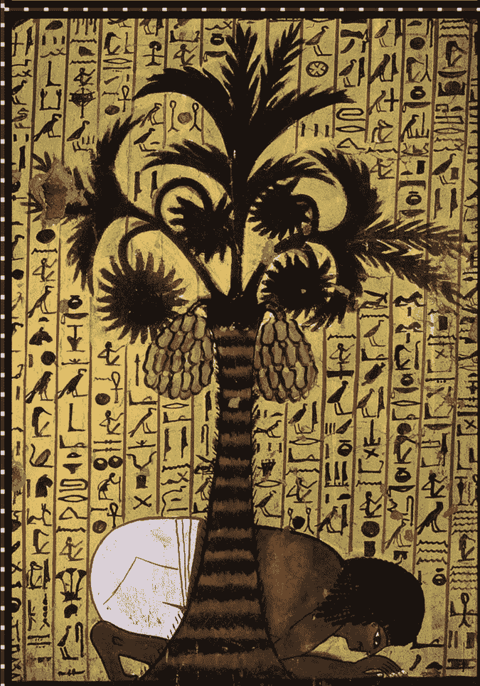

## 莱纳德·H·莱斯科其他著作

- 《古埃及双路之书》
- 《晚期埃及语词典》，共5卷（编辑）
- 《纪念理查德·A·帕克克的埃及学研究》（编辑）
- 《古埃及中王国石棺咒语索引》

## 相关文献

- 《图坦卡姆王的酒窖》
- 《古埃及宗教：神灵、神话与个人信仰》（与 Byron E. Shafer, John Baines 和 David P. Silverman 合著）

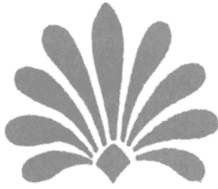

- 前言 I
- 致谢 189
- 贡献者 191

# 前言

古埃及工人的产出仍然让访问尼罗河的人感到震惊。建造金字塔运用的巨石、高耸入云的花岗岩方碑、从岩壁上雕刻的巨大形象，以及深入地下墓室和走廊的精美装饰——这一切都让我们思考，那些用我们所说的原始工具完成这些工作的人是谁？他们难道比那些统治的国王更有趣吗？他们比那些统治的国王更有趣吗？（等等，让我重新读一下逻辑）。他们如何生活，信仰什么？他们是匿名的，还是被剥削的？为了回答这些问题，我们需要当时的文献，最好是工人自己写的。只有这样的记录才能揭示他们的经济、法律和社会活动。

这个围墙村庄的形状与其所在的狭窄山谷相似，环境并不宜。周围荒凉的山丘反射着沙漠阳光的热量，古尔尼山有效地阻挡了部分盛行的北风和下方大部分翠绿的河谷。该地没有树木，所有的水必须从半英里外运进来。尽管如此，这些工人及其家人留下了德尔·埃梅迪纳乡村生活的记录，跨越了近四百年，与古埃及新王国的大部分历史平行。然而，幸存的记录对于那个时代重大事件的帮助有限。相反，它们让我们了解古埃及的日常生活：

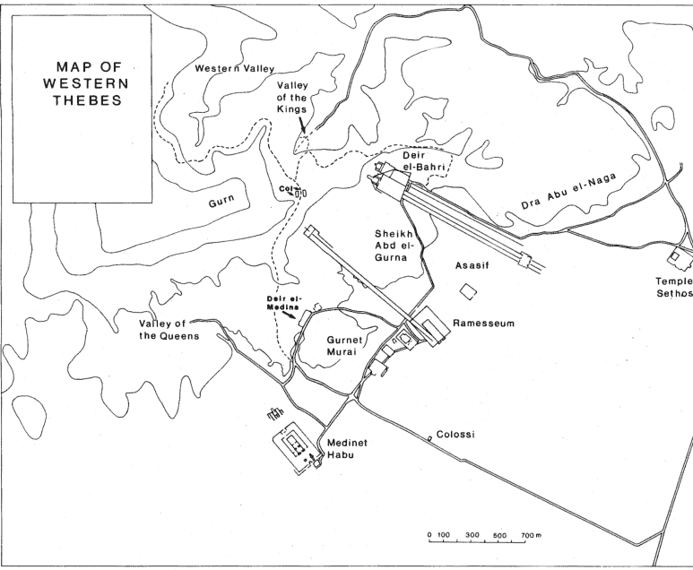

西底比斯地图。由 Mary Winkes 绘制。

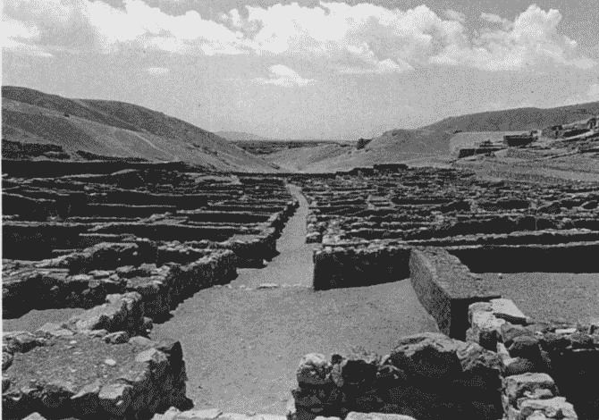

德尔埃麦迪纳村，从北向南拍摄。由 L. H. Lesko 拍摄。

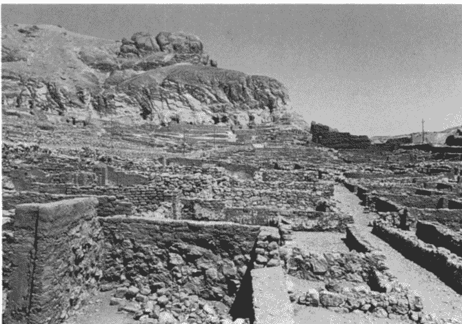

从南向北拍摄德尔埃麦迪纳。由 L. H. Lesko 拍摄。

[4]

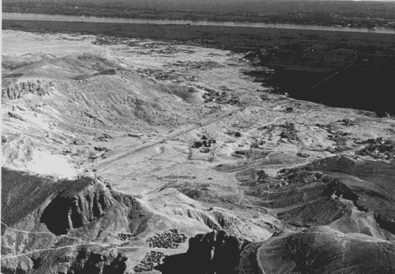

从 Gurn 俯瞰德尔贝巴哈里。工人的定居点位于前景，有一条通往王谷的小径。由 L. H. Lesko 拍摄。

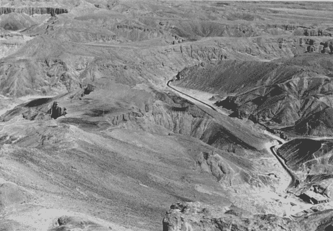

王谷（右侧）和西谷（左侧）的概览。由 L. H. Lesko 拍摄。

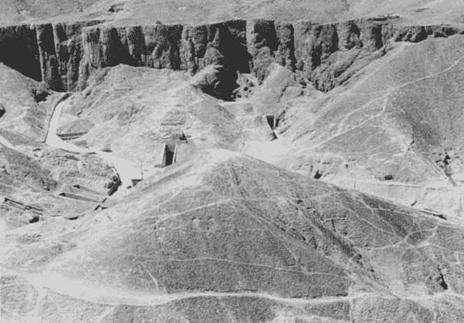

王谷的核心部分。由 L. H. Lesko 拍摄。

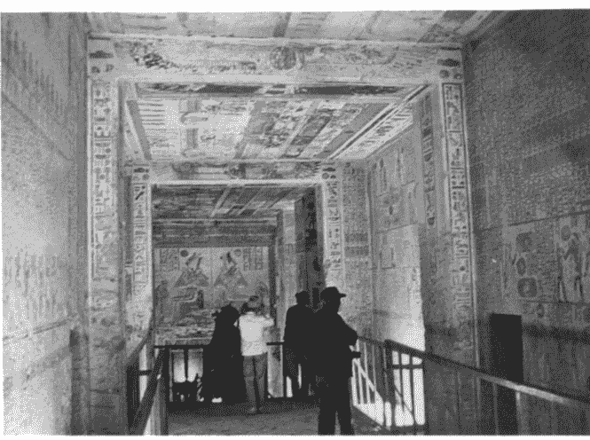

通往拉姆斯六世墓（第二十王朝）墓室的一段走廊。由 L. H. Lesko 拍摄。

[6]

# 引言

工作组织、经济、社会、教育、法律和宗教问题，以及一些难以分类的因素。

该遗址的古名是 `Set Maat`，意为“真理之地”，工人则是“真理之地的仆人”。这个社区似乎建立于第十八王朝初期，至少在图特摩斯一世在位期间（约公元前 1500 年）——他的名字在村庄围墙的一些砖上被发现——或者可能更早几年，因为村民们世世代代中都对阿尼霍特普一世和他的母亲阿姆莫斯·内费尔阿里女王怀有极高的敬意，可能将他们视为工人社区的赞助人。

第十八王朝对该遗址的占据并没有详尽记载，无论如何，它在所谓的“阿马纳纳间歇期”（公元前 1367–50 年）被遗弃，当时埃赫那顿迁走了皇室住所，并必须在埃尔阿马纳准备墓室。从本质上说，我们的故事始于第十八王朝的末期，即霍亨哈布在位第七年于西底比斯重新组建王室工作队。由于德尔埃麦迪纳的社区从附近的麦迪纳哈布繁荣到第二十一王朝的开始，我们现在讨论的是大约 230 年的时间，约为公元前 1310 年至 1080 年。显然，在村庄有人居住且许多王室墓墓工程进展的几个世纪里，早期工人的物质遗迹会被后世工人的所取代；而在后的几千年里，它们又被入侵者、附近的村民、定居在山谷的僧侣、严重的盗墓者以及游客所遗失。在经历了这一切之后，幸存下来的东西仍带给了我们许多启示。

19 世纪 40 年代在村庄附近发现了一项重要的莎草纸，在过去的一个世纪里，从该地区获得了许多文物。意大利考古学家埃内斯托·斯基帕雷利于 1905 年至 1909 年对德尔埃麦迪纳遗址进行科学发掘，为开罗埃及博物馆增加了大量文物，其莎草纸和调色板（破碎的陶片和用作写作材料的石灰岩碎片）收藏大量增长。法国考察团于 1917 年在德尔埃麦迪纳开始工作，并在伯纳德·布鲁的指导下，于 1922 年至 1951 年间挖掘了整个遗址——包括村庄、墓地和垃圾场——提供了非常充实的文献资料。通过这些，我们现在了解了多年生活在这个社区的许多人，他们居住在哪里、安葬在何处、拥有什么，甚至在少数情况下了解他们的字迹和艺术特点。基于此，上世纪在那场近乎无节的掠夺中遗失的大多数物品现在可以被重新关联。亨利·索尔特和伯纳迪德·德罗维蒂在 19 世纪收集的大量文物（目前收藏于伦敦英国博物馆、开罗埃及博物馆、卢浮宫、柏林埃及博物馆，甚至是里约内卢国家博物馆）显然都来自德尔埃麦迪纳，包括数百块石碑、雕像和莎草纸。

布鲁的季节性工作之后是初步报告的及时出版，但对墓葬和发现的完整出版进展非常缓慢。遗憾的是，布鲁似乎对他的发掘工作没有足够的控制；现在看来，20 世纪 20 年代从遗址挖掘的大部分莎草纸在挖掘进行期间被秘密运走了。

## 社会与经济考量

更高处——根据在大型墓地中发现的如带有哈特舍普特女王名字的圣甲虫，以及那些装饰有太阳石碑、带有金字塔顶的墓拜室判断，其中许多遗迹可以追溯到第18王朝，某些阿马纳时期之前的居民被埋葬在这里，但这里主要是拉美斯时期的。拉美斯时期末，为了工人和家庭的安全，他们从德尔·埃麦迪纳村（`Deir el Medina`）搬迁到不附近的梅迪尼特·哈布（`Medinet Habu`）拉美斯三世墓葬庙的宏伟围墙内。

有趣的是，这些特定的工人显然并没有在附近官员和祭司的其他墓穴中劳作；至少没有证据表明他们中任何人曾这样做过。他们是否负责建造国王的巨大墓葬庙——这是一项类型完全不同的工作，涉及砂岩的开采、运输以及泥砖的制作。尽管人们可能认为墓地和神庙墙壁的浮雕和绘画应由一个特殊的艺术家阶层完成，但墓地工人来说并非如此。幸存者显示，他们可能像早期的人那样居住在靠近耕地或神庙遗址的临时住所中。

王室墓地逻辑上设有守卫所以保护王室墓葬。村庄本身类似的哨所导致一些现代学者假设，工人处于一种极其严格的环境中，类似于被禁；关于村民行动自由的问题，由安德里亚·麦克道尔（`Andrea McDowell`）在下文中讨论。关于许多带有外国名字的工人的族裔背景问题，威廉·A·沃德（`William A. Ward`）进行了详细研究，他对可能存在的外国联系的研究为该社区提供了一个新的维度。但在之前，芭芭拉·S·莱斯科（`Barbara S. Lesko`）考察了村庄的社会环境、家庭关系以及一些法律合同和财务事务。

# 第一章

## 等级、角色与权利

芭芭拉·S·莱斯科

> 男人被询问他的等级，女人被询问她的丈夫。
>
> ——阿尼的格言

与大众认知相反，法老们的金字塔并非由奴隶建造，帝王谷中那些装饰华丽的墓穴也并非由随后被处死以保护隐藏王室宝藏的人建造的。新王国墓地建造者究竟享受到多少真正的自由和财富，是研究德尔·埃麦迪纳的学者关注的焦点。古人自己留下了许多各种记录，这些记录汇在一起，有助于对他们的社会和财务地位甚至他们的行动自由做出评估。要判断他们真正的公民自由，即他们的同胞在多大程度上能够不受他人操纵地追求自己选择的生活，要困难得多，关于这一主题的最终定论在未来一段时间内可能不会写就。

当阿马纳间歇期结束后，工人村在西比斯斯重建时，它已处于一个变化的世界中。比斯斯不再是一个力量，因为霍朗赫布和随后的第19王朝法老们看到，再次从国家北部地区进行统治具有战略必要性，自从图坦卡蒙统治的晚年以来，那里一直受到亚洲人的围困。现在，古老的比斯斯贵族和神职家族是否还存在？如果后者是阿赫那顿一神教狂热的受害者，那么前者现在发现自己被崛起的职业战士阶级所超越。军队是阿马纳时期留下的规模最大、凝聚力最强的群体——显然是国王可以重建国家的唯一机构。

根据艾兰·加德纳（`Alan Gardiner`）的话，阿赫那顿留下的宗教空白在霍朗赫布时期被“来自军队精锐的普通祭司和朗诵者”填补。这一政策在拉美斯时期得到了加速，同样，国家行政的军事化在第18王朝末和第19王朝实施。最重要的官员无疑具有军事背景，现在这些人选择埋葬在靠近权力中心的北部，例如在萨卡拉（`Saqqara`）伟大的孟菲墓地。值得注意的是，在埃及文化中，很少见到颂扬个人英雄行为的作品，也没有肖像。

## 社会与经济考量

### 陵墓的管理者

新王国时期埃及最有权的文官是法老的宰相，他担任庞大文官机构的监督者和国家首席法官。这位受信任的官员还被赋予了建造王陵的责任。因此，在拉美斯五世统治时期，当陵墓工人向他们的宰相送了两把银凿作为礼物时，他们是在表达对他们最依赖的官员的感激与忠诚。无疑，正是由于责任的高度以及其劳动的“机密”性质，使得陵墓工人直接受最高民政当局的控制。宰相代表法老下令并视了该项目，并从墓地社区手中正式接收了完工的陵墓。这些及其他物资的交付是他在底比斯办公室职责之一。尽管在第19王朝和第20王朝通常有两位宰相，但上上埃及的宰相并不住在南方；有记载显示宰相曾亲自视察王陵的进度并访问工人村庄。知道自己是直接为法老工作且仅对国家最高官员负责，这一定让王陵的工人在同胞眼中拥有极大的威望和尊重尊重。

从理论上讲，所有的陵墓工匠，特别是他们的监工和书记员，都是由宰相直接任命的。确实，当工人遇到严重问题（例如对某个监工的不满）时，他们觉得可以向宰相寻求援助。然而通常情况下，监工是他们的领导，代表当局维护他们的利益并听取他们的诉求。在局势高度紧张、工匠们领不到工资时，当时的一名监工为了维护下属而反对管理层——而陵墓书记员则诉诸威胁使罢工者回到岗位。¹¹⁰

同时负责王陵两侧的两名监工（分别负责两支队伍，被称为“右侧”和“左侧”）理应负责日常监督工作。他们与至少一名书记员在一起，被视为陵墓工人的管理者（`rwdw`）或首领（`ryw`）。这个小组负责维持工作场所和村庄的秩序，并在周末坐在当地法庭审理诉求。法庭的决定由监工执行。如果由于工作需要向宰相办公室发送信件，监工通常是指定的联系人及回复的接收者。尽管监工们可能识字，但信件更有可能是由陵墓的官方书记员撰写的，因为他受过公文写作规范的专门训练。

书记员的数量似乎随年份而变化：有时只有一个，有时每侧各有一个。在拉美斯时期晚期，雅罗斯拉夫夫·切尔尼（`Jaroslav Černý`）发现当时有多人同时在。监工关注的是技术工作、进度以及工人本身，而书记员的责任是记录和其他行政文书工作。他每天在陵墓里（坐在一旁，记录谁缺勤，并记录重大事件：向劳动力交付物资（如官员视察）等。他编写了一本陵墓日记，最初在石片（`ostraca`）上做标记，后来在莎草纸卷上将笔记正式化。日记的摘录被寄送到宰相办公室。比起任何人都，书记员都是政府利益真正的现场代表。但他的记录能力并不严格局限于王陵事务。他至少在周末会在村子里，撰写各种文件，如誓词、遗嘱和买卖契约。不清楚这是否被视为其职责的一部分，或者他是否对此类服务收费。许多工匠自己就能阅读甚至书写；绘图员显然需要，因为他们是在陵墓墙壁上书写文字的人——并且经常自称为“书记员”。然而，由于与神的沟通必须表述绝对完美，陵墓的专业书记员撰写了呈给阿蒙霍特普一世神谕的问题。¹¹

切尔尼认为，书记员实际上接收了铜工具、灯具、木材和其他工作中所需的原料的交付；在记录了此类交付后，由他负责将其存入仓库并随后分发给工人。由于这一点（加上典型的自夸），陵墓书记员随后会被称为“真理之地的财库监”。向员工发放工资粮的其实是这个书记员。承担着这样的责任，难怪他有时不得不从农村生产者那里收集食物，以弥补政府未能按时交付的物资（发工资日本应是每月二十八号，但交付经常迟到）。¹² 每天向村庄运送水和食物供应的搬运工也受书记员管辖。

## 陵墓工人的收入

军事对新王国的影响可以在德尔麦迪纳（`Deir Medina`）看出，霍朗赫布在那里。在墓内，工匠被组织成两个“队伍”（使用的词与海军语境中的相同：`isw t`），最初村庄的住房安排也是如此。有趣的是，正如卡德里（`Kadry`）所指，陵墓工人的工资粮虽然充足，但并不像部队那样奢侈（士兵有肉吃）；陵墓工人通常只有谷物和蔬菜配鱼。由于献给神的祭品包含肉类，可以推断陵墓工人的收入是多样化的。

## 社会与经济考量

钥匙、谷仓和仓库——他们经常将这些租给他人。已知某些工匠团体持有同一名仆人的劳动力股份，一些人甚至拥有自己的私有奴隶。他们是如何管理如此巨大的投资的？

多年前，埃及学家们一直认为，王室墓地群中的墓墓工人们在生活上完全依赖国家，并且是相对贫穷的个体。像威廉·埃及特（`William Egypt`）这样的学者曾认为，在当时，私人投资和商业活动是不为人知的，“一切世俗的成功都与公共服务挂钩”。20 近年翻译和分析的德尔埃麦迪纳（`Deir el Medina`）陶片（`ostraca`）显示，许多工人在当局显然没有没有异议的情况下，正在生产可销售的物品，并在底比斯更广阔的世界找到了市场。21 简之，显而易见，这个村子里的人通过下班时间的工作创造了真正的财富。他们似乎被要求在墓穴每天工作八小时，而他们官方规定的每十天“周”休息一天，往往会变成为期两三天的周末——很可能是由于管理人员之间的冲突所致。除了为他人撰写信件和合同收费外，一些稀缺的装饰棺材可能还制作并出售《亡灵书》的副本，因为在墓中建造脚手架的木匠也为邻居制作了棺材、床、椅子、箱子和桌。一个名叫贝肯韦尔诺（`Bekenwernero`）的人因其中一件获得了91德本，另一件获得了52德。22 雕塑家和画家被聘佣装饰私人墓地和神庙，雕刻奉祭和葬礼碑以及神像。一些前工人候选人——无疑对宰相的决策具有极大影响力——接受了贿赂。23 鉴于这些各种收入来源，而且政府不仅提供住房和粮食配，还提供燃料、鱼、蔬菜以及用于烹饪、照明和涂抹的油脂，工人们可能能够储蓄用于偶尔的奢侈消费和更严肃的投资。

劳动力中职位的世袭性质表明这些工作是受重视的，工人通常对自己的命运感到满意。尽管他们的收入和可能的社会地位也许如此，但正如巴里·坎普（`Barry Kemp`）所观察到的，村子里的人有机会接触高级官员，对生活的追求也影响了他们，提升了村民的期望；坎普在他们中发现出一种“虚荣”感。24 无疑，他们受皇室雇佣赋予了这种

## 阶级、角色与权利

工匠在购买者眼中享有声望，并且无疑为他们带来了许多来自村子以外的订单，但一个工人的实际财务成功，将直接取决于他自己在空闲时间从事额外工作的主观积极意愿和雄心。财富并非普遍现象；尽管一些工匠能够拥有房产和牲畜，但他们负担不起专业的殡葬师来照顾他们的死者。记录中经常出现因亲属去世去埋葬而缺席的情况，通常在缺席一二天后才被记录；25 因此，完全木乃化——需要七十天和许多昂贵的液体——在拉美西时期的埃及一定是一种奢侈品，超大多数这些工人的能力。此外，村庄留下的纪念碑——墓穴、雕像和碑——在尺寸和精细程度上差异很大，从陶片中熟悉的某些个人似乎并没有给他们留下多少碑。

## 社会地位、影响与流动性

社会地位不仅取决于财务状况；在这一才华横溢的工匠组成的紧密群体中，家族声誉和人脉、教育以及个人技能可能同样重要。村里孩子之间发生的婚姻（有时是堂表兄弟之间，有时显然不顾及父母的阶级）似乎表明了村里所有人之间的一种民主化融合。但不应忽视的是，在顶层形成了一个强大的派系，通过占据当地法庭的大多数席位，控制了司法程序。26 已知这些有影响力的镇民对他们更卑微的邻居表现出蔑视和残忍。例如，考虑这样一个案例：一个男人寻求他们的帮助反对一位显赫草图师的儿子，因为那个年轻人诱引了这位更贫穷的请求者的未婚妻：这个更贫穷的人本人遭了法庭参与者的毒打，这些参与者无疑对捍卫精英阶层的行为很感兴趣。27 工头和书记员利用船员成员的劳动力为了其自身目的的权力也经常被记载。28 因此，除了在劳动力本身之外，一些村民所拥有的优越知识和技能赋予了他们更大的声望和影响力。这种社会分层可能导致在阿蒙霍特普一世当地崇拜中，瓦（平民）祭的职位仅限于某些家族。29

## 社会与经济考量

尽管如此，村子里仍存在某种社会流动性。著名的书记员拉莫（`Ramose`）或他的继承者肯-赫普赫普（`Ken-herhephep`）最初并非来自这个社区。他们从其他地方的书记岗位被提升到该社区的管理层（拉莫之前的职位位于西底比斯的图特摩四世神庙）。然而，在我们最熟悉的这个社区历史的230年里，大多数书记员是墓地的其他书记员，或者至少作为工人之子在村里接受过教育。雕塑家之子安克（`Ankh`）是一名书记员，在拉美斯二世统治时期担任梅瑞姆斯（`Merymese`），尽管他的父亲是一个工人，所以如果村里的儿子愿意留在学校足够的时间并精通写作和创作，就不会受到阻碍。然而，让儿子进入工匠劳动力可能需要影响力，通常表现为大额贿赂的形式。30 有一个在村里从小奴隶开始生活的人最后以船员中自由工匠的身份结束，无疑他赢得了他有影响力的主人（在这种情况下是一个工头）的信任和支持。31 一些工头出身于工人：卡希（`Kahi`）是一个木匠儿子；帕内布（`Paneb`）从石工开始，是一个工人的儿子。

# 社区的妇女与儿童

证据显示家庭很大，村子里有很多年轻人——在人口时期可能多达两百人——其中许多人被投入当地杂务并不意外。他们的一些活动反映在艺术和文本中。插图陶片显示女孩和男孩照看牛，几幅还描绘了一个带着系绳的猴子狩猎。其他男孩正在烧陶罐，因此各种当地工匠可能得到了年轻人的帮助。向帝谷工作的工匠交付食物供应被分配给一个大型男性团队，“他们每天轮换”。

似乎工头们需要识字，以监督那些草图师，他们无疑是识字的。对阅读和写作的培训不仅适用于书记员之子，也适用于大多数年轻人（在关于社区历史的非常晚期发现的陶片中，提到了那些加入工人团的年轻人，这种熟练程度是可能的，而不只是书记员的，那些加入工人团的年轻人被称为“墓穴的孩子”）。尽管信件显示女性准备食物，但显然，女性将食物递给工人团是不被允许的。陶片描绘了年轻女孩从事游泳、划船和捕鸟等休闲活动。我们不知道平均女孩在什么年龄结婚，尽管无疑是在青少年时期。年轻人被建议“早婚”。德尔埃麦迪纳的记录为我们提供了关于新王国的大部分信息。书记员、工头和工人的妻子在这个孤立社区的围墙内共享同样的生活，尽管书记员和工头的家庭住在最大的房子里。然而，似乎意义重大的是，在名字中使用宗教职位的女性中，绝大多数是嫁给书记员或工头的。她们侍奉大神阿蒙-拉（Amon-Re）的后宫，并拥有该神的 `sẖmy.t`（女唱）甚至 `wbt.t`（平民祭司）头衔，以及哈托（Hathor）和穆特（Mut）等其他主要的 `sẖmy.t` 和 `hys.t`（歌手）头衔——可能是在他们村里的神庙和神龛中，尽管由于书记员在描写这些女性时似乎强调了她们的宗教地位，她们很可能是位于西底比斯更主要的神庙的员工。

在高级祭司潘赫与库什人之间的战争发生在我们历史的结束时，留在社区的青少年男性像他们的父亲一样面临被征入军队的可能性。记录显示，一些年轻人实际上逃过河到达人口更多的东底比斯以逃避这项任务。事实上，这个狭窄的社区既不是一个吸引人或舒适的居住地（除了为了职位的安全，年轻人可能无法逃离）。

# 社会与经济考量

发现一个工人的妻子的葬礼纪念或许愿碑上记载有宗教头衔，这是非常罕见的。因此，与神庙建立正式联系似乎很困难，除非该女性属于村庄的上层阶级，这可以推断出对财富和丈夫（或父母）地位具有明确的阶级区分意识。

我们还应该提到女性头衔 `rhyt`，即博学或占卜女性。正如 Joris F. Borghouts 从陶片（ostraca）的几次提到中所得出的，这种女性似乎拥有预测事件的能力，并被咨询以解释“神的显现”：如疾病、事故或神谕启示。我们并不知道这样的女性（她从未被命名）是否会因帮助他人而获得报酬。在其他文化中，“智慧”女性通常准备草药并协助病患，或担任产婆，但在这个村子里，其中一名工人获得了额外的报酬，并被准假去行医。

村里所有的女性都有共同点，即她们没有住在自给自足的家庭中，而是依赖雇主（在这种例中是国家）。她们直接得到了雇主的帮助，国家提供了一名共享制的女佣，由她走家挨户进行繁重的磨谷工作。多年来这些女人的可用数量；每个家庭每月有几天似乎是常态。

墓碑和石碑上每个已婚女性形象旁带的头衔是 `nb.t pr`，翻译为“家庭女主”或“女主人”，这暗示了生活围绕着烹饪、织造和育孩子展开；即完全是家庭的、室内的职业。底比斯的画作很少表现女性的活动，更倾向于描绘妻子坐在家人中间或在她的神灵前祈祷。这种绘画中固有的偏见在其他地方已被暴露。尽管如此，它仍然开始读像一份来自第二十一王朝的目击记录，由墓地书记 Buteham 编写，描述了他的妻子各种丰富而艰辛的活动。在一封信（不幸的是现在有许多残缺）中，在他亡妻棺材旁，他回忆起美丽的 Ikhtay 过去如何照顾夫妻的许多田地和牲畜，例如，并搬运各种重物。考虑到 Ikhtay 和 Buteham 终其量是一个书记员家庭和有产者，妻子在家里之外有如此多样且艰辛的职责，这令人惊讶。或许这

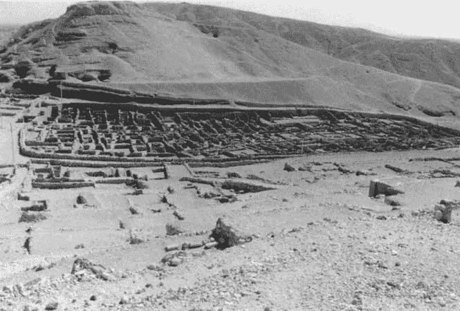

从西部拍摄的德尔麦迪纳（Deir el Medina）。照片拍摄：L. H. Lesko。

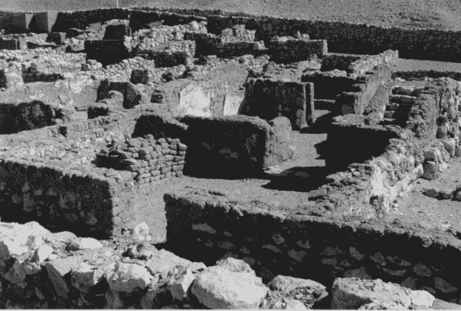

德尔麦迪纳的一座典型房屋。照片拍摄：L. H. Lesko。

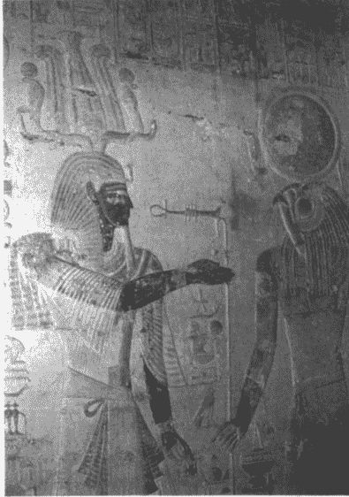

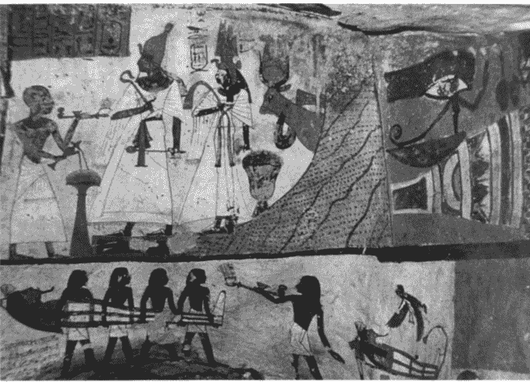

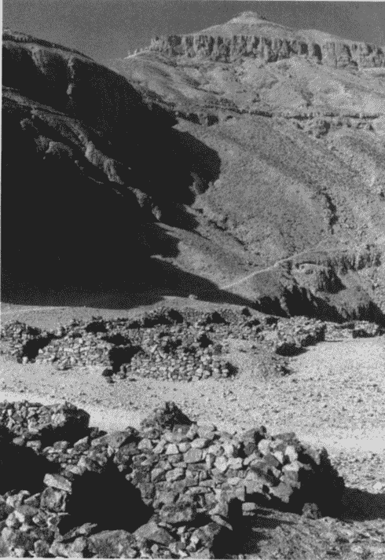

对面，上方：低浮雕，美内涅普塔国王（Merneptah）的墓葬（第十九王朝）。照片拍摄：L. H. Lesko。

对面，下方：祭奠亡王室成员：曼图霍普普（Mentuhotep）和阿赫莫斯·内费尔塔阿里后（Ahmose Nefertari）在“西方的夫人”哈托尔（Hathor）面前，来自 Gurnet Murai 的阿蒙-姆-奥内（Amen-em-one）的拉美西时期墓葬（TT # 277）。照片拍摄：L. H. Lesko。

上方：工人定居点。照片拍摄：L. H. Lesko。

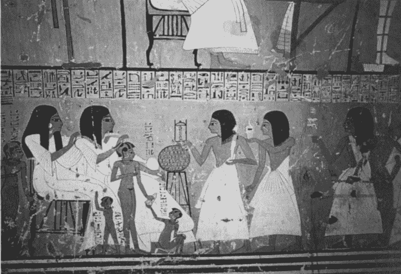

伊普（Ipuy）的墓（TT # 359）中的生活场景。

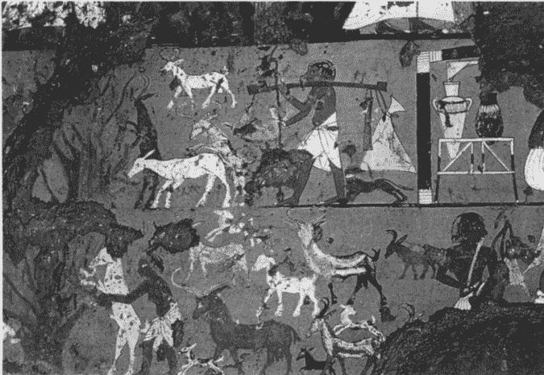

哈考（khau）（TT # 217）。

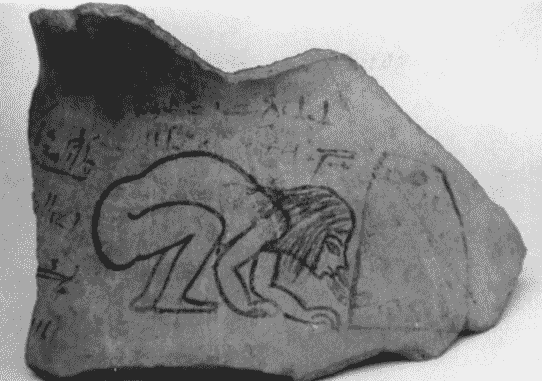

烤炉旁女性的陶片。收藏于：莱比锡。

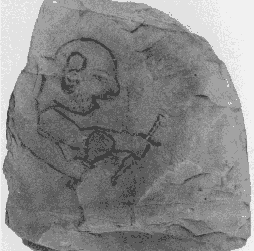

未胡须石工的陶片。收藏于：剑桥大学博物馆（EGA. 432a-1943）。

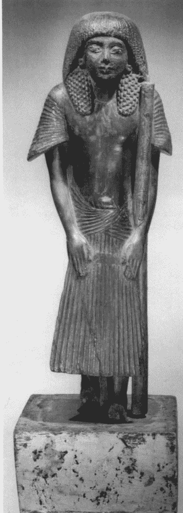

拉莫斯（Ramose）木雕。收藏于：国立博物馆。

妻子以她的宗教头衔正式称呼她，要了豆子配面包，因为他不喜欢单独吃面包。另一位书记员要了莎草、笔和写板。这些和其他记录表明，书记员的女性亲属不仅能读简单的信息，而且妻子或女儿可以像书记员的助手一样可靠。确实，在我们社区的历史后期，当书记员塞梅诺普特（Senamenopot）不在城时，是他妻子赫努塔维（Hennawi）负责发放物资。

有些人类学家可以证明，女性对家庭管理具有影响力，也可能对子女的经济和婚姻未来产生影响。同样，一首发现于德尔麦迪纳的情歌将母亲描述为求婚者请求女孩之手时面对的父母，尽管双方都被提到在世。那些陶片显示，父亲们在女儿的婚姻不尽人意时积极照顾她们的福利。一位父亲要求他的未来女婿下誓，如果他遗弃妻子，将甘受一百鞭打，并没收他与妻子在婚姻期间积累的所有财产。另一位父亲向他的“好女儿”承诺了一处财产，以防她将来被赶出去。

婚前异性间的交往是可能的（如情歌所示）；男女双方都会沉溺于酒精；每个人参与公共庆祝的情况在陶片中都有记载。

许多村里的女儿通过与村里的男子结婚而留在那里（尽管有些人由于原因嫁给了外人或为了工作而离开的人）。切尔尼（Černy）观察到，埃及家庭中没有家长家长（paterfamilias）。正常情况下，年轻夫妻不住在父母家庭中，而是自立门户，正如贤言所建议的。某些婚姻（特别是有产家庭之间）可能是安排好的，但在一个小村子里结婚往往意味着和堂亲结婚。因此，在人类学术语中，村里的妻子并不是

# 地位、角色与权利

“通过婚姻加入其血缘的外来人，”以及他们的地位权利和丈夫对妻子的义务，由于女性自身的支持性父母在近处，所有这些都更容易得到保障。

关于婚姻或婚礼安排的情况为人知较少。古埃及平民并非一夫一妻，但在古埃及，同居可能与正式的婚姻一样寻常，特别是对于那些第一段婚姻因离婚或去世而结束的老年人来说。有一份记录提到，一名工人将他所有的物品都带到了一个女家中，希望能搬进去，但被拒绝了——两次。来自德尔埃拉麦迪纳（Deir el Medina）的另一份文件提到，一名工人称，他带着一捆口粮（新花环？）来到工匠 Payom 家中，并“让她的女儿成了我的妻子”。婚姻文件的稀缺表明，大多数年轻夫妇的财产很少，不足以办理法律程序。在结婚多年并积累了共同财产后所达成的离婚协议和遗嘱则更为常见。女性可以根据自己的意愿制定自己的遗嘱，正如著名的纳纳克赫特（Naunakhte）案例所示的那样。

> 上下埃及国王、两地之主，33年，泛滥季第4月第5日，Usima-re-skheperene（L.P.H.）[愿他长寿、繁荣、健康]，拉之子，显现者之主阿图姆，拉姆斯-阿蒙霍谢普-米阿蒙，永永生。
>
> 代我宣告，我是法老土地上的一个独立女性（L.P.H.）。我养了你们这八个仆人，并给了他们家具——像往常对待他们一样的一切。看吧，我已经老了，看吧，他们却没有照顾我。他们中任何帮助过我的，我将把财产留给他。至于那个没有给我帮助的人，我不会从我的财产中分分给他。

这位“独立女性”使用了“nh.t nt niwt”一词，该词被翻译为“公民身份”。这个词使用的广泛程度很难说，但在德尔埃拉麦迪纳，女性在行政和法律文中通常会被提到，并额外附有“墓地”（hr），尽管她们并不被认为参与了墓地本身的工作。纳纳克赫特无疑是在强调她享有与男性相同的法律权利，并可以随心所欲地处置自己的财产。她的儿子和女儿都在她所点名的继承人名单中。在古埃及，女性可以独立买卖财产、收养子女并提起诉讼。摩西（Mose）的案例也表明，比兄弟姐妹（无论性别）年长的女性可以被法院选择担任兄弟姐妹的遗嘱执行人。

在任何前工业社会中，女性在家庭中的责任都是多且且持续的，至少从日出持续日落。由于许多女性没有活到经期年龄，已婚女性的一生可能大部分处于怀孕或育养幼童的状态。德尔埃拉麦迪纳几乎所有的家庭在可能两倍于此的怀孕中，都要生下十个存活的孩子。东部墓地底部的大量胎儿和婴儿墓葬印证了这种损耗率。

幸运的是，政府不仅为艰辛且耗时的磨谷工作提供仆人帮助，还为这些住在离河几英里外的家庭主妇提供洗衣服务。这个社区的女性享受到一些优势。尽管如此，她们多样的活动对村庄经济至关重要。多米尼克·瓦贝莱格指出，女性被要求的一项任务是为她们在墓穴地下工作时所需的许多灯具制作灯芯。有记录提到向村民交付旧头布，以及收集由这些头布制成的成品灯芯。

正如埃及的任何地方一样，面包的烘焙具有至关重要的意义，因为这是古代饮食的主食。准备其他食物也不是女性的责任。如果养了山羊，无疑会制作奶酪。鸡蛋从某些家庭拥有的母鸡中收集（有些女性可能向邻居售卖鸡蛋）。村子里还养着小群猪，不仅作为肉类供应，还作为一种卫生措施，妇女或孩子无疑会照顾这些及其他动物。较富裕的，如书记员家庭，也饲养牛。书记员霍里（Hori）用两头公牛（加上一些衣服）换了一套棺材。这些大型牲畜可能不是养在村子里，而是在它们耕作的田地附近。

在销售交易中使用衣服并不稀奇。在拉姆斯二世统治第16年，一名旅行商人将一名年轻叙利亚女孩卖给西底比斯的公民 Irynefer，这位家庭主妇同意了 41 凯（kite）银的价格，其中一半价值由她从邻居处购买的亚麻衣物和小铜碗支付（这正是为了抓住这种可以从旅行商人处进行大采购的机会，因为旅行商人想要易于携带的物品作为交换）。正如艾兰·加丁纳（Alan Gardiner）指出的，这些衣服很可能是由家庭主妇自己制作的。

## 社会与经济关注

人们经常忽视这一点：在这个没有货币的社会里，一个优秀的织女和缝纫能够显著提高其家庭的购买力。正如德尔埃拉麦迪纳的记录所示，政府会向作坊的男性发放一些衣服作为年度薪水的一部分，但数量很少，这特别会让那些没有足够衣服穿的男性获益。村里的一些女性可能在与神庙相关的织造工作坊工作，但另一些肯定是在家里工作的。当我们知道一个平民木乃伊的包裹布可能有几百平方米的亚麻布时，就能看出家庭中进行的织造量有多大。可能所有家庭都有拥有织布机的手段，有些女性可能从未学过这些技术。更富裕的家庭，如书记员家庭，也养牛。书记员霍里用两头公牛（加上一些衣服）换了一套棺材。女性在纺织和制作衣服方面的技能可能足以维持自己和家庭，一个精明的女性可以成为家庭的支柱，无论她是否有丈夫。当政府采用货币后，女性在经济上处于了劣势，尽管在农业经济中总能为家庭提供收入。

在拉姆斯时期埃及，女性是家庭的管理者和财富创造者，这一事实可能体现在文学中的性别平等中，这种平等得到了学术研究的证实。

# 工人权利

工匠社区的积极方面之一是，工人及其家庭是自由公民，这意味着他们可以寻求法律救济。理论上，任何埃及人都可以向宰相申诉，有权由同辈进行审判，如果对民法庭的判决不满，还可以向神谕上诉。我们的工人在妻子的陪伴下，在工资延迟、低于预期且饥饿成为问题时，发起了历史上第一次罢工。通常情况下他们的薪酬优厚，但当詹森（Janssen）认为他们与大多数人口相比“真正出类且卓越”时，显然过于乐观了。在我们能最好记录的 230 年里，问题一直存在。

作队的工人可能不是奴隶，但对于那些选择虐待他们的人，他们毫无手段。书记员和工头经常为自己工作。人们被命令为书记员肯-赫 谢普（Khen-her-khespf）搬石头。管理者要支付工人提交的账单。工头帕内布（Paneb）强迫村里的五名女性（妻子和未婚女）无偿为他制作衣服，并在被制裁之前长期被指控犯了其他罪行（包括谋杀和盗墓），因为他在墓穴管理中受到了保护。显然，权力傲慢比薪资标准更为重要。从他们的课本中可以得知，书记员认为自己优于他人；工头拥有命令和晋升的权力，掌握着工人的未来，经常为了索贿而发放预付款。这些男人——以及她们通常担任神庙神职的妻子——很容易中产阶级。工匠的财富通过他们获得的额外工作获得，他们在队伍中的地位（因此在村庄里的地位）要脆弱得多。行政记录还显示了皇家墓地工匠人数的剧烈波动。即使在一个统治时期内，他们的人数也有很大变化。考虑到队伍中，到该统治结束时只剩下 32 人，而其他人去了哪里？他们仅仅是转移到了其他工程吗？

这位多产建造者在陵墓建成后，他的项目去哪儿了？很有可能是他们的专业知识被用在了其他地方。另一方面，第二十王朝在修建陵墓工人的数量从拉美斯三世的40人扩大到拉美斯四世的120人（为了建造他的陵墓）后，人数突然减少了一半。宰相给工头的命令得以存：“让这六十人留在队伍里，随你们的挑选，把多余的人送出去。下令他们成为你们的奴隶，为你们劳作。”因此，工头拥有决定谁留下、谁离开的权力。请注意，他并没有被要求解雇最后雇用的人；相反，他可以选择某些人，让他们立即承担起征召劳动力（或如 Černý 翻译的术语 `smdt` 所的奴隶）的杂务，即为他们的前同僚运送口粮——相应地，他们的工资也会大幅下降。很可能，他们的家庭也失去了留在村庄的权利，因为服务亡葬城的 `smdt` 并不住在墙内。现在可能，这种对待熟练工人的粗暴方法是第二十王朝特有的，但它提醒我们，埃及在任何时候都是一个东方专制国家，在那里所谓的自由人完全取决于王室意志的摆弄。新王国埃及的工人没有组织成行会，行会本可以提供社会经济保障的团结；相反，劳动力队伍中的所有人都属于法老，在国家面前基本上是无力的。

这个巨大的金字塔和高耸的寺庙不是在不付出巨大生命代价的情况下建造的。埃及为了统治者更大的光荣而弯下腰，一个被征召进入工作队或服兵役的普通人，除非他足够富有或认识有影响力的人来买通国家的执吏，否则别无他法。陵墓工人可能得到了国家的良好供给（用现代比喻来说，他们的主子知道机器在润滑良好时运行得最好）。安全考虑也发挥了作用：没有任何法老会冒着让附近的贫穷绝望的人去冒险自己的陵墓和宝藏，因为这些人知晓计划和位置。但工作保障、公民自由、自决都是现代概念，是法老工人无法触及的。

# 与外界的接触

安德里亚·G·麦克道尔（Andrea G. McDowell）

德尔·麦迪那与那个时代的任何其他村庄都不同。住在那里及其家人的工人比绝大多数同龄人受过更好的教育，薪水也更高；他们是佃农土地上的手工艺者；并由宰相办公室直接管理。正是因为其独特的特征，特别是其沙漠位置和居民极高的识字率，我们才对这个村庄如此了解，但其特异性也意味着，我们从德尔·麦迪那学到的东西可能并不埃及的其他地区。人们假设，尽管陵墓建造者生活和工作的环境特殊，但他们并与其他埃及人完全不同，因为他们与外界的同龄人有互动。如果他们在西部市场买卖，与底比斯人口通婚，并访问底比斯神庙，那么德尔·麦迪那的价格、婚姻习俗和宗教信仰很可能反映了大社会的情况。当然，如果他们与其余人口几乎或完全没有接触，那么来自工人社区的数千份文本对于我们理解整个新王国的关联性就会小得多。

许多研究德尔·麦迪那材料的学者都明确或含蓄地同意，村民每天都与外界有交流。然而，拉斐尔·文图拉（Raphael Ventura）在《死者城的生活》（Living in a City of the Dead）中描绘了一幅完全不同的图景。他从一个假设开始，即当局惯例会理所当然地将工人与普通人群隔离，以保守皇室陵墓位置的秘密，因此工人及其家人与埃及同胞完全隔绝。围着村庄的墙将“囚犯”关在里面，将外人隔在外面；希望在外界看亲属的村民将被护送到亡葬城的行政总部，在那里将在受控条件下会面。即使是亡葬城的供应人员也不能自由地接触工人，简而言之，他们被完全与同代人隔绝了。

工人的孤立是文图拉的一个前提而非结论，尽管他引用了许多他认为证实了这一观点的文献。恰好，那些认为工人可以随心所欲离开的人并没有自己的观点提供完整的论证，尽管显然，他们的立场是基于这些学者在其他语境下讨论的村民与外人接触的许多例子。要彻底检查所有关于皇室亡葬城孤立程度的文本和纪念碑数据需要专门的专著，但我在这里展示一些证据，表明工人的活动并没有像文图拉建议的那样限制。当然，我大量引用了在雅罗斯斯拉夫·切尔尼（Jaroslav Černý）、扬·J·詹森（Jan. J. Janssen）、多米尼克·瓦尔贝（Dominique Valbelle）等人的著作中收集的接触案例。

互动似乎是在正常工作范围内规模最大发生的。当队伍扩大时，会从其他地方引入新工人；当经常发生的那样，村子里男孩太多，无法所有人都在队伍中找到工作时，多余的人会被带走。我们对工人从其他项目转移到亡葬城的过程知之甚少。新来者似乎在社区的早期最常见，尽管这种印象可能是由于第十九王朝墓墓和石碑较多，它们提供了最有用的谱系信息。新兵是从许多不同的机构中被选出的——我们不知道是如何选的。⁵ 至少有两个来自纳什克的队伍成员：帕谢德（Pashed）从他作为“阿蒙工坊的仆”的位置被转到村庄，带上了他的妻子，她是底比斯神庙的一艘船只的女儿；⁶ 而雕塑家肯（Ken）是纳什克一位雕塑家的儿子。⁷ 在此之前，书记员拉莫塞（Ramose）在拉美斯二世第5年加入队伍，另一方面，他在图特摩斯四世的墓葬庙和别处担任过官职。⁸ 书记员阿蒙佩特（Amen-epet）与库什有联系，因为他的父亲是那双土地王座之主阿蒙的祭司，而阿蒙-佩特本人声称在库什的同一阿蒙神庙担任祭司。⁹ 这些新招者都在拉美斯二世时期生活和工作。¹⁰ 此后，工人显然设法让自己的儿子获得了职位。¹¹ 然而，在拉美斯四世时期，当队伍人数增加到惊人的120人时，并非所有新成员都是从村庄本身招募的。由于他们来自哪里，但若干年后当队伍缩减到原始规模时，多余的工人加入了供应人员。² 这种从队伍到外界的人员转移可能是唯一的，在较小规模上这种转移经常发生，在普通时期，村里的男孩多于工作队的空缺，许多人不得不离开。那些父亲为他们提供了教育，推测是为了在外界取得良好成绩，但我所知道的唯一案例是工头内霍特普（Nehotep）的儿子们：其中一个成为了军队书记员和国王的战车武士；另一个担任过各种职位，包括拉美西姆庙的门卫。¹³ 有时，队伍会被“借用”出去，用于用于在皇室亡葬城之外的神庙和陵墓的建筑工程，并且确实带有与其他机构有联系的头衔。¹⁴ 一份残缺的纸草稿记录了涉及多个机构在极大规模尺度上合作的行动：总计450人——（120名精兵）、60名警察、40名真理之地的进一步员工、一名船员和其他——据说从事“拖曳”（ith）；¹⁵ 他们显然被雇在位于阿蒙斯内法特阿里神庙和拉美西姆庙之间的某处神庙，离村庄不远。¹⁶ 在其他时候，单个工人或

### 社会与经济问题

一些小组被安排去执行外部项目。例如，在第十九王朝时期的一份文本中，工人霍尔莫塞（Hormose）提到他曾“在马阿特神庙的谷仓工作”，那里是卡尔纳克巨大建筑群的一部分。17 晚后，该帮派的成员曾在“哈托尔神庙（pr Hwt-Hr）切割石块”，地点可能在格贝莱因附近。18

通往村庄和德尔巴哈里神庙的道路非常通畅，有多处关于个人前往那里或返回的记载。19 至少有一组出发后欢快地回来：“第一年，第1月13日。这一天，阿哈提（Aahty）、孔蒙苏（Khonsu）和两个来自德尔巴哈里的男孩来了。他们告诉潘布（Paneb）要去德尔巴哈里了，因为法老没有派遣他们。”20 这些人显然预料自己会被安排在德尔巴哈里工作，而且还有更多该帮派参与项目的案例。21

工人可能在较小的活计上兼职。例如，工匠霍里（Hori）开始绘制奥西里斯（nsmt）的神圣背板，这类物品可能被带到了村庄，但更有可能是他去了某个神庙作坊。22

塞尔尼（Cerný）建议，存在属于阿蒙或托特的“的采石场工人”，几位工人在象形文字铭中采用了这一头衔。由于这些头衔具有很强的针对性，在某些情况下甚至指出了工人所属的卡尔纳克或卢克索神庙，这确实意味着这些头衔持有者在这些神庙执行工作。23 塞尔尼指出，大多数采石场工人生活在拉西姆二世统治的后期，24 当时帝王谷已经没有给他们的工作可做了，他们显然被雇佣到了其他地方。

有人建议，工人曾被派往哈姆马特山谷（Wadi Hammamat）和杰贝尔·埃西拉（Gebel Elsila）的采石场运送石头。塞尔尼收集的关于帮派成员出现在哈姆马特山地的证据非常充分。25 在拉西姆四世的第三年，至少有一次前往哈姆马特山谷“真理之地”的远征，该地点的四处铭文均有记载。26 其中一条铭文是由“真理之地的书记官内费尔霍特普（Neferhotep）”留下的，可能是在德尔埃麦迪纳、拉西姆三世统治后期的书记官内费尔霍特普。27 此外，著名的哈姆马特山谷采石场地图曾掌握在德尔埃麦迪纳的一位书记官手中（该地图的背面写有三段关于当地事务的文本），这至少表明村庄里有人对该地的地形感兴趣。28 这张地图可能是在拉西姆四世统治期间绘制的，因为远征发生在他的统治时期，而且有些莎草纸也对这位国王的雕像有描述。因此，有有力但非定论性的证据表明，帮派的一个或多个成员参与了前往哈姆马特山地的远征，为底比斯墓地带回石头。前往杰贝尔·埃西拉（Gebel el Silas）采石场的类似远征由该地的一处破碎铭文证实，铭文提到了要带往底比斯的东西，并提到了那群将带走某些物品的暴民，而这些物品的名字已失传。29 日期是梅尼尼普塔第二年，夏季第4月，第6日。除了书记官内费霍特（Neferhot）写的那条铭文外，据我所知，哈姆马特山谷和杰贝尔·埃西拉的涂鸦并不包含任何帮派成员的作品。30 然而，如果远征中的工人大多是不识字的采石场工人，这将令人惊讶。

除了有充分证据表明帮派成员被分配到王室墓地之外的项目外，一些迹象（尽管非常少）表明外人曾被带到帝王谷，在王室葬礼前忙碌的日子里协助最后的工作。这显然是在一份莎草纸记录中所描述的：在第1年，夏季第2月，第7日，宰相、阿蒙大祭司和其他高级官员来到王室墓安装神龛，而在执行这些神龛上进行一些最后阶段工作的人中，有“四位首席白理石石匠”，他们可能不是帮派的成员。这些事件发生在哪个统治时期尚存争议。瓦尔贝（Valbelle）认为，由于季节（夏季第2月第7日）与拉西姆四世在冬季最后一个月日期的建议季节相吻合，这些对神龛的工作可能是为该国王下葬所仓促准备的一部分。31

更常规的是，当地官员会因各种业务不断访问底比斯。守门人是社区的跑腿，他们反复往返河岸，向宰相办公室送达信息或接收信息，其中一次还包括为宰相本人送了两把银凿子，这显而易见是回扣。32 我们还有一份写给书记官拉莫塞（Ramose）的报告，是某人被派为帮派收集物资后写的：“我抵达了财务总监那里，他告诉在底比斯财务库的副手：‘给这个人人110罐芝麻油。’于是他就这么说了。”——33 工头们经常亲自访问东岸，无论是被底比斯上级传召，还是他们自发为之。”34

因此，工人因工作与外人有一定的接触，但他们与平原地区的人口有更多私下接触。他们在市场上的活动是为人所知的。35 例如，我们可以从艾尤皮（Iupy）墓的装饰中通过村民的视角看到市场。在停靠船只的河岸，水手以粮食形式的薪水换取蛋糕、鱼和其他食物。当地商人全是女性，提着装有货物的篮子。一个较小的遮蔽处下的大陶罐显然装满了饮料，因为其中配有一个吸管。36 村民认为河岸与市场的关系如此紧密，以至于用同一个词 `myryt`。37 许多文本提到了工人买卖的货物。其中最丰富且最广为人知的是一块碎片（ostracon），记录了为一位贫穷寡妇提供的服务，作者说，这位寡妇请求他在 `myryt` 处为她交易 `mrw` 布料，但他发现卖不出去：“她给我一条腰带，说‘把它拿去岸边卖吧’，我告诉她这是用一量小麦买给我的。我提去卖了，但人们拒绝了，说‘这太坏了！’这并不能让另一方，对方写道：‘我不要地了。现在把驴直接给我吗？’47 说话者未具名，但很可能是工人内费尔-森（Nefer-sen），他在该文档的正面描述了一次类似的纠纷。显然，尽管他拒绝了，但他有获得土地的机会。另一份文本列出了属于文·内弗（Wen-nefer）的土地，总计17 库（arour）。48 最后，至少有两位警察局已知可以使用乡村的土地。49

## 与外界的接触

更令人惊讶的是墓地建造者的农业活动迹象。44 有两个不容怀疑的案例，每个都有某种特殊性。首先，从《拉西姆书信》可以清楚看到，有些工人在二十王朝末期从事务农，当时村庄已被废弃，他们搬走了。45 其次，在拉莫塞（转至图特西四世）的第十九王朝出现了一个独特的耕地场景。犁是由书记官的仆人塔赫·塞昂（Ptah-seank）引导的，另一处纪念碑对他的提到增加了这一场景的可信度。46 考虑到他之前的背景，拉莫塞的案例也不具有代表性。

### 社会与经济关注

有一个文本提到借用一头牛，文中明确说明是为了耕作。54 无论其用途如何，许多牲畜并没有被养在村子里；为了给它们喂养和照顾，工人们必须前往耕作区，事实上，有几篇文本涉及关于饲养牛的安排。55

人们可能意想不到会在村庄本身发现农具，因为在河岸边有小屋的工人可以储存那类物品。尽管如此，伯纳德·布鲁埃（Bernard Bruère）在村子里并没有发现筛子、胜利筐和镰刀齿。56 在第十八王朝一个墓室中发现的一把锄头显示出磨损痕迹，表明它曾被实际使用过；然而，锄头也用于非农业作业，如挖掘基础壕沟，因此这并不是耕作的确定证据。57

因此，我们可以得出结论，至少有一些人拥有土地，许多人拥有牲畜，另一些人则从事收割和扬谷。这些活动都涉及到与外部世界的互动，无论人们是否有权断定工人本身是否参与了耕作。

作为在官方和私人业务往来中建立的这些或其他接触的自然结果，村民在底比斯居民中有很多朋友和亲属。从外部招募的工人留下了家人和朋友，另一些是去其他机构工作的儿子，我们可以想象，尽管友谊并不像我们预想的那么许多，但在墓葬场景中有所体现。帕谢德（Pashed）本人也是从外部招募的，他的墓中描绘了一群亲属，包括他德高望重、白发的父亲梅纳（Menna），一位“阿蒙的仆人”，以及他白发苍的岳父提杰（Tjay），“阿蒙之船的船长”。58 在上方墓葬中展示供献祭品的家庭成员中，有一些是离开了村庄的人。59

非常有趣的是，在描绘图特摩斯四世（Thutmos IV）神庙先知某基内布（Kynebu）葬礼的场景中，出现了一个被确认为绘图员阿蒙-霍特（Amen-hot）的人群。这应该是阿蒙-阿赫特（Amen-akhte）之子绘图员阿蒙 霍特。60 基内布希望在自己的墓中让绘图员与自己的家族成员在一起，这进一步证明了村民与外人之间的家族纽带或亲密友谊。曾有人建议

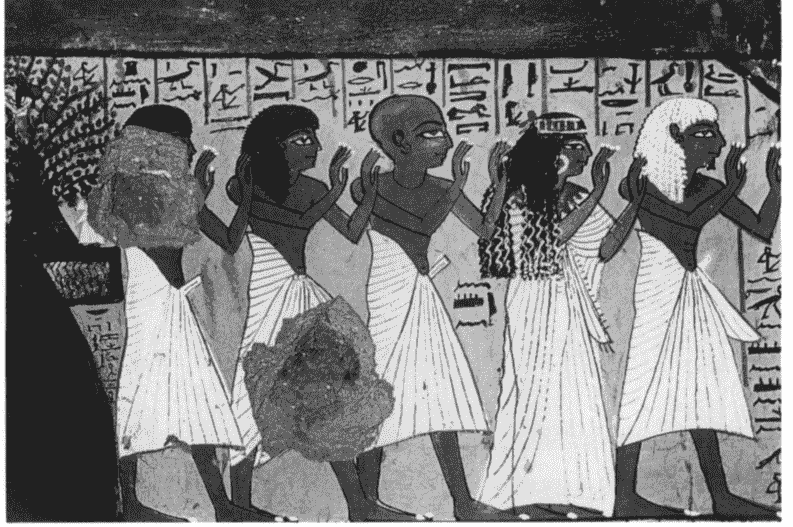

帕谢德的亲属，有些来自德尔麦迪纳（Deir Medina），描绘在帕谢德墓中（TT # 3）。A.-P. Zivie, *La tombe de Pached à Deir el-Médineh (No. 3)* (Cairo, 1979), pl. 23；由法国东方考古学院提供。

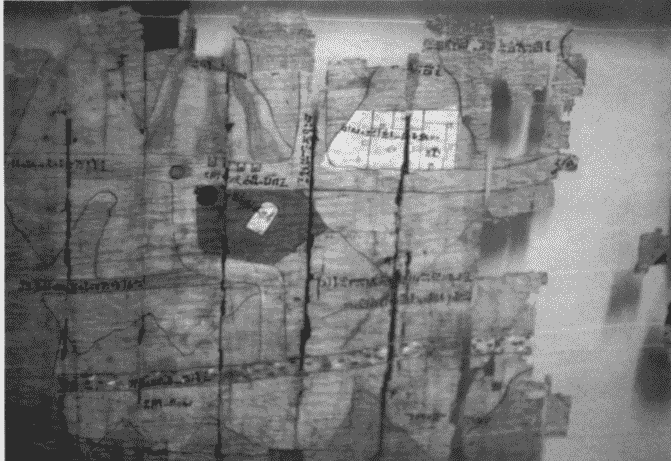

都灵斯金矿地图。由都里斯埃及博物馆提供（P. Turin 1879 + 1899 + 1969）。照片由 L. H. Lesko 拍摄。

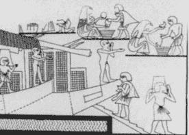

伊普（Ipyu）墓中的河岸场景（TT # 217）。出自 Norman de Garis Davies, *Two Ramesside Tombs at Thebes* (New York, 1927), pl. 30（细节）；由纽约大都会博物馆提供。

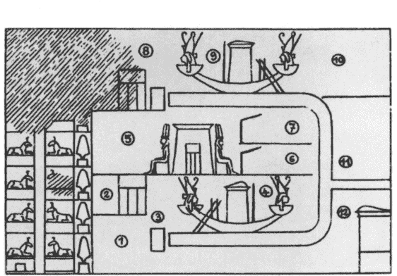

基内-布葬礼上的墓葬书记员阿蒙霍霍特普（Amenhotep）（从左起第二个）。出自库尔纳（Qurna）的基内-布墓（TT # 113）。Sir J. Gardiner Wilkinson, *Manners and Customs of the Ancient Egyptians*, 2d series, Supplement: Index and Plates (London, 1841), pl. 86（细节）。

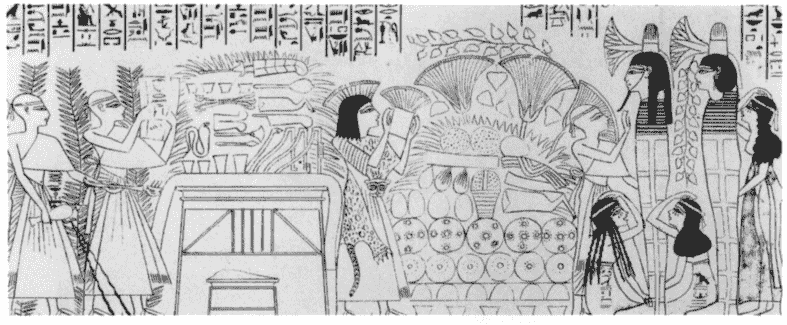

雅罗斯拉瓦夫·切尔尼（Jaroslav Černý）对卡尔纳马克穆特神庙的草图，来自哈贝赫内特（的）墓。Černý, *Répertoire Onomastique de Deir el-Médineh* (Cairo, 1949), p. 25；由法国东方考古学院提供。

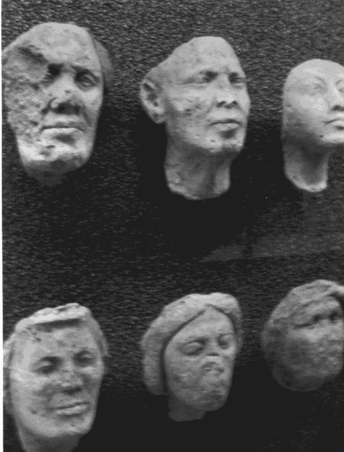

新王国时代的民族多样性：来自阿马纳（Tell el Amarna）的石膏面具。

由柏林国立埃及博物馆提供。照片由 L. H. Lesko 拍摄。

基于风格的理由，阿蒙-霍特普也参与了该墓葬的装饰。同一位绘图员与他的儿子阿蒙-纳赫特（Amen-nakhte，以其祖父命名）还装饰了库尔纳另一座由伊-姆-塞（Iy-em-seb）建造的墓。

## 与外界的接触

最终，有迹象表明工人参与了村庄之外的宗教生活，即参加了大的底比斯宗教节日、访问外部寺庙，并对非本地的神灵虔诚。Valballe 收集并讨论了与此主题相关的材料，但这些材料比预想的要贫乏一些。83 村民通过他们自己的当地庆祝活动来观察重大的国家节日；唯一一个有某些工人参加的非本地宗教活动是“山谷节”（Festival of the Valley），在节日期间，阿蒙-拉神像巡游了底比斯西部的寺庙和墓地。一幅工人 Amen-em-one 的浮雕用两个分层描绘了这一过程。84 在下层中，一个跪着的 Amen-em-one 形象正面对着抵达的神灵 User-hat；上方，神像（此时已转移到一艘便携式神船上）正从塞特一世神庙的塔门中走出。拉美斯二世在神面前供香，而宰相 Paser 和“真理之地”的书记员 Amen-em-ope 在他身后虔诚地鞠拜。只有另一位执事人员被识别出来：扇手，标记为 Ipuy——也许是同名的雕塑家。毫无疑问，Amen-em-one 曾目睹了这场仪式，而且小组中的一两个成员参与了其中。关于这一节日的其他记载较不详尽。85 参与索卡（Sokar）崇拜的类似证据对我研究而言可能没有用，因为有人建议索卡神的巡游过程是访问墓地中的一处属于该神的龛；换句话说，工人可能是在纪念某个当地活动。86 最后，书记员 Ramsose 似乎参与了奥佩特节（Opet festival）的大规模准备工作。他写给畜牧官：“奥佩特节今日到了，但阿蒙神庙的船还没有到达我们这里[..]参加节日，用于祭祀所有神灵的宰杀牛也没有到。”87 然而，他所预期的物资不可能是为了该活动的当地庆祝而准备的。

工人访问德尔埃哈麦迪纳之外寺庙的证据很少，但在当地一座墓穴中有一个对穆特女神（Mut）的详细描绘。88 此外，两名工人在村庄外的圣所中留下了更多石碑。工头 Pashed 在拉美西姆神庙附近的礼拜堂为图特摩斯一世之子 Wadi-mose 献了一块石碑，89；而著名的 Neb-Re’ 石碑（感谢阿蒙救他免于死地）似乎是在现代德国考察队宿舍附近的一座小砖礼拜堂发现的，就在图特摩斯四世神庙的正后面。90 然而，令人惊讶的是，工人在他们服务的国王墓庙中留下的自己的纪念碑极少。91

Dominique Valbelle 和 A. I. Sadek 指出，工人还祭了许多与其他城市相关的神灵，例如奥姆博斯的塞特（Seth）、阿尔曼特的蒙图（Montu），甚至还有各种亚洲神灵。92 这些崇拜可能是由从其他机构调来的工人带入村庄的，因此可能并不反映他们对这些神灵起源地的访问。

简而言之，有充分证据表明工人深度参与了耕作区的经济、社会和宗教世界。他们在村庄外的活动范围甚至比上述暗示的更大，因为有许多关于底比斯的记载，无法方便地归类到一个标题下。例如，至少有一次村民之间的纠纷是在拉美西姆法庭上审理的。93 此外，整个村庄的人在特定危险时期（如阿蒙赫特莫塞斯统治期间的内战）可能会移动到泛洪区；而工人和家人在拉美斯三世统治期间，确实作为罢工行动的一部分，在许多白天甚至夜晚在伟大的墓庙中扎营。其他关于去村外旅行的记载（原因现已失传）包括提到访问过名为塞特（Set）的法老寺庙。94 不用说，工人与他们的底比斯邻居之间的大部分接触都没有记录，且其数量将远于上述讨论的实例。

然而，如果工人可以随心所欲地离开，就会出现其他问题。例如，如果不是为了隔离其居民，村庄为什么要建在那个山谷里呢？从沙漠往返工作所节省的15分钟左右的时间，很难证明起将整个社区搬到沙漠边缘并雇佣一小群运水员来供水的决定——特别是如果他们确实住在王谷附近，并在周内完全不回家的话。95 对此只能回答，埃及建筑工程的惯例是在尽可能靠近工地的地方建立一个独立的围墙工人村，即使这必须在沙漠边缘建造。96 当沙漠地区的局势变得不安全时，小组确实搬到了麦迪尼特哈布斯（Medinet Habu），但并没有放弃底比斯墓地的工作；有充分证据表明，在拉美斯十一世早年工作结束后，他们参与了阿蒙大祭司的葬礼。97 因此，工人的隔离绝不被认为是本质的。

## 社会与经济考量

另一个问题是由 inbut（或“五座 inbutw”）提出的，正如 Ventura 所证明的那样，它们位于村庄和耕作区之间。Ventura 接受了 Edgerton 对 inbut 的解释，认为是守卫室或加固的门，并认为它们的功能是确保通往村庄的安全：即防止未经许可的人进入或离开。她建议其他一些分布在从村庄到麦迪尼特哈布斯的路径上。98 然而，关于这些 inbut，我们几乎无法给出定论；甚至不清楚它们是否是某种建筑。关于它们是小型加固结构或哨哨的提议非常谨慎，并被 Elizabeth Thomas 和 Klaus Baer 接受用于这些墓地的特定案例。99但在其他遗址，inbut 似乎是更大区域的围圈（特别是牲畜），或者正如 Lopez 建议的，边界。100 此外，没有证据表明它们有人驻守。Ventura 本人说：“我们从未听说有任何积极的干预来保护 inbut 免受入侵者的侵害，无论是个人还是团体。给人的印象是，要么这些哨位无人看守，导致它们毫无用处，要么守卫非常不力。”101 正如 P. J. Frandsen 和 Lopez 指出的，连续五座哨位的想法在本质上是不可能的，而且 Frandsen 提供了可靠证据，证明在村庄南北两侧都有独立的 inbutw。102 最重要的是，即使假设它们确实是哨位，其目的似乎更有可能是保护墓地免受入侵者的侵害，从而将工人留在墙内。

Ventura 还将 `htm n p³ hy`（“墓之围墙”）赋予了控制工人与外界接触的功能。但正如我在其他地方讨论过的，`htm` 是社区的补给中心和行政总部；它似乎并没有起到隔离的作用。103

总而言，工人似乎与他们的同胞共同生活。他们在耕作区买卖、耕作、收割，并与朋友和家人一起庆祝和哀悼。

## 与外界的接触

# 第三部分

## 居住在村里的外国人

**威廉·A·沃德（William A. Ward）**

> 库尔与库什的土地
> 以及埃及的土地
> 你使每个人各得其所。
>
> —《阿阿顿赞歌》

自埃及学早期以来，人们就意识到，到新王国时期，埃及的人口中遍布着外国背景的家庭。然而，这种现象在新王国之前就已经出现了。在中王国时期，我们知道织工、舞者和其他外国职业人士生活在埃及，迦南商人在`Tel ed Dab’a`及东部三角洲的相关地点建立了定居点。

外国人来到埃及主要是出于经济考虑，在各种职业中寻找工作或从国际贸易中获取利润。到新王国时期，他们成为人口的重要组成部分，在埃及对努比亚和迦南统治的几个世纪里，他们的存在得到了进一步鼓励。某些外国人可能是作为战俘被强带到埃及的，但数量远没有流行观点所暗示的那么多；大多数人并非奴隶（奴隶制作为埃及社会的组成部分被大大夸大了，这基本上源于对埃及术语的误解）。相反，在德尔麦迪纳繁荣的几个世纪里，整个古代世界存在一个流动的中产阶级，这些人不务农，也不在当地行政机构任职，不受地域限制。织工、石匠、士兵、水手、商人、艺术家、音乐家、舞者、祭司——这些人自由移动到任何他们可以施展技能的地方。

### 社会与经济问题

从米锡锡到波斯，每个城镇和城市都有陌生人，他们是自由代理人，随心所欲地在任何时间随地移动。他们中的许多人来到了尼罗河谷。

对新王国时期外国人范围的调查给出一个清晰的印象：他们很大程度上是自愿来到埃及寻找工作和比家乡更稳定的生活的自由民。在第十八王朝，他们已经是建筑行业的一部分了，此后我们发现越来越多的外国人处于（通常是相当重要的）权威职位上。从园丁和船长到军官和皇家仆人，外国人在埃及生活的各个层面都立了足跟。因此，德尔麦迪纳的一些居民要么是最近的移民，要么是外国家族的后裔，这并不奇怪。尽管该遗址的发掘者早已承认了他们的存在，但对此的陈述仅限于被认为（通常是错误的）非埃及人个人名列表。这就是问题的核心——当几乎没有个人姓名可凭时，如何通过个人姓名来识别外国居民。

### 识别埃及文献中的外国人名

柏林博物馆收藏有一块来自`Tell el-Amarna`的小型、非常粗糙的石碑，上面有一个名叫 `Trr` 的人。他被描绘为一个留着迦南式发型、胡须和穿着的迦南人。他的名字是非常常见的闪米特名字 `Dalilu`。他的妻子也有一个闪米特名字，尽管她被描绘成埃及人。在这里没有问题：一个具有极佳迦南同源词的外国名字识别了一个显然是迦南人的肖像。但我们很少获得来自德尔麦迪纳的精确信息。据我所知，村民中除了一个墓穴小室里留着利比亚风格头发羽毛的次要人物（附录 B，第2号）外，没有一个。据报道，某些坟墓中的木乃伊特征证实了外国人的存在，尽管尚未发表任何细节。否则，人类的绘画和考古证据是静默的，我们必须完全依赖个人姓名。

幸运的是，极有可能本土埃及人不会给他们的孩子起外国名字。因此，当我们发现具有非埃及个人姓名的人时，我们通常可以确定：那些外国人本身或其近祖先是外人。德尔麦迪纳的做法似乎是定居的外国人给孩子起埃及名字，而外国名字经常会在孙辈中再次出现，作为对家族起源的一种提醒。

然而，识别外国名字并不总是简单的事。没有一种单一的方法本身是完全可靠的，但几种特征——最好是结合使用——是有用的。

首先，一个名字可能具有明显的非埃及语辅音结构，并且可以产生显而易见的外国同源词。例如，`Irtnn` 和 `Mrky` 名字可以被立即识别为赫特人的 `Aritenna` 和闪米特人的 `Milkuya`。许多乍看之下名字其实是很好的埃及名字：`mk`，被认为代表胡里里人的 `Ammaku`，结果证明是埃及语 `mk.t`，意思是“伟大的保护者”之类的。

其次是使用“投掷棒”（throwstick）象形文字作为限定。因为书写实践将其使用限制在外国人和地名上，它的出现是该名字不是埃及的。问题在于，它的缺失并不意味着反之。投掷棒符号在拼写明显是外国的名字时经常被省略；埃及文献中约一半的外国名字是在没有这个符号的情况下拼写的，这是由于个人书写者的拼写习惯。

第三，当一个个人被明确标识为外国人时，他的名字可以合理假设为外国名。

第四是使用“组合拼写”（group-writing），一种拼写方法，将无意义的辅音——`y`、`w`——插入到名字或单词的辅音结构中，而它们并不属于那里。这些插入传统上被认为代表元音，普遍认为这种拼写法主要是为了拼写外国单词和名字；因此，它在拼写姓名时的使用长期以来被认为是名字是外国的迹象。但这并非事实；组合拼写在本土埃及词的拼写中非常常见，特别是在新王国时期的埃及个人名。相反，许多明显的外国名字和单词通常以正常的辅音方式拼写，例如神灵名字 `Ba’al`、`‘Anat` 和 `Astarte`。正是这种拼写法在德尔麦迪纳文献中的应用，导致了某些埃及人被误认为是努比亚人。

第五，经常有一个个人有两个名字的情况：其中一个不可避免是一个很好的埃及名字；另一个可能是他的原始外国名，或者是他被他的家庭和朋友所熟知的埃及昵号。这些名字可能应用于他身上——例如，在他墓穴小室的不同部分——或者共同出现在“X被称为 Y”的公式中。困难在于，埃及书写者在新王国时期反向地使用这个公式。区别在于此类术语是标签（“那个迦南人”）还是个人名（“那个迦南人”）。前者可以被视为外国名；后者通常不能。

个人姓名长期以来被认为是名字是外国的可靠迹象。但这并非事实；在本土埃及词的拼写中，特别是在新王国时期，埃及个人名的组合拼写非常常见。相反，许多明显的外国名字和单词通常以正常的辅音方式拼写，例如神灵名字 `Ba’al`、`‘Anat` 和 `Astarte`。正是这种拼写法在德尔麦迪纳文献中的应用，导致了某些埃及人被误认为是努比亚人。

公元前世纪但德尔麦迪纳档案中的许多名字仅包含一两个强辅音，以至于当我们怀疑某个名字是外来同时，在两三个西亚亚语言中也可能存在同源词。在这种情况下，无法确定该名字是否是外来的——而且如果是，在确定其起源方面仍然存在困难。这些困难围绕着两个证据领域：外语的原始材料，以及往往棘手的语音传译与变化问题。

首先是原始材料。从埃及的文字和图像证据可以清楚看出，外国人来自尼罗河谷周围的所有地区来到埃及，而且所有这些地区的个人名都保存在埃及文献中。但并不总是能够从外语中找到精确的同源词：即在外语中实际书写的相同名称。对于西亚的主要语言——阿卡德语、赫梯语、胡里语、阿摩利语以及许多地方语言如乌加拉特语、希伯来语和腓尼基语——我们拥有大量的名称储备；它们的收集和研究一直是几代人的主要工作，以至于我们将埃及文献中的外名与整个西亚的名称进行比较的能力几乎是无限的。相比之下，由于我们没有其他非洲语言的当代文献，可比较的非洲名称根本并不存在。我们知道利比亚人和努比亚人居住在埃及，并在文献中有所记载，但用这些语言原始记录的名字对我们来说已经丢失了。苏丹的梅罗提文献保留了大量的个人名，但它们追溯到希腊化和基督教时期。最早用当地语言书写的利比亚名字出现在来自迦太基等地的腓尼基文献中，同样是希腊化和罗马时期。人不能将这些后世语言作为一千年前埃及新王国时期发现的非洲名称的比较材料。换句话说，尽管我们可以相当确定利比亚人和努比亚人居住在埃尔·麦迪纳，并且一些利比亚和努比亚人的名字出现在村庄档案中（间接证据在少数情况下支持了这一假设：见附录 A，第 31、32 和 34 号），但很少能将某个特定的个人名定义为非洲人的——即使我们无法在非洲语言中找到同源词。这无疑意味着我们无法评估非洲元素对埃及本土人口渗透的程度。除非发现非洲语言的当代铭文，否则埃及社会中除了明确说明是利比亚或努比亚人的个人外，非洲元素在很大程度上将保持匿名。

### 社会与经济关注

在我们拥有的来源（即西亚）中选择外来同源词时，我们面临着复杂的语音问题。因为埃及书记员在记录一个外来词或名字时写下的是他们*听到的*内容，因此我们面对的是口头而非书面的传译，以及所有错综复杂的语音问题。这一简单事实开启了一个困难的潘多拉盒。我将用一个现代例子来说明这一点。在贝鲁特的一家小型阿拉伯餐厅里，我们的服务员既不说英语也不说法语，他问我们想不想吃一些“obble bye”。当然，他的意思是“apple pie”（苹果派），但黎巴嫩阿拉伯语中没有 `p` 辅音，所以他把它听成了 `b`。同样，他说的是“obble”而不是“able”，因为他的耳朵无法区分“apple”中的英语声音。

当我们试图分离记录在埃及文献中的、我们怀疑来自西亚某种语言的外来名字的起源时，面临的恰正是这种语音问题。当来到埃尔·德麦迪纳居住的西亚外国人读他们的名字时，这些名字进入埃及语的传输取决于它们在埃及听者听起来如何。因此，村庄的书记员只能根据他们*听到的*内容，尽力地拼写外来名字和单词。由于西亚语言包含了埃及语中不存在的辅音（反之亦然），这些辅音在书书中通过埃及语辅音再现，而这些仅接近正确发音。

几年前，我住在马萨诸塞州的一个小镇上，由于当地浓厚的新英格利亚口音，我被称为“Wad 先生”。我曾徒劳地纠正这个错误，但面对整个被当地记录的社区，我最终放弃了，马萨诸塞州一个村庄的档案将永远保留一个“Wad”的临时存在。埃尔·麦迪纳也发生了类似的情况，以至于尽管我们在西亚语言中拥有大量的比较材料，但我们经常受限于必须处理埃及书记员听到的并按听到的样子写下的内容，而那并不是实际的发音。每种语言都有那些不说该语言的人根本听不到的辅音，任何挣扎过阿拉伯语、俄语或中文发音的英语使用者都知道这一点。

## 德尔·麦迪纳外国人的社会地位

到目前为止，我识别了德尔·麦迪纳文献中的二十个西亚起源的男性名字和十个女性名字：例如，闪米特的 `Bariya` 和 `Delilah`（底比拉），胡里人的 `Tulpiya` 和 `Zilli`。在这 32 个名字中，19 个是闪米特起源，五个是胡里裔，六个是闪米特或胡里/赫梯裔，两个是族源名称“塞浦路斯人”，这可能指示这两个女性的起源，尽管也可以很容易地定义为迦南人。除一两个例外外，这些都是居住在村庄的人。我认为可以安全地假设所有这些人或他们的近期祖先都来自迦南；德尔·麦迪纳西亚人的语言混合确实反映了迦南的情况。位于沿岸的乌加拉特当代档案证明，迦南的人口主要由闪米特语和胡里语使用者组成，赫梯人和其他群体构成少数。考古证据也表明德尔·麦迪纳存在爱琴腊人，尽管据我所知，尚未有人尝试识别过他们。迦南人口的其他主要来源是阿马纳书信、乌加拉特档案以及叙利亚文献——这些也反映了迦南的情况。

无论这是否反映了事实，证据表明在村庄内部，迦南人没有像他们那样的机会。这似乎适用于迦南人的后裔。然而，在整个底比地区的广泛人口中，无论是在政府还是墓庙管理中，都能发现迦南人担任职位，例如闪米特的 `Abu`（第 35 号），他写过一份德尔·麦迪纳纸草。这引出了一个启发性但非常初步的结论：迦南人在广泛的人口中可以进入高层，但村庄当地的偏见（也许“习俗”是一个更好的词）剥夺了他们像岸神庙那样的向上流动性。因此，原因可能没有那么复杂，即重要且高薪的工作保留在少数本土家庭内部。

在此阶段，我不打算对德尔·麦迪纳的利比亚成分发表评论，我只能指出三个利比亚的个人名。但这些名字中的一个 `Kher/Kl` 在整个埃及都很常见，且没有三个村庄居民拥有（见附录 A，第 31 号和附录 B，第 1–11 号）。至少三个名为 `Kr` 的个人（附录 A，第 32 号），和一个 `Dydy`（第 34 号）。这给了我们十七个利比亚人，但在他们中我们不仅发现了村庄社会底层的个人，还有首席工匠、墓地守护者、书记员和祭司。也许搬德尔·麦迪纳的利比亚人比迦南人拥有更好的向上流动机会。由于仅识别出三十二个迦南人和十七个名字，这种结论为时过早。

在年代上，无法为所有迦南人确定精确日期，因此我们目前只能于非常宽泛的观察。三个属于第十八王朝（尽管证据不完全），七个属于第十九王朝，九个属于二十王朝，十个属于二十一王朝，九个属于整个拉美西时代。剩下的三个日期不详。

## 居住在村庄的外地人

除了拉美西斯时期村子里有一群规模较小但相当稳定的西亚裔少数群体外，德尔麦迪纳的利比亚元素年代断定得为准确。其中一人生活在拉美斯二世时期，五人属于第19王朝晚期，八人属于第20王朝，处于整个拉美西斯时期。这种在第19王朝和第20王朝晚期的明显集中，可能只是因为利比亚名字太难识别了。或者，当时利比亚族群正进出尼罗河谷，可能有少数个人决定留下来并在埃及寻求谋生。我们还没有足够的信息来得出结论。

无论如何，德尔麦迪纳的人口都是全埃及的缩影。例如，我们在涉及整个底比斯地区的《盗墓纸草卷》（Tomb Robbery Papyri）中发现了迦南人和其他外籍人的混合；在记录中埃及某地区人口的《威尔伯纸草卷》（Wilbur Papyrus）中也发现了这种情况。因此，在居民来源的多样性方面，这个村庄与该国的其他地区非常相似。

仍然有一个我无法回答的有趣问题。在村庄上方的山丘和山脉中，岩石上满了三千多处涂鸦，记录了经过此地的人；总数接近五千个名字。村庄的大大部分在这里都有体现，正如在该地区一样，但该地区只有五个外地墓的例子，这是否意味着外地人（甚至是外籍出身的居民）不被允许在王室墓地的圣山丘上自由漫步？特别是西亚人对死后的看法与埃及人完全不同；由于他们相信阴森的冥界并对死后世界持有阴郁的观点，他们在埃及皇室墓群中可能被视为不祥之物？如果事实如此，那么这些人即使以埃及人的身份被埋葬，他们一生也注定是异国土地上的异乡人。

名字 I–22 在 Ward 的 `Essays . . . Kantor` 第 295–299 页已有讨论，因此在此仅简要评论。

### 社会与经济关注点

- 1. `‘Ibnt(t)n`：非埃及语辅音结构暗示这是一个闪米语名字，阿卡德类型的 `Ibme-X`，即“（神）X 创造了”，或者可能是胡里人的 `Abenatal`、`Abinadal`。
- 2. `'Int’`：辅音结构暗示源自闪米语 `ns’`，“离开，出发”。
- 3. `'Ir’`：元素 `‘ir-` 的书写通常用于闪米语的 `‘ilu`、`‘el’`、`‘神’`。完整拼写似乎代表了乌加特名字 `Ilrbh` 的部分翻译，“El 是伟大的”。
- 4. `‘bd`：一个源自西闪米语的昵称（短名或绰号），源自 `‘bd`，“服侍”，例如阿卡德语的 `‘bdu`，希伯语的 `Ōbē`。
- 5. `‘mt` 和 `Tmt`：源自闪米语 `‘ms`，“携带”的男性和女性名字，对应希伯语的 `Yahmms`、阿卡德语的 `Yahmus`、乌加特的 `‘ms`。
- 6. `‘dr`：源自西闪米语 `‘zr`，“帮助”，例如希伯语的 `Ēzer`，阿马纳的 `Aziru`。
- 7. `br Bsy`，“叙利亚的 Bsy”：阿卡德语 `Basi`、`Basiya`；阿摩利语 `Yabasi Dagan`。
- 8. `P³-il`：元素 `-il`，“神”，书写为数字 3，带有埃及定冠词。这个名字和接下来的名字通过添加定冠词被“埃及化”了；见下方注释 47。
- 9. `P³-Ym`：元素 `-Ym` 是西闪米语 `ym(m)`，“海；（神）Yamm”，现在用作名字（乌加特语除外），例如 `‘bd-Ym`，`Ym-il`。`P³-Ym` 作为神灵出现在《阿斯塔尔特传说》（Legend of Astarte）中，这是迦南神话的埃及版本。
- 10. `Prs`：源自西闪语 `pls`，“观看，观察”，例如阿摩利人的 `Pilsu`，乌加特的 `Pls`。
- 11. `T-irs`：“塞浦路斯的”。埃及语 `ir` 是 `Alashiya`，现在被公认为塞浦路斯的阿卡德语。这是一个带有定冠词的“埃及化”形式。
- 12. `Tnhm.t`：源自西闪米语 `nhm`，“安慰，慰藉”的女性名字。没有保留闪米语的女性形式，但有很多男性名字，例如阿卡德语的 `Yahamu`，希伯语的 `Tanhumet`、`Tnhm`。
- 13. `Trby`：胡里人的 `Tulpiya`，德尔麦迪纳罕见的胡里人名字之一。
- 14. `Dmr`：源自西闪米语 `zmr`，“保护”。
- 15. `Inrn` (`‘Iln`) 源自闪米语 `‘ln`，例如希伯语的 `Elōn`，阿卡德语的 `Iluni`、`Ilani`。
- 16. `Ybhy`：与阿马纳的 `Yapahi`、巴比伦的 `Papaham` 同源，在埃及语中经历了 `b > p` 的变化。这可能也代表阿摩利人的昵称，如 `Yabbiya`。
- 17. `Bry`：被认为带有阳性限定词书写，是一个女仆的名字。该名字源自闪米语 `bry`，例如阿卡德语的 `Bariya`、`Biria`，希伯语/腓尼基的 `Bry`。
- 18. `Mnth t`：一个女性名字，显然是埃及人的。没有闪米语同源词。
- 19. `Ktun`：可能是转写类似 `Kuzuna` 名字的尝试。
- 20. `Try`：可能是 `Takkar` 之类的昵称。
- 21. `Kn`：（未使用）。
- 22. `Tr`：胡里人的 `Zilli`。
- 23. `'ti`：Senedjem 的母亲。
- 24. `‘Trsy`，“阿拉西亚的（塞浦路斯人）”，拉美西斯一世时期。不要与德尔麦迪纳的另一个男人 `T-rs` 混淆。
- 25. `‘bl`：船长，曾出现在一个陶罐标签上。乌加特的 `‘bl`，以及指阿拉伯和伊甸的希伯语姓氏 `obal`。这个名字在闪米语中很少见，但在古南阿拉伯中很常见。
- 26. `P-mhrn`：在画家 `Hor-Min` 的一封信件残片中提到过一次。拉美西斯四世时期。问题中的段落：“我把信交给了……P-mhrn……” 乍看这可能被视为一个头衔，而信使的姓名在缺失处丢失了；然而，坐姿限定指示这是一个名字，而且 `mhr` 曾用作头衔（见下文），但在其他地方从未带有定冠词。此外，结尾的 `-n` 倾向于是一个名字而非头衔。

根词 `mhr` 在新王国时期借自迦南语，已被几位学者讨论。作为名词，它意味着“冠军”、“战士”等，并与其同形字 `mhr`（“聘礼”）不同。这种意义在包含该根词的罕见闪米语名字中体现。与埃及语拼写 `Mahranu(m)` 完全对应，它是第三王朝文献中的一个阿摩利名字。

埃及文本：`B1-mhr`，“巴尔是一个战士”或“巴尔是[我的]冠军”；`P1-mhry-bl't-f`，“战士站在他面前”；`Mhr`，“战士”；`Mhry`，带有昵称后缀 `-y`，“我的冠军是 . . .”；`Mhry-Bl` 和 `Mbr-Bl`，“巴尔是一名战士”或“[我的]冠军是巴尔”；名字 `P1-mhr` 和 `P1-mhry-bl't-f` 通过添加定冠词的名称形式被“埃及化”。

## 27. Ptr

仅出现于图林纸草第 57257 号上；由于使用了标掷类标识符（throwstick determinative），它应被视为外来语。对比赫梯语的 `Pisiri`，或闪米语的 `Pazzalu`、`Pazzulu`。同样相关的 `Ptr` 是一位首席园丁的名字，带有西亚语的昵称后缀 `-ya`。

这个名字必须与 `P1-tr` 区分开，后者是 `Inherkhawy` 的昵称，显然是著名的首席工 `Hay` 的曾孙孙。在其墓穴及相关纪念碑中提到的许多其他家族成员中，没有其他外来名字，`Hay` 本人的家谱也是如此。这一点以及由于缺乏标掷类标识符，表明这是一个埃及名字 `P-tr`。在德尔埃麦迪纳（De el Medina），其他具有相似名字的人包括：`Tr`，一位生活在拉美西斯三世和四世统治下的工人；一位同名的木材搬运工；以及著名的墓地书记员图特摩斯（`Thutmosis`），他也被称为 `Tr(dy)`，是晚期二十王朝几封信件的撰写者或书记。

## 28. Mgyr

出现于一个名字列表中。这不是一个埃及名字，说明了在众多可能性中寻找同源词的困难性。可以对比赫梯语的 `Magall`、`Magall`；胡里语的 `Mukaru`、`Magaru`；闪米语的 `magir`，意为“顺从的”，出现在许多阿卡德语名字中，如 `Magir-addu`；以及希伯来语的 `Mākī`。但这些词都无法解释埃及语拼写中的 `-y`，该字母在外来词的转写中通常代表辅音，并应该反映出例如一个闪米语形式——`Mugayyalu` 或类似的词。相同结构的名字出现在一份追溯到第十七王朝的埃及外来名字列表中：`Mtyb`、`Mnyni`。

### 社会与经济关注

## 29. Hsy

一名园丁。对比非常常见的胡里语 `Haşiya`、`Hasiya` 以及希伯来语 `Husay`，根据 J. Stamm 的说法，这是 `Hašabyāh` 的缩写。

## 30. Šmy

一名首席园丁。阿卡德语的 `Šumaya`，阿摩利语的 `Sumaya`，昵称。德尔埃麦迪纳有不少于十三个人拥有这个名字。关于这些名字并非来自德尔埃麦迪纳的迹象和证据见附录 B。`Knr` 这个人名在新王国及稍晚期的埃及文本中相当常见，大多作为男性名，但也作为女性名（附录 B，第 13, 16, 29 号）。Černý 建议该名字也拼作 `Kr`，但他没有提供证据；Ranke 则仅根据列宁格勒的一尊雕像给出 `Kr` 作为一种变体拼写（附录 B，第 16 号）。在这里，展示了 `Kel` 与她的 `Amenemhab` 及其妻子。在 `Kel` 的塑像上，名字被完整拼出 (`Knr`)，但另一个名字写成了较短的形式——这不真的是一种变体拼写，而是缩写：文本结尾给出的公式是“Amenemhab，生于 Kel”，而空间只够写 `Kel` 名字的一部分。我没有见过其他任何用 `Kr` 代替 `Knr` 的例子。后者在新王国时期非常常见；前者较少，但时有出现（参见第 32 条）。除了列宁格勒石碑外，尽管涉及的人员很多，似乎没有哪个案例是将这两个名字应用在同一个人身上的。

### 居住在村庄的外国人

名字 `Knr` 似乎是利比亚语，这种假设只能得到间接支持。我们没有一个被明确识别为“利比亚人 Kel”的个体（正如我们有在德尔埃巴哈里工作的“努比亚石匠 `Trki`”或德尔埃麦迪纳的工人“迦南人 `Bsy`”一样）。也没有利比亚语的当代证据，因为不存在该语言的文本。间接证据似乎足以得出结论：我们处理的是一个利比亚名字，或者至少是该名字的昵称。`Knr` 不是埃及名字是肯定的，因为在它超过一半的出现次数中使用了标掷类标识符（参见注释 9）。另一个指标是，当这种双名公式出现时——`Neferenpr`、`Minsoe` 和 `Thutmosis`，他们都被“称为‘Kel’”（附录 B，第 19, 20, 24 号）——`Knr` 最常带有标掷符号拼写；因此，它是外来名字而非埃及昵称。

来自德尔埃麦迪纳的两个细节指向利比亚起源：`Amenakh` 之子 `Kel`，头发上插着效仿利比亚风格的两根羽毛；以及 `Pendau` 之子 `Kel` 是 `Dydy` 的孙孙（附录 B，第 3 号），`Dydy` 是一个明显的利比亚名字（参见下方第 34 条）——另一个外来名字在第三代出现的案例（正如在著名的 `Snedjem` 家族中发生过；见第 23）。人们应当考虑 `Snedjem`...

### 住在村庄的外来人

## 32.

在德尔埃麦迪纳（`Deir el Medina`，附录 C，编号 1–3）已知有三个（也可能只有两个）名为这个名字的人，还有几个人来自村庄以外（编号 4–10）。

少数罕见的拼写方式 `Kr` 和 `Kry` 是更为常见的名字 `Kr` 的变体。墓地守护者 `Kr` 的名字拼写方式均相同，甚至对于同一个人还出现了一个独特的 `Kry`。这些变体表明该名字是外来语，这一点通过使用投掷棒限定符（throwstick determinative）以及它出现在两份外来名字名单（编号 4–5）中得到了证实。当然，产生的问题是，考虑到该名字的简短以及具有这种辅音结构的名字在其他语言中广泛出现，我列出的所有实例是否实际上是同一个名字。⁶ 我倾向于认为所有出现的情况都代表同一个外来名字，尽管我无法证明这一点。

无论其来源为何，这个以该字母开头的名字必须与它的同音词（即变体 `Kr`、`Kry`）仔细区分开来，后者的特征是带有字母 `k¹` 符号，而且据我所知，从不使用投掷棒限定符。德尔埃麦迪纳有四个人叫这个名字，在其他地方也常见。⁷ 这无疑是外来的 `Kr`，而埃及人的 `Kr` 非常频繁，没有哪种情况是这两种拼写都适用于同一个人。

`Kr` 和利比亚名字 `Kn`（见上文编号 31）也从未用于同一个人——尽管两者都出现在 `Qaha` 家族中（附录 C，编号 1）。`Qaha` 的姐夫名叫 `Kr`，这两个人都是一个名为 `Kn` 的祖父（附录 B，编号 1），该 `Kn` 是 `Kr` 之女和 `Qaha` 之子的儿子。这名 `Kr`（ 330 号墓的主人）的父母都拥有埃及语名字，因此——类比于 `Kn`（`Dydy` 的外孙，见附录 B，编号 3）——`Kr` 的祖父母中应有一位是外来人。因此，`Kr` 出现于第三代，而 `Kn` 出现于第五代，两个名字都回溯了那位已不可知的祖先。

### 社会与经济关注

如果是这样，`Kr` 和 `Knr` 一样可能是一个利比亚名字，因为利比亚和西亚名字不太可能出现在同一个家族中。

有证据支持这一建议，那就是“利布族大首领，马族大首领，`Kr`”此人，他被写为外来语 `Kr`，他可能也可能与“梅什瓦大首领，`Kr`”是同一个人。这些出现至少说明 `Kr` 是一个利比亚名字，但并不是说所有叫这个名字的人都是利比亚起源或血裔。正如前面提到的，基于辅音 `k + r/l` 的名字可以在所有语言组中找到。根据一个初步结论，我将 `Knr` 的外孙、工人 `Kr` 归为利比亚人（附录 C，编号 1），可能也包括“墓地守护者 `Kr`”，考虑到他的职级（附录 C，编号 3），因为西亚人在德尔埃麦迪纳似乎没有获得过比下层以上的任何地位。

## 33. Trr

在霍伊（`Hoy`）墓中发现的一块木乃布上提到过一次女性。拉美斯二世统治时期。立刻想到的外来同源词是希伯来语的德莉拉（`Delilah`），意为“发辫”或可能可能是“小女孩”。相同结构的阿卡德语名字是 `Dalilu`，后者意为“她的（女神的）名声、荣耀”。希伯来语和阿卡德语名字最终可能源于同一个根词 `dadālu`，“顺从；赞美”。⁷⁰ `Dalilu` 是这个名字的阳性形式，由 `Trr` 正确表示，这是阿马纳时期（`Amarna period`）石碑上一个迦南佣兵的名字。⁷¹

## 34. Dydy

一位首席工匠（`hmmw wr`），在他的墓中和葬礼品上被多次提到。⁷² 这是少数可以被称为利比亚名字的个人名之一。一位利比亚首领 `Mwry` 是 `Dydy` 的儿子（`Dydy` 的拼写与德尔埃麦迪纳完全一致），他在梅内普鲁塔（`Mernept`）的利比亚战役记录中被提到。⁷³ 首席工匠 `Dydy` 的未知，尽管他的儿子 `Amenmakht` 和 `Pendauau` 经常出现；`Pendauau` 的一个儿子名叫 `Knr`，延续了该家族的利比亚传统（附录 B，编号 3）。我所知的另一个使用投掷棒拼写 `Dyd` 的实例是《威尔伯尔帕莎草纸》（`Papyrus Wilbour`）中的一个谢登人（A 44, 17）。这个利比亚名字应区别于中时代的 `Dd`（由动词 `rdi` 组成）以及新王国时代的 `Dydw`（后者从未用投掷棒书写）。⁷⁴

## 35. Db

一位礼堂书记员（`ss n r-prw`），出现在一封来自日内瓦 `Nifer-renpet` 的信中，这封信是由他的同名 `Db`（一位宰相书记员）写的。⁷⁵ 这封信写给某些“墓地管理处”，涉及与德尔埃麦迪纳劳动力相关的业务。这位礼堂书记员可能属于村庄外围的小礼堂。除了这些例子之外，该名字没有在别处出现。⁷⁶ 它作为人名，与闪米语的 `Zabû`/`Sabu`/“战士”同源。⁷⁷ 复数名词“战士们 = 军队”在新王国文本中出现了几次⁷⁸

我所知的每一个名为 `Knr`/`Kl` 的个体（主要在新王国文本中）都通过父名、名字或日期与其他人隔离开来。这可能在两种情况下，同一个人属于同一代；我已尽力避免这种情况。德尔埃麦迪纳第二十王朝的定年如下：

### 德尔埃麦迪纳第二十王朝定年表

1. **工人**，德尔埃麦迪纳，`Inker` 之子；新王国时期。他的祖父是利比亚人。他在特罗的雕像组和卢浮石碑中出现：`FIFO 8/2, 14; MIFO 71, pl. 4, sc. 8`。
2. **工人**，德尔埃麦迪纳，`Amenmakht` 之子；新王国时期。他头发上有两根羽毛：`FIFO 5/2, 74, fig. 51; MIFO 71, pl. 1`。在照片中没有看到羽毛，但我对它们的存在是肯定的。
3. **工人**，德尔埃麦迪纳，`Pendau` 之子；新王国时期。利比亚人 `Dydy` 的外孙。`Kel` 出现在特罗的雕像组和卢浮石碑中：`FIFO 8/2, 19; MIFO 71, pl. 2, sc. 25`。`RecTrav (1880): 169`; 特罗石碑 240, 296；卢浮石碑 A 63。
4. **祭司**，德尔埃麦迪纳。德尔埃文本中提到了至少三个名为 `Knr` 的祭司：
    - **a. 祭司**：`O. Cairo 25555 v. 6`；晚期新王国。
    - **b. 上埃及之主的祭司**：在一个商店看到的石碑上；晚期新王国；Jaroslav Černý，《底比墓地工人中的阿蒙霍特一世崇拜》，《FIFO 27 (1927): 20 (69)`；以及 Jean J. Clère，《真理广场未发表的仆从纪念》，《FIFO 28 (1929): 191`。
    - **c. （女神）玛特的祭司**；拉美斯三世统治时期；`O. Gardiner 130, 6 (KRI 7:304, 10–11)`。
    
    考虑到乡村工人在阿蒙霍特一世崇拜中担任祭司的做法（Černy, `BIFO 27 [1927]: 193–197`），这里提到的前两个祭司可能指的是同一个人；因此它们对应上述编号 1–3。第三个人是玛特的祭司，可以按其本身理解，因为在底比斯地区有此类记载；见 Borghauts, Divine Inter...

### 居住在村庄的外国人

5. **工人**，德尔埃麦迪纳，`Userherat` 之子；拉美斯三世统治时期。提到于一块供奉桌碎片上：`FIFAO 20/2, 52`；可能是同一个人，未加父名，其记录于日期为拉美斯三世统治第 14–22 年的陶片上：`O. DeM 222, 364; O. Cairo 25555, 1–4`。根据其他名字推断，另外两块陶片也涵盖了这一时期，并提到了 `Kel`：`O. DeM 582; Černý-Gardiner, HO pl. 31, 2, II, I`。这可能与图林纸馆 57039 和 57056 中记载的 `Userhat` 之子 `Kni` 为同一，日期为拉美斯三世第 24 年。
6. **运水工**，德尔埃麦迪纳；拉美斯三世统治早期。提到于日期为拉美斯三世统治第 13–16 年的陶片上：`O. Turin 57151, 5; O. DeM 432; 433; O. Michaelides 2, 48`；还出现在《图林罢工纸草》中：`RAD, 46, 11`。
7. **陶器工（？）**，德尔埃麦迪纳；拉美斯三世统治时期。未给出头衔，作为陶器供应商：`O. DeM 55`。然而，这可能是“时间工人”之一，他们负责运送但并不制作陶器。
8. **警察**，德尔埃麦迪纳；拉美斯四世统治时期。`O. Cairo 433, 3`。
9. **工人**，德尔埃麦迪纳，`Amenkhau` 之子；拉美斯三世或四世统治时期。`O. Michaelides 7, Vs. 2`。
10. **书记员**，德尔埃麦迪纳；拉美斯王朝时期。`O. Cairo 25504, 1, 8`。
11. **厩马师**，德尔埃麦迪纳；拉美斯王朝时期。`O. Turin 57151, 6`。

位于德巴哈里（`De Bahri`）之外；第十八王朝中期。Hayes, Ostraca。

12. **工人**，德尔埃巴哈里；`Name Names, no. 89, 3`。
13. **Thutmosis Paroy 的女性亲属**，`TT 295` 的所有者；图特摩斯四世和阿蒙霍特普三世的统治时期。El. Sayed A. Hegazy 和 M. Tosi, 《底比斯私人墓：第 295 号墓》（美因茨, 1983），第 18 页，图 2。无法定义这个 `Kel` 与 `Paroy` 之间的关系。在墓葬场景中，奥西里斯正被 `Paroy` 举起，他身后是一个未具名的男子。该男子后面跟着一个女性，被确认为“他的母亲”，她的名字在缺损处丢失了。随后是她的三个女儿，其中之一就是上述的 `Kel`。`Kel` 可能是 `Paror` 的姐妹，或者是他身后那个无名男子的姐妹。

### 社会与经济关注

14. **石碑所有者的亲属**；第十八王朝。Otto Koeford-Petersen, 《Les textes égyptiennes》（哥本哈根, 1948），no. 29；Carlberg Glyptotek `AEIN 1552`。编辑者给出名字为 `Pskl`，尽管实际上有两个名字标记在树形符号之前。第一个名字是 `Pskl`...由于头部上方缺乏空间，定符符号跟在 `P¹` 之后的符号可能是 `y + r`，但该处已受损。第二个人名是 `Kn`，虽然是一名祭司，但没有头衔。（感谢 Mogens Jensen 向 Carlsberg Glyptotek 提供了这块石碑的照片。）
15. **墓像**；`Deputy P¹–mnu`。W. F. Petrie, `Shabtis`（London, 1935），no. 83。
16. **阿蒙的歌者**，`Amenhenop I` 寺庙的管家；底比斯的 `Amenemhab`；`Horemhab` 统治时期。`LD III, 238–239`，来自 `Amenemhab` 在底比斯的墓。显示于列宁格勒博物馆中：B. Pietroovsky, 《Egyptian Antiquities in the Hermitage》（Leningrad, 1974），no. 10, pl. 51。提到于 `Amenemhab` 的一块墓锥上：N. DeG. Davies, 《Corpus of Inscribed Funerary Cones》（Oxford, 1957），no. 532。
17. **墓像**；第十九王朝早期。J.-L. Chappaz, 《Les figures funéraires égyptiennes au Musée de collections privées》（日内瓦, 1984），no. 006，私人收藏。
18. **Wab 祭司**，`Khonsu` 杂志主管；第十九王朝早期。`Usurper TT 54`；`PM II, i, 104–105`。
19. **阿蒙财库书记员**，`Nefer` 之 `Kel`；`TT 78`；拉美斯二世统治时期。André Lh, 《la peinture égyptienne》（Paris, 1954），pls. 35；Ludwig Borchardt, “Bemerkungen zu Grab-bauten,” `ZAS 70 (1934): 26 MDA 37 (409–416)`。
20. **皇家书记员和宫廷官员**，`Minm` 之 `Kel`；拉美斯二世统治时期。人们经常假设（例如 Černý, Workmen, p. 210）他与德尔埃麦迪纳的（如 `TT 335` 中提到的）书记员 `Amenophet` 是同一个人，这不太可能。卢浮石碑确实是一名书记员，但他的头衔显示他曾是宫廷官员和内特祭司。德尔埃麦迪纳的书记员也名叫 `Kel`，据我所知，与卢浮石碑 `C 218` 相同的证据比以下还要少：`FIFOA 20/2, 51, 99 (no. 208); FIFOA 26, 34` 等。
21. **首席**；第十九王朝。Wilhelm Spielberg, `ZAS 58 (1923): 34`。
22. **墓像**；第十九王朝。Petrie, `Shabtis`, no. 126。
23. **首席织工**；第十九王朝。290 号枕所有者：Siegfried Schott, `ZAS 83 (1958): 141–144`。
24. **Thutmutm Kel**；拉美斯三世统治第 6 年。Marek Marciniak, 《Les inscriptions hiératiques du temple de Thutmosis》（华沙, 1974），no. 9。
25. **小 Kel 书记员**，上述第 24 号之子；拉美斯三世统治第 6 年。Marciak, Inscriptions, no.
26. **墓像**，`Khonsu` 的 `Wab` 祭司；第二十王朝。`Cairo 47234`；Percy E. Newberry, 《Funary Statuettes and Model Sarcophagus》（Cairo, 1930–1937），no. 47234。
27. **无头衔**；拉美斯七世统治时期。在一份 `IFAO` 纸草中多次提到，作为获取黄金和方青矿考察队的领：Yvan Koenig, “Livraisons d’or et de galène du trésor de temple d’Amon sous la XX dynasty,” *Homages Saumer 1*, `IFAO Bde 81`（Cairo, 1979），pp. 185–220；补充碎片见 Yvan Koenig, `FIFAO 83 (1983): 249–255`；全文见 `KRI 7:3664–368`。

- 28. 沙漠首席；拉美斯七世统治时期。在一份 IFAO 纸草中多次提到……这些原材料被运往卡纳克神庙，因为该官员为该机构工作。该头衔很罕见（Koenig 仅引出一个平行例），但显然此类官员对沙漠第三中间时期非常熟悉。

- 29. 两个女性墓像；第二十王朝或晚晚。Newberry, *Funerary Statuettes*, Cairo 48311, 48312。

- 30. Khonsu 的双炉主管；新王国时期。Cairo 571 雕像的所有者。

- 1. 工人，德尔埃麦迪纳，St-mwt 之；拉美斯二世统治时期。TT 30 的所有者：BM 144；BM 328；Turin 169=1636=50012；Turin 44；Dominique Ouchebis Deir-Médine, IFAO, Fouilles, 15（Cairo, 1977），no. 25; FIFAO 2/2, 94–97。他的谱系（简化 Bierbier, *Late New Kingdom*, p. 36, 和 Černý, *Workmen*, p. 314）如下：

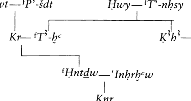

- 2. 工人（？），德尔埃麦迪纳；二十王朝。提到于 O. Turin 57297, 2–3，三个名字名单之一。其中一个是 Pt-šduw，一位生活在二十王朝后期的工人。这个 Kr 可能与第 3 号是同一个人。

- 3. 墓地守护者，德尔麦纳；二十王朝至二十一王朝。在信件中出现十一次：Černý, LRL, p. 79。它在 P. Turin 2071/244 + 1960 中也被提到为门卫（irt^t）：Allam, HOP, p. 329, p. 125。这卷纸草还列出了拉美斯九世统治期间首席工人 Horus：Černý, *Workmen*, pp. 308–309。因此，他可以被加入升为墓地守护者的门卫名单中：Černý, *Workmen*, pp. 168–169。

- 4. 在外来名字列表中；第十七王朝。Erman, *Hymnen*, Anhang, no. k1.

- 5. 迦南人名单；第十八王朝。Steindorff, ZÄS 38 (1900): 17。

- 6. 出自阿比多石碑的阿门莫塞（Amenmose）女性亲属；新王国时期。开罗埃及目录 34067。

- 7. 塞比斯西岸住户名单（非德尔埃埃麦迪纳）；拉美西斯九世及以后统治时期。P. BM 10058, v. 2, 14。

- 8. 一组可能与盗墓案审判相关的名字名单；拉美西斯九世统治时期。P. Abbot 8, 2, 13；参见 Peet, *Tomb Robberies*, p. 29。

- 9. 运工（k'wty）在盗墓案审判中提到三次；拉美西斯九世统治时期。P. Mayer A 4, 8; 5, 1; 3C, 10。

- 10. 阿蒙祭司；第二十一王朝。开罗 J 29644，现位于佛罗伦萨：Georges Daressy, "Les cerqueils des prêtres d'Ammon (deuxième trouvaille de Deir el-Bahri," ASAE 8 (1907): 8, 19。

# 第二部分

## 精神与智力事务

> 不要在神的家中大声喧哗。
>
> 他厌恶叫喊；
>
> 用仁爱的心独自祈祷吧，
>
> 你的每一句话都是隐的。
>
> 他将满足你的需求，
>
> 他将接受你的祭品。
>
> 为你的父母献酒吧，
>
> 他们正安息在山谷；
>
> 当神灵见证了你的行为，
>
> 他们会说：“接纳了。”
>
> —阿尼的格言（Maxims of Ani）

要理解那些生活在很久以前、我们仅有零星了解的人的心理总是很困难的。在德尔埃埃麦迪纳（Deir Medina），工人们的一生都致力于挖掘和装饰为死后世界准备的王墓，那里一定有一种特殊的魔法和神秘氛围，这会特别触动他们中最有宗教信仰的人。自从《亡灵书》的装饰以来，如果不是来自王墓，结合他们自己墓葬的墓室中包含了《亡灵书》中的神话插画，以及他们在精英阶层墓葬中可以学习的更常见的仪式和日常生活场景，看来村民们通常非常虔诚，对幸福的后世充满乐观态度，并愿意为此投入大部分的时间和资源。他们对后世的期望可能等同于他们的国王和王后，他们像其他人一样理解这一点，但可能推测认为自己能够获得一种不亚于贵族、至少不亚于葬在其他附近墓地山上的当地塞比斯官僚的福报状态。

私人还愿石碑或许是德尔埃埃麦迪纳普通人个人虔诚和宗教的最佳证据。这些是对某位神灵的信仰或信心的个人表达，是对神恩赐的感激，以及在困境中的诉求。身体疾病需要神灵的关注，就像需要医生的关注一样；许多石碑上雕刻和彩的耳朵是为了引起神的注意，而不是为了引起对耳朵痛的关注。还愿石碑显示了坚定的公共行动，社区全体成员都会理解并产生共鸣，而且与神灵的亲近程度接近熟悉，而非畏惧或恐惧。在德尔埃埃麦迪纳推崇的家庭神中，女性向哈托尔（Hathor）、塔瓦雷特（Taweret）和贝斯（Bes）寻求分娩保护，向雷涅努特（Renenutet）和梅塞格（Mereseger）寻求食物和安全。工人们自己似乎特别尊奉普塔（Ptah）和雷舍普（Reshep），由于他们对工艺和力量的庇佑，而托特（Thoth）和塞沙特（Seshat）的神龛反映了某些人的文字活动。

供奉各种神灵的数量表明工人的虔诚、宽容以及对公共宗教表达的需求。村民们拥有十六到十八座小庙或墓室；其中较大的是位于村庄北端的供奉哈托尔和雷舍普二世的庙，以及位于通往王后后谷的西南路径上供奉普塔的庙。任何一座独立的墓室都会为其供奉的神灵提供当地的住所，并作为向该神灵供品的场所。从某些墓室建议，有几座是供奉祖先崇拜的，大神（如梅塞格）与遥远的神（赫努姆、萨提斯和阿努比斯）以及外国的神（雷舍普、阿纳特和卡德什）祖先崇拜混合在一起。墓室象征着对国家和地方神灵的认可，在他们重要的丧葬信仰中——看来当地的梅塞格，“山之女”至少与死神奥西里斯（Osiris）一样重要。

尽管小庙或墓室可能是某些仪式观察或神谕宣告的，但宗教活动的文字记载涉及的是神灵而非他们的神庙。神灵的形象，即使是伟大的阿蒙-拉（Ammon-Re），也要来到人们中间。工人们自己参与了文献记载的简单祭司活动；村民们可能没有职业神职，尽管某些墓室附带了房间或守卫室。在许多节日的游行中他们担任祭司，大多数人是作为普通的瓦布祭司（纯洁者），尽管“诵经者”和“抬轿者”的头衔是

- 出自因赫尔考墓（Inherkhau, TT 359）的宗教场景。
- 图片来自 L. Lesko。
- 德尔埃埃麦迪纳北端的庙。
- 图片来自 L. Lesko。
- 德尔埃埃麦迪纳北端的庙。
- 图片来自 B. Lesko。
- 德尔埃埃麦迪纳西侧山丘的庙。
- 图片来自 H. Lesko。

### 精神与学术事务

以及声名狼藉的潘布（Paneb），他被指控盗窃、挪用设备和工人、性侵、醉酒杀杀——在社区中都是异类。

神灵经常被召唤来调解村民的个人问题。在村中发现的一段《阿尼格言》（Maxims of Ani）中的指令（见上方的铭文）告诉了人们如何进行有意义的祈祷。

德尔埃麦迪纳（Deir el Medina）村民个人虔诚和普通人宗教的两个方面对我们理解整个古埃及文化具有意义：即对家庭神灵和祖先的尊敬（崇拜？）或至少是密切参与，以及根植神话的魔法召唤。弗罗伦斯·弗里德曼（Florence Friedman）的贡献涉及前者，而乔里斯·博格特（Joris Borghout）则涉及后者。我自己的结论讨论了某些文学和教育事务，这些事务将德尔埃麦迪纳的工与数百年前的埃及人联系起来。

## 四章

## 家庭生活与宗教方面

弗罗伦斯·D·弗里德曼

宗教关注和义务是德尔埃麦迪纳人日常生活的一部分。文献充分记载，工人们经常请假在村里履行各种祭祀职责：为当地节日酿造啤酒、为死者献酒，或准备并协助葬礼。¹ 村里还举办过纪念神化国王的节日庆祝，最著名的是阿曼霍特普一世（Amenhotep I），他是该村的传统创始人，也是卓越的神谕。² 还有对第十八王朝图特摩斯三世（Thutose III）的崇奉，以及对拉美斯二世和三世禧年节的庆祝³ 此外，村民至少在某些情况下参加了底比斯的重大庆祝，如山谷节和奥佩特节，可能在自己的社区内部发展出了奥佩特节的地方变体⁴

德尔埃麦迪纳的居民似乎与底比斯、可能与整个埃及共享一种宗教文化，但他们生活中的宗教实践通常关注个人诉求，这些诉求可以向喜爱的神灵、神化的国王或祖先寻求。个人通过当地寺庙和私人小堂中的还愿品向神灵哀求，并通过他们所尊崇并请求帮助的已故亲属墓地的祭品进行交流。在寻求神灵或死者的帮助时，定居者将正式的宗教经验适应于个人和家庭需求，合法地使用了他们定居点独特的魔法、占卜、神谕和先知。⁵

### 精神与学术事务

从对标准神灵的广泛、正式崇拜，转向对能在私生活中提供帮助的神灵更具体、更个人的尊崇，无疑是每个定居点的常态，但由于幸存的物质残留，这一点在德尔埃麦迪纳变得清晰。在这样一个独特的遗址，人们可以看到某些信仰的证据，与其说是神学工程的结果，不如说是自然演变的传统的产物。这种传统的一个个人方面涉及家庭宗教，即在家庭进行的活动，其中某些反映了在神圣小堂和墓地进行的祭祀活动。

德尔埃麦迪纳的住房由国家提供，平面设计相当标准。尽管尺寸和房间数量确实有差异，但拉美西斯时期典型的村屋由一个前厅（或第一间房间）和随后的一个以泥砖长凳为特征的主房间组成。从该房间有楼梯通向可能用作储藏室的地窖，尽管在那里发现过几处儿童墓葬。两间较小的房间——可能是卧室和厨房——最后是另一个从厨房延伸出的地面房间，构成了整体布局（图 1）。墙壁虽然平整度不佳或未抹灰，但似乎普遍在地板上方涂刷了简单的灰色和黑色条纹。我们假设装饰了许多墙壁的绘画遗憾地没有幸存，仅留下一幅壁画底部的人物条带，那幅壁画似乎描绘了一个赤裸的母亲坐着，由三个人侍奉，腿间长着卷须叶的藤蔓（这通常暗示与女性相关的背景）¹

根据任何时期雇佣的人数，我们今天数出的70座没有屋顶遗迹的房屋，这些房子可能全部住过，也有些空着。⁸ 居住在房屋中的平均家庭规模并不完全清楚，并随着以下变量而波动：父亲回扣过夜的频率（而不是睡在皇家陵墓附近或在外地执行特殊任务）；家中的孩子数量；家庭内的仆人数量；以及寡妇、未婚或其他亲属加入多代家庭的情况⁹

### 家庭生活与宗教

家畜动物的存在（通过大量的粪便证实）无疑增加了本就拥挤的居住空间。对于任何埃及定居点来说，多产、生育、疾病、苦难和死亡都是关键且长期的关注点——就像今天一样——而从财产纠纷到通奸的抱怨和不满是不可避免的¹¹⁰ 家里至少在某种程度上，是此类诉求被发泄的地方。我们在德尔埃麦迪纳发现，在一个可能挤满了孩子、仆人以及烹饪和织布活动的杂乱居所中，存在关于家庭安排的证据，这些安排解决或暗示了处理这些关注点的方式，至少在局部。

### 床状结构

在许多房屋第一房间的角落发现一个用泥砖砌成的长方形床状结构，最初经过抹灰并彩绘或刷白（图 2 和 3）。有些结构上的纹饰似乎表明它们与出生相关和其他女性活动有关。在60间房屋中有28间发现了此类结构的残骸。（注：原文此处 OCR 文本有重复/噪音）。

床板和腿部刻有牛或狮子的形状。根据需要，无疑可以添加床垫和头枕，事实上，在两个平台上发现了头枕。Bruyère 认为这种床状结构可能不是普通的床，而是一个床坛，可能是夫妻床或分娩床，也可能是祖先崇拜的祭坛¹⁴

### 精神与学术事务

反映了对最广泛意义上的性爱的流行信仰。人们很容易将这种块状、无腿、带顶篷的结构解释为床，然而它们与普通埃及床的描绘（主要已知于精英阶阶的例子）并不相符³

幸存的某些这些“箱床”外板的彩绘图像具有启示意义。几块碎片揭示了贝斯（Bes）的一部分，他是主掌丰产和保护分娩及分产妇女的家庭神⁵ 他通常被描绘处于庆祝的心情，跳舞并演奏音乐。一个绘画碎片显示了一个跳舞女性演奏者的大部分，她大腿上有贝斯的纹身，周围被长叶的卷须藤蔓环绕；另一部分是沼泽场景，Bruyère 认为这指的是小神荷鲁斯在三角洲的生活；第三部分揭示了一个赤裸女子跪在梳妆地板上的场景的下部，身后是卷须藤蔓，对面是一个女仆¹⁶ 这些绘画中的所有主题专门涉及女性生活的主题：劳动、分娩和日常理容。

Bruyère 的产床观点无疑与贝斯的图像和其他女性相关的证据相符。人们可以反驳，这些结构上的贝斯图像可能仅仅起到了保护作用，就像它们在家具装饰和化妆品上通常起的那样。Romano 建议，箱床上贝斯的形象实际上仅仅是为了保护在其中的睡眠者，事实上，将平台抬高几英尺的目的可能是为了保护潜在的坐者或睡眠者免受蝎子和蛇等常见夜间入侵者的侵害。Romano 还暗示该结构可能只是作为一张普通的床；虽然它也可以用于分娩，但他认为村民不太可能

### 国内生活与宗教

将房间约 10% 的地板空间让给一张仪式性的产床，这种床可能每年只需要用一次.¹¹¹⁷

因此，最近对这些床的讨论围绕着它们是仅仅用于睡觉、用于分娩，还是像一位学者建议的那样，仅仅是一个用来坐下、好让脚部脱离地板上的动物粪便的地方.¹¹ 事实上，居住者可能同时将这种结构用于睡觉和坐，尽管人们推测这只有在温度较低时才会这样做，因为这种部分或几乎完全封闭的结构在炎热的天气下会非常不舒服（村民们会正常地在屋顶上睡觉和闲逛，就像今天的埃及人一样）。但与此同时，床箱很可能与女性的生殖和儿童生活有关，这是家庭生活中的一个关键元素，根据需要被召唤。

此前的学者汇集的有力证据使得，与分娩相关的功能即使在局部看来也是不可避免的。贝斯（Bes）的出现立即暗示了分娩主题，例如在哈特舍普苏特的德尔埃·巴哈里（Deir el Bahri）场景中可以印证这一点。更值得注意的是，突出贝斯地位的证据发现于德尔埃·麦迪纳（Deir el Medina）地层的各种场景中；虽然那些婴儿可能还是幼年儿童（这是埃及艺术中另一个常见主题），但它们按比例比实际的新生儿要大。这些母亲和孩子通常出现在带有贝斯装饰腿的床上或床旁，呈现出红色的皮肤，这是传统上用于男性的颜色。由 J. Vandier d'Abbadie 收集的图像非常多样，似乎并不只记录分娩场景。几个例子包括一位母亲在床上照顾孩子，一位母亲在膝上抱着宝宝；以及一个正在哺乳的孩子，侍者向她递上贡品。在没有贝斯形象的情况下，新母亲赤裸着坐着，戴着大而华的假发（在哺乳母亲的图像中很典型）和宽项圈，她哺乳时，而一名女仆为她提供一面镜子和一个可能性的眼粉盒或肉项链（一种背部有衬的宽项链）。人物的皮肤是黄色的，这是女性的正常颜色，人物似乎位于一个挂着旋花叶的柱廊凉亭内（图 5）。²

这些母亲、孩子和侍者的场景让人想起第十八王朝阿马纳（Amarna）工匠村两栋房屋前厅的壁画，该遗址与德尔埃·麦迪纳有许多相似之处。²² 第一幅画描绘了贝斯跳舞人物的场景，根据重建，面前似乎是河马女神塔瓦雷特（Taweret），她也是孕妇的保护者，并经常与贝斯出现在场景中。第二个场景揭示了四个女性和两个女孩下半部分的碎片，她们似乎在跳舞并可能在演奏音乐。Kemp 将这幅画解释为庆祝分娩的欢乐节日场景。它环绕着房屋第一个房间的内角延伸；在那个角和跳舞人物画的下方，似乎有一个方箱，可能用作祭台，其原始高度为 0.75 米——这与德尔埃·麦迪纳床箱的平均高度相同²³ 考虑到位置和高度的相似性，阿马纳的箱和德尔埃·麦迪纳的床是否曾起到相似或相关的功能，尽管表面结构有明显差异，也许作为祭坛？Kemp 得结论认为，这两个遗址的画作——阿马纳工匠村的前厅和麦迪纳房屋的第一房间——都指向了“对分娩的庆祝”。

### 精神与智事务

理解德尔埃·麦迪纳的陶片（ostraca）和箱画时，不仅要结合阿马纳的绘画，还要结合一组被称为丰殖雕像（不应称为妾）的作品，这些雕像出现在新王国时期的多个遗址，从第十八王朝开始。Geraldine Pinch 观察到了来自阿马纳和德尔埃·麦迪纳的例子。在大多数作品中，人物是赤裸的并附在床或石板上；有些还带有一个孩子的形象以及如镜子等梳洗用品。尽管 Pinch 发现一些雕像被涂成黄色（“有时用黑色勾勒出红色三角形”），而 Bruyère 观察到红色通常用于皮肤，正如陶片上许多彩绘人物所使用的一样。与描绘了有贝斯形状腿的床的陶片不同，丰殖雕像通常呈现出 Pinch 描述的“简单得多的，有平直的腿、高背板和表示绳织网的交叉图案”。²⁴ 然而，床的差异可能仅仅是不同媒介以及二维和三维表面表现方式的结果。

显而易见，这些雕像很大程度上用于家庭，因为它们主要发现于房屋和神庙，而在墓中发现得较少。这些雕像很可能是女性使用的，并且至少在部分反映了在梅迪尼特·哈布（Medinet Habu）通过类似材料所确定的家庭丰殖崇拜。²⁵ 然而，来自哈托尔（Hathor）神庙的例子足以表明它们与这位性爱与丰殖女神的联系。Gay Robins 认为它们可能是献给哈托尔的祭品，以期生下孩子。²⁶ 与丰殖主题一致，许多塑造的女性形象都戴着精美的假发，这种假发是陶片上哺乳母亲形象的特征。然而，假发可能具有多重内涵；正如 Philippe Derchain 所指出的，它可能是一个色情符号，表示佩戴者对性活动的接受。²⁷ 人们必须假设，这种信号只会用在一个独立但显然相关的色情语境中，这种语境最终导致了那些经常被描孩子的怀孕。

由于贝斯在德尔埃·麦迪纳被发现，Brunner-Traut 的重建（图 6）描绘了 Bruy 的早期尝试：一位母亲——除掉宽项圈、脚环和华丽的假发外赤裸着——坐着哺乳她的孩子，身边的女仆为她提供一面镜子和其他物体.³²

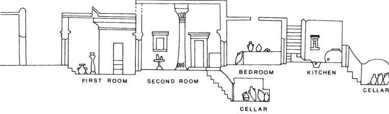

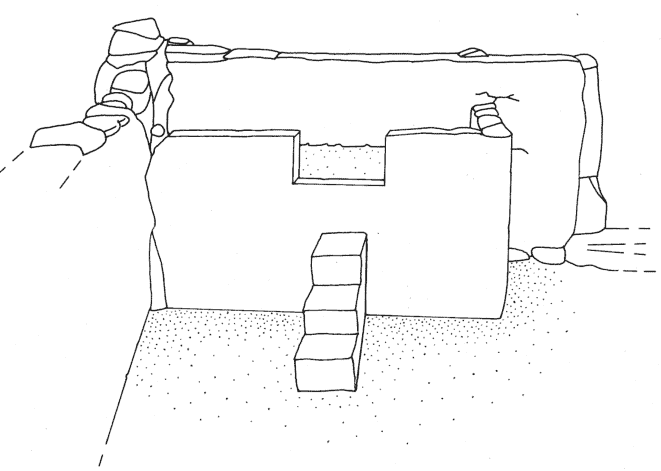

图 2. 所谓的“箱式床”。由 Mary Winkes 绘制，参考 R. E. Freed 著作《大拉美西斯》（孟菲斯，1987年）第 89 页。

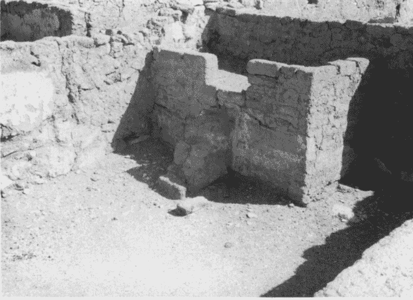

图 3. 德尔埃麦迪纳房屋中原位的所谓“箱式床”。由 B. S. Lesko 拍摄。

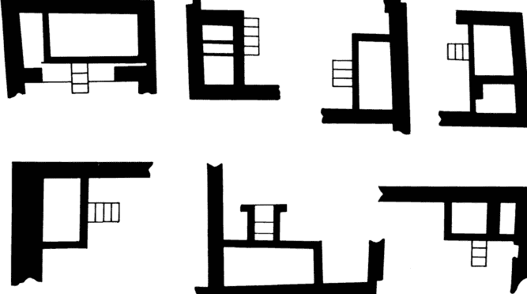

图 4. 在德尔埃麦迪纳发现的箱式床平面图。由 Mary Winkes 绘制，参考 Bernard Bruyère 著作中的《德尔埃麦迪纳挖掘报告》，FIFAO 16（开罗，1934–35年）第 56 页。

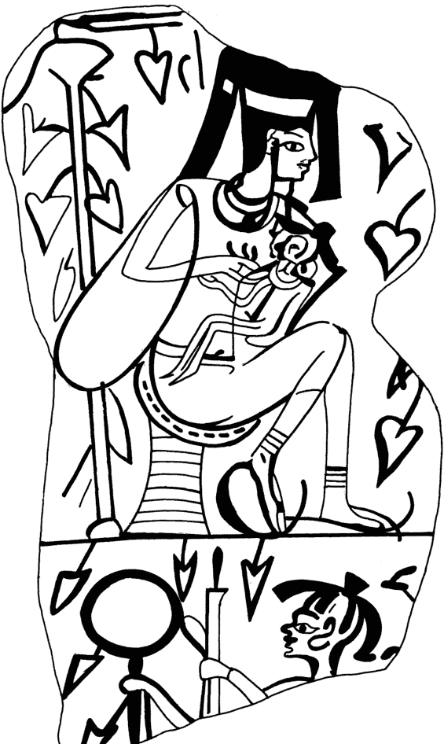

图 5. 母亲与孩子的石板碎片画。由 Mary Winkes 绘制，参考 Emma Brunner-Traut 在《东方研究学院公报》第 3 期（1955年）第 14 页，图 4。

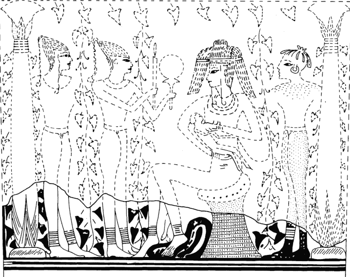

图 6. 修复后的分娩产亭壁画。由 Mary Winkes 绘制，参考 Emma Brunner-Traut 在《东方研究学院公报》第 3 期（1955年）第 15 页，图 5。

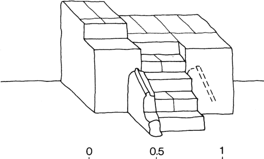

图 7. 出自阿马尔纳（Tell el Amarna）的室内祭坛。由 Mary Winkes 绘制，参考 Ludwig Borchardt 和 Herbert Ricke 著作《阿马尔纳住宅》（柏林：Gebr. Mann 出版，1980年）第 255 页，图 38。

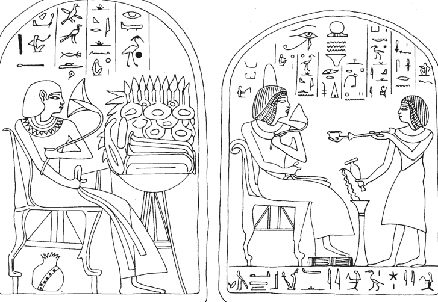

图 8. 出自德尔埃麦迪纳的“ḫh ikr n R”石碑。由 Mary Winkes 绘制，参考 R. J. Demarée 著作《“ḫh ikr n R”石碑》（莱顿，1983年），插画 VI，A17。

图 9. 出自德尔埃麦迪纳的“ḫh ikr n R”石碑。由 Mary Winkes 绘制，参考 R. J. Demarée 著作《“ḫh ikr n R”石碑》（莱顿，1983年），插画 XII，A49。

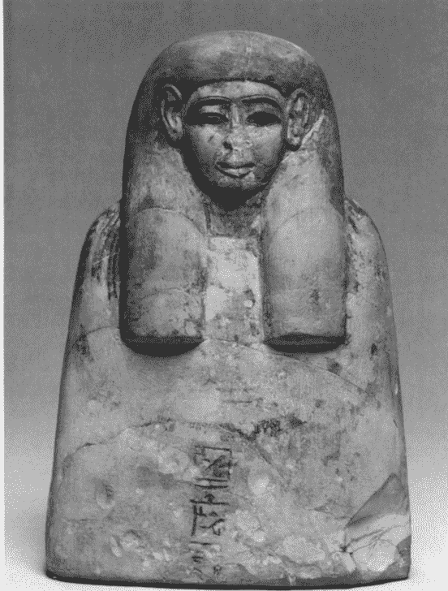

**图 10。** 出自德尔埃麦迪纳的先祖胸像。柏林国立博物馆群——普鲁士文化遗产埃及博物馆及纸草收藏馆展赠，编号 20914。

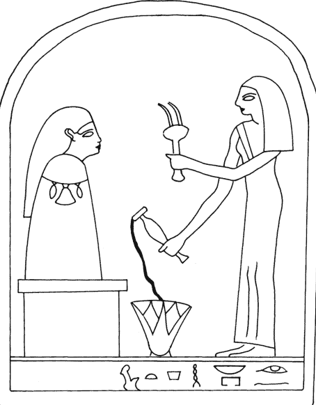

图 11. 向先祖胸像供奉的石碑。由 Mary Winkes 绘制，参考 J. Vandier d'Abbadie 著作《埃及学杂志》第 5 期（1946年）：135 页，图 1。

## 精神与智力事务

考虑到与女性生活相关的符号、丰产神像以及相关的阿马尔纳壁画，房屋前部房间的床铺区域似乎并不仅供主人及其妻子睡觉之用。除了通常的日常用途外，这些房间似乎是广泛关注女性生活各个方面的区域，包括生殖、母性，甚至是色欲的。由于可以召唤贝斯（Bes）和其他神灵，关于这些床铺围围结构是否是真实的崇拜场所仍然是一个问题。Bruyère 建议它们曾被用作祭坛；事实上，在第十八王朝具有相似平面布局和形状的室内外建筑中，房屋主人可能会祭拜阿赫那顿和奈费提提，他们将作为崇拜者与阿顿神之间的中间人。户外版本设有围墙，并有抬高的砖平台；角落内放置的砖或石灰岩祭坛表明，大多数房间是部分或完全屋顶的。它们的尺寸不一，从用于简单神庙的 2.5 米见方“微型”空间（最常见形式），到 3 米见方不等。

*(注：此处原文描述存在部分错乱或重复，翻译已根据考古语境逻辑进行了平顺处理)*

### 家庭生活与宗教

由于对后代的关注是普适的，正如对生活需求的关注一样，家庭中的祭祀物品揭示了平民不仅向神灵——如哈托尔（Hathor）和普塔（Ptah）——寻求帮助，同时也依赖他们的先祖。这种亲密关系和依赖关系是通过位于德尔埃麦迪纳的石碑、供桌甚至壁画来体现的。

除了墓葬地和奥西里斯之外，德尔埃麦迪纳的处处神庙见证了对阿蒙神（Amon）的深厚喜爱。平民通过石碑和胸像的形式表达了他们对逝世先祖的信仰，事实上，这些石碑和胸像不仅出现在家中，也出现在许多其他地点用于供奉和崇拜。根据 Demaree 的研究，用于此类目的的石碑（图 8）是石灰岩板，最初带有彩绘，圆顶或尖顶；其尺寸从 50x40 厘米的大型样本到 7x9 厘米的碎片不等。男性似乎是主要的奉者；极少数石碑是献给女性的。尽管奉者并不总是被提及或描绘，但有时包括女性。通常，石碑描绘一个坐着的男子，单手持莲花，另一只手伸向供桌，或者抓着一块布或生命符号（ankh）。通常，此人被称为这些石碑广知的术语，该术语可以翻译为“阿顿的有力 ḫ（灵魂）”或“为了阿顿持续有效的 hb（一个体）”，它代表了生者可以向其祈求的神圣先祖。室内祭坛通常放置在墙边。户外祭坛的尺寸为 1 米宽、0.6 米高、0.5 米深，与德尔埃麦迪纳的床结构相似。阿马尔纳的室内祭坛设计更为复杂，与德尔埃麦迪纳的床不同，后者具有更高的围墙。

### 国内生活与宗教

阿比多斯神庙（Demaré 已知），阿兰·舒尔曼（Alan Schulman）提供了其他八个发掘实例，据他所知，其中没有一个源自家庭甚至源于私人拜堂的。其中两件来自孟斐的梅内涅普塔宫殿；一件来自拉姆西斯三世梅迪尼特哈布（Medinet Habu）的墓庙；四件来自孟斐的一次发掘；有一件来自努比亚的阿尼巴（Aniba）。其他的来自“底比斯西部的各种神庙、国王谷，以及在一种情况下，可能来自来自底比斯墓地的古尔纳（Gurna）区域。”51。

尽管发现地点广泛，但很显然，至少在德尔埃麦迪纳（der El Medina）住宅使用的某些石碑，正如在浅长方形和拱形壁龛（出现在几座房屋的第一个、二房间）附近发现的两个例子所示，这些石碑是从龛中掉落的。52。在同一区域发现同样供奉 ḫ ikr n R’ 的石灰岩供奉桌，似乎表明石碑、桌子和其他奉品被用于家庭崇拜。53。然而，另一件 ḫ ikr n R’ 石碑是在一个还愿堂的其他石碑中发现的，另一件则在哈托尔神庙中发现。因此，值得注意的是，ḫ ikr n R’ 石碑及相关物品在德尔埃麦迪纳的使用不仅限于房屋，从所发现物品的地理范围来看，它们的使用似乎在整个埃及非常广泛。54。

这些石碑上的图像通常是坐姿男子，很可能是对接受供奉死者雕像的修改描绘。53。通过供奉来给予他或她的卡（ka）从而喂养 ḫ 的传统可以追溯到古王国时期，该时埃及文献清楚地说明了出现并恳求死者的必要性，因为死者可以在坟中作乱。追溯自古王国和中王国的死者信说明了这一传统，第十九王朝一封写给正在作者生活中制造混乱的 ḫ 的信揭示了对死者能够干涉世俗事务的信仰在拉美西斯时代的普通人思想中仍然完全有效。56。因此，村民可以在自己房屋的壁龛中立一块石碑，并使用供奉桌和祭酒盆向他供奉，请求他采取某种行动，或者可能停止麻烦。

在《死书》中，ḫ ikr 拉着太阳神拉（Re’）的太阳船，在太阳升起时航行，不受任何错误的侵害。他也是一个

### 精神与智慧事务

认识并与拉和奥西里斯合而一的人，其中转化的元素通常是知识，正如《伊乌雅（Iouiya）死书纸草卷》中的一个章节所示：“阿图姆（Atum），我作为一个无知者进入；我作为 ˁᵇ ikr 出来 . . . 我将永远以人类形式存在idget57} 因此，ˁᵇ iker 是可知的并具备人类形态的，这些特征符合将死者视为人类形象进行崇拜和恳求的做法，这种形象通常被理解为智者实体idget58} 具备了如此崇高的凭证和力量，人的死者因此是 ikr——在需要时能够（或有能力的、值得的、完美的、卓越的）为其调介。这种对调介的愿望存在于全球并持续到今天idget59}

由于石碑发现地点的迹表明它们的崇拜活动可以在房屋、神庙、拜堂或坟墓中进行，似乎这些物品的家庭、还愿和葬礼功能在村落生活中很容易相互融合，没有严格的界限。较小的石碑很容易从一个地点搬到另一个地点，因此那些在神庙、拜堂或坟墓中发现的物品可能源于房屋，反之亦然idget60} 事实上，当信徒将圣母玛利亚像从家里带到花园、工作场所或还愿堂时，同样的原理也适用。调解祷在多种环境中过去和现在都被寻求，每个环境本身都被认为是有效的。正如现代信徒可能不会根据玛利亚雕像的放置位置而对其重新命名一样，古埃及人通常不区分葬礼石碑和还愿石碑，事实上似乎对每一个都称为相同的名称（wd）^{61)。

另一部分来自第十八到第二十个王朝的材料，由今天为人知的人像或祖先胸像（图10）组成，与私人祖先崇拜有关。在知的150个例子中，有75个源自德尔埃麦迪纳，其余来自14个其他遗址idget62} 这些胸像平均高度为10到25厘米，通常由石灰岩或砂岩制成，尽管我们可以假设大多数最初是涂色的，但只有少数留下了红色漆迹，其中一个例子显示了黄色的痕迹idget63} 因此，胸像的性别尚存疑问；红色漆迹的占主导地位倾向于它们通常为男性，但我们看到红色有时也用于女性塑像。

### 国内生活与宗教

在幸存且头部完好的胸像中，大多数显示出三股假发和一个挂在脖子上的彩绘花朵，后两个元素是德尔埃麦迪纳实例的共同特征，正如彩绘的乌什颈圈（一种“宽领”，一种项链的形式）。”⁶⁴ 少数人像胸像显示出似乎是帽子状或光头的头部，尽管它们很罕见。⁶⁵。

胸像很少带有铭文——这种缺乏使我们的理解付诸困难。因此，胸像的性别尚存疑问；红色漆迹的占主导地位倾向于它们通常为男性，但我们看到红色有时也用于女性塑像。（等等，让我根据文本流重新对齐）。

*基于所提供文本流的修正：*

在幸存且头部完好的胸像中，大多数显示出三股假发和一个挂在脖子上的彩绘花朵，后两个元素是德尔埃麦迪纳实例的共同特征，正如彩绘的乌什颈圈（一种“宽领”，一种项链的形式）。”⁶⁴ 少数人像胸像显示出似乎是帽子状或光头的头部，尽管它们很罕见。⁶⁵。

胸像很少带有铭文——这种缺乏使我们的理解付诸困难。因此，胸像的性别尚存疑问；红色漆迹的占主导地位倾向于它们通常为男性，但我们看到红色有时也用于女性塑像。（实际上，文本在OCR中重复或错乱了。让我从所提供的源块提供干净的序列）。

在幸存且头部完好的胸像中，大多数显示出三股假发和一个挂在脖子上的彩绘花朵，后两个元素是德尔埃麦迪纳实例的共同特征，正如彩绘的乌什颈圈（一种“宽领”，一种项链的形式）。”⁶⁴ 少数人像胸像显示出似乎是帽子状或光头的头部，尽管它们很罕见。⁶⁵。

胸像很少带有铭文——这种缺乏使我们的理解付诸困难。因此，胸像的性别尚存疑问；红色漆迹的占主导地位倾向于它们通常为男性，但我们看到红色有时也用于女性塑像。（实际上，文本在OCR中重复或错乱了。让我从所提供的源块提供干净的序列）。

在幸存且头部完好的胸像中，大多数显示出三股假发和一个挂在脖子上的彩绘花朵，后两个元素是德尔埃麦迪纳实例的共同特征，正如彩绘的乌什颈圈（一种“宽领”，一种项链的形式）。”⁶⁴ 少数人像胸像显示出似乎是帽子状或光头的头部，尽管它们很罕见。⁶⁵。

胸像很少带有铭文——这种缺乏使我们的理解付诸困难。因此，胸像的性别尚存疑问；红色漆迹的占主导地位倾向于它们通常为男性，但我们看到红色有时也用于女性塑像。（实际上，文本在OCR中重复或错乱了。让我从所提供的源块提供干净的序列）。

（注：由于提供的文本包含大量重复内容和OCR错误，我已根据逻辑合并并提供了最清晰的翻译版本）。

### 国内生活与宗教

一块来自阿比多斯的（非-ḫ n R'）石碑描绘了一位祭拜者向一个胸像献上香料和酒（图11）；大英博物馆的一块石碑同样描绘了一位祭拜者，其画风较简，向一个侧面的巨型彩色胸像献祭，而上方还有两尊浮雕的胸像。75 然而，这两个例子都没有标明进行供奉的具体地点。在《萨利尔四号莎草纸》（Papyrus Sallier IV）的一行文中明确了此类地点，它要求人们对家中的 ḫ 进行祈祷（即葬礼）供奉。76 尽管如此，人们可以合理推断，村民可能会在家里或附近的奉神小庙里崇拜普塔，或者她也可能在任何及所有此类地点向胸像献祭。无论是祈求神灵（哈托尔女神或普塔）、国王（阿曼霍特普一世），还是在死后成为 ḫ 的祖先首领，普通人都希望与这些道德存在边界之外的人建立联系并获得他们的保护。这种联系被认为是通过供奉和祈求实现的，显然在多个场景中都能同样有效地完成。

### 总结

箱床结构、ḫ ikr n R' 石碑和人像胸像都反映了村民希望获得个人保护和帮助的愿望，涵盖了从母婴护理到无数其他日常关注的各个领域。床的结构显然通过其未来的后代暗示了家族的繁衍；石碑和胸像则反映了家族与近期亡者之间的关系以及对他们的依赖，正如其他学者所指出的，这些物品说明了定居者希望维持现在、过去与未来世代之间纽带的愿望。77 家中的床铺区域可以为家庭神灵保护下的母亲和婴儿提供避身之所，也可能是一个崇拜场所；而家中及其他地方的祭器具则允许人们向近期去世的亲属诉求。石碑和胸像似乎都是德尔埃尔·麦迪纳（Deir el Medina）家庭——甚至可能是整个埃及家庭——希望在充满不确定性的世界中获得某种安全感的手段。

## 第五章

### 村民中的魔法实践

Joris F. Borghouts

一个奇特的悖论是，新王国时期的德尔埃尔·麦迪纳是整个法老埃及历史上记录最详尽的社区，同时也是一个最异常的社区。它并不是一个可以自然增长的农业定居点，而是一个人工定居点。它的居民是石匠、画家和他们的家人，这些人的识字程度可能比其他地方要高。¹ 此外，作为国家的工人，他们的报酬相对丰厚；当以配给形式发放的工资拖欠时，他们可以直接向宰相这样的高官员（以及后来的卡尔纳克阿蒙神大祭司）申诉，甚至可以进行罢工，幸存的行政记录证明了这一点。² 工人们非常清楚自己的重要性，因为为国王和贵族建造和装饰陵墓是他们的职责，工作停滞将成为高层关注的问题。他们是受优待的，尽管他们的雇佣有时受到强大的法老官僚机构武断决策的影响。³ 这个村庄——其居民从未用其他称呼过“pa demi”（p³ dmi），即“村庄”——以一种令人不安的方式结束了。由于利比亚沙漠中贝都因人的持续袭击，那里变得不再安全的居住地，整个社区搬到了附近的梅迪尼特·哈布（Medinet Habu）前国王拉姆塞三世葬庙的安全区域。此后，其成员的历史特征是

### 精神与知识事务

关于他们在祖先工作过的墓穴中进行多年盗窃的报告。⁴ 也许是艰难时期让村民如此贫穷，以至于他们不得不通过盗取葬具物品来维持。⁵

然而，在约四百年的职业存在期间，这个村庄发展了自己的特定的宗教习俗，例如对他们的主圣人——神化的国王阿曼霍特普一世的高度推崇。到目前为止，尚未对该社区的宗教生活进行整体研究，尽管已有关于节日、个人神灵和某些崇拜方面的的研究。⁶ 然而，我们仍在等待一种基于考古和文献来源的整合性研究，将这些事物整合进一个连贯的模式中。对于研究通俗宗教与日常生活各方面方面的关系来说，这将是一个独特的机会。⁷

我在这里不尝试做此类工作。我将仅仅触及文献记载的魔法实践的某些方面，而这种魔法是日常生活的魔法。在目前为止关于魔法的书中都是关于这个工匠社区的宗教生活的，魔法的主题几乎被完全忽视了。这种忽视的一个性可能是因为魔法实践大多具有私密性质，而现代埃及学更多侧重于文献详尽的葬礼宗教和神庙宗教：即官方神学。此外，存在一种倾向，将被认为是宗教的东西与被认为是魔法的东西分离开来，尽管从人类学的观点来看，将两者分离往往毫无意义。

事实上，在古埃及，魔法深根于神学之中。根据在该村庄历史开始前约七百年前的一份声明（源于中王国早期著名的《梅尔里卡国王的教诲》，约公元前2000年），魔法是造物主神本身作为一份礼物送给人类的，用于“防止意外事件的降临”。⁸ 最近的一项发现从德尔埃尔·麦迪纳遗址的许多文学作品中发现了这一教诲的一部分，因此一些较开明的居民可能也知道这一陈述。⁹ 这一来源使用的术语是“heka”（hk3），尽管有更多术语（正如我们将会看到的），但它是村庄记录中最频繁的一个。与这一古代陈述一致，日常魔法通常具有防御目的，来自村庄的魔法文本总是

由于其语调略显过热，并不像涉及亡界的文本（如《亡者书”）那样具有神学深度，尽管有时也涉及魔法仪式。例如，法老时期最普遍且典型的崇拜无疑是针对太阳的。有许多赞歌出现在墓葬、石碑、雕像和莎草纸上。此类赞歌的简短引言出现在一块德尔埃尔·麦迪纳的莎草纸上：“对拉在生活中升起时的赞拜，由装饰者霍里编写。借此他让拉之船平安航行，船员们充满喜悦。”¹⁰ 通过诵读这首赞歌，虔诚的霍里帮助太阳船完成日常行程，而这段行程并非没有危险，正如神话文献告诉我们的那样。但在魔法咒中，太阳船的行程可能会以不同的方式被提到。这里有一段针对毒素咒的特征性引用：“如果毒素上升，拉之船将覆没在阿波普脊背上。”¹¹ 阿波普（Apopis）是混沌的怪物，当太阳神去访问他所创造的事物时构成了致命威胁。² 两者的规模差异显而易见。在两种情况下，说话者说的话都试图实现某种目标（分别是保护太阳船和停止患者体内的毒素），因此两份文本都是“行性的”（performative），这是借用了相当现代语言学中的术语。³ 前者在一种（崇拜）精神中采取了描述性态度；⁴ 后者则具有操纵性的（魔法）意图。

# 防御魔法

防御魔法在德尔埃尔·麦迪纳的文本表现得最充分。防御什么？按频率排序是危险动物、恶魔和死者。将那些难以识别的原因人格化的倾向（给这种难以捉摸的元素命名是应对它的初步尝试）导致了它们的魔鬼化。例如，针对头痛的咒语发展了自己的神话。

危险动物对蛇和蝎子的提到尤为频繁。

## 精神纸草与智力事务

### 攻击

正如德尔埃麦迪纳（Deir el Medina）的一份魔法纸草平淡地写道，蛇是“阿波普（Apap）的姐姐”。在符号层面，被这些动物之一咬咬意味着暂时被交付给了混沌的力量。从新王国时期，我们可以发现对于溺入尼罗河的人的一种平行但积极的观点：他们被认为通过直接接触原始之水（Nun）成为了“圣人”，而这种水在陆地上由尼罗河代表。

使魔法文本成为相对简单的仪式材料的往往是口头元素。埃及人寻找一种能将当前情况与神界联系起来的神话先驱，这是对神圣救赎的寻找，它为我们理解生活和富有成效的方法提供了独特的见解，这与更博学、主要的神庙神话不同。神庙的章程神话必须包含崇拜性的“事实”，由于这些事实在神庙建筑群的神圣历史过程中是杂乱增长的，叙述往往会导致阅读和解释上非常棘手的问题。但蝎子-蛇-咒语神话的目的要直接得多——这并不意味着它们缺乏复杂性——在这些神话中，神话的塑形性是最透明的。

一个例子是德尔埃麦迪纳的一份纸草上广为人知的神话，它是蛇毒咒的核心。它之所以广为人知，是因为手稿多年来一直保存在都灵的埃及博物馆，其副本有若干个变体，一直延续到晚期（约公元前350年）。该神话讲述了伊西斯（Isis）女神——神拉（Re’，当时是一个老人）的女儿——如何为她的儿子荷鲁（Horus）确保父亲的王位。她塑造了一条蛇——世界上第一条蛇——太阳神走在地面上。拉自己无能为力，回到伊西斯处寻求救援。他的女儿准备驱散毒液，因为咒语要生效，绝对要求知道受害者的真名并将其融入。伊西斯试图获得拉最秘密的名字——这个名字可能包含了太阳神全部的创造力，不仅是通往神圣亲缘的关键，也是控制世界的钥匙。太阳神引用了许多威严的名字——例如人们在赞美诗中发现的那些名字——但没有一个似乎能让伊西斯满意，最后，拉还是无法坚持并不得不屈服了。于是，他确实痊愈了，但这个特定的名字（我们未被告知是哪一个）传给了荷鲁——因此也发生了政权的更替。

这看起来完全像一个恶骗子故事。另一个不那么熟悉的故事在同一份现存于都灵的魔法手册的另一部分，它的进展方式也相同。它的反派/对立面是荷鲁神和一个较小的隼神内姆提（Nemti）。文本告诉我们，他们发现自己在一艘船上，即荷鲁的黄金船上。内姆提被咬了；文中没有说明是哪种动物，但我们可以假设荷鲁参与了这一事件。如果荷鲁要治好他，内姆提也必须说出最秘密的名字。我们再次听到许多名字，与上一个故事的显著区别在于，内姆提的头衔列表包含了一些似乎远高于他地位的称号。他被认为是一个地方神，其中包括第18王朝的上埃及地名，而他赋予自己的名字要么是自夸的，要么是直白的：“我是一个装满箭的箭袋；”内姆提被同伴挑使以此方式进行。最终让荷鲁满意的名字远非优雅；它是“邪恶日”。

几块陶片和纸草为我们提供了五篇文本，其具体措辞在这两个神话之间存在差异。它们利用神话的方式非常多样，非常有趣。尽管它们看起来都是拉和伊西斯神话的缩写，而且其中某些名字与拉提到的名字相同，但远非威严。相反，它们具有推测性质，且有些与荷鲁和内姆提版本中的相同。我们不知道是谁负责创作这些个人魔法咒语的，但显然民间的想象力偏离了原作，在我看来这里有一种讽刺倾向：如果我们将荷鲁和内姆提的神话（其中荷鲁占据上风）与伊西斯和拉的故事进行比较，这些细微的变体使其意义并不大。魔法咒语结尾的仪式元素简单得惊——有时在拉、伊西斯和荷鲁这三个主要神身上。为了对抗身体毒咬或叮咬，这种文学创作——一个源自德尔埃麦迪纳的纸草版本——被称为《荷鲁与赛特的争斗》。在这个故事中，众神殿分裂成两个立场对立的阵营，众神的主要关怀是他们的声望。这些细微的变体表明，太阳神经常是嘲笑的对象。作为双重预防，形象还应该画在亚麻上并挂在受害者的脖子上。尽管在这里没有明确规定，但我们非常确定在亚麻上打了结。最后，咒语规定食用某种草药，将其磨碎并用啤酒或酒冲下。这一切本身意义不大，咒语结束时写道，是“真正的杀手”。如果你知道问题是如何开始的，你在解决它的道路上很好，通过神话的方式提出问题，巫师找到了答案。

第三类人非常害怕：在墓里的人经常被认为徘徊着带来疾病。对于德尔埃麦迪纳的人来说，死者总是可见的。工人们不仅从事自己的职业，他们自己的墓也建在村庄两侧的坡地上。人们对死者持有一种模糊的态度。他们有权崇拜，主要在小神庙或肖像胸中，他们由“akh”（ˁ）或灵魂，最可能是“akh iqr”（ˁ）神圣灵魂来指示。但这些灵魂，无论是祖先还是其他，同时也是麻烦制造者。一份保存在该村陶片上的故事讲述了大祭司孔苏哈布（Khonsuemhab）与一个完全迷失方向的前比斯灵魂之间的往来。《致死者的信》中，生者对死去的亲属说或期待的内容来自安尼（Ani）著名的指令。这位抄书员的作品可能受过教育的村民很熟悉，因为

游行中的工人，内赫阿蒙（Nakht-Amun）墓，谢赫阿古拉，第19王朝。L. H. Lesko 拍摄。

## 精神与智力事务

它的部分副本在陶片甚至是来自德尔埃麦迪纳碎片的纸草上保存了下来。指令性文本通常关注社会行为、规范等，而不是幽灵等奇特的主题。然而，这篇文学文本的一个特定章节将日常生活中的所有不幸归咎于死者：“任何损失都归于他：田里被占领的庄稼：是他那样做的。至于谷场上的损失：‘那是那个灵魂[akh]的，’”也是这样说的。”32 关于扰扰自然的类似指控出现在一份未经编辑的德尔埃麦迪纳魔法文本中，文中对一个恶性的“akh”如下：“你进入天堂，吃掉那里的星辰。你坐在土地上，然后赶走住在那里的人。你向沙漠伸出手，杀死那里的万物。你被放在海边，让那里的所有苍蝇死掉。”33

另一个与恶的影响相关的非常有趣的部分是可能导致死亡的危险焦点，这些都是由死灵引起的。由于灵魂受冥界王奥西里斯（Osiris）神的命令，用于保护某人免受这些恶制造者的法令是由奥西里斯本人发布的。清单包含了一些奇怪的条目，如“眼睛死亡”、“鸟骨死亡（可能卡在喉咙里）”、“坠落死亡”等等。甚至还有“像女性的男人死亡，反之亦然”，这看起来是对同性恋行为的引用。34 几世纪后，许多事件和事故被写在长窄纸草条上的文中，这些条被卷起来作为护身符佩戴。这些是比斯第22和第23王朝（约公元前800年）所谓的“神谕护身符法令”，当时政权已正式交由比斯高级祭司阶层——是这些神灵像奥西里斯法令一样宣布，他们将保护护身符佩戴者免受各种日常危险的侵害。35

如果这么多可以归因于死者的神秘影响，那么竟然有如此关于德尔埃麦迪纳居民之间施展魔法的案例令人惊讶。在这个密集的村庄里，似乎有其他方法来处理内部冲突，贪婪、仇恨等

## 魔法实践

在许多文件中，魔法被证实是日常生活的常态。³⁶ 例如，“genbet”（字面意思是“角组”）是一种由长老组成的乡村委员会，人们可以在那里寻求对不公正的补偿。³⁷ 或者，当他们的保护神——神化的阿蒙霍特普一世的塑像在每周巡游中被抬过村庄时，他们可以寻求这位神的帮助。这两位权威的裁决（两种情况下都是基于可能的民意认同而做出的决定）³⁸ 有大量的记载，并为理解各种冲突提供了许多线索。一个著名的司法调查案例是一份书面控诉，它收集了许多关于工头帕尼（Paneeb）无暴行为的证词。此人已经恐吓了村子多年，正如一位愤怒的官员在文件末尾总结的那样，“他的行为简直像荷鲁斯之眼！”这等同于说“谁在扮演天命”。³⁹ 这些指控虽然只以草稿的形式存在，但某种程度上导致了这位臭名昭著者的终结。

尽管德尔麦地（Deir Medina）可能不是一个充斥巫术的社区，但也有记录显示魔法被用于自卫以外的目的。在一块莎陶片（ostracon——一种非常稀有的样本）上发现的爱情咒打破了魔法文中向神灵请求的典型语气，旨在赢得某位女性的青睐：“让某某，某某之女，像牛见到草一样追随我，像仆人跟随孩子一样，像牧人赶羊一样！”⁴⁰ 我们必须等待几个世纪，这种咒语才在世俗语魔法纸草书中更频繁地出现。但其措辞似乎几乎相同，因此我们或许可以重建类似的背景，并将这些更丰富的来源向回溯到拉美西时期。世俗语咒语的意图通常是为了打破现有的关系或婚姻，有利于咒使用者。因此，此类咒语反映了一种能量精神，或许这种拉美西时期的前身也可以从这一角度来看。

另一篇由书书记阿尼姆哈特（Amenemhat）撰写的文本，是一个针对他称为“热口者”（“shemu-ra”）之人的咒语。在其他文中，可以找到一个更简单的术语，“那个热的人”（“pa shemu”），可能指的是同类型的人。“那个热的人”总是表现为一个矛盾的形象，一个不符合社会行为公标准的人。指令性文本后来热衷于利用此类规范类型，将他与“沉默者”（“pa geru”，gr.w）相对比，后者是一个礼貌、谦逊且举止极具模范作用的人。⁴¹ 但阿尼姆哈特虽然没有给出对手的名字，但他心中一定有一个特定的人，他这样诅咒那人：“走吧，去你东方的路吧，你这个热口！你将不会被[带回来]，你将在冬天[暴露]在寒冷的影子中，你将在夏天[放逐]到一个炎热的地方。”—⁴²

在德尔麦地纳另一份具有揭示性的文件中，“shemu”出现作为某人的敌手。在开罗的法国学院有一个经过仔细修复的罐，其中许多碎片可能已经无法挽回地丢失了。这个罐的用途（如果有的话）尚不清楚，上面刻有部分保留的僧形体文字，对未来进行了某种预示。⁴³ 标题是“在一年的月份里看到好事”，对于每个月，都为文中的“i”（也名为纳基 Nakhi）预测了一些幸运的事件。同时，这份简短的仪式历法预见了纳基对手的各种不幸，而这个对手正是那个“shemu”，在这里也被以人格化的方式称为“你的那个热的人”。⁴⁴ 例如，在新年期间，整个社区都用木棍追赶“那个热的人”，而纳基则坐在当地寺庙的台阶上，静地喝着他的酒。现在这邀请我们把“热的人”的含义延伸得比指令允许的更远一点：去想一个埃及版的乡村巫师原型或许是牵牵的。我们不应该立即将其与欧洲的巫师相比，后者通常是与魔鬼合作的女性（正如人们对塞勒姆女巫的相信）。相反，我脑海中的巫师是许多非洲农村生活报告中所记录的。尽管存在巨大的局部差异，但某些反复出现的特征——异常行为和反社会态度——将典型的巫师与社区其他成员区分开来。此外，许多证词提到超自然能力是巫师的特征，我们可以从这个特殊罐的迷人文件的最后一段中推断出其种类：“快来，把那个热的人赶出去，救救纳基！让他宽心吧。那个眨眼睛的人，他倒下了！”这可以被视为“shemu”向他的同伴施加恶眼的。

埃及魔法在这个小小的拉美西定居点中作为应用形式发挥作用的另一种形式，是神灵对人类施加的。村民们讲述了许多超自然力量出现的实例，他们说这些事件是“神的‘bau’ [b³,w] 发生了”。⁴⁶ “bau”一词是古埃及所有时期和地方对神灵“显现”的常用术语。德尔麦地纳的文本没有说明它的性质，也没有说明背后神或女神的身份；因此，我们只能猜测什么样的事件会导致个人报告此类现象。迹象表明，人们很可能在经历此时感到困扰。事实上，“bau”（魔法的另一种形式和术语）被认为是以一种烦恼的形式出现的，是神灵表达某种不满。⁷ 我们只能通过对个体的陈述来推测何种冲突会导致报告这种现象。例如，一个曾下过假誓的人报告了“某种神的显现[bau]”，并向许多神请求宽恕。⁸ 我们还有一份简短的莎陶片信，请求制作一座特瑞斯神像；写信者说自己的被偷了，这阻止了他履行对神的仪式职责。⁹ 也许他害怕她的蔑视（她在附近有一个圣所），因为他补充道：“它可能对我引发塞特的显现[bau]。”⁵⁰ 换句话说，一个神可能与另一个神勾结对人类。

“bau”是一种相当严重的骚扰；至少有一个文本告诉我们它等同于死亡的状态。¹¹

# 六

# 文学、识字与文人

Leonard H. Lesko

“不要背离文学著作，否则你将受到严厉惩罚。”现在我们可能更倾向于将德尔埃麦迪纳（Deir el Medina）纸草中这份学生杂集中 *mdw-ntr* 翻译为“圣书体”，而非“文学著作”（正如阿兰·加德纳 Alan Gardiner 所做的那）。¹考虑到我们对他们教育程度的了解，这对于古人来说可能并无大碍。书员学校使用的许多文本通常具有多个用途：即通过抄写某项内容将其作为学科来教授写作。在德尔埃麦迪纳挖掘出的布鲁耶尔（Bruyère）纸草中，由雅罗斯拉夫·切什尼克（Jaroslav Česk）和格奥尔斯·波塞纳（Georges Posener）出版的十七份文件包含了一些具有文学性但非文学性的文本.³ 前者对于评估该社区的阅读兴趣和教学法有用（假设商业书籍和教科书通常可以区分）。后者之所以重要，主要是因为它们提供了关于社区生活的信息，而且从我们现在的观点来看，它们将来自这个村庄的大规模大量文本联系在一起。都灵埃及博物馆通过伯尔纳迪诺·德罗韦蒂（Bernardino Drovetti）和埃内斯托·斯基亚帕雷（Ernesto Schiaparelli）的努力获得的许多纸草显然来自德尔埃麦迪纳；亚历山德罗·罗卡蒂（Alessandro Roccati）在1975年提供了平行关系和直接联系的总结.³波塞纳在1978年建立了德尔埃麦迪纳纸草与切斯特·贝蒂蒂（Chester Beatty）纸草之间的直接联系，P. W. 佩斯特曼（P. W. Pestman）在1982年的一篇令人兴奋的短文追踪了一个包含四十份纸草的图书馆在一百多年世代传承中的精神与智事务的历史。4 引用上述诗行的纸草是书员肯-赫-凯普谢夫（Ken-her-khepshef）收集的图书馆的一部分，关于他我将会有更多介绍。

从大坑中挖掘并在村庄、墓地、王室墓区和附近神庙周围收集到的大量陶片（ostraca）主要是非文学的，但德尔埃麦迪纳本身有很大比例是文学性的，目前已知超过1,500件带有文学摘录的碎片。⁵ 像带有西努赫故事（Sinuhe）的阿什莫利安陶片这样巨大的碎片可能本质上包含了一个长篇故事的完整文本，但大多数此类碎片只有摘录，不过这些摘录通常易于识别。其中一些（但大部分）可能是学生的抄本，少数可能是老师的批改。⁶ 有些的可能是练习作品或书员技能的展示；另一些可能是书员特别感兴趣的段落，即在阅读文本时做的“笔记”，并为了作者自己的使用或与他人分享而抄写。这些此类陶片被细心地存放在墓中，以便在死后世界继续享用。7 其其数量以及某些文本出现了三个百多个例证，这一事实令人惊讶。

在德尔埃麦迪纳证实的文学作品中，包括《普塔霍特普的教训》（Instructions of Ptahhotep）、《哈德费德》（Hardefed）、《阿蒙-马克赫特》（Amen-makhte）、《阿尼》（Ani）和《父亲教子》（Father to Son）；《职业讽刺》（The Satire on the Trades）、《凯米之书》（The Book of Kemit）、讽刺信》（The Satirical Letter）以及其他智慧、道德和学生测试；《内费尔提预言》（The Prophecy of Neferti）、《皇家颂》（The Royal Panegyric）和《阿蒙霍特普一世仪式》（The Ritual of Amenhotep I）；西努赫的故事、孔谢姆（Khonshem）、霍鲁斯与赛特之争（The Contendings of Horus and Seth）、《谎言掩下的真理》（The Blind of Truth by Falsehood）；对尼罗河、阿蒙-雷和其他神灵赞歌，以及一神教赞歌和情歌。9 廉·K·辛普森（William K. Simpson）指出，在芝加哥大学东方学院（原来自德尔埃麦迪纳）的一份陶片中发现了名为《沉船的海员》（The Shipwrecked Sailor）和《口才流的农民》（The Eloquent Peasant）的故事，并注意到尽管这些百年叙事的原始词汇已保留，但语法形式已从中古埃及语变为晚期埃及语。10 显然，在德尔埃麦迪纳抄写的许多文本有数百年的历史，用一种可以被标记为“合成”的埃及语编写，以区别于拉美西时期使用的“分析性”（迂言的）晚期埃及语。这些差异大致类似于拉丁语和意大利语之间的差异，但至少我们的一些古老书员要么能够保持原始语言，要么将其翻译成他们想要表达的内容。德尔埃麦迪纳的文本通常对编辑中古埃及故事没有提供太大帮助，但它们并不像在梅迪内特·哈布（Medinet Habu）拉姆西斯三世附近的墓庙发现的用旧古典语言编写历史文本的尝试那样糟糕；即使在同一个句子中也处处不一致。¹¹

显然，德尔埃麦迪纳记录的文学文本代表了古埃及现存的大的大部分文学作品，除了少数仍仅为人知副本的文本外。此外，该档案还包括少数历史作品、大量的医学和魔法文本（针对蝎子、发热、头痛的咒语）、一本解梦书、一本催药书，以及插图讽刺和色情作品。¹²

由于德尔埃麦迪纳并不是一个很大的社区，平均成年居民可能不足一百人，当时不应多于一或两名官方书员。然而，某些文本指出在极短的时间内有五或六人，且某些人的任期明显重叠。切尔尼（Černý）列出了“墓地书员”（ss n pr by）的头，试图涵盖那些可能真的是绘图员（ss kd）或仅识字的人。¹³ 现在可以对他的发现进行一些调整，但通过他的工作，我们了解了拉美西时期德尔埃麦迪纳大多数高级书员的一些情况，也了解了一些关于个人工匠、工人，甚至一个显然能读写的木匠的情况。我们确实很幸运，有许多纸草、陶片和涂鸦可以与德尔埃麦迪纳发现的墓碑和墓的个人所有者联系起来；无疑，来自其他遗址——卡胡（Kahun）和阿布·西里（Abu Siri）；西奈（Sinai）；哈特努布（Hatnub）、哈马马特谷（Wadi Hammamat）和德尔·巴哈里（Deir el Bahri）的涂鸦；以及阿马纳信件（Tell el Amarna letters）——都是非凡且引人注目的。缺失了99%来自埃及最重要的城市、城镇、神庙和其他艺术品的记录——然而，从大量挖掘的宏伟宫殿中幸存的仅仅是罐标签

## 文学、识字与知识分子

相关记载表明，那里并非完全没有图书馆或档案馆，而是说识字能力至少延伸到了家庭仆人手中，他们必须从密封但带有标签的容器中提取所需的物资。19 埃及很难被视为一个前文盲社会或非文盲社会，除非，我们对“识字”有完全不同的定义。在德尔埃麦迪那（Deir el Medina），工头、书吏、工匠、一些工人和一些妇女都会读写写，正如我们所知的那样，这表明识字率远比约翰·贝恩斯（John Baines）等人所愿意接受的要高得多。20 许多书吏头衔和每一项具有代表性的书写行为都可以作为识字能力的良好证明。

这并不是说在德尔埃麦迪那识别出的所有人都会读和写；专业的书吏可能处理过个人之间的某些信件，以及宗教指南书、征收文本，甚至一些所谓的传记文本的准备工作。但这些书吏不可能掌握所有已知的信件——包括写给死人的信——以及在许多偏远地区发现的石板碎片和涂鸦上的笔记。21 无疑，德尔埃麦迪那社区的成员会认出书吏拉莫塞（Ramose）的涂鸦和石碑，这些文字是为了记录他到达的日期，并配有插图展示了他的虔诚；而肯-赫-凯普斯（Ken-her-kheps）在位于山口定居点的座位以及他在梅内普塔墓墓阴影处工作站上的名字，绝不是为了他自己识别这些地点；相反，它们是为了防止其他识字的人使用他的座位。22 书吏从德尔埃巴哈里（Deir el Bahri）上方定居点写给乡村妇女的笔记，除非书吏们都在工作，或者妇女们识字，否则将得不到回复。23 德尔埃麦迪那的许多工人至少能写自己的名字，而且由于写写比写容易，许多人一定能够读懂那些被修改的信息。24 写在石块上并留在墓墓入口的针对入侵者的威胁，如果每两百人中少于一人能读懂它们，还会被认为是有效的吗？如果路过的人中，只有极小比例的人能读懂²，那么对于一份要求路人说“一千份面包、啤酒、牛和禽类”的涂鸦，能期待什么样的回应呢？225 显然，这些文字中的某些带有魔法元素，但绝不至于让作者在知道几乎没有人能读懂的情况下写下他们的文本。

当然，这些并不意味着古埃及人有很大比例的人博学多才，甚至不懒于尝试阅读他们在建筑内部看到的大部分文本。这不能证明埃及人普遍能够理解他们周围宣传文本的微妙之处。基于幸存的相对较少的文学文本，估计古埃及有多少位创作性作家可能是不可能且不明智的。然而，显然，确实有一些人负责记录过去并教导未来，他们还是故事讲述者、诗人、哲学家和神学家。

尽管没有发现任何位伟大的作家来自德尔埃麦迪那，但这个村至少有一位藏书爱好者，此人被佩斯顿（Peston）鉴定为肯-伯-凯普斯普（Ken-ber-khepshep），他是第十九王朝后半期的墓墓书吏。连接他的莎草纸集并帮助我们追溯其历史的内部线索足以支持这一论点，正如大多数古代谜题一样，仍然缺少一些碎片。将肯-伯-凯普斯普与图谱联系起来很容易，因为在早期第十九王朝一本梦书的结尾，他用他辨识性的笔迹加入了拉美斯二世（Ramses II）胜利诗的副本，还有一封他写给法老梅内普塔（Mernethpah）宰相的副本——比莎草纸上的原始文本晚了约七十年。卷轴最终落入一个名为阿蒙-纳赫特（Amen-Nakhte）的工人的手中，他在梦中间插入了一段跋记，虚假地声称这是他写的（顺便提供了关于他母亲和三个兄弟身份的信息）。226

这个阿蒙-纳赫特可能为收藏中增加了最精美的一卷卷轴：贝蒂一号莎草纸（Papyrus Beatty I），它包含一系列歌曲和荷鲁斯与塞特斗争的神话故事。该文本最初由一位来自底比河岸的书吏抄写的，他在跋记中加入了自己的名字，但阿蒙-纳赫特的一位村友删除了原书吏的名字，并用自己的名字纳赫特-索贝克（Nakht-Sobek）代替了它。由于档案馆还包含了这个纳赫特-索贝克给阿蒙-纳赫特的信，因此假设阿蒙-纳赫特是从那里获得卷轴的。众所周知，一些切斯特·贝蒂莎草纸在古代被故意破坏了，被撕下并在擦除或未擦除的情况下使用；有些被用作工人马阿克赫特夫（Maanakhtef）发送的信件笔记和副本，他恰好是阿蒙-纳赫特的兄弟。27

书吏肯-赫-凯普斯与工人阿蒙-纳赫特之间的联系在纳翁纳赫特（Naunakhte）的遗嘱中变得清晰，她是肯-赫-凯普斯的妻子，阿蒙-纳赫特的母亲。这些事实似乎足够清楚，但并没有让阿蒙-纳赫特成为肯-赫-凯普斯的儿子。他结婚纳翁纳赫特时已经五十岁了，而她是一个可能只有十二岁的女孩。

## 精神与学术事务

### 文学、识字与知识分子

伊莫霍普（Imhotep）、普塔霍特普（Ptahhotep）和卡格姆尼（Kagemni）在萨卡拉各有一座重要的墓地，而霍德夫（Hordef）则在吉萨。

古王国现存的少数文学文本结合这份著名作者名单，似乎指向了该时期单一的文学类型，即智慧文学，具体来说是指令书。但这就是当时存在的全部内容，甚至是写得最好的作品吗？我认为不是，我发现文中列出的中王国书记员名单更具启发性。这四位圣者的名字被夹在两对古王国书记员之间，他们显然并不是埃及官僚机构中的显赫人物，也没有那种实际上成为朝圣地的的著名墓地。我们知道，他们的抱怨、预言和指令（再次，这些都被方便地标记为智慧文学）并不代表该时期文学产出的全部，我非常赞同，归于他们的遗存作品（尽管具有代表性但并非全面）并不如其他未名作者的某些同期作品优秀.³35。既然如此，切斯特·比提名单（Chester Beatty list）的合理性何在？或许解释在于某些遗存的作品以及关于这四个人的情况。

来自赫利奥波斯的祭和书记员卡赫佩雷-塞布（Khakhepere-seneb）写了一首哀歌（部分残存），他在诗中试图宣泄痛苦，并寻求用“未知的词、新语言中尚未使用的非寻短语、无重复，而非祖先所说的熟悉的言语”来构思他的抱怨。这一表述意义重大，因为它表明已经有许多此类文章出现，并且显示卡赫佩雷-塞布可能对抱怨的形式而非内容更感兴趣。卡赫佩雷-塞布想在自己的作品中避免抄袭；具体来说，他不想被指责为呈现了一个“事后诸葛的故事：他们很久以前就做过了。这不是他们预料到要讲述的故事。这是自取其灭。这是谎言。没有人会向别人记住一个男人的名字。”.³6。在这一段落中，卡赫佩雷-塞布描述了他第十二王朝两位前任的代表作品。尽管他们的故事可能是虚假的，但内费尔蒂（Neferti）和凯蒂（Khety）的名字在几百年后仍被他人记住——部分是因为他们被包含在切斯特·比提四号纸草列表中——他们的名声和作品流传至今。由于卡赫佩雷的名字源于塞努斯鲁特二世（Senusret II），他被塞努斯鲁特一世（Senusret I）的宣传者们安全地安置在这一王朝的晚期，他实际上可能是在感叹当今局势的转折，而不仅仅是写一种第一中间过渡期动荡时期盛行的公式化文本。该事件确实可能是塞努斯鲁特三世（Senusret III）对地方省长权的压制.³那时的情况会更加紧迫，这种抱怨也反映了皇廷之外的人对这一王室举动的批评：即一位祭司。卡赫佩雷-塞布对早期宫廷书记员内费尔蒂和凯蒂的批评既有政治动机也有文学动机。

内费尔蒂显然曾被阿蒙赫哈特一世（Amenemhet I）或其子塞努斯鲁特一世用来撰写一篇为第十二王朝辩护的文章.³⁸。阿蒙赫哈特在内费尔蒂的作品中以南方拯救者阿尼（Ameny）身份出现，但由于阿蒙赫哈特的遇杀是塞努斯鲁特一世下令许多其他作品的契机，内费尔蒂的预言也可能是伪造的，作为文本链中的一环，用来合理化和美化这些篡位者。总之，这部作品是一部设定在塞努斯鲁特时期古王国的事后作品，声称预言第一中间过渡期的恐怖和阿尼的到来。它忽略了对阿蒙赫哈特二世（Amenemhet II）的提及，后者实际上是曼图霍特普二世（Mentuhotep II）的继任者，后者继位前曾担任宰相。显然，内费尔蒂的作品因谎言而存在瑕疵，卡赫佩雷-塞布对此感到非常愤怒。他的愤怒可能是对政治虚构的祭司式回应，但他显然认为这些虚构是严肃的，也许因为他看到人们竟然相信了它们。这与他批评《沉海水员》（Shipwrecked Sailor）的作者撒谎是不一样的.³。他看到了歪曲历史的危害，而这本身就是一个重大的开端，或者至少是最早记载的案例。遗憾的是他没有表达得更清楚，但在那种情况下，我们庆幸他写下了东西，而且他写下的东西存了下来。

切斯特·比提四号纸草（Papyrus Chester Beatty IV）称凯蒂为所列作者中“首位”的，并提到他是《阿蒙赫哈特一世指令》的真实作者⁴⁰。由于该文本显然暗示了那位国王的遇杀，这在多个方面上都是另一种歪曲，且在古代就被意识到了。塞努斯鲁特一世推行了这篇代笔作品，既是该文本的受益者，也是其父亲死亡的受益者。

该篇声称（正如另一部同期的西穆特姆（Simuthem）故事那样）他在刺杀发生时在远方，并坚称王位本该会“移交”给他，并为他预言了一段非常成功的统治。

假设这位“著名的”凯蒂就是杜阿-凯蒂（Dua-Khety）撰写《职业讽刺》（Satire on the Trades）的同一个书记员，那么他另一部完全不同的作品可以用于评估他的价值⁴¹。这篇讽刺作品——显然是德尔埃麦迪纳（Deir el Medina）最受欢迎的作品⁴²——并不微妙，但体现了老师对学生的关怀和趣味性。

早些时候，这可能是后期书写系统中某位老师刻意为之。如果能更多地了解编写《切斯特·贝蒂第IV号纸草》中关于诗歌文本的抄写员，将是非常有趣的。他显然熟悉学校里使用的著作。他还推崇写作高于一切，听起来显然像是一个老师本人。加德纳说他“是一位经验丰富的抄写员”，而佩斯特曼暗示，纳纳赫特的儿子阿蒙-纳赫特（Amen-nakhthe）可能是写这些练习题的抄写员。无论他是谁，他似乎都没有表现出自己的宗教或政治偏见，他可能甚至没有意识到我们在前人作品中看到的缺陷。

那四位在学校里教的中王国时期抄写员可能自己拥有自己装饰华丽的坟墓——至少没有一个存留。然而，他们的名声延续了数百年——即便在像德尔麦迪纳（Deir Medina）这样一个相对新村庄的埃及人中也是如此——这可能是因为他们的文本被后代教师和学生反复抄写。甚至他们的原始目的可能已经被遗忘，这些作品将第十二王朝国王的名声扩大到了这种程度，以至于西索斯里斯（Senusret）的名字在希罗多德和狄奥多鲁斯·西库斯时代被列为埃及最伟大的法老之一。

《切斯特·贝蒂纸草》中的列表显然遗漏了一些仍然存世的中王国小说作品，以及少数心理学和励志性著作。它没有提到任何用晚期埃及语写的新王国时期作品，甚至跳过了阿蒙内姆奥佩特（Amenemopet）和阿尼（Ani）的两件极其优秀的作品。由于这份清单文本本身本质上是一篇中世纪埃及语作品，带有许多晚期埃及语的误写，它可能是一个在拉美西斯时期抄本中保存不佳的早期作品。原作在时间上可能更接近提到的那些中王国作者；这至少可以解释它的遗漏、它的缺陷性，以及对那些显然不是古埃及顶尖水平的作者的夸张评价。阿尼那部敏感的《教训》（或《格言》）在德尔麦迪纳发现于属于肯-赫尔-凯普斯夫（Ken-her-khepsf）图书馆的卷轴中，它赞美母亲，捍卫妻子的独立，歌颂婚姻忠贞的美德，提倡种植花卉，并建议用隐藏在言语中充满爱的心去祈祷。

## 精神与智力事务

也许切斯特·贝蒂纸草中最卓越且最令人兴奋的文本，是那部浪漫抒情诗选集。这些诗歌与埃及其他地区的诗歌文本一起，被证明与后期东方文化的抒情诗具有许多共同主题，并包含了宫廷爱情诗的例子以及更接地气的女性歌曲。这些歌曲中百分之七十是以女性之口呈现的，但遗憾的是，我们尚未识别出其中任何原始作者。

由于《切斯特·贝蒂第IV号》的抄写员可能本身也是一名抄写员、老师或高级学生，很清楚，尽管他的口语是晚期埃及语，但他理解足够的中世纪埃及语，以便在正确的地方进行替换（尽管有些粗心），而不会对此感到非常困扰。显然，学校正在敦促继续使用这种完全不同的古老语言的著作。保持中世纪埃及语的活力对于任何相关人员都是有用的，因为这些工人在抄写纪念性铭文和古风宗教文本时正是如此。为了写作练习而被抄写的古文学文本，逻辑上也会被用于帮助抄写员学习古语言，以为这些实际任务做准备。但也许它们也是为了它们本身而被保留，作为历史的时代产物，即使它们不如当时的某些文学作品优秀。

# 缩写表

| 缩写 | 全称 |
| :--- | :--- |
| **AEL** | Miriam Lichttheim. *Ancient Egyptian Literature*. 3 vols. Berkeley, 1973–80. |
| **AEMT** | Joris F. Borghouts. *Ancient Egyptian Magical Texts*. Leiden, 1978. |
| **AJA** | *American Journal of Archaeology*. |
| **Allam, HOP** | S. Allam, *Hieratiche Ostraka und Papyrus aus der Ramessidenzeit*. Tübingen, 1972. |
| **Anast. V** | *Papyrus Anastasi V*. |
| **ASAE** | *Annales du Service des Antiquités de l'Égypte* (Cairo). |
| **BÄe** | *Bibliotheca Aegyptica*, Brussels. |
| **Bakir, Slavery** | Abd el-Mohson Bakir. *Slavery in Pharaonic Egypt*. Cairo, 1952. |
| **Bauer, Ostkanaanaer** | Theo Bauer. *Die Ostkanaaner. Eine philologisch-historische Untersuchung über die Wandschicht der sogenannten “Amoriter” in Babylonien*. Leipzig, 1926. |
| **BdE** | *Bibliothèque d'Etude*, Institut Français d'Archéologie Orientale, Cairo. |
| **BES** | *Bulletin of the Eptological Seminar* (New York). |
| **Bierbrier, Tomb-builders** | Morris Bierbrier, *Tomb-builders of the Pharaohs*. London, 1982. |
| **BIFAO** | *Bulletin d'Institut Français d'Archéologie Orientale* (Cairo). |
| **BiOr** | *Bibliotheca Orientalis* (Leiden). |
| **BM** | British Museum. |
| **Borghouts, Divine Intervention** | Joris F. Berghouts, “Divine Intervention in Ancient Egypt and its Manifestation.” In *Gleanings from Deir el Medine*, ed. R. J. Demarcé and J. Janssen, pp. 1–70. London, 1982. |
| **Breasted, Ancient Records** | James H. Breasted. *Ancient Records of Egypt*. Vol. 3. Rpt. New York, 1962. |
| **Brunner-Traut, Sketches** | Emma Brunner-Traut. *Egyptian Artists' Sketches: Figured Ostraka from the Fitzwilliam Museum*. Cambridge and Istanbul, 1979. |
| **Bernard Bruyère, Sketches** | Rorts de Deir, , 1,8, 1,,,,.....,,,,,,,,,,, 20, 1977. |
| **Cat. Mus. Eg.** | *Catalogo del Museo Egizio*. |
| **CdE** | *Chronique d'Egypte* (Brussels). |
| **Černý, LRL** | Jaroslav Černý. *Late Egyptian*. 9. |
| **Černý, Note** | Jaroslav Černý. Note on the... |
| **Černý, Family** | Jar...... of........ ý ofý, 191..... of.....................................,.........1, 1939. |
| **Černý-Gardiner, Hieratic Ostraka** | Deir-Medina. 50, 1972, 1972, 50, 1973. |
| **Janssen, Legal Proceedings** | Jac. J. Janssen. “The Rules of Legal Proceedings in the Community of Workers at De el-Medina.” *BiOR* 31 (1975): 291–296. |
| **Janssen, Two Personalities** | Jac. J. Janssen. “Two Personalities.” In *Gleanings from De el Medine*, ed. R. J. Demarée and Jac. J. Janssen, 109–131. Leiden, 1982. |
| **Jansen, Absence from Work** | Jac. J. Janssen. “Absence from Work by the Necropolis of Thebes.” *SAK* 8 (1980): 127–152. |
| **FIFAO** | |
| **JA** | |
| **SAK 8 (1980): 127–152.** | |
| **Jansen, Commodity Prices** | Leiden, 1975. |
| **Jansen, Khaemtore** | ,RO 58 (1977): 221–232. |
| **Jansen, Legal Proceedings** | *BiOR* 31 (1975): 291–296. |
| **Jansen, Two Personalities** | Leiden, 1982. |
| **JAOS** | *Journal of the American Oriental Society* (New Haven). |
| **JARCE** | |

# Journal of the American Research Center in Egypt (New York)

## JCS
Journal of Cuneiform Studies (Philadelphia).

## JEA
Journal of Egyptian Archaeology (London).

## JEA, 1980, 1980, 1980, 1980, 19,980.

## Jean, Noms
Charles F. Jean. “Les noms propres de personnes dans les lettres de Mari.” In *Studia Mariana*, ed. A. Parrot et al., pp. 63–98. Leiden, 1950.

## JESHO
Journal of Economic and Social History of the Orient (Leiden).

## JNES
Journal of Near Eastern Studies (Chicago).

## JSS
Journal of Semitic Studies (Manchester).

## Kemp, Anatomy
Barry J. Kemp. *Ancient Egypt: Anatomy of a Civilization*. London, 1989.

## Koenig, Catalogue
Yvan Koenig. *Catalogue des etiquettes de jarres hiératiques de De el-Medina*. Cairo, 1979–80.

## KRI
Kenneth A. Kitchen. *Ramesside Inscriptions, Historical and Biographical*. Vols. 1–7. Oxford, 1975–89.

# 缩写词

- **LA**: *Lexikon der Aegyptologie* (Wiesbaden). 第1–7卷, 1975–92. William K. Simpson, 编. *The Literature of Ancient Egypt*. 重版. New Haven, 1973.
- **LAE**: Emmanuel Laroche. *Les noms des hittites: Etudes linguistiques*. 第4卷. Paris, 1966.
- **Laroche, Noms**: Carl Richard Lepsius, *Denkmäler Ägypten und Äthiopien*. 18卷. Berlin and Leipzig, 1849–1913.
- **LD**: Gustave Lefebvre. *Histoire des grands prêtres d'Amon de Karnak jusqu'à la XX dynastie*. Paris, 1929.
- **Lefebvre, Grandes prêtres**
- **LRL**: *Late Ramessider Letters*（晚期拉美西信。参见 Černý, LRL; Wente, LRL。）
- **McDowell, Jurisdiction**: Andrea G. McDowell. *Jurisdiction in the Workmen's Community of Deir el-Medine*. Ägyptologische Uitgaven 5. Leiden, 1990.
- **MÄS MDAIK**: *München Ägyptologische Studien*. *Mitteilungen des Deutschen Archäologischen Institut, Abteilung Kairo* (Cairo).
- **Mélanges Maspero 1**: *Mélanges Maspero 1. Orient ancien*. MIFAO 66. Cairo, 1934–1961.
- **MIFAO**: *Mémoires publiés par les membres de l'Institut Français d'Archéologie Orientale du Cairo*.
- **MIO**: *Mitteilungen des Instituts für Orientforschung* (Berlin).
- **NPN**: I. J. Gelb, P. M. Purvis, and A. A. MacRae. *Nuzi Personal Names*. OIP 57. Chicago, 1943.
- **O.**: *Ostracon*（陶片，后接当前出藏地或古代遗址）。
- **OIP**: *Oriental Institute Publication*, University of Chicago.
- **OMRO**: *Oudheidkundige Medeleingen Leiden Rijksmuseum van Oudheden*, Leiden.
- **OrSuec**:
- **Peck, Egyptian Drawings**: William H. Peck. *Egyptian Drawings*. New York, 1978.
- **Peet, Tomb Robberies**: T. E. Peet. *Tomb Robberies of the Twentieth Egyptian Dynasty*. Oxford, 1930.
- **PM**: Bertha Porter and Rosalind L. B. Moss. *Topographical Bibliography of Ancient Egyptian Hieroglyphic Texts, Reliefs, and Paintings*. 6卷. Oxford, 1927 (第2版正在进行中).
- **RAD**: Alan H. Gardiner. *Ramesseid Administrative Documents*. London, 1948.
- **Ranke, Personennamen**: Hermann Ranke. *Die Agyptischen Personennamen*. 2卷. Glückstadt, 1935.
- **RdE/RecTrav**: *Revue d'Egyptologie* (Paris). *Recueil de Travaux Relatifs à la Philologie et l'Archéologie Egyptiennes et Assyriennes* (Paris).
- **SAK**: *Studien zur Altägyptischen Kultur* (Hamburg).
- **SAOC**: *Studies in Ancient Oriental Civilization*, Chicago.
- **Schulman, Military**: Alan R. Schulman. *Military Rank, Title, and Organization in the Egyptian New Kingdom*. MAs. Berlin, 1964.
- **Spencer, Death**: Jeffrey A. Spencer. *Death in Ancient Egypt*. New York, 1982.
- **Spiegelberg, Graffiti**: Wilhelm Spiegelberg. *Aegyptische und andre Graffiti aus der thebanischen Nekropolis*. Heidelberg, 1921.
- **Stamm, Beiträge**: J. J. Stamm. *Beiträge zur Hebraische und altorientalischen Namkunde*.
- **Orbis Biblicus et Orientalis**, vol. 30. Freiburg, 1980.
- **Stamm, Namengebung**: J. J. Stamm. *Die Akkkadische Namengebung*. Leipzig, 1939; 重印于 Darmstadt, 1968.
- **Studies . . Lichtheim**: *Studies in Egyptology Presented to Miriam Lichtheim*. 2卷. De. Sarah Israel-Groll. Jerusalem, 1990.
- **Studies . . Parker**: *Egyptological Studies Presented to Richard A. Parker*. 编辑 Leonard H. Lesko. Hanover, 1986.
- **Tallqvist, APN**: K. L. Tallqvist. *Assyrian Personal Names*. *Acta Societarum Fennicae*, vol. 48, no. 1.
- **TT**: *Theban Tomb*（底比墓，后接数字）.
- **Urk.**: *Urkunde des ägyptischen Alttums*.
- **VA**: Dominique Valbelle. *Les ouvriers de la tombe: Deir el-Medine à l'époque rameside*. BdE 96. Cairo, 1985.
- **Valbelle, Ouvriers**: Raphael Ventura. *Living in a City of the Dead*. A. Erman and H. Grapow, *Wörterbuch der ägyptischen Sprache*. Leipzig, 1926–63.
- **Wb.**: Edward F. Wente. *Letters from Ancient Egypt*.
- **Wente, Letters**: *Late Ramesside Letters*. SAOC 33. Chicago, 1989.
- **Wente, LRL**: Barbara S. Lesko, 编辑. *Women's Earliest Records*.
- **WER**: *Zeitschrift für Assyriologie* (Berlin).
- **ZA**: *Zeitschrift für Ägyptische Sprache und Alterkunde* (Leipzig).
- **ZAS**

# 注释

1. 职级、角色与权利：Alan H. Gardiner, “Coronation of Haremhab,” *JEA* 39 (1953): 13–31.
2. Ahmed Kadry, *Officers and Officials in the New Kingdom*, *Studia Aegyptica* 8 (Budapest, 1982), pp. 20–35, 213–217.
3. Breasted, *Ancient Records*, §§ 32A,32B.
4. Peet, *Tomb Robberies*, pp. 92–98.
5. Lefebvre, *Grandes prêtre*, p. 245; 以及 Kadry, *Officers*, p. 94.
6. Kadry, *Officers*, p. 94.
7. Schulman, *Military*, p. 15; Barbara Lesko, “True Art in Ancient Egypt,” in *Studies . . Parker*, pp. 95–96.
8. R. J. Williams, “Scribal Training in Ancient Egypt,” *JAOS* 92 (1972):218; 以及 P. Chester Beatty, v.4–6.
9. Černý, *Workmen*, p. 131 (O. Berlin 1654, v. 6; 参见 Allam, HOP).
10. Černý, *Workmen*, p. 132.
11. Ibid., pp. 191, 229.
12. Ibid., p. 227.
13. Kadry, *Officers*, pp. 148–149. 村民们通过养小猪来补充食物。参见 Janssen, *Commodity Prices*, pp. 177–178, 525; 以及 R. L. Miller, “Hogs and Hygiene,” *JEA* 76 (1990): 131-140.
14. Janssen, “Khaemetore,” p. 226.
15. Janssen, *Commodity Prices*, p. 460 ff.
16. Ibid., pp. 461; Černý, *Workmen*, pp. 191, 229.
17. Janssen, “Khaemtore,” p. 229.
18. Janssen, *Commodity Prices*, pp. 180–193.
19. Alan H. Gardiner, “A Lawsuit Arising from the Purchase of Two Slaves,” *JEA* 21 (1935): 140; 以及 Janssen, *Commodity Prices*, pp. 172–176.
20. William F. Edgerton, “the Government and the Governed in the Egyptian Empire,” *JNES* 6 (1947): 159.
21. Janssen, “Khaemtore,” p. 231–232.
22. Janssen, *Commodity Prices*, p. 534; 以及 “khaemtore,” p. 231.
23. Eyre, “Employment,” p. 113 and n. 57.
24. Barry J. Kemp, “The Amarna Workman’s Village in Retpect,” *JEA* 73 (1987): 46.
25. Janssen, “Absence from Work,” p. 139–140.
26. Janssen, “Legal Proceedings,” p. 295.
27. Janssen, “Two Personalities,” p. 120; 以及 McDowell, p. 271–277, 296.
28. Černý, *Workmen*, p. 330; 以及 Janssen, *Commodity Prices*, p. 536.
29. Eyre, “Employment,” p. 119ff.
30. Biebrier, *Tomb-builders*, p. 36; 以及 Černý, *Workmen*, p. 354.
31. Janssen, “Two Personalities,” p. 119ff.
32. Černý, *Workmen*, p. 370, 380.
33. J. Vandier-Abbadie, *Catalogue des figurés de Deir el Medina*; Černý, *DFIAO* 2 (1937), pls.4–8, 9–12; *Egyptian Drawings*, p. 84; *Workmen*, p. 352; Brunner-Traut, *Sketches*, p. 5.
34. 例如，在 *Rep. Onomastique* (TT 2, 4, 6, 10, 211) 中记录的 18 人中，包含了女性文官职衔，这些职衔在许多 Deir el Medina 的书记书中（即晚期）是缺失的。Mario Tosi。
35. 村庄的书记书们习惯用宗教职衔称呼妻子，这暗示了这些女性在村庄阶层中具有特殊的地位。在 *Valbelle, Ouvrier*, p. 350 中提到，在一个没有供奉该神神庙的村庄里，她是首席（歌手）。参见 *LRL* 9, 16, 17; 以及 Černý, *Workmen*, p. 369.
36. 雕塑师是 *Rep. Onomastique* (TT 4) 中列出的船员中唯一一个拥有富有（记录的）妻子的男性。
37. Borghoughs, “Divine Intervention,” pp. 34–35; 参见 *Wente, Letters*, pp. 141 (no. 184).
38. Černý, *Workmen*, pp. 177–179.
39. *WER*, pp. 117–121, 314–315.
40. Černý, *Workmen*, pp. 369–370; *Wente, Letters*, pp. 217–219 (no. 353).
41. Carol Myers, *Discovering Eve: Ancientite Women in Context* (New York, 1988), pp. 172–181.
42. Barry J. Kemp, “Wall Paintings at the Workmen’s Village at El-Amarna,” *JEA* 65 (1979): 52–53.
43. 查看 Barbara S. Lesko, *The Remarkable Woman of Ancient Egypt*, 2nd ed. (Providence, 1987), pp. 143.
44. Černý, p. 199; *Wente, Letters*, pp. 162 (no. 255), 165 (no. 270), 156 (no. 230); Leonard H. Lesko 在本书中。
45. *LRL*, 37; 以及 *Wente, Letters*, p. 174 (no. 290).
46. P. Chester Beatty (Group A, 32C), *AEL*, p. 183.
47. William A. Ward, “Notes on Some Semantic Lloyd and Personal Names in Late Egyptian,” *Orientalia* 32 (1963): 430–432; K. Baer, “Temporal WN in Late Egypt,” *JEA* 51 (1965): 138, 示例; Janssen, “Khaemetore,” p. 229.
48. Ventura, *Living*, pp. 105, 179.

## 参考文献与注释

### 通用参考文献

49. Černý, “Note . . . Family,” pp. 52–53.

50. Janssen, “Khaemtore,” p. 230.

51. Janssen, “Two Personalities,” pp. 119–120.

52. 一份来自第20王朝的协议，关于老年遗妇为新妻分配财产。参见 Jaroslav Černý; T. E. Peet, “A Marriage Settlement of the Twentieth Dynasty,” *JEA* 13 (1927): 30–39.

53. Jaroslav Černý, “The Will of Naunakhte and the Related Documents,” *JEA* 31 (1945): 29–53.

54. Shafik Alam, “Some Remarks on the Trial of Mose,” *JEA* 75 (1989): 104.

55. Dominique Valbelle, *Catalogue des poids à inscriptions hieratiques de Deir el-Médineh* nos. 5001–5423 *DFIAO* 16 (1977), p. 21; Černý, *Valley of the Kings*, p. 53.

### 第 37–43 页注释

61. “作为不动产所有者的女性”，见于《世界埃及》(WER)，第 123–135 页。

62. William F. Edgerton, “拉美斯三世第二十九年的罢工”，*NES* 10 (1951): 137–140。

63. Černý, 《Workmen》，第 351 页；Černý, *JEA* 15 (1929): 243–258。

64. Edgerton；另见 Jac. J. Janssen, “拉美斯三世第 29 年罢工的背景信息”，*Oriens Antiques* 18 (1979): 301–308；以及 P. J. Frandsen, “编辑现实：图林罢工纸草卷”，见于 . . . Lichtheim, PP. 173–192。

65. O. Berlin 12654；Černý, 《Workmen》，第 104–5, 185 页。搬运工的低廉工资每月 1 罐小麦和 1/4 罐大麦，仅够维持生存。R. L. Miller, “埃及配给口粮中的卡路里计算”，*JESHO* 34 (1991): 262, 269，他根据一个四口之家计算了通过这种工资可能获得的个人卡路里摄入；大家庭是常态。

### 2. 与外界的接触

感谢 Rob Demaré 和 Richard Parkinson 阅读了这篇论文的草稿并提出了建设性建议；并感谢牛津格里菲斯学院的员工 Jaromir Marek 允许我查阅 Jaroslav Černý 的未出版稿。

1. 特别见 Valbelle, 《Ouvriers》，第 116 页。

2. Ventura, 《Living》，第 54, 75–79 页。

3. 然而，见 Christopher J. Eyre 在“新王国的工作与工作组织”中对该问题进行的简要讨论，见 M. A. Powell 编, 《古近东的劳动力》，东方丛, 第 68 卷（New Haven, 1987），第 170–171 页；Valbelle, 《Ouvriers》，第 116 页；P. J. Janssen, *JEA* 75 (1989): 116。

4. 我引用的一些例子也被 Ventura 讨论过，但他对它们有不同的解释。我认为，将这些材料视为一个整体时，Černý 等人的假设比 Ventura 的替代方案更具连贯性且合理。

5. Valbelle, 《Ouvriers》，第 111–113 页。

6. 《Rep. Onomastastic》，第 38, 41, 43 页；Alain-Pierre Zvie, 《la tombe de Pached in el-Méhine [No. 3]》, *MIFAO* 99 (Cairo, 1979)，第 126–130 页和第 29 页（Zvie 对 Pached 职业的重建似乎更具推测性）。Pached 的头衔 `b’k n š’n in m in`（城市中阿蒙神之仆之仆）在 E. C. Bogosovsky 的 *CdE* 57 (1982): 275–276 中被讨论，这表明“在第 19 王朝早期，相当数量工人在哈姆哈布统治第 7 年墓地重组后，仍保留着与阿蒙神庙经济的联系”。

### 第 43–44 页注释

7. `T’y-Md’n Imn m hnw`, `T’y-nfr`；见《Rep. Onomastastic》，第 45 页。

8. O. Cairo 25671；Černy, 《Workmen》，第 317–318 页；Valbelle, 《Ouvriers》，第 168 页；Bruyère, 《Rapport (1935–1940)》, *FIFAO* 20, fac. p. 19；KRI 3:630, 10 和 631, 5。

9. 柏林雕像群 6910，出版于 Günter Roeder, 《Agyptische Schriften aus dem Staatlichen Museen zu Berlin》，第 2 卷（Leipzig, 1924），第 63–71 页，exp. 66–67。

10. 关于 Amen-top，见 Černy, 《Workmen》，第 194–195 页；关于 Pashed，见 Zombie, 《Tomb of Pached》，第 132 页；见 *PM* 1:2, p. 11（拉美斯出现在他的墓穴中）。Ken-her-kheps 大约在同一时间被招募到大门，但我不知道他来自哪里（Černy, 《Workmen》，第 329 页）。

11. 我们知道许多工人的父亲担任相同的职位，几份文本记录了社区较年轻成员被任命大门（Černy, 《Workmen》，第 114–116 页）。

12. O. Berlin 12654（Allam, *HOP*, pp. 12–15）；关于日期，见 Janssen, “The Mission of the Scribe Pesur”，见于《Readings from Deir-Medina》, R. J. Demaré 和 J. Janssen (Leiden, 1982)，第 140 页。

13. Černy, 《Workmen》，第 116–117 页；《Rep. Onomastastic》，第 61, 63 页。

14. Raphael Ventura 还提到，当王谷没有工作时，工人会被雇用到其他项目（见 Sarah, 《Pharaonic Egypt [Jerusalem, 1985]》，第 373–374 页，会议论文）。

15. P. Turin 2044 (KRI 3:340–343)，我（Valbelle, 《Ouvriers》，第 36 页）将此纸草定于拉美斯五世。

16. R. J. Demář，基于 P. Turin 2044 的未出版片段。

17. Černy-Gardiner, *HO* 47, 2。Hormose 说，“当我在 Maat 的花园工作时，一个宫廷仆走了 cub尺。”Hormose 似乎在神庙工作时也是墓地的雇员，这一事实见 Valbelle, 《Ouvriers》，第 92 页。

18. *RAD* 66, 9–11。对比 Černy, 《Workmen》，第 190 页。到这一日期（拉美斯一世），该社区已经搬到了 Medinet Habu。对于 `Pr-Hut-Hr`，见 Eberhardt, 《Topographie theban Gaues》（Berlin, 1952），第 93 页。

19. Černy, 《Workmen》，第 94 页；Ventura, 《Living》，第 21 页（他提到通往 Deir Medina 的一条路很少使用）。参考自：O. Cairo 25291 (KRI 3:143)，守护者；O. Cairo 25309 (KRI 3:148)，书记 Amen-nakht 和其他人；O. Cairo 25746，七个人。来自那里：O. Turin 5706 r. 2。

20. O. Cairo 25518。

21. 例如，来自 Amenhotep son of Hapu 神庙的 astronac（O. Gard 130 加上 Černý, MS. 17, Notebook 45，牛津格里菲斯学院未出版稿）；KRI 3:304（仅正面）列出了两个埃及队长和他们来自不同机构的支持者。背面有一封宰相的信，他告诉 `rdw`（管理员）在他刚刚启动的工作中勤勉，这表明正面提到的这些人参与了一项建筑工程。

22. O. Cairo 25295。

23. Černy, 《Workmen》，第 253–255 页。Pashed 称自己为“Ipt-Sut（卡纳克）的蒙采石工”（Zive, de Pached, p. 129–130）。Djeuty-merhaft 是“Thoth”（*Hieroglyphic Texts in the British Museum*, cf. 7 [London, 1925], p. 3 37；Guillemette Andreu, 《La tombe de Thhotur a El Merina》（TT 357）, *BIFAO* 85 [1985]: 14）。Mes 是“南部 Ipt（卢克索）工作的阿蒙采石工”（木门，Moscow国立 Pushkin Min. I. 1.a4867；见 *PM* 1:222；对比 Bruyère, 《Rapport [1929]》, *BIFAF* 7, p. 2, 22）。

24. Djeuty-merhaft 定于拉美斯二世（Andreau, *BIFAO* 85 [1985]: 14）。

25. Černý, 《Workmen》，第 65–67 页。

26. Černý, 《Workmen》，第 65 页。

27. Goyon, 《Nouvelles inscriptions rupestres de Wadi Hammamat》（Paris, 1957），第 122 页，no. 100；Černy, 《Workmen》，第 211–212 页；McDowell, 《Jurisdiction》，第 79–80 页。

28. P. Turin 1879 + 1869。见 Černý, 《Workmen》，第 66 页；Valbelle, *Ouvriers*，第 197–198 页（背面文本出版于 KRI 6:335–339, 377）。关于拉美斯四世在 Wadi Hammamat 的采石活动，见 Jaroslav Černý 在《古埃及史》第 3 版，第 2 卷，《中东与爱中海地区史》，公元 1380–1000 年，由 E. S. Edwards, C. J. Gadd, N. G. Holm, E. Sommerberg 编（Cambridge, 1975），第 608–609 页。

29. KRI 7:73–74。见 Černý, 《Workmen》，第 21 页；Valbelle, 《Ouvriers》，第 176 页。

30. Wadi Hammamat：Jules Cout 和 Pierre Monet, 《Les inscriptions hioglyphiques et hieratiques de Ouadi Hammât》, *BIFAO* 34 (Cairo, 1912)；Goyons, 《Nouvelles inscriptions Geb Silsila》：*PM*, 208–221；Friedrich Priseke 和 Wilhelm Spiegelberg, 《Ägyptische und Griechische Inschriften aus dem Steinbruch des Geb Silsila (Obergypten)》（Straßbourg, 1915）。

31. P. Turin 2002 r.；Jaroslav, MS. 3, 571, 723–73（牛津格里菲斯学院未出版稿）；KRI 3:304（仅正面）列出了两个埃及队长和他们来自不同机构的支持者。背面有一封宰相的信，他告诉 `rdw`（管理员）在他刚刚启动的工作中勤勉，这表明正面提到的这些人参与了一项建筑工程。

32. （此处缺失原文序号32，根据上下文逻辑未翻译或跳过，见原文结构）

33. Černy, 《Workmen》，第 116–117 页；《Rep. Onomastastic》，第 61, 63 页。

34. Raphael Ventura 还提到，当王谷没有工作时，工人会被雇用到其他项目（见 Sarah, 《Pharaonic Egypt [Jerusalem, 1985]》，第 373–374 页，会议论文）。

35. P. Turin 2044 (KRI 3:340–343），我（Valbelle, 《Ouvriers》，第 36 页）将此纸草定于拉美斯五世。

36. R. J. Demář，基于 P. Turin 2044 的未出版片段。

37. Černy-Gardiner, *HO* 47, 2。Hormose 说，“当我在 Maat 的花园工作时，一个宫廷仆走了 cub尺。”Hormose 似乎在神庙工作时也是墓地的雇员，这一事实见 Valbelle, 《Ouvriers》，第 92 页。

38. *RAD* 66, 9–11。对比 Černy, 《Workmen》，第 190 页。到这一日期（拉美斯一世），该社区已经搬到了 Medinet Habu。对于 `Pr-Hut-Hr`，见 Eberhardt, 《Topographie theban Gaues》（Berlin, 1952），第 93 页。

39. Černy, 《Workmen》，第 94 页；Ventura, 《Living》，第 21 页（他提到通往 Deir Medina 的一条路很少使用）。参考自：O. Cairo 25291 (KRI 3:143)，守护者；O. Cairo 25309 (KRI 3:148)，书记 Amen-nakht 和其他人；O. Cairo 25746，七个人。来自那里：O. Turin 5706 r. 2。

40. O. Cairo 25518。

41. 例如，来自 Amenhotep son of Hapu 神庙的 astronac（O. Gard 130 加上 Černý, MS. 17, Notebook 45，牛津格里菲斯学院未出版稿）；KRI 3:304（仅正面）列出了两个埃及队长和他们来自不同机构的支持者。背面有一封宰相的信，他告诉 `rdw`（管理员）在他刚刚启动的工作中勤勉，这表明正面提到的这些人参与了一项建筑工程。

42. E. C. Bogolovsky, 《Vestnik Drevnej Istii* 1, no. 147 (1979): 7。

43. McDowell, 《jurisdiction》，pp. 219–222；O. DeM 103（doorkers at）。

### 第 47–53 页注释

Milne, 《Theban Ostraca》[伦敦, 1913], 166i–6；以及针对 O. IFAO [855] 中向神谕提出的问题（`*Cerný*`, 笔记本 105, 85）：“是否应当耕种 (`iri`) 警察局长 Neb-semen 的这些地？”其中 `iri` 意为“耕种”，Edward W. White, 《Late Ramittance Letters》, *SAOC*.no. 33 (芝加哥, 1967), p. 70 n. b 50. Janssen, 《Commodity Prices》，pp. 167–177, 536–537。

51. O. Dem 624 v. 4–5; Černý-Gärner, *HO* 29, 1; 42; 37; 71; O. IFAO 1310 (`*Černý*`, 笔记本 62, 18)。

52. Wolfgang Heck, 《Materialien zur Geschichte Deutschen Reiches》，pts. 1–6。Akad. Wiss. Litt [美因茨], Abh. Geistes Sozialw. Kl., 1960–（威斯巴登, 1961–1969), 45。

53. 然而，参见 Černý-Gärner, *HO* 26, 3 v. 4; *LRL* 63, 13–15。O. IFAO 1425 (KR 6372)。另见 Janssen, 《Year 8 of Ramses VI Attested》, *GM* 29 (1978): 45–46。

54. Paneb 的安排：O. Cairo 2559 v. 21; O. Cairo 2521 v.; P. Salt 124 r. 2, r. 20；见 Černý, “Papyrus Salt 124 (Brit. Mus. 10055)”, *JEA* 15 (1929): 257。其他还有：O. Cairo 2589; O. Dem 428 位于 Černý-Gärner, *HO* 33, 2 v–4 中，说话者为了寻找动物而回答提问：“事实上，我不知道那头牛在哪里。为了听取你想说的话，我没有路过那里。”O. Dem 65 r. 提到了前往 Seti 的神庙，可能与喂养牛有关（正文括号）。

56. 关于篮编，参见 Bruyère, *Rapport* 1347: *FIFO* 20, p. 90；镰刀齿：Bruyère, *Rapport* (1933–34), pt. 3, *FIFO* 16, pp. 42。

57. 出自墓室 1347：Bruyère, *Rapport* (1932–34), *FIFO* 14, pp. 95（无日期，无地点），以及 101, fg. 43。Bernadette Lelleit, 《La vie quotidienne chez les artisans de Pharaton. Catalogue, Musées de Metz, 1978 年 11 月 12 日至 1979 年 2 月 28 日》（pp. 62–63）。

58. Zivie, 《Tombe of Pached》, pp. 63；Henri Wild, 《La Tombe de Néfer-hotep (i) and Neb-nefer a Deir el Medina (No. 6], vol. 2, *MIFO* 103/2 (开罗, 1979), pls. 6 和 20。

## 第 53–55 页注释

60. Sir. J. Gardiner，《Manners and Customs of the Ancient Egyptians》，系列补编：索引与图版（伦敦, 1841），pl. 86（细节）；源自此场景的 TT 113，已在 Černý, Wokman, pp. 27–28 中讨论，Amenhotep 被识别为“贵族的绘图师”，Černý 在此处理应将其读作该词；另见 Kathleen Keller，“How many Draughtsmans Named Amenhotep?” JARCE 21 (1984): 124。

61. TT 65: PM 1:12, pp. 129–132; 这可能是来自那位委托工匠 Hay 制作床的书记的同一张 `I-em-seba` 床（P. Dem 3 r. 1–5），这种认同是 Kathleen Keller 向我提出的建议。

62. `[hft]jirt hr sn`; 因为文本已得到正确解读。

63. Spielberg，《Graffiti》，pp. 92–93。参见 Keller 的备注，JARCE 21 (1984): 124。

64. Keller, JARCE 21 (1984): 124–25 n. 68, 127。

65. O. DeM 324。

66. Černý-Gardiner, HO 70,

67. 其他还包括 O. DeM 114–126, 128–129, 132, 326；Černý-Gardiner, HO 第 1 中列出的信件，pp. 34–35（索引）。我们将不讨论墓地与维宰官办公室之间的正式通信。

68. Louvre parchment 174, III, A3 (Černý, 笔记本 115, 2–8); 对比 RAD, p. xx。

69. P. DeM 8–13。

70. 参见 P. W. Westman，“Who were the Workmen of the Chester Beatty Papyrus?” Deir el-Medina，编 R. J. Demarré 和 Jac. Janssen（莱顿, 1982），pp. 162–163。

71. John R. Haines 和 Jaromír Málek，《Atlas of Ancient Egypt》(Oxford: 1980), p. 14；Ricardo Camino，“Papyrus Berlin 1046,” J 49 (1963): 32，地点在 P. DeM 8 和 Hut-shm 在 P. DeM 中；这两个名字都用于 Diopolis。

72. O. DeM 418–5,“The Prophet,” `$p$-hm-ntr` 似乎是一个人名而非头衔。

73. P. Münster 19 (818) (Černý, 笔记本 35, 52) rt. 2；另见 O. Mond 175 (KRI 7:381–382)。

74. P. Chester Beatty r. 16，见 Alan H. Gardiner 在 The Library of A. Chester Beatty (Oxford, 1931), p i

75. P. Geneva MAH 1527 v. 4 (MDA15 [1957]), p. 38。

76. P. DeM 6，如果确实是；Černý 将 DeM 6 归于 Nakht-Sobek，留在 Papyrus Hiératiques Deir el-Medina, Tome I (Nos. I–XVII), DFHAO 8 Cairo, 1978), p. 19。

77. P. DeM 4 v. 2–5。

78. Černý-Gardiner, HO 18, R. Much 清晰 P. DeM 7, v. 6–7，写者提议前往收件者家中做某事。写者或收件者均未被识别，然而，这种情况是有相关的。

79. 特别是作为守门人的记录（O. DeM 339）。

80. 极少数例外，例如一份提到 Deir Bahri 军队书记的碎片涂鸦（no. 1314）；Jaraslav Černý, Graffiti hioglyphiques et hiératiques de la necropolis, Nos. 1060 to 1405, DFHAO 9 [Cairo, 1956], p. 20 可能是新王国时期留下的。

## 第 55–56 页注释

82. Bruyère, Rapport (1934–35), pt. 3, FIFO 16, pp. 360 and 359, fig. 209。

83. Valbelle, Ouvriers, pp. 173, 318–323；Religion in Egypt during the New Kingdom, Hildesheimer Ägyptologische Beiträge 27 (Hildesheim, 1987), pp. 169–182。

84. Cairo J'E 43591；见 FIFAO 2 (1924): 26 和 pl. 11; KRI 1:403。

85. 它们包括一个神圣船 Wsr-ht 的浮雕（FIFA 24 [1924]: pl. 15），位于卢克索但似乎来自 Deir Med，因为“真理之地”这两个词在语境中出现了两次；一个石片记录了 Amen Re 在第5年 IV šmw 1去世（O. Cairo 25365; Cerný, 笔记本 101），以及更多奉给阿蒙 Wsr-ht Bank 的 Phila 石（Bruyère, Rapport [1935–40]), FIFAO 20, fac. 2, p. 123, fac. 206 [stela no. 288]。

86. G. A. Gaballa 和 K. A. Kitchen, Orientalia 38 (1969): 68–69。Sofar 的描绘或位于 TT 21（Bernard Bruyère, Tombes Thébaines de Deir Méneh à Décoration Monochrome, FIFAO 86 (Cairo, 1952, pp. 76–77）和 TT 7 (2, (Bruyère, Rapport [1935–40]), FIFAO 20, fac. 5, p. 111；头衔 `sḏ3 kd n Im mht swk` 被 Pashed 在 TT 33 中（Bruyère, Rapport [1923–24]), FIFAO 2, fac. 2, pp. 85–83；以及 Bruyère, Tombes Thébaines, p. 77。

87. Černý–Gardiner, HO 107。

88. TT II:445; M. E. Grebaut, La Égyptienne (Cairo, 1890–1900), 1:5–6；Arthur Edward Pearse, Egyptian Works of Art (1924), 在这一场景 pl. 260，Amenhotep 被识别为“贵族的绘图师”，Černý 在此处理应将其读作该词；另见 Kathleen Keller，“How many Draughtsmans Named Amenhotep?” JARCE 21 (1984): 124。

89. 位于 Berlin 203 的碑碑是当地人购买的，见 Erman, Sitzungsberichte der Preussischen。

90. 参见 P. W. Westman，“Who were the Workmen of the Chester Beatty Papyrus?” Gleings of Deir el-Medina，编 R. J. Demarré 和 Jac. Janssen（莱顿, 1982），pp. 162–163。

91. 许多位于 Ramesum 的涂鸦（Jaraslav Černý, Graffiti hioglyphiques et hiératiques de la necropolis, Nos. 1060 to 1405, DFHAO 9 [Cairo, 1956], p. 20）是在新王国时期留下的。

## 第 61–62 页注释

Bibelicus Orientalis 114 (Freiburg und Göttingen, 1992)。我在这里以及《Essays . . . Kantor》中讨论的大多数名字都在 Schneider 的综合著作中，由于该主题内在的重重困难，我们在许多观点上都存在分歧。我没有通过扩充本文来批判 Schneider 对个人名字的观点，而是将这些问题的讨论留在我对 Schneider 那部优秀著作的评论中，该评论将发表在《Chrononi d'Égypte》上。

1. Georges Posener, “Les Asiatiques en Egypte sous les XIIe et XIIIe dynasties,” Syria 34 (1957): 145–163，以及 Richard David, *The Pyramids of Ancient Egypt* (London, 1986), 第 7 章，综述，尽管后者在对爱中海联系的分析上做得过头了。最重要的外国居民名单是 William C. Hayes 在《A Late Middle Kingdom Papyrus in the Brooklyn Museum》(Brooklyn, N.Y., 1955) 中出版的家仆仆长目录。该莎草纸上的外国名字由 William F. Albright 研究：*North-West Semites in a List of Egyptian slaves from the Eighteenth Century b.c.*, JAOS 74 (1954): 222–233，以及 Posener 关于个人名字的注释。对这些名字最新的分析在 Thomas Schneider, “Die semitischen und ägyptischen Namen der Skklaven des Papyrus Brooklyn 35–44 Verso,” Ugarforschung 19 (1987): 255–282 中。虽然这些仆人在文献中通常被归类为“奴隶”，但他们是家庭成员，在本文情况下被译为“家仆”。在 Tell Ed-D’ba，参见例如 Manfred Bietak, “Avaris and Piramesses. Archaeological Exploitation in the Eastern Nile Delta,” Proceedings of the British Academy 65 (1979): 226–283，以及“Problems of Middle Bronze Age Chronology: New Evidence from Egypt,” AJA 88 (1984): 471–485。

2. 关于奴隶最全面的研究仍然是 Bakir 的 *Slavery*。Wolfgang Heck 在 LA 5 (1984): 982–987 中提供了最新的研究，O. D. Berlev 在他的 *Social Relations in Egypt in the Period of the Middle Kingdom*（俄文）（Moscow, 1978）中提到过这一主题。埃及奴隶问题由于缺乏相关文献和法律术语的模糊而变得复杂；例如，在 Bakir 的 *Slavery* 第 15–22 页对术语 `b’k` 的讨论中，埃及证据并不支持所给出的结论或假设范围。

3. 概述见 Helck, *Beziehungen*, 第 26 章。然而，他的名单是基于群体写作代表外国名字的假设列出的，事实并非如此。

4. E. Bernard Bruyère, “Rapport sur les fouilles de Deir el Méchine (1933–1934). Partie I: La nécropole de l'ouest,” FIFAO 14 (1937), p. 33, n. 1，以及 *Tombes thébaines de Deir el-Méchine a decoration monochrome*, FIFAO 86 (Cairo, 1952), p. 52; Charles Boreaux, “La stèle C.86 du Musée du Louvre et les stèles similaires., *Mélanges syriens offerts à M. René Dussaud*, 1939), 2:683。

5. Wilhelm Spiegelberg and Adolph Erman, “Grabstein eines syrischen Söld-ners All Tell Amara,” ZAS 36 (1898): 126–129。参见附录 A，编号 33。

6. FIFAO 15, pp. 43–44。

7. 对于前者，参见 Wilhelm Spiegelberg, “Mitanni(?)-Eigennamen in hieroglyphischer Wiedberg,“ ZAS 32 (1918): 205–206; Arnold Gustavs, “Subaerische Namen in einer ägyptischen Liste syrischer Sklaven und arabischer?” (Hykos-Name), ZAS 64 (1929): 55; Torgny-Söderbergh, “The Stele of the Overseer of Works Benya, Cahekem,” Or Suec 9 (1960): 54–61。对于后者，参见 Wilhelm Spiegelberg, “Zu den semitischen in ägyptischen Umschrift der Zeit des ‘n Reiches’ (um 1500–1000),” ZAS 13 (1898): 51，以及“Bemerkungen zu den heretischen Am-phorenreriften, ZAS 58 (1922): 33。”同样参考 Ugarit Mikly 和 Amorrita。后者可能源于表示“建议”的词根。

8. Ward, *Essays . . . Kantor*, p. 292。

9. 在中王国编写的两个主要外国名字集中，投掷棒（throwstick）是决定性的——《处刑文本》（Execution Texts）——后者在对爱中海联系的分析上做得过头了。最重要的外国居民名单是 William C. Hayes 在《A Late Middle Kingdom Papyrus in the Brooklyn Museum》(Brooklyn, N.Y., 1955) 中出版的家仆仆长目录。该莎草纸上的外国名字由 William F. Albright 研究：*North-West Semites in a List of Egyptian slaves from the Eighteenth Century b.c.*, JAOS 74 (1954): 222–233，以及 Posener 关于个人名字的注释。对这些名字最新的分析在 Thomas Schneider, “Die semitischen und ägyptischen Namen der Skklaven des Papyrus Brooklyn 35–44 Verso,” Ugarforschung 19 (1987): 255–282 中。虽然这些仆人在文献中通常被归类为“奴隶”，但他们是家庭成员，在本文情况下被译为“家仆”。在 Tell Ed-D’ba，参见例如 Manfred Bietak, “Avaris and Piramesses. Archaeological Exploitation in the Eastern Nile Delta,” Proceedings of the British Academy 65 (1979): 226–283，以及“Problems of Middle Bronze Age Chronology: New Evidence from Egypt,” AJA 88 (1984): 471–485。

10. （此处内容为原文重复，已按要求处理）

## 第 62–63 页注释

（注：该部分的 OCR 文本是碎片化的并延续到下一页。根据提供的逻辑，内容在此结束。）

## 第 64–67 页注释

我个人的观点是，“音节文字法”无法从广泛的群体书写（group-writing）现象中推导出来，人们不应仅利用符合某种理论的部分证据来考察语音化问题。要么发音原则可以解释这些证据，要么这些原则并不存在。许多在通往外国的群体书写中拼写的单词，实际上是穿了新拼写外的的本土，这并不重要；请参见 William A. Ward, “Late Egyptian: The So-called Upper Room,” JNS 44 (1985): 329–335。关于群体书写和音节文字法的全面概述，请参见 Wolfgang Helck, “Grundsliches zur sy. Syyllabesreibung,” SAK 16 (1989): 121–143。

13. BM St 290; HTBM 9, p. 48. 名字 `‘kbr*’` 再次出现在萨格勒布的一块墓铭文中（No. 60，此处读作 Nwbr）。该名字意思是“老鼠”；参见 Alan R. Schurman, “Mr and Mskb, Two Egyptian Military Titles of Semitic origin,” ZAS 93 (1966): 125 n. 8。

14. Louvre D 19。

15. Ranke, Personennamen, 1:44, 10。

16. Kurt Sethe, “Über einige Kurznamen des neuen Reiches,” ZÄS 44 (1907): 89。

17. Heike Guksch, Das Grab des Benja, Paehequem. Theban Nr. 343 (Mainz, 1978), p. 43–44。

- 18. John Chadwick, *Documents in Mycenaean Greek*, ed. 2 (Cambridge, 1973), p. 42.

- 19. Georg Steendorff, “Eine Liste lyrischer Slaven,” *ZÄS* 38 (1900): 18.

- 20. 参见 A M. Aballah, “Meroitic Personal Names,” Ph.D. diss., Duke University, 1969); Herbert Donner und Wolfgang Rollig, *Kanaanische und aramäische inscriptions*, 3 (Wiesbaden, 1962–64); Frank L. Benz, *Personal Names in the Phoenician and Punic Inscriptions* (Rome, 1972), p. 187–192.

- 21. Gröndahl, *Personennamen*, 在第一、二部分中收集并研究了构成乌加拉特（Ugarit）大部分人名的闪米特和胡里名字；有趣的是，这种人口延伸到了乌加拉特城邦的村庄；例如，文本 2116 一份由 Apsuna 村的几人就前往埃及的贸易活动达成的协议，该协议将外国人 Tldn 和 Plgn 列为协议的主体人或见证人。参见 Gröndahl, *Personennamen*, pp. 265, 312; Michael Helzer, *The Rural Community in Ancient Ugarit* (Wiesbaden, 1976), p. 78.

- 22. Claude F.-A. Schaeffer, *Ugaritica. Etudes relatives au découverte des Ras Shamra. Premiere série* (Paris, 1339), chap. 2, 收集了当时爱琴海人存在的考古证据。并非所有学者都同意希腊大陆人在青铜时代晚期迁乌加拉特；例如，P. J. Riis, “The First Greeks in Phoenicia and their Settlement at Sukas,” *Ugaritica VI* (1969), p. 435 建议存在“一个由半米锡尼塞浦路斯人组成的当地定居点，而非真正的希腊人。

人们必须同意 Gründahl, *Personennamen*, p. 7 的观点，即某些爱琴海名字属于乌加拉特的名字库。显而易见的比较材料是线性 B 文本中的数百个个人名。然而，由于线性 B 文字表示希腊语音素的特殊性，以及识别与线性 B 个名对应的希腊语同源词的困难，这些困难是巨大的（参见 Chadwick, *Documents in Mycenaean Greek*, pp. 42–48 和 chap. 4）。即使克服了这些缺点，人们还必须处理乌加拉特的书吏听到的米锡尼塞名字并将其翻译成乌加拉语和阿卡德语的名字。

关于迦南人口混合的总体证据，参见 G. E. Mennenhall, *The Tenth Generation: The Origins of the Biblical Tradition* (Baltimore, 1973), chap. 5. 关于阿马纳文献板上的名字，参见 Richard S. Hess, “Personal Names from Amarna: Alternative Readings and Interpretations,” *Ugarit Forschung* 17 (1986): 157–167。

可以通过许多方式确定一个社会的阶层分化。在本书中，B. S. Lesko 建议，根据经济地位，德埃尔·麦迪纳（De el Medina）的社会阶层范围从整个特比斯地区的中上层到低层不等。该村庄既没有整个埃及人口中处于经济规模两极端的极富者，也没有极穷者。我是从功能分层的角度考虑的：即个人在村庄功能中所处的相对重要性。在这方面，管理者是最重要的。不重要的（或最容易被替换的）是普通人和所有的辅助工人。在这两组之间是艺术家、祭司以及其他接受命令的专家，他们在工作中具有某种程度的独立性。因此，在村庄的经济框架内，我们可以谈论功能阶层。迦南人及其后裔都属于德埃尔·麦迪纳的低功能阶层，根据目前的证据，至少在前几代中没有超过这一水平。

## 第 67–71 页注释

- 24. Ward, *Essays . . . Kantor*, p. 299 (17)。 单词 `hm.t` 在德埃尔·麦迪纳被翻译为“奴隶”（例如，Bakir, p. 102; Černý, chap. 15）。这是一个不幸的术语选择，因为它让人联想到在埃及可能并不存在这种情况。参见上文 nn. 17。

- 25. 带有外国名字的高级官员列于 Helck, *Bezie-ungen*, p. 353–355，但必须谨慎使用（参见 n. 17，例如，在群体书写中拼写为 `Krr`）。

- 26. Černý, *Workmen*, p. 126, 146 (Foremen), 223 (Scribes of the Tomb),

- 27. Peet, *Tomb Robberies*; Al H. Gardiner, *The Wilbour Papyrus*, *The Wilbour*, vols. (Oxford, 1941–52); B. Menu, *le régime des terres et du peuple attaché a la terre Papyrus* (Lille, 1970)。 调查特比墓地王室和官方墓的盗窃的 *Wilbour Papyrus* 属于第十二王朝，记录了政府机构和私人的土地所有。其中记录了数百个普通埃及人的名字，提供了特比地区和中埃及的人口构成。

- 28. Spiegelberg, *Graffiti*; Jaroslav Černý, *Graffiti hiéoglyphiques et hiératiques de necropole thébaine*. DFAO (1956); Jaroslav Černý and A. Sadek, *Graffiti of la montagne thébaine*, vols. (Cairo, 1969–74)。

- 29. In Ward, *Essays*, . . . Kantor, 298，这个女性仅归于一个祭坛和一个墓像。她实际上通过 J. Janssen 列出的十二份墓葬文为人所知的，尽管她与这位官员的关系未说明。在带有 `St’w` 或 `ir-wr` 的石碑上，她的名字缺失了，来自德埃尔·麦迪纳的（1990）将她的名字读作 `dy-w-r`。但注意 `St’w` 名字上的其他铭文刻为 `r`；鸟的喙像 `w`；`St’w` 名字中的眼睛限定符是 `as`。照片发表在 Bogoslavsky, op. cit., 以及 B. Piotrovsky, *Egyptian Antiquities in the Hermitage* (Leningrad, 1974) 中。Janssen 在上文引用的文章中怀疑祭坛（Cairo Cat. 43586）上命名为 `Dmr` 的 Hori 是几个来源已知的 Hori。他不是埃及宫石碑上 `St’w` 的妻子，Pyut 是坐在母亲的姐姐。

- 30. 虽然 Bruye (MFAO 88, pp. 8, 50) 间接论证这对夫妇是 Snedjem 本人的父母，但我遵循 Morris L. Bierrier, *The Late New Kingdom in Egypt* (c. 1300–664 B.C.) (Warminster, 1975), p. 30。TT I 的文本对此很清楚；Snedjem 的父母被明确指出是 Khabekhen 和 Taheny。`Tr` 和 `ti` 对只出现在墓中，在 Snedjemjed 和 lyferny 的案例中，它们是后者的父母。

- 31. BM 322, HTBM, p. 7, p. 8. 这是一个带有凹槽檐的矩形石碑的下部分，这种类型在新王国很常见。在此类石碑的顶层，死者及其妻子被描成奥西里斯；下层显示家族成员。所有者有时及其妻子的名字和头刻在侧边的垂直线上，例如：BM 307, 324, 325; Florence 2584, 2589; Cairo 34050, 34052, 34054。BM 石碑 322 的剩余部分是描绘家族成员的部分垂直边，在这种情况下给出了主人及其妻子的名字。

- 32. Gröndahl, *Personennamen*, p. 46; APN, p. 159。`Itnm` 名字在埃及文中其他处出现：W. Spiegelberg, *ZA* 13 (1898): 48, p. 354，引用了 W. F. Petrie, *Segment* (London, 1924), p. 53 (第八王朝–但没有）；Gröndahl, *Personennamen*, p. 301。上标 `f` 和 `m` 表示女性和男性名字。

- 33. NPP, p. 112。`ti` 的起始符号用作 `T^{i}`。Helck, *Bezie*, p. 363，引用了一个来自莱丹的新王国例子。我认为在本情况下不是这样，因为 Patta 和 Ataya 的孩子都有埃及名字，所以我倾向于将 Hutiya 的名字 `Wrnr` 认为是另一个女儿，我们在 Ward, . . . Kantor, 291 中看到。

- 34. 参见上文 no. 30。

- 35. K 7:390, (2. BM 9997); ‘nh.t ni.wt.’ Spiegelberg, *ZAS* 58 (1923): 32–33，列出了每一个男性 `P^{(i)}-nrs`。参见 Ward, . . . Kantor, 29 (11); Donald Wiseman, *The Alalak Tablets* (London, 1953), p. 127; Gröndahl, *Personennamen*, p. 301。

- 36. Koenig, *Catalogue*, no. 6220; Gröndahl, *Personennamen*, p. 106; F. V. Winnett and G. Lancaster, *Inscriptions from Fifty Saitic Cairns (Toronto (1978)*, p. 592, s.r这也是南阿拉伯名字；参见 W. F. James, *Sabaean Inscriptions from Marhib Bilqāis (Mārib)* (Baltimore, 1962), p. 416 (‘blm’).

- 37. P. Gardiner, 7, 4 (K 7:340, 6–7)。

- 38. 例如，B. Couroyer, “Trois épithetes de Rams II”, *Orientalia* 33 (1964): 448–453; Hans-Werner Fischer-El, *Die satirische Streitschrift des Papyrus Anastasi I: Übersetzung und Kommentar*, *Ägyptologische Abhandlungen* 44 (Wiesbaden, 1986), p. 244–246; Schulman, *ZAS* 93 (1966): 127–129; DLE 1230–231. Schulman 在埃及文献中将该术定义为负责收集情报的军官。Anson F. Rainey 在《乌加里特的军事人员》(JNES 24 (1965): 24) 以及《阿马斯塔西西莎草纸中的士兵书记员》(JNES 26 (1967): 58–60) 中，倾向于将 `mhr` 识别为迦南和埃及文献中的“战车战士”，这是印欧-雅利语 `myrn` = `mayannu`（意为“战车战士”）的迦南语同义词。

- 39. 参见 I. Kotsieger, *Ugarit Forsungen* 16 (1984): 101–104。这种用法也出现在埃及；参见 El-Fischer, *Alträische Rechtschrift*，第 219–222 页。

- 40. A. Goetze, *JSS* 4 (1959): 199，一个以 `-anu(m)` 结尾的昵称；Gröndahl, *Personennamen*，第 16 页。

- 41. 参见 Gerbalos, *Maarbal*; Latin语 *Mahahar, Personal Names*，第 37–38–41 页。Donner und Röllig 在 *Kanaänische und aramäische Inriften*，第 80 页认为其含义是“巴尔的仆人”。这个名字在撒丁丁岛很流行；参见 M. Amadasi, *Le iscrizioni fieznicie e punitive della colonie in occidentale* (Rome, Monte),第 192 页。

- 42. *Papyrus juridicus Turin 2*, 1; 5。G. Helck, “Behebungen，”第 353 页。

- 43. P. Wilbur A26, 27。

- 44. Marek Marcinak, *Les initiations hiératiques du temple de Thoutmos III* (Warsaw, 1974), 第 71 号；Rosalie David, *The Macclesfield Collection of Egyptian Antiquities* (Warmster, 1980),第 61–62 页，石碑 I。

- 45. P. Wilbur A23, 24; Helck, “Behebungen，”第 358 页。

- 46. P. Amherst 7, 4:18; P. Wilbur A54, 32 (此处拼写为 `B’l`，仅使用了闪米语字母，但这很可能是正确的读法，因为塞特被等同于巴尔); Helck, “Behebungen，”第 358 页。

- 47. 这是一个常见的现象：`P’-il`, `P’-ym`, `P’-rwt`, `P’-sw`, `P’-trc`。所有这些名字都源于迦南。

- 48. Koenig, *Catalogue*, 5–8 页；Bernadette Letelier, “Autour de la stella de Qadesh; une fille du De el-Médine,” *RDe* 27 (1975): 150–163（该家族中的名字以连写形式拼为 `Tnr`, `Wnr`, `tr`，是埃及语昵称）；O. Dem 666, 4 (关于日期，参见 Gutgesell, *Datierung*,第 410 页);O. Dem 220, 3；Černý, *LRL*; Wente, *LRL*, 16–17。塞特的名字以不同的拼写出现了四十多次，而“投掷棒”仅出现一次；参见 Černý, *LRL*, 43–9。

- 50. O. Turin 75382, v. 7。

- 51. Laroche, *Noms*,第 109, 120 页；NPN,第 99 页；Jean *Noms*,第 74, 85 页。

- 52. Erman, *Hymnen*,第 56 页，编号 b4, c4。

- 53. Koenig, *Catalogue*,第 6283 号。

- 54. NPN,第 56 页；Stamm, *Beiträge*,第 52 页。

- 55. Koenig, *Catalogue*,第 6329 号；Tallqist, *APN*,第 225 页；Huffman, *APN*,第 135, 248 页。关于 `šumu`（名字名字），参见 William A. Ward, “Notes on Some Semitic Loan-words and Personal Names in Late Egyptian,” *Orientalia* 32 (1963): 424–25, s.v. `Sm-Bl`。

## 第 74–77 页注释

- 56. Černý, *Workmen*,第 220 页注 6 (Yvan Koenig, 见于 *Homages Sauneron I*, Bd E 81 [Cairo, 1979], 完全 Černý); Ranke, *Persononennam*, 2093: 346, 11。

- 57. Hayes, *JEA* 46 (1960): 32；O. Cairo 25543, r. 2 = 阿卡德语 Basiya；Ward, *Essays ...* Kantor,297 (7)。我使用“迦南”而非通常的“叙利亚”，是因为反映了所涉及的地理区域。

- 58. Bologna 1918 (在 Ranke, *Persononennam* 中)；例如，参见 FIFAO 14, 33, n. 1; FIFOO 86, 52。

- 59. 虽然 William F. Albright 在 *Vocalization of the Egyptian Syllabic Orthography* (New Haven, 1934), XIX.A.15 中认为是借自阿卡德语 `dananu`（“强壮”），但 Manfred Licht 在 *GM* 68 (1983): 53–54 认为论点是弱的。`Tn` 应该是一个出现在新王国语言中的本土词。最早的例子是“奇怪且可能是错误的写法”(W. C. Hayes, *Ostraca and Name from the Tomb of Sen-mut* [1942]。

- 60. 参见 Dahlah–Wilhelm Spiegelberg, “Eine Stele aus der Oase,” *Retrav* 21 (1889): 17——以及利比亚名字 `Mry` 的多种拼写 (Spiegelberg, *Der Siegesh der Merneptah*, *ZAS* 34 (1896): 17。

- 61. Henri Guthrie, *Dictionnaire des noms géographiques contenus dans les textes hioglyphiques*, (Cairo,1925–31):205–206，以及 P. Mont, *Géographie de'Egypte*, (Paris,1961)，表明该术语也用于指通通哈加拉绿洲。

## 62–70 条注释

62. Ward, *Essays ...* Kantor, 290 n. 13。

63. Gardiner, *Wilbur Papyrus*, 4:30, 90。

64. Ranke, *Personennam*, 1:346；Hans D. Schneider, *Introduction to the History of Ancient Funerary Statuettes* (Leiden, 1977), 第 3.2.46; 2:70。

65. Louvre C 218: Ranke, *Personennam*, 1:12；*Dictionnaire des noms hioglyphiques en ordre genre alphétique*: 根据埃及纪念碑出版 (Christiana, 1871), 第 2095。

66. 例如，赫梯语的 Kalli, Kurri；胡里语的 Kiriya, Keliya。必须考虑这个名字是利比亚语或努比亚语的可能性。鉴于有这么多可能性但没有具体信息，可以认为：

67. 德尔麦迪纳的工人在 Černý-Gardiner, HO, pl. 73 中拼写为 Kry，被称为 Kr (Spiegelberg, *Graitti*, 第 1009); (2) 船长 (Koenig, *Catalogue*, 第 6217–18)，出现了多次（参见 Gutgeselle, *Datering*, 223）；(3) 商人 (*Giornale*, v. 7, 8)。在其他地方发现的名字 2, 4, 7 和 10 是女性：(1) BM 294, HTBM 7, pl. 24 (父亲和儿子；(2) Wilhelm Spiegelberg 和 Pörtner, *Aegyptische Grabstein* (1902), i: no. 28 (第十八王朝); (3) Schneider, *Funeral Statuettes*, 第 3.32–25 (新王国); (4) Leiden, V, 39, Pieter Boer, *Beschreibung der Niederländischen Reichsmuseum der Altümer. Denkmäler des Neuen Reiches, Part 3. Stelen.* (Haag, 1913), 第 38 (新王国); (5) Boulaq ste 129, *Liebes*, 第 775 (6) Cairo ste 3406 (新王国); (7) Spiegelberg und Pörtner, *Aegyptische Grabstein* (1904), i: no. 19 (新王国); (8) O Cairo 25738 (拉美西斯王朝); (9) Cairo ste 34122, 阿比斯 (新王国); (10) 佛罗伦萨 ste 1656=2541；Sergio Bobisco, *ste egiziane dell'antico regno* (Rome, 1959), pl. 51 (11) BM ste 183, 在 HTBM 10, pl. 99 (二十王朝); (12) P. Turin 4, i 1, 见于 Théodée Grévier, “Le payyrus de Turin,” 第 6th str., 886); pl. 2 (拉美斯三世统治); (13) Gardiner, *Wilbur Papyrus*, 4320 (三个人); (14) Jules Joubert 和 Pierre Monet, *Les inscriptions hirogphiques et hiératiques de Oubn Hammât*. MIFAO, 34. (Cairo, 1913), 第 57 (赛特王朝)。

68. Cairo ste JE 30972；以及柏林 8939, *menat counterpoint*, 未出版。参见 Jean Yootte, “Les papyrus du delta de’anarchie libyenne,” *Mélanges Maspero I*, fasc. 4.144。

69. TT 339；FIFAO 3/3, Stamm, *Beiträge*, 第 127 页。

70. 也是乌加里男性系；Grönfeld, *Personennamen*, 第 124 页。关于 Dalilusa，参见 Stamm, *Namengebung*, 第 277 页。

## 第 96–99 页注释

7. 关于地下室，Bierbrier, *Tomb-builders*, p. 69。关于壁画，Bruyère, Rapport (1934–35), BIFAO 16, p. 55; Bernard Bruyère, “Un fragment de fresque de Deir el Medine,” BIFAO 22 (1923): 121–133.

8. 在村庄中心之外也有居住地。见 Valbelle, *Ouvriers*, pp. 120–121, 252–254.

9. 同上，pp. 58–57; 61，关于家庭，特别是 p. 227–247。关于家庭问题的性讨论，见 John Baines, “Society, Morality, and Religious Practice,” 收于 *Religion in Ancient Egypt*, Byron E. Shafer 编 (Ithaca, 1991)，特别是 pp. 134–143.

10. 见 Christopher J. Eyre, “Crime and Adultery in Ancient Egypt,” JEA 70 (1984): 92–105, p. 100: “德尔麦迪纳（Deir Medina）的新王国文献并未描绘出工人社区中高度的婚姻忠诚，重要的文献数量较少，难以解释，且并不一定具有代表性。”

11. Bruyère, Rapport (1934–35), pp. 55–57（见于 CDe 22 [1936]: 335），他提到它是“toujours contre un mur et très souvent dans un angle de la chambre”（总是贴着墙，通常位于房间的角落），61, 图 18 末尾。

12. Bruyère, Rapport (1934–35), p. 56（见于 CDe 22 [1936]: 335，他给出的长度是 1.80 米而非 1.70 米），p. 57，以及图 17。

13. Jacques Vanier, *Manuel d’archéologie égyptienne*, p. 4 (Paris, 1964), pp. 187–193。对比来自德尔麦迪纳的一个陶瓷模型，其腿部平直，Bruyère, Rapport [1934–35], p. 118, fig 57。另见 H. G. Fischer, “Bett,” LA 1, p. 767–768.

14. Bruyère, Rapport (1934–35), p. 59（头部位于第 XII 号房屋，但也见 CDe 22 [1936]: 335），ss. 56, 61–64.

15. Bruyère, Rapport (1934–35), pp. 57–58 特别是 p. 255, 图 131; 257, 图 133; 259 等；以及 p. 172（根据 Bruyère 的说法，这里有贝斯；关于将其解读为孩子的，请见 Barry J. Kemp, “Wall Paintings from the Workmen’s Village at El’Amarna,” JEA 65 [1979]: 51 n. 10; 330, p. 202。另见 John Baines, *Fecundity Figures, Egyptian Personification, and the Iconology of a Genre* (Warmminster, 1985), p. 128; 以及 Bruyère, CDe 22 (1936): 329–340.

16. Bruyère, Rapport (1934–35), p. 273, 图 145; p. 286, 图 157; p. 311, 图 182。关于笛手，见 RDe (1978): 27–35；以及 Liste Vanier’Abadie; Lise Manneche, *Une fresque de Deir el Medina, Sexual Life in Ancient Egypt* (London, 1987), p. 1.

17. Baines, *Fecundity Figures*, p. 332; Kemp, “Wall Paintings,” pp. 47–48; Hartwig Altenmister, “Bes,” LA 1, p. 720–724; James Romano, *Daily Life of the Ancient Egyptians*, Carnegie Museum of Natural History (Pittsburgh, 1990), pp. 26–27.

18. Christine Hobson, *The World of the Pharaohs* (New York, 1987), p. 117.

19. Edouard Naville, *The Temple of Deir Bahari*, Part 2, Egypt Exploration Fund (London, 1986), p. 51, 中廊，有哈特舍普苏（Hat-shepsut）的出生图。

20. O. DeM 2340, 2347, 2344；见 Vanier d'Abadie；这些讨论见 Emma Brunner-Traut, "Die Wochenlaube," MIO (1955): 12–15; 以及 Bruyère, Rapport (1934–35), p. 131–132。另见 Rapport (1948–51), p. 62–63, 图 14.

21. O. DeM 2339。见 OB 8506 中类似的图案，Brunner-Traut 在 "Wochenlaube," p. 14 中使用了。

22. Kemp, “Wall Paintings,” 47–53, p. 7–8（位于 Main Street 3 和 Long Street 10）。见 Kemp 在 "Village in Retros" 中较新的评论，p. 26，关于旋花叶和莎草纸的碎片，可能来自阿马纳工人村二楼卧室后后的画板。阿马纳和德尔麦迪纳的工匠是否属于同一人群尚未完全确定，但见 Barry J. Kemp, "Village in Retros," p. 43–49; 以及 Kemp, *Anatomy*, p. 273. Valbelle, *Ouvriers*, p. 25，关于“une parenté”（两者之间的关系）。另见 A. H. Smith, *The Private Chapel in Ancient Egypt: A Study of the Chapels in the Amarna workmen’ village with Special Relation to Deir Medina and Other Sites* (London and New York, 1991).

23. Kemp, “Wall Paintings,” 47–52; p. 49。引用 Pet and Woolley, *The City of Akhenaten*, 1 (1984); Rolf Grundlach, "Wochenlaube," LA 6, p. 494–497. Geraldine Pinch, “Childbirth and Female Figures at Deir Medina and el-Amarna,” Orientalia 52 (1983): 405–414, 5，特别是 p. 406, 408。Pinch 拒绝对该处使用早期称呼“妾妾”（p. 405）。对比 Janine Bouraux, *Pharaohs and Mortals: Egyptian Art in the Middle Kingdom* (Fitzwilliam Museum, Cambridge, 1988), p. 125。另见 Bruyère, Rapport (1934–35), p. 12–15, 以及 p. 142.

24. Emma Brunner-Traut, "Wochenlaube," LA 6, p. 1284; Pinch, "Childbirth," p. 410; 以及 *Archaeological Review* 20 (1994): 24.

25. A. T. Sanderson, "Frauenlichkeit und sterblichkeit," LA 2, p. 296.

26. Gay Robins, *Women in Ancient Egypt* (London, 1993), p. 76.

27. Philippe Derchain, "La fresque," SAK 2 (1975): 55–74，特别是 p. 70，Derchain 文本中有多少学术实际上是一个“泥矮人”。

28. Pinch, "Childbirth," p. 410, 412，一段来自 J. F. Horn, *The Magical Texts of Papyrus Leiden I 348* [Leiden, 1971], p. 29 的咒语，建议“分娩的妇女佩戴……”

## 第 101–110 页注释

29. Manniche, *Sexual Life*, p. 18。另见 Jeanne Bulté, *Talismans égyptiens* (Paris, 1991); Vandier d'Abadie, "Fresque"; 以及 Pinch, "Childbirth," pp. 410, 412.

30. Veronica Wilson, "The Iconography of Bes with a Particular Reference,” Levant (1975): 100，提到了贝斯（Bes）作为音乐赞助者和舞蹈守护者的角色。另见 Kate Bosse-Griffiths, *A Amulet from the Amarna Period*, JA (1977): 98–106; Manniche, *Sexual Life*, pp. 17–18. R. S. Bianchi, "Tätwring," LA 6, p. 145，关于女性舞者和音乐家，在新王国材料中常见，带有色情语调。

31. Vandier d'Abadie, VA 2304 根据 Pinch, "Childbirth," p. 407。对比 Kemp, "Childbirth," pp. 407, 412; Kemp, “Wall Paintings,” p. 51.

32. Brunner-Traut, "Wochenlaube," pp. 11–30；见 Bernard Bruyère, *An fragment de fresque de Médine*, BIFAO 22 (1923): 121–133，特别是 p. 132, p. 5。Brunner-Traut 依赖于 O. DeM 2359 和特别是 BM 8506 中的类似图案。

33. 然而，关于这个问题的谨慎讨论见 Kemp, "Village in Retros," 43–49; Kemp, “Wall Paintings,” 55 以及 Kemp, *Anatomy*, pp. 304–305，在讨论阿马纳工人村时，这种做法同样适用于德尔麦迪纳。

34. Wolfhart Westendorf, "Geburt," LA 2, 459–462，特别是 p. 460; Brunner-Traut, "Wochenlaube," LA 6, pp. 1282–1284，特别是 p. 1282.

35. A. T. Sanderson, "Frauenlichkeit und sterblichkeit," LA 2, p. 296. 德尔麦迪纳的一块奉献石碑，由艺术家 Neferabu 为山峰女神梅特内弗（Meretnefer）所刻，描述了奉献者坐在砖块上像分娩中的妇女一样（Mir Lichtheim 译自 Turin 102, AEL, 2:108）。

## 第 113–114 页注释

52. Bruyère

53. 供祭台的分布在遗址内也有不同。参见 De Marie, *Stelae*, 第 145–153 页，讨论九座献给 `ikhr` 的石灰岩供祭台（B1–9）（以及两个连接池）。Demaré 强调，“B 组的大多数供祭台/奠酒池均具有 `h ikr` `ikhr` n R 设计，它们发现于村庄的居住区。这些物品显然被认为是宗教活动中不可缺的元素（第 287 页）。”

54. Demaré, *Stelae*, 第 287 页；Sadek, *Popular Religion*, 第 63, 65 页；Schulman, “Observations，”特别是第 315 页。

55. Schulman, “Observations，” 第 308, 311, 316, 317, 347 页；参见 Florence D. Friedman, On the Meaning of Some Anthropoid Bust from De el-Medina,” JEA 71 (1985): 87–89。一种圆雕 `ikhr n R` 塑（见下文对人面胸像的讨论）似乎出现在十八王朝的胸像中，该人物通过他看到的莲花被识别，例如，J. R. Ogden, “A Fragmentary New Kingdom Status at Buenos Aires,” GM 119 (1960): 69。

56. 在 `h ikr n R` 上作为奉献者的父亲、丈夫、兄弟或儿子，在《死者书》中同样作为收信人出现。参见 Demaré, 第 282 页注 2, 268 页（引用 Leyden I, 371），以及 Joris F. Borghauts 在下文中的讨论。

57. Pia 64.1–19，G. Allen 译，*The Book of the Dead*；或 *Going Forth by Day*. SAOC, (Chicago, 1974)，咒文 64，节20。

58. Florence D. Friedman, *On the Meaning of Akh *ikhr* in Egyptian Mortuary Texts*, Microfilms (Ann Arbor, Mich., 1981), 第 223–235 页。关于 *ikhr* 作为个体神灵，参见第 262 页。关于 *ikhr*，参见 Gertie Englund, *Akh—un notion religieuse de l’Égypte pharaonic (Upsalla, 1978), 第 167–169 页。

59. 一位丈夫最近从严重的空难中幸存的女性被一位家人告知，丈夫之所以幸存是因为她已去世多年的父亲一定帮助那个男人从熊熊火焰中逃生了。这种信仰，或者说这种关联在早期事务中是有效的，是一种普遍且永恒的现象。

## 第 114–115 页注释

60. Schulman, "Observations," 第 313 页（带参考文献），指出在阿马尔纳工人村和德尔麦麦迪那（De Medina），墓葬和奉献类型的石碑在房屋中同样可见。

61. Demaré, "Remove Your Stela," 收于 *Gleanings from Deir el-Medina*，R. J. Demaré 和 Jac. J. Janssen 编（Leiden, 1982），第 106–107 页。参见 Schulman, "Ex-votes of the Poor," JARCE 6 (1967): 153–156，图 I–II。墓葬石碑可以重用为还愿品（在祈祷中已宣布或希望实现的而献给神的物品），正如 Schulman 通过孟罗的例子所证明的那样。

62. Jean Keith-Bennett, "Anthropoid Busts, II: From Deir el Medina Alone," BES 3 (1981): 43–71 页（第 44 页为铭文中“人面胸像”的描述性术语，德尔麦迪那的例子和另外两个来源不明的例子是例外）。

63. Werner Kaiser, "Zur Büste als einstellungsforms ägyptischer Rundplastik," DAIK 46 (1990): 270。还有较小的例子是用粘土和尼罗河泥制成的（我认为此参考处见 B. V. Bother）。参见 Bruyère, Rapport (1990), 第 10–11 页。Kaiser, "Zur Büste," 特别是第 271 页，注；参见 B. V. Bother "Ancestral Stela," 收于 *Antiquities of Christ B*. E. S. Hall (New York, 1987), 第 27 页，原本是“浅棕色”的面部和脖子。

64. J. Keith-Bennett（1992年7月29日的对话）指出，德尔麦迪那的26座胸像——已知例子中的三分之一——没有头部，因此自然没有关于发型的证据。在胸像上常见的三叉发型出现在 Demaré 的 *h ikr n R’ 石碑的七个已知奉献者中的四个处：位于 A6, 41, 44 和 45。对 *h ikr* 纪念碑上发型的分析。胸像的起源可能无法完全确定；Friedman, "Meaning," 第 82–97 页中的建议虽然引人注目，但并不适用于所有胸像，它们来自许多不同的组合。参见 Keith-Bennett, "Anthropoid Busts," 第 45 页，关于莲花可能是德尔麦迪那例子的指示。J. Keith-Bennett, *The Anthropoid Busts of Deir el Medina and Other Busts and Collections: Analysis, Catalogue, and Appendices*, DJIFAO (即将出版)，分析了 wsh 颈链。

65. 对于来自不同地的无头或带有帽状头部处理胸像，参见 Keith-Bennett, "Anthropoid Busts," G1, S1, Ses 1。代表男女结合的双胸像例子描绘了男性戴着帽状发，女性戴着三叉发；这些没有一个确定属于德尔麦迪那，卢浮 E14702（第 62 页）是一种可能。参见 Kaiser, "Zur Büste," 第 277 页。

66. Bruyère, Rapport (1934–35), P55。参见 Rudolf Anthes, "Die deutschen Grabungen von der Webseite von Theben in den Jahr 1911 und 1913, MDAIK 12 (1943): 58–59，图 16；Rapport (1934–35), 第 171 页，图 66（现卢浮宫 E16348）；以及 Keith-Bennett, “Anthropoid Busts,” 第 47 页。

67. Friedman, “Meaning,” 第 85–86 页；Sadek, *Popular Religion*, 第 78 页。

68. Keith-Bennett, “Anthropoid Busts,” 第 44 页，注 17；特别是 Keith-Bennett, “Coiffure, Headresses, and Beards,” FIFA 出版物第三部分（即将出版），在少数情况下指示男性性别（同上）。三叉发型也发现于什瓦比提（shawabtis）、人面石棺和其他葬具中：参见 C. H. Roebrig 收于 *See d’Auria et al.*。

## 6. 文学、识字与知识分子

1. P. Chester Beatty XVIII; Alan H. Gardiner, HPBM³,1:131.

2. Jaroslav Cerný and Georges Posener, *Papyrus hiératiques de De-Medine*, 第 1  (Cairo, 1978)。

3. Alessandro Roccati, “Tra i papiri torinesi (Scavi nel Museo di Torino), 7)” *Oriens Antiquus* 14 (1975): 243–253。

4. Černý and Posener, *Papyrus hiératiques*, 第 viii; P. W. West, “Who Were the Owners in the ‘Community of Workmen’ of the Chester Beatty Papyrus?”在 *Gleanings of De el-Medina*, ed. R. J. Demaree and Jac. J. Janssen (Leiden, 1982), 第 155–172 页。

5. Bierrier, *Tomb-builders*, 第 80 页。

6. J.W. Barnes, *Ostraca hieratici, De-Medine*, 7 (Cairo, 1952); Bierrier, *Tomb-builders*, 第 77–81 页。

7. John Baines, “Literacy,” BIA 85。

8. Georges Posener, *Catalogue des ostraca hiératiques littéraires de Deir-Medine*, 第 2 (Cairo, 1972), 第 viii。

9. 这些作品常见于选集 AEL；以及 John A. Wilson, “The Eloquent Peasant,”在 *Near Eastern Texts*, 1983。

10. O. Dem 1274, 在。

11. William C. Hayes, “Inscriptions from the Palace of Amenhotep III,” JNES 10 (1951): 19;以及 Herman de Velde, “The Inscriptions,”在 *the City of Akhenaten*, ed ( ...

12. Roccati, “Tra i papiri torinesi,” 第 248–253 页。

13. Jaroslav Cerný, *Workmen*, 第 319–334 页。

14. Gardiner, HPBM, 1:123。

15. Pestman, “The (p. smu) in Ostracon De-Medine 65s,” v.v.

16. Jaroslav Cerný, *Papyrus Salt 124 (Brit. Mus. 1055),” JEA 15 (1929): 243–258。

17. Baines, “Literacy,” 第 572–599 页。

18. Borghauts, “De Hot One.

19. Herman de Velde, “The Inscriptions,”

+ 20. “Literacy,” 第 572 页。

## 第 136–141 页注释

- 26. Pestman, “Who Were the Owners?” pp. 158–186; P. Chester Beatty III; Gardiner, HPBM3, pp. 26–27.
- 27. Gardiner, HPBM3, p. viii; Pestman, “Who Were the Owners?” pp. 162–163.
- 28. Jaroslav Černý, “The Will of Naunakhte and the Related Documents,” JEA 31 (1945): 42–53; Černý, Workmen; Morris L. Brier, The Late New Kingdom in Egypt (c. 1300–664 B.C.) (Warminster, 1975), pp. 26–29; Gardiner, HPBM3, p. 78; Pestman, “Who Were the Owners?” p. 156.
- 29. Černý, LRL, pp. 18–19; Wente, LRL, pp. 38–40.
- 30. Pestman, “Who Were the Owners?” p. 171 n. 37.
- 31. Černý, Workmen, pp. 331–332; Tomb-builders, pp. 33–35.
- 32. Gardiner, HPBM3, vol. 2, p. 3, lines 5f.
- 33. 关于“普塔霍特普的格言”，参见 LAE, pp. 159–176, 以及 AEL, pp. 61–80. 关于现存的“霍尔德德夫的教诲”的内容，参见 LAE, p. 340, 以及 AEL, pp. 58–59.
- 34. LAE, pp. 177–179; AEL, pp. 201–209.
- 35. 例如，“Ihotep”（LAE, pp. 149–163; AEL, pp. 210–229）；“Instruction for Merikare”（LAE, pp. 180–192; AEL, pp. 97–107）；“Dispute of a Man and his Ba”（AEL, pp. 163–169, LAE, pp. 201–209）。
- 36. Alan H. Gardiner, The Admonitions of an Egyptian State (Leipzig, 1909), p 17; BM 5645, 1–2,3, 参见 F. Gerald Kadish, in JEA 59 (1973): 85; Boyo Ockinga, in, 69 (1983): 88–95; LAE, p. 231.
- 37. 见 E. D. Cruz-Uribe, “The Fall of the Middle Kingdom,” VA 3 (1987): 107–111.
- 38. Georges Posener, Littérature et politique de l’Égypte de la XIe dynasty (Paris, 1956), 145–157; 以及 Alan H. Gardiner, JEA 1 (1914): 100–106.
- 39. LAE, pp. 50–56.
- 40. Gardiner, HPBM3, p. 20; P. Chester Beatty IV, 6v1–14.
- 41. 见 Hellmut Brenner, Die Lehre des Cheti, Söhne Du Duauf, Egyptologische Forschungen 13 (Glückstadt, 1944); Wolfgang Helck, Die Lehre des Dw²-Hhtij (Wiesbaden, 1970); 以及 LAE, pp. 329–336.
- 42. Se Posener, Catalogue; T.G.H. James, Pharaoh’s People (London, 1984), pp. 147–149; 以及 Brier, Tomb-builders, p. 81.
- 43. LAE, pp. 180–192.
- 44. Hans Goedicke, The Report about the Dispute of a Man with His Ba (Papyrus Berlin 3024) (Baltimore, 1970), pp. 5–8.
- 45. Leonard H. Lesko, “Some Comments on Ancient Egyptian Literacy and Literati,” in Studies . . . Lichtheim, 2:665–666; 亦参见 JAOS 93 (1973): 78–79.

## 第 142–144 页注释

- 46. Brier, Tomb-builders, p. 81.
- 47. Georges Posener, l'enseignement loyaliste (Geneva, 1976), pp. II, 7–II.
- 48. 见 LAE, p. 199.
- 49. Brunner, Lehre de Cheti, pp. 95–96 (P. Sallier II, 4, 1); 见 LAE, p. 330.
- 50. Lesko, “Some Comments,” p. 667.
- 51. Pestman, “Who Were the Owners?” p. 162.
- 52. Herodotus, Histories, 2.102–110; 以及 Diodorus Siculus.
- 53. 例如，“The Shipwrecked Sailor,” “King Khufu and the Magicians,” “The Eloquent Peasant,” 以及 “The Dispute of a Man with His Ba,” 均有英文译本收录于 AEL。
- 54. 关于“Amenemophet”，见 LAE, pp. 241–265, 以及 AEL, pp. 146–163.
- 55. “Ani,” Pritchard, Ancient Eastern Texts, pp. 420–421, 以及 AEL, pp. 135–143.
- 56. Gardiner, HPBM, p. 38.
- 57. Barbara S. Lesko, “True Art in Ancient Egypt,” in Studies . . . Parker, pp. 85–97.
- 58. Ramesseide陵庙墙上的文字本质上都是中埃及语，随着时间的推移，数量变得增多。

# 致谢

这本涉及德尔麦迪纳匠人社区生活各个方面的论文集，是1990年2月24日在布鲁林大学举办的研讨会的组成部分。对于所有报告会者，特别是康奈尔大学的 Liz Holmes 的耐心解答，我深表感谢。这是一项极其六倍困难的任务。我们感谢所有提供照片或许可的人士，并相信这些都得到了妥当的认可。感谢 Mary Winkler 对校稿的关注，感谢 Stephen Thompson 对校稿的快速审读。对于稿中的任何错误，责任均由编辑承担。再次，我衷心感谢康奈尔大学的 Bernhard Kendler 对本书出版的热情支持。此外，感谢布鲁林大学 Wilbour Fund 的资助，以及布鲁林大学演讲委员会对本次研讨会的支持。L. H. L.

# 贡献者

Joris F. Borghouts 是荷兰莱顿大学的埃及学教授兼埃及学系主任。他于1971年在该校获得博士学位，并在古埃及魔法、宗教以及埃及语言和文学方面有大量著作。

Florence D. Friedman 是普罗维岛设计学院（Rhode Island School of Design）的古代艺术策展人。她在布兰戴大学获得埃及学博士，在那里教学并组织展览。她研究古埃及宗教概念以及艺术史课题。

Barbara S. Lesko 是布鲁林大学埃及学系的行政助理，她于1965年在芝加哥大学获得埃及学硕士学位。她与丈夫 Leonard H. Lesko 合作多年编写了五卷本《晚期埃及语》，专攻社会史，特别是古埃及女性。

Leonard H. Lesko 自1982年起担任布鲁林大学 Charles Edwin Wilbur 埃及学教授兼埃及学系主任。他于1969年在芝加哥大学获得埃及学博士。他的兴趣涵盖宗教和文学文本、古葡萄酒学以及词汇学，并出版了许多著作，包括《晚期埃及语》（编辑）和《古埃及宗教》（合著）。

Andrea G. McDowell 于1987年在宾夕法尼亚大学获得古代历史博士学位，她的论文后来以《德尔麦迪纳工人社区的管辖权》为名出版。在莱顿大学教学并在牛津索默维尔学院获得研究员职位后，她目前担任约翰霍普金斯大学近东研究系的埃及学助理教授。

William A. Ward 长期担任贝鲁特美国大学古代东方历史与语言教授，现任布鲁林大学埃及学访问教授及古代研究项目主任。他于1958年在布兰戴大学获得博士学位，并创作了许多书籍，包括关于圣甲虫、埃及行政头衔以及古代东中海地区文化关系的研究。

# 索引

- 管理员，II
- dw²h, 124–126
- dw²h *ikr*, 114–115, 124
- Ahmose Nefertari, 7, 15
- 阿马纳信件，I, 140
- ……的崇拜，III
- 阿赫那吞，7
- 祭坛，II–III
- 阿马纳的房屋，110
- 阿马纳，67
- 阿蒙美美尼斯（Amenemenes），57
- 军队，影响力的兴起，16
- 社会地位，16
- 文学文本的作者身份，133
- “卡迭石之战”，133
- bau（b’w），神的力量，129
- 阿蒙美哈特一世（Amenemhet I），57
- ……的教诲，140–141
- 阿蒙霍普一世，7
- ……的崇拜，90, 95, 111, 120, 127
- 神的神谕，19
- 阿蒙，111
- 阿蒙-拉，93
- 祖先崇拜，90, III–117, 179n.52
- 人形胸像，114–117
- 使用地，115
- 崇拜对象，116–117
- 床，98–100
- 贝斯（Bes），90, 98, 100–101, 110, 177n.30
- 与分有关，98
- 床上的装饰，98
- 《死者书》，113–114
- 箱床，97–111
- 作为祭坛，11–111

# 索引

- 孩子，生活，25
- 数量，36, 96
- 护理，102
- 服装，作为交换媒介，37
- 织造，37
- “霍鲁斯与赛特的争斗赛”，123, 136
- 工匠，国际流动性，61
- 崇拜，密度，113
- 哈特霍，90, 101, 111, 115–116
- 同性恋，126
- 荷尔赫德夫，138
- 霍赫哈布，15–16, 20
- 霍鲁斯，98, 121, 123
- 房屋，布局，96
- Hmtm，58**
- 死亡，对恐惧，113, 124–126
- 给死者的信，113, 124
- 德尔·埃麦迪那，古名，7
- 被称为“村庄”，119
- 访客，54–55
- 伊姆霍普，138
- Inbwt，58
- 婴儿房，93
- 指导书。参见“智慧文学”
- 伊西斯与拉神，神话，122
- Iswt，工匠队伍，20
- 饮食，36
- 离婚，35
- 守门人，职责，45
- 绘画，作为魔法实践，124
- 溺水，与圣徒，122
- 凯尔，138
- Ken-her-kheps，24, 38, 54–55, 132–133, 136–138, 157n.10
- 档案，142–143
- Khakhepre’seneb，139, 140, 142
- 哀歌，139
- 教育，24, 42–43
- 埃及语，阶段，132
- 中埃及语，144
- Kety，139–140, 142
- 等于 Dua-Kety，141
- 绳结，魔法价值，124
- 家庭，规模，96
- 丰产神像，100–101
- 山谷节，56, 93, 95
- 外国人，在埃及的地位，67
- 工头，由宰相任命，18
- 职责，18–19
- 对应的埃及词汇，18
- 权力，38–39
- 薪水，20
- 土地，所有权，47–48
- 法律体系，38
- 利比亚人，在埃及，68–69
- 识字，19, 24, 119, 133–135
- 女性，34
- 德尔·埃麦迪那的文学作品，132
- 牲畜，47–48
- 爱情诗，144
- 爱情咒，127
- 杰贝尔·西西拉，44–54
- 涂鸦，55
- 群组写作，63–64, 166n.12
- 魔法，119–130
- 防御，121
- 对应的埃及词汇：hh.w，185
- 魔法（续）
- bau，129
- hk³，120
- 与崇拜的关系，121
- 与神学的关系，120
- 市场，46
- - 埃及没药香，46, 159n.37
- 婚姻，23, 34
- 安排，34–35
- 一夫一妻，35
- 阿尼的格言，124–126
- 麦迪内·哈布，13
- 蒙图霍普二世，140
- 梅尔特塔格尔，90
- Mhr，车夫，171n.38
- 名字中的元素，73
- 战士，72
- 乃乃伊化，23
- 神话，122
- 奥佩特节，56, 95
- 被神化的阿蒙霍特普一世，19
- 神谕，38, 90, 93
- 护身符法令，69
- 奥西里斯，90, 93, 113, 126, 石陶片，132
- 帕内布，24, 38, 44, 94, 134
- 切斯特·比蒂纸卷 I，136
- 切斯特·比蒂纸卷 IV，143
- 语音学，66
- 医生，薪水，21
- 德尔·埃麦迪那的人口，69, 133
- - 祭司 (wab)，23, 90, 93
- 战俘，61
- 神圣巡行，90
- 普塔，90, 111, 116
- - 普塔穆提，《忠诚指导书》作者，142
- - 普塔哈霍特普，138
- - 墓地工者的购买力，20–21
- 名字：
- 给孩子的，62–63
- 非洲，65, 68
- 迦南人，62–63, 67
- 赫梯人，63, 67
- 赫梯人，63, 67
- 利比亚人，65, 68
- 努比亚人，63
- 闪米语，63, 67
- 外号，64
- Kner，利比亚外号，76
- 识别外国人的，63–65
- 秘密，魔法力量，122–123
- ...的马夫，165n.8
- Qenbet，127
- 采工（头衔），74
- - 拉莫塞，21, 24, 45, 47, 56, 135, 138
- - 拉姆塞二世，II，11, 38, 44, 56, 崇拜，95
- - 拉姆塞三世，39, 崇拜，95
- - 拉姆塞四世，II，11, 39, 43–45
- - 拉姆塞五世，18
- - 拉姆塞十一世，57
- - 拉，113, 121
- - 瑞内努特特特，101
- - 瑞舍普，90
- 纳纳赫特，遗嘱，35–36
- 内费霍特普，21, 43–45, 48
- 内费尔提，139–140
- 内提，93
- 塞卡拉，墓地，16
- 职业讽刺，114
- 书记员：
- 职责，17, 19, 135
- 世袭性，24
- 数量，19
- 权力，38
- 薪水，20–21
- 塞努斯特一世，140
- 奴隶 (smd)，39
- 仆人，26
- hnmu，家仆，64n.1
- 莎特，90
- 赛斯，121
- Shemu (巫)，社会地位，127–
- 乌加里，67
- 宰相，职责，18
- 任命工头，18
- 瓦迪哈马特，44–45
- 薪水，12, 38
- 墓地工者的外收入，20
- 假发，116
- 育奶母亲，99, 101
- 性活动符号，101
- 遗嘱，35
- 纳纳赫特的遗嘱，35–36
- 智慧文学，139
- 凯里姆的指导书，128
- ...作为巫，128
- 辛西西的故事，141
- 奴隶，61, 64n.2
- 蛇与蝎子，121–122
- 社会流动性，24
- 社会地位，23, 168.23
- 索卡尔巡行，56
- 石碑：
- - ᵇ ikrn R，112–114
- 对应的埃及词，114
- 作为祖先崇拜的中心，112
- 作为祭品，89–90
- 罢工，38, 57, 141
- 阿蒙霍特普一世的指导书，140–142
- 阿尼的格言，143
- 《忠诚指导书》，142
- 巫术。参见 Shemu
- 女性：
- 法律地位，36
- 生活，25
- 职责，33, 36
- 在社区中的角色，33
- 塔瓦特，90, 100
- 托特，90
- 图特摩斯一世，7
- 图特摩斯三世的崇拜，95
- 盗墓者，120
- 墓地工者的外收入：
- 占卜者，174n.5
- 歌手，25
- 情人，26
- 女先知，25
- 神圣妇女，26
- 歌唱女，25
- 平民祭司，26
- 公民，35
- 妻子，26
- 图坦哈蒙，15
- 任命，42–43
- 通信，39–54
- 家庭，47–48
- 其他项目的契约，43
- 宗教生活，55
- 与外界贸易，54
- 工作周，22
